# CISSP 考试突击 第5版


## 关于本电子书

ePUB 是开放的行业标准电子书格式。但是，对 ePUB 及其诸多功能的支持在不同的阅读设备和应用程序中有所不同。使用您的设备或应用程序设置，将显示效果自定义为您喜欢的样式。您可以自定义的设置通常包括字体、字体大小、单栏或双栏、横向或纵向模式，以及可点击或点按以放大的图形。有关阅读设备或应用程序设置和功能的更多信息，请访问设备制造商的网站。

许多书名包括编程代码或配置示例。为优化这些元素的呈现效果，请以单栏横向模式查看电子书，并将字体大小调整为最小设置。除了以可重排文本格式呈现代码和配置外，我们还包含了模拟印刷书中呈现方式的代码图像；因此，在可重排格式可能影响代码清单呈现效果的地方，您将看到“单击此处查看代码图像”链接。单击该链接以查看保真代码图像。要返回到之前查看的页面，请单击设备或应用程序上的“后退”按钮。

## 致谢

### 图片署名/致谢行

- 图 3-2 世界最大数据泄露截图 © 2021 信息是美丽
- 图 4-13 Burp 代理攻击工具截图 © 2021 PortSwigger Ltd
- 图 4-21 X.509 证书截图 © Google LLC
- 图 5-5 思科系统公司提供
- 图 5-6 思科系统公司提供
- 图 5-8 思科系统公司提供
- 图 5-9 思科系统公司提供
- 图 5-10 思科系统公司提供
- 图 5-13 Unified IT Services Pvt Ltd 提供
- 图 6-5 思科系统公司提供
- 图 6-6 思科系统公司提供
- 图 7-1 思科系统公司提供
- 图 7-8 Tejon Crypter 截图 © Rdgsoft.net
- 图 7-9 勒索软件截图 © 2016 恶意软件移除指南
- 图 8-2 思科系统公司提供

## 练习考试 I

## 练习考试 II

## 练习考试 I 答案

## 练习考试 II 答案

## 术语表

## 索引

## 关于作者

Michael Gregg 在信息安全和风险管理领域拥有超过 20 年的经验。他拥有两个副学士学位、一个学士学位和一个硕士学位。他持有的部分认证包括 CISSP、SSCP、MCSE、CTT+、A+、N+、Security+、CASP、CCNA、GSEC、CEH、CHFI、CEI、CISA、CISM 和 CGEIT。

除了执行安全管理、审计和评估的经验外，Gregg 还撰写或合著了 20 多本书，包括《认证道德黑客考试备考》(Que)、《CISSP 考试速成 2》(Que)和《安全管理员街头智慧》(Sybex)。他在美国国会作证过，他的文章曾在 IT 网站上发表，并且他曾作为行业专家被 CBS、ABC、CNN、Fox News 和《纽约时报》引用。他为各种公司和大学创建了 15 多门与安全相关的课程和培训班。尽管带领、构建和管理安全项目占据了他大部分时间，但 Michael 认为，为 IT 安全知识的书面库做出贡献，是他回报给予他这么多的社区的方式。

## 关于技术审阅者

Dwayne Hodges 博士是一名退役的美国陆军军官和伊拉克战争退伍军人，拥有超过 25 年的经验。他是 Wellspring Services（一家服役残疾退伍军人拥有的小企业）的创始人和所有人，也是一名在商业、政府和军事机构拥有广泛教育、培训和经验的高级网络安全高管。Hodges 博士是大学教授、顾问和高等教育董事会成员，在教学、课程开发和课程设计方面拥有超过 17 年的经验。他拥有教育与组织领导力博士学位、信息系统技术和信息系统安全管理硕士学位、公共管理硕士学位，以及社会学和刑事司法学士学位。他是美国陆军通信学校：信息技术学校、美国陆军通信中心和美国陆军指挥与参谋学院的毕业生。Hodges 博士持有多个行业认证和证书，包括 (ISC)² CISSP、CCISSO 和 CEH；CompTIA Information Security+；认证网络防御架构师；信息技术基础设施库 (ITIL)；以及认证加密专家。Hodges 博士曾是 TEDx 演讲嘉宾，是出版作者，也是网络安全状态讨论会的特邀演讲者。他曾在网络安全威胁问题上向美国国家科学院作证。他还是 Udemy 上高级加密概念的作者、讲师和课程开发人员。

## 献辞

我将此书献给我的教子 Alexander Bucio。
愿他的生活充满成功与幸福。Mucho gusto！

## 致谢

我要感谢整个 Pearson 团队，因为他们让我能够维护这本书 15 年和 5 个版本。能帮助成千上万的人准备并通过 CISSP 考试，我深感荣幸。

## 我们想听听您的意见！

作为本书的读者，您是我们最重要的批评家和评论员。我们重视您的意见，想知道我们做得好的地方、可以改进的地方、您希望我们出版哪些领域的内容，以及您愿意提供的任何其他宝贵建议。

我们欢迎您的评论。您可以发送电子邮件或来信，告诉我们您喜欢或不喜欢本书的哪些方面，以及我们可以如何改进我们的图书。

*请注意，我们无法协助您解决与本书主题相关的技术问题。*

来信时，请务必注明本书的标题和作者，以及您的姓名和电子邮件地址。我们将仔细审阅您的评论，并将其分享参与本书编写的作者和编辑。

Email: feedback@informit.com

## 读者服务

在 www.pearsonitcertification.com 注册您的 *CISSP Exam Cram* 副本，即可方便地获取下载、更新和修订内容。要开始注册流程，请访问 www.pearsonitcertification.com/register 并登录或创建帐户。输入产品 ISBN 9780137419555 并单击 Submit。流程完成后，您可以在“注册产品”下找到任何可用的奖励内容。

*请务必勾选框，表示您希望收到我们的来信，以获取本产品未来版本的独家折扣。*

## 引言

欢迎使用 CISSP® Exam Cram。本书的目标是帮助您准备参加认证信息系统安全专业人员 (CISSP) 认证考试。无论这是您的第一本还是第十五本 Exam Cram，您都会发现本书和第 1 章中包含的信息，确保您在追求知识、经验和认证的过程中取得成功。本引言总体介绍了 (ISC)² 认证计划，并说明 Exam Cram 系列如何帮助您准备 CISSP 考试。它包括涵盖备考、如何参加考试、本书内容、本书组织方式以及如何联系作者的章节。

本书的每一章都包含练习题。本书还提供两套模拟考试，可帮助您准确评估自己的专业水平以及是否已准备好参加考试。本书包含所有模拟考试和考试准备问题的答案和解释。我建议您在学习，直到您能持续在本书的练习题和模拟考试中至少 95% 的时间答对，然后再尝试参加真正的考试。

### 如何备考

准备 CISSP 考试需要您获取并学习旨在提供安全方面全面信息的材料。除了本书之外，以下资源将帮助您学习和准备：

- (ISC)² 网站：www.isc2.org
- (ISC)² 网站上提供的考试大纲

最好的备考方法之一是设定参加考试的目标日期，然后制定学习计划以赶上截止日期。一种方法是 80/20 法则：80% 的时间用于阅读，20% 的时间用于参加模拟测试或与学习小组会面复习材料。这种方法将帮助您准备 CISSP 考试并在第一次尝试时通过。


许多人发现，组建学习小组、参加研讨会和参加正式培训班有助于他们学习并掌握通过CISSP考试所需的材料。

## 练习测试

本书包含大量练习题，帮助您做好准备。请享受以下内容：

- 每章末尾的复习题：这些问题可让您对本章涵盖的材料进行最后一遍过审。
- 两套完整的模拟考试：模拟考试的答案包含对每道模拟考试题目的解答和解题技巧。

此外，本书在Pearson Test Prep软件中还包含另外两套完整的模拟测试，该软件可在线使用，也可作为离线Windows应用程序使用。要访问这些模拟测试，请参阅本书封底套筒中插入卡片上的说明。该卡片包含一个唯一的访问代码，可让您在Pearson Test Prep软件中激活您的考试。

如果您对本书提供的模拟考试更感兴趣，请查看Pearson IT Certification Premium Edition电子书和模拟考试产品。除了提供三个电子书文件（EPUB、PDF和Kindle），该产品还为您提供相当于两场额外考试的题目。Premium Edition版本还为您提供指向书中特定章节的链接，该章节概述了问题中涵盖的主题，使您能够轻松复习知识。本书封底的插入卡片包含对该Premium Edition电子书和模拟考试产品80%折扣的特别优惠，这是一笔划算的交易。

## 参加认证考试

要参加CISSP考试，您必须向(ISC)²注册。CISSP考试在Pearson VUE考试中心举行。(ISC)²已实行区域定价：例如，截至撰写本文时，在美国注册费用为749美元 https://www.isc2.org/Register-for-Exam/ISC2-Exam-Pricing。访问Pearson VUE网站 www.pearsonvue.com 以获取具体详情。

注册CISSP考试后，您将收到确认通知。某些地点的考试中心可能有限，因此您应提前安排考试，以确保您能获得想要的具体日期和时间。

### 抵达考试地点

参加任何考试，您都应提前抵达考试中心。做好准备！您需要携带确认通知和身份证件。通常需要两种身份证件，任何带照片的身份证件均可（例如，驾驶执照、绿卡、护照）。考试中心工作人员需要证明您是您本人，且没有其他人替您参加考试。请提前抵达，因为如果您迟到，将被拒绝入场，且不会获得考试费用的退款。

考试警示 您将在考试室花费相当长的时间。考试的所有英文版本都使用CISSP计算机自适应考试（CISSP-CAT）格式。您有三个小时来回答100到150道题目。对于非英文版本，则使用250道题目、非自适应的六小时版本。

### 在考试中心内

您不得将学习材料或任何可能引起作弊嫌疑的物品带入考试室——包括模拟测试材料、书籍、考试准备指南或其他考试辅助工具。

### 考试后

考试结束后，您将立即获得考试结果。

如果您通过考试，屏幕将只显示您已通过考试；您不会收到确切分数。如果您未通过，您将按领域收到完整的分数明细，以便您查看需要进一步学习的领域。

### 重考

如果您考试不及格，必须等待至少30天才能再次参加考试。在此期间，您应重点学习您薄弱的考试领域。例如，如果您在“通信和网络安全”领域获得了95%的分数，而在“资产安全”领域仅得了12%，您应将学习重点放在“资产安全”领域。此外，如果您尚未这样做，还应购买一些模拟测试。熟悉考试格式有很多好处。

### 跟踪您的CISSP状态

通过CISSP认证考试后，您需要同意CISSP职业道德准则，并让已持有CISSP认证的安全专业人员为您填写背书表格。此人必须能够证明您的专业经验，并与(ISC)²保持良好关系。如果您不认识任何持有CISSP认证的人，您可以从其他持证、持照或受委任的专业人员，以及您任职机构的高管处获得背书。（有关背书的更多信息，请参阅(ISC)²网站。）

为保持CISSP认证的有效性，您必须每三年重新认证一次，并通过参加网络研讨会、撰写白皮书以及从事其他能提升您信息安全知识并帮助您跟上安全世界步伐的活动来获得继续专业教育（CPE）学分。

当您获得CISSP认证时，您将被公认为了解IT安全和安全领导者角色的人。这肯定会增强您的信心，并帮助提供更多机会以领导层能够理解的方式讨论安全。

## 关于本书

Exam Cram书籍的理想读者是寻求认证的人。然而，Exam Cram书籍是一本易于阅读、呈现许多重要事实的书籍。因此，Exam Cram书籍作为快速参考手册也非常有用。

大多数寻求认证的人会使用多种信息来源。请查看每章末尾的链接，以获取您需要更深入了解的主题的更多信息。您还可以寻找更详细描述特定主题的安全书籍。许多人将CISSP考试描述为“广博但不精”，因此了解广泛的主题非常重要。

本书包含许多有用的元素，例如考试警示、提示、注释和练习题，以使信息更易于阅读和吸收。

> **注释**
> 不必从头到尾阅读本书；本书的设置使您可以快速前后跳转，找到需要学习的章节。

本书封面内页附有一张可撕下的“突击记忆表”，在有限篇幅内提供了大量考试关键信息；请使用它来学习，并在考试前立即回忆最后时刻的事实。使用练习题来测试您的知识。如有需要，请查阅目录和索引来复习特定主题。即使在获得认证后，您也可以将本书用作快速访问参考手册。

## 章节元素

每本Exam Cram书籍都有遵循预定义结构的章节，使这些书籍易于阅读，并为所有Exam Cram书籍提供熟悉的格式。与其他Exam Cram书籍一样，本书的每章都包含以下元素：

- 关键术语
- 章节主题
- 考试警示
- 注释
- 提示
- 侧边栏
- 注意事项
- 考试准备问题与答案
- “需要了解更多？”部分，提供相关信息的链接

> **注释** 在适当的地方，也会使用项目符号列表、编号列表、表格和图形。有时候一张图胜过千言万语，表格可以帮助直观地将不同元素相互关联。

现在让我们详细了解每个章节元素：

- **关键术语**：每章开头都有一个您应该理解的术语列表。
- **章节主题**：每章在关键术语列表之后列出本章涵盖的主题。Exam Cram书籍的目标是涵盖所有重要事实，而不提供过多细节。当需要示例时，它们会被包含在内。
- **考试警示**：考试警示涉及考试相关信息，强调特别重要、棘手或可能出现在考试中的内容。考试警示的样子如下：

> 考试警示


请务必仔细查看每一道考试题目，因为错误地阅读题目中的一个词可能会导致您做出错误的选择。

- > **注释：** 注释通常包含与当前讨论主题不直接相关的有用信息。为了避免打断正文的流畅度，注释与常规文本分开。

> **注释**
>
> 考试的长度将取决于您请求的版本。非英文版包含 250 道题目。

- > **提示：** 提示通常会提供捷径或更好的做事方式。

> **提示**
>
> 截断级别是指您设置控制点以区分应予调查的活动和不应予调查的活动的点。

- > **侧边栏：** 侧边栏，即贯穿章节正文旁的内容，通常描述现实世界中的示例或情况。

## 如何黑客攻击来电显示

部分 VoIP（Voice over IP，IP 语音）服务提供商允许用户向呼叫中注入呼叫方号码（CPN）。由于 VoIP 不是传统电话服务，用户可以利用此注入选项来黑客攻击来电显示。

- > **注意事项：** 注意事项直接适用于章节中讨论的技术的使用。例如，注意事项可能会指出，CER 是生物特征设备需要检查的最重要项目之一。

> **注意**
>
> 交叉错误率（CER）是类型 I 错误和类型 II 错误相交的点。CER 越低，设备越准确。

- > **考试准备题：** 每章末尾都列出了至少 10 道与实际考试中看到的题目类似的考试练习题。每章的考试准备题均与该章相关，并提供答案和解释，帮助您在阅读过程中测试技能并学习更多内容。

- > “需要了解更多？”部分：此部分位于大多数章节末尾，提供相关信息来源的链接。

## 图书中的其他元素

除标准章节外，本书还提供了一些重要元素：

- **练习考试：** 除每章末尾的考试准备题外，本书还附带两套完整的练习考试。
- **练习考试的答案和解释：** 针对每套练习考试中的每个问题，我都会提供答案和解释，帮助您理解正确答案为何正确、错误答案为何错误。
- **术语表：** 术语表包含本书中使用的重要术语及其定义列表。
- **速记表：** 速记表是一份重要事实的快速参考撕页表，尤其适用于考前临时准备。

速记表上的事实对考试很重要，其中许多事实可能难以记忆。

- **配套网站：** 配套网站包含 Pearson IT 认证练习考试引擎，该引擎提供多种可用于考试准备的测试模式。练习考试旨在适当平衡考试涵盖领域中的问题。练习考试涵盖与实际考试相同的概念，以确保您已做好考试准备。

## 章节内容

以下列表概述了本书中的各章：

- 第 1 章，“CISSP 认证考试”：本章介绍考试策略和注意事项。
- 第 2 章，“资产安全”：本章讨论物理安全和逻辑安全以及保护组织资源的可用对策。关键主题包括 CIA、数据分类、范围界定和定制，以及从创建到销毁对组织资产的控制。
- 第 3 章，“安全与风险管理”：本章讨论资产管理和关键资源保护。定量风险评估和定性风险评估是本章涵盖的两个主要主题。您需要理解这些概念，以便在降低对组织威胁的同时评估和衡量风险。关键概念包括合规性要求的制定、职业道德、政策、程序、指南以及各种控制措施。
- 第 4 章，“安全架构与工程”：本章讨论计算机硬件、操作系统设计、安全模型（如 Biba、Bell-LaPadula 和 Clark-Wilson）、密码学以及 Web、移动和嵌入式设备漏洞等关键概念。本章还回顾了用于验证、认证和授权系统及网络的基本物理控制和文档。
- 第 5 章，“通信与网络安全”：本章讨论电信技术。OSI 模型、TCP/IP、网络设备、SD-WAN、LAN、MAN 和 WAN 协议以及无线技术只是讨论的技术中的一部分。这是一个广泛的领域，涵盖了您需要掌握的大量信息。
- 第 6 章，“身份与访问管理”：本章涵盖访问控制基础知识，并阐述三个 A：身份验证、授权和问责。它讨论了识别、单点登录、集中式身份验证和联合身份等主题。
- 第 7 章，“安全评估与测试”：本章讨论安全评估、道德黑客攻击和漏洞扫描。它还回顾了常见的恶意软件类型和各种攻击方法。
- 第 8 章，“安全运营”：本章涵盖组织可实施以提供安全性的运营控制措施。本章介绍了背景调查、双人控制、强制休假、职责轮换和审计等主题。
- 第 9 章，“软件开发安全”：本章讨论数据库、软件开发生命周期，以及在开发过程中尽早将安全性构建到应用程序和系统中的重要性。本章还涵盖项目管理、恶意代码、基于知识的系统和应用程序问题。
- 练习考试 I：这是一套完整的练习考试。
- 练习考试 I 答案：此元素包含第一套练习考试的答案和解释。
- 练习考试 II：这是第二套完整的练习考试。
- 练习考试 II 答案：此元素包含第二套练习考试的答案和解释。

## 配套网站

注册此书即可获取 Pearson IT 认证考试引擎及其他学习材料，以及额外的奖励内容。请定期查看本网站，了解作者撰写的新帖子和更新帖子，这些帖子可深入解读考试中更棘手的主题。请务必勾选表示希望收到我们来信的复选框，以便接收本产品或相关产品未来版本的更新和独家折扣。

访问配套网站，请执行以下步骤：

- 访问 www.pearsonITcertification.com/register 并登录或创建新帐户。
- 输入 ISBN 9780137419555。
- 回答挑战问题作为购买证明。
- 单击帐户页面“已注册产品”部分中的“访问奖励内容”链接，即可进入可供下载内容的页面。

请注意，我们的许多配套内容文件可能非常大，尤其是图像和视频文件。

如果您无法按照这些步骤找到此书名的文件，请访问 www.pearsonITcertification.com/contact 并选择“网站问题/意见”选项，以获得客户服务代表的帮助。

## 访问 Pearson Test Prep 练习考试软件和问题

配套网站包括访问 Pearson Test Prep 练习考试软件的权限，该软件显示并评分一组考试真实的选择题。使用 Pearson Test Prep 练习考试软件，您可以通过学习模式中的问题进行学习，也可以参加模拟真实考试条件的模拟考试。

这些练习考试可供您在线使用，也可作为离线 Windows 应用程序使用。要访问与本书一起开发的练习考试，请参见书后插页中夹带卡片上的说明。此卡片包含一个唯一的激活码，可启用


用于在 Pearson Test Prep 软件中激活您的考试。

本书后面的纸盒中包含一张纸片，上面提供了本书相关练习考试的激活码。请勿丢失激活码。该纸片上还包含一个用于购买高级版电子书和练习测试的唯一一次性优惠码。

## 在线访问 Pearson Test Prep 软件

Pearson Test Prep 软件的在线版本可在任何带有浏览器并能连接互联网的设备上使用，包括台式机、平板电脑和智能手机。要开始在线使用您的练习考试，只需执行以下步骤：

- 1. 访问 https://www.PearsonTestPrep.com。
- 2. 将产品组选择为 Pearson IT Certification。
- 3. 输入您的电子邮件地址和帐户密码。如果您在 PearsonITCertification.com 上没有帐户，需要通过访问 PearsonITCertification.com/join 创建一个。
- 4. 在“我的产品”选项卡中，单击“激活新产品”按钮。
- 5. 输入书籍后面插页卡上打印的激活码以激活您的产品。产品随后将列出在您的“我的产品”页面上。
- 6. 单击“考试”按钮以启动考试设置屏幕并开始考试。

## 离线访问 Pearson Test Prep 软件

如果您希望离线学习，可以下载并安装 Pearson Test Prep 软件的 Windows 版本。您可以使用本书配套网站上的该软件下载链接，也可以直接在浏览器中输入该链接：
http://www.pearsonitcertification.com/content/downloads/pcpt/engine.zip。

要访问本书配套网站和软件，只需执行以下步骤：

- 1. 通过访问 PearsonITCertification.com/register 并输入 ISBN 9780137419555 来注册您的书籍。
- 2. 回答挑战问题。
- 3. 进入您的帐户页面并选择“已注册产品”选项卡。
- 4. 单击产品列表下的“访问奖励内容”链接。
- 5. 在页面的“练习考试”部分单击“安装 Pearson Test Prep 桌面版”链接以下载软件。
- 6. 软件下载完成后，将所有文件解压到您的计算机上。
- 7. 双击应用程序文件以开始安装，并按照屏幕上的说明完成注册。
- 8. 安装完成后，启动应用程序并单击“我的产品”选项卡上的“激活考试”按钮。
- 9. 在“激活产品向导”中单击“激活产品”按钮。
- 10. 输入书籍后面封套中的唯一激活码，然后单击“激活”按钮。
- 11. 单击“下一步”，然后单击“完成”以将考试数据下载到您的应用程序。
- 12. 要开始使用练习考试，请选择产品并单击“打开考试”按钮以打开考试设置屏幕。

请注意，离线版和在线版会相互同步，因此在一个版本中保存的考试和成绩结果也会在另一个版本中提供给您。

## 自定义您的考试

当您在考试设置屏幕中时，可以选择以三种模式之一参加考试：

- 学习模式
- 练习考试模式
- 闪卡模式

学习模式允许您完全自定义考试，并在参加考试时复查答案。这通常是您首先用来评估知识并识别信息缺口的模式。练习考试模式会锁定某些自定义选项，以提供真实的考试体验。当您准备测试考试准备情况时，请使用此模式。闪卡模式会去除答案，仅向您展示问题题干。该模式非常适合后期准备阶段，当时您确实希望在没有选择题选项供参考的情况下挑战自己给出答案。此模式不提供其他两种模式提供的详细成绩报告，因此它不是帮助您识别知识缺口的最佳模式。

除了这三种模式外，您还可以选择问题的来源。您可以选择涵盖所有章节的考试，也可以将选择范围缩小到仅一个章节或构成书中特定部分的章节。默认情况下会选择所有章节。如果您想将注意力集中在单个章节上，只需取消选择所有章节，然后在“目标”区域中仅选择您希望关注的章节即可。

您还可以选择要关注的考试题库。每个考试题库都包含一套涵盖各章节主题的完整考试题目。书中印刷的两套考试可供您使用，另外还有两套包含独特问题的额外考试。您可以在考试题库区域中选择所需的题库，让考试引擎从全部四个题库或仅从某个单独题库中提供考试。

您还可以从考试设置屏幕对考试进行多种其他自定义，例如允许参加考试的时间、提供的问题数量、是否对问题和答案进行随机排序、是否显示多选问题的正确答案数量，以及是否仅提供特定类型的问题。您还可以通过仅选择已标记或已添加笔记的问题来创建自定义题库。

### 更新您的考试

如果您使用的是 Pearson Test Prep 软件的在线版本，则应始终可以访问软件和考试数据的最新版本。如果您使用的是 Windows 桌面版本，则每次启动软件时，它都会检查考试数据是否有更新，并自动下载自上次使用软件以来所做的任何更改。这要求您在启动软件时必须连接到互联网。

有时，由于多种因素，激活考试时考试数据可能无法完全下载。如果您发现图表或展示内容缺失，可能需要手动更新考试。

要更新您已激活并下载的特定考试，只需选择“工具”选项卡并单击“更新产品”按钮。再次强调，这仅是桌面 Windows 应用程序的问题。

如果您希望检查 Pearson Test Prep 考试引擎软件 Windows 桌面版本的更新，只需选择“工具”选项卡并单击“更新应用程序”按钮。这样做可以确保您运行的是最新版本的软件引擎。

### 联系作者

感谢您选择我的书；我一直致力于将我在数百堂培训课中使用的相同概念应用到本书中。我希望本书能为您提供通过 CISSP 考试所需的工具。欢迎反馈。

明智地分配学习时间，您即可获得 CISSP 认证。考试顺利！

### 评估您参加 CISSP 考试的准备情况

本节可帮助您了解获得 CISSP 认证所需的条件，并评估您参加 CISSP 认证考试的准备情况。您准备好了吗？

### 现实世界中的安全专业人员

安全变得日益重要，CISSP 认证继续是最受欢迎的安全认证之一。越来越多的人正在学习并获得 CISSP 认证。恭喜您决定追随他们的脚步。如果您愿意认真对待这一过程，并付出必要的努力来获得所需的经验和知识，您可以在第一次考试中通过。

### 理想的 CISSP 候选人

CISSP 认证适用于任何领导、规划、组织或控制组织安全计划的个人。理想的 CISSP 候选人可能拥有四年制大学学历，并在八个 CISSP 领域中的一个或多个领域拥有至少五到七年的经验。最适用的学位是计算机科学或相关领域。没有四年制大学学历的考生必须在两个或多个领域中拥有至少五年的直接全职安全工作经验。（完整的认可认证列表可在 www.isc2.org/credential_waiver/default.aspx 上找到。）

不要被迷惑，以为 CISSP 考试是一场简单的测试。有几句警告之言：

- CISSP 考试要求考生吸收大量材料。自适应考试和固定形式考试都被认为非常具有挑战性。
- 及格分数线设定较高，为 1000 分中的 700 分。各道题目的权重不同，较难的题目比较容易的题目得分更高。
- 大多数参加考试的人熟悉 CISSP 考试涵盖的八个领域中的一到三个。备考可能会令人感到压力巨大，因为需要覆盖大量材料。本书可以帮助您识别并弥补薄弱环节。
- 要有资格参加 CISSP 考试，学生需要拥有五


years of experience or four years of experience and a college degree.

## 亲自测试一下

本节将提示您回答一些简单问题，以便更好地了解您需要投入多少工作和精力才能通过 CISSP 认证考试。您拥有的经验和教育背景将决定您通过考试的难易程度。

从一开始，就应该明确两点：

- 任何计算机科学教育背景都会有所帮助，您获得的其他 IT 认证也是如此。
- 实际动手经验不仅是必需的，而且是获得 CISSP 认证的必要条件。

## 您的教育背景

对以下问题诚实回答，否则您将在准备不足的考试上浪费大约 700 美元。

- 您是否拥有计算机科学学位？

如果您拥有计算机科学学位和一些相当高级的计算机技能，那么您应该具备八个领域中三个或更多领域所需的良好基础知识。应用程序开发、网络和数据库设计等学科领域将大有帮助。

- 您是否参加过某种技术学校或为期一周的 CISSP 课程？

此问题适用于低级或短期的计算机课程，其中许多课程极为基础或专注于某个特定领域。尽管 CISSP 考试不特定于平台，但专注于网络、安全、黑客攻击或数据库设计的培训课程将帮助您通过考试。

- 您是否制定过任何安全策略、执行过安全审计、执行过渗透测试或制定过响应计划？

如果是，您可能能够处理大约一半的 CISSP 考试领域。

- 您是否拥有照相式记忆？

如果是，您可能仅通过阅读本书、参加一些模拟考试以及使用互联网来温习您薄弱的科目，就有微小的通过机会。但是，这里的目标是获得对材料的真正理解。作为安全专业人员，您可能会被要求领导、计划、组织或控制组织的安全运营，要做到这一点，您需要真正理解各种技术和技术的工作原理。不要欺骗自己，也不要拿自己的职业赌博。

这里给出的教育和要求绝非绝对。尽管如此，教育仍能为您从事任何事业提供非常好的基础；教育程度越高越好。

## 测试您的考试准备情况

无论您是参加培训班、组建学习小组还是自学，准备 CISSP 考试都是必不可少的。考试费用根据您所在的位置不同，将超过 700 美元，您会希望竭尽一切确保一次通过。阅读、学习和参加模拟考试是提高准备程度的最佳方式。请记住，本书附带两套完整的模拟考试。模拟考试主要有两方面帮助：

- 它们突出显示需要进一步学习的薄弱环节。
- 它们帮助您熟悉问题格式。按照实际提问方式练习问题，在考试当天将大有裨益。

## 考试后

如前所述，在本简介中，通过考试后，您需要每年获得 CPE 学分以维持认证。您的认证每三年需要续期一次，届时您需要获得 120 个 CPE 学分或重新参加考试。重新参加考试不是一种常用的选择。以下是获得 CPE 学分以保持认证有效的一些方式：

- 写一本书。
- 阅读一本书。（每年只能用一本获得学分。）这会给您带来几个学分——但不足以保持认证有效。
- 做 (ISC)² 批准的志愿工作。获得认证后，您可以登录 (ISC)² 网站了解有关志愿工作的更多信息。
- 参加培训班。几乎任何类型的技术培训班都被接受，只要它与 CISSP 领域之一相关。
- 教授培训班。
- 参加大学水平的安全课程。

如您所见，这里的目标是帮助您跟上不断变化的技术。

第 1 章“CISSP 认证考试”提供了有关考试结构的更多信息，并描述了一些有效的应试策略。

# 第 1 章

## CISSP 认证考试

**您需要理解的术语：**
- 通用知识体系 (CBK)
- 考试策略

**您需要掌握的技巧：**
- 评估考试要求
- 确定您是否已准备好参加考试
- 使用练习题
- 明智地利用时间

## 简介

欢迎阅读 CISSP 考试突击！本章旨在帮助您为 CISSP 考试做好准备，并了解进入考场时会遇到什么。大多数人并不热切期待参加考试。减少考试焦虑的最佳方法是在尝试通过考试之前做好充分准备。多采取几个步骤将帮助您在进入考场时感到更加放松和自信。

考试形式因考试地点而异。但是，在开始学习之前，您应该花几分钟时间确保完全理解 CISSP 考试流程。您不想等到考试当天才弄清楚将面临什么。现在回顾这些细节将帮助您专注于考试，因此您不必担心回答每个问题有多少时间。最后，掌握一些基本的应试技巧应该能帮助您识别——甚至可能克服——考试中您必定会遇到的一些陷阱或不寻常的措辞。

除了回顾考试环境之外，本章还描述了一些经验证明的应试策略，您可以加以利用。

## 评估考试准备情况

在您匆忙去报名 CISSP 考试之前，请查看 (ISC)² 网站 (www.ISC2.org) 并审阅 CISSP 认证要求。要有资格获得 CISSP 认证，您必须符合并满足两个单独的要求：

- **考试**：您必须提交考试费用，并声明您在信息安全领域拥有至少五年专业经验或四年加大学学位。（您提供的信息将接受审计和核实。）您还必须审阅并签署《考生协议》，声明您将依法承诺遵守 CISSP 职业道德准则，并回答有关您犯罪记录和背景的几个问题。
- **认证**：您必须以 70%（即 1000 分中的 700 分）的分数通过考试，提交填写完整并已执行的背书表格，并且在某些情况下，还需通过有关您专业经验的审计核实。

当您确信自己满足这些要求时，就可以继续学习。为了充分准备考试，我建议您阅读整本书，复习练习题，并复习每章中确定的其他资源。阅读本书并使用问题和模拟考试测试自己后，您将对自己是否准备好参加真正的考试有一个良好的了解。

请注意，CISSP 考试难度大且具有挑战性；因此，本书不应成为您 CISSP 学习的唯一工具。CISSP 考试基于通用知识体系 (CBK)。CBK 是考试中所有主题所引用的科目和项目的集合。您可以在 https://www.isc2.org/Certifications/CBK 上阅读更多内容。

许多公司提供培训班，帮助您复习材料并准备考试。由于通过 CISSP 考试所需的知识范围广且深，请务必使用大量学习材料，并使用本书来帮助衡量您的优势和劣势。(ISC)² 网站是查找其他学习材料的好地方，本书各章中的“需要了解更多？”部分也是如此。

## 考试主题

每三年，(ISC)² 都会更新 CISSP 考试主题。2021 版考试包含以下领域：

- 领域 1：安全和风险管理
- 领域 2：资产安全
- 领域 3：安全架构和工程
- 领域 4：通信和网络安全
- 领域 5：身份和访问管理 (IAM)
- 领域 6：安全评估和测试
- 领域 7：安全运营
- 领域 8：软件开发安全

每次考试更新时，(ISC)² 都会重新措辞主题、重新组织主题并添加新主题。领域之间或领域内的主题重新组织对备考或学习没有显著影响。但是，您确实需要熟悉新主题和重新措辞的主题。“领域更新”指南是了解考试各版本之间变化的最佳场所；请参见 https://www.isc2.org/-/media/ISC2/Certifications/Domain-Refresh/CISSP-Domain-Refresh.ashx?la=en&hash=73FF18379098B1480D22A174BF7BB544E83237E9。

## 参加考试

当您抵达考试中心时，您需要签到。您将被要求


出示您的考试确认信和照片身份证明。如果没有照片身份证和考试确认号，您将无法参加考试。签到后，您可以找到座位，坐舒服了，等待考试开始。

考试完全是闭卷的。事实上，您不得将任何学习材料带入考试区域；您可能会得到一块草稿纸供使用，且必须在考试结束时归还。

与考试以前的版本相比，最大的变化是原始 CISSP 考试曾是一项基于纸张的答题卡考试，包含 250 道题目，需要在六小时的时间窗口内完成。如今，考试是电子化的，与 CompTIA 考试以及 ISACA 提供的考试非常相似。(ISC)² 现在提供一种自适应考试，称为 CISSP 计算机自适应测试（CISSP-CAT）。CISSP-CAT 仅用于英语版考试。对于非英语版本，则使用 250 道题目、非自适应的六小时版本。

如果您参加的是英语版（CISSP-CAT）考试，您的考试策略将与固定长度考试不同。例如，CISSP-CAT 不允许您重新查看题目。一旦您回答了某道题目，就无法返回。

您将查看最少 100 道、最多 150 道题目。在前 100 道题目中，75 道是计分题目并计入您的成绩，其余 25 道（随机散布在前 100 道题目中）是不计分题目，用于评估。

当您达到第 100 道题目时，系统会评估您获得及格分数的概率。如果系统估计您的及格潜力为 95% 或更高，考试将以及格成绩结束。如果系统估计您的不及格潜力为 95% 或更高，考试将以不及格成绩结束。如果系统无法在第 100 道题目时做出此及格/不及格判定，则在每道题目之后重新评估该潜力，直至您达到第 150 道题目。届时，您仅根据最后 75 道计分题目进行评估。这意味着，当您回答第 101 道题目时，第一道计分题目将被丢弃并替换为第 101 道题目。接着，当您回答第 102 道题目时，第二道原本的计分题目将被丢弃并替换为第 102 道题目，依此类推。

一个重大变化是，在 CISSP-CAT 中您无法重新查看之前的题目。您只有一次机会查看题目并选择答案。如果您跳过一道题目，它将被标记为错误。因此，与跳过相比，猜测是更好的策略。您应始终尝试排除不考虑的题目选项，然后从剩余选项中选择答案。

非英语版本的考试包含 250 道题目。在这些题目中，25 道用于研究目的，只有其余 225 道题目实际上用于认证评分。

考试题目由 (ISC)² 委员会开发，并经常进行更新和更改。请务必留意 *不*、*最少* 和 *最多* 等关键词。例如，一道题目可能询问配置管理，但展示的一些错误答案讨论的是变更管理。在考试中漏掉一个词或将一个词与另一个词混淆，都会产生巨大的影响。

## CISSP 测试题目示例

本节介绍 CISSP 测试题目的外观以及回答方式。以下是各种 CISSP 测试题目格式的示例。每个示例后面都附有每个潜在答案及其正确或错误原因的简要摘要。

### 多选题格式

每道多选题考试题目都要求您从给定选项中选择单个答案。要回答此类问题，请单击一个答案的字母或文本。在某些情况下，多个答案可能看起来正确；您必须确定哪个是最正确的。

- 1. 控制物理访问最广泛使用的设备是什么？
  - A. 链条
  - B. 锁
  - C. 警报
  - D. 防火墙

### 拖放题格式

对于拖放题，您必须将一个或多个正确答案从可能答案池中移动到正确答案区域。要回答此类问题，只需将正确答案从“可能答案”部分单击、拖动并放置到“正确答案”框中。

- 1. 以下哪些是非对称加密的示例？

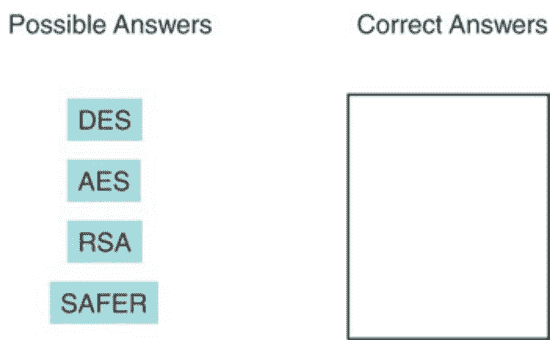

图 1.1 拖放题

### 热点题格式

对于热点考试题，您必须单击图表上的正确区域（即热点）来回答问题。

- 1. 在设计网络控制时，防火墙应放置在何处才能保护 DMZ？

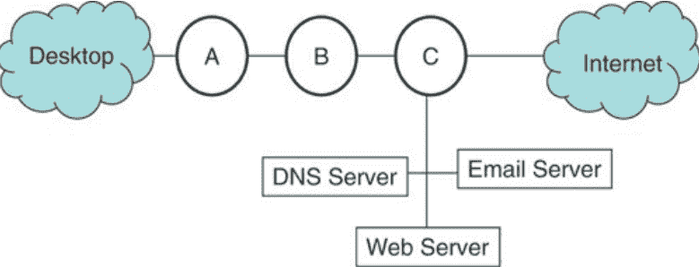

图 1.2 热点题

### 多选题答案

1. B. 锁是最常用于控制物理访问的设备。自古埃及时代起，锁就已被使用。答案 A 不正确，因为链条不是最常用于物理访问控制的设备。答案 C 不正确，因为警报不会阻止访问；它们只会告知您可能发生了未经授权的访问。答案 D 不正确，因为防火墙用于控制逻辑访问。

### 拖放题答案

1. RSA. RSA 是非对称加密的唯一示例。DES、AES 和 SAFER 均为对称加密的示例。在此情况下，您应仅将“RSA”拖放到“正确答案”框中。

### 热点题答案

1. C. 要回答问题，请将鼠标光标悬停在图表上您想作为答案选择的区域。所有可用区域都会亮起（本示例中的 A、B 或 C），您必须单击您认为正确的那个。在此情况下，您希望在内部网络和 Internet 之间部署防火墙，位置即为项目 C 所在处。

### 题目处理策略

由于多选题 CISSP 考试题目的结构方式，很多时候会有一两个答案明显错误，而两个答案看起来合理。请花时间重新阅读题目。在选择正确答案时，sometimes、not、always 和 best 等词会产生巨大的影响。除非答案一眼就能看出来，否则应首先排除最明显错误的答案来开始回答过程。

几乎总是，问题的备选答案中至少有一个可以立即被排除，因为它符合以下条件之一：

- 该答案不适用于该情况。
- 该答案描述了一个不存在的问题、无效选项或虚构状态。

在排除所有明显错误的答案后，您可以运用所保留的知识进一步排除答案。寻找那些听起来正确，但所指的操作、命令或功能在问题描述的情境中不存在或不可用的选项。

如果您仍然在两个或多个可能正确的答案之间进行盲猜，请重新阅读问题。试着想象每个可能的剩余答案将如何改变该情境。

只有在您耗尽排除答案的能力，但仍不确定剩余哪个可能性是正确时，才应该猜测一个答案。未回答的问题不会给您任何分数，但猜测至少给您答对一道题目的机会。只是在进行盲猜时不要太匆忙！

## 掌握内在游戏

知识滋生自信，自信滋生成功。如果您仔细学习本书中的材料并复习每章末尾的所有练习题，您应该意识到哪些领域需要额外的学习和研究。

> **考试警报**
>
> 在考试中，您将被要求理解 CISSP 术语。您需要了解可能使用的术语，并能够在测试题目提供的语境中应用它们。例如，考试可能会讨论入侵检测，但特定问题可能涉及物理入侵检测或逻辑入侵检测。

学完本书后，请参加练习考试


本书末尾。参加这些模拟考试将提供一次现实检查，并帮助你识别需要进一步学习的领域。请务必在参加真实考试之前，跟进并复习与你在模拟考试中答错的问题相关的材料。只有在你掌握了这些内容，并且对整个模拟考试范围感到自信后，才应该预约考试。建议在尝试参加真实考试之前，得分达到90%或更高。在达到这个神奇的数字之前，你应该获取更多模拟测试并不断尝试。

 > 考试提醒
 >
 > 凭借本书中的信息以及增强知识的决心，你应该能够通过认证考试。但是，你需要努力，否则在最终通过之前，你可能会多次支付考试费用。如果你认真准备，你应该能取得好成绩。我相信你能做到！

 ## 需要了解更多？

 - 通过CISSP考试：cybersecurityventures.com/how-to-pass-the-cissp-exam-top-10-tips-from-a-chief-risk-officer/

 - (ISC)² CISSP认证：www.isc2.org/cissp/default.aspx

 ## 第2章

 ## 了解资产安全

 ### 你需要理解的术语：

 - 机密性
 - 完整性
 - 可用性
 - 个人身份可识别信息
 - 信息生命周期管理 (ILM)
 - 数据保留
 - 数据分类
 - 数据销毁
 - 数据残留

 ### 你需要掌握的技术：

 - 数据销毁的正确方法
 - 有助于遵守地方、州和联邦法律的文档的制定
 - 加密的实施及其在数据保护中的应用
 - 如何使用数据安全控制

 ### 简介

 了解资产安全是CISSP考生的一项关键要求。资产安全涉及在整个数据生命周期中保护数据所需的控制措施，从创建点到生命周期结束。必须实施数据保护控制措施，以确保信息在每个生命周期阶段都得到充分保护。本章首先回顾机密性、完整性和可用性等基本安全原则，然后继续探讨数据管理和治理。

 CISSP考试要求你了解数据安全以及信息在传输、存储和静止状态下如何受到保护。你必须明白，数据保护现在比几年前重要得多，因为数据不再孤立在独立服务器中。如今，数据通常存储在云中；数据也可能存在于笔记本电脑、RAID阵列甚至纸质形式中。无论数据存储在何处，数据都必须得到充分保护，并在其使用寿命结束时得到妥善处置。

 ### 基本安全原则

 机密性、完整性和可用性（CIA）是任何良好安全计划的基本构建块。在定义网络、资产、信息和/或信息系统安全的目标时，通常使用术语_CIA 三要素_来指代这些概念。虽然CIA缩写可能不如美国政府的间谍组织那样引人入胜，但它是安全专业人员必须知道和理解的概念。

 _机密性_涉及信息的保密性和隐私性，以及防止未经授权的人员查看敏感信息。现实世界中使用了多种控制措施来保护信息的机密性，例如锁上的门、武装警卫和围栏。可以增强机密性的管理控制措施包括使用信息分类系统，例如要求敏感数据加密。例如，新闻报道详细介绍了多起大规模机密性泄露事件，这些事件是由于公司放错或丢失包含客户账户、姓名和信用信息的笔记本电脑、数据甚至备份介质所致。仅仅对这些数据进行加密这一简单行为本可防止或减轻损害。以加密格式发送信息会剥夺攻击者拦截和嗅探明文信息的机会。经济合作与发展组织（OECD）规定个人数据应受到限制，并提供确保隐私和机密性的指导方针。

 完整性涉及信息的准确性，并让用户高度相信他们正在查看的信息未被篡改。数据在存储、静止和传输过程中，其完整性必须受到保护。重要的是要确保未经授权的用户未做任何更改，且授权用户未做任何不当更改。存储中的数据可以通过访问控制和审计控制来保护。密码学和哈希算法可以增强这种保护。密码学工具包括HashTools、HashCheck和PowerShell等程序。同样，传输中的完整性主要可以通过将这些工具与公钥基础设施（PKI）、数字签名和非对称算法等协议和框架结合使用来确保。

 可用性是指信息和系统在需要时可用的需求。虽然许多人仅从电子角度考虑可用性，但可用性也适用于物理访问。如果凌晨2点，你需要访问存储在仅上午8点至下午5点开放的设施中的备份介质，那么你就存在可用性问题。在电子领域，可用性可以以多种方式体现。如果没有可用于恢复的更新备份，且原始副本已被勒索软件加密，那么全天候访问备份设施也没什么用。

 保留备份是确保可用性的好方法。备份提供关键信息的副本，如果数据被销毁或设备故障，可以恢复该副本。使用故障转移设备是确保可用性的另一种方法。独立磁盘冗余阵列（RAID）和冗余站点（可以是热站点、冷站点或温站点）等系统是另外两个示例。灾难恢复与可用性密切相关，因为它旨在快速让关键系统重新运行。

 安全三要素中哪一部分被认为最重要？这取决于情况。在不同优先级的不同组织中，某一部分可能比其他两部分更重要。例如，你当地的银行可能认为完整性最重要，负责数据处理的组织可能将可用性视为首要关注点，而像医疗记录清算机构这样的组织可能最看重机密性。

 尽管本书将该三要素称为CIA，但其他人可能将其称为AIC或CAIN（其中N代表不可否认性）。

 安全管理不仅仅局限于CIA。这些仅仅是适用于资产安全的核心技术中的三项。真正的安全需要深度防御。实际上，保护组织资产需要许多技术；请花点时间查看图2.1。

 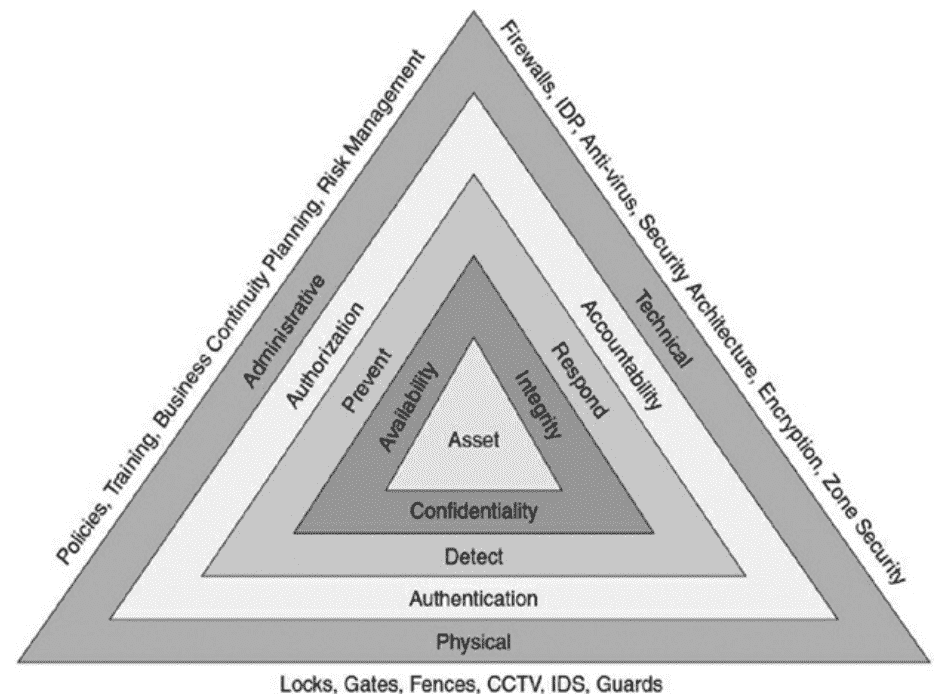

 图2.1 资产保护三要素

 ### 数据管理：确定和维护所有权

 数据管理并不容易，事实上最近变得更加复杂。几年前，人们只需要关注纸质文档，控制可能仅仅意味着锁上文件柜。今天，电子数据可能存在于拇指驱动器、SAN存储阵列、笔记本电脑硬盘、移动设备和公共云中。

 ### 数据治理政策

 通常，你可以将政策视为管理层制定的高级别文档，用以向员工传达管理层的指导战略和理念。数据治理政策是一套有据可查的规范，旨在保证对组织数字资产和信息的批准管理和控制。

 数据治理计划通常涉及以下类型的数据：

 - 主数据集
 - 元数据
 - 敏感数据
 - 获取的数据

 此类规范可能涉及业务流程管理（BPM）和企业风险规划（ERP）的指令，以及安全、数据质量和隐私。数据治理的目标包括以下内容：

 - 建立数据管理的适当责任
 - 改善数据访问的便捷性
 - 确保一旦找到数据，用户拥有足够的关于数据的信息，以便正确且一致地解释它
 - 改善数据的安全性，包括机密性、完整性和可用性

 需要考虑的问题包括以下内容：

 - 成本：这可能包括提供数据访问的成本以及保护数据的成本。


- **所有权**：这包括关于谁拥有数据或谁可能是保管人的问题。例如，你可能是 50 份 Microsoft Windows Server 2019 的保管人，但代码归 Microsoft 所有。用户支付软件许可证费用，而不是拥有软件本身，他们通常只有编译后的 .exe 文件，而没有程序的源代码。

- **责任**：这指的是如果数据丢失、被盗或被黑客攻击，组织将承担的财务和法律成本。

- **敏感性**：这包括与数据敏感性相关的问题，这些数据应受到保护，防止未经授权的披露（例如，社会安全号码、出生日期、病史信息）。

- **确保法律合规**：这包括与法律合规相关的项目。例如，你必须保留税务记录至少若干年，但你可能只需要在处理单笔交易所需的时间内保留个人身份信息（PII）客户信息。

- **流程**：这包括用于传输或修改数据的方法和工具。

## 角色与职责

数据安全需要责任。在处理任何安全问题时，角色与职责的清晰划分将大有帮助。每个人都应遵守组织的安全政策，包括员工、管理层、顾问和供应商。特定角色有独特的要求。一些关键角色及其职责如下：

- **数据所有者**：由于高级管理层对数据最终负责，如果数据泄露可能会被追究责任，因此数据所有者通常是高级管理层成员或该部门负责人。数据所有者负责设置数据的安全分类。数据所有者可以委派一些日常职责。

- **数据保管人**：数据保管人通常是 IT 部门成员，不决定需要哪些控制措施，而是代表数据所有者实施控制措施。其他职责包括处理数据的日常管理、控制访问、为单个用户添加和删除权限，并确保已实施适当的控制措施。

- **信息安全指导委员会：** 该委员会的成员来自不同级别的管理层，代表组织的各个部门。他们会开会讨论安全问题并提出建议。

- **高级管理层：** 这些人对组织的安全实践负最终责任。高级管理层可能会将日常责任委托给另一方或其他人，但不能委托对组织数据安全的总体责任。

- **安全咨询组：** 这些人负责与首席安全官审查安全问题，还负责审查安全计划和程序。

- **首席安全官：** 该人员负责组织及其关键资产的日常安全。

- **用户：** 组织中的最终用户有责任：他们必须遵守政策和程序中规定的要求。

- **开发人员：** 这些人为组织开发代码和应用程序。他们负责在其开发的程序中实施适当的安全控制。

- **审计员：** 该人员负责检查组织的安全程序和机制。审计员必须对组织安全控制的有效性提供独立和客观的意见。此过程的执行频率取决于行业及其相关法规。例如，美国医疗保健行业受《健康保险可携性和责任法案》（HIPAA）法规管辖，并要求每年进行审查。

> **考试警报**
>
> CISSP 考试可能会考查你对“数据访问权限不会无限期延长”这一概念的理解。员工在公司内部变动职位时，随着时间的推移获得越来越多的访问权限，这种情况并不少见。然而，这种管理不善可能会危及组织。当员工被解雇时，应撤销其数据访问权限。如果预先得知会发生不友好的解雇，应尽快终止访问权限，以减少潜在的损害。

## 数据所有权

组织中的每个数据对象都必须有一个所有者。任何没有数据所有者的对象都将得不到保护。将数据所有者和一组控制措施分配给信息的过程称为 *信息生命周期管理（ILM）*。ILM 是创建和使用政策以实现有效信息管理的科学。ILM 包括数据对象的每个阶段，从创建到结束。ILM 适用于任何和所有信息资产。

ILM 专注于固定内容或静态数据。虽然数据在整个生命周期中可能不会保持固定格式，但有时它是静态的。例如，本书出版后，它将保持固定格式，直至下一版发布。

出于业务记录的目的，生命周期过程包括五个阶段：

- 1. 创建和接收
- 2. 分发
- 3. 使用
- 4. 维护
- 5. 处置

## 数据保管人

数据保管人负责数据的安全保管、传输和存储，以及业务规则的实施。这可以包括尽职调查的实践以及实施良好实践以保护专利或商业秘密等知识产权。数据保管人的一些常见职责包括以下内容：

- **数据所有者识别**：必须识别并了解每个数据集的数据所有者，并必须正式指定。很多时候，数据所有者不知道自己是数据所有者，也不了解该角色及其职责。在许多组织中，数据保管人或 IT 部门默认承担数据所有者的角色。

- **数据控制**：对数据的访问经过授权和管理。必须建立适当的控制措施来保护数据的机密性、完整性和可用性。这包括管理控制、技术控制和物理控制。

- **变更控制**：必须实施变更控制流程，以便对变更和访问进行审计。

- **生命周期终止或处置**：必须建立控制措施，以便当数据不再需要或不准确时，可以采用批准的方法销毁。

## 数据文档与组织

组织和结构化数据可以帮助确保用户更好地理解和解释数据。数据文档应详细说明以下内容：

- 数据上下文
- 数据收集方法
- 数据结构与组织
- 数据有效性和质量保证控制
- 从原始数据通过数据分析进行的数据操作
- 数据机密性、访问和完整性控制

## 数据仓库

数据仓库是一个包含许多其他数据库中数据的数据库。它允许通过数据分析（本章后面将讨论）进行趋势分析和营销决策。数据仓库使战略视图成为可能。由于数据存储在一个位置，数据仓库对攻击者具有吸引力，攻击者可以搜查并发现敏感信息。

## 数据挖掘

数据挖掘是分析数据以查找和理解数据模式和关系的过程（参见图 2.2）。要进行数据挖掘，必须具备许多条件，包括多个数据源、访问权限和数据仓库。数据变成信息，信息变成知识，知识通过一种称为数据分析的过程变成情报，数据分析只是对数据的检查。元数据最好被描述为关于数据的数据。例如，数字 212 本身没有意义。但可以添加限定词来赋予其含义；例如，如果你了解到 212 是区号，那么你就明白该数字代表曼哈顿的一个区号。

组织珍视数据以及可以在单个数据元素之间推断出的关系。这些关系可以帮助公司了解竞争对手和客户的使用模式，并可以帮助他们定向营销。例如，尿布可能放在商店后部，靠近啤酒箱，因为数据挖掘表明，晚上 10 点后，购买尿布的男性比女性多，并且他们倾向于同时购买啤酒。


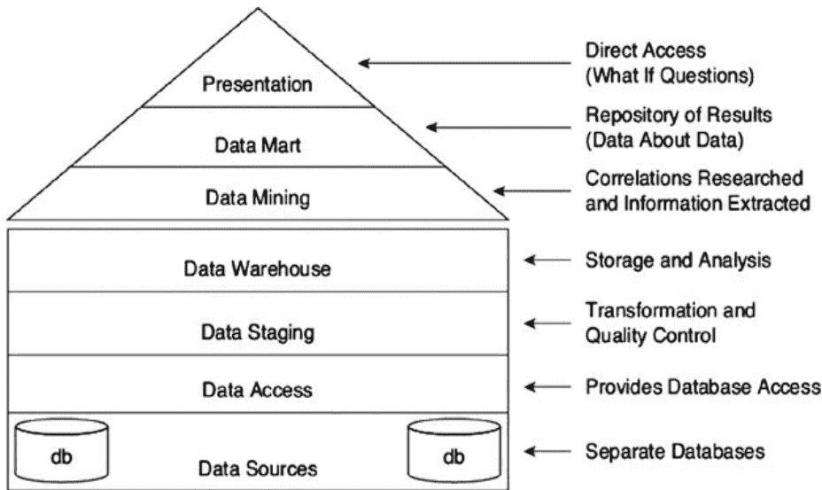

## 图 2.2 数据挖掘

## 知识管理

知识管理旨在通过应用智慧，使组织能够智能地利用其数据。这涉及通过分析将数据转化为情报，整合数据库、文档管理、业务流程和信息系统。其结果是一个巨大的数据存储，可以使用人工智能技术对其进行挖掘以提取知识。

知识提取有三种主要方法：

- **分类：** 此方法用于发现模式，并可用于将大型数据库缩减为仅几个单独记录或数据集。（可以将数据集视为数据仓库中的一小部分数据。）
- **概率：** 此方法用于允许统计分析，通常用于规划和控制系统或涉及不确定性的应用中。
- **统计：** 这是一种数字处理方法，其中构建规则以识别数据中的概括模式。

## 数据标准

数据标准为整个产品生命周期中在不同信息系统、程序和部门之间共享的数据提供一致的含义。数据标准是任何良好企业架构的一部分。数据标准使数据使用更加便捷。例如，假设你购买了一支需要两节 AA 电池的新 850 流明手电筒。你无需担心购买什么品牌的电池，因为所有 AA 电池都按照相同的尺寸和电压标准制造。

> 提示
> 要查看数据标准示例，请访问 FDA 数据标准资源，网址为 www.fda.gov/industry/fda-resources-data-standards。FDA 提供此网站，以确保在整个 FDA 中使用通用数据标准。

## 数据生命周期控制

数据生命周期控制是一种基于策略的方法，用于管理信息系统数据在其整个生命周期中的流动，从创建点到数据过期并被销毁或归档的点。

## 数据审计

在本章迄今讨论的所有任务完成后，组织的安全管理实践需要定期评估。这是通过审计流程来完成的。审计流程可用于验证每个人的职责是否明确界定。员工应了解其问责制和分配的职责。大多数审计遵循一套代码或文档。例如，财务审计可以使用跨行业赞助组织委员会（COSO）来进行。IT 审计通常遵循信息系统审计与控制协会（ISACA）的信息及相关技术控制目标（COBIT）框架。COBIT 围绕四个领域设计：

- 规划和组织
- 获取和实施
- 交付和支持
- 监控和评估

尽管 CISSP 考试不会指望你理解 COBIT 的内部工作原理，但你应该明白它是一个有助于提供治理和保证的框架。COBIT 旨在用于绩效管理和 IT 管理，并被视为一套最佳实践体系。COBIT 由 ISACA 和 IT 治理研究所（ITGI）于 1992 年创建。

审计人员可以使用 COBIT，该框架对设计控制和优化流程的 IT 用户和管理人员也很有用。

审计使验证已实施的控制是否有效、已编写的政策是否得到遵循以及提供给员工的培训是否真正有效成为可能。要了解有关 COBIT 的更多信息，请参见 www.isaca.org/cobit/。另一组可用于对基础设施进行基准测试的文档是 ISO 27000 标准系列；有关详细信息，请参见 www.27000.org。

## 数据存储和归档

组织对增加存储的需求源源不断。拇指驱动器曾是革命性的，最初提供约 10 MB 的存储空间，而今天它们可以提供太字节的存储空间。组织中的数据存储选项通常包括以下内容：

- 网络附加存储 (NAS)
- 存储区域网络 (SAN)
- 云

组织在部署技术之前应充分定义其数据存储的安全要求。例如，NAS 设备体积小、易于使用且可以快速实施，但物理安全是一个真正的问题，对数据实施严格控制也是如此。与 NAS 相比，SAN 可以实施得安全得多。基于云的存储提供了另一种选择，但也带来了顾虑，包括以下内容：

- 它是私有云还是公有云？
- 它使用物理服务器还是虚拟服务器？
- 服务器如何配置和下线？
- 数据是否加密，如果是，使用什么类型的加密？
- 数据实际存储在哪里？
- 数据如何传输（数据流）？
- 加密密钥存储在哪里？
- 是否有共享租户？

请记住，存储集成还包括保护提供存储的虚拟环境、服务、应用程序、设备和设施。

存储网络行业协会（SNIA）将 SAN 定义为“由各种存储元素、存储设备、计算机系统和/或设备以及所有控制软件组成的数据存储系统，所有这些都通过网络高效和谐地进行通信。”SAN 对客户端操作系统而言，表现为可按需本地格式化和使用的本地磁盘或卷。

对于 CISSP 考试，了解以下与 SAN 相关的术语很重要：

- **虚拟 SAN：** 虚拟 SAN (VSAN) 是为物理连接到同一 SAN 结构的设备提供隔离的 SAN。VSAN 的使用有时称为 *结构虚拟化*。VSAN 的开发旨在支持单个交换机上的独立虚拟结构。VSAN 通过允许更高效的 SAN 利用来改善整合并简化管理。VSAN 允许一个 VSAN 上的资源由不同 VSAN 上的其他用户共享，而无需合并 SAN 结构。
- **互联网小型计算机系统接口 (iSCSI)：** iSCSI 是一种 SAN 标准，用于连接数据存储设施并允许远程 SCSI 设备进行通信。许多人将其视为光纤通道的替代品，因为它不需要任何特殊基础设施，可以在现有的 IP LAN、MAN 或 WAN 网络上运行。
- **以太网上的光纤通道 (FCoE)：** FCoE 是一种类似于 iSCSI 的传输协议，可以 10 Gbps 的速度运行，并基于以太网协议。虽然它速度快，但缺点是不可路由。相比之下，iSCSI 是可路由的，因为它在协议栈的更高层运行，位于 TCP 和 UDP 协议之上。
- **主机总线适配器 (HBA) 分配：** 主机总线适配器用于将主机系统连接到企业存储设备。HBA 可以通过软分区或持久绑定进行分配。软分区更宽松，而持久绑定会减少地址空间并增加网络复杂性。
- **LUN 掩码：** LUN 掩码主要在 HBA 级别实现。它是一种系统，可将 LUN 提供给某些 HBA 而不提供给其他 HBA。在此级别实现的 LUN 掩码易受任何破坏本地适配器的攻击。
- **位置冗余：** 位置冗余使内容可从多个位置访问。可以通过复制服务提供额外的冗余措施，以便即使主存储备份系统失败，数据仍然可用。
- **安全存储管理和复制：** 安全存储管理和复制系统旨在允许组织以安全的方式管理和处理其所有数据，重点关注数据的机密性、完整性和可用性。复制服务允许数据实时复制，从而实现额外的容错能力。
- **多路径解决方案：** 企业存储多路径解决方案通过在服务器及其驱动器之间设置多条路径，降低了数据丢失或不可用的风险。多路径软件维护一个


listing of all requests, passes them through the best possible path, and reroutes communication if a path fails.

- SAN snapshots: SAN snapshot software is typically sold with SAN solutions and offers a way to bypass typical backup operations. The snapshot software has the ability to temporarily stop writing to a physical disk and then make a point-in-time backup copy. Snapshot software is typically fast and makes a copy quickly, regardless of the drive size.

- Data de-duplication (DDP): Data de-duplication is the process of removing redundant data to improve enterprise storage utilization. Redundant data is not copied. It is replaced with a pointer to the one unique copy of the data. Only one instance of redundant data is retained on the enterprise storage medium, such as disk or tape.

## 数据安全、保护、共享与传播

数据安全涉及保护数据免受授权用户的未授权活动以及未授权用户的访问。虽然法律因组织运营所在国家而异，但组织必须将个人信息的保护作为优先事项。要了解数据安全的重要性，请考虑根据隐私权利清算机构（www.privacyrights.org）的数据，美国2005年1月至2020年12月期间因安全违规累积的包含敏感个人信息的记录总数为11,717,011,063条。

国际标准ISO/IEC 17799在全球范围内涵盖数据安全。ISO 17799明确指出，所有数据都应有数据所有者和数据管理员，以便明确谁负责保护和保障对该数据的访问。

专有国际信息安全标准的一个示例是支付卡行业数据安全标准（PCI-DSS）。PCI-DSS为任何处理信用卡、预付卡和POS卡持卡人信息的实体设定了标准。PCI-DSS包含6个控制目标和12项要求：

### 1. 构建并维护安全网络。
要求 1：安装并维护防火墙配置以保护持卡人数据。
要求 2：不要使用供应商提供的默认系统密码和其他安全参数。

### 2. 保护持卡人数据。
要求 3：保护存储的持卡人数据。
要求 4：加密跨开放公共网络传输的持卡人数据。

### 3. 维护漏洞管理计划。
要求 5：使用并定期更新防病毒软件。
要求 6：开发并维护安全系统和应用程序。

### 4. 实施严格的访问控制措施。
要求 7：基于业务需要知道限制对持卡人数据的访问。
要求 8：为每个有计算机访问权限的人分配唯一ID。
要求 9：限制对持卡人数据的物理访问。

### 5. 定期监控和测试网络。
要求 10：跟踪和监控对网络资源和持卡人数据的所有访问。
要求 11：定期测试安全系统和流程。

### 6. 维护信息安全策略。
要求 12：维护涉及信息安全的策略。

## 隐私影响评估

改善个人信息保护的另一种方法是组织基于隐私影响分析（PIA）制定组织范围的策略。PIA应确定在电子系统中收集、维护和分发个人身份信息（PII）的风险和影响。PIA应用于评估隐私风险并确保存在适当的隐私控制。应审查现有数据控制，以验证问责制存在，并且每当计划上线新项目或流程时，合规性都已内置。PIA必须包括对以下项目的审查，因为它们会不利地影响隐私记录的 CIA（机密性、完整性、可用性）：

- **技术**：每当添加新系统或进行修改时，都需要进行审查。
- **流程**：业务流程会发生变化，即使公司可能有良好的变更政策，变更管理系统也可能忽略个人信息隐私。
- **人员**：公司会更换员工及其合作对象。每当业务合作伙伴、供应商或服务提供商发生变化时，都需要重新审查变更对隐私的影响。

隐私控制往往会被忽略，原因与许多安全控制被忽略的原因相同。管理层可能有一种先入为主的观念，即安全控制会降低业务流程的效率或速度。为了克服这些障碍，高级管理层必须对个人信息保护做出坚定承诺并展示其支持。风险评估活动通过向利益相关者通报与客户和客户个人信息丢失相关的实际成本，有助于这一过程。这些成本可能包括罚款、诉讼、客户流失、声誉受损，最终，公司的生存能力。

## 信息处理要求

组织处理大量信息，应制定详细说明信息如何存储的政策和程序。可以将政策视为高级别文档，将程序视为逐步说明。许多组织所处的行业受监管标准约束，这些标准详细规定了信息必须保留的时间和期限。

存储的一个关键关注点是确保介质被适当标记。

应对介质进行标记，以便数据管理员或负责介质管理的个人可以识别介质所有者、内容创建时间、分类级别以及内容销毁时间。图 2.3 展示了适当介质标记的示例。

| 字段 | 值 |
|------|-----|
| 日期 | 2021年5月1日 |
| 作者 | Christine Gregg |
| 分类 | 最高机密 |
| 保留期 | 3 年 |
| 标题和描述 | X 项目 |


## 图 2.3 数据标记

> 注意
> 
> 除非你和我一样是老爷车爱好者，否则你可能已经很久没有见过工作正常的车载磁带播放器了。技术在不断变化，能够读取和访问旧介质的要求是需要考虑的事情。存储的介质——包括磁带、激光盘、Zip 驱动器和 PATA 硬盘等旧选项——必须可读才能有用。

## 记录保留与销毁

所有数据都有生命周期。最终，数据应被清除、释放或解密。记录保留涉及在需要时保留重要信息，并在不需要时将其销毁或解密。

某些记录保留指南由政府法律规定。例如，公司通常在提起诉讼后不能合法删除潜在证据，并且必须在法院案件结束前保留这些资产和记录。此外，肯尼迪总统记录法是一项记录保留法案，旨在最终解密所有涉及肯尼迪总统遇刺的记录，并在 2018 年前使这些记录公开。

制定记录保留政策的步骤包括以下内容：

- 1. 了解业务需求和任何现有监管要求。
- 2. 对资产或记录进行分类。
- 3. 制定保留期限并指定数据销毁方法。
- 4. 制定政策并确定未遵循政策的影响。
- 5. 开展关于政策的培训、教育和意识提升。
- 6. 审计政策和程序。
- 7. 定期审查政策和程序。
- 8. 记录实施情况和审计结果。

> 考试警报
> 
> 数据保留的两个关键方面是分类和分级。分类定义资产暴露后的影响。分级定义资产的价值。CISSP 考试很可能会测试你对这些术语的理解。


## 数据处置的问题

尽管硬盘尺寸和性能持续快速增长，大多数硬盘和拇指驱动器（U 盘）出厂时仍未启用加密。例如，这意味着你可以拿走拍卖会上购买的无法启动计算机的硬盘，将其插入另一台计算机，并可能访问驱动器上的数据。虽然我们中许多人使用过碎纸机，但很少有人可能对硬盘进行过数据清除。无论你的组织是计划出售旧硬盘、捐赠给慈善机构还是直接丢弃，你都需要确保驱动器上的数据无法被恢复。

为了了解组织是否做得好，确保其数据无法恢复，两名来自 MIT 的研究人员从 eBay 购买了 158 个二手硬盘。在这些硬盘中，129 个仍可正常工作，其中 69 个包含研究人员能够复制的数据。这些驱动器上的数据包括个人信息、公司人力资源记录、医疗信息、药房数据库以及包含数千张信用卡号码的另一个数据库。

## 数据残留与停用

对象重用必须经过仔细考虑，因为信息可能残留在硬盘或任何其他类型的介质上。即使数据已被清除，也可能残留一些信息。数据残留是指从存储设备擦除数据后仍残留的数据。清除是指清除所有已识别内容，使得无法恢复任何数据残余的过程。CISSP 考试将要求你了解各种清除方法之间的区别。

资产处置必须以批准的方式进行，并必须是系统开发生命周期的一部分。例如，用于存储敏感或机密信息的介质应进行物理销毁。在系统或数据停用或处置之前，你必须了解任何现有的记录保留法律要求。归档信息时，你必须考虑检索信息的方法。

清除和清理是停用硬件的两种方式。零化是一种清除方式。清理被认为是一种更强、永久的清除形式。消磁和驱动器擦除是清理的类型。这些方法的详细信息如下：

- **零化**：此过程是一种清除方式，通常与加密进程相关。该术语最初用于机械加密设备，这些设备会重置为 0 以防止任何人恢复密钥。在电子领域，_零化_涉及用零覆盖数据。零化在 ANSI X9.17 中定义。使用此方法，数据可能仍可恢复。

- **消磁**：此过程用于永久销毁硬盘或磁性介质的内容。消磁涉及使用一块强力磁铁，其磁场强度穿透介质并反转磁带或硬盘上磁性颗粒的极性。介质消磁后，无法再重复使用。比消磁更安全的唯一方法是物理销毁。

- **驱动器擦除**：这是覆盖驱动器上所有信息的行为。驱动器擦除（涵盖在美国国家标准与技术研究院 (NIST) 800-88 和美国国防部 (DoD) 5200.28 中）允许驱动器重复使用。一种驱动器擦除形式（在 DoD 5200.28 中规定）是通过七轮用特殊数字模式覆盖驱动器。

存储设备被擦除后仍残留一些信息是常见现象。如果介质将被重复使用而非销毁，最佳实践是使用至少七轮随机的 0 和 1 进行覆盖。

对于被认为过于敏感的信息，硬盘、介质和其他存储设备等资产可能需要销毁而非重复使用。销毁是最强的清除形式，可以包括酸浴和物理销毁。如果不再需要的记录存储在较新的非磁性驱动器上（例如固态驱动器 (SSD)），可以使用居里温度将驱动器加热到失去磁性的程度。

**考试警报**

CISSP 考试将要求你了解处置数据的不同方式。一种容易记忆的方法是思考短语“Cow, Pig, Sow”，或“CP SOW”，分别代表清除可恢复、清理是永久性的、清除与清理相同、覆盖是写入 0、擦除是写入。

## 分类信息并支持资产分类

资产分类是指根据若干共同特征将资产分配到不同组。然而，在分类资产之前，你必须知道自己拥有什么。这通过资产清单来确定。现代组织高度依赖资产清单以及诸如 Asset Panda、AssetCloud 和 ManagerPlus 等工具的使用。这些应用程序（及其他）协助组织识别、定位和分类其资产。资产清单的组件包括以下项目：

- 资产名称
- 资产位置
- 资产成本
- 资产所有者
- 资产分类
- 所需的数据保护级别

用于分类和管理资产的标准或流程通常由各个组织自行决定。需要考虑的两点是组织的规模和结构，以及组织所在国家或行业中被视为常见的内容。无论采用何种特定方法，资产分类流程包括五个步骤：

1. 创建资产清单。
2. 分配所有权。
3. 基于价值进行分类。
4. 基于分类进行保护。
5. 评估和审查。

> **注意**
> 
> 为了记忆 CISSP 考试的资产分类流程，
> 请思考 CACPA，它与“Cat Paw”押韵，并指上述
> 步骤。

除了保护其资产外，组织还必须保护存储在其中的专有或机密信息。数据分类是对组织信息资产进行排名的有用方法。一个周密的数据分类系统使存储和访问数据变得容易。它还使用户更容易理解数据的重要性。例如，如果组织有清桌政策，并规定公司文档、备忘录和电子媒体不得留在办公桌上，它可以改变人们对该信息价值的态度。但是，无论使用哪种数据分类系统，都应足够简单，以便所有员工都能理解并正确执行。

## 数据分类

最常见的两种数据分类方案是军事和公共。组织存储和处理大量关于客户和员工的电子信息，因此采取适当预防措施保护这些信息至关重要。数据分类的责任在于数据所有者。军事和私营数据分类系统都通过将信息分类并向数据应用标签、向访问数据的人员应用许可来完成此任务。

数据分类流程的第一步是评估所涉信息的价值。一旦知道价值，就更容易确定应使用哪些资源来保护数据。例如，花费大量资源保护价值极小的东西是没有意义的。相反，需要更多保护的数据会得到保护，而不会浪费资金去保护不需要保护的数据。

建立的每个分类级别都应有特定的要求和程序。军事和商业数据分类模型为用户和数据都预定义了标签和级别。许可分配给用户，标签分配给数据。当组织决定使用哪种模型时，可以根据以下标准评估数据位置：

- 数据价值
- 数据年龄
- 涉及数据的法律
- 涉及披露的法规
- 更换成本

无论使用哪种模型，以下问题将有助于确定信息的适当位置：

- 谁拥有资产或数据？
- 谁控制访问权限和特权？
- 谁批准访问权限和特权？
- 授予资产或数据的访问级别是什么？
- 当前谁有权访问资产或数据？

数据分类需要几个步骤：

1. 确定数据监护人。
2. 确定数据分类使用的标准。
3. 指派所有者对信息进行分类和贴标签。
4. 识别数据分类策略的任何例外。


- 5. 确定应用于保护每类信息的安全控制措施。
- 6. 制定日落政策或生命周期终止政策，并分步详细说明数据将如何被重新分类或取消分类。指定保留期和生命周期终止的评审应在特定时期进行。
- 7. 开展意识提升计划。

## 军事数据分类

美国国防部内强制实施军事数据分类系统。该系统有五个分类级别：

- Top secret: 泄露可能导致严重破坏。
- Secret: 泄露可能导致严重损害。
- Confidential: 泄露可能造成损害。
- Sensitive but unclassified (SBU): 应避免泄露。
- Unclassified or official: 如果发布，不应造成任何损害。

每个分类代表一个敏感性级别。敏感性是信息应保持的所需保密程度。需知原则类似于最小权限原则，即员工只能访问完成其分配职责所需了解的信息。如果你拥有机密许可，这意味着你可以访问非密、敏感或机密级别且你需要知道的信息。但是，你不能访问秘密或绝密信息。有时组织会使用“仅限官方使用”（FOUO）一词来进一步定义信息使用的范围。

## 公共/私有数据分类

公共或商业数据分类基于四级模型构建：

- Confidential: 这是最高级别的敏感信息，泄露可能对组织造成极大损害。
- Private: 此信息仅供组织内部使用，其泄露将损害组织。
- **Sensitive:** 此信息需要更高级别的保护以防止机密性丢失。
- **Public:** 此信息可能不需要披露，但如果披露，也不应造成任何损害。

表 2.1 列出了军事和公共/私有数据分类模型。

## 表 2.1 商业和军事数据分类

| 军事分类 | 商业分类 |
| :--- | :--- |
| Top secret | Confidential |
| Secret | Private |
| Confidential | Sensitive |
| Sensitive but unclassified (SBU) | Public |
| Unclassified | |

> **注意**
>
> 信息具有有效期。数据分类系统需要包含机制来监控信息是否已过时，过时的信息应予取消分类或销毁。

## 资产管理与治理

资产管理与治理的工作是使 IT 目标与组织的业务职能保持一致，在资产整个生命周期中跟踪资产，并保护组织的资产。资产管理系统对有价值的项目进行清点、监控和维护。资产可以是有形的也可以是无形的，包括以下内容：

- 硬件
- 软件
- 员工
- 服务
- 声誉
- 文档

你可以将资产管理视为一种结构化方法，以具成本效益地部署、运行、维护、升级和处置资产。资产管理对于进行正确的风险评估是必需的。在对资产估值之前，你必须知道它是什么并确定其价值。其价值可以通过定量或定性方式进行评估。定量方法需要以下步骤：

- 1. 估计潜在损失并确定单次损失期望值 (SLE)。
- 2. 完成威胁频率分析并计算年发生率 (ARO)。
- 3. 确定年损失期望值 (ALE)。

定性方法不对资产赋予美元价值，而是将其归类为高、中或低关注度。定性评估的缺点是你不是使用美元价值，因此向管理层传达评估结果可能会很困难。

软件是一项关键资产。CISSP 候选人应了解与软件许可相关的常见问题。由于软件供应商通常是对软件授权而非出售，并且他们针对若干系统上的若干用户进行授权，因此采购组织必须对软件许可进行记账。如果用户或系统超出授权数量，组织可能会承担法律责任。

我们已进入软件通过互联网交付而非通过 CD 等介质的时代，软件资产管理仍然是一项重要关注点。

## 软件许可

知识产权问题一直难以执行。只需考虑多年前 Napster 引发的轩然大波，当时法院正试图解决知识产权问题以及个人共享音乐和其他文件的权利。软件行业长期以来一直在处理此类问题。自计算机早期以来，一些个人一直在交换、共享和非法复制计算机软件。未经授权的软件复制和共享被视为软件盗版，属于违法行为。认为将计算机游戏副本给朋友不会伤害任何人，这种想法很诱人。但软件盗版是一项大生意，对财产所有者的累计损失令人震惊。根据美国律师协会关于被盗知识产权的报告，每年估计损失在 2000 亿至 2500 亿美元之间。

Microsoft 和其他公司正在积极努力保护其财产权利。一些组织组建了软件出版商协会，这是致力于执行许可协议的主要机构之一。商业软件联盟 (BSA) 和反软件盗版联合会是针对软件盗版的国际组织。这些协会针对各种规模的组织，从小型两人公司到大型跨国公司。

软件公司在其许可中明确规定用户可以和不可以对其软件做什么。一些供应商甚至对虚拟化设置了限制。许可协议可以以多种不同方式分发，包括以下几种：

- **Click-wrap license agreements**: 许多软件产品中都有这类协议，要求你点击并同意条款才能安装软件产品。这类协议通常称为*附合合同*，是一种“接受或放弃”的条款。
- **Master license agreements**: 大型开发特定软件解决方案的公司使用这类协议，以规定客户如何使用产品。
- **Shrink-wrap license agreements**: 这类协议最初出现在软件开始商业销售时，之所以得名，是因为拆除实体介质上的收缩膜表示接受许可。

即使有许可以及 BSA 等组织加强执法活动，改进的技术也使得盗版软件、音乐、书籍和其他类型知识产权变得越来越容易。这些因素以及遵守两项世界贸易组织 (WTO) 条约的需求，促成了 1998 年《数字千年版权法》(DMCA) 的通过。以下是一些主要要点：

- DMCA 将绕过或规避商业软件产品中内置的反盗版措施定为犯罪。
- DMCA 禁止制造、销售或分发任何可用于破解代码或非法复制软件的设备或装置。
- DMCA 在特定情况下为图书馆和教育机构提供反规避条款的豁免；然而，对于不在豁免范围内的人，该法案规定的处罚最高可达 100 万美元和 10 年监禁。
- DMCA 为互联网服务提供商提供免于版权侵权责任的例外，从而实现跨互联网传输信息。

## 设备生命周期

设备生命周期始于设备请求，并延伸至其使用寿命结束或被报废时。设备生命周期通常包括四个阶段：

- 1. 需求定义
- 2. 获取与实施
- 3. 运行与维护
- 4. 处置与退役

虽然有些人可能认为设备获取后大部分工作就完成了，但事实远非如此。组织需要建立一些支持职能。例行维护是一项重要内容。


没有例行维护，设备将会发生故障，并且与这些故障相关的成本是可以计算的。需要考虑的项目包括：

- 生产力损失
- 延迟或取消的订单
- 维修成本
- 租赁设备成本
- 紧急服务成本
- 更换设备或重新加载数据的成本
- 支付人员维护设备的成本

技术支持也是另一个需要考虑的因素。一件设备使用的时间越长，它可能出现的问题就越多。例如，如果你搜索 Windows Server 2008 或 Windows Server 2019 的漏洞利用，你认为哪个会返回更多的结果？很可能是 Windows Server 2008——因为它已经使用多年，在此期间创建了许多漏洞利用。这一切都表明，资源使用时间越长，就需要越多的支持。

## 确定数据安全控制

任何关于逻辑资产安全的讨论，到某个时刻都必须涉及加密。虽然保护数据当然不仅仅是加密，但加密是保护数据的主要控制措施之一。只需考虑所有那些因为包含未加密数据而上新闻的丢失硬盘、笔记本电脑和拇指驱动器的案例。在许多情况下，加密不仅是个好主意，而且是法律规定的。CISSP 候选人必须了解关于加密将在何处以及如何使用的企业策略。

让我们从高层次来看看加密可以用于保护数据的两个领域：静态数据和传输中数据。

## 静态数据

存储在某些形式介质上、既不遍历网络也不驻留在临时内存中的信息称为 *静态数据*。未能正确保护静态数据可能导致诸如以下之类的攻击：

- 各种形式的 USB（通用串行总线）恶意软件，包括 USB 橡皮鸭
- Pod 吸取，一种非法从计算机下载或复制数据的技术，通常用于数据外泄
- 其他形式的恶意软件，包括病毒、蠕虫、木马以及各种类型的按键记录器

静态数据可以通过安全策略中应定义的不同技术和物理硬件或软件控制措施来保护。某些硬件提供内置加密功能。一种相对较新的计算机硬件安全设备称为 *可信平台模块*（TPM）芯片。TPM 芯片是一种“慢速”加密硬件处理器，可用于提供比软件加密更高级别的安全性。安装在客户端计算机主板上的 TPM 芯片还可用于系统状态身份验证。TPM 芯片还可用于存储加密密钥。

TPM 芯片在系统遍历启动序列时测量系统并存储测量值。当被查询时，TPM 芯片将返回这些值，并由本地私钥签名。这些值可用于发现平台的状态。对状态的识别和这些值的验证称为 *证明*。证明允许您确认、验证或证明系统处于特定状态。数据也可以使用这些值进行加密。此过程称为 *密封配置*。简而言之，TPM 芯片是一种防篡改加密模块，可提供一种向策略强制执行者或运行状况监视器报告系统配置的方法。

TPM 芯片还提供基于系统固件、配置详细信息或操作系统核心组件在启动时计算哈希值，从而将信息加密到特定平台配置的功能。这些值连同存储在 TPM 芯片中的密钥，可用于加密信息，并使其仅在特定机器配置下可用。此过程称为 *密封*。

ISO 11889-1:2009 规定了 TPM 芯片，这些芯片还可以与其他形式的数据和系统保护结合使用，以提供一种称为深度防御的分层方法。例如，TPM 芯片可以帮助保护系统，而另一组加密密钥可以存储在用户的通用访问卡或智能卡中，以解密并访问数据集。

基于此技术的另一种潜在选项是自加密硬盘（SED）。SED 是一种硬件，与未加密驱动器相比具有许多优势，包括以下几点：

- **合规性**：SED 能够提供内置加密，可帮助许多组织必须遵守的合规性法律。
- **强安全性**：SED 使用强加密。SED 的内容始终是加密的，加密密钥本身也被加密并在硬件中受到保护。
- **易于使用**：用户仅在设备启动或更改密码/凭据时需要对驱动器进行身份验证。加密对用户不可见。
- **性能**：由于 SED 对用户不可见且集成到硬件中，系统以全性能运行，且不会影响用户生产力。

软件加密是静态数据的另一种保护机制。有许多可用选项，例如 BitLocker 和 PGP。软件加密可用于特定文件、数据库，甚至存储敏感数据的整个 RAID 阵列。对于任何潜在的软件选项，当访问控制（例如用户名和密码）不正确时，加密数据必须保持安全且不可访问；此外，加密密钥必须受到保护，因此应定期更新。

**注意**

加密密钥应与数据分开存储。

## 传输中数据

数据在处理或从一个位置移动到另一个位置时，都需要适当的控制。基本问题是许多协议和应用程序通过明文发送信息。电子邮件、Web 和 FTP 等服务在设计时并未考虑安全性，使用这些服务时，信息的安全控制很少且没有加密。不安全协议的示例包括以下内容：

- **文件传输协议（FTP）**：明文用户名和密码
- **Telnet**：明文用户名和密码
- **超文本传输协议（HTTP）**：明文数据
- **简单邮件传输协议（SMTP）**：明文数据

未受某种形式加密保护的传输中数据面临许多危险，包括以下内容：

- 窃听
- 嗅探
- 劫持
- 数据篡改

如今，许多人从许多不同的地点连接到企业网络。员工可能通过咖啡店、餐馆、机场甚至酒店的免费 Wi-Fi 进行连接。

保护这类传输中数据的一种方法是使用虚拟专用网络（VPN）。VPN 用于通过公共 Internet 连接设备。有三种协议用于为 VPN 提供隧道机制：点对点隧道协议（PPTP）、第二层隧道协议（L2TP）和 IP 安全（IPsec）。当定义适当协议时，VPN 流量将被加密。Microsoft 随 PPTP 提供 Microsoft 点对点加密（MPPE），这是 Microsoft 操作系统原生支持的。L2TP 不提供加密，因此通常与 IPsec（ESP 模式）一起使用，以保护传输中数据并提供机密性和身份验证。IPsec 可以提供隧道和加密功能。

可以实现两种类型的隧道：

- **LAN 到 LAN（或网关到网关）隧道**：用户可以在独立的 LAN 之间相互透明地隧道连接。
- **主机到 LAN 隧道**：移动或远程用户可以连接到企业 LAN。

拥有加密隧道只是保护传输中数据的一部分。另一个重要概念是身份验证。几乎所有 VPN 都使用数字证书作为主要身份验证方式。X.509 v3 是事实标准。X.509 规定了证书要求和内容。很像州驾驶执照办公室，证书颁发机构（CA）保证证书持有者的真实性和证书内容。这些数字证书可以有不同的用例，包括提供身份验证以及存储证书持有者的公钥。

与其他服务一样，组织需要制定策略，以定义谁可以访问其 VPN 以及将使用哪些加密机制。重要的是，VPN 策略应设计为与组织的安全策略相匹配。由于高级管理层最终负责，他们必须批准并支持此策略。

标准电子邮件也非常不安全，数据在电子邮件传输过程中可能会暴露。SMTP、POP3 和 IMAP 等标准电子邮件协议都通过明文发送数据。要保护传输中的电子邮件，必须使用加密。电子邮件保护机制包括 PGP、安全多用途 Internet 邮件扩展（S/MIME）和隐私增强邮件（PEM）。无论保护什么，对敏感数据的定期审计都应该是策略的一部分，并且应按照定期计划进行。

在处理传输中数据时，考虑如何应用加密非常重要。加密可以在不同位置执行，并应用不同程度的保护。请考虑以下选项：

- **链路加密**：数据在整个通信路径中被加密。由于所有头部信息都被加密，每个节点都必须解密和加密路由信息。源和


destination addresses cannot be seen by someone sniffing traffic. For example, think of a police TV series that pulls a pen register on a phone. The police officers see a list of numbers the phone has called, the times, and the durations of the calls. While the officers cannot hear what was said on the calls, they can derive useful information about the frequency and duration of calls. IP headers can provide similar information about endpoints.

> **注意**
>
> 中间人攻击可用于针对链路加密，以查看路由信息并执行流量分析，这涉及查看源 IP 地址和目标 IP 地址，以确定哪些系统正在通信以及通信频率。

- **端到端加密**：这种加密通常由最终用户执行，数据可穿过每个节点而无需进一步处理。但是，源地址和目标地址以明文形式传输，因此可以被嗅探流量的人看到。

Data can be encrypted using either of these two methods with or without the IP header being encrypted. With both link encryption and end-to-end encryption, the confidentiality of data is protected. If a VPN is set up to use link encryption, the IP information is encrypted, as is the data traffic.

> **注意**
>
> 由于链路加密需要加密 IP 头部，因此在 LAN 或 Internet 上使用它进行路由会非常困难；每个路由设备都必须持有所用密钥的副本。

## 端点安全

A review of logical asset security would not be complete without a discussion of endpoint security. Endpoint security consists of the controls placed on client or end-user systems, such as antivirus, anti-malware, anti-spyware, and so on. Much of the IT security world has moved to a zero-trust environment, in which networked devices, such as laptops, are not trusted by default, even if they are connected to a managed corporate network.

Other controls placed on a client system, including the following, are also very important:

- Removable media: Malware is commonly propagated via USB thumb drive. Malware such as Stuxnet, Conficker, and Flame were all able to spread using thumb drives. Removable drives should be restricted and turned off when possible.

- Disk encryption: Disk encryption software such as PGP and BitLocker can be used to encrypt the contents of desktop and laptop hard drives. Also, corporate smartphones and tablets should have encryption enabled.

- Application whitelisting: This approach only allows known good applications and software to be installed, updated, and used. Whitelisting techniques can include code signing, digital certificates, known good cryptographic hashes, or trusted full paths and names. Blacklisting, on the other hand, involves blocking known bad software from being downloaded and installed.

- Host-based firewalls: For defense in depth, a company should consider not just enterprise firewalls but also host-based firewalls.

- Configuration lockdown: Not just anyone should have the ability to make changes to equipment or hardware. Configuration controls can be used to prevent unauthorized changes.

- Antivirus: Antivirus software is the most commonly deployed endpoint security product. While it is still a needed component, traditional, signature-based antivirus has become much less effective over the past several years as AI driven solutions have increased market share.

One basic starting point is to apply the principle of least privilege to each logical asset: Each computer, system component, or process should have the least authority necessary to perform its duties.

## 基准线

A *baseline* is a standard of security. Baselines are usually mapped to industry standards. For example, an organization might specify that all computer systems must be certified to Common Criteria Evaluation Assurance Level (EAL) 3. Another example of baselining can be seen in NIST 800-53, which describes a tailored baseline as a starting point for determining the needed level of security (see Figure 2.4).

Some methods used to establish baselines includes the following:

- **IT structure analysis (survey)**: Analysis of technical, operation, and physical aspects of the organization, division, or group.

- **Assessment of protection needs**: Determination of the needed level of protection. This activity can be quantitative or qualitative.

- **Selection of actions**: Determination of what specific controls need to be implemented.

- **Running comparison of nominal and actual**: Periodic review of activities and actions to measure the change between what was previously occurring and what is currently occurring.

## 特殊出版物 800-53 提供的基准线

**Master Security Control Catalog**
Complete Set of Security Controls and Control Enhancements

| 类别 | 基准线 | 描述 |
|---|---|---|
| 最小安全控制 – 低影响信息系统 | 基准线 #1 | 从主目录中选择安全控制子集——由基本级别控制组成 |
| 最小安全控制 – 中等影响信息系统 | 基准线 #2 | 从主目录中选择安全控制子集——由基本级别控制组成，并根据需要添加额外控制和控制增强 |
| 最小安全控制 – 高影响信息系统 | 基准线 #3 | 从主目录中选择安全控制子集——由基本级别控制组成，并根据需要添加额外控制和控制增强 |

**图 2.4** NIST 800-53 范围界定和基准控制

NIST 800-53 specifies scoping or tailoring activities and categorizes information based on impact (low, moderate, or high).

- 低影响
- 中等影响
- 高影响

Scoping or tailoring determines how standards are used to get the right level of protection for an organization. Scoping is the process of determining which portions of a standard will be implemented by an organization. For example, a high-security facility may decide not to deploy Wi-Fi and might state that Wi-Fi standards are out of scope and shall not apply. Tailoring is the process of customizing a standard for an organization.

NIST 800-52 (Security and Privacy Controls for Federal Information Systems and Organizations) describes the tailoring process:

- 1. Identify and designate common controls in initial security control baselines.

- 2. Apply scoping considerations to the remaining baseline security controls.

- 3. Select compensating security controls, if needed.

- 4. Assign specific values to organization-defined security control parameters (such as password complexity policies) via explicit assignment and selection statements.

- 5. Supplement baselines with additional security controls and control enhancements, if needed.

- 6. Provide additional specification information for control implementation, if needed.

> **考试提醒**
>
> CISSP 考试期望您理解范围界定、定制和补充等术语。例如，您可能会将标准注销时间从 24 小时缩短至 8 小时。
> *补充* 是向指定控制添加特定详细信息。例如，您可能会将术语 *云托管* 替换为 *Microsoft Azure*。

By scoping a project to remove items, you might be able to reduce costs, but in doing so, you might expose the system to unnecessary threats. Therefore, due care must be used to determine the proper level of controls. Scoping and tailoring activities should be well documented with appropriate justification. In some cases, information and information systems must be protected regardless of the cost because of laws that govern certain industries.

## 考试预备题

- 1. Which of the following levels does the military classification system include?

- A. Confidential, private, sensitive, and public

- B. Top secret, secret, private, sensitive, and public

- C. Top secret, confidential, private, sensitive, and unclassified

- D. Top secret, secret, confidential, sensitive, and unclassified

- 2. Your company is considering implementing NIST 800-53. Which of the following terms refers to the process of modifying security controls to align with the mission of the organization?

- A. Standards selection

- B. Tailoring

- C. Scoping

- D. Conforming

- 3. Which of the following endpoint security controls could have been used to potentially prevent malware such as Stuxnet, Conficker, and Flame?

- A. Implementing disk encryption

- B. Hardening edge devices

- C. Blocking removable media

- D. Enforcing application whitelisting

- 4. Which of the following shows the proper order?

- A. Determine SLE, ARO, and ALE and then asset value.

- B. Determine asset value and then ARO, SLE, and ALE.

- C. Determine asset value and then SLE, ALE, and SLE.

- D. Determine asset value and then SLE, ARO, and ALE.

- 5. With which of the following assessment types do you not work with dollar values, which can make it difficult to communicate the results of the assessment to management?

- A. Qualitative


- B. 定量的
- C. 数值缓解
- D. 红队

### 6. 以下哪类控制措施可包含用于控制访问和对用户进行身份验证的逻辑机制？

- A. 管理的
- B. 文书的
- C. 技术的
- D. 物理的

### 7. 以下哪项不是对自加密硬盘（SED）的描述？

- A. 有助于合规
- B. 降低性能
- C. 易于使用
- D. 提供强大安全性

### 8. 以下哪项是商业分类中的最高保护级别？

- A. 秘密
- B. 机密
- C. 绝密
- D. 私有

### 9. 以下哪项是最具体的安全文档类型？

- A. 程序
- B. 标准
- C. 策略
- D. 基线

### 10. 避免人人负责却无人负责的情况非常重要。数据所有者应属于以下哪个群体？

- A. 最终用户
- B. 技术经理
- C. 高级管理层
- D. 人人都负责；因此，所有群体都是所有者

### 11. 您需要保护两个业务单元之间传输的敏感信息，并决定使用链路加密。以下哪项陈述是不正确的？

- A. 数据包在通信路径上被加密。
- B. 数据包免受窃听和嗅探。
- C. 标头为明文。
- D. 从源到目的地，整个过程中的所有内容都被加密。

### 12. 在中西部开设新分支机构后，您的公司正在分析购买模式以确定各项购买商品之间的关系。以下哪项最能描述这种情况？

- A. 数据挖掘
- B. 知识管理
- C. 数据仓库
- D. 数据标准

### 13. 哪项管理流程受保护敏感数据的需求驱动？

- A. 定制
- B. 范围界定
- C. 信息分类
- D. 资产分类

### 14. 以下哪种 SAN 解决方案速度快、基于以太网且不可路由？

- A. SCSI
- B. iSCSI
- C. HBA
- D. FCoE

### 15. 谁最终对资产的安全性负责？

- A. 资产所有者
- B. 审计员
- C. 保管员
- D. 风险评估团队

## 考试准备问题答案

1. D. 军事数据分类系统在国防部内广泛使用。该系统有五个分类级别（从最低敏感度到最高）：未分类、敏感、机密、秘密和绝密。

2. B. 定制是指为组织定制标准。选项 A、C 和 D 不正确：标准选择涉及确定组织将应用和遵循哪些标准。范围界定涉及定义将应用标准的哪些部分。符合性简单意味着遵守标准或标准。

3. C. 限制可移动介质可能有助于防止通过拇指驱动器或可移动介质传播的已知恶意软件的感染。选项 A 不正确，因为介质加密无济于事。选项 B 不正确，因为边缘设备并非专门攻击目标。选项 D 不正确，因为强制实施应用程序白名单无法防止高级持续性威胁在本地系统上执行。

4. D. 正确的顺序是先确定资产价值，然后计算 SLE、ARO 和 ALE。选项 A、B 和 C 不正确；它们不是正确的顺序。

5. A. 定性评估基于场景，不试图为风险分析组件分配美元价值。定量评估基于美元金额。数值缓解和红队都是干扰项。

6. C. 技术控制可以是硬件或软件。它们是用于控制访问、对用户进行身份验证、识别异常活动和限制未经授权访问的逻辑机制。文书类别是一个不存在的类别，所有其他答案都不正确：管理控制是程序性的，物理控制包括锁、警卫、门禁和报警。

7. B. 自加密硬盘提供许多优势，例如缓解与个人身份信息等项目相关的合规问题。它们易于使用并提供强大的加密。选项 B 正确，因为 SED 不会降低性能；它们实际上集成在硬件中，以全性能运行，且不影响用户生产力。

8. B. 机密是商业数据分类中的最高级别。选项 A、C 和 D 不正确，因为秘密和绝密都属于军事分类，而私有是较低级别的商业数据分类。

9. A. 程序是一份详细、深入、逐步的文档，明确列出了要做什么。它与特定技术和设备相关联。标准是战术文档；策略是高层文档；基线是系统、网络或设备必须遵循的最低安全级别。

10. C. 高级管理层是最终所有者，因为这些人对资产负责，并且如果数据被泄露，必须对此负责。尽管选项 C 是最佳选择，但重要的是要意识到，在大多数情况下，数据所有者是管理层成员，但未必是组织中最高级别的高管。例如，CFO 将是所有财务数据的数据所有者，人力资源总监将是所有人力资源数据的数据所有者，等等。所有其他答案都不正确，因为最终用户、技术经理和其他员工通常不是数据所有者。

11. D. 尽管链路加密确实保护数据包，但标头是明文的。选项 A、B 和 C 不正确，因为它们都是关于链路加密的真实陈述。使用链路加密时，数据包被加密，数据包免受嗅探，且标头为明文。

12. A. 数据挖掘是分析数据以发现和理解数据中模式和关系的过程。选项 B、C 和 D 不正确。知识管理旨在充分利用组织中的所有知识。数据仓库是包含来自许多不同数据库的数据的数据库。数据标准为不同信息系统之间共享的数据提供一致的含义。

13. C. 组织使用信息分类根据信息的影响或敏感性为信息分配价值。选项 A、B 和 D 不正确，因为定制是将标准修改为行业标准。范围界定是确定将应用哪些标准部分。资产分类是根据若干共同特征将资产分配到组中的系统。

14. D. 以太网光纤信道（FCoE）可以以 10 Gbps 的速度运行，并基于以太网协议。虽然速度快，但它有一个缺点，即不可路由。选项 A、B 和 C 不正确。SCSI 仅用于本地设备。iSCSI 是一种 SAN 标准，用于连接数据存储设施并允许远程 SCSI 设备进行通信。HBA 用于将主机系统连接到企业存储设备。

15. A. 一些日常责任可以下放给保管员；但是，最终所有者负责。

## 需要了解更多？

- **数据分类:** mrcissp.com/2019/01/17/data-classification-why-what-how/
- **资产保留:** https://info-savvy.com/cissp-asset-retention-bk2d2t5/
- **ISO 27002 概述:** https://www.iso27001security.com/html/27002.html
- **HIPAA 法规与 CISSP:** cissp2021.blogspot.com/2020/12/gdpr-hipaa-compliance-key-similarities.html
- **IT 资产管理:** searchcio.techtarget.com/definition/IT-asset-management-information-technology-asset-management
- **安全策略模板:** www.sans.org/security-resources/policies/
- **IT 安全基线:** https://resources.infosecinstitute.com/certification/cissp-prep-security-policies-standards-procedures-guidelines/
- **构建有效策略:** csrc.nist.gov/nissc/1997/panels/isptg/pescatoire/html/
- **OECD 与 GDPR:** piwik.pro/blog/oecd-guidelines-8-privacy-principles-to-live-by/
- **范围界定与定制:** www.hackingtheuniverse.com/infosec/nist-computer-security/security-control-implementation/tailoring-security-controls


# 第 3 章

## 安全与风险管理

### 您需要理解的术语：

- 安全治理
- 合规性
- 法规
- 信息安全法律法规
- 职业道德
- 威胁
- 漏洞
- 安全与风险管理
- 单次损失期望 (SLE)
- 年发生率 (ARO)
- 剩余风险
- 年损失期望 (ALE)
- 业务连续性要求
- 威胁建模
- 供应链风险管理

### 您需要掌握的主题：

- 风险管理中使用的计算
- 良好安全管理的认可方法
- 如何进行定性风险分析
- 如何进行定量风险分析
- 如何进行混合风险分析
- 良好的资源保护
- 安全政策、程序、指南和基准的作用
- 适当的数据分类
- 安全角色的正确实施
- 如何执行风险计算

### 介绍

CISSP 考试的安全与风险管理领域涵盖数据分类与评估，以及安全治理和知识产权保护。这些内容均由政策、程序和指南等文件驱动。这些文件至关重要，因为它们阐明了组织如何管理其安全实践，并详细说明了对组织最重要的事项。这些文件提供了一份路线图，展示了组织中治理的水平和范围。这些文件并非凭空而来。高层管理必须通过推动此过程来发挥领导作用。高层管理拥有愿景，了解组织的总体目标，并了解组织的使命。这些文件中的每一个都应与管理组织的法律、法规和强制要求相关联。

本章将深入探讨计算风险的两种方法：定性和定量。掌握安全与风险管理领域的关键在于理解这两种方法。这两种方法中没有一种比另一种更好。定量和定性风险评估方法都有其优缺点。作为 CISSP 考生，您了解两者的差异以及每种方法如何用于应对威胁、评估风险潜力和评估组织的漏洞非常重要。您需要了解，风险可能发生在供应链、流程中，甚至在缺乏稳健的业务连续性流程方面。

最后，重要的是要记住，员工在安全和风险管理中发挥着关键作用。他们负责执行管理层实施的政策。尽管组织中的员工希望做正确的事并帮助公司取得成功，但他们必须接受培训。他们的培训涵盖广泛的主题，从职业道德到可接受使用再到社会工程。培训帮助员工了解正确的行动是什么，并了解组织的安全实践。该领域的总体目标是确保组织资产和信息的机密性、完整性和可用性。

### 安全治理

安全管理多年来一直在变化。在 20 世纪 70 年代，重点是计算机安全，而在 80 年代和 90 年代，重点转移到了数据和信息安全系统上。只有在过去几十年里，组织才开始更全面地看待安全。

当今，重点放在治理上，治理涵盖了安全的所有方面。良好的治理需要全面的企业保护，通常被称为*全面企业安全计划*，其中包括物理、逻辑和行政组件。幸运的是，对于安全管理来说，有许多可用的指导文件可以帮助构建有效的安全管理程序。这样的程序被视为信息安全的最佳实践准则。

### 美国法律体系与法律

美国法律体系可追溯至英国。美国、英国和加拿大都采用*普通法体系*。普通法基于先前的判决和原则，例如*遵循先例*——即类似法院案件应以一致的方式裁决的概念。普通法还承认合理怀疑原则，以及被告在被证明有罪前无罪的原则。普通法包括几个类别：

- **刑法**：*刑法*的存在是为了惩罚违反政府法律的人，因此被认为犯有危害社会的罪行。案件由州政府或联邦政府提起。惩罚可能包括财务处罚、监禁或两者兼而有之。广义上讲，重罪是更严重的犯罪，可能导致高额罚款和一年以上监禁，而轻罪是较不严重的犯罪，会导致较小的罚款和不超过一年的监禁。重罪和轻罪的处罚旨在惩罚罪犯并威慑犯罪活动。

- **民法：** 民法无权判处监禁。案件由受害者或认为自己受到不公正待遇的个人提起。如果被告被判有罪，受害者将通过惩罚性、补偿性或法定损害赔偿的金钱判决获得补偿。惩罚性损害赔偿由陪审团决定。补偿性损害赔偿基于实际损害的付款，而法定损害赔偿则根据法律和预设限额判决。

- **行政（监管）法：** 行政法建立了政府机构期望行业、组织、官员和高管遵守的绩效和行为标准。违反这些法律的个人和组织可能会受到财务处罚和/或监禁的惩罚。这些法律通常适用于医疗保健、金融、工业、石油化学和制药行业。

> **注意** 传闻证据通常在法庭上不被采纳，因为它被视为二手信息。

### 相关美国法律与法规

安全专业人员应了解适用于其所在地的法律，并理解“应有注意”和“应有审慎”等术语。应有注意涉及采取合理措施保护组织的资产。例如，可以将其视为信息收集。在一段时间内持续做正确的事——实施——即为应有审慎。

CISSP 考试不会考查特定国家的法律，但您应该了解世界所在地区的法律。以下是重要的美国法律和准则：

- **1986 年计算机欺诈和滥用法 (CFAA)**：该法案于 1996 年修订，使恶意软件分发非法。它涉及联邦政府使用的计算机，但也可以包括其他计算机。
- **1991 年联邦量刑指南**：这些规则为法官提供指导，以确保涉及计算机的犯罪的判决以更统一的方式作出。
- **1996 年经济间谍法**：该法案为被指控从事间谍活动的人规定了严厉的处罚。
- **1996 年美国儿童色情预防法**：该法案的目标是打击和减少使用计算机技术制作和分发儿童色情制品。
- **2001 年美国爱国者法**：该法案加强了计算机犯罪法，以扩大执法部门打击恐怖主义的能力。

### 国际法律体系与法律

全球的法律体系在被告权利、法官角色、证据性质及其他基本法律概念方面各不相同。不同地方对索赔和案件的处理方式可能差异很大。图 3.1 展示了世界上使用的一些不同法律体系。

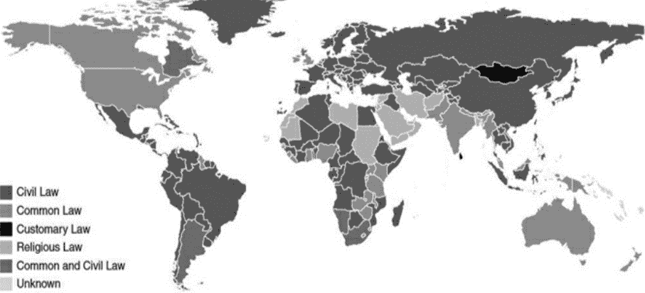

### 图 3.1 世界法律体系

欧洲大部分地区基于民法（成文法），也称为拿破仑法。民法在罗马帝国时期在欧洲发展起来。罗马人使用《民法大全》，其中包含一套全面的书面法律规则体系，作为当今民法的基础。民法与普通法的主要区别在于，民法在法院案件中以立法作为法律裁决的主要来源。

宗教法基于宗教信条。例如犹太教的哈拉卡和伊斯兰教的沙里亚法。伊斯兰法律体系是基于宗教信条并参考《古兰经》的自治法律体系。中国和一些非洲国家使用习惯法，习惯法基于被视为习惯和正常行为的概念。

如果两种或更多法律体系相结合，结果就是混合法律体系。混合法律体系以包含多于一种法律框架而著称，可能包含两种或多种基本类型的组成部分。例如，路易斯安那州同时具有民法和普通法的特征，中东部分地区混合了习惯法和宗教法。

这种国际法律体系的拼凑叠加在影响数据处理的国际财产法律之上，因此，尽管 CISSP 考试很可能侧重于普通法，但了解世界各地使用的各种法律体系之间的差异非常重要。


## 保护知识产权的国际法律

数据所有者通常对其创建和拥有的数据拥有合法权利。数据所有者通常负责理解其数据的知识产权和版权。知识产权由全球各个组织商定并执行，包括联合国国际贸易法委员会（UNCITRAL）、欧盟（EU）和世界贸易组织（WTO）。知识产权法律保护商业秘密、商标、专利和版权：

- 商业秘密：商业秘密是专有或与业务相关的保密设计、做法或方法。为了保持商业秘密的有效性，所有者必须采取预防措施以确保数据安全。这些预防措施的示例包括加密、文档标记和物理安全。
- 商标：商标是符号、单词、名称、声音或其他东西，用于识别特定行业中产品或服务的来源。(ISC)² 徽标是商标徽标的一个示例。有时会使用“服务标记”这一术语来区分适用于服务而非产品的商标。
- 专利：专利记录工艺或合成过程，并授予所有者在特定时间内依法强制执行的权利，以排除他人实施或使用该发明的设计。
- 版权：版权是一种法律手段，赋予作品的创作者控制作品使用方式的权利，并保护其在特定主题上的表达。这包括复制权、分发权、音乐、创作权和公开展示权。在美国和欧盟，版权的期限为作者有生之年加 70 年。知识产权的版权由全球各个组织商定并执行，包括 UNCITRAL、欧盟和 WTO。

**注意**

尽管版权法通常定义材料的所有权和使用，但合理使用允许以有限方式使用材料。合理使用旨在平衡版权持有人与公众的利益。有限使用材料被允许用于可能被视为侵权的情况。

## 全球法律与监管问题

一个全球法律问题是隐私法。这些法律至关重要，因为技术简化了收集个人大量数据的过程。中国的社会信用系统就是一个例子，该系统旨在为个人、企业和政府建立一个统一的记录系统，用于跟踪和评估信用分数。这是一个庞大的数据库，关于数据如何存储以及是否可能被泄露，存在重要的隐私问题。

在世界各地，商业和政府数据库包含大量数据，这些数据可被用来侵犯人们的隐私感和匿名性。滥用这些数据库可能导致定向广告和个人偏好的泄露，一些人认为这具有侵扰性。隐私在许多国家日益被视为基本权利，持有个人信息的组织被要求对其进行保护。

欧盟一直走在制定保护个人隐私法律的前沿，在联邦层面处理隐私问题。其数据保护机构有权执行隐私指令。欧盟于 1998 年颁布的隐私准则规定如下：

- 数据仅可用于收集时的目的，并在合理时间内使用。
- 个人有权请求并获取关于其自身数据的报告。
- 除非经法律授权或个人同意，否则不得向第三方披露个人的个人数据。
- 个人有权更正其个人数据。
- 禁止将数据传输到无法保证同等个人数据保护的地点。

欧盟还实施了一种被称为 *被遗忘权* 的概念，该概念自 2006 年起在欧盟和阿根廷实行。应要求，必须将不相关、私人或不再相关的信息从互联网搜索中删除。

在美国，联邦政府仅在举报明显的违法行为后才做出反应。隐私法律由政府行动推动。

美国宪法第四修正案是美国隐私法的基础。以下两项法律值得提及：

- **1974 年隐私法**：该法案限制联邦机构可以收集、维护和披露的个人信息。
- **1998 年身份盗窃和冒充威慑法**：该法案加重了身份盗窃的处罚，并确立身份被盗的人是真正的受害者。在这项法案通过之前，只有遭受金钱损失的信用授予者才被视为受害者。

即使有这些法律存在，在美国仍然有可能获取大量关于个人的信息。为了更好地了解可用的信息类型，请花点时间查看表 3.1。这些网站中的大部分会免费提供一些信息，只需几美元就能获取更多。这只是一个简短列表；还有许多其他网站可以用来收集个人信息。

## 表 3.1 个人信息网站

| 信息类型 | 用途 | URL |
|---|---|---|
| 个人位置 | 用于查找位置、地址、年龄和其他信息 | www.zabasearch.com |
| 线人 | 用于识别线人 | www.whosarat.com |
| 警察犯罪追踪 | 用于举报不当行为和滥用职权 | www.copblaster.com |

> **注意**
> 尽管美国和欧盟在隐私方面采取不同的方法，但处理来自欧盟客户信息的美国公司必须了解欧盟委员会的《1998 年数据保护指令》（安全港），并必须提供与欧盟提供的隐私保护标准相当的标准。

## 计算机犯罪与黑客

一个重要的全球法律问题是跨国黑客攻击和计算机犯罪。黑客或威胁行为者可能位于一个国家，使用另一个国家的服务器，然后利用这些资源攻击另一个国家。归因很困难。CISSP 考生必须准备好应对这些威胁行为者。

普遍认为，所犯计算机犯罪中只有大约十分之一被发现并起诉。很难开发关于计算机犯罪检测和报告的准确数字。许多犯罪未被发现，另一些被发现但从未向执法机构或公众报告。一些公司不报告是因为担心获得负面声誉并失去客户；另一些公司不报告是因为害怕自己看起来易受攻击。关于计算机犯罪和数据泄露的一个良好信息来源是 https://informationisbeautiful.net，该网站每年列出最大的数据泄露事件（见图 3.2）。

### 世界上最大的数据泄露与黑客攻击

选定事件（超过 30,000 条记录）更新于 2022 年 4 月

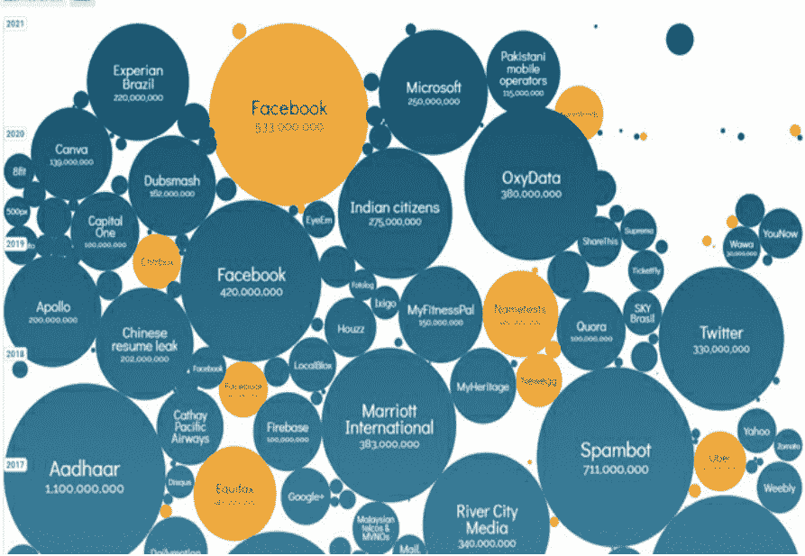

### 图 3.2 世界上最大的数据泄露

计算机罪犯使用多种攻击向量：

- **物理安全攻击**：物理访问系统
- **人员安全攻击**：骚扰、勒索或威胁员工
- **通信攻击**：窃听有线、无线或卫星通信
- **逻辑攻击**：逻辑访问系统
- **社会工程攻击**：欺骗员工或其他人提供访问权限或信息

不对计算机罪犯进行回顾，任何关于计算机犯罪的讨论都不完整。大多数安全专业人员认为计算机罪犯是


黑客。最初，*黑客*一词用于指代热衷于理解系统、计算机或计算机网络内部运作的计算机爱好者。随着时间的推移，大众媒体开始使用*黑客*一词来指代出于恶意目的闯入计算机的个人。行业随之提出了*破解者*一词，即犯罪黑客的简称。*破解者*一词旨在描述未经授权方许可而试图破坏系统安全的个人；然而，公众继续使用*黑客*一词来指代计算机犯罪分子。实际上，还有许多其他术语可用于识别犯罪分子和对犯罪活动进行分类，包括以下内容：

- **黑客/威胁行为者**：这个通用术语用于描述对影响或有可能影响组织安全并违背资源机密性、完整性或可用性的事件负全部或部分责任的个人。

- **脚本小子**：这个术语用于描述经验较少的黑客，他们通常使用广泛可用的免费漏洞评估工具、现有代码以及专为攻击目的设计的黑客工具。这些攻击者通常编程或黑客技能非常有限，并依赖他人编写的工具。

- **不满员工**：失去对雇主尊重的员工可能会攻击组织。这些个人的技能可能比脚本小子高，也可能不高。内部人员或前内部人员构成真实风险，因为他们拥有的知识和可能拥有的访问权限。

- **网络恐怖分子/网络犯罪分子**：个人或团体有时会获得资助，以非法方式对政府、组织和个人进行秘密或间谍活动。这些个人通常参与赞助的网页篡改、DoS/DDoS（拒绝服务/分布式拒绝服务）攻击、身份盗窃和金融盗窃行为。他们还可能破坏关键基础设施，例如核电站、电厂、水处理厂等等。

- **企业间谍/国家级黑客**：这些是精英黑客，在攻击系统和网络漏洞方面拥有特定专长。在迄今讨论的所有对手中，这些人远远是最复杂和最有能力的，并且拥有最大的资源。政府赞助的威胁行为者拥有资金、工具和资源，不惜一切代价获取目标资源的访问权限。支持这类行为者的组织示例包括 Cozy Bear、Clever Kitten、Deep Panda 和 Mythic Leopard。

**提示**
如果您想了解更多关于黑客攻击及安全领域所有参与者（包括黑客、安全专业人员和执法部门）的信息，可以考虑当地的选项，例如信息系统安全协会（ISSA）和 INFRAGARD，或黑帽（Black Hat）或 DEF CON 等安全会议。您可以参加会议以获取 (ISC)² 继续专业教育（CPE）学分，并了解更多当前安全趋势和漏洞。

## 性骚扰

美国法律要求公司提供安全工作场所，使员工免受性骚扰和冒犯性行为。近年来，在工作场所性骚扰等问题上已取得进展。

例如，#MeToo 运动将工作场所的性骚扰和性侵害推向了聚光灯下。许多在工作场所遭受性骚扰的幸存者已站出来讲述自己的经历。未能执行可接受使用政策（AUP）的公司可能因未处理这些问题而面临法律风险。

可用于实现良好治理的关键文件之一是 ISO/IEC 27002，本章后面将对此进行更详细的讨论。

## 美国治理

风险管理是支持所有信息安全活动的最终要求。以下各部分将审查一些美国法律和规定，以帮助进行风险管理。

## 健康保险可携带性和责任法案 (HIPAA)

HIPAA 于 1996 年签署成为法律，包含两个部分。该法案的标题 I 在员工变更或丢失工作时保护员工及其家庭的健康保险覆盖。标题 II 要求美国卫生与公共服务部（DHHS）为电子医疗交易建立国家标准，并为提供者、健康计划和雇主建立国家标识符。

HIPAA 隐私规则规定了组织必须实施的控制措施以保护个人信息。隐私规则定义了三个主要目的：

- “通过让消费者访问其健康信息并控制该信息的不当使用，保护并增强消费者的权利。”

- “通过在消费者、医疗保健专业人员以及致力于提供医疗服务的众多组织和个人中恢复对医疗保健系统的信任，改善美国的医疗保健质量。”

- “通过创建一个国家健康隐私保护框架，利用各州、卫生系统以及个人组织和个人的努力，改善医疗服务的效率和效果。”

## 格莱姆-利奇-布莱利法案 (GLBA)

GLBA 于 1999 年签署成为法律，迄今为止在美国金融服务监管方面造成了最全面的改革。

GLBA 的标题 V 涉及金融机构隐私。该法案的子标题 A 要求金融机构就其隐私政策作出一定披露，并赋予个人退出能力。子标题 B 将被称为“诱骗”的做法定为犯罪，即以虚假借口获取个人信息的做法。

根据 GLBA，金融机构必须保护个人隐私信息的机密性。如 GLBA 所规定，金融机构必须制定、实施和维护全面的信息安全计划，采取适当的行政、技术和物理防护措施。行政控制包括背景调查和职责分离等项目。技术控制可以是硬件或软件，例如加密或入侵检测系统（IDS）。物理控制包括大门、警卫和围栏。信息安全计划必须包括以下控制措施：

- 指定负责组织信息安全计划的计划经理
- 定期进行风险和漏洞评估及审计
- 定期测试和监控计划
- 制定控制敏感信息和个人可识别信息（PII）的政策和程序

## 联邦信息安全管理法案 (FISMA)

FISMA 于 2002 年签署成为法律。FISMA 带来的重大变化之一是一套针对保护联邦政府 IT 基础设施和数据资产而设计的信息安全清晰指南。FISMA 要求规定了以下职责：

- 开发和维护信息保障（IA）计划，包含完整的 IT 安全架构和框架。
- 确保开展信息安全培训，使技术和管理人员按照 DoD 8570 进行适当培训和认证。
- 为在信息安全方面负有重大责任的人员实施问责制。

FISMA 还要求定期进行风险评估、风险评估政策和程序、定期（至少每年一次）测试和评估，并对高级管理人员进行适当培训，以便部署适当的安全意识计划。

## 萨班斯-奥克斯利法案 (SOX)

SOX 于 2002 年签署成为法律，规定了许多改革措施，以加强企业责任、增强财务披露，并打击企业和会计欺诈。第 302 节和第 404 节是涉及 IT 基础设施和信息安全的两个部分。第 302 节要求 CEO 和 CFO 亲自证明其组织拥有适当的内部控制。它还规定 CEO 和 CFO 必须报告财务报告周围内部控制的有效性。

第 404 节对管理层结构、控制目标和控制程序提出了要求。遵守第 404 节要求公司建立旨在归档记录和数据并保护其免遭破坏、丢失、未经授权的篡改或其他滥用的基础设施。它要求实施一套全面的控制措施，并使 CEO 和 CFO 承担责任。

## 美国国家标准与技术研究院 (NIST)

NIST 最初名为国家标准局，于 1989 年更名为美国国家标准与技术研究院（参见 www.csrc.nist.gov）。以下是安全专业人员应了解的某些 NIST 文件：

- NIST 800-37：这是一份应用风险管理的指南。

- NIST 800-53：这份政府出版物为支持联邦政府行政机关的信息系统选择和指定安全控制措施提供了指南。许多私营行业的组织使用 NIST SP 800-53 作为


其安全管理。

- NIST 800-60: 这是一份用于映射信息类型和信息的指南。

## 联邦信息处理标准 (FIPS)

FIPS 是由美国政府公开发布的标准，供非军事政府机构和政府承包商在计算机系统中使用。以下是您在 CISSP 考试中应熟悉的一些标准：

- FIPS 199: 此标准确立了联邦政府使用的信息系统的安全类别。

- FIPS 200: 此标准列出了政府系统的强制性安全要求。

> **考试警报**
> CISSP 考试考生必须理解并知道如何应用安全治理和所使用的框架等安全概念。

## 国际治理

国际治理是一个随着全球数据共享增多而日益重要的问题。管理这一大量信息的一个框架是信息技术基础设施库。

ITIL（原名信息技术基础设施库）为企业提供了一个识别、规划、交付和支持 IT 服务的框架。

ITIL 有一个流程，从为企业 IT 设定目标、提供初始方向开始，然后演变为一个持续循环。

ITIL 提供了一个服务生命周期，包括以下内容：

- ▶ 持续服务改进
- ▶ 服务策略
- ▶ 服务设计
- ▶ 服务转换
- ▶ 服务运营

另一个国际标准是国际标准化组织 (ISO) 27002，它提供了信息安全管理的最佳实践指南。它分为 12 个主要部分：

- ▶ 风险评估与处理
- ▶ 安全策略
- ▶ 信息安全组织
- ▶ 资产管理
- ▶ 人力资源安全
- ▶ 物理与环境安全
- ▶ 通信与运营管理
- ▶ 访问控制
- ▶ 信息系统采购、开发与维护
- ▶ 信息安全事件管理
- ▶ 业务连续性管理
- ▶ 合规性

ISO 27002 面向负责启动、实施和/或维护信息安全管理系统的个人编写。其目标是为保护者提供模板，提供技术指导，并帮助培训那些负责保护组织资产的人。

以下是您在 CISSP 考试中应熟悉的 ISO 27000 家族中的其他标准：

- ISO 27001: 此标准描述了与建立、实施、运行、监控、审查和维护信息安全管理体系 (ISMS) 相关的要求；它基于英国标准协会 BS 7799。

- ISO 27003: 此标准侧重于 ISMS 的实施。

- ISO 27004: 此标准涵盖信息安全度量。

- ISO 27005: 此标准描述了如何实施基于风险管理的解决方案。

- ISO 27799: 此标准描述了如何保护个人健康信息。

ISO 9001 是一项获得广泛支持和关注的质量管理标准。ISO 9001 描述了如何管理和评审生产流程。它不是质量标准，而是关注系统或流程的文档化程度。希望获得 9001 认证的公司需要进行差距分析，以确定需要改进的领域。ISO 9001 包含六份文档：

- 文档控制
- 记录控制
- 不合格品控制
- 纠正措施
- 预防措施
- 内部审核

> **提示**
> 要获得 ISO 9001:2000 认证，组织必须进行差距分析，以识别为获得认证而需要解决的不足之处。

获得 ISO 认证意味着组织有能力提供满足特定要求的产品，并包含持续改进的流程。它还可能直接影响审核，因为它对文档化流程实施了严格控制。您还应该了解的另一个 ISO 标准是 ISO 27001，以前称为 BS 7799。ISO 27001 分为 12 个主要部分：

- 风险评估与处理
- 安全策略
- 信息安全组织
- 资产管理
- 人力资源安全
- 物理与环境安全
- 通信与运营管理
- 访问控制
- 信息系统采购、开发与维护
- 信息安全事件管理
- 业务连续性管理
- 合规性

> **提示**
> 对于 CISSP 考试，您应当对 ISO 标准及其目的有基本了解；但是，考试不涵盖美国法律。

云安全联盟 (CSA) 安全信任保证与风险 (STAR) 评级验证了云提供商的最佳实践和安全态势。它分为三个级别：

- 第 1 级：通过问卷进行自我评估
- 第 2 级：第三方评估
- 第 3 级：由认证的独立组织进行持续监控

经济合作与发展组织 (OECD) 已制定经 30 个国家批准的隐私指南，包括欧盟国家、美国、墨西哥、澳大利亚、日本和捷克共和国。OECD 框架包含八项指导原则：

- 收集限制原则
- 数据质量原则
- 目的明确原则
- 使用限制原则
- 安全保障原则
- 公开原则
- 个人参与原则
- 问责原则

对于 CISSP 考试，您还需要了解另外两份欧洲文档：

- 10 步实现网络安全：该文档在 10 个关键技术和程序领域提供详细的网络安全信息和建议。它由通信电子安全组 (CESG)（即政府通信总部 (GCHQ) 的信息安全部门）以及英国境内的国家信息保证技术机构制定。

- 欧盟网络安全战略：欧盟制定的这份文件描述了预防和应对网络安全攻击的方法。

> **注意事项**
>
> 宣称符合某个知名标准是不够的。大多数实体期望获得证明。证明意味着提供证据或证实。例如，云托管提供商使用证明来向客户保证其已接受第三方验证和审查。ISO 27001、审计准则声明 (SAS) 70 和 PCI-DSS 使用 PCI 合格安全评估员 (QSA) 进行证明。

## 风险管理概念

*风险管理* 是一种分析风险、识别威胁并实施控制以减轻风险的系统性持续方法。风险管理应由高层管理推动，由其指定某人来领导风险评估流程。当高层管理推动流程时，公司对安全计划有自上而下的支持；这是首选方法。有时高层管理可能看不到结构化风险评估流程的价值。在这种情况下，自下而上的流程仍然可能推动风险评估流程。

推动风险评估流程的个人获得高层管理支持至关重要。确保高层管理承诺和支持的一种方法是使用正式演示向其传达整体风险管理计划的关键方面，并提醒他们最终要负责。

一旦高层管理参与，风险管理流程即可开始。该流程的目标是让组织建立必要的控制措施，以保护组织的员工和资产，同时满足利益相关者的期望。风险管理的主要部分包括建立风险管理团队、识别威胁和漏洞、对组织资产估值，以及确定如何处理发现的风险。

## 风险管理框架

风险管理框架支持风险管理流程。例如，英国标准协会 BS 31100 为管理风险提供了关于目标、授权和承诺的指导。另一个示例是，NIST SP 800-37《将风险管理框架应用于联邦信息系统指南》详细介绍了一个六步风险管理框架

(RMF). RMF 的步骤如下（参见图 3.3）：

1. 分类
2. 选择
3. 实施
4. 评估
5. 授权
6. 监控

大量其他风险管理和评估方法已经开发出来，包括以下方法：

- **信息风险因素分析 (FAIR)**: 这种风险管理方法涉及为损失事件的频率和程度制定概率基线。它被视为现有风险框架的附加组件。
- **风险因素分析**: 这是另一种风险分析方法，它采用六步法来识别驱动项目进度、成本和技术性能表现的因素。
- **概率风险评估**: 这种方法专为大型复杂项目设计，其中风险被定义为活动或行为可能导致的不利结果。结果以数字形式表示。

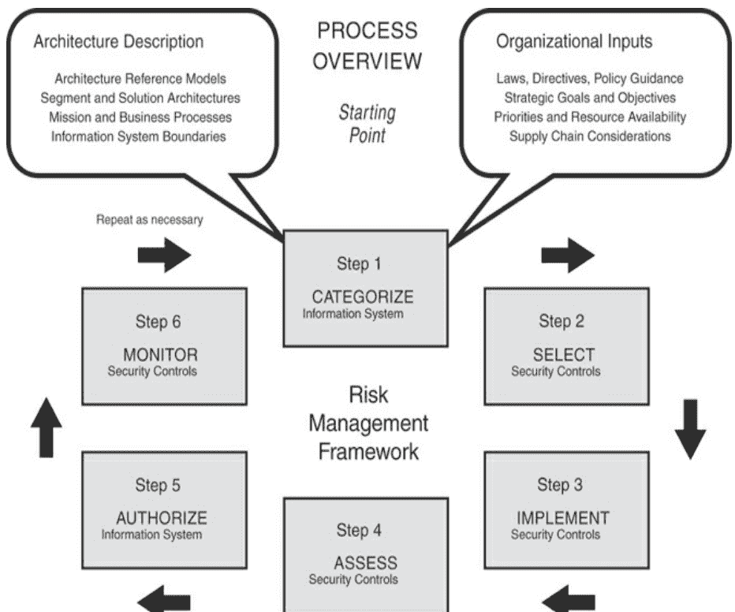

## 图 3.3 NIST 风险管理框架

> **注意**
>
> 风险登记册是您可用作已识别风险及其性质存储库的工具。您可以在 www.slideshare.net/KashifMastan/risk-register-34631122 上查看风险登记册示例。

## 风险评估

风险管理是持续进行的，而风险评估有开始和结束日期。风险评估涉及识别和优先排序对企业的风险。完成风险评估至关重要。如果没有风险评估，您就无法设计良好的安全策略或程序来保护公司的关键资产。风险评估要求个人负责风险管理流程。

对于 CISSP 考试，理解风险、威胁和漏洞的概念很重要。

*风险* 是威胁发生或实现的概率或可能性。从 IT 基础架构角度来看，风险有三个基本要素：

- **资产**: 对组织具有价值的组件或项目，例如数据资产
- **威胁**: 任何可能导致资产损失或损坏的情况
- **漏洞**: 基础架构、设计或组件中的弱点，威胁可能利用该弱点来破坏、损坏或泄露资产

*威胁* 是任何可能对资产造成伤害、损失、损坏或泄露的代理、条件或情况。从 IT 角度来看，威胁可分为可能影响资产机密性、完整性或可用性的情况。威胁可以是自然的、人为的或技术性的。威胁可能导致企业资源被破坏、泄露、修改或损坏，或导致拒绝服务。

*漏洞* 是产品设计中的弱点、产品实现中的弱点，或产品软件或代码开发方式中的弱点。通过实施防护措施、控制和安全对策，可以降低甚至可能消除漏洞。

> **注意**
>
> 控制是用于约束、规范或减少漏洞的机制。控制可以是纠正型、检测型、预防型或威慑型。

## 风险管理团队

在担心一个人如何独自完成风险管理之前，请明白风险管理是一项大工作。您需要其他部门的同事和员工提供帮助。要有效地进行风险管理分析，必须让公司各个不同部门的个人参与进来。任何一个人都很难理解所有部门的内部运作。作为 IT 或安全管理员，您了解 IT 基础架构面临的逻辑风险，但您是否真正掌握了人力资源部门可能面临的问题（例如员工控制、有效的解雇做法以及对机密信息的控制）？如果您希望风险管理流程取得成功，就必须引入其他职能领域的关键员工。

考虑将以下各组的员工纳入风险管理团队：

- 信息系统安全
- IT 和运营管理
- 系统和网络管理
- 内部审计
- 物理安全
- 业务流程和信息所有者
- 人力资源
- 法务
- 人身安全

资产所有者也应在团队中有代表。由于资产所有者负责资产，他们应该有权参与决定实施的控制类型。让资产所有者加入团队，可以确保团队了解并能够应对需要检查的众多威胁。

团队还必须由了解组织法律和法规要求的人员提供信息和指导。例如，可以专门成立一个团队来研究降低保险成本、减少针对公司技术基础设施的攻击，或验证是否符合 GLBA、SOX 或 HIPAA 等政府标准。

风险管理团队成立后，必须执行以下任务：

- 执行资产估值
- 执行威胁分析
- 执行定量或定性风险评估
- 选择补救措施
- 降低、分配或接受风险

评估风险所需的关键安全管理实践可分为六个广泛步骤（参见图 3.4）：

1. 资产识别
2. 风险评估
3. 政策制定
4. 实施
5. 培训和教育
6. 安全基础架构审计

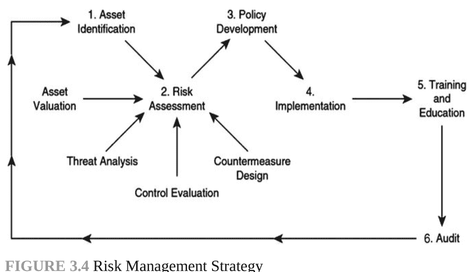

## 资产识别和估值

一旦拥有获得高级管理层支持的风险管理团队，下一步就是列出组织资产的价值。适当的资产估值使组织的风险管理团队能够开始就部署安全控制和安全对策做出业务决策。

保护组织资产最重要的步骤之一是识别并清点所有资产。例如，假设您为一家银行工作，该银行负责保护包含姓名、社会安全号码和地址的客户数据库。您会希望对这些资产实施比对包含所有银行分支机构位置、经理姓名和电话号码的另一个数据库高得多的控制级别。但是，如果您不知道数据库资产，就不会知道保护级别。如果没有对所有资产进行完整准确的清点，就无法进行资产估值。

请记住，资产可以是有形的，也可以是无形的。在记录组织资产信息时，应包含以下信息：

- 标识
- 位置
- 风险
- 防护
- 组
- 所有者

文档化资产管理提供的一项最后重要方面是已尽到合理注意义务。要正确评估资产价值，您需要认识到，价值通常不仅基于创建或购买该项目的成本。请考虑以下问题：

- 获取或创建资产的成本是多少？
- 如果资产被泄露，组织将面临什么责任？
- 如果资产不可用，生产成本是多少？
- 该资产对竞争对手和外国政府的价值是多少？
- 该资产有多重要，其丢失将如何影响公司？
- 维护资产需要哪些技能，每天、每周或每月需要多少工时？
- 该资产依赖于哪些子系统、应用程序、硬件或软件？

列出资产价值后，风险管理团队可以确定组织最关键的系统、资源、应用程序和数据。这些信息使团队能够优先投资于安全控制和安全对策。控制并非免费，而是需要花费有限的资金。大多数组织必须证明为适当的安全控制和安全对策所需投资的合理性。

没有资产估值，就难以了解控制的投资回报率 (ROI) 或对安全对策投资进行成本效益分析。了解您正在努力保护的资产的价值


保护也很重要，因为如果在应对措施上的花费超过资产本身的价值，或者在控制措施上的花费超过若威胁针对漏洞时可能损失的价值，那将是不明智的。一个常见的问题是忽视二级和三级系统对关键资产所分配价值的影响。

请记住，你无法保护一切。在定义范围时，组织必须牢记，其拥有的资金和资源有限，应对措施必须战略性地部署以保护被认定为最关键的资产。重点应首先放在保护面临高风险水平的资产上，如图3.5所示。

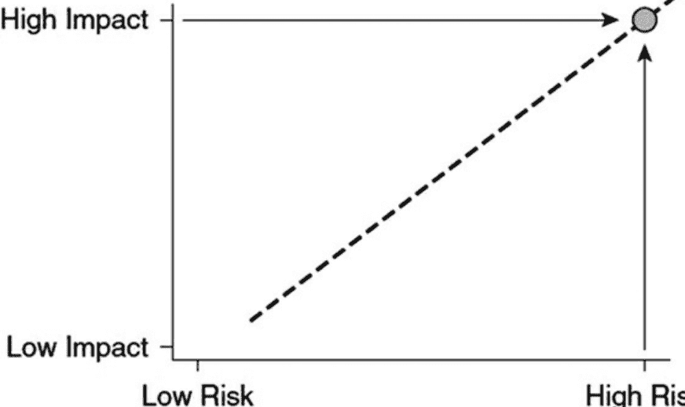

图3.5 高风险、高影响资产

出于保险目的，通常有必要进行资产识别和评估。组织可能会确定某些风险应转移给第三方，而资产估值使组织能够准确评估其业务保险需求。一些公司现在提供技术和网络风险保障，广为人知地称为*黑客保险*。

## 威胁分析

本章前面，我们讨论了威胁对组织可能产生的负面影响。本节探讨威胁可能来源于何处。威胁可能因技术故障或自然因素而发生，也可能由人为造成，无论是出于恶意还是意外。识别所有潜在威胁是一项重大责任。你不想随意头脑风暴潜在威胁；毕竟，如果你住在堪萨斯州，为什么要将飓风列为威胁呢？一个好的起点是思考你可能在以下常见类别中面临的威胁：

- 自然灾害
- 物理威胁/盗窃
- 人为错误/内部威胁
- 应用程序错误/缓冲区溢出
- 设备故障
- 环境危害
- 恶意软件/隐蔽通道
- 黑客攻击
- 机密信息泄露
- 被盗、丢失、损坏或修改的数据
- 未授权访问
- 恐怖主义
- 病毒、蠕虫和恶意软件
- 拒绝服务

威胁与漏洞和威胁主体相结合可能导致损失。威胁主体是能够实施威胁的个人或群体。如前所述，漏洞是安全系统、软件或程序中的缺陷或弱点。漏洞的一个例子是员工培训不足；例如，培训不当的帮助台员工可能会无意中将密码告诉潜在黑客，从而导致损失。损失或影响的示例包括以下内容：

- 财务损失
- 声誉损失
- 员工、客户或顾客面临危险或受伤
- 商业机会损失
- 违背信任或违反法律

损失可能产生即时或延迟影响。延迟损失在损失发生后很长时间内对组织产生负面影响。这可能是几天、几个月甚至几年后。例如，组织的网站可能被黑客入侵，从而遭受即时损失。在引入技术支持重建Web服务器之前，无法进行电子商务交易；所有正常处理都停止。但这些即时损失可能不是公司感受到的唯一影响。后来，当本地新闻频道报道该公司被黑客入侵且个人信息丢失时，公司的声誉可能受损，导致未来客户流失。州法律各不相同，一些州（如加利福尼亚州）可能要求公司报告违规行为。客户可能多年都记得此类事件，并选择使用竞争对手的服务。这些是延迟损失的示例。

花点时间查看图3.6，它显示了威胁、漏洞和控制之间的关系。请注意，威胁本身并不代表危险，也不足以发动成功攻击。威胁主体可以描述为实际情况或事件，它通过破坏、披露或修改对信息资产造成危害。图3.6中的示例威胁是Web应用程序被黑客入侵。威胁是有人可能黑客攻击Web应用程序的可能性。威胁主体是将执行该攻击的熟练黑客，漏洞是Web应用程序上的未修补缓冲区溢出，而风险是衡量该攻击成功可能性的指标。

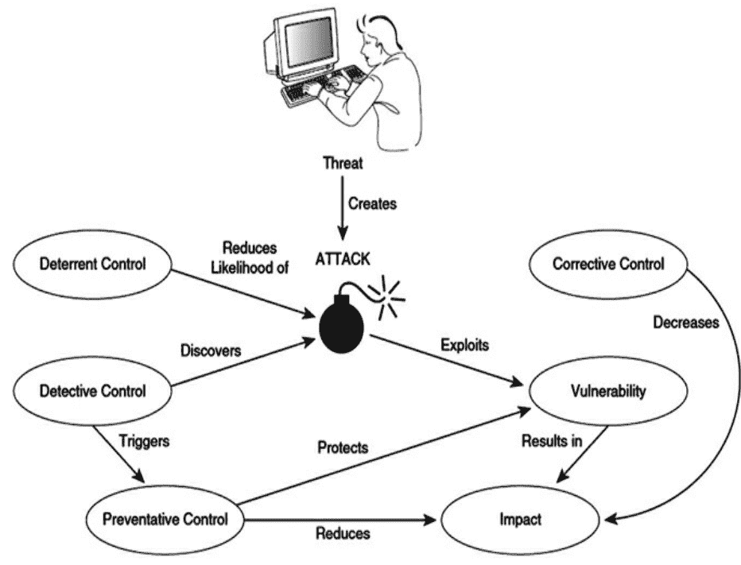

图3.6 威胁、漏洞和控制

识别威胁、漏洞和控制只是风险管理过程的一部分。如果不确定美元价值或使用其他指标来评估这些变量，你如何开始分析组织面临的威胁和漏洞呢？一种方法是开发一个表格，如表3.2所示，它有助于展示威胁、漏洞和风险之间的关系。例如，入侵者可能代表一种威胁，使组织面临设备被盗的风险，因为缺乏保安或控制入口存在漏洞。我们将在本章稍后讨论美元成本，但现在请考虑这些项目之间的关系。

表3.2 威胁、漏洞和风险

| 威胁类型 | 威胁 | 利用/漏洞 | 暴露风险 |
|---|---|---|---|
| 人为因素：内部威胁 | 入侵者 | 没有保安或受控入口 | 盗窃 |
| 人为因素：外部威胁 | 黑客 | 配置错误的防火墙 | 信用卡信息被盗 |
| 人为因素：内部威胁 | 现任员工 | 问责不力；没有审计策略 | 完整性丢失；数据被篡改 |
| 自然威胁 | 火灾 | 防火不足 | 财产损失或人员伤亡 |
| 自然威胁 | 飓风 | 准备不足 | 财产损失或人员伤亡 |
| 恶意外部威胁 | 病毒 | 过期的防病毒软件 | 病毒感染和生产力损失 |
| 技术内部威胁 | 硬盘故障 | 没有数据备份 | 数据丢失和不可恢复的停机时间 |

风险管理团队必须从多种来源收集输入以识别威胁。可咨询或考虑以帮助识别当前和新出现威胁的来源包括以下内容：

- 资产所有者
- 网络管理员
- 安全管理员
- 运营团队
- 设施记录
- 政府记录和监督团体，例如计算机应急响应小组（CERT）和Bugtraq
- 私营组织，例如SANS研究所

风险管理团队可以使用以美元或非美元为基础的方法来审查资产及其相关风险。通过使用定量评估，团队可以为资产及风险分析中识别出的威胁所导致的预期暴露分配成本（货币价值）。通过使用定性评估方法，团队可以使用场景来推动关键问题的优先级列表，而不是关注美元金额。定性和定量评估技术将在后续章节中详细描述。

## 定量评估

定量评估涉及数字和美元金额。目标是为风险评估的要素以及风险分析中的资产和威胁分配成本或数值。

> **考试警报**
> 当您听到*定量*一词时，只需记住“数量（quantity）”。这将有助于您在CISSP考试中记住，定量评估涉及数字。

要完成全面的定量风险评估，流程中的所有要素——即资产价值、影响、威胁频率、防护措施有效性、防护措施成本、不确定性和概率——都必须量化。纯定量风险评估的问题是，为所有要素分配美元价值是困难的，甚至可能是不可能的。因此，一些定性测量类型通常用于补充定量要素。定量评估需要大量的时间和人员资源。定量评估过程涉及按以下顺序确定几个指标：

- 1. **单次损失期望值（SLE）**：首先，您需要确定如果威胁成为现实，在资产上可能损失的单次损失金额。SLE的计算公式如下：
  
  单次损失期望值 = 资产价值 × 暴露系数
  
  计算SLE时需考虑的因素包括资产的物理破坏或被盗、数据丢失、信息被盗、


and threats that might cause delays in processing. The exposure factor is the measure or percentage of damage that a realized threat would have on a specific asset.

- 2. **Annual rate of occurrence (ARO)**: The next step is to determine the likelihood that an unwanted event will occur annually. Simply stated, how many times is this expected to happen in one year?

- 3. **Annual loss expectancy (ALE)**: This third and final step of the quantitative assessment seeks to combine the potential loss and rate per year to determine the magnitude of the risk. This is expressed as the annual loss expectancy, which is calculated as follows:

ALE = SLE × ARO

When performing the calculations discussed in this section, you should include all associated costs, such as the following, and ensure that they are considered during the SLE calculation:

- Lost productivity
- Cost of repair
- Value of the damaged equipment or lost data
- Cost to replace the equipment or reload the data

> **Caution**
> Quantitative assessment is difficult because it is hard to place a dollar amount on every possible event and to extrapolate all the costs associated with that event.

When these costs are accumulated and specific threats are determined, the ALE can be calculated. This helps you build a complete picture of the organization’s risk and allows the organization to plan an effective strategy.

Using the information in Table 3.3, this section works through a computer virus risk example. First, you need to calculate the SLE, which means you need to multiply the asset value by the exposure factor. The asset value is the value you have determined the asset to be worth. The exposure factor is the amount of damage that the risk poses to the asset. For example, the risk-management team might consult with its experts and determine that 17% of Word documents and data could be destroyed due to a virus. The calculation would look as follows:

$9,450 × 0.17 = $1,650

Next, you calculate the ARO, which is the frequency at which this event is expected to happen within a given period. For example, the experts might have determined that there is a 90% chance of this event occurring within a one-year period. These numbers are not always easy to determine because insurance and historical records, although helpful, do not always provide a complete picture. This is still a scientific guess with a degree of uncertainty.

Finally, you calculate the ALE by multiplying the SLE by the ARO:

$1,650 × 0.90 = $1,485

In this third and final step of the quantitative assessment, you combine the potential loss with the rate per year to determine the magnitude of the risk. You can interpret this figure to mean that the business should expect to lose an average of $1,485 each year due to computer viruses.

## TABLE 3.3 How SLE, ARO, and ALE Are Used

| Asset | Risk | Asset Value | Exposure Factor | SLE | ARO | ALE |
|---|---|---|---|---|---|---|
| Customer database | Hacked | $432,000 | 0.74 | $320,000 | 0.25 | $80,000 |
| Word documents and data files | Ransom ware | $90,450 | 0.17 | $10,650 | 0.90 | $1,485 |
| Domain controller | Server failure | $82,500 | 0.88 | $72,500 | 0.25 | $18,125 |
| E-commerce website | DDoS | $250,000 | 0.44 | $110,000 | 0.45 | $49,500 |

Automated tools that minimize the manual effort required are available. These programs enable you to rerun the analysis with different parameters to answer “what-if” questions. They perform calculations quickly, and you can use them to estimate future expected losses more easily than you could by performing the calculations manually.

> **Note**
> Quantitative and qualitative risk assessment can be combined for a comprehensive hybrid risk assessment approach.

## Using Quantitative Formulas

In real life, quantitative assessment requires many different variables to be determined. Although these issues are beyond the scope of the CISSP exam, it is important that you see the big picture of risk assessment. For example, let’s say that Vandelay Industries has an SQL database that is valued at $850,000. The asset value was derived from the IT systems, resources, applications, and hardware. This would also include the profit potential from the customer database for projected revenue and profitability.

If the SQL database faces a potential threat from a critical software bug that Microsoft has just identified, the potential for a threat being realized is real. Because of this critical security defect, the vendor releases a security bulletin, advising customers of the problem. Because of this known vulnerability, the risk assessment team assigns an exposure factor of 35%. That is, there is a 35% probability that this known vulnerability could be exploited by an attacker. The SLE would be calculated as follows:

```
SLE = $850,000 (Asset value) × 0.35 (Exposure factor)
= $297,500
```

If this database also faces a threat from malicious code or malicious software, and the server that the customer database resides in does not have antivirus or other security controls, this could result in a significantly higher exposure factor. The assessment team might provide an 80% probability that a virus, worm, or Trojan may attack the production server and customer database. The SLE would be calculated as follows:

SLE = $850,000 (Asset value) × 0.80 (Exposure factor) = $680,000

It is most important to define a consistent and standard method for probability of occurrence. Doing so allows for consistent and standard SLE calculations so that you can accomplish a ranking and prioritization of IT assets’ SLE values. In reality, many sources are used to gather this information. Most teams rely heavily on tools and software to aid in evaluating risk.

Although you do not need to know this information for the CISSP exam, the following are some of the companies that offer tools to aid in the risk assessment process and help with the project management aspects of such tasks:

- Method123: www.method123.com
- Palisade: www.palisade.com
- ProjectManagement.com: www.projectmanagement.com

> **ExamAlert**
> Math is a big component of quantitative assessment, and the CISSP exam might require you to use basic formulas such as those for SLE, ALE, and ARO. Memorizing and understanding these formulas will help you fully prepare for the exam.

## Qualitative Assessments

Purely quantitative risk assessment is hard to achieve because some items are difficult to tie to fixed dollar amounts. A *qualitative assessment*, as mentioned earlier in this chapter, is scenario driven and does not require assignment of dollar values to components of the risk analysis. Absolute qualitative risk analysis is possible because it involves ranking the seriousness of threats and sensitivity of assets into grades or classes such as low, medium, and high. Table 3.4 provides a sample qualitative scale.

## TABLE 3.4 Qualitative Assessment Impact Scale

| Score | Damage | Trigger Time | Potential Impact |
|---|---|---|---|
| High | Critical | Minutes to hours | Loss of life, failure of business, civil or criminal charges |
| Medium | Disruptive | Hours to days | Bad PR, loss of customers, loss of prestige, loss of income |
| Low | Moderate | Days to weeks | Requires workaround, reduces output, might result in a reduction in profit |
| Insignificant | Minor | Up to one month | Inconvenience |

It's important to make consistent and subjective assessments of the risks to specific IT assets. Doing so typically involves a group or team of members participating in the assessment. Asset owners responsible for maintaining the confidentiality, integrity, and availability of an IT asset should have a voice in the process.

The basic steps for a qualitative assessment are as follows:

- 1. List all the organization’s critical IT assets in a spreadsheet.
- 2. Specify the critical threats and vulnerabilities for each IT asset in the spreadsheet. There might be more than one critical threat or vulnerability for a given IT asset.
- 3. Develop a consistent exposure severity scale to measure impact. A value from the scale should be assigned according to the IT asset and the specific threat that can be exploited.


- 4. 将风险评估结果按从最关键到最不关键的顺序进行组织和优先级排序。这会立即将那些面临威胁或漏洞利用最大风险的资产排在列表顶部。

- 5. 为对组织至关重要且风险暴露最大的 IT 资产优先安排安全控制和安全对策资金。

- 6. 根据威胁和安全策略，确保组织的关键 IT 资产实现适当的机密性、完整性和可用性控制。

定性评估过程的结果是一份优先级列表，可能类似于表 3.5 中提供的信息。请注意，在本表中，设施电力被识别为关键问题。

TABLE 3.5 Qualitative Assessment Results

| Asset | Threat | Exposure |
|---|---|---|
| 资产 | 威胁 | 风险暴露 |
| Facility power | Loss of power | High |
| 设施电力 | 断电 | 高 |
| Customer database | Software vulnerability | Medium |
| 客户数据库 | 软件漏洞 | 中 |
| Email server | Virus attack | Medium |
| 电子邮件服务器 | 病毒攻击 | 中 |
| File server | Loss of data | Low |
| 文件服务器 | 数据丢失 | 低 |
| File server | Hard drive failure | Low |
| 文件服务器 | 硬盘故障 | 低 |

进行定性评估的一个缺点是，当不使用美元数值时，向习惯于使用金额的管理人员传达评估结果会更加困难。然而，定性评估可以快速完成。

定性评估是主观的，基于团队或公司专家的意见，但它并不总能提供高级管理层希望从你那里获得的精确评估。例如，在预测自然灾害甚至人为事件的可能性时，永远不可能建立确切的数字确定性。

## 定性评估类型

定性评估可以包含多种技术，例如头脑风暴、调查、问卷、检查清单、与资产所有者的一对一会面以及访谈。接下来将讨论几种特定选项。

定性风险评估的一种方法是德尔菲技术，这是一种团队方法，旨在允许个人提供匿名意见。这种技术的目标是避免受强势人士的影响，找到协同效应，并允许参与者坦诚相待。

促进的风险分析流程（FRAP）是一种主观过程，通过提问来获得结果。它旨在数小时内完成，因此是一种快速执行的过程。

INFOSEC 评估方法论（IAM）开发于 1998 年，用于审查组织的信息安全态势，识别潜在漏洞，并提供消除或减轻这些漏洞的建议。它以机密性、完整性和可用性作为评估基础。

定性风险评估方法论的另一资源 NIST 800-53，将机密性、完整性和可用性定义为损失类别，并根据以下任意一种主观排序对每种损失进行排序：

- **低：** 短时间内可以容忍的轻微不便。
- **中：** 可能导致组织受损，或需要花费中等金额来修复。
- **高：** 将导致公司与客户或员工之间的信誉受损。可能导致法律诉讼或罚款，或导致公司损失收入或收益。

TABLE 3.6 Performing a Qualitative Assessment

| Asset | Loss of Confidentiality | Loss of Integrity | Loss of Availability |
|---|---|---|---|
| 资产 | 机密性丢失 | 完整性丢失 | 可用性丢失 |
| Customer database | High | High | Medium |
| 客户数据库 | 高 | 高 | 中 |
| Internal documents | Medium | Medium | Low |
| 内部文档 | 中 | 中 | 低 |
| Advertising literature | Low | Medium | Low |
| 广告宣传资料 | 低 | 中 | 低 |
| HR records | High | High | Medium |
| 人力资源记录 | 高 | 高 | 中 |

无论使用何种方法——定量或定性——风险评估过程的结果都为风险管理团队提供了决定如何处理风险所需的信息。

TABLE 3.7 Quantitative and Qualitative Risk Assessment

| Property | Quantitative | Qualitative |
|---|---|---|
| 属性 | 定量 | 定性 |
| Provides dollar values | ✓ | — |
| 提供美元数值 | ✓ | — |
| Can be automated | ✓ | — |
| 可自动化 | ✓ | — |
| Very little guesswork | ✓ | — |
| 猜测很少 | ✓ | — |
| No complex math | — | ✓ |
| 无复杂数学 | — | ✓ |
| Is user objective | — | ✓ |
| 用户客观 | — | ✓ |
| Low volume of info | — | ✓ |
| 信息量小 | — | ✓ |
| Short preparation time | — | ✓ |
| 准备时间短 | — | ✓ |
| Easy to communicate to management | ✓ | — |
| 易于向管理层传达 | ✓ | — |

> **注意**
> 执行定性风险评估有多种方法。例如，新西兰使用 ANZ 4360 标准进行定性风险评估。

## 选择对策

在识别潜在风险并评估其影响后，团队必须确定如何处理潜在风险。团队可以采取三种可接受的响应方式：

- **风险接受：** 这种方法涉及接受如果风险发生，你可能会面临与损失相关的费用这一事实。当没有其他可用选项，或潜在损失与项目收益相比较小时，可以选择此选项。如果选择此方法，制定应急计划非常重要，以确保如果风险发生，你能够应对。例如，如果你的女儿正在计划婚礼，并且心心念念要在巴哈马海滩举办夏季婚礼，你可能会同意地点，但让酒店同意如果天气转坏，允许你在室内举办活动。这种应急计划可以在恶劣天气风险成为现实时，使情况更易于处理。

- **风险转移：** *风险转移* 最常见的例子是保险，它可以将损失的部分或全部潜在成本转移给第三方。要转移风险，你将风险所有权转移给第三方。第三方承担风险，但组织需承担保险费用。在你女儿婚礼的例子中，你可以通过购买飓风、旅行和酒店保险来转移部分风险。在现实世界中，在业务连续性（COOP）计划方面，就更换灾后恢复运营所需的有形物品（如家具、硬件和建筑物）而言，风险转移可能是一个可行的选择；然而，风险转移对数据保护和声誉确实不起作用。对于数据保护，加密和备份至关重要。

- **风险缓解：** 这种方法可能意味着实施对策来改变或降低风险。风险降低的示例包括防火墙和加密、增加补丁管理频率，以及/或更强的身份验证。再次考虑你女儿婚礼的例子。为了降低风险，你可能会要求她将婚礼推迟到明年春天，以减少遭遇重大风暴的可能性。

> **注意**
>
> 有些来源将风险避免列为另一种选择。这仅仅意味着你避免该活动以避免风险。但是，根据情况，风险避免可能不可能。

哪种方法是正确的？这取决于对策的成本、资产的价值，以及风险降低技术将总风险降低到可接受值的幅度。

可接受风险或风险容忍度是组织愿意容忍的最低可接受风险。在评估保障措施时，重要的是要考虑总拥有成本（TCO），包括购买价格、维护费用、更新、保险和所有其他成本。风险评估团队必须努力寻找一种在保持最低年度成本的同时提供最大风险降低的解决方案。这些概念通过以下公式以数值表示：

```
Threat × Vulnerability × Asset value = Total risk
```

没有任何组织可以做到 100% 安全。在实施保障措施和控制后，总会有一些剩余风险；这被称为*剩余风险*。剩余风险的公式如下：

```
(Threat × Vulnerability × Asset value) × Controls gap = Residual risk
```

目标是平衡控制成本与资产价值和潜在损失之间的关系——并避免在控制上的花费超过资产本身的成本（参见图 3.7）。


## 图 3.7 风险成本与控制级别

**注意**

涉及人身安全的任何风险都极高，应给予最高优先级。

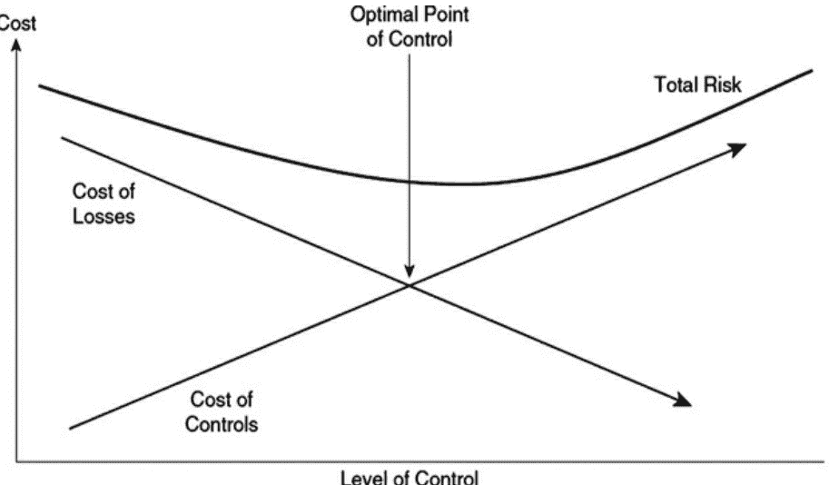

在风险处理步骤完成时，风险评估团队会制作一份最终报告，其中列出针对组织的所有调查结果、信息、评估和建议。最终评估报告是管理层用于就组织整体风险和漏洞评估做出明智业务决策的工具；它是组织将如何减轻已识别的风险、威胁和漏洞的基础。

**注意**

保障措施或防护措施的成本效益分析可按控制差距衡量：

ALE before the safeguard – ALE after the safeguard = Control gap (value of the safeguard to the organization)

该公式可用于评估保障措施的成本效益，或比较各种保障措施以确定哪些最有效。结果值越高，保障措施的成本效益越高。在大多数情况下，您希望避免在控制措施上的支出超过资产本身的成本。然而，这并非总是成立。例如，联邦、州和地方政府有时可能会不顾控制措施的成本，为关键系统提供控制措施。如前面本章所述，用数值衡量损害潜力并不总是容易。

考试警报 一些组织使用风险分析矩阵，该矩阵查看可能性和影响。示例请参见 MITRE 的风险矩阵，网址为 https://www.mitre.org/research/technology-transfer/open-source-software/risk-matrix。

## 威胁建模概念与方法论

威胁建模是评估威胁的一种结构化方法。威胁建模通常在安全控制的规划、设计和实施过程中使用，以验证对策是否有效并放置在需要的位置。定期进行威胁建模时，还可以帮助安全团队根据已知或新出现的威胁确保防护措施充足。如果不定期进行威胁建模，新威胁可能会得不到防护，使系统和数据处于脆弱状态。

## 威胁建模步骤

威胁建模过程的一般步骤如下：

- **识别资产**：此步包括列出所使用的应用程序、资产所在位置以及现有安全措施的清单。了解何时有新资产上线，或资产是否在未采用规定安全控制的情况下上线，对于管理和降低风险至关重要。

- **开展威胁情报**：威胁情报应聚焦于三个领域：资产、攻击者和软件。您应深入了解用于利用漏洞的工具和技术以及攻击者的动机。另一种方法是构建攻击树。

- **建模和分类威胁**：您可以使用多种方法论来对威胁进行分类和编目。本章后面将讨论两种方法论：STRIDE 和 DREAD。

- **映射和绘制潜在攻击**：此步骤的一种方法是使用流程图，它提供系统的高层视图，并关注用户和执行代码如何在系统中移动。另一种方法是构建攻击树，它由一系列表示不同事件的父节点和子节点组成。根节点（即图中的最顶层父节点）是攻击的总体目标。子节点必须评估为真，父节点才能为真。目标是让威胁建模人员了解威胁成功必须具备的一组条件。

- **缓解威胁**：缓解能力通常指用于保护、检测和响应特定类型威胁的技术。要使威胁缓解成功，威胁建模团队必须分解应用程序、了解信任边界和输入点，并对发现的威胁进行排序。已识别的威胁需要确定优先级，并需要部署控制措施来修复已识别的威胁。

> **注意**
> 威胁建模期间识别的威胁的常见降低方法包括以下内容：

- 为员工提供更多培训
- 更改业务流程或程序
- 实施行政控制，例如职务轮换或双重控制
- 更改应用程序的配置
- 修改源代码
- 使用技术控制，例如 Web 应用程序防火墙、代理或其他筛选和过滤设备

## 威胁建模工具和方法论

如前所述，目前正在使用多种威胁建模工具和方法论。例如，Microsoft 开发了 STRIDE，其代表以下含义。

- 冒充：使用伪造的身份
- 篡改：进行未经授权的更改
- 否认：确保可合理否认
- 信息泄露：将信息分发给外部或未经授权的实体
- 拒绝服务 (DoS)：防止未经授权使用资源
- 提权：使用受限用户帐户获取更大访问权限

另一种方法论是 OpenStack 的 DREAD，它提供一个评分系统，并旨在具有灵活性。DREAD 会考虑以下因素：

- 损害潜力：损害可能有多严重？
- 可复现性：攻击者复现利用攻击的过程有多复杂？
- 可利用性：执行攻击有多困难？
- 受影响用户：有多少比例的用户会受到影响？
- 可发现性：攻击者发现此弱点有多困难？

PASTA（攻击模拟和威胁分析流程）是一个七步流程，旨在使技术安全要求与业务目标保持一致。每个步骤包含多个子步骤。顺序如下：

- 1. 定义目标。
- 2. 定义技术范围。
- 3. 执行应用程序分解。
- 4. 进行威胁分析。
- 5. 进行漏洞和弱点分析。
- 6. 进行攻击建模。
- 7. 进行风险和影响分析。

OCTAVE（关键性威胁、资产和漏洞评估）是卡内基梅隆大学开发的一种威胁建模方法论，侧重于组织风险而非技术风险。它包含三个阶段：

- 1. 构建基于资产的威胁概要。
- 2. 识别基础架构漏洞。
- 3. 制定安全策略和计划。

VAST（可视、敏捷且简单的威胁建模）是一个自动化威胁建模平台，可区分应用威胁模型和运营威胁模型。VAST 的设计目的是集成到围绕 DevOps 理念构建的工作流中。

Trike 是一个威胁建模平台，从防御视角出发，而非试图模拟威胁参与者的思维过程。它与其他方法论的不同之处在于，它要求您建模试图防护的系统。

无论部署哪种方法论，最重要的是在系统开发阶段启动此流程。与稍后再尝试添加控制措施相比，在早期构建控制措施成本更低。

## 通过供应链和第三方管理风险

当今，跨国公司通常在世界各地运营，并使用各种供应商、承包商和供应商。随着对这些第三方的依赖不断增加，管理大量关系的需求也随之增长。

例如，假设您是一家管理天然气管道和发电厂的公司的 CISO。您的生产控制系统中会有许多监控控制和数据采集 (SCADA) 设备、IP 摄像头、自动泵、传感器、计算机等等。在这种情况下，您会关心从谁处购买这些设备、供应商是否可信，以及这些设备是否符合您的需求。

供应链风险管理正是为此而生。供应链风险管理涉及应用技术来管理和了解供应链中的风险。在我们的示例中，发电厂的大部分设备均为商用现成技术，使用 Microsoft Windows 或 Linux 操作系统，这些系统是黑客的常见攻击目标。为降低供应链风险，您可以开展持续风险评估，以减少漏洞并确保业务连续性。

供应链风险管理 (SCRM) 只是您必须考虑的流程中的一小部分。第三方实体必须验证是否遵守所有规定的安全目标、要求、法规和合同协议。以下是用于第三方治理的一些文件、协议和备忘录：

- 互连安全协议 (ISA)：ISA 是一份安全文件，用于指定在系统或网络之间，或在机构与外部系统之间建立、维护和运行互连的要求。该文件列出了连接系统和网络的要求，并详细说明了将用于保护系统和与外部系统的敏感数据的安全控制措施。ISA 通常会保留一份图纸


the network topology and details how specific systems and networks are connected with external systems.

- **互操作性协议 (IA)**：IA 是一份文档，用于规定公司间共享和维护信息的任何及所有要求，以便它们可以交换和共享数据。例如，如果联合航空与夏威夷航空代码共享航班，两家公司都需要访问共同的数据集。

- **谅解备忘录 (MOU)**：MOU 是一份文档，用于规定必须共享数据和信息资源的外包合作伙伴组织的条款和条件。要具有法律约束力，MOU 必须由每个组织中具有签署法律授权的代表签署。此类文档通常受到保护，因为它们被视为机密。

- **运行授权 (ATO)**：ATO 是一份正式声明，用于授权信息系统和/或应用程序的运行，并表示同意系统安全计划（包括相关风险）。

- **业务连续性计划 (COOP)**：事情总会出错，COOP 规定组织必须实施的流程和程序，以确保在出现这些问题时业务可以继续运营。

- **服务水平协议 (SLA)**：SLA 有时与 ISA 或 MOU 配合使用。如果你与已签署 MOU 的外包提供商将提供时效敏感型服务，实施 SLA 是获得合作伙伴同意提供的服务水平保证的一种方法。SLA 应该规定提供商同意的正常运行时间、响应时间和最大中断时间。为支付服务费，提供商同意在合同规定的时间内修理或更换设备。

- **操作级别协议 (OLA)**：OLA 与 SLA 配合工作，以支持 SLA 流程。OLA 定义每个合作伙伴内部支持小组的职责。例如，虽然 SLA 可能承诺停机时间不超过五分钟，但 OLA 将定义用于实现该停机时间目标的小组和资源。

- **正常运行时间协议 (UA)**：UA 详细说明了商定的正常运行时间，通常以百分比表示。例如，UA 可用于网络服务（如 WAN 链路）或设备（如服务器）。常见的正常运行时间如 99.999%，相当于每年大约五分钟的停机时间。

- **保密协议 (NDA)**：NDA 用于保护机密信息。例如，在参加 CISSP 考试之前，你会被要求签署一份 NDA，声明不会向他人透露考试问题。

- **业务合作伙伴协议 (BPA)**：BPA 是一份具有法律约束力的文档，旨在就特定安全相关活动为业务合作伙伴提供保障并强制执行某些行为。BPA 是由律师在合作伙伴参与下制定的书面协议；其中包含与安全和合作相关的标准条款。

> ### 注意
>
> 与业务合作伙伴打交道时，应审查的一项内容是审计准则第 70 号 (SAS 70)。SAS 70 报告验证合规性，并确保外包或业务合作伙伴的控制目标和活动已由独立会计和审计公司进行检查。

## 降低组织流程中的风险

风险管理需要了解组织及其时效敏感型业务需求。业务中没有任何事物是一成不变的。组织单位会发生变化，产品和服务会被添加和移除，业务的部分可能会被分拆或剥离。本节讨论安全专业人员可能需要处理的一些常见事件类型。

首先，存在并购。_合并_ 是指两个或多个商业实体合并为单一的幸存实体。从风险角度来看，合并中可能会出错的地方有很多。企业通常寻求协同效应，但有些企业根本不适合合并在一起。无论情况如何，在合并之前必须提出一些问题。合并对两家公司来说都是双赢吗？合并的目的是否是为了抽走资源（例如人才和知识产权），然后后来分拆出一家更弱的公司？

有时，公司在没有充分行动计划的情况下进入合并或收购阶段。这样做可能会导致安全风险和支出增加。

此外，许多人不喜欢变化。一旦公司文化建立起来，人们变得固步自封，态度就很难改变。合并全是关于变化，这违背了许多员工的预期。

安全专业人员经常被要求快速与拟议的业务合作伙伴建立连接。尽管存在连接需求，但安全应始终是主要关注点。你需要了解拟议合并伙伴的安全政策以及正在执行的控制措施。你不想通过合并公司的网络让攻击者进入你的网络。

在合并不同公司时，总会存在安全问题。你应该关注以下项目等：

- 规则：每个单独公司允许或不允许什么？
- 政策：高级别文档概述了公司的安全目标和宗旨。
- 法规：不同实体可能受不同监管机构或法规（例如 PCI-DSS 或 HIPAA）的管辖。
- 地理位置：位于英格兰伦敦的公司将运行于与位于加利福尼亚州圣何塞的公司不同的标准之下。
- 分拆/剥离：无论何时企业分拆，都必须处理与合并时相同类型的许多问题。
- 信任或许可级别：了解任何当前或新员工访问信息的访问或控制级别很重要。
- 技能集、培训和意识：了解拥有公司信息系统访问权限的用户和员工的培训水平很重要。

## 基于风险识别和确定业务连续性需求的优先级

业务连续性计划 (BCP) 有许多不同的方法。有些公司分别处理这些流程，而另一些公司则专注于交织计划的连续流程。NIST 在 SP 800-34《信息技术系统连续性规划指南》中提供了应急流程的一个良好示例。该出版物将 BCP/灾难恢复计划 (DRP) 流程定义如下：

> **考试提醒**
>
> 灾难恢复计划 (DRP) 是业务连续性计划 (BCP) 的一部分，但更多涉及技术和短期问题，例如立即采取什么措施使关键系统和服务运行起来。相比之下，BCP 规定了公司为维持营业并恢复正常运营所做的工作。你必须了解二者区别才能通过 CISSP 考试。

- 1. 制定应急规划政策声明。
- 2. 进行业务影响分析 (BIA)。
- 3. 识别预防性控制措施。
- 4. 制定恢复策略。
- 5. 制定 IT 应急计划。
- 6. 测试计划、培训员工并开展演练。
- 7. 维护计划。

在深入探讨之前，我们应该定义 *灾难* 和 *业务连续性* 这两个术语。*灾难* 是任何突然的、未计划的灾难性事件，会造成重大损失或损害。整个社区在灾难后都会有所担忧；然而，企业面临特殊挑战，因为它们有责任保护员工的生命和生计，并代表股东保护公司资产。在商业领域，灾难可以被视为任何阻止关键业务功能在预定时间内继续运行的事件。换句话说，中断可能迫使宣布发生灾难。

> **考试提醒**
>
> 对于 CISSP 考试，请牢记人员安全始终放在第一位，优先于所有其他问题。

*业务连续性* 是维持关键业务功能 (CBF) 运行以使公司长期经营下去的过程。业务连续性的目标是减少或防止中断时间并优化运营。业务连续性研究所 (www.thebci.org)（业务连续性管理的专业机构）将 *业务连续性* 定义为一种整体管理流程，用于识别威胁组织的潜在影响，构建弹性的框架，确保有效响应，并保护其声誉、品牌、价值以及关键利益相关者的利益。

尽管可以使用多种方法来完成 BCP/DRP 流程，但本章描述了与 (ISC)² 推荐的参考文档最为一致的步骤。图 3.8 提供了流程概述，包括以下步骤：

- 1. 项目启动
- 2. 业务影响分析 (BIA)
- 3. 恢复策略
- 4. 计划设计与开发
- 5. 实施


- 6. 测试

- 7. 监控与维护

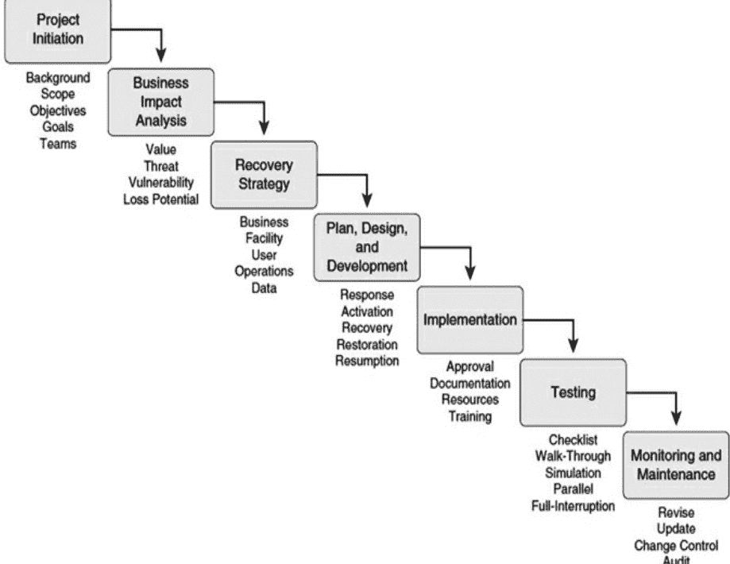

图 3.8 BCP/DRP 流程

本章讨论项目启动和业务影响分析，此处所示的其他步骤将在第 8 章“安全运营”中介绍。

## 项目管理与启动

在 BCP 流程开始之前，获得高层管理的支持至关重要，因为他们负责制定预算、确定团队负责人并启动 BCP 流程。

如果没有高层管理支持，您将无法获得成功完成项目所需的资金，您的努力至多只能取得边际性的成功。

赢得他们支持的一种方法是为他们准备并举办一场研讨会，概述组织面临的风险，识别基本威胁，并记录潜在中断的成本。这是一个提醒他们的好时机，即最终，他们要承担法律责任。如果客户、股东、股票持有人或任何其他人认为公司未履行应有的注意义务，他们可以对高层管理提起民事诉讼。

高层管理必须选择一名团队负责人。该个人必须在高层管理中拥有足够的可信度，以便就 BCP 结果和建议影响他们。在任命团队负责人后，可以制定行动计划，并组建团队。团队成员应包括管理层、法务人员、恢复团队领导、信息安全团队、各业务单元、网络团队和物理安全团队的代表。重要的是包括资产所有者以及负责执行计划的个人。

接下来，您需要确定项目范围。明确定义的范围对于最大限度地提高 BCP 的有效性大有裨益。您无法保护一切，而且也不需要这样做。例如，如果您正在为在加利福尼亚州、佛罗里达州、纽约州和北达科他州设有办公室的公司制定计划，您不会为所有办公室制定飓风应急计划。

需要对办公室政治保持敏感，因为这可能会使规划过程脱轨。另一个要避免的问题是项目蔓延，即原本不属于原始项目计划的项目越来越多地被添加到计划中。蔓延会延迟项目的完成，还可能导致项目超支。

BCP 从遵循传统项目计划阶段中受益。必须管理的问题包括资源（人员和财务）、时间进度、预算估算以及任何关键成功因素。您可以安排一次启动会议来启动流程。

最后，团队可以开始工作。团队预计将承担许多职责和义务，包括以下内容：

- 识别必须遵守的监管和法律要求
- 识别所有可能的威胁和风险
- 估计这些威胁的概率，并正确识别每个威胁的损失潜力
- 执行 BIA
- 列出部门、系统和流程必须恢复运行的优先顺序
- 制定程序并列出灾难后恢复业务功能的步骤
- 将危机情况任务分配给员工角色或个人
- 记录计划，向员工传达计划，并执行必要的培训和演练

团队中的每个人都要意识到，BCP 是组织将拥有的最重要的纠正控制，并应将规划期视为塑造它的机会。BCP 不仅仅是纠正控制；BCP 还需要反映预防控制和侦测控制：

- **预防控制**：包括识别关键资产并防止中断的控制
- **侦测控制**：包括在发生中断或问题时快速向组织发出警报的控制
- **纠正控制**：包括尽快恢复正常运营的控制

## 业务影响分析

下一项任务是创建 BIA，它衡量每种类型的灾难可能对关键或时间敏感的业务功能产生的影响。有必要将时间作为一种指标来评估，就像评估功能的重要性一样。例如，支付员工工资从业务活动的角度来看并不关键，但如果您不能按时支付，您的公司很可能会倒闭，因为它会失去员工。

创建 BIA 是该过程中的一个重要步骤，因为它涉及考虑所有威胁及其影响。例如，德克萨斯州加尔维斯顿市位于一个以易受飓风影响而闻名的岛屿上。尽管加尔维斯顿可能是冬季，飓风的可能性极低，但仍可以进行规划以减少未来飓风可能产生的负面影响。重要的是要考虑所有可能的灾难，评估这些灾难的风险，量化影响，确定潜在损失，并识别和确定在这些灾难发生时需要灾难恢复规划的运营优先级。

BIA 必须回答三个至关重要的问题：

- **什么最关键？**：确定对组织最关键的流程时，优先级很重要。
- **公司能承受的最长中断时间是多少？**：停机时间估算是为了确定哪些流程必须首先、其次、第三等等恢复，并确定哪些系统必须保持运行。
- **需要哪些资源？**：必须识别资源需求，并需要将系统资产与业务流程相关联。例如，发电机可以提供备用电源，但需要燃料才能运行。

> **注意**
>
> 关键性优先级是公司经常进行的事情。想想您上一次给最喜欢的计算机供应商打电话订购新设备时的情景。您被置于等待状态多久？您的电话可能在几分钟内就被接听了。相比之下，您上一次给同一家公司打电话联系帮助台时，等待了多久？那次很可能要长得多。

开发多个场景应能清晰地描绘出在灾难发生时继续运营所需的内容。创建 BIA 的团队需要从许多不同的角度审视组织，并利用各种来源的信息。可以使用不同的工具来帮助收集数据。Strohl Systems’ BIA Professional 和 SunGard’s Paragon 软件可以自动化数据输入和收集过程的部分内容。尽管 CISSP 考试不要求您了解各种工具的名称，但它要求您理解 BIA 创建过程的工作原理，并且了解有哪些工具可用会有所帮助。

无论 BIA 是手动创建还是在工具的帮助下创建，完成都需要一些时间。每当个人研究他们不熟悉的流程、技术和程序时，都会存在学习曲线。

您可能开始意识到，创建 BIA 并非易事。它不仅需要了解业务流程，还需要深入了解组织本身，包括 IT 资源、各个业务单元以及它们之间的相互关系。这项任务需要高层管理的支持，以及 IT 人员、业务单元经理和最终用户的配合。BIA 创建过程中的一般步骤如下：

- 1. 确定数据收集技术。
- 2. 收集 BIA 数据。
- 3. 识别支持这些功能的关键业务功能和资源。
- 4. 验证数据的完整性。
- 5. 确定运营的恢复时间。
- 6. 定义恢复方案和成本。

> **注意**
> 漏洞评估通常包含在 BIA 中。尽管此评估的实施方式与风险评估非常相似（参见第 7 章“安全评估与测试”），但漏洞评估专注于为业务连续性计划提供专门的信息。


## 评估潜在损失

评估潜在损失有多种方法。最流行的方法之一是使用向高级管理层和最终用户分发的问卷。问卷的目标是最大限度地识别可能因灾难而受到威胁的业务流程中参与人员的潜在损失。该问卷可能分发后独立填写，或在交互式访谈过程中填写。图 3.9 显示了此类问卷的示例。

问卷也可在圆桌会议形式下完成。事实上，这种团队填写方式可以为流程增加协同效应，前提是团队动态能够允许开放沟通，且所有关键人员都能安排时间开会，讨论特定类型的中断对组织的影响。必须包含所有关键人员，因为管理层可能并不了解他们没有直接监督的关键任务。

### BIA 问卷

| 项目 | 描述 | 结论 |
|---|---|---|
| **简介** | | |
| 单位名称 | | |
| 访谈日期 | | |
| 联系人 | | |
| 业务单元功能描述 | | |
| **财务影响** | | |
| 收入损失影响 | | |
| 费用影响 | | |
| **运营影响** | | |
| 业务中断影响 | | |
| 信心丧失 | | |
| 客户流失 | | |
| 市场份额流失 | | |
| **技术依赖** | | |
| 系统功能 | | |
| 系统相互依赖 | | |
| 现有 BCP 控制 | | |
| 其他 BIA 问题 | | |

### 图 3.9 BIA 问卷

使用问卷是评估风险的一种定性技术。定性评估基于场景，不试图为预期损失分配美元价值。定性评估使用等级或类别（如低、中、高或关键）来对影响的严重性进行排序：

- 低：这是一项轻微的不便，客户可能察觉不到。中断可能持续长达 30 天，而不会造成任何实际不便。
- 中：服务中断会在几天到一周后影响组织。更长时间的中断可能会影响公司的盈利能力，或导致客户流失。
- 高：只能忍受几分钟到几小时的短期中断。更长时间的中断将造成严重的财务影响。负面新闻还可能降低未来产品和服务的前景。
- 关键：无法忍受任何持续时间的中断。必须建立或开发系统和控制，以确保冗余，从而防止任何中断发生。

这种评级过程可以加快风险识别的进度，并提供一种对可能难以分配美元价值的流程进行分类的方法。这还将帮助您根据关键性级别了解适当的恢复技术或技术。表 3.8 提供了定性排序的示例。

### 表 3.8 定性排序示例

| 资产或资源 | 可用性 | 完整性 | 机密性 |
|---|---|---|---|
| 应用服务器 | 高 | 中 | 关键 |
| 防火墙 | 高 | 低 | 低 |
| Web 服务器 | 中 | 高 | 低 |
| HR 数据库 | 高 | 高 | 关键 |

BIA 也可以采用定量方法进行。这种分析方法涉及为风险评估中识别的每项资产、风险和流程分配货币价值。然后使用这些价值来计算潜在灾难的实质性影响，包括收入损失和费用。定量方法需要以下步骤：

- 1. 估计潜在损失并确定单次损失期望值 (SLE)。
- 2. 完成威胁频率分析并计算年度发生率 (ARO)。
- 3. 确定年度损失期望值 (ALE)。

本章前面部分已更详细地介绍了定量评估的过程。定量研究必须包括灾难造成的所有相关成本，包括以下方面的成本：

- 生产力损失
- 订单延迟或取消
- 维修
- 损坏设备或丢失数据的价值
- 租赁设备
- 紧急服务
- 设备更换和数据重新加载

定量和定性评估技术都要求 BIA 团队检查服务或数据丢失将如何影响公司。两种方法都旨在降低风险并为应急情况做计划，如图 3.10 所示。

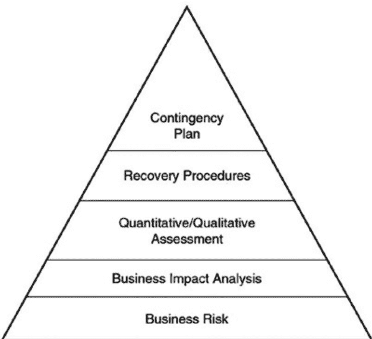

### 图 3.10 风险降低过程

中断的严重性通常通过考虑组织在没有该资源、功能或服务的情况下能够生存的 *最大可容忍停机时间 (MTD)* 来衡量。

> **提示**
>
> 对于 CISSP 考试，您需要了解 *最大可容忍停机时间 (MTD)* 这一术语，并理解这是指企业在没有服务的情况下能够生存的最长时间。

是否会出现收入或运营资本损失，或组织将承担法律责任？尽管 BIA 团队可能关注中断的直接影响，但成本未必是立即产生的。例如，组织的声誉可能会受损。此外，许多组织受监管要求约束；在这种情况下，中断的结果可能是法律处罚或罚款。

## 声誉的价值

尽管一些组织在进行 BIA 时可能只关注金额，但声誉也需要考虑。正如本杰明·富兰克林所说：“建立良好声誉需要许多善行，而只需一次失误就可能失去它。”为了说明这一点，请考虑以下品牌名称及其商业声誉：

- 1. Cisco：高质量网络设备行业领导者
- 2. Ruth's Chris Steak House：一家以提供在 1800°F 下烤制的高品质牛排而闻名的高档餐厅
- 3. Tesla：2018 年至 2020 年最畅销的电动汽车制造商
- 4. Enron：企业欺诈和腐败的象征
- 5. Samsung：全球最大的智能手机制造商，因部分设备自燃而被迫停产和召回 Galaxy 7，给公司造成超过 50 亿美元的损失
- 6. Volkswagen：一家著名的汽车制造商，因“迪塞尔门”丑闻的公关打击而声誉受损

也许您对所列公司的看法与我在这里写的不同。我提供这个列表的目的是为了证明，众所周知的公司名称会让人们在听到和读到它们时产生联想。公司多年来努力赢得尊重和良好声誉。灾难不会凭空发生。大多数灾难是由于人为错误或一系列被忽视的错误造成的。错误会对您的组织造成致命打击吗？声誉很容易受损。这就是灾难恢复如此重要的原因：您组织的未来可能取决于此。

## 开发和实施安全策略

安全确实是一个多层次的过程。评估完成后，应审查行政控制。可以根据风险评估的结果创建或修改策略。评估应有助于推动以下项目的策略制定：

- 密码
- 补丁管理
- 员工雇佣和解雇做法

> **注意**
>
> 低级别背景调查是指针对从低级岗位入职的员工完成的背景调查。这些员工晋升到更高级别职位之前，应进行额外的背景调查。一些公司甚至正在转向进行滚动和持续的背景调查。

- 备份做法和存储要求
- 安全意识培训
- 防病毒
- 系统设置和配置
- 系统加固

要使安全生效，必须从组织的最高层开始，并渗透到各个层级。高级管理层必须决定保护什么、如何保护以及保护到什么程度。然后，他们的决定应制定成书面文件。

在这些文件被确定为政策之前，必须对其进行研究，以验证其是否符合所有联邦、州和地方法律。这些文件还应明确说明对员工的期望，以及公司将如何处理政策违规行为。

## 安全策略

政策是由高级管理层制定的高级别文档，旨在将管理层的指导战略和理念传达给员工。


管理和业务流程所有者负责组织，并负责设计将指导其走向成功的政策。政策高度强调管理层发出的话语。它们定义、详细说明并规定员工的期望，以及管理层打算如何满足客户、员工和利益相关者的需求。政策是一份高级别文件，对组织的资产及其应具有的保护水平做出总体说明。编写良好的政策明确指出谁负责安全、需要保护什么，以及什么是可接受的风险水平。它们很像战略计划，概述了应该做什么，但并不具体规定如何实现所述目标。安全政策可以编写以满足咨询、信息性和合规性需求。每项政策都有独特的角色或功能。表 3.9 显示了政策、标准和程序与战略、战术和运营控制之间的关系。

| 级别/文档 | 政策 | 标准 | 程序 |
| :--- | :--- | :--- | :--- |
| 战略 | ✓ | — | — |
| 战术 | — | ✓ | — |
| 运营 | — | — | ✓ |

一种特定的政策是组织的安全政策。安全政策体现了管理层对信息系统的使用、运行和安全的承诺。它规定了安全在组织中所扮演的角色。安全政策应由业务目标驱动，并应满足所有适用的法律法规。它还应作为将安全整合到所有业务功能的基础。它作为制定程序（参见图 3.11）等低级别文档的高级别指南。安全政策必须保持平衡，以帮助组织在不妨碍生产力的前提下实施适当的安全措施。

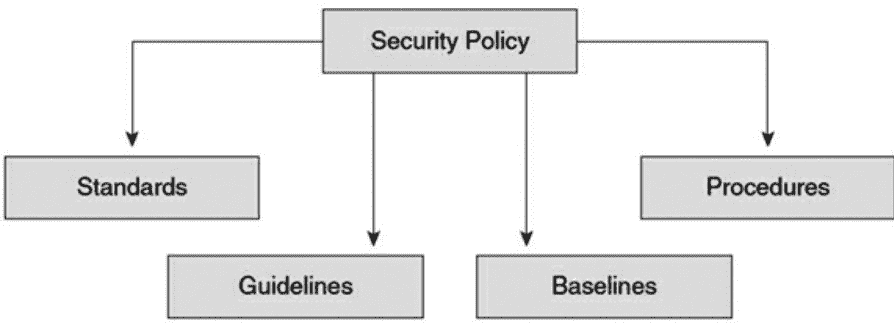

图 3.11 政策结构

政策有多种形式。政策可以是咨询性、信息性或合规性。以下各节将回顾这些类型的政策，并应帮助您了解如何设计政策以实现各种目标。

## 咨询政策

咨询政策的作用是确保所有员工了解特定行为和行动的后果。以下是一个咨询政策示例：

> 非法复制：除非获得网络管理员的书面许可，否则员工绝不应将任何商业软件、共享软件或免费软件下载或安装到任何网络驱动器或磁盘上。如果违反适当使用规则，请做好为您的行为负责的准备，包括丧失网络特权、书面谴责、缓刑或解雇。

## 信息政策

信息政策不是为了执行而设计的；它是为教育目的而开发的，旨在告知和启发员工。以下是一个信息政策示例：

与人力资源部门合作，员工申诉专员的职责是作为所有员工的倡导者，在员工和管理层之间提供调解。该职责旨在帮助调查投诉，并在请求第三方时调解公平的和解方案。

**注意**

优秀的政策需要取得平衡，既相关又易于理解。如果政策过于笼统，没有人会在意它说了什么，因为它不适用于公司。如果政策过于复杂，没有人能理解它，许多人也不太可能阅读它。

## 合规政策

合规政策用于确保组织遵守地方、州和联邦法律。合规政策加强适用的法律和行政法，例如 HIPAA、FERPA 和 SOX；它还以员工能够理解的方式解释特定法律的适用部分。安全专业人员应在制定此类政策时与人力资源和法律部门密切合作。以下是一个合规政策示例：

由于得克萨斯州法律最近发生变化，公司将把员工发明和专利记录保留 10 年；与专利和发明相关的所有电子邮件及其任何备份也将保留 10 年。

## 标准

标准比政策具体得多。标准是战术文件，规定了满足特定要求所需的具体步骤或流程。例如，标准可能会规定所有电子邮件通信必须加密的强制性要求。虽然标准确实规定了加密，但它并未说明如何实现；这一点留给程序。

## 基线

*基线* 是系统、网络或设备必须遵循的最低安全级别。基线通常与行业标准相映射。例如，组织可能会规定所有计算机系统符合最低可信计算机系统评价标准（TCSEC）C2 标准。TCSEC 标准在第 4 章“安全架构与工程”中详细讨论。安全政策还可能涉及敏感数据加密要求的最低基线标准。

### 准则

准则指向政策或程序中的陈述，以确定行动方针。它是关于如何做事的建议或推荐。准则旨在具有灵活性，以便可以针对个别情况进行定制。

> **注意**
> 
> 不要将准则与最佳实践混淆。准则用于确定推荐的行动方针，而最佳实践用于衡量责任。最佳实践说明其他称职的安全专业人员在相同或类似情况下会怎么做。

### 程序

程序是安全文档中最具体的一种。*程序* 是一份详细、深入、逐步的文档，明确说明需要做什么。打个比方，当我妈妈把德国巧克力蛋糕的秘密配方发给我妻子时，它逐步描述了需要做什么以及如何做。它甚至指定了对流烤箱，并将其列为绝对要求。

程序是与特定技术和设备相关联的详细文档。您应该预期随着设备的变更而变更程序。例如，假设您的公司将其 Check Point 边界设备（例如防火墙、VPN 或 IDS）替换为 Cisco 边界设备。尽管规定设备在组织中角色的政策和标准可能不会改变，但配置防火墙的程序将会改变。

遗憾的是，有时政策和程序是作为对负面事件或审计的回应而制定的。审计或政策不应驱动流程；风险评估才应驱动。评估的目的是为管理层提供所需的工具，以检查当前识别的所有问题。基于此，管理层可以优先考虑他们愿意接受的风险水平，并选择适当的控制级别。然后应将此控制级别锁定在政策中。

## 控制类型

组织应拥有多种控制类型的主要原因之一是提供真正的纵深防御。每种控制类型提供不同级别的保护，并且由于每个级别都可以调整以满足组织的需求，安全管理员可以对安全机制拥有非常细粒度的控制。安全机制可以发挥多种作用，尽管它们主要用于防止、检测或从问题中恢复。最佳方法是让组织将其大部分控制集中在预防上，因为这使组织能够在问题发生之前加以阻止。

以下各节将介绍三种访问控制类型——管理控制、技术控制和物理控制。

## 管理控制

管理控制是组织实施的政策和程序。预防性管理控制可以包括安全意识培训、强密码政策、人力资源实践和稳健的入职前背景调查。

## 稳健人力资源实践的必要性

2006 年 2 月 20 日，Dave Edmondson 辞去了 RadioShack 首席执行官的职务。是什么原因会导致首席执行官辞职？


Edmondson先生因其教育背景中被发现的错误而承受越来越大的解释压力。尽管公司记录显示Edmondson获得过大学学位，但所列学院无法确认Edmondson先生实际上是否已获得学位。RadioShack通过声明，在1994年Edmondson受聘时，公司即使对高级管理职位的员工也不进行教育背景核查，从而淡化了此事件。

虽然我们希望这只是一个孤立事件，但2012年5月，Yahoo!的首席执行官因简历造假和学位列出错误而辞职。虽然我们中的许多人可能认为良好的人力资源实践并非问题，但事实是，它们在确保为特定职位雇佣合适人选方面发挥着关键作用（articles.latimes.com/2012/may/14/business/la-fi-yahoo-thompson-resigns-20120514）。

**注意**

贵公司是否强制执行可接受使用政策（AUPs）？使用AUPs被认为是阻止不可接受活动的最佳方法之一。

## 技术控制

技术控制是为保护IT基础架构而实施的逻辑控制。技术控制包括强身份验证（如生物识别或双因素身份验证）、加密、网络分段、DMZ和防病毒控制。

## 物理控制

物理控制是您最可能看到的控制措施。这些控制措施可防止盗窃、丢失和未经授权的访问。物理访问控制示例包括保安、大门、锁、警犬、闭路电视（CCTV）和警报。

## 访问控制类别

访问控制可采用不同粒度级别，以提供不同级别的控制。访问控制有几个类别（参见表3.10）：

- 威慑：这些控制威慑用户不要实施安全违规。
- 预防：这些控制防止事件发生。此控制的示例可能是使用加密。
- 检测：这些控制在事件发生后发出警报并协助识别。
- 纠正：这些控制在事件发生后修复损坏并恢复系统。示例可能是应用补丁。
- 恢复：这些控制恢复正常操作。示例可能是部署备份。
- 补偿：这些控制限制损坏或采取措施控制事件或事故。

> **注意**
> 某些控制可以归入多个类别。例如，锁不是预防性控制，但可以是威慑性控制。

## 表3.10 访问控制类型和示例

| 属性 | 威慑 | 预防 | 检测 | 纠正 | 恢复 | 补偿 |
|---|---|---|---|---|---|---|
| 行政 | 用户注册 | 审计策略 | 调岗或终止 | 事件响应计划 | 监督与监控 | |
| 技术警告ACLs横幅 | 防病毒 | 重启或重新启动 | 热站点 | 冗余服务器 | | |
| 物理围栏标志 | 电子围栏 | 八英尺围栏 | 运动探测器 | 灭火器 | 备份恢复 | 防御纵深（分层） |

> 请务必了解可用于限制访问的三种控制类型——行政、技术和物理——以及每种类型包含的内容。这是CISSP考试所需的知识。控制措施因领域而异。在考试中，请务必仔细阅读每个问题。

## 实施人员安全

组织的人员安全流程应在雇佣员工之前开始。在招聘过程中，需要审查潜在员工的背景，以确保为工作雇佣合适的人选。以下是应包含的一些检查：

- 背景调查
- 推荐人调查
- 教育验证/认证检查
- 犯罪、财务和信用检查
- 驾驶记录或其他类型的验证，具体取决于特定工作

提前执行这些任务可以在招聘过程中为公司节省时间和金钱，并有助于防止因雇佣不适合工作的人选而浪费时间和精力。

## 社交网络在背景调查中的作用

互联网改变了背景调查的方式。公司不再需要花费数百美元来评估候选人。许多在线工具允许组织搜索网络，查找个人的公开数据。

如今，许多雇主开始搜索的第一个地方是Facebook、Instagram和Twitter等流行的社交网络网站。社交网络网站允许雇主查看候选人公开的任何内容，包括生活方式选择、性取向和下班后活动。如果雇主发现候选人喜欢跳伞和赛车，可能会将其视为高保险风险并决定不雇佣该人。即使候选人的社交网络网站上没有任何令人反感的内容，朋友或熟人放置在那里的链接也可能指向其他人可能觉得冒犯的网站或材料。也许你的大学室友曾被拍摄在一张写着“大麻吸食致敬耶稣”的海报前。

即使是LinkedIn等面向商业的网站也可以用于挖掘背景和关联信息。雇主必须谨慎，因为总有可能有人设置了非真实身份的虚假社交网络个人资料。公司还必须确保在姓名相似的人之间不会出现错误。虽然通常不是默认设置，但此类网站的用户应考虑将所有信息设为私密，并控制谁可以查看其信息。

## 新员工协议和政策

确保员工了解对他们的期望的一个好方法是进行新员工入职培训。这是讨论保密协议（NDA）、良好安全实践和AUPs等问题的时机。此培训的目标是向员工传授既定的安全政策和程序。作为培训的一部分，员工应同意并签署AUP。当每位员工积极参与组织安全时，组织将受益。

使员工专注于安全的做法包括分发概述组织一些安全政策的笔、记事本或其他物品。公司应每半年举行一次审查，以更新员工对当前政策的了解并要求签署最新文件。海报可以帮助加强良好的安全实践。另一个想法是定期发送安全意识电子邮件或简报，以加强良好的安全实践。

## 职责分离

职责分离描述了划分职责的过程，使得一个人无法单独完成关键任务。这可能意味着实施双重控制，要求多个人才能完成关键任务。这一概念与最小权限原则密切相关，该原则主张仅授予完成任务所需的最低访问级别或权限。例如，一些银行将保险箱组合号码分给两名员工，每名员工拥有解锁保险箱所需的六个数字中的三个。如果没有某种形式的串通，没有人能单独获取保险箱内容的访问权限。

由政策明确定义职称、角色和职责的组织能够更好地突出利益冲突并制定职责分离矩阵。职责分离通常分为四个控制领域：

- **授权**：核对现金、批准采购和批准变更
- **保管**：访问现金、商品或库存
- **记录保存**：准备收据、维护记录和过账付款
- **对账**：比较金额、计数、报告和工资单摘要

## 工作轮换

虽然拥有交叉培训的员工总是件好事，但工作轮换不仅仅关乎冗余和控制。其主要好处是，它使组织能够保留备用人员，以便更轻松地识别


欺诈活动。例如，如果约翰正在从公司偷钱，而史蒂夫被调入约翰的职位并发现了这些活动，只有在极端情况下，史蒂夫才不会告诉老板约翰是个小偷。

## 最小权限

*最小权限*原则是另一个重要概念，可以很大程度上帮助组织实现其安全目标。最小权限意味着个人只有完成其所需任务所必需的资源。

例如，假设你的公司刚刚在几个会议室添加了计算机终端。这些终端被放置在与会者、顾问和销售代表可以访问产品信息的位置。最小权限规定，这些计算机只能有限地访问互联网，但所有其他 Web 活动都应被阻止。换句话说，网络浏览、电子邮件、文件传输协议 (FTP) 和 Telnet 等服务均不可用。这种设计减少了资源被滥用的机会。

随着时间的推移，即使是最小权限原则也可能导致授权蔓延，这意味着员工在换工作时会不断获得更多权限和访问权。不再需要的权限和访问权应予以删除。

> **提示**
>
> 最小权限不仅仅适用于个人。事实上，将其应用于敏感系统、设施和应用程序至关重要。所有应用程序和进程都应以运行所需的最少权限来执行，以避免在它们被攻破时被进一步利用。例如，Internet Information Services (IIS) 过去曾以系统权限运行，这对于 Web 服务器来说远远超出了所需权限。(此问题自 Windows Server 2003 和 IIS 6.0 以来已得到纠正。)

## 强制休假

尽管所有人都认为简 10 年没休假很棒，但会计总是出勤这一事实可能是个问题。简看起来是个敬业的员工，但她可能没有休假是因为她正在进行欺诈活动。通过留在岗位上，她能够并且随时可为其计划提供掩护。当员工被要求休假时，欺诈活动更容易被发现。强制休假为审计提供了时间，并让非法活动被发现。

## 解雇

员工最终会出于各种原因离开组织。员工可能会自愿离职，也可能因被解雇而离开。解雇有时是必要的，但许多调查显示，这是管理人员最不愿执行的任务之一。为保护组织，管理人员应采用标准化的解雇程序。使用结构化流程有助于确保每个人都受到平等对待，并且员工没有机会破坏或损坏公司财产。应纳入此流程的一些审慎步骤包括以下内容：

- 1. 当员工被解雇时，立即禁用其计算机和设施访问权限。
- 2. 在员工收拾个人物品时对其进行监控。
- 3. 确保在解雇流程开始后，员工绝不被单独留下。
- 4. 确认员工归还公司身份证件及其他公司财产，包括访问令牌、智能手机和笔记本电脑。
- 5. 护送员工离开大楼。

避免使此过程变得对抗至关重要。有争议的解雇会给员工更多报复的理由。

## 安全教育、培训和意识

员工期望雇主提供培训。如果没有适当的培训，员工通常不知道他们的行为或活动会如何影响组织的安全。安全中最薄弱的环节之一就是为公司工作的人。社会工程攻击利用的事实是，用户往往缺乏良好的安全实践教育；因此，防御此类攻击的最有效手段是培训、教育和意识（参见图 3.12）。

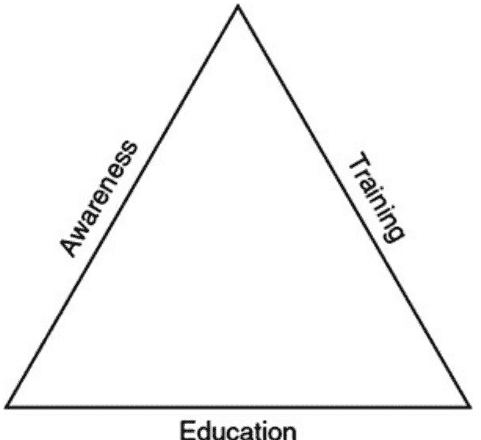

图 3.12 培训、教育和意识三要素

你可能会发现，你的员工需要在组织安全方面接受更深入的培训。这可以通过内部培训计划来弥补，这些计划教新员工所需的安全技能，或者通过为安全人员提供校外 CISSP 教育计划来弥补。

> **提示**
>
> 员工意识计划在短期运行并经常更改时效果最佳。

以下七个步骤有助于确定组织适合哪种类型的安全培训：

- 1. 制定组织技术目标。
- 2. 进行需求评估。
- 3. 找到满足这些需求的培训计划。
- 4. 选择培训方法和方式。
- 5. 选择评估培训的方法。
- 6. 实施培训。
- 7. 评估培训。

培训类型包括以下内容：

- 内部培训
- 基于 Web 的培训
- 课堂培训
- 供应商培训
- 在职培训
- 学徒计划
- 学位课程
- 继续教育计划

> **注意**
>
> 培训和教育不相同。培训计划期限较短，通常教授个人特定技能。教育范围更广，期限更长（例如，学位课程）。

## 安全意识

意识计划可以有效提高员工对安全的理解。安全意识培训帮助员工了解他们的行为如何影响组织。安全意识还概述了对员工的期望。必须为组织中的不同员工群体分别开发意识培训。培训内容不仅会有所不同，参与者提出的话题和问题类型也会有所不同。

成功的员工意识计划会根据受众定制消息。安全意识培训应针对的三个主要群体如下：

- **高层管理人员**：不要试图向此群体进行深入的技术分析；其成员通常关注大局。他们想知道不遵循良好安全实践的成本、收益和后果。
- **数据保管人**：此群体需要更有条理的演示，说明应如何实施良好的安全实践，谁负责，以及不合规的个人和部门成本。
- **用户**：针对此群体的培训必须与员工的日常任务相一致，并映射到用户的特定职能。

> 安全意识的目标是提高管理层对员工行为进行追责的能力，并使员工行为朝着安全的方向发展。

## 社会工程学

*社会工程学*是诱骗他人提供本不应提供的东西的技艺。精通社会工程学的人可以利用他们的技能来获取本不应拥有的访问权限或信息。随着组织发展出更好的物理和技术控制，攻击者总会寻找获取访问权限的最便捷途径。这很可能就是操纵他人。一个组织可能拥有最好的防火墙、IDS、网络设计、身份验证系统或访问控制，但仍可能被社会工程师成功攻击。

为了更好地理解社会工程的运作方式，让我们来看看这些攻击使用的不同方法。在他的著作《说服的科学与实践》中，罗伯特·西尔迪尼描述了以下六种用于获得积极回应的社会工程方法：

- **稀缺性**：这种方法基于这样一种信念，即某样东西（例如时间）供应不足。这种方法的示例可能是：“我现在需要密码，因为我的工作已经过期了，老板在等。你能帮我这一次吗？”
- **权威性**：这种方法基于权力前提。这种方法的示例可能是：“喂，这里是帮助台吗？我为高级副总裁工作，他需要重置密码以访问重要电子邮件！”
- **好感度**：我们倾向于对喜欢的人做得更多，而对不喜欢的人做得较少。这种方法的示例可能是：“来吧，我们是朋友。你知道我不会滥用你的密码。”
- **一致性**：人们喜欢保持一致性。这种方法的示例可能是有人问一系列你会回答是的问题。“你想要一辆新车吗，你的车是不是旧了，你想今天就买我们的车吗？”
- **社会认同**：这种方法基于这样的理念：如果一个人这样做，其他人也会这样做。例如，“为什么我要刷卡签入，而其他人只要有人打开门就直接走进来？”
- **互惠**：如果有人给你一个代币或小礼物，你可能会感到压力，需要回赠一些东西。这种方法的示例可能是：“你已经赢得了一份免费礼物。你只需花几分钟时间回答我们关于当前安全基础架构的调查问卷中的几个问题。”

请记住，社会工程攻击可以从人到人，也可以从计算机到人发起。了解社会工程师使用的各种技术，在很大程度上有助于挫败他们的潜在诈骗。防御社会工程的主要手段是培训和


awareness. 有关社会工程学的更多信息的一个良好资源是 *欺骗的艺术：控制安全中的人为因素*，作者是Kevin D. Mitnick和William L. Simon。

## 专业伦理培训与意识

本节回顾安全专业人员应了解的一些道德标准和准则。*道德* 是行为准则的一套原则。道德标准有时与法律标准不同：法律定义了我们 *必须* 做什么，而道德定义了我们 *应该* 做什么。请记住，并非每个人都会总是以道德方式行事。

安全专业人员应秉持高道德标准，并在他人中推广高道德标准。安全专业人员帮助推广适当道德行为的一些方式包括：确保组织拥有计算机伦理指南、确保员工手册中包含伦理问题、推广计算机伦理培训，以及帮助就电子邮件和其他隐私相关话题等问题制定伦理政策。安全专业人员应了解若干道德标准，以帮助指明适当行为的方向，包括以下标准：

- (ISC)² 道德准则 (www.isc2.org)
- 计算机伦理十诫 (http://cpsr.org/issues/ethics/cei/)
- RFC 1087，互联网伦理 (www.ietf.org/rfc/rfc1087.txt)

## (ISC)² 道德准则

CISSP 候选人必须承认并支持 (ISC)² 道德准则，该准则规定安全专业人员应做到以下几点：

- 保护社会、公共利益和基础设施
- 荣誉地、诚实地、公正地、负责任地且合法地行事
- 为委托人提供勤勉且称职的服务

## Dan Farmer：漏洞评估的伦理

1995年，有些人怀疑Dan Farmer是否出卖了自己的灵魂。在与Wietse Venema合作期间，Farmer先生发布了名为Security Administrator Tool for Analyzing Networks (SATAN)的程序，这是第一个创建的漏洞评估软件。

尽管Farmer先生看到了对这种软件的巨大需求，但他当时的雇主并不这么认为，并解雇了他。有些人也不喜欢该软件的名称。为解决这个问题，Farmer先生实际上为该工具创建了一个插件，将程序重命名为SANTA。通过在运行工具之前运行插件包，所有出现的单词Satan都被更改为Santa，并且所有图像都从图形图像转换为圣诞老人图片。

无论名称如何，该工具的需求都是显而易见的。在发布之时，近三分之二的被扫描网站都不安全。因此，尽管有些人担心此类工具可能被攻击者用来攻击脆弱网络，但需求是真实存在的。

如今，已创建了许多其他工具来执行网络评估，包括SAINT、SARA、Nessus和Retina。每个工具都归功于SATAN，这是有史以来创建的第一个漏洞评估工具。

> **考试提醒**
> 
> 您应该阅读完整的 (ISC)² 道德准则，因为考试可能会包含一两道与该准则相关的问题。您可以通过在……中搜索“道德准则”来找到此文档。

计算机伦理研究所是一个专注于技术行业道德的团体。它定义了以下计算机伦理十诫：

- 1. 不得使用计算机伤害他人。
- 2. 不得干扰他人的计算机工作。
- 3. 不得窥探他人的计算机文件。
- 4. 不得使用计算机进行盗窃。
- 5. 不得使用计算机作伪证。
- 6. 不得复制或使用未付费的专有软件。
- 7. 未经授权或未给予适当补偿，不得使用他人的计算机资源。
- 8. 不得侵占他人的知识产出。
- 9. 应思考你所编写程序或设计系统的社会后果。
- 10. 应始终以确保对他人关怀与尊重的方式使用计算机。

> 考试提醒
> 为了CISSP考试，您应该阅读计算机伦理十诫，并能够将这些规则与 (ISC)² 道德准则区分开来。

## 互联网架构委员会

互联网架构委员会 (IAB) 是互联网协会 (ISOC) 的咨询机构。图 3.13 显示了 ISOC 的架构。互联网工程指导组 (IESG) 负责 IETF 活动的技术管理以及整个互联网标准流程。IAB 负责互联网标准流程，并担任请求评论 (RFC) 编辑。由互联网工程任务组 (IETF) 特许成立的工作组为互联网开发新标准和协议。

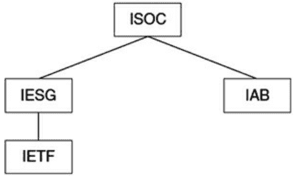

## 图 3.13 ISOC 与 IAB

RFC 是一份工程白皮书，描述协议、应用、行为或互联网连接系统的设计运行方式。IAB 还负责对 IETF 活动进行架构监督。您应了解的一个 RFC 是 RFC 1087。IAB 于 1987 年 1 月发布的 RFC 1087 的目标是界定不道德和不可接受的行为。它指出，以下活动属于不道德行为：

- > 试图未经授权访问互联网资源
- > 破坏互联网的预期用途
- > 通过此类行为浪费资源（包括人员、容量和计算机资源）
- > 破坏基于计算机信息的完整性
- > 危及用户隐私

> **考试提醒**
> 
> 在参加CISSP考试前，请打印并复习RFC 1087。该文档可在 www.faqs.org/rfcs/rfc1087.html 上查阅。

## NIST SP 800-14

尽管已被废弃，NIST SP 800-14《公认系统安全原则》是另一项早期尝试，旨在界定使用电子系统的组织的责任。NIST SP 800-14提出了一些重要观点，包括以下几点：

- > 安全支持组织的使命。
- > 安全是良好管理的组成部分。
- > 安全应具有成本效益。
- > 系统所有者在其自身组织之外也负有安全责任。
- > 安全责任和问责制应明确界定。
- > 安全需要采取全面和集成的方法。
- > 安全应定期重新评估。
- > 安全受社会因素制约。

## 常见计算机伦理谬误

大多数黑客声称自己有道德标准，许多人甚至表示他们的行为在伦理上并无不妥。在接受采访时，许多黑客声称自己有一套自己的道德标准。通常用来为其非法行为辩解的理由包括以下常见的伦理谬误：

- > 电脑游戏：如果他们不保护它，那么攻击它就是理所当然的。
- > 守法公民：这不是物理盗窃，所以不违法。
- > 毁不坏：如果我没有造成损坏，或者可以修复，那有什么问题？
- > 易如反掌：如果这么容易，怎么可能是错的？
- > 黑客：如果我从中学习，这将使社会和我受益。
- > 免费信息：所有信息都应该是免费的。

> **提示**
> 
> 虽然编写计算机病毒本身不违法，但根据CFAA，出于恶意目的分发它是违法的。例如，Robert T. Morris并未因编写第一个互联网蠕虫而被指控；他因将代码用于恶意目的而被指控和起诉。

## 伦理计划的监管要求

如前所述，不同的人对道德的看法各不相同。因此，一些国家有针对道德以及适当行为和态度的监管要求。在美国，联邦组织量刑指南 (FSGO) 概述了道德要求，并可能根据组织的道德计划和文化施加不同的刑罚。

以下是与道德相关的几项监管要求示例：

- **反海外腐败法 (FCPA)：** 如果上市公司未能对其信息系统和数据保持足够的控制，该法将施加民事和刑事处罚。FCPA要求这些公司建立适当的内部会计控制系统。
- **萨班斯-奥克斯利法案 (SOX)：** 这项美国财务和会计披露及问责立法对道德有要求。萨班斯-奥克斯利法案第406条概述了高级财务官员的道德准则要求。
- **赞助组织委员会 (COSO)：** 这是审计师和其他人使用的内部控制框架，包括预期的行为和道德标准。


注意

虽然涉及特定国家法律的问题在 CISSP 考试中不常见，但深刻了解贵组织开展业务所适用的法律仍然很重要。

提示

说到黑客，除了考虑伦理之外，考虑动机也很重要。黑客的动机各不相同，从金钱到娱乐心理不等。有些黑客声称他们开展活动仅仅是为了一个事业。出于事业而进行的黑客行为被称为 *黑客主义*。例如，2020 年，名为 Anonymous 的黑客集团对 BlueLeaks 事件承担了责任，该事件泄露了超过 250 GB 的警察局文件。

## 考试准备题

- 1. 以下哪个讨论过的标准包含下列声明？

  "系统所有者在其自身组织之外也有安全责任。"

  - A. 互联网伦理
  - B. RFC 1087
  - C. (ISC)² 道德准则
  - D. NIST 800-14

- 2. 以下哪种风险处理方法涉及使用第三方来分担部分风险？

  - A. 风险降低
  - B. 风险转移
  - C. 风险接受
  - D. 风险拒绝

- 3. 请根据以下变量计算年化损失期望值（ALE）：

  单次损失期望值 = $25
  暴露系数 = 0.90
  年化发生率 = 0.40
  剩余风险 = $30

  得到的 ALE 是多少？

  - A. $9.00
  - B. $22.50
  - C. $10.00
  - D. $14.27

- 4. 以下哪个是正确顺序？

  - A. 确定 ALE、剩余风险、SLE 和 ARO
  - B. 确定 ALE、ARO、SLE 和剩余风险
  - C. 确定 ARO、SLE、ALE 和剩余风险
  - D. 确定 SLE、ARO、ALE 和剩余风险

- 5. 以下哪个是剩余风险的公式？

  - A. (威胁 × 漏洞 × 资产价值) × 控制缺口 = 剩余风险
  - B. (威胁 × 漏洞 × 资产价值) = 剩余风险
  - C. (威胁 / 漏洞 × 资产价值) × 控制 = 剩余风险
  - D. (风险 × 漏洞 × 资产价值) × 控制缺口 = 剩余风险

- 6. 以下哪个是美国和欧盟中版权的保护期限？

  - A. 终身加 20 年
  - B. 终身加 30 年
  - C. 终身加 70 年
  - D. 终身加 100 年

- 7. 以下哪个公式表示总风险？

  - A. 风险 × 漏洞 × 资产价值 = 总风险
  - B. 威胁 × 漏洞 × 资产价值 = 总风险
  - C. 风险 × 价值 / 对策 = 总风险
  - D. 威胁 – 漏洞 / 资产价值 = 总风险

- 8. 以下哪项是缺陷、空子、疏忽或错误，使组织易受攻击或损害？

  - A. 风险
  - B. 漏洞
  - C. 威胁
  - D. 利用

- 9. 以下哪项是最一般性的安全文档？

  - A. 程序
  - B. 标准
  - C. 策略
  - D. 基线

- 10. 以下哪个小组负责开发 RFC 1087 等新标准和协议？

  - A. IESG
  - B. ISOC
  - C. IAB
  - D. IETF

- 11. 哪个组织角色负责分配敏感性标签？

  - A. 管理层
  - B. 审计师
  - C. 用户
  - D. 所有者

- 12. 当对策的成本超过资产的价值时，以下哪种方法是最佳方法？

  - A. 不采取行动
  - B. 转移风险
  - C. 缓解风险
  - D. 增加暴露成本

- 13. 哪个 ISO 文件用作信息安全管理的标准？

  - A. ISO 27001
  - B. ISO 27002
  - C. ISO 27004
  - D. ISO 27799

- 14. TCO 不包括以下哪项？

  - A. 软件更新
  - B. 订阅费用
  - C. 维护成本
  - D. 未实施控制的成本

- 15. CISSP 考生了解世界各地使用的各种法律体系之间的差异很重要。早期的一个系统是 *民法大全*，其特点是一套全面的成文法规则体系。*民法大全* 是哪种法律体系的基础？

  - A. 大陆法
  - B. 宗教法
  - C. 普通法
  - D. 惯例法

- 16. 业务连续性和灾难恢复规划可能是一项非常庞大、复杂且多学科的项目，它将组织内的关键人员聚集在一起。以下哪项最能描述高级管理层的角色？

  - A. 为组织内各部门的灾难恢复项目经理、技术专家、流程专家或其他财务需求筹划资金
  - B. 愿意将制定灾难恢复计划列为优先事项，承诺并允许员工为此投入时间，并设定完成的截止日期
  - C. 管理来自不同学科的人员，使他们步调一致
  - D. 成为专家并了解需要特殊技能的特定流程

- 17. 业务影响分析的作用是什么？

  - A. 确定公司在永久受损之前的最大停机时间
  - B. 详细说明培训和意识提升将如何开展，以及计划将如何更新
  - C. 确立制定 BCP 的必要性
  - D. 选择恢复策略

- 18. 以下哪个术语最能描述唯一标识产品或服务的符号、单词、名称、声音或事物？

  - A. 商业秘密
  - B. 版权
  - C. 专利
  - D. 商标

- 19. 在制定业务连续性计划之前，以下哪一步是最重要的步骤之一？

  - A. 执行 BIA
  - B. 执行定量和定性风险评估
  - C. 获得高级管理层的支持
  - D. 确定 BCP 团队成员

- 20. 在制定业务连续性计划时，首要任务应该是什么？

  - A. 尽量减少停机时间
  - B. 减轻损害
  - C. 记录每个可以想象的威胁
  - D. 保护人身安全

## 考试准备题答案

- 1. D. NIST 800-14 规定，责任范围超出你负责的网络。选项 A 和 C 都指向 RFC 1087（互联网伦理）。该声明也不在 (ISC)² 道德准则中。

- 2. B. 购买保险以将全部或部分潜在损失成本转移给第三方，称为风险转移。其他所有选项都不正确：风险降低涉及实施对策，风险接受是指接受潜在成本来处理风险，风险拒绝则是假装风险不存在。

- 3. C. $25 × 0.40 = $10，即单次损失期望值（SLE）× 年化发生率（ARO）= 年化损失期望值（ALE）。

- 4. D. 定量评估过程包括以下步骤：估计潜在损失（SLE）、进行威胁分析（ARO）、确定年化损失期望值（ALE），以及确定应用对策后的剩余风险。

- 5. A. 剩余风险的公式是（威胁 × 漏洞 × 资产价值）× 控制缺口 = 剩余风险。

- 6. C. 终身加 70 年是美国和欧盟中版权的保护期限。请记住，版权期限可能因授予的国家和时间而异。

- 7. B. 风险以数值表示如下：
  威胁 × 漏洞 × 资产价值 = 总风险
  其他选项未正确列出总风险的公式。

- 8. B. 漏洞是缺陷、空子、疏忽或错误，会使组织易受攻击或损害。其他所有选项都不正确：风险可定义为当前某些过程或未来某些事件可能导致的潜在危害；事件是威胁主体的行动，可能导致资产或服务受损；利用是利用缺陷、故障或漏洞。

- 9. C. 策略是高层文档。程序是详细、深入、逐步的文档，明确规定要做什么，并与特定技术和设备相关联。标准是战术文档。基线是系统、网络或设备必须遵循的最低安全级别。

- 10. D. 互联网新标准和协议的开发由 IETF 特设的工作组执行。选项 A、B 和 C 不正确。

- 11. D. 数据分类应由所有者执行。当识别出数据项或对象时，所有者负责分配 a


安全标签。如果使用军事数据分类系统，该标签可能是绝密、机密、敏感或未分类。审计人员、管理层或用户都不负责为数据分配标签。

- **12. A.** 当对策成本超过资产价值时，最佳做法是不采取行动，因为保护该资产的成本将超过其价值。选项 B、C 和 D 错误，因为转移风险会导致价值损失。在这种情况下，没有理由降低风险，因为成本过高——这违背了良好的安全实践。

- **13. C.** ISO 27004 是安全管理标准。ISO 27001 侧重于要求。ISO 27002 是为 BS 7799 开发的，而 ISO 27799 侧重于健康。

- **14. D.** TCO 包含所有成本，包括软件、更新和维护成本。唯一未包含的是未实施控制措施的成本。

- **15. A.** 欧洲大部分地区基于民法（成文法），也称为拿破仑法。罗马人使用了 *民法大全*，该法典包含一套全面的成文法律规则，并作为当今民法的基础。选项 B、C 和 D 错误，因为民法与普通法之间的主要区别在于民法将立法作为法律的主要来源。宗教法基于宗教信条。中国和一些非洲国家使用习惯法，该法可能与其他法律制度结合，并基于习惯和被视为正常行为的概念。CISSP 考生了解世界各地使用的各种法律制度之间的差异非常重要。

- **16. B.** 最佳答案是 B。如果高级管理层不支持并全力支持 DRP，则 DRP 很可能会失败。选项 A 不是最佳答案，因为它描述了预算经理或预算部门的角色。选项 C 不是最佳答案，因为它描述了项目经理的角色。选项 D 不是最佳答案，因为它描述了主题专家的角色。

## 了解更多？

- **保持入职前背景调查合法：** www.eeoc.gov/laws/guidance/background-checks-what-employers-need-know

- **供应链风险管理规划：** riskpulse.com/blog/supply-chain-risk-management-plan-what-you-need-to-include/

- **安全配置指南：** https://apps.nsa.gov/iaarchive/library/ia-guidance/security-configuration/

- **网站安全：** www.faqs.org/rfcs/rfc2196.html

- **就业实践自我审计：** library.findlaw.com/2000/Aug/1/127767.html

- **业务连续性最佳实践：** www.eci.com/blog/472-a-best-practices-guide-to-business-continuity-planning.html

- **构建有效策略：** csrc.nist.gov/nissc/1997/panels/isptg/pescatore/html/

- **策略模板和信息：** www.sans.org/security-resources/policies/

- **世界法律制度：** www.hmtlaw.com/international-business/legal-systems-of-the-world/

- **威胁建模方法论：** blog.eccouncil.org/threat-modeling-methodologies-tools-and-processes/

# 第 4 章

## 安全架构与工程

### 需要理解的术语：

- 缓冲区溢出
- 安全模型
- 保护环
- 公钥基础设施
- 数字签名
- 通用准则
- 引用监视器
- 可信计算基
- 开放和封闭系统
- 泄露
- 加密

### 需要掌握的主题：

- 如何根据系统安全要求选择控制措施
- 使用诸如 Bell-LaPadula 之类的保密模型
- 如何识别诸如 Biba 和 Clark-Wilson 之类的完整性模型
- 与安全架构设计相关的常见缺陷和安全问题
- 密码学及其如何用于保护敏感信息
- 物理安全控制的必要性和布置

### 简介

CISSP 考试的安全架构与工程领域涉及硬件、软件、安全控制和文档。设计硬件时，需要按照特定标准构建，这些标准应提供机制来保护数据的机密性、完整性和可用性。将在硬件上运行的操作系统 (OS) 也必须以这种方式设计，以确保安全。

构建安全硬件和操作系统仅是一个开始。供应商和客户都需要一种方式来验证硬件和软件是否按声明运行，对这些系统进行评级，并获得某种程度的保证，即此类系统将以已知方式运行。评估准则允许相关各方获得一定程度的保证。

本章介绍了密码学及其如何在多个层级上用于增强安全。要通过 CISSP 考试，您需要了解系统硬件和软件模型，以及如何使用物理控制和逻辑控制来保护系统。本章还涵盖密码学（对称和非对称）、哈希和数字签名，这些也是潜在的考试主题。

### 安全设计指南和治理原则

在架构构建之初就加入安全，比之后尝试添加安全要便宜得多。这种主动方法的一部分应包括评估，以确定敏感资产是否需要任何额外的机密性和完整性安全级别。图 4.1 说明了纵深防御设计过程。

安全控制分为两种类型：

物理安全控制：这些控制可用于限制工作区域、提供媒体安全控制、限制服务器室访问，并保持适当的数据存储和访问。

逻辑安全控制：这些控制可通过应用加密控制来部署。

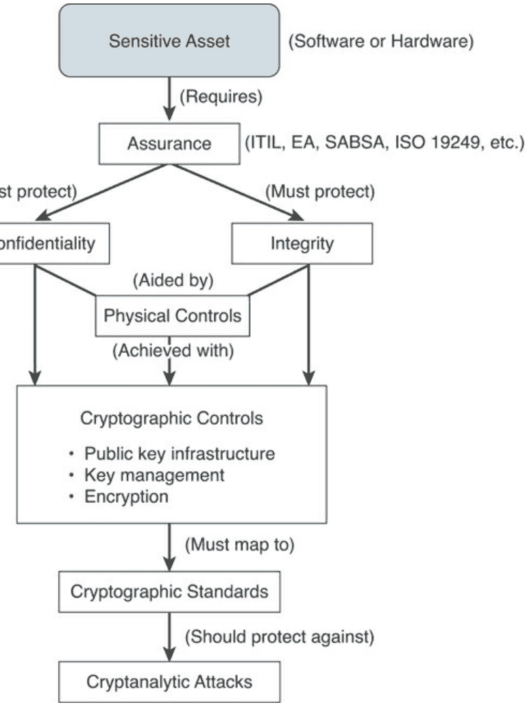

图 4.1 安全架构纵深防御设计过程

可使用多种类型的加密控制。选择适当的类型需要确定特定特征，例如所使用的算法类型、密钥长度和应用。

公钥基础设施 (PKI) 是一种行业标准框架，用于在两个不同方之间建立第三方信任。密钥管理是 PKI 的关键组成部分，包括加密密钥生成、分发、存储、验证和销毁，所有这些都是密钥管理的关键组成部分。

请记住，所有系统都可能受到攻击，选择足够强大的加密系统至关重要。加密密钥可能会被破解。破解可能是由于算法薄弱或密钥薄弱。存在许多密码分析攻击方法来破解密钥。

### 注意

静态数据可以使用可信平台模块 (TPM) 芯片进行保护，TPM 芯片是一种加密硬件处理器，可提供比软件加密更高的安全级别。安装在客户端计算机主板上的 TPM 芯片也可用于系统状态身份验证。TPM 芯片还可用于存储加密密钥。

ISO 11889-1:2009 中涉及了 TPM 芯片，可与其他形式的数据和系统保护结合使用，以提供称为纵深防御的分层方法。

框架用于对信息系统或业务进行分类，并用于指导哪些控制或标准适用。这些框架通常与治理相关联，治理应关注服务的可用性、信息的完整性以及数据机密性的保护。

一个早期的框架是 Saltzer 和 Schroeder 关于有效安全的原则，题为《计算机系统中的信息保护》。这篇 1975 年的论文今天可能有些过时，但它仍然相关，并且经常在大学和学院课程中讲授。在这篇论文中，Saltzer 和

Schroeder 定义了一个基于八项架构原则的安全系统设计框架：

- 完整中介
- 机制精简
- 故障安全默认
- 最小特权
- 最小共用机制
- 公开设计
- 心理可接受性
- 特权分离

另一种方法是 ISO/IEC 19249，安全技术——安全产品、系统和应用架构与设计原则目录，它将设计原则分为两组，每组五项：

- 架构原则：
  - 域分离
  - 分层
  - 封装
  - 冗余
  - 虚拟化
- 设计原则：
  - 最小特权
  - 攻击面最小化
  - 集中式参数验证
  - 集中式通用安全服务
  - 错误和异常处理准备

另一种治理框架是 IT 基础设施库 (ITIL)。ITIL 规定了一组可与组织战略相结合以交付价值并保持最低胜任力水平的流程、程序和任务。ITIL 可用于创建基线，组织可以据此规划、实施并衡量其治理进展。ITIL 提出了一个包含以下组件的服务生命周期：

- 持续服务改进
- 服务战略
- 服务设计
- 服务转换
- 服务运营

## 企业架构

实施 *企业架构* (EA) 计划可以增强安全性和治理。EA 是信息技术领域中组织和记录公司 IT 资产的实践，以增强规划、管理和扩展。使用 EA 的主要目的是确保业务战略与 IT 投资保持一致。EA 的好处在于，它提供了一种可追溯性手段，该手段从最高层级的业务战略延伸至基础技术。

早期的 EA 模型之一是 Zachman 框架，该框架旨在让公司能够为信息系统构建策略文档，使其关注谁、什么、何地、何时、为何以及如何（参见图 4.2）。

| | 为何 | 如何 | 什么 | 谁 | 哪里 | 何时 |
|---|---|---|---|---|---|---|
| **情境** | 目标列表 | 流程列表 | 物料列表 | 组织单元和角色列表 | 地理位置列表 | 事件列表 |
| **概念** | 目标关系 | 流程模型 | 实体关系模型 | 组织单元和角色关系模型 | 位置模型 | 事件模型 |
| **逻辑** | 规则图 | 流程图 | 数据模型图 | 角色关系图 | 位置图 | 事件图 |
| **物理** | 规则规格 | 流程功能规格 | 数据实体规格 | 角色规格 | 位置规格 | 事件规格 |
| **详细** | 规则详情 | 流程详情 | 数据详情 | 角色详情 | 位置详情 | 事件详情 |

## 图 4.2 Zachman 模型

联邦法律要求每个政府机构建立其 EA 及其治理结构。该过程由联邦企业架构 (FEA) 框架指导，该框架旨在使用五个模型：

- **绩效参考模型**：用于衡量主要 IT 投资绩效的框架
- **业务参考模型**：用于为日常业务运营提供有组织的分层模型的框架
- **服务组件参考模型**：用于根据服务组件如何支持业务或绩效目标对其进行分类的框架
- **技术参考模型**：用于对支持和实现服务组件及功能交付的标准、规格和技术进行分类的框架
- 数据参考模型：用于提供描述、分类和共享数据的标准手段的框架

Zachman 框架的一个独立设计但后来集成的子集是 Sherwood 应用业务安全架构 (SABSA)。与 Zachman 框架一样，SABSA 模型和方法论是为风险驱动的企业信息安全架构而开发的。它询问什么、为何、如何以及哪里。有关 SABSA 模型的更多信息，请参阅 www.sabs-a-institute.org。

ISO 27000 系列是治理标准家族的一部分，其起源可追溯至 BS 7799。组织可通过与认证测试实体验证合规性来获得 ISO 27000 认证。核心 ISO 标准包括以下几项：

- ISO 27001：本文档描述了建立、实施、运行、监控、审查和维护信息安全管理体系 (ISMS) 的要求。它遵循 Plan-Do-Check-Act 模型。
- ISO 27002：本文档最初以 BS 7799 标准形式出现，后作为 ISO 17799 标准重新发布，描述了在组织内制定安全计划的方法。
- ISO 27003：本文档侧重于实施。
- ISO 27004：本文档描述了衡量信息安全计划有效性的方法。
- ISO 27005：本文档描述了信息安全的实践准则。

真正的安全是一个分层过程，不仅仅依赖于治理。以下各节中讨论的项目可用于构建更安全的组织。

## 法规合规与流程控制

安全专业人员关注的一个领域是保护敏感信息（包括财务数据）。为提供这种保护而做出的一项尝试是支付卡行业数据安全标准 (PCI-DSS)。该跨国标准最初于 2004 年发布，旨在通过强制执行策略、安全设备、控制措施和网络监控，对信用卡、借记卡、ATM 卡和礼品卡号的保护实施严格的控制标准。PCI 还为与账户持卡人关联的可个人身份识别信息的保护设定了标准。参与供应商包括 American Express、MasterCard、Visa 和 Discover。

而 PCI 用于保护财务数据，信息及相关技术控制目标 (COBIT) 是为满足业务和 IT 流程要求而开发的。它是全球审计师使用的标准，由信息系统审计与控制协会 (ISACA) 开发。COBIT 分为四个控制领域：

- 规划与组织
- 获取与实施
- 交付与支持
- 监控

## 安全模型的基本概念

现代计算机系统可以分解为四组，即四层：

- 硬件
- 内核和设备驱动程序
- 操作系统
- 应用程序

硬件与软件（例如操作系统内核）进行交互，而操作系统和应用程序执行我们需要完成的任务。每个计算机系统的核心都是中央处理器 (CPU) 及其运行所需的硬件。CPU 只是主板上可找到的组件之一，主板是大多数关键系统组件的基础。

以下各节将从系统核心开始，检查计算机系统的各个部分。

## 中央处理器

CPU 是计算机系统的核心，充当计算机的大脑。CPU 由以下部分组成：

- **算术逻辑单元 (ALU)**：ALU 执行算术和逻辑运算。它是 CPU 的大脑。
- **控制单元**：控制单元管理从内存接收的指令。它解码并执行请求的指令，并确定哪些指令具有处理优先权。
- **内存**：内存用于保存待处理的指令和数据。CPU 内存不是典型内存；它比非 CPU 内存快得多。

CPU 能够执行一系列基本操作，包括取指、译码、执行和写操作。流水线将多个步骤合并为一个过程。CPU 能够获取指令并对其进行处理。CPU 可以处于以下四种状态之一：

- **监管状态**：程序可以访问整个系统。
- **问题状态**：只能执行非特权指令。
- **就绪状态**：程序已准备好恢复处理。
- **等待状态**：程序正在等待事件完成。

由于 CPU 具有非常特定的设计，操作系统和应用程序都必须开发为与 CPU 协同工作。CPU 还具有不同类型的寄存器来保存数据和指令。基址寄存器包含分配给进程的起始地址，限制地址标记内存段的末端。这些组件共同负责程序的调用和执行。

CPU 取得了巨大进步，如表 4.1 所示。随着晶体管尺寸的减小，可以放置在一个


CPU 的性能已提升。得益于晶体管总数和时钟频率的增加，CPU 的性能呈指数级增长。今天，3.06 GHz Intel Core i7 每秒可执行约 18 百万条指令（MIPS）。

## 表 4.1 CPU 发展历程

| CPU | 年份 | 晶体管数量 | 时钟频率 |
|---|---|---|---|
| 8080 | 1974 | 6,000 | 2 MHz |
| 80386 | 1986 | 275,000 | 12.5 MHz |
| Pentium | 1993 | 3,100,000 | 60 MHz |
| Intel Core 2 | 2006 | 291,000,000 | 2.66 GHz |
| Intel Core i7 | 2009 | 731,000,000 | 4.00 GHz |
| Intel Core M | 2014 | 1,300,000,000 | 2.6 GHz |

> **注意**
> 处理器速度以 MIPS（每秒百万条指令）为单位进行衡量。此标准用于指示 CPU 工作速度有多快。

现代计算机系统中制造的 CPU 有两种基本设计：

- **精简指令集计算机 (RISC)**: 使用需要较少时钟周期的简单指令
- **复杂指令集计算机 (CISC)**: 单个指令可执行多个操作

CPU 需要两种输入来完成其职责：指令和数据。数据被传递到 CPU 进行处理，通常在问题状态或监督状态下进行处理。在问题状态下，CPU 使用非特权指令处理数据。在监督状态下，CPU 执行特权指令。

**考试警告**

超标量处理器是一种可以同时执行多条指令的处理器；标量处理器一次只能执行一条指令。你需要了解这一区别以应对 CISSP 考试。

根据功能，CPU 可分为若干类别。当计算机的 CPU、主板和操作系统均支持该功能时，计算机系统也会按照以下内容进行分类：

- **多道程序**: 可以在任一时刻交叉执行两个或多个程序
- **多任务**: 可以一次执行一个或多个任务或子任务
- **多处理器**: 支持一个或多个 CPU

多处理器系统可以以对称或非对称模式工作。在对称模式下，所有处理器均相等，可以平等地处理与所有设备（外设均等可访问）相关的任何任务，或者不需要针对资源的专用路径。在非对称模式下，一个 CPU 在其他进程和资源之间调度和协调任务。

CPU 处理的数据通常是应用程序或程序的一部分。这些程序使用进程 ID（PID）进行跟踪。任何曾在 Windows 中查看过任务管理器或在 Linux 机器上执行过 ps 命令的人，很可能都见过 PID 编号。你可以操纵这些任务的优先级，也可以启动和停止它们。幸运的是，大多数程序所做的远比你写的第一段 C 代码要多，那段代码很可能只是显示“Hello World”。程序中的每一行代码或每个功能片段都称为线程。

能够同时处理多个线程的程序称为多线程程序（参见图 4.3）。

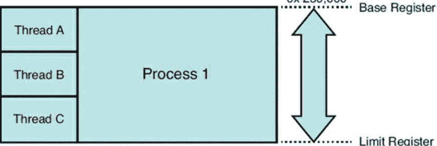

图 4.3 进程和线程

进程活动使用进程隔离来分隔进程。使用四种进程隔离技术来确保每个应用程序都能获得足够的处理器时间以正常运行：

- **进程或对象的封装**: 其他进程不与该应用程序交互。
- **虚拟映射**: 应用程序的编写方式使其相信它是唯一运行的应用程序。
- **时间分复用**: 这允许应用程序或进程共享计算机的资源。
- **命名区分**: 进程分配有其自身的唯一名称。

> **考试警告**
> 
> 要查看命名区分的具体情况，请从 Linux 系统的终端运行 ps -aux 并记下唯一的 PID 值。

*中断* 是计算机系统的另一个关键组成部分。它是设备与 CPU 之间的电气连接。设备可以在此连接上放置电气信号以引起 CPU 的注意。以下是常见的中断方法：

- **程序化 I/O**: 用于在 CPU 与外设之间传输数据
- **中断驱动 I/O**: 一种更高效的输入/输出方法，需要复杂硬件
- **使用 DMA 的 I/O**: 基于直接内存访问的 I/O，可以绕过处理器并将信息直接写入主内存
- **内存映射 I/O**: 一种要求 CPU 为 I/O 功能保留空间，并对内存和 I/O 设备都使用相同地址的方法
- **端口映射 I/O**: 一种使用特殊类指令的方法，该指令可以读取和写入 I/O 设备的单个字节

> **考试警告**
> 
> 中断可分为可屏蔽中断和不可屏蔽中断。可屏蔽中断可以被应用程序或系统忽略，而不可屏蔽中断不能被系统忽略。Windows 中不可屏蔽中断的示例是按下 Ctrl+Alt+Delete 时发生的中断。

内存具有自然的层次结构，因此必须有一种方法来管理内存并确保其不会损坏。这就是内存管理系统的工作。多任务操作系统上的内存管理系统负责以下任务：

- **重定位**: 系统保持根据需要将内存内容从内存复制到辅助存储的能力。
- **保护**: 系统对内存段进行控制，并限制哪些进程可以写入内存。
- **共享**: 系统允许基于用户安全级别共享信息以进行访问控制。例如，Mike 可能可以读取对象，而 Shawn 可能可以读取并写入对象。
- **逻辑组织**: 系统提供对动态链接库的共享和支持。
- **物理组织**: 系统提供内存的物理组织。

## 存储介质

计算机不仅仅是 CPU；内存也是一个重要组件。CPU 使用内存来存储指令和数据。因此，内存是一种重要的存储介质类型。CPU 是唯一可以直接访问内存的组件。系统之所以这样设计，是因为 CPU 具有高度的系统信任度。

CPU 可以使用不同类型的寻址方案与内存通信，包括 _绝对寻址_ 和 _相对寻址_。此外，内存可以以物理或逻辑方式寻址。物理寻址是指分配给内存的硬编码地址。编写代码的应用程序和程序员使用 _逻辑地址_。_相对寻址_ 涉及使用带有偏移量的已知地址。

内存不仅可以以不同方式寻址，还有不同类型的内存。内存可以是 _非易失性_ 或 _易失性_。以下部分提供了这两种类型的示例。

> **提示**
> 
> 与存储相关的两个重要安全概念是受保护内存和内存寻址。对于 CISSP 考试，你应该了解受保护内存可防止其他程序或进程访问或修改先前分配给其他活动程序的地址空间内容。内存可以以物理或逻辑方式寻址。内存寻址描述了 CPU 用于访问内存内容的方法。这对于理解缓冲区溢出攻击的根本原因尤其重要。

## RAM

随机存取存储器（RAM）是易失性内存。如果断电，RAM 中的数据将被销毁。RAM 类型包括静态 RAM（使用电路锁存器表示二进制数据）和动态 RAM（需要每隔几毫秒刷新一次）。RAM 可配置为动态随机存取存储器（DRAM）或静态随机存取存储器（SRAM）。

SRAM 不需要刷新信号（而 DRAM 需要）。SRAM 芯片更复杂且速度更快，因此价格更昂贵。DRAM 的访问时间约为 60 纳秒（ns）或更长；SRAM 的访问时间可快至 10 ns。SRAM 常用于缓存内存。

DRAM 芯片可以廉价制造。动态是指内存芯片需要持续的更新信号（也称为刷新信号）来保留写入其中的信息。目前，DRAM 有五种流行的实现方式：

- **同步 DRAM (SDRAM)**: SDRAM 与数据发送器共享一个公共时钟信号。计算机的系统总线时钟提供所有 SDRAM 组件用于执行每个步骤的公共信号。
- **双倍数据率 (DDR)**: 与普通 SDRAM 相比，DDR 支持双倍传输速率。
- **DDR2**: DDR2 将每个时钟脉冲分为两半，使其能执行的操作数量翻倍。
- **DDR3**: DDR3 是一种 DRAM 接口规范，提供以两倍速率传输数据（是其内部内存阵列速度的八倍）的能力，从而实现更高的带宽或峰值数据率。
- **DDR4**: DDR4 的速度高于 DDR2 或 DDR3，是 DRAM 的最新变体之一。它与任何早期类型的 RAM 都不兼容。

考试警告 内存泄漏发生在程序或进程使用 RAM 但


无法释放它。存在内存泄漏的程序最终会耗尽所有可用内存，并可能导致系统停止或崩溃。

## ROM

只读存储器（ROM）是非易失性内存，即使断电也能保留信息。ROM 通常用于加载和存储固件。固件是嵌入式软件，类似于 BIOS 或 UEFI。

**提示**

大多数现代计算机系统使用统一可扩展固件接口（UEFI）来替代 BIOS。与 BIOS 相比，UEFI 提供多项优势，包括支持在未安装操作系统的情况下对系统进行远程诊断和修复。

常见的 ROM 类型包括：

- 可擦除可编程只读存储器（EPROM）
- 电可擦除可编程只读存储器（EEPROM）
- 闪存
- 可编程逻辑器件（PLDs）

## 二级存储

内存在存储领域发挥着重要作用，但还需要其他长期存储类型。其中一种是顺序存储。磁带驱动器是一种顺序存储，必须从头到尾顺序读取。

另一种广为人知的二级存储类型是直接访问存储。直接访问存储设备无需顺序读取；系统可以识别信息的位置并直接访问该位置来读取数据。硬盘驱动器是直接访问存储设备的一个示例：硬盘驱动器内包含一系列盘片、读写磁头、电机和驱动电子元件，且封装在旨在防止污染的外壳中。硬盘驱动器用于存储数据和软件。软件是已安装在计算机系统上的操作系统或应用程序。

光盘（CD）是一种*光学介质*。它们使用激光/光电传感器组合来读取或写入数据。CD 可以是只读、一次写入或可重写的。单张 CD 最多可存储约 800 MB 数据。CD 通过在主要为硬质透明塑料的基材上涂覆一层薄薄的铝层来制造。在制造过程中或刻录 CD/R 时，光盘表面会出现小凸块或凹坑。这些凸块或凹坑被转换为二进制的 1 或 0。与带有轨道和扇区的软盘不同，CD 包含一条长螺旋轨道，从光盘内侧开始，延伸至外边缘。

数字视频光盘（DVD）与 CD 非常相似，因为两者都是光学介质：DVD 只存储更多数据。光学存储的当前版本是蓝光光盘。这些光学光盘可存储 50 GB 或更多数据。

当今越来越多的系统正在迁移到固态硬盘（SSD）和闪存存储。高达 2 TB 的容量现在很常见。

## I/O 总线标准

CPU 正在处理的数据必须有办法从存储介质移动到 CPU。这是通过总线实现的。*总线* 是传输数据的导线线路，用于在 CPU、存储介质和其他硬件设备之间传输数据。对于 CISSP 考试，你需要了解两个与总线相关的术语：

- **北桥**：北桥（也称为内存控制器集线器 MCH）连接 CPU、RAM 和显存。

- **南桥**：南桥由 I/O 控制器集线器（ICH）使用，用于连接硬盘驱动器、DVD 驱动器、键盘、鼠标等输入/输出设备。

从 CPU 的角度来看，计算机上插入的各种适配器都是外部设备。用于连接设备的这些连接器和总线架构随时间而发生了变化。以下是你需要熟悉的一些总线架构：

- 行业标准架构（ISA）：ISA 总线最初是专为 IBM PC 设计的 8 位总线。现在已过时。

- 外围组件互连（PCI）：PCI 总线由 Intel 开发，作为 ISA 和其他总线标准的替代品。PCI Express 现在是标准。

- 外围组件互连快速（PCIe）：PCIe 总线作为对 PCI 的升级而开发。它提供多项优势，例如更大的总线吞吐量、更小的物理占用空间、更好的性能以及更好的错误检测和报告。

- 串行 ATA（SATA）：SATA 标准是将硬盘驱动器和固态硬盘连接到计算机的当前标准。它使用串行设计和更小的电缆，并提供更高的速度和计算机机箱内更好的气流。

- 小型计算机系统接口（SCSI）：SCSI 总线允许各种设备从单个控制器串联连接。许多服务器将 SCSI 总线用作其首选的硬盘驱动器解决方案。

通用串行总线（USB）已获得广泛的市场份额。USB 克服了传统串行接口的局限性。USB 2.0 设备的通信速度最高可达 480 Mbps 或 60 MBps，而 USB 3.0 设备的最大带宽速率为 5 Gbps 或 640 MBps。设备可以串联在一起，以“链式”模式将多达 127 个设备连接到一个集线器的一个 USB 插槽上，从而消除了对主板扩展插槽的需求。最新的 USB 标准是 3.2。USB 3.2 标准最大的改进是将数据传输带宽提升至最高 10 Gbps。

USB 用于闪存、相机、打印机、外部硬盘驱动器和手机。USB 有两个基本优势：它拥有广泛的产品支持，并且设备通常在连接时会立即被识别。

许多 Apple 计算机使用 Thunderbolt 接口，少数旧版 FireWire（IEEE 1394）接口仍可在数字音频和视频设备上找到。

## 虚拟内存和虚拟机

现代计算机系统已开发出特定的方式来存储和访问信息。其中之一是*虚拟内存*，它是计算机主内存（RAM）和二级存储（硬盘驱动器或 SSD）的组合。当这两种技术结合时，操作系统可以让 CPU 相信它拥有的内存比实际拥有的要多得多。虚拟内存示例包括：

- 页面文件
- 交换空间
- 交换分区

这些虚拟内存类型的大小、位置和其他因素由用户定义。当 RAM 即将耗尽时，CPU 会开始将数据保存到计算机硬盘驱动器上，这个过程称为*分页*。分页将程序的一部分移出内存，并使用页面文件来保存程序的那些部分。如果系统所需的 RAM 超过分页所提供的容量，它会将整个进程*写出*到交换空间。此过程使用分页文件/交换文件，以便根据需要在硬盘驱动器和 RAM 之间来回移动数据。甚至可以配置特定驱动器来保存此类数据，因此称为*交换分区*。曾经使用过计算机休眠功能或在计算机上打开过超出内存支持能力的程序数量的人，都熟悉虚拟内存的运作方式。

与虚拟内存密切相关的是虚拟机，例如 VMware Workstation 和 Oracle VM VirtualBox。VMware 是机器虚拟化市场的领导者之一。*虚拟机* 使用户能够在虚拟主机中运行第二个操作系统。例如，虚拟机可以让你运行另一个 Windows 操作系统、Linux x86，或任何在 x86 处理器上运行并支持标准 BIOS/UEFI 启动的其他操作系统。

虚拟系统使用虚拟机监控程序来管理虚拟化硬件资源以运行来宾操作系统。Type 1 虚拟机监控程序直接在硬件上运行，VM 资源由虚拟机监控程序提供，而 Type 2 虚拟机监控程序则在硬件之上的宿主操作系统上运行。

虚拟机可用于开发和系统管理、生产环境，以及减少所需物理设备的数量。虚拟机监控程序还被用于设计虚拟交换机、路由器和防火墙。

**提示**

虚拟化在职场中非常重要，但基于云的系统最近开始取代虚拟机。基于云的系统使员工能够从许多不同的地点工作。应用程序和数据可以存放在云中，用户可以从任何有网络连接的位置访问此内容。云计算的潜在缺点是安全性可能是一个问题。考虑云的所有者很重要。它是私有云（由公司拥有）还是公有云（由他人拥有）？此外，云的物理位置在哪里，谁可以访问云，是否是共享（多租户）？在将任何企业资产放入云中之前，必须考虑这些因素。

## 计算机配置

以下是一些最常用的计算机和设备配置：

- **打印服务器**：打印服务器通常位于打印机附近，允许多用户访问同一台打印机并共享其资源。

- **文件服务器**：文件服务器允许用户拥有一个集中式站点来存储文件。文件服务器提供了一种简便的备份方式，因为备份可以在一台服务器上完成，而不必在所有客户端计算机上完成。它还允许团队协作和多用户访问。

- **应用程序服务器**：应用程序服务器允许用户运行未安装在最终用户系统上的应用程序。这是一种在瘦客户端环境中非常流行的概念，该环境依赖于中央


server for processing power. Licensing is an important consideration with application servers.

- Web server: Web servers provide web services to internal and external users via web pages. A sample web address or URL (uniform resource locator) is www.thesolutionfirm.com.

- Database server: Database servers store and access data, including information such as product inventories, price lists, customer lists, and employee data. Because databases hold sensitive information, they require well-designed security controls. A database server typically sits in front of a database and brokers requests, acting as middleware between the untrusted users and the database holding the data.

- Laptops and tablets: These are mobile devices that are easily lost or stolen. Mobile devices have become very powerful and must be properly secured.

- Smartphones: Today’s smartphones are handheld computers that have large amounts of processing capability. They can take photos and offer onboard storage, Internet connectivity, and the ability to run applications. These devices are of particular concern as more companies start to support bring your own device (BYOD) policies. Such devices can easily fall outside of company policies and controls.

- Industrial control systems (ICS): ICSs are typically used for industrial process control, such as with manufacturing systems on factory floors. ICSs can be used to operate and/or automate industrial processes. There are several categories of ICSs, including supervisory control and data acquisition (SCADA) systems, distributed control systems (DCSs), and field devices.

- Embedded devices / Internet of Things (IoT): Embedded devices / IoT include ATMs, point-of-sale terminals, and smartwatches. More and more devices include embedded technology, such as smart refrigerators and Bluetooth-enabled toilets. The security of embedded devices is a growing concern, as these devices may not be patched or updated on a regular basis.

> Note
> We can expect more and more devices to have embedded technology as the Internet of Things (IoT) grows. Several companies even sell toilets with Bluetooth and SD card technology built in; like other devices, they are not immune to hacking (see www.extremetech.com/extreme/163119-smart-toilets-bidet-hacked-via-bluetoothgives-new-meaning-to-backdoor-vulnerability).

## Security Architecture

Although a robust functional architecture is a good start, real security requires that you have a security architecture in place to control processes and applications. Concepts related to security architecture include the following:

- Protection rings
- Trusted computing base (TCB)
- Open and closed systems
- Security modes of operation
- Operating states
- Recovery procedures
- Process isolation

## Protection Rings

An operating system knows who and what to trust by relying on *protection rings*. Protection rings work much like your network of family members, friends, coworkers, and acquaintances. The people who are closest to you, such as your spouse and children, have the highest level of trust. Those who are distant acquaintances or are unknown to you probably have a lower level of trust. For example, when you see a guy on Canal Street in New York City hawking new Rolex watches for $100, you should have little trust in him and his relationship with the Rolex company!

Protection rings are conceptual rather than physical entities. Figure 4.4 illustrates the protection rings schema. The first implementation of such a system was in MIT's Multics time-shared operating system.

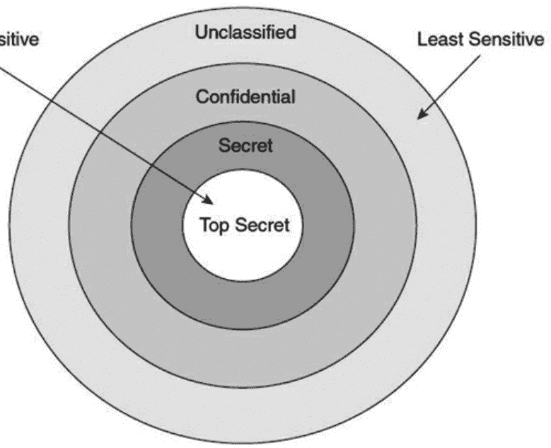

### FIGURE 4.4 Protection Rings

The protection rings model provides the operating system with various levels at which to execute code or to restrict that code’s access. The idea is to use engineering design to build in layers of control using secure design principles. The rings provide much greater granularity than a system that just operates in user and privileged modes. As code moves toward the outer bounds of the model, the layer number increases, and the level of trust decreases. This model includes the following layers:

- **Layer 0**: This is the most trusted level. The operating system kernel resides at this level. Any process running at layer 0 is said to be operating in *privileged mode*.

- **Layer 1**: This layer contains non-privileged portions of the operating system.

- **Layer 2**: This is where I/O drivers, low-level operations, and utilities reside.

- **Layer 3**: This layer is where applications and processes operate. It is the level at which individuals usually interact with the operating system. Applications operating here are said to be working in *user mode*, which is often referred to as *problem mode* because this is where the less-trusted applications run; it is, therefore, where most problems occur.

Not all systems use all rings in the protection rings model. Most systems that are used today operate in two modes: *user mode* and *supervisor* (privileged) mode.

Items that need high security, such as the operating system security kernel, are located in the center ring. This ring is unique because it has access rights to all domains in the system. Protection rings are part of the trusted computing base concept, which is described next.

## Trusted Computing Base

The *trusted computing base* (TCB) is the sum of all the protection mechanisms within a computer and is responsible for enforcing the security policy. The TCB includes hardware, software, controls, processes and is responsible for confidentiality and integrity. The TCB is the only portion of a system that operates at a high level of trust. It monitors four basic functions:

- **Input/output (I/O) operations:** I/O operations are a security concern because operations from the outermost rings might need to interface with rings of greater protection. These cross-domain communications must be monitored.

- **Execution domain switching:** Applications running in one domain or level of protection often invoke applications or services in other domains. If these requests are to obtain more sensitive data or service, their activity must be controlled.

- **Memory protection:** To truly provide security, the TCB must monitor memory references to verify confidentiality and integrity in storage.

- **Process activation:** Registers, process status information, and file access lists are vulnerable to loss of confidentiality in a multiprogramming environment. This type of potentially sensitive information must be protected.

> **ExamAlert**
> 
> For the CISSP exam, you should understand not only that the TCB is tasked with enforcing security policy but also that the TCB is the sum of all protection mechanisms within a computer system that have also been evaluated for security assurance. It consists of hardware, firmware, and software.
> 
> Components that have not been evaluated are said to fall outside the security perimeter.

The TCB monitors the functions in the preceding list to ensure that the system operates correctly and adheres to security policy. The TCB follows the *reference monitor* concept. The reference monitor is an abstract machine that is used to implement security. The reference monitor's job is to validate access to objects by authorized subjects. The reference monitor operates at the boundary between the trusted and untrusted realms. The reference monitor has three properties:

- It cannot be bypassed and controls all access, as it must be invoked for every access attempt.
- It cannot be altered and is protected from modification or change.
- It must be small enough to be verified and tested correctly.

> **ExamAlert**
> 
> For the CISSP exam, you should understand that the reference monitor enforces the security requirement for the security kernel.

The reference monitor is much like the bouncer at a club, standing between each subject and object and verifying that each subject meets the minimum requirements for access to an object (see Figure 4.5).

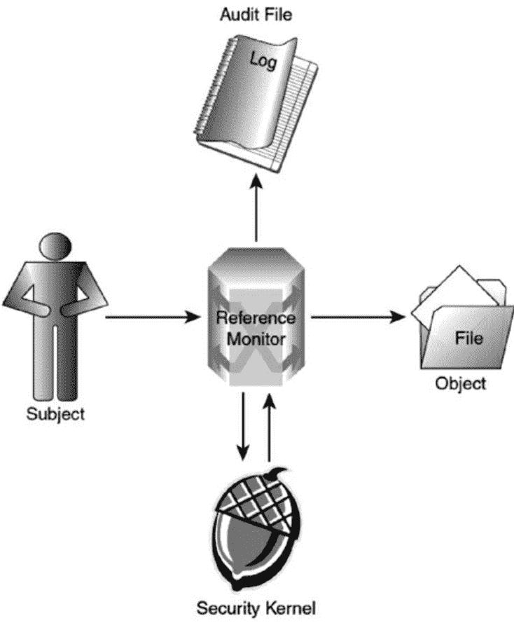

### FIGURE 4.5 Reference Monitor

> > **Note**
> >
> > Subjects are active entities such as people, processes, or devices.
> >
> > Objects are passive entities that are designed to contain or receive information. Objects can be processes, software, or hardware.


引用监控器可以设计为使用令牌、能力列表或标签：

- 令牌：在请求访问前通信安全属性
- 能力列表：查找速度比安全令牌快，但不够灵活
- 安全标签：高安全系统使用，因为这些标签提供永久性

操作系统的核心是安全内核。安全内核处理用户/应用程序对系统资源的所有访问请求。小型安全内核易于验证、测试和验证为安全。然而，在现实生活中，安全内核可能因包含一些不必要的代码而臃肿，因为位于其中的进程可以更快地运行并具有特权访问权限。厂商在开发操作系统方面采取了不同的方法。例如，DOS 使用了单体内核。这些设计中的几种在图 4.6 中显示，并在此处描述：

- 单体架构：所有操作系统进程在内核模式下工作。
- 分层操作系统设计：此设计将系统功能分离到不同的层。
- 微内核：较小的内核仅支持关键进程。
- 混合微内核：内核结构类似于微内核，但以单体设计实现。

虽然引用监控器是概念性的，但安全内核可以在每个系统的核心中找到。安全内核负责运行用于强制执行功能和抵御已知攻击的所需控制。如前所述，引用监控器在安全边界上运行：受信任域和非受信任域之间的边界。安全边界外的组件不受信任。所有受信任的访问控制机制都位于安全边界内。

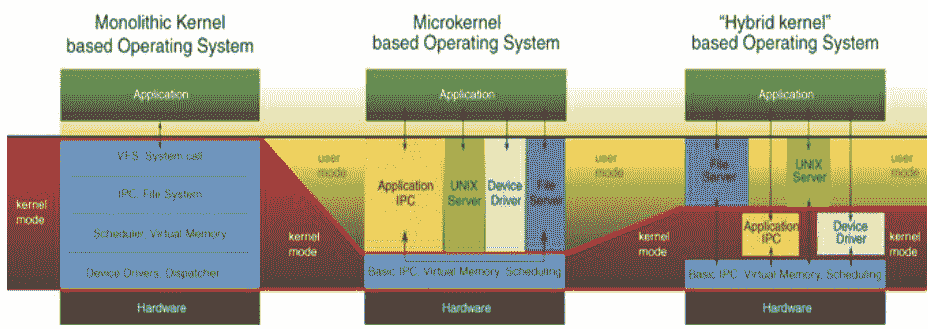

## 图 4.6 操作系统架构

来源：http://upload.wikimedia.org/wikipedia/commons/d/d0/OS-structure2.svg

## 开放系统和封闭系统

开放系统接受其他厂商的输入，并基于允许连接到不同设备和接口的标准和实践。目标是促进完全互操作性，以便系统可以充分利用。

封闭系统是专有系统。它们使用基于非开放标准且通常被锁定的设备。它们缺乏允许连接到其他设备和接口的标准接口。

例如，在美国手机行业中，AT&T 和 T-Mobile 手机基于全球移动通信系统（GSM）标准，可以通过简单更改用户身份模块（SIM）轻松在海外其他网络上使用。这些是开放系统手机。使用码分多址（CDMA）的手机，例如 Sprint 和 Verizon 手机，不具备同等支持，且几乎已完全被淘汰。2010 年，全球运营商在同意切换到 LTE（一种 4G 网络，2023 年列为最终淘汰日期）时启动了此过程。

> **注意**
>
> 开放和封闭的概念不仅适用于硬件。使用开放软件时，其他人可以查看和/或修改源代码，但使用封闭软件时，他们不能。例如，三星 Galaxy

## 操作安全模式

几种操作安全模式基于国防部（DoD）5220.22-M 分类级别。根据国防部的规定，系统上正在处理的信息和授权用户的许可级别可以分为四种模式之一（参见表 4.2）：

- 专用：访问所有存储或处理的信息需要“需要知道”原则。每个用户都需要持有许可和批准的正式访问权限，并且必须为所有存储和/或处理的信息签署保密协议（NDA）。此模式还必须支持强制系统访问程序。所有打印输出和移除的介质将按系统认证的级别进行处理，直到由了解情况的人员审查。由于系统专用于处理特定类型或分类的信息，所有授权用户都可以访问所有数据。

- 系统高安全：所有用户都具有安全许可；但是，仅对系统中包含的一些信息需要“需要知道”原则。每个用户都需要访问批准，并且需要为所有存储和/或处理的信息签署 NDAs。对对象的访问，对于尚未拥有访问权限的用户，必须仅由对象的授权用户分配。此模式必须能够提供审计跟踪，记录时间、日期、用户 ID、终端 ID（如果适用）和文件名。所有用户可以根据其“需要知道”原则访问一些数据。

- 分隔式：系统中某些信息需要有效的“需要知道”原则。所有用户必须对其将在系统上访问的所有信息拥有正式访问批准，并且需要持有系统中最高数据分类级别的适当许可。所有用户必须为其将在系统上访问的所有信息签署 NDAs。所有用户可以根据其“需要知道”原则和正式访问批准访问一些数据。

- 多级：每个用户对系统上的一些信息都具有有效的“需要知道”原则，并且可以同时处理多个分类级别。用户必须拥有正式访问批准，并且必须为其将在系统上访问的所有信息签署 NDAs。强制访问控制提供了一种基于文件敏感性标签限制访问的手段。所有用户可以根据其“需要知道”原则、许可和正式访问批准访问一些数据。

## 表 4.2 操作安全模式

| 模式 | 专用 | 系统高安全 | 分隔式 | 多级 |
|---|---|---|---|---|
| 已签署 NDA | 全部 | 全部 | 全部 | 全部 |
| 许可 | 全部 | 全部 | 全部 | 部分 |
| 批准 | 全部 | 全部 | 部分 | 部分 |
| 需要知道 | 全部 | 部分 | 部分 | 部分 |

> **注意**
>
> 术语 *敏感性或安全标签* 指的是基于高安全强制访问控制（MAC）的系统。

## 操作状态

当系统用于处理和存储敏感信息时，必须就其运作方式达成一些一致的方法。通常，这些概念是为了满足处理敏感政府信息的要求而开发的，类别包括敏感、机密和绝密。处理此任务的负担可以放在管理层或系统本身上。

通常，使用两种设计：

- **单态系统**：此类系统的设计和实现是为了处理一类信息。管理负担落在管理员身上，管理员必须制定管理系统的政策和程序。管理员还必须确定谁有访问权限以及用户拥有何种类型的访问权限。这些系统专用于一种操作模式，因此有时被称为 *专用系统*。

- **多态系统**：这些系统依赖于系统本身，而非管理员。多个人可以登录多态系统并根据其许可级别访问各种类型的数据。如您可能料想的，这些系统可能价格昂贵。运行 BAE Systems 安全受信任操作程序（STOP）操作系统的 XTS-400 是多态系统的一个示例。多态系统可以作为分区系统运行。这意味着 Mike 可以使用机密许可登录系统并访问机密级别数据，而 Dwayne 可以使用绝密级别许可登录并访问不同级别的数据。这些系统是分区的，并可以基于需要知道原则对数据进行分段。

> **提示**
>
> 安全增强型 Linux 和 TrustedBSD 是可免费获得的具有有限多态功能的操作系统实现。由于完全认证这些系统所需的费用和时间，安全评估对这些免费 MLS 实现来说是一个问题。

## 恢复程序

不幸的是，事情并不总是正常运行；有时会出错，并可能发生系统故障。系统故障可能通过损坏完整性、打开安全漏洞或造成损坏来潜在危及系统。高效设计具有内置的恢复程序，以从潜在问题中恢复。存在两种基本恢复类型


procedures:

- **安全故障**: 如果检测到故障，系统会通过终止服务来防止受到破坏。
- **软故障**: 检测到的故障会终止非关键进程。处于软故障模式的系统仍能提供部分运行能力。

当问题发生时，能够恢复至关重要。确保恢复的最佳方法是采取主动方法，并定期备份所有关键文件。恢复的目标是恢复到已知状态。需要恢复的常见问题包括以下各项：

- **系统重启**: 意外/非计划事件可能导致系统重启。
- **系统重新启动**: 当系统宕机时会自动发生，并强制立即重新启动。
- **系统冷启动**: 这是由重大故障或组件更换导致的。
- **系统被攻破**: 这可能是由攻击或安全漏洞引起的。

## 进程隔离

进程隔离对于维持高度的系统可信性是必需的。要将系统认证为多级安全系统，必须支持进程隔离。如果没有进程隔离，就无法防止一个进程溢出到另一个进程的内存空间，从而损坏数据，或者可能导致整个系统不稳定。*进程隔离*由操作系统执行；其职责是强制执行内存边界。进程分离是一个重要话题；如果没有它，系统可能会设计成*单点故障（SPOF）*，以至于设计或配置中的一个缺陷都可能导致整个系统停止运行。

要使系统安全，操作系统必须防止未经授权的用户访问不应访问的系统区域，它应具备强健性，并且不应存在单点故障。

有时所有这些都通过使用虚拟机来实现。虚拟机让用户相信他们可以使用整个系统，但实际上，进程是完全隔离的。为了将这一概念更进一步，某些需要真正强健安全性的系统还实现了硬件隔离，以便进程不仅在逻辑上，而且在物理上也被分段。

**注意**

Java 使用一种虚拟机形式，因为它使用沙箱来包含代码，并仅允许其以受控方式运行。

## 常见形式安全模型

安全模型用于确定如何实施安全、哪些主体可以访问系统以及他们将访问哪些对象。简单来说，安全模型将安全政策形式化。控制安全模型通常通过强制执行完整性、保密性或其他控制来实现。请记住，这些模型中的每一个都制定了广泛的指导原则，并不具体。开发者决定如何使用这些模型并将其集成到特定设计中（见图 4.7）。

以下各部分将更详细地讨论不同的控制安全模型。讨论的前三个模型被认为是较低级别的模型。

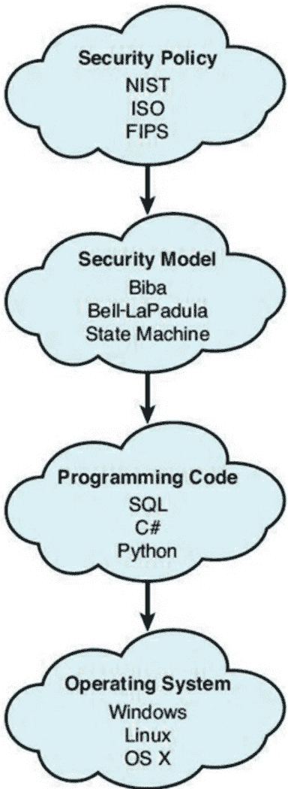

图 4.7 用于操作系统设计的安全模型基本概念

### 状态机模型

状态机模型基于有限状态机（见图 4.8）。

状态机用于建模复杂系统，并处理接受器、识别器、状态变量和事务函数。状态机定义有限数量状态的行为、这些状态之间的转换以及可能发生的操作。

状态机最常见的表示方式是通过状态机表。例如，如表 4.3 所示，如果状态机处于当前状态 B 和条件 2，那么随着选项的推进，下一个状态将是 C 和条件 3。

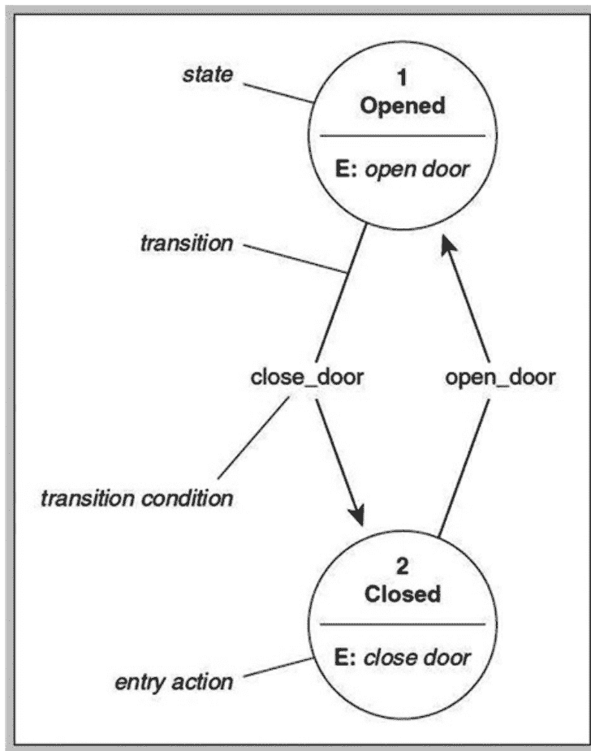

图 4.8 有限状态模型

| 状态事务 | 状态 A | 状态 B | 状态 C |
|---|---|---|---|
| 条件 1 | ... | ... | ... |
| 条件 2 | ... | 当前状态 | ... |
| 条件 3 | ... | ... | ... |

状态机模型监控系统状态，以防止其滑入不安全状态。支持状态机模型的系统必须检查所有可能的状态，以验证所有进程都按照系统安全策略受到控制。状态机概念是许多安全模型的基础。该模型的价值在于知道系统将处于什么状态。例如，如果系统在安全状态下启动，并且发生的每个事务都是安全的，那么它必须始终处于安全状态且不会失败开放。（失败开放意味着允许所有流量或操作，而不是拒绝。）

### 信息流模型

信息流模型是状态机概念的扩展，并且是 Biba 和 Bell-LaPadula 模型设计的基础，这两个模型将在本章后面讨论。信息流模型由对象、状态转换和格（流策略）状态组成。该模型的目标是防止任何方向的未经授权、不安全的信息流。该模型和其他模型可以使用守护程序，允许在不同系统之间交换数据。

### 非干扰模型

由 Goguen 和 Meseguer 定义的非干扰模型旨在确保不同级别的对象和主体不会干扰其他级别的对象和主体。该模型使用低或高敏感度的输入和输出。每个数据访问尝试都独立于所有其他尝试，数据无法跨越安全边界。

### 保密性

尽管迄今描述的模型是许多后来开发的安全模型的基础，但早期模型的一个主要关注点是保密性。国防部（DoD）等政府实体担心信息的保密性。国防部将信息分为不同类别，以便轻松管理谁有权访问各级别的信息。国防部信息分类包括敏感但非密（SBU）、机密、秘密和绝密。Bell-LaPadula 模型是最早解决国防部保密性需求的模型之一。

### Bell-LaPadula 模型

Bell-LaPadula 状态机模型强制执行保密性。该模型使用强制访问控制来强制执行国防部多级安全政策。主体要访问信息，必须有明确的知晓需求，并且必须满足或超过信息的分类级别。

Bell-LaPadula 模型由以下属性定义：

- 简单安全（ss）属性：该属性规定，处于某一保密级别的主体不允许读取较高保密级别的信息。这有时被称为“不允许向上读取”。图 4.9 提供了示例。

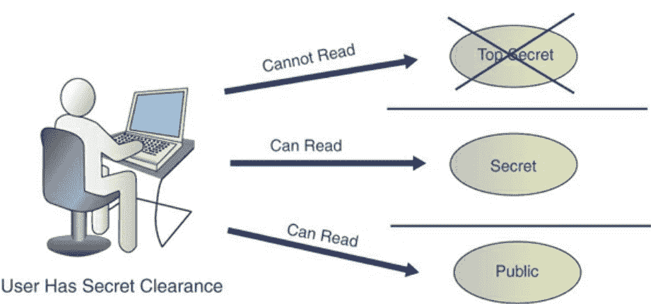

Bell-LaPadula 简单安全属性

图 4.9 Bell-LaPadula 简单安全模型

- 星（*）安全属性：该属性规定，处于某一保密级别的主体不允许将信息写入较低保密级别。这也被称为“不允许向下写入”。图 4.10 提供了示例。

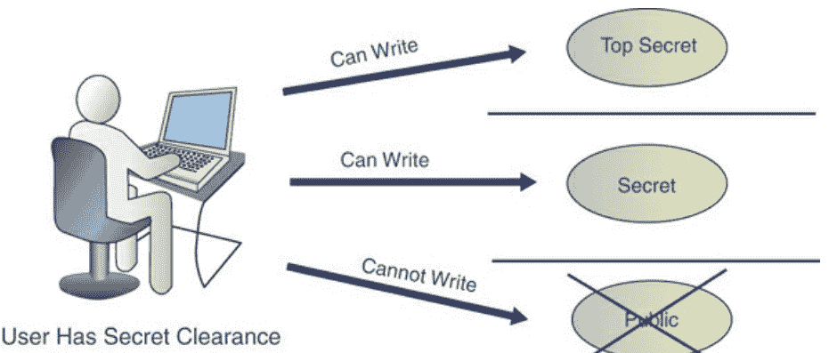

Bell-LaPadula 星 * 属性

图 4.10 Bell-LaPadula 星属性

强星属性：该属性规定，主体不能读取或写入更高或更低敏感度的对象。图 4.11 提供了示例。

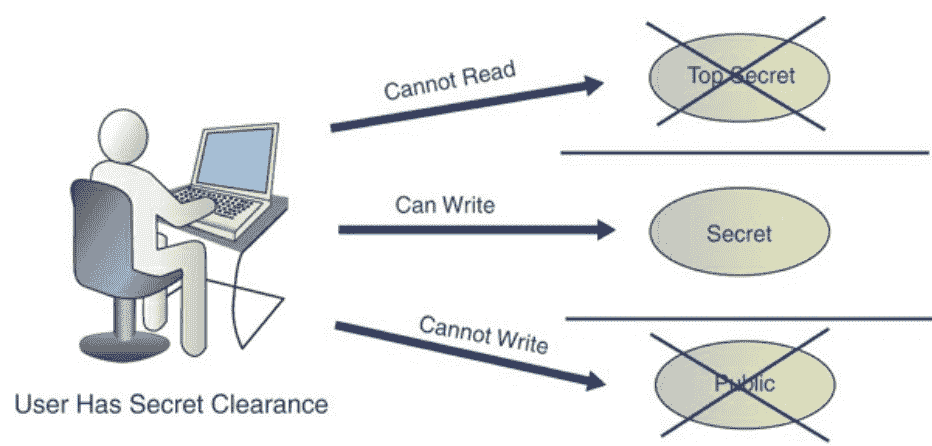

Bell-LaPadula 强星 * 属性

图 4.11 Bell-LaPadula 强星属性

**考试警报**
仔细回顾 Bell-LaPadula 简单安全和星安全模型；它们很容易与 Biba 的两个定义属性混淆。

**提示**
Bell-LaPadula 模型的第四个但很少实现的属性称为酌情安全属性，允许用户授予访问权限


to other users at the same clearance level by means of an access matrix.

Although the Bell-LaPadula model goes a long way in defining the operation of secure systems, the model is not perfect. It does not address security issues such as covert channels. It was designed in an era when mainframes were the dominant platform. It was designed for multilevel security and takes only confidentiality into account.

> **提示**
> 重要的是要知道，Bell-LaPadula 模型处理的是保密性。这意味着，读取高于允许级别的信息会危及保密性。

## 完整性

Integrity is a good thing. It is one of the basic elements of the security triad, along with confidentiality and availability. Integrity plays an important role in security because it can be used to verify that unauthorized users are not modifying data, authorized users don't make unauthorized changes, and databases balance and data remains internally and externally consistent. Whereas governmental entities are typically very concerned with confidentiality, other organizations might be more focused on the integrity of information. In general, integrity has four goals:

- Prevent data modification by unauthorized parties
- Prevent unauthorized data modification by authorized parties
- Reflect the real world
- Maintain internal and external consistency

> **注意**
> Some sources list only three goals of security by combining the third and fourth goals into one: maintain internal and external consistency and ensure that the data reflects the real world.

Two security models that address secure systems integrity include Biba and Clark-Wilson models, which are covered in the following sections. The Biba model addresses only the first integrity goal, and the Clark-Wilson model addresses all four goals.

### Biba Model

The Biba model was the first model developed to address integrity concerns. Originally published in 1977, this lattice-based model has the following defining properties:

- **Simple integrity property**: This property states that a subject at one level of integrity is not permitted to read an object of lower integrity.
- **Star (*) integrity property**: This property states that an object at one level of integrity is not permitted to write to an object of higher integrity.
- **Invocation property**: This property prohibits a subject at one level of integrity from invoking a subject at a higher level of integrity.

> **提示**
> The star property in both the Biba and Bell-LaPadula models deals with writes. One easy way to remember these rules is to think, "It's written in the stars!"

The Biba model addresses only the first goal of integrity: protecting the system from access by unauthorized users. Other types of concerns such as confidentiality are not examined. This model also assumes that internal threats are being protected by good coding practices, and it therefore focuses on external threats.

> **提示**
> To remember the purpose of the Biba model, you can think that the *i* in *Biba* stands for integrity.

### Tibetan Monks and the Biba Model

When learning about the CISSP exam Security Architecture and Engineering domain in the classroom, students are eager for examples related to the material on security models. I typically use the well-known story of Tibetan monks.

After a long journey on your search for Shangri-La and true security awareness, you arrive at a Tibetan monastery. You discover that the monks there are huge fans of the Biba model and, like you, have studied for the CISSP exam. As such, they have defined certain rules that you, the commoner, must abide by:

- A Tibetan monk may write a prayer book that can be read by commoners but not one to be read by a high priest.
- A Tibetan monk may read a book written by the high priest but may not read down to a pamphlet written by a commoner.

Consider this story when you are trying to conceptualize the Biba model, and it might make the task a little easier. A final tip is to look at the star (*) property for both the Bell-LaPadula model and the Biba model and notice how both star properties deal with writes. If this property is applied to Bell-LaPadula, a confidentiality model, the result is *no write down*. If the star property is applied to the Biba model, an integrity model, the result is *no write up*. Just by knowing one, you can easily solve the other.

> **提示**
> Remember that the Biba model deals with integrity and, as such, writing to an object of a higher level might endanger the integrity of the system.

### Clark-Wilson Model

The Clark-Wilson model, which was created in 1987, differs from previous models because it was developed to be used for commercial activities. This model addresses all four goals of integrity. The Clark-Wilson model dictates that the separation of duties must be enforced, subjects must access data through an application, and auditing is required. Some terms associated with this model include the following:

- User
- Transformation procedure
- Unconstrained data item
- Constrained data item
- Integrity verification procedure

The Clark-Wilson model features an access control triple, where subjects must access programs before accessing objects (subject–program–object). The access control triple is composed of the user, a transformational procedure, and the constrained data item. It was designed to protect integrity and prevent fraud. Authorized users cannot change data in an inappropriate way. The Clark-Wilson model checks three attributes: tampered, logged, and consistent (TLC).

The Clark-Wilson model differs from the Biba model in that subjects are restricted. This means that a subject at one level of access can read one set of data, whereas a subject at another level has access to a different set of data. The Clark-Wilson model controls the way in which subjects access objects so that the internal consistency of the system can be ensured, and data can be manipulated only in ways that protect consistency. Integrity verification procedures (IVPs) ensure that a data item is in a valid state. Data cannot be tampered with while being changed, and the integrity of the data must be consistent. The Clark-Wilson model requires all changes to be logged.

The Clark-Wilson model is made up of transformation procedures (TPs). Constrained data items (CDIs) are data for which integrity must be preserved. Items not covered under the model are considered unconstrained data items (UDIs).

> Remember that the Clark-Wilson model requires that users be authorized to access and modify data, and it deals with three key terms: tampered, logged, and consistent (TLC).

### Take-Grant Model

The *Take-Grant* model is another confidentiality-based model that supports four basic operations: take, grant, create, and revoke. This model allows subjects with the take right to remove take rights from other subjects. Subjects possessing the grant right can grant this right to other subjects. The create and revoke operations work in the same manner: Someone with the create right can give the create right to others, and those with the revoke right can remove that right from others.

### Brewer and Nash Model

The *Brewer and Nash* model is similar to the Bell-LaPadula model and is also sometimes referred to as the *Chinese Wall* model. It was developed to prevent conflict of interest (COI) problems. The Brewer and Nash model is context oriented in that it prevents a worker consulting for one firm from accessing data belonging to another, thereby preventing any COI. For example, imagine that your security firm does security work for many large firms. If one of your employees could access information about all the firms that your company has worked for, that person might be able to use this data in an unauthorized way.

### Other Models

A security model defines and describes what protection mechanisms are to be used and what these controls are designed to achieve. The previous sections cover some of the most heavily tested models, but you should have a basic understanding of a few more security models, including the following:

- **Graham-Denning model**: This model uses a formal set of eight protection rules for which each object has an owner and a controller. These rules define what you can create, delete, read, grant, or transfer.
- **Harrison-Ruzzo-Ullman model**: This model is similar to the Graham-Denning model and details how subjects and objects can be created, deleted, accessed, or changed.
- **Lipner model**: This model combines elements of the Bell-LaPadula and Biba models to guard both confidentiality and integrity.
- **Lattice model**: This model is associated with MAC. Controls are applied to objects, and the model uses security levels that are represented by a lattice structure; this structure governs information flow. Subjects of the lattice model are allowed to access an object only if the security level of the subject is equal to or greater than that of the object. Overall access limits are set by having a least upper bound and a greatest lower bound for each security level.

> **ExamAlert**
> Spend some time reviewing all the models discussed in this section. Make sure you know which models are integrity based, which are confidentiality based, and the properties of each; you will need to know this information for the CISSP exam.

> **提示**


虽然本节描述的安全模型是 CISSP 考试最可能关注的模型，但还有许多其他模型，例如 Sutherland、Boebert and Kain、Karger、Gong 和 Jueneman 模型。尽管许多安全专业人员可能从未听说过这些模型，但开发系统的人很可能在大学里学过它们。

## 产品安全评估模型

在评估信息系统的安全性能时，需要一套评估标准。已经开发出许多文档和指南，以帮助评估和建立系统保证度。这些项目对 CISSP 考生很重要，因为它们提供了一种信任和保证程度，表明这些系统将以特定且可预测的方式运行。受信任的系统已经过测试，并根据特定标准进行了验证。保证度意味着消除疑虑，并对系统在每次使用时都能按要求运行具有信心。

可以将产品评估模型视为类似于 EPA 燃油经济性评级，这些评级为买卖双方提供了一种评估不同汽车品牌和型号的方法。在产品安全领域，开发者在准备销售系统时可以使用产品评估系统。买家在准备购买时可以使用相同的评估模型，因为它们提供了一种衡量系统有效性和对其能力进行基准测试的方法。以下部分描述了有助于满足这些需求的文档和指南。

## 彩虹系列

彩虹系列之所以得名，是因为系列中的每本书都有不同颜色的标签。这套高达 6 英尺的书籍由国家计算机安全中心（NCSC）开发，该中心是国家安全局（NSA）的一部分。这些指南是为受信任产品评估计划（TPEP）制定的，该计划根据一套全面的安全相关标准测试商业产品。其中第一本书于 1983 年发布，称为受信任计算机系统评估准则（TCSEC），即橙皮书。许多类似的指南也以封面颜色而非名称而闻名，例如红皮书。尽管橙皮书不再用于商业用途，但理解 TCSEC 将帮助你了解产品安全评估模型是如何演变为我们今天所使用的模式的。

彩虹系列指南已全部被通用准则取代，该准则将在本章后面描述。

### 橙皮书：受信任计算机系统评估准则

橙皮书是为评估独立系统而开发的。其度量基础是机密性，因此与贝尔-拉帕杜拉模型类似。

加拿大有自己的橙皮书版本，称为加拿大受信任计算机产品评估准则（CTCPEC）。它也已被通用准则取代。

虽然橙皮书不再被视为当前标准，但它是最早的产品安全标准之一。表 4.4 列出了橙皮书级别。

### 表 4.4 橙皮书级别

| 级别 | 需要记住的项目 |
| --- | --- |
| A1 | 以安全方式构建、安装和交付 |
| B1 | 安全标签（MAC） |
| B2 | 安全标签和无隐蔽通道验证（MAC） |
| B3 | 安全标签、无隐蔽通道验证，以及启动期间必须保持安全（MAC） |
| C1 | 弱保护机制（DAC） |
| C2 | 严格的登录程序（DAC） |
| D1 | 失败或未经过测试 |

### 红皮书：受信任网络解释

红皮书的正式名称是受信任网络解释（TNI）。TNI 的目的是检查网络及网络组件的安全性。与仅涉及机密性的橙皮书不同，红皮书检查完整性和可用性。它还负责检查联网设备的运行情况。红皮书涵盖三个审查领域：

- 拒绝服务（DoS）预防：运营管理和业务连续性
- 妥协保护：数据和流量机密性以及选择性路由
- 通信完整性：身份验证、完整性和不可否认性

### 信息技术安全评估准则（ITSEC）

ITSEC 是 20 世纪 80 年代开发的欧洲标准，用于评估整个系统的机密性、完整性和可用性。ITSEC 的独特之处在于它是第一个统一市场并使整个欧洲在同一套指南下的标准。ITSEC 将目标系统指定为评估目标（TOE）。评估实际上分为两部分：一部分评估功能，另一部分评估保证度。

ITSEC 包含 10 个功能（F）类和 7 个保证（E）类。

保证类对系统的有效性和正确性进行评级。表 4.5 显示了这些评级及其与 TCSEC 评级的对应关系。

### 表 4.5 ITSEC 功能评级及与 TCSEC 的比较

| F 类评级 | E 类评级 | TCSEC 评级 |
|---|---|---|
| NA | E0 | D |
| F1 | E1 | C1 |
| F2 | E2 | C2 |
| F3 | E3 | B1 |
| F4 | E4 | B2 |
| F5 | E5 | B3 |
| F5 | E6 | A1 |
| F6 | — | 具有高完整性要求的 TOE |
| F7 | — | 具有高可用性要求的 TOE |
| F8 | — | 在数据通信期间具有高完整性要求的 TOE |
| F9 | — | 在数据通信期间具有高机密性要求的 TOE |
| F10 | — | 具有高机密性和完整性要求的网络 |

## 通用准则

考虑到我们迄今讨论的所有标准，很容易看出有人可能很难确定哪个是正确的选择。国际标准化组织（ISO）也有同样的想法，并决定不应存在各种现有的标准和评级，而应有一个单一的全球标准。图 4.12 说明了通用准则的发展。

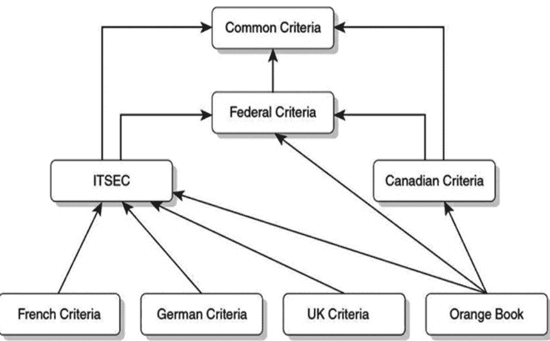

图 4.12 通用准则发展

1997 年，ISO 发布了通用准则（ISO 15408），它是 TCSEC、ITSEC 和 CTCPEC 的综合版本。通用准则围绕可信计算基（TCB）实体设计，包括物理和逻辑控制、启动和恢复、引用中介以及特权状态。通用准则将保证度分为七个日益严格的保证级别，称为评估保证级别（EALs）：

- EAL 1：功能测试
- EAL 2：结构测试
- EAL 3：有条不紊地检查和测试
- EAL 4：有条不紊地设计、测试和审查
- EAL 5：半形式化设计和测试
- EAL 6：半形式化验证、设计和测试
- EAL 7：形式化验证、设计和测试

EALs 对所分析系统的安全功能提供特定程度的信心。

> **考试警报**
> 如果你在寻找高级别 EAL 6 操作系统的示例，无需再找，Green Hills Software 的 Integrity 178B 就是一个。这种安全操作系统用于战斗机和其他关键设备。

与 ITSEC 类似，通用准则定义了两种安全要求：*功能*和*保证*。功能要求定义产品或系统的功能。它们还定义产品的安全功能。用作评估基础的保证要求和规范称为*安全目标*（ST）。保护配置文件定义系统及其控制。保护配置文件分为五个部分：

- 依据
- 评估保证要求
- 描述性元素
- 功能要求
- 开发保证要求

安全目标包含七个部分：

- 简介
- 符合性声明
- 安全问题定义
- 安全目标
- 扩展组件定义
- 安全要求
- TOE 安全规范


通用标准认证包含保护配置文件（PP）或安全目标（ST）。

保证要求定义了产品构建的质量。保证要求对产品建立信心，并展示其实现的正确性。

**考试提示**

通用标准的七个保证级别和两个安全要求是CISSP考试所需的知识。

## 系统验证

没有任何系统或架构会完全安全；总会存在一定程度的风险。安全专业人员必须理解这种风险，并能够接受它、降低它，或通过第三方将其转移。已讨论的所有文档和指南都涉及衡量和评估风险的方法。这些方法在确保已实现的系统满足您的要求方面大有帮助。但是，在开始使用系统之前，您必须完成认证和认可的两个额外步骤。

美国联邦机构依法必须对其IT系统和基础设施进行认证和认可。虽然您不应该指望在CISSP考试中看到关于认证和认可的深入问题，但如果您计划与任何要求使用这些方法的机构打交道，了解这些方法是值得的。这些方法论所关注的内容远比标准渗透测试多；它们更像审计。它们必须验证系统按预期实现、配置和运行，并符合所有安全策略和程序。

## 认证和认可

*认证*是验证已实现的系统配置并按预期运行的过程。它还验证系统以安全、受控的方式连接和与其他系统通信，并以安全、批准的方式处理数据。认证过程是对系统的技术评估，可由独立安全团队或现有员工执行。其目标是发现实现中的任何漏洞或弱点。

认证过程的结果将报告给组织管理层，以供调解和批准。如果管理层同意认证的发现，则报告将正式批准。认证的正式批准即为*认可过程*。管理层通常以书面形式批准认证系统可按认证文档中指定的方式使用。如果系统或系统所处环境发生变更，则必须重复重新认证和认可过程。整个过程会根据行业和组织必须遵守的法规定期重复。例如，萨班斯-奥克斯利法案第404节要求每年对涉及财务控制和报告系统的内部系统进行评估。

> **考试提示**
> 
> 对于CISSP考试，您可能需要记住：认证被视为验证的技术方面，而认可则是管理层的批准。

> **注意**
> 
> 没有什么是永恒的，认证也不例外。当系统发生变化、项目被修改或定期进行时，应重复认证过程。

## 安全架构的漏洞

与本书的大多数其他章节一样，本章也回顾了潜在威胁和漏洞。每当安全专业人员主张加强安全性时，总会有人质疑为何要这样花钱。指出良好安全性的好处以及不实施良好实践和程序的潜在风险都很重要。

我们生活在一个充满风险的世界。作为安全专业人员，我们需要了解安全威胁，并理解本章讨论的各种保护机制如何用于提高安全级别。

### 缓冲区溢出

缓冲区溢出是由于编码技术不佳引起的。缓冲区是被编码为存放一定数据量的临时存储区域。如果向缓冲区输入额外数据，数据可能会溢出到相邻的缓冲区。这可能会损坏这些缓冲区，导致应用程序崩溃，或者可能允许攻击者执行其加载到堆栈上的代码。理想情况下，程序应包含错误检查，例如检查不能在24字符的缓冲区中输入32个字符；但是，这种错误检查并不总会发生。错误检查实际上只是确保缓冲区接收所需的正确类型和数量的信息。以下是一个缓冲区溢出示例：

```
#include <stdio.h>
#include <stdlib.h>
#include <string.h>
int abc()
{
char buffer[8];
strcpy(buffer, "AAAAAAAAAA");
return 0;
}
```

操作系统供应商也在努力通过使用数据执行防护（DEP）和地址空间布局随机化（ASLR）等技术，使缓冲区溢出攻击更难实施。DEP将内存的某些区域标记为可执行或不可执行。DEP可以通过防止编写用于存储在内存中的恶意命令来帮助避免某些攻击。ASLR随机重新排列数据的地址空间位置。可以将其视为猜球游戏，将小球放在三个杯子中的一个下面，然后移动它们。要赢得游戏，您必须猜出小球在哪个杯子下面。大多数现代操作系统（如Android、Windows和FreeBSD）都使用ASLR。

缓冲区溢出的其他防御措施包括代码审查、使用安全编程语言以及及时应用补丁和更新。最后，由于默认情况下所有数据都应被视为可疑，应对输入、处理或输出的数据进行检查，以确保其符合正确的参数。

### 后门

后门是系统和软件安全的潜在威胁。程序员在开发过程中使用后门（有时也称为维护钩子）来便于访问某些软件。通常，这些后门没有文档记录。当软件分段开发且开发人员希望在不运行所有代码的情况下访问程序的某些部分时，可以使用后门。如果在软件发布前未删除后门，攻击者可以利用后门绕过安全机制并访问程序。

### 状态攻击

状态攻击是一种通常针对时序的攻击形式。其目标是利用检查时间（TOC）和使用时间（TOU）之间的延迟。这些攻击有时也称为异步攻击或竞态条件，因为攻击者竞相在对象被检查后但系统使用前对其进行更改。

例如，如果程序创建一个数据文件来保存客户欠款金额，而攻击者竞相在程序读取之前替换该值，他就可以成功操纵程序。实际上，利用竞态条件可能比较困难，因为黑客可能需要多次尝试利用竞态条件才能成功。

### 隐蔽信道

隐蔽信道提供了一种非预期的信息传输方式。攻击者喜欢隐蔽信道，因为他们知道您无法禁止必须允许的行为。该术语最初用于TCSEC文档，指从较高分类向较低分类传输信息的方式。隐蔽信道攻击大致可分为两类：

- **隐蔽时序信道攻击**：时序攻击难以检测。它们通过修改组件或修改资源时序来运行。

- **隐蔽存储信道攻击**：这些攻击使用一个进程将数据写入存储区，并由另一个进程读取数据。

以下是隐蔽信道攻击在现实生活中发生的示例。您的组织已决定允许ping（Internet Control Message Protocol [ICMP]）流量进出您的网络。基于这一知识，攻击者在您的网络上植入了Loki程序。Loki使用ping数据包的有效载荷部分将数据移入和移出您的网络。因此，网络管理员只看到正常的ping流量，而不会收到警报，尽管攻击者正忙于窃取公司机密。遗憾的是，许多程序都可以执行此类攻击。

> **考试提示**
> 
> CISSP考试期望您理解两种隐蔽信道攻击类型。

### 增量攻击

增量攻击的目标是缓慢而持续地进行更改。通过长时间进行小幅更改，攻击者希望保持不被发现。两种主要的增量攻击是**数据篡改**，如果攻击者能够访问系统并对数据或文件进行小幅增量更改，则可能发生；以及**萨拉米攻击**，它类似于数据篡改，但涉及对财务账户或记录进行小幅更改，通常称为“账目做旧”。

### 辐射


任何看过诸如《国家公敌》或《窃听风云》等电影的人都知道一些监控技术和阴谋论的知识。如果你曾以为只有边缘人物才会担心这些事情，那就大错特错了。这听起来可能像科幻小说，但美国政府对电子设备可能泄露杂散电气信号的可能性足够担忧，以至于国防部启动了一个研究信号泄露的项目。

研究实际上始于20世纪50年代，这项研究最终促成了TEMPEST技术。人们担心攻击者可能会尝试窃听从电子设备发出的杂散电气信号。符合TEMPEST标准制造的设备，例如阴极射线管（CRT）显示器，其机箱内嵌有TEMPEST级铜网，即*法拉第笼*，以防止信号泄露。这项昂贵的技术仅出现在安全等级极高的环境中。

TEMPEST现在被认为有些过时；较新的技术，如白噪声和控制区，现在用于控制泄露安全。*白噪声*涉及使用特殊设备发出一串频率，使攻击者无法区分真实信息。*控制区*是指其墙壁、地板和天花板旨在阻止电气信号离开该区域的设施。

与这类技术相关的另一个术语是*范埃克窃听*。这是通过泄露信号窃听CRT内容所使用的名称。尽管这项技术听起来有些离奇，但剑桥大学在2004年成功针对LCD显示器演示了该技术。

**考试提示**

对于CISSP考试，你需要知道为防止入侵者捕获和解码通过空中波传播的信息而实施的技术和方法。TEMPEST、白噪声和控制区是三种主要控制措施。

## 基于Web的漏洞

基于Web的系统漏洞涉及应用程序缺陷或设计弱点。攻击可以从客户端或服务器发起。例如，当客户端输入未得到正确验证时，就会发生输入验证攻击。应用程序开发人员永远不应该假设用户会输入正确的数据。一心想从事恶意活动的用户会试图扩展协议或应用程序，以寻找可能的漏洞。参数问题最好通过实施预验证和后验证控制来解决。预验证在客户端实现，但可以通过使用代理和其他注入技术来绕过。后验证用于确保程序的输出正确。其他与输入验证缺乏直接相关的安全问题包括以下内容：

- **跨站脚本（XSS）**：一种利用信任关系的攻击，攻击者使用Web应用程序向Web服务器或应用程序服务器发送恶意代码。
- **跨站请求伪造（CSRF）**：一种涉及第三方重定向静态内容的攻击，使得未经授权的命令从网站信任的用户处传输。
- **直接OS命令**：未经授权执行操作系统命令。
- **目录遍历攻击**：一种允许攻击者从一个目录移动到另一个目录的技术。
- **Unicode编码**：一种用于绕过安全过滤器的技术。一个著名的示例使用了Unicode字符串“%c0%af..%c0%af..”。
- **URL编码**：攻击者通过HTTP请求来隐藏或执行无效应用程序命令的方法（例如，www.knowthetrade.com%2fmalicious.js%22%3e%3c%2fscript%3e）。

> **提示**
>
> XSS和CSRF有时会被混淆，只需记住一个关键区别是XSS在受信任上下文中执行代码。

让程序员生活困难的事情之一是，不存在所谓的受信任输入。所有输入都可能是恶意的，并且必须经过验证。虽然缓冲区溢出是输入验证不良的经典示例，但这些攻击已经变得复杂得多：攻击者已经学会将恶意代码插入缓冲区，而不是仅仅向应用程序抛出“垃圾”（即，输入随机乱码）来导致缓冲区溢出——这只是很凌乱。还有许多可用于发起这些攻击的工具；图4.13显示了一个示例。

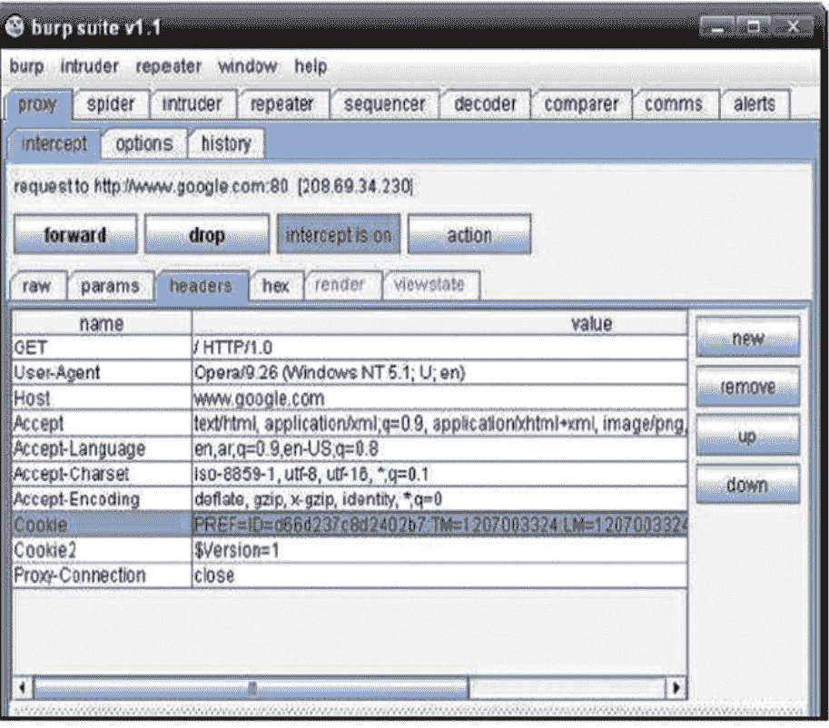

图4.13 Burp代理攻击工具

攻击者还可以使用以下技术来利用输入验证不良的问题：

- XML注入

- LDAP注入

- SQL注入

所有这些都是同一类型的攻击，但它们针对不同的平台。

数据库是畸形输入的另一个常见目标。攻击者可以尝试插入数据库或SQL命令来破坏数据库的正常运行。这可能导致数据库变得不稳定并泄露信息。这种攻击称为SQL注入。攻击者会搜索可插入SQL命令的网页。攻击者使用诸如'(单引号)之类的逻辑来测试数据库是否存在漏洞。以下代码所示的响应会为攻击者提供所需的反馈，以了解数据库是否易受攻击：

单击此处查看代码图像

```
Microsoft OLE DB Provider for ODBC Drivers error '80040e07'
[Microsoft][ODBC SQL Server Driver][SQL Server]Syntax error converting
the nvarchar value 'sa_login' to a column of data type int.
/index.asp, line 5
```

虽然了解数据库攻击中使用的语法和响应对于CISSP考试不是必需的，但在你尝试保护基础架构时，了解这些信息很有用。

> **注意**
>
> SQL注入攻击是主要攻击向量之一，并导致大量攻击。CISSP考生应该了解这些攻击带来的威胁。

注入攻击（如SQL、LDAP等）可能发生在许多不同的程序和应用程序中，并利用一个共同问题：应用程序代码和输入数据之间不存在分离，这使得攻击者能够在受害者系统上运行其代码。注入攻击需要以下步骤：

- 足迹分析：有必要确定Web应用程序正在运行什么技术。
- 识别：必须识别用户输入点。
- 测试：必须测试易受攻击的用户输入。
- 利用：将额外的代码片段放入输入中，以在受害者计算机上执行命令。

## 移动系统漏洞

移动设备的性能已大幅提升，现在能够处理许多以前只有台式机和笔记本电脑才能完成的任务。越来越多的员工将自己的移动设备带到工作地点，并在企业网络上使用。组织对这种安排可能存在许多担忧，包括以下内容：

- 窃听语音通话
- 移动病毒和恶意软件
- 移动设备上的明文存储
- 移动设备易丢失和被盗
- 摄像头手机拍摄敏感信息的能力
- 大容量存储功能，可能导致数据被窃取或外泄
- 暴露本地设备数据（如姓名、电子邮件地址或电话号码）的软件

自带技术（BYOT），也称为自带设备（BYOD），要求组织建立管理和技术控制来规范设备在工作场所的使用方式。这些基本控制可能包括以下内容：

- 密码：保护移动系统最基本、最廉价的方法之一是强制使用密码。此外，建议企业设备具备远程擦除丢失或被盗设备的功能。
- 多因素身份验证（MFA）：多种身份验证形式可增强密码安全性。例如，用户可能需要使用Okta或Microsoft MFA来批准从未知位置进行的登录。
- 会话生存期：限制会话时间和Cookie可以在设定的空闲时间后将用户从敏感服务中登录出来，从而提高安全性。
- 无线漏洞：无线网络通常容易受到攻击。例如，攻击者可能设置一个流氓无线接入点并发起中间人攻击。
- 未打补丁的操作系统、软件或浏览器：移动设备（如其他计算设备一样）必须定期打补丁。
- 不安全的设备：越狱设备对企业网络构成风险，因为它们可能缺少补丁和其他安全更新。
- 移动设备管理：移动设备管理（MDM）和移动应用程序管理（MAM）可用于保护设备，并且只允许托管设备访问公司资源。

## 密码学

*密码学涉及将明文数据转换为不可读数据（即密文）。如今，密码学系统是保护电子邮件、企业数据、个人信息和电子交易的强制性要求。*

为了让你很好地理解密码学，本节将回顾它与安全基础（隐私、身份验证、完整性和不可否认性）的关系。

> **提示**
>
> 记住密码学主要目标的一个简单方法是思考它们的首字母，这些首字母组成了PAIN一词：隐私、身份验证、完整性和不可否认性。


机密性，或称隐私，是指确保私人信息保持私密的能力。密码学通过转换数据来提供机密性。这种转换称为 *加密*。*加密* 可以保护存储或传输中信息的机密性。试想一下 CEO 的笔记本电脑。如果它丢失或被盗，什么更有价值：笔记本电脑本身，还是关于明年热门新产品线的信息？信息资产的价值可能远高于存储它们的设备。硬盘加密提供了一种简便的方法，在设备丢失、被盗或被未经授权的个人访问时保护信息。

身份验证有多种作用。首先，身份验证通常与消息加密相关联。身份验证提供了一种方法，以确保数据或程序未被修改，并且确实来自你认为其来源的源。身份验证还用于确认用户身份，是识别和身份验证过程的一部分。识别和身份验证最常见的实现方式是使用用户名和密码。大多数密码是加密的，但不一定非要加密。如果没有加密，身份验证过程就非常脆弱。FTP 和 Telnet 是弱身份验证的示例。使用这些协议时，用户名和密码以未加密形式（即明文）传输，任何能够访问通信流的人都可以拦截并捕获这些密码。虚拟私有网络（VPN）也使用身份验证，但它们通常不使用明文用户名和密码，而是使用数字证书和数字签名，以更准确地识别用户并保护身份验证过程免受欺骗。

完整性是指从信息创建之时起直至接收时，信息保持未被篡改的保证。如果你在互联网上以每个 100 美元的价格出售小部件，如果罪犯能够在结账时将张贴的价格改为 1 美元，你很可能会破产。完整性对于信息交换至关重要，无论是从事电子商务、维护商业秘密，还是提供准确的军事通信。

不可否认性是指验证身份证明的能力。不可否认性用于确保数据发送者获得交付证明，并且接收者确信发送者的身份。任何一方都不应能够在稍后日期否认发送或接收过数据。在面对面交易的时代，不可否认性不如今天难以证明。互联网使许多交易变得面目模糊。你可能永远看不到你打交道的人，因此不可否认性就更加关键。
不可否认性通过数字签名、数字证书和消息身份验证码（MACs）来实现。

为帮助使本章节更易于消化，请复习本章后续内容中使用的以下基本术语：

- **明文**：可直接读取的文本。有时也称为明文。
- **加密**：将明文转换为密文的过程。
- **密文**：经加密处理而变得不可读的文本。
- **密码算法**：在密码系统中用于加密和解密数据的一组数学过程。例如，简单的换位密码如凯撒密码，只需将字母表中的字符向前或向后移动三个字符。
- **密码密钥**：一段信息，也称为加密变量，用于控制密码算法的功能。它可以用于控制明文到密文或密文到明文的转换。例如，一个移动字符的算法可能使用键 “+3” 将字符向前移动三个位置。使用此算法和键，单词 “cat” 将被加密为 “fdw”。
- **密钥管理**：密码密钥的生成、分发、存储和处置。密钥管理是密码过程的重要组成部分。密钥管理过程中的任何处理不当的部分都会创建危及密码系统的机会。
- **数字版权管理 (DRM)**：涉及使用工具、标准和系统来保护知识产权和受版权保护材料免受滥用或盗窃的过程。DRM 由数据保护和数据治理组成。加密技术用于提供数据保护，而信任和策略管理允许数据治理，以便信息可以由授权实体分发和使用。
- **隐写术**：将一段信息隐藏在另一条消息中的过程。图像、音频和视频是可用于隐藏信息的三种消息示例。
- **对称密码学**：通过使用单个密钥、共享密钥，或用于加密和解密的同一密钥来提供机密性的密码学。
- **非对称密码学**：使用私钥和公钥对进行加密和解密的密码学。两个密钥都具有双重功能：一个密钥加密的内容，另一个密钥解密。非对称密码学提供机密性、身份验证和不可否认性。
- **密码分析**：在没有密码密钥的情况下破解密码系统或从密文获取明文的艺术与科学。政府、军队、企业和恶意黑客使用密码分析来发现弱点并破解密码系统。
- **消息摘要或哈希**：用于唯一标识可变数据量的固定长度十六进制字符串。
- **数字签名**：使用发送者私钥加密的哈希值，用于身份验证和完整性。

当使用对称加密将明文转换为密文时，转换可以通过使用两种类型的密码来完成：

- 分组密码：将消息分成块以进行加密和解密的密码
- 流密码：将消息分成比特以进行加密和解密的密码

## 算法

算法是用于加密和解密数据的一组规则。它是一组指令，与加密密钥一起用于加密明文数据。使用不同的密钥或不同的算法加密明文数据会产生不同的密文。

并非所有密码系统的强度都相同。密码系统的强度依赖于算法的强度，因为有缺陷的算法可以被破解。然而，加密的强度也取决于密钥的大小和复杂性。例如，想象一下你正在考虑购买一个组合锁。一个锁有 3 位数字，而另一个有 4 位。你会选择哪一个？考虑一下，3 位数锁有 1,000 种可能的组合，而 4 位数锁有 10,000 种可能的组合。正如你所见，仅增加 1 位数字就能产生显著差异。可能的密钥或组合越多，攻击者猜出正确密钥所需的时间就越长。

密钥的大小——无论是 4 个可能的数字、7 个可能的数字，甚至是 64 个可能的数字——称为密钥空间。在密码学世界中，密钥空间由位数定义。因此，64 位密钥的密钥空间为 2 的 64 次方，即 18,446,744,073,709,551,616。

密钥必须保密。虽然一个 7 位数的组合锁可以提供极大的安全性，但如果每个人都知道组合是你的电话号码，那它对你也帮助不大。

### 注意

数据加密标准（DES）使用 64 位密钥，每第 8 位为校验位。3DES（也称为三重 DES）使用三个不同的密钥，密钥强度为 168 位，是 DES 的最后一个官方版本。所有版本的 DES 已被淘汰。

选择密码系统时的最终考虑因素是数据的价值。高度珍视的数据比价值较低的数据需要更多的保护。因此，更有价值的信息需要更强的算法、更大的密钥和更频繁的密钥交换来防止攻击。

密码系统可能会使用 nonce，这是一个尽可能随机生成且仅使用一次的数字。这些伪随机数每次生成时都不同。初始化向量（IV）是 nonce 的一个示例。IV 可以添加到密钥中，并用于在使用相同的密码和相同的密钥加密相同消息时，强制创建唯一的密文。


现代密码系统使用两种算法来加密和解密数据：

- 对称算法：使用相同的密钥来加密和解密数据
- 非对称算法：使用不同的密钥：一个用于加密，另一个用于解密

表 4.6 突出了对称算法和非对称算法的一些主要优点和缺点。

| 类型 | 优点 | 缺点 |
|---|---|---|
| 对称 | 比非对称更快 | 密钥分发 |
| | | 仅提供机密性 |
| 非对称 | 密钥交换简便，可提供机密性、身份验证和不可否认性 | 比对称慢 |
| | | 需要更大的密钥 |

> **考试提醒**
> 请确保了解对称加密和非对称加密之间的区别，以便通过 CISSP 考试。

## 密码类型和方法

对称加密方法包括分组密码和流密码。分组密码对数据块或固定大小的数据块进行操作。本章前面提到的凯撒密码是分组密码的一个示例。大多数现代加密算法都实现了某种类型的分组密码，64 位块是常用的尺寸。分组密码广泛应用于软件产品中。在加密和解密过程中，消息被分成若干比特块。然后将这些块通过布尔数学函数处理，从而产生以下结果：

- **混淆**：源于替换类型操作，这些操作在明文和密钥之间创建复杂关系，使攻击者无法修改密文来确定密钥。
- **扩散**：源于转置类型操作，这些操作多次移动明文片段。结果是变化扩散到整个密文中。

替换盒（s-box）执行一系列替换、转置和异或（XOR）操作，以模糊明文和密文之间的关系。当正确实现时，s-box 旨在挫败密码分析。s-box 接收若干输入比特（m）并将其转换为若干输出比特（n）。S-box 实现为一种查找表，并用于 DES 等对称加密系统中。

流密码一次加密 1 位数据流。为此，从加密引擎创建一次性密码本。这个一次性密码本是一个密钥流，它与明文数据流（一次 1 位）进行 XOR 运算以生成密文。流密码在用于创建一次性密码本的引擎方面彼此不同；引擎接收对称密钥作为输入，以生成唯一的密钥流。XOR 运算是一个布尔数学函数，它规定当两个比特组合时，如果其中任何一个的值为 1，则结果为 1；如果两个比特相同，则结果为 0。表 4.7 提供了一组常用的布尔运算符。

| 输入 | AND | OR | NAND | NOR | XOR |
|---|---|---|---|---|---|
| 0 0 | 0 | 0 | 1 | 1 | 0 |
| 0 1 | 0 | 1 | 1 | 0 | 1 |
| 1 0 | 0 | 1 | 1 | 0 | 1 |
| 1 1 | 1 | 1 | 0 | 0 | 0 |

流密码的运行速度高于分组密码，在理论上非常适合硬件实现。

### 对称加密

在对称加密中，一个共享的密钥用于加密和解密，如图 4.14 所示。该密钥被称为双用途密钥，因为它用于锁定和解锁数据。对称加密是最古老的加密形式；斯基塔勒密码和凯撒密码是其示例（参见第 5 章“通信和网络安全”）。对称加密通过阻止没有密钥的人知晓消息的真实内容来提供机密性。

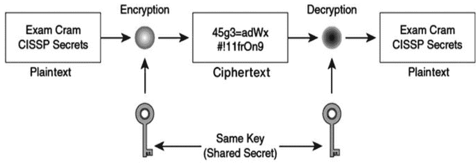

图 4.14 对称加密

图 4.14 中的简单图示展示了对称加密过程。明文使用单一共享密钥加密，生成密文；然后将密文传输给消息接收者，接收者逆转过程以解密消息。对称加密和解密速度快，如果使用大密钥，对称加密非常难以破解。然而，它有三个显著缺点：

- 对称密钥分发
- 密钥管理
- 仅提供机密性

对称密钥分发是对称加密中最严重的缺陷。为了使对称加密有效，必须存在安全的密钥传输方法。在我们的现代世界中，需要某种带外传输方式。请想一想：如果 Bob 想给 Alice 发送一条秘密消息，但担心旁听者 Eve 会监控他们的通信，他该如何发送消息？如果密钥以明文发送，Eve 可以截获它。Bob 可以亲自递送密钥、邮寄它，甚至派快递员。所有这些方法在我们的电子商务和电子通信世界中都非常不切实际。

除了密钥交换问题外，还存在密钥管理问题。例如，如果有 10 个人需要彼此完全保密地通信，则需要为他们提供 45 个密钥。以下公式用于计算对称加密所需的密钥数量：

```
N(N – 1)/2
```

本示例的计算如下：

```
10(10 – 1)/2 = 45 keys
```

表 4.8 显示了随着用户数量增加，密钥数量如何上升。

### 表 4.8 对称加密用户和密钥

| 用户数量 | 密钥数量 |
|---|---|
| 5 | 10 |
| 10 | 45 |
| 100 | 4,950 |
| 1,000 | 499,500 |

对称加密的第三个也是最后一个问题是它仅提供机密性。密码学的最终目标是提供机密性、完整性、真实性和不可否认性。

对称算法的一些示例包括：

- **数据加密标准 (DES)**：DES 曾是最常用的对称算法。它已被 NIST 正式退役。即使是最新版本的 DES（即 3DES）也于 2018 年退役，并被新的 FIPS 197 标准 AES 所取代。
- **Blowfish**：Blowfish 是一种通用对称算法，旨在替代 DES。Blowfish 具有可变块大小，密钥大小为 32 位到 448 位。
- **Twofish**：Twofish 是一种分组密码，针对 128 位数据块运行，能够使用长度高达 256 位的密码密钥。
- **国际数据加密算法 (IDEA)**：IDEA 是一种分组密码，使用 128 位密钥加密 64 位明文块。它已获专利，但非商业用途免费，并被 PGP 使用。
- **Rijndael**：这是一种分组密码，被美国政府采用为高级加密标准 (AES) 以替代 DES。尽管 Rijndael 支持多种块大小，但 AES 的块大小固定为 128 位。有三个批准的密钥长度——128、192 和 256——对应块大小为 10、12 和 14。
- **Rivest 密码 4 (RC4)**：RC4 是一种基于流的密码。流密码将数据视为比特流。
- **Rivest 密码 5 (RC5)**：RC5 是一种快速分组密码。它与其他对称算法不同，支持可变块大小、可变密钥大小和可变轮数。允许的块大小选择为 32、64 和 128 位。轮数范围可为 0 到 255，密钥长度可高达 2,040 位。
- **安全快速加密例程 (SAFER)**：SAFER 是一种基于块的密码，以 64 位和 128 位块处理数据。
- **MARS**：MARS 是由 IBM 开发的 AES 候选算法。它是一种分组密码，具有 128 位块大小和 128 到 448 位之间的密钥长度。
- **Carlisle Adams/Stafford Tavares (CAST)**：CAST 是一种 128 位或 256 位分组密码，曾是 AES 候选算法。
- **Camellia**：Camellia 是一种对称密钥分组密码，块大小为 128 位，密钥大小为 128、192 和 256 位。由日本三菱电机和 NTT 开发，Camellia 与 AES 相当。
- **Skipjack**：Skipjack 由 NSA 推广，使用 80 位密钥，支持与 DES 相同的四种操作模式，并针对 64 位文本块运行。Skipjack 遭到了公众反对，因为它被开发出来是为了让政府能够保存信息，使合法当局（持有搜查令或法院批准）能够重建 Skipjack 访问密钥并解密受影响各方之间的私密通信。

## 考试提醒

请务必花时间复习各种加密类型、块大小和密钥长度；你可以预期在 CISSP 考试中看到这些项目。你将被期望了解后一节中详细讨论的一些算法。其他算法可能仅作为考试中的干扰项出现。

要从密码学中获得身份验证，必须求助于非对称加密。但是，在讨论非对称加密之前，以下各节将完成对 DES 和另外几种流行对称加密方法的讨论。

## 数据加密标准 (DES)

DES 源于 20 世纪 70 年代初 IBM 最初开发的一个项目。IBM 和 NIST 修改了 IBM 最初的加密标准（称为 Lucifer），使其使用 56 位密钥。该修订标准得到了 NSA 的认可，被命名为 DES，并于 1977 年发布。它于 1981 年作为美国国家标准学会 (ANSI) 标准发布。


DES 使用 64 位块一次处理 64 位明文，并输出 64 位密文块。如前所述，DES 使用 64 位密钥（每第 8 位被忽略），并具有以下操作模式：

- 电子密码本（ECB）模式
- 密码块链（CBC）模式
- 密码反馈（CFB）模式
- 输出反馈（OFB）模式
- 计数器（CTR）模式

> **考试警报**
> 
> 这些操作模式可应用于任何对称密钥块密码，例如 DES、3DES 或 AES。您需要为 CISSP 考试了解它们。

书面 ANSI 标准报告 DES 密钥为 64 位，但 8 位实际上用于奇偶校验，以确保其余 56 位的完整性。因此，在加密强度方面，密钥实际上只有 56 位长。每个 64 位明文块被分成两个 32 位块，然后由这个 56 位密钥处理。处理过程将明文提交给 16 轮置换和替换。

> **考试警报**
> 
> 请记住，虽然 DES 对 64 位块进行操作，但密钥的有效长度仅为 56 位。

## 电子密码本（ECB）模式

ECB 是 DES 的原生加密模式。与所有其他模式一样，如果最后一个块未填满，则会添加填充以使明文成为完整的块。

虽然 ECB 产生最高吞吐量，但它也是最容易破解的 DES 加密形式。如果用于大量数据，它很容易受到攻击，因为相同的明文在使用相同密钥加密时，将始终产生相同的密文。ECB 模式仅适用于少量数据。图 4.15 说明了 ECB。

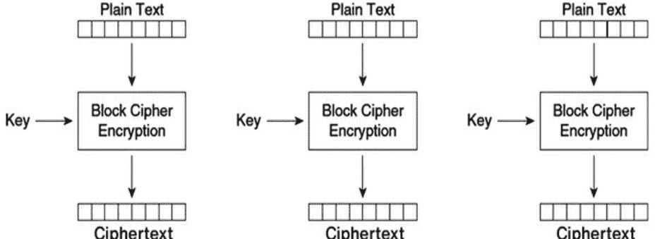

图 4.15 DES ECB 加密

> **提示**
> 
> 使用 ECB 时，给定的明文块用给定密钥加密将始终产生相同的密文。ECB 是 DES 最弱的形式。

## 密码块链（CBC）模式

广泛使用的 DES 的 CBC 模式与 ECB 相似。CBC 处理 64 位数据块，但会将每个块生成的部分密文插入下一个块中。在这个称为 _链接_ 的过程中，每个块都依赖于前一个块，形成链；链接是通过使用 XOR 操作完成的。

DES 的 CBC 模式使密文更安全，不易被破解。CBC 模式在接收时存在轻微的传输错误传播风险。任何经历的错误都会传播到接收后续块的解密中。这可能会导致无法解密该块以及后续块。

## 密码反馈（CFB）模式

CFB 使用小块大小（1 位到 1 字节）实现，以便流式数据可以在无需等待累积 64 位的情况下加密。其结果是 CFB 的行为类似于流密码。它与 CBC 类似，即先前生成的密文会添加到后续块中。并且，与 CBC 一样，传输过程中的错误和损坏可以通过接收方的解密过程传播。

## 输出反馈（OFB）模式

与 CFB 模式一样，OFB 模式模拟流密码。然而，与 CFB 模式不同的是，OFB 模式将数据流的明文反馈到要加密的下一个块中。因此，传输错误不会在整个解密过程中传播。使用初始化向量来创建第一个加密块的种子值。DES 将明文与种子值进行 XOR 运算，以便应用于后续数据。

OFB 有一种称为计数器模式的派生模式。计数器模式（如本章后面所述）将 DES 实现为流密码，并生成长时间不重复的密文。图 4.16 说明了 DES OFB 加密。

> **提示**
> 
> 虽然 DES 在许多年里保持安全，但在 1998 年，电子前哨基金会（EFF）能够在大约 23 小时内通过暴力破解破解 DES。当 DES 正式退役时，建议使用三重 DES（3DES）来确保安全。三重 DES 此后已被 AES 取代。

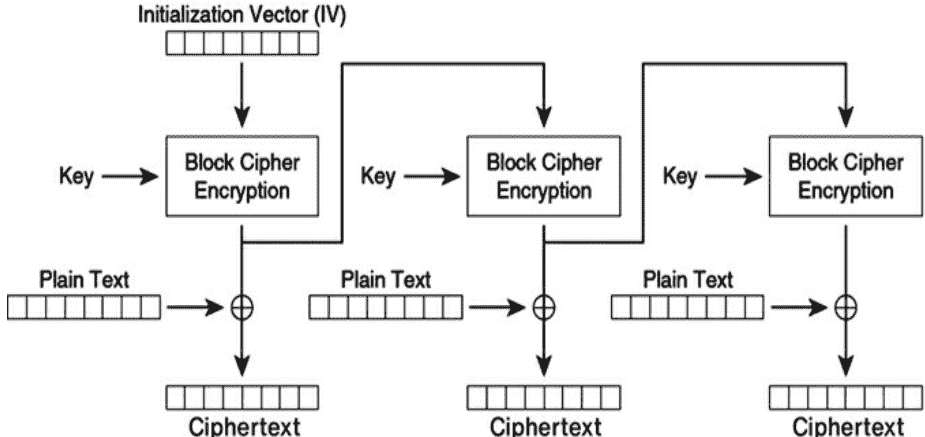

## 计数器（CTR）模式

与 CFB 和 OFB 模式一样，计数器模式也将块密码实现为流密码，并向过程添加一个计数器。计数器是一个产生长时间不重复序列的函数。计数器值与初始化向量组合，以生成对称密钥块密码的输入。然后该值通过块密码使用对称密钥进行加密。计数器模式专为多处理器机器上的操作而设计，块可以并行加密，如图 4.17 所示。

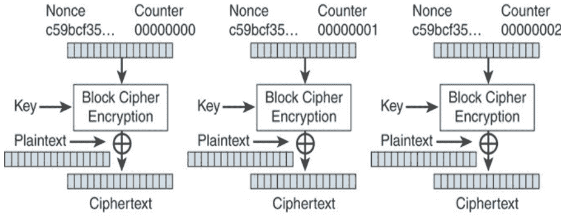

图 4.17 计数器模式加密

## 三重 DES（3DES）

在深入了解 3DES 细节之前，让我们先看看为什么会发明 3DES。DES 的采用带有五年认证，这意味着它需要每五年重新认证一次。虽然 DES 最初通过重新认证没有任何问题，但 NIST 发现 DES 开始过时，并开始寻找替代它的候选者。DES 已成为计算能力增强的受害者。正如摩尔定律所预测的，每平方英寸的晶体管数量每 18 至 24 个月翻一番，处理能力也是如此。因此，一个原本需要通过暴力破解花费数年才能攻破的加密标准，正在变得越来越容易受到攻击。DES 的最终终结发生在 1998 年，当时 EFF 能够在大约 23 小时内通过暴力破解破解 DES。实际攻击使用了涉及超过 100,000 台计算机的分布式系统。虽然 DES 在许多年里一直能抵抗破解，但 EFF 项目证明了需要更强的算法。

虽然 AES 打算作为长期替代品，但政府尚未选择支持的密码。在 AES 部署之前，需要一个临时解决方案来填补空白。有人认为可能会使用双重 DES。毕竟，双重 DES 可以拥有 112 位密钥！但是，密码分析证明双重 DES 比 DES 更安全；破解它所需的工作因子与 DES 相同。双重 DES 也易受中间相遇攻击 [中间相遇攻击](https://www.hypr.com/meet-in-the-middle-mitm-attack/)。

事实证明，3DES 提供了性能的几何级增长。因此，为了延长 DES 加密标准的有用性，3DES 被用作临时解决方案。3DES 可以使用两个或三个密钥来加密数据，具体取决于其实现方式；因此，它的有效密钥长度为 112 位或 168 位。3DES 执行 48 轮置换和替换。尽管它安全得多，但速度大约是 56 位 DES 的三分之一。3DES 可以以多种方式实现：

- DES EEE2：DES EEE2 使用两个密钥。在第三轮加密期间会重复使用第一个密钥。加密过程执行三次（加密、加密、加密）。
- **DES EDE2**：DES EDE2 使用两个密钥。同样，在第三轮加密期间会重复使用第一个密钥。与 DES EEE2 不同，DES EDE2 是先加密，再解密，最后加密。
- **DES EEE3**：DES EEE3 使用三个密钥，并执行三次加密过程，每次都执行加密。有时，您可能会看到这些密码的具体数学摘要。例如，在讨论使用 E(K,P) 的 DES-EEE3 时，其中 E 指的是使用密钥 K 加密明文 P，该过程总结为 E(K3,E(K2,E(K1,P)))。
- **DES EDE3**：DES EDE3 使用三个密钥，但操作方式是加密、解密，然后再次加密数据。图 4.18 说明了 EDE3。

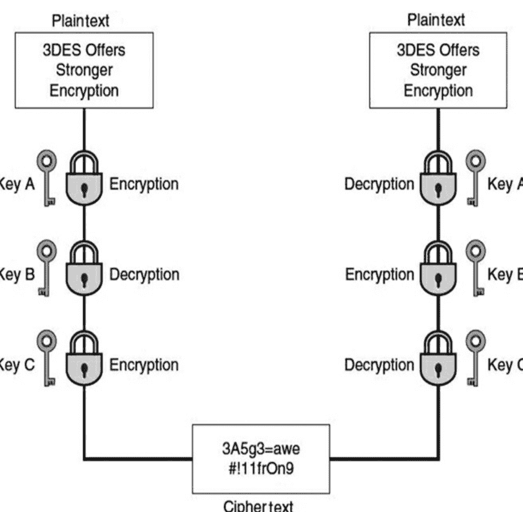

图 4.18 3DES EDE3

## 高级加密标准（AES）

2002 年，NIST 决定将 DES 的替代品定为 AES。审查了多种算法，并选择了 Rijndael（发音类似“rain doll”）。其名称源自其两位开发者的名字：Vincent Rijmen 和 Joan Daemen。Rijndael 被认为是一种快速、简单、强大的加密机制。

AES 可能是当今最重要的对称加密标准。它被广泛使用，通常见于无线接入点和其他


产品。此外，Rijndael 以抵御各种类型的攻击而闻名。Rijndael 算法使用三层变换来加密/解密消息文本块：

- 线性混合变换
- 非线性变换
- 密钥加变换

它还使用一组并行轮，每轮包含四个步骤：

1. **字节替换**：每个字节都被 s-box 替换所取代。
2. **移位行**：字节被排列在矩形矩阵中并进行移位。
3. **混合列**：基于排列的矩形进行矩阵乘法。
4. **加轮密钥**：状态的每个字节与轮密钥组合。

在最后一轮中，第四步被跳过，第一步重复。

Rijndael 是一种迭代分组密码，在开发中，它支持可变的密钥和块长度，分别为 128、192 或 256 比特：

- 如果密钥大小和块大小均为 128 比特，则有 10 轮。
- 如果密钥大小和块大小均为 192 比特，则有 12 轮。
- 如果密钥大小和块大小均为 256 比特，则有 14 轮。

根据 AES 标准的规定，Rijndael 现在固定块大小为 128，但仍可部署多种密钥长度。

## 国际数据加密算法 (IDEA)

IDEA 是一种使用 128 位密钥的 64 位分组密码。尽管它已被一家瑞士公司申请专利，但可免费用于非商业用途。它被认为是一种安全的加密标准，且目前未发现针对它的已知攻击。它以四种不同的模式运行，类似于 DES。曾一度认为 IDEA 将取代 DES，但专利费阻止了此事的发生。

## 里维斯特密码算法

*里维斯特密码* 是一个通用术语，指 Ron Rivest 设计的一系列密码，包括 RC2、RC4、RC5 和 RC6。Ron Rivest 是 RSA 的创建者之一。RC1 从未发布，RC3 在发布前就已被密码分析破解。

RC2 是该系列中的早期算法。它具有可变密钥大小的 64 位分组密码，可用作 DES 的即插即用替代品。

RC4 是一种快速流密码，其速度快于分组模式密码，并且曾被广泛使用。它特别适合低功耗设备。40 位版本用于有线等效隐私 (WEP)。尽管 802.11 标准仅指定了 40 位密钥（连同 24 位 IV，构成 64 位 WEP），但许多供应商试图通过事实上部署 104 位密钥（连同 24 位 IV，构成 128 位 WEP）来加强加密。

RC5 是一种基于分组的密码，其轮数范围可为 0 到 255，密钥长度范围可为 0 到 2,048 位。RC6 类似；它使用可变密钥大小和密钥轮数。RC6 添加了两个 RC5 不具备的功能（整数乘法和四个 4 位工作寄存器）。

## 非对称加密

非对称加密不同于对称加密，因为它使用两个独特的密钥，如图 4.19 所示。由一个密钥加密的内容，需要另一个密钥才能解密。非对称加密最大的好处之一是它克服了对称加密的一大障碍：密钥分发。

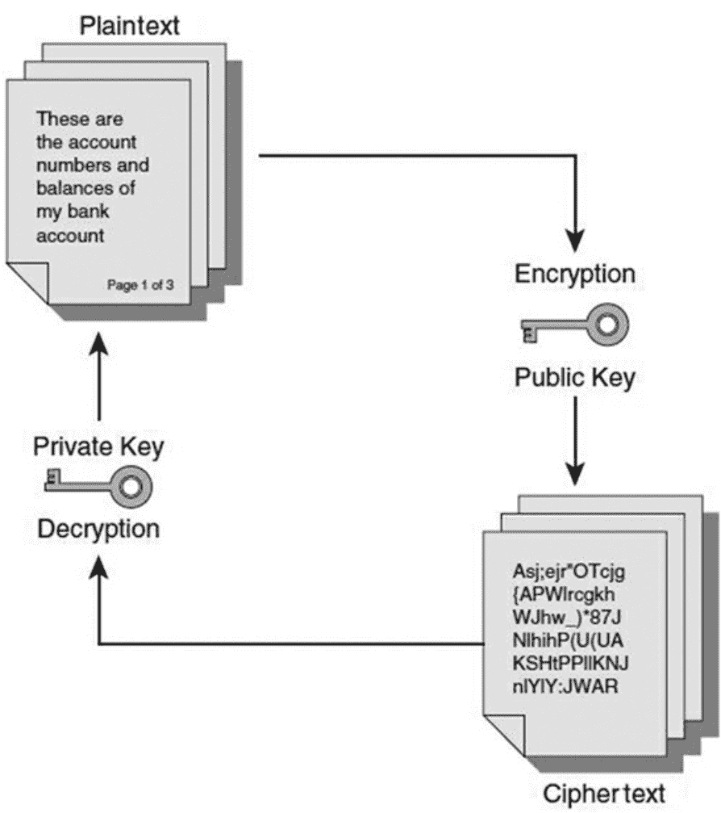

### 图 4.19 非对称加密

非对称加密的工作原理如下：假设你想向客户端发送一条消息。你使用客户端的公钥加密该消息。当客户端收到消息后，他使用自己的私钥解密。这里的重要概念是，如果消息使用公钥加密，那么只有匹配的私钥才能解密它。私钥按定义通常被保密，而公钥可以分发给任何人。如果设计得当，则不应该有人能轻易从公钥推导出密钥对的私钥。

加密系统还可以利用 _零知识证明_。这个概念允许你证明你的知识，而无需向第三方透露该事实。例如，如果有人使用私钥加密数据，则可以使用公钥解密该数据。这将允许完美的真实性检查。非对称加密为实现这一概念提供了机制。私钥持有者可以证明她持有该密钥，而无需向任何人泄露内容。W. 迪菲博士和 M. E. 赫尔曼博士（稍后讨论）利用这一概念，在跨不受信任的通信路径进行通信时允许创建可信的会话密钥。瞧！——密钥分发问题得到了解决。

公钥密码学的实现依赖于单向函数的使用。单向函数，又称 _陷门_，是一种在一个方向上易于计算但在另一个方向上几乎不可能计算的数学运算。根据所使用的非对称加密类型，该计算涉及以下之一：

- 操作离散对数
- 将大合数分解为其原始质因数

作为陷门函数的示例，考虑使用因式分解的实现。如果给出两个大质数，例如 387 和 283，将它们相乘得到 109,521 很容易。但是，如果只给出乘积 109,521，则需要一段时间才能找到因数。

正如你所见，任何知道陷门的人都可以轻松地在两个方向上执行该函数，但缺乏陷门的人只能在一个方向上执行该函数。当某人使用公钥函数时，陷门函数用于正向方向；正向方向用于加密、数字签名验证和对称密钥接收。当某人使用私钥函数时，陷门函数用于逆向方向；逆向方向用于解密、数字签名生成和对称密钥传输。

当公钥加密正确实现时，任何持有私钥的人都可以生成其公钥对，但持有公钥的人无法轻易推导出其私钥对。我们要感谢 迪菲 和 赫尔曼 帮助开发公钥加密；他们于 1976 年发布了第一个密钥交换协议。

## 迪菲-赫尔曼

迪菲-赫尔曼 是第一个公钥交换算法。它仅开发用于密钥交换，而不用于数据加密或数字签名。迪菲-赫尔曼 协议允许两个用户在不安全的介质上交换秘密密钥，无需任何预共享秘密。

虽然 CISSP 考试不需要深入了解 迪菲-赫尔曼 的运作，但其运作是经典的，对于任何对密码系统工作原理感兴趣的人来说都值得回顾。迪菲-赫尔曼 有两个系统参数：p 和 g。这两个参数都是公开的，系统的所有用户都可以使用。参数 p 是一个质数，参数 g（通常称为生成元）是小于 p 的整数，并具有以下属性：对于 1 到 p – 1（含）之间的每个数字 n，都存在 g 的幂 k，使得 g^k = n mod p。例如，给出以下公共参数：

- p = 质数
- g = 生成元

这些值用于生成函数 y = g^x mod p。有了该函数，Alice 和 Bob 可以按照以下方式安全地交换先前未共享的秘密（对称）密钥：

Alice 可以使用只有她持有的私有值 a 来计算

- y^a = g^a mod p

Bob 可以使用只有他持有的私有值 b 来计算

- y^b = g^b mod p

Alice 现在可以将 y^a（作为 Alice 的随机数，或 A-随机数）发送给 Bob，Bob 可以将 y^b（作为 Bob 的随机数，或 B-随机数）发送给 Alice。同样，Alice 可以再次在 B-随机数上使用她的私有值 A。她的结果将是 (y^b)^a，或 g^{ba} mod p。

同样，Bob 使用他的私有值 b，可以从接收到的 A-随机数计算 (y^a)^b：

g^{ab} mod p

但猜猜怎么着：从数学上讲，g^{ba} mod p 和 g^{ab} mod p 是等价的。因此，事实上，Bob 和 Alice 刚刚安全地交换了一个新的秘密密钥。

迪菲-赫尔曼 容易受到中间人攻击，因为密钥交换不验证参与者。为了证明真实性，应使用数字签名和数字证书（例如，预先接受某人的公钥，有时在 PKI 内）。迪菲-赫尔曼 与多种身份验证方法结合使用，包括 IPsec 的 Internet Key Exchange (IKE) 组件。

以下是关于 迪菲-赫尔曼 的一些重要事实：

- 它是第一个非对称算法。
- 它提供密钥交换服务。
- 它被认为是一种密钥协商协议。
- 它通过离散对数运行。

## RSA

RSA 于 1977 年由 Ron Rivest、Adi Shamir 和 Len Adleman 在 MIT 开发。该密码的名称基于他们的姓名首字母。尽管 RSA 比对称加密密码系统慢得多，但它提供对称密钥交换，并被认为非常安全。RSA 基于质数分解，但为了安全，它必须使用乘积远大于 129 位的质数。小于 130 位的十进制数已使用数域筛法算法进行分解。对于 CISSP 考试，你不需要知道 RSA 公钥和私钥生成的内部工作原理，但本节中的信息对你作为安全专业人员将很有用。

通常，明文被分割为等长块，每个块包含的字符数少于


多于 n 位数字，并且每个块都会被加密和解密。密码分析人员或任何试图破解 RSA 的人都将面临将一个大整数分解为其两个因子的困难挑战。破解密钥将需要非凡的计算机处理能力和时间。RSA 支持最高 2,048 位的密钥大小。

RSA 算法已成为工业强度加密的事实标准，尤其是自 2000 年专利到期以来。它已内置到许多协议、固件和软件产品中，例如 Microsoft Edge、Google Chrome 和 Mozilla Firefox。

> LUC 是 RSA 的一种替代方案，尽管它并未被广泛使用。它于 1991 年发明，使用 Lucas 函数。

> XTR 是由 Arjen Lenstra 和 Eric Verheul 开发的一种公钥加密系统，同样基于有限域和离散对数，并被视为所有离散对数函数的通用超集函数。

## El Gamal

El Gamal 是 Diffie-Hellman 密钥交换的扩展。它可用于数字签名、密钥交换和加密。El Gamal 由三个离散组件组成：密钥生成器、加密算法和解密算法。它于 1985 年发布，其安全性部分取决于解决离散对数问题的难度。

## Elliptic Curve Cryptosystem (ECC)

ECC 被认为比之前的非对称算法更安全，因为椭圆曲线系统比基于离散对数问题的系统更难破解。椭圆曲线通常定义在有限域上（例如实数和有理数），并以类似于离散对数问题的方式实现。椭圆曲线由以下方程定义：

$y^2 = x^3 + ax + b$

以及一个点 O，即无穷远点。

椭圆曲线空间具有以下属性：

- 加法是模乘法的对应运算。
- 乘法是模幂运算的对应运算。

因此，给定椭圆曲线上的两个点 P 和 R，其中 P = KR，求 K 被称为 _椭圆曲线离散对数问题_。ECC 速度快。根据 RFC 4492，ECC 中使用的 163 位密钥具有与 RSA 算法中使用的 1,024 位密钥相似的密码强度。因此，它可以实现在智能手机、平板电脑、智能卡和其他手持设备等更小、功耗更低的设备上。

## Merkle-Hellman Knapsack

_梅克尔-赫尔曼背包_（背包）是一种基于固定权重的非对称算法。虽然该系统曾一度流行，但于 1982 年被破解。

## 对称和非对称加密系统复习

为了帮助确保您在 CISSP 考试中取得成功，表 4.9 比较了对称和非对称加密系统。

表 4.9 对称和非对称系统的属性和功能

| 对称 | 非对称 |
|---|---|
| 机密性 | 机密性、完整性、身份验证和不可否认性 |
| 一个共享密钥 | 两个密钥：公钥和私钥 |
| 需要带外交换 | 适用于带内交换 |
| 不可扩展，需要太多密钥 | 可扩展，适用于电子商务 |
| 密钥大小小且速度快 | 需要更大的密钥大小且处理速度较慢 |
| 适用于批量加密 | 数字签名、数字信封、数字证书和少量数据 |

> > **考试警报**
> >
> > 在尝试 CISSP 考试之前，您有必要了解讨论的每种非对称算法属于哪个类别。花些时间回顾一下区别：
> >
> > - 使用有限域中的离散对数：Diffie-Hellman；El Gamal
> > - 使用大质数的乘积：RSA
> > - 使用固定权重：Merkle-Hellman Knapsack
> > - 使用椭圆曲线：椭圆曲线加密系统

## 混合加密

到本章至此为止，我们分别讨论了对称和非对称密码，如表 4.9 所示，两者各有优缺点。虽然对称加密速度快，但密钥分发是一个问题。非对称加密提供了易于密钥分发，但不适合大量数据。混合加密利用每种方法的优点，将它们结合成一个真正强大的系统：公钥加密系统用作密钥封装方案，私钥加密系统用作数据封装方案。

混合加密系统的工作原理如下。如果 Michael 想向他的编辑 Betsy 发送消息，则会发生以下情况（见图 4.20）：

- 1. Michael 为数据封装方案生成一个随机私钥。我们可以称其为会话密钥。
- 2. Michael 使用步骤 1 中生成的会话密钥，通过数据封装方案加密消息。
- 3. Michael 使用 Betsy 的公钥加密会话密钥。
- 4. Michael 将加密的消息和加密的密钥都发送给 Betsy。
- 5. Betsy 使用她的私钥解密会话密钥，然后使用会话密钥解密消息。

几乎所有现代加密系统都以这种方式构建，因为它们既提供了密钥加密系统的速度，又提供了公钥加密系统的“密钥交换能力”。混合加密系统包括 IPsec、PGP、SSH、SET、SSL、WPA2-Enterprise 和 TLS。（这些系统将在本章后面详细讨论。）

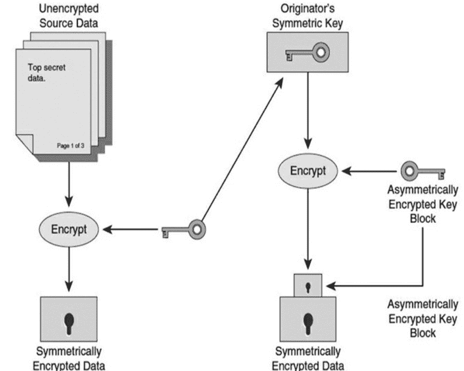

- 1. 发送方使用对称算法加密数据。
- 2. 发送方使用非对称算法加密数据密钥。
- 3. 密钥和数据都发送给接收方。

图 4.20 混合加密

## 公钥基础设施和密钥管理

与实体店铺打交道给我们提供了大量与供应商建立信任的机会。我们可以看到商店，与员工交谈，并很好地了解供应商的业务运作方式。互联网交易的透明度远低于此。我们看不清正在与谁打交道，不知道他们实际运营什么类型的业务，也可能不确定是否可以信任他们。公钥基础设施 (PKI) 的设计正是为了解决这些问题，并为电子交易带来信任、完整性和安全性。

PKI 是一个由硬件、软件和策略组成的框架，用于管理、创建、存储和分发密钥及数字证书。该框架的组件包括以下内容：

- 证书颁发机构 (CA)
- 注册机构 (RA)
- 证书吊销列表 (CRL)
- 数字证书
- 证书分发系统

### 证书颁发机构

CA 的一个很好的类比是机动车管理局 (DMV)，这是一个负责颁发驾驶执照的州级实体，驾驶执照是身体身份识别的公认标准。如果你兑现支票、去夜总会或乘飞机，你的驾驶执照是这些地点广泛接受的用于证明身份的文件之一。CA 就像 DMV：它们在数字世界中为你的身份作保。VeriSign、Thawte 和 Entrust 是一些提供公共 CA 服务的公司。

CA 不必是外部第三方；许多公司决定自行承担这些责任。无论由谁执行，以下步骤都是必要的：

- 1. CA 在 RA 的协助下验证证书请求。
- 2. 验证个人的身份。
- 3. CA 创建一个证书，证明该人与所提供的公钥匹配。

### 注册机构

RA 就像一个信使：它位于客户端和 CA 之间。虽然 RA 不能生成证书，但它可以接受请求、验证个人身份，并将信息传递给 CA 以生成证书。

当证书服务扩展到覆盖大型地理区域时，RA 发挥着关键作用。一个中央 CA 可以将其职责委托给世界各地的区域 RA。


> **考试警示** 预计会看到涉及 PKI 工作原理的 CISSP 考试题目。重要的是要理解，RA 不能颁发证书。

## 证书撤销列表

就像驾驶执照一样，数字证书可能不会始终保持有效。
(我有一位曾姑婆，她驾驶过期的驾照开了好几年。在她的情况中，
她害怕在 95 岁时可能无法通过视力检查。) 在
企业生活中，证书可能会因为有人离开公司、信息可能发生变化，或者私钥可能
被泄露而变得无效。出于这些原因，必须维护 CRL。

CRL 由 CA 维护，CA 对列表进行签名以保持其
准确性。每当报告数字证书出现问题时，那些
证书被视为无效，CA 会将序列号添加到
CRL 中。任何请求数字证书的人都可以检查 CRL 以验证
证书的完整性。CRL 的替代品是在线证书状态协议 (OCSP)；它采用客户端/服务器设计，比
CRL 更具可扩展性。当用户请求访问服务器时，OCSP 会发送
证书状态信息请求。服务器会返回当前、
已过期或未知的响应。无论使用哪种方法，证书
问题并非新鲜事；要了解 2015 年 Dell 遇到的问题，请参见
www.infoworld.com/article/3008422/security/what-you-need-to-know-about-dells-root-certificate-security-debacle.html。

## 数字证书

数字证书是 PKI 系统的核心。数字证书
承担两个角色：

- 它确保公钥的完整性，并确保密钥
  保持不变并处于有效状态。
- 它验证公钥与声明的所有者绑定，并且所有
  关联信息都是真实且正确的。

实现这些目标所需的信息被添加到数字证书中。数字证书的格式符合 X.509 标准，其最新版本是第 3 版。第 3 版的关键发展之一是添加了扩展。第 3 版包括支持其他拓扑的灵活性。它可以作为信任网运行，类似于 PGP。X.509 证书包括以下元素，图 4.21 中提供了显示这些元素的一些示例：

- 版本
- 序列号
- 算法 ID
- 颁发者
- 有效性
  - 起始时间（指定日期）
  - 截止时间（指定日期）
- 主体
- 主体公钥信息
  - 公钥算法
  - 主体公钥
- 颁发者唯一标识符（可选）
- 主体唯一标识符（可选）
- 扩展（可选）

数字证书在信任链中起着至关重要的作用。公钥加密在与你认识的人打交道时效果很好，因为您可以轻松地相互发送公钥。但与不认识的人通信怎么办呢？

执行电子交易时，数字证书用于证明您的身份。

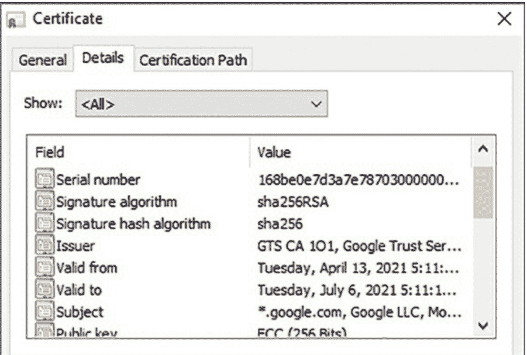

图 4.21 X.509 证书

虽然您可能想要使用外部证书颁发机构，但这样做并非强制性。您可以决定让自己的组织充当证书颁发机构。无论是由第三方处理证书职责还是由您自己执行，数字证书通常包含以下关键信息：

- 包括用户名、序列号和证书有效期的标识信息
- 证书持有者的公钥
- 签名机构的数字签名，这部分至关重要，因为它认证并验证整个包的完整性

## PKI 中客户端的角色

到此为止，可能看起来所有工作都落在了 CA 的肩上；但事实并非完全如此。客户负责请求数字证书并维护其私钥的安全。私钥丢失或被泄露将是毁灭性的；这意味着通信不再安全。如果您正在处理信用卡号码或其他用户身份信息，这种安全损失可能导致身份盗窃。

保护私钥是一个重要问题，因为攻击者攻击密钥比试图破解证书服务更容易。组织应关注七个密钥管理问题：

- 生成
- 分发
- 安装
- 存储
- 密钥更改
- 密钥控制
- 密钥销毁

密钥恢复和控制是必须解决的重要问题。一种基本的恢复和控制方法是 M of N 访问控制方法。该方法旨在确保没有单个人可以拥有完全控制权；它与双重控制密切相关。因此，如果 N 名管理员有权执行某个过程，则其中 M 名管理员必须进行身份验证才能进行访问。M of N 控制应要求物理在场才能访问。以下是一个示例：假设典型的 M of N 控制方法要求四个人可以访问归档服务器，并且至少有两个人必须在场才能完成访问。在这种情况下，M = 2，N = 4。这将确保没有单个人可能破坏安全系统或获得访问权限。

注意

许多组织使用硬件安全模块 (HSM) 来安全存储和安全检索这些托管密钥。HSM 系统保护密钥，并在检测到未经授权的访问时销毁密钥材料，从而检测并防止篡改。

## 完整性和身份验证

密码学为用户提供的功能之一是验证完整性和身份验证的能力。完整性确保收件人知道信息保持不变且处于真实原始状态。身份验证提供功能，以确保消息是由您相信的发送者发送的，并且消息被预期的接收者接收。为了帮助您在 CISSP 考试中取得成功，请复习表 4.10 中列出的完整性方法。

## 表 4.10 完整性验证

| 方法 | 描述 |
| :--- | :--- |
| 奇偶校验 | 用于网络的简单错误检测代码 |
| 哈希 | 完整性 |
| 数字签名 | 完整性、身份验证和不可否认性 |
| 哈希 MAC | 完整性和数据源身份验证 |
| CBC MAC | 完整性和数据源身份验证 |
| 校验和 | 冗余检查，弱完整性 |

## 哈希和消息摘要

哈希算法的工作原理是获取可变数量的数据并将其压缩为固定长度值，即所谓的 *哈希值*。哈希提供数据的指纹或消息摘要。强哈希算法难以破解，并且不会对两个或多个消息生成相同的哈希值。哈希可用于满足完整性和/或不可否认性的目标，具体取决于算法的使用方式。哈希可以帮助验证信息是否保持不变。图 4.22 提供了哈希过程的概述。

哈希算法不打算反向还原数据。消息摘要的目的是验证数据和消息的完整性。在设计良好的消息摘要中，如果输入字符串有任何微小变化，输出哈希值应发生巨大变化。这被称为雪崩效应。例如，易受 Sunburst 影响的 SolarWinds 版本的 MD5 哈希值为 b91ce2fa41029f6955bff20079468448。这意味着如果您将此哈希值与 SolarWinds 版本进行匹配，您正在运行的版本会使您暴露于 Sunburst 恶意软件之下。另一个值将表明您拥有的版本可能不易受攻击。

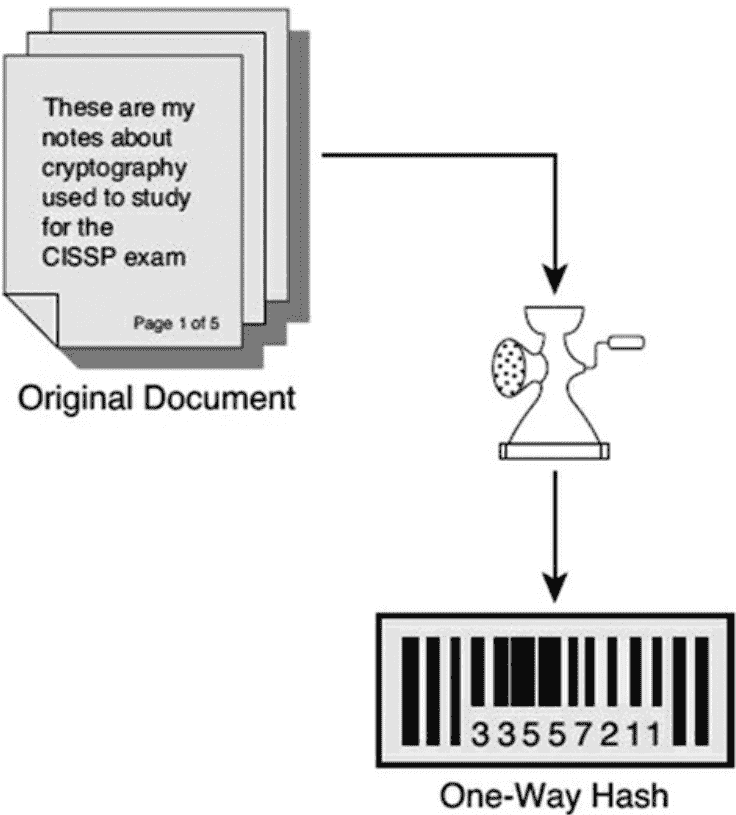


## 图 4.22 哈希

Tripwire、MD5sum 和 Windows 系统文件验证等程序依赖于哈希。一些常见的哈希算法包括：

- 报文摘要算法系列
- 安全哈希算法 (SHA)
- HAVAL
- RIPEMD
- Whirlpool
- Tiger

> **注意**
>
> 虽然存在许多哈希算法，但最常见的两种是 SHA 和 MD 系列。

哈希最大的问题是可能出现冲突。当两个或多个不同的输入产生相同的输出时，就会发生冲突。通过采用生成更大哈希值的算法可以减少冲突。

> **注意**
>
> 考虑哈希值时请记住：近似不算！
> 如果正在比较的哈希值以任何方式不同——即使只有一位不同——则正在被处理的数据不相同。

## MD 系列

所有 MD 算法均由 Ron Rivest 开发。随着技术的进步，它们经历了一系列版本的演进。最初版本是 MD2，针对 8 位计算机优化，现已有些过时。由于 MD2 被发现存在冲突问题，因此也不再受到青睐。接下来开发的算法是 MD4。消息以 512 位块进行处理，外加消息原始长度的 64 位二进制表示，并将其连接到消息中。与 MD2 类似，MD4 被发现容易受到潜在攻击。这就是开发 MD5 的原因；它可以被视为带有额外安全机制的 MD4。MD5 处理可变大小的输入并生成固定的 128 位输出。与 MD4 类似，它以 512 位块处理数据。

> **提示**
>
> 当两条不同的消息经过哈希处理并产生相同的消息摘要值时，就会发生冲突。这是不希望的，因为它可能掩盖某人可能更改了文件或消息内容的事实。已经证明 MD5 和 SHA-0 易受强制冲突攻击。

## SHA-1/2

SHA-1 是安全哈希算法 (SHA) 的一个版本，与 MD5 相似。它被视为 MD5 的继任者，并生成 160 位消息摘要。SHA-1 以 512 位块处理消息，并在必要时添加填充，使数据达到所需的位数。在 160 位中，SHA-1 只有 111 位的有效性。SHA-1 是 SHA 算法系列之一，包括 SHA-0、SHA-1 和 SHA-2。SHA-0 不再被视为安全，SHA-1 也不再推荐使用。SHA-2 实际上是一系列函数，是 SHA-1 的安全替代方案。SHA-2 系列包括 SHA-224、SHA-256、SHA-384 和 SHA-512。

## SHA-3

SHA-3 是最新的哈希算法系列，旨在替代 SHA-1 和 SHA-2。

### HAVAL

HAVAL 是另一种与 MD5 相似的单向哈希算法。与 MD5 不同，HAVAL 与固定消息摘要值无关联。HAVAL-3-128 进行三轮处理并生成 128 位指纹；HAVAL-4-256 进行四轮处理并生成 256 位指纹。

### 消息认证码 (MAC)

MAC 类似于数字签名的“穷人版”，与数字签名有些相似，只是它使用对称加密。MAC 使用相同的秘密（对称）密钥创建和验证。存在四种类型的 MAC：无条件安全、基于哈希函数、基于流密码和基于块密码。

### HMAC

基于哈希的消息认证码 (HMAC) 的设计旨在抵御多重冲突攻击。通过包含共享密钥来实现这种免疫性。简单来说，HMAC 通过使用 MD5 或 SHA-1 等哈希算法，并通过添加密码来更改待处理文件的初始状态来工作。即使有人能够拦截和修改数据，如果该人不持有密钥，也几乎毫无用处。如果没有密钥，该人不容易重新生成哈希值。为了成功使用 HMAC，接收者必须通过某种安全的带外机制获得对称密钥的副本。

### CBC-MAC

密码块链 MAC 使用 DES 等对称算法的 CBC 模式来创建 MAC。CBC-MAC 与 HMAC 不同之处在于 CBC-MAC 使用一种算法，而 HMAC 使用两种（哈希算法和对称块密码）。消息的最后一个块用作 MAC 认证部分，并附加到实际消息中。

### CMAC

基于密码的消息认证 (CMAC) 解决了 CBC-MAC 的一些安全缺陷。CMAC 具有更复杂的逻辑，并使用利用 AES 的数学函数来提高安全性。可以使用 CMAC 来验证消息的完整性和真实性。

## 数字签名

基于公钥加密的数字签名用于验证消息的真实性和完整性。数字签名是通过将消息内容传递给哈希算法，并使用发送者的私钥对其加密来创建的。收到消息后，接收者解密加密的哈希值，然后重新计算接收消息的哈希值。这些值应当匹配，以确保消息的有效性，并证明消息是由被认为发送它的一方发送的（因为只有该方才能访问私钥）。让我们通过一个示例逐步分解这个过程，以帮助详细说明其操作：

- 1. Bill 通过将消息传递给哈希算法来生成消息摘要。
- 2. 使用 Bill 的私钥加密消息摘要。
- 3. 消息被转发给接收者 Alice。
- 4. Alice 使用 Bill 使用的相同哈希算法从消息中生成消息摘要。然后 Alice 使用他的公钥解密 Bill 的签名摘要。
- 5. 最后，Alice 比较两个消息摘要——Bill 最初创建的一个和她自己创建的另一个。如果这两个值匹配，Alice 可以放心，消息未被篡改。

图 4.23 说明了此过程，并演示了哈希函数如何确保完整性以及对哈希值的签名如何提供身份验证和不可否认性。

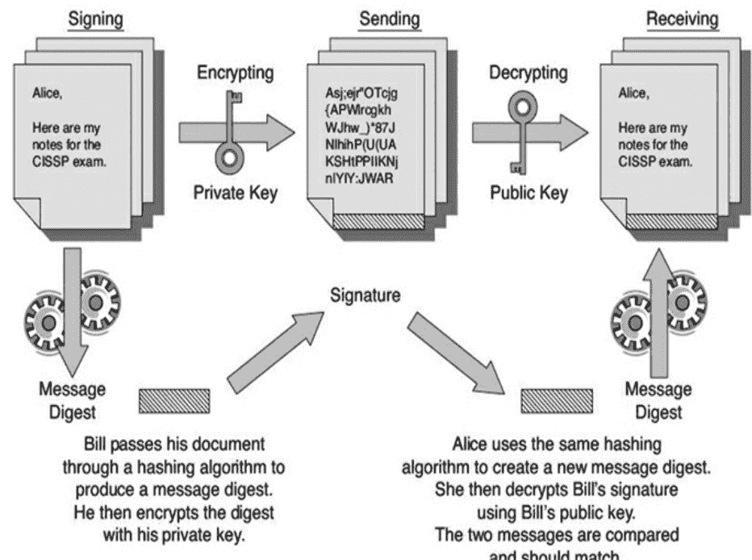

图 4.23 数字签名

## DSA

有了标准，事情就容易多了，数字签名算法 (DSA) 的设计目的正是如此。DSA 标准由 NIST 于 1991 年提出，旨在标准化数字签名标准 (DSS)。DSA 涉及密钥生成、签名生成和签名验证。它结合 SHA-1 和公钥加密来创建 160 位哈希。签名速度与 RSA 签名相当，但签名验证要慢得多。DSA 数字签名是一对表示为二进制数字的大数。

## 密码系统回顾

作为回顾，并帮助确保你在 CISSP 考试中取得成功，请查看表 4.11 中的知名密码系统。

## 表 4.11 算法及其功能

| 类别 | 算法 |
|---|---|
| 对称 | DES、3DES、Blowfish、Twofish、IDEA、CAST、SAFER、Skipjack 和 RC (系列) |
| 非对称 | RSA、ECC、Diffie-Hellman、Knapsack、LUC 和 El Gamal |
| 哈希 | MD (系列)、SHA (系列)、HAVAL、Tiger、Whirlpool 和 RIPEMD |
| 数字签名 | DSA |

## 密码攻击

对密码系统的攻击并非新鲜事。每当有人需要隐藏信息时，通常总有人希望揭露它。密码分析是对密码学的分析，从单词本身可以看出：crypt = 秘密或隐藏，analysis = 松动或溶解。密码分析的最终目标是确定密钥值，此类活动每天在 NSA 等组织以及黑客和安全专家工作的地点发生。取决于被破解的是哪个密钥，攻击者可能会获得机密信息访问权限，或冒充他人并试图进行某种伪装攻击。

由于密码学可以成为一种强大的工具，而且破解许多算法的能力是有限的，多边出口管制协调委员会 (CoCom) 成立以处理密码系统的控制。CoCom 于 1994 年解散，并由常规武器及双重用途货物和技术出口管制瓦森纳安排取代。瓦森纳安排获得了广泛支持，汇集了 30 多个国家来控制密码学的出口。


## 美国政府可以用来击败加密的方法

美国政府必须应对许多使用加密的个人和组织，例如恐怖分子和有组织犯罪集团。吹哨人爱德华·斯诺登公开的文件披露了美国国家安全局（NSA）用于破解加密系统的一些密码分析技术。这些技术包括控制国际加密标准的制定、使用超级计算机对算法进行暴力破解，以及与技术公司和互联网服务提供商合作，在商业加密软件中植入后门或陷门。有传言称，NSA甚至与主要的杀毒软件公司合作，开发杀毒软件无法检测的软件。您可以在 www.spiegel.de/international/germany/inside-the-nsa-s-war-on-internet-security-a-1010361.html 上阅读更多有关这些技术的内容。

在发起加密攻击之前，需要考虑的一个问题是对算法了解多少。它是公开的还是私有的？十九世纪，奥古斯特·科克霍夫（Auguste Kerckhoffs）提出了科克霍夫原则（Kerckhoffs’s principle），该原则认为加密系统不应依赖保密性；除了密钥之外，一切都应公开。这一争论的一个例子可以在内容扰码系统（CSS）的开发和破解中看到。这种加密方法由DVD复制控制协会（DVD CCA）开发。由于该算法是专有的，因此未公开。CSS的设计目的是仅允许授权的DVD播放器解码存储在原始DVD光盘上的扰码内容。直到1999年，Jon Lech Johansen和其他人联手破解了CSS，并将名为DeCSS的实用程序发布到互联网上。因此，虽然有人认为算法应该保密，但其他人仍然认为开放标准和系统能够构建更强大、更安全的系统。

在回顾了一些基础知识后，现在让我们回顾一下可能针对加密系统的常见攻击技术：

- **已知明文攻击**：这种攻击要求攻击者拥有一个或多个消息的明文和密文。加密文件存档（如 `zip`）容易受到此类攻击。

- **仅密文攻击**：这种攻击要求攻击者获得使用同一加密算法加密的多条加密消息。攻击者没有关联的明文，但试图通过寻找模式并使用统计分析来破解代码。

- **选择密文**：如果攻击者能够解密密文消息的部分内容，则解密后的部分可以用于发现密钥。

- **选择明文**：攻击者可以使明文消息被加密，然后分析密文输出。

- **差分密码分析**：这种攻击通常用于针对分组密码，其原理是查找加密的相关明文位之间的差异，以及其生成的密文之间的差异。

- **线性密码分析**：与差分密码分析一起，这是用于攻击分组密码的两种最广泛使用的攻击之一。线性密码分析使用函数来识别特定密钥在加密过程中被使用的最高概率。然后研究密钥对，以推导用于创建它们的密钥的信息。

- **生日攻击**：这种攻击的名字来源于生日悖论，该悖论指出，在一群人中，两人或两人以上共享生日的概率出乎意料地高。同样的逻辑应用于计算哈希函数中的冲突。如果哈希函数的输出不足以避免冲突，则消息摘要可能容易受到生日攻击。

- **密钥聚集**：当两个不同的密钥从同一消息生成相同的密文时，可能会发生此漏洞。这有时可能是由于密钥空间较小造成的，也可能是某些加密系统的特征。密钥聚集是一个真正的问题，因为这意味着两个或多个不同的密钥也可以解密安全内容。一个强大的加密系统应该具有较低的密钥聚集发生频率。如果没有，这也是加密系统可能成为攻击目标的另一种方式。

- **重放攻击**：当攻击者能够拦截加密密钥并在以后重复使用它们来加密或解密消息时，会发生这种攻击方法。

- **中间人攻击**：当攻击者将自己置于两个用户之间的通信路径中时，就会实施这种攻击。从这个位置，攻击者可能能够拦截并修改通信。

- **侧信道攻击**：这种攻击基于侧信道信息，例如时序、声音或电磁泄漏。

> **考试警报**
> 
> 在比较加密算法时，重要的是要牢记：工作因数越大，加密系统越强大。密码学家开发具有高工作因数的系统以抵御攻击，而不是为了绝对安全。只要有足够的时间和决心，所有系统都可以被破解。有时，攻击者只是寻找尚未公开发现的漏洞。这些漏洞被称为 _零日漏洞_。

- **橡胶棍攻击**：当其他所有方法都失败时，可能会使用此方法来提取密钥值或其他信息。这种攻击可能包括威胁、暴力、敲诈或勒索，因为人类比加密系统更大的弱点。

在尝试加密攻击时，必须考虑工作因数。_工作因数_可以衡量为针对加密系统执行暴力攻击所需的时间和精力。以下是最近过去中针对加密系统发生的一些成功攻击示例：

- **BEAST**：BEAST利用了TLS 1.0中CBC使用的弱点。违反了同源约束。

- **CRIME 和 BREACH**：CRIME针对TLS上的压缩，而BREACH是CRIME在HTTP上的一个实例。

- **Cryptolocker**：这种勒索软件能够使用RSA加密来加密本地和网络文件。

- **DROWN**：DROWN利用了当时仍受支持的SSL 2的密码。

- **FREAK**：FREAK利用该密码来实施中间人攻击并强制使用弱密钥。

- **Meltdown**：Meltdown针对硬件和Intel x86处理器，试图发动竞争条件和侧信道攻击。它将允许流氓进程读取所有内存，无论是否有授权。

- **POODLE**：这种密码攻击影响了SSL 3.0中的所有分组密码，并导致从SSL迁移到TLS。POODLE的一个变体也影响了TLS 1.0到1.2。

- **Spectre**：Spectre针对具有分支预测的硬件和微处理器。它是侧信道和时序攻击的一个示例。

## 站点和设施安全控制

请记住，良好的安全需要多层防御，包括逻辑和物理两方面。站点和设施安全控制是强大设施安全的重要组成部分。它们在第6章“身份和访问管理”和第8章“安全运营”中有详细介绍，但本节介绍了用于物理安全的一些常见控制：

- **物理访问控制**：这些控制包括闸门、围栏、门、保安和锁。围栏可以由多种组件制成，例如钢、木、砖或混凝土，但必须是所需保护级别的正确设计。保安也可以承担多种角色，用于监控、迎接、登记和陪同访客。锁有多种类型、尺寸和形状；它们既是最古老的防盗机制之一，也是最常用的威慑手段。

- **服务器机房和数据中心的控制**：这些区域的控制可以包括访问时间限制、指定谁可以进入特定区域的控制，以及服务器和数据中心的位置。位置合适的数据中心应具有有限的可访问性，且通常不超过两个门。一楼内部房间是数据中心的好位置。天花板应一直延伸至超过


吊顶，应控制对房间的进入，门应为实心结构且铰链朝内。

- **证据存储控制：** 如果您维护安全运营中心或从事计算机取证工作，可能需要设立证据存储区。通常，此类存储位于安全区域，配备上锁的安全柜或保险箱，以及记录与保管链相关活动的日志。

- **受限访问和工作区安全：** 安全设计的目标应是尽可能让未经授权的人员难以访问敏感资源。

- **HVAC 和环境控制：** 热量可能会损坏计算机设备，大多数数据中心的温度维持在 70°F 左右。安全管理应当知道谁负责 HVAC 系统，并且必须对系统进行控制，以保护组织及其人员免受化学和生物威胁。与 HVAC 类似，电力也是我们大多数人视为理所当然的资源。即使电力可靠的区域也可能面临停电、线路噪声或电磁干扰 (EMI)。企业必须做好应对所有这些因素的准备。不间断电源 (UPS) 通常用于帮助解决这些问题。

- **防火、探测和灭火控制：** 预防的重要部分是确保人员接受培训并了解如何预防潜在的火灾隐患。政策必须规定如何培训员工应对火灾。公司应确保配备适用且正常工作的火灾探测设备，以便员工能察觉潜在危险。仅仅收到火灾警报是不够的。员工需要知道该做什么以及如何处理不同类型的火灾。

> **注意** 第 6 章和第 8 章将更深入地介绍物理安全。

## 考试预备问题

- 1. 以下哪项最能描述超标量处理器？
  - A. 超标量处理器一次只能执行一条指令。
  - B. 超标量处理器有两个大缓存，用作输入和输出缓冲区。
  - C. 超标量处理器可以同时执行多条指令。
  - D. 超标量处理器有两个大缓存，用作输出缓冲区。

- 2. 以下哪项是由程序员开发并用于在开发期间绕过正常流程，但交付给客户时仍保留在软件中的内容？
  - A. 后门
  - B. 陷阱
  - C. 缓冲区溢出
  - D. 隐蔽信道

- 3. 以下哪种攻击发生在攻击者可以拦截会话密钥并在稍后重复使用时？
  - A. 已知明文攻击
  - B. 仅密文攻击
  - C. 中间人攻击
  - D. 重放攻击

- 4. 以下哪项是对称加密的缺点？
  - A. 密钥大小
  - B. 速度
  - C. 密钥管理
  - D. 密钥强度

- 5. 以下哪项 *不是* 对称算法的示例？
  - A. DES
  - B. RC5
  - C. AES
  - D. RSA

- 6. 以下哪种模型是开发的第一个基于机密性的模型？
  - A. Bell-LaPadula
  - B. Biba
  - C. Clark-Wilson
  - D. Take-Grant

- 7. 以下哪种模型是基于完整性且为商业应用开发的？
  - A. 信息流模型
  - B. Clark-Wilson 模型
  - C. Bell-LaPadula 模型
  - D. Brewer and Nash 模型

- 8. Biba 模型涉及以下哪项？
  - A. 关注内部威胁
  - B. 关注外部威胁
  - C. 涉及机密性
  - D. 涉及可用性

- 9. 哪种模型又称中国墙模型？
  - A. Biba 模型
  - B. Take-Grant 模型
  - C. Harrison-Ruzzo-Ullman 模型
  - D. Brewer and Nash 模型

- 10. 哪种哈希算法生成 160 位输出？
  - A. MD2
  - B. MD4
  - C. SHA-1
  - D. El Gamal

- 11. Bell-LaPadula 模型中的 * 属性的结果是什么？
  - A. 禁止向上读取
  - B. 禁止向上写入
  - C. 禁止向下读取
  - D. 禁止向下写入

- 12. Biba 模型简单完整性属性的结果是什么？
  - A. 禁止向上读取
  - B. 禁止向上写入
  - C. 禁止向下读取
  - D. 禁止向下写入

- 13. 以下哪项可用于连接不同的 MAC 系统？
  - A. 标签
  - B. 引用监视器
  - C. 控制
  - D. 守卫

- 14. 以下哪种安全运行模式最能描述用户有正当需求知晓所有数据？
  - A. 专用
  - B. 系统高
  - C. 分区
  - D. 多级

- 15. 以下哪种安全模型使用了 TLC 概念？
  - A. Biba 模型
  - B. Clark-Wilson 模型
  - C. Bell-LaPadula 模型
  - D. Brewer and Nash 模型

- 16. 以下哪种 DES 模式被认为最容易受到攻击？
  - A. CBC
  - B. ECB
  - C. CFB
  - D. OFB

- 17. DES 使用的密钥大小是多少？
  - A. 56 位
  - B. 64 位
  - C. 96 位
  - D. 128 位

- 18. 三重 DES 的哪种实现对第一次和第三次迭代使用相同的密钥？
  - A. DES-EEE3
  - B. HAVAL
  - C. DES-EEE2
  - D. DES-X

- 19. 以下哪种算法用于密钥分发，而不用于加密或数字签名？
  - A. El Gamal
  - B. HAVAL
  - C. Diffie-Hellman
  - D. ECC

- 20. 您正在使用文件完整性程序 Tripwire，并被要求审查加密程序的一些近期问题。当两个不同的密钥为相同消息生成相同密文时，这称为什么？
  - A. 哈希
  - B. 冲突
  - C. 密钥聚集
  - D. 输出验证

## 考试预备问题答案

- 1. C. 超标量处理器可以同时执行多条指令。选项 A 描述的是标量处理器；它一次只能执行一条指令。选项 B 不是描述超标量处理器，因为它没有两个大缓存用作输入和输出缓冲区。选项 D 不正确，因为超标量处理器没有两个大缓存用作输出缓冲区。

- 2. A. 程序员在开发期间使用后门（也称为维护钩子）以便轻松访问某个软件。选项 B 不正确，因为陷阱是简单网络管理协议 (SNMP) 用于向管理站报告严重情况的消息。选项 C 不正确，因为缓冲区溢出是由于编程不当造成的。选项 D 不正确，因为隐蔽信道是以非预期方式移动信息的手段。

- 3. D. 重放攻击发生在攻击者可以拦截会话密钥并在稍后重复使用时。选项 A 不正确，因为已知明文攻击要求攻击者拥有一个或多个消息的明文和密文。选项 B 不正确，因为仅密文攻击要求攻击者获得使用相同加密算法加密的多个消息。选项 C 不正确，因为中间人攻击是在攻击者将自己置于两个用户之间的通信路径上时实施的。

- 4. C. 密钥管理是对称加密的主要缺点。选项 A、B 和 D 不正确，因为加密速度、密钥大小和密钥强度都不是对称加密的缺点。

- 5. D. RSA 是一种非对称算法。选项 A、B 和 C 不正确，因为 DES、RC5 和 AES 是对称算法的示例。

- 6. A. Bell-LaPadula 是开发的第一个基于机密性的模型。选项 B、C 和 D 不正确：Biba 和 Clark-Wilson 模型都涉及完整性，而 Take-Grant 模型基于四种基本操作。

- 7. B. Clark-Wilson 模型是为商业活动开发的。该模型规定必须强制执行职责分离，主体必须通过应用程序访问数据，并且需要审计。选项 A、C 和 D 不正确。信息流模型涉及信息流，可用于保护完整性或机密性。Bell-LaPadula 模型是一个完整性模型，Brewer and Nash 模型是为防止利益冲突而开发的。

- 8. B. Biba 模型假设良好的编码实践正在保护内部威胁，因此专注于外部威胁。选项 A、C 和 D 不正确。Biba 模型只涉及完整性，而不涉及可用性或机密性。


- **9. D.** Brewer and Nash 模型又称为 Chinese Wall 模型，专门用于防止利益冲突。选项 A、B 和 C 不正确，因为它们不符合描述。Biba 模型基于完整性，Take-Grant 模型基于四种模式，Harrison-Ruzzo-Ullman 模型定义了访问权限如何更改、创建或删除。

- **10. C.** SHA-1 生成 160 位消息摘要。选项 A、B 和 D 不正确，因为 MD2 和 MD4 都会创建 128 位消息摘要，而 El Gamal 不是哈希算法。

- **11. D.** * 属性强制实施“不可向下写”，用于防止具有高安全许可的人员将数据写入较低分类级别。选项 A、B 和 C 未能正确描述 Bell-LaPadula 模型的星属性。

- **12. C.** Biba 模型的简单完整性属性旨在防止某人读取较低完整性级别的对象。这有助于保护敏感信息的完整性。

- **13. D.** 守卫用于连接各种 MAC 系统，并允许这些系统之间进行通信。选项 A 不正确，因为标签与 MAC 系统相关联，但不用于将它们连接在一起。选项 B 不正确，因为引用监视器与 TCB 相关联。选项 C 不正确，因为这里的 controls 仅仅是一个干扰项。

- **14. A.** 在列出的四种模式中，只有专用模式支持对系统上所有信息的合法需要知道。因此，选项 B、C 和 D 不正确。

- **15. B.** Clark-Wilson 模型旨在支持完整性，并关注 TLC，TLC 表示被篡改、已记录且一致。选项 A、C 和 D 不正确；Biba、Bell-LaPadula 和 Brewer and Nash 模型与 TLC 无关。

- **16. B.** 电子密码簿模式易受已知明文攻击，因为相同的明文始终生成相同的密文。选项 A、C 和 D 不正确。因为 CBC、CFB 和 OFB 均采用某种形式的反馈，有助于随机化加密数据，因此它们不存在此缺陷，并被认为更安全。

- **17. A.** 每个 64 位明文块被分成两个 32 位块，然后由 56 位密钥处理。总密钥大小为 64 位，但 8 位用于奇偶校验，因此 64、96 和 128 位均不正确。

- **18. C.** DES-EEE2 在第一次和第三次加密传递中使用相同的密钥。选项 A、B 和 D 不正确：DES-EEE3 使用三个不同的密钥进行加密；HAVAL 用于哈希，DES 不使用它；DES-X 是 DES 的一种变体，密钥大小仅为 56 位，它是为 DES 设计的，而不是 3DES。

- **19. C.** Diffie-Hellman 用于密钥分发，但不用于加密或数字签名。选项 A 不正确，因为 El Gamal 用于数字签名、数据加密和密钥交换。选项 B 不正确，因为 HAVAL 用于哈希。选项 D 不正确，因为 ECC 用于数字签名、数据加密和密钥交换。

- **20. C.** 当两个不同的密钥对同一消息生成相同的密文时，即发生密钥簇集。良好的算法在对同一明文使用不同密钥时，应生成不同的密文。选项 A、B 和 D 不正确：哈希用于完整性验证；碰撞发生在两个不同的消息被哈希并输出相同消息摘要时；输出验证仅仅是一个干扰项。

## 需要了解更多？

- **微码:** https://www.techopedia.com/definition/8332/microcode
- **信任与保证:** www.cs.clemson.edu/course/cpsc420/material/Assurance/Assurance%20and%20Trust.pdf
- **TPM 绑定与密封:** https://docs.microsoft.com/it-it/windows/iot-core/secure-your-device/tpm
- **隐蔽定时信道攻击:** http://crypto.stanford.edu/~dabo/papers/ssl-timing.pdf
- 数字版权管理: https://digitalguardian.com/blog/what-digital-rights-management
- HVAC 与网络安全: https://www.propmodo.com/the-cyber-security-threats-lurking-in-your-hvac-system/
- 受限区域与工作区域安全: https://info-savvy.com/cissp-restricted-and-work-area-security-bk1d3t11st6/
- Bell-LaPadula 模型: csrc.nist.gov/publications/secpubs/rainbow/std001.txt
- ISO 17799: https://www.iso.org/standard/39612.html
- 嵌入式设备中的漏洞: http://www.cse.psu.edu/~pdm12/cse597g-f15/readings/cse597g-embedded_systems.pdf
- 工业控制系统中的五种常见漏洞: https://www.lanner-america.com/blog/5-common-vulnerabilities-industrial-control-systems/
- 对称加密: https://www.thesslstore.com/blog/symmetric-encryption-101-definition-how-it-works-when-its-used/
- Web 系统中的十种漏洞类型: https://www.teraatats.com/2019/03/12/10-types-of-security-vulnerabilities-for-web-applications/
- 站点和设施安全控制清单: http://www.mekabay.com/infosecmgmt/facilities_checklist.pdf
- BIBA 安全模型: http://nathanbalon.com/projects/cis576/sBiba_Security.pdf

# 第 5 章

## 通信与网络安全

### 你需要理解的术语：

- 地址解析协议 (ARP)
- 域名系统 (DNS)
- 防火墙
- 网络地址转换 (NAT)
- IP 安全 (IPsec)
- 开放系统互连 (OSI) 模型
- 传输控制协议/互联网协议 (TCP/IP)
- 局域网 (LAN)
- 广域网 (WAN)
- 云计算

### 你需要掌握的主题：

- 安全网络设计
- LAN 和 WAN 拓扑之间的区别
- OSI 模型及其层
- TCP/IP 协议栈的四层
- 汇聚协议

## 简介

CISSP 考试的通信与网络安全领域涵盖通信与网络安全。这是较大的领域之一，你可以预期约 13% 的考试问题将涉及此主题。毕竟，这个领域涵盖了安全专业人员需要掌握的许多核心概念。掌握此领域要求你完全理解网络、TCP/IP、LAN、WAN、电信设备、无线网络以及相关安全控制。精通网络安全要求你了解用于防止基于网络的攻击的技术。

如果你在网络安全方面工作过一段时间，可能只需要快速复习本章中的材料。如果你的工作让你专注于其他领域，你将希望在这一章上花足够的时间，复习材料以确保你具备考试所需的基本知识。

## 安全网络设计

为了充分准备 CISSP 考试，你需要了解数据通信过程及其与网络安全的关系。此外，还需要了解远程访问、防火墙使用、网络设备和网络协议。保障网络安全需要纵深防御——构建多层控制。例如，勒索软件在被终端主机执行之前，必须通过防火墙、由邮件服务器筛选、由防病毒软件验证为非恶意，并由入侵检测系统 (IDS) 扫描。其理念是，任何单一设备的故障都不应导致系统被攻破，多层防御可以帮助保护资产。

在开始构建多层防御之前，你需要了解网络的基本构建块以及诸如开放系统互连 (OSI) 和 TCP/IP 网络标准等网络模型和标准。

## 网络模型和标准

网络模型和标准在电信行业中发挥着重要作用。这些标准和协议设定了操作规则。协议描述了请求、消息和其他信号如何格式化并通过网络传输。只要所有计算机都遵循同一套通信规则，网络才能正常运行。TCP/UDP 和 TCP/IP 是网络标准的两个示例。这些标准有助于构建今天的互联网和全球数据网络。任何一组网络标准的目标都是提供以下内容：

- 互操作性
- 可用性
- 灵活性
- 可维护性

许多团体一直在努力应对这一挑战，包括以下组织：

- 国际标准化组织 (ISO)
- 电气和电子工程师学会 (IEEE)
- 互联网工程任务组 (IETF)
- 国际电信联盟–电信标准化部门 (ITU-T)

下一节将详细讨论 OSI 模型。

## OSI 模型

国际标准化组织于 1984 年开发了开放系统互连 (OSI) 模型。该模型具有一个特定的层次结构，其中每一层封装相邻每一层的输出。它在 ISO 7498 中进行了描述。今天，OSI 模型被广泛用作描述网络环境操作的指南。它曾被视为通用通信标准，现在作为所有其他协议的教学模型。

OSI 模型的设计使得网络通信向下传递


栈中，从一层到另一层。要传输的信息被放入应用层，并在物理层结束。然后它通过某种介质（电缆、同轴电缆、光纤或无线）朝目标设备传输，然后再沿栈向上传回应用层。从栈底开始，OSI模型的七层分别是物理层、数据链路层、网络层、传输层、会话层、表示层和应用层（见图5.1）。人们常常使用多年来想出的众多首字母缩略词之一来记住这个顺序。我最喜欢的一个是“Please Do Not Throw Sausage Pizza Away”：

- Please（物理层—第1层）
- Do（数据链路层—第2层）
- Not（网络层—第3层）
- Throw（传输层—第4层）
- Sausage（会话层—第5层）
- Pizza（表示层—第6层）
- Away（应用层—第7层）

为了帮助你了解OSI模型的工作原理，以下各部分从栈底的第1层开始，一直讲解到第7层。

| 应用层 |
|---|
| 表示层 |
| 会话层 |
| 传输层 |
| 网络层 |
| 数据链路层 |
| 物理层 |

图5.1 OSI模型

> **考试警报**
> CISSP考生需要知道OSI模型的七层：物理层（第1层）、数据链路层、网络层、传输层、会话层、表示层和应用层（第7层）。

## 物理层

第1层，即物理层，接收来自数据链路层并已格式化为帧的数据，并将其转换为电信号。物理层组件包括以下内容：

- 铜缆
- 光纤缆
- 无线系统组件
- 墙壁插孔和连接器
- 以太网集线器和中继器

在第1层，进行位级通信。位在线路上没有定义的含义，但物理层定义每个位持续的时间以及如何传输和接收。物理层的标准和规范包括以下内容：

- 高速串行接口（HSSI）
- V.24 和 V.35
- EIA/TIA-232 和 EIA/TIA-449（其中 EIA/TIA 代表电子工业协会/电信行业协会）
- X.21

## 数据链路层

第2层，即数据链路层，专注于单个LAN内的流量。数据链路层负责从物理层接收数据。数据链路层格式化和组织数据。该层的组件包括以下内容：

- 桥接器
- 交换机
- 网络接口卡（NIC）
- 媒体访问控制（MAC）地址

数据链路层将数据组织成帧，帧是可以存放数据的逻辑结构。数据链路层负责剥离数据帧的头部，留下数据包，然后将其传递到网络层。数据链路层中存在的一些协议包括以下内容：

- 第2层转发（L2F）
- 第2层隧道协议（L2TP）
- 光纤分布数据接口（FDDI）
- 综合业务数字网（ISDN）
- 串行线路互联网协议（SLIP）
- 点对点协议（PPP）

# 网络层

第3层是*网络层*。与OSI模型的底层两层与硬件相关不同，网络层与软件相关。这一层关心数据如何从网络A移动到网络B，确保来自数据链路层的帧到达正确的网络。网络层是互联网协议（IP）的所在地，它确定从源到目标网络的最佳路由。网络层协议包括以下内容：

- 互联网协议（IPv4、IPv6和IPsec）
- 互联网包交换（IPX）
- 互联网控制报文协议（ICMP）
- 开放最短路径优先（OSPF）
- 边界网关协议（BGP）
- 互联网组管理协议（IGMP）

# 传输层

第4层是*传输层*。与网络层将信息路由到其目标不同，传输层通过处理端到端错误恢复和流量控制来确保完整性，并在两台设备之间建立逻辑连接。传输层协议包括以下内容：

- **传输控制协议（TCP）**：这种面向连接的协议使用握手、确认、错误检测和会话拆卸来提供可靠通信。
- **用户数据报协议（UDP）**：这种无连接协议以速度和低开销作为其主要优势。使用UDP的应用程序必须提供自己的错误恢复形式，因为该协议不具备此内置功能。

## 会话层

第5层，即会话层的目的是允许不同计算机上的两个应用程序建立和协调会话。会话仅仅是两台计算机之间的连接。当数据传输完成时，会话层负责拆卸会话。会话层协议包括以下内容：

- 远程过程调用（RPC）
- 结构化查询语言（SQL）
- 安全套接字层（SSL）
- 网络文件系统（NFS）

## 表示层

第6层，即表示层，执行类似于餐厅服务员的工作：其主要目的是向应用层传递和展示数据。在执行工作时，数据必须以应用层可以理解和解释的方式格式化。表示层擅长翻译，其职责包括加密数据、更改或转换字符集以及处理格式转换。表示层中存在的一些标准和协议包括以下内容：

- 美国信息交换标准代码（ASCII）
- 扩展二进制编码十进制交换代码（EBCDIC）
- 联合摄影专家组（JPEG）
- 数字乐器接口（MIDI）
- 标记图像文件格式（TIFF）


加密在哪里发生？表示层是OSI模型中加密的自然所在地。现代系统可以在其他层（例如数据链路层、网络层，甚至应用层）实现加密（例如，使用IPv6）。

> **注意**
> *封装*是将用户数据从一层传递到下一较低层时添加头部的过程。

# 应用层

作为OSI模型最顶层的第7层，即*应用层*，作为应用程序服务的窗口；它是应用程序交互的层。你可能发送电子邮件或浏览Web，而无需考虑使其成为可能的所有底层过程。第7层不是应用程序，而是应用程序进行通信的通道。应用层运行的协议示例包括以下内容：

- 文件传输协议（FTP）
- 行打印守护进程（LPD）
- Telnet
- 简单邮件传输协议（SMTP）
- 简单文件传输协议（TFTP）
- 超文本传输协议（HTTP）
- 邮局协议版本3（POP3）
- 互联网消息访问协议（IMAP）
- 简单网络管理协议（SNMP）
- 电子数据交换（EDI）

## OSI摘要

表5.1总结了七层以及在每一层工作的设备和协议。

| 层 | 设备 | 协议 |
| --- | --- | --- |
| 应用层 | 应用程序代理防火墙 | FTP, DNS, HTTP, SNMP, RIP |
| 表示层 | — | ASCII, TIFF, JPEG, GIF, MIDI, MPEG |
| 会话层 | — | NetBIOS, NFS, SQL, RPC, SMB |
| 传输层 | 电路级代理防火墙 | TCP, UDP, SPX, SSL, TLS |
| 网络层 | 路由器 | IP, ICMP, IGMP, OSPF, IPX |
| 数据链路层 | 交换机, 桥接器 | SLIP, PPP, L2F, L2TP, FDDI, ARP, RARP |
| 物理层 | 集线器 | EIA/TIA-232, HSSI, X.21 |

> **考试警报**
> 
> 对于CISSP考试，你需要知道各种协议在OSI模型中的位置。确保你可以指定每七层（物理层、数据链路层、网络层、传输层、会话层、表示层和应用层）中著名协议的位置。

> **注意**
> 
> 在现实生活中，并非所有协议都能完美地适应OSI分层模型。虽然SSL通常显示在传输层，但它实际


在功能上介于第 4 层（传输层）和第 5 层（会话层）之间。SSL 位于这些层之间，为许多现代互联网应用程序提供安全服务。

## 封装/去封装

*封装* 是网络中的关键概念。封装是向下传递堆栈时向数据添加首部的过程。请参考以下示例：

- 1. 消息在应用层创建。
- 2. 消息（或协议数据单元 PDU）被传递到表示层，在该层添加信息和校验和，即 *首部*。
- 3. 信息被传递到会话层，过程重复。此过程持续进行，直到数据到达数据链路层。
- 4. 在数据链路层，添加首部和尾部。此时数据称为 *帧*。如果在此过程中使用以太网，则尾部为循环冗余校验 (CRC)。
- 5. 帧被传递到物理层，并转换为适合传输介质的信号。

当消息到达接收方时，*去封装*过程开始。随着数据沿堆栈向上移动，每层的首部都会被剥离。唯一进行物理通信的层是物理层。运行在更高层（例如第 7 层）的进程在逻辑上进行通信，仿佛它们在第 1 层直接相连，尽管实际上并非如此。图 5.2 展示了此通信的示例。

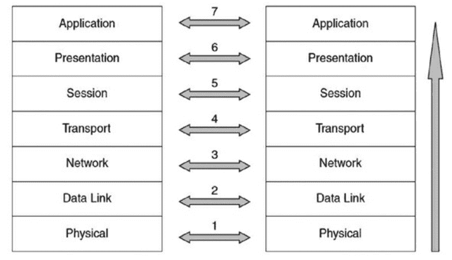

图 5.2 OSI 通信

> **注意**
> PDU 只是网络中使用的术语之一。看到 *帧*、*数据包* 和 *数据报* 等术语用于指代同一概念，请不要惊讶。

## TCP/IP

TCP/IP 是当今我们所熟知的互联网的基础。其根源可追溯至美国国防部（DoD）于 1982 年采纳的标准。TCP/IP 模型与 OSI 模型相似，但仅包含四个层：网络访问层、互联网层、主机到主机（传输）层和应用层。

切记，TCP/IP 模型最初是作为一种灵活、容错的网络开发的。安全并非主要考量。该网络的设计规范能够承受摧毁关键路由节点的核打击。该原始网络的设计者从未设想过我们今天使用的互联网。因此，许多原始 TCP/IP 协议现在显得过时且不安全。如 FTP、Telnet 和 路由信息协议（RIP）等协议存在安全问题。例如，Telnet 的安全设计旨在屏蔽用户输入的密码的屏幕显示，因为设计者不希望偷窥者窃取密码；然而，密码本身随后以明文形式在网线上传输。很少有人考虑到不受信任的一方可能访问网线并嗅探明文密码这一事实。FTP 也是一种明文协议；它同时使用 TCP/20 和 TCP/21 端口进行数据和控制传输。IPv4 中使用的许多安全机制（如 IPsec）都是原始协议套件的附加组件。

### 网络访问层

网络访问层大致对应 OSI 模型的第 1 层和第 2 层。有些文献将这一单层划分为两层，并将其称为 *物理访问* 层和 *数据链路* 层。无论将其视为一层还是两层，TCP/IP 网络模型的这一部分都负责通过帧进行 IP 数据包的物理传输。

以太网是最常用的 LAN 帧类型。以太网使用带冲突检测的载体侦听多路访问 (CSMA/CD)。以太网帧使用 MAC 地址寻址，以标识源设备和目标设备。MAC 地址长 6 字节，旨在对其烧写所在的 NIC 唯一。前 3 字节（称为组织唯一标识符 OUI）对厂商唯一。例如，思科拥有 OUI 00:00:0C，因此任何 MAC 地址以 00:00:0C 开头的 NIC 都是思科 NIC。思科可以分配地址的这一部分，直到所有可能值用尽，届时需要新的 OUI。不过，厂商偶尔会在循环使用系列地址时重复地址。

有时，厂商还会在 NIC 驱动程序中提供功能，将 MAC 地址更改为唯一的本地管理地址。有第三方程序可供攻击者用来伪造 MAC 地址。网络层安全标准包括以下内容：

- 802.1AE (MACsec)：此安全标准旨在提供机密性、完整性和数据源身份验证。MACsec 帧格式类似于以太网帧，但包括安全标签、消息身份验证码 (ICV)、安全连接关联以及默认密码套件（如 Galois/计数器模式或使用 128 位密钥的高级加密标准密码）。
- 802.1AR：此标准使用每设备唯一标识符并结合加密技术，将特定设备绑定到唯一标识符，以确保受信任网络组件的身份。

> **注意**
> 地址解析协议 (ARP) 可以在 TCP/IP 模型的网络层或互联网层中讨论。ARP 表和 NIC 位于 TCP/IP 第 1 层，而逻辑地址位于第 2 层。ARP 过程获取第 2 层逻辑地址，并将其解析为未知的第 1 层物理地址。

### 互联网层

互联网层映射到 OSI 第 3 层。此层的两个主要协议组是可路由协议（如 IP）和路由协议（如 OSPF 和 互联网网关路由协议 [IGRP]）。互联网层还包含 ICMP、ARP 接口和 IGMP：

- ICMP 通常因其对 ping 的支持而闻名，但也可用于 IP 支持、错误和诊断协议等服务。ICMP 可以处理诸如传递错误消息等问题。
- IGMP 用于组播消息。
- ARP 用于将已知 IP 地址解析为未知 MAC 地址。

### 互联网协议 (IP)

IP 是一种可路由协议，其任务是尽力交付。IPv4 首部通常为 20 字节长，但添加选项后可长达 60 字节。目前，大多数组织使用 IPv4。IPv6 是计划中的替代方案。它提供了更好的安全性，并将 IP 地址支持从 IPv4 的当前 32 位增加到 128 位。IPv4 对 IP 地址使用逻辑地址方案。而 MAC 地址被视为物理地址，IP 地址被视为逻辑地址。

虽然 CISSP 考试不需要深入了解首部，但完整细节可在请求意见稿 (RFC) 791 中找到。尽管检查 IP 数据包结构可能不是安全工作中最令人兴奋的部分，但具备基本了解对于识别基于操纵这些数据包的许多攻击至关重要。例如，在 teardrop 攻击中，会修改总长度和分片字段，导致片段错误重叠。分片和源路由是 IPv4 的两个潜在安全问题。

如果 IP 需要传输的数据报大于网络访问层允许的大小，则必须将数据报划分为更小的数据包。并非所有网络拓扑都能处理相同大小的数据报；因此，*分片* 是 IP 的一项重要功能。并且当 IP 数据包经过路由器时，即将到来的网络访问层的需求可能会再次发生变化。IP 负责读取网络访问层可接受的大小。如果现有数据报太大，IP 将执行分片并将数据报划分为两个或多个数据包。每个分片的数据包都标记有以下比特：

- 长度：指定的长度是片段的总长度。
- 偏移：此比特指定距原始数据报第一个字节的距离。
- 更多：此比特指示该片段后是否还有更多片段，或者是片段系列中的最后一个片段。

*松散源路由* 和 *严格源路由* 是 IP 支持的其他选项。这些选项允许在源和目标之间指定伪路由路径。虽然此功能在某些情况下可能有用，但攻击者可以利用它来发起中间人攻击。


> **注意**
> 由于物理地址与所使用的物理拓扑绑定，因此需要 IP 地址。一些局域网使用以太网，但其他局域网连接到异步传输模式 (ATM) 或令牌环网络。由于不存在通用格式或结构，IP 用于将这些不同的网络绑定在一起。

IP 的最新版本是互联网协议第 6 版 (IPv6)。尽管 IPv4 地址耗尽已是多年来的关切，但 IPv4 地址空间已达到耗尽的事实意味着我们已达到 IPv6 协议采用的转折点。IPv6 为现代网络带来了许多改进。其中之一是地址空间从 32 位移动到 128 位。IPv6 不支持广播流量；相反，IPv6 使用链路本地范围作为全节点多播地址。IPv6 可以使用多个地址，包括全局地址和本地链路地址。全局（可路由）地址用于本地网络以外的通信。IPv6 依赖 IPv6 路由通告来分配全局地址。链路本地地址仅用于本地网络通信。启用 IPv6 的设备独立创建链路本地地址。创建本地链路地址不需要 IPv6 路由器通告。

IPv6 提供了对 IPsec 的内置支持，以便在数据传输期间提供更大的保护，并且它提供端到端的数据身份验证和隐私。随着向 IPv6 的迁移，网络地址转换 (NAT) 不再需要。但是，由于有如此多的 IPv4 网络已就位，因此需要从 IPv4 迁移到 IPv6 的过渡机制。以下是两种此类机制：

- 6to4：用于从 IPv4 迁移到 IPv6 的这种 Internet 过渡机制允许通过 IPv4 网络传输 IPv6 数据包。
- Teredo：这种过渡技术可用于位于 IPv4 Internet 上且没有原生连接到 IPv6 网络的 IPv6 兼容主机。

当 IPv6 完全部署时，将不再需要的一种协议是 ARP。IPv6 不支持 ARP，而是使用网络发现协议 (NDP)。IPv6 也不需要 DHCP。它可以使用，但已被无状态自动配置取代。常用于 IPv6 的路由协议包括 RIPng、OSPFv3、IS-ISv2 和 EIGRPv6。到目前为止，亚洲的 IPv6 采用率高于美国。

图 5.3 说明了 IPv6 标头。

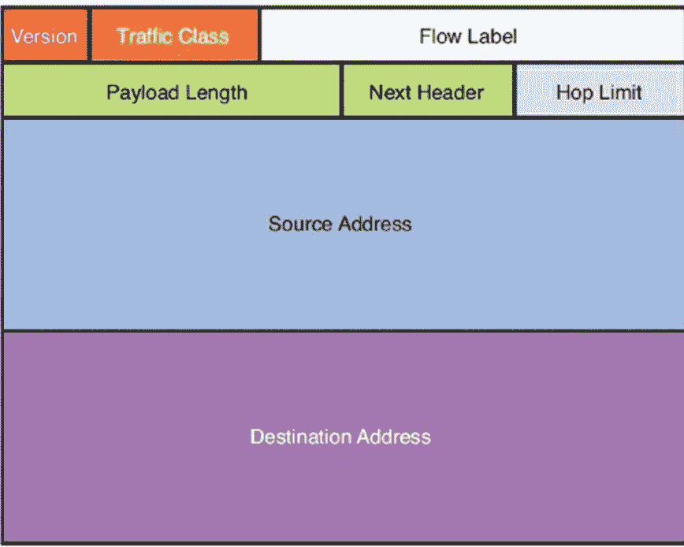

图 5.3 IPv6 标头

## Internet 控制消息协议 (ICMP)

位于 Internet 层的协议之一是 ICMP。其目的是提供诊断反馈或报告逻辑错误。由于 ICMP 位于 Internet 层，它是一个独立协议，且与 IP 明显不同。

所有 ICMP 消息都具有相同的基本格式。ICMP 标头的第一个字节指示 ICMP 消息的类型。接下来的字节包含每种特定 ICMP 类型的代码。表 5.2 列出了八种最常见的 ICMP 类型。要获取所有 ICMP 参数的完整列表，请参见 www.iana.org/assignments/icmp-parameters。

表 5.2 ICMP 类型和代码

| 类型 | 代码 | 功能 |
|---|---|---|
| 0/8 | 0 | 回显响应/请求 (ping) |
| 3 | 0–15 | 目标不可达 |
| 4 | 0 | 源抑制 |
| 5 | 0–3 | 重定向 |
| 11 | 0–1 | 时间超时 |
| 12 | 0 | 参数故障 |
| 13/14 | 0 | 时间戳请求/响应 |
| 17/18 | 0 | 子网掩码请求/响应 |

最常见的 ICMP 类型之一是 ping。虽然 ICMP 非常有用，但攻击者也非常看重它，因为它可以被操纵并用于各种攻击，包括死亡 ping、Smurf 攻击、时间戳查询、子网掩码查询和重定向。

## 地址解析协议 (ARP)

_ARP_ 用于解析 TCP/IP 模型中网络访问层和 Internet 层之间的寻址。ARP 是一种两步解析过程，首先发送广播消息请求目标的物理地址。如果拥有请求的逻辑地址的设备收到请求，它将发送一条包含其 MAC 地址的单播 ARP 响应给原始发送方。然后将 MAC 地址放入请求方的 ARP 缓存中，并用于寻址后续帧。_Reverse ARP (RARP)_ 用于将已知的物理地址解析为未知的 IP 地址。

攻击者可以操纵 ARP，因为它是一种信任协议。两种著名的攻击是 ARP 毒化和 ARP 泛滥。ARP 毒化之所以可能，是因为主机无法区分虚假响应和有效响应，因此会将虚假的 ARP 响应视为有效。此类攻击可用于拦截指向网关的流量，也可用于促进针对目标主机的攻击。ARP 毒化允许攻击者在交换网络上重定向流量。ARP 攻击在各种中间人攻击、欺骗和会话劫持攻击中发挥作用。

> **警告**
> 
> 请记住，ARP 未经身份验证；因此，攻击者可以发送未请求的 ARP 响应、毒化 ARP 表并欺骗另一台主机。

## Internet 组管理协议 (IGMP)

IGMP 是第 2 层协议，负责管理 IP 多播组。IP 多播可以将消息或数据包发送到指定的主机或路由器组。这与广播不同，广播由网络中的所有用户接收。IGMP 传输发送到一组系统。

## 主机到主机（传输）层

主机到主机层负责端点之间可靠且高效的通信。所指的端点是程序或服务。这种交换可以是点对点交换，例如即时通讯应用程序，也可以是客户端/服务器交互，例如 web 浏览器向 web 服务器发送请求。主机到主机层大致对应 OSI 第 4 层，但提供端到端交付。位于主机到主机层的两个主要协议是传输控制协议 (TCP) 和用户数据报协议 (UDP)。图 5.4 说明了 TCP 和 UDP 的数据包标头。

这些协议各有利弊，开发人员根据试图通过网络完成的任务选择其中一种。

通常，网络上的琐碎和临时交换以无连接方式进行（使用 UDP）。更持久的网络关系大多由面向连接的解决方案处理（使用 TCP），尤其是在传输大量数据时。

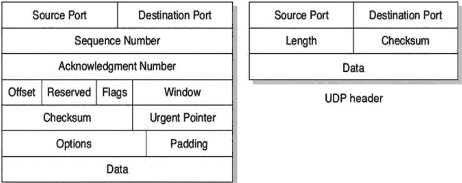

图 5.4 TCP 和 UDP 标头

在主机到主机层，您会发现错误检查和重传功能。这确保了所有发送的面向连接的消息都会完整到达接收端。通常使用校验和或类似机制来确保消息完整性。重传策略各不相同；例如，在 TCP 的情况下，未及时被接收方肯定确认的数据将被重传。

## 传输控制协议 (TCP)

TCP 使两台主机能够建立连接并可靠地交换数据。TCP 的标称数据包大小为 20 字节，包含用于支持流量控制和可靠通信以及确保丢失数据被重新发送的字段。TCP 的核心是一个 1 字节的 Flag 字段。表 5.3 总结了最常见的标志。这些标志有助于控制 TCP 通信。

表 5.3 TCP 标志

| 标志 | 名称 | 功能 |
| --- | --- | --- |
| URG | 紧急 | 紧急数据 |
| ACK | 确认 | 确认数据 |
| PSH | 推送 | 推送缓冲数据 |
| RST | 重置 | 重置 TCP 连接 |
| SYN | 同步 | 开始会话 |
| FIN | 完成 | 关闭会话 |

尽管在保留用于标志的 1 字节中实际上有八个字段（位），但前两个——拥塞窗口减少 (CWR) 和显式拥塞通知回显 (ECN) 标志——直到 2001 年才定义，且未被广泛使用。

TCP 通过执行正式的启动和关闭握手来提供可靠通信。TCP 三步握手在任何数据发送之前进行。图 5.5 说明了三步启动和四步关闭。

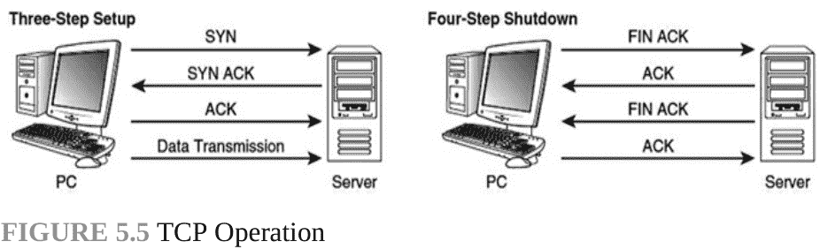

用于管理三步启动的标志是 SYN 和 ACK，而 RST 和 FIN 用于拆除连接。FIN 在正常的四步关闭期间使用，而 RST 用于表示异常会话的结束。在启动和关闭之间，TCP 通过使用序列号和确认号来保证数据交付。该层存在的漏洞包括导致会话劫持的 TCP 序列号攻击以及基于端口的 SYN 泛滥攻击。

## 用户数据报协议 (UDP)


UDP 不执行任何握手过程。因此，虽然这使其比 TCP 不可靠得多，但它确实提供了速度优势。UDP 标头长度仅为 8 字节。标头中有四个 2 字节字段，且无任何变化；长度固定。图 5.6 说明了 UDP 的操作。

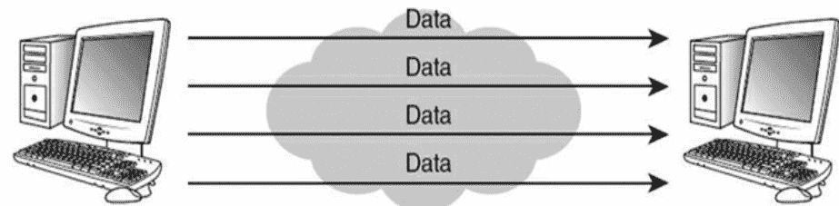

## 图 5.6 UDP 操作

UDP 可用于 IPTV（互联网协议电视）、视频多播和 IP 语音（VoIP）等服务。在 VoIP 中，UDP 主要用于呼叫的语音连接部分，而 TCP 用于实际呼叫的设置和呼叫控制。UDP 非常适合需要快速交付的此类应用程序。UDP 不使用序列号和确认号。

## 比较 UDP 和 TCP

表 5.4 说明了 UDP 和 TCP 之间的差异。

## 表 5.4 UDP 和 TCP 对比

| 服务 | UDP | TCP |
|---|---|---|
| 速度 | ✓ | — |
| 低开销 | ✓ | — |
| 无连接 | ✓ | — |
| 可靠 | — | ✓ |
| 维护状态 | — | ✓ |
| 控制拥塞 | — | ✓ |
| 使用流量控制 | — | ✓ |

## 应用层

应用层（或进程层）位于协议栈顶部，大致映射到 OSI 第 6 层和第 7 层。该层负责应用程序支持。应用程序通常不是按名称映射，而是按其对应的端口映射。端口被放入 TCP 和 UDP 数据包中，以便将正确的应用程序传递给所需的协议。虽然可以使应用程序在非标准端口上运行，但既定端口号充当事实标准。共有 65,535 个端口分为三个范围，如表 5.5 所示。

## 表 5.5 端口和范围

| 范围 | 用途 | 属性 |
|---|---|---|
| 0–1023 | 熟知端口 | 系统服务 |
| 1024–49151 | 已注册端口 | 软件服务 |
| 49152–65535 | 随机端口 | 客户端程序 |

一些最常见的熟知应用程序及其关联端口如下：

- **文件传输协议（FTP）**：FTP 是一种 TCP 服务，运行在端口 20 和 21 上，用于在一台计算机到另一台计算机之间移动文件。端口 20 用于数据流，并在客户端和服务器之间传输数据。端口 21 是控制流，用于在客户端和 FTP 服务器之间传递命令。针对 FTP 的攻击通常针对可被嗅探的明文密码。FTP 是最常被攻击的服务之一。

- **Telnet**：Telnet 是一种运行在端口 23 上的 TCP 服务。Telnet 使一个站点上的客户端能够与另一站点上的主机建立远程会话。该程序将客户端键盘上输入的信息传递给主机计算机系统。Telnet 可以配置为允许匿名连接，但应配置为要求用户名和密码。不幸的是，即使如此，Telnet 也会以明文发送它们。登录的用户可以执行其用户权限允许的任何任务。应使用安全外壳版本 2（SSHv2）等应用程序来代替 Telnet。

- **简单邮件传输协议（SMTP）**：这种 TCP 服务运行在端口 25 上。它旨在用于联网系统之间交换电子邮件。通过 SMTP 发送的消息包含两部分：地址标头和消息文本。所有类型的计算机都可以使用 SMTP 交换消息。欺骗、垃圾邮件以及开放/配置错误的邮件中继是与 SMTP 相关的几个漏洞。

- **域名系统（DNS）**：DNS 运行在端口 53 上，并执行地址转换。DNS 将完全限定域名（FQDN）转换为数字 IP 地址，或将 IP 地址转换为 FQDN。该系统的工作方式类似于电话簿，使用户能够记住域名（例如 examcram2.com）而非 IP 地址（例如 114.112.18.23）。在某些小型网络中，网络信息服务（NIS）可以代替 DNS 用于提供名称服务器信息和分发系统配置信息。DNS 对 DNS 查询使用 UDP，对区域传输使用 TCP。DNS 易受缓存投毒攻击，并且如果配置不当，可能会被诱导执行完整区域传输。DNS 安全扩展（DNSSEC）是 DNS 的一种替代方案。使用 DNSSEC 时，DNS 服务器提供签名并对每个响应进行数字签名。为了使 DNSSEC 正常工作，身份验证密钥必须在使用前分发。否则，如果客户端无法验证身份验证，则 DNSSEC 没有多大用处。您可以在 www.dnssec.net 上阅读更多有关 DNSSEC 的信息。

> **注意**
> DNSSEC 不提供数据保密性，并且不能防范 DDoS 攻击。

- **引导程序协议（BootP）**：BootP 用于将操作参数下载到瘦客户端，是动态主机配置协议（DHCP）的前身。这两种协议都位于 UDP 端口 67 和 68 上。

- **简单文件传输协议（TFTP）**：TFTP 运行在端口 69 上。TFTP 使用 UDP 来减少开销，适用于非常小的文件。它不仅在不提供 TCP 会话管理的情况下复制文件，而且不需要身份验证，这可能带来巨大的安全风险。它通常用于传输路由器配置文件以及为有线电视公司配置有线调制解调器。

- **超文本传输协议（HTTP）**：HTTP 是一种运行在端口 80 上的 TCP 服务，是应用层最著名的协议之一。HTTP 连接是无状态连接。HTTP 使用请求/响应模型，客户端发送请求，服务器发送响应。利用 HTTP 的攻击可以针对服务器、浏览器或在浏览器上运行的脚本。

- **互联网消息访问协议（IMAP）**：IMAPv4 是 POP3 的替代方案，运行在端口 143 上。IMAPv4 相对于 POP3 具有优势，例如在操作用户收件箱方面具有增强功能、更好地管理邮件文件夹的能力以及优化的在线性能。使用 IMAPv4 时，电子邮件存储在邮件服务器上，可以从网络上的任何 IMAPv4 电子邮件客户端访问。使用 POP3 时，电子邮件被下载到邮件客户端，在那里进行访问。

- **简单网络管理协议（SNMP）**：SNMP 是一种运行在端口 161 和 162 上的 UDP 服务。它被设想为一种高效且廉价的监控和远程配置网络的方式。SNMP 允许代理收集信息（包括网络统计信息），并将其报告回管理站。大多数大型公司都实施了某种形式的 SNMP 管理。困扰 SNMP 版本 1 和 2 的一些安全问题与社区访问字符串以明文传输以及默认社区字符串（public/private）广为人知这一事实有关。SNMP 版本 3 是最新形式，并提供加密以实现更强大的安全性。

- **安全套接层（SSL）**：SSL 运行在端口 443 上，是一种用于连接到不可信网络的安全协议。SSL 使用两部分过程建立通信，并基于混合密码学。它在 HTTPS 中提供加密。如果目标系统支持弱加密算法，则可以发起针对 SSL 的攻击。在这种情况下，攻击者可能能够操纵系统，使加密数据被降级甚至被解密，以访问敏感数据。

- **行打印机守护进程（LPD）**：LPD 运行在 TCP 端口 515 上，是一种用于将打印作业缓存并传输到打印机的网络协议。

- **轻量级目录访问协议（LDAP）**：LDAP 运行在 TCP 上，是为了访问 X.500 目录服务而创建的。X.500 是一系列涵盖电子目录服务的计算机网络标准。LDAP 在版本 1 和 2 中没有数据加密方法，但版本 3 具有内置的更强大的安全模型，并由 TLS 支持。

- **路由信息协议（RIP）**：RIP 运行在端口 520 上，允许 IP 网络上的路由器之间交换路由信息。尽管 RIP 通常与其他路由协议一样被列为第 3 层的一部分，但它是一个应用程序。RIP 使用 UDP 端口发送和接收路由信息。RIP 的原始版本没有安全性，虚假的 RIP 更新可用于发起 DoS 攻击。

- **绝对隐私（PGP）**：PGP 于 1991 年开发，作为一款免费的电子邮件安全应用程序。PGPv5 使用端口 11371。PGP 旨在提供军事级加密，并在保护电子邮件方面效果良好。与公共密钥基础设施（PKI）不同，PGP 通过使用信任网络来工作。用户分发并签署自己的公钥。与 PKI 证书颁发机构不同，这个信任网络要求用户确定他们对即将与之交换密钥的一方有多少信任。PGP 是一种混合密码系统，因为它同时使用公钥加密和私钥加密。PGP 可以使用 Triple DES 和 Twofish 进行对称加密，并使用 RSA 进行非对称加密。

尽管有数百个端口和相应的应用程序，但在实践中只有几百个在常用。CISSP 考试问题关于


端口最可能集中在表5.6中列出的常见端口。

## TABLE 5.6 常用端口

| 端口 | 服务 | 协议 |
| :--- | :--- | :--- |
| 21 | FTP | TCP |
| 22 | SSH | TCP |
| 23 | Telnet | TCP |
| 25 | SMTP | TCP |
| 53 | DNS | TCP/UDP |
| 67/68 | DHCP | UDP |
| 69 | TFTP | UDP |
| 80 | HTTP | TCP |
| 88 | Kerberos | UDP |
| 110 | POP3 | TCP |
| 111 | SUNRPC | TCP/UDP |
| 143 | IMAP | TCP |
| 161 | SNMP | UDP |
| 162 | SNMP trap | UDP |
| 389 | LDAP | TCP |
| 443 | SSL/TLS | TCP |

## 局域网及其组件

局域网（LAN）是现代数据网络的关键组成部分。LAN由两台或更多计算机、一种通信协议、一种网络拓扑以及布线或无线连接组成。LAN包括在小范围地理区域内通信的计算机或其他设备，例如单层建筑的一个区域、小型建筑的整个楼层或小型校园内的多栋建筑。

### LAN通信协议

超过80%的局域网使用以太网协议作为通信手段。以太网规范描述了物理位置相近的计算机之间如何发送数据。数字设备公司、英特尔和施乐（DIX）组于1975年首次发布了以太网。自推出以来，IEEE标准委员会已引入以太网II协议的多种变体，包括以下内容：

- IEEE 802.3
- 带有逻辑链路控制（LLC）的IEEE 802.3
- 带有子网访问协议（SNAP）的IEEE 802.3

虽然CISSP考试不会深入探讨以太网的具体细节，但了解这些帧的大小和结构很有帮助。不包括前导码，以太网帧的大小范围为64到1,518字节。以太网帧使用18字节用于控制信息；因此，以太网帧中的数据长度可在46到1,500字节之间。图5.7说明了802.3以太网帧。

| 6 字节 | 6 字节 | 2 字节 | 46 到 1500 字节 | 4 字节 |
|---|---|---|---|---|
| 目的地址 | 源地址 | 类型字段 | 有效载荷 | CRC |

FIGURE 5.7 以太网帧

一种较旧的局域网有线网络协议是令牌环，它将所有系统按圆圈排列。一种称为令牌的特殊数据包在圆圈中传输。如果任何设备需要发送信息，它必须捕获令牌，将消息附加到令牌上，然后让它继续在网络中传输。

## 网络拓扑

网络的布局称为其*拓扑*。在安装网络之前，必须选择一种拓扑以适应网络的需求和预期用途。常见的拓扑包括总线型、星型、环型、网状型和全连接型。以下各部分将更详细地讨论这些拓扑。

### 总线拓扑

总线拓扑由一根电缆组成，多台计算机或设备连接到该电缆上。电缆的两端都有终端器。在大型环境中，这不切实际，因为介质存在物理限制，且易受低速和完全网络中断的影响；一个断点可能会导致整个网络瘫痪（参见图5.8）。

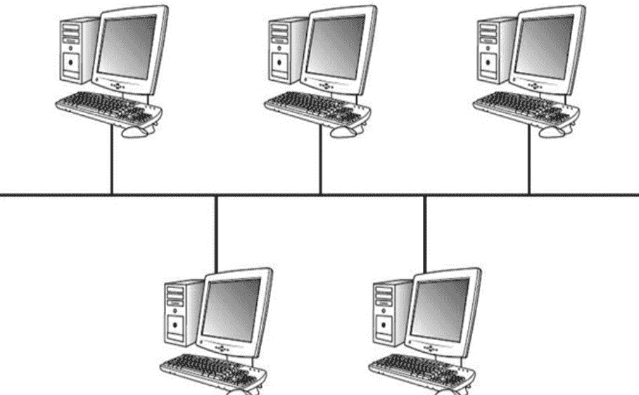

FIGURE 5.8 总线拓扑

### 星型拓扑

星型拓扑是三种主要网络拓扑中最古老的一种，最初用于电话系统。星型设计由多台计算机或设备连接到中央交换机组成。电缆从集线器向外辐射，呈星状分布。尽管此方案使用的电缆最多，但断点通常仅影响一台计算机。这是最广泛使用的LAN拓扑（参见图5.9）。

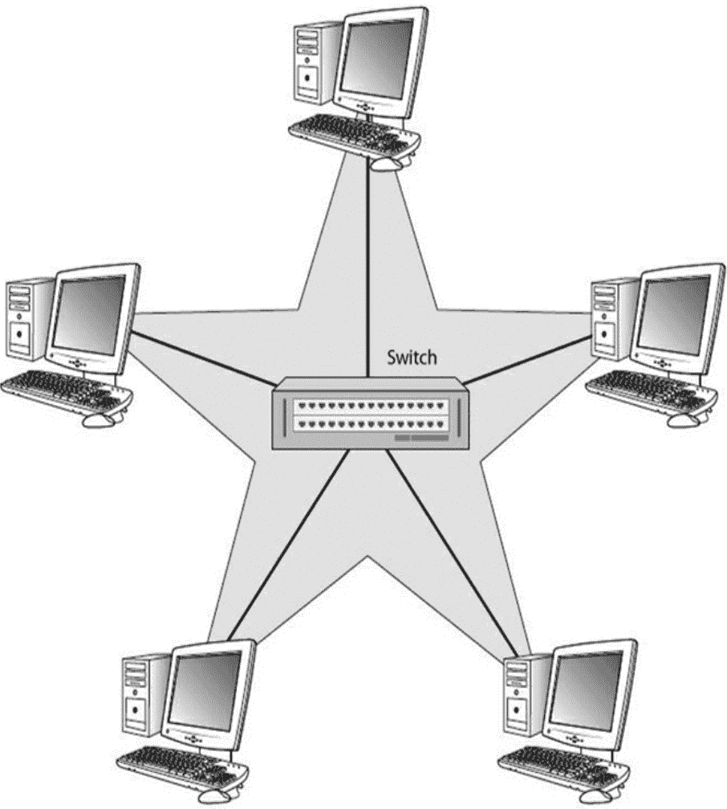

FIGURE 5.9 星型拓扑

### 环型拓扑

环型拓扑没有端点或终端器。它以连续电缆循环的形式布置，所有联网计算机都连接到该循环上。令牌环铜分布数据接口（CDDI）和FDDI网络使用环型拓扑（参见图5.10）。一些环型技术使用带有冲突避免的载波侦听多路访问（CSMA/CA）。而CSMA/CD是一种基于竞争的技术，CSMA/CA是确定性的。

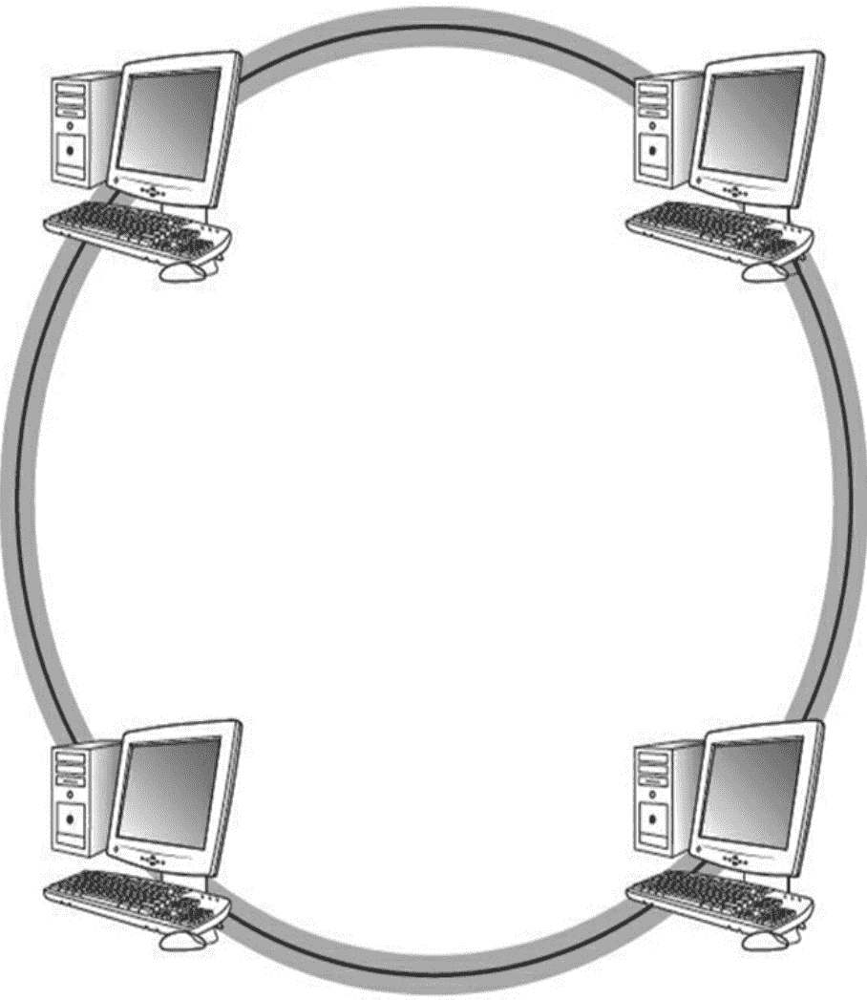

FIGURE 5.10 环型拓扑

对于CISSP考试，你应确保理解CSMA/CD的工作原理，因为它是以太网的媒体访问方法。每台设备在访问和传输数据到线路时拥有同等优先级。以太网设备在传输前必须侦听线路。如果两台设备同时尝试传输，将发生冲突。当这种情况发生时，设备会等待一段随机时间，再次侦听线路，然后重新传输其帧。

### 网状拓扑

在网状网络拓扑中，每个节点为网络中继数据。网状网络可以使用泛洪或路由来中继通信。

### 全连接拓扑

全连接网络连接到所有节点。尽管此类设计提供极高的冗余度，但连接数量增长迅速，这使得该拓扑对于大型网络不切实际。

现代网络通常实现多种网络拓扑的组合。

## LAN布线

即使有了明确的拓扑，也有必要确定将连接各种设备的电缆类型。电缆充当介质，用于在联网设备之间传输电信号。可使用以下两种传输方法之一：

- 基带：基带传输使用整个介质来传输单个通信信道。以太网是基带传输方案的示例。
- 宽带：宽带可以在其主干上支持多个信道和频率。宽带的两个良好示例是有线电视和数字用户线路（DSL）。

许多类型的电缆可用于网络通信，包括以下几种：

- 同轴电缆：同轴电缆由一根实心铜线芯组成，用于传输数据信号。该导线用特氟龙或塑料材料绝缘，称为*介电*，并覆盖有用作信号地的编织屏蔽层。整个电缆随后涂覆塑料（参见图5.11）。常见类型包括RG-6和RG-59。连接器通常是BNC或F型连接器。尽管同轴电缆在网络早期被广泛使用，但其用途已有所下降。
- 双绞线：如果您的计算机通过有线方式获取Internet连接，则使用双绞线布线将计算机连接到附近的墙壁插孔。终止此布线的最常见连接器是RJ-45。双绞线有多种类型，包括非屏蔽双绞线（UTP）。UTP由相互绞合的无屏蔽铜线组成，并用塑料绝缘。它不仅易于操作，而且通常价格低廉。屏蔽双绞线（STP）电缆由单独绝缘的绞合线对组成（类似于UTP），但它有由箔等金属材料制成的额外屏蔽层。这种额外屏蔽层可防护电磁干扰（EMI）。铜缆的主要缺点是容易被窃听，并且会发出可能被拦截的电能。最常见的双绞线电缆类型包括Cat3、Cat5、Cat5e、Cat6、Cat6a和Cat7。双绞线布线标准包括T568A和T568B。图5.11显示了双绞线的组件。

表5.7列出了一些电缆类型、长度和拓扑。

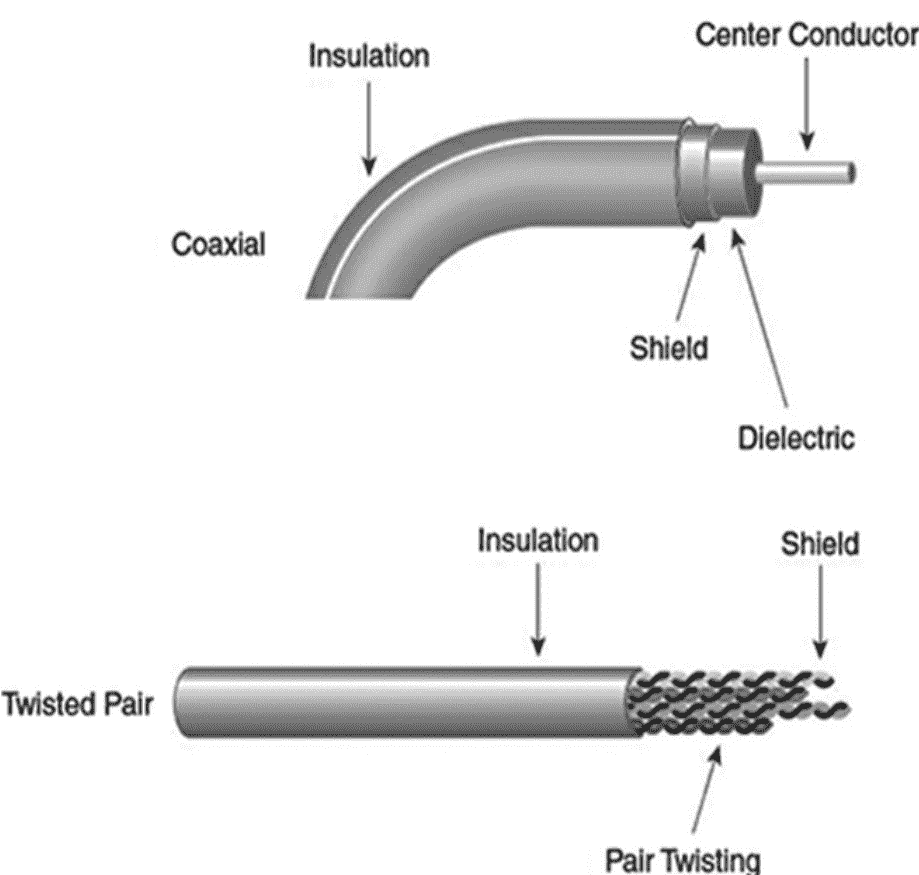

FIGURE 5.11 同轴电缆和双绞线

## TABLE 5.7 电缆规范

| 以太网变体 | 电缆规格 | 支持距离 | 拓扑 |
| :--- | :--- | :--- | :--- |
| 10BASE-5 | 50欧姆，粗同轴电缆（粗网） | 500米 | 总线 |
| 10BASE-2 | 50欧姆，RG-58 A/U（细网） | 185米 | 总线 |
| 10BASE-T | Cat3 UTP（或更高） | 100米 | 星型 |
| 10BASE-FL | 多模光纤 | 2,000米 | 星型 |
| 100BASE-TX | Cat5 UTP | 100米 | 星型 |
| 1000BASE-TX | Cat6/Cat7 UTP | 100米 | 星型 |
| 100BASE-T4 | Cat3 UTP（或更高） | 100米 | 星型 |
| 100BASE-FX 多模光纤 | 多纤维连接 | 136米 | 星型 |
| 100BASE-FX 多模光纤 | 单纤维连接 | 160米 | 星型 |

**考试警报**

对于CISSP考试，您应知道，风道级电缆涂覆有阻燃剂，专为在风道空间（如爬行空间、假天花板上方以及建筑物升高地板下方）中使用而设计。特殊涂层是氟聚合物，而非非风道电缆中使用的聚乙烯氯乙烯。其设计旨在燃烧时不释放有毒气体或烟雾，以帮助确保在火灾发生时人员的安全。

- **光纤电缆**：与双绞线电缆和同轴电缆依赖铜线进行数据传输不同，光纤使用玻璃。这些玻璃丝携带编码的光波，以传输正在传送的数据。常见的连接器类型包括SC、ST和LC。光纤具有多种优势，包括更大的带宽，并且在防止物理窃听方面更安全。基本上，有两种光纤电缆在使用。它们的构造不同，以处理不同类型的光：
  - **多模光纤**：通常用于局域网，并由发光二极管（LED）供电
  - **单模光纤**：通常用于广域网，并由激光光供电


> 光纤比铜缆更安全，因为它不辐射信号，且只有使用专用设备才能窃取。

## 网络类型

计算机网络的规模可以从小到大。在非常小的规模上，存在个人区域网络（PANs），它们允许各种个人和手持电子设备在短距离内通信。最常见的 PAN 类型是无线个人区域网络（WPAN）。Bluetooth 是支持 WPAN 所使用的一种技术。

虽然知道两台计算机可以通过局域网（LAN）在本地通信很不错，但大多数计算机需要能够在更大的地理区域内通信。要在相邻建筑物之间通信，可以使用校园区域网络（CAN）。对于需要在城市范围内通信的计算机，创建了城域网（MAN）。MAN 是互连比 LAN 覆盖范围更大的区域的网络。它可以包括一个城市、一个地理区域或另一个大型区域。

如果您为一家拥有位于不同州或国家的多栋建筑物的公司工作，该网络属于广域网（WAN）。WAN 跨越的地理距离太大，LAN 和 MAN 无法覆盖。WAN 由路由器连接。当两个 LAN 在距离上连接在一起时，它们形成一个 WAN。全球区域网络（GAN）连接世界各地各国或不同地区的计算机。

## 网络存储

存储区域网络（SAN）是存储磁盘和设备的网络。SAN 将多台服务器连接到集中式磁盘存储池。SAN 通过允许集中式存储，而不是要求管理数百台各自拥有磁盘的服务器，从而改进系统管理。SAN 与网络附加存储（NAS）类似。一个主要区别是，NAS 对客户端来说表现为文件服务器或独立系统，而 SAN 对客户端来说表现为本地磁盘或卷，可根据需要在本地格式化和使用。由于服务器虚拟化的增加，SAN 的使用日益增长。

SAN 可以使用多种连接技术，包括以下内容：

- 互联网小型计算机系统接口（iSCSI）：iSCSI 是一种 SAN 标准，用于连接数据存储设施并允许远程 SCSI 设备进行通信。它不需要任何特殊基础设施，可以在现有的 IP LAN、MAN 或 WAN 网络上运行。

- 以太网光纤通道（FCoE）：FCoE 是一种类似于 iSCSI 的传输协议，可在 10 Gbps 的速度下运行，并运行在以太网协议之上。虽然它速度快，但存在不可路由的缺点。

- 主机总线适配器（HBA）分配：主机总线适配器用于将主机系统连接到企业存储设备。HBA 可以通过软分区或持久绑定进行分配。软分区更宽松，而持久绑定会减少地址空间并增加网络复杂性。

- LUN 掩码：LUN 掩码主要在 HBA 级别实现。它是一种系统，使 LUN 对某些 HBA 可用而对其他 HBA 不可用。在此级别实现的 LUN 掩码易受任何攻破本地适配器的攻击影响。

与 SAN 相关的若干问题包括冗余、复制、快照和重复。位置冗余是指数据应可从多个位置访问以作备份。可以通过复制服务提供额外的冗余措施，以便即使主存储备份系统失败，数据仍然可用。

SAN 的另一个问题是数据保护。安全存储管理和复制系统的设计旨在允许公司以安全的方式管理和处理所有企业数据，重点关注信息的机密性、完整性和可用性。复制服务允许数据被复制并得到保护，从而实现机密性和容错能力。

为了更好的容错能力，可以使用多路径解决方案来降低数据丢失或不可用的风险。多路径涉及在服务器及其驱动器之间设置多条路由。多路径软件维护所有请求列表，通过最佳可能路径传递它们，并在其中一条路径失效时重新路由通信。

SAN 快照提供临时停止写入物理磁盘以制作时间点备份副本的功能。快照软件通常很快，能够快速制作副本，无论驱动器大小如何。

SAN 中的去重是删除冗余数据以提高企业存储利用率的过程。冗余数据不会被复制，而是被替换为指向数据唯一副本的指针。企业存储介质（如磁盘或磁带）上仅保留一个冗余数据实例。

## 通信标准

本章前面讨论的基带和宽带通信需要通过布线进行信令。这种信令可以使用以下三种方法之一：

- Simplex: 通信单向进行。
- Half duplex: 通信可以双向进行，但一次只有一个系统可以发送信息。
- Full duplex: 通信双向进行，两台计算机可以同时发送信息。

选择布线时需要考虑的一点是需要将信号传播多远。尽管每种通信方式都有特定的优势，但也存在一些常见缺点，包括衰减和串扰。衰减是信号的减弱。当信号远离发送设备传播时，信号的强度和力度会变弱。因此，所有信号都需要定期重新放大和再生。图 5.12 说明了衰减。串扰是一个信道向另一个信道的泄漏。

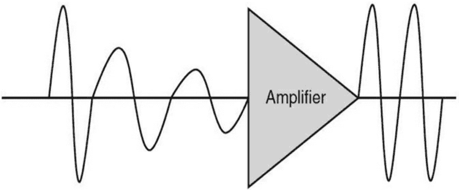

图 5.12 衰减

信号的基本选择是模拟传输或数字传输。模拟信号和数字信号都会在频率和幅度上改变载波。然而，使用模拟信号时，更难以消除噪声，并确定信号在哪里结束、噪声在哪里开始。

## 网络设备

电信设备是指用于在网络设备之间移动数据的所有硬件，包括 LAN 和 WAN 设备。了解各种网络设备类型不仅从网络角度很重要，而且对于更好地实施安全解决方案以及通过 CISSP 考试也很重要。

### 中继器

中继器、集中器和放大器用于增强通信信号并解决衰减问题。这些设备均在 OSI 模型的第 1 层运行。

### 集线器

集线器是最基本的多端口网络设备之一。集线器允许所有连接的设备相互通信。集线器在逻辑上只不过是一根所有计算机都共享访问的公共电缆。集线器在 OSI 模型的第 1 层运行。集线器上的系统共享同一广播域和冲突域。

由于最大吞吐量低，集线器已不再受欢迎。每当两个或多个系统尝试在同一集线器上同时发送数据包时，就会发生冲突。随着利用率增加，冲突数量急剧上升，整体平均吞吐量下降。

**考试提示**

对于 CISSP 考试，不要花太多时间担心中继器和集线器；只需了解它们的基本用途以及它们已被第 2 层交换机取代即可。

### 桥接器

另一种有些过时的设备是有线桥接器。桥接器是半智能设备，具有分离冲突域的能力。桥接器检查帧并查找对应的 MAC 地址。如果确定与特定 MAC 地址绑定的设备是本地的，桥接器会阻止流量。

桥接器的一个大问题是，默认情况下它们会传递广播流量。过多的广播流量可以有效淹没网络并导致广播风暴。今天几乎只能看到用于 802.11x 网络的无线桥接器。

**考试提示**

考试——包括 CISSP 考试——臭名昭著地滞后于现实世界。尽管像桥接器这样的项目在今天的工作场所中很少见，但考试可能会涵盖它们。同样重要的是，从历史角度了解我们如何走到今天，以及了解企业安全文档...


## Switches

交换机的运作方式与集线器非常相似；不过，交换机被视为智能设备。交换机通过观察每个数据帧的源 MAC 地址和目标 MAC 地址来分割流量。在传统意义上，交换机是 OSI 第 2 层设备；现代交换机可以在更高层运行，并能够处理不同的报头。

一种连接第 2 层和第 3 层的示例技术称为多协议标签交换（MPLS）。MPLS 是一种 OSI 第 2 层协议。MPLS 与高速交换机配合工作。

商用交换机还提供虚拟局域网（VLAN）功能。此类交换机可以在 OSI 模型的第 3 层运行。VLAN 允许位于不同物理 LAN 网段上的一组设备相互通信，仿佛它们都在同一个逻辑 LAN 上一样。

> 第 2 层交换机与在更高层工作的交换机之间的基本区别在于它们处理地址和标签的方式。

交换机通过将 MAC 地址存储在随机存取存储器（RAM）中位于其中的查找表来运行。这个查找表，也称为内容可寻址内存（CAM），包含将每个 MAC 地址与其连接的相应端口匹配所需的信息。当数据帧进入交换机时，它会在查找表中查找目标 MAC 地址，并将其与计算机连接的交换机端口匹配。帧仅转发到该交换机端口；因此，所有其他端口上的计算机永远看不到流量。交换机具有以下优势：

- 它们的吞吐量高于集线器。
- 它们提供 VLAN 功能。
- 它们可以配置为全双工。
- 它们可以配置为镜像端口，以支持入侵检测系统/入侵防御系统（IDSs/IPSs）、网络馈送或监控。

> **注意**
> 微分段允许你进一步细分网络。通过微分段，每个节点都可以访问传输通道中可用的全部带宽，而不是与其他节点共享带宽。微分段支持创建专用或私有网段。

并非所有交换机都一样。交换机可以以三种方式处理入站帧：

- **存储-转发**：帧完全输入交换机后，分析目标 MAC 地址以阻止或转发该帧。
- **直通**：这种更快的设计与存储-转发设计类似，但它只检查前 6 个字节，然后将数据包转发给其合法所有者。
- **无碎片**：这是思科系统的一种设计，其错误率低于其他设计。

> **注意**
> 最初，交换机是第 2 层设备；如今，交换机可以出现在 OSI 模型的第 3 层，并且可以工作到第 7 层。更高层的交换机被称为内容交换机、内容服务交换机或应用交换机。

## 镜像端口和网络 TAP

监控设备在检查交换网络上的流量时比在非交换网络上更加困难。为克服此问题，使用了端口镜像。不同供应商对这项技术使用不同的名称。例如，思科系统提供交换端口分析仪（SPAN），而 3Com 提供漫游分析端口（RAP）。

端口镜像用于将网络数据包的副本从一个交换机端口发送到另一个交换机端口上的网络监控连接。因此，如果你使用的是管理交换机，可以配置端口镜像来轻松捕获和分析流量。尽管这在企业环境和你控制管理交换机的情况下效果很好，但在交换机未受管理或某人无法访问交换机的情况下则不那么有用。在这种情况下，可以使用网络 TAP。网络 TAP 提供另一种监控网络并查看所有流量的方式，很像集线器。此功能充当拦截流量的点。例如，投石星 LAN TAP 是一种简单设备，允许任何人轻松监控以太网通信（参见 greatscottgadgets.com/throwingstar/）。

## VLAN

虚拟局域网（VLAN）用于分割网络流量以创建更小的广播域。VLAN 减少网络拥塞并增加带宽，而且它们不需要隔离到单个交换机；VLAN 可以跨组织中的许多交换机。

可以通过使用干线协议扩展 VLAN。干线协议将 VLAN 的定义传播到整个 LAN。干线协议通过封装以太网帧工作。两种常见的干线协议是 802.1Q 标准和思科专有的交换机间链路（ISL）。802.1Q 标准将信息放在以太网帧内部，而 ISL 则封装以太网帧。

> **注意**
> 生成树协议（STP）是另一种可在 VLAN 中使用的协议，用于防止网络环路、构建活动路径，并在活动路径或链路失败时提供备份路径。最新版本是快速生成树协议（RSTP），它与 STP 向后兼容，并提供显著更快的生成树收敛。

虚拟可扩展局域网（VXLAN）是一种旨在提供与 VLAN 相同的以太网第 2 层网络服务的技术，但具有更大的可扩展性和灵活性。VXLAN 支持数据中心网络的虚拟化，同时通过在大规模上提供必要的分割来满足多租户数据中心的需求。

> **注意**
> VXLAN 是一种封装协议，提供机制来跨第 3 层基础设施聚合和隧道多个第 2 层子网。

干线安全是 VLAN 中的一个重要问题。干线只是两个交换机之间携带多个 VLAN 数据的链路。安全专业人员应意识到，能够访问干线连接的攻击者可能会从一个 VLAN 跳到另一个 VLAN。这称为 VLAN 跳跃。确保干线连接安全以防止恶意活动发生非常重要。

> **考试警报**
> VLAN 跳跃是一种黑客技术，使攻击者能够发送 VLAN 外部的数据包。这些攻击通常通过使用攻击者 VLAN 外部的 VLAN ID 对流量进行标记来发起。

## 路由器

路由器位于 OSI 模型的第 3 层。路由器通常与 IP 相关联，IP 发送格式化为数据包的数据块。IP 被视为尽力而为交付协议，IP 数据包由路由器检查和处理。路由器可以连接具有相同或不同介质类型的网络。

路由器的主要目的是通过称为*路由*的过程将 IP 数据包转发到其目标。与桥接器和交换机检查物理帧不同，路由器关注 IP 报头中的信息。IP 报头中的一个重要项目是 IP 地址。如前所述，IP 地址是逻辑地址；它以点分十进制表示法格式排列。IPv4 地址格式是由小数点分隔的四个十进制数字。每个十进制数字长度为 1 字节，支持 0 到 255 的值。IPv4 地址分为以下类：

- 类 A：类 A 网络包含最多 16,777,214 个客户端设备。地址范围可从 1 扩展到 126。
- 类 B：类 B 网络包含最多 65,534 个客户端设备。地址范围可从 128 扩展到 191。
- 类 C：类 C 网络可以有 245 个设备。地址范围可从 192 扩展到 223。
- 类 D：类 D 网络保留用于多播。地址范围可从 224 扩展到 239。
- 类 E：类 E 网络保留用于实验目的。地址范围从 240 到 254。

> **考试警报**
>
> 你可能已经注意到，前面的列表中缺少 127.0.0.0 地址范围。尽管官方上属于类 A 地址范围，但它用于环回。CISSP 考试可能会测试你此类细节。


显示的并非所有地址都可用于 Internet。某些地址已被保留用于专用用途，并被视为不可路由。这些专用地址包括以下内容：

- A 类：10.0.0.0
- B 类：172.16.0.0 到 172.31.0.0
- C 类：192.168.0.0 到 192.168.255.0

路由器可通过限制物理广播域来提高性能。当使用访问控制列表 (ACL) 进行过滤时，它们充当一种有限类型的防火墙，并且通过将较大的网络分割为较小的子网来简化网络管理。网络路由器的安全性至关重要。路由器一旦被攻破，可能会产生灾难性后果，尤其是当它用作 IPsec、VPN 或防火墙等其他服务的终端点时。

## 考试提示

通过路由器和防火墙阻止未经授权的流量有时被称为 *bogon 过滤*。Bogons 只是被伪造且看似来自 IP 地址空间中已保留但尚未由互联网号码分配机构 (IANA) 或授权的区域互联网注册机构 (RIR) 分配的区域的 IP 数据包。

## 网关

*网关*有时也称为 *协议转换器*，它通过将一种软件协议转换为另一种协议来连接使用不同协议的网络。网关可以是基于软件的，也可以是独立的硬件设备。网关在 OSI 模型的第 7 层工作。

## 路由

路由协议是现代网络的关键组件。人们常对 *可路由协议* 和 *路由协议* 这两个术语感到混淆。两者都位于第 3 层。可路由协议可以从一个路由器转发到另一个路由器。可路由协议的一个好示例是 IP。IP 充当 Internet 的邮政服务。它的工作是将数据组织成数据包，然后为数据包寻址以进行投递。IP 必须在数据包上放置目标地址和源地址。这类似于在将包裹送到邮局之前对其寻址。就像邮政系统中的实物包裹一样，需要邮资：在 IP 世界中，邮资是 TTL (Time-to-Live) 值，它防止数据包在网络中永久传输，并且每经过一个路由器就会减 1。如果在 TTL 达到 1 之前找不到收件人，则丢弃数据包。

路由协议与其他路由器发送和接收路由信息。路由协议可以类比为一台大型机械化邮件分拣机。与 IP 等可路由协议构建并寻址数据包不同，路由协议必须决定如何最佳地投递数据包。在现实生活中，有很多方法可以从点 A 到达点 B。同样，在 Internet 上，有许多路径可以到达目标网络。

路由协议可以分为几个基本类别：

- **静态路由**：静态或固定路由算法实际上并非算法。它们依赖于网络管理员开发的简单表格，用于将一个网络映射到另一个网络。当网络较小且流量可预测时，静态路由效果最佳。静态路由的主要问题是它无法应对网络变化。随着网络增长，这些表格的管理可能变得困难。尽管这使得静态路由不适合在 Internet 或其他大型网络上使用，但在常规路由协议无法正常工作的特殊情况下，它仍可使用。

- **动态路由**：*动态路由* 使用度量值来确定路由器应使用哪条路径将数据包发送到其目标。动态路由协议包括 RIP、BGP、IGRP 和 OSPF。动态路由需要时间，因为所有路由器都必须了解所有可能的路径。当网络上的所有路由器都同意路由状态时，即达到 *收敛*。

- **默认路由**：*默认路由* 与静态路由类似。当使用默认路由且路由器不知道其他可用路由时，指定的路由就成为路由器用于传输数据包的默认路径。

每次路由器接收数据包时，都必须检查数据包并确定将数据包转发到哪个接口。路由器使用的并非所有路由协议的工作方式都相同。动态路由协议可分为两大类：

- 基于距离矢量协议的算法
- 基于链路状态协议的算法

距离矢量协议基于 Bellman-Ford 算法，通过确定最短路径来寻找最佳路由。最短路径通常根据跳数计算。距离矢量路由也称为“谣言路由”。

RIP 可能是当前使用中最常见的距离矢量协议。它是一种旧版基于 UDP 的路由协议，不使用身份验证，并根据跳数确定路径。RIP 的最大跳数为 15，并向所有设备使用广播路由更新。RIP 的后续版本提供明文身份验证。尽管 RIP 在小型网络中有效，但在大型网络环境中无法成功运行。RIP 使用分隔视界和毒性反向。分隔视界是一种路由通告，它通过禁止路由器将路由通告回发现该路由的路由器接口，从而防止距离矢量路由协议中的路由循环。毒性反向允许网关节点告知其邻接网关，无法从此处到达那里。基本上，这意味着某个网关不再连接。毒性反向将到未连接网关的跳数设置为 16 欳；此跳数表示“无穷大”。

距离矢量协议的一个主要缺陷是，跳数最少的路径可能不是最佳路由。跳数最少的路径可能比跳数较多的路由具有显著更低的带宽。

> **注意**
>
> 像 RIP 这样的距离矢量协议可能会被伪造并容易被重定向。攻击者也很容易嗅探 RIP 更新。RIP 路由器每隔 30 秒通过发送完整的路由表相互更新。

*链路状态协议基于 Dijkstra 算法。与距离矢量协议不同，链路状态协议使用延迟或带宽等度量值来确定最佳路径。确定此路径后，路由器会将其发现告知其他路由器。可靠的路由表就是这样开发出来的，路由表也会达到收敛。链路状态路由协议被认为比距离矢量路由协议更稳健。OSPF 可能是最常见的链路状态路由协议，它通常用作 RIP 的替代品。*

OSPF 是一种提供身份验证的改进型链路状态路由协议。它是 20 世纪 80 年代中期开发的一种基于链路状态的路由协议的实现，旨在解决与 RIP 相关的问题。OSPF 相对于 RIP 具有多种内置优势，包括使用 IP 多播发送路由器更新、对跳数无限制（与 RIP 不同）、对负载平衡的更好支持以及快速收敛。

路由协议可以进一步划分并定义为内部路由协议或外部路由协议。RIP、OSPF 和 IS-IS 是三种内部路由协议示例。内部路由协议用于组织内部。

外部网关协议由连接不同 *自治系统*（AS）的路由器使用。外部路由协议的一个示例是 BGP，它是 Internet 使用的核心路由协议。它基于 TCP 并用于连接自治系统。

> **备注**
>
> 早期的一种外部路由协议是外部网关协议 (EGP)。此术语有时用于描述所有外部路由协议。

## WAN 及其组件

广域网 (WAN) 与局域网 (LAN) 有很大不同。组织通常拥有自己的局域网，但广域网服务通常是租用的；让你的网络人员从纽约为达拉斯拉一根电缆是不可行的。广域网关注长距离数据传输并连接远程设备。Internet 是广域网的一个很好示例。广域网数据传输通常比局域网传输成本更高。广域网技术可分为两大类：分组交换和电路交换。

### 分组交换

分组交换网络与其他设备共享带宽。分组交换网络将数据分割为数据包和帧。这些数据包由提供商自行决定在各个网络节点中单独路由。与电路交换网络相比，它们被认为更具弹性，并适用于带有“突发”流量的按需连接。每个数据包都采用最便捷的路由，这意味着数据包可能不会按顺序或同时到达。分组交换是一种无连接网络形式。

### 同步光纤网络 (SONET)

大量长距离数据通信通过光纤进行。SONET 是使这成为可能的主要技术之一。SONET 使用光在同一光纤电缆上发送多个数字数据流。

### X.25

X.25 是最初的分组交换技术之一。尽管它速度不快，最高可达 56 Kbps，但它可靠且可在模拟电话线上工作。

### 帧中继

帧中继是一种虚电路交换网络。它是 X.25 的一种精简版本。帧中继使用承诺 ...


信息速率（CIR）规定了向客户承诺的最大保证带宽。如果有额外带宽可用，客户可以发送比 CIR 指定的更多数据。如果有额外带宽，数据会通过；否则，数据会被标记为可丢弃（DE）并被丢弃。

帧中继可以使用永久虚电路（PVC）或交换虚电路（SVC）。PVC 用于在两个位置之间提供专用连接。SVC 的工作方式很像电话呼叫，连接是按呼叫建立的，呼叫完成后会断开连接。
当数据传输是断断续续的，以及用于电话会议和电话呼叫时，交换虚电路非常合适。

## 异步传输模式（ATM）

ATM 是一种基于信元交换的物理层协议。它支持高带宽数据需求，并且对时间敏感的应用效果良好。
由于交换过程在硬件中发生，延迟被最小化。ATM 使用固定的 53 字节信元大小。ATM 可以在 LAN 或 WAN 上实现。

ATM 正在被 MPLS 等更新技术取代，MPLS 在本章前面有描述。MPLS 设计者认识到数据不需要转换为 53 字节信元。MPLS 分组可以比 ATM 信元大得多。MPLS 可以提供流量工程，并能在无需最终用户应用程序的情况下创建 VPN。MPLS 可以承载多种类型的流量，通过标签处理地址，并且不封装头部数据。

**注意**

为 CISSP 考试请记住，MPLS 使用标签来简化 WAN 路由，并可以承载语音和数据。

## 电路交换

电路交换分为模拟或数字配置。电路交换的核心是复用。复用是一种技术，用于在单组电缆或传输路径上合并多个数据通道。当今最常见的电路交换形式是普通旧式电话服务（POTS），但 ISDN、T 载波和数字用户线路（DSL）也是选项。以下各节将更详细地描述这些电路交换选项。

### 普通旧式电话服务（POTS）

POTS 是一种语音级别的模拟电话服务，用于语音呼叫，以及通过调制解调器连接到互联网和其他位置。调制解调器速度可从 9600 bps 变化到 56 Kbps。虽然 POTS 相对便宜且广泛可用，但它仅提供低数据速度。

### 综合业务数字网（ISDN）

ISDN 是一种通信协议，其运行方式类似于 POTS，区别在于使用全数字信令。虽然最初计划替代 POTS，但 ISDN 并未取得巨大成功。ISDN 在特殊数字连接上使用称为信道的独立频率。它由用于语音、数据、视频和传真服务的 B 信道，以及由服务提供商和用户设备用于信令的 D 信道组成。将 D 信令数据保持独立使得攻击者更难以操纵服务。D 信道以低速 16 Kbps 运行；B 信道最高运行速度可达 64 Kbps。通过绑定 B 信道，ISDN 可以实现更高速度。ISDN 有两个级别：基本速率接口（BRI），最高 128 Kbps；以及主速率接口（PRI），最高 1.544 Mbps。BRI 包含 2 个 B 信道和 1 个 D 信道，PRI 包含 23 个 B 信道和 1 个 D 信道。

### T 载波

T 载波服务用于专线。专线在两个位置之间锁定，非常安全，用户为该服务支付固定月费，无论使用情况如何。最常见的 T 载波是 T1。T1 使用时分复用，由 24 个数字信号 0（DS0）信道组成。每个 DS0 信道能够传输 64 Kbps 数据；因此，T1 可提供 1.544 Mbps 的综合速率。T3 是下一个可用选项。T3 由 672 个 DS0 组成，综合数据速率为 45 Mbps。对于不需要完整 T1 或完整 T3 的用户，还可提供分数服务。分数 T 线路只是整个载波的一部分。表 5.8 详细列出了常见 T 载波规格，并将其与 POTS、ISDN 和 DSL 进行对比。

表 5.8 电路交换规格

| 服务 | 特性 | 最大速度 |
| :--- | :--- | :--- |
| POTS 拨号服务 | 交换线路；广泛使用 | 56 Kbps |
| ISDN BRI 数字 | 需要终端适配器；可能价格昂贵 | 128 Kbps |
| ISDN PRI 数字 | 需要终端适配器；可能价格昂贵 | 1.54 Mbps |
| DSL | 通常是非对称的；下载速度快于上传速度 | 最高 52 Mbps |
| T1 | 专用专线；24 个捆绑电话线路 | 1.54 Mbps |
| T3 | 专用专线；28 个捆绑 T1 | 44.736 Mbps |

> T1 是美国的标准，而欧洲使用 E 载波系统。E1 承载 30 个信道；E3 是 16 个 E1。E1 是专用 2.048 Mbps 电路，E3 是专用 34.368 Mbps 电路。

### 数字用户线路（DSL）

DSL 是另一种电路交换连接选项。DSL 通常是非对称的，这意味着下载速度远快于上传速度。理论是你通常下载的内容多于上传的内容。
DSL 调制解调器始终连接到互联网；因此，您无需拨号即可建立连接。只要计算机开机，它就连接到互联网并准备好发送和接收数据。这是 DSL 的主要安全顾虑。DSL 的一个优势是，与电缆调制解调器通常的情况相比，它保持更固定的速度。表 5.9 提供了不同 DSL 类型的详细信息。

表 5.9 DSL 类型和速度

| DSL 类型 | 数据速率 | 最大距离 |
| :--- | :--- | :--- |
| IDSL（ISDN DSL） | 160 Kbps | 最多 18,000 英尺，24 AWG |
| HDSL（高比特率 DSL） | 1.544 Mbps 2.048 Mbps | 最多 12,000 英尺，24 AWG |
| SDSL（对称 DSL） | 1.544 Mbps 2.048 Mbps | 最多 10,000 英尺，24 AWG |
| ADSL（非对称 DSL） | 1.5–9 Mbps 16–640 Kbps | 下行 9,000–18,000 英尺，24 AWG 上行 |
| VDSL（超高比特率 DSL） | 13–52 Mbps 1.5–2.3 Mbps | 下行 1,000–4,500 英尺，24 AWG 上行 |

## 电缆互联网接入

电缆互联网接入是指通过有线电视基础设施提供互联网接入。互联网连接是通过同一根传输电视信号到您家中的同轴电缆建立的。同轴电缆连接到一种特殊的电缆调制解调器，该调制解调器对 TCP/IP 流量进行分用。如果没有使用防火墙，这种始终在线的互联网连接会带来巨大的安全问题。电缆互联网接入的一个弱点是，许多用户之间共享带宽。有线电视公司通过限制每个订户的最大数据速率来控制最大数据速率。一些不法个人试图取消其线路上的限制以获得更高速度。取消限制者可能会被抓获和起诉，因为电缆互联网提供商会例行检查这种非法行为。

> **注意**
> 
> 虽然取消电缆连接的限制可能只会导致服务断开，但服务提供商可能会推动提起刑事指控。俄亥俄州一位 Buckeye Cable 客户的住所曾被联邦调查局（FBI）搜查；该案件中的个人因违反法律篡改服务连接而被指控五级重罪。

电缆调制解调器的问题仍在不断被发现。只需访问易受攻击的网站，就有可能劫持某些电缆调制解调器（参见 www.gnucitizen.org/blog/bt-home-flub-pwnin-the-bt-home-hub/）。

另一个持续存在的担忧是机密性丢失。个人一直担心嗅探攻击的可能性。大多数有线电视公司通过实施数据有线电视服务接口规范（DOCSIS）标准解决了这个问题。DOCSIS 标准指定加密和其他安全机制，以防止嗅探并保护隐私。DOCSIS 目前处于 3.1 版。

### 其他 WAN 技术


当系统之间进行远程通信时，需要各种协议和标准，包括以下内容：

- 交换式多兆位数据服务 (SMDS)：SMDS 是一种用于 MAN（城域网）和 WAN（广域网）的高速分组交换服务。
- 同步数据链路控制 (SDLC)：SDLC 由 IBM 在 20 世纪 70 年代开发，用于开发 HDLC。SDLC 是一种面向大型机设计的第 2 层通信协议。
- 高级数据链路控制 (HDLC)：HDLC 使用帧格式在网络节点之间传输数据。它支持全双工通信，并与系统网络架构 (SNA) 配合使用。
- 高速串行接口 (HSSI)：HSSI 是一种用于将路由器和交换机连接到高速网络的连接标准。

## 云计算

云计算是一种基于互联网的方法，它将计算和存储能力作为服务提供，如图 5.13 所示。云计算可以分解为几种基本模型，包括以下内容：

- 基础设施即服务 (IaaS)：IaaS 是一种云解决方案，您可以根据需要购买虚拟算力来运行软件。这很像在自己的设备上运行虚拟服务器，不同之处在于您是在虚拟磁盘上运行虚拟服务器。该模型类似于公用事业公司模式，即按使用量付费。
- 软件即服务 (SaaS)：SaaS 旨在提供完整的打包解决方案，将软件出租给用户。该服务通常通过某种前端或 Web 门户提供。尽管最终用户可以随意从任何地方使用该服务，但公司需按使用次数付费。
- 平台即服务 (PaaS)：PaaS 为您提供一个平台。该模型提供的服务包括软件开发生命周期 (SDLC) 的所有阶段，并可包括应用程序编程接口 (API)、网站门户或网关软件。这些解决方案倾向于专有的，如果客户脱离提供商的平台，可能会引起问题。与 IaaS 和 SaaS 不同，PaaS 包含开发环境。该领域使用的两种技术是容器和 Docker。容器将代码及其所有依赖项打包在一起。容器允许软件从任何计算环境快速可靠地运行。Docker 是一种可独立执行的软件包，包含运行应用程序所需的一切。Kubernetes 是一种用于自动化部署、扩展和管理容器化应用程序的开源系统。

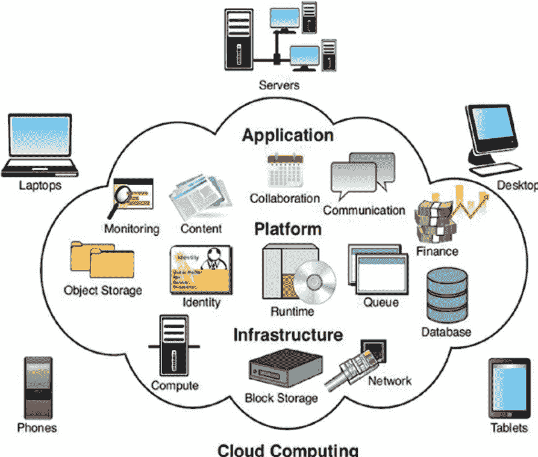

图 5.13 云计算

## 软件定义广域网 (SD-WAN)

软件定义广域网 (SD-WAN) 是传统网络技术的一种经济高效替代方案。SD-WAN 用于连接地理位置分散的地点和远程用户。虽然软件定义网络 (SDN) 与 SD-WAN 似乎密切相关且服务于类似目的，但 SDN 针对 LAN 管理并集中化管理。OpenFlow 是一种可与 SDN 配合使用的协议，用于从中央控制器控制交换规则。表 5.10 显示了 SD-WAN 和 SDN 之间的基本区别。

### 表 5.10 SDN 和 SD-WAN 的用途与详情

| SDN | SD-WAN |
|---|---|
| 管理 LAN 或服务提供商的核心网络 | 实现跨地理位置的网络与用户之间的连接 |
| 由用户编程以按需提供带宽 | 可编程，以提供运营简化、集成安全和流量优先级 |
| 将控制平面与数据平面分离 | 将控制平面与数据平面分离 |
| 提供集中视图以实现网络服务自动化 | 专注于软件定义的应用程序路由功能 |

## 保护电子邮件通信

安全电子邮件解决方案很重要，因为电子邮件是使用最广泛的 Internet 应用程序之一。电子邮件容易受到多种威胁，包括欺骗、垃圾邮件和地址伪造。标准电子邮件使用简单邮件传输协议 (SMTP) TCP 端口 25 来接受客户端的消息，并使用互联网消息访问协议 (IMAP4) TCP 端口 143 或邮局协议第 3 版 (POP3) TCP 端口 110 从基于服务器的收件箱中检索电子邮件。

发送电子邮件很像通过邮政服务发送明信片：途中任何人都可以轻松阅读您妈妈在大峡谷游览时写给您的便条。幸运的是，有多种应用程序和协议可用于帮助保护电子邮件。以下各部分将介绍其中一些。

### 非常好的隐私 (PGP)

Phil Zimmermann 于 1991 年开发了 PGP，以提供隐私和身份验证。随着时间的推移，它发展成为一种称为 OpenPGP 的开放标准，并可从 Symantec 购买作为企业商业产品，称为 PGP Whole Disk Encryption。

PGP 与 PKI 不同，因为它没有证书颁发机构 (CA)。PGP 构建了一个信任网络，该网络在用户签名和签发自己的密钥时发展。用户必须确定他们愿意对其他各方置信的程度。PGP 的目标是成为面向所有人的加密（而不仅仅是可供公司和企业使用的加密）。ProtonMail 和 Hushmail 等流行程序和提供商均基于 PGP。

### 其他电子邮件安全应用

PGP 不是保护电子邮件的唯一选择。其他选项包括以下内容：

- **安全多用途 Internet 邮件扩展 (S/MIME)**：默认情况下，MIME 不提供任何保护。为解决此问题，RSA 开发了 S/MIME。S/MIME 已内置到几乎每个电子邮件系统中，用于加密和数字签名受保护电子邮件的附件。S/MIME 为标准电子邮件增加了两个有价值的组件：数字签名和公钥加密。S/MIME 支持 X.509v3 数字证书和 RSA 加密。
- **增强隐私邮件 (PEM)**：PEM 是一个较旧的标准，未被广泛实现，但开发目的是提供身份验证和保密性。PEM 公钥管理是分层的。PEM 使用 MD2/MD5 和 RSA 来实现完整性和身份验证。
- **消息安全协议 (MSP)**：MSP 是 PEM 的军用版本。由于它由国家安全局 (NSA) 开发，未向公众开放审查且未被广泛使用。它是国防部 (DoD) 国防消息系统的一部分，提供身份验证、完整性和不可否认性。军队拥有自己的安全网络，称为 SIPRNet。
- MIME 对象安全服务 (MOSS)：MOSS 扩展了 PEM 的功能，但未被广泛使用，因为它已被 S/MIME 和 PGP 所取代。MOSS 是唯一为用户提供开箱即用机制来签名收件人列表的电子邮件标准。

## 保护语音和无线通信

安全通信已从斯巴达人、罗马人和其他使用原始加密形式的时代长足进步。VoIP 和无线通信每年都受到更多关注和使用。一些研究报告称，中国的手机数量多于美国的人口。5G 支持部署数百万个小型传感器的功能，这些传感器可以收集全球网络中的各种数据。Li-Fi 是一种无线通信技术，被推广为解决 5G 面临挑战的关键，它使用光在设备之间传输数据和位置，并被推广为比 Wi-Fi 或蜂窝网络更可靠、几乎无干扰且独具安全性。

以下各部分将介绍其中一些技术和安全通信的历史。

## 安全通信历史

自古以来，就有安全通信的需求。只要有人存在，就会有秘密。古希腊人和斯巴达人使用的一种早期系统称为 scytale。该系统涉及将一条纸莎草纸条缠绕在直径固定的杆上，在上面写下消息。如果有人拦截了纸张，它看起来就像是一堆无意义的字母。收件人可以通过将纸莎草纸缠绕在相同直径的杆上来阅读消息。

甚至尤利乌斯·凯撒也会加密他发送给可信赖顾问的消息。凯撒密码是一种简单的替换密码。在凯撒密码中，存在明文字母表和密文字母表。字母表


如图 5.14 所示。

| 明文 | A | B | C | D | E | F | G | H | I | J | K | L | M | N | O | P | Q | R | S | T | U | V | W | X | Y | Z |
|---|---|---|---|---|---|---|---|---|---|---|---|---|---|---|---|---|---|---|---|---|---|---|---|
| 密文 | D | E | F | G | H | I | J | K | L | M | N | O | P | Q | R | S | T | U | V | W | X | Y | Z | A | B | C |

### 图 5.14 凯撒密码

凯撒准备发送消息时，会根据密钥将文本向后移动来进行加密。例如，如果密钥是 3 个字符，那么单词 “cat” 会被加密为 “fdw”。通过查看图 5.14，你可以了解其工作原理。只需在顶行查找消息中的每个字母，并写下底行对应的字母即可。凯撒密码也称为移位密码，密钥为 3 时称为 ROT3。虽然这不是一种可靠的加密方法，但凯撒使用它取得了巨大成功。

古希伯来人使用了一种名为 ATBASH 的类似密码系统，其工作原理是用字母表末尾等距离的另一个字母替换一个字母；例如，A 发送为 Z，B 发送为 Y（参见图 5.15）。

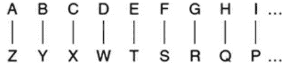

### 图 5.15 ATBASH

在中世纪，随着个人在破解简单加密系统方面变得更加熟练，出现了更复杂的替换密码。九世纪，阿布·尤素夫·亚各布·伊斯哈克·阿尔金迪（Abu al-Kindi）发表了被认为是第一篇讨论如何破解密码系统的论文。该论文题为《关于解密密码信息的手稿》，讨论了使用频率分析来破解密码。_频率分析_是研究字母或字母组在密文中出现频率的学问。发现的模式可以帮助个人确定模式并破解密文。

这些早期密码都存在弱点，人们致力于改进它们。

多表代换密码使用多种字母表排列。被称为维吉尼尔密码的字母代换密码使用以下加密/解密图表：

```
ABCDEFGHIJKLMNOPQRSTUVWXYZ
BCDEFGHIJKLMNOPQRSTUVWXYZA
CDEFGHIJKLMNOPQRSTUVWXYZAB
DEFGHIJKLMNOPQRSTUVWXYZABC
EFGHIJKLMNOPQRSTUVWXYZABCD
FGHIJKLMNOPQRSTUVWXYZABCDE
GHIJKLMNOPQRSTUVWXYZABCDEF
HIJKLMNOPQRSTUVWXYZABCDEFG
IJKLMNOPQRSTUVWXYZABCDEFGH
JKLMNOPQRSTUVWXYZABCDEFGHI
KLMNOPQRSTUVWXYZABCDEFGHIJ
LMNOPQRSTUVWXYZABCDEFGHIJK
MNOPQRSTUVWXYZABCDEFGHIJKL
NOPQRSTUVWXYZABCDEFGHIJKLM
OPQRSTUVWXYZABCDEFGHIJKLMN
PQRSTUVWXYZABCDEFGHIJKLMNO
QRSTUVWXYZABCDEFGHIJKLMNOP
RSTUVWXYZABCDEFGHIJKLMNOPQ
STUVWXYZABCDEFGHIJKLMNOPQR
TUVWXYZABCDEFGHIJKLMNOPQRS
UVWXYZABCDEFGHIJKLMNOPQRST
VWXYZABCDEFGHIJKLMNOPQRSTU
WXYZABCDEFGHIJKLMNOPQRSTUV
XYZABCDEFGHIJKLMNOPQRSTUVW
YZABCDEFGHIJKLMNOPQRSTUVWX
ZABCDEFGHIJKLMNOPQRSTUVWXY
```

维吉尼尔图表只是将字母表重复写了 26 次，每行将字母表向后移动一个字母。使用维吉尼尔系统需要一个密钥。为了说明维吉尼尔加密的工作原理，以下是使用此方法加密的明文、密钥和密文示例：

- 明文：Cryptorocks
- 密钥：QUEEXAMCRAM
- 密文：Slctqocqtk

| 项目 | 值 |
|---|---|
| 明文 | Cryptorocks |
| 密钥 | QUEEXAMCRAM |
| 密文 | Slctqocqtk |

请注意，明文的第一个字母是 C，密钥的第一个字母是 Q。将自然字母表与加密/解密图表中以 Q 开头的字母排列进行对比：

```
A B C D E F G H I J K L M N O P Q R S T U V W X Y Z
Q R S T U V W X Y Z A B C D E F G H I J K L M N O P
```

可以看到，明文 C 对应密文 S。接下来，根据以密钥第二个字母 U 开头的字母表加密第二个明文字母 R：

```
A B C D E F G H I J K L M N O P Q R S T U V W X Y Z
U V W X Y Z A B C D E F G H I J K L M N O P Q R S T
```

明文 R 变为密文 L。此过程持续到整个明文加密完毕。如果密钥比明文短（通常情况），则从密钥开头重新开始。

请注意，使用相同算法但不同的密钥会产生完全不同的密文。

### 提示

凯撒、ATBASH 和 维吉尼尔 密码被认为是对称替换密码，其工作原理是用替代位、字节或字符替换位、字节或字符。替换密码容易受到频率分析攻击，不被认为是安全的。

替换密码使用一种加密方法，将明文消息中的每个字符或位替换为不同的字符。凯撒密码是替换密码的一个基本示例。密码也可以使用转位，这是斯凯塔勒密码的基础。转位密码使用算法重新排列明文消息中的字母。结果是一条密文消息。解密过程反过来执行加密过程以检索原始消息。转位密码的不同之处在于，原始消息中的字母保持不变，但其位置以有序的方式被打乱。这可以通过一个简单的列阵转位来演示。消息中的字母按行写入矩形阵列，然后按列读出。假设消息是 CRYPTO IS MY FAVORITE SUBJECT。该消息可以写成如下 5 × 5 阵列：

```
C R Y P T
O I S M Y
F A V O R
I T E S U
B J E C T
```

要加密消息，将每个列处理为密文：

```
COFIB RIATJ YSVEE PMOSC TYRUT
```

尽管它看起来很复杂，但给予足够的时间和资源，转位密码很容易被破解。

### 提示

现代密码系统不使用简单的替换或转位。然而，这些替换和转位与其他布尔数学运算混合在一起，创建出当今使用的分组和流密码所依赖的复杂算法。

历史提供了许多其他作为代码和密码的系统示例。例如，隐蔽密码将一条消息隐藏在另一条消息中。一种隐蔽密码通过在无害的消息中逐字埋藏预期消息来工作。预期消息可能是句子中每个第三个单词。一个著名的例子是 17 世纪 Sir John Trevanion 收到的一封信。Sir John 在英国内战期间等待处决，渴望逃离俘虏。信中写道：

> 尊敬的约翰爵士：希望，是受苦者最好的安慰，恐怕现在很难帮助你。我想对你说的只有这一点：如果我有朝一日能回报我对你的欠款，请尽管开口。我能做的并不多：但我能做的，请放心我一定会去做。我知道，如果死亡来临，即使普通人惧怕它，它也吓不倒你，你将其视为一种崇高的荣誉，是你忠诚的回报。祈祷你能免遭这苦涩之杯。我不担心你会抱怨任何痛苦；只有如果你能通过屈服将它们避开，那才是明智之人的作为。告诉我，如果你能，为你做任何你希望我做的事。将军将在周三返回。你的仆人随时听候差遣。——R.T.

当按标点符号之后的每第三个字母分割消息并读取时，会出现以下消息：

礼拜堂东端的面板滑开

一种类似的技术是书籍或连续密钥密码，它使用书中页码、段落或单词的引用。连续密钥密码是一种对称替换密码，其中文本（通常来自书籍）用于提供非常长的密钥流。通常，需要事先商定书籍或文本。这些密码并未使用现代数学运算来实际加密消息，甚至未使用旧技术对消息进行打乱；然而，它们确实隐瞒了非预期接收者的消息。这种变体过去曾在一些计算机游戏中出现。要开始游戏，你必须输入游戏印刷手册特定页面中的某个词。如果没有手册，游戏就无法启动。

任何密码或代码是无法破解的吗？唯一已知的无法通过暴力破解攻破的系统是称为 Vernam 密码的一次性密码本。（可将暴力破解攻击视为尝试解密消息时，对算法中可能使用的所有可能密钥进行穷举搜索。）吉尔伯特·维纳姆于 1917 年在研究可能改进多表代换密码的方法时创造了这种一次性密码本。一次性密码本是明文与随机密钥的组合。该密码系统依赖于多种机制才能正常工作：

- 消息和密钥必须安全存储，且密钥长度必须与消息长度相同或更长。
- 密钥只能使用一次。
- 密钥必须是随机的。
- 密钥必须通过带外机制分发。带外是指通信超出了先前建立的通信方式。

### 提示

20 世纪另一项密码学进步是 Feistel 网络。出生于德国的密码学家 Horst Feistel 是这种加密函数的创建者，它是许多对称密钥分组密码（如 DES 和 3DES）的基础。Feistel 网络的一个关键特征是使用著名的轮函数。

20 世纪初由机械加密设备主导。示例包括德国的 _恩尼格玛机_，它使用一系列内部转子执行加密，以及日本的 _紫色_


机器。这些设备的开发旨在应对早期替换密码的弱点，但两种系统最终都被攻破了。今天，军队、政府、工业和个人都在使用密码系统。例如，电影行业使用密码学进行 DVD 和 Blu-ray 加密，PGP 用于电子邮件和文件安全，IPsec 用于数据传输。

在美国，NSA 负责密码学以及密码的创建和破解。密码学仍在不断进步；基于光的新密码学实现正在当今被创建。这被称为量子密码学，它通过利用量子物理的特性和现象来保护光学通信的运行。

## 历史最长的被压制专利申请

虽然许多人只满足于了解足够的密码学流程知识来完成工作并通过 CISSP 考试，但 William Friedman 始终渴望学习更多，并将密码学作为自己的职业。William Friedman 被认为是有史以来最优秀的密码学家之一，他保持着历史最长被压制专利的记录——该专利最初于 1933 年提出申请，并于 2001 年最终获得批准。William Friedman 通过领导攻破日本紫色机器的团队，为美国作出了巨大贡献。

William Friedman 在破解日本紫色机器所使用的加密方案方面的作用帮助挽救了生命，并协助盟军赢得了第二次世界大战。尽管 William Friedman 从未实际见过其中任何一台设备，但他仍然能够带领团队理解设备的工作原理，并使美国能够解密日本发送的许多消息。William Friedman 的许多发明和密码系统从未申请专利，因为它们被认为非常重要，以至于释放任何有关信息都可能帮助敌人。他的大部分工作直到今天仍然保密。在 1960 年代去世之前，NSA 去了 William Friedman 家，取回了他许多个人著作。去世后，他的剩余期刊和著作被 NSA 以国家保密为由没收。

## IP 语音 (VoIP)

在 2000 年之前，语音和视频等多媒体服务部署在稳定的电路交换网络上。这保证了带宽和允许的延迟可以得到控制。今天，许多网络使用分组交换技术。VoIP 涉及使用数据网络来传输语音通信。VoIP 不是传统的分组交换协议，而是以 IP 数据包的形式在分组交换网络上传输。配置为承载 VoIP 的网络将语音通信视为另一种形式的数据。这是近年来网络中发生的重大变化之一。*网络融合*是指在单个网络中提供电话（VoIP）、流媒体视频和网络数据通信服务。基本上，使用一条管道来传输所有形式的通信服务。

在讨论 VoIP 流量时，服务质量 (QoS) 是一个重要问题，因为电话通话的一部分是无用的。QoS 是网络提供专用带宽并控制抖动和延迟的能力。QoS 使语音和视频等实时流量能够与 HTTP 等突发流量共存。

VoIP 已经取代了多年前普遍使用的大部分电路交换 POTS 电话服务。如果您还拥有家用电话，很有可能它实际上是 VoIP 连接。以下是 VoIP 的一些基本特征：

- 基于 SIP 的信令
- 用户代理客户端
- 用户代理服务器
- 三次握手
- 由 RTP 承载的语音流

## VoIP 漏洞

公司转向 VoIP 是因为它提供了显著的成本节约。但是，使用 VoIP 并非没有风险。作为一种网络服务，它以与其他数据流量相同的某些方式存在漏洞。攻击者可以拦截流量、攻击 VoIP 服务器，或针对 VoIP 服务器发起 DoS 攻击并导致网络中断。针对 IP 电话的攻击也是问题，LAN 跳跃和用于电话固件镜像加载的 TFTP 篡改也是如此。另一个考虑因素是，VoIP 应用程序运行的操作系统的漏洞会被继承。

VoIP 的一个主要关注点是嗅探，因为 SIP 等协议默认提供的安全性很小。如果没有适当的安全控制，嗅探 VoIP 通话就像使用常见的网络嗅探器 Wireshark 一容易。与 VoIP 相关的一个安全问题是数据网络丢失，这可能会禁用 VoIP。其他 VoIP 漏洞包括以下内容：

- **开放网络**：VoIP 数据包离开组织网络后，网络不再负责它们被路由到哪里或谁可能访问它们。因此，任何未加密的流量都可能被恢复。

- **DoS 攻击**：因为 VoIP 在通信过程的部分使用 UDP，所以它极易受到中断和 DoS 攻击的影响。VoIP 使用等时进程，数据必须在严格的时间线内传输。

- **窃听**：因为 VoIP 依赖于 UDP 和会话初始化协议 (SIP)，它是一个开放服务，通信可能会被嗅探和重放。VoIP 产品的各种供应商使用的其他协议包括 IAX、IAX2、SCCP 和 UNISTIM。

- **未授权的电话使用**：Skype 和 GoogleTalk 等服务会使企业网络面临受到攻击和潜在政策违规的风险。此类工具甚至可能导致违反法规，具体取决于行业或其使用方式。

- **互联网电话垃圾邮件 (SPIT)**：SPIT 是使用 VoIP 发送的大量未经请求的垃圾邮件。

> **注意** 您可以使用安全实时传输协议 (SRTP) 来保护 VoIP。SRTP 使用 AES 实现保密性，使用 SHA-1 实现完整性。

## 蜂窝电话

蜂窝电话是另一种多年来成熟的技术。蜂窝电话技术大致可分为以下几代：

- **1G：** 这一代手机使用户可以在蜂窝电话上进行模拟呼叫，并在移动过程中无缝地从一个小区切换到另一个小区，从而在一个区域或地区内继续通话。

- **2G：** 第二代将模拟机制改为数字机制。这些手机在 20 世纪 90 年代部署，基于 GSM（全球移动通信系统）和 CDMA（码分多址）技术。

- **3G：** 第三代使手机成为移动计算机，能够快速访问互联网和其他附加服务。下行速度范围从 400 Kbps 到每秒数兆比特。

- **4G：** 第四代蜂窝电话设计用于支持实时电视以及以更高速度下载视频。两种最广泛部署的 4G 标准是移动 WiMAX 和长期演进 (LTE)。

- **5G：** 第五代无线网络技术预计将改变人们的生活和工作方式。5G 提供平均下载速度约为 1 Gbps 的连接。5G 架构是软件定义平台，其中网络功能通过软件而不是硬件进行管理。

截至 2020 年 12 月，大多数蜂窝运营商已迁移到 5G 网络。全球移动通信基础设施正以惊人的速度增长，有些人可能会认为，在互联网之后，移动电话是全球化世界中第二重要的发明。

表 5.11 列出了一些常见的蜂窝电话技术及其对应的代数。

## 表 5.11 蜂窝电话技术

| 技术 | 代数 |
|------------|------------|
| AMPS | 1G |
| TACS | 1G |
| GSM | 2G |
| CDMA | 2G |
| GPRS | 2.5G |
| EDGE | 3G |
| WWRF | 4G |
| SDN | 5G |

现在大多数美国人都有手机，很少有人有固定电话。移动电话彻底改变了连接性；然而，它们也引发了安全问题。组织必须考虑在这些设备上实施哪些控制措施。

随着如此多的手机在使用，攻击者试图利用其漏洞的方式有很多种。一种是通过克隆。手机具有电子序列号 (ESN) 和国际移动台设备标识 (IMEI)。攻击者可以使用专用设备从他人手机中捕获和解码这些号码，并将其安装在另一部手机中。然后，攻击者可以出售或使用克隆的手机。

颠簸是攻击手机的另一种技术。经过特殊改装的手机在每次通话后会颠簸并切换到不同的 ESN/IMEI 号码对。这种技术使攻击者的手机看起来像是一台合法的漫游手机。第一代手机容易受到这种类型的攻击。GSM 手机还使用国际移动用户识别码 (IMSI) 来识别蜂窝网络的用户。例如，以 310 开头的 IMSI 标识来自美国的用户，而以 460 开头的 IMSI 标识来自中国的用户。

攻击电话系统的人被称为电信骇客。


### 注意

电话系统可能成为来电显示欺骗和 SMSHing（短信钓鱼）的目标（参见 https://www.cbsnews.com/news/cell-phones-easy-id-theft-targets/）。

虽然如今很少使用，但无绳电话也存在安全问题。它们仍然容易受到拥有合适设备的人员的窃听。

## 802.11 无线网络和标准

802.11 协议族（通常称为 802.11x）涵盖由 IEEE 管理的广泛无线标准群。这些无线设备大多数采用扩频技术进行广播。这种传输方式在广泛的无线电频率范围内传输数据。扩频技术可减少噪声干扰，并允许数据速率随信号质量而升降。墙壁、门和其他固体物体等障碍物往往会阻挡或削弱信号强度。

以下是最常见的扩频技术：

- 正交频分复用 (OFDM)：OFDM 将信号分成更小的子信号，这些子信号使用频分复用技术，在不同频率上同时将数据的不同部分发送到接收器。

- 直接序列扩频 (DSSS)：这种扩频技术使用扩频码，在小范围（22 MHz 宽）的无线电频率上同时传输信号。扩频码越宽，信号对干扰的抵抗力就越强，但代价是数据速率较低。

- 频跳扩频 (FHSS)：FHSS 的工作方式与 OFDM 和 DSSS 略有不同，它将宽带宽频谱划分为约 1 MHz 的小型子信道。发射器随后在子信道之间跳频。每个子信道用于在短时间内发出短促的数据突发，称为 *停留时间*。为了使设备进行通信，每个设备都必须知道正确的停留时间，并同步到正确的跳频模式。

表 5.12 汇总了无线局域网 (WLAN) 的主要标准。

## TABLE 5.12 WLAN 标准和详细信息

| 服务 | 频率 | 传输方案 |
|---|---|---|
| 802.11a | 5 GHz | OFDM |
| 802.11b | 2.4 GHz | DSSS |
| 802.11g | 2.4 GHz | OFDM/DSSS |
| 802.11n | 2.4 GHz 或 5 GHz | MIMO-OFDM |
| 802.11ac | 2.4 GHz 或 5 GHz | MIMO-OFDM |

> **考试警报**
>
> 对于 CISSP 考试，您必须了解 WLAN 标准、速度和传输方案。

除了无线接入点和设备之外的其他设备也可能对组织构成威胁。所有无线设备都应实施强制安全，并制定强有力的策略来规定其使用。智能手机和平板电脑允许用户在原本安全的区域拍照。此外，这些设备很容易丢失或被盗，且有多种取证工具可用于从这类无线设备中提取数据。便携式无线设备还可以支持可能丢失或被移除的内置可移动存储。不幸的是，这些设备通常缺乏有线设备的安全级别。企业安全官员必须理解，许多现代设备的默认擦除选项无法删除所有存储的数据。

## 无线拓扑

无线网络可以以自组网模式或基础设施模式运行。*自组网模式*，或称 *对等模式*，除了无线网络适配器外不需要任何设备。自组网模式允许点对点通信，非常适合临时信息交换。*基础设施模式*围绕无线接入点 (AP) 展开。无线 AP 是一种集中式无线设备，用于控制无线介质中的流量。无线设备使用 CSMA/CA 进行高效通信。802.11 无线网卡可在四种模式下运行：

- **托管模式**：这是最常用的无线选项。客户端仅与接入点通信，不直接与其他客户端通信。

- **主模式**：无线接入点使用此模式与以托管模式连接的客户端通信。

- **自组网模式**：这是一种没有中央接入点的对等模式。

- **监听模式**：这是一种只读模式，用于嗅探 WLAN。Kismet 等无线嗅探工具使用监听模式来嗅探 802.11 无线帧。

## 无线标准

WLAN 的标准是 IEEE 802.11，通常称为 *Wi-Fi*。该标准的一些重要修正案包括以下内容：

- **802.11a**：该修正案定义了可在 5 GHz 频率范围内运行并支持最高 54 Mbps 速度（距离 60 英尺）的物理接入。

- **802.11b**：该修正案定义了可在 2.4 GHz 频率范围内运行并可达到最高 11 Mbps 速度和 300 英尺范围的物理接入。

- **802.11g**：该修正案定义了可在 2.4 GHz 频率范围内运行并支持最高 54 Mbps 速度的物理接入。

- **802.11i**：该修正案提供了安全身份验证和加密，以永久取代有缺陷的有线等效隐私 (WEP) 机制。802.11i 还使用强健安全网络 (RSN)，该网络使用可插拔认证模块，允许在发现新漏洞时更改加密密码。

- **802.11ac**：这种无线网络标准包括至少 1 Gbps 的多站 WLAN 吞吐量和至少 500 Mbps 的单链路吞吐量。

- **802.11n**：该修正案定义了在 2.4 GHz 频率下运行的无线接入。数据速率可超过 200 Mbps。

- **802.16**：这种宽带无线接入标准（又称 WiMAX）旨在以最高 75 Mbps 的速度向宽带用户提供最后一英里连接。

表 5.13 汇总了无线局域网 (WLAN) 的主要标准。

## TABLE 5.13 常见 WLAN 速度和频率

| 标准 | 最高速度 (Mbps) | 频率 (GHz) |
|---|---|---|
| 802.11 | 2 | 2.4 |
| 802.11a | 54 | 5 |
| 802.11b | 11 | 2.4 |
| 802.11g | 54 | 2.4 |
| 802.11n | 144+ | 2.4 和/或 5 |

IEEE 还为其他无线技术制定了标准。例如，802.15 定义了用于无线个人区域网 (WPAN) 的 Bluetooth 和 RFID（射频识别）的使用。

## 蓝牙

Bluetooth 技术专为移动设备和手持设备之间的短距离无线通信而设计。Bluetooth 从 20 世纪 90 年代中期到后期开始流行。版本包括 1.2、2、3 和 4。Bluetooth 技术促进了各种个人和手持电子设备的发展。例如，在 WPAN 中，当这些设备彼此进入范围或被激活时，Bluetooth 使智能手机能够与平板电脑和笔记本电脑通信。Bluetooth 的分类如下：

- **Class 1**：此类别范围最远（可达 100 米），功率为 100 mW。

- **Class 2**：虽然此类别并非最受欢迎，但它允许传输距离可达 20 米，功率为 2.5 mW。

- **Class 3**：这是最广泛实现的类别。它支持 10 米的传输距离，功率为 1 mW。

- **Class 4**：此类别支持 0.5 米的传输距离，功率为 0.5 mW。

> **注意**
>
> 虽然您无疑听说过 Bluetooth，但可能未曾听说过 Zigbee。它是另一种无线标准，专为低数据速率设计，可运行多年，非常适合智能家居应用，例如控制灯光、从电力表传输数据以及将温度数据发送给恒温器。

虽然 Bluetooth 具备一些内置安全功能，但已被证明易受攻击。在最近的 DEFCON 安全会议上，安全专业人员演示了从 1 千米外嗅探 Bluetooth 传输的方法。

Bluetooth 属于 IEEE 802.15 协议族，专为 WPAN 设计。尽管 Bluetooth 极其流行，但竞争性 802.15 技术（如无线 USB 和红外）也使市场多样化。


Bluejacking 是指向蓝牙用户未经请求地发送数据。Bluesnarfing 是从用户处窃取数据或信息。BlueBorne 是一种缓冲区溢出攻击，可让攻击者访问设备。

## 无线局域网组件

无线局域网包括以下组件：

- 服务集标识符 (SSID)：计算机要进行通信或使用 WLAN，必须配置为使用 WLAN 的 SSID，SSID 用于区分不同的无线网络。

- 无线接入点：无线接入点是一种集中式无线设备，用于控制无线介质中的流量，并可用于将无线设备连接到有线网络。

- 无线网卡：这些网卡用于将设备连接到无线网络。

- 加密：802.11 加密最初由老旧的 WEP 协议提供，旨在提供用户在有线网络上可能拥有的同等隐私级别。WEP 使用 RC4 对称加密，但其实现存在缺陷。802.11i 修正案为 WEP 提供了安全替代方案：Wi-Fi Protected Access (WPA，使用 RC4) 和 WPA2 (使用 AES)。这些加密机制将在下一节中详细讨论。

在北美，802.11 支持 2.4 GHz 频段的 11 个信道，其中 3 个（1、6 和 11）可同时用作不重叠信道。信道指定网络将运行的频率。欧洲设备支持 13 个信道（最多 4 个不重叠），日本设备支持 14 个信道。在 5 GHz 频段，有 24 个不重叠信道。全球范围内，频率可用性因相关许可机构而异。设备通过询问安装所在的国家来调整不同需求，要么将频率调整为当地机构规定的频率，要么终止传输（取决于供应商获得的许可）。802.11d 修正案使客户端设备能够询问自身所在国家并动态调整其频率。

> **注意**
>
> 两种非常基本的无线安全预防措施是 MAC 地址过滤和 SSID 过滤。两者仅提供有限的安全性，因为 MAC 地址以明文传输，因此很容易被嗅探。将 SSID 设置为不广播也是一种不良的安全策略，因为 Kismet 等无线嗅探器可以检测客户端使用的不广播 SSID，以绕过这一薄弱控制。

### 无线保护机制

用于保护无线通信的原始技术是 WEP。WEP 在数据链路层实现，并使用 RC4 加密算法加密数据。由于 1990 年代末开发 802.11 协议时存在的出口规则，密钥被限制为 40 位。如今，这被认为是一个非常弱的密钥。

RC4 算法使用 64 位（IEEE 标准）或 128 位（商业增强）密钥。然而，密钥无法使用那么多位，因为使用了 24 位初始化向量 (IV) 来提供随机性。因此，实际的 WEP 密钥长度为 40 位或 104 位。许多人不愿了解 WEP 这样古老且已被攻破的技术；但是，重要的是要认识到 WEP 仍在使用。

WEP 是一种静态机制，因为每个人都有相同的密钥。关于 WEP 最初发现的两个弱点是：这种静态加密密钥与共享密钥身份验证 (SKA) 使用的密钥相同，且身份验证使用了可被字典破解的质询-握手机制。立即的解决方案是放弃 SKA，仅使用开放系统身份验证 (OSA) 和 WEP 加密密钥。这样，每个人都可以连接，但没有加密密钥就没有人能够通信。

行业应对这些潜在问题的一种方式是将 802.1X（基于端口的访问）纳入许多无线设备。与可扩展身份验证协议 (EAP) 配合使用时，802.1X 可用于验证尝试连接到特定 LAN 端口的设备。尽管它比 WEP 有所改进，但 802.1X 已被证明存在漏洞。

要更好地理解 WEP 过程，需要了解布尔逻辑中异或 (XOR) 函数的工作原理。具体而言，XOR 表示“异或”，即对两个位进行简单的二进制比较，产生另一个位作为结果。比较两个位时，XOR 检查它们是否不同。如果答案是肯定，则输出为 1。如果两个位相同，则结果为 0。加密消息涉及七个步骤：

- 1. 发送站和接收站使用密钥进行初始化。必须使用带外机制分发此密钥，例如通过电子邮件、发布在网站上或写在纸上交给某人（如酒店提供 Wi-Fi 密钥）。
- 2. 发送站生成一个种子，该种子通过将 40 位密钥追加到 24 位 IV 上获得，作为输入到伪随机数生成器 (PRNG)。
- 3. 发送站将密钥和 24 位 IV 作为输入到 WEP PRNG 中，生成随机比特流。
- 4. 将密钥流与明文进行 XOR 运算以获取密文。
- 5. 发送站将密文追加到 IV 的副本以供接收方使用，并在报头中设置一个比特位以指示数据包已加密 WEP，然后传输 WEP 帧。由于 WEP 在 OSI 模型的第 2 层进行加密，因此第 2 层的报头和报尾以明文发送。
- 6. 接收站检查其接收到的帧中的加密比特位是否已设置。如果是，接收站从帧中提取 IV，并将其和密钥输入到其 WEP PRNG 中。
- 7. 接收方生成与发送站使用的相同密钥流，并将其与密文进行 XOR 运算以获取发送的明文。

WEP 的直接后继者是一种被广泛称为 Wi-Fi Protected Access (WPA) 的过渡性措施。WPA 认证意味着硬件符合 802.11i 修正案的一个快照（在 WPA 创建时该修正案仍在设计中）。802.11i 工作组的任务之一是对 WEP 进行逆向工程，并为无线用户开发纯软件升级，部署时间密钥完整性协议 (TKIP) 用于加密。TKIP 使用混合算法将用户密钥与网络状态信息混淆，并添加一个完整性检查功能（远比 WEP 机制强大）来验证帧未被篡改。WPA 认证测试设备是否实现了 TKIP。

2004 年，IEEE 完成了 802.11i 修正案，并发布了基于 AES 的 CCMP（Counter Mode with Cipher Block Chaining Message Authentication Code Protocol，计数器模式与密码块链消息验证码协议），作为替代 WEP 和 TKIP 中过时 RC4 机制的完整解决方案。CCMP 也由 Wi-Fi Alliance 进行测试和认证，并被认可为 WPA2。WPA2 可使用最大 256 位的密钥大小，相比 WEP 使用的原始 40 位加密有了巨大的改进。

请记住，在 IT 安全领域，没有什么是一成不变的。继续开发新的工具和技术来攻击较新的安全机制。coWPAtty 就是这样一种工具。

War driving（战争驾驶）是指开车四处寻找、绘制地图并可能连接到开放无线网络的做法。战争驾驶者使用诸如 NetStumbler、Kismet 和 AirSnort 等工具。

War chalking（战争粉笔）是指标记无线网络位置和状态的做法。该做法可以追溯到大萧条时期流浪汉用来标记食物和工作地点的系统。

### 其他无线技术

随着技术不断发展，许多新标准正在出现。一个例子是 i-mode，一种用于日本手机的基于分组的服务。另一个是数字增强无绳电信 (DECT)，一种在美国以外广泛用于无绳电话的技术。DECT 允许不同制造商的手机和基站协同工作。

另一个你应该了解的标准是无线应用协议 (WAP)。WAP 是一种开放标准，使手机用户可以获取与台式机和笔记本电脑用户相同类型的内容。启用 WAP 的设备会定制网站内容，以适应手机的小屏幕尺寸。该技术的一个关键组件是无线标记语言 (WML)。WAPv1 中的安全问题已在 WAPv2 中得到修复。任何考虑使用 WAP 进行敏感信息交换的人都应了解这些问题。WAP 由 WAP Forum 创建，是试图重写 OSI 模型的上层，以尽量减少手机内小型浏览器的开销。WAP Forum 创建了自己的加密协议 WTLS，该协议基于传输层安全协议 (TLS)。当客户端信号到达 ISP 网关时，WTLS 数据包必须从 WTLS 解密，以便重新封装为 TLS 信号，然后再发送到互联网。这是一个易受攻击的时刻，在此期间数据被完全解密，因此被称为 WAP 中的 GAP（参见图 5.16）。WAP2 已重写为 TLS 的缩写形式，而不是 WTLS，数据包不再需要解密。


图 5.16 WAP 网关


## 使用加密解决方案保护 TCP/IP

在网络的所有层中都拥有安全选项是最好的。加密可以分层，以帮助构建纵深防御。这并不是说加密控制应该应用于每一层，只是纵深防御应该是目标。加密层数过多会减慢系统或进程的速度，用户可能会寻找绕过某些控制的方法。有多种类型的加密解决方案可供选择，从应用层一直到物理帧。作为安全专业人员，您的工作是了解这些潜在解决方案，并能够确定应该使用哪些来满足组织的目标。

由于安全在开发 TCP/IP 协议时并不是推动力之一，此处讨论的加密解决方案在很大程度上可以保护组织的安全。虽然在现实中，任何层的加密都是在下一更高层的有效载荷上完成的，但大多数 CISSP 考试问题将侧重于加密过程及其所在层的基础知识。图 5.17 显示了一些常见的加密解决方案及其对应的层。以下各节从协议栈顶部开始，逐层向下进行。

| 层 | 协议 |
|---|---|
| 应用层 | SSH, S/MIME, HTTPS |
| 主机到主机层 | SSL, TLS, WTLS |
| 因特网层 | IPsec |
| 网络访问层 | CHAP, PPTP, WEP, L2TP |

## 应用/进程层控制

以下应用层协议可用于为网络添加机密性、完整性或不可否认性：

- 安全外壳协议 (SSH)：SSH 是一种提供安全远程访问的 Internet 协议。它被视为 FTP、Telnet 和 Berkeley“r”实用程序的替代品。SSH 默认使用 TCP 端口 22。SSH 版本 1 已被发现包含漏洞，因此建议使用 SSHv2。

- 安全 FTP (SFTP)：SFTP 使用 SSH 连接，然后通过 SSH 隧道传输 FTP。SSH 的最新版本是 2.0 版，通常在 TCP 端口 22 上运行。只有当 FTP 客户端软件支持时，才能使用 SFTP。

- FTP 安全 (FTPS)：FTPS 建立 SSL 安全通道，然后通过 SSL 运行 FTP 会话。IANA 为 FTPS 分配了端口 989（数据）和 990（控制），但供应商可以自由使用自定义端口号，并且经常这样做。

- 安全超文本传输协议 (S-HTTP)：S-HTTP 是 HTTP 的一种修改版，旨在提供与 Web 服务器的安全通信。S-HTTP 是一种无连接协议，旨在安全地发送单个消息。

- 安全电子交易 (SET)：Visa 和 MasterCard 想要消除与在互联网上使用信用卡相关的顾虑，因此他们开发了 SET 规范，该规范使用买方、商家和银行之间的数字证书和数字签名组合，以确保隐私和机密性。虽然这听起来是个好主意，但 SET 的一个问题是银行希望对这项服务收费，并要求进行硬件和软件更改。许多供应商反对这些费用，因此 SET 未被广泛使用。SET 的灰烬中诞生了支付卡行业数据安全标准 (PCI-DSS)。PCI-DSS 要求所有接受信用卡的供应商满足并保证特定的信息系统安全标准，旨在保护信用卡数据。

## 主机到主机层控制

TCP/IP 协议栈的主机到主机层可用于为数据通信添加加密解决方案。一些常见示例如下：

安全套接层 (SSL)：SSL 由 Netscape 开发，用于通过互联网传输私密文档。与 S-HTTP 不同，SSL 与应用程序无关。SSL 的一个优势是其加密独立性。该协议本身仅仅是用于通信证书、加密密钥和数据的框架。当前的 SSL 版本是 SSLv3，它提供相互身份验证和压缩功能。图 5.18 说明了 SSL 会话中的事务。SSLv3 被认为不安全，并且易受 POODLE 漏洞利用攻击。如果攻击者成功利用此漏洞，他们只需发出约 256 个 SSLv3 请求即可破解加密。TLS 1.2 是 HTTP 加密的当前标准。


图 5.18 安全套接层 (SSL)

传输层安全 (TLS)：TLS 加密主机与客户端之间的通信。TLS 通常使用 X.509 数字证书进行服务器身份验证。此机制为客户端提供对服务器的强身份验证，因此客户端可以信任自己已连接到正确的远程系统。TLS 由两层组成：TLS 记录协议和 TLS 握手协议。TLS 最常见的实现之一是 HTTPS，它只是通过 TLS 进行的 HTTP。

- 安全套接字隧道协议 (SSTP)：SSTP 是一种于 2008 年发布的 VPN 隧道形式，它提供了一种通过 SSLv3 连接传输 PPP 或 L2TP 流量的机制。SSTP 要求服务器端拥有数字证书，并建立一个加密所有通过 TCP 端口 443 传输的流量的 SSL 隧道。由于它使用 HTTPS 使用的同一端口，因此可以通过企业防火墙使用。

- 无线传输层安全 (WTLS)：WTLS 是一种为蜂窝技术开发的安全协议。为了尽量减少上层支持代码，蜂窝行业开发了自己的无线应用协议 (WAP) 堆栈。WTLS 加密蜂窝无线客户端与手机正在连接到的 ISP 塔之间的通信。在塔处，WTLS 数据包被解密，然后使用标准 TLS 重新加密，并路由到互联网。这意味着客户端数据会在某一瞬间处于未加密状态。这是一个已知的安全漏洞，被称为 WAP 中的“间隙”。蜂窝行业随后发布了 WAPv2，它集成了行业标准 TLS，因此不再需要解密。

## 因特网层控制

因特网协议安全 (IPsec) 驻留于因特网层，是一种广为人知的加密解决方案。IPsec 是一种端到端安全技术，允许两个设备进行安全通信。IPsec 开发目的是解决 IPv4 的缺陷。尽管它是 IPv4 的附加组件，但它是为 IPv6 创建的，并且内置于 IPv6 中。IPsec 可用于仅保护数据，或保护数据及原始 IP 头。这种级别的保护可以提供完整性和/或加密。（本章后面将更详细地介绍 IPsec。）

因特网层中还有两种使用频率较低的加密解决方案：

- Internet Protocol 简单密钥管理 (SKIP)：SKIP 由 IETF 开发，使用极少，且无需事先通信；它类似于 SSL。在 1998 年采用 IKE 之前，SKIP 已被评估为 IPsec 的密钥交换机制。

- 软件 IP 加密 (swIPe)：swIPe 是为 VPN 开发开放标准的早期尝试。尽管免费可用，但它仅适用于 SunOS，并且未被广泛使用。

## 网络访问层控制

TCP/IP 网络访问层或 OSI 模型第 2 层有多种加密解决方案可用：

- 点对点隧道协议 (PPTP)：PPTP 由一组供应商开发，由两个组件组成：传输（维护虚拟连接）和加密（确保机密性）。它可以在 40 位或 128 位密钥长度下运行。

- 第 2 层隧道协议 (L2TP)：L2TP 由 Cisco 和 Microsoft 创建，用于取代 L2F 和 PPTP。L2TP 将 L2F 和 PPTP 的功能合并为一种隧道协议。它本身不提供加密，但与 IPsec 一起部署作为 VPN 解决方案。

> **注意**
> L2F 本身不提供加密或机密性；它依赖于正在隧道传输的协议来提供隐私。

- WPA2 Enterprise：此 Wi-Fi Alliance 认证标识能够在 TCP/IP 第 1 层/OSI 第 2 层使用 EAP 进行身份验证和 AES-CTR-CBC-MAC 进行加密以建立安全通信通道的设备。Cisco LEAP 可与 WPA 和 WPA2 网络一起使用。

> **注意**
> 可扩展身份验证协议 (EAP) 是一种身份验证


该协议广泛用于点对点和无线连接。本章后面将详细讨论。

## 链路和端到端加密

根据迄今讨论的各种协议，您可以看出加密和保护数据有多种方式。必须考虑的最终决定之一是如何在客户端之间移动信息。实际上，加密可以在许多不同层中的任何一层发生。重要的问题是：实际加密什么？您选择在哪一层进行加密，就会强制对所选层以上的所有层进行加密。

*端到端加密*加密消息和数据包。头信息、IP 地址和路由数据保持明文。虽然这意味着恶意人员可以拦截数据包并了解源和目标地址，但数据本身是安全的。此类加密的优点是速度。在任何中间点都不需要花费时间或处理能力来解码地址信息。缺点是，即使数据已加密，攻击者仍可能发起*推断攻击*。

通过端到端加密发送信息可以防止攻击者嗅探主机到主机或应用程序数据，但这并不意味着攻击者无法了解实际通信的相关信息。攻击者可以观察活动并对流量进行*推断*。每当攻击者注意到客户端活动发生变化时，就有可能进行推断。例如，一些新闻机构据称会监控白宫的比萨配送。他们推断，当比萨配送量激增时，官员们正在加班，并且有重要的待处理事件。同样，加密电子邮件流量的激增可能会让攻击者做出类似推断。

*流量填充*可用于防御推断攻击。例如，军事机构可能在美国和阿富汗之间建立连接。尽管第三方可能能够看到流量正在流动，但传输的流量保持恒定流量，从而防止攻击者执行推断攻击。

您在物理层的加密选择是*链路到链路加密*，它加密从特定通信设备发送到另一特定设备的所有数据。这包括头信息、地址和路由信息。此类加密的主要优点是能够增强对嗅探和窃听的防护。缺点是，中间设备必须拥有在行程每一跳处加密和解密加密数据包所需的密钥、软件和算法。这会增加复杂性，消耗时间，并需要额外的处理能力。

## 网络访问控制设备

应分层实施安全性，以对攻击者形成多重障碍。网络访问控制的一个好示例是防火墙。防火墙可充当控制点，控制流量的入站和出站。另一种网络访问控制是 DMZ（非军事区），它为内部和外部用户建立安全工作区。后面的章节将更详细地描述这些网络安全设备和技术。

### 防火墙

自 20 世纪 90 年代以来，*防火墙*一词一直用于描述守护私有网络入口的硬件或软件。防火墙的开发旨在阻止未经授权的流量。防火墙经历了几代改进，如今存在多种不同类型的防火墙，包括数据包过滤器、应用程序代理、电路代理和有状态检测。

遗憾的是，我们需要防火墙。就像在现实世界中一样，在网络上，有些人喜欢破坏他人财产。防火墙是用于控制对受保护网络访问权限的计算机、路由器或软件组件。它使组织能够保护其网络并控制流量。请记住，此处讨论的模型（如有状态检测和代理）是理论模型，大多数供应商产品并不完全符合某一种设计。

### 数据包过滤器

数据包过滤器是根据 IP 地址过滤流量的设备。精通技术的黑客使用易于在互联网上获得的欺骗工具和其他程序来绕过数据包过滤器。最初实现的防火墙就是数据包过滤器。这些设备检查 TCP/IP 头，并根据一组预定义规则做出决策。数据包过滤器会简单丢弃不符合预定义规则集的数据包。这些设备被认为是无状态的。数据包过滤器基于访问控制列表 (ACLs)，这些列表可以根据 IP 地址、协议类型、TCP 端口和 UDP 端口拒绝或允许数据包传输。

### 有状态防火墙

有状态防火墙通过状态表跟踪每个通信通道。它们被视为智能防火墙，是第三代防火墙设计的一部分。数据包过滤器不具备此功能。

### 代理服务器

从定义上讲，代理一词表示“代表他人行事的机构或权力”。互联网代理是硬件或软件设备，可以执行地址转换，并代表网络与互联网进行通信。用户的真实 IP 地址隐藏在代理服务器之后。代理服务器还可以配置为过滤更高层的流量，以确定流量是否允许通过。代理服务器提供更高的安全性，因为它们不允许不受信任的系统与内部计算机建立直接连接。代理服务器的工作原理如下：

- 1. 代理服务器从外部网络接受数据包。
- 2. 它复制数据包。
- 3. 它检查数据包是否存在异常。
- 4. 它将数据包上的地址更改为正确内部设备的地址。
- 5. 它将数据包放回线路以发送到目标设备。

代理有多种类型，包括：

- 应用程序级代理：并非所有代理都相同。应用程序级代理会检查整个数据包，然后根据检查内容发现的情况做出决策。这种方法非常彻底且缓慢。为了使应用程序级代理正常工作，它必须理解所处理的协议和应用程序。

- 电路级代理：电路级代理与数据包过滤设备非常相似，因为它根据地址、端口和协议做出决策。它不关心更高层的应用程序，因此适用于更广泛的协议，但无法提供应用程序级代理所具备的深度安全性。Squid 是开源代理的示例。表 5.14 总结了应用程序级代理和电路级代理之间的主要差异。

表 5.14 应用程序级代理和电路级代理

| 应用程序级代理 | 电路级代理 |
| :--- | :--- |
| 每种协议都必须有唯一代理 | 不需要为每种协议配备代理 |
| 比电路级代理慢 | 比应用程序级代理快 |
| 每个数据包需要更多处理 | 不提供深度数据包检查 |
| 提供更多保护 | 适用于广泛的协议 |

> **注意**
> 
> 应用程序级代理提供高级别的安全性，并提供非常精细的控制级别。其缺点包括
> 可能会破坏某些应用程序，并可能成为性能瓶颈。

- SOCKS：SOCKS 将代理服务器概念提升到一个新的水平。SOCKS 必须作为客户端/服务器解决方案部署。它在两个设备之间提供安全通道，并检查各个应用程序以确定它们是否获准访问。常见的 SOCKS 应用程序包括：
  - FTP：阻止或允许向网络传入或传出文件
  - HTTP：阻止或允许互联网访问
  - SMTP：阻止或允许电子邮件

当今广泛使用的一种代理是内容分发网络 (CDN)。CDN 提供低延迟性能和高可用性的内容托管方式。CDN 的目的是尽量减少访问者与网站服务器之间的距离。CDN 在多个地理位置存储其内容的缓存版本以减少延迟。

### 非军事区 (DMZ)

在计算机世界中，DMZ 防止外部人员直接访问内部服务。DMZ 通常设置为允许外部用户访问 DMZ 内的服务。基本上，共享服务（如互联网、电子邮件和 DNS）可能会放置在 DMZ 中。DMZ 不提供对内部网络中位于内部的服务的任何其他访问权限。如果攻击者能够渗透并攻破 DMZ 中的计算机，则内部计算机不应可访问（只要没有内部计算机信任这些 DMZ 计算机）。放置在 DMZ 中的计算机通常是堡垒主机，即已移除所有不必要的服务和应用程序以加固防护的计算机。为了增加 DMZ 中设备的安全性，有时会使用筛选主机。筛选主机是由充当数据包过滤器的路由器部分屏蔽的防火墙。这很好地说明了纵深防御的概念。


> 注意
> 
> 零信任是另一种纵深防御技术。其理念是从网络架构中移除“信任”的概念。零信任基于永不信任的原则，将包括边界内部流量在内的所有流量都视为敌对的。只有当工作负载通过一组属性被识别为可信时，才允许其进行通信；否则，默认情况下不予信任。

## 网络地址转换（NAT）

网络地址转换（NAT）最初是由于互联网的爆炸式增长以及家庭和企业网络的增加，导致可用公共 IP 地址数量很快不足以支持所有人而开发的。NAT 允许单个设备（例如路由器）在互联网和本地网络之间充当代理。该设备或路由器为本地网络提供一个地址池供其使用。只需一个唯一的 IP 地址即可代表这整个计算机组。外部世界对此分区一无所知，并认为只有一台计算机已连接。NAT 可以提供有限的安全性，因为它可以向外部系统隐藏内部地址。当使用私有寻址时，NAT 是必需的，因为带有私有 IP 地址的数据包无法路由到外部 IP 地址，且外部流量无法路由到应用了 NAT 的网络中。RFC 1918 定义了三个私有地址范围：10.0.0.0–10.255.255.255、172.16.0.0–172.31.255.255 和 192.168.0.0–192.168.255.255。

NAT 有多种形式：

- 静态 NAT：静态 NAT 在公共和私有 IP 地址之间使用一对一映射。
- 动态 NAT：动态 NAT 使用一个公共地址池。当内部设备需要 Internet 连接时，它会映射到下一个可用的公共地址。当通信会话完成后，公共地址将返回到地址池。
- 端口地址转换（PAT）：大多数使用 DSL 或电缆调制解调器的家庭网络使用这种类型的 NAT。PAT 的设计目的是通过一个外部地址为许多内部用户提供 Internet 访问。

## 远程访问

设计良好的网络需要身份验证和访问控制。用户可能位于组织内部，也可能在出差途中的酒店中。除了适当的身份验证之外，身处组织外部还会引发机密性和隐私性等问题。本节讨论与远程访问相关的一系列主题，包括密码验证协议（PAP）、质询握手认证协议（CHAP）、VPN 和 IPsec。

## 点对点协议（PPP）

PPP 是拨号连接最常用的协议。它可以在任何速度的线路上运行，从 POTS 到 T1。PPP 由 IETF 于 1994 年开发，是串行线路 IP（SLIP）的替代协议。SLIP 只能承载 IP 且没有错误检测功能，而 PPP 支持多种身份验证类型，包括 PAP、CHAP 和 EAP。

## 密码验证协议（PAP）

PAP 在初次建立链路时使用双向握手对客户端进行身份验证。PAP 以明文形式发送密码，这使其极易受到嗅探攻击。

## 质询握手认证协议（CHAP）

CHAP 是 PAP 的改进版本。它使用四向握手来对客户端进行身份验证。CHAPv2 提供相互身份验证。当客户端请求身份验证时，服务器会向客户端发送一个质询。客户端将质询与其密码进行哈希处理，并将其返回给服务器。此哈希值在服务器上与服务器创建的哈希值进行比较。虽然明文从不跨越网络，但任何了解哈希函数并捕获交换的人都可以使用字典攻击来尝试击破该机制。CHAP 专门用于防范重放攻击，因为质询会随每个客户端请求而变化，并且服务器可以定期要求重新身份验证。

## 可扩展身份验证协议（EAP）

EAP 通过添加实现多种身份验证机制的功能（包括数字证书、令牌卡和 MD5-Challenge-Response），使 PPP 更加健壮。EAP 与 802.1X 一起使用，并在 802.11i、WPA Enterprise 和 WPA2 Enterprise 等修订版中实现。

当无线设备使用 EAP 对最终用户或设备进行身份验证时，客户端（请求方）会向无线接入点（验证方）发起 EAP 请求，验证方负责在身份验证过程成功完成之前保持网络端口关闭。验证方充当代理，在请求方和身份验证服务器（RADIUS、TACACS+ 等）之间转发请求和回复。在这一受保护的一系列帧期间，通常位于加密隧道内，请求方与身份验证服务器之间会开发出一个成对主密钥（PMK）。如果身份验证交换成功，身份验证服务器会将 PMK 交付给接入点。PMK 用于为客户端会话期间开发临时 AES 或 TKIP 加密密钥。

表 5.15 汇总了某些 EAP 类型。

## 表 5.15 EAP 类型

| EAP 类型 | 安全状态 | 描述 |
|----------|----------|------|
| LEAP | 弱 | LEAP（轻量级可扩展身份验证协议）是 802.1X 最终确定之前发布的 Cisco 专有协议。LEAP 存在重大安全缺陷，不应使用。 |

## LEAP

这是一种弱形式的 EAP。它仅提供客户端到服务器的身份验证，并且易受中间人攻击和密码破解攻击。

## PEAP

受保护的 EAP（PEAP）由 Cisco Systems 与 Microsoft 和 RSA Security 联合开发，类似于 EAP-TTLS。它不需要客户端证书。

## EAP-TTLS

EAP 隧道传输层安全（EAP-TTLS）不使用客户端证书，允许使用其他身份验证方法（例如密码）进行客户端身份验证。因此，EAP-TTLS 比 EAP-TLS 更易于部署，但省略客户端证书时安全性较低。

## EAP-SIM

EAP 用户识别模块（EAP-SIM）用于使用 GSM 的移动电话进行身份验证和会话密钥分发。

## EAP-FAST

EAP 安全隧道灵活身份验证（FAST）由 Cisco 设计用于替代 LEAP。它使用受保护访问凭据（PAC），充当预共享密钥。

## 考试提示

尽管 EAP-TLS 是最安全且成本最高的 EAP 形式之一，但 EAP 可以以多种不同方式实现。某些方法包括 EAP-MD5、EAP-TLS、EAP-SIM、LEAP 和 EAP-TTLS。尽管 EAP-MD5 不适合单独使用（因为它是简单哈希），且 LEAP 易受字典破解，但其他 EAP 类型是健壮的。您无需记住所有 EAP 类型的细节，但需要能够根据身份验证强度的策略选择合适的协议。

## 远程身份验证拨号用户服务（RADIUS）

RADIUS 旨在支持拨号用户，最初使用调制解调器池连接到组织的网络。由于 RADIUS 提供的功能，它现在不仅用于拨号用户。Enterasys 将其用于安全网络产品，802.1X/EAP 也广泛使用它。

RADIUS 服务器包含用于验证用户（请求方）的用户名、密码和其他信息。请求方是希望访问网络的客户端计算机。RADIUS 是一种基于 UDP 的知名身份验证和计费协议。信息会传递到 NAS，即 RADIUS 客户端。然后 RADIUS 客户端将信息转发到 RADIUS 服务器进行身份验证。从 RADIUS 客户端到 RADIUS 服务器的流量通常通过共享密钥来保护密码。

随着 IETF 批准 Diameter，RADIUS 不断改进，并继续是最广泛部署的 AAA（身份验证、授权和计费）服务器协议。


## 终端访问控制器访问控制系统 (TACACS)

TACACS 是一种访问控制协议，用于对登录到网络的用户进行身份验证。TACACS 是一种基于 UDP 的协议，提供身份验证、授权和记账功能。它最初用于思科设备。

TACACS 与 RADIUS 非常相似。当 TACACS 接收到身份验证请求时，它会将接收到的用户名和密码转发到中央数据库。该数据库验证接收到的信息，并将其返回给 TACACS，以根据结果允许或拒绝访问。TACACS 未能普及的根本原因在于 TACACS 是思科的专有解决方案，使用它需要支付版税。

TACACS+ 是对 TACACS 协议的完全重写，它将身份验证与授权分开。TACACS+ 与 TACACS 不兼容。TACACS+ 基于 TCP 并提供扩展的双因素身份验证。当今天的大多数人说“TACACS”时，他们实际上指的是 TACACS+。

## 互联网协议安全 (IPsec)

IPsec 旨在为 IP 数据包提供安全性。如果没有 IPsec，有人可能会捕获、读取或更改数据包的内容，然后将其发送回毫无戒心的目标。当前版本的 IP，IPv4，将 IPsec 作为附加组件支持；IPv6 内置了 IPsec。IPsec 为用户提供多个级别的加密安全性：

- **身份验证头 (AH)**：AH 用于防止数据被修改，但不提供隐私性。AH 使用哈希算法和对称密钥计算一种称为完整性检查值 (ICV) 的消息身份验证代码。收到 AH 后，会计算 ICV 并与接收到的值进行比对，以验证完整性。

- **封装安全有效载荷 (ESP)**：ESP 提供隐私性并防止恶意修改。ESP 通过加密数据包来提供保密性。加密后的数据对窥探者不可见，因此其保密性得到了保障。

- **Oakley 协议**：Oakley 是 IKE 的一部分，负责执行协商。

- **安全关联 (SA)**：为了使 AH 和 ESP 工作，客户端和服务器之间交换信息的行为规则必须经过一些协商。这些协商包括将要使用的对称和非对称算法类型，以及支持安全通道的特定状态信息。这些协商的结果存储在 SA 中。SA 标识每个单向连接的详细信息。双向通信信道有两个 SA，每个 SA 由其 *安全参数索引 (SPI)* 区分。如果同时使用 AH 和 ESP，则需要四个 SA。IPsec 使用对称共享密钥来加密批量通信。Diffie-Hellman 算法是用于生成此共享密钥的密钥协商协议。

- **Internet Key Exchange (IKE)**：IKE 允许在通信开始前安全地交换密钥。IKE 负责创建 IPsec 的 SA，并被视为一种混合协议，因为它结合了另外两个协议的功能：Internet 安全关联和密钥管理协议 (ISAKMP) 和 Oakley。

必须安全地处理密钥交换。IPsec 使用 ISAKMP。它由 RFC 2408 定义，用于在 Internet 环境中建立 SA 和加密密钥。基本上，IPsec 定义了建立、协商、修改和删除 SA 的过程和格式，并定义了用于交换密钥生成和身份验证数据的负载。每种都有一个 IP 协议号；ESP 是协议 50，AH 是协议 51。因为 IPsec 应用于 OSI 模型的第 3 层，所以第 3 层以上的任何层都可以透明地使用它。其他广泛使用的 Internet 安全系统，例如传输层安全 (TLS) 和安全外壳 (SSH)，在 OSI 模型的上层运行。IPsec 有两种操作模式：

- **传输模式**：仅保护负载。
- **隧道模式**：保护负载和头部。在这种配置中，IPsec 充当网关；可以传输任意数量客户端计算机的流量。隧道模式下的 IPsec 提供链路加密，并与 IPv6 兼容。它可用于加密 IP 支持的任何流量。

图 5.19 说明了两种模式之间的差异。


### 图 5.19 IPsec 隧道模式和传输模式

RFC 2401 定义了 IPsec 的三种不同实现架构：

- 主机到网关：用于连接运行 IPsec 客户端软件的一个系统与 IPsec 网关。
- 网关到网关：连接两个 IPsec 网关，形成充当共享可路由网络连接的 IPsec 连接。
- 主机到主机：通过 IPsec 将两个系统相互连接。

## 消息隐私与多媒体协作

新技术使得监控个人可能发送给另一个人的所有类型信息成为可能。Bullrun 就是这样一个计划的示例。美国国家安全局 (NSA) 开发了这个有争议的计划，以使美国政府能够击破特定网络通信技术中使用的加密。其全部能力未知。

某些 Internet 应用程序内置安全性较差或几乎没有内置安全性。即时通信 (IM) 是一个很好的示例。许多公司允许或使用 WhatsApp、Viber 和 Telegram 等 IM 应用程序。然而，许多 IM 应用程序缺乏强大的端到端加密功能，密码管理不安全，并且具有可能用于绕过防火墙的功能。

IM 可能易受嗅探攻击，可能被用于传播病毒和蠕虫，并且可能成为缓冲区溢出攻击的目标。如果将使用这些程序，应考虑 Pidgin-Encryption 插件和基于 SSL 的聊天等安全控制措施。IM 产品极易受到恶意软件的影响，例如蠕虫病毒、后门木马、劫持、冒充和拒绝服务攻击。IM 还可以用于外泄敏感信息。

Web 会议是一种低成本的方法，允许不同地点的人们通过 Internet 进行通信。常见的解决方案包括 Adobe Connect、Zoom 和 Microsoft Teams。虽然有用，但 Web 会议可能会被攻击者嗅探和拦截。这些技术通常允许用户显示 PowerPoint 幻灯片、共享音频或视频，甚至共享文档。某些解决方案允许用户远程控制另一台连接的 PC。

远程会议和 Web 会议软件通常设计用于隧道传输出站 SSL 或 TLS 流量。这些技术通常会绕过企业网络，因此应予以理解、控制并符合所有适用策略，因为它们为攻击者和其他人提供了外泄数据的能力。

最后，电子邮件是一种常见的网络应用程序，在其原生状态下可能非常不安全。如前一章所述，发送电子邮件消息很像您的父母通过美国邮政向您寄送关于他们度假的明信片。任何在传输过程中碰巧看到这张卡片的人都可以阅读他们从尼亚加拉瀑布旅行中发送给您的消息。如果您需要电子邮件隐私，则必须使用加密。使用加密相当于在密封信封中寄送一封加密信：即使有人打开密封信封，加密信也会防止任何人了解您母亲前往观赏壮丽瀑布的行程。如前一章所述，电子邮件保护机制包括 PGP、安全多用途 Internet 邮件扩展 (S/MIME) 和隐私增强邮件 (PEM)。

## 考试准备题

- 1. 您是一家即将在线销售产品的新公司的安全顾问。客户预计将在公司网站上支付产品费用。有必要在两台基于 TCP 的机器之间建立安全连接，以确保金融交易的 Web 通信。您被要求建议某种可扩展身份验证协议来帮助保护此流量。以下哪项您认为既最安全又最昂贵？

  - A. EAP-LEAP
  - B. EAP-MD5
  - C. EAP-TLS
  - D. EAP-SIM

- 2. 您刚刚无意中听到两个人讨论窃取电子序列号 (ESN) 的方法。他们正在讨论哪种类型的攻击？

  - A. 银行卡黑客攻击
  - B. 调制解调器黑客攻击
  - C. PBX 黑客攻击
  - D. 手机黑客攻击

- 3. 您是一家在休斯顿、纽约和达拉斯设有地点的公司的安全顾问。您的客户需要从 LAN 到 WAN 的链路到链路通信，用于 IP 支持的数据/流量加密（包括加密和身份验证）。他们将在 OSI 模型第 3 层使用 L2TP。该公司的首席信息官计划在未来一年内迁移到 IPv6，并希望使用与 IPv6 兼容的解决方案。对于此客户，最佳协议是什么？

  - A. IPsec 传输模式
  - B. IPsec 隧道模式
  - C. PPTP
  - D. L2F

- 4. 以下哪项是用于将内部 IP 转换的机制？


### 4. IP 标头中发现的地址转换为公共地址以通过 Internet 进行传输？

- A. ARP
- B. DNS
- C. DHCP
- D. NAT

### 5. Samuel 被要求在现有 IPv4 网络上开始实施 IPv6。当前系统没有与 IPv6 网络的原生连接。大约有 130 台主机。内部路由协议是 OSPF。你会推荐 Samuel 使用哪种技术？

- A. VRRP
- B. Teredo
- C. 802.1AE
- D. 6to4

### 6. 你受聘为一家小型非营利组织的顾问，该组织正在使用基于 Bellman-Ford 算法的路由协议。虽然网络已达到收敛，但某条路径已不再可用并显示无限跳数。用来描述这种情况的恰当术语是什么？

- A. 环回
- B. 水平分割
- C. 无类别域间路由
- D. 毒性逆转

### 7. 下列哪项被视为 WEP 的更新版本？

- A. WPA2
- B. SMLI
- C. PGP
- D. POP

### 8. 下列哪项与基于数据包过滤、根据地址、端口和协议做出决策的设备最为相似？

- A. 无状态防火墙
- B. 电路级代理
- C. 应用程序代理
- D. 有状态防火墙

### 9. 下列哪种协议被视为帧中继的先驱，并在 POTS 线路上工作？

- A. SMDS
- B. ATM
- C. X.25
- D. T-carrier

### 10. 关于 RADIUS，下列哪项是正确的？

- A. 它提供身份验证和问责。
- B. 它提供授权和问责。
- C. 它提供身份验证和授权。
- D. 它提供身份验证、授权和问责。

### 11. 你受委托为客户实施 WAN 技术。该客户位于美国南部的一个农村地区。客户不希望使用电路交换技术。在这种情况下，下列哪项是可使用的元交换技术？

- A. DSL
- B. T1
- C. ISDN
- D. ATM

### 12. 下列哪项被视为第三代防火墙？

- A. 数据包过滤器
- B. 电路级代理
- C. 应用程序级代理
- D. 有状态防火墙

### 13. 下列哪项是工作于 OSI 第 2、6、3、4 和 7 层的协议列表？

- A. ARP、SQL、ICMP、SMB 和 SNMP
- B. L2TP、SMB、IP、SQL 和 HTTP
- C. WEP、ASCII、IPX、TCP 和 BootP
- D. PPP、ZIP、SPX、UDP 和 TFTP

### 14. 下列哪种无线标准的频率范围为 5.15–5.35 GHz 至 5.725–5.825 GHz，并且可用于约 60 英尺的距离？

- A. 802.11a
- B. 802.11b
- C. 802.11g
- D. 802.11n

### 15. 下列哪项是对 ISAKMP 的最佳描述？

- A. 定义建立、协商、修改和删除安全关联的过程和数据包格式，并定义用于交换密钥生成和身份验证数据的有效载荷。通常使用 IKE 进行密钥交换，尽管也可以实现其他方法。
- B. 使安全过渡中涉及各方的身份验证成为可能，并包含证书颁发者的名称、有效起始日期和有效截止日期、证书所有者（主体）、主体的公钥、时间戳以及证书颁发者的数字签名。
- C. 一个用于管理私钥和证书的框架，为密钥生成、身份验证、分发和存储提供标准；确定谁负责对数字证书所有者的身份进行身份验证；并遵循 X.509 标准。
- D. 一种定义如何保护密钥并建立设置密钥生存期政策的标准，并阐述业务连续性和灾难恢复计划的基本要素。

## 考试准备问题答案

- 1. C. EAP-TLS 是最安全但成本最高的解决方案之一，因为它要求服务器和客户端都需要证书。答案 A 和 B 不正确，因为 EAP-LEAP 和 EAP-MD5 都已知是不安全的。答案 D 不正确，因为 EAP-SIM 用于智能手机和移动设备。

- 2. D. 手机黑客会扫描电子序列号和移动识别号，这些号码用于克隆手机。答案 A 不正确，因为银行卡黑客攻击最可能针对数据库。答案 B 不正确，因为针对调制解调器的个人称为战争拨号器。答案 C 不正确，因为 PBX 黑客攻击由电话骇客执行。

- 3. B. 隧道模式下的 IPsec 提供链路加密，与 IPv6 兼容，并可用于加密 IP 支持的任何流量。它还可以与 L2TP 一起使用或单独使用，并在 OSI 模型的第 3 层运行。答案 A 不正确，因为传输模式仅加密 IP 有效载荷。答案 C 不正确，因为 PPTP 不提供加密。答案 D 不正确，因为它在 OSI 模型的第 2 层工作且不提供数据加密。

- 4. D. NAT 允许单个设备（例如路由器）充当 Internet 和内部网络之间的代理。ARP 用于物理地址解析，因此答案 A 不正确。DNS 用于 IP 地址解析，因此答案 B 不正确。DHCP 用于分配动态地址，因此答案 C 不正确。

- 5. B. Teredo 是一种过渡技术，可用于位于 IPv4 Internet 上且没有与 IPv6 网络原生连接的 IPv6 能力主机。答案 A 不正确，因为虚拟路由冗余协议 (VRRP) 用于路由器冗余。答案 C 不正确，因为 802.1AE 是一种称为 MACsec 的第 1 层 OSI 技术。答案 D 不正确，尽管 6to4 是从 IPv4 迁移到 IPv6 的 Internet 过渡机制，但通常用于有 IPv6 网络连接的情况。

- 6. D. 毒性逆转将到不可连接网关的跳数设置为表示无限的数字。其他所有答案均不正确。答案 A 描述的是环回地址，与问题无关。答案 B 不正确，因为水平分割是一种路由通告，它通过禁止路由器将路由通告回发现该路由的路由器接口，来防止距离向量路由协议中的路由环路。答案 C 不正确，因为无类别域间路由旨在减缓 Internet 上路由器路由表的增长，并帮助减缓 IPv4 地址的快速枯竭。

- 7. A. WPA2 是无线安全的当前标准。答案 B 不正确，因为 SMLI 是一种防火墙技术。答案 C 不正确，因为 PGP 是一种电子邮件保护机制，而 POP（答案 D）与电子邮件相关，因此不正确。

- 8. B. 电路级代理与数据包过滤设备非常相似，因为它们会检查地址、端口和协议。无状态防火墙是数据包过滤设备和应用程序代理，有状态防火墙会检查更高级别的内容，因此答案 A、C 和 D 不正确。

- 9. C. X.25 在帧中继之前就存在。尽管它不快，但可靠且可在模拟电话线上工作。SMDS 是一种高速 MAN/WAN 分组交换协议，因此答案 A 不正确。ATM 是一种提供高速和多种服务类别的现代协议，因此答案 B 不正确。T-carrier 是一种电路交换技术，因此答案 D 不正确。

- 10. C. RADIUS 是一种客户端/服务器协议，用于对拨入用户进行身份验证并授权访问。其他答案均不正确，因为它们不符合 RADIUS 的规范。

- 11. D. ATM 是一种元交换技术。DSL、T1 和 ISDN 不基于元交换技术，因此答案 A、B 和 C 不正确。

- 12. D. 有状态防火墙被视为智能防火墙，是第三代设备。电路级代理和应用程序级代理是第二代设备，数据包过滤器是第一代设备，因此答案 A、B 和 C 不正确。

- 13. C. WEP 位于第 2 层。ASCII 位于第 6 层，IPX 位于第 3 层，TCP 位于第 4 层，BootP 位于第 7 层。

- 14. A. 802.11a 的频率范围为 5.15–5.35 GHz 至 5.725–5.825 GHz，并且可在约 60 英尺的距离上运行。

- 15. A. ISAKMP 是 Internet 安全关联和密钥管理协议。它定义了建立、协商、修改和删除安全关联的过程和数据包格式，并定义了用于交换密钥生成和身份验证数据的有效载荷。它通常使用 IKE 进行密钥交换，尽管也可以实现其他方法。答案 B 和 C 均不正确，因为它们专门涉及证书管理。答案 D 不正确，因为它涉及密钥管理。

## 需要了解更多？

- TCP/IP 简介: www.cse.wustl.edu/~jain/tutorials/ftp/t_2tcp.pdf
- OSI 模型简介: www.studynotesandtheory.com/single-post/Quick-Breakdown-of-OSI-Model
- 封装: www.tcpipguide.com/free/t_IPDatagramEncapsulation.htm
- 蓝牙键盘嗅探: www.helpnetsecurity.com/2016/07/26/keystroke-sniffing-wireless-keyboards/
- 微分段: www.cisco.com/c/en/us/products/security/what-is-


microsegmentation.html

- **OSI安全:** www.infosecwriters.com/text_resources/pdf/KRodriguez_OSI_Model.pdf
- **内容分发网络:** www.akamai.com/us/en/resources/content-distribution-network.jsp
- **软件定义网络:** https://docs.microsoft.com/en-us/windows-server/networking/sdn/software-defined-networking
- **Li-Fi技术:** www.technipages.com/what-is-li-fi
- **零信任安全:** www.microsoft.com/en-us/security/business/zero-trust
- **容器和Docker:** https://docs.microsoft.com/en-us/dotnet/architecture/microservices/container-docker-introduction/
- **汇聚协议:** www.centurylink.com/business/networx/products/ipbased/cips.html

# 第6章

## 身份和访问管理

### 您需要理解的术语：

- 人物和设备的识别与身份验证
- 员工访问控制
- 强制访问控制（MAC）
- 自主访问控制（DAC）
- 基于角色的访问控制（RBAC）
- 基于属性的访问控制（ABAC）
- 单点登录（SSO）
- 联合身份管理
- 交叉错误率（CER）
- 泽菲尔分析

### 您需要掌握的主题：

- 身份和访问管理
- 如何控制对资产的物理和逻辑访问
- 将身份集成为第三方服务的方法
- 自主、强制、基于属性和基于角色的访问控制之间的差异
- 如何管理身份和访问配置生命周期
- 如何区分授权类型

### 简介

身份和访问管理关乎控制对资产的访问，并可以包括对系统、信息、设备和设施的控制。访问控制是安全性的关键组成部分，可以从物理和逻辑两个层面来考量。访问管理至关重要，因为它有助于拒绝未经授权的用户，并使已获授权的用户诚信合规；它对问责和审计至关重要。访问管理对三A流程至关重要：*身份验证*、*授权*和*问责*。

> **注意**
> 您可能会看到问责和审计被混用；这两个术语意思相同。

基于密码的身份验证系统已使用多年，因为它们可以相对容易且廉价地集成。如今，越来越多的组织正在使用令牌和生物识别技术。有些组织甚至强制实施双因素身份验证，其他实体也在转向联合身份管理。

物理访问是资产管理的关键要素。许多人低估了物理控制的重要性。如果您能接触到某物，那么您很有可能就能控制它。物理控制是所有控制措施被归类的三个关键类别之一（另外两类是管理控制和逻辑控制）。每种控制措施都可以根据可用性、机密性和完整性的基本要求进行衡量。毕竟，如果攻击者能够带走便携式硬盘、USB拇指驱动器或智能手机，他们至少已经拒绝了您的可用性。如果同事丢失了包含专有信息的未加密USB驱动器，而罪犯可能恢复该信息，则机密信息可能会泄露给未经授权的人员。如果怀恨在心的员工可以物理访问托管关键数据库的服务器并更改金额或数值，则数据完整性可能会受到破坏。

物理安全的实现随处可见。例如，您的汽车上可能带有无线射频识别（RFID）标签，允许您停放在公司停车库。也许公司政策要求您每年为公司身份证徽章重新拍摄照片。设备室的访问权可能仅限于已通过徽章分配访问权限的员工。您每天都在处理物理访问控制。

安全管理员需要担心的不仅仅是物理访问。许多员工对多个公司资源拥有逻辑访问权限，这些资源可能位于本地、远程服务器或云中。用户可能与许多需要管理的角色和账户相关联。幸运的是，有一种方法可以整合这些账户：即使用单点登录解决方案。单点登录解决方案允许用户只需进行一次身份验证即可访问所有所需资源和系统。身份验证系统可以是集中式、分布式或混合式。本章将介绍所有这些概念。

> **提示**
> 单点登录（SSO）与密码同步不同。密码同步通常涉及使用在多个系统或程序之间共享的静态密码，而在SSO解决方案中，用户必须向身份验证服务器进行身份验证，然后身份验证服务器为用户提供进一步的临时访问控制权限。

虽然知道要验证谁是访问控制的基础，但授权问题同样存在。授权定义了用户拥有的访问权限和现有的能力。授权是访问控制的核心组成部分。一旦用户在某个域、服务器、应用程序或系统上完成身份验证，那么该人被授权执行什么操作？从本简要介绍可以看出，控制访问是允许已获授权用户访问的同时阻止未经授权用户的第一道防线。

授权可以通过多种访问控制类型来实现，包括自主、非自主、基于属性和基于角色的访问控制。应实施授权，以允许每个用户完成其任务所需的最小访问权限。这种方法有助于控制访问，最大限度地减少单个员工可能对组织造成的损害，并降低与访问控制相关的风险。员工应仅获得完成其职责所需的控制和访问权限——仅此而已——这一原则被称为*最小特权原则*。

如果出了问题，就需要一种方法来确定是谁做了什么。这就是审计和问责的过程。在审计中，负责执行网络安全的个人会审查记录，以确定做了什么以及由谁完成。问责使得恶意和重复性错误能够被追踪，并关联到特定个人——或者至少追溯到该个人的凭据。

### 周界物理控制系统

物理安全控制应当这样设计：任何一个控制措施被突破都不会危及组织的物理安全。可以部署多种类型的物理控制措施来保护设施的周界。其总体思路是提供*纵深防御*。这种方法涉及创建防御机制层，使用不同类型的控制措施。闭路电视（CCTV）摄像头、闸门、照明、保安、警犬和锁只是可用于构建纵深防御策略的物理安全层中的一些示例。以下各节将从外到内描述物理控制措施。

### 围栏

请考虑柏林墙。这座冷战纪念碑在阻止东德人逃往西方方面非常有效。在1989年柏林墙倒塌之前，大多数逃往西方的人都是通过藏在汽车后备箱里或贿赂警卫来实现的。这堵墙既是一道强大的物理屏障，也是一道心理屏障。围栏提供的控制程度取决于其类型（见表6.1）。3至4英尺高的围栏只能阻止偶然闯入者，但8英尺高的围栏可以阻止并延缓决心坚定的入侵者。在顶部加上三股剃刀丝是一种额外的有效安全措施。如果您想将人员关在某个区域内，则应将剃刀丝朝内指；如果您想将人员挡在外面，则应将剃刀丝朝外指。

如果您真的担心设施周围有谁在徘徊，可以考虑安装周界入侵检测评估系统（PIDAS）。这是一种带有传感器的特殊围栏系统，可用于检测入侵者。缺点是迷路的鹿或其他野生动物也可能触发警报。

### 表6.1 围栏高度

| 高度 | 用途 |
|---|---|
| 3英尺 | 只能阻止偶然闯入者。 |
| 4英尺 | |
| 6英尺 | 认为太高，不容易攀爬。 |
| 7英尺 | |
| 8英尺 | 应能阻止决心坚定的入侵者。顶部三股剃刀丝应以45°角朝外、朝内或两个方向铺设。朝向设施内侧通常是一种将人员关在内部的安全措施；朝向外侧是一种将人员挡在外部的安全措施。 |

围栏可以由多种组件制成，例如钢材、木材、砖块或混凝土。链环围栏、铁丝网和钢丝网围栏在许多设施中使用，可以提供不同程度的安全性。铁丝的线径

网格的尺寸有助于确定这些围栏的安全性。线径是金属丝直径的测量值，线径数值越高，金属丝直径越小。表6.2列出了常见的金属丝线径和直径。

### 表6.2 金属丝线径和直径

| 线径 | 直径 |
|---|---|
| 6号线径 | .192 英寸 |
| 9号线径 | .148 英寸 |
| 11号线径 | .120 英寸 |
| 11 1/2号线径 | .113 英寸 |
| 12号线径 | .106 英寸 |
| 12 1/2号线径 | .099 英寸 |

ASTM（原美国材料与试验协会）制定围栏标准并认证供应商的围栏。ASTM已为住宅、商业和高安全产品制定了标准。围栏中两根金属丝之间的距离为网格尺寸。表6.3列出了常见的围栏网格尺寸及其相应的安全等级。一般来说，孔径小的高围栏难以被入侵者攀爬，而孔径大的高围栏则容易被攀爬。

### 表6.3 围栏网格尺寸

| 网格尺寸 | 等级 |
|---|---|
| 2 英寸 | 普通用途 |
| 1 英寸 | 较高安全性 |
| 3/8 英寸 | 极高安全性 |

## 门

虽然围栏充当屏障，但门类似于防火墙，因为它是一个瓶颈点并控制行人和车辆的进出。门必须与围栏具有相同级别的安全性，才能起到有效的威慑作用。门受UL 325标准和ASTM-F2200规范约束。门可设计为平开门、滚动门和悬臂门。门分为四个类别，如表6.4所示。

### 表6.4 门类别

| 类别 | 等级 |
|---|---|
| 类别 I | 住宅 |
| 类别 II | 商业 |
| 类别 III | 工业 |
| 类别 IV | 限制进入，高安全性 |

转闸和人锁是门的附加类型。转闸是一种门的形式，可防止一次有超过一个人进入受控区域。转闸通常只向一个方向旋转，限制人流。转闸常用于体育赛事和地铁站。

人锁是一组两扇门，有时也称为死人门，它们共同控制进入。使用人锁时，一人或多人必须进入人锁并关闭外门，然后内门才会打开。如果身份验证失败，某些人锁会同时锁上内门和外门，使个人无法离开，直到警卫到达验证该人的身份。人锁可用于控制个人进入和离开敏感区域的人流。人锁可帮助防止尾随，尾随通常在需要身份验证的受控进入点被尝试。尽管有些人将尾随和跟随混用，但跟随还与在车辆进入点和门口尝试未经授权进入的做法相关，在这些地方进入点开启的时间足够长，第二辆车可能会试图通过。

## 考试提示

人锁用于防止尾随，还可以增加额外的补偿控制层，例如使用警卫和闭路电视。

## 隔离桩

隔离桩是周界控制的另一种手段。隔离桩由混凝土或钢制成，可阻挡车辆通行或保护行人可能进出建筑物的区域。自9/11袭击事件以来，这些屏障已远远超越了过去的标准钢柱。现在，组织会制作带有电子传感器的隔离桩，以通知建筑物内部有人员撞击或突破了隔离桩。尽管围栏是第一道防线，但隔离桩紧随其后，因为它们可以阻止个人用汽车或卡车撞击设施。图6.1展示了隔离桩的示例。


### 图6.1 隔离桩
来源：www.deltascientific.com/bollards2.htm

## 其他物理安全控制

周界控制不必看起来像混凝土和钢铁。您是否注意到许多公司总部旁边壮观的池塘？不要被迷惑，以为它们仅仅作为社区美化项目而设置。它们是另一种形式的栅栏或屏障。在发生火灾时，它们也很有用，因为它们可以作为额外的水源。访问控制是场所安全的关键部分，可以是自然的（例如水体），也可以是结构性的（例如围栏）。

还可以做什么？应张贴警告标志或通告以阻止擅闯。应对场地区域进行最终审查，以确保没有遗漏任何事项。这包括任何面积约为96平方英寸或更大且距地面18英尺或以下的开口，例如人孔/隧道、通往地下室的门、电梯井、通风口和天窗。甚至建筑物的屋顶、地下室和墙壁也可能包含易受入侵的点，应该进行评估。

在设施场所安全之后，安全专业人员应转向对其他周界控制机制的分析，例如闭路电视、门禁卡、RFID标签、照明、警卫、警犬、锁和生物识别访问控制。正如网络使用瓶颈点和多层防御一样，物理安全控制也应如此。这些内容将在后续章节中更详细地解释。

## 闭路电视摄像头

闭路电视可用于监控或物理检测，以评估和识别入侵者。闭路电视系统也起到了很大的威慑作用。在安装第一台摄像头之前，必须考虑几个重要问题：视频馈送会实时监控吗？录像会存储多久？将监控什么类型的区域？闭路电视系统本身无法防止任何事情。如果系统用于实时预防性控制，则需要人工干预：警卫或其他人员必须在事件发生时观看。不在实时使用而是在事件发生后使用的闭路电视系统充当检测控制。不同的环境需要不同的系统。

如果闭路电视系统将在室外使用，照明量非常重要。照明由光圈控制，光圈调节进入闭路电视摄像头的光线量。自动光圈镜头专为室外使用而设计，因为白天和夜晚的光线量会变化；手动光圈镜头用于室内摄像头。闭路电视摄像头可以配备内置LED或配置为红外录制。

镜头的焦距控制闭路电视摄像头的景深，决定了闭路电视监视器中视觉环境有多少部分是清晰的。如果没有人监控系统来调整焦距，则景深至关重要。有些系统具有固定焦距，而另一些系统则提供平移、倾斜和变焦（PTZ）功能，允许操作员根据需要变焦或调整摄像头。旧的闭路电视摄像头是模拟的，而大多数现代摄像头是数字的，可通过使用*电荷耦合器件*（CCDs）快速捕捉增强的细节。CCD与传真机或复印机中发现的技术类似。

闭路电视系统可以是有线或无线的，包含许多组件，包括摄像头、发射器、接收器、录像机、监视器和控制器。闭路电视系统能够有效监控入口和关键访问点。如果员工无法实时监控，可以记录活动并稍后审查。*报警器*可用于通过检测入侵或其他类型的噪音并触发警报来减轻监控警报的人员负担，从而无需警卫不断盯着监视器。

如果您考虑使用闭路电视系统，请记住要保障员工隐私权或通知不享有隐私的情况，并考虑潜在盲区的存在。

## 照明

照明是一种常见的周界保护类型。一些研究表明，企业和购物中心发生的高达80%的刑事案件发生在夜间相邻的停车场，因此组织需要履行应有的注意义务


在安装户外照明时。如果在停车场和其他人流密集区域未能提供足够的照明，且员工或访客遭到袭击，可能会导致诉讼。户外照明可以震慑潜行者和窃贼。以下是一些常见的户外照明类型：

- 泛光灯
- 街灯
- 探照灯

用于光度量的术语包括 *流明*、*勒克斯* 和 *英尺烛光*。一勒克斯等于每平方米一流明，一英尺烛光等于每平方英尺一流明。美国国家标准与技术研究院（NIST）指出，为了有效的周界控制，建筑物应以 8 英尺高的投影范围，用 2 英尺烛光的光线进行照明。

下次您去商场或百货公司时，花点时间观察灯光的配置方式。您会看到设施周围排列成行的灯光。这就是 *连续照明* 的示例。出口、楼梯间和建筑物疏散路线等区域配备了 *备用照明*，该照明仅在停电或紧急情况下启动；然而，备用照明更常用于住宅和/或企业，在正常营业时间深夜过后的特定时间设定为开启，以营造住宅或企业有人居住的假象，从而震慑入侵者和非法闯入者。

与其他所有安全措施一样，照明的提供需要规划。有效的照明不仅仅是将灯泡放在杆子顶部。安全专业人员需要考虑哪些区域需要照明、灯光应朝哪个方向投射，以及灯光的亮度是多少。一些灯光使用 *菲涅尔透镜*。这些透镜旨在将光线聚焦到特定方向，最初用于剧院和灯塔。

安全检查站是另一个您会看到精心设计照明的场所。在这里，灯光朝远离警卫岗哨的方向照射，以便任何靠近检查站的人都能轻易被看见，而警卫不会暴露在光线下。这是 *眩光防护* 的示例。如果灯光用于周界检测，通常安装在围栏上方。这种布置使灯光能够遮挡入侵者的周围视线，并使守卫力量更容易发现入侵者。

正如光线太少会造成问题一样，光线过多也会导致安全性降低的环境。眩光和过度照明会通过在照明区域范围外制造非常黑暗的区域而造成问题。此外，邻近的企业或住宅可能不希望身处非常明亮的区域。因此，户外照明必须保持平衡，既不能太暗也不能太亮。您应确保每个户外灯覆盖其自身区域，同时允许区域之间有一定重叠。

## 警卫与警犬

警卫在访问控制保护领域既能提供最好的保护，也可能带来最差的结果。虽然我们日益增长的安全需求推动了对更多警卫的需求，但他们终究是人，能力各不相同。技术也推动了对安全警卫的需求。随着场所控制设备、入侵检测系统和计算机化设备的增多，需要更多警卫来控制这些系统。

与计算机化系统不同，警卫有能力进行判断并思考如何处理特定情况；他们具有辨别力。警卫还可以承担多项任务——包括问候、登记、护送和监访客。仅仅在设施中配备警卫或守护场所，组织就提供了视觉震慑。但是，在您外出雇佣私人保镖之前，应该意识到警卫确实存在一些缺点。警卫可能昂贵、会犯错、培训不足、对自己喜欢或信任的人破例、被操纵、睡岗、偷窃组织财产，甚至伤害他人。

犬类也一直被用于保护财产。松狮犬、多伯曼犬和德国牧羊犬等品种是专门为警卫职责而培育的。虽然狗可以被训练、忠诚、顺从且坚定，但有时难以预测，可能会咬伤或伤害到错误的人。由于这些因素，狗通常仅限于外部场所控制，并且应谨慎使用。

## 锁

锁的一切都关乎访问控制。锁有多种类型、尺寸和形状，是最古老的访问控制设备之一；埃及人早在公元前 2000 年就使用它们。锁是最常用的威慑手段，并且投资回报率高。

为区域选择合适的锁非常重要。不同类型的锁提供不同级别的保护，并针对各种强度和安全级别进行设计。锁的等级规定了其制造水平。表 6.5 列出了三种基本的锁等级及其常见用途。

| 等级 | 用途 | 使用周期 |
|---|---|---|
| 3 级 | 居住和消费者用途 | 200,000 |
| 2 级 | 轻型商用和重型住宅用锁 | 400,000 |
| 1 级 | 高安全性商用和工业用锁 | 800,000 |

一些常见的锁类型包括组合锁、机械锁、密码锁和设备锁。

基本组合锁，用户通过输入正确的数字组合来解锁，内部通常有一系列轮子。组合越长，可能的组合就越多，暴力破解所需的努力就越大。图 6.2 显示了三位数和四位数组合锁的示例。对于三位数锁，有 1,000 种可能的组合；对于四位数锁，有 10,000 种可能的组合。别忘了人们喜欢容易记住的模式，例如 43210、1234 或 007，因此如果基本组合锁使用如此容易猜测的组合，它更多是一种威慑而非预防性控制。

机械锁已用于保护重要物品数百年。早期的锁由木材制成，改进锁设计的尝试在 18 世纪不断增加。机械锁包括裆锁和弹子锁。现代弹子锁由林纳斯·耶尔在 1848 年获得专利。

裆锁是一种使用带弹簧加载插销的钥匙的基本挂锁。这种锁使用一系列钥匙必须匹配的裆（或障碍物）。它是最便宜的机械锁类型，也是最容易被撬开的。可以通过插入一根硬金属丝或薄金属条来撬开；简单的裆锁可以用万能钥匙打开。裆锁不提供高安全级别。


### 三位数锁

### 四位数锁

### 图 6.2 组合锁

弹子锁比裆锁复杂一些。它们不使用裆，而是使用弹子，这使得用错误的钥匙打开锁更加困难。当正确的钥匙插入弹子锁的锁芯时，销子会被抬升到正确高度，以便锁可以打开或关闭。图 6.3 展示了基本弹子锁设计。


### 图 6.3 弹子锁设计

在弹子锁中，正确的钥匙带有缺口和凸起区域，以将销子移至正确位置。销子是弹簧加载的，因此当钥匙被移除时，销子会返回锁定位置。弹子锁可以设计为弹子式、片式、杠杆式或管状锁。管状锁，也称为 ace 锁，是安全锁，常用于计算机、自动售货机和其他高安全性设备。

这些不是唯一的锁类型。还有一类称为密码锁或可编程锁的锁，要求用户输入预设或编程好的序列。使用密码锁时，您使用键盘或密码来控制进入受限区域。键盘设备的一个缺点是，旁观者可以偷窥并窃取通行码。为了提高安全性，应使用遮挡板，防止旁观者查看输入的通行码。键盘锁的另一个问题是，知道密码的人可能会将门撑开，以便他人轻松进入。为了防止这种活动，应考虑使用门延迟报警器。密码锁的一个主要优点是，某些系统（称为智能锁）允许对物理安全进行细粒度角色和基于规则的访问控制，并伴有用户访问审计。这样的系统使得通过删除访问代码来快速撤销用户对安全区域的访问变得非常容易；无需收集钥匙或访问卡。此外，智能锁充当检测控制，并允许有效审计谁访问了受保护区域。

锁也可以用于保护各种设备。设备锁可以


用于保护端口和笔记本电脑。发放笔记本电脑的员工应配备笔记本电脑锁定设备。尽管数据安全很重要，但也应考虑设备的安全性；有人拿走笔记本电脑或其他移动设备只需片刻。设备锁可以帮助保护实物资产，并向员工表明您关心发放给他们的设备应受到保护。

**注意**

虽然使用锁保护笔记本电脑很重要，但使用加密也很重要，因为笔记本电脑上的数据很可能比硬件本身更有价值。

许多组织不经常更换锁。其他组织未要求离职员工归还钥匙。有些锁甚至有主钥匙，以便主管或清洁工可以绕过通常需要的钥匙并进入。最后，还有下一节将描述的开锁问题。尽管锁可用于威慑和延迟，但所有锁都可能遭受攻击。

**提示**

请记住，锁是一种威慑手段，而不是预防性控制。大多数锁只能挡住诚实的人，并且应作为整体安全解决方案中的一层安全。即使是高端密码锁也已通过多种方式被绕过，包括强磁铁。

### 开锁

*开锁* 是绕过锁所预期安全性的一种方式。虽然开锁不是入侵的最快方式，但它确实提供了一种隐蔽的绕过锁的方法，受害者可能不会意识到发生了安全违规。如果您对开锁是否是常见黑客技能有任何疑问，请查看任何大型黑客会议，例如 DEF CON。这届年度黑客会议通常会展示专门针对开锁的演示和竞赛。

开锁基本上涉及操纵锁的组件以在没有钥匙的情况下打开它。使用几种基本工具来开锁：

- **张力扳手**：这种扳手不外乎是一把小型角度一字螺丝刀。它可以有各种厚度和尺寸。

- **撬锁针**：用于开锁的撬锁针很像牙医的探针。它很小，有角度且尖锐。

合用，这些工具可以用来开锁。一种基本技术是 _擦拭_，或 _耙拨_。擦拭是指使用撬锁针快速刮拨销钉，同时使用张力扳手对锁施加少量力。然后，部分销钉会被卡在机械啮合位置，并卡在解锁位置。经过练习，这可以快速完成，使所有销钉都粘住，从而导致锁脱开。

_钥匙撞击_ 是另一种臭名昭著的开锁技术。钥匙撞击是通过使用为特定品牌锁切割到第九位的钥匙来完成的。这是钥匙可能的最低切割位置。例如，在图 6.4 中，注意四个内部脊部是多么低。


图 6.4 撞钥匙

用户将撞钥匙插入锁中，并轻敲（撞击）钥匙的同时施加轻微压力。这种力的传递会导致销钉在锁筒内跳动，从而使锁脱开。互联网搜索将返回许多关于钥匙撞击的视频。

其他绕过锁的工具包括：

- **开锁工具包**：开锁工具包在价格和设计上各不相同，可能包含从几件工具到二十多种各式撬锁针和张力扳手。

- **电动开锁枪**：这类设备可以加快手动开锁速度，其工作原理有点像电动牙刷或电动刀。

- **管状撬锁针**：这种撬锁针专为开启管状锁（有时称为 ACE 锁）而设计，这类锁与用于 Kryptonite 自行车锁的相同。这种锁曾被认为非常安全，直到 2004 年，有人演示了这种锁可以用一支 Bic 圆珠笔打开。Kensington 风格的笔记本电脑锁也存在同样的问题。

- **锁片**：一块成型的薄而硬的金属片可以插入挂锁的插销中，并用来推回锁定机制。

## 员工访问控制

在员工到达办公桌之前，可能已经进行了多种形式的物理访问控制。这些控制提供的信息不仅对于监控访问控制至关重要，而且对于在入侵、盗窃或攻击发生后重建事件也至关重要。以下部分描述了用于跟踪员工去向和活动的工具。

### 背牌、令牌和卡片

令牌、卡片和钥匙都是访问控制的手段。这里讨论了这些控制的物理特性和用途。

表 6.6 详细说明了常见的访问卡和背牌类型。

### 表 6.6 卡密钥类型

| 卡片类型 | 描述 |
|---|---|
| 照片卡 | 包含持卡人的面部照片 |
| 主动式电子卡 | 可传输电子数据 |
| 磁条卡 | 带有磁性材料条 |
| 磁条卡 | 包含铜条行 |
| 光学编码卡 | 包含激光烧蚀的编码点阵或 3D 条形码 |
| 智能卡 | 嵌入电子电路和处理器 |
| RFID 卡 | 嵌入小型 RFID 电路 |

物理访问控制卡可以分为两大类：*哑卡* 和 *智能卡*。哑卡不包含电子元件，通常包括个人照片，以验证某人在特定区域停留的权利。这些照片 ID 卡实际上只是一种身份背牌。只有在设施关键点及其周边设置了控制措施，确保照片背牌由卫兵检查时，照片背牌才有效。

> **注意**
> 
> 殊不知但事实是，清洁人员有时会被忽视为潜在的安全威胁。他们通常在其他人离开后才出现，并且可以完全进入设施。未锁定的电脑可能成为诱人且容易的目标。本书的一位编辑分享了一个故事：他前雇主的清洁人员共享背牌，并且经常让朋友或亲戚用同一个背牌替他们顶班一两天。

第二种访问控制类型是智能卡。欧洲国家长期在信用卡中使用智能卡技术，美国于 2015 年底开始实施。智能卡比照片卡功能更强大。智能卡可以电子化地做出入场决策。这些设备可以以多种不同的方式配置。有些只要求用户靠近访问控制设备。这些近距离读取器不要求用户物理插入卡片。某些识别技术使用 RFID。其他则需要用户激活，例如要求用户输入密钥代码。已部署的智能卡的一个例子是美国国防部使用的普通准入卡 (CAC)。CAC 被视为双因素（或多因素）认证，并提供强身份验证；它们与公钥基础设施 (PKI) 一起使用。

一些组织为卡用户提供两个密钥代码。一个代码用于正常访问，第二个代码用作 *静默人质报警* 或 *胁迫报警*。静默人质报警代码允许员工获得访问权限，并同时静默地向当局报警人质事件。

**注意** 高安全设施有规定，要求员工确保离开工作场所回家或出去吃午饭后，背牌不可见。对于任何使用背牌来减少社会工程攻击或针对特定车辆、公文包、笔记本电脑、平板电脑、智能手机等的组织来说，这是一种有效的控制措施。

### RFID 标签

RFID 标签正在成为流行的物理访问控制方式。RFID 标签是一种极小的电子设备，由微芯片和天线组成。这些设备传输少量信息。RFID 标签可以以不同的方式设计：

- **主动式**：主动式标签配有电池或电源，用于为微芯片供电，并不断发送微弱信号。

- **被动式**：这类设备没有电池。它由 RFID 读卡器/应答器供电，后者生成电磁波，在 RFID 标签中感应出电流。

- **半被动式**：这是一种混合设备，配备电池用于为


微芯片，但仍通过利用读取器提供的能量传输数据。

RFID 标签的制造尺寸各异，小至尘埃颗粒大小，其放置可能性无穷无尽。美国军方已进行试验，以测试使用 RFID 标签控制军事地点车辆交通的可能性。一些州正考虑将 RFID 标签嵌入汽车车牌和汽车注册证中，以便巡逻警车能够收到注册已过期的提醒。许多国家在护照中使用 RFID 标签。RFID 还被用于植入式门禁控制设备。例如，瑞典在向无现金经济转型过程中广泛采用了 RFID 技术，该国流通中的现金比世界上任何其他地方都少。瑞典还有数千名公民自愿植入 RFID 标签，用于监测健康，甚至替换门禁卡，以便进入办公室和大楼（参见 https://www.washingtonpost.com/news/on-leadership/wp/2017/04/04/some-swedish-workers-are-getting-microchips-implanted-in-their-hands/）。

许多其他国家和企业也在向这项新兴技术转型。Amazon Go 商店让购物者无需收银员或结账即可购物，并正在美国各地扩张；这些商店基于 RFID 技术。微软已申请一种可植入式 RFID 标签系统的专利，该系统可利用人体挖掘加密货币（参见 https://patentscope2.wipo.int/search/en/detail.jsf?docId=WO2020006066&tab=PCTBIBLIO）。美国食品药品监督管理局（FDA）已批准一种 RFID 标签，用于防止错误部位、错误手术和错误患者手术的可能性。政府官员主张将这些设备作为消防员、警察和紧急救援人员的标准装备，因为他们的工作会使他们处于身份证件可能丢失或被毁的情境中。

## 生物特征访问控制

生物特征可用于物理访问或逻辑访问。生物特征控制基于个人的生理属性或行为特征。例如，我曾参与过一个咨询项目，客户是一家非常重视安全的政府机构。该机构通过访问卡和生物传感器为物理访问实施了双因素身份验证。仿佛这两种方式还不够，在被允许进入数据中心之前，我还在防尾随门房里被称过重。

使用生物特征访问控制时，会从人类身上采集生物特征数据，将其转换为二进制数据、格式化，然后进行哈希处理并存储在参考文件中。当用户希望进行身份验证时，会再次采集其生物特征样本，使用与之前相同的算法进行哈希处理，并与参考文件进行比对；达到一定程度的匹配才能获准访问。

所有生物特征系统都遵循类似的使用模式：

1. 用户必须先在系统中注册。注册需要允许系统采集一个或多个样本以供日后比对。
2. 用户发出身份验证请求。注册期间收集的统计数据用于与用户身份验证请求期间扫描的数据进行比对。
3. 达成决定。匹配允许用户访问，而不一致会导致用户被拒绝访问。

我们将在本章后面更详细地讨论生物特征。

## 识别、身份验证和授权

识别、身份验证和授权是访问控制的三个核心概念。它们共同决定谁可以进入网络以及可以访问什么。当有人想到身份验证时，可能想到的是谁获得访问权限；然而，识别是首先进行的。在识别阶段，你作为用户是主张者。这仅仅意味着你可以说自己是迈克尔。但是系统如何真正知道这一点呢？这就是身份验证发挥作用的地方，它用于证明主张的真实性。在回顾更深入的主题之前，让我们先看一些基本概念和术语：

- 识别：这是向身份验证服务证明自身身份的过程。
- 身份验证：这是证明身份主张真实性的过程；也就是说，身份验证用于确定用户是否就是其所声称的那个人。
- 授权：这是确定用户是否有权访问请求资源的过程。
- 责任追究：这是将特定操作和行为与唯一的个人、系统或进程关联起来的能力。
- 访问：这是两个实体之间的信息传输。在讨论访问控制时，通常涉及访问、主体和客体。
- 主体：这是一个可以是人、应用程序或进程的活动实体。
- 客体：这是一个包含或持有信息的被动实体。客体可以是服务器、数据库或信息系统。

> **提示**
>
> 需要注意的是，一个人可以是主体或客体。在该领域中，人通常是活动实体，即主体。在其他领域中，应用程序也可以是主体。

## 身份验证技术

在逻辑安全中，身份验证是确定用户、进程或应用程序合法性的过程。多年来，已开发出各种身份管理实施方案，以确保正确的人拥有对正确资源的正确访问权限，并证明所有访问均合法。已建立的一些常见类别如下：

- 你知道的东西（类型 1）：这通常是字母数字密码或 PIN 码。
- 你拥有的东西（类型 2）：这可以是智能卡、令牌、存储卡或钥匙扣。
- 你本身（类型 3）：这可以是指纹扫描、面部扫描、视网膜扫描或语音识别。

> 提示
>
> 有些来源列出了第四种身份验证类型：你所在的位置。例如，考虑一种回拨系统，要求你处于特定位置才能接收用于验证的电话。另一个示例是在智能手机或平板电脑中使用 GPS 来确定你所在的位置。

身份保障是系统能够提供的用户就是其所声称的人的置信度水平。NIST 800-63 为注册和身份验证定义了三个身份保障等级（IAL）：

- IAL 1：自声明身份
- IAL 2：远程或面对面身份验证
- IAL 3：凭证服务提供商（CSP）验证的面对面身份验证

NIST 800-63 还指定了验证器保障等级（AAL），用于指示用户对验证器（如密码）的控制置信度水平：

- AAL1：提供一定的置信度。可以是单因素或双因素身份验证，例如密码或密码加上其他因素。
- AAL2：提供高置信度。必须提供至少两个因素。
- AAL3：提供非常高的置信度。需要两个因素，且额外要求加密密钥和物理设备（或能同时提供两者的单一设备）。当与用户名/密码组合结合时，这在身份验证中提供了最高级别的置信度。

身份验证过程大多数人都执行过成千上万次。考虑一下银行网站上的登录提示。系统会提示你输入用户名和密码。你可能需要选择一个映射到你账户的特定图像。如果你登录所用的设备未知，系统可能会要求你接收发送到手机上的短信验证码。如果所有这些信息都正确输入，系统将授予你访问权限。

当你进行身份验证时，你应该能够访问自己的银行记录，但不应该能够查看他人的银行余额或访问其资金。作为银行用户的授权级别与银行经理或贷款官员的授权级别将大不相同。授权可以提供从完全访问到完全不访问的广泛访问级别。

组织需要这种级别的控制来强制执行有效的控制措施并维护安全的环境。强制执行还需要审计和责任追究。强制执行意味着必须有人审查员工和用户的活动。银行经理的访问权限高于普通银行用户，但这并不意味着其访问不受约束。需要控制措施来限制银行经理可以访问的内容；此外，还需要强制执行责任追究，以便如果经理决定每月拿走少量客户资金并将其存放在离岸账户中，就可以检测到欺诈行为。

当你需要登录多个网站时，联合身份管理（FIM）可以提供帮助。FIM 可以被视为一种集中化形式，允许不同的组织共享信息。FIM 允许你登录一次即可访问多个资源，而无需登录每个独特的网站或服务。

FIM 使用两种基于 XML 的选项，即 OASIS 的 SAML 和由微软和 IBM 推广的 WS-Security。

使用 FIM 时，组织通过万维网使用安全断言标记语言（SAML）或 OAuth 共享身份验证信息。SAML 有三种角色：

- 身份提供者（IdP）：SAML 基于其拥有的信息，就另一个身份提供一个断言，基本上是要求用户提供用户名/密码对。
- 服务提供者（SP）：这是信赖方、服务或资源，


用户正在尝试访问。

- **主体或安全主体**：这是 IdP 为其担保的用户或人员。

SAML 有四个组件：

- **断言**：身份提供者就用户发表声明，信赖方使用这些声明来做出访问控制决策。该声明为用户担保，还可以指定授权和权限级别。

- **协议**：这些是指定交换格式和内容的规则。

- **绑定**：这些是消息中封装协议的详细信息。

- **配置文件**：上述三个组件可以组合成一个配置文件，用于特定用例。

OAuth 是一种开放标准，通常用于允许互联网用户授予网站或应用程序访问其在其他网站上信息的权限，而无需提供密码。OAuth 角色如下：

- **资源所有者**：这是控制对资源访问的实体。

- **资源服务器**：这是资源主机/服务器。

- **客户端应用程序**：这是请求访问受保护资源的应用程序。

- **授权服务器**：这是向客户端颁发访问令牌的实体。

第三个解决方案是 OpenID。虽然 SAML 和 OAuth 更侧重企业市场，但 OpenID 更侧重消费者市场。不过，概念相似。OpenID 允许您使用现有帐户登录多个网站，而无需创建新密码。

SAML 和 OAuth 仅提供授权。OpenID 提供身份验证和授权，并充当位于 OAuth 之上的薄层，提供已登录人员的登录和个人资料信息。

一旦用户证明其身份，如果两个组织互相信任，用户的在线购物体验将更加便捷，且用户的安全令牌会随其一同携带。例如，如果您要预订机票，可能会看到一个弹出窗口，询问您是否也需要预订酒店房间。点击“是”可能会带您前往某大型酒店连锁网站，您的身份和旅行信息已预先传递至该网站。这样您就无需再次登录酒店网站。

上述技术支持第三方身份管理，其通过在身份提供者与服务或应用程序之间建立信任关系来发挥作用。此外，越来越多的组织开始采用 *身份即服务*（IDaaS）。IDaaS 使组织能够轻松应用从云端提供的强身份验证，并根据需要随时随地使用。IDaaS 有三个要素：

- **身份治理与管理（IGA）**：密码重置和用户配置
- **访问**：身份验证、单点登录、授权以及联合标准/协议支持
- **智能**：身份访问日志记录、监控和报告

组织必须控制对敏感数据的访问，并且在客户和员工入职或离职时必须能够创建和撤销凭据。当 SSO 不可用时，许多组织使用凭据管理系统来管理用户的凭据。需要凭据管理是因为用户只能记住不同站点的有限凭据。用户可以安全地存储这些凭据，并使用管理系统进行授权访问。Microsoft Windows 有一个名为 Credential Manager 的基本工具；BeyondTrust、CyberArk 和 Thycotic 是凭据管理工具的其他几个示例。接下来，我们将考察三种基本身份验证方法。

## 你知道的东西（类型 1）：密码和 PIN码

在三种身份验证类型中，密码是使用最广泛的。问题是密码通常比较脆弱。请考虑以下几点：

- 人们使用易于记住的密码。

- 困难的密码可能会被写下来并留在别人能找到的地方。

- 大多数人都有重复使用密码的问题。

- 否认性是密码的一个真实问题，因为很难证明是谁进行了特定交易或获得了访问权限。

- 密码可能会被破解、嗅探、观察、重放或破坏。密码破解可能涉及字典、混合或穷举搜索（暴力破解）攻击。

- 字典攻击使用常见的字典单词，而混合密码破解使用单词与随机字符的组合，例如 1password 或 p@ssw0rd。暴力破解攻击尝试所有可能的变体，这可能很耗时。彩虹表攻击使用预计算的哈希表来减少密码破解时间并恢复明文密码。

- 许多人很容易被预测，并使用容易猜测的密码，例如基于生日、纪念日、孩子姓名或喜欢宠物名字的密码。得益于互联网和大数据的巨大增长，可以轻松使用社会工程学来获取这些信息。

> **提示**
>
> 2020年3月，新闻来源报道称 CAM4 遭遇了大规模安全泄露，并告知所有用户其敏感记录已被泄露。此次泄露暴露了超过 100 亿条记录。

密码安全是任何研究访问控制的人的重要话题。很多时候，密码是非授权用户与帐户访问之间仅有的屏障。如果您无法改用更强大的身份验证形式，可以实施控制措施来使密码更加稳健。其中几种选项如下：

- 密码长度：短密码可以通过暴力破解攻击快速破解。请使用更长且更复杂的密码。

- 密码组成：密码不应基于个人信息，也不应由常见单词或姓名组成。如果您使用出生日期、高中、宠物姓名等认知信息，则在注册时应编造此信息。请记住，您的“真实”信息可以在互联网上找到。

- 密码复杂性：密码应由数字、符号以及大写和小写字母组合而成。例如，NIST 800-63 建议最少八个字符，最大长度为 64 个字符或更高，并使用数字、字母和特殊字符。

- 密码有效期：与陈年美酒不同，密码并非越旧越好。需要关注的两个项目是最长使用期限和最短使用期限。最长使用期限是用户可以使用密码的最长时间。最短使用期限是用户必须保留密码的最短时间。

- 密码历史记录：身份验证系统应跟踪以前的密码，以便用户无法重复使用。

- 密码尝试次数：登录尝试次数应限制在少量次数，例如连续三次尝试。应用此控制也称为设置阻断级别或阈值级别。阈值或阻断事件的结果可以从锁定帐户到延迟登录帐户的功能不等。

- 密码存储：用于存储密码时应使用可用的最强单向加密形式，且绝不要以明文形式存储。

- 会话管理：通过使用超时和密码屏幕保护程序来终止闲置用户，以确保用户登录连接的完整性。

考试提示
CISSP 考试将要求您理解一些术语。例如，您需要知道阻断级别是指登录限制——必须达到某个阈值或限制后才会采取行动。备考的很大一部分是理解可能使用的术语，并能够在考试问题的上下文中应用它们。

另一个关注领域是密码管理。组织已开发不同方法来应对复杂世界的密码管理需求。几种技术包括以下内容：

- 自助密码重置：这种方法允许用户重置自己的密码。例如，如果您无法访问 LinkedIn 帐户，该站点允许您重置自己的密码。
- 协助密码重置：这种方法为帮助台和其他授权人员提供重置密码的标准化机制。例如，日立系统为此应用程序制作了一个 Web 门户产品。
- 密码同步：这些系统用于复制用户的密码，以便所有系统保持同步。

> **提示**
>
> 花点时间查看网站 https://haveibeenpwned.com。它列出了超过 10,000,000,000 个被攻破（即受损）的帐户。在此网站输入您的电子邮件地址和电话号码，您可以快速确定这些凭据是否因数据泄露而面临风险。

创建好密码的一种方法是使用密码短语。A


passphrase 通常是经过修改的句子或短语，如“Uaremy#1lady4l!fe。”将 passphrase 输入计算机系统后，软件会将该短语转换或哈希为更强的虚拟密码，攻击者更难破解。使用 passphrase 增加了一层保护，因为它涉及密钥。

## 静态和动态密码

在评估基于密码的身份验证时，重要的是要考虑正在使用哪种基于密码的系统。它是静态、动态还是认知密码系统？

静态密码是固定的，通常不会更改。例如，我曾为电子邮件设置了一个 ProtonMail 账户并分配了一个密码。该密码一直有效，直到我不再使用该账户。动态密码也称为一次性密码，可以被视为安全界的面巾纸：你使用一次或在短时间内使用，然后将其丢弃。一次性密码可能通过令牌设备提供，该设备在 LCD 屏幕上显示时效密码。最后，还有认知密码，将在下一节中讨论。

**提示** 破解密码只是黑客可以尝试的一种技术。针对访问控制系统的攻击还可以包括直接针对哈希值。有工具可以远程尝试此操作，攻击者还可以尝试获得物理访问权限并进行哈希攻击。

## 认知密码

认知密码是一种越来越流行的密码机制，可用于身份证明。例如，在注册服务时，您可能需要回答关于过去地址以及仅您本人所知信息的个人问题，例如您的电子邮件地址或其他人难以了解的关于您的信息。

以下是一些示例：

- 您出生在哪个国家？
- 您在哪个部门工作？
- 您的宠物叫什么名字？
- 您第一辆车的型号是什么？
- 您母亲的娘家姓是什么？

稍后，当您再次登录该服务时，需要再次回答其中一些或全部问题。如果您正确回答这些问题，则通过身份验证。认知密码在注册过程中以及个人呼叫帮助台或请求其他需要身份验证的服务时被广泛使用。

认知密码并非没有问题。例如，如果您的名字是 Adam Sandler，而您需要回答的问题是“您的家乡是哪里？”任何知道您在新罕布什尔州曼彻斯特长大的人都可能轻松访问您的账户。

认知密码最常用于自助密码重置系统。如果您忘记了密码，系统会提示您回答注册期间回答过的几个问题以验证您的真实性。如果您回答正确，密码会通过电子邮件发送给您或以其他方式发送给您以恢复访问权限。


## 拥有的东西（类型 2）：令牌、卡片和证书

您拥有的东西可以是令牌、智能卡、磁条卡或证书。

类型 2 身份验证最常见的示例之一是令牌。如果您去参加体育赛事，您可能需要一个令牌——以门票的形式——才能进入比赛。在网络安全领域，令牌可以是同步令牌或异步令牌设备。令牌广泛用于一次性密码（OTP），即单次使用密码，每次使用时都会更改。OTP 通常使用令牌实现。

基于令牌的设备的一个优点是它们可用于双因素身份验证。尽管物理令牌和钥匙扣可能会出现电池故障和设备故障等问题，但使用令牌提供的身份验证形式比使用密码安全得多。

### 同步令牌

同步令牌与身份验证服务器同步。这种系统通过时钟或基于时间的计数器工作。每个单独的通行码仅在短时间内有效。即使攻击者能够截获基于令牌的密码，它也仅在有限时间内有效。在那个短暂的机会窗口之后，它对攻击者就没有价值了。例如，RSA 的 SecurID 每 60 秒更改一次用户密码。图 6.5 显示了一个示例。

### 异步令牌

异步令牌设备未与身份验证服务器同步。这些设备使用质询/响应机制，通常要求用户在令牌和身份验证服务器上按下一个键。服务器向用户发送一个随机值，用户必须将其与用户名和密码一起输入到设备中。这种方法被视为强身份验证，因为它是多因素身份验证（你知道的东西和你拥有的东西）。图 6.6 显示了一个示例。

### 时间同步身份验证


图 6.5 RSA 令牌身份验证


图 6.6 异步令牌身份验证

## 卡片

基于卡片的身份验证可以通过智能卡、存储卡或磁条卡来实现。智能卡是一种带有嵌入式集成电路芯片的智能令牌。由于内置微处理器，它不仅提供存储容量，还提供计算能力。智能卡有几种类型：

- **接触式智能卡**：将此类卡片插入读卡器时，电气触点会接触集成电路（IC）区域的卡片。这些触点为智能卡提供电源和数据通道。
- **非接触式智能卡**：将此类卡片靠近读卡器时，嵌入式天线为 IC 提供电源。当正确的 PIN 输入智能卡读卡器后，处理开始。图 6.7 显示了通用智能卡的示例。


图 6.7 通用智能卡

存储卡类似于智能卡，但不能处理信息。它们必须与能够处理存储卡上数据的读卡器和系统配合使用。存储卡的主要优点之一是，与密码不同，存储卡要求用户持有卡片才能执行身份验证。

卡片令牌的一种较旧形式是磁条卡，它在 20 世纪 70 年代确立为广泛使用的标准。磁条包含用于验证用户的信息。在磁卡上存储信息时必须小心。尽管不应使用明文，但一些信用卡仍以明文保存信息。磁条读卡器廉价且易于使用。任何拥有此类设备和个人电脑的人都可以在任何使用卡片的地方（例如餐厅或商店）窃取卡片信息。存储卡通常保存一个 PIN，当由计算机系统激活时，该 PIN 会从数据库中提取身份验证信息。

## 证书

某些身份验证方法，例如受保护的可扩展身份验证协议 (PEAP) 和可扩展身份验证协议 (EAP)，可以使用证书对计算机和用户进行身份验证。证书可以存储在智能卡上，或者由 Internet 协议安全 (IPsec) 和安全套接字层 (SSL) 用于 Web 身份验证。这些数字证书提供一些基本信息来证明持有者的身份。

数字证书通常包含以下关键信息：

- 识别信息，例如用户名、序列号和证书的有效期
- 证书持有者的公钥
- 签名机构的数字签名，这一点至关重要，因为它验证了整个包

X.509 是数字签名的标准，并指定了识别人员或计算机系统所需的信息和属性。版本 3 是最新版本，被认为是存储令牌中数字证书的安全标准。

## 你是谁（类型 3）：生物识别

生物识别是一种基于个人属性或行为或生理特征的身份验证方式，这些特征对个人来说是独特的。个人属性与指纹和视网膜扫描等身份特征更为相关，而行为特征的示例是个人签名的方式，称为签名动态。（签名动态与数字签名不同。）生物识别是一种非常准确的身份验证方式，但通常比本章前面讨论的密码系统更昂贵。

许多组织正在使用生物识别身份验证系统来满足对更强安全性的需求。生物识别身份验证提供了对地球上每个个人进行唯一身份验证的能力。生物识别系统通过记录非常微小的和


因人而异。

当首次使用生物识别系统时，系统必须为每个用户建立信息数据库。这被视为注册期。注册完成后，系统即可使用。例如，如果已注册的员工将手指放在公司笔记本电脑的指纹扫描仪上，扫描仪会将员工手指上的脊纹和皱纹与设备数据库中识别为属于该个人的指纹进行比较。此过程被视为对个人生物特征数据的一对一匹配。

实际上，用户的唯一属性值会被转换为二进制值，然后在存储到身份验证服务器之前进行哈希处理。不同的生物识别系统具有不同级别的准确性和灵敏度。

> **注意**
> 
> 在实施强安全性的组织中，用户可能会使用多种身份验证方式。用户可能会在其计算机上输入密码，使用指纹解锁手机并批准包含一次性密码的短信，然后将该一次性密码输入到其计算机中。Microsoft MFA 和其他服务提供此类功能。这种纵深防御方法有助于提高安全性并降低风险。

属性是根据其产生的 I 型错误和 II 型错误的百分比来衡量的：

- **I 型错误**：当本应被允许访问的个人未被允许访问时会发生这些错误；这些错误被汇编为*误拒率*（FRR）。FRR 通常被称为侮辱率，因为合法用户会感到被冒犯，尽管他们是合法用户，却被拒绝访问。

- **II 型错误**：当进入的个人或主体本不应被允许访问时会发生这些错误；这些错误被汇编为*误认率*（FAR）。设想一种情况：我，本书的作者，并非贵组织的员工，出现在贵工作场所并尝试对贵组织的某个系统进行身份验证。如果我被允许进入，那就是 II 型错误的示例。

FRR 和 FAR 共同可用于确定系统的整体准确性。假设你被要求评估类似的生物识别设备。在这种情况下，你可以使用交叉错误率（CER）为组织选择最佳系统。该速率是通过将 I 型错误等于 II 型错误的点进行映射来确定的。如图 6.8 所示，CER 越低，生物识别系统越准确。例如，如果系统 A 的 CER 为 4，而系统 B 的 CER 为 2，则系统 B 具有更高的准确性。


## 图 6.8 交叉错误率

### 考试警报

在参加 CISSP 考试之前，请确保您了解 I 型错误和 II 型错误以及 CER 之间的区别。FAR 被认为是最关键的需检查的错误率，而 CER 是

以下是一些最常见的生物识别身份验证系统。这些系统按最佳响应时间和最低错误率排序：

- **手形几何识别**：这种生物识别系统利用用户手指和手的独特几何形状——形状、长度和宽度——来确定用户身份。它是最成熟的生物识别技术之一。

- **虹膜识别**：虹膜识别系统是一种准确的生物识别系统，因为在匹配个人眼睛的虹膜时有 400 多个参考点。这种系统通常通过拍摄虹膜照片并将其与数据库中存储的照片进行比较来工作。优点包括高准确性、被动扫描且无体液交换。

- **视网膜图案识别**：这是另一种基于眼球的技术，扫描眼球后部的血管。它要求用户将眼睛靠近读取器。虽然基于视网膜的生物识别系统被认为非常准确，但缺点包括视网膜可能因糖尿病和怀孕等医疗状况而发生变化，以及由于近距离需求可能会发生体液交换。由于与泄露的医疗状况相关的隐私问题，用户不太容易接受视网膜扫描。

- **指纹识别**：这种方法广泛用于笔记本电脑和智能手机等设施及物品的访问控制。它通过区分用户指纹的峰值、谷值、脊纹和特征点等多达 30 到 40 个细节来工作。但是，许多商业系统将匹配数量限制在大约 8 到 10 个。

- **人脸识别**：这种方法要求用户将脸部置于摄像头前。面部扫描设备与其在数据库中存储的面部特征（eigenfeatures）进行数学比较，以允许或阻止访问。这些系统在过去几年中日益普及，并被许多智能手机和平板电脑采用。

- **语音识别**：语音分析用于识别和身份验证，可用于电话应用程序。它已经存在了几十年。1992 年的电影 Sneakers 包含一句台词，“Hi, my name is Werner Brandes. My voice is my passport. Verify me.” 但是，语音识别易受重放攻击的影响。

不同的生物识别系统具有不同的准确度。例如，指纹扫描系统的准确度基于指纹图案和特征点。指纹图案包括弓型、环型和涡型，特征点包括脊纹终点、分叉和短脊（见图 6.9）。

尽管特征点的数量因手指而异，但信息可以以电子形式存储，文件大小通常在 250 到 1,000 字节之间。当用户登录时，包含特征点的存储文件会与正在扫描的手指进行比较。


## 图 6.9 指纹图案和特征点

部署生物识别系统时，有多个需要考虑的重要事项：

- **员工接受度**：用户可能不喜欢或不希望与系统交互，系统性能将受到影响。有些人出于隐私原因反对生物识别身份验证系统。有些用户认为生物识别设备过于“老大哥”式。有些人可能不喜欢组织新的视网膜扫描仪可用于检测医疗状况（例如怀孕）这一想法。从事体力劳动或在不洁环境下工作的用户可能会觉得指纹扫描仪令人沮丧。消毒在生物识别中可能是一个问题，因为用户通常需要触摸身份验证设备。在考虑生物识别系统时，您应确保它们不会给用户造成不必要的心理压力，或引发无端的隐私问题。

- **用户的身体状况**：身体残疾的用户可能难以触及眼部扫描仪。缺少手或手指的人将无法使用指纹读取器、掌纹扫描仪或手形几何系统。

- **用户能否使用生物识别**：某些用户可能无法使用生物识别。例如，有些人无法读取指纹。这可能是遗传性的，或基于该人从事的工作。例如，砖匠和银行出纳员通常无法使用指纹读取器，因为他们的指纹可能已磨损。

生物识别的最后一个考虑因素是选择。在众多技术中，选择一款既符合用户标准又在技术上可行的系统需要投入大量精力。可用于辅助此任务的工具之一是国际生物识别集团的 Zephyr Analysis，它提供了一种根据两个类别评估不同生物识别技术的方法：

- **用户标准**：努力程度和侵入性

- **技术标准**：成本和准确性

> **考试警报**
> 
> CISSP 考试考生必须了解评估生物识别系统的不同方式。在比较类似设备时，


the CER can be used; for unlike devices, a Zephyr analysis is the preferred method.

## 强身份验证

To make authentication stronger, you can combine several of the methods discussed so far in this chapter. This combination is referred to as *multifactor*, or *strong authentication*. The most common form of strong authentication is two-factor authentication. Tokens combined with passwords provide effective and strong authentication. If you have a bank card, you are familiar with two-factor authentication. Bank ATMs require two items to successfully access an account: something you have (bank card) and something you know (your PIN).

要使身份验证更强，您可以结合本章迄今讨论的多种方法。这种组合被称为*多因素*，或*强身份验证*。强身份验证最常见的形式是双因素身份验证。令牌与密码相结合可提供有效且强大的身份验证。如果您有银行卡，您就熟悉双因素身份验证。银行 ATM 要求两项内容才能成功访问帐户：您持有的东西（银行卡）和您知道的东西（您的 PIN）。

The decision to use strong authentication depends on your analysis of the value of the assets being protected. What are the dollar values of the assets being protected? What might unauthorized access cost the organization in dollars, lost profit, potential public embarrassment, or liability?

决定是否使用强身份验证取决于您对受保护资产价值的分析。受保护资产的美元价值是多少？未经授权的访问可能会给组织带来多少美元损失、利润损失、潜在的公众尴尬或责任？

CISSP exam questions are known for their unique style of wording. For example, the exam is particular about the term *two-factor authentication*, which requires items from two of the three categories. As such, a password and a token would be two-factor authentication, whereas a password and a PIN would not (because they are both something you have).

CISSP 考试题目以其独特的措辞风格而闻名。例如，考试对*双因素身份验证*这一术语要求较为严格，它要求来自三个类别中的两个项目。因此，密码和令牌将是双因素身份验证，而密码和 PIN 则不会（因为它们都是您持有的东西）。

## 身份管理实现

Identity management involves a lifecycle of access control from account creation to decommissioning and the management of each process in between (see Figure 6.10). Employees are hired, change roles, are promoted, gain additional duties, and are fired or resign. This constant state of flux requires organizations to develop effective user management systems to handle provisioning and deprovisioning. User provisioning is the creation, management, and deactivation of services and accounts of user objects.

身份管理涉及从帐户创建到停用的访问控制生命周期以及中间每个流程的管理（参见图 6.10）。员工被雇佣、更改角色、晋升、承担额外职责，以及被解雇或辞职。这种不断变化的状态要求组织开发有效的用户管理系统来处置配置和取消配置。用户配置是用户对象的服务和帐户的创建、管理和停用。

> **考试警报**
> 配置和取消配置的过程涉及向用户或应用程序授予其工作所需的访问级别，并在工作完成时收回这些权限。

- 配置
  - 创建用户 ID 和标识符
  - 定义组和角色成员关系
  - 定义所需的系统和帐户

- 身份验证
  - 验证主体的身份

- 授权
  - 确定访问系统的权限
  - 审计和安全报告
  - 管理系统授权

- 权限
  - 确定访问权限
  - 管理权限

- 自助服务
  - 密码更改和重置
  - 个人信息维护
  - 用户属性根据需要与其他系统同步

- 取消配置
  - 撤销权限
  - 移除未经授权用户的安全控制

### 身份管理生命周期

关系开始
用户
关系结束

图 6.10 身份管理生命周期

Provisioning and deprovisioning are just the start of the process. Identity management must also include the following:

配置和取消配置只是流程的开始。身份管理还必须包括以下内容：

- 建立、管理和关闭帐户
- 定期执行帐户审查
- 定期对敏感岗位人员进行重新筛选

Typically when an account is established, a profile is created. *Profile management* involves the control of information associated with an individual or a group. Profiles can contain information such as name, age, date of birth, address, and phone number. Modern corporations have so much data to manage that they use systems such as directory management systems in order to simplify the management of data. One of the primary disadvantages of such systems has to do with integration of legacy systems. Mainframes, non-networked applications, and applications written in archaic languages like Fortran and COBOL make it difficult to centrally manage users. (And yes, some legacy systems that use this technology are still around.)

通常在建立帐户时会创建配置文件。*配置文件管理*涉及对与个人或群体相关的信息进行控制。配置文件可包含姓名、年龄、出生日期、地址和电话号码等信息。现代企业拥有大量需要管理的数据，因此使用目录管理系统等系统来简化数据管理。此类系统的主要缺点之一与旧系统集成有关。大型机、非网络应用程序以及使用 Fortran 和 COBOL 等古老语言编写的应用程序使集中管理用户变得困难。（是的，一些仍在使用这种技术的旧系统至今仍在。）

Another approach to the management of user access to multiple sites is federation. *Federation* is used in identity management systems to manage identity across multiple platforms and entities. Some of the directory standards used to ease user management are the X.500 standard, Lightweight Directory Access Protocol (LDAP), and Active Directory.

管理用户对多个站点访问的另一种方法是联合身份。*联合身份*用于身份管理系统中，以管理多个平台和实体之间的身份。用于简化用户管理的目录标准包括 X.500 标准、轻量级目录访问协议 (LDAP) 和 Active Directory。

Today’s systems are much more distributed than those of the past and have a much greater reliance on the Internet. In addition, there has been a move toward service-enabled delivery of services. There has also been a move to create web services that have a more abstract architectural style, known as service-oriented architecture (SOA), which attempts to bind together disjointed pieces of software. SOA allows for an organization with distributed departments using different systems and services in different business domains to access services with security designed into the process. For example, suppose the legal department and the IT department provide different services on different systems, and you want to have the legal department programs loaded on IT department systems. With the use of a web portal, the other department can access the service if required by using SAML and HTTP.

当今的系统比过去的系统分布得更广，对 Internet 的依赖也大得多。此外，正朝着服务启用的服务交付方向发展。还有一种趋势是创建具有更抽象架构风格的 Web 服务，即面向服务架构 (SOA)，它试图将支离破碎的软件片段结合在一起。SOA 允许分布部门在不同业务领域使用不同系统和服务的组织，以将安全性设计到流程中的方式访问服务。例如，假设法务部门和 IT 部门在不同系统上提供不同的服务，而您希望将法务部门的程序加载到 IT 部门的系统上。通过使用 Web 门户，如果需要，其他部门可以使用 SAML 和 HTTP 访问该服务。

A security professional should have some knowledge of components of identity management, such as the following:

- **WS-Security**: WS-Security is an extension to Simple Object Access Protocol (SOAP) that is designed to add security to web services.
- XML: Years ago, Hypertext Markup Language (HTML) dominated the web. Today, Extensible Markup Language (XML) is the standard framework. XML is a standard that allows for a common expression of metadata. XML typically follows the SOAP standard.
- SPML: Service Provisioning Markup Language (SPML) is an XML-based framework that can be used to exchange access control information between organizations so that a user logged in to one entity can have the access rights passed to the other.

安全专业人员应了解身份管理组件的一些知识，例如：

- **WS-Security**：WS-Security 是对简单对象访问协议 (SOAP) 的扩展，旨在为 Web 服务添加安全性。
- XML：多年前，超文本标记语言 (HTML) 主导了 Web。如今，可扩展标记语言 (XML) 是标准框架。XML 是一种允许对元数据进行通用表达的标准。XML 通常遵循 SOAP 标准。
- SPML：服务配置标记语言 (SPML) 是一种基于 XML 的框架，可用于在组织之间交换访问控制信息，以便登录到一个实体的用户可以将访问权限传递给另一个实体。

## 单点登录 (SSO)

Single sign-on (SSO) addresses a problem that is common for all users and administrators: the need to log on multiple times to multiple systems in an organization. Each of many systems in an organization may require a user to remember a different username and password combination. When people become tired of trying to remember such information, they look for shortcuts. The most common shortcut is just to write down the information. Walk around your office, and you might see that many of your coworkers have regrettably implemented this practice. SSO is designed to address this problem by permitting users to authenticate once to a single authentication authority and then access all other protected resources without being required to authenticate again. Kerberos and SESAME are two examples of SSO.

单点登录 (SSO) 解决了所有用户和管理员面临的一个共同问题：在组织中多次登录多个系统的需求。组织中的许多系统可能要求用户记住不同的用户名和密码组合。当人们厌倦了试图记住这些信息时，他们会寻找捷径。最常见的捷径就是将信息写下来。走动你的办公室，你可能会发现许多同事不幸地采用了这种做法。SSO 的设计目的是通过允许用户向单个身份验证机构进行一次身份验证，然后访问所有其他受保护资源而无需再次进行身份验证，来解决此问题。Kerberos 和 SESAME 是 SSO 的两个示例。

Before you run out and decide to implement SSO at your organization, you should be aware that it is expensive. In addition, the main benefit of SSO is also its main downside: It simplifies the process of gaining access to multiple systems for everyone—and threat actors can also take advantage of this convenience. Multifactor authentication (MFA) can help reduce the risk.

在您决定为组织实施 SSO 之前，您应该知道它很昂贵。此外，SSO 的主要好处也是其主要缺点：它简化了所有人访问多个系统的过程——威胁行为者也可以利用这种便利性。多因素身份验证 (MFA) 可帮助降低风险。

> **注意**
>
> Thin clients can be considered a type of single sign-on system because the thin client holds no data. All information is stored in a centralized server. Thus, after a user is logged in, there is no reason for that user to authenticate again.
>
> 瘦客户端可以被视为一种单点登录系统，因为瘦客户端不存储数据。所有信息都存储在集中式服务器上。因此，用户登录后，无需再次进行身份验证。

## Kerberos

Kerberos, created by Massachusetts Institute of Technology (MIT), is a network authentication protocol that uses secret-key cryptography. Kerberos has three parts: a client, a server, and a trusted third party called the key distribution center (KDC) to mediate between them. Clients obtain tickets from the KDC, and they present these tickets to servers when connections are established. Kerberos tickets represent the client’s credentials. Kerberos relies on symmetric key cryptography (shared, or secret key, cryptography). Version 5 of Kerberos was implemented with Data Encryption Standard (DES). However, Advanced Encryption Standard (AES), which has superseded DES, is supported in later versions of Kerberos and operating systems like Microsoft Windows 7, 8, 10, and Server 2012 and others. Kerberos communicates through an application programming interface (API) known as Generic Security Service (GSS-API). You need to understand a number of terms related to Kerberos:

Kerberos 由麻省理工学院 (MIT) 创建，是一种使用密钥加密的网络身份验证协议。Kerberos 有三部分：客户端、服务器和一个称为密钥分发中心 (KDC) 的受信任第三方，用于在它们之间进行调解。客户端从 KDC 获取票据，并在建立连接时将这些票据呈现给服务器。Kerberos 票据代表客户端的凭据。Kerberos 依赖于对称密钥加密（共享或密钥加密）。Kerberos 版本 5 使用数据加密标准 (DES) 实现。但是，高级加密标准 (AES)（已取代 DES）在后续版本的 Kerberos 以及 Microsoft Windows 7、8、10 和 Server 2012 等操作系统中受到支持。Kerberos 通过称为通用安全服务 (GSS-API) 的应用程序编程接口 (API) 进行通信。您需要了解与 Kerberos 相关的许多术语：

- **票据**：票据由 KDC 生成并授予主体，用于向另一个主体进行身份验证。
- **域**：域是由 KDC 提供安全服务的所有主体组成的域；用于逻辑地对资源和用户进行分组。
- **凭据**：凭据是票据和服务密钥。
- **主体**：主体可以是用户、进程或应用程序。Kerberos 系统对一个主体与另一个主体进行身份验证。

The KDC is a service that runs on a physically secure server. The KDC consists of two components:

- **身份验证服务**：身份验证服务颁发票据授予票据 (TGT)，用于获准访问票据授予服务 (TGS)。在网络客户端为某项服务获取票据之前，必须先从身份验证服务获取 TGT。
- **票据授予服务**：客户端接收特定目标服务的票据。


> **注意**
> 
> 请记住，TGT 是一个加密的身份识别文件，具有有限的有效期窗口。TGT 暂时存储在请求主体的系统上，用于让主体无需多次输入凭据即可访问资源。

Kerberos 的基本操作如图 6.11 所示：

- 1. 客户端利用身份验证服务向 KDC 请求票据。
- 2. 客户端接收加密票据和会话密钥。
- 3. 客户端将加密的 TGT 发送到 TGS，并请求访问应用程序服务器的票据。该票据包含两份会话密钥：一份使用客户端密钥加密，另一份使用应用程序服务器密钥加密。
- 4. TGS 使用其自身私钥解密 TGT，并将票据返回给客户端，授予其访问应用程序服务器的权限。
- 5. 客户端将此票据连同验证器一起发送到应用程序服务器。
- 6. 应用程序服务器向客户端发送其身份确认。

> **注意**
> 
> Kerberos 仅对身份验证流量进行身份验证；后续通信不受保护。如果请求方使用不安全的协议（如文件传输协议（FTP）），则网络流量为明文。

尽管 Kerberos 可以提供身份验证、完整性和机密性，但它并非没有弱点。一个弱点是 Kerberos 无法保证可用性。其他一些弱点如下：

- Kerberos 对时间敏感；因此，它要求所有系统时钟紧密同步。
- Kerberos 使用的票据（即身份验证令牌）可能被嗅探并可能被破解。
- 如果攻击者瞄准 Kerberos 服务器，则可以阻止域中的任何人登录。需要注意的是，Kerberos 服务器可能是单点故障。
- 密钥暂时存储在用户工作站上并在那里解密，这使得它们容易受到获得工作站访问权限的入侵者的攻击。
- Kerberos 容易受到暴力攻击。
- Kerberos 可能不适合拥有大量系统、应用程序、用户和并发请求的大型环境。


图 6.11 Kerberos 操作

## SESAME

Kerberos 是最广泛使用的 SSO 解决方案，但还有其他选项，包括多供应商环境中的安全欧洲应用程序系统（SESAME）。SESAME 项目开发的目的是解决 Kerberos 最大的弱点之一：对称密钥的明文存储。与仅使用对称加密的 Kerberos 不同，SESAME 同时使用对称加密和非对称加密。此外，SESAME 包含 MD5 和 CRC32 哈希，并使用两个证书。其中一个证书用于提供身份验证，如同 Kerberos 一样，而第二个证书用于控制分配给客户端的访问权限。

SESAME 使用特权属性证书（PAC）。PAC 包含请求主体的身份、主体的访问能力以及需要访问的主体的生命周期。IBM 的 KryptoKnight 和较早的 KryptoKnight 衍生版 NetSP 也是 SSO 技术，但它们未被广泛部署。虽然你不太可能见到这些系统，但你应该知道它们的名称以及它们用于 SSO，因为它们可能会出现在考试中。

## 授权和访问控制技术

在用户被识别和身份验证后，下一步是授权。已登录的用户可以访问什么，以及该用户拥有哪些类型的权限和特权？讨论的核心在于主体如何访问客体，以及在建立访问后可以对这些资源做什么。访问控制有五种主要类型：

- 自主访问控制（DAC）
- 强制访问控制（MAC）
- 基于角色的访问控制（RBAC）
- 基于属性的访问控制（ABAC）
- 基于规则的访问控制

这些可能不是你习惯思考的概念；但是，访问控制决策在操作系统设计早期就已做出。例如，早期的 Microsoft Windows 产品采用对等设计；这与拥有 Kubernetes 管理平台的 SUSE Linux 15.0 大相径庭。

以下部分将详细介绍五种访问控制类型。

## 自主访问控制（DAC）

在 DAC 中，访问控制由所有者自行决定。它类似于对等计算机网络，每个用户都控制自己的系统和资源。所有者有权决定其他用户是否可以访问文件和资源。DAC 的一个重大问题是，其有效性受限于用户的技能和能力。缺乏经验或根本不在乎的用户可以轻易授予其控制下的文件或对象的完全访问权限。

DAC 有两个主要组件：

- **文件和数据所有权**：系统中的每个对象必须有所有者。任何没有所有者的对象都无法受到保护。
- **访问权限和权限**：DAC 控制个人的访问权限。存在变体，但基本访问控制列表（ACL）检查读取、写入或执行权限。

ACL 识别有权访问特定信息的用户。这是一个允许数据轻松共享的动态过程。例如，我可能会告诉我的儿子，他不能再从互联网下载音乐到楼上的电脑上。从书房的我的电脑，我儿子可能只是拒绝我访问他一直在下载音乐的文件夹，以防止我访问它来监控他的活动。这个示例还表明 DAC 与对等网络的相似之处，即用户负责自己的资源和数据。

表 6.7 显示了示例 ACL，其中列定义了对对象的访问。表中的每一行都显示主体的功能以及可以采取的操作。

表 6.7 示例访问控制列表

| 主体 | 对象 1 | 对象 2 | 对象 3 | 对象 4 |
|------|--------|--------|--------|--------|
| Jeff | 完全控制 | 完全控制 | 完全控制 | 完全控制 |
| Michael | 读取 | 读取 | 读取/写入 | 无访问权限 |
| Christine | 读取 | 读取/写入 | 无访问权限 | 无访问权限 |

你可以将功能视为特定用户在访问矩阵中可以执行的操作。DAC 基于此矩阵，你可以将其视为建立主体对客体访问权限的一种方式。

虽然数据所有者可以创建 ACL 来确定谁有权访问特定对象，但错误可能导致机密性丢失，并且不存在集中监督，不像其他更严格的访问控制类型那样。

## 强制访问控制（MAC）

MAC 是静态的，并基于预定义的访问权限列表；因此，在基于 MAC 的系统中，访问由系统而非用户决定。MAC 系统使用标签和权限级别。图 6.12 显示了 DAC 和 MAC 之间的区别。

MAC 通常由处理高度敏感数据的组织使用，例如美国国防部、NSA、CIA 和 FBI。MAC 系统的一个示例是 SELinux。基于 MAC 的系统在主体上使用权限级别，并按敏感性标签标记对象。例如，军队使用的权限级别包括绝密、机密、秘密、敏感但未分类（SBU）和未分类。（有关政府数据分类的更深入讨论，请参见第 2 章“了解资产安全”。）


图 6.12 DAC 和 MAC 之间的区别

你需要知道以下与 MAC 相关的术语：

> **客体**：客体是向主体提供数据或信息的被动实体。

> **主体**：主体可以是用户、系统、程序或文件的主动实体。

当主体尝试访问客体时，将检查客体的标签是否与主体的权限级别匹配。如果未找到匹配项，则拒绝访问。MAC 擅长支持“需要知道”的概念。以下是一个示例：Jeff 想访问一个绝密文件。该文件标记为“绝密，参谋长联席会议（JCS）”。虽然 Jeff 拥有绝密权限，但他不是 JCS 成员；因此，拒绝访问。实际上，这比示例所示要复杂一些，但请记住，CISSP 考试被认为是“广而不深”。请务必了解与 MAC 相关的以下其他术语：

> **权限级别**：权限级别决定用户可以访问哪类信息。

> **类别**：类别应用于对象，并用于对信息进行隔离。

> **敏感性标签**：这些标签用于对信息进行分类。如前所述，美国军队使用绝密、机密、秘密、敏感但未分类（SBU）和未分类标签。

> **警告**
> 
> 任何时候只要看到术语 *敏感性标签*，就应该开始考虑 MAC，因为该系统与该术语最密切相关。

对于 CISSP 考试，你应该知道 MAC 系统可以是分层的、分区的或混合的。*分层设计*通过分类级别工作。层次结构的每个级别包括较低的级别。例如，在分层系统中，Dwayne 可能是


cleared for top secret, which means he can also view secret and confidential information because those are less sensitive. If Dwayne were authorized to access only confidential data, however, he would not be able to read up to higher levels like secret. Compartmentalized objects require clearance from a specific domain or group, such as the Department of Homeland Security.

In a *compartmentalized system*, it is possible to separate data into separate categories. For example, Dwayne, who works for the Department of Defense, would not be able to read documents cleared for the State Department; Dwayne would have a top secret—sensitive compartmentalized information (TS-SCI) clearance. The military would be exercising a MAC system with least privileges to ensure that because Dwayne has TS, he has only the necessary access required to complete his job.

A *hybrid design* combines elements of both hierarchical and compartmentalized designs.

Important items to know about MAC include the following:

- It’s considered a need-to-know system.
- It involves more overhead than DAC.
- All users and resources are assigned security labels.

> **Caution**
>
> Although MAC uses a security label system, DAC systems allow users to set and control access to files and resources.

## Role-Based Access Control (RBAC)

RBAC, also known as nondiscretionary access control, enables a user to have certain preestablished rights to objects. These rights are assigned to users based on their roles in the organization. The roles almost always map to the organization’s structure. Many organizations are moving to this RBAC because it eases access management. For example, if you are the IT administrator of a bank, there are some clearly defined roles, such as bank manager, loan officer, and teller. RBAC allows you to define specific rights and privileges to each group. The users are then placed into the groups and inherit the privileges assigned to their groups. If Joan is a teller and gets promoted to loan officer, all the administrator must do is move her from the teller group to the loan officer group. Many modern OS designs use RBAC.

RBAC is well suited to organizations that have a high turnover rate. Assigning access rights and privileges to a group rather than to an individual reduces the burden on administration. How RBAC is implemented is up to the individuals designing the operating system. For RBAC to work, roles within the organization must be clearly defined in policy.

Your organization might decide to use _static separation of duties_ (SSD). SSD dictates that a member of one group cannot be a member of another group. Let’s say Mike is a member of the network administrators group. In this case, Mike cannot also be a member of the security administrators group or the audit group. For SSD to work, roles must clearly be defined to make it clear where conflicts exist within the organization.

Another design is _dynamic separation of duties_ (DSD). DSD dictates that a user cannot combine duties during any active session. Let’s say Mike is a member of the audit group and the audit management group. If Mike logs on to perform an audit test, he does not have management rights. If Mike logs on under the audit management group, he cannot perform an audit test.

Table 6.8 provides an example of separation of duties.

## TABLE 6.8 Separation of Duties

| Role | Example of Allowed Access |
|---|---|
| User | Web browsing, approved applications, and changes to desktop appearance |
| Auditor | Review of firewall logs, server logs, and application logs |
| Security administrator | Firewall administration, ACL updates, and server patching |

Task-based access control (TBAC) is similar to RBAC but instead of being based on roles, it uses tasks. TBAC is based on tasks so that the allowed duties are based on the types of tasks a specific individual would perform. A good example of this can be seen when you access Windows Server 2019. In the user administration group, you can see some predefined profiles, such as print manager, backup manager, and power user. The access assigned to each of these is based on the types of tasks the individual would perform.

## Attribute-Based Access Control

Attribute-based access control (ABAC) is a more dynamic, flexible, context-aware and adaptive type of access control. ABAC has a much greater number of possible control variables than RBAC. ABAC has a set of characteristics called *attributes*, which can be any of the following:

- **User attributes**: These attributes include items such as a user’s name, role, organization, and security clearance.
- **Environmental attributes**: These attributes include items such as the time of access, location of the data, and current organizational threat levels.
- **Resource attributes**: These attributes include items such as creation date, resource owner, filename, and data sensitivity.

ABAC can control security and access on a more fine-grained basis, and it is implemented to reduce risks due to unauthorized access. For example, ABAC can place granular limits on user access, such as only allowing user access during certain times, in certain regions, or for certain branch offices relevant to the employee in question. Keep in mind that ABAC is complex, and in some cases it may provide more control than is really needed; in such cases, RBAC might be a better option. As a security professional, you must always balance risk and cost. There’s no reason to use the more granular option if it is not needed as using it would simply mean incurring additional resource costs.

ABAC is supported by Extensible Access Control Markup Language (XACML), which defines the policies, requests, and architecture. It is based on XML and includes policy decision points (PDPs), which evaluate policies against access requests provided by policy enforcement points (PEPs). A PDP may also need to query a policy information point (PIP) to gather descriptive attributes about the user or any other missing attribute in a request. A policy administration point (PAP) is used to manage the PDP and PIP functionality (see Figure 6.13).


## FIGURE 6.13 XACML ABAC Architecture

## Rule-Based Access Control

Rule-based access control is based on a specific set of rules, much like a router ACL. Rule-based access control is considered a variation of DAC. Rule-based access control involves the following steps:

- 1. Intercept each request.
- 2. Compare it to the level of authorization.
- 3. Make a decision.

For instance, say that a router uses a rule-based ACL that has permissions set to allow web traffic on port 80 and deny Telnet traffic on port 23. These two basic rules define the ACL. ACLs are tied to objects. Permissions can be assigned in three different ways: They can be assigned explicitly or implicitly, or they can be inherited. ACLs have an implicit deny all statement that is the last item processed. A sample Cisco-formatted ACL with both allow (permit) and deny statements is shown here:

```
no access-list 111
access-list 111 permit tcp 192.168.13.0 0.0.0.255 any eq www
access-list 111 deny tcp any any eq telnet
access-list 111 deny icmp any any
interface ethernet0
ip access-group 111 in
```

> **ExamAlert**
>
> Although some people use the terms *access control list* and *capability table* interchangeably, they are not the same. Capability tables are bound to subjects; ACLs are bound to objects.

## Other Types of Access Control

Content-dependent access control (CDAC) is based on the content of a resource. CDAC is primarily used to protect databases that contain potentially sensitive data. CDAC is also used to filter out unauthorized traffic and is typically used by proxies or firewalls. For example, you may be able to log in to your organization’s SharePoint page and see the number of days you will be expected to travel next month but unable to see when or where the CEO will be traveling during the same period.

Lattice-based access control (LBAC) is a MAC-based type of access control that defines the least upper and greatest lower bounds. An upper bound is called a *join*, and a lower bound is called a *meet*. LBAC deals with access in complex situations. It allows access only if the subject’s capability is greater than or equal to that of the object being accessed. For example, Figure 6.14 demonstrates the boundaries in LBAC. If you were cleared for top secret, you could read the level below, which is secret.


图 6.14 基于格的访问控制

> > **考试警示**
> > 不必担心访问控制类型的缩写。CISSP 考试会拼写出这些术语和大部分其他术语。不要求你记住缩写，但要求你理解这些概念。

## 集中式和分散式访问控制模型

访问控制模型可以分为两种不同的类型：*集中式*和 *分散式*。根据组织的环境和要求，一种方法通常比另一种更适用。

### 集中式访问控制

集中式访问控制系统在一个中心位置维护用户 ID、权限和访问权。远程身份验证拨号用户服务 (RADIUS)、终端访问控制器访问控制系统 (TACACS) 和 Diameter 都是集中式访问控制系统的示例。

集中式系统的特征包括：

- 一个实体做出所有访问决策。
- 所有者决定用户可以访问的内容，管理层支持这些指令。

用户通常使用以下身份验证协议之一进行身份验证：

- **密码身份验证协议 (PAP)**：PAP 在初始建立链接时使用双向握手来验证对等方与服务器的身份，但由于它以明文传输密码，因此被认为较弱。PAP 还不提供对重放攻击或暴力攻击的防护。
- **质询握手身份验证协议 (CHAP)**：CHAP 使用单向哈希函数和握手来验证客户端和服务器。此过程在初始建立链接时执行，并在整个会话期间按定义的间隔重复。虽然它比 PAP 好，但易受重放攻击。
- **MS-CHAPv2**：此身份验证方法已扩展以同时验证客户端和服务器。此外，MS-CHAPv2 使用的加密密钥比 CHAP 和 MS-CHAP 更强。
- **可扩展身份验证协议 (EAP)**：EAP 是一个框架，允许不仅仅是标准用户名和密码身份验证。它允许各种身份验证机制，例如 MD5 质询-响应、令牌卡和数字证书。

> **注意**
> 
> 无论使用哪种访问控制模型，都应定期进行访问审查和审计，以确定组织是否遵循与用户帐户相关的安全策略。与预配、使用和撤销相关的审计是必要的。一个关键目标是评估是否遵循最小特权策略

### RADIUS

RADIUS 是由 RFC 2058 和 RFC 2059 定义的开放式 UDP 客户端/服务器协议，提供三项服务：身份验证、授权和计费。RADIUS 便于集中式用户管理，并将所有用户配置文件保存在由所有远程服务共享的一个位置。当 RADIUS 客户端与 RADIUS 服务器通信时，它使用属性/值对 (AVP)，即接受某些值的定义字段集。
RADIUS 最初设计用于防止拨号连接上的攻击。多年来，ISP 一直在使用它，现在移动员工也在使用它，并且它与轻型目录访问协议 (LDAP) 集成。RADIUS 被认为是 AAA 协议（因为它提供身份验证、授权和计费），所有这些服务都一起执行。需要注意的是，RADIUS 仅在用户密码从客户端传输到服务器时对其进行加密，其他信息以明文发送。

> LDAP 可由一组主机使用，以允许集中式安全身份验证以及访问用户和组信息。

RADIUS 也用于无线局域网身份验证。IEEE 设计了 EAP，以便轻松与 RADIUS 集成来验证无线用户。无线用户充当请求者，接入点充当客户端。RADIUS 使用 UDP 端口 1812 提供身份验证和授权服务，使用 UDP 端口 1813 进行 RADIUS 服务的计费。

如果组织已有用于远程用户的 RADIUS 服务器，也可以用来验证无线用户。

RADIUS 涉及以下步骤（参见图 6.15）：

- 用户连接到 RADIUS 客户端。
- RADIUS 客户端向用户请求凭据。
- 用户输入凭据。
- RADIUS 客户端加密凭据并将其传递给 RADIUS 服务器。
- RADIUS 服务器接受、拒绝或对凭据提出质询。
- 如果身份验证成功，用户将被验证为网络用户。


图 6.15 RADIUS 身份验证

### TACACS

TACACS 允许将身份验证、授权和审计功能分开，这使管理员能更好地控制其部署。（相比之下，RADIUS 不会拆分这些功能。）TACACS 高度依赖 Cisco 和 Microsoft，被视为专有协议。TACACS 未能获得与 RADIUS 同样的普及度，现在被视为一种有些过时的协议。

TACACS 有两种变体：XTACACS（扩展 TACACS）和 TACACS+。XTACACS 将身份验证、授权和计费过程分开，而 TACACS+ 支持双因素身份验证和安全令牌。TACACS+ 是一种全新的修订协议，与其他版本的 TACACS 不兼容。

RADIUS 与 TACACS+ 之间存在一些主要区别。与 RADIUS 仅加密客户端和服务器之间发送的密码不同，TACACS+ 加密所有信息。TACACS+ 还允许更多管理并拥有更多 AVP，因为它可以拆分 AAA 协议。此外，与 RADIUS 使用 UDP 不同，TACACS+ 使用 TCP。

### Diameter

Diameter 的创作者颇具幽默感：他们之所以这样命名该协议，是因为在圆中，直径是半径的两倍。实际上，Diameter 是增强型 RADIUS，其设计目的远不止于为拨号用户提供服务。单个 Diameter 对等体可支持超过一百万个并发的 Diameter 会话，Diameter 甚至可以进行对等体间身份验证。Diameter 在 RFC 3588 中有详细说明，可使用 TCP、UDP 或流控制传输协议 (SCTP)。Diameter 可以支持在 RADIUS 和 TACACS 创建时甚至未设想的协议和设备，例如 VoIP（IP 语音）、PPP 以太网和移动 IP。Diameter 被认为是非常安全的解决方案，因为 IPsec 或 TLS 的加密支持是强制性的。

Diameter 设计用于使用两种协议。第一个是基础协议，用于在 Diameter 设备之间提供安全通信，并传输各种类型的信息，例如标头、安全选项、命令和 AVP。

第二个协议实际上是一组扩展。扩展构建在基础协议之上，以允许各种技术使用 Diameter 进行身份验证。此组件与其他服务（如 VoIP、无线和手机身份验证）进行交互。在物联网、处处互联和系统的系统世界中，组织采用 BYOD，所有智能都位于网络边缘并不断增长，Diameter 为将这些设备验证到组织网络中指明了前进方向。它提供了比 Active Directory 域控制器所能做到的更精细的访问和授权。

最后，Diameter 与 RADIUS 不完全向后兼容，但有几种升级 RADIUS 组件通信路径的选项。

### 分散式访问控制

分散式访问控制系统在网络中的不同位置存储用户 ID、权限和访问权。例如，域可以被视为一种分散式访问控制。大型组织通常沿组织边界建立多个域，例如制造、工程、营销、销售或 R&D；或者沿地理边界，如纽约、亚特兰大、圣何塞和休斯顿。当存在多个域时，域之间必须存在某种信任关系。信任关系只是域之间的一个单独链接，用于解决其不同的安全策略和安全数据库。信任关系可以是单向或双向的。这里的重要概念是，尽管域的所有身份验证都集中在域控制器上，但域的访问控制分布在域的成员中。资源访问是在资源所在的位置分配和定义的，无论资源在域中的哪个位置。

分散式系统的特征包括：

- 将控制权交给更接近资源的个人，例如部门经理和偶尔的用户
- 维护多个域和信任关系
- 不使用一个集中式实体来处理访问请求
- 用于数据库管理系统 (DBMS)
- 设计为对等模式
- 缺乏标准化，权限可能重叠，且可能包含安全漏洞

### 审计和监控

无论使用何种授权方法和强制执行何种类型的控制，都必须让个人承担责任。为了使审计有效，需要以策略形式提供行政控制，以


确保审计数据定期审查，而不仅仅是在出问题时审查。需要技术控制，以便可以在网络中跟踪用户活动。需要物理和技术控制来保护审计数据免遭篡改。

虽然审计仅事后使用，但它可以帮助检测可疑活动或识别是否发生安全漏洞。例如，安全管理员通常只查看失败登录尝试的日志，而成功登录危害最大，可以显示谁在网络中但不应该在那里。例如，假设 Mike 在休斯顿周一至周五上午9点到下午5点工作，但一直在周日下午12点到晚上9点从圣何塞登录。也许 Mike 在度假，但也存在有人在使用他账户的可能性。然而，由于他有一个有效的用户账户，异常登录不会触发警报。

## 监控访问和使用

计算机资源是组织提供的有限资源，用于帮助实现其总体目标。大多数人对在工作中使用计算机资源进行个人用途没有问题。根据 Personal Computer World 网站的信息，工作时间在线的三分之一与工作无关，而且超过 75% 的流媒体广播下载发生在凌晨5点到下午5点之间。

必须对网络访问、软件使用和数据访问保持问责。在高安全环境中，问责级别应当充足，组织应当通过记录和审计用户活动来追究用户责任。特别令人关注的是系统账户。administrator 或 root 等系统账户通常是攻击者的目标，并且常被攻击者利用。因此，系统账户访问审查应当成为组织正常审计流程的一部分。

有时，安全管理员会尝试通过将账户重命名为看起来更像传统用户名或随机生成的名称，来将账户名称与其功能分离。这是一种安全通过模糊性的示例，但这种做法不足以防范比琐碎利用努力更复杂的攻击。

审计和安全审查可以是年度事件，也可能由以下情况等触发：

- 用户账户不再适合用户的职位描述或角色。
- 用户自愿或非自愿离开组织。
- 用户账户处于非活动状态的时间超过了组织政策规定的期限。
- 用户账户特权经历了不必要的访问聚集。

审计日志应传输到远程集中站点。集中式日志记录使分配到该任务的人更容易审查数据。将日志导出到远程站点也使黑客更难擦除或掩盖其活动。如果所有这些日志记录有缺点，那就是所有信息都必须被记录和审查。必须在收集审计数据和保持可管理的日志大小之间找到平衡。审查这些信息可以通过使用审计缩减工具来加速，这些工具解析数据并消除不需要的信息。另一个有用的工具是差异检测工具，它查找超出正常活动范围的趋势。例如，如果员工通常在早上7点左右进入大楼，下午4点左右离开，但被发现凌晨3点进入，差异检测工具将检测到这种异常。

## 入侵检测系统（IDSs）

IDSs 在保护 IT 基础设施方面发挥着关键作用。入侵检测涉及监控网络流量、检测获得对系统或资源未授权访问的尝试，并通知适当人员以便采取适当措施。IDS 被设计为充当访问控制监视器。入侵检测是一项相对较新的技术，诞生于 1980 年代，当时 James Anderson 在一篇名为 Computer Security Threat Monitoring and Surveillance 的论文中提出了该概念。

IDS 可以配置为扫描攻击、跟踪黑客的行动、向管理员发出正在进行的攻击警报，并突出显示需要解决的可能漏洞。IDS 将检测哪种类型的活动取决于入侵传感器放置的位置。这种放置需要一些考虑，因为毕竟，DMZ 中的传感器在检测那里的滥用行为方面效果良好，但对网络内部的攻击者无济于事。确定放置传感器的位置后，它们仍然需要特定的调制。如果没有特定的调制，传感器将为匹配给定标准的所有流量生成警报，而不论该流量是否确实应该生成警报。IDS 必须经过训练来查找可疑活动。我通常告诉人们，IDS 像一个3岁孩子：两者都需要持续的照料和培育，如果被独自留下，表现都不会好。

> ### 注意
> 
> 尽管 CISSP 考试会以非常基础的方式考察 IDSs，但现代系统是入侵检测和入侵防御的混合体。这些系统被称为入侵检测和防御（IDP）系统，旨在识别潜在事件、记录信息、尝试阻止事件和报告事件。许多组织甚至使用 IDP 系统进行诸如识别安全策略问题、记录威胁以及威慑违反安全策略的恶意活动等活动。NIST 800-94 是了解更多信息的良好资源（参见 csrc.nist.gov/publications/nistpubs/800-94/SP800-94.pdf）。

入侵检测系统的一个巨大问题是它们是事后设备：它们会通知你已经发生的攻击。此外，IDSs 会受到误报和漏报的影响。当 IDS 对正常流量触发警报时，就会发生误报。例如，如果你去当地商场的停车场，你可能会听到一些汽车警报器响起，原因并非汽车被盗。这些汽车警报器正在经历误报。误报是一个大问题，因为它们会使管理员变得迟钝。漏报更糟。当发生真实攻击，但 IDS 未检测到时，就会发生漏报。

> ### 考试警报
> 
> 漏报是一种危险的事件类型，因为它意味着

所有这些类型的 IDSs 都涉及一些基本组件：

- **传感器或代理**：这些组件检测并将数据发送到系统。你应在要监控流量的位置放置传感器。在 HIDS 上，大型环境中可能有许多代理向服务器汇报。
- **集中监控系统**：该系统处理和分析来自传感器的数据。
- **报告分析**：这种分析提供有关如何应对特定事件的信息。
- **数据库和存储组件**：这些组件执行趋势分析并存储关于攻击者的 IP 地址和其他信息。
- **响应框**：该组件从先前列出的组件输入信息并形成适当的响应。

IDSs 可以分为两种基本类型：*基于网络的入侵检测系统（NIDSs）*和*基于主机的入侵检测系统（HIDSs）*。

## 基于网络的入侵检测系统（NIDSs）

与以混杂模式运行的协议分析器非常相似，NIDS 捕获并分析网络流量。这种设备会认真检查每个经过的数据包。当它检测到可疑流量时，采取的操作取决于特定的 NIDS。可能会触发警报、重置会话或阻止流量。NIDSs 的优点包括：它们不显眼，能够监控整个网络，并在防火墙和主机之间提供额外的防御层。缺点包括：攻击者可以发送大量流量试图使其过载，它们无法解密或分析加密流量，并且可能容易受到攻击。此外，攻击者可能发送低流量水平以避免触发 IDS 阈值警报。诸如 NMAP 之类的工具


有能力改变时序以避免被检测。

请记住以下关于 NIDS 的事实：

- 它们实时监控网络流量。
- 它们分析协议和其他相关数据包信息。
- 它们与防火墙集成，并根据需要定义新规则。
- 在交换环境中使用时，它们要求用户执行端口跨度和/或端口镜像。
- 它们发送警报或终止违规连接。
- 使用加密时，它们无法分析流量。

## 基于主机的入侵检测系统 (HIDSs)

HIDSs 在功能和设计上与病毒扫描仪相似，因为它们是驻留在主机计算机上的基于应用程序的程序。它们在后台安静运行，监控流量并尝试检测可疑活动，这些活动可从尝试修改系统文件到不安全地激活 ActiveX 命令不等。

虽然 HIDSs 在完全交换的环境中效果良好，并且可以分析网络加密流量，但它们可能需要大量维护，无法监控网络流量，并且依赖于底层操作系统，因为它们不控制核心服务。HIDSs 最适合部署在需要保护的高价值目标上。

请记住以下关于 HIDS 的事实：

- 它们消耗主机的一些资源。
- 它们分析加密流量。
- 发现异常事件时，它们会发送警报。
- 在某些方面，它们就像运行在本地主机上且易受攻击的其他应用程序一样。

## 基于签名、基于异常和基于规则

### IDS 引擎

IDS 使用基于签名、基于异常和基于规则的分析。这些类型在检测入侵方面采用不同的方法。

基于签名的引擎依赖于已知攻击和攻击模式的数据库。该系统检查数据以查找恶意内容，这可能包括分片的 IP 数据包、SYN 数据包流（DoS）或畸形的 Internet Control Message Protocol (ICMP) 数据包。每当发现与这些已知签名之一匹配的数据时，可以发出警报、生成提醒或更改防火墙配置以启动进一步操作。

虽然基于签名的系统工作良好，但其效果仅取决于最新的更新。IDS 对新的或变体的攻击无感知，并忽略有问题的流量。

基于签名的系统有两个子类别：

- 基于模式的 IDS：这种 IDS 查看特定签名并将数据包与其进行比较。开源 IDS Snort 最初是基于模式的 IDS。
- 基于状态的 IDS：这是一种更高级的设计，能够跟踪流量和数据在主机与目标之间移动时的状态。

基于异常（有时也称为基于行为）的 IDS 观察流量并建立正常操作的基线。通过识别超出正常活动范围的活动来检测入侵。例如，如果 Mike 通常只在上午 8 点到下午 5 点之间尝试登录，而现在他正在凌晨 2 点尝试登录 5,000 次，IDS 可以触发警报，表明有问题。基于异常的 IDS 的一个重大缺点是，随时间推移学习到的活动不被视为攻击，而仅被视为正常行为。这些系统还倾向于产生大量误报。

基于异常的系统分为三个子类别：

- 基于统计的 IDS：这种 IDS 将正常活动与异常活动进行比较。
- 基于流量的 IDS：这种 IDS 在异常数据包和数据流量上触发。
- 基于协议的 IDS：这种 IDS 可以重新组装数据包并查看高层活动。如果 IDS 知道协议的正常活动，它可以识别出异常活动。协议解码入侵检测要求 IDS 维护状态信息。例如，DNS 是一个两步过程；如果协议匹配 IDS 看到大量在从未发生过 DNS 请求的情况下出现的 DNS 响应，系统可以将该活动标记为缓存投毒。

基于异常的 IDS 通常将协议的行为与 RFC 规定的内容进行比较。例如，它会查看在启动会话期间 TCP 数据包中的标志如何设置，其中 SYN 标志应设置为 1。军队多年来一直使用基于异常的 IDS 来监控其员工。

基于规则的 IDS 涉及规则和模式描述符，用于观察流量并建立正常操作的基线。通过识别超出正常范围的活动来检测入侵。这种专家系统遵循四阶段分析过程：

- 预处理
- 分析
- 响应
- 优化

> **考试警报**
>
> 仔细阅读讨论 IDS 的任何 CISSP 考试问题。请记住，多个变量可能会改变结果或可能的答案。请花时间留意 *network*、*host*、*signature* 和 *behavior* 等词，以更好地理解考试在询问什么。

## 传感器放置

您组织的安全策略应详细说明 IDS 及其传感器的放置位置。IDS 传感器的放置需要一些考虑。IDS 传感器可以放置在外部、DMZ 中或网络内部。您决定在其中一个或多个位置放置传感器将需要特定调校。如果没有适当调校，传感器将为所有匹配给定条件的流量生成警报，无论该流量是否确实应该生成警报。传感器的放置是动态的，必须随着环境的变化而不断变化。传感器应该是隐蔽的，甚至可以通过单向网络电缆部署，以使黑客更难扫描和找到它。

> **考试警报**
>
> 基于异常的 IDS 可以检测零日攻击，但基于签名和基于规则的 IDS 不能。

## 入侵防御系统 (IPSs)

IPSs 在 IDS 技术的基础上更进一步。IPSs 可以自动响应并实际防止安全事件的发生——无需用户干预。IPSs 被认为是 IDS 的下一代，可以实时阻止攻击。NIST 使用术语 IDP（入侵检测和防御）来定义同时提供 IDS 和 IPS 设备功能的现代设备。这些设备通常执行深度检查，并可应用于支持 OSI 第 3 层到 OSI 第 7 层检查的设备。

## 两种强大工具合而为一

SIEM 是安全信息管理 (SIM) 和安全事件管理 (SEM) 这两项独立服务的组合。SIM 用于处理和管理审计和事件数据的长期存储，而 SEM 用于事件的实时报告。结合这两种技术为用户提供了来自许多不同系统和来源的警报、捕获、聚合和审查日志信息的能力。提供 SIEM 工具的厂商包括 Splunk、LogRhythm 和 QRadar。

虽然像 SIEM 这样的技术是安全专业人员工具箱的绝佳补充，但请记住，您应该致力于纵深防御。例如，将 IDS/IPS 与 SIEM 结合提供的保护远大于单独使用任何一种技术。

## 网络访问控制 (NAC)

在访问控制和安全方面，IDS 和 IDP 系统可以被视为仅仅是一个开始。该领域的下一步是 *网络访问控制*（*NAC*），即 IEEE 802.1x。NAC 起源于可信计算运动，以统一安全为目标。NAC 为管理员提供了一种方法，以验证设备在连接到网络之前是否满足特定的健康标准。笔记本电脑、台式计算机以及任何其他不符合预定义要求的设备都可能被阻止加入网络，甚至被归入受控网络，在设备达到所需安全标准之前访问受到限制。

目前，有几种不同的 NAC 实现可用，包括以下内容：

- **基于基础设施的 NAC**：要求组织升级其硬件和/或操作系统。
- **基于终端的 NAC**：要求在每个网络客户端上安装软件代理。这些设备使用集中式管理控制台进行管理。
- **基于硬件的 NAC**：要求安装网络设备。该设备监控特定行为，并在检测到不合规活动时限制设备连接。

## 按键监控


按键监控可以通过硬件或软件设备实现，用于监控活动。这些设备可用于合法和非法活动。作为合规工具，按键监控允许管理层监控用户的活动并验证合规性。主要关注的问题是用户对隐私的预期。应建立政策和程序，告知用户此类技术可用于监控合规性。

1993年，美国司法部请求 NIST 发布关于按键监控的指南。该指南可在 NIST Bulletin 93-03 中找到（请参阅 csrc.nist.gov/publications/nistbul/csl93-03.txt）。以下是可接受使用政策的示例：

此可接受使用政策定义了本组织系统和资源的可接受使用范围。访问任何公司系统或资源是一种特权，可能会在未事先通知且未经用户同意的情况下被全部或部分限制。在涉嫌违规的情况或定期审查过程中，员工的活动可能会被监控。监控可能涉及完整的会话或多个会话的按键日志，以验证是否遵守公司政策和使用协议。

不幸的是，键盘记录不仅限于好人。黑客可以使用相同的工具来监控和记录个人的活动。与组织外部人员安装此类设备可能会遇到一些困难不同，内部人员处于有利位置，可以植入按键记录器。按键记录器有两种基本类型：

- 硬件按键记录器：这些记录器通常在用户离开座位时安装，除了物理存在外完全无法检测。花点时间回想一下你上次查看台式机或服务器背面是什么时候。即使你看到它，硬件按键记录器也可能被忽略，因为它看起来像一个加密狗。这些设备甚至有无线版本，可以通过 802.11b/g/n/ac 和 Bluetooth 进行通信。

- 软件按键记录器：这种记录器位于操作系统和键盘之间。这些软件程序大多简单，但有些更复杂，甚至可以将记录的按键电子邮件发送回预配置的地址。它们的共同点是都以隐秘模式运行，并可以捕获用户输入的所有文本、鼠标点击甚至所有 URL。

Exam Prep Questions

- 1. Grace 为一家非常重视信息机密性的政府机构工作。该机构对识别、身份验证和授权流程有严格的控制。在 Grace（主体）访问其信息之前，必须验证对象上的安全标签和主体上的许可。这是哪种访问控制？
  - A. DAC
  - B. LBAC
  - C. RBAC
  - D. MAC

- 2. 下列哪种生物识别系统被认为最准确？
  - A. 视网膜扫描，CER 3
  - B. 指纹，CER 4
  - C. 键盘动态，CER 5
  - D. 声音识别，CER 6

- 3. DAC 的两个主要组成部分是什么？
  - A. 访问权限和许可以及安全标签
  - B. 文件和数据所有权以及访问权限和许可
  - C. 安全标签和酌情访问列表
  - D. 文件和数据所有权以及安全标签

- 4. 你已受聘为一家政府机构的承包商。基于你的“需要知道”原则，你已获准访问机密信息。该机构强制执行身份验证、授权和问责制。每周结束时，你服务的政府安全官员负责审查安全日志，以确保只有授权用户登录了网络，并且他们未尝试访问未经授权的数据。该机构确保对信息系统访问进行问责的流程包括四个阶段。这是哪方面的示例？
  - A. 识别
  - B. 问责
  - C. 授权
  - D. 身份验证

- 5. 注册新服务时，你会被问到以下问题：“你出生在哪个国家？你的宠物叫什么名字？你母亲的娘家姓是什么？”正在使用哪种密码系统？
  - A. 认知式
  - B. 一次性
  - C. 虚拟
  - D. 复杂

- 6. Mark 刚刚为他拥有的小型保险办公室完成了新的对等网络。虽然他将允许互联网访问，但他不希望用户远程登录。以下哪种模型最符合他的设计？
  - A. TACACS+
  - B. MAC
  - C. RADIUS
  - D. DAC

- 7. TACACS+ 具有以下哪些功能？（选择最佳答案。）
  - A. 单因素身份验证
  - B. 分散式访问控制
  - C. 双因素身份验证
  - D. 问责制

- 8. 一位新聘的初级安全管理员将在你休假期间暂时担任你的职位。你正在尝试解释访问控制的基础知识以及类似 ACL 的基于规则的访问控制机制的功能。以下哪项最能描述 ACL 的运行顺序？
  - A. ACL 在应用允许语句之前先应用所有拒绝语句。
  - B. 基于规则的访问控制和基于角色的访问控制基本上是同一回事。
  - C. ACL 以隐式拒绝所有语句结尾。
  - D. ACL 从底部向上处理。

- 9. RADIUS 提供以下哪项？
  - A. 授权和问责
  - B. 身份验证
  - C. 身份验证、授权和问责
  - D. 身份验证和授权

- 10. 以下哪项最能描述这种情况：用户可以在 Facebook 等社交媒体平台注册帐户，然后使用这些凭据登录并访问另一个组织的网站，例如 Yahoo？
  - A. 传递信任
  - B. 联合 ID
  - C. 非传递信任
  - D. 单点登录

- 11. 哪种攻击针对可发音密码？
  - A. 暴力攻击
  - B. 字典攻击
  - C. 混合攻击
  - D. 彩虹表

- 12. 以下哪种是密码存储的最佳方法？
  - A. 明文文件
  - B. 对称加密
  - C. 单向加密过程
  - D. XOR 过程

- 13. 哪种访问控制方法使用连接和相遇？
  - A. 基于规则的访问控制
  - B. 强制访问控制
  - C. 酌情访问控制
  - D. LBAC

- 14. 以下哪种访问控制方法常用于防火墙和边缘设备？
  - A. 基于规则的访问控制
  - B. 强制访问控制
  - C. 酌情访问控制
  - D. LBAC

- 15. 由于最近备受关注的黑客新闻报道，高级管理层对安全问题更加担忧。作为高级安全管理员，你被要求建议应实施的变更。如果该方法应主要基于预先建立的访问、用户无法更改，并且在人员流动率高的情况下运行良好，你应该推荐以下哪种访问方法？
  - A. 酌情访问控制
  - B. 强制访问控制
  - C. 基于规则的访问控制
  - D. 基于角色的访问控制

- 16. 在以下哪种情况中，访问资源的权限基于组合属性的策略？
  - A. 受限用户界面
  - B. 强制访问控制
  - C. 酌情访问控制
  - D. 基于属性的访问控制

- 17. IAL 3 提供以下哪项？
  - A. 多因素身份验证
  - B. 远程身份证明
  - C. 面对面身份证明
  - D. 身份即服务

- 18. 以下哪项不是 OAuth 角色之一？
  - A. 资源所有者
  - B. 资源服务器
  - C. 申请者
  - D. 身份验证服务器

- 19. 以下哪项描述了访问控制策略语言、请求/响应语言和参考架构？
  - A. SAML
  - B. OAuth


-   C. XACML
-   D. OpenID

20. 下列哪个不是SAML的角色？

-   A. 身份提供者
-   B. 资源所有者
-   C. 服务提供者
-   D. 主体

## 考试准备题答案

1. D. MAC是正确的，因为它使用安全标签和许可级别。A不正确，因为DAC使用ACL；B不正确，因为LBAC是基于格的访问控制，使用上限和下限；C不正确，因为RBAC根据组织的安全策略使用组织中的角色或任务。

2. A. CER越低越好，因此虹膜扫描，CER 3（答案A）是正确的。指纹，CER 4（答案B），键盘动态，CER 5（答案C），和语音识别，CER 6（答案D）是不正确的，因为它们具有较高的CER。CER基于I型错误和II型错误确定。

3. B. DAC的两个主要组成部分是文件和数据所有权以及访问权限和权限。在文件和数据所有权方面，系统中的每个对象必须有一个所有者。没有所有者的对象将处于无保护状态。访问权限和权限控制个人的访问权限。虽存在差异，但基本访问控制列表检查读取、写入和执行权限。答案A、C和D不正确。

4. B. 身份和访问管理的四个关键领域是识别、身份验证、授权和问责。安全官员正在审查日志以确保准确性，这是一种问责形式。因此，答案A、C和D不正确。

5. A. 认知密码在注册过程中、个人呼叫帮助台时以及个人请求需要身份验证的其他服务时被广泛使用。所有其他答案都不正确：一次性密码（答案B）与令牌相关，虚拟密码（答案C）是一种通行短语形式，问题未描述复杂密码（答案D）。

6. D. 自由访问控制（DAC）方法之所以这样命名，是因为访问控制留给所有者自行决定。这可以被视为类似于点对点计算机网络。所有其他答案都不正确：MAC模型（答案B）是静态的，基于预定义的访问特权列表，TACACS+（答案A）和RADIUS（答案C）都用于远程访问，并未恰当回答问题。

7. C. TACACS+支持两因素身份验证。所有其他答案都不正确：TACACS+提供超过单因素身份验证（答案A）；它是集中式而非分布式的访问控制系统（答案B）；虽然它提供问责（答案D），但它也提供授权。

8. C. ACL包含一个隐式拒绝所有语句。例如，如果ACL只有一条语句“Deny ICMP any, any”，则ICMP将被拒绝；然而，隐式拒绝所有将阻止所有其他流量。答案A和D不正确，因为ACL从上到下处理。答案B不正确，因为基于规则的访问控制和基于角色的访问控制并非同一事物。

9. C. RADIUS提供三种服务：身份验证、授权和问责。RADIUS便于集中用户管理，并将所有用户配置文件保存在所有远程服务共享的一个位置。答案A、B和D不正确，因为它们未完全回答问题。

10. B. 联合是多个企业（例如Facebook和Yahoo）之间可以达成的一种安排，它允许一个服务的订阅者使用相同的识别/身份验证凭据来访问第二个组织的资源。它与单点登录（SSO）不同，SSO用于单个组织内部。SSO的示例包括Kerberos和SESAME。答案A和C不正确，因为可传递信任是在父域和子域之间自动创建的双向关系，而不可传递信任不会超出其创建所基于的域。这两个术语都直接与Microsoft操作系统相关联。

**11. B.** 字典攻击针对可发音密码。暴力攻击（答案A）、混合攻击（答案C）和彩虹表（答案D）都用于针对任何包含A–Z、a–z、0–9和特殊字符组合的密码。

**12. C.** 存储密码的最佳方法是通过一种称为哈希的单向过程，Microsoft Windows和Linux等操作系统使用该过程。纯文本文件（答案A）很容易泄露。对称加密（答案B）将允许任何持有密钥的人轻松反转该过程。异或过程（答案D）只会模糊密码，而不会提供任何真正的保护。

**13. D.** 基于格的访问控制模型（LBAC）使用连接和相遇。LBAC被认为是一种复杂的方法，用于管理主体和对象之间的交互。答案A、B和C不正确，因为这些方法不使用连接和相遇。

**14. A.** 基于规则的访问控制用于防火墙和路由器。RBAC基于特定规则集，类似于路由器ACL。MAC（答案B）使用标签，非常适合高安全性环境。DAC（答案C）描述了自由控制，LBAC（答案D）是一种使用上界和下界的复杂方法。

**15. D.** 基于角色的访问控制（RBAC）允许将特定人员分配到具有特定权限的特定角色。它允许将访问权分配给组，并且在人员流动率高的环境中效果良好。答案A、B和C不符合该描述。

**16. D.** 在ABAC中，访问资源的权限基于组合属性的策略。所有其他答案都不正确：受限制的用户界面（答案A）根据用户的权限限制用户可以看到或做什么。MAC（答案B）是静态的，基于预定义的访问权限列表。DAC（答案C）是一种分布式模型。

17. C. IAL 3提供面对面身份验证。所有其他答案都不正确，因为IAL 3不提供多因素身份验证（答案A）、远程身份验证（答案B）或身份即服务（答案D）。

18. C. 请求方不是OAuth角色。答案A、B和D不正确，因为资源所有者、资源服务器和身份验证服务器都是有效角色。

19. C. XACML主要是一种ABAC访问控制策略语言，其中与用户、操作或资源关联的属性（数据位）是决定特定用户是否可以以特定方式访问特定资源的输入。答案A、B和D不正确，因为它们未完全回答问题。

20. B. 资源所有者不是SAML的角色之一。SAML中的角色包括身份提供者（答案A）、服务提供者（答案C）和主体（答案D）。

## 建议阅读和资源

**Zephyr分析：** www.cse.unr.edu/~bebis/CS790Q/Lect/Chapter_8.ppt

**集成物理安全和逻辑安全：** www.cisco.com/c/dam/en_us/solutions/industries/docs/gov/pl-security.pdf

**了解访问控制：** www.owasp.org/index.php/Access_Control_Cheat_Sheet

**生物识别性能指标：** www.biometric-solutions.com/index.php?story=performance_biometrics

**了解会话管理：** www.hackingarticles.in/beginner-guide-understand-cookies-session-management/

**凭据管理系统：** https://www.csoonline.com/article/2120384/what-is-iam-identity-and-access-management-explained.html

**生物识别方法比较：** https://www.recogtech.com/en/knowledge-base/5-common-biometric-techniques-compared

**联合身份管理（SAML与OAuth）：** fedtechmagazine.com/article/2020/01/federated-identity-management-saml-vs-oauth-perfcon

**系统账户访问审查：** www.isaca.org/resources/isaca-journal/issues/2019/volume-4/effective-user-access-reviews

**配置和取消配置：** www.identitymanagementinstitute.org/6-best-practices-for-managing-the-identity-lifecycle/

**基于属性的访问控制：** https://nvlpubs.nist.gov/nistpubs/specialpublications/NIST.sp.800-162.pdf

**RADIUS最佳实践：** msdn.microsoft.com/en-us/library/bb742489.aspx


# 第 7 章

## 安全评估与测试

### 您需要理解的术语：

- 审计
- 漏洞评估
- 渗透测试
- 木马
- 恶意软件
- rootkit
- 逻辑炸弹
- 接口测试
- 合成交易
- 密码破解
- 社会工程学
- 病毒

### 您需要掌握的主题：

- 安全评估与测试
- 评估与测试策略
- 如何识别攻击方法学
- 自动化与手动测试技术
- 渗透测试方法学示例
- 日志审查
- 灾难恢复与业务连续性
- 如何执行安全评估和渗透测试
- 安全度量
- 事件响应技术

## 简介

准备参加 (ISC)² CISSP 考试或复习安全评估与测试领域时，您需要知道哪些资源应受到保护，可用于安全控制测试的测试类型，以及在网络中可能遇到的威胁。

本章将探讨审计、漏洞评估和渗透测试，它们各自在保护组织方面发挥着作用。组织开展渗透测试是为了了解犯罪黑客可以访问什么、此类访问可以如何被利用，以及该访问可能带来什么风险或影响。不过，安全违规并不总是出于恶意；有时系统会出故障，事故也会发生。安全测试通常用于处理此类事件。

本章还讨论了威胁态势的变化。风险众多；除了病毒和蠕虫，勒索软件、供应链攻击和比特币挖矿也变得更加普遍。攻击者使用各种不同的工具和技术来进行黑客攻击、定位目标并为其活动牟利。请记住，事件可能导致中断，这需要制定灾难恢复计划并实施业务连续性计划。组织需要制定经过测试并获得批准的事件响应计划。本章将介绍这些风险，以及调查和法律程序。

## 安全评估和渗透测试策略

信息安全领域不断发展。如今，攻击者和防御者可用的工具比以往任何时候都多。因此，组织定期审查其安全性至关重要。本节介绍可用于应对此挑战的若干补救和审查技术，包括政策审查（审计）、漏洞扫描和渗透测试。所有这些技术在识别和解决安全架构漏洞方面都很有用。

## 审计

组织使用政策审查（也称为审计）来审查运营（管理）、技术和物理控制的存在及其强度，并报告这些控制保护组织的能力。大多数组织希望做正确的事，并关注适当的控制，但其中许多组织被日常业务需求所压倒。审计人员验证安全性和合规性并展示尽职调查非常重要。

审计是一项计划的、独立的、有文档记录的评估，用于确定是否满足商定的要求和运营标准。基本上，它是对组织运营和活动的审查。审计人员使用组织的政策、标准和程序来指导审计，也可以使用适当的法律、法规以及行业标准和最佳实践。常见的审计类型包括：

- 内部审计：内部审计可以很快，因为团队了解环境，并且能使组织更加敏捷。然而，内部审计可能会出现问题，因为可能存在利益冲突，团队可能缺乏深厚的经验，管理层可能试图将结果导向特定目标。

- 外部审计：如今，大多数组织专注于核心竞争力并外包许多活动。虽然您可能不会对合作伙伴进行审计，但通常会要求提供审计证明，或聘请第三方审计人员审查可能影响贵组织的组织流程的特定部分。外部或第三方审计的主要优势是审计人员对审计结果没有既得利益。如前所述，这种客观性在内部审计中可能缺乏。这种审计类型最大的缺点是成本。

有时组织对要执行的审计类型几乎没有选择。诸如萨班斯-奥克斯利法案之类的监管要求规定，合规性审计必须由第三方进行。

### 注意

审计中最广泛使用的框架之一是信息及相关技术控制目标（COBIT），它是一套最佳实践系统。

无论您执行哪种类型的审计，都必须确定要使用的测试技术：自动化或手动。自动化测试通过测试自动化框架在无需人工协助的情况下执行。在手动测试中，个人或团队逐步执行测试，无需测试脚本。

另一个重要考虑因素是测试覆盖率，即您将测试系统输出、覆盖范围或活动的多少。例如，对包含数万条记录的财务系统进行审计可能只检查记录的子集。采样计划允许审计人员通过仅观察该群体的一部分来审查人群的一个细分，并以可预测的确定性水平得出结论。在大多数情况下，从群体中随机选取单元。使用随机采样时，所有单元/部分被选中进行检查的可能性相同。例如，您的组织可能拥有 200 多个安全控制。测试所有控制会很困难且耗时，因此采样计划可能指示仅对一部分控制进行采样，例如随机选取的 20% 区域。

## 作为侦查控制的审计

在与组织开展业务之前，有时您可能想了解更多关于它们的信息。例如，也许您是一家正在成长的初创公司，需要选择云服务提供商。在这种情况下，您可能希望查看提供商的服务组织控制（SOC）报告。独立注册会计师（CPA）出具的这些报告旨在帮助服务组织建立对其所提供服务及相关控制的信任和信心。每种类型的服务组织控制（SOC）报告都是为帮助服务组织满足特定用户需求而设计的：

- SOC 1：这些报告评估服务组织控制对用户财务报表的影响。
- SOC 2：这些报告提供关于服务组织如何处理用户数据以及这些系统处理的信息的机密性和隐私性的详细信息。
- SOC 3：这些报告与 SOC 2 报告类似，是可自由分发的通用报告。

在审计期间，您可能被要求提供安全度量以展示安全控制的有效性和状态。此类度量通常跟踪关键绩效指标（KPI）和关键风险指标（KRI）。

关键绩效指标（KPI）通过查看历史表现来提供对安全计划成功程度的洞察。信息技术基础设施库（ITIL）是交付 IT 服务的最佳实践框架，列出了九个 KPI：

- 报告的安全漏洞下降百分比
- 报告的违规影响下降百分比
- 包含适当安全条款的服务水平协议（SLA）上升百分比
- 组织为应对安全威胁而实施的预防性安全措施数量
- 识别威胁与实施适当措施之间的时间间隔


- 重大安全事件的数量
- 导致服务中断的事件数量
- 安全测试/培训/意识活动的数量
- 安全测试期间识别出的缺陷数量

KRIs 用于量化未来的安全风险。ISACA（原信息系统审计与控制协会）建议根据以下四项标准选择 KRI：

- **影响**：影响是指指标识别潜在风险的可能性。
- **工作量**：工作量是指实现、测量和支持所需的工作。
- **可靠性**：如果指标是风险的良好预测器，则该指标可靠。
- **敏感性**：敏感性是指准确捕捉风险差异的能力。

## 根本原因分析

虽然审计可以帮助验证控制措施是否已开发并正在实施，但审计只是确保运营安全的一部分。每当发现问题时，组织都需要遵循其程序执行根本原因分析，以发现问题的原因。根本原因分析是一种结构化方法，用于识别问题、评估其严重程度，并确定需要采取什么措施来防止类似情况再次发生。

## 日志审查

与审计密切相关的是日志审查。日志审查是对系统日志进行系统性检查，以检测安全事件。只有有人审查日志文件，它们才是极佳的信息来源。现实是，在许多组织中，直到出问题之前都没有人检查这些日志。在规划日志审查时，必须考虑将存储哪些日志、存储多长时间、是否将此过程集中化，以及如何保护日志的完整性。

安全专业人员应定期监控系统日志，以确保没有发生问题。以下是应审查的一些日志：

- 系统日志：这些日志应导出到集中位置，并指派人员定期审查。系统日志应进行备份，并应用哈希/时间戳以验证未发生篡改。
- 事件日志：这些日志旨在记录与内存、进程、系统性能、运行时间或硬件问题相关的系统事件。虽然事件日志不侧重于安全问题，但仍应审查，因为它可以提供有用信息。
- 审计日志：这些日志监控并记录用户活动。审计日志是一种侦查控制，可用于跟踪安全策略的合规性。
- 安全日志：这些日志跟踪与安全直接或间接相关的事件。安全日志记录的信息包括用户访问、用户特权操作、防火墙问题以及入侵检测系统/入侵防御系统（IDS/IPS）警报。
- 访问日志：这些日志记录与访问活动相关的信息。访问日志应复制到集中式服务器，并防止未经授权的访问和修改。
- 应用程序：这些日志是记录软件事件的事件日志。

日志文件在软件和计算机操作期间自动生成，通常需要大量存储空间。日志文件可由 Web 服务器、计算设备和应用程序生成。为各种来源和类型的日志文件定义日志管理策略非常重要。

### 注意

与日志相关的一个关键考虑因素是时间同步。如果仅有少数系统的时间不正确，日志管理审查可能会变得困难甚至不可能。管理此问题的最常见方法之一是使用网络时间协议（NTP），它是网络设备之间同步计算机时钟的行业标准。

日志管理的一个重要标准是美国国家标准与技术研究院（NIST）SP 800-92。该文档为规划、开发和实施有效的安全日志管理策略提供了高级别概述和指导。NIST SP 800-92 将日志管理基础架构定义为具有四大功能：

- 常规：日志解析、事件过滤和事件聚合
- 日志存储：轮换、归档、压缩、缩减、标准化和完整性检查
- 日志分析：事件关联、查看和报告
- 处置：数据清除

NIST SP 800-92 涉及以下安全日志管理挑战：

- 日志量超过分析速率
- 存储和传输过程中的不可篡改性
- 厂商日志格式不一致
- 一致审查计划的重要性
- 涉及清除、长期存储和成本的保留问题

NIST SP 800-92 对安全日志管理提出以下建议：

- 制定日志管理政策和程序。
- 在整个组织中适当优先处理日志管理。
- 创建并维护日志管理基础架构。
- 为所有负责日志管理的员工提供适当支持。
- 建立标准日志管理操作流程。

日志管理和审查应是合规性计划的关键组成部分。只有建立集中式日志后，才能监控、审计并报告组织中文件访问、用户未经授权的活动、策略变更以及其他关键活动。许多组织已转向信息安全持续监控（ISCM）。这种方法的特点是对组织内信息安全的持续认识，包括威胁、漏洞和风险管理。NIST 800-137 将 ISCM 划分为四个阶段：

- 实施 ISCM 计划。
- 分析数据并报告调查结果。
- 响应调查结果。
- 审查并更新 ISCM 策略和计划。

> **注意**
> 
> NIST 800-37 涵盖了信息系统的风险管理框架（RMF）。RMF 的目标是将传统的认证和授权流程转变为结构化的六步流程。

## 网络扫描

网络扫描是使用 ICMP ping 或端口扫描识别网络上活动设备的过程。可以通过在网络范围内执行 ping 扫除来进行基本的 _网络发现扫描_。其理念是 ping 每个设备并查看是否返回响应。以下是 ping 的示例：

单击此处查看代码图像

```
C:\Users\admin>ping 192.168.1.253

Pinging 192.168.1.253 with 32 bytes of data:
Reply from 192.168.1.253: bytes=32 time<1ms TTL=64
Reply from 192.168.1.253: bytes=32 time<1ms TTL=64
Reply from 192.168.1.253: bytes=32 time<1ms TTL=64
Reply from 192.168.1.253: bytes=32 time<1ms TTL=64

Ping statistics for 192.168.1.253:
    Packets: Sent = 4, Received = 4, Lost = 0 (0% loss),
Approximate round trip times in milli-seconds:
    Minimum = 0ms, Maximum = 0ms, Average = 0ms
```

尽管网络上的 ping 扫除速度很快，但它提供的细节很少。它只是让你知道系统是否响应。更深入的扫描涉及使用 Nmap 等工具对部分或全部 TCP 和 UDP 端口执行端口扫描。无论使用何种技术，网络发现扫描都不会探测系统漏洞，而是提供一份报告，显示网络上检测到的系统以及暴露的端口列表。

扫描也可以针对 Web 应用程序。自动化工具可以从外部扫描 Web 应用程序，并搜索跨站点脚本（XSS）、结构化查询语言（SQL）注射、输入验证/消毒不良、路径遍历和命令注射等安全漏洞。开放 Web 应用安全项目（OWASP）是专注于这些活动的实体。Web 应用程序扫描应在几个关键点执行：

- 开发期间
- 将新应用程序迁移到生产环境时
- 代码更改进入生产环境之前
- 定期循环执行

可用于 Web 应用程序扫描的软件工具很多，包括 Nessus、Acunetix、Nikto、Wapiti 和 Burp Suite。

## 漏洞扫描和评估


漏洞扫描用于审查计算机或网络上所有可能被用来利用系统的潜在点，而漏洞评估用于识别环境中可能被利用的所有潜在漏洞。漏洞评估工具是用于扫描已知漏洞的软件包。

自20世纪90年代初为这一目的创建第一个软件程序以来，IT行业看待漏洞评估的方式发生了很大变化。那时，两位著名的安全专家，Dan Farmer 和 Wietse Venema，撰写了一篇名为“Improving the Security of Your Site by Breaking Into It”的里程碑论文。他们随后开发了SATAN（System Administrator Tool for Analyzing Networks），这是第一个用于扫描问题的漏洞评估程序。Sun Microsystems 实际上因为发布该程序而解雇了 Dan Farmer。当时，该工具被视为一种可能双用途（既可用于好事也可用于坏事）的东西，一些人也对它的名称感到不安。

如今，世界各地的组织使用漏洞评估工具扫描其网络中的软件问题、配置错误和安全漏洞。漏洞扫描器可以针对单个地址或一组地址运行，还可以测试分层安全措施的有效性。

现在有许多漏洞评估工具可供使用。漏洞评估软件可用于扫描系统、编译后的软件，甚至源代码。Nessus 是系统级漏洞扫描器的一个很好示例。尽管漏洞评估软件工具是增加安全性的重要控制措施，但它们无法测试每一个可想象的漏洞，并可能导致系统崩溃。漏洞评估工具只是有助于提供纵深防御的许多项目之一。请回想，纵深防御意味着使用多个层——例如漏洞评估软件、审计、渗透测试和防病毒软件——来确保安全。

漏洞评估软件不能替代更彻底的测试和检查，但渗透测试可以帮助填补这一空白。

## 渗透测试

渗透测试是评估组织安全控制的过程。渗透测试可以以多种方式执行，包括以下方式：

- 白盒测试：采用这种测试类型时，测试团队了解网络的一切。测试人员团队已提供了网络地图、图表和指定组织网络所有细节的文档。

- 黑盒测试：采用这种测试类型时，测试团队不了解组织网络的任何详细信息。例如，去年我的公司为一个组织进行了黑盒测试，只提供了 IP 地址范围。客户希望我们在渗透测试过程中查明所有其他细节。

- 灰盒测试：这种测试类型检查在内部访问权限下可能实现的内容。

渗透测试可以使用手动过程或通过自动化软件包（如 Core Impact 和 Metasploit）来执行。渗透测试可以采取多种形式：

- 外部人员测试：这种测试类型检查威胁行为者或其他外部人员可以访问或执行的操作。

- 物理安全测试：这种渗透测试形式涉及使用物理访问权限来查看可以完成哪些操作。有些人会认为，如果可以绕过物理屏障，那么根本就没有安全可言。

- 无线网络测试：这种测试形式旨在验证组织的无线访问策略，并确保没有引入可能导致额外安全风险的配置错误设备。此类测试可能包括对场所内设备的蓝牙和 RFID 测试。

- 应用程序安全测试：许多组织通过基于 Web 的应用程序提供对核心业务功能的访问。静态测试、动态测试和模糊测试是验证应用程序及其流程上的控制措施是否设计充分的不同方法。

- **拒绝服务（DoS）或压力测试**：这种测试类型的目标是评估网络对 DoS 攻击和大负载的易感性。

- **战争拨号**：战争拨号是一种尝试，通过系统地拨打一系列电话号码来识别调制解调器、远程访问设备以及组织网络上可能存在的计算机维护连接。尽管这种方法今天被认为已过时，但仍在使用。一个示例是针对 Zoom 和其他在线会议工具。参见 https://krebsonsecurity.com/2020/04/war-dialing-tool-exposes-zooms-password-problems/。

- **社会工程学测试**：这种渗透测试形式涉及使用社会交互技巧与组织的员工、供应商和承包商进行交互，以收集信息并渗透组织的系统。

**注意**

渗透测试可以在安全人员完全知情的情况下执行，也可以作为盲测或双盲测试。盲测是指仅使用公开可用的信息。双盲测试是指仅使用公开可用的信息，并且不通知安全人员该事件。双盲测试允许组织观察安全人员的反应。

除了确定测试模式外，还需要考虑网络基础架构。图 7.1 说明了分层安全基础架构。


## 图 7.1 网络基础架构

任何类型的安全测试都是一项重大任务。组织需要一个团队来执行这些职责。该团队负责确定组织的弱点、技术缺陷和漏洞。该团队被称为渗透测试团队，或非正式地称为红队，其成员被称为道德黑客或白帽黑客。（黑帽黑客是威胁行为者，灰帽黑客处于中间，有时既从事有益活动也从事有害活动。）道德黑客执行与威胁行为者相同的活动，但他们是在获得组织批准且不造成损害的情况下进行的。

渗透测试的目标是以威胁行为者大致相同的方式测试网络。由于互联网的全球性以及对网络的日益重视，这类活动在过去几年中变得越来越重要。

无论渗透测试团队了解网络的多少，该团队通常从基本用户访问权限开始。其目标是升级到 root 访问权限或管理员访问权限，并试图控制网络。区分威胁行为者与道德黑客的最关键因素是获得企业批准。如果没有组织所有者或高层管理人员的签字同意，渗透测试团队很可能会触犯法律。

渗透测试通常包括以下阶段：

1. 发现或侦察：团队识别并记录有关目标组织的信息。

2. **枚举**：团队使用入侵性方法和技术来获取更多有关目标组织的信息（例如，使用软件工具扫描活动主机）。

3. **映射攻击面**：团队进行漏洞映射，以发现枚举结果与可用于获取访问权限的已知和潜在漏洞之间的关联。

4. **利用**：团队通过对已知漏洞发起攻击、执行横向移动以及从一个受攻击主机跳转到另一台受攻击主机，试图获取用户访问权限和特权访问权限。

5. **向管理层报告**：团队准备一份渗透测试结果的报告，并详细说明需要解决的问题及其优先级。

渗透测试方法论可以分为两大类：

- **专有供应商**：提供专有渗透测试方法论的组织示例包括 IBM、ISS、McAfee/Foundstone 和 EC-Council。

- **开源框架**：OSSTMM、ISSAF、OWASP 和 NIST 提供开源渗透测试方法论。

每种方法论都提供了执行测试和识别关注重点领域的指导。

> **注意**
>
> 为了应对高级持续威胁并阻止横向移动，许多组织已转向微分段和零信任基础架构。

NIST 提供了对计划进行渗透测试的组织有帮助的文档。例如，NIST 800-115，其中包括


recommendations for tools intended for self-evaluation, addresses the following areas:

- Risk analysis
- Certification
- Accreditation
- Policy development

NIST divides penetration testing into four primary stages:

1. **Planning**: As the saying goes, success is 90% preparation and 10% perspiration. Good planning is the key to success. You need to know where you are going, what your goals are, what the time frame is, and what the limits and boundaries are.

2. **Discovery**: This stage consists of two distinct phases:
   - **Passive**: During this phase, information is gathered in a very covert manner. Examples of passive information gathering include surfing the organization’s website to mine valuable information and review job openings to gain a better understanding of the technologies and equipment used by the organization. This stage is deemed passive because the penetration test team is not port scanning or launching attack tools; it is only gathering information from available data sources.
   - **Active**: This phase of the test is split between network scanning and host scanning. As individual networks are enumerated, they are further probed to discover all hosts, determine their open ports, and attempt to pinpoint their OS. Nmap and Zenmap (which is a GUI-based Nmap tool) are popular scanning programs.

3. **Attack**: During this stage, the ethical hacker attempts to gain access, escalate privilege, browse the system, and expand influence.

4. **Reporting**: Although this stage is listed last, reporting and documentation should be conducted throughout each stage of the process. Documentation created throughout a test should be used to compile the final report, and the report should serve as the basis for corrective action. Corrective action can range from nothing more than enforcing existing policies to closing unneeded ports and adding patches and service packs.

At the completion of a penetration test, the results are delivered in a comprehensive report to management. Security of the report is an important issue, and distribution and storage are also crucial.

NIST 800-115 recommends making network security a routine feature of every network and using caution when testing. Things can go wrong! Employees should be trained in security testing so that when negative events occur, the organization has people already trained.

Although these are good guidelines, it's also important to understand the limitations of security testing activities. Penetration testing cannot cure every conceivable problem. You need to build on vulnerability management by patching and updating systems regularly, implementing and following good policies, and training employees.

Table 7.1 provides some sample intervals for common security review functions.

## TABLE 7.1 Security Review Intervals

| Technique | Daily | Weekly | Monthly | Biannually | Annually |
|---|---|---|---|---|---|
| Antivirus | ✓ | — | — | — | — |
| Log reviews | ✓ | ✓ | ✓ | — | — |
| Audits | — | — | — | ✓ | — |
| Vulnerability assessments | — | ✓ | — | — | — |
| Penetration testing | — | — | — | — | ✓ |

## Test Techniques and Methods

A variety of test techniques and methods can be used to test software, systems, and networks. Regardless of the methodology chosen, it is important to build security into a product. This concept of “baking in security” is the foundation of the secure software development lifecycle (SSDLC). Every phase of the SSDLC stresses the importance of incorporating security into the process:

- Requirements gathering
  - Security requirements
  - Assessment of risk
- Design
  - Design requirements identification from a security perspective
  - Design and architecture review
  - Threat modeling
- Coding
  - Coding best practices
  - Static analysis review
- Testing
  - Vulnerability assessment
  - Fuzzing
- Deployment
  - Server, network, and platform configuration review

For example, code review and testing might focus on which programming language was used and which functions were implemented. The C language, for instance, has some functions that can be exploited (because they do not check for proper buffer size), including `strcat()`, `strcpy()`, `sprintf()`, `vsprintf()`, `bcopy()`, `scanf()`, and `gets()`.

Applications continue to be one of the most targeted portions of an organization’s IT infrastructure. Several approaches to deal with non-secure code include static testing of code, dynamic testing, and runtime protections. Static application security testing (SAST) might be performed to verify that security best practices have been built in. SAST is a manual review that is carried out without running the application; it involves analyzing the source code or the compiled application.

Interactive application security testing (IAST) is a post-build analysis tool that scans an application’s source code. While the application is running, testing is ongoing. IAST is typically performed in a QA or test/dev environment and requires an agent be installed. The goal is to identify any problematic code, note it, and request the developer remediate.

Both SAST and IAST look directly at code; IAST does so only in a post-build environment. IAST is highly scalable and can be performed by a human tester or automated.

Dynamic application security testing (DAST), in contrast, is conducted in a runtime environment where testers typically do not have access to underlying source code and is considered a blackbox testing technique.

Runtime application self-protection (RASP) is capable of controlling the application during runtime and execution. RASP can detect and prevent attacks on applications in real time. RASP analyzes the context of suspected malicious behavior and monitors its own behavior to automatically detect and mitigate attacks. RASP is useful protection against a range of threats including cross-site scripting (XSS), SQL injection, and data exfiltration. However, it can impact application performance. DAST works from the outside in.

Conducting synthetic transactions, referred to as synthetic monitoring, involves building scripts or tools that simulate processes typically performed by an application. These are real-time transactions that are performed on monitored objects. Synthetic transactions can be used to measure the performance of a monitored object and to see how it reacts when it is stressed. For example, you might configure a synthetic transaction on a web server that simulates a user browsing website pages and performing common activities. Synthetic transactions can be used to see whether monitoring settings, such as alerts and notifications, perform as expected.

Fuzz testing is an automated software testing technique that involves providing invalid, unexpected, or random data as inputs to a computer program. It can be used in two different ways: With generation fuzzing, the software generates input values randomly from the specification, and with mutation fuzzing, you analyze real input and modify those real values. Regardless of the approach used, the program is monitored for exceptions such as potential memory leaks, application crashes, or failing built-in code assertions.

Fuzz testing is closely associated with misuse case testing. Think of this as a negative scenario: testing for things that should not happen. For example, if you enter a negative quantity in a field that requires a positive value, will the web application actually accept it? It shouldn’t!

During a source code review, a Fagan inspection might be performed. A Fagan inspection is a process that defines a particular activity with prespecified entry and exit criteria. It is typically used with software to search for defects during various phases of the software development process to prevent issues and outages before the software is placed in production. The steps in this process include planning, overview, preparation, meeting, rework, and follow-up. During the rework phase, the code review may transition to the inspection, follow-up, or planning phases. During the overview phase, the code review may transition to the planning or preparation phases. During the inspection phase, the code review may transition to the rework or preparation phases. Transitioning from the rework phase to the preparation phase is not acceptable during a code review.

Another type of testing examines integer overflow, which occurs when a program or an application attempts to store a number in a variable that is larger than that variable’s type can handle. Consider a situation where an allocated buffer can hold a value up to 65,535. If someone can exceed this value and tries to store a value in an unsigned integer type that is larger than the maximum value, only the modulus might remain; for example, 65,535 + 1 might become 0. Figure 7.2 shows an example.


图 7.2 整数溢出

来源：https://en.wikipedia.org/wiki/Integer_overflow#/media/File:Odometer_rollover.jpg

测试不应仅关注输入和输出数据，还应关注应用程序如何在系统与系统、子系统与子系统、变量与变量之间传递数据。接口测试便应运而生。这种测试用于验证各种模块和组件之间的所有交互是否正常工作，以及错误是否得到妥善处理。

> **注意**
>
> 攻击者总是试图篡改数据。他们这样做的一种方式是通过数据篡改攻击。这种攻击通过在计算机键入或处理数据时更改数据来实现。攻击者可以利用此方式在未获授权的情况下取消债务，或为个人分配大幅的小时工资增长。追踪此类问题很困难，可能要经过数月才能发现这种攻击。然而，定期测试有助于将此类攻击暴露出来。

## 安全威胁与漏洞

既然我们已经了解了组织可以执行的一些测试类型，现在让我们将注意力转向组织可能面临的一些威胁和漏洞。了解存在哪些威胁和漏洞，可让组织构建控制措施来解决这些特定问题。采取主动措施并构建良好的控制措施，比在攻击发生后被动应对并想出如何响应要便宜得多。

### 威胁行为者

威胁您网络安全的人员可以分为两大类：

- **内部人员（通常是不满的员工）**：这些人员要么目前为组织工作，要么已被解雇或辞职但仍拥有访问权限。内部人员可能是不满的员工，或现任或前任承包商。
- **外部人员**：这些人员从未为您工作过——您或许很幸运他们没有。外部人员可以细分为几个子群：
  - **脚本小子**：这些人员使用其他更熟练的个人编写的脚本、工具和 rootkit 来造成危害。通常，他们不了解自己使用的漏洞利用的工作原理。
  - **黑客活动家**：这些黑客有特定议程，其攻击源于抗议或表达观点的需求。黑客活动家团体（如 LulzSec 和 Anonymous）可能会使用分布式拒绝服务（DDoS）工具，或搜索并发布关于目标的私人或身份信息；这种行为称为 doxing。Hacktivist 是 hack（黑客）和 activist（活动家）的合成词。黑客活动家喜欢将自己称为网络空间的抗议者。
  - **企业间谍**：这些人员为竞争对手公司工作。他们的目标是窃取您的专有信息或开源情报以获取竞争优势。
  - **熟练的黑客**：虽然这些人员并非出于企业贪婪或推进议程的欲望（如黑客活动家那样）而行事，但他们确实有动机。也许他们正在寻找展示其高级黑客技能的方式，或者他们可能与贵组织所持立场相冲突。
  - **黑客研究人员**：这些人员可能会意外（或故意）发现产品或基础设施中的漏洞，然后尝试将问题告知相关方。
  - **有组织犯罪**：有组织犯罪的主要动机是赚钱。有组织犯罪活动可能包括创建和出租僵尸网络、将可个人身份信息（PII）货币化，以及从漏洞利用工具包（又称犯罪软件工具包和勒索软件）中获取收入。
  - **外国政府特工**：这些人员寻求推进其国家利益的方式，而您的数据可能就是目标。这些特工可能会花费数月甚至数年时间来打造高度定制的攻击以实现其目标。

> **注意**
>
> 身为黑客研究人员并非没有风险。一名名为 Weev 的黑客是某个团体的成员，该团体揭露了 AT&T 安全系统中的一个漏洞，导致 114,000 名 iPad 用户（包括名人）的电子邮件地址被泄露。Weev 被指控并被判定犯有身份欺诈和未经授权访问计算机的共谋罪。尽管原判后来被推翻，但 Weev 确实服役了超过一年的原判刑期。

那么，哪个群体代表最大的威胁？内部人员与外部人员之间的区别并不总是有用的。安全专业人员实际上不应信任任何人。这推动了一种名为 _零信任_ 的安全概念，其含义是默认不信任任何事物。该概念在 NIST 800-207 中有所讨论。

内部人员通常具备犯罪的手段、访问权限和机会。他们可能唯一缺少的就是动机。另一方面，外部人员不被授予访问权限，且处于组织结构之外，这可能使他们缺乏发起攻击的机会或手段。然而，外部人员可能受金钱、声望或国家利益等动机驱动。图 7.3 展示了威胁行为者及示例攻击。


示例攻击技术

图 7.3 威胁行为者与攻击

> **注意**
>
> 早期黑客，被称为 *电话骇客*，在 20 世纪 80 年代专注于模拟电话和电信攻击。这些人中的一些人会对电信系统用于路由长途/国际电话的特定音调进行逆向工程，以免费拨打电话。

### 攻击方法论

攻击通常针对与安全三要素（保密性、完整性或可用性）相关的一项或多项目标。而保密性和完整性攻击确实会让攻击者访问您的数据，可用性攻击则不会。可用性攻击通常会导致拒绝服务。

黑客针对各种设备，但其作案手法仍然相对一致。其攻击方法论通常按以下步骤进行：

1. **足迹分析**：攻击者识别潜在目标，在组织网站、公共数据库、WHOIS、NSLOOKUP、Google 群组和 EDGAR 财务记录等地方查找信息。
2. **扫描**：攻击者超越被动信息收集，使用各种工具扫描开放端口和进程。
3. **枚举**：这一步骤与扫描有些相似，涉及获取目标设备的更详细信息，例如操作系统识别。攻击者在此阶段可能会探测保护不力的网络共享和弱密码。
4. **渗透**：与前一阶段不同的是，此阶段黑客的攻击目标是获取访问权限。如果无法获得访问权限，攻击者可能决定发起 DoS 攻击。
5. **权限提升**：攻击者最初获得的访问级别通常不是 root 或管理员。在权限提升阶段，黑客试图提升权限、窃取数据并获取受限信息的访问权限。
6. **扩大访问权限**：攻击者不会止步于仅访问一个系统。通常，攻击者会尝试横向移动以扩大其覆盖范围。
7. **掩盖痕迹**：当控制系统时，大多数黑客试图销毁其活动证据。他们可能会尝试在受攻破的系统上植入工具和 rootkit，以进一步延长其停留时间。Rootkit 通常用于留下后门，以便攻击者可以随意进出。

> **注意**
>
> 权限提升是必需的，因为某些计算机操作需要特殊权限才能完成其任务，或只能从 root、系统或管理员帐户运行。在水平权限提升中，攻击者从一个用户帐户移动到另一个具有相同访问级别的用户帐户。当攻击者从低权限帐户移动到高权限帐户时，就会发生垂直权限提升。

## 网络安全威胁与攻击技术

网络安全面临许多威胁。许多攻击者是机会主义的，通常会采取阻力最小的路径，选择最便捷的路线并利用最著名的缺陷。其他人，如政府间谍和企业黑客，可能会不惜一切代价获取他们渴望的数据或信息。在这些情况下，攻击者或高级持续性威胁（APT）可能会花费大量时间和金钱来获取他们垂涎的资源。如以下部分所述，网络安全威胁可能包括会话劫持、嗅探、线路窃听、DoS 和 DDoS 攻击以及僵尸网络。

### 会话劫持

会话劫持攻击允许攻击者接管两个正在通信的主机之间的现有连接。这是一种有效的攻击类型，因为大多数 TCP 服务仅在会话开始时进行身份验证。在这种情况下，攻击者只需等待身份验证完成，然后介入并控制会话。会话劫持可以在主机到主机层或应用层执行。FTP 和 Telnet 等协议可以通过预测序列号和确认号来成为目标，应用程序可以在应用层成为目标。您可能已经注意到，某些网站使用 HTTPS 让您登录，但连接的其余部分使用 HTTP。在这种情况下，会话 ID 和变量通过端口 80 而非端口 443 以明文 Cookie 的形式传递。

预防措施包括限制传入连接，并使用 Kerberos 或 IPsec 等工具提供的加密。像 明文协议这样的


FTP 和 Telnet 对会话劫持非常脆弱，因为所有通信均以明文发送。安全外壳协议（SSH）是一个很好的替代方案。SSH 在本地主机和远程主机之间建立加密通道。可以通过使用 IDS 或 IPS 来改善检测。通过使用交换机、像 SSH 这样的协议以及使用更随机初始序列号（ISN）的软件，可以使攻击者更难实施会话劫持。

## 嗅探

*嗅探器* 是一个数据包捕获程序，用于捕获网络流量并可以解码捕获的帧。嗅探器通过将承载系统的网卡置于 *混杂模式* 来工作，这意味着网卡可以接收其所见的所有数据，而不仅仅是寻址给它的数据包。

当在交换网络上执行嗅探时，这被称为 *主动嗅探*。然而，此规则可能有例外，因为某些交换机可以配置一个端口以接收广播域中所有数据包的副本。在这种情况下，可以执行被动嗅探。

当攻击者无法物理访问交换机时，他们可能会使用地址解析协议（ARP）欺骗和介质访问控制（MAC）地址泛洪等技术来绕过交换机的功能。

嗅探器在 OSI 模型的数据链路层（第 2 层）运行。嗅探器可以拦截其在线路上看到的所有内容，并将其记录下来供以后审查。它们允许用户或攻击者查看数据包中包含的所有数据——甚至包括应该保持隐藏的信息。要使嗅探器被攻击者成功使用，攻击者必须位于您的本地网络上，或者位于流量经过的显著中间点（例如边界路由器）。

明文协议特别容易受到嗅探威胁。图 7.4 显示了一个明文 FTP 会话的示例，攻击者可以利用它窃取密码信息。为了降低嗅探威胁，您应使用 IPsec、SSL 和 SSHv2 等协议来传输用户名、密码和数据。

```
Response: 220 w2K-STU-01 Microsoft FTP Service (version 5.0).
Request: USER testuser
Response: 331 Password required for testuser.
Request: PASS plaintext
Response: 230-This FTP Site is for authorized users only! Violators will be towed.
Response: 230 User testuser logged in.
Request: PORT 172,16,30,2,7,234
Response: 200 PORT command successful.
Request: LIST
Response: 150 Opening ASCII mode data connection for /bin/ls.
Response: 226 Transfer complete.
Request: PORT 172,16,30,2,7,235
Response: 200 PORT command successful.
Request: RETR textfile1.txt
Response: 150 Opening ASCII mode data connection for textfile1.txt(22 bytes).
Response: 226 Transfer complete.
Request: QUIT
Response: 221 See ya later
```

### 图 7.4 嗅探明文密码

## 窃线

窃线传统上涉及连接到电话线，但今天它可能涉及网络嗅探、VoIP 嗅探和射频嗅探（用于 802.11 网络、蜂窝流量、蓝牙等）。如果组织在通过公共网络传输之前不加密通信，攻击者可以被动或主动窃听该通信。

在美国，执法协助通信法（CALEA）要求所有电信提供商（无论涉及何种技术）都必须使所有形式的通信都可以被窃听，以便在签发适当搜查令时，执法部门可以收集信息。用于拦截流量的某些技术包括拦截接入点、中介设备以及安装在 ISP 上的执行收集功能的程序。虽然您可能不太担心政府拦截数据，但您应该担心的是，攻击者也可能试图使用诸如这些技术之类的方法来拦截您的敏感和私密信息。

## DoS 和 DDoS 攻击

DoS 和 DDoS 攻击的目的是破坏信息或信息系统的可用性。恶意用户经常尝试这些攻击来瘫痪网络、勒索钱财或劫持网络——有时作为最后的手段（即，“如果我进不去，我就要确保其他人也进不去”）。如今，DoS 攻击经常采取人质类型的赎金方式，旨在为攻击者赚取钱财或中断网络通信。

DDoS 攻击是一种放大的 DoS 攻击。与 DoS 攻击一样，DDoS 攻击的目标是中断服务。但是，DDoS 攻击更为强大，因为它使用大量先前被攻陷的系统对目标发起协调攻击。这些系统被称为僵尸，会等待攻击者发出攻击信号。下一节将讨论的僵尸网络用于促进 DDoS 攻击。由于生成的流量量巨大，DDoS 攻击可能造成毁灭性后果。

> 2007 年，首次针对一个国家发动了大规模 DDoS 攻击。这次针对爱沙尼亚的攻击造成了严重的中断，并被归咎于俄罗斯攻击者。

> 压力测试网站是提供 DDoS 服务的网站。这些网站由网络犯罪集团运营，为付费客户提供按需 DDoS 攻击功能。这些服务可以隐藏在多层 IP 地址背后，并且非常难以取缔。

## 僵尸网络

攻击者不再满足于仅仅声名鹊起。如今的攻击往往与赚钱有关。攻击者可能是失业的东欧和俄罗斯计算机工程师，或者是世界各地的其他人。攻击可能是为了勒索或产生收入而执行。这些攻击通常依赖于僵尸网络，僵尸网络最早出现于 2001 年左右。僵尸网络是被攻陷或感染的计算机的大量集合，这些计算机变成了机器人或僵尸（参见图 7.5）。僵尸网络用于分发垃圾邮件、窃取银行和购物网站使用的密码、为敲诈勒索发起 DoS 攻击，以及将感染传播到其他计算机系统。它们没有任何消失的迹象。2020 年 2 月，亚马逊网络服务（AWS）据报道防御了一次由僵尸军队发起的 2.3 Tbps DDoS 攻击。


用于虚假电子邮件、垃圾邮件、拉高出货和 DoS

### 图 7.5 僵尸网络示例

> 注意
>
> 2010 年，一大群黑客活动家能够组织一次大规模的加入式僵尸网络攻击。这次由匿名者组织发起的攻击，目标是万事达卡和维萨等网站。这些攻击使用了名为低轨道离子炮（LOIC）的应用程序来淹没这些网站并中断通信。

僵尸网络攻击始于控制者（称为 _僵尸牧羊人_）试图绕过第三方计算机的访问控制。这些计算机可以是宽带用户、家庭用户，甚至是配置不当的企业系统。

僵尸牧羊人可以使用各种技术来避免被检测到。例如，快速流转僵尸网络将众多 IP 地址映射到一个域名，这意味着攻击者可以以极高频率更换 IP 地址，将钓鱼和恶意软件分发站点隐藏在不断变化的充当代理的被攻陷主机网络背后。图 7.6 显示了一个示例。


### 图 7.6 快速流转僵尸网络

僵尸网络的发展如今已经进展到这样的程度：它们被打包到 *利用工具包* 中。这些预打包的僵尸网络为攻击者提供所需的一切，并且通常包括详细说明。

> 注意
>
> 僵尸网络已演变为一个数百万美元的产业。2020 年 10 月，微软宣布采取法律行动，旨在破坏一个僵尸网络网络犯罪行动，该行动利用超过 100 万台僵尸计算机洗劫银行账户并传播勒索软件（参见 https://apnews.com/article/technology-malware-elections-crime-cybercrime-913ee5d56affa97fc5d9c639c4a284ab）。

僵尸网络对计算机运营构成真正的威胁，组织需要多层防御来应对这一威胁。防御措施包括：

- 已打补丁并加固的计算机
- Web 安全设备
- 用于识别已知威胁的更新防病毒软件
- 带防火墙的网络以及使用入侵检测与防御（IDP）系统来监控流量
- 配置为阻止来自网络内部的伪造流量的路由器
- 用户培训，以防范高级持续性威胁（APT）并采用更安全的计算实践

虽然这些技术可能无法防止所有攻击，但它们是一个良好的起点。组织必须发展更好的安全实践来应对僵尸网络威胁。

## 其他网络攻击技术

除了已讨论的攻击技术外，黑客可能会尝试以下技术来违反网络安全：

- **ARP 欺骗**：这类攻击通常旨在将 IP 地址解析为 MAC 地址期间交换机上的流量重定向。攻击者可能会尝试一系列攻击，包括嗅探、会话劫持和拦截机密信息。Bettercap 和 Ettercap 等工具可提供帮助


- **数据库攻击**：此类攻击针对组织的数据库。SQL注入是一种常见的攻击向量。虽然技术各不相同，但结果是一样的：恶意用户可以在受害者的数据库服务器上运行其代码，或从服务器窃取信息。这可能对组织的完整性或机密性构成严重威胁。

- **DNS欺骗**：与ARP中毒类似，此类攻击在从FQDN解析为IP地址的过程中试图投毒DNS进程。成功者的伪造DNS条目会被放入受害者的DNS缓存，或任何正在进行地址解析的位置，例如合作的DNS服务器。随后，受害者可能被重定向到错误的互联网站点，或被重定向到一台感染恶意软件的流氓服务器，该服务器可能放在某人的地下室中，收集你的私人信息。

- **邮件轰炸**：此类攻击用于向受害者发送大量虚假电子邮件。攻击者试图发送如此多的电子邮件，以至于用户的电子邮件帐户完全被占满。

- **药剂攻击**：这是另一种滥用DNS的攻击类型。通常，DNS负责将Web地址翻译为IP地址。药剂攻击会劫持DNS服务器，强制其将你的浏览器重定向到另一个站点，从而允许假软件更新安装恶意软件。

- **流量分析**：此类攻击涉及嗅探加密流量以推断信息。即使有加密数据，也可以进行推断；例如，频繁的通信可能表明正在进行策划。

- **战争驾驶**：此类攻击涉及开车、飞行、乘船或步行绕某个区域，以寻找无线接入点。许多执行此活动的个人特别寻找不安全的无线网络以利用。主要威胁在于，这些个人可能随后直接连接到你的内部网络或获得不受限制的互联网访问。此访问随后可用于对其他互联网站点进行攻击、发送垃圾邮件、推广抛售型金融骗局，或销售假冒商品。

- Zero-day exploits: 零日漏洞利用可以针对数据的损坏、修改、发布或中断进行攻击。此攻击利用了供应商可能不知道且没有可用补丁的漏洞。

## 访问控制威胁和攻击技术

访问控制可能是最受瞄准的安全机制之一。毕竟，它的工作是阻止未经授权的个人。为了尝试绕过或颠覆访问控制，攻击者可以使用各种工具和技术，例如未经授权的访问、访问聚合、密码攻击、欺骗/冒充、嗅探器、窃听、肩偷和窃线。以下各节将讨多种访问控制威胁和攻击方法。

### 未经授权的访问

信息需要妥善防范未经授权的访问、修改、泄露和破坏。为了保护数据，你需要为具体情况选择最佳的身份验证方法。帮助确定应使用哪种身份验证的一个重要步骤是执行资产估值，这意味着为资产分配美元和非美元价值。当资产价值已知时，你可以确定适当的访问控制以防止未经授权的访问。

> **注意**
>
> 你可以使用威胁建模来检查应用程序的安全风险，包括未经授权访问的问题。威胁模型详细说明了应用程序的潜在攻击、目标以及任何漏洞。部分情况下，威胁建模可以帮助确定防止攻击所需的访问控制机制类型。
>
> 要了解有关威胁建模的更多信息，请查看 Microsoft 威胁建模工具的信息，网址为 https://www.microsoft.com/en-us/securityengineering/sdl/threatmodeling。

### 访问聚合

访问聚合，或称为特权蔓延，涉及在一个或多个系统中收集访问权限。例如，假设Grace最初是一名帮助台员工，六个月后她转岗到技术支持。如果负责访问权限的人员不留意，Grace将在保留帮助台权限和特权的同时，获得技术支持代表的权利和权限。访问聚合可能导致员工最终获得的访问级别高于其应有级别。这对许多组织来说是一个大问题，并且违反了最小权限安全原则。我几乎在每个工作过的组织中都目睹过访问聚合，但可以通过定期用户审计和基于最小权限原则的良好策略来管理它。

### 密码攻击

你认为你的密码安全吗？2019年，Evite的一次数据泄露暴露了包括1亿个密码在内的记录，Canva的一次数据泄露暴露了1.37亿个用户账户的详细信息。

许多个人不注重良好的密码安全实践并重复使用密码。这可能导致*凭证填充*等问题，这是一种网络攻击，其中从一项服务的数据泄露中获得的凭据被用来尝试登录另一项不相关的服务。密码哈希可以通过多种不同的方式恢复，如以下各节所述。

### 字典破解

字典破解涉及使用预定义字典，在加密密码与加密字典单词之间查找匹配项。有许多字典文件可用，范围从克林贡语到热门电影、体育和MBA。很多时候，这些破解只需几分钟即可完成，因为个人倾向于使用容易记住的密码。如果密码是众所周知的基于字典的单词，字典工具可以快速破解它们。

字典破解程序究竟如何恢复密码？密码通常以哈希格式存储，大多数密码破解程序使用一种称为比较分析的技术（参见图7.7）：

- 1. 必须恢复哈希密码。
- 2. 将恢复的密码和字典列表加载到破解程序中。
- 3. 字典列表中找到的每个潜在密码都会被哈希，并与加密密码进行比较。
- 4. 如果获得匹配，则已发现密码。否则，程序将继续处理下一个单词，计算其哈希值，并将其与哈希密码进行比较。


图 7.7 字典破解

字典破解程序相对智能，因为它们可以操纵单词并使用其变体。例如，字典破解程序会将单词password处理为Password、password、PASSWORD、PassWord、PaSSword以及该单词的所有其他常见排列。

> **注意**
>
> 不要以明文存储密码，不要将其写在附在电脑上的便利贴上，也不要与他人共享。密码应始终通过单向哈希过程创建和存储。

如果字典攻击未恢复密码，攻击者还可以尝试对每个单词字典进行简单修改。这些修改可能包括添加常见前缀、后缀和扩展字符，以尝试破解密码。这称为混合攻击。以之前的示例为例，这些尝试可能包括123password、abcpassword、drowssap、p@ssword、pa44w0rd等。这些不同的方法增加了成功破解普通单词或其任何常见变体的可能性。

> **注意**
>
> 不要公开密码。每个密码仅使用一次，不要在多个网站上使用相同的密码。一旦密码被泄露，黑客很容易找到它们。www.hackersforcharity.org/ghdb/网站提供了可以突出显示此密码泄露问题有多大的资源。在该网站上，你会找到各种搜索字符串来搜索泄露的密码和其他敏感数据。

### 暴力破解

攻击者不轻易放弃。暴力破解是一种密码攻击类型（通常与加密相关，但不一定），可能需要数小时、数天、数月甚至数年，具体取决于密码的复杂性和使用的密钥组合。攻击者尝试字母、数字和字符的每一种可能组合，只要有足够的时间，恢复就是可能的。这种密码破解的速度取决于用于执行攻击的CPU的性能。例如，已开发出密码破解工具来快速恢复弱密码。还有许多在线网站可用于破解或测试密码强度。


## 彩虹表

如果你没有一周时间来破解密码怎么办？传统暴力破解密码的替代方案是使用彩虹表。与传统密码破解对每个潜在密码进行加密并查找匹配项不同，彩虹表技术会预先计算所有可能密码的哈希值并将其存储在表中。这被认为是一种时间/空间/内存权衡技术。预先计算哈希值需要为每个潜在密码（从单个字符开始，使用所有键盘字符）创建包含海量哈希值的数据库。为字符集 ABCDEFGHIJKLMNOPQRSTUVWXYZ0123456789!@#$%^&* ()_-+=~`[]{}|\:;"'<>,.?/ 创建哈希值大约需要 64 GB 空间和相当长的时间。当此过程完成后，密码及其对应的加密值会被存储在一个称为彩虹表的文件中。加密后的密码可以与表中存储的值快速比较，并在几秒钟内被破解。对于没有时间或不想自行构建的人来说，彩虹表可以通过 BitTorrent 和在线渠道获得。

> **注意**
> 
> 目前存在针对长度不超过 14 个字符的 Windows LAN Manager 密码的彩虹表。这些预计算的哈希值已被证明可在不到三小时内以 99% 的成功率攻击和破解密码。这意味着，如果攻击者能够恢复基本 LAN Manager 密码，那么加密后的密码极有可能被破解！

为保护组织免受这些密码攻击，你可以实施双因素身份验证和锁定阈值，监控对电子密码文件的访问，并执行强密码策略，尽可能使用多种不同类型的字符，包括小写和大写字母、数字和符号。用户应频繁更改密码，切勿重复使用旧密码，并且不得在多个账户中使用相同密码。

> **注意**
> 
> 某些组织和政府机构要求密码长度超过 15 个字符。使用更长的密码会使暴力破解变得更加困难，并要求黑客投入更多的时间和资源来发现密码。NIST 800-63C 提供了关于密码及其复杂性的指南。

## 欺骗

*欺骗*，即在网络上伪装成非自身身份的行为，可以在 OSI 模型的不同层发生，因为它可用于协议、进程、服务和人员。*用户欺骗*是指一用户冒充另一用户，可能涉及更改用户名、IP 地址，甚至 MAC 地址。*进程欺骗*是指进程伪装成合法进程，而实际上并非如此。进程欺骗的一个示例涉及使用伪造的登录界面（无论是在组织内部还是在网络上）。当受害者尝试登录时，首次尝试伪造登录界面会失败，而受害者认为自己只是第一次输入密码有误，随后会被重定向到真实登录页面进行第二次尝试。然而，攻击者利用在伪造登录界面的尝试收集凭据，并将其存储以便在实际网站上稍后使用。

## 窃听和偷窥

保护语音通信是良好安全的关键组成部分。存在大量窃听或拦截电话和对话的机会。例如，在最近的一次旅行中，我在酒店吃了一顿有趣的早餐：几张桌外的人在电话里向需要帮助的人透露了自己的用户名和密码。*窃听*是故意或无意中听到敏感信息或数据的行为。窃听可能发生在电话、网络、电子邮件或即时通信流量中。*偷窥*是一项相关活动，指有人在你输入密码或用户名时从你肩膀上偷看。员工应接受培训，了解如何避免此类潜在问题。例如，为了防止偷窥，用户可以使用显示器镜子查看是否有人在身后窥视，或使用隐私屏，使得不直接面对屏幕的人无法阅读屏幕内容。

## 身份盗窃

身份盗窃涉及获取个人的关键信息。过去的大多数攻击是为了声名和名声而发起的。当今的攻击者寻求金钱和对有价值资源的访问。身份窃贼可能会翻垃圾桶寻找信息，或者试图诱骗用户提供所需的信息。身份盗窃是一项大生意。根据 FBI 的数据，2018 年美国提交了 157,688 起信用卡欺诈报告，由于身份盗窃损失了约 14.8 亿美元。

## 基于社交的威胁和攻击技术

社会工程攻击使用多种技术，可以当面实施，也可以通过电话远程实施，或通过计算机实施。此类攻击的目标可能已知，也可能未知。社会工程攻击有多种形式。

可以将钓鱼视为向所有用户抛出广阔网络（例如，来自尼日利亚某人声称要给你 100 万美元的电子邮件）。一些钓鱼诈骗通过发送看似来自官方网站（例如银行或信用卡公司）的电子邮件给受害者来实施。电子邮件通常包含用户可以点击以更新、更改或修改其账户信息的链接。电子邮件和链接的真正目的是窃取受害者的用户名、PIN、账户号码或密码。员工应接受培训，始终警惕电子邮件中获得的链接，警惕要求验证或重置密码的消息，对索取信息的电子邮件保持怀疑态度，并验证地址栏中列出的 URL 是否正确。要了解 PayPal 对钓鱼的看法，请参阅 www.paypal.com/us/webapps/mpp/security/suspicious-activity。

矛鱼攻击是有针对性的钓鱼。例如，钓鱼电子邮件可能仅发送给使用特定服务的人。捕鲸攻击是试图捕获重要用户，例如高管或首席执行官。一些社会工程攻击利用移动电话设备上使用的短信服务；这被称为短信钓鱼。

另一种社会工程攻击向量是虚假借口，即以虚假借口获取个人个人信息的做法。虚假借口通常是为了收集某个个人的更多信息，以便起诉他、窃取其资产、以其名义获取信贷或获得其工作场所资源的访问权限。实施虚假借口的人使用各种技术，所有这些都是社会工程技术的简单变体。例如，实施虚假借口的人可能会致电你的手机运营商要求重印账单，或致电称丢失了支票簿，甚至联系你的信用卡提供商。在大多数情况下，虚假借口是非法的，且有法律禁止冒充他人以获取个人信息。

无论受害者如何被定位，社会工程攻击旨在诱使受害者透露机密信息、密码或其他敏感数据。社会工程并非新事物；事实上，它早于计算机时代。社会工程很像老式的骗局，攻击者利用操纵艺术诱骗受害者。社会工程攻击通常与技术攻击相结合。例如，你可能会在停车场发现一个标记为“春假照片”的 U 盘。如果将 U 盘插入计算机，将释放远程控制软件（例如木马），该软件旨在感染你的计算机。

表 7.2 列出了一些社会工程技术。

## 表 7.2 社会工程技术

| 技术 | 描述 |
|---|---|
| 冒充 | 假装成其他人或其他事物 |
| 欺骗 | 使用他人的 IP 地址、域名或 MAC 地址 |
| 偷窥 | 在他人肩膀上方窥视以查看敏感信息 |
| 病毒骗局 | 发送假病毒以引发特定响应 |
| 跟随和 | 在检查点处驾车或步行跟随他人 |


| | |
|---|---|
| piggybacking | |
| Dumpster diving | 翻垃圾桶，通过翻找垃圾寻找有价值的物品，例如密码、手册和账户名 |

抵御社会工程攻击的最佳方法是教育用户和员工，绝不要在电话里、通过电子邮件，或向任何未经确切确认身份的人泄露密码和用户ID。用户应当对看起来不正常的链接和登录页面保持警惕。培训能够在很大程度上帮助员工识别社会工程攻击。

## 恶意软件威胁与攻击技术

20世纪70年代，当大型机占据主导地位时，“计算机病毒”这一术语尚不存在。Fred Cohen被认为是在1983年创造了这一术语。早期的计算机犯罪包括恶意软件，例如Brain（1986），它由两名巴基斯坦兄弟编写，他们声称只是想一鸣惊人。即使是1988年的Morris蠕虫也被认为是一次事故。如以下各节所述，当今的恶意软件远比多年前的简单病毒和蠕虫先进得多。

> **提示**
> 75美分的错误会导致发现外国政府黑客吗？对克利夫·斯托尔来说，确实如此。他利用这一会计错误追踪并找到了克格勃黑客。FBI最初不肯认真对待他，因为他的研究领域是天体物理学，但他坚持了下来。你可以在他所著的书《杜鹃蛋》中了解更多相关内容。

### 病毒

病毒传播需要人为活动，例如启动计算机或打开电子邮件附件。以下是用于传播病毒的一些基本技术：

- **主引导记录感染**：在此最初的攻击方法中（现已过时），病毒攻击了软盘或硬盘的主引导记录。
- **文件感染**：这种稍新的技术依赖于用户执行文件。通常使用 .com 和 .exe 等扩展名。通常，会采用某种形式的社会工程来诱使用户执行程序。技术包括重命名程序或更改 .exe 扩展名，使文件看起来像图形或文档。
- **宏感染**：宏病毒利用计算机上安装的脚本服务。“I Love You”病毒是宏感染者的典型示例。宏病毒通过将自身附加到应用程序的初始化序列或应用程序内的自动化任务来感染 Word 或 Excel 等应用程序。这些任务在无需用户干预的情况下运行，当应用程序启动时，病毒的指令在将控制权交给应用程序之前执行。然后病毒会自我复制，感染计算机的其他部分。
- **无文件感染**：这种现代感染类型始于2017年左右变得突出。在无文件感染中，不会将文件写入受感染系统的硬盘；无文件恶意软件感染仅存在于计算机内存中。病毒和恶意软件创建者使用无文件感染来用隐蔽性换取持久性。目标是在恶意软件触发预定操作的同时保持感染隐藏。

随着病毒编写者改变他们的方法，防病毒公司必须开发更好的病毒检测方法，例如使用人工智能（AI）。为了跟上步伐，恶意软件作者变得聪明，并尽可能推迟被安全厂商检测到的时间。病毒开发者尝试的另一种技术是使病毒具有多态性（源自希腊语 poly，意为“多”，和 morph，意为“形状”）。多态病毒可以自我复制，并在每次复制和感染新文件时更改其签名。模糊哈希是一种可用于对抗多态病毒和恶意软件的技术。其概念是执行一种压缩函数来计算并标记类似的数字文件。模糊哈希有助于自动化分组和识别类似恶意软件的过程。

### 蠕虫

蠕虫与病毒不同，因为它们可以自我复制，而病毒需要用户交互。真正的蠕虫不需要干预，且难以创建。蠕虫不会附加到宿主文件，而是自包含的，并自动在网络中传播。在互联网上发布的第一个蠕虫是1988年的 Morris 蠕虫。Robert Tappan Morris 开发该蠕虫仅作为概念验证。Morris 蠕虫针对 `sendmail`、`finger` 和弱密码等方面，使大约6000台连接到互联网的计算机瘫痪。其意外发布让人们清醒地认识到，蠕虫可能对互联网造成巨大损害。该蠕虫造成的损失成本估计在1000万至1亿美元之间。此后创建了许多其他蠕虫。一个相对较近的著名蠕虫是 Stuxnet。

与病毒一样，蠕虫也在变得不那么常见，因为恶意软件创建者将时间用于能够产生收入的活动。为了CISSP考试，请记住，当今的恶意软件非常复杂，实际上可以执行病毒和蠕虫的任务。

> **注释** 垃圾邮件是传播病毒和蠕虫使用的技术之一。虽然过去的大部分垃圾邮件只是垃圾邮件，但今天其中越来越多具有恶意性质。

### 逻辑炸弹

逻辑炸弹与病毒和蠕虫有些不同，因为它们隐藏在代码中。恶意编程代码被放置在应用程序的代码中，并设置在特定情况下执行，例如在经过一定时间后或当特定事件发生时。

> **注释** 逻辑炸弹和其他类型的恶意软件可用于发动火绒剑攻击。这种金融犯罪通过在较长一段时间内从账户中取走小额资金来实施。为了使攻击者成功，他们必须取走如此小的金额以至于不会被注意到。1999年的电影《办公空间》提供了这种攻击的良好示例。

### 后门和特洛伊木马

特洛伊木马的名字来源于荷马的史诗《伊利亚特》。为了击败敌人，希腊人建造了一匹带有空心腹部的巨大木马，并骗特洛伊人将其带入防御坚固的特洛伊城。特洛伊人不知情，希腊士兵藏在木马腹部，他们趁夜色掩护爬出来，打开城门，让外面等待的希腊士兵进入；随后城市彻底沦陷并被毁灭。

在计算机安全术语中，特洛伊木马是看似能做你想要的事情，但实际上执行另一种恶意行为的程序。在特洛伊木马程序能够运作之前，它必须骗使用户下载它或执行其他某种操作。

考虑一名家庭用户，他认为从互联网非法下载电影没有问题。然而，下载完成后，用户发现电影无法播放，并收到关于缺少驱动程序或编解码器的消息。系统提示用户访问一个安装了正确编解码器的电影播放器的网站。用户照做了，果然，一切正常。这似乎是一部不花任何钱的电影，但在用户安装电影播放器的同时，他还安装了一个远程访问特洛伊木马（RAT），而该木马实际上是播放器的一部分。

特洛伊木马可以配置为执行许多操作，例如记录击键、将用户的系统添加到僵尸网络，或向攻击者提供对受害者计算机的完全访问权限。用户可能会认为伪装成 Word 文档、PDF、图像或其他文件的特洛伊木马看起来无害且可以安全运行，但一旦执行，它就会交付其恶意负载。

此时，你可能在想用户是如何感染特洛伊木马的。通常，感染是由包含社会工程在内的多种因素共同导致的。电子邮件、社交媒体、即时消息（IM）和互联网中继聊天（IRC）都可用于传播恶意软件。例如，你可能会收到一封看似来自人力资源部但实际上是伪造的电子邮件，其中带有一个名为“待办秋季裁员”的附件。打开它很诱人；你想查看重要的附件或你认为是由朋友或同事发送的附件。同样，这是一个教育至关重要的领域。

### 包装器、打包器和加密器

分发特洛伊木马或任何恶意软件都不是一件容易的事。与过去相比，用户现在更加警觉，不太愿意点击电子邮件附件，并且更有可能运行防病毒或其他反恶意软件工具。

如今，攻击者使用多层技术来混淆代码（例如，使恶意代码对防病毒程序不可检测，并使用防止他人检查代码的技术）并不罕见。这些层提高了攻击者控制被特洛伊木马或其他恶意软件感染的计算机并将其用于多种非法目的的可能性。需要了解的技术是包装器、打包器和加密器。

包装器为黑客提供了一种绕过用户正常防御的方法。*包装器*是一种用于将两个或多个可执行文件合并为单个打包程序的程序，本质上创建了一个新的可执行文件。有些包装器只允许连接两个程序；其他包装器允许绑定三个、四个、五个或更多程序。基本上，这些程序的作用类似于安装构建器和安装程序。包装器还在目标文件周围添加了额外的混淆和加密层。包装器通常被伪装成图形文件、音乐文件和非可执行文件。

打包器的工作方式类似于 WinZip、Rar 和 Tar 等程序，它们会压缩和/或加密文件。与压缩程序为了节省空间而这样做不同，打包器这样做是为了混淆恶意软件的活动。其理念是防止任何人在程序被放入内存之前查看恶意软件的代码。打包器为攻击者提供了第二个有价值的目的：它们绕过网络安全保护机制，例如入侵检测系统。只有当恶意软件打包器在内存中解压缩程序时，程序的原始代码才会显现出来。

加密器的功能是加密、操作或模糊代码。一些加密器


通过应用加密算法等方式来隐藏木马的内容。加密工具可以使用任何加密方案，从 AES 或 RSA 到 Blowfish，或者它们可能使用更基础的混淆技术，例如 XOR 混淆、Base64 编码或 ROT 13。这些技术用于隐藏可执行程序的内容，使其无法被防病毒软件检测到，并能抵抗逆向工程分析。图 7.8 显示了 Tejon Crypter，这是一种用于封装恶意软件以避免检测的工具。

### RDG TEJON CRYPTER Extreme Edition v18.0 Max ZT128

### 反检测

- [ ] BI Patch [反 Kazy]
- [ ] BI Patch 2 [反 Kazy]
- [ ] BI Patch 3 [反 Kazy]
- [ ] BI Patch 4 [反 Kazy]
- [ ] BI Patch 5 [反 Kazy]
- [ ] BI Patch 6 [反 Kazy]
- [ ] BI Patch 7 [反 Kazy]
- [x] FUU Method-A / 568
- [ ] FUU Method-B / Res

### 反 GData / Bullguard

字节 00 大小 1000

- [ ] 反 Panda [可疑]
- [ ] 反启发式 [通用]
- [ ] 反 Avira [检测]
- [ ] 反 Avira 2012 [检测]
- [x] 反 Avira 2012 / DP.G
- [ ] 反卡巴斯基启发式
- [x] 添加字节 [零混合]
- [x] 反启发式 K 2013 VER.I
- [x] 反 Norton 360 [Drp.Gen 2013]

### 启用选项

### 选项

- 步骤 1
- 步骤 2
- 步骤 3
- 步骤 4
- 步骤 5
- 步骤 6
- 步骤 7
- 最终步骤
- 关于

图 7.8 Tejon Crypter

## 根套件（rootkit）

根套件（rootkit）是一组工具集合，允许攻击者控制系统。尽管根套件的使用非常普遍，但许多安全专业人员仍不太了解它们。

一旦安装，根套件可用于隐藏攻击者存在的证据，并向系统提供后门访问权限。根套件可能包含日志清理工具，这些工具试图从日志文件中删除攻击者存在的所有痕迹。即使你能够检测并清理已安装根套件的系统，也不太可能找到攻击者。事实是，大多数攻击系统的个人都未受到惩罚。

根套件可分为几种不同的类型，包括应用程序、内核模块、硬件、固件和引导加载程序。例如，可加载内核模块 (LKM) 根套件作为驱动程序或内核扩展加载。由于 LKM 根套件会损坏内核，它们几乎可以做任何事情，并且是迄今为止最危险的根套件。

根套件可以通过许多软件方法避免被检测到，但也有方法可以检测它们。像 MD5sum、Tripwire 和 GMER 这样的工具在揭露某些类型的根套件方面非常有帮助。

## 漏洞利用工具包

漏洞利用工具包为没有或很少编程经验的人提供了创建、自定义和分发恶意软件的能力。大部分漏洞利用工具包由东欧和俄罗斯的黑客出售。

一些漏洞利用工具包还提供抗投诉托管，这可以保护感染恶意软件的网站免遭服务提供商关闭。在美国，当网站被发现包含恶意软件时，有合法途径将其下线并防止其用于感染其他网站。然而，在俄罗斯等一些国家，受感染的网站通常是抗投诉的：它们受到保护，不会被下架，网络罪犯拥有安全平台来托管恶意软件并感染美国消费者和企业。

## 高级持续威胁 (APT)

高级持续威胁 (APT) 是一种高度复杂且组织严密的群体、政府或组织，其有能力且有决心长时间针对某个特定受害组织，目标是发动成功攻击。此类攻击者可能会使用复杂的恶意软件、零日漏洞利用以及其他技术来利用目标系统中的漏洞。震网病毒（Stuxnet）是一个 APT 的示例。

## 勒索软件

想象一下，某天你来到工作地点，启动笔记本电脑，发现屏幕上出现如图 7.9 所示的警告消息。此类消息有时声称来自联邦调查局 (FBI) 或国际执法机构，有时则指责用户从事非法活动，例如访问非法或不当网站。这种消息表明黑客已接管你的计算机，并要求在归还之前付款。这就是勒索软件，黑客会在你的计算机上安装这种恶意软件，以便从远程位置锁定它，然后勒索钱财。勒索软件迫使受害者通过支付赎金或承担攻击恢复成本来承受经济损失。勒索软件已成为网络罪犯工具箱中广泛使用的工具。

### 你的计算机已被锁定！

你的计算机因涉嫌非法内容下载和分发而被锁定。
提及的非法内容（414 Mb 的视频文件）已自动
被归类为儿童色情材料。此类行为，无论全部还是部分，
均违反以下美国联邦法律：
18 U.S.C. § 2251- 对儿童的性剥削（制作儿童色情制品）
18 U.S.C. § 2252- 涉及未成年人性剥削材料的某些活动（持有、分发和接收儿童色情制品）
18 U.S.C. § 2252A- 构成或包含儿童色情制品的材料的某些活动

任何违反、试图违反或共谋违反上述法律的个人将被判处 4 至 30 年的强制性监禁，并处最高 260,000 美元的罚款。

技术细节：
涉及的 IP 地址：
涉及的主机名：
来源：

你计算机中的所有可疑文件均已传输到特殊服务器，并将用作证据。请勿尝试以未经授权的方式损坏任何数据或解锁你的账户。

根据第 17 篇（美国法典）第 512 节，你的案件可被归类为偶发/无动机，因此可能在不起诉的情况下结案。你的计算机将自动解锁。

为了以上述方式解决情况，你应支付 300 美元的罚款。

### 如何解锁你的计算机：

1. 将现金带到以下零售地点之一：
   沃尔玛 [徽标]

2. 购买一张 MoneyPak，并在
   收银台用现金支付
   MoneyPak

3. 返回并输入你的
   MoneyPak 代码以解锁
   你的计算机（剩余 5 次尝试）

代码：[提交]
[键盘：1 2 3 / 4 5 6 / 7 8 9 / 删除 0 回车]

图 7.9 勒索软件

如果计算机感染勒索软件，可能无法或很难打开该机器上的文件。这就是为什么经常备份数据并自行加密数据非常重要的原因之一；如此一来，如果数据被窃取，你可以告诉威胁行为者保留你的加密数据，因为对他们来说毫无用处，而你只需恢复备份即可。本地备份或备份到云服务提供商都有多种方法。为发生此类灾难做好准备很重要。

与勒索软件密切相关的是流氓安全软件。这种假冒防病毒软件试图说服用户其计算机已感染病毒，并操纵用户购买和下载假冒软件。但是，链接会将用户引导至会感染计算机的恶意软件。

## 计算机犯罪调查

安全事件有多种形式。可能源于员工无意的错误（他们以为自己在帮忙），也可能源于内部或外部人员的蓄意攻击。帮助识别或排除潜在嫌疑人的基本测试之一是 *手段、机会和动机* (MOM)，也称为 *犯罪三角*（见图 7.10）。MOM 说明了为什么内部人员比外部人员对安全构成更大威胁：内部人员拥有发动攻击的手段和机会，而外部人员可能只有动机。


图 7.10 犯罪三角

无论动机或原因是什么，对安全事件的响应应始终保持一致：应以结构化、有条理的方式进行调查。大多数组织不会在没有培训员工如何妥善应对火灾的情况下运营业务，但许多组织并不


构建针对网络犯罪的良好的事件响应和调查程序。

## 计算机犯罪管辖权

不愉快的事实是，追踪和起诉黑客可能是一项艰巨的工作，因为国际法往往不适合处理这些问题。与在一个地点发生的传统犯罪不同，黑客犯罪可能起源于印度，使用位于新加坡的受损计算机网络，并针对位于加拿大的计算机网络。不同国家对网络犯罪的构成存在相互冲突的看法，以及对黑客应如何（甚至是否）受到惩罚的分歧，可能会引发法律噩梦。将国家边界应用到本质上无国界的互联网等媒介上是很困难的。美国已提议立法，声称对通过美国控制的互联网部分的任何犯罪活动拥有管辖权，无论起始国或目的国如何。

## 事件响应

国防高级研究计划署（DARPA）于1988年成立了早期的应急响应团队。许多人将其计算机应急响应小组（CERT）的成立归因于当年早期发生的莫里斯蠕虫。1988年，“信息高速公路”还不算是一条土路，因此延迟响应并未造成致命后果。今天，我们中很少有人有奢侈地等到攻击发生后才制定事件响应计划。为了减少攻击者可能造成的损害，组织需要制定事件响应和处理政策。这些政策应规定组织应如何应对各种类型的事件。大多数组织都会建立*计算机安全事件响应团队*（CSIRT）或*计算机事件响应团队*（CIRT），因为CERT现在是卡内基梅隆大学的注册商标。CSIRT或CIRT负责以下事项：

- 分析事件通知
- 如果分析证明有必要，则响应事件
- 执行升级路径程序
- 解决事件，进行事件后跟进，并向相关人员报告
- 震慑未来的攻击

*事件*是可注意到的发生情况。例如，假设IDS警报被触发。这需要调查，因为您必须确定该事件是否属于*事件*——即违反法律、政策或程序的不利事件或一系列事件。调查事件的人员需要具备多种技能，包括以下内容：

- 识别技能和能力
- 技术技能和能力
- 调查和响应技能

负责处理事件的人员必须能够识别出已经发生了某事。在IDS警报的示例中，仅识别是不够的，因为负责人还必须能够查看日志和事件记录并执行事件分析。他们还需要具备适当调查事件的技能，并理解证据链等概念。

## 事件响应团队

事件响应团队成员需要具备多样化的技能组合。内部团队应包括各个部门的代表，包括以下内容：

- 信息安全
- 法律
- 人力资源
- 公共关系
- 物理安全
- 网络和系统管理
- 内部审计

### 信息技术帮助台

如果攻击来自组织内部，许多人需要参与事件。法律、人力资源及其他人员必须决定采取什么措施。追溯到组织外部的事件也必须涉及许多团体。管理层是否希望请执法机构介入？如果是，则需要有人担任组织发言人。角色必须明确界定，将事件升级到适当机构的流程也必须明确。

## 事件响应流程

事件响应流程规定了组织在事件发生时将执行的具体步骤。良好的事件响应程序为组织提供了有效且高效的手段，以减少潜在影响的方式处理事件。这些程序还应为管理层提供足够的信息，以决定适当的行动方案。通过制定这些程序，组织可以维持或恢复业务连续性，抵御未来的攻击，并起诉违规者以遏制进一步的攻击。

事件响应的主要目标是控制损害、查明发生了什么、从事件中恢复、使系统重新上线，并防止此类事件再次发生。以下是事件响应的基本步骤（参见图7.11）：

- 1. **规划与准备**：组织必须制定政策和程序，以应对安全事件的潜在可能性。
- 2. **识别与评估**：应使用自动化系统来确定是否发生了事件。必须有一种方法来验证事件是真实发生的，而不是误报。用于识别的工具包括IDSs、IPSs、防火墙、审计、日志记录和观察。

> **注意**
> 事件是可注意到的发生情况，而安全事件是违反政策或法律的行为。

- 3. **遏制与缓解**：预先规划、培训以及使用预先开发的程序是流程中此步骤的关键。事件响应计划应规定需要采取什么行动。事件响应团队需要接受所需水平的培训，以妥善处理响应。该团队还需要知道如何控制损害以及如何确定后续措施。

> **注意**
> 管理层需要在安全漏洞期间决定是否应请执法机构介入。通知执法机构既有支持的理由，也有反对的理由。

- 4. **根除与恢复**：仅仅控制问题是不够的。还必须将其清除，并采取措施恢复正常业务流程。
- 5. **调查与关闭**：调查完成后，必须准备一份报告，可以是正式报告，也可以是非正式报告。应使用该报告来评估事件响应政策中任何必要的更改。
- 6. **经验教训**：在这一最后一步，所有参与事件响应的人员都需要回顾发生了什么以及原因。最重要的是，必须采取哪些变更来防止未来的问题？从所发生的事情中吸取教训，是防止其再次发生的唯一方法。


### 图7.11 事件响应步骤

可用的专业事件响应方法有多种，例如MITRE ATT&CK六阶段框架和洛克希德·马丁七阶段网络杀伤链框架。这两种方法都描述了网络攻击的结构和生命周期。

## 事件响应与结果

事件响应程序必须足够详细，以明确不同类型的事件，并提供关于适当响应措施的建议。涉及潜在事件的文档至关重要，因为调查计算机犯罪既复杂又繁琐。失误可能会使证据失效，无法在法庭上使用。事件响应团队成员必须了解正确的程序，并接受过如何保护和隔离现场以防止污染的培训。表7.3概述了一些示例响应策略。

### 表7.3 示例事件响应策略

| 事件 | 响应策略 |
|---|---|
| 可能的数据窃取 | 联系法务部门，制作取证镜像，保全证据 |
| 外部黑客攻击 | 捕获日志，监控活动，收集证据，联系管理层 |
| 未经授权使用计算机资源 | 收集证据，制作取证镜像，分析数据，审查公司政策 |

归根结底，事件响应是关于学习的。团队调查结果应反馈到系统中，以做出改变或改进环境，从而避免同类事件再次发生。攻击后你可能需要完成的任务包括以下内容：

- 找出攻击发生的方式并寻找防止其再次发生的方法。
- 升级工具或软件，以弥补团队在有效响应事件时所缺少的内容。
- 找出出了问题的地方，并对事件响应计划进行更改，以改进下一次事件期间的操作。

> **注意**
> 2021年的大规模SolarWinds泄露事件是事件响应的一个良好案例研究，也体现了攻击者如何改变其运作方式。现代攻击比过去的攻击复杂得多。当今常见的一种策略是使用横向移动。在SolarWinds攻击中，网络中的软件更新流程


管理工具被攻破，威胁行为者能够深入目标网络。攻击者能够轻松地在系统间进行横向移动，在移动过程中获取访问权限和数据。有关更多信息，请参见 https://www.cisecurity.org/solarwinds/。

尽管没有人愿意出庭或将事件响应提升到下一个层级，但有时这些步骤是不可避免的。组织必须妥善处理事件响应，以便为调查中可能出现的任何情况做好准备。

> **注意**
>
> 归根结底，事件响应关乎学习。应回答的问题包括：发生了什么？是如何发生的？我们如何防止再次发生？如何更好地为下一次做准备并做出响应？我们学到了什么？

## 灾难恢复与业务连续性

灾难恢复和业务连续性值得提及，因为本章讨论的威胁可能会中断关键任务运营。灾难恢复是业务连续性活动的一个子集。想象一下，您的组织遭遇勒索软件攻击，加密了数据中心的所有数据。关键任务运营将无法继续，业务连续性也无法维持。*关键任务运营*是维持业务运转所必需的运营。大多数组织无法长时间停止运营。当发生灾难时，运营停止，业务连续性就失败了。业务连续性是关于保持关键流程正常运行。任何人都可以在紧急情况中触发警报。但是，只有业务连续性计划（BCP）协调员或指定人员才能宣布情况为灾难，并触发切换到另一个站点、云提供商、设施等。

灾难恢复是 BCP 工作的一个子集，更专注于在中断或事件后恢复系统。灾难恢复侧重于恢复运营的立即措施，并在组织恢复正常运营时结束。

> **提示**
>
> 在需要备份之前验证备份很重要。此活动应内置到正常流程中。两种常见的验证方式是从随机日期恢复文件，以及从备份恢复服务器或整个服务。在恢复过程中，假设您将从零开始。

组织每年至少需要进行一次测试和探测演练。虽然测试业务连续性计划有多种方式，最重要的是要明白，在经过测试之前，您不应对计划抱有信心。作为测试的一部分，您应该检查备份解决方案，例如不间断电源（UPS）和发电机。虽然发电机可用于长时间中断，但 UPS 通常用于短时间中断和系统的优雅关闭。

> **注意**
>
> 在测试业务连续性和灾难恢复计划时，有两个主要目标：验证计划是否正常运行，以及识别由于技术/业务流程变化而需要的计划更新。

# 调查

调查通常是对可疑活动的探查或询问，可能发生在事件响应之后，或与取证活动并行进行。IT 专业人员不具备与执法专业人员相同的调查能力。以下部分介绍了调查中的一些关注领域。

## 搜查、扣押与监控

在工作场所，监控可分为两类：

- 物理：物理监控的示例包括闭路电视（CCTV）摄像头、观察和安全保卫。
- 逻辑：逻辑监控的示例包括系统监控、按键记录和网络嗅探器。

> **谨慎**
>
> 在尝试任何类型的监控之前，请务必与贵组织的法律部门确认。州和联邦层面的法律要求通知个人在使用计算机资源时对隐私的预期。您需要了解法律，以避免违法。

## 访谈与审讯

在调查的某个阶段，可能会确定需要进行访谈和审讯。关注领域包括：披露调查可能会打草惊蛇，导致嫌疑人停止其活动；嫌疑人可能逃跑以避免被起诉；一些嫌疑人可能试图欺骗调查人员以阻止进一步行动。许多人会撒谎或歪曲事实，以避免被解雇或面临法律行动。

调查人员必须经过适当培训才能进行访谈和审讯。例如，调查人员必须了解诱捕与陷害之间的区别。*诱捕*是合法且合乎道德的。例如，蜜罐是一种诱捕形式，是合法的。*陷害*则是非法的。例如，向某人发送钓鱼邮件以引诱其进入您的网络，然后指责他闯入，这是非法的。

## 考试准备题

1. IP 欺骗通常用于以下哪种类型的攻击？

- A. 薄片攻击
- B. 按键记录
- C. DoS
- D. 数据篡改

2. 以下哪项最能描述会话劫持？

- A. 会话劫持通过破坏 DNS 进程来工作。如果成功，攻击者可以使用已建立的 TCP 连接。
- B. 会话劫持破坏 UDP 并允许攻击者使用已建立的连接。
- C. 会话劫持针对客户端和服务器之间的 TCP 连接。了解初始序列的攻击者可能能够劫持连接。
- D. 会话劫持通过破坏 DNS 进程来工作。如果成功，攻击者可以使用已建立的 UDP 连接。

3. 您组织的几名员工在过去几周内遭遇了电子邮件诈骗。其中一次攻击成功诱骗一名员工泄露了用户名和密码。管理层要求您寻找解决这些攻击的可能方案。以下哪项是最佳解决方案？

- A. 实施新的、更严格的密码策略，要求使用复杂密码。
- B. 开展培训和意识提升计划。
- C. 提高组织的电子邮件过滤能力。
- D. 制定一项限制电子邮件仅用于正式用途的政策。

4. 您被要求手动审核审计日志以检测恶意活动。以下哪项陈述正确？

- A. 审计日志是检测恶意活动的补偿控制。
- B. 手动审核是审计日志的补偿控制。
- C. 手动审核是一种补充自动化流程的技术控制。
- D. 审计日志与审核流程相结合，属于侦测控制。

5. 以下哪类群体对组织构成最大威胁？

- A. 内部人员
- B. 企业间谍
- C. 政府间谍
- D. 脚本小子

6. 在实施信息安全持续监控系统时，应参考以下哪份文档来确定监控控制的频率？

- A. ITIL
- B. NIST 800-137
- C. NIST 800-92
- D. NIST 800-115

7. 通常向公众共享哪种类型的 SOC 报告？

- A. SOC 2
- B. SOC 1
- C. SOC 4
- D. SOC 3

8. 组织中以下哪些人员可以宣布发生灾难？

- A. 所有者/首席执行官
- B. 灾难恢复和业务连续性规划人员
- C. 任何人
- D. 业务连续性规划协调员

9. 以下哪项是在灾难期间优雅关闭的最佳解决方案？

- A. 发电机
- B. UPS
- C. 冗余电源
- D. 双电源供电

10. 道德黑客与威胁行为者在以下哪方面有所不同？

- A. 他们有权限破坏网络。
- B. 他们的目标是不造成伤害。
- C. 他们对任何损害不承担责任。
- D. 他们因其行为不能被起诉或监禁。

11. 以下哪项描述的是针对受监控系统运行以查看其响应的操作？

- A. Fagan 检查
- B. 静态代码测试
- C. 合成事务
- D. 模糊测试

12. 以下哪项最能描述 SATAN？

- A. 它用于密码破解。


- B. 它用于审查审计日志。
- C. 它用于利用系统。
- D. 它用于查找漏洞。

### 13. 以下哪项是测试应用程序对各种输入作出反应的有力方法？

- A. 合成事务
- B. 模糊测试
- C. 动态代码分析
- D. 静态代码分析

### 14. 哪种渗透测试类型检查内部人员可以访问的内容？

- A. 白盒
- B. 灰盒
- C. 黑盒
- D. 蓝盒

### 15. 以下哪类个人以攻击模拟电话和电信系统而闻名？

- A. 脚本小子
- B. 电话骇客
- C. 破解者
- D. 黑客

## 考试准备问题答案

1. C. 当使用 DoS 工具帮助攻击者掩盖身份时，IP 欺骗是常见做法。薄片攻击、数据篡改和按键记录通常不涉及 IP 地址欺骗，因此答案 A、B 和 D 错误。

2. C. 这种更高级的欺骗攻击通过破坏客户端与服务器之间的 TCP 连接来工作。如果成功，攻击者将拥有到受害者网络的有效连接，并使用其凭据进行身份验证。这种攻击在现代操作系统上很难实施，但在旧操作系统上却轻而易举。答案 A 错误，因为会话劫持不涉及 DNS；它通过操纵 TCP 序列号来工作。答案 B 错误，因为会话劫持不使用 UDP；UDP 用于无状态连接。答案 D 错误，因为同样，会话劫持不基于 DNS 和 UDP。这两种技术与 TCP 序列号无关。

3. B. 防御社会工程学的最佳方法是教育用户和员工。培训可以在很大程度上教会员工如何识别诈骗。虽然其他答案也不是坏主意，但它们无法防止社会工程学攻击，因此答案 A、C 和 D 错误。

4. D. 审计是侦查控制。答案 A、B 和 C 错误，因为它们不是侦查控制或补偿控制。

5. A. 内部人员是对组织最大的威胁，因为他们拥有实施恶意活动所需的三样东西中的两样：手段和机会。答案 B、C 和 D 错误，因为虽然外部人员可能有动机，但他们通常缺乏攻击组织所需的手段或机会。

6. B. NIST 800-137 定义了 ISCM。答案 A、C 和 D 错误。NIST 800-92 涉及日志管理，NIST 800-115 涉及渗透测试，而 ITIL 是交付 IT 服务的最佳实践框架。

7. D. 面向服务组织的 SOC 3 报告是通用报告，可自由分发。答案 A、B 和 C 错误，因为 SOC 1 报告用于评估服务组织控制对用户财务报表的影响。SOC 2 报告提供有关服务组织如何处理用户数据以及这些系统处理的信息的机密性和隐私性的详细信息。不存在 SOC 4 认定。

8. D. 虽然任何人都可以宣布紧急状态，但只有业务连续性计划协调员才能宣布灾难。因此，答案 A、B 和 C 错误。

9. B. 不间断电源 (UPS) 是平稳关机的最佳选择。答案 A 错误，因为发电机用于长期恢复。答案 C 和 D 错误，因为冗余电源和双电源馈线不是短期解决方案。

10. B. 道德黑客使用与破解者和黑帽黑客相同的方法，但他们会报告发现的问题，而不是利用它们。道德黑客还有其他名称，例如渗透测试、入侵测试和红队操作。答案 A 错误，因为道德黑客没有权限破坏网络。答案 C 错误，因为道德黑客可能承担责任。答案 D 错误，因为如果道德黑客违反法律或超出合同条款，可能会被监禁。

11. C. 合成事务针对受监控系统运行，以查看其响应情况。答案 A 错误，因为 Fagan 审查在代码开发期间进行。答案 B 错误，因为静态代码分析是一种人工审查类型。答案 D 错误，因为模糊测试使用随机变量作为输入来评估输出。

12. D. SATAN 是第一个漏洞评估程序，旨在查找网络中的漏洞。Retina 和 Nessus 等程序也用于漏洞评估。SATAN 不用于密码破解（答案 A）或审计日志（答案 B），也不用于利用系统（答案 C）。

13. B. 模糊测试分为两种类型：基于生成和基于变异。答案 A 不正确，因为合成事务是在受监控对象上执行的实时事务。答案 C 错误，因为动态代码分析旨在测试运行中的应用程序，以发现可能可利用的漏洞。答案 D 错误，因为静态代码分析是在程序运行前检查源代码的一种调试方法。

14. B. 灰盒测试旨在确定可以执行哪种类型的活动。答案 A 错误，因为白盒测试中，网络的一切都是已知的。答案 C 错误，因为黑盒测试中，对网络一无所知。答案 D 错误，因为蓝盒是电话骇客用来通过机械设备免费打电话的术语。

15. B. 电话骇客是以攻击模拟电话和电信设备而闻名的个人。答案 C 和 D 错误，因为黑客和破解者都是计算机犯罪类型。答案 A 错误，因为脚本小子是依赖使用他人流程和程序攻击计算机的初级黑客。

## 需要了解更多？

- [RFC 1087](www.faqs.org/rfcs/rfc1087.html)
- [NIST 800-137](https://csrc.nist.gov/publications/detail/sp/800-137/final)
- [COBIT 与 ISO 27001](https://advisera.com/27001academy/blog/2019/05/06/cobit-vs-iso-27001-how-much-do-they-differ/)
- [美国司法部网络犯罪网站](www.cybercrime.gov)
- [Fagan 审查](http://www.osel.co.uk/presentations/fitsbnwtf.pdf)
- [日志管理 (NIST 800-92)](https://csrc.nist.gov/publications/detail/sp/800-92/final)
- [合成事务](www.logicmonitor.com/blog/an-introduction-to-executing-synthetic-transactions-with-logicmonitor/)
- [误用案例测试](https://sqa.stackexchange.com/questions/1804/abuse-cases-and-misuse-cases)
- [使用 SCAP 和 OVAL 检测漏洞](https://www.integrigy.com/security-resources/stigs-scap-oval-oracle-databases-and-erp-security)
- [欧盟隐私法律](en.wikipedia.org/wiki/Data_Protection_Directive)
- [生成和变异模糊测试](www.f-secure.com/en/consulting/our-thinking/15-minute-guide-to-fuzzing)

[联邦证据规则](www.law.cornell.edu/rules/fre/)

[CVE 和 CVSS 定义](www.imperva.com/learn/application-security/cve-cvss-vulnerability/)

[被动漏洞监控](www.honeynet.org)

[传闻证据定义](https://en.wikipedia.org/wiki/Hearsay)

[日志审查最佳实践](www.computerweekly.com/tip/Best-practices-for-audit-log-review-for-IT-security-investigations)

# 第 8 章

## 安全运营

### 需要理解的术语：

- 独立冗余磁盘阵列 (RAID)
- 集群
- 分布式计算
- 云计算
- 媒体管理
- 最小权限
- 强制休假
- 应有的注意
- 尽职调查
- 特权实体
- 报警阈值
- 资源保护

### 需要掌握的主题：

- 灾难恢复流程和计划
- 如何理解和支持调查
- 基础安全概念
- 不同类型的 RAID
- 如何实施灾难恢复策略和恢复策略
- 如何参与业务连续性计划和演练
- 外围和内部物理控制
- 如何实施灾难恢复流程
- 审计与监控

## 简介

在准备 (ISC)² CISSP 考试或复习安全运营领域时，您需要了解应保护哪些资源，并熟悉最佳实践原则；限制访问、保护资源和监控活动的方法；以及如何响应事件。

安全运营领域涉及运营安全最佳实践的广泛主题。安全专业人员将运营控制应用于日常活动，以保持系统平稳运行并保障设施安全。本章回顾了这些控制，并展示了将其应用于日常活动如何预防或减轻攻击。

该过程在雇佣员工之前就开始。雇主应进行背景调查、推荐人调查、犯罪历史记录报告和教育验证。在众多其他入职任务中，新员工必须接受企业政策培训。

需要实施控制来限制员工的能力和访问权限。访问是一项主要控制，应仅限于完成所需任务所需的范围；此限制称为 *最小权限*。职位轮换、双重控制和强制休假也是这类控制的几个示例。

控制不仅仅关乎人员。还需要控制来应对系统故障。灾难恢复和业务连续性计划与演练是该领域的关键控制。

本章讨论的许多控制在技术性质上。这些


控制包括入侵预防、网络访问控制、反恶意软件、RAID 以及安全信息和事件管理。每种控制都以独特的方式用于预防、检测和从安全事件及风险中恢复。请记住，对运营安全的违规并不总是出于恶意；有时系统会出故障或发生事故。运营安全必须做好准备，通过构建系统韧性和容错能力来处理此类非预期情况。

## 基础安全运营概念

询问任何经验丰富的安全专业人员，保障其网络、系统、应用程序和数据安全需要什么，答案大多会涉及运营、技术和物理控制的组合。这一过程始于雇佣第一位员工之前。员工需要知道对他们的期望是什么。需要配置账户，用户需要获得相应的访问权限批准，并且必须实施监控。以下各节将讨论这些主题。

## 管理用户和账户

提高问责制的一个基础方法是在组织中强制执行特定的角色和职责。大多数组织都有明确定义的控制，以规定每个工作角色负责什么。以下是组织中的一些常见角色：

- **系统管理员**：该角色负责局域网及相关组件（如 Windows Server 2019、Linux 和可能的大型机）的运行和维护。小型组织可能只有一名系统管理员，而大型组织可能有多名。

- **质量保证专家**：该角色可以专注于质量保证或质量控制。质量保证员工确保程序和文档符合标准；质量控制员工在产品开发的各个阶段执行测试，以确保产品没有缺陷。

- **数据库管理员**：该角色负责组织的数据并维护数据结构。数据库管理员控制所有数据；因此，必须密切监督侦测控制和职责分离。此角色通常由高级信息系统员工担任，因为这些员工控制物理数据数据库、数据定义控制的实施以及备份和恢复的定义与启动。

- **系统分析师**：该角色参与软件开发生命周期（SDLC）过程，负责确定用户需求，并开发所需软件设计的需求和规格说明。

- **网络管理员**：该角色负责网络设备（如路由器、交换机、防火墙、无线接入点等）的维护和配置。

- **安全架构师**：该角色负责检查组织网络的安全基础架构。

职位名称可能会让人困惑，因为不同的组织往往为相同的职位使用不同的名称。此外，较小的组织往往将职责合并在一个职位或名称下。例如，有些网络架构师被称为网络工程师。对安全专业人员而言，关键概念是理解：为了避免利益冲突，某些角色不应合并。表 8.1 列出了一些角色组合示例以及是否可以合并。

## 表 8.1 职责分离

| 首个工作角色 | 是否可以合并？ | 第二个工作角色 |
| :--- | :--- | :--- |
| 系统分析师 | 否 | 安全管理员 |
| 应用程序员 | 是 | 系统分析师 |
| 帮助台 | 否 | 网络管理员 |
| 数据录入 | 是 | 质量保证 |
| 计算机操作员 | 否 | 系统程序员 |
| 数据库管理员 | 是 | 系统分析师 |
| 系统管理员 | 否 | 数据库管理员 |
| 安全管理员 | 否 | 应用程序员 |
| 系统程序员 | 否 | 安全管理员 |

表 8.1 中的标题和描述仅为示例，许多组织可能会以不同方式描述它们，或为特定工作角色分配更多或更少的职责。为了更好地理解可能产生冲突的角色组合的影响，可以考虑一家小公司，其雇佣一人同时担任网络管理员和安全管理员。这代表了一种真正的弱点，因为安全管理员和网络管理员必须执行的职责范围中存在利益冲突：网络管理员的任务是保持系统运行并保证服务可用，而安全管理员的任务是关闭服务、阻止服务并拒绝用户访问。安全专业人员应意识到此类不兼容性，并对某些角色合并时可能产生的风险保持关注。最后，任何拥有提升访问权限的员工都需要仔细监督。此类人员应被视为特权实体。

## 特权实体

特权实体是指拥有比典型用户更高访问权限的任何人。特权实体可以包括大型机操作员、安全管理员、网络管理员、高级用户以及任何拥有超出典型水平访问权限的人。重要的是要对这些实体实施足够的控制，以阻止其滥用访问权限，或在其访问权限被滥用时能够检测并纠正。

## 控制访问

在雇佣员工之前，必须确保选对人做对事。在新员工入职培训之前，可能会进行背景调查、推荐人调查、教育/认证调查以及互联网或社交媒体调查等项目。新员工可能被要求签署 *不披露协议*（*NDAs*），同意良好的安全实践，并同意 *可接受使用政策*（*AUPs*）。

员工入职后，可以使用多种控制来管理访问权限和特权。首先，*职责分离* 描述了将职责划分开的过程，以使完成某项特定任务需要不止一个人。**职位轮换** 可用于保持冗余、备份关键人员，并帮助识别欺诈活动。*最小权限原则* 是另一个重要概念，可以帮助组织实现其运营安全目标。根据该原则，个人应仅拥有完成其所需任务所需的足够资源。

强制休假等控制措施可为审计和检查用户活动以发现非法行为提供时间。控制措施需要有政策、程序和培训作为支撑。请记住，当每位员工积极参与组织安全时，组织将受益。

## 截断级别

没有人有时间调查发生的每个事件或异常，但组织必须建立系统来记录和监控活动。组织可以设置一个 *截断级别* 以识别用户可能犯下的常规错误的可接受阈值。然后，发生频率超过截断级别的事件可以触发管理通知和调查。

截断级别允许用户偶尔犯错，但如果超过设定的级别，则会记录违规行为或发生某种响应。例如，网络管理员可能允许用户尝试登录三次。如果用户在第三次尝试时仍无法输入正确密码，则账户将被锁定，并且用户被迫致电帮助台寻求支持。如果管理员或帮助台人员被联系以重置密码，则应要求第二种身份验证以防范社会工程攻击。*第 7 章“安全评估与测试”*详细介绍了社会工程学。


> **Tip**
> 为了防止社会工程学攻击，当个人需要通过自动化方式重置密码时，应要求其提供用户 ID、PIN 或两个或更多认知密码等信息进行身份验证。对于安全性更高的系统，密码恢复应要求进行物理检索或当面验证。

## 资源保护

当你想到资源保护时，可能会想到服务器或其他有形资产。但资源既可以是有形的，也可以是无形的。有形资产包括设备和建筑物，而无形资产可能包括专利、商标、版权和品牌认知度等。商业秘密被竞争对手窃取的后果，可能和员工偷窃笔记本电脑一样具有毁灭性。组织必须采取合理措施保护所有有价值的项目。

## 合理注意与尽职调查

合理注意侧重于采取合理的持续保护措施来保护组织的资产。尽职调查是背景研究。例如，在接受信用卡之前，你可能希望研究管理其使用、存储和处理的法律。在这种情况下，尽职调查与审查 PCI-DSS 中强调的控制措施有关。

> **Note**
> 尽职调查最早是作为 1933 年美国证券法的结果而使用的。

组织及其高级管理层越来越被要求达到更高的合理注意和尽职调查标准。根据法律，被认定有过失的高级管理层可能要对刑事和/或财务损失承担责任。2002 年《萨班斯-奥克斯利法案》和《联邦信息安全现代化法案》增加了组织保持行业合规性的责任。例如，美国联邦量刑指南允许处以超过 2 亿美元的罚款。

当组织的尽职调查受到挑战时，法院系统会审视“谨慎人士”会怎么做；这被称为*合理谨慎人士规则*。例如，谨慎人士会为每年交易量超过 80,000 笔的零售商店实施使用销售点（POS）设备的信用卡交易 PCI-DSS 控制措施。合理谨慎人士是一种法律抽象概念；在网络安全领域，它指的是具有网络防御常识的专业、训练有素、经过认证、受过教育的个人。

> **Note**
> 虽然 PCI 是控制财务信息的主要标准，但八国集团（G8）最初是八个世界最大经济体政府讨论与商业相关问题的论坛。如今，其成员已扩大到 20 个。

## 资产管理

*资产管理*是识别组织中所有硬件和软件资产（包括组织员工）的过程。没有良好的资产管理，就无法评估风险或考虑适当的运营控制措施。资产管理不仅帮助组织掌控其软件和硬件资产，还提高了组织的问责性。考虑加固、修补和更新的过程。如果不知道组织拥有哪些操作系统和/或软件，以及这些产品安装在哪些系统上，就无法有效管理此过程。

## 系统加固

一旦我们知道拥有哪些资产，系统加固就用于消除业务运行所不需要的所有应用程序、进程和服务。当攻击者试图访问系统时，他们通常会寻找高度脆弱或存在“易拿之果”的系统。这个短语描述的是容易被利用的服务和应用程序，通常是因为它们不必要且未被管理。系统加固的目的是通过移除不需要的内容，或者至少将脆弱服务与敏感系统隔离开来，来减少攻击面。在系统被精简到仅保留基本要素后，潜在攻击者可利用的途径就会更少。

加固还应从硬件角度考虑。应禁用或移除 DVD 驱动器和 USB 端口等硬件组件。此外，加固还可以扩展到物理场所。布线间应加锁，数据中心应限制访问，交换机、路由器和无线接入点等网络设备应进行物理防护。

> **Note**
> 在进行许多安全评估后，当我进入一个设施时，我现在首先查找的事情之一是对无线接入点、电信设备、服务器和线路间等资产缺乏物理控制。如果资产对入侵者来说在物理上可访问，那么它就是不安全的。

一旦系统经过加固并获准发布，就需要批准一个基准。基准化只是在某个时间点捕获配置或镜像，并了解当前系统安全配置。

如果系统未保持在安全状态，那么到目前为止的所有工作都将收效甚微。这就是变更管理发挥作用的地方。

## 变更与配置管理

组织在保护资产和加固系统方面投入了大量精力。为了管理所需的系统变更，必须建立控制措施，确保所有变更都有记录并获得批准。这是通过变更管理流程来实现的。每当要进行变更时，验证所请求的内容、其对系统的影响以及可能发生的意外操作都很重要。大多数组织不会直接部署补丁，而不先进行测试以查看补丁安装后会发生哪些变化。重要的是要确保变更不会以任何方式削弱或降低系统的安全性。配置管理还应提供一种手段，以便在变更产生负面影响时回滚或撤销已应用的变更。虽然不同组织的变更管理流程实现方式可能略有不同，但以下是一个通用流程：

- 1. 请求变更。
- 2. 批准变更。
- 3. 编目变更。
- 4. 安排变更。
- 5. 准备回滚变更的手段（如有需要）。
- 6. 实施变更。
- 7. 测试或确认变更。
- 8. 将变更完成情况报告给相关个人/群体。

> **Tip**
>
> 虽然有人可能会质疑制定回滚计划的必要性，但事情可能会出错。例如，2020 年 12 月，微软的 Windows 10 更新与 CORSAIR Utility Engine 软件发生冲突，导致 Windows 崩溃。

尽管不同组织可能以不同方式实施变更管理，但关于采用全面变更管理的价值是无可争议的。变更管理的主要好处包括以下内容：

- > 通过正式化测试验证变更是以有序方式实施
- > 验证用户群已被告知即将发生/已完成的变更
- > 实施后审查变更对系统的影响，以便为下一次变更创造经验教训
- > 减轻变更可能对服务、系统或资产产生的任何不利影响

变更管理也可以用来证明合理注意和尽职调查。

## 受信任恢复

任何危及系统安全的故障都必须被理解和调查。在恢复过程中保护组织环境至关重要。考虑一台运行 Windows 2019 Server 的服务器。你是否曾注意到，当你关闭此类服务器时，系统会询问你为什么要关闭它？提出这个问题的屏幕是操作控制的一个示例。

为了在重新启动/重启过程中保护环境，必须限制对服务器的访问。你希望防止人们干扰该过程的机会。

恢复限制的一些示例包括以下内容：

- > 防止系统从网络、DVD 或 USB 启动
- > 记录重启以便进行审计
- > 阻止互补金属氧化物半导体（CMOS）更改以防止篡改


- 拒绝强制关机

## 远程访问

随着交通、公用事业及其他与传统朝九晚五员工相关的成本，以及 COVID-19 大流行等全球变化改变了商业运作方式，组织越来越允许员工远程办公、远程访问资源并使用云计算。因此，组织被要求启用对其网络的远程访问。然而，远程访问为攻击者提供了进入受保护网络的潜在途径。因此，组织需要实施良好的远程访问实践以降低风险。一些基本的远程访问控制包括以下内容：

- 实施来电显示
- 使用回拨系统
- 禁用未使用的身份验证协议
- 使用强身份验证，包括 MFA
- 实施远程和集中式日志记录
- 使用 VPN 和加密

## 媒体管理、保留和销毁

资源保护技术不仅涉及资源使用期间，还包括处置。如果数据存储在硬盘、磁性媒体或拇指驱动器上，这些设备最终必须进行清除。清除是清除所有已识别内容的过程，使得无法恢复任何数据残余。执行清除时，无法恢复任何原始信息。以下是用于清除的一些方法：

- **擦除驱动器**：此方法涉及覆盖驱动器上的所有信息。它允许驱动器重复使用。
- **零化**：这涉及用零覆盖数据。零化在 ANSI X9.17 中定义。
- **消磁**：此方法用于永久销毁硬盘或磁性媒体的内容。使用消磁时，会使用强磁体穿透媒体并极化磁带或硬盘磁盘上的磁性颗粒。经过消磁的媒体无法重复使用。
- **物理销毁**：可能需要对较新的固态驱动器执行此操作以进行清除。

## 电信控制

古列尔莫·马可尼可能没有意识到，他对无线电领域的贡献将导致当今所有可用的电信系统。安全专业人员不会被要求像马可尼那样建造第一个船岸无线电系统，但她必须了解当前的电信系统并理解其使用情况和潜在漏洞。你必须了解的与这些系统相关的概念包括云计算、电子邮件系统、传真机、公共分支交换机 (PBXs)、白名单、沙箱和反恶意软件。

## 云计算

云计算是指使用基于互联网的系统来执行按需计算。用户只需为其所需的服务和计算资源付费，并在需要更多计算资源时增加使用量，或在不需要服务时减少使用量。以下是一些最常见的云计算模型：

- **监控即服务 (MaaS)**：MaaS 允许 IT 和其他组织远程监控和管理网络、应用程序和服务。
- **通信即服务 (CaaS)**：使用 CaaS 时，服务提供商将语音、视频、即时消息和电子邮件的多种通信设备或渠道无缝集成为单一解决方案。
- **基础设施即服务 (IaaS)**：IaaS 使组织能够租赁存储和计算资源，例如服务器、网络技术存储和数据中心空间。
- **平台即服务 (PaaS)**：PaaS 提供对平台的访问，使组织能够开发、测试和部署应用程序。它是一种云计算服务交付模型，交付一组软件。在 PaaS 中，用户的应用程序完全位于云上，从开发到交付。
- **软件即服务 (SaaS)**：SaaS 使组织能够使用在服务提供商环境中运行的应用程序。它是一种云服务模型，按需通过互联网交付预构建的应用程序。SaaS 可以使用多租户架构向组织内的多个客户交付单个应用程序。

云计算模型通常分为以下几类：

- 私有云：整个云及其所有组件由单个组织管理。
- 社区云：云组件由多个组织共享，并由其中一个组织或第三方管理。
- 公有云：云对任何组织或用户开放使用，是公共的，并由第三方提供商管理。
- 混合云：这种服务模型包含私有云、社区云和公有云服务模型中的多种组件。

> **考试警示**
>
> 对于 CISSP 考试，您不仅需要知道 SaaS 和 MaaS 等云计算模型，还需要知道私有云、社区云、公有云和混合云等类别。

## 电子邮件

电子邮件使个人能够通过互联网或数据通信网络进行电子通信。电子邮件是最常用的互联网应用。电子邮件存在一些安全问题。电子邮件是在一个不同的时代设计的，默认情况下以明文发送信息。任何能够嗅探明文流量的人都可以读取它。电子邮件可以轻易伪造，从而掩盖发件人的真实身份。电子邮件也是垃圾邮件、网络钓鱼和病毒的主要渠道。

电子邮件通过多种底层服务运作，包括以下内容：

- 简单邮件传输协议 (SMTP)：SMTP 用于发送邮件并将邮件中继到其他 SMTP 邮件服务器。SMTP 使用 TCP 端口 25。通过 SMTP 发送的消息有两部分：地址标头和消息文本。所有类型的计算机都可以使用 SMTP 交换消息。
- 邮局协议 (POP)：POP 目前为第 3 版 (POP3)，是可用于从邮件服务器检索消息的协议之一。POP3 在 TCP 端口 110 上以明文执行身份验证。POP3 的替代方案是 IMAP。
- 互联网消息访问协议 (IMAP)：IMAP 用作 POP 的替代方案，在 TCP 端口 143 上运行，旨在从 SMTP 服务器检索消息。IMAP4 是当前版本，比 POP 具有多项优势。IMAP 使远程处理电子邮件成为可能。当今的许多电子邮件用户需要从不同地点和设备（如智能手机、笔记本电脑和台式机）访问电子邮件。IMAP 使多个客户端可以访问电子邮件服务器，并将电子邮件保留在服务器上，直到将其删除。

提示
提供身份验证的 POP 更新版本称为经过身份验证的邮局协议 (APOP)。

在基本电子邮件操作中，SMTP 用于将消息发送到电子邮件服务器。要检索电子邮件，客户端应用程序（例如 Outlook）可能会使用 POP 或 IMAP，如图 8.1 所示。

任何使用电子邮件的人都需要了解安全风险。垃圾邮件是一个持续存在的问题，可以使用灰名单等技术来应对。以明文发送敏感信息是另一个令人担忧的领域。如果组织有允许将电子邮件用于敏感信息的政策，则加密应是强制性的。组织需要评估其与电子邮件相关的需求。几种解决方案可以使电子邮件更安全，包括良好隐私 (PGP) 和链路加密或安全电子邮件标准，例如安全多用途互联网邮件扩展 (S/MIME) 和增强隐私邮件 (PEM)。


图 8.1 电子邮件配置

## 白名单、黑名单和灰名单

白名单、黑名单和灰名单是技术控制。

白名单用于确定允许访问的内容或可以执行的操作。未包含在白名单中的任何内容均被禁止。

黑名单的运作方式相反，用于禁止或拒绝特定用户、访问类型或资源。黑名单的问题是，随着列表不断增长，需要更多的持续维护和监督。


许多电子邮件管理员使用灰名单来处理垃圾邮件。灰名单会拒绝任何未知的电子邮件发件人。来自合法电子邮件服务器的邮件会在一段时间后重新传输，灰名单邮件会被从灰名单移除并加入白名单，此时会被发送到接收账户的收件箱中。在用户评估决定并做出拒绝或接受发件人的人工决定之前，电子邮件不一定会被列入黑名单或删除。

相关的技术是沙箱。当使用未经测试的代码或来自第三方来源的不可信程序时，常常会使用沙箱。

> **考试提醒**
> 
> 对于 CISSP 考试，你应该了解黑名单、灰名单和白名单。

## 防火墙

CISSP 考试可能会测试你对不同类型防火墙及其设计的优缺点的了解。包过滤器是防火墙最基本的形式，它在 OSI 模型的网络层运行。这种类型的防火墙使用访问控制列表 (ACL) 来过滤流量。ACL 决定哪些数据包可以被接受，哪些数据包应被拒绝访问。

另一种防火墙是代理防火墙，可以是应用级别代理、电路级别代理或内核级别代理。内核级别代理是最先进的，并在 OSI 模型的应用层运行。内核级别代理防火墙的速度快于所有应用级别防火墙，因为活动集中在内核中。当数据包进入内核代理防火墙时，会创建一个仅包含检查该特定数据包所需的协议代理的新虚拟栈。

防火墙主要有三种设计方式：

- 单宿主：使用单宿主防火墙时，一台包过滤路由器安装在受信任网络和不受信任网络之间（通常是互联网和组织的网络）。

- **双宿主**：双宿主网关比基本包过滤路由器有所改进，因为它包含一个具有两个网络接口的堡垒主机。双宿主网关的一个重要因素是主机上禁用了 IP 转发。可以在双宿主主机前添加包过滤路由器来提供额外保护。

- **非军事区 (DMZ)**：DMZ（或筛选子网）是位于防火墙之间或防火墙某个接口上的子网（参见图 8.2）。由于 DMZ 位于公共互联网和私有网络之间，它使内部私有网络与外部网络隔离，并提供了一个中间区域，您可以在其中托管 Web、邮件和身份验证服务器。


图 8.2 筛选主机

### 电话、传真和 PBX

攻击者用来攻击电话用户的三种技术是电话劫持、猛拨和乱收费。电话劫持发生在黑客利用个人信息欺骗电话公司客服代表，将您的电话号码转移给他们时。猛拨是指在用户不知情的情况下切换其长途电话运营商。乱收费涉及未经授权的电话费用。一种乱收费技术是发送一条假短信，当点击时，授权攻击者每月向受害者收取少量费用。

如果传真机用于传输敏感信息，可能会带来一些安全问题。传真系统可以通过使用传真服务器、加密和活动日志来保障安全。

> **注意**
> 
> 尽管传真服务器解决了许多安全问题，但它们也有自己的挑战。许多传真服务器使用硬盘，组织在其中存储大量常用的行政文档和表格。其他传真服务器允许通过 HTTP 和/或 FTP 访问打印队列，有人可能会捕获这些文件。在实现有效安全之前，必须解决这些问题。

私营组织使用 PBX 系统，允许用户连接到公共交换电话网络 (PSTN)。PBX 可用于分配分机、提供语音信箱，并为内部用户和客户启用特殊服务。与其他组织资源一样，PBX 可能是潜在目标。如果被黑客攻击，PBX 可用于允许来电者拨出电话并拨打由组织承担费用的免费长途电话。PBX 黑客攻击不像过去那样普遍，但 PBX 仍可能对运营安全构成威胁。针对 PBX 和电话系统的个人被称为 *电话骇客*。 *电话骇客技术* 是黑客攻击电话系统的艺术。虽然这听起来可能是一件相当复杂的事情，但在 20 世纪 70 年代初，人们发现通过向电话中播放 2600 Hz 音调可以进行免费通话。这种音调允许电话骇客绕过正常的计费流程。第一个为此目的定制的设备称为 *蓝色盒子*。这些盒子发明于 20 世纪 70 年代，并一直使用到 20 世纪 90 年代初。

尽管这些工具主要是历史性的，*电话骇客* 仍然可以进行诸如来电显示欺骗、SIM 卡更换攻击等活动，他们甚至可能针对 VoIP 电话系统发起 DoS 攻击或嗅探攻击。

## 防恶意软件

恶意软件是计算机用户每天面临的问题。对用户进行安全计算实践培训是一个好的开始，但仍需要反恶意软件工具来保护组织的计算机。当您发现可疑恶意软件时，通常有两种检查方法：使用静态分析或动态分析。静态分析要求您反编译或反汇编代码，而动态分析要求执行可疑恶意软件。由于在实时生产环境中执行恶意软件可能很危险，因此通常在独立系统或称为沙箱的虚拟机上进行。沙箱允许您安全地查看或执行可疑恶意软件或任何不可信代码，同时将其限制在内。

> **注意**
> 
> 请记住，即使在沙箱中运行恶意软件，它也总有逃逸并感染其他系统的可能性。

*防恶意软件* 是帮助防止恶意软件在您的系统上执行的软件。防恶意软件软件应安装在服务器、工作站甚至便携设备上。它可以使用一种或多种技术来检查文件和应用程序中的病毒及其他类型的常见恶意软件。这些技术包括以下内容：

- **签名扫描**：与入侵检测系统 (IDS) 模式匹配系统类似，签名扫描会查看可执行文件的开头和结尾，以查找已知病毒签名。病毒创建者试图通过使病毒具有多态性来规避签名扫描过程。

- **启发式扫描**：启发式扫描会检查计算机文件中的不规则或异常指令。例如，请考虑您的文字处理程序。它可能会创建、打开和更新文本文件。

- **完整性检查**：完整性检查器通过构建校验和或哈希值数据库来工作。定期会执行新扫描，并将结果与存储的结果进行比较。虽然完整性检查对数据文件不一定总是有效，但该技术对于可执行文件很有用，因为其内容很少更改。例如，Linux 可启动操作系统 Kali Linux 的 md5sum 哈希值为 a66bf35409f4458ee7f35a77891951eb。对 Kali.iso 的任何更改都会导致哈希值发生变化，完整性检查器可以轻松检测到该更改。

- 活动阻断器：活动阻断器在病毒开始执行时拦截它，并阻止它感染其他程序或数据。活动阻断器通常设计为在启动时开始运行，并持续到计算机关闭。

### 蜜罐和蜜网

蜜罐和蜜网很像入侵检测系统 (IDS)，它们都是用于检测入侵尝试的工具。

蜜罐本质上是一种欺骗工具。其目的是诱使入侵者相信蜜罐是一台易受攻击的计算机。蜜罐用于转移攻击者并分析其策略、工具和方法。蜜罐只是虚假系统或网络。蜜罐包含文件、服务和数据库，即使被攻破，对组织也没有真正价值，但通常对黑客具有吸引力。蜜罐之所以有效，是因为它们可以在不将敏感信息置于风险之中的情况下看起来很有吸引力。要有效，蜜罐必须足以说服黑客他们发现了一个真实系统。

一些蜜罐供应商出售可以模拟整个网络（包括路由器和主机）的产品，这些网络实际上位于单个工作站上；这些被称为蜜网。蜜网可以部署为不在生产中使用的独立服务器。

真实服务器可能会产生大量流量，这使得检测恶意活动变得困难。因为蜜罐或蜜网上没有运行任何内容，因此任何活动都可以轻松被检测为潜在入侵。

蜜罐可以配置为低交互或高交互。低交互蜜罐仅模拟服务的一部分。例如，使用 netcat 之类的工具作为低交互蜜罐，您可以按如下所示在常用端口上设置监听器：

```
nc -v -n -l -p 80
```


这将显示端口为开放，但不会返回横幅。

相比之下，高交互式蜜罐会将端口显示为开放，并且还可以返回适当的横幅，如下所示：

```
HTTP/1.1 400 Bad Request
Server: Microsoft-IIS/5.0
Date: Wed, 18 Jul 2012 18:08:25 GMT
Content-Type: text/html
Content-Length: 87
```

蜜罐可以配置为在使用时向管理员发出警报，以便他们有时间为真实网络制定防御或防护计划。然而，蜜罐确实存在缺点。就像网络上的任何其他安全系统一样，蜜罐需要时间和配置精力。此外，蜜罐在设计上会将恶意元素吸引到您的域中。另外，管理员必须花时间监控这些系统。另一个缺点是，如果攻击者能够成功攻陷蜜罐，他现在就有了一个攻击基地，可以从那里发起进一步的攻击。

蜜罐最初是为研究攻击方式和设计改进的架构和反恶意软件而设计的。越来越多的机构正在部署蜜罐，以充当诱饵，将攻击者从真实系统转移开，并提供早期预警。重要的是要理解，诱使某人通常被视为合法，但诱捕某人是不合法的。诱使与诱捕之间模糊的区别可能导致有趣的法庭案件。

> **注意**
> 
> 蜜罐的一个关键问题是避免诱捕，因为这是非法的。使用警告横幅可以帮助您避免诱捕指控，因为它会明确指出，使用或滥用系统的人将被监控，并可能面临起诉。

## 补丁管理

补丁管理对于解决软件缺陷并以快捷的方式将其更新，以降低系统被攻陷的总体风险至关重要。补丁管理是保持应用程序和操作系统安全的关键。组织应建立完善的补丁管理测试和部署系统。最新的安全补丁应尽快在主机系统上进行测试和安装。唯一的例外是立即安装会干扰业务要求时。

在部署补丁之前，必须对其进行验证。典型的验证形式包括数字签名、数字证书以及一些校验和和完整性验证机制。验证是测试和部署前必须执行的关键步骤，以确保补丁没有被恶意或意外篡改。测试完成后，即可开始部署。整个过程中应遵循变更管理协议。

## 系统复原能力、容错性和恢复控制

事情肯定会出错；只是时间问题。了解如何应对和从错误及故障中恢复是运营安全的重要组成部分。

良好的运营安全实践要求安全规划人员进行应急规划，这涉及制定在事情出错时可以实施的计划和程序。应在识别出运营风险并进行风险分析以确定可能不利事件的影响程度后，进行应急规划。

### 恢复控制

恢复控制是在发生不利事件后应用的控制措施。它们属于管理性质，对应急规划和灾难恢复很有用。我们大多数人在个人生活中都会进行应急规划。例如，在撰写本书期间，我的硬盘发生了故障。幸运的是我备份了数据，我需要找到一种方法来完成该章节并在截止日期前发送电子邮件。我的应急计划是使用我的笔记本电脑，直到我能让台式机系统重新启动并运行。大多数主要组织需要比这更详细的应急计划。

*恢复* 过程需要有一种机制，在发生破坏性事件后恢复丢失的服务。为了确保恢复过程顺利，组织必须消除单点故障，并考虑平均无故障时间 (MTBF) 和平均修复时间 (MTTR)。

MTBF 是某物发生故障前的平均时间。工程师们经常在浴盆曲线的术语中讨论 MTBF，该曲线在 *图 8.3* 中进行了说明。这个平均故障前时间的图形示例查看了设备群体的平均故障率。有些设备会过早故障，但被设计为在其预期使用寿命结束前运行。

存活至使用寿命结束的设备，随着磨损，故障率会越来越高。良好的运营控制实践要求组织对设备预计能使用多长时间有一定的了解。这有助于组织在中断发生和服务被破坏之前规划更换。


**图 8.3 MTBF 和浴盆曲线**

对于在预期服务寿命结束前故障的项目，第二个重要变量是 MTTR。MTTR 是将项目重新联机所需的时间。组织处理此类未知数的主要方式之一是使用服务级别协议 (SLA)。

## 监控和审计控制

计算机资源是组织提供的一种有限商品，用于帮助实现其总体目标。

必须对网络访问、软件使用和数据访问保持问责制。在高安全环境中，问责程度应相当高，并应通过记录和审计用户的活动来追究用户的责任。

最佳实践规定应将审计日志传输到远程集中站点。集中式日志记录使指定审计任务的人员更容易审查数据。将日志导出到远程站点还使黑客更难擦除日志并掩盖其活动。如果所有日志记录都有缺点，那就是所有信息都必须被记录和审查。必须在收集审计数据和保持可管理的日志大小之间找到平衡。可以使用审计缩减和相关性工具（例如安全信息和事件管理 (SIEM) 工具）来加快日志审查速度。这些工具解析数据并消除不必要的信息。另一个有用的工具是方差检测工具，它查找超出正常活动范围的趋势。例如，如果员工通常在早上 7 点左右进入大楼，下午 4 点左右离开，但被发现凌晨 3 点进入，方差检测工具会检测到此异常。

审计和监控需要问责制，因为如果没有问责制，就无法进行有效的审计。真正的安全依赖于验证单个用户执行特定操作的能力。如果没有能力让个人承担责任，组织就无法执行安全策略。建立问责制的主要方式如下：

- 审计用户活动
- 监控应用程序控制
- 使用 SIEM 工具
- 确保发射安全
- 实施网络访问控制
- 跟踪个人在组织物理场所内的移动

### 审计用户活动

审计会产生审计跟踪，可用于重现事件并验证是否违反了安全策略。审计过程的最大缺点是其侦查性质，审计跟踪通常在事件发生后才被检查。有些人可能认为审计跟踪仅对应于逻辑访问，但审计也可以应用于物理访问。可以使用审计工具监控谁进入了设施以及某些区域在何时被访问。安全专业人员有大量可用工具来帮助隔离单个用户的活动。

许多组织监控网络流量以查找可疑活动和异常。有些监控工具允许管理员仅检查数据包头，而其他工具可以捕获所有网络流量。Snort、Wireshark 和 tcpdump 是此类工具的几个示例。无论使用哪些工具来捕获和分析流量，管理员都需要确保策略详细说明如何处理此类被发现的活动。警告横幅和可接受使用政策 (AUP) 在确保用户充分了解使用组织资源时可以期望什么方面起着重要作用。

> **考试警报**
> 
> 对于 CISSP 考试，您应该了解监控员工的重要性，并牢记检查活动的工具具有侦查性质。

> **提示**
> 
> 警告横幅是用户进入系统时看到的措辞。其目的是标识访问这些系统的用户将受到的期望。这些横幅还有助于


在试图起诉违反可接受使用策略（AUP）的人时。此处显示了一个 AUP 示例：

> 警告：未经授权访问此系统将被禁止，并将依法起诉。通过访问此系统，您同意如果怀疑未经授权的使用，您的行为可能会被监控。

## 监控应用程序事务

良好的安全不仅仅是关于人员。安全专业人员日常工作的很大一部分花在监控控制措施上，以确保人们按照策略工作。当今的大部分计算活动发生在连接到互联网的服务器上，这些系统必须受到监控。

所有输入、处理和输出数据都应受到监控。必须验证输入。请考虑一个不诚实个人浏览电子商务网站并为价值 2,450.99 美元的商品输入数量 –1 的示例。希望应用程序的编写方式是不接受任何广告商品的负数数量。图 8.4 显示了缺少此控制的应用程序示例。

| 描述 | 数量 | 单价 | 总价 |
|---|---|---|---|
| SNR142 1 克拉钻石戒指 颜色：黄金 选择戒指尺寸 审核项目 | -1 | ($2450.99) | ($2450.99) |
| 合计 | | | ($2450.99) |
| 优惠券 [ ] 查看优惠券状态 | 0.00 | | ($2450.99) |
| 送货 UPS Ground [v] 计算我的运费 | | | |
| 礼品证书 [ ] 查看礼品证书状态 | | | |
| 总计 | | | $-2450.99 |
| 要移除项目，请将数量改为零，然后单击“重新计算” | | | |
| 继续购物 | 重新计算 | 清空购物车 | 立即结账（步骤 1，共 3 步） |

图 8.4 带有更改值的购物车

> **注意**
>
> 输出控制的一个良好示例可以在许多现代打印机配置中看到。例如，某些员工绩效评审可能被配置为只能打印到主管的打印机。另一个示例可以在 Adobe Acrobat 等产品中看到，这些产品可以限制 PDF 的打印或嵌入密码控制以限制谁可以打开或编辑 PDF。

## 安全信息和事件管理 (SIEM)

安全信息和事件管理（SIEM）是一组相对较新的工具和服务，用于收集和分析可审计的事件。SIEM 是两项独立服务的组合：安全信息管理（SIM）和安全事件管理（SEM）。SIM 用于处理和处理审计和事件数据的长期存储，而 SEM 用于事件的实时报告。结合这两种技术，使用户能够从许多不同的系统和来源警报、捕获、汇总和审查日志信息。提供 SIEM 工具的供应商包括 Splunk、LogRhythm 和 Sentinel。

SIEM 允许集中式日志记录和日志分析，并可以处理各种日志数据，例如 NetFlow、sFlow、jFlow 和 syslog。大多数 SIEM 产品支持针对日志数据的机密性、完整性和可用性控制。SIEM 产品提供四种功能：汇总、标准化、关联和报告。SIEM 可用于检测配置错误的系统、无响应的服务器、故障控制和失败的应用程序。SIEM 通常用于入站和出站监控：

- 入站：SIEM 工具监控来自受信任网络之外的数据流量。
- 出站：SIEM 工具用于监控离开受信任网络的数据。

虽然 SIEM 可用于发现攻击和安全事件，但也可用于网络的日常运营问题。SIEM 还可以通过忽略与计算机安全无关的数据字段来处理日志数据的存储，从而减少网络带宽和数据存储。大多数 SIEM 产品支持从日志生成器收集日志的两种方式：

- 无代理：SIEM 服务器从主机接收数据，而无需在这些主机上安装任何特殊软件（代理）。
- 基于代理：代理程序安装在主机上，可用于生成 syslog 和 SNMP 等日志输入。

虽然 SIEM 等技术是安全专业人员工具包中的极好补充，但请牢记应致力于纵深防御。例如，SIEM 通常与各种其他技术一起使用。数据防泄漏（DLP）解决方案常用于帮助保护敏感数据在网络中传输并到达终端设备的过程中。身份和访问管理（IAM）解决方案通过连接不同的身份验证服务来补充 DLP；因此，当用户需要访问系统或应用程序时，可以通过单一服务提出请求。将这些技术与 SIEM 结合使用，所提供的保护远大于单独使用任何一种技术。

## 网络访问控制

网络访问控制（NAC）源自可信计算运动，其目标是统一安全。NAC 为管理员提供了一种方法，在允许设备连接到网络之前验证设备是否满足特定运行状况标准。笔记本电脑、台式机和其他不符合预定义要求的设备可以被禁止加入网络，甚至可以被划归到受控网络，在满足所需安全标准之前限制其访问。

## 按键监控

按键监控可以使用硬件或软件设备实现，用于监控活动——无论是出于合法还是非法目的。作为合规工具，按键记录器允许管理层监控用户活动并验证合规性。主要关注的问题是用户的隐私预期。应制定政策和程序，告知用户此类技术可用于监控合规性。以下是一个涉及按键监控的 AUP 示例：

> 此可接受使用策略定义了该组织系统和资源的可接受使用范围。访问任何组织系统或资源是一种特权，可以在不事先通知且未经用户同意的情况下完全或部分限制。在怀疑违规的情况或定期审查过程中，员工的活动可能会被监控。监控可能涉及完整的按键日志，记录整个会话或会议，视需要以验证是否符合组织策略和使用协议。

不幸的是，按键监控不仅供好人使用。黑客可以使用相同的工具来监控和记录个人的活动。尽管组织外部人员可能很难安装此类设备，但内部人员却处于安装按键记录器的绝佳位置。

按键记录器可以是基于硬件或软件的。

## 按键记录与法律

美国司法部指出，如果已实施按键监控，管理员应通过向用户发出通知来保护自己。此通知可以通过组织策略或警告横幅来实现。未能实施规定按键监控使用方式的运营策略的管理员可能面临刑事和民事指控。

## 辐射安全

美国政府对辐射可能性的担忧程度已促使国防部启动了一个研究计划。研究实际上始于 20 世纪 50 年代，源于攻击者可能试图窃取电子设备发出的杂散电信号的恐惧。TEMPEST 技术正是源于此项研究。（通过辐射泄漏窃听 CRT 内容被称为范埃克窃听。）符合 TEMPEST 标准制造的设备，例如阴极射线管（CRT）显示器，其机箱中嵌入了被称为法拉第笼的 TEMPEST 级铜网，以防止信号泄漏。这种昂贵的技术仅用于极高安全性的环境中。

TEMPEST 如今被认为有些过时；白噪声和控制区等较新技术现在用于提供辐射安全。白噪声涉及使用特殊设备发出频率流，使攻击者无法区分真实信息。控制区是设计用于阻止电信号离开该区域的设施、墙壁、地板和天花板。

## 外围安全控制和风险

对物理安全的威胁自人类居住地球以来就已存在。考虑一下马丘比丘印加城，它建在海拔 7000 多英尺的高山上。这座古城被厚厚的石墙和许多自然外部防御环绕，这些防御使得


使其难以攻击。这座城市防御设计中体现了周密、巧妙的规划。

在现代世界中，跨国组织的总部可能不设在偏远的山顶上，但安全性仍然显而易见，用于应对各种对物理安全的威胁。这些威胁可以分为广泛的类别，例如自然灾害、人为威胁和技术问题。以下各部分将更详细地探讨这些威胁。

## 自然灾害

自然灾害形式多样。虽然无法防止自然灾害，但可以制定灾难恢复计划来减轻此类事件的影响。您可以为可能受影响的设施、信息和信息系统创建并实施恢复和纠正计划；在其中，您可以详细说明面对灾难时将如何应对。例如，计划在路易斯安那州新奥尔良建立设施的组织可能对地震顾虑较少；然而，飓风将被视为迫在眉睫的威胁。在规划物理安全时，了解一个地区及其相关的天气问题至关重要。

组织应考虑的自然灾害包括以下内容：

- 飓风、台风和热带气旋：这些热带海洋和大气的自然产物由海洋的热量驱动。随着它们穿越海洋，强度和速度不断增大，登陆时会产生龙卷风，并引发强风和洪水。

- 潮汐波/海啸：海啸一词源自日语，意为“港口之波”。这种自然现象由一系列巨大且分散的波浪组成，当它们拍击海岸时会造成大规模破坏。

- 洪水：当土壤保持性能差或降雨量超过地面吸收水分的能力时，就会发生洪水。当小溪和河流漫过河岸时，也会引发洪水。

- **地震**：地震是因为地球沿断层移动而发生的。例如，2015年尼泊尔地震造成超过8,000人死亡、超过21,000人受伤。美国的一些地区，如加利福尼亚州和阿拉斯加州，尤其容易发生地震，因为它们位于主要活动断层之上。

- **龙卷风**：龙卷风是作为剧烈旋转气柱降落到地面的风暴。龙卷风留下的破坏路径可能非常狭窄，也可能极其宽阔（宽可达约一英里）。

- **火灾**：火灾可能由人类（故意或意外）或自然引起，是财产损失和人员伤亡最常见的原因。根据fema.gov的统计数据，2018年美国约有3,655人死亡因火灾。这是巨大的人员伤亡。野火也可能造成大规模损失。

## 人为威胁

在规划组织物理安全时，人为威胁是一个主要关注点。与洪水、飓风和龙卷风等自然威胁不同，人为威胁可以通过控制措施来减轻，这些措施将发生机会降至最低（或消除），并在发生任何事件时提供快速响应。

以下是人为威胁的示例：

- **恐怖主义**：正如2019年4月斯里兰卡恐怖自杀袭击等事件所示，该事件造成超过250人死亡，以及全球受害者痛苦地认识到，恐怖分子采用精心策划的非人道手段，将其目标强加于社会。通过风险分析和威胁建模，组织可以确定其业务中哪些方面使其成为恐怖主义的可能目标（即“软”目标）。这些答案可能会推动对物理安全控制的需求。

- **恶意破坏**：自公元前455年汪达尔人洗劫罗马以来，破坏一词一直与故意毁坏他人财产划等号。

- 盗窃：组织资产被盗可能从烦人到法律责任不等。组织的笔记本电脑、平板电脑或智能手机很可能可以更换，但设备上的数据呢？

- 破坏：物理资产和逻辑资产容易遭受现任员工、前任员工和/或外部人员的破坏。据信Shamoon恶意软件在2012年摧毁了30,000台沙特阿美工作站。

- 犯罪活动：此类别涵盖威胁组织员工或基础设施的其他恶意行为。

## 技术问题

与自然灾害或人为威胁不同，技术问题总是看似会发生的事件，常常发生在非常不合时宜的时候。这些事件可能从不便的小故障到潜在的大规模灾难不等。

技术问题可能包括以下内容：

- 通信中断：语音和数据通信系统在当今组织中起着至关重要的作用。通信中断可能指语音通信系统或数据网络中断。随着越来越多的组织使用网络控制的门锁、互联网协议（IP）视频摄像头和VoIP（IP语音）等融合技术，网络故障意味着数据连接和语音通信都会失败。

- 公用事业中断：公用事业包括水、气、通信系统和电力。公用事业中断可能导致业务停摆。发电机和备份可以用来防止这些问题。

- 设备故障：设备会随着时间推移而故障。这就是维护如此重要的原因。如果规划不足，您可能会遇到业务中断。一项Fortune 1000研究发现，65%的企业如果在一周内无法恢复运营，将永远无法恢复并永久停止运营。

> **注意**
> 
> 使用服务级别协议（SLAs）是规划设备故障的一个好方法。在SLA中，供应商同意在给定时间内修理或更换受保设备。请记住，虽然SLA涵盖材料更换或维修时间，但不涵盖与停机时间或信誉损失相关的费用。

## 设施问题和要求

无论您是负责评估现有设施、搬入新设施，还是规划建设新设施，物理安全都必须是高优先级。考虑迄今讨论的所有威胁以及可能特定于您运营的其他威胁非常重要。您不希望在员工担心自身安全的区域建造设施。您也不希望设施感觉像银行金库或像监狱一样设计。您需要一个员工能够舒适、高效工作并感到安全的设施。

## CPTED

实现舒适与安全之间平衡的关键组成部分是环境犯罪预防设计（CPTED）。CPTED的好处包括以下内容：

- 自然准入控制
- 自然监控
- 领域强化

CPTED的独特之处在于它考虑助长犯罪的因素，并试图通过适当的设施设计来减少犯罪的恐惧和发生率。CPTED的核心信念是，可以结构化物理环境以减少犯罪。

让我们来看几个CPTED的例子。也许您注意到购物中心停车场的出入口有限。这是自然准入控制的一个例子。或者也许您见过一个组织，其员工停车场位于从员工工作区可见的区域。这使员工可以透过办公室窗户看到自己停放的汽车。即使该组织只雇佣了一名保安，设施的设计也允许所有员工增加监控。

CPTED会让罪犯感到被发现的威胁增加，并提供可作为物理威慑控制的自然监控。CPTED也可以应用于CCTV。

应安装CCTV摄像头，使潜在罪犯能轻松看到摄像头，并知道自己面临被抓住的高风险。CCTV系统既可作为物理威慑控制，也可作为侦查控制。警示标志的存在可能会阻止罪犯进入财产，该标志会提醒入侵者财产正受到监控。警方可以参考视频，以及记录本和其他技术日志，对犯罪的是谁、如何、何时、何地做出人为判断；因此，CCTV系统是一个出色的物理侦查控制。CCTV也是检测和威慑内部威胁的绝佳工具。

应以CPTED为重点审查设施设计的每个方面。即使是树篱等物品在自然监控中也很重要。树篱不应高于2.5英尺，因为过度生长的树篱会阻挡视线。

CPTED的第三个好处是领域强化。墙壁、窗户、围栏、屏障、景观等可以战略性地用于划定区域并在员工中创造归属感。通常，最好在设施外部使用围栏、照明、人行道和指定停车区域，并将关键资产移至设施中心。

## 区域问题

在规划新设施时，找到一个好的位置很重要。需要考虑的关键点包括以下内容：

- **可达性**：组织的设施需要位于人们可以进入的位置。要求将因业务和个人需求而异，但道路、高速公路、当地交通


模式、公共交通以及前往地区机场的便利性都需要考虑。

- **气象学与自然灾害**：大自然影响着我们所有人。如果你在亚利桑那州凤凰城建设，你不会像在阿拉斯加州安克雷奇建设设施的人那样有相同的天气顾虑。飓风、地震、洪水、暴风雪、沙尘暴和龙卷风等事件应在施工前讨论并制定计划。

- **本地考虑因素**：在确定建造设施的地点时，应考虑货运线路、航空公司航线、有毒废物倾倒场和保险成本等问题。虽然新设施的廉价土地看似划算，但发现其旁边有一条用于运输有毒化学品的铁路，可能会改变你的看法。

- **公用事业**：你应该检查供水、燃气和电力线路是否足以满足组织的需求。这看似不是问题，但加利福尼亚州在2019年和2020年的能源危机中发现并非如此，那次危机使许多人断电，并导致轮流停电。

- **可见性**：区域人口、地形和邻居类型都是需要考虑的问题。根据业务类型，你可能希望设施融入社区。你可以设计能够掩盖内部活动的单体建筑。一些组织甚至可能在设施周围设置土坝或屏障，以阻挡路人的视线。

## 位置

设施的位置是一个重要问题。在施工开始之前，组织应考虑位置如何与组织的总体任务和目标相契合。一个很好的例子是巴尔的摩以外的NSA博物馆。这是每个密码学极客都梦想去的地方。它实际上位于主要NASA设施的后面，在曾经是一家旅馆的地方。（传言称，在NSA购买该旅馆之前，它曾是KGB的常去之地。）虽然为访客和客人附近设置设施可能是个好主意，但将旅馆设在如此靠近关键机构的位置可能会成为问题，因为这可能会导致间谍活动。

请记住，收购新的公司场地不仅仅涉及房地产成本。其他因素也很重要。例如，如果你的组织为卫星制造火箭，你可能希望靠近消防站和医院，以防发生事故。

## 建设

选择位置后，你的下一项重大任务是确定设施如何建设。在许多方面，这取决于设施的用途以及联邦、州和地方法律。用于存放园林绿化设备的建筑物，其要求与用于制造微芯片的洁净室不同。换句话说，你需要知道设施各个部分将如何被使用。记住要确保设施建设能够支撑你计划放入其中的任何设备。

**提示**

荷载是指设施的墙壁、地板和天花板被要求支撑的重量。

## 门、墙壁、窗户和天花板

你是否曾好奇过，为什么大多数住宅门向内开，而几乎所有商业门都向外开？这种设计源于安全考虑。你家门的铰链在内侧，这样可以让小偷更难拆下门进入室内，同时也方便你拆下门以搬进那张大的新皮沙发。多年前，设计商业设施的人员采用了同样的门型。问题是，当人们恐慌时，向内开的设计效果不佳。不幸的是，美国有着悠长而悲惨的工作场所火灾历史。1911年，近150名妇女和年轻女孩在三角衬衫工厂火灾中丧生，她们无法逃出正在工作的工厂。紧急出口门被锁上了！正是因为这一以及其他惨重的人员伤亡，现代企业被要求保持可进入、未锁且向外开的出口。这些门比向内开的门更昂贵，因为安装和拆卸更困难。必须特别注意保护铰链，防止其被轻易拆卸。许多门都配有恐慌推杆，允许快速出门：只需推一下，你就出去了。在紧急情况或人群快速离开建筑物的场景中，恐慌推杆有助于让人们远离危险。

你可能听过“安全始于大门”这句话。防止未经授权的人员进入设施或其不应出现在的区域至关重要。门必须与周围的墙壁、地板和天花板一样安全。如果门在保护数据中心或现场服务器室等关键区域，门的铰链需要在门内侧，以便铰链销无法被拆下。门周围的结构部件也必须加固。锁、铰链、撞击板和门框都必须有足够的强度，防止有人试图踢、撬、撬锁或撞开门。

门的结构各不相同。关键基础设施应使用实芯门进行保护。芯材是门内部用于填充空间、提供刚性并增加安全性的材料。空心门只是包含由瓦楞纸板或薄木条制成的格栅或蜂窝结构。与空心门不同，实芯门很难穿透。实芯门由低密度刨花板、硬质泡沫、实木，甚至完全填充门内空间的钢材组成。实芯平开门强度很高。门的外部部分是表皮，可以是木材、钢材或其他材料，例如聚合物。商用钢门按ANSI/SDI A250.8-2014分为多个类别，包括标准型、重型、超重型和最大型。钢门的选择应基于使用情况、滥用程度和所需的保护系数。

许多组织使用电动门来控制访问。例如，员工可能需要插入身份证才能进入设施。读卡器会启动电磁继电器，允许门打开。安全专业人员应了解在停电时这些门继电器的状态。未锁定（或脱开）状态允许员工进出而不会被锁在里面。如果门锁在电力中断时默认打开，这被称为故障安全。如果锁在电力中断时默认锁定，这被称为故障保安；在这种情况下，必须提供恐慌推杆或释放装置，以免员工被困在设施内。对于高安全性门，还应考虑延迟报警，用于提醒安保人员安全门已长时间打开。当设施内有人员工作时，故障安全选项可能是最佳选择，也可能是监管要求（取决于当地消防法规）；对于无人值守的数据仓库，法规可能不同。

> **注意**
> 故障安全锁可在停电时保护员工，因为它们允许员工离开设施。

> **考试提示**
> 当在物理安全领域讨论时，故障安全和故障保安的含义与逻辑安全领域非常不同。参加CISSP考试时，请仔细阅读问题，以确定这些术语被使用的语境。

门不是你需要考虑的唯一因素。例如，数据中心通常应设有架空地板，其构造应能接地以防止静电。电缆和布线应敷设在导管中，而不是松散地放置或在架空地板上，以免造成绊倒危险。墙壁必须设计为减缓火势蔓延，并应配备应急照明，以便在紧急情况逃生时照亮道路。其他注意事项包括以下内容：

- **墙壁：** 在关键区域以及分隔关键部门的地方，墙壁需要从地板延伸到天花板。墙壁应有适当的防火等级，并应加固，以防止未经授权的人员进入安全区域，如数据中心或服务器室。任何在隔间环境下工作的人都明白


矮墙的不足。巨大的噪音会让员工像“土拨鼠”一样探出头，隔着隔间墙看发生了什么。

- 天花板：天花板在送风箱上方需要防水，具备适当的防火等级，并加固，以防未经授权的人员进入安全区域，如服务器室。

- 电力和HVAC：规划充足的电力很重要。包含服务器或其他产热设备的房间需要额外的冷却来保护这些设备。供暖、通风和空调（HVAC）系统应能由灭火设备控制；否则，这些系统可能会不经意地提供氧气并助长火势。

> 注意
> 进气口应设计得当，以保护人们免受吸入毒素或其他可能有害物质的伤害。例如，2020年，OSHA发布了新的通风系统指南，以降低COVID-19的空气传播（见www.businessinsider.com/osha-releases-covid-19-ventilation-guide-for-workplaces-2020-11?op=1）。

- 窗户：窗户是窃盗、入室盗窃者和其他试图进入者的常见入口。窗户通常是在考虑美观而非安全的前提下设计的。内部或外部窗户需要固定在原处，并且至少在第一层和第二层应为防碎玻璃。窗户可以是普通玻璃、钢化玻璃、夹层玻璃或有机玻璃，并且可以嵌入金属丝网以帮助防止玻璃碎裂。可能还需要报警器或传感器。

- 防火逃生通道：防火逃生通道至关重要，因为它们使人员在发生火灾时能够撤离。进行消防演习以练习疏散计划并确定实际出口时间至关重要。在1993年世界贸易中心双子塔遭受第一次袭击后，人们发现人员撤离设施所需的时间比计划中的时间长两到三倍。增加演习本可缩短疏散时间。

- 火灾探测器：应安装烟雾探测器以警告员工危险。应使用喷淋系统和探测器来减少火灾蔓延。烟雾探测器可以放置在架空地板下、吊顶上方、送风箱内以及风管内。

## 资产放置

安全管理包括高价值资产（如服务器和数据中心）的适当放置。数据中心不应放置在设施二楼以上，因为火灾可能会使其无法进入。同样，你也不希望数据中心位于地下室，因为它可能面临洪水风险。

建立一个访问不受控制或位于人们会聚集或闲逛的区域的数据中心不是个好主意。即使将数据中心设在主走廊旁也不是个好主意。我经常告诉学生，服务器室的位置应该像阿拉斯加的塔尔基特纳：如果你要去那里，就不能去其他任何地方，因为路就到头了。

数据中心应有有限的访问权限，通常不超过两扇门。一楼的内部房间是数据中心的理想位置。天花板应一直延伸到活动天花板之上，房间的访问应受到控制，门应为实芯门且铰链朝内。你的设计目标应该是尽可能让未经授权的人员难以进入数据中心。服务器室不应有外窗或外墙。将服务器室设在设施内部可以保护服务器免受风暴可能造成的破坏，并使小偷或破坏者更难以将其作为目标。如果个人可以物理接触你的服务器，你就没有安全。

## 环境控制

热量可能会损坏计算机设备，因此大多数数据中心的温度保持在约70°F左右。较高或较低的温度会缩短电子设备的使用寿命。但在设计数据中心时，温度不应是你唯一关心的问题。高湿度会导致电子设备腐蚀，而低湿度会增加静电风险。对人类来说可能只是一次小小的电击，却可能完全摧毁电子元件。可以使用接地设备，如防静电腕带和防静电地板，来降低因静电造成损坏的可能性。

### 供暖、通风和空调

你知道夏天什么比休斯顿更热吗？一个没有足够HVAC的计算机房间。数据中心以及其他充满计算机或电气设备的区域都会产生热量。现代电子设备对热量非常敏感，仅能忍受110°F到115°F的温度，超过此温度电路就会永久损坏。

数据中心应拥有与设施其他区域分开的HVAC系统。HVAC应保持正压和通风，通过将空气推向室外来控制污染。在火灾发生时，加压和通风尤其重要，因为它们确保烟雾会被推出设施而不是被吸入设施。

安全管理应了解谁负责HVAC系统以及如何联系他们。进气口应受到保护，以防止污染物容易扩散。必须控制这些系统，以保护组织及其人员免受化学和生物威胁。HVAC系统会以气体（影响湿度）或液体（促进霉菌生长、结构损坏和腐烂）的形式产生水。如前所述，高湿度会导致生锈和腐蚀，低湿度会增加静电风险。数据中心的理想湿度为40%至60% rh，以防止ESD腐蚀。

> > **注释**
> 美国供暖、制冷和空调工程师学会（ASHRAE）已扩大数据中心的允许温度范围，旨在推广绿色环保做法并提供更广泛的允许温度。

### HVAC的重要性

HVAC就像组织中的任何其他关键系统一样，需要受到保护。在2017年的一次安全评估中，我遇到客户网站上一个请求身份验证的页面。让我惊讶的是，它似乎是一个HVAC控制页面。快速查看供应商网站为我提供了默认用户名和密码。由于我已获批准进行评估，我输入了用户名和密码，并被带到一个拥有该组织所有HVAC在线控制的网页。我的任务只是报告这个问题。恶意黑本可能会对CEO办公室稍微加热，或者与会计部门玩一场“调温”游戏。

### 电力

电力像HVAC一样，是我们大多数人视为理所当然的资源。美国居民很幸运，但世界上很大一部分地区没有可靠的电力。即使拥有可靠电力的地区也可能受到线路噪声的影响，或者可能遭受_电磁干扰_（EMI）。电动机和其他电子设备会引起EMI。你可能注意到荧光灯也会引起电气问题；这种现象被称为_射频干扰_（_RFI_）。表8.2列出了其他一些电力异常。

| 故障 | 描述 |
|---|---|
| Blackout | 长时间断电 |
| Brownout | 电力降级，可用电力低于正常水平 |
| Sag | 瞬时低电压 |
| Fault | 瞬时断电 |
| Spike | 瞬时高电压 |
| Surge | 持续高电压 |
| Noise | 叠加在电源线上的干扰 |
| Transient | 短时电气噪声 |
| Inrush | 启动时的初始电力涌动 |

幸运的是，电源调节器、浪涌保护器和不间断电源可以提供清洁电力。虽然大多数时候我们都在寻找这种清洁电力，但有时我们需要快速切断电力（例如，当有人触电或水有可能直接接触电源时）。国家消防规范要求在服务器室出口门附近设置紧急断电（EPO）开关，以便在需要时快速切断电源。这些开关通常是大红色按钮。

> 注意
> 
> EPO开关应安装塑料盖，以防止人们误按它。

## 不间断电源（UPS）

由于计算机已成为必不可少的技术，任何相当长时间的停机对组织来说都可能是毁灭性的。停电可能发生，企业必须做好应对准备。不间断电源（UPS）可以帮助应对这一挑战。UPS分为两类：

- 在线系统：在线系统使用交流电为一组直流电池充电。这些电池作为备用，直到电力失效。此时，电源逆变器将直流电压转换回交流电供计算机系统使用。这些系统适用于短时停电。

- 待机系统：这种类型的系统监控电源线是否发生故障。当感应到故障时，备用电源会被切换。A


备用系统依赖发电机或电源子系统，在较长时间停电期间保持计算机运行。大多数备用发电机使用柴油或天然气：

- 柴油：组织应至少维持 12 小时的燃料储备。
- 天然气：在天然气供应充足且地质稳定的地区，天然气是一种选择。

## 设备生命周期

即使你做了所有正确的事情——执行预防性维护、保持设备在合适的工作温度、并使用浪涌保护器——设备最终也会停止运行。这就是为什么许多组织选择维持服务级别协议 (SLA)。

> **考试警报**
> 
> SLA 是与硬件供应商签订的合同，提供一定程度的保护。支付费用后，供应商同意在合同期限内修理或更换设备。

## 火灾预防、探测与抑制

火灾需要三种条件：氧气、热量和燃料。当这三样东西都具备时，火灾可能会点燃并构成致命威胁，如图 8.5 中的火灾四面体所示。火灾对人员和设施可能造成毁灭性打击。挽救人类生命应始终是你的首要任务。作为 CISSP 候选人，理解必须采取适当的预防措施、准备和培训，以帮助挽救生命并限制损失，这一点非常重要。

火灾预防是应对火灾的主动防御关键。预防的很大一部分是确保人员接受过培训，并知道如何预防潜在的火灾隐患。企业政策必须定义员工将如何接受处理火灾的培训。


图 8.5 火灾四面体

火灾演练是构建良好安全策略的另一重要部分。火灾演练应定期但随机地进行。员工应在设施外部的安全区域有指定的集合地点。主管或其他人员应负责管理安全区，并负责进行员工人数清点，以确保所有人员都在场并已登记。演练后，应要求员工使用身份证重新进入设施，以阻止社交工程和尾随进入攻击。

## 火灾探测设备

制定并在火灾发生时执行的计划和程序只是整体火灾预防计划的一部分。组织应确保拥有适当且功能正常的火灾探测设备，以便员工能够收到可能危险的警报。火灾探测器的工作方式各异，可通过以下方式触发：

- 热量：当达到预定温度或在指定时间段内温度迅速上升时，热感应传感器会被触发。升温率型传感器产生的误报比预定温度型传感器更多。
- 烟雾：烟感传感器可由光电光学探测器或放射性烟雾探测装置供电。
- 火焰：火焰感应传感器是所讨论的三种类型中最昂贵的一种。它通过感知与火焰相关的红外能量或火焰脉动来工作。

## 火灾抑制

仅仅收到火灾警报是不够的。员工需要知道该做什么以及如何处理不同类型的火灾。火灾可以通过移除热量、燃料或氧气来抑制。火灾根据燃烧材料的类型进行分类。虽然往阴燃的纸上泼水可能可以接受，但往可燃金属火灾上泼水就不是个好主意，这反而可能导致火势蔓延。表 8.3 列出了火灾类别和相应的抑制方法。

## 表 8.3 火灾类别和抑制方法

| 火灾类别 | 火灾类型 | 抑制方法 |
|---|---|---|
| A 类 | 纸张或木材火灾 | 水或苏打酸 |
| B 类 | 汽油或油类火灾 | 二氧化碳、苏打酸或哈龙 |
| C 类 | 电子或计算机火灾 | 二氧化碳或哈龙替代物，如 FM-200 |
| D 类 | 由可燃金属引起的火灾 | 干粉或特殊技术 |
| K 类 | 商业厨房火灾 | 覆盖火源的皂化剂 |

要记住火灾类别，可以按发生频率顺序思考：纸张 (A) 多于液体 (B)，液体多于电气 (C)，电气多于金属 (D)。

企业火灾抑制的两种主要方法是使用水喷淋系统和气体释放系统。水易于使用、广泛可得且无毒。气体释放系统更适合无人在场的区域。

## 水喷淋系统

水喷淋系统是扑灭 A 类火灾的有效手段。使用喷淋系统的缺点是水会损坏电子设备。有四种喷淋系统可供选择：

- 干管：正如其名称所暗示的，这种喷淋系统中没有积水。管道内含有压缩空气。当系统被触发时，瓣阀打开，空气从系统中流出，水流入（见图 8.6）。这种系统的好处是减少了意外淹水的风险，并提供了一些时间来覆盖或关闭电气设备。这些系统也非常适合寒冷地区、无人仓库以及其他低温可能导致系统中积水结冰的地点。


- **湿管**：湿管系统比干管系统更广泛使用，并且随时可投入使用。这种系统已充压并充满水。触发时，只有受影响的喷头会启动。湿管系统不会被烟雾触发，并且容易发生泄漏和意外释放。下次你入住酒店时，环顾四周，可能会看到这种系统。湿管系统通常使用某种熔断链接，在链接断裂或熔化后允许释放。

- **预作用**：这是一种组合系统，管道最初为干燥状态，在气压降低之前不会充满水。即便如此，系统在次级机制触发之前也不会启动。次级机制可能是某种类似于湿管系统中使用的熔断链接。预作用系统的优势在于它们提供了额外的控制级别，并减少了意外触发的机会。

- **淋雨系统**：这种系统与干管系统类似，区别在于系统触发后，水流无法再被阻挡。大量水会迅速覆盖大面积区域。如果你的组织为被运送到国际空间站的物资制造助推火箭，这可能是你偏好的抑制系统。

## 哈龙

使用哈龙是最古老的火灾抑制方法之一。它曾被认为是完美的火灾抑制方法：哈龙与空气轻易混合，不会损坏计算机设备，并且一旦消散，不会留下任何固体或液体残留。哈龙的独特之处在于，它并不移除或减少火灾所需的三种条件中的任何一种；相反，哈龙会干扰火灾的化学反应。哈龙有两种类型：哈龙 1211 和哈龙 1301。

1987 年的《蒙特利尔议定书》将哈龙指定为臭氧层消耗物质。哈龙对臭氧层的破坏程度是氯氟烃的 3 到 10 倍。哈龙还存在其他问题。如果在浓度大于 10% 且温度达到 900°F 或更高的条件下释放，它会降解为氟化氢、溴化氢和溴——这是一种人们不应吸入的有毒混合物。

如果你目前拥有哈龙火灾抑制系统，可以将其保留原位，但对排放报告有严格规定。法律还管辖哈龙火灾抑制系统的拆除和处置。环保署已批准一些更环保且毒性更低的哈龙替代物，包括以下几种：

- FM-200
- CEA-410
- NAF-S-III
- FE-13
- Argon
- Low-pressure water mist
- Argonite

## 报警系统

可使用一系列技术控制措施来增强物理安全。报警系统就是其中之一。

报警系统由许多组件组成，包括入侵检测系统、控制面板、启动系统和报警指示器。每个


每当发生告警时，都必须有人响应并判断该事件是否属实。

## 入侵检测系统（IDSs）

物理入侵检测系统（IDSs）用于检测未经授权的物理访问。窗户周围或安装在门上的IDS传感器可以检测玻璃破碎或门被打开的情况。这些系统在检测环境变化方面通常很有效。以下是一些常见的IDS传感器类型：

- 音频检测或声学检测传感器：这些传感器使用麦克风监听环境噪声水平的变化。它们容易产生误报。
- 干触点开关：这些传感器检测门或窗的打开情况。
- 机电传感器：这些传感器在电路中断时触发。
- 运动探测器：您可能在商业上出售的许多安全灯上见过这种传感器。运动探测器可以由音频、无线电波模式或电容触发。
- 振动传感器：这些传感器使用压电技术检测振动并在移动时触发。
- 压敏传感器：这些传感器对重量敏感，通常测量触发设备的电阻变化。压力垫是此类技术的示例。
- 光电传感器：这些传感器使用红外光，并按网格布置在某个区域。如果网格被干扰，传感器会检测到变化。
- 被动红外传感器：这些传感器可以感知人体产生的热量变化。

> **考试警示**
> 在CISSP考试中遇到入侵检测问题时，请注意问题引用的是物理入侵检测系统还是逻辑入侵检测系统。

组织可能选择不使用IDS解决方案，因为它们可能产生误报。误报结果表示存在某种状况，而实际并不存在。在部署IDS之前，应进行风险评估，以确定这些设备对组织的真实价值。IDS解决方案通常是一种安全层，用于监控并向安全人员发出警报，以进行人工检查并确定是否需要采取进一步的预防措施。

## 监控与检测

告警系统必须受到监控和控制。需要将监控告警系统的任务分配给内部保安或第三方组织。告警系统采用四种基本设计之一，如表8.4所示。

表 8.4 告警系统

| 系统设计 | 描述 |
|---|---|
| 本地告警 | 告警在本地触发音频和可视警报。需要保安响应。 |
| 中央站 | 该系统由私营第三方组织运营，可在10到15分钟内响应客户场所。 |
| 专有系统 | 这是一个内部系统，与中央站非常类似，不同之处在于它由组织拥有和运营。 |
| 辅助系统 | 这是前三种系统中的任何一种的子类别，当发生触发事件时可以拨打警察或消防部门电话。 |

虽然电影有时会显示罪犯断开告警系统或剪断红色电线来禁用它们，但在现实中，这行不通。告警系统内置*防篡改保护*。任何试图破坏检测设备、控制器、指示器或其他告警组件的行为都会触发防篡改告警。即使断电，告警仍会响起，因为现代告警系统由电池供电备份。许多系统还提供蜂窝电话备份。美国国家消防协会（NFPA）NFPA 72标准规定，本地告警系统必须提供60小时的电池备份，中央站信令系统必须提供24小时的备份。在指示器发出告警的任何情况下，NFPA 72指出可听警报应至少为105 dB，并为聋人或听力受损人士提供可视组件。

没有监控物理访问的控制措施，监控计划就不完整。一些常见的设施访问控制包括：

- **闭路电视（CCTV）**：组织可以使用CCTV来监控谁进入或离开设施。它还可以将这些日志与系统和设施的逻辑访问策略进行关联。
- **读卡器或生物识别传感器**：组织可以在服务器室门上使用这些设备来维护访问该区域人员的日志。
- **告警传感器**：组织可以在门和窗上使用这些设备来检测可能的安全漏洞。
- **人陷阱和闸门**：组织可以使用这些设备来控制交通并记录进入安全区域的情况。请记住，人陷阱是用于控制员工流量并阻止未经授权人员的双开门。

> **考试警示**
> 请确保您了解CISSP考试中审计与问责的区别。审计控制是侦查控制，用于事件发生后，通常用于检测欺诈或其他非法活动。问责是指将系统中的操作、事务、更改和资源使用情况追踪到特定用户的能力。这部分通过为每个用户提供唯一标识、使用强身份验证机制和记录事件来实现。

## 入侵检测与防御系统

入侵检测涉及监控网络流量、检测试图未经授权访问系统或资源的行为，并通知相关人员以便采取应对措施。IDS的设计旨在充当访问控制监视器。

IDS的一个巨大问题是它是一种事后设备，在攻击发生后才使用。IDS的其他问题是误报和漏报。误报是指IDS对正常流量触发告警。漏报更糟：发生真实攻击但IDS未检测到。IDS可分为两种基本类型：基于网络的入侵检测系统（NIDSs）和基于主机的入侵检测系统（HIDSs）。HIDS驻留在主机计算机上。

入侵防御系统（IPSs）在IDS的基础上构建，试图将技术推进一步。IPSs可以自动响应并实际防止安全事件发生，有时甚至无需用户干预。IPSs被认为是IDS的下一代，可以实时阻止攻击。美国国家标准与技术研究院（NIST）现在使用术语IDP（入侵检测与防御系统）来指代同时保留IDS和IPS设备功能的现代设备。这些主题在第9章“软件开发安全”中有更详细的介绍。

## 调查与事件

许多不同类型的事件可能引发调查，包括从未经授权的披露、财产盗窃、因DoS攻击导致的中断，到入侵检测等。作为CISSP考生，您必须了解以下调查类型：

- 刑事：此类调查旨在维护公共秩序并保护人身安全。处罚可能包括罚款和监禁。
- 民事：此类调查旨在管理公民与组织之间的法律纠纷事宜。处罚包括罚款但不包括监禁。
- 监管：此类调查旨在确保遵守行政政策、程序和法规。处罚可能包括罚款和监禁。

组织需要创建一个团队来处理调查。团队必须理解法律问题以及电子发现证据收集和如何正确处理犯罪现场等事项。例如，团队需要了解如何保护证据并将其保存在适当的证据链中。组织还需要在团队内建立特定的角色和职责，包括一名团队负责人来负责对任何事件的响应。

在组织内部与人力资源等各部门建立联系非常重要。例如，如果发现员工从事黑客行为，主管可能想解雇该员工，但必须先与人力资源部和法务部讨论该问题。即使事件已被控制并处于恢复阶段，您也需要思考可以吸取什么教训，以及如何报告和记录调查结果。所有这些信息都必须包含在事件响应策略中。

## 事件响应

关于事件响应最重要的是理解：每个组织都需要在不幸事件发生前制定计划。事件响应的基本阶段如下：

1. 准备：创建事件响应团队来处理事件。
2. 识别：确定发生了什么。
3. 缓解和控制：制止事件的影响并防止其进一步扩散。


- 4. 调查：确定问题是什么以及谁负责缓解。
- 5. 根除：消除问题。
- 6. 恢复：清理任何残留影响。
- 7. 后续跟进与解决：改进安全措施，以防止或减少未来事件的影响。

事件响应与取证非常相似，区别在于事件响应更侧重于发现问题并恢复正常活动，而取证更侧重于法律方面并可能起诉被告。此外，由于潜在成本，只有部分组织能够证明进行取证调查的合理性。

## 数字取证、工具、战术与程序

政府、军队和执法部门已经开展取证工作多年，但对于私营行业来说，取证是一门年轻得多的学科。近年来其发展是由于计算机在工作场所中的作用日益增强，以及这些计算机所维护的信息类型和访问权限。数字取证有四种类型：

- 软件取证：这种取证包括对恶意软件和其他类型恶意代码（如机器人、病毒、蠕虫和特洛伊木马）的分析。麦咖菲（McAfee）和赛门铁克（Symantec）等组织会执行此类职责，并使用反编译器和反汇编器等工具。
- 网络取证：这种取证包括对网络流量和通信的审查。使用的工具包括 Wireshark 和 Snort 等嗅探器。
- 计算机取证：这种取证包括对硬盘、固态硬盘和计算机媒体（如 CD、DVD 和 USB 拇指驱动器）的审查。使用的工具包括十六进制编辑器、Encase 和 FTK。
- 硬件/嵌入式设备取证：这种取证包括对智能手机、平板电脑、路由器和其他硬件设备的审查。

## 提示

随着我们对电子设备的依赖不断增加，硬件取证的重要性日益凸显。一名前五角大楼分析师的报告声称，大量外国制造的电信设备内置了后门（参见 www.zdnet.com/former-pentagon-analyst-china-has-backdoors-to-80-of-telecoms-7000000908/）。

数字取证是一个复杂的领域，包括以下阶段：

- 1. 规划与准备：制定程序和政策并开展培训。
- 2. 确保现场安全并将其隔离，以防止污染。
- 3. 通过拍照并在调查员笔记本中记录数据来记录现场。
- 4. 采访嫌疑人和证人。
- 5. 系统性搜寻其他物理证据。
- 6. 收集或查获嫌疑系统或媒体。
- 7. 包装和运输证据。
- 8. 将证据提交给实验室进行分析。

在更详细地讨论数字取证步骤之前，让我们先审视取证活动的总体概念和目标。数字取证定义了一套精确的方法论，用于保存、识别、恢复和记录计算机或电子数据。该领域的发展与电子产品日益普及直接相关。

计算机是最常被攻击的目标之一，但并非唯一接受取证分析的设备。智能手机、平板电脑、数码相机、iPod、USB 驱动器以及几乎任何其他电子设备也都可以进行分析。黑客攻击尝试和员工滥用计算机的指控，增加了组织对电子设备进行检查和分析的需求。处理不当可能会使组织损失数百万美元。组织必须以合法且可辩护的方式处理每一起事件。数字取证遵循一套独特且可衡量的标准化流程。

## 取证程序的标准化

1998年3月，国际计算机证据组织（IOCE；www.ioec.org）被指定制定与数字证据相关的程序国际原则。其目标是协调各国之间的方法和实践，并保证一个国家收集的数字证据可以在另一个国家的法庭上使用。IOCE 制定了以下六项原则来规范这些活动：

- 处理数字证据时，必须应用所有公认的取证和程序原则。
- 在查获数字证据时，采取的行动不应更改该证据。
- 当有人需要访问原始数字证据时，该人员应接受所使用技术的培训。
- 与查获、访问、存储或转移数字证据相关的所有活动都必须得到充分记录、保存，并可供审查。
- 在数字证据由其持有期间，个人对其对数字证据采取的所有行动负责。
- 任何负责查获、访问、存储或转移数字证据的机构都负责遵守这些原则。

## 数字取证

数字取证可以细分为三个阶段：

- 1. 获取：获取通常通过位级副本进行。位级副本是使用写阻断器制作的原始数据的精确副本，它允许检查员审查副本，同时保持原始数据完好无损。
- 2. **身份验证**：调查员必须证明原始数据未更改且未被篡改；调查员必须能够证明位级副本是精确副本。身份验证可以通过使用校验和和哈希值（如 MD5 和 SHA）来完成。

**提示** 消息摘要（如 MD5 和 SHA）用于确保文件和数据的完整性，并确保未发生任何更改。

- 3. **分析**：调查员在检查数据时必须小心，并确保所有行动都得到充分记录。调查员通过检查文件、状态信息、驱动器滑空间、文件滑空间、空闲空间、隐藏文件、交换数据、Internet 缓存和其他位置（例如回收站）来恢复证据。通常会检查原始磁盘、驱动器或数据的副本，以保护原始证据。

### 获取

获取是指取得证据的占有权或签订合同以取得占有权。在许多情况下，取证分析师会被要求现场获取硬盘、计算机、媒体或其他物品。与其他任何调查一样，数字取证案件中的分析师应仔细记录所恢复的物理证据，并展示所有获取证据的保管链。物理证据和数字取证有助于建立事件现场、受害者和嫌疑人之间的关系（参见图 8.7）。


**图 8.7** 证据与嫌疑人的关系

在获取阶段，会发生以下过程：

- 证据的记录与收集
- 保护保管链
- 识别、运输和存储
- 经批准的复制和拷贝

在收集和处理证据时，记录一切非常重要。您可以使用数码相机记录现场布局。您需要记录计算机系统、附件、电缆、物理布局以及所有电子媒体的状态。您还可以使用相机拍摄运行系统上可见的任何屏幕设置。您还应记录内部存储设备和硬件配置，包括硬盘制造商、型号、大小、跳线设置、位置和驱动器接口，以及声卡、显卡和网卡等内部组件。

> **提示**
>
> 证据处理对取证调查员至关重要。这是通过 *保管链* 来解决的，这是一个通过提供证据日志（显示从收集到出庭的每一次证据访问）来帮助保护证据完整性和可靠性的过程。

取证分析师需要保存适当的记录并建立合适的保管链。尽管执法部门熟悉保管链，但许多 IT 专业人士可能对此陌生，不过它无疑也会在法庭上对所有数字证据提出质疑。保管链用于解决证据的可靠性和可信度问题。保管链是在保持证据受控的同时，记录任何和所有证据旅程的过程。保管链应能回答以下问题：

- 谁收集了证据？
- 在哪里收集了证据？
- 证据占有发生在何时？
- 证据是如何存储和保护的（即，使用了什么软件工具）？这是否是行业使用的最佳实践工具？专业人员是否接受过该工具的使用培训？专业人员使用过该工具多少次？
- 如果证据从存储中移除，为什么移除，由谁移除，移除多长时间？

**注意**

计算机证据非常易失；因此，在整个证据生命周期中保护保管链至关重要。

尽管许多取证调查可能不会导致法庭案件或法律对峙，但有些会，因此您必须始终保持证据的完整性。在收集和记录证据后，您很可能已经到达这样一个阶段，即您可能需要硬盘或固定磁盘用于


复制。任何分析都需要在证据的副本上进行，以便原始证据可以安全地存放。磁盘镜像的目标是将原始副本保持在原始状态，并为分析师提供用于调查的副本。此过程通常包含三个步骤：

- 1. 从嫌疑人的计算机中移除驱动器。
- 2. 将嫌疑人的驱动器连接到写阻止器，并使用消息摘要对其进行指纹识别。
- 3. 使用干净擦除的驱动器制作嫌疑人计算机的副本，或将其复制到镜像文件。

副本必须是原件的精确副本。这被称为位级副本，或 *物理副本*。位级副本是对所有内容的副本，包括所有文件、文件剩余空间以及驱动器剩余空间或可用空间。逻辑副本不是这种类型的副本。

调查人员在扣押计算机系统时必须谨慎，因为设备可能被设置陷阱。也就是说，设备可能被设置为在网络连接断开或计算机机箱打开时激活的“死人开关”。这样的开关可以擦除设备上的所有信息、加密文件、关闭自加密驱动器，或采取其他使数据无法访问的行动。

用于接收证据副本的硬盘上不能存储任何文件、数据或信息，这一点至关重要。常见做法是在使用驱动器接收副本之前先对其进行擦除。驱动器擦除是覆盖磁盘上所有可寻址位置的过程。美国国防部（DoD）驱动器擦除标准 5220-22M 规定，“所有可寻址位置必须先用一个字符、其补码，然后用一个随机字符进行覆盖，并进行验证。”驱动器擦除对于取证目的、希望处置硬盘的组织以及希望处置证据的罪犯都很有用。通过对介质进行最多七次擦除遍，组织可以进一步降低数据恢复的可能性。

## 认证

在调查中拥有数据的精确副本仅仅是一个开始。你还必须证明副本和原件完全相同。这种验证可以通过哈希或其他完整性算法来完成，这些算法对原始驱动器和取证生成的副本进行指纹识别。完整性检查确保信息的真实性，并允许信息的使用者对其正确性充满信心。数据可能以多种方式被扭曲，无论是意外还是故意。取证分析师必须防范所有扭曲。

## 完整性

完整性既适用于纸质文档，也适用于电子文档。伪造者可以复制和制作假的纸质文档，但这并非易学的技能。电子文档和数据的完整性要难保护得多。取证复制和验证需要使用加密算法，这些算法采用单向哈希算法。证据规则通常要求，当原始数据的副本被作为证据采纳时，它必须是原件的精确副本。哈希值必须匹配，并且强度足够，以证明未发生篡改。你参与的不是每起调查都会上法庭，但伦理和良好实践要求证据从发现时刻到处置时刻都经过认证，证明未发生变更。

> **提示**
>
> *主镜像*是原始镜像。它应存储并保持不变。*工作镜像*是用于分析目的的镜像。取证检查员应仅在工作镜像上工作。

## 分析

分析是检查证据的过程。取证分析师通常会制作原始驱动器的两个副本，并使用其中一个副本。调查中通常分析的项目包括：

- Word 文档、压缩文件和图像
- 已删除的项目
- 在可疑日期创建/访问/修改的文件
- 电子邮件文件（如 .PST 文件）
- 存储在 NTFS 流中的文件

取证调查员使用多种不同的程序来审查证据。在离线分析中，机器关闭并分析驱动器。有时，必须在不关闭机器的情况下进行分析；这就是实时分析。在实时分析中，至关重要的是从最易失性到最不易失性的顺序检查证据。

> **注释**
> 没有单一程序能完成调查期间所需的所有操作。例如，您可能需要使用十六进制编辑器来检查滑块空间和已删除项目。

## 灾难恢复生命周期

灾难恢复与事件响应和取证密切相关。灾难恢复的目的是使受损组织重新启动，以便关键业务功能得以恢复。当灾难发生时，恢复正常运营的过程包括以下阶段：

- 1. 危机管理
- 2. 恢复
- 3. 重建
- 4. 恢复业务

联邦和州政府机构通常使用业务连续性（COOP）站点，旨在在主站点无法运行时承担运营能力。COOP 站点的活动持续时间以及启用 COOP 站点的标准取决于业务连续性和灾难恢复计划。政府和非政府机构通常都使用清单来管理业务连续性。表 8.5 显示了一个示例灾难恢复清单。

## 表 8.5 灾难恢复清单

| 时间范围 | 活动 |
| :--- | :--- |
| 灾难发生时 | 通知灾难恢复经理和恢复协调员 |
| 2 小时内 | 评估损坏，通知高层管理人员，并确定立即采取的行动 |
| 4 小时内 | 联系异地设施，恢复备份，并根据需要更换设备 |
| 8 小时内 | 向管理层提供更新的评估，并在更新站点开始恢复 |
| 36 小时内 | 在备用站点重新建立完整处理，并确定返回主设施的时间表 |

> **考试警报**
>
> 灾难恢复经理应在灾难发生后立即指导短期恢复行动。

负责应急管理的个人需要评估损坏并进行分诊。受影响最严重的区域需要首先得到关注。在努力减轻损坏的同时，保护生命是首要任务。从灾难中恢复需要将人员派往恢复站点。当员工和材料在恢复站点时，临时功能可以恢复运营。这可能涉及安装软件和硬件。备份可能需要加载，系统可能需要配置。

恢复过程不一定按一系列步骤进行。例如，在恢复过程进行期间，团队也会被派往灾难现场，开始清理、抢救和修复过程。这些过程完成后，正常运营可以恢复。

当运营从备用运营站点移回已恢复站点时，必须测试已恢复站点的效率。流程应按顺序逐步恢复，从最不关键到最关键。如果在已恢复的设施中需要解决一些小故障，您可以放心，您的最关键流程仍在备用站点全面运行。

## 爆胎是生活中的常态

在课堂上教授 CISSP 安全运行领域时，我一直试图向学生强调的一件事是，灾难恢复生命周期实际上是他们早已熟知的东西。请考虑这一点：从机场开车回家途中，我轮胎爆了。以下是逐步发生的情况：

- > **危机管理：** 意识到轮胎爆了之后，我安全地驶离高速公路。
- > **恢复：** 我迅速操作，千斤顶顶起汽车，并将爆胎更换为通用汽车慷慨提供的应急备胎。
- > **重建：** 重新上高速公路后，我能够以每小时 50 英里的限速行驶备胎，直到能到达轮胎修理店。
- > **恢复业务：** 如预期，技术人员确认轮胎无法修复。但只需 149 美元加上少量费用，他就能让我重新上路。我带着装有新轮胎的车回家，


我的钱包更空了一些。

当你试图概念化灾难恢复时，请考虑这个故事，希望它能让任务变得容易一些。

## 团队与职责

参与灾难恢复的个人必须处理许多事情；当被召集行动时，他们的活动重点放在紧急响应、损害评估、恢复操作和恢复上。图 8.8 说明了灾难恢复活动的一个示例。


图 8.8 灾难恢复时间轴

恢复团队拥有必要的权限和职责，使备用站点投入运行。此站点用作原始站点的替代，直到完全运行恢复。

> **注意**
> 灾难发生后，物理安全至关重要。应部署守卫、临时围栏和屏障等预防措施，以防止抢劫和破坏。

### 恢复策略

发生灾难时，需要制定恢复策略。恢复策略涉及使用弹性方法规划故障。制定成功的恢复策略需要高层管理的支持。为了判断从给定中断中恢复的最佳策略，团队必须评估并完成以下事项：

- 每种可能替代方案的所有相关成本的详细文档
- 可能需要的任何外部服务的报价成本估算
- 所有外部服务与选定供应商的书面协议
- 设施完全丢失时的可能恢复策略
- 将调查结果和结论记录为关于所选恢复策略的报告，提交给管理层以获取反馈和批准

这些信息用于根据业务影响分析（BIA）的数据分析来确定最佳行动方案。由于有很多需要考虑的因素，将组织的恢复划分为特定的领域、功能或类别很有帮助，例如：

- 业务流程恢复
- 设施和供应恢复
- 用户恢复
- 运营恢复

### 业务流程恢复

业务流程可能因人员、关键设备、物资或办公空间的损失而中断；或因罢工等骚乱而中断。即使灾难后设施完好，仍需要人员，并且人员是业务流程恢复的重要组成部分。

工作流图和文档可以通过映射关键功能之间的关系来评估相互依赖性，从而协助业务流程恢复。通常，一个关键流程无法执行是因为相关流程被遗漏在工作流之外。例如，假设您引入了硬件、软件、电力供应和系统工程师来恢复计算机化业务流程；但是，您没有网络电缆来连接设备。现在由于暴风雨，所有供应商都关闭了，也没有5美元的网络电缆可用。在灾难发生前创建的流程图可以识别需要做什么以及需要哪些部件和组件。构建工作流图可以让组织检查每个步骤所需的资源以及对持续业务运营至关重要的功能。

### 设施和供应恢复

设施和供应中断可能由火灾、库存损失、运输或电信问题，甚至供暖、通风和空调（HVAC）问题引起。必须建立应急操作中心（EOC），并启用冗余服务，以便从中断中快速恢复。有许多选项可用，从专用场外设施，到与其他组织共享空间的协议，再到搭建预制建筑并将其留空作为冷备用站点的选择。以下部分将探讨其中一些选项。

### 订阅服务

建设和运行数据处理设施很昂贵。组织通常选择将其EOC设施需求外包给订阅服务。CISSP考试将这些订阅服务分类为热站点、温站点和冷站点。

热站点可以快速上线。它已完全配置，并配备与常规生产站点相同的系统。它可以在几个小时内投入运行。热站点需要人员、数据和程序文档。热站点是一种高成本恢复选项，但当需要短时间恢复时可以证明其合理性。热站点订阅服务涉及一系列相关费用，包括月费、订阅费、测试成本以及使用或激活费用。需要仔细审查热站点合同，因为一些服务会收取极高的激活费用，以阻止订阅者在非真正灾难的情况下使用这些设施。为了了解涉及的费用类型，www.drj.com 报告称热站点订阅平均持续时间为52个月，费用可高达每月120,000美元。

> **注意**
> 在灾难期间，一个备份站点可能不可用。因此，许多组织都有备份的备份站点。此类站点称为_第三级站点_。

无论涉及何种费用，热站点都需要定期测试，以评估处理能力和安全性。热站点的物理安全性应至少与主站点的安全性同级。最后，重要的是要记住，热站点仅用于短期使用。在基于订阅的服务中，合同结束后可能还有其他人在排队等待同一资源。组织应该制定计划，以快速恢复主服务或转移到次要位置。

> **注意**
> 为了降低破坏和其他潜在中断的风险，热站点不应从外部可识别。

对于没有资金购买热站点或可以接受短期中断的组织，_温站点_可能是可接受的。温站点拥有数据设备和电缆，并且部分配置。它可以在几小时到几天内投入运行。温站点的假设是，尽管发生灾难，必要的计算机设备和软件仍可采购。尽管温站点可能安装了一些计算机设备，但其处理能力通常低于主站点。与温站点相关的成本略低于热站点（参见图 8.9）。


图 8.9 恢复站点可用性与成本

在可以接受更长中断的情况下，冷站点可能是正确的选择。冷站点基本上是一个空房间，只有基础电力和计算能力。尽管它可能有架空地板和一些机架，但远未准备好使用。使站点投入运行可能需要几周到一个月。冷站点不如热站点和温站点准备充分，但相关成本也远低于热站点或温站点，平均每月2,000美元或更多。

> **提示**
> 冷站点是非关键服务恢复的好选择。

### 冗余站点

CISSP考试将冗余站点视为组织拥有的站点。尽管这些站点可能是部分或完全配置的，但CISSP考试通常不期望你知道那个层面的细节。如果另一个站点失败，冗余站点能够处理所有操作。尽管冗余站点可能很昂贵，但它为组织提供了容错能力，这对于无法承受任何停机时间的组织是必要的。如果冗余站点在地理上分散，那么多个站点受损的可能性就会降低。对于低到中优先级服务，距离主站点10到20英里被认为是可接受的。如果即使是非常短时间的服务丢失也可能使组织损失数百万美元，那么冗余站点应更远。因此，用于支持高度关键服务的冗余站点不应与主站点位于同一地理区域或面临相同类型的自然灾害。

在世界不同地区拥有多个分散站点的组织可能选择使用多个处理中心。这样，一个地区的分支可以作为另一个地区分支的备份。

### 移动站点

移动站点通常是改装成数据处理中心的牵引拖车。这些站点包含所有必要设备，并且是移动的，允许快速运输到任何业务地点。拖车还可以链接在一起，为数据处理提供空间并提供通信功能。移动单元是没有恢复设施存在的地区的良好选择，通常由军队和大型保险机构等组织在灾难期间用于即时响应。它们可以快速使关键服务投入运行，通常提供战术卫星服务，但不适合作为长期解决方案。


移动站点是传统恢复选项的一种非主流替代方案。移动站点通常由完全封闭的牵引拖车组成，配备数据中心所需的所有设施。设备可以快速移动到任何站点，非常适合在风暴后使用，风暴的影响范围难以预测。

无论选择哪种恢复方法，定期测试都很重要，以验证冗余站点是否满足组织的需求，并且团队能够处理工作量以满足最低处理要求。

## 互惠协议

在互惠协议中，两个组织承诺在发生灾难时互相协助。这些组织将共享空间、计算机设施和技术资源。从表面上看，这似乎是一种成本效益高的方法，但也存在缺点。此类协议的各方都必须信任另一组织能在灾难发生时提供援助。然而，未受灾难影响的一方在灾难实际发生时可能会犹豫是否履行承诺。

另外，保密性是互惠协议中的一个重要问题。受损组织处于弱势地位，需要信任另一方妥善保管受害者的机密信息。法律责任也可能是一个问题；例如，一个组织可能同意帮助另一个组织，结果自身遭到黑客攻击。最后，如果互惠协议的双方在地理上相互靠近，则存在灾难可能同时袭击双方的危险，从而使协议失效。

互惠协议的最大缺点在于它们难以强制执行，并且很多时候，组织硬件、软件甚至文化中的不兼容问题直到灾难发生后才会被发现。

## 用户恢复

用户恢复关注员工开展工作所需的资源。用户恢复必须解决以下问题：

- 流程、文档和手册
- 通信系统
- 往返工作地点的流动性和交通方式
- 工作空间和设备
- 备用站点设施
- 基本人类需求，例如食物和水、卫生设施、休息、资金和士气

组织可能在灾难后将员工送到备用设施，但如果没有电话、办公桌或计算机，员工的工作能力将受到严重限制。

用户恢复计划有时需要考虑食物问题。例如，我的妹夫在德克萨斯湾沿岸的一家大型化工公司工作。在飓风和其他灾难期间，作为紧急运营团队的一员，他需要留在工作岗位上。他的工作要求他无论灾难持续两天还是两周，都必须留在设施内。几年前的一次模拟测试中，发现有人忘记为员工在演习期间待命的设施订购食物。幸运的是，大约40名饥饿的员工并未身处真正的灾难中，能够叫披萨外卖。然而，如果是真正的灾难，外卖将无法送达。

## 运营恢复

运营恢复解决由设备故障引起的中断问题。冗余——冗余设备、廉价磁盘冗余阵列（RAID）、备用电源（BPS）和其他冗余服务——解决了这种潜在的可用性丢失问题。

硬件故障是最常见的中断类型之一。防止此类中断对运营至关重要。开始规划硬件冗余的最佳时机是在购买设备时。购买时，买方必须调查两个重要数值：

- **平均故障间隔时间 (MTBF)**：用于计算设备的预期寿命。MTBF 数值越高，设备的使用寿命应越长。
- **平均修复时间 (MTTR)**：用于估计修复设备并使其重新投入生产所需的时间。MTTR 数值越低，设备所需的修复时间越少，能更快恢复服务。

您可以使用此公式计算设备的可用性：

MTBF / (MTBF + MTTR) = 可用性

为了最大限度提高关键设备的可用性，组织可以考虑获取服务等级协议（SLA）。SLA 有多种类型，但运营恢复的 SLA 是组织与硬件供应商之间签订的合同，供应商承诺提供一定水平的保护和支持。付费后，供应商同意在合同约定的时间内修复或更换受保护设备。

容错可应用于服务器或驱动器级别。对于服务器，*集群*是一种实现高可用性的技术；集群是将多个服务器分组，使其在逻辑上被视为一台服务器。用户将集群视为一个单元。优势在于，如果集群中的一台服务器发生故障，其余活动服务器会接管负载并继续运行。

驱动器级别的容错主要通过 RAID 实现，RAID 提供硬件容错和/或性能改进。这通过拆分数据并将其写入一个或多个磁盘来完成。对于应用程序和其他设备，RAID 显示为单个驱动器。大多数 RAID 系统都支持热插拔磁盘。这意味着可以在不关闭整个计算机系统的情况下移除并更换故障驱动器。如果 RAID 系统使用奇偶校验并具有容错能力，则可使用奇偶数据重建新更换的驱动器。将数据写入多个驱动器的技术称为*条带化*。使用条带化时，虽然写入性能保持基本不变，但读取性能会大幅提高。

所有硬盘和数据存储系统都会故障。问题不是是否会故障，而是何时故障。RAID 有多种类型；表 8.6 列出并描述了九种最常见的。

### 表 8.6 RAID 级别

| 级别 | 类型 | 描述 |
|---|---|---|
| RAID 0 | 无容错的条带磁盘 | 提供数据条带化，但不提供容错。如果一台驱动器故障，阵列中的所有数据将丢失。 |
| RAID 1 | 镜像和双工 | 提供磁盘镜像。级别 1 提供的读取事务速率是单个磁盘的两倍，写入事务速率与单个磁盘相同。 |
| RAID 2 | 差错校正 | 在位级别而非块级别条带化数据。这种 RAID 级别很少使用。 |
| RAID 3 | 位交错奇偶校验 | 提供带有专用奇偶盘的字节级条带化。 |
| RAID 4 | 专用奇偶驱动器 | 提供块级条带化。如果数据磁盘故障，则使用奇偶数据创建替换磁盘。 |
| RAID 5 | 块交错分布式奇偶校验 | 提供字节级的数据条带化、良好性能和良好容错能力。它也是最流行的 RAID 类型之一。 |
| RAID 6 | 带双重奇偶校验的独立数据磁盘 | 提供带有跨所有磁盘奇偶校验的块级条带化。 |
| RAID 10 | 镜像条带 | 创建镜像和 RAID 0 条带。这不是原始 RAID 级别之一。有时也称为 0+1。 |
| RAID 15 | 镜像和奇偶校验 | 创建 RAID 1 镜像和 RAID 5 分布式奇偶校验。这不是原始 RAID 级别之一。 |

值得注意的是，RAID 级别 0 仅用于性能，而不用于冗余。

实现成本最高的 RAID 解决方案是 RAID 级别 1，因为磁盘 A 上的所有数据都镜像到磁盘 B。然而，镜像有一个缺点：如果磁盘 A 上的数据损坏，磁盘 B 上的数据也会损坏。

最常见的 RAID 形式是 RAID 5。RAID 5 条带化很有用，因为它在性能和可用性之间取得了平衡。RAID 5 将数据和奇偶信息条带化到三个或更多驱动器上，而 RAID 3 使用专用奇偶驱动器。

将数据和奇偶校验条带化到所有驱动器上，消除了专用奇偶驱动器造成的驱动器压力。通过确保如果任何一个驱动器故障，其他驱动器都能维持足够信息以允许持续运行，并最终重建故障驱动器（更换后），来提供容错能力。

*JBOD*（只是一堆磁盘）在某种程度上类似于 RAID，但它实际上根本不是 RAID。JBOD 可以使用各种大小的现有硬盘，将其组合成一个巨大的逻辑磁盘。JBOD 不提供容错，也不增加速度。JBOD 的唯一好处是可以使用现有磁盘，如果某个驱动器故障，只会丢失该驱动器上的数据。这两个优势都很有限，所以不要指望会有太多组织实际使用这种技术。

为了更好地理解 RAID 和 JBOD 技术的比较，请花点时间查看图 8.10。


图 8.10 RAID 技术

> **ExamAlert**
> 容错和 RAID 是重要控制措施。对于 CISSP 考试，你应该能够定义 RAID 并描述特定级别及每个级别的属性。例如，你应该知道 RAID 1 的每字节成本最高，而 RAID 5 是最广泛使用的类型。

## 容错

容错需要一个冗余系统，以便在发生故障时，备份系统可以替代主系统。磁带和硬盘通常用于容错。基于磁带的系统是顺序访问存储设备（SASD）的示例。如果您需要从磁带的一部分获取信息，则需要将磁带驱动器移动到所需位置才能访问信息。硬盘是直接访问存储设备（DASD）的示例。DASD 的优势在于信息可以更快地访问。

当需要备份大量数据时，可用于加速顺序过程的一个选项是独立磁带冗余阵列（RAIT）。当需要对海量数据进行大量写入操作时，RAIT 非常高效。RAIT 将数据分条存储在多个磁带上，类似于 RAID 阵列，并且可以带或不带奇偶校验运行。

另一种技术是非活动磁盘大规模阵列（MAID），它为数据和应用程序的存储提供分布式硬件存储选项。它旨在降低基于磁盘的存档和备份的运营成本并提高长期可靠性。MAID 与 RAID 类似，但提供电源管理和高级磁盘监控。MAID 可能会也可能不会对数据进行分条和/或提供冗余。MAID 系统会关闭非活动驱动器，减少热量输出，降低电力消耗，并延长磁盘驱动器的使用寿命。

存储和管理如此大量的数据对组织来说可能成为一项艰巨的任务。组织可能拥有磁带驱动器、MAID、RAID、光盘库和其他存储解决方案需要管理。为了控制所有这些系统，许多组织现在使用存储区域网络（SANs）。尽管 SAN 在小型组织中不常见，但拥有海量数据的大型组织可以使用它们来提供冗余、容错和备份。这种系统的优点在于，最终用户不需要知道信息的位置；用户只需提出数据请求，SAN 就会检索和恢复数据。

数据不仅是可以实现容错的内容。计算机系统也可以从容错中受益。可以使用冗余服务器，并可以分布式计算过程以利用多台计算机的算力。为计算机系统提供容错有两种相关方式：

- 集群：集群涉及将计算机分组，以实现比使用冗余服务器可能达到的更高可用性水平。与等待需要时才启用的冗余服务器不同，集群服务器会积极参与响应服务器负载。如果集群中的一台服务器失败，其余服务器可以分担工作。

> 注意
> 服务器场可用于作为复杂任务的计算机集群，或在过去可能会使用超级计算机的场景中使用。

- **分布式计算**：这种技术类似于集群，但没有中央控制。*分布式计算*，也称为*网格计算*，可用于需要大量计算能力的进程。由于网格计算不受中央控制，因此不应考虑需要高安全性的进程。分布式计算还与集群不同之处在于，分布式计算机可以随意自行添加或删除。

**注意**
分布式计算的一个例子可以在 2020 年的 Minecraft@Home 项目中看到，该项目用于研究与 Minecraft 相关的问题，例如从不同随机种子生成的世界的属性。

## 数据和信息恢复

数据中断的解决方案包括备份、异地存储和远程日志。由于数据处理对大多数组织至关重要，因此数据和信息恢复计划至关重要。此类计划的目标是备份关键软件和数据，以便以最小可能的内容丢失快速恢复。政策应规定备份执行的时间、介质存储位置、谁有权访问介质以及重复使用或轮换策略是什么。备份介质类型包括磁带卷、磁带盒、可移动硬盘、固态存储、磁盘和磁盒。磁带和光学系统仍然占据备份系统市场的大部分份额。常见的介质类型包括：

- 8 mm 磁带
- CDR/W 媒体（仅推荐用于临时存储）
- 数字音频磁带 (DAT)
- 数字线性磁带 (DLT)
- 四分之一英寸磁带 (QIC)
- 写一次/读多次 (WORM)

> **ExamAlert**
> 关于不同备份类型的 CISSP 考试问题可能非常棘手。请确保在考试前清楚了解它们之间的区别。备份还可以与灾难恢复规划指标（如 RPO、RTO 和 MTTR）相关联。

## 备份

备份需要存储在某个位置，并且在需要恢复不仅包括数据，还包括应用程序和配置设置时，它们需要可访问。备份介质的存储位置会对数据恢复并重新上线的速度产生真实影响。介质应存储在不止一个物理位置，以减少丢失的可能性。远程站点应由介质管理员管理。该人员的工作是维护站点、控制访问、轮换介质并保护这一宝贵资产。未经授权访问介质是巨大的风险，因为这可能会影响组织提供不间断服务的能力。谁将介质运送到远程站点并从远程站点运回也是一个重要问题。重要的备份和恢复注意事项包括以下内容：

- 保障往返站点的安全运输
- 使用有担保的递送车辆
- 备份介质的适当处理、装载和卸载
- 使用接受过与拾取、处理和交付备份介质相关的正确程序培训的驾驶员
- 数据的法律义务，例如加密介质，以及敏感数据集（如信用卡号和信用卡安全码）的分离
- 紧急情况下对备份设施的 24/7 访问

组织应与一家知名公司签订其异地存储需求合同，该公司应展示对其设施的控制权并负责维护。异地存储位置的物理和环境控制应等同于或优于组织自身设施的控制。协议函应规定谁有权访问介质以及谁有权将其送回或取回。还应就发生灾难时将满足的响应时间达成一致。本地存储应保留最近备份的副本，以确保能够快速恢复关键文件。

备份介质应安全地维护在环境可控的设施中，并采取适合关键资产的物理控制。该区域应防火，存入或移除介质的人员的访问记录应由介质管理员记录。

表 8.7 列出了某些示例功能及其恢复时间。

| 功能 | 恢复时间 | 恢复策略 |
| :--- | :--- | :--- |
| 数据库 | 分钟到小时 | 数据库镜像（本章后面“其他数据备份方法”部分将介绍） |
| 帮助台 | 7 到 14 天 | 温站点 |
| 研发 | 几周到一个月 | 冷站点 |
| 采购 | 1 到 2 天 | 热站点 |
| 工资 | 1 到 5 天 | 多站点 |


软件本身可能存在漏洞，即使遵循了良好的备份策略，因为有时软件供应商会倒闭或不再支持所需的应用程序。在这些情况下，_托管协议_可以提供帮助。托管协议允许组织在软件供应商破产或以其他方式无法按要求履行义务时，获取业务关键型软件的源代码。鉴于编译器和操作系统种类繁多，源代码托管协议现在涵盖构建产品所需的一切，包括操作系统、工具和编译器。

每种备份方法都有其优点和缺点。完整备份最为全面，但创建所需时间最长。因此，虽然每天进行完整备份似乎是最佳做法，但由于时间和成本限制，这可能不可行。

**提示**

可以使用两种基本方法来备份数据：自动备份和按需备份。自动备份计划在预定时间发生。按需备份可以随时安排。

## 完整备份

在完整备份期间，所有数据都会被备份，且不会跳过或绕过任何文件；你只需指定要备份的服务器即可。完整备份执行时间最长，但恢复所需时间最少，因为只需要一个备份数据集。

## 差异备份

在差异备份中，通常每周进行一次完整备份，而差异备份（涉及备份自上次完整备份以来更改的所有文件）则更频繁地进行，通常是每天一次。如果需要恢复，则需要上一次完整备份和最近一次的差异备份。

差异备份利用文件的存档位。存档位指示文件已准备好归档或备份。完整备份会清除每个已备份文件的存档位。然后，如果有人修改了其中任何一个文件，其存档位将被置位。在差异备份期间，所有存档位处于开启状态的文件都会被备份，但直到下一次完整备份之前，存档位不会被清除。由于一周内可能会修改更多文件，差异备份时间会每天增加，直到再次执行完整备份；尽管如此，这种方法仍比每天进行完整备份所需时间更少。差异备份的价值在于只需要两个备份数据集：完整备份和差异备份。

## 增量备份

在增量备份策略中，完整备份通常安排每周一次，并且只备份自上次完整备份或上次增量备份以来更改的文件，频率更高（通常是每天一次）。

与差异备份不同，在增量备份中，已备份文件的存档位会被清除；因此，增量备份只备份自上次增量备份以来所做的更改。这是最快速的备份选项，但恢复所需时间最长，因为必须先恢复完整备份，然后按顺序恢复所有增量备份。

## 磁带轮换方案

用于备份的磁带和其他介质最终都会失效。定期测试备份介质以验证其功能非常重要。一些磁带轮换方法包括以下内容：

- **简单**：简单的磁带轮换方案为一周中的每一天使用一条磁带，然后在下一周重复该模式。一条磁带可用于周一，一条用于周二，以此类推。你每月添加一组新磁带，然后归档上个月的磁带组。经过预定的月数后，将最旧的磁带重新投入使用。

- **祖父-父子（GFS）**：使用此方案时，通常为月度备份使用一条磁带，为每周备份使用四条磁带，为每日备份使用四条磁带（假设采用五天工作周）。之所以称为祖父-父子，是因为该方案建立了一种层次结构：祖父是单个的月度备份，父亲是四个每周备份，儿子是四个每日备份。

- 汉诺伊塔：此磁带轮换方案以数学谜题命名。它涉及使用五组磁带，标记为 A 到 E。A 组每隔一天使用一次；B 组在第一个非 A 备份日使用，且每 4 天使用一次；C 组在第一个非 A 或非 B 备份日使用，且每 8 天使用一次；D 组在第一个非 A、非 B 或非 C 日使用，且每 16 天使用一次；E 组与 D 组交替使用。

## 注意

一些备份应用程序执行连续备份并保存备份信息数据库。当需要恢复时，这些系统非常有用，因为应用程序可以提供完整恢复、时间点恢复或基于所选文件列表的恢复。

## 数据复制技术

数据复制可以使用两种基本技术来处理，每种技术都提供各种功能：

- 同步复制：此技术使用原子写入操作，该操作可以在两边都完成，也可以被放弃。其优势在于保证不会发生数据丢失。

- 异步复制：此技术在允许时进行更新，但可能会出现一些性能下降。其缺点是远程存储设施可能没有最新的数据副本；因此，在发生中断时，一些数据可能会丢失。

## 其他数据备份方法

还有其他替代方案可用于进一步增强组织的韧性和冗余度。一些组织单独使用以下技术，而另一些组织则将这些技术与其他备份方法结合使用：

- **数据库影子**：数据库对大多数组织来说都是高价值资产。基于文件的增量备份只能读取整个数据库表，且被认为速度过慢。数据库影子系统将数据写入两个物理磁盘。它通过将数据库集复制到镜像服务器来创建良好的冗余。因此，这是提供容错和冗余的绝佳方式。影子会在数据库发生更改时实时镜像这些更改。

- **电子保管**：电子保管涉及将数据库更改的副本复制到安全的备份位置。它是一种批处理操作，其中所有当前记录、事务和/或文件都会复制到异地位置。要实施保管，组织通常会在要备份的系统上加载软件代理，然后，保管服务会定期访问这些系统上的软件代理以复制更改的数据。

- **远程日志记录**：远程日志记录与电子保管类似，只是信息在主系统上提交时会复制到远程站点。通过执行实时数据传输，此机制允许备用站点始终完全同步且具备容错能力。根据配置，可以将远程日志记录配置为仅记录事务的发生情况，而不记录事务内容。远程日志记录可以提供非常高级别的冗余。

- **存储区域网络（SAN）**：SAN 支持磁盘镜像、备份和恢复、归档以及归档数据的检索，此外还支持数据在一个存储设备到另一个存储设备之间的迁移。SAN 可以本地实现，也可以使用冗余设施中的存储。

- **云计算备份**：这种备份类型可以提供一种比传统备份技术更具成本节约的替代方案。这些备份应仔细评估，因为使用云服务时存在许多担忧。云备份可以部署在多种配置中，例如本地私有云或异地公有云或私有云。

> **警告**
> 如果你使用异地公有云存储，应该对备份进行加密。

## 选择正确的备份方法

选择正确的备份方法并不容易。要启动此过程，灾难恢复团队必须考虑组织能忍受的中断时长以及恢复的信息必须多新：

- 恢复点目标（RPO）：此指标指示组织可以承受丢失多少数据。RPO 越大，该过程对中断的容忍度越高。

- 恢复时间目标（RTO）：此指标规定恢复数据的最大可接受时间。此同一指标也可用于评估存储数据的应用程序，或将数据传输到备用站点所需的时间。灾难恢复规划的目标是确定数据恢复运行所需的时间，无论是在主站点还是备用站点。RTO 越大，恢复过程所需时间越长；能够容忍中断的组织可以处理较大的 RTO。

图 8.11 说明了如何使用 RPO 和 RTO 来确定可接受的停机时间。


图 8.11 RPO 和 RTO

> **考试警报**
> 
> 对于 CISSP 考试，您必须了解 RPO 和 RTO 这两个术语。

RPO 和 RTO 指标非常重要。您应意识到，两者的时间要求越低，为提供减少的恢复能力所需的维护成本就越高。例如，大多数银行的 RPO 都非常小，因为它们承受不起任何已处理信息的丢失。可以将恢复策略计算视为旨在满足所需恢复时间框架的设计。您可以按如下方式计算最大可容忍停机时间 (MTD)：

```
MTD = RTO + WRT
```

其中 WRT 是工作恢复时间，它只是用于恢复所有业务操作的 MTD 剩余部分（参见图 8.12）。


图 8.12 MTD、RTO 和 WRT

## 计划设计与开发

在确定 RPO 和 RTO 后，业务连续性规划流程的下一阶段是计划设计与开发。在此阶段，团队为关键业务系统的恢复设计并开发详细计划。计划应侧重于重大灾难以及在整个设施被毁的情况下应采取的措施。如果组织能够处理这类事件，那么导致设施在一段时间内无法使用的较不严重的事件也可以轻松应对。

业务连续性计划 (BCP) 应包括长期和短期目标及宗旨的信息。在制定计划时，业务连续性规划团队应遵循以下步骤：

- 1. 识别对时间敏感的关键功能及恢复优先级。
- 2. 识别对时间敏感的关键功能所需的支持系统。
- 3. 评估潜在中断，并计算从灾难中恢复所需的最少资源。
- 4. 选择恢复策略，并确定完成恢复所需的关键人员、系统和设备。

(主站点和备用站点必须都有团队。)

- 5. 确定由谁管理恢复和测试流程。
- 6. 确定实现这些目标所需的资金类型和财务管理。

计划还应详细说明组织将如何联系并动员员工、在员工之间提供持续沟通、与外部团队和媒体对接，以及为员工提供服务。以下部分将讨论这些流程。

## 人员动员

在发生紧急情况之前，需要制定联系员工的流程。所选流程取决于紧急情况的性质和频率。外拨拨号系统和呼叫树被广泛使用。外拨拨号系统存储紧急情况下需要拨打的号码。这些系统可提供各种服务，包括：

- 呼叫转移：如果一个号码无人应答，则拨打下一个号码。
- 留下录音消息：如果应答机应答，可以为个人留言。
- 请求回拨：即使已留言，系统也会继续回拨，直到用户拨入预定电话号码。

呼叫树是一种通信系统，负责人呼叫每个“分支”上的负责人，后者又呼叫该分支上的所有“叶子”。如果使用呼叫树，团队应验证是否内置了反馈机制。例如，树上任何分支的最后一个人可以打电话确认已收到消息。这有助于确保每个人都已被联系。呼叫树可以使用 VoIP 和公共交换电话网 (PSTN) 以及在线服务进行自动化。

人员动员还可以通过向平板电脑、智能手机等发送电子邮件来触发。此类系统要求电子邮件服务器正常运行。

## 与外部团队对接

公共事务官员 (PAO) 通常决定如何与外部团队互动。此类互动可能影响您业务的长期声誉。有害的谣言很容易传播，因此制定处理事件、事故和灾难的协议至关重要。组织必须决定如何应对响应团队、消防部门、警察局、救护车及其他紧急响应人员。如果您不告诉公众您希望他们了解的信息，媒体将替您做决定，或者您的员工或前员工可能会使用社交媒体传播您不希望公开的信息；因此，为 PAO 制定政策并起草声明非常重要。

应指定一名媒体发言人来应对媒体。负面公众舆论可能代价高昂。拥有一名训练有素的发言人来代表组织发言和发声非常重要。此人必须处于沟通链路中，在与媒体交谈或会面之前掌握事实。他在发表任何公开声明之前，应与高级管理层和法律顾问接洽。

在危机期间，组织应在充分准备后才与媒体会面。组织的计划应包括针对每种可能事件的通用沟通内容。发言人还需要知道如何处理棘手问题。绝不应承担责任；发言人只需声明调查已开始。直面棘手问题将使组织能够建立一个预先批准的框架，以便在发生真正的灾难时调用。

## 员工服务

组织对员工及其家人负有一定责任：工资必须继续发放，并且需要妥善照顾员工。员工必须接受培训，了解在紧急情况下该怎么做，以及可以从组织那里获得什么。保险和其他必要服务必须继续。

> **注意**
> 
> 任何业务连续性或灾难恢复计划的首要任务是保护人员安全。

在灾难发生之前，高级管理层必须确定灾难期间由谁负责，以避免混乱和混乱。员工必须知道对他们的期望以及谁在负责。在不利事件发生之前做出决定并将其记录在政策中非常重要。同时，还需要指定指挥继承顺序，因为人们可能在灾难中死亡。

组织中必须有人有权在需要时分配紧急资金。此外，还必须建立控制措施，以确保资金不被挪用。

## 保险

保险是组织可以考虑实施的一种选择，以消除 BIA 期间发现的一部分风险。正如个人可以出于多种原因购买保险一样，组织可以购买保护性保险。组织可以购买黑客或网络保险（可能包括潜在的罚款和罚金）以及针对中断和业务中断的保险，并且可以购买涵盖以下资产的保险：

- 数据中心
- 软件
- 文档、记录和重要文件
- 错误与遗漏
- 媒体运输

保险也并非没有缺点。保险通常涉及高额保费、索赔赔付延迟、索赔被拒以及证明实际财务损失的问题。此外，大多数保险单仅赔偿实际损失的一定百分比，不赔偿收入损失、运营费用增加或后续损失。同样重要的是，许多保险公司不会为在实施灾难恢复和业务连续性计划时未尽到合理注意义务的组织投保。

## 实施

当业务连续性规划团队完成其计划制定后，即可提交完整计划以实施。BCP 是项目启动、BIA 和恢复策略阶段期间收集的所有信息的结果。完整性最终检查表可确保计划涵盖所有相关因素，包括以下内容：

- 实现既定目标所需的资金类型和财务管理
- 宣布灾难的程序以及发生这种情况的条件
- 对潜在灾难的评估以及从各种灾难中恢复所需的最低资源
- 恢复的关键功能和优先级
- 完成恢复所需的恢复策略和设备
- 计划中各项功能的负责人
- 将管理恢复和测试流程的个人

完成的 BCP 应提交给高级管理层审批。计划的参考资料应在所有相关文档中引用，以便在基础设施发生变更或更新时维护和更新计划。当高级管理层批准计划后，必须将其发布并传播给员工。面向……的意识培训


负责执行计划的人选至关重要，这有助于确保每个人都了解在紧急情况下自己的任务和职责。

## 意识与培训

确保所有员工以及参与业务连续性计划（BCP）的内部和外部人员（包括承包商和顾问）都知道在紧急情况下该怎么做，这一点很重要。虽然在发生灾难时，您肯定需要执法等外部机构的支持，但他们不太可能有时间参与您的培训；然而，在灾难发生之前与他们面对面会面并了解他们是个好主意，这样您才能了解他们的资源和能力。

如果员工未接受培训，在紧急情况下，他们可能会只是停下手头的工作冲向门口。或者，更糟糕的是，当警报响起时他们可能不愿意离开，尽管计划因为可能存在的危险要求他们离开。指令应使用通用术语，以易于理解的语言编写。

> **注意**
> 
> 虽然有些组织可能觉得业务连续性计划在计划完成后就算结束了，但重要的是要记住，在计划经过测试之前，并不存在经过验证的恢复方案。

## 测试

业务连续性计划流程的最终阶段是测试和维护计划。培训和意识计划也会在此期间开发。测试灾难恢复计划至关重要。如果不执行测试，就无法知道计划是否有效。测试将理论计划转化为现实，应至少每年重复一次。

测试应从计划中最容易的部分开始，然后逐步过渡到更复杂的项目。初始测试应侧重于支持核心处理的项目，并应安排在对正常业务运营影响最小的时间进行。作为CISSP考生，你应该了解业务连续性计划的五种不同测试类型：

- 清单测试：虽然不被视为实际测试的替代，但清单测试是一个很好的首次测试。清单测试通过向不同部门经理和业务部门经理发送计划副本供其审查来执行。每位收件人都会审查计划，以确保没有遗漏任何内容。

- 结构化演练：这种测试也称为桌面测试，由应急管理团队成员和业务部门经理会面讨论计划来执行。他们逐行走一遍计划，以了解实际紧急情况将如何处理，并发现差异。以这种方式审查计划通常会使错误和遗漏变得明显。

> 提示
> 结构化演练的主要优势在于它能帮助你发现不同部门之间的差异。

- 模拟测试：模拟测试是一种演练，响应团队成员的行为方式与实际紧急情况时相同。该测试会持续到恢复点或迁移到备用站点。此测试的主要目的是验证响应团队成员是否只能使用在真实灾难中可用的工具来履行所需职责。

- 并行测试：并行测试类似于结构化演练，但实际上会在备用站点启动运营。新站点和旧站点的运营将并行运行。

- 全中断测试：这种测试对企业来说最详细、最耗时、最具破坏性。全中断测试模拟真实灾难，并执行所有步骤以完成备份操作。它包括实际紧急情况下会涉及的所有个人，无论是组织内部还是外部。虽然全中断测试是最彻底的，但也是最可怕的，其破坏性可能大到实际上会造成一场灾难。

**考试提示**

对于CISSP考试，你需要知道这些测试类型之间的区别。你还应该了解每种测试的优缺点。

业务连续性计划流程的最后一步是将所有这些信息整合到BCP中，并与组织的其他应急计划相互引用。尽管组织希望将计划副本留在现场，但还应该有一份副本存储在异地。如果发生灾难，快速访问计划至关重要。

**注意**

应限制对BCP的访问，以便只有知悉需要的人才能访问整个计划。如果落入不法分子手中，BCP可能会变成攻击的操作手册。

## 监控与维护

测试过程完成后，仍需考虑一些其他事项。如果不采取控制措施来维护当前的业务连续性和灾难恢复水平，那么为制定计划所付出的所有辛勤工作都可能付诸东流。生活并非一成不变，组织的BCP也不应一成不变。BCP应该是一份动态文档，时刻可能发生变化。

为确保维护BCP，你需要为计划建立责任机制。可以通过以下几种方式实现：

- **职位描述：**负责计划的个人应在其职位描述中详细说明这一责任。管理层应与HR合作，将此信息添加到相应文件中。要执行计划，需要有人对其负责。

- **绩效评估：**应在负责人员的定期评估中讨论适当计划维护任务的完成情况（或未完成情况）。

- **审计：**审计团队应审查计划并确保其最新且合适。审计团队还应检查异地存储设施，并审查其安全性、政策和配置。

表8.8列出了负责业务连续性计划流程特定部分的个人。

### 表8.8 业务连续性计划流程职责

| 人员或部门 | 职责 |
|---|---|
| 高级管理层 | 项目启动、最终责任、整体批准和支持 |
| 中层管理层或业务部门经理 | 关键系统的识别和优先级排序 |
| 业务连续性计划委员会和团队成员 | 计划的制定、日常管理、实施和测试 |
| 职能业务部门 | 计划实施、整合和测试 |

监控、维护和恢复的灾难恢复影响应成为与采购新设备、修改现有设备、雇佣关键人员或对基础设施进行更改相关的任何讨论的一部分。实现此目标的最佳方法是将BCP审查纳入所有变更管理流程中。如果需要对批准的计划进行更改，则也必须使用变更管理对其进行记录和结构化；如果计划、员工或组织中甚至有10%受到变更影响，则应更新并分发计划。变更控制文件应随时与计划一起保存，并应具有良好的版本控制。集中式命令和控制结构可以减轻这一负担。

**提示**

高级管理层最终对BCP负责，包括资金、项目启动、整体批准和支持。

## 考试准备题

- 1. 有人给了你一个发送给薪资主管并被标记为恶意的附件。你被要求检查该恶意软件，并决定在虚拟环境中执行该恶意软件。这个环境叫什么？

  - A. 蜜罐
  - B. 虚拟化劫持
  - C. 沙箱
  - D. 反编译器

- 2. 以下哪项不是使用强制休假的安全或运营原因？

  - A. 它让组织有机会审计员工的工作。
  - B. 它确保员工休息充分。
  - C. 它阻止某个人轻松地进行隐蔽活动。
  - D. 它确保员工知道违法行为可能会被发现。


### 3. 审计跟踪属于哪种类型的控制？
- A. 应用程序
- B. 管理
- C. 预防
- D. 侦测

### 4. 以下哪项不是 RAID 的优势？
- A. 容量优势
- B. 增加恢复时间
- C. 性能改进
- D. 容错能力

### 5. 职责分离与以下哪项相关？
- A. 双重控制
- B. 最小权限原则
- C. 工作轮换
- D. 权限原则

### 6. Phreakers 攻击以下哪种资源？
- A. 大型机
- B. 网络
- C. PBX 系统
- D. 无线网络

### 7. 你最近给多年前合作过的同事发了一封电子邮件。你发送的邮件被退回，且有人要求你重新发送。消息传输代理（message transfer agent）发生了什么情况？
- A. 白名单
- B. 灰名单
- C. 黑名单
- D. 黑洞

### 8. 你的组织经历了重大中断。在这种情况下，当主站点无法运行时，以下哪项旨在承担运营能力？
- A. BCP
- B. 审计
- C. 事件响应
- D. COOP

### 9. 哪种 RAID 类型提供数据条带化但没有冗余？
- A. RAID 0
- B. RAID 1
- C. RAID 3
- D. RAID 4

### 10. 以下哪项是备份速度最快但恢复时间最长的选项？
- A. 增量
- B. 差异
- C. 完全
- D. 祖父备份

### 11. 以下哪种入侵检测系统类型将正常活动与异常活动进行比较？
- A. 基于模式的 IDS
- B. 基于统计的 IDS
- C. 基于流量的 IDS
- D. 基于协议的 IDS

### 12. 以下哪种过程涉及用零覆盖数据？
- A. 格式化
- B. 驱动器擦除
- C. 零化
- D. 消磁

### 13. 哪种 RAID 提供镜像的条带？
- A. RAID 1
- B. RAID 5
- C. RAID 10
- D. RAID 15

### 14. 以下哪种多磁盘技术的名称既不提供速度优势也不进行镜像，尽管它允许使用各种大小的驱动器，并且可以在两个或更多驱动器上使用？
- A. RAID 0
- B. RAID 1
- C. RAID 5
- D. JBOD

### 15. 你被分配到一个需要大量处理能力的机密项目。以下哪种技术最适合你的需求？
- A. 冗余服务器
- B. 集群
- C. 分布式计算
- D. 云计算

### 16. 以下哪种洒水喷淋系统在被次要机制触发之前不会启动？
- A. 干管
- B. 湿管
- C. 预作用
- D. 淋雨

### 17. 以下哪项不是 CPTED 的组成部分？
- A. 自然准入控制
- B. 自然加固
- C. 自然监视
- D. 领地加固

### 18. 使用的灭火方法取决于需要扑灭的火灾类型。以下哪种灭火方法不抑制火灾的三个关键元素中的任何一种，并导致了火灾四面体的产生？
- A. CO₂
- B. Halon
- C. 水
- D. 干管系统

### 19. 以下哪项是正确描述 MTBF 和 MTTR 区别的最佳答案？
- A. MTBF 是硬件、设备或系统在发生故障前预计能够运行的时间。MTTR 是修复设备并使其重新投入使用所需时间的估计值。
- B. MTBF 是在设备发生故障时纠正或修复设备所需的时间，而 MTTR 是硬件、设备或系统在发生故障前预计能够运行的时间。
- C. MTBF 是一个可用于比较设备并确定设备是否需要 SLA 的值，而 MTTR 是硬件、设备或系统永远不会发生故障前的预计时间。
- D. 如果组织位于飓风等自然灾害不常见的地区，则无需为资产确定 MTBF 和 MTTR。

### 20. 业务连续性和灾难恢复规划可能是一个非常大型、复杂且多学科的过程，汇集了组织内的关键人员。以下哪项 _best_ 描述了高级管理层在此过程中的作用？
- A. 为组织各部门的灾难恢复项目经理、技术专家、流程专家或其他财务要求规划资金
- B. 将灾难恢复规划列为优先事项，承诺并允许员工投入时间进行该过程，并设定严格的完成日期
- C. 管理多学科团队，让所有团队成员步调一致
- D. 作为专家并了解需要特殊技能的特定流程

### 21. 以下哪项 BCP 测试风险最大？
- A. 全面中断测试
- B. 并行测试
- C. 走通过程
- D. 清单测试

### 22. 以下哪项最能描述软件托管协议的作用？
- A. 为供应商提供额外保证，确保软件将根据许可协议使用
- B. 规定供应商可以为更新收取多少费用
- C. 在特定条件下使组织能够访问源代码
- D. 如果存在兼容性问题，为供应商提供访问组织代码的权限

### 23. 以下哪种磁带轮换方案涉及使用标记为 A 到 E 的五组磁带？
- A. 汉诺塔
- B. 子-父-祖父
- C. 复杂
- D. 祖父-父-子

### 24. 如果恢复点目标（RPO）较低，以下哪种技术将是最合适的解决方案？
- A. 集群
- B. 数据库镜像
- C. 远程日志
- D. 磁带备份

### 25. 你被分配到负责备份选项和场外存储的业务恢复规划团队。你的组织正在考虑从一家拥有独特软件解决方案卓越记录的小型初创公司购买软件。为减轻潜在损失，你应该推荐以下哪项？
- A. 集群
- B. 软件托管
- C. 保险
- D. 连续备份

### 26. 在制定业务连续性计划时，应将什么作为首要任务？
- A. 最大限度减少停机时间
- B. 减轻损害
- C. 记录每一个可设想的威胁
- D. 保护人身安全

## 考试准备问题答案

### 1. C. 可安全执行可疑恶意软件的虚拟环境称为沙箱。答案 A 不正确，因为蜜罐是部署用来引诱攻击者的虚拟易受攻击系统。答案 B 不正确，因为 hyperjacking 是针对虚拟系统的一种攻击。答案 D 不正确，因为反编译器用于反汇编应用程序。

### 2. B. 强制休假主要不是为了员工利益，而是为了更好地保护组织的资产。答案 A、C 和 D 不正确，因为它们列出了使用强制休假的有效理由：强制休假使组织能够审计员工工作，防止某人轻易进行隐蔽活动，并确保员工知道非法活动可能会被发现。

### 3. D. 审计跟踪被视为侦测类型的控制。答案 A、B 和 C 不正确，因为审计跟踪不是应用程序、管理或预防控制。

### 4. B. RAID 提供容量优势、性能改进和容错能力；因此，答案 A、C 和 D 不正确。虽然 RAID 可能会减少恢复时间，但它当然不会增加恢复时间。

### 5. B. 职责分离与最小权限原则密切相关。职责分离是将职责划分开来，以便需要多个人才能完成一项任务，并且每个人只有完成任务所需的最少资源。答案 A 不正确，因为双重控制是为了要求多个人完成重要任务而实施的。答案 C 不正确


因为工作轮换用于防止串通。答案 D 不正确，因为特权原则与要求相反。

- 6. C. 电话骇客针对电话和语音（PBX）系统。答案 A 不正确，因为电话骇客通常不针对主机。答案 B 不正确，因为黑客可能针对网络，但电话骇客针对电话系统。答案 D 不正确，因为 war driving 攻击者或黑客（而不是电话骇客）针对网络。

- 7. B. 灰名单会拒绝任何未知的电子邮件发件人。来自合法邮件服务器的邮件会在一段时间后重新传输。这会将灰名单邮件从保留列表移至白名单，此时将邮件放入接收账户的收件箱。白名单仅批准允许列表上的项目，而黑名单会阻止特定项目。黑洞会静默丢弃流量而不通知源。

- 8. D. COOP 在主站点无法运行时设计用于承担操作能力。业务连续性计划通常侧重于在任何类型中断时继续提供业务服务。因此，答案 A、B 和 C 不正确。

- 9. A. RAID 0 提供数据条带化，但没有冗余。答案 B、C 和 D 不正确，因为 RAID 1 提供磁盘镜像，RAID 3 提供带有专用奇偶校验磁盘的字节级条带化，RAID 4 驱动器被视为专用奇偶校验驱动器。

- 10. A. 增量备份是最快的备份选项，但恢复时间最长。答案 B、C 和 D 不正确：祖父备份不是有效答案，差异备份总体耗时较少但恢复时间较长，完全备份执行时间最长，但恢复最快。

- 11. B. 基于统计的 IDS 将正常活动与异常活动进行比较。基于模式、流量和协议的 IDS 不会；因此，答案 A、C 和 D 不正确。

- 12. C. 清零操作用零覆盖数据。答案 A 不正确，因为格式化不会从文件分配表（FAT）中删除任何数据。答案 B 不正确，因为驱动器擦除会写入一和零的模式。答案 D 不正确，因为消磁是通过磁场工作的。

- **13. C.** RAID 10 提供镜像条带。RAID 1 仅提供条带化。RAID 5 被视为良好、廉价和快速的结合，因为它在字节级提供数据条带化、良好性能和良好容错能力。RAID 15 是 RAID 1 和 RAID 5 的组合。

- **14. D.** JBOD 可以使用各种大小的现有硬盘，将其合并为一个巨大的逻辑磁盘。没有容错能力，也没有速度提升。JBOD 的唯一好处是您可以使用现有磁盘，如果某个驱动器失败，您只会丢失该驱动器上的数据。答案 A、B 和 C 不正确，因为 RAID 0、RAID 1 和 RAID 5 与所提供的描述不符。

- **15. B.** 集群是对计算机进行分组并提高可用性的一种手段。答案 A 不正确，因为冗余服务器在需要使用之前会一直等待。答案 C 不正确，因为分布式计算不是集中控制的，因此不应用于敏感或机密工作。答案 D 不正确，因为将敏感信息放在云中在安全性方面可能存在问题。

- **16. C.** 预作用喷淋灭火系统是一种组合系统。管道最初是干的，在达到预定温度之前不会充满水。即便如此，系统在次要机制触发之前也不会启动。答案 A、B 和 D 不正确，因为它们在没有次要机制的情况下触发。

- **17. B.** 自然强化不是 CPTED 的组成部分。CPTED 包括自然访问控制（答案 A）、自然监视（答案 C）和领域强化（答案 D）。CPTED 的独特之处在于它考虑助长犯罪的因素，并寻求通过对设施的适当设计来减少犯罪的恐惧和发生率。CPTED 的核心信念是，物理环境可以以这种方式结构化，以减少犯罪。

- **18. B.** Halon 的独特之处在于它的工作方式与大多数灭火剂不同。Halon 干扰火灾的化学反应，并促成了火灾四面体的创建。其他答案不正确，因为水（答案 C）移除了火灾所需物品中的一项，二氧化碳（答案 A）也是如此。干管系统（答案 D）是一种水灭火系统设计，不会持续储水。

- **19. A.** MTBF 是设备的寿命。MTTR 是在设备故障时纠正或修复设备所需的时间。答案 B 不是正确描述。答案 C 只描述了正确答案的一部分，因为它只是故障率的估计。答案 D 不正确，因为这些值不受自然灾害影响。

- **20. B.** 最佳答案是 B。如果高级管理层不完全支持 DRP，该计划很可能会失败。答案 A 不是最佳答案，因为它描述了预算经理或预算部门的角色。答案 C 不是最佳答案，因为它描述了项目经理的角色。答案 D 不是最佳答案，因为它描述了主题专家的角色。

- **21. A.** 全面中断是最可能导致自身灾难的测试。列出的其他所有答案都不那么具破坏性，因此答案 B、C 和 D 不正确。

- **22. C.** 软件托管协议允许组织在软件供应商破产或未按要求履行义务时获取业务关键型软件的源代码。答案 A 不正确，因为托管协议不会向供应商提供额外保证，即软件将按照许可协议使用。答案 B 不正确，因为托管协议不规定供应商可以为更新收取多少费用。答案 D 不正确，因为托管协议不涉及兼容性问题；它仅在特定条件下授予源代码访问权限。

- **23. A.** 汉诺伊塔涉及使用五套磁带，标记为 A 到 E。磁带 A 每隔一天使用一次。磁带 B 在第一个非 A 备份日使用，并每 4 天使用一次。磁带 C 在第一个非 A 或非 B 备份日使用，并每 8 天使用一次。磁带 D 在第一个非 A、非 B 或非 C 天使用，并每 16 天使用一次。磁带 E 与磁带 D 交替使用。答案 B 不正确，因为 son-father-grandfather 不是备份类型的正确名称。答案 C 不正确，因为 complex 不特指某个备份类型。答案 D 不正确，因为 grandfather-father-son 包括四盘用于每周备份、一盘用于每月备份和四盘用于每日备份；这与问题中的描述不符。

- 24. D. RPO 是可以进行恢复的最早时间点。如果组织的 RPO 较低，磁带备份是可以接受的，因为对捕获最新数据的需求较低。如果备份在午夜进行，故障发生在次日中午，组织将丢失 12 小时的数据。答案 A、B 和 C 不正确，因为每种情况都会在需要较高 RPO 或更及时数据时使用。

- 25. B. 这里的核心问题是，软件提供商是一家初创小公司，几年后可能就不存在了。因此，组织必须保护自己，以确保能够访问源代码。托管协议允许组织在软件供应商破产或未按要求履行义务时获取业务关键型软件的源代码。答案 A、C 和 D 不正确，因为集群和持续备份无法在供应商不再存在时为组织提供源代码访问权限，而且虽然保险是一个选择，但如果组织在发生问题时拥有代码的权利和访问权限，则不需要这笔费用。

- 26. D. 保护人类安全始终是安全专业人员的头等大事。答案 A、B 和 C 不正确。尽量减少停机时间很重要，但不是头等大事。防止损坏也很重要，但保护人类安全才是头等大事。不可能识别并为每种可设想的威胁定价。

## 需要了解更多？

Snort IDS:


www.it.uu.se/edu/course/homepage/sakdat/ht05/assignments/pm/programme/Introduction_to_snort.pdf

- **安全运营资源保护:** www.process.st/it-security-processes/
- **开源安全测试方法手册:** www.iseccom.org/OSSTMM.3.pdf
- **数字取证工具:** https://www.guru99.com/computer-forensics-tools.html
- **防火墙的发展:** https://www.techrepublic.com/article/understand-the-evolution-of-firewalls/
- **灾难恢复测试:** www.enterprisestorageforum.com/backup-recovery/disaster-recovery-testing.html
- **配置管理最佳实践:** https://blog.inedo.com/configuration-management-best-practices
- **胁迫报警:** https://alltronic.com.au/security-blog/how-does-a-duress-alarm-work
- **系统弹性和容错:** www.itperfection.com/cissp/security-operations-domain/system-resilience-high-availability-qos-and-fault-tolerance/
- **Xcopy 命令:** https://www.lifewire.com/xcopy-command-2618103
- **日志记录和监控最佳实践:** https://www.dnsstuff.com/logging-monitoring-best-practices

# 第 9 章

## 软件开发安全

### 您需要理解的术语：

- 验收测试
- 内聚性
- 耦合度
- 元组
- 多重实例化
- 推断
- 模糊测试
- 字节码
- 数据库
- 缓冲区溢出

### 您需要掌握的主题：

- 安全在软件开发生命周期中的作用
- 数据库设计
- 能力成熟度模型
- 开发生命周期的步骤
- 如何确定软件安全的有效性
- 获得的软件安全的影响
- 不同类型的应用程序设计技术
- 变更管理的作用
- 主要的数据库类型

### 简介

软件在大多数组织的生产力中起着关键作用，但在许多情况下，我们必须面对软件中的漏洞和缺陷。如果你购买了一辆在轻微事故中就会爆炸的有缺陷的汽车，制造商将被迫召回该汽车。然而，如果你购买了有漏洞的软件，你几乎没有补救办法：你可以等待补丁，购买升级版，或者也许只是购买另一家供应商的产品。编写良好的应用程序对于良好的安全至关重要。本章着重于安全专业人员必须了解的主题，以便在CIA三元组（机密性、完整性和可用性）的背景下将安全应用于软件开发生命周期（SDLC），包括编程语言、应用程序设计方法、变更管理和数据库设计。

数据库包含组织中一些最关键的资产，并且经常成为黑客的攻击目标。作为安全专业人员，您必须了解数据库的设计、安全问题、控制机制和常见漏洞。除了保护企业的数据库免受攻击外，安全专业人员还必须对数据库的互连性以及大型在线云数据库的兴起保持敏感。

### 将安全集成到开发生命周期中

作为安全专业人员，您不需要成为编程专家或理解 Python 脚本的内部工作原理。但是，您必须了解开发软件和系统的整体环境。您必须理解并将安全集成到 SDLC 中。您还必须了解软件开发过程，并能够识别是否已经开发和实施了足够的控制措施。请务必牢记，从一开始就构建安全总是比以后添加安全更便宜。组织通过使用结构化方法来实现这一点，这种方法带来多种好处：

- 最大限度地降低风险
- 最大限度地提高使用软件的投资回报率
- 建立安全控制措施，从而减轻使用软件相关的风险

在发现新机会时会创建新系统；组织利用这些技术来解决现有问题、加速业务流程并提高生产力。虽然从过程一开始就整合安全的必要性显而易见，但设计和开发的历史现实在这一点上一直存在不足。大多数组织人手不足，职责分离不当。过于常见的是，对程序代码中实施访问限制控制措施的考虑不足。

未得到妥善保护的代码存在暴露点和漏洞。云计算和物联网（IoT）等新技术和新发展，使得使用结构化、安全的开发流程比过去更加重要。开发团队必须强制执行具有制衡机制的结构化 SDLC，并在整个过程中始终考虑安全，这一点至关重要。

### 避免系统故障

无论我们计划得多么周密，系统都会失败。组织必须通过使用补偿控制措施来为故障做准备，这些控制措施有助于限制损害。补偿控制措施的一些示例包括检查和应用程序控制以及故障安全程序。

### 检查和应用程序控制

最大限度地减少数据处理中问题的最简单方法是确保只能发生准确、完整和及时的输入。即使是编写不良的应用程序，也可以通过添加检查限制、数据格式和数据长度的控制措施来变得更加健壮；这些控制措施提供*数据输入验证*。应设置验证数据仅通过授权例程处理的控制措施。这些应用程序控制措施应设计为检测任何问题并启动纠正措施。如果存在允许覆盖这些安全控制措施的机制，则应记录和审查其使用情况。表 9.1 列出了一些常见的控制类型。

### 表 9.1 检查和控制

| 检查说明或应用程序控制 | |
| :--- | :--- |
| 序列检查 | 验证所有序列号是否都在特定系列内。例如，支票按顺序编号。如果当天第一张签发的支票是 120 号，最后一张是 144 号，那么当天签发的所有支票都应介于这两个数字之间，且不应有缺失。 |
| 限制检查 | 确保要处理的数据不超过预定限制。例如，如果销售商品限制每位客户五件，超过该数量的销售应触发警报。 |
| 范围检查 | 确保数据在预定范围内。例如，日期范围检查可能验证任何日期输入在 01/01/2021 之后且在 01/01/2025 之前。 |
| 有效性检查 | 检查数据的逻辑适当性。例如，今天要处理的订单应使用当前日期。 |
| 查找表 | 验证数据点是否与输入到查找表中的一组值中的数据点匹配。 |
| 存在性检查 | 验证是否已输入所有必需数据且数据适当。 |
| 完整性检查 | 确保已添加所有必需数据且没有字段包含空值。 |
| 重复检查 | 确保事务不是重复的。例如，在对 833 号发票支付 1,612 美元之前，应付账款部门应验证 833 号发票是否已付款。 |
| 逻辑检查 | 验证数据字段之间的逻辑。例如，如果 Michael 住在休斯顿，他的邮政编码不能是达拉斯邮政编码 76450。 |

### 故障状态

由于所有应用程序都可能失败，开发人员创建安全失败机制以限制损害非常重要。编写良好的应用程序具有内置恢复程序，如果检测到故障则会触发；为了保护系统免遭破坏，可以终止服务并禁用系统，直到可以调查故障原因。

> **提示**
>
> 恢复到故障开放状态的系统易遭破坏，因为攻击者很容易发动攻击。系统通常不应因安全风险而处于故障开放状态。然而，一些入侵检测系统/入侵防御系统（IDSs/IPSs）会进入故障开放状态，以防止交通中断。

### 软件开发生命周期

软件开发生命周期（SDLC），也称为系统开发生命周期，是一个系统开发框架，可以促进和结构化开发过程。它描述了规划、创建、测试和部署信息系统的过程。美国国家标准与技术研究院（NIST）在 NIST SP 800-34 中将 SDLC 定义为“与系统相关的活动范围，涵盖系统的启动、开发和获取，


实施、运行与维护，以及最终的处置，这些将触发另一个系统启动。”

存在许多其他框架模型，例如微软安全开发生命周期（SDL），它由培训、需求、设计、实施、验证、发布和响应等阶段组成。尽管不同框架的阶段和具体术语各不相同，但安全问题应融入每个阶段。总体目标相同：控制开发过程，并在流程的每个层级或阶段增加安全性。

SDLC 有七个不同的阶段：

- 1. 项目启动
- 2. 功能需求与规划
- 3. 软件设计规格说明
- 4. 软件开发与构建
- 5. 验收测试与实施
- 6. 运行/维护
- 7. 处置

> **考试提示**
> 仔细阅读所有 CISSP 考试问题，确保您理解使用 SDL、SDLC 和其他术语的上下文。

无论特定框架为各个步骤分配什么名称，框架的目标都是在软件开发生命周期中提供安全性。未能采用结构化开发模型会增加产品失败的风险，最终产品很可能无法满足客户的需求。表 9.2 描述了开发阶段以及每个阶段中发生的活动。

## 表 9.2 SDLC 阶段与活动

| 阶段 | 活动 |
| :--- | :--- |
| 1 项目启动 | 确定项目可行性、成本和效益分析 |
| | 进行投资回收分析 |
| | 制定初步项目时间表 |
| | 进行风险分析 |
| 2 功能需求与规划 | 定义解决方案的需求 |
| | 识别需求 |
| | 审查拟议的安全控制措施 |
| 3 软件设计规格说明 | 开发详细设计规格说明 |
| | 审查支持文档 |
| | 检查安全控制措施的充分性 |
| 4 软件开发与构建 | 开发代码 |
| | 检查模块 |
| 5 验收测试与实施 | 强制执行职责分离 |
| | 执行测试 |
| 6 运行/维护 | 发布到生产环境 |
| | 执行认证和授权 |
| 7 处置 | 在生命周期结束时，从系统或应用程序中移除数据，然后再从生产环境中移除。定义适合分类级别的不需要数据的清理和销毁级别 |

## 项目启动

项目启动阶段通常涉及一次会议，与会人员包括项目相关的所有人员，以回答“我们在做什么？”、“为什么要这样做？”和“我们的客户是谁？”等重大问题。在此次会议上，会考虑项目的可行性。必须讨论项目成本，以及产品预计为系统用户带来的潜在收益。应执行投资回收分析，以确定项目需要多长时间才能收回成本。也就是说，投资回收分析确定在累积收益超过累积及持续成本之前会过去多少时间。

如果决定推进项目，团队应制定初步时间表。应召开会议讨论处理数据所涉及的风险等级，并确定意外泄露的后果。此活动将阐明将要处理的信息的精确类型和性质，以及其敏感级别。这种对安全的初步审查必须在功能需求与规划阶段开始之前完成。

> 考试提示
> 
> 对于 CISSP 考试，您应该理解应尽早让用户参与流程。您是在为他们构建某些东西，并必须确保设计的系统/产品满足他们的需求。

## 功能需求与规划

功能需求与规划阶段是充分定义解决方案需求，并绘制拟议解决方案如何满足该需求的时候。
此阶段需要管理层和用户共同参与。用户需要识别他们在应用程序设计方面的需求和期望。安全代表必须验证已识别的安全需求，并确定是否正在定义充分的安全控制措施。

通常使用 *实体关系图*（*ERD*）来帮助将已识别和验证的需求映射到满足的需求上。ERD 定义了项目中许多元素之间的关系。ERD 类似于数据库，将相似的数据元素分组在一起。每个实体都有一个特定的属性，称为 *主键*，它以包含标识名称的矩形框表示。关系以菱形表示，描述了各个实体之间如何相互关联。

**图 9.1** 显示了 ERD 的基本设计。ERD 可用于帮助定义数据字典。在数据字典设计完成后，会开发数据库架构，以进一步定义表、字段及其之间的关系。完成的 ERD 成为设计的蓝图，并在设计阶段被引用。


### 图 9.1 实体关系图

## 软件设计规格说明

详细设计规格说明可针对将要创建的程序生成，也可为现有程序的获取提供支持。在软件设计规格说明阶段，会描述所有功能和操作。程序员设计屏幕布局并创建流程图。还会生成支持文档。软件设计规格说明阶段的输出是一组规格说明，将新系统描述为模块和子系统的集合。

范围蔓延——即项目范围的扩大——最常发生在此阶段。设计中的小变化随着时间的推移会不断累积。尽管小变化看起来可能不会对项目的进度产生重大成本或影响，但这些变化可能会产生累积效应，并增加项目的时长和成本。

此阶段的适当详细程度对最终产品的整体安全性起着重大作用。在此阶段，应将安全作为重点，开发控制措施以确保输入、输出、审计机制和文件保护。输入控制示例包括金额计数、事务计数、错误检测和纠正。输出控制示例包括有效性检查和授权控制。

## 软件开发与构建

在软件开发与构建阶段，程序员致力于开发前一阶段指定的应用程序代码，如图 9.2 所示。


### 图 9.2 开发与构建阶段活动

程序员应努力开发具有高内聚、低耦合特性的模块。内聚是指模块在来自其他模块的输入较少的情况下执行单一任务的能力。耦合是指模块之间的互连或依赖关系。低耦合意味着对一个模块的更改不应影响另一个模块，且该模块具有高内聚性。

> **提示**
> 
> 有时您可能实际上不需要构建软件，因为购买之前开发的产品更容易。在这种情况下，您仍需考虑安全性。您需要对所获取的软件进行全面测试，以验证其安全影响。对于购买的软件，源代码可能不可用，您可能需要执行其他类型的测试。

此阶段包括对所开发的各个模块进行测试，准确的结果对下一阶段（即与主程序进行集成测试）有直接影响。在流程的这个阶段，有时会使用维护钩子，以允许程序员在不使用常规访问控制程序的情况下单独测试模块。在软件代码进入生产环境之前，移除这些维护钩子（也称为后门）非常重要。程序员可能会使用在线编程设施直接从工作站访问代码。虽然这通常会提高生产力，但使用在线设施并保留维护钩子会增加有人未经授权访问程序库的风险。

> **考试提示**
> 
> 对于 CISSP 考试，您应该理解在 SDLC 过程中职责分离至关重要。诸如


开发、测试和生产环境应当得到恰当的分离，职责不应重叠。例如，程序员不应直接访问生产（或已发布）代码，也不应有能力更改生产或已发布代码。

> **注意**
>
> 维护钩子（或称后门）是在开发和构建阶段安装的一种软件机制，用于绕过系统的安全防护。为防止潜在的安全漏洞，这些钩子必须在产品投入生产前移除。例如，TextPortal 应用程序未移除一个维护钩子，因此存在一个弱点，可能使攻击者获得未经授权的访问（参见 www.securityfocus.com/bid/7673/discuss）。使用该应用程序时，未记录的密码 god2 可用于默认管理员用户账户。

在此阶段，程序中应构建几种类型的控制：

- **预防性控制**：这些控制包括用户身份验证和数据加密。
- **侦测性控制**：这些控制提供审计跟踪和日志记录机制。
- **纠正性控制**：这些控制增加容错能力和数据完整性机制。

可使用三种类型的测试来验证应用程序的安全性：

- **单元测试**：这种测试类型检查单个程序或模块。
- **接口测试**：这种测试类型检查硬件或软件，以评估数据从一个实体传递到另一个实体的效果如何。
- **系统测试**：这一系列测试始于此阶段并持续到验收测试阶段。它包括恢复测试、安全测试、压力测试、容量测试和性能测试。

> > **注意**
> >
> > 逆向工程可用于缩短开发时间。然而，逆向工程颇具争议，因为它可被用于绕过正常的访问控制机制或非法反汇编其他组织的程序。大多数软件许可证禁止对相关代码进行逆向工程。此外，《数字千年版权法》（DMCA）等法律也可能禁止对代码进行逆向工程。

## 验收测试与实施

验收测试与实施阶段发生在应用程序编码完成时，不应由创建代码的程序员执行。相反，测试应由测试专家或质量保证工程师执行。这里的一个重要概念是职责分离。如果代码由同一个人构建和验证，错误可能会被忽略，安全功能可能会被绕过。

即使在获取软件而非自行构建软件时，也需要进行 SDLC 的此阶段。如果获取软件，必须评估软件的安全影响。应制定一份软件保障策略，以定义软件获取流程：

- 规划
- 采购与合同
- 实施与验收
- 后续跟进

> > **注释**
> >
> > 因为可用性而非安全性通常是购买软件的核心目标，因此将安全性纳入产品规格说明至关重要。

关于应完成哪些测试以及测试中是否需要（以及需要多少）迭代，各种模型差异很大。表 9.3 列出了您应了解的一些常见验收和验证测试类型。

## 表 9.3 验收和验证测试类型

| 测试描述 | 类型 |
| :--- | :--- |
| 此类测试用于评估已完成的预发布应用程序的第一个也是最早的版本。 | Alpha 测试 |
| 此类测试用于在有限的生产系统上与有限用户一起评估和验证预发布应用程序的功能。 | 试点/Beta 测试 |
| 此类测试验证内部程序逻辑；对于大型应用程序或系统，可能成本高昂。 | 白盒测试 |
| 这是一种基于完整性的测试，查看输入和输出但不查看内部工作原理。 | 黑盒测试 |
| 此类测试根据要求清单验证应用程序。 | 功能测试 |
| 此类测试在更改后用于验证输入和输出是否正确，并且互连系统在测试更改对子系统和进程的影响方面未显示任何异常。 | 回归测试 |
| 此类测试用于通过将数据馈送到新应用程序并同时馈送到旧的未更改应用程序，然后比较结果，来验证新的或更改的应用程序。 | 并行测试 |
| 此类测试验证应用程序是否可以在其目标环境中运行。 | 社会性测试 |
| 此类测试通常在项目人员对所有其他测试感到满意且应用程序即将部署之前执行。 | 最终测试 |

当 QA 工程师、安全专业人员和程序员之间解决了所有相关问题和顾虑后，应用程序即可部署。

> **考试警报**
>
> 对于 CISSP 考试，您应该了解模糊测试是一种黑盒测试形式，涉及输入格式错误的数据并监控应用程序的响应。模糊测试通常被称为“垃圾进，垃圾出”测试，因为它向应用程序抛出“垃圾”以查看它能处理什么。

## 运营/维护

在运营/维护阶段，应用程序将准备发布到其预定环境。这是评估软件安全性有效性的最后机会。日志记录确保问责制和不可否认性，并有助于审计。日志记录的一些指南和最佳实践包括 NIST SP 800-92 和开放 Web 应用程序安全项目 (OWASP) 日志记录速查表。

这是执行最终用户验收并完成所需认证和/或授权的阶段。这也是管理层接受应用程序并同意其可用于使用的阶段。

认证要求对系统或应用程序进行技术评审，以确保其按预期运行。认证测试通常包括安全控制审计、风险评估和/或安全性评价。通常，认证测试结果将汇编成一份报告，该报告成为授权的基础，授权是管理层对系统或应用程序的正式接受。管理层可能会要求额外测试、询问认证报告的问题，或简单地接受结果。当系统或应用程序被接受时，通常会发布一份正式接受声明。

认证是对系统或应用程序的安全功能和防护措施进行的技术评估和分析，以确定满足安全要求的程度并验证供应商声明。

授权是管理层正式批准认证的正式流程。

运营管理始于应用程序推出时。必须处理维护、支持和技术响应。还可能需要考虑数据转换。如果正在替换现有应用程序，旧应用程序的数据可能需要迁移到新应用程序。应用程序的推出可能一次性完成，也可能随时间分阶段进行。切换技术包括以下内容：

- 并行运行：旧应用程序和新应用程序同时运行，使用完全相同的输入，并比较两个应用程序之间的结果。可根据需要对新应用程序进行微调。随着对新应用程序信心的增强，可以关闭旧应用程序。该方法的主要缺点是两个应用程序必须在一段时间内同时维护。
- **分阶段切换**：对于大型应用程序，可能可以采用分阶段切换。使用此方法，应用程序一次升级一个部分。
- **硬切换**：此方法设定一个日期，用户被迫在该日期切换。硬切换的优势是强制所有用户同时切换。但是，它给环境带来了一定风险，因为可能会出问题。

## 处置

当应用程序或系统不再需要时，即达到 SDLC 的处置阶段。参与此阶段的人员必须考虑如何安全地处置应用程序、存档将来可能需要的任何信息或数据、执行磁盘擦除（以确保机密性）以及处置设备。这是一个有时会被忽略的重要步骤。

### 处置是一个大问题

英国格拉摩根大学的计算机取证调查人员检查了在 eBay 上随机购买的 100 多个驱动器。除 2 个驱动器外，所有驱动器都包含数据。其他 98 个驱动器包含不同数量的残留信息。一个包含学龄儿童的心理报告，还有几个包含不同类型的机密信息。

如果不销毁硬盘，则应对其进行擦除和净化。一种标准是美国国防部 5220.22-M，该标准建议用字符、其补码以及随后的随机字符覆盖所有可寻址位置，以验证残留数据已被清除和净化。


## 开发方法论

系统开发中至关重要的一部分是找到一个好的框架并遵循其所包含的流程。接下来的章节将解释几种经过验证的软件开发过程。每种模型都涉及可预测的生命周期。每种模型都有其优势和劣势。当需要时效性敏感或高质量的产品时，有些模型效果较好，而另一些则提供更大的质量控制，并可以扩展到非常大的项目。

### 瀑布模型

也许最著名的软件开发流程是瀑布模型。该模型由 Winston Royce 于 1970 年开发，顾名思义，从一个层级逐级向下推进。瀑布方法的优势在于它提供了有序感，并且易于记录。

原始瀑布模型禁止开发人员在阶段完成后返回；流程逻辑地从一个阶段流向下一个阶段。该模型的修改版本今天很常见，包括图 9.3 中所示的 V 形方法论。


图 9.3 V 形修改后的瀑布模型

在 V 形模型中，而不是仅向下移动，编码阶段后的过程步骤会向上弯曲，形成模型命名所用的 V 形。V 形模型要求在整个开发过程中进行测试。它最适合用于范围较小的项目。主要缺点是它不适用于大型和复杂的项目，因为它不允许进行太多修订。

### 螺旋模型

在 1988 年由 Barry Boehm 开发的螺旋模型中，每个阶段以设计目标开始，以客户评审结束。客户可以是内部或外部的，负责审查进度。分析和工程工作在项目的每个阶段都会应用。

螺旋模型的优势在于它非常重视风险。项目的每个阶段都包含其自身的风险评估，每次进行风险评估时，都会审查进度表和完成的预计成本，并决定是继续还是取消项目。螺旋模型适用于大型项目。该方法的缺点是它比瀑布模型慢得多，完成时间也更长。图 9.4 说明了该模型。


图 9.4 螺旋模型

### 联合应用开发 (JAD)

联合应用开发 (JAD) 是 1977 年在 IBM 开发的一种流程，可加速信息技术解决方案的设计。JAD 的优势在于它帮助开发人员与将使用所开发应用程序的用户有效协作。缺点是它要求用户、专家开发人员和技术专家在整个过程中密切合作。适合采用 JAD 的项目具有以下一些特征：

- 涉及一组职责跨越部门或分部边界的用户
- 被认为对组织的未来成功至关重要
- 涉及愿意参与的用户
- 在研讨会环境中开发
- 使用与结果没有既得利益的协调人

### 快速应用开发 (RAD)

快速应用开发 (RAD) 是一种快速应用开发流程，能快速交付结果。RAD 不适用于所有项目，但对时间限制严格的项目效果较好。然而，RAD 中快速做出的决策可能导致设计和产品质量不佳。因此，RAD 不用于关键应用程序，例如航天飞机发射。Microsoft Windows 上最流行的两个 RAD 工具是 Delphi 和 Visual Basic。

### 增量开发

增量开发是一种涉及系统分阶段开发的方法。工作被定义为一次完成一步，从而完成开发。可能会部署一个最小可运行的应用程序，随后发布版本以增强功能和/或范围。

### 原型设计

原型设计框架旨在减少部署应用程序所需的时间。这些框架使用高级代码快速将设计需求转化为用户可审查的应用程序屏幕和报告。收集用户反馈以微调应用程序并对其进行改进。自顶向下测试与这种开发构造效果最佳。尽管原型设计明确了用户需求，但它也会导致快速创建一个没有核心功能的产品骨架。看到完整的表单和菜单可能会让用户和客户感到困惑，并导致过于乐观的项目时间表。此外，由于变化发生很快，变更可能没有得到正确记录，并且可能会出现范围蔓延。原型设计通常用于为特定客户设计的专有产品。

是构建概念验证模型的过程，该模型可用于测试设计的各个方面并验证其市场性。原型设计在开发过程中广泛使用。

### 修改后的原型模型 (MPM)

修改后的原型模型 (MPM) 是为 Web 开发而设计的。MPM 专注于快速部署基本功能，然后收集用户反馈以扩展该功能。当产品的最终性质未知时，MPM 特别有用。

### 计算机辅助软件工程 (CASE)

计算机辅助软件工程 (CASE) 通过使用软件工具和自动化来执行软件产品的系统分析、设计、开发和实现，从而增强 SDLC。这些工具适用于涉及多个软件组件和大量人员的大型复杂项目。其缺点是需要构建和维护软件工具，并培训开发人员了解如何有效地使用这些工具。CASE 可用于以下情况：

- 用于对应用程序中的现实世界流程和数据流进行建模
- 用于开发数据模型以更好地理解流程
- 用于开发模型的过程和功能描述
- 用于生成数据库和数据库管理流程
- 用于调试和测试代码

软件开发中有许多不同的方法。有些是对旧方法的新诠释，而另一些则采用了相对较新的方法。精益软件开发就是一个例子，它是将精益制造原则和实践转移到软件开发领域。其主要目标是在所有操作级别和阶段实现产品的持续改进。

### 敏捷开发方法

敏捷软件开发允许程序员和业务专家的团队密切协作。

根据敏捷宣言（请参阅 agilemanifesto.org）：

> 我们通过实践并帮助他人实践，不断发现更好的软件开发方法。通过这项工作，我们因此重视：

- 重视个体和互动，胜过流程和工具。
- 重视可工作的软件，胜过详尽的文档。
- 重视客户协作，胜过合同谈判。
- 重视响应变化，胜过遵循计划。

敏捷项目需求使用迭代方法开发，敏捷项目以使命为导向且基于组件。敏捷开发可能会使用集成产品团队 (IPT)，即由负责创建和交付特定流程或产品的多才多艺的人员组成的团队。应组建 IPT 来管理单个产品元素或维持流程的开发。应授予这些团队做出关键决策的权限。流行的敏捷开发模型包括以下内容：

- 极限编程 (XP)：XP 开发模型要求团队包括业务经理、程序员和最终用户。这些团队负责在短时间内开发可用的应用程序。XP 的一个潜在问题是，团队不仅负责编码，还负责编写用于验证代码的测试。此外，对结构化文档关注甚少，XP 不适合大型项目。


Scrum：Scrum 是一种迭代开发方法，其中称为 sprints 的重复周期通常每个持续 30 天。Scrum 通常与面向对象技术一起使用，需要强有力的领导力和一个至少每天简短会面的团队。任务的规划和方向从项目经理转移到团队。项目经理的主要任务是清除团队道路上的任何障碍。Scrum 开发方法的名称源自橄榄球的团队动态结构。

丰田开发了一种名为 kanban 的高效开发方法论，强调使用虚拟墙来跟踪团队的各项活动。这些墙通常分为三列：计划中、进行中、已完成。

## 成熟度模型

功能成熟度模型（CMM）被设计为一个框架，供软件开发人员改进软件开发流程。它允许软件开发人员从无序开发进步到高度结构化、可重复的流程。随着软件开发人员的成长和成熟，他们的生产力提高，其软件产品的质量变得更加健壮。通过 ISO 15504 的标准化活动，CMM 于 2007 年正式成为功能成熟度模型集成（CMMI）。CMMI 包括五个成熟度级别，如表 9.4 所示。

| 成熟度级别 | 描述 |
|---|---|
| 初始 | 这是一种临时流程，无法保证可重复性。 |
| 受控 | 变更控制和质量保证已到位并受管理层控制，但未定义正式流程。 |
| 已定义 | 已到位并使用定义的流程和程序。已建立定性流程改进。 |
| 定量管理 | 收集和分析数据。使用流程改进计划。 |
| 优化 | 持续流程改进已到位并纳入预算考虑。 |

**注意**

如图 9.5 所示，CMMI 的五个级别与敏捷开发方法（如 XP 和 Scrum）有相似之处。CMMI 包含过程域和目标，每个目标由实践组成。

## 成熟度级别的特征


图 9.5 CMMI

卡内基梅隆大学为软件流程改进引入了 IDEAL 模型。它是一种流程改进和缺陷减少方法论。表 9.5 概述了 IDEAL 模型的成熟度级别。

## 表 9.5 IDEAL 模型

| 成熟度级别 | 描述 |
|---|---|
| 启动 | 定义流程改进项目。 |
| 诊断 | 确定当前软件开发流程的基线。 |
| 建立 | 定义改进当前软件开发流程的战略计划。 |
| 行动 | 实施软件流程改进计划。 |
| 利用 | 基于所学经验维护和改进软件。 |

## 调度

调度涉及链接各个任务。链接关系基于最早开始日期或最新预计完成日期。甘特图提供了一种显示这些关系的方式。

甘特图于 20 世纪初开发，作为一种协助活动和进度调度与监控的工具。甘特图显示项目每个要素的开始和完成日期。甘特图还以类似日历的格式显示活动之间的关系。它们已成为用于传达项目进度信息的主要工具之一。甘特图的基线说明如果任务提前或延迟完成会发生什么。

当存在一定程度的不确定性时，计划评价审查技术（PERT）是估算时间的首选工具。PERT 使用关键路径方法，应用加权平均持续时间估算。

PERT 使用概率时间估算来创建活动的三点——最佳、最坏和最可能时间——演进。PERT 加权平均计算如下：

PERT weighted average = Optimistic time + 4 x Most likely time + Pessimistic time / 6

每个任务分支出三个估算：

- 一：任务可以完成的最乐观时间。
- 二：任务将完成的最可能时间。
- 三：最坏情况或任务可能完成的最长时间。

## 变更管理

变更管理是控制对系统和程序所做修改的正式化流程：分析请求，检查其可行性和影响，并制定实施已批准变更的时间表。变更管理流程为所有相关方提供了在做出变更之前表达意见和顾虑的机会。尽管变更类型各不相同，但变更控制遵循一个可预测的流程，包括以下典型步骤：

- 1. 请求变更。
- 2. 批准变更请求。
- 3. 记录变更请求。
- 4. 测试拟议的变更。
- 5. 将结果提交给变更控制委员会。
- 6. 如果获批，实施变更。
- 7. 记录新配置。
- 8. 向管理层报告最终状态。

> 提示
> 
> 有时被忽视的变更管理的一个重要部分是回退变更的方法。有时事情可能出错，需要撤销变更。

DevOps 是使用敏捷原则的变更管理方法的一个示例。DevOps 结合了开发和运营，包括以下元素：

- > 可测试性：针对模拟生产系统进行开发/测试。
- > 可部署性：使用迭代、可重复、频繁且可靠的自动化流程进行部署。
- 可监控性：监控应用程序以尽早解决问题。
- 可修改性：通过创建有效的沟通渠道来允许高效反馈。

文档是良好变更控制流程的关键。跟踪应包括接收请求、评估成本/效益，并确定开发人员和团队工作的优先级。请求变更的部门系统维护人员应保存该变更批准的一份副本。如果没有变更控制流程，安全漏洞的潜在风险很大。以下是变更控制不佳的指标：

- 没有建立正式的变更控制流程。
- 变更由软件供应商或其他人直接实施，没有内部控制；这可能表明缺乏职责分离。
- 程序员将未经测试或验证的代码放入应用程序中。
- 所做的变更未经变更评审委员会授权。
- 程序员同时拥有目标代码和生产库的访问权限；这种情况构成威胁，因为程序员可能能够对生产代码进行未经授权的更改。
- 未实施版本控制。

在某些情况下，例如紧急情况，变更可能在不经过变更控制流程的情况下发生。这些紧急情况通常是针对危及生产或可能导致关键流程停止的情况做出的响应。如果将给予程序员特殊访问权限或提供更高级别的控制权，具有监督职责的安全专业人员应确保有措施来跟踪这些程序员的访问并记录所做的任何更改。

## 数据库管理

数据库对企业、政府组织以及个人都很重要，因为它们提供了一种对相关信息和事实进行编目、编制索引和检索的方式。这些数据存储库被广泛使用。如果您曾经预订过机票、查看过考虑购买的二手车的历史记录，或研究过家族的血统，那么在您的探索过程中很可能已经使用过数据库。

数据库可以是集中式或分布式，具体取决于已实现的数据库管理系统（DBMS）。DBMS 允许数据库管理员控制数据库的所有方面，包括设计、功能和安全性。有几种流行的数据库管理系统类型：

- **层次数据库管理系统**：层次数据库将结构链接成树状结构。每条记录只能有一个所有者。因此，层次数据库通常不能用于关联现实世界中的结构。
- **网络数据库管理系统**：这种数据库系统的开发目的是比层次 DBMS 更灵活。网络数据库模型被称为网格结构，因为每条记录可以有多个父记录和子记录。
- **关系数据库管理系统**：关系数据库由通过主键相互链接的表集合组成。许多组织使用此模型。大多数关系数据库使用 SQL 作为其查询语言。关系 DBMS（RDBMS）是基于集合论和关系计算的集合。这种数据库将数据分组为关系的有序对（每对由一行和一列组成），称为元组。大多数现代数据库都是关系型数据库。
- **对象关系数据库系统**：这种数据库系统类似于 RDBMS，但使用面向对象编程语言编写。这使其能够支持对数据模型的扩展，并充当关系数据库和面向对象数据库之间的中间层。

## 数据库术语

如果您不熟悉数据库世界，本节将回顾一些安全专业人员应熟悉的常见数据库相关术语（请参见图 9.6）：


- **聚合**: 将多个低敏感性项目组合，并得出中等或高敏感性结论的过程。

- **推理**: 从可用的非特权来源推断特权信息的过程。

- **属性**: 关于某条信息的特征。当数据库表中的一行代表一个数据库对象时，该行中的每一列都代表该对象的一个属性。

- **字段**: 数据库中最小的数据单元。

- **外键**: 一个表中与另一表中的主键值交叉引用的现有值的属性。

- **粒度**: 指程序对某人可访问的数据视图所拥有的控制级别。高度细化的数据库可以根据用户的权限级别，在字段或行级别限制视图。

- **关系**: 一组表中数据元素之间定义的关联关系。

- **元组**: 用于表示一组值之间关系的记录。在 RDBMS 中，元组标识一列和一行。

- **模式**: 整个数据库的所有定义的表及其关联关系的总和，它定义了数据库的结构。

- **主键**: 唯一标识每一行并协助对表进行索引的键。

- **视图**: 最终用户可以看到或访问的数据库构造。

## 图 9.6 数据库术语示意图


## 聚合与推理示例

许多学生对聚合和推理的概念感到困惑。以下是我用于在课堂上解释这两个概念的两个示例。

*聚合*是指将可用信息相加。当来自不同来源且具有不同数据分类级别的信息片段可以组合起来，形成超出用户访问权限的综合数据视图时，就可能发生聚合攻击。例如，Mike 还是青少年时，他会告诉父母自己星期五晚上要去朋友家过夜。他的朋友也会告诉自己的父母，他要去 Mike 家过夜。这使得 Mike 和他朋友可以一直待到很晚，直到某位家长给另一位家长打电话，此时双方都能确认 Mike 和他朋友都不在任何一家。

*推理*源于某人能够填补所提供信息中空白的能力。当检索到的授权信息可用于推断新信息时，推理就是可能的。例如，考虑人力资源中的一种情况，员工仅被授权查看部门薪资总额，但无权查看个人薪资。事实上，该员工仍然可能推断出某人的薪资。如果员工可以查看新个人入职前一个月的薪资总额，然后再查看该个人受雇后一个月的总额，差额使员工能够对该新个人的薪资进行推断。

## 完整性

数据的完整性是指其准确性。为了保护数据库中数据的完整性，使用了专门的控制措施，包括回滚、检查点、提交和保存点。数据完整性有两种类型：

- 语义完整性：确保任何字段中的数据都是适当类型。检查数据和操作逻辑的控制措施影响语义完整性。
- 参照完整性：确保表之间交叉引用的准确性。确保外键仅引用现有主键的控制措施影响参照完整性。

## 事务处理

事务管理对于保障完整性至关重要。如果没有适当的锁定机制，多个用户可能会同时更改同一条记录，并且无法确保事务有效且完整。这对于实时响应的在线系统尤其重要。这些系统被称为在线事务处理 (OLTP) 系统，广泛应用于银行、航空、邮购、超市和制造等许多行业。从事数据库管理的程序员在讨论数据库管理系统是否已得到妥善设计以处理 OLTP 时，使用 ACID 测试：

- **原子性**: 事务的结果要么全部成功，要么全部失败。
- **一致性**: 只有在满足系统定义的完整性约束时，才会处理事务。
- **隔离性**: 在原始事务完成之前，事务的结果对所有其他事务不可见。
- **持久性**: 一旦事务完成，事务的结果就是永久性的。

## 数据库漏洞和威胁

保护数据库并非易事。数据库攻击是最常见的攻击向量之一，SQL 注入已在 OWASP 名单上位居榜首超过 10 年。许多数据库安全问题直接归因于糟糕的开发实践。作为安全专业人员，您应该了解以下常见漏洞和威胁：

- **SQL 注入**: 此类攻击通常由未经净化的输入引起，允许攻击者通过客户端到应用程序的输入数据注入 SQL 查询。
- **默认、空或弱密码**: 身份验证凭据应强壮，并移除所有弱密码和空密码。
- **过度特权**: 提供的访问级别应仅为完成任务所需。不应提供管理员特权。
- **配置管理缺陷**: 需要主动测量环境以检测未记录的更改，此类更改通常会降低安全性。
- **不需要的已启用功能**: 重要的是要移除、阻止和禁用所有不需要的功能。减少攻击面会使攻击者更难成功。
- **特权提升**: 这是一种漏洞，攻击者由此获得额外的访问级别。
- **拒绝服务 (DoS)**: DoS 攻击可能不会让攻击者获得访问权限，但它会干扰正常操作并阻止其他人访问数据库。
- **未打补丁的数据库**: 未打补丁的系统是常见漏洞。打补丁是安全性的关键组成部分。
- **未加密的敏感数据**: 加密是保护敏感数据的关键控制措施之一。
- **缓冲区溢出**: 这是另一种常见漏洞。所有数据都应进行适当的输入验证，以确保数据格式正确且在正常操作范围内。（本章后面将讨论缓冲区溢出。）

> **提示**
> 
> 参加 CISSP 考试时，请务必仔细阅读问题，因为一个单词就可能决定答案的对错。例如，配置管理是主动测量环境以检测未记录的更改，而变更管理是涉及记录环境计划更改的强制性流程。

## 人工智能和专家系统

*专家系统*是包含知识发现数据库、一组规则和推理引擎的计算机程序。这种数据挖掘技术可用于发现非平凡信息并从大量数据中提取知识。此类系统的核心是*知识库*——应用规则的信息存储库。

专家系统通常针对特定目的设计，并具有推理能力。例如，一家医院可能拥有包含各种医疗信息的知识库；如果医生输入体重减轻、情绪障碍、感觉感知受损、肢体疼痛和心率不规则等症状，专家系统可以扫描知识库并诊断患者患有脚气病。

> ### 提示
> 
> 专家系统有多先进？IBM 创建的一台名为 Watson 的计算机可以使用自然查询软件语言在非结构化数据中查找答案，从而在 Jeopardy! 中获胜并击败人类对手（参见 https://www.ibm.com/ibm/history/ibm100/us/en/icons/watson/）。

在创建知识库时，挑战在于确保其数据准确、已建立访问控制、在开发系统时使用了适当水平的专业知识，并且知识库已受到保护。

*神经网络*是能够学习新信息的网络（参见图 9.7）。人工智能 (AI) 之所以成为可能，得益于专家系统和神经网络的结合。神经网络使用多个节点级别来过滤数据并应用权重；它们模仿人脑使用的过程。最终，会触发输出，并提供模糊解。之所以称其为模糊解，是因为它可能缺乏精确性。


图 9.7 人工神经网络

## 编程语言、安全编码指南与标准

编程语言允许创建计算机可以理解的指令。要编程的任务类型以及用于创建程序的指令或代码，取决于组织的性质。编程已经历五代语言的发展，如图 9.8 所示，并如下列表所述：

- 第一代：机器语言，计算机的本机语言，由二进制 0 和 1 组成。
- 第二代：汇编语言，人类可读的符号表示法，易于转换为机器语言。


图 9.8 编程语言

- 第三代：高级编程语言。20 世纪 60 年代至 80 年代，许多第三代语言（3GL）应运而生并得到发展，例如 Fortran、COBOL、C++ 和 Pascal。
- 第四代：非常高级的语言。这一代语言从 20 世纪 70 年代发展到 20 世纪 90 年代初。第四代语言（4GL），如 SQL，通常用于访问数据库。
- 第五代：自然语言。第五代语言（5GL）在 20 世纪 90 年代兴起，曾被视为未来的浪潮。5GL 按其使用推理引擎和自然语言处理进行分类。Mercury 和 Prolog 是第五代语言的两个示例。

代码编写完成后，必须翻译成计算机能理解的格式。以下是三种最常见的方法：

- **汇编器**：汇编器将汇编语言翻译成机器语言。
- **编译器**：编译器将高级语言翻译成机器语言。
- **解释器**：解释器不是编译整个程序，而是逐行翻译程序。解释器具有取指-执行周期。解释型语言的执行速度远慢于编译或汇编程序，但不需要单独的编译或汇编步骤。

存在数百种不同的编程语言。许多语言是为特定利基市场或满足市场需求而编写的。以下是一些常见编程语言的示例：

- **ActiveX**：这种语言为更高级别的软件服务提供基础，例如在应用程序之间传输和共享信息。ActiveX 控件是一种组件对象模型（COM）技术。COM 的设计目的是隐藏单个对象的详细信息，并关注对象的功能。COM 的扩展是 COM+。
- **C、C++、C++ 和 C#**：C 编程语言取代了 B 语言，由 Dennis Ritchie 设计。C 最初为 UNIX 而设计，非常流行且广泛使用。从安全角度来看，某些 C 函数已知易受缓冲区溢出影响。
- **HTML**：超文本标记语言（HTML）是一种用于创建网页的标记语言。
- **Java**：这是一种通用计算机编程语言，由 Sun Microsystems 于 1995 年开发。
- **Visual Basic**：这种编程语言设计为任何人都可以使用，并能实现实用程序的快速开发。
- **Ruby**：这种面向对象的编程语言在 20 世纪 90 年代开发，用于通用目的。它已用于 Metasploit 等项目的开发。
- **脚本语言**：脚本语言是一种通常被解释而非编译的编程语言类型，允许对软件应用程序进行一定控制。Perl、Python 和 Java 是脚本语言的示例。
- **XML**：可扩展标记语言（XML）是一种指定文档编码规则的标记语言。XML 在 Internet 上广泛使用。

## 面向对象编程

已创建多种开发框架，以协助定义、分组和重用代码和数据。方法包括面向数据的系统编程、基于组件的编程、基于 Web 的应用程序以及面向对象编程。其中，最常部署的是面向对象编程（OOP），一种源于模块化编程的对象技术。OOP 允许程序员以模块化方式在程序之间重用和交换代码，而无需从头开始。由于其高效且导致相对较低的编程成本，它已被广泛接受。因为 OOP 使用模块，程序员可以轻松修改现有程序。Java 和 C++ 是 OOP 语言的两个示例。

在 OOP 中，对象被分组到类中，类中的所有对象共享特定的结构和行为。一个类的特征可以通过继承过程传递给另一个类。OOP 依赖于以下概念：

- **封装**：这是将对象的功能隐藏在对象内部的过程，或者对于进程，是将功能隐藏在该进程的类内部。封装允许开发人员保持信息不相交——即，分离不同的元素，以便各部分之间没有直接的不必要共享或交互。
- **多态**：一般来说，多态意味着一件事物有能力呈现多种外观或制作自己的副本。在 OOP 中，多态用于在类上调用方法，而无需关心调用是如何完成的。同样，调用的具体结果可能会有所不同，因为对象具有不同的变量，且响应方式不同。
- **多重实例化**：一般来说，多重实例化意味着正在生成多个信息实例。多重实例化在许多场景中使用。例如，多重实例化用于向在相同数据库上提出相同查询的不同个人显示不同结果，原因是这些个人拥有不同的安全级别。政府和军队广泛使用它来统一信息库，同时保护敏感或机密信息。如果没有多重实例化，攻击者可能能够从各种来源聚合信息，发起推理攻击并确定秘密信息。最初，单独一条信息看起来无用，就像拼图的一块，但当你将拼图的几块拼在一起时，你就开始形成准确的图画。

面向对象设计（OOD）用于弥合现实世界问题与软件解决方案之间的差距。OOD 对数据和过程进行模块化，从而可以详细描述系统如何构建。面向对象分析（OOA）和 OOD 有时合并为面向对象分析与设计（OOAD）。

## CORBA

与代码所在环境不同的功能可以使用供应商独立的中间件（称为公共对象请求代理体系结构 (CORBA)）来访问和共享。CORBA 的目的是允许不同供应商的产品（例如计算机语言）在多样化计算机的分布式网络中无缝协作。CORBA 系统的核心是对象请求代理（ORB），它简化了客户端请求服务器对象的过程。ORB 定位所请求的对象，在必要时透明地激活它，然后将所请求的对象交付给客户端。

## 软件环境的安全性

软件安全是一个关键问题。保护数据和程序变量的机密性、完整性和可用性是安全专业人员的首要关注点之一。在软件设计阶段，您应考虑风险分析和缓解。软件开发团队识别、理解并缓解可能使组织面临风险的任何因素至关重要。总风险是指潜在损失的概率和规模。每个开发项目都包含风险因素。例如，在将处理订单数量的应用程序中，数字应为正数；如果您允许某人订购负 17 个物品，您将面临额外风险。清理输入和输出以仅允许合格值可以缩小攻击面。将攻击面视为攻击者可以攻击应用程序的所有潜在方式。您的代码的完整性可以使用 MD5sum 或 SHA1sum 等哈希工具进行验证。

漏洞是应用程序中的缺陷、漏洞或弱点，导致其不安全地处理关键数据。能够利用漏洞的威胁行为者可以访问软件。一些常见的软件漏洞包括特权升级、缓冲区溢出、SQL 注入、跨站点请求伪造 (CSRF) 和跨站点脚本 (XSS)。重要的是要记住，在源代码级别修复安全弱点和漏洞比在流程后期修复要便宜得多。渗透测试和模糊测试比在构建过程完成前修复漏洞要昂贵得多。

威胁建模是另一种可用于降低风险并计算攻击面的技术。威胁建模详细说明了应用程序的潜在攻击、目标以及任何漏洞。它还可以帮助确定防止攻击所需的控制类型。例如，当您输入错误的用户名或密码时，您会收到通用响应，还是应用程序会返回过多数据，如图 9.9 所示？请记住，从安全角度来看，最佳实践是不识别哪个条目无效，仅提供通用消息。


ERROR: 无效的用户名。忘记密码？


忘记密码？

## 图 9.9 威胁建模应标记的非通用响应

安全专业人员还应考虑以下事项：

- 软件环境是什么？软件在哪里使用？它是在大型机上运行，还是在公开可用的网站上？软件是在服务器上运行，还是下载并在客户端执行（移动代码）？

- 使用了哪种编程语言和工具集？某些语言（如 C）已知易受缓冲区溢出影响。

> > 注意
>
> 据估计，Java 已安装在超过 8.5 亿台计算机、30 亿部手机和数百万台电视上，但直到 2014 年 8 月，该公司才更改其更新软件，在安装过程中移除旧版、易受攻击的 Java 版本。

- **源代码中存在哪些安全问题和顾虑？** 取决于代码的处理方式，问题可能容易识别，也可能不容易。例如，编译器将高级语言翻译成机器语言，而解释器则逐行翻译程序。确定攻击者是否可以更改输入、处理或输出数据，以及程序是否会对这些错误发出警报，这一点很重要。

- **如何识别恶意软件并防御它？** 至少，需要部署恶意软件防护（防病毒）软件，并实施检测未经授权更改的方法。

> **注意**
>
> 无论使用何种编程语言，都有多种安全编码标准可帮助构建健壮、安全的应用程序。这些标准包括应用程序安全和开发安全技术实施指南（ASD STIG）、CERT 软件工程学院（SEI）、开放 Web 应用程序安全项目（OWASP）十大漏洞，以及互联网安全中心（CIS）二十大安全控制。

应对所有应用程序编程接口（API）进行风险评估。模糊测试可用于验证安全控制并缩小攻击面。API 使用函数调用，并为开发人员提供绕过传统网页并直接与基础服务交互的功能。这种功能也伴随着风险。简单对象访问协议（SOAP）和表现层状态转移（REST）是 API 风格的示例。REST 是一种架构风格，使用统一服务定位符。SOAP 是一种协议，使用服务接口。它是一种标准化协议，有助于使用其他协议（如 HTTP 和 SMTP）发送消息。REST 旨在解决 SOAP 的问题。RESTful API 的身份验证方法包括以下三种：

- ▶ 基本：此方法提供的安全性最低。不应使用基本身份验证。
- ▶ OAuth 1.0a：此方法是一种安全但复杂的过程。
- ▶ OAuth 2.0：此方法与 OAuth 1.0a 类似，但复杂性较低且缺少签名。

安全并不在软件开发过程结束后就停止。程序使用的时间越长，就越容易受到攻击，因为攻击者有更多时间来探测和探索利用方法。攻击者甚至可能分析补丁，以确定补丁试图修复什么，并找出如何利用此类漏洞。

安全专业人员需要为及时的补丁和更新部署进行适当规划。补丁是对软件应用程序或操作系统代码中特定问题的修复，不会造成安全风险，但会给应用程序带来问题。修补程序（热修复）虽然快速，但缺乏完整的集成和测试，仅解决特定问题。服务包是迄今所有补丁的集合；它被视为关键，应尽快安装。

## 移动代码

移动代码在 Web 上广泛使用，是指从远程系统下载并在执行下载的计算机上运行的软件。移动代码的安全问题在于它在本地执行。很多时候，用户甚至可能不知道代码正在执行。移动代码的示例包括脚本、VBScript、小程序、Flash、Java 和 ActiveX 控件。使用移动代码时，下载的程序以登录用户的访问权限运行。

Java 是移动代码的主导编程语言。它是一种编译型高级语言，可用于任何类型的计算机。它采用沙箱安全机制。Java 具有极高的可移植性，因为 Java 编译器的输出不是可执行代码，而是字节码。字节码是一种指令集，旨在由软件解释器高效执行，由 Java 运行系统（称为 Java 虚拟机（JVM））执行。

Java 小程序（applet）是一种特定的 Java 程序类型，旨在通过 Internet 传输，并由兼容 Java 的 Web 浏览器（如 Edge、Firefox、Chrome 或 Safari）自动执行。小程序的安全问题在于它们是按需下载的，无需与用户进行进一步交互。

## 缓冲区溢出

缓冲区是临时数据存储区，其长度和类型在创建它的程序代码或由操作系统中定义。当程序员使用不安全的函数或不对缓冲区强制执行限制时，就会发生缓冲区溢出——基本上，就是程序员未采用良好的编码技术。例如，程序应检查并防止任何尝试将 32 个字母填充到仅用于 24 位数字的缓冲区中。但是，这种错误检查并不总是发生，攻击者通常利用缓冲区溢出来访问系统和/或进行权限提升。攻击者可以使用未受保护的缓冲区来尝试注入和运行恶意代码。更糟糕的是，如果原始执行的代码具有管理员或 root 权限，这些权限也会授予攻击者。在这种情况下，攻击者可以访问受攻击系统上的特权命令 shell。当这种情况发生时，攻击者拥有完全控制权。

缓冲区溢出是一个巨大的问题，任何黑客（无论是白帽还是黑帽）都会搜索它们。防止缓冲区溢出的最佳方法是拥有完美的程序。由于这不可能，您可以实施一些补偿控制：

- 审计代码：编写代码的人不应该是审计该代码的人。手动审计应由另一组受过培训、能够查找编写不良代码和潜在安全问题的人员执行。尽管审计有效，但对于大型、复杂的程序，审计可能既昂贵又耗时。

- 使用更安全的函数：某些编程语言针对缓冲区溢出提供的支持比 C 更多。如果要使用 C，请确保使用更安全的 C 库支持。

- ▶ **改进的编译器技术**：Java 等编译器会自动检查内存数组索引是否在适当范围内工作。

- ▶ **加固堆栈**：缓冲区溢出会导致程序堆栈空间中的代码和指针被覆盖，堆栈空间存放代码和预定义变量。这种覆盖称为“破坏堆栈”（参阅 insecure.org/stf/smashstack.html）。但是，StackGuard 和 Visual Basic 等产品已演化出称为“金丝雀”的特殊保护缓冲区，这些缓冲区被编译到代码中。金丝雀是在堆栈代码块之间添加的受保护区域。如果在尝试破坏堆栈时金丝雀被突破，代码执行会立即停止。此类技术并非 100% 有效，仍可能易受堆溢出影响。

## 财务攻击

当今发生的大量攻击都是出于财务动机。一个例子是舍去分攻击，它涉及通过舍去最后几位数字来私吞小额资金。例如，银行账户中有 $8,239,128.45，攻击者可能会将金额舍去至 $8,239,128.40。香肠切片攻击类似；它涉及切除小额资金，使最后几位数字被截断。例如，$8,239,128.45 将变为 $8,239,128。舍去分攻击和香肠切片攻击都利用了这样一个事实：小额资金不会被注意到，并且随着时间的推移，这些小数会累积成攻击者的巨额利润。（学习休息时，可以看看 1999 年的电影《办公空间》（Office Space），了解一次尝试香肠切片攻击的绝佳示例。）

攻击者甚至可能植入代码，打算在以后的某个日期执行。这被称为逻辑炸弹，虽然逻辑炸弹不仅用于财务攻击，但可能造成重大损害。逻辑炸弹可以设计为在某些预定操作或触发条件下爆炸。由于它们深藏在代码中，在逻辑炸弹激活之前很难发现或检测。被解雇的员工可能会使用它们来打击前雇主。


## 变更检测

散列可以使安全专业人员检测恶意代码，通常被用作妥协指标（IOC）。IOC 仅仅是取证数据片段，例如更改的哈希值、系统日志条目中发现的条目，或其他识别潜在恶意活动的项目。基于哈希的应用程序验证确保应用程序未被修改或损坏；其方法是将文件的哈希值与先前计算的值进行比较，如果这些值匹配，则该文件被认为未被修改。

变更检测是另一种有用的技术。变更检测软件，例如 Tripwire，可检测系统和配置文件的更改。这些程序中的大多数通过在数据库中存储原始文件的哈希值来工作。定期，会对文件进行重新检查，并比较哈希值。如果两个值不匹配，程序可以触发警报以示可能发生了妥协。变更检测结合 SIEM、IDP 和端点保护等其他技术构成了网络安全控制的基础。

哈希值是检测文件更改最广泛使用的机制。大多数软件厂商提供可通过 Web 访问的摘要，列出其产品中包含的所有文件的指纹。这为用户提供了一种确保其拥有真实文件的方法。

## 病毒和蠕虫

恶意软件自计算机时代诞生之初便已存在。两种常见的恶意软件类型是病毒和蠕虫。有些病毒和蠕虫传播迅速，而另一些传播缓慢。快速感染型病毒会感染其能够感染的所有文件。另一方面，稀疏感染者的传播速率更有限。病毒以文件感染、宏型、多态型、多部分型和无文件型感染者的形式运行。无文件恶意软件出现于 2017 年，可通过多种方式执行，包括 Windows 注册表操作、内存代码注入和基于脚本的技术。通常，无文件恶意软件直接写入 RAM，并从内存中执行。Petya 和 WannaCry 均在其网络攻击链中使用了无文件技术。有时病毒根本不是恶意软件，只是一个骗局。虽然不是真正的病毒，但模因病毒会像病毒一样传播，基本上是不断转发的连锁信或电子邮件消息。

蠕虫与病毒不同，无需用户交互即可复制和传播。互联网上最早发布的蠕虫之一是 RTM 蠕虫。它由 Robert Morris Jr. 在 1988 年开发，最初仅作为概念验证。蠕虫甚至恶意软件的目标现在往往更加具体。例如，Stuxnet 是为针对控制用于分离核材料的离心机自动化的可编程逻辑控制器（PLC）而开发的。

传统上，防病毒软件包含用于检测病毒的签名库。签名标识病毒代码中发现的字节模式。以下是病毒签名示例：

```
X5O!P%@AP[4\PZX54(P^)7CC)7}$EICAR-STANDARD-ANTIVIRUS-TEST-FILE!$H+H*
```

该文件实际上无害，但它包含类似经典病毒中发现的签名。这个特定序列由欧洲计算机反病毒研究所（EICAR）开发，用于测试防病毒软件的功能。

下一代防病毒软件超越了恶意软件签名和启发式方法，使用由机器学习和人工智能驱动的预测分析，并结合威胁情报。下一代防病毒软件可以通过监控；响应攻击者的战术、技术和程序（TTPs）；以及检查与特定威胁行为者相关的模式和活动，来防止多种已知和未知的恶意软件。这些技术与用户行为分析（UBA）的进步相结合，已改变了威胁与防御格局。UBA 是使用机器学习来建模企业网络上合法用户的行为，以检测可能是网络攻击迹象的匿名行为。

### 考试准备题

- 1. 作为安全专业人员，您必须了解不同类型的应用程序更新。所有更新应仅从制造商处获取，并在非生产系统上测试后才部署到生产环境。以下哪个选项最能描述更新、补丁、修复程序和服务包？
- A. 修复程序已进行完全集成测试，已发布以解决漏洞，并解决特定问题；在大多数情况下，修复程序不适用于所有系统。安全补丁缺乏完全集成和测试，已发布以解决漏洞，并且是强制性的。服务包是关键补丁的集合，应快速安装。
- B. 修复程序快速，缺乏完全集成和测试，并解决特定问题；在大多数情况下，修复程序不适用于所有系统。安全补丁是关键修复程序的集合，已发布以解决漏洞。服务包是补丁的集合，被视为关键。
- C. 修复程序是关键、立即安装的补丁快速集合，用于解决特定问题；在大多数情况下，修复程序不适用于所有系统。安全补丁已进行完全集成测试，并已发布以解决漏洞。服务包是补丁的集合。
- D. 修复程序缓慢，具有完全集成和测试，并解决广泛的问题；在大多数情况下，修复程序适用于所有系统。安全补丁是非关键修复程序的集合。服务包是补丁的集合，不被视为关键。

- 2. 以下哪项描述了应用于软件安全时的 CIA 三要素？
- A. 机密性防止未经授权的访问，完整性防止未经授权的修改，可用性涉及防止拒绝授权用户服务的对策。
- B. 机密性防止未经授权的修改，完整性防止未经授权的访问，可用性涉及防止拒绝授权用户服务的对策。
- C. 机密性防止未经授权的访问，完整性防止未经授权的修改，可用性涉及防止未经授权访问的对策。
- D. 机密性涉及防止拒绝授权用户服务的对策，完整性防止未经授权的修改，可用性防止未经授权的访问。

- 3. 以下哪种工具可用于变更检测？
- A. DES
- B. 校验和
- C. md5sum
- D. 奇偶位

- 4. Bob 注意到，当他向新的互联网应用程序输入过多数据时，计算机会暂时卡住，然后程序停止。以下哪项最能描述这种情况？
- A. 安全故障
- B. 缓冲区溢出
- C. 开放式故障
- D. 柔性故障

- 5. 以下哪种数据库管理系统类型被视为网格结构，每条记录都有多个父记录和子记录？
- A. 层次数据库管理系统
- B. 网状数据库管理系统
- C. 面向对象数据库管理系统
- D. 关系数据库管理系统

- 6. 以下哪个数据库术语指的是限制某些字段或行不被未经授权的个人访问的能力？
- A. 低粒度
- B. 高分辨率
- C. 高粒度
- D. 低分辨率

- 7. 以下哪种测试涉及输入格式错误的随机数据？
- A. XSS
- B. 缓冲区溢出
- C. 模糊测试
- D. 白盒测试

- 8. OmniTec 的新程序员在其新的电子商务购物车程序中留下了多个用于测试和开发的入口点。以下哪个术语最能描述这些入口点？
- A. 特洛伊木马
- B. 安全缺陷
- C. SQL 注入
- D. 后门

- 9. 第 2 代编程语言是什么类型的语言？
- A. 汇编语言
- B. 机器语言
- C. 高级语言
- D. 自然语言

- 10. 以下哪项被视为中间件？
- A. 原子性


- B. OLE
- C. CORBA
- D. 面向对象编程

11. 当 Debbie 成为新薪资应用程序的程序员后，她在应用程序中放置了一些额外代码，如果她被解雇且其姓名从薪资中移除，这些代码会导致程序停止。她发起了什么类型的攻击？

- A. 舍去
- B. 逻辑炸弹
- C. 香肠攻击
- D. 缓冲区溢出

12. 在进行渗透测试任务时，您发现该组织的数据库驱动型电子商务网站允许您在订单字段中输入负数数量，从而让系统为您账入金额。以下哪项最能描述此故障？

- A. 参照完整性错误
- B. 缓冲区溢出
- C. 语义完整性错误
- D. 舍去

13. 以下哪项最能描述字节码？

- A. 它是特定于处理器的。
- B. 它与 ActiveX 一起使用。
- C. 它不是特定于处理器的。
- D. 它与 COM 和 DCOM 一起使用。

14. 以下哪项是应对 SQL、LDAP 和 XML 注入攻击等攻击的最佳方法之一？

- A. 使用类型安全语言
- B. 人工审查代码
- C. 使用波射
- D. 执行适当的参数验证

15. 假设有两个对象，它们互不知道对方的工作原理。这两个对象互相隐藏。以下哪种编程技术与此场景最为密切相关？

- A. 数据建模
- B. 网络数据库管理系统
- C. 面向对象编程
- D. 关系数据库管理系统

## 考试预习问题解答

1. B. 热修复快速，缺乏完整的集成和测试，并解决特定问题；在大多数情况下，热修复不适用于所有系统。安全补丁是关键修复的集合，已发布以解决漏洞。服务包是补丁的集合，被认为是关键的。答案 A、C 和 D 均不正确，因为定义互换并连接到错误的解决方案。软件更新是可选的，通常与功能而非安全相关。固件版本是为解决硬件安全问题而生产的。

2. A. 机密性防止未经授权的访问，完整性防止未经授权的修改，可用性涉及防止拒绝授权用户服务的对策。答案 B、C 和 D 不正确，只是被打乱的定义，看起来相似以混淆考生。

3. C. 检测恶意代码的方法之一是使用变化检测软件。此类软件能够检测系统和配置文件的变化。执行此功能的流行程序包括 Tripwire 和 md5sum。

答案 A 不正确，因为 DES 是非对称算法。答案 B 和 D 不正确，因为校验和和奇偶位都可以轻易更改，因此不能保护软件免受更改。

4. D. 当检测到的故障终止应用程序而系统继续运行时，即发生软故障。答案 A 和 C 不正确，因为 fail-safe 会终止程序并禁用系统，而 fail-open 是最糟糕的情况，因为它允许攻击者绕过安全控制并轻易攻破系统。答案 B 不正确，因为虽然缓冲区溢出可能是问题的根本原因，但问题问的是应用程序为何以描述的方式停止。

5. B. 网络数据库管理系统旨在提供灵活性。网络数据库模型被视为格状结构，因为每条记录可以有多个父记录和子记录。答案 A 不正确，因为层次数据库管理系统结构像树：每条记录只能有一个所有者，由于此限制，层次数据库通常无法用于关联现实世界的结构。答案 C 不正确，因为面向对象数据库管理系统不是基于格的，并且不使用类似 SQL 的高级语言。答案 D 不正确，因为关系数据库管理系统被视为通过主键链接的表集合。

6. C. 粒度是指对某人查看数据库的方式的控制。使用高粒度数据库，可以限制某些字段或行，防止未经授权的个人访问。答案 A 不正确，因为低粒度使数据库管理器几乎没有控制权。答案 B 和 D 不正确，因为高分辨率和低分辨率不适用于此问题。

7. C. 模糊测试是一种黑盒测试形式，涉及输入随机数据并监控缺陷或系统崩溃。其目的是查找应用程序中的问题。答案 A、B 和 D 不正确：这不是白盒测试、缓冲区溢出或 XSS 的示例。

8. D. 后门是程序员用作程序秘密入口的一种技术。程序员在应用程序开发期间觉得它们很有用；但是，在代码最终确定之前应将其删除。所有其他答案均不正确：答案 B 也是安全缺陷，但不如陷阱门具体；特洛伊木马（答案 A）本质上是恶意的，并伪装成并非其本身的东西；SQL 注入（答案 C）针对数据库。

9. A. 编程语言分类如下：第一代是机器语言，第二代是汇编语言，第三代是高级语言，第四代是超高级语言，第五代是自然语言。

10. C. 公共对象请求代理体系结构 (CORBA) 是与供应商无关的中间件。其目的是将不同供应商的产品连接在一起，以便它们可以在分布式网络上无缝协同工作。答案 B 不正确，因为对象链接和嵌入 (OLE) 是微软开发的专有系统，用于允许应用程序传输和共享信息。答案 A 不正确，因为原子性涉及数据库事务的有效性。答案 D 不正确，因为面向对象编程是一种模块化编程形式。

11. B. 逻辑炸弹设计为在稍后爆炸，通常在犯罪者离开之后；它通常深埋在代码中。答案 A、C 和 D 不正确：舍去是通过舍去最后几位数字来套取少量金额；香肠攻击是切割少量金额，使最后几位数字被截断；缓冲区溢出是向缓冲区中放入超过其预期容量的信息。

12. C. 语义完整性控制逻辑值、数据以及可能影响它们的操作，例如在订单数量字段中输入负数。答案 A、B 和 D 不正确：参照完整性确保外键仅引用现有主键；缓冲区溢出涉及向缓冲区中放入超过其预期容量的信息；舍去涉及通过舍去最后几位数字来套取少量金额。

13. C. 字节码不特定于处理器，是 Java 使用的一种中间代码形式。答案 A、B 和 D 不正确：字节码不特定于处理器，可以在许多系统上运行；字节码与 ActiveX 无关；COM 和 DCOM 是与 ActiveX 相关的技术。

14. D. 适当的参数验证被认为是解决输入问题的最佳方法。所有数据在输入、处理和输出时都必须检查其有效性。答案 A、B 和 C 不正确：转向类型安全语言不能防止缓冲区溢出；虽然手动审查代码可能会发现一些问题，但这并不总是可行；切换到移动代码在所有情况下都不可行。

15. C. 面向对象开发允许对象向其他对象隐藏其工作方式。答案 A、B 和 D 不正确：数据建模独立地考虑数据，网络数据库管理系统旨在提供灵活性，关系数据库管理系统被视为通过主键链接的表集合。

## 了解更多？

- **构建安全软件：** www.owasp.org/index.php/OWASP_Guide_Project
- **评估收购软件的安全性：** www.delltechnologies.com/en-us/blog/assessing-security-acquired-software-one-size-fit/
- **六步变更管理：** www.techrepublic.com/article/implement-change-management-with-these-six-steps/5074869
- **面向对象编程：** encyclopedia2.thefreedictionary.com/Object-oriented+programming
- **开发方法论：** www.synopsys.com/blogs/software-security/top-4-software-development-methodologies/
- **成熟度模型：** www.process.st/maturity-model/
- **变更管理：** www.prosci.com/resources/articles/what-is-change-


管理

**代码仓库的安全性:** https://blog.cyberint.com/what-you-need-to-know-about-code-repository-threats

**SQL 注入攻击的历史:** motherboard.vice.com/read/the-history-of-sql-injection-the-hack-that-will-never-go-away

**SQL 注入与数据库操纵:** www.securiteam.com/securityreviews/5DP0N1P76E.html

**安全编码实践:** https://wiki.sei.cmu.edu/confluence/display/seccode/Top+10+Secure+Coding+Practices

## 练习考试 I

你有 90 分钟完成这份考试，其中包含 60 道题。实际的 CISSP 考试要求最低及格分数为 1000 分中的 700 分。确保你阅读每一道题，寻找可以排除任何可能答案的细节。很多时候会有两个或更多正确答案；然而，只有一个最佳答案，你应该选择它。在现实世界中，安全专业人员通常有多种方法来保护网络，但其中一种方法优于其他方法。例如，当选择最佳加密来保护数据或无线网络时，就是这种情况。

请记住，CISSP 考试中有许多概念性问题，可能没有完美答案。如果你遇到这类问题，请选择最佳答案。留空一道题会扣分，因此你总是应该猜一个答案，而不是留空。考试可能会出现拖放题目或场景，并可能提供图表或图示。仔细审阅每道题，如果你正在参加自适应考试，请记住，一旦你通过了一道题，就无法回头修改。

## 练习考试题目

1. 哪种访问控制类型具有策略决策点和策略强制执行点？

- A. 强制访问控制
- B. 自主访问控制
- C. 基于属性的访问控制
- D. 基于角色的访问控制

2. 信息安全模型弥合了访问控制概念与通过操作系统实现概念之间的差距。将下列每个模型归入最能描述其设计的类别。某些类别可能不需要使用。

- A. Biba
- B. Clark-Wilson
- C. Bell-LaPadula
- D. Brewer and Nash

| 完整性 (1) | 保密性 (2) | 利益冲突 (3) |
|---|---|---|
| | | |

3. 哪种生物识别系统分析瞳孔周围有色组织中存在的特征来验证访问权限？

- A. 视网膜扫描仪
- B. 角膜扫描仪
- C. 虹膜扫描仪
- D. 视神经扫描仪

4. 检查生物识别系统时，最重要的考虑因素是什么？

- A. 交叉接受率；数值越低，生物识别系统越好
- B. 交叉错误率；数值越高，生物识别系统越好
- C. 交叉接受率；数值越高，生物识别系统越好
- D. 交叉错误率；数值越低，生物识别系统越好

5. 你的组织迁移到生物识别身份验证后，你被要求协助解决一个报告的身份验证问题。你公司的一名员工使用指纹阅读器进行了注册，并在使用新系统的几周内能够进行身份验证。然后，有一天，该员工抱怨说，在他割伤手指后，他无法再进行身份验证，并收到了一个 Type I 错误。最可能的问题是什么？

- A. 系统检查的信息不足以确定用户。
- B. 指纹阅读器本质上处理 Type I 错误的能力不强，因为这些阅读器非常动态。
- C. 指纹阅读器本质上处理 Type I 错误的能力不强，因为这些阅读器具有较高的交叉错误率。
- D. 系统检查的信息过多，需要配置为降低灵敏度。

6. 以下哪种围栏高度只能阻止偶然闯入者？

- A. 2–3 英尺
- B. 3–4 英尺
- C. 4–5 英尺
- D. 5–7 英尺

7. 就政策和程序而言，谁负责保护组织的资产和数据？

- A. 用户
- B. 数据所有者
- C. 数据保管人
- D. 安全审计员

8. 以下哪项被认为是导致组织易受攻击或损害的缺陷、漏洞、疏忽或错误？

- A. 风险
- B. 漏洞
- C. 暴露
- D. 威胁

9. 以下哪项是确定单次损失期望值的正确公式？

- A. 单次损失期望值 = 资产价值 / 暴露因子
- B. 单次损失期望值 = 资产价值 × 暴露因子
- C. 单次损失期望值 = 风险 / 暴露因子
- D. 单次损失期望值 = 漏洞 × 暴露因子

10. 评估潜在损失是 CISSP 认证专业人员的重要任务。以下哪个答案按正确顺序列出了执行定量评估的正确步骤？

- A. 评估潜在损失，执行漏洞评估，并确定年度损失期望值
- B. 评估潜在损失，进行威胁分析，并将损失排序为高、中或低
- C. 组建团队，准备关键系统和服务矩阵，并将损失排序为高、中或低
- D. 评估潜在损失，进行威胁分析，并确定年度损失期望值

11. 德尔菲技术是哪种方法的示例？

- A. 一种业务连续性计划分析技术
- B. 一种定量评估技术
- C. 一种灾难恢复计划分析技术
- D. 一种定性评估技术

12. 总风险的公式是什么？

- A. (威胁 – 对策) / 资产价值 = 总风险
- B. (威胁 – 对策) × 资产价值 = 总风险
- C. 威胁 × 漏洞 × 资产价值 = 总风险
- D. 威胁 × 漏洞 / 资产价值 = 总风险

13. 当个人进行成本效益分析并确定收益成本超过潜在损失成本时，这是哪种风险处理方法？

- A. 风险降低
- B. 风险拒绝
- C. 风险转移
- D. 风险接受

14. 安全内核位于哪个保护环层？

- A. 第 0 层
- B. 第 1 层
- C. 第 2 层
- D. 第 4 层

15. 你作为顾问被一家小型本地初创公司聘请，该公司向你提供了下图所示的图表。最初，该公司希望连接到远程站点，但想为未来的远程用户访问做计划。在这种情况下，哪种 VPN 方法不太可能通过 NAT 工作？


- A. IPsec 传输模式
- B. 带 AH 的 IPsec 隧道
- C. 带 ESP 的 IPsec 隧道
- D. 建议他们使用 PPTP

16. 以下哪项被认为是 CPU 内的临时存储单元？

- A. I/O 缓冲区
- B. 寄存器
- C. 控制电路
- D. ALU（算术逻辑单元）

17. 在讨论安全模型时，保密性和完整性是重要概念。以下哪项是最早开发的仅针对完整性目标的模型之一？

- A. Biba
- B. Clark-Wilson
- C. Brewer and Nash
- D. 中国墙

18. 以下哪项被认为是第一个基于保密性的安全模型？

- A. Biba
- B. Bell-LaPadula
- C. Graham-Denning
- D. Clark-Wilson

19. 以下哪种黑盒测试技术与范围较窄的渗透测试非常相似？

- A. IAST
- B. DAST
- C. RASP
- D. SAST

20. 你是为一家承包商工作的顾问，该承包商正在为某个政府机构执行工作。政府要求所有人都必须对信息系统中大部分受限信息拥有访问许可，并且拥有有效的知晓需要。但是，并非所有人都必须对信息系统中的所有信息拥有访问许可。你为这家承包商推荐哪种安全模式？

- A. 专用安全模式
- B. 系统高安全模式
- C. 分隔安全模式
- D. 多级安全模式

21. 使用 PKI 时，有两种方法可以处理证书吊销，如下图所示。使用在线证书状态协议 (OCSP) 时，消息被编码并通常通过 HTTP 传输。关于使用 OCSP 而非使用证书吊销列表 (CRL) 的说法，以下哪项不正确？


## CRL 与 OCSP 服务器


- A. 不强制要求加密
- B. 包含比典型 CRL 更多的信息
- C. 披露特定网络主机在特定时间使用了特定证书
- D. 对客户端资源的负担较小

## 22. 有人要求您检查数据库以评估参照完整性。您应该审查以下哪项？

- A. 字段
- B. 聚合
- C. 复合键
- D. 外键

## 23. 以下哪种无线标准默认使用频谱跳频扩频（FHSS）？

- A. 蓝牙
- B. 802.11a
- C. 802.11b
- D. LiFi

## 24. 以下哪种技术通过提供大规模所需的分段来满足多租户数据中心的需求？

- A. VLAN
- B. 一条干线
- C. VXLAN
- D. CDMA

## 25. 多少个 DS0 信道捆绑在一起构成 T1？

- A. 18
- B. 21
- C. 24
- D. 32

## 26. 以下哪种安全技术将数据中心和云环境分解为单个工作负载级别的段？

- A. 微分段
- B. 防火墙
- C. 零信任
- D. SDWAN

## 27. 以下哪项最能定义事务持久性？

- A. 数据库事务应该全有或全无，以保护数据库的完整性。
- B. 数据库应处于一致状态，且不应存在完整性问题的风险。
- C. 数据库在事务发生前后应保持相同。
- D. 数据库应可同时供多个用户使用，而不危及数据的完整性。

## 28. 以下哪项是指将来自不同来源的数据合并以获取信息的能力？

- A. 元数据
- B. 推断
- C. 聚合
- D. 死锁

## 29. Ted 认为自己是一名技术娴熟的黑客。他设计了一种方法，在系统启动到实际执行这些程序之间的时间段内替换现有的启动程序。他认为，如果能完善自己的攻击，就能控制系统。这里描述的是什么类型的攻击？

- A. 同步攻击
- B. TOC/TOU 攻击
- C. DCOM 攻击
- D. 传递哈希攻击

## 30. 以下哪项是不是基于个人知识，而是告诉证人的证据？

- A. 最佳证据
- B. 次要证据
- C. 确凿证据
- D. 传闻证据

## 31. DES 的哪种模式通过将每个密文块与下一个要加密的明文块进行异或运算来工作，其结果依赖于所有先前的块？

- A. ECB
- B. CBC
- C. CFB
- D. OFB

## 32. DES 的哪种模式易受中间相遇攻击？

- A. DES
- B. 2DES
- C. 3DES
- D. 3DES EDE2

## 33. 哪种非对称密码系统用于数字签名？

- A. DES
- B. SHA1
- C. Diffie-Hellman
- D. ECC

## 34. 在制定组织应急计划时，以下哪项不应包含在过程中？

- A. 损害评估团队
- B. 法律顾问
- C. 抢险救援团队
- D. 红队

## 35. 以下哪项是针对 ARP 的有效攻击形式？

- A. 泛洪
- B. 生成树攻击
- C. 名称服务器投毒
- D. 反向查询

## 36. 以下哪种被视为可以使用智能卡和证书的身份验证类型？

- A. CHAP
- B. EAP
- C. MS-CHAP
- D. PAP

## 37. 以下哪个地址范围未在 RFC 1918 中列出？

- A. 10.0.0.0 到 10.255.255.255
- B. 172.16.0.0 到 172.31.255.255
- C. 172.16.0.0 到 172.63.255.255
- D. 192.168.0.0 到 192.168.255.255

## 38. 以下哪项不是保护电子邮件的原因？

- A. 加密是一个困难且耗时的过程。
- B. 伪造电子邮件很容易。
- C. 截获电子邮件很容易。
- D. 窃取电子邮件很困难。

## 39. 关于即时消息的以下哪项陈述是不正确的？

- A. 它没有脚本功能。
- B. 它可以绕过企业防火墙。
- C. 它缺乏加密。
- D. 它使用不安全的密码管理。

## 40. 以下哪种技术使用 ActiveX？

- A. Java
- B. CORBA
- C. EJB
- D. DCOM

## 41. 据说以下哪种协议使用“信任网”？

- A. PKI
- B. IGMP
- C. PGP
- D. DKIM

## 42. 以下哪项被认为是鼓励或诱使某人犯罪以便对其提起刑事指控的行为？

- A. 诱使
- B. 诱捕
- C. 蜜罐诱捕
- D. 诱导

## 43. 以下哪个术语描述了多年来一直在开会致力于解决世界经济问题的国家联盟？

- A. G8
- B. MLAT
- C. SWAT
- D. 联合国第1154号决议

## 44. 以下哪项不是主要的 BCP 测试策略之一？

- A. 部分中断
- B. 结构化走查
- C. 并行
- D. 全面中断

## 45. 在 BCP 中，关键资源通常分为五大主要类别。这些类别是什么？

- A. 业务、行政、用户、技术和数据
- B. 行政、政策、用户、技术和数据
- C. 业务、设施和供应、用户、技术和非技术
- D. 业务、设施和供应、用户、技术和数据

## 46. 以下哪项允许开发人员绕过传统网页并直接与底层服务交互？

- A. SOAP
- B. APIs
- C. OAuth
- D. REST

## 47. 以下哪种协议用于路由器组播？

- A. ICMP
- B. RIPv1
- C. 224.0.0.1
- D. IGMP

## 48. VoIP 使用以下哪项来处理网络拥塞？

- A. 时分复用
- B. TCP 协议
- C. VLANs 技术
- D. 等时设计

## 49. 以下哪种是基于以固定大小的单元或数据包传输数据的网络技术？

- A. ATM
- B. ISDN
- C. SMDS
- D. 微分段

## 50. WEP 存在漏洞。以下哪项不是其易受攻击的原因？

- A. 所有客户端之间共享 WEP 密钥
- B. RC4 引擎未正确初始化
- C. 20 位初始化向量
- D. 40 位 WEP 密钥

## 51. 您是当地非营利组织的顾问委员会成员。该组织获得了一台新服务器，成员计划使用它将其 24 台客户端计算机连接到互联网以访问电子邮件。目前，这些计算机中没有一台安装了防病毒软件。您的研究表明，电子邮件启用后，这些系统有 95% 的可能性会被感染。一家本地供应商提出以共计 400 美元向该非营利组织出售 25 份防病毒软件。该非营利组织的 10 名受薪员工每人每小时收入仅约 9 美元。病毒很可能导致网络停机一整天。对于这项拟议更改，ALE 将是多少？

- A. 423 美元
- B. 950 美元
- C. 720 美元
- D. 684 美元

## 52. 通用准则评级“结构测试”意味着设计满足哪个验证级别？

- A. EAL 1
- B. EAL 2
- C. EAL 4
- D. EAL 5

## 53. 以下哪种技术可用于在攻击者在服务器上获得反向 shell 后防止其进行横向移动？

- A. 微分段
- B. 零信任
- C. 端口镜像
- D. 强制执行治理合规性

## 54. Bell-LaPadula 模型中的哪条规则规定，一个安全级别的人不能将信息写入较低安全级别？

- A. Star (*) 属性
- B. 简单安全规则
- C. 简单完整性属性
- D. 强 star 规则

## 55. 您是一个组织的顾问委员会成员，该组织决定推进一项拟议的互联网和电子邮件连接项目。以下是预计详情：

- 24 台计算机已连接到互联网。
- 病毒感染的概率为 95%。
- 10 名受薪员工每人每小时收入 9 美元。
- 成功的病毒中断可能会导致网络停机一整天。
- 25 份防病毒软件将使组织花费 399 美元。

首席执行官希望知道通过购买防病毒软件能节省多少钱（如果有的话）。将节省多少钱？

- A. 218 美元
- B. 285 美元
- C. 380 美元


- D. $490

56. 以下哪项被认为是防御人为攻击的第一道防线？
- A. 密码学
- B. 物理安全
- C. 业务连续性计划
- D. 策略

57. 关于 HVAC 以下哪项陈述正确？
- A. HVAC 应为带负压的闭环系统。
- B. HVAC 应为带正压的开环系统。
- C. HVAC 应为带负压的开环系统。
- D. HVAC 应为带正压的闭环系统。

58. 以下哪种火灾探测器使用升温率传感器？
- A. 火焰激活型
- B. 热激活型
- C. 烟雾激活型
- D. 离子激活型

59. 由电气设备引起的火灾属于哪一类火灾？
- A. D 类
- B. C 类
- C. B 类
- D. A 类

60. 当 Jim 正在检查装卸平台一个失效灭火系统的瓣阀时，他开始怀疑自己是否安装了正确的灭火系统。该设施无供暖，位于美国东北部的一座主要城市。根据此信息，Jim 应该使用哪种系统？
- A. 淋雨系统
- B. 湿管系统
- C. 预作用系统
- D. 干管系统

## 模拟考试 II

你将有 90 分钟完成本次考试，考试包含 60 道题目。实际 CISSP 考试要求最低及格分数为 1000 分中的 700 分。请确保仔细阅读每道题目，寻找可以排除任何可能答案的细节。很多时候会有两个或更多正确答案；不过，只有一个最佳答案，你应选择该选项。在现实世界中，安全专业人员通常有多种方案来保护网络，但其中一个方案优于其他方案。例如，在选择最佳加密方式来保护数据或无线网络时即是如此。

请记住，CISSP 考试中有许多概念性问题，可能没有完美答案。如果遇到此类问题，请选择最佳答案。留空题目会被扣分，因此猜答案总比留空好。考试可能会出现拖放题目或场景题，并可能提供图表或示意图。请仔细审阅每道题目，如果你正在参加自适应考试，请记住一旦通过某道题目，就无法返回修改。

### 模拟考试题目

1. 防止决心坚定的入侵者所需的围栏高度是多少？
- A. 4 英尺
- B. 6 英尺
- C. 8 英尺
- D. 以上选项均不正确。

2. 由可燃金属引起的火灾属于哪一类火灾？
- A. A 类
- B. B 类
- C. C 类
- D. D 类

3. 控制措施应采用分层方法实施。请查看以下图表。该图表最接近表示以下哪种顺序？

- A. (1) 物理/预防性，(2) 管理/预防性，(3) 技术/威慑性控制分层方法
- B. (1) 物理/预防性/威慑性，(2) 技术/预防性/侦测性/，(3) 管理/预防性分层方法
- C. (1) 威慑/预防性，(2) 管理/侦测性，(3) 预防性培训
- D. (1) 物理/预防性/威慑性，(2) 硬件/软件预防性，(3) 管理/预防性分层方法

4. 以下哪种卡密钥包含铜条排列？
- A. 磁条
- B. 电子线路
- C. 磁条
- D. 主动式电子

5. Tony 的公司生产专有的拖车-挂车跟踪设备。现在员工将被发放笔记本电脑，Tony 担心如果员工的笔记本电脑被盗，机密信息会丢失。以下哪项是最佳防御方法？
- A. 使用 MD5 和 SHA 等完整性程序来验证已安装程序的有效性。
- B. 在笔记本电脑上贴上提供奖励寻回丢失或失窃设备的标签。
- C. 向笔记本电脑用户发放锁缆，以固定设备并防止被盗。
- D. 加密硬盘。

6. 哈龙在什么条件下会预期降解为有毒化合物？
- A. 温度高于 500°F 时
- B. 温度高于 900°F 且浓度高于 10% 时
- C. 温度高于 900°F 时
- D. 温度高于 500°F 且浓度高于 7% 时

7. 根据 NIST 周边照明标准，关键区域应达到什么照度标准？
- A. 高度 10 英尺，照度 2 英尺烛光
- B. 高度 12 英尺，照度 4 英尺烛光
- C. 高度 8 英尺，照度 2 英尺烛光
- D. 高度 8 英尺，照度 4 英尺烛光

8. 哪种生物识别错误表示授权用户被拒绝合法访问？
- A. 类型 I
- B. 类型 II
- C. 类型 III
- D. 类型 IV

9. 在生物识别中，FAR 等于 FRR 的点被称为以下哪项？
- A. 交错误差率
- B. 错误接受率
- C. 交错接受率
- D. 失败接受率

10. RSA 的 SecurID 是以下哪项的示例？
- A. SSO 系统
- B. 同步身份验证
- C. 令牌身份验证
- D. 异步身份验证

11. 以下哪项是 EAP 的薄弱实现？
- A. EAP-FAST
- B. LEAP
- C. PEAP
- D. EAP-TLS

12. 在讨论 SSO 系统安全性时，以下哪项被认为是缺点？
- A. 单点登录涉及大量维护和开销，因为所有系统都相互关联。
- B. 单点登录最大的缺点是所有系统的系统时间必须符合非常严格的标准；偏离这些标准可能导致严重的访问问题。
- C. 单点登录没有真正的缺点。
- D. 破解单点登录可让入侵者访问与 SSO 实现相关的所有系统。

13. Snort 最初是哪种类型的系统？
- A. 基于行为的 IPS
- B. 基于签名的 IDS
- C. 基于行为的 IDS
- D. 基于签名的 IPS

14. 哪种攻击也称为竞态条件？
- A. 同步攻击
- B. 缓冲区溢出
- C. 异步攻击
- D. 扫描日志攻击

15. I/O 驱动程序和实用程序通常位于哪个保护环层？
- A. 第 1 层
- B. 第 2 层
- C. 第 3 层
- D. 第 0 层

16. 哪种类型的 CPU 可以在任一时刻交错执行两个或多个程序？
- A. 多道程序
- B. 多任务
- C. 多应用
- D. 多处理器

17. CPU 的哪个部分对二进制数据执行算术和逻辑运算？
- A. I/O 缓冲区
- B. 寄存器
- C. 控制电路
- D. ALU

18. 你是一家承包机构的安全顾问。机构负责人希望防止主体将信息写入高于其安全许可级别的级别。他还希望确保来自更高许可级别的主体无法读取较低级别的信息。该机构需要为其信息系统采用某种访问控制模型来保护数据的完整性。在这种情况下，你最推荐使用哪种模型？
- A. Bell-LaPadula
- B. Biba
- C. 状态机
- D. Clark-Wilson

19. Lockheed Martin 网络杀伤链框架涉及多少个阶段？
- A. 5
- B. 7
- C. 4
- D. 6

20. 以下哪项已成为软件开发的主要趋势，作为虚拟化的替代方案或伴随方案？
- A. 微服务
- B. 无服务器
- C. 容器化
- D. 嵌入式系统

21. 以下哪项被认为是计算机系统内保护机制的总体，并负责强制执行安全？
- A. 保护环
- B. 安全内核
- C. TCB
- D. 资源隔离

22. Johnny 担心有人可能会拦截并解密他的 VoIP 电话。以下哪种协议与 VoIP 最密切相关？
- A. SKYP
- B. SLIP
- C. S/MIME
- D. SIP

23. 以下哪种无线标准默认使用直接序列扩频 (DSSS)？
- A. Bluetooth
- B. 802.11a
- C. 802.11b
- D. 802.11ac

24. 什么是非法 AP？
- A. 连接到未经授权的调制解调器的个人


- B. 附加到企业网络上的未经授权的 AP
- C. 附加到网络上的未经授权的调制解调器
- D. 从组织内部或外部拦截无线流量的个人

## 25. 以下哪项通常与软件一起用于在软件开发过程的各个阶段搜索缺陷，以在软件投入生产前防止问题和宕机？

- A. 模糊测试
- B. 合成事务
- C. Fagan 检查
- D. RASP

## 26. T1 线路使用以下哪种方式将 DS0 复用为复合 T1？

- A. 信道分割
- B. 跳频扩频
- C. 频分复用
- D. 时分复用

## 27. 以下哪项侧重于如何修复和恢复数据中心及其在原址或新主站点的信息？

- A. 业务连续性计划
- B. 业务连续性管理
- C. 灾难恢复计划
- D. 业务影响分析

## 28. 如果制造商宣布破产或倒闭，使用以下哪种服务来保护源代码？

- A. 政府访问密钥
- B. MAD
- C. 电子备份
- D. 软件托管

## 29. 以下哪项描述了美国和欧洲之间的合作，即在欧洲公司和北美母公司之间交换关于欧洲公民的信息？

- A. SB 168
- B. 德马法案
- C. 安全港法案
- D. 安全盾法案

## 30. 以下哪项最能描述经批准的取证复制类型？

- A. 逻辑复制
- B. 位复制
- C. Microsoft 备份
- D. Xcopy

## 31. 以下哪项最能描述 SET 协议？

- A. 由 Victor Miller 和 Neal Koblitz 发起，用作数字签名加密系统。适用于内存、带宽或计算能力有限的应用。
- B. 由 MasterCard 和 Visa 发起，用于互联网上的信用卡交易。它使用数字签名。
- C. 由 Victor Miller 和 Neal Koblitz 发起，用作密钥交换加密系统。适用于内存、带宽或计算能力有限的应用。
- D. 由 MasterCard 和 Visa 发起，用于互联网上的信用卡交易。它使用 SSL 协议。

## 32. 以下哪种信息管理系统使用人工智能？

- A. 多重实例化
- B. 已知签名扫描
- C. 应用程序编程接口
- D. 数据库知识发现

## 33. 小于 512 字节的 DNS 查找通常使用以下哪种协议和端口执行？

- A. UDP 端口 53
- B. UDP 端口 69
- C. TCP 端口 53
- D. UDP 端口 161

## 34. Bob 担心某人在 DEF CON 上给他的程序已与原始版本不同。以下哪项是 Bob 可用于验证程序真实性的有效技术？

- A. 对程序运行 AES。
- B. 将大小和日期与开发者网站上找到的版本进行比较。
- C. 运行 md5sum 并与开发者站点的 md5sum 进行对比。
- D. 计算数字签名。

## 35. 以下哪项不是电子邮件加密安全标准？

- A. IMAP
- B. MOSS
- C. PGP
- D. PEM

## 36. 以下哪项最能描述链路加密？

- A. 数据在发源点加密，在目标点解密。
- B. 消息在通过每个连续节点时被解密并重新加密，使用两个节点共有的密钥。
- C. KDC 与每个用户共享一个用户唯一密钥。
- D. 它需要一个会话密钥，由 KDC 在发起方和最终目的地之间共享。

## 37. Diameter 使用以下哪项作为基础？

- A. TACACS
- B. TACACS+
- C. RADIUS
- D. Kerberos

## 38. ACID 测试用于描述什么？

- A. 基于行为的入侵检测系统
- B. 数据库事务
- C. 基于签名的入侵检测系统
- D. 加密函数的强度

## 39. 哪种容错系统可以像磁盘条带化一样备份介质？

- A. RAID
- B. RAIT
- C. JBOD
- D. SOAR

## 40. 以下哪种是流密码？

- A. DES
- B. Camellia
- C. RC4
- D. Twofish

## 41. 以下哪种被认为是 DES 最弱的模式？

- A. 电子密码本
- B. 密码块链
- C. 密码反馈
- D. 输出反馈

## 42. 哪种道德标准指出“访问和使用互联网是一种特权，所有用户都应将其视为特权”？

- A. RFC 1087
- B. (ISC)² 道德准则
- C. 计算机道德十诫
- D. RFC 1109

## 43. 以下哪种被认为是最古老、最著名的软件开发方法？

- A. 螺旋模型
- B. 洁净室
- C. 瀑布模型
- D. V 形瀑布模型

## 44. 以下哪种技术不被认为是无文件恶意软件使用的技术？

- A. RAM
- B. 多部件病毒
- C. 内存代码注入
- D. Windows 注册表操作

## 45. HTTPS 使用 TCP 和以下哪个端口？

- A. 80
- B. 110
- C. 111
- D. 443

## 46. 以下哪种被认为是最古老的数据库系统类型？

- A. 层次式
- B. 网络式
- C. 关系式
- D. 面向对象式

## 47. IEEE 将 OSI 数据链路层分为两个子层。它们是什么？

- A. 媒体 MAC 控制和媒体访问控制
- B. 逻辑链路控制和媒体访问控制
- C. 高级别数据链路控制和媒体 MAC 控制
- D. 数据链路控制和媒体 MAC 控制

问题 48 和 49 请参考以下表格。

## 用户和对象列表

| Dwayne | 对象 1 | 对象 2 | 对象 3 |
|---|---|---|---|
| Mike | 写入 | 读取 | 读取/写入 |
| Christine | 无访问权限 | 读取 | 读取 |
| Betsy | 读取/写入 | 读取 | 读取 |

## 48. 表中所示模型表示什么？

- A. MAC
- B. RBAC
- C. LBAC
- D. 访问控制矩阵

## 49. 使用表中所示模型，Mike、Christine、Dwayne 和 Betsy 是 ________，对象 1、对象 2 和对象 3 是 ________。

- A. 对象；主体
- B. 主体；对象
- C. 用户名；用户访问的资源
- D. 用户名称；用户访问的对象

## 50. 802.11 网络由以下哪项标识？

- A. 安全标识符 (SID)
- B. 广播名称
- C. Kismet
- D. 服务集标识符 (SSID)

## 51. 以下哪项是指一种动态自适应技术，利用大规模威胁历史数据主动阻止和修复网络上未来的恶意攻击？

- A. 威胁情报
- B. 入侵检测与防御 (IDP)
- C. 安全信息和事件管理 (SIEM)
- D. 用户和实体行为分析 (UEBA)

## 52. 通用准则评级“功能测试”表示设计满足哪个验证级别？

- A. EAL 1
- B. EAL 2
- C. EAL 4
- D. EAL 5

## 53. Clark-Wilson 安全模型不解决以下哪个问题？

- A. 防止未经授权的个人更改数据
- B. 保持内部和外部一致性
- C. 保护信息的机密性
- D. 防止授权的个人进行未经授权的更改

## 54. 以下哪个人员负责维护和保护公司的资产和数据？

- A. 用户
- B. 数据所有者
- C. 数据保管员
- D. 安全审计员

## 55. 计算 ALE 的正确公式是以下哪项？

- A. 单次损失期望 (SLE) × 年发生率 (ARO)
- B. 资产价值 × 年发生率 (ARO)
- C. 单次损失期望 (SLE) × 年发生率 (ARO)
- D. 资产价值 / 年发生率 (ARO)

## 56. 以下哪项最能描述定性评估？

- A. 定性评估处理实数并试图为损失赋予美元价值。然后使用这些美元金额来确定在哪里应用风险控制。
- B. 定性评估为每个风险分配评级。
- C. 定性评估由专家或外部顾问执行，他们试图为损失赋予美元价值。


D. 定性评估由专家或外部顾问执行，基于风险场景，并为风险分配非美元价值。

57. 促进的风险分析过程（FRAP）是哪种方法的示例？

- [ ] A. 业务连续性计划（BCP）分析技术
- [ ] B. 定量评估技术
- [ ] C. 灾难恢复计划（DRP）分析技术
- [ ] D. 定性评估技术

58. 类似机密和秘密的分类级别与哪种数据分类方案相关？

- [ ] A. ISO 17799
- [ ] B. 美国国防部（DoD）
- [ ] C. RFC 2196 站点安全指南
- [ ] D. 商业数据分类标准（CDCS）

59. 以下哪种风险处理方法被认为是最不审慎的行动方案？

- [ ] A. 风险降低
- [ ] B. 风险拒绝
- [ ] C. 风险转移
- [ ] D. 风险接受

60. 你的雇主很高兴你已获得 CISSP 认证，并希望你评估贵公司的安全策略。你的老板认为应对所有网络流量使用加密，并且应该用一个价值 50,000 美元的加密数据库取代当前的客户数据库。根据你对风险管理的了解，决定使用加密并购买新数据库应基于什么？选择最正确的答案。

- [ ] A. 如果分析显示存在潜在风险，应将保护网络和数据库的成本与威慑措施的成本进行权衡。
- [ ] B. 如果分析显示公司的网络确实存在漏洞，应实施系统以保护网络数据和客户数据库。
- [ ] C. 如果网络存在漏洞，应实施系统以保护网络和数据库，而不考虑价格。
- [ ] D. 因为这只是客户数据库，且公司并不出名，因此受到攻击的概率不大；因此，应接受风险或通过购买保险来转移风险。

## 练习考试 I 的答案

- 1. C
- 2. A 1
  - B 1
  - C 2
  - D 3
- 3. C
- 4. D
- 5. D
- 6. B
- 7. B
- 8. B
- 9. B
- 10. D
- 11. D
- 12. C
- 13. D
- 14. A
- 15. B
- 16. B
- 17. A
- 18. B
- 19. B
- 20. C
- 21. B
- 22. D
- 23. A
- 24. C
- 25. C
- 26. A
- 27. B
- 28. C
- 29. B
- 30. D
- 31. B
- 32. B
- 33. D
- 34. D
- 35. A
- 36. B
- 37. C
- 38. D
- 39. A
- 40. D
- 41. C
- 42. B
- 43. A
- 44. A
- 45. D
- 46. B
- 47. D
- 48. D
- 49. A
- 50. C
- 51. D
- 52. B
- 53. A
- 54. A
- 55. B
- 56. B
- 57. D
- 58. B
- 59. B
- 60. D

## 第 1 题

正确答案是 C。基于属性的访问控制（ABAC）使用对象和环境属性，由策略决策点和策略执行点根据策略进行检查。答案 A 错误，因为强制访问控制（MAC）使用标签。答案 B 错误，因为自主访问控制（DAC）将访问控制留给所有者自行决定。答案 D 错误，因为基于角色的访问控制（RBAC）模型被银行和其他具有非常明确角色的组织广泛使用。参见第 6 章。

## 第 2 题

正确答案显示在下表中。信息安全模型是一个关键主题，你可以预期会被问及。虽然比本题中显示的更多，但这些是最常考的模型之一。Biba 和 Clark-Wilson 都是完整性模型（你可以根据每个名称中都有一个 i 来记住）。Bell-LaPadula 是保密性模型的一个示例，Brewer and Nash 的主要目的是防止利益冲突。参见第 4 章。

| 完整性 (1) | 保密性 (2) | 利益冲突 (3) |
|---|---|---|
| Biba | Bell-LaPadula | Brewer and Nash |
| Clark-Wilson | | |

## 第 3 题

正确答案是 C。虹膜识别通过分析瞳孔周围有色组织中存在的特征来确认匹配。这些系统可以分析超过 200 个点进行比较。答案 A 错误，因为视网膜扫描分析眼睛中的血管层。视网膜也比虹膜更容易发生变化。答案 B 错误，因为角膜扫描不存在。答案 D 错误，因为视神经扫描不存在。参见第 6 章。

## 第 4 题

正确答案是 D。交叉错误率（CER）以百分比表示，较低的数字表示更好的生物识别系统。在尝试确定生物识别系统的准确性时，这是最重要的测量指标。答案 A 和 C 错误，因为不存在交叉接受率。答案 B 错误，因为较高的数字表示准确性更低。参见第 6 章。

## 第 5 题

正确答案是 D。生物识别系统无法检查对象中的所有细节，否则容易发生误拒绝（类型 I）错误。答案 A、B 和 C 错误，因为类型 I 错误发生在合法用户被不当拒绝访问时。然而，如果这些系统没有检查关于对象的足够信息，它们容易发生误接受（类型 II）错误。类型 II 错误发生在未经授权的个人被授予访问不应拥有的资源和设备时。指纹是相当静态的度量标准，一些系统非常准确。你应该了解类型 I 和类型 II 错误之间的区别以及 CER 的使用方法。参见第 6 章。

## 第 6 题

正确答案是 B。3 到 4 英尺高的围栏会阻止偶然闯入者。答案 A、C 和 D 未正确回答问题：2 到 3 英尺高的围栏容易翻越，不会被视为威慑措施。5 到 7 英尺高的围栏比较矮的围栏更难攀爬。8 英尺高的围栏应用于阻止决心坚定的入侵者。参见第 6 章。

## 第 7 题

正确答案是 B。数据所有者通常是高级管理层成员，负责保护公司资产和数据。答案 A 错误，因为用户是使用文档的个人。答案 C 错误，因为数据托管员负责维护和保护公司的资产和数据。答案 D 错误，因为审计师会定期审查文档，验证其完整性，并确保用户遵循其指南。参见第 8 章。

## 第 8 题

正确答案是 B。漏洞是一个缺陷、漏洞、疏忽或错误，使组织易受攻击或损害。答案 A 错误，因为风险是可能由事件引起的潜在损害。答案 C 错误，因为暴露是可能由漏洞导致的损害量。答案 D 错误，因为威胁是可能对组织产生某种负面影响的自然或人为事件。参见第 3 章。

## 第 9 题

正确答案是 B。确定单次损失期望值（SLE）的正确公式是：单次损失期望值 = 资产价值 × 暴露系数。答案 A、C 和 D 错误，因为它们都未显示正确的公式。计算 SLE 时需要考虑的因素包括资产的物理破坏或被盗、数据丢失、信息被盗以及可能导致处理延迟的威胁。参见第 3 章。

## 第 10 题

正确答案是 D。定量评估涉及数字和美元金额。它试图为风险评估的要素以及风险分析中的资产和威胁分配成本（货币价值）。要完成评估，首先估算潜在损失，然后进行威胁分析，最后确定年度损失期望值。答案 A、B 和 C 未列出执行定量评估所需的步骤。参见第 3 章。

## 第 11 题

正确答案是 D。德尔菲法是定性评估技术的一个示例。它不用于定量评估、DRP 或 BCP；因此，答案 A、B 和 C 错误。参见第 3 章。

## 第 12 题

正确答案是 C。总风险的公式是：威胁 × 漏洞 × 资产价值。答案 A、B 和 D 错误，因为它们未显示如何计算总风险。参见第 3 章。

## 第 13 题

正确答案是 D。风险接受意味着风险已被分析，负责的个人已决定接受


这种风险。选项 A 错误，因为风险降低涉及实施对策来改变或降低风险。选项 B 错误，因为风险拒绝是指责任方决定忽略风险。选项 C 错误，因为风险转移涉及将风险转移给第三方，例如保险公司。参见第 3 章。

## Question 14

正确答案是 A。保护环支持系统的安全性。第 0 层是最受信任的环，安全内核位于第 0 层。选项 B、C 和 D 错误，因为安全内核不位于第 1 层、第 2 层或第 4 层。参见第 4 章。

## Question 15

正确答案是 B。选项 A、C 和 D 均可行；问题询问哪个不可行。认证报头 (AH) 检查 IP 地址的完整性，并且与网络地址转换 (NAT) 本质上不兼容。参见第 5 章。

## Question 16

正确答案是 B。寄存器被视为 CPU 内的临时存储单元。CPU 由寄存器、算术/逻辑单元 (ALU) 和控制电路组成。选项 A、C 和 D 错误，因为 I/O 缓冲器、控制电路和 ALU 不被视为 CPU 中的临时存储单元。参见第 4 章。

## Question 17

正确答案是 A。Biba 模型于 1977 年发布，是开发用于解决完整性问题的第一个模型。其目标是防止未经授权的用户对系统进行更改，且只解决一个目标：完整性（外部）。选项 B 错误，因为虽然 Clark-Wilson 模型基于完整性，但它不是第一个模型。选项 C 错误，因为 Brewer and Nash 模型基于保密性。选项 D 错误，因为 Chinese Wall 是 Brewer and Nash 模型的另一个名称。参见第 4 章。

## Question 18

正确答案是 B。Bell-LaPadula 是解决保密性问题的第一个模型。它在 20 世纪 70 年代开发，被认为是开创性的，因为它支持多级安全。虽然它非常适合国防部和政府，但不太适合现代商业实体。选项 A 错误，因为 Biba 模型是一个完整性模型。选项 C 错误，因为 Graham-Denning 模型不是开发的第一个以保密性为重点的模型。选项 D 错误，因为 Clark-Wilson 模型是完整性模型的另一个示例。参见第 4 章。

## Question 19

正确答案是 B。动态应用程序安全测试 (DAST) 是一种黑盒测试技术，涉及在运行时检查应用程序中的漏洞。选项 A 错误，因为交互式应用程序安全测试 (IAST) 涉及在应用程序中放置代理，并在开发过程中的任何位置实时对应用程序进行所有分析。选项 C 错误，因为运行时应用程序自我保护 (RASP) 在应用程序内部工作，但更多是一种安全工具而非测试技术。RASP 旨在控制应用程序的执行。选项 D 错误，因为静态应用程序安全测试 (SAST) 被视为白盒测试，可帮助开发人员更早地在软件开发生命周期中查找应用程序源代码中的安全漏洞。参见第 4 章。

## Question 20

正确答案是 C。分隔安全模式要求所有主体对大多数受限信息拥有安全许可，并具有合法的需要知道权限。选项 A 不正确，因为专用安全模式将要求对所有信息拥有安全许可；本问题要求对大部分（而非所有）信息拥有安全许可。选项 B 不正确，因为系统高安全模式必须对所有信息拥有安全许可，并对某些信息具有合法的需要知道权限。此场景要求对大多数受限信息拥有安全许可，并具有合法的需要知道权限。选项 D 不正确，因为在多级模式下，某些主体不对所有信息拥有安全许可，并且每个主体都有针对其将访问的所有信息的需要知道权限。CISSP 考生必须了解四种不同的安全运行模式。参见第 4 章。

## Question 21

正确答案是 B。在实际考试中，您可能会遇到包含图形或图表的增强型问题。处理 PKI 撤销有两种方法。第一种是使用 CRL，它会定期或在证书被撤销后生成并发布。第二种方法是使用 OCSP，它不强制要求加密，会披露特定网络主机使用了特定证书，并且通常对客户端资源的负担较小。它不包含更多信息。参见第 4 章。

## Question 22

正确答案是 D。外键是指一个表中的属性，其值与另一个表中的主键匹配。选项 A 错误，因为字段是数据库中数据的最小单元。选项 B 错误，因为聚合是指将多个低敏感度项目组合的过程，结果导致这些项目产生一个更高敏感度的数据项。选项 C 错误，因为复合键是两个或多个列，它们共同被指定为计算机的主键。参见第 9 章。

## Question 23

正确答案是 A。蓝牙使用跳频扩频谱 (FHSS)。FHSS 通过使用窄带载波信号对数据进行调制来工作，该信号以随机但可预测的顺序在频率之间跳变。蓝牙可能容易受到 Bluejacking 和其他形式攻击的影响。选项 B 错误，因为 802.11a 使用正交频分复用。选项 C 错误，因为 802.11b 使用直接序列扩频 (DSSS) 技术。选项 D 错误，因为 LiFi 使用光在设备之间传输数据和位置。参见第 5 章。

## Question 24

**正确答案是 C。** 虚拟可扩展局域网 (VXLAN) 是一种旨在提供与 VLAN 相同的以太网第 2 层网络服务，但具有更高扩展性和灵活性的技术。VXLAN 支持数据中心网络的虚拟化，同时通过在大规模上提供必要的分段来满足多租户数据中心的需求。选项 A 错误，因为虚拟局域网 (VLAN) 是从一个或多个现有局域网中划分出来的任何广播域。虚拟局域网的管理方式与物理局域网相同。选项 B 和 D 错误，因为干线只是两台交换机之间携带多个 VLAN 数据的链路，而 CDMA 是一种蜂窝电话传输方法。参见第 5 章。

## Question 25

**正确答案是 C。** 24 条 DS0 线路捆绑为一条 T1。T1 线路的复合速率为 1.544 Mbps。选项 A、B 和 D 错误，因为 18 条、21 条和 32 条 DS0 线路捆绑不存在。参见第 5 章。

## Question 26

**正确答案是 A。** 微分段是一种安全技术，它将数据中心和云环境分段到单个工作负载级别。选项 B 错误，因为虽然防火墙是最初的分段模型，但其激进的使用将不允许高效的网络操作。选项 C 错误，因为零信任基于维持严格访问控制且不信任任何人的原则，无论他们位于网络边界之外还是已在内部。选项 D 错误，因为 SDWAN 管理局域网或服务提供商的核心网络，并且可以由用户编程以按需提供带宽。参见第 5 章。

## Question 27

正确答案是 B。事务持久性是指事务发生前后数据库的安全状态相同，且不存在完整性问题的风险。选项 A 错误，因为它没有定义事务持久性。选项 C 错误，因为事务持久性并未声明事务前后数据库应保持相同。选项 D 错误，因为尽管数据库应允许多用户同时访问而不危及数据完整性，但这并非事务持久性的定义。参见第 9 章。

## Question 28

正确答案是 C。聚合是指从独立来源合并数据以获取信息的能力。选项 A 错误，因为元数据是关于数据的数据。选项 B 错误，因为推断攻击发生在授权用户通过分析其可访问的数据来推断信息时。选项 D 错误，因为死锁是数据库僵局。参见第 9 章。

## Question 29

正确答案是 B。TOC/TOU 攻击可能发生在系统安全函数检查变量内容与变量实际被使用或访问的时间之间，文件内容发生变化时。这是一种异步攻击形式。选项 A 错误，因为该描述描述的是异步攻击。选项 C 错误，因为该示例未描述 DCOM 攻击。选项 D 错误，因为传递哈希攻击是一种攻击，攻击者使用用户密码的底层 NTLM 或 Lanman 哈希对远程服务器或服务进行身份验证。参见第 4 章。

## Question 30

正确答案是 D。传闻证据并非基于个人知识，而是由另一个人告诉证人的信息。它


在法庭上不被采纳。选项A错误，因为最佳证据是首选证据类型。选项B错误，因为次要证据是可采纳的，通常是原始证据的副本。选项C错误，因为结论性证据也是可采纳的。参见第8章。

## Question 31

正确答案是B。密码块链（Cipher Block Chaining, CBC）在数据块之间建立依赖关系。要查找特定块的明文，需要知道密文、密钥和前一个块的密文。这一特性使得CBC独特。选项A错误，因为电子密码本（Electronic Code Book）快速但未链式或不安全。选项C错误，因为密码反馈（Cipher Feedback, CFB）可用于模拟流密码并具有反馈功能。选项D错误，因为输出反馈（Output Feedback, OFB）也可以模拟流密码，并且可以独立于数据预生成密钥流。参见第4章。

## Question 32

正确答案是B。双重DES（2DES，或Double DES）并不比单重DES更安全，且易受中间相遇攻击。选项A、C和D错误，因为这些DES形式都不易受中间相遇攻击。参见第6章。

## Question 33

正确答案是D。椭圆曲线密码系统（Elliptic curve cryptosystem, ECC）是20世纪80年代创建的非对称密码系统，用于在少量内存中生成和存储数字签名。选项A错误，因为DES是对称算法。选项B错误，因为SHA1是哈希算法。选项C错误，因为Diffie-Hellman用于密钥交换。参见第4章。

## Question 34

正确答案是D。红队的目的是渗透安全。红队有时被称为老虎队或渗透测试人员。选项A、B和C错误，因为所有这些群体的个人都应参与应急计划过程。参见第9章。

## Question 35

正确答案是A。攻击者可以通过向交换机和其他设备泛滥虚假MAC地址或通过ARP毒化来攻击ARP。选项B错误，因为尽管生成树是一种有效的攻击，但通常用于DoS。选项C错误，因为名称服务器毒化是另一种DNS攻击类型。选项D错误，因为反向查找是与DNS相关的术语，而非ARP。参见第5章。

## Question 36

正确答案是B。EAP是一种强身份验证形式，除密码外还使用更高级的身份验证方法。选项A、C和D错误，因为这些方法都不使用更高级的身份验证形式，例如数字证书。参见第5章。

## Question 37

正确答案是C。RFC 1918指定了用于专用地址方案的地址。地址172.16.0.0到172.63.255.255不属于指定范围；因此，选项C是正确选择。选项A、B和D错误，因为RFC 1918指定10.0.0.0到10.255.255.255、172.16.0.0到172.31.255.255以及192.168.0.0到192.168.255.255。参见第5章。

## Question 38

正确答案是D。窃取电子邮件并不困难，因为它是明文且易被嗅探。电子邮件是最流行的Internet应用程序之一，值得保护。尽管选项B和C错误，但它们描述了标准电子邮件中的潜在漏洞。选项A错误，因为加密并不困难。参见第5章。

## Question 39

正确答案是A。即时消息（Instant Messaging, IM）具有脚本功能，这是其对组织危险的原因之一。选项B、C和D未能正确回答问题，因为它们都是IM易受攻击的原因。IM可以绕过企业防火墙，大多数版本缺乏加密，并且IM使用不安全的密码管理。参见第8章。

## Question 40

正确答案是D。分布式组件对象模型（Distributed Component Object Model, DCOM）允许将应用程序分成片段，并在网络上远程运行对象。潜在漏洞存在是因为ActiveX与DCOM的集成方式。选项A错误，因为Java与DCOM无关，主要用作简单、高效的通用语言。选项B错误，因为CORBA是一组标准，用于解决硬件和软件之间互操作性的需求。选项C错误，因为Enterprise JavaBeans（EJB）是为企业网络设计的。参见第9章。

## Question 41

正确答案是C。超级隐私保密（Pretty Good Privacy, PGP）使用类似网状的模型，因为没有证书颁发机构（CA）；只有最终用户。任何使用PGP的人都必须确定信任谁，因为没有CA，就没有集中式或管理机构来控制和验证其他用户。选项A错误，因为PKI不使用信任网络。选项B错误，因为IGMP用于组播路由器组管理。选项D错误，因为Domain Keys Identified Mail（DKIM）是一种电子邮件身份验证技术，允许接收者检查电子邮件是否确实由域所有者发送和授权。参见第5章。

## Question 42

正确答案是B。诱捕被认为是诱骗某人犯罪以便对其提出刑事指控的行为。尽管诱捕是非法的，但引诱通常不是。选项A错误，因为诱使是达成预期结果的行为。选项C错误，因为蜜罐是设置用于检测或减缓未经授权使用信息系统的陷阱。选项D错误，因为引诱是通过激起希望或欲望来影响的行为。参见第7章。

## Question 43

正确答案是A。G8是一组经济发达国家，它们已同意共同努力解决经济问题。G8现已扩展至20个成员，也称为G20。选项B错误，因为司法互助条约（Mutual Legal Assistance Treaties, MLATs）是美国执法机构与其他国家执法机构之间打击计算机犯罪和恐怖主义的协议。MLATs的创建旨在提高司法协助的有效性，并使合作常规化和便利化。选项C错误，因为SWAT是特种武器和战术警察队伍的术语。选项D错误，因为联合国第1154号决议涉及伊拉克的武器检查。参见第8章。

## Question 44

正确答案是A。业务连续性计划（BCP）测试策略的五种主要类型是检查表、结构式走查、模拟、并行和完全中断。因此，选项B、C和D错误，因为问题问的是哪种不是有效类型。选项A正确，因为部分中断不是五种有效类型之一。参见第8章。

## Question 45

正确答案是D。业务、设施和供应、用户、技术以及数据是业务连续性计划中的五个主要类别。选项A、B和C错误，因为它们未描述这五个类别。参见第7章。

## Question 46

正确答案是B。API使开发人员能够绕过传统网页并直接与底层服务交互。选项A错误，因为SOAP不允许直接访问底层服务。SOAP允许通过Internet在同一或不同平台上的两个程序之间进行通信。选项C错误，因为OAuth是一种身份验证协议。选项D错误，因为REST是一种使用HTTP子集的软件架构风格。参见第9章。

## Question 47

正确答案是D。主机使用互联网组管理协议（Internet Group Management Protocol, IGMP）向相邻组播路由器报告组播组成员资格。IGMP存在安全问题，因为任何人都可以启动组播组或加入现有组。选项A错误，因为ICMP用于逻辑错误和诊断。选项B错误，因为路由信息协议（Routing Information Protocol, RIP）是一种基于广播的路由协议。选项C错误，因为虽然224.0.0.1是组播地址，但它不是用于组播管理的协议。参见第5章。

## Question 48

正确答案是D。VoIP对时间非常敏感，因此应基于同步设计。这意味着整个系统必须经过工程设计，以提供与输入完全相同的输出时序。选项A错误，因为VoIP不使用时分复用。选项B错误，因为VoIP在呼叫的语音部分使用UDP，而非TCP。某些VoIP实现可以使用TCP进行设置和呼叫控制。选项C错误，因为VLAN不用于时序和延迟问题，而是用于将VoIP流量与普通流量分离，以使其更不易被嗅探。参见第5章。

## Question 49

正确答案是A。ATM在数据传输开始时在两点之间创建固定通道或路由，并将数据封装为53字节的固定长度单元。ATM可用于LAN、WAN和MAN。它支持高带宽数据需求。选项B错误，因为ISDN提供完全端到端的数字连接。选项C错误，因为Switched Multimegabit Data Service（SMDS）是一种市场份额低的服务，用于互连LAN。选项D错误，因为


微分段是一种在数据中心和云环境中创建区域以隔离工作负载并单独保护它们的方法。参见第 5 章。

## Question 50

**正确答案是 C。** WEP 的一个问题在于初始化向量（IV），它是 24 位，而不是 20 位。答案 A、B 和 D 列出了 WEP 的一些漏洞。例如，WEP 在所有客户端之间使用单个共享密钥，这意味着它对群组进行身份验证，而不是对设备或单个用户进行身份验证。此外，RC4 是正确的加密类型，可以实现 40 位或 104 位配置，但 WEP 没有正确初始化它。这意味着密钥值会回绕且可预测。最后，24 位 IV 向量太短，40 位密钥较弱。参见第 5 章。

## Question 51

**正确答案是 D。** 年损失期望值的公式为：

ALE × ARO = SLE，或 0.95 × 720 = $684

年发生率 = 95%，或 0.95

单次损失期望值 =（$9/小时 × 每名员工 8 小时）× 10 名员工 = $720

**因此，该非营利组织若不使用杀毒软件，预计将损失 $684。** 参见第 3 章。

## Question 52

**正确答案是 B。** 经过实施并符合评估保障级别（EAL）2 的评估指定设计已通过结构化测试。答案 A、C 和 D 不正确，因为 EAL 1 = 功能测试；EAL 4 = 方法化设计、测试和审查；EAL 5 = 半正式设计和测试。参见第 4 章。

## Question 53

**正确答案是 A。** 微分段是一种可用于缓解横向移动的对策。它涉及将数据中心和云环境拆分为单独的工作负载级别段，以增强安全性。答案 B 不正确，因为零信任基于这样的概念：组织不应自动信任其边界内或外部的任何内容。答案 C 不正确，因为端口镜像用于网络交换机，将在一个交换机端口上看到的网络数据包副本发送到另一个端口。答案 D 不正确，因为强制执行的治理合规性不会特指防止横向移动。参见第 5 章。

## Question 54

正确答案是 A。星号（*）属性规则规定，处于某一安全级别的人不能将信息写入较低安全级别。答案 B 不正确，因为简单安全规则规定，有人不能读取较高安全级别的信息。答案 C 不正确，因为简单完整性属性涉及 Biba 模型，而不是 Bell-LaPadula。答案 D 不正确，因为强星号规则规定，读取和写入权限仅在用户所在级别有效。参见第 4 章。

## Question 55

正确答案是 B。年损失期望值的计算方法如下：
ALE = ARO × SLE，或 0.95 × 720 = $684

年节约额是 ALE 减去威慑成本，即 $684 – $399 = $285。因此，答案 A、C 和 D 不正确。参见第 3 章。

## Question 56

正确答案是 B。物理安全被认为是抵御人为攻击的第一道防线。闸门、守卫、锁和摄像头等项目可用于物理防御。答案 A 不正确，因为密码学最适合用于保护数据的完整性和机密性。答案 C 不正确，因为业务连续性计划应用于防止关键中断。答案 D 不正确，因为策略是一种管理控制。参见第 6 章。

## Question 57

正确答案是 D。HVAC 应为带有正压的闭环系统。闭环意味着建筑物内部空气经过过滤并持续循环使用。应使用正压来确保室内空气被推向室外。在建筑物起火时，这是一项重要的安全特性。答案 A、B 和 C 不正确，因为它们未同时指定闭环系统和正压。参见第 6 章。

## Question 58

正确答案是 B。热感应传感器可以是升温率型或固定温度型传感器。答案 A 不正确，因为火焰感应传感器响应火灾散发的红外能量。答案 C 不正确，因为烟雾感应传感器使用光电设备。答案 D 不正确，因为不存在称为离子感应的火灾探测器类别。参见第 8 章。

## Question 59

正确答案是 B。电气火灾被视为 C 类火灾。其他所有答案均不正确。A 类火灾由木材和纸制品组成，B 类火灾由石油等液体组成，D 类火灾由可燃金属引起。参见第 8 章。

## Question 60

正确答案是 D。干管系统是未加热或易受冻结影响地点的首选灭火方法。干管系统的独特之处在于它们使用加压空气或氮气。发生火灾时，喷头打开并释放加压空气。虽然这些系统通常使用挡板阀，但此处使用该术语是因为它可能对许多读者来说不熟悉。考试也可能使用您不熟悉的术语。其他所有答案均不正确，因为喷淋系统会在非常短的时间内释放大量水，湿管系统在管道中储存水，而预作用系统仅在指定温度或独立检测设备触发释放时才将水释放到管道中。参见第 8 章。

## 练习考试 II 答案

- 1. D
- 2. D
- 3. B
- 4. A
- 5. D
- 6. B
- 7. C
- 8. A
- 9. A
- 10. B
- 11. B
- 12. D
- 13. B
- 14. C
- 15. B
- 16. A
- 17. D
- 18. B
- 19. B
- 20. C
- 21. C
- 22. D
- 23. C
- 24. B
- 25. C
- 26. D
- 27. C
- 28. D
- 29. C
- 30. B
- 31. B
- 32. D
- 33. A
- 34. C
- 35. A
- 36. B
- 37. C
- 38. B
- 39. B
- 40. C
- 41. A
- 42. A
- 43. C
- 44. B
- 45. D
- 46. A
- 47. B
- 48. D
- 49. B
- 50. D
- 51. A
- 52. A
- 53. C
- 54. C
- 55. C
- 56. D
- 57. D
- 58. B
- 59. B
- 60. A

## Question 1

正确答案是 D。围栏无法阻止决心坚定的入侵者。虽然围栏可以威慑入侵者，但决心坚定的个人可能会开车冲过围栏、剪断围栏、炸毁围栏或找到其他通过方式。威慑决心坚定的入侵者的最佳设计是高 8 英尺并带有三根带刺/剃刀丝。参见第 6 章。

## Question 2

正确答案是 D。D 类火灾由可燃金属引起。其他所有答案均不正确：A 类火灾由木材和纸制品组成，B 类火灾由石油等液体组成，C 类火灾是电气火灾。参见第 8 章。

## Question 3

**正确答案是 B。** 深度防御可以以多种方式呈现。它可以是相同控制的层或不同控制的层。外层是物理/预防/威慑，第二层是技术/预防/侦测，第三层是管理/预防。面对此类问题时，请始终确定您正在处理的控制类型：物理、管理或技术。然后确定控制的目的：侦测、预防、纠正等等。参见第 3 章。

## Question 4

**正确答案是 A。** 磁条卡密钥包含排列的铜条。答案 B、C 和 D 不正确：电子电路卡密钥嵌入电子电路，磁条卡密钥有磁性材料条，主动电子卡可以传输数据。参见第 6 章。

## Question 5

**正确答案是 D。** 硬盘加密是防止机密性丢失的最佳防御。答案 A 不正确，因为完整性程序验证已安装软件的完整性，但不验证其机密性。答案 B 不正确；奖励标签可能会或不会鼓励某人归还设备，但它们肯定不会保护数据机密性。答案 C 不正确，因为锁缆可能会阻止某人移走笔记本电脑，但不会阻止某人访问设备上的数据。参见第 2 章。

## Question 6

**正确答案是 B。** 如果哈龙在浓度大于 10% 且温度在 900°F 或以上的条件下释放，它会降解为氟化氢、溴化氢和溴。这种有毒混合物可能致命。答案 A、C 和 D 不正确，因为浓度必须为 10% 或以上，温度必须达到 900°F。参见第 8 章。


## Question 7

**正确答案是 C。** NIST 关于使用照明进行周边防护的标准规定，关键区域应在 8 英尺高度处获得 2 英尺烛光的照度。选项 A、B 和 D 不符合 NIST 标准。参见第 6 章。

## Question 8

**正确答案是 A。** 当生物识别系统拒绝授权个人访问时，会发生 I 类错误。选项 B 错误，因为 II 类错误发生在未经授权的个人被授予访问权限时。选项 C 和 D 错误，因为不存在 III 类和 IV 类错误。参见第 6 章。

## Question 9

**正确答案是 A。** 在比较生物识别系统时，最需要考虑的指标是交错错误率（CER）。CER 是误接受率与误拒绝率相等的点。CER 指示生物识别系统的准确性。选项 B、C 和 D 错误，因为不存在称为“误接受率”、“交错接受率”或“失败接受率”的生物识别度量。参见第 6 章。

## Question 10

**正确答案是 B。** RSA 的 SecurID 是同步身份验证的一个示例。RSA SecureID 设备或令牌使用一次性密码和时钟，在身份验证过程中将验证器与身份验证服务器同步。每个通行码仅在极短时间内有效（通常为 60 秒或更短），并与用户名和密码一起用于双因素身份验证。选项 A 错误，因为 RSA 的 SecurID 可能是 SSO 系统的一部分，但这不是准确答案。选项 C 错误，因为虽然 RSA 的 SecurID 令牌可能被视为一个令牌，但它不是四个选项中的最佳答案。选项 D 错误，因为异步身份验证设备未与身份验证服务器同步；相反，这些设备使用质询-响应机制。参见第 6 章。

## Question 11

正确答案是 B。LEAP 被认为是 EAP 的一个弱版本。它使用 CHAP 的修改版本，因此不能充分保护身份验证过程。选项 A（EAP-FAST）、C（PEAP）和 D（EAP-TLS）都是 EAP 的强版本。参见第 5 章。

## Question 12

正确答案是 D。单点登录（SSO）被攻破可使攻击者在仅经过一次身份验证后访问许多与 SSO 绑定的系统。选项 A 错误，因为 SSO 不涉及大量维护和开销。选项 B 错误，因为虽然 Kerberos 等 SSO 系统确实需要时钟同步，但这并非最主要的安全问题。选项 C 错误，因为每个系统都存在某种缺陷或缺点。参见第 6 章。

## Question 13

正确答案是 B。Snort 最初是基于签名的 IDS。如今，Snort 已发展出基于行为的功能。基于签名的系统会检查数据以查找恶意内容。当发现与已知签名匹配的数据时，可以将其标记以启动进一步操作。选项 A 错误，因为 Snort 不是基于行为的 IPS。选项 C 错误，因为 Snort 不是基于行为的 IDS。选项 D 错误，因为虽然 Snort 是基于签名的，但它被视为 IDS 而非 IPS。IPS 与 IDS 不同，IPS 具有更强大的响应能力，并允许管理员在收到警报时启动操作。参见第 6 章。

## Question 14

正确答案是 C。异步攻击有时被称为竞争条件，因为攻击者竞相在对象被系统使用之前对其进行更改。异步攻击通常针对时序。目标是利用检查时间（TOC）与使用时间（TOU）之间的延迟。选项 A、B 和 D 错误，因为它们没有充分描述竞争条件。参见第 4 章。

## Question 15

**正确答案是 B。** 保护环从第 0 层到第 3 层。第 2 层是 I/O 驱动程序和实用程序的位置。选项 A、C 和 D 错误，因为第 1 层包含不驻留在内核中的操作系统部分，第 3 层包含应用程序和程序，而第 0 层是安全内核的位置。参见第 4 章。

## Question 16

**正确答案是 A。** 多道程序 CPU 可以在任一时刻交错执行两个或多个程序。选项 B 错误，因为多任务 CPU 有能力一次执行一个或多个任务或子任务。选项 C 错误，因为不存在称为 multiapp 的处理器类型。选项 D 错误，因为术语 *multiprocessor* 指能够支持多个 CPU 的系统。参见第 4 章。

## Question 17

**正确答案是 D。** CPU 的 ALU 部分对二进制数据执行算术和逻辑运算。选项 A、B 和 C 错误，因为 I/O 缓冲区、寄存器和控制电路不执行算术和逻辑运算。参见第 4 章。

## Question 18

**正确答案是 B。** Biba 模型基于完整性，不允许主体向更高安全级别写入或从更低安全级别读取。选项 A 错误，因为 Bell-LaPadula 模型基于机密性。选项 C 错误，因为状态机模型旨在确定在移动到另一个状态之前一个状态是否有效。选项 D 错误，因为 Clark-Wilson 模型是一个完整性模型，旨在解决完整性问题。参见第 4 章。

## Question 19

正确答案是 B。洛克希德·马丁网络杀伤链框架包含七个阶段：侦察、武器化、投递、利用、安装、命令与控制以及行动。因此，选项 A、C 和 D 错误。参见第 7 章。

## Question 20

正确答案是 C。容器化已成为软件开发中的一大趋势，作为虚拟化的替代方案或伴随方案。容器化涉及封装或打包软件代码及其所有依赖项，以便其可以在任何基础架构上统一且一致地运行。选项 A、B 和 D 错误。微服务架构能够快速、频繁且可靠地交付大型复杂应用程序。无服务器定义在容器中部署并在被调用时按需自动启动的应用程序。嵌入式系统是计算机处理器、计算机内存和输入/输出的组合，在较大机制（如 IoT 或 SCADA）中具有专用功能。参见第 5 章。

## Question 21

正确答案是 C。可信计算基（TCB）是计算机系统中所有保护机制的总和，包括硬件、固件、软件、进程和某些进程间通信。这些项目负责强制执行安全性。选项 A 错误，因为保护环旨在保护操作系统。选项 B 错误，因为安全内核是操作系统中最受信任的部分。选项 D 错误，虽然资源隔离是实现安全性的重要组成部分，但它不是保护机制的全部。参见第 4 章。

## Question 22

正确答案是 D。会话启动协议（SIP）是用于 VoIP 的应用层请求/响应协议。SIP 由 UDP 传输，使用 TCP，并且易受嗅探攻击。更多详情请参见 RFC 2543。选项 A 错误，因为不存在名为 SKYP 的协议；专有产品 Skype 提供加密，并用于点对点互联网电话服务。选项 B 错误，因为 SLIP 由 ISP 用于拨号连接。选项 C 错误，因为 S/MIME 用于保护电子邮件。参见第 5 章。

## Question 23

正确答案是 C。802.11b 使用直接序列扩频（DSSS）技术。DSSS 是一种传输方法，它将数据与码片比特一起传输，以提高信号对干扰的抵抗能力。选项 A 错误，因为 Bluetooth 使用跳频扩频。选项 B 错误，因为 802.11a 使用正交频分复用。选项 D 错误，因为 802.11ac 使用 MIMO-OFDM。参见第 5 章。

## Question 24

正确答案是 B。流氓 AP 是未经授权连接到企业网络的 AP。流氓 AP 是安全网络面临的最大威胁之一。选项 A 错误，因为连接到未经授权的调制解调器不是有效答案。选项 C 错误，因为流氓 AP 不是调制解调器。选项 D 错误，因为连接到不安全网络不是流氓 AP，但可能被视为 war driving 行为。参见第 5 章。

## Question 25

正确答案是 C。Fagan 检查旨在确保在代码审查期间所有文档都正确、清晰且符合标准。通常检查团队会检查测试用例、规范和代码。选项 A、B 和 D 错误，因为模糊测试与误用测试相关，合成事务用于压力测试，而 RASP 旨在实时检测攻击并用于


monitor the execution of the application. See Chapter 7.

## Question 26

正确答案是 D。T1 使用时分将单个 DS0 分解为 24 个独立信道。时分是指基于时间分配可用带宽。它允许 T1 同时承载语音和数据。选项 A 错误，因为不存在名为信道分割的系统。选项 B 错误，因为 FHSS 由移动设备使用。选项 C 错误，因为 T1 不使用频分。参见第 5 章。

## Question 27

正确答案是 C。灾难恢复计划（DRP）关注如何修复和恢复数据中心及其在原址或新主站点上的信息。选项 A 错误，因为业务连续性计划（BCP）侧重于关键服务的延续。选项 B 错误，因为业务连续性管理（BCM）是关于构建能够响应的框架。选项 D 错误，因为业务影响分析（BIA）是一种功能分析，用于识别中断的潜在影响。参见第 8 章。

## Question 28

正确答案是 D。软件托管协议用于在制造商宣布破产或倒闭时为源代码提供保护。此类协议中最关键的三项内容是代码将被存放在何处、在什么条件下代码将被释放，以及代码释放给用户后的使用条款。选项 A 错误，因为政府访问密钥涉及政府希望维护行业使用的加密密钥。选项 B 错误，因为相互保证毁灭（MAD）是与软件保护无关的术语。选项 C 错误，因为电子保管是描述批量数据传输的术语。参见第 8 章。

## Question 29

正确答案是 C。安全港法案是美国与欧洲之间的一项合作努力，用于在欧洲公司和北美母公司之间交换关于欧洲公民的信息。该法案的出台是因为大量个人成为身份盗窃的受害者，并且为了应对个人信息滥用法律和协议的增加。选项 A 错误，因为尽管 SB 168 涉及隐私，但它是一项于 2002 年生效的州法律，防止企业将加利福尼亚州居民的社会安全号码用作唯一标识符。选项 B 错误，因为不存在名为德马法案（Demar Act）的法律。选项 D 错误，因为该法案的名称并非安全盾牌（Safety Shield）。参见第 3 章。

## Question 30

正确答案是 B。位拷贝（或称物理拷贝）会捕获被拷贝介质上的所有数据，并生成包含隐藏数据和残留数据、空闲空间、交换文件内容、已删除文件及其他数据残余的精确副本。它允许检查员对副本进行分析并保存原始介质。选项 A 错误，因为逻辑拷贝不会完全复制原始介质的结构。选项 C 错误，因为 Microsoft Backup 不是经批准用于取证分析的产品。选项 D 错误，因为尽管 Xcopy 可以复制文件，但它不提供原始介质的位级拷贝。参见第 8 章。

## Question 31

正确答案是 B。安全电子交易（SET）由 MasterCard 和 Visa 开发，用于在互联网上进行信用卡交易。它使用数字签名。选项 A 错误，因为 SET 不用于数字签名。选项 C 错误，因为 SET 不用于密钥交换，且 Victor Miller 和 Neal Koblitz 是 ECC 的创建者。选项 D 错误，因为 SET 不使用 SSL。参见第 5 章。

## Question 32

正确答案是 D。数据库中的知识发现是一种人工智能方法，用于在数据中识别有用模式；它提供一种自动分析类型。选项 A 错误，因为多实例化是一种用于防止推理违规的技术。选项 B 错误，因为已知签名扫描是一种用于检测计算机病毒的方法。选项 C 错误，因为应用程序编程接口（API）与人工智能无关。参见第 9 章。

## Question 33

正确答案是 A。尽管 RFC 1035 确实允许通过 TCP 进行 DNS 查询，但该服务仅在查询大于 512 字节时提供；通常使用 UDP 端口 53。选项 B、C 和 D 错误，因为 UDP 端口 69 用于 TFTP，TCP 端口 53 用于区域传输，UDP 端口 161 用于 SNMP。参见第 5 章。

## Question 34

正确答案是 C。运行 md5sum 哈希算法是 Bob 验证程序的最佳方式。选项 A 错误，因为 AES 是对称算法，无法帮助 Bob 验证程序。选项 B 错误，因为大小和日期可能与开发者网站上的信息匹配，但程序仍可能已被篡改。选项 D 错误，因为数字签名不会验证程序的完整性。参见第 6 章。

## Question 35

正确答案是 A。IMAP 与电子邮件相关，但它不是电子邮件安全标准；它是一种接收电子邮件的协议，在处理多设备/多客户端上的邮件时优于 POP3。它还会在服务器上保留一份副本。选项 B、C 和 D 均不正确，因为它们指定了有效的电子邮件安全标准：MIME 对象安全服务（MOSS）、优秀隐私保密（PGP）和增强隐私电子邮件（PEM）。参见第 5 章。

## Question 36

正确答案是 B。在链路加密中，消息在经过每个后继节点时都会被解密后重新加密，使用两个节点共有的密钥。选项 A、C 和 D 错误，因为它们都描述的是端到端加密。参见第 5 章。

## Question 37

正确答案是 C。Diameter 以 RADIUS 为基础，被认为是互联网身份验证、授权和计费服务的下一代，拥有超过 1600 万个用于协商的属性/变量对（AVP）标记。选项 A 错误，因为 TACACS 不被视为 Diameter 的基础。选项 B 错误，因为 TACACS+ 是广泛使用的 Cisco 协议。选项 D 错误，因为 Kerberos 与 Diameter 无关，但被视为一种单点登录技术。参见第 6 章。

## Question 38

正确答案是 B。从事数据库管理的程序员在讨论数据库管理系统是否经过妥善设计以处理事务时会提到 ACID 测试。ACID 测试涵盖原子性、一致性、隔离性和持久性。选项 A 错误，因为 ACID 测试不涉及基于行为的 IDS。选项 C 错误，因为 ACID 与基于签名的 IDS 无关。选项 D 错误，因为 ACID 测试与加密函数的强度无关。参见第 9 章。

## Question 39

正确答案是 B。廉价磁带冗余阵列（RAIT）通过将数据分条写入磁带阵列来备份系统。选项 A 错误，因为 RAID 通常不用于备份。选项 C 错误，因为 JBOD（Just a Bunch Of Disks，仅一堆磁盘）不提供备份或容错。选项 D 错误，因为 SOAR（安全编排、自动化与响应）不是一种磁带备份类型，而是通过剧本响应安全事件，且几乎不需要或不需要人工干预。参见第 8 章。

## Question 40

正确答案是 C。RC4 是一种流密码。它已在 SSL 和 WEP 等产品中实现。选项 A 错误，因为 DES 是一种具有 56 位密钥长度的块密码。选项 B 错误，因为 Camellia 是由三菱开发的块密码，默认块大小为 128 位。选项 D 错误，因为 Twofish 是一种具有 256 位密钥长度的块密码。参见第 4 章。

## Question 41

正确答案是 A。电子密码本（ECB）快速且简单，但也是 DES 中最弱的模式。选项 B 错误，因为密码块链（CBC）不是 DES 中最弱的模式。选项 C 错误，因为密码反馈（CFB）比 ECB 和 OFB 更安全。选项 D 错误，因为输出反馈（OFB）不是最弱的，但它检测完整性错误的能力不如 CFB。参见第 4 章。

## Question 42

正确答案是 A。声明“访问和使用互联网是一种特权，所有用户都应将其视为特权”是 RFC 1087 的一部分，标题为“互联网伦理”。选项 B 错误，因为该声明不属于 (ISC)² 道德准则。选项 C 错误，因为该声明不属于计算机伦理十诫。选项 D 错误，因为 RFC 1109 涉及网络管理，而非伦理。参见第 7 章。

## Question 43

正确答案是 C。瀑布模型是开发软件系统最古老且最著名的方法之一。它在 20 世纪 70 年代开发，分为阶段，每个阶段涉及一系列必须在下一阶段开始前执行的活动。选项 A 错误，因为螺旋模型是瀑布模型和原型法的结合。选项 B 错误，因为洁净室软件开发方法侧重于防止缺陷的方式，而不是

删除它们。选项 D 不正确，因为 V 形瀑布模型是原始瀑布模型的扩展。参见第 9 章。

### Question 44

**正确答案是 B。** 多分支恶意软件不是无文件恶意软件使用的技术之一。选项 A、C 和 D 不正确，因为这三者都是无文件恶意软件使用的技术。无文件感染程序可以通过多种方式执行，包括 Windows 注册表操作、内存代码注入和基于脚本的技术。参见第 9 章。

### Question 45

**正确答案是 D。** HTTPS 使用 TCP 和端口 443。选项 A 不正确，因为端口 80 用于 HTTP；选项 B 不正确，因为端口 110 用于 POP3；选项 C 不正确，因为端口 111 用于网络文件服务。参见第 5 章。

### Question 46

**正确答案是 A。** 层次数据库使用树状结构链接记录，因此每种记录类型只有一个所有者。层次数据库起源于 20 世纪 50 年代和 60 年代的信息管理系统。选项 B 不正确，因为网络数据库不是第一个。选项 C 不正确，因为尽管关系数据库是最广泛使用的，但它们不是第一个。选项 D 不正确，因为面向对象数据库不是第一个；它们是为克服关系数据库的一些局限性而设计的。参见第 9 章。

### Question 47

**正确答案是 B。** IEEE 将 OSI 数据链路层划分为子层。上半部分是逻辑链路控制 (LLC) 层，下半部分是介质访问控制 (MAC) 层。LLC 层基于 HDLC；MAC 层是执行 802.3 寻址的地方。选项 A、C 和 D 不正确，因为这些都不是数据链路层的子层。参见第 5 章。

### Question 48

**正确答案是 D。** 访问控制矩阵用于关联主体和客体的关系和权限。选项 A 不正确，因为 MAC 在对象上使用安全标签，在主体上使用许可级别。选项 B 不正确，因为 RBAC 基于角色和容器，而不是用户。选项 C 不正确，因为 LBAC 基于对象和主体的任何组合之间的交互。LBAC 为用户提供上限和下限。参见第 6 章。

### Question 49

**正确答案是 B。** 主体是活跃实体，客体是被动实体。主体不一定是人，也可以是应用程序。但是，在此场景中，主体（活跃实体）是名称列表。选项 A、C 和 D 不正确。主体是活跃的，客体是被动的，访问模式是读取或写入。参见第 6 章。

### Question 50

**正确答案是 D。** 服务集 ID (SSID) 用于标识 802.11 网络。SSID 是一个 32 位字符串，充当共享标识符，有些人将其描述为非常弱的密码。SSID 用于区分一个 WLAN 和另一个 WLAN。选项 A 不正确，因为安全 ID (SID) 是与 Microsoft 域结合使用的标识符。选项 B 不正确，因为广播名称不是标识 WLAN 的手段。选项 C 不正确，因为 Kismet 是一个用于嗅探无线流量的 Linux 软件程序。参见第 5 章。

### Question 51

**正确答案是 A。** 威胁情报利用威胁历史，包括威胁馈送、妥协指标 (IoCs) 以及安全分析师分析和丰富的其他威胁行为者活动片段。这些信息用于查找持续性威胁和零日漏洞利用。选项 B、C 和 D 不正确，因为 IDP、SIEM 和 UEBA 使用机器学习、算法和统计分析来检测偏离既定模式的情况。这些异常可能指示潜在或真实威胁。参见第 9 章。

### Question 52

**正确答案是 A。** 符合评估保障级别 (EAL) 1 的评估指定设计已经过功能测试。选项 B、C 和 D 不正确，因为 EAL 2 = 经过结构测试；EAL 4 = 经过有条理的设计、测试和评审；EAL 5 = 经过半形式化设计和测试。参见第 4 章。

### Question 53

**正确答案是 C。** Clark-Wilson 模型不提供信息的机密性；Clark-Wilson 处理完整性。选项 A、B 和 D 都不正确，因为问题询问的是 Clark-Wilson 不涉及哪个方面。参见第 4 章。

### Question 54

**正确答案是 C。** 数据管理员负责在宏观层面维护和保护公司的资产和数据。选项 A 不正确，因为用户是使用文档的个人。选项 B 不正确，因为数据所有者负责保护数据。选项 D 不正确，因为审计员会定期审查文档，并验证其完整性以及用户是否遵循其指南。参见第 2 章。

### Question 55

**正确答案是 C。** 单次损失期望 (SLE) × 年发生率 (ARO) 是用于确定 ALE 的公式。选项 A、B 和 D 不正确，因为这些公式不用于计算 ALE。参见第 3 章。

### Question 56

**正确答案是 D。** 定性评估将威胁的严重性和资产的敏感性划分为等级或类别，例如低、中和高。它由专家或外部顾问执行，并基于风险场景。虽然纯定量风险评估不可能实现，但纯定性风险分析是可能的。选项 A、B 和 C 不正确，因为它们没有充分描述定性风险评估。参见第 3 章。

### Question 57

**正确答案是 D。** 促进的风险分析过程 (FRAP) 是定性评估技术的一个示例。它不用于 BCP、定量评估或 DRP；因此，选项 A、B 和 C 不正确。参见第 3 章。

### Question 58

**正确答案是 B。** 美国国防部数据分类标准将数据分类为未分类、敏感、机密、秘密和绝密。选项 A 不正确，因为 ISO 17799 是国际安全标准政策。选项 C 不正确，因为 RFC 2196 是站点安全手册，不涉及数据分类标准。选项 D 不正确，因为不存在 CDCS 标准。参见第 2 章。

### Question 59

**正确答案是 B。** 风险拒绝是最不审慎的行动方案，因为这意味着个人已经决定风险不存在并无视它。选项 A 不正确，因为风险降低是在实施对策以改变或降低风险时发生。选项 C 不正确，因为风险转移涉及将风险转移给第三方。选项 D 不正确，因为风险接受意味着已分析风险，但负责的个人已决定接受该风险。参见第 4 章。

### Question 60

**正确答案是 A。** 风险管理要求检查漏洞、计算损失期望、确定发生概率，并估算对策的成本。只有这样才能确定资产的价值是否超过了保护成本。选项 B 不正确，因为通常您不会在对策上花费超过资产价值的资金。选项 C 不正确，因为您通常不会不考虑价格地实施对策。选项 D 不正确，因为必须先评估风险，然后才能评估是否应使用保险。选项 D 不正确，因为保护成本可能超过资产价值。参见第 3 章。

## Glossary

**802.11 标准** IEEE LAN/MAN 标准委员会第 11 工作组开发的一组传统无线 LAN 标准。802.11 以其使用 WEP 和 RC4 而闻名。

**802.11i 标准** 802.11 的替代标准之一。802.11i 使用 WPA 和 AES。

### A

**可接受使用策略 (AUP)** 一项策略，定义员工、承包商和第三方被授权在组织的 IT 基础设施及其资产上执行的操作。AUP 常用于访问 IT 资源、系统、应用程序、互联网访问、电子邮件访问等。

**访问控制** 监控主体与客体之间信息流的控制。它确保只执行允许的操作。

**访问控制列表 (ACL)** 路由器存储的表或列表，用于帮助设备确定是转发还是丢弃进入或退出它的数据包，从而控制对网络的访问。

**访问权限蔓延** 员工在组织内从一个职位转到另一个职位，既不失去旧职位的权限，又在新职位中获得额外访问权限的结果。因此，随着时间的推移，员工积累的访问权限远超其应有范围。

**接入点欺骗** 假装成合法接入点的行为，诱使个人使用虚假连接传输流量，以便捕获和分析流量。

**问责性** 对系统上执行的操作追溯到特定系统实体或用户的可追溯性。

**认证** 管理层对系统或应用程序的正式接受。


ACID测试 一种涉及原子性、一致性、隔离性和持久性的测试。参与数据库管理的程序员使用ACID测试来确定数据库管理系统是否已得到妥善设计以处理事务。

Active fingerprint 主动指纹识别 一种主动的方法，通过向网络注入流量来识别目标计算机或设备的操作系统。

Address Resolution Protocol (ARP) 地址解析协议（ARP）一种用于将已知IP地址映射到未知物理地址的协议。

Ad hoc mode 自组织模式 一种使单个计算机可以直接与其他客户端单元通信的模式，无需接入点。自组织操作非常适合不超过两到四台计算机的小型网络。

Administrative law 行政法 由行政机关制定的用于行使监管权力的一系列法规、规则、命令和决定。

Advanced Encryption Standard (AES) 高级加密标准（AES）最初称为Rijndael的加密标准，作为DES的替代品。

Aggregation 聚合 从不同来源收集数据。

Algorithm 算法 用于解决问题的数学过程。通常用于密码学。

American Standard Code for Information Interchange (ASCII) 美国信息交换标准代码（ASCII）一种用于传输数据的标准代码，由128个字母、数字、符号和特殊代码组成，每个代码均由唯一的二进制数表示。ASCII字通常由8位二进制数据组成。

Annualized loss expectancy (ALE) 年化损失期望值（ALE）一种可量化的度量，用于衡量威胁发生时对组织的影响。ALE用于计算一年内可能发生的损失。公式为：SLE × ARO = ALE。

Anomaly detection 异常检测 一种入侵检测类型，用于查看与标准活动不符的行为。这些异常模式被识别为可疑。

Appender 追加型 一种病毒感染类型，将病毒代码放置在感染文件的末尾。

Applet 小应用程序 一种可以嵌入HTML页面的小型Java程序。小应用程序与功能齐全的Java应用程序不同，它们不允许访问本地计算机上的某些资源，例如文件和串行设备（调制解调器、打印机等），并且被禁止与网络上的大多数其他计算机通信。小应用程序只能与发送该小应用程序的计算机建立Internet连接。

Application 应用程序 一种旨在执行特定任务或一组任务（例如文字处理、通信或数据库管理）的软件程序。

Application controls 应用控制 一类用于验证手动或自动流程所制作记录的准确性和完整性的控制。应用控制包括加密、批量总计和数据输入验证控制。

Application layer 应用层 七层OSI模型中的最高层。应用层用作应用程序或通信协议的接口。

Application programming interface (API) 应用程序编程接口（API）一组系统级例程，可用于应用程序中执行基本输入/输出和文件管理等任务。在类似Microsoft Windows的面向图形的操作环境中，对视频图形输出的高级支持是Windows图形API的一部分。

Arithmetic logic unit (ALU) 算术逻辑单元（ALU）一种用于计算机内逻辑和算术运算的设备。

Artificial intelligence (AI) 人工智能（AI）一种可以模仿人类学习能力的计算机软件。

Assembler 汇编器 一种将计算机程序的汇编语言转换为计算机机器语言的程序。

Assessment 评估 基于预定义测量或评估标准对IT资产进行的评估和/或估值。通常，会计或审计公司没有必要进行评估，例如风险或漏洞评估。

Asset 资产 个人或企业拥有或持有的任何有价值的东西。

Asymmetric algorithm 非对称算法 一种使用一对不同但相关的加密密钥来加密和解密数据的例程。

Asymmetric encryption 非对称加密 在密码学中，一种使用非对称密钥算法与一对加密密钥来加密和解密的加密形式。这两个密钥在数学上相关：使用算法和一个密钥加密的消息可以使用同一算法和另一个密钥来解密。从某种意义上说，一个密钥锁定数据，而需要另一个不同的密钥来解锁它。

Asynchronous Transfer Mode (ATM) 异步传输模式（ATM）一种使用高带宽、低延迟传输技术和复用技术的通信技术。

Asynchronous transmission 异步传输 一种一次发送和接收1个字节数据的方法。

Attenuation 衰减 信号随着离源越来越远而增强的一种信号减弱。

Attribute-based access control (ABAC) 基于属性的访问控制（ABAC）一种现代访问控制方法，其中访问权限通过由映射到主体和客体的属性组成的策略来授予。

Audit 审计 通常由会计或审计公司进行的一项检查，符合特定且正式的方法和定义，规定了调查的进行方式，并对特定的报告元素和指标进行检查（例如，根据公共会计和审计准则及程序进行的财务审计）。

Audit trail 审计追踪 一组记录，共同提供处理的文档证据，用于帮助从原始事务正向追溯到相关记录和报告，或/以及从记录和报告逆向追溯到其组成部分源事务。

Authentication 身份验证 一种验证某人是否就是其声称的人的方法。身份验证涉及验证个人访问系统及其资源的身份和合法性。常见的身份验证方法包括密码、令牌和生物识别系统。

Authorization 授权 基于用户凭据授予或拒绝访问网络资源的过程。

Authorization creep 权限蔓延 一种现象，员工不仅保留旧的访问权限，还获得新的权限。这会导致长期过度访问。

Availability 可用性 安全三要素（除了机密性和完整性之外）中的一项。它是衡量数据或系统对授权用户可用程度的指标。

## B

Backdoor 后门 一种允许在不使用常规安全程序的情况下访问计算机的软件。后门通常与木马相关联。

Back Orifice Back Orifice 一种后门程序，通过木马感染最终用户，并赋予攻击者远程控制用户系统的能力。

Backup 备份 程序、数据库和其他文件的副本，以便在信息因计算机故障、自然灾害或病毒感染等原因丢失时可以恢复。

Bandwidth 带宽 可通过特定传输信道的频率范围，以赫兹（Hz）表示。带宽决定了信息通过电路传输的速率。

Baseband 基带 一种传输方法的名称，其中整个带宽（信息通过网络连接传输的速率）仅用于传输一个信号。

Baseline 基线 一种一致或既定的基础，用于确定最低可接受的安全级别。

Bayesian filter 贝叶斯过滤器 一种用于检测垃圾邮件的技术。贝叶斯过滤器根据消息中的单词和数字为每条消息打分。这些过滤器通常由反垃圾邮件软件用于根据概率过滤垃圾邮件。高分消息会被标记为垃圾邮件，并可以丢弃、删除或放置在文件夹中供审阅。

Bell-LaPadula Bell-LaPadula 一种基于机密性的正式安全模型，由两个基本属性定义：

- Simple security property (ss property): 简单安全属性（ss属性）：该属性指出，处于某一机密级别的主体不允许读取更高机密级别的信息。它有时被称为

称为“禁止向上读”。

**星号 (*) 安全属性** 该属性指出，处于某一机密级别的主体不得向较低机密级别写入信息。也称为“禁止向下写”。

**基准** 用于比较类似组件或系统性能的标准测试或度量。

**二进制代码** 计算机系统用作通信基础的0和1序列。

**生物识别** 通过分析个体的独特物理属性（如指纹、视网膜或掌纹）来验证个人身份以进行身份认证的方法。

**黑盒测试** 测试者对目标及其网络结构一无所知的一种测试形式。

**分组密码** 将数据分为固定大小块，每个块独立加密的加密方案。

**Blowfish** 1993年设计的一种对称分组加密形式。

**蓝光光盘** 一种设计用于替代 DVD 的存储介质。蓝光是一种高密度光盘，可存储音频、视频或数据。

**蓝色劫持** 向蓝牙用户发送未请求的消息、图片或信息的行为。

**蓝色窃取** 通过蓝牙连接从无线设备窃取信息的行为。

**蓝牙** 一种用于移动设备和固定设备之间短距离无线数据和语音通信的开放标准。用于手机、PDA、笔记本电脑和其他设备。

**防撞桩** 一种沉重的圆柱形立柱，用于防止车辆冲撞建筑物或突破物理安全。

**僵尸网络** 用于描述一组受机器人控制的工作站的术语。

**Brewer and Nash 模型** 一种为防止利益冲突（COI）问题而开发的安全模型。

**网桥** 用于在两个局域网或两个局域网段之间传递信号的第 2 层设备。

**宽带** 一种有线或无线传输介质，能够支持广泛的频率范围，通常从音频频率到视频频率。它可以通过将介质的总容量划分为多个独立的带宽信道来承载多个信号，每个信道仅在特定的频率范围内运行。

**广播** 局域网和广域网中使用的一种传输类型，其中所有设备都会收到来自某个主机的信息。

**暴力攻击** 一种通过尝试大量可能性来破解密码或加密值的方法。暴力攻击的工作原理是遍历所有可能的值。暴力攻击的可行性取决于密钥长度、密码强度以及攻击者可用的处理能力。

**缓冲区** 为临时存储数据而保留的内存量。

**缓冲区溢出** 在计算机编程中，当软件应用程序以某种方式将数据写入内存中缓冲区分配末端之外时发生的问题。缓冲区溢出通常由软件缺陷以及不正确的语法和编程引起，这些问题会使应用程序暴露于恶意代码注入或其他定向攻击命令之下。

**总线** 多个计算机设备共享的共同通道。

**总线 LAN 配置** 一种为连接用于 10BASE-5 和 10BASE-2 计算机网络的计算机而开发的 LAN 网络设计。所有计算机和设备都连接在共享总线或单条通信线上，因此一个设备的传输会被所有设备接收。

**商业论证** 为确立项目的优点和可取性而开发的文档。它包含使批准、授权和政策制定机构能够评估项目提案并作出合理决策，以及证明将资源投入项目的合理性所必需的信息。

**业务连续性计划 (BCP)** 一份文档，描述组织在发生灾难或中断后的预定时间内如何恢复部分或完全中断的关键功能。目标是保持关键功能正常运行。

## C

**凯撒密码** 一种基本的 ROT3 密码，通过替换方式工作。每个字母都被字母表中固定位数后的另一个字母替换。凯撒密码很容易被破解。

**能力成熟度模型 (CMM)** 由卡内基梅隆大学软件工程研究所设计的一种结构化模型，用于改进和优化软件开发生命周期。

**带冲突避免的载波侦听多路访问 (CSMA/CA)** 以太网等局域网技术使用的一种访问方法。

**带冲突检测的载波侦听多路访问 (CSMA/CD)** 令牌环等局域网技术使用的一种访问方法。

**灾难** 导致设施和/或数据被毁的灾祸或不幸事件。

**中央处理器 (CPU)** 计算机系统的中央组件之一，负责执行计算机进行的绝大部分计算。它可以被视为计算机的“大脑”，或作为经理/老板，指示系统其他组件在特定时刻应执行的操作。

**证书** 唯一标识其所有者的数字文件。证书包含所有者身份信息及其所有者的公钥。证书由证书颁发机构创建。

**证书颁发机构 (CA)** PKI 基础设施中颁发证书并报告状态信息和证书吊销列表的实体。

**证书实践声明 (CPS)** 对证书颁发机构如何管理其颁发的证书及相关服务（如密钥管理）的详细说明。CPS 充当 CA 与用户之间的合同，描述义务和法律限制，并为未来的审计奠定基础。

**证书吊销列表 (CRL)** 证书颁发机构的无效证书列表，例如被泄露、吊销或替换的证书。CRL 在数字签名验证过程中用于检查从中提取公共验证密钥的证书的有效性。

**认证** 对系统或应用程序的技术审查。

**质询握手认证协议 (CHAP)** 一种用于安全连接到系统的协议。CHAP 的工作原理如下：(1) 发出身份验证请求后，服务器向请求者发送质询消息。请求者使用单向哈希获得的值进行响应。(2) 服务器通过将接收到的哈希与本地计算的哈希进行比较来检查响应。(3) 如果值匹配，则确认身份验证；否则，终止连接。

**信道服务单元/数据服务单元 (CSU/DSU)** 一种电信设备，用于终止电话公司设备（如 T1），并在客户场所为路由器接口准备数据。

**密文** 加密后的数据形式；与加密前的形式（称为明文）相对。

**民法** 一种通常涉及个人、组织或团体之间争议解决，并与私人和民事权利的设立、恢复或补救相关的法律类型。民法不是刑法。它也称为侵权法，主要用于与不法行为相关的补救或恢复。

**Clark-Wilson 模型** 一种基于完整性的安全模型，侧重于现实世界数据的完整性属性；它使用 CDI、UDI 和 TP。

**客户端/服务器** 描述两个计算机程序之间的关系：一个程序（客户端）向另一个程序（服务器）请求服务，服务器满足该请求。客户端依赖服务器提供文件、设备和处理能力等资源。

**阈值级别** 发生告警阈值或触发点的时刻。

**克隆** 黑客将一部手机的电子序列号复制到另一部手机，从而复制手机的过程。


### 闭路电视（CCTV）
一种用于视频监控的电视摄像机系统，其中所有组件通过电缆或其他直接方式直接连接。另外，一种由视频发射器组成的系统，可以将实时或录制的视频馈送到一个或多个接收器。CCTV 通常用于银行、赌场、购物中心、机场以及任何可以通过监控事件来增强物理安全性的场所。放置位置通常位于人们进入或离开设施的地点，或发生关键交易的地点。

### 封闭系统
一种不是“开放”的系统，因此是专有系统。开放系统采用模块化设计，获得广泛支持，并促进多供应商、多技术集成。

### 云计算
使用托管在 Internet 上的远程服务器网络，而非本地服务器，来存储、管理和处理数据。

### 同轴电缆
一种由绝缘中心导线组成的电缆，中心导线外包裹另一圆柱形导体（屏蔽层）。整体通常再包裹另一层绝缘层和外部保护层。同轴电缆具有传输大量信息的大容量能力。它通常用于高速数据和有线电视应用。

### COBIT
一种由 ISACA 设计用于辅助信息安全最佳实践的框架。COBIT 是 Control Objectives for Information and Related Technology 的缩写。

### 内聚度
系统或子系统执行单一功能的程度。

### 冷站点
一个除环境支持（如空调和电源插座）及准备安装计算机设备的安全系统外，不包含任何计算相关设备的地点。

### 冲突
当哈希算法（如 MD5）为两个或多个不同文件生成相同值时出现的问题。

### 组合锁
一种可以通过按预定顺序转动拨盘来打开的物理锁。

### 提交信息速率（CIR）
帧中继数据通信电路保证的数据速率。

### 社区云
在多个来源之间共享的云基础架构。

### 紧凑光盘（CD）
一种可以存储视频、音频和其他数据的光学光盘。CD 最初是为数字音频设计的。

### 补偿控制
一种旨在降低现有控制中风险或弱点的内部控制。

### 编译器
一种计算机程序，它将用一种计算机语言（称为源语言）编写的计算机程序翻译成用另一种计算机语言（称为对象语言、输出语言或目标语言）编写的等效程序。

### 完全连接（网状）配置
一种网络配置类型，其中所有设备都连接到所有其他设备，网络设备之间有许多冗余互连。

### 计算机辅助软件工程（CASE）
使用软件工具来协助软件的开发和维护。以这种方式使用的工具称为 CASE 工具。

### 计算机事件响应团队（CIRT）
一个开发出来的组织，旨在为攻击受害者提供事件响应服务，发布有关漏洞和威胁的警报，并提供其他信息以帮助提高组织应对计算机和网络安全问题的能力。

### 并发控制
在计算机科学中，一种用于确保数据库事务以安全方式执行（即不丢失数据）的方法。并发控制尤其适用于数据库管理系统，这类系统必须确保事务安全执行并遵循 ACID 规则。

### 机密性
安全三要素中的一部分，另外两部分是完整性和可用性。机密性是衡量数据和系统受到未经授权人员访问的保护程度的指标。

### 保密协议
员工、承包商或第三方用户在获准访问组织 IT 基础设施和资产之前必须阅读并签署的协议。

### 内容分发网络（CDN）
一种高可用性、高性能网络，用于从多个数据中心向最终用户交付内容。

### 应急计划
在灾难和非灾难性情况发生之前做好应对准备的过程，以尽量减少影响。

### 连续性
连续或不间断、不中断的状态或品质。

### Cookie
网站发送给工作站设备上个人网络浏览器的消息。工作站浏览器将此文本消息存储在文本文件中，每次浏览器访问该网站时，消息都会发送回 Web 服务器。

### 版权
授予作者或创作者的法律保护，保护其在特定主题上的表达不被未经授权的复制。它适用于书籍、绘画、电影、文学作品以及任何其他使用媒介。

### 企业治理
指导、管理或控制公司的方法。它包括影响该方向的法律和习俗，以及组织受其治理的目标。如何设定组织目标、实现这些目标的手段、如何确定绩效监控准则，以及强调高效使用资源重要性的方式，都是企业治理的重要问题。

### 纠正控制
旨在问题出现后尽快解决问题的控制。

### 耦合度
与其他模块互连的复杂程度。

### 隐蔽信道
一个非预期的通信路径，允许进程以违反系统安全策略的方式传输信息。

### 破解者
以非法方式行动的黑客。该术语源自“犯罪黑客”。

### 刑法
一种涉及针对国家的犯罪或对社会有害的行为的法律。违反刑法法规将受到法律惩罚，可能包括金钱罚款和监禁。

### 关键路径法（CPM）
一种帮助确定哪些活动是关键的以及各项活动之间存在哪些依赖关系的方法论。

### 关键性
最高重要性的品质、状态、程度或衡量标准。

### 交叉错误率（CER）
一种用于不同生物识别设备和技术的比较测量值，用于衡量其准确性。CER 是 FAR 和 FRR 相等或交叉的点。CER 越低，生物识别系统越准确。

### 加密密钥
加密或解密过程中加密算法使用的一串比特。

### 密码学
安全通信的科学。

## D

### 数据分析
为得出关于信息的结论而审查数据的过程。

### 数据泄露
将敏感信息暴露给未经授权的个人。

### 数据通信
通过电子介质在计算机之间传输或共享数据。

### 数据保管员
负责维护和保护组织数据的数据所有者。

### 数据字典
数据库中所有数据的目录，或者包含数据名称和结构的项目列表。

### 数据加密标准（DES）
一种基于 64 位块的对称加密标准。DES 一次处理 64 位明文，输出 64 位密文块。DES 使用 56 位密钥，有四种操作模式。由于 DES 已被攻破，AES 现在是标准。

### 数据外泄
任何类型的计算机信息丢失。它可能涉及通过 CD、软盘、USB 拇指驱动器或任何其他方法移除信息。

### 数据所有者
组织中通常是高级管理层成员的一个人，最终负责确保组织数据的保护和使用。

### 数据安全
保护数据在...中的科学与研究。


保护计算机和通信系统免受未经授权的披露、转移、修改或破坏，无论是意外还是故意。

- **数据结构** 为支持特定数据操作功能而设计的数据元素之间的逻辑关系。

- **数据仓库** 来自多种来源的大量数据集合，用于制定商业决策并支持商业智能活动。

- **数据库** 在计算机上组织和存储的数据集合，可由计算机程序搜索和检索。

- **数据库管理员（DBA）** 负责数据库相关维护活动的人员（或人员群体），包括备份与恢复、性能和设计。

- **数据库管理系统（DBMS）** 提供建立、修改、提供访问以及维护数据库完整性所需功能的集成计算机程序集。

- **死锁门** 一组连锁门，允许一人进入第一扇门，待其关闭后，允许该人从第二扇门出去。死锁门用于控制访问，也称为人陷阱。

- **分布式计算** 一种将活动和计算机处理分布到不同位置的计算类型。

- **决策支持系统（DSS）** 分析业务数据并以用户更轻松地做出商业决策的方式呈现数据的软件应用程序。

- **解密** 将加密内容转换为其原始形式（通常是明文）的过程。解密是加密的逆过程。

- **纵深防御** 多层安全，各层可能是管理型、技术型或逻辑型的。

- **非军事区（DMZ）** 受信任内部网络与不受信任外部网络之间的中间地带。内部和外部用户必须使用的服务（如 HTTP）通常放置在 DMZ 中。

- **拒绝服务攻击（DoS）** 当攻击者消耗计算机或网络上的资源用于非预期用途，从而阻止合法用途下正常使用计算机或网络资源时发生的一种攻击类型。

- **目标网络地址转换（DNAT）** 一种修改 IP 头部目标地址的网络转换类型。DNAT 还可以更改 TCP/UDP 头部中的目标端口。DNAT 的目的是将目标为公共地址/端口的传入数据包重定向到网络内部的私有 IP 地址/端口。

- **销毁** 销毁数据的行为，使其被合法用户拒绝访问。

- **检测控制** 识别并纠正不良事件的控制措施。

- **设备锁** 用于保护笔记本电脑和其他设备免遭盗窃的物理锁。

- **DevOps** 将开发与运营相结合的概念，以便开发人员、程序员、工程师和其他人可以协作更快地构建更安全的软件。

- **回拨** 为确定正在拨入计算机系统的终端身份而建立的程序。它通过断开呼叫终端，然后由计算机系统拨打呼叫终端的电话号码来重新建立连接。回拨可用于个人身份识别。

- **字典攻击** 一种加密攻击类型，攻击者使用单词列表或字典列表尝试破解加密密码。较新的技术是使用时间/内存权衡，例如彩虹表。

- **数字证书** 通常由受信任的第三方颁发的证书，包含用户或服务器名称、数字签名、公钥以及用于身份验证和加密的其他元素。X.509 证书是最常见的数字证书类型。

- **数字签名** 一种可用于验证消息发送者身份的电子签名。数字签名通常通过加密用户的私钥创建，并使用相应的公钥解密。

- **数字水印** 添加到文档、图片或声音文件中的隐藏版权信息指示器。

- **直接序列扩频（DSSS）** 用于混淆无线信号的技术。

- **灾难** 火灾、洪水或风暴等自然或人为事件，导致设备故障，对行业或设施产生负面影响。

- **容灾能力** 组织可以接受 IT 设施和服务不可用的时间量。

- **自主访问控制（DAC）** 允许资源所有者确定访问权限的访问策略。

- **无盘工作站** 一种没有硬盘或本地操作系统的瘦客户端。系统从集中式服务器引导，并将文件存储在网络文件服务器上。

- **分布式拒绝服务攻击（DDoS）** 与 DoS 类似的攻击，但它从多个分布式代理 IP 设备发起。

- **DNSSEC** 提供身份验证和完整性的安全 DNS 版本。

- **域名系统（DNS）** 将字母数字域名转换为 IP 地址（反之亦然）的 Internet 服务器层次结构。因为域名是字母数字的，所以比 IP 地址更容易记住。

- **下载** 将信息从一台计算机传输到另一台计算机并存储在那里的过程。

- **停机报告** 记录计算机或其他设备因硬件或软件故障而无法运行的时间量的记录。

- **下载器** 一种特洛伊木马或程序，旨在将病毒投放到受感染的计算机中并执行它。

- **应尽的注意义务** 合理审慎之人采取的行为标准。当你看到“due care”这个词时，可以想到每个单词的首字母，并记住“do correct”，因为 due care 是关于执行确保适当安全级别所需的持续维护。

- **应尽的审慎调查** 合理的检查和研究。当你看到“due diligence”这个词时，可以想到每个单词的首字母，并记住“do detect”。

- **哑终端** 由键盘和屏幕组成但没有自己的处理器的计算机工作站或终端。它与大型中央计算机或服务器发送和接收数据。

- **垃圾桶翻找** 在潜在目标或受害者的垃圾中翻找以获取有用信息的做法。

- **动态主机配置协议（DHCP）** 一种动态为主机设备分配 IP 地址的协议。

## E

- **窃听** 对网络流量进行未经授权的捕获和读取。

- **回显应答** ICMP ping 消息的第二部分，官方称为类型 0。

- **回显请求** ICMP ping 消息的第一部分，官方称为类型 8。

- **电子发现** 为民事或刑事案件搜索电子数据作为证据的过程。

- **编辑控制** 检测信息输入部分错误的控制措施。可以使用手动或自动化过程在处理前检查并允许纠正数据错误。

- **编辑** 审查数据库中信息可能存在的错误并在必要时进行最终更改的过程。

- **电子密码本（ECB）** 一种对称分组密码，被认为是 DES 最弱的形式。使用 ECB 时，相同的明文输入会产生相同的加密文本输出。

- **电子序列号（ESN）** 当特定手机开机并请求加入蜂窝网络时用于识别该手机的编号。

- **邮件轰炸** 一种黑客技术，通过向受害者电子邮件账户发送大量无用邮件来实施。

- **电子邮件/人际消息传递** 通过计算机从一个人发送到另一个人或一群人的即时消息，通常是文本。

- **对象封装** 分层协议使用的一种技术，涉及向来自上层的协议数据单元（PDU）添加头部信息。可将数据封装在 TCP 头部后跟 IP 头部作为示例。


**加密** 将明文转换为密文的过程。

**加密密钥** 加密算法用于将明文加密为密文的字符序列。

**终端安全** 一种客户端/服务器式的网络安全方法，将安全控制措施放置在终端主机上，例如笔记本电脑、平板电脑和智能手机。

**最终用户计算** 系统输出的主要用户或其工作人员对信息系统的使用或开发。

**最终用户许可协议（EULA）** 软件供应商为保护和限制其责任并追究购买者非法盗版软件应用程序的责任而创建的软件许可。EULA通常包含保护软件制造商免受软件缺陷和漏洞影响并限制供应商责任的条款。

**企业架构** 定义组织业务结构和运营的蓝图。

**企业资源计划（ERP）** 用于运营规划和管理以及优化内部业务流程的软件系统。ERP系统最知名的供应商是SAP。

**企业漏洞管理** 对组织内漏洞的总体责任和管理，以及通过在IT组织中分发职责来实现漏洞管理的方式。

**实体关系图（ERD）** 在设计软件程序时帮助映射需求并定义元素之间关系的图表。

**以太网** 定义OSI模型中物理层和数据链路层特定实现的网络协议。以太网是一种局域网标准，可在有限的地理区域（如办公大楼或大学园区）内提供可靠的高速通信（最高100 Mbps）。

**道德黑客** 一种用于描述为了帮助公司或个人识别组织IT基础设施或网络中潜在威胁而进行的黑客行为的术语。

**道德黑客** 道德黑客必须遵守交战规则，不造成危害，并遵守法律界限。合法尝试入侵计算机系统或网络以查找其漏洞的安全专业人员。

**规避** 为避免被检测到而执行的活动。

**证据** 审计师在审计过程中收集的、作为审计报告结论支持依据的信息。

**异常报告** 基于非常具体的一组情况使用数据选择来识别流程异常的报告。识别产品负数数量的报告是异常报告的示例。

**异或（XOR）** 只有当且仅当一个操作数为真而另一个为假时，结果才为真的逻辑运算。

**专家系统** 20世纪70年代由人工智能研究人员开发并在整个80年代商业化应用的一类计算机程序。本质上，专家系统是由一组规则组成的程序，用于分析特定类别问题的信息（通常由系统用户提供），并提供对问题的分析，以及根据设计，提供实施纠正措施的建议用户行动方案。

**漏洞利用** 黑客可用于获得对系统或服务访问权限的软件或硬件漏洞。

**暴露因子** 通过确定特定威胁导致特定资产损失的百分比而计算得出的数值。

**扩展二进制编码十进制交换码（EBCDIC）** IBM开发的一种8位二进制代码，可表示256个字符。它允许以逻辑格式表示控制代码和图形。EBCDIC被创建用于表示特定类型数据处理和通信终端设备中的数据。

**可扩展认证协议（EAP）** 支持多种认证方法（如令牌、智能卡、证书和一次性密码）的协议。

**可扩展标记语言（XML）** 用于定义、验证和共享在Web上分发的文档和数据的标准。

**外联网** 一种使用互联网协议和公共电信系统，安全地与供应商、经销商、合作伙伴、客户或其他企业共享部分业务信息或运营的专用网络。外联网可以被视为扩展到公司外部用户的公司内联网的一部分。外联网需要安全性和隐私性。

**极限编程（XP）** 一种敏捷开发方法。

## F

**故障安全** 在逻辑上，是发现系统错误、终止进程并防止系统被攻破的过程。系统进入不允许任何访问的状态。在物理系统中，是指受控访问门等物品，在停电时解锁，以便人们可以离开设施而不会被锁在里面。

**误接受率（FAR）** 生物识别系统测量值，指错误授予访问权限的个人所占百分比。这是最糟糕的错误类型，因为它意味着未经授权的个人已被允许访问。

**误拒绝率（FRR）** 生物识别设备错误，指错误拒绝授权个人访问的百分比。

**快速感染** 发生迅速的一种病毒感染类型。

**可行性研究** SDLC方法论的一个阶段，涉及研究为用户需求开发或获取系统解决方案所需资源的可行性和充分性。

**光纤电缆** 由许多光纤组成的传输介质。发光二极管或激光器将光通过光纤发送到探测器，探测器将光转换回电信号以供解释。这种介质的优点包括巨大的带宽、对电磁干扰的免疫性以及以最小的信号衰减传输长距离的能力。

**以太网上的光纤通道（FCOE）** 一种将光纤通道流量封装在以太网数据包中的SAN技术。

**字段** 在数据库中，记录中为特定类型数据预留的部分；例如，在图书馆目录中，作者、标题、ISBN和主题词均为字段。

**文件** 作为命名单元存储在数据存储介质上的数据。示例包括程序、文档和数据库。

**文件分配表（FAT）** 操作系统维护的用于跟踪用于文件存储的各个磁盘空间段状态的表或列表。

**文件感染者** 一种将自身复制到可执行程序中的病毒类型。

**文件服务器** 计算机上的大容量磁盘存储设备，网络上的每台计算机都可以使用它来访问文件。此类计算机程序可以设置为接受或不接受其他计算机上运行的不同程序的请求。

**文件类型** 文件中存储的数据类型。

**Finger** 某些UNIX系统上的命令，用于识别谁已登录并处于活动状态，还可能提供该个人的个人信息。

**防火墙** 用于控制网络连接和网络服务的硬件或软件。防火墙充当进入和离开网络的流量的检查点，防止不受限制的访问。防火墙可以是有状态或无状态的。

**固件** 永久存储在PROM或ROM中，或半永久存储在EPROM中的计算机程序。软件被“烧录”到存储设备上，因此是非易失性的（即断电后不会丢失）。

**先进先出（FIFO）** 一种数据和信息存储方法，其中存储时间最长的数据首先被检索。

**泛洪** 通过向网络发送过量流量使其过载，以致无法发生合法流量或活动的过程。

**第四代语言（4GL）** 比BASIC、汇编语言或Fortran等低级语言更易于使用的编程语言。SQL和Python等4GL语言也被称为非过程式、自然语言或非常高级语言。

**帧中继** 一种分组交换技术，用于以比……更快的速度传输数据。


X.25 标准。帧中继不会在网络中的每台计算机上执行纠错。相反，它只是简单地丢弃任何包含错误的消息。由源端和目标端的应用软件负责执行纠错并控制消息丢失。

## G

- **差距分析** 对两种不同状态之间差异的分析，通常用于确定如何从 A 点到 B 点。其目的是寻找弥合差距的方法。

- **网关** 一种允许在不同协议或设计的网络之间进行通信转换和管理的设备。网关还可以在安全上下文中部署，用于控制敏感流量。

- **黄金标准** 被普遍认为是最佳的实践和程序。

- **治理** 对组织政策和事务的规划、影响和执行。

- **灰盒测试** 仅部分了解网络时进行的测试，或用于查看内部用户有权访问的内容的测试。

- **指南** 建议，而非强制性规则。指南与标准类似。

## H

- **硬件** 计算机系统的物理设备，包括中央处理器、数据存储设备、终端和打印机。

- **硬件键盘记录仪** 一种采用硬件设备形式的键盘记录器。当其被放置在系统中时，如果不进行物理检查，很难被发现。记录器可以插入键盘连接器，也可以内置于键盘中。

- **哈希** 一种被视为单向值的加密和。哈希长度远短于原始文本，可用于唯一标识该文本。你可能在互联网上供下载的应用程序旁边见过哈希值。通过将应用程序的哈希与应用程序供应商网站上的哈希进行比较，可以确保文件未被更改或篡改。

- **哈希算法** 一种在数据压缩过程中检查每一位数据的算法，因此数据即使发生微小变化，也会导致消息哈希发生重大变化。它被视为单向过程。MD5 和 SHA-1 是哈希算法的示例。

- **传闻证据** 基于证人听到别人说的话而非证人亲身观察到的内容的证据。

- **帮助台** 旨在协助最终用户解决技术和功能问题的支持系统。帮助台还为硬件和软件提供技术支持。帮助台由人员值守，他们可以直接解决问题，也可以将问题转交给其他人。帮助台软件提供记录问题并跟踪至解决的手段。它还提供有关支持活动的管理信息。

- **启发式过滤器** 一种基于集中式规则数据库使用条件的 IDS/IPS 和反垃圾邮件过滤技术。

- **启发式扫描** 一种查看程序不规则活动的病毒扫描形式。例如，启发式扫描器会标记试图格式化硬盘的文字处理程序，因为这不是文字处理器的正常活动。

- **层次数据库** 一种以树状结构组织的数据库，其中每条记录有一个所有者。通过预定义的访问路径导航到单个记录。

- **蜜罐** 一种连接到互联网的服务器，充当诱饵，引诱潜在黑客，以研究其活动并监控他们如何入侵系统。

- **热站点** 一个完全准备和配置的异地位置，已完全配置并配备齐全，以便在发生灾难时随时可用。

- **集线器** 用于网络物理连接的设备，提供连接、放大和信号再生功能。

- **人为威胁** 由人类引起的威胁，例如黑客攻击、恐怖主义或财产破坏。

- **混合云** 一种涉及公共云和私有云服务组合的云类型。这些服务可以是私有本地部署或公共云服务。

- **超文本标记语言 (HTML)** 用于为万维网创建文档和网页的标记语言。

## I

- **身份盗窃** 一种攻击，其中个人的个人、机密、银行和财务信息被另一个人或多人窃取和泄露。例如，未经某人同意或许可使用其社会安全号码可能导致身份盗窃。

- **影响** 如果发生特定事件，将导致的后果程度。

- **影响评估** 对开发项目对当前项目和资源的潜在未来影响进行的研究。所得文档应列出采取特定行动方案的利弊。

- **独立性** 不受个人、事物或情况的从属、影响、控制或指导的状态或品质。审计师和审查官员及其各自的组织必须保持独立性并保持客观性，以便对被审查的指控发表的意见、判断、结论和建议是公正的，并且被无利害关系的第三方视为公正。

- **索引顺序访问方法 (ISAM)** 一种索引数据块在每个块内按顺序排列的组合或折中方案；用于快速检索的数据存储。

- **推理攻击** 一种依赖攻击者在看似无关的信息片段之间建立逻辑联系的能力的攻击形式。

- **信息处理设施 (IPF)** 处理信息的区域，通常包括计算机房和支持区域。

- **信息技术 (IT)** 使用技术（计算机系统、软件和网络）来解决组织或业务问题。

- **信息技术安全评估标准 (ITSEC)** 20 世纪 80 年代制定的一项欧洲标准，用于评估整个系统的机密性、完整性和可用性。

- **基础架构模式** 一种无线网络形式，其中无线站通过先访问接入点来相互通信。

- **初始序列号** 在 TCP 启动会话期间定义的数字。

- **输入控制** 旨在合理保证在计算机处理之前事务已得到适当授权的计算机控制；事务被准确转换为可机读形式并记录在计算机中；数据文件和事务不会丢失、添加、重复或被不当更改；并且错误的事务会被拒绝、更正，并在必要时及时重新提交。

- **不安全的计算习惯** 员工、承包商和第三方用户随时间积累的不良习惯，可归因于组织缺乏安全意识培训、安全控制和安全策略或可接受使用策略 (AUP)。

- **综合业务数字网 (ISDN)** 一种通过单个通道向用户场所提供语音和高速数据同时传输的系统。ISDN 是语音、数据和信号端到端数字传输的国际标准。

- **完整性** 安全三要素（与机密性和可用性并列）中包含的三项内容之一。完整性是数据或系统准确性和完整性的度量。

- **互联网** 一个通过 TCP/IP 协议连接全球计算机的互连网络系统。

- **互联网号码分配机构 (IANA)** 一个致力于

致力于维护全球互联网中央协调功能以造福公众。IANA 监督互联网的三个关键方面：顶级域名 (TLDs)、IP 地址分配和端口号分配。黑客和安全专家使用 IANA 来追踪域名所有者及其联系信息。

**互联网控制消息协议 (ICMP)** 一种支持诊断和错误控制的协议。ping 是一种 ICMP 消息。

**互联网工程任务组 (IETF)** 一个庞大、开放、国际化的网络设计者、运营商、供应商和研究人员社区，关注互联网架构的演进和互联网的平稳运行。它对任何感兴趣的个人和工程师开放，并为互联网开发协议。

**物联网 (IoT)** 由消费设备、车辆、建筑控制（如 HVAC 控制）组成的网络，这些设备嵌入了电子传感器和网络连接，因此具有收集和交换数据的能力。

**互联网数据包欺骗** 一种用于未经授权访问计算机或拒绝服务攻击的技术。较新的路由器和防火墙配置可以提供防止 IP 欺骗的保护。

**互联网协议 (IP)** TCP/IP 的关键协议之一。IP 位于 OSI 模型的第 3 层（网络层）。

**互联网协议安全 (IPsec)** IETF 标准，用于保护 TCP/IP 流量。它可以实现以提供完整性和机密性。

**入侵检测** 安全的关键组成部分，包括预防、检测和响应。它用于检测异常或已知的攻击模式。

**入侵检测系统 (IDS)** 一种通常安装在互联网入口/出口点的网络监控设备，用于检查入站和出站网络活动，并识别可能表明有人试图闯入或破坏系统而发起的网络或系统攻击的可疑模式。

**不规范行为** 对既定管理政策的故意违反、故意错误陈述，或关于受审计领域或整个组织的信息遗漏。

**ISO 17799** 一种全面的安全标准，分为十个部分。它被视为信息安全管理的领先标准和实践守则。

**IT 资产** 硬件、软件或数据等资产。

**IT 资产估值** 为 IT 资产赋予货币价值的行为。

**IT 基础设施** 一个通用术语，涵盖所有信息技术资产（硬件、软件和数据）、组件、系统、应用程序和资源。

**IT 安全架构和框架** 定义组织信息安全政策、标准、程序和指南的文档。

## J–K

**一堆磁盘 (JBOD)** 一种有点类似 RAID 的技术，即将两个或多个硬盘组合成一个存储阵列。但是，JBOD 不提供 RAID 的任何容错优势。

**密钥交换协议** 一种用于交换密钥以便加密通信的协议。Diffie-Hellman 是密钥交换协议的一个示例。

**千行代码 (KLOC)** 一种软件度量，仅根据代码长度来确定软件开发成本。

## L

**后进先出 (LIFO)** 一种适用于缓冲区的数据处理方法。缓冲区中的最后一项将首先被移除。

**延迟** 数据包从一个节点传输到另一个节点所产生的延迟。

**基于格的访问控制 (LBAC)** 一种处理机密性和完整性，并对主体和客体设置上下界的安全模型。

**数据管理员** 组织中负责存储、保护和维护数据、程序及计算机信息的个人。

**限度检查** 对指定金额字段与规定的可接受上限或下限进行测试。当同时使用高值和低值时，该测试可称为范围检查。

**局域网 (LAN)** 一组有线或无线计算机及相关设备，它们共享一条公共通信线路，并在较小的地理区域（例如办公楼内）内通常共享单个处理器或服务器的资源。

**日志** 自动记录重要事件的系统。包含这些记录的文件称为日志文件或简称日志；写入日志的内容称为记录。

**登录** 向计算机或在线服务标识自身以作为合法用户获得系统访问权限的过程。通常的要求是有效的用户名（或用户 ID）和密码。

**逻辑炸弹** 一种危险的恶意软件类型，它会等待预定事件或特定时间来执行其有效载荷。通常由不满的员工用于内部攻击。

**流明** 一支标准蜡烛发出的光量。

## M

**MAC 过滤** 一种在有线或无线网络上控制访问的方法，通过拒绝任何其 MAC 地址不在预先批准列表中的设备的访问来实现。

**宏病毒** 一种感染宏文件的计算机病毒类型。I Love You 和 Melissa 是宏病毒的示例。

**中间人攻击** 一种攻击类型，攻击者可以在两方之间传递信息时读取、插入和修改信息，而双方均不知信息已被泄露。

**强制访问控制 (MAC)** 一种基于对象中所含信息的敏感程度（由标签表示）以及主体访问此类敏感信息的正式授权（如安全许可）来限制对对象访问的方法。

**人锁** 参见 Deadman 门。

**大规模闲置磁盘阵列 (MAID)** 一组在需要之前保持闲置状态的大型硬盘阵列。

**主引导记录病毒** 感染主引导记录的病毒。

**重要性** 对特定事项在整个组织背景下的相对重要性或重要程度的表达。

**MD5** 一种生成 128 位输出的哈希算法。

**媒体访问控制 (MAC)** 连接到网络的物理层设备的硬编码地址。每个网络接口控制器都必须具有硬编码且唯一的 MAC 地址。MAC 地址长度为 48 位。

**消息交换** 一种策略，使多个节点可以同时使用通信信道。在连接的每个传输点，传入数据会被完整存储，然后转发到下一个点。此过程持续进行，直到数据到达其目的地。

**方法论** 一组用于以一致、可问责且可重复的方式执行活动的文档化程序。

**微分段** 将网络分割为多个隔离段的做法。此活动用于软件定义网络，以整合访问控制列表并提高安全性。

**中间件** 一种通过在两种或多种类型的软件（例如两个应用程序、它们的操作系统以及一切运行其上的网络）之间翻译信息并通过网络交换这些信息，将它们“粘合”在一起的软件。交互的应用程序不知晓中间件的存在。

**最低可接受风险水平** 组织为七项信息安全责任领域定义的风险程度。取决于维护 IT 基础设施及其资产的机密性、完整性和可用性的目标和宗旨，最低可接受风险水平将决定信息安全的数量。

**移动站点** 一种由拖车运输的可携带数据处理设施，可快速移动到业务地点。通常由保险公司和军队使用，这些信息处理设施可包含服务器、台式计算机、通信设备，甚至微波和卫星数据链路。

**调制解调器** 用于将计算机连接到模拟电话线的设备。调制解调器使用调制过程。

**调制** 调制解调器用于将数字计算机信号转换为模拟电信号的过程。

**摩尔定律** 认为由于技术进步，计算机处理能力大约每 18 个月翻一番的观点。

**多播** 将计算机数据包发送给一组接收者的过程。

**多部分病毒** 一种试图同时攻击引导扇区和可执行文件的病毒。

## N

**自然威胁** 由自然造成的威胁；例如，火灾、洪水和风暴。

**网络地址转换 (NAT)** 一种使用一个 IP 地址将多台计算机连接到互联网的方法，从而将许多专用地址转换为一个公共地址。

**网络管理员** 负责网络安装、管理和控制的个人。当网络出现问题时，这就是应联系的人。

**网络运营中心 (NOC)** 组织的帮助台或面向最终用户的接口，在此生成故障呼叫、问题和故障单。

**NIST 800-42** 一份提供网络安全测试指南的文档。它主要涉及用于保护连接到互联网的系统的技术和工具。

**噪声** 任何不需要的信号，例如静电，会干扰传输数据的清晰度，从而导致接收器可能接收到被误解的消息。


**不归属** 未提供信息来源引用的行为。

**不可否认性** 确保个人或系统无法否认其自身行为的系统或方法。

## O

**非现场存储** 位于组织主要设施之外的存储设施。非现场存储的理念是保护信息并防止主要设施可能发生的损坏。非现场存储设施用于存储计算机介质、备份数据和文件。

**本地部署** 组织的物理现场。例如，计算机或数据中心可能在本地运行，而不是在远程数据中心或云中运行。

**一次性密码本** 一种理论上不可破解且只能使用一次的加密机制。一次性密码本通过将明文与长度相同的随机密码本（密钥）相结合来工作。

**开放最短路径优先（OSPF）** 一种路由协议，用于确定在 TCP/IP 网络上路由 IP 流量的最佳路径。与 RIP（OSPF 旨在取代的协议）相比，它使用的路由器间更新流量更少。

**开源** 在开源许可证下或公共领域发布的软件。源代码可以查看和修改。

**开放 Web 应用安全项目（OWASP）** 一个专注于改善应用程序安全的非营利组织。

**操作系统（OS）识别** 使用被动或主动技术识别网络设备操作系统的做法。

**运营控制** 用于组织正常日常运营的控制措施。运营控制确保实现正常运营目标。

**外包** 第三方与组织之间为网络托管、应用程序开发或数据处理等服务签订的合同安排。

**数据包或分组数据单元（PDU）** 在网络上发送的一块数据，用于传输发送站和接收站的身份以进行错误控制。

**数据包过滤** 某些防火墙和路由器执行的一种无状态检查形式。

**分组交换** 一种数据传输方法，将消息分割为标准大小的数据包，以提高在网络中路由和传输的效率。

**碎纸机** 一种用于通过粉碎来销毁纸张和文档的硬件设备，以防止垃圾桶翻找。

**纸面测试** 一种灾难恢复测试类型，审查测试步骤但不实际执行这些步骤。这种灾难恢复测试通常用于帮助团队成员审查拟议计划并熟悉测试及其目标。

**并行测试** 一种测试模式，将数据流输入到两个系统中以供两者处理，以便比较结果。

**被动（操作系统）指纹** 一种被动识别目标计算机或设备操作系统的方法。不会将流量或数据包注入网络；攻击者仅监听和分析现有流量。

**密码验证协议（PAP）** 一种不安全且已过时的身份验证协议，其中明文用户名和密码在未加密的情况下使用。

**专利** 联邦政府授予发明人的专有权，用于排除他人制造、使用或销售该人发明的权利。

**模式匹配** 入侵检测系统用于识别恶意流量的方法。它也称为签名匹配，通过将流量与数据库中存储的签名进行匹配来工作。

**渗透测试** 一种评估网络或计算机系统安全性的方法，通过模拟恶意黑客攻击进行，但不造成损害并获得所有者同意。

**个人区域网络（PAN）** 可通过 Bluetooth 在各种设备之间建立的连接。

**网络钓鱼** 欺骗或哄骗个人向伪装成合法个人或企业的攻击者提供个人和机密信息的行为。

**电话骇客** 黑客攻击电话系统或电话相关设备的个人。电话骇客早于计算机黑客。

**尾随** 通过跟随授权员工通过受控访问点或门进入设施以获得未经授权访问的方法。

**Ping 扫描** 向一系列设备或整个网络设备范围发送 ping 请求的过程。

**策略** 一种高级别文件，规定管理层对安全性的意图。

**多重实例化** 一种通过允许不同分类级别上存在不同版本的信息来防止推断攻击的策略。例如，一名无机密访问权限的海军军官可能想要了解一艘船的信息，并发现它已离港前往欧洲。一名拥有机密访问权限的海军军官可能访问同一数据库，发现该船已离港但实际是前往亚洲。

**多态病毒** 一种能够变化和变异的病毒。

**端口** 协议和应用程序用于向服务分配地址的接口。例如，端口 21 用于 FTP，端口 80 用于 HTTP。端口号分为三个范围：知名端口、注册端口以及动态和/或私有端口。知名端口是 0 到 1023 的端口。注册端口是 1024 到 49151 的端口，动态和/或私有端口是 49152 到 65535 的端口。

**邮局协议（POP）** 一种常用的从电子邮件服务器向客户端计算机投递电子邮件的方法。其他方法包括 IMAP 和 Microsoft Exchange。

**前置病毒** 一种将病毒代码添加到现有可执行文件开头的病毒类型。

**借口诈骗** 以虚假借口收集个人信息。

**预防性控制** 降低风险并用于防止不良事件发生的控制措施。

**全部拒绝原则** 先拒绝所有访问，然后仅在个别情况下允许访问，以此来保护逻辑或物理资产的理念。

**隐私影响分析** 对公司持有的信息进行审查，并评估敏感或个人信息丢失、被盗或泄露所造成的损害。

**私有云** 一类仅供特定组织使用的云服务，且只由该组织使用。

**概率** 事件发生的可能性。

**程序** 一份详细、深入、逐步的文档，明确规定要做什么以及如何完成。

**计划评审技术（PERT）** 一种规划和控制工具，以图表形式表示完成项目所需的任务网络，建立任务之间的顺序依赖关系。

**协议** 一套描述数据如何在网络上传输的正式规则。低级协议定义电气和物理标准，而高级协议处理数据格式。TCP 和 IP 是高级局域网协议的示例。

**原型制作** 快速构建一个工作模型（原型）的过程，用于测试设计的各个方面、说明想法或功能，并收集早期用户反馈。原型制作通常被视为开发过程不可或缺的一部分，被认为可以降低项目风险和成本。

**代理服务器** 一种用于提高性能安全性的防火墙。代理服务器拦截所有发往真实服务器的请求，以查看是否可以自行处理这些请求。它会将无法处理的请求转发到真实服务器。

**公共云服务** 所有人都可用的基于云的服务。Dropbox 是公共云服务的示例。

**公钥加密** 一种使用两个密钥的加密方案。例如，在电子邮件事务中，公钥加密数据，相应的私钥解密数据。由于私钥从不传输或公开，该加密方案极其安全。对于数字签名，过程是相反的：发送方使用私钥创建数字签名，任何拥有相应


公钥可以读取它。

### Q

- **定性分析** 基于权重或关键性因子估值的加权因素或非货币性评估与分析。

- **定性评估** 一种将概率结果划分为无、低、中、高等术语的风险分析。

- **定性风险评估** 一种基于场景的评估，针对每个关键或重大威胁对 IT 资产检查并评估一种场景。

- **定量分析** 基于货币估值的数值评估与分析。

- **定量风险评估** 一种有条理的分步计算方法，用于计算资产估值、威胁暴露以及若威胁成为现实所造成的财务影响或损失。

- **队列** 一组等待服务的项目，例如计算机作业或消息。

### R

- **无线射频识别 (RFID)** 一组组件，包括读取器和一种称为标签的小型设备。标签可用于存储用于库存、管理、跟踪或其他目的的信息。RFID 提供了一种从一点到另一点以短距离传输和接收数据的方法。

- **记录** 被视为一个单元的数据项或字段的集合。

- **恢复点目标 (RPO)** 数据必须恢复到的时间点，以便恢复事务处理。RPO 是制定数据保护策略的基础。

- **恢复测试** 旨在验证系统从不同程度故障中恢复能力的测试。

- **恢复时间目标 (RTO)** 在执行灾难恢复或业务连续性计划期间，重新建立和恢复业务功能或资源的时间目标。

- **红队** 一组道德黑客，通过渗透测试帮助组织探索网络和系统漏洞。

- **独立磁盘冗余阵列 (RAID)** 一种容错和磁盘驱动器性能改进类型，采用两个或多个驱动器的组合。

- **注册机构 (RA)** 负责 PKI 证书识别和身份验证的实体。RA 不负责签名或签发证书。最常见的证书形式是 X.509 标准。

- **远程身份验证拨入用户服务 (RADIUS)** 一种客户端/服务器协议和软件，允许远程访问服务器进行通信。用于 802.1x 等无线系统。

- **中继器** 用于重新生成或复制信号的网络设备。中继器用于传输系统中，以重新生成因传输损耗而失真的模拟或数字信号。

- **仓库** 存储和维护数据的中央位置。仓库可以是存储多个数据库或文件以便通过网络分发的地方，也可以是用户可直接访问的位置。

- **强制休假** 一种安全控制措施，要求员工使用休假时间，以揭示滥用或非法活动。

- **逆向工程** 拆解设备或软件程序并详细分析其工作原理的过程，通常目的是构建新设备或程序来实现相同功能，而不实际从原始设备复制任何内容。

- **Rijndael** 被选为高级加密标准 (AES) 的对称加密算法。

- **环形拓扑** 令牌环和 FDDI 网络使用的拓扑，所有设备以环形连接。环形拓扑中的数据包以确定性方式从发送方和接收方发送到环中的下一个设备。

- **风险** 某人或某物的行为可能导致伤害的主观可能性度量。

- **风险接受** 对可能发生事件的后果做出的知情决定，选择承担后果。

- **风险评估** 评估组织 IT 和数据资产面临的暴露或潜在损失或损害的过程。

- **风险规避** 为避免风险而采取行动的决定。

- **风险管理** 组织内风险的总体责任和管理。风险管理涉及在组织内传播风险的角色、职责和问责制。

- **风险转移** 将风险责任或负担转移到另一方或个人的过程。

- **流氓接入点** 由攻击者设置的 802.11 接入点，目的是将合法用户引离，以便嗅探或操纵其流量。

- **基于角色的访问控制 (RBAC)** 一种酌情访问控制类型，用户被分配到组中以方便管理。这种访问控制被银行和赌场广泛使用。

- **工作轮换** 一种安全机制，涉及将员工从一项工作转移到另一项工作，使一个人不会永久留在同一职位上。这使得员工更难隐藏恶意活动。

- **向下取整** 一种计算机欺诈方法，涉及将美元金额向下取整，从而窃取少量资金。例如，$1,199.50 可能被向下取整为 $1,199.00，额外的 50 美分将被施骗者保留。

- **路由器** 确定数据包在通往目的地的路径上应转发到的下一个网络节点的设备。路由器连接到至少两个网络，并根据其对所连接网络当前状态的了解来确定每个数据包的发送方向。路由器创建或维护可用路由表，并使用这些信息来确定给定数据包的最佳路由。路由发生在七层 OSI 模型的第 3 层（网络层）。

- **路由信息协议 (RIP)** 一种广泛使用的距离向量协议，根据跳数确定最佳路由。

- **基于规则的访问控制** 一种强制访问控制类型，将对象与主体匹配。它根据主体的属性以及安全策略定义的一组规则动态分配角色。

### S

- **范围蔓延** 项目范围的不受控制的变化，导致评估偏离其原始范围并导致预算和进度超支。

- **屏幕抓取器** 一种旨在捕获屏幕上显示数据的恶意软件。

- **脚本小子** 技能最低的犯罪黑客级别，寻找易攻击目标或众所周知的漏洞。

- **安全套接层 (SSL)** Netscape 开发的加密协议，用于通过 Internet 传输私密文档。它通过使用私钥加密通过 SSL 连接传输的数据来工作。与传输层安全 (TLS) 非常相似。

- **安全断言标记语言 (SAML)** 一种用于交换身份验证和授权数据的 XML 开放标准数据格式。

- **安全漏洞或安全事件** 攻击者利用威胁或漏洞的结果。

- **安全公告** 软件供应商或制造商发布的备忘录或消息，记录软件或应用程序中的已知安全缺陷。安全公告通常附带加载软件补丁以减轻安全缺陷或软件漏洞的说明。

- **依赖保密的安全措施** 使用保密来确保安全的有争议做法。

- **安全控制** 各种安全控制领域或主题的政策、标准、程序和指南定义。

- **安全对策** 为确保需要保护的 IT 资产的机密性、完整性和可用性而部署的安全硬件或软件技术解决方案。

- **安全内核** 构成受信任计算基 (TCB) 的软件、硬件和固件的组合，它介导所有访问，必须可验证为正确，并受到修改保护。

- **安全测试** 用于确认系统中已实施的安全控制的设计和/或运行有效性的技术。示例包括攻击和渗透研究，以确定是否已实施足够的控制来防止系统违规控制和流程，以及使用密码破解工具等进行的密码强度测试。

- **职责分离** 为 IT 员工和 IT 安全员工的不同职责，唯一定义信息安全的角色、任务、职责和问责制。

- **服务水平协议 (SLA)** 组织与其服务提供商之间的合同协议，要求服务提供商对协议中定义的要求负责。

- **服务集标识符 (SSID)** 最多 32 个字母或数字的序列，是无线局域网的 ID 或名称，用于区分网络。

- **SHA-1** 产生 160 位输出的哈希算法。

- **偷窥** 从他人肩上窥视以窃取用户系统凭据的行为。

- **签名扫描** 扫描计算机病毒最基本的方法之一，通过将可疑文件和程序与数据库中存储的已知病毒指纹或描述符进行比较来工作。

- **简单网络管理协议 (SNMP)** 一个应用层协议，便于网络设备之间交换管理信息。版本 1 使用周知的团体字符串或 public 和 private 密码。


**单次损失期望 (SLE)** 表示组织针对特定 IT 资产发生单次损失的成本金额。

**站点勘查** 确定无线接入点最佳位置的过程。站点勘查的目标是创建准确的无线系统设计/布局和预算报价。

**Smurf 攻击** 这是一种 DDoS 攻击，攻击者使用目标设备的 IP 源地址，向目标 IP 目的设备发送大量 ICMP 回送请求（ping）数据包。这称为 IP 源地址欺骗。响应广播的 IP 路由器和其他 IP 设备会向目标 IP 设备发送 ICMP 回送答复，从而增加无效流量的数量。

**嗅探器** 一种硬件或软件设备，可用于拦截和解码网络流量。

**社交工程** 诱骗员工透露其计算机系统或基础设施敏感数据的做法。这种攻击针对人员，涉及人为操纵。即使系统物理防护良好，社交工程攻击仍有可能发生。

**软件错误或软件缺陷** 软件编码或设计中的错误，可能导致软件漏洞。

**软件定义网络** 一种网络方法，使用应用程序编程接口 (APIs) 与底层硬件基础设施通信，以实现改进的网络性能和监控，使其更像云计算而非传统网络管理。

**软件开发生命周期 (SDLC)** 一种软件开发方法，包含五个主要阶段：分析、设计、开发、实施和评估。每个阶段包含多个组件；例如，开发阶段包括编程（编码，包括内部文档、调试、测试和文档编写）和获取设备（选择、获取 [购买或租赁] 和测试）。

**软件漏洞标准** 与组织的漏洞评估和管理政策配套的标准。此标准通常定义组织的漏洞窗口，以及组织在整个企业中如何提供软件漏洞管理和软件补丁管理。

**源代码** 使用高级语言编写的非可执行程序。编译器或汇编器必须将源代码翻译成计算机可理解的目标代码（机器语言）。

**垃圾邮件** 批量发送的未经请求的电子通信。

**欺骗** 隐藏自身身份并假装是其他人或其他事物。常见的欺骗方法包括 ARP、DNS 和 IP。欺骗还通过钓鱼方案中的电子邮件实现。

**间谍软件** 一种软件应用程序，隐秘地收集用户的互联网使用情况和活动信息，并根据用户的互联网使用历史记录，通过发送广告软件和弹出式广告来利用这些信息。

**有状态检测** 一种高级防火墙架构，在网络层工作，可以跟踪数据包活动。与基于数据包头部信息检查数据包的静态数据包过滤不同，有状态检测跟踪穿越防火墙所有接口的每个连接，并确保它们有效。一个示例是响应 DNS 请求刚刚收到的 DNS 回复。

**统计抽样** 从总体中选择样本单元，并对这些单元进行测量和/或记录信息，以获取总体特征的估计值。

**隐写术** 一种隐藏消息存在的加密方法。常用方法将信息放入图片中。

**存储区域网络 (SAN)** 一种高速子网络，用于互连大型网络中的不同数据存储设备及其关联数据服务器。SAN 支持磁盘镜像、备份和还原、归档数据的检索和存档、一个存储设备到另一个存储设备的数据迁移，以及网络中不同服务器之间的数据共享。

**流密码** 一种对称密钥密码，通常一次加密一个字节的数据。

**结构化查询语言 (SQL)** 一种标准化的关系数据库语言，用于查询、操作和更新关系数据库中的信息。

**监控控制与数据采集 (SCADA)** 一种控制系统架构，通常用于远程监控和控制工业过程。

**供应链管理 (SCM)** 对采购、生产和销售等中心功能进行跨公司计划、控制和监控，以提高其效率。

**交换机** 一种连接多个独立 LAN 并在它们之间提供数据包过滤的设备。LAN 交换机是一种带有多个端口的设备，每个端口都可以支持整个以太网或令牌环 LAN。交换机在 OSI 模型的第 2 层运行。

**对称算法** 一种依赖于单个密钥进行加密和解密的加密算法。

**对称加密** 一种加密标准，其中各方必须持有共享密钥的副本。单个密钥同时用于加密和解密。

**SYN 洪水攻击** 一种 DDoS 攻击，攻击者向目标 IP 设备发送一系列带有欺骗地址的 SYN 数据包，但不发送最后一个 ACK 数据包来确认接收。这会在客户端和服务器之间留下半开连接，直到所有资源被耗尽，导致服务器或目标 IP 设备因资源分配而不可用。

**同步序列号** 在三步启动开始时最初传递给另一方的数字，用于跟踪各方之间的数据传输。通过 TCP 连接发送的每个字节数据都有一个序列号。

**同步传输** 一种通信方法，数据以块的形式发送，字节之间不需要起始位和停止位。通过随数据发送时钟信号，并发送特定比特模式来表示每个块的开始，从而实现同步。

**系统软件** 控制计算机系统操作的软件。它是一组程序，而不是一个程序。操作系统控制计算机和外围设备中的硬件，管理内存和文件以及多任务功能，并且是应用程序和计算机之间的接口。

**系统测试** 将系统包含的所有程序聚集在一起进行测试的过程。程序通常以自上而下、逐步的方式集成。

## T

**接触目标 (TOE)** 评估或渗透测试目标。

**TCP 握手** 计算机在相互协商连接时经历的三步过程。该过程是攻击者和其他恶意意图者的目标。

**电信** 通过电子方式距离传输信息的系统，发送和接收音频、视频和数据信号。

**TEMPEST** 一种屏蔽设备的方法，用于防止捕获和使用杂散电子信号，并防止后来将信号重建为有用情报。

**终端访问控制器访问控制系统 (TACACS)** 一种基于 UDP 的访问控制协议，提供身份验证、授权和问责。

**测试数据** 通过计算机程序运行以测试软件的数据。测试数据可用于测试软件中控制的合规性。

**威胁** 任何可能对 IT 资产或数据资产造成损害、损失、损坏或泄露的代理、条件或情况。

**吞吐量** 从一个地方传输到另一个地方或在指定时间内处理的数据量。磁盘驱动器和网络的数据传输速率按吞吐量衡量。通常，吞吐量以千比特每秒、兆比特每秒和吉比特每秒来衡量。

**生存时间 (TTL)** IP 数据包中用于指定数据包最多可跨越的跳数的计数器。当 TTL 递减到零时，数据包过期。

**总拥有成本 (TCO)** 资产价值加上运营成本和所有安全措施与控制的成本。

**traceroute** 用于追踪源计算机和目标计算机之间的跳点或计算机，并显示数据包所走路径的工具。


## U

**商标** 对徽标、名称或可识别为独占的特征的法律保护。

**跨境数据流** 数据在存储或使用过程中的流动。

**传输控制协议 (TCP)** 互联网的主要协议之一。它用于可靠性和数据的保证传输。

**传输控制协议/互联网协议 (TCP/IP)** 用于提供互联网和万维网服务基础的协议集合。

**陷门函数** 单向函数，是非对称加密算法运作机制。

**木马** 程序员或设计者预期但最终用户若知晓不会批准的未记录操作的程序。

**可信计算机系统评估标准 (TCSEC)** 美国国防部的出版物，也称为橙皮书，旨在评估独立系统。它将系统划分为四个级别——A、B、C或D——其衡量基础是机密性。

**可信计算基 (TCB)** 计算机系统内所有保护机制，包括负责执行安全策略的硬件、固件和软件。

**可信网络解释 (TNI)** 又称红皮书，是彩虹系列的一份文档。

**可信平台模块 (TPM)** 安全硬件设备的国际标准，安装有集成加密密钥。TPM使用专用微处理器。

**序列号滚动** 手机上滚动各种电子序列号以尝试找到可用有效集合的过程。

**隧道技术** 一种使一个网络能够通过另一个网络的连接发送数据的技术。隧道技术通过将网络协议封装在由第二个网络携带的数据包中来工作。例如，Microsoft的PPTP技术使组织能够使用互联网跨VPN传输数据。它通过将其自身网络协议嵌入互联网携带的TCP/IP数据包中来实现这一点。隧道技术也称为封装。隧道技术也可用于隐蔽目的，例如与STUNNEL和其他程序。

**转闸** 单向闸门或访问控制机制，用于限制交通并控制人员流动。

**统一资源定位符 (URL)** 网页的全球地址。

**不间断电源 (UPS)** 旨在在断电期间提供备用电源的设备。基本上，UPS是一种具有超快感应设备的电池备份系统。

**通用串行总线 (USB)** 连接外围设备到计算机的规范标准。它可以连接最多127台设备到计算机，并以较慢的速率传输数据，最高可达12 Mbps。

**用户数据报协议 (UDP)** 无连接协议，提供非常少的错误恢复服务，但提供发送和接收数据报的快速直接方式。

**实用程序** 标准例程集合，通过执行某些经常需要的过程（例如复制、排序或合并）来协助计算机系统的操作。

## V

**破坏行为** 对财产的故意破坏。

**验证** 在处理或输入数据之前确认数据正确和准确的过程。

**虚拟局域网 (VLAN)** 通常内置于交换机的技术，允许将广播域限制在特定数量的交换机端口。VLAN允许通常在OSI第3层完成的流量分段在OSI第2层执行。

**虚拟机 (VM)** 虚拟工作区中物理机的模拟。

**虚拟专用网络 (VPN)** 使用公共网络连接远程站点和用户的专用网络。

**虚拟存储区域网络 (VSAN)** 一组连接的光纤通道交换机的端口集合，形成虚拟结构。这些端口可以分区为多个VSAN。

**病毒** 能够生成自身副本并由此传播的计算机程序。病毒通常需要个人交互，可能产生相当良性的结果，例如向屏幕闪现消息，或破坏数据、系统、完整性或可用性的恶意结果。

**病毒骗局** 一种旨在诱骗某人将其转发给许多其他人的连锁信，警告一种不存在的病毒。好时病毒是一个例子。

**IP语音 (VoIP)** 将语音或传真呼叫转换为数据包以通过互联网或其他基于IP的网络传输的技术。

**漏洞** 资产中防护措施的缺失或薄弱。

**漏洞评估** 对组织基础设施组件和资产中的IT弱点进行系统性评估，以及这些弱点如何通过适当的安全控制和建议来缓解的方法。

**漏洞管理** 通过在整个IT组织中分配职责，对组织内部漏洞的总体责任和管理。

## W–X–Y–Z

**战争粉笔标记** 在建筑物附近的墙壁或人行道上做标记以指示存在无线接入的过程。

**战争拨号** 使用软件程序自动拨打成千上万个电话号码以寻找连接调制解调器的号码的过程。

**战争驾驶** 围绕社区或区域驾车寻找无线接入点的过程。

**热站点** 部分配置且几天内可准备就绪的备用计算机设施。

**白盒测试** 网络的所有方面都已知的安全评估或渗透测试。

**广域网 (WAN)** 跨越建筑物、城市甚至国家之间距离的网络。广域网是使用电信运营商广域网服务连接的局域网。

**Wi-Fi保护访问 (WPA)** 无线网络的安全标准，旨在比WEP更安全。源自草稿802.11i标准。

**有线等效隐私 (WEP)** 基于RC4加密方案的安全标准，旨在提供与有线局域网相同级别的安全性。由于40位加密和初始化向量的问题，被发现不安全。

**工作分解结构 (WBS)** 以层次方式显示需要完成哪些活动的过程分解。

**蠕虫** 自复制程序，通过将自身副本插入其他可执行代码、程序或文档来传播。蠕虫通常用流量淹没网络并导致拒绝服务。

**封装程序** 一种用于将木马程序绑定到合法程序的程序类型。目的是诱骗用户运行封装程序并安装木马。

**书面授权** 为客户执行渗透测试的许可。此授权在道德黑客攻击中很重要。

**零日漏洞利用** 针对尚未有厂商补丁的漏洞的漏洞利用。

**区域传输** DNS服务器用于通过传输资源记录相互更新的机制。传输包含映射到相应域名的IP地址。区域传输应是两个DNS服务器之间的受控过程，以防止黑客窃取组织的DNS信息。

## Index

### Numbers

- 1G蜂窝电话技术，306
- 2G蜂窝电话技术，306
- 3DES（3数据加密标准），206，215–216
- 3G蜂窝电话技术，306
- 4G蜂窝电话技术，306
- 5G蜂窝电话技术，307
- 计算机伦理十诫，139–140
- 网络安全十步，86
- 802.1AE (MACsec) 安全标准，259–260
- 802.1AR 安全标准，260
- 802.11 无线网络/标准
- 802.11a 无线标准，310
- 802.11ac 无线标准，310
- 802.11b 无线标准，310
- 802.11g 无线标准，310
- 802.11i 无线标准，310
- 802.11n 无线标准，310
- 802.16 无线标准，310
- 1998年数据保护指令，76

### A

- AAL（验证器保证级别），360
- ABAC（基于属性的访问控制），387–388
- 绝对寻址，163
- 可接受风险，104，105


## 验收测试/实现，SDLC，569–571

## 访问控制，129–130
- 攻击/威胁，438
- 访问聚合，438–439
- 密码攻击，439–442
- 未授权访问，438
- 网络，321–322
- DMZ，324–325
- 防火墙，322, 481
- NAT，325
- 包过滤器，322
- 代理服务器，322–324
- 有状态防火墙，322
- 零信任，325
- 运营安全，471
- 物理，240, 495–497
- 远程访问，326, 476
- CHAP，326
- EAP，326–328
- IPsec，329–330
- PAP，326
- PPP，326
- RADIUS，328
- TACACS，328–329
- 受限访问/工作区域安全，241

## 访问/身份管理，342, 358–359, 377
- 责任追究，343
- 身份验证，342–343, 358–361
  - AAL，360
  - 生物识别，370–375
  - 基于卡的身份验证，369–370
  - CHAP，390
  - 数字证书，370
  - EAP，390
  - FIM，358–360
  - IAL，360
  - IDaaS，358–360
  - MS-CHAPv2，390
  - 多因素身份验证，375
  - OAuth，362
  - OpenID，362
  - PAP，390
  - 密码，363–367
  - SAML，361–362
  - 强身份验证，375
  - 令牌，367–368
  - 双因素身份验证，375
- 授权，343, 382
  - ABAC，387–388
  - 审计，394–396
  - CDAC，389
  - 集中式访问控制，390–393
  - DAC，382–383
  - 分散式访问控制，393–394
  - IDS，396–401, 510–511, 512–513
  - IPS，384, 401
  - 按键监控，402–403
  - LBAC，389
  - MAC，383–385
  - 访问监控，394–396
  - NAC，401–402
  - RBAC，385–387
  - 基于规则的访问控制，388
  - SIEM，401
- 员工访问控制，355
  - 生物识别，358, 370–375
  - 卡片密钥/徽章，355–356
  - RFID 标签，342, 357
  - 静默人质（胁迫）警报，356
  - 智能卡/普通卡，356
- 联合，377
- Kerberos，378–381
- 最小权限，343
- 生命周期，376
- 外围物理控制系统，344
  - 防撞柱，346–347
  - 闭路电视摄像头，348–349, 496
  - 联锁门，346
  - 狗，350
  - 围栏，343
  - 闸门，345–346
  - 警卫，350
  - 照明，349–350
  - 锁，351–355
  - 人陷阱，346
  - 转闸，346
- 物理访问控制，342–343, 344–348
- 配置文件管理，377
- SESAME，381
- SPML，378
- SSO，343, 378
- 用户配置，376
- WS-Security，377
- XML，377
- **访问日志，416**
- **账户管理，469**

- 访问控制，471
- 记录阈值，471–472
- 数据库管理员，469
- 工作轮换，471
- 最小权限，471
- 网络管理员，469
- 特权实体，470–471
- 质量保证专家，469
- 合理谨慎人原则，472–473
- 安全架构师，469
- 职责分离，469–470, 471
- 系统管理员，469
- 系统分析员，469
- 责任追究，343, 487–489
- 认证授权，195, 571
- ACE 锁，352
- ACL (访问控制列表)，382–383, 388
- 采集，数字取证，516, 517–519
- 主动嗅探，432
- ActiveX 编程语言，590
- 活动阻断器，484
- 格式合同，53
- 管理控制，128
- 行政（监管）法，美国法律体系/法律，71
- 系统管理员，469
- 安全、数据管理顾问组，34
- 咨询政策，125
- AES (高级加密标准)，217
- 聚合
  - 访问，438–439
  - 数据库，583, 584
- 敏捷开发，软件，577–578
- 密码老化，364
- AH (认证头)，329
- AI (人工智能)，587–588
- AIC. 参见 CIA 三元组
- 警报，509–510
  - IDS，510–511, 512–513
  - 监控/检测，511–512
  - 静默人质（胁迫）警报，356
- ALE (年度损失期望值)，97, 98–99, 106
- 算法
  - 密码学，204, 206–207
    - 非对称密码学，207
    - 对称算法，207
  - DSA，236, 237
  - 哈希算法，205, 231–233, 237
    - CBC-MAC，234
    - CMAC，235
    - HAVAL，234
    - HMAC，234
    - MAC，234–235
    - SHA-1，233
    - SHA-2，233
    - SHA-3，234
  - IDEA，210
  - LUC 算法，222
  - MD 算法，233
  - Rivest 密码算法，210–211, 218
  - RSA 算法，222
- α 测试，570
- ALU (算术逻辑单元)，158
- 分析
  - BIA，117–119
  - MTD，122
  - 潜在损失评估，119–122
  - 定性排序，120–121
  - 定量排序，121–122
  - 问卷，119–121
  - 风险降低过程，121–122
- 比较分析，密码，439
- 风险管理的成本效益分析，106
- 数据分析，37
- 数字取证，517, 520–521
- FRAP，102
- 频率分析，299
- MITRE 风险矩阵，106
- 回收期分析，564
- 风险因素分析，87
- 根本原因分析，415
- 威胁，93–96
- 流量分析，437

- **基于异常的 IDS，399–400**

- **答案，CISSP 考试**
  - 拖放题，26
  - 热点题，26
  - 选择题，26
  - 回答策略，27

- **反恶意软件，电信控制，483–484**

- **防病毒软件，60**

- **小程序，595**

- **应用程序控制，561–562**

- **应用层**
  - OSI 网络模型，256
  - TCP/IP 网络模型，267–271, 316–320

- **应用级代理，323–324**

## 应用服务器，169

## 应用程序
- 日志，416
- 安全测试，420
- 事务监控，489–490
- 白名单，60

## APT (高级持续性威胁)，450

## 架构安全与工程，152, 170
- 认证授权，195
- 安全认证，194–195
- 计算机/设备配置，168–170
- CPU，158–163
- 密码学，203
  - 3DES，215–216
  - AES，217
  - 算法，204, 206–207
  - 非对称加密，205, 207, 218–224, 237
  - 攻击，237–240
  - 身份验证，203–204, 230–231
  - 分组密码，205, 207–208
  - 密文，204
  - 保密性，203
  - 密码分析，205
  - CSS，238
  - DES，211–215
  - 数字签名，205, 235–236, 237
  - DRM，205
  - 加密，203, 204
  - 哈希算法，205, 231–236, 237
  - 混合加密，224–225
  - 完整性，204, 230–231
  - 克尔克霍夫原则，238
  - 密钥管理，205
  - 密钥，204
  - MD 算法，233
  - 随机数，206–207
  - 不可否认性，204
  - 明文，204
  - 伪随机数，206–207
  - S 盒，208
  - 隐写术，205
  - 流密码，205, 208
  - 对称加密，205, 208–211, 223–224, 237
- 防御纵深设计过程，152–153
- 设计准则，152–155
- EA，155–157
- 框架，154–155
- 基础知识，概述，158
- I/O 总线标准，166–167
- 开放/封闭系统，175
- 操作状态，177–178
- PKI，153, 225–226
  - CA，226
  - 客户端的角色，229–230
  - CRL，227
  - 数字证书，227–229
  - RA，226–227
- 过程控制，157–158
- 进程隔离，179
- 产品安全评估模型，189
  - 通用准则 (ISO 15408)，192–194
  - CTCPEC，190
  - ITSEC，191–192
  - 彩虹丛书，189–191
    - TCSEC，189–190, 191–192
- 保护环，170–172
- 恢复程序，178, 486–487
- 法规遵从性，157–158
- 安全模型，179, 189
  - Bell-LaPadula 模型，182–184
  - Biba 模型，185–186
  - Brewer and Nash 模型，188
  - Clark-Wilson 模型，187
  - Graham-Denning 模型，188
  - Harrison-Ruzzo-Ullman 模型，188
  - 信息流模型，182
  - 格网模型，188
  - Lipner 模型，188
  - 非干扰模型，182
  - 状态机模型，180–181
  - Take-Grant 模型，188
- 安全操作模式，176–177
- 站点/设施控制，240–241
- 存储介质，163
  - CD，165
  - 直接访问存储，165
  - DVD，166
  - 闪存存储，166
  - I/O 总线标准，166–167
  - 光学媒体，165
  - RAM，163–164, 167–168
  - ROM，164–165
  - 二级存储，165–166
  - 顺序存储，165
  - 软件，165
  - SSD，166


## 交换分区，167–168
## 系统验证，194
## TCB（可信计算基），172–175
## TPM 芯片，154
## 虚拟内存，167–168
## VM（虚拟机），168
## 漏洞，195–196
- 后门，197
- 缓冲区溢出，196, 200, 595–596
- 隐蔽通道，197–198
- 数据篡改，198
- 数据库攻击，201–202
- 泄露辐射，198–199
- 增量攻击，198
- 维护钩子，197
- 移动系统漏洞，202–203
- 香肠切片攻击，198
- SQL 注入，201–202, 586
- 状态攻击，197
- Van Eck 窃听，199, 492
- 基于 Web 的漏洞，199–202
- 无线漏洞，202

## 架构
- CORBA, 592
- OS（操作系统）, 174–175

## 归档位，536–537
## 区域问题，设施/站点安全控制，497
## ARO（年发生率）, 97, 98–99
## ARP（地址解析协议）, 260
- 投毒，436
- TCP/IP 网络模型，263–264
## 汇编器，589

## 评估
- 考试就绪，20–21
- 潜在损失，119–122
- 风险。另见单独条目
- 安全，412
- 应用程序安全测试，420
- 审计，412–415
- 黑盒测试，420
- 代码审查，425
- 覆盖率，413–414
- DAST，425
- DoS 测试，420
- Fagan 检查，426
- 模糊测试，426
- 灰盒测试，420
- IAST，425
- 整数溢出，426–427
- KPI，414–415
- KRI，415
- 日志审查，415–418
- 滥用用例测试，426
- 外部人员测试，420
- 渗透测试，257–263
- 物理安全测试，420
- RASP，425
- 根本原因分析，415
- 抽样方案，413–414
- SAST，425
- 网络扫描，418–419
- 社会工程学测试，421
- 压力测试，420
- 合成事务，426
- 技术/方法，424–427
- 漏洞扫描，419
- 战争拨号，420–421
- 白盒测试，420
- 无线网络测试，420
- 漏洞，419
- 风险评估，88
  - 资产，88, 91–93
  - 控制，95–96
  - 黑客保险，93
  - 高影响资产，92–93
  - 高风险资产，92–93
  - 资产识别，91–93
  - 损失，94
  - 概率风险评估，87
  - 定性评估，102, 103–104
    - 德尔菲法，102
    - FRAP，102
    - IAM，102
    - 影响量表，100–101
    - NIST 800–53，102–103
    - 执行，103
    - 结果，101–102
    - 步骤，101
  - 定量评估，97, 103–104
    - ALE，97, 98–99, 106
    - ARO，97, 98–99
    - 计算，97–99
    - 公式，99–100
    - SLE，97, 98–100
  - SATAN 漏洞评估工具，138–139
  - 评估步骤，90
  - 威胁分析，93–96
  - 威胁，89
  - 漏洞，89, 95–96

## 资产保护三元组（CIA 三元组）, 30, 31–32
- 可用性，31
- 机密性，30
- 完整性，31

## 资产
- 治理，51–52
- 高影响资产，92–93
- 高风险资产，92–93
- 识别，91–93, 107
- 管理，51–52, 473
- “CACPA”，48
- 变更管理，474–475
- 分类，47–48
- 云计算，477–478
- 配置管理，474–475
- 资产清单，47–48
- 媒体管理，476–477
- 远程访问，476
- 软件许可，52–54
- 系统加固，473–474
- 可信恢复，475–476
- 布置，设施/站点安全控制，501–502
- 风险评估，88
- 估值，91–93

## 协助密码重置，365

## 非对称加密，205, 207, 218–220, 237
- Diffie-Hellman 密钥交换，220–222
- ECC，223
- El Gamal，223
- 背包，223
- LUC 算法，222
- RSA 算法，222
- XTR 公钥密码体系，222

## 非对称模式，处理器，160
## 异步令牌，367–368
## ATA（高级技术附件）, 166
## ATBASH，299
## ATM（异步传输模式）, 291
## ATO（运行授权）, 111
## 攻击/威胁，431
- 访问控制，438
  - 访问聚合，438–439
  - 密码攻击，439–442
  - 未授权访问，438
- APT，450
- ARP 投毒，436
- 后门，447–449
- 压力测试工具，434
- 僵尸网络，434–436
- 暴力破解，441
- 缓冲区溢出，595–596
- 加密器，448–449
- 数据库攻击，437
- DDoS 攻击，433–434
- DNS 欺骗，437
- DoS 攻击，433
- 垃圾桶探索，444
- 窃听，442
- 邮件轰炸，437
- 漏洞利用工具包，450
- 财务攻击，596–597
- 人为威胁，494–495
- 混合攻击，440
- 身份盗窃，443
- 冒充攻击，444
- IOC，597
- 逻辑炸弹，446–447, 596–597
- 恶意软件，444–445
  - APT，450
  - 后门，447–449
  - 加密器，448–449
  - 漏洞利用工具包，450
  - 逻辑炸弹，446–447
  - 打包器，448
  - 勒索软件，450–451
  - Rootkit，449–450
  - 成功攻击，450
  - 木马，447–449
  - 病毒，445–446
  - 蠕虫，446
  - 包装器，448
- 攻击方法论，430–431
- 打包器，448
- 药房攻击，437
- 钓鱼，443
- 电话骇客，492
- 搭便车，444
- 借口诱骗，443–444
- 彩虹表，441–442
- 勒索软件，450–451
- Rootkit，449–450
- 会话劫持，431–432
- 肩窥，442, 444
- 短信钓鱼，308, 443
- 嗅探，432
- 社会工程攻击，443–444
- 矛头钓鱼，443
- 欺骗攻击，442, 444
- 成功攻击，450
- 尾随，444
- 流量分析，437
- 木马，447–449
- Van Eck 窃听，199, 492
- 攻击向量，计算机犯罪/黑客，77
- 病毒骗局，444
- 病毒，445–446, 597–598
- 战争驱车，437
- 猎鲸攻击，443
- 电话窃听，433, 437
- 蠕虫，446, 597–598
- 包装器，448
- 零日漏洞，437
- 衰减，布线，280
- 属性，数据库，583
- 审计师，数据管理，35
- 审计
- 审计控制，487–489
- 数据，39
- 员工，548
- 身份/访问管理，394–396
- 日志，416
- 渗透测试/评估，412–415
- SAS 70，112
- AUP（可接受使用政策）, 128, 471
- 身份验证，342–343, 358–361
  - AAL，360
  - AH，329
  - 生物识别，370–371, 374–375
    - CER，372
    - 人脸识别，373
    - FAR，371
    - 指纹识别，373–374
    - FRR，371
    - 手形几何识别，372
    - 虹膜识别，373
    - 视网膜纹理识别，373
    - Ⅰ类错误，371
    - Ⅱ类错误，371
    - 声纹识别，373
  - 卡片式身份验证，369–370
  - CHAP，326, 390
  - 密码学，203–204, 230–231
  - 数字证书，370
  - 数字取证，516–517, 520
  - EAP，320, 326–328, 390
  - 加密，58
  - FIM，358–360
  - IAL，360
  - IDaaS，358–360
  - IMAP，269
  - MAC，234–235
    - CBC-MAC，234
    - CMAC，235
    - HMAC，234
  - MFA，202
  - MS-CHAPv2，390
  - OAuth，362
  - OpenID，362
  - PAP，326, 390
  - 密码，363–364, 367
    - 密码使用期限，364
    - 协助密码重置，365
    - 尝试次数，364
    - 截断级别，364
    - 认知密码，366–367
    - 复杂度，364
    - 组成，364
    - 破解，366
    - 动态密码，365–366
    - 历史记录，364
    - 长度，364
    - OTP，367
    - 通行短语，365
    - 自助密码重置，365
    - 会话管理，364
    - 一次性密码，365–366
    - 静态密码，365–366
    - 存储，364
    - 同步，365
    - 阈值级别，364
  - SAML，361–362
  - 强身份验证，375
  - 令牌，367
    - 异步令牌，367–368
    - 同步令牌，367–368
## 授权，343, 382
- ABAC，387–388
- 审计，394–396
- CDAC，389
- 集中式访问控制，390
- CHAP，390
- Diameter，393
- EAP，390
- MS-CHAPv2，390
- PAP，390
- RADIUS，391–392
- TACACS，392
- DAC，382–383
- 分布式访问控制，393–394
- IDS，396–397, 510–511, 512–513
  - 基于异常的 IDS，399–400
  - HIDS，398, 512
  - NIDS，397–398, 512
  - 基于规则的 IDS，400
  - 传感器放置，400–401
  - 基于签名的 IDS，399
- IPS，384, 401
- 按键监控，402–403
- LBAC，389
- MAC，383–385
- 访问监控，394–396
- NAC，401–402
- RBAC，385–387
- 基于规则的访问控制，388
- SIEM，401
- AS（自治系统）, 289
- 可用性
- 备份，31
- CIA 三元组，31
- 风险规避，105
- 员工意识，134–136


灾难恢复计划, 545
伦理培训/意识, 137–138
计算机伦理十诫, 139–140
常见谬误, 141–142
计算机伦理研究所, 139–140
IAB, 140–141
(ISC)2 道德准则, 138–139
ISOC, 140–141
NIST SP 800–14, 141
监管要求, 142–143
RFC 1087, 140–141

## B

- 后门, 197, 447–449
- 背景调查, 131
- 备份, 31
  - 选择, 539–541
  - 云计算, 539
  - 连续备份, 538
  - 数据复制, 538
  - 数据库镜像, 538
  - 差异备份, 536–537
  - 灾难恢复, 534–541
  - 电子储存, 539
  - 完全备份, 536
  - 增量备份, 537
  - 远程日志, 539
  - RPO, 539–541
  - RTO, 539–541
  - SAN, 539
  - 磁带轮换方案, 537–538

- 验证, 458
- 徽章, 员工访问控制, 355–356
- 横幅, 警告, 489
- 基带传输, 布线, 275

- 基线
  - NIST-800-52, 61–62
  - NIST-800-53, 60–61
  - 风险管理, 126
  - 范围界定, 60–61, 62
  - 补充, 62
  - 定制, 61–62

- 堡垒主机, 324
- 浴盆曲线, 486–487

- BCP (业务连续性计划)
  - 纠正控制, 117
  - 侦测控制, 117
  - DRP, 113–115
  - 预防控制, 117
  - 项目管理/启动, 116–117
  - 声誉, 122–123

- BIA (业务影响分析), 117–119
  - MTD, 122
  - 潜在损失评估, 119–122
  - 定性排序, 120–121
  - 定量排序, 121–122
  - 问卷, 119–121
  - 风险降低过程, 121–122

- BEAST密码攻击, 240
- Bell-LaPadula安全模型, 182–184
- β/试点测试, 570

- **Biba安全模型, 185–186**
- **生物特征识别, 358, 370–371, 374–375**
  - CER, 372
  - 面部识别, 373
  - FAR, 371
  - 指纹识别, 373–374
  - FRR, 371
  - 手形几何识别, 372
  - 虹膜识别, 373
  - 视网膜模式识别, 373
  - 类型I错误, 371
  - 类型II错误, 371
  - 声纹识别, 373
- **生日攻击, 239**
- **黑盒测试, 420, 570**
- **黑名单, 480**
- **分组密码, 205, 207–208**
- **阻断器, 活动, 484**
- **Blowfish, 210**
- **蓝盒, 482**
- **BlueBorne, 312**
- **Bluejacking, 312**
- **蓝牙技术, 311–312**
- **防撞柱, 周边物理控制系统, 346–347**
- **邮件轰炸, 437**
- **书籍密码, 302–303**
- **布尔运算符, 208**

- 压力攻击工具, 434
- BootP (引导协议), 269
- 僵尸网络牧羊人, 435
- 僵尸网络, 434–436
- BPA (业务伙伴协议), 112
- BREACH密码攻击, 240
- 泄露, 数据, 76–77
- Brewer和Nash安全模型, 188
- 桥接器, 282
- 宽带传输, 布线, 275
- 配置管理中断, 数据库漏洞, 586
- 浏览器, 未打补丁的浏览器, 移动系统漏洞, 203
- 暴力破解, 441
- 缓冲区溢出, 196, 200, 586, 595–596
- 防弹托管, 450
- Bullrun, 331
- 撞钥匙, 354
- Burp Proxy攻击工具, 200
- 总线拓扑, 272
- 总线
  - FireWire (IEEE 1394) 接口, 167
  - HBA, 41
  - I/O 总线标准, 166–167
  - ISA, 166
  - 北桥, 166
  - PCI, 166
  - PCIe, 166
  - SATA, 166
  - SCSI, 167
  - 南桥, 166
  - 雷电接口, 167
  - USB, 167

- 业务连续性, 458–459
- 业务流程恢复策略, 524–525
- 业务参考模型, FEA 框架, 156
- BYOD 政策, 169
- BYOT 控制, 202–203
- 字节码, 590

## C

- C 编程语言, 590
- C# 编程语言, 590
- C+ 编程语言, 590
- C++ 编程语言, 590
- CA (证书颁发机构), 226
- CaaS (通信即服务), 477
- 有线互联网接入, 293–294
- 布线
  - 衰减, 280
  - 基带传输, 275
  - 宽带传输, 275
  - 同轴电缆, 275–277
  - 光纤电缆, 277
  - LAN, 275–278
  - 多模光纤电缆, 277
  - 送风道级电缆, 277
  - 单模电缆, 277
- “CACPA”, 48
- 凯撒密码, 298–299
- CAIN. 参见 CIA 三要素
- CALEA (执法协助通信法), 433
- 呼叫树, 542
- 来电显示欺骗, 308

- CAM (内容可寻址存储器), 283

- Camellia, 211

- 摄像头, 闭路电视, 348–349, 496

- CAN (校园区域网), 278

- 能力表, 388

- 卡密钥, 员工访问控制, 355–356

- 基于卡的身份验证, 369–370

- CASE 模型, 软件开发, 576–577

- CAST (卡莱尔·亚当斯/斯塔福德·塔瓦雷斯), 211

### 分类

- 记录保留政策, 45
- 威胁, 107

- CBC 模式, DES, 213
- CBC-MAC (分组链接 MAC), 234
- CBK (通用知识库), 21
- 闭路电视摄像头, 周边物理控制系统, 348–349
- CD (光盘), 165
- CDAC (内容相关访问控制), 389
- CDN (内容分发网络), 324
- 天花板, 设施/站点安全控制, 498–501
- 手机, 306–308
- 集中式访问控制, 390
  - CHAP, 390
  - Diameter, 393
  - EAP, 390
  - MS-CHAPv2, 390
  - PAP, 390
  - RADIUS, 391–392
  - TACACS, 392
- CER (交叉错误率), 372
- 证书, 数字, 227–229, 370

### 认证

- 架构安全与工程, 194–195
- CISSP 考试, 20
- (ISC)2 网站, 28
- 软件开发, 571
- X.509 证书, 370
- 1986 年《计算机欺诈和滥用法案》, 72
- CFB 模式, DES, 213
- 变更控制, 36
- 变更检测, 597
- 变更管理, 474–475, 580–582
- 转换, 软件, 572
- 信道, ISDN, 291–292
- CHAP (质询-握手认证协议), 326, 390
- 清单, 灾难恢复, 521–522
- 检查, 软件, 561–562
- 首席安全官, 数据管理, 34
- 选定密文, 238
- 选定明文, 238
- CIA 三要素, 30, 31–32
  - 可用性, 31
  - 机密性, 30
  - 完整性, 31
- 密码锁, 352–353
- 密码, 205
  - 分组密码, 205, 207–208
    - s 盒, 208
  - 流密码, 205, 208
- 密文, 204
  - 选定密文, 238
  - 仅密文攻击, 238
- CIR (承诺信息率), 290
- 电路交换, 广域网, 291–294

- 电路级代理, 323

- CISC (复杂指令集计算机), 160

- CISSP 考试
  - 回答
    - 拖放题, 26
    - 热点题, 26
    - 多选题, 26
    - 回答策略, 27
  - 评估准备情况, 20–21
  - CBK, 21
  - 认证, 20
  - 费用, 20
  - (ISC)2 网站, 21–22, 23
  - 掌握, 27–28
  - 在线资源, 28
  - 及格分数, 20
  - 问题, 类型, 24
    - 回答策略, 27
    - 拖放题, 24, 26
    - 热点题, 25, 26
    - 多选题, 24, 26
  - 参加考试, 22–23
  - 术语, 28
  - 主题, 21

- 民法, 美国法律体系/法律, 71

- Clark-Wilson 安全模型, 187

- 分类方法, 知识管理, 38

- 分类, 记录保留政策, 45

- 分类
  - 资产, 47–48
  - 数据, 49–50
    - 商业数据, 51
    - 军事数据, 50, 51
    - 私人数据, 51
    - 公共数据, 51
    - 敏感性, 50

- **点击式许可协议**, 53
- **截断级别**, 364, 365, 471–472
- **时钟频率**, CPU, 159
- **克隆手机**, 307
- **封闭/开放系统**, 175
- **云计算**, 294–295
  - 资产管理, 477–478
  - 备份, 539
  - 基于云的存储, 39–40
  - CSA, STAR 评级, 85
- **聚类**
  - 密钥, 239
  - 服务器, 530, 533
- **CMAC (基于密码的 MAC)**, 235
- **CMMI 模型**, 软件开发, 578–579
- **同轴电缆**, 275, 277
- **COBIT (信息及相关技术控制目标)**, 39, 413
- **编码**
  - 汇编器, 589
  - 编译器, 589
  - 解释器, 590
  - 移动代码, 595
  - OOP, 591–592
  - 编程语言, 588–590
  - 审查, 425
  - 脚本语言, 590
- **认知密码**, 366–367


cold sites, disaster recovery, 527
collaboration, multimedia, 331-332
combination locks, 351-352
commercial data classification, 51
Common Criteria (ISO 15408), product security evaluation models, 192-194
common law, 71

## communications
- attacks, 77
- CaaS, 477
- email security, 296-297
- frequency analysis, 299
- full duplex communication, 280
- half duplex communication, 280
- LAN protocols, 271-272
- loss, 495
- security, 298
  - 802.11 wireless networks/standards, 308-316
  - ATBASH, 299
  - Bluetooth technologies, 311-312
  - book ciphers, 302-303
  - Caesar's cipher, 298-299
  - cell phones, 306-308
  - concealment ciphers, 302
  - DECT, 315
  - Enigma machine, 303
  - Feistel network, 303
  - frequency analysis, 299
  - history, 298-304
    - running key ciphers, 302-303
    - substitution ciphers, 301-302
    - Vernam ciphers, 303
    - Vigenere ciphers, 300-301
  - polyalphabetic ciphers, 299-300
  - Purple machine, 303, 304
- simplex communication, 280
- telecommunications equipment, 281
- TCP/IP network model, 316-320
- VoIP, 304-306
- WAP, 315-316
- WEP, 313-315
- community clouds, 478
- comparative analysis, passwords, 439
- compartmentalized systems, MAC, 385
- compartmented operation mode, 176
- compilers, 589
- completeness checks, 562
- compliance, data governance policies, 33
- computer crime/hackers, 76
  - attack methodologies, 430-431
  - attack vectors, 77
  - communications attacks, 77
  - corporate spies, 78
  - crackers, 77-78
  - cyberterrorists/cybercriminals, 78
  - data breaches, 76-77
  - disgruntled employees, 78
  - hacker researchers, 428, 429
  - hacktivism, 142, 428
  - insurance, 93
  - investigating computer crimes, 452, 459, 513
    - business continuity, 458-459
    - digital forensics, 461-465
- disaster recovery, 458-459
- incident response, 453-458, 514
- interviews/interrogations, 459-460
- jurisdictions, 452-453
- search and seizure/surveillance, 459
- IOCE, 516
- law enforcement/security conferences, 79
- logical attacks, 77
- nation-state hackers, 78
- organized crime, 428
- personnel security attacks, 77
- phreakers, 308, 430, 482, 492
- physical security attacks, 77
- script kiddies, 78
- skilled hackers, 428
- social engineering attacks, 77
- threat actors, 78

## computer/device configurations, 168-170

## Computer Ethics Institute, 139-140

## computer forensics, 515

## continuous lighting, 349

## concealment ciphers, 302

## conferences
- security conferences, computer crime/hackers, 79
- web conferencing, 331

## confidentiality
- CIA triad, 30
- cryptography, 203
- security models, 182

## configurations
- broken configuration management, database vulnerabilities, 586
- computers/devices, 168-170
- email, 479-480
- lockdowns, 60
- managing, 474-475
- sealing, 56

## construction, facility/site security controls, 498

## contact smart cards, 369

## contactless smart cards, 369

## continuity plans, 458-459
- BCP
- BIA, 117-123
- corrective controls, 117
- detective controls, 117
- DRP, 113-115
- preventive controls, 117
- project management/initiation, 116-117
- reputations, 122-123
- DRP, 113-115

## continuous backups, 538

## contracts of adhesion, 53

## control units, 158

## control zones, 198-199, 492

## controls, 127-128, 130
- access controls, 129-130
- administrative controls, 128
- application controls, 561-562
- BYOT controls, 202-203
- corrective controls, 568
- data center controls, 241
- detective controls, 568
- employee access control, 355
  - biometrics, 358, 370-375
  - card keys/badges, 355-356
  - RFID tags, 342, 357
  - silent hostage (duress) alarms, 356
  - smart/dumb cards, 356
- environmental controls/HVAC, 241, 501
- fire prevention/detection/suppression controls, 241, 501, 505-506
- fire suppression, 507-509
- fire-detection equipment, 506-507
- logical security controls, 152
- perimeter physical control systems, 344, 493
  - bollards, 346-347
  - CCTV cameras, 348-349, 496
  - deadman doors, 346
  - dogs, 350
  - fences, 343
  - gates, 345-346
  - guards, 350
  - lighting, 349-350
  - locks, 351-355
  - mantraps, 346
  - turnstiles, 346
- physical access controls, 240, 342-343, 495-496
  - CPTED, 496-497
- perimeter physical control systems, 344-348, 493
- physical controls, 129, 152
- preventive controls, 568
- risk assessments, 95-96
- security policies, levels of control, 124
- server room controls, 241
- site/facility security controls, 240-241
- software, 561-562
- technical controls, 129

## convergence, network, 304

## COOP (Continuity Of Operations Plan), 111

## copyrights
- DMCA, 53-54
- intellectual property, 74

## CORBA (Common Object Request Broker Architecture), 592

## cordless phones, 308

## corporate spies, 78, 428

## Corpus Juris Civilis, 73

## corrective controls, 117, 568

## COSO (Committee for Sponsoring Organizations of Treadway Commission), 142

## costs
- cost-benefit analysis, risk management, 106
- data governance policies, 33
- risk versus levels of control, 105-106

## countermeasures, risk management
- acceptable risk, 103-105
- avoiding risk, 105
- cost of risk versus levels of control, 105-106
- mitigating risk, 105
- residual risk, 105-106
- risk reports, 106
- tolerating risk, 103-104, 105

## coverage, penetration testing, 413-414

## covert channels, 197-198

## “CP SOW”, 47

## CPTED (Crime Prevention Through Environmental Design), 496-497

## CPU (Central Processing Units), 158
- advancements, 159
- ALU, 158
- categorizing, 160
- CISC, 160
- clock speeds, 159
- control units, 158
- input, 160
- interrupts, 162
- I/O bus standards, 166-167
- memory, 159
- MIPS, 159
- multiprocessor systems, 160
- multithreaded programs, 161
- PID, 161
- problem state, 159, 160
- processes, 161
- ready state, 159
- RISC, 160
- scalar processors, 160
- superscalar processors, 160
- supervisor state, 159, 160
- threads, 161
- transistors, 159
- wait state, 159

## crackers, 77-78

## cracking passwords, 366, 439-442

## credential stuffing, 439

## credit/debit cards, PCI-DSS, 42-43

## CRIME cryptographic attack, 240

## crime triangles, 452

## criminal law, U.S. legal system/laws, 71

## CRL (Certificate Revocation Lists), 227

## Cross-Site Scripting (XSS), 199, 200

## cryptanalysis, 205
- differential cryptanalysis, 238
- linear cryptanalysis, 238

## cryptographers, 448-449

## cryptography, 153, 203
- 3DES, 215-216
- AES, 217
- algorithms, 204, 206-207
  - asymmetric cryptography, 207
  - symmetric algorithms, 207
- asymmetric encryption, 205, 207, 218-220, 237
  - Diffie-Hellman key exchanges, 220-222
  - ECC, 223
  - El Gamal, 223
  - Knapsack, 223
  - LUC algorithm, 222
  - RSA algorithm, 222
  - XTR public key cryptosystem, 222
- ATBASH, 299
- attacks, 237-240
- authentication, 203-204, 230-231
- block ciphers, 205, 207-208
- book ciphers, 302-303
- Caesar's cipher, 298-299
- ciphertext, 204
- concealment ciphers, 302
- confidentiality, 203
- cryptanalysis, 205
- CSS, 238
- DES, 211-212
  - CFB mode, 213
  - CTR mode, 214-215
  - ECB mode, 212-213
  - OFB mode, 214
- digital signatures, 205, 235-236, 237
- DRM, 205
- encryption, 203, 204, 298-304
  - 3DES, 215-216
  - AES, 217
  - asymmetric encryption, 207, 218-224, 237
  - DES, 211-215
  - end-to-end encryption, 320-321
  - hybrid encryption, 224-225
  - IDEA, 210, 218
  - link-to-link encryption, 321
  - OSI network model, 256
  - RC2, 218
  - RC4, 210, 218
  - RC5, 210-211, 218
  - Rijndael, 210, 217
  - swIPe, 320
  - symmetric encryption, 205, 208-211, 223-224, 237
  - tunneling protocols, 57-58, 319, 320
  - U.S. Government, 237
- Enigma machine, 303
- Feistel network, 303
- frequency analysis, 299
- hashing algorithms, 205, 231-233, 237
  - CBC-MAC, 234
  - CMAC, 235
  - HAVAL, 234
  - HMAC, 234
  - MAC, 234-235
  - SHA-1, 233
  - SHA-2, 233
  - SHA-3, 234
- hybrid encryption, 224-225


### 完整性，204，230–231

### 科克霍夫原则，238

### 密钥管理，205

### 密钥，204

### MD算法，233

### 随机数，206–207

### 不可否认性，204

### 公钥基础设施（PKI），153，225–226
- 证书颁发机构（CA），226
- 客户端的角色，229–230
- 证书吊销列表（CRL），227
- 数字证书，227–229
- 注册机构（RA），226–227

### 明文，204

### 多表代换密码，299–300

### 伪随机数，206–207

### 紫色机器，303，304

### 量子密码学，304

### 运行密钥密码，302–303

### S盒，208

### 隐写术，205

### 流密码，205，208

### 代换密码，301–302

### 对称密码学，207

### 对称加密，205，208–211，223–224，237

### TCP/IP网络模型，316–320

### TPM芯片，154

### 维尔纳密码，303

### 维吉尼亚密码，300–301

### CryptoLocker加密攻击，240

### 云安全联盟（CSA），STAR评级，85

### 载体侦听多路访问/碰撞避免（CSMA/CA），273

## D

### 载体侦听多路访问/碰撞检测（CSMA/CD），273–274

### 跨站请求伪造（CSRF），199，200

### 内容扰乱系统（CSS），238

### 加拿大可信计算机产品评估准则（CTCPEC），190

### CTR模式，DES，214–215

### 托管人，数据，34，36，136

### 习惯法，73

### 网络安全，10步走，86

### 欧盟网络安全战略，86

### 网络恐怖分子/网络犯罪分子，78

### 自主访问控制（DAC），382–383

### 直接存取存储设备（DASD），532

### 动态应用程序安全测试（DAST），425

### 数据分析，37

### 数据和信息恢复策略，534

### 静态数据，加密，55–57

### 数据审计，39

### 数据泄露，76–77

### 数据中心控制，241

### 数据分类，49–50
- 商业数据，51
- 军事数据，50，51
- 私人数据，51
- 公共数据，51
- 敏感性，50

### 数据控制，36

### 数据托管人，34，36，136

### 数据篡改，198

### 数据销毁，46

### 数据文档，36

### 数据治理政策，32–33

### 传输中数据，加密，57–59

### 数据标记，44

### 数据生命周期控制，38

### 数据链路层，OSI网络模型，253–254

### 数据管理，32
- 审计员，35
- 首席安全官，34
- 数据审计，39
- 数据托管人，34，36
- 数据文档，36
- 数据治理政策，32–33
- 数据生命周期控制，38
- 数据挖掘，37
- 数据组织，36
- 数据所有者，34
- 数据所有权，35，36
- 数据标准，38
- 数据存储，39–42
- 数据仓库，37
- 开发人员，34
- 信息安全指导委员会，34
- 知识管理，38
- 职责，34–35
- 角色，34–35
- 安全顾问组，34
- 高级管理层，34
- 用户，34

### 数据挖掘，37

### 数据组织，36

### 数据所有者
- 数据管理，34
- 识别，36
- 信息生命周期管理（ILM），35

### 数据所有权，35

### 数据隐私，隐私影响评估（PIA），43–44

### 数据保护机构，75

### 数据清除，46

### 数据恢复程序，178，486–487

### 数据参考模型，FEA框架，156

### 数据残留，46–47

### 数据复制，538

### 数据清理，46–47，476–477

### 数据安全
- 身份验证，58
- 深度防御，56
- 电子邮件协议，58
- 加密，55
- 身份验证，58
- 静态数据，55–57
- 传输中数据，57–59
- 端到端加密，59
- IPsec，57–58
- 密钥，56–57
- 链路加密，58–59
- SED，56
- TPM芯片，55–56
- 隧道协议，57–58
- VPN，57–58
- 终端安全，59–60
- FTP，57
- HTTP，57
- 不安全协议，57
- IPsec，57–58
- ISO/IEC 17799，42
- PCI-DSS，42–43
- 隐私权清算所，42
- SMTP，57
- Telnet，57
- 隧道协议，57–58
- VPN，57–58
- 零信任环境，59

### 数据标准，38

### 数据存储，364
- 基于云的存储，39–40
- DASD，532
- 数据销毁，46
- 数据清理，46–47
- 证据存储控制，241
- 信息处理要求，44–45
- 数据标记，44
- MAID，532–533
- NAS，39–40
- 记录保留政策，45
- SAN，39–42，278–280
- SASD，532

### 数据仓库，37

### 数据库服务器，169

### 数据库，580–582
- 管理员，469
- 聚集，583，584
- 攻击，201–202，437
- 属性，583
- 开发安全，583–585
- AI，587–588
- 缓冲区溢出，595–596
- 变更检测，597
- CORBA，592
- 专家系统，587–588
- 完整性，585
- 移动代码，595
- OOP，591–592
- 编程语言，588–590
- 事务处理，585
- 漏洞，586–587
- 字段，583
- 外键，583
- 粒度，583
- 层次数据库管理系统，582
- 推理，583，584–585
- 知识库，587
- 管理，582–583
- 网络数据库管理系统，582
- 对象关系数据库系统，583
- 主键，584
- RDBMS，582–583
- 关系，583
- 影子副本，538
- 架构，584
- 脚本语言，590
- 元组，583
- 未修补的数据库，586
- 视图，584
- 漏洞，586–587

### 分布式控制系统（DCS），169

### 分布式拒绝服务攻击（DDoS攻击），433–434

### 数据去重（DDP），42

### 双倍数据率（DDR），164

### 死人门，外围物理控制系统，346

### 借记卡/信用卡，PCI-DSS，42–43

### 分散访问控制，393–394

### 硬件退役，46–47

### 数字增强无绳通信（DECT），315

### 专用（单态）操作系统，177

### 专用操作模式，176

### 去封装，OSI网络模型，258

### 默认路由，288

### 深度防御，56，152–153

### 消磁，46–47，477

### 德尔菲法，定性评估，102

### 撤销配置/配置，身份/访问管理，376

### 数据加密标准（DES），206，210，211–212
- CBC模式，213
- CFB模式，213
- CTR模式，214–215
- ECB模式，212–213
- OFB模式，214

### DES EDE2，216

### DES EDE3，216

### DES EEE2，216

### DES EEE3，216

### 架构安全，设计准则，152–155

### 软件，设计规格，566

### 销毁媒介/硬件，477

### 检测，警报，511–512

### 侦测控制，414，568

### 侦测控制，业务连续性计划，117

### 开发人员，数据管理，34

### 软件开发方法论
- 敏捷开发，577–578
- CASE模型，576–577
- CMMI模型，578–579
- IDEAL模型，579
- 增量开发，575
- JAD模型，575
- 成熟度模型，578–579
- MPM模型，576
- 原型化，575–576
- RAD模型，575
- 螺旋模型，574
- 瀑布模型，573

### 数据库开发安全，583–585
- AI，587–588
- 缓冲区溢出，595–596
- 变更检测，597
- CORBA，592
- 专家系统，587–588
- 完整性，585
- 移动代码，595
- OOP，591–592
- 编程语言，588–590
- 事务处理，585
- 漏洞，586–587

### 软件开发安全，560
- 缓冲区溢出，595–596
- 变更检测，597
- 变更管理，580–582
- CORBA，592
- 数据库管理，582–583
- 环境安全，592–595
- 生命周期，560–561
- 移动代码，595
- OOP，591–592
- 编程语言，588–590
- 调度，580
- SDLC，563
  - 验收测试/实施，569–571
  - 构建/开发，567–569
  - 设计规格，566
  - 开发方法论，573–579
  - 处置，572
  - ERD，565–566
  - 功能需求/规划，565–566
  - 运营/维护，571–572
  - 项目启动，564–565
  - 逆向工程，569
  - 阶段，563–564
  - 系统故障，避免，561–562
    - 应用程序控制，561–562
    - 避免系统故障，562
    - 检查，561–562

### 设备/计算机配置，168–170

### 设备锁，353

### 图表绘制，潜在攻击，107

### 战争拨号，420–421

### 外带拨号系统，542

### 直径协议，集中式访问控制，393

### 字典破解，439–440

### 差异备份，536–537

### 差分密码分析，238

### 迪菲-赫尔曼密钥交换，220–222

### 数字证书，227–229，370


## digital forensics, 515–516
- acquisition, 516, 517–519
- analytics, 517, 520–521
- authentication, 516–517, 520
- procedures, 516
- stages of, 515
- types of, 514–515

## digital signatures, 205, 235–236, 237

## direct OS commands, web-based vulnerabilities, 199

## direct-access storage, 165

## Directive on Data Protection, 1998, 76

## directory traversal attacks, 199

## disaster recovery, 458–459, 493–494
- awareness, 545
- backups, 534–541
- business process recovery strategies, 524–525
- checklists, 521–522
- cold sites, 527
- data and information recovery strategies, 534
- employee services, 543–544
- facility recovery strategies, 525–528
- fault tolerance, 530–534
- flat tires, 522–523
- hot sites, 525–526
- implementing plans, 544–545
- insurance, 544
- interfacing with external groups, 542–543
- lifecycle of, 521–523
- maintaining plans, 547–548
- mobile sites, 527–528
- monitoring recovery plans, 547–548
- operations recovery strategies, 529–532
- organizational functions and recovery times, 535–536
- personnel mobilization, 542
- plan design/development, 541–544
- reciprocal agreements, 528
- redundant sites, 527
- strategies, 524–532
- subscription services, 525–527
- supply recovery strategies, 525–528
- teams/responsibilities, 523
- tertiary sites, 525
- testing recovery plans, 546–547
- user recovery strategies, 528–529
- warm sites, 526

## discovery scans, networks, 418

## disgruntled employees, computer crime/hackers, 78

## disk encryption, 60

## disposal
- data, 36, 46
- software, 572

## distance-vector protocols, 288–289

## distributed computing, 533–534

## diving, dumpster, 444

## DMA, I/O using DMA, 162

## DMCA (Digital Millennium Copyright Act), 53–54

## DMZ (Demilitarized Zones), 324–325

## DNS (Domain Name System), 268

## DNS spoofing, 437

## DNSSEC (Domain Name System Security), 268

## documentation
- ATO, 111
- BCP
- BIA, 117–123
- corrective controls, 117
- detective controls, 117
- DRP, 113–115
- preventive controls, 117
- project management/initiation, 116–117
- reputations, 122–123
- BIA questionnaires, 119–121
- BPA, 112
- COOP, 111
- data, 36
- DRP, 113–115
- IA, 111
- ISA, 110
- MOU, 111
- NDA, 112
- OLA, 111
- risk reports, 106
- SAS 70, 112
- security policies, 124
- SLA, 111, 495
- UA, 111

## dogs, perimeter physical control systems, 350

## doors, facility/site security controls, 498–501

## DoS (Denial of Service)
- attacks, 305, 433, 586
- testing, 420

## doxing, 428

## drag-and-drop questions, CISSP exams, 24, 26

## DRAM (Dynamic Random-Access Memory), 163–164

## DREAD, threat modeling, 109

## drive wiping, 47, 477

## driving, war, 437

## DRM (Digital Rights Management), 205

## DROWN cryptographic attack, 240

## DRP (Disaster Recovery Plans), 113–115

## DSA (Digital Signature Algorithms), 236, 237

## DSL (Digital Subscriber Line), 293

## DSSS (Direct-Sequence Spread Spectrum), 308

## due care, 72, 472–473

## due diligence, 72, 472–473

## dumb cards, employee access control, 356

## dumpster diving, 444

## duplicate checks, 562

## duress (silent hostage) alarms, 356

## duties, separation of, 131–132, 469–470, 471

## DVD (Digital Video Discs), 166

## dwell time, 308

## dynamic NAT, 325

## dynamic passwords, 365–366

## dynamic routing, 288

## E
- EA (Enterprise Architectures), 155
- FEA frameworks, 156
- ISO 27000 series standards, 157
- SABSA, 156–157
- Zachman Framework, 155–156

## EAL (Evaluation Assurance Levels), 192–193

## EAP (Extensible Authentication Protocol), 320, 326–328, 390

## EAP-FAST, 327

## EAP-LEAP, 327

## EAP-MD5, 327

## EAP-PEAP, 327

## EAP-SIM, 327

## EAP-TTLS, 327

## eavesdropping, 306, 442

## ECB mode, DES, 212–213

## ECC (Elliptical Curve Cryptosystem), 223

## Economic Espionage Act of 1996, 72

## educating employees, 134–135

## EGP (Exterior Gateway Protocol), 289

## El Gamal, 223

## electric lock pick guns, 355

## electrical power, facility/site security controls, 503–504

## electronic vaulting, 539

## email
- asset management, 478
- bombing attacks, 437
- configurations, 479–480
- IMAP, 479
- message privacy, 331–332
- POP, 479
- security, 296–297
- SMTP, 268, 479
- standard email protocols, data security, 58

## emanations, 198–199, 492

## embedded devices, 169–170

## EMI (Electromagnetic Interference), 503

## employees
- access control, 355
- biometrics, 358, 370–375
- card keys/badges, 355–356
- RFID tags, 342, 357
- silent hostage (duress) alarms, 356
- smart/dumb cards, 356
- audits, 548
- awareness, disaster recovery, 545
- disaster recovery services, 543–544
- disgruntled employees, computer crime/hackers, 78
- HIPAA, 79–80
- job descriptions, 547
- performance reviews, 548
- personnel security, 130
  - background checks, 131
  - educating employees, 134–135
  - employee awareness, 134–136
  - ethics training/awareness, 137–143
  - job rotation, 132
  - least privilege, 132–133
  - mandatory vacations, 133
  - NDA, 131
  - new-hire agreements/policies, 131
  - separation of duties, 131–132
  - social engineering, 136–137
  - social networking, 131
  - termination of employees, 133–134
  - training employees, 134–135
- training, disaster recovery, 545

## enabled features (unnecessary), database vulnerabilities, 586

## encapsulation
- OOP, 591
- OSI network model, 256, 257–258

## encryption, 55, 203, 204
- 3DES, 206, 215–216
- AES, 217
- asymmetric encryption, 207, 218–220, 237
- Diffie-Hellman key exchanges, 220–222
- ECC, 223
- El Gamal, 223
- Knapsack, 223
- LUC algorithm, 222
- RSA algorithm, 222
- XTR public key cryptosystem, 222
- ATBASH, 299
- authentication, 58
- Blowfish, 210
- book ciphers, 302–303
- Caesar's cipher, 298–299
- Camellia, 211
- CAST, 211
- concealment ciphers, 302
- data at rest, 55–57
- data in transit, 57–59
- DES, 206, 210, 211–212
  - CBC mode, 213
  - CFB mode, 213
  - CTR mode, 214–215
  - ECB mode, 212–213
  - OFB mode, 214
- disk encryption, 60
- end-to-end encryption, 59, 320–321
- Enigma machine, 303
- Feistel network, 303
- frequency analysis, 299
- hybrid encryption, 224–225
- IDEA, 210, 218
- IPsec, 57–58
- keys, 56–57
- link encryption, 58–59
- link-to-link encryption, 321
- MARS, 211
- OSI network model, 256
- polyalphabetic ciphers, 299–300
- Purple machine, 303, 304
- RC2, 218
- RC4, 210, 218
- RC5, 210–211, 218
- Rijndael, 210, 217
- running key ciphers, 302–303
- SAFER, 211
- SED, 56
- Skipjack, 211
- substitution ciphers, 301–302
- swIPE, 320
- symmetric encryption, 205, 208–211, 223–224, 237
- TPM chips, 55–56
- tunneling protocols, 57–58
  - L2TP, 320
  - PPTP, 320
  - SSTP, 319
- Twofish, 210
- U.S. Government, 237
- Vernam ciphers, 303
- Vigenere ciphers, 300–301
- VPN, 57–58

## **end-of-life provisions, 36**

## **endpoint security, 59–60**

## **end-to-end encryption, 59, 320–321**

## **engineering and architecture security, 152, 170, 172–175**
- accreditation, 195
- certification, 194–195
- computer/device configurations, 168–170
- CPU, 158–163
- cryptography, 203
  - 3DES, 215–216
  - AES, 217
  - algorithms, 204, 206–207
  - asymmetric encryption, 205, 207, 218–224, 237
  - attacks, 237–240
  - authentication, 203–204, 230–231
  - block ciphers, 205, 207–208
  - ciphertext, 204
  - confidentiality, 203
  - cryptanalysis, 205
  - CSS, 238
  - DES, 211–215
  - digital signatures, 205, 235–236, 237
  - DRM, 205
  - encryption, 203, 204
  - hashing algorithms, 205, 231–236, 237
  - hybrid encryption, 224–225
  - integrity, 204, 230–231
  - Kerckhoff's Principle, 238
  - key management, 205
  - keys, 204
  - MD algorithms, 233
  - nonces, 206–207
  - nonrepudiation, 204
  - plaintext, 204
  - pseudorandom numbers, 206–207
  - s-boxes, 208
  - steganography, 205
  - stream ciphers, 205, 208


- 对称加密, 205, 208–211, 223–224, 237
- 防御纵深设计流程, 152–153
- 设计指南, 152–155
- EA, 155–157
- 框架, 154–155
- 基础, 概述, 158
- I/O总线标准, 166–167
- 开放/封闭系统, 175
- 运行状态, 177–178
- PKI, 153, 225–226
  - CA, 226
  - 客户端角色, 229–230
  - CRL, 227
  - 数字证书, 227–229
  - RA, 226–227
- 进程控制, 157–158
- 进程隔离, 179
- 产品安全评估模型, 189
  - 通用准则 (ISO 15408), 192–194
  - CTCPEC, 190
  - ITSEC, 191–192
  - 彩虹丛书, 189–191
  - TCSEC, 189–190, 191–192
- 保护环, 170–172
- 恢复程序, 178, 486–487
- 法规合规, 157–158
- 安全模型, 179, 189
  - 贝尔-拉帕杜拉模型, 182–184
  - 比巴模型, 185–186
  - 布鲁尔和纳什模型, 188
  - 克拉克-威尔逊模型, 187
  - 格雷厄姆-德宁模型, 188
  - 哈里森-鲁佐-乌尔曼模型, 188
  - 信息流模型, 182
  - 格模型, 188
  - 利普纳模型, 188
  - 非干扰模型, 182
  - 状态机模型, 180–181
  - 授予-授权模型, 188
- 操作安全模式, 176–177
- 站点/设施控制, 240–241
- 存储介质, 163
  - CD, 165
  - 直接访问存储, 165
  - DVD, 166
  - 闪存存储, 166
  - I/O总线标准, 166–167
  - 光学介质, 165
  - RAM, 163–164, 167–168
  - ROM, 164–165
  - 二级存储, 165–166
  - 顺序存储, 165
  - 软件, 165
  - SSD, 166
- 交换分区, 167–168
- 系统验证, 194
- TPM芯片, 154
- 虚拟内存, 167–168
- VM, 168
- 漏洞, 195–196
  - 后门, 197
  - 缓冲区溢出, 196, 200, 595–596
  - 隐蔽通道, 197–198
  - 数据篡改, 198
  - 数据库攻击, 201–202
  - 辐射, 198–199
  - 增量攻击, 198
  - 维护钩子, 197
  - 移动系统漏洞, 202–203
  - 香肠切片攻击, 198
  - SQL注入, 201–202, 586
  - 状态攻击, 197
  - 范埃克窃听, 199, 492
  - 基于Web的漏洞, 199–202
  - 无线漏洞, 202

- **恩尼格玛机**, 303
- **环境控制/HVAC**, 241, 501, 502–503
- **EPO (紧急断电)**, 504
- **设备故障**, 495
- **设备生命周期**, 54–55, 505
- **ERD (实体关系图)**, 565–566
- **权限提升**, 431, 586
- **ESP (封装安全有效载荷)**, 329
- **以太网**
  - FCoE, 41
  - 帧, 271–272
- **伦理培训/意识**, 137–138
  - 计算机伦理十诫, 139–140
  - 常见谬误, 141–142
  - 计算机伦理研究所, 139–140
  - IAB, 140–141
  - (ISC)2 道德准则, 138–139
  - ISOC, 140–141
  - NIST SP 80–14, 141
  - 法规要求, 142–143
  - RFC 1087, 140–141
- **EU (欧盟)**
  - 1998年数据保护指令, 76
  - 欧盟网络安全战略, 86
  - 数据保护机构, 75
  - 被遗忘权, 75
- 事件日志, 416
- 证据
  - 传闻证据, 美国法律体系/法律, 72
  - 存储控制, 241
- CISSP考试
  - 答题策略, 24–27
  - 备考评估, 20–21
  - CBK, 21
  - 认证, 20
  - 拖放题, 24, 26
  - 费用, 20
  - 热点题, 25, 26
  - (ISC)2网站, 21–22, 23
  - 掌握, 27–28
  - 选择题, 24, 26
  - 在线资源, 28
  - 及格分数, 20
  - 参加考试, 22–23
  - 术语, 28
  - 主题, 21
  - 题型, 24
- 存在性检查, 562
- 专家系统, 587–588
- 漏洞利用工具包, 450
- 过度权限, 数据库漏洞, 586
- 外部网关协议, 289
- 外部审计, 413
- 与外部团队(灾难恢复)对接, 542–543

## F

- 人脸识别, 373
- 设施恢复策略, 525–528
- 设施/站点安全控制, 240–241, 495–496
  - 区域问题, 497
  - 资产布置, 498–501
  - 天花板, 498–501
  - 结构, 498
  - CPTED, 496–497
  - 门, 498–501
  - 电力, 503–504
  - 环境控制/HVAC, 502–503
  - 设备生命周期, 505
  - 位置, 498
  - UPS, 504–505
  - 墙壁, 498–501
  - 窗户, 498–501
- Fagan检查, 426
- 故障状态, 562
- 避免系统故障, 561–562
- FAIR (信息风险因素分析), 87
- FAR (误接受率), 371
- 快速Flux僵尸网络, 435
- 快速注入病毒, 597–598
- 容错, 486
  - 灾难恢复, 530–534
  - RAID, 530–532
- 传真, 运营安全, 482
- FCoE (以太网光通道), 41
- FCPA (反海外腐败法), 142
- FDA数据管理资源, 38
- FEA框架, 156
- 1991年联邦量刑指南, 72
- 联合身份/访问管理, 377
- CISSP考试费用, 20
- Feistel网络, 303
- 围栏, 周边物理控制系统, 344–345
- FHSS (跳频扩频), 308
- 光纤电缆, 277
- 现场设备, 169
- 字段, 数据库, 583
- 文件服务器, 168–169
- 数据包过滤器, 322
- FIM (联合身份管理), 361
- 最终测试, 570
- 财务攻击, 596–597
- 指纹识别, 373–374
- FIPS (联邦信息处理标准), 82
- FIPS 199, 82
- FIPS 200, 82
- 火灾探测器, 501
- 逃生通道, 501
- 火灾预防/探测/抑制控制, 241, 501, 505–506
- 灭火, 507–509
- 火灾探测设备, 506–507
- 防火墙, 322, 481
- FireWire (IEEE 1394) 接口, 167
- 解雇员工, 133–134
- FISMA (联邦信息安全管理法案), 81
- 闪存存储, 166
- 爆胎, 灾难恢复, 522–523
- 英尺烛光, 349
- 外国政府特工, 威胁行为者, 429
- 外键, 数据库, 583
- 数字取证, 515–516
  - 证据采集, 516, 517–519
  - 分析, 517, 520–521
  - 鉴别, 516–517, 520
  - 程序, 516
  - 阶段, 515
  - 类型, 514–515
- FOUO, 数据分类, 50
- 帧中继, 290
- 帧, 258, 271–272
- 框架
  - 治理框架, 154–155
  - ISO/IEC 19249, 154–155
  - ITIL, 155
  - NIST风险管理框架, 87
  - 计算机系统中的信息保护, 154
  - Zachman框架, 155–156
- FRAP (协助风险分析过程), 102
- 欺诈, 1986年计算机欺诈和滥用法案, 72
- FREAK加密攻击, 240
- 频率分析, 299
- 菲涅尔透镜, 349
- 弗里德曼, 威廉, 304
- FRR (误拒率), 371
- FSTP (安全FTP), 317
- FTP (文件传输协议), 57, 267–268, 324
- 完整备份, 536
- 全双工通信, 280
- 完全连接拓扑, 275
- 功能测试, 570
- 功能需求/规划, SDLC, 565–566
- 模糊测试, 426

## G

- G8 (八国集团), 473
- GAN (广域网络), 278
- 甘特图, 580
- 大门, 周边物理控制系统, 345–346
- 网关, 287
- 网关到网关架构, 330
- 网关到网关隧道协议, 58
- 通用智能卡, 369
- GFS磁带轮换方案, 537
- 眩光防护, 350
- GLBA (格拉姆-里奇-布莱利法案), 80
- 全球法律/监管问题, 74–75
  - 数据保护机构, 75
  - 被遗忘权, 75
- 安全治理, 70
  - 计算机犯罪/黑客, 76
    - 攻击向量, 77
    - 通信攻击, 77
    - 企业间谍, 78
    - 破解者, 77–78
    - 网络恐怖分子/网络犯罪分子, 78
    - 数据泄露, 76–77
    - 不满员工, 78
    - 骇客主义, 142
    - 执法/安全会议, 79
    - 逻辑攻击, 77


- 国家级黑客, 78
- 人员安全攻击, 77
- 物理安全攻击, 77
- 脚本小子, 78
- 社会工程攻击, 77
- 威胁行为体, 78
- 全球法律/监管问题, 74–75
- 数据保护机构, 75
- 被遗忘权, 75
- 整体企业安全系统, 71
- 国际法律体系/法律, 72–73
- 《1998年数据保护指令》, 76
- 民法大全, 73
- 习惯法, 73
- 哈拉卡律法, 73
- 知识产权, 73–74
- 混合法律体系, 73
- 拿破仑法, 73
- 宗教法, 73
- 伊斯兰教法, 73
- 政策，资产, 51–52
- 隐私法, 75–76
- 性骚扰, 79
- 美国法律体系/法律
  - 行政（监管）法, 71
  - CFAA（《1986年计算机欺诈和滥用法案》）, 72
  - 民法, 71
  - 普通法, 71
  - 刑法, 71
  - 合理注意, 72
  - 尽职调查, 72
  - 《1996年经济间谍法》, 72
- 《1991年联邦量刑指南》, 72
- 传闻证据, 72
- 《1998年身份盗窃和冒名顶替威慑法案》, 76
- 个人信息网站, 76
- 《1974年隐私法》, 75
- 隐私法, 75–76
- 遵循先例原则, 71
- 《1996年美国儿童色情预防法》, 72
- 《2001年爱国者法案》, 72
- 治理框架, 154
- ISO/IEC 19249, 154–155
- ITIL, 155
- 《计算机系统中的信息保护》, 154
- 治理政策，数据, 32–33
- 格雷姆-德宁安全模型, 188
- 颗粒度，数据库, 583
- 灰盒测试, 420
- 灰名单, 480
- 网格计算, 533–534
- 守卫，外围物理控制系统, 350
- 指南，风险管理, 127

## H

- 黑客/计算机犯罪, 76
- 攻击方法论, 430–431
- 攻击向量, 77
- 通信攻击, 77
- 企业间谍, 78
- 破解者, 77–78
- 网络恐怖分子/网络犯罪分子, 78
- 数据泄露, 76–77
- 不满员工, 78
- 黑客研究人员, 428, 429
- 骇客主义, 142, 428
- 保险, 93
- 计算机犯罪调查, 452, 459, 513
  - 业务连续性, 458–459
  - 数字取证, 461–465
  - 灾难恢复, 458–459
  - 事件响应, 453–458, 514
  - 访谈/讯问, 459–460
  - 管辖权, 452–453
  - 搜查和扣押/监视, 459
- IOCE, 516
- 执法/安全会议, 79
- 逻辑攻击, 77
- 国家级黑客, 78
- 有组织犯罪, 428
- 人员安全攻击, 77
- 频客, 308, 430, 482, 492
- 物理安全攻击, 77
- 脚本小子, 78
- 熟练黑客, 428
- 社会工程攻击, 77
- 威胁行为体, 78
- 哈拉卡律法, 73
- 半双工通信, 280
- 卤代烷灭火, 508–509
- 手形几何识别, 372
- 汉诺伊塔, 538
- 硬切换，软件, 572
- 硬盘，自加密硬盘, 56
- 硬件
  - 网桥, 282
  - 配置锁定, 60
  - 数据擦除, 476–477
  - 退役, 46–47
  - 消磁, 477
  - 销毁, 477
  - 磁盘加密, 60
  - 驱动器擦除, 47, 477
  - 设备生命周期, 54–55, 505
  - 取证, 515
  - 网关, 287
  - 集线器, 281
  - 按键记录器, 403
  - 镜像端口, 284
  - 网络分流, 284
  - 中继器, 281
  - 路由器, 285–286
  - 日常维护, 54
  - SED, 56
  - 交换机, 282–283
  - 技术支持, 54–55
  - 清零, 477
  - 零信任环境, 59
- **哈里森-鲁佐-乌尔曼安全模型**, 188
- **哈希算法**, 205, 231–233, 237
- HAVAL, 234
- MAC, 234–235
- CBC-MAC, 234
- CMAC, 235
- HMAC, 234
- SHA-1, 233
- SHA-2, 233
- SHA-3, 234
- HAVAL, 234
- HBA（总线适配器）, 41
- HDLC（高级数据链路控制）, 294
- 头部, 257
- AH, 329
- UDP, 266–267
- 传闻证据，美国法律体系/法律, 72
- 启发式扫描, 483
- HIDS（基于主机的入侵检测系统）, 398, 512
- 分层数据库管理系统, 582
- 分层设计，MAC, 385
- 高影响资产, 92–93
- 高风险资产, 92–93
- 会话劫持, 431–432
- HIPAA（《健康保险可移植性与责任法案》）, 79–80
- HMAC（基于哈希的消息认证码）, 234
- 病毒骗局, 444
- 整体企业安全系统, 71
- 蜜罐/蜜网，运营安全, 484–485
- 跳跃，VLAN, 285
- 主机到网关架构, 330
- 主机到主机架构, 330
- 主机到主机（传输）层，TCP/IP 网络模型, 259–260, 318–319
- TCP, 264–266, 267
- UDP, 264–265, 266–267
- 主机到 LAN 隧道协议, 58
- 热修复, 595
- 热站点，灾难恢复, 525–526
- 热点题目，CISSP 考试, 25, 26
- 人力资源，需求, 128
- HSSI（高速串行接口）, 294
- HTML 编程语言, 590
- HTTP（超文本传输协议）, 269, 324
- 数据安全, 57
- S-HTTP, 317
- 集线器, 281
- 人为威胁, 494–495
- HVAC/环境控制, 241, 501, 502–503
- 混合攻击, 440
- 混合云, 478
- 混合设计，MAC, 385
- 混合加密, 224–225

## I

- IA（互操作性协议）, 111
- IaaS（基础设施即服务）, 294–295, 478
- IAB（互联网架构委员会），伦理培训/意识, 140–141
- IAL（身份保障级别）, 360
- IAM（信息安全评估方法论）, 102
- IAST（交互式应用程序安全测试）, 425
- ICMP（互联网控制报文协议），TCP/IP 网络模型, 263
- ICS（工业控制系统）, 169
- IDaaS（身份即服务）, 362–363
- IDEA（国际数据加密算法）, 210, 218
- IDEAL 模型，软件开发, 579
- 识别资产, 91–93, 107
- 身份盗窃, 443
- 《1998年身份盗窃和冒名顶替威慑法案》, 76
- 身份/访问管理, 342, 358–359, 377
- 责任追究, 343
- 身份验证, 342–343, 358–361
- AAL, 360
- 生物识别, 370–375
- 基于卡片的身份验证, 369–370
- CHAP, 390
- 数字证书, 370
- EAP, 390
- FIM, 358–360
- IAL, 360
- IDaaS, 358–360
- MS-CHAPv2, 390
- 多因素身份验证, 375
- OAuth, 362
- OpenID, 362
- PAP, 390
- 密码, 363–367
- SAML, 361–362
- 强身份验证, 375
- 令牌, 367–368
- 二因素身份验证, 375
- 授权, 343, 382
- ABAC, 387–388
- 审计, 394–396
- CDAC, 389
- 集中式访问控制, 390–393
- DAC, 382–383
- 分散式访问控制, 393–394
- IDS, 396–401, 510–511, 512–513
- IPS, 384, 401
- 键盘监控, 402–403
- LBAC, 389
- MAC, 383–385
- 访问监控, 394–396
- NAC, 401–402
- RBAC, 385–387
- 基于规则的访问控制, 388
- SIEM, 401
- 员工访问控制, 355
- 生物识别, 358, 370–375
- 卡钥匙/徽章, 355–356
- RFID 标签, 342, 357
- 静默人质（胁迫）报警, 356
- 智能/傻瓜卡, 356
- 联合, 377
- Kerberos, 378–381
- 最小权限, 343
- 生命周期, 376
- 外围物理控制系统, 344
  - 防撞桩, 346–347
  - 闭路电视摄像头, 348–349, 496
  - 死人门, 346
  - 警犬, 350
  - 围栏, 343
  - 闸门, 345–346
  - 守卫, 350
  - 照明, 349–350
  - 锁, 351–355
  - 人陷门, 346
  - 转闸, 346
- 物理访问控制, 342–343, 344–348
- 配置文件管理, 377
- SESAME, 381
- SPML, 378
- SSO, 343, 378
- 用户配置, 376
- WS-Security, 377
- XML, 377
- **IDS（入侵检测系统）, 396–397, 510–511**
  - 基于异常的 IDS, 399–400
  - HIDS, 398, 512
  - NIDS, 397–398, 512
  - 基于规则的 IDS, 400
  - 传感器放置, 400–401
  - 基于签名的 IDS, 399
- **IEEE 1394（FireWire）接口, 167**
- **IGMP（互联网组管理协议）, TCP/IP 网络模型, 264**
- **IKE（互联网密钥交换）, 329–330**
- **ILM（信息生命周期管理）, 35**
- **IM（即时消息）, 331**
- **图像，数字取证**
  - 原始镜像, 520
  - 工作镜像, 520
- **IMAP（互联网消息认证协议）, 269, 479**
- 影响等级，定性评估, 100–101
- 冒名攻击, 444
- 实施灾难恢复计划, 544–545
- 事件响应，计算机犯罪调查, 453–458, 514
- 渐进式攻击, 198
- 增量备份, 537
- 增量开发，软件, 575
- 推理
  - 攻击, 321
  - 数据库, 583, 584–585
- 信息流安全模型, 182
- 信息处理要求，数据存储, 44–45
- 信息安全指导委员会，数据管理, 34
- 信息性政策, 125–126


- 不安全协议, 数据安全, 57
- 不安全/越狱设备, 203
- 内部人员/不满员工, 428

### 保险
- 灾难恢复, 544
- 黑客/计算机犯罪, 93

- 整数溢出, 426–427

### 完整性
- 检查, 483
- CIA三元组, 31
- 密码学, 204, 230–231
- 数据库, 585
- 数字取证, 身份验证, 520
- 安全模型, 185–188

### 知识产权
- 版权, 74
- 国际法律体系/法律, 73–74
- 服务标志, 73
- 商业秘密, 73–74
- 商标, 73

- 接口测试, 569

- 与外部团队接口, 灾难恢复, 542–543

- 内部审计, 413

### 国际治理标准
- 十步网络安全, 86
- 欧盟网络安全战略, 86
- ISO, 83–85
- ITIL, 82–83
- OECD, 85–86
- STAR评级, CSA, 85

### 国际法律体系/法律, 72–73
- 1998年数据保护指令, 76
- 民法大全, 73
- 习惯法, 73
- 哈拉卡律法, 73
- 知识产权, 73–74
- IOCE, 516
- 混合法律体系, 73
- 拿破仑法典, 73
- 宗教法, 73
- 伊斯兰教法, 73

### 互联网层, TCP/IP网络模型, 260, 319–320
- ARP, 263–264
- ICMP, 263
- IGMP, 264
- IP, 260–262

- 解释器, 590

- 讯问/访谈, 计算机犯罪调查, 459–460

- 中断驱动I/O, 162

- 中断, CPU, 162

- 访谈/讯问, 计算机犯罪调查, 459–460

### 入侵检测, IDS, 396–397, 510–511
- 基于异常的IDS, 399–400
- HIDS, 398, 512
- NIDS, 397–398, 512
- 基于规则的IDS, 400
- 传感器布放, 400–401
- 基于签名的IDS, 399

- 清单, 资产, 47–48

### 计算机犯罪调查, 452
- 数字取证, 461–465
- 事件响应, 453–458, 514
- IOCE, 516
- 管辖权, 452–453

- 运作安全, 513

### I/O
- 总线标准, 166–167
- 中断驱动I/O, 162
- 使用DMA的I/O, 162
- 内存映射I/O, 162
- 端口映射I/O, 162
- 程序I/O, 162

- IOC（妥协指标）, 597

- IOCE（国际计算机证据组织）, 516

- IoT（物联网）, 169–170

### IP（互联网协议）
- SKIP, 319
- swIPe, 320
- TCP/IP网络模型, 260–262
- VoIP, 304–306

- IPS（入侵防御系统）, 384, 401

- IPsec（IP安全）, 57–58, 329–330

- 虹膜识别, 373

- ISA（互连安全协议）, 110, 166

### (ISC)²
- 道德准则, 138–139
- 网站, 21–22, 23, 28

- iSCSI（互联网小型计算机系统接口）, 40–41

- ISDN（综合业务数字网）, 291–292

### ISO（国际标准化组织）
- ISO 9001, 84
- ISO 15408（通用准则）, 192–194
- ISO 27001, 84–85, 157
- ISO 27002, 83, 157
- ISO 27003, 157
- ISO 27004, 84, 157
- ISO 27005, 84, 157
- ISO 27799, 84
- ISO/IEC 17799, 42
- ISO/IEC 19249, 154–155
- ISO/IEC 27002, 性骚扰, 79

- ISOC（互联网协会）, 伦理培训/意识, 140–141

- 隔离进程, 179

- ITIL（信息技术基础设施库）, 82–83, 155

- ITSEC（信息技术安全评估准则）, 191–192

## J

- JAD模型, 软件开发, 575

- 越狱/不安全设备, 203

- Java编程语言, 590, 595

- JFK记录法案, 45

### 岗位
- 描述, 547
- 轮岗, 132, 471

- 连接, LBAC, 389

- 远程日志记录, 539

- 计算机犯罪调查的管辖权, 452–453

## K

- 看板, 578

- Kerberos, 378–381

- 科克霍夫原则, 238

- 内核, 安全, 174

- 门禁卡, 员工访问控制, 355–356

### 密钥
- 撞锁, 354
- 聚类, 239
- 加密密钥, 204
- Diffie-Hellman密钥交换, 220–222
- 加密密钥, 56–57
- 外键, 数据库, 583
- IKE, 329–330
- 管理, 205
- 主键
  - 数据库, 584
  - ERD, 565
- SKIP, 319
- 空间, 206
- 对称加密, 210
- XTR公钥密码体制, 222

- 按键监控, 402–403, 491–492

- 背包, 223

- 知识库, 587

### 知识管理, 38
- 分类方法, 38
- 概率方法, 38
- 统计方法, 38

- 已知明文攻击, 238

- KPI（关键绩效指标）, 414–415

- KRI（关键风险指标）, 415

## L

- L2TP（第二层隧道协议）, 320

- 数据标记, 44

### LAN（局域网）, 271, 278
- 布线, 275–278
- 通信协议, 271–272
- 以太网帧, 271–272
- 令牌, 272
- VLAN, 282, 284–285
- VXLAN, 284–285
- WLAN, 309, 312–313

### LAN到LAN隧道协议, 58
- 笔记本电脑, 169
- 格安全模型, 188
- 执法, 计算机犯罪/黑客, 79
- 法律/法规遵从, 数据治理政策, 33

### 法律/法律体系
- 全球法律/监管问题, 74–75
- 数据保护机构, 75
- 被遗忘权, 75
- 国际法律体系/法律, 72–73
- 1998年数据保护指令, 76
- 民法大全, 73
- 习惯法, 73
- 哈拉卡律法, 73
- 知识产权, 73–74
- IOCE, 516
- 混合法律体系, 73
- 拿破仑法典, 73
- 宗教法, 73
- 伊斯兰教法, 73
- 隐私法, 75–76

### 美国法律体系/法律
- 行政（监管）法, 71
- CALEA, 433
- 1986年《计算机欺诈和滥用法案》, 72
- 民法, 71
- 普通法, 71
- 刑法, 71
- 注意义务, 72
- 尽职调查, 72
- 1996年《经济间谍法》, 72
- FCPA, 142
- 1991年《联邦量刑指南》, 72
- FIPS, 82
- FISMA, 81
- GLBA, 80
- 传闻证据, 72
- HIPAA, 79–80
- 1998年《身份盗窃和假冒威慑法》, 76
- 按键监控, 492
- NIST, 82
- 个人信息网站, 76
- 1974年《隐私法》, 75
- 隐私法, 75–76
- SOX, 81, 142, 472
- 遵循先例, 71
- 1996年《美国儿童色情预防法》, 72
- 2001年《爱国者法》, 72
- 1933年《证券法》, 472

- LBAC（基于格的访问控制）, 389

- LDAP（轻量目录访问协议）, 270

- 泄漏, 内存, 164

- 最小权限, 132–133, 343, 468, 471

- 控制级别, 安全策略, 124

- 责任, 数据治理政策, 33

### 软件许可, 52–53
- 点击式许可协议, 53
- 格式合同, 53
- DMCA, 53–54
- 主许可协议, 53
- 收缩膜许可协议, 53

### 生命周期
- 设备, 54–55, 505
- 软件, 560–561, 563
  - 验收测试/实施, 569–571
  - 构建/开发, 567–569
  - 设计规范, 566
  - ERD, 565–566
  - 功能需求/规划, 565–566
  - 运维, 571–572
  - 项目启动, 564–565
  - 逆向工程, 569
  - 阶段, 563–564

- 生活方式控制, 数据, 38

- 会话生存期, 202

- 照明, 周边物理控制系统, 349–350

- 限制检查, 562

- 线性分析, 238

- 链路加密, 58–59

- 链路状态协议, 289

- 链路间加密, 321

- Lipner安全模型, 188

### 位置
- 设施/站点安全控制, 498
- 冗余, 41

- 开锁工具包, 355

- 锁片, 355

- 配置锁定, 60

- 锁, 周边物理控制系统, 351–355

- 日志审核, 415–418

- 逻辑炸弹, 446–447, 596–597

- 逻辑检查, 562

- 逻辑攻击, 77

- 逻辑安全控制, 152

- 查找, 表, 562

### 损失
- ALE, 97, 98–99, 106
- 潜在损失评估, 119–122
- 威胁分析, 94

- LPD（行打印机守护进程）, 270

- LUC算法, 222

- 流明, 349

- LUN屏蔽, 41

- 勒克斯, 349

## M

- MaaS（监控即服务）, 477

### MAC（强制访问控制）, 177, 383–385

### MAC（消息认证码）, 234
- CBC-MAC, 234
- CMAC, 235
- HMAC, 234

- 磁条卡, 370

- MAID（大规模闲置磁盘阵列）, 532–533

### 维护
- 灾难恢复计划, 547–548


- 钩子，197
- 日常维护，设备生命周期，54，505
- SDLC，571–572

## 恶意软件威胁/攻击，444–445
- APT，450
- 后门，447–449
- 加密器，448–449
- 漏洞利用工具包，450
- 逻辑炸弹，446–447
- 打包器，448
- 勒索软件，450–451
- rootkit，449–450
- 成功的攻击，450
- 木马，447–449
- 病毒，445–446
- 蠕虫，446
- 封装器，448

## 恶意软件
- 反恶意软件，483–484
- 可移动介质，59–60

## MAN（城域网），278

## 管理，高层，安全意识，136

## 管理，密钥，205

## 管理
- 资产，51–52，473
- “CACPA”，48
- 变更管理，474–475
- 分类，47–48
- 云计算，477–478
- 配置管理，474–475
- 清单，47–48
- 媒体管理，476–477
- 远程访问，476
- 软件许可，52–54
- 系统加固，473–474
- 可信恢复，475–476

## 变更，474–475，580–582

## 配置，474–475

## 数据，32
- 审计员，35
- 首席安全官，34
- 数据审计，39
- 数据托管人，34，36
- 数据文档，36
- 数据治理政策，32–33
- 数据生命周期控制，38
- 数据挖掘，37
- 数据组织，36
- 数据所有者，34
- 数据所有权，35，36
- 数据标准，38
- 数据存储，39–42
- 数据仓库，37
- 开发人员，34
- 信息安全指导委员会，34
- 知识管理，38
- 职责，34–35
- 角色，34–35
- 安全顾问组，34
- 高层管理，34
- 用户，34

## 数据库，582–583

## 知识，38
- 分类方法，38
- 概率方法，38
- 统计方法，38

## 媒体，476–477

## 补丁，485

## 配置文件，身份/访问管理，377

## 项目，BCP，116–117

## 风险。另见单独条目

## 会话，364

## 用户/账户，469
- 访问控制，471
- 审计，488–489
- 截断水平，471–472
- 数据库管理员，469
- 轮岗，471
- 最小权限，471
- 网络管理员，469
- 特权实体，470–471
- 质量保证专家，469
- 合理谨慎人规则，472–473
- 安全架构师，469
- 职责分离，469–470，471
- 系统管理员，469
- 系统分析师，469

## 风险管理，70
- 可接受风险，104，105
- 风险评估，88
- 资产估值，91–93
- 资产，88
- 控制措施，95–96
- 黑客保险，93
- 高影响资产，92–93
- 高风险资产，92–93
- 资产识别，91–93
- 损失，94
- 概率风险评估，87
- 定性评估，100–104
- 定量评估，97–100，103–104
- 评估步骤，90
- 威胁分析，93–96
- 威胁，89
- 漏洞，89，95–96
- ATO，111
- 风险规避，105
- 基准线，126
- BCP
- BIA，117–123
- 纠正控制，117
- 侦查控制，117
- DRP，113–115
- 预防控制，117
- 项目管理/启动，116–117
- 声誉，122–123
- BPA，112
- 概念，86–87
- 控制措施，127–128，130
  - 访问控制，129–130
  - 管理控制，128
  - 物理控制，129
  - 技术控制，129
- COOP，111
- 风险成本与控制级别，105–106
- 成本效益分析，106
- 对策
- 可接受风险，104，105
- 风险规避，105
- 风险成本与控制级别，105–106
- 风险缓解，105
- 剩余风险，105–106
- 风险报告，106
- 风险承受，104，105
- 风险转移，104–105
- DRP，113–115
- FAIR，87
- 框架，87
- 指南，127
- 人力资源，需求，128
- IA，111
- 国际治理标准，86
- 网络安全十步，86
- 欧盟网络安全战略，86
- ISO，83–85
- ITIL，82–83
- OECD，85–86
- STAR 评级，CSA，85
- ISA，110
- 风险缓解，105
- MITRE 风险矩阵，106
- MOU，111
- NDA，112
- NIST 风险管理框架，87
- OLA，111
- 组织流程，112–113
- 人员安全，130
  - 背景调查，131
  - 员工教育，134–135
  - 员工意识，134–136
  - 道德培训/意识，137–143
  - 轮岗，132
  - 最小权限，132–133
  - 强制休假，133
  - NDA，131
  - 新入职协议/政策，131
  - 职责分离，131–132
  - 社会工程学，136–137
  - 社交网络，131
  - 员工离职，133–134
  - 员工培训，134–135
- 程序，127
- 剩余风险，105–106
- 风险因素分析，87
- 风险登记册，88
- 风险报告，106
- SAS 70，112
- SCRM，110
- 安全治理，70
  - 计算机犯罪/黑客，76–79
  - 全球法律/监管问题，74–76
  - 整体企业安全系统，71
  - 国际法律体系/法律，72–74
  - 性骚扰，79
  - 美国法律体系/法律，71–72
- 安全政策
  - 咨询政策，125
  - AUP，128
  - 控制级别，124–125
  - 制定，123–124
  - 文档，124
  - 信息性政策，125–126
  - 目的，124–125
  - 法规性政策，126，142–143
  - 结构，124–125
- SLA，111，495
- 标准，126
- 策略，91
- 团队，89–90
  - 资产估值，91–93
  - 控制措施，95–96
  - 黑客保险，93
  - 高影响资产，92–93
  - 高风险资产，92–93
  - 资产识别，91–93
  - 损失，94
  - 定性评估，100–104
  - 定量评估，97–100，103–104
  - 风险评估步骤，90
  - 任务，90
  - 威胁分析，93–96
  - 漏洞，95–96
- 第三方风险管理，110–112
- 威胁建模，107，108
  - 威胁分类，107
  - DREAD，109
  - 威胁识别，107
  - 潜在攻击映射/图示，107
  - 威胁缓解，108
  - OCTAVE，109
  - PASTA，109
  - STRIDE，108
  - 威胁情报，107
  - Trike，109–110
  - VAST，109

## VAST，109

## 风险承受，104，105

## 风险转移，104–105

## UA，111

## 美国法律体系/法律
- FCPA，142
- FIPS，82
- FISMA，81
- GLBA，80
- HIPAA，79–80
- NIST，82
- 安全治理，70–72，75–76，79–82
- SOX，81，142

## 强制休假，133

## 中间人攻击，59，239

## 陷阱门，周边物理控制系统，346

## 映射，潜在攻击，107

## MARS，211

## 可屏蔽中断，162

## 掩码，LUN，41

## 主许可协议，53

## 成熟度模型，软件开发，578–579

## MD 算法，233

## MDM（移动设备管理），203

## 机械锁，351

## 媒体管理，476–477

## Meltdown 加密攻击，240

## 内存
- 绝对寻址，163
- CAM，283
- 卡片，369
- CPU，159
- DDR，164
- DRAM，163–164
- 层次结构，162–163
- 泄漏，164
- 物理寻址，163
- RAM，163–164，167–168
- 相对寻址，163
- ROM，164–165
- SDRAM，164
- SRAM，163–164
- 虚拟内存，167–168
- 内存映射 I/O，162

## 合并，112

## Merkle-Hellman 背包，223

## 网状拓扑，274

## 消息摘要/哈希，205

## 消息隐私，331–332

## 攻击方法论，430–431

## MFA（多因素认证），202

## 军事数据分类，50，51

## 数据挖掘，37

## MIPS（百万条指令每秒），159

## 镜像端口，284

## 关键任务操作，458

## 滥用用例测试，426

## 缓解
- 风险，105
- 威胁，108

## MITRE 风险矩阵，106

## 混合法律体系，73

## 移动代码，595

## 移动站点，灾难恢复，527–528

## 移动系统漏洞，202–203

## 调动人员，灾难恢复，542

## 威胁建模，107，108
- 威胁分类，107
- DREAD，109
- 威胁识别，107
- 潜在攻击映射/图示，107
- 威胁缓解，108
- OCTAVE，109
- PASTA，109
- 软件，593
- STRIDE，108
- 威胁情报，107
- Trike，109–110
- VAST，109

## 操作模式，安全，176–177

## 监控
- 访问，394–396
- 警报，511–512
- 应用程序事务，489–490
- 控制措施，487–488
- 灾难恢复计划，547–548
- 按键，402–403，491–492
- MaaS，477

## MOSS（MIME 对象安全服务），297

## MOU（谅解备忘录），111

## MPLS（多协议标签交换），282，291

## MPM 模型，软件开发，576

## MS-CHAPv2，390

## MSP（消息安全协议），297

## MTBF（平均无故障时间），486–487，529–530

## MTD（最大可容忍停机时间），122


- MTTR (平均修复时间), 486–487, 529–530
- 多因素身份验证, 375
- 多级操作模式, 176
- 多媒体协作, 331–332
- 多模光纤电缆, 277
- 多路径解决方案, SAN, 41
- 多项选择题, CISSP 考试, 24, 26
- 复用, 291
- 多处理器系统, CPU, 160
- 多状态操作系统, 177–178
- 多线程程序, 161

## N

- NAC (网络访问控制), 401–402, 491
- 拿破仑法, 73
- NAS (网络附加存储), 39–40
- NAT (网络地址转换), 325
- 国家级黑客, 78
- 自然访问控制, 496
- 自然灾害, 运营安全, 493–494
- NDA (保密协议), 112, 131, 471
- 网络访问层, TCP/IP 网络模型, 259–260, 320
- 网卡, 混杂模式, 432
- 网络层, OSI 网络模型, 254
- 网络, 250–251
  - 802.1AE (MACsec) 安全标准, 259–260
  - 802.1AR 安全标准, 260
  - 802.11 无线网络/标准, 308–316
  - 访问控制, 321–322
  - DMZ, 324–325
  - 防火墙, 322, 481
- NAT, 325
- 数据包过滤器, 322
- 代理服务器, 322–324
- 远程访问, 326–330
- 有状态防火墙, 322
- 零信任, 325
- 管理员, 469
- 桥接器, 282
- 布线
  - 衰减, 280
  - 基带传输, 275
  - 宽带传输, 275
  - 同轴电缆, 275–277
  - 光纤电缆, 277
  - 多模光纤电缆, 277
  - 送风管道级电缆, 277
  - 单模电缆, 277
- CAN, 278
- CDN, 324
- 云计算, 294–295
- 通信
  - 全双工通信, 280
  - 半双工通信, 280
  - 单工通信, 280
  - 电信设备, 281
- 汇聚, 304
- 数据库管理系统, 582
- 解封装, 258
- 封装, 257–258
- Feistel 网络, 303
- 取证, 514
- 帧, 258
- GAN, 278
- 网关, 287
- 首部, 257
- 集线器, 281
- ISDN, 291–292
- LAN, 271, 278
  - 布线, 275–278
  - 通信协议, 271–272
  - 以太网帧, 271–272
  - 令牌, 272
- VLAN, 282, 284–285
- VXLAN, 284–285
- WLAN, 309, 312–313
- MAN, 278
- 镜像端口, 284
- NAC, 401–402
- NAS, 39–40
- 神经网络, 587–588
- 开放网络, VoIP, 305
- OSI 模型, 251–252
  - 应用层, 256
  - 数据链路层, 253–254
  - 解封装, 258
  - 封装, 256, 257–258
  - 加密, 256
  - 网络层, 254
  - 物理层, 253, 257
  - 表示层, 255
  - 协议摘要, 256–257
  - 会话层, 255
- SSL, 257
- 传输层, 254–255
- PAN, 278
- PDU, 257, 258
- 远程访问, 326
  - CHAP, 326
  - EAP, 326–328
  - IPsec, 329–330
  - PAP, 326
  - PPP, 326
  - RADIUS, 328
  - TACACS, 328–329
- 可移动媒体, 恶意软件, 59–60
- 中继器, 281
- 可路由协议, 287
- 路由器, 285–286
- 路由协议, 287–289
- SAN, 39–40, 278–280, 533, 539
  - DDP, 42
  - FCoE, 41
  - HBA, 41
  - iSCSI, 40–41
  - 位置冗余, 41
  - LUN 掩码, 41
  - 多路径解决方案, 41
  - 安全存储管理/复制, 41
  - 快照, 41
  - VSAN, 40
- 扫描, 418–419
- SD-WAN, 296
- 交换机, 282–283
- 网络 TAP, 284
- TCP/IP 模型, 258–259
- 应用层, 267–271
- 密码安全, 316–320
- 主机到主机 (传输) 层, 264–267
- Internet 层, 260–264
- 网络访问层, 259–260
- 电信设备, 281
- 拓扑, 272

- 总线拓扑, 272
- 完全连接拓扑, 275
- 网状拓扑, 274
- 环形拓扑, 273–274
- 星型拓扑, 273

- VLAN, 282, 284–285
- VPN, 57–58
- VXLAN, 284–285
- WAN, 278, 289–290

- 电路交换, 291–294
- 分组交换, 290–291
- SD-WAN, 296

- 无线网络测试, 420
- WLAN, 309, 312–313
- WPAN, 278
- 零信任环境, 59

- **神经网络, 587–588**
- **新雇员协议/政策, 131**
- **NIDS (基于网络的入侵检测系统), 397–398, 512**
- **NIS (网络信息服务), 268**
- **NIST (美国国家标准与技术研究院), 82**

- NIST 800–37, 82
- NIST 800–52 基准, 61–62
- NIST 800–53, 60–61, 82, 102–103
- NIST 800–60, 82
- NIST 800–115, 424
- NIST 800–207, 429
- NIST SP 800-14, 141
- NIST SP 800-92, 416–417
- NIST SP 800-137, 417–418
- 渗透测试, 423–424
- 风险管理框架, 87
- 随机数, 206–207
- 非干扰安全模型, 182
- 不可屏蔽中断, 162
- 不可否认性, 密码学, 204
- 北桥, 166

## O

- Oakley 协议, 329
- OAuth, 362
- 对象关系数据库系统, 583
- OCTAVE, 威胁建模, 109
- OECD (经济合作与发展组织), 85–86
- OFB 模式, DES, 214
- OFDM (正交频分复用), 308
- OLA (运营级别协议), 111
- OLTP (在线事务处理), 585
- 在线资源, CISSP 考试, 28
- OOP (面向对象编程), 591–592
- 开放网络, VoIP, 305
- 开放/封闭系统, 175
- OpenID, 362
- 操作, 安全运行模式, 176–177
- 运营安全, 468–469
- 账户管理, 469
- 访问控制, 471
- 触发级别, 471–472
- 数据库管理员, 469
- 工作轮换, 471
- 最小权限原则, 471
- 网络管理员, 469
- 特权实体, 470–471
- 质量保证专家, 469
- 合理谨慎人规则, 472–473
- 安全架构师, 469
- 职责分离, 469–470, 471
- 系统管理员, 469
- 系统分析师, 469
- 警报, 509–510
- IDS, 510–511, 512–513
- 监控/检测, 511–512
- 资产管理, 473
- 变更管理, 474–475
- 配置管理, 474–475
- 媒体管理, 476–477
- 远程访问, 476
- 系统加固, 473–474
- 可信恢复, 475–476
- 审计控制, 487–489
- 数字取证, 515–516
- 证据获取, 516, 517–519
- 分析, 517, 520–521
- 身份验证, 516–517, 520
- 程序, 516
- 阶段, 515
- 类型, 514–515
- 灾难恢复
  - 意识, 545
  - 备份, 534–541
  - 业务流程恢复策略, 524–525
  - 检查清单, 521–522
  - 冷站点, 527
  - 数据和信息恢复策略, 534
  - 员工服务, 543–544
  - 设施恢复策略, 525–528
  - 容错, 530–534
  - 瘪胎, 522–523
  - 热站点, 525–526
  - 实施计划, 544–545
  - 保险, 544
  - 与外部团队协调, 542–543
  - 生命周期, 521–523
  - 维护计划, 547–548
  - 移动站点, 527–528
  - 监控恢复计划, 547–548
  - 运营恢复策略, 529–532
  - 组织功能和恢复时间, 535–536
  - 人员动员, 542
  - 计划设计/开发, 541–544
  - 互惠协议, 528
  - 冗余站点, 527
  - 策略, 524–532
  - 订阅服务, 525–527
  - 物资恢复策略, 525–528
  - 团队/职责, 523
  - 第三站点, 525
  - 测试恢复计划, 546–547
  - 用户恢复策略, 528–529
  - 温站点, 526
- 波锋安全, 492
- 设施/站点安全控制, 495–496
  - 区域考虑因素, 497
  - 资产放置, 498–501
  - 天花板, 498–501
  - 建筑结构, 498
  - CPTED, 496–497
  - 门, 498–501
  - 电力, 503–504
  - 环境控制/HVAC, 502–503
  - 设备生命周期, 505
  - 位置, 498
  - UPS, 504–505
  - 墙, 498–501
  - 窗, 498–501
- 容错, 486
- 火灾预防/检测/抑制控制, 505–506
  - 灭火, 507–509
  - 火灾检测设备, 506–507
- 人为威胁, 494–495
- 事件响应, 514
- 计算机犯罪调查, 513
- 按键监控, 491–492
- 应用事务监控, 489–490
- 监控控制, 487–488
- NAC, 491
- 自然灾害, 493–494
- 外围物理控制系统, 493
- 恢复控制, 486–487
- 资源保护, 472
  - 适当注意义务, 472–473


- 尽职调查，472–473
- SIEM，490–491
- 系统韧性，486
- 技术问题，495
- 电信控制，477
  - 反恶意软件，483–484
  - 黑名单，480
  - 云计算，477–478
  - 电子邮件，478–479
  - 传真，482
  - 防火墙，481
  - 灰名单，480
  - 蜜罐/蜜网，484–485
  - 补丁管理，485
  - PBX，482
  - 电话，482
  - 沙箱，480
  - 白名单，480
- 用户管理，469
  - 访问控制，471
  - 截断级别，471–472
  - 数据库管理员，469
  - 轮岗，471
  - 最小特权原则，471
  - 网络管理员，469
  - 特权实体，470–471
  - 质量保证专家，469
  - 合理谨慎人规则，472–473
  - 安全架构师，469
  - 职责分离，469–470，471
  - 系统管理员，469
  - 系统分析师，469

- **运营**
  - 恢复策略，529–532
  - SDLC，571–572
- **光学媒体，165**
- **《橙书》（彩虹系列），190**
- **组织流程，风险管理，112–113**
- **组织职能和恢复时间，535–536**
- **有组织犯罪，威胁行为体，428**
- **组织数据，36**
- **OS（操作系统）**
  - 架构，174–175
  - 直接 OS 命令，基于 Web 的漏洞，199
  - 多状态操作系统，177–178
  - 单状态（专用）操作系统，177
  - 未修补的 OS，移动系统漏洞，203
- **OSI 网络模型，251–252**
  - 应用层，256
  - 数据链路层，253–254
  - 去封装，258
  - 封装，256，257–258
  - 加密，256
  - 网络层，254
  - 物理层，253，257
  - 表示层，255
  - 协议摘要，256–257
  - 会话层，255
  - SSL，257
  - 传输层，254–255
- **OSPF（开放最短路径优先），289**
- **OTP（一次性密码），367**
- **外拨拨号系统，542**
- **外部测试，420**
- 外部人员，威胁行为体，428
- 数据所有权
  - 治理政策，33
  - 识别，36
  - ILM，35

## P

- PaaS（平台即服务），295，478
- 加壳程序，448
- 数据包
  - 过滤器，322
  - 数据包嗅探，432
  - 交换，广域网，290–291
- 填充流量，321
- PAN（个人区域网），278
- PAP（密码验证协议），326，390
- PAP（策略管理点），387
- 并行操作，软件，572
- 并行测试，570
- 及格分数，CISSP 考试，20
- 口令短语，365
- 密码，363–364，367
  - 密码使用期限，364
  - 辅助密码重置，365
  - 攻击，439–442
  - 尝试，364
  - 暴力破解，441
  - BYOT 控制，202
  - 截断级别，364，365
  - 认知密码，366–367
  - 比较分析，439
  - 复杂性，364
  - 组成，364
  - 破解，366，439–442
  - 数据库漏洞，586
  - 动态密码，365–366
  - 历史记录，364
  - 冒充攻击，444
  - 长度，364
  - OTP，367
  - PAP，326，390
  - 口令短语，365
  - 明文，440
  - 彩虹表，441–442
  - 重置，365
  - 自助密码重置，365
  - 会话管理，364
  - 一次性密码，365–366
  - 伪造攻击，442，444
  - 静态密码，365–366
  - 存储，364
  - 同步，343，365
  - 阈值级别，364
- PASTA，威胁建模，109
- PAT（端口地址转换），325
- 补丁管理，485
- 投资回收期分析，564
- PBX，运营安全，482
- PCI（外围部件互连），总线，166
- PCI-DSS（支付卡行业数据安全标准），42–43
- PCIe（外围部件互连高速增强版），166
- PDP（策略决策点），387
- PDU（协议数据单元），257，258
- PEM（增强隐私邮件），297
- 渗透测试，420–424
- PEP（策略强制点），387
- 性能参考模型，FEA 框架，156
- 绩效评审，548
- 边界物理控制系统，344，493
  - 防撞桩，346–347
  - 闭路电视摄像头，348–349，496
  - 门禁互锁门，346
  - 警犬，350
  - 围栏，343
  - 大门，345–346
  - 警卫，350
  - 照明，349–350
  - 锁具，351–355
  - 防尾随门，346
  - 转闸，346
- 边界，安全，174–175
- 个人信息网站，76
- 人员动员，灾难恢复，542
- 人员安全，130
  - 攻击，77
  - 背景调查，131
  - 员工教育，134–135
  - 员工意识，134–136
  - 伦理培训/意识，137–138
    - 计算机伦理十诫，139–140，141–142
    - 计算机伦理研究所，139–140
    - IAB，140–141
    - (ISC)² 道德准则，138–139
    - ISOC，140–141
    - NIST SP 80–14，141
    - 法规要求，142–143
    - RFC 1087，140–141
  - 轮岗，132
  - 最小特权原则，132–133
  - 强制休假，133
  - NDA，131
  - 新雇员协议/政策，131
  - 职责分离，131–132
  - 社会工程学，136–137
  - 社交网络，131
  - 员工解雇，133–134
  - 员工培训，134–136
- PERT（计划评审技术），580
- PGP（完美隐私），270，297
- 药剂攻击，437
- 分阶段切换，软件，572
- 钓鱼，443
- 未经授权的电话使用，306
- 电话
  - 手机，306–308
  - 无绳电话，308
  - 运营安全，482
- 电话骇客，308，430，482，492
- 物理访问控制，240，342–343，495–496
  - CPTED，496–497
  - 边界物理控制系统，344–348，493
- 物理寻址，163
- 物理控制，129
- 物理层，OSI 网络模型，253
- 物理安全
  - 攻击，77
  - 控制，152
  - 测试，420
- **PIA（隐私影响评估），43–44**
- **开锁，354–355**
- **PID（进程 ID），161**
- **尾随，346，444**
- **试点/beta 测试，软件，570**
- **PIP（策略信息点），387**
- **PKI（公钥基础设施），153，225–226**
  - CA，226
  - 客户端角色，229–230
  - CRL，227
  - 数字证书，227–229
  - RA，226–227
- **明文，204**
  - 选定明文，238
  - 已知明文攻击，238
  - 密码，440
- **计划设计/开发，灾难恢复，541–544**
- **送风管道级电缆，277**
- **政策**
  - 建议性政策，125
  - AUP，128
  - BYOD 政策，169
  - 信息性政策，125–126
  - 新雇员协议/政策，131
  - PAP，387
  - PDP，387
  - PEP，387
  - PIP，387
  - 法规性政策，126
  - 架构安全与工程，157–158
  - 伦理培训/意识，142–143
- 安全策略
  - 建议性政策，125
  - AUP，128
  - 控制级别，124
  - 制定，123–124
  - 文档化，124
  - 信息性政策，125–126
  - 目的，124–125
  - 法规性政策，126，142–143
  - 结构，124–125
- XACML，387
- 多表代码，299–300
- 多重实例化，面向对象编程，591
- 多态性，面向对象编程，591
- POODLE 加密攻击，240
- POP（邮局协议），479
- 端口映射 I/O，162
- 端口
  - 应用程序/协议，267–270
  - 常用端口，270–271
  - 镜像端口，284
  - PAT，325
  - 范围，267
- POS 卡，PCI-DSS，42–43
- 潜在攻击，映射，107
- POTS（普通旧式电话服务），291
- 电源，设施/站点安全控制，504–505
- PPP（点对点协议），326
- PPTP（点对点隧道协议），320
- 表示层，OSI 网络模型，255
- 借口诱骗，80，443–444
- 预防性控制，117，568
- 主镜像，数字取证，520
- 主键
  - 数据库，584
  - ERD，565
- 最小特权原则，132–133，343，468，471
- 打印服务器，168
- 隐私，消息隐私，331–332
- 《1974 年隐私法》，75
- 隐私，数据，PIA，43–44
- 隐私法律，75–76
  - 个人信息网站，76
- 隐私权清算所，42
- 私有云，478
- 私有数据，分类，51
- 特权
  - 数据库漏洞，586
  - 特权升级，431，586
  - 最小特权原则，132–133，343，468，471
  - 特权实体，470–471
- 概率方法，知识管理，38
- 概率风险评估，87
- 问题态，CPU，159，160
- 程序，风险管理，127
- 进程控制，架构安全与工程，157–158
- 进程
  - CPU，161
  - 数据治理政策，33
  - 隔离，179
  - 欺骗，442
- 进程层，TCP/IP 网络模型，317–318
- 处理数据库事务，585
- 处理器


- 非对称模式, 160
- 多处理器系统, 160
- 标量处理器, 160
- 超标量处理器, 160
- 对称模式, 160
- 产品安全评估模型, 189
- 通用准则 (ISO 15408), 192–194
- CTCPEC, 190
- ITSEC, 191–192
- 《彩虹丛书》, 189–190
- 《橙皮书》, 190
- 《红皮书》, 191
- TCSEC, 189–190, 191–192
- 配置文件管理, 377
- 可编程锁, 352–353
- 程控 I/O, 162
- 编程语言, 588–590
- 项目启动, SDLC, 564–565
- 项目管理, BCP, 116–117
- 混杂模式, 网络卡, 432
- 《计算系统中的信息保护》, 154
- 保护环, 170–172
- 原型法, 软件开发, 575–576
- 配置/取消配置, 身份/访问管理, 376
- 代理服务器, 322–324
- 谨慎人规则, 合理, 472–473
- 伪随机数, 206–207
- 公有云, 478
- 公共数据, 分类, 51
- 清除数据, 46
- 紫密机, 303, 304
- PVC (永久虚拟电路), 290

## Q

- QoS, VoIP, 304–305
- 定性评估, 102, 103–104
  - 德尔菲法, 102
  - FRAP, 102
  - IAM, 102
  - 影响量表, 100–101
  - NIST 800–53, 102–103
  - 执行, 103
  - 结果, 101–102
  - 步骤, 101
- 定性排序, BIA, 120–121
- 质量保证专家, 469
- 定量评估, 97, 103–104
  - ALE, 97, 98–99, 106
  - ARO, 97, 98–99
  - 计算, 97–99
  - 公式, 99–100
  - SLE, 97, 98–100
- 定量排序, BIA, 121–122
- 量子密码学, 304
- 问卷, BIA, 119–121
- 问题, CISSP 考试, 24
  - 答题策略, 27
  - 拖放题, 24, 26
  - 热点题, 25, 26
  - 多选题, 24, 26

## R

- RA (注册机构), 226–227
- RAD 模型, 软件开发, 575
- RADIUS (远程拨入用户身份验证服务), 328, 391–392
- RAID (独立磁盘冗余阵列), 530–532
- 《彩虹丛书》, 189–190
  - 《橙皮书》, 190
  - 《红皮书》, 191
- 彩虹表, 441–442
- RAIT (独立磁带冗余阵列), 532
- RAM (随机存取存储器), 163–164, 167–168
- 范围检查, 562
- 勒索软件, 450–451
- RARP (反向 ARP), 263
- RASP (运行时应用程序自保护), 425
- RBAC (基于角色的访问控制), 385–387
- RC2 (Rivest 密码 2), 218
- RC4 (Rivest 密码 4), 210, 218
- RC5 (Rivest 密码 5), 210–211, 218
- RDBMS (关系数据库管理系统), 582–583
- 准备度评估, CISSP 考试, 20–21
- 就绪状态, CPU, 159
- 合理的谨慎人规则, 472–473
- 互惠协议, 灾难恢复, 528
- 记录保留政策, 45
- 恢复, 灾难, 458–459, 493–494
  - 意识, 545
  - 备份, 534–541
  - 业务流程恢复策略, 524–525
  - 检查表, 521–522
  - 冷站点, 527
  - 数据和信息恢复策略, 534
  - 员工服务, 543–544
  - 设施恢复策略, 525–528
  - 故障容错, 530–534
  - 小故障, 522–523
  - 热站点, 525–526
  - 实施计划, 544–545
  - 保险, 544
  - 与外部团体的接口, 542–543
  - 生命周期, 521–523
  - 维护计划, 547–548
  - 移动站点, 527–528
  - 监控恢复计划, 547–548
  - 运营恢复策略, 529–532
  - 组织职能和恢复时间, 535–536
  - 人员动员, 542
  - 计划设计/开发, 541–544
  - 互惠协议, 528
  - 冗余站点, 527
  - 策略, 524–532
  - 订阅服务, 525–527
  - 物资恢复策略, 525–528
  - 团队/职责, 523
  - 三级站点, 525
  - 测试恢复计划, 546–547
  - 用户恢复策略, 528–529
  - 温站点, 526
- 恢复控制, 486–487
- 恢复过程, 178
- 恢复, 可信, 475–476
- 《红皮书》(《彩虹丛书》), 191
- 冗余
  - 位置, 41
  - 站点, 灾难恢复, 527
- 引用监视器, TCB, 172–174
- 参照完整性, 585
- 回归测试, 570
- 法规 (行政) 法, 美国法律体系/法律, 71
- 法规政策, 126
  - 架构安全和工程, 157–158
  - 伦理培训/意识, 142–143
- 关系, 数据库, 583
- 相对寻址, 163
- 宗教法, 73
- 数据残留, 46–47
- 远程访问, 326, 476
  - CHAP, 326
  - EAP, 326–328
  - IPsec, 329–330
  - PAP, 326
  - PPP, 326
  - RADIUS, 328
  - TACACS, 328–329
- 远程日志, 539
- 可移动介质, 恶意软件, 59–60
- 中继器, 281
- 重放攻击, 239
- 数据复制, 538
- 复制/安全存储管理, 41
- 风险报告, 106
- 声誉, BCP, 122–123
- 研究者, 黑客, 428, 429
- 重置密码, 自助密码重置, 365
- 剩余风险, 105–106
- 资源保护, 472
  - 注意义务, 472–473
  - 审慎调查, 472–473
- 职责, 灾难恢复, 523
- 静态数据 (加密), 55–57
- 受限访问/工作区域安全, 241
- 视网膜模式识别, 373
- 逆向工程, 569
- 评审
  - 代码, 425
  - 绩效, 548
- RFC 1087, 140–141
- RFI (射频干扰), 503
- RFID 标签, 342, 357
- 被遗忘权, 全球法律/法规问题, 75
- Rijndael, 210, 217
- 环形拓扑, 273–274
- RIP (路由信息协议), 270, 288
- RISC (精简指令集计算机), 160
- 风险因素分析, 87
- 风险管理, 70
  - 可接受风险, 104, 105
  - 风险评估, 88
    - 资产估值, 91–93
    - 资产, 88
    - 控制, 95–96
    - 黑客保险, 93
    - 高影响资产, 92–93
    - 高风险资产, 92–93
    - 资产识别, 91–93
    - 损失, 94
    - 概率风险评估, 87
    - 定性评估, 100–104
    - 定量评估, 97–100, 103–104
    - 评估步骤, 90
    - 威胁分析, 93–96
    - 威胁, 89
    - 漏洞, 89, 95–96
  - ATO, 111
  - 风险规避, 105
  - 基线, 126
  - BCP
    - BIA, 117–123
    - 纠正控制, 117
    - 检测控制, 117
    - DRP, 113–115
    - 预防控制, 117
    - 项目管理/启动, 116–117
    - 声誉, 122–123
  - BPA, 112
  - 概念, 86–87
  - 控制, 127–128, 130
    - 访问控制, 129–130
    - 管理控制, 128
    - 物理控制, 129
    - 技术控制, 129
  - COOP, 111
  - 风险成本与控制级别, 105–106
  - 成本效益分析, 106
  - 对策
    - 可接受风险, 104, 105
    - 风险规避, 105
    - 风险成本与控制级别, 105–106
    - 风险缓解, 105
    - 剩余风险, 105–106
    - 风险报告, 106
    - 风险容忍, 104, 105
  - 风险转移, 104–105
  - DRP, 113–115
  - FAIR, 87
  - 框架, 87
  - 指导方针, 127
  - 人力资源, 需求, 128
  - IA, 111
  - 国际治理标准, 86
    - 网络安全十步, 86
    - 欧盟网络安全战略, 86
    - ISO, 83–85
    - ITIL, 82–83
    - OECD, 85–86
    - STAR 评级, CSA, 85
  - ISA, 110
  - KRI, 415
  - 风险缓解, 105
  - MITRE 风险矩阵, 106
  - MOU, 111
  - NDA, 112
  - NIST 风险管理框架, 87
  - OLA, 111
  - 组织流程, 112–113
  - 人员安全, 130
    - 背景调查, 131
    - 员工教育, 134–135
    - 员工意识, 134–136
    - 伦理培训/意识, 137–143
    - 工作轮换, 132
    - 最小特权, 132–133
    - 强制休假, 133
    - NDA, 131


- 新入职协议/政策, 131
- 职责分离, 131–132
- 社会工程学, 136–137
- 社交网络, 131
- 员工离职, 133–134
- 员工培训, 134–135
- 程序, 127
- 削减流程, BIA, 121–122
- 剩余风险, 105–106
- 风险因素分析, 87
- 风险登记册, 88
- 风险报告, 106
- SAS 70, 112
- SCRM, 110
- 安全治理, 70
- 计算机犯罪/黑客, 76–79
- 全球法律/监管问题, 74–76
- 整体企业安全系统, 71
- 国际法律体系/法律, 72–74
- 性骚扰, 79
- 美国法律体系/法律, 71–72
- 安全策略
  - 建议性策略, 125
  - AUP, 128
  - 控制级别, 124
  - 制定, 123–124
  - 文档, 124
  - 信息性策略, 125–126
  - 目的, 124–125
  - 法规性策略, 126, 142–143
  - 结构, 124–125
- SLA, 111, 495

- 标准, 126
- 策略, 91
- 团队, 89–90
  - 资产估值, 91–93
  - 控制, 95–96
  - 黑客保险, 93
  - 高影响资产, 92–93
  - 高风险资产, 92–93
  - 识别资产, 91–93
  - 损失, 94
  - 定性评估, 100–104
  - 定量评估, 97–100, 103–104
  - 风险评估步骤, 90
  - 任务, 90
  - 威胁分析, 93–96
  - 漏洞, 95–96
- 第三方风险管理, 110–112
- 威胁建模, 107, 108
  - 威胁分类, 107
  - DREAD, 109
  - 识别威胁, 107
  - 潜在攻击映射/绘图, 107
  - 威胁缓解, 108
  - OCTAVE, 109
  - PASTA, 109
  - STRIDE, 108
  - 威胁情报, 107
  - Trike, 109–110
  - VAST, 109
- 风险容忍, 104, 105
- 风险转移, 104–105
- UA, 111

- 美国法律体系/法律
- FCPA, 142
- FIPS, 82
- FISMA, 81
- GLBA, 80
- HIPAA, 79–80
- NIST, 82
- 安全治理, 70–72, 75–76, 79–82
- SOX, 81, 142

- Rivest 密码算法, 210–211, 218
- ROM (只读存储器), 164–165
- 根本原因分析, 415
- rootkits, 449–450
- 轮岗, 132
- 路由协议, 287
- 路由器, 285–286

- 例行维护, 设备生命周期, 54, 505

- 路由
  - 谣言路由, 288
  - 协议, 287–289

- RPO (恢复点目标), 539–541
- RSA 算法, 222
- RTO (恢复时间目标), 539–541
- 橡胶软管攻击, 239
- Ruby 编程语言, 590
- 基于规则的访问控制, 388
- 基于规则的入侵检测系统, 400
- 谣言，以谣言方式路由, 288
- 运行密钥密码, 302–303

## S

- SA (安全关联), 329
- SaaS (软件即服务), 295, 478
- SAB SA (雪松应用业务安全架构), 156–157
- SAFER (安全快速加密例程), 211
- 香肠攻击, 198
- SAML (安全保证标记语言), 361–362
- 采样计划, 413–414
- SAN (存储区域网络), 39–40, 278–280, 533, 539
  - DDP, 42
  - FCoE, 41
  - HBA, 41
  - iSCSI, 40–41
  - 位置冗余, 41
  - LUN 掩码, 41
  - 多路径解决方案, 41
  - 安全存储管理/复制, 41
  - 快照, 41
  - VSAN, 40
- 沙箱, 480
- 数据擦除, 46–47, 476–477
- SAS 70 (审计准则第70号), 112
- SASD (顺序访问存储设备), 532
- SAST (静态应用程序安全测试), 425
- SATA (串行 ATA), 166
- SATAN 漏洞评估工具, 138–139
- s-boxes (替换盒), 208
- SCADA 系统, 169
- 标量处理器, CPU, 160
- 扫描
  - 启发式扫描, 483
  - 网络, 418–419
  - 特征码扫描, 483
  - 漏洞, 419
- 调度, 软件开发, 580

- 模式, 数据库, 584

- 范围界定, 基线, 60–61, 62

- 分数 (CISP 考试), 及格, 20

- 筛选主机, 324

- 脚本小子, 78, 428

- 脚本语言, 590

- 脚本, XSS, 199, 200

- SCRM (供应链风险管理), 110

- scrums, 578

- SCSI (小型计算机系统接口), 167

- SDLC (软件开发生命周期), 563
  - 验收测试/实施, 569–571
  - 构建/开发, 567–569
  - 设计规格说明, 566
  - ERD, 565–566
  - 功能需求/规划, 565–566
  - 运营/维护, 571–572
  - 项目启动, 564–565
  - 逆向工程, 569
  - 阶段, 563–564

- SDLS (同步数据链路控制), 294
- SDRAM (同步动态随机存取存储器), 164
- SD-WAN (软件定义广域网), 296
- 密封配置, 56
- 搜查和扣押/监视, 459
- 二级存储, 165–166
- 安全存储管理/复制, 41
- 安全顾问组, 数据管理, 34
- 安全架构师, 469
- 安全架构与工程, 152, 170

- 资格认定, 195
- 认证, 194–195
- 计算机/设备配置, 168–170
- CPU, 158–163
- 密码学, 203
  - 3DES, 215–216
  - AES, 217
  - 算法, 204, 206–207
  - 非对称加密, 205, 207, 218–224, 237
  - 攻击, 237–240
  - 身份验证, 203–204, 230–231
  - 分组密码, 205, 207–208
  - 密文, 204
  - 机密性, 203
  - 密码分析, 205
  - CSS, 238
  - DES, 211–215
  - 数字签名, 205, 235–236, 237
  - DRM, 205
  - 加密, 203, 204
  - 哈希算法, 205, 231–236, 237
  - 混合加密, 224–225
  - 完整性, 204, 230–231
  - Kerckhoff 原理, 238
  - 密钥管理, 205
  - 密钥, 204
  - MD 算法, 233
  - 随机数, 206–207
  - 不可否认性, 204
  - 明文, 204
  - 伪随机数, 206–207
  - s-boxes, 208
  - 隐写术, 205
  - 流密码, 205, 208
  - 对称加密, 205, 208–211, 223–224, 237

- 深度防御设计过程, 152–153
- 设计准则, 152–155
- EA, 155–157
- 框架, 154–155
- 基础, 概述, 158
- I/O 总线标准, 166–167
- 开放/封闭系统, 175
- 运行状态, 177–178
- PKI, 153, 225–226
  - CA, 226
  - 客户端角色, 229–230
  - CRL, 227
  - 数字证书, 227–229
  - RA, 226–227
- 进程控制, 157–158
- 进程隔离, 179
- 产品安全评估模型, 189
  - 通用准则 (ISO 15408), 192–194
  - CTCPEC, 190
  - ITSEC, 191–192
  - 《彩虹丛书》, 189–191
  - TCSEC, 189–190, 191–192
- 保护环, 170–172
- 恢复过程, 178, 486–487
- 法规合规, 157–158
- 安全模型, 179, 189
  - Bell-LaPadula 模型, 182–184
  - Biba 模型, 185–186
  - Brewer and Nash 模型, 188
  - Clark-Wilson 模型, 187
  - Graham-Denning 模型, 188
  - Harrison-Ruzzo-Ullman 模型, 188
  - 信息流模型, 182
  - 格模型, 188
  - Lipner 模型, 188
  - 非干扰模型, 182
  - 状态机模型, 180–181
  - Take-Grant 模型, 188
- 操作安全模式, 176–177
- 站点/设施控制, 240–241
- 存储介质, 163
  - CD, 165
  - 直接存取存储, 165
  - DVD, 166
  - 闪存存储, 166
  - I/O 总线标准, 166–167
  - 光学介质, 165
  - RAM, 163–164, 167–168
  - ROM, 164–165
  - 二级存储, 165–166
  - 顺序存储, 165
  - 软件, 165
  - SSD, 166
  - 交换分区, 167–168
- 系统验证, 194
- TCB, 172–175
- TPM 芯片, 154
- 虚拟内存, 167–168
- VM, 168
- 漏洞, 195–196
  - 后门, 197
  - 缓冲区溢出, 196, 200, 595–596
  - 隐蔽通道, 197–198
  - 数据篡改, 198
  - 数据库攻击, 201–202
  - 波馈辐射, 198–199
  - 增量攻击, 198
  - 维护钩子, 197
  - 移动系统漏洞, 202–203
  - 香肠攻击, 198
  - SQL 注入, 201–202, 586
  - 状态攻击, 197
  - Van Eck 窃听, 199, 492
  - 基于 Web 的漏洞, 199–202
  - 无线漏洞, 202

## 安全评估/测试

- 应用程序安全测试, 420
- 审计, 412–415
- 黑盒测试, 420
- 代码审查, 425
- 覆盖率, 413–414
- DAST, 425
- DoS 测试, 420
- Fagan 检查, 426
- 模糊测试, 426
- 灰盒测试, 420
- IAST, 425
- 整数溢出, 426–427
- KPI, 414–415
- KRI, 415
- 日志审查, 415–418
- 滥用用例测试, 426
- 外部测试, 420
- 渗透测试, 257–263
- 物理安全测试, 420
- RASP, 425
- 根本原因分析, 415
- 采样计划, 413–414
- SAST, 425
- 扫描网络, 418–419
- 社会工程学测试, 421
- 压力测试, 420
- 合成事务, 426
- 技术/方法, 424–427
- 漏洞扫描, 419
- 战争拨号, 420–421
- 白盒测试, 420
- 无线网络测试, 420

- 安全意识, 134–136
- 安全会议, 计算机犯罪/黑客, 79

- 安全控制
  - 逻辑安全控制, 152
  - 物理安全控制, 152

- 安全, 数据
  - 身份验证, 58
  - 深度防御, 56
  - 电子邮件协议, 58
  - 加密, 55
    - 身份验证, 58
    - 静态数据, 55–57
    - 传输中数据, 57–59
    - 端到端加密, 59
    - IPsec, 57–58
    - 密钥, 56–57
    - 链路加密, 58–59


- SED, 56
- TPM 芯片, 55–56
- 隧道协议, 57–58
- VPN, 57–58
- 终端安全, 59–60
- FTP, 57
- HTTP, 57
- 不安全协议, 57
- IPsec, 57–58
- ISO/IEC 17799, 42
- PCI-DSS, 42–43
- 隐私权清算所, 42
- SMTP, 57
- Telnet, 57
- 隧道协议, 57–58
- VPN, 57–58
- 零信任环境, 59
- 安全, 终端, 59–60
- 安全治理, 70
- 计算机犯罪/黑客, 76
- 攻击向量, 77
- 通信攻击, 77
- 企业间谍, 78
- 破解者, 77–78
- 网络恐怖分子/网络犯罪分子, 78
- 数据泄露, 76–77
- 不满员工, 78
- 骇客行动主义, 142
- 执法/安全会议, 79
- 逻辑攻击, 77
- 国家级黑客, 78
- 人员安全攻击, 77

- 物理安全攻击, 77
- 脚本小子, 78
- 社会工程攻击, 77
- 威胁行为体, 78
- 全球法律/监管问题, 74–75
- 数据保护机构, 75
- 被遗忘权, 75
- 整体企业安全系统, 71
- 国际法律体系/法律, 72–73
- 1998年《数据保护指令》, 76
- 《民法大全》, 73
- 习惯法, 73
- 哈拉卡律法, 73
- 知识产权, 73–74
- 混合法律体系, 73
- 拿破仑法, 73
- 宗教法, 73
- 伊斯兰教律法, 73
- 政策, 资产, 51–52
- 隐私法律, 75–76
- 性骚扰, 79
- 美国法律体系/法律
  - 行政(监管)法, 71
  - 1986年《计算机欺诈和滥用法案》(CFAA), 72
  - 民法, 71
  - 普通法, 71
  - 刑法, 71
  - 应有注意义务, 72
  - 尽职调查, 72
  - 1996年《经济间谍法案》, 72
  - 1991年《联邦量刑指南》, 72
  - 传闻证据, 72

- 1998年《身份盗窃和冒充威慑法案》, 76
- 个人信息网站, 76
- 1974年《隐私法案》, 75
- 隐私法律, 75–76
- 遵循先例原则, 71
- 1996年《美国儿童色情预防法案》, 72
- 2001年《美国爱国者法案》, 72

- 安全内核, 174
- 安全日志, 416
- 安全模型, 179, 189
  - 贝尔-拉帕杜拉模型, 182–184
  - 比巴模型, 185–186
  - 布雷威和纳什模型, 188
  - 克拉克-威尔逊模型, 187
  - 机密性, 182–184
  - 格雷厄姆-德宁模型, 188
  - 哈里森-鲁佐-乌尔曼模型, 188
  - 信息流模型, 182
  - 完整性, 185–188
  - 格子模型, 188
  - 利普纳模型, 188
  - 非干涉模型, 182
  - 状态机模型, 180–181
  - 取-授模型, 188

- 安全运行模式, 176–177
- 安全运营, 468–469, 496
  - 账户管理, 469
  - 访问控制, 471
  - 报警阈值, 471–472
  - 数据库管理员, 469
  - 工作轮换, 471
  - 最小权限原则, 471
  - 网络管理员, 469
  - 特权实体, 470–471
  - 质量保证专家, 469
  - 合理谨慎人规则, 472–473
  - 安全架构师, 469
  - 职责分离, 469–470, 471
  - 系统管理员, 469
  - 系统分析师, 469

- 警报, 509–510
  - IDS, 510–511, 512–513
  - 监控/检测, 511–512
- 资产管理, 473
  - 变更管理, 474–475
  - 配置管理, 474–475
  - 媒体管理, 476–477
  - 远程访问, 476
  - 系统加固, 473–474
  - 可信恢复, 475–476
- 审计控制, 487–489
- 数字取证, 515–516
  - 取证, 516, 517–519
  - 分析, 517, 520–521
  - 验证, 516–517, 520
  - 程序, 516
  - 阶段, 515
  - 类型, 514–515
- 灾难恢复
  - 意识, 545
  - 备份, 534–541
  - 业务流程恢复策略, 524–525
  - 检查表, 521–522
  - 冷站点, 527

- 数据和信息恢复策略, 534
- 员工服务, 543–544
- 设施恢复策略, 525–528
- 容错, 530–534
- 爆胎, 522–523
- 热站点, 525–526
- 计划实施, 544–545
- 保险, 544
- 与外部群体协作, 542–543
- 生命周期, 521–523
- 计划维护, 547–548
- 移动站点, 527–528
- 恢复计划监控, 547–548
- 运营恢复策略, 529–532
- 组织功能和恢复时间, 535–536
- 人员动员, 542
- 计划设计/开发, 541–544
- 互惠协议, 528
- 冗余站点, 527
- 策略, 524–532
- 订阅服务, 525–527
- 供应恢复策略, 525–528
- 团队/职责, 523
- 三级站点, 525
- 恢复计划测试, 546–547
- 用户恢复策略, 527
- 暖站点, 526
- 发射安全, 492
- 设施/站点安全控制, 495–496
  - 区域关注点, 497
  - 资产放置, 498–501
  - 天花板, 498–501
  - 建筑, 498
  - CPTED, 496-497
  - 门, 498-501
  - 电力, 503-504
  - 环境控制/暖通空调, 502-503
  - 设备生命周期, 505
  - 位置, 498
  - UPS, 504-505
  - 墙壁, 498-501
  - 窗户, 498-501

- 容错, 486
- 火灾预防/检测/抑制控制, 505-506
- 火灾抑制, 507-509
- 火灾探测设备, 506-507
- 人为威胁, 494-495
- 事件响应, 514
- 计算机犯罪调查, 513
- 键盘输入监控, 491-492
- 应用事务监控, 489-490
- 监控控制, 487-488
- NAC, 491
- 自然灾害, 493-494
- 外围物理控制系统, 493
- 恢复控制, 486-487
- 资源保护, 472
  - 应有注意义务, 472-473
  - 尽职调查, 472-473
- SIEM, 490-491
- 系统韧性, 486
- 技术问题, 495
- 电信控制, 477
  - 反恶意软件, 483-484

- 黑名单, 480
- 云计算, 477–478
- 电子邮件, 478–479
- 传真, 482
- 防火墙, 481
- 灰名单, 480
- 蜜罐/蜜网, 484–485
- 补丁管理, 485
- PBX, 482
- 电话, 482
- 沙箱, 480
- 白名单, 480

- 用户管理, 469
- 访问控制, 471
- 报警阈值, 471–472
- 数据库管理员, 469
- 工作轮换, 471
- 最小权限原则, 471
- 网络管理员, 469
- 特权实体, 470–471
- 质量保证专家, 469
- 合理谨慎人规则, 472–473
- 安全架构师, 469
- 职责分离, 469–470, 471
- 系统管理员, 469
- 系统分析师, 469

## 安全边界, 174–175

- 安全策略
  - 建议性策略, 125
  - AUP, 128
  - 控制, 控制级别, 124
  - 开发, 123–124
  - 文档, 124
  - 信息性策略, 125–126
  - 目的, 124–125
  - 法规性策略, 126, 142–143
  - 结构, 124–125

## SED (自加密硬盘), 56

## 自助密码重置, 365

## 语义完整性, 585

## 高级管理层
- 数据管理, 34
- 安全意识, 136

## 敏感性
- 数据
  - 分类, 50
  - 数据库漏洞, 586
  - 治理政策, 33
  - 标签, MAC, 385

## 传感器放置, IDS, 400–401

## 职责分离, 131–132, 469–470, 471

## 序列检查, 562

## 顺序存储, 165

## 服务器机房控制, 241

## 服务器
- 应用服务器, 169
- 集群, 530, 533
- 数据库服务器, 169
- 服务器农场, 533
- 文件服务器, 168–169
- 打印服务器, 168
- 代理服务器, 322–324
- Web服务器, 169

## 服务组件参考模型, FEA 框架, 156

- 服务商标, 73
- 服务包, 595
- SESAME (多供应商环境中的安全欧洲应用系统), 381
- 会话层, OSI 网络模型, 255
- 会话
  - 劫持, 431–432
  - 生命周期, 202
  - 管理, 364
- SET (安全电子交易), 317–318
- 性骚扰, 79
- SFTP (安全文件传输协议), 317
- SHA-1 (安全哈希算法-1), 233
- SHA-2 (安全哈希算法-2), 233
- SHA-3 (安全哈希算法-3), 234
- 伊斯兰教律法, 73
- 锁片, 锁, 355
- 肩窥, 442, 444
- 热收缩膜许可协议, 53
- S-HTTP (安全 HTTP), 317
- 侧信道攻击, 239
- SIEM (安全信息和事件管理), 401, 490–491
- 签名
  - 数字, 205, 235–236, 237
  - IDS, 399
  - 扫描, 483
- 静默人质(胁迫)警报, 356
- 简单磁带轮换方案, 537
- 单工通信, 280
- 单模光缆, 277
- 单状态(专用)操作系统, 177
- 一次性密码, 365–366


- 场地/设施安全控制，240–241
- 熟练黑客，428
- SKIP（互联网协议简单密钥管理），319
- Skipjack，211
- SLA（服务级别协议），111, 495, 530
- SLE（单次损失期望），97, 98–100

## 智能卡

- 接触式智能卡，369
- 非接触式智能卡，369
- 员工访问控制，356
- 通用智能卡，369
- 磁条卡，370
- 存储卡，369
- 智能锁，352–353
- 智能手机，169
- SMDS（交换多兆比特数据服务），294
- S/MIME（安全/多用途互联网邮件扩展），297
- 钓鱼短信，308, 443
- SMTP（简单邮件传输协议），57, 268, 324, 479
- 快照，SAN，41
- 嗅探，432
- SNMP（简单网络管理协议），269

## 社会工程学

- 攻击，77, 443–444
- 人员安全，136–137
- 测试，421
- 社交网络，背景调查，131
- 社会性测试，570
- SOCKS，324

## 软件

- 认证，571
- α测试，570
- 反病毒软件，60
- 黑盒测试，570
- 构建/开发，567–569
- 认证，571
- 检查，561–562
- 完整性检查，562
- 控制，561–562
- 纠正控制，568
- 设计规格，566
- 侦查控制，568
- 开发方法论
  - 敏捷开发，577–578
  - CASE模型，576–577
  - CMMI模型，578–579
  - IDEAL模型，579
  - 增量开发，575
  - JAD模型，575
  - 成熟度模型，578–579
  - MPM模型，576
  - 原型化，575–576
  - RAD模型，575
  - 排期，580
  - 螺旋模型，574
  - 瀑布模型，573
- 开发安全，560
  - 应用程序控制，561–562
  - 避免系统故障，561–562
  - 缓冲区溢出，595–596
  - 变更检测，597
  - 变更管理，580–582
  - 检查，561–562
  - CORBA，592
- 数据库管理，582–583
- 移动代码，595
- OOP，591–592
- 编程语言，588–590
- 排期，580
- SDLC，563–572
- 软件生命周期，560–561
- 处置，572
- 重复检查，562
- 环境安全，592–595
- 存在性检查，562
- 最终测试，570
- 取证，514
- 功能测试，570
- 甘特图，580
- 硬切换，572
- 按键记录器，403
- 许可，52–53
  - 点击式许可协议，53
  - 格式合同，53
  - DMCA，53–54
  - 主许可协议，53
  - 收缩式许可协议，53
- 生命周期，560–561, 563
  - 验收测试/实施，569–571
  - 构建/开发，567–569
  - 设计规格，566
  - ERD，565–566
  - 功能需求/规划，565–566
  - 运维/维护，571–572
  - 项目启动，564–565
  - 逆向工程，569
  - 阶段，563–564
- 限值检查，562
- 逻辑检查，562
- 查找，表，562
- 恶意软件威胁/攻击，444–445
  - APT，450
  - 后门，447–449
  - 加密器，448–449
  - 漏洞利用工具包，450
  - 逻辑炸弹，446–447
  - 打包器，448
  - 勒索软件，450–451
  - rootkit，449–450
  - 成功攻击，450
  - 特洛伊木马，447–449
  - 病毒，445–446
  - 蠕虫，446
  - 包装器，448
- 并行操作，572
- 并行测试，570
- PERT，580
- 分阶段切换，572
- 试点/β测试，570
- 预防控制，568
- 范围检查，562
- 回归测试，570
- SaaS，478
- 脚本语言，590
- SDLC，563
- 序列检查，562
- 社会性测试，570
- 存储介质，165
- 系统测试，569
- 表查找，562
- 威胁建模，593
- 单元测试，569
- 未修补软件，移动系统漏洞，203
- 有效性检查，562
- 漏洞，592
- 白盒测试，570
- 白名单，60
- SONET（同步光网络），290
- 南桥，166
- SOX（萨班斯-奥克斯利法案），81, 142, 472
- 稀疏感染者，597–598
- 鱼叉式网络钓鱼，443
- Spectre加密攻击，240
- SPI（安全参数索引），329
- 企业间谍，428
- 螺旋模型，软件开发，574
- SPIT（互联网电话垃圾信息），306
- SPML（服务配置标记语言），378
- 欺骗
  - 攻击，442, 444
  - DNS，437
- 扩频技术，308
- 水喷淋，508–509
- SQL注入，201–202, 586
- SRAM（静态随机存取存储器），163–164
- SRTP（安全实时传输协议），306
- SSD（固态硬盘），166
- SSH（安全外壳协议），317
- SSL（安全套接层），257, 269, 318
- SSO（单点登录），343, 378
- SSTP（安全套接字隧道协议），319
- 标准电子邮件协议，数据安全，58
- 标准
  - 数据，38
  - 风险管理，126
  - 无线标准，310
- 备用照明，349
- CSA STAR评级，85
- 星型拓扑，273
- 遵循先例原则，71
- 状态攻击，197
- 状态机安全模型，180–181
- 有状态防火墙，322
- 静态NAT，325
- 静态密码，365–366
- 静态路由，287
- 统计方法，知识管理，38
- 指导委员会，信息安全，数据管理，34
- 隐写术，205
- 存储介质，163
  - CD，165
  - DASD，532
  - 直接访问存储，165
- DVD，166
- 闪存存储，166
- I/O总线标准，166–167
- MAID，532–533
- 光学介质，165
- RAM，163–164, 167–168
- ROM，164–165
- SASD，532
- 二级存储，165–166
- 顺序存储，165
- 软件，165
- SSD，166
- **存储数据**
  - 基于云的存储，39–40
  - DASD，532
  - 数据处置，46
  - 数据清除，46–47
  - 证据存储控制，241
  - 信息处理要求，44–45
  - 数据标记，44
  - MAID，532–533
  - NAS，39–40
  - 密码，364
  - 记录保留政策，45
  - SAN，39–42, 278–280
  - SASD，532
- **STP（生成树协议），284**
- **策略**
  - 回答问题，CISSP考试，27
  - 灾难恢复，524–532
- **流密码，205, 208**
- **压力测试，420**
- STRIDE，威胁建模，108
- 强身份验证，375
- 凭证填充，439
- 订阅服务，灾难恢复，525–527
- 置换盒（s-boxes），208
- 置换密码，301–302
- 成功攻击，450
- 超标量处理器，160
- 管理者（特权）模式，保护环，171
- 管理者状态，CPU，159, 160
- 补充，基线，62
- 供应链，SCRM，110
- 供应恢复策略，525–528
- 肩窥，442, 444
- 监视/搜查和扣押，459
- 交换分区，167–168
- swIPe（软件IP加密），320
- 交换机，282–283
  - 电路交换，291–294
  - 分组交换，290–291
- 对称密码学，207
- 对称加密，205, 208–211, 223–224, 237
- 对称模式，处理器，160
- 同步，密码，343, 365
- 同步令牌，367–368
- 合成交易，426
- 系统管理员，469
- 系统故障，避免，561–562
- 系统加固，473–474
- 系统高操作模式，176
- 系统日志，416
- 系统弹性，486
- 系统测试，569
- 系统验证，架构安全和工程，194
- 系统分析师，469

## T

- 表格
  - 能力表，388
  - 查找，562
- 平板电脑，169
- TACACS（终端访问控制器访问控制系统），328–329, 392
- 尾随，346, 444
- 定制，基线，61–62
- 授予-获取安全模型，188
- 参加CISSP考试，22–23
- 磁带轮换方案，537–538
- 网络抽头，284
- T载体服务，292
- TCB（可信计算基），172–175
- TCP（传输控制协议），254, 264–266, 267
- TCP/IP网络模型，258–259
  - 应用层
    - 应用程序/协议，267–270
    - 常见端口，270–271
    - 端口范围，267
    - 应用层控制，317–318
    - 加密安全，316–317
  - 主机到主机（传输）层，259–260, 318–319
    - TCP，264–266, 267
    - UDP，264–265, 266–267
  - 互联网层，260


- ARP, 263–264
- ICMP, 263
- IGMP, 264
- IP, 260–262
- 互联网层控制，319–320
- 网络接入层，259–260
- 网络接入层控制，320
- 进程层控制，317–318

- **TCSEC (可信计算机系统评估准则)**，189–190，191–192
- **团队/职责**，灾难恢复，523
- **技术控制**，129
- **技术问题**，运营安全，495
- **技术参考模型**，FEA框架，156
- **技术支持**，设备生命周期，54–55
- **电信控制**，477

- 反恶意软件，483–484
- 黑名单，480
- 云计算，477–478
- 电子邮件，478–479
- 传真，482
- 防火墙，481
- 灰名单，480
- 蜜罐/蜜网，484–485
- 补丁管理，485
- PBX，482
- 电话，482
- 沙箱，480
- 白名单，480

- **电信设备**，281
- **Telnet**，57，268
- **TEMPEST**，198–199，492

- 张力扳手，354
- 员工离职，133–134
- 术语，CISSP考试，28
- 第三站点，灾难恢复，525
- 测试
  - 灾难恢复计划，546–547
  - 接口测试，569
  - 安全，412
    - 审计，412–415
    - 黑盒测试，420
    - 代码审查，425
    - 覆盖率，413–414
    - DAST，425
    - DoS测试，420
    - Fagan检查，426
    - 模糊测试，426
    - 灰盒测试，420
    - IAST，425
    - 整数溢出，426–427
    - KPI，414–415
    - KRI，415
    - 日志审查，415–418
    - 滥用用例测试，426
    - 外部测试，420
    - 渗透测试，257–263
    - RASP，425
    - 根因分析，415
    - 抽样计划，413–414
    - SAST，425
    - 网络扫描，418–419
    - 社会工程测试，421
    - 压力测试，420
  - 合成事务，426
  - 技术/方法，424–427
  - 漏洞扫描，419
  - 战争拨号，420–421
  - 白盒测试，420
  - 无线网络测试，420

- **软件**
- Alpha测试，570
- 黑盒测试，570
- 最终测试，570
- 功能测试，570
- 接口测试，569
- 并行测试，570
- 试点/β测试，570
- 回归测试，570
- 社会性测试，570
- 系统测试，569
- 单元测试，569
- 白盒测试，570

- **TFTP (简单文件传输协议)**，269
- **瘦客户端**，378
- **第三方风险管理**，110–112
- **线程**，CPU，161
- **威胁行为者**，78，429–430
  - 攻击方法论，430–431
  - 企业间谍，428
  - 曝光个人信息，428
  - 外国政府特工，429
  - 黑客研究人员，428，429
  - 黑客行动主义，428
  - 内部人员/不满员工，428
  - 有组织犯罪，428
  - 外部人员，威胁行为者，428
  - 电话骇客，308，430，482，492
  - 脚本小子，428
  - 熟练黑客，428
  - 零信任，429

- **威胁/攻击**，431
  - 访问控制，438
    - 访问聚合，438–439
    - 密码攻击，439–442
    - 未授权访问，438
  - APT，450
  - ARP投毒，436
  - 后门，447–449
  - 攻击启动器，434
  - 僵尸网络，434–436
  - 暴力破解，441
  - 缓冲区溢出，595–596
  - 加密器，448–449
  - 数据库攻击，437
  - DDoS攻击，433–434
  - DNS欺骗，437
  - DoS攻击，433
  - 垃圾桶探查，444
  - 窃听，442
  - 邮件轰炸，437
  - 漏洞利用工具包，450
  - 金融攻击，596–597
  - 人为威胁，494–495
  - 混合攻击，440
  - 身份盗窃，443
  - 冒充攻击，444
  - 情报，开展，107
  - IOC，597
  - 逻辑炸弹，446–447，596–597
  - 恶意软件，444–445
    - APT，450
    - 后门，447–449
    - 加密器，448–449
    - 漏洞利用工具包，450
    - 逻辑炸弹，446–447
    - 加壳工具，448
    - 勒索软件，450–451
    - rootkit，449–450
    - 成功攻击，450
    - 特洛伊木马，447–449
    - 病毒，445–446
    - 蠕虫，446
    - 封装器，448
  - 攻击方法论，430–431
  - 缓解，108
  - 建模，107，108
    - 威胁分类，107
    - DREAD，109
    - 威胁识别，107
    - 潜在攻击映射/图示，107
    - 威胁缓解，108
    - OCTAVE，109
    - PASTA，109
    - 软件，593
    - STRIDE，108
    - 威胁情报，107
    - Trike，109–110
    - VAST，109
  - 加壳工具，448
  - 药房攻击，437
  - 钓鱼，443
  - 电话骇客，492
  - 尾随，444
  - 借口法，443–444
  - 彩虹表，441–442
  - 勒索软件，450–451
  - 风险评估，89，93–96
  - rootkit，449–450
  - 会话劫持，431–432
  - 肩窥，442，444
  - 短信钓鱼，308，443
  - 嗅探，432
  - 社会工程攻击，443–444
  - 矛盾钓鱼，443
  - 欺骗攻击，442，444
  - 成功攻击，450
  - 尾随，444
  - 流量分析，437
  - 特洛伊木马，447–449
  - Van Eck Phreaking，199，492
  - 病毒骗局，444
  - 病毒，445–446，597–598
  - 战争驾车，437
  - 高层钓鱼，443
  - 电话窃听，433，437
  - 蠕虫，446，597–598
  - 封装器，448

- 阈值级别，364
- 雷电接口，167
- 西藏僧侣，Biba安全模型，186
- 轮胎（瘪胎），灾难恢复，522–523

- **TLS (传输层安全)**，318–319
- **TNI (可信网络解释)**，191
- **令牌**，367
  - 异步令牌，367–368
  - LAN，272
  - 同步令牌，367–368
- **容忍风险**，104，105
- **拓扑**
  - 网络，272
  - 总线拓扑，272
  - 全连接拓扑，275
  - 网状拓扑，274
  - 环形拓扑，273–274
  - 星型拓扑，273
  - 无线拓扑，309–310
- **汉诺塔磁带轮换方案**，538
- **TPM芯片**，55–56，154
- **商业秘密**，73–74
- **商标**，73
- **流量分析**，437
- **流量填充**，321
- **员工培训**，134–135
  - 灾难恢复，545
  - 伦理培训/意识，137–138
    - 计算机伦理十诫，139–140
    - 常见谬误，141–142
    - 计算机伦理研究所，139–140
    - IAB，140–141
    - (ISC)2 道德准则，138–139
    - ISOC，140–141
    - NIST SP 800-14，141
    - 法规要求，142–143
    - RFC 1087，140–141

- 事务
  - 处理，数据库，585
  - 合成，426
- 转移风险，104–105
- 晶体管，CPU，159
- 传输中（加密），数据，57–59
- 传输（主机到主机）层，TCP/IP网络模型，259–260，318–319
  - TCP，264–266，267
  - UDP，264–265，266–267
- 传输层，OSI网络模型，254–255
- 传输模式，IPsec，330
- Trike，威胁建模，109–110
- Triple DES (3DES)，206
- 特洛伊木马，447–449
- 中继，VLAN，285
- 可信恢复，475–476
- 管状锁，352，355
- 弹子锁，352
- 滚动攻击，307–308
- 隧道模式，IPsec，330
- 隧道协议，加密，57–58
  - L2TP，320
  - PPTP，320
  - SSTP，319
- 元组，数据库，583
- 转闸，周边物理控制系统，346
- 双绞线，275–277
- 双因素身份验证，375
- Twofish，210
- 类型I错误，371
- 类型II错误，371

## U

- UA (正常运行时间协议)，111
- UDP (用户数据报协议)，255，264–265，266–267
- 未授权访问，438
- 未授权电话使用，306
- 未加密敏感数据，数据库漏洞，586
- Unicode编码，基于Web的漏洞，200
- 单元测试，569
- 不必要的启用功能，数据库漏洞，586
- 未打补丁的数据库，586
- 未打补丁的OS/软件/浏览器，移动系统漏洞，203
- UPS，设施/站点安全控制，504–505
- URL编码，基于Web的漏洞，200
- USB (通用串行总线)，167
- 用户管理，审计，488–489
- 用户模式，保护环，171
- 用户配置，376
- 用户
  - 数据管理，34
  - 管理，469
    - 访问控制，471
    - 报警阈值，471–472
    - 数据库管理员，469
    - 工作轮换，471
    - 最小权限，471
    - 网络管理员，469
    - 特权实体，470–471
    - 质量保证专家，469
    - 审慎人规则，472–473
    - 安全架构师，469
    - 职责分离，469–470，471


- 系统管理员, 469
- 系统分析师, 469
- 恢复策略, 528–529
- 安全意识, 136
- 欺骗, 442

### 美国政府, 加密, 237

### 美国法律体系/法律
- 行政（监管）法, 71
- CALEA, 433
- CFAA of 1986, 72
- 民法, 71
- 普通法, 71
- 刑法, 71
- 注意义务, 72
- 尽职调查, 72
- 1996年经济间谍法, 72
- FCPA, 142
- 1991年联邦量刑指南, 72
- FIPS, 82
- FISMA, 81
- GLBA, 80
- 传闻证据, 72
- HIPAA, 79–80
- 1998年身份盗用和冒充威慑法, 76
- 按键监控, 492
- NIST, 82
- 个人信息网站, 76
- 1974年隐私法, 75
- 隐私法, 75–76
- SOX, 81, 142, 472
- 遵循先例原则, 71
- 1996年美国儿童色情预防法, 72
- 2001年爱国者法案, 72
- 1933年证券法, 472
- 效用损失, 495

## V
- 强制休假, 133
- 验证备份, 458
- 验证系统, 架构安全性和工程, 194
- 有效性检查, 562
- 资产评估, 91–93
- Van Eck Phreaking, 199, 492
- VAST, 威胁建模, 109
- 电子备份转储, 539
- Vernam密码, 303
- 视图, 数据库, 584
- Vigenere密码, 300–301
- 虚拟内存, 167–168
- 病毒骗局, 444
- 病毒, 445–446, 597–598
- Visual Basic编程语言, 590
- VLAN (虚拟局域网), 282, 284–285
- VM (虚拟机), 168
- 语音识别, 373
- 语音/无线通信安全, 298
  - 802.11无线网络/标准, 308–316
    - ATBASH, 299
    - 蓝牙技术, 311–312
    - 书籍密码, 302–303
    - 凯撒密码, 298–299
    - 手机, 306–308
    - 隐藏密码, 302
    - DECT, 315
    - 端到端加密, 320–321
    - Enigma机器, 303
    - Feistel网络, 303
    - 频率分析, 299
    - 历史, 298–304
    - 链路到链路加密, 321
    - 消息隐私, 331–332
    - 多媒体协作, 331–332
    - 网络访问控制, 321–330
    - 多表代换密码, 299–300
    - 紫色机器, 303, 304
    - 量子密码学, 304
    - 运行密钥密码, 302–303
    - 代换密码, 301–302
    - TCP/IP网络模型, 316–320
      - 应用层控制, 317–318
      - 主机到主机(传输)层, 318–319
      - 互联网层控制, 319–320
      - 网络访问层控制, 320
      - 进程层控制, 317–318
    - Vernam密码, 303
    - Vigenere密码, 300–301
    - VoIP, 304–306
    - WAP, 315–316
    - WEP, 313–315
- **VoIP (IP语音), 304–306**
- **VPN (虚拟专用网络), 57–58**
- **VSAN (虚拟SAN), 40**
- **漏洞**
  - 架构安全, 195–196
  - 后门, 197
  - 缓冲区溢出, 196, 200, 595–596
  - 隐蔽通道, 197–198
  - 数据篡改, 198
  - 数据库攻击, 201–202
  - 电磁辐射, 198–199
  - 渐进式攻击, 198
  - 维护钩子, 197
  - 移动系统漏洞, 202–203
  - 香肠切片攻击, 198
  - SQL注入, 201–202, 586
  - 状态攻击, 197
  - Van Eck Phreaking, 199, 492
  - 基于Web的漏洞, 199–202
  - 无线漏洞, 202
  - 评估, 419
  - 手机, 307–308
  - 数据库, 586–587
  - IOC, 597
  - 移动系统漏洞, 202–203
  - 风险评估, 89, 95–96
  - SATAN漏洞评估工具, 138–139
  - 扫描, 419
  - 软件, 592
  - 病毒, 597–598
  - VoIP, 305–306
  - 基于Web的漏洞, 199
  - Burp Proxy攻击工具, 200
  - CSRF, 199, 200
  - 直接OS命令, 199
  - 目录遍历攻击, 199
  - SQL注入, 201–202, 586
  - Unicode编码, 200
  - URL编码, 200
  - XSS, 199, 200
  - 无线漏洞, 202
  - 蠕虫, 597–598
  - 零日漏洞, 239, 401, 437
- VXLAN (虚拟可扩展局域网), 284–285

## W
- 等待状态, CPU, 159
- 墙壁, 设施/场地安全控制, 498–501
- WAN (广域网), 278, 289–290
  - 电路交换, 291–294
  - 分组交换, 290–291
  - SD-WAN, 296
- WAP (无线应用协议), 315–316
- 战争拨号, 420–421
- 战争驾车, 437
- 凹槽锁, 351
- 数据仓库, 37
- 热站点, 灾难恢复, 526
- 警告横幅, 489
- 洒水喷头, 508–509
- 瀑布模型, 软件开发, 573
- 基于Web的漏洞, 199
  - Burp Proxy攻击工具, 200
  - CSRF, 199, 200
  - 直接OS命令, 199
  - 目录遍历攻击, 199
  - SQL注入, 201–202, 586
  - Unicode编码, 200
  - URL编码, 200
  - XSS, 199, 200
- Web浏览器(未打补丁), 移动系统漏洞, 203
- Web会议, 331
- Web服务器, 169
- 网站, 个人信息网站, 76
- Weev, 黑客研究人员, 429
- WEP (有线等效隐私), 313–315
- 鲸猎攻击, 443
- 白噪声, 198–199
- 白盒测试, 420, 570
- 白名单, 60, 480
- 窗户, 设施/场地安全控制, 498–501
- 驱动器擦除, 47, 477
- 无线网络测试, 420
- 无线标准, 310
- 无线拓扑, 309–310
- 无线/语音通信安全, 298
  - 802.11无线网络/标准, 308–316
    - ATBASH, 299
    - 蓝牙技术, 311–312
    - 书籍密码, 302–303
    - 凯撒密码, 298–299
    - 手机, 306–308
    - 隐藏密码, 302
    - DECT, 315
    - 端到端加密, 320–321
    - Enigma机器, 303
    - Feistel网络, 303
    - 频率分析, 299
    - 历史, 298–304
    - 链路到链路加密, 321
    - 消息隐私, 331–332
    - 多媒体协作, 331–332
    - 网络访问控制, 321–330
    - 多表代换密码, 299–300
    - 紫色机器, 303, 304
    - 量子密码学, 304
    - 运行密钥密码, 302–303
    - 代换密码, 301–302
    - TCP/IP网络模型, 316–320
      - 应用层控制, 317–318
      - 主机到主机(传输)层, 318–319
      - 互联网层控制, 319–320
      - 网络访问层控制, 320
      - 进程层控制, 317–318
    - Vernam密码, 303
    - Vigenere密码, 300–301
    - VoIP, 304–306
    - WAP, 315–316
    - WEP, 313–315
    - 无线漏洞, 202
    - 窃听, 433
    - WLAN (无线局域网), 309, 312–313
    - 工作区域安全/受限访问, 241
    - 工作因子, 密码攻击, 239–240
    - 工作映像, 数字取证, 520
    - 蠕虫, 446, 597–598
    - WPA2 Enterprise, 320
    - WPAN (无线个体区域网络), 278
    - 包装程序, 448
    - WS-Security, 377
    - WTLS (无线传输层安全), 319

## X
- X.25, 290
- X.509证书, 228, 370
- XACML (可扩展访问控制标记语言), 387–388
- XML编程语言, 377, 590
- XP (极限编程), 577
- XSS (跨站点脚本), 199, 200
- XTR公钥加密系统, 222

## Y - Z
- Zachman框架, 155–156
- 零信任, 325, 429
- 零日漏洞, 239, 401, 437
- 零化, 46, 477
- 零信任环境, 59


## 在pearsonITcertification.com/register注册您的产品

获取更多权益，下次购买可享受35%折扣

- 自动获得下次购买35%折扣的优惠券，有效期30天。请在Pearson IT Certification购物车或账户页面的“管理代码”部分查找您的代码。
- 下载可用的产品更新。
- 如果有可用的奖励材料，请访问。*
- 勾选框以接收我们的来信，并获取新版本及相关产品的独家优惠。

*注册权益因产品而异。权益将在您的账户页面的“已注册产品”下列出。

## 自学、企业和课堂学习解决方案

Pearson IT Certification提供培训材料，满足新一代认证考生的学习、准备和练习需求，包括Adobe Press、Cisco Press和Microsoft Press的官方出版计划。在pearsonITcertification.com，您可以：

- 浏览我们的图书、电子书、练习测试、软件和视频课程
- 注册以接收特别优惠
- 访问数千个免费章节和视频课程

访问pearsonITcertification.com/community与Pearson IT Certification联系


## CISSP

## Exam Cram，第五版

ISBN: 978-0-13-741955-5

请查看内页 >>> 以获取您的 Pearson Test Prep 激活码和特别优惠

## 完整视频课程

为增强您的备考效果，Pearson IT Certification 还提供用于流媒体和下载的完整视频课程。完整视频课程提供与考试目标直接对应的数小时专家级教学。完整视频课程还包含 Pearson Test Prep 练习测试软件中的完整模拟考试、模块测验、互动练习和动手模拟，帮助您检验所学知识。

## 特别优惠—节省 70%

此一次性优惠券代码将允许您以 70% 的折扣购买完整视频课程。只需访问下方的产品网址，将完整视频课程加入购物车，并在结账时应用优惠券代码。

CISSP 完整视频课程，第 3 版 www.pearsonITcertification.com/title/9780137442171

优惠券代码：

## CISSP

## Exam Cram，第五版

## 高级版电子书和练习测试

为增强您的备考效果，Pearson IT Certification 还销售本书的数字高级版。高级版为您提供三种电子书文件（PDF、EPUB 和 MOBI/Kindle）以及增强版的 Pearson Test Prep 练习测试软件。高级版包含两个额外的模拟考试，每个问题都有链接映射到 PDF 电子书。

## 特别优惠—节省 80%

此一次性优惠券代码将允许您以 80% 的折扣购买一份高级版。只需访问下方的网址，将高级版加入购物车，并在结账时应用优惠券代码。

www.pearsonITcertification.com/title/9780137419562

优惠券代码：

## 请勿丢弃此号码

您需要此激活码来在 Pearson Test Prep 练习测试软件中激活您的模拟考试。要访问在线版本，请访问 www.PearsonTestPrep.com。将 Pearson IT Certification 选为您的产品组。输入您的电子邮件/密码登录您的帐户。如果您在 PearsonITCertification.com 或 CiscoPress.com 上没有帐户，您需要通过访问 PearsonITCertification.com/join 创建一个。在“我的产品”选项卡中，单击“激活新产品”按钮。输入此插入卡上打印的访问代码以激活您的产品。该产品现在将列在您的“我的产品”页面上。

如果您希望使用该应用程序的 Windows 桌面离线版本，只需在 www.pearsonITcertification.com/register 上注册您的书，在您的帐户页面上选择“已注册产品”选项卡，单击“访问奖励内容”链接，并从配套网站下载和安装软件。

此激活码可用于在在线版和离线版中注册您的考试。

激活码：

## 考试突击

CISSP® 突击要点表

此突击要点表包含关于考试的浓缩关键事实。在进入考试中心之前，请将此信息作为最后复习的内容，并特别关注您觉得最需要复习的领域。

### 资产安全

- 1. 机密性、完整性和可用性（CIA）是任何良好安全计划的基本构建块，通常统称为 CIA 三要素。
- 2. 信息分类：
  - **公开：** 基于四级模型：机密、私密、敏感和公开
  - **军事：** 基于五层模型：绝密、秘密、机密、敏感但非密和非密
- 3. 范围界定和定制：
  - **范围界定：** 用于确定标准的哪些部分将由组织采用
  - **定制：** 用于为组织定制标准
- 4. 数据保护：
  - **静态数据：** 存储在磁盘或文件中的数据
  - **传输中数据：** 正在通过网络传输的数据
- 5. 数据分类策略应指定：
  - 谁可以访问数据
  - 如何保护数据
  - 数据应存储的时间长度（保留期）
  - 如何安全处置数据

### 安全与风险管理

6. (ISC)² 道德准则指出，安全专业人员将：
  - 保护社会、公共利益和基础设施
  - 光荣、诚实、公正、负责任且合法地行事
  - 为原则提供勤勉且称职的服务
  - 促进并保护该职业

7. 知识产权类型：
  - **版权：** 保护思想的艺术表达；保护期限各不相同，但通常在作者去世后至少延续 50 年
  - **专利：** 通常受保护约 20 年；应当注册
  - **商标：** 已注册，只要组织还在营业，就可以无限期续展
  - **商业秘密：** 未注册；应保密

8. 风险管理的三个目标：
  - 识别风险
  - 量化潜在威胁的影响
  - 在风险影响和对策成本之间找到经济平衡

9. 威胁与漏洞：
  - **威胁：** 可能对组织产生负面影响的自然或人为事件
  - **漏洞：** 缺陷、漏洞、疏忽或错误，使组织容易受到攻击或损害

10. 处理风险的两种方法：
  - **定量分析：** 为对策成本和可能发生的损害金额分配真实数字或美元金额。纯定量风险分析是不可能的。
  - **定性分析：** 审视不同风险可能性的场景，并对威胁的严重性和资产的敏感性进行排序。

11. 用于定量分析的公式包括：
  - EF（暴露系数）= 由已识别威胁造成的资产损失百分比
  - SLE（单次损失期望）= 资产价值 × 暴露系数
  - ARO（年度发生率）= 威胁在一年内发生的预计频率
  - ALE（年度损失期望）= 单次损失期望 × 年度发生率

12. 威胁建模技术：
  - **STRIDE：** 欺骗、篡改、否认、信息泄露、拒绝服务、特权提升
  - **PASTA：** 攻击模拟与威胁分析流程
  - **DREAD：** 灾难性、可重现性、可利用性、受影响用户和可发现性

13. 风险可通过以下方式处理（可组合使用）：
  - **风险降低：** 实施对策以改变或降低风险
  - **风险转移：** 购买保险以将损失的部分或全部潜在成本转移给第三方
  - **风险接受：** 接受风险的潜在成本和损失

14. 安全策略可以是强制性的、咨询性的或信息性的。
15. 高级管理层对组织的安全负最终责任。
16. 安全文档类型：
  - **策略：** 由高级管理层制定的一般性声明
  - **标准：** 比策略更具体的战术文档
  - **指南：** 指向策略或程序中的声明，以确定行动方案
  - **程序：** 策略中的最低层级，提供实现特定任务的逐步说明

### 安全工程与体系结构

17. 可信计算基（TCB）是保护机制的组合，包括硬件、软件和固件，用于维护计算机系统内的安全。
18. 引用监视器是访问控制概念，指一种抽象机器，用于调解主体对客体的所有访问。
19. 安全内核实现引用监视器概念。引用监视器概念具有以下属性：
  - 提供隔离
  - 每次访问尝试时都会被调用
  - 无法绕过，但并非万无一失
  - 完整、经过验证和测试

20. 资源隔离是一种分段过程，使内存在物理上而非仅在逻辑上分开。
21. 保护环用于隔离进程：
  - 第 0 层：操作系统
  - 第 1 层：操作系统的其余部分
  - 第 2 层：实用程序和 I/O
  - 第 3 层：应用程序和程序
  数字越小，特权级别越高。

22. 安全模型定义了设计数据结构和系统以强制执行安全策略的结构。众所周知的安全模型包括：
  - **Bell-LaPadula：** 强制执行机密性，并使用规则：简单安全规则（禁止向上读）和 * 属性（禁止向下写）。


- **Biba:** 完整性模型，包含两条基本规则：星属性（禁止向上写）和简单完整性（禁止向下读）。该模型只解决一个目标：完整性。

- **Clark-Wilson:** 具有三个目标的完整性模型：保持一致性、防止未授权访问和防止不当修改。属性包括防篡改、已记录和一致。

- **Brewer and Nash:** 防止利益冲突，又称中国墙。

- **State machine:** Bell-LaPadula和Biba模型的基础。关注状态事务和操作模式。

## 23. 安全架构：

- **TOGAF:** 一种用于开发和治理企业IT架构的高级方法

- **Zachman:** 一种二维方法，从六个视角提出五个问题

- **SABSA:** 一种开发风险驱动的企业信息安全架构的方法

- 24. 密码学可用于机密性、完整性、身份验证和/或不可否认性。

- 25. 互联网安全应用包括：
  - **SET:** 由MasterCard和Visa开发
  - **SSH:** Telnet的安全替代品
  - **TLS 和 SSL:** 两者都用于保护Web通信
  - **IPsec:** VPN和安全通信的标准

- 26. 对称密码学通过为双方提供相同的密钥进行加密和解密来工作。它提供机密性且难以破解。其弱点在于密钥易泄露，必须通过不同于消息的通道传输。

- 27. 数据加密标准（DES）是基于IBM 128位算法的分组加密算法；56位组成密钥，8位用于奇偶校验。DES的四种主要模式：
  - **电子密码本（ECB）：** 原生加密模式，用于少量数据。ECB是DES最弱的形式。
  - **密码块链（CBC）：** 通过从前一块获取每个数据位并将其应用到下一块来工作。
  - **密码反馈模式（CFB）：** 模拟流密码，可用于需要加密单个字符的情况。
  - **输出反馈模式（OFB）：** 模拟流密码，生成随机二进制位，与明文结合生成密文，且不传播错误。

- 28. 非对称算法使用两个不同的密钥。优点是密钥分发更容易。非对称算法不如对称系统快。

- 29. 非对称算法包括RSA、Diffie-Hellman、El Gamal和椭圆曲线密码系统。

- 30. 哈希算法适用于完整性验证，包括MD系列、HAVAL、Tiger和SHA。

- 31. 公钥基础设施（PKI）允许使用互联网的个人从可信机构获取和共享加密密钥。PKI由四个基本组件组成，并受X.509标准管辖：
  - **证书颁发机构（CA）：** 用于验证和颁发数字证书。证书包括公钥及其相关信息。
  - **注册机构（RA）：** 为CA验证真实性。不能颁发或签名证书。
  - **存储库：** 接受证书并将其分发给授权方。
  - **存档：** 负责长期存储从CA分发的归档信息。

- 32. 需要知道的密码攻击术语：已知明文、仅密文、选定明文、选定密文、彩虹表和生日攻击。

- 33. 身份验证协议：
  - PAP: 明文
  - CHAP: 质询响应，带定期重新验证
  - EAP: 高级身份验证技术，例如智能卡

- 34. ARP欺骗涉及发送伪造ARP数据包以更改ARP缓存表并重定向流量。

- 35. DNS欺骗与ARP欺骗非常相似，只是该攻击试图毒化DNS缓存。受害者可能被重定向到错误的互联网站点。

- 36. 嗅探是一种被动攻击，需要攻击者获得某种类型的网络访问权限。任何明文信息都面临风险。FTP、Telnet、SMTP和SNMP可能是目标。中间人攻击可能会破坏SSL和SSHv1等密码系统。

- 37. 电子邮件通信必须得到保护。邮件服务器之间的通信使用SMTP，邮件服务器与客户端之间的通信使用POP3或IMAP。开放邮件中继是一个安全问题，因为它们可以用于转发垃圾邮件。电子邮件安全解决方案包括S/MIME、PGP、MOSS、PEM和DKIM。

- 38. 蜂窝通信标准包括：
  - **1G**: 模拟
  - **2G**: GPRS, EDGE
  - **3G**: HSDPA
  - **4G**: LTE
  - **5G**: SDNs

- 39. 开放系统互连模型的七层是应用层、表示层、会话层、传输层、网络层、数据链路层和物理层。

- 40. TCP/IP是我们今天所知的互联网的基础。TCP/IP与OSI模型类似，但仅由四层组成。TCP/IP协议包括：
  - TCP：一种可靠、慢速、面向连接的协议，确保数据包被发送到目标计算机
  - UDP：一种快速、尽力而为、无连接的协议

- 41. 内部路由协议可分为两大类：
  - 距离矢量协议：RIP
  - 链路状态协议：OSPF

- 42. TCP/IP数据可以三种方式寻址：
  - 单播：发送到特定系统
  - 组播：发送到一组
  - 广播：发送到所有系统

- 43. 数据可以使用两种基本方法传输：模拟和数字。每种方法都将信号转换为二进制值。

- 44. 信息可以以两种方式移动：
  - 异步通信：两个设备没有以任何方式同步。
  - 同步通信：两个设备已同步，通常由时钟机制控制。

- 45. 基带传输意味着整个电缆用于数据传输，因此同一时间只能发生一件事情。

- 46. 宽带传输意味着电缆被分为信道，以便不同类型的数据可以同时传输。

- 47. 防火墙将安全性集中于一点，不能防范防火墙后面的内部人员。

- 48. 常见防火墙术语：
  - 非军事区（DMZ）：位于受保护网络和未受保护网络之间的网络段。
  - 堡垒主机：一种加固过的设备，部署在DMZ中以运行特定服务。
  - 包过滤：被视为第一级防御。访问基于规则。
  - 有状态包过滤：一种使用状态表跟踪活动并控制访问的控制方法。
  - 代理：位于受信任和不受信任网络之间。

- 49. 软件定义网络（SDN）将网络功能与硬件分离，并涉及三个平面：基础设施平面、控制平面和应用平面。SD-WAN是SDN扩展到互联网的产物。

## 身份和访问管理（IAM）

- 50. 联合身份管理使用三种解决方案：
  - **SAML：** 不提供身份验证
  - **OAuth 2.0：** 仅提供授权
  - **OpenID：** 提供身份验证和授权

- 51. 重要术语：
  - **主体：** 一个主动实体
  - **客体：** 一个被动实体
  - **访问模式：** 读取、写入或执行

- 52. 粒度是访问控制系统可调节的程度。

- 53. 生物识别系统比率：
  - **FRR：** 错误拒绝率，或I类错误；有效用户被错误拒绝的百分比
  - **FAR：** 错误接受率，或II类错误；无效用户被错误接受的百分比
  - **CER：** 交错错误率；FRR等于FAR的点

- 54. 认知密码用于根据诸如娘家姓、宠物名字和高中等信息验证身份。

- 55. 集中式访问控制，例如RADIUS、TACACS、TACACS+和Diameter，可用于在一个中心位置维护用户ID、权利和权限。

- 56. 访问预配生命周期包括预配账户、应用权限、修改权限和取消预配账户。

- 57. 当权限因……而累积时，就会发生权限蔓延。


员工多年来换岗。

58. 访问控制类别：
- **技术控制：** 示例包括加密、身份验证、网络分段和防病毒软件。
- **物理控制：** 示例包括锁、围栏、守卫、照明、视频和实体 ID。
- **管理控制：** 示例包括政策、程序、培训和入职前背景调查。
- **控制措施：** 控制措施可以是预防性、检测性、威慑性、纠正性、补偿性或恢复性。

59. 访问控制模型旨在控制主体如何访问数据以及用户的授权级别。主要有四种模型：
- **DAC：** 用户控制谁有权访问系统；使用 ACL
- **MAC：** 由系统确定访问权限；通常由处理高度敏感数据的组织使用，并基于标签
- **RBAC：** 被视为非自主控制；将用户放入组并隐式分配访问权限；用于人员流动率高的公司
- **ABAC：** 更具灵活性；可以使用 XACML；使用通过结合属性的策略传递的权限来访问资源

60. 入侵检测可以基于签名、统计或异常，并且是基于主机或网络的。

61. 访问管理设施控制包括：
- **照明：** 用于阻止犯罪和保护员工。NIST 标准规定，区域应照亮 2 英尺宽、8 英尺高。
- **围栏：** 3 到 4 英尺的围栏具有威慑作用；6 到 7 英尺的围栏难以攀爬；带三根带刺铁丝的 8 英尺围栏起到严重威慑作用。

周边控制包括门、守卫、狗、闭路电视、转闸、人陷阱和警报。

62. 锁的类型：
- 密码锁：可编程
- 预设锁：块锁或弹子锁
- 设备锁：用于防止设备被盗

## 安全评估与测试

63. 评估和审计视角：
- **内部：** 优势在于内部人熟悉环境；可以在要求的第三方审计之前进行
- **外部：** 优势在于无偏见；可用于合规性审计
- **第三方：** 优势在于有助于提供外部视角；可能根据法规要求

64. 渗透测试是评估组织安全措施的过程。测试可以以多种方式进行，包括内部测试、外部测试、白盒测试和黑盒测试。渗透测试不仅测试漏洞，还试图利用它们。

65. 日志审查是一项重要任务，通常使用 SIEM。

66. 合成事务是针对受监控系统运行的操作，用于查看其响应情况。
- **真实用户监控：** 监控实际用户
- **合成性能监控：** 使用模拟典型用户的脚本；也称为主动监控

67. 模糊测试有两种类型：基于生成的测试和基于变异的测试。

68. SOC 3 报告不包含敏感信息，因为此类报告向公众公开。

69. 灾难恢复是业务连续性活动的一个子集。

## 安全运营

70. 可以通过实施良好的员工控制来增强运营安全，例如新员工入职培训、背景调查、职责分离、工作轮换、最小权限和强制休假。

71. 调查类型包括行政调查、刑事调查、民事调查和监管调查。

72. 削减级别是为某些类型的错误或失误实施的阈值，这些错误或失误在不触发报警的情况下是被允许的。

73. 当员工受到威胁时使用胁迫代码。胁迫代码应定期更改，并且应易于记忆。

74. 数字取证的三种主要类型是网络取证、软件取证和硬盘（或计算机）取证。

75. 证据保管链审查谁收集、运输、存储、控制和访问了证据。

76. 常见电力异常：
- **停电：** 长时间断电
- **降压：** 电力退化，低于正常水平
- **电压骤降：** 瞬时低电压
- **故障：** 瞬时断电
- **尖峰：** 瞬时高电压
- **浪涌：** 长时间高电压
- **噪声：** 叠加在电源线上的干扰
- **瞬态：** 短暂的噪声干扰
- **浪涌电流：** 启动时的初始电力浪涌

77. 设施管理需要审查设施：
- **适当的建造和设计：** 应关注墙壁、门、天花板、窗户、地板、暖通空调以及火灾探测和灭火。必须知道切断阀和开关的位置。
- **计算区域：** 不应位于顶层或地下室，而应靠近建筑物核心，并提供六面防护。
- **暖通空调：** 数据中心应有独立的暖通空调系统，并保持正压，以防止污染物和烟雾进入设施。

78. 硬件保护机制和预期寿命控制包括：
- **服务级别协议：** 确保供应商提供必要的维护和正常运行时间
- **平均无故障时间：** 用于计算设备的预期寿命
- **平均修复时间：** 用于估计两次维修之间的时间量

79. 火灾类型和灭火方法包括：
- **A 类：** 纸张或木材；使用水或苏打酸灭火
- **B 类：** 汽油或油火；使用二氧化碳、苏打酸或卤代烷灭火
- **C 类：** 电子或计算机火灾；使用二氧化碳、FM-200 或卤代烷灭火
- **D 类：** 由可燃金属引起的火灾；通过施用干粉或使用特殊技术灭火

80. 卤代烷是一种有效的灭火剂，是一种被禁止的物质，因为它会消耗臭氧层。
- **卤代烷 1211：** 常见于便携式灭火器，并以液体形式储存
- **卤代烷 1301：** 用于固定淹没系统，并以气态剂形式储存

81. 卤代烷灭火系统可以保留原位，但对排放报告有严格规定。EPA 批准的替代品包括 FM-200、CEA-410、NAF-S-III 和 FE-13。FE-13 是最新且最安全的替代品之一，可容忍高达 30% 的饱和度。

82. 水喷淋系统是扑救 A 类火灾的有效手段。有四种变体可供选择：
- **干管：** 不保持积水。它降低了意外淹水的风险，并提供一些时间来覆盖或关闭电气设备。
- **湿管：** 广泛使用且可立即启动。该系统充满水。
- **预作用：** 组合系统。管道最初是干的，并充满压缩空气。
- **雨淋：** 不适合数据中心。管道储存大量水，可快速覆盖大面积区域。

83. 在业务连续性计划经过测试之前，不存在已证明的恢复。

84. 备份类型：
- 增量备份：仅复制自上次备份以来更改的文件
- 差异备份：复制自上次完整备份以来更改的任何文件
- 完全备份：复制所有内容

85. BCP 测试方法：
- 检查表：将计划副本发送给不同部门经理和业务单元经理以供审查。
- 桌面演练：应急管理团队成员和业务单元经理开会讨论计划。
- 演练：模拟真实事件，仅使用灾难时可用的资源。
- 功能测试：新旧站点的操作可以并行运行。
- 完全中断：对 BCP 计划进行完整测试。

86. 订阅服务：
- 冷站点：仅具备基本电气、电力和计算能力的空房间
- 温站点：部分配置
- 热站点：随时可用；昂贵的选择

## 软件开发安全

87. 多重实例化允许不同安全级别的记录存在于同一表中。

88. 数据库模型：


- **关系型:** 使用属性（列）和元组
- **层次型:** 在逻辑树形结构中组合记录和字段
- **分布式:** 将信息存储在多个数据库中

89. 数据库规范化是 DBMS 组织数据的方式，以减少冗余，可包括四种规范形式之一：未规范化、第一范式、第二范式或第三范式。

90. 已知的数据库接口语言有三种：ODBC、OLE DB 和 JDBC。

91. SDLC 包含以下阶段：项目启动、功能设计与规划、系统设计、功能审查、软件开发、产品安装、运行与维护，以及报废。

92. 软件开发模型包括瀑布模型、螺旋模型、RAD、JAD、CASE 和原型法。

93. 代码级的安全弱点包括缓冲区溢出、隐蔽通道、内存复用和后门。

## 94. 认证与授权：

- **认证:** 开发者认证软件已通过所有测试且按定义运行。
- **授权:** 管理层授权软件运行并接受任何风险。

## 伴随内容文件在哪里？

注册此 CISSP® Exam Cram，第五版 的数字版以访问重要下载。

注册此电子书以解锁伴随文件。请执行以下步骤：

- 1. 访问 pearsonITcertification.com/account 并登录或创建新帐户。
- 2. 输入 ISBN：9780137419555（注：请输入用于注册所购电子书的纸质书 ISBN。）
- 3. 回答挑战问题作为购买证明。
- 4. 单击帐户页面“注册产品”部分中的“访问奖励内容”链接，即可进入可供下载内容的页面。

此印刷书名的电子书版本不包含随印刷书附带的练习测试软件。

您可能还喜欢——高级版电子书和练习测试。要了解高级版电子书和练习测试系列，请访问 pearsonITcertification.com/practicetest

## 珠森的专业和个人技术品牌

- Addison Wesley
- Cisco Press
- informIT
- PEARSON IT Certification
- que
- sams

## CISSP®，第五版
考试 ✓ 速学
特别优惠

## 增强考试准备

## 完整视频课程优惠 70%

CISSP Exam Cram，第五版，完整视频课程可供流式传输和下载，提供数小时专家级教学，直接映射到考试目标。使用由 Pearson Test Prep 练习测试软件提供支持的完整模拟考试、模块测验等内容，检验您的知识。

## 高级版电子书和练习测试优惠 80%

CISSP Exam Cram，第五版，高级版电子书和练习测试提供三个电子书文件（PDF、EPUB 和 MOBI/Kindle），可在您首选的设备上阅读，以及增强版的 Pearson Test Prep 练习测试软件。您还将获得另外两套模拟考试，每道问题均带有指向 PDF 电子书的链接。

## Pearson Test Prep 在线系统要求：

- **浏览器:** Chrome 73 版及更高版本；Safari 12 版及更高版本；Microsoft Edge 44 及更高版本。
- **设备:** 台式机和笔记本电脑、运行 Android v8.0 和 iOS v13 的平板电脑、最小屏幕尺寸为 4.7 英寸的智能手机。需要互联网访问。

## Pearson Test Prep 离线系统要求：

Windows 10、Windows 8.1；Microsoft .NET Framework 4.5 Client；奔腾级 1 GHz 处理器（或等效）；512 MB RAM；650 MB 磁盘空间加上每个下载的模拟考试 50 MB；需要互联网访问以注册和下载考试数据库。

请参阅书后卡片插入页，获取您的 Pearson Test Prep 激活代码和特别优惠。

## CISSP Exam Cram，第五版，配套网站

可在此书的配套网站上访问交互式学习工具，包括练习测试软件、术语表和速记表。

要访问配套网站，请执行以下步骤：

- 1. 访问 www.pearsonitcertification.com/register。
- 2. 输入纸质书 ISBN：9780137419555。
- 3. 回答安全问题以验证您的购买。
- 4. 访问您的帐户页面。
- 5. 单击“注册产品”选项卡。
- 6. 在图书列表下，单击“访问奖励内容”链接。

如果访问配套网站时遇到任何问题，可以通过访问 http://pearsonitp.echelp.org 联系我们的支持团队。

## 代码片段

许多书名包含编程代码或配置示例。为优化这些元素的呈现效果，请以单栏、横向模式查看电子书，并将字体大小调整为最小设置。除了以可重排文本格式呈现代码和配置外，我们还包含了模仿印刷书呈现效果的代码图像；因此，在可重排格式可能影响代码列表呈现的地方，您将看到“单击此处查看代码图像”链接。单击该链接以查看保真代码图像。要返回之前查看的页面，请单击设备或应用上的“后退”按钮。

```
Microsoft OLE DB Provider for ODBC Drivers error '80040e07'
[Microsoft][ODBC SQL Server Driver][SQL Server]Syntax error converting
the nvarchar value 'sa login' to a column of data type int.
/index.asp, line 5
```

```
no access-list 111
access-list 111 permit tcp 192.168.13.0 0.0.0.255 any eq www
access-list 111 deny tcp any any eq telnet
access-list 111 deny icmp any any
interface ethernet0
ip access-group 111 in
```

```
C:\Users\admin>ping 192.168.1.253

Pinging 192.168.1.253 with 32 bytes of data:
Reply from 192.168.1.253: bytes=32 time<1ms TTL=64
Reply from 192.168.1.253: bytes=32 time<1ms TTL=64
Reply from 192.168.1.253: bytes=32 time<1ms TTL=64
Reply from 192.168.1.253: bytes=32 time<1ms TTL=64

Ping statistics for 192.168.1.253:
    Packets: Sent = 4, Received = 4, Lost = 0 (0% loss),
Approximate round trip times in milli-seconds:
    Minimum = 0ms, Maximum = 0ms, Average = 0ms
```

## 目录

- 封面页
- 关于本电子书
- 标题页
- 版权页
- 致谢
- 目录概览
- 目录
- 关于作者
- 关于技术审阅者
- 献词
- 鸣谢
- 我们希望听到您的声音！
- 读者服务
- 简介
  - 1. 如何准备考试
  - 2. 练习测试
  - 3. 参加认证考试
  - 4. 抵达考试地点
  - 5. 在考试中心
  - 6. 考试后
  - 7. 重新参加考试
  - 8. 跟踪您的 CISSP 状态
  - 9. 关于本书
- 10. 章节要素
- 11. 其他图书要素
- 12. 章节内容
- 13. 配套网站
- 14. 访问 Pearson Test Prep 练习测试软件和问题
- 15. 在线访问 Pearson Test Prep 软件
- 16. 离线访问 Pearson Test Prep 软件
- 17. 自定义您的考试
- 18. 更新您的考试
- 19. 联系作者
- 20. 评估您参加 CISSP 考试的准备情况
- 21. 现实世界中的安全专业人员
- 22. 理想的 CISSP 候选人
- 23. 考验你自己
- 24. 您的教育背景
- 25. 测试您的考试准备情况
- 26. 考试后

## 第 1 章 CISSP 认证考试

- 1. 简介
- 2. 评估考试准备情况
- 3. 考试主题
- 4. 参加考试
- 5. CISSP 测试问题示例
- 6. 多选题答案
- 7. 拖放题答案
- 8. 热点题答案
- 9. 问题处理策略
- 10. 掌握内在心法
- 11. 需要了解更多？

## 第 2 章 理解资产安全

- 1. 简介
- 2. 基本安全原则
- 3. 数据管理：确定和维护所有权
- 4. 数据治理政策
- 5. 角色和职责
- 6. 数据所有权
- 7. 数据监护人
- 8. 数据文档和组织
- 9. 数据仓库
- 10. 数据挖掘
- 11. 知识管理
- 12. 数据标准
- 13. 数据生命周期控制
- 14. 数据审计
- 15. 数据存储和归档
- 16. 数据安全、保护、共享和传播
- 17. 隐私影响评估
- 18. 信息处理要求
- 19. 记录保留和销毁
- 20. 数据残留和停用
- 21. 信息分类和支持资产分类


- 22. 数据分类
- 23. 军事数据分类
- 24. 公共/私有数据分类
- 25. 资产管理与治理
- 26. 软件许可
- 27. 设备生命周期
- 28. 确定数据安全控制
- 29. 静态数据
- 30. 传输中数据
- 31. 终端安全
- 32. 基准
- 33. 考试准备题
- 34. 考试准备题答案
- 35. 想了解更多？

## 第 3 章 安全与风险管理

- 1. 简介
- 2. 安全治理
- 3. 美国法律体系与法律
- 4. 相关美国法律法规
- 5. 国际法律体系与法律
- 6. 保护知识产权的国际法律
- 7. 全球法律与监管问题
- 8. 计算机犯罪与黑客
- 9. 性骚扰
- 10. 美国治理
- 11. 健康保险可携带性与责任法案（HIPAA）

- 12. 格朗-里奇-布莱利法案（GLBA）
- 13. 联邦信息安全管理法案（FISMA）
- 14. 萨班斯-奥克斯利法案（SOX）
- 15. 美国国家标准与技术研究院（NIST）
- 16. 联邦信息处理标准（FIPS）
- 17. 国际治理
- 18. 风险管理概念
- 19. 风险管理框架
- 20. 风险评估
- 21. 风险管理团队
- 22. 资产识别与估值
- 23. 威胁分析
- 24. 定量评估
- 25. 定性评估
- 26. 选择对策
- 27. 威胁建模概念与方法论
- 28. 威胁建模步骤
- 29. 威胁建模工具与方法论
- 30. 供应链与第三方风险管理
- 31. 降低组织流程中的风险
- 32. 基于风险识别和优先排序业务连续性需求
- 33. 项目管理与启动
- 34. 业务影响分析
- 35. 潜在损失评估
- 36. 制定和实施安全策略

- 37. 安全策略
- 38. 咨询性策略
- 39. 信息性策略
- 40. 监管性策略
- 41. 标准
- 42. 基准
- 43. 指南
- 44. 程序
- 45. 控制类型
- 46. 管理控制
- 47. 技术控制
- 48. 物理控制
- 49. 访问控制类别
- 50. 实施人员安全
- 51. 新入职协议与政策
- 52. 职责分离
- 53. 轮岗
- 54. 最小特权
- 55. 强制休假
- 56. 离职
- 57. 安全教育、培训与意识
- 58. 安全意识
- 59. 社会工程学
- 60. 职业道德培训与意识
- 61. (ISC)2 道德准则
- 62. 计算机道德研究所

- 63. 互联网架构委员会
- 64. NIST SP 800-14
- 65. 计算机道德常见谬误
- 66. 道德计划的监管要求
- 67. 考试准备题
- 68. 考试准备题答案
- 69. 想了解更多？

## 第 4 章 安全架构与工程

- 1. 简介
- 2. 安全设计指南与治理原则
- 3. 企业架构
- 4. 法规合规与流程控制
- 5. 安全模型基本概念
- 6. 中央处理器
- 7. 存储介质
- 8. RAM
- 9. ROM
- 10. 二级存储
- 11. I/O 总线标准
- 12. 虚拟内存与虚拟机
- 13. 计算机配置
- 14. 安全架构
- 15. 保护环
- 16. 可信计算基
- 17. 开放与封闭系统
- 18. 安全运行模式

- 19. 操作状态
- 20. 恢复程序
- 21. 进程隔离
- 22. 常见形式安全模型
- 23. 状态机模型
- 24. 信息流模型
- 25. 非干扰模型
- 26. 机密性
- 27. Bell-LaPadula 模型
- 28. 完整性
- 29. Biba 模型
- 30. Clark-Wilson 模型
- 31. Take-Grant 模型
- 32. Brewer and Nash 模型
- 33. 其他模型
- 34. 产品安全评估模型
- 35. 彩虹系列
- 36. 橙皮书：可信计算机系统评估准则
- 37. 红皮书：可信网络解释
- 38. 信息技术安全评估准则（ITSEC）
- 39. 通用准则
- 40. 系统验证
- 41. 认证与认可
- 42. 安全架构漏洞
- 43. 缓冲区溢出

- 44. 后门
- 45. 状态攻击
- 46. 隐蔽通道
- 47. 增量攻击
- 48. 辐射
- 49. Web 漏洞
- 50. 移动系统漏洞
- 51. 密码学
- 52. 算法
- 53. 密码类型与方法
- 54. 对称加密
- 55. 数据加密标准（DES）
- 56. 电子密码本（ECB）模式
- 57. 密码块链（CBC）模式
- 58. 密码反馈（CFB）模式
- 59. 输出反馈（OFB）模式
- 60. 计数器（CTR）模式
- 61. 三重 DES（3DES）
- 62. 高级加密标准（AES）
- 63. 国际数据加密算法（IDEA）
- 64. Rivest 密码算法
- 65. 非对称加密
- 66. Diffie-Hellman
- 67. RSA
- 68. El Gamal
- 69. 椭圆曲线密码系统（ECC）

- 70. Merkle-Hellman 背包
- 71. 对称与非对称密码系统回顾
- 72. 混合加密
- 73. 公钥基础设施与密钥管理
- 74. 证书颁发机构
- 75. 注册机构
- 76. 证书吊销列表
- 77. 数字证书
- 78. 客户端在 PKI 中的作用
- 79. 完整性与身份验证
- 80. 哈希与消息摘要
- 81. MD 系列
- 82. SHA-1/2
- 83. SHA-3
- 84. HAVAL
- 85. 消息认证码（MAC）
- 86. HMAC
- 87. CBC-MAC
- 88. CMAC
- 89. 数字签名
- 90. DSA
- 91. 密码系统回顾
- 92. 密码攻击
- 93. 站点和设施安全控制
- 94. 考试准备题
- 95. 考试准备题答案

- 96. 想了解更多？

## 第 5 章 通信与网络安全

- 1. 简介
- 2. 安全网络设计
- 3. 网络模型与标准
- 4. OSI 模型
- 5. 物理层
- 6. 数据链路层
- 7. 网络层
- 8. 传输层
- 9. 会话层
- 10. 表示层
- 11. 应用层
- 12. OSI 总结
- 13. 封装/解封装
- 14. TCP/IP
- 15. 网络接入层
- 16. 互联网层
- 17. 互联网协议（IP）
- 18. 互联网控制报文协议（ICMP）
- 19. 地址解析协议（ARP）
- 20. 互联网组管理协议（IGMP）
- 21. 主机到主机（传输）层
- 22. 传输控制协议（TCP）
- 23. 用户数据报协议（UDP）
- 24. UDP 与 TCP 的比较与对比

- 25. 应用层
- 26. 局域网及其组件
- 27. 局域网通信协议
- 28. 网络拓扑
- 29. 总线拓扑
- 30. 网状拓扑
- 31. 全连接拓扑
- 32. 局域网布线
- 33. 网络类型
- 34. 网络存储
- 35. 通信标准
- 36. 网络设备
- 37. 中继器
- 38. 集线器
- 39. 网桥
- 40. 交换机
- 41. 镜像端口与网络 TAP
- 42. VLAN
- 43. 路由器
- 44. 网关
- 45. 路由
- 46. 广域网及其组件
- 47. 分组交换
- 48. 同步光纤网络（SONET）
- 49. X.25
- 50. 帧中继

- 51. 异步转移模式（ATM）
- 52. 电路交换
- 53. 普通老式电话服务（POTS）
- 54. 综合业务数字网（ISDN）
- 55. T 载波
- 56. 数字用户线路（DSL）
- 57. 有线互联网接入
- 58. 其他广域网技术
- 59. 云计算
- 60. 软件定义广域网（SD-WAN）
- 61. 保障电子邮件通信安全
- 62. 完美隐私（PGP）
- 63. 其他电子邮件安全应用
- 64. 保障语音和无线通信安全
- 65. 安全通信历史
- 66. IP 语音（VoIP）
- 67. VoIP 漏洞
- 68. 手机
- 69. 802.11 无线网络与标准
- 70. 无线拓扑
- 71. 无线标准
- 72. 蓝牙
- 73. 无线局域网组件
- 74. 无线保护机制
- 75. 其他无线技术
- 76. 使用密码学方案保障 TCP/IP 安全


- 77. 应用程序/进程层控制
- 78. 主机到主机层控制
- 79. 互联网层控制
- 80. 网络接入层控制
- 81. 链路和端到端加密
- 82. 网络访问控制设备
- 83. 防火墙
- 84. 数据包过滤器
- 85. 有状态防火墙
- 86. 代理服务器
- 87. 非军事区 (DMZ)
- 88. 网络地址转换 (NAT)
- 89. 远程访问
- 90. 点到点协议 (PPP)
- 91. 密码认证协议 (PAP)
- 92. 质询握手认证协议 (CHAP)
- 93. 可扩展认证协议 (EAP)
- 94. 远程认证拨号用户服务 (RADIUS)
- 95. 终端访问控制器访问控制系统 (TACACS)
- 96. 互联网协议安全 (IPsec)
- 97. 消息隐私和多媒体协作
- 98. 考试预习题
- 99. 考试预习题答案
- 100. 想了解更多？

## 第6章 身份和访问管理

- 1. 简介
- 2. 边界物理控制系统
- 3. 围栏
- 4. 闸门
- 5. 防撞桩
- 6. 其他物理安全控制
- 7. 闭路电视摄像头
- 8. 照明
- 9. 警卫和警犬
- 10. 锁
- 11. 开锁
- 12. 员工访问控制
- 13. 徽章、令牌和卡片
- 14. RFID标签
- 15. 生物特征访问控制
- 16. 识别、认证和授权
- 17. 认证技术
- 18. 你知道的事物（类型1）：密码和PIN
- 19. 你持有的事物（类型2）：令牌、卡片和证书
- 20. 你自身的特征（类型3）：生物特征
- 21. 强认证
- 22. 身份管理实现
- 23. 单点登录 (SSO)
- 24. Kerberos
- 25. SESAME
- 26. 授权和访问控制技术
- 27. 自主访问控制 (DAC)
- 28. 强制访问控制 (MAC)
- 29. 基于角色的访问控制 (RBAC)
- 30. 基于属性的访问控制
- 31. 基于规则的访问控制
- 32. 其他类型的访问控制
- 33. 集中式和分散式访问控制模型
- 34. 集中式访问控制
- 35. RADIUS
- 36. TACACS
- 37. Diameter
- 38. 分散式访问控制
- 39. 审计和监控
- 40. 监控访问和使用
- 41. 入侵检测系统 (IDSs)
- 42. 基于网络的入侵检测系统 (NIDSs)
- 43. 基于主机的入侵检测系统 (HIDSs)
- 44. 基于特征、基于异常和基于规则的IDS引擎
- 45. 传感器放置
- 46. 入侵防御系统 (IPSs)
- 47. 网络访问控制 (NAC)
- 48. 按键监控
- 49. 考试预习题
- 50. 考试预习题答案
- 51. 建议阅读和资源

## 第7章 安全评估和测试

- 1. 简介
- 2. 安全评估和渗透测试策略
- 3. 审计
- 4. 根因分析
- 5. 日志审查
- 6. 网络扫描
- 7. 漏洞扫描和评估
- 8. 渗透测试
- 9. 测试技术和方法
- 10. 安全威胁和漏洞
- 11. 威胁行为体
- 12. 攻击方法论
- 13. 网络安全威胁和攻击技术
- 14. 会话劫持
- 15. 嗅探
- 16. 窃线
- 17. DoS和DDoS攻击
- 18. 僵尸网络
- 19. 其他网络攻击技术
- 20. 访问控制威胁和攻击技术
- 21. 未授权访问
- 22. 访问聚合
- 23. 密码攻击
- 24. 字典破解
- 25. 暴力破解
- 26. 彩虹表
- 27. 欺骗
- 28. 窃听和肩窥
- 29. 身份盗用
- 30. 基于社交的威胁和攻击技术
- 31. 恶意软件威胁和攻击技术
- 32. 病毒
- 33. 蠕虫
- 34. 逻辑炸弹
- 35. 后门和木马
- 36. 包装器、打包器和加密器
- 37. Rootkit
- 38. 漏洞利用工具包
- 39. 高级持续威胁 (APTs)
- 40. 勒索软件
- 41. 计算机犯罪调查
- 42. 计算机犯罪管辖权
- 43. 事件响应
- 44. 事件响应团队
- 45. 事件响应流程
- 46. 事件响应和结果
- 47. 灾难恢复和业务连续性
- 48. 调查
- 49. 搜查、扣押和监视
- 50. 访谈和审讯
- 51. 考试预习题
- 52. 考试预习题答案
- 53. 想了解更多？

## 第8章 安全运营

- 1. 简介
- 2. 安全运营基础概念
- 3. 管理用户和账户
- 4. 特权实体
- 5. 控制访问
- 6. 报警阈值
- 7. 资源保护
- 8. 注意义务和审慎注意
- 9. 资产管理
- 10. 系统加固
- 11. 变更和配置管理
- 12. 可信恢复
- 13. 远程访问
- 14. 媒体管理、保留和销毁
- 15. 电信控制
- 16. 云计算
- 17. 电子邮件
- 18. 白名单、黑名单和灰名单
- 19. 防火墙
- 20. 电话、传真和专用交换机
- 21. 反恶意软件
- 22. 蜜罐和蜜网
- 23. 补丁管理
- 24. 系统恢复力、容错和恢复控制
- 25. 恢复控制
- 26. 监控和审计控制
- 27. 审计用户活动
- 28. 监控应用程序事务
- 29. 安全信息和事件管理 (SIEM)
- 30. 网络访问控制
- 31. 按键监控
- 32. 辐射安全
- 33. 边界安全控制和风险
- 34. 自然灾害
- 35. 人为威胁
- 36. 技术问题
- 37. 设施问题和要求
- 38. CPTED
- 39. 区域问题
- 40. 位置
- 41. 建筑
- 42. 门、墙、窗和天花板
- 43. 资产放置
- 44. 环境控制
- 45. 供暖、通风和空调
- 46. 电力
- 47. 不间断电源 (UPSs)
- 48. 设备生命周期
- 49. 火灾预防、探测和灭火
- 50. 火灾探测设备
- 51. 灭火
- 52. 水喷淋系统
- 53. 卤代烷
- 54. 报警系统
- 55. 入侵检测系统 (IDSs)
- 56. 监控和探测
- 57. 入侵检测和防御系统
- 58. 调查和事件
- 59. 事件响应
- 60. 数字取证、工具、战术和程序
- 61. 取证程序标准化
- 62. 数字取证
- 63. 采集
- 64. 认证
- 65. 分析
- 66. 灾难恢复生命周期
- 67. 团队和职责
- 68. 恢复策略
- 69. 业务流程恢复
- 70. 设施和供应恢复
- 71. 用户恢复
- 72. 运营恢复
- 73. 容错
- 74. 数据和信息恢复
- 75. 备份
- 76. 完整备份
- 77. 差异备份
- 78. 增量备份
- 79. 磁带轮换方案
- 80. 其他数据备份方法
- 81. 计划设计和开发
- 82. 人员动员
- 83. 与外部团队接口
- 84. 员工服务
- 85. 保险
- 86. 实施
- 87. 意识和培训
- 88. 测试
- 89. 监控和维护
- 90. 考试预习题
- 91. 考试预习题答案
- 92. 想了解更多？

## 第9章 软件开发安全

- 1. 简介
- 2. 将安全集成到开发生命周期
- 3. 避免系统故障
- 4. 检查和应用程序控制
- 5. 故障状态
- 6. 软件开发生命周期
- 7. 项目启动
- 8. 功能需求和计划
- 9. 软件设计规格
- 10. 软件开发和构建
- 11. 验收测试和实施
- 12. 运营/维护
- 13. 处置
- 14. 开发方法论
- 15. 瀑布模型
- 16. 螺旋模型
- 17. 联合应用开发 (JAD)
- 18. 快速应用开发 (RAD)
- 19. 增量开发
- 20. 原型设计
- 21. 修改原型模型 (MPM)
- 22. 计算机辅助软件工程 (CASE)
- 23. 敏捷开发方法
- 24. 成熟度模型
- 25. 进度安排
- 26. 变更管理
- 27. 数据库管理
- 28. 数据库术语
- 29. 完整性
- 30. 事务处理
- 31. 数据库漏洞和威胁
- 32. 人工智能和专家系统
- 33. 编程语言、安全编码指南和标准
- 34. 面向对象编程
- 35. CORBA


- 36. 软件环境安全
- 37. 移动代码
- 38. 缓冲区溢出
- 39. 财务攻击
- 40. 变更检测
- 41. 病毒和蠕虫
- 42. 考试准备题
- 43. 考试准备题答案
- 44. 想了解更多？

### 练习考试 I
- 1. 练习考试问题

### 练习考试 II
- 1. 练习考试问题

### 练习考试 I 答案
### 练习考试 II 答案
### 术语表
### 索引
### 伴随内容文件在哪里？- 注册
### 封面内页
### 封底内页
### 代码片段

- 1. i
- 2. ii
- 3. iii
- 4. iv
- 5. v
- 6. vi
- 7. vii
- 8. viii
- 9. ix
- 10. x
- 11. xi
- 12. xii
- 13. xiii
- 14. xiv
- 15. xv
- 16. xvi
- 17. xvii
- 18. xviii
- 19. xix
- 20. xx
- 21. xxi
- 22. xxii
- 23. 1
- 24. 2
- 25. 3
- 26. 4
- 27. 5
- 28. 6
- 29. 7
- 30. 8
- 31. 9
- 32. 10
- 33. 11
- 34. 12
- 35. 13
- 36. 14
- 37. 15
- 38. 16
- 39. 17
- 40. 18
- 41. 19
- 42. 20
- 43. 21
- 44. 22
- 45. 23
- 46. 24
- 47. 25
- 48. 26
- 49. 27
- 50. 28
- 51. 29
- 52. 30
- 53. 31
- 54. 32
- 55. 33
- 56. 34
- 57. 35
- 58. 36
- 59. 37
- 60. 38
- 61. 39
- 62. 40
- 63. 41
- 64. 42
- 65. 43
- 66. 44
- 67. 45
- 68. 46
- 69. 47
- 70. 48
- 71. 49
- 72. 50
- 73. 51
- 74. 52
- 75. 53
- 76. 54
- 77. 55
- 78. 56
- 79. 57
- 80. 58
- 81. 59
- 82. 60
- 83. 61
- 84. 62
- 85. 63
- 86. 64
- 87. 65
- 88. 66
- 89. 67
- 90. 68
- 91. 69
- 92. 70
- 93. 71
- 94. 72
- 95. 73
- 96. 74
- 97. 75
- 98. 76
- 99. 77
- 100. 78
- 101. 79
- 102. 80
- 103. 81
- 104. 82
- 105. 83
- 106. 84
- 107. 85
- 108. 86
- 109. 87
- 110. 88
- 111. 89
- 112. 90
- 113. 91
- 114. 92
- 115. 93
- 116. 94
- 117. 95
- 118. 96
- 119. 97
- 120. 98
- 121. 99
- 122. 100
- 123. 101
- 124. 102
- 125. 103
- 126. 104
- 127. 105
- 128. 106
- 129. 107
- 130. 108
- 131. 109
- 132. 110
- 133. 111
- 134. 112
- 135. 113
- 136. 114
- 137. 115
- 138. 116
- 139. 117
- 140. 118
- 141. 119
- 142. 120
- 143. 121
- 144. 122
- 145. 123
- 146. 124
- 147. 125
- 148. 126
- 149. 127
- 150. 128
- 151. 129
- 152. 130
- 153. 131
- 154. 132
- 155. 133
- 156. 134
- 157. 135
- 158. 136
- 159. 137
- 160. 138
- 161. 139
- 162. 140
- 163. 141
- 164. 142
- 165. 143
- 166. 144
- 167. 145
- 168. 146
- 169. 147
- 170. 148
- 171. 149
- 172. 150
- 173. 151
- 174. 152
- 175. 153
- 176. 154
- 177. 155
- 178. 156
- 179. 157
- 180. 158
- 181. 159
- 182. 160
- 183. 161
- 184. 162
- 185. 163
- 186. 164
- 187. 165
- 188. 166
- 189. 167
- 190. 168
- 191. 169
- 192. 170
- 193. 171
- 194. 172
- 195. 173
- 196. 174
- 197. 175
- 198. 176
- 199. 177
- 200. 178
- 201. 179
- 202. 180
- 203. 181
- 204. 182
- 205. 183
- 206. 184
- 207. 185
- 208. 186
- 209. 187
- 210. 188
- 211. 189
- 212. 190
- 213. 191
- 214. 192
- 215. 193
- 216. 194
- 217. 195
- 218. 196
- 219. 197
- 220. 198
- 221. 199
- 222. 200
- 223. 201
- 224. 202
- 225. 203
- 226. 204
- 227. 205
- 228. 206
- 229. 207
- 230. 208
- 231. 209
- 232. 210
- 233. 211
- 234. 212
- 235. 213
- 236. 214
- 237. 215
- 238. 216
- 239. 217
- 240. 218
- 241. 219
- 242. 220
- 243. 221
- 244. 222
- 245. 223
- 246. 224
- 247. 225
- 248. 226
- 249. 227
- 250. 228
- 251. 229
- 252. 230
- 253. 231
- 254. 232
- 255. 233
- 256. 234
- 257. 235
- 258. 236
- 259. 237
- 260. 238
- 261. 239
- 262. 240
- 263. 241
- 264. 242
- 265. 243
- 266. 244
- 267. 245
- 268. 246
- 269. 247
- 270. 248
- 271. 249
- 272. 250
- 273. 251
- 274. 252
- 275. 253
- 276. 254
- 277. 255
- 278. 256
- 279. 257
- 280. 258
- 281. 259
- 282. 260
- 283. 261
- 284. 262
- 285. 263
- 286. 264
- 287. 265
- 288. 266
- 289. 267
- 290. 268
- 291. 269
- 292. 270
- 293. 271
- 294. 272
- 295. 273
- 296. 274
- 297. 275
- 298. 276
- 299. 277
- 300. 278
- 301. 279
- 302. 280
- 303. 281
- 304. 282
- 305. 283
- 306. 284
- 307. 285
- 308. 286
- 309. 287
- 310. 288
- 311. 289
- 312. 290
- 313. 291
- 314. 292
- 315. 293
- 316. 294
- 317. 295
- 318. 296
- 319. 297
- 320. 298
- 321. 299
- 322. 300
- 323. 301
- 324. 302
- 325. 303
- 326. 304
- 327. 305
- 328. 306
- 329. 307
- 330. 308
- 331. 309
- 332. 310
- 333. 311
- 334. 312
- 335. 313
- 336. 314
- 337. 315
- 338. 316
- 339. 317
- 340. 318
- 341. 319
- 342. 320
- 343. 321
- 344. 322
- 345. 323
- 346. 324
- 347. 325
- 348. 326
- 349. 327
- 350. 328
- 351. 329
- 352. 330
- 353. 331
- 354. 332
- 355. 333
- 356. 334
- 357. 335
- 358. 336
- 359. 337
- 360. 338
- 361. 339
- 362. 340
- 363. 341
- 364. 342
- 365. 343
- 366. 344
- 367. 345
- 368. 346
- 369. 347
- 370. 348
- 371. 349
- 372. 350
- 373. 351
- 374. 352
- 375. 353
- 376. 354
- 377. 355
- 378. 356
- 379. 357
- 380. 358
- 381. 359
- 382. 360
- 383. 361
- 384. 362
- 385. 363
- 386. 364
- 387. 365
- 388. 366
- 389. 367
- 390. 368
- 391. 369
- 392. 370
- 393. 371
- 394. 372
- 395. 373
- 396. 374
- 397. 375
- 398. 376
- 399. 377
- 400. 378
- 401. 379
- 402. 380
- 403. 381
- 404. 382
- 405. 383
- 406. 384
- 407. 385
- 408. 386
- 409. 387
- 410. 388
- 411. 389
- 412. 390
- 413. 391
- 414. 392
- 415. 393
- 416. 394
- 417. 395
- 418. 396
- 419. 397
- 420. 398
- 421. 399
- 422. 400
- 423. 401
- 424. 402
- 425. 403
- 426. 404
- 427. 405
- 428. 406
- 429. 407
- 430. 408
- 431. 409
- 432. 410
- 433. 411
- 434. 412
- 435. 413
- 436. 414
- 437. 415
- 438. 416
- 439. 417
- 440. 418
- 441. 419
- 442. 420
- 443. 421
- 444. 422
- 445. 423
- 446. 424
- 447. 425
- 448. 426
- 449. 427
- 450. 428
- 451. 429
- 452. 430
- 453. 431
- 454. 432
- 455. 433
- 456. 434
- 457. 435
- 458. 436
- 459. 437
- 460. 438
- 461. 439
- 462. 440
- 463. 441
- 464. 442
- 465. 443
- 466. 444
- 467. 445
- 468. 446
- 469. 447
- 470. 448
- 471. 449
- 472. 450
- 473. 451
- 474. 452

- 475. 453

- 476. 454

- 477. 455

- 478. 456

- 479. 457

- 480. 458

- 481. 459

- 482. 460

- 483. 461

- 484. 462

- 485. 463

- 486. 464

- 487. 465

- 488. 466

- 489. 467

- 490. 468

- 491. 469

- 492. 470

- 493. 471

- 494. 472

- 495. 473

- 496. 474

- 497. 475

- 498. 476

- 499. 477

- 500. 478
- 501. 479
- 502. 480
- 503. 481
- 504. 482
- 505. 483
- 506. 484
- 507. 485
- 508. 486
- 509. 487
- 510. 488
- 511. 489
- 512. 490
- 513. 491
- 514. 492
- 515. 493
- 516. 494
- 517. 495
- 518. 496
- 519. 497
- 520. 498
- 521. 499
- 522. 500
- 523. 501
- 524. 502
- 525. 503
- 526. 504
- 527. 505
- 528. 506
- 529. 507
- 530. 508
- 531. 509
- 532. 510
- 533. 511
- 534. 512
- 535. 513
- 536. 514
- 537. 515
- 538. 516
- 539. 517
- 540. 518
- 541. 519
- 542. 520
- 543. 521
- 544. 522
- 545. 523
- 546. 524
- 547. 525
- 548. 526
- 549. 527
- 550. 528
- 551. 529
- 552. 530
- 553. 531
- 554. 532
- 555. 533
- 556. 534
- 557. 535
- 558. 536
- 559. 537
- 560. 538
- 561. 539
- 562. 540
- 563. 541
- 564. 542
- 565. 543
- 566. 544
- 567. 545
- 568. 546
- 569. 547
- 570. 548
- 571. 549
- 572. 550
- 573. 551
- 574. 552
- 575. 553
- 576. 554
- 577. 555
- 578. 556
- 579. 557
- 580. 558
- 581. 559
- 582. 560
- 583. 561
- 584. 562
- 585. 563
- 586. 564
- 587. 565
- 588. 566
- 589. 567
- 590. 568
- 591. 569
- 592. 570
- 593. 571
- 594. 572
- 595. 573
- 596. 574
- 597. 575
- 598. 576
- 599. 577
- 600. 578
- 601. 579
- 602. 580
- 603. 581


- 604. 582
- 605. 583
- 606. 584
- 607. 585
- 608. 586
- 609. 587
- 610. 588
- 611. 589
- 612. 590
- 613. 591
- 614. 592
- 615. 593
- 616. 594
- 617. 595
- 618. 596
- 619. 597
- 620. 598
- 621. 599
- 622. 600
- 623. 601
- 624. 602
- 625. 603
- 626. 604
- 627. 605
- 628. 606
- 629. 607
- 630. 608
- 631. 609
- 632. 610
- 633. 611
- 634. 612
- 635. 613
- 636. 614
- 637. 615
- 638. 616
- 639. 617
- 640. 618
- 641. 619
- 642. 620
- 643. 621
- 644. 622
- 645. 623
- 646. 624
- 647. 625
- 648. 626
- 649. 627
- 650. 628
- 651. 629
- 652. 630
- 653. 631
- 654. 632
- 655. 633
- 656. 634
- 657. 635
- 658. 636
- 659. 637
- 660. 638
- 661. 639
- 662. 640
- 663. 641
- 664. 642
- 665. 643
- 666. 644
- 667. 645
- 668. 646
- 669. 647
- 670. 648
- 671. 649
- 672. 650
- 673. 651
- 674. 652
- 675. 653
- 676. 654
- 677. 655
- 678. 656
- 679. 657
- 680. 658
- 681. 659
- 682. 660
- 683. 661
- 684. 662
- 685. 663
- 686. 664
- 687. 665
- 688. 666
- 689. 667
- 690. 668
- 691. 669
- 692. 670
- 693. 671
- 694. 672
- 695. 673
- 696. 674
- 697. 675
- 698. 676
- 699. 677
- 700. 678
- 701. 679
- 702. 680
- 703. 681
- 704. 682
- 705. 683
- 706. 684
- 707. 685
- 708. 686
- 709. 687
- 710. 688
- 711. 689
- 712. 690
- 713. 691
- 714. 692
- 715. 693
- 716. 694
- 717. 695
- 718. 696
- 719. 697
- 720. 698
- 721. 699
- 722. 700
- 723. 701
- 724. 702
- 725. 703
- 726. 704
- 727. 705
- 728. 706
- 729. 707
- 730. 708
- 731. 709
- 732. 710
- 733. 711
- 734. 712
- 735. 713
- 736. 714
- 737. 715
- 738. 716
- 739. 717
- 740. 718
- 741. 719
- 742. 720
- 743. 721
- 744. 722
- 745. 723
- 746. 724
- 747. 725
- 748. 726
- 749. 727
- 750. 728
- 751. 729
- 752. 730
- 753. 731
- 754. 732
- 755. 733
- 756. 734
- 757. 735
- 758. 736
- 759. 737
- 760. 738
- 761. 739
- 762. 740
- 763. 741
- 764. 742
- 765. 743
- 766. 744
- 767. 745
- 768. 746
- 769. 747
- 770. 748
- 771. 749
- 772. 750
- 773. 751
- 774. 752
- 775. 753
- 776. 754
- 777. 755
- 778. 756
- 779. 757
- 780. 758
- 781. 759
- 782. 760
- 783. 761
- 784. 762
- 785. 763
- 786. 764
- 787. 765
- 788. 766
- 789. 767
- 790. 768
- 791. 769
- 792. 770
- 793. 771
- 794. 772
- 795. 773
- 796. 774
