# CISSP 考试冲刺指南


MICHAEL GREGG

Michael Gregg

## 引言

## 第1章 CISSP 认证考试

## 第2章 理解资产安全

## 第3章 安全与风险管理

## 第4章 安全架构与工程

## 第5章 通信与网络安全

## 第6章 身份与访问管理

## 第7章 安全评估与测试

## 第8章 安全运营

## 第9章 软件开发安全

## 模拟考试 I

## 模拟考试 II

## 模拟考试 I 答案

## 模拟考试 II 答案

## 引言

欢迎学习 CISSP！本书涵盖了通过考试所需的知识。无论你是第一次还是第十五次参加考试，本书都能帮助你准备。

本引言介绍了 CISSP 的基础知识、本书的结构，以及作者的联系方式。本书的每一章都包含了练习，还包含了两次模拟考试帮助你准备。

## 如何准备考试

准备 CISSP 考试需要学习提供全面信息的材料。以下列表将对你有帮助：

- ISC² 网站
- ISC² 网站提供的考试大纲

最好的方法之一是设定一个计划考试的日期，并制定实现该日期的学习计划。一种方法是 80/20 法则：将 80% 的时间用于阅读，20% 的时间用于参加测试或与学习小组复习。这种方法将帮助你准备 CISSP 并在首次通过。

许多人发现组成学习小组、参加研讨会和参加正式培训课程有助于他们学习并掌握考试所需的材料。

## 模拟测试

你对模拟测试不需要太了解，除了以下四个原因说明它是值得的投入：

- 它们帮助你诊断薄弱环节。
- 它们帮助你掌握材料。
- 它们对于习惯题目格式非常有帮助。
- 它们帮助你判断何时准备好考试。

本书每章末尾都有题目，还包含了两次模拟测试。如果你需要更多练习，许多其他公司提供 CISSP 认证测试。

## 参加认证考试

当你准备好考试后，必须在 ISC² 注册参加。CISSP 考试在 Pearson VUE 测试中心举行。ISC² 实施了区域定价：例如，截至本书出版，美国的注册费用为 699 美元。请访问 Pearson VUE 网站 `www.pearsonvue.com` 获取详细信息。

注册后，你将收到确认通知。某些地点的测试名额有限，这意味着你应该提前预约，以确保获得你想要的日期和时间。

## 到达考试地点

与任何考试一样，请尽早到达测试中心。你需要携带确认函和身份证明，如驾照、绿卡或护照。任何带有照片的身份证均可。通常需要两种身份证明。测试中心的工作人员需要证明你确实是你，且没有他人替你考试。请尽早到达，因为如果你迟到，将被拒绝进入且不退还费用。

### 考试警报 (ExamAlert)

你将在考场内花费大量时间。CISSP 英语考试均采用计算机自适应测试（CAT）。考试时长为三小时，包含 100 到 150 道题。其他语言的所有 CISSP 考试均采用固定形式的 6 小时。

## 在测试中心

你将不允许携带学习材料或任何可能引起作弊怀疑的物品进入考场。这包括练习题材料、书籍、考试指南或其他辅助工具。

## 考试后

考试结果在结束后即可获得。如果你通过了考试，你将直接获得及格分数——不会提供你的具体分数。未通过考试的候选人将收到按领域划分的详细评分明细。这让这些个人能够看到自己在哪些领域较薄弱。

## 重复考试

如果你未通过考试，必须等待至少 30 天才能再次参加。考试将显示八个领域以及每个领域的分数。例如，你可能在“通信与网络安全”领域获得了 95% 的分数，而在“资产安全”领域仅为 12%。利用这些反馈来更好地理解你的薄弱环节，以及在学习中应该投入哪些时间和精力。此外，如果你还没有做的话，请购买一些练习题。熟悉测试格式是非常有益的。

## 跟踪你的 CISSP 状态

请记住，通过 CISSP 认证考试只是成为一名 CISSP 的第一步。当你通过考试后，你仍然需要承诺 CISSP 伦理守则，并由一名现有的 CISSP 为你完成背书（Endorsement）。

通过考试后，你接下来需要填写一份背书表。背书表必须由能够证明你的专业经验且处于良好状态的活跃 CISSP 填写。如果你不认识任何获得 CISSP 认证的人，ISC 允许由其他获得认证、许可或授权的专业人士，以及你任职公司的官员进行背书。你可以在 ISC² 网站查看有关背书表的完整信息。

然而，为了维持 CISSP 认证的有效性，你必须每三年重新认证一次，并通过参加网络研讨会、编写白皮书等获取持续专业教育（CPE）学分，这将提高你在信息安全知识，并在职业生涯中保持同步。

通过获得该认证，你被认为是理解 IT 安全和安全领导角色的人。这无疑将增强你的信心，并帮助提供更多机会以领导层能够理解的方式讨论安全。

## 关于本书

Exam Cram（考试冲刺）书籍的理想读者是寻求认证的人。但需要注意的是，Exam Cram 书是一本易于阅读的、快速呈现事实的书。因此，Exam Cram 书作为快速参考手册也极其有用。

大多数人在认证时会使用多个信息源。请查看每章末尾的链接以获取更多关于你所薄弱主题的信息。零售商的各种安全书籍也会对书中的话题进行详细描述。不要忘记，许多人将 CISSP 考试描述为“面面极广（mile wide）”。

除了章节本身的逻辑、循序渐进的内容外，本书还包含了其他有用的元素。Exam Cram 书使用考试警报、提示、笔记和练习题等元素，使信息更易阅读和吸收。

## 笔记

> 从头到尾读完这本书并不是必要的；本书的设计是为了让你快速来回跳转，找到你需要学习的章节。

使用书内前封的抽拉式“冲刺页（Cram Sheet）”在考试前立即记住最后的要点。使用练习题来测试你的知识。你可以随时通过参考目录和索引来详细复习特定主题。即使在获得认证后，你也可以将本书作为快速参考手册。

## 章节元素

每本 Exam Cram 书的章节都遵循定义的结构。这种结构使得 Exam Cram 书易于阅读，并为所有 Exam Cram 书提供了熟悉的格式。通常使用以下内容：

- 卷首热点列表 (Opening hotlists)
- 章节主题 (Chapter topics)
- 考试警报 (Exam Alerts)
- 笔记 (Notes)
- 提示 (Tips)
- 侧栏 (Sidebars)
- 注意事项 (Cautions)
- 考试准备练习题及答案
- 每章末尾的“想了解更多？”部分

## 笔记

在适当的地方还会使用项目列表、编号列表、表格和图表。图片有时胜过千言万语，表格可以帮助在视觉上将不同元素联系起来。

现在让我们详细查看每个元素。

- 卷首热点列表——每个章节的开头都包含一个你应该理解的术语列表。第二个热点列表识别了该章节涵盖的所有技术和技能。
- 章节主题——每个章节都包含该章节目录中列出的所有科目细节。Exam Cram 书的目标是涵盖所有重要事实，而不提供过多的细节；它是一本考试冲刺。当需要示例时，会包含进去。
- 考试警报——考试警报针对特定的考试、与考试相关的信息。考试警报针对特别重要、棘手或可能出现在考试中的内容。考试警报看起来如下所示：

## 考试警报

请确保你仔细观察考试题，因为题目中的一个词可能导致完全不同的正确选项。

笔记通常包含与当前正在考虑的主题不直接相关的有用信息。为了避免中断文本的流向，它们与正文隔开。

## 笔记

这是一条笔记。你已经见过几条笔记了。

提示——提示提供了快捷方法或处理某事的更好方法。

## 提示

裁剪电级是一个设置控制的点，用以区分应该调查的活动和不应该调查的活动。

侧栏——侧栏较长，位于文本旁。它们通常描述真实世界的示例或情况。

## 主叫显示 ID 如何被破解

当然，我们都信任主叫显示，但某些 IP（VoIP）提供商允许用户在通话中注入自己的通话方号码（CPN）。由于 VoIP 目前不受 FCC 监管，这些破解现在是可能的。

注意事项——注意事项直接适用于 Exam Cram 中讨论的技术使用。例如，注意事项可能会指出，在检查生物识别设备时，CER 是最重要的检查项目之一。

## 注意事项

交叉错误率（CER）是类型 1 错误和类型 2 错误交叉的点。CER 越低，设备越准确。

考试准备练习题——每章末尾都有至少 10 道与实际考试类似的考试练习题。每个章节都包含与该章节相关的问题列表，包括答案和解释。在阅读时测试你的技能。

- **想了解更多？** 每章末尾的这一部分描述了其他信息源。关于本章，寻找 CISSP 认证信息的最佳地方是 ISC² 网站，`www.ISC2.org`。

## 其他书籍元素

本 CISSP Exam Cram 大部分遵循已描述的一致章节结构。然而，还有一些不属于章节格式的重要元素。这些元素适用于整本书。

- 模拟考试——除了每章末的考试准备题外，书末还包含了两份完整的模拟考试。
- 模拟考试答案及解释——这些位于每个模拟考试之后，提供考试中问题的答案和解释。
- 词表——词表包含了书中使用的重要术语列表及其解释。
- 冲刺页（Cram Sheet）——冲刺页是事实的快速参考抽拉式纸板页，适用于最后的准备。冲刺页通常包含最难记忆的事实的简单总结。
- 辅助网站——辅助网站包含 Pearson IT 认证练习引擎，提供了多种可用于考试准备的测试模式。练习题的设计旨在适当平衡涵盖的每个技术领域（领域）的问题。充分涵盖了实际考试中的所有概念，以确保你为考试做好准备。

以下列表提供了章节内容的概述。

## 配套网站

注册此书以访问 Pearson IT 认证测试引擎和其他学习材料，以及额外的赠送内容。请定期检查此网站，查看作者撰写的最新和更新帖子，以对考试中更棘手的主题提供更深入的见解。请务必勾选您希望收到我们消息的复选框，以接收该产品未来版本或相关产品的更新信息和独家折扣。

要访问此配套网站，请按照以下步骤操作：

1. 访问 `www.pearsonITcertification.com/register` 并登录或创建新账户。
2. 输入 ISBN 码：`9780137419555`。
3. 回答挑战题作为购买证明。
4. 点击账户页面“已注册产品”（Registered Products）部分中的“访问奖励内容”（Access Bonus Content）链接，即可进入可下载内容的页面。

请注意，我们的许多配套内容文件可能非常大，尤其是图像和视频文件。

如果您无法通过左侧步骤找到此书的文件，请访问 `www.pearsonITcertification.com/contact` 并选择“网站问题/意见”（Site Problems/Comments）选项。我们的客服代表将为您提供帮助。

## 访问 Pearson Test Prep 模拟测试软件和题目

配套网站包含 Pearson Test Prep 模拟测试软件的访问权限，该软件可以显示并对一套试卷进行评分。使用 Pearson Test Prep 模拟测试软件，可以根据考试条件进行练习。

注意：Pearson Test Prep 模拟测试软件的 Pearson Test Prep 考试题目。

## 自定义你的考试

一旦进入考试设置屏幕，你可以选择以以下三种模式之一进行考试：

- 学习模式（Study Mode）
- 模拟考试模式（Practice Exam Mode）
- 闪卡模式（Flash Card Mode）

学习模式允许你完全自定义考试，并在考试期间查看答案。这通常是你首选的模式。模拟考试模式会锁定某些自定义选项，因为它呈现了一个真实的考试体验。当你准备测试自己的备考状态时，请使用此模式。闪卡模式（Flash Card Mode）会移除答案，仅向你展示题干。这种模式非常适合后期准备阶段，此时你非常想挑战自己，在没有多选题选项的情况下给出答案。此模式不会提供其他两种模式那样的详细评分报告，因此如果你正试图识别知识漏洞，则不应使用此模式。

除了这三种模式外，你还可以选择题目的来源。你可以选择涵盖所有章节的考试，也可以将选择范围缩小到单个章节，或构成书中特定部分的章节。默认情况下选中了所有章节。如果你想将重点缩小到特定章节，只需取消选中所有章节，然后仅在目标（Objectives）区域中勾选你希望关注的章节即可。

你还可以选择要重点关注的题库。每份考试都包含一份涵盖每个章节主题的完整试卷。书中提供的两份考试供你使用，还有两份包含独特题目的额外考试。你可以通过在题库区域选择所需的题库，让测试引擎从四个题库中提供考试，或从单个题库中提供。

你可以在考试设置屏幕上对考试进行其他自定义，例如考试时间、提供的题目数量、是否随机化题目和答案、是否显示多选题的正确答案数量，或者是否仅提供特定类型的题目。你还可以通过仅选择你已标记的题目或添加了注释的题目来创建自定义题库。

## 更新你的考试

如果你使用的是 Pearson Test Prep 软件的在线版本，你应该始终可以访问最新版本的软件以及考试数据。如果你使用的是 Windows 桌面版本，每当你启动软件时，它都会检查考试数据是否有更新，并自动下载上次使用该软件时所做的更改。这要求你在启动软件时连接到互联网。

有时，由于多种因素，考试数据在激活考试时可能没有完全下载。如果你发现图表缺失，你可能需要手动更新考试。

要更新你已激活并下载的特定考试，只需选择“工具”（Tools）选项卡并选择“更新产品”（Update Products）按钮。再次，这仅适用于 Windows 桌面应用程序。

如果你想检查 Pearson Test Prep 考试引擎 Windows 版本的更新，只需选择“工具”（Tools）选项卡并选择“更新应用程序”（Update Application）按钮。这将确保你运行的是最新版本的引擎。

## 联系作者

希望这本书能为你提供通过 CISSP 考试所需的工具。欢迎提供反馈。

感谢你选择我的书；我努力将我在教授过的数百个培训班中使用的相同概念应用于书中。明智地度过学习时间，你也可以成为一名 CISSP。祝你考试好运！

## 自评估

自评估部分让你能够评估自己参加 CISSP 认证考试的准备情况。它还应该帮助你理解获得 CISSP 认证需要什么。你准备好了吗？

## 现实世界中的 CISSP

安全仍然是每个人关注的焦点。CISSP 仍然是最受期待的安全认证之一。有越来越多的人正在学习并获得他们的 CISSP 证书。恭喜你决定遵循他们的脚步。如果你愿意认真地对待这一过程，并付出努力以获得必要的经验和知识，你可以在第一次尝试时通过考试。

## 提示

> 你还可以通过 MeasureUp 认证模式来评估你的 CISSP 技能。

## 理想的 CISSP 候选人


CISSP 是为领导、规划、组织或控制组织安全计划的人员设计的。理想的 CISSP 候选人可能拥有 4 年大学教育，并在 8 个 CISSP 领域中的一个或多个领域拥有至少 5-7 年的经验。最相关的学位是计算机科学或相关领域。学位不是参加考试的先决条件。然而，考试者必须在 8 个领域中的 2 个或更多领域拥有 5 年直接的全职安全工作经验。一年的经验可以代替 4 年大学学位或批准的认证（如 `CompTIA Security+` 或 `CASP`）。批准认证的完整列表可以在 `www.isc2.org/credential_waiver/default.aspx` 找到。

不要忽视计划？

如果是的话，你将能够处理大约一半的 CISSP 领域。

### 你有摄影记忆吗？

如果是的话，你可能仅通过阅读这本书、做一些练习题并利用互联网复习你薄弱的科目来获得微小的通过机会。然而，目标是对材料获得真正的理解。作为一名 CISSP，你可能会被要求领导、规划、组织或控制组织的安全运营；如果发生这种情况，你将需要真正理解各种技术和手段是如何工作的。不要欺骗自己或拿你的职业豪赌。

再次强调，这里提供的教育和要求绝非绝对的。尽管如此，教育可以为你的事业提供非常坚实的基础——教育程度越高越好。

### 测试你的备考状态

无论你是参加培训班、组建学习小组还是自学，准备 CISSP 考试都是至关重要的。考试将花费你大约 700 美元，取决于你所在地，因此你会希望尽一切确保第一次尝试就通过。阅读、学习和参加练习考试是增加准备程度的最佳方式。练习题在两个方面很有帮助：

- 练习题突出了需要进一步学习的薄弱环节。

- 练习题让你对题目格式有一个整体概念。以考试要求的方式练习题目对考试当天会有巨大的帮助。

书中提供了两份完整的练习考试。

### 考试之后

在通过考试后，你每年需要获得继续教育学分以维持认证。你的认证每 3 年更新一次，因此你需要获得 120 个继续教育学分（CPE）或重新考试。重新考试并不是一种常见的选择。以下是获取 CPE 学分以保持您的证书有效的某些方法：

- ► 写一本书。

- ► 阅读一本书。（每年仅限一本可用于记学分。）这将为您提供几个学分，但不足以保持您的证书有效。

- ► 参加经 ISC² 批准的志愿者工作。获得认证后，您可以登录 ISC² 网站获取更多信息。那里有多种志愿者工作可供选择。

- ► 参加培训课程。只要与其中一个领域相关，几乎任何类型的技术培训课程都被认可。

- ► 教授培训课程。

- ► 参加大学级别的安全课程。

如你所见，目标是帮助你与时俱进。随着技术的演变，我们都必须不断学习以跟上节奏。

现在我们已经涵盖了评估考试就绪情况的一些方法，让我们进入第 1 章“CISSP 认证考试”，在这一章中你将学习更多关于考试结构以及一些有效的应试策略。

## 第 1 章 CISSP 认证考试

你需要理解的术语：

- 通用知识库 (CBK)

- 考试策略

你需要掌握的技巧：

- 评估考试要求

- 确定你是否已准备好考试

- 使用模拟题

- 明智地利用时间

## 引言

欢迎来到 CISSP 考试冲刺班！本章的目标是帮助你为 CISSP 考试做好准备，并了解进入考场后会遇到什么。大多数人并不热衷考试。减轻焦虑的最佳方法是在尝试通过考试之前做好充分准备。多花几个步骤将帮助你在进入考场时感到更加放松和自信。

考试格式取决于你参加考试的地点。然而，在开始学习之前，你应该花几分钟时间确保你完全理解了 CISSP 考试流程。你不想等到考试当天才去弄清楚你将面对什么。现在回顾这些细节将帮助你专注于考试，让你不必为回答每个问题有多少时间而担心。最后，掌握一些基本的应试技巧将帮助你识别——甚至可能克服——考试中必然遇到的某些陷阱或异常措辞。

除了回顾考试环境外，本章描述了一些你可以利用优势的证明有效的应试策略。

## 评估考试就绪情况

在冲出去报名参加 CISSP 考试之前，请查看 (ISC)² 网站 (`www.ISC2.org`) 并查看 CISSP 认证要求。要获得 CISSP 认证，你必须符合并满足两个独立的要求：

- **考试：** 你必须提交考试费用，并声明你在信息安全领域拥有至少五年的专业经验，或四年的经验加大学学位。（你提供的信息将接受审计和验证。）你还必须审阅并签署《候选人协议》(Candidate Agreement)，承诺在法律上遵守 CISSP 道德规范，并回答有关你的犯罪记录和背景的几个问题。

- **认证：** 你必须以 70% 的分数（或 1000 分中的 700 分）通过考试，提交一份填写并签署的背书表 (Endorsement Form)，并在某些情况下，通过关于你专业经验的验证审计。

当你确认自己符合这些要求时，就可以继续学习。为了对考试做好充分准备，我建议你阅读整本书，回顾模拟题，回顾每章中确定的额外资源。在你读完书并通过问题和模拟考试自测后，你将清楚自己是否已准备好参加正式考试。

请注意，CISSP 考试非常困难且具有挑战性；因此，这本书不应该是你学习 CISSP 的唯一手段。CISSP 考试基于通用知识库 (CBK)。CBK 是所有考试主题提取的科目和项目集合。你可以在 `https://www.isc2.org/Certifications/CBK` 查看更多信息。

许多公司提供培训课程来帮助你复习材料并准备考试。由于通过 CISSP 考试所需的知识广而深，请务必使用大量的学习材料，并利用这本书来帮助判断你的优缺点。(ISC)² 网站是寻找额外学习材料的好地方，书中的“想了解更多？”部分也是如此。

## 参加考试

当你到达测试中心时，需要签到。你会被要求出示考试确认和照片身份证件。没有照片身份证无法参加考试。签到后，你可以找一个座位坐下，并等待考试开始。

考试是完全闭卷的。事实上，你不被允许在考场内携带任何学习材料；你将获得一张草稿纸使用并在考试结束后归还。

与之前的版本最大的区别是，最初的 CISSP 考试是纸质机考，由 250 道题组成，在六小时内完成。现在的考试是电子化的，与 `CompTIA` 考试以及 `ISACA` 的考试相似。(ISC)² 现在提供自适应测试，称为 CISSP 计算机自适应测试 (CISSP-CAT)。CISSP-CAT 适用于英语版本的考试。对于非英语版本，使用 250 题非自适应版本。

如果你参加的是英语 (CISSP-CAT) 版本考试，你的策略将与固定长度考试有所不同。例如，CISSP-CAT 不允许你返回问题。一旦你回答了一个问题，就无法返回。

你将看到最少 100 道题，最多 150 道题。在前 100 道题中，75 道是计分的并计算你的分数，其他 25 道（随机分布在前 100 道题中）是不计分题，用于评估。

当你到达第 100 道题时，系统会评估你获得通过分的概率。如果系统估计你的潜力为 95% 或更高，考试及格结束。如果系统估计你的失败潜力为 95% 或更高，考试不及格结束。如果系统在第 100 道题时无法做出通过/失败判断，它将在每道题后再次重新评估，直到达到第 150 道题。此时你仅对最后的 75 道计分题进行评估。这意味着当你回答第 101 道题时，第一道计分题会被丢弃并被第 101 道题取代。然后，当你回答第 102 道题时，第二道原始计分题会被丢弃并被第 102 道题取代，以此类推。

一个重大变化是，在 CISSP-CAT 中，你无法返回之前的题目。你只有一次机会查看问题并选择答案。如果你跳过了某个问题，它将被标记为错误。因此，猜测比跳过是更好的策略。你应该始终尝试排除问题选项，并从剩余选项中选择你的答案。

非英语版本的考试包含 250 道题。其中，25 道题用于研究目的，只有其他 225 道题实际计入认证评分。

考试题目由 (ISC)² 委员会开发，并经常更新和更改。务必寻找诸如“不”（not）、“最”（least）和“最多”（most）等关键词。或者正如示例题可能会询问配置管理，但给出了一些讨论变更管理的错误答案。漏掉一个单词或混淆两个词可能会对考试产生巨大影响。

## CISSP 题目示例

本节描述了 CISSP 考试题的外观以及回答的方式。以下是各种 CISSP 考试题格式的示例。每个示例之后都是对每个潜在答案的简要总结以及其正确或错误的原因。

## 多选题格式

每道多选择考试题都需要你从给出的选项中选择一个答案。要回答此类问题，请点击答案的字母或文本。在某些情况下，可能出现多个答案都是正确的；你必须确定哪一个是最正确的。

- 1. 用于控制物理访问的最广泛使用的设备是什么？

- A. 链条

- B. 锁

- C. 报警器

- D. 防火墙

## 拖放题格式

对于拖放题，你必须从可能的答案池中将一个或多个正确答案移动到正确答案区域。要回答此类问题，只需从“可能答案”部分点击、拖动并释放正确答案到“正确答案”框中。

- 1. 下列哪些项是非对称加密的示例？

| 可能的答案 | 正确答案 |
| --- | --- |
| 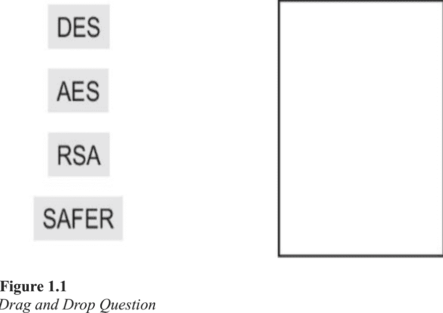 | |

## 热点题格式

对于热点考试题，你必须点击图中的正确区域——热点——来回答问题。

- 1. 在设计网络控制时，防火墙保护 DMZ 的适当位置应该是哪里？

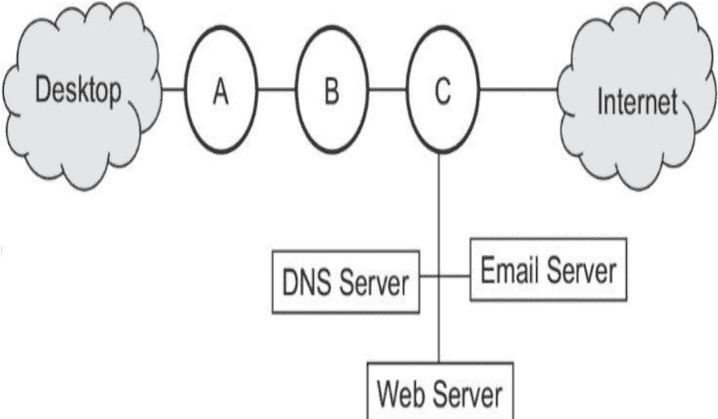

图 1.2

热点题

## 多选题的答案

- 1. B. 锁是用于控制物理访问最常用的设备。锁从埃及时代就开始被使用了。答案 A 是错误的，因为链条不是用于物理控制最常用的设备。答案 C 是错误的，因为报警器不能阻止访问；它们只是通知你可能发生了未经授权的访问。答案 D 是错误的，因为防火墙用于控制逻辑访问。

## 拖放题的答案

RSA。RSA 是非对称加密的唯一示例。DES、AES 和 SAFER 都是对称加密的示例。在这种情况下，你应该将“RSA”拖入“正确答案”框中。

## 热点题的答案

- C. 为了回答问题，将鼠标光标悬停在你想要选择作为答案的区域上。所有可用区域都会亮起（在本例中为 A、B 或 C），你必须点击你认为正确的那个。在这种情况下，你希望部署防火墙项 C 位于内部网络和 Internet 之间。

## 答题策略

由于 CISSP 多选题考试题的结构，通常会有一两个答案显然是错误的，而两个答案是合理的。花时间重读问题。在选择正确答案时，*有时*（sometimes）、*不*（not）、*始终*（always）和*最好*（best）等词可能会产生巨大差异。除非答案一眼可见，否则从排除最明显的错误答案开始回答。

几乎总是，题目可能的选项中至少有一个答案可以立即排除，因为它符合以下条件之一：

- *答案不适用于这种情况。*

- *答案描述了一个不存在的问题、无效的选项或虚构的状态。*

在排除所有明显错误的答案后，你可以运用保留的知识来进一步排除答案。寻找听起来正确但提到了问题所描述的情况中不存在或不可用的操作、命令或特征的项目。

如果你仍然在两个或多个可能正确的答案之间面临盲猜，请重读问题。尝试想象每个剩余的可能答案将如何改变该状况。

只有当你耗尽了排除答案的能力但仍不确定剩余可能性中哪一个是正确的时，才应该猜一个答案。未回答的问题不提供任何分数，但猜测至少让你有机会做对题目。只是在盲猜时不要太匆忙！

## 掌握内在游戏

知识产生自信，自信带来成功。如果你仔细学习书中的材料并复习每章末的所有练习题，你就应该意识到那些需要额外学习和研究的领域。

## 考试警报

你将在考试中理解 CISSP 术语。你需要理解可能用到的术语，还需要在提供的背景中应用它们。

## 考试警报

凭借书中的信息和增加知识的决心，你应该能够通过认证考试。然而，你需要为此付出努力，否则在最终通过之前，你可能会花费多次考试费。

如果你认真准备，你应该表现得很好。我有信心你可以做到！

## 想了解更多吗？

通过 CISSP 考试：`cybersecurityventures.com/how-to-pass-the-cissp-exam-top-10-tips-from-a-chief-risk-officer/`

(ISC)² CISSP 认证：`www.isc2.org/cissp/default.aspx`

## 第 2 章 理解资产安全

你需要理解的术语：

- 机密性 (Confidentiality)

- 完整性 (Integrity)

- 可用性 (Availability)

- 个人身份信息 (Personally identifiable information)

- 信息生命周期管理 (ILM)

- 数据留存 (Data retention)

- 数据分类 (Data classification)

- 数据销毁 (Data destruction)

- 数据残留 (Data remanence)

你需要掌握的技术：

- 数据的正确方法

- 开发有助于遵守当地、州和联邦法律的文件

- 加密的实施及其在保护数据中的应用

- 如何使用数据安全控制

## 引言

理解资产安全是 CISSP 候选人的关键要求。资产安全涉及在整个生命周期内保护数据所需的控制措施，从创建点到寿命结束。必须实施数据保护控制，以确保信息在每个生命周期阶段都得到充分保护。本章从回顾机密性、完整性和可用性的基本安全原则开始，并随后进入数据管理与治理。

CISSP 考试要求你理解数据安全，以及信息在传输、存储和静态状态下是如何被保护的。你必须理解，数据保护现在比几年前要重要得多，因为数据不再孤立地存在于独立服务器中。今天，数据通常存储在云端；数据也存在于笔记本电脑、RAID 阵列，甚至以纸质形式存在。无论存储于何处，数据都必须获得充分的保护，并在使用寿命结束时进行妥善的处置。

## 基础安全原则

机密性、完整性和可用性（CIA）是任何优秀安全计划的基础基石。在定义网络、资产、信息和/或信息系统的安全目标时，通常使用 CIA 三元组术语来指代这些概念。虽然 CIA 这个缩写可能不像美国政府的间谍机构那样迷人，但它是安全专业人员必须知道并理解的概念。

机密性涉及信息的秘密性和隐私性，并防止未经授权的人查看敏感信息。在现实世界中，许多控制措施被用于保护信息的机密性，例如锁上的门、武装守卫和围栏。可以增强机密性的管理控制包括使用信息分类系统，例如要求对敏感数据进行加密。例如，新闻报道详细记录了由于企业错放或丢失笔记本电脑、数据，甚至是包含客户账户、姓名和信用卡信息的备份介质而导致的大规模机密性泄露。对这些数据进行简单的加密操作本可以防止或减轻损害。以加密格式发送信息可以剥夺攻击者拦截和嗅探明文信息的机会。经济合作与发展组织（OECD）规定个人数据应受到限制，并提供了确保隐私和机密性的指南。

完整性涉及信息的准确性，并为用户提供高程度的信心，确保他们所拥有的信息未被篡改。在数据存储、静态和传输过程中，必须保护数据的完整性。确保未经授权的用户没有进行任何更改，且授权的用户没有进行不当的更改至关重要。存储中的数据可以通过使用访问控制和审计控制来保护。加密和哈希算法可以增强此类保护，例如 `HashTools`、`HashCheck` 和 `PowerShell` 等程序。同样，传输过程中的完整性主要可以通过使用这些工具并结合公钥基础设施（PKI）、数字签名和非对称算法等协议和框架来确保。

可用性是指信息和系统在需要时是可用的。虽然许多人只从电子方面的角度考虑可用性，但可用性也适用于物理访问。如果你在凌晨 2 点需要访问存储在仅限上午 8 点到下午 5 点开放的设施中的备份介质，你就面临了可用性问题。电子世界中的可用性可以以许多方式表现。如果没有可以恢复的更新备份，且原始副本已被勒索软件加密，那么 24x7 访问备份设施将毫无意义。

保留备份是确保可用性的良好方法。备份提供了关键信息的副本，当数据被毁或设备故障时可以重新恢复。使用故障转移（failover）是确保可用性的另一种方法。独立磁盘冗余阵列（RAID）和冗余站点（可以是热备、冷备或温备站点）是其他示例。灾难恢复与可用性密切相关，因为它关乎如何让关键系统快速运行。

安全三元组的哪部分被认为最重要？这取决于情况。在具有不同优先事项的不同组织中，某一部分可能比其他两个更重要。例如，你的当地银行可能认为完整性最重要，负责数据处理的组织可能将可用性视为首要考虑，而像医疗记录清理机构这样的组织可能最看重机密性。

尽管此书将该三元组称为 CIA，但其他人可能将其称为 AIC 或 CAIN（其中 N 代表不可否认性）。

安全管理并不止于 CIA。这些仅是适用于资产安全的三种核心技术。真正的安全需要深度防御。在现实中，需要许多技术来保护组织的资产；花点时间查看图 2.1。

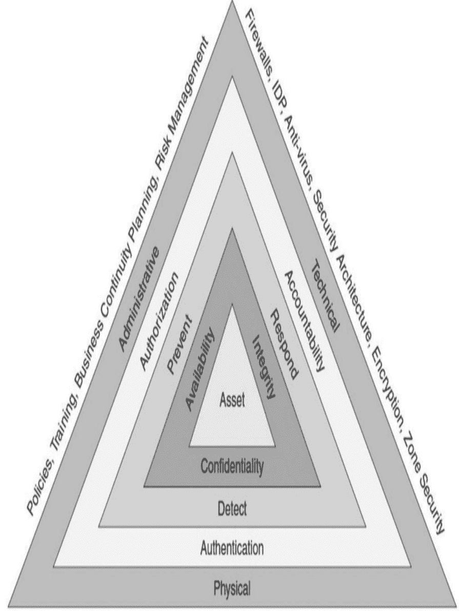

图 2.1

资产保护三元组

## 数据管理：确定和维护所有权

数据管理并非易事，事实上，它最近变得更加复杂。几年前，人们只需要担心纸质文档，控制可能意味着锁上文件柜。今天，电子数据可能存在于优盘、SAN 存储阵列、笔记本电脑硬盘、移动设备以及公有云中。

## 数据治理政策

通常，你可以将政策视为管理层开发的层级文档，用于将管理层的指导策略和哲学传递给员工。数据治理政策是一套记录在案的规范，确保组织的数字资产和信息获得批准的管理和控制。

数据治理计划通常处理以下类型的数据：

- 主数据集

- 元数据

- 敏感数据

- 获取的数据

此类规范可能涉及业务流程管理（BPM）和企业资源规划（ERP）的指令，以及安全、数据质量和隐私。数据治理的目标包括：

- 为数据管理建立适当的责任

- 提高数据访问的易用性

- 确保一旦找到数据，用户就有足够的关于数据的信息来正确且一致地解释这些数据

- 提高数据的安全性，包括机密性、完整性和可用性

需要考虑的问题包括：

- **成本**：这可能包括提供数据访问成本以及保护数据的成本。

- **所有权**：这包括关于数据归谁所有或谁可能是 50 份微软 Windows Server 2019 托管人的担忧，但代码归微软所有。用户支付软件许可和软件本身的所有权，他们通常只有程序的编译后 `.exe` 文件，而不是源代码。

- **法律责任**：这指组织在数据丢失、被盗或被黑客攻击时将承担的财务和法律成本。

- **敏感性**：这包括与数据敏感性相关的问题，应防止其未经授权的披露（例如社会安全号码、出生日期、病史信息）。

- **确保法律合规性**：这包括与法律合规相关的项目。例如，你必须保留至少若干年的税务记录，但可能只需要处理单个交易所需的个人身份识别信息（PII）客户信息。


**流程**：这包括用于传输或修改数据的方法和工具。

## 角色与职责

数据安全需要责任。明确的角色和职责划分在处理任何安全问题时非常有帮助。每个人都应该遵守组织的安全策略，包括员工、管理层、顾问和供应商。特定角色有独特的需求。一些关键人物及其职责如下：

**数据所有者**：由于高层对数据负最终责任，如果数据泄露则可能承担责任，因此数据所有者通常是高层人员或该部门的负责人。数据所有者负责设定数据的安全分类。数据所有者可以委托某些日常职责。

**数据保管者**：数据保管者通常是 IT 部门的成员，他们不决定需要哪些控制措施，而是代表数据所有者实施控制措施。其他职责包括处理数据的日常管理、控制访问、为单个用户添加和删除权限，以及确保已实施适当的控制措施。

**信息安全指导委员会**：该委员会成员来自管理的各个层级，代表组织的各个部门。他们开会讨论并对安全问题提出建议。

**高层管理**：这些人员对组织的安全实践负最终责任。高层可能会将日常职责委托给另一方或他人，但不能委托对组织数据安全的整体责任。

**安全顾问小组**：这些人负责与首席安全官一起审查安全问题，还负责审查安全计划和程序。

**首席安全官**：此人负责组织及其关键资产的日常安全工作。

**用户**：组织中的终端用户承担责任：他们必须遵守策略和程序中规定的要求。

**开发人员**：这些人为组织开发代码和应用程序。他们负责在他们开发的程序中实施适当的安全控制措施。

**审计员**：此人负责检查组织的安全程序和机制。审计员必须对组织安全控制的有效性提供独立客观的意见。该过程执行的频率取决于行业及其相关法规。例如，美国医疗行业受《健康保险流动与责任法》（HIPAA）法规监管，并要求每年进行审查。

### 考试警示

CISSP 考试可能会测试你一个概念：数据访问不是无限延伸的。员工在公司内转向不同职位时，随着时间的推移获得越来越多的访问并不常见。然而，这种糟糕的管理可能会危害组织。当员工被解雇时，应撤销数据访问权限。如果提前获非友好终止，应尽快终止访问以减少潜在的损害。

## 数据所有权

组织内的每个数据对象都必须有一个所有者。任何没有数据所有者的对象都将处于不受保护状态。为信息分配数据所有者和一套控制措施的过程被称为信息生命周期管理（ILM）。ILM 是创建和使用策略以进行有效信息管理的科学。ILM 包含了数据对象的从创建到结束的每一个阶段。ILM 适用于任何所有信息资产。

ILM 关注于固定内容或静态数据。虽然数据在整个生命周期中可能不会保持固定格式，但在某些时候它是静态的。例如，在这本书出版后，它将保持固定格式，直到下一个版本的发布。

出于业务记录的目的，生命周期过程包括五个阶段：

1. 创建和接收
2. 分发
3. 使用
4. 维护
5. 处置

## 数据保管者

数据保管者负责数据的安全保管、运输、存储以及业务规则的实施。这包括尽职调查的实践以及实施良好的实践来保护专利或商业秘密等知识资产。数据保管者的常见职责包括：

- **所有者识别**：每个数据集都必须识别并确认数据所有者，且必须进行正式任命。许多时候，数据所有者并自己是数据所有者，也不理解自己的角色和职责。在许多组织中，数据保管者或 IT 部门默认承担数据所有者的角色。

- **数据控制**：对数据的访问经过授权和管理。必须建立适当的控制措施来保护数据的机密性、完整性和可用性。这包括行政、技术和物理控制。

- **变更控制**：必须实施变更控制过程，以便对变更和访问进行审计。

- **终结条款或处置**：必须建立控制措施，以便当数据不再需要或不再准确时，可以使用批准的方法将其销毁。

## 数据文档与组织

组织和结构化数据可以帮助确保用户更好地理解和解释数据。数据文档应详细说明以下内容：

- 数据上下文
- 数据方法论
- 数据结构和组织
- 数据有效性
- 通过数据进行的数据操作
- 数据的机密性和完整性

## 数据仓库

数据仓库是一个包含来自许多其他数据库数据的数据库。它允许进行战略性视图。由于在一个位置存储了大量数据，数据仓库是攻击者垂涎之的目标。

## 数据挖掘

数据挖掘是分析数据以发现和理解模式的过程（见图 2.2）。数据挖掘的发生必须具备许多条件，包括多个数据源、访问权限以及使知识变为智能。元数据最好描述为“关于数据的数据”。例如，212 这个数字本身没有意义。但可以添加属性来赋予它意义；例如，如果你了解到 212 是一个区号，那么你就理解它代表曼哈顿的区号。


组织重视数据以及个体数据元素之间推断出的关系。这些关系可以帮助公司了解竞争对手和客户的使用模式，并帮助他们进行营销。例如，尿布可能放在商店的最后，啤酒箱旁边，因为数据挖掘显示晚上 10 点后男性买尿布更多，而且他们往往同时购买啤酒。

## 知识管理

知识管理寻求通过对数据应用智慧来智能地利用组织中的数据。这涉及到将数据库、文档管理、业务流程和信息系统转化为可以使用人工智能技术进行挖掘的大数据存储。

知识提取有三种主要方法：

- **分类**：这种方法用于发现模式，并将大型数据库减少为少数单独记录或数据市。（将数据市视为来自数据仓库的小数据切片。）

- **概率**：这种方法允许统计分析，通常用于计划和控制系统或涉及不确定性的应用程序。

- **统计**：这是一种数字计算方法，通过构建规则来识别数据中的通用模式。

## 数据标准

数据标准为产品生命周期内在不同信息系统、程序和部门之间共享的数据提供一致的含义。数据标准是任何良好企业架构的一部分。数据标准使数据更容易使用。例如，假设你得到了一个需要两节 AA 电池的新 850 流明手电筒。你不需要担心购买哪个品牌的电池，因为所有 AA 电池都是按照相同的尺寸和电压标准制造的。

## 提示

> 如需查看数据标准的示例，请访问 FDA 数据标准资源网站，地址为 `www.fda.gov/industry/fda-resources-data-standards`。FDA 提供该站点是为了确保在整个 FDA 范围内使用通用数据标准。

## 数据生命周期控制

数据生命周期控制是一种基于策略的方法，用于管理信息系统数据在整个生命周期内的流动，从创建点到数据过时并销毁或归档为止。

## 数据审计

在执行完本章目前讨论的所有任务后，需要定期评估组织的安全管理实践。审计过程通过审计流程来确保每个人的责任被清晰定义。员工应该了解他们的职责和分配的职责。这通过审计过程来完成。大多数审计遵循财务会计审计组织委员会 (COSO) 编写的一系列文档。审计通常遵循信息系统审计与控制协会 (ISACA) 的信息治理和相关技术控制 (COBIT) 框架。COBIT 框架围绕四个领域设计：

- 计划和组织
- 获取和实施
- 交付和支持
- 监控和评估

尽管 CISSP 考试不会要求你理解 COBIT 的内部机制，但你应该理解它是一个提供治理和保证的框架。COBIT 是由 ISACA 和治理学院 (ITGI) 在 1992 年创建的。审计师可以使用 COBIT，并且该框架对于设计和优化流程的 IT 用户和经理也有用。审计使得验证到位措施正在运行。要了解更多关于 COBIT 的信息，请参见 `www.isaca.org/cobit/`。另一组标准是 ISO 27000 系列标准。

## 数据存储与归档

组织对存储有无止尽的需求。在部署技术之前，组织应充分定义数据存储的安全要求。例如，NAS 设备很小、易于使用且可以快速实施，但物理安全是一个关注问题。云存储提供了另一种选择，但也带来了以下问题：

- 网络附属存储 (NAS)
- 存储区域网络 (SAN)
- 云

数据存储选项通常包括：

- 它是私云还是公云？
- 它使用物理服务器还是虚拟服务器？
- 服务器是如何配置和退役的？
- 数据是否经过加密？如果是，使用了哪种加密？
- 数据实际存储在哪里？
- 数据是如何传输的（数据流）？
- 加密密钥存储在哪里？
- 是否存在租户？

请记住，存储集成还包括虚拟环境、服务、应用程序和提供存储的设备。

存储网络行业协会 (SNIA) 将 SAN 定义为“由各种存储元件、存储设备、计算机系统和/或设备组成，并在网络上高效通信的数据存储系统。”SAN 在客户端操作系统中为可格式化和使用的本地磁盘或卷。

对于 CISSP 考试，了解以下与 SAN 相关的术语非常重要：

- **虚拟 SAN**：虚拟 SAN (VSAN) 是一种为物理连接到同一 SAN 织网设备提供隔离的 SAN。VSAN 的使用有时被称为织网虚拟化。开发 VSAN 支持单个交换机上的独立织网。VSAN 通过更高效的 SAN 利用来提高合并并简化管理。VSAN 允许任何 VSAN 上的资源被不同 VSAN 的用户共享，而无需合并织网。

- **互联网小型计算机接口 (iSCSI)**：iSCSI 是一种用于连接存储设施并允许远程 SCSI 设备通信的 SAN 标准。将其视为光纤的替代方案，因为它不需要特殊的设施，可以在现有 IP、MAN 或 WAN 网络上运行。

- **基于以太网的光纤 (FCoE)**：FCoE 是一种类似于 iSCSI 的传输协议，可以以 10 Gbps 的速度运行并运行在以太网协议之上。虽然它很快，但其缺点是不可路由的。相比之下，iSCSI 是可路由的，因为它位于栈的高层，位于 TCP 和 UDP 协议之上。

- **主机总适配器 (HBA) 分配**：主机总适配器用于连接主机系统到企业存储设备。HBA 可以通过软分区或持久绑定进行分配，而持久绑定会减少地址空间并增加网络复杂性。

- **LUN 掩码**：LUN 掩码主要在 HBA 层实现。它是一个让 LUN 对某些 HBA 可而对其他 HBA 不见的系统。在此级别实现的 LUN 掩码容易受到任何损害本地适配器的攻击。

- **位置冗余**：位置冗余使得内容可以从多个一个位置访问。可以通过复制提供额外的冗余措施，以便在主系统故障时数据仍然可用。

- **安全存储管理和复制**：安全存储管理和复制旨在以安全的方式管理和处理所有数据，重点关注数据的机密性、完整性和可用性。复制服务允许数据实时复制。

- **多路径解决方案**：企业级多路径解决方案通过在服务器与其驱动器之间建立多条路由，减少数据丢失或不可用的风险。多路径软件维护所有请求的列表，通过最佳路径传递它们，并在路径失败时重新路由通信。

- **SAN 快照**：SAN 快照软件通常与 SAN 解决方案一起销售，并提供了一种跳过典型备份操作的方法。快照具有临时停止写入物理磁盘并创建时间点备份副本的能力。

- **数据去重 (DD)**：数据去重是删除冗余数据以提高存储利用率的过程。冗余数据不再复制，而是被指向唯一数据副本的指针所取代。在存储介质（如磁盘或磁带）上只保留冗余数据的实例。

## 隐私影响评估

组织寻求改进其对个人信息保护的另一种方法是根据隐私影响分析（PIA）开发公司范围内的政策。PIA 应该确定在电子化系统中收集、维护和分发个人身份信息（PII）的风险和影响。PIA 应被用于评估隐私风险并确保存在适当的隐私控制措施。应对对现有的数据控制进行验证，以确保在每次计划新项目或流程上线时，都具备问责制和合规性。PIA 必须包含对以下影响隐私记录 CIA（机密性、完整性和可用性）的项目的审查：

- **技术**：当添加新系统或进行修改时，需要审查。
- **流程**：业务流程发生变化，尽管公司可能有一个良好的变更策略，但变更管理系统可能会忽视个人信息隐私。
- **人员**：公司更换员工以及业务往来人员。每当业务伙伴、供应商或服务提供商发生变化时，都需要重新检查变更对隐私的影响。

隐私控制往往被忽视的原因与许多安全控制措施被忽视的原因相同。管理层可能先入为主地认为安全控制措施会降低业务流程的效率或速度。为了克服这些障碍，高层管理必须对保护个人信息做出坚定承诺并展示其支持。风险评估活动有助于这一过程，通过告知利益相关者与客户和顾客个人信息丢失相关的实际成本。这些成本可能包括罚款、诉讼、客户流失、声誉损失，并最终影响公司的生存能力。

## 信息处理要求

组织处理大量信息，应该建立策略和程序，详细说明应如何存储信息。你可以将策略视为高层文档，将程序视为具体步骤。现有的数据控制应对进行验证，以确保在每次计划新项目或流程上线时，都具备问责制和合规性。

| 日期 | 2016年10月31日 |
| :--- | :--- |
| 作者 | Christine |
| 分类 | 绝密 |
| 留存期 | 年 |
| 标题 | 项目 |

 图 2.3

数据标签

注意

除非是磁带，技术。

尽管公司可能有一个良好的变更策略，但变更管理系统可能会忽视个人信息隐私。

数据遗留是指在数据删除后数据没有被加密。

数据遗留是指在数据没有被加密后，数据。

质。。例如，硬盘数据是可读的。

数据遗留与销毁

数据遗留是指在数据删除后，数据可能仍留在介质中。


根据法律销毁。


- 6. 维护信息安全策略。

要求 12：维护一项解决信息安全的策略。

## 隐私影响评估

组织寻求改进其对个人信息保护的另一种方法是根据隐私影响分析（PIA）开发公司范围内的政策。`PIA`应该确定在电子系统中收集、维护和分发个人身份信息（`PII`）的风险和影响。`PIA`应被用于评估隐私风险并确保存在适当的隐私控制措施。应对现有的数据控制进行验证，以确保在每次计划新项目或流程上线时，都具备问责制和合规性。`PIA`必须包含对以下影响隐私记录`CIA`（机密性、完整性和可用性）的项目的审查：

- **技术**：当添加新系统或进行修改时，需要审查。

- **流程**：业务流程发生变化，尽管公司可能有一个良好的变更策略，但变更管理系统可能会忽视个人信息隐私。

- **人员**：公司更换员工以及业务往来人员。每当业务伙伴、供应商或服务提供商发生变化时，都需要重新检查变更对隐私的影响。

隐私控制往往被忽视的原因与许多安全控制措施被忽视的原因相同。管理层可能先入为主地认为安全控制措施会降低业务流程的效率或速度。为了克服这些障碍，高层管理必须对保护个人信息做出坚定承诺并展示其支持。风险评估活动有助于这一过程，通过告知利益相关者与客户和顾客个人信息丢失相关的实际成本。这些成本可能包括罚款、诉讼、客户流失、声誉损失，并最终影响公司的生存能力。

## 信息处理要求

组织处理大量信息，应该建立策略和程序，详细说明应如何存储信息。你可以将策略视为高层文档，将程序视为具体步骤。

对于被认为过于敏感的信息，硬盘、媒体和其他存储设备等资产可能需要销毁而不是重复使用。销毁是清理最强的形式，可以包括酸浴处理和物理销毁。如果不再需要的记录存储在较新的非磁性驱动器上（例如固态设备`SSD`），则可以使用居里温度，将驱动器加热到其失去磁特性的程度。

### 考试警示

`CISSP`考试要求你理解处置数据的不同方法。记忆这些方法的简单方法是记住短语“Cow, Pig, Sow”或“CP SOW”，它们分别代表：可以恢复的：`clearing`（清除）数据是可恢复的，`purging`（擦除）是永久的，`sanitizing`（净化）是同一种，`overwriting`（覆盖）是重写零，而`wiping`（擦除）是写入。

## 信息分类与资产分类支持

资产分类涉及根据许多共同特征将资产分配到组。然而，在对资产进行分类之前，你必须知道你拥有什么。你通过资产清单来确定这一点。现代组织严重依赖资产清单，并使用`Asset Panda`、`AssetCloud`和`ManagerPlus`等工具。这些应用程序（以及其他程序）协助组织识别、定位和分类其资产。资产清单的组成部分包括以下项目：

- 资产名称

- 资产位置

- 资产成本

- 资产所有者

- 资产分类

- 需要的数据保护级别

用于分类和管理资产的标准或流程通常由组织自行裁量。需要考虑的两个因素是组织的规模和结构，以及组织运营所在国家或行业被认为是常见的做法。无论采用何种特定方法，资产分类过程都包含五个步骤：

1. 创建资产清单。

2. 分配所有权。

3. 根据价值进行分类。

4. 根据分类进行保护。

5. 评估和审查。

> 注意

> 为了记忆`CISSP`考试的资产分类过程，请记住`CACPA`，它与“Cat Paw”（猫爪）押韵，并指的是上述步骤。

除了保护资产外，组织必须保护维护在这些资产中的专有或机密信息。数据分类是对组织信息资产进行排序的有效方法。良好的数据分类系统易于存储和访问数据。它让用户更容易理解数据的重要性。例如，如果一个组织执行整洁桌面政策，并管理公司文档、备忘录和电子媒体，使其不留在桌面上，它可以改变人们对这些信息价值的看法。然而，无论使用哪种数据分类系统，它都应该足够简单，让所有员工都能理解并正确执行。

## 数据分类

两种常用的数据分类方案是军事和公共。组织存储和处理大量关于客户和员工的信息，因此采取适当预防措施保护这些信息至关重要。数据分类的责任由数据所有者承担。军事和私有数据分类系统都通过将信息分入类别、对数据应用标签以及对访问数据的人授予权限来完成此任务。

数据分类过程的第一步是评估相关信息的价值。当价值已知时，确定应该使用哪些资源来保护数据将变得容易得多。例如，花费大量资源来保护价值极小的东西是没有意义的。相反，需要更多保护的数据将获得保护，而资金不会浪费在保护不需要的数据上。

建立的每个分类级别都应该有特定的要求和程序。军事和商业数据分类模型对用户和数据都有预定义的标签和级别。向用户分配权限，向数据分配标签。当组织决定使用哪种模型时，可以根据以下标准评估数据放置位置：

- 数据价值

- 数据年龄

- 与数据相关的法律

- 与披露相关的规定

- 替换成本

无论使用哪种模型，以下问题将有助于确定信息的正确放置位置：

- 谁拥有资产或数据？

- 谁控制访问权和权限？

- 谁批准访问权和权限？

- 授予资产或数据什么种级别的访问权限？

- 目前谁有权访问资产或数据？

数据分类需要几个步骤：

1. 识别数据保管员。

2. 确定用于数据分类的标准。

3. 要求所有者对信息进行分类和标记。

4. 识别数据分类政策的任何例外。

5. 确定应用于保护每类信息的安全控制措施。

6. 指定一种日落政策（`sunset policy`）或生命结束政策，并详细说明数据将如何重新分类或降级。应在特定时期进行说明保留期限和生命结束的审查。

7. 开发意识计划。

## 军事数据分类

军事数据分类系统在美国国防部是强制性的。该系统有五个分类级别：

- **绝密（Top secret）**：暴露可能导致严重损害。

- **秘密（Secret）**：暴露可能导致严重损害。

- **机密（Confidential）**：披露可能导致损害。

- **敏感但未分类（Sensitive but unclassified, SBU）**：应避免披露。

- **未分类或官方用（Unclassified or official）**：如果发布，不应造成损害。

每个分类代表了敏感性的程度。敏感性是信息应保持的秘密程度。每个分类代表了敏感性的程度。*敏感性*是信息应保持的保密程度。员工只需访问完成任务所需的信息。如果你持有机密，意味着你可以访问未分类、敏感或机密信息。有时组织使用“仅官方可用”（`FOUO`）术语来进一步定义范围。

## 公共/私有分类

公共或商业数据分类建立在四级模型之上：

- **机密（Confidential）**：这是最高级别的敏感性，会对组织造成极端损害。

- **私有（Private）**：此信息仅供组织使用，披露会损害组织。

- **敏感（Sensitive）**：此信息需要更高级别的保护以防止损失。

- **公共（Public）**：此信息可能不需要披露，即使公开也不会造成任何损害。

表 2.1 列出了军事和公共/私有数据分类。

### 表 2.1 商业与军事分类

| 军事分类 |

| :--- |

| 绝密 (Top secret) |

| 秘密 (Secret) |

| 机密 (Confidential) |

| 敏感但未分类 (SBU) |

| 未分类 (Unclassified) |

| 商业分类 |

| 机密 (Confidential) |

| 私有 (Private) |

| 敏感 (Sensitive) |

| 公共 (Public) |

## 注意

信息有使用期限。数据分类系统需要包含监控信息是否过时的机制，过时信息应当降级或销毁。

## 资产管理与治理

资产管理的治理是将`IT`目标与组织的业务功能对齐，跟踪资产的整个周期，并保护组织的资产。资产管理系统记录、监控并维护价值物品。资产可以是有形的也可以是无形的，包括：

- 硬件

- 软件

- 员工

- 服务

- 声誉

- 文档

你可以将资产管理视为一种以成本效益的方法部署、运行、维护、升级和处置资产的方式。资产管理对于适当的风险评估是必要的。在对资产进行赋值之前，你必须知道它是什么并确定它的价值。其价值可以通过定量或定性进行评估。定量方法需要以下步骤：

1. 估计潜在损失并确定单次损失预期 (`SLE`)。

2. 完成频率分析并计算年度发生率 (`ARO`)。

3. 确定年度损失预期 (`ALE`)。

定性方法不对资产进行赋值，而是将其标记为高、中、低关注。进行定性评估的缺点是你们使用的不是美元价值，因此是向管理层汇报评估结果可能很困难。

一项关键资产是软件。`CISP`候选人应该理解与软件许可相关的常见问题。由于软件供应商通常是许可其软件而非销售软件，而且它们是针对许多系统上的许多用户进行许可，因此购买组织必须对软件许可进行核算。如果用户或系统超过了许可数量，该组织可能承担法律责任。

我们已经进入了通过互联网而非通过`CD`等介质交付软件的时代，而软件资产管理仍然是一个重要的关注点。

## 软件许可


知识产权问题一直以来难以执行。想一下几年前 Napster 引起的巨大动荡吧，当时法院试图在知识产权与个人分享音乐和其他文件的权利之间寻求平衡。软件行业长期以来一直在处理此类问题。从计算机的早期开始，就有些个人一直在交换、共享和非法复制计算机软件。对软件进行未经授权的复制和共享被视为软件盗版，这是违法的。人们很容易会认为，给朋友一个电脑游戏拷贝不会损害任何人的利益。但软件盗版是一项大买卖，财产所有者积累的损失是惊人的。根据美国律师协会一份关于被盗知识产权的报告，估计每年损失在 2000 亿到 2500 亿美元之间。

微软和其他公司正在积极保护它们的产权。许多组织组成了软件发行商协会（Software Publishers Association），这是执行许可协议的主要机构之一。商业软件联盟（BSA）和反软件盗窃联合会（Federation Against Software Theft）是针对软件盗版的国际组织。这些协会针对各种规模的组织，从只有两个人的小公司到大型跨国公司。

软件公司在其许可协议中明确了用户对软件可以做什么不能做什么。某些供应商甚至对虚拟化设置了限制。许可协议实际上可以通过几种不同的方式分发，包括：

- **点击许可许可协议 (Click-wrap license agreements)**：这些协议出现在许多软件产品中，要求您点击并同意条款以安装软件产品。这些通常被称为附合合同；它们是“要么接受，要么离开”的提案。
- **主许可协议 (Master license agreements)**：这些协议由开发特定软件解决方案的大公司使用，规定了客户如何使用该产品。
- **收缩膜许可协议 (Shrink-wrap license agreements)**：这些协议最早创建于软件开始商业销售时，其命名是因为打开物理介质上的收缩膜代表了您对许可的接受。

随着许可制度以及 BSA 等组织执法活动的加强，技术的进步使得盗版软件、音乐、书籍和其他类型的知识产权变得越来越容易。这些因素以及遵守两项世界贸易组织（WTO）条约的需求，导致了 1998 年《数字千年版权法案》（DMCA）的通过。以下是一些显著亮点：

- DMCA 将绕过或规避商业软件产品内置的防盗版措施定为犯罪。
- DMCA 概述了制造、销售或分发任何用于破解代码或非法复制软件的设备或装置。
- DMCA 在某些情况下为图书馆和教育机构免除了反规避条款限制；然而，对于不受此类例外涵盖的对象，该法规定了最高 100 万美元和 10 年监禁的处罚。
- DMCA 为互联网服务供应商提供了版权侵权责任豁免，允许跨互联网传输信息。

## 设备生命周期

设备生命周期从请求设备开始，一直持续到使用寿命结束或被丢弃。设备生命周期通常包括四个阶段：

1. 需求定义
2. 获取与实施
3. 运行与维护
4. 处置与退役

虽然有些人可能认为设备获取后大部分工作就完成了，但事实并非如此。组织需要建立一些支持功能。例行维护是其中重要的一环。如果没有例行维护，设备将会故障，且与这些故障相关的成本是可以计算的。需要考虑的项目包括：

- 生产力损失
- 订单延迟或取消
- 维修费用
- 租赁备件的成本
- 紧急服务费用
- 更换设备或重新加载数据的成本
- 支付人员维护设备的费用

技术支持是另一个考虑因素。设备使用时间越长，出现的问题可能越多。例如，如果你搜索 Windows Server 2008 或 Windows Server 2019 的漏洞，你认为哪一个返回的结果更多？很可能是 Windows Server 2008——因为它已经运行了多年，在此期间产生了许多漏洞。这都说明了资源被使用时间越长，就越需要支持。

## 确定数据安全控制

任何关于逻辑资产安全的讨论都必须在某一点涉及加密。虽然保护数据不仅仅是加密，但加密是保护数据的主要控制手段之一。想想所有因为硬盘、笔记本电脑和优盘丢失而登上新闻的案例，因为它们包含了未加密的数据。在许多情况下，加密不仅是一个好主意，而且是法律规定的。CISSP 候选人必须理解公司政策以及加密将如何使用。

让我们查看使用加密保护数据的两个领域：静态数据和传输中数据。

## 静态数据

存储在未跨网络或非临时内存中的介质上的信息被称为*静态数据 (data at rest)*。未能妥善保护静态数据会导致此类攻击，例如：

- USB（通用总线）
- 恶意软件
- 病毒
- 木马
- 键盘记录器
- 数据外泄

静态数据可以通过各种安全控制进行保护，例如：

- 加密
- 物理安全
- 访问控制
- 数据丢失

另一个基于此技术的潜在选择是自加密驱动器（SEDs）。SED 相比非加密驱动器具有许多优势，包括：

- **合规性**：SED 具有提供内置加密的能力，有助于许多组织必须遵守的合规法。
- **强安全性**：SED 使用强加密。SED 的内容始终经过加密，且加密密钥本身在硬件中进行加密和保护。
- **易用性**：用户仅需要在设备启动或更改密码/凭据时对驱动器进行验证。加密对用户是不可见的。
- **性能**：由于 SED 对用户可见且集成到硬件中，系统以全性能运行，对用户生产力没有影响。

可信平台模块（TPM）是一种防篡改的加密模块，可以提供向策略执行器或健康监控报告系统配置的方法。它还提供：

- **证明 (Attestation)**：这允许您确认或证明系统处于特定状态。
- **密封 (Sealing)**：这允许您加密信息并使其仅在特定的机器配置下可用。

软件加密是静态数据的另一种保护机制。有许多可用选项，例如 BitLocker 和 PGP。软件加密可用于特定文件、数据库甚至整个 RAID 存储敏感数据的数组。在任何潜在选项下，加密数据必须保持安全，并且当访问控制（如用户名和密码）错误时；此外，加密密钥必须受到保护，并应定期更新。

## 注意事项

> 密钥应与数据分开存储。

## 传输数据

当数据被处理或从一个位置移动到另一个位置时，都需要适当的控制。基本问题是许多应用程序通过明文发送信息。如电子邮件、Web 和 FTP 等服务在设计时并未考虑安全性，并且在没有加密控制的情况下发送信息。

不安全的协议包括：

- 文件传输协议 (FTP)：明文用户名和密码
- Telnet：明文用户名和密码
- 超文本传输协议 (HTTP)：明文数据
- 邮件传输协议 (SMTP)：明文数据

传输中的数据如果没有某种形式的加密将面临许多危险，包括：

- 窃听
- 嗅探
- 劫持
- 数据篡改

今天，许多人通过咖啡馆、餐厅、机场甚至酒店的免费 Wi-Fi 连接公司网络。

保护此类传输数据的一种方法是使用虚拟专用网络（VPN）。VPN 用于通过互联网连接设备，并提供隧道机制。支持 VPN 的三种协议是：

- 点对隧道协议 (PPTP)
- 二层隧道协议 (L2TP)
- IP 安全 (IPsec)

当定义了适当协议时，VPN 流量是加密的。微软提供了点对点加密 (MPPE)，而 L2TP 不提供加密，因此通常配合 IPsec 的 ESP 模式来保护传输数据并提供机密性和认证。

IPsec 可以实现两种类型的隧道：

- 局域网到局域网（或网关到网关）：用户可以在分开局域网之间透明隧道。
- 主机到局域网：移动用户可以连接到公司局域网。

拥有加密隧道只是传输数据的一个部分。另一个重要概念是认证。几乎所有 VPN 都使用数字证书作为认证的主要手段。X.509 v3 是事实标准。X.509 指定了证书的要求和内容。就像许可证办公室一样，证书机构（CA）保证证书持有者的真实性和内容。这些数字证书有不同的用例，包括提供身份和公钥。

与其他服务一样，组织需要制定关于谁将访问 VPN 以及使用什么加密机制的策略。让 VPN 策略映射到组织的安全策略至关重要。由于高层管理负责，他们必须批准并支持这一策略。

标准电子邮件也是不安全的，数据在通过电子邮件传输可能会暴露。标准电子邮件协议如 SMTP、POP3 和 IMAP 均通过明文发送数据。为了保护传输中的电子邮件，你必须使用加密。电子邮件保护机制包括 PGP、安全多用途邮件 (S/MIME) 和隐私增强邮件 (PEM)。无论保护什么，对敏感数据的定期审计应该是策略的一部分，并应按定期进行。

对于传输中的数据，考虑如何应用加密很重要。加密可以在不同位置执行不同程度的保护。考虑以下选项：

- 链路加密：数据在整个通信路径中加密。由于所有头部信息都经过了加密，每个节点必须解密和加密路由信息。嗅探者无法看到源和目的地址。例如，某部警察剧调取电话记录。警察人员可以看到电话拨打过的号码列表、时间和通话时长。虽然警察无法听听到通话内容，但他们可以推导出关于通话频率和时长的有用信息。IP 头部提供了关于端点的类似信息。

## 注意

> 中间人攻击可能用于链路加密，以查看路由信息并进行流量分析，这涉及到查看源和目的 IP 地址以确定哪些系统在通信以及通信频率如何。

- 端到端加密：这种加密通常由终端用户执行，用户可以在无需进一步处理的情况下通过每个节点。然而，源和目的地址是以明文传递的，因此嗅探者可以看到它们。

数据可以使用这两种方法之一进行加密，无论 IP 头部是否加密。通过链路加密和端到端加密，数据的机密性得到了保护。如果 VPN 设置为链路加密，IP 信息是加密的，数据流量也是。

## 注意事项

> 因为链路加密需要对 IP 头部进行加密，在局域网或互联网上将其用于路由非常困难；每个路由设备都必须有一份使用的秘密密钥副本。

## 终端安全

如果没有对终端安全的讨论，逻辑资产安全的审查将是不完整的。终端安全由放置在客户端或终端用户系统上的控制组成，例如反病毒、反恶意软件、反间谍软件等。许多安全的世界已转向零信任环境，在这种环境中，联网设备（如笔记本电脑）默认是不被信任的。

放置在系统上的控制包括以下内容，也非常重要：

- 可移动介质：恶意软件通过 U 盘传播。Stuxnet、Conficker 和 Flame 等恶意软件都能通过 U 盘传播。
- 磁盘加密：如 PGP 和 BitLocker 等磁盘加密软件可加密桌面和笔记本硬盘。此外，公司手机和平板应启用加密。
- 白名单：这种方法只允许安装、更新和使用良好的应用程序。白名单技术包括代码签名、数字证书、良好的哈希值以及信任的路径和名称。相反，黑名单涉及阻止坏软件下载和安装。
- 主机防火墙：为了深度防御，公司不仅应考虑企业防火墙，还应考虑主机防火墙。
- 配置锁定：不是每个人都有权对设备或硬件更改。配置控制可以防止未经授权的更改。
- 反病毒：反病毒软件是最常用的终端安全产品。虽然它仍然是一个需要的组件，但随着 AI 驱动解决方案市场份额的增加，基于特征的反病毒软件在过去几年中变得越来越不有效。

## 特别出版 800-53 提供的基线

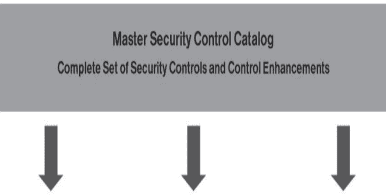

最小安全控制

低影响

信息系统

最小安全控制

中等影响

信息系统

最小安全控制

高影响

信息系统

基线 #1

从主目录中选择安全控制子集——包含基础级控制。

基线 #2

从主目录中选择安全控制子集——包含基础级控制，并根据需要添加额外的控制和控制增强。

基线 #3

从主目录中选择安全控制子集——包含基础级控制，并根据需要添加额外的控制和控制增强。

## 图 2.4

NIST 800-53 范围确定与基线控制

NIST 800-53 规定了范围确定或定制活动，并根据影响（低、中或高）对信息进行分类。

- 低影响
- 中等影响
- 高影响

通过确定如何使用标准来为组织获得适当的保护。*范围确定*（Scoping）是确定组织将实施标准的哪些部分的过程。例如，高安全性设施可能决定不部署 Wi-Fi，并声明 Wi-Fi 标准不在范围之内且不适用。*定制*（Tailoring）是为组织定制标准的过程。

NIST 800-52（《联邦信息系统和组织安全隐私控制》）描述了定制过程：

1. 在初始安全控制基线中识别并指定通用控制。
2. 将范围考虑因素应用到剩余的基线安全控制。
3. 如果需要，选择补偿安全控制。
4. 通过显式分配和选择语句，为组织定义的安全控制参数（如密码复杂度策略）分配特定值。
5. 如果需要，用额外的安全控制和增强补充基线。
6. 如果需要，为控制实施提供额外的规格信息。

### 考试警示

CISSP 考试要求你理解范围确定（scoping）、定制（tailoring）和补充（supplementation）等术语。例如，你可能会将标准注销时间从 24 小时缩短到 8 小时。*补充*是在你指定的控制中添加特定细节。例如，你可能会将“云托管”术语替换为 Microsoft Azure。

通过缩小项目范围来移除某些项目，你可能会降低成本，但这样做可能会使系统暴露于不必要的威胁之下。因此，必须尽职责确定适当的控制水平。范围确定和定制活动应记录在案并附带适当的理由。在某些情况下，由于管理某些行业的法律，信息和信息系统必须受到保护。

## 备考题

- 1. 军事分级系统包含以下哪些级别？
  - A. 机密、私密、敏感和公开
  - B. 绝密、秘密、私密、敏感和公开
  - C. 绝密、机密、私密、敏感和未分类
  - D. 绝密、秘密、机密、敏感和未分类
- 2. 你们公司考虑实施 NIST 800-53。以下哪个术语指的是修改安全控制以符合组织任务的过程？
  - A. 标准选择
  - B. 定制 (Tailoring)
  - C. 范围确定 (Scoping)
  - D. 符合 (Conforming)
- 3. 以下哪些安全端点控制可能用于防止类似 Stuxnet、Conficker 和 Flame 的恶意软件？
  - A. 实现磁盘加密
  - B. 加固边缘设备
  - C. 阻止移除介质
  - D. 强制执行应用白名单
- 4. 以下哪项显示了正确的顺序？
  - A. 先确定 SLE、ARO 和 ALE，然后确定资产价值。
  - B. 先确定资产价值，然后确定 ARO、SLE 和 ALE。
  - C. 先确定资产价值，然后确定 SLE、ALE 和 SLE。
  - D. 先确定资产价值，然后确定 SLE、ARO 和 ALE。
- 5. 以下哪种评估类型不使用金额价值，这可能难以向管理层汇报评估结果？
  - A. 定性
  - B. 定量
  - C. 数字缓解
  - D. 红队
- 6. 以下哪类别的控制可以包含用于控制访问和身份验证用户的逻辑机制？
  - A. 行政
  - B. 文书
  - C. 技术
  - D. 物理
- 7. 以下哪项不是描述 SED（自加密驱动）的？
  - A. 简化合规性
  - B. 降低性能
  - C. 方便使用
  - D. 提供强有安全性
- 8. 以下哪个是商业业务分级的最高保护级别？
  - A. 秘密
  - B. 机密
  - C. 绝密
  - D. 私密
- 9. 以下哪项是最具体的安全文档类型？
  - A. 流程
  - B. 标准
  - C. 策略
  - D. 基线
- 10. 避免每个人都有责任但没有人负责负责的情况是很重要的。数据所有者应该属于以下哪个群体？
  - A. 终端用户
  - B. 技术经理
  - C. 政策
  - D. 基线
- 11. 以下哪项不是描述 SED 的？
  - A. 终端用户
  - B. 技术经理
  - C. 策略
  - D. 管理员 (Custodian)
- 12. 以下哪项是最具体的安全文档类型？
  - A. 流程
  - B. 标准
  - C. 策略
  - D. 基线
- 13. 以下哪项是最具体的安全文档类型？
  - A. 流程
  - B. 标准
  - C. 策略
  - D. 基线
- 14. 以下哪项是最具体的安全文档类型？
  - A. 流程
  - B. 标准
  - C. 策略
  - D. 基线
- 15. 谁对资产最终负责？
  - A. 审计员
  - B. 管理员 (Custodian)
  - C. 管理层

## 答案

1. D. 军事分级系统有五个级别，从低到高：
  - A. 机密、私密、敏感和公开
  - B. 绝密、秘密、私密、敏感和公开
  - C. 绝密、机密、私密、敏感和未分类
  - D. 绝密、秘密、机密、敏感和未分类
2. B. 定制要求为组织定制标准。
  - A. 标准选择
  - B. 定制 (Tailoring)
  - C. 范围确定 (Scoping)
  - D. 符合 (Conforming)
3. C. 阻止移除介质可能有助于通过优盘传播的恶意软件。
  - A. 实现磁盘加密
  - B. 加固边缘设备
  - C. 阻止移除介质
  - D. 强制执行应用白名单
4. D. 正确顺序是先确定资产价值，然后确定 SLE、ARO 和 ALE。
  - A. 先确定 SLE、ARO 和 ALE，然后确定资产价值。
  - B. 先确定资产价值，然后确定 ARO、SLE 和 ALE。
  - C. 先确定资产价值，然后确定 SLE、ALE 和 SLE。
  - D. 先确定资产价值，然后确定 SLE、ARO 和 ALE。
5. A. 定性评估是场景驱动的，不尝试为风险分析组件分配金额。
  - A. 定性
  - B. 定量
  - C. 数字缓解
  - D. 红队
6. C. 技术控制可以是硬件或软件。它们是用于控制访问、身份验证用户、识别异常活动和限制未经授权访问的逻辑机制。
  - A. 行政
  - B. 行政
  - C. 技术
  - D. 物理
7. B. 自加密驱动器具有许多优势，例如简化个人信息的合规问题。它们易于使用并提供强加密。它们不会降低性能。
  - A. 简化合规性
  - B. 降低性能
  - C. 方便使用
  - D. 提供强有安全性
8. B. 机密是商业业务分级的最高级别。
  - A. 秘密
  - B. 机密
  - C. 绝密
  - D. 私密
9. A. 流程是一份详细、深入、分步骤的文件，说明了具体做什么。它与特定的技术和设备绑定。
  - A. 流程
  - B. 标准
  - C. 策略


# D. 基线

# 10. C. 高级管理层是最终所有者，因为这些人对资产负责，并在数据泄露时必须回答。

- A. 审计员
- B. 管理员 (Custodian)
- C. 管理层

可能不是组织内最高级的高管。例如，首席财务官（CFO）是所有财务数据的所有者，人力资源总监是所有人力数据的所有者，以此类推。所有其他答案都是错误的，因为终端用户、技术经理和其他员工通常不是数据所有者。

# 11. D. 虽然链路加密保护了数据包，但报头是明文的。答案 A、B 和 C 都是错误的，因为它们都是关于链路加密的正确陈述。通过链路加密，数据包被加密，数据包免受嗅探影响，但报头为明文。

# 12. A. 数据挖掘是分析数据以发现和理解数据中模式和关系的过程。答案 B、C 和 D 是错误的。知识管理寻求明智地利用组织中的所有知识。数据仓库是一个包含来自许多不同数据库的数据数据库。数据标准为不同信息系统之间共享的数据提供一致的含义。

# 13. C. 组织使用信息分类根据信息的影响程度或敏感性为信息分配价值。答案 A、B 和 D 是错误的，根据行业修改标准称为“裁剪”（tailoring）。范围确定（scoping）是确定应用标准的哪些部分。资产分类是一个根据许多共同特征将资产分配到组的系统。

# 14. D. 以太网光通道（FCoE）可以在 10 Gbps 的速度运行，并运行在以太网协议之上。虽然它可以运行，但它的缺点是不可路由的。答案 A、B 和 C 是错误的。SCSI 仅用于本地设备。iSCSI 是一种用于连接数据存储设施并允许远程 SCSI 设备通信的 SAN 标准。HBA 用于连接主机系统到企业级存储设备。

# 15. A. 某些日常职责可能会下放到保管员，但归根结底由所有者负责。

## 想要了解更多？

- 数据分类：https://mrcissp.com/2019/01/17/data-classification-why-what-how/
- 资产保留：https://info-savvy.com/cissp-asset-retention-bk2d2t5/
- ISO 27002 概述：https://www.iso27001security.com/html/27002.html
- HIPAA 法规与 CISP：https://cissp2021.blogspot.com/2020/12/gdpr-hipaa-compliance-key-similarities.html
- IT 资产管理：https://searchcio.techtarget.com/definition/IT-asset-management-information-technology-asset-management
- 安全策略模板：https://www.sans.org/security-resources/policies/
- IT 安全基准：https://resources.infosecinstitute.com/certification/cissp-prep-security-policies-standards-procedures-guidelines/
- 构建有效策略：https://csrc.nist.gov/nissc/1997/panels/isptg/pescatore/html/
- OECD 对比 GDPR：https://piwik.pro/blog/oecd-guidelines-8-principles-to-live-by/
- 范围确定与裁剪：https://www.hackingtheuniverse.com/infosec/nist-computer-security/security-control-implementation/tailoring-security-controls

# 第 3 章 安全与风险管理

## 你需要理解的术语

- 安全治理
- 合规性
- 监管
- 信息安全法律法规
- 职业伦理
- 威胁
- 漏洞
- 安全与风险管理
- 单次损失预期 (SLE)
- 年均发生率 (ARO)
- 剩余风险
- 年度损失预期 (ALE)
- 业务连续性需求
- 威胁建模
- 供应链风险管理

## 你需要掌握的主题

- 用于风险管理的计算方法
- 良好安全管理的认可方法
- 如何进行定性风险分析
- 如何进行定量风险分析
- 如何进行混合风险分析
- 良好的资源保护
- 安全策略、程序、指南和基准的作用
- 适当的数据分类
- 安全角色的正确实施
- 如何进行风险计算

## 引言

CISSP 考试“安全与风险管理”领域涵盖数据分类与评估，以及安全治理和知识产权保护。这些每一项都由策略、程序和指南等文档驱动。这些文档非常重要，因为它们说明了组织如何管理其安全实践，并详细说明了对组织而言最重要的内容。这些文档提供了路线图，展示了组织治理的水平和规模。高层管理必须通过推动这一过程来领导。高层管理具有愿景，了解组织的整体目标，并且每份文档都应与管理组织的法律、法规和指令挂钩。

本章深入探讨了计算风险的两种方法：定性和定量。掌握安全与风险管理领域的关键在于理解这两种方法。这两种方法没有一种优于另一种。定量和定性风险评估方法都有其优缺点。作为一名 CISSP 候选人，理解它们之间的区别以及每种方法如何用于应对威胁、评估风险潜力以及评估组织的漏洞是非常关键的。你需要理解，风险可能发生在供应链中、流程中，甚至由于缺乏稳健的业务连续性而产生。

最后，记住员工在安全和风险管理中起着关键作用。他们被赋予执行管理层所实施策略的任务。尽管在……

## 安全治理

安全管理多年来发生了变化。在 70 年代，重点是计算机；而在 80 年代和 90 年代，重点转向了数据。只有在过去的几十年里，组织才开始更整体地看待安全。今天，重点是治理，它涵盖了所有安全方面。良好的治理需要企业整体保护，包括物理、逻辑和行政组件。对于安全管理来说，幸运的是，有很多指导文档可以建立有效的安全计划。此类计划被认为是信息安全的实践准则。

## 美国法律体系与法律

美国法律体系可以追溯到英国。美国、英国和加拿大都使用普通法体系。普通法基于先前的判决和原则，即“遵循先例”（stare decisis），认为类似的案件应以一致的方式进行裁决。普通法还承认合理怀疑原则以及在证明有罪之前无罪。普通法包括几个类别：

- 刑法：刑法旨在惩罚违反法律的人，这些人被认为对社会犯了罪。案件由州或联邦政府提起。处罚包括罚款、监禁或两者都有。广义上，重罪是较严重的犯罪，可能导致巨额罚款和一年以上的监禁，而轻罪是较不严重的犯罪，会导致较少罚款和一年内的监禁。重罪和轻罪的处罚旨在惩罚罪犯并威慑犯罪活动。

- 民事法：民事法没有规定监禁的能力。案件由认为自己受到侵害的受害者或个人提起。如果被告被判定有罪，受害者将通过惩罚性、补偿性或法定损害赔偿获得补偿。惩罚性赔偿根据实际损害确定，而法定损害赔偿根据法律和预设限制授予。

- 行政法（监管法）：行政法规定了政府机构对行业、组织、官员和管理人员表现和行为的标准。违反这些法律的个人和组织可能会受到罚款和/或监禁。这些法律通常适用于医疗、金融、工业、化工和制药行业。

## 注意

> 传闻证据在法庭上通常不可采，因为它被认为是二手信息。

## 相关的美国法律与法规

安全专业人员应该了解当地相关的法律，并理解“正当注意”（due care）和“尽职调查”（due diligence）等术语。正当注意涉及保护组织资产采取合理的措施。例如，可以将其视为信息收集。在一段时间内做正确的事——实施——就是尽职调查。

CISSP 考试不会测试你特定国家的法律，但你应该了解你所在世界地区的法律。以下是重要的美国法律和指南：

- 1986年计算机欺诈与滥用法 (CFAA)：于1996年进行修订，该法案规定分发恶意软件为非法行为。它涉及联邦政府使用的计算机，但也可能包括其他计算机。

- 1991年联邦判刑指南：这些规则为法官提供了指导，以确保对涉及计算机的犯罪在判刑上更加统一。

- 1996年经济间谍活动法：该法案对被控从事间谍活动的人规定了严厉的处罚。

- 1996年美国儿童色情预防法：该法案的目标是打击并减少利用计算机技术制作和分发儿童色情内容。

- 2001年美国爱国法案：该法案通过加强计算机犯罪法，扩大了执法部门打击恐怖主义的能力。

## 国际法律体系与法律

世界各地的法律体系在被告权利、法官角色、证据性质以及其他基本法律概念方面各不相同。诉求和案件在不同地区的处理方式可能完全不同。图 3.1 显示了世界上使用的一些不同系统。

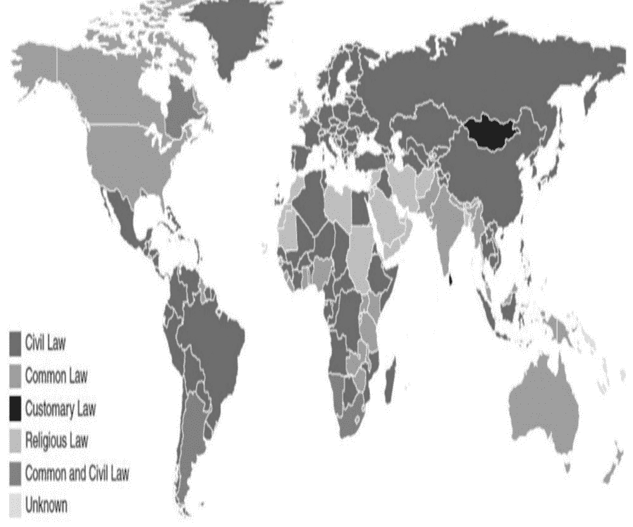

## 图 3.1 世界法律体系

欧洲大部分地区基于民法（成文法），也被称为拿破仑法。民法在罗马帝国时期左右于欧洲演变。罗马人使用了《民法法典》（Corpus Juris Civilis），它包含了一套全面的成文法律规则体系，是现今民法的基础。民法与普通法的主要区别在于，民法将立法作为法庭案件裁决的主要来源。

宗教法基于宗教教义。例如犹太教的哈拉比（halakha）和伊斯兰教的沙亚（sharia）。伊斯兰体系是一个基于教义的自治法律体系，参考《古兰经》。中国的一些非洲国家使用习惯法，其基于对习惯和正常行为的概念。

如果将上述两种或多种法律体系相结合，就是混合法律体系。混合法律体系的特点是包含多种法律框架，可能具有两种或两种基本类型的组成部分。例如，路易斯安那州兼具民法和普通法的特征，而中东部分地区的习惯法则与宗教法相结合。

这种国际法律体系的碎片化叠加在影响数据处理的国际产权法之上，因此尽管 CISSP 考试可能侧重于普通法，但理解全球使用的各种法律体系之间的差异是非常重要的。

## 保护知识产权的国际法律

数据所有者对其创建和拥有的数据拥有法律权利。数据所有者通常负责了解其数据的知识产权和版权。知识产权由各种组织在全球范围内达成共识并执行，包括联合国国际贸易法委员会（UNCITRAL）、欧盟（EU）和世界贸易组织（WTO）。国际产权法保护商业秘密、商标、专利和版权：

- **商业秘密**：商业秘密是专有的或与业务相关的机密设计、实业或方法。为了使商业秘密保持有效，所有者必须采取措施确保数据安全。这些措施的示例包括加密、文档标记和物理安全措施。

- **商标**：商标是符号、单词、名称、声音或其他内容，用于识别特定贸易中产品或服务的来源。(ISC)² 的标志就是一个受注册商标的标志示例。“服务标记”一词有时用于区分适用于服务而非产品的商标。

- **专利**：专利文件记录了一种工艺或合成，并授予所有者法律上可执行的权利，在规定的期限内排除他人实施或使用该发明的设计。

- **版权**：版权是一种法律手段，允许作品创作者控制作品的使用方式，并保护该个人对特定主题的表达。这包括复制权、分发权、音乐权、创作权和公开展示权。美国和欧盟的版权有效期为作者终身加70年。知识产权的版权由各种组织（包括 UNCITRAL、欧盟和 WTO）在全球范围内达成共识并执行。

## 注意

> 尽管版权允许作品创作者控制作品的使用方式，并保护该个人对特定主题的表达，这包括复制权、分发权、音乐权、创作权和公开展示权。美国和欧盟的版权有效期为作者终身加70年。知识产权的版权由各种组织（包括 UNCITRAL、欧盟和 WTO）在全球范围内达成共识并执行。

## 全球法律与监管问题

隐私是一个全球问题。欧盟实施了一种被称为“被遗忘权”的概念，该权利自2014年起在欧盟实施。根据要求，必须从网络搜索中删除无关、隐私或不再相关的信息。在美国，联邦政府仅在接到明显的法律滥用报告时做出反应。隐私法由政府行为驱动。美国宪法第四修正案是美国隐私法的基础。有两条法律值得关注：

- 1974年隐私法：限制了联邦机构可以收集、维护和披露的个人信息。

- 1998年身份盗窃与假设威慑法：该法增加了身份盗窃的处罚，并规定身份被盗者是真正的受害者。在该法案通过之前，只有遭受资金损失的信贷授予人被视为受害者。

范围内，商业和政府数据库包含大量可能导致侵的数据。数据保护机构有权执行指令。欧盟指南规定了以下内容：

- 数据仅用于收集时的目的，并在合理时间内使用。
- 个人有权要求并接收数据报告。
- 个人有权对其个人数据进行修正。
- 禁止向无法确保同等数据保护的地方传输数据。

## 计算机犯罪与黑客

一个重要的全球法律问题是跨国黑客攻击和计算机犯罪。黑客或威胁者可能位于一个国家，使用另一个国家的服务器，然后利用这些资源攻击另一个国家。溯源是非常困难的。CISSP 候选人必须准备好应对这些威胁者。

人们通常认为，在所有已发生的计算机犯罪中，只有约十分之一被检测和起诉。要制定关于计算机犯罪检测和报告的准确数字是非常困难的。许多犯罪未被发现，另一些虽然被检测到但从未报告给执法机构或公众。一些公司不报告是因为他们担心声誉受损和客户流失；另一些公司则不报告，是因为他们害怕自己可能看起来很脆弱。关于计算机犯罪和数据泄露的一个良好信息来源是 https://informationisbeautiful.net，它列出了每年的顶级数据泄露事件（见图 3.2）。

## 世界最大的数据泄露与攻击

记录数超过 30,000 条的精选事件

更新于：2022年6月

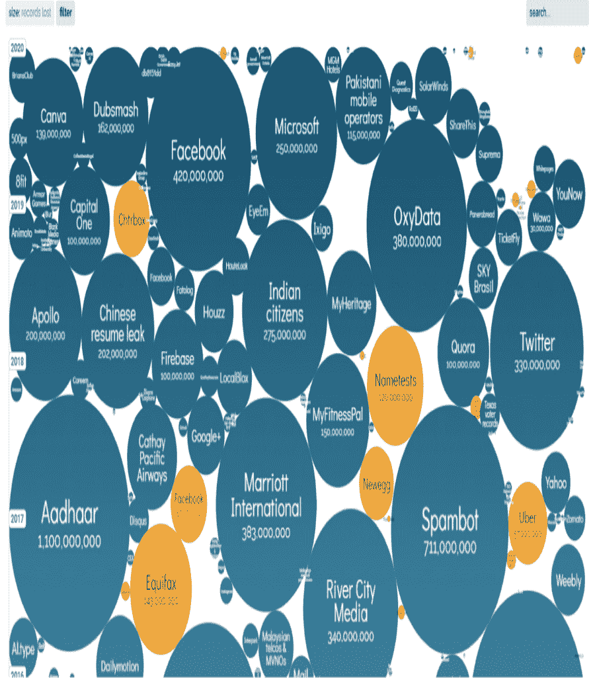

### 图 3.2 世界最大的数据泄露

计算机犯罪分子使用多种攻击向量。

- 物理安全攻击：物理访问系统
- 人员安全攻击：骚扰、勒索或威胁员工
- 通信攻击：对有线、无线或卫星通信进行窃听
- 逻辑攻击：逻辑上访问系统
- 社会工程攻击：欺骗员工或其他人员提供访问权限或信息

如果没有对犯罪分子进行回顾，关于计算机犯罪的讨论将不完整。大多数安全专业人员将计算机犯罪分子视为黑客（hackers）。最初，“黑客”一词指的是乐于理解系统、计算机或计算机网络内部工作机制的计算机爱好者。随着时间的推移，大众媒体开始使用“黑客”一词来指代带有恶意意图入侵计算机的个人。行业通过开发“破解者”（cracker）这一术语作为回应，它是犯罪黑客的缩写。“破解者”旨在描述那些在未经授权方许可的情况下试图破坏系统安全的个人；然而，公众继续使用“黑客”一词来指代计算机犯罪分子。实际上还有许多其他术语可以识别犯罪分子并分类活动，包括以下：

- 黑客/威胁者：这个通用术语描述了一个对事件负部分或全部责任的人，该事件影响或可能影响组织的安全，并违反资源的机密性、完整性或可用性。

- 脚本小子（Script kiddies）：该术语用于描述经验较少的黑客，他们经常使用广泛提供的免费软件漏洞评估工具、现有代码以及仅为攻击目的而设计的黑客工具。这些攻击者通常编程或黑客技能非常有限，并依赖他人编写的工具。

- 不满的员工：对雇主失去尊重的员工可能会攻击该组织。这些人的技能可能并不比脚本小子多。内部人员或前内部人员由于他们拥有的知识和可能拥有的访问权限，构成了实实在在的风险。

**网络恐怖分子/网络犯罪分子**：个人或小组有时获得资助，对政府、组织和个人进行非法方式的秘密或间谍活动。这些人员通常从事受赞助的诽谤、DoS/DDoS（拒绝服务/分布式拒绝服务）攻击、身份盗窃和财务盗窃。他们还可能破坏关键基础设施，例如核电厂、发电厂、水处理厂等。

**企业间谍/国家级黑客**：这些是精锐黑客，在攻击系统和网络漏洞方面具有专门知识。在目前为止讨论的所有对手中，这些是最复杂、能力最强的，而且他们拥有最多的资源。政府赞助的威胁者拥有资金、工具和资源，可以不尽全力获取目标资源的访问权限。支持此类攻击者的组织示例包括 Cozy Bear、Clever Kitten、Deep Panda 和 Mythic Leopard。

## 提示

> 如果你想了解更多关于黑客以及安全领域的所有参与者——包括黑客、安全专业人员和执法人员——请考虑本地选择，例如信息系统安全协会（ISSA）和 INFRAGARD，或者参加黑帽（Black Hat）或 DEF CON 等安全会议。你可以参加会议获得 (ISC)² 继续专业教育（CPE）学分，并进一步了解当前的安全趋势和风险。

## 美国治理

风险管理是支持所有安全活动的最终要求。以下章节将介绍美国的一些法律和指令以帮助风险管理。

## 健康保险可携带性与责任法 (HIPAA)

HIPAA 于 1996 年签署通过，包含两个领域。该法的第一部分保护工人及其家庭在更换工作或失去工作时的健康保险覆盖。第二部分要求美国卫生和人类服务部（DHHS）为电子健康交易和国家标识符建立国家标准。

HIPAA 隐私规则规定了组织必须采取的保护个人信息的控制措施。隐私规则定义了三个主要目的：

- 通过为消费者提供健康信息并控制对该信息的不当使用，保护并增强消费者的权利。
- 通过恢复消费者、医疗专业人员以及大量致力于护理的组织和个人对系统的信任，提高美国的医疗质量。
- 提高医疗效率和有效性，创建一个医疗隐私保护框架，基于州、医疗系统以及个人组织和个人的努力。

## 格兰姆-李-布莱利法 (GLBA)

GLBA 于 1999 年签署通过，导致了美国金融服务监管最彻底的改革。

GLBA 第五部分涉及金融机构隐私。该法的 A 部分要求金融机构对其隐私政策进行某些披露，并给予个人退出选择权。B 部分刑事罪化了被称为“借口取义”（pretexting）的行为，即通过虚假假设获取个人信息的行为。

在 GLBA 下，金融机构被保护个人隐私信息的机密性。根据 GLBA 的规定，金融机构必须制定、实施并维护一个具有适当行政、技术和物理保护措施的信息安全计划。行政控制包括背景检查和职责分离。技术控制可以是硬件或软件，例如加密或入侵检测系统（IDS）。物理控制包括大门、守卫和围栏。信息安全计划必须包括以下控制：

- 为组织的信息安全计划指定计划经理
- 定期的风险和漏洞评估及审计
- 定期的测试和监控计划
- 开发控制敏感信息和个人身份信息（PII）的政策和程序

## 联邦信息安全管理法 (FISMA)

FISMA 于 2002 年签署通过。FISMA 带来的重大变化之一是制定了一套清晰的信息安全指南，旨在保护联邦政府的 IT 基础设施和数据资产。FISMA 的要求规定了以下职责：

- 开发并维护一个包含整个 IT 安全架构和框架的信息保证（IA）计划。
- 确保进行信息安全培训，以使技术人员和管理人员根据 DoD 8570 标准获得适当的培训和认证。
- 对对信息安全承担重大责任的人员实施问责制。


FISMA 还要求进行定期的风险评估、制定风险评估策略和程序、进行定期的（至少每年一次）测试与评估，并对高级管理人员进行适当培训，以便部署适当的安全意识计划。

## 萨班斯-奥克斯利法案 (SOX)

SOX 于 2002 年签署通过，强制要求进行多项改革以加强企业责任、增强财务披露并打击企业和会计欺诈。第 302 条和第 404 条是涉及 IT 基础设施和信息安全的两个章节。第 302 条要求 CEO 和 CFO 亲自证明其组织拥有适当的内部控制。它还要求 CEO 和 CFO 就财务报告相关内部控制的有效性进行报告。

第 404 条对管理结构、控制目标和控制程序规定了要求。遵守第 404 条要求公司建立一套基础设施，用于存储记录和数据，并保护其免受破坏、丢失、未经授权的篡改或其他误用。它要求建立一套全面的控制措施，并由 CEO 和 CFO 负责。

## 美国国家标准与技术研究院 (NIST)

NIST 起始于国家标准局，并于 1989 年更名为国家标准与技术研究院（参见 `www.csrc.nist.gov`）。以下是安全专业人员应该了解的部分 NIST 文档：

- NIST 800-37：这是一份应用风险管理的指南。
- NIST 800-53：这本政府出版物为支持联邦政府执行机构的信息系统提供了选择和指定安全控制的指南。私营行业中的许多组织将 NIST SP 800-53 作为其安全管理的指南。
- NIST 800-60：这是一份映射信息类型和信息的指南。

## 联邦信息处理标准 (FIPS)

FIPS 是美国政府为非军事政府机构和政府承包商的计算机系统开发的公开标准。以下是你在参加 CISSP 考试时应当熟悉的标准：

- FIPS 199：该标准规定了联邦政府使用的信息系统的安全类别。
- FIPS 200：该标准列出了政府系统的强制性安全要求。

## 考试提醒 (ExamAlert)

CISP 考试候选人必须理解并掌握如何应用安全治理以及所使用的框架等安全概念。

## 国际治理

随着全球共享数据的增加，国际治理已变得日益重要。管理这些海量信息的框架之一是 IT 基础库（ITIL）。

ITIL（以前曾为 Information Technology Infrastructure Library）为业务识别、计划、交付和支持 IT 服务提供了一个框架。

ITIL 有一个流程，从为企业的 IT 设定目标、提供初始方向开始，然后演变为持续循环。

ITIL 展示了包含以下内容的服务生命周期：

- 持续服务改进
- 服务策略
- 服务设计
- 服务转换
- 服务运营

另一个国际标准是国际标准化组织 (ISO) 27002，它提供了信息安全管理的最佳实践指南。它分为 12 个主要部分：

- 风险评估与处置
- 安全策略
- 信息安全组织
- 资产管理
- 人力资源安全
- 物理与环境安全
- 通信与运营管理
- 访问控制
- 信息系统的获取、开发与维护
- 信息安全事件管理
- 业务连续性管理
- 合规性

ISO 27002 是为负责启动实施和/或维护信息安全管理体系的人员编写的。其目标为保护者提供模板，提供技术指导，并帮助那些负责保护组织资产的人员。

以下是 ISO 27000 家族的其他你将在参加 CISSP 考试时应当熟悉的标准：

- ISO 27001：该标准描述了与建立、实施、运行、监控、评审和维护信息安全管理体系 (ISMS) 相关的要求；它基于英国标准协会 BS 7799。
- ISO 27003：该标准侧重于 ISMS 的实施。
- ISO 27004：该标准涵盖了信息安全测量。
- ISO 27005：该标准描述了如何实施基于风险管理的解决方案。
- ISO 27799：该标准描述了如何保护个人健康信息。

ISO 9001 是一种获得广泛支持和关注的质量管理标准。ISO 9001 描述了应如何管理和评审生产过程。它不是一种质量标准，而是侧重于系统或过程的文档化程度。希望获得 9001 认证的公司需要进行差异分析，以确定需要改进的领域。ISO 9001 包括六份文件：

- 文档控制
- 记录控制
- 不合格品控制
- 纠正措施
- 预防措施
- 内部审计

> 为了获得 ISO 9001:2000 认证，必须执行差异分析以识别需要解决的缺陷。通过 ISO 认证意味着组织有能力提供符合特定要求的产品，并包含一个持续改进的过程。由于它对检测到的程序有强有力的控制，对审计有直接影响。另一个你应该了解的 ISO 标准是 27001，它曾被称为 BS17799。它分为 12 个主要部分：
>
> - 风险评估与处置
> - 安全策略
> - 信息安全组织
> - 资产管理
> - 人力资源安全
> - 物理与环境安全
> - 通信与运营管理
> - 访问控制
> - 信息系统的获取、开发与维护
> - 信息安全事件管理
> - 业务连续性管理
> - 合规性

> 提示
>
> 对于 CISSP 考试，你应该对 ISO 标准及其目的有基本的了解；但考试不涵盖美国法律。

云安全联盟 (CSA) 安全信任保证与风险 (STAR) 评级验证了云提供商的最佳实践和安全态势。它分为三个等级：

- 第一级：通过问卷进行自评估
- 第二级：第三方评估
- 第三级：由经过认证的独立机构进行持续监控

经济合作与发展组织 (OECD) 开发了隐私指南，并获得了 30 个国家的批准，包括欧盟国家、美国、墨西哥、澳大利亚、日本和捷克。OECD 框架包含八项驱动原则：

- 收集限制原则
- 数据质量原则
- 目的限定原则
- 使用限制原则
- 安全保障原则
- 开放原则
- 个人参与原则
- 责任制原则

对于 CISSP 考试，你还需要了解另外两个欧洲文档：

- 网络安全 10 步：该文档在 10 个关键技术和程序领域提供了详细的网络安全信息和建议。它是由英国政府通信总部 (GCHQ) 的信息安全部门通信电子安全小组 (CESG) 以及英国国家信息保证技术局创建的。
- 欧盟网络安全战略：这份由欧盟开发的文档描述了预防和响应网络攻击的方法。

## 注意

> 仅声称自己符合已知标准是不够的。大多数实体期望获得证明（attestation）。证明意味着提供证据或依据。例如，云托管提供商通过证明向客户确保他们已经通过了第三方验证和复审：ISO 27001、审计标准 (SAS) 70 和 PCI-DSS 均使用 PCI 资格安全评估师 (QSA) 进行证明。

## 风险管理概念

风险管理是一项分析风险、识别威胁并实施控制措施以降低风险的系统性持续方法。风险管理应由高层驱动，由他们指派专人领导风险评估过程。当高层推动该过程时，公司对安全计划将获得自上而下的支持；这是首选的方法。有时，高层可能看不到结构化风险评估过程的价值。在这些情况下，自下而上的流程仍然可以驱动风险评估过程。

驱动风险评估过程的人员必须获得高层的承诺和支持，这一点至关重要。支持的方法是使用正式演示文对他们进行教育，通过演示传达整体风险管理计划的关键方面，并提醒高层他们负有最终责任。

在管理层加入后，风险管理过程就可以开始。该过程的目标是让组织建立必要的控制措施，在保护组织员工和资产的同时，满足利益相关者的预期。风险管理的主要部分包括组建风险管理团队、识别威胁和漏洞、评估组织资产的价值，以及确定如何处理你发现的风险。

## 风险管理框架

风险管理框架支持风险管理过程。例如，英国标准协会 BS 31100 提供了关于风险管理目标、授权和管理承诺的指导。另一个例子是 NIST SP 800-37，即《将风险管理框架应用于联邦信息系统的指南》，它详细阐述了一个六步风险管理框架 (RMF)。RMF 的步骤如下（见图 3.3）：

- 1. 分类 (Categorize)
- 2. 选择 (Select)
- 3. 实施 (Implement)
- 4. 评估 (Assess)
- 5. 授权 (Authorize)
- 6. 监控 (Monitor)

## 流程概述

架构描述

- 架构参考模型
- 分段与解决方案架构
- 任务与业务流程
- 信息系统边界

组织输入

- 法律、指令、政策指导
- 战略目标与目的
- 优先级与资源可用性
- 供应链考量

起点

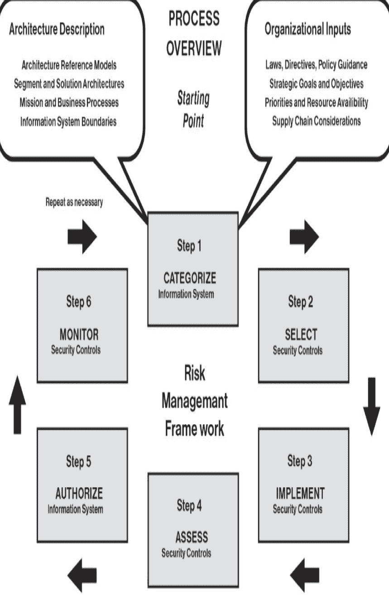

根据需要重复

## 图 3.3

NIST 风险管理框架

已经开发了许多其他风险管理和评估方法，包括以下方法：

- 信息风险因子分析 (FAIR)：这种风险管理方法涉及建立损失事件发生频率和规模的概率基准。它被认为是现有风险框架的补充。
- 风险因素分析：这是另一种风险分析方法，它使用六步法来识别驱动项目进度、成本和技术性能行为的因素。
- 概率风险评估：这种方法设计用于大型复杂项目，在这些项目中，风险被定义为某项活动或行动导致的可行的负面结果。结果以数字形式表示。

> 风险登记表是一个你可以使用的工具，作为已识别风险及其每个风险性质的库。你可以在 `www.slideshare.net/KashifMastan/risk-register-34631122` 看到风险登记表的示例。

## 风险评估

风险管理是持续的，而风险评估则有开始和结束日期。风险评估涉及对业务风险进行识别和优先级排序。完成风险评估至关重要。如果没有它，你就无法设计良好的安全策略或程序来防御你公司的关键资产。风险评估要求人员负责风险管理过程。

对于 CISP 考试，理解风险、威胁和漏洞的概念非常重要。

风险是威胁发生或实现的概率或几率。从 IT 基础设施的角度来看，风险有三个基本要素：

- 资产：对组织有价值的组件或项目，例如数据资产。
- 威胁：任何可能导致资产损失或损害的状况。
- 漏洞：基础设施、设计或组件中的缺陷，这些缺陷可能被威胁利用以破坏、损害或危害资产。

威胁是任何可能导致资产遭受危害、损失、损害或危及的代理者、条件或状况。从 IT 角度来看，威胁可以归类为可能影响资产机密性、完整性或可用性的状况。威胁可以是自然发生的、人为的或技术性的。威胁可能导致公司资源的销毁、泄露、修改或损坏，也可能导致拒绝服务。

漏洞是产品设计中的缺陷、产品实现中的缺陷，或产品软件或代码开发方式中的缺陷。通过实施保护措施、控制和安全防御措施，可以减少甚至可能消除漏洞。

注意

> 控制措施是用于限制、调节或减少漏洞的机制。控制措施可以是纠正性的、检测性的、预防性的威慑性的。

## 风险管理团队

在开始担心一个人是否能独立完成风险管理之前，请理解风险管理是一项巨大的工作。你需要来自其他部门的同事和员工来帮助。为了有效地完成风险分析工作，你必须让公司所有不同部门的人员参与。任何人都很难理解所有部门的内部运作。作为 IT 或安全管理员，你理解 IT 基础设施面临的风险，但你真的掌握人力资源部门可能存在的问题（例如员工控制）吗？

考虑将以下小组的人员纳入风险管理团队：

- 信息安全
- IT 与运营管理
- 系统与网络管理
- 内部审计
- 物理安全
- 业务流程与信息所有
- 人力资源
- 法律
- 物理数据

资产所有者也应该是代表。因为所有者负责资产，他们应对实施的控制类型拥有发言权。让所有者加入团队可以确保团队了解并处理需要检查的许多威胁。

团队还必须由了解组织法律法规要求的人员提供信息和指导。例如，可以建立一个专门团队来研究降低保险成本、减少针对技术基础设施的攻击或验证是否符合 GLBA、SOX 或 HIPAA 等政府标准。

在风险管理团队建立后，它必须执行以下任务：

- 执行资产评估
- 执行威胁分析
- 执行定量或定性风险评估
- 选择补救措施
- 降低、分配或接受风险

评估风险的关键安全管理实践可以分为六大步骤（见图 3.4）：

- 1. 资产识别
- 2. 风险评估
- 3. 政策制定
- 4. 实施
- 5. 培训与教育
- 6. 安全基础设施的审计

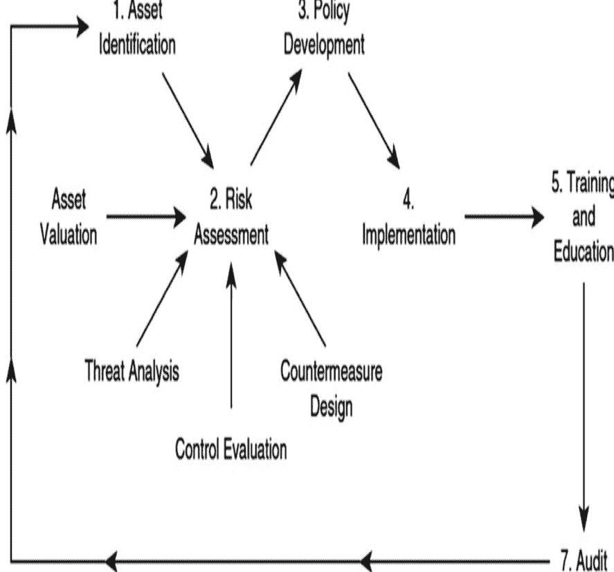

图 3.4

风险管理识别与估值

一旦建立了高层支持的风险管理团队，下一步是列出组织资产的价值。正确的资产评估能够让组织的风险管理团队开始就部署安全控制措施和安全防御措施做出业务决策。

保护组织资产最重要的步骤之一是识别并盘点所有资产。例如，假设你在一家银行工作，负责保护一个包含姓的客户数据库，社会安全号码（SSN）和地址。你对这些资产的控制程度应该远高于对另一个包含所有银行当地分行位置、经理姓名和电话的数据库的控制。然而，如果你对该数据库资产一无所知，你就不知道其保护水平。如果没有对所有资产进行完整且准确的清单，就无法进行资产估值。

请记住，资产可以是有形的，也可以是无形的。在记录有关组织资产的信息时，你应该包含以下信息：

- 标识
- 位置
- 风险
- 保护
- 分组
- 所有者

文档化资产管理提供的另一个重要方面是了**尽职调查**。要正确对资产估值，你需要意识到其价值通常不仅取决于创建或购买该物品的成本。考虑以下因素：

- 获取或创建该资产花费了多少？
- 如果资产遭到破坏，组织将面临什么样的责任？
- 如果资产无法使用，生产成本是多少？
- 该资产对竞争对手和外国政府的价值是多少？
- 该资产有多重要，它的损失会对公司产生什么影响？
- 维护该资产需要什么技能组合，每天、每周或每月需要多少小时？
- 该资产依赖于哪些子系统、应用程序、硬件或软件？

列出资产价值后，风险管理团队可以确定组织最关键的系统、资源、应用程序和数据。这些信息允许团队优先投资安全控制和安全防御措施。控制不是免费的，因为资金是的。大多数组织必须为适当的安全控制和安全防御措施所需的投资提供理由。

如果没有资产估值，很难理解控制的投资回报率（ROI）或对安全防御措施的投资进行成本效益分析。了解你试图保护的资产的价值也很重要，因为如果在防御措施上花费的费用超过了威胁针对漏洞时可能遭受的损失价值，那将是愚蠢的。一个常见问题是未能考虑到二级和三级系统如何影响分配给关键资产的价值。

记住，你无法保护一切。在定义范围时，组织必须考虑到他们的资金和资源有限，防御措施必须策略性地部署，以保护被认为最关键的部分。应该首先关注面临高水平风险的资产，如图 3.5 所示。

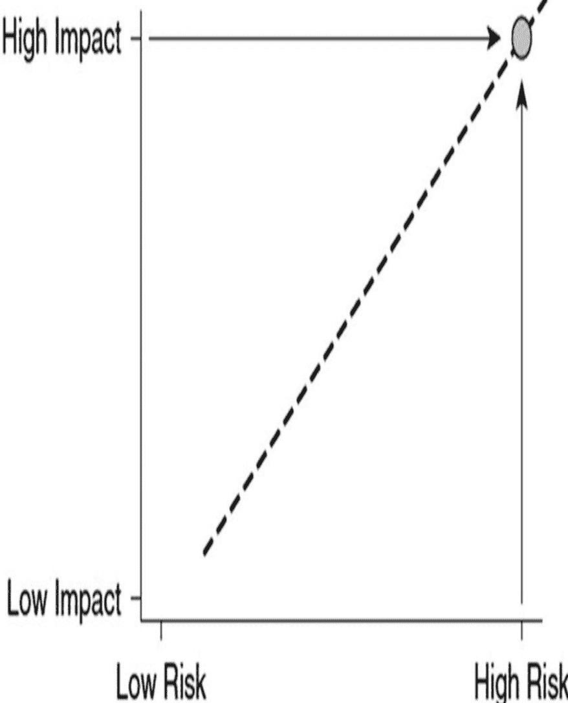

**图 3.5**

高风险、高影响资产

出于保险目的，通常需要进行资产识别和评估。组织可能会确定某些风险应转移给第三方，而资产估值使组织能够准确评估其业务保险需求。一些公司提供专门的技术和网络风险覆盖，俗称为“黑客保险”。

## 威胁分析

在本章的早些部分中，我们讨论了威胁对组织可能产生的负面影响。本节将研究威胁可能源于何。威胁可能由于技术故障或自然因素发生，也可能由人类引起，无论是恶意的还是无心的。识别潜在威胁是一项巨大的责任。你不想对潜在威胁进行随机的头脑风暴；况且，如果你住在堪萨斯州，为什么还要将飓风列为一种威胁呢？很好的开始点是考虑你可能在以下常见类别中面临的威胁：

- 自然灾害
- 物理威胁/盗窃
- 人为失误/内部威胁
- 应用程序错误/缓冲区溢出
- 设备故障
- 环境危害
- 恶意软件/隐蔽通道
- 黑客攻击
- 机密信息泄露
- 被盗、丢失、损坏或修改的数据
- 未经授权的访问
- 恐怖主义
- 病毒、蠕虫和恶意软件
- 拒绝服务

威胁、漏洞和威胁主体的结合会导致损失。威胁主体是可以实施威胁的个人或群体。正如前面提到的，漏洞是安全系统、软件或程序中的缺陷或弱点。漏洞的一个示例是缺乏员工培训；例如，培训不当的帮助台员工可能会在无意中向潜在黑客提供密码，从而导致损失。损失或影响的示例包括：

- 财务损失
- 声誉损失
- 员工、客户或顾客的危险或受伤
- 业务机会损失
- 违反信任或违反法律

损失可能有立即或延迟的影响。延迟损失在损失发生很久之后仍对组织产生负面影响。这可能是几天、几个月，甚至几年。例如，一个组织的网站可能被黑，从而遭受立即损失。在引入技术支持人员重建 Web 服务器之前，任何电子商务交易无法进行；所有的正常处理都停止了。但这些立即损失可能不是公司感受到的唯一影响。后来，当当地新闻频道报道该公司遭到黑客并丢失了个人信息时，公司的声誉可能会受到损害，导致未来客户流失。州法律各异，某些州（如加利福尼亚州）可能要求公司审查漏洞。客户可能会记住此类事件多年，并选择使用竞争对手。这些都是延迟损失的示例。

花点查看图 3.6，该图显示了威胁、漏洞和控制之间的关系。注意，威胁本身并不代表危险，不足以成功攻击。威胁主体可以描述为通过破坏、泄露或修改对信息资产造成损害的实际情况或事件。图 3.6 中的示例威胁是 Web 应用程序被破解。威胁主体是执行该攻击的熟练黑客，漏洞是 Web 应用程序未修补的缓冲区溢出，而风险是这种攻击发生的概率。

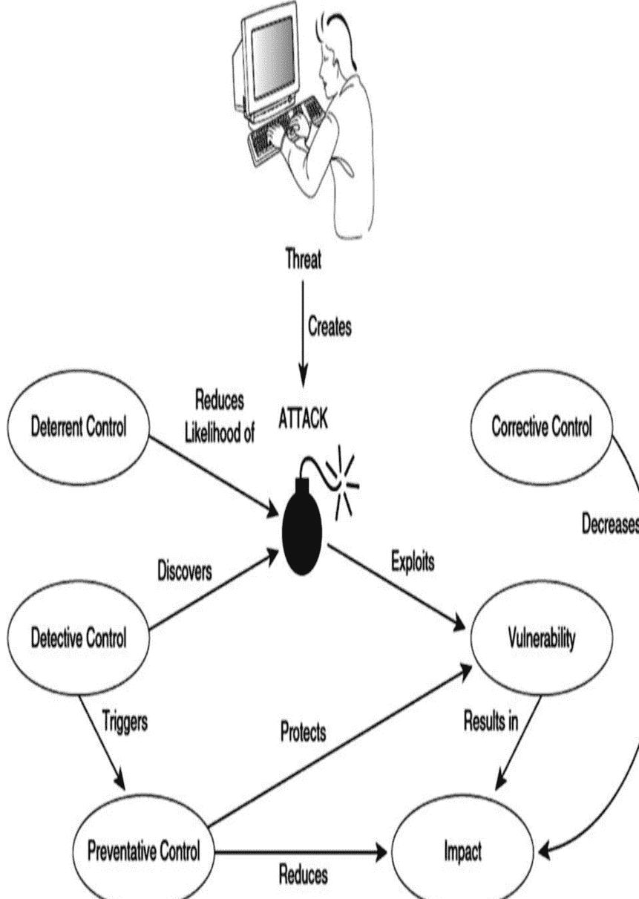

*(威胁产生攻击；降低概率；威慑性控制；发现漏洞；检测性控制；导致；触发；保护；预防性控制；减少影响)*

## 图 3.6

威胁、漏洞与控制

识别威胁、漏洞和控制只是风险管理过程的一部分。在没有确定美元价值或使用其他指标评估这些变量的情况下，如何开始分析组织面临的威胁和漏洞？一种方法是开发类似于表 3.2 那样的表格，它有助于展示威胁、漏洞和风险之间的关系。例如，入侵者可以代表一种可能导致组织设备被盗的威胁，因为缺乏安保或受控入口存在漏洞。我们将在本章稍后查看美元成本，但现在请考虑这些项目之间的关系。

## 表 3.2 威胁、漏洞与风险

| 威胁类型 | 威胁 | 利用方式/漏洞 | 暴露风险 |
| --- | --- | --- | --- |
| 人为因素：内部威胁 | 入侵者 | 无安保或受控入口 | 盗窃 |
| 人为因素：外部威胁 | 黑客 | 防火墙配置错误 | 信用卡信息丢失 |
| 人为因素：内部威胁 | 员工 | 责任制不明；无审计策略 | 完整性丢失；数据被更改 |
| 自然威胁 | 火灾 | 防火措施不足 | 损害或生命损失 |
| 自然威胁 | 飓风 | 准备不足 | 损害或生命损失 |
| 恶意外部威胁 | 病毒 | 杀毒软件过时 | 病毒感染和生产力损失 |
| 技术因素：内部威胁 | 硬盘故障 | 无数据备份 | 数据丢失和无法恢复的停机 |

风险管理团队必须从各种来源收集信息以识别威胁。可以咨询或考虑以识别当前和新兴威胁的来源包括：

- 资产所有者
- 网络管理员
- 安全管理员
- 运营小组
- 设施记录


- 政府记录和监督小组，例如计算机应急响应小组（CERT）和 Bugtraq
- 私人组织，例如 SANS 学院

风险管理团队可以使用美元或非美元方法来检查资产及其相关风险。通过使用定性评估，团队可以为风险分析中识别出的威胁所造成的资产和预期的暴露分配成本（货币价值）。通过使用定性评估方法，团队可以使用情景来驱动一个按优先级排序的重点关注事项列表，而不是关注美元金额。接下来的章节将更详细地描述定性和定量评估技术。

## 定量评估

定量评估涉及数字和金额。其目标是为风险评估中的各个元素、以及风险分析中的资产和威胁分配成本或数值。

### ExamAlert 考试提示

> 当你听到“quantitative（量化）”这个词时，只需记住“quantity（数量）”即可。这将帮助你在 CISSP 考试中记住，量化评估涉及数字。

为了完全完成量化风险评估，流程中的所有元素——即资产价值、影响、威胁频率、保护措施有效性、保护措施成本、不确定性和概率——都必须量化。纯量化风险评估的问题在于，要为所有元素分配美元价值是非常困难的，甚至是不可能的。因此，某些定性测量类型通常会补充定量元素。定量评估需要大量的时间和人力资源。定量评估过程涉及按照以下顺序确定几项指标：

- 1. **单次损失预期（SLE）：** 首先，你需要确定如果威胁泄露，你在某个资产上可能遭受的单次损失金额。SLE 的计算公式如下：

单次损失预期 = 资产价值 × 暴露因子（Exposure factor）

计算 SLE 时需要考虑的因素包括资产的物理损坏或被盗、数据丢失、信息被盗，以及可能导致处理延迟的威胁。暴露因素是已发生的威胁对特定资产造成的损害程度或百分比。

- 2. **年度发生率（ARO）：** 下一步是确定不希望事件每年发生的概率。简单来说，预计一年内会发生多少次？

- 3. **年度损失预期（ALE）：** 定量评估的第三步也是最后一步是结合潜在损失和每年的发生率来确定风险的规模。其表达方式为：

ALE = SLE × ARO

在执行本节讨论的计算时，你应该包含所有相关成本（如下所示），并确保在 SLE 计算期间考虑到它们：

- 生产力损失
- 修复成本
- 受损设备或丢失数据的价值
- 替换设备或重新加载数据的成本

## 注意事项

> 定量评估是困难的，因为很难对每种可能的事件设定美元金额，并推算出与该事件相关的所有成本。

当这些成本累加并确定了特定威胁后，就可以计算 ALE。这有助于你构建组织风险的完整蓝图，并允许组织制定有效的策略。

利用表 3.3 中的信息，本节通过了一个计算机病毒风险示例。首先，你需要计算 SLE，这意味着你需要将资产价值乘以暴露因子。你确定的资产价值是该资产的价值。暴露因子是风险对资产造成的损害金额。例如，风险管理团队可能会咨询其专家并确定 17% 的 Word 文档和数据可能会被病毒破坏。计算方法如下：

### 表 3.3 SLE、ARO 和 ALE 的使用

| 资产 | 风险 | 资产价值 | 暴露因子 | SLE | ARO | ALE |
| --- | --- | --- | --- | --- | --- | --- |
| 客户数据库 | 被破解 | $432,000 | 0.74 | $320,000 | 0.25 | $80,000 |
| Word 文档和数据文件 | 勒索软件 | $90,450 | 0.17 | $15,376 | 0.90 | $13,839 |
| 域控制器 | 服务器故障 | $82,500 | 0.88 | $72,600 | 0.25 | $18,125 |
| 电子商务网站 | DDoS | $250,000 | 0.44 | $110,000 | 0.45 | $49,500 |

（注：原文文本在后半部分存在大量重复段落，译文已根据逻辑进行了去重处理，以保持文档的专业性。）

针对 SLE、ALE、ARO 的那些。记忆并理解这些公式将帮助你充分为考试做好准备。

## 定性评估

纯粹的定量风险评估很难实现，因为某些项目很难与固定的金额挂钩。正如本章前面提到的，定性评估是以场景为驱动的，并且不需要为风险分析的各个组件分配美元价值。绝对定性风险分析是可行的，因为它涉及对威胁的严重性和资产的敏感性进行排名，分为低、中、高等等级或类别。表 3.4 提供了一个定性量表示例。

## 表 3.4 定性评估影响量表

| 分数 | 损害程度 | 触发时间 | 潜在影响 |
| --- | --- | --- | --- |
| 高 | 严重 | 分钟到几小时 | 人员死亡、业务失败、民事或刑事起诉 |
| 中 | 破坏性 | 几小时到几天 | 负面公关、客户流失、声誉损失、影响力下降 |
| 低 | 中等 | 天到几周 | 需要变通方案、减少输出、可能导致利润减少 |
| 微小 | 轻微 | 最多一个月 | 不便 |

对特定的 IT 资产进行一致且主观的风险评估至关重要。这通常涉及一个小组或团队参与评估。负责维护 IT 资产机密性、完整性和可用性的资产所有者应该在该过程中拥有发言权。

定性评估的基本步骤如下：

- 1. 在电子表格中列出组织所有的关键 IT 资产。
- 2. 在电子表格中指定每个 IT 资产的关键威胁和漏洞。对于给定的 IT 资产，可能有一个关键威胁或漏洞。
- 3. 开发一个一致的暴露严重程度量表来衡量影响。应根据 IT 资产和可能被利用的特定威胁分配量表中的值。
- 4. 从最关键到最不利对风险评估结果进行组织和优先级排序。这将把那些面临威胁或漏洞导致利用风险最大的资产立即置于列表顶端。
- 5. 对于组织最重要且风险暴露最大的 IT 资产，优先考虑安全控制和安全防御措施的资金。
- 6. 根据威胁和安全策略，确保组织的关键 IT 资产获得适当的机密性、完整性和可用性控制。

定性评估过程的结果是一个优先级列表，看起来可能类似于表 3.5 中提供的信息。注意该表中，设施电源被识别为关键关注点。

## 表 3.5 定性评估结果

| 资产 | 威胁 | 暴露程度 |
| --- | --- | --- |
| 设施电源 | 断电 | 高 |
| 客户数据库 | 软件漏洞 | 中 |
| 邮件服务器 | 病毒攻击 | 中 |
| 文件服务器 | 数据丢失 | 低 |
| 文件服务器 | 硬盘故障 | 低 |

执行定性评估的缺点是，当你不使用金额价值时，向习惯于处理美元金额的管理人员传达评估结果会变得更加困难。然而，定性评估可以快速完成。

定性评估是主观的，基于公司团队或专家的意见，但它并不总是能提供高级管理层希望收到的精确评估。例如，预测自然灾害甚至人为事件的可能性，永远无法建立精确的数字确定性。

## 定性评估类型

定性评估可以采用许多技术，例如头脑风暴、调查、问卷、清单、与资产所有者的一对一会议以及面试。接下来将讨论几种特定的选项。

定性风险评估的一种方法是德尔菲技术（Delphi technique），这是一种小组方法，允许个人贡献匿名意见。这种技术的目标是避免被强势的人所影响，寻找协同效应，并让参与者能够诚实。

引导式风险分析过程（FRAP）是一个通过提问产生的主观过程。它被设计为在几小时内完成，因此是一个执行非常快的过程。

信息安全评估方法（IAM）开发于 1998 年，用于审查组织的信息安全态势，识别潜在漏洞，并就消除或减轻这些漏洞提供建议。它以机密性、完整性和可用性作为评估的基础。

另一种定性风险评估方法的资源是 NIST 800-53，它将机密性、完整性和可用性定义为损失的类别，并根据主观排名对每种损失进行排序，排名可以是以下任何一种：

- **低**：短期内可以忍受的轻微不便。
- **中**：可能对组织造成损害或花费中等资金进行修复。
- **高**：将导致公司与客户或员工之间关系的损失。可能导致法律诉讼或罚款，或导致公司损失收入或收益。

表 3.6 提供了如何进行此类评估的示例。如你所见，没有使用金额，潜在损失仅被评为高、中或低。

## 表 3.6 执行定性评估

| 资产 | 机密性损失 | 完整性损失 | 可用性损失 |
| --- | --- | --- | --- |
| 客户数据库 | 高 | 高 | 中 |
| 内部文档 | 中 | 中 | 低 |
| 广告宣传 | 低 | 中 | 低 |
| 人事记录 | 高 | 高 | 中 |

无论使用何种方法——定量还是定性——风险评估过程的结果为风险管理团队提供了决策所需的信息。表 3.7 总结了定量和定性评估之间的差异。

## 表 3.7 定量与定性风险评估

| 属性 | 定量 | 定性 |
| --- | --- | --- |
| 提供金额 | ✓ | — |
| 可以自动化 | ✓ | — |
| 几乎没有猜测 | — | ✓ |
| 不需要复杂的数学计算 | — | ✓ |
| 客观 | ✓ | — |
| 信息量少 | — | ✓ |
| 准备时间短 | — | ✓ |
| 易于向管理层汇报 | ✓ | — |

注：进行风险评估的方法有很多。例如，新西兰使用 ANZ 4360 标准。

## 选择防御措施

在识别潜在风险并估计其影响后，团队必须确定如何处理这些风险。有三种接受的应对方式：

- **风险接受**：这种方法涉及在风险发生时承担成本。当没有其他可用选项或潜在损失与项目收益相比很小时，可以选择此选项。如果选择了这种方法，重要的是准备好应急预案，以确保在风险发生时能够应付。例如，如果你女儿计划在巴哈马海滩举行夏季婚礼，你可能会同意该地点，但要求酒店在天气变化时允许在室内举行。这种类型的应急预案可以在天气风险变为现实时使情况更容易处理。

- **风险转移**：风险转移最常见的例子是保险，它可以将潜在损失的部分或全部成本转移给第三方。要转移风险，可以将风险所有权移交给第三方。第三方承担风险，但组织通过支付保险费用得到解决。在你女儿婚礼的案例中，你可能会通过购买飓风、旅游和酒店保险来转移部分风险。在现实世界中，对于业务连续性（COOP）计划，风险转移在灾后恢复操作中替换家具、硬件和建筑等实体物品时可能是可行的选择；然而，风险转移对于数据保护真的不起作用。对于数据保护，加密和备份至关重要。

- **风险缓解**：这种方法意味着实施防御措施来改变或减少风险。风险降低的例子包括防火墙和加密、增加补丁管理的频率以及/或更强的身份验证。考虑女儿婚礼的例子。为了降低风险，你可能会要求她将婚礼推迟到明年春天以减少遇到强风暴的概率。

某些来源将风险规避列为另一种选择。这仅仅意味着你通过避免相关活动来规避风险。然而，取决于情况，风险规避可能不可行。

哪种方法是正确的？这取决于应对措施的成本、资产的价值以及风险降低技术将总风险降低到可接受标准的程度。

可接受风险或风险容忍度是组织愿意承受的最小可接受风险。在评估防护措施时，重要的是考虑总成本（TCO），这包括购买价格、维护费用、更新、保险以及所有其他成本。在保持最低年度成本的同时降低风险。这些概念通过以下公式进行数值化表达：

威胁 × 漏洞性 × 资产价值 = 总风险

没有任何组织能做到 100% 的安全。在实施防护措施和控制措施之后，总会剩下一些风险；这被称为剩余风险。剩余风险的公式如下：

> （威胁 × 漏洞性 × 资产价值） × 控制缺口 = 剩余风险

目标是在控制成本、资产价值以及潜在损失风险之间取得平衡——并避免在控制措施上的花费超过资产本身的成本（见图 3.7）。


图 3.7 风险成本与控制水平的对比

> 注意

任何涉及人类生命的风险都是极高的，应给予最高优先级。

在完成风险处理步骤后，风险评估将产生一份最终报告，为组织展示发现、信息、评估和建议。最终评估报告是管理层在有关组织整体风险和漏洞评估方面做出明智决策的工具；它是组织如何减轻已识别风险、威胁和漏洞的基础。

## 注意

防护措施或保护措施的成本-效益分析通过“控制缺口”来衡量：

防护措施前的 ALE – 防护措施后的 ALE = 控制缺口（防护措施对组织的价值）

此公式可用于评估防护措施的成本效益，或比较各种防护措施以确定哪种最有效。所得值越高，说明该防护措施的成本效益越高。在大多数情况下，你希望避免在控制措施上的资金花费超过资产本身的成本。然而，事实并非总是如此。例如，正如本章早些时候讨论的，联邦、州和地方政府有时可能会提供控制措施来保护关键系统，而不考虑控制措施的成本。要用数值来衡量潜在损害并不总是容易的。

### 考试警示

某些组织使用风险分析矩阵，通过查看概率和影响。例如，请参阅 MITRE 的风险矩阵：https://www.mitre.org/research/technology-transfer/open-source-software/risk-matrix。

## 威胁建模概念与方法

威胁建模是一种评估威胁的结构化方法。威胁建模通常在安全控制的规划、设计和实施期间使用，以验证应对措施是有效的，并放置在需要的地方。如果定期进行，威胁建模还可以帮助安全团队确保根据已知或新出现的威胁，保护措施是充分的。如果不定期进行威胁建模，新威胁可能处于不受保护状态，导致系统和数据处于脆弱状态。

## 威胁建模步骤

威胁建模过程的一般步骤如下：

- 1. **识别资产**：此步骤包括对使用的哪些应用程序、这些资产位于何处以及实施了哪些安全措施进行清单。了解新资产上线或资产是否在没有规定安全措施的情况下上线等信息，是管理和降低风险的关键。
- 2. **开展威胁情报工作**：威胁情报应集中在三个领域：资产、攻击者和软件。你应该充分了解用于利用漏洞的工具和技术，以及攻击者的动机。另一种方法是构建攻击树。
- 3. **对威胁建模和分类**：你可以使用多种方法对威胁进行分类和目录。本章稍后将讨论两种方法论：STRIDE 和 DREAD。
- 4. **映射并绘制潜在攻击图**：此步骤的一种方法是使用流程图，它提供了系统的分层视图，并关注通过系统使用和执行代码模式的模式。另一种方法是构建攻击树，它由一系列代表不同事件的父节点和子节点组成。根节点（图中位于最顶部的父节点）是攻击的总目标。子节点必须测试为真，父节点才能为真。目标是让威胁建模者看到必须哪些情况汇聚在一起才能使威胁成功。
- 5. **缓解威胁**：缓解能力通常指用于保护、检测和响应特定类型威胁的技术。为了使威胁缓解成功，威胁建模团队必须拆解应用程序，理解信任边界和输入点，并对发现的威胁进行排序。识别出的威胁需要确定优先级，并需要部署控制措施来修复已识别的威胁。

## 注意

在威胁建模期间识别出的威胁的常用缓解方法包括：

- 为员工提供更多培训
- 更改业务流程或程序
- 实施管理控制，例如职责轮换或双重控制
- 更改应用程序的配置
- 修改源代码
- 使用技术控制，如 Web 应用防火墙、代理或其他筛选过滤设备

## 威胁建模工具与方法

如前所述，有许多威胁建模工具和方法正在使用。例如，微软开发了 STRIDE，它代表以下内容：

- **欺骗（Spoofing）**：使用伪造身份
- **篡改（Tampering）**：未经授权的更改
- **否认（Repudiation）**：确保性
- **信息泄露（Information disclosure）**：向外部或未经授权的实体发布信息
- **拒绝服务（Denial of service, DoS）**：资源
- **权限提升（Elevation）**：使用限制账户获取更高权限

另一种方法是 OpenStack 的 DREAD，它提供了一个评分系统且设计灵活。DREAD 考虑：

- **损害性（Damage potential）**：损害可能有多严重？
- **可复制性（Reproducibility）**：攻击者重现利用有多复杂？
- **可利用性（Exploitability）**：执行攻击有多难？
- **影响用户（Affected users）**：有多少百分比的用户受影响？
- **发现性（Discoverability）**：攻击者发现此漏洞有多难？

PASTA（攻击模拟和威胁过程）是一个七步骤流程，专注于将技术需求与业务目标对齐。每个步骤由若干子集组成：

- 1. 定义目标。
- 2. 定义技术范围。
- 3. 执行应用程序拆解。
- 4. 开展威胁分析。
- 5. 开展漏洞分析。
- 6. 开展攻击建模。

OCTAVE（操作关键性威胁、资产和漏洞评估）是卡内基梅隆大学开发的威胁建模方法，关注组织风险而非技术风险。它包含三个阶段：

- 1. 构建基于资产的威胁分析。
- 2. 识别基础设施漏洞。
- 3. 开发安全策略和计划。


`VAST`（可视化、敏捷和简单的威胁建模）是一种自动化威胁建模平台，区分了应用程序模型和运行威胁模型，`VAST`的设计旨在集成到围绕 `DevOps` 哲学的工作流中。

`Trike` 是一个从防御视角运行的威胁建模平台，而不是模拟攻击者的思维。它与其他方法的不同之处在于让你对试图防御的系统进行建模。

无论部署何种方法，最重要的是从系统开发阶段开始。早期构建控制比后期尝试添加要便宜得多。

## 管理供应链和第三方的风险

如今，跨国公司通常在世界各地运营，并使用各种供应商、承包商和来源。对这些第三方的依赖持续增加，管理这些关系的需求也随之增加。

例如，假设你是某管理天然气管道和发电厂公司的 `CISO`。你会有许多监控控制和数据采集 (`SCADA`) 设备、`IP` 摄像头、自动泵、传感器、计算机等作为生产控制系统的一部分。在这种情况下，你会担心从何处采购这些设备，以及这些设备是否符合你的需求。

这就是供应链风险管理发挥作用的地方。

`Windows` 或 `Linux` 操作系统都是黑客的常见攻击目标。为了降低供应链风险，你可能需要进行持续风险评估，以减少漏洞并确保业务的连续性。

供应链风险管理 (`SCRM`) 仅仅是你必须考虑的过程中的一小部分。第三方实体必须验证其是否符合所有陈述的安全目标、要求、法规和合同协议。以下是用于第三方治理的一些文档、协议和备忘录：

- **互连安全协议 (`ISA`):** `ISA` 是一份安全文档，规定了在系统与网络之间、或机构与外部系统之间建立、维护和运行互连的要求。该文档列出了连接系统和网络的要求，并详细说明了如何使用安全控制措施来保护系统和敏感数据受外部系统的影响。`ISA` 通常维护一份网络拓扑图，以及特定系统和网络是如何与外部系统连接的。

- **互操作性协议 (`IA`):** `IA` 是一份文档，规定了公司之间共享和维护信息的任何及所有要求，以便它们能够交换和共享数据。例如，如果美国航空公司与夏威夷航空进行航班代码共享，两家公司都需要访问共同数据集。

- **谅解备忘录 (`MOU`):** `MOU` 是一份文档，规定了外包合作伙伴组织的条款和条件，这些组织必须共享数据和信息资源。为了具有法律约束力，`MOU` 必须由具有签署权限的组织代表签署。此类文档通常是安全的，因为它们被视为机密。

- **运行授权 (`ATO`):** `ATO` 是一份正式声明，授权信息系统和/或应用程序的运行，并表示同意包含相关风险的安全计划。

- **业务连续性计划 (`COOP`):** 错误总会发生，`COOP` 规定了组织必须建立的流程和程序，以确保在问题出现时业务能够继续运行。

- **服务水平协议 (`SLA`):** `SLA` 有时与 `ISA` 或 `MOU` 配合使用。如果外包提供商将提供时间敏感的服务，实施 `SLA` 是获得合作伙伴提供服务水平保证的一种方法。`SLA` 应该规定提供商同意的运行时间、响应时间和最大停机时间。作为服务费用，提供商同意在合同约时间内维修或更换设备。

- **运营级协议 (`OLA`):** `OLA` 与 `SLA` 协同工作，支持 `SLA` 流程。`OLA` 定义了每个合作伙伴内部支持小组的职责。例如，虽然 `SLA` 可能承诺停机时间不超过五分钟，但 `OLA` 将定义将使用哪个小组和资源来实现该停机目标。

- **运行时间协议 (`UA`):** `UA` 详细说明了同意的运行时间，通常以百分比表示。例如，`UA` 可用于网络服务（如 `WAN` 链路）或设备（如服务器）。常见的运行时间如 `99.999%`，这相当于每年大约五分钟的停机时间。

- **保密协议 (`NDA`):** `NDA` 用于保护机密信息。例如，在参加 `CISSP` 考试之前，你将被要求签署 `NDA`，声明你不会向他人透露考试题目。

- **业务伙伴关系协议 (`BPA`):** `BPA` 是一份具有法律约束力的文档，旨在为业务伙伴之间与特定安全相关活动提供保护并强制执行某些行动。`BPA` 是由律师根据合作伙伴的意见创建的书面协议；它包含了与安全和合作相关的条款。

注意

> 在与业务伙伴交易时，你应该审查的一个项目是审计标准第 70 号 (`SAS 70`)。`SAS 70` 报告验证合规性，并确保外包商或业务伙伴的控制目标和活动已由独立会计和审计师进行检查。

## 组织流程中的风险降低

风险管理需要理解组织及其对时间敏感的业务需求。业务中没有什么是静态不变的。组织单元会变化，产品和服务会增加或删除，部分业务可能会被拆分或剥离。本节讨论了安全专业人员可能需要处理的常见事件类型。

首先是合并与收购。合并是将一个或多个商业实体合并成单一幸存实体。从风险的角度来看，合并过程中可能会出现很多问题。企业通常寻求协同效应，但某些企业之间并不匹配。无论情况如何，在合并之前必须问一些问题：合并对两家公司来说都是双赢吗？合并的目的是否剥离资源（如人才和知识产权），然后在稍后拆分出一个实力弱得多的公司？

有时，公司在没有充分行动计划的情况下进入了合并或收购阶段。这样做可能会导致安全漏洞和支出增加。

此外，许多人不喜欢改变。一旦公司文化形成，人们习惯了某种处事方式，态度就很难改变。合并关乎变化，而这与许多员工的预期背道而驰。

安全专业人员通常被要求快速与拟议的业务伙伴建立连接。虽然有连接的需求，但安全应保持为核心关注点。你需要了解拟议合并伙伴的安全策略以及正在执行哪些控制措施。你不想允许攻击者通过合并公司的网络进入你的网络。

在合并不同公司时，总会有安全疑虑。你应该关注以下事项：

- **策略**: 高层文档概述了公司的安全目标和事项。

- **法规**: 不同的实体可能受不同监管机构的监管。

- **地理位置**: 位于英国伦敦的公司其运行标准与位于加利福尼亚州圣何塞市的公司不同。

- **拆分/剥离**: 每当业务发生拆分时，你都必须处理许多与合并时相同的问题。

- **信任或许可级别**: 了解当前或新员工的访问权限或控制水平至关重要。

- **技能、培训和意识**: 了解访问信息的用户的培训水平至关重要。

## 基于风险识别并优先考虑业务连续性

业务连续性计划 (`BCP`) 有许多方法。有些公司单独处理这些流程，而另一些公司则关注于持续的过程。`NIST` 在 `SP 800-34`《信息技术连续性规划指南》中提供了应急流程的良好示例。该出版物定义的 `BCP/DRP` 流程如下：

灾难恢复计划 (`DRP`) 是业务连续性计划 (`BCP`) 的一部分，更多涉及技术短期问题，例如如何让关键系统和服务运行。相比之下，`BCP` 概述了公司为了维持经营和恢复正常运行所采取的操作。对于 `CISSP` 考试必须了解这两者的区别。

1. 制定应急计划声明。
2. 进行业务影响分析 (`BIA`)。
3. 识别预防性控制措施。
4. 开发恢复策略。
5. 开发 `IT` 应急计划。
6. 测试计划、培训员工并举行演练。
7. 维护计划。

考试提示

> 对于 `CISSP` 考试，请记住人员安全始终第一，且优于所有其他考虑。

业务连续性是维持关键业务功能 (`CBF`) 运行的过程，以便公司长期经营。业务连续性的目标是减少或防止停机时间并优化操作。业务连续性协会 (`www.thebci.org`) 是业务连续性管理的专业机构，其定义的业务连续性是一种整体性的管理过程，能够识别威胁组织的潜在影响，为构建韧性提供框架，确保有效的响应，并保护其声誉、品牌、价值以及关键利益相关者的利益。

虽然可以使用许多方法来完成 `BCP/DRP` 流程，但本章描述的步骤与 `(ISC)²` 推荐的参考文档最为贴切。图 3.8 提供了该流程的概述，包括以下步骤：

1. 项目启动
2. 业务影响分析 (`BIA`)
3. 恢复策略
4. 计划设计与开发
5. 实施
6. 测试
7. 监控与维护

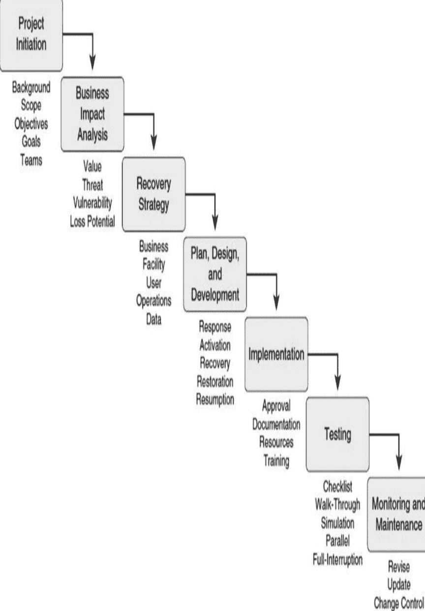

## 图 3.8

`BCP/DRP` 流程

我们在本章中讨论 `BCP` 流程启动和业务影响分析，其他步骤将在第 8 章“安全运营”中说明。

## 项目管理与启动

在启动 `BCP` 之前，获得高层的支持至关重要，因为他们负责：制定预算、确定团队负责人以及启动 `BCP` 流程。

如果没有高层的支持，你将没有资金来成功完成项目，你的努力充其量只能取得边缘成功。获得他们支持的一种方法是为他们准备并举办一场研讨会，回顾组织面临的风险，识别威胁并讨论潜在停机的成本。这是一个提醒他们终究要由他们承担法律责任的良好时机。如果客户、股东、持股者或其他人认为公司没有尽责，他们可能会对高层提起诉讼。

高层必须选择一名团队负责人。此人必须在高层面前拥有足够的信誉，以便就 `BCP` 的结果和建议对他们产生影响。任命团队负责人后，可以建立行动计划并组建团队。团队成员应包括管理层、法律人员、恢复团队人员、信息安全团队、各业务部门、网络团队和物理安全团队的代表。包含资产所有者负责执行计划的人员也非常重要。

接下来，你需要确定项目范围。定义良好的范围对于提高 `BCP` 的有效性有极大帮助。你不能保护一切，实际上你也不需要。例如，如果你为一家在加利福尼亚州、佛罗里达州、纽约州和北达科他州设有办事处的公司制定计划，你不会为所有办公室都准备飓风应急预案。

对办公室内部政治保持敏感很重要，这可能会导致规划过程偏离轨道。另一个需要避免的问题是项目蔓延（`project creep`），即越来越多不属于原始项目计划的项目被添加到其中。蔓延可能会延迟项目的完成，并可能导致预算超出。

`BCP` 受益于遵循传统的项目计划阶段。资源（人员和财务）、时间表、预算估计以及任何关键成功因素等问题必须进行管理。你可以安排首次会议来启动该流程。

最后，团队就可以开始工作了。团队可以：

- 识别潜在威胁
- 讨论潜在停机的成本
- 回顾组织面临的风险
- 识别关键业务功能
- 估算资源需求
- 概述灾难恢复步骤
- 分配团队角色
- 记录计划
- 执行演练

`BCP` 受益于遵循传统的项目计划阶段。资源（人员和财务）、时间表、预算估计以及任何关键成功因素等问题必须进行管理。你可以安排首次会议来启动该流程。

最后，团队就可以开始工作了。团队可以：

- 预防性控制
- 探测性控制
- 纠正性控制

## 业务影响分析

下一个任务是创建 `BIA`，衡量每种类型的灾难对功能可能的影响。有必要将时间作为一个指标。例如，发电机可以提供备用电源，但需要燃料才能运行。

关键性排序是公司一直在做的事情。考虑一下你上次给你喜欢的电脑供应商打电话订购新设备。你等了多久？你的电话可能在几分钟内就接通了。相比之下，上次给同一家公司的帮助台打电话等了多久？可能要长得多。

- 5. 为操作建立恢复时间。
- 6. 定义恢复替代方案及成本。

备注

> 业务影响分析（`BIA`）中通常包含漏洞评估。虽然该评估的进行方式与风险评估非常相似（请见第 7 章“安全评估与测试”），但漏洞评估更侧重于为业务连续性计划提供特定的信息。

## 评估潜在损失

评估潜在损失有多种方法。最流行的方法之一是使用发放给高级管理层和最终用户的问卷。问卷的目标是让参与可能受灾害影响的业务流程的人员最大限度地识别出潜在损失。该问卷可以在分发后由独立完成，也可以在互动式访谈过程中填写。图 3.9 显示了此类问卷的范例。

## BIA 问卷

| 项目 | 描述 | 结论 |
|---|---|---|
| 引言 | | |
| 部门名称 | | |
| 访谈日期 | | |
| 联系人 | | |
| 业务部门功能描述 | | |
| 财务影响 | | |
| 收入损失影响 | | |
| 支出影响 | | |
| 运营影响 | | |
| 业务中断影响 | | |
| 信任损失 | | |
| 客户流失 | | |
| 市场份额损失 | | |
| 技术依赖性 | | |
| 系统功能 | | |
| 系统间依赖关系 | | |
| 现有 BCP 控制措施 | | |
| 其他 BIA 问题 | | |

## 图 3.9

`BIA` 问卷

问卷也可以在圆桌会议的形式下完成。事实上，这种小组共同完成的方式可以为该过程增加协同效应，只要小组动态允许开放式沟通，并且所需的关键人员都能安排时间并会面，讨论特定类型的中断对组织产生的影响。包含所有关键人员至关重要，因为管理层可能没有意识到他们没有监管的某些任务至关重要。

使用问卷是一种评估风险的定性技术。定性评估是由场景驱动的，并且并不尝试为预期损失分配美元价值。定性评估使用等级或类别对影响的严重性进行排序，例如低、中、高或紧急：

- **低（`Low`）**：这是客户可能察觉到的微小不便。中断可以持续长达 30 天而不会产生任何实际不便。

- **中（`Medium`）**：服务中断将在几天到一周后影响组织。较长时间的中断可能会影响公司的底线或导致客户流失。

- **高（`High`）**：只能忍受几分钟到几小时的短期中断。较长时间的中断将产生严重的财务影响。负面新闻还可能降低未来产品和服务的展望。

- **紧急（`Critical`）**：无法忍受任何时长的中断。必须建立系统和控制措施，或者开发它们以确保冗余，以便防止发生任何中断。

这种分级过程能够更快地识别风险，并为可能难以分配美元价值的流程提供分类方法。这还将帮助你根据关键水平理解适当的恢复技术或工具。表 3.8 提供了定性排序的示例。

## 表 3.8 定性排序示例

| 资产或资源 | 可用性 | 完整性 | 机密性 |
| --- | --- | --- | --- |
| 应用服务器 | 高 | 中 | 紧急 |
| 防火墙 | 高 | 低 | 低 |
| Web 服务器 | 中 | 高 | 低 |
| HR 数据库 | 高 | 高 | 紧急 |

`BIA` 也可以使用定量分析方法进行。这种分析方法尝试为在风险评估期间识别的每个资产、暴露点和过程分配货币价值。这些值随后被用于计算潜在灾害的实质性影响，包括收入损失和支出。定量分析方法需要以下步骤：

- 1. 估计潜在损失并确定单次损失预期（`SLE`）。
- 2. 完成威胁频率分析并计算年度发生率（`ARO`）。
- 3. 完成年度损失预期（`ALE`）。

执行定量评估的过程在本书的后续部分有详细介绍。定量评估还需要包括与灾害相关的其他成本，例如以下：

- 生产力损失
- 订单延迟
- 维修费用
- 灾害导致的设备损失
- 租赁设备
- 应急服务

定量和定性评估方法都寻求减少风险，如图 3.10 所示

## 图 3.10

风险减少过程

中断的严重程度通常通过考虑组织可以承受的最长时长（`MTD`）来衡量。

> 提示：对于 `CISSP` 考试，你需要知道最大允许时间 `MTD`，并理解这是业务可以生存的时间。

是否某个错误对组织是致命的？尽管在某些情况下，组织的声誉可能会受损。此外，许多组织受到监管要求；在这种情况下，中断的结果可能是法律罚款。

## 声誉的价值

尽管某些组织在进行 `BIA` 时可能只关注金额，但也需要考虑声誉。正如本杰明·富兰克林所说：“建立声誉需要许多善事，但一件坏事就能摧毁它。”为了说明这一点，请考虑以下品牌：

- **思科（`Cisco`）**：网络设备行业领导者。
- **Ruth's Chris Steak House**：以 1800 度火华煎牛排闻名的高端餐厅。
- **特斯拉（`Tesla`）**：2018 年至 2020 年最畅销电动汽车制造商。
- **安然（`Enron`）**：企业欺诈和腐败的象征。
- **三星（`Samsung`）**：全球最大的手机制造商，因某些设备起火而被迫召回 `Galaxy 7`，损失超过 50 亿美元。
- **大众（`Volkswagen`）**：因“排放门”丑闻而遭受公关重创的知名汽车制造商。

你对列出的公司的看法可能与我写的不同。我列出这些公司的目的是证明，当人们听到或看到这些公司名称时会产生愿景。公司需要多年的努力才能赢得尊重和良好的声誉。灾难并非空穴来风，大多数是由人为错误或一系列被忽视的错误导致的。一个错误会对你的组织产生致命影响吗？这就是为什么灾难恢复如此重要：你组织的未来可能取决于此。

## 开发和实施安全策略

安全确实是一个多层次的过程。在评估完成后，应审查管理控制措施。可以根据风险评估的结果创建或修改策略。评估应有助于推动以下项目的策略制定：

- 密码
- 补丁管理
- 员工招聘和离职流程

> 备注

> 低级检查是指对低级别职位员工完成的检查。在这些员工升入更高职位之前，应该进行额外的检查。一些公司正转向进行持续的背景调查。

- 备份实践和存储要求
- 安全意识培训
- 防病毒软件
- 系统设置与配置
- 系统加固

为了使安全措施有效，它必须从组织的顶层开始并渗透到层次结构的每一个级别。高级管理层必须对应该保护什么、如何保护以及到何种程度做出决策。他们的决策随后应编写成书面文件。

在将这些文件确定为政策之前，必须对其进行研究，以验证它们符合所有联邦、州和当地法律。这些文件还应该明确对员工的期望，以及公司将如何处理违反政策的行为。

## 安全策略

政策是由高级管理层开发的层级文档，旨在将管理层的指导策略和哲学传递给员工。管理层和业务流程所有者负责组织，并设计引导组织迈向成功的政策。政策对管理层所说的话给予了高度重视。它们定义、详述并规定了对员工的期望，以及管理层打算满足客户、员工和利益相关者的需求。政策是一份高层文档，对组织的资产及其应具有的保护水平提供了一般陈述。良好的政策会阐明谁负责安全、需要保护什么以及什么是可以接受的风险水平。它们非常像战略计划，概述了应该做什么，但没有具体规定如何实施这些目标。每项安全策略都有独特的作用或功能。表 3.9 显示了政策、标准、程序与战略、战术和操作控制之间的关系。

## 表 3.9 文档/控制级别

| 级别/文档 | 政策 | 标准 | 程序 |
| --- | --- | --- | --- |
| 战略 | ✓ | - | - |
| 战术 | - | ✓ | - |
| 操作 | - | - | ✓ |

政策的一种特定类型是组织的安全策略。安全策略将管理层对信息系统使用、运行和安全的承诺法规范化。它规定了安全在组织内部扮演的角色。安全策略应由业务目标驱动，并应符合所有适用的法律法规。它还应作为将安全集成到所有业务功能的基础。它作为开发低级文档（如程序，见图 3.11）的高层指南。安全策略必须保持平衡，以帮助组织实施适当的安全而不阻碍生产力。

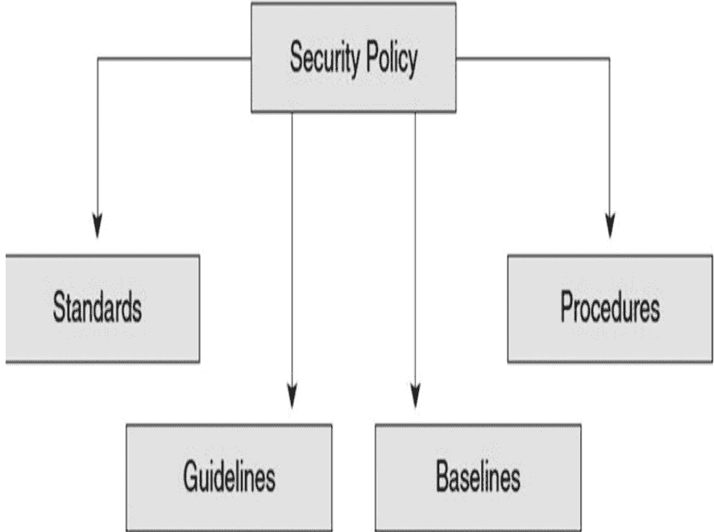

图 3.11

策略结构

政策可以有多种形式。政策可以是咨询性的、信息性的或监管性的。接下来的章节将回顾这些类型的政策，并帮助你理解如何设计政策以满足各种目标。

## 咨询性政策


# 咨询性政策

咨询性政策的作用是确保所有员工了解某些行为和行动的后果。以下是咨询性政策的示例：

- 非法复制：除非获得网络管理员的书面许可，否则员工绝不向任何网络驱动器或磁盘下载或安装任何商业软件、共享软件或免费软件。请准备好为您的行为承担责任，如果违反了《适当使用规则》，可能包括丧失网络权限、书面警告、试用期或终止雇佣。

# 信息性政策

信息性政策的设计并非考虑强制执行；它是为了教育目的而开发的，旨在告知和启发员工。以下是信息性政策的示例：

- 与人力资源部门合作，员工申诉员的工作担任所有员工的倡导者，在员工和管理层之间提供调解。这项工作是帮助调查投诉，并在要求第三方介入时调解公平的解决方案。

## 注意

> 良好的政策能够取得平衡，既具有相关性又易于理解。如果政策太笼统，没有人会关心它说了什么，因为内容不适用于公司。如果政策太复杂，没有人能理解它，许多人可能不会阅读它。

# 监管性政策

监管性政策用于确保组织遵守当地、州和联邦法律。监管政策加强了适用的法律和行政法律，例如 HIPAA、FERPA 和 SOX；它还以员工可以理解的方式解释了特定法律的适用部分。安全专业人员在此类政策中应与人事和法律部门紧密合作。以下是监管性政策的示例：

由于德克萨斯州法律的最新变化，公司现在将保留员工记录10年。

# 标准

标准比政策具体得多。标准是战术性文档，列出了满足需求所需的特定步骤或过程。例如，标准可能会设定一项强制性要求，即所有通信必须加密。虽然标准没有规定具体如何做，但这留给了程序规定。

# 基准

基准是系统、网络或设备必须遵守的安全水平。基准通常映射到行业标准。例如，一个组织可能会指定可信计算机系统评估标准 (TCSEC)。安全策略也可能涉及最低基准。

# 指南

指南指向政策或程序中的陈述，用以确定行动方案。它是对如何行事的建议或提示。指南旨在具有灵活性，以便根据个人情况进行定制。

## 注意

> 不要将指南与最佳实践混淆。指南用于确定建议的行动方案，而最佳实践用于衡量责任。最佳实践说明了合格专业人士在相同或类似情况下会做什么。

# 程序

程序是安全文档中最具体的。程序是一份详细的、深入的、分步骤的文档，详细说明了具体要做什么。打个比方，当我妈妈给妻子发送德国巧克力蛋糕的秘密配方时，它详细说明了需要做什么以及如何做。它甚至指定了对流烤箱，这被列为绝对要求。

程序是与特定技术和设备相关的详细文档。预计程序会随设备而改变。例如，假设您的公司将 Check Point 边界设备（如防火墙、VPN 或 IDS）替换为 Cisco 边界设备。规定设备角色的政策标准可能不会改变，但配置防火墙的程序会改变。

# 控制类型

组织应该拥有多种控制类型的主要原因之一是提供真正的深度防御。每种控制类型提供不同级别的保护，由于每个级别都可以根据组织需求进行调整，安全管理员对安全机制具有非常细粒度的控制。安全机制可以出于许多目的，尽管它们主要是为了防止、检测或从问题中恢复。最好的方法是让组织关注其控制措施大部分集中在预防上，因为这允许组织在问题发生之前将其阻止。

三种访问控制类型——行政控制、技术控制和物理控制将在后续章节中进行介绍。

# 行政控制

行政控制是组织实施的策略和程序。预防性行政控制可以包括安全意识培训、强密码策略、人力资源管理实践以及稳健的入职审查。

## 稳健的人力资源实践的必要性

2006年2月20日，戴夫·埃蒙德（Dave Edmond）辞去了 RadioShack 的首席执行官职位。是什么会导致 CEO 辞职？

埃蒙德先生面临着日益增长的压力，需要解释其教育背景中提到的错误。尽管公司记录显示埃蒙德拥有大学学位，但列出的大学无法确认埃蒙德先生确实获得了学位。RadioShack 淡化了这一事件，声称在 1994 年雇佣埃蒙德时，即使他们被聘为高层管理人员，公司也不会对员工进行教育背景审查。

虽然认为这只是孤立事件很好，但 2012 年5 月，Yahoo! 的 CEO 因简历中的虚假陈述和学位列表而辞职。尽管我们许多人可能认为良好的人力资源实践不是问题，但事实是，它们在确保为特定工作录用合适的人方面起着关键作用([articles.latimes.com/2012/may/14/business/la-fi-yahoo-thompson-resigns-20120514)。

## 注意

> 你的公司是否执行可接受使用政策 (AUPs)？使用 AUP 被认为是震慑不可接受活动的方法之一。

# 技术控制

技术控制是用于保护 IT 基础设施的逻辑控制。技术控制包括强身份验证（如生物识别或双因子身份验证）、加密、网络分段、DMZ 和防病毒控制。

# 物理控制

物理控制是你最可能看到的控制。这些控制用于防止盗窃、丢失和未经授权的访问。物理访问控制的示例包括保安、大门、锁、守卫门、闭路电视 (CCTV) 和报警器。

# 访问控制类别

访问控制可以使用不同的粒度来提供不同级别的控制。访问控制有几大类别（见表 3.10）：

- **震慑 (Deterrent)**：这些控制震慑用户不要违反安全规定。

- **预防 (Preventive)**：这些控制防止事故发生。这种控制的一个示例可能是使用加密。

- **检测 (Detective)**：这些控制在事故发生后发出警报并协助识别。

- **纠正 (Corrective)**：这些控制在事故发生后修复损坏并恢复系统。示例可能是应用补丁。

- **恢复 (Recovery)**：这些控制恢复正常运行。一个示例可能是部署备份。

- **补偿 (Compensating)**：这些控制限制损害或采取行动封锁事件或事故。

## 注意

某些控制可能属于多个一个类别。例如，锁可以是延迟机制，也可以是震慑机制。

## 表 3.10 访问控制类型及示例

| 属性 | 震慑 | 预防 | 检测 | 纠正 | 恢复 | 补偿 |
| :--- | :--- | :--- | :--- | :--- | :--- | :--- |
| 行政 | AUP | 用户注册 | 审计策略 | 重新分配或终止 | 应急响应 | 监督与监控 |
| 技术 | 警告横幅 | ACLs | 防病毒 | 重启或启动 | 热备地 | 冗余服务器 |
| 物理 | 电围栏标志 | 8 英尺高围栏 | 运动探测器 | 灭火器 | 备份恢复 | 防层（防御） |

## 考试警示

务必确保理解用于限制访问的三种控制类型——行政、技术和物理，以及每种类型包含的内容。这是 CISSP 考试的必要知识。控制措施随领域而异。在考试中，请务必仔细阅读每个问题。

# 实施人员安全

组织的人员安全流程应在雇佣员工之前开始。在招聘过程中，需要审查候选员工的背景，以确保为工作录用合适的人。以下是需要包含的一些检查：

- 背景审查
- 证明人检查
- 教育背景核实/证书检查
- 刑事、财务和信用检查
- 驾驶记录或其他类型的验证（取决于具体工作）

在招聘过程中预先执行这些任务可以为公司节省金钱，并帮助防止因为某工作录用错误的人而导致精力和损失。

## 社交网络在背景审查中的作用

互联网改变了背景审查的执行方式。公司不再需要花费数百美元来尝试评估候选人。许多在线工具允许组织搜遍网络，寻找有关个人的公开数据。

雇主现在开始搜索的场所之一是 Facebook、Instagram、Twitter 等流行的社交网络网站。社交网站允许员工看到候选人发布的所有内容，包括生活方式选择、性取向和下班活动。如果雇主发现候选人喜欢跳伞和赛车摩托车，可能会决定不雇佣那个人。即使候选人的社交网站上没有任何客观内容，朋友放置在那里的链接也可能指向令他人反感的内容。也许你的大学室友曾在一张写着“Bong hits Jesus”的海报前。

即使是像 LinkedIn 这样面向业务的网站，也可以用来挖掘背景关联信息。雇主必须谨慎，因为可能有人设置了非真实身份的社交资料。公司还必须确保在姓名相似时不会出错。虽然通常不是默认设置，此类网站的用户应考虑将信息设为私密。

# 入职协议与政策

确保员工了解他们的要求的一种极佳方法是进行入职培训。这是讨论非保密协议 (NDA)、良好安全实践和 AUP 等问题的时机。这种培训的目标是教授既定的安全策略和程序。作为培训的一部分，员工应同意签署 AUP。当每个员工都积极参与安全时，组织将受益。

让员工关注安全的实践包括发放笔、笔记本或其他概述了若干组织安全策略的物品。公司应每半年举行一次审查，以刷新员工对当前策略的知识并更新签名。海报有助于强化安全实践。另一个想法是定期发送安全意识电子邮件或简报，以强化安全实践。

# 职责分离

职责分离描述的是划分职责的过程，使一个人无法单独完成关键任务。这意味着实施双重控制，即需要多个人完成关键任务。这一概念与最小权限原则密切相关，该原则主张只给予人员所需的最小访问级别或权限。例如，某些银行将保险箱密码分配给两个员工，每个员工拥有打开保险箱所需的六个数字中的三个。在没有某种形式的合谋的情况下，一个人无法获取保险箱的内容。

职责分离通常属于四个控制领域：

- 授权：核实现金、批准购买和批准变更
- 托管：接触现金、商品或库存
- 记录保存：准备收据、维护记录和过账付款
- 核对：比较金额、数量、报告和工资单摘要

# 职位轮换

尽管拥有经过跨职培训的员工总是一件好事，但职位轮换不仅仅是为了冗余和控制。它的主要益处是让组织能够维持备份人员，从而更容易地识别欺诈活动。例如，如果 John 正在偷取公司的钱，而 Steve 被轮换到 John 的位置上并发现了这些活动，那么只有在极端情况下，Steve 才会不告诉老板 John 是一个小偷。

# 最小权限原则

最小权限原则是另一个非常重要的概念，它可以从很大程度上帮助组织实现其安全目标。最小权限意味着个人拥有的资源仅足够完成其所需的任务。

例如，假设您的公司刚刚在几个会议室添加了计算机终端。这些终端被放置在会议参与者、顾问和销售代表可以访问产品信息的地方。最小权限规定这些计算机应限制访问互联网，但阻止所有其他 Web 活动。换句话之，网络浏览、电子邮件、文件传输协议（FTP）和 Telnet 等服务是不可用的。这种设计减少了资源滥用的机会。

随着时间的推移，即使是最小权限原则也可能导致权限蔓延，这意味着在工作之间流动的员工会不断获得更多的权限和访问权限。不再需要的权限和访问权限应该被移除。

## 提示

> 最小权限并不是一个严格针对个人的概念。事实上，将其应用于敏感系统、设施和应用程序至关重要。所有应用程序和过程都应该以所需的最小权限运行，以避免在发生攻击破解时导致进一步的利用。例如，Internet 信息服务 (IIS) 曾以系统权限运行，这对于网络服务器来说权限太大了。（此问题在 Windows Server 2003 和 IIS 6.0 之后已得到修正。）

# 强制休假

尽管 Jane 有 10 年没休过假这很棒，但会计师一直在上班这一事实可能是一个问题。Jane 看起来是一个尽职尽业的员工，但她可能没有休假是因为她正在进行欺诈活动。通过留任，她能够为自己的计划提供掩护。当要求员工休假时，欺诈活动将更容易被揭露。强制休假为审计和发现非法活动提供了时间。

# 离职

员工最终因各种原因离开组织。员工可能会自愿离开；离职有时是必要的，但许多调查显示，这是最不受欢迎的任务之一。为了保护组织，经理应该使用标准的离职程序。使用结构化的流程有助于确保每个人都受到平等对待，并确保员工没有破坏或损坏公司财产的机会。纳入此过程的一些审慎步骤包括：

1. 员工离职时立即禁用其计算机和设施访问权限。
2. 监控员工物品。
3. 确保在离职程序开始后，任何时候都不让员工单独。
4. 验证员工返回身份证明和其他公司财产，包括智能手机和笔记本电脑。
5. 送员工离开大楼。

# 安全教育、培训与意识

员工期望雇主提供培训。如果没有适当的培训，员工通常不会意识到自己的行为或活动如何影响组织的安全。安全中最薄弱的环节之一是负责安全的人；因此，防御此类攻击的最有效手段是培训、教育和意识（见图 3.12）。


## 图 3.12 培训、教育与意识的三角模型

你可能会发现你的员工在组织安全方面需要更深入的培训。这可以通过内部培训计划来解决，教授新员工安全技能。意识计划在运行时间较短且频繁变化时效果最好。以下几个步骤可以帮助：

1. 建立目标。
2. 进行需求评估。
3. 寻找满足需求的培训方案。
4. 选择培训方法和模式。
5. 执行培训。
6. 评估。
7. 组织。

培训类型包括：

- 内部培训
- Web 培训
- 课堂培训
- 供应商培训
- 岗前培训
- 学徒计划

## 注意

> 培训和教育不是一个概念。培训是针对个人的，教授特定技能，而教育是更广泛且长期的（例如，学位计划）。

# 安全意识

意识计划可以提高员工对安全的理解。安全意识有助于员工理解他们的行为如何影响组织。安全意识还概述了对员工的要求。意识培训必须针对不同群体进行开发。成功的安全意识计划应针对以下群体：

- 高层管理：他们通常关注大局，想知道成本、收益以及不合规的后果。
- 数据保管员：该群体需要关于如何实施良好安全实践、责任划分的说明。
- 用户：针对该群体的培训必须与其日常任务保持一致。

## 备注

安全意识的目标是增加管理层让员工负责的能力，并改变员工的安全行为。

# 社会工程

社会工程是欺骗他人交出他们应提供的内容的艺术。精通社会工程的人可以使用他们的技能获取不应拥有的信息。随着组织开发更好的物理和技术控制，攻击者总是在寻找访问的最简单路径。这非常有可能是操纵人心。即使拥有最好的防火墙、IDS、网络认证系统或访问控制，仍可能被社会工程师成功攻击。

为了更好地理解社会工程是如何工作的，让我们看看这些攻击使用的不同方法。在《说服的科学与实践》书中，罗伯特·西亚迪尼描述了以下六种产生反应的方法：

- **稀缺性**：这种方法基于某些东西（如时间）供应短缺的信念。这种方法的例子是：“我现在需要这个密码，因为我的工作过期了，老板在等。你能帮我一下吗？”
- **权威**：这种方法基于权力的假设。这种方法的例子是：“你好，是帮助台吗？我为高级总裁工作，他需要重置密码来访问重要信息！”
- **好感**：我们对喜欢的人所做的帮助往往比对不喜欢的人多。这种方法的例子是：“拜托，我们是朋友。你知道我不会滥用你的密码。”
- **一致性**：人们喜欢保持一致。这种方法的例子是某人问了一系列你会回答“是”的问题。你想买辆新车吗？你的车旧了吗？今天想买我们的车吗？
- **社会认同**：这种方法基于一种观点，如果一个人这样做，其他人也会这样做。例如，“既然大家都在别人开门后直接走进去了，我为什么还要签卡进入呢？”
- **互惠**：如果有人给你一个代币或小礼物，你可能会感到必须报答的压力。这种方法的一个例子：“你已经赢得了一份免费礼物。你只需要花几分钟为你目前的安全基础设施回答几个问题。”

请记住，社会工程攻击可以从人与人之间，也可以从计算机发起。了解社会工程师使用的各种技术可以有助于击败他们潜在的骗局。防止社会工程的主要防御是培训和意识培养。关于社会工程更多信息的良好资源是 Kevin D. Mitnick 和 William L. Simon 写的《欺骗术：控制安全中的人为因素》（The Art of Deception: Controlling the Human Element of Security）。

# 职业伦理培训与意识

本节回顾了安全专业人员应该了解的一些伦理标准和准则。伦理是一套行为准则。伦理标准有时与法律标准不同：法律定义了我们必须做什么，而伦理定义了我们应该做什么。请记住，并不是每个人都会始终采取伦理行为。

安全专业人员应该维护高伦理标准，并在他人中促进高伦理标准。安全专业人员促进适当伦理行为的一些方式包括：确保组织拥有计算机伦理准则，确保员工手册中包含伦理问题，推广计算机伦理培训，并帮助制定电子邮件和其他隐私相关主题等问题的伦理政策。安全专业人员应该了解几项伦理标准，以引导产生正确的行为，包括以下内容：

- (ISC)² 伦理准则 (www.isc2.org)
- 计算机伦理十诫 (http://cpsr.org/issues/ethics/cei/)
- RFC 1087，伦理与互联网 (www.ietf.org/rfc/rfc1087.txt)

# (ISC)² 伦理准则

CISSP 候选必须遵守并支持 (ISC)² 伦理准则，该准则规定安全专业人员应该做到：

- 保护社会、公共利益和基础设施
- 以荣誉、诚实、公正、负责和合法的方式行动
- 为委托人提供勤勉专业的服务
- 推进并保护该行业

# Dan Farmer：漏洞评估的伦理

1995年，有人怀疑 Dan Farmer 是否已将灵魂卖给了魔鬼。在与 Wiese Venema 合作期间，Farmer 先生发布了网络分析安全管理员工具（SATAN），这是创建的首个漏洞评估软件。

尽管 Farmer 先生看到了对软件的巨大需求，但他当时的雇主并没有认同这一点，并解雇了他。一些人也不喜欢该软件的名字。为了解决这个问题，Farmer 先生实际上为该工具创建了一个插件，将程序重命名为 SANTA。通过在运行工具之前运行该插件包，所有“Satan”一词的出现处都变成了“Santa”，所有的图像也从图形图像转换成了圣诞老人的图片。

无论名称如何，对该工具的需求是显而易见的。在它发布时，被扫描的网站中，近乎三分之二是不安全的。因此，尽管担心这种工具可能被攻击者用来针对易受攻击的网络，但这种需求是真实存在的。

今天，人们已经创建了许多其他工具来执行网络评估，包括 SAINT、SARA、Nessus 和 Retina。每一个工具的诞生都归功于 SATAN，这是世界上创建的第一个漏洞评估工具。

## 考试提示

你应该阅读完整的 (ISC)² 伦理准则，因为考试可能会包含一两个与该准则相关的问题。你可以在 www.isc2.org 上搜索“Code of Ethics”找到此文档。

# 计算机伦理学院

计算机伦理学院是一个专门关注技术行业伦理的团体。它定义了以下计算机伦理十诫：

1. 不得使用计算机伤害他人。
2. 不得干扰别人的计算机工作。
3. 不得窥探他人的计算机文件。
4. 不得使用计算机偷窃。
5. 不得使用计算机作伪证。
6. 不得复制或使用未付费的专有软件。
7. 未经授权或未获得适当报酬不得使用他人的计算机资源。
8. 不得盗用他人的知识成果。


9. 思考你所编写的程序或设计的系统的社会后果。

10. 始终以确保对人类同考虑和尊重的方式使用计算机。

## 考试提示

对于 CISSP 考试，你应该阅读计算机伦理十诫，并能够将这些规则与 (ISC)² 伦理准则区分开。

## 互联网架构委员会

互联网架构委员会（IAB）是互联网协会（ISOC）的咨询机构。图 3.13 显示了 ISOC 的布局。互联网工程指导小组（IESG）负责 IETF 活动的技术管理和整个互联网标准流程。IAB 负责互联网标准流程，并担任意见请求（RFC）的编辑。由互联网工程任务组（IETF）授权的工作组为互联网开发新的标准和协议。

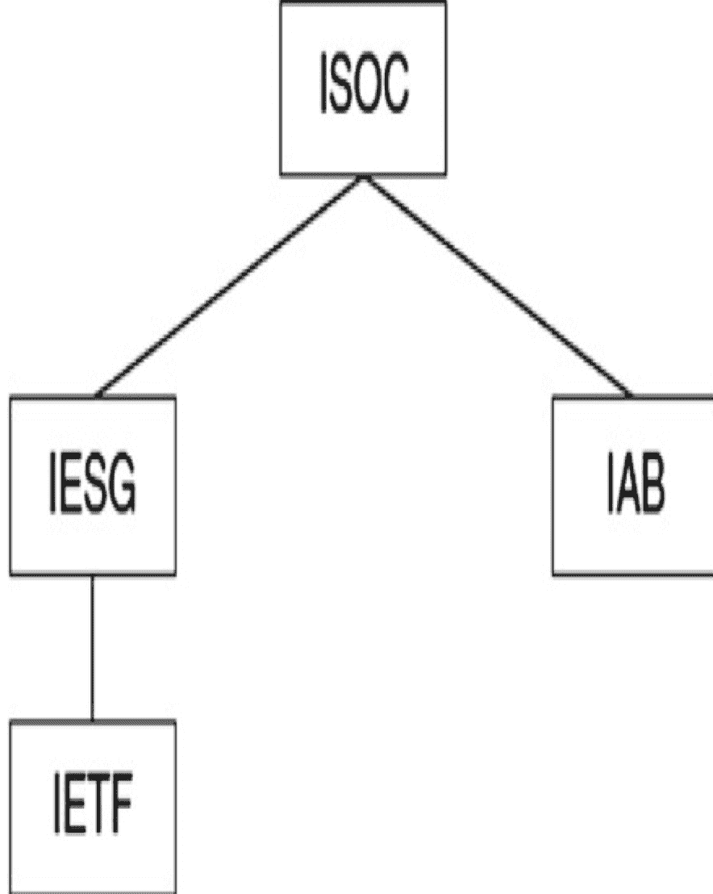

图 3.13 ISOC 与 IAB

RFC 是一篇描述协议运行、应用程序或互联网连接系统设计的工程论文。IAB 还负责监督 IETF 活动。IAB 于 1987 年 1 月发布的 RFC 1087 目标是刻画（characterize）不伦理和不可接受的行为。它规定以下活动是不伦理的：

- 试图获取互联网的未经授权访问
- 破坏互联网的预期用途
- 通过此类行为浪费资源（包括人员、容量和计算机资源）
- 破坏基于计算机信息的完整性
- 损害用户隐私

**考试提示** 在尝试 CISSP 考试之前，打印并审查 RFC 1087。你可以在 `faqs.org/rfcs/1087.html` 获取它。

## NIST SP 800-14

虽然现在已废弃，但 NIST SP 800-14《通用接受的系统安全原则》是定义使用电子系统的组织责任另一个早期尝试。NIST 144 提出了几个重要要点，包括：

- 安全支持组织的使命。
- 安全是健全管理的不可组成部分。
- 安全应该具有成本效益。
- 系统所有者在其组织之外也负有安全责任。
- 应当明确安全责任和问责制。
- 安全需要全面的综合方法。
- 应定期重新评估安全。
- 安全受社会因素限制。

## 常见的伦理谬误

大多数黑客都声称拥有伦理标准，许多人认为他们的行为在伦理上没有问题。在采访时，许多黑客声称他们有自己的伦理标准。用来证明其非法行为合理的理由包括这些常见的伦理谬误：

- 计算机游戏：如果他们不保护，攻击就是公平的。
- 守法公民：这不是实物盗窃，所以是不合法的。
- 防碎品：如果我没有损坏或者可以修复，有什么问题呢？
- 从婴儿手中拿糖果：如果这很容易，怎么可能是错的呢？
- 黑客：如果我能从中学习，将对社会和我有利。
- 免费信息：所有信息应该是免费的。

虽然编写计算机病毒是合法的，但根据 CFA，出于目的传播病毒是非法的。例如，Robert T. Morris 并不是因为编写第一个互联网蠕虫而被指控；他是因出于目的使用代码而被控和起诉。

## 伦理计划的监管要求

如前所述，不同的人看待伦理的方式不同。因此，某些国家有了监管要求来解决伦理以及适当的行为态度。在美国，联邦组织量刑指南（FSGO）概述了伦理要求，并根据组织的伦理计划和文化施加不同的处罚。

以下是几个与伦理相关的监管要求的示例：

- **《反海外腐败法》(FCPA)：** 该法案规定，如果上市公司未能对其信息系统和数据维持适当的控制，将面临民事和刑事处罚。FCPA 要求这些公司建立适当的内部会计控制系统。
- **《萨班斯-奥克斯利法案》(SOX)：** 这项美国财务和会计披露立法对伦理有要求。《萨班斯-奥克斯利法案》第 406 节概述了高级财务人员的伦理准则要求。
- **兰德韦委员会赞助组织 (COSO)：** 这是一个审计师和其他人员使用的内部控制框架，包含了预期的行为和伦理标准。

## 注意

> 尽管在 CISSP 考试中，涉及特定国家法律的问题并不常见，但充分了解你的组织开展业务的适用法律仍然很重要。

## 提示

> 提到黑客时，除了考虑伦理之外，考虑动机也很重要。黑客的动机有许多不同之处，从金钱到寻求乐趣不等。有些黑客声称他们是为了某种目标而活动。为了目标的黑客行为被称为*黑客主义 (hacktivism)*。例如，2020 年，被称为“匿名”的黑客组织对 BlueLeaks 泄露事件负责，导致 250 GB 的警方部门文件暴露。

# 考试备习题

1. 所讨论的标准包含以下陈述的是？
   “系统所有者在组织之外的安全责任。”
   - A. 伦理与互联网
   - B. RFC 1087
   - C. (ISC)² 伦理守则
   - D. NIST 800-14

2. 以下哪种风险处理方法涉及使用第三方来吸收部分风险？
   - A. 风险降低
   - B. 风险转移
   - C. 风险接受
   - D. 风险拒绝

3. 你被要求计算以下变量的年度损失预期 (ALE)：
   单次损失预期 = $25
   暴露因子 = 0.90
   年度发生率 = 0.40
   剩余风险 = $30
   以下哪项是得出的 ALE？
   - A. $9.00
   - B. $22.50
   - C. $10.00
   - D. $14.27

4. 以下哪种顺序是恰的？
   - A. 确定 ALE、剩余风险、SLE 和 ARO
   - B. 确定 ALE、ARO、SLE 和剩余风险
   - C. 确定 ARO、SLE、ALE 和剩余风险
   - D. 确定 SLE、ARO、ALE 和剩余风险

5. 以下哪项是剩余风险的公式？
   - A. （威胁 × 漏洞 × 资产价值）× 控制缺口 = 剩余风险
   - B. （威胁 × 漏洞 × 资产价值）= 剩余风险
   - C. （威胁 / 漏洞 × 资产价值）× 控制 = 剩余风险
   - D. （风险 × 漏洞 × 资产价值）× 控制缺口 = 剩余风险

6. 以下哪项是美国和欧盟版权的保护年限？
   - A. 寿命加 20 年
   - B. 寿命加 30 年
   - C. 寿命加 70 年
   - D. 寿命加 100 年

7. 以下哪个公式代表总风险？
   - A. 风险 × 漏洞 × 资产价值 = 总风险
   - B. 威胁 × 漏洞 × 资产价值 = 总风险
   - C. 风险 × 价值 / 对抗措施 = 总风险
   - D. 威胁 – 漏洞 / 资产价值 = 总风险

8. 以下哪项是缺陷、漏洞、疏忽或错误，使组织容易受到攻击或损害？
   - A. 风险
   - B. 漏洞
   - C. 威胁
   - D. 漏洞利用

9. 以下哪项是安全文档中最通用的？
   - A. 流程
   - B. 标准
   - C. 策略
   - D. 基线

10. 以下哪个小组负责开发如 RFC 1087 等新标准和协议？
    - A. IESG
    - B. ISOC
    - C. IAB
    - D. IETF

11. 哪种组织角色负责分配敏感性标签？
    - A. 管理层
    - B. 审计员
    - C. 用户
    - D. 所有者

12. 当对抗措施的成本超过资产价值时，以下哪种方法是最佳的？
    - A. 不采取行动
    - B. 转移风险
    - C. 缓解风险
    - D. 增加暴露成本

13. 哪个 ISO 文档被信息安全管理的标准？
    - A. ISO 27001
    - B. ISO 27002
    - C. ISO 27004
    - D. ISO 27799

14. TCO 不包括以下哪项？
    - A. 软件更新
    - B. 订阅费用
    - C. 维护成本
    - D. 实施成本

15. 理解你的组织开展业务的适用法律很重要。这是哪种法律体系？
    - A. 民法系
    - B. 习惯法系
    - C. 规制法
    - D. 习惯法

16. 以下哪项描述了评估过程？
    - A. BIA（业务影响分析）
    - B. 量化评估
    - C. 管理层
    - D. 风险评估

17. 以下哪项描述了管理层的角色？
    - A. BIA
    - B. 风险评估
    - C. 规制法
    - D. 合规性

18. 以下哪项是识别产品的符号？
    - A. 商业秘密
    - B. 版权
    - C. 专利
    - D. 商标

19. 以下哪项是应该采取的最重要步骤之一？
    - A. BIA
    - B. 量化评估
    - C. 获取管理层的支持
    - D. 风险评估

20. 以下哪项应该是首要任务？
    - A. 减少停机时间
    - B. 减轻损害
    - C. 记录每一个威胁
    - D. 保護安全

# 考试备习题答案

10. D. 互联网新标准和协议的开发是由 IETF 授权的工作组进行的。答案 A、B 和 C 均错误。

11. D. 数据分类应由所有者执行。当识别出数据项或对象时，所有者负责分配安全标签。如果使用军事数据分级系统，标签可能是绝机密（top secret）、机密（secret）、敏感（sensitive）或未分类（unclassified）。审计人员、管理人员或用户不负责为数据分配标签。

12. A. 当应对措施的成本超过资产的价值时，最佳方法是不采取行动，因为保护该资产的成本将高于其本身的价值。答案 B、C 和 D 都是错误的，因为转移风险会导致价值损失。在这种情况下，没有理由减轻风险，因为成本将高得不可企——而且这违背了安全实践原则。

13. C. ISO 27004 是安全管理标准。ISO 27001 侧重于要求。ISO 27002 是为 BS 7799 开发的，而 ISO 27799 侧重于健康。

14. D. TCO（总拥有成本）包含了所有成本，包括软件、更新和维护成本。唯一不包含的是未实施控制措施的成本。

15. A. 欧洲大部分地区基于民法（成文法），也被称为拿破仑法。罗马人使用了《民法大全》（Corpus Juris Civilis），其特点是一套全面的成文法律规则体系，并作为当今民法的基础。答案 B、C 和 D 都是错误的，因为民法和普通法的主要区别在于民法将立法作为主要的法律来源。宗教法基于宗教教义。中国和一些非洲国家使用习惯法，习惯法可能与其他法律体系结合，并基于对习俗和正常行为的概念。CISSP 候选人理解世界范围内使用的各种法律体系之间的差异至关重要。

16. B. 最佳答案是 B。如果高层管理不参与并充分支持灾难恢复计划（DRP），那么 DRP 可能会失败。答案 A 不是最佳答案，因为它描述了预算经理或预算部门的角色。答案 C 不是最佳答案，因为它描述了项目经理的角色。答案 D 不是最佳答案，因为它描述了主题专家的角色。

17. A. BIA（业务影响分析）是一个帮助业务部门理解中断性事件影响的过程。该过程的一部分是确定公司遭受永久损害之前的最大停机时间。其他答案是业务连续性计划（BCP）过程的一部分，但不是 BIA 的特定部分，因此答案 B、C 和 D 是错误的。

18. D. 商标是一种符号、单词、名称、声音或物品，用于识别特定贸易中产品或服务的来源。答案 A、B 和 C 都是错误的，因为它们没有正确描述商标。

19. 在开始 BCP/DRP 流程之前，你必须获得高层管理的认可。答案 A、B 和 D 都是重要的，但开发团队的活动发生在管理认可之后，而风险评估是在 BIA 期间进行的。

20. D. 保护人员安全始终是安全人员的首要任务。答案 A、B 和 C 都是错误的。最小化停机时间很重要，但不是首位。防止损害很重要，但保护人员安全更重要。

## 了解更多？

- 保持入职检查合规：`www.eeoc.gov/laws/guidance/background-checks-what-employers-need-know`
- 供应链风险管理规划：`riskpulse.com/blog/supply-chain-risk-management-plan-what-you-need-to-include/`
- 安全配置指南：`https://apps.nsa.gov/iaarchive/library/ia-guidance/security-configuration/`
- 站点安全：`www.faqs.org/rfcs/rfc2196.html`
- 雇佣实践的自审计：`library.findlaw.com/2000/Aug/1/127767.html`
- 业务连续性最佳实践：`www.eci.com/blog/472-a-best-practices-guide-to-business-continuity-planning.html`
- 构建有效的策略：`csrc.nist.gov/nissc/1997/panels/isptg/pescatore/html/`
- 策略模板和信息：`www.sans.org/security-resources/policies/`
- 世界法律体系：`www.hmtlaw.com/international-business/legal-systems-of-the-world/`
- 威胁建模方法论：`blog.eccouncil.org/threat-modeling-methodologies-tools-and-processes/`

## 第 4 章 安全架构与工程

你需要理解的术语：

- 缓冲区溢出
- 安全模型
- 保护环
- 公钥基础设施 (PKI)
- 数字签名
- 通用标准 (Common Criteria)
- 参考监视 (Reference monitor)
- 可信计算基础 (TCB)
- 开放与封闭系统
- 辐射 (Emanations)
- 加密

你需要掌握的主题：

- 如何根据系统安全需求选择控制
- 使用 Bell-LaPadula 等机密性模型
- 如何识别如 Biba 和 Clark-Clarkson 等完整性模型
- 与安全架构设计相关的缺陷和安全问题
- 密码学以及如何用于保护敏感信息

## 引言

CISSP 考试的“安全架构与工程”领域涉及硬件、软件、安全控制和文档。在设计硬件时，需要按照特定的标准进行构建，以提供数据的机密性、完整性和可用性。构建安全的硬件操作系统只是开始。要通过 CISSP 考试，你需要理解硬件和软件模型以及物理和逻辑控制的使用。本章介绍了密码学（对称和非对称）、哈希和数字签名，这些也是潜在的考点。

## 安全设计指南与治理原则

从架构构建开始就引入安全性，比后期添加要便宜得多。这种主动方法的一部分包括评估，以确定敏感资产是否需要额外的安全级别。图 4.1 展示了深度防御的设计过程。


## 密码标准

（应当防御）密码分析

图 4.1 安全架构的深度防御设计过程

有两种安全控制：

- 物理安全控制：用于限制工作区域、媒体安全、限制服务器室访问以及维护数据存储和访问。
- 逻辑安全控制：可以通过加密控制部署。

可以使用多种加密控制。选择合适的类型需要确定特定特性，例如算法类型、密钥长度和应用。

公钥基础设施 (PKI) 是在两个不同实体之间建立第三方信任的行业标准框架。密钥管理是 PKI 的关键部分，包括密钥的生成、分发、存储、验证和销毁，这些都是密钥管理的关键组成部分。

记住，所有系统都可能受到攻击，因此选择足够强大的加密系统至关重要。加密密钥可能会被破解。破解可能是由于算法薄弱或密钥脆弱。存在多种密码分析方法可以破解密钥。

注意

静态数据可以使用可信平台模块（TPM）芯片进行保护，TPM 是一种加密硬件处理器，可提供比软件加密更高级别的安全保护。安装在客户端计算机主板上的 TPM 芯片也可用于系统状态认证。TPM 芯片还可以用于存储加密密钥。

TPM 芯片在 ISO 11889-1:2009 中有所定义，并与其他形式的数据和系统保护措施结合使用，提供所谓的“深度防御”的分层方法。

框架被用于对信息系统或业务进行分类，并指导适用哪些控制措施或标准。这些框架通常与治理挂钩，治理应关注服务的可用性、信息的完整性以及数据机密性的保护。

一个早期框架是 Saltzer 和 Schroeder 提出的关于有效安全的原则，标题为《计算机系统的信息保护》。这篇发表于 1975 年的论文今天看来可能有些过时，但它仍然具有相关性，并且经常出现在大学课程中。在这篇论文中，Saltzer 和 Schroeder 定义了一个基于八个架构原则的安全系统设计框架：

- 完全中介（Complete mediation）
- 机制经济性（Economy of mechanism）
- 故障安全（Fail-safe defaults）
- 最小权限（Least privilege）
- 最小共同机制（Least common mechanism）
- 开放设计（Open design）
- 心理可接受（Psychological acceptability）
- 权限分离（Separation of privilege）

另一种方法是 ISO/IEC 19249《安全技术——安全产品、系统和应用的架构与设计原则目录》，它将设计原则分为两组，每组包含五项：

* 架构原则：
  - 域隔离
  - 分层
  - 封装
  - 冗余
  - 虚拟化

* 设计原则：
  - 最小权限
  - 攻击面最小化
  - 集中参数验证
  - 集中式通用安全服务
  - 错误和异常处理的准备

另一个治理框架是 IT 基础库（ITIL）。ITIL 规定了一系列流程、程序和任务，这些流程任务可以与组织的战略相结合，以交付价值并维持最低的胜任能力。ITIL 可用于创建一个基准，组织可以据此规划、实施和衡量其治理进展。ITIL 呈现了一个包含以下组件的服务生命周期：

- 持续服务改进
- 服务策略
- 服务设计
- 服务转换
- 服务运营

# 企业架构

通过实施企业架构（EA）可以增强安全和治理。企业架构是信息技术领域的一项实践，通过组织和记录公司的 IT 资产来增强规划、管理和扩展。使用 EA 的主要目的是确保业务战略与 IT 投资保持一致。EA 的优势在于它提供了一种追溯性手段，这种追溯性从业务战略的最高层延伸到基础技术。

一个早期的 EA 模型是柴曼框架（Zachman Framework），它的设计允许公司针对其关注的信息系统，根据“谁、什么、何地、何时、为什么、如何”来构建策略文档（见图 4.2）。

| | 为什么 | 什么 | 谁 | 何地 | 何时 | 如何 (注) |


# 柴曼模型

| 上文层 | 目标列表 | 过程列表 | 材质列表 | 组织单元和角色列表 | 地理位置列表 | 事件列表 |
| :--- | :--- | :--- | :--- | :--- | :--- | :--- |
| 概念层 | 目标关系 | 过程模型 | 实体关系模型 | 组织单元和角色关系模型 | 位置模型 | 事件模型 |
| 逻辑层 | 规则图 | 过程图 | 数据模型图 | 角色关系图 | 位置图 | 事件图 |
| 物理层 | 规则规范 | 过程函数推测 | 数据实体规范 | 角色规范 | 位置规范 | 事件规范 |
| 详细层 | 规则细节 | 过程细节 | 数据细节 | 角色细节 | 位置细节 | 事件细节 |

图 4.2 柴曼模型

联邦法要求每个政府机构都要建立自己的 EA 和治理结构。这一过程由联邦企业架构（FEA）框架指导，该框架旨在使用五种模型：

- **性能参考模型**：用于衡量主要 IT 投资性能的框架
- **业务参考模型**：用于为日常业务运营提供组织化的、分层模型的框架
- **服务组件参考模型**：用于根据服务组件如何支持业务或性能目标进行分类的框架
- **技术参考模型**：用于分类支持并实现服务组件及能力交付的标准、规范和技术的框架
- **数据参考模型**：用于提供描述、分类和共享数据的标准手段的框架

柴曼框架的一个独立设计但后来集成的子集是谢伍德业务安全架构（SABSA）。与柴曼框架一样，SABSA 模型和方法是为风险驱动的企业信息安全架构开发的。它询问什么、为什么、如何和何地。有关 SABSA 模型的更多信息，请参见 `www.sabsa-institute.org`。

ISO 27000 系列是治理标准家族的一部分，其起源可以追溯到 BS 7799。组织可以通过认证测试机构验证其合规性获得 ISO 27000 认证。部分核心标准包括：

- **ISO 27001**：此文档描述了建立、实施、运行、监控、评审和维护信息安全管理体系（ISMS）的要求。它遵循“计划-检查-处置”（Plan-Check-Act）模型。
- **ISO 27002**：该文档始于 BS 7799 标准，后作为 ISO 17799 标准重新发布，描述了在组织内部开发安全计划的方法。
- **ISO 27003**：此文档专注于实施。
- **ISO 27004**：此文档描述了信息安全计划的有效性。
- **ISO 27005**：此文档描述了信息安全的实践规范。

真正的安全是一个分层过程，需要的不仅仅是治理。后续章节中讨论的项目可用于构建安全组织。

# 监管合规与过程控制

安全专业人员关注的领域之一是敏感信息的保护。提供这种保护的一种尝试是支付卡行业标准（PCI）。这一跨国标准强制对持卡人账户执行策略、安全设备、控制措施和网络监控。参与的供应商包括美国运通、万事达、Visa 和 Discover。

虽然 PCI 用于保护财务数据，但信息和相关技术控制目标（COBIT）是为了满足业务和 IT 流程的要求而。它是全球审计师的标准，由信息系统审计和控制协会（ISACA）开发。COBIT 分四个领域：

- 规划与组织
- 获取与实施
- 交付与支持
- 监控

# 安全模型的基本概念

现代计算机系统可以分为四组或四层：

- 硬件
- 内核和设备驱动
- 操作系统
- 应用程序

硬件与操作系统和应用程序软件交互以完成我们需要的任务。每个计算机系统的核心是中央处理器（CPU）以及使其运行的硬件。接下来的章节将检查系统的各个部分，从系统的核心开始。

# 中央处理器

CPU 是计算机系统的核心，也是计算机的大脑。CPU 由以下部分组成：

- 算术逻辑单元（ALU）：执行算术和逻辑运算。它是 CPU 的大脑。
- 控制单元：管理内存中的指令。它解码并执行请求的指令，并确定处理的优先级。
- 内存：用于存储要处理的指令和数据。CPU 内存不是普通内存，比非 CPU 内存快得多。

CPU 能够执行一系列基本操作，包括取指、解码、执行和写操作。流水线将多个步骤合并为一个过程。CPU 具有获取指令并进行处理的能力。CPU 可以在四种状态之一运行：

- 监视状态：程序可以访问整个系统。
- 问题状态：只有非特权指令可以执行。
- 准备绪状态：程序正在等待事件完成。
- 等待状态：程序正在等待事件完成。

由于 CPU 具有非常特定的设计，操作系统以及应用程序都必须设计为与 CPU 协同工作。CPU 还具有不同类型的寄存器来存储数据和指令。基寄存器（base register）包含分配给进程的起始地址，而极限地址（limit address）标记内存段的结束位置。这些组件共同负责程序的取回和执行。

CPU 取得了巨大的进步，如表 4.1 所示。随着晶体管尺寸的缩小，位于 CPU 上的晶体管数量以及时钟频率呈指数级增长。今天，一个 3.06 GHz 的 Intel Core i7 每秒可以执行约 1800 万次指令 (MIPS)。

## 表 4.1 CPU 进展

| CPU | 年份 | 晶体管数量 | 时钟频率 |
| --- | --- | --- | --- |
| 8080 | 1974 | 6,000 | 2 MHz |
| 80386 | 1986 | 275,000 | 12.5 MHz |
| Pentium | 1993 | 3,100,000 | 60 MHz |
| Intel Core 2 | 2006 | 291,000,000 | 2.66 GHz |
| Intel Core i7 | 2009 | 731,000,000 | 4.00 GHz |
| Intel Core M | 2014 | 1,300,000,000 | 2.6 GHz |

注意

> 处理器速度以 MIPS（每秒百万次指令）测量。该标准用于指示 CPU 的工作快慢。

现代计算机系统制造了两种基础的 CPU 设计：

- **精简指令集计算机 (RISC)：** 使用需要较少时钟周期的简单指令。
- **复杂指令集计算机 (CISC)：** 对单条指令执行多次操作。

CPU 需要两个输入来完成其任务：指令和数据。数据传递给 CPU 进行处理，通常在问题状态或监视状态下处理。在问题状态下，CPU 使用非特权指令处理数据。在监视状态下，CPU 执行特权指令。

## 考试提示

超标量处理器是可以同时执行多条指令的处理器；而标量处理器每次只能执行一条指令。在参加 CISSP 考试时，你需要了解这种区别。

CPU 根据其功能可分为几类中的一种。当计算机的 CPU、主板和操作系统都支持该功能时，计算机系统还根据以下标准分类：

- 多程序：可以在任何时间交替执行两个或多个程序。
- 多任务：可以同时在某时刻执行一个或多个任务或子任务。
- 多处理器：支持一个或多个 CPU。

多处理器系统可以以对称或非对称模式工作。在对称模式下，所有处理器都是平等的，可以与所有设备平等处理任何任务（外设访问权限相等），或者不需要为资源专用路径。在非对称模式下，一个 CPU 负责调度和其他协调进程与其他资源之间的任务。

CPU 处理的数据通常是应用程序或程序的一部分。这些程序使用进程 ID (PID) 进行跟踪。任何在 Windows 中查看过任务管理器或在 Linux 机器上执行过 `ps` 命令的人可能都见过 PID 编号。你可以操作这些任务的优先级，还可以启动和停止它们。幸运的是，大多数程序的功能比第一段可能只是“Hello World”的 C 代码多得多。程序中的每行代码或每个功能单元被称为线程。

能够同时执行多个线程的程序被称为多线程程序（见图 4.3）。

| 线程 A | 基寄存器 |
| --- | --- |
| 线程 B | 进程 1 |
| 线程 C | 极限寄存器 (0x 379,193) |

图 4.3 进程与线程

进程活动使用进程隔离来分离进程。使用了四种进程隔离技术来确保每个应用程序获得足够的进程空间以正常运行：

- **进程或对象的封装：** 其他进程不与应用程序交互。
- **虚拟映射：** 应用程序的编写方式使其认为是唯一运行的应用程序。
- **时间复用：** 这允许应用程序或进程共享计算机资源。
- **命名区分：** 为进程分配它们各自唯一的名称。

## 考试提示

要直观了解命名区分，请从 Linux 系统的终端运行 `ps -aux` 并注意唯一的 PID 值。

中断是计算机系统的另一个关键部分。它是设备与 CPU 之间的电气连接。设备可以在此连接上发送电信号，以获取 CPU 的注意。以下是常见的中断方法：

- **程序化 I/O：** 用于在 CPU 和外围设备之间传输数据。
- **中断驱动型 I/O：** 一种更高效的输入输出方法，需要复杂的硬件。
- **使用 DMA 的 I/O：** 基于直接访问的 I/O，可以跳过处理器。
- **内存映射 I/O：** 为 I/O 预留空间的方法。
- **端口映射 I/O：** 使用特殊类指令访问内存的方法。

## 考试提示

中断可以是可屏蔽的或不可屏蔽的。可屏蔽中断可以被系统忽略，而不可屏蔽中断则不能。不可屏蔽中断的一个例子是按下 `Ctrl+Alt+Delete`。

内存存在自然的层次，因此必须有一种方法来管理内存并确保其不受损坏。多任务操作系统内存管理系统的工作是：

- 重定位：系统根据需要从辅助存储器复制内存内容。
- 保护：系统对内存段提供控制，并限制哪些进程写入内存。
- 共享：系统根据用户安全级别允许共享。例如，Mike 可以读取某个对象，而 Shawn 可以读取并写入它。
- 逻辑组织：系统为动态库提供共享。
- 物理组织：系统为内存的物理组织提供支持。

## 存储介质

计算机不仅仅是 CPU；内存也是重要的部分。CPU 使用内存存储指令和数据。因此，内存是重要的存储介质类型。CPU 是唯一可以直接访问内存的组件。

CPU 使用不同的寻址方案与内存通信，包括绝对地址和相对地址。此外，内存可以通过物理或逻辑方式进行寻址。物理地址是指分配给内存的编码地址。应用程序和编写代码程序使用逻辑地址。相对地址涉及使用已知地址加上偏移量。

内存不仅可以用不同方式寻址，而且还有不同类型的内存。内存是非易失性和易失性的。后续章节提供了这两种类型的示例。

提示

> 与存储相关的两个重要安全概念是保护内存和内存寻址。对于 CSP 考试，你应该理解保护内存防止其他程序或进程访问或修改分配给另一个活动程序的地址空间的内容。内存可以通过物理或逻辑方式进行寻址。内存寻址描述了 CPU 访问内容的方法。这对于理解缓冲区溢出攻击的根源特别重要。

# RAM

随机存储器 (RAM) 是易失性内存。如果丢失电源，RAM 中的数据就会被毁。RAM 的类型包括使用电路锁存器表示二进制数据的静态 RAM，以及必须刷新的动态 RAM，每隔几秒刷新一次。随机存储器（RAM）可以配置为动态随机访问存储（DRAM）或静态随机访问存储（SRAM）。SRAM 不需要像 DRAM 那样的刷新信号。SRAM 芯片更复杂、速度更快，因此价格更高。DRAM 的访问时间约为 60 纳秒（ns）或更长；SRAM 的访问速度快达 10 纳秒。SRAM 通常用于缓存内存。

DRAM 芯片可以在线制造。动态指的是内存芯片需要持续的更新信号（也称为刷新信号）来保留当前写入的信息。目前，有五种流行的 SDRAM 实现方式：

- **同步动态随机访问存储 (SDRAM)：** SDRAM 与数据传输器共享一个时钟信号。计算机系统总线提供所有 SDRAM 组件在执行每一步时都使用的公共信号。
- **双倍数据传输 (DDR)：** 与普通 SDRAM 相比，DDR 支持双倍的数据传输率。
- **DDR2：** DDR 将每个时钟脉冲分为两部分，使其能够执行的操作次数翻倍。
- **DDR3：** DDR3 是一种 DRAM 接口规范，提供以两倍速率传输数据（其内部内存数组速度的八倍）的能力，实现了更高的带宽或峰值数据速率。
- **DDR4：** DDR4 速度比 DDR2 或 DDR3 更，是 DRAM 的最新变体之一。它不兼容任何早期类型的 RAM。

## 考试提醒 (ExamAlert)

当程序或进程使用 RAM 但无法释放时，就会发生内存泄漏。遭受内存泄漏的程序最终会耗尽可用内存，并导致系统停止或崩溃。

# ROM

只读存储器（ROM）是非易失性内存，即使断电后也能保留信息。ROM 通常用于加载和存储固件。固件是嵌入软件，类似于 BIOS 或 UEFI。

# 提示 (Tip)

> 大多数现代计算机系统使用统一扩展固件接口 (UEFI) 而不是 BIOS。与 BIOS 相比，UEFI 具有许多优势，包括支持远程诊断。

常见的 ROM 类型包括：

- 可擦除可编程只读存储器 (EPROM)
- 电学擦除可编程只读存储器 (EEPROM)
- 闪存
- 可编程逻辑设备 (PLDs)

# 二级存储

内存在存储世界中扮演着重要角色，但还需要其他类型的长期存储。其中之一是顺序存储。磁带驱动器是顺序存储的一种，必须从头到尾顺序读取。

另一种广名的二级存储类型是直接访问存储。直接访问存储设备不需要顺序读取；系统可以识别信息的位置并直接跳转到该位置读取数据。硬盘是直接访问存储设备的示例：硬盘包含了一系列盘片、读/写头、电机和驱动器电子设备，这些都包含在一个旨在防止污染的机壳内。硬盘用于存放数据和软件。软件是您安装在计算机系统上的操作系统或应用程序。

光盘（CDs）是一种光电介质。它们使用激光/光电传感器组合来读取或写入数据。CD 可以是只读的、一次写入的或可重写的。单张光盘最多可存储约 800 MB 的数据。CD 是在主要是硬透明塑料的表面涂一层薄薄铝层制造的。在制造或刻录 CD/R 时，会在盘片表面放置小的凸起或凹槽。这些凸起或凹槽被转换为二进制 1 或 0。与具有磁道和扇区的软盘不同，CD 由一条长螺旋道组成，该轨道从盘片内部开始向外边缘延伸。

数字视频光盘（DVDs）与 CD 非常相似，因为它们都是光介质：DVD 存储的数据更多。当前的光学存储版本是蓝光光盘。这些光盘可以存储 50 GB 或更多的数据。

如今，越来越多的系统正转向固态硬盘（SSDs）和闪存存储。高达 2 TB 的容量现在已很常见。

# I/O 总线标准

CPU 处理的数据必须有一种方式从存储介质移动到 CPU。这是通过总线实现的。总线是由传输导体组成的线路，在 CPU、存储介质和其他硬件设备之间传输数据。你需要了解两种：

- **北桥 (Northbridge)：** 连接 CPU、RAM 和视频的北桥。
- **南桥 (Southbridge)：** 连接 I/O 的南桥。

从角度来看，各种架构包括：

- **工业标准架构 (ISA)：** ISA 起于……
- **外围组件连接 (PCI)：** PCI 由……开发。
- **PCI Express (PCIe)：** PCIe 现在是……
- **串行 ATA (SATA)：** SATA 是目前的……
- **小型计算机系统接口 (SCSI)：** SCSI 用于……
- **通用串行总线 (USB)：** USB 已获得市场份额。

# 虚拟内存与虚拟机

现代计算机系统已经开发了特定的存储和访问方式。其中之一是虚拟内存，它是主内存（RAM）和二级存储（硬盘）的结合。当这些技术结合时，操作系统可以让 CPU 认为它拥有比实际多得多的内存。虚拟内存的示例包括：

- 分页文件
- 交换空间
- 交换分区

数据可以存储在云端，用户可以从任何具有连接的地方访问这些内容。云计算的潜在劣势是安全可能成为一个问题。考虑谁拥有云是非常重要的。它是私有云（公司所有）还是公有云（他人所有）？此外，云的物理位置在哪里，谁有权访问云，它是否是共享的（共租户）？在将任何公司资产放入云端之前，考虑这些每一个因素都是至关重要的。

# 计算机配置

以下是一些最常用的计算机和设备配置：

- **打印服务器：** 打印服务器通常位于打印机附近，允许许多用户访问同一台打印机并共享其资源。
- **文件服务器：** 文件服务器允许用户拥有一个集中站点来存储文件。文件服务器提供了一种方便的备份方法，因为可以在一台服务器上进行，而不是在所有客户端计算机上进行。它还允许小组协作和多用户访问。
- **应用服务器：** 应用程序服务器允许用户运行未安装在终端系统上的应用程序。这在瘦客户端环境中是一个非常流行的概念，该环境依赖中央服务器的处理能力。许可许可是应用程序服务器的一个重要考虑因素。
- **Web 服务器：** Web 服务器通过 Web 页面向内部和外部用户提供 Web 服务。一个示例 Web 地址或 URL（统一资源定位符）是 `www.thesolutionfirm.com`。
- **数据库服务器：** 数据库服务器存储和访问数据，包括产品库存、客户列表和员工数据等信息。由于数据库持有敏感信息，因此它们需要设计良好的安全控制。数据库服务器通常位于数据库之前并进行请求请求，充当受信任用户与持有数据的数据库之间的中间件。
- **笔记本电脑和平板电脑：** 这些是极易丢失或被盗窃的移动设备。移动设备已变得非常强大，必须采取妥善的安全措施。
- **智能手机：** 今天的智能手机是具有大量处理能力的手持计算机。它们可以拍照并提供板载存储、互联网连接以及运行应用程序的能力。随着越来越多的公司开始支持自带设备 (BYOD) 策略，这些设备引起了特别关注。此类设备很容易超出公司策略和控制的范围。
- **工业控制系统 (ICS)：** ICS 通常用于工业过程控制，例如工厂车间上的制造系统。ICS 可用于操作和/或自动化工业过程。ICS 有几类，包括监控控制与数据采集 (SCADA) 系统、分布式控制系统 (DCS) 和现场设备。
- **嵌入式设备 / 物联网 (IoT)：** 嵌入式设备包括 ATM 机、销售点 (POS) 终端和智能手表。更多设备包含了嵌入式技术，例如智能冰箱和支持蓝牙的马桶。嵌入式设备的安全性是一个日益关注的问题，因为这些设备可能不会定期进行补丁修复或更新。

## 注意

> 随着物联网 (IoT) 的增长，我们可以预计会有越来越多的设备配备嵌入式技术。一些公司甚至销售了内置蓝牙和 SD 卡技术的马桶；像其他设备一样，它们无法免受黑客攻击（参见 `www.extremetech.com/extreme/163119-smart-toilets-bidet-hacked-via-bluetooth-gives-new-meaning-to-backdoor-vulnerability`）。

# 安全架构


虽然健壮的功能架构是一个良好的开始，但真正的安全需要你有一套安全架构来控制过程和应用程序。与安全架构相关的概念包括：

- 保护环 (Protection rings)
- 可信计算基础 (TCB)
- 开放系统和封闭系统
- 安全工作模式
- 运行状态
- 恢复程序
- 进程隔离

# 保护环

操作系统依靠保护环来了解信任谁以及信任什么。保护环的工作原理非常像你的家人、朋友、同事和熟人网络。离你最近的人（如你的配偶和孩子）拥有最高级别的信任。那些遥远的熟人或你不认识的人可能具有较低的信任级别。例如，当你看到纽约市运河街上有一个男人在兜售标价 100 美元的罗力士腕表时，你应该对他以及他与劳力士公司的关系不要有太大的信任！

保护环是概念性的而非物理实体。图 4.4 展示了保护环架构。这种系统的首次实现实现在麻省理工学院的 Multics 分时操作系统中。

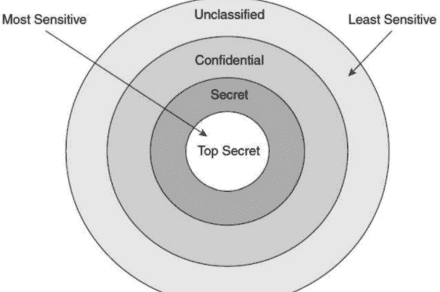

### 图 4.4 保护环

保护环模型为操作系统提供了多个层级，用于执行代码或限制该代码的访问。其思想是使用工程设计，利用安全设计原则构建分层控制。与在用户模式和特权模式下运行的系统相比，保护环提供了大得粒度。随着代码向模型的边界移动，层级增加，信任级别随之降低。该模型包含以下层级：

- **第 0 层：** 这是最受信任的级别。操作系统内核位于此层。运行在层 0 的任何进程都认为是在特权模式下运行。
- **第 1 层：** 此层包含操作系统的非特权部分。
- **第 2 层：** 这是 I/O 驱动程序、低级操作和工具所在的地方。
- **第 3 层：** 这是应用程序和进程运行的地方。这是应用程序和进程操作的地方。这是个人通常交互的级别；在这里运行的应用程序被认为是在用户模式工作，因为这是大多数问题发生的地方。

并不是所有系统都使用环。今天大多数系统在两种模式下运行：用户模式和监视（特权）模式。需要高安全的项目（如操作系统内核）位于中心。这种环是独特的，因为它拥有所有域。保护环属于可信计算基础，下将介绍。

# 可信计算基础

可信计算基础 (TCB) 是计算机内所有负责执行安全策略的保护机制的总和。它由硬件、固件和软件组成。TCB 运行在高信任级别。它监控四个基本功能：

- **输入输出 (I/O) 操作：** I/O 操作是一个安全问题，因为来自外部环的操作可能需要与更高层接口。这些跨域通信必须经过监控。
- **执行域切换：** 运行在一个域中的应用程序经常调用其他域的应用程序或服务。如果这些请求是为了获取更敏感的数据或服务，则必须进行控制。
- **内存保护：** 为了提供真正的安全性，TCB 必须监控内存引用以验证存储的机性和完整性。
- **进程激活：** 寄存器、进程状态信息和文件访问列表在多编程环境中容易泄密。这种潜在的敏感信息必须受到保护。

# 考点

对于 CISSP 考试，你不仅应该理解 TCB 负责执行安全策略，还应该理解 TCB 是计算机内所有经过安全性评估的保护机制的总和。未经过评估的组件被认为位于安全边界之外。

TCB 监控上述列表中的函数以确保系统正确运行并符合安全策略。TCB 遵循引用监器概念。引用监器是一种用于实现安全的抽象机器。引用监器的工作是验证授权主体对对象的访问。引用监器运行在信任与不可信领域的边界。引用监器具有三个属性：

- 不可绕过并控制所有访问，因为每次访问尝试都必须调用它。
- 不可更改并受到防止修改或变化的保护。
- 它必须足够小，以便正确验证和测试。

# 考点

对于 CISSP 考试，你应该理解引用监器为安全内核执行安全需求。

引用监器就像夜店的门卫，站在每个主体和对象之间，验证每个主体是否符合访问对象的最低要求（见图 4.5）。

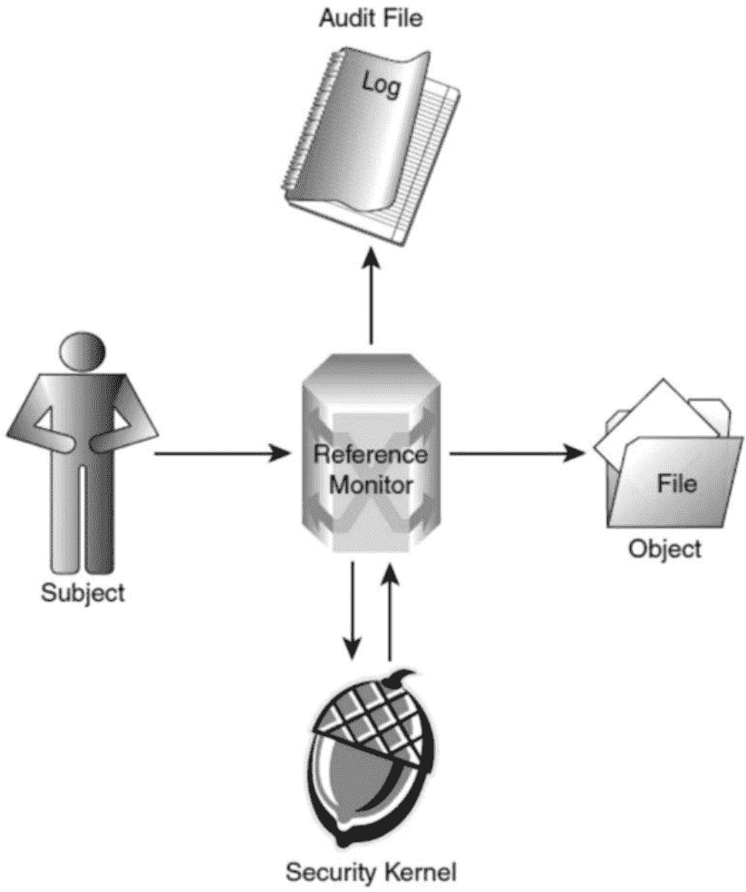

### 图 4.5 参考监控器 (Reference Monitor)

> 注意
> 主体（Subjects）是活动实体，如人员、进程或设备。
> 对象（Objects）是设计用于包含或接收信息的被动实体。对象可以是进程、软件或硬件。

参考监控器可以设计为使用令牌（tokens）、列表（capability lists）或标签（labels）：

- **令牌 (Tokens)**：在请求访问之前通信安全属性。
- **能力列表 (Capability lists)**：提供的查找速度比安全令牌快，但灵活性较低。
- **安全标签 (Security labels)**：高安全性系统使用，因为这些标签具有持久性。

操作系统的核心是安全内核（security kernel）。安全内核处理所有用户/应用程序访问系统资源的请求。较小的安全内核容易验证、测试和确认其安全性。然而，在现实中，安全内核可能会因为不必要的代码而变得臃肿，因为位于内部的进程运行得更快并拥有特权访问权限。厂商在开发操作系统方面采取了不同的方法。例如，DOS 使用了单内核。这些设计中的几种如图 4.6 所示，并在此处进行了描述：

- **单内核架构 (Monolithic architecture)**：所有的操作系统进程均在内核模式下运行。
- **分层操作系统设计 (Layered OS design)**：这种设计将系统功能分为不同的层。
- **微内核 (Microkernel)**：较小的内核仅支持关键进程。
- **混合微内核 (Hybrid microkernel)**：内核结构类似于微内核，但以单内核设计的形式实现。

虽然参考监控器是一个概念，但在每个系统的核心都能找到安全内核。安全内核负责运行所需的控制措施以强制执行功能并抵抗已知攻击。如前所述，参考监控器运行在安全边界：即信任领域与不信任领域之间的边界。

安全边界之外的组件是不可信的。所有的访问控制机制都在安全边界之内。

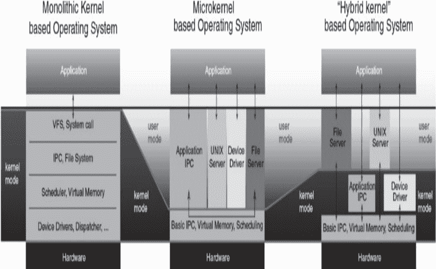

### 图 4.6 操作系统架构

来源：http://upload.wikimedia.org/commons/d/d0/OS-structure2.svg

## 开放系统与封闭系统

开放系统接受来自其他供应商的输入，并基于允许连接不同设备和接口的标准和实践。其目标是促进完全互操作性，使系统能够被充分利用。

封闭系统是专有的。它们使用的设备不是基于开放标准的，并且通常是锁定的。它们缺乏标准接口来连接到其他设备和接口。

例如，在美国手机行业中，AT&T 和 T-Mobile 的手机基于全球移动通信系统 (GSM) 标准，只需稍微更改用户识别模块 (SIM) 即可在海外的其他网络上轻松使用。这些是开放系统手机。而使用分分多址接入 (CDMA) 的手机（如 Sprint 和 Verizon 手机）没有同种程度的支持，并且几乎被完全淘汰。2010 年，全球运营商在同意切换到 LTE 时开始这一过程，LTE 是一种 4G 网络，并将 2023 年列为最后的淘汰日期。

> 注意
> 开放和封闭的概念可以不仅限于硬件。对于开放软件，其他人可以查看和/或修改源代码；但对于封闭软件，他们无法做到。例如，三星 Galaxy 手机运行开源的 Android 操作系统，而 iPhone 运行的是闭源的 iOS。

## 安全运行模式

几种安全运行模式基于美国国防部 (DoD) 5220.22-M 分级标准。根据国防部的规定，在系统上处理的信息以及授权用户的许可级别可以被分为四种模式之一（见表 4.2）：

- **专用型 (Dedicated)**：访问所有存储或处理的信息均需要“知情需要（need to know）”。每个用户都需要经过许可和批准的正式访问，并必须对所有存储和/或处理的信息签署签署的非保密协议 (NDA)。此模式还必须支持强制的系统访问程序。所有打印的纸质输出物和移除的介质都将按照系统认证的级别进行处理，直到由专业人士进行审查。由于系统专门用于处理某一种特定类型或分类的信息，所有授权用户都可以访问所有数据。
- **系统高型 (System high)**：所有用户都拥有安全许可。每个用户都需要经过许可和批准的正式访问，并必须对所有存储和/或处理的信息签署签署的非保密协议 (NDA)。此模式还必须支持强制的系统访问程序。所有打印的纸质输出物和移除的介质都将按照系统认证的级别进行处理，直到由专业人士进行审查。由于系统专门用于处理某一种特定类型或分类的信息，所有授权用户都可以访问所有数据。
- **分区型 (Compartmented)**：访问所有存储或处理的信息均需要“知情需要”。每个用户都需要经过许可和批准的正式访问，并必须对所有存储和/或处理的信息签署签署的非保密协议 (NDA)。此模式还必须支持强制的系统访问程序。所有打印的纸质输出物和移除的介质都将按照系统认证的级别进行处理，直到由专业人士进行审查。由于系统专门用于处理某一种特定类型或分类的信息，所有授权用户都可以访问所有数据。
- **多级型 (Multilevel)**：所有用户都拥有安全许可。每个用户都需要经过许可和批准的正式访问，并必须对所有存储和/或处理的信息签署签署的非保密协议 (NDA)。此模式还必须支持强制的系统访问程序。所有打印的纸质输出物和移除的介质都将按照系统认证的级别进行处理，直到由专业人士进行审查。

### 表 4.2 安全运行模式

| 模式 | 专用型 | 系统高型 | 分区型 | 多级型 |
| :--- | :--- | :--- | :--- | :--- |
| 签署 NDA | 全部 | 全部 | 全部 | 全部 |
| 许可 | 全部 | 全部 | 全部 | 部分 |
| 批准 | 全部 | 全部 | 部分 | 部分 |
| 知情需要 | 全部 | 部分 | 部分 | 部分 |

> 注意
> 敏感性或安全标签表示高安全强制访问控制 (MAC) 系统。

## 运行状态

当系统用于处理和存储敏感信息时，必须有约定的方法来规定其运作。通常，这些概念是为了处理敏感、机密和绝密信息而开发的。处理此任务的负担可以放在管理或系统本身身上。

通常有两种设计：

- **单状态系统 (Single-state systems)**：这种类型的系统设计用于处理一类信息。管理负担落在管理员身上，由他们制定策略和程序。管理员还必须确定谁拥有访问权限以及拥有什么类型的访问。
- **多状态系统 (Multistate systems)**：这些系统不依赖管理员，而是依赖系统本身。多个人可以登录多状态系统并访问不同类型的数据，取决于许可级别。正如你预期的那样，这些系统可能很昂贵。运行 BAE Systems 安全程序 (STOP) 的 XTS-400 是多状态系统的示例。多状态系统可以作为分区系统运行。这意味着 Mike 可以以机密许可登录并访问机密级数据，而 Dwayne 可以以绝密许可登录并访问另一个级别的数据。

> 提示
> Security-Enhanced Linux 和 TrustedBSD 是具有有限多状态能力的操作系统免费实现。由于完全认证这些系统需要巨大的费用和时间，安全评估对于这些免费实现是一个问题。

## 恢复程序

不幸的是，事情并不总是正常运行；它们有时会出错，并发生系统故障。系统故障可能会通过破坏完整性、打开安全漏洞或导致损坏来损害系统。高效的设计内置了恢复程序，以从潜在问题中恢复。有两种基本类型的程序：

- **故障安全 (Fail safe)**：如果检测到故障，通过终止服务来保护系统不受损害。
- **软降级（Fail soft）**：检测到的故障将终止非关键进程。处于软降级模式的系统仍能提供部分操作能力。

在出现问题时能够进行恢复至关重要。确保恢复的最佳方法是采取主动措施，并按照定期计划备份所有关键文件。恢复的目标是恢复到已知状态。需要恢复的常见问题包括：

- 系统重启：意外/未计划的事件可能导致系统重启。
- 系统重启：当系统宕机并强制立即重启时，这会自动发生。
- 系统冷启动：这由重大故障或组件更换引起。
- 系统受损：这可能由攻击或安全违露引起。

# 进程隔离

为了维持高水平的系统信任，需要进程隔离。一个系统要被认证为多级安全系统，它必须支持进程隔离。没有进程隔离，无法防止一个进程溢出到另一个进程的内存中、损坏数据或可能导致系统不稳定。进程隔离由操作系统执行；它的工作是强制内存边界。进程分离是一个重要课题；没有它，系统设计可能会存在单点故障（SPOF），设计或配置中的这一个缺陷就可能导致整个系统停止运行。

为了确保系统安全，操作系统必须防止未经授权的用户访问其不应访问的系统区域，它应该是健壮的，并且不有单点故障。有时这一切都是通过使用虚拟机来实现。虚拟机允许用户认为他们可以使用整个系统，但实际上，进程是完全隔离的。将这一概念进一步推进，某些需要真正健壮安全性的系统还实现了硬件隔离，使得进程不仅在逻辑上而且在物理上被分段。

> 注意
> Java 使用了一种形式的虚拟机，因为它使用沙箱来包含代码并允许其仅以受控的方式运行。

# 常见的形式化安全模型

安全模型用于确定如何实现安全、哪些主体可以访问系统，以及他们将访问哪些对象。简单来说，安全模型将安全策略形式化。控制安全模型通常通过实施完整性、机密性或其他控制来实现。请记住，这些模型中的每一个都列出了广泛的指南，在本质上并不具体。如何使用这些模型并将它们集成到特定设计中，取决于开发人员（见图 4.7）。

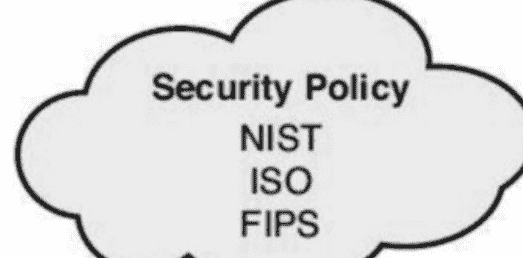

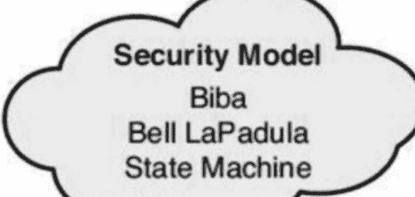

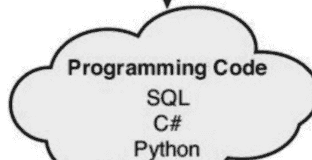


### 图 4.7 OS 设计中使用的安全模型基本概念

后续章节将更详细讨论不同的控制安全模型。前三个模型被认为是低级模型。

## 状态机模型

状态机模型基于有限状态（见图 4.8）。状态机用于对复杂系统并处理接受者、状态变量和事务函数。状态机定义了有限数量状态的行为、这些状态之间的转换以及可能发生的动作。

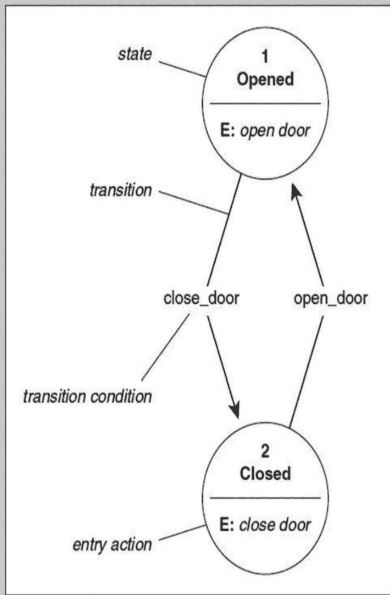

### 图 4.8 有限状态模型

状态机最常见的表示是通过状态表。例如，如表 4.3 所示，如果状态机处于当前状态 B 和条件 2，当我们在选项推进时，下一个状态将是 C 和条件 3。

| 状态事务 | 状态 A | 状态 B | 状态 C |
| :--- | :--- | :--- | :--- |
| 条件 1 | ... | ... | ... |
| 条件 2 | ... | 当前状态 | ... |
| 条件 3 | ... | ... | ... |

状态机模型监控系统状态，以防止其滑入不安全状态。支持状态机模型的系统必须检查所有可能的状态，以验证所有进程都是根据系统安全策略受到控制的。状态机概念是许多安全模型的基础。该模型的价值在于知道系统将处于什么状态。例如，如果系统以安全状态启动，并且发生的每次事务都是安全的，那么它必须始终处于安全状态，且不会失效性开放（失效性开放意味着允许所有流量或动作而不是拒绝。）

# 信息流模型

信息流模型是状态机概念的扩展，作为 Biba 和 Bell-LaPadula 模型的基础，这些模型将在本章的后后部分讨论。信息流模型由对象、状态转换和格（流）策略状态组成。该模型的目标是防止任何方向上未经授权、不安全的信息流。该模型和其他模型可以使用门卫（guards），允许不同系统之间交换数据。

# 非干扰

非干扰模型由 Goguen 和 Meseguer 定义，旨在确保不同级别的对象和主体之间不会产生干扰。该模型使用低或高输出，数据无法跨越安全边界。

# 机密性

虽然描述的模型是许多后期安全模型的基础，但早期模型的一个主要问题是机密性。政府实体（如美国国防部）关注信息的机密性。国防部对信息分类以减轻管理访问信息的负担。国防部的信息分类为敏感非密（SBU）、机密（confidential）和绝密（top secret）。Bell-LaPadula 模型是解决国防部需求的模型之一。

# Bell-LaPadula

Bell-LaPadula 状态机模型强制机密性。该模型使用强制访问控制来执行国防部的多级安全策略。主体要访问信息，必须有明确的需求并达到或超过信息的级别。

Bell-LaPadula 模型由以下属性定义：

- **简单安全 (ss) 属性**：该属性规定处于某一机密性级别的主体不允许读取更高级别的信息。这有时被称为“不向上读”。图 4.9 提供了示例。

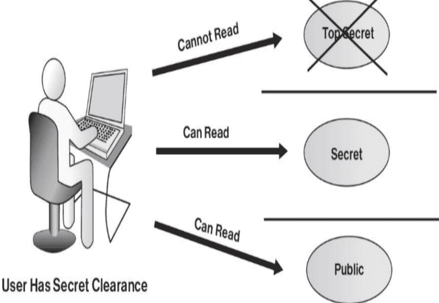

### 图 4.9 Bell-LaPadula 简单安全模型

- **星级 (*) 安全属性**：该属性规定处于某一机密性级别的主体不允许向较低级别的信息写入信息。这也被被称为“不向下写”。图 4.10 提供了示例。

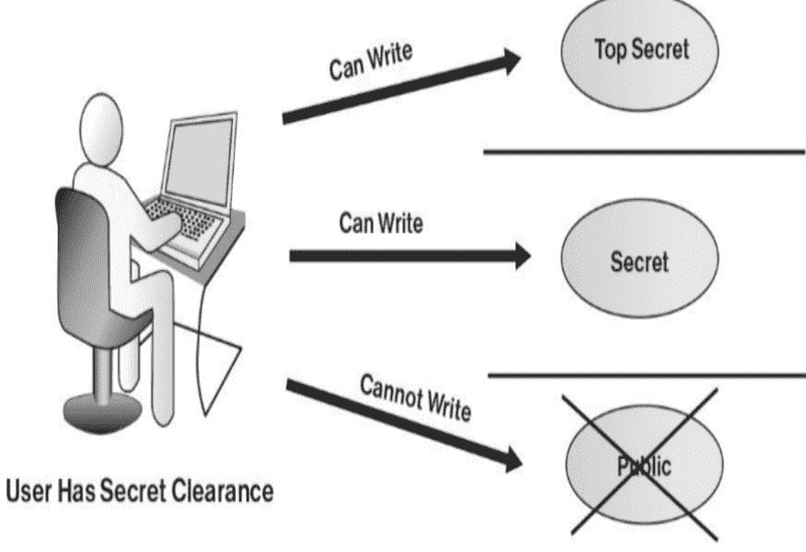

### 图 4.10 Bell-LaPadula 星级属性

- **强星级属性**：该属性规定主体不能读取或写入较高或较低敏感性的对象。图 4.11 提供了示例。

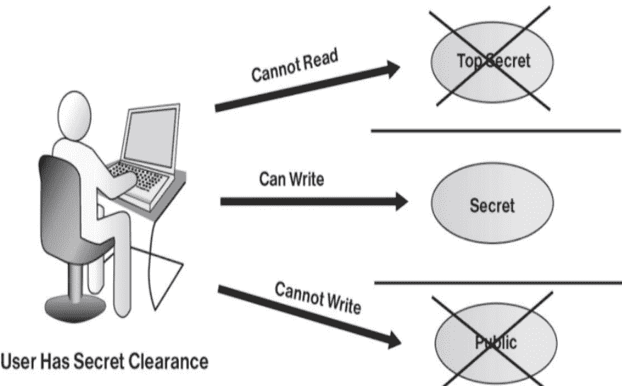

### 图 4.11 Bell-LaPadula 强星级属性

### 考试警示

仔细复 Bell-LaPadula 的简单安全和星级安全模型；它们很容易与 Biba 的两个定义属性混淆。

> 贴士
> Bell-LaPadula 模型的第四个但很少实现的属性称为自由权限安全属性，它允许用户通过访问矩阵向相同权限级别的用户授予访问权限。

尽管 Bell-LaPadula 模型在定义安全系统的运行方面具有重要意义，但该模型并非完美。它没有解决诸如隐道通道等安全问题。它设计于大型机占据主导地位的时代。它是为了多级安全设计的，并且仅考虑了机密性。

> 提示
> 必须知道，Bell-LaPadula 模型处理的是机密性。这意味着读取比允许级别更高的信息会危害机密性。

# 完整性


完整性是一件好事。它是安全三要素（机密性、完整性和可用性）的三个元素之一。完整性在安全中起着重要作用，因为它可以用于验证未经授权的用户没有修改数据、授权用户没有进行未经授权的更改，并确保数据库平衡且数据在内部和外部保持一致。虽然政府实体通常非常关注机密性，但其他组织可能更关注信息的完整性。通常，完整性有四个目标：

- 防止未经授权方修改数据
- 防止授权方对数据进行未经授权修改
- 反映真实世界
- 维护内部和外部一致性

> 注意：某些来源通过将第三和第四个目标合并，只列出了三个安全目标：维护内部和外部一致性并确保数据反映真实世界。

两个处理安全系统完整性的安全模型包括 Biba 和 Clark-Wilson 模型，它们将在接下来的章节中介绍。Biba 模型仅解决第一个完整性目标，而 Clark-Wilson 模型涵盖了所有四个目标。

## Biba 模型

Biba 模型是第一个为解决完整性问题而开发的模型。该模型最初于 1977 年发布，基于格，具有以下定义属性：

- **简单完整性属性 (Simple integrity property)**：该属性规定处于某一完整性级别的主体不允许读取完整性较低的对象。
- **星 (*)完整性属性 (Star (*) integrity property)**：该属性规定处于某一完整性的对象不允许写入更高完整性的的对象。
- **调用属性 (Invocation property)**：该属性禁止处于某一完整性级别的主体调用更高完整性级别的主体。

> 提示：Biba 和 Bell-LaPadula 模型中的星属性都处理写操作。记住这些规则的一种简单方法是想：“这是写在星辰里的（It is written in the stars!）！”

Biba 模型仅处理完整性的第一个目标：保护系统免受未经授权用户的访问。它没有检查机密性等其他类型的问题。该模型还假设内部威胁受到良好编码实践的保护，因此它关注外部威胁。

> 提示：为了记住 Biba 模型的目的，你可以认为 Biba 中的 i 代表 integrity（integrity）。

## 西藏僧侣与 Biba 模型

在教室学习 CISSP 考试的“安全架构与工程”领域时，学生们渴望看到与安全模型材料相关的示例。我通常使用著名的西藏僧侣的故事。

在寻找香格拉和真正的安全意识的长途旅行后，你到达了一座西藏寺庙。你发现那里有很多 Biba 模型的忠实粉丝，而且他们和你一样都为 CISSP 考试做了准备。因此，他们定义了某些你这个平民必须遵守的规则：

- 西藏僧侣可以写一本平民可以阅读的祈祷书，但大祭司不能阅读。
- 西藏僧侣可以阅读大祭司写的书，但不能向下阅读平民写的小册子。

当你尝试概念化 Biba 模型时，考虑这个故事，这可能会让任务变得容易一点。最后的提示是查看 Bell-LaPadula 和 Biba 模型的星 (*) 属性，注意星属性是如何处理写操作的。如果此属性应用于机密性模型 Bell-LaPadula，结果就是“不准向下写”（no write down）。如果星属性应用于完整性模型 Biba，结果就是“不准向上写”（no write up）。只要知道其中一个，就能轻松解决另一个。

> 提示：记住 Biba 模型处理的是完整性，因此它关注完整性。

## Clark-Wilson 模型

Clark-Wilson 模型创建于 1987 年，与之前的模型不同，它是为了商业活动设计的。Clark-Wilson 模型规定必须执行职责分离，主体必须访问数据并进行审计。该模型相关的术语包括：

- 用户
- 转换程序
- 未约束数据项
- 约束数据项
- 完整性验证程序

Clark-Wilson 模型具有访问控制三元组，主体必须访问程序（主体–程序–对象）。访问控制三元组由用户、转换程序和约束数据项组成。它被设计用于保护性并防止欺诈。Clark-Wilson 模型检查三个属性：篡改、日志和一致性。

Clark-Wilson 模型与 Biba 模型不同，在于它是受限的。这意味着处于一个级别的主体可以访问一组数据，而处于另一个级别的主体可以访问另一组数据。Clark-Wilson 模型控制主体访问对象的方式，以确保系统的内部一致性，且不能被篡改。完整性验证程序（IVPs）确保数据项处于有效状态。数据在更改时不能被破坏。Clark-Wilson 模型记录所有更改。

Clark-Wilson 模型由转换程序（TP）组成。约束数据项（CDIs）必须保持完整性的数据。未被模型涵盖的项目被称为未约束数据项（UDIs）。

> 提示：记住 Clark-Wilson 模型要求访问并修改，它处理三个术语：篡改、日志和一致性。

## Take-Grant 模型

Take-Grant 模型是另一个基于机密性的模型，支持四个基本操作：获取、授予、创建和撤销。该模型允许拥有权利的主体从他人那里移除权利。拥有授予权的主体可以将其授予他人。创建和撤销操作方式相同：拥有权利的人可以给他人，拥有撤销权的人可以从他人那里移除。

## Brewer and Nash 模型

Brewer and Nash 模型与 Bell-LaPadula 模型类似，有时被称为中国墙模型。它被开发用于防止利益冲突（COI）模型。Brewer and Nash 模型的背景在于它防止为一家公司工作的员工访问另一公司的数据，从而防止任何利益冲突。例如，假设你的安全公司为许多公司提供安全服务。如果你的某个员工可以访问公司合作过的所有公司的信息，这个人可能会以未经授权的方式使用数据。

## 其他模型

安全模型定义并描述了使用哪些保护机制以及这些控制的设计。之前的章节涵盖了一些测试最频繁的模型，但你应该对其他几个安全模型有基本的了解，包括：

- Graham-Denning 模型：该模型使用一组正式的保护保护规则，每个对象都有所有者和控制者。这些规则定义了你可以创建、删除、读取、授予或转移。
- Harrison-Ruzzo-Ullman 模型：该模型与 Graham-Denning 模型类似，详细说明了如何创建、删除、访问或更改主体和对象。
- **Lipner 模型**：该模型结合了 Bell-LaPadula 和 Biba 模型的元素，旨在保护机密性和完整性。
- **格模型 (Lattice model)**：该模型与强制访问控制（MAC）相关。控制被应用于对象，该模型使用由格结构表示的安全级别；该结构管理信息流。格模型中的主体只有在主体的安全级别等于或大于对象的安全级别时，才允许访问该对象。整体访问限制通过为每个安全级别设置最小上界（LUB）和最大下界（GLB）来实现。

### 考试警示

花时间复本节讨论的所有模型。确保你了解哪些模型是基于完整性的，哪些是基于机密性的，以及每个模型的属性；在 CISSP 考试中将需要这些信息。

> 提示：尽管本节描述的安全模型是 CISSP 考试最可能关注的，但还有许多其他模型，例如 Sutherland、Boe and Kain、Karger、Gong 和 Jueneman 模型。即使是许多安全专业人士可能从未听说过这些模型，而开发系统的人可能在大学期间学过它们。

## 产品安全评估模型

在评估信息系统的安全能力时，需要一套评估标准。已经开发了许多文档和指南来帮助评估和建立系统保证。这些项目对于 CISSP 候选人来说非常重要，因为它们提供了一种信任和保证，确保这些系统将以给定的、可预测的方式运行。受信系统经过了测试并验证了特定标准。保证意味着消除疑虑，并且对系统每次使用时都能按要求运行具有信心程度。

将产品评估模型认为类似于 EPA 的油耗评级，它为买卖双方提供了一种评估不同汽车品牌和型号的方法。在产品安全领域，开发者在准备销售系统可以使用产品评估系统。买家在准备购买时可以使用相同的评估模型，因为它们提供了一种衡量系统有效性和基准能力的方法。以下章节描述了有助于这些需求的文档和指南。

## 彩虹系列 (The Rainbow Series)

彩虹系列之所以以此命名，是因为系列中的每本书都有不同颜色的标签。这叠 6 英尺高的书由国家计算机安全中心（NCSC）开发，该机构是美国安全局（NSA）的一个部门。这些指南是为可信产品评估计划（TPEP）开发的，该计划根据一套全面的安全相关标准对商业产品进行测试。这些书的第一本于1983年发布，被称为[可信计算机系统评估标准](TCSEC)，或“橙书”。许多类似的指南也以封面颜色而非名称闻名，例如“红书”。虽然橙书已不再在商业中使用，但理解 TCSEC 将帮助你理解商业评估模型是如何演变成我们今天所使用的。

> 注意：彩虹系列指南已全部被通用标准（Common Criteria）取代，通用标准在本章后部分描述。

## 橙色书：可信计算机系统评估标准

橙色书的开发目的是评估独立系统。其衡量基础是机密性，因此它与 Bell-LaPadula 模型相似。

> 加拿大有自己的橙书版本，被称为《加拿大可信计算机产品评估标准》（CTCPEC）。它也被通用标准取代了。

尽管橙书不再被认为是当前的，但它是最早的产品安全标准之一。表 4.4 列出了橙色书的级别。

### 表 4.4 橙色书级别

| 级别 | 需要记忆的项目 |
|---|---|
| A1 | 以安全的方式构建、安装和交付 |
| B1 | 安全标签 (MAC) |
| B2 | 安全标签和无隐蔽道的验证 (MAC) |
| B3 | 安全标签、无隐蔽道的验证，且在启动期间必须保持安全 (MAC) |
| C1 | 弱保护机制 (DAC) |
| C2 | 严格的登录程序 (DAC) |
| D1 | 失败或未经过测试 |

## 红书：可信网络解释

红书的官方名称是可信网络解释（TNI）。TNI 的目的是检查网络和网络组件的安全性。橙书只处理机密性，而红书则检查完整性和可用性。它还负责检查网络设备的运行情况。红书涵盖了三个审查领域：

- 拒绝服务 (DoS) 预防：运营的管理和连续性
- 破改保护：数据和流量的机密性以及选择性路由
- 通信完整性：身份验证、完整性和不可否认性

## 信息技术安全评估标准 (ITSEC)

ITSEC 是 20 世纪80 代开发的欧洲标准，用于评估整个系统的机密性、完整性和可用性。ITSEC 的独特之处在于，它是第一个统一市场并将整个欧洲置于一套指南下的标准。ITSEC 将目标系统指定为评估目标 (TOE)。评估实际上分为两个部分：一部分评估功能，另一部分评估保证。

ITSEC 提到了 10 类功能 (F) 类和 7 种保证 (E) 类。保证类评定了系统的有效性和正确性。表 4.5 显示了这些评级以及它们如何与 TCSEC 评级对应。

### 表 4.5 ITSEC 功能评级与 TCSEC 比较

| F 类评级 | E 类评级 | TCSEC 评级 |
|---|---|---|
| NA | E0 | D |
| F1 | E1 | C1 |
| F2 | E2 | C2 |
| F3 | E3 | B1 |
| F4 | E4 | B2 |
| F5 | E5 | B3 |
| F5 | E6 | A1 |
| F6 | — | 具有高完整性要求的 TOE |
| F7 | — | 具有高可用性要求的 TOE |
| F8 | — | 数据通信期间具有高完整性要求的 TOE |
| | | 数据通信期间具有高机密性要求的 UE |
| | | 具有高机密性和完整性要求的网络 |

## 通用标准 (Common Criteria)

有了目前为止讨论的所有标准，很容易看出人们在决定哪一个时可能会困难。国际标准化组织 (ISO) 也有此想法，它决定与其有各种标准和评级，不如有一个单一全球标准。图 4.12 展示了通用标准的开发。


### 图 4.12 通用标准的开发

1997 年，ISO 发布了通用标准（ISO 15408），它是 TCSEC、ITSEC 和 CTSPEC 的合并版本。通用标准围绕 TCB 实体设计，包括物理和逻辑控制、启动和恢复、引用机制以及特权状态。通用标准分为分为日益严格的评估级别，称为评估保证级别 (EAL)：

- EAL 1：功能测试
- EAL 2：结构测试
- EAL 3：方法化检查和测试
- EAL 4：方法化设计、测试和审查
- EAL 5：半形式化设计和测试
- EAL 6：半形式化验证、设计和测试
- EAL 7：形式化验证、设计和测试

EAL 为被分析系统的安全功能提供了特定级别的信心。

> 考试警示：如果你正在寻找高水平 EAL 6 操作系统的用例，Green Hills 软件的 Integrity 17B 足够了。这款安全操作系统用于喷战斗机和其他关键设备。

与 ITSEC 类似，通用标准定义了两种安全需求：功能和保证。功能需求定义了产品或系统做什么。它们还定义了安全能力。作为评估依据的保证需求和规范被称为安全目标 (ST)。保护配置文件定义了系统及其控制措施。保护配置文件分为五个部分：

- 理由说明 (Rationale)
- 评估保证需求
- 描述性元素
- 功能需求
- 开发保证需求

一个安全目标（Security Target）由七部分组成：

- 引言
- 符合性声明
- 安全问题定义
- 安全目标
- 扩展组件定义
- 安全需求
- TOE 安全规范

通用标准（Common Criteria）认证包含保护策略文件（PP）或安全目标（ST）。

保证需求定义了产品构建的优劣。保证需求增强了对产品的信心，并展示了其实现的正确性。

### 考试要点

通用标准的七个保证级别和两项安全需求是 CISSP 考试的必要知识点。

## 系统验证

没有任何系统或架构是完全安全的；始终存在某种程度的风险。安全专业人员必须理解这种风险，并与之共处，或者通过第三方来减轻或抵消这种风险。之前讨论的所有文档和指南都涉及衡量和评估风险的方法。这些对于确保实施的系统满足你的需求有很大帮助。然而，在开始使用系统之前，你必须完成认证（Certification）和认可（Accreditation）这两个额外步骤。

美国联邦机构依法要求对其 IT 系统和基础设施进行认证和认可。尽管你不应该期望在 CISSP 考试中看到深入的认证和认可问题，但如果你计划与任何要求你使用的机构进行交互，那么它是值得的。这些方法看起来比标准的渗透测试复杂得多；它们更像是一种审计。它们必须验证系统的实现、配置和运行符合预期，并满足所有的安全策略和程序。

## 认证与认可

认证（Certification）验证已实施系统的配置和运行符合预期过程。它还验证系统是否以安全、受控的方式与其他系统连接通信，并以安全、批准的方式处理数据。认证过程是对系统进行的技术评估，可以由独立的安全团队或现有人员执行。其目标是发现实现中的任何漏洞或弱点。

认证结果将报告给组织管理层进行调解和批准。如果管理层同意认证结果，报告将被正式批准。认证的正式批准就是认可（Accreditation）过程。管理层通常发布正式的书面批准，证明经过认证的系统允许按照认证文档指定的运行。如果系统或系统使用的环境发生了更改，则必须重复认证和认可过程。整个过程会定期重复，取决于行业以及组织必须遵守的法规。例如，《萨班斯-奥克斯莱法案》第404节要求对处理财务控制和报告系统的内部系统进行年度评估。

### 考试要点

在 CISSP 考试中，你可能想要记住认证被视为验证的技术方面，而认可是管理层的批准。

> 注意事项：没有什么是永恒的，包括认证。当系统更改、项目修改或在定期进行时，应该重复认证过程。

## 安全架构的漏洞

与本书其他其他章节一样，也会审查潜在的威胁和漏洞。每当安全专业人员为更强的安全性辩护时，总会有人问为什么资金应该花在上面。

## 缓冲区溢出

缓冲区溢出的发生由于编码不当。缓冲区（Buffer）是存储数据的临时存储区域。如果数据输入缓冲区，它可能会溢出到相邻内存。这里有一个缓冲区溢出的示例：

```c
#include <stdio.h>
#include <stdlib.h>
#include <string.h>

int abc() {
    char buffer[8];
    strcpy(buffer, "AAAAAAAA");
    return 0;
}
```

操作系统供应商也努力通过使用数据执行防止（DEP）和地址布局随机化（ASLR）等技术来增加缓冲区攻击的难度。DEP 将某些内存区域标记为可执行或不可执行。大多数现代操作系统（如 Android、Windows 和 FreeBSD）都使用了 ASLR。针对缓冲区溢出的其他防御包括代码审查、使用安全的编程语言以及及时应用补丁。

## 后门

后门（Backdoors）是软件的潜在威胁。程序员在开发期间会创建后门（有时被称为维护钩子），以便在不运行所有代码的情况下访问软件。这些后门通常是未记录的。如果在发布前未移除后门，它们允许攻击者绕过安全机制。

## 状态攻击

状态攻击是一种通常针对时间的攻击形式。目标是利用检查时间（TOC）与使用时间（TOU）之间的延迟。这些攻击有时被称为异步攻击或竞态条件（Race Conditions），因为攻击者在系统使用对象之后、检查之前对其进行更改。

例如，如果程序创建一个文件来存储客户欠款金额，而攻击者可以在程序读取之前替换此值，他就可以成功地操纵程序。在现实中，利用竞态条件可能是困难的，因为黑客可能需要尝试多次才能成功。

## 隐蔽通道

隐蔽通道（Covert Channels）提供了一种非预期方式移动信息的方法。隐蔽通道是攻击者的最爱，因为他们知道你无法拒绝必须允许的内容。该术语最初用于 TCSEC 文档，指的是从高密级向低密级传输信息的方法。隐蔽通道攻击可以大致分为两类：

- 隐蔽时间通道攻击：时间攻击难以检测。它们的功能通过更改组件或修改资源计时发挥作用。
- 隐蔽存储通道攻击：此类攻击使用一个进程向存储区域写入数据，另一个进程读取数据。

这里有一个隐蔽通道攻击在现实生活中发生的示例。你的组织决定允许 ping（互联网控制消息协议 [ICMP]）流量进出你的网络。基于这一知识，攻击者在你的网络中植入了 Loki 程序。Loki 使用 ping 数据包的负载部分将数据移入和移出你的网络。因此，网络管理员看到的只有正常的 ping 流量。

并且不会触发报警，尽管攻击者正忙于偷取公司秘密。遗憾的是，许多程序都可以执行这种攻击。

### 考试提醒

CISSP 考试要求你理解两种类型的隐道攻击。

## 增量攻击


# 增量攻击

增量攻击的目标是随时间缓慢地更改。通过在长时间内进行微小的更改，攻击者希望保持不被发现。两种主要的增量攻击是：

- **数据篡改**（data diddling）：如果攻击者能够访问系统并能够对数据或文件进行增量更改，这种就是可能的。
- **萨拉攻击**（salami attack）：它与数据篡改类似，但涉及对财务账户或记录进行微小更改，通常被称为“财务造假”。

## 辐射发射

任何看过《国家机密》或《听风者》等电影的人对监控技术和阴谋论都有所了解。如果你曾认为只有边缘人物才会担心这些事情，那再想想吧。这听起来可能像科幻，但美国政府对电子设备发出的杂散电信号泄漏的可能性非常担心，因此国防部启动了一个研究辐射泄漏的计划。

研究实际上始于 20 世纪 50 年代，这项研究最终导致了 TEMPEST 技术。人们担心攻击者可能会试图嗅探从电子设备发出的杂散电信号。按照 TEMPEST 标准制造的设备（如阴射线管 CRT 显示器）在机壳中嵌入了 TEMPEST 级的铜网（即法拉第笼），以防止信号泄漏。这种昂贵的技术仅用于极高安全环境中。

TEMPEST 现在被认为有些过时了；新的技术（如白噪声屏蔽）现在被用于安全。白噪声涉及使用特殊设备发送频率流，使攻击者无法区分真实信息。墙壁、地板和天花板的设计旨在阻止电信号离开。

与此类技术相关的另一个术语是范·埃克（Van Eck）。这是通过辐射泄漏监听显示器内容的名称。尽管这种技术已经过时，但剑桥大学在 2004 年成功演示了该技术。

### 考试提醒

对于 CISSP 考试，你需要了解用于防止入侵者通过无线电波解码辐射的技术和方法。白噪声和屏蔽是主要的控制措施。

## 基于 Web 的漏洞

基于 Web 的系统的漏洞涉及设计中的缺陷或弱点。应用程序开发人员绝不假设用户会输入正确的数据。恶意活动会尝试扩展协议或寻找可能的漏洞。通过实施预验证和后验证是解决这些问题的最佳方法。预验证在客户端实施，但可以通过代理和其他技术进行绕过。后验证的执行是为了确保程序的输出是正确的。其他与输入验证直接相关的安全问题还包括：

- **跨站脚本 (XSS)**：一种利用信任的攻击，攻击者利用 Web 应用程序向 Web 服务器发送恶意代码。
- **跨站请求伪造 (CSRF)**：一种涉及从网站信任的用户处重定向静态内容的攻击。
- **直接 OS 命令行**：对操作系统命令进行未经授权的执行。
- **目录遍历攻击**：一种允许攻击者从一个目录移动到另一个目录的技术。
- **Unicode 编码**：一种用于绕过安全过滤的技术。
- **URL 编码**：使用 Unicode 通过 HTTP 请求隐藏或执行无效命令（例如，`<script>`）。

### 提示

XSS 和 CSRF 有时会被混淆，所以只需记住一个关键区别是 XSS 在受信的上下文中执行代码。

让程序员生活困难的因素之一是没有任何所谓的“受信输入”。所有输入都可能是坏的，必须经过验证。虽然缓冲区溢出是输入验证不当的经典示例，但这些攻击已经变得复杂得多：攻击者已经学习在缓冲区中插入恶意代码，而不仅仅向应用程序投掷“垃圾数据”（即输入随机乱码）来导致溢出。还有许多工具可以启动这些攻击；图 4.13 显示了一个示例。


### 图 4.13 攻击工具

攻击者还可以使用以下技术来利用不良的输入验证：

- XML 注入
- LDAP 注入
- SQL 注入

这些都是同一种类型的攻击，但它们针对不同的平台。数据库是格式化输入的另一个常见目标。攻击者可以尝试插入数据库或 SQL 命令来破坏数据库的正常运行。这可能导致数据库变得不稳定并泄露信息。这种攻击被称为 SQL 注入。攻击者搜索 Web 页面并插入 SQL 命令（如单引号），以测试数据库的漏洞。如下代码所示的响应为攻击者提供了所需的反馈，让他们知道数据库容易受到攻击：

```
Microsoft OLE DB Provider for ODBC Drivers error '80040e07' [Microsoft][ODBC SQL Server Driver][SQL Server]Syntax error converting the nvarchar value 'sa_login' to a column of data type int./index.asp, line 5
```

虽然 CISSP 考试并不要求掌握用于数据库攻击的语法和响应，但在你尝试保护自己的基础设施时，了解这些信息是有用的。

### 注意事项

SQL 注入攻击是顶级攻击向量之一，并导致了大量的攻击。CISSP 候选人应该理解这些攻击所构成的威胁。

注入攻击（如 SQL、LDAP 等）可能发生在许多不同的程序和应用程序中，并利用一个共同的问题：应用程序代码和输入数据之间不存在分离，这使得攻击者能够在受害者的系统上运行他们的代码。注入攻击需要以下步骤：

1. **足迹扫描**：有必要确定该 Web 应用程序运行的栈。
2. **识别**：必须识别用户输入点。
3. **测试**：必须对易受攻击的用户输入进行测试。
4. **利用**：将额外的代码放置在输入中，以便在受害者的计算机上执行命令。

## 移动系统漏洞

移动设备的性能已经提高，现在能够处理以前只有台式机和笔记本才能完成的任务。越来越多的员工带着自己的移动设备去上班并在公司网络上使用。组织对这种安排可能有许多担忧，包括以下方面：

- 语音通话窃听
- 移动设备上的移动病毒
- 移动设备上的明文存储
- 移动设备易于丢失或被盗
- 手机拍摄敏感信息的能力
- 大容量能力，可能导致数据窃取或外泄
- 暴露本地设备数据的软件（如姓名、电子邮件地址或电话号码）

自带技术（BYOT），也称为自带设备（BYOD），要求组织建立管理和技术控制，以规范这些设备在工作期间的使用方式。其中一些基本控制措施可能包括：

- **密码**：保护系统最基础且廉价的方法之一是强制使用密码。此外，当设备丢失或被盗时，建议密码具有远程擦除功能。
- **多因素身份验证 (MFA)**：多种形式的身份验证增强了密码。例如，用户可能需要使用 Okta 或 MFA 来验证登录。
- **会话生命周期**：限制会话时间并使用 Cookie 可以在用户闲置一段时间后自动登出，提高安全性。
- **无线漏洞**：无线网络通常容易受到攻击。例如，攻击者可能会设置一个伪造的访问点并实施中间人攻击。
- **未修复的操作系统、软件或浏览器**：移动设备等计算设备必须定期进行更新。
- **不安全的设备**：越狱设备（Jailbroken devices）为公司网络带来风险。
- **移动设备管理**：移动设备管理 (MDM) 和移动应用管理 (MAM) 可用于保护设备，并仅允许授权设备访问公司资源。

## 加密

加密涉及将明文转换为不可读的数据，或密文。如今，加密系统强制用于保护电子邮件、公司数据以及电子交易。

为了让你良好地理解加密，本节内容与安全基础相关：**机密性、完整性和不可否认性**。

### 提示

记住加密主要目标的一种方法是记住它们的缩写 **PAIN**：**机密性 (Confidentiality)**、**完整性 (Integrity)**、**身份验证 (Authentication)** 和**不可否认性 (Nonrepudiation)**。

**机密性**，或隐私，是保证信息保持私密的能力。加密通过转换数据提供机密性。这种转换被称为加密。加密可以保护存储或传输中信息的机密性。如果设备丢失、被盗或被未经授权的人访问，加密可以保护信息资产。

身份验证有几个构成部分。首先，身份验证通常与消息加密相关，用于确保数据或程序没有被修改，并且确实来自源。身份验证还用于确认用户的身份，是身份验证过程的一部分。最常见的身份验证实现方式是用户名和密码。大多数密码都是加密的，如果没有加密身份验证过程将非常脆弱。FTP 和 Telnet 是未加密的示例。在这些协议中，用户名和密码是以明文（即明文）传输的，任何可以访问通信流的人都可以拦截并捕获这些密码。虚拟专用网络 (VPN) 也使用身份验证，但它们不是使用用户名和密码，通常使用数字证书和数字签名来准确识别用户并保护身份验证过程免受欺骗。

完整性是确保信息从创建到接收未被更改的保证。如果你在互联网上每个 100 美元销售产品，如果可以将价格改为 1 美元，你会破产。完整性对于信息交换至关重要，无论是电子商务、维护商业秘密还是提供的军事通信。

不可否认性是验证身份证明的能力。不可否认性用于确保数据发送者获得交付证明，并让接收者确认发送者的身份。双方都不应事后否定发送或接收过数据。在面对面交易时代，不可否认性不像现在这样难以证明。互联网使得许多交易变得匿名。你可能永远见不到交易对象，因此不可否认性变得更加关键。不可否认性通过数字签名、数字证书和消息认证码 (MAC) 实现。

为了使本节更容易理解，请回顾本章后续使用的基础术语：

- **明文 (Plaintext)**：直接可读的文本。有时称为清晰文 (Cleartext)。
- **加密 (Encryption)**：将明文转换为密文的过程。
- **密文 (Ciphertext)**：通过加密后变得不可读的文本。
- **加密算法 (Cryptographic algorithm)**：用于在加密系统中加密和解密数据的数学程序集。例如，凯撒密码（Caesar’s cipher）等简单位移密码将字母向前或后移动三个字符。
- **密钥 (Cryptographic key)**：一种信息，也称为加密变量，控制加密算法的功能。它可以用于控制明文到密文或密文到明文的转换。例如，一个位移字符的算法可能会使用密钥“+3”将字符向前移动三个位置。使用该算法和密钥，“cat”一词会被加密为“fdw”。
- **密钥管理 (Key management)**：密钥的生成、分发、存储和处置。密钥管理作为加密过程中任何未处理当的部分，都会导致加密系统产生漏洞。
- **数字权利管理 (DRM)**：一个涉及工具、标准和系统的过程，旨在保护知识产权和版权材料免受滥用或盗窃。DRM 由数据保护和数据治理组成。加密技术用于提供数据保护，而信任和策略管理允许治理，以便信息由授权实体分发和使用。
- **对称加密 (Symmetric cryptography)**：使用单一密钥进行加密的加密。
- **非对称加密 (Asymmetric cryptography)**：使用私钥和公钥进行加密的加密。
- **密码分析 (Cryptanalysis)**：破解系统的艺术与科学。
- **消息摘要 (Message digest)**：用于唯一标识数据的固定哈希值。
- **数字签名 (Digital signature)**：用于完整性。

## 算法

算法是一组用于在加密系统中加密和解密数据的规则集。使用不同的密钥或不同的算法加密明文产生不同的密文。

并不是所有加密系统的强度都相同。加密系统的强度取决于算法的强度，因为错误的算法会被破解。然而，加密的强度也取决于密钥的大小和复杂度。例如，想象你正在考虑一把锁。一个是 3 位的，另一个是 4 位的。你会选哪个？考虑一下，3 位锁有 1000 种组合，而 4 位锁有 10000 种组合。如所示，仅仅增加一位就能产生巨大的差异。

密钥或组合越多，攻击者获取密钥所需的时间越长。

密钥必须保持秘密。虽然一把 7 位的组合锁可以提供很好的安全性，但如果大家都知道密码你的电话号码，它就无济于事。

数据加密标准 (DES) 使用 64 位密钥，其中每 8 位最后一位是校验位。3DES（也称为三重数据加密）使用三个不同的密钥，密钥强度为 168 位，是 DES 的最后一个版本。所有版本的 DES 都已退役。

加密系统可能会使用*随机数（nonce）*，这是一种尽可能随机生成且仅使用一次的数字。这些*伪随机（pseudorandom）*数字在每次生成时都是不同的。*初始化向量（IV）*就是随机数的一个示例。IV 可以被添加到密钥中，并用于即使在使用相同算法和相同密钥加密同一条消息时，也能强制创建唯一的密文。

现代加密系统使用两种类型的算法对数据进行加密和解密：

- **对称算法**：使用相同的密钥对数据进行加密和解密
- **非对称算法**：使用不同的密钥：一个用于加密，另一个用于解密

表 4.6 强调了对称算法和非对称算法的一些主要优缺点。

### 表 4.6 对称与非对称算法

| 加密类型 | 优点 | 缺点 |
| --- | --- | --- |
| 对称 | 比非对称快 | 密钥分发；仅提供机密性 |
| 非对称 | 密钥交换方便；可以提供机密性、身份验证和不可否认性 | 比对称慢；需要更大的密钥 |

### 考试提醒 (ExamAlert)

确保你了解 CISSP 考试中对称加密与非对称加密之间的区别。

## 密码类型与方法

对称加密方法包括块密码和流密码。块密码对数据块或固定大小的数据块进行操作。本章前面提到的凯撒密码就是块密码的一个示例。绝大多数现代加密算法都实现了某种类型的块密码，且 64 位块是一个常用尺寸。块密码广泛应用于软件产品中。在加密和解密过程中，消息被划分为若干个位块。这些位块然后经过布尔数学函数的处理，产生以下结果：

- **混淆（Confusion）**：发生在替换型操作，它在明文和密钥之间建立起复杂的关系，使得攻击者无法通过更改密文来获取密钥。
- **扩散（Diffusion）**：发生在置换型操作，它对明文片段进行多次位移。结果是变化扩散到整个密文中。

替换盒（s-box）执行一系列替换、置换和异或（XOR）操作，以掩盖明文与密文之间的关系。当实现得当时，s 盒的设计用于对抗密码分析。s 盒接收若干个输入位（m）并将其转换为若干个输出位（n）。s 盒以查找表的形式实现，并与 DES 等对称加密系统配合使用。

流密码每次对 1 位的流进行加密。为了实现这一点，会由加密引擎创建一个一次性填充码。这个一次性填充码是一个密钥流，它与明文数据流（每次 1 位）进行异或运算以生成密文。流密码之间的区别在于它们用于创建一次性填充码的引擎；该引擎接收对称密钥作为输入，以产生唯一的密钥流。异或操作是一种布尔函数，其规则为：当两个位结合时，如果其中任一个值为 1，则结果为 1；如果两个位相同，则结果为 0。表 4.7 提供了常用布尔运算符的列表。

### 表 4.7 布尔逻辑运算符

| 输入 | AND | OR | NAND | NOR | XOR |
|---|---|---|---|---|---|
| 00 | 0 | 0 | 1 | 1 | 0 |
| 01 | 0 | 1 | 1 | 0 | 1 |
| 10 | 0 | 1 | 1 | 0 | 1 |
| 11 | 1 | 1 | 0 | 0 | 0 |

流密码的运行速度比块密码快，在理论上非常适合硬件实现。

## 对称加密

在对称加密中，加密和解密都使用同一个共享秘密密钥，如图 4.14 所示。该密钥被称为“双用途密钥”，因为它被用于锁定和解锁数据。对称加密是最老的加密形式；斯基泰密码（scytale）和凯撒密码就是它的示例（参见第 5 章“通信与网络安全”）。对称加密通过防止没有密钥的个人获知消息的真实内容，从而提供机密性。

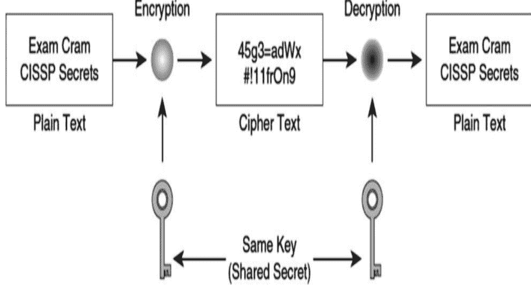

### 图 4.14 对称加密

图 4.14 中的简单图展示了对称加密过程。明文使用单个共享密钥加密，生成密文；然后将密文传输给消息的接收者，接收者反转该过程以解密消息。对称加密和解密速度很快，而且如果使用大密钥，对称加密非常难以破解。然而，它有三个显著缺点：

- 对称密钥的分发
- 密钥管理
- 仅提供机密性

对称密钥的分发是对称加密中最严重的缺陷。为了使对称加密有效，必须有一种安全的方法来传输密钥。在我们现代世界中，需要某种类型的带外传输（out-of-band transmission）。考虑一下：如果 Bob 想给 Alice 发一条秘密消息，但担心窃听者 Eve 会监控他们的通信，他该如何发送消息？如果密钥以明文发送，Eve 就可以截获它。Bob 可以面对面交付密钥、邮寄，甚至派遣快递员。这些方法在我们电子商务的世界中都是极不实际的。

### 表 4.8 对称与密钥

| 用户数量 | 密钥数量 |
|---|---|
| 5 | 10 |
| 10 | 45 |
| 100 | 4950 |
| 1,000 | 49950 |

对称加密的一些示例包括：

- **数据加密标准 (DES)**：DES 曾是最广泛使用的。它已被废弃。
- **Blowfish**：Blowfish 是一种通用密码，块大小为 64 位，密钥从 32 位到 448 位。
- **Twofish**：Twofish 是一种对 128 位块操作的密码，使用 256 位。
- **国际数据加密 (IDEA)**：IDEA 是一种使用 128 位密钥处理 64 位块的密码。它被 PGP 使用。
- **Rijndael**：Rijndael 被采纳为高级加密标准 (AES)。它具有固定的 128 位块大小，密钥长度为 128、192 和 256 位。
- **Rivest Cipher 4 (RC4)**：RC4 是一种基于流的密码，将数据视为位流。
- **Rivest Cipher 5 (RC5)**：RC5 是一种快速块密码，支持可变块大小、密钥大小和轮数。
- **安全快速加密算法 (SAFER)**：SAFER 是一种基于块的密码，处理 64 位和 128 位块。
- **MARS**：MARS 是由 IBM 开发的 AES 候选算法。它具有 128 位的块大小，密钥长度在 128 位到 448 位之间。
- **Carlisle Adams/Stafford Tavares (CAST)**：CAST 是一种 128 位或 256 位块密码，曾是 AES 的候选算法。
- **Camellia**：Camellia 是一种对称密钥块密码，块大小为 128 位，密钥大小为 128、192 和 256 位。Camellia 由日本三菱电机和 NTT 开发，与 AES 相当。


# Skipjack

`Skipjack`由美国国家安全局（NSA）推广，使用 80 位密钥，支持与 DES 相同的四种模式，并对 64 位块文本进行操作。`Skipjack`面临公众的反对，因为它的设计目的是让政府能够允许执法部门（在搜查令或法院批准的情况下）重构`Skipjack`访问密钥并解密影响双方之间的私人通信。

## 考试要点

请务必花时间复各种加密类型、块大小和密钥长度；你可以预计在 CISSP 考试中看到这些内容。你需要了解后续章节中详细讨论的某些算法。其他算法可能仅在考试中作为干扰项。

为了通过密码学提供认证，必须转向非对称加密。然而，在讨论非对称加密之前，我们将介绍 DES 和几种常用的对称加密方法。

## 数据加密标准 (DES)

DES 源于 20 世纪 70 年代初一个由 IBM 开发的项目。IBM 和 NIST 对 IBM 的原始加密标准（称为 `Lucifer`）进行了修改，使其使用 56 位密钥。这一修订后的标准得到了 NSA 的认可，命名为 DES，并于 1977 年发布。它于 1981 年作为美国国家标准（ANSI）标准发布。

DES 使用 64 位块每次处理 64 位明文，并输出 64 位块的密文。如前所述，DES 使用 64 位密钥（每 8 位中的最后一位被忽略），并具有以下工作模式：

- 电子密码本 (ECB) 模式
- 密码分组链接 (CBC) 模式
- 密码反馈 (CFB) 模式
- 输出反馈 (OFB) 模式
- 计数器 (CTR) 模式

## 考试要点

这些工作模式可以应用于任何对称块密码，如 DES、3DES 或 AES。你需要在 CISSP 考试中掌握它们。

规定的 ANSI 标准报告 DES 密钥为 64 位，但实际上有 8 位用于校验，以确保剩余 56 位的完整性。因此，从加密强度来说，密钥实际上只有 56 位长。每个 64 位明文块被分为两个 32 位块，然后由这个 56 位密钥进行处理。处理过程将明文通过 16 轮置换和替换。

## 考试要点

请记住，虽然 DES 在 64 位块上操作，但密钥的有效长度仅为 56 位。

## 电子密码本 (ECB) 模式

ECB 是 DES 的原生加密模式。与其他所有模式一样，如果最后一个块未满，则会添加填充以使明文成为完整块。尽管 ECB 具有最高的吞吐量，但它也是容易破解的 DES 加密形式。如果使用大量数据，它很容易受到攻击，因为相同的明文在用相同密钥加密时将始终产生相同的密文。ECB 模式仅在处理小量数据时适用。图 4.15 展示了 ECB。


图 4.15 DES ECB 加密

> **提示**
>
> 当使用 ECB 时，给定的明文块使用给定密钥加密将始终产生相同的密文。

ECB 是 DES 最弱的形式。

## 密码分组链接 (CBC) 模式

DES 广泛使用的 CBC 模式与 ECB 类似。CBC 处理 64 位数据块，但会将从每个块创建的部分密文插入到下一个块中。在这个过程中（称为链式），每个块都依赖于前一个块，形成一条链；链式是通过使用异或操作实现的。

DES 的 CBC 模式使密文更安全，且不易被破解。CBC 模式在接收时存在轻微的传输错误传播风险。任何发生的错误都将传播到后续接收块的解密中。这可能导致无法解密该块及其后续块。

## 密码反馈 (CFB) 模式

CFB 使用较小的块大小（1 位到 1 字节）实现，因此流数据无需等待积累 64 位即可加密。产生的结果是 CFB 的行为类似于流密码。它与 CBC 相似之处在于之前生成的密文会被添加到后续块中。而且与 CBC 一样，传输过程中的错误和损坏会在接收端的解密过程中传播。

## 输出反馈 (OFB) 模式

与 CFB 模式一样，OFB 模式也模拟流密码。然而，与 CFB 模式不同，OFB 模式将数据流的明文反馈到下一个要加密的块中。因此，传输错误不会传播整个解密过程。使用初始化向量来创建第一个加密块的种子值。DES 将明文与种子值进行异或，并应用于后续数据。

OFB 的一种派生模式称为计数器模式。本章稍后将描述的计数器模式将 DES 实现为流密码，并产生长时间内不重复的密文。图 4.16 展示了 DES OFB 加密。

> **提示**
>
> 尽管 DES 在多年内一直保持安全，但在 1998 年，电子前沿基金 (EFF) 能够在约 23 小时内通过暴力破解破解 DES。当 DES 正式退役时，建议使用三重 DES (3DES) 以确保安全。3DES 此后已被 AES 取代。

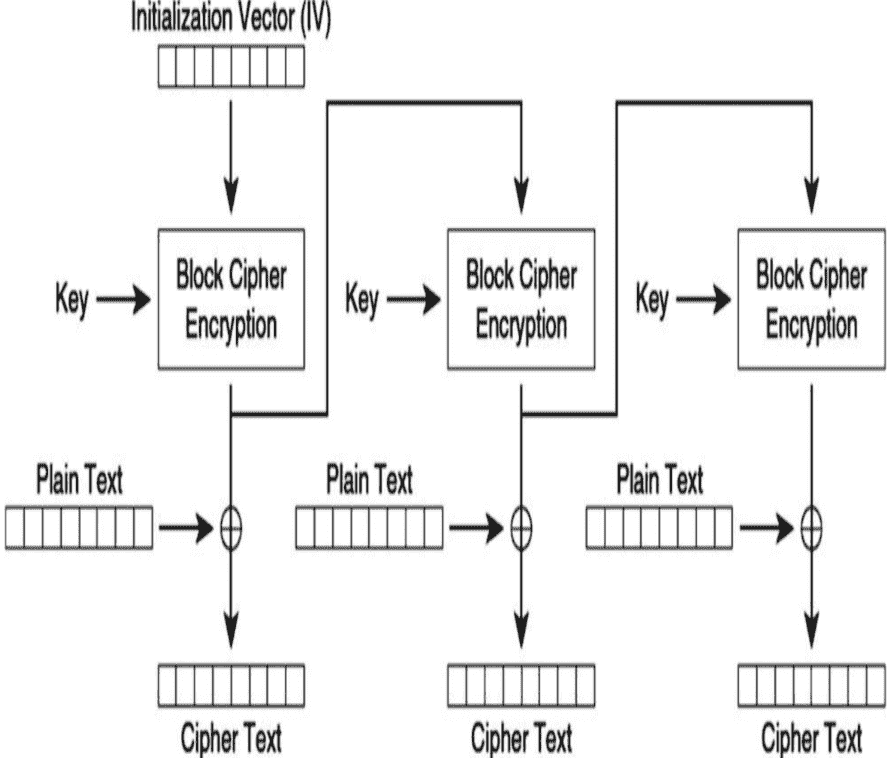

图 4.16 DES OFB 加密

## 计数器 (CTR) 模式

像 CF 和 OFB 模式一样，计数器模式也将将块密码实现为流密码，并在过程中添加了计数器。计数器是一个产生长时间不重复序列的函数。计数器值与初始化向量结合，产生进入对称密钥密码的输入。该值然后通过对称密钥使用块密码进行加密。计数器模式设计用于多处理器机器上的运行，其中块可以并行加密，如图 4.17 所示。

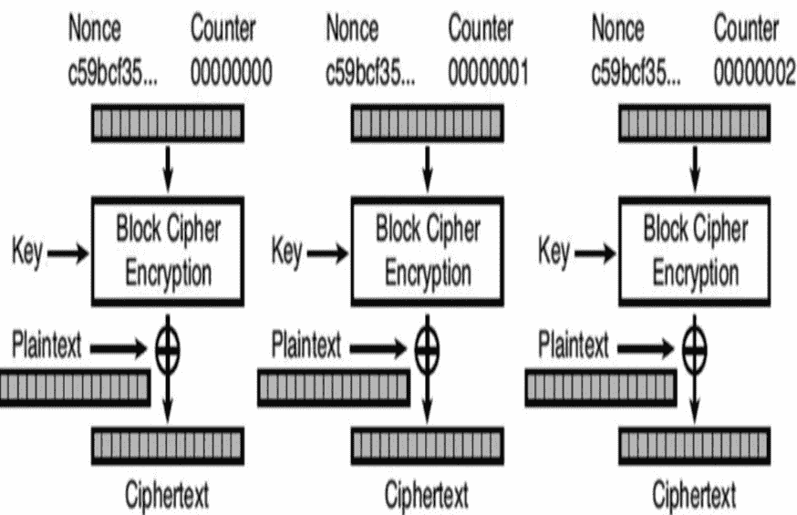

图 4.17 计数器模式加密

## 三重 DES (3DES)

在进入 3DES 的细节之前，让我们先看看为什么发明了 3DES。DES 的采用带有为期五年的认证，这意味着它每五年需要重新认证一次。虽然 DES 最初通过了认证且没有出现任何问题，但 NIST 发现 DES 开始过其实用性，并开始寻找替代方案。根据摩尔定律预测，每平方晶体管数量每 18 到 24 个月翻倍，处理能力也是如此。结果，原本需要多年破解的加密标准变得极易攻击。DES 的终结出现在 1998 年，当时 EFF 能够在约 23 小时内通过暴力破解 DES。实际攻击涉及了 100,000 台计算机。

尽管 DES 在多年中都能抵御破解，但 EFF 项目证明了对更强算法的需求。

在 AES 部署之前，政府尚未选择加密算法来替代它。需要一种临时解决方案来填补这一空白。有些人认为可以使用双重 DES。密码分析证明双重 DES 的安全性并不高于 DES；破解所需的工作量相同。双重 DES 还容易受到中间人攻击。

事实证明 3DES 提供了几何级数的性能增长。因此，为了延长 DES 加密标准的实用性，3DES 由使用两个或三个密钥加密数据组成，取决于实现方式；因此，它的有效密钥长度为 112 位或 168 位。3DES 执行 48 轮置换和替换。尽管它安全得多，但速度比 56 位 DES 慢三倍。DES 可以通过以下方式实现：

- DES EEE2：DES EEE 使用两个密钥。第一个密钥在第三轮加密中被重复使用。加密过程执行三次（加密、加密、加密）。
- DES EDE2：DES EDE 使用两个密钥。同样，第一个密钥在第三轮加密中重复使用。与 DES EEE2 不同，DES EDE 是加密、解密、然后加密。
- DES EEE3：DES EEE 使用三个密钥并执行三次加密过程，每次都是加密。有时，你会看到这些密码的数学总结。例如，在讨论使用 `E(K,P)` 的 DES-EEE3 时，`E` 表示使用密钥 `K` 对明文 `P` 进行加密，过程总结为 `E(K3,E(K2,E(K1,P)))`。
- DES EDE3：DES EDE 使用三个密钥，但通过加密、解密、然后加密数据来操作。图 4.18 展示了 EDE3。

# 明文

3DES 提供更强的加密

3DES 提供更强的加密


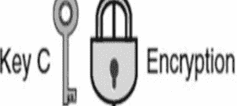


```
3A5g3=awe
#I1frOn9
```

密文

图 4.18 3DES EDE3

## 高级加密标准 (AES)

2002年，NIST 决定采用 DES 的替代方案，命名为 AES。当时审查了多种算法，并选择了 `Rijndael`（听起来像“rain doll”）。它的名字源于其两位开发者的名字：`Vincent Rijmen` 和 `Joan Daemen`。`Rijndael` 被认为是一种快速、简单且健壮的加密机制。

AES 可能是目前最重要的对称加密标准。它被广泛使用，常见于无线接入点和其他产品中。此外，`Rijndael` 能够很好抵御各种类型的攻击。`Rijndael` 算法使用三层变换来加密/解密消息块：

- 线性混合变换
- 非线性变换
- 密钥加变换

它还使用了并行的轮次，每轮包含四个步骤：

1. 字节替换 (`Byte sub`)：每个字节都通过 s-box 替换。
2. 行移位 (`Shift row`)：字节排列在矩形矩阵中并进行移动。
3. 列混合 (`Mix column`)：根据排列的矩形进行矩阵乘法。
4. 轮密钥加载 (`Add round key`)：状态的每个字节与轮密钥相结合。

在最后一轮中，跳过第四步，并重复第一步。

`Rijndael` 是一种迭代分组密码，且根据其开发情况，它支持 128、192 或 256 位的变长密钥和块：

- 如果密钥大小和块大小均为 128 位，则有 10 轮。
- 如果密钥大小和块大小均为 192 位，则有 12 轮。
- 如果密钥大小和块大小均为 256 位，则有 14 轮。

正如 AES 标准规定的，`Rijndael` 现在固定块大小为 128 位，但它仍然可以部署多种密钥长度。

## 国际数据加密算法 (IDEA)

IDEA 是一种 64 位的分组密码，使用 128 位密钥。尽管它被一家瑞士公司授予了专利，但它可免费用于非商业用途。它被认为是一种安全的加密标准，并且已知针对它的攻击。它像 DES 一样，以四种不同的模式运行。曾有人认为 IDEA 将取代 DES，但专利费阻止了这种发生。

## 里维斯特密码算法 (Rivest Cipher Algorithms)

Rivest 密码是 `Ron Rivest` 设计的一系列密码的统称，包括 `RC2`、`RC4`、`RC5` 和 `RC6`。`Ron Rivest` 是 RSA 的创建者之一。`RC1` 从未发布，而 `RC3` 在发布前就被密码分析破解了。

`RC2` 是该系列中的早期算法。它的特点是变长密钥的 64 位分组密码，可以作为 DES 的无缝替换。

`RC4` 是一种快速的流密码，比分组模式密码快，并被广泛使用。它特别适用于低功耗设备。40 位版本用于无线等效隐私协议 (WEP)。虽然 802.11 标准仅规定了 40 位密钥（配合 24 位 IV，产生 64 位 WEP），但许多供应商倾向于通过事实部署 104 位密钥（配合 24 位 IV，形成 128 位 WEP）来加强加密。

`RC5` 是一种基于分组的密码，轮数范围从 0 到 255 不等，密钥范围从 0 位到 2,048 位不等。`RC6` 类似；它使用变长密钥和密钥轮数。`RC6` 增加了 `RC5` 不具备的两个特性（整数乘法四个 4 位工作寄存器）。

## 非对称加密

非对称加密与对称加密不同，它使用两个独特的密钥，如图 4.19 所示。一个密钥加密的内容，另一个密钥必须解密。非对称加密最大的优势之一是它克服了对称加密的主要障碍之一：密钥分配。

## 明文

图 4.19 非对称加密

# 公钥

# 私钥

# 解密

# 密文

非对称加密与对称加密不同，它使用两个独特的密钥，如图 4.19 所示。一个密钥加密的内容，另一个密钥必须解密。非对称加密最大的优势之一是它克服了对称加密的主要障碍之一：密钥分配。

## 明文

图 4.19 非对称加密

# 公钥

# 私钥

# 解密

# 密文

非对称加密与对称加密不同，它使用两个独特的密钥，如图 4.19 所示。一个密钥加密的内容，另一个密钥必须解密。非对称加密最大的优势之一是它克服了对称加密的主要障碍之一：密钥分配。

（对称）密钥如下：

Alice 可以使用一个只有她拥有的私有值 $a$ 来计算：

```
$y^a = g^a \mod p$
```

Bob 可以使用一个只有他拥有的私有值 $b$ 来计算：

```
$y^b = g^b \mod p$
```

Alice 现在可以将 $y^a$（作为 Alice 的随机数，或 A-nonce）发送给 Bob，而 Bob 可以将 $y^b$（作为 Bob 的随机数，或 B-nonce）发送给 Alice。再次，Alice 使用她的私有值 $a$ 处理 B-nonce。她的结果将是 $(y^b)^a$，或者：

```
$g^{ab} \mod p$
```

同样，Bob 使用他的私有值 $b$ 从收到的 A-nonce 计算出 $(y^a)^b$：

但你猜怎么着：在数学上，$g^{ba} \mod p$ 和 $g^{ab} \mod p$ 是等效的。因此，实际上，Bob 和 Alice 刚刚安全地交换了一个新的密钥。

`Diffie-Hellman` 容易受到中间人攻击，因为密钥交换没有对参与者进行验证。为了证明真实性，应该使用数字签名和数字证书——通过提前接受某人的公钥（有时在 PKI 内部）。`Diffie-Hellman` 与多种身份验证方法结合使用，包括 IPsec 的互联网密钥交换（IKE）组件。

以下是关于 `Diffie-Hellman` 你应该了解的一些重要事实：

- 它是第一个非对称算法。
- 它提供密钥交换服务。
- 它被认为是一种协商协议。
- 它通过离散对数运行。

# RSA

RSA 由 `Ron Rivest`、`Adi Shamir` 和 `Len Adleman` 于 1977 年在麻省理工学院（MIT）开发。该密码的名字基于他们的首字母。尽管 RSA 的速度比对称加密系统慢得多，但它提供了对称密钥交换并被认为非常安全。RSA 基于质数分解，但为了确保安全，它必须使用乘积远大于 129 位的质数。小于 130 位的十进制已经使用数域筛法算法进行了分解。对于 CISSP 考试，你不需要了解 RSA 公钥和私钥的内部原理，但本节中的信息对你作为安全专业人员非常有用。

通常，明文被分成等长度的块，每个块少于 $n$ 位数字，并对每个块进行加密和解密。密码分析师或任何试图破解 RSA 的人将面临巨大的挑战：将一个大整数分解为两个因数。破解密钥需要巨大的计算机处理能力和时间。RSA 支持高达 2,048 位的密钥长度。

RSA 算法已成为工业级加密的事实标准，特别是在 2000 年专利过期之后。它已被构建到许多协议、固件和软件产品中，例如 `Microsoft Edge`、`Google Chrome` 和 `Mozilla Firefox`。

## 注意

LUC 是 RSA 的替代方案，尽管它并没有广泛使用。它发明于 1991 年，使用 `Lucas` 函数。

## 注意

XTR 是由 `Arjen Lenstra` 和 `Eric Verheul` 开发的公钥密码系统，也基于有限域离散对数，被视为所有离散对数函数的通用超集函数。

# El Gamal

`El Gamal` 是 `Diffie-Hellman` 交换和加密的扩展。`El Gamal` 由三个离散组件组成：密钥生成器、加密算法和解密算法。它发布于 1985 年，其安全性建立在解决离散对数问题的困难之上。

# 椭圆曲线密码系统 (ECC)

ECC 被认为比之前的非对称算法更安全，因为基于离散对数问题的系统更难被破解。椭圆曲线通常定义在有限域（如实数和有理数）上，并类似于离散对数问题的实现。椭圆曲线由以下方程定义：

```
$y^2 = x^3 + ax + b$
```

以及单一点 O，无穷点。椭圆曲线空间具有以下属性：

- 加法是模乘法的对应物。
- 乘法是模幂的对应物。

因此，给定椭圆曲线上的两个点 $P$ 和 $R$，其中 $P=KR$，寻找 $K$ 被称为*椭圆曲线离散对数问题*。ECC 很快。根据 RFC 4492，ECC 中使用的 163 位密钥与 RSA 算法中使用的 1024 位密钥具有类似的加密强度。因此，它可以实现在更小、性能更弱的设备上，如智能手机、平板电脑、智能卡和其他手持设备。

# Merkle-Hellman 背包

`Merkle-Hellman` 背包（Knapsack）是一种基于固定权重的非对称算法。尽管该系统曾流行过一段时间，但在 1982 年被破解了。

# 对称与非对称加密系统回顾

为了帮助你在 CISSP 考试中取得成功，表 4.9 对比了对称和非对称加密系统。

表 4.9 对称与非系统的属性与特性

| 对称 | 非对称 |
| --- | --- |
| 机密性 | 机密性、完整性、身份验证和不可否认性 |
| 单一共享密钥 | 两个密钥：公钥和私钥 |
| 需要带外交换 | 适用于带内交换 |
| 密钥小且快 | 可扩展，密钥较大 |
| 不可扩展 | 数字签名、数字证书 |

# 考试

在尝试 CISSP 之前，最好知道哪些类别属于以下：花时间复习：

- 离散对数函数：`El Gamal`
- 质数函数：RSA
- 固定权重函数：`Merkle-Hellman`
- 椭圆曲线函数：椭圆曲线密码系统

# 混合加密

到本章为止，我们分别讨论了对称和非对称加密，它们各有优缺点。混合加密使用了对称的速度和非对称的“密钥交换能力”。如果 `Michael` 想给 `Betsy` 发送消息，将发生以下情况（见图 4.20）：

1. `Michael` 为封装方案生成随机密钥。我们可以称之为会话密钥。
2. `Michael` 使用会话密钥加密数据。
3. `Michael` 使用 `Betsy` 的公钥加密会话密钥。
4. `Michael` 将加密后的密钥和数据都发送给 `Betsy`。
5. `Betsy` 使用她的私钥解密会话密钥，然后解密消息。

几乎所有现代密码系统都是这样构建的。混合系统包括 IPsec、PGP、SSH、SET、SSL、WPA2-Enterprise 和 TLS。（这些系统将在稍后详细讨论。）

[注：此处原文未提供图片内容，仅有占位符，翻译时按要求要求仅保留占位符。]


图 4.20

混合加密

1. 发送者使用对称算法加密数据。
2. 发送者使用非对称算法加密密钥。
3. 将密钥和数据发送给接收者。

1. CA 在 RA 的帮助下对证书请求进行验证。
2. 个人身份将得到验证。
3. 由 CA 创建证书，该证书证明该人员与提供的公钥相匹配。

## 注册机构 (Registration Authorities)

RA 就像一个信使：它位于客户端和 CA 之间。虽然 RA 无法生成证书，但它能够接受请求、验证个人身份，并将信息传递给 CA 以生成证书。

当证书服务扩展到涵盖大地理区域时，RA 充着着关键作用。一个中央 CA 可以将其职责委托给全球各地的 RA。

## 考试提示 (ExamAlert)

预计会看到涉及 PKI 工作原理的 CISSP 考试题。重要的是要理解 RA 无法颁发证书。

## 证书吊销列表 (Certificate Revocation Lists)

就像驾照一样，数字证书并不总是保持有效。（我有一个姨妈，用过期的执照开了好了多年。在她的情况下，她是担心自己在 95 岁时可能无法通过视力检查。）在企业生活中，证书可能会因为人员离开公司、信息变更或私钥被泄露而失效。出于这些原因，必须维护 CRL。

CRL 由 CA 维护，CA 通过对列表进行签名来维护其准确性。每当报告数字证书问题时，这些证书被视为无效，CA 将其序列号添加到 CRL 中。任何请求数字证书的人都可以检查 CRL 以验证证书的完整性。CRL 的替代方案是在线证书状态协议 (OCSP)；它采用客户端/服务器设计，扩展性比 CRL 好。当用户请求访问服务器时，OCSP 会发送证书状态信息的请求。服务器返回当前、过期或未知的响应。无论使用哪种方法，证书问题都不是新鲜事；若要了解 2015 年 Dell 的证书问题，请参 `www.infoworld.com/article/3008422/security/what-you-need-to-know-about-deals-root-certificate-security-debacle`。

## 数字证书 (Digital Certificates)

数字证书是 PKI 系统的核心。数字证书承担两个角色：

- 它确保公钥的完整性，并确保密钥保持不变且处于有效状态。
- 它验证公钥是否与所述的所有者绑定，并确保所有关联信息真实准确。

实现这些目标所需的信息被添加到数字证书中。数字证书采用 X.509 标准格式，其最新版本是版本 3。版本 3 的关键进展之一是增加了扩展。版本 3 包含了支持其他拓扑结构的灵活性。它可以像 PGP 一样作为信任网运行。X.509 证书包含以下元素，图 4.21 显示了某些元素的示例：

- 版本 (Version)
- 序列号 (Serial number)
- 算法 ID (Algorithm ID)
- 颁发者 (Issuer)
- 有效期 (Validity)
  - 早于（指定日期）
  - 不晚于（指定日期）
- 主体 (Subject)
- 主体公钥信息 (Subject public key information)
  - 公钥算法
  - 主体公钥 (Subject public key)
- 颁发者—唯一标识符（可选）
- 主体—唯一标识符（可选）
- 扩展（可选）

## 证书查看器：“www.google.com”

此证书已通过以下用途的验证：

### SSL 服务器证书

| 字段 (Field) | 值 (Value) |
| :--- | :--- |
| 颁发给 (Issued To) | |
| 通用名称 (CN) | `www.google.com` |
| 组织 (O) | Google Inc |
| 组织单位 (OU) | <不属于证书> |
| 序列号 (Serial Number) | `AE4:C25:C3:ED:CF:60:D4:95:9C:4F:C3:F1:89:32:48` |
| 颁发者 (Issued By) | |
| 通用名称 (CN) | avast! Web/Mail Shield Root |
| 组织 (O) | avast! Web/Mail Shield |
| 组织单位 (OU) | 由 avast! antivirus 用于 SSL/TLS 扫描生成 |
| 有效期 (Period of Validity) | |
| 开始日期 (Begins On) | 2020年3月23日，星期三 |
| 过期日期 (Expires On) | 2020年6月15日，星期三 |
| 纹纹 (Fingerprints) | SHA-256 指纹 `0F:D1:C5:DD:A8:82:62:F5:E2:FB:92:06:F0:A8:45:54:9E` |

## 图 4.21 X.509 证书

数字证书提供了一种验证网络上实体身份的方法。它们由证书颁发机构（CA）签名，并包含实体的公钥和其他信息。

> 注意：数字证书提供了一种验证网络上实体身份的方法。它们由证书颁发机构（CA）签名，并包含实体的公钥和其他信息。

## 客户端在 PKI 中的作用

它似乎到目前为止，所有的工作都落在了 CA 的肩上；这并不完全正确。客户端负责请求数字证书并维护其密钥的安全性。私钥的丢失或泄露将是灾难性的，它意味着通信不再安全。

组织应该关注以下七个密钥管理问题：

* 生成 (Generation)
* 分发 (Distribution)
* 安装 (Installation)
* 存储 (Storage)
* 密钥更改 (Key change)
* 密钥控制 (Key control)
* 密钥销 (Key disposal)

密钥恢复和控制是一个必须解决的重要问题。一种基本的恢复和控制方法是 M of N 控制。这种方法旨在确保没有人拥有完全控制权；它与双重控制密切相关。因此，M of N 控制应该要求物理在场执行。这是一个例子：假设典型的 M of N 控制具有访问服务器的权限，且必须至少两人在场。在这种情况下，M = 2，N = 4。这将确保没有一个人可以破坏安全系统或获得访问权限。

> 注意：许多组织使用硬件安全模块 (HSM) 来安全地存储和检索密钥。HSM 系统保护密钥，并在检测到未经授权的访问时通过破坏密钥材料来防止篡改。

## 完整性与身份验证 (Integrity and Authentication)

加密为用户提供的能力之一是验证完整性和身份验证。完整性向接收者保证信息保持不变且处于其真实的原始形式。身份验证提供了确保消息确实自自发送者且发送到了目标接收者的能力。为了帮助你成功通过 CISSP 考试，请复习表 4.10 中列出的完整性方法。

# 表 4.10 完整性验证

| 方法 (Method) | 描述 (Description) |
| :--- | :--- |
| 校验位 (Parity) | 网络中简单的错误检测码 |
| 哈希 (Hashing) | 完整性 |
| 数字签名 (Digital signature) | 完整性、身份验证和不可否认性 |
| 哈希消息认证 (Hashed MAC) | 完整性和数据源身份验证 |
| CBC MAC (CBC MAC) | 完整性和数据源身份验证 |
| 校验和 (Checksum) | 冗余检查，弱完整性 |

## 哈希与消息摘要 (Hashing and Message Digests)

哈希算法通过取可变的数据并将其压缩为固定长度的值（称为哈希值）来工作。哈希提供了数据的指纹或消息摘要。强哈希算法很难破解，并且不会为不同的产生相同的哈希值。

两条或多个消息。根据算法的使用方式，哈希可以用于实现完整性和/或不可否认性的目标。哈希可以帮助验证信息是否保持不变。图 4.22 提供了哈希过程的概述。

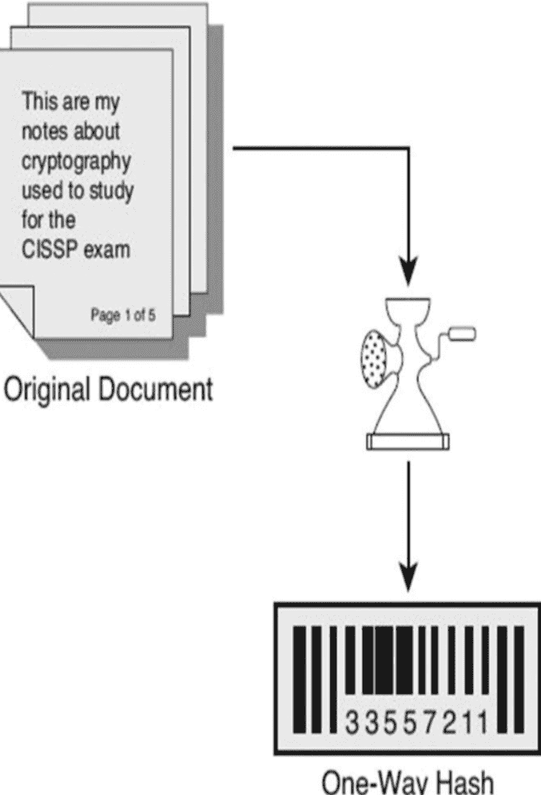

# 图 4.22

哈希

哈希算法的设计目的并不是逆向还原数据。

消息摘要的目的是验证数据和消息的完整性。在一个良好的消息摘要中，即使输入字符串发生细微变化，输出的哈希值也会发生巨大变化。这被称为雪崩效应。例如，SolarWinds 的某个版本受到 Sunburst 攻击，其 MD5 哈希值为 `b91ce2fa41029f6955bf2f0079468448`。这意味着如果该哈希与 SolarWinds 版本匹配，你运行的版本将使你暴露在 Sunburst 恶意软件之下。另一个值则表示你所拥的版本可能没有漏洞。

诸如 Tripwire、MD5sum 和 Windows 系统文件验证等程序依赖于哈希。常见的哈希算法包括：

- 消息摘要算法系列 (Message-Digest algorithm series)
- 安全哈希算法 (SHA)
- HAVAL
- RIPEMD
- Whirlpool
- Tiger

> 注意
> 虽然有很多哈希算法，但常用的两种是 SHA 和 MD 系列。

哈希最大的问题是碰撞的可能性。当两个或多个不同的输入产生相同的输出时，就会发生碰撞。通过转向产生更大哈希值的算法可以减少碰撞。

> 注意
> 在考虑哈希值时，记住：接近并不等于相等！如果所比较的哈希在任何方面存在差异——即使只差一个位——所处理的数据也是不同的。

## MD 系列

所有的 MD 算法都由 Ron Rivest 开发。随着技术的进步，多年来经历了一系列版本。原始的 MD2 是针对 8 位计算机优化的，已经有些过时了。它不再受到青睐，是因为发现 MD2 会受到碰撞的影响。MD4 是下一个开发的算法。消息以 512 位块进行处理，并加上消息原始长度的 64 位二进制表示，该表示被连接到消息上。与 MD2 一样，发现 MD4 容易受到可能的攻击。这就是开发 MD5 的原因；它可以被认为是带有额外安全机制的 MD4。MD5 处理变变长度的输入并产生固定的 128 位输出。与 MD4 类似，它以 512 位块处理数据。

## 提示

> 当两个不同的消息通过哈希产生相同的消息摘要值时，就会发生碰撞。这是不可接受的，因为它可能会掩盖修改内容的事实。MD5 和 SHA-0 已证明容易受到强制碰撞。

## SHA-1/2

SHA-1 是安全哈希算法 (SHA) 的一个版本，与 MD5 相似。它被认为是 MD5 的继者，产生 160 位的消息摘要。SHA-1 以 512 位块处理消息，并在需要时添加填充，以使数据总和达到正确的位数。在 160 位中，SHA-1 只有 111 位是有效的。SHA-1 是 SHA 算法系列之一，包括 SHA-0、SHA-1 和 SHA-2。SHA-0 不再被认为是安全的，且不推荐 SHA-1。SHA-2 实际上是一个函数族，是 SHA-1 的安全替代品。SHA-2 包括 SHA-224、SHA-256、SHA-384 和 SHA-512。

## SHA-3

SHA-3 是最新的哈希算法族，旨在取代 SHA-1 和 SHA-2。

## HAVAL

HAVAL 是另一种与 MD5 类似的单向哈希算法。与 MD5 不同，HAVAL 不限于固定的消息摘要值。HAVAL-328 执行三次并产生 128 位的指纹；HAVAL-256 执行四次并产生 256 位的指纹。

## 消息认证码 (MAC)

消息认证码 (MAC) 是用于验证消息真实性和完整性的短信息。它通过使用密钥对消息进行哈希创建。有几种类型的 MAC：CBC-MAC、HMAC 和 CMAC。

## CBC-MAC

密码块链 MAC (CBC-MAC) 是分组密码的一种运行模式。它基于 CBC 运行模式，用于为固定长度的消息创建 MAC。

## HMAC

基于哈希的消息认证码 (HMAC) 是一种涉及加密哈希函数和密钥的消息认证码。它用于验证消息的完整性和真实性。

## CMAC

基于密码的消息认证码 (CMAC) 是一种使用分组密码的 MAC。它与 CBC-MAC 类似，但专为变长度消息设计。它更能抵抗长度扩展攻击。

## 数字签名

数字签名用于验证消息的真实性和完整性。它们通过对消息进行哈希并用发送者的私钥加密哈希来创建。接收者随后使用发送者的公钥解密签名并比较哈希。如果哈希匹配，则签名有效。

## DSA

有了标准后，事情会变得简单得多，这就是数字签名算法 (DSA) 的初衷。NIST 在 1991 年提出的 DSA 标准旨在标准化数字签名标准 (DSS)。DSA 涉及密钥生成、签名生成和签名验证。它结合 SHA-1 和公钥加密创建 160 位的哈希。签名速度相当于 RSA 签名，但签名验证要慢得多。DSA 数字签名是一对表示为二进制位的大数。

## 密码学系统回顾

作为回顾并帮助你成功通过 CISSP 考试，请回顾表 4.11 中著名的密码学系统。

| 类别 | 算法 |
| --- | --- |
| 对称 | DES, 3DES, Blowfish, Twofish, IDEA, CAST, SAFER, Skipjack 和 RC 系列 |
| 非对称 | RSA, ECC, Diffie-Hellman, Knapsack, LUC 和 El Gamal |
| 哈希 | MD 系列、SHA 系列、HAVAL, Tiger, Whirlpool 和 RIPEMD |
| 数字签名 | DSA |

## 密码学攻击

由于密码学可能成为一种强大的工具，且破解许多算法的能力有限，因此成立了多边出口管制协调委员会（CoCom）来处理加密系统的控制问题。CoCom于1994年解散，并被《关于常规武器和军民两用货物及技术出口的瓦森纳协定》取代。瓦森纳协定得到了广泛支持，聚集了30多个国家共同控制加密技术的出口。

# 美国政府可以用来破解加密的方法

美国政府必须应对许多使用加密技术的个人和组织，例如恐怖分子和有组织犯罪。举报人爱德华·斯诺登（Edward Snowden）公开的文件揭露了美国安全局（NSA）用于破解加密系统的某些密码分析技术。这些技术包括对国际加密标准的制定实施控制、使用超级计算机对算法进行暴力破解，以及与科技公司和互联网服务供应商合作，在商业加密软件中植入后门或陷门。据传NSA与主要的杀毒软件公司合作开发出不会被杀毒软件检测到的软件。你可以在以下网址了解更多关于这些技术：

`www.spiegel.de/international/germany/inside-the-nsa-s-war-on-internet-security-a-101036.html`

启动加密攻击之前需要考虑的问题是算法的已知程度。它是公开的还是私有的？奥古斯特·柯尔克霍夫（Auguste Kerckhoffs）被认为在19世纪创立了柯尔霍夫法则，该原则规定加密系统不需要保密；除了密钥之外，一切应该是公开的。这种争论的一个例子可以在内容加密系统（CSS）的开发和破解中看到这种加密方法由DVD复制控制协会（DVD CCA）开发。由于该算法是专利所有的，因此并未公开。CSS的设计仅允许授权的DVD播放器解码存储在原始DVD光盘上的加密内容。直到乔·利奇·约翰森（Jon Lech Johansen）等人在1999年聚在一起破解了CSS并在互联网上发布了一个名为DeCSS的工具。因此，尽管有些人主张算法是安全的，但其他人继续相信开放标准和系统能够提供更健壮、更安全的系统。

在对一些基础知识进行回顾后，让我们来看一些可能针对加密系统的常见攻击技术：

- 已知明文攻击：这种攻击要求攻击者拥有一个或多个消息的明文和密文。像`zip`这样的加密文件存档容易受到这种攻击。
- 纯密文攻击：这种攻击要求攻击者获取几个使用相同加密算法加密的密文。攻击者没有相关的明文，但试图通过寻找模式和使用统计分析来破解代码。
- 选定密文攻击：如果攻击者可以解密密文消息的部分，则可以使用解密部分来发现密钥。
- 选定明文攻击：攻击者可以对明文消息进行加密，然后分析密文输出。
- 差分密码分析：这种攻击通常用于针对块密码，通过寻找被加密的相关明文位之间的差异，以及它们产生的密文之间的差异来实现。
- 线性密码分析：与差分密码分析一起，这是针对块密码最广泛使用的两种攻击之一。线性密码分析使用函数来识别加密过程中使用特定密钥的最高概率。然后对密钥对进行研究，以获得用于创建这些密钥对的密钥的信息。
- 生日攻击：这种攻击得名生日悖论，该悖论指出在一个群体中，两个或更多人共享生日的概率异常地高。这种逻辑也被应用于计算哈希函数中的碰撞。如果哈希函数的输出不够大以避免碰撞，则消息摘要就可能受到生日攻击。
- 密钥聚类：当两个密钥对同一个消息产生相同的密文时，就会发生这种漏洞。这可能是由于密钥空间较小，或者是某些加密系统的特征。密钥聚类是一个真实的问题，意味着两个或多个不同的密钥也可以解密安全内容。一个强大的加密系统应该具有低频率的密钥聚类。如果没有，这就是加密系统可能被针对攻击的另一种方式。
- 重放攻击：当攻击者可以拦截加密密钥并在稍后重用它们加密或解密消息时，就会发生这种攻击。
- 中间人攻击：当攻击者将自己置于两个用户的通信路径上时就会就会这种攻击。从这个位置，攻击者可能拦截并修改通信。
- 旁信道攻击：这种攻击基于信道信息，如定时、声音或电磁泄漏。

## 考试警报

在比较加密算法时，重要的是工作量（work factor）越大，加密系统越强。密码学家开发具有高工作量的系统是为了抵御攻击，而不是为了万无一失。有时攻击者只是寻找尚未被发现的漏洞。这些被称为零日漏洞。

- 软管攻击：当所有其他方法失败时，可能会使用这种方法来提取密钥值或其他信息。这种攻击可能包括威胁、暴力、勒索或敲诈，因为人类是加密系统中更大的弱点。

在尝试进行加密攻击时，必须考虑工作量。工作量可以衡量为对加密系统进行暴力破解所需的时间和精力。以下是最近发生的针对加密系统的成功攻击示例：

- BEAST：BEAST利用了SSL 3.0的缺陷。
- CRIME AND BREACH：CRIME针对压缩，而BREACH使用了HTTP。
- Cryptolocker：Cryptolocker具有加密能力。
- DROWN：DROWN利用了SSL 2。
- FREAK：FREAK利用了弱密钥。
- Meltdown：Meltdown针对硬件。


- POODLE：POODLE 影响了 TLS。

- Spectre：Spectre 针对硬件和分支预测。

# 场地与安全

记住，良好的安全需要多层防御。场地和设施控制是强化安全的重要部分。它们在第 6 章“身份与访问管理”和第 8 章“安全运营”中有详细介绍，但本节介绍了一些用于物理安全的控制措施：

## 物理访问控制

这些控制措施包括大门、围栏、门和锁。围栏可以使用各种材料制成，如钢、木材、砖块或混凝土，但必须符合所需的保护水平。保安也可以用于监控、签到和引导访客。锁有许多尺寸、类型和形状可供。

## 证据存储控制

如果你维护安全运营中心或处理计算机取证，你可能需要证据存储区域。通常，此类存储位于安全区域，配有带锁的安全柜或保险箱，以及记录监管链记录的日志。

## 限制访问和工作区域安全

安全设计的目标应该是让未经授权的人员获取敏感资源变得困难。

## HVAC 和环境控制

热量会对计算机设备造成损坏，大多数数据中心保持在 70 华氏度。安全管理应该知道谁负责 HVAC 系统，并且必须对系统进行控制，以保护组织免受化学和生物威胁。电力像 HVAC 一样，是我们大多数人理所当然的资源。即使是电力可靠的区域也可能出现停电、线路噪声或电磁干扰。企业必须准备应对所有这些因素。不间断电源（UPS）通常有助于解决这些问题。

## 火灾预防、检测和抑制控制

预防的很大一部分是确保人们接受培训并知道如何预防潜在的火灾危险。政策必须规定如何培训员工来应对火灾。公司应确保配备适当且运行良好的火灾检测设备，以便员工能够对潜在的危险发出警报。仅仅收到警报是不够的。员工需要知道应该做什么以及如何处理不同类型的火灾。

## 注意

物理安全将在第 6 章和第 8 章中有更深入的介绍。

# 考试备习题

1. 下列哪项最符合超标量处理器？

   - A. 超标量处理器一次只能执行一条指令。
   - B. 超标量处理器有两个大型缓存，用作输入和输出缓冲区。
   - C. 超标量处理器可以同时执行多条指令。
   - D. 超标量处理器有两个大型缓存，用作输出缓冲区。

2. 下列哪项是由程序员开发，并用于在开发期间允许跳过正常流程，但在交付给客户时仍保留在软件中的？

   - A. 后门（Backdoors）
   - B. 陷阱（Traps）
   - C. 缓冲区溢出（Buffer overflows）
   - D. 隐道（Covert channels）

3. 下列哪种攻击发生在攻击者拦截会话密钥并在稍后重用它们时？

   - A. 已知明文攻击（Known plaintext attack）
   - B. 纯密文攻击（Ciphertext-only attack）
   - C. 中间人攻击（Man-in-the-middle attack）
   - D. 重放攻击（Replay attack）

4. 下列哪项是对称加密的缺点？

   - A. 密钥长度（Key size）
   - B. 速度（Speed）
   - C. 密钥管理（Key management）
   - D. 密钥强度（Key strength）

5. 下列哪项不是对称算法的示例？

   - A. DES
   - B. RC5
   - C. AES
   - D. RSA

6. 下列哪个是第一个开发的基于机密性的模型？

   - A. Bell-LaPadula
   - B. Biba
   - C. Clark-Wilson
   - D. Take-Grant

7. 下列哪个模型是基于完整性的，并为商业应用开发的？

   - A. 信息流模型（Information flow model）
   - B. Clark-Wilson 模型
   - C. Bell-LaPadula 模型
   - D. Brewer and Nash 模型

8. Biba 模型解决了下列哪个问题？

   - A. 关注内部威胁
   - B. 关注外部威胁
   - C. 处理机密性
   - D. 处理可用性

9. 哪个模型也被称为中国墙（Chinese Wall）？

   - A. Biba 模型
   - B. Take-Grant 模型
   - C. Harrison-Ullman 模型
   - D. Brewer and Nash 模型

10. 哪种哈希算法产生 160 位的输出？

    - A. MD2
    - B. MD4
    - C. SHA-1
    - D. El Gamal

11. Bell-LaPadula 模型中 ** 属性的结果是什么？

    - A. 不向上读（No read up）
    - B. 不向上写（No write up）
    - C. 不向下读（No read down）
    - D. 不向下写（No write down）

12. Biba 模型简单完整性属性的结果是什么？

    - A. 不向上读（No read up）
    - B. 不向上写（No write up）
    - C. 不向下读（No read down）
    - D. 不向下写（No write down）

13. 下列哪项可用于连接不同的系统？

    - A. 标签（Labels）
    - B. 引用监控器（Reference monitor）
    - C. 控制器（Controls）
    - D. 卫兵（Guards）

14. 下列哪种操作模式最能描述用户了解所有数据的需求？

    - A. 专用（Dedicated）
    - B. 系统级（System high）
    - C. 分段（Compartmentalized）
    - D. 多级（Multilevel）

15. 下列哪个安全模型使用了 TLC 概念？

    - A. Biba 模型
    - B. Clark-Wilson 模型
    - C. Bell-LaPadula 模型
    - D. Brewer and Nash 模型

16. 下列哪种 DES 模式被认为最容易受到攻击？

    - A. CBC
    - B. ECB
    - C. CFB
    - D. OFB

17. DES 使用的密钥长度是多少？

    - A. 56 位
    - B. 64 位
    - C. 96 位
    - D. 128 位

18. 哪种 Triple DES 的实现方式在第一次和第三次迭代中使用相同的密钥？

    - A. DES-3
    - B. HMAC
    - C. DES-2
    - D. DES-X

19. 下列哪种算法用于密钥分配，而不是加密或数字签名？

    - A. El Gamal
    - B. HMAC
    - C. Diffie-Hellman
    - D. ECC

20. 你正在使用文件完整性程序 Tripwire，并被要求审查加密程序的一些近期问题。当两个不同的密钥为相同的消息生成相同的密文时，这称为什么？

    - A. 哈希处理（Hashing）
    - B. 冲突（Collision）
    - C. 密钥聚类（Key clustering）
    - D. 输出验证（Output verification）

# 考试备习题答案

1. C. 超标量处理器可以同时执行多条指令。答案 A 描述的是标量处理器；它一次只能执行一条指令。答案 B 没有描述超标量处理器，因为它没有两个用作输入和输出缓冲区的大型缓存。答案 D 是错误的，超标量处理器没有两个用作输出缓冲区的大型缓存。

2. A. 程序员在开发期间使用后门（也称为维护钩子）来方便访问软件，但这些在交付给客户时仍保留在软件中。答案 B 是错误的，简单网络管理协议（SNMP）用于向管理站报告严重状况。答案 C 是错误的，缓冲区溢出是由于编程不当导致的。答案 D 是错误的，隐道是一种以非预期方式移动信息的方法。

3. D. 重放攻击发生在攻击者拦截会话密钥并在稍后重用它们时。答案 A 是错误的，已知明文攻击需要攻击者拥有一个或多个消息的明文和密文。答案 B 是错误的，纯密文攻击需要攻击者使用相同算法获取多个消息。答案 C 是错误的，中间人攻击发生在攻击者位于两个用户之间的通信路径中。

4. C. 密钥管理是对称加密的主要缺点。答案 A、B 和 D 是错误的，因为加密速度、长度和强度都不是对称加密的缺点。

5. D. RSA 是一种非对称算法。答案 A、B 和 C 是正确的，DES、RC5 和 AES 都是对称算法的示例。

6. A. Bell-LaPadula 是第一个开发的基于机密性的模型。答案 B、C 和 D 是错误的：Biba 和 Clark-Wilson 模型都涉及完整性，而 Take-Grant 模型基于四个基本操作。

7. B. Clark-Wilson 模型是为商业活动开发的。该模型规定强制职责分离、主体必须通过应用程序访问数据，并且需要进行审计。答案 A、C 和 D 是错误的。信息流模型处理信息流并可用于保护完整性或机密性。Bell-LaPadula 模型是一个机密性模型，而 Brewer and Nash 模型是为了防止利益冲突而开发的。

8. B. Biba 模型假设内部威胁已受到良好编码实践的保护，因此关注外部威胁。答案 A、C 和 D 是错误的。Biba 模型处理完整性而非可用性或机密性。

9. D. Brewer and Nash 模型也被称为中国墙，专门为了防止利益冲突而开发。答案 A、B 和 C 是错误的。

10. C. SHA-1 产生 160 位的输出。

11. A. 不向上读（No read up）

12. C. 不向下读（No read down）

13. D. 卫兵（Guards）

14. D. 多级（Multilevel）

15. B. Clark-Wilson 模型

16. B. ECB

17. A. 56 位

18. C. DES-2

19. C. Diffie-Hellman

20. B. 冲突（Collision）

17. A. 每个 64 位明文块被分为两个 32 位的块，然后由 56 位密钥进行处理。总密钥大小为 64 位，但其中 8 位用于校验，因此 64 位、96 位和 128 位是错误的。

18. C. DES-EDE2 使用相同的密钥进行第一次和第三次加密通过。答案 A、B 和 D 都是错误的：DES-EE3 使用三个不同的密钥进行加密；SHA-HAVAL 是用于哈希处理，而 DES 不使用它；DES-X 是 DES 的变体，密钥大小仅为 56 位，它是为 DES 设计的，而不是 3DES。

19. C. Diffie-Hellman 用于密钥分发但不用于加密或数字签名。答案 A 是错误的，因为 El Gamal 用于数字签名、数据加密和密钥交换。答案 B 是错误的，因为 SHA-HAVAL 用于哈希处理。答案 D 是错误的，因为 ECC 用于数字签名、数据加密和密钥交换。

20. C. 当两个密钥对相同的消息产生相同的密文时，称为密钥聚类（Key clustering）。一个良好的算法在明文上使用不同的密钥，应该生成不同的密文。答案 A、B 和 D 都是错误的：哈希用于完整性验证；当两个不同的消息被哈希处理并输出相同的消息摘要时会发生碰撞；输出验证仅仅是一个干扰项。

## 想了解更多吗？

- 微码：https://www.techpedia.com/definition/8332/microcode
- 信任与保证：www.cs.clemson.edu/course/cpsc420/material/Assurance/Assurance%20an%20Trust.pdf
- TPM 绑定与密封：https://docs.microsoft.com/it-it/windows/iot-core/secure-your-device/tpm
- 隐蔽计时通道攻击：http://crypto.stanford.edu/~dabo/papers/ssl-timing
- 数字权限管理：https://digitalguardian.com/blog/what-digital-rights-management
- HVAC 与网络安全：https://www.propmodo.com/the-cyber-security-threats-lurking-in-your-hvac-system/
- 限制区域与工作区域安全：https://info-savvy.com/cissp-restricted-and-work-area-security-bk1d3t11s6/
- Bell-LaPadula 模型：scrc.nist.gov/publications/secpubs/rainbow/std001.txt
- ISO 17799：https://www.iso.org/standard/39612.html
- 嵌入式设备漏洞：http://www.cse.psu.edu/~pm12/cse597g-f15/readings/cse597g-embedded_systems.pdf
- 工业控制系统的五种常见漏洞：https://www.lanner-america.com/blog/5-common-vulnerabilities-industrial-control-systems/
- 对称加密：https://www.thesslstore.com/blog/symmetric-encryption-101-definition-how-it-works-when-its-used/
- Web 系统中的十类漏洞：https://www.terraats.com/2019/03/12/10-types-of-security-vulnerabilities-for-web-applications/
- 站点与设施安全控制清单：http://www.mekabay.com/infosemgmt/facilities_checklist.pdf
- BIBA 安全模型：http://nathanbalon.com/projects/cis576/Biba_Security.pdf

# 第 5 章 通信与网络安全

你需要理解的术语：

- 地址解析协议（ARP）
- 域名系统（DNS）
- 防火墙
- 网络地址翻译（NAT）
- IP 安全（IPsec）
- 开放系统互连模型（OSI）
- 传输控制协议/网际协议（TCP/IP）
- 局域网（LAN）
- 广域网（WAN）
- 云计算

你需要掌握的主题：

- 安全网络设计
- LAN 和 WAN 拓扑结构的区别
- OSI 模型及其层
- TCP/IP 栈的四层
- 收敛协议

## 引言

CISSP 考试中的“通信与网络安全”领域涵盖了通信和网络安全。这是较大的领域之一，预计约有 13% 的考试题目涉及此主题。

毕竟，这个领域涵盖了安全专业人员需要的许多核心概念。掌握该领域要求你完全理解网络、TCP/IP、LAN、WAN、电信设备、无线网络以及相关的安全控制措施。精通网络安全要求你理解用于防止网络攻击的技术。

如果你已经在网络安全领域工作了一段时间，那么你可能只需要对本章的材料进行快速复习。如果你的工作使你专注于其他领域，那么你将会在本章上花费足够的时间，复习相关材料以确保你掌握了考试所需的必备知识。

# 安全网络设计

为了充分准备 CISSP 考试，你需要理解数据通信过程以及它如何与网络安全相关。此外，还需要远程访问、防火墙使用、网络设备和网络协议的知识。确保网络安全需要深度防御——构建多层控制。例如，在勒索软件执行之前，它必须通过防火墙、被杀毒软件扫描，并经过入侵检测系统（IDS）验证。其核心思想是，某一层的故障不应导致系统的崩溃。

## 网络模型与标准

网络模型和标准在电信行业中起着重要作用。标准规定了操作规则。TCP/IP 是网络标准的示例。这些标准帮助构建了我们今天的互联网和全球网络。任何标准的集合旨在提供：

- 互操作性
- 可用性
- 灵活性
- 可维护性

许多小组一直在这一领域努力，包括：

- 国际标准组织（ISO）
- 电子电气学会（IEEE）
- 互联网工程任务组（IETF）
- 国际电信联盟电信标准化部门（ITU-T）

## OSI 模型

国际标准组织于 1984 年开发了开放系统互连模型（OSI）。该模型具有特定的层次结构，每层都封装相邻层的输出。它在 ISO 748 中描述。如今，OSI 模型被广泛用于描述网络环境的指南。它曾被认为是通用通信标准，现在作为所有其他协议的教学模型。

OSI 模型的设计使得网络通信向下栈传递；要传输的信息进入应用程序并到达物理层。然后通过某种介质（线缆、同轴电缆、光纤或无线）传输到目标设备，然后向上栈回到应用程序。从栈底部开始，七层分别是物理层、数据链路、网络层、传输层、会话层、表示层和应用程序（见图 5.1）。人们通常使用多年构思出的许多缩写来记住这个顺序。我最喜欢的是“请不要扔香肠披萨（Please Do Not Throw Sausage Pizza Away）”：

- 物理层（第 1 层）
- 数据链路层（第 2 层）
- 网络层（第 3 层）
- 传输层（第 4 层）
- 会话层（第 5 层）
- 表示层（第 6 层）
- 应用程序层（第 7 层）

为了帮助你理解 OSI 模型如何工作，接下来的章节将从栈底部第 1 层开始，直到第 7 层。


图 5.1 OSI 模型

> 考试提醒

CISSP 考生需要了解 OSI 模型的七层：物理层（第 1 层）、数据链路、网络层、传输层、会话层、表示层和应用层（第 7 层）。

## 物理层

第 1 层即物理层接收来自数据链路层格式化为帧的数据，并将其转换为电信号。物理层组件包括：

- 铜质电缆
- 光纤缆
- 无线系统组件
- 墙上插和连接器
- 以太网集线器和中继器

在第 1 层，进行位级通信。位在线路上没有定义的含义，但物理层定义了每个位持续多长时间以及如何进行传输和接收。物理层的标准和规范包括：

- 高速串行接口（HSSI）
- V.24 和 V.35


- `EIA/TIA-232` 和 `EIA/TIA-449`（其中 `EIA/TIA` 代表电子工业联盟/电信行业协会）
- `X.21`

## 数据链路层

第 2 层即数据链路层，关注单个局域网（LAN）内部的流量。数据链路层负责从物理层接收数据。数据链路层对数据进行格式化和组织。该层的组件包括：

- 桥器
- 交换机
- 网络接口卡（NIC）
- 介质访问控制（MAC）地址

数据链路层将数据组织成帧，帧是可以放置数据的逻辑结构。数据链路层负责剥离数据层的头部，留下数据包，并将其向上传递到网络层。在数据链路层发现的一些协议包括：

- 第 2 层转发协议（L2F）
- 第 2 层隧道协议（L2TP）
- 光纤分布式数据接口（FDDI）
- 集成服务数字网络（ISDN）
- 串行线路协议（SLIP）
- 点对点协议（PPP）

## 网络层

第 3 层是网络层。OSI 模型的底部两层与硬件相关，而网络层与软件相关。该层关注数据如何从网络 A 移动到网络 B；确保来自数据链路层的帧到达正确的网络。网络层是互联网协议（IP）的所在地，它决定了从源网络到目标网络的最佳路径。网络层协议包括：

- 互联网协议（IPv4、IPv6 和 IPsec）
- 网上数据包交换（IPX）
- 互联网控制消息协议（ICMP）
- 开放最短路径优先算法（OSPF）
- 边界网关协议（BGP）
- 互联网组管理协议（IGMP）

## 传输层

第 4 层是传输层。网络层将信息路由到目的地，而传输层通过处理端到端错误恢复和流量控制来确保完整性，并在两个设备之间建立逻辑连接。传输层协议包括：

- 传输控制协议（TCP）：这种面向连接的协议通过握手、确认、错误检测和会话拆除提供可靠的通信。
- 用户数据agram协议（UDP）：这种无连接的协议以速度和低开销为主要优势。使用 UDP 的应用程序必须提供自己的形式的错误恢复，因为该协议没有内置此功能。

## 会话层

第 5 层即会话层的目的是允许不同计算机上的两个应用程序建立并协调会话。会话仅仅是两台计算机之间的连接。当数据传输完成时，会话层负责拆除会话。会话层协议包括：

- 远程过程调用（RPC）
- 结构化查询语言（SQL）
- 安全套接层（SSL）
- 网络文件系统（NFS）

## 表示层

第 6 层即表示层的工作类似于餐厅的服务员：其首要目的是向应用层递送和呈现数据。在执行其工作时，必须对数据进行格式化，以便应用层能够理解和解释数据。表示层擅长翻译，其职责包括加密数据、更改或转换字符集以及处理格式转换。在表示层发现的一些标准和协议包括：

- 信息交换美国标准代码（ASCII）
- 扩展二进制编码制码交换码（EBCDIC）
- 联合图像专家小组（JPEG）
- 乐器数字接口（MIDI）
- 标记图像文件格式（TIFF）

## 考试提醒

加密发生在哪里？表示层是 OSI 模型中加密的自然归属。现代系统可以在其他层（例如数据链路层、网络层甚至应用层）实现加密（例如通过 IPv6）。

## 注意事项

> 封装是在数据从每一层传递给下一层时，向用户数据添加头部的过程。

## 应用层

被认为是 OSI 模型的顶层，第 7 层即应用层，为应用程序提供服务。应用层是应用程序通信的通道，而不是物理层。应用层运行的协议示例包括：

- 文件传输协议（FTP）
- 打印守护（LPD）
- Telnet
- 简单邮件传输协议（SMTP）
- 简易文件传输协议（TFTP）
- 超文本协议（HTTP）
- 邮局协议 3（POP3）
- 互联网邮件访问协议（IMAP）
- 简单网络管理协议（SNMP）
- 数据交换（EDI）

## OSI 总结

表 5.1 总结了每一层以及对应的设备和协议。

## 表 5.1 OSI 模型与协议

| 层 | 设备 | 协议 |
| --- | --- | --- |
| 应用层 | 应用防火墙 | FTP, DNS, SNMP, RIP |
| 表示层 | — | ASCII, TIFF, JPEG, MPEG |
| 会话层 | — | NetBIOS, NFS, SQL, RPC, SMB |
| 传输层 | 电路防火墙 | TCP, UDP, SPX, SSL, TLS |
| 网络层 | 路由器 | IP, ICMP, IGMP, OSPF, IPX |
| 数据链路层 | 交换机, 桥器 | SLIP, PPP, L2F, L2TP, FDDI, ARP, RARP |
| 物理层 | 集线器 | EIA/TIA-232, HSSI, X.21 |

## 考试提醒

对于 CISSP 考试，你需要知道协议在 OSI 模型中的运行位置。确保你能明确常用协议在物理、链路、网络、传输、会话、表示层的位置。

> 在现实生活中，并非所有协议都能完美地融入 OSI 模型。虽然 SSL 通常显示在传输层，但它实际上在第 4 层（传输）和第 5 层（会话）之间提供功能。SSL 位于这些层之间，为现代互联网应用程序提供安全服务。

## 封装/解封装

封装是网络中的一个关键概念。封装是在数据向下栈传递时，向数据添加头部的过程。考虑以下示例：

1. 在应用层创建消息。
2. 将消息（协议数据单元 PDU）传递到表示层，在处添加信息和头部（头部）。
3. 将信息传递给会话层并重复此过程，直到数据到达数据链路层。
4. 在数据链路层添加头部和尾部。现在数据被称为帧。当使用以太网进行此过程时，尾部是循环冗余校验（CRC）。
5. 将帧传递给物理层并转换为适用于传输的信号。

解封装过程从消息到达接收者时开始。随着数据向上栈移动，每一层的头部都会剥离。唯一进行物理通信的层是物理层。运行较高层的进程（例如第 7 层）在逻辑上的通信就像直接在第 1 层连接一样，尽管它们并非如此。图 5.2 展示了这种通信的示例。

| 应用 | | 应用 |
| --- | :---: | --- |
| 应用 | 7 | 应用 |
| 表示层 | 6 | 表示层 |
| 会话层 | 5 | 会话层 |
| 传输层 | 4 | 传输层 |
| 网络层 | 3 | 网络层 |
| 数据链路层 | 2 | 数据链路层 |
| 物理层 | 1 | 物理层 |

图 5.2 OSI 通信

> 注意
> PDU 只是网络使用的术语之一。看到帧（frame）、数据包（packet）和数据报（datagram）等相同概念的概念时不要惊讶。

## TCP/IP 是我们今天所知的互联网的基础。它的起源可以追溯到 1982 年美国国防部（DoD）采纳的标准。TCP/IP 模型与 OSI 模型相似，但它仅包含四层：网络访问层、网层、主机到主机（传输）层和应用层。

至关重要的一点是，TCP/IP 模型最初是作为一种灵活、容错的网络开发的。安全性并不是首要考虑的问题。该网络的设计规范能够承受摧毁关键路由节点的核打击。这个原始网络的设计者从未设想过我们今天使用的互联网。因此，许多原始的 TCP/IP 协议现在被认为是不安全的。像 FTP、Telnet 和路由信息协议（RIP）等协议存在安全问题。例如，Telnet 的安全性设计是为了掩盖用户输入的密码屏幕显示；设计者不希望有人旁路看密码；然而，密码本身是以明文形式在链上传输的。人们很少关注不信任的可能会访问线路并能够嗅探明文密码的事实。FTP 也是一个明文协议；它同时使用 TCP/20 和 TCP/21 端口用于数据和控制。IPv4 中使用的许多安全机制（如 IPsec）都是原始协议族的附加组件。

## 网络访问层

网络访问层大致对应于 OSI 模型的第 1 层和第 2 层。某些文献将这一层分为二，并将其称为物理访问层和数据链路层。无论被视为一层还是两层，TCP/IP 网络模型的这部分都负责通过帧物理地交付 IP 数据包。

以太网是最常用的局域网帧类型。以太网使用载波监听侦听冲突检测（CSMA/CD）。以太网帧使用 MAC 地址进行寻址，以识别源设备和目的设备。MAC 地址长度为 6 字节，旨在在其固化的网卡（NIC）中是唯一的。前 3 个字节被称为组织唯一标识符（OUI），对制造商是唯一的。例如，思科拥有 OUI 00:00:0C，因此任何 MAC 地址以 00:00:0C 开头的网卡都是思科网卡。思科可以分配该地址，直到所有可能的值都被耗尽，届那时就需要新的 OUI。不过，供应商在循环使用地址时偶尔也会重复地址。

有时供应商还会在网卡驱动程序中提供功能，将 MAC 地址更改为唯一的本地局管理地址。现有第三方程序允许攻击者伪造 MAC 地址。网络层安全标准包括以下：

- 802.1AE（MACsec）：该安全标准旨在提供机密性、完整性和数据源身份验证。MACsec 帧格式与以太网帧相似，但包含了安全标记、消息认证码（ICV）、安全连接关联和默认密码套件（例如伽罗瓦/计数器模式或带有 128 位密钥的高级加密标准密码）。
- 802.1AR：该标准确保信任网络组件的身份，使用每个设备唯一的标识符并通过加密技术将特定设备绑定到唯一标识符上。

## 注意

> 地址解析协议（ARP）可以在 TCP/IP 模型层或网络层进行讨论。ARP 表和网卡位于 TCP/IP 第 1 层，而逻辑地址位于第 2 层。ARP 过程获取一个第 2 层逻辑地址并将其解析为未知的第 1 层物理地址。

## 网络层

网络层映射到 OSI 第 3 层。在此层发现两个主要协议组是可路由协议（如 IP）和路由协议（如 OSPF 和 网关路由协议 [IGRP]）。网络层还包含 ICMP、ARP 的接口以及 IGMP：

- ICMP 通常因其支持 ping 而闻名，也可以用于 IP 支持、错误和诊断协议等服务。ICMP 可以处理如传递错误消息等问题。
- IGMP 用于组播消息。
- ARP 用于将已知的 IP 地址解析为未知的 MAC 地址。

## IP 协议（IP）

IP 是一种可路由协议，其工作是尽力交付。IPv4 报头通常为 20 字节长，但添加选项后可能长达 60 字节。目前，大多数组织使用 IPv4。IPv6 是计划中的替代方案。它提供了更好的安全性，并将 IP 地址的支持从当前 IPv4 的 32 位增加到 128 位。IPv4 对 IP 地址使用逻辑地址方案。而 MAC 地址被认为是物理地址，IP 地址则被认为是逻辑地址。

CISSP 考试不需要对报头有深入了解，完整细节可以在意见请求（RFC）791 中找到。检查 IP 数据包的结构可能不是安全工作中最有趣的部分，但具备基本理解对于识别许多基于操纵这些数据包的攻击非常有帮助。例如，在“水滴”攻击（teardrop attack）中，总长度（Total Length）和分片（Fragmentation）字段被操纵。

从 IPv4 迁移到 IPv6 需要过渡机制。以下是两种此类机制：

- **6to4**：这种用于从 IPv4 迁移到 IPv6 的互联网过渡机制允许 IPv6 数据包通过 IPv4 网络进行传输。
- **Teredo**：这种过渡技术可用于位于 IPv4 互联网上且没有原生 IPv6 网络连接的具备 IPv6 能力的主机。

当 IPv6 完全部署后，ARP 将不再被需要。IPv6 不支持 ARP，而是使用网络发现协议（NDP）。IPv6 也不需要 DHCP。虽然可以使用 DHCP，但它已被无状态自动配置所取代。与 IPv6 一起常用的路由协议包括 RIPng、OSPFv3、IS-ISv2 和 EIGPv6。截至目前，亚洲的 IPv6 采用率高于美国。

图 5.3 展示了 IPv6 头部。

| 版本 | 流量类别 | 流标签 |
| --- | --- | --- |
| | 负载长度 | 下一个头部 | 跳数限制 |
| | 源地址 | | |
| | 目的地址 | | |

图 5.3 IPv6 头部

## 互联网控制消息协议（ICMP）

位于网络层的一个协议是 ICMP。它的目的是提供诊断反馈或报告逻辑错误。由于 ICMP 位于网络层，因此它是一个独立的协议，与 IP 有明显区别。

所有 ICMP 消息具有相同的字节格式。ICMP 部的第一个字节表示 ICMP 消息的类型。后续包含每个特定类型 ICMP 的代码。表 5.2 列出了八种常见的 ICMP 类型。所有 ICMP 参数的完整列表，请参阅 `www.iana.org/assignments/icmp-parameters`。

## 表 5.2 ICMP 类型和代码

| 类型 | 代码 | 功能 |
| --- | --- | --- |
| 0/8 | 0 | 回显响应/请求（ping） |
| 3 | 0–15 | 目的不可达 |
| 4 | 0 | 源洪抑制 |
| 5 | 0–3 | 重定向 |
| 11 | 0–1 | 超时 |
| 12 | 0 | 参数错误 |
| 13/14 | 0 | 时间戳请求/响应 |
| 17/18 | 0 | 子网掩码请求/响应 |

常见的 ICMP 类型之一是 ping。虽然 ICMP 非常有用，但它也受到攻击者的青睐，因为它可以被操纵并用于各种攻击，包括死亡之 ping、时间戳查询、网络掩码查询和重定向。

## 地址解析协议（ARP）

ARP 用于在 TCP/IP 模型的网络访问层和网络层之间进行地址解析。ARP 是一个两步解析过程，首先发送广播消息请求目标的物理地址。如果请求的逻辑地址对应的设备收到了该请求，它将向原始发送者发布一个包含其 MAC 地址的单播 ARP 响应。然后，MAC 地址被置于请求者的 ARP 缓存中，并用于后续帧的。反向 ARP（RARP）用于将已知物理地址解析为未知的 IP 地址。

攻击者可以操纵 ARP，因为它是一个信任型协议。著名的攻击是 ARP 投毒和 ARP 泛洪。ARP 投毒之所以可能是因为主机无法区分虚假响应和有效响应，因此它会将虚假的 ARP 响应视为有效。此类攻击可用于拦截发往网关的流量，或用于对目标主机发起攻击。ARP 投毒允许攻击者在交换网络上重定向流量。ARP 攻击在各种中间人攻击、欺骗和会话劫持攻击中起着作用。

## 注意

> 请记住 ARP 是未经认证的；因此，攻击者可以发送未经请求的 ARP 响应、投毒 ARP 表并伪造另一个主机。

## 互联网组管理协议（IGMP）

IGMP 是一种二层协议，负责管理 IP 多播组。IP 多播可以向指定的主机或路由器组发送消息或数据包。这与广播不同，网络中的所有用户都会接收广播。IGMP 传输发送给一组系统。

## 主机到主机（传输）层

主机到主机层负责端点之间可靠且高效的通信。所说的端点是指程序或服务。这种交换可以是点对点的交换（如即时消息应用），也可能是客户端/服务器交互（例如 Web 浏览器向 Web 服务器发送请求）。主机到主机层松散对应于 OSI 第 4 层，但提供端到端交付。位于主机到主机层的两个主要协议是传输控制协议（TCP）和用户数据agram协议（UDP）。图 5.4 展示了 TCP 和 UDP 的数据头部。

| 源端口 | 目的端口 | 源端口 | 目的端口 |
|---|---|---|---|
| 序列号 | | 长度 | 校验和 |
| 确认号 | | | | |
| 偏移量 | 预留 | 标志 | 窗口 | | | |
| 校验和 | | 紧急指针 | | | | | |
| 选项 | | 填充 | | | |
| 数据 | | UDP 头部 | | | |

图 5.4 TCP 和 UDP 头部

这些协议各有优缺点，开发者根据想要通过网络实现的目标来选择其中一种。通常，简单易易和即时的应用由 UDP 处理，而需要可靠性的应用使用 TCP。在主机到主机层，TCP 提供了面向连接的通信，而 UDP 是无连接的。两种协议都提供端到端交付，但方式不同。

## 传输控制协议（TCP）

TCP 通过使用序列号和确认号提供可靠通信。这确保数据按顺序到达且无错误。TCP 有 20 字节的头部，包含控制字段。常见的标志总结在表 5.3 中。

## 表 5.3 TCP 标志

| 标志 | 名称 | 功能 |
|---|---|---|
| URG | 紧急 | 紧急数据 |
| ACK | 确认 | 确认数据 |
| PSH | 推送 | 推送数据 |
| RST | 重置 | 重置连接 |
| SYN | 同步 | 开始会话 |
| FIN | 完成 | 关闭会话 |

TCP 通过执行正式启动和关闭握手提供可靠性。在处理任何数据之前进行 TCP 三次握手。图 5.5 展示了三次握手和四次关闭。

用于管理三次握手的标志是 SYN 和 ACK，而 RST 和 FIN 用于断开连接。FIN 用于四次关闭，而 RST 用于信号异常会话的结束。在启动和关闭之间，TCP 使用序列号和确认号保证交付。此层的漏洞包括导致会话劫持的 TCP 序列号攻击和基于端口的 SYN 泛洪攻击。

## 用户数据agram协议（UDP）

UDP 不执行任何握手过程。尽管这比 TCP 不可靠得多，但它提供了速度的优势。UDP 头部仅为 8 字节。头部有四个 2 字节字段，且没有变体；长度是固定的。图 5.6 展示了 UDP 的运行。

UDP 可用于 IPTV（IP 电视）、视频多播和 IP IP（VoIP）等服务。在 VoIP 中，UDP 主要用于通话的语音部分，而 TCP 用于实际通话的设置和通话控制。UDP 特别适用于此类需要快速交付的应用。UDP 不使用序列号和确认号。

| 服务 | UDP | TCP |
| --- | --- | --- |
| 速度 | ✓ | — |
| 低开销 | ✓ | — |
| 无连接 | ✓ | — |
| 可靠 | — | ✓ |
| 维护状态 | — | ✓ |
| 拥塞控制 | — | ✓ |
| 使用流量控制 | — | ✓ |

## 应用层

应用层（或进程层）位于协议栈的最顶端，大致对应 OSI 的第 6 层和第 7 层。该层负责应用支持。应用程序通常不是通过名称而是通过其对应的端口进行映射。端口被放置在 TCP 和 UDP 数据包中，以便将正确的应用程序传递给所需的协议。虽然应用程序可以在非标准端口上运行，但已建立的端口号是事实标准。共有 65,535 个端口分为三个范围，如表 5.5 所示。

表 5.5 端口与范围

| 范围 | 用途 | 特性 |
| --- | --- | --- |
| 0–1023 | 熟知端口 | 系统服务 |


| 1024–49151 | 注册端口 | 软件服务 |

| 49152–65535 | 动态端口 | 客户端程序 |

一些常见的熟知应用程序及其相关端口如下：

- **文件传输协议 (FTP):** FTP 是一种运行在端口 20 和 21 的 TCP 服务，用于将文件从一台计算机移动到另一台。端口 20 用于数据流，并在客户端和服务器之间传输数据。端口 21 是控制流，用于在客户端和 FTP 服务器之间传递命令。针对 FTP 的攻击通常针对可以被嗅探的明文密码。FTP 是最受攻击的服务之一。

- **Telnet:** Telnet 是一种运行在端口 23 的 TCP 服务。Telnet 允许一个地点的客户端与另一个地点的主机建立远程会话。该程序将客户端键盘上输入的信息传递给主机系统。Telnet 可以配置为允许匿名连接，但应配置为需要用户名和密码。遗憾的是，即使如此，Telnet 也会以明文发送它们。登录的用户可以执行其用户权限允许的任何任务。应该使用安全外壳版本 2 (SSHv2) 代替 Telnet。

- **简单邮件传输协议 (SMTP):** 这种运行在端口 25 的 TCP 服务设计用于网络化系统之间的电子邮件交换。通过 SMTP 发送的消息包含两个部分：报头和消息正文。所有类型的计算机都可以通过 SMTP 交换消息。欺骗、垃圾邮件以及开放/配置错误的邮件中继是与 SMTP 相关的若干漏洞。

- **域名系统 (DNS):** DNS 运行在端口 53 并执行地址翻译。DNS 将完全限定域名 (FQDNs) 转换为数字 IP 地址，或将 IP 地址转换为 FQDN。该系统的工作原理类似于电话簿，它允许用户记住域名（例如 `example.com`）而不是 IP 地址（例如 `114.12.18.23`）。在某些小型网络中，*网络信息服务 (NIS)* 代替 DNS 提供名称服务器信息并发布系统配置信息。DNS 使用 UDP 进行 DNS 查询，使用 TCP 进行区域传输。DNS 容易受到污染攻击，如果配置不当，可能会被请求执行全区域传输。DNS 安全扩展 (DNSSEC) 是 DNS 的替代方案。通过 DNSSEC，DNS 服务器提供签名并对每个响应进行数字签名。为了让 DNSSEC 正常运行，必须分发身份验证密钥。否则，如果客户端没有名称来验证身份验证，DNSSEC 的作用有限。你可以在 `www.dnssec.net` 了解更多关于 DNSSEC 的信息。

## 注意事项

> DNSSEC 不提供数据机密性，且无法防止 DDoS 攻击。

- **引导协议 (BootP):** BootP 用于向客户端下载操作系统参数，是动态主机主机配置协议 (DHCP) 的先驱。这两个协议都出现在 UDP 端口 67 和 68 上。

- **简易文件传输协议 (TFTP):** TFTP 运行在端口 69。TFTP 使用 UDP 来减少开销，旨在处理非常小的文件。它复制文件时不使用 TCP 提供的会话管理，但不需要身份验证，这可能会带来巨大的安全风险。它通常用于传输路由器配置文件，并为电缆公司配置电缆调制调器。

- **超文本传输协议 (HTTP):** HTTP 是一种运行在端口 80 的 TCP 服务，是应用层最著名的协议之一。HTTP 连接是无状态连接。HTTP 使用请求/响应模型，客户端发送请求，服务器发送响应。利用 HTTP 的攻击可以针对服务器、浏览器或运行在浏览器上的脚本。

- **互联网消息访问协议 (IMAP):** IMAPv4 是 POP3 的替代方案，运行在端口 143。IMAPv4 相比 POP3 具有优势，例如增强用户收件箱的功能、管理邮件文件夹的能力以及优化的在线性能。使用 IMAPv4，电子邮件存储在邮件服务器上，可以从网络上的任何 IMAPv4 客户端访问。使用 POP3，电子邮件被下载到邮件客户端并在那里进行访问。

- **简单网络管理协议 (SNMP):** SNMP 是一种运行在端口 161 和 162 的 UDP 服务。它被设想为一种高效廉价的网络监控和远程配置方式。SNMP 允许代理收集信息并向管理站报告。困扰版本 1 和 2 的某些安全问题与团体字符串以明文传输有关；SNMP 版本 3 具有更强的安全模型。

- **安全套层 (SSL):** SSL 运行在端口 443，是一种用于连接到不可信网络的安全协议。SSL 使用两部分过程建立通信并基于混合加密。它在 HTTPS 中提供加密。如果目标系统支持弱密码，就可以发起 SSL 攻击。

- **行打印守护进程 (LPD):** LPD 运行在 TCP 端口 515，是一种用于将作业缓冲并送到打印机的网络协议。

- **轻量级目录访问协议 (LDAP):** LDAP 运行在 TCP 上，创建目的是访问 X500 目录服务。X500 是涵盖电子目录服务的计算机网络标准。LDAP 没有内置数据加密方法。

- **路由信息协议 (RIP):** RIP 运行在端口 520，允许 IP 网络上的路由器之间交换路由信息。尽管 RIP 通常被列为第三层，与其他路由协议相比它是一个应用程序。RIP 使用 UDP 端口发送和接收路由信息。原始版本的 RIP 没有安全性，虚假的 RIP 更新可用于 DoS 攻击。

- **优密隐私 (PGP):** PGP 开发于 1991 年，是一种免费的电子邮件安全应用程序。PGPv5 使用端口 11371。PGP 设计旨在提供军事级加密并能很好地保护电子邮件。与公共密钥基础设施 (PKI) 不同，PGP 通过信任网工作。用户分发并签名自己的公钥。与 PKI 证书权威不同，这种信任网需要用户确定他们对即将交换密钥的信任程度。PGP 是一种混合加密系统，因为它同时使用了公钥和私钥加密。PGP 可以使用 DES 和 Twofish 进行对称加密，使用 RSA 进行非对称加密。

| 端口 | 服务 | 协议 |

| --- | --- | --- |

| 21 | FTP | TCP |

| 22 | SSH | TCP |

| 23 | Telnet | TCP |

| 25 | SMTP | TCP |

| 53 | DNS | TCP/UDP |

| 67/68 | DHCP | UDP |

| 69 | TFTP | UDP |

| 80 | HTTP | TCP |

| 88 | Kerberos | UDP |

| 110 | POP3 | TCP |

| 111 | SUNRPC | TCP/UDP |

| 143 | IMAP | TCP |

| 161 | SNMP | UDP |

| | | |

|---|---|-- |

| 162 | SNMP 陷 | UDP |

| 389 | LDAP | TCP |

| 443 | SSL/TLS | TCP |

## 局域网及其组件

局域网（LAN）是现代数据网络组成部分。局域网由两台或多个计算机、一种通信协议、一种网络拓扑以及布线或无线连接组成。局域网包括在小地理区域内通信的计算机或其他设备，例如单层楼的一个区域、小型建筑的一整层楼层，或者小型校园区内的几栋建筑。

## 局域网通信协议

超过 80% 的局域网使用以太网协议作为通信手段。以太网规范描述了数据如何在物理位置靠近的计算机之间传输。数字设备、英特尔和施乐克斯（DIX）小组于 1975 年首次发布了以太网。自其引入以来，IEEE 标准委员会引入了多种以太网 II 协议的变体，包括：

- IEEE 802.3

- 带有逻辑链路控制 (LLC) 的 IEEE 802.3

- 带有子网络访问协议 (SNAP) 的 IEEE 802.3

尽管 CISSP 考试不会深入探讨以太网的细节，但了解这些帧的大小和结构是有帮助的。不包括前导码，以太网帧的范围在 64 到 1,518 字节之间。以太网帧使用 18 字节用于控制信息；因此，以太网帧中的数据长度可以在 46 到 1,500 字节之间。图 5.7 展示了一个 802.3 以太网帧。

| 6 字节 | 6 字节 | 2 字节 | 46 到 1500 字节 | 4 字节 |

|--- |--- |--- |--- |--- |

| 目的地址 | 源地址 | 类型字段 | 载荷 | CRC |

图 5.7

以太网帧

## 网络拓扑

网络的布局被称为其拓扑。在安装网络之前，必须选择适合网络需求和预期用途的拓扑。常见的拓扑包括总线型、星型、环型、网状和全连接型。后续章节将详细讨论这些拓扑。

## 总线拓扑

总线型拓扑由一根电缆组成，上面连接着多个计算机或设备。电缆的两端都有终端。在大型环境中，这种做法是不现实的，因为介质具有物理限制，并且会导致低速和网络完全中断；一处断裂就会导致整个网络崩溃（见图 5.8）。

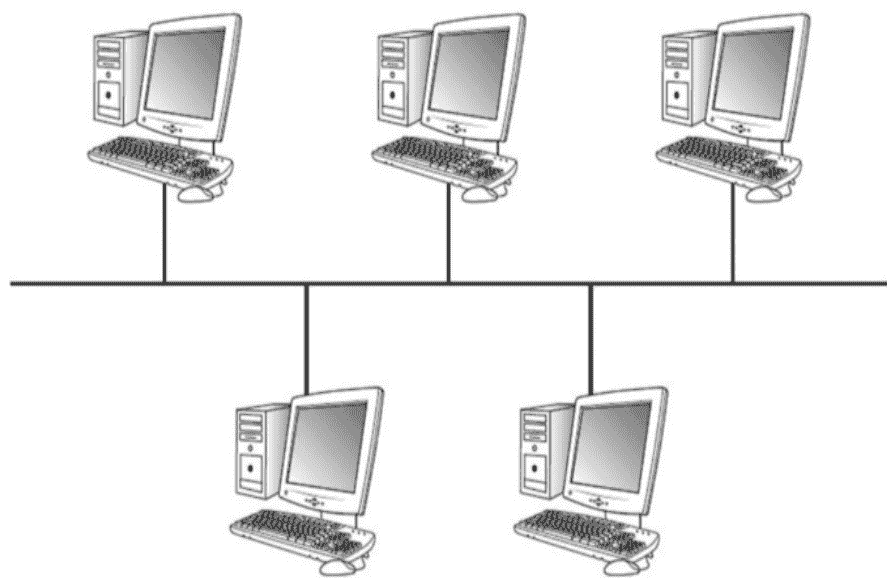

图 5.8

总线拓扑

## 星型拓扑

星型拓扑是三种主要网络拓扑中最古的一种，最初用于电话系统。星型设计由多个连接到中央交换机的计算机或设备组成。电线从集线器向外呈星形辐射。虽然这种方案使用了最多的电缆，但一处断裂通常只会影响一台计算机。这是最广泛使用的局域网拓扑（见图 5.9）。

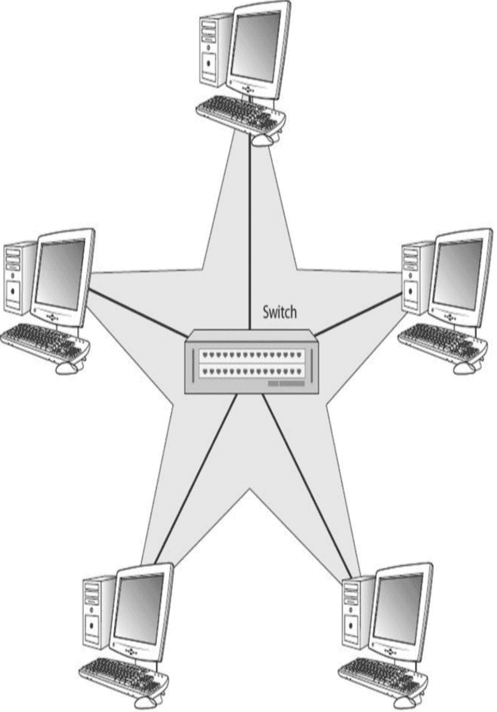

## 图 5.9

星型拓扑

## 环型拓扑

环型拓扑没有端点或终止器。它以连续电缆环的形式布局，所有网络化计算机都连接在上面。令牌环铜纤分布式数据接口 (CDDI) 和 FDDI 网络使用环型拓扑（见图 5.10）。某些环形技术使用载波侦听多接入冲突避免 (CSMA/CA)。虽然 CSMA/CD 是基于竞争的技术，而 CSMA/CA 是确定性的。

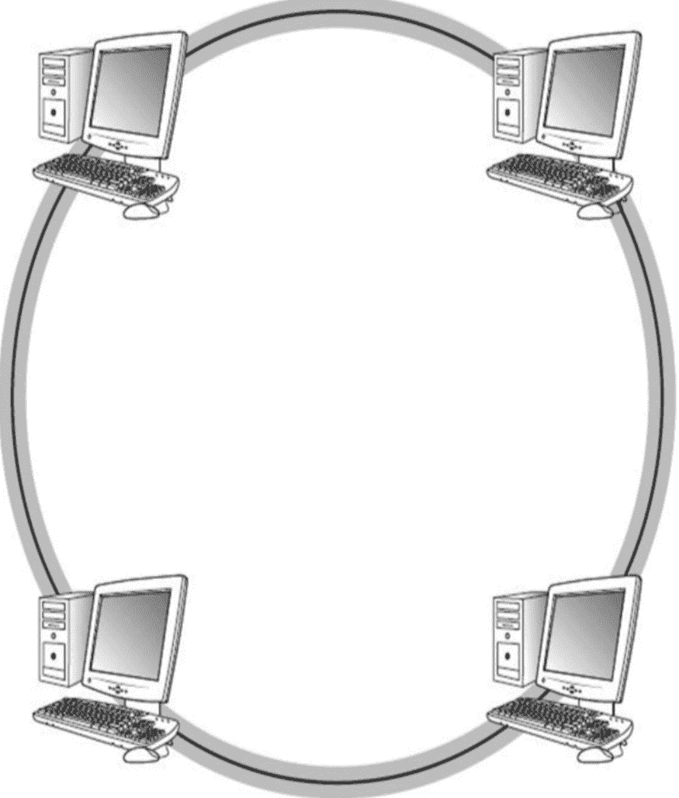

图 5.10

环型拓扑

### 考试警示

对于 CISP 考试，你应该确保理解 CSMA/CD 如何工作，因为它是以太网的介质访问方法。

每个设备在在线路上访问和传输数据时具有相同的优先级。以太网设备在传输之前必须感知线缆。如果两个设备尝试同时传输，就会发生冲突。当这种情况发生时，设备将等待随机时间，再次感知线缆并重新传输它们的帧。

## 网状拓扑

在网状网络拓扑中，每个节点为网络中继数据。网状网络可以使用泛洪或路由来转发通信。

## 全连接拓扑

全连接网络连接到所有节点。虽然此类设计提供了极大的冗余，但连接数量增长迅速，这使得这种拓扑对于大型网络是不实用的。

> 考试警示

> 网络通常实现多种网络拓扑的组合。

## 局域网布线

即使定义了拓扑，也有必要确定使用哪种电缆进行连接。多种类型的电缆可以用于通信，包括以下：

- **基带**：基带使用介质传输信号。以太网是基带传输的例子。

- **宽带**：宽带支持许多信道和频率。数字用户线路 (DSL) 是宽带的例子。

包括：

同轴电缆：同轴电缆由单根实心铜线组成。这种线缆覆盖有聚四氟烯而不是非通风空间使用的聚氯乙烯。它带有编织屏蔽（见图 5.1）。

双绞：双绞由扭绞在一起的两根绝缘线组成。扭绞有助于抵消电磁干扰。有两种类型：非屏蔽双绞 (UTP) 和屏蔽双绞 (STP)。UTP 是局域网中最常用的类型。STP 包含箔层以防止干扰。

光纤电缆：双绞电缆和同轴电缆依靠铜线传输数据，而光纤使用玻璃。这些玻璃通过编码的光波传输数据。常见的连接类型包括 SC、ST 和 LC。光纤具有许多优点，包括更大的带宽，并且物理窃听更加安全。基本上有两种光纤类型，它们处理不同类型的光：

- 多模光纤：通常用于局域网，由光发射二极管 (LED) 驱动。

- 单模光纤：通常用于广域网，由激光驱动。

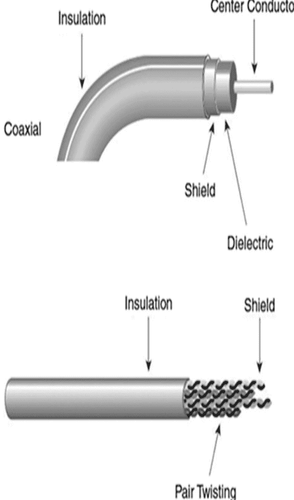

**图 5.11**

同轴和双绞

| 以太网变体 | 电缆规格 | 支持距离 | 拓扑 |

|---|---|---|---|

| 10BASE-5 | 50 欧姆同轴 (Thicknet) | 500 米 | 总线 |

| 10BASE-2 | 50 欧姆 RG-58 (Thinnet) | 185 米 | 总线 |

| 10BASE-T | Cat3 UTP | 100 米 | 星型 |

| 10BASE-FL | 多模光纤 | 2,000 米 | 星型 |

| 100BASE-T | Cat5 UTP | 100 米 | 星型 |

| 10,000BASE-TX | Cat6/Cat7 UTP | 100 米 | 星型 |

| 100BASE-T4 | Cat3 UTP | 100 米 | 星型 |

| 100BASE-FX | 多模光纤 | 136 米 | 星型 |

| 100BASE-FX | 多模光纤 | 160 米 | 星型 |

考试警示

对于 CISP 考试，你应该知道带有阻燃涂层的楼层级电缆被设计用于通风空间，例如建筑的爬空层、假天花板上方和架空地板下方。特殊涂层使用的是聚合物，而不是非通风空间使用的聚氯乙烯。它的设计在燃烧时不会产生有毒气体或烟雾，以确保发生火灾时人员的安全。

> 光纤比铜电缆更安全，因为它不辐射信号，且只能使用专用设备进行窃听。

## 注意事项

## 网络类型

计算机网络范围从小到大不等。在非常小的规模上，有个人局域网 (PAN)，允许各种个人和手持电子设备在短距离内进行通信。这种 PAN 最常见的类型是无线个人域网（WPAN）。蓝牙是支持 WPAN 的技术之一。

虽然知道两台计算机可以通过局域网（LAN）进行本地通信是一件好事，但大多数计算机都需要在更大的地理区域进行通信的能力。为了在相邻建筑之间通信，可以使用园区域网（CAN）。对于需要在城市范围内进行通信的计算机，创建了城域网（MAN）。MAN 是一种连接比 LAN 覆盖范围更大的区域的网络。它可以包括一个城市、一个地理区域或其他大区域。

如果你在一家位于不同州或国家的多个公司工作，那么该网络就是广域网（WAN）的一部分。WAN 跨越的地理距离对于 LAN 和 MAN 来说太大。WAN 通过路由器连接。当两个 LAN 跨越距离连接时，它们就形成了一个 WAN。全球域网（GAN）连接世界各地国家或地区的计算机。

## 网络存储

存储区域网络（SAN）是由存储磁盘和设备组成的网络。SAN 将多个服务器连接到中央磁盘存储池。SAN 通过允许集中式存储改进了系统管理，而不需要管理数百个每个都有独立磁盘的服务器。与 NAS 类似，NAS 在客户端看来像是一个文件服务器或独立系统，而 SAN 在客户端看来像是一个本地磁盘或卷，可以根据需要本地进行格式化并在本地使用。由于虚拟化的增加，SAN 的使用正在日益增长。

SAN 可以使用各种类型的技术进行连接，包括以下类型：

- 互联网小型计算机系统接口（iSCSI）：iSCSI 是一种用于连接数据存储设施的 SAN 标准，允许远程 SCSI 设备进行通信。它不需要任何特殊基础设施并可以在现有的 IP LAN、MAN 或 WAN 网络上运行。

- 基于以太网的光纤通道（FCoE）：FCoE 是一种类似于 iSCSI 的传输协议，可以在以太网协议之上以 10 Gbps 的速度运行。尽管它很快，但它有一个缺点是不可路由。

- 主机总适配器（HBA）分配：主机适配器用于将主机系统连接到企业存储设备。HBA 可以通过软分区（soft zoning）或持久绑定（persistent binding）进行分配。软分区更为宽松，而持久绑定减少了地址空间并增加了网络复杂性。

- LUN 掩码（LUN masking）：LUN 掩码在 HBA 级别实现。它是一个让某些 HBA 可以使用 LUN 而其他 HBA 无法使用的系统。在此级别实现的 LUN 掩码容易受到任何破坏本地适配器的攻击。

SAN 的几个问题包括冗余、复制、快照和重复。位置冗余是一个概念，即数据应该能够从多个一个位置被访问以作为备份。可以通过复制服务提供额外的冗余措施，以便即使主存储备份系统失败，数据也是可用的。

SAN 的另一个问题是数据保护。安全的存储管理和复制系统旨在允许公司以安全的方式管理和处理所有企业数据，重点关注机机性、完整性和可用性。复制服务允许对数据进行复制和保护，从而实现机密性和容错性。

为了获得更好的容错性，可以使用多路解决方案来降低数据丢失或不可用的风险。多路涉及到在服务器和其驱动器之间建立多条路径。多路软件维护所有请求的列表，通过最佳可能的路径传递这些请求，并在其中一条路径中断时重新路由通信。

SAN 快照提供了临时停止向物理磁盘写入数据的能力，以创建时间点备份副本。快照软件通常很快，无论驱动器大小如何，都能快速创建副本。

SAN 中的去重（De-duplication）是删除冗余数据以提高企业存储利用率的过程。冗余数据不被复制，而是被指向数据唯一副本的指针所取代。企业存储媒体（如磁盘或磁带）上只保留冗余数据的实例。

## 通信标准

本章之前讨论的基带和宽带通信需要在电缆上进行信号传输。这种传输可以使用三种方法之一：

- 单工（Simplex）：通信可以单向进行。

- 半双工（Half duplex）：通信可以在两个方向进行，但一次只有一个系统可以发送信息。

- 全双工（Full duplex）：通信可以在两个方向进行，两台计算机可以同时发送信息。

选择电缆时需要考虑你需要传播多远。虽然每通信方法都有特定的优点，但也存在一些共同缺点，包括衰减和串扰。衰减是信号的减少。随着信号距离传输设备越远，信号的强度和强度变得越弱。因此，所有信号都需要定期的重新放大和再生。图 5.12 展示了衰减。

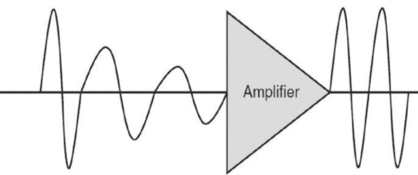

## 图 5.12

衰减

你对信号的基本选择是模拟或数字传输。模拟和数字信号都会改变载波的频率和振幅。然而，对于模拟信号，更难消除噪声并确定信号在哪里结束以及噪声在哪里开始。

## 网络设备

电信设备是指所有用于在网络设备之间移动数据的硬件，包括用于 LAN 和 WAN 的设备。不仅从网络角度，而且了解各种类型的网络设备对于更好地实施安全解决方案和通过 CIS 考试也是重要的。

## 重继器

中继器、集线器和放大器用于增强通信信号并克服衰减问题。这些设备都工作在 OSI 模型的第1 层。

## 集线器

集线器是最基本的的多端口网络设备之一。集线器允许所有连接的设备相互通信。集线器在逻辑上只不过是一根所有计算机共享访问的公共线。集线器工作在 OSI 模型的第1 层。所有系统共享相同的广播域和冲突域。


集线器因为吞吐量低而不再青睐。当两个或多个系统尝试在集线器上同时发送数据包时，就会发生冲突。随着利用率的增加，冲突数量激增，整体平均吞吐量下降。

对于 CISP 考试，不要花太多时间担心中继器和集线器；只需知道它们的基本用途，以及它们已被第2层交换机取代即可。

## 桥器

另一个有些过时的设备是有线桥器。桥器是半智能设备，具有分离冲突域的能力。桥器检查帧结构并查找相应的 MAC 地址。如果确定连接到特定 MAC 地址的设备是本地的，则桥器将阻塞流量。

桥器的一个大问题是它们默认通过广播流量。太多的广播流量可以有效地泛洪网络并导致广播风暴。今天几乎唯一的桥器是用于 802.11 网络的无线桥器。

## 交换机

交换机的工作方式与集线器非常相似；但交换机被认为是智能设备。交换机通过观察每个数据帧的源 MAC 地址来分割流量。从传统意义上说，交换机是 OSI 层设备；现代交换机可以在更高层工作，并具有与不同头部工作的能力。

一种桥接第二层和第三层的示例技术被称为多协议标签交换（MPLS）。MPLS 是一种 OSI 第二层协议。MPLS 与高速交换机配合工作。

商业交换机还提供虚拟局域网（VLAN）功能。此类交换机可以在 OSI 模型的第 3 层运行。VLAN 允许位于不同物理 LAN 段的一组设备进行相互通信，就像它们都在同一个逻辑 LAN 上一样。

## 注意

> 二层交换机与工作在更高层次的交换机之间的基本区别在于它们处理地址和标签的方式。

交换机通过在位于随机存取器（RAM）中的查找表中存储 MAC 地址来工作。该查找表称为内容寻址存储（CAM），包含了将每个 MAC 地址匹配到其对应端口所需的信息。当数据帧进入交换机时，它会在查找表中找到目标 MAC 地址，并将其匹配到计算机连接的交换机端口。帧仅会被转发到该交换机端口；因此，所有其他端口上的计算机永远看不到流量。交换机提供以下优势：

- 它们比集线器更高的吞吐量。

- 它们提供 VLAN 功能。

- 它们可以配置为全双工。

- 它们可以配置扩展端口以支持入侵检测系统/入侵防御系统（IDS/IPS）、网络馈送或监控。

## 注意

> 微隔离允许你进一步细分网络。通过微隔离，每个节点都可以访问传输通道中所有可用带宽，而不是与其他共享带宽。微隔离能够创建专用的或私有的分段。

并不是所有的交换机都是完全相同的。交换机有三种方式处理传入的帧：

- **存储转发（Store-and-forward）**：在帧完全输入交换机后，将分析目标 MAC 地址以阻塞或转发帧。

- **直通转发（Cut-through）**：这种快速的设计与存储转发设计类似，它只检查前 6 个字节，然后将数据包转发给其所有者。

- **无分片（Fragment free）**：这是思科的设计，错误率比其他设计低。

注意：

> 起初，交换机是二层设备；今天，可以在 OSI 模型的第 3 层找到交换机并工作到第 7 层。高层交换机被称为交换机、内容服务交换机或应用交换机。

## 镜像端口与网络分接器

监控设备在交换网络中检查流量比在非交换网络中要困难得多。为了解决这个问题，使用了端口镜像。不同的供应商对该技术使用不同的名称。例如，思科系统提供交换端口分析器（SPAN），而 3Com 提供移动分析端口（RAP）。

端口镜像用于将网络包的副本从一个交换机端口发送到交换机端口上的网络监控连接。因此，如果你使用管理型交换机，可以配置端口镜像来轻松捕获和分析流量。虽然这在企业环境和你有控制交换机的情况下运行良好，但在交换机未管理或无人无法访问交换机的情况下，它并不有用。在这种情况下，网络分接器（network taps）可以是另一种监控网络并查看所有流量的方法，类似于集线器。此功能充当拦截流量的点。例如，Throwing Star LAN 分接器是一种简单的设备，允许任何人监控以太网通信（见 greatscottgadgets.com/throwingstar/）。

## VLAN

虚拟局域网（VLAN）用于划分网络流量以创建更小的广播域。VLAN 减少了网络拥塞并增加了带宽，它们不需要隔离在单个交换机上；一个 VLAN 可以跨越整个组织的许多交换机。

你可以通过干链路协议扩展 VLAN。干链路协议将 VLAN 的定义传播到整个 LAN。干链路协议通过封装以太网帧来工作。两种干链路协议是 802.1Q 标准和思科专有的交换机链路（ISL）。802.1Q 标准将信息放在以太网帧内部，而 ISL 则封装了整个以太网帧。

> 生成树协议（STP）是另一种可以在 VLAN 中使用的协议，用于防止网络环路、构建活动路径并在活动路径或链路故障时提供备份路径。最新版本是快速生成树协议（RSTP），它与 STP 向后兼容并提供了显著更快的生成树收敛速度。

虚拟扩展局域网（VXLAN）是一种旨在提供与 VLAN 相同的以太网二层网络服务的技术，但具有更大的扩展性和灵活性。VXLAN 支持数据中心网络的虚拟化，通过提供大规模隔离满足多租户数据中心的需求。

> VXLAN 是一种封装协议，提供了跨越第 3 层基础设施聚合和隧道化多个二层子网络网络的机制。

干链路安全是 VLAN 中的一个重要问题。干链路仅仅是两个交换机之间的链路，承载来自多个 VLAN 的数据。安全专业人员应该意识到，能够访问信任连接的攻击者可能会从一个 VLAN 跳跃到另一个 VLAN。这被称为 VLAN 跳跃。确保干链路连接是安全的非常重要，这样就不会发生恶意活动。

## 考试提示

VLAN 跳跃是一种攻击技术，允许攻击者向 VLAN 外部发送数据包。这些攻击通常通过为流量标记攻击者 VLAN 之外的 VLAN ID 来发起。

## 路由器

路由器位于 OSI 模型的第 3 层。路由器通常与 IP 相关，发送已格式化为数据包的数据块。IP 被认为是一种尽力而的交付协议，IP 包由路由器检查和处理。路由器可以连接具有相同或不同介质类型的网络。

路由器的主要目的是通过称为路由的过程将 IP 包转发到其目标地。而桥器和交换机检查物理帧，路由器关注 IP 头部中的信息。IP 头部中的一个重要条目是 IP 地址。如前所述，IP 地址是一个逻辑地址；它以点分进制格式布局。这些十进制数字的长度均为 1 字节，支持 0 到 255。IPv4 地址分为几类：

- A 类：A 类网络包含 16,777,214 个设备。地址范围可以从 1 到 126。

- B 类：B 类网络包含 65,534 个设备。地址范围可以从 128 到 191。

- C 类：C 类网络可以有 256 个设备。地址范围可以从 192 到 223。

- D 类：D 类网络保留用于组播。地址范围可以从 224 到 239。

- E 类：E 类网络保留用于实验目的。地址为 240 到 254。

## 考试提示

你可能注意到 127.0.0.0 地址范围没有出现在上述列表中。虽然它在官方是 A 类地址范围的一部分，但它被用于环回。CISSP 考试可能会测试此类细节。

并不是所有的地址都可以在互联网上使用。某些地址被保留用于私用，并被认为不可路由。一些私有地址包括：

- A 类：10.0.0.0

- B 类：172.16.0.0 到 172.31.0.0

- C 类：192.168.0.0 到 192.168.255.0

路由器通过限制物理广播域来提高性能。当使用访问控制列表（ACL）进行过滤时，它们充当有限类型的防火墙，并通过将较大的网络划分为较小的子网来实现网络管理。网络路由器的安全性至关重要。受攻击的路由器可能会产生破坏性的后果，特别是当它是其他服务的终端时，例如 IPsec、VPN 或防火墙。

## 考试提示

通过路由器和防火墙阻止未经授权流量有时被称为非法地址过滤（bogon filtering）。非法地址包仅仅是伪造的且看起来来自 IP 范围内某些区域的数据包。

由互联网数字分配机构（IANA）或委派的区域互联网注册（RIR）保留但尚未分配或分派的地址空间。

## 网关

网关，有时被称为协议翻译器，它通过将一种软件协议转换为另一种协议来连接使用不同协议的网络。网关可以是基于软件的，也可以是独立的硬件设备。网关工作在 OSI 模型的第 7 层。

## 路由

路由协议是现代网络的关键组件。人们对路由协议（routed protocol）和路由协议（routing protocol）经常混淆。两者都位于第 3 层。路由协议可以从一个路由器转发到另一个路由器。路由协议的一个很好的例子是 IP。IP 就像互联网的邮政系统。它的工作是将数据组织成数据包并对其地址以投递。IP 必须在数据包上放置目标地址和源地址。这类似于在包裹寄送到邮局之前对其进行标记。就像邮政系统中的实体包裹需要邮资：在 IP 世界中，邮资是 TTL（生存时间）值，它防止数据包在网络中无限传输，并在每经过路由器时减 1。如果在 TTL 达到 1 之前找不到接收者，数据包将被丢弃。

路由协议在路由器之间发送和接收路由信息。路由协议可以比作一台大型机械分拣机。而像 IP 这样的路由协议负责构建和标记数据包，路由协议则必须决定如何投递数据包。在现实生活中，从 A 点到 B 点有许多方法。同样，在互联网上，通往目标网络也有许多路径。

路由协议可以分为几大类：

- *静态路由*：静态或固定路由算法实际上并不是算法。它们依赖于网络管理员开发的简单映射表，将一个网络映射到另一个网络。当网络较小且流量可预测时，静态路由是最好的。静态路由的主要问题是它无法响应网络变化。随着网络的规模扩大，这些表的管理可能会变得困难。虽然这种静态路由不互联网或其他大型网络，但在正常路由协议运行良好的特殊情况下可以使用它。

- **动态路由：** *动态路由*使用指标来决定路由器应该向哪个路径发送数据包到达目的地。动态路由协议包括 RIP、BGP、IGRP 和 OSPF。动态路由需要时间，因为所有路由器必须学习所有可能的路径。当网络上的所有路由器对路由状态达成一致时，就达到了*收敛*（Convergence）。

- **默认路由：** *默认路由*类似于静态路由。当使用默认路由且路由器不知道其他可可用路由时，指定的路由将成为路由器传输数据包的默认路径。

路由器每次接收到数据包时，都必须检查这些数据包并确定将数据包转发到哪个接口。并不是所有路由器工作的路由协议工作方式都相同。动态路由协议可以大致分为两类：

- 基于距离向量协议的算法

- 基于链路状态协议的算法

### 距离向量协议

RIP 可能是目前使用的最常见的距离向量协议。它是一种基于 UDP 的遗留路由协议，不使用身份验证，并根据跳数确定路径。RIP 有 15 跳的最大限制，并向所有设备发送广播路由更新。RIP 的后续版本提供了明文形式的身份验证。尽管 RIP 在小型网络中有效，但在大型网络环境中无法成功运行。RIP 利用了*水平分割*（split horizon）和*毒性反转*（poison reverse）。水平分割是一种路由宣告，它通过禁止路由器向其发现该路由的接口再次发布该路由，来防止距离向量路由协议中产生环路。毒性反转允许网关告诉其相邻网关：你无法从这里到达。这基本上意味着其中一个网关不再连接。毒性反转将未连接网关的跳数设置为 16 跳；这个跳数表示“无限”。

距离向量协议的一个主要缺点是数数最少的路径可能并非最优路由。跳数少的路径带宽可能远低于跳数较高的路由。

## 注意

> 像 RIP 这样的距离向量协议可能会被伪造并受到重定向。攻击者也很容易嗅 RIP 更新。RIP 路由器每 30 秒发送完整表来相互更新。

链路状态协议基于 Dijkstra 算法。与距离向量协议不同，链路状态协议使用延迟或带宽等指标确定最佳路径。一旦确定了该路径，路由器就会将其发现告知其他路由器。这就是可靠路由表形成的方式。链路状态路由协议被认为比距离向量路由协议更健壮。OSPF 可能是最常用的链路状态路由协议；它经常被用作 RIP 的替代品。

OSPF 是一种改进的链路状态路由协议，开发于 20 世纪 80 年代中期，旨在解决与 RIP 相关的问题。OSPF 具有几个内置优势，包括使用 IP 组播发送路由器更新、对跳数没有限制（像 RIP 那样）、对负载均衡更好的支持以及快速收敛。

路由协议可以进一步划分为内部路由协议或外部路由协议。RIP、OSPF 和 IS-IS 是内部路由协议三个例子。内部路由协议用于组织内部。

外部网关协议用于连接不同自治系统（AS）的路由器。外部路由协议的一个例子是 BGP，它是互联网使用的核心路由协议。它基于 TCP 并用于连接自治系统。

> 注意：早期的外部路由协议是外部网关协议（EGP）。这个术语有时被描述所有的外部路由协议。

## 广域网（WAN）及其组件

WAN 与局域网（LAN）有显著不同。组织通常拥有自己的局域网，但 WAN 服务通常是租赁的；这并不可行。WAN 关注数据的远程传输。互联网是 WAN 的一个例子。WAN 数据传输的成本通常高于局域网。WAN 技术可以分为两大类：包交换和电路交换。

## 包交换

包交换网络与其它设备共享带宽。包交换网络将数据划分为数据包和帧。这些数据包根据提供者的裁量在各个节点之间进行路由。它们被认为比电路交换网络更具韧性，适用于突发流量的按需连接。每个数据包走最快路径，这意味着包可能不会顺序或同时到达。包交换是一种无连接网络的形式。

## 同步光纤（SONET）

大部分远距离数据通信通过光纤进行。SONET 是使这成为可能的技术之一。SONET 利用光在光纤电缆上发送多个数字数据流。

## X.25

X.25 是最早包交换技术之一。虽然它并不快（速度最高 56 Kbps），它是可靠的并且可以在模拟电话线上工作。

## 帧继

帧继是一种虚拟电路交换网络。它是 X.25 的一种精简版本。帧继通过承诺比特率（CIR）控制带宽使用，该速率指定了承诺客户的最大带宽。如果有可用带宽，客户可以发送超过 CIR 指定的数据。如果有可用带宽，数据通过；否则，数据被标记为丢（DE）。

帧继可以使用永久虚拟电路（PVC）或交换虚拟电路（SVC）。PVC 用于提供两个位置之间的专用连接。SVC 的工作就像电话通话，按通话建立连接，并在通话完成后断开。当数据传输是发散的且用于电话通话时，交换虚拟电路很好。

## 异步传输模式（ATM）

ATM 是一种基于单元交换的物理层协议。它支持高带宽数据需求并适用于时间敏感型应用程序。由于交换过程在硬件中进行，延迟被降最低。ATM 使用固定大小为 53 字节的单元。ATM可以在局域网或广域网上实现。

ATM 正被新的技术取代，例如本文之前介绍的 MPLS。MPLS 设计者意识到数据不需要转换为 53 字节的单元。MPLS 数据包比 ATM 单元大得多。MPLS 可以提供流量工程，并实现

在没有端用户应用程序的情况下创建 VPN。MPLS 可以携带多种类型的流量，通过标签处理地址，并且不封装标头数据。

> 注意

对于 CISSP 考试，请记住 MPLS 使用标签来简化 WAN 路由，并可以携带语音和数据。

# 电路交换

电路交换分为模拟或数字两种配置。电路交换的核心是复用。复用是一种用于在单组线缆或传输传输路径上组合多个数据通道的技术。今天最常见的电路交换形式是普通电话业务（POTS），此外 ISDN、T 载波（T-carrier）和数字用户线路（DSL）也是可选方案。接下来的章节将更详细地描述这些电路交换选项。

# 普通电话业务 (POTS)

POTS 是一种语音级模拟电话业务，用于语音通话以及通过调制解调器连接到互联网和其他位置。调制解调器的速度可以从 9600 bps 到 56 Kbps 不等。尽管 POTS 相对便宜且广泛可用，但提供的数据速率较低。

# 集成业务数字网络 (ISDN)

ISDN 是一种通信协议，其运行方式与 POTS 类似，不同之处在于全数字信号。尽管最初计划作为 POTS 的替代品，但它并没有取得巨大的成功。ISDN 在特殊的数字连接上使用称为“通道”的独立频率。它由用于语音、数据、视频和传真服务的 B 通道，以及用于服务提供商和用户设备信号的 D 通道组成。将 D 信号数据分离使得攻击者更难操纵该服务。D 通道的运行速度为低 16 Kbps；B 通道的运行速度可达 64 Kbps。通过将 B 通道绑定，ISDN 可以实现更高的速度。ISDN 提供两个级别：速率高达 128 Kbps 的基本速率接口（BRI）和速率高达 1.544 Mbps 的初级接口（PRI）。BRI 由 2 个 B 通道和 1 个 D 通道组成，PRI 则由 23 个 B 通道和 1 个 D 通道组成。

# T 载波 (T-Carrier)

T 载波服务用于租用线路。租用线路锁定在两个位置之间非常安全，用户无论如何使用，都为此服务支付固定月费。最常见的 T 载波是 T1。T1 使用时分复用，由 24 个数字信号 0 (DS0) 通道组成。每个 DS0 通道能够传输 64 Kbps 的数据；因此，T1 可以提供 1.544 Mbps 的复合速率。T3 是下一个可用选择。T3 由 672 个 DS0 组成，复合数据速率为 45 Mbps。对于那些不需要完整 T1 或 T3 的用户，提供分频服务。分频 T 线路只是整个载波的一部分。表 5.8 详细列出了常见的 T 载波规格，并将其与 POTS、ISDN 和 DSL 进行了对比。

# 表 5.8 电路交换规格

| 服务 | 特性 | 最大速度 |

|---|---|---|

| POTS 拨号服务 | 交换机线路；广泛使用 | 56 Kbps |

| ISDN BRI 数字 | 需要终端适配器；可能昂贵 | 128 Kbps |

| ISDN PRI 数字 | 需要终端适配器；可能昂贵 | 1.54 Mbps |

| DSL | 通常是非称的；下载速度快于上传 | 高 52 Mbps |

| T1 | 专用租用线路；24 条捆绑电话线 | 1.54 Mbps |

| T3 | 专用租用线路；28 条捆绑 T1 | 44.736 Mbps |

注意

> T1 是美国的标准，而欧洲使用 E 载波系统。E1 携带 30 个通道；E3 是 16 个 E1。E1 是专用的 2.048 Mbps 电路，E3 是专用的 34.368 Mbps 电路。

# 数字用户线路 (DSL)

DSL 是另一种电路交换连接选项。DSL 通常是非对称的，这意味着下载速度远快于上传速度。理论上，你下载的通常比上传的多。

DSL 调制解调器始终连接到互联网；因此，你拨号即可连接。只要你的电脑开启，它就连接到互联网并准备好发送和数据。这是 DSL 的主要安全考虑。DSL 的优势是它保持了比电缆调制解调器通常更固定的速度。表 5.9 提供了不同 DSL 类型的详细信息。

# 表 5.9 DSL 类型与速度


| DSL 类型 | 数据速率 | 模式 | 距离 |
| --- | --- | --- | --- |
| IDSL (ISDN DSL) | 160 Kbps | 双工 | 18,000 英尺，24 AWG |
| HDSL (高比特 DSL) | 1.544 Mbps, 2.048 Mbps | 双工，双工 | 12,000 英尺，24 AWG |
| SDLS (对称 DSL) | 1.544 Mbps, 2.048 Mbps | 双工，双工 | 10,000 英尺，24 AWG |
| ADSL (非对称 DSL) | 1.5–9 Mbps, 16–64 Mbps | 下载，上传 | 9,000 英尺，24 AWG |
| VDSL (极高比特 DSL) | 13–52 Mbps | 下载，上传 | 5,000 英尺，24 AWG |

# 电缆接入

电缆接入是指通过电缆传输互联网。电缆调制解调器使用共享介质提供互联网接入。电缆接入的一个问题是用户之间的带宽共享。电缆供应商使用数据电缆服务接口 (DOCSIS) 标准来管理此。

# 其他 WAN 技术

当系统远程通信时，需要各种协议和标准，包括：

- 交换多比特数据业务 (SMDS)：SMDS 是用于 MAN 的高速包交换业务。
- 同步数据链路控制 (SDLC)：SDLC 由 IBM 在 70 代开发，是主机的二层协议。
- 高级数据链路控制 (HDLC)：HDLC 使用帧格式在网络节点之间传输数据。它支持全双通信并用于系统网络架构 (SNA)。
- 高速串口接口 (HSI)：HSI 是一种用于将路由器和交换机连接到高速网络的标准。

# 云计算

云计算是一种基于互联网的方法，提供计算和存储容量，如图 5.13 所示。云计算可以分解为几种基本模型，包括：

- 基础设施即服务 (IaaS)：IaaS 是一种云解决方案，根据需要购买虚拟功率来执行您的软件。这与在自己的设备上运行虚拟机非常相似，除非是在虚拟磁盘上运行虚拟机。
- 软件即服务 (SaaS)：SaaS 设计用于提供完整的封装解决方案，并将软件租用给用户。该服务通常通过某种前端或网络门户提供。
- 平台即服务 (PaaS)：PaaS 为您的使用提供平台。此模型提供的服务包括软件开发生命周期 (SDLC) 的所有阶段，并可以包括应用程序接口 (API)、网站门户或网关软件。

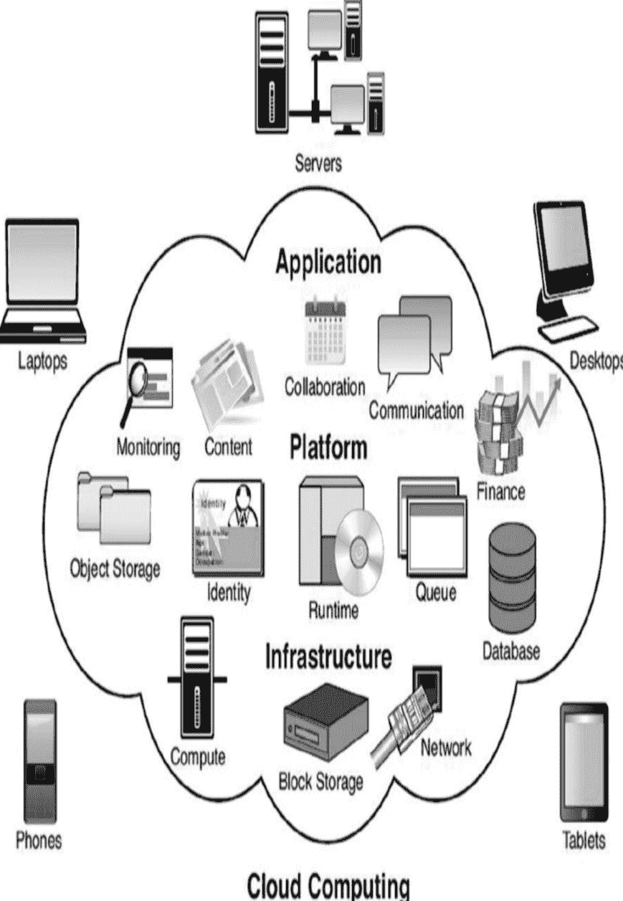

# 图 5.13

云计算

## 软件定义广域网 (SD-WAN)

软件定义广域网 (SD-WAN) 是传统网络技术的一种高性价比替代方案。SD-WAN 用于连接地理分布不同的地点和远程用户。虽然软件定义网络 (SDN) 和 SD-WAN 看起来相关且目的相似，但 SDN 的目标是局域网（LAN）的管理并实现集中化管理。OpenFlow 是可用于 SDN 的协议之一，允许从中央控制器控制交换规则。表 5.10 显示了 SD-WAN 和 SDN 之间的基本区别。

## 表 5.10 SDN 和 SD-WAN 的用途与细节

| SDN | SD-WAN |
| --- | --- |
| 管理局域网或服务提供商的核心网络 | 实现跨区域网络和用户之间的连接 |
| 用户可编程以按需提供带宽 | 可编程以实现操作简化、集成安全和流量优先级 |
| 将控制面与数据面分离 | 将控制面与数据面分离 |
| 为网络服务的自动化提供集中视图 | 侧重于软件定义的应用路由能力 |

## 电子邮件通信安全

安全电子邮件解决方案非常重要，因为电子邮件是最广泛使用的互联网应用程序之一。电子邮件容易受到多种威胁，包括欺骗、垃圾邮件和地址伪造。标准电子邮件使用简单邮件传输协议 (SMTP) TCP 端口 25 接收客户端的消息，并使用互联网消息访问协议 (IMAP4) TCP 端口 143 或邮局协议版本 3 (POP3) TCP 端口 110 从服务器收件箱中检索电子邮件。

发送电子邮件就像通过邮政服务寄明信片：沿途任何人都可以轻松阅读妈妈在访问大峡谷时写给你的便条。幸运的是，有许多应用程序和协议可以帮助保护电子邮件。以下章节描述了其中一些。

## 良好隐私 (PGP)

Phil Zimmermann 在 1991 年开发了 PGP 以提供隐私和身份验证。随着时间的推移，它演变成了名为 OpenPGP 的开放标准，现在赛门科技（Symantec）已无法购买其用于企业端点、文件、文件夹以及电子邮件的加密。

PGP 与没有 CA（证书颁机构）的 PKI 不同。PGP 构建了一个信任网，该网络随着用户签署和发布自己的密钥而发展。用户必须决定对其他方何种程度的信任。目标是让 PGP 成为每个人的加密工具（而不是仅供公司和企业使用的）。ProtonMail 和 Hushmail 等流行程序和供应商都是基于 PGP 的。

## 其他电子邮件安全应用

PGP 不是保护电子邮件的唯一选择。其他选项还包括：

- **安全多用途互联网邮件扩展 (S/MIME):** 默认情况下，MIME 不提供任何保护。为了解决这个问题，RSA 开发了 S/MIME。S/MIME 已内置到几乎每一个电子邮件系统中，用于对电子邮件附件进行加密和数字签名。S/MIME 为标准电子邮件增加了两个宝贵的组件：数字签名和公钥加密。S/MIME 支持 X.509v3 数字证书和 RSA 加密。
- **隐私增强邮件 (PEM):** PEM 是一个较旧的标准，尚未被广泛实现，但它的开发目的是提供身份验证和机密性。PEM 的公钥管理是层级的。PEM 使用 MD2/MD5 和 RSA 进行完整性和身份验证。
- **消息安全协议 (MSP):** MSP 是 PEM 的军事版本。因为它是由美国国家安全局 (NSA) 开发的，它尚未向公众审查，也没有被广泛使用。它是美国国防部（DoD）防御消息系统的一部分，提供身份验证、完整性和不可否认性。军拥有自己的安全网络，称为 SIPRNet。
- **MIME 对象安全服务 (MOSS):** MOSS扩展了 PEM 的功能，但由于被 S/MIME 和 PGP 取代，并没有广泛使用。MOSS 是唯一一种为用户提供内置收件人列表签名机制的电子邮件标准。

## 安全语音和无线通信

安全通信自斯巴达人、罗马人使用粗糙加密形式的时代以来有了巨大的进步。VoIP 和无线技术每年的关注度和使用量都在增加。研究报告显示，中国的手机数量比美国的人还要多。5G 支持部署数百万个微型传感器，跨网络收集各种数据。

P Q R S T U V W X Y Z A B C D E F GHI J K L M N O

Q R S T U V W X Y Z A B C D E F GHI J K L M N O P

R S T U V W X Y Z A B C D E F GHI J K L M N O Q

S T U V W X Y Z A B C D E F GHI J K L M N O P Q R

T U V W X Y Z A B C D E F GHI J K L M N O P Q S

U V W X Y Z A B C D E F GHI J K L M N O P Q R S T

V W X Y Z A B C D E F GHI J K L M N O P Q R S T U

W X Y Z A B C D E F GHI J K L M N O P Q R S T U V

X Y Z A B C D E F GHI J K L M N O P Q R S T U V W

Y Z A B C D E F GHI J K L M N O P Q R S T U V W X

Z A B C D E F GHI J K L M N O P Q R S T U V W X Y

维吉尼亚尔字表是将字母表重复编写总共 26 次，每一新行将字母表向后移动一个字母。你需要一个密钥来使用维吉尼亚尔系统。为了演示维吉尼亚尔加密的工作原理，这里有一个使用这种加密方法的明文、密钥和密文示例：

明文：Cryptorocks

密钥：QUEEXAMRAM

密文：Slctqocqtke

| 项目 | 数值 |
| --- | --- |
| 明文 | Cryptorocks |
| 密钥 | QUEEXAMCRAM |
| 密文 | Slctqocqtke |

注意明文的第一个字母是 C，密钥的第一个字母是 Q。将自然字母表与以 Q 开头的加密解密表排列进行对比：

A B C D E F G H I J K L M N O P Q R S T U V W X Y Z

Q R S T U V W X Y Z A B C D E F G H I J K L M N O P

你可以看到明文 C 对应密文 S。接下来，根据以密钥第二个字母 U 开头的字母表，加密第二个明文字母 R：

A B C D E F G H I J K L M N O P Q R S T U V W X Y Z

U V W X Y Z A B C D E F G H I J K L M N O Q R S T

明文 R 变为密文 L。这个过程一直持续到明文加密完成。如果密钥比明文短（通常情况下如此），你将从密钥的开头开始。

注意，在相同算法中使用不同的密钥将导致完全不同的密文。

> 提示
>
> 凯撒密码、ATBASH 密码和维吉尼亚尔密码被认为是对称替换密码，它们通过将位、字节或字符替换为替代的位、字节或字符来工作。替换密码容易受到频率分析的攻击，不被认为是安全的。

替换密码使用一种加密方法将明文消息的每个字符或位替换为不同的字符。凯撒密码是替换密码的一个基础示例。密码密码还可以使用置换，这是棒柱加密法（scytale cipher）的基础。置换密码使用算法重新排列明文消息的字母。结果是密文消息。解密过程反转加密过程以检索原始消息。置换密码的不同之处在于原始消息的字母保持不变，但它们的位置以一种有序的方式被打乱了。这可以通过简单的列阵置换来演示。消息的字母按行写入矩形阵中，然后按列读取。假设消息可以写在如下 5 × 5 的矩阵中：

```
CRYPT
OISMY
FAVOR
ITESU
BJECT
```

要加密消息，每一列都将被处理成密文：

```
COFIB RIATJ YSVEE PMOSC TYURT
```

尽管看起来很复杂，但在有足够的时间资源的情况下，置换密码很容易破解。

## 提示

> 现代加密系统不使用简单的替换或置换。然而，这些替换和置换与其他布尔数学运算混合在一起，创建出复杂的算法，产生了我们今天使用的分组密码和流密码。

历史提供了许多其他开发用于代码和密码系统的示例。例如，隐藏密码（concealment cipher）将消息隐藏在另一个消息内部。一种隐藏密码通过一次一个单词地将意图消息埋在无关紧要的消息中来工作。意图消息可能作为句子中的每三个单词找到。一个著名的例子是 1600 世纪约翰·特维安爵士（Sir John Trevian）收到的信件。约翰爵士在英国内战期间等待处决，并渴望逃脱捕获者。这封信写道：

> 尊敬的约翰爵士：希望，那是你受苦者最好的慰藉，我担心它现在无法为你提供太大帮助。我想对你说的只有这一点：如果我能够报答我欠你的情，请不要向我索要。我能做的不多：但我能做的，请务必确定。我知道，如果死亡来临，尽管普通人害怕它，它并不会与你作对，将你的这种忠诚作为回报是一种极大的荣誉。祈愿你……

凯撒密码、ATBASH 密码和维吉尼亚尔密码被认为是对称替换密码，它们通过将位、字节或字符替换为替代的位、字节或字符来工作。替换密码容易受到频率分析的攻击，不被认为是安全的。替换密码使用一种加密方法将明文消息的每个字符或位替换为不同的字符。凯撒密码是替换密码的一个基础示例。密码还可以使用置换，这是列柱加密法（scytale cipher）的基础。置换密码使用算法重新排列明文消息的字母。结果是密文消息。解密过程反转加密过程以检索原始消息。置换密码的不同之处在于原始消息的字母保持不变，但它们的位置以一种有序的方式被打乱了。这可以通过简单的列阵置换来演示。消息的字母按行写入矩形阵中，然后按列读取。假设消息可以写在如下 5 × 5 的矩阵中：

```
CRYPT
OISMY
FAVOR
ITESU
BJECT
```

要加密消息，每一列都将被处理成密文：

```
COFIB RIATJ YSVEE PMOSC TYURT
```

尽管看起来很复杂，但在有足够的时间资源的情况下，置换密码很容易破解。

## 提示

> 现代加密系统不使用简单的替换或置换。然而，这些替换和置换与其他布尔数学运算混合在一起，创建出复杂的算法，产生了我们今天使用的分组密码和流密码。

历史提供了许多其他开发用于代码和密码系统的示例。例如，隐藏密码将消息隐藏在另一个消息内部。一种隐藏密码通过一次一个单词地将意图消息埋在无关紧要的消息中来工作。意图消息可能作为句子中的每三个单词找到。一个著名的例子是 1600 世纪约翰·特维安爵士收到的信件。约翰爵士在英国内战期间等待处决，并渴望逃脱捕获者。这封信写道：

> 尊敬的约翰爵士：希望，那是你受苦者最好的慰藉，我担心它现在无法为你提供太大帮助。我想对你说的只有这一点：如果我能够报答我欠你的情，请不要向我索要。我能做的不多：但我能做的，请务必确定。我知道，如果死亡来临，尽管普通人害怕它，它并不会与你作对，将你的这种忠诚作为回报是一种极大的荣誉。祈愿你……

凯撒密码、ATBASH 密码和维吉尼亚尔密码被认为是对称替换密码，它们通过将位、字节或字符替换为替代的位、字节或字符来工作。替换密码容易受到频率分析的攻击，不被认为是安全的。替换密码使用一种加密方法将明文消息的每个字符或位替换为不同的字符。凯撒密码是替换密码的一个基础示例。密码还可以使用置换，这是棒柱加密法（scytale cipher）的基础。置换密码使用算法重新排列明文消息的字母。结果是密文消息。解密过程反转加密过程以检索原始消息。置换密码的不同之处在于原始消息的字母保持不变，但它们的位置以一种有序的方式被打乱了。这可以通过简单的列阵置换来演示。消息的字母按行写入矩形阵中，然后按列读取。假设消息可以写在如下 5 × 5 的矩阵中：

```
CRYPT
OISMY
FAVOR
ITESU
BJECT
```

要加密消息，每一列都将被处理成密文：

```
COFIB RIATJ YSVEE PMOSC TYURT
```

尽管看起来很复杂，但在有足够的时间资源的情况下，置换密码很容易破解。

# IP 语音 (VoIP)

在2000年之前，多媒体服务如语音和视频部署在稳定的电路交换网络上。这保证了带宽和允许延迟是可以控制的。今天，许多网络使用分组交换技术。VoIP 涉及使用数据网络传输语音通信。VoIP 并不是传统的分组交换协议，而是以 IP 数据包的形式在分组交换网络上传输。网络被配置为将 VoIP 语音通信视为另一种数据形式进行传输。这是近年来网络领域发生的最重大变化之一。网络收敛是指在单一网络中提供电话（VoIP）、流媒体视频和网络数据通信服务。基本上就是使用一根“水管”来传输所有形式的通信服务。

在讨论 VoIP 流量时，服务质量（QoS）是一个重要问题，因为电话通话的部分内容是无用的。QoS 是网络提供专用带宽以及控制抖动和延迟的能力。QoS 使得语音和数据等实时流量能够与 HTTP 等突发性流量共存。

VoIP 已经取代了以前常见的电路交换 POTS 电话服务。如果你还有家用电话，很有可能它实际上是一个 VoIP 连接。以下是 VoIP 的一些基本特征：

- 基于 SIP 的信令
- 用户代理客户端（User-agent client）
- 用户代理服务器（User-agent server）
- 三次握手
- 由 RTP 携带的语音流

## VoIP 漏洞

公司转向 VoIP 是因为它可以节省大量成本。然而，使用 VoIP 并非没有风险。作为一种网络服务，它在某些方面与其他数据流量一样容易受到攻击。攻击者可以拦截流量、破解 VoIP 服务器，或对 VoIP 服务器发起 DoS 攻击导致网络中断。针对 IP 电话的攻击也存在问题，局域网跳（LAN hopping）和用于电话固件镜像加载的 TFTP 修改也是如此。另一个考虑是运行 VoIP 应用程序的操作系统的漏洞会被继承。

VoIP 嗅探的一个担忧是，因为 SIP 等协议默认提供的安全性较低。在没有适当的安全控制的情况下，监听 VoIP 通话就像使用常用的嗅探器 Wireshark 一样简单。与 VoIP 相关的一个安全问题是数据网络丢失，这会导致 VoIP 用。其他 VoIP 漏洞包括：

- 开放网络：VoIP 数据包离开组织网络后，网络不再负责它们如何路由或谁可能访问它们。因此，任何未加密的流量都可能被恢复。
- DoS 攻击：由于 VoIP 在通信系统的部分使用 UDP，因此它极易受到干扰和 DoS 攻击。VoIP 使用异步进程，数据必须在严格的时间范围内交付。
- 窃听：由于 VoIP 依赖 UDP 和会话建立协议（SIP），它是一项开放服务，通信可能会被嗅探和重放。各种 VoIP 产品供应商使用的其他协议包括 IAX、IAX2、SCCP 和 UNISTIM。
- 未授权的电话使用：Skype 和 GoogleTalk 等服务使公司网络暴露在攻击和潜在的策略违反风险中。取决于行业或使用方式，此类工具可能导致违反法规。
- 互联网电话垃圾邮件 (SPIT)：SPIT 是使用 VoIP 发送的大批量未经请求的垃圾邮件。

注意

> 你可以使用安全实时传输协议（SRTP）来保护 VoIP。SRTP 使用 AES 确保机密，使用 SHA-1 确保完整性。

## 手机

手机是多年来趋成熟的另一项技术。手机技术大致分为以下几代：

- **1G**：这一代手机允许用户在手机手机上拨打模拟电话，并在他们在区域或地区内无缝移动于蜂窝之间时继续对话。
- **2G**：第二代将模拟机制改为数字信号。这些手机部署于 20 世纪 90 年代，基于 GSM（全球移动通信系统）和 CDMA（码分多址）技术。
- **3G**：第三代手机变成了移动计算机，可以快速访问互联网并提供额外服务。下行速度从 400 Kbps 到每秒几兆比特不等。
- **4G**：第四代手机的设计旨在支持实时电视以及更快的视频下载。最广泛部署的 4G 标准包括 WiMAX 和长期演进（LTE）。


**5G**：第五代无线网络技术预计将改变人们的生活和工作。5G 提供的平均下载速度约为 1 Gbps。5G 架构是软件定义的，而不是硬件。截至 2020 年 12 月，大多数运营商已迁移到 5G。全球移动通信基础设施以惊人的速度增长，有些人可能会认为，在互联网之后，手机是第二发明。

以下列出了常见的手机技术及其对应的代数：

| 技术 | 代数 |
|---|---|
| AMPS | 1G |
| TACS | 1G |
| GSM | 2G |
| CDMA | 2G |
| GPRS | 2.5G |
| EDGE | 3G |
| WCDMA | 4G |
| LTE | 5G |

大多数美国人现在都有手机，极少数有固定电话。手机改变了连接性，但也带来了安全担忧。组织必须考虑在这些设备上采取哪些控制措施。

## 考试提示

对于 CISP 考试，你必须掌握 WLAN 标准、速率和传输方案。

除了无线接入点和设备外，其他设备可能对组织构成威胁。所有无线设备都应该执行安全措施和强有力的策略来规定其使用。智能手机和平板电脑允许用户在原本安全的区域内拍照。此外，这些设备很容易丢失或被盗，而且有许多取证工具可以从这些类型的无线设备中提取数据。便携式设备还可以支持可以被移除或破坏的板存储。遗憾的是，这些设备通常缺乏有线设备的安全性。安全人员必须理解，许多设备的默认设置不会删除所有数据。

# 无线拓扑

无线网络可以在 ad hoc 模式或基础模式下运行。ad hoc 模式（或点对点模式）不需要任何无线网络适配器。ad hoc 模式允许点点通信，适用于临时信息交换。基础模式围绕无线接入点（AP）展开。AP 是控制无线介质流量的中心化无线设备。无线设备使用 CSMA/CA 进行高效通信。802.11 网卡运行四种模式：

- **管理模式（Managed）**：这种模式是最通用的无线选项。客户端仅与接入点通信，而不直接与其他客户端通信。
- **主站模式（Master）**：无线接入点使用这种模式与连接的设备通信。
- **监控模式（Monitor）**：这种模式用于 WLAN，使用 Kismet 等无线嗅探工具监听 802.11 帧。

# 无线标准

WLAN 的标准是 IEEE 802.11，通常被称为 Wi-Fi。该标准的一些修订包括：

- **802.11a**：该修订定义了在 5 GHz 范围内运行物理接入，支持高达 54 Mbps，范围为 60 英尺。
- **802.11b**：该修订定义了在 2.4 GHz 范围内运行物理接入，速率达到 11 Mbps，范围为 300 英尺。
- **802.11g**：该修订定义了在 2.4 GHz 范围内运行物理接入，支持高达 54 Mbps。
- **802.11i**：该修订为安全认证和加密提供了机制，替换了等效隐私（WEP）。802.11i 还使用了强安全网络（RSN），允许插件式认证模块，随着新漏洞的发现而进行更改。
- **802.11ac**：这种无线网络标准包括多站吞吐量至少为 1 Gbps。
- **802.11n**：该修订定义了在 2.4 GHz 范围内运行的接入，数据速率可超过 200 Mbps。
- **802.16**：这种宽带接入标准也称为 WiMAX，旨在为用户提供高达 75 Mbps 的最后一公里连接。

表 5.13 总结了无线局域网（WLAN）的主要标准。

5.13 常见 WLAN 速率与频率

| 标准 | 最高速率 (Mbps) | 频率 (GHz) |
| :--- | :--- | :--- |
| 802.11 | 2 | 2.4 |
| 802.11a | 54 | 5 |
| 802.11b | 11 | 2.4 |
| 802.11g | 54 | 2.4 |
| 802.11n | 144+ | 2.4 和/5 |

IEEE 还为其他无线技术编写了标准。例如，802.15 定义了蓝牙和射频识别（RFID）在个人局域网（WPAN）中的。

# 蓝牙

蓝牙技术用于移动和手持设备之间的短距离无线通信。蓝牙从 20 世纪 90 年代后期开始流行。版本包括 2、3 和 4。蓝牙技术促进了各种个人和手持电子设备的增长。例如，在 WPAN 中，蓝牙允许智能手机与平板电脑或笔记本电脑进行通信。蓝牙的分类如下：

- **1 类（Class 1）**：这种分类具有最远距离（可达 100 米），提供 100 mW 的功率。
- **2 类（Class 2）**：虽然这种分类不是最流行的，但它允许传输高达 20 米，提供 2.5 mW 的功率。
- **3 类（Class 3）**：这是应用最广泛的分类。它支持 10 米的传输距离，提供 1 mW 的功率。
- **4 类（Class 4）**：这种分类支持 0.5 米传输距离，提供 0.5 mW 的功率。

## 注意

> 虽然你无疑听过蓝牙，但你可能没有听过 Zigbee。它是另一种无线标准，为低数据速率设计，可以使用多年，非常适合智能家居应用，如控制照明、从电表传输数据以及向温度器发送温度数据。

尽管蓝牙具有内置安全功能，但已被证明容易受到攻击。在最近的 DEFCON 安全会议上，安全专家演示了从一公里外嗅探蓝牙传输的方法。

蓝牙是 IEEE 802.15 WPAN 协议族的一部分。尽管蓝牙极其，无线 USB 和红外等竞争性 802.15 技术使市场多样化。

## 注意

> 蓝牙攻击（Bluejacking）涉及向蓝牙用户发送未经请求的数据。蓝牙窃取（Bluesnarfing）是从用户处窃取数据或信息。蓝脆（BlueBorne）是一种缓冲区溢出漏洞，可为攻击者提供访问设备的权限。

# 无线局域网组件

无线局域网包括以下组件：

- **服务集标识（SSID）**：为了让计算机通信或使用 WLAN，必须配置使用 WLAN 的 SSID，以将无线网络与其他网络区分来。
- **无线接入点**：控制无线介质流量的中心化无线设备，可将无线设备连接到有线网络。
- **无线网卡**：这些网卡用于将设备连接到无线网络。
- **加密**：802.11 加密最初由旧协议 WEP 提供，旨在提供用户在有线网络上可能获得的相同隐私。WEP 使用 RC4 对称加密，但其实现存在缺陷。802.11i 修订为 WEP 提供了安全的替代方案：Wi-Fi 安全访问（WPA，使用 RC4）和 WPA2（使用 AES）。这些加密机制将在下一节详细讨论。

在北美，802.11 支持 2.4 GHz 的 11 个信道带宽，其中（1、6 和 11）可以同时使用且不重叠。信道指定了网络运行的频率。欧洲设备支持 13 个信道（最多 4 个不重叠），日本设备支持 14 个信道。在 5 GHz 下，有 24 个不重叠信道。范围内，频率可用取决于相关的许可机构。设备通过询问安装发生的国家来适应不同需求，并根据当地调整频率或终止传输（根据厂商获得的许可）。802.11d 修订允许客户端设备询问其所处的国家并动态调整频率。

两种非常基本的无线安全防护是 MAC 地址过滤和 SSID 过滤。这两者提供的安全性有限，因为 MAC 地址是以明文传输的，因此很容易被嗅探到。设置 SSID 为非广播也是一种糟糕的安全策略，因为 Kismet 等无线嗅探工具可以检测到客户端为了绕过这种弱控制而使用的非广播 SSID。

# 无线保护机制

最初用于保护无线通信的技术是 WEP。WEP 实现在数据链路层，并使用 RC4 加密算法对数据进行加密。由于 20 世纪 90 年代开发 802.11 协议期间存在的出口限制，密钥被限制为40 位。这在今天被认为是一个非常弱的密钥。

RC4 算法使用 64 位（IEEE 标准）或 128 位（商业增强）密钥。然而，密钥并不能使用那么多位，因为使用了一个 24 位的初始化向量（IV）来提供随机性。因此，真实的 WEP 长度实际上为 40 或 104 位。许多人不愿学习像 WEP 这样过旧且破旧的技术；然而，重要的是要意识到，WEP 仍然存在于我们身边。

WEP 是一种静态机制，因为每个人都拥有密钥。WEP 最早意识到的两个弱点是：共享密钥认证（SKA）使用了相同的密钥，且该认证使用了可被字典攻击破解的挑战-握手机制。立即的解决方案是抛弃 SKA，仅使用开放系统认证（OSA）和 WEP 加密密钥。这样，每个人都可以连接，但没有加密密钥的人将无法通信。

行业应对这些潜在问题的一种方式是将 802.1X（基于端口的访问）整合到许多无线设备中。当与扩展认证协议（EAP）结合使用时，802.1X 可用于验证尝试连接到特定 LAN 端口的设备。尽管它是 WEP 的改进，但 802.1X 已证明存在漏洞。

理解 WEP 过程，你需要理解布尔逻辑中的异或（XOR）函数是如何工作的。具体来说，XOR 意味着“互斥”，它是两个位之间的简单二值比较，产生另一个位作为结果。当比较两个位时，XOR 检查它们是否不同。如果答案肯定的，则输出为 1。如果两个位相同，则结果为 0。加密消息涉及七步：

1. 发送站和接收站使用密钥进行初始化。该密钥必须通过带外机制分发，例如通过电子邮件、发布在网站上或通过纸质交给某人（如酒店提供的 Wi-Fi 密钥）。
2. 发送站产生一个种子，该种子通过将 40 位密钥附加到 24 位 IV 获得，并输入到伪随机数生成器（PRNG）。
3. 发送站使用密钥和 24 位 IV 作为输入到 WEP PRNG 中，以生成随机位的密钥流。
4. 密钥流与明文进行异或运算以获得密文。
5. 发送站将密文附加到 IV 的副本上供接收端使用，并在头部设置一个位以指示该数据包已 WEP 加密，然后传输 WEP 帧。由于 WEP 在 OSI 模型的第 2 层加密，因此第 2 层头部和尾部是明文。
6. 接收站检查帧的加密位是否已设置。如果是，接收站从帧中提取 IV 并将其密钥输入其 WEP PRNG 中。
7. 接收端生成与发送站使用的相同的密钥流，并将其与密文进行异或运算，以获得发送的明文。

WEP 的直接继任者是一种权宜措施，作为 Wi-Fi 保护访问（WPA）被普及。WPA 认证意味着硬件兼容 802.11i 修订案快照（该修订案在 WPA 创建之前一直在设计中）。802.11i 工作组的任务之一是对 WEP 进行反向工程，并为无线用户开发仅限软件的升级，部署临时密钥完整性协议（TKIP）进行加密。TKIP 使用混合算法将用户密钥与网络状态信息混合，并添加了完整性检查功能（这比 WEP 机制要强得多），以验证帧未被篡改。WPA 认证测试了设备对 TKIP 的实现。

2004 年，IEEE 完成了 802.11i 修订案，并发布了带密文块消息认证码的计数模式（CCMP），这是一种 AES 解决方案，完全取代 WEP 和 TKIP 中使用的过时 RC4 机制。CCMP 也通过了 Wi-Fi 联盟的测试和认证，并被称为 WPA2。WPA2 可以使用高达 256 位的密钥，与原始 40 位加密 WEP 相比巨大的改进。

请记住，IT 安全领域没有任何是静态不变的。为了攻击新的安全机制，额外的工具和技术不断开发中。WPAcrack 就是其中一种工具。

## 注意

- 战争空驰（War driving）是指开车到处寻找寻找、映射并可能连接到开放无线网络的行为。战争空驰者使用 NetStummer、Kismet 和 AirSnort 等工具。
- 战争粉笔（War chalking）是标记无线网络位置和状态的实践。这种做法可以追溯到大萧条时期流浪者用来标记食物和工作地点的系统。

# 其他无线技术

随着技术的不断变化，许多标准正在出现。一个例子是 i-mode，这在日本使用的一种基于包的手机服务。另一个是数字增强无线通信（DECT），DECT 允许来自不同制造商的手和基站协同工作。

你应该了解的另一个标准是无线应用协议（WAP）。WAP 是一种开放标准，允许手机获取与桌面和笔记本电脑用户获得相同类型的内容。支持 WAP 的设备会对网站内容进行定制，以适应手机的小屏幕尺寸。该技术的关键组件是无线标记语言（WML）。Wap1 中的安全问题在 Wap2 中已修复。任何考虑使用 WAP 进行敏感信息交换的人都应该了解这些问题。

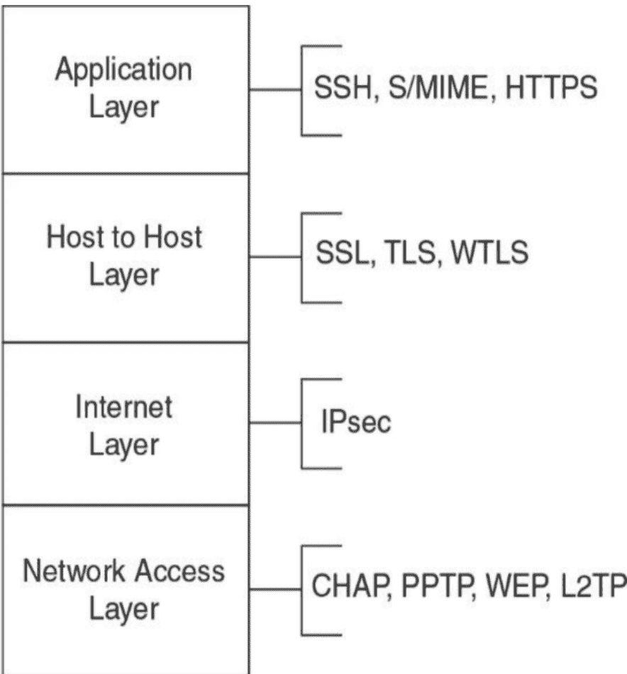

图 5.17

分层安全控制

## 应用/进程层控制

以下应用层协议可用于为网络添加机密性、完整性或不可否认性：

- **安全外壳 (SSH)**：SSH 是一种提供安全远程访问的 Internet 协议。它被认为是 FTP、Telnet 和 Berkeley “r” 工具的替代品。SSH 默认使用 TCP 端口。已发现 SSH 版本 1 存在漏洞，因此建议使用 SSHv2。
- **安全文件传输 (SFTP)**：SFTP 使用 SSH 连接并通过 SSH 隧道传输 FTP。SSH 的最新版本是 2.0 版本，通常运行在 TCP 端口 22 上。只有在 FTP 客户端软件支持的情况下才能使用 SFTP。
- **基于 SSL 的文件传输 (FTPS)**：FTPS 建立一个 SSL 安全信道，然后通过 SSL 运行 FTP 会话。IANA 为 FTPS 分配了端口 898（数据）和 990（控制），但厂商可以自由使用自定义端口号并这样做。
- **安全超文本传输协议 (S-HTTP)**：S-HTTP 是 HTTP 的修改版本，旨在保护与网络服务器的通信。S-HTTP 是一种无连接协议，设计用于安全地发送单个消息。
- **安全电子交易 (SET)**：Visa 和万事达想要消除人们对互联网上使用信用卡的恐惧，因此开发了 SET 规范，该规范在买家、商家和银行之间结合数字证书和数字签名确保隐私和机密性。虽然这听起来是一个好主意，但 SET 的问题之一是银行希望对这项服务收费并要求更改硬件和软件。许多厂商反对这些费用，因此 SET 未被广泛使用。从 SET 的灰烬中诞生了支付卡行业安全标准 (PCI-DSS)。PCI-DSS 要求所有接受信用卡的厂商必须满足并保证旨在保护信用卡数据的信息系统安全标准。

## 主到主机层控制

TCP/IP 栈的主到主机层可用于为数据通信添加加密解决方案。是一些常见示例：

- **安全套接层 (SSL)**：SSL 由 Netscape 开发，用于在互联网上传输隐私文档。与 S-HTTP 不同，SSL 与应用程序无关。SSL 的优势之一是它的加密独立性。该协议本身仅用于通信证书、加密密钥和数据的框架。SSL 最新版本是 SSLv3，它提供了双向认证和压缩。图 5.18 展示了 SSL 会话中的事务。SSLv3 被认为是不安全的且容易受到 POODLE 漏洞攻击。如果攻击者成功利用此漏洞，他们只需要发送大约 256 个 SSLv3 请求即可破解加密。TLS 1.2 是目前 HTTP 加密的标准。

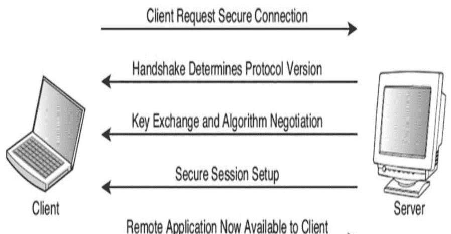

## 图 5.18

安全套接层 (SSL)

- **传输层安全 (TLS)**：TLS 加密主机与客户端之间的通信。TLS 通常利用 X.509 数字证书进行服务器身份验证。这种机制为客户端提供了服务器的强身份验证，因此客户端可以相信它连接到了正确的远程系统。TLS 由两层组成：TLS 记录协议和 TLS 握手协议。TLS 最常见的实现之一是 HTTPS，它仅仅是 TLS 之上的 HTTP。
- **安全套接字隧道协议 (SSTP)**：SSTP 是一种 2008 年发布的 VPN 隧道形式，提供了一种通过 SSLv3 连接传输 PPP 或 L2TP 流量的机制。SSTP 需要服务器端的数字证书，并建立加密 TCP 端口 443 所有流量的 SSL 隧道。由于它使用了与 HTTPS 相同的端口，因此可以通过企业防火墙。
- **无线传输层安全 (WTLS)**：WTLS 是为移动技术开发的安全协议。为了尽可能减少上层支持代码，移动行业开发了自有的无线应用协议 (WAP) 栈。WTLS 加密移动无线客户端与手机所连接的 ISP 基站之间的通信。在基站处，WTLS 数据包被解密，然后用标准 TLS 重新加密并在 Internet 上路由。这意味着客户数据会有片刻处于未加密状态。这是一个是一种被称为“WAP 空隙”的安全漏洞。移动行业此后发布了 WAPv2，它整合了行业标准的 TLS，因此不再需要解密。

## Internet 层控制

IP 安全协议 (IPsec) 位于 Internet 层，是一种广为人知的加密解决方案。IPsec 是一种端端安全技术，允许两个设备进行安全通信。IPsec 的开发是为了解决 IPv4 的某些缺点。虽然它是 IPv4 的附加组件，但它是内置在 IPv6 中的。IPsec 可用于保护数据或原始 IP 报头。这种保护级别可以提供完整性和/或加密。(IPsec) 将在本章稍后的部分详细介绍。

在 Internet 层还有两种较少使用的加密解决方案：

- **Internet 协议简单密钥管理 (SKIP)**：SKIP 由 IETF 开发，极少被使用。
- **软件加密 (swIPE)**：软件加密是一种基于软件的数据加密方法。

## 网络访问层控制

网络访问层有多种加密解决方案可用：

- **点对点隧道协议 (PPTP)**：PPTP 是用于创建 VPN 隧道的协议。
- **二层隧道协议 (L2TP)**：L2TP 是一种提供隧道功能的旧协议。
- **WPA2 企业级**：WPA2 企业级是 Wi-Fi 网络的安全标准。

## 端到端加密

正如你从目前讨论的各种协议中看到的那样，加密和保护数据有很多方法。必须考虑的最后一个决定是信息如何在客户端之间移动。在实际上，加密可以发生在许多层中的任何一层。重要的问题是：究竟加密了什么？你选择加密的层将强制加密你之上的所有层。

端到端加密加密消息和数据包。报头信息、地址和路由数据留为明文。这意味着恶意个人可以拦截数据包并获知源和目标，但数据本身是安全的。这种加密的优势是速度。在任何中间点解码地址信息不需要时间或处理能力。缺点是，即使数据经过加密，攻击者也可能进行推理攻击。

提供了针对嗅探器和窃听的额外保护。缺点是，所有中间设备都必须具备密钥、软件和算法，以便在传输的每一跳对加密包进行加解密。这增加了复杂性，消耗了时间，并需要额外的处理能力。

## 网络访问控制设备


安全性应该分层实施，以针对攻击者建立多道屏障。网络访问控制的一个良好例子是防火墙。防火墙可以作为一个瓶颈点，控制进入和流出网络的流量。另一种网络访问控制是 DMZ（非军事化区），它为内部和外部用户的工作建立了一个安全区域。接下来的章节将更详细地描述这些网络安全设备和技术。

## 防火墙

“防火墙”一词自 20 世纪 90 年代以来一直用于描述私有网络入口的硬件和软件。开发防火墙是为了防止未经授权的流量进入。防火墙已经过几代的改进，如今存在多种不同类型的防火墙，包括数据包过滤器、应用代理、电路代理和状态检测。

我们需要防火墙是一个悲哀的事实。就像在现实世界一样，在网络上，某些人喜欢破坏他人的财产。防火墙是计算机、路由器或用于控制对受保护网络访问的软件组件。它允许组织保护其网络并控制流量。请记住，这里涉及的模型（如状态检测和代理）是理论上的，大多数厂商的产品并不能完美匹配某一种设计。

## 数据包过滤器

数据包过滤器是根据 IP 地址过滤流量的设备。精明的黑客使用互联网上 easily获取的伪装工具和其他程序来绕过数据包过滤器。曾经实施的第一批防火墙是数据包过滤器。这些设备检查 `TCP/IP` 头部并根据一组预定义的规则做出决策。数据包过滤器只是丢弃不符合预定义规则集的数据包。这些设备被认为是无状态的。数据包过滤器基于访问控制列表（`ACL`），该列表可以根据 IP 地址、协议类型、`TCP` 端口和 `UDP` 端口拒绝或允许数据包传输。

## 状态防火墙

状态防火墙通过状态表跟踪每一个通信通道。它们被认为是智能防火墙，是第三代防火墙设计的一部分。数据包过滤器不具备这种能力。

## 代理服务器

根据定义，“代理”一词的意思是“代他人行事的代理机构或权力”。互联网代理是一种可以执行地址转换并代表网络与互联网通信的硬件或软件设备。用户的真实 IP 地址保留在代理服务器之后。代理服务器还可以配置为过滤高层流量，以确定流量是否允许通过。代理服务器提供了更高的安全性，因为它们不允许不可信系统直接连接到内部计算机。代理服务器的工作原理如下：

1. 代理服务器接受来自外部网络的数据包。
2. 它复制数据包。
3. 它检查数据包是否有异常。
4. 它更改数据包上的地址，将其改为正确的内部设备地址。
5. 它将数据包放回线路发送到目标设备。

代理有多种类型，包括以下类型：

- 应用级代理：并非所有代理都是一样的。应用级代理检查整个数据包，并根据在检查内容时发现的结果做出决策。这种方法非常详尽但缓慢。为了让应用级代理正常工作，它必须理解它正在处理的协议和应用程序。
- 电路级代理：电路代理与数据包过滤设备非常相似，因为它根据地址、端口和协议做出决策。它不关心高层应用，因此适用于更广泛的协议，但不能提供应用级代理那样的深度安全性。`Squid` 是一个开源代理的示例。表 5.14 总结了应用代理和电路代理之间的主要区别。

### 表 5.14 应用级与电路级代理

| 应用级代理 | 电路级代理 |
|---|---|
| 每一个协议都需要代理 | 不需要为每个协议代理 |
| 比电路级代理慢 | 比应用级代理快 |
| 需要更多的处理 | 不提供深度数据包检测 |
| 提供更多保护 | 适用于广泛协议 |

## 注意事项

> 应用级代理提供了高层面的安全性。其缺点包括它可能会破坏某些应用程序，并且它可能成为性能瓶颈。

`SOCKS` 将代理的概念推向了一个新水平。`SOCKS` 必须部署为客户端/服务器。它通过设备来决定是否允许访问。常见的 `SOCKS` 应用包括：

- `FTP`：允许文件在网络内或外传输
- `HTTP`：允许互联网访问
- `SMTP`：允许邮件

注意

如今广泛使用的一种代理类型是内容分发网络（`CDN`）。`CDN` 提供低延迟和高可用性的托管方式。`CDN` 的目的是缩短访问者与服务器之间的距离。`CDN` 在多个地理位置存储缓存内容。

## 非军事化区 (DMZ)

在计算机世界中，`DMZ` 防止外部者获取内部服务。`DMZ` 通常建立以允许外部用户访问。基本上，互联网、电子邮件和 `DNS` 等共享服务可能会被放在 `DMZ` 中。`DMZ` 提供了对内部网络的无访问。如果攻击者能够渗透并黑入 `DMZ` 内的计算机（只要内部机器信任这些计算机）。通常放置在 `DMZ` 中的计算机是堡垒主机，已删除了所有不的服务和应用程序以加固。为了给 `DMZ` 中的设备增加安全性，有时会使用屏幕主机。屏幕主机是作为数据包过滤器的部分屏蔽的防火墙。这提供了深度防御概念的一个良好例子。

注意

> 零信任另一种深度防御技术。其理念是从网络架构中消除“信任”的概念。零信任的基础是不信任任何流量，包括边界内部的流量。只有当工作负载根据一组属性被识别为可信任时，才被允许通信；否则默认是不信任的。

## 网络地址转换 (NAT)

网络地址转换（`NAT`）最初的开发是因为互联网的爆炸式增长以及家庭和业务网络的增加，导致可用 IP 地址不足以支持所有人。`NAT` 允许单个设备（如路由器）充当互联网与本地网络之间的代理。该设备或路由器为本地网络提供地址池。只需要一个唯一的 IP 地址即可代表这整组计算机。外部世界并不知道这种划分，认为只有一个计算机在连接。`NAT` 可以提供有限的安全性，因为它可以向外部隐藏地址。当使用私有地址时，`NAT` 是必须的，因为私有 IP 地址的数据包无法路由到外部 IP 地址，外部流量无法路由到应用了 `NAT` 的网络。`RFC 1918` 定义了三个私有地址范围：`10.0.0.0–10.255.255.255`、`172.16.0.0–172.31.255.255` 以及 `192.168.0.0–192.168.255.255`。

`NAT` 有几种形式：

- 静态 `NAT`：静态 `NAT` 在公和私有 IP 地址之间使用一对一映射。
- 动态 `NAT`：动态 `NAT` 使用一个地址池。当内部设备需要连接互联网时，它会被映射到下一个可用的公地址。当通信会话完成后，该公地址将返回池中。
- 端口地址翻译 (`PAT`)：大多数使用 `DSL` 或电缆调制解调器的家庭网络使用这种类型的 `NAT`。`PAT` 设计用于让许多用户通过通过一个外部地址访问互联网。

## 远程访问

设计良好的网络需要身份验证和访问控制。用户可能是组织内部人员，也可能在旅途中的酒店里。处于组织外部除了需要适当的身份验证外，还会引发对机密性和隐私问题的关注。本节讨论了与远程访问的一系列主题，包括密码认证协议 (`PAP`)、挑战响应握手认证协议 (`CHAP`)、`VPN` 和 `IPsec`。

## 点对点协议 (PPP)

`PPP` 是拨号连接中最常用的协议。它可以运行在任何速度的线上，从 `POTS` 到 `T1` 等。`PPP` 由 `IETF` 于 1994 年开发，是串行链路 IP (`SLIP`) 的替代品。`SLIP` 能够携带 IP 且没有错误检测，而 `PPP` 支持多种类型的身份验证，包括 `PAP`、`CHAP` 和 `EAP`。

## 密码认证协议 (PAP)

`PAP` 在链路最初建立时使用双向握手对客户端进行服务器身份验证。`PAP` 以明文发送密码，这使其非常容易受到嗅探攻击。

## 挑战响应握手认证协议 (CHAP)

`CHAP` 是 `PAP` 的改进版本。它使用四次握手来验证客户端。`CHAPv2` 提供了相互认证。当客户端请求认证时，服务器向客户端发送一个挑战。客户端使用密码对挑战进行哈希处理并返回给服务器。服务器会将此哈希值与自己创建的哈希值进行比较。尽管没有明文通过网络，但任何知道哈希函数并捕获交换过程的人都可以使用字典攻击尝试破解该机制。`CHAP` 专门为防止重放攻击而创建，因为挑战会随着每个客户端请求而变化，并且服务器可以定期要求重新认证。

## 可扩展身份验证协议 (EAP)

`EAP` 通过增加实现各种身份验证机制的能力（包括数字证书、令牌卡和 `MD5` 挑战响应），使 `PPP` 更加健壮。`EAP` 用于 `802.1X` 并在修订案中实现，如 `802.11i`、`WPA` 企业版和 `WPA2` 企业版。

当无线设备使用 `EAP` 验证终端用户或设备时，客户端（供养者）向无线接入点（验证器）发起 `EAP` 请求，验证器负责在认证过程成功完成之前保持网络端口关闭。验证器成为代理，在供养者和认证服务器（`RADIUS`、`TACACS+` 等）之间转发请求和响应。在这一系列受保护的帧期间（通常在加密隧道内部），供养者和认证服务器之间会生成`成对主密钥 (PMK)`。如果认证交换成功，认证服务器将 `PMK` 传递给接入点。`PMK` 用于在客户端会话期间生成瞬态 `AES` 或 `TKIP` 加密密钥。

表 5.15 总结了一些 `EAP` 类型。

## 表 5.15 EAP 类型

| EAP 类型 | 安全状态 | 描述 |
| :--- | :--- | :--- |
| `EAP-LEAP` | 弱 | `LEAP`（轻级可扩展身份验证协议）是 `Cisco` 在 `802.1X` 最终确定之前发布的私有协议。`LEAP` 存在严重的安全性缺陷，不应使用。 |
| `EAP-MD5` | 弱 | 这是一种弱的 `EAP` 形式。它仅提供客户端到服务器的认证，容易受到中间人攻击和密码破解攻击。 |
| `EAP-PEAP` | 更好 | 保护 `EAP` (`PEAP`) 由 `Cisco Systems`、`Microsoft` 和 `RSA Security` 开发，与 `EAP-TTLS` 类似。它不需要客户端证书。 |
| `EAP-TLS` | 更好 | 隧道传输层安全 `EAP` (`EAP-TLS`) 不使用客户端证书，允许使用其他身份验证方法（如密码）进行客户端认证。因此，`EAP-TLS` 比 `EAP-TLS` 更容易部署，但在省略客户端证书时，其安全性较低。 |
| `EAP-SIM` | 更好 | `EAP` 订阅者身份模块 (`EAP-SIM`) 用于认证和会话密钥... |
| `EAP-FAST` | 更好 | `EAP` 通过安全隧道灵活身份验证 (`FAST`) 由 `Cisco` 设计以取代 `LEAP`。它使用受保护访问凭据 (`PAC`)，该凭据作为预共享密钥。 |

## 考试提示

尽管 `EAP-TLS` 是最安全且成本昂贵的 `EAP` 形式之一，但 `EAP` 可以以多种方式实现。某些方法包括 `EAP-MD5`、`EAP-TLS`、`EAP-SIM`、`LEAP` 和 `EAP-TTLS`。虽然 `EAP-MD5` 本身不适合使用（因为它是一个简单的哈希），且 `LEAP` 容易被字典破解，但其他 `EAP` 类型是健壮的。你不需要记忆所有 `EAP` 类型的细节，但确实需要根据为认证强度建立的策略来选择合适的协议。

## 远程认证拨号用户服务 (RADIUS)

`RADIUS` 设计用于支持拨号用户，最初使用调制解调器池连接到组织的网络。由于 `RADIUS` 提供的功能，它现在被用于

## 终端访问控制系统 (TACACS)

`TACACS` 是 `Cisco` 开发的一种用于访问设备的协议。后来，`TACACS+` 作为开放标准发布。`TACACS` 用于提供认证、授权和计。`TACACS+` 基于 `TCP`，而 `RADIUS` 使用 `UDP`。

## 互联网协议安全 (IPsec)

`IPsec` 的开发是为了为 IP 数据包提供安全。没有 `IPsec`，人员可以捕获、读取或更改数据包的内容。当前版本的 `IPv4` 通过插件支持 `IPsec`；`IPv6` 内置了 `IPsec`。

`IPSec` 应用于 `OSI` 模型的第 3 层，第 3 层之上的任何层都可以透明地使用它。其他广泛使用的互联网安全系统，如传输层安全协议（`TLS`）和安全外壳（`SSH`），运行在 `OSI` 模型的较高层。`IPSec` 有两种工作模式：

- 传输模式（`Transport mode`）：保护载荷。
- 隧道模式（`Tunnel mode`）：保护载荷和报头。在这种配置下，`IPSec` 充当网关；可以携带任意数量客户端计算机的流量。隧道模式下的 `IPSec` 提供链路加密并与 `IPv6` 兼容。它可以用于加密任何 IP 支持的流量。

图 5.19 展示了这两种模式之间的差异。

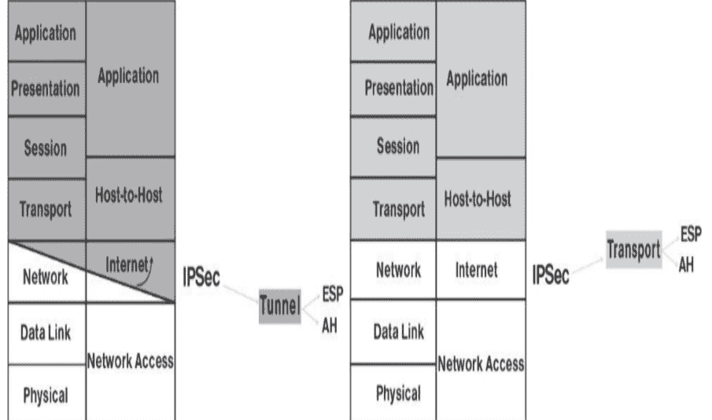

# 图 5.19

`IPSec` 隧道模式和传输模式

`RFC 2401` 定义了 `IPSec` 的三种不同的实现架构：

- 主机到网关（`Host-to-gateway`）：用于将一个运行 `IPsec` 客户端软件的系统连接到 `IPsec` 网关。
- 网关到网关（`Gateway-to-gateway`）：连接两个 `IPsec` 网关以形成一个作为共享可路由网络连接的 `IPSec` 节点。
- 主机到主机（`Host-to-host`）：通过 `IPsec` 将两个系统相互连接。

# 消息隐私与多媒体协作

新技术使得监控个人可能发送给别人的所有类型信息成为可能。`Bullrun` 就是此类程序的一个示例。美国国家安全局（`NSA`）开发了这个备受争议的程序，旨在为美国政府提供破解特定网络通信技术中所用加密手段。其完整能力尚为人知。

一些互联网应用程序的内置安全性很低或很差。即时消息（`IM`）就是一个很好的例子。许多公司允许或使用 `WhatsApp`、`Viber` 和 `Telegram` 等即时消息应用。然而，许多 `IM` 应用程序缺乏强大的端到端加密能力、不安全的密码管理，以及可能绕过防火墙的功能。`IM` 可能会受到嗅探攻击，可能被用于传播病毒和蠕虫，并成为缓冲区溢出攻击的目标。如果要使用这些程序，应该考虑诸如鸽子加密（`Pigeon-Encryption`）插件和基于 `SSL` 的聊天等安全控制。`IM` 产品极易受到恶意软件的影响，例如蠕虫病毒、后门木马、劫持、身份冒充和拒绝服务。`IM` 还可以被用于泄露敏感信息。

网络会议是一种低成本的方法，允许不同位置的人通过互联网进行通信。常见的解决方案包括 `Adobe Connect`、`Zoom` 和 `Microsoft Teams`。虽然有用，但网络会议可能会被攻击者嗅探和拦截。这些技术通常允许用户显示 `PowerPoint` 幻灯片、共享音频或视频，甚至共享文档。某些解决方案允许用户远程控制另一台 PC。

远程会议和网络会议软件通常设计用于为 `SSL` 或 `TLS` 流量建立隧道。这些技术通常通过公司网络外部传输，因此应对其进行理解、控制并确保符合所有适用策略，因为它们为攻击者和其他人员提供了泄露数据的能力。

最后，电子邮件是一种常见的网络应用程序，在原始状态下可能非常不安全。正如本章前面提到的，发送电子邮件就像你的父母通过美国邮政寄送你一张关于他们假期的明信片。任何在运输过程中恰好看到明信片的人都可以阅读他们从尼尼亚加拉瀑布旅行时寄给你的信息。如果你需要隐私，就必须使用加密。使用加密等同于在密封信封中寄一封加密信：即使有人打开了密封信封，加密信也会防止任何人了解你母亲前往壮丽瀑布的旅行情况。本章前面描述的电子邮件保护机制包括 `PGP`、安全多用途互联网邮件扩展（`S/MIME`）和隐私增强邮件（`PEM`）。

# 考试备习题

1. 你是一家即将在线销售产品的新公司的安全顾问。客户被要求在公司网站上为其产品付费。有必要建立一个运行 `IPsec` 客户端软件的系统到 `IPsec` 网关的连接。连接两个 `IPsec` 网关以形成一个作为共享可路由网络连接的 `IPSec` 节点。通过 `IPsec` 将两个系统相互连接。为了确保安全，你应该建议使用哪种模式？

   - A. 传输模式
   - B. 隧道模式
   - C. 路由模式
   - D. 混合模式

2. 你刚刚听到两个人在讨论窃取序列号的方法。他们正在讨论哪种攻击？

   - A. 银行攻击
   - B. 嗅探攻击
   - C. 钓鱼攻击
   - D. 拒绝服务攻击

3. 你是某公司的安全顾问，该公司在 `OSI` 模型的第 3 层使用加密。该公司正在使用哪种协议？

   - A. `RFC 2401`
   - B. `RFC 2402`
   - C. `RFC 2403`
   - D. `RFC 2404`

4. 以下哪种是用于 IP 地址的机制？

   - A. `ARP`
   - B. `DNS`
   - C. `DHCP`
   - D. `NAT`

5. Samuel 被要求在现有的 `IPv4` 网络上实施 `IPv6`。该网络没有原生支持 `IPv6`。你会向他推荐哪种技术？

   - A. `VRRP`
   - B. `SMDS`
   - C. `802.11`
   - D. `ATM`

6. 你被带到一家使用 Bellman 算法的小公司。该网络已经收敛。用什么术语来描述这种现象？

   - A. 回路
   - B. 分布式
   - C. 无类间路由
   - D. 毒性更新

7. 以下哪种被认为是 `WEP` 的更新？

   - A. `WPA2`
   - B. `SMDS`
   - C. `PGP`
   - D. `WPA`

8. 以下哪种设备根据地址、端口和协议做出决策？

   - A. 无状态防火墙
   - B. 链路层代理
   - C. 应用代理
   - D. 有状态防火墙

9. 哪种协议被认为是分隙复的前身并在 `POTS` 上工作？

   - A. `SMDS`
   - B. `ATM`
   - C. `X.25`
   - D. `T-carrier`

10. 关于 `RADIUS`，以下哪项是正确的？

    - A. 它提供认证和审计。
    - B. 它提供授权和审计。
    - C. 它提供认证和授权。
    - D. 它提供认证、授权和审计。

11. 你被要求为客户实施一种 `WAN` 技术。客户位于美国南部。客户不想电路交换技术。在这种情况下，你可以使用的哪种是小区交换技术？

    - A. `DSL`
    - B. `T1`
    - C. `ISDN`
    - D. `ATM`

12. 以下哪种被认为是第三代防火墙？

    - A. 数据包过滤
    - B. 链路层代理
    - C. 应用层代理
    - D. 有状态防火墙

13. 以下哪项是工作在 `OSI` 层 2、6、3、4 和 7 的协议列表？

    - A. `ARP`, `SQL`, `SMB`, 和 `SNMP`
    - B. `L2TP`, `SMB`, `IP`, `SQL`, 和 `HTTP`
    - C. `WEP`, `ASCII`, `IPX`, `TCP`, 和 `BootP`
    - D. `PPP`, `ZIP`, `SPX`, `UDP`, 和 `TFTP`

14. 以下哪个无线标准的频率范围为 `5.15–5.35 GHz` 到 `5.725–5.825 GHz`，适用于大约 60 英尺的距离？

    - A. `802.11a`
    - B. `802.11b`
    - C. `802.11g`
    - D. `802.11n`

15. 关于 `ISAKMP`，以下哪项描述**最准确**？


- A. 定义了建立、协商、修改和删除安全关联（SA）的程序和数据包格式，并定义了交换密钥生成和认证数据的有效负载。通常使用`IKE`进行密钥交换，尽管也可以实现其他方法。

- B. 启用安全传输中参与方的身份验证，并包含证书颁发者名称、有效开始和结束日期、证书所有者（主体）、主体的公钥、时间戳以及证书颁发者的签名。

- C. 一种管理私钥和证书的框架，为密钥生成、认证、分配和存储提供了标准；确定了谁负责验证数字证书所有者的身份；并遵循`X.509`标准。

- D. 一种定义了如何保护密钥的标准，并制定了设置密钥生命期的策略，概述了业务连续性和灾难恢复规划的基本要素。

# 考试备习题答案

- 1. `EAP-TLS`是最安全但昂贵的解决方案之一，因为它要求服务器和客户端都需要证书。答案 A 和 B 错误，因为`EAP-LEAP`和`EAP-MD5`已认为是不安全的。答案 D 错误，因为`EAP-SIM`用于智能手机和移动设备。

- 2. D. 手机黑客利用电子序列号（`ESN`）和移动识别码（`MIN`）克隆手机。答案 A 错误，因为银行卡攻击最可能的目标是数据库。答案 B 错误，因为针对调制解调器的人被称为拨号器（war dialers）。答案 C 错误，因为`PBX`攻击是由 phakers 执行的。

- 3. B. 隧道模式下的`IPSec`提供链路加密，兼容`IPv6`，并可以加密任何由`IP`支持的流量。它也可以与`L2TP`单独使用，或在`OSI`模型的第三层运行。答案 A 错误，因为传输模式加密`IP`负载。答案 C 错误，因为`PPTP`不提供加密。答案 D 错误，因为它在`OSI`模型的第二层工作且不提供数据加密。

- 4. `NAT`允许单个设备（作为路由器）充互联网和内部网络之间的代理。`ARP`用于物理地址解析，因此 A 错误。`DNS`用于`IP`地址解析，因此 B 错误。`DHCP`用于分配动态地址，因此 C 错误。

- 5. B. `ISATAP`是一种过渡技术，可用于没有原生连接到`IPv6`网络的主机。答案 A 错误，因为虚拟路由器冗余协议（`VRRP`）用于冗余。答案 C 错误，因为`802.1AE`是一种名为`MACSec`的`OSI`层技术。答案 D 错误，因为`6to4`是一种从`IPv4`迁移到`IPv6`的互联网过渡机制，通常用于连接到`IPv6`网络的地方。

- 6. D. 反向毒（Poison reverse）将异常网关的跳数设置为无限无限。所有其他答案都是错误的。答案 A 描述的是环回地址，与问题无关。答案 B 错误，因为水平分割（split horizon）是一种路由宣告，它通过禁止路由器向发现该路由的接口再次发布该路由来防止距离矢量路由协议中产生环路。答案 C 错误，因为无类网间路由（`CIDR`）的设计是为了减缓互联网路由器路由表的增长，并帮助减缓`IPv4`地址的快速耗尽。

- 7. A. `WPA2`是目前的无线安全标准。答案 B 错误，因为`SMS`是一种防火墙技术（注：此处原文可能有误，`SMS`通常指短信息）。答案 C 错误，因为`PGP`是一种邮件保护机制，而答案`POP`与电子邮件相关，因此是错误的。

- 8. B. 电路层级处理与包过滤设备非常相似，因为它们检查地址、端口和协议。无状态防火墙是包过滤设备和应用代理，而状态防火墙则检查更高层的内容，因此答案 A、C 和 D 都是错误的。

- 9. C. `X25`早于帧继（Frame Relay）。虽然它不快，但非常可靠且可以在模拟电话线上工作。`SMDS`是一种高速城域网/广域网分组交换协议，因此答案 A 错误。`ATM`是一种具有高速和多种服务的现代协议，因此答案 B 错误。`T-carrier`是一种电路交换技术，因此答案 D 错误。

- 10. C. `RADIUS`是一种客户端/服务器协议，用于验证拨号用户并授权访问。其他答案错误，因为它们不符合`RADIUS`规范。

- 11. D. `ATM`是一种小区交换技术。`DSL`、`T1`和`ISDN`不基于小区交换技术，因此答案 A、B 和 C 是错误的。

- 12. D. 状态防火墙被认为是智能防火墙和第三代设备。电路级代理和应用级代理是第二代设备，包过滤器是第一代设备，因此答案 A、B 和 C 是错误的。

- 13. C. `WEP`位于第 2 层。`ASCII`位于第 6 层，`IPX`位于第 3 层，`TCP`位于第 4 层，`BootP`位于第 7 层。

- 14. A. `802.11a`的频率范围为 5.15–5.35 GHz 到 5.725–5.825 GHz，工作距离约为 60 英尺。

- 15. A. `ISAKMP`是互联网安全关联和密钥管理协议。它定义了建立、协商、修改和删除安全关联的程序和数据包格式，并定义了交换密钥生成和认证数据的有效负载。通常使用`IKE`进行密钥交换，尽管也可以实现其他方法。

安全管理员需要考虑的远不止于物理访问。许多员工对多个公司资源拥有逻辑访问权限，这些资源可能位于本地、远程服务器甚至云端。你可能关联了许多必须管理的角色和账户。幸运的是，有一种方法可以整合这些账户：单点登录（`SSO`）解决方案。单点登录解决方案允许用户只需验证一次即可访问所有所需的资源和系统。身份验证系统可以是集中、去中心化或混合式的。本章将介绍每个概念。

## 提示

单点登录（`SSO`）不等同于密码同步。密码同步通常使用跨多个系统或程序共享的静态密码，而在`SSO`解决方案中，用户必须向身份服务器进行验证，由身份服务器为用户提供进一步的临时控制权限。

知道向谁进行验证是访问控制的基础，但还存在授权问题。授权定义了用户拥有什么访问权限以及哪些能力。授权是访问控制的核心组件。一旦用户通过了域、服务器、应用程序或系统的身份验证，他们被授权做什么呢？请花一点时间考虑，控制访问是允许授权用户访问同时阻挡未授权用户的第一道防线。

授权必须在自由裁量、非自由裁量、属性和基于角色的访问控制背景下进行考虑。实施授权应仅允许用户完成其任务所需的最小访问权限。这种方法有助于访问控制，最大限度地减少单个员工对组织造成的破坏，并降低与访问控制相关的风险。这种为员工仅提供其完成工作职责所需的控制和访问权限、且不多给的原则被称为*最小特权原则*。

如果真的出了问题，就需要一种方法来确定谁做了什么。这就是审计和问责制的过程。在审计中，负责执行网络安全任务的人员会审查记录，以确定做了什么以及由谁执行。问责意味着恶意和重复性错误可以被追踪并关联到特定个人，或者至少追溯到该个人的凭据。

# 周边界物理控制系统

物理安全控制是你的第一道防线，其设计应确保任何一项的突破都不会损害组织的物理安全。可以部署多种类型的物理控制来保护设施的周边界。整体概念是提供深度防御。通过这种方法，利用不同类型的控制措施创建多层防御机制。`CCTV`摄像头、大门、照明、守卫人员和锁是可以用于构建深度防御策略的物理安全层级示例。让我们从外向内来看。

# 栅栏

考虑柏林墙。这座冷战纪念碑在防止东德人逃往西方方面非常有效。在 1989 年倒塌之前，大多数逃往西方的人是通过躲在汽车后备箱里或通过贿赂守卫来实现的。墙既是强力的物理屏障也是心理屏障。栅栏提供的控制程度取决于你建立类型。3 到 4 英高的栅栏只能威慑偶然的闯入者，但 8 英高的栅栏将威慑并阻碍坚定的入侵者。在顶部增加三排铁刺丝网是一项额外的有效安全措施。如果你试图将人员限制在某个区域内，你应该让铁丝网指向内部；如果你试图将人员挡在外面，则应该让铁丝网指向外部。如果你担心设施周边界周围徘徊着什么，你可能考虑安装周边界入侵检测与评估系统（`PIDAS`）。这种特殊的围栏系统带有传感器可以检测入侵者。缺点是，迷路的鹿或其他野生动物可能会触发警报。

# 表 6.1 栅栏高度

| 高度 | 目的 |
|---|---|
| 3–4 英尺高 | 仅威慑偶然的闯入者。 |
| 6–7 英尺高 | 被认为太高，难以攀爬。 |
| 8 英尺高 | 应该威慑坚定的入侵者。顶部三排铁刺丝网应指向外部、内部或以 45° 角同时指向两个方向。指向设施内部通常是把人留在在内的安全措施；指向外部是把人挡在外的安全措施。 |

栅栏可以使用各种组件制成，如钢、木、砖或混凝土。链条网、铁丝网和钢丝网栅栏用于许多设施，并可以按安全性从高到低排序。线丝的线径和网格尺寸有助于确定这些栅栏的安全性。线径是线直径的测量值。请记住，线号越大，线径越越小。表 6.2 列出了常见的线径和直径。

# 表 6.2 线径与直径

| 线号 (Gauge) | 直径 |
|---|---|
| 6 号 | .192 英寸 |
| 9 号 | .148 英寸 |
| 11 号 | .120 英寸 |
| 11 /2 号 | .113 英寸 |
| 12 号 | .106 英寸 |
| 12 /2 号 | .099 英寸 |

美国测试材料协会（`ASTM`）定义了栅栏标准并认证供应商的围栏。`ASTM`已经为住宅用、商业用和高安全性产品制定了标准。栅栏中两根线之间的距离是*网格尺寸*。表 6.3 列出了栅栏网格尺寸及其对应的安全等级。为了视觉化：小孔的高栅栏入侵者难以攀爬，而大孔的高栅栏可以被轻易攀爬。

# 表 6.3 栅栏网格尺寸

| 网格 | 等级 |
|---|---|
| 1 英寸 | 正常使用 |
| 1 英寸 | 较高安全性 |
| 3/8 英寸 | 极高安全性 |

# 大门

栅的作用是屏障，而大门就像防火墙，因为它是一个瓶颈，控制车辆交通的进出。某些大门受`UL 325`和`ASTM-F200`标准覆盖。大门可以设计为平开门、卷帘门悬臂门。大门分为四类，如 6.4 所示。

### 表 6.4 大门分类

| 类别 | 等级 |
|---|---|
| I 类 | 住宅 |
| II 类 | 商业 |
| III 类 | 工业 |
| IV 类 | 限制访问，高安全性 |

其他访问控制机制包括闸机和门禁。闸机是一种形式的大门，防止一次超过一个人进入控制区域。闸机通常向一个方向旋转，限制流量。你可以在体育赛事、地铁等看到闸机。

门禁是由两道门组成的。门禁背后的理念是一个人或多人必须进入门禁并在关闭外门后，内门才会打开。如果身份验证失败，门禁会锁定内外门，以便在守卫到达确认身份之前个人无法离开。门禁可控制人员进入或离开敏感区域。门禁有助于防止跟进入（piggybacking）。跟进入通常需要在身份验证的控制入口处尝试。虽然某些人将“跟进入”和“尾随”（tailing）视为同义词，但尾随也与在车辆访问点和大门处尝试未经授权访问的行为有关。某些大门的开启时间足够长，可以让第二辆车尝试通过。

## 考试警报

门禁用于防止跟进入，并通过使用守卫和`CCTV`获取额外的补偿控制层。

# 护柱

护柱是另一种周边界控制手段。它们由混凝土或钢制成，用于阻止车辆交通或保护行人可能进入或离开建筑的区域。在 9/11 事件之后，这些障碍已经远远超过了过去的标准钢柱。公司现在制造带有电子传感器的护柱，通知建筑内部有人撞击或突破了护柱。虽然栅栏是第一道防线，但护柱紧随其后，因为可以阻止人员用汽车或卡车撞击设施。图 6.1 显示了护柱的示例。

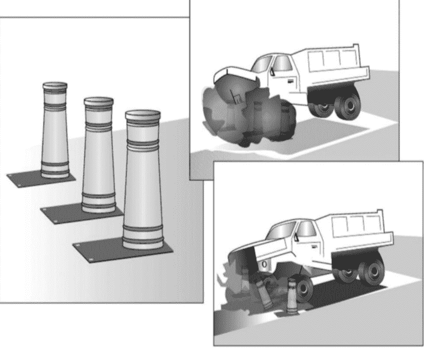

# 图 6.1

护柱。

来源：www.deltascientific.com/bollards2.htm

边界控制并不非得看起来像混凝土和钢铁。你是否注意到过许多公司总部旁宏伟的池塘？不要以为它们仅仅是作为社区美化项目放置的。它们是另一种形式的屏障或障碍。在火灾时也非常有用，因为它们可以作为额外的水源。访问控制是场所安全的关键部分，可以是自然的（如水域），也可以是结构性的（如围栏）。

还可以做什么？应该张贴警告标志或告示以威慑入侵者。应该对区域进行最后的检查，以确保没有遗漏任何地方。这包括任何周围 96 平方英寸或更大且距离地面 18 英尺或以下的开口，例如人盖/隧道、通往地下室的门、电梯井、通风口、天窗。即使建筑的屋顶、地下室和墙壁也可能包含易于进入的点，并应进行评估。

在设施场所确保安全后，`CISSP`应转向分析其他边界控制机制（如`CCTV`、门卡、射频识别 [`RFID`] 标签、照明、保安、警犬、锁和生物识别访问控制）。就像网络使用检查站和多层防御一样，物理安全控制也应该如此。这些每一个将在后续章节中进行更详细的解释。

# 摄像头

`CCTV`可以作为监控设备或物理探测控制来评估和识别入侵者。它们也是极好的威慑。在安装第一台摄像头之前，必须回答几个重要问题：视频流是否会被实时监控？录像将存储多久？将监控什么类型的区域？摄像头本身不能防止任何事情。如果`CCTV`系统要实时使用，必须通过人工干预监控来作为预防性控制。需要警卫或其他人员在事件发生时进行观察。如果`CCTV`系统是在事后使用的，那么它起的是检测控制的作用。不同的环境需要不同的系统。

如果`CCTV`系统安装在室外，照明量非常重要。照明由光圈控制，光圈调节进入监控摄像头的光量。自动光圈镜头设计用于光线随昼夜变化的室外；手动光圈镜头用于室内摄像头。监控摄像头甚至可以配备内置`LED`或配置为红外录制。

镜头的焦距控制摄像头的景深，这决定了`CCTV`监控器上视觉环境中有多少部分处于聚焦状态。如果没有人类监控系统并调整焦距，景深就至关重要。虽然某些系统具有固定焦距，但其他系统提供了平移、倾斜和缩放（`PTZ`）功能，允许操作人员根据需要放大或调整摄像头。旧的`CCTV`摄像头是模拟的，而大多数现代摄像头是数字的，通过使用电荷耦合器件（`CCD`）快速增强细节。`CCD`类似于传真机或复印机中的技术。

`CCTV`系统可以是有线或无线的，由许多组件组成，包括摄像头、发射器、接收器、录像机、显示器和控制器。`CCTV`系统为入口和关键访问点提供有效监控。如果员工无法实时监控，可以记录活动并在稍后查看。可以使用警报器来减轻监控报警的人员的负担。警报器可以检测入侵或其他类型的噪声并触发警报，这样警卫就不必盯着监视器。如果你正在考虑`CCTV`系统，请记住考虑员工的隐私权或隐私缺失通知，并考虑盲区的存在。

# 照明

照明是一种常见的边界保护类型。一些研究发现，企业和购物中心多达 80% 的犯罪行为发生在夜晚附近的停车场，因此公司在安装室外灯时需要谨慎。如果员工或游客遭到攻击，在停车场和其他高流量区域未提供足够的照明可能会导致诉讼。户外照明可以威慑徘游者和小偷。常见的室外灯类型有：

- 泛光灯
- 路灯
- 射灯

用于测量光的术语包括流明（lumen）、勒克斯（lux）和脚烛（foot-candle）。一个勒克斯是每平方米流明，一个脚烛是每平方英尺流明。国家标准技术研究院（`NIST`）指出，为了实现有效的边界控制，建筑物在 8 英尺高的投影范围内应有 2 脚烛的光照。

下次访问购物中心或百货商店时，观察一下灯是如何配置的。你会看到一排灯均匀地分布在设施周围。这就是连续照明的例子。出口、楼梯和建筑疏散路线等区域配备了备用照明。备用照明仅在停电或紧急情况下激活；然而，备用照明更常用于家庭/商店，设定在晚上正常营业时间后的特定时间开启，以营造家庭或商店有人居住的假象，威慑入侵者和闯入者。

与安全一样，照明的提供需要规划。有效的照明不仅仅是在灯柱顶部放置灯泡。安全专业人员需要考虑哪些区域需要照明、光线应该指向哪个方向，以及光有多亮。就像光太少是一个问题一样，光太多也会导致问题。因此，户外照明涉及过与少的平衡。室外灯每个应覆盖自己的区域，但仍允许之间有重叠。

# 保安与犬

保安在访问控制领域可以提供最好和最差的选择。尽管我们对安全的需求推动了对更多保安的需求，但他们只是人类，能力各异。技术也驱动了我们对安全的需求。随着我们获得更多的场所控制设备、入侵检测系统和计算机设备，需要额外的保安来控制这些系统。

与计算机系统不同，保安有能力做出判断并思考如何处理特定情况。这被称为*判断力*（discernment）。保安还可以用于多个角色，可以监控、接待、签到和引导访客。通过让他们出现在设施内或守卫站点，组织提供了一种视觉威慑。在你雇佣自己的保镖之前，你应该意识到保安也有一些缺点。保安昂贵、会犯错、培训不良、会对喜欢或信任的人破例、可能被操纵、可能上班睡觉、偷窃公司财产或可能伤害任何人。

狗和保安一样，一直以来也被用于保护财产。比特犬、杜宾犬和德国犬等品种是专门为了守卫而繁殖的。尽管狗经过训练忠忠、服从且坚定，但它们是不可预测的，可能会咬伤错误的人。由于这些因素，狗通常局限于外部边界控制，并应谨慎使用。

# 锁

锁关乎访问控制。锁有许多类型、尺寸和形状，是最古老的访问控制设备之一，也是常用的威慑手段。锁具有最高的投资回报。锁自公元前 2000 年埃及人开始就开始存在。

为指定的区域选择合适的锁非常重要。不同类型的锁提供不同水平的保护。锁的等级规定了其构造水平。

| 等级 | 用途 |
| --- | --- |
| 3 级 | 住宅和消费级使用 |
| 2 级 | 轻型商业用和重型家用锁 |
| 1 级 | 高安全性商业及工业用锁 |

`ANSI`标准定义了锁的强度和耐用性。例如，3 级锁的设计使用寿命为 200,000 次循环，而 2 级锁必须运行 400,000 次循环，1 级锁则必须运行 800,000 次循环。一些常见的锁类型包括组合锁、机械锁、密码锁和设备锁。

基础的组合锁要求所有者输入正确的数字组合来解锁，通常内部有一系列轮子。组合的长度越长，可能的组合就越多，暴力破解所需的费力就越大。图 6.2 显示了三位数和四位数组合锁的示例。三位锁只有 1,000 种可能的组合，而四位锁则提供 10,000 种组合可供选择。不要忘记人们喜欢记住诸如 43210、1234 或 007 等模式，因此基础组合锁更多是威慑作用，而非预防性控制。

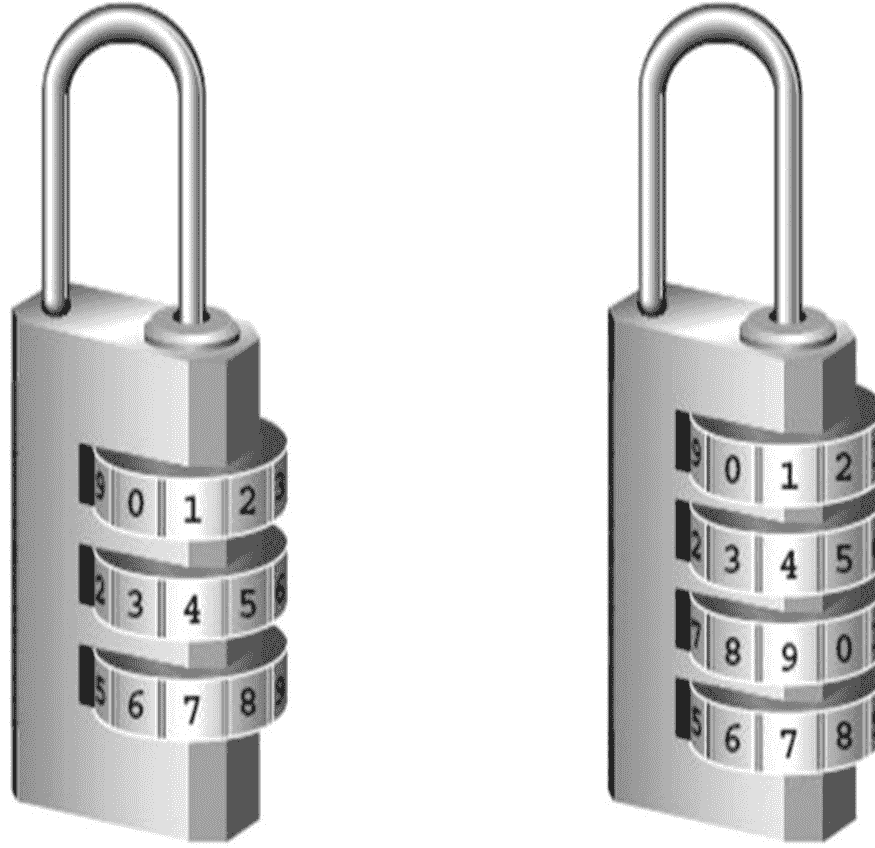

三位锁 四位数锁

图 6.2

组合锁。

机械锁已使用百年，用于保护重要物品。早期的锁是由木头制成的，在整个 1700 年期间，改进锁设计的尝试不断增加。机械锁包括挡舌锁和弹子销轮锁。现代弹子锁由林纳斯·耶尔（Linus Yale）于 1848 年获得专利。

挡舌锁是一种基础挂锁，使用带有弹簧锁舌的钥匙。挡舌锁使用一系列挡板（或阻挡物），钥匙必须与这些挡板对齐。它是最廉价的机械锁，也是最容易被破解的。可以通过插入坚硬的金属丝或薄金属条来拨开；简单的挡舌锁可以用万能钥匙打开。挡舌锁不提供高水平的安全性。弹子锁比挡舌锁稍微复杂一些。它们使用弹子轮子而不是挡板，这增加了使用错误钥匙打开锁的难度。当正确的钥匙插入弹子锁的锁芯时，销子会被提升到正确的高度，从而使锁打开或关闭。图 6.3 展示了基础的弹子锁设计。


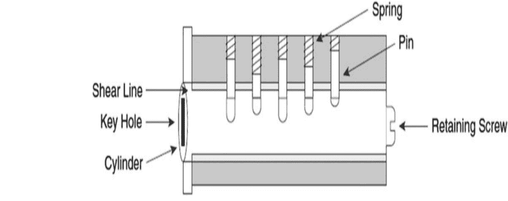

图 6.3

弹子锁设计。

在弹子锁中，正确的钥匙具有特定的凹槽和凸起区域，可以将销子移动到正确位置。销子带有弹簧负载，因此当钥匙被取出时，销子会返回锁定位置。弹子锁可以设计为销子弹子锁、片弹子锁、杠杆弹子锁或筒形锁。筒形锁也称为 ace 锁，被认为具有更高的安全性。它们用于计算机、自动售卖机和其他高安全性设备。

这些并不是锁的唯一类型。还有一类被称为密码锁或可编程锁的锁。这些锁需要用户输入预设或编程的序列。密码锁设计用于使用键盘或密码来控制进入限制区域。数字键盘设备的一个缺点是旁观人可以“窥视（shoulder-surf）”并偷取密码。或者知道代码并开门的人可以轻松进入。这就是为什么应该考虑门延迟报警器。为了增加安全性和防护，应使用视觉屏障以防止旁观人看到输入的密码。门报警器也可用于在有人撑门开启时发出警报。密码锁的一个主要优势是某些系统（被称为智能锁）允许对物理安全进行细粒度的角色划分和基于规则的访问控制，并带有用户审计。这使得通过删除访问代码来快速撤销安全区域变得访问变得，无需回收“钥匙或访问卡”。它还是一种检测性控制，允许进行有效的审计，以记录谁访问了安全区域。

锁可以用于保护各种设备。设备锁可用于保护端口和笔记本电脑。发放笔记本电脑的员工应配备笔记本电脑锁定设备。虽然数据安全很重要，设备的安全性也应该被考虑；拿走笔记本电脑或其他移动设备只需要瞬间。设备锁可以帮助保护物理资产，并向员工传达一个信号，即发放给他们的设备应该受到保护。

## 注意事项

> 使用锁来保护笔记本电脑很重要，但使用加密同样重要，因为数据的价值可能比硬件高得多。

许多组织并不频繁更换锁。另一些组织未能要求离职员工归还钥匙。有些锁甚至主钥匙。这种选项允许主管或保洁人员绕过通常需要的钥匙并进入。最后，是拨锁的问题。虽然锁可以用来威慑和延迟，但所有的锁都会受到攻击。

请记住，锁是一种威慑，而非预防性控制。大多数锁是为了阻挡诚实的人，应该作为你整体安全解决方案中的安全层。即使是高端的 Simplex 锁也被绕过过。

# 拨锁

拨锁是绕过安全性的一种方法。虽然不是最快，但它确实具有知名度。用于拨锁的基本组件包括：

- **张力拨（Tension wrenches）** —— 它们比小一字螺丝刀大，具有多种尺寸。

- **拨针（Picks）** —— 正如其名，这些类似于牙科医的钩。

这些工具组合可以用于拨锁。一种基础技术是刮擦（scrubbing）或拉动（raking）。刮擦是指使用拨针快速刮销子，同时使用张力拨对锁施加微小的压力。某些销子会进入锁定状态并卡住。通过练习，可以很快完成，使销子脱离。击锁（Key-bumping）是另一种获得关注的。。击锁是通过使用切割到 9 号位的特定钥匙完成的。这是钥匙最低可能的切割深度，如图 6.4 所示。

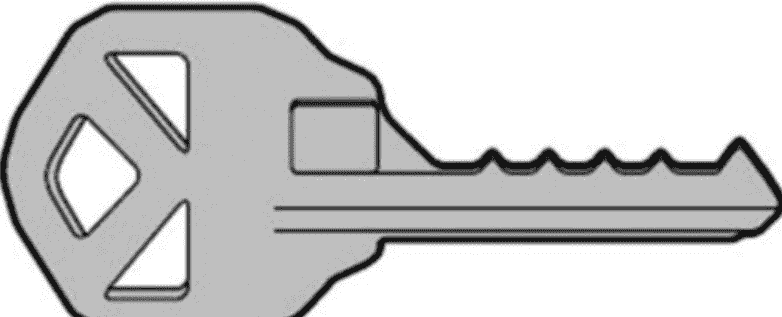

# 图 6.4

击锁

将钥匙插入锁中并在施加压力的同时进行敲击（击）。如果你想了解更多关于击锁的信息，网上搜索会有很多视频。这种力的传递会导致销子在锁芯内跳动，从而打开锁。

其他绕过锁的工具包括：

- **拨锁套装** —— 它们在价格和设计上各异，可能包含几个工具到二十多个不同的拨针和张力拨。

- **电动拨锁枪** —— 这些设备试图通过类似于电动牙刷或电动刀的方式来加速手动拨锁。

- **筒形拨针** —— 它们专门设计用于拨开筒形锁。这些与 Kryptonite 自行锁使用的是相同的。

- **锁片（Lock shims）** —— 成型的薄、硬质金属片，可以插入挂锁的锁舌中并用于推回锁定机构。

# 员工访问控制

在员工到达办公位之前，很可能已经进行了多种形式的物理访问控制。这些信息对于监控访问控制至关重要，对于在入侵、盗窃或攻击后重建事件也至关重要。员工的去向和其行为对组织具有重要意义。

# 胸章、令牌和卡片

令牌、卡片和钥匙都是访问控制的手段。这里讨论了这些控制手段的物理特性和用途。

表 6.6 详细列出了常见的访问卡和胸章类型。

表 6.6 卡钥匙类型

| 卡片类型 | 属性 |
|---|---|
| 照片卡 | 包含持卡人的面部照片 |
| 活跃电子卡 | 可以传输电子数据 |
| 磁条 | 有一条磁性材料 |
| 磁条 | 包含多行铜条 |
| 光学编码卡 | 包含激光烧蚀的编码点图案或 3D 二维码 |
| 智能卡 | 嵌入了电子电路和处理器 |
| RFID 卡 | 嵌入了微型射频识别 (RFID) 电路 |

物理访问控制卡可以分为两大大类：傻卡和智能卡。傻卡是不含电子元件的卡片，用于许多不同的组织。这些卡片通常包含个人的照片，以验证其进入特定区域的权限。这些照片 ID 卡实际上只是身份胸章的一种形式。只有在安保人员检查并采取了控制措施以确保在关键点和设施周围进行检查时，照片胸章才是有效的。

## 注意

> 遗憾但事实是，清洁人员有时会被忽视为潜在的安全威胁。他们通常在所有人离开后留在那里，并且拥有设施的完全访问权限。未锁的电脑可能成为非常有吸引力且容易的目标。本书的编辑之一分享了一个故事，他以前雇主的清洁小组共享胸章，并经常让朋友或亲属使用同一块胸章替他们工作一天。

第二种访问控制是智能卡。欧洲国家在信用卡中广泛使用智能卡技术，而美国直到 2015 年底才开始实施。对于美国的燃料零售商来说，遗憾的是，截止日期被推到了 2020 年，因为该行业面临着数十以亿美元的升级成本来完成工作。智能卡比照片卡多功能得多。智能卡可以以电子方式做出进入决策。这些设备可以以几种不同的方式配置。有些只需要用户靠近访问控制设备。这些近距离读卡器不需要用户物理插入卡片。某些识别技术使用 RFID。另一些则需要用户激活，例如要求用户输入密钥。已部署的智能卡的一个示例是美国国防部使用的通用访问卡 (CAC)。CAC 被认为是双因素认证——也称为多因素认证或强认证——并且也与公钥基础设施 (PKI) 使用。

某些组织为卡片用户提供两个密钥。一个密钥用于普通访问，而第二个则作为*静默人质或求救报警*。静默人质报警代码允许员工获得访问，但会静地通知当局有关人质的情况。

## 注意

> 高安全性设施历史上规定员工在离开工作场所回家或吃午饭时必须确保他们的胸章不可见。对于任何使用胸章来减少社会工程或针对特定车辆、公文包、笔记本电脑、平板电脑、智能手机等的组织，这是一种有效的控制措施。

# RFID 标签

RFID 标签是物理访问控制领域的另一个新兴趋势。RFID 标签是由微芯片和天线组成的极小电子设备。这些设备传输少量量的信息。RFID 标签可以以不同的方式设计：

- 主动式——主动标签带有电池或电源，用于为微芯片供电并持续传输微信号。

- 被动式——这些设备没有电池。它们由 RFID 读卡器/应答器供电，产生电磁波并在 RFID 标签中感应出电流。

- 半被动——这些混合设备带有电池为微芯片供电，但仍通过利用读取器的能量来传输数据。

RFID 标签有各种尺寸，一直到微粒大小——其放置可能性是无限的。美国军进行了试验，测试使用 RFID 标签控制军事地点车辆流量的可能性。美国正在考虑在执照和汽车注册中嵌入 RFID 标签，以便通过的警车可以收到有关注册过期的提醒。许多国家在护照中使用 RFID 标签。另一些国家将 RFID 作为访问控制的植入设备。例如，瑞典在这项技术方面处于领先。随着向无经济转型，瑞典广泛采用了 RFID 技术，其流通现金比世界上任何地方都少。瑞典还有数千人自愿植入 RFID 标签，以监控他们的健康并取代门卡以允许他们进入办公室和建筑。这项工作远超高科技智能手表。你可以在此处阅读更多

https://www.washingtonpost.com/news/on-leadership/wp/2017/04/04/swedish-workers-are-getting-microchips-implanted-in-their-hands/

许多其他人转向这种新兴技术。Amazon Go 商店允许购物者无需结账即可购买，或正在全美扩张。微软已申请了一种植入式 RFID 标签系统，该系统可以使用人体来挖掘加密货币。参见

https://patentscope.2.wipo.int/search/en/detail.jsf?docId=WO202060606&tab=PCTBIBLIO. 最后，美国联邦食品药品管理局 (FDA) 批准了一种 RFID 标签，将用于防止手术部位错误、手术错误和患者错误手术的可能性。政府官员主张这些设备成为消防员、警察的标准配置。

# 身份验证技术

在逻辑安全中，身份验证是确定用户、进程或应用程序合法性的过程。多年来，已经开发了多种身份管理实现方案。每种方案的核心都是确保正确的人对正确的资源拥有正确的访问，并能够证明所有访问都是合法的。已建立的一些常见类别如下：

- 你所知道的（第1类）——通常是字母数字密码或 PIN 码。

- 你所拥有的（第2类）——可以包括智能卡、令牌、内存卡或钥匙扣。

- 你所特征（第3类）——如指纹、面部扫描、视网膜扫描或语音识别等。

## 提示

> 某些来源列出了第四种身份验证类型，即你所在的位置。例如，考虑一种回调系统，它要求你位于特定位置才能接收用于验证的电话。另一个例子是智能手机或平板电脑使用 GPS 来识别你所在的位置。

身份保证是系统对于用户确实是其所声称身份的信任程度。NIST 800-63 为注册和身份证明定义了三个身份保证级别 (IAL)：

- IAL 1——身份自认。

- IAL 2——远程或面对面的身份证明。

- IAL 3——面对面的身份证明。由凭证服务提供商 (CSP) 验证。

NIST 800-63 还规定了身份验证器保证级别 (AAL)。这是用户控制身份验证器（如密码等）的信任程度。

- AAL1——提供一定的置信度。例如密码。可以是单因子或双因子认证。

- AAL2——提供高置信度。必须提供两个因素。

- AAL3——提供极高置信度。必须提供两个因素。

身份验证过程是验证用户是其所声称身份的过程。这通常通过检查用户名和密码来实现。如果密码匹配，则授予用户访问权限。如果不匹配，则拒绝用户访问。还有许多其他身份验证方式，包括生物识别、令牌和其他因素。身份验证的目标是确保只有授权用户才能访问敏感信息。这是任何安全策略中的关键部分。

## 提示

2020年3月，新闻来源报道称 Cam4 遭受了大规模安全漏洞，并建议所有用户其敏感记录已泄露。Cam4 的 Elasticsearch 服务器被攻破，导致超过 100亿条记录泄露。

这使得密码安全成为任何学习访问控制的人必须关注的话题。很多时候，密码是阻止未经授权的用户访问账户的唯一障碍。如果你无法更改为更健壮的身份验证形式，你可以实施控制措施来增强密码的健性。以下是其中一些选项：

- **密码长度**——短密码很容易通过暴力攻击被破解。

- **密码复杂度**——应该使用数字、符号、大小写字母等的组合。例如，某家公司可能会使用一种标准，要求密码至少为八位字符，其中两个必须是数字，两个必须是大写字母。公司可能还会建议在剩余字符中使用符号和小写字母组合。

- **密码年龄**——与葡萄酒不同，密码不会随着年龄增长而变得更好。两个受关注的项目是最大年龄和最小年龄。最大年龄是用户可以使用密码的最长时间。最小年龄定义了用户保留密码的最短时间。

- **密码历史**——身份验证系统应该跟踪之前的密码，以便用户无法重复使用之前的密码。

- **密码尝试次数**——登录尝试应限制在少量次数内，例如连续尝试三次。应用这种控制也称为设置裁剪级别（clipping level）或阈值水平。阈值或裁剪事件的结果可以是从锁定账户到延迟重新启用账户的任何形式。

- **密码存储**——对密码使用可用的最强单向加密形式，绝不要以明文存储。

- **会话管理**——通过超时和密码屏幕保护程序来终止空闲用户，从而确保用户登录连接的完整性。

### 考试警示

在尝试考试之前，你需要理解 CISSP 术语。其中一个术语是“裁剪级别”（clipping level）。在此语境下，它仅仅是登录限制的另一种术语。记住，裁剪级别是在采取行动之前必须达到的阈值或限制。考试的很大一部分是理解可能使用的术语，并将它们应用于测试题的语境中。

另一个关注领域是密码管理。组织开发了不同的方法来应对复杂世界对密码管理的需求。几项技术包括：

- **自助密码重置**——这种方法允许用户重置自己的密码。例如，如果你无法访问 LinkedIn 账户，他们的网站允许你重置密码。

- **辅助密码重置**——这种方法为帮助台和其他授权人员提供了一种标准的密码重置机制。例如，日立系统（Hitachi Systems）为该应用制作了一个网页门户产品。

- **密码同步**——这些系统用于复制用户的密码，以便所有系统保持同步。

## 提示

花点时间查看一下“have I been pwned?”他们拥有超过 10,000,000,000 个被泄露的账户。在他们的首页输入你的电子邮件地址，你可以快速判断是否由于你的某个在线账户在数据泄露中被破坏或“被攻破”而面临风险。了解更多信息请访问：https://haveibepwned.com/

如果所有关于密码的话题让你感到很脆弱，你可能想要考虑使用密码短（passphrase）。密码短通常是一个修改过的句子或短语，如“Uaremfy#lady4llfe”。输入计算机系统后，它会被转换为虚拟密码。密码短的功能原理是让某人在计算机中输入该短语。软件将该短语转换（或哈希）为更难被攻击者破解的强虚拟密码。使用密码短增加了第二层保护，并要求使用密码短来访问密钥。

# 静态与动态密码

在评估基于密码的身份验证时，另一个考虑的问题是使用的是哪种类型的密码系统。动态密码，或认知密码？静态密码是那些固定且通常不会改变的密码。例如，我为电子邮件设置了一个 ProtonMail 账户并分配了一个密码。在我不再使用该账户之前，该密码一直有效。动态密码也被称为一次性密码，可以被认为是安全世界的“纸巾”：你使用它们一次或很短一段时间，然后就将其丢弃。一次性密码可以通过令牌设备提供，该设备在 LCD 屏幕上显示限时密码。最后，是认知密码，我们将在下文中讨论。

## 提示

> 破解密码只是黑客可以尝试的一种技术。针对访问控制系统的攻击还包括直接针对哈希值。有一些工具可以尝试进行远程操作，或者攻击者可以通过物理访问来尝试。

# 认知密码

认知密码是另一种有趣的密码机制，它在身份证明中已变得流行。这种技术可以在正常登录和新服务的注册期间使用。例如，在注册服务时，你可能会被要求提供 PII（个人身份信息）、关于你过去地址的个人问题、你特有的信息（如电子邮件）或其他其他人难以了解关于你的信息。通常，可能会被问到以下三个问题：

- 你出生在哪个国家？

- 你在哪个部门工作？

- 你的宠物叫什么？

- 你的第一辆车是什么型号？

- 你母亲的娘姓是什么？

如果你正确回答了所有问题，你就通过了身份验证。认知密码广泛应用于注册过程，以及个人拨打帮助台或请求需要身份验证的其他服务。认知密码并不是没有问题的。例如，如果你的名字是亚当·桑德勒（Adam Sandler），而你被要求的认知密码是“你的家乡在哪里”，任何知道你在新罕布什尔州的曼彻斯特长大的人都可能轻松访问他的账户。认知系统最常用的领域是自助密码重置系统。如果你忘记了密码，系统会提示你几个在注册期间回答过的问题，以验证你的真实性。如果你回答正确，密码将通过电子邮件发送给你以恢复访问权限。

### 考试警示

考试候选人必须理解密码的优缺点以及如何增强基于密码的身份验证。密码应该始终通过单向过程（哈希）创建，应该是随机的（加盐），并且绝不要以明文存储。

# 你拥有的东西（类型 2）：令牌、卡片与证书

你拥有的东西是我们讨论的第二种身份验证类型。拥有的东西示例包括令牌、智能卡、磁条卡和证书。

你拥有的东西的常见示例之一是令牌。例如，如果你最近参加过体育赛事，你可能需要持有令牌才能进入比赛。在这种情况下，令牌的形式是门票。

# 时间同步身份验证

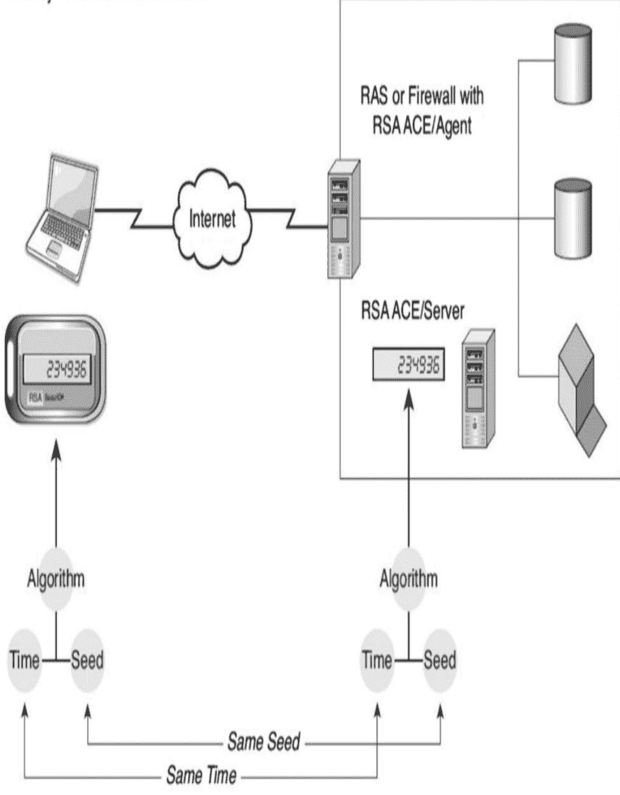

**图 6.5**

RSA 令牌身份验证。

异步令牌设备

异步令牌设备与身份验证服务器同步。这些设备使用挑战-响应机制，通常要求用户在令牌和身份验证服务器上各按一次。服务器发送一个随机值，用户将该随机值连同用户名和密码输入设备。这种身份验证方法被认为是强身份验证，因为它实际上是多因素认证（你所知道的和你拥有的东西）。

图 6.6 显示了一个示例。

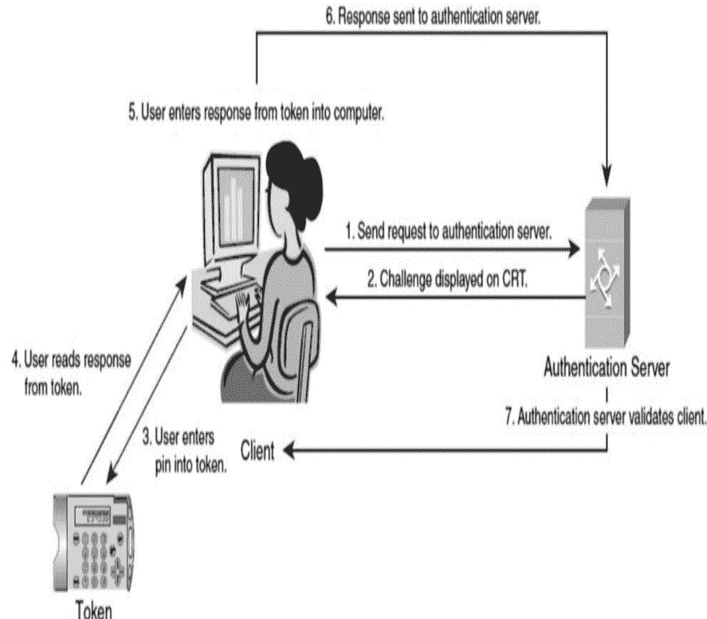

图 6.6

异步令牌身份验证。

这些设备的工作原理如下：

- 1. 生成一个值并显示给用户。

- 2. 将该值输入令牌中。

- 3. 提示用户输入秘密口令。

- 4. 令牌对输入的值进行计算。

- 5. 新值显示在令牌设备的 LCD 屏幕上。

- 6. 用户将显示的值输入计算机以进行身份验证。

- 7. 该值被转发到身份验证服务器，并与身份验证服务器期望的值进行比较。

# 卡片

基于卡片的身份验证可以通过智能卡、内存卡或磁条卡来实现。智能卡是一种带有嵌入集成电路芯片的智能令牌。由于内置了微处理器，它不仅提供了内存存储容量，还提供了计算能力。智能卡的类型包括：

- **接触式智能卡**——当插入读取器时，电触点会接触卡片上集成电路 (IC) 区域。这些触点为智能卡提供供电和数据路径。

- **非接触式智能卡**——当靠近读取器时，嵌入天线为 IC 供电。当在智能卡中输入正确的 PIN 后，即可开始处理。图 6.7 显示了一个通用智能卡的示例。

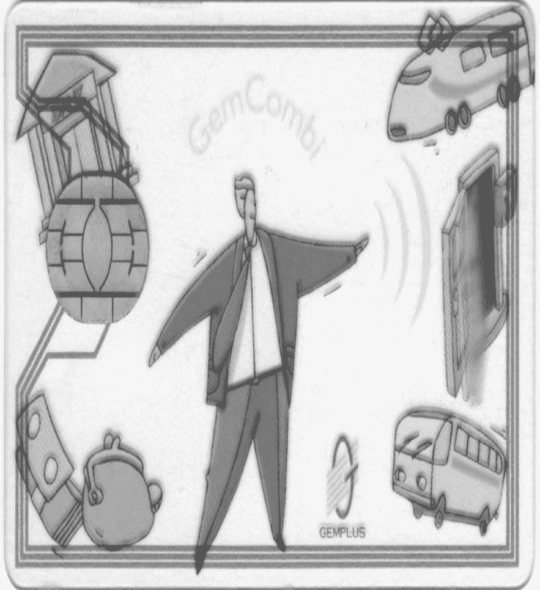

图 6.7

通用智能卡。

内存卡类似于智能卡，但不能处理信息。它们必须与读取器以及能够处理内存卡上存储数据的系统配合使用。内存卡的主要优势之一是，与密码不同，内存卡要求用户持有卡片才能进行身份验证。一种旧形式的令牌是磁条卡，它在 20 世纪 70 年代成为广泛使用的的标准。

磁条包含用于验证用户的信息。在磁卡上存储信息时必须小心。虽然不应使用明文，但某些信用卡仍以明文存储信息。磁条读取器廉价且易用。任何拥有此类设备和 PC 的人都可以在使用卡片的任何（如餐厅或商店）盗取卡片信息。内存卡通常存储 PIN，当计算机系统激活时将从数据库中提取身份验证信息。

# 证书


某些身份验证方法，如保护扩展身份验证协议（PEAP）和扩展身份验证协议（EAP），可以使用证书对计算机和用户进行验证。证书可以存储在智能卡上，或用于互联网安全协议（IPSec）和安全套接层（SSL）进行 Web 身份验证。这些数字证书提供了一些基本信息来证明持有者的身份。

数字证书通常包含以下关键信息：

- 身份信息，包括用户名、序列号和证书的有效期。
- 证书持有者的公钥。
- 签名机构的数字签名。这部分至关重要，因为它验证了整个数据包。

`X.509` 是数字签名的标准，因为它规定了识别个人或计算机系统所需的信息和属性。第 3 版本是最新的。将数字证书存储在令牌中被认为是一个安全的过程。

# 生特征（第 3 类）：生物识别

生物识别是一种基于个人特有的个人属性或行为或生理特征的身份验证手段。个人属性与身份特征（如指纹和视网膜扫描）关系更为密切，而行为特征的一个例子是个人签名的方式，被称为签名动力学。这与数字签名不同。生物识别是一种非常准确的身份验证手段，但通常比我们讨论的密码系统昂贵。

由于隐私问题，生物识别系统受到过一些人的反对。一些人认为这项技术太像“老大哥”技术。卫生等问题可能成为障碍，因为用户通常必须触摸身份验证设备，对于某些对细菌敏感度较高的人来说会有许多顾虑。在考虑生物识别系统时，应确保它们不会给受试者带来不必要的心理压力，或引起不合理的隐私问题。

然而，对更高安全的需求促使更多公司将生物识别系统视为满足更强安全需求的方法。生物识别提供了对世界上每个人进行唯一验证的能力。生物识别系统的工作是建立数据库，这被认为是注册期。注册完成后，系统即可使用。如果员工将手放在笔记本电脑的指纹扫描仪上，扫描器会将员工手指上的脊纹和皱纹与数据库中识别为属于该个人的指纹进行比较。这一过程被认为是生物识别数据的一一匹配。在实际上，用户的唯一属性值被转换为二进制值，然后在进行哈希处理后存储在身份验证服务器中。在实施强安全的组织中，用户可以使用所有三种身份验证形式。首先，他们在计算机上输入密码，然后手机会收到一条短信，最后用户使用指纹解锁手机并确认短信。微软 MFA 及其他产品均提供此类功能。这种深度防御的方法有助于增加安全性并降低风险。不同的生物识别系统具有不同的准确度和敏感性。

这些属性通过产生的 I 型和 II 型错误百分比来衡量。

I 型错误，被称为误拒绝率（FRR），是对本应允许访问但未被允许访问的人员百分比测量。可以将 FRR 视为“侮辱率”。之所以这样命名，是因为合法用户即使是合法用户也被拒绝了访问。

II 型错误，被称为误接受率（FAR），是进入了但不应被允许访问的人员或主体百分比测量。考虑一种情况：我（这本书的作者，并不是你们公司的员工）出现在你们的工作场所并尝试对公司的系统进行身份验证。如果我被允许进入，那就是一个 II 型错误示例。

这两个值结合起来可以确定系统的整体准确性。这是评估生物识别设备准确性的主要方法之一。假设你被要求评估类似的生物识别设备。在这种情况下，可以使用交叉错误率（CER）来帮助你为组织选择最佳系统。这是通过绘制 I 型错误等于 II 型错误的点来确定的。图 6.8 描述了 CER。CER 越低，生物识别系统越准确。例如，如果系统 A 的 CER 为 4，系统 B 的 CER 为 2，则系统 B 的准确性更高。

# 交叉错误率

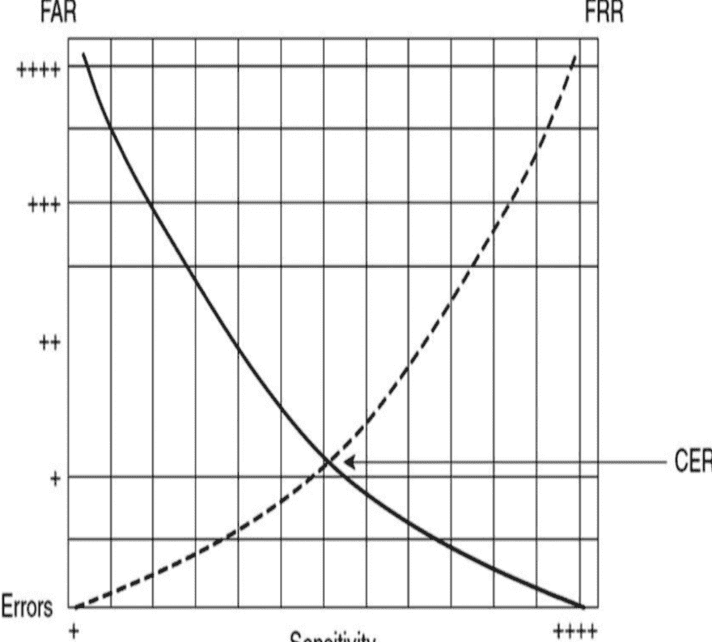

**图 6.8** 交叉错误率。

### 考试提示 (ExamAlert)

在尝试 CISP 考试之前，请确保你理解第一类错误、第二类错误以及 CER（交叉错误率）的区别。第二类错误被认为是最关键检查的错误率，而 CER 则被认为是生物识别系统准确性的最佳衡量标准。

以下是一些常见的生物识别系统。这些系统按照响应时间从快到慢、错误率从低到高的顺序排列。

- 1. 手部几何——一种利用用户手指和手部形状、长度和宽度的独特几何结构来确定用户身份的生物识别系统。它是最老的生物识别技术之一。
- 2. 虹膜识别——一种眼睛识别系统，被认为是最准确的生物识别系统，因为在匹配个体双眼的虹膜时，它有超过400个参考点。这些系统通常通过拍摄虹膜照片并将其与数据库中存储的照片进行比较来工作。优点包括高准确性、被动式扫描以及无需交换体液。
- 3. 视网膜模式——另一种基于眼睛的技术，通过扫描眼后的血管进行进行。它要求用户将眼睛靠近读取器。由于需要近距离接触，可能会交换体液。虽然基于视网膜的生物识别系统被认为非常准确，但缺点包括视网膜可能会由于糖尿病等医疗状况发生变化。怀孕也会导致视网膜血管发生细微变化。由于涉及医疗状况暴露的隐私担忧，视网膜扫描并不被用户轻易接受。
- 4. 指纹——广泛用于设施和物品（如笔记本电脑）的访问控制。它通过区分用户指纹中脊点、谷点、脊线和微小特征的最多30到40个细节来工作。然而，许多商业系统将匹配数量限制在8到10个左右。
- 5. 人脸识别——需要用户将脸放在摄像头前。人脸扫描设备通过与数据库中持有的面部特征（特征值特征）进行数学比较，以允许或阻止访问。这些系统在过去几年中越来越流行。
- 6. 语音识别——利用语音分析进行识别和身份验证。其主要优势是可以用于电话应用程序，但它容易受到重放攻击。任何看过电影《偷天监控》（Sneakers）的人可能记得那句词：“你好，我是 Werner Brandes。我的声音就是我的护照。请验证我。”

无论使用上述哪种方法，所有生物识别系统基本上都遵循类似的用法模式：

- 1. 用户必须首先在系统中注册——注册无非是允许系统获取多个样本进行分析和特征提取。这些特征稍后将用于比较。
- 2. 用户请求身份验证——获取样本、进行分析并提取特征。
- 3. 做出决策——多个特征的匹配允许用户访问，而样本与存储特征之间的差异会导致用户被拒绝访问。

不同的生物识别系统具有具有不同程度的准确性。例如，指纹扫描系统的准确性基于指纹模式和微小特征。指纹模式包括弓形、环形和涡纹，而微小特征包括脊终、分叉和短脊。这些特征位于指尖上，如图 6.9 所示。

虽然微小特征的数量随手指而异，但这些信息可以以电子方式存储，文件大小通常为 250 到 1,000 字节。当用户登录时，包含微小特征的存储文件将与扫描的个人手指进行比较。

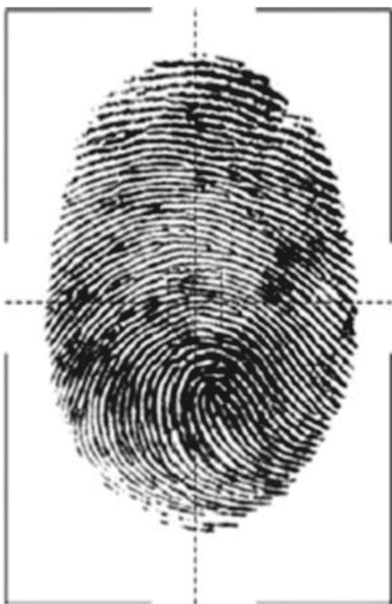

（此处为重复内容翻译：尽管微小特征的数量随手指而异，但这些信息可以以电子方式存储在大小通常为 250 到 1,000 字节的文件中。当用户登录时，包含微小特征的存储文件将与扫描的个人手指进行比较。）

（注：此处原文似乎存在重复或乱码片段，根据指令已按逻辑翻译并去除了重复部分）

加载在 IT 部门系统的部门程序。通过 Web 门户，其他部门在需要时可以使用基于 HTTP 的安全关联标记语言（Security Association Markup Language）来访问该服务。

CISP 应该对身份管理的相关组件有一些了解，例如：

- Web 服务安全——Web 服务安全（WS Security）是简单对象访问协议（SOAP）的扩展，旨在为 Web 服务添加安全性。
- XML——多年前，超文本标记语言（HTML）主导了网络。如今，可扩展标记语言（XML）是标准框架。XML 是一种允许对元数据进行通用表达的标准。XML 通常遵循 SOAP 标准。
- SPML——服务供应标记语言（Service Provisioning Markup Language）是一种基于 XML 的框架，可用于组织之间交换访问控制信息，使得登录一个实体的用户可以将访问权限传递给另一个实体。

## 单点登录 (Single Sign-On)

单点登录试图解决一个所有用户和管理员都会遇到的共同问题。组织内的各种系统可能要求用户多次登录到各个系统。这些系统中的每一个都要求用户记住可能不同的用户名和密码组合。我们大多数人都会厌倦尝试记住所有这些信息，并开始寻找捷径。最常见的捷径就是写下这些信息。在办公室里走走，你可能会发现许多同事都遗憾地采取了这种做法。单点登录的设计是为了解决这个问题，允许用户向单一身份验证机构进行验证，然后访问所有其他受保护的资源，而无需再次进行验证。

在你决定在你的组织中实施简单登录（simple sign-on）之前，你应该意识到它是昂体系的，而且 SSO 的主要优势也是它主要的缺点。它简化了每个人获取多个系统访问的过程。这意味着威胁者也可以利用这种便利性。多因素身份验证（MFA）可以帮助降低风险。Kerberos 和 SESAME 是 SSO 的两个示例。

## 注意

> 瘦客户端可以被视为一种单点登录系统，因为瘦客户端不持有数据。所有信息都存储在中央服务器上。因此，在用户登录后，没有理由让用户再次进行验证。

## Kerberos

Kerberos 是由马诸塞理工学院（MIT）创建的，是一种使用对称密钥加密的网络身份验证协议。Kerberos 有三个部分：客户端、服务器以及一个称为密钥发行中心（KDC）的信任第三方，用于在它们之间进行调解。客户端从 KDC 获取票据（tickets），并在建立连接时将这些提交给服务器。Kerberos 票据代表客户端的凭证。Kerberos 依赖对称密钥加密（共享或秘密密钥加密）。Kerberos 第5 版本使用数据加密标准（DES）实现。然而，取代 DES 的高级加密标准（AES）在后来的 Kerberos 版本以及 Microsoft Windows 7、8、10、Server 2012 等操作系统中得到了支持。Kerberos 通过称为通用安全服务接口（GSS-API）的编程接口进行通信。常见的 Kerberos 术语包括：

- 票据（Ticket）——由 KDC 生成并给给主体（principal），用于验证另一个主体。
- 领域（Realm）——由所有 KDC 为提供安全服务的主体组成的域；用于在逻辑上分组资源和用户。
- 凭证（Credentials）——票据和一个服务器密钥。
- 主体（Principal）——可以是用户、进程或应用程序。Kerberos 系统将一个主体验证给另一个主体。

KDC 是运行在物理安全服务器上的服务。KDC 由两个组件组成：

- **身份验证服务**（Authentication service）——身份验证服务颁发票据授予票（TGTs），用于许可进入票据授予服务（TGS）。在网络客户端获取服务票据之前，它们必须从身份验证服务获取 TGT。
- **票据授予服务**（Ticket-granting service）——客户端接收特定目标服务的票据。

注意

> 请记住，TGT 是一个具有有限窗口的加密标识文件。TGT 临时存储在请求主体的系统中，用于使主体无需在访问资源时多次输入凭证。

Kerberos 的基本操作如图 6.11 所示：

- 1. 客户端利用身份验证服务向 KDC 索要票据。
- 2. 客户端接收加密的票据和会话密钥。
- 3. 客户端将加密的 TGT 发送给 TGS 并请求访问应用程序服务器的票据密钥：一份使用客户端密钥加密，另一份使用应用程序服务器密钥加密。
- 4. TGS 使用自己的私钥解密 TGT 并将票据返回客户端，将其授予应用程序服务器。
- 5. 客户端将此票据同身份验证器（authenticator）发送给应用程序服务器。
- 6. 应用程序服务器向客户端发送其身份确认。

注意

> Kerberos 仅验证身份验证流量；后续的通信不受保护。如果请求者使用如文件传输协议（FTP）等不安全协议，网络流量将是明文的。

尽管 Kerberos 可以提供身份验证、完整性和机密性，但它并非没有缺点。一个弱点是 Kerberos 保证了可用性。其他一些弱点如下：

- Kerberos 对时间敏感；因此，它要求所有系统时钟保持密切同步。
- Kerberos 使用的票据（身份验证令牌）可能会被嗅探并可能被破解。
- 如果攻击者针对 Kerberos 服务器，它可能成为单点故障。密钥密钥临时存储在工作站上，使其易受到侵入者的攻击。Kerberos 容易受到暴力破解攻击。
- Kerberos 可能不适用于具有许多系统、应用程序、用户和并发请求的大型环境。

- 1. 请求用于 TGS 的票据
- 2. 将票据授予票返回给客户端
- 3. 将 TGT 和票据请求发送给应用程序服务器
- 4. 将票据返回给客户端
- 5. 将会话票据发送给应用程序服务器
- 6. 将身份确认发送给客户端


图 6.11 Kerberos 操作。

## Sesame

Kerberos 是最广泛使用的 SSO 解决方案，但也有其他选项。其中一个选项是多厂商环境安全系统与应用程序项目，该项目旨在解决 Kerberos 的主要弱点之一：对称密钥的明文存储。SESAME 使用对称和非对称加密，而 Kerberos 仅使用对称加密。另一个区别是 SESAME 结合了 MD5 和 CRC32 哈希并使用两个证书。其中一个证书用于提供身份验证（类似于 Kerberos），另一个证书用于控制访问权限。

SESAME 使用属性证书（PAC）。PAC 包含请求主体的身份、访问能力以及访问主体的有效期。IBM 的 KryptoKnight 和 KryptoKnight 的衍生产品 NetSP 也是 SSO 技术，但并未广泛部署。尽管你可能看不到这些系统，但如果它们在考试中出现，你应该知道它们的名称以及它们是用于 SSO 的。

## 授权与访问控制技术

在用户被识别并身份验证后，下一步是考虑授权。在用户登录后，他们可以访问什么，他们拥有什么种权利和权限？此讨论的核心是主体如何访问对象，以及在建立访问后对这些资源可以做什么。三种主要的访问控制类型如下：

- 任意量访问控制 (DAC)
- 强制访问控制 (MAC)
- 基于角色的访问控制 (RBAC)
- 基于属性的访问控制 (ABAC)
- 基于角色的访问控制

## 任意访问控制 (DAC)

DAC 模型之所以得此名，是因为访问控制交由所有者自行裁量决定。它可以被认为类似于一个点对点的计算机网络。每个用户都负责控制自己的系统和资源。所有者有权决定其他用户是否有权访问文件和资源。DAC 的一个显著问题是，它的有效性受限于用户的技能和能力。缺乏经验或不在乎的用户可能会轻松授予其控制范围的文件或对象的完全访问权限。

以下是 DAC 的两个主要组件：

- **文件和数据所有权**——系统中的所有对象都必须有一个所有者。没有所有者的对象将处于不受保护状态。
- **访问权限和许可**——这些权限控制个人的访问权利。虽然存在多种变体，但基本的访问控制列表 (ACL) 会检查读取、写入或执行权限。

ACL 标识有权访问特定信息的用户。这是一个动态模型，允许数据轻松共享。例如，我可能会告诉儿子，不能再从互联网向楼上的电脑下载任何音乐了。通过我在书房的电脑，我儿子可能会拒绝我访问他下载音乐的文件夹，以防止我通过访问它来监控他的活动。这表明 DAC 非常像点对点网络，因为用户负责自己的资源和数据。

表 6.8 显示了一个示例 ACL，其中列定义了对对象的访问。主体的能力（capabilities）指的是矩阵中的行，描述了可以在哪些对象上执行哪些操作。主体的能力指的是矩阵中的行，并引用了可以执行什么操作。

## 表 6.8 示例访问控制列表

| 主体 | 对象 1 | 对象 2 | 对象 3 | 对象 4 |
|---|---|---|---|---|
| Jeff | 完全控制 | 完全控制 | 完全控制 | 完全控制 |
| Michael | 读取 | 读取 | 读/写 | 无访问权限 |
| Christine | 读取 | 读/写 | 无访问权限 | 无访问权限 |

你可以将能力项视为特定用户在访问矩阵内可以执行的操作。DAC 控制基于此矩阵，你可以将其视为建立主体对对象访问权限的某种手段。

尽管数据所有者可以创建 ACL 来决定谁有权访问特定对象，但错误会导致机密性丢失，而且不像其他更严格的模型那样，不存在中央监督。

## 强制访问控制 (MAC)

MAC 模型是静态的，并基于预定义的访问权限列表；因此，在基于 MAC 的系统中，访问是由系统决定的而不是用户。为了实现这一点，MAC 系统使用标签（labels）和许可（clearances）。图 6.12 显示了 DAC 和 MAC 之间的差异。


图 6.12 DAC 和 MAC 的差异。

MAC 模型通常用于处理敏感数据的组织，例如国防部、NSA、CIA 和 FBI。MAC 模型示例包括 SELinux 等。基于 MAC 模型的系统对主体使用许可，并根据敏感性标签标记对象。例如，军使用特密（top secret）、秘密（secret）、机密（confidential）、敏感但未公开（SBU）和未公开（unclassified）许可。（有关政府数据分类的更深入讨论，请参见第 2 章“逻辑资产安全”）。理解此模型需要的术语包括：

- **对象**——向主体提供数据或信息的被动实体。
- **主体**——可以是用户、系统、程序或文件的活动实体。

当主体尝试访问对象时，会检查对象的标签是否与主体的许可级别匹配。如果没有找到匹配项，则拒绝访问。该模型擅长支持“按需知”的概念。这里有一个例子：Jeff 想要访问一个秘密文件。该文件被标记为“特密，联合参谋部 (JCS)”。尽管 Jeff 有特密许可，但他不是 JCS 成员；因此，访问被拒绝。实际上，情况比之前的示例细节要复杂一点，但请记住 CISSP 的概念是广博而不精的。

- **许可**——决定用户可以访问的信息类型。
- **类别**——应用于对象并用于信息孤隔离。
- **敏感性**——用于对信息进行分类。如前所述，美国军使用特密、秘密、机密、敏感但未公开 (SBU) 和未公开等标签。

## 注意

> 每当你使用敏感性标签时，你都应该开始考虑 MAC 了，因为这个系统与该术语关联密切。

对于考试，你应该知道 MAC 系统可以是分级的、分部的或混合的。分级设计通过分级级别工作。层级中的每一级都包含较低的级别。例如，在分级系统中，Dwayne 必须获得“特密”许可，因此可以查看“秘密”和“机密”信息，因为这些信息的敏感性较低。然而，如果 Dwayne 只被授权访问“机密”数据，他将无法读取“秘密”等更高级别的内容。分部对象需要来自特定领域或组（如国土安全部）的许可。


在分部系统中，有将数据分离到不同类别的能力。例如，在国防部工作的 Dwayne 无法读取国务院的文件；因此，Dwayne 拥有 TS/SCI 许可。军队将使用具有必要权限的 MAC 系统来完成工作。混合设计结合了分级和分部的元素。关于 MAC 模型的要点包括：

- 它被认为是一个“按需知”系统。
- 它比 DAC 有更多的管理开销。
- 所有用户和资源都被分配了安全标签。

> 注意：尽管 MAC 使用安全标签，但 DAC 系统允许用户设置并控制对文件和资源的访问。

## 基于角色的访问控制 (RBAC)

RBAC 也称为非强制访问控制，它允许用户拥有某些预设的权利。这些权利根据用户的角色分配给用户。角色始终映射到组织的结构。许多组织正在转向这种模型，因为它简化了访问管理。例如，如果你是银行的 IT 管理员，会有一些定义明确的角色，如银行经理、贷款官和出纳员。RBAC 允许你为每个组定义特定的权利和权限。然后将用户放入组中，并继承分配给组的权限。如果 Joan 是出纳员并晋升为贷款官，管理员只需要将她从出纳员组移动到贷款官组即可。许多现代操作系统的设计都使用 RBAC 模型。

RBAC 非常适用于人员流动率高的组织。将访问权限和许可分配给组而不是个人，减轻了管理负担。RBAC 如何实现取决于设计操作系统的个人。为了让 RBAC 发挥作用，组织内的角色必须通过策略清晰地定义。

你的组织可能决定使用静态职责分离 (SSD)。SSD 规定一个组的成员不能是另一个组的成员。假设 Mike 是网络管理员组的成员。如果是这样，Mike 就不能同时是安全管理员组或审计组的成员。必须清晰定义角色，以查看组织内部存在哪些冲突。

另一种设计是动态职责分离 (DSD)。DSD 规定用户在任何活动会话中不能合并职责。假设 Mike 是审计组和审计管理组的成员。如果 Mike 登录执行审计测试，他就不拥有管理权限。如果 Mike 以审计管理组的身份登录，他就不能执行审计测试。

职责分离的示例见表 6.9。

## 表 6.9 职责分离

| 角色 | 允许访问的示例 |
|---|---|
| 用户 | 网页浏览、经批准的应用程序、更改桌面外观 |
| 审计员 | 查看防火墙日志、服务器日志、应用程序日志 |
| 安全管理员 | 防火墙管理、ACL 更新、服务器补丁 |

最后，是基于任务的访问控制 (TBAC)。TBAC 基于 RBAC，但它不是基于角色，而是基于任务的，使得允许的职责基于特定个人可能执行的任务类型。这的一个很好的例子可以在你访问 Windows Server 2012 时看到。在用户管理组中，你会看到一些预定义的配置文件，例如打印管理器、备份管理器和高级用户。分配给这些每个项的访问权限都是基于个人可能执行的任务类型。

## 其他类型的访问控制

其他类型的访问控制技术还包括基于属性的访问控制 (ABAC) 和基于规则的访问控制。

基于属性的访问控制 (ABAC) 是一种更动态、灵活、感知上下文且自适应的访问控制方法。ABAC 的可能控制变量比 RBAC 多得多。ABAC 有一组被称为“属性”的特征。属性可以是用户、环境和资源。

- 用户属性包括用户名、角色、组织、ID 和安全许可等项目。
- 环境属性包括访问时间、数据所在位置和当前组织的威胁级别等项目。
- 资源属性包括创建日期、资源所有者、文件名和数据敏感性等项目。

由于 ABAC 能够在更细粒度的基础上控制安全和访问，因此它的实现是为了减少未经授权访问带来的风险。例如，ABAC 可以对用户访问实施细粒度限制，例如仅允许相关员工在特定时间、特定区域或针对某些分机构访问。只需记住，ABAC 是复杂的，如果不需要，RBAC 可能是更好的选择。作为一名 CISSP，你必须始终平衡风险与成本。如果不需要，没有理由使用更细粒度的选项。你将只会产生额外的资源成本。

ABAC 由扩展访问控制标记语言 (XACML) 支持。XACML 定义了策略、请求制定及其回答，以及维护它的体系。它基于 XML，并包括策略决策点 (PDP)，该点根据策略执行点 (PEP) 提供的访问请求对策略进行评估。PDP 可能还需要需要查询策略信息点 (PIP) 以收集有关用户的描述性属性或请求中任何缺失的属性。策略管理点 (PAP) 用于管理 PDP 和 PIP 功能，如图 6.13 所示。

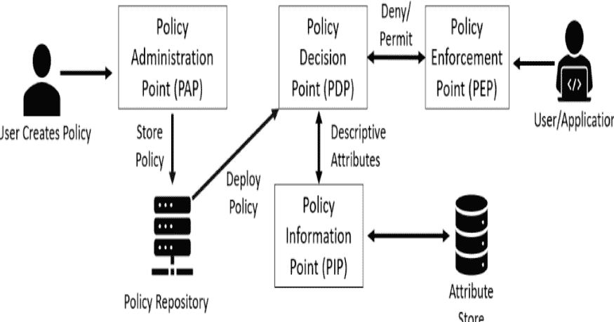

图 6.13

XACML ABAC 架构。

基于规则的访问控制基于一组特定的规则，类似于路由器的 ACL。基于规则的访问控制被认为是 DAC 模型的变体。基于规则的访问控制通过实现：

1. 拦截每个请求
2. 将其与授权级别进行比较
3. 做出决策

例如，路由器可能使用基于规则的 ACL，该 ACL 可能允许 80 端口的网页流量并拒绝 23 端口的 Telnet 流量。这两条基本规则定义了 ACL。ACL 与对象绑定。

权限可以通过三种不同的方式分配：显式、隐式或继承。ACL 有一个隐式的“拒绝所有”语句，它是最后一个被处理的项。这里显示了一个示例的 Cisco 格式 ACL，其中包含了允许 (permit) 和拒绝语句：

```
no access-list 111
access-list 111 permit tcp 192.168.13.0 0.0.0.255 any eq www
access-list 111 deny tcp any eq telnet
access-list 111 deny icmp any any
interface ethernet0
ip access-list
```

（注：由于原始文本存在大量重复和错误，以上仅翻译了唯一的有效内容。）

RADIUS 函数如下（见图 6.15）：

1. 用户连接到 RADIUS 客户端。
2. RADIUS 客户端向用户请求凭据。
3. 用户输入凭据。
4. RADIUS 客户端对凭据进行加密并将其传递给 RADIUS 服务器。
5. RADIUS 服务器对凭据进行接受、拒绝或挑战。
6. 如果认证成功，用户通过通过网络认证。

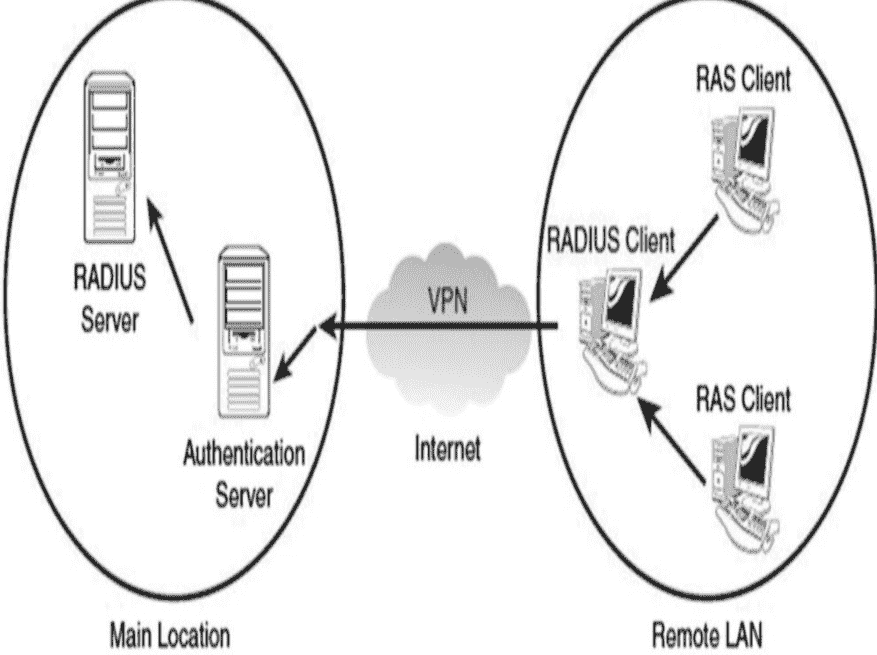

图 6.15 RADIUS 认证。

# TACACS

终端访问控制器访问控制系统（TACACS）有三种变体：TACACS、XTACACS（扩展的 TACACS）和 TACACS+。TACACS 允许将认证、授权和审计功能分开，这使得管理员对部署有更多的控制权；相反，RADIUS 没有将这些功能分开。TACACS 高度以 Cisco 和微软为中心，被认为是专有协议。XTACACS 将认证、授权和记责过程分开，而 TACACS+ 具有双因素认证和安全令牌功能。TACACS+ 是一种全新的、修订后的协议，与 TACACS 的其他版本兼容。TACACS 未能像 RADIUS 那样流行；现在被认为是一种有些过时的协议。

RADIUS 和 TACACS+ 之间存在一些主要区别。RADIUS 只加密客户端和服务器之间传输的密码，而 TACACS+ 则加密所有信息。TACACS+ 还允许更多的管理，并拥有更多 AVP，因为它可以拆分 AAA 协议。RADIUS 使用 UDP，而 TACACS+ 使用 TCP。

# Diameter

你永远不能说 Diameter 的创建者们没有幽默感。Diameter 的名字是一个双关语，因为“直径（diameter）是半径（RADIUS）的两倍”。实际上，Diameter 是增强型的 RADIUS，因为它的设计初衷远比为拨号用户提供服务要得多。单个 Diameter 节点可以支持超过一百万个并发的 Diameter 会话，而且 Diameter 甚至可以进行点对点认证。Diameter 在 RFC 3588 中详细介绍，并可以使用 TCP、UDP 或流控制传输协议 (SCTP)。Diameter 可以支持在 RADIUS 和 TACACS 创建时甚至未想象到的协议和设备，例如 VoIP（IP 语音）、PPP 以太网和移动 IP。Diameter 被认为是一个非常安全的解决方案，因为它强制要求 IPSec 或 TLS 的加密支持。

Diameter 设计使用两种协议。第一个是基础协议，用于在 Diameter 设备之间提供安全通信，并允许传输各种信息，如标头、安全选项、命令和 AVP。

第二个协议实际上是一组扩展。扩展构建在基础协议之上，允许各种技术使用 Diameter 进行认证。该组件与其他服务（如 VoIP、无线和手机认证）交互。在物联网、无处不在的互联网和系统系统的世界中，组织正在订阅“自持设备（BYOD）”，且所有智能都在网络边缘并不断增长，Diameter 为这些设备接入组织网络的认证开辟了道路。它提供了比活动目录控制器所能做的更细粒度的访问和授权。

最后，Diameter 与 RADIUS 并非完全向后兼容，但升级 RADIUS 组件通信路径有几种可选方案。

# 去中心化访问控制

去中心化访问控制系统将用户 ID、权利和权限存储在网络各个地方。例如，域可以被视为一种去中心化访问控制的形式。大型组织通常根据组织边界（如制造、工程、营销、销售或研发）建立多个域；或者根据地理边界（如纽约、亚特兰大、圣何塞和休斯顿）建立。当存在多个域时，它们之间必须存在某种类型的信任。信任仅仅是域之间的独立链接，对于解决它们不同的安全策略和安全数据库是必要的。尽管一个域的所有认证都集中在域控制器上，但域的访问控制分布在域的成员中。对资源的访问是在资源位于域中可能存在的任何地方进行分配和定义的。

去中心化系统的具有特点包括：

- 将控制权交给更靠近资源的个人，例如部门经理，偶尔还有用户
- 维护多个域和信任
- 不使用单一中央实体处理访问请求
- 用于数据库管理系统 (DBMS)

# 审计与监控

无论使用何种方法，审计都必须有效，以便追究用户的责任。为了使审计有效，必须记录并审查信息。如果说这些日志记录有什么缺点，那就是所有信息都必须记录和审查。必须在收集审计数据和维护可管理的日志大小之间找到平衡。使用审计简化工具可以加速审查过程。这些工具解析数据并消除不需要的信息。另一个实用的工具是差异检测工具。这些工具寻找超出正常活动范围的趋势。例如，如果一名员工通常在早上 7 点左右进入大楼并在大约下午 4 点进入，但被看到是在凌晨 3 点进入，差异检测工具就能检测到这种异常。

## 入侵检测系统

入侵检测系统在 IT 基础设施保护中起着至关重要的作用。入侵检测涉及监控网络流量、检测未经授权访问系统或资源的尝试，并通知相关人员以便采取对策。IDS 被设计用于用作访问控制监控器。入侵检测是一项相对较的技术。它真正诞生于 20 世纪 80 年代，当时 James Anderson 在名为《计算机威胁监控与监控（Computer Threat Monitoring and Surveillance)](https://csrc.nist.gov/publications/history/ande80.pdf) 的论文中提出了这一概念。

IDS 可以配置为扫描攻击、跟踪黑客的移动、向管理员警报正在进行的攻击，并突出显示需要解决的潜在漏洞。IDS 检测什么取决于入侵传感器的放置位置。这需要一些考虑，因为毕竟，DMZ（非军事化区）中的传感器在检测误用方面表现良好，但对网络内部的攻击者则将毫无用处。即使你确定了传感器的放置位置，它们仍然需要调优。如果没有特定的调优，传感器将对所有符合给定标准的流量生成警报，无论这些流量是否真的会产生警报。IDS 必须经过训练来寻找可疑活动。这就是为什么我告诉人们，IDS 就像一个 3 岁的孩子。它们需要不断的照顾和培养，如果被遗置则表现不好。

## 注意

> 虽然考试将以非常基础的方式检查这些系统，但现代系统是入侵检测和入侵防御的结合。这些系统被称为入侵检测与防御（IDP）系统，旨在识别潜在事件、记录信息、尝试停止事件并报告事件。许多组织甚至使用 IDS 系统进行诸如识别安全策略问题、记录威胁以及威慑违反安全策略的恶意活动。NIST 800-94 是学习更多信息的极佳资源（csrc.nist.gov/publications/nistpubs/800-94/SP800-94.pdf）。

入侵检测系统的一个巨大问题是它们是“事后性”的，即攻击已经发生。IDS 的其他问题是假误报和漏报。*假误报（False positives）*是指 IDS 对正常流量触发了警报。例如，如果你去当地商场的停车场，你可能会听到由于盗窃以外的原因响起的警报声。这些汽车遭遇了假误报。假误报是一个大问题，因为它们会让管理员产生习惯性心理。*漏报（False negatives）*更糟糕。当真实攻击发生时，如果 IDS 没有检测到它，就发生了漏报。

## 考试要点

漏报是最糟糕的事件类型，因为它意味着攻击发生了，但 IDS 未能检测到。

IDS 系统可以分为两种基本类型：*基于网络的入侵检测系统（NIDS）*和*基于主机的入侵检测系统（HIDS）*。

## 基于网络的入侵检测系统

类似于在混杂模式下运行的协议分析器，NIDS 捕获并分析网络流量。这些设备会尽力检查经过的每一个包。当它们检测到可疑流量时，采取的取决于特定的 NIDS。触发警报、重置会话或阻塞流量。其优点包括它们是非侵入性的、具有监控整个网络的能力，并在防火墙和主机之间提供了额外的防御层。它们的缺点包括攻击者可以发送大量流量来使其过载、它们无法解密或分析加密的流量，并且它们可能会受到攻击。相反，攻击者将发送低水平流量以避免触发 IDS 阈值警报。像 NMAP 这样的工具具有定时避免检测的能力。关于 NIDS 需要记住的包括：

- 它们实时监控网络流量。
- 它们分析协议和其他相关的包信息。
- 它们与防火墙集成并根据需要定义新规则。
- 在交换环境中使用，需要用户执行端口划分（port spanning）和/或端口镜像。
- 它们发送警报或终止违规连接。
- 使用加密时，NIDS 将无法分析流量。

## 基于主机的入侵检测系统

HIDS 在功能和设计上与病毒扫描器更相关，因为它们驻留在主机计算机上。它们在后台静静运行，监控流量并尝试检测可疑活动。可疑活动的范围可以从系统文件修改到 ActiveX 命令的不安全激活。尽管它们在全交换环境中是有效的，并且可以分析加密的网络流量，但它们需要大量的维护，无法监控网络流量，并且依赖于底层的操作系统，因为它们不控制核心服务。HIDS 最适用于需要保护的高价值目标。关于 HIDS 需要记住的包括：

- HIDS 消耗主机的某些资源。
- HIDS 分析加密流量。
- HIDS 在发现异常事件时发送警报。
- HIDS 在某些方面仅仅是运行在本地主机上的另一个易受攻击的应用程序。

## 基于签名、基于异常和基于规则的 IDS 引擎

基于签名、基于异常和基于规则的系统是 IDS 使用的三种主要类型。这些类型在检测入侵方面采取不同的方法。

基于签名的系统依赖于已知攻击的数据库。该系统检查数据以查找恶意内容，可能包括碎片 IP 包、SYN 流或畸形的互联网控制协议（ICMP）。一旦发现签名，IDS 就会触发警报。虽然基于签名的系统效果良好，但缺点是取决于当前的更新。基于签名的子类包括：

- **基于模式**：查看特定的签名。
- **基于状态**：跟踪连接状态。

基于异常的系统通常将协议与 RFC 进行比较。例如，它将查看 TCP 包中的标志位——SYN 标志应设置为 1。相反，基于行为的 IDS 将查看被认为是正常的性能，例如：“迈克通常在早上 8 点到下午 5 点之间登录，但现在他正在凌晨 2 点登录 5000 次。”这需要 IDS 经过学习阶段来捕捉这种异常。军方一直使用这种方法监控他们的员工。基于行为的 IDS 的大问题是随时间变化的活动不会被视为攻击，而只是正常的。这些系统倾向于产生大量的假误报。基于异常的子类包括：

- **基于统计**：将正常与异常活动进行比较。
- **基于流量**：对异常包进行触发。
- **基于协议**：具有重组包并查看高层活动的能力。协议解码入侵检测需要 IDS 维护状态信息。例如，DNS 是一个步骤步骤；因此，如果协议匹配 IDS 在没有 DNS 请求的情况下看到了许多 DNS 响应，系统可以将其标记为缓存中毒。

基于规则的 IDS 涉及观察流量并建立正常运行基线的规则和模式描述。通过识别范围外的活动来检测入侵。这种专家系统遵循四阶段分析过程：

1. 预处理
2. 分析
3. 响应
4. 改进

响应框——从之前列出的组件获取信息并形成适当的响应。

## 考试提醒

仔细阅读任何讨论 IDS 的问题。记住，几个变量可能会改变结果或答案。花时间关注网络（network）、主机（host）、签名（signature）和行为（behavior）等词，有助于澄清问题。

# 传感器部署

您的组织的安全策略应详细说明 IDS 系统和传感器的部署。IDS 传感器的部署需要考虑。IDS 传感器可以放置在外部、DMZ（非安全区）或网络内部。您在这些位置之一或多个放置传感器的决定需要特定的调优。如果没有调优，传感器将对符合给定标准的所有流量生成警报，无论这些流量是否真的是应该触发警报的内容。传感器的部署是动态的，必须随着您的环境的变化而不断改变。传感器不应与其关联 IP 地址，或者可能通过单向网络电缆部署，以便黑客更难扫描和发现它们。

## 考试提醒

虽然基于异常检测的 IDS 可以检测零日攻击，但基于签名和基于规则的 IDS 则不能。

# 入侵防御系统

入侵防御系统（IPS）建立在 IDS 的基础之上，并试图将该技术更进一步。IPS 可以自动反应并实际上防止安全事件的发生，最好在没有用户干预的情况下进行。IPS 被认为是下一代 IDS，并且实时阻止攻击。美国国家标准与技术研究院（NIST）现在使用 IDP（入侵检测与防御）术语来定义现代设备，这些设备维持了 IDS 和 IPS 设备的功能，通常执行深度检查，并适用于支持 OSI 第 3 层到 OSI 第 7 层检查的设备。

# 两大工具合二为一

SIEM 是两个独立服务——安全信息管理（SIM）和安全事件管理（SEM）的结合。SIM 用于处理和处理审计及事件数据的长期存储，而 SEM 用于事件的实时报告。将这两种技术结合起来，为用户提供了告警、捕获、聚合和审查来自许多不同系统和来源日志信息的能力。提供 SIEM 工具的供应商包括 Splunk、LogRhythm、Radar 等。


虽然像 SIEM 这样的技术是安全专业人员工具箱的极佳补充，但请记住您应该努力实现深度防御。例如，将 IDS/IPS 与 SIEM 结合提供的保护比比任何一种技术本身都要大得多。

## 网络访问控制

IDS 和 IPS 可以被视为访问控制和安全的起点。该领域的下一步是网络访问控制（NAC）或 IEEE 802.1x。NAC 产生于信任计算机运动，目标是统一安全。NAC 为管理员提供了一种方法，在允许设备连接到网络之前验证其是否符合特定的健康标准。笔记本电脑、台式电脑或任何不符合预定义规则的设备都可以被阻止加入网络，甚至可以被分配到一个受控的网络，其中访问受到限制，直到该设备达到所需的安全标准。目前，有几种不同形式的 NAC 可用，包括以下几种：

- 基于基础设施的 NAC——需要组织升级其硬件和/或操作系统。
- 基于终端的 NAC——需要从每个网络客户端上安装软件代理。这些设备随后由中心化管理控制台进行管理。
- 基于硬件的 NAC——需要安装网络设备。该设备监控特定行为，并在检测到不合规活动时可以限制设备的连接性。

## 击键监控

击键监控可以通过硬件或软件设备完成，并用于监控活动。这些设备可可用于合法和非法活动。作为一种合规工具，击键监控允许管理层监控用户的活动并验证合规性。主要关注的问题是用户对隐私的预期。应该建立策略和程序，告知用户此类技术可用于监控合规性。1993 年，司法部请求 NIST 就击键监控提供指导（`csrc.nist.gov/publications/`）。这种策略和程序应告知用户此类技术可用于监控合规性。

击键监控允许管理层监控用户的活动并验证合规性。主要关注的问题是用户对隐私的预期。应该建立策略和程序，告知用户此类技术可用于监控合规性。1993 年，司法部请求 NIST 就击键监控提供指导（`csrc.nist.gov/publications/`）。

击键监控不仅是用于合规性监控，还可以用于内部的授权并记录。硬件击键记录器通常分为两种类型：

- 硬件击键记录器通常安装在桌面或服务器。即使用户离开座位，它们也能记录。
- 软件击键。这些记录器甚至有无线版本，可以通过 802.11b/g/n/ac 和蓝牙通信。

软件击键记录器位于操作系统和键盘之间。大多数程序是简单的，但有些是复杂的，并将记录的按键发送到预定义的地址（`wirelesskeylogger.com/php`）。

软件击键记录器位于操作系统和键盘之间。大多数程序是简单的，但有些是复杂的，并能捕获用户输入的 URL。

## 备习题

1. Grace 在一家非常关注信息机密的政府机构工作。该机构对身份、认证和授权过程有严格控制。在 Grace（主体）访问信息之前，会验证对象的主体的等级。这是哪种方法的例子？

- A. DAC
- B. LBAC
- C. RBAC
- D. MAC

2. 以下哪种生物识别系统被认为最准确？

- A. 网膜扫描 CER 3
- B. 指纹识别 CER 4
- C. 键盘动态 CER 5
- D. 语音识别 CER 6

3. DAC 的两个主要组件是什么？

- A. 访问权限和权限，安全标签
- B. 文件和数据所有权，访问权限和权限
- C. 安全标签和磁盘式访问列表
- D. 文件和数据所有权，以及安全标签

4. 你被聘为一家政府机构的承包商。根据你的需要，你获得了机密权限。认证、授权和问责也得到了执行。每周，你工作的政府安全官负责审查安全日志，以确保只有授权用户登录了网络且没有尝试访问未经授权的数据。确保访问问责的过程包括四个阶段。这是哪种方法的例子？

- A. 身份
- B. 问责
- C. 授权
- D. 认证

5. 在注册新服务时，你被问了以下问题：“你出生在哪个国家？宠物的名字是什么？你母亲姓氏是什么？”使用的是哪种密码系统？

- A. 认知密码
- B. 一次密码
- C. 虚拟密码
- D. 复杂密码

6. Mark 为他拥有的小型保险办公室完成了新的对等点网络。虽然他允许访问互联网，但他不想用户远程登录。以下哪种模型最符合他的设计？

- A. TACACS+
- B. MAC
- C. RADIUS
- D. DAC

7. 以下哪是最佳答案：TACACS+ 具有什么特性？

- A. 单因素认证
- B. 去中心化访问控制
- C. 双因素认证
- D. 问责制 (Accountability)

8. 一个新入职的初级安全管理员将在你休假期间临时担任你的职位。你正试图解释访问控制的基本知识以及基于规则的访问控制机制（如 ACL）的功能。以下哪项最准确地描述了顺序：

- A. ACL 在允许语句之前应用所有拒绝语句。
- B. 基于规则的访问控制和基于角色的访问控制基本上是同一回事。
- C. ACL 以隐式拒绝语句结束。
- D. ACL 是从下到上处理的。

9. RADIUS 提供以下哪项功能？

- A. 授权和问责制
- B. 认证
- C. 认证、授权和问责制
- D. 认证和授权

10. 以下哪项对该情况的描述最准确：用户可以注册 Facebook 等社交媒体账户，然后使用其凭据登录并访问其他组织的站点（如 Yahoo）？

- A. 传递性信任 (Transitive trust)
- B. 联邦身份 (Federated ID)
- C. 非传递性信任 (Non-transitive trust)
- D. 单点登录 (Single sign-on)

11. 哪种类型的攻击针对易读的密码？

- A. 暴力破解攻击
- B. 字典攻击
- C. 混合攻击
- D. 彩虹表攻击 (Rainbow tables)

12. 以下哪项代表了密码存储的最佳方法？

- A. 明文文件
- B. 对称加密
- C. 单向加密过程
- D. XOR 异过程

13. 哪种访问控制模型使用了“交集与合并”（join and meet）？

- A. 基于规则的访问控制
- B. MAC（强制访问控制）
- C. DAC（自主访问控制）
- D. 栅格模型 (Lattice)

14. 以下哪种访问控制模型常用于防火墙和边缘设备？

- A. 基于规则的访问控制
- B. MAC
- C. DAC
- D. Lattice

15. 由于近期广受关注的黑客攻击新闻，高级管理层对安全更加关注。作为高级安全管理员，你被要求建议应该实施的变更。如果该方法应当是主要基于既定访问的、用户无法更改的且在人员流动率高的情况下运行良好，那么你应该推荐哪种访问方法？

- A. 自主访问控制 (Discretionary access control)
- B. 强制访问控制 (Mandatory access control)
- C. 基于规则的访问控制
- D. 基于角色的访问控制 (Role-based access control)

16. 以下哪项与此描述最匹配：访问资源的权限基于结合属性的策略？

- A. 受限用户界面
- B. MAC
- C. DAC
- D. ABAC（基于属性的访问控制）

17. IAL 3 提供以下哪项功能？

- A. 多因素认证
- B. 远程身份核验
- C. 线下身份核验
- D. 身份服务 (Identity as a service)

18. 以下哪项不是 OAUTH 的角色之一？

- A. 资源所有者
- B. 资源服务器
- C. 请求者 (Supplicant)
- D. 认证服务器

19. 以下哪项描述了访问控制策略语言、请求/响应语言和参考架构？

- A. SAML
- B. OAuth
- C. XACML
- D. OpenID

20. 以下哪项不是 SAML 的角色之一？

- A. 身份提供者
- B. 资源所有者
- C. 服务提供者
- D. 主体 (Subject)

## 备备题答案

1. D. MAC 是正确的，因为它使用了安全标签和许可。A 是错误的，因为 DAC 使用的是 ACL；B 是错误的，因为 LBAC 是基于栅格的访问控制，它使用了上限和下限；C 是错误的，因为 RBAC 根据组织的安全策略在组织中使用角色或任务。

2. A. 越低越好；视网膜 CER 3（答案 A）是正确的。指纹 CER 4（答案 B）、键盘动力学 CER 5（答案 C）和语音识别 CER 6（答案 D）是错误的，因为它们的 CER 较高。CER 是通过结合 I 类和 II 类错误确定的。

3. B. DAC 的两个主要部分是文件和数据所有权，以及访问权和权限。通过文件和数据所有权，系统内的对象必须有一个所有者。没有所有者的对象将得不到保护。访问权和权限控制个人的访问权限。虽然存在差异，但基本的访问控制列表会检查读、写、执行权限。答案 A、C 和 D 是错误的。

4. B. 身份和访问管理的四个关键领域是识别、认证、授权和问责制。安全人员正在审查日志以确保准确性是问责制的一种。因此，答案 A、C 和 D 是错误的。

5. A. 认知密码在注册过程、个人拨打帮助热线或请求需要认证的服务时被广泛使用。一次性密码（答案 B）与令牌相关，虚拟密码（答案 C）是密码短语的一种，而问题描述并不是复杂密码（答案 D）。

6. D. 访问资源的权限基于结合属性的策略。其他所有答案均错误：A 受限用户界面根据用户限制其可见或可操作。

7. C. TACACS+ 具有双因素认证。其他所有答案均错误：A 单因素认证，B 去中心化访问控制，D 问责制。

8. C. ACL 在允许语句之前应用所有拒绝语句。答案 A、C 和 D 是错误的：基于规则的访问控制和基于角色的访问控制基本上是同一回事；ACL 是从下到上处理的。

9. C. RADIUS 提供认证、授权和问责制。答案 A、B 和 D 是错误的：RADIUS 提供认证和授权。

10. B. 联邦身份是多个企业之间的安排。答案 A 和 C 是错误的，因为传递性信任是父子域之间的关系，非传递性信任不会延伸。

11. B. 字典攻击针对易读的密码。暴力破解攻击（答案 A）、混合攻击（C）和彩虹表攻击（D）用于针对任何组合。

12. C. 存储密码的最佳方法是单向加密过程。这种单向过程也被称为哈希，用于操作系统。明文文件（答案 A）可以被轻易破解。XOR 过程（答案 D）只会混淆密码而无法提供真正的保护。

13. D. 栅格模型使用了“交集与合并”。基于栅格的访问控制模型（LBAC）被认为是一种管理主体和对象交互的复杂模型。答案 A、B 和 C 是错误的，因为它们不使用这些术语。

14. A. 基于规则的访问控制用于防火墙和路由器。RBAC 基于特定的规则，类似于路由器 ACL。答案 B、MAC 使用标签并适用于高安全环境；答案 C、DAC 描述的是自主控制，答案 D 是 lattice。

15. D. 基于角色的访问控制（RBAC）允许向特定人员分配特定权限。它允许向人员流动率高的组分配访问。答案 A、B 和 C 不符合该描述。

16. D. 通过 ABAC 模型，访问资源的权限基于结合属性的策略。其他所有答案均错误：A 受限用户界面根据用户限制其可见或可操作；MAC 模型是静态的并基于预定义的权限列表，而 DAC 是一个去中心化模型。

17. C. IAL3 提供线下身份核验。其他所有答案均错误，因为 IAL 3 不提供多因素认证、远程身份核验。

身份验证，或身份即服务。

18. C. 申请者不是 OAUTH 角色。答案 A 和 D 错误，因为资源所有者、资源服务器和身份验证服务器都是有效的角色。

19. C. XACML 主要是一种基于 ABAC 的访问控制策略语言，其中与用户、操作或资源相关的属性（数据位）是用于判断给定用户是否可以以特定方式访问特定资源的决策输入。答案 A、B 和 D 都是错误的，因为它们没有完整地回答该问题。

20. B. 资源所有者。答案 A 和 C 都是 SAML 的角色。SAML 中的角色包括主体（或用户）、身份提供者和服务提供者。

## 推荐阅读与资源

Zephyr 图表：`www://cse.unr.edu/~bebis/CS79Q/Lect/Chapter_8.ppt`

物理安全与逻辑安全的整合：

`www://cisco.com/cam/en_us/solutions/industries/docs/gov/pl-security.pdf`

掌握访问控制：

`www.owasp.org/index.php/Access_Control_Cheat_Sheet`

生物识别的性能指标：`www.biometric-solutions.com/index.php?story=performance_biometrics`

理解会话管理：`www.hackingarticles.in/beginner-understand-cookies-session-management/`

凭证管理系统：

`https://www.cssonline.com/article/2120384/what-is-iam-identity-and-access-management-explained.html`

生物识别方法的比较：

`mms.ecs.soton.ac.uk/2011/papers/4.pdf`

联邦身份管理（SAML vs. OAuth）：

`fedtechmagazine.com/article/2020/01/federated-identity-management-saml-vs-oauth-perconf`

系统账户访问审查：`www.isaca.org/resources/isaca-journal/issues/2019/volume-4/effective-user-access-reviews`

配置与注销：

`www.identitymanagementinstitute.org/6-best-practices-for-managing-the-identity-lifecycle/`

基于属性的访问控制：

`https://nvpubs.nist.gov/nistpubs/specialpublications/NIST.sp.800-162.pdf`

RADIUS 最佳实践：`mdn.microsoft.com/en-us/library/bb742489.aspx`

## 第 7 章 安全评估与测试

你需要理解的术语：

- 审计
- 漏洞评估
- 渗透测试
- 特洛伊马
- 恶意软件
- 根内核程序
- 逻辑炸弹
- 接口测试
- 合成交易
- 密码破解
- 社会工程学
- 病毒

你需要精通的主题：

- 安全评估与测试
- 评估与测试策略
- 识别攻击方法论
- 自动化和手动测试技术
- 渗透测试方法示例
- 日志审查
- 灾难恢复与业务连续性
- 执行安全评估和渗透测试
- 安全指标
- 事件响应技术

## 引言

准备参加 ISC² 认证信息系统安全人员（CISSP）考试并复习安全评估与测试领域的读者必须知道哪些资源应该受到保护，可以用于安全控制测试的测试类型，以及 CISSP 需要警惕的威胁。

本章探讨了审计、漏洞评估和渗透测试。它们在保护组织方面都发挥着作用。渗透测试由组织执行，以查看犯罪黑客可以访问什么、如何利用此类访问，以及此类访问可能产生什么风险或影响。请记住，安全违规并非恶意的；有时系统会故障或发生意外。因此，安全测试必须准备好处理这些意外。

本章还讨论了威胁格局发生的变化。风险无处不在；不再仅仅是病毒和蠕虫，今天还可能是勒索软件、供应链攻击，甚至是比特币挖矿。攻击者有各种不同的工具和技术来黑入、针对并使其活动变现化。只需记住，事件会导致停机，这需要灾难恢复计划和业务连续计划的实施。需要一个经过测试和批准的事件响应计划。这些只是本章涵盖的主题之一，还有调查和法律程序。

## 安全评估与渗透测试

安全世界不断演变。攻击者和防御者的可用工具比以往任何时候都多。这使得组织定期进行审查至关重要。

### 审计

审计是一种计划的、独立的且有记录的评估，用于确定是否满足约定的要求。基本上，它是对组织的审查。常见的审计类型包括：

- 内部审计：优点包括其速度快、团队熟悉环境，并提供了更具灵活的机会。然而，可能存在利益冲突，团队可能没有很多经验，最后还可能存在议程问题。
- 外部审计：如今，大多数组织都关注核心竞争力并将活动外包。虽然你可能不亲自执行审计，但你可能会要求第三方审查特定的安全部分。
- 第三方审计：第三方审计的优点是它们对审计结果没有既得利益。这种客观性是内部审计中可能缺乏的。第三方审计还将由一个经验丰富的团队进行，这使得他们在寻找控制缺陷方面具有优势。最大的缺点是成本。有时公司对执行何种类型的审计没有选择权。《萨班斯-奥克斯利法案》等监管要求要求外包。

无论执行何种类型的审计，都必须确定采用何种批准的测试技术。这包括自动化测试和手动测试。

选择自动化测试时，通过测试自动化执行，无需人工干预。如果选择手动测试，则由个人或团队分步执行测试。

第二个需要确的项目是测试覆盖率。测试覆盖率是你测试的系统输出、覆盖范围或活动的比例。例如，对一个包含数千记录的财务系统进行审计可能只检查其中的一部分。这被称为采样计划。采样计划允许审计员通过观察群体的一部分来审查整个群体，并以预测的确定性水平得出结论。在大多数情况下，从群体中随机抽取单元。使用随机样本时，所有单元/部分被选中的概率相同。

> COBIT 是最广泛使用的用于信息和相关技术控制目标审计的框架之一，它是一套最佳实践体系。

审计是一种检测性控制。

在某些情况下，你可能希望在与机构开展业务之前对其进行审计。例如，你可能是一家处于增长期的初创公司，需要选择云服务供应商。在这种情况下，你可能希望审查提供者的服务组织报告（SOC）。SOC 报告旨在帮助向其他实体提供服务的组织，通过独立注册会计师（CPA）出具的报告，建立对所的服务及相关控制的信任和信心。每种服务组织 SOC 报告旨在帮助服务组织满足特定的用户需求。


# SOC 报告

- **SOC 1**——服务组织 SOC：报告关于与用户实体财务报告内部控制（ICFR）相关的服务组织内部控制报告。
- **SOC 2**——服务组织 SOC：报告关于与安全性、可用性、处理完整性、机密性和隐私相关的服务组织信赖服务标准控制报告。
- **SOC 3**——服务组织 SOC：通用型信赖服务标准报告。

在审计过程中，你还可能被要求提供安全指标。这些指标可以用于证明安全控制的有效性和状态。通常，这些指标会跟踪关键性能指标（KPI）和风险指标（KRI）。关键性能指标通过回顾历史性能，为安全计划的成功提供洞察。信息技术基础库（ITIL）可用于此类，因为它提供了九项 KPI：

- 报告的安全违规减少的百分比。
- 报告的安全违规影响减少的百分比。
- 具有适当安全条款的 SLA 增加百分比。
- 针对安全威胁实施的预防性安全措施数量。
- 从识别威胁到实施适当控制之间的时间间隔。
- 重安全事件的数量。
- 导致服务中断的事件数量。
- 安全测试/培训/意识活动的数量。
- 在安全测试期间发现的缺陷数量。

关键风险指标从前瞻量化安全风险。信息系统审计与控制协会（ISACA）建议根据以下四个标准选择 KRI：

- **影响**——指标识别潜在风险的概率。
- **工作**——实施、衡量和支持所需的工作量。
- **可靠性**——指标是风险的良好预测器。
- **敏感性**——准确捕捉风险的变化。

尽管审计可以验证控制措施已经制定并正在实施，但审计只是确保运营安全的拼图之一。每当发现问题时，组织都需要相应的程序来执行根源分析，以发现问题所在。根源分析可以描述为一种识别问题、评估其规模并确定需要采取什么行动以防止类似情况再次发生的结构化方法。

# 日志审查

与审计密切相关的是日志文件审查。日志审查是对系统日志的系统性检查，用于检测安全事件。只有当有人检查这些日志直到出现问题为止时，日志文件才能成为良好的信息源。在考虑日志审查时，你必须首先考虑你将存储哪些日志、打算存储多久、是否将把此过程中心化，以及你将如何保护日志的完整性。

安全专业人员应定期监控系统日志，以确保没有问题发生。应该审查的某些日志包括：

- **系统日志**——应导出到中心位置，并指派人员定期审查。系统日志应进行备份，并应用哈希值/时间戳以验证没有发生过篡改。
- **事件日志**——设计用于记录与内存、进程、系统性能、运行时间或硬件问题相关的系统发生情况。虽然事件日志并非专注于安全问题，但它仍然是应该审查的内容。
- **审计日志**——监控并记录用户活动。审计日志是一种探测性控制，可用于跟踪对安全策略的遵循情况。
- **安全日志**——跟踪与安全直接或间接相关的事件。安全日志记录信息，如用户访问、用户特权操作、防火墙问题、入侵检测系统/入侵预防系统（IDS/IPS）告警等。
- **访问日志**——记录有关访问活动的信息。访问日志应复制到中心服务器，并防止受到未经授权的访问和修改。
- **应用**——与硬件上安装的软件相关的事件相关的事件日志。

由于日志文件在软件和计算机运行期间自动生成，它们可能会消耗大量的存储空间。日志文件的数量可能是巨大的。定义适用于不同来源和不同类型日志文件的日志管理策略至关重要。

## 注意

> 考虑日志时需要考虑的一个关键项是时间同步。如果仅少数系统的时间出现偏差，可能会使日志管理审查变得困难或不可能。管理此问题最常见的方法之一是使用网络时间协议（NTP）。NTP 是同步网络设备之间计算机时钟的行业标准。

日志管理的黄金标准是 NIST SP 800-92。该文档为有效安全日志管理策略的规划、开发和实施提供了高层概述和指导。NIST SP 800-92 定义日志管理基础设施具有四个主要功能：

- **通用**——日志解析、事件过滤和事件聚合
- **日志存储**——轮转、归档、压缩、缩减、规范化、完整性检查
- **日志分析**——事件关联、查看和报告
- **处置**——清理

NIST SP 800-92 解决了以下安全日志管理挑战：

- 超过分析速率的日志量
- 确保存储期间的不可变性
- 不一致的日志格式
- 审查计划的重要性
- 涉及长期存储的保留

NIST SP 800-92 对日志管理提出了以下建议：

- 建立日志管理策略和程序
- 在组织范围内优先考虑日志管理
- 创建并维护日志管理基础设施
- 为所有负责日志管理的人员提供适当支持
- 建立标准的日志管理流程

日志管理和审查应是合规倡议的核心组成部分。只有，许多组织已转向信息安全持续监控（ISCM）。这种方法是对组织信息安全的持续意识，包括威胁、漏洞等。NIST 800-137 将 ISCM 分为四个阶段：

1. 实施 ISCM 程序
2. 分析数据并报告
3. 对发现的问题做出反应
4. 审查并更新 ISCM 策略和程序

> **注意**：另一个值得审查的 NIST 文档 800-37，信息系统的风险管理框架（RMF）。其目标是将传统的认证和认可过程转换为六步 RMF。

# 网络扫描

网络扫描是一种使用 ICMP ping 或端口扫描来识别网络活动设备的程序。基本的网络发现扫描可以在网络范围内执行 ping 扫描来完成。其想法是 ping 每个设备，如果有响应则进行扫描。这里显示了一个示例 ping：

```
C:\Users\admin>ping 192.168.1.253

Reply from 192.168.1.253: bytes=32 time<1ms TTL=64
Reply from 192.168.1.253: bytes=32 time<1ms TTL=64
Reply from 192.168.1.253: bytes=32 time<1ms TTL=64
Reply from 192.168.1.253: bytes=32 time<1ms TTL=64

Ping statistics for 192.168.1.253:
    Packets: Sent = 4, Received = 4, Lost = 0 (0% loss),
Approximate round trip times in milliseconds:
    Minimum = 0ms, Maximum = 0ms, Average = 0ms
```

网络 ping 扫描（ping sweeps）可能很快，但提供的详细信息很少。它仅仅告知系统是否做出了响应。更深入的扫描将涉及对部分或全部 TCP 和 UDP 端口进行端口扫描。Nmap 是此类活动的常用工具。无论使用何种技术，网络发现扫描都不会探测漏洞，而是提供一份报告，显示网络上检测到的系统以及暴露的端口列表。

扫描也可以针对 Web 应用程序。Web 扫描利用自动化工具从外部对应用程序进行扫描，并搜索安全漏洞，例如跨站脚本攻击、结构化查询语言（SQL）注入、利用不当的输入验证/过滤、路径遍历（Path Traversal）、命令注入或其他问题。开放 Web 应用安全项目（OWASP）是一个专注于这些活动的实体。Web 扫描应该在以下情况下进行：

- 开发期间
- 当新应用程序迁移到生产环境时
- 在代码更改上线生产环境之前
- 定期循环进行

该活动有许多软件工具可可用，包括 Nessus、Acunetix、Nikto、Wapiti 和 Burp Suite。

# 漏洞扫描与评估

漏洞扫描用于审查计算机或网络上所有可能被用于利用系统的潜在利用点。漏洞评估（vulnerability assessment）一术通常指用于扫描已知漏洞的软件软件包。漏洞评估用于识别环境环境中可能被利用的所有潜在漏洞。自 20 世纪 90 年代初创建了第一个为此目的设计的软件程序以来，IT 领域对漏洞评估的观点发生了巨大变化。当时，两位著名的安全专业人士 Dan Farmer 和 Wietse Venema 编写了一篇题为《通过入侵你的站点来提高安全性》（Improving the Security of Your Site by Breaking Into it）的里程碑论文。他们随后开发了 SATAN（网络分析管理员工具），这是第一个用于扫描问题的漏洞评估程序。Sun MicroSystems 实际上因为发布该程序而解雇了 Farmer。当时，该工具被视为一种双用途工具——可利可坏——而且一些人对这个名字感到不舒服。

今天，全球公司都使用漏洞评估工具扫描其网络软件问题、配置错误和安全漏洞。漏洞扫描器可以针对单个地址或地址范围运行，还可以测试分层安全措施的有效性。

现在有许多漏洞评估工具。漏洞评估软件可用于扫描系统、编译后的软件甚至源代码。Nessus 是系统级漏洞扫描器的良好示例。尽管漏洞评估工具是用于增加安全性的另一种控制，但它们并不是完美的解决方案。漏洞扫描器无法测试每种想象中的漏洞，并可能导致系统崩溃。这真正意味着，漏洞评估工具只是帮助实现深度防御（defense in depth）的众多项目之一。例如，您将漏洞评估软件与审计、渗透测试和反病毒结合起来，以获得真正的安全。表 7.1 提供了常见安全审查函数的某些示例间隔。

## 表 7.1 安全审查间隔

| 技术 | 每日 | 每周 | 每月 | 每两年 | 每年 |
|---|---|---|---|---|---|
| 反病毒 | ✓ | | | | |
| 日志审查 | ✓ | ✓ | ✓ | | |
| 审计 | | | | ✓ | |
| 漏洞评估 | | ✓ | | | |
| 渗透测试 | | | | | ✓ |

漏洞评估软件不是更详尽的测试和检查的替代品，而渗透测试可以帮助填补这一空白。

# 渗透测试

渗透测试（Penetration testing）评估组织安全控制措施的过程。这些测试可以通过多种方式进行，包括白盒测试、黑盒测试和灰盒测试。白盒测试发生在团队了解网络所有信息时。测试人员团队被提供了网络地图、图表和指定组织网络所有细节的文档。黑盒测试发生在团队不了解组织网络任何细节时。例如，去年我的公司为一家机构进行了黑盒测试，仅提供一个 IP 地址。客户希望我们在渗透测试期间确定所有其他细节。灰盒测试则是检查在内部访问权限下可以实现什么。

尽管你可能见过这些术语用于描述应用程序测试，渗透测试人员也会使用它们。渗透测试可以通过手动过程或通过自动化软件包（如 Core Impact 和 Metasploit）进行。渗透测试的类型可以包括：

- **外部测试（Outsider testing）**——一种常见的渗透测试类型，检查攻击者或外部人员可以访问或做什么。
- **物理安全测试**——这种形式的渗透测试指的是使用物理访问来看可以完成什么。有些人可能会认为，如果物理障碍可以被绕过，那就没有任何安全可言。
- **无线网络测试**——进行这种测试目的是验证组织的无线访问策略，并确保没有引入可能导致额外安全暴露的配置错误设备。此类测试可能包括对场所进行蓝牙和 RFID 测试。
- **应用程序安全测试**——许多组织通过 Web 应用程序提供核心业务功能的访问。这可能包括静态测试、动态测试和模糊测试（fuzz testing）。这些都是不同的方法，用于验证对应用程序及其流程的控制是否设计合理。
- **拒绝服务（DoS）或“压力”测试**——DoS 测试的目标是评估网络对 DoS 攻击和高负载的敏感性。
- **战争拨号（War dialing）**——战争拨号尝试系统地拨打一系列电话号码，并识别组织网络上可能存在的调制解调器、远程访问设备和计算机维护连接。今天被认为是过时的。
- **社会工程测试**——这种形式的渗透测试指的是通过涉及组织员工、供应商和承包商的社交互动来收集信息并渗透系统。

## 注意

> 渗透测试可以通过手动过程或通过自动化软件包（如 Core Impact 和 Metasploit）进行。渗透测试的类型可以包括：（见上文）

► MacAfee/Foundstone

► EC-Council's LPT

► 开源

► OSSTMM

► ISSAF

► OWASP

► NIST

这些每种方法都为执行测试和识别关键关注领域提供了指导。

## 注意

> 为了应对高级持续性威胁（APT）的威胁并阻止横向移动，许多公司已转向微分段和零信任架构。

美国国家标准与技术研究院（NIST）拥有一些对于计划渗透测试组织非常有帮助的文档。NIST-800-115 涵盖了以下领域：

► 风险分析

► 认证

► 认可

► 政策制定

NIST 800-115 包含了针对用于自评估工具的建议。NIST 将渗透测试分为四个主要阶段：

1. **规划（Planning）**——俗话说说，成功取决于 90% 的准备和 10% 的汗水。意义何在？良好的规划是成功的关键。明确你要去向哪里、目标是什么、时间范围是多少，以及限制和边界在哪里。
2. **发现（Discovery）**——这一阶段由两个不同的阶段组成：被动和主动。
   - **被动（Passive）**——在此阶段，信息是以非常隐蔽的方式收集的。被动信息收集示例包括浏览组织的网站以挖掘价值信息，以及审查职位空缺以更好地了解组织使用的技术和设备。此阶段被认为是被动的，是因为渗透测试团队没有进行端口扫描或启动攻击工具，仅从可用数据源中收集信息。
   - **主动（Active）**——测试的这一阶段分为网络扫描和主机扫描。随着单个网络的列举，将对其进行进一步探测，以发现所有主机，确定其开放的端口，并尝试确定其操作系统。Nmap 或 Zenmap（图形界面版本）是流行的扫描程序。
3. **攻击（Attack）**——此时，伦理黑客尝试获取访问、提升系统权限并最终扩大影响。
4. **报告（Reporting）**——这是最后一步，但其重要性并不低。整个过程的每一步都应该进行报告和记录。这些文档应用于编制最终报告。报告应作为纠正措施的基础。纠正措施范围从强制执行策略以关闭不需要的端口到添加补丁和服务包不等。

NIST 800-115 建议组织将网络安全成为一种例行事件，并且在测试时应始终保持谨慎。事情可能会出错！此外，培训员工进行安全测试也很重要，这样当负面事件发生时，组织已经有了经过培训的人员。

尽管这些良好的指南，但理解安全测试活动的局限性也很重要。渗透测试并不是所有想象问题的药方。你仍然需要通过定期修补和更新系统来完善漏洞管理，制定良好的策略并培训员工。渗透测试完成后，结果将以综合报告交付管理层。报告的安全性是一个重要问题，分发和存储也是如此。

# 测试技术与方法

在新的软件、应用程序和系统的开发过程中，如何验证安全控制？有多种测试技术和方法可以用于测试软件、系统和网络。无论使用何种方法，方法都应该是将安全性构建到产品中。这种“内置安全”的概念正是安全软件开发生命周期（SSDLC）的设计初衷。SSDLC 模型的每一步都强调了将安全性纳入过程的重要性。这些步骤在此所示：

- **需求收集**
  1. 安全需求
  2. 风险评估
- **设计**
  1. 从安全角度识别设计需求
  2. 设计与架构审查
  3. 威胁建模
- **编码**
  1. 编码最佳实践
  2. 静态分析审查
- **测试**
  1. 漏洞评估
  2. 模糊测试（Fuzzing）
- **部署**
  1. 服务器、网络和平台配置审查


让我们先讨论编码。同样，理念是“内置安全”。例如，代码审查和测试关注使用了哪种编程语言以及实现了哪些函数。例如，C 语言具有一些可以被利用的函数（因为它们没有检查适当缓冲区大小），包括`strcat()`、`strcpy()`、`printf()`、`vsprintf()`、`bcopy()`和`gets()`。

为了验证已内置安全最佳实践，可能会进行静态测试。静态测试是手动审查，在不运行应用程序的情况下进行，而是分析源代码或编译后的应用程序。动态测试在运行时进行，测试人员通常无法访问源代码。

合成交易（Synthetic transactions）或合成监控，涉及构建模拟应用程序通常执行过程的脚本或工具。合成交易是在监控对象上执行的实时交易。合成交易可用于观察对象在压力状态下的反应。例如，你在 Web 服务器上配置一个合成交易，模拟用户浏览网站并执行常见活动。合成交易可用于检查你的监控设置（如警报和通知）是否符合预期。

模糊测试（Fuzz testing）是一种自动化软件测试技术，涉及将无效、意外或随机数据作为计算机程序的输入。它可以通过两种不同的方式使用。生成式模糊（Generation fuzzing）是软件根据规范随机生成输入值，而变异模糊（mutation fuzzing）则是分析实际输入并修改这些值。

模糊测试与误用例测试（misuse testing）密切相关。将此视为一种负面场景。你正在测试不应该发生的事情。例如，如果你在一个要求正值的字段中输入负数，Web 会接受吗？

不应该！另一个例子是测试整数溢出。当程序或应用程序尝试将大于其类型处理范围的数字存储时，就会发生。考虑缓冲区可以存储 65535 的情况。如果有人超过此值并尝试存储在无符号整数类型中，只会剩下模数——例如，65535 + 1 可能变成 0。

这不仅关乎输入输出数据，还关乎数据如何在系统之间、子系统之间或变量之间传递。这就是接口测试的目的是验证各个模块和组件之间的交互是否正常，以及错误是否得到了妥善处理。

在源代码审查期间，可能会执行 Fagan 检查。Fagan 检查是定义具有特定进入和退出标准的活动的过程。它通常用于软件开发的各个阶段搜索缺陷，以便在上线前防止问题和故障。该过程的步骤包括规划、概述、准备、会议、重工、跟进。在 Fagan 检查的重工阶段，代码审查跳转到检查、跟进或规划阶段。在 Fagan 检查的概述阶段，代码审查跳转到规划或准备阶段。在 Fagan 检查的某阶段，代码审查跳转到重工或准备阶段。在代码审查中，重工到准备的跳转是不接受的。

一个很好的例子见图 7.2。


# 图 7.2 整数溢出。来源：https://en.wikipedia.org/wiki/Integer_overflow#/media/File:Odometer_rollover.jpg

# 注意 安全威胁与漏洞

现在我们检查了组织可以执行的某些测试类型，让我们将注意力转向一些威胁和漏洞。通过审查组织可能面临的威胁类型，我们可以开始构建控制措施来解决这些特定问题。主动预防并建立良好的控制，比在攻击发生后被动地思考如何应对要廉价得多。

# 威胁行为者（Threat Actors）

你需要担心的人是谁？嗯，通常他们可以被分为两类：

- **内部人员或不满的员工**——这些人员目前在机构内工作，或者已经被解雇或辞职但仍拥有访问权限。这些内部人员可能是不满的员工，也可能是现任或之前的承包人员。

- **外部人员**——这些人员从未为你工作过，可能他们没这么做是是幸运的。总的来说，外部人员可以分为脚本等不同的子小组：

- **脚本小子（Script kiddies）**——这些人使用由更有技能的人员编写的脚本、工具和根部包造成危害。他们通常不理解漏洞是如何工作的。

- **黑客行动主义者（Hacktivists）**——这些黑客有目标，他们的攻击源于抗议或发表声明的需求。像 Anonymous 这样的团体可以视为示例。他们可能会使用 DDoS 工具或搜索查找目标的私人信息；这被称为嗅探（doping）。

- **企业间谍**——这些人员为竞争对手工作。他们的目标是窃取专有信息或情报以获取竞争优势。

- **高技术黑客**——虽然他们不是受贪婪或像黑客行动主义者那样推进议程的愿望驱动，但这些人是有动机的。也许他们正在寻找展示自己技能的方法，或者他们与你组织的立场相相触。

- **黑客研究人员**——这些人可能在无意中（或有意地）发现产品或基础设施中的漏洞，然后尝试与相关方联系。

- **有组织犯罪**——组织犯罪的首要动机是赚钱。他们的活动包括创建僵尸网络、变现收入和勒索软件。

- **外国政府特工**——这些人寻求推进其国家的利益。他们的技术包括高度定制的攻击，他们可能花费数月或几年时间来实现目标。

成为黑客并不是没有风险的。一个黑客曾是一个小组的一部分，该小组暴露了一个安全漏洞允许访问计算机用户（包括个人身份信息 PII），并被判定犯有身份欺诈罪，随后服了一年多禁。

那么，哪一个小组代表了最大的威胁？内部人员和外部人员之间的区分并不总是有用。这个概念是“零信任”，意味着默认情况下不信任任何东西。内部人员通常拥有犯罪的手段、访问权限和机会。另一方面，外部人员没有被授予启动攻击的权限和机会。然而，外部人员可能受到金钱、名誉或国家利益等动机的驱动。图 7.3 显示了威胁源和攻击的示例。


图 7.3 威胁源

威胁源被称为黑客。其中一些人员会对电信系统使用的特定色调进行反向工程，以免费路由国际电话。

## 攻击方法论

攻击通常针对安全三要素相关的更多项目：机密性、完整性或可用性。机密性和完整性是为了获取数据的访问权限，而可用性攻击通常会导致拒绝服务（DoS）。黑客针对各种设备，但他们的操作模式保持不变。他们的方法通常遵循以下步骤：

1. **足迹探测（Footprinting）**——攻击者识别潜在目标，在组织网站、公共数据库、WHOIS、Google 和财务记录等地方寻找信息。

2. **扫描（Scanning）**——这超越了被动信息收集。在攻击的这一步，攻击者使用各种工具扫描开放端口和进程。

3. **枚举（Enumeration）**——与扫描类似，这一步涉及获取有关目标设备的更详细信息，例如操作系统识别。在攻击的这一步中，会对受到适当保护的共享和弱密码进行探测。

4. **渗透（Penetration）**——这一步与前一步的不同之处在于黑客正在攻击网络以获取访问权限为目标。如果无法访问，攻击者可能会决定发起 DoS 攻击。

5. **权限提升（Escalation）**——很多时候，攻击者获得的初始访问级别不是 root 或管理员。在这种情况下，黑客尝试提升权限、盗取数据并获得受限制信息的访问权限。

6. **扩展访问（Expanding access）**——攻击者不会止于仅获得一个系统的访问。通常，会有横向移动，以便攻击者扩大他们的范围。

7. **掩盖踪迹（Covering tracks）**——在控制系统后，大多数健康客寻求销毁其活动的证据。他们可能会尝试在受侵害系统中植入工具和根部包，以进一步延长留留时间。根部包的作用通常是留有后门，以便攻击者可以随心所欲地进入。

## 注意

需要权限提升是因为某些计算机操作需要特殊权限来完成其任务，或者只能从 root 或管理员账户运行。水平权限提升是攻击者从一个用户账户移动到另一个具有相同访问级别的账户。垂直权限提升发生在攻击者从低权限账户移动到高权限账户时。许多进程只能作为管理员、系统或 root 执行。

## 网络安全威胁和攻击技术

网络安全存在许多威胁。许多攻击者是机会主义者，通常采取阻力最小的路径。这意味着他们选择最方便的路线并利用众为人知的漏洞。其他人，作为政府间谍和企业黑客，可能会竭尽全力获取访问他们想要的数据或信息。在这些情况下，攻击者或高级持续威胁（APT）可能会花费大量的时间和资金来获取他们渴望的资源。网络安全威胁包括拒绝服务攻击、嗅探、会话劫持和僵尸网络。

## 会话劫持（Session Hijacking）

这种攻击允许攻击者接管两个通信主机之间的现有连接。这是一个有效的攻击，因为大多数 TCP 服务只在会话开始时进行验证。因此在这种情况下，攻击者只需等待验证完成即可跳入并控制会话。会话劫持可以在主机到主机层或应用层进行。像 FTP 和 Telnet 这样的应用程序可以通过预测序列和确认号进行攻击，而其他程序则可以在应用层被攻击。注意某些网站通过 HTTPS 登录你；

然而，网站将继续使用 HTTP 连接。在这种情况下，会话 ID 和变量将通过端口80 的明文 cookie 传递而不是端口443。

预防措施包括限制传入连接以及使用 Kerberos 或 IPSec 工具提供的加密。明文协议如 FTP 和 Telnet 非常容易受到会话劫持。Secure Shell (SSH) 是一个很好的替代方案。SSH 在本地和远程主机之间建立加密通道。检测可以通过 IDS 或 IPS 系统进行。交换机的使用、SSH协议以及使用随机初始序列数（ISN）软件的设计使得会话劫持变得困难。

## 嗅探（Sniffing）

嗅探是一种捕获网络流量并能解码捕获帧的程序。嗅探通过主机系统的网卡设置为混杂模式。混杂模式下的网卡可以接收它可以看到的所有数据，而不只是发送给它的数据包。

在交换机网络上进行嗅探，被称为主动嗅探。这种规则也有例外，因为某些交换机可以将端口配置为接收广播域内所有数据包的副本。这样就可以进行被动嗅探。

嗅探器工作在 OSI 模型的数据链路层2。嗅探器拦截线上的任何内容并记录以备后用。它们允许用户或攻击者查看数据包中包含的所有数据，即使是应该隐藏的信息。为了让攻击者成功使用嗅探器，攻击者必须位于你的局域网内，或者位于流量的关键中间点（例如边界路由器）。

为了进一步减少嗅探的威胁，

应当使用 IPSec、SSL 和 Secure Shell (SSHv2) 等协议来传输用户名和数据。

```
220-FTP Service (Version 5.0).

Request: USER

Response: 331 Password required

Request: PASS

Response: 230-Site is for authorized users only!

Response: 230-User logged in.

Request: PORT 172,16,30,2,7

Response: 200 PORT command successful.

Request: LIST

Response: 150 Opening ASCII connection for /bin/ls.

Response: 226 Transfer complete.

Request: PORT 172,16,30,2,7

Response: 200 PORT command successful.

Request: RETR file.txt

Response: 150 Opening ASCII connection for file.txt.

Response: 226 Transfer complete.

Request: QUIT

Response: 221 See ya later
```

图 7.4 明文密码

## 窃听

传统的窃听通常涉及连接电话线，但现在可能包括网络嗅探（射频嗅探、VoIP、蓝牙等）。如果组织在传输前不对通信进行加密，他人就可以被动或主动地进行窃听。在美国，《通信协助执法法》(CALEA) 要求所有电信提供商无论涉及何种技术，都必须能够对所有形式的通信进行监听，以便执法部门在签发搜索令时收集信息。用于拦截数据的技术包括安装在互联网服务提供商（ISP）处的接入点和设备。你应该关注的是，攻击者也可能尝试使用此类技术来拦截敏感和隐私信息。

## DoS 和 DDoS 攻击

拒绝服务攻击旨在破坏信息系统的可用性。此类攻击可能是恶意用户为了击垮网络或挟持用户的最后尝试。这种态度可以总结为“如果我进不去，我就确保别人也进不去”。今天，这些攻击通常专注于为攻击者赚钱。DDoS 攻击与 DoS 相似之处在于目标都是中断服务。然而，它更强大，因为它使用了大量之前被攻破的系统对目标发起协调攻击。僵尸网络被用于辅助 DDoS 攻击。这些被称为“僵尸”的系统会等待攻击者发出攻击信号。由于产生了巨大的流量，DDoS 攻击可能是毁灭性的。

注意：2007 年是首次针对爱沙尼亚发起大规模 DDoS 攻击的一年，导致了严重的故障，并被归咎于俄罗斯。

注意：如今黑客使用启动器（booters）进行 DDoS。启动器是由网络犯罪集团运营的网站，根据需求为客户提供 DDoS 攻击能力。这些服务隐藏在多层 IP 地址之后，很难被清除。

## 僵尸网络

发起 DoS/DDoS 攻击的趋势已经发生。攻击者不再满足于仅仅声名大噪。今天的攻击是为了赚钱。这些攻击者可能是东欧和俄罗斯的计算机工程师，或其他来自世界各地方的人。攻击可能是为了勒索或产生收入。僵尸网络满足了这种需求，它们最早出现在 2001 年左右，是由大量被攻破或感染了休眠机器人或僵尸的计算机组成的。僵尸网络被用于发送垃圾邮件、窃取银行和购物网站的密码、发起拒绝服务攻击以勒索，并向其他计算机系统传播感染。它们没有没有任何消失的迹象。2020 年 2 月，亚马逊云服务 (AWS) 报告说，他们防御了由僵尸网络发起的每秒 2.3 太比特 (Tbps) 的分布式拒绝服务 (DDoS) 攻击！僵尸网络的示例见图 7.5。

图 7.5 僵尸网络。

注意：2010 年值得关注，因为这是首批黑客行动者（hacktivists）首次组织大规模僵尸网络攻击之一。该攻击由匿名组织（Anonymous）组织，目标是万事达和 Visa 等网站。这些攻击使用低轨道离子炮 (LOIC) 来淹这些网站并中断通信。黑客行动主义是“黑客”与“行动主义”的结合。黑客行动者喜欢自称为网络空间中的抗议者。

僵尸网络攻击始于控制器（称为僵尸主机）试图绕过第三方计算机的访问控制。这些计算机可以是宽带用户、家庭用户，甚至是配置不当的企业系统。

僵尸养主可以使用多种技术来规避检测。例如，快速流（fast-flux）僵尸网络将许多 IP 地址映射到同一个域名。这允许攻击者以极高的频率更换 IP 地址，将钓鱼和恶意软件分发站点隐藏在不断变化的、作为代理的受感染主机网络之后。图 7.6 显示了一个示例。

图 7.6 快速流僵尸网络。

僵尸网络的进化已经进展到它们被打包成“工具包”的步地。这些预装的僵尸网络为攻击者提供了所需的一切。

僵尸网络已演变成一个数美元的行业。2020 年 10 月，微软宣布采取法律行动以应对构成真实威胁的僵尸网络。防御措施包括：

- 打补丁并加固的计算机

- 网络安全设备

- 更新的防病毒软件

- 监控流量的 IDS

- 配置为阻止欺骗流量的路由器

- 用户培训

尽管这些技术可能无法阻止攻击，但它们是一个起点。

## 其他网络攻击技术

黑客可以用来破坏网络安全的攻击技术层出不穷。这里列了一些基础攻击技术：

- ARP 投毒：这种攻击通常在从 IP 到 MAC 的地址解析期间重定向交换机上的流量。如果成功，攻击者可以尝试一系列攻击，包括嗅探、会话劫持和机密信息拦截。许多工具（如 Bettercap 和 Ettercap）可以帮助攻击者执行 ARP 投毒。

- 数据库攻击：此类攻击针对组织的数据库。SQL 注入是一种常见的攻击向量。虽然技术各异，但结果是相同的：恶意用户可以在受害者的数据库服务器上运行代码或从服务器窃取信息。这会对组织的完整性或机密性构成严重威胁。

- DNS 投毒：与 ARP 投毒类似，这种攻击尝试在从 FDN 到 IP 解析地址时投毒 DNS 过程。成功者会将虚假的 DNS 条目置于受害者的缓存或其他任何进行地址解析的地方，例如协作的 DNS 服务器上。受害者可能会被重定向到错误的互联网网站，或填充了恶意软件的恶意服务器。

- 邮件攻击：用于向受害者发送大量虚假邮件。邮件攻击试图发送大量的邮件，直到使用者的邮箱账户完全满。

- 钓鱼攻击：钓鱼攻击是另一种误导 DNS 协议的攻击。通常 DNS 负责将网络地址转换为 IP 地址。钓鱼攻击劫持 DNS 并强制您的浏览器重定向到另一个网站，允许通过伪软件更新安装恶意软件。

- 流量分析：通过对加密流量进行嗅探来推断信息。例如，即使数据经过加密，频繁的通信也意味着计划正在进行。

- 拨号欺骗（War dialing）——这种老式的攻击手段基于这样一个假设：如果攻击者能够成功连接到受害者的调制解器，他就可能发起攻击。

- 漫游攻击（War driving）——在某一区域内开车、飞行或步行以寻找无线接入点（Access Points）。许多执行此类活动的个人会专门寻找未安全的无线网络进行利用。主要的威胁是，这些个人可能会直接连接到你的内部网络或获得不受限制的 Internet 访问权限。这种访问可被用于对其他互联网网站进行攻击、发送垃圾邮件、进行“拉高抛售”式金融诈骗计划、伪造代码等。

- 零日漏洞（Zero-day exploits）——零日漏洞可以针对数据的损坏、修改、发布或中断。这种攻击利用了厂商可能尚未发现且没有可用补丁的漏洞。

## 访问控制威胁与攻击技术

访问控制可能是受攻击最频繁的安全机制之一。毕竟，它的工作是阻止未经授权的人员进入。为了尝试绕过或破坏访问控制，攻击者可以使用各种工具和技术，例如未经授权访问、访问聚合、密码攻击、欺骗/伪装、嗅探器、窃听、窥视，甚至是窃听来获取密码。

## 未经授权的访问

信息需要妥善保护，免受未经授权的访问、修改、泄露和破坏。保护数据的一部分需要选择最佳身份验证方法。确定应使用何种验证的一个重要步骤是进行资产评估。资产评估可用于为资产分配正确的货币和非货币价值。在了解资产价值后，你可以开始检查适当的访问控制以防止未经授权的访问。

## 注意事项

> 你可以使用威胁建模来检查应用程序的安全风险，包括未经授权访问的问题。威胁模型详细说明了应用程序的潜在攻击、目标以及任何漏洞。在某种程度上，威胁建模可以帮助确定为了防止攻击而所需的访问控制机制类型。


如需了解更多关于威胁建模的信息，请查看微软的威胁建模工具：[www.microsoft.com/security/sdl/adopt/threatmodeling-ng.aspx.](https://www.microsoft.com/security/sdl/adopt/threatmodeli-ng.aspx.)

## 访问聚合

访问聚合，或称权限蔓（privilege creep），是在一个或多个系统中收集访问权限。例如，Grace 在帮助台工作，六个月后转到技术支持。她现在获得技术支持代表的权利和权限的同时，保留了帮助台的权利和权限。访问聚合是一个常见问题，也是导致员工可能获得比他们应有的更高级权限的一种方式。这对许多组织来说是一个大问题。它违反了最小特权原则。我在工作过的几乎每个组织中都见证了这一点，但可以通过定期的用户审计和良好的最小特权策略来管理。

## 密码攻击

你认为你的密码是安全的吗？2019年，Evite 的一次数据泄露暴露了包括百万密码在内的100万记录；同同年，Canva 泄露了1.37亿用户账户详情。

许多人没有良好的密码安全习惯并重复使用密码。这可能导致如凭据填充（credential stuffing）等问题。凭据填充是一种网络攻击，使用从某项服务的数据泄露中获取的凭据尝试登录另一个无关的服务。密码哈希值可以通过几种不同的方式恢复，我们将在下文中讨论。

## 字典破解

字典破解使用预定义的字典来寻找加密密码与加密字典单词之间的匹配项。有很多字典文件可用，从 Klingen 到热门电影、体育和 MBA 等等。很多时候，这些破解可以在几分钟内完成，因为个人经常使用容易记忆的密码。如果密码广为人知，基于字典的单词和字典工具就能快速破解它们。

破解程序究竟是如何恢复密码的？密码通常以哈希格式存储，因此大多数密码破解程序使用一种名为对比分析的技术（见图 7.7）：

1. 必须恢复哈希处理后的密码。
2. 将恢复的密码加载到破解程序中，并加载字典列表。
3. 对字典列表中找到的每个潜在密码进行哈希处理，并与加密密码进行比较。
4. 如果获得匹配项，则密码已破解发现。如果没有，程序将继续处理下一个单词，计算其哈希值，并与哈希后的密码进行比较。

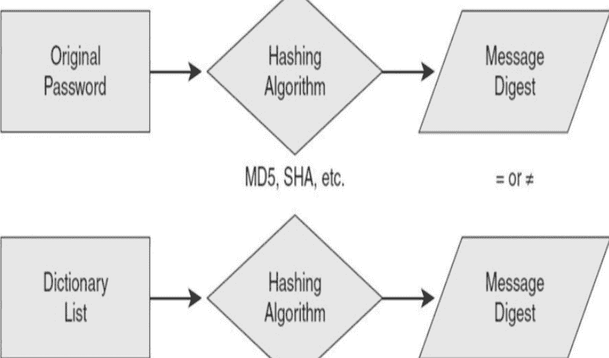

**图 7.7** 密码破解。

这些程序相对智能，因为它们可以操纵单词并使用其变体。例如，取单词“password”。字典破解程序会将此词处理为“Password”、“password”、“PASSWORD”、“PassWord”、“PaSsword”等。它会尝试单词的所有常见排列组合。

## 注意事项

> 永远不要以明文存储密码。密码应始终通过单向哈希过程进行创建和存储。

如果字典攻击未能恢复密码，攻击者还可以尝试对每个字典单词进行简单修改。这些修改可能包括添加常见的前缀、后缀和扩展字符，以尝试破解密码。这被称为混合攻击（hybrid attack）。使用之前的例子来说，这些尝试看起来会像“123password”、“abcpassword”、“drowsap”、“p@ssword”、“pa44word”等。这些方法增加了成功破解普通单词或任何常见变体的几率。

## 注意事项

绝不要允许密码以任何形式在互联网上被索引或列出。www.hackersforcharity.org/ghdb 网站有此类列表。通过 Google 搜索以下内容可以发现这个问题：`filetype:htpasswd password`

## 暴力破解

如果攻击者没有获得有效的密码，不要指他们放弃。暴力破解是一种攻击类型，取决于密码的复杂性以及攻击者尝试的字母、数字和字符组合。这种密码破解取决于 CPU 的速度，因为攻击者会尝试所有组合。例如，破解程序已经可以破解许多操作系统中的 14 位或更短的密码。如果有足够的时间，破解是可能的。还有许多在线网站可以测试密码强度。

## 彩虹表

如果你没有一周时间破解密码怎么办？传统的暴力破解的替代方案是使用彩虹表。传统的密码破解是对每个潜在密码进行加密并寻找匹配，而彩虹表技术是预先计算密码的哈希值并将其存储在表中。这被认为是一种时间空间权衡技术。预计算哈希需要创建包含从单个字符开始的所有特定密码的哈希数据库。包含 `ABCDEFGHIJKLMNOPQRSTUVWXYZ0123456789!@#$%^&*()-=+`\|` 的字符集大约需要 64GB 的空间和大量的时间。密码及其对应的加密值存储在一个名为彩虹表的文件中。加密密码可以快速与表的值进行比较并在几秒钟内破解。对于那些没有时间或想自己构建表的人，可以通过 BitTorrent 获取彩虹表，也可以在网上免费或通过服务形式获取。

## 注意事项

> 彩虹表目前存在 Windows LM（局域网管理器）密码，长度可达 14 位。这些预计算哈希值已被证明可以在三小时内攻击并破解（成功率 99%）。这意味着如果攻击者可以恢复基础 LM 密码，加密密码很可能被破解！为了保护自己免受此类密码攻击，寻求实施双因子身份验证、检查锁定阈值、监控电子密码文件的访问，并执行强密码策略，尽可能使用多种类型的字符，包括小写、大写、数字和符号。经常更改密码，不要重复使用之前的密码，永远不要在多个账户上使用同一个密码。

## 注意事项

> 某些组织和政府机构要求密码长度超过 15 个字符。较长的密码使得暴力破解变得更加困难，并且黑客需要额外的时间和资源来发现密码。然而，黑客正在不断调整，许多人现在使用云端 Amazon 等其他公司提供的用于使用大量虚拟机来破解密码的服务。

# 伪装 (Spoofing)

伪装最好的描述是在网络上伪装成除你本人以外的身份，它可以在 OSI 模型的不同层发生，通过伪装不同的协议、进程、和服务和人类，在 OSI 模型中层层进行。用户伪装发生在一个人伪装成另一个用户时。用户伪装可以通过更改用户名、IP 地址，甚至是 MAC 地址来实现。进程伪装发生在当一个进程伪装成有效进程时，而实际上它并非有效进程。进程伪装的一个例子是虚假登录界面。这可能发生在组织内部或网络网页上。当受害者尝试登录时，第一次尝试虚假登录界面可能会失败，并且用户信息会被缓存。此时，用户会被重定向到真实的登录页面进行第二次尝试。受害者可能会认为自己只是在第一次输错了密码。

# 窃听与窥视视角 (Eavesdropping and Shoulder Surfing)

保护语音通信安全是良好安全的关键组成。有很多机会可以窃听电话和对话，或拦截通信。有没有人注意到人在手机上说话时通常会大大大门？在最近的一次旅行中，我在酒店吃了一顿有趣的早餐，因为几桌子外的人偷听了我们给电话寻求帮助时的用户名和密码。窃听是偷听到敏感信息或数据的行为，无论是有意的还是无意的。这可以通过电话、网络流量、电子邮件或即时消息来实现。窥视视角是一项相关活动，即当你输入密码或用户名时，有人从你的肩膀后面看。应该为员工提供安全培训，以帮助他们更加意识到此类潜在问题。某些用户甚至使用镜子来查看谁在他们身后或在窥视他们的肩膀（参见 www.thinkgeek.com/computing/accessories/2940/）。

# 身份盗窃 (Identity Theft)

身份盗窃已成为一个大问题，可以描述为获取关于个人的关键信息的过程。身份盗窃的目标通常是名义。过去的大多数攻击是为了名声而发起的。今天的攻击者寻求的是金钱和对贵贵资源的访问权限。当攻击者翻垃圾寻找信息，或试图欺骗用户提供他们所需的信息时，就会发生身份盗窃。这是一个大问题。根据 FBI 的数据，2018 年美国有 157,688 起信用卡欺诈报告，由于身份盗窃损失了约 14.8 亿美元。

# 基于社交的威胁和攻击技术 (Social-based Threats and Attack Techniques)

社会工程攻击使用多种技术，可以面对面、通过电话远程或通过计算机发起。攻击的目标可以是已知的也可以是未知的。将网络钓鱼想象成向所有用户撒大网，就像你收到的那封来自尼日利亚人的邮件，他们承诺给你百万美元。某些网络钓鱼通过向受害者发送一封看起来像来自官方网站（如银行或信用卡公司）的电子邮件来实现。该电子邮件通常包含一个链接，承诺将用户带到真实网站以更新、更改或修改该人的账户。电子邮件和链接的真实目的是窃取受害者的用户名、PIN、账号号码或密码。应该训练员工始终警惕从电子邮件获取的链接，警惕要求验证或请求确认的消息，对要求信息的电子邮件保持怀疑态度，并始终验证地址栏中列出的是正确的 URL。PayPal 有：`tinyurl.com/3cy86a`

鱼叉式网络钓鱼 (Spear phishing) 是有针对性的网络钓鱼。例如，网络钓鱼邮件可能只发送给使用特定服务的人。捕鲸式攻击 (Whaling) 是一个术语，指捕获重要用户，如高管甚至 CEO。某些社会工程攻击利用手机设备上使用的短信消息服务；这被称为短信钓鱼 (smishing)。

另一个社会工程攻击向量是预设借口 (Pretexting)。预设借口是在虚假假设获取个人信息的做法。当一个人想要关于某个特定个人的更多信息以调查其活动时，通常会进行预设借口。对于他们来说，是这样做的。预设借口通常发生在个人想要获取关于某人的更多信息以调查其活动时。某些社会工程攻击会与技术攻击结合。作为例子，你可能会发现一个标有“春假”的优 盘，它们实际上是远程控制软件。表 7.2 列出了一些社会工程技术。

## 表 7.2 社会工程技术

| 名称 | 示例 |
|---|---|
| 冒充 (Impersonation) | 假装装成某人 |
| 伪装 (Spoofing) | 采取他人的 IP 地址、域名 |
| 窥视视角 (Shoulder surfing) | 从别人肩膀后面看 |
| 病毒骗局 (Virus hoax) | 不是真正的病毒但假装成病毒以引起反应 |
| 尾随 (Tailgating) | 跟随某人通过 checkpoint |
| 翻找垃圾 (Dumpster diving) | 翻垃圾寻找有价值的物品，如密码 |

社会工程的最佳防御是教育您的用户和员工不要通过电话、电子邮件或任何未经身份确认的人提供密码。用户应该警惕邮件中的链接和登录页面。培训可以极大帮助他们如何识别社会工程。

## 注意

> 虚假登录界面是一种常见的社会工程技术，用于欺骗用户登录，通常与网络钓鱼有关。登录信息随后会被保存，供攻击者使用。用户可能会遇到错误或被重定向到登录页面进行后续尝试。

# 恶意软件威胁和攻击技术 (Malicious Software Threats and Attack Techniques)

在 70 年代大型机盛行的时代，计算机病毒一词还不存在。Fred Cowen 被认为在 1983 年创造了这个词。早期的计算机犯罪包括恶意软件，例如 Brain (1986)。Brain 是两个巴基斯坦兄弟写的，他们说只是为了成名。即使是 1988 年的莫里斯虫（Morris Worm）也被认为是意外。今天的恶意软件比年前简单的病毒和蠕虫先进得多。接下来，我们将研究这种威胁的演变。

## 提示

> 一个 75 分的错误能发现外国政府黑客吗？Clifford Stoll 确实做到了。他利用会计错误追踪并发现了 KGB 黑客。接受过天体物理训练并没有阻止他，也不及 FBI 最初不认真对待。你可以从他的书《比谷的蛋》（Doubledday, 1989）中了解到更多信息。

# 病毒 (Viruses)

病毒的传播需要人类活动，例如启动计算机或打开电子邮件附件。病毒在计算机世界中传播的一些基本技术包括：

- 主引导记录感染——这是原始的攻击方法。它通过攻击软磁盘或硬盘的主引导记录来工作。这种技术已经过时了。

**文件感染**——这种较新的病毒形式依赖于用户执行文件。通常使用如 `.com` 和 `.exe` 等扩展名。通常，会使用某种形式的社会工程学来诱导用户执行程序。技术包括重命名程序，或重命名 `.exe` 扩展名以使文件看起来像图形或文档。

**宏感染**——宏病毒利用你计算机上安装的脚本服务。你你们中的许多人可能还记得“I Love You”病毒，它是宏病毒感染的典型案例。宏病毒通过将自身附带在应用程序的初始化序列或应用程序内部的自动化任务中来感染如 Word 或 Excel 等应用程序。这些任务在没有用户干预的情况下运行，当应用程序启动时，病毒的指令会在控制权移交给应用程序之前执行。然后，病毒会自我复制，感染计算机的其他部分。

**无文件感染**——最现代的感染类型不针对文件，并从 2017 年开始受到广泛关注。无文件恶意软件完全存在于计算机内存中。之前的恶意软件示例会将文件放在计算机上。病毒和恶意软件创建者利用无文件感染来用持久性换取隐性。目标是在触发预设操作的同时保持恶意软件感染的隐蔽。

随着病毒编写者改变策略，防病毒公司不得不开发出更好的检测病毒的方法——一个重大转变是人工智能（AI）的使用。这就是无文件感染变得更加流行的原因之一。无文件感染是指不向受感染系统的硬盘写入任何文件的感染或恶意软件。恶意软件作者试图尽可能长时间地推迟安全厂商的检测。病毒开发者尝试的另一种技术是使病毒具有多态性（源自希腊语“poly”，意为“多”，以及希腊语“morph”，意为“形状”）。多态性病毒可以创建自己的副本，并在每次复制和感染新文件时更改其特征。

## 蠕虫

蠕虫与病毒的不同之处在于它们可以自我复制，而病毒需要用户交互。真正的蠕虫不需要干预且难以创建。蠕虫不附着于宿主文件，而是自包含的，并自动跨网络进行传播。互联网上发布的第一个蠕虫是 1988 年的莫里斯蠕虫。它由罗伯特·塔潘·莫里斯（Robert Tappan Morris）开发，本意仅作为一个概念证明。目标针对 `sendmail`、`finger` 和弱密码。这个小程序禁用了连接到互联网的大约 6,000 台计算机。它的意外发布让人们痛苦地意识到，蠕虫会对互联网造成巨大损害。估计该蠕虫造成的损害成本在 1000 万到 1 亿美元之间。

虽然这是第一个，但从以后又产生了许多其他蠕虫。过去 10 年最著名的蠕虫可能是斯塔克斯网（Stuxnet）。

蠕虫和病毒一样，目前处于衰落状态；随着恶意软件创建者将精力放在能产生收益的事情上，它们变得越来越不常见。在参加 CISP 考试时记住，今天的恶意软件要复杂得多，实际上可以同时执行病毒和蠕虫的任务。

## 注意

> 垃圾邮件是传播病毒和蠕虫的技术之一。虽然过去的许多垃圾邮件仅仅是垃圾信息，但现在越来越多的邮件具有恶意本质。

## 逻辑炸弹

逻辑炸弹与病毒和蠕虫不同，因为它们隐藏在代码本身中。逻辑炸弹得名是因为恶意编程代码被放在应用程序代码中，以便在特定情况下（例如特定时间的流逝或特定事件的完成）执行。

## 注意

逻辑炸弹和其他类型的恶意软件可用于发起香肠攻击。这种金融犯罪通过在长时间内从账户中提取小额资金来实现。为了让攻击者成功，他们必须移除极小的金额以至于不被察觉。电影《办公室空间》（Office Space）提供了此类攻击的良好示例。

## 后门与木洛马

木马的名字源于荷马的史诗《伊利亚特》。为了击败敌人，希腊人建造了一个肚子空空的巨型木马。希腊人欺骗了敌人，让木马进入了城市。希腊士兵在黑暗的掩护下爬出木马，导致了城市的陷落。

木洛马是那些看起来可以执行某些操作但实际上执行其他操作的程序。在用户下载木洛马之前，几年前，黑客只需在文件名和可执行扩展名之间添加额外的空格就足够，例如 `important_message.txt.exe`，或者简单地选择通常在受害者机器上安装和运行的程序后缀或名称，例如 `notepad.exe`。

今天，攻击者使用多层技术来混淆代码已不罕见——即使恶意代码无法被防病毒软件检测，并采用技术防止他人检查代码。这些技术提高了攻击者控制受恶意软件感染计算机的机会，并将其用于许多非法目的。要意识到壳器、加密器和封装器技术。

封装器为黑客提供了绕过用户正常防御的方法。封装器是一种用于将两个或多个可执行文件组合成单个软件包的程序。封装器仅允许两个程序合并；其他的允许绑定三个、四个、五个或更多。基本上，这些程序的功能类似于安装构建器和设置程序。封装器还对目标文件增加了额外的混淆和加密。封装器常见于通用文件、音乐文件和非执行文件。

壳器的工作原理与 WinZip、Rar 和 Tar 程序类似，它们对文件进行压缩和/或加密。虽然压缩程序这样做是为了节省空间，壳器这样做是为了混淆恶意软件的活动。

其理念是防止任何人在恶意软件放入内存之前查看其代码。壳程序（Packers）对攻击者具有第二个价值目标，即它们能够绕过网络安全防护机制，例如 HIDS（主机入侵检测系统）和 NIDS（网络入侵检测系统）。只有当恶意软件壳在内存中解压程序后，程序的原始代码才会被暴露。

加密器（Crypters）的作用是对代码进行加密、操纵或隐藏。某些加密器通过应用加密算法来混淆木马的内容。加密器可以使用任何加密方案，从 AES 到 RSA 再到 Blowfish，也可能使用更基础的混淆技术，如 XOR 混淆、Base64 编码或 ROT 13。同样，这些技术被用于隐藏可执行程序的内容，使其无法被防病毒软件检测，并能够抵抗逆向工程。在互联网上简单搜索就能发现有许多不同类型的此类工具。示例如图 7.8 所示。

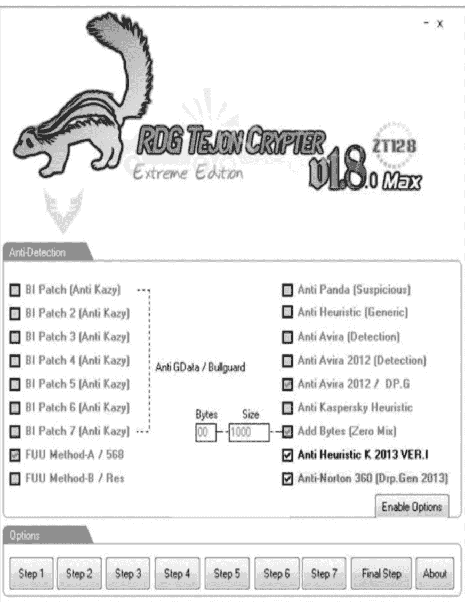

图 7.8 Tejon 加密器。

# Rootkits（根基程序）

Rootkits 是允许攻击者控制系统的工具集。Rootkits 可以分为几种不同的类型，包括应用程序、内核模块、硬件、固件和引导加载程序。例如，可加载内核模块（LKM）rootkit 被作为驱动程序或内核扩展加载。由于 LKM rootkit 会损坏内核，它们几乎可以做任何事情，并且是目前为止最危险的。Rootkits 还可以规避许多软件方法的检测，但也有方法可以检测它们。像 `MD5sum`、`Tripwire` 和 `GMER` 等工具对于发现某些类型的 rootkit 有很大帮助。尽管 rootkit 的使用非常广泛，但许多安全专业人员对其仍并不了解。

一旦安装，rootkit 就可以用来隐藏攻击者存在的痕迹，并为他们提供系统的后门访问权限。Rootkits 可以包含日志清理程序，试图从日志文件中删除攻击者存在的所有痕迹。即使你能够检测并清理带有 rootkit 的系统，事实是，大多数攻击系统的个人并都没有受到惩罚。尽管你可能发现了攻击的证据，但这并不意味着该个人将受到法律制裁。

# 漏洞工具包（Exploit Kits）


漏洞工具包为没有或极少编程经验的人提供了创建、自定义和分发恶意软件的能力。这些工具包中的很大一部分是由来自东欧和俄罗斯的黑客出售的。

某些漏洞工具包还提供“无弹托管”（Bulletproof hosting）。无弹托管是指保护受恶意软件感染的网站不被其服务提供商关闭的做法。例如，在美国，当发现一个网站包含恶意软件时，可以通过法律手段将网站下线并防止其感染其他网站。在俄罗斯，情况并非总是如此——这些受感染的网站有时会免于被关闭，允许网络犯罪分子通过一个安全的平台来托管他们的恶意软件，以感染美国的消费者和企业。

# 高级持续性威胁（Advanced Persistent Threats）

高级持续性威胁（APTs）指的是高度复杂且组织严密的群体、政府或机构，他们有能力且决心针对非常特定的目标组织进行长时间的，以实现成功攻击。此类攻击者可能会使用复杂的恶意软件（如零日漏洞）以及利用目标系统漏洞的技术。Stuxnet 蠕虫就是 APT 的例子。

# 勒索软件（Ransomware）

想象一下：某一天你来上班，启动笔记本电脑，发现屏幕上有一条如图 7.9 所示的警告信息。有时这些信息声称来自 FBI（联邦调查局）或某个国际执法机构，或者可能指控用户从事非法活动，例如访问了非法或不适当的网站。它们所有的共同点只有一点：一个黑客已经接管了你的电脑，并在交还电脑之前索要钱。我刚刚描述的就是勒索软件。勒索软件是黑客用来安装在你的电脑上的一种恶意软件，以便他们从远程位置锁定电脑并索要钱。

勒索软件已成为网络犯罪分子工具箱中广泛使用的工具。勒索软件强制受害者遭受经济损失，要么通过支付赎金，要么通过吸收恢复攻击的成本。

# 您的电脑已被锁定！

如何解锁您的电脑：

由于涉嫌下载和分发非法内容，您的电脑已被锁定。

所提到的非法内容（414 Mb 的视频文件）已被自动归类为儿童色情材料。此类行为全部或部分地违反了美国联邦法律：

- 18 U.S.C. § 2251- 儿童性剥削（制作儿童色情物品）
- 18 U.S.C. § 2252-涉及未成年人的某些行为（持有、分发和接收儿童色情物品）
- 18 U.S.C. § 2252a-构成或包含儿童色情物品的某些行为

任何违反、试图违反或合谋违反上述法律的个人，应被处 4 至 30 年的强制性监禁，并罚款高达 250,000 美元。

- 携带现金前往以下零售点之一：Walmart, Walgreens
- 获取一个 MoneyPak 并在收银台用现金购买
- 回来输入您的 MoneyPak 代码以解锁您的电脑（可用 5 次尝试）

技术细节：

涉及的 IP 地址：

涉及的主机：

来源：

您电脑上的所有文件已传输到一台特殊服务器，并将作为证据。不要尝试复制任何数据或以未经授权的方式解锁电脑。您的案件可以根据美国法典第 512 条归类为无需起诉。您的电脑将自动解锁。为了解决这一问题，您应该支付 300 美元的罚款。

```
1 2 3
4 5 6
7 8 9
Delete 0 Enter
```


图 7.9

勒索软件。

另一个需要牢的是，如果你的电脑感染了勒索软件，打开文件可能会变得困难或不可能。这就是为什么持续备份数据并自行进行加密是如此重要；这样即使数据被盗，对他们来说也是没用的，你可以恢复备份。有很多方法可以本地备份或通过云提供商进行备份。你需要为这种灾难做好准备，因为你可能没有第二次恢复数据的机会。

## 注意

> 与勒索软件密切相关的是流氓软件。这是一种假的防病毒软件，试图说服用户电脑已感染，并操纵他们购买并下载虚假软件。不要点击链接并下载该软件——这是一个会感染你电脑的链接。

令人不快的实是，追踪和起诉黑客可能是一项艰巨的工作，因为国际法往往不适用于处理这些问题。与发生在单一位置传统方案不同，黑客犯罪可能源于印度，使用位于新加坡的受损计算机网络，并目标是位于加拿大的计算机网络。各国对什么构成网络犯罪的观点分歧，以及对如何甚至是否应该惩罚黑客的意见不一致，都可能导致法律噩梦。要将国家边界应用于互联网这种本质上无国界的介质是非常困难的。美国已经提出了一项立法，声称对任何通过美国控制的互联网部分的活动行使管辖权，无论起始国家或目的国家是哪里。

## 应急响应

国防高级研究计划局（DARPA）在1988年成立了早期的应急响应小组。许多人将计算机应急响应小组（CERT）的成立归功于同年早些时候莫里斯蠕虫。在1988年，“信息超级公路”仅仅像是一条土路，因此延迟响应并不致命。在今天，很少有像我们那样的幸运可以等到攻击发生后才制定事件响应计划。为了减少这些个人可能造成的损失，组织需要建立事件响应和处理策略。这些策略应该规定组织如何应对各种类型的事件。大多数公司都建立了计算机安全事件响应小组（CSIRT）或计算机事件响应小组（CERT），因为 CERT 现在已是卡内基·梅隆大学的注册商标。CERT 的功能是：

- 分析事件通知
- 如果分析证明，则对事件做出响应
- 升级路径程序
- 解决、事后跟进以及向相关人员报告
- 震慑未来的攻击

第一步是分析事件。事件是一个可注意的发生。例如，触发了 IDS 警报。这需要进行调查，因为必须确定该事件是否为事故。事故是指违反法律、政策或程序的不良事件或系列事件。调查事故的人员需要各种技能，包括：

- 识别技能和能力
- 技术技能和能力
- 调查技能和响应技能

负责事件的人必须能够识别出发生了什么。在 IDS 警报的示例中，仅仅识别是不够的，因为负责人员必须具备查看日志、事件记录并进行事件分析的能力。还需要技能来适当调查事件。这需要理解证据链等概念。现在让我们看看作为事件响应小组，谁应该参与这一过程。

## 事件响应小组

事件响应小组成员需要具备多样化的技能组合。内部团队应包括来自部门部门代表：

- 信息安全
- 法律
- 人力资源
- 公共关系
- 物理安全
- 网络和系统管理
- 内部审计师
- 信息技术帮助台

如果攻击来自内部，将会有许多人参与事件。法律、人力资源等部门必须决定采取什么。追溯到组织外部的事件也必须有很多小组参与。管理层是否想要让警察介入？如果是，则需要有人担任公司发言人。规则必须明确定义，将事件升级到适当权限的流程也必须明确定义。在团队就位后，让我们把注意力转向事件响应过程的特定步骤。

## 事件响应流程

应急响应要求组织定义在事件发生时将执行的具体步骤。良好的事件响应程序为组织提供了一种有效且高效的方法来处理事件，从而减少潜在影响。这些程序还应该为管理层提供足够的信息，以决定适当的行动方案。通过建立这些程序，组织可以维持或恢复业务连续性，防御未来的攻击，并对后期攻击的违反者进行起诉。

应急响应的首要目标是控制损失、发现发生了什么、从事件中恢复、让系统重新上线，并防止其再次发生。此列表确定了事件响应的基本步骤（见图 7.11）：

1. **规划与准备**——组织必须建立策略和程序来应对安全事件的发生可能性。
2. **识别与评估**——对事件的检测。应使用自动化系统来确定是否发生了事件。必须有一种方法来验证事件是真实的，而不是误报。用于识别的工具包括 IDS、IPS 防火墙、审计、日志记录和观察。

> **注意**

它是事件还是事故？事件是一个可注意的发生，而事故是对政策或法律的违反。

3. **控制与缓解**——预计划、培训和使用预开发的程序是该过程中这一步骤的关键。事件响应计划应该规定需要采取哪些行动。事件响应小组需要培训到所需的熟练程度，以妥善处理响应。该小组还需要知道如何控制损失并确定如何进行。

| 管理层需要决定在安全违规期间是否应该叫执法部门。对于为什么可能通知或不通知他们，既有正反方面的理由。 |

4. **清除与恢复**——仅仅控制问题是不够的。必须将其移除，并采取措施恢复正常的业务流程。
5. **调查与关闭**——发生了什么？当调查完成时，必须准备一份正式或非正式的报告。这将用于评估任何需要的事。
6. **教训总结**——在最后一步中，所有参与人员将需要回顾发生了什么。最重要的是，必须建立哪些变化来防止未来的问题？从发生过的事情学习是防止其再次发生的唯一方法。


**图 7.11 事件响应步骤。**

还有专业的事件响应方法论，例如 MITRE ATT&CK 六阶段框架或洛克希德·马丁七阶段杀链框架。两者都描述了攻击的结构和生命周期。

## 事件响应与结果

事件响应程序必须足够详细，以便记录特定类型的事件，并对适当的响应给出建议。应对这些事件的文档记录至关重要，因为调查计算机犯罪是复杂的复杂的。失误会导致证据失效且无法在法庭上使用。这意味着团队成员必须了解适当的程序，并接受过如何保护隔离现场以防止污染的培训。表 7.3 概述了一些响应策略。

### 表 7.3 示例响应策略

| 事件 | 响应策略 |
| --- | --- |
| 可能的数据窃 | 联系法律部门、取证、保护证据 |
| 外部黑客攻击 | 捕捉日志、监控活动、收集证据 |
| 未经授权使用计算机资源 | 收集证据、取证、分析数据、审查公司政策 |

最终，应急响应是关于学习。你的发现结果应该反馈回系统以进行更改或改进环境，防止相同的事件再次发生。由于攻击你可能执行的任务包括：

- 弄清楚攻击是如何发生的，并寻找防止再次发生的方法。
- 根据发现团队缺乏哪些防止有效响应的因素，升级工具或软件。
- 发现哪里出了问题，并对事件响应计划进行更改，以改进下一次事件期间的运行。

# 笔记

2021 年巨大的 SolarWinds 泄露事件是事件响应以及攻击者如何改变工作方式的良好案例。现代攻击比过去要复杂得多。区分战术的一个特点是**横向移动**。在 SolarWinds 攻击中，一个网络管理工具的软件更新过程遭到了破坏；威胁因素能够深度访问目标网络。这使得攻击者能够轻松地从一个系统转向到另一个系统，并在移动过程中获取访问和数据。参见 https://www.cisecurity.org/solarwinds/

尽管没有人希望最终上法庭，或将事件响应推向下一个水平，但情况并非总是如此。所有的事件响应都必须仔细处理，以便为调查中可能发生的任何情况做好准备。

# 警告

归结底，事件响应关乎学习。发生了什么，是如何发生的，我们能否防止其再次发生，下一次我们如何能更好地准备和应对，我们学到了什么？这些都是应该回答的问题。

# 灾难恢复与业务连续性

灾难恢复和业务连续性值得提及，因为本章讨论的威胁可能会中断关键业务。灾难恢复是业务连续性活动的一个子集。设想一下你的公司遭受了勒索软件攻击，加密了你数据中心的所有数据。这意味着关键业务无法继续。业务连续性无法维持。关键业务是维持你的业务运行所必需的。大多数组织无法承受长时间的运营。当灾难发生时，影响就是运营停止且业务连续性失败。业务连续性是关于保持关键流程的运行。在紧急情况下，任何人都可以触发警报。然而，只有业务连续性计划 (BCP) 协调员或指定人员才能宣布该情况为灾难，并触发向另一个站点、云提供商、设施等的故障转移。灾难恢复是 BCP 努力的一个子集，侧重于在停机或事件后恢复这些系统。灾难恢复包括恢复运营的即时措施，并在组织恢复正常运营时结束。

## 提示

> 一个需要记住的关键问题是在需要备份之前对其进行验证。这项活动应该被建立在你的正常流程中。两种常见的的手段包括从随机数据中恢复文件，以及从备份中恢复服务器或整个服务。在恢复期间，假设你将从零开始。

测试和发现性演练应至少每年进行一次。虽然有多种测试计划的方法，但最重要的是理解为在计划经过测试之前，你应该对计划充满信心。测试的一部分是查看你的备份解决方案，例如不间断电源 (UPS) 和发电机。虽然发电机可以使用较长时间，但 UPS 通常用于短时间，并应用于系统的优雅关机。

# 笔记

> 在测试/灾难恢复计划时，有两个主要目标：1. 验证计划功能运行正常；2. 获得由于技术/业务变化而进行更新的机会。

# 调查

调查是该领域的另一部分。调查通常是对可疑活动的探测，可以发生在事件之后，或与执法人员配合进行。随后的章节将审查一些关注的领域。

# 搜索与监控

在工作场所，监控可以分为两类：

- 物理——闭路电视 (CCTV) 摄像头和保安员
- 逻辑——系统监控和网络嗅探器

# 警告

> 在你尝试任何类型的监控之前，务必咨询你组织的法律部门。大多数州和联邦法律要求必须通知每个用户此类活动。否则，这是违法的。

# 访话与审讯

在调查期间某个时候，可能确定需要进行谈话和审讯。嫌疑人也可能试图欺骗调查人员以避免采取。调查人员必须经过适当培训以进行谈话和审讯。例如，调查人员必须理解诱导 (enticement) 和圈套 (entrapment) 的区别。诱导是合法的；而向某人发送钓鱼邮件诱骗他们进入你的网络是非法的。

# 考试备习题

1. IP 欺骗通常用于以下哪种类型的攻击？

- A. 腊肠攻击 (Salami)
- B. 击键记录
- C. DoS 攻击
- D. 数据嗅探

2. 下列哪项描述了会话劫持 (session hijacking)？

- A. 会话劫持通过首先破坏 DNS 过程来工作。如果此成功，攻击者可以使用已建立的 TCP 连接。
- B. 会话劫持破坏 UDP 协议。它允许攻击者使用已建立的连接。
- C. 会话劫持针对客户端和服务器之间的 TCP 连接。如果攻击者获取了初始序列，他可能能够劫持连接。
- D. 会话劫持通过首先破坏 DNS 过程工作。如果此成功，攻击者可以使用已建立的 UDP 连接。

3. 你的公司几名员工在过去的几周内遭受了电子邮件诈骗。其中一人骗了一个员工透露了他们的用户名和密码。管理层要求你寻找这些攻击的可能解决方案。以下哪项是最佳答案？

- A. 实施新的、更健壮的密码策略，要求复杂密码。
- B. 启动培训和意识提高计划。
- C. 增加组织的电子邮件过滤能力。
- D. 制定仅限制电子邮件用于官方用途的政策。

4. 你被要求审查日志以检测恶意活动，哪种说法是正确的？

- A. 审计日志是检测恶意活动的补偿性控制。
- B. 这是审计日志的补偿性控制。
- C. 这是一个补充自动化过程的技术控制。
- D. 审计日志在与审查过程结合时是检测性控制。

5. 下列哪个组别对你的组织构成了最大的威胁？

- A. 内部人员
- B. 商业间谍
- C. 政府间谍
- D. 脚本小子

6. 在实施信息安全持续监控时，你应该参考以下哪个文档来确定监控控制的频率？

- A. ITIL
- B. NIST 800-137
- C. NIST 800-92
- D. NIST 800-115

7. 以下哪些 SOC 报告通常向公众公开？

- A. SOC 2
- B. SOC 1
- C. SOC 4
- D. SOC 3

8. 下列哪个个人可以宣布灾难？

- A. 所有者/CEO
- B. DRP/BCP 人员
- C. 任何人
- D. BCP 协调员

9. 下列哪个是灾难期间优雅关机的最佳解决方案？

- A. 发电机
- B. UPS。
- C. 冗余电源
- D. 双电源

10. 伦理黑客与黑客的区别在于以下哪方面？

- A. 他们有权破坏网络。
- B. 目标是不伤害。
- C. 他们对任何损害都不负责。
- D. 他们不会被起诉或入狱。

11. 下列哪项描述了针对被监控系统运行的操作以观察其反应？

- A. Fagan 检查
- B. 静态代码测试
- C. 合成交易。
- D. 模糊测试 (Fuzzing)

12. 下列哪项最描述 SATAN？

- A. 它用于破解密码。
- B. 它用于审查审计日志。
- C. 用于利用系统。
- D. 用于发现漏洞。

13. 下列哪种是测试应用程序对各种输入反应的强有力方法？模糊测试（Fuzz testing）有两种类型：基于生成的和基于变异的？

- A. 合成交易接
- B. 模糊测试（Fuzzing）
- C. 动态代码分析
- D. 静态代码分析

14. 哪种类型的渗透测试检查内部人员可以访问的内容？

- A. 白盒（Whitebox）
- B. 灰盒（Graybox）
- C. 黑盒（Blackbox）
- D. 蓝盒（Bluebox）

15. 下列哪些因对 PBX 和电信系统的攻击而闻名？

- A. 脚本小子（Script kiddies）
- B. 电话行者（Phreakers）
- C. 破解者（Crackers）
- D. 黑客（Hackers）

# 考试备习题答案

1. C. 当使用 DoS 工具帮助攻击者掩盖身份时，IP 欺骗是一种常见做法。香肠攻击（Salami attacks）、数据篡改（data diddling）和击键记录通常不会伪造 IP 地址，因此答案 A、B 和 D 是错误的。

2. C. 这种更高级的欺骗攻击通过破坏客户端和服务器之间的 TCP 连接来工作。如果成功，攻击者将拥有受害者网络的有效连接，并使用其凭据通过验证。这种攻击在现代操作系统上很难实现，但在旧操作系统上轻而易举。答案 A 是错误的，因为会话劫持（session hijacking）不涉及 DNS；它通过操作 TCP 序列号运行。答案 B 是错误的，因为会话劫持未使用 UDP 协议。UDP 用于无状态连接。答案 D 是错误的，因为会话劫持不是基于 DNS 和 UDP。这两项技术与 TCP 序列号无关。

3. 防止社会工程攻击的最佳方法是教育你的用户和员工。培训对于教员工如何识别这些骗局很有帮助。虽然其他答案不是坏主意，但它们无法阻止社会工程攻击，答案 A、C 和 D 是错误的。

4. D. 审计是一种侦测控制。答案 A、B 和 C 是错误的，因为它们不是侦测控制或补偿性控制。

5. A. 内部人员代表了组织最大的威胁，因为他们拥有尝试恶意活动所需的三个要素中的两个：手段和机会。答案 B、C 和 D 是错误的，虽然其他人可能有动机，但他们通常缺乏攻击你组织的手段或机会。

6. B. NIST 800-137 定义了 ISCM。答案 A、C 和 D 是错误的。ITIL、800-92 处理日志管理，800-115 处理渗透测试，而 ITIL 是一个 IT 交付的最佳实践框架。


7. D. 服务组织的 `SOC 3` 是“通用信赖服务标准报告”。答案 A、B 和 C 是错误的，因为 `SOC 1` 用于服务组织：内部财务报告控制（ICFR）。`SOC 2` 用于服务组织：信赖服务标准，且没有 `SOC 4`。

8. D. 虽然任何人都可以宣布紧急状态，但只有 `BCP` 协调员可以宣布灾难。因此，答案 A、B、C 和 D 都是错误的。

9. A. `UPS` 最适合优雅关机。答案 A 是错误的，因为发电机用于长时间恢复；C 和 D 是错误的，因为冗余电源和双电源不是短期解决方案。

10. B. 伦理黑客使用的方法与破解者和黑帽客相同，但他们报告发现的问题而不是利用它们。伦理黑客还有其他名称，例如渗透测试、入侵测试和红队对抗。答案 A 是错误的，因为伦理黑客没有权限破坏网络。答案 C 是错误的，因为伦理黑客可能承担责任。答案 D 是错误的，如果伦理黑客违法或超出合同条款，可能会被监禁。

11. C. 合成反应在受监控的系统上运行以观察其响应。费根检查（`Fagens inspections`）在代码开发期间进行。静态代码分析是人工审查的一种。模糊测试使用随机变量作为输入来评估输出。

12. D. `SATAN` 是第一个漏洞评估程序，设计用于发现网络中的漏洞。`Retina` 和 `Nessus` 等程序不用于漏洞评估。`SATAN` 不用于密码破解（答案 A）、日志审计（答案 B），也不用于利用系统（答案 C）。

13. B. 模糊测试有两种类型，即基于生成的和基于变异的。答案 A 是错误的，因为合成交易不是模糊测试的示例。答案 C 是错误的，因为动态代码分析旨在测试运行中的应用程序以发现可能被利用的漏洞。答案 D 是错误的，因为静态代码分析是在程序运行前检查源代码的调试方法。

14. B. 灰盒测试旨在确定可以执行哪些活动。答案 A 是错误的，因为白盒测试是对网络一切已知；答案 C 是错误的，因为黑盒测试是对网络一无所知；答案 D 是错误的，因为蓝线（`blueboning`）是电话行者通过机械设备拨打免费电话的术语。

15. B. 电话行者是指对 `PBX` 和电信设备的攻击闻名的人。答案 C 和 D 是错误的，因为黑客和破解者都指计算机犯罪分子。答案 A 是错误的，脚本小子被定义为初级黑客，他们依赖预定义的流程和程序通过他人的工作来攻击计算机。

请教任何经验丰富的安全专业人士关于确保网络、系统、应用程序和数据安全需要什么，答案很可能涉及运营、技术和物理控制的结合。这一过程在你雇佣第一位员工之前就开始了。员工需要知道对他们的期望是什么。账户需要配置，用户需要获得批准的适当访问权限，并且必须实施监控。这些都是将在第一节中讨论的话题。

# 管理用户和账户

增加问责制的一项基础控制措施是在组织内部执行特定的角色和职责。大多数组织都有明确定义的控制措施，规定了每个职位角色负责的内容。组织中常见的角色包括：

- 系统管理员——负责局域网（LAN）及相关组件（如 `Windows Server 2019`、`Linux` 甚至大型机）的运行和维护。虽然小型组织可能只有一名系统管理员，但大型组织可能有多个。

- 质量保证专家——可以担任两个角色之一：质量保证或质量控制。质量保证人员确保程序和文档符合标准；质量控制人员在产品开发的各个阶段进行测试，以确保产品没有缺陷。

- 数据库管理员——负责组织的数据管理，并维护数据结构。数据库管理员对所有数据拥有控制权；因此，必须密切观察检测性控制和职责监督。此角色通常由高级信息系统员工担任，因为这些员工控制物理数据数据库、数据定义控制的实施以及备份恢复的定义和启动。

- 系统分析师——参与系统开发生命周期（SDLC）过程，负责确定用户需求并为所需软件的设计需求和规范。

- 网络管理员——负责网络设备的维护和配置，例如路由器、交换机、防火墙、无线访问点等。

- 安全架构师——负责检查组织网络的安全基础设施。

职位可能会可能会误导，因为不同的组织往往对相同的职位使用不同的名称，在较小的组织中，他们倾向于将职责合并到一个职位或名称下。例如，某些网络架构师被称为网络工程师。安全专业人士的关键概念是理解：为了避免利益冲突，某些角色不应合并。表 8.1 列出了角色组合的一些示例以及是否可以合并。

# 表 8.1 职责分离

| 第一个职位角色 | 可以合并吗？ | 第二个职位角色 |
|---|---|---|
| 系统分析师 | 否 | 安全管理员 |
| 应用程序程序员 | 是 | 系统分析师 |
| 帮助台 | 否 | 网络管理员 |
| 数据录入 | 是 | 质量保证 |
| 计算机操作 | 否 | 系统程序员 |
| 数据库管理员 | 是 | 系统分析师 |
| 系统管理员 | 否 | 数据库管理员 |
| 安全管理员 | 否 | 应用程序程序员 |
| 系统程序员 | 否 | 安全管理员 |

表 8.1 中的标题和描述仅为示例，并对任何职位角色分配了或或相等的责任。为了更好地理解可能冲突的角色组合的影响，请考虑一家小公司，它雇佣一人兼任网络管理员和安全管理员。这代表了一个真实的弱点，因为安全管理员和网络管理员必须执行的职责范围之间存在利益冲突。这种冲突的产生是因为网络管理员的任务是保持系统运行正常、保持服务可用，而安全管理员的任务是关闭服务、拦截服务并拒绝用户访问。`CISSP`（注册信息系统安全专业人员）应该意识到这种不兼容性，并关注当某些角色合并时可能引发的风险。最后，组织中任何拥有高权限的员工都需要仔细的监督。这些个人应该被视为特权实体。

# 特权实体

特权实体是指任何比普通用户具有更高访问权限的人。特权实体可以包括大型机操作员、安全管理员、网络管理员、高级用户或任何拥有高于水平访问权限的人。对这些实体实施足够的控制非常重要，以便防止滥用访问权限，或者在访问权限被滥用时可以进行检测和纠正。

# 访问控制

在雇用员工之前，你必须确保为正确的工作找到正确的人。背景检查、参考人检查、教育/证书检查，甚至是互联网或社交媒体检查等项目可以在新员工入职培训之前进行。新员工可能会被要求签署非披露协议（NDA）、同意良好的安全实践，并同意可接受使用政策（AUP）。

当员工入职时，有很多控制措施可以用于控制访问和权限。首先是职责分离。它描述了划分职责的过程，使得需要多个人才能完成一项任务。轮岗制度可用于维持冗余、备份关键人员，甚至识别欺诈活动。最小权限原则是另一个重要概念，有助于组织实现其运营安全目标。最小权限意味着个人应仅拥有足够完成其所需任务的资源。

即使是强制休假等活动也为审计和检查用户活动是否存在非法活动提供了时间。这些每一项内容都需要由策略、程序和培训支持。请记住，当每位员工都积极参与组织安全时，组织将受益。

# 阈值水平

没有人时间去调查可能发生的每一个事件或异常，但必须建立系统来记录和监控活动。其中一种技术是阈值水平（`clipping level`）。设置阈值水平是为了识别用户可能进行的正常使用的阈值。频率超过阈值的事件会导致管理通知和调查。

阈值水平允许用户偶尔犯错，但如果超过了设定的水平，将记录违规行为或发生某种响应。网络管理员可能允许用户使用错误密码尝试登录三次。如果用户第三次尝试仍未成功，账户将被锁定，他们被迫拨打帮助台寻求支持。如果管理员或帮助人员需要操作，应要求提供第二种身份验证以防止社会工程攻击。第7章“安全评估与测试”更详细地介绍了社会工程。

## 提示

> 为了防止社会工程攻击，需要通过自动方式重置密码的人应要求提供强身份验证，如用户 ID、PIN 或多个认知密码。对于安全性较高的系统，应使用物理取回或面对面验证进行密码恢复。

# 资源保护

当你考虑资源保护时，你可能会想到服务器或其他有形资产。但资源可以是有形的也可以无形的。有形资产包括设备和建筑，而无形资产可以包括专利、商标、版权甚至品牌知名度。商业机泄露给竞争对手造成的可能比员工偷窃笔记本电脑同样甚至更具破坏性。这意味着组织必须采取合理的措施来保护所有价值物品。

## 尽责义务与尽职调查

尽责（`Due care`）侧重于采取合理的持续维护来保护组织的资产。尽职调查（`Due diligence`）则是背景研究。例如，在接受信用卡业务之前，你可能希望研究规范其使用、存储和处理的法律。因此，尽职调查将与审查 `PCI-DSS` 中强调的控制措施相关。事实上，尽职调查最初是根据 1933 年美国《证券法》首次使用的。

组织及其高级管理层日益被要求履行更高水平的尽责和尽职调查。根据法律，如果高级管理人员疏忽，可能会对刑事和/财务损害承担责任。2002 年的《萨班斯-奥克斯利法》和《联邦信息安全管理法》增加了组织在维护行业合规方面的责任。例如，美国联邦量刑指南允许处超过 2 亿美元的罚款。

对组织尽职调查结果的法律挑战会导致法院系统审查一个“审慎的人”会怎么做，这在实际上被称为“合理审慎人规则”。例如，对于一家使用销售点（POS）设备且每年交易量超过 80,000 次的零售店，审慎的人会为信用卡交易实施 `PCI-DSS` 控制措施。合理审慎人是一个法律抽象；在网络安全背景下，它指的是一个在网络防御方面具有常识、经过良好培训且受过教育的专业。

> 注意

虽然 `PCI` 是财务信息控制的主要标准，但八国集团（G8）最初是世界八大经济体政府用于讨论商业相关问题的论坛。今天，它已发展到 20 个成员。

## 资产管理

资产管理是识别组织内所有硬件和软件资产（包括组织员工）的过程。如果没有良好的资产管理，就无法评估风险或考虑什么是适当的运营控制。资产管理不仅有助于组织控制其软件和硬件资产，还能增加组织的问责制。考虑加固、打补丁和更新的过程。如果不知道哪些操作系统和/或软件属于公司，以及产品安装在哪些系统上，那么这一过程就无法得到有效管理。

## 系统加固

一旦我们了解了拥有资产，系统加固将用于消除所有业务运行不需要的应用程序、进程和服务。当攻击者试图访问系统时，他们通常会寻找高度漏洞或有“触手可得之果”的系统。这个短语描述了易于利用的服务和应用程序，通常是因为它们是不必要的且未管理的。系统加固的目的是通过移除任何不需要的内容来减少攻击面，或者至少将易漏洞的服务与敏感系统隔离开。在系统精简到最基本部分后，潜在攻击者利用的途径就更少了。

还应从硬件角度考虑加固。`DVD` 光驱和 `USB` 端口等硬件组件应禁用或移除。此外，加固可以扩展到物理场所本身。配线间应该锁定，数据中心应该限制访问，交换机、路由器和无线接入点等网络设备应确保物理安全。

## 注意

> 在进行许多安全评估后，当我进入设施时寻找的首要事项就是物理控制的缺失；这包括无线接入点、电信设备、服务器和竖井间。如果资产可以被入侵者物理接触，那么它是不安全的。

一旦系统经过加固并批准发布，就需要批准一个基线（`baseline`）。基准化简单是指在某一时刻捕捉配置或镜像，并理解当前的系统配置。如果系统不维护在安全状态，我们在此之前的所有工作都将无于事。这就是变更管理发挥作用的地方。

## 变更与配置管理

公司在保护资产和加固系统方面投入了精力。为了管理所需的系统变更，必须建立控制措施以确保所有变更都经过记录和批准。这是通过变更管理过程实现的。每当要变更时，验证请求的内容、它将如何影响系统以及可能发生什么意外操作都是关重要的。大多数公司在直接部署补丁之前，不会先进行测试，以查看安装补丁后会发生什么变化。确保变更不会削弱或降低系统的安全性非常重要。配置管理还应提供一种回滚或撤销任何已应用的方法，以防变更产生负面影响。尽管变更管理过程在不同组织中的实施方式不同，但可以定义一个通用流程：

1. 请求变更。
2. 批准变更。
3. 记录变更。
4. 调度变更。
5. 准备需要时回滚变更的方法。
6. 实施变更。
7. 测试或确认变更。
8. 向相关个人/小组报告变更完成情况。

> 提示

虽然有人可能质疑需要回滚计划，但事情可能会出错。一个很好的例子是 2020 年 12 月，微软的 `Windows 10` 更新与 `Corsair Utility Engine` 软件冲突，导致 `Windows` 崩溃。

尽管每个组织可能以不同的方式实施变更管理，但全面变更管理的价值是不容置疑的。变更管理的主要优势包括：

- 通过形式化测试验证变更按顺序的方式实施
- 确保用户群获得有关即将发生/已完成变更的通知
- 实施后审查变更对系统的影响
- 缓解变更对服务、系统或资源可能产生的任何负面影响

变更管理也可用于证明尽责义务和尽职调查。

## 可信恢复

任何危及系统故障都必须被理解和调查。在恢复过程中保护环境至关重要。考虑一台 `Windows 2019` 服务器。你是否注意到，当你关闭 `Windows Server` 时，系统会询问你为什么？这个屏幕就是运营控制的示例。

为了在重启/启动过程中保护环境，必须限制对服务器的访问。这防止了任何人有机会中断该过程。一些恢复限制示例包括：

- 防止系统从网络、`CD/DVD` 或 `USB` 启动
- 记录重启以便进行审计
- 阻塞互补金属氧化半导体（CMOS）更改以防止篡改
- 拒绝强制关闭

## 远程访问

由于交通、公用事业与其他传统的 9 到 5 点员工相关的成本，以及新冠肺炎等全球性变化改变了经营方式，越来越多的公司允许员工远程办公、远程访问资源，云计算的需求导致公司开启其网络的远程访问。

远程访问也为攻击者提供了访问受保护网络的潜在途径。因此，公司需要实施良好的远程访问实践来降低风险。一些基本的远程访问控制包括：

- 实现来电显示
- 使用回拨系统
- 禁用禁用的身份验证协议
- 使用包含 `MFA` 的强身份验证
- 实现远程和集中日志
- 使用 `VPN` 和加密

## 媒体管理、保留与销毁

资源保护技术不仅包括资源在使用期间。还包括处置。如果介质存储在硬盘、磁介质或优存盘上，最终必须进行清理。清理是清除所有已识别内容的过程，使得不再数据残留可以被恢复。当执行清理时，任何原始信息都无法被恢复。用于清理的一些方法包括驱动器擦除、零化、消磁和物理破坏：

- *驱动器擦除 (`Drive wiping`)* 是重写驱动器上所有信息的行为。它允许驱动器被重复使用。
- *零化 (`Zeroization`)* 是用零覆盖数据。零化在 `ANSI X9.17` 中被定义为一项标准。
- *消磁 (`Degaussing`)* 用于永久销毁硬盘或磁性介质的内容。消磁通过强磁铁工作，利用其场强度穿透介质并使磁带或硬盘盘片上的磁颗粒极化。介质经过消磁处理后，将无法重复使用。
- 清理较新的固态硬盘可能需要进行*物理破坏 (`Physical destruction`)*。

## 通信控制

古格利埃莫·马可尼（`Guglielmo Marconi`）可能无法他对无线电领域的贡献会导致今天存在的所有电信系统。尽管 `CISSP` 认证人员不会被要求像马可尼那样构建第一套船岸无线电系统，但他/她必须意识到当前的电信系统并理解潜在的漏洞。这些系统包括云计算、电子邮件系统、传真机（`fax`）、公共分支交换机（`PBX`）、白名单、沙箱和反恶意软件。

## 云计算

云计算使用基于互联网的系统来执行按需计算。用户只需为他们所需的服务和计算资源付费。当需要更多计算资源时，他们可以增加使用，在不需要服务时减少使用。一些最常见的云计算类型包括：

- 服务即服务（`MaaS`）：允许 IT 和其他组织远程监控和管理网络、应用程序和服务。
- 通信即服务（`CaaS`）：服务提供商无缝集成多种用于语音、视频、即时消息（`IM`）的通信设备或通道，作为单一解决方案。
- 基础设施即服务（`IaaS`）：允许组织租用存储和计算资源，例如服务器、网络技术存储和数据中心空间。
- 平台即服务（`PaaS`）：提供组织开发、测试和部署应用程序的平台。这是一种交付set软件的云计算服务交付模型。在 `PaaS` 中，用户的应用程序从开发到交付完全驻留在云端。
- 软件即服务（`SaaS`）：允许运行在服务提供商环境中的应用程序。这是一种通过互联网或按需交付预构建应用程序的云服务模型。如果组织想要短期使用该软件，`SaaS` 通过多租户架构为组织内的多个客户交付单个应用程序。

云计算模型通常属于此处所示的类别之一：

- 私有（`Private`）：所有云及其组件由单一组织管理。
- 社区（`Community`）：云组件由多个组织共享，并由其中一个组织或第三方管理。
- 公有（`Public`）：供任何组织或用户使用，具有公共性质，并由第三方提供商管理。
- 混合（`Hybrid`）：这种服务模型具有私有、社区和公共服务模型中多个模型的组件。

## 考试提醒

对于考试，你不仅需要了解 `SaaS` 和 `MaaS` 等云计算类型，还需要了解它们的各种分类。

## 电子邮件

电子邮件提供了个人通过互联网或数据通信网络进行电子通信的能力。电子邮件是最常用的互联网应用程序。电子邮件并不是一种新的互联网技术，因此它带来了一些安全忧虑。电子邮件设计于一个不同的时代，默认通过明文发送信息。任何能够嗅探到此类流量的人都可以读取它。电子邮件很容易被伪造，从而掩盖发送者的身份。电子邮件也是垃圾邮件、钓鱼攻击和病毒的主要媒介。

电子邮件通过几项底层服务运行，包括以下内容：

- `SMTP`——用于发送邮件并将邮件中继到其他 `SMTP` 邮件服务器。`SMTP` 使用 `TCP` 端口 25。通过 `SMTP` 发送的消息包含两个部分：地址标头和消息正文。所有类型的计算机都可以与 `SMTP` 交换消息。
- `POP`——目前版本为 3 版。`POP3` 是用于从邮件服务器检索消息的协议之一。`POP3` 在 `TCP` 端口 110 上进行明文身份验证。`POP3` 的替代方案是 `IMAP`。
- `IMAP`——作为 `POP` 的替代，运行在 `TCP` 端口 143 上，设计用于从 `SMTP` 服务器检索消息。`IMAP4` 是当前版本，相比 `POP` 具有若干优势。`IMAP` 具有远程处理电子邮件的能力。今天的许多电子邮件用户可能需要从不同的地点和设备（如 `PDA`、笔记本电脑和台式式电脑）访问电子邮件。`IMAP` 提供了此功能，使得多个客户端可以访问电子邮件服务器并将邮件留在那里，直到其被删除。

## 提示

> 提供身份验证的更新版本 `POP` 被称为经过身份验证的邮局协议 (`APOP`)。

基本的电子邮件操作由使用 `SMTP` 服务将消息发送到电子邮件服务器组成。要检索电子邮件，客户端应用程序（如 `Outlook`）可能会使用 `POP` 或 `IMAP`，如图 8.1 所示。


图 8.1

电子邮件配置。

总而言之，任何使用电子邮件的人都需要意识到安全风险。垃圾邮件是一个持续存在的问题，可以使用灰列表（`greylisting`）等技术来处理它。通过明文发送敏感信息是另一个关注领域。如果组织有政策规定加密应该是强制性的。

## 白名单、黑名单和灰列表


其他良好的技术控制是白名单、黑名单和灰列表。白名单用于确定哪些内容是允许的。任何未包含在白名单中的都是禁止的。

黑名单的操作相反。黑名单由禁止或拒绝组成。从网络角度来看它是用户、访问权限或资源的列表。黑名单的问题是随着列表不断增长，它需要持续维护。

灰列表被许多电子邮件管理员作为处理垃圾邮件的技术。当实施灰列表时，它会拒绝任何未知的邮件发送者。如果邮件来自合法的电子邮件服务器，它将在一段时间后重发，从而从灰列表移动到白名单，并在将邮件置于接收账户的收件箱。最后一种技术是沙箱。当使用未测试的代码或来自第三方的不可信程序时，通常使用沙箱。

## 考试提醒

考试候选人应该理解黑名单、灰列表和白名单。

包过滤是防火墙最基本的形式，运行在 OSI 模型的网络层。这些防火墙通过使用访问控制列表（ACL）来过滤流量。ACL 决定哪些包被接受，哪些包被拒绝访问。代理防火墙包括应用层代理、电路级代理和内核级代理。内核级是最的，运行在 OSI 模型的应用层。这些防火墙比所有的应用层防火墙运行更快，因为活动集中在内核中。当包进入内核代理防火墙时，会创建一个新的虚拟栈，仅包含检查特定包所需的协议代理。

防火墙设计包括单主机、双主机和非军事化防火墙（也称为屏幕子网防火墙）。单主机设计有一个包过滤路由器安装在可信网络和不可信网络（通常是互联网和公司网络）之间。双主机网关是基本包过滤路由器的改进，因为它包含两个网络接口。一个重要的事项是禁用了主机上的 IP 转发。通过在双主机前面添加一个包过滤路由器，可以提供额外的保护。你可能决定设置一个 DMZ。DMZ 是位于防火墙之间或位于防火墙分支上的子网。（参见图 8.2）。


图 8.2

受保护的主机。

由于 DMZ（解构区域）位于公共互联网和私有网络之间，其核心思想是将内部私有网络与外部网络隔离，创建一个中间地带，你可以在那里托管 Web、邮件和身份验证服务器。

## 电话、传真与 PBX

攻击者可以用来针对电话用户的三种技术是电话劫持（phone hijacking）、抢线（slamming）和堵截（jamming）。电话劫持是指黑客利用个人信息欺骗电信公司的客服代表，将你的电话号码转移到他们名下。抢线是指在用户不知情的情况下，切换了其长途电话运营商。推费（cramming）则与未经授权的电话费用产生有关。一种推费技术是发送虚假的短信信息，点击后将授权攻击者每月从受害者处收取小额费用。

如果传真机用于传输敏感信息，可能会带来一些安全问题。可以通过传真服务器、加密和活动日志来确保传真系统的安全。

## 注意事项

> 尽管传真服务器解决了许多安全问题，但它们也有自己的挑战。许多服务器使用硬盘存储公司存储大量常用的管理文档和表单。另一些则允许 HTTP 和/或 FTP 访问打印队列，那里可能会被捕获文件。在实现有效安全之前，必须解决这些问题。

PBX（程控交换机）系统供私人使用，允许用户连接到公共电话网络（PSTN）。PBX 可用于分配分机、提供语音信箱并为内部用户和客户提供特殊服务。PBX 的问题在于，与其它组织资源一样，PBX 可能成为一个潜在的目标。如果被黑入，PBX 可被用来让拨叫者拨打并由公司买单的免费长途电话。PBX 破解不再像过去那样流行，但 PBX 仍然可能对运行安全构成威胁。针对目标 PBX 和电话系统的个人被称为“电话骗子”（phreakers）。电话破解是破解电话系统的艺术。虽然这听起来可能是一件复杂的事，但在 20 世纪 70 年代初，人们发现通过手机播放 2600Hz 的音调就可以拨打免费电话。2600Hz 音调让骗子绕过了正常的计费流程。第一个为此目的定制的设备被称为“蓝盒”（blue box）。这些盒子发明于 70 年代，一直使用到 90 年代初。

尽管这些工具主要是历史性的，但电话骗子仍然可以进行如呼叫 ID 伪造等活动，甚至可能针对 VoIP 电话系统进行 DoS 攻击或嗅探攻击。

## 反恶意软件

恶意软件是计算机用户每天面临的一个问题。训练用户养成安全的计算是一个良好的开始，但仍然需要反恶意软件工具来保护组织的计算机。当你发现怀疑是恶意软件时，通常有两种检查方法：静态分析和动态分析。静态分析需要你对代码进行反编译或反汇编，而动态分析则要求执行怀疑的恶意软件。由于在活动环境中执行恶意软件是危险的，因此通常会在沙箱（sandbox）中执行。沙箱允许安全地查看内容并使其被包含。在沙箱中运行恶意软件时，它仍然可能逃逸并感染系统。为了防止恶意软件感染，反恶意软件应该安装在系统中。这正是反恶意软件发挥作用的地方。这些技术包括：

- **签名扫描（Signature scanning）**：类似于 IDS 的方式，签名扫描检查可执行文件以寻找已知病毒的特征。

- **启发式扫描（Heuristic scanning）**：启发式扫描检查文件中的异常指令。这种技术对处理程序非常有效。

- **完整性检查（Integrity checking）**：完整性检查通过构建数据库来工作，定期进行扫描并与存储的结果进行对比。

- **活动拦截（Activity blockers）**：活动拦截器在恶意软件启动时拦截它。活动拦截器通常设计为启动时运行并持续运行。

## 蜜罐与蜜罐网络（Honeypots and Honeynets）

蜜罐和蜜罐网络与 IDS 的许多相似之处在于，它们都是检测入侵尝试的工具。蜜罐实际上是一种欺骗工具。其目的是欺骗入侵者，使其认为该蜜罐是一个脆弱的计算机。蜜罐包含的文件、服务和数据库即使被攻破，对组织本身也没有什么价值，但正因为它们对黑客具有吸引力，蜜罐才是有效的。为了让这些诱饵有效，它们必须能够充分说服黑客，并在不危害敏感信息的情况下模拟整个网络，包括路由器和主机——这些被称为蜜罐网络（honeynets）。蜜罐可以部署为不被生产环境使用的独立服务器。

真实的服务器会产生大量的流量，这使得检测恶意活动变得困难。由于蜜罐或蜜罐网络上没有任何运行程序，任何活动都可以被轻易检测为潜在入侵。

可能的。唯一的例外是即时安装会干扰业务需求。

在部署补丁之前，必须首先对其进行验证。典型的验证形式包括数字签名、数字证书或某种形式的校验和和完整性验证。这是一个在测试和部署之前必须执行的关键步骤，以确保补丁没有被恶意或无意地更改。一旦测试完成，即可开始部署。整个过程中应遵循变更管理协议。

# 系统韧性、容错能力与恢复控制

要做好失败计划，因为事情一定会会出错；这只是时间问题。因此，理解如何对错误和故障做出反应并恢复是运营安全的重要部分。

良好的运营安全实践要求安全规划人员进行应急计划。应急计划要求你制定在出现问题时可以实施的计划和程序。应急计划应该在你识别了运营风险并进行了风险分析以确定可能的负面事件的影响范围之后进行。恢复控制将在后续章节中讨论。

# 恢复控制

恢复控制是事后实施的措施。它们在本质上是管理性的，对于应急计划和灾难恢复很有用。我们大多数人都熟悉应急计划。例如，在写这本书期间，我的硬盘发生了故障。虽然我很幸运地备份了数据，但我仍然需要完成该章节并在截止日期前通过邮件发送。我的应急计划是使用笔记本电脑，直到我的桌面系统恢复运行。尽管大多数主要机构拥有比这详细得多的应急计划，但拥有一套计划是非常重要的。恢复的过程是拥有一种机制，在破坏性事件后恢复丢失的服务。为了确保恢复顺利进行，需要考虑的一些问题包括：消除单点故障、平均故障间隔时间（MTBF）和平均修复时间（MTTR）。

MTBF 是产品发生故障前的平均时间。工程师经常根据浴缸曲线来讨论 MTBF（见图 8.3）。这个关于故障前平均时间的图形示例查看了设备群的平均故障率。虽然某些设备会早失效，但大多数设备将持续到服务结束。


**图 8.3** MTBF 和浴缸曲线。

持续到寿命终点的设备将随着磨损开始以增加的速度发生故障。良好的运营控制实践要求公司应对设备的计算使用寿命有一个大致了解。这有助于组织在停机发生和服务被中断之前计划更换。

对于那些未能达到预期服务终点的项目，第二个重要的变量是 MTTR。MTTR 是使项目重新上线所需的时间。处理此类未知的主要方法之一是使用服务水平协议（SLA）。

# 监控与审计控制

计算机资源是公司提供的用于帮助实现总体目标的有限商品。

必须对网络访问、软件使用和数据访问维持问责制。在高安全环境中，问责水平应该是大量的，并且应该通过记录和审计用户的活动来让其负责。

良好的做法要求将审计日志传输到远程中心站点。集中日志记录使得负责审计任务的人员更容易审查数据。将日志导出到远程站点也让黑客更难删除或掩盖他们的活动。如果说这些日志记录有什么缺点，那就是所有信息都必须被记录和审查。必须在收集审计数据和维护可管理的日志大小之间找到平衡。通过审计削减和关联工具（如 SIEM）可以加速审查过程。这些工具解析数据并消除不必要的信息。另一个实用工具是差异检测工具。这些工具寻找超出正常活动范围的趋势。例如，如果一个员工通常在早上 7 点进入建筑，下午 4 点离开，但被看到凌晨 3 点进入，差异检测工具就会检测到这种异常。

审计和监控需要问责制，因为如果你没有问责制，你就无法进行有效的审计。真正的安全依赖于验证个人用户执行特定操作的能力。如果没有让个人承担责任的能力，组织就无法执行安全策略。建立问责制的首要方式如下：

- 审计用户活动

- 监控应用程序控制

- 安全信息和事件管理

- 辐射（Emanations）

- 网络访问控制

- 跟踪个人在组织物理场所内的移动

# 审计用户活动

审计产生审计轨迹。这些轨迹可以被用于重建事件并验证是否违反了安全策略。审计过程最大的缺点是它在本质上是检测性的，且审计轨迹通常在事件发生后才检查。有些人可能认为审计轨迹仅仅是对应逻辑访问的内容，但审计也可以应用于物理访问。审计工具可用于监控谁进入了设施以及何时访问了哪些区域。安全专业人员有许多工具可以帮助隔离单个用户的活动。

许多组织监控网络流量以寻找可疑活动和异常。某些监控工具允许管理员仅检查数据包头，而另一些工具可以捕获所有网络流量。Snort、Wireshark 和 TCPdump 是其中的几种工具。无论使用什么工具捕获和分析流量，管理员都需要确保已制定策略，详细说明如何处理未发现的活动。警告横幅（Warning banners）和用户接受政策（AUP）在确保用户充分了解在使用公司资源时的预期情况方面非常有帮助。

## 考试提醒

考试考生应理解监控员工的重要性，以及检查活动的工具在本质上是检测性的。

## 提示

> 警告横幅是用户在进入系统时看到的文字。其目的是识别用户访问这些系统时将面临的预期。横幅也有助于起诉违反 AUP 的人员。这里显示了一个示例 AUP：

警告：未经授权访问本系统并将被起诉。访问本系统即表示您同意您的行为可能会被监控。

# 监控应用程序事务

安全不仅关乎人员。安全专业人员的工作大部分是监控控制，以确保人员按照政策工作。由于今天许多计算活动发生在连接到互联网的服务器上，这些系统必须被监控。

所有输入、处理和输出数据都应被监控。输入必须经过验证。考虑这样一个例子：不诚实的人浏览电子商务网站并对价值 2450.99 美元的贵物品输入数量为 -1。希望该应用程序的编写方式不会接受任何项目的负数量。图 8.4 显示了缺少此类控制的应用程序示例。

# Solution Firm - Demo应用程序输入表

| 描述 | 数量 | 价格 | 总价 |

| --- | --- | --- | --- |

| SNR142 1克拉钻石戒指 颜色：金色 选择戒指尺寸 检查项目 | 1 | ($2450.99) | ($2450.99) |

| 小计 | | | ($2450.99) |

| 优惠券 查看优惠券状态 | 0.00 | ($2450.99) |

| 运 UPS 地 计算我的运费 | | | |

| 礼金卡 查看礼金卡状态 | | | |

| 总金额 | | | -$2450.99 |

| 要删除物品，请将数量改为 0，然后点击“重新计算” | | | |

| 继续购物 重新计算 清空购物车 结账（第 1 步，共 3 步） | | | |

**图 8.4**

购物车。

## 注意事项

输出控制的一个良好示例可以在许多现代打印机配置中看到。例如，员工评估可能会配置为只能在主管的打印机上打印。另一个示例可以在 Adobe Acrobat 等产品中看到，它可以限制 PDF 的打印或嵌入密码控制以限制谁可以打开或编辑 PDF。

# 安全信息和事件管理 (SIEM)

安全信息和事件管理 (SIEM)是一项较新的技术，旨在收集和分析审计事件。SIEM 是独立的安全信息管理 (SIM) 和安全事件管理 (SEM) 的结合。SIEM 用于处理和处理审计及事件数据的长期存储，而 SEM 则用于事件的实时报告。将这两种技术相结合，为用户提供了对来自许多不同系统和来源的日志进行告警、捕获、聚合和审查的能力。提供 SIEM 工具的包括 Splunk、LogRhythm、Sentinel 等。

SIEM 允许集中日志记录和日志分析，并可以与多种日志数据配合，如 Netflow、Sflow 和 syslog。大多数 SIEM 产品为日志数据的机密性、完整性和可用性提供支持控制。SIEM 提供四种功能，包括聚合、规范化、关联和报告。SIEM 可用于检测错误的系统、无响应的服务器、故障的控制措施以及失败的应用程序。SIEM 通常用于入站和出站监控。

- 入站—SIEM 监控源自信任网络外部的数据流量。

- 出站—SIEM 用于监控离开信任网络的数据。

虽然 SIEM 可用于发现攻击和安全事件，但它也可用于网络的日常运营关注。SIEM 还可以通过忽略对计算机安全不重要的数据字段来处理日志数据的存储，从而减少网络带宽和数据存储。大多数 SIEM 产品支持两种从生成器收集日志的方法：

- 无代理—SIEM 服务器从主机接收数据，而无需在这些主机上安装任何特殊软件（代理）。

- 基于代理—在主机上安装代理程序，该程序可能被用于处理如 Syslog 和 SNMP 等通用日志输入。

尽管像 SIEM 等技术是安全专业人员工具箱的极佳补充，但请记住，你应该努力实现深度防御。例如，SIEM 通常与许多技术结合使用。数据泄露防护 (DLP) 解决方案经常用于保护在网络中到达终端设备的敏感数据。身份访问管理 (IAM) 解决方案通过连接身份验证系统补充 DLP；因此，当用户需要访问系统或应用程序时，可以通过单一服务请求。这些技术与 SIEM 结合，比任何单一技术都能提供更强大的保护。

# 网络访问控制

该领域的下一步是网络访问控制 (NAC)。NAC 产生于信任计算运动和统一安全目标。NAC 为管理员提供了一种方法，在允许设备连接网络之前验证其是否符合某些健康标准。笔记本电脑、桌面计算机或任何不符合预定义的设备都可以被阻止加入网络，甚至可以被分配到一个受控网络，在那里访问受到限制，直到设备达到所需的安全标准。

# 按键监控

按键监控可以通过硬件或软件设备实现，用于监控活动。这些设备可用于合法和非法的活动。作为合规性工具，按键监控管理用于监控用户活动并验证合规性。主要的关切问题是用户对隐私的预期。应该制定政策和程序，告知用户此类技术可用于监控合规性。这里显示了可接受使用政策（AUP）示例：

此可接受政策定义了本组织系统和资源的可接受使用边界。访问任何公司系统或资源都是特权，可以在不事先先通知且未经用户同意的情况下完全或部分地限制。在怀疑违规或定期审查过程中，可以对员工的活动进行监控。监控可能涉及对整个会话的完整按键记录或根据需要对多个会话进行记录，以确保遵守公司政策和使用协议。

遗憾的是，键键记录不仅供好人使用。黑客可以使用这些工具监控并记录个人的活动。虽然公司外部人员在安装此类设备时可能会遇到困难，但内部人员处于植入按键记录器的绝佳位置。按键记录器可以是硬件的也可以是软件的。

# 按键记录与法律

美国司法部指出，如果实施了按键监控，管理员应通过通知用户来保护自己。这种通知可以通过公司政策或警告横幅来实现。未能实施规定按键监控使用方式的运营政策的管理员，可能会面临刑事和民事责任。

# 辐射安全

美国政府对辐射的可能性非常担心，以至于国防部启动了一个研究它的计划。研究实际上始于 20 世纪 50 年，结果是 TEMPEST 技术。这种担心是因为攻击者可能会试图嗅探从电子设备发出的杂散电信号。按照 TEMPEST 标准制造的设备（如阴射线管 (CRT) 显示器）在外壳中嵌入了 TEMPEST 级的铜网（称为法第笼），以防止信号泄漏。这种昂贵的技术仅出现在极高安全环境中。

TEMPEST 现在已有些过时；较新的技术如白噪声和控制区域现在被用于控制仿真安全。白噪声使用特殊设备发送一系列频率流，使攻击者无法区分真实信息。控制区域是指设施、墙壁、地板和天花板，旨在阻止电信号离开区域。通过辐射泄漏窃听 CRT 内容被称为范·埃克射线攻击 (Van Eck phreaking)。

# 边界安全控制与风险

物理安全威胁自人类居住地球以来就一直存在。考虑印加城市马丘比丘，它坐落在海拔 7,000 多英尺以上的高山上。这座古城被厚厚的石墙和许多自然外部防御设施包围，使其难以被攻击。在这座城市防御的设计中，仍然可以看出仔细甚至精巧的规划。

在现代世界中，我们的跨国组织总部可能不在偏远的山峰，但安全仍然显而易见，因为各种物理安全威胁仍然存在。这些威胁可以分为更广泛的类别，如自然灾害、人为威胁和技术问题。后续章节将详细探讨这些威胁。

# 自然灾害

自然灾害有多种形式。虽然自然灾害不是你能够防止的，但你可以有一个灾难恢复计划来减轻影响。可以为可能影响的设施、信息和信息系统实施恢复和纠正计划，详细说明当你面临灾害时将如何应对。例如，计划在路易斯安那州新奥尔建立设施的组织可能对地震担忧较小；然而，飓风会被认为是迫在眉睫的威胁。了解一个地区及其相关的天气问题对于规划物理安全至关重要。组织应该包含的自然灾害包括：

- 飓风、台风和热带气旋—这些是热带海洋和大气的自然产物，由海洋驱动。它们在跨越海洋移动时，强度和速度会增强，并在上陆时产生龙卷风并引起强风和洪水。

- 潮汐/海啸—海啸一词源于日语，意为“港口波”。这种自然现象由一种

一系列巨大且分散的波浪，当它们撞击岸边时会造成巨大的破坏。

- 洪水——当土壤蓄水性差，或者降水量超过土地吸水能力时，就会导致洪水。溪流和河流溢出也会导致洪水。


# 自然灾害

- **地震**——这些是由地球沿断层线的运动引起的。一个例子是2015年的尼泊尔地震，导致超过8,000人死亡，超过21,000人受伤。美国的一些地区，如加利福尼亚州和阿拉斯加州特别容易受到地震影响，因为它们位于主要的活动断层之上。

- **龙卷风**——龙卷风是通过旋转的空气柱降临地面的暴力风暴。龙卷风留下的破坏路径可能非常窄，也可能极宽——宽度可达1英里。

- **火灾**——这种灾难可能是人为的（故意或意外）或自然的，是财产损失和人员死亡的最常见原因。根据统计，2018年美国因火灾导致了3,655人死亡。这是一个重大的生命损失。山火也可能造成巨大的破坏。

## 人为威胁

在规划国家物理安全时，人为威胁是另一个主要关注的问题。必须对洪水、飓风或龙卷风等自然威胁进行计划，因为这些是无法预防的。然而，人为威胁需要控制措施来最大限度地减少（或消除）发生的机会，并在发生任何情况时提供快速响应。考虑以下列表中的人为威胁：

- **恐怖主义**——正如2019年4月斯里兰卡恐怖分子自杀式袭击等事件所示（导致超过250人死亡，全球受害者痛苦地体会了这一点），恐怖分子采取经过计算的不人道战术强迫社会接受他们的目标。通过进行风险分析和威胁建模，组织可以确定业务的哪些方面使其成为恐怖主义可能的目标——即“软”目标。这可能会引发对物理安全控制的需求。

- **破坏行为**——自公元455年汪达人掠夺罗马以来，“破坏”一词已与故意破坏他人财产成为同义词。

- **盗窃**——公司资产被盗的影响范围从烦恼到法律责任不等。虽然公司笔记本电脑、平板电脑或智能手机可以更换，但设备上的数据呢？

- **破坏**——物理和逻辑资产易受到现任员工、前员工和/或外部人员的破坏。考虑到2012年，`Shamoon`恶意软件被认为破坏了30,000台沙特阿美公司的工作站。

- **犯罪活动**——这一类是其他威胁你员工或基础设施的恶意行为。

## 技术问题

与灾难或人为威胁不同，技术问题是那些似乎发生的事件，通常发生在非常不方便的时间。这些事件从不便的小故障到潜在的大规模灾难不等。紧急情况包括：

- **通信丢失**——语音和数据通信系统在今天的组织中起着至关重要的作用。通信丢失可以是语音通信系统或数据网络的中断。随着组织使用网络控制锁、IP协议（`IP`）摄像头和`VoIP`（IP语音）等融合技术，网络故障不仅意味着数据连接中断，语音通信也会中断。

- **公用事业丢失**——公用事业包括水、气、通信系统和电力。公用事业的丢失会导致业务停滞。如果使用发电机和备份设备，可以防止这些问题。

- **设备故障**——设备会随着时间的推移而故障。这就是为什么维护如此重要。如果规划不足，你可能会遇到业务中断。一项针对财富100强企业的研究发现，65%未能在一周内恢复运营的企业从未完全恢复，并永久停止运营。

## 注意事项

> 服务水平协议（`SLA`）是规划设备故障的一种良好方法。有了`SLA`，供应商同意在给定时间内修理或更换所涵盖的设备。请记住，虽然`SLA`涵盖了材料更换或维修时间，但它仍然不涵盖停机或信誉损失所造成的成本。

## 设施关注点和要求

无论你是负责评估现有设施、搬入新设施，还是规划建造新设施，物理安全必须是重中之重。考虑所有已讨论的威胁以及可能对你的运营特有的额外威胁是非常重要的。你最不希望在一个你的员工担心个人安全的区域建造设施。同时，你不希望设施感觉像银行金库，或者设计得像监狱一样。你需要一个让员工可以感到舒适、高效且感到安全的设施。

## CPTED

实现这种平衡的关键组成部分是通过环境设计预防犯罪（`CPTED`）。`CPTED`的益处包括：

- 自然接入控制
- 自然监视
- 领地强化

`CPTED`的独特之处在于它考虑了促进犯罪的因素，并试图通过对设施的适当设计来减少犯罪的恐惧和发生率。`CPTED`的核心信念是，物理环境可以通过结构化来减少犯罪。让我们来看几个例子。也许你注意到商场停车场的进出口点有限。这就是自然接入控制。

`CPTED`的效果是员工可以感到安全。`CPTED`的第三个益处是领地强化。对墙、围栏、屏障、景观等的战略性使用定义了区域并创造了所有权感。在设施外部使用围栏、照明、人行道和指定的停车区，并将关键资产移向设施中心。

## 区域关注点

规划新设施时，找到合适的地点是你的首要考虑：

需要考虑的关键点包括：

- **便利性**——组织的设施需要位于人们可以到达的地方。根据你的业务和个人需求，要求会有所不同，但需要考虑道路、高速公路、当地交通模式、公共交通以及地区机场的便利性。

- **气候学和自然灾害**——大自然影响着我们每个人。如果你在亚利桑那州的凤凰城建筑，你的天气担忧将与在阿拉斯加州安克雷奇建造设施的人不同。在开始施工之前，应该讨论并规划飓风、地震、洪水、雪暴、尘暴和龙卷风等事件。

- **本地考虑因素**——货运线、航空公司的飞行路线、有毒垃圾填场和保险成本等问题都影响着你应该在哪里建造设施。虽然新设施的廉价土地看起来像是个便宜交易，但如果发现它位于运送有毒化学品的铁路旁，可能会改变你的意见。

- **公用事业**——你应该检查水、气和电力线路是否满足组织的需求。这可能似乎不是一个问题，但加利福尼亚州在2019和2020年的能源危机中发现了这一点，那导致了许多人没有电，并导致了滚动停电。

- **可见性**——区域人口、地形和邻居类型也是考虑因素。根据业务类型，你可能希望设施与社区融合。你可能会设计单体建筑，以掩盖那里发生的活动。有些组织甚至可以在设施场地周围建造土堤或屏障，以阻挡路人的视线。

## 选址

选址是规划新设施时的重要问题。在开始建设之前，组织应该考虑选址如何符合组织的整体任务和目标。一个很好的例子是`NSA`博物馆，位于巴尔的摩郊外。这是每个加密极客梦寐以求的地方。它实际上位于国家安全局（`NSA`）主设施的后面，曾是一家酒店。（传闻这里是`NSA`买下酒店之前克格勃（`KGB`）喜爱的活动场所。）尽管为访客和客人提供附近的设施被视为一个好主意，但将酒店安置得如此靠近关键机构可能会是一个问题，因为便于进行间谍活动。

请记住，收购新的公司场址不仅涉及房产成本。廉价的房产并不意味着划算的交易。如果你的公司制造卫星火箭，你可能希望靠近消防站和医院，以防发生意外。

# 施工

在选定地点后，你的下一个首要任务是确定该设施将如何建造。在许多方面，这取决于设施的用途以及联邦、州和当地的法律。用于存放杂务设备的建筑与作为微芯片制造商的无尘室的建筑的要求不同。换句话说，你需要了解设施的不同部分将如何使用。记住要确保设施的建造能够支持你计划放入其中的任何设备。

## 提示

> 载荷（`Load`）是指墙壁、地板和天花板被要求支撑的重量。

# 门、墙、窗和天花板

你是否想过，为什么大多数房屋门是向内开，而几乎所有的商业用门都是向外开？这种设计源于安全性。你家里的门铰链安装在室内。这让小偷很难拆掉门闯入，但也同时也为你提供了一个方便的方法来拆掉门，搬进那张大皮质沙发。多年前，设计商业设施的人也有同样的想法。问题是，内开式设计在人们恐慌时并不适用。美国在工作火灾方面有着长而悲惨的历史。1911年，当三角衬衫工厂（`Triangle Shirtwaist factory`）发生火灾时，有近150名女性和女孩因无法逃生而死亡。紧急出口门被锁住了！由于此和其他悲剧的人员损失，现代企业被要求维持易于进入、未锁且向外开启的出口。这些门更贵，因为它们的安装和拆卸更困难。必须特别注意保护铰链，使其无法被轻易拆除。许多门配有推力杆（`panic bar`），允许快速离开：只需一推即可出去。在紧急情况下或人群迅速离开建筑的情况下，推力杆可以帮助人们远离危险。

也许你听过“安全从大门开始”这句话。将未经授权的人隔在设施外或他们不属于的地方极其重要。门的安全性必须与周围的墙壁、地板和天花板一样。如果门保护的是数据中心或现场机房等关键区域，门的铰链需要位于门内，这样铰链销就不会被拆除。门周围的结构组件也必须加固。锁、铰链、锁扣和门框都要有足够的强度，防止有人尝试踢、撬、撞或将其撞倒。

门的构造可能有所不同。关键基础设施应用实心门进行保护。芯材料是门内部用于填充空间、提供刚性并增加安全性的材料。空心门简单地由波纹纸板或薄木条制成的格栅或蜂窝结构构成的。与空心门不同，实心门很难渗透。实心门由低密度颗粒板、波纹泡沫、实硬木甚至完全填充门内空间的钢材组成。实心平整门具有更大的强度，可用木头、钢或聚合物等材料制成。商用钢门根据 `ANSI/SDI A250.8-2014` 分为若干类别，包括标准型、重型、特重型和最大载荷型。钢门的选择应基于用途、受损程度和所需的保护因数。

许多公司使用电控门来控制访问。例如，员工可能需要插入`ID`卡以进入设施。读卡器随后触发电继电器，允许门打开。`CISP`（注册信息安全专业人员）应该知道在断电情况下这些门继电器的状态。未锁状态（或称未脱合状态）允许员工进入或离开，而不会被锁在里面。如果门锁在断电期间默认为开启状态，这被称为“失效安全（`fail-safe`）”。如果门锁在断电期间默认为锁定状态，这被称为“失效锁定（`fail-secure`）”。在这种情况下，必须提供推力杆或释放装置，以防员工被困在设施内部。对于高安全性门，考虑延迟报警也是重要的。延迟报警用于提醒安保人员某个安全门已开启了长时间。当设施内有员工而与无人的数据仓库相比时，失效安全选项可能是最佳选择，并/或是法规要求（火灾规范）。

## 注意事项

失效安全锁在断电时保护员工，因为它们允许员工离开设施。

## 考试警报

在讨论物理安全与逻辑安全时，`fail-safe` 和 `fail-secure` 这两个术语含义完全不同。考试期间，请仔细阅读问题，以确定这些术语使用的语境。

门不是你需要考虑的唯一因素。数据中心通常应该有架空地板。这些地板的建造方式必须能够防静电接地。电缆和布线应在导管内，而不是松散地或在架空地板上方，以免产生绊倒危险。墙壁必须设计为减缓火灾蔓延，并配备应急照明以照亮试图逃生的人。其他考虑因素包括：

- **墙壁**：关键区域和部门隔断需要顶天墙。墙壁应具有足够的防火等级，并加固以防止未经授权的人访问数据中心等区域。在隔间环境中工作的人都理解矮墙的缺陷。兴奋的声音会让其他员工像棱鼠一样探头越墙看发生了什么。

- **天花板**：在空腔上方需要防水，具有足够的防火等级，并加固以防止未经授权的人访问机房等区域。

- **电气和 HVAC**：规划足够的电力。配备服务器或其他产生热量设备的房间需要额外的冷却。加热、通风和空调（`HVAC`）系统应受灭火设备的控制；否则`HVAC`系统可能会无意中提供氧气并助长火势。

## 注意事项

> 进风口应合理设计，防止人们吸入毒素或其他有害物品。例如，2020 年 `OSHA` 发布了新的通风指南以减少 `COVID-19` 的空气传播（`www.businessinsider.com/osha-releases-covid-19-ventilation-guide-for-workplaces-2020-11?op=1`）

- **窗户**：窗户是小偷和其他寻求进入者的常见入口。窗户的设计通常考虑美观而非安全性。室内或室外窗户需要固定，二层至少应防碎。窗可以使用普通玻璃、钢化玻璃、层胶玻璃、亚克力或嵌入金属丝网，这有助于防止玻璃破碎。可能还需要报警器或传感器。

- **消防逃生梯**：这些非常关键，因为它们提供了出口并允许人员在发生火灾时离开。进行消防演习以练习疏散计划并确定真实的离开时间至关重要。在 1993 年世界贸易大厦遭受首次袭击后，发现人们离开的时间是预期的两到三倍。比计划的设施更好。增加演练可以缩短疏散时间。

- **火灾探测器**——应该安装烟雾探测器以警告员工危险。应该使用喷淋器和探测器来减少火势蔓延。烟雾探测器的放置位置包括架空地板下方、吊顶板上方、空腔空间以及风道内。

> 提示

人员安全始终应该是你的首要考虑问题。

# 资产布局

安全管理包括高价值资产（如服务器和数据中心）的合理布局。布局良好的数据中心不应位于设施二楼以上，因为火灾可能导致无法进入。同样，你也不希望数据中心位于地下室，因为那里会受到淹水的影响。

将数据中心设在不受控制的区域或人员聚集的区域并不是一个好主意。即使将数据中心放在主走廊之外也不是一个好主意。我经常告诉学生，服务器房的位置应该像阿拉斯加州的塔尔基纳（`Talkeena`）。如果你去了那里，你就无法去其他任何地方，因为那里是道路的尽头。

布局良好的数据中心应该具有有限的访问性，通常不超过两扇门。一楼的内部房间是数据中心的理想位置。天花板应该一直延伸过吊顶，房间的访问应受到控制，门应该是实心门，且铰链向内。你的设计目标应该是让未经授权的人员进入数据中心尽可能困难。服务器房不应有外窗或外墙。将它们放置在设施内部可以防止风暴造成的潜在破坏，并使小偷或破坏者更难针对它们。如果个人可以获得你服务器的物理访问权限，你就没有任何安全性可言。

# 环境控制

热量会对计算机设备造成损坏。这就是为什么大多数数据中心保持在 70°F（21°C）左右的温度。温度过高或过低都会降低电子设备的使用寿命。但温度不应该是你唯一关注的问题。高湿度会导致电子设备腐蚀，低湿度会增加静电风险。对人类来说可能只是微小的电击，但可能会完全破坏电子元件。可以使用防静电手环和防静电地板等接地设备来减少损坏的可能性。

# 供暖、通风和空调

你知道什么比夏季的休斯顿还要热吗？一个没有足够空调（`HVAC`）且装满计算机的房间。数据中心或任何装满计算机或电气设备的区域都会产生热量。现代电子设备对热量非常敏感，只能承受 110°F（43°C）到 115°F（46°C）的温度而不对电路造成永久性损坏。

数据中心应该拥有与设施其他部分独立的`HVAC`系统。`HVAC`应保持正压和通风。这通过将空气推向室外控制污染。这在火灾情况下尤为重要，因为它确保了烟雾会被推出设施而不是被吸入。

安全管理应该知道谁负责`HVAC`系统以及如何联系他们。进风口应受到保护，以防止污染物轻易扩散。这些系统必须经过控制，以保护组织及其人员免受化学和生物威胁。`HVAC`系统产生水；水可以以气形式存在（影响湿度），也可以以液形式存在（导致霉菌生长、结构损坏和腐烂）。如前所述，高湿度增加静电风险。数据中心的理想湿度在 40% 到 60% `rh` 之间，以防止静电释放（`ESD`）和设备腐蚀。

## 注意

> 美国采暖、制冷与空调工程师学会（`ASHRAE`）扩大了数据中心的允许温度范围，以促进绿色环保实践并提供更广泛的允许温度。

# HVAC 的重要性

`HVAC`与任何其他关键系统一样，需要保护。在 2017 年的一次安全评估期间，我在客户网站上遇到了一个需要身份验证的页面。令我惊讶的是，它似乎是`HVAC`的控制界面。通过快速查看供应商网站，我获取了默认的用户名和密码。由于我被批准执行评估，我输入了用户名和密码，进入了一个带有该组织所有`HVAC`控制器的网页。虽然我的任务仅仅是报告该问题，但恶意黑客可能会做些什么呢？也许给`CEO`的办公室加点热量，或者和会计部门玩场“冰冻大逃”游戏？

# 电力

电力像`HVAC`一样，是我们大多数人认为理所当然的资源。美国居民是幸运的，但世界上大部分地区在没有可靠电力的情况下生活。即使是拥有可靠电力的地区，也可能受到线路噪声的影响或遭受电磁干扰（`EMI`）。电动机和其他电子设备会产生`EMI`。你可能注意到荧光灯会引起电气问题；这种现象被称为无线频率干扰（`RFI`）。表 8.2 列出了其他一些电力异常。

# 表 8.2 电力故障与描述

| 故障 | 描述 |
| --- | --- |
| 断电 (`Blackout`) | 持续停电 |
| 欠压 (`Brownout`) | 功率下降；可用功率低于正常水平 |
| 跌落 (`Sag`) | 瞬时低电压 |
| 故障 (`Fault`) | 瞬时断电 |
| 尖峰 (`Spike`) | 瞬时高电压 |
| 浪涌 (`Surge`) | 持续高电压 |
| 噪声 (`Noise`) | 叠加在电源线上的干扰 |
| 瞬态 (`Transient`) | 短持续电噪声 |
| 涌入 (`Inrush`) | 启动时的电流高峰 |

幸运的是，电源调节器、浪涌保护器和不间断电源可以提供清洁电力。尽管大部分时间都在寻求这种清洁电源，但在某些我们需要切断电力。如果有人触电或有水进入电源的危险时尤其如此。国家火灾法要求你在服务器房门附近设置紧急电源（`EPO`）开关，以便在需要时切断电源。这些开关很容易识别，因为它们是大红按钮的形式。

## 注意

> `EPO`开关应安装塑料盖，以防止任何人意外按下。

# 不间断电源

由于计算机已成为不可或缺的技术，任何持续的停机对组织来说都是毁灭性的。停电可能会发生，企业必须准备好应对这种情况。不间断电源（`UPS`）是应对这一挑战的主要手段之一。`UPS`分两类：

- **在线系统 (`Online system`)**——在线式系统使用交流电为一组直流电池充电。这些电池保持备用状态，直到电源故障。此时，电源逆变器将直流电压转换回交流电，供计算机系统使用。这些系统适用于短期停电。

- **备用系统 (`Standby system`)**——这种系统监控电源线是否发生故障。感知到故障时，切换到备用电源。该系统依靠发电机或电源子系统在长时间停电期间维持计算机运行。

大多数备用电机使用柴油或天然气运行：

- **柴油**——应至少保持 12 小时的燃料。
- **天然气**——适用于天然气供应良好且地质稳定的地区。

## 设备生命周期

即使你做了一切正确的事、进行了预防性维护、保持设备在正确的工作温度并使用了浪涌保护器，设备最终也会停止。这就是为什么许多公司选择维护服务水平协议（`SLA`）。

## 考试警报

`SLA`是与硬件供应商签订的合同，提供特定水平的保护。通过支付费用，供应商同意在约定的时间内修理或更换设备。

## 防火、探测与灭火


火的发生需要三个要素：氧气、热量和燃料。当这三者同时存在时，火灾就会点燃并产生致命威胁，如图 8.5 中的火灾四面体所示。火灾对人员和设施可能是毁灭性的。拯救生命应始终是你的首要任务。作为一名 CISSP 候选人，理解必须采取适当的预防措施、准备和培训以帮助拯救生命并限制潜在损害是非常重要的。


**图 8.5**

火灾四面体。

防火是实施有效的火灾主动防御时必须解决的关键环节之一。预防的很大一部分是确保人员经过培训，并知道如何防止潜在的火灾危害。公司政策必须定义如何培训员工来对付火灾。

消防演习是建立良好安全策略的另一个重要部分。消防演习应该是定期的，但也是随机的。员工在设施外的安全区域内应该有一个指定的集合地点。主管或其他人员应负责安全区域，并负责对员工进行人数统计，确保所有人都在场且无遗漏。演习结束后，员工在返回设施时应刷卡进入，以防止社会工程攻击和尾随（piggyback）攻击。

## 火灾探测设备

在发生火灾时执行的计划和程序只是整体防火计划的一部分。公司应确保拥有适当且运行良好的火灾探测设备，以便员工能够警觉潜在的危险。火灾探测器有不同的工作方式，可以通过以下方式触发：

- **热敏**——当达到预设温度或在指定时间范围内温度快速升高时，热敏式传感器会被触发。升温速率型传感器会产生误报。

- **烟雾**——烟雾触发传感器可以由光电光学探测器或放射性烟雾探测设备供电。

- **火焰**——火焰触发传感器是所讨论的三类中最昂贵的。它通过感知与火焰相关的红外能量或火焰的脉动来工作。

## 灭火

仅仅警觉火灾是不够的。员工需要知道该做什么以及如何处理不同类型的火灾。可以通过移除热量、燃料或氧气来扑灭火。火根据燃烧材料的类型进行分类。虽然在燃烧的纸张上洒水是可以接受的，但对可燃金属火洒水并不是一个好主意；金属火洒水实际上会导致火势蔓延。表 8.3 列出了火灾及其相应的灭火方法。

## 表 8.3 灭火方法

| 等级 | 灭火方法 |
|---|---|
| A 类 | 纸张或木材火灾应用水或碳酸水灭火。 |
| B 类 | 汽油或油火应使用 CO₂、泡沫水或哈卤灭火。 |
| C 类 | 电气或计算机火灾应使用 CO₂ 或如 FM-200 等哈卤替代品灭火。 |
| D 类 | 由可燃金属引起的火灾应通过使用干粉或特殊技术灭火。 |
| K 类 | 商业厨房火灾应使用覆盖火源的皂化剂灭火。 |

> **提示** 关于 ABCD 的提示——按发生频率的顺序考虑它们。纸张比液体多，液体比电力多，电力比金属多。

公司灭火的两种主要方法包括喷淋系统和气体释放系统。水易于使用、来源广泛且无毒。气体释放系统更适合人类不在的区域。接下来将讨论这两种灭火系统。

## 自动喷淋系统

水喷淋是扑灭 A 类火灾的有效手段。使用喷淋系统的缺点是水会对电子设备造成损坏。有四种喷淋系统可用：

- **干管式**——如名所示，这种喷淋系统中没有静止水。管道内充满空气。当系统被触发时，阀瓣打开，空气流出系统，水流进入（见图 8.6）。这种系统的优点是它减少了意外淹水的风险，并为覆盖或关闭电气设备留出了时间。这些系统也非常适合寒冷地区、无管理的仓库以及其他由于低温度可能冻结系统内任何静止水的地点。


图 8.6

干管式灭火系统。

- **湿管式**——湿管系统被广泛使用且随时准备好激活。该系统装满了水。当被触发时，只有受影响的喷头会启动。湿管系统不会被烟雾触发，而且更容易泄漏或意外喷淋。下次你住酒店时，环顾四周，你可能会看到这种系统。湿管系统通常使用某种熔丝连接，允许在熔丝断裂或熔化后进行喷淋。

- **预作用式**——这是一种组合系统。管道最初是干燥的，在空气压力降低之前不会充满水。即便如此，在次级机制触发之前，系统也不会激活。预作用系统的优点是它们减少了意外触发的概率。

- **水幕式**——这与湿管系统类似，不同之处在于没有阻挡水。大量水将迅速覆盖大面积。这可能是火箭的的灭火系统。

## 哈卤

哈卤是最古老的灭火方法之一。哈卤被认为是完美的灭火方法。哈卤与空气很容易混合，不会损坏计算机设备，消散后不会留下固体或液体残留。哈卤的独特之处在于它不移除或减少火的三个要素要素，而是干扰火的化学反应。哈卤的两种类型包括 1211 和 1301。

《蒙特利尔议书》将哈卤列为臭氧物质。哈卤对臭氧层的破坏是 CFC 的 3 到10 倍。哈卤还有其他问题。如果浓度超过 10% 且温度高于 900°F，它会分解产生氟化氢、溴化氢和溴。这种有毒混合物人们不应该呼吸。

如果你目前拥有哈卤灭火系统，你可以保留它，但报告有严格规定。法律规定了哈卤灭火系统的移除和处置。EPA 批准的一些哈卤替代品包括：

- FM-200
- CEA-410
- NAF-S-III
- FE-13
- 氩气
- 低压水雾

## 报警系统

虽然本节关注物理安全，但有一系列技术措施可以增强物理安全。报警系统就是这种措施。

报警系统由许多组件组成，包括入侵检测系统、控制面板、布防系统和报警器。每当报警时，都必须有人响应并判断事件是否真实。

## 入侵检测系统

本节讨论物理入侵检测系统 (IDS)，它用于检测未经授权的物理访问。你可能在窗户周围或门上看到过 IDS 传感器，但甚至不知道它们是什么。这些传感器可以检测玻璃破碎或门的开启。总来说，这些系统在检测环境变化方面是有效的。常见的 IDS 传感器类型包括：

- 声探测或声学探测——这些传感器使用麦克风并监听环境噪声水平的变化。它们容易产生误报。
- 干触式开关——这些传感器用于检测门或窗是否被打开。
- 机电式——这些传感器通过触发电路断路来工作。
- 运动检测器——你可能在市售的许多安全灯中见过这种传感器。运动检测器可以通过音频、无线电波模式或电容被触发。
- 震动传感器——这些传感器使用压电技术来检测并触发移动。
- 压力敏感型——这些传感器对重量敏感。大多数传感器通过测量电阻变化来触发设备。压力垫是这种技术的一个示例。
- 光电式——这些传感器使用红外光，并以网格形式布置在区域上方。如果网格受到干扰，传感器将检测到变化。
- 被动式红外传感器——这些传感器可以感知人类产生的热量变化。

## 考试提示 (ExamAlert)

在实际考试中遇到入侵检测问题时，请注意问题引用的是物理入侵检测系统还是逻辑入侵检测系统。

有时组织选择不使用 IDS 解决方案，是因为它们会产生误报（false positives）。误报结果表示在实际上不存在某种情况的情况下其存在。在部署这些系统之前，应进行风险评估，以确定这些设备对组织的真实价值。IDS 解决方案通常是作为监控工具的安全层，用于警报安保人员进行进一步的人工检查，以确定采取进一步的预防措施。

## 监控与检测

报警系统必须经过监控和控制。需要指派内部守卫或第三方公司负责监控报警系统。报警系统使用四种基本设计之一，如表 8.4 所示。

## 表 8.4 报警系统

| 报警系统 | 描述 |
|---|---|
| 本地报警 | 报警在本地触发音频和视觉警报。需要安保人员响应。 |
| 中央站 | 由私人第三方组织运营，可以在 10 到 15 分钟内到达客户现场做出响应。 |
| 私有系统 | 一种内部系统，与中央站非常相似，不同在于它由公司拥有和运营。 |
| 辅助系统 | 前述三种系统的子类，其独特之处在于具有拨号功能。当发生触发事件时，此类系统可以拨打警察或消防部门电话。 |

是否注意到电影中如何显示犯罪分子断开报警系统，甚至切断红线来禁用它？现实中，这行不通。报警系统内置了防篡保护。任何试图破坏检测设备、控制器、公告器或其他报警组件的尝试都会触发防篡报警。即使切断电源，报警器仍然会响，因为现代报警系统由电池电源备份。许多系统还提供手机网络备份。国家消防协会（NFPA）消防法典 72 标准规定，本地报警系统必须提供 60 小时的电池备份，而中央站信号系统只需提供 24 小时的备份。在公告器发出警报的任何情况下，消防法典 72 规定声警报警至少应达到 105 dB，并为聋人或听障人士提供视觉组件。

如果没有实施监控物理访问的控制，任何监控计划都是不完整的。常见的控制措施包括：

- CCTV——用于监控和记录设施内部的活动。
- 读卡器——用于跟踪进出特定区域的人员。
- 生物识别——使用物理特征进行身份验证。
- 安保人员——提供人工存在并响应警报。
- 物理障碍——防止通过门窗进行未经授权的进入。

## 考试提示 (ExamAlert)

确保你了解 IDS 和 IPS 之间的区别。

## 入侵检测与防御

在涉及入侵检测时，最重要的点是，每家公司在不幸的事情发生之前都需要有一一个计划。IDS 的其他问题是误报（false positives）和漏报（false negatives）。误报是指在实际上不存在某种情况的情况下其存在。漏报是指攻击已经发生但未被检测到。

IDS 系统可以分为两类：

- 基于网络的入侵检测系统 (NIDS)——监控跨越网络的流量。
- 基于主机的入侵检测系统 (HIDS)——监控特定主机的活动。

入侵防御系统 (IPS) 可以自动做出反应以及时拦截攻击。

## 调查与事件

有许多类型的事件可能触发调查。CISSP 必须理解以下调查类型：

- 刑事——旨在维护公共和平和人员安全。惩罚包括罚款和监禁。
- 民事——旨在规范公民与组织之间的事务。惩罚包括财务处罚，但不包括监禁。
- 监管——旨在确保遵守行政政策、程序和法规。惩罚包括罚款和监禁。

你需要建立一个团队来处理调查。该团队需要理解法律问题以及电子取证（eDiscovery）收集和如何正确处理犯罪现场等事项。这包括维护正确的监管链（chain of custody）。你还需要在团队内部建立特定的角色和职责，包括一个负责响应任何事件的团队负责人。

你必须在组织内部建立联系。例如，如果发现某员工黑客攻击，主管可能想解雇该员工，但必须先与人力资源部门和法律部门讨论该问题。

## 数字取证、工具、策略与程序

尽管政府、军事和执法部门多年来一直在取证，但对于私营行业来说，这仍然是一门非常年轻的科学。它的增长与计算机在工作场所中作用的增强，以及这些计算机维护的信息类型和访问权限有关。数字取证分为四类：

- 软件取证——包括对恶意软件和其他类型恶意代码的分析，例如机器人、病毒、蠕虫和特木马。McAfee 和 Symantec 等公司执行此类职责。使用反编译器和反汇编器等工具。
- 网络取证——包括对网络流量和通信的审查。使用的工具包括 Wireshark 和 Snort 等嗅探器。
- 计算机取证——包括对硬盘、固态硬盘和计算机媒体（如 CD、DVD、USB 盘等）的审查。使用的工具包括十六进制编辑器、Encase 和 FTK。
- 硬件/嵌入式设备取证——包括对手机、平板电脑、路由器和其他硬件设备的审查。

## Tip

> 随着我们对电子设备依赖的增加，硬件取证的重要性日益凸显。一份针对前角大楼分析师的报告声称，大量外国制造的电信设备内置后门。更多细节请参阅：www.zdnet.com/former-pentagon-analyst-china-backdoors-to-80-of-telecoms-7000000908/

为了进入取证领域，我们将探讨数字取证。这一取证分支是一个复杂的领域，包括以下内容：

1. 通过程序、政策和培训进行计划和准备。
2. 安全并隔离现场以防止污染。
3. 通过拍照和在调查员笔记本上记录数据来记录现场。
4. 问询嫌疑人和证人。
5. 系统地搜索其他物理证据。
6. 收集或提取嫌系统或媒体。
7. 包装并运输证据。
8. 将证据提交到实验室进行分析。

在讨论数字取证的基本步骤之前，让我们检查取证活动的整体概念和目标。数字取证定义了一种精确的方法论，用于保护、识别、恢复和记录计算机或电子数据。该领域的增长与电子产品日益增长的普及直接相关。

计算机是最受针对性检查的项目之一，但它们不是用于取证分析的唯一设备。智能手机、PDA、平板电脑、数字相机、iPad、USB 驱动器以及几乎任何电子设备都可以被分析。尝试黑客攻击和对员工误用设备的指控需要检查和分析电子设备。处理不当的风险可能会导致公司损失数百万美元。公司必须以符合法律且防得起起的方式处理每个事件。数字取证遵循一个独特且可衡量的、已标准化的流程。

## 取证程序的标准化

1998 年 3 月，计算机证据国际组织（IOCE）被任命制定与数字证据相关的程序国际原则。其目标是协调各国之间的方法和实践，并确保一个国家收集的数字证据可以在另一个国家的法庭中使用。IOCE（www.ioec.org）确立了以下六项原则来管理这些活动：

- 在处理数字证据时，必须应用所有通接受的取证和程序原则。
- 在提取数字证据后，所采取的行动不应改变该证据。
- 当人员需要访问原始数字证据时，该人员应接受所用技术的培训。
- 所有与数字证据的提取、访问、存储或传输相关的活动必须经过充分记录、保存并供审阅。
- 个人对其拥有数字证据期间针对该证据所采取的所有行动负责。
- 任何负责提取、访问、存储或传输数字证据的机构都要对遵守这些原则负责。

## 数字取证

数字取证可以细分为以下阶段：

1. 获取（Acquire）——这通常通过位级拷贝（bit-level copy）完成。位级拷贝是使用写保护器对原始数据进行精确复制，允许检查员在保持副本完整的同时对其进行审查。
2. 验证（Authenticate）——此过程要求调查员证明原始数据未改变且未被篡改，并且位级拷贝是精确副本。验证可以通过校验校验和哈希值（如 MD5 和 SHA）完成。

## Tip

> 消息摘要（如 MD5 和 SHA）用于确保数据的完整性

3. 分析（Analyze）——调查员使用各种工具寻找与案件相关的信息。这可能包括搜索删除的文件、恢复数据或解密文件。调查员还可能寻找篡改或未经授权访问的证据。分析的目标是找到可以在法庭上使用的证据。

覆盖磁盘上所有可寻位置的过程。国防部（DoD）磁盘擦除标准 #5220-22M 规定：“所有可寻位置都必须用一个字符、其补码、然后是一个随机字符进行覆盖并进行验证。”磁盘擦除对于取证目的、想要处置硬盘的组织以及想要处置证据的罪犯非常有用。通过对介质进行最多七次覆盖，组织可以进一步降低数据恢复的可能性。

# 认证

拥有完全相同的副本只是开始。还必须证明副本与原件是完全相同的。这种验证可以通过哈希或其他完整性算法来实现，对原始驱动器和取证产生的副本进行指纹提取。完整性检查确保了信息的真实性，并让信息用户对其正确性充满信心。数据可以通过许多方式无意或有意地发生失真。取证分析师必须防范这两种。

# 完整性

完整性不仅适用于纸质文档，也适用于电子文档。伪造者可以复制并伪造纸质文档，但这并不是容易学会的技能。电子文档和数据的完整性要难保护得多。取证复制和验证需要加密算法。这些例程使用单向哈希算法。证据规则通常要求，当原件的副本作为证据采用时，它必须是原件的完全副本。哈希值必须匹配，且强度足以反驳篡改的论点。并不是你参与的每一次调查都会上法庭，但伦理和良好实践要求证据从发现开始到处置为止必须被认证为未更改的。现在让我们来看第三步：分析。

## 提示

主镜像是原始镜像。它应该被存储起来并保持不变。工作镜像是用于分析目的的镜像。取证审查员应只在副本上进行工作。

# 分析

分析是检查证据的过程。取证分析师通常会对原始驱动器制作两个副本，并使用其中一个副本进行工作。常见的调查项目包括：

- Word 文档、ZIP 文件、图像
- 已删除的项目
- 在嫌疑日期创建/访问/修改的文件
- 电子邮件文件 (.PST 及类)
- 存储在 NTFS 流中的文件

在现实中，取证调查人员使用许多不同的程序来审查证据。我们一直在讨论的是“静态分析”，即关闭机器并分析驱动器。有时，必须在不关闭机器的情况下对机器进行分析，这被称为“现场分析”。在这种情况下，从最易失性到最易失性的顺序检查证据至关重要。请注意，没有单一程序可以完成你在调查期间需要的所有工作。十六进制编辑器可以检查空闲空间和删除的项目。

## 提示

证据的处理对取证调查人员具有特殊性。这通过“监管链”来解决，该过程通过提供证据日志（显示从收集到出庭的每次访问）来保护证据的完整性和可靠性。

# 灾难恢复生命周期

灾难恢复与事件响应和取证密切相关。灾难恢复的目的是让损坏的组织重启，以便恢复关键业务功能。当灾难发生时，从灾难回到正常运行的过程包括：

- 危机管理
- 恢复
- 重建
- 恢复

联邦和州政府实体通常使用业务连续性（COOP）站点。COOP 的设计目的是在主站点无法运行时承担运营能力。COOP 站点激活的时间长度以及启用 COOP 点的标准取决于业务连续性和灾难恢复计划。政府和非政府实体通常都使用清单来管理业务连续性。表 8.5 显示了灾难恢复清单示例。

# 表 8.5 灾难恢复清单

| 时间 | 活动 |
| --- | --- |
| 灾难发生时 | 通知灾难恢复经理和恢复协调员 |
| 2 小时内 | 评估损害，通知高层管理并确定立即行动方案 |
| 4 小时内 | 联系外部设施，恢复备份并根据需要更换设备 |
| 8 小时内 | 为管理层提供更新的评估，并在更新后的站点开始恢复 |
| 36 小时内 | 在备用站点重新完全处理，并确定返回主设施的时间表 |

### 考试警示

灾难恢复经理应在灾难发生后立即指导短期恢复行动。

负责应急管理的人员需要评估损害并进行分检。受影响最严重的区域需要优先关注。在努力减轻的同时的同时保护生命是首要任务。从灾难中恢复将派遣人员前往恢复站点。当员工和材料到达恢复站点时，临时功能就可以恢复运行。这可能涉及安装软件和硬件。备份可能需要加载，系统可能需要配置。

每个步骤可能并非顺序发生。例如，在恢复过程进行期间，团队还将被派往灾难现场开始清理、打救和修复过程。当这些过程完成后，正常操作即可恢复。

当操作从备用运营站点移回恢复后的站点时，必须测试恢复站点的效率。换句话说，流程应该按顺序返回，从最不关键到最关键。如果恢复后的设施需要解决一些小故障，你可以确信最关键的流程在备用站点仍在运行。

# 爆胎是生活常态


在教室里教授这个领域时，我总是试图给学生留深刻印象的一点是，这在实际上是他们已经知道的事情。考虑一下：当我从机场开车回家的路上，轮胎爆了。以下是发生的具体步骤：

- **危机管理**——意识到轮胎爆了后，我将安全地驶离了高速公路。
- **恢复**——动作迅速，我顶起汽车，用通用汽车慷慨提供的应急备用胎更换了爆胎。
- **重建**——回到高速公路后，我能够用那个时速额定为 50 英里的备用胎缓慢行驶，直到到达轮胎店。
- **恢复运行**——如预期的那样，技术人员确认轮胎无法修复。但只需支付 149 美元加少量费用，他就能让我重新上路。我换着新轮胎回了家，钱包也瘪了一点。

当你试图概念化灾难恢复时，考虑这个故事，希望它会让这项任务变得容易一点。

# 团队与职责

参与灾难恢复的人员必须处理许多事情；当被召行动时，他们的活动集中在应急响应、灾难评估、恢复操作和还原。图 8.8 展示了灾难恢复活动的示例。


图 8.8 灾难恢复时间线。

恢复团队拥有必要的权限和责任使备用站点运行。在恢复完全运行之前，该站点将作为原站点的替代。

## 注意

> 灾难发生后，物理安全始终非常重要。应该部署安保人员、临时围栏和障碍物等措施以防止抢劫和破坏。

# 恢复策略

当灾难发生时，将需要恢复策略。恢复策略涉及利用韧性方法对故障进行规划。制定成功的恢复策略需要高级管理层的支持。为了判断从特定中断中恢复的最佳策略，团队必须评估并完成以下工作：

1. 与每种可能的替代方案相关的所有成本的详细文档。
2. 对任何可能需要的外部服务进行报价估算。
3. 与所选供应商就所有外部服务签署书面协议。
4. 在设施完全损失的情况下，可能的复工策略。
5. 将发现和结论编写成报告，提交给管理层，作为对所选恢复策略的汇报以获取反馈和批准。

这些信息用于根据业务影响分析（BIA）的数据分析结果来确定最佳行动方案。由于考虑的因素非常多，将组织的恢复划分为特定的区域、功能或类别是有帮助的：

- 业务流程恢复
- 设施和供应恢复
- 用户恢复
- 运营恢复
- 数据和信息恢复

# 业务流程恢复

业务流程可能会因为人员、关键设备、物资或办公空间的丢失而中断；或者由于罢工等动荡引起。值得注意的是，即使设施在灾难后完好无损，人员也是必要的，并且是业务流程恢复的重要部分。

工作流图和文档可以通过映射关键功能之间的关系来评估相互依赖性，从而协助业务流程恢复。通常，某个关键过程无法进行是因为相关的过程被遗漏在工作流之外。例如，恢复一个计算机化的业务流程需要硬件、软件、电力供应和系统工程师；然而，你没有网线来连接设备。现在，所有供应商都因为风暴而关门了；因此，没有五美元的网线可用！流程图可以识别出需要做什么，以及需要哪些部分和组件。

对于工业用途来说，更详细的列表会更合适，但你明白这个意思了。构建此类流程图允许组织检查每一步所需的资源以及对持续业务运营至关的功能。

# 设施和供应恢复

设施和供应中断可能由火灾、库存丢失、运输或电信问题，甚至是供暖、通风和空调（HVAC）问题引起。必须建立应急指挥中心（EOC）并启用冗余服务，以便从中断中快速恢复。有很多可用选择，从专用的场外设施，到与其他组织的共享空间协议，再到建造预制建筑并保持为空作为一种冷备场地的选项。接下来的章节将探讨其中的一些选项。

# 订阅服务

建设和运行数据处理设施非常昂贵。组织可能会选择将其 EOC 设施需求外包给订阅服务。CISSP 考试将这些订阅服务分为热备场（hot sites）、温备场（warm sites）和冷备场（cold sites）。

热备场可以随时快速上线。它是经过完全配置的，并配备了与常规生产地相同的系统。它可以在几小时内投入运行。热备场需要员工、数据和程序性文档。热备场是一种高成本的恢复选项，但在需要极短恢复时间时，这种成本是合理的。作为一种订阅服务，存在一系列相关费用，包括每月订阅费、测试费用和激活费（激活费的激活费）。热备场的合同需要仔细检查，因为某些热备场会收取极高的激活费，以阻碍订阅者在发生真正的灾难之外的任何情况下使用该设施。`www.drj.com` 报告称，热备场的订阅期限为 2 到 5 个月，费用可能高达每月 120,000 美元。

## 警告

> 一个备份用地够吗？在灾难期间，备份用地可能无法使用。这就是为什么许多组织使用备份用地的备份。这样的站点被称为三级备地（tertiary site）。

无论涉及什么费用，热备场都需要定期进行测试。这些测试应该评估处理能力以及安全性。热备场的物理安全性应与主站处于相同水平或更高水平。最后，重要的是记住，热备场仅供短期使用。作为一种基于订阅的服务，一旦你的合同结束，可能会有其他人在排队等待该资源。组织应该有一个快速恢复主服务或移动到次要地点的计划。

## 警告

> 热备场不应能被外部识别，因为这会增加它们遭受破坏和其他潜在中断的风险。

对于那些缺乏资金购买热备场的公司，或者在短期中断可以接受的情况下，温备场可能是可以接受的。温备场拥有数据设备和电缆，并经过了部分配置。它可以在几小时到几天内投入运行。温备场的假设是，尽管发生了灾难，仍然可以获得必要的计算机设备和软件。虽然温备场可能安装了一些计算机设备，但其处理能力通常低于主站。与温备场相关的成本略低于热备场。温备场是一种流行的订阅替代方案，如图 8.9 所示。


图 8.9 可用性 vs 成本。

在可以接受更长时间中断的情况下，冷备场可能是正确的选择。冷备场基本上是一个空房间，只有基础的电力和计算能力。虽然它可能有一个架空地板和一些架子，但远未准备好使用。可能需要几周到一个月才能让该站点运行。与所讨论的热备场和温备场相比，冷备场的准备程度最低。相关成本也远低于热备场或温备场，平均每月 2,000 美元或更多。

## 提示

> 冷备场是恢复关键服务的良好选择。

# 冗余站点

CISSP 考试将冗余站点视为公司拥有的站点。虽然这些可能是部分或完全配置的，但 CISSP 考试通常不要求你了解其详细程度。如果另一个站点故障，冗余站点能够处理所有操作。虽然成本增加了，但它为公司提供了容错能力，如果你无法忍受停机时间，这是必要的。如果冗余站点在地理上是分散的，多个站点受损的可能性就会降低。对于中低优先级的服务，距离主站 10 到 20 英里被认为是可以的。如果即使是极短时间的服务丢失也会让组织损失数百万美元，那么冗余站点应该更远。因此，旨在支持高度关键服务的冗余站点不应位于与主站相同的地理区域，或遭受相同类型的自然灾害。

对于在世界不同地区拥有多个站点的组织，多个处理中心可能是一个选项。多个处理中心允许一个区域的分支作为另一个区域分支的备份。

# 移动站点

移动站点是另一种处理替代方案。移动站点通常是转换为数据处理中心的拖挂式车。这些站点包含所有必要设备并具有移动性，允许快速运输到任何业务地点。拖车还可以串联起来，为数据处理提供空间并提供通信能力。移动单元是对于没有恢复区域的良好选择。

这些设施存在并通常被军、大型保险机构等用于在灾害期间做出响应。它们能够很好地确保关键服务运行，并通常提供战术卫星服务，但并非长期解决方案。

## 注意事项

移动站点是传统恢复方案的非主流替代方案。移动站点通常由全自备的拖挂车设备组成，配备了数据中心所需的所有设施。这些单元可以快速移动到任何地点，对于边界难以预测的风暴来说非常完美。

无论选择何种恢复方法，定期测试都至关重要，以验证冗余站点是否满足组织的需求，以及团队能否处理工作负载以满足最低处理要求。

## 互惠协议

互惠协议要求两个组织承诺在灾害发生后相互提供协助。这种支持需要共享空间、计算机设施和技术资源。从纸面上看，这是一种成本效益很高的方案，但它也有其缺点。该协议的每一方都必须信任另一个机构在灾害发生时提供援助。然而，当灾害实际发生时，并非受害的一方可能会犹豫于采取行动。

此外，机密性也需要特别考虑。这是因为受损的组织处于脆弱地位，同时需要信任对方对受害者机密信息的存储。法律责任也是一个关注点；例如，一家公司同意帮助另一家公司，结果导致了黑客攻击。如果协议双方在地理位置上相互靠近，则存在灾害同时袭击双方的危险，从而导致协议失效。

互惠协议最大的缺点是它们难以执行，而且很多时候，公司硬件、软件甚至文化的不兼容性直到灾害发生后才被发现。

## 用户恢复

用户恢复主要涉及员工为了完成工作而需要的内容。需求包括：

- 流程程序、文档和手册
- 通信系统
- 往返工作场所的移动和交通工具
- 工作空间和设备
- 备用站点设施
- 基本人类需求，如食物和水、卫生设施、休息、金钱和士气

这里的问题在于，公司可能在灾害发生后让员工到达备用设施，但如果没有电话、办公桌或电脑，员工的工作能力将受到严重限制。

用户恢复甚至可以包括食物。例如，我的内兄在德克萨斯墨西哥湾岸的一家大型化学公司工作。在风暴、飓风或其他灾害期间，他被要求作为应急小组的一员留在岗位。他的工作是无论时间多久都要留在设施内；灾害可能持续两天或两周。在几年前的一次模拟中，发现有人忘记为员工在整个演习期间停留的设施订购食物。幸运的是，那 40 多名员工并没有处于真实的灾害中，他们订了披萨并送达。如果是真实的灾害，将没有外卖可用。

## 运营恢复

运营恢复解决由于设备故障导致能力丧失而引起的中断。冗余解决了这种潜在的可用性损失，例如冗余设备、独立冗余阵列（RAID）、备用电源（BPS）和其他冗余服务。

硬件故障是可能的最常见中断之一。防止这种中断对运营至关重要。规划硬件冗余的最佳起点是购买设备时。在购买时，买方必须调查两个重要数字：

- 平均故障间隔（MTBF）：用于计算设备的预期寿命。MTBF 越高，意味着设备寿命越长。
- 平均修复时间（MTTR）：用于估计修复设备并重新投入生产所需。MTTR 数字越小意味着设备所需的维修时间越短，可以更快恢复服务。

计算可用性的公式：

`MTBF / (MTBF + MTTR) = 可用性`

为了使关键设备的可用性最大化，组织可以考虑获取服务协议（SLA）。有各种 SLA。在这种情况下，SLA 是公司与硬件供应商之间的合同，供应商承诺提供一定水平的保护和支持。通过付费，供应商同意在合同时间内修理或更换受覆盖的设备。

容错性可在服务器或驱动器级使用。对于集群（一种允许高可用性的技术），它将多个服务器组合在一起，使其在逻辑上被视为单个服务器。用户将集群视为一个单元。优点是，如果集群中的一个服务器故障，剩余的活动服务器将接管负载并继续运行。

驱动器级的容错主要通过 RAID 实现，它提供了硬件容错和/或性能提升。这是通过将数据拆分并将其写入一个或多个磁盘来实现。大多数 RAID 系统具有热插拔磁盘。这意味着可以在不关闭整个系统的情况下移除并更换故障驱动器。如果 RAID 系统使用校验并具有容错性，则可以使用校验数据重建新更换的驱动器。在多个驱动器上写入数据的技术称为条带化。虽然写入性能保持几乎不变，但读取性能大幅提高。

RAID 提供了容量优势，并可用于容错和性能提升。所有的硬盘和数据存储系统都会故障。这只是时间问题。尽管有许多 RAID 类型，但表 8.6 列出并描述了最常见的类型。

## 表 8.6 RAID 级别与服务

| 级别 | 标题 | 描述 |
| :--- | :--- | :--- |
| Level 0 | 无容错条带磁盘 | 提供条带但不容错。如果一个驱动器故障，阵列中的所有数据将丢失。 |
| Level 1 | 镜像和备份 | 提供磁盘镜像。Level 1 的读取速度是单磁盘的两倍，写入速度与单磁盘相同。 |
| Level 2 | 纠错 | 在位而非块级进行条带化。很少使用。 |
| Level 3 | 位交叉校验 | 提供字节级条带化，并有一个专用校验磁盘。 |
| Level 4 | 专用校验驱动 | 提供块级条带化。如果数据磁盘故障，使用校验数据创建替换驱动器。 |
| Level 5 | 块交叉分布式校验 | 提供字节级、良好的性能和良好的容错。它也是最流行的类型之一。 |
| Level 6 | 双重校验独立数据磁盘 | 提供跨磁盘的条带化和校验。 |
| Level 10 | 镜像条带 | 创建镜像和 RAID 0 条带。有时被称为 0+1。 |
| Level 15 | 镜像和校验 | 创建镜像和 RAID 5 分布式校验。这不是原始 RAID 级别之一。 |

## 快速


图 8.10 RAID 技术。

### 考试警示

容错能力和 RAID 是重要的控制措施。对于考试，你应该能够定义 RAID 并描述特定的级别以及每个类别的属性。例如，RAID 1 的每字节成本最高；RAID 5 使用最广泛。

## 备份

存在三种类型的备份方法：全备份、增量备份和差异备份。组织选择的方法取决于几个因素：

- 需要备份多少数据？
- 应该多长时间执行一次备份？
- 备份将存储在哪里？
- 执行每次备份你有多少时间？

每种备份方法都有优缺点。全备份是最全面的，但创建时间最长。因此，尽管每天进行全备份看起来是最好的，但由于时间和成本的原因，这可能是不可行的。

> 提示
>
> 有两种基本方法可以备份数据：自动和按需。自动备份被安排在预定的时间发生。按需备份可以在任何时间进行调度。

## 全备份

在全备份期间，所有数据都会被备份，没有文件被跳过或忽略；你只需指定要备份哪台服务器。全备份执行时间最长，但恢复时间最短，因为只需要一个备份数据集。

## 差异备份

使用差异备份，通常每周执行一次全备份，并更频繁地执行差异备份（差异备份备份自上一次全备份以来更改的所有文件），通常是每天一次。如果你需要恢复，你需要最后的全备份和最近的差异备份。

差异备份利用了文件的归档位（archive bit）。归档位表示该文件已准备好归档或备份。全备份会清除每个已备份文件的归档位。如果有人对这些文件中的一个进行了更改，它的归档位就会被开启。在差异备份期间，所有归档位开启的文件都会被备份，但在下一次全备份之前不会清除归档位。因为在一周内可能会修改更多文件，差异备份的时间每天都会增加，直到执行下一次全备份；尽管如此，这种方法花费的时间仍比每天一次全备份短。差异备份的价值在于只需要两个备份数据集：全备份和差异备份。

## 增量备份

在这种备份策略下，通常安排每周执行一次全备份，并且仅备份自上次备份或上一次增量备份以来更改的文件，备份频率更高（通常是每天）。

与差异备份不同，在增量备份中，备份文件的归档位会被清除；因此，增量备份仅备份自上一次增量备份以来所做的更改。这是最快的备份方式，但恢复时间最长，因为必须先恢复全备份，然后顺序恢复所有的增量备份。

## 磁带轮方案

用于备份的磁带和其他介质最终会损坏。定期测试备份介质以验证其功能是重要的。某些磁带轮方法包括哈诺塔和祖父-父-子（GFS）方案。该方案每周执行一次全备份，被称为“父（father）”。每日备份（可以是差异或增量备份）被称为“子（son）”。月的最后一个全备份将保留一年，被称为“祖父（grandfather）”。

## 注意

> 某些备份应用程序执行连续备份，并维护一个备份信息数据库。这些系统在需要恢复时非常有用，因为应用程序可以提供完全恢复、时间点恢复，或根据选定的文件列表进行恢复（例如从源到目的地的文件同步程序，可以采用任何时间表）。

## 容错

容错能力需要冗余系统，以便在发生故障时，备份系统可以取代其位置。一些用于容错的常用设备包括磁带和硬盘。基于磁带的系统是顺序访问存储设备（SASD）的一个示例。如果你需要磁带某部分的信息，则必须移动磁带到所需位置才能访问该信息。硬盘是直接访问存储设备（DASD）。DASD 的优势是访问信息的速度要快得多。当需要备份大量数据时，可以用于加速顺序过程的一种方案是独立冗余磁带阵列（RAIT）。RAIT 对于需要对大量数据进行大量写入操作的实例是高效的。RAIT 像 RAID 阵列一样将数据分布在多块磁带上，并且可以在没有校验的情况下运行。

另一种值得提及的技术是 MAID（海量静态磁盘数组）。MAID 为数据和应用程序提供了一种分布式硬件存储选项。它的设计旨在降低基于磁盘的存档和备份的成本并提高长期可靠性。MAID 与 RAID 类似，但它提供了电源管理和高级磁盘监控。MAID 可能会或可能对数据进行分布和/或提供冗余。MAID 系统会关闭空闲驱动器，减少热量输出，减少电耗并增加磁盘寿命。

存储和管理所有数据对许多组织来说可能是一项巨大的任务。公司有磁带驱动器、MAID、RAID、光驱库和其他存储解决方案需要管理。为了控制所有系统，许多公司现在使用存储区域网络（SAN）。虽然 SAN 在小型公司并不常见，但拥有海量数据的大型公司可以使用它们提供冗余、容错和备份。系统的备份处是终端用户不需要知道信息的位置——用户只需提出数据请求，SAN 就会检索并恢复它。

不仅仅是数据可以容错。计算机系统也可以受益。冗余服务器可以发挥作用。冗余服务器可以用于提供不中断的服务。两种概念是：集群——这种技术通过组合服务器来提高可用性。当其中一个服务器发生故障时，剩余的服务器可以接管。集群系统的示例可以在 `www.beowulf.org` 找到。

## 注意

> 什么时候集群不是集群？当它被称为服务器场时。服务器场可以用于复杂的任务。由于分布式计算没有中心控制。分布式计算——这种技术与集群的不同之处在于计算机可以根据自己的意愿加入或退出。

## 注意

> 分布式计算的示例可以在 2020 年的 Minecraft@Home 项目中看到。它用于研究与 Minecraft 相关的问题，例如从随机种子生成的世界。

## 数据和恢复

这里的重点是恢复数据。数据中断的解决方案包括备份、异地存储和/或日志记录。由于数据处理对大多数组织至关重要，数据信息恢复计划是关键的。计划的目标是备份关键软件和数据，允许以最小损失进行快速恢复。策略应规定何时执行备份、介质存储在哪里、谁可以访问介质以及轮转策略是什么。备份介质类型包括磁带卷、磁带盒、可移动式硬盘、固态存储、磁盘和盒带。磁带和光学系统仍占据备份系统的市场。常见的介质类型包括：

- 8mm 磁带
- CDR/W 介质（仅建议临时存储）
- 数字音频带 (DAT)
- 数字线性磁带 (DLT)
- 四分之一英寸磁带 (QIC)
- 一写多次读取 (WORM)

### 考试警示

关于不同备份类型的测试题可能非常棘手。确保在考试前清楚它们的区别。备份还可以与 DRP 规划指标如 RPO、RTP 和 MTTR 相关。


# 备份与恢复

备份需要存储在某处，并且在需要恢复时需要快速恢复不仅是数据，还有应用程序和配置设置。备份介质存储的位置对数据恢复和重新上线的速度可能产生实际影响。介质应存储在多个物理位置，以减少丢失的可能性。异地站点应由介质管理员管理。谁负责将介质运送到和来自远程地点的备份也是一个重要的考虑因素。重要的备份和恢复考虑因素包括：

- 维护往返场地的安全运输
- 使用带押金的运输车辆
- 对备份介质进行适当的处置、装载和卸载
- 使用经过恰当程序培训的驱动人员来取回、处理和递送备份介质
- 数据的法律义务（如加密介质）以及敏感数据集（如信用卡号和 CVC 码）的分离
- 紧急情况下对备份设施的 24/7 全天候访问

建议公司将其异地存储需求外包给知名的公司，该公司应展示出对其设施的控制能力并对其维护负责。异地存储地点的物理和环境控制应等于或优于自身的设施。协议书应规定谁有权访问介质，以及谁被授权投递或提取介质。对于在发生灾难时满足的响应时间也应达成一致。现场存储应保留最近备份的副本，以确保具备快速恢复关键文件的能力。

备份介质应安全地维护在环境受控的设施中，并具有适用于关键资产的物理控制。该区域应该是防火的，且任何存放或移除介质的人员都应由介质管理员记录其访问情况。

表 8.7 显示了一些示例功能及其恢复时间。

## 表 8.7 组织功能与示例恢复时间

| 数据库 | 恢复时间 | 恢复策略 |
| --- | --- | --- |
| 数据库 | 分钟到几小时 | 数据库镜像（在稍后的章节“其他数据备份方法”中介绍） |
| 服务台 | 7 到 14 天 | 温备地 (Warm site) |
| 研发 | 数周到一个月 | 冷备地 (Cold site) |
| 采购 | 1 到 2 天 | 热备地 (Hot site) |
| 工资发放 | 1 到 5 天 | 多地 (Multiple site) |

即使遵循了良好的备份策略，软件本身也可能脆弱，因为有时供应商会破产或不再支持所需的应用程序。在这些情况下，*托管协议*可以提供帮助。

## 注意

> 托管协议是可能的软件保护机制之一。托管协议允许组织在软件供应商破产或其他未能按要求履行职责时，获取业务关键软件的源代码。鉴于存在无数编译器和操作系统，托管现在要求构建产品所需的一切，包括操作系统、所有工具、编译器等。

## 数据复制技术

数据复制可以通过两种基本技术处理，每种技术都提供相应的能力：

- **同步复制**——这种技术使用原子写操作。原子写操作要么在双方完成，要么被放弃。它的优点是保证了数据不丢失。
- **异步复制**——这种技术在允许的情况下进行更新，但可能会有轻微性能下降。它的缺点是远程存储设施可能没有最新的数据副本；因此，在停机情况下可能会丢失某些数据。

## 介质轮换策略

尽管大多数备份介质相当健壮，但没有任何备份介质是永久的。这意味着介质轮换是备份和恢复的另一个重要部分。此外，备份介质需要定期测试。如果你在灾难期间发现它们发生故障且不再可用，那么备份将毫无意义。

这些介质轮换策略通常应用于磁带备份：

- **简单型**——简单的磁带轮换方案每周每天使用一盘磁带，然后在下周重复该模式。一盘磁带用于周一，一盘用于周二，以此类推。你每月添加一组新磁带，然后存档上个月的磁带。在预定的几个月后，你将最旧的磁带放入回收。
- **祖父-父亲-子 (GFS)**——这种方案通常一盘磁带用于每月备份，四盘磁带用于每周备份，四盘磁带用于每日备份（假设你采用五天工作制）。它被称为祖父-父亲-子，是因为该方案建立了一种层次结构。祖父是每月备份，父亲是四份每周备份，儿子是四份每日备份。
- **汉诺塔**——这种磁带轮换方案以一个数学难题命名。它涉及使用五组磁带，每组标记为 A 到 E。A 组每隔一天使用一次；B 组在第一个非 A 备份日使用，并每 4 天使用一次；C 组在第一个非 A 或非 B 备份日使用，每 8 天使用一次；D 组在第一个非 A、非 B 或非 C 日使用，每 16 天使用一次；E 组与 D 组交替使用。

## 其他数据备份方法

下面列出了进一步增强公司韧性和冗余性的其他替代方案。有些组织单独使用这些技术；另一些则将这些技术与其他备份方法结合。

- **数据库镜像**——数据库对大多数组织来说都是高价值资产。基于文件的增量备份只能读取整个数据库表，被认为太慢。数据库镜像使用两个物理磁盘写入数据。它通过将数据库集复制到镜像服务器来创建良好的冗余。因此，这是提供容错和冗余的极佳方法。镜像在数据库更改发生时镜像这些更改。
- **电子金库**——电子金库将数据库更改复制到安全的备份位置。这是一种批处理操作，将所有当前记录、事务和/或复制到异地。要实施金库功能，组织通常会在需要备份的系统上加载软件代理，然后定期由金库服务访问这些系统上的软件代理以复制更改的数据。
- **远程日志**——远程日志与电子金库类似，不同之处是信息在主系统提交时就会被复制到远程站点。通过执行实时数据传输，这种机制允许远程站点始终完全同步并具有容错性。根据配置，可以配置远程日志仅记录事务的发生而不记录事务的实际内容。远程日志可以提供高水平的冗余。
- **存储区域网络 (SAN)**——SAN 支持从一个存储设备迁移到另一个存储设备的数据，还支持磁盘镜像、备份和恢复、存档以及归档数据的检索。SAN 可以在本地实现，也可以使用冗余设施的存储。
- **云计算备份**——这可以提供传统备份技术的成本效益替代方案。这些应该被仔细评估，因为使用云服务时存在许多担忧。云备份可以部署在各种配置中，如现场私有云或异地公有或私有云。

## 注意

> 记住，如果使用异地公有云存储，你应该对备份进行加密。


图 8.11 RPO 和 RTO。

> 提示

在考试中，你必须掌握 RPO 和 RTO 术语。

RPO 和 RTO 指标非常重要。你应该意识到的是，时间要求越低，提供降低的恢复能力所需的维护成本就越高。例如，大多数银行都有非常小的 RPO，因为它们无法承受任何已处理信息的丢失。将恢复策略的计算设计为满足所需的恢复时间范围。我们可以将其写为 `MTD = RTO + WRT`，其中 `MTD` 是最大可容忍停机时间，`WRT` 是工作恢复时间，它只是用于恢复所有业务运行的 `MTD` 剩余部分。这如图 8.12 所示。


图 8.12 MTD、RTO 和 WRT。

## 提示

> 工作恢复时间 (WRT) 是用于恢复所有业务运行的 MTD 部分。

## 计划设计与开发

BCP 流程现在准备进入下一个阶段——计划设计与开发。在这一阶段，团队将为关键业务系统的恢复设计并开发一份详细计划。该计划应针对重大灾难。最坏情况的规划是基于整个设施已被毁的假设。如果组织能够处理这类事件，那么导致设施短期内无法使用的较严重事件也可以从容地处理。

BCP 应该是实施的指南。计划应包含有关长期和短期目标及目的的信息：

1. 识别时间敏感的关键功能和恢复优先级。
2. 识别时间敏感的关键功能所需的支持系统。
3. 估计潜在的停机时间并计算从灾难中恢复所需的最小资源。
4. 选择恢复策略，并确定完成恢复需要哪些关键人员、系统和设备。主站点和备站点都必须有一个团队。
5. 确定由谁管理恢复和测试过程。
6. 确定实现这些目标需要什么样的资金和财务管理。

计划还应详细说明组织如何联系和动员员工、如何与外部团体和媒体对接，以及如何提供员工服务。接下来将讨论这些每一项。

## 人员动员

在紧急情况下联系员工的流程需要在灾难发生前制定。所选流程取决于紧急情况的性质和频率。外呼拨号系统和电话树被广泛使用。外呼拨号系统存储紧急情况下需要拨打的号码。这些系统可以提供各种服务，例如：

- **话席转移**——如果一个号码没有响应，则拨打下一个。
- **留言**——如果自动答录机接听，可以为个人留言。
- **请求回电**——即使留下了留言，系统也会继续回拨，直到用户拨打到预定义的电话号码。

电话树是一种通信系统，其中树的负责人拨打每个“分支”上的首席负责人，再由该负责人拨打该分支上的所有“树叶”。如果使用电话树，团队将需要验证是否建立了反馈机制。例如，树上任何分支的最后一个人会拨打电话并确认他或她已收到信息。这有助于确保每个人都已联系。电话树可以通过 VoIP、公共交换电话网络 (PSTN) 和在线服务实现自动化。

人员动员也可以通过电子邮件、信件、智能手机等触发。此类系统要求电子邮件服务器运行正常。

制定高层继任计划也同样重要。即使关键人员无法可用，公司也需要继续运营。公司应该采取相应措施，考虑到关键人员可能带来的损失。如果没有高层继任计划，关键人员的流失意味着组织可能无法维持。

## 与外部团体对接

公共事务官 (PAO) 通常会决定如何与外部团体互动。这可能会影响你业务的长期声誉。破坏性的谣言很容易开始，因此拥有一套处理事件、事故和灾难的协议是至关重要的。组织必须决定如何处理响应小组、消防队、警察局、救护车和其他应急响应人员。如果你不告诉公众你想让他们知道的信息，媒体将替你做决定。在社交媒体时代，你的员工或前员工甚至可能为此推动；因此，为你的 PAO 准备一份政策和一份标准声明。

应该确定一名媒体发言人来处理与媒体的关系。负面舆论的代价可能是昂贵的。拥有经过良好培训的发言人来发言并代表组织是非常关键的。媒体发言人必须在沟通前与高层管理和法律顾问进行沟通。

在危机期间与媒体会面是不做准备的。拥有一个经过良好培训的发言人来发言并代表组织是非常关键的。通过提前处理这些问题将使公司能够应对可能的情况。不应承担责任；发言人只需简单说明调查已经开始。

## 员工服务

公司对员工有固有的责任。这意味着薪资必须持续，员工需要得到照顾。员工必须接受紧急情况下如何做的培训，以及他们可以从公司获得什么支持。保险和其他必要的服务必须持续。

## 注意事项

> 任何 BCP 或 DRP 计划的首要任务是保护员工的安全。

在灾难发生前，高层管理必须确定灾难期间由谁负责，以避免混乱和困惑。员工必须知道他们的职责以及谁负责。你不想告诉负责人该做什么，所以请在政策中做出决定。悲剧的是，人们会在灾难中死亡，建立指挥链是非常关键的。

此外，必须有人能够根据需要分配紧急资金。虽然资金很重要，但必须有相应的措施来确保资金不被挪用。

## 保险

保险是公司可以考虑的一种方案，用于消除团队在 BIA 中发现的部分风险。正如个人出于各种原因购买保护保险一样，公司也可以为以下事项购买保护保险：

- 停机
- 数据中心
- 黑客或网络保险（可能包括潜在的罚款）
- 软件恢复
- 业务中断
- 文档、记录和重要文件
- 错误和意外
- 媒体运输

保险并非没有缺点，例如高保费、延迟赔付、拒赔以及证明实际财务损失的问题。此外，大多数保险单只支付实际损失的百分比，而不支付收入、增加的运营费用或后果损失。同样重要的是，许多保险公司对于在实施 DRP 和 BCP 时未尽尽责的公司不会提供保障。

## 实施

BCP 团队现在已接近计划开发的终点，准备提交一份完成的计划进行实施。该计划是项目启动、BIA 和恢复策略阶段收集的所有信息的结果。最后的完整性检查清单确保计划涵盖所有相关因素，例如：

- 计算实现所陈目标需要什么样的资金和财务管理。
- 确定宣布灾难的程序以及发生的情况
- 评估潜在的灾难，并计算从灾难中恢复所需的最少资源
- 确定关键功能和恢复的优先级
- 识别完成恢复所需的恢复策略和设备
- 识别负责计划中各项功能的人员
- 确定由谁来管理恢复和维护

完成后的计划应提交给高级管理层批准。在所有相关文档中应引用该计划的参考资料，以确保在基础设施发生变化或更新时，计划能够得到维护和更新。当高层管理层批准计划后，必须将其发布并传达给员工。对负责执行计划的人员进行意识培训至关重要，这将有助于确保每个人在紧急情况发生时都清楚自己的任务和职责是什么。

## 意识与培训

意识和培训的目标是确保所有员工参与其中，并让涉及计划的内部和外部人员（包括承包商和顾问）也参与进来，以确保他们在发生紧急情况时知道该做什么。可以肯定，你将需要外部机构（如执法部门）的支持，而他们可能没有时间参加你的培训；然而，在灾难发生之前与他们面对面会议并相识是一个好主意，这样你就能了解他们的资源和能力。

如果员工没有经过培训，一旦发生紧急情况，他们可能会直接停止手头的工作向门口跑。更糟糕的是，即使警报响起，他们也可能不开，尽管计划要求他们由于可能的危险而离开。指令应该用易懂的语言和通用术语来编写。

尽管某些公司可能认为计划完成后业务连续性计划（BCP）开发的工作就完成了，但重要的是，在计划经过测试之前，不存在经过验证的恢复方案。

## 测试

该过程的最后阶段是测试和维护 BCP。在这一阶段还会开发培训和意识提升计划。灾难恢复计划的测试至关重要。如果不进行测试，就无法知道计划是否有效。测试将理论计划变为现实。测试应至少每年一次。

测试应从计划中最简单的部分开始，然后过渡到更复杂的项目。初始测试应侧重于支持核心处理的项目，并应安排在对正常业务运营干扰最小的时间进行。作为 CISSP 候选人，你应该了解 BCP 测试的五种类型：

- **清单 (Checklist)**——尽管这不被认为是实地测试的替代品，但清单是一个很好的初步测试。清单测试通过将计划的副本发送给不同部门经理和业务单元经理进行评审来完成。每个接收者都审查计划以确保没有遗漏任何内容。
- **结构化演练 (Structured walkthrough)**——这种测试也称为桌面演练，通过让应急管理团队成员和业务单元经理在会议室里讨论计划来执行。然后按行对计划进行“演练”。这让所有与会者都有机会看到如何处理实际的紧急情况，并发现差异。通过这种方式审查计划，错误和遗漏可能会显现出来。

## 提示

结构化演练的主要优势是发现不同部门之间的差异。

- **模拟 (Simulation)**——这是一种演练，涉及响应团队成员按照他们在发生实际紧急情况时会采取的方式行动。这种测试一直进行到恢复点或迁移到备选站点。此测试的主要目的是验证响应团队成员是否仅利用他们在实际灾难中可以获得的工具即可履行所需的职责。
- **并行 (Parallel)**——并行测试与结构化演练类似，但它会积极激活备选站点的操作。新旧两个地点的操作将并行运行。
- **全中断 (Full Interruption)**——该计划是最详细、最耗时且对你的业务干扰最大的。全中断模拟真实的灾难，并执行所有步骤以完成备份操作。它包含了所有可能参与实际紧急情况的人员，包括内部和外部人员。全中断测试是最彻底的，因为它会产生自身的灾难。

## 考点

CISSP 考试要求你了解每种测试类型。你还应该注意每种方法的优缺点。

BCP 过程的最后一步是将所有信息整合到 BCP 计划中，并将其与组织的其他计划交叉引用。尽管组织希望在现场保留一份计划，异地也应有一份。如果发生灾难，快速访问计划将至关重要。

## 警告

> 对计划的访问应受到限制，只有需要的人员才能访问整个计划。这是因为计划可能成为攻击的剧本。

## 监控与维护

当测试过程完成后，仍有一些额外事项需要考虑。这是因为某些人可能错误地认为测试后计划就完成了。事实并非如此。如果不采取措施来维持当前的业务连续性和灾难恢复，开发该计划所付出的所有努力将化为东流。生命不是静态的，组织的 BCP 计划也不应该如此。BCP 应该是一个活的文档，并不断变化。

为了确保计划得到维护，首先要在计划中建立责任。这可以通过以下方式实现：

- **职位描述**——负责计划的人员其职位描述应详细说明这一责任。管理层应与人力资源部门合作，将这些信息添加到相应文件中。执行计划的最佳方法是有人负责。
- **绩效评估**——适当维护任务的完成情况或未完成情况应在负责人员的定期评估中讨论。
- **审计**——审计团队应审查计划并确保其最新且适当。审计团队还将检查异地存储设施并审查其安全策略和配置。

表 8.8 列出了 BCP 过程中特定部分的人员。

## 表 8.8 BCP 过程职责

| 人员或部门 | 职责 |
|---|---|
| 高级管理层 | 项目启动、最终责任、总体批准和支持 |
| 中层管理或业务部门 | 关键系统的识别和优先级 |
| BCP 委员会和团队成员 | 计划的制定、日常管理、实施和测试 |
| 功能性业务部门 | 计划的实施、整合和测试 |

## 提示

> 高级管理层对 BCP 负最终责任。这包括资金、项目启动、总体批准和支持。

# 备习题

1. 你收到一个发送给薪资主管的附件，该附件被标记为恶意。你被要求检查该恶意软件。你决定在虚拟环境中执行该恶意软件。关于该环境最好的描述是哪个？

   - A. 蜜罐 (Honeypot)
   - B. 虚拟机劫持 (Hyperjacking)
   - C. 沙箱 (Sandbox)
   - D. 反编译器 (Decompiler)

2. 下列哪不是使用强制休假的安全或运营理由？

   - A. 它让组织有机会对员工的工作审计。
   - B. 它确保员工得到了充分休息。
   - C. 它防止某人轻易地进行秘密活动。
   - D. 它确保员工知道非法活动可能会被发现。

3. 审计跟踪属于哪种控制？

   - A. 应用控制 (Application)
   - B. 管理控制 (Administrative)
   - C. 预防控制 (Preventative)
   - D. 探测控制 (Detective)

4. 下列哪不是 RAID 的优点？

   - A. 容量优势
   - B. 恢复时间增加
   - C. 性能提升
   - D. 容错能力

5. 职责分离与以下哪项相关？

   - A. 双重控制 (Dual controls)
   - B. 最小权限原则 (Principle of least privilege)
   - C. 岗位轮换 (Job rotation)
   - D. 特权原则 (Principle of privilege)

6. 电话飞客（Phreakers）目标是以下哪种资源？

   - A. 主机
   - B. 网络
   - C. PBX 网络
   - D. 无线网络

7. 你最近给多年前合作的一位同事发了邮件。你发现发送给他的邮件被拒绝了，你被要求重新发送。邮件传输代理（MTA）发生了什么？

   - A. 白名单 (Whitelist)。


- B. 灰名单（Graylist）。

- C. 黑名单（Blacklist）

- D. 黑洞（Black hole）

- 8. 你的组织经历了巨大的中断。在这种类情况下，下列哪项设计用于在主站点无法运行时承担运营能力？

  - A. 业务连续性计划（BCP）

  - B. 审计（Audit）

  - C. 应急响应（Incident response）

  - D. 连续运营计划（COOP）

- 9. 哪种 RAID 类型提供数据条带但没有冗余？

  - A. RAID 0

  - B. RAID 1

  - C. RAID 3

- 10. 下列哪种备份选项最快但恢复最长时间？

  - A. 增量备份（Incremental）

  - B. 差异备份（Differential）

  - C. 全备（Full）

  - D. 祖孙备份（Grandfathered）

- 11. 下列哪种入侵检测系统最好被描述为比较正常活动与异常活动的系统？

  - A. 基于模式的（Pattern-based）

  - B. 基于统计的（Statistical-based）

  - C. 基于流量的（Traffic-based）

  - D. 基于协议的（Protocol-based）

- 12. 下列哪个过程涉及用零覆盖数据？

  - A. 格式化（Formatting）

  - B. 驱动器擦除（Drive-wiping）

  - C. 零化（Zeroization）

  - D. 消磁（Degaussing）

- 13. 哪种 RAID 类型提供镜像条带？

  - A. RAID 1

  - B. RAID 5

  - C. RAID 10

  - D. RAID 15

- 14. 下列哪项是多磁盘技术的名称，它不提供速度优势且不镜像，但允许使用不同大小的驱动器并可以使用两个或多个驱动器上？

  - A. RAID 0

  - B. RAID 1

  - C. RAID 5

  - D. JBOD

- 15. 你被分配到一个需要大量处理能力的秘密项目。下列哪种技术最适合你的需求？

  - A. 冗余服务器（Redundant servers）

  - B. 聚类（Clustering）

  - C. 分布式计算（Distributed computing）

  - D. 云计算（Cloud computing）

- 16. 下列哪种喷淋系统在被次级机制触发之前不会激活？

  - A. 干管式（Dry pipe）

  - B. 湿管式（Wet pipe）

  - C. 预作用（Preaction）

  - D. 开放式（Deluge）

- 17. 哪个不是 CPTED（环境预防犯罪设计）的组件？

  - A. 自然访问控制（Natural access control）

  - B. 自然强化（Natural reinforcement）

  - C. 自然监控（Natural surveillance）

  - D. 领域强化（Territorial reinforcement）

- 18. 使用的灭火方法取决于需要扑灭的火类型。下列哪种灭火方法不起火三个关键要素中的任何一个，并导致了火四面体的产生？

  - A. CO2

  - B. 卤仑（Halon）

  - C. 水（Water）

  - D. 干管系统（A dry pipe system）

- 19. 正确描述 MTBF 和 MTTR 差异的最佳答案是哪个？

  - A. MTBF 是硬件、设备或系统在故障前预计的运行时间。MTTR 是修理设备并将其投入使用所需时间的估计。

  - B. MTBF 是设备发生故障时纠正或修复所需的时间，而 MTTR 是硬件、设备或系统在故障前预计的运行时间。

  - C. MTBF 是一个用于设备之间相互比较并确定设备是否需要 SLA（服务水平协议）的值。

  - D. 如果公司居住在飓风等自然灾害常见的地区，则不需要确定资产的 MTBF 和 MTTR。

- 20. 当组织开始规划业务连续性和灾难恢复时，这可能是一个大型、复杂的跨学科项目，将组织内的关键人员聚集在一起。最能描述高层的角色？

  - A. 他们将为 DR 项目经理、技术专家、流程专家或其他来自各个部门的需求提供资金。

  - B. 他们应该愿意将此类讨论视为首要任务，投入时间并设定完成日期。

  - C. 管理跨学科人员以保持他们意见一致。

  - D. 成为专家并理解特殊技能的流程。

- 21. 下列哪种 BCP 测试的风险最大？

  - A. 全中断测试（Full interruption）

  - B. 并行测试（Parallel）

  - C. 演练（Walkthrough）

  - D. 检查清单（Checklist）

- 22. 下列哪项是软件托管协议的最佳定义？

  - A. 为供应商提供关于许可协议的额外保证。

  - B. 规定供应商对更新的收费。

  - C. 在特定条件下允许公司访问源代码。

  - D. 在出现兼容性问题时提供组织代码。

- 23. 下列哪种磁带方案涉及五组磁带，分别标记为 A 到 E？

  - A. 汉诺塔（Tower of Hanoi）

  - B. 孙级（Son-grandfather）

  - C. 复杂的（Complex）

  - D. 祖父级（Grandfather）

- 24. 如果恢复点目标（RPO）较低，下列哪种技术最合适？

  - A. 聚类（Clustering）

  - B. 数据库镜像（Database shadowing）

  - C. 远程日志（Remote journaling）

  - D. 磁带备份（Tape backup）

- 25. 你被分配到负责备份选项和异地存储的 BCP 团队。公司考虑从一家拥有独特解决方案记录的初创公司购买软件。为了减轻潜在损失，你应该建议以下哪项？

  - A. 聚类（Clustering）

  - B. 软件托管（Software escrow）

  - C. 保险（Insurance）

  - D. 持续备份（Continuous backup）

- 26. 在制定业务连续性计划时，哪个应该是首要任务？

  - A. 减少停机时间

  - B. 减轻损害

  - C. 记录每种可能的威胁

  - D. 保护生命安全

- B. 职责分工与最小权限原则紧密相关。职责分工是划分职责的过程，使得一项任务需要多个人才能完成，且每个人仅拥有完成该任务所需的最少资源。答案 A 错误，因为实施双重控制是为了要求多个人完成一项重要任务。答案 C 错误，因为职位轮换用于防止合谋。答案 D 错误，因为特权原则将与要求的相反。

- C. 电话诈骗者（Phreakers）的目标是电话和语音系统（PBX）。答案 A 错误，因为大型主机通常不是电话诈骗者的目标。答案 B 错误，因为网络可能是黑客的目标，但电话诈骗者针对的是电话系统。答案 D 错误，因为无线网络是黑客驱动者（war drivers）或黑客的目标，而不是电话诈骗者的目标。

- B. 当实施灰名单制度时，它将拒绝任何未知的邮件发送者。来自合法服务器的邮件将在一段时间后重传。这会将灰名单邮件从挂留列表移动到白名单，并将将邮件放入接收账户的收件箱。白名单仅允许允许列表上的项，而黑名单则拦截特定项目。黑洞（Black holes）会静默丢弃流量而不通知源端。

- D. 业务连续计划（COOP）旨在当主站点无法运行时承担运营能力。业务连续性计划通常关注在发生任何类型中断时业务服务的持续性。因此，答案 A、B 和 C 都是错误的。

- A. RAID 0 提供数据条分，但没有冗余。答案 B、C 和 D 错误，因为 RAID 1 提供磁盘镜像，RAID 3 提供带有专用校验盘的块级条分，而 RAID 4 被视为一种专用驱动器。

- A. 增量备份是最快的备份选项，但恢复时间最长。答案 B、C 和 D 错误：祖父级备份（grandfathered backup）不是一个有效答案，差异备份的总耗时较短但恢复时间较长，而全备份执行时间最长，但恢复速度最快。

- 11. B. 基于统计的入侵检测系统（IDS）将正常活动与异常活动进行比较。基于模式、流量和协议的 IDS 不这样做；因此，答案 A、C 和 D 都是错误的。

- 12. C. 清零（Zeroization）用全零覆盖数据。答案 A 错误，因为格式化不会删除分配表（FAT）上的任何数据。答案 B 错误，因为磁盘写入模式是 1 和 0。答案 D 错误，因为消磁（degauss）通过磁场工作。

- 13. C. RAID 10 提供镜像条分。RAID 1 仅提供条分。RAID 5 是优良、廉价且快速的结合，因为它提供了字节级数据条分、良好的性能和良好的容错能力。RAID 15 是 RAID 1 和 RAID 5 的结合。

- 14. D. JBOD 可以使用各种大小的硬盘。这些被组合成一个巨大的逻辑磁盘。它没有容错能力也没有速度提升。JBOD 的唯一优点是你可以使用现有磁盘，如果其中一个驱动器故障，就会丢失该驱动器上的数据。答案 A、B 和 C 错误，因为 RAID 0、1 和 5 与所提供的描述不符。

- 15. B. 集群（Clustering）是将计算机分组并提升可用性的手段。答案 A 错误，因为冗余服务器在被使用之前会等待。答案 C 错误，因为分布式计算不受中央控制，因此不应用于敏感或机密工作。答案 D 错误，因为将敏感信息放在云端可能会引发真正的安全顾虑。

- 16. C. 预作用消防喷淋系统是一种组合系统。管道最初是干燥的，在达到预设温度之前不会充满水。即使如此，系统在次级机制触发之前也不会被激活。答案 A、B 和 D 错误，因为它们不需要次级机制触发。

- 17. B. 自然强化（Natural reinforcement）不是预防犯罪设计（CPTED）的组成部分。CPTED 包括自然访问控制（答案 A）、自然监控（答案 C）和领地强化（答案 D）。CPTED 的独特之处在于它考虑了促进犯罪的因素，并试图通过设施的合理设计减少犯罪恐惧和犯罪发生率。CPTED 的核心信念是，物理环境可以通过结构化来减少犯罪恐惧和犯罪发生率。

- 18. C. 卤（Halon）的独特之处在于它考虑了促进犯罪的因素，并试图通过设施的合理设计减少犯罪恐惧和犯罪发生率。

# Snort 入侵检测系统

[www.it.uu/edu/course/homepage/sakdat/ht05/assignments/pm/programm/Introduction_to_snort.pdf](www.it.uu/edu/course/homepage/sakdat/ht05/assignments/pm/programm/Introduction_to_snort.pdf)

安全运营资源保护：[www.process.st/it-security-processes/](www.process.st/it-security-processes/)

开源安全测试方法手册：[www.isecom.org/](www.isecom.org/)

数字取证工具：[https://www.guru99.com/computer-forensics-tools.html](https://www.guru99.com/computer-forensics-tools.html)

防火墙的演进：[https://www.techrepublic.com/article/understand-the-evolution-of-firewalls/](https://www.techrepublic.com/article/understand-the-evolution-of-firewalls/)

灾难恢复测试：[www.enterpristorageforum.com/backup-recovery/disaster-recovery-testing.html](www.enterpristorageforum.com/backup-recovery/disaster-recovery-testing.html)

配置管理最佳实践：[https://blog.inedo.com/configuration-management-best-practices](https://blog.inedo.com/configuration-management-best-practices)

强制报警器：[https://alltronic.com.au/security-blog/how-does-a-duress-alarm-work](https://alltronic.com.au/security-blog/how-does-a-duress-alarm-work)

系统韧性与容错性：[www.itperfection.com/cissp/security-operations-domain/system-resilience-high-availability-qos-and-fault-tolerance/](www.itperfection.com/cissp/security-operations-domain/system-resilience-high-availability-qos-and-fault-tolerance/)

日志与监控最佳实践：[www.infoworld.com/article/2613560/cloud-security/cloud-security-9-top-threats-to-cloud-computing-security.html](www.infoworld.com/article/2613560/cloud-security/cloud-security-9-top-threats-to-cloud-computing-security.html)

# 第 9 章 软件开发安全

你需要理解的术语：

- 验收测试（Acceptance testing）

- 内聚性与耦合性（Cohesion and coupling）

- 元组组（Tuple）

- 多重实例化（Polyinstantiation）

- 推理（Inference）

- 模糊测试（Fuzzing）

- 字节码（Bytecode）

- 数据库（Database）

- 缓冲区溢出（Buffer overflow）

你需要掌握的议题：

- 识别软件开发生命周期（SDLC）和系统开发生命周期（SDLC）中的安全性

- 理解数据库设计

- 了解能力成熟度模型（CMM）

- 陈述开发生命周期的步骤

- 确定软件安全的有效性

- 识别获取软件安全的影响

- 描述不同类型的应用设计技术

- 理解变更管理的作用

- 识别数据库的主要类型

## 引言

软件在大多数组织的生产力中起着关键作用，但人们对其接受的方式与我们处理的任何事物都不同。例如，如果你买了一辆在轻微事故中爆炸的缺陷汽车，制造商将被迫召回该汽车。然而，如果用户买了一个有漏洞的软件，买家几乎没有任何救济。买家可以等待补丁、购买升级，或者可能只是购买其他供应商的产品。良好的应用程序对于良好的安全至关重要。因此，本章重点关注 CISSP 必须知道的信息，以便在 CIA 三要素的语境下将安全应用于软件开发生命周期，包括编程语言、应用设计方法和变更管理。CISSP 不仅必须理解软件开发生命周期，还需要理解数据库是如何设计的。

数据库包含组织一些最关键的资产，是黑客喜爱的目标。CISSP 必须理解数据库的设计、安全问题、控制机制和常见漏洞。除了保护数据库免受攻击外，安全专业人员必须对数据库的互连性和大型在线云数据库的兴敏感。

# 将安全集成到开发生命周期

不要求 CISSP 成为精通程序员或理解 Python 脚本的内部工作原理。CISSP 必须了解软件和系统开发的整体环境。CISSP 必须理解并将安全集成到软件开发生命周期（SDLC）。CISSP 还需要理解开发过程，并能够识别是否已经开发并实施了充分的控制。要知道，提前构建安全性比后期添加安全性要便宜得多。组织通过使用结构化方法来实现这一点，以便：

- 风险降至最低。

- 使用该软件的投资回报最大化。

- 建立安全控制措施以减轻与使用软件相关的风险。

当发现新机会时就会创建新系统；组织利用这些技术来解决现有问题、加速业务流程并提高生产力。虽然很容易看出纳入安全性的必要，但由于缺乏对代码释放的考虑，这导致了过度的暴露。云计算和物联网（IoT）等新技术使得结构化开发变得至关重要。从开始到结束至关重要。

# 避免系统故障

无论我们如何计划，系统仍然会故障。组织必须通过适当的放置来为这些事件做好准备。

# 检查与控制

减少数据处理问题最简单的方法是确保输入的准确、完整和及时。即使是编写良好的应用程序也可以通过验证数据输入的控制变得更加健壮。如果存在允许覆盖安全的机制，应对对其进行记录和审查。表 9.1 显示了一些常见的控制类型。

# 表 9.1 检查与控制

| 检查或应用控制 | 目的 |

| --- | --- |

| 顺序检查 | 验证所有序列在一个范围内。例如，检查单按顺序编号。如果当天第一张检查单是 120，最后一张是 144，当天发布的所有检查单应落在这些数字之间且不缺失。 |

| 限制检查 | 确保处理的数据不超过预定义的限制。例如，如果每个客户限制销售五件，超过数量的销售将触发报警。 |

| 范围检查 | 确保数据在预定义的范围内。例如，日期范围检查可能会验证任何输入的日期都在 2016/01/01 之后且 2025/01/01 之前。 |

| 有效性检查 | 查看数据的逻辑合理性。例如，今天处理的订单日期应为今天。 |

| 表格查找 | 验证数据与查找表中输入的值匹配。 |

| 存在性检查 | 验证所有数据完整性检查确保所有数据都已添加且没有字段包含空值。 |

| 重复检查 | 确保交易不是重复的。例如，如果支付了发票 833 的 1612 美，应付账应核实发票号 833 是否尚未支付。 |

| 逻辑检查 | 验证数据字段之间的逻辑。例如，如果迈克住在休斯顿，他的邮政编码不能是达拉斯的 76450。 |

# 故障状态


由于知道所有应用程序都可能故障，因此开发者创建安全故障机制是非常重要的，从而限制损害。良好的应用程序具有内置的恢复程序，在检测到故障时触发；通过终止服务或禁用系统直到调查故障原因，来保护系统不受攻击。

## 提示

> 恢复到故障开启（fail-open）状态的系统允许攻击者轻易攻破系统。故障开启系统通常由于安全风险而不受欢迎。然而，某些 IDS/IPS（入侵检测系统/入侵防御系统）会进入故障开启状态以防止流量中断。

# 软件开发生命周期

利用系统开发框架可以促进开发过程。系统开发生命周期（SDLC），也称为软件开发生命周期，是一个用于规划、创建、测试和部署信息系统的过程。美国国家标准与技术研究院（NIST）在 `NIST SP 800-34` 中将系统开发生命周期（SDLC）定义为“与系统相关的活动范围，涵盖系统的启动、开发与获取、实施、运行和维护，以及最终引发另一个系统的处置”。还存在许多其他框架模型，例如微软的安全开发生命周期（SDL）。它由培训、需求、设计、实现、验证、发布和响应组成。尽管各个阶段和特定术语可能会根据来源而异，但安全考虑应整合到每一个阶段中。其总体目标是控制开发过程，并在过程中的每个级别或每个阶段添加安全性。我们回顾的系统开发生命周期被分为七个不同的步骤：

1. 项目启动
2. 功能需求与规划
3. 软件设计规范
4. 软件开发与构建
5. 验收测试与实施
6. 运行/维护
7. 处置

## 考试警示

仔细阅读所有测试题，以确保你理解 SDL、SDLC 或其他术语使用的上下文。

无论给定框架为每个步骤分配什么标题，SDLC 的目的都是为软件开发生命周期提供安全保障。未能采用结构化的开发模型会增加产品失败的风险，因为最终产品可能无法满足客户的需求。表 9.2 描述了开发的每个步骤以及该阶段相应的活动。

# 表 9.2 SDLC 阶段与活动

| 步骤 | 描述 | 活动 |
| --- | --- | --- |
| 1 | 项目启动 | 项目可行性、成本和效益分析<br>投资回收期分析<br>建立项目初步时间表<br>风险分析 |
| 2 | 功能需求与规划 | 定义解决方案的需求<br>识别需求<br>审查拟议的安全控制措施 |
| 3 | 软件设计规范 | 制定详细的设计规范<br>审查支持文档<br>检查安全控制的充分性 |
| 4 | 软件开发与构建 | 程序员开发代码<br>检查模块 |
| 5 | 验收测试与实施 | 强制执行职责分离<br>执行测试 |
| 6 | 运行/维护 | 发布到生产环境<br>执行认证和认可 |
| 7 | 处置 | 生命周期结束，先从系统或应用程序中删除数据，然后从生产环境中移除<br>对不需要的数据定义必要的清理和销毁水平 |

# 项目启动

初始步骤通常包括与参与项目的每个人会面，以回答大问题，如：我们在做什么？为什么要这样做？我们的客户是谁？在这次会议上，将考虑项目的可行性。必须讨论项目的成本，以及产品预计为系统用户带来的潜在收益。应该进行投资回收期分析，以确定项目需要多久才能收回成本。换句话说，投资回收分析决定了在累计收益超过累计和持续成本之前将经过多长时间。

如果确定项目将进行，团队将希望制定一个初步时间表。应该进行讨论以确定处理数据时涉及的风险水平，并确定意外暴露的后果。此活动明确了将处理的信息的精确类型和性质，以及其敏感水平。这是对安全的首次关注。此分析必须在功能需求和规划阶段之前完成。

## 考试警示

对于考试，你应该理解应尽早让用户引入流程。你正在为他们构建东西，并且必须确保设计的系统/产品满足他们的需求。

# 功能需求与规划

此阶段负责完全定义解决方案的需求，并映射拟议解决方案如何满足这些需求。此阶段需要管理层和用户的参与。用户需要识别他们对应用程序设计提出的需求和愿望。安全代表必须验证已识别的安全需求，并确定是否正在定义充分的安全控制措施。

实体关系图（ERD）通常用于帮助将识别和验证的需求映射到所要满足的需求上，ERD 定义了项目中许多元素之间的关系。ERD 是一种数据库类型，将相似的数据元素分组在一起。每个实体都有一个特定的属性，称为主键，绘制成一个包含标识名称的矩形框。关系以菱形绘制，描述了各种实体之间如何相互关联。

ERD 可以帮助定义数据字典。在设计数据字典之后，会开发数据库架构。该架构进一步定义了表、字段以及它们之间的关系。图 9.1 显示了 ERD 的基本设计。完成的 ERD 成为设计的蓝图，并在设计阶段期间引用。


图 9.1 实体关系图。

# 软件设计规范

在此阶段会生成详细的设计规范，要么针对将创建的程序，要么为了支持现有程序的获取。所有的功能和操作都将被描述。程序员设计屏幕布局和流程。还将生成支持文档。软件设计阶段的输出是一系列规范，将新系统描绘为模块和子系统的集合。范围蔓延（Scope creep）最常发生在这里，它只是范围的扩张。设计中的微小变化随时间推移会积累。虽然微小变化似乎对进度没有巨大影响，但这些变化具有累积效应并增加成本。

在此阶段的适当细节对于最终产品的整体安全性起着巨大作用。安全应该是这里的重点，因为要在此开发控制措施以确保输入、输出、审计机制和文件保护。输入控制示例包括金额计数、交易计数、错误检测和纠。输出控制示例包括有效性检查和授权控制。

# 软件开发与构建

在软件开发和构建阶段，程序员致力于开发上阶段指定的应用程序代码，如图 9.2 所示。


图 9.2 开发与构建活动。

程序员努力开发高内聚、低耦合的模块。内聚性解决了模块可以在其他模块输入很少的情况下执行单项任务。耦合是衡量模块之间相互连接或依赖数量的指标。低耦合意味着一个模块的变化不应影响另一个模块，且该模块具有高内聚。

## 提示

> 有时你可能并不实际构建软件而是发现购买以前开发的产品更容易。在这种情况下，仍然考虑安全。你需要对获取的软件进行完全测试以验证其安全影响。在这种情况下，源代码并不总是可用，你可能需要进行其他类型的测试。

此阶段包括对开发的单个模块进行测试，准确的结果对下一阶段：集成测试有直接影响。在此过程中有时使用维护钩子，允许程序员在没有正常访问控制程序的情况下单独测试。在软件代码进入生产环境之前，移除这些也被称为后门的维护钩子是重要的。程序员可能会使用在线编程设施直接从工作站访问代码。虽然这通常会提高生产力，但也增加了某人未经授权访问程序库的风险。

## 考试警示

对于考试，你应该理解在 SDLC 过程中，职责分离至关重要。开发、测试和生产等活动应妥善分离，其职责不应重叠。例如，程序员不应具有直接访问生产（或发布）代码的权限，也不应具有更改生产或发布代码的能力。

## 注意

维护钩子（Maintenance hooks）或后门（trapdoors）是在开发和构建阶段安装的、用于绕过系统安全保护的软件机制。为了防止潜在的安全泄露，这些钩子在产品发布到生产环境之前必须移除。你可以在 `www.securityfocus.com/bid/7673/discuss` 找到维护钩子的示例。该警报讨论了 TextPortal 应用的一个漏洞，并涵盖了攻击者如何获得未经授权的访问。该问题的存在是因为一个未记录的密码“god2”，该密码可用于默认管理账户。

控制措施在此阶段被构建到程序中。这些控制措施应包括预防、检测和纠正机制。预防性控制使用用户身份验证和数据加密。检测控制提供审计跟踪和日志机制。纠正控制增加了容错和数据完整性机制。单元测试在此阶段进行，但验收测试在下一个阶段进行。测试分类分为以下几大类：

- **单元测试**——检查单个程序或模块。
- **接口测试**——检查硬件或软件，以评估数据是否可以从一个实体传递到另一个实体。
- **系统测试**——一系列从此阶段开始并持续到验收测试阶段的测试，包括恢复测试、安全测试、压力测试、容量测试和性能测试。

## 控制

反向工程可以用于缩短开发时间。这具有一定的争议，因为反向工程可以用于绕过正常的访问控制机制，或非法拆解另一公司的程序。大多数软件许可规定对相关代码进行反向工程是违法的。DMCA 等法律也可以禁止代码的反向工程。

# 验收测试与实施

此阶段发生在应用编码完成后，且不应由程序员执行。相反，测试应该由测试专家或质量保证工程师执行。这里的重要概念是职责分离。如果代码由同一批人员进行构建和验证，错误可能会被忽略，安全功能可能会被绕过。不同模型在具体应该完成哪些测试以及在该测试中是否以及需要多少迭代方面存在差异。

在获取软件而不是构建软件时，同样的规则也适用。如果你获取了软件，必须评估软件的安全影响。你应该拥有一份软件保证策略。该策略应定义软件获取过程：

- 计划
- 采购与签约
- 实施与验收
- 后续

## 考试要点

可用性而非安全性通常是购买软件的点，将属性包含在产品规格中至关重要。

尽管如此，表 9.3 列出了你应该注意的某些常见验收和验证测试类型。

# 表 9.3 测试类型

| 测试 | 描述 |
| --- | --- |
| Alpha 测试 | 完成的应用程序第一个和最早的版本，预计随后将进行 Beta 测试。这两个版本都被认为是应用的预发布版本。 |
| 试点/Beta 测试 | 用于在有限的生产系统上，通过有限的用户，来评估和验证应用程序的功能（有时称为 Beta 测试）。 |
| 白盒测试 | 验证程序内部逻辑；对于大型应用程序或系统来说，成本可能过高。 |
| 黑盒测试 | 基于完整性的测试；查看输入和输出，但不关心内部工作原理。 |
| 功能测试 | 根据需求清单验证应用程序。 |
| 回归测试 | 在更改后使用，以验证输入和输出是否正确，并且相互连接的系统在子系统和过程受更改影响方面没有异常。 |
| 并行测试 | 通过将数据同时输入新应用程序和旧的、未更改的应用程序并比较结果，来验证新应用程序或已更改的应用程序。 |
| 社会性测试 | 验证应用程序可以在...运行 |
| 最终测试 | 通常在项目人员对所有其他测试都满意后，在应用程序准备好部署之前进行。 |

当 QA 工程师、安全专业人员和程序员之间解决了所有相关问题和疑虑后，应用程序就可以准备部署了。

## 考试要点

对于考试，你应该理解模糊测试（fuzzing）是一种黑盒测试技术，它输入格式畸形的数据输入并监控应用程序的响应。这通常被称为“垃圾进，垃圾出”测试，因为它向应用程序抛掷“垃圾”以查看它能处理什么。

# 运行与维护

应用程序在实施阶段被准备好发布到预定环境中。这是评估软件有效性的最后机会。日志记录确保了问责制、不可否认性并有助于审计。一些指南和最佳实践包括 `NIST SP 800-92` 和 OWASP 日志备忘表。

这是进行最终用户验收的阶段，并获得任何所需的认证/认可。该阶段是最后一步，管理层接受该应用程序并同意其已准备好使用。

认证需要对系统或应用程序进行技术审查，以确保其功能符合预期。认证测试通常包括安全控制措施的审计、风险评估和/或安全评估。认可是管理层对系统或应用程序的正式接受。通常，认证测试的结果会被汇成一份报告，作为管理层接受的基础，即认可。管理层可能会要求额外的测试，对认证报告提问，或直接接受结果。当系统或应用程序被接受时，通常会发布正式验收声明。

## 提示

认证是对系统安全功能和保护措施进行技术评估和分析，以确定安全要求的满足程度并验证供应商的声明。

认可是管理层对认证进行正式批准的流程。

运行管理在应用程序推出时开始。必须处理数据维护、支持和技术响应。如果正在替换现有的应用程序，可能需要将旧应用程序的数据迁移到新应用程序。应用程序的发布可能会一次性发生。

瀑布模型的一个优点是它提供了一种秩序感，并且易于记录。

原始模型防止开发者在阶段完成后返回之前的阶段；因此，流程在逻辑上从一个阶段流到下一个阶段。该模型的改进版本包括 V 型方法（如图 9.3 所示）。


图 9.3 V 型改进瀑布模型。

过程步骤不是向下移动，而是在编码阶段向上弯曲，形成 V 形。这种 V 型模型在整个开发过程中都需要进行测试。它最适用于范围较小的项目。其主要缺点是不适用于大型且复杂的项目，因为它不允许进行过多的修改。

## 螺旋模型

该模型由巴里·鲍伊姆（Barry Boehm）于 1988 年开发。螺旋模型的每个阶段都从设计目标开始，以客户评审结束。客户可以是内部的也可以是外部的，负责审查进度。在项目的每个阶段都会投入分析和工程努力。螺旋模型的优势是它非常重视风险。每次都会进行风险评估，审查完成所需的进度和预估成本，并做出继续或取消项目的决定。螺旋模型适用于大型项目。这种方法的缺点是它的速度慢得多，完成时间也更长。图 9.4 展示了该模型的示例。


图 9.4 螺旋模型。

## 联合应用开发

联合应用开发（JAD）是 IBM 于 1977 年开发的一种流程。其目的是加速信息技术解决方案的设计。JAD 的优势是它可以帮助开发者与将使用开发应用程序的用户进行高效工作。缺点是它要求用户、专家开发者和技术专家在整个过程中紧密合作。适合 JAD 的项目通常具有以下某些特征：

- 涉及一组职责跨越部门或分部边界的用户
- 被认为对组织的未来成功至关重要
- 涉及愿意参与的用户
- 在工作坊环境中开发
- 使用一个对结果没有利益冲突的协调员

## 快速应用开发

快速应用开发（RAD）是一种快速的应用开发流程，RAD 并不适用于所有项目，但对于具有严格时间限制的项目效果良好。然而，如果快速决策导致糟糕的设计和产品，这也会成为一个缺点。这就是为什么你不会看到 RAD 应用于关键任务，例如航天飞器的发射。Microsoft Windows 上两个最流行的 RAD 工具是 Delphi 和 Visual Basic。

## 增量开发

增量开发定义了一种系统分阶段开发的方法。工作被定义为一步一步地完成开发。可以部署一个最小可运行应用程序，而随后的版本则增强功能和/或范围。

## 原型制作

原型框架旨在减少部署应用程序所需的时间。这些框架使用层级代码将设计需求快速转换为用户可以评审的应用程序屏幕和报告。用户反馈用于精调应用程序并改进它。自顶测试与这种开发结构效果最好。虽然原型制作明确了用户需求，但它也会导致产生一个没有核心内容的骨架。看到表单和菜单可能会让用户困惑，并导致过于乐观的时间表。此外，由于变化发生得很快，更改可能无法妥善记录，并导致范围蔓延。原型制作通常用于为特定客户设计且具有专有性质的产品。

## 考试提示

> 原型制作是构建概念验证模型的过程，该模型可以用于测试设计的各个方面并验证其市场性。原型制作在开发过程中被广泛使用。

## 改进原型模型 (MPM)

MPM 设计用于 Web 开发。MPM 专注于快速部署基本功能，然后使用用户反馈来扩展该功能。当产品的最终性质未知时，MPM 特别有用。

## 计算机辅助软件工程

计算机辅助软件工程（CASE）通过使用软件工具和自动化对软件产品进行系统分析、设计、开发和实现，从而增强软件开发生命周期。工具对于涉及多个软件组件和大量人员的大型复杂项目有用。它的缺点是需要构建和维护软件工具，并培训开发者理解如何有效地使用这些工具。CASE 可用于：

- 通过应用程序对现实过程和数据流建模
- 开发数据模型以理解过程
- 开发模型的流程和功能描述
- 生成数据库和数据库管理程序
- 调试和测试代码

## 敏捷开发方法

敏捷软件开发允许程序员团队和业务专家紧密合作。

根据 [agilemanifesto.org](https://agilemanifesto.org/) 上的敏捷宣言，“我们正在通过实践和帮助他人实践来发现更好的软件开发方法。通过这些工作，我们开始重视：

- 个人和交互优于过程和工具。
- 可行的软件优于详的文档。
- 客户协作优于合同谈判。
- 响应变化优于遵循计划。

敏捷项目需求使用迭代方法开发，项目是任务驱动且基于组件的。敏捷开发利用集成产品团队（IPT）。IPT 是一组负责创建和交付特定流程或产品的多才多艺的人。形成 IPT 来管理单个产品元素的开发。这些团队应该被授权做出关键决策。流行的敏捷开发模型包括：

- **极端编程 (XP)**：XP 开发模型要求团队包含业务经理、程序员和最终用户。这些团队负责在短时间内开发出可用的应用程序。XP 的问题在于团队不仅负责编码，还要编写测试来验证代码。对结构化文档的关注很少，这可能是一个考虑的问题。XP 在大型项目中的扩展性不好。
- **Scrum**：Scrum 是一种迭代开发方法，其中重复称为迭代（sprints），通常为三十天。Scrum 通常与面向对象的技术一起使用，需要强大的领导力和一个每天至少简短会面的团队。任务的计划和方向从项目经理传递给团队。项目经理的主要任务是消除团队路径上的任何障碍。Scrum 开发方法的名称源于橄榄球的团队动态结构。

## 注意

丰田开发了一种名为看板的有效开发方法。它强调使用虚拟墙来跟踪团队正在跟踪各种活动。这些通常分为三列：已计划（Planned）、进行中（In Progress）和完成（Done）。

## 成熟度模型

能力成熟度模型（CMM）设计用于软件开发者改进软件开发过程的框架。它允许软件开发者从随意的开发类型转变为高度结构化、可重复的过程。随着软件开发者的成长和成熟，他们的生产力将提高，软件产品的质量也将更加健壮。CMM 有五个成熟度级别，如表 9.4 所示。

# 表 9.4 能力成熟度模型

| 成熟度层次 | 描述 |
| --- | --- |
| 初始级 (Initial) | 临时过程，无法保证重复性。 |
| 可重复级 (Repeatable) | 已建立变更控制和质量保证并由管理控制，尽管尚未定义正式流程。 |
| 定义级 (Defined) | 已建立并使用了定义的流程和程序。实施了定性的过程改进。 |
| 量化级 (Quantitatively Managed) | 已收集并分析数据。使用了过程改进计划。 |
| 优化级 (Optimized) | 已建立持续的过程改进并已通过预算。 |

**注意**

由于 ISO 15504 的标准化活动，CMM 模型在 2007 年正式变为能力成熟模型集成 (CMMI)。


图 9.5 所示的这些步骤与敏捷开发方法（如 XP 和 Scrum）有相似。CMMI 模型包含过程区域和目标，每个目标由若干实践组成。

## 成熟度层次的特征


图 9.5

CMMI 模型。

卡内基梅隆大学还引入了用于软件过程改进的 IDEAL 模型。这是一个过程改进和缺陷减少方法。表 9.5 概述了 IDEAL 模型的阶段。

## 表 9.5 IDEAL 模型

| 成熟度层次 | 描述 |
|---|---|
| 启动级 (Initiating) | 定义过程改进项目。 |
| 诊断级 (Diagnosing) | 识别当前软件开发过程的基准。 |
| 建立级 (Establishing) | 定义改进当前软件开发过程的战略计划。 |
| 执行级 (Acting) | 实施软件过程改进计划。 |
| 利用级 (Leveraging) | 根据经验维护并改进软件。 |

## 调度

调度涉及单个任务的链接。链接关系基于最早开始日期或最晚预计完成日期。甘特图提供了一种显示这些的方法。

甘特图开发于 20 世纪初，作为辅助活动和进度调度与监控的工具。甘特图显示了项目每个元素的开始和结束日期。甘特图还以日历形式显示活动之间的关系。它们已成为通信项目进度信息的主要工具之一。它们的基线说明了如果任务提前或推期完成会发生什么。

计划评估和评审技术 (PERT) 是存在一定不确定性时估计时间的首选工具。PERT 使用关键路径法，应用加权平均持续估值。

PERT 使用概率时间估值来创建活动最佳、最坏和最可能时间估计的三点估值。PERT 加权平均的计算如下：

`PERT 加权平均 = 乐观时间 + 4 × 最可能时间 + 悲观时间 / 6`

每个任务都分支到三个估值：

- **一**——任务可以完成的乐观时间。
- **二**——任务将完成的最可能时间。
- **三**——任务可能完成的最坏情况或最长的时间。

## 变更管理

变更管理是一种用于控制对系统和程序修改的正式流程：分析请求、检查其可行性和影响，并为实施已批准的制定时间表。变更管理过程为所有相关方提供了在进行更改之前发表意见和担忧的机会。尽管变更类型各异，但变更控制遵循一个可预测的过程。变更控制过程的典型步骤如下：

1. 请求变更。
2. 批准变更请求。
3. 记录变更请求。
4. 测试建议的变更。
5. 将结果提交给变更控制委员会。
6. 如果批准则实施变更。
7. 记录新配置。
8. 向管理层报告最终状态。

> 提示
>
> 变更管理中有时被忽略的重要部分是撤回变更的方法。有时事情会出错，需要撤销更改。

DevOps 是结合精益和敏捷原则的变更管理方法的示例。DevOps 结合了开发和运维，包含了以下元素：

- 可测试性——针对模拟生产系统进行开发/测试。
- 可部署性——使用迭代、重复、频繁且可靠的自动化过程进行部署。
- 可监控性——早期监控应用程序以尽早解决问题。
- 可修改性——通过创建有效的通信通道实现高效反馈。

文档是良好的变更控制过程的关键。跟踪应包括：接收请求、评估成本/收益，并优先开发人员和团队的工作。请求变更的部门系统维护人员保留该变更批准的副本。如果没有变更控制过程，存在重大的安全漏洞风险。变更控制不佳的指标包括：

- 没有正式的变更控制过程。
- 软件供应商或其他人员直接实施变更，而没有内部控制，这可能表明缺乏职责分工。
- 程序员将未测试或验证的代码放入应用程序中。
- 评审委员会未授权该代码更改。
- 没有版本控制。

最后，这并不意味着永远不会发生这种情况。

## 数据库管理

数据库对业务、政府和个人都很重要，因为它们提供了记录、索引和检索相关信息和事实的方法。如果你订过飞机机票、查询过二手车历史或研究过家谱，你可能使用过数据库。数据库本身可以是集中的或分布的，取决于实现的数据库管理系统 (DBMS)。DBMS 允许管理员控制数据库的所有方面，包括设计、功能和安全。数据库有多种类型，尽管大多数数据库是关系的。数据库类型包括：

- 层级数据库管理系统——这种形式的数据库将结构链接成树结构。每个记录只有一个所有者。由于这一点，层级数据库通常无法与现实世界关联。
- 网络数据库管理系统——这种类型的数据库系统的开发是为了比层级数据库更灵活。网络数据库模型被称为晶格结构，因为每个记录可以有多个父级和子记录。
- 关系数据库管理系统——它由通过主键链接的表组成。许多组织使用这种模型。大多数关系数据库使用 SQL 作为其查询语言。RDBMS 基于集合论和关系计算。这种类型的数据库将数据分组为有序对（行和列），称为元组。
- 对象关系数据库系统——这种类型的数据库系统类似于关系数据库，但使用面向对象的编程语言编写。这允许它支持数据模型的扩展，并成为关系数据库和对象数据库之间的折中方案。

## 数据库术语

如果你熟悉数据库世界，可能会从回顾其他常用术语中获益。图 9.6 展示了以下几个术语，安全专业人员应该熟悉：

- 聚合——结合多个低敏感性项目并得出中等或高敏感性结论的过程。
- 推断——从不可用的特权源推导出特权信息的过程。
- 属性——关于信息的特征。其中数据库表中的行代表一个数据库对象，该行中的每一列代表该对象的属性。
- 字段——数据库中最小的数据单元。
- 外键——一个表中的属性，交叉引用另一个表中的现有主键值。
- 粒度（Granularity）——指程序对用户可以访问的数据视图的控制程度。高粒度数据库能够根据用户的权限，在字段或行级上限制视图。
- 关系（Relation）——定义在一组表中，数据元素之间定义的相互关系。
- 元组（Tuple）——用于表示一组值之间的关系。在关系型数据库管理系统（RDBMS）中，元组标识一个列和一行。
- 模式（Schema）——整个数据库所有定义的表和相互关系的总和。它定义了数据库的结构。
- 主键（Primary key）——唯一标识每一行并协助建立索引。
- 视图（View）——终端用户可见或可访问的数据库构造。

## 表格 A

| 客户 | 位置 | 电话号码 | 销售代表 |
|---|---|---|---|
| Bank One | 休斯顿 | 555-1234 | Jim Barnes |
| Compass Bank | 达拉斯 | 555-2346 | George Mays |
| Texas Gulf Bank | 加尔维斯顿 | 555-8412 | Alan Simpson |
| First Bank | 奥斯汀 | 555-0973 | Ted Knight |

主键

First Bank 是表 B 中的外键

## 表格 B

| 销售排名 | 客户 | 销售额 |
|---|---|---|
| 1 | First Bank | $54,125 |
| 2 | Compass Bank | $44,136 |
| 3 | Bank One | $16,124 |
| 4 | Texas Gulf Bank | $8,012 |

图 9.6

主键与外键。

## 聚合与推理的示例

许多学生对聚合（Aggregation）和推理（Inference）的概念感到困惑。以下是我在课堂上解释这些概念的两个示例。

聚合是指将可用信息相加。当来自不同来源、包含不同数据级别的信息片段组合时，导致超出用户访问权限的复合数据视图，就会发生聚合攻击。例如，当迈克还是青少年时，他会告诉父母他周五晚上要住在朋友家里。他的朋友会告诉父母他要住在迈克的家里。这让迈克和他的朋友可以很晚，直到其中一个父母给另一个打电话，他们都能证实迈克和他的朋友都不在任何一个家里。

推理源于某人填补提供信息中空白的能力。当检索到的、授权的信息可用于推断出新信息时，推理就是可能的。例如，考虑人力资源部门的一种情况，某员工被授权查看部门薪资总额，但不能查看个人工资。事实上，该员工可能仍然能够推理出某人的工资。如果该员工可以查看新员工入职前一个月的工资总额，然后查看该员工入职一个月后的总额，差额就提供了关于新员工工资的推理结果。

## 完整性（Integrity）

数据的完整性指的是其准确性。为了保护数据库内数据的语义完整性和引用完整性，使用了特殊的控制，包括回滚（rollbacks）、检查点（checkpoints）、提交（commits）和保存点（savepoints）。

- 语义完整性（Semantic integrity）——确保任何字段中的数据都是适当类型。检查数据和操作逻辑的控制会影响语义完整性。
- 引用完整性（Referential integrity）——确保表之间交叉引用的准确性。确保外键仅指向存在的主键的控制会影响引用完整性。

## 事务处理（Transaction Processing）

事务管理对于确保完整性至关重要。如果没有适当的锁定机制，多个用户可能会同时修改同一记录，并且没有方法确保事务是有效且完整的。这对于实时响应的在线系统尤为重要。这些被称为在线事务处理（OLTP）的系统用于许多行业，包括银行、航空、邮购、超市和制造业。参与数据库管理的程序员在讨论数据库管理系统是否经过正确设计以处理 OLTP 时，会使用 ACID 测试：

- 原子性（Atomicity）——事务的结果要么全部执行，要么完全不执行。
- 一致性（Consistency）——只有当事务满足系统定义的完整性约束时，才会被处理。
- 隔离性（Isolation）——在原始事务完成之前，其结果对所有其他事务不可见。
- 持久性（Durability）——一旦完成，事务的结果就是永久的。

## 数据库漏洞与威胁（Database Vulnerabilities and Threats）

保护数据库并不是一项易事。数据库攻击是最常见的攻击向量之一，SQL 注入十多年一直位居开放 Web 应用安全项目（OWASP）榜单的首位。许多数据库安全问题直接归因于糟糕的开发实践。无论原因如何，CISP 应该理解常见的漏洞和威胁：

- SQL 注入（SQL injection）——通常由未经过滤的输入引起。这允许攻击者通过客户端的输入数据向应用程序注入 SQL 查询。
- 默认、空白或弱密码（Default, blank, or weak passwords）——身份凭据应该是强力的。移除所有弱密码和空密码。
- 过度权限（Extensive privileges）——提供的访问级别应仅限于完成任务所需的权限。不应提供管理员权限。
- 配置错误（Broken configuration management）——一种对环境未记录更改的积极测量。
- 开启不需要的功能（Enabling features that are not needed）——移除并禁用不需要的功能。减少攻击面。
- 权限提升（Privilege escalation）——一种允许攻击者获得额外访问权限的漏洞。
- 拒绝服务（Denial of service）——DoS 结果不会让攻击者访问，但会阻止他人访问数据库。
- 未修补数据库（Unpatched database）——未修补的系统是常见的漏洞之一。补丁是安全的关键组件。
- 未加密敏感数据（Unencrypted sensitive data）——加密是保护敏感数据的关键控制之一。
- 缓冲区溢出（Buffer overflow）——这是另一种常见的漏洞。所有数据都应经过适当的输入验证以确保格式正确。

> 提示
>
> CISP 考试要求你仔细阅读问题，一个词就能让答案正确或错误。例如，配置管理是对环境未记录更改的积极测量；而变更管理是一个记录计划更改的强制流程。

## 人工智能与专家系统（Artificial Intelligence and Expert Systems）

专家系统是一种包含知识库、一组规则和推理引擎的计算机程序。这些系统的核心是知识库——应用于规则的信息存储库。

专家系统通常为特定目的设计，并具有推理能力。例如，医院可能有一个包含各种类型信息的知识库；如果医生输入体重减轻、情绪波动、感知障碍、肢体疼痛和心律不齐等症状，专家系统可以扫描知识库并诊断患者患有脚气病。

> 提示
>
> 这些专家系统有多先进？一台名为 Watson 的 IBM 计算机在《危险一答》中经常获胜，并通过自然查询语言在非结构化数据中寻找答案击败人类对手。www-03.ibm.com/ibm/history/ibm100/us/en/icons/watson/

创建知识库的挑战在于确保其数据准确、有访问控制、开发系统时使用了正确的专业知识，并确保知识库是安全的。神经网络是能够学习新信息的。如图 9.7 所示。人工智能（AI） = 专家系统 + 神经网络。神经网络使用节点。通常使用多个层节点来过滤数据并应用情感权重以模拟人类大脑。最终，会触发输出并提供模糊解决方案。它被称为模糊解决方案，因为它可能缺乏精确性。


图 9.7

人工神经网络。

## 编程语言、安全编码指南与标准

编程语言允许使用计算机可以理解的指令集来创建指令。被编程的任务类型以及创建程序时使用的指令或代码取决于组织的性质。编程已经进化了五代语言（GLs），如图 9.8 所示并在随后的列表中叙述。


机器语言（1 和 0）

第一代

汇编语言

第二代

高级语言（Pascal 和 C）

第三代

极高高级语言（SQL 和 Oracle）

第四代

自然语言（Prolog 和 Mercury）

第五代

## 图 9.8

编程语言。

1. 第一代——机器语言，计算机的本地语言，由二进制的 1 和 0 组成。
2. 第二代——汇编语言，人类可读的符号，可以很容易转换为机器语言。
3. 第三代——高级编程语言。20 世纪 60 年代到 80 年代出现了许多第三代编程语言的出现和增长，例如 FORTRAN、COBOL、C+ 和 Pascal。
4. 第四代——极高高级语言。这一代语言发展于 20 世纪 70 年代到 90 年代初。4GL 通常用于访问数据库的语言。SQL 是第四代语言的一个示例。
5. 第五代——自然语言。这些语言在 20 世纪 90 年代强劲发展，被认为是未来的趋势。5GL 根据它们使用推理引擎和自然语言处理分类。Mercury 和 Prolog 是第五代语言的两个例子。

代码编写完成后，必须将其转换为计算机可以理解的格式。以下是三种最常见的方法：

- 汇编器——一个程序将汇编语言翻译成机器语言。
- 编译器——编译器将高级语言翻译成机器语言。
- 解释器——解释器不是编译整个程序，而是逐行翻译程序。解释器具有取-执行周期。解释型语言的执行速度比编译或汇编程序慢得多，但不需要单独的编译或汇编步骤。

存在数百种不同的编程语言。许多语言的编写是为了满足特定的利基或市场需求。常见编程语言示例包括：

- ActiveX——这种语言为更高级软件服务提供了基础，例如在应用程序之间传输和共享信息。ActiveX 控制是组件对象模型（COM）技术。COM 设计用于隐藏单个对象的细节，并关注对象的能力。COM 的扩展是 COM+。
- C, C+, C++, C#——C 编程语言取代了 B 语言，最初由 Dennis Ritchie 设计。C 非常流行并被广泛使用。从安全角度来看，某些 C 函数因与缓冲区溢出相关的问题而闻名。
- HTML——超文本标记语言是一种用于创建网页的标记语言。
- Java——这是一种通用计算机编程语言，由太阳微系统公司于 1995 年开发。
- Visual Basic——这种编程语言设计供任何人使用，并能够快速开发实用程序。
- Ruby——一种面向对象的编程语言，开发于 20 世纪 90 年代，为通用用途而设计。它已用于 Metasploit 等项目的开发。
- 脚本语言——一种编程语言的形式，通常是解释而非编译的，并允许对软件应用程序进行某些控制。Perl、Python 和 Java 是脚本语言的示例。
- XML——可扩展标记语言（XML）是一种规定文档编码规则的标记语言。XML 在互联网上广泛使用。

## 面向对象编程

已经建立了多个开发框架来协助定义、分组和重用代码及数据。方法包括面向数据的系统编程、基于组件的编程、基于 Web 的应用程序和面向对象编程。其中，最常用的是面向对象编程（OOP），它是模块化编程产生的对象技术。OOP 允许代码以模块化的方式在程序之间重用和交换，而无需从头开始。它被广泛采用，是因为它的效率更高且编程成本更低。而且因为它使用了模块，程序员可以轻松地修改任何现有程序。

在 OOP 中，对象被分组成类；给定组中的所有对象共享特定的结构和行为。来自一个类的特征可以通过继承过程传递给另一个类。Java 和 C++ 是 OOP 语言的两个例子。

OOP 的一些属性包括：

- 封装——这是隐藏对象功能的行为，或者对于一个过程，隐藏该过程类内部的功能。封装允许开发者保持信息分离；因此，使元素分离，以便各个部分之间没有不必要的共享或交互。
- 多态——从技术上讲，这意味着一个事物具有呈现多种外观、创建更多自身副本的能力。在 OOP 中，它被用于调用类上的方法，而无需担心调用是如何实现的。同样，调用的特定结果可能会变化，因为对象的响应方式不同。
- 多重实例化——从技术上讲，这意味着正在生成多个信息实例。例如，多重实例化用于向具有不同安全级别的个人显示不同的结果。这种部署被政府和军事广泛用于统一信息库，同时保护敏感或机密信息。如果没有多重实例化，攻击者可能会从来源汇总信息进行所谓的推理攻击。最初，一条信息本身是无用的，就像拼图碎片，但组合在一起时就能获得准确的画面。

在编程期间，面向对象设计（OOD）被用于桥接现实问题与软件解决方案之间的差距。OOD 将数据过程模块化。OOA 和 OOD 有时合并为面向对象分析设计（OOAD）。

## CORBA


存在于代码不同环境的功能可以使用名为公共对象体系（CORBA）的厂商无关中间件进行访问和共享。`CORBA`的目的是允许不同厂商的产品（如计算机语言）在分布式网络中无缝工作。`CORB`系统的核心是对象请求代理（`ORB`）。`ORB`简化了客户端请求对象的过程。`ORB`定位请求的对象，根据需要透明地激活它，并将请求的对象返回给客户端。

## 环境安全

软件安全是一个关键问题。数据和程序变量的机密性、完整性和可用性是`CISSP`关注的问题之一。在设计阶段，你应该考虑风险分析和缓解。软件开发团队识别、理解并缓解可能带来不当风险的风险至关重要。总风险是概率和潜在损失的大小。每个开发项目都有风险因素。例如，考虑一个处理订单数量的应用程序——你不会订购 -17 件商品。对输入输出进行清理仅允许合格值可以减少攻击面。

漏洞是应用程序中的缺陷、漏洞或缺陷，导致其不安全地处理关键数据。如果攻击者可以利用这些漏洞，他们就可以访问软件。常见的漏洞包括权限提升、缓冲区溢出、`SQL`注入、跨站请求伪造（`CSRF`）和跨站脚本（`XSS`）。需要记住的是，源代码级别的安全缺陷和漏洞的修复成本远比在流程后期再进行修复要便宜。渗透测试和模糊测试的费用比在构建过程完成之前修复发现要贵得多。

威胁建模是另一种用于降低风险和计算攻击面的技术。威胁建模详细说明了应用程序的潜在攻击、目标以及任何漏洞。它还可以帮助确定防止攻击所需的控制措施类型；例如，当您输入错误的用户名或密码时，得到的是通用的响应，还是应用程序返回了过多的数据，如[图 9.9?](https://t.me/DrkdsdHck）所示？请记住，从安全角度来看，最佳实践不是识别哪一个输入无效，而是给出一个通用的回答。


图 9.9

本应被威胁建模标记的非通用响应。

`CISSP`还需要考虑：

软件环境是什么？——软件将在哪里使用？是在大型机上，还是可能在公开的网站上？软件是运行在服务器上，还是被下载并在客户端（移动代码）上执行？

使用了什么编程语言和工具`set`？——虽然编程语言已经不断演进，但某些语言（如`C`）已知容易受到缓冲区溢出的攻击。

## 注意

据估计`Java`安装在超过 85 亿台计算机、30 亿部手机和数百万台电视上，但直到 2014 年 8 月，该公司才更改了其更新软件，在安装过程中移除旧的、有漏洞的`Java`版本。

源代码中的安全问题和关注点是什么？——取决于代码如何被处理，识别问题可能容易也可能。例如，编译器将高级语言翻译成机器语言，而解释器则逐行翻译程序。此外，攻击者可以更改输入、处理或输出数据吗？程序会对这些错误进行标记吗？

你如何识别并防御恶意软件？——至少需要部署恶意软件保护（杀病毒）软件，并实施检测未经授权更改的方法。

还应对对所有应用程序编程接口（`API`）进行风险评估。模糊测试可用于验证安全控制并减少攻击面。`API`使用函数调用，并为开发者提供了绕过传统网页直接与底层服务交互的能力。这种功能也伴随着风险。`SOAP`和`REST`是`API`风格的示例。`REST`是一种架构风格，使用统一服务定位符。`SOAP`是一种协议，使用服务接口。`REST`是为了解决`SOAP`的问题而创建。`SOAP`是一种标准协议，使用`HTTP`和`SMTP`等协议发送消息。`RESTful API`的三种身份验证方法包括：

*   带`TLS`的`Basic`——安全性最低。没有`TLS`的情况下不应使用`Basic`身份认证。
*   `OAuth 1.0a`——一个安全但复杂的流程。
*   `OAuth 2.0`——与`OAuth 1.0a`相同，复杂性较低但没有签名。

安全编码实践的示例包括：`ASD STIG`、`CERT SEI`、`OWASP Top 10`和互联网安全中心`Top 20`。安全在软件开发过程结束后并没有停止。程序运行的时间越长，它就越脆弱，因为攻击者有更多的时间探测和探索利用应用程序的方法。攻击者甚至可能分析补丁，以查看他们试图修复什么以及某些漏洞可能如何被利用。

`CISSP`需要通过对及时的补丁和更新部署进行规划来考虑安全。补丁（`patch`）是对软件应用程序或操作系统代码中特定问题的修复，它不会产生安全风险，但会给应用程序带来问题。热修复（`hot fix`）速度快但缺乏完整的集成和测试，且用于解决特定问题。服务包（`service pack`）是目前为止所有补丁的集合；它被认为是关键的，应该尽快安装。

# 移动代码

移动代码是指从远程系统下载并在执行下载的计算机上运行的软件；它在网上被广泛使用。移动代码的安全问题是它本地执行。很多时候，用户可能不知道代码正在执行。移动代码的示例包括脚本、`VBScript`、`applets`、`Flash`、`Java`和`ActiveX`。下载程序将以登录用户的权限运行。

`Java`是移动代码的主导编程语言。`Java`：

*   是一种编译型的高级语言
*   可以在任何类型的计算机上使用
*   采用沙箱安全机制（虚拟机）

`Java`具有极高的可移植性，因为`Java`编译器的输出不是可执行代码，而是字节码。`字节码`是一种指令集，旨在供软件解释器高效执行，并由`Java`运行时系统（称为`Java`虚拟机`JVM`）执行。

`Java Applet`是一种特定的`Java`程序，设计用于通过互联网传输并由兼容`Java`的网络浏览器（如`Edge`、`Firefox`、`Chrome`或`Safari`）自动执行。`Applet`的安全问题是它们按需下载的，无需与用户进行进一步交互。

# 缓冲区溢出

缓冲区是一个临时数据存储区域，其长度和类型由创建它的程序代码或操作系统定义。当程序员使用不安全的函数或不强制限制缓冲区时，就会发生缓冲区溢出。例如，由于程序员没有良好的编码技巧，程序应该检查并阻止尝试向缓冲区填入 32 个字符。

然而，这种错误检查并不总是发生，缓冲区溢出经常被攻击者用于访问系统和/或提升。攻击者可以使用未保护的缓冲区注入并运行恶意代码。更糟糕的是，如果代码执行的结果是，攻击者获得了系统的特权`shell`。当这种情况发生时，攻击者拥有了完全控制权。

由于缓冲区溢出是一个巨大的问题，你可以看到任何黑客（无论是否合规）都会搜索它们。防止它们的最好方法是拥有完美的程序。由于这不可能，有以下补偿措施：

*   **审计代码**——没有比手动审计更好的方法。编写代码的人不应该是审计代码的人。审计应该由受过寻找糟糕代码和潜在安全问题培训的人员进行。

尽管有效，但对于大型复杂的程序来说，这是一个昂贵且耗时的过程。

*   使用安全函数——某些编程语言比`C`对缓冲区溢出提供更多支持。如果必须使用`C`，确保使用更安全的`C`库支持。
*   改进编译器技术——`Java`等编译器会自动检查内存数组索引是否在正确的范围内。
*   加固栈——缓冲区溢出会导致程序栈空间中的代码和指针被覆盖，栈存储了代码和预定义变量。这种覆盖被称为“破坏栈”。关于此主题的一篇很好的论文可以在`insecure.org/st/crashstack.html`查看。然而，`StackGuard`和`Visual Basic`等产品引入了称为金雀（`canary`）的缓冲区，金雀是添加到栈块之间的受保护区域。如果在栈破坏尝试破坏了金雀，代码执行将立即停止。这些技术并非 100% 有效，可能仍然容易受到堆溢出的攻击。

# 财务攻击

今天发生的大量攻击出于财务原因。一个例子是舍入攻击。通过舍入最后几位数字进行舍入。假设一个银行账户有 $8

攻击者甚至可能植入代码，并留到以后日期再执行。这被称为*逻辑炸弹*（`logic bomb`），虽然它不仅限于财务攻击，但会造成巨大的破坏。逻辑炸弹可以被设计在某些预定的操作或触发器时爆炸。由于它们深埋在代码深处，逻辑炸弹在激活之前很难发现或检测。被解雇的员工可能会这样做来报复前雇主。

## 更改检测

哈希是检测恶意代码的方法之一。基于哈希的应用程序验证通过将文件的哈希值与之前计算的值进行比较，确保应用程序没有被修改或损坏。如果这些值匹配，则认为该文件未被修改。

更改检测是另一种实用的技术。`Tripwire`是这种类型软件的一个示例。更改检测软件用于检测系统和配置文件的更改。大多数此类程序通过在数据库中存储原始文件的哈希值来工作。程序会定期检查文件并比较哈希值。如果两个值不匹配，程序可以触发警报，以表明可能发生了安全违露。

哈希值是检测文件更改最广泛使用的机制。大多数软件供应商都提供一个可以通过网络访问的摘要，列出其产品中包含的所有文件的指纹。这为用户提供了一种确保他们拥有原始文件的方法。

## 病毒和蠕虫

恶意软件并不新鲜。常见的恶意软件类型包括病毒和蠕虫。它们自计算机时代黎明以来一直存在。有些病毒和蠕虫传播很快，而另一些传播缓慢。快速感染会感染任何能够感染的文件。其他被称为“稀疏感染者”的病毒则限制其传播速度。病毒以文件感染器、宏、多态、多部分和无文件感染器的形式运行。

文件感染器依赖于用户执行被感染的文件来造成破坏。这些病毒根据扩展名（如`.com`和`.exe`）附加到文件中。通常会使用某种形式的社会工程来引导用户执行程序。

虽然不是真正的病毒，但梗（`meme`）传播的方式类似于病毒，它基本上是一封不断转发的链式信或电子邮件。它有时被称为文化病毒。

与病毒不同，蠕虫的复制和传播不需要用户的任何交互。互联网上发布的首批蠕虫之一是`RTM`蠕虫。它由`Robert Morris Jr.`于 1988 年开发，最初仅作为一种概念证明。蠕虫甚至整个恶意软件的目标通常要具体得多。例如，`Stuxnet`的开发是为了针对可编程逻辑控制器（`PLC`），这些控制器控制用于分离核材料的离心机的自动化。

防病毒软件是防御此类恶意软件的最佳手段。传统上，防病毒软件包含一个签名库，用于检测病毒。签名识别在病毒代码中发现的字节模式。这里是一个病毒签名的示例：

```
X50!P%@AP[4\PZX54(P^7)CC$EICAR-STANDARD-ANTIVIRUS-TEST-FILE!$+H*
```

该文件是无害的，但包含了经典病毒中的签名。这一特定序列是由欧洲计算机防病毒研究所（`EICER`）开发的，作为测试防病毒软件功能的手段。

防病毒已经发生了变化。下一代防病毒（`NGAV`）超越了恶意软件签名和启发式算法。它使用机器学习和人工智能驱动的预测性分析，并与威胁情报相结合。下一代防病毒可以通过监控与特定威胁相关的模式和活动，响应攻击者的战术、技术和程序（`TTPs`），防止许多已知和未知的恶意软件。

## 备考题

- 1. `CISSP`必须理解不同类型的应用程序更新。所有更新应仅从制造商获取，并且仅在非生产系统上测试后才部署到生产环境。因此，描述更新、补丁（`patches`）、热修复（`hot fixes`）和服务包（`service packs`）的最佳答案是哪个？

- A. 热修复经过了全面的集成测试，已发布以解决漏洞，并解决特定问题；在大多数情况下，热修复不适用于所有系统。安全补丁缺乏全面的集成和测试，已发布以解决漏洞，且是强制性的。服务包是关键补丁的集合，应该尽快安装。

- B. 热修复快速、缺乏全面的集成和测试，并解决特定问题；在大多数情况下，热修复不适用于所有系统。安全补丁是关键补丁的集合，已发布以解决漏洞。服务包是补丁的集合，并被认为是关键的。

- C. 热修复是快速收集的关键、尽快安装的补丁，用于解决特定问题；在大多数情况下，热修复不适用于所有系统。安全补丁经过了全面的集成测试，并已发布以解决漏洞。服务包是补丁的集合。

- D. 热修复很慢且具有全面的集成和测试，并解决广泛的问题；在大多数情况下，热修复适用于所有系统。安全补丁是不关键的补丁集合。服务包是补丁的集合，且不被认为是关键的。

- 2. 当应用于软件安全时，描述`CIA`三要素（`CIA triad`）的正确解决方案是哪个？

- A. 机密性（`Confidentiality`）防止未经授权的访问，完整性（`integrity`）防止未经授权的修改，可用性（`availability`）提供防止拒绝服务的措施。

- B. 机密性防止未经授权的修改，完整性防止未经授权的访问，可用性提供防止拒绝服务的措施。

- C. 机密性防止未经授权的访问，完整性防止未经授权的修改，可用性提供防止拒绝服务的措施。

- D. 机密性提供防止拒绝服务的措施，完整性防止未经授权的修改，可用性防止未经授权的访问。

- 3. 下列哪种工具可以用于更改检测？

- A. `DES`

- B. 校验和

- C. `MD5sum`

- D. 校验位

- 4. `Bob`注意到当他向新应用程序输入过多数据时，计算机会暂时锁定并停止运行。以下哪项最好描述了这种情况？

- A. 故障安全（`Fail-safe`）

- B. 缓冲区溢出（`Buffer overflow`）

- C. 故障开启（`Fail-open`）

- D. 故障软（`Fail-soft`）

- 5. 下列哪种类型的数据库被认为是网状结构，每个记录都有多个父和子记录？

- A. 分层次数据库管理系统

- B. 网络数据库管理系统

- C. 对象数据库管理系统

- D. 关系数据库管理系统

- 6. 哪个数据库术语是指限制授权人员访问某些字段或行？

- A. 低粒度

- B. 高分辨率

- C. 高粒度

- D. 低分辨率

- 7. 下列哪种测试类型涉及输入格式化的随机数据？

- A. `XSS`

- B. 缓冲区溢出

- C. 模糊测试（`Fuzzing`）

- D. 白盒测试

- 8. `OmniTec`的新程序员在其新的电子商务购物车程序中为测试和开发留了几个入口。以下哪种术语最好描述了程序员的行为？

- A. 后门（`Back door`）

- B. 安全漏洞

- C. `SQL`注入

- D. 陷阱（`Trapdoor`）

- 9. 第二代编程语言被认为是什么？

- A. 汇编语言

- B. 机器语言

- C. 高级语言

- D. 自然语言

- 10. 下列哪种工具被认为是中间件？

- A. 原子性

- B. `OLE`

- C. `CORBA`

- D. 对象面向编程

- 11. 在`Debbie`指责程序员新的工资应用程序后，她在应用程序中放置了一些额外的代码，如果她被解雇并从工资单中删除名字，程序就会停止。她发起了哪种类型的攻击？

- A. 舍入攻击（`Rounding down`）

- B. 逻辑炸弹（`Logic bomb`）

- C. 意大利香肠攻击（`Salami`）

- D. 缓冲区溢出（`Buffer overflow`）

12. 在执行渗透测试任务时，你发现公司的数据库驱动电子商务网站允许你在订单字段中输入负数量，导致系统向你的账户存入资金。哪种描述最能描述这种失败？

- A. 引用完整性错误

- B. 缓冲区溢出

- C. 语义完整性错误

- D. 向下取整

13. 下列哪项对字节码（`bytecode`）的描述最准确？

- A. 特定于处理器

- B. 用于`ActiveX`

- C. 不特定于处理器

- D. 用于`COM`和`DCOM`

14. 处理`SQL`、`LDAP`、`XML`注入等攻击的最佳方法之一是什么？

- A. 使用类型安全的语言

- B. 代码人工审查

- C. 使用外发技术

- D. 充分的参数验证

15. 这段话与以下哪种程序技术最相关？两个对象可能不知道对方是如何工作的，且彼此之间是隐藏状态的。

- A. 数据建模

- B. 网络数据库管理系统

- C. 面向对象编程

- D. 关系数据库管理系统

## 备习题答案

1. B. 热补丁（`hot fix`）速度快，缺乏完整的集成和测试，且用于解决特定问题；在大多数情况下，热补丁对于所有系统都是不恰。安全补丁是一系列关键补丁的集合，发布旨在解决漏洞。服务包（`service pack`）是补丁的集合，并被认为是关键的。答案 A、C 和 D 都是错误的，因为定义被混淆了并连接到了错误的解决方案。软件更新是可选的，通常与功能相关而非安全相关。固件发布是为了解决硬件的安全问题而产生的。

2. A. 答案 B、C 和 D 是错误的，它们只是打乱顺序的定义，看起来相似以迷惑受试者。机密性防止未经授权的访问，完整性防止未经授权的修改，可用性处理的是防止授权用户遭受拒绝服务的防御措施。

3. C. 检测恶意代码的方法之一是通过使用更改检测软件。该软件具有检测系统和配置文件更改的能力。执行此功能的流行程序包括`Tripwire`和`MD5sum`。答案 A 是错误的，因为`DES`是一种非对称算法。答案 B 和 D 是错误的，因为校验和和校验位都可以被轻易更改，因此无法保护软件免受更改。

4. D. 当检测到的失败终止了应用程序而系统继续运行时，就会发生“故障停止”（`fail-stop`）。答案 A 和 C 是错误的，因为“故障安全型”（`fail-safe`）会终止程序并禁用系统，而“故障开启”（`fail-open`）是最糟糕的情况，因为它允许攻击者绕过安全控制并轻易地破坏系统。答案 B 是错误的，因为虽然缓冲区溢出可能是问题的根源，但问题问的是应用程序为何以描述的方式停止运行。

5. B. 网络数据库管理系统是为了灵活性而设计的。网络数据库模型被认为是网格结构，因为每个记录可以有多个父记录和子记录。答案 A 是错误的，因为层次级数据库管理系统的结构像树：每个记录只能有一个所有者，由于这种限制，层次级数据库通常不用于与现实世界中的结构关联。答案 C 是错误的，面向对象的数据库管理系统不是基于网格的，且不使用`SQL`这样的高级语言。答案 D 是错误的，因为关系数据库管理系统被视为通过主键链接的表格集合。

6. 粒度（`Granularity`）指的是对某人查看数据库视图的控制。高粒度数据库具有限制未经授权个人访问某些字段或行的能力。答案 A 是错误的，因为低粒度让数据库管理员的控制力很小。答案 B 和 D 是错误的，因为高分辨率和低分辨率不适用于此问题。

7. 模糊测试（`Fuzzing`）是一种黑盒测试形式，通过输入随机数据并监控流或系统崩溃。其思想是寻找应用程序中的问题。答案 A、B 和 D 都是错误的：这不是白盒测试、缓冲区溢出或`XSS`的示例。

8. D. 陷阱门（`trapdoor`）是程序员使用的一种技术，作为程序的秘密入口点。程序员发现这在应用开发很有用；但在代码定稿之前应该将其移除。所有其他答案都是错误的：答案 B 也是安全缺陷，但不如陷阱门具体；后门（答案 A）在本质上是恶意的；`SQL`注入（答案 C）针对的是数据库。


## 9. A. 编程语言分类

编程语言分类如下：第一代是机器语言，第二代是汇编语言，第三代是高级语言，第四代是极高级语言，第五代是自然语言。

## 10. C. 通用对象请求代理架构（CORBA）

通用对象请求代理架构（`CORBA`）是独立于厂商的中间件。它的目的是将厂商的产品连接起来，以便它们可以在分布式网络上无缝工作。答案 B 是错误的，因为对象链接和嵌入（`OLE`）是微软开发的专有系统，允许应用程序传输和共享信息。答案 A 是错误的，因为原子性（`atomicity`）处理数据库事务的有效性。答案 D 是错误的，因为面向对象编程是一种模块化的编程形式。

## 11. B. 逻辑炸弹

逻辑炸弹被设计在犯罪者离开后的某个时间爆炸；它通常深埋在代码中。答案 A、C 和 D 都是错误的：向下取整（`rounding down`）通过舍去最后几位来窃取小额资金；意大利香肠攻击（`salami attack`）涉及切除小额金额使最后几位被截断；缓冲区溢出（`buffer overflow`）是在缓冲区中存储了超过其预期的信息。

## 12. C. 语义完整性

语义完整性（`Semantic integrity`）控制可能影响它们的逻辑值、数据和操作。答案 A、C 和 D 是错误的：引用完整性确保外键引用主键；缓冲区溢出是在缓冲区中存储了超过其预期的信息；向下取整通过舍去最后几位来窃取小额资金。

# 模拟考试 I

你有 90 分钟来完成此考试，共包含 60 道题。实际考试的最低及格分是 1,000 分中的 700 分。请确保阅读了每道题，寻找可以排除某些答案的细节。很多时候会有两个或多个正确答案；但只能选择一个最佳答案。这反映了现实世界的情况，即 CISSP 往往有几个选项可以保护他/她的网络，但只有一个最佳方案。在选择最佳加密方法来保护数据或无线网络时情况也是如此。

记住，CISSP 考试包含许多概念性问题，这些问题可能没有完美的答案。在这种情况下，请选择最准确的答案。留空题目会对你不利，因此采取猜测总是比不更好。考试可能会向你展示拖放题、场景题，或提供图形或图表。请仔细检查每道题，如果你正在参加自适应考试，请记住一旦通过了某道题就无法返回。

# 模拟考试题

- 1. 哪种访问控制类型具有策略决策点（`Policy Decision Point`）和策略执行点（`Policy Enforcement Point`）？

  - A. 强制访问控制

  - B. 任意访问控制

  - C. 基于属性的访问控制

  - D. 基于角色的访问控制

- 2. 信息安全模型桥接了访问控制概念与通过操作系统实现这些概念之间的差距。将以下模型放入最能描述其设计的类别中。某些类别可能使用也可能未使用。

  - A. Biba

  - B. Clark-Wilson

  - C. Bell-LaPadula

  - D. Brewer-Nash

| 完整性 (1) | 机密性 (2) | 利益冲突 (3) |

| :--- | :--- | :--- |

| | | |

| | | |

| | | |

| | | |

- 3. 哪种生物识别系统通过分析瞳孔周围彩色组织中的特征来验证访问？

  - A. 视网膜

  - B. 角膜

  - C. 虹膜

  - D. 视神经

- 4. 在检查生物识别系统时，考虑的最重要项目是什么？

  - A. 交叉拒纳率（`crossover acceptance rate`）——数字越低，生物识别系统越好

  - B. 交叉错误率（`crossover error rate`）——数字越高，生物识别系统越好

  - C. 交叉拒纳率（`crossover acceptance rate`）——数字越低，生物识别系统越好

  - D. 交叉错误率（`crossover error rate`）——数字越低，生物识别系统越好

- 5. 你被要求帮助解决迁移生物识别认证后报告的认证问题。公司的一名员工注册了指纹读取器，并使用该系统认证了几个周。某天，该员工抱怨割了手指后无法再次认证，并收到了“1 类”错误。最可能的原因是什么？

  - A. 系统没有足够的检查。

  - B. 指纹读取器不擅长处理这类 1 类错误，因为这些错误是动态的。

  - C. 指纹读取器不擅长处理这类 1 类错误，因为它们有交叉率。

  - D. 系统检查了太多信息，需要配置得不那么敏感。

- 6. 多高的围栏可以威慑偶然的闯入者？

  - A. 2–3 英尺

  - B. 3–4 英尺

  - C. 4–5 英尺

  - D. 5–7 英尺

- 7. 在讨论策略和程序时，谁负责保护资产和数据？

  - A. 用户

  - B. 数据所有者

  - C. 数据保管员

  - D. 安全审计员

- 8. 以下哪项被认为是缺陷、漏洞或错误，导致组织易于受到攻击或损坏？

  - A. 风险

  - B. 漏洞

  - C. 暴露

  - D. 威胁

- 9. 以下哪些步骤是确定单损失预期（`single loss expectancy`）的正确步骤？

  - A. 单损失预期 = 资产价值 / 暴露因子

  - B. 单损失预期 = 资产价值 × 暴露因子

  - C. 单损失预期 = 风险 / 暴露因子

  - D. 单损失预期 = 漏洞 × 暴露因子

- 10. 估计潜在损失是 CISSP 认证专业人员的一项重要任务。按顺序，以下哪些步骤用于定量评估？

  - A. 估计潜在损失，执行漏洞评估，并确定年度损失预期。

  - B. 估计潜在损失，进行威胁分析，并将损失标记为高、中或低。

  - C. 组小组，准备关键系统服务的矩阵，并将损失标记为高、中或低。

  - D. 估计潜在损失，进行威胁分析，并确定年度损失预期。

- 11. 德尔法技术（`Delphi Technique`）什么的示例？

  - A. BCP 分析技术

  - B. 定量评估技术

  - C. DRP 分析技术

  - D. 定性评估技术

- 12. 总风险的公式是什么？

  - A. (威胁 - 应对措施） / 资产价值 = 总风险

  - B. (威胁 - 应对措施） × 资产价值 = 总风险

  - C. 威胁 × 漏洞 × 资产价值 = 总风险

  - D. 威胁 × 漏洞 / 资产价值 = 总风险

- 13. 当个人进行成本效益分析并确定收益的成本超过潜在损失的成本时，发生了哪种风险处理方法？

  - A. 风险减少

  - B. 风险拒绝

  - C. 风险转移

  - D. 风险接受

- 14. 安全内核位于哪个保护环层级？

  - A. Ring 0

  - B. Ring 1

  - C. Ring 2

  - D. Ring 4

- 15. 你被聘为一家本地初创公司的顾问。他们提供了下面的图。他们最初想连接到远程站点，但希望未来规划远程用户访问。基于此，你如何建议他们哪种 VPN 方法不太可能通过 NAT？


# NAT

  - A. IPsec 传输模式

  - B. 带 AH 的 IPsec 隧道

  - C. 带 ESP 的 IPsec 隧道

  - D. 建议他们使用 PPTP

- 16. 以下哪些认为是 CPU 中的临时存储单元？

  - A. I/O 缓冲区

  - B. 寄存器

  - C. 控制电路

  - D. 算术逻辑单元（`ALU`）

- 17. 在讨论安全模型时，机密性和完整性重要概念。以下是为了解决完整性目标而开发的早期模型之一？

  - A. Biba

  - B. Clark-Wilson

  - C. Brewer and Nash

  - D. 中国墙

- 18. 以下哪项认为是第一个基于机密性的安全模型？

  - A. Biba

  - B. Bell-LaPadula

  - C. Graham-Denning

  - D. Clark-Wilson

- 19. 以下哪种黑盒测试技术与窄范围渗透测试非常相似？

  - A. IAST

  - B. DAST

  - C. RASP

  - D. SAST

- 20. 你是一家承包商的顾问，政府要求所有人必须对信息系统中的大多数限制信息拥有权限，并有有效的知情需要。并非所有人都必须拥有信息系统中所有信息的权限。你为 GSA 承包商推荐哪种安全模式？

  - A. 专用安全模式

  - B. 系统高安全模式

  - C. 分段安全模式

  - D. 多级安全模式

- 21. 使用 PKI 时，有两种方法可以处理证书的撤销，如下图所示。当使用在线证书状态协议（`OCSP`）时，消息经过编码并通常通过 HTTP 传输。与证书撤销列表（`CRL`）相比，以下哪项是不正确的？


# PKI

  - A. 不强制加密

  - B. 包含比典型 CRL 更多

  - C. 披露了特定网络主机在特定时间使用了特定证书

  - D. 对客户端资源的负担较小

- 22. 你被要求检查数据库以评估引用完整性。你应该检查以下哪些内容？

  - A. 字段（`Field`）

  - B. 聚合（`Aggregation`）

  - C. 复合键

  - D. 外键

- 23. 下列哪种无线标准默认使用跳频扩频（`FHSS`）？

  - A. 蓝牙

  - B. 802.11a

  - C. 802.11b

  - D. LiFi

- 24. 下列哪种是通过 8 位采样、每秒 8000 次来数字化语音、每个语音通道产生 64Kbps 的原始技术？

  - A. DAT

  - B. CDMA

  - C. PCM

  - D. GSM

- 25. 多少个 DS0 通道组合成一个 T1？

  - A. 18

  - B. 21

  - C. 24

  - D. 32

- 26. 下列哪种协议是 20 世纪 70 年代中期开发用于系统网络架构（`SNA`）环境的？

  - A. SDLC

  - B. ISDN

  - C. LAP-B

  - D. X.25

- 27. 下列哪项最能定义事务持久化（`transaction persistence`）？

  - A. 数据库事务应该是全有或全无，以保护数据库的完整性。

  - B. 数据库应该处于一致状态，不应存在完整性问题的风险。

  - C. 在事务发生前和之后，数据库应该是相同的。

  - D. 数据库应该允许多个用户同时使用，而不危及数据的完整性。

- 28. 从不同来源组合数据以获取信息的能力是什么？

  - A. 元数据（`Metadata`）

  - B. 推论（`Inference`）

  - C. 聚合（`Aggregation`）

  - D. 死锁（`Deadlocking`）

- 29. Ted 认为自己是一个高明的黑客。他设计出了一种方法，可以在系统启动后但在系统实际执行这些程序之前替换现有的启动程序。他认为如果他能实施攻击，就可以控制系统。这里描述的是哪种攻击类型？

  - A. 同步攻击

  - B. TOC/TOU 攻击（时间检查/时间使用攻击）

  - C. DCOM 攻击

  - D. 哈希传递（`Pass the hash`）

- 30. 下列哪项是不是基于个人知识、且未告知证人的证据？

  - A. 最佳证据（`Best evidence`）

  - B. 二手证据（`Secondary evidence`）

  - C. 结论性证据（`Conclusive evidence`）

  - D. 传闻证据（`Hearsay evidence`）

- 31. 哪种 DES 模式通过将每个密文块与下一个待加密的明文块进行异或运算来工作，其结果依赖于所有之前的块？

  - A. ECB

  - B. CBC

  - C. CFB

  - D. OFB

- 32. 哪种 DES 模式容易受到中间人攻击（`meet-in-the-middle attack`）？

  - A. DES

  - B. 2DES

  - C. 3DES

  - D. 3DES EDE2

- 33. 哪种非对称加密系统用于数字签名？

  - A. DES

  - B. SHA1

  - C. Diffie-Hellman

  - D. ECC

- 34. 在开发组织的应急预案时，下列哪项不应包含在过程中？

  - A. 损害评估小组

  - B. 法律顾问

  - C. 抢救小组

  - D. 红队（`Red team`）

- 35. 下列哪项是针对 ARP 的有效攻击形式？

  - A. 泛洪（`Flooding`）

  - B. 生成树攻击

  - C. 域名服务器中毒

  - D. 反向查询（`Reverse lookups`）

- 36. 下列哪项被认为是可以使用智能卡和证书的身份验证类型？

  - A. CHAP

  - B. EAP

  - C. MS-CHAP

  - D. PAP

- 37. 下列哪个地址范围不在 RFC 1918 列表中？

  - A. 10.0.0.0 到 10.255.255.255

  - B. 172.16.0.0 到 172.31.255.255

  - C. 172.16.0.0 到 172.63.255.255

  - D. 192.168.0.0 到 192.168.255.255

- 38. 下列哪项不是应该保护电子邮件的原因？

  - A. 加密是一个困难且耗费时间的过程。

  - B. 伪造邮件很容易。

  - C. 嗅探邮件很容易。

  - D. 窃取邮件很困难。

- 39. 关于即时消息，下列哪种陈述是错误的？

  - A. 没有能力进行

  - B. 可以绕过防火墙

  - C. 缺乏加密

  - D. 不安全的密码管理

- 40. ActiveX 被下列哪种项使用？

  - A. Java

  - B. CORBA

  - C. EJB

  - D. DCOM

- 41. 下列哪项被认为使用“信任网”（`web of trust`）？

  - A. PKI

  - B. IGMP

  - C. PGP

  - D. DKIM

- 42. 下列哪项被认为是诱导他人实施犯罪的行为？

  - A. 诱导

  - B. 陷阱

  - C. 陷阱

  - D. 诱惑

- 43. 下列哪项是？

  - A. SWAT

  - B. NATO

  - C. 诱惑

- 44. 下列哪项是 BCP 策略之一？

  - A. 部分中断

  - B. 并行

  - C. 全面中断

- 45. 在讨论 BCP 时，资源通常分为哪几类？

  - A. 业务、技术

  - B. 行政、用户

  - C. 业务、设施、数据

- 46. 下列哪项不是 BCP 的三项措施之一？

  - A. 语言

  - B. 脚本

  - C. 库

  - D. 解释器

- 47. 下列哪项用于组播的？

  - A. ICMP

  - B. RIP

  - C. 224.0.1

  - D. IGMP

- 48. 下列哪项是 VoIP 使用的因为？

  - A. 分时复用

  - B. TCP

  - C. VLAN

  - D. 同步

- 49. 下列哪项是基于固定大小单元或数据包的？

  - A. ATM

  - B. ISDN

  - C. SMDS

  - D. 微隔离

- 50. 下列哪项不是其易受攻击的原因？

  - A. 所有人共享的

  - B. 未正确初始化

  - C. 20 位初始化向量

  - D. 40 位密钥

- 51. 你是一个慈善机构的董事会成员。该机构决定实施一项新的互联网和电子邮件连接项目。以下是预测细节：

  - 24 台连接到互联网的计算机

  - 感染概率为 95%

  - 目前没有电脑安装杀毒软件

  - 10 名员工的时薪为 9 美元

  - 成功的病毒攻击会导致网络停机一整天

  - 当地供应商提供 399 美元的 25 份杀毒软件

他们希望你告诉他们购买这些杀毒软件可以节省多少钱。你如何回答？

  - A. 218 美

  - B. 285 美

  - C. 380 美

  - D. 684 美

- 52. 通用标准的“结构化测试”评分意味着设计达到了何种级别的验证？

  - A. EAL 1

  - B. EAL 2

  - C. EAL 4

  - D. EAL 5

- 53. 下列哪种技术可以防止攻击者在获得反向 Shell 后横向移动？

  - A. 微隔离

  - B. 零信任

  - C. 端口镜像

  - D. 强制治理合规

- 54. Bell-LaPadula 模型中的哪种规则规定高安全级别的人不能向低安全级别写入信息？

  - A. 星级属性（`Star property`）

  - B. 简单安全属性

  - C. 简单完整性属性

  - D. 强星级规则

- 55. 你是一个慈善机构的董事会成员，该机构决定实施一项提议的互联网和电子邮件连接项目。以下是预测细节：

  - 24 台连接到互联网的计算机

  - 感染概率为 95%

  - 10 名员工的时薪为 9 美元

  - 成功的病毒攻击可能导致网络停机一整天

  - 当地供应商提供 399 美元的 25 份杀毒软件

该首席执行官想知道，通过购买杀毒软件可以节省多少钱（如果有的话）。节省的金额是多少？

  - A. 218 美

  - B. 285 美

  - C. 380 美

  - D. 490 美

- 56. 下列哪项被认为是防御人为攻击的第一道防线？

  - A. 密码学

  - B. 物理安全

  - C. 业务连续性计划

  - D. 策略

- 57. HVAC（暖空调系统）应该提供以下哪项？

  - A. HVAC 应该是一个具有负压的闭环系统。

  - B. HVAC 应该是一个具有正压的开放环系统。

  - C. HVAC 应该是一个具有负压的开放环系统。

  - D. HVAC 应该是一个具有正压的闭环系统。

- 58. 以下哪种火探测器使用升速率传感器？

  - A. 火焰触发

  - B. 热触发

  - C. 烟雾触发

  - D. 离子触发

- 59. 电气设备引起的火灾被认为哪类火灾？

  - A. D 类

  - B. C 类

  - C. B 类

  - D. A 类

- 60. 当 Jim 在检查装货平台上一个失效的灭火系统的板阀时，他开始怀疑自己是否安装了正确的灭火系统。该设施没有暖气，位于美国东北部的一个主要城市。根据这些信息，你会向 Jim 推荐哪种系统？

  - A. 激式（`Deluge`）

  - B. 湿式（`Wet pipe`）


# 模拟考试 II

你将有 90 分钟来完成这次考试，共有 60 道题。你需要至少答对 42 道。确保你阅读每道题，并寻找可以排除任何答案的细节。很多时候会有两个或多个正确答案；然而，只能选择一个最佳答案。这反映了现实世界的情况，即 CISSP 往往有多个选项来保护其网络，但只有一个最佳选项。在选择最佳加密方法来保护数据或无线网络时情况也是如此。

留空题目会影响你的得分，因此，做出你认为最好的猜测总是要好的。

## 模拟考试题

1. 为了防止有蓄意的入侵者，需要多高的围栏？

- A. 4 英
- B. 6 英
- C. 8 英
- D. 以上都不对。

2. 可燃金属引起的火灾被认为是哪类火灾？

- A. A 类
- B. B 类
- C. C 类
- D. D 类

3. 控制措施应该分层进行工作。查看以下图表；图表最接近代表哪种顺序？


## 分层防御

- A. (1) 物理/预防，(2) 行政/预防，(3) 技术/威慑控制分层方法
- B. (1) 物理/预防性/威慑，(2) 技术/预防/检测，(3) 行政/预防性分层方法
- C. (1) 威慑/预防，(2) 行政/检测 (3) 预防性培训
- D. (1) 物理/预防/威慑，(2) 硬件/软件预防 (3) 行政/预防性分层方法

4. 下列哪种类型的卡钥匙包含条形铜带？

- A. 磁条
- B. 电子条
- C. 磁条
- D. 主动电子

5. Tony 的公司制造专用的拖拉机车跟踪设备。现在员工将发放笔记本电脑，Tony 担心如果员工的笔记本电脑被盗会导致信息丢失。以下哪项代表了最佳防御方法？

- A. 使用 MD5 和 SHA 等完整性程序验证已安装程序的有效性。
- B. 在笔记本电脑上贴标签，为被盗或丢失的设备提供奖励。
- C. 为笔记本用户发放锁定线以固定设备并防止被盗。
- D. 加密硬盘。

6. 在什么条件下，哈卤预计会分解为有毒化合物？

- A. 温度大于 500° F 时
- B. 温度大于 900° F 浓度为 10% 时
- C. 温度大于 900° F 时
- D. 温度大于 500° F 浓度为 7% 时

7. 根据 NIST 标准，关键区域的照明应达到：

- A. 10 英，亮度为 2 英尺光
- B. 12 英，亮度为 4 英尺光
- C. 8 英，亮度为 2 英尺光
- D. 8 英，亮度为 4 英尺光

8. 哪种错误表示授权用户被拒绝？

- A. I 型
- B. II 型
- C. III 型
- D. IV 型

9. 在生物识别中，FAR（接受错误率）等于 FRR（拒绝错误率）的点被称为：

- A. 交叉率 (Crossover rate)
- B. 接受率
- C. 交叉率 (Crossover rate)
- D. 失败率

10. SecID 是哪种情况的例子？

- A. SSO 系统
- B. 同步认证
- C. 令牌认证
- D. 异步认证

11. 下列哪项是 EAP？

- A. EAP-FAST
- B. LEAP
- C. PEAP
- D. EAP-TLS

12. 在讨论 SSO 时，以下哪项是缺点？

- A. 它需要大量的维护和开销。
- B. SSO 没有缺点。
- C. 如果 SSO 被破解，会产生严重问题。
- D. SSO 关联系统。

13. Snort 最初是哪种类型的系统？

- A. 行为 IDS
- B. 特征 IDS
- C. 行为 IPS
- D. 特征 IPS

14. 哪种攻击也称为竞态条件？

- A. 同步攻击
- B. 缓冲区溢出
- C. 异步攻击
- D. 扫描攻击

15. I/O 驱动程序和工具通常位于哪个环级？

- A. Ring 1
- B. Ring 2
- C. Ring 3
- D. Ring 0

16. 哪种 CPU 可以同时处理两个或多个程序？

- A. 多程序
- B. 多任务
- C. 多
- D. 多处理器

17. CPU 的这部分对二进制数据进行算术和逻辑运算。

- A. I/O 缓冲区
- B. 寄存器
- C. 控制电路
- D. 算术逻辑单元 (ALU)

18. 你是一个机构的安全顾问；机构负责人希望防止主体向高于其安全密级的级别写入信息。他还希望高级主体无法读取低级信息。他们需要一些访问控制模型来保护数据。你推荐的模型是什么？

- A. Bell LaPadula
- B. Biba
- C. 状态
- D. Clark Wilson

19. Lockheed Martin 网络链中有几个阶段？

- A. 5
- B. 7
- C. 4
- D. 6

20. 下列哪项已成为软件开发的重大替代或补充趋势？

- A. 微服务
- B. 无服务器
- C. 容器化
- D. 嵌入式系统

21. 下列哪项被认为是计算机系统内保护机制的总和，并负责执行安全？

- A. 保护环
- B. 安全内核
- C. TCB
- D. 资源隔离

22. Johnny 担心有人可能会拦截并解密他的 VoIP 电话。以下哪种协议与 VoIP 关联最紧密？

- A. Skype
- B. SLIP
- C. S/MIME
- D. SIP

23. 下列哪种无线标准默认使用直接序列扩散 (DSSS)？

- A. 蓝牙
- B. 802.11a
- C. 802.11b
- D. 802.11ac

24. 什么是 rogue AP（非法接入点）？

- A. 连接到未经授权调制调器的个人
- B. 连接到公司网络的未经授权 AP
- C. 连接到网络的未经授权调制调器
- D. 从组织内部或外部拦截无线流量的个人

25. 脉冲编码调制 (PCM) 用于对 8 位采样的语音进行数字化处理，以便在 DS0 线上传输。这些语音通道之一的最大编码速率是多少？

- A. 28.8Kbps
- B. 56Kbps
- C. 64Kbps
- D. 128Kbps

26. T1 使用以下哪种技术将 DS0 复用为复合 T1？

- A. 信道分用
- B. 频跳变扩频
- C. 频分复
- D. 时分复用

27. 下列哪项关注于如何在原始或新的主站点修复并恢复数据中心？

- A. BCP（业务连续性计划）
- B. BCM（业务连续性管理）
- C. DRP（灾难恢复计划）
- D. BIA（影响分析）

28. 这种服务用于在制造商宣布破产或倒闭时为源代码提供保护。

- A. 政府访问密钥
- B. MAD（相互保证性破坏）
- C. 电子金库
- D. 软件托管

29. 下列哪项描述了美国和欧洲之间在欧洲公司与北美母公司之间交换欧洲公民信息的合作努力？

- A. SB 168
- B. Demar Harbor
- C. Safe Harbor（安全港协议）
- D. Safety Shield（安全盾协议）

30. 下列哪项最准确描述批准的取证复制类型？

- A. 逻辑复制
- B. 位复制（Bit copy）
- C. Microsoft 复制
- D. Xcopy

31. 下列哪项最准确描述 SET 协议？

- A. 由 Victor Miller 和 Neal Koblitz 开发，用于数字签名加密系统。它在内存、带宽或计算能力受限的应用中有用。
- B. 由 MasterCard 和 Visa 开发，用于互联网上的信用卡交易。它使用数字签名。
- C. 由 Victor Miller 和 Neal Koblitz 开发，用于密钥交换加密系统。它在内存、带宽或计算能力受限的应用中有用。
- D. 由 MasterCard 和 Visa 开发，用于互联网上的信用卡交易。它使用 SSL 协议。

32. 下列哪种信息管理系统使用了人工智能？

- A. 多重实例化（Polyinstantiation）
- B. 已知签名扫描
- C. 应用程序接口（API）
- D. 数据库中的知识发现（KDD）

33. 小于 512 字节的 DNS 查询通常通过以下哪种协议和端口执行？

- A. UDP 53
- B. UDP 69
- C. TCP 53
- D. UDP 161

34. Bob 担心他在 DEFCON 下载的程序已经从原始版本被修改过。下列哪项是 Bob 可用来验证其真实性的有效技术？

- A. 对程序运行 AES。
- B. 与开发者网站上找到的版本比较大小和日期。
- C. 运行 MD5sum 并与开发者网站的 MD5sum 进行比对。
- D. 计算数字签名。

35. 下列哪项不是邮件加密安全标准？

- A. IMAP
- B. MOSS
- C. PGP
- D. PEM

36. 下列哪项最准确描述链路加密（link encryption）？

- A. 数据在源点加密并在终点解密。
- B. 消息在通过每个后续节点时被解密并重新加密，使用到各个节点的公共密钥。
- C. KDC（密钥分配中心）对每个用户使用用户唯一的密钥。
- D. 它需要 KDC 在发送者和最终目的地之间共享的会话密钥。

37. Diameter 使用以下哪项作为基础？

- A. TACACS
- B. TACACS+
- C. RADIUS
- D. Kerberos

38. ACID 测试用于描述什么？

- A. 基于行为入侵检测
- B. 数据库事务
- C. 基于签名的入侵检测
- D. 密码学函数的强度

39. 哪种类容错系统可以以类似于磁盘条带的方式备份介质？

- A. RAID
- B. RAIT
- C. JBOD
- D. SOAR

40. 下列哪项是流对密器？

- A. DES
- B. Camella
- C. RC4
- D. Twofish

41. 下列哪项被认为是 DES 最弱的模式？

- A. 电子密码本（ECB）
- B. 密码文链（CBC）
- C. 密码文反馈（CFB）
- D. 输出反馈（OFB）

42. 哪种道德标准规定“访问和使用互联网是一种特权，所有用户都应对此予以相应对待”？

- A. RFC 1087
- B. ISC² 道德规范
- C. 计算机道德十诫
- D. RFC 1109

43. 下列哪项被认为是最老且最广为人知的？

- A. 螺旋模型（Spiral）
- B. 瀑布模型（Waterfall）
- C. 敏捷模型（Agile）
- D. Scrum

44. 下列哪种类型的病毒可以同时感染引导扇和文件？

- A. 无文件（Fileless）
- B. 多部分（Multipartite）
- C. 多态的（Polymorphic）
- D. 系统级（System）

45. HTTPS 使用以下哪项？

- A. 80
- B. 110
- C. 21
- D. 443

46. 下列哪项被认为是最古老的数据库？

- A. 分层次型（Hierarchical）
- B. 关系型（Relational）
- C. 面向对象
- D. 网络

47. IEEE 将数据链路层分为两个子层。它们是？

- A. 逻辑链路
- B. 物理链路
- C. 数据链路
- D. 物理链路

问题 48 和 49 请参考下表：

| | 对象 1 | 对象 2 | 对象 3 |
| :--- | :--- | :--- | :--- |
| Dwayne | 写 | 读 | |
| Christine | 无访问 | 读 | |
| Betsy | 读/写 | | |

48. 图中代表什么？

- A. MAC（强制访问控制）
- B. RBAC（基于角色的访问控制）
- C. LBAC（基于的访问控制）
- D. 访问控制

49. 使用表中模型，Mike 和 Christine 是 ________，而对象 1、对象 2、对象 3 是 ________。

- A. 对象和主体
- B. 主体和对象
- C. 用户和资源

50. 802.11 网络由以下哪项标识？

- A. 安全标识 (SID)
- B. 广播名称
- C. Kismet
- D. 服务集 (SSID)

51. 下列哪项指的是利用大规模威胁数据主动阻止并修复未来的攻击？

- A. 威胁情报
- B. 入侵检测与防御（IDP）
- C. 安全信息事件管理（SIEM）
- D. 用户实体行为分析（UEBA）

52. 通用标准的“功能测试”评分意味着达到了什么水平？

- A. EAL 1
- B. EAL 2
- C. EAL 4
- D. EAL 5

53. 下列哪项不是 Clark-Wilson 模型解决的？

- A. 防止未经授权的人修改数据
- B. 维护内部一致性
- C. 保护信息的机密性
- D. 防止授权人员未经授权的更改

54. 下列哪些人员的职责包括维护和保护公司的资产与数据？

- A. 用户
- B. 数据所有者
- C. 数据保管者
- D. 安全审计员

55. 下列哪个是计算 ALE（年度损失额）的正确公式？

- A. 损失预计 (SLE) × 发生率 (ARO)
- B. 资产价值 × 发生率 (ARO)
- C. 损失预计 (SLE) × 发生率 (ARO)
- D. 资产价值 / 发生率 (ARO)

56. 下列哪项描述了定性评估？

- A. 定性评估处理真实数字并寻求为损失设定金额。这些金额随后用于确定何时应用风险控制。
- B. 定性评估为每个风险分配评分。
- C. 定性评估由专家或外部顾问进行，寻求为损失设定金额。
- D. 定性评估由专家或外部顾问进行，基于风险场景，并为风险分配非货币价值。

57. 引导式风险评估过程是哪个示例？

- A. BCP 分析技术
- B. 量化评估技术
- C. DRP 分析技术
- D. 定性评估技术

58. 机密（confidential）和秘密（secret）等分类级别与哪种数据分类方案相关？

- A. ISO 17799
- B. 美国国防部 (DoD)
- C. RFC 2196 安全指南
- D. 商业数据分类标准 (CDCS)

59. 在以下处理风险的方法中，哪一种被认为是最不谨慎的做法？

- A. 风险降低 (Risk reduction)
- B. 风险拒绝 (Risk rejection)
- C. 风险转移 (Risk transference)
- D. 风险接受 (Risk acceptance)

60. 你的雇主对你获得 CISP 认证感到非常高兴，并希望你评估公司的安全策略。你的老板认为所有网络流量都应该使用加密，并且应该用一个价值 50,000 美元的加密数据库取代目前的客户数据库。根据你对风险管理的了解，你使用加密和购买新数据库的决策应该什么？选择最正确的答案。

- A. 如果分析显示存在潜在风险，应该对保护网络和数据库的成本与威慑成本进行权衡。
- B. 如果分析显示公司网络确实很脆弱，则应该实施系统来保护网络数据和客户数据库。
- C. 如果网络存在脆弱，无论价格如何，都应该实施系统来保护网络和数据库。
- D. 因为这只是客户数据库而且公司并不知名，所以攻击概率并不大；因此，应该接受风险或通过保险转移风险。

## 模拟考试 I 答案

1. C
2. A
2. B
2. C
2. D
3. C
4. D
5. D
6. B
7. B
8. B
9. B
10. D
11. D
12. C
13. D
14. A
15. B
16. B
17. A
18. B
19. B
20. C
21. B
22. D
23. A
24. C
25. C
26. A
27. B
28. C
29. B
30. D
31. B
32. B
33. D
34. D
35. A
36. B
37. C
38. D
39. A
40. D
41. C
42. B
43. A
44. A
45. D
46. B
47. D
48. D
49. A
50. C
51. D
52. B
53. A
54. A
55. B
56. B
57. D
58. B
59. B
60. D

## 第 1 题

**正确答案是 C。** 基于属性的访问控制（ABAC）利用对象和环境属性，由策略决策点（PDP）和策略执行点（PEP）根据策略进行检查。答案 A 是错误的，因为基于强制的访问控制（MAC）使用标签。答案 B 是错误的，因为自主量级访问控制（DAC）将访问控制权交由用户自行决定。答案 D 是错误的，因为基于角色的访问控制模型（RBAC）被具有非常明确角色的银行和其他组织广泛使用。第 6 章

## 第 2 题

**正确答案如下表所示。** 信息安全模型是你可以预期可能会被问到的关键主题。虽然比本题中显示的四个更多，但这些是一些是最常见的测试点。Biba 和 Clark-Wilson 都是完整性模型（注意它们的名字中都包含字母“i”）。Bell-LaPadula 是机密性模型的示例，而 Brewer-Nash 的主要目的是防止利益冲突。第 4 章

| 完整性 (1) | 机密性 (2) | 利益冲突 (3) |
| :--- | :--- | :--- |
| Biba | Bell-LaPadula | Brewer-Nash |
| Clark-Wilson | | |

## 第 3 题

**正确答案是 C。** 虹膜识别通过通过分析瞳孔周围彩色组织中存在的特征来确认匹配。这些系统可以分析超过 200 个点以进行比较。答案 A 是错误的，因为视网膜扫描分析的是眼睛中的血管层。视网膜也很容易变化，且没有进行角膜扫描。答案 D 是错误的，因为没有视神经扫描。第 6 章

## 第 4 题


**正确答案是 D。** 交叉错误率（`CER`）被定义为一个百分比，数值越低表示生物识别系统越好。它是试图确定系统准确性时最重要的衡量标准。答案 A 是错误的，因为没有所谓的“交叉接受率”。答案 B 是错误的，因为数字越高准确性越低。答案 C 是错误的，因为同样，没有“交叉接受率”。第 6 章

## 第 5 题

正确答案是 D。生物识别系统无法检查对象中的所有细节，否则它将容易产生 I 型错误（假性拒真）。答案 A、B 和 C 都是错误的，因为当合法用户被不当地拒绝访问时，就会发生 I 型错误。然而，如果他们没有检查关于对象的足够信息，就很容易产生 II 型错误（假性接纳）。当未经授权的人员被授予他们不应拥有的资源和设备访问权限时就会发生类型错误。指纹是相当静态指标，某些系统非常准确。应试者应该知道 I 型和 II 型错误之间的区别以及 `CER` 如何使用。第 6 章

## 第 6 题

正确答案是 B。3 到 4 英尺高的围栏只能威慑偶然的入侵者。答案 A、C 和 D 都没有解决问题：2 到 3 英尺高的围栏很容易翻越；5 到 7 英尺高的围栏较困难；8 英尺高的围栏应该用于威慑入侵者。第 6 章

## 第 7 题

正确答案是 B。数据所有者（`Data Owner`）通常是管理层成员，负责保护资产和数据。答案 A 是错误的，因为用户使用文档。答案 C 是错误的，因为数据保管员（`Data Custodian`）负责维护和保护公司资产。答案 D 是错误的，因为审计师定期审查文档，并确保用户遵循。第 8 章

## 第 8 题

正确答案是 B。脆弱性（`Vulnerability`）是使组织容易受到攻击或损害的漏洞、疏忽或错误。答案 A 是错误的，因为风险是事件可能带来的危害。答案 C 是错误的，因为暴露率（`Exposure`）是脆弱性可能导致的损害。答案 D 是错误的，因为威胁（`Threat`）是对组织可能产生负面影响的自然或人为事件。第 3 章

## 第 9 题

正确答案是 B。确定单次损失（`SLE`）的正确公式是：单次损失 = 资产价值 × 暴露因子。答案 A、C 和 D 都是错误的，都不是正确的公式。计算 `SLE` 时要考虑的项目包括资产的物理损坏或盗窃、数据丢失、信息威胁以及可能导致延迟的威胁。第 3 章

## 第 10 题

正确答案是 D。定量评估涉及数字和金额。它试图为风险评估的要素和风险分析的威胁分配成本（货币价值）。为了完成评估，首先估计潜在损失，然后进行威胁分析，最后确定年度损失预期。答案 A、B 和 C 没有详细说明执行定量评估所需的步骤。第 3 章

德尔菲法（`Delphi Technique`）是定性评估技术的一个示例。它不用于定量评估、`DRP` 或 `BCP`；因此，答案 A、B 和 C 是错误的。第 3 章

## 第 12 题

正确答案是 C。它正确定义了总风险的公式。总风险的计算方法为：威胁 × 脆弱性 × 资产价值。答案 A、B 和 D 是错误的，因为它们没有正确定义公式。第 3 章

## 第 13 题

正确答案是 D。风险接受意味着已经分析过风险，并且责任人员决定他们将接受这种风险。答案 A 是错误的，因为当实施应对措施来改变或降低风险时发生风险拒绝。答案 B 是错误的，因为风险拒绝意味着责任方决定忽略该风险。答案 C 是错误的，因为风险转移将风险转移给了第三方。第 3 章

正确答案是 A。`Ring 0` 是最受信任的环。安全内核位于环 0，保护环路支持系统的安全性。答案 B、C 和 D 是错误的，因为安全内核并不位于相应的环路中。第 3 章

# 问题 15

正确答案是 B。答案 A、C 和 D 均可行；题目问的是哪种*不能*工作。身份验证部头（`AH`）会检查 IP 地址的完整性，并且在本质上与网络地址转换（`NAT`）不兼容。第 5 章

# 问题 16

正确答案是 B。寄存器被认为是 CPU 内部的临时存储单元。CPU 由寄存器、算术逻辑单元（`ALU`）和控制电路组成。答案 A、C 和 D 是错误的，因为 I/O 缓冲区、控制电路和 `ALU` 不被视为 CPU 内部的存储单元。第 4 章

# 问题 17

正确答案是 A。`Biba` 模型发布于 1977 年，是第一个为了解决完整性问题的开发的模型。它关注防止未经授权的用户对系统进行更改，并且只解决了完整性的一个目标（外部人员）。答案 B 是错误的，虽然 `Clark-Wilson` 模型是基于完整性的，但它并不是第一个模型。答案 C 是错误的，因为 `Brewer-Nash` 模型是基于机密性的。答案 D 是错误的，因为中国墙（`Chinese Wall`）是 `Brewer-Nash` 模型的另一个名称。第 4 章

# 问题 18

正确答案是 B。`Bell-LaPadula` 是第一个解决机密问题的模型。它开发于 20 世纪 70 年，被认为是突破性的多级安全。尽管它适合国防部（`DoD`）和政府，但并不适合现代商业实体。答案 A 是错误的，因为 `Biba` 模型是一个完整性模型。答案 C 是错误的，因为 `Graham-Denning` 模型不是第一个开发的完整性模型。答案 D 是错误的，因为 `Clark-Wilson` 模型是另一个完整性模型的示例。第 4 章

# 问题 19

正确答案是 B。动态应用安全测试（`DAST`）是一种黑盒测试技术，它在运行时检查应用程序的漏洞。A 是错误的，因为交互式应用安全测试（`IAST`）在应用程序内部放置代理，并在开发过程的任何地方实时在进程中执行所有分析。C 是错误的，因为运行时应用安全防护（`RASP`）在应用程序内部工作，但它更多是一个安全工具而非测试技术。D 是错误的，因为静态应用安全测试（`SAST`）被认为是白盒测试，有助于开发者在软件开发周期更早阶段发现应用程序源码中的漏洞。第 4 章

# 问题 20

正确答案是 C。分区域安全模式要求所有主体对大多数受限信息拥有权限并有有效的知情权（`need to know`）。A 不正确，因为专用安全模式要求对所有信息拥有权限；此题要求的是对大多数而非所有信息拥有权限。B 不正确，因为系统高安全模式必须对所有信息拥有权限，并对某些信息拥有有效的知情权。此场景要求对大多数受限信息拥有权限并有有效的知情权。D 不正确，因为在多级模式下，某些主体没有所有信息的权限，并且每个主体对其访问的所有信息都有知情权。`CISSP` 候选人必须掌握四种不同的安全运行模式。第 4 章

# 问题 21

正确答案是 B。在实际考试中，预计会看到带有图形或图表的增强型。`PKI` 撤销有两种处理方法。第一种是 A。定期生成或在证书吊销后发布 `CRL`。第二种方法是 `OCSP`。`OCSP` 不强制要求加密，会揭露特定的网络主机使用了特定的证书，并且通常对客户端资源的负担较小。它不包含更多信息。第 4 章

# 问题 22

正确答案是 D。外键是正确的，因为它引用了一个表中的一个属性，其值与另一个表中的主键匹配。答案 A 是错误的，因为字段（`field`）指的是数据库中最小的数据单元。答案 B 是错误的，因为聚合（`aggregation`）指的是组合多个低敏感性项目的过程，结果是这些项目产生了一个高敏感性数据项。答案 C 是错误的，因为复合键是两个或多个列被共同指定为计算机的主键。第 9 章

# 问题 23

正确答案是 A。蓝牙使用跳频扩频（`FHSS`）。`FHSS` 通过窄带载波信号调制数据来工作，该载波信号按照随机可预测的序列在频率之间跳变。蓝牙可能会受到蓝牙劫持（`bluejacking`）和其他形式的攻击。答案 B 是错误的，因为 802.11 使用的是正交频频复用。答案 C 是错误的，因为 802.11b 使用的是直接序列频谱（`DSS`）技术。答案 D 是错误的，因为 `LiFi` 使用光传输数据和设备间的位置。第 5 章

# 问题 24

正确答案是 C。脉冲编码调制（`PCM`）是最初用于语音数字化的技术，采用 8 位采样，每秒 8000 次，单通道语音产生 64Kbps 的速率。答案 A 是错误的，因为 `DAT` 是数字音频带，是一种模拟语音传输方法。答案 B 和 D 是错误的，因为 `CDMA` 和 `GSM` 是蜂手机传输方法。第 5 章

# 问题 25

正确答案是 C。二十四条 `DS0` 线路汇成一条 `T1`。`T1` 线的复合速率为 1.544Mb。答案 A、B 和 D 是错误的，因为不存在 18、21 和 32 条 `DS0` 线束。第 5 章

# 问题 26

正确答案是 A。同步数据链路控制（`SDLC`）协议开发于 20 世纪 70 年代中期，用于系统网络架构（`SNA`）环境。`SDLC` 是位定向协议。`ISO` 将 `SDLC` 修改为同步链路层，并将高级数据链路控制（`HDLC`）协议发布为标准。答案 B 是错误的，因为 `ISDN` 是一种数字电话业务。答案 C 是错误的，因为链路接入程序（`LAP-B`）是 `HDLC` 的子集，未用于 `SNA`。答案 D 是错误的，因为 `X.25` 是 20 世纪 70 年代开发的包交换网络高效协议。第 5 章

# 问题 27

正确答案是 B。事务持久性（`Transaction persistence`）意味着在事务发生后数据库的状态保持不变。此外，不存在完整性问题的风险。答案 A 是错误的，因为它没有定义事务持久性。答案 C 是错误的，因为事务持久性并没有规定数据库事务前后应该是相同的。答案 D 是错误的，尽管数据库允许用户同时访问而不危及数据完整性，这一事实并不是事务持久性的定义。第 9 章

# 问题 28

正确答案是 C。聚合（`Aggregation`）是结合不同来源的数据以获取信息的能力。答案 A 是错误的，因为元数据是关于数据的数据。答案 B 是错误的，因为推理攻击（`inference attacks`）发生在授权用户通过分析他们访问的数据来获取信息时。答案 D 是错误的，因为死锁（`deadlocking`）是数据库僵局。第 9 章

# 问题 29

正确答案是 B。当 `TOC/TOU` 攻击发生在系统安全函数检查变量内容之后、实际使用或访问变量之前，此时文件内容发生了变化。这是异步攻击的一种。答案 A 是错误的，因为描述的是一种异步攻击。答案 C 是错误的，因为示例没有描述 `DCOM` 攻击。答案 D 是错误的，因为哈希传递攻击是一种

## 问题 34

正确答案是 D。红队的目的是渗透安全防护。红队有时被称为虎队（`tiger teams`）或渗透测试员。答案 A、B 和 C 是错误的，因为所有这些小组的个人都应该参与应急计划过程。第 9 章

## 问题 35

正确答案是 A。攻击者可以通过向交换机和其他设备泛洪伪造 `MAC` 地址或进行 `ARP` 毒化来实现 `ARP`。答案 B 是错误的，虽然生成树协议（`spanning tree`）是一种有效的攻击，但它通常用于拒绝服务攻击（`DoS`）。答案 C 是错误的，因为服务器污染是另一种 `DNS` 攻击。答案 D 是错误的，因为反向查询（`reverse lookup`）是一个 `DNS` 相关的术语，而不是 `ARP`。第 5 章

## 问题 36

正确答案是 B。`EAP` 是一种强身份验证形式，除了密码外还使用了更高级的验证方法。答案 A、C 和 D 是错误的，因为这些方法中没有一个使用了更高级的验证形式（例如数字证书）。第 5 章

## 问题 37

正确答案是 C。`RFC 1918` 规定了用于私有地址方案的地址。`172.16.0.0` 到 `172.63.255.255` 不属于公共范围；因此，答案 C 是正确选择。答案 A、B 和 D 是错误的，因为 `RFC 1918` 规定了 `10.0.0.0` 到 `10.255.255.255`、`172.16.0.0` 到 `172.31.255.255` 以及 `192.168.0.0` 到 `192.168.255.255`。第 5 章

## 问题 38

正确答案是 D。窃取电子邮件并不困难，因为它是明文且容易被嗅探。电子邮件是最流行的互联网应用程序之一，值得保护。答案 B 和 C 是错误的，它们都只是概述了标准邮件中的潜在漏洞。答案 A 是错误的，因为加密并不困难。第 5 章

## 问题 39

正确答案是 A。即时消息（`IM`）具有脚本能力，这是它对组织具有危险的原因之一。答案 B、C 和 D 没有正确回答问题，因为它们是 `IM` 存在漏洞的原因。`IM` 可以绕过企业防火墙，大多数版本缺乏加密，且 `IM` 使用了不安全的密码管理。第 8 章

## 问题 40

**正确答案是 D。** 分对象组件模型（`DCOM`）允许应用程序被分成部分，并在网络上远程运行对象。由于 `ActiveX` 与 `DCOM` 的集成方式，存在潜在的漏洞。答案 A 和 B 是错误的，因为 `CORBA` 是一组解决硬件和软件之间操作性需求的标准。答案 C 是错误的，因为企业级豆（`EJB`）是为企业网络设计的。第 9 章

## 问题 41

**正确答案是 C。** 良好的隐私保护（`PGP`）使用类似于网的模型，因为没有证书颁发机构；只有终端用户。任何使用 `PGP` 的人必须确定他们信任谁：由于没有证书颁发机构，就没有中央或管理机构来控制和验证其他用户。答案 A 是错误的，因为 `PKI` 不使用信任网。答案 B 是错误的，因为 `IGMP` 用于多播路由器组组管理。答案 D 是错误的，因为 `DKIM`（域密钥识别身份邮件）是一种电子邮件身份验证技术，允许接收者检查邮件是否由该域的所有者签名并授权。第 5 章

## 问题 42

**正确答案是 B。** 诱捕（`Entrapment`）被认为是诱骗某人犯罪以便对其提出指控的行为。虽然诱捕可能被视为非法行为，但诱导（`inducement`）通常是非法的。答案 A 是错误的，因为诱导是产生预期结果的行为。答案 C 是错误的，因为蜜罐（`honeypot`）是一个用于检测或延迟未经授权使用信息系统的尝试陷阱。答案 D 是错误的，因为引诱（`enticement`）是通过激发希望或欲望来影响的行为。第 7 章

## 问题 43

正确答案是 A。`G8` 是一组经济发达国家，他们同意合作解决经济问题。`G8` 现在已扩大到 20 个成员，也被称为 `G20`。答案 B 是错误的，因为相互法律协助条约（`MLATs`）是美国执法机构与其他国家执法机构签订的协议，用于打击犯罪和恐怖主义。`MLAT` 是为了提高司法协助有效性并规范和促进合作而开发的较新进展。答案 C 是错误的，因为 `SWAT` 是特种武器和战术警察小组的术语。答案 D 是错误的，因为联合国第 1154 号决议涉及伊克的武器检查。第 8 章

## 问题 44

正确答案是 A。`BCP` 测试策略的五种主要类型包括清单、遍历、模拟、并行和完全中断。因此，答案 B、C 和 D 是错误的，因为问题要求的不是有效类型。答案 A 描述的是部分中断，这不是五个有效类型之一。第 7 章

## 问题 45

正确答案是 D。业务、设施和供应、技术和数据是五个主要类别。答案 A、B 和 C 是错误的，因为它们没有描述这五类。第 7 章

## 问题 46

正确答案是 B。`JavaScript` 被 `Java` 解释器使用，它不是三层结构之一。答案 A、C 和 D 没有成功回答问题，但它们确实构成了这三层。它们包括：解释从网站下载的代码的 `Java` 语言；防止对资源的意外访问并帮助实施安全策略的 `Java` 库；以及将代码转换为机器码的 `Java` 解释器。第 9 章

## 问题 47

正确答案是 D。互联网组协议（`IGMP`）用于主机向相邻路由器报告组员身份。`IGMP` 存在安全问题，因为任何人都可以启动多播组或加入现有的组。答案 A 是错误的，因为 `ICMP` 用于逻辑错误和诊断。答案 B 是错误的，因为路由信息协议（`RIP`）是一种基于广播的路由协议。答案 C 是错误的，因为 `224.0.0.1` 是多播地址，它不是多播管理协议。第 5 章

## 问题 48

**正确答案是 D。** `VoIP` 对时间非常敏感，因此应该基于等时设计。这意味着整个系统必须经过设计，输出输出与输入完全相同。`FireWire` 是另一个包含等时接口的设备示例。答案 A 是错误的，因为 `VoIP` 不使用时分复用。答案 B 是错误的，因为 `VoIP` 在通话部分使用 `UDP` 而不是 `TCP`。某些 `VoIP` 实现使用 `TCP` 进行设置和通话控制。答案 C 是错误的，因为 `VLAN` 不用于计时延迟问题，而是用于将 `VoIP` 与普通流量分离以提高其安全性。第 5 章

## 问题 49

**正确答案是 A。** `ATM` 在数据传输开始时在两点之间建立固定通道或路由，并将数据封装为 53 字节长度的单元。`ATM` 可用于局域网、广网和城域网。它支持高带宽需求。答案 B 是错误的，因为 `ISDN` 提供完全端到端的数字连接。答案 C 是错误的，因为交换兆比特数据服务（`SMDS`）是一种用于互连局域网的小份额技术。答案 D 是错误的，因为微分是在数据中心和云环境中创建区域以隔离负载并单独保护它们的方法。第 5 章

## 问题 50

**正确答案是 C。** `WEP` 的问题之一是初始化向量（`IV`）；它是 24 位，而不是 20 位。答案 A、B 和 D 详细介绍了 `WEP` 的某些漏洞。例如，`WEP` 在所有客户端之间使用共享密钥，这意味着你验证的是组、设备或单个用户。此外，`RC4` 是正确的加密类型并可以以 40 位或 104 位配置实施，但 `WEP` 并没有正确做到。

初始化它。这意味着键值会循环且是可预测的。最后，24 位的 `IV` 向量太短，40 位的密钥太弱。第 5 章

# 问题 51

正确答案是 D。年度预期损失的公式为：

```
ALE = ARO × SLE，或 0.95 × 720 = $684
```

年度发生率为 95%，或 0.95

单次损失预期为（每小时 9 美元 × 每个员工 8 小时）× 10 名员工 = $720

因此，该非营利机构通过不使用杀病毒软件可以节省 $684。第 3 章

# 问题 52

正确答案是 B。执行的评估符合评估保证级别（`EAL`）2，指明设计已通过结构化测试。答案 A、C 和 D 是错误的，因为 `EAL 1` = 经过功能测试；`EAL 4` = 经过方法论设计、测试和审查；`EAL 5` = 经过半形式的设计和测试。第 4 章

# 问题 53

正确答案是 A。微隔离是缓解横向移动的应对措施，它将数据中心和云环境分划分到单个工作负载以增强安全性。因此，答案 B、C 和 D 是错误的。答案 B，零信任基于这样一个概念，即组织不应自动信任其边界内外部的任何东西。答案 C 是错误的，因为端口镜像用于网络交换机，将从一个交换机上看到的网络数据包副本切换到另一个交换机。答案 D 是错误的，因为强制性治理不会专门防止横向移动。第 5 章

# 问题 54


正确答案是 A。*星型属性*（star property）规则规定某一安全级别的人不能向较低的安全层级写入信息。答案 B 是错误的，因为简单安全规则规定人员不能读取较高安全层级的信息。答案 C 是错误的，因为简单完整性属性处理的是 Biba 模型，而不是 Bell-LaPadula 模型。答案 D 是错误的，因为它声称读取和写入权限仅限于用户所在的级别。第 4 章

# 问题 55

正确答案是 B。年度预期损失的计算方式如下：

`ALE = ARO × SLE × 0.95 × 720 = $684`

年度节省金额为 `ALE` 减去威慑成本，即 `$684 – $399 = $285`。因此，答案 A、C 和 D 是错误的。第 3 章

# 问题 56

正确答案是 B。物理安全被认为是防御人类行为的第一道防线。警卫、锁和摄像头等物品可用于物理防御。答案 A 是错误的，因为加密最适合保护数据的完整性和机密性。答案 C 是错误的，因为业务性计划应用于防止关键故障。答案 D 是错误的，因为策略属于行政控制。第 6 章

# 问题 57

正确答案是 D。HVAC 应该是一个带有正压的闭环系统。闭环意味着建筑物内部空气经过过滤并持续循环。应使用正压以确保空气向外推。这在建筑发生火灾时是一个大的安全特性。答案 A、B 和 C 是错误的，因为它们不包含闭环系统和正压。第 6 章

# 问题 58

正确答案是 B。热敏传感器可以是升速率传感器或固定温度传感器。答案 A 是错误的，因为火焰探测传感器对火焰发出的红外能量做出响应。答案 C 是错误的，因为烟雾传感器使用光电装置。答案 D 是错误的，因为没有所谓的离子激活型火灾探测器。第 6 章

# 问题 59

正确答案是 B。电气火被视为 C 类火。所有其他答案都是错误的，因为 A 类火由木质和纸质制品组成，B 类火包括石油等液体，D 类火由可燃材料引起。第 6 章

# 问题 60

正确答案是 D。干管系统是未加热或易结冰场所的首选灭火方法。干管系统的独特之处在于它们使用压缩空气或氮气。在发生火灾时，喷淋头打开并释放压缩空气。虽然这些系统通常使用翻阀，但此处使用该术语是因为你不熟悉。所有其他答案都是错误的，因为水淋系统在极短时间内释放大量水，湿管系统在管道中储水，而预作用系统仅在指定的温度或单独检测设备触发释放时才向管道内注水。第 8 章

## 模拟考试 II 答案

- 1. D
- 2. D
- 3. B
- 4. A
- 5. D
- 6. B
- 7. C
- 8. A
- 9. A
- 10. B
- 11. B
- 12. D
- 13. B
- 14. C
- 15. B
- 16. A
- 17. D
- 18. B
- 19. B
- 20. C
- 21. C
- 22. D
- 23. C
- 24. B
- 25. C
- 26. D
- 27. C
- 28. D
- 29. C
- 30. B
- 31. B
- 32. D
- 33. A
- 34. C
- 35. A
- 36. B
- 37. C
- 38. B
- 39. B
- 40. C
- 41. A
- 42. A
- 43. C
- 44. B
- 45. D
- 46. A
- 47. B
- 48. D
- 49. B
- 50. D
- 51. A
- 52. A
- 53. C
- 54. C
- 55. C
- 56. D
- 57. D
- 58. B
- 59. B
- 60. A

# 问题 1

正确答案是 D。围栏无法阻止入侵者。虽然围栏可以阻止入侵者，但决心的人可以开车通过围栏、切断围栏、爆炸围栏等。阻止入侵者的最佳设计是高 8 英尺并带有铁丝网。第 6 章

# 问题 2

正确答案是 D。D 类火由可燃材料引起。所有其他答案都是错误的，A 类火由木质和纸质制品组成，B 类火包括石油等液体，C 类火是电气火。第 6 章

# 问题 3

正确答案是 B。深度防御可以以多种方式呈现。它可以是相同控制的分层，也可以不同的控制。外层是物理/预防/威慑，第二层是技术/预防/检测，第三层是行政/预防。面对此类问题时，始终识别你处理的是哪种类型的控制：物理、行政或技术。然后确定控制的目的：检测、预防、纠正等。第 3 章

# 问题 4

正确答案是 A。磁条卡包含铜排（注：原文如此，可能指磁性材料）。第 4 章

# 问题 5

正确答案是 D。硬盘加密是防止机密性丢失的最佳防御。答案 A 是错误的，因为完整性程序验证安装软件的完整性，但不验证其机密性。答案 B 是错误的；奖励标签可能会或可能鼓励人们归还设备，但再次无法保护其。答案 C 是错误的，锁可能会防止他人带走笔记本电脑，但不能阻止他人访问设备上的数据。第 2 章

# 问题 6

正确答案是 B。如果卤在浓度超过 10% 且温度在 900°F 或更高时释放，它会分解产生氟化氢、溴化氢和溴。这种有毒混合可能是致命的。答案 A、C 和 D 是错误的，因为浓度必须是 10% 或以上且温度必须达到 900° F。第 6 章

# 问题 7

正确答案是 C。NIST 使用照明进行防护的标准是，关键区域在 8 英尺处的照度应为 2 烛光。答案 A、B 和 D 不符合 NIST 标准。第 8 章

# 问题 8

正确答案是 A。I 型错误是指生物识别系统拒绝授权人员的访问。答案 B 是错误的，因为 II 型错误是指未授权人员获得访问权限。答案 C 和 D 是错误的，不存在 III 型和 IV 型错误。

# 问题 9

**正确答案是 A。** 在比较生物识别系统时，最需要考虑的项目是交叉错误率 (CER)。CER 是误接受率与误拒绝率相交的点。CER 与生物识别系统的准确性有关。答案 B、C 和 D 均不正确，因为没有名为错误接受率、交叉接受率或失败拒绝率的生物识别测量值。

第 6 章

# 问题 10

**正确答案是 B。** RSA 的 SecID 是同步认证的一个示例。RSA SecureID 设备或令牌使用一次性密码，该密码使用一个时钟，在身份验证过程中将身份验证器与认证服务器进行同步。每个单独的口令的有效期非常短，通常为 60 秒或更短，并与用户名配合使用进行双因素身份验证。答案 A 是错误的，因为 RSA 的 SecID 可能是 SSO 系统的一部分，但这并不是一个准确的答案。答案 C 是错误的，虽然 RSA 的 SecID 本身可以被视为令牌，但它不是四个选项中*最佳*的答案。答案 D 是错误的，因为异步认证设备设备与认证服务器不是*同步*的。这些设备使用挑战-响应机制。

第 6 章

# 问题 11

**正确答案是 B。** LEAP 被认为是 EAP 的弱性版本。它使用了 CHAP 的修改版本，因此无法充分保护身份验证过程。答案 A、C 和 D 都是 EAP 强版本的示例。这些更强力的选项包括 EAP-FAST、PEAP 和 EAP-TLS。第 5 章

# 问题 12

**正确答案是 D。** 单点登录 (SSO) 让攻击者可能只需一次即可访问与 SSO 关联的许多系统。答案 A 是错误的，因为它可能被破解并提供入侵者访问所有系统的权限。SSO 不需要过多的维护和开销。答案 B 是错误的，虽然像 Kerberos 等 SSO 系统确实需要时钟，但这不是首要的安全问题。答案 C 是错误的，因为所有系统都有某种类型的缺陷或缺点。第 6 章

# 问题 13

正确答案是 B。Snort 最初是一个基于签名的入侵检测系统 (IDS) 系统。今天，Snort 已经发展到包含了基于行为的功能。基于签名的系统检查数据以检测是否存在恶意内容。当发现与这些已知签名匹配的数据时，可以对其进行标记以启动后续操作。答案 A 是错误的，因为 Snort 不是基于行为的入侵防御系统 (IPS) 系统。答案 C 是错误的，因为答案 D 是错误的，虽然 Snort 是基于签名的，但它被认为是 IDS 系统，而不是 IPS 系统。IPS 系统与 IDS 系统不同之处在于，IPS 系统具有更强的响应能力，并允许管理员在收到警报时采取行动。第 6 章

# 问题 14

正确答案是 C。异步攻击有时被称为竞态条件，是指攻击者在对象被系统使用之前，在对象被更改后竞相对其进行修改。异步攻击通常针对时序。其目标是利用检查时间 (TOC) 和使用时间 (TOU) 之间的延迟。答案 A、B 和 D 都是错误的，因为它们没有充分描述竞态条件。第 4 章

# 问题 15

正确答案是 B。保护环（Rings of protection）从环 0 运行到环 3。环 2 是 I/O 驱动程序和实用所在地。答案 A、C 和 D 是错误的，因为环 1 包含了不驻内核的操作系统部分，环 3 包含了应用程序和程序，而环 0 是安全内核所在地。第 4 章

# 问题 16

**正确答案是 A。** 多程序 CPU 可以在任何时候交替执行两个或多个程序。答案 B 是错误的，因为多任务 CPU 具有同时执行一个或多个任务或子任务的能力。答案 C 是错误的，因为没有没有名为 multiap 的处理器类型。答案 D 是错误的，因为多处理器（multiprocessor）一词指的是能够支持多个 CPU 的系统。第 4 章

# 问题 17

**正确答案是 D。** CPU 的 ALU 部分对二进制数据执行算术和逻辑运算。答案 A、B 和 C 是错误的，因为 I/O 缓冲区、寄存器和控制电路不执行算术和逻辑运算。第 4 章

# 问题 18

**正确答案是 B。** Biba 模型是基于完整性的，它不允许主体向较高安全级别写入数据或从较低安全级别读取数据。答案 A 是 Bell-LaPadula 模型，基于机密性。答案 C 状态机模型试图在移动到另一个状态之前检查一个状态是否有效。答案 D Clark-Wilson 模型是一个完整性模型，旨在解决完整性的所有目标。第 4 章

# 问题 19

**正确答案是 B。** Lockheed Martin 是一个七阶段的网络链框架。这些步骤包括：侦察、武器化、交付、利用、安装、命令与控制以及行动。因此，答案 A、C 和 D 是错误的。

第 7 章

# 问题 20

**正确答案是 C。** 容器化已成为软件开发的主要趋势，作为虚拟化的替代或补充。容器化涉及封装代码及其所有依赖项，使其能够在任何基础设施上均匀且一致地运行。答案 A、B 和 D 都是错误的。微服务架构实现了大型复杂应用快速、频繁且可靠的交付。无服务器应用部署在容器中，并在调用时自动启动。嵌入式系统是计算机处理器、计算机内存和输入输出组合，具有专用功能。

第 5 章

# 问题 21

正确答案是 C。可信计算基础 (TCB) 是保护的总和。这包括硬件、固件、软件。答案 A 是错误的，因为保护环的设计目的是。答案 B 是错误的，因为安全内核是操作系统中最信任的部分。答案 D 是错误的，因为资源隔离是机制。第 4 章

# 问题 22

正确答案是 D。会话建立协议 (SIP) 是用于 VoIP 的应用层请求。SIP 通过 UDP 传输，并使用 TCP。答案 A 是错误的，因为没有名为 Skype 的协议。答案 B 是错误的，因为 SIP 没有加密。答案 C 是错误的，因为 S/MIME 用于加密电子邮件。第 5 章

# 问题 23

正确答案是 C。802.11b 使用直接扩频 (DSSS)。DSSS 是一种通过扩频增加信号抗干扰能力的传输方法。答案 A 是错误的，因为蓝牙使用跳频。答案 B 是错误的，因为802.11a 使用正交频分用。答案 D 是错误的，802.11ac 使用 MIMO-OFDM。

# 问题 24

正确答案是 B。非法 AP（Rogue AP）是接入公司网络的未经授权 AP。这些非法 AP 是任何安全网络最大的威胁之一。答案 A 是错误的，因为调制调调。答案 C 是错误的，因为连接到未安全的网络不是非法 AP，但可能被视为驱动 (war driving)。

# 问题 25

正确答案是 C。脉冲调制 (PCM) 通过每秒采样 8000 次将语音数字化，从而为 DS0 产生 64kbps。答案 A、B 和 D 都是错误的，因为 28.8kbps、56kbps 和 128kbps 不是 DS0 的传输速率。

# 问题 26

正确答案是 D。T1 使用时分将单个 DS0 分分为24 个独立通道。时分是对可用带宽的时间分配。它允许 T1 同时携带语音和数据。答案 A 是错误的，因为没有名为通道划分的系统。答案 B 是错误的，因为 FHSS 用于移动设备。答案 C 是错误的，因为 T1 不使用频分。

# 问题 27

正确答案是 C。灾难恢复计划 (DRP) 专注于如何在原始或新的主站点修复和恢复数据中心及信息。答案 A 是错误的，因为业务连续计划 (BCP) 专注于关键服务的维持。答案 B 是错误的，因为业务连续管理 (BCM) 是关于建立一个能力的框架。答案 D 是错误的，因为业务影响分析 (BIA) 是用于识别故障发生时可能影响的功能性分析。

# 问题 28

正确答案是 D。软件托管协议用于在制造商宣布破产或倒闭时为源代码提供保护。该协议中最关键的三个项目是：代码存储在哪里、在什么条件下发布代码，以及向用户发布源代码代码的条款。答案 A 是错误的，因为密钥访问涉及政府希望维护工业界使用的加密密钥的愿望。

答案 B 是错误的，因为“相互保证毁灭”（MAD）是一个与软件保护无关的术语。答案 C 是错误的，因为“电子钓鱼”（electronic whaling）是一个描述数据批量传输的术语。第 8 章

# 问题 29

正确答案是 C。《安全港法案》（Safe Harbor Act）描述了美国和欧洲之间的合作，即在欧洲公司与北美公司之间交换有关欧洲公民的信息。该法律的制定是因为大量个人成为身份盗用的受害者，以及由于个人信息法律和协议的滥用。答案 A 是错误的，尽管 SB 168 涉及隐私保护，但它是一项于 2002 年生效的州法律，防止企业将加利福尼亚居民的社会安全号码作为唯一标识符。答案 B 是错误的，因为没有名为 Demar Act 的法律。答案 D 是错误的，因为该法的名称不是“安全盾”（Safety Shield）。第 8 章

# 问题 30

正确答案是 B。位拷贝（bit copy）或物理拷贝捕捉了复制介质上的所有数据，并复制出一个精确的副本，其中包含隐藏和残留数据、空隙（slack space）、交换内容、已删除的文件和其他数据残留。这允许检查人员对副本进行分析并保留原始数据。答案 A 是错误的，因为逻辑拷贝（logical copy）不会完全复制原始介质的结构。答案 C 是错误的，微软备份（Microsoft backup）不是取证分析的认可产品。答案 D 是错误的，尽管 Xcopy 可以复制文件，但它不提供原始介质的位级拷贝。第 8 章

# 问题 31

正确答案是 B。安全电子交易（SET）由万事达（MasterCard）和 Visa 开发，用于互联网上的信用卡交易。它使用了数字签名。答案 A 是错误的，因为 SET 正是用于数字签名。答案 C 是错误的，因为 SET 不用于密钥交换，且 Victor Miller 和 Neal Koblitz 是 ECC（椭圆曲线密码）的创建者。答案 D 是错误的，因为 SET 不使用 SSL。第 5 章

# 问题 32

正确答案是 D。数据库挖掘（KDD）是一种用于识别数据中有用模式的人工智能方法；因此，它提供了自动分析。答案 A 是错误的，因为多实例化（polyinstantiation）是一种用于防止干扰违规的技术。答案 B 是错误的，已知签名扫描（known signature scanning）是一种用于检测计算机病毒的方法。答案 C 是错误的，因为应用程序编程接口（API）与人工智能没有直接关联。第 9 章

# 问题 33

正确答案是 A。虽然运行 RFC 1035 允许通过 TCP 进行 DNS 查询，但该服务仅在查询内容大于 512 字节时提供；通常使用 UDP 53。答案 B、C 和 D 是错误的，因为 UDP 69 用于 TFTP，TCP 53 用于区域传输，UDP 161 用于 SNMP。第 5 章

# 问题 34

正确答案是 C。运行`MD5sum`将是 Bob 验证程序的最佳方法`MD5sum`是一种哈希算法。答案 A 是错误的，因为 AES 是一种对称算法，无法帮助 Bob 验证程序。答案 B 是错误的，因为大小和日期可能与开发者网站上的信息相符，但程序可能已被修改过。答案 D 是错误的，因为数字签名无法验证程序的完整性。第 6 章

# 问题 35

正确答案是 A。IMAP 与电子邮件相关，它不是电子邮件安全标准，而是一种接收电子邮件的协议，在处理多个设备/客户端时优于 POP3，它还会在服务器上留存副本。答案 B、C 和 D 都是错误的，它们指定了有效的电子邮件安全标准：MIME 对象安全服务（MOSS）、优美隐私（PGP）和隐私增强电子邮件（PEM）。第 5 章

# 问题 36

正确答案是 B。通过链路加密（link encryption），消息在通过每个后续节点时，会使用两个节点通用的密钥进行解密和重新加密。答案 A、C 和 D 是错误的，因为它们描述的都是端到端加密。第 5 章

# 问题 37

正确答案是 C。RADIUS 用于 Diameter 的认证、授权和计费服务，它使用了属性对（AVP）。答案 A 是错误的，因为 TACACS 并不是 Diameter 的基础。答案 B 是错误的，因为 TACACS+ 被广泛使用。答案 D 是错误的，因为 Kerberos 是加密技术。第 6 章

# 问题 38

正确答案是 B。数据库管理系统通过 ACID 测试来处理事务是否设计得当。ACID 测试涵盖了原子性、一致性、隔离性和持久性。答案 A 是错误的，因为 ACID 测试与行为系统无关。答案 C 是错误的，因为 ACID 与签名功能无关。答案 D 是错误的，因为 ACID 测试与加密强弱无关。第 9 章

# 问题 39

正确答案是 B。冗余阵列的磁带（RAIT）通过在磁带上进行数据条带来实现备份。答案 A 是错误的，因为 RAID 通常不用于备份。答案 C 是错误的，因为 JBOD（仅是一堆磁盘）不提供备份或容错能力。答案 D 是错误的，因为 SOAR（安全编排、自动化和响应）通过剧本响应安全事件。第 8 章

# 问题 40


正确答案是 C。`RC4` 是一种流加密。它已应用于 `SSL` 和 `WEP` 等产品。答案 A 是错误的，`DES` 是一种密钥为 56 位的块密码。答案 B 是错误的，因为 `Camellia` 是三菱开发的块密码，默认大小为 128 位。答案 D 是错误的，因为 `Twofish` 是一种 256 位的块密码。第 4 章

# 问题 41

正确答案是 A。电子密码本模式（`ECB`）速度快且简单，但 `DES` 最弱的模式。答案 B 是错误的，因为密文块模式（`CBC`）不是 `DES` 最弱的模式。答案 C 是错误的，密码反馈模式（`CFB`）比 `ECB` 和 `OFB` 更安全。答案 D 是错误的，因为输出反馈模式（`OFB`）不是最弱的，但它检测错误的能力不如 `CFB`。第 4 章

# 问题 42

正确答案是 A。“访问和使用互联网是一种特权，所有用户都应当对待”这一陈述属于 `RFC 1087`，其标题为“伦理与互联网”。答案 B 是错误的，因为该陈述不是 `ISC²` 道德规范的一部分。答案 C 是错误的，因为该陈述不是计算机伦理十诫。答案 D 是错误的，因为 `RFC 1109` 处理的是网络管理而非伦理。第 7 章

# 问题 43

正确答案是 C。瀑布模型是最古老且著名的软件开发方法之一。它于 20 世纪 70 年代开发，分为多个阶段。每个阶段包含在进入下一阶段之前必须完成的活动。答案 A 是错误的，因为螺旋模型结合了瀑布模型和原型法。答案 B 是错误的，因为洁室软件开发方法侧重于预防缺陷而非消除缺陷。答案 D 是错误的，因为 `SAMM`（软件保证成熟度模型）是一个用于制定和实施针对公司特定风险软件安全策略的开源框架。第 7 章

# 问题 44

正确答案是 B。多部分病毒可以同时感染扇区和程序文件。答案 A 是错误的，文件感染病毒感染文件。答案 C 是错误的，因为多态病毒是一种改变的能力。答案 D 错误，因为系统感染病毒会感染系统文件。第 9 章

# 第 45 题

正确答案是 D。`HTTPS` 使用 `TCP` 和 443 端口。答案 A 错误，因为端口 80 用于 `HTTP`；答案 B 错误，因为端口 110 用于 `POP3`；而答案 C 错误，因为端口 111 用于网络文件服务。第 5 章

# 第 46 题

正确答案是 A。层级数据库在树形结构中链接记录，使得每个记录类型只有一个所有者。层级数据库可以追溯到 20 世纪 50 年代和 60 年代的信息管理系统。答案 B 错误，因为网络数据库并不是第一个。答案 C 错误，虽然关系型数据库使用最广泛，但它们并不是第一个。答案 D 错误，因为它们是第一个，但设计目的是克服关系型数据库的一些局限性。第 9 章

# 第 47 题

正确答案是 B。`IEEE` 将 `OSI` 数据链路层分为子层。上半部分是逻辑链路控制（`LLC`）层，下半部分是介质访问控制（`MAC`）层。`LLC` 基于 `HDLC`；`MAC` 是执行 `802.3` 址的地方。答案 A、C 和 D 错误，因为没有哪一个符合数据链路层子层的正确定义。第 5 章

# 第 48 题

正确答案是 D。访问控制矩阵用于关联主体与对象之间的关系与权利。A 不是正确答案，因为 `MAC` 在对象上使用安全标签，在主体上使用权限许可。答案 B 错误，因为 `RBAC` 基于角色和容器，而不是基于用户。C 错误，因为 `LBAC` 基于任何对象和主体的任意组合之间的交互。`LBAC` 为用户提供了上限和下限。第 6 章

# 第 49 题

正确答案是 B。主体是活动实体，对象是被动实体。主体不一定是人；它可以是一个应用程序。然而，在这种场景中，主体——活动实体——是名称列表。A、C 和 D 不是正确答案，因为这些不是主体和对象的定义。对于任何准备考试的人来说，熟悉 `CBK` 术语非常重要。第 6 章

# 第 50 题

正确答案是 D。服务 ID（`SSID`）用于识别 `802.11` 网络。`SSID` 是一个 32 位的字符字符串，充当密码密码。`SSID` 用于区分不同的无线局域网。答案 A 错误，因为安全 ID（`SID`）是与微软域结合的标识符。答案 B 错误，因为广播名称不是识别 `WLAN` 的手段。答案 C 错误，因为 `Kismet` 是一种用于嗅探无线流量的 `Linux` 软件程序。第 5 章

# 第 51 题

正确答案是 A。威胁情报用于利用威胁历史，并包括威胁馈送、入侵指示（`IoCs`）以及其他威胁活动片段，安全分析师对这些片段进行分析、丰富，并将其转化为威胁情报。这些信息用于寻找持续性威胁和零日漏洞。答案 B、C 和 D 错误，因为 `IDS`、`SIEM` 和 `UEBA` 使用机器学习、算法和统计分析来检测偏离既定模式的偏差。异常可能预示着潜在或真实的威胁。

# 第 52 题

正确答案是 A。执行并符合保证级别（`EAL`）的评估规定了设计已通过功能测试。答案 B、C 和 D 错误，因为 `EAL 2` = 结构化测试；`EAL 4` = 方法化设计、测试和审查；`EAL 5` = 半形式设计和测试。第 4 章

# 第 53 题

正确答案是 C。`Clark-Wilson` 不提供信息的机密性；`Clark-Wilson` 处理所有三个目标，即完整性。答案 A、B 和 D 都是错误的，因为问题问的是 `Clark-Wilson` 没有涵盖哪个方面。第 4 章

# 第 54 题

正确答案是 C。数据保管员负责在宏观层维护和保护公司数据。答案 A 错误，因为用户是使用文档的人。答案 B 错误，因为数据所有者负责保护数据。答案 D 错误，因为审计员对文档进行定期审查，并验证其完整性以及用户是否遵循指南。第 2 章

# 第 55 题

正确答案是 C。单次损失预期（`SLE`）× 年度发生率（`ARO`）是确定年度损失限额（`ALE`）的公式。答案 A、B 和 D 错误，因为它们不是计算 `ALE` 的公式。第 3 章

# 第 56 题

正确答案是 D。定性评估将威胁的严重性和资产的敏感性分为等级或类别，例如低、中、高。它由专家或外部顾问执行，并基于风险场景。虽然纯粹的定性风险评估是不可能的，但纯粹的定性风险分析是可能的。答案 A、B 和 C 错误，因为它们没有充分描述定性风险评估。第 3 章

# 第 57 题

正确答案是 D。引导式风险评估过程（`FRAP`）是定性评估技术的一个示例。它不用于 `BCP`、定量评估或 `DRP`；因此，答案 A、B 和 C 错误。第 3 章

# 第 58 题

正确答案是 B。美国国防部分类标准将数据分为非机、敏感、机密、秘密和极机密。答案 A 错误，因为 `ISO 27001` 是一种国际安全标准。答案 C 错误，因为 `RFC 2196` 是一个手册，涉及数据分类。答案 D 错误，因为 `CCS` 是一个标准。第 2 章

# 第 59 题

正确答案是 B。风险拒绝是最不可接受的行为，因为个人认为风险不存在并忽视了它。答案 A 错误，因为实施应对措施会降低风险。答案 C 错误，因为风险转移将风险交给第三方。答案 D 错误，因为风险接受意味着个人接受此类风险。第 4 章

# 第 60 题

正确答案是 A。风险管理需要检查漏洞、计算预期、确定发生概率并估计应对措施的成本。只有这样，才能确定资产价值是否超过保护成本。也可能是保护成本超过了资产价值。虽然某些风险评估使用金额（定量），但另一些则基于机密性、完整性和可用性的评分（定性）。第 3 章

# 术语表

- **802.11 标准**：由 `IEEE LAN/MAN` 标准委员会 11 工作组开发的一套遗留无线标准。`802.11` 以使用 `WEP` 和 `RC4` 名。

- **802.11i 标准**：`802.11` 的替代标准之一。`802.11i` 使用 `WPA` 和 `AES`。

- **基于属性的访问控制（ABAC）**：一种现代访问控制方法，通过映射到主体和对象的策略属性授予权利。

- **可接受使用政策（AUP）**：定义了员工、承包商和第三方在组织 `IT` 基础设施及其资产上允许执行的操作策略。`AUP` 常用于 `IT` 资源、系统、应用程序、互联网访问、电子邮件访问等。

- **访问控制**：监控主体与对象之间信息流的控制手段。它确保只执行允许的操作。

- **访问控制列表（ACL）**：存储在路由器中的表或列表，通过帮助设备决定是转发还是丢弃进入或退出的数据包来控制网络访问。

- **权限渗透（Access creep）**：员工在组织内调动时，没有丢失旧职位权限反而获得了新职位的额外访问权限。因此，随着时间的推移，员工积累的权限远超其所需的范围。

- **接入点欺骗（Access point spoofing）**：伪装成合法接入点以欺骗个人通过虚假连接，以便对流量进行捕获和分析。

**问责制（Accountability）** 对在系统上执行的操作到特定系统实体或用户进行的可追溯性。

**认证（Accreditation）** 管理机构对系统或应用程序的正式认可。

**ACID 测试（ACID test）** 一种旨在解决原子性、一致性、隔离性和持久性的测试。参与数据库管理的程序员使用 `ACID` 测试来确定数据库管理系统是否已经过良好设计以能够处理事务。

**主动指纹（Active fingerprint）** 一种主动指纹识别方法，通过向网络中注入流量来识别目标计算机或设备的操作系统。

**地址解析协议（ARP）** 一种用于将已知 `IP` 地址映射到未知物理地址的协议。

**点对自接模式（Ad hoc mode）** 一种允许单台计算机与其他客户端单元直接通信的模式，而无需访问点。自接操作非常适用于少于二四台计算机的小型网络。

**行政法（Administrative law）** 由行政机构创建的用于行使监管权力的一系列法规、规则、命令和决定的总和。

**高级加密标准（AES）** 原本被称为 `Rijndael` 的加密标准，作为 `DES` 的替代方案。

**聚合（Aggregation）** 从不同来源收集数据。

**算法（Algorithm）** 一种用于解决问题的数学程序。常用于密码学。

**美国信息交换标准代码（ASCII）** 一种用于传输数据的标准代码，由 128 个字母、数字、符号和特殊代码组成，每个代码由一个唯一的二进制数表示。一个 `ASCII` 单词通常是 8 位二进制数据。

**年度预期损失（ALE）** 对威胁在发生时可能对组织产生的影响进行的量化测量。`ALE` 用于计算一年内可能发生的损失。公式为 `SLE × ARO = ALE`。

**异常检测（Anomaly detection）** 一种入侵检测类型，通过观察与标准活动不符的行为来进行。这些不寻常的模式被识别为可疑的。

**追加（Append）** 一种病毒感染类型，将病毒代码放置在受感染文件的末尾。

**Java 小程序（Applet）** 一种可以嵌入 `HTML` 页面中的小型 `Java` 程序。`Applet` 与全功能 `Java` 应用程序的区别在于，它们不被允许访问本地计算机上的某些资源，如文件和串行设备（调制解调器、打印机等），并且被禁止跨网络与其他计算机通信。`Applet` 只能与发送它的计算机建立 `Internet` 连接。

**应用程序（Application）** 一种设计用于执行特定任务或组任务的软件程序，例如文字处理、通信或数据库管理。

**应用控制（Application controls）** 一类用于验证使用手动或自动过程创建的记录的准确性和完整性的控制。用于应用程序的控制包括加密、批处理总量和数据输入验证控制。

**应用层（Application layer）** `OSI` 七层模型中的最高层。应用层被用应用程序或通信协议的接口。

**应用程序编程接口（API）** 一组系统级例程，可在应用程序中用于诸如基本输入/输出和文件管理等任务。在如 `Microsoft Windows` 这样面向图形的操作系统环境中，对视频图形输出的高级支持是 `Windows` 图形 `API` 的一部分。

**算术逻辑单元（ALU）** 一种用于计算机内部逻辑运算和算术运算的设备。

**人工智能（AI）** 能够模拟人类学习能力的计算机软件。

**汇编器（Assembler）** 一种将计算机程序的汇编语言转换为计算机机器语言的程序。

**评估（Assessment）** 根据预定义的测量或评估标准对 `IT` 资产进行的评估和/或估值。会计或审计公司通常不需要进行评估，例如风险评估或漏洞评估。

**资产（Asset）** 个人或企业拥有或拥有的任何价值物品。

**非对称算法（Asymmetric algorithm）** 一种使用一对不同但相关的加密密钥对数据进行加密和解密的例程。

**非对称加密（Asymmetric encryption）** 在密码学中，一种加密形式，使用非对称密钥算法和加密密钥对进行加密解密。这两个密钥在数学上是相关的：使用其中一个密钥加密的消息可以使用使用另一个密钥的算法解密。在某种意义上，一个密钥锁定数据，而需要另一个不同的密钥来解锁。

**异步传输模式（ATM）** 一种使用高带宽、低延迟传输技术和多路复用技术的通信。

**异步传输（Asynchronous transmission）** 一种每次发送和接收 1 字节数据的方法。

**衰减（Attenuation）** 信号的减弱，随着信号距离源越越远而增加。

**审计（Audit）** 通常通常由会计或审计公司进行的检查，符合关于调查如何进行的特定且正式的方法论和定义，并具有特定的报告要素。

**审计追踪（Audit trail）** 通常通常由会计或审计公司进行的检查，符合关于调查如何进行的特定且正式的方法论和定义，并具有特定的报告要素。

**身份验证（Authentication）** 一种验证某人是其身份的方法，涉及验证身份的合法性。

**授权（Authorization）** 根据用户的凭据授予或拒绝对网络资源的访问。常见的身份验证方法包括密码、令牌和生物识别系统。

**权限蔓（Authorization creep）** 一种现象，员工不仅保留旧访问权限还获得了新权限。随着时间推移产生。

**可用性（Availability）** 除了机密性和完整性之外的安全三要素之一。它是衡量数据或系统对授权用户可用的程度。

# B

**后门（Backdoor）** 一种允许绕过常规安全程序访问计算机的软件。通常与木马有关。

**后门（Backdoor）** 一种让木马感染终端用户并让攻击者远程控制用户系统的后门程序。

**备份（Backup）** 对程序、数据库和其他文件的复制，以便在丢失时可以恢复。

**带宽（Bandwidth）** 以赫兹为单位，可以通过给定传输信道的频率范围。带宽决定了信息的传输速率。

**基带（Baseband）** 指使用整个带宽传输单个信号的传输方法。

**基线（Baseline）** 用于建立最低可接受安全水平的一致基础。

**贝叶斯过滤器（Bayesian filter）** 一种检测垃圾邮件的技术。贝叶斯过滤器根据信息中的单词和数字给信息打分。这些过滤器通常由反垃圾软件根据概率过滤垃圾邮件。高分邮件被标记为垃圾邮件并可以丢弃、删除或放入文件夹。

**贝尔-拉普达模型（Bell-LaPadula）** 一种基于机密性的安全模型，由两个基本属性定义：

- **简单安全属性（ss property）** 该属性规定机密性级别的主体不能读取较高机密级别的信息。有时被称为“不向上读”。

- **星型安全属性（* security property）** 该属性规定机密性级别的主体不能向较低机密性级别写入信息。也称为“不向下写”。

**护柱（Bollard）** 一种用于防止车辆撞击建筑或突破物理安全的重型圆柱柱。

**僵尸网络（Botnet）** 用于描述由机器人控制的工作站集合的术语。

**Brewer and Nash 模型（Brewer and Nash model）** 一种为了防止利益冲突（`COI`）问题的安全模型。

**桥器（Bridge）** 一种在两个局域网（`LAN`）或局域网的两个段之间传输信号的二层设备。

**宽带（Broadband）** 一种能够支持宽频率的有线或无线传输介质，通常从音频到视频频率。它可以通过将介质的总容量分为多个独立的带宽通道来携带多个信号，每个通道仅在特定的频率范围内运行。

**广播（Broadcast）** 用于局域网和广域网的传输类型，其中信息从一个主机发送到所有设备。

**暴力破解攻击（Brute-force attack）** 一种破解密码或加密值的方法，涉及尝试大量的可能性。暴力破解攻击通过遍历所有可能的值来工作。暴力破解的可行性取决于密钥的长度、密码的强度以及攻击者可用的处理能力。

**缓冲区（Buffer）** 为临时存储数据而保留的内存量。

**缓冲区溢出（Buffer overflow）** 在计算机编程中，当软件应用程序向超出分配的缓冲区边界之外写入数据时发生的问题。缓冲区溢出通常由软件漏洞以及不恰语法和编程引起，导致应用程序开放或暴露在恶意代码注入或其他目标攻击命令之下。

**总线（Bus）** 多个计算机设备之间共享的常用通道。

**总线局域网配置（Bus LAN configuration）** 一种用于连接 `10BASE-5` 和 `10BASE-2` 计算机网络的局域网设计。所有计算机和设备都连接在公共总线或单条通信线上，以便一个设备的传输能被所有设备接收。

**业务案例（Business case）** 一种文档，用于确立实现批准所需的信息的价值和吸引力，以便批准、授权和政策制定机构能够评估项目提议并做出合理的决策，并为项目投入资源提供合理性。

**业务连续性计划（Business continuity plan, BCP）** 一种描述组织在灾难或中断发生后，如何在预留时间内恢复部分或完全中断的关键功能的文档。其目标是保持关键功能的运行。

**业务影响分析（Business impact analysis, BIA）** 业务连续性计划的组成部分，考察组织持续运行所信赖的所有组件。它旨在区分哪些组件比其他组件更关键，并在灾难发生后需要更多资金。

# C

**凯撒加密（Caesar cipher）** 一种通过替换法工作的基本 `ROT3` 加密。每个字母都被替换为字母表中后续固定数量字母的另一个字母。凯撒加密很容易被破解。

**能力成熟度模型（Capability Maturity Model, CMM）** 一种由卡内基·梅隆学院软件工程研究所设计的结构化模型，用于改进和优化软件开发生命周期。

**载波监听多路冲突回避（Carrier-sense multiple access with collision avoidance, CSMA/CA）** 以太网等局域网技术使用的一种接入方法。


载波监听多路访问冲突检测（Carrier-sense multiple access with collision detection, CSMA/CD）令牌环网（token ring）等局域网技术使用的一种接入方法。

灾难（Catastrophe）导致设施和/或数据毁灭的灾难或不幸。

中央处理器（Central processing unit, CPU）计算机系统的核心组件之一，负责执行计算机执行的大部分计算。它可以被视为计算机的“大脑”，或者是一个告诉系统其他组件在特定时刻应该做什么的经理或老板。

证书（Certificate）一种唯一标识其所有者的数字文件。证书包含所有者身份信息及其所有者的公钥。证书由证书颁发机构创建。

证书颁发机构（Certificate authority, CA）PKI 基础设施中的实体，负责发布证书并报告状态信息和证书吊销列表。

证书吊销列表（Certificate revocation, CRL）证书机构无效证书列表，例如受损、已吊销或过期的证书。CRL 在数字签名验证过程中使用，用于检查从中提取公验证密钥的证书的有效性。

证书实践声明（Certificate Practice Statement, CPS）详细说明证书颁发机构如何管理其颁发的证书以及相关服务（如密钥管理）的说明。CPS 充当 CA 与用户之间的合同，描述了义务和法律限制，并为未来的审计奠定基础。

认证（Certification）对系统或应用程序进行技术审查。

挑战响应握手认证协议（Challenge-Handshake Authentication Protocol, CHAP）一种用于安全连接系统的协议。CHAP 的工作原理如下：(1) 在提出身份请求后，服务器向请求者发送挑战消息。请求者用通过单向哈希获取的值进行响应。(2) 服务器通过将接收到的哈希值与服务器本地计算的哈希值进行比较来检查响应。(3) 如果值匹配，则确认认证；否则终止连接。

通道服务单元/数据服务单元（Channel service unit/data service unit, CSU/DSU）一种用于终止电话设备（如 T1）并为客户现场的路由器接口准备数据的电信设备。

密文（Ciphertext）数据加密后的形式；与加密前的形式相对，后者称为明文（plaintext）。

民法（Civil law）一种通常涉及个人、组织或团体之间纠纷解决的法律，与私人和民权的建立、恢复或救济有关。民法不是刑法。它也被称为侵权法（tort law），主要用于与错误行为相关的救济或恢复。

克拉克-威尔逊模型（Clark-Wilson model）一种基于完整性的安全模型，关注现实世界数据的完整性属性；它使用了 CDI、UI 和 TP。

客户端/服务器架构（Client/server）描述两个计算机程序之间的关系，其中一个程序（客户端）向另一个程序（服务器）发出服务请求，后者履行该请求。客户端依赖服务器提供文件、设备和处理能力等资源。

裁剪电平（Clipping level）报警阈值或触发点发生的时刻。

克隆（Cloning）当黑客将电子序列号从手机复制到另一部手机时发生的过程，从而复制手机。

闭路电视（Closed-circuit television, CCTV）一种用于监控的电视摄像头系统，其所有组件通过电缆或其他直接手段连接。也指一种将现场或录制视频传输到一个或多个接收器的视频传输系统。CCTV 通常用于银行、赌场、购物中心、机场以及任何可以通过监控事件来增强物理安全的地方。通常设置在人员进入设施或发生关键交易的位置。

封闭系统（Closed system）一种非“开放”的系统，因此是专有系统。开放系统采用模块化设计，广泛支持，并促进多供应商、多技术的集成。

云计算（Cloud computing）使用托管在互联网上的远程服务器而非本地服务器来存储、管理和处理数据。

同轴电（Coaxial cable）由绝缘中心线包裹在另一个圆柱形导体（屏蔽层）组成的电缆。整体通常包裹在另一绝缘层和外部保护层中。同轴电缆具有携带大量信息的容量，通常用于高速数据和电缆电视应用。

- 冷机房 (Cold site)：一个除了环境支持（如空调和电源插座）外不包含计算机相关设备的场所，并已准备好安装计算机设备的安全系统。

- 冲突 (Collision)：当哈希算法（如 MD5）为两个或多个不同的文件创建相同的值时发生的问题。

- 组合锁 (Combination lock)：通过按预定义的顺序旋转拨盘打开的物理锁。

- 承诺信息速率 (Committed information rate, CIR)：帧中（Frame Relay）数据电路保证的数据速率。

- 社区云 (Community cloud)：在多个源之间共享的云基础设施。

- 光盘 (Compact disc, CD)：一种可以存储视频、音频和其他数据的光学磁盘。CD 最初为数字音频设计的。

- 补偿控制 (Compensating control)：一种旨在减少现有控制中的风险或弱点的内部控制。

- 编译器 (Compiler)：一种将用一种计算机语言（称为源语言）编写的程序翻译成用另一种计算机语言（称为对象语言、输出语言或目标语言）编写的等效程序的计算机程序。

- 全连接网状配置 (Completely connected mesh configuration)：一种网络配置，其中所有设备都与其他设备连接，网络设备之间存在许多冗余的互连。

- 计算机辅助软件工程 (Computer-aided software engineering, CASE)：使用软件工具辅助软件的开发和维护。此类此类工具被称为 CASE 工具。

- 计算机事件响应小组 (Computer incident response team, CIRT)：旨在为攻击受害者提供事件响应服务、发布有关漏洞和威胁的警报，并提供其他信息以帮助提高组织应对计算机和网络安全问题的能力。

- 并发控制 (Concurrency control)：在计算机科学中，用于确保数据库事务以安全方式执行（即不发生数据丢失）的方法。并发控制特别适用于数据库管理系统，该系统必须确保事务安全执行并遵循 ACID 规则。

## 内容分发网络 (Content delivery network, CDN)：一种高可用性、高性能的网络，用于从多个数据中心向最终用户提供内容。

## 机密性 (Confidentiality)：安全三要素之一（security triad）的三个部分之一，另完整性和可用性。机密性是衡量数据和系统免受未经授权的人员访问的程度。

## 保密协议 (Confidentiality agreement)：员工、承包商或第三方用户在获得组织 IT 基础设施和资产的访问权限之前必须阅读并签署的协议。

## 应急计划 (Contingency planning)：在灾难和非灾难情况发生之前准备好应对的过程，以最大限度地减少其影响。

## 连续性 (Continuity)：连续或不中断的状态或质量，且没有中断。

## Cookie：来自网站并发送给个人网络浏览器或工作站设备的消息。工作站浏览器将此文本消息存储在文本文件中，每当浏览器访问该网站时，该消息就会发送回网络服务器。

## 版权 (Copyright)：给予作者或创造者的法律保护，保护其对特定主题的表达免受未经授权的复制。它适用于书籍、绘画、电影、文学作品以及任何其他使用媒介。

## 公司治理 (Corporate governance)：对公司进行指导、管理或控制的方法。它包括影响这种指导的法律和习俗，以及组织所遵循的目标。如何设定组织目标、实现此类目标的手段、如何确定性能监控指南以及强调高效利用资源的方法是公司治理的重要问题。

## 纠正控制 (Corrective controls)：旨在在问题发生后尽快解决问题的控制。

- 耦合 (Coupling)：与其他模块互连的复杂程度。

- 隐蔽通道 (Covert channel)：一种非预期的通信路径，允许进程以违反系统安全策略的方式传输信息。

- 破解者 (Cracker)：以非法方式行动的黑客。该术语源于“犯罪黑客（criminal hacker）”。

- 刑法 (Criminal law)：一种涉及危害国家或对社会有害行为的法律。违反刑法条文将受到法律处罚，并可能导致罚款和监禁。

- 关键路径法 (Critical path methodology, CPM)：一种有助于确定哪些活动是关键的以及各种活动之间存在什么依赖关系的方法。

- 关键性 (Criticality)：最重要的质量、状态、程度或测量值。

- 交叉错误率 (Crossover error rate, CER)：对不同生物识别设备和技术进行的比较测量，用于衡量其准确性。CER 是误接受率（FAR）和拒真率（FRR）相等或交叉的交叉点。CER 越低，生物识别系统越准确。

- 密码密钥 (Cryptographic key)：加密算法在加密或解密过程中使用的位串。

- 密码学 (Cryptology)：安全通信的科学。

## D

- 数据分析 (Data analytics)：为了对信息得出结论而审查数据的过程。

- 数据泄露 (Data breach)：敏感信息泄露给未经授权的人员。

- 数据通信 (Data communications)：通过电子介质在计算机之间传输或共享数据。

- 数据保管员 (Data custodian)：负责维护和保护组织数据的所有者。

- 数据字典 (Data dictionary)：数据库中存储的所有数据的目录，或包含数据名称和结构的项目目列表。

- 数据加密标准 (Data Encryption Standard, DES)：一种基于 64 位块的对称加密标准。DES 每次处理 64 位明文以输出 64 位密文块。DES 使用 56 位密钥并有四种工作模式。由于 DES 已被破解，AES 现在已成为标准。

- 数据泄露 (Data leakage)：任何类型的计算机信息丢失。它可能涉及通过 CD、软盘、USB 优存器或任何方法移除信息。

- 数据所有者 (Data owner)：组织中通常为高层管理人员的一员，最终负责确保组织数据受到保护和使用。

- 数据安全 (Data security)：研究和保护计算机和通信系统中的数据免受未经授权的披露、传输、修改或破坏（无论是意外还是故意的）方法的科学。

- 数据结构 (Data structure)：数据元素之间的逻辑关系，旨在支持特定的数据操纵功能。

- 数据仓库 (Data warehouse)：从各种来源收集的大量数据，用于做出业务决策并支持商业智能活动。

- 数据库 (Database)：在计算机上组织并存储的数据集合，可以通过计算机程序进行搜索和检索。

- 数据库管理员 (Database administrator, DBA)：负责数据库维护活动（包括备份和恢复、性能和设计）的人或小组。

- 数据库管理系统 (Database management system, DBMS)：提供建立、修改、维护数据库完整性所需的集成计算机程序。

- 死门 (Deadman door)：一对链接的门，允许人员进入第一道门，并在第一道门关闭后允许其离开第二道门。死门用于控制访问，也被称为人防间（mantrap）。

- 去中心化计算 (Decentralized computing)：活动和计算机处理在不同位置的计算类型。

- 决策支持系统 (Decision support system, DSS)：一种分析业务数据并呈现给用户以便更容易做出决策的应用程序。

- 解密 (Decryption)：将加密内容转换为原始形式（通常是明文）的过程。解密是加密的反面。

- 深度防御 (Defense in depth)：多层安全，层层可以是管理、技术或逻辑的。

- 非军事化区 (Demilitarized zone, DMZ)：信任内部网络和不受信外部网络之间的中间地带。内外部用户使用的服务（如 HTTP）通常位于 DMZ 中。

- 拒绝服务 (Denial of service, Dos)：攻击者消耗计算机或网络资源执行非预期任务，从而防止合法目的使用计算机或网络资源的攻击。

- 目标地址转换 (Destination NAT, DNAT)：一种修改 IP 头部中目标地址的网络转换类型。DNAT 也可以更改 TCP/UDP 头部中的目标端口。DNAT 的目的是将指向公共地址/端口的入数据重定向到网络内部的私 IP 地址。

- 破坏 (Destruction)：破坏数据使合法用户无法访问的行为。

- 检测控制 (Detective controls)：识别并纠正不利事件的控制。

- DevOps：将开发和运维融合的概念，使开发人员、程序员、工程人员和其他人员能够合作，更快地构建更安全的软件。

- 设备锁 (Device lock)：用于防止笔记本电脑和其他设备被盗的物理锁。

回拨 (Dial back) 一种建立的程序，用于正向识别接入计算机系统的终端。其工作原理是断开终端连接，然后由计算机系统拨打呼叫终端的电话号码重新建立连接。回拨可用于身份识别。

字典攻击 (Dictionary attack) 一种加密攻击类型，攻击者使用词汇列表或字典列表尝试破解加密密码。一种较新的技术是使用时间/内存权衡，例如彩虹表。

数字证书 (Digital certificate) 一种通常由受信任的第三方颁发的证书，包含用户或服务器的名称、数字签名、公钥以及其他用于身份验证和加密的元素。X.509 证书是最常见的数字证书类型。

数字签名 (Digital signature) 一种可以验证消息发送者身份的电子签名。数字签名通常通过加密用户的私钥来创建，并使用相应的公钥进行解密。（注意：OCR 文字显示为“加密用户的私钥”，但技术上它是对哈希值进行签名）。

数字水印 (Digital watermark) 添加到文档、图片或声音文件中的版权信息隐藏指示器。

直接序列扩频谱 (DSSS) 一种用于扰乱无线信号的技术。

灾难 (Disaster) 一种自然或人为导致的事件，如火灾、洪水或风暴，会导致设备故障并对行业或设施产生负面影响。

灾难容性 (Disaster tolerance) 组织可以接受 IT 设施和服务不可用的时间。

自主访问控制 (DAC) 一种允许资源所有者决定访问的访问策略。

无盘工作站 (Diskless workstation) 一种没有硬盘或本地操作系统的轻级客户端。系统从集中式服务器启动，并将文件存储在网络文件服务器上。

分布式拒绝服务 (DDoS) 一种与 DoS 类似的攻击，不同在于它是从多个分布式的代理 IP 设备发起的。

DNSSEC DNS 的安全版本，提供身份验证和完整性。

域名系统 (DNS) 一种互联网服务器的层级结构，用于将字母数字数字域名转换为 IP 地址，反之亦然。由于域名是字母数字组合，因此它们比 IP 地址更容易记忆。

下载 (Downloading) 将信息从一台计算机传输到另一台计算机并存储在那里的过程。

停机报告 (Downtime report) 一种跟踪计算机或其他设备因硬件或软件故障而未运行时间的记录。

释放器 (Dropper) 一种旨在将病毒释放到受感染计算机中并执行它的木马程序或程序。

尽职维护 (Due care) 合理且审慎的人所采取的行为标准。当你看到“due care”一词时，想想每个单词的首字母并记住“do correct”（正确执行），因为尽职维护关乎执行必要的持续维护以确保适当的安全水平。

尽职调查 (Due diligence) 合理的检查和研究。当你看到“due diligence”一词时，想想每个单词的首字母并记住“do detect”（进行检测）。

哑端终端 (Dumb terminal) 一种由键盘和屏幕组成但没有自己的处理器的计算机工作站或终端。它向大型中央计算机或服务器发送和接收数据。

翻垃圾桶 (Dumpster diving) 通过翻找潜在目标或受害者的垃圾以获取有用信息的做法。

动态主机配置协议 (DHCP) 一种动态为主机设备分配 IP 地址的协议。

# E

窃听 (Eavesdropping) 对网络流量进行未经授权的捕获和读取。

回显响应 (Echo reply) ICMP ping 消息的第二部分，正式类型为 Type 0。

回显请求 (Echo request) ICMP ping 消息的第一部分，正式类型为 Type 8。

电子取证 (eDiscovery) 为民事或刑事案件搜索电子数据中的证据的过程。

编辑控制 (Edit control) 一种检测信息输入部分错误的控制。可以使用手动或自动过程在处理之前检查并允许纠正数据错误。

编辑 (Editing) 检查数据库中信息可能存在的错误，并在必要时对其进行最终更改的过程。

电子密码本 (ECB) 一种对称块加密算法，被认为是 DES 最弱的形式。在 ECB 中，相同的明文输入会产生相同的加密文本。

电子序列号 (ESN) 一种用于在特定手机开启并请求加入蜂窝网络时识别它的数字。

邮件弹 (Email bomb) 一种黑客技术，涉及向受害者的电子邮件邮箱发送无用邮件。

电子邮件/人际消息 (Email/interpersonal messaging) 通过计算机从一个人发送给另一个人或一群人的即时消息（通常为文本）。

对象封装 (Encapsulation of objects) 一种分层协议技术，涉及为上层的协议数据单元 (PDU) 添加头部信息。可以以封装在 TCP 头部后接 IP 头部中的数据为例。

加密 (Encryption) 将明文转换为密文的过程。

加密密钥 (Encryption key) 加密算法用于将明文加密为密文的字符序列。

终端安全 (Endpoint security) 一种客户端/服务器网络安全方法，将安全控制放置在笔记本电脑、平板和智能手机等终端主机上。

终端计算 (End-user computing) 系统输出的主要用户或其人员对信息系统的开发。

最终用户许可协议 (EULA) 软件供应商创建的软件许可，用于保护和限制其责任，并让购买者对非法盗版软件应用程序承担责任。EULA 通常包含保护软件制造商免受软件漏洞和缺陷影响，并限制供应商责任的条款。

企业架构 (Enterprise architecture) 一种定义组织结构和运行的蓝图。

企业资源计划 (ERP) 一种用于运营规划、管理以及优化内部业务流程的软件系统。ERP 系统最著名的供应商是 SAP。


企业漏洞管理（Enterprise vulnerability management）对组织内部漏洞的整体责任和管理，以及通过在整个 IT 组织分配职责来实现这种漏洞管理。

实体关系图（ERD）一种在设计软件程序时帮助映射需求并定义元素之间关系的图表。

以太网（Ethernet）一种定义 OSI 模型中物理层和数据链路层特定实现的网络协议。以太网是一种局域网标准，提供高速通信（最高 100 Mbps），如办公大楼或大学。

漏洞利用（Exploit）软件或硬件中的漏洞，黑客可以利用它访问系统或服务。

暴露因子（Exposure factor）通过确定特定资产因特定威胁损失百分比得出的数值。

扩展二进制编码交换（EBCDIC）一种 IBM 开发的 8 位二进制代码，可以表示 256 个字符。它允许以逻辑格式表示控制代码和图形。EBCDIC 是为了特定类型的数据处理和通信终端设备创建的。

扩展身份验证协议（EAP）一种支持多种验证方法（如令牌、智能卡、证书和一次性密码）的协议。

扩展标记语言（XML）一种用于定义、验证和共享 Web 上分发的文档和数据的标准。

外网（Extranet）一种使用 Internet 协议和公共电信系统安全地与供应商、供应商、合作伙伴、客户或其他企业共享部分业务信息或操作的专用网络。外网可以被视为公司内网向公司外用户的扩展。外网需要安全和隐私。

极端编程（XP）一种敏捷开发方法。

# F

故障安全（Failsafe）在逻辑意义上，是指发现系统错误、终止进程并防止系统被破坏的过程。系统进入一种不允许访问的状态。

物理系统，一种如受控访问门之类的设备，其在停电时会解锁，以便人员能够离开设施而不被锁在里面。

错误接受率（FAR）一种生物识别系统测量指标，表示被错误授予访问权限的人员百分比。这是可能的最严重的错误，因为它意味着未经授权的人员被允许访问。

错误拒绝率（FRR）一种生物识别设备错误，表示获得授权的人员被错误拒绝访问的百分比。

快速感染一种迅速发生的病毒感染。

可行性研究软件生命周期（SDLC）方法论的一个阶段，涉及研究开发或获取满足用户需求的系统解决方案所需的资源的可行性和充足性。

光纤一种由许多玻璃纤维组成的传输介质。发光二极管或激光器将光通过光纤发送到检测器，检测器将光转换回电信号进行解释。这种介质的优点包括巨大的带宽、抗电磁干扰以及能够在信号衰减极少的情况下跨越远距离的能力。

以太网光纤通道（FCOE）一种 SAN 技术，通过以太网数据包封装光纤通道流量。

字段在数据库中，记录中预留给特定类型数据的部分；例如，在图书馆目录中，作者、标题、ISBN 和主题词目都是字段。

文件以命名单元的形式存储在数据存储媒介上的数据。示例包括程序、文档和数据库。

文件分配表（FAT）由操作系统维护的表或列表，用于跟踪用于存储文件的磁盘空间各个分段的状态。

文件感染病毒一种会把自身复制到可执行程序中的病毒。

文件服务器计算机上的一个高容量磁盘存储设备，网络上的每台计算机都可以使用它访问文件。此类计算机程序可以被设置为接受或不接受来自其他计算机上运行的不同程序的请求。

文件类型存储在文件中的数据类型。

`finger`在某些 UNIX 系统上，一个识别谁登录并处于活动状态的命令，它还可能提供有关该个人的个人信息。

防火墙用于控制网络连接和网络服务的硬件或软件。防火墙充当进出网络流量的检检站，并防止不受限制的访问。防火墙可以是有状态的或无状态的。

固件永久存储在 PROM 或 ROM 中或半永久存储在 EPROM 中的计算机程序。软件被“烧录”到存储设备中，因此是非易失的（也就是说，掉电时它不会丢失）。

先入先出（FIFO）一种数据和信息存储方法，存储时间最长的数据优先检索。

泛洪向网络中加载过载流量的过程，导致没有合法的流量或活动可以发生。

第四代语言（4GL）一种比 BASIC、汇编语言或 Fortran 等低级语言更容易使用的编程语言。SQL 和 Python 等 4GL 语言也是非过程化的、自然语言或极高级的语言。

帧中继（Frame Relay）一种传输速度比 X.25 标准快的数据包交换技术。帧中继不在网络中的每台计算机上执行错误纠正。相反，它简单地丢弃任何包含错误的消息。由源端和目的应用程序来执行错误纠正并控制消息丢失。

跳频扩展频谱（FHSS）一种用于扩展频谱信号传输的基本调制技术。FHSS 使无线通信更难被截获并具有更强的干扰能力。

功能点分析（FPA）一种经 ISO 批准的用于估计软件复杂性的方法。

模糊测试（Fuzzing）一种黑盒测试技术，涉及输入随机值并检查输出以寻找故障或异常。

# G

差距分析对两种不同状态之间差异的分析，通常用于确定如何从 A 点到达 B 点。其目标是寻找弥补差距的方法。

网关一种允许设备之间进行转换的设备。

治理组织内部规划、执行和控制。

灰盒测试在仅具有系统部分知识的情况下进行的测试。

指南建议或规则。

# H

硬件计算机的物理设备，包括处理器、存储设备、终端和打印机。

键盘记录一种记录按键输入的硬件设备。

哈希一种加密总和，比原始文本短得多。

哈希算法一种在数据压缩时进行检查的算法。

传言基于他人所说的证据，而非亲身观察。

帮助台一种旨在协助终端用户解决技术和问题的支持系统。

启发式过滤一种基于规则的 IDS/IPS 技术。

启发式扫描一种通过观察异常活动来进行病毒扫描。

层次结构数据库一种组织成树形结构的数据库，其中每个记录有一个所有者。通过预定义的路径访问单个记录。

蜜罐一种连接到互联网的诱饵服务器，用于诱捕潜在的黑客以研究他们如何入侵。

热备地一个经过完全配置和供应的离线地点，以备灾难使用。

集线器一种用于网络连接的设备，提供连接、放大和信号再生。

人为因素威胁由人类引起的威胁，如黑客攻击、恐怖主义或破坏财产。

混合云涉及公有云和私有云服务结合的云类型。这些服务可以是本地的或公有云服务。

超文本标记语言（HTML）一种用于创建万网文档和网页的标记语言。

# I

身份盗窃个人的个人、机、银行和财务信息被他人窃取和破解的攻击。例如，未经许可许可使用某人的社会安全号码可能会导致身份盗窃。

影响如果给定事件发生将产生的后果程度。

影响评估对开发项目对当前项目和资源的未来影响的研究。所得文档应列出采取特定方案的优缺点。

独立性不受个人、事物或情况的影响、控制或指导的状态。审计和检查人员及其所属组织必须保持独立并客观客观，以确保对检查指控的意见、判断、结论和建议是公正的，并被中立第三方视为公正。

索引顺序访问方法（ISAM）在每个块内顺序排列的索引块之间的结合或折中；用于为了快速检索数据。

物联网（IoT）嵌入电子传感器和网络连接的消费设备、建筑控制（如空调控制），使其具有收集和交换数据的能力。

推理攻击一种依赖攻击者在看似无关的信息之间建立逻辑连接的攻击形式。

信息处理设施（IPF）用于处理信息的区域，通常包括机房和支持区域。

信息技术（IT）利用技术（计算机系统、软件和网络）来解决组织或业务问题。

信息技术安全评估标准（ITSEC）一种在 20 世纪 80 年代开发的欧洲标准，用于评估整个系统的机密性、完整性和可用性。

基础模式（Infrastructure mode）无线网络的一种形式，其中无线站首先通过接入点进行相互通信。

初始序列号在 TCP 启动会话期间定义的数字。

输入控制计算机控制措施，旨在提供合理的保证，确保事务在被计算机处理之前已经过适当授权；事务被准确记录为机器可读的格式；或者数据文件和事务不会丢失、添加、重复或被不当更改；并确保错误的事务能够及时被拒绝、纠正，并在必要时重新提交。

不安全的计算习惯员工、合同承包商和第三方用户随时间推移积累的坏习惯，这些坏习惯可归因于组织缺乏安全意识培训、安全控制以及安全策略或可接受使用策略（AUP）。

集成服务数字网络（ISDN）一种通过单一通道向用户场所提供同步语音和高速数据传输的系统。ISDN 是语音、数据和信号从终端到数字传输的国际标准。

完整性安全三要素中的三项之一（另外两项是机密性和可用性）。完整性是衡量数据或系统准确性和完整性的标准。

互联网通过 TCP/IP 协议连接世界各地计算机的互联网络系统。

互联网数字分配机构（IANA）一个致力于为公共利益维护全球互联网中央协调功能的组织。IANA 负责监督互联网的三个关键方面：顶级域名（TLD）、IP 地址分配和端口号分配。黑客和安全专家利用 IANA 来追踪域名所有者及其联系方式。

互联网控制消息协议（ICMP）一种支持诊断和错误控制的协议。`Ping`（`ping`）是 ICMP 消息的一种。

互联网工程任务组（IETF）一个由网络设计者、运营商、供应商和研究人员组成的大型开放社区，关注互联网架构的演进和互联网的顺利运行。它对任何感兴趣的个人和工程师开放，并为互联网开发协议。

互联网数据包欺骗一种用于获取计算机未经授权访问或进行拒绝服务攻击的技术。较新的路由器和防火墙配置可以提供针对 IP 欺骗的保护。

互联网协议（IP）TCP/IP 的关键协议之一。IP 位于 OSI 模型第 3 层（网络层）。

互联网协议安全（IPsec）一种用于保护 TCP/IP 流量的 IETF 标准。它可以被实施以提供完整性和机密性。

入侵检测安全的关键组件，包括预防、检测和响应。它用于检测异常情况或已知攻击模式。

入侵检测系统（IDS）通常安装在互联网入口/出口点的一种网络监控设备，用于检查入站和出站网络活动，并识别可能指示某些试图入侵或破坏系统的人员网络或系统攻击的嫌疑模式。

违规行为故意违反既有管理政策、故意虚假陈述，或遗漏有关审计区域或组织整体的信息。

ISO 17799一项分为十部分的综合安全标准。它被认为是信息安全管理的领先标准和实践规范。

IT 资产如硬件、软件或数据等资产。

IT 资产估值为 IT 资产赋予货币价值的行为。

IT 基础设施涵盖信息技术资产（硬件、软件和数据）、组件、系统、应用程序和资源的通用术语。

IT 安全架构和框架一份定义组织信息安全策略、标准、程序和指南的文档。

## J–K

大磁盘阵列（JBOD）一种技术，类似于 RAID，将两个或多个硬盘组合成一个存储阵列。然而，JBOD 不具备 RAID 的任何容错优势。

密钥交换协议一种用于交换密钥以促进加密通信的协议。迪菲-赫尔曼（Diffie-Hellman）是密钥交换协议的一个示例。

千行代码（KLOC）一种软件指标，仅根据代码长度来确定软件开发成本。

## L

后进先出（LIFO）一种适用于缓冲器的数据处理方法。缓冲区中的最后一个项最先移除。

延迟数据包从一个节点传输到另一个节点过程中产生的延迟。

基于网格的访问控制（LBAC）一种处理机密性和完整性的安全模型，对主体和对象设置上限和下限。

管理员组织中负责存储、保护和维护数据、程序和计算机信息的个人。

范围检查对指定的数值字段是否与规定的可接受高低限值进行测试。当同时使用高低值时，该测试可称为范围检查。

局域网（LAN）一组共享公共链路的有线或无线计算机及相关设备，位于一个地理区域内（例如办公楼内）。

日志一个自动记录重要事件的系统。包含这些记录的文件称为日志文件或简单的日志。

登录用户向计算机或在线服务识别自己身份的过程。通常需要有效的用户名（或用户 ID）和密码。

逻辑炸弹一种等待预定事件或时间执行其有效负载的危险恶意软件。通常由不满的员工用于内部攻击。

流明蜡烛发的光量。

## M

MAC 过滤一种通过拒绝不匹配预许可列表地址的设备访问来控制有线或无线网络访问的方法。

宏感染病毒一种感染宏文件的计算机病毒。Love You 和 Melissa 都是宏病毒的示例。

中间人攻击一种攻击类型，攻击者可以在双方均不知情的情况下读取、插入和更改在双方传递的信息。

强制性访问控制（MAC）一种根据对象包含信息的敏感性（由标签表示）以及主体的正式授权（如权限）来限制访问对象的方法。

安全门见死门。

海量闲置磁盘（MAID）一种在需要时保持闲置的大硬盘阵列。

主引导记录病毒一种感染主引导记录的病毒。

重要性在组织整体背景下对特定事项相对重要性的表达。

MD5一种产生 128 位输出的哈希算法。

介质访问控制（MAC）附加到物理层设备上的硬编码地址。每个网络适配器必须有一个硬编码且唯一的 MAC 地址。MAC 地址长度为 48 位。

分组交换一种允许多个节点同时使用通信通道的策略。在连接的每个传输点，输入数据被完整存储，然后转发到下一个点。这一过程持续到数据到达目的地。

方法论用于以一致、可负责和可重复的方式执行活动的一系列记录程序。

微分将网络划分为许多隔离段的实践。这种活动与软件定义网络结合以集成访问控制列表和安全性。

最小可接受风险组织对信息安全责任七个领域定义的风险。根据维护 IT 基础设施及其资产机密性、完整性和可用性的目标和目的，最小可接受风险将决定信息安全的量。

调制解调器（Modem）用于将计算机连接到模拟电话线的设备。调制解调器使用调制过程。

调制（Modulation）调制解调器将数字计算机信号转换为模拟电信信号的过程。

摩尔定律（Moore's law）认为通过技术改进，计算机的处理能力大约每18个月翻倍。

组播（Multicast）向一组接收者发送计算机数据包的过程。

分区病毒（Multipartite virus）试图同时攻击启动扇和可执行文件的病毒。

# N

自然威胁（Natural threats）自然带来的威胁；例如火灾、洪水和风暴。

网络地址翻译（NAT）一种使用单个IP地址将多台计算机连接到互联网的方法，许多私有地址转换为单个公共地址。

网络管理员（Network administrator）负责网络安装、管理和控制的个人。当出现网络问题时，这就是要找的人。

网络运营中心（NOC）组织的帮助台或与终端用户的接口，在此处产生故障电话、问题咨询和故障工单。

NIST 800-42一份提供网络安全测试指南的文档。它主要涉及用于保护连接到互联网系统的技术的和工具。

噪声（Noise）任何不希望的信号（如静电），会干扰传输数据的清晰度，从而导致接收者可能收到误读消息的可能性。

非归属性（Non-attribution）不提供信息来源参考的行为。

# 不可否认性（Non-repudiation）建立的一种系统或方法，以确保个人或系统无法否认其自身的行为。

# O

异地存储（Off-site storage）不位于组织主要设施的存储设施。异地存储的理念是保护信息并防止在主要设施可能发生的损坏。异地存储设施用于存储计算机介质、备份数据和文件。

本地部署（On Premises）组织的物理场所。例如，计算机或数据中心可以在本地运行，而不是在远程数据中心或云端运行。

一次性口令/密码（One-time pad）一种只能使用一次的加密机制，在理论上是不可破解的。一次性口令通过将明文与明文长度相同的随机填充（密钥）相结合来工作。

开放最短路径优先协议（OSPF）一种确定在 TCP/IP 网络上路由 IP 流量最佳路径的路由协议。它比旨在取代的 RIP 使用了更少的路由器间更新流量。

开源（Open source）根据开源许可协议或向公共领域发布的软件。源代码是可见的且可以修改的。

开放 Web 应用安全项目（OWASP）一个专注于改进应用程序安全的非营利组织。

操作系统（OS）识别（Operating system identification）使用被动或主动技术识别网络设备操作系统的实践。

操作控制（Operational control）用于组织正常日常运行的控制。操作控制确保实现正常的运营目标。

外包（Outsourcing）第三方与组织之间的一种合同安排，用于 Web 托管、应用程序开发或数据处理等服务。

# P

数据包或数据包单元（PDU）在网络上发送的数据块，它通过传输发送站和接收站的身份来进行错误控制。

数据包过滤（Packet filter）部分防火墙和路由器执行的一种无状态检查形式。

分组交换（Packet switching）一种数据传输方法，将消息分成标准大小的数据包，以提高在网络中路由和传输的效率。

碎纸机（Paper shredder）一种通过粉碎销毁纸张和文件的硬件设备，以防止翻垃圾（Dumpster Diving）。

纸质测试（Paper test）一种灾难恢复测试，在不实际执行步骤的情况下审查测试步骤。这种类型的灾难恢复测试通常用于帮助团队成员审查拟议的计划，并熟悉测试及其目标。

并行测试（Parallel testing）一种测试模式，将数据流输入两个系统并允许两者都进行处理，以便比较结果。

被动（操作系统）指纹（Passive (OS) fingerprint）一种识别目标计算机或设备操作系统的被动方法。不向网络注入任何流量或数据包；攻击者只需监听并分析现有流量。

密码验证协议（PAP）一种不安全的、过时的身份验证协议，其中使用明文用户名和密码且不经过加密。

专利（Patent）联邦政府授予发明者的独占性权利，排除他人制造、使用或销售该发明明的发明。

模式匹配（Pattern matching）入侵检测系统（IDS）用于识别恶意流量的方法。它也是签名匹配，通过将流量与流量进行匹配来工作。

渗透测试（Penetration test）一种通过模拟攻击来评估网络安全的方法。

个人局域网（PAN）使用蓝牙建立的连接。


**网络钓鱼 (Phishing)** 误导或欺骗个人的行为。

**尾随访问 (Piggybacking)** 通过跟随他人来获得未经授权的访问。

**Ping 扫描 (Ping sweep)** 向一系列设备发送 ping 请求的过程。

**策略 (Policy)** 一种规定意图的高级文档。

**多重实例化 (Polyinstantiation)** 一种允许在不同级别存在不同版本信息的策略。

**多态病毒 (Polymorphic virus)** 一种能够变化的病毒。

**端口 (Port)** 协议和应用程序用于分配服务的接口。例如，端口 21 用于 FTP，端口 80 用于 HTTP。端口分为三个范围：

- 良好端口：0 到 1023
- 注册端口：1024 到 49151
- 动态或私有端口：49152 到 65535

**邮局协议 (POP)** 一种常用的从服务器到客户端递送电子邮件的方法。其他方法包括 IMAP 和 Microsoft Exchange。

**伪装者 (Pretender)** 一种在可执行文件开头添加代码的病毒类型。

**社交工程术 (Pretexting)** 假装收集个人信息。

**预防控制 (Preventive controls)** 用于降低风险并防止意外事件发生的控制。

**拒绝所有原则 (Principle of deny all)** 一种通过先拒绝再根据情况允许访问逻辑或物理资产的安全理念。

**隐私影响分析 (Privacy impact analysis)** 对公司拥有的信息进行审查，并评估敏感个人信息丢失、被盗或泄露可能造成的损害。

**私有云 (Private cloud)** 一种属于特定组织且仅供该组织使用的云分类。

**概率 (Probability)** 事件发生的可能性。

**流程 (Procedure)** 一份详细、深入、分步骤的文档，准确说明要执行以及如何完成。

**计划评估与评审技术 (PERT)** 一种计划和控制工具，以图表形式表示完成项目所需的任务网络，建立任务之间的顺序依赖和关系。

**协议 (Protocol)** 一组描述如何在网络上传输数据的形式化规则。低层协议定义电气和物理标准，而高层协议处理数据格式。TCP 和 IP 是高层网络协议的示例。

**原型设计 (Prototyping)** 一种快速构建工作模型（原型）的过程，以测试设计的各个方面、说明想法或功能，并收集早期用户反馈。原型设计通常被视为开发过程中不可或缺的一部分，被认为可以降低项目风险和成本。

**代理服务器 (Proxy server)** 一种用于性能安全的防火墙。代理服务器拦截所有发往真实服务器的请求，查看其自身是否可以满足这些请求。它将无法满足的请求转发给真实服务器。

**公共云服务 (Public cloud service)** 一种对所有人开放的云服务。Dropbox 是公共云服务的一个示例。

公钥加密一种使用两个密钥的加密方案。例如，在电子邮件交易中，公钥加密数据，而相应的私钥则解密数据。由于私钥从不传输或公开，该加密方案极其安全。对于数字签名，过程是反的：发送者使用私钥创建数字签名，任何可以访问相应公钥的人都可以读取它。

公钥基础设施 (PKI) 用于促进商业和建立信任的基础设施。PKI 由硬件、软件、人员、策略和程序组成；用于管理、存储、分发和撤销公钥证书。PKI 基于公钥密码学。

# Q

定性分析一种基于权重或关键性因素估值的加权因子或非货币评估与分析。

定性评估对风险的分析，将概率结果归为“无、低、中、高”等术语。

定性风险评估一种基于场景的评估，针对 IT 资产的每个关键或主要威胁进行场景化的检查和评估。

定量分析一种基于货币估值的数值评估与分析。

定量风险评估一种方法性的、逐步的计算，涉及资产估值、威胁暴露程度，以及威胁发生时可能导致的财务影响或损失。

队列一组等待服务的项目，例如计算机作业或消息。

# R

无线射频识别 (RFID) 一组包含读取器和一个被称为“标签”的小型设备在内的组件。标签可用于存储库存、管理、跟踪或其他目的的信息。RFID 提供了一种在短范围内从一点到另一点传输和接收数据的方法。

**记录** 被视为一个单元的数据项或字段集合。

**恢复点目标 (RPO)** 必须恢复数据以恢复事务处理的时间点。RPO 是开发数据保护策略的基础。

**恢复测试** 旨在验证系统从不同程度故障中恢复能力的测试。

**恢复时间目标 (RTO)** 在执行灾难恢复或业务连续性计划期间，重新建立和恢复业务功能或资源的时间目标。

**红队** 一组道德黑客，通过渗透测试帮助组织探索网络和系统漏洞。

**独立磁盘阵列 (RAID)** 一种用于磁盘驱动器的容错和性能改进类型，通过组合两个或多个驱动器。

**注册机构 (RA)** 负责 PKI 证书识别和认证的实体。RA 不负责签名或颁发证书。最常见的证书形式是 X.509 标准。

**远程拨号用户服务 (RADIUS)** 一种客户端/服务器协议和软件，允许远程访问服务器进行通信。在无线系统中作为 802.1x 使用。

**中继器** 用于重新生成或复制信号的网络设备。中继器用于传输系统，重新生成因传输链路而失真的模拟或数字信号。

**仓库** 存储和维护数据的中心位置。仓库可以是存放多个数据库或文件以供网络分发的地方，也可以是用户可以直接访问的位置。

**强制休假** 一种安全控制，通过要求员工使用休假时间来发现滥用或非法活动。

反向工程拆解设备或软件程序并详细分析其工作原理的过程，以构建相同功能的新设备或程序，而无需实际上从原始文件中复制任何内容。

Rijndael 一种被选用于高级加密标准 (AES) 的对称加密算法。

环形拓扑令牌环网络和 FDDI 网络使用的拓扑结构，其中所有设备连接在一个环中。环形拓扑中的数据包以确定性的方式从发送者发送到接收者，到环中的下一个设备。

风险是对人或事物行为可能导致损害的潜在性的主观衡量。

风险接受是对可能发生的事件后果的知情决策。

风险评估一种评估组织 IT 和数据资产的暴露程度或潜在损失或损害的过程。

风险规避是采取行动避免风险的决定。

风险管理组织内部对风险的整体责任和管理。风险管理涉及组织内风险角色、职责和问责制的分发。

风险转移将风险负担的责任转移给另一方或个人的过程。

流氓接入点是一个由攻击者设置的 802.11 接入点，旨在引偏合法用户，以便其流量可以被嗅探或操纵。

基于角色的访问控制 (RBAC) 一种自由裁量访问控制类型，将用户置于组中以便于管理。这种访问控制被银行和赌场广泛使用。

岗位轮换一种安全机制，涉及将员工从一份工作调到另一份工作，使一个人不会永远留在同一个位置。这使得员工隐藏恶意活动变得更加困难。

向下取整一种计算机欺诈方法，涉及对被盗窃的美元金额进行向下取整。例如，$1,199.50 的值可能被向下取整为 $1,199.00，多出的 50 分币被犯罪者留存。

路由器确定数据包在通往目的地途中应转发下一个网络点的设备。路由器连接到至少两个网络，并根据其对所连接网络状态的当前理解决定将每个包发送到哪里。路由器创建或维护一个路由表，并使用这些信息为给定的数据包确定最佳路由。路由发生在 OSI 七层模型的第 3 层（网络层）。

路由信息协议 (RIP) 一种常用的距离矢量协议，根据跳数确定最佳路由。

基于规则的访问控制一种强制访问控制类型，将对象匹配给主体。它根据属性和一组规则为主体分配角色。

# S

范围蔓延项目范围发生不受控制的变化，导致评估偏离原始范围并导致预算和进度超支。

脚本小子技术水平最低的黑客，寻找容易的目标或陈旧漏洞。

屏幕抓取一种旨在捕获屏幕数据的恶意软件。

安全套层 (SSL) Netscape 开发的一种用于在互联网上传输私有文件的加密协议。它通过使用私钥加密 SSL 连接传输的数据工作。与传输层安全 (TLS) 非常相似。

安全断言语言 (SAML) 一种用于交换身份验证数据的 XML 开放标准。

安全违规或安全事件威胁或漏洞被攻击者利用的结果。

安全公告软件供应商或制造商发布的记录软件安全缺陷的备忘录或消息。安全公告通常附带加载软件补丁的指令以缓解安全缺陷或软件漏洞。

隐性安全利用秘密性来确保安全的争议方法。

安全控制各种安全控制领域或主题的策略、标准、程序和指南定义。

安全措施确保保护 IT 资产机密性、性和可用性的安全硬件或软件解决方案。

内核由软件、硬件和固件组成的可信基础 (TCB)，它协调所有访问，必须经过验证是正确的且免受修改。

安全测试用于确认系统中实施的安全控制的设计和或运行有效性的技术。示例包括攻击和渗透研究，以确定是否实施了足够的防止系统破坏控制和过程，以及使用密码破解器的密码强度测试。

职责分离对 IT 员工和 IT 安全人员不同职责的信息安全角色、任务、责任和问责制的唯一定义。

服务水平协议 (SLA) 组织与其服务提供商之间的合同协议，服务提供商对协议定义的要求负责。

服务集标识 (SSID) 最长 32 个字母或数字序列，是无线局域网的 ID 或名称；用于区分网络。

SHA-1 一种产生 160 位输出的哈希算法。

窥视攻击 (Shoulder surfing) 一通过偷看他人屏幕来窃取用户系统凭据的行为。

特征扫描 (Signature scanning) 扫描计算机病毒最基本的方法之一，通过将可疑文件和程序与数据库中存储的已知病毒指纹或描述符进行比较来工作。

简单网络管理协议 (SNMP) 一种应用层协议，用于网络设备之间管理信息的交换。版本 1 使用已知的公共和私有团体字符串或密码。

简单预期损失 (SLE) 一个代表组织某一特定 IT 资产发生损失成本的货币金额。

场勘调查 (Site survey) 确定无线接入点最佳位置的过程。场勘调查的目标是创建准确的系统设计/布局和预算配额。

**肉鸡攻击 (Smurf attack)** 一种 DDoS 攻击，攻击者使用目标 IP 地址作为 IP 源地址向目标 IP 设备发送大量的 ICMP 回显请求（ping）数据包。这被称为 IP 欺骗。IP 路由器以及对广播响应的 IP 设备会通过 ICMP 回显对目标 IP 设备进行响应，从而倍倍增加虚假流量的数量。

嗅探器 (Sniffer) 一种可用于拦截和解码网络流量的硬件或软件设备。

社会工程学 (Social engineering) 诱骗员工泄露其计算机系统或基础设施敏感数据的做法。这种攻击针对人并涉及人为操纵。即使系统在物理上受到了良好保护，社会工程学攻击也是可能的。

软件漏洞或软件缺陷 (Software bug or software flaw) 软件编码或其设计中的错误，可能导致软件漏洞。

软件定义网络 (Software defined networks) 一种网络方法，使用应用程序编程接口 (API) 与底层硬件基础设施通信，以提高网络性能和监控，使其更像云计算而非传统的网络管理。

软件漏洞标准 (Software vulnerability standard) 一种与组织的漏洞评估和管理策略配套的标准。该标准通常定义了组织的漏洞窗口以及组织如何在整个企业范围内提供软件漏洞管理和软件补丁管理。

源代码 (Source code) 用高级语言编写的不可执行程序。编译器或汇编器必须将源代码翻译成计算机可以理解的目标代码（机器语言）。

垃圾邮件 (Spam) 批量发送的未经请求的电子通信。

欺骗 (Spoofing) 掩盖身份并伪装成其他身份。常见的欺骗方法包括 ARP、DNS 和 IP。欺骗也通过钓鱼攻击中的电子邮件实现。

间谍软件 (Spyware) 一种隐性收集有关用户互联网使用和活动信息的软件应用程序，并通过根据用户的互联网使用历史发送广告和弹出窗口广告来利用这些信息。

状态检测 (Stateful inspection) 一种工作在网络层的高级防火墙架构，可以跟踪数据包活动。与根据数据包头信息检查数据包的静态数据包过滤不同，状态检测会跟踪通过防火墙所有接口的每个连接并确保它们是有效的。一个例子是刚刚收到针对 DNS 请求响应的 DNS 回复。

统计采样 (Statistical sampling) 从总体中选择样本单位，并对这些单位的信息进行测量和/或记录，以获得对总体特征的估计。

隐写术 (Steganography) 一种隐藏信息存在的加密方法。一种常用方法是将信息放在图片中。

存储区域网络 (SAN) 一种高速子网络，将大型网络中的不同数据存储设备与相关数据服务器连接。SAN 支持磁盘镜像、备份和恢复、归档数据的归档和检索、从一个存储设备到另一个设备的数据迁移，以及网络中不同服务器之间的数据共享。

流密码 (Stream cipher) 一种加密数据的对称密钥密码，通常一次加密一个字节。

结构化查询语言 (SQL) 一种标准化的关系型数据库语言，用于查询、操作和更新关系型数据库中的信息。

数据采集与监控系统 (SCADA) 一种通常用于远程监控和控制工业过程的控制系统架构。

供应链管理 (SCM) 公司间对采购、生产和销售等核心功能的规划、控制和监控，以提高效率。

交换机 (Switch) 一种连接独立 LAN 其之间提供数据包过滤的设备。LAN 交换机具有多个端口，可以支持整个以太网或令牌环形 LAN。交换机工作在 OSI 模型的第二层。

对称算法 (Symmetric algorithm) 一种依赖单一密钥进行加密和解密的加密算法。

对称加密 (Symmetric encryption) 一种加密标准，每个参与方必须拥有共享密钥副本。同一个密钥用于加密和解密。

SYN 洪水攻击 (SYN flood attack) 一种 DDoS 攻击，攻击者向目标 IP 设备发送一系列带有欺骗地址的 SYN 数据包，但不发送 ACK 数据包来确认和接收。这导致客户端和服务器之间留下半开放连接，直到所有资源被耗尽，导致服务器或目标 IP 设备因资源分配而无法使用。

同步序列号 (Synchronized sequence number) 一个在三次握手开始时传递给对方的数字，用于跟踪双方之间的数据移动。通过 TCP 连接发送的每个字节数据都有一个序列号。

同步传输 (Synchronous transmission) 一种通信方法，数据按块发送，字节之间不需要起始位和停止位。通过发送数据的同时发送时钟信号以及发送表示每个块开始的特殊位模式来实现同步。

软件开发生命周期 (SDLC) 一种开发软件的方法，分为五个阶段：分析、设计、开发、实施和评估。每个阶段都有多个组件；例如，开发阶段包括编程（包括内部文档、调试、测试和文档编写）和设备获取（选择、购买或租赁以及测试）。

系统软件 (System software) 控制计算机系统运行的软件。它是一组程序而不是单个程序。操作系统控制计算机中的硬件和外设，管理内存和多任务功能，并是应用程序与计算机之间的接口。

系统测试 (System testing) 为测试目的将系统包含的所有程序汇在一起的过程。程序通常以自顶向下、增量的方式进行集成。

测试目标 (TOE) 评估或渗透测试目标。

TCP 握手 (TCP handshake) 计算机在与彼此建立连接时经过的三步过程。该过程是恶意攻击者的目标。

电信 (Telecommunications) 远距离传输信息的系统，通过电子手段发送接收音频、视频和数据信号。

TEMPEST 一种屏蔽设备的方法，防止捕获和利用杂散信号，并将这些信号重构为有用情报。

终端访问控制访问系统 (TACACS) 一种基于 UDP 的访问控制协议，提供认证、授权和审计。

测试数据 (Test data) 运行计算机程序以测试软件的数据。测试数据可用于测试软件中的控制合规性。

威胁 (Threat) 可能对 IT 资产或数据资产造成危害、损失、损坏或破坏的代理、条件或情况。

**总拥有成本 (TCO)** 资产价值加上运营成本以及所有防护和控制措施的成本。

**跟踪路由 (traceroute)** 一种用于跟踪源计算机与目标计算机之间跳数或计算机的工具，显示数据包正在经过的路径。

**商标 (Trademark)** 对可以识别为独占的标志、名称或特征的法律保护。

**跨边界数据流** 数据在存储或使用过程中的流动。

**传输控制协议 (TCP)** 互联网的主要协议之一。它用于数据的可靠性和保证性交付。

**传输控制协议/网协议 (TCP/IP)** 一组用于提供互联网和万维网服务基础的协议集合。

**陷门函数 (Trapdoor function)** 一种单向函数，是非对称加密算法运行的机制。

**木马 (Trojan)** 一种执行未记录操作的程序，这些操作是程序员或设计者意图的，但如果用户知道，他们不会批准。

**信任计算基 (TCB)** 计算机系统中所有的防护机制，包括负责执行安全策略的硬件、固件和软件。

**可信计算机系统评估标准 (TCSEC)** 美国国防部发布的一出版物，也称为“橙色书籍”，旨在评估独立系统。它将系统分为四个级别——A、B、C 或 D，其衡量标准是机密性。

**可信网络解释 (TNI)** 也称为“红书”，是彩虹系列中的一份文档。

**可信平台模块 (TPM)** 一种集成了安装加密密钥的安全硬件设备的国际标准。TPM 具有专用的微处理器。

**扫号 (Tumbling)** 通过对手机上的各种电子序列号进行滚动，尝试找到一组有效组合的过程。

**隧道技术 (Tunneling)** 一种允许一个网络通过另一个网络的连接发送其数据的技术。隧道技术通过将网络协议封装在第二个网络承载的数据包内工作。例如，微软的 PPTP 技术允许组织利用互联网跨越 VPN 传输数据。它是通过将自己的网络协议嵌入到互联网承载的 TCP/IP 数据包实现的。隧道技术也称为封装。隧道技术还可以通过 STUNNEL 等程序进行隐蔽使用。

**旋转闸机 (Turnstile)** 一种用于限制流量和控制人员流的单向门或访问控制机制。

# U

**统一资源定位符 (URL)** 网页的全局地址。

**不间断电源 (UPS)** 一种设计用于停电期间提供备用电源的设备。基本上，UPS 是一个带有超快速传感器的电池备用系统。

**通用串行总线 (USB)** 一种用于将外设备连接到计算机的规范标准。它可以连接最多 127 个设备，数据传输速率较慢，最高为 12 Mbps。

**用户数据报协议 (UDP)** 一种无连接协议，提供极少的错误恢复服务，但提供了一种快速直接发送和接收数据报的方法。


**实用程序 (Utility programs)** 一组标准程序，通过执行某些频繁需要的过程（如复制、排序或合并）来辅助计算机系统的运行。

## V

**破坏行为 (Vandalism)** 故意破坏财产。

**验证 (Verification)** 在数据被处理或输入之前，确认数据正确且准确的过程。

**虚拟局域网 (VLAN)** 通常构建在交换机中的技术，允许广播域限制在特定的交换机端口数量。VLAN 允许将通常在 OSI 第3 层进行的流量划分在 OSI 第2 层完成。

**虚拟机 (VM)** 虚拟工作空间中对物理机器的仿真。

**虚拟专用网络 (VPN)** 使用公共网络连接远程站点和用户的私有网络。

**虚拟存储区域网 (VSAN)** 来自一组连接的纤光通道交换机的端口集合，形成虚拟织构。这些端口可以划分为多个 VSAN。

**病毒 (Virus)** 一种可以产生自身副本并扩散的计算机程序。病毒通常需要个人的交互，并可能产生良性结果（如在屏幕上闪烁消息），也可能产生数据、系统、完整性或可用性的恶意结果。

**病毒假信息 (Virus hoax)** 一种链式信，旨在欺骗某人转发给许多其他人，警告一种并不存在的病毒。“Good Times” 病毒就是一个例子。

**IP 语音 (VoIP)** 一种将语音或传真通话转换为数据包以便通过互联网或其他基于 IP 的网络进行传输的技术。

**漏洞 (Vulnerability)** 资产中防护措施的缺失或缺陷。

**漏洞评估 (Vulnerability assessment)** 对组织基础设施组件和资产中的 IT 弱点进行系统评估，并评估如何使用适当的安全控制和建议来缓解这些弱点。

**漏洞管理 (Vulnerability management)** 通过在 IT 组织内部分发职责，对组织内部漏洞承担的整体责任和管理。

## W-X-Y-Z

**战争涂鸦 (War chalking)** 在建筑物附近的墙壁或人行道上标记以指示无线接入存在的过程。

**战争拨号 (War dialing)** 使用软件程序自动拨打数千个电话号码以寻找任何连接了调制解器的号码的过程。

**战争越野 (War driving)** 在社区或区域内行驶，寻找无线接入点的过程。

**热备站点 (Warm site)** 一个部分配置的备用计算机设施，可以在几天内准备就。

**白盒测试 (Whitebox testing)** 一种已知网络所有方面的安全评估或渗透测试。

**广域网 (WAN)** 跨越建筑、城市甚至国家之间距离的网络。WAN 是通过电信运营商的广域网服务连接的局域网。

**Wi-Fi 安全访问 (WPA)** 一种无线网络安全标准，设计比 WEP 更安全。由 802.11i 草案开发。

**有线加密隐私 (WEP)** 一种基于 RC4 加密方案的安全标准，旨在提供与有线局域网相同级别的安全性。由于 40 位加密和初始化向量的问题，它被发现是不安全的。

**工作分解结构 (WBS)** 对过程的分解，以分级方式显示需要完成哪些活动。

**蠕虫 (Worm)** 一种自我复制的程序，通过将自身的副本插入其他可执行代码、程序或文档中进行传播。蠕虫通常用流量泛洪网络并导致拒绝服务。

**封装器 (Wrapper)** 一种用于将木马程序绑定到合法程序的程序类型。目标是欺骗用户运行封装后的程序并安装木马。

**书面授权 (Written authorization)** 为客户执行渗透测试的许可。这种授权在伦理黑客中非常重要。

**零日漏洞 (Zero-day exploit)** 针对尚未厂商补丁的漏洞的利用。

**区域传输 (Zone transfer)** DNS 服务器通过传输资源记录来相互更新的机制。传输包含映射到相应域名的 IP 地址。区域传输应该是两个 DNS 服务器之间一个受控的过程，以防止黑客窃取组织的 DNS 信息。
