# CISSP 官方 (ISC)² 实战测试 第2版


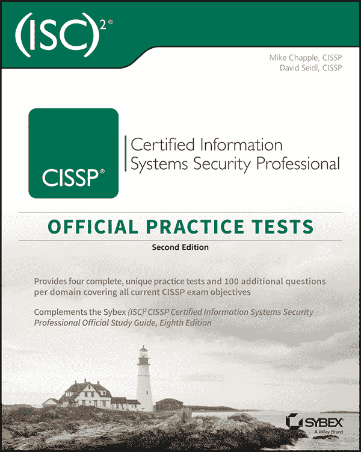

*献给 Renee，我所认识的最有耐心、最体贴的人。感谢你成为我们家庭的核心。*

*—MJC*

*献给 Scott Ksander，他教会我意见不合并不意味着不能站在同一战线；献给 Joanna Grama，她证明我错了，并因此成为一位挚友；献给 Greg Hedrick，他为我们这支安全从业者团队挡风遮雨，让我们得以脱颖而出。感谢你们所有人！*

*—DAS*

# 致谢

作者要感谢使本书得以出版的众多人士。Wiley Publishing 的 Jim Minatel 帮助我们将 Sybex CISSP 系列扩展至包含这一新书名，并获得了国际信息系统安全认证联盟 [(ISC)²] 的重要支持。我们的代理人 Carole Jelen 处理了无数后勤细节，并以她一贯的优雅和对卓越的承诺处理了书籍的商务事务。我们的技术编辑 Aaron Krauss 指出了许多改进我们工作的机会，并交付了高质量的最终产品。Jeff Parker 的技术校对确保了产品的精良。Kelly Talbot 担任开发编辑并顺利管理了项目。许多我们永远不会谋面的人在幕后辛勤工作，促成了本书的成功。

# 作者简介

**Mike Chapple，博士，CISSP**，是畅销书《CISSP (ISC)² 认证信息系统安全专家官方学习指南》（Sybex，2018）的作者之一，该书现已出版第八版。他是一位拥有二十年高等教育、私营部门和政府工作经验的信息安全专业人士。

Mike 目前担任诺特丹大学门多萨商学院 IT、分析与运营副教学教授。他曾担任诺特丹大学 IT 服务交付高级总监，负责监督大学的信息安全、数据治理、IT 架构、项目管理、战略规划和产品管理职能。

在回归诺特丹大学之前，Mike 曾担任 Brand Institute（一家总部位于迈阿密的营销咨询公司）的执行副总裁兼首席信息官。Mike 还曾在国家安全局的信息安全研究组工作四年，并曾在美国空军担任现役情报官。

他是《Information Security Magazine》的技术编辑，已撰写 20 本书，包括《网络战：互联世界中的信息行动》（Jones & Bartlett，2015）、《CompTIA Security+ 培训工具包》（Microsoft Press，2013）以及《CompTIA 网络安全分析师+ (CySA+) 学习指南》（Wiley，2017）和《练习测试》（Wiley，2018）。

Mike 在诺特丹大学获得计算机科学与工程学士和博士学位。他还拥有爱达荷大学计算机科学硕士学位和奥本大学 MBA 学位。他的 IT 认证包括 CISSP、Security+、CySA+、CISA 和 PMP 证书。

Mike 在其网站 [CertMike.com](http://CertMike.com) 提供各种 IT 认证的书籍、视频培训和免费学习小组。

**David Seidl，CISSP**，是诺特丹大学校园技术服务高级总监。在此职位上，David 负责中央平台和操作系统支持、虚拟化、云运营、数据库管理和服务、身份和访问管理、应用服务、ERP 管理以及其他众多服务。在担任现职之前，他是诺特丹大学的信息安全总监，并在诺特丹大学门多萨商学院讲授一门广受欢迎的网络与安全课程。


除了专业和教学工作外，他还合著了*CompTIA Security+ Training Kit*（Microsoft Press，2013 年）、《Cyberwarfare: Information Operations in a Connected World》（Jones & Bartlett，2015 年）、《CISSP Official (ISC)2 Practice Tests》（Sybex，2016 年）和《CompTIA CySA+ Study Guide》（Sybex，2017 年），并担任了《CISSP Study Guide》第六版（Sybex，2012 年）、第七版（Sybex，2015 年）和第八版（Sybex，2018 年）的技术编辑。David 拥有密歇根东部大学通信技术学士学位和信息安全硕士学位，以及 CISSP、GPEN、GCIH 和 CySA+ 认证。

# 关于技术编辑

**Aaron Krauss** 的职业生涯始于为美国联邦政府客户担任安全审计师。随后他转向医疗保健和金融服务领域的安全风险管理，这为他提供了更多周游世界、探索世界和品尝世界各地美食的机会。他目前在旧金山的一家网络风险保险初创公司工作，业余时间涉猎烹饪、鸡尾酒调制和摄影。

# 简介

《(ISC)² CISSP 认证信息系统安全专家官方练习测试》是 (ISC)²《CISSP 认证信息系统安全专家官方学习指南》的配套卷。本书包含 CISSP 详细内容大纲及 2018 年 4 月生效的考试版本中出现的题型。如果您想在参加 CISSP 考试前测试自己的知识水平，本书将通过提供 1,300 多道涵盖 CISSP 通用知识体系的题目，以及对正确和错误答案通俗易懂的解析，来帮助您。

如果您刚开始准备 CISSP 考试，我们强烈建议您使用《(ISC)² CISSP 认证信息系统安全专家官方学习指南》来帮助您了解 CISSP 考试涵盖的各个领域。一旦您准备好测试自己的知识，请使用本书来帮助找出您可能需要加强学习的地方，或用于模拟考试练习。

由于本书是《CISSP 学习指南》的配套教材，因此其设计旨在模拟参加 CISSP 考试的体验。书中包含多部分场景题，以及与您在认证考试中可能遇到的标准多项选择题和匹配题类似的题目。全书分为 12 章：8 章以领域为中心，每章包含 100 道或更多针对各领域的题目；4 章包含 125 道题目的练习测试，用于模拟真实考试。

## CISSP 认证

CISSP 认证由国际信息系统安全认证联盟，即 (ISC)² 提供，该组织是一个全球性的非营利组织。(ISC)² 的使命是支持并为会员和相关人员提供证书、资源和领导力，以应对网络、信息、软件和基础设施安全，从而为社会创造价值。(ISC)² 通过提供世界领先的信息安全认证计划来实现这一使命。CISSP 是该系列中的旗舰证书，并伴随有其他几个 (ISC)² 认证项目。

*   系统安全认证从业者 (SSCP)
*   认证授权专业人员 (CAP)
*   认证安全软件生命周期专业人员 (CSSLP)
*   医疗健康信息安全与隐私从业者 (HCISPP)
*   认证云安全专业人员 (CCSP)

对于那些希望在基础证书之上更进一步、证明其在信息安全某一领域具备高级专业知识的人员，还有三项高级 CISSP 认证。

*   信息系统安全架构专业人员 (CISSP-ISSAP)
*   信息系统安全工程专业人员 (CISSP-ISSEP)
*   信息系统安全管理专业人员 (CISSP-ISSMP)

CISSP 认证涵盖信息安全知识的八大领域。这些领域旨在作为从事信息安全职业所需的广泛知识基础。

*   安全与风险管理
*   资产安全
*   安全架构与工程
*   通信与网络安全
*   身份与访问管理 (IAM)
*   安全评估与测试
*   安全运营
*   软件开发安全

CISSP 领域由 (ISC)² 定期更新。2018 年 4 月的最近一次修订将“安全工程”领域的名称更改为增加了“架构”。此外，还增加或扩展了安全专业人员在现代安全运营环境中常遇到的主题，如安全编码和云运营。同时也更改了其他领域的名称，以反映常见信息安全主题和术语的变化。

CISSP 通用知识体系 (CBK) 的完整详情包含在考试大纲中。其中包括完整的考试主题大纲，可在 (ISC)² 网站 `www.isc2.org` 上找到。

## 参加 CISSP 考试

除了更新考试涵盖的内容外，2018 年还给英语版考试带来了重大变化。传统上，考试是一场包含 250 道多项选择题的 6 小时测试，您可以在该 6 小时内在题目间来回切换。非英语考试仍沿用该格式，但英语考试采用了不同的格式。

新考试使用一种称为计算机自适应测试 (CAT) 的技术。采用这种形式，考试时间缩短，题量在 100 到 150 道之间。您将没有机会在题目间来回跳转，因为计算机会根据您对前几道题的回答来选择下一道题。如果您答得好，题目会随着进度变得更难。不要因此而紧张！

无论哪个版本的考试，通过考试都要求获得至少 700 分（满分 1,000 分）。重要的是要理解这是一个标准化分数，意味着并非每道题的分值都相同。不同难度的题目在计算分数时权重可能不同，自适应考试会根据应试者的水平进行调整。


话虽如此，在完成这些模拟考题的过程中，你可能想以 70% 作为一个衡量标准，帮助你判断自己是否已准备好参加正式考试。准备就绪后，你可以通过 `(ISC)²` 网站在你附近的地点预约考试。

CISSP 考试的题目以多项选择题形式和 `(ISC)²` 所谓的*高级创新题*形式提供，后者包括拖放题和热点题，两者均在基于计算机的考试 (CBT) 环境中呈现。创新题的评分标准与传统多项选择题相同，且仅有一个正确答案。

## 基于计算机的考试环境

目前几乎所有 CISSP 考试均采用基于计算机的考试 (CBT) 形式进行。你将通过 Pearson Vue 网站注册考试，并可选择用你熟悉的语言应试。支持的语言包括英语、法语、德语、葡萄牙语、西班牙语、日语、简体中文、韩语，以及视力障碍者适用格式。

你将在靠近你家或办公室的基于计算机的考试中心参加考试。这些中心同时举办多种不同考试，因此你可能会发现自己与一名参加学校入学考试的学生和一名获取医疗认证的医护人员坐在同一个考场内。如果你想更熟悉考试环境，Pearson Vue 网站提供考试中心的虚拟参观。

[`home.pearsonvue.com/test-taker/Pearson-Professional-Center-Tour.aspx`](https://home.pearsonvue.com/test-taker/Pearson-Professional-Center-Tour.aspx)

考试时，你将坐在一台已预装并运行考试软件的计算机前。界面相当直观，允许你在考试中自由导航。你可以从 Pearson Vue 网站下载模拟考试和教程。

[`www.vue.com/athena/athena.asp`](http://www.vue.com/athena/athena.asp)

## 补考政策

如果你未能通过 CISSP 考试，不必惊慌。许多人首次考试未达标，但获得了宝贵经验，从而在二次考试中成功。补考时，你将受益于对 CBT 环境和 CISSP 考试形式的熟悉，同时也有时间复习那些你信心不足的领域。

首次考试后，你必须等待 30 天才能重新参加基于计算机的考试。如果第二次仍未通过，第三次考试需等待 90 天；第四次考试需等待 180 天。在单个日历年内，你最多只能参加三次考试。

## 工作经验要求

想要获得 CISSP 认证的候选人，不仅必须通过考试，还必须证明拥有至少五年信息安全领域的工作经验。你的工作经验必须涵盖 CISSP 八大域中至少两个域的相关活动，且必须是受薪的全职工作。志愿者经历或兼职工作不被认可为满足 CISSP 经验要求。

根据你的教育成就，你可能有资格豁免五年工作经验要求中的一年。如果你持有学士学位或四年制同等学历，你可能有资格获得学历豁免，抵扣一年经验。同样，如果你持有当前 `(ISC)²` 凭证豁免名单 ([`www.isc2.org/credential_waiver/default.aspx`](https://www.isc2.org/credential_waiver/default.aspx)) 上列出的信息安全认证之一，你也可以豁免一年经验要求。这两个项目不可叠加使用。同时持有认证和本科学位的人员，仍须证明至少拥有四年经验。

如果你尚未完成工作经验要求，仍可参加 CISSP 考试。通过考试的人员将被指定为 `(ISC)²` 会员，并拥有六年时间完成工作经验要求。

## 重新认证要求

一旦获得 CISSP 认证，你需要通过缴纳维护费并参与持续专业教育 (CPE) 来维持认证有效性。只要你保持认证处于良好状态，就无需重考 CISSP 考试。

目前，CISSP 认证的年维护费为每年 85 美元。持有高级 CISSP 专长认证的人员，每持有一个专长需每年额外缴纳 35 美元。

CISSP CPE 要求规定，每年至少获得 40 个 CPE 学分，以满足三年 120 学分的要求。`(ISC)²` 提供在线门户，持证人可在其中提交 CPE 完成情况以供审核批准。该门户还追踪年维护费缴纳情况和重新认证进度。

## 使用本书进行练习

本书共 12 章。前八章各覆盖一个域，包含各类题目，可帮助你测试真实世界、场景及最佳实践安全知识的掌握程度。最后四章为完整的模拟考试，可作为限时练习测试，帮助判断你是否已准备好参加 CISSP 考试。

我们建议先参加第一套模拟考试，以找出你需要花费更多学习时间的薄弱环节，然后利用针对特定域的章节来测试并强化这些薄弱领域的知识。准备就绪后，再参加其余模拟考试，确保你已覆盖所有材料，做好参加 CISSP 考试的准备。

## 使用在线模拟测试

本书所有题目均可在 Sybex 的在线模拟测试工具中获取。要访问此在线版本，请访问 [www.wiley.com/go/cissptestprep](http://www.wiley.com/go/cissptestprep) 并首先注册你的书籍。你将收到一个 PIN 码以及创建在线题库账户的说明。获得访问权限后，你可以使用在线版本从书中题目创建自己的模拟测试集，并在限时评分环境中练习。

# 第 1 章

安全与风险管理（域 1）

1.  定量风险分析的最后一步是什么？

    1.  确定资产价值。
    2.  评估年化发生率。
    3.  计算年化损失期望值。
    4.  进行成本/效益分析。

2.  将下列编号的无线攻击术语与其相应的字母描述进行匹配：

    **无线攻击术语**

    1.  非法接入点
    2.  重放攻击
    3.  邪恶双胞胎
    4.  战争驾驶

    **描述**

    1.  一种依赖接入点欺骗合法接入点的 SSID 和强制访问控制 (MAC) 地址的攻击
    2.  一种通过使用看似合法的 SSID 来吸引新连接的接入点
    3.  一种重新传输捕获的通信以尝试访问目标系统的攻击
    4.  使用检测工具寻找无线网络的过程

3.  根据《数字千年版权法》(DMCA)，互联网服务提供商在收到版权持有者的侵权通知后，对哪类违规行为**不**需要立即采取行动？

    1.  客户在提供商服务器上存储信息
    2.  提供商缓存信息
    3.  客户通过提供商网络传输信息
    4.  提供商搜索引擎中缓存信息


### 4. FlyAway Travel 在欧洲联盟（EU）和美国均设有办事处，并定期在这些办事处之间传输个人信息。他们最近收到一位 EU 客户的请求，要求终止其账户。根据《通用数据保护条例》（GDPR），处理个人信息的哪项要求规定了个人可以请求其数据不再被传播或处理？

1.  访问权
2.  设计时隐私保护
3.  **被遗忘权**
4.  数据可移植权

### 5. 以下哪一项不是三种常见威胁建模技术之一？

1.  以资产为中心
2.  以攻击者为中心
3.  以软件为中心
4.  **以社会工程学为中心**

### 6. 以下哪一项信息要素不被视为个人可识别信息（PII），因此不会触发大多数美国（U.S.）州的数据泄露法律？

1.  学生识别号
2.  社会安全号
3.  驾驶执照号
4.  **信用卡号**

### 7. 1991 年，《联邦量刑指南》将一项规则正式化，要求高级管理人员对信息安全事务承担个人责任。这项规则的名称是什么？

1.  尽职调查规则
2.  **个人责任规则**
3.  善良管理人规则
4.  正当程序规则

### 8. 以下哪一项提供了一种认证机制，适合与密码搭配以实现多因素认证？

1.  用户名
2.  个人识别码（PIN）
3.  安全问题
4.  **指纹扫描**

### 9. 根据 EU GDPR，哪个美国政府机构负责管理欧盟与美国之间隐私盾协议的条款？

1.  国防部
2.  财政部
3.  国务院
4.  **商务部**

### 10. Yolanda 是一家金融机构的首席隐私官，正在研究与客户支票账户相关的隐私问题。以下哪部法律最有可能适用于这种情况？

1.  **GLBA**
2.  SOX
3.  HIPAA
4.  FERPA

### 11. Tim 所在的组织最近获得了一份作为政府承包商进行赞助研究的合同。现在哪部法律很可能适用于该合同涉及的信息系统？

1.  **FISMA**
2.  PCI DSS
3.  HIPAA
4.  GISRA

### 12. Chris 正在建议将前往海外许多不同国家的组织旅行者，他担心遵守出口管制法律。以下哪种技术最有可能触发这些法规？

1.  存储芯片
2.  办公生产力应用程序
3.  硬盘驱动器
4.  **加密软件**

### 13. Bobbi 正在调查一起安全事件，发现攻击者从一个普通用户账户入手，但设法利用系统漏洞使该账户获得了管理权限。在 STRIDE 威胁模型下，发生了哪种类型的攻击？

1.  欺骗
2.  抵赖
3.  篡改
4.  **权限提升**

### 14. 你正在完成业务连续性规划工作，并决定接受其中一项风险。接下来你应该做什么？

1.  实施新的安全控制以降低风险等级。
2.  设计灾难恢复计划。
3.  重复业务影响评估。
4.  **记录你的决策过程。**

### 15. 以下哪个控制类别不能准确描述设施周围的围栏？

1.  物理
2.  **检测**
3.  威慑
4.  预防

### 16. Tony 正在制定业务连续性计划，由于难以整合有形和无形资产的信息，他在确定资源优先级时遇到困难。对他来说，最有效的风险评估方法是什么？

1.  定量风险评估
2.  定性风险评估
3.  既非定量也非定性风险评估
4.  **定量和定性风险评估相结合**

### 17. 哪部法律为商业秘密持有者提供知识产权保护？

1.  版权法
2.  兰哈姆法案
3.  格拉斯-斯蒂格尔法案
4.  **经济间谍法**

### 18. 以下哪项原则对个人施加了一种注意标准，该标准范围广泛，相当于在特定情境下对一个理性人的期望？

1.  尽职调查
2.  职责分离
3.  **尽职尽责**
4.  最小权限

### 19. Darcy 正在设计一个容错系统，希望为其系统实施 RAID 5 级别。她构建该系统所需的物理硬盘最小数量是多少？

1.  一个
2.  两个
3.  **三个**
4.  五个

### 20. 以下哪一项是管理控制的示例？

1.  入侵检测系统
2.  **安全意识培训**
3.  防火墙
4.  保安人员

### 21. Keenan Systems 最近开发了一种新的微处理器制造工艺。该公司希望将该技术授权给其他公司使用，但希望防止该技术被未经授权地使用。哪种类型的知识产权保护最适合这种情况？

1.  **专利**
2.  商业秘密
3.  版权
4.  商标

### 22. 以下哪项行动可能作为业务连续性计划的一部分被采取？

1.  从备份磁带恢复
2.  实施 RAID
3.  迁移到冷站点
4.  **重启业务运营**

### 23. 在制定业务影响分析时，团队首先应创建资产清单。接下来应该发生什么？

1.  识别每项资产中的漏洞。
2.  确定资产面临的风险。
3.  **为每项资产确定价值。**
4.  识别每项资产面临的威胁。

### 24. Mike 最近实施了一个入侵防御系统，旨在阻止常见网络攻击影响其组织。Mike 正在采取哪种风险管理策略？

1.  风险接受
2.  风险规避
3.  **风险缓解**
4.  风险转移

### 25. 以下哪一项是物理基础设施加固的示例？

1.  杀毒软件
2.  基于硬件的网络防火墙
3.  双因素认证
4.  **灭火系统**

### 26. 以下哪一项通常用作授权工具？

1.  **ACL**
2.  令牌
3.  用户名
4.  密码

### 27. 国际信息系统安全认证联盟使用此处所示的徽标在网上和各种论坛中代表自身。它可以使用哪种类型的知识产权保护来保护其在该徽标中的权利？


1.  版权
2.  专利
3.  商业秘密
4.  **商标**

### 28. Mary 正在帮助一位电脑用户，该用户在其电脑屏幕上看到了以下消息。发生了哪种类型的攻击？


1.  **可用性**
2.  机密性
3.  泄露
4.  分布式

### 29. 如果从事电子交易，以下哪个组织不会自动受 HIPAA 条款约束？

1.  医疗服务提供者
2.  **健康与健身应用程序开发商**
3.  健康信息交换中心
4.  健康保险计划


## CISSP 练习题 30-52

### 30. 网络拒绝服务攻击
John 的网络开始出现缓慢症状。经调查，他意识到网络正遭受 TCP SYN 数据包的轰炸，并认为其组织正遭受拒绝服务攻击。违反了信息安全的哪项原则？

1.  **可用性**
2.  完整性
3.  机密性
4.  拒绝

### 31. 长期安全规划
Renee 正在为其组织设计长期安全计划，规划期限为三到五年。她正在制定哪类计划？

1.  运营计划
2.  战术计划
3.  摘要计划
4.  **战略计划**

### 32. 商标评估与注册机构
哪个政府机构负责商标的评估和注册？

1.  **USPTO** (美国专利商标局)
2.  国会图书馆
3.  TVA (田纳西河流域管理局)
4.  NIST (国家标准与技术研究院)

### 33. 防止会计欺诈的控制措施
Acme Widgets 公司正在为其会计部门实施新控制。管理层担心流氓会计可能会创建虚假供应商，然后向该供应商开具支票，支付从未提供的服务费用。哪种安全控制最有助于防止这种情况？

1.  强制休假
2.  **职责分离**
3.  深度防御
4.  工作轮换

### 34. FISMA 覆盖范围
以下哪类组织最有可能受 FISMA (联邦信息安全管理法案) 条款约束？

1.  银行
2.  **国防承包商**
3.  学区
4.  医院

### 35. 信用卡信息安全标准
Robert 负责保护用于处理信用卡信息的系统。哪个标准应指导他的行动？

1.  HIPAA
2.  **PCI DSS** (支付卡行业数据安全标准)
3.  SOX (萨班斯-奥克斯利法案)
4.  GLBA (格雷姆-里奇-比利雷法案)

### 36. 数据保管员职责
以下哪位人员通常负责履行高级管理层委派的运营数据保护职责，如验证数据完整性、测试备份和管理安全策略？

1.  **数据保管员**
2.  数据所有者
3.  用户
4.  审计员

### 37. 网站内容被盗用的知识产权保护
Alan 供职于一家电子商务公司，该公司最近部分内容被另一网站窃取并未经许可重新发布。哪种知识产权保护最能维护 Alan 公司的权利？

1.  商业秘密
2.  **版权**
3.  商标
4.  专利

### 38. 查阅联邦行政法规
Florian 收到联邦机构传单，宣布新的行政法将影响其业务运营。他应去哪里查找该法律文本？

1.  美国法典
2.  最高法院判例
3.  **联邦法规汇编**
4.  法律汇编

### 39. 应用防火墙与风险指标
Tom 启用了其云基础设施即服务提供商提供的应用防火墙，旨在阻止多种应用攻击。从风险管理角度来看，Tom 试图降低哪个指标？

1.  影响
2.  RPO (恢复点目标)
3.  MTO (最大容忍停工时间)
4.  **可能性**

### 40. 信息安全计划的最佳组织所有者
以下哪位人员最适合担任信息安全计划的组织所有者？

1.  CISSP 认证分析师
2.  首席信息官 (CIO)
3.  网络安全经理
4.  **总裁兼首席执行官 (President and CEO)**

### 41. 高级管理层在 BCP 团队中的角色
高级管理层通常在业务连续性规划团队中扮演什么重要角色？

1.  **裁决关键性争议**
2.  评估法律环境
3.  培训员工
4.  设计故障控制

### 42. SaaS 供应商业务连续性审计
你是大型医院系统的 CISO，准备与软件即服务 (SaaS) 电子邮件供应商签署合同，并希望确保其业务连续性规划措施合理。你可能会要求哪种审计以达到此目的？

1.  SOC 1
2.  FISMA
3.  PCI DSS
4.  **SOC 2**

### 43. STRIDE 模型中的抵赖威胁
Gary 正在分析一起安全事件，调查期间遇到一名用户，该用户否认执行了 Gary 认为其执行过的操作。在 STRIDE 模型下，发生了哪种威胁？

1.  **抵赖**
2.  信息泄露
3.  篡改
4.  权限提升

### 44. 学生信息系统完整性测试
Beth 是公立学区的安全管理员。她正在实施新的学生信息系统，并测试代码以确保学生无法篡改自己的成绩。Beth 正在执行信息安全的哪项原则？

1.  **完整性**
2.  可用性
3.  机密性
4.  拒绝

### 45. SLA 通常不涉及的问题
以下哪个问题通常不在服务级别协议 (SLA) 中涉及？

1.  **客户信息的机密性**
2.  故障切换时间
3.  正常运行时间
4.  最大连续停机时间

### 46. 软件知识产权保护途径
Joan 寻求依据知识产权法保护其开发的一款计算机软件。以下哪种保护途径不适用于软件？

1.  **商标**
2.  版权
3.  专利
4.  商业秘密

---

### 场景题 47-49：Juniper Content 公司背景

Juniper Content 是一家拥有 40 名员工的网络内容开发公司，分布在两个办公室：一个在纽约，一个较小的办公室在旧金山湾区。每个办公室都有一个受边界防火墙保护的局域网 (LAN)。局域网包含连接有线和无线网络的现代交换设备。

每个办公室都有自己的文件服务器，信息技术 (IT) 团队每小时运行软件在两台服务器之间同步文件，在办公室间分发内容。这些服务器主要用于存储公司开发的网络内容相关的图像和其他文件。团队还使用基于 SaaS 的电子邮件和文档协作解决方案完成大部分工作。

你是 Juniper Content 新任命的 IT 经理，正在努力增强现有安全控制以提高组织安全性。

#### 47. 跨办公室文件服务器访问的机密性
两个办公室的用户希望通过互联网访问彼此的文件服务器。哪种控制可为这些通信提供机密性？

1.  数字签名
2.  **虚拟专用网络 (VPN)**
3.  虚拟局域网 (VLAN)
4.  数字内容管理

#### 48. 服务器数据可用性与硬盘故障容灾
你还关心每个办公室服务器上存储的数据可用性。你想增加一种技术，即使服务器中的硬盘发生故障，也能继续访问服务器上的文件。在不增加额外服务器的情况下，哪种完整性控制允许你增加稳健性？

1.  服务器集群
2.  负载均衡
3.  **RAID** (独立磁盘冗余阵列)
4.  计划备份

#### 49. 关键历史文件防篡改验证
最后，服务器上存储的历史记录对业务至关重要，绝不应被修改。你想添加一个完整性控制，允许你定期验证文件未被修改。可以添加哪种控制？

1.  **哈希**
2.  ACLs (访问控制列表)
3.  只读属性
4.  防火墙

### 50. 美国隐私权法律基础
哪部法律是美国隐私权的基础？

1.  1974 年隐私法案
2.  **第四修正案**
3.  第一修正案
4.  1986 年电子通信隐私法案

### 51. 业务连续性计划文档内容
以下哪项通常不包含在业务连续性计划 (BCP) 文档中？

1.  **账户声明**
2.  重要性声明
3.  优先级声明
4.  组织责任声明

### 52. 早期发现贪污舞弊的控制
Doolittle Industries 的一名会计员工最近因参与贪污计划被捕。该员工将资金转入个人账户，然后每天在其他账户间转移资金以掩盖长达数月的欺诈行为。以下哪种控制可能最有助于更早地发现这种欺诈？

1.  职责分离
2.  最小权限
3.  深度防御
4.  **强制休假**


# 练习题

### 53. 以下哪一项通常不被视为业务连续性任务？

1. 业务影响评估
2. 应急响应指南
3. 电子保管库
4. 关键记录计划

### 54. 当组织遭遇 DoS 或 DDoS 攻击时，哪个信息安全目标会受到影响？

1. 机密性
2. 完整性
3. 可用性
4. 拒绝

### 55. Yolanda 正在编写一份文档，该文档将提供配置信息，规定组织中每个系统必须满足的最低安全级别。她正在准备哪种类型的文档？

1. 策略
2. 基线
3. 指南
4. 程序

### 56. 组织中谁应该接受初始的业务连续性计划培训？

1. 高级管理人员
2. 具有特定业务连续性角色的人员
3. 组织中的每个人
4. 第一响应者

### 57. James 正在为其组织进行风险评估，并试图为其数据中心的服务器分配资产价值。组织的主要关注点是确保有足够的资金在数据中心受损或被毁时重建数据中心。在这种情况下，以下哪种资产估值方法最合适？

1. 购买成本
2. 折旧成本
3. 重置成本
4. 机会成本

### 58. 《1987 年计算机安全法案》赋予某联邦机构负责为联邦计算机系统制定计算机安全标准和指南的责任。该法案将此责任赋予了哪个机构？

1. 国家安全局
2. 联邦通信委员会
3. 国防部
4. 国家标准与技术研究院

### 59. 以下哪一项不是发明获得专利的要求？

1. 必须是新的。
2. 必须由美国公民发明。
3. 必须是非显而易见的。
4. 必须是有用的。

### 60. Frank 发现其公司首席执行官的笔记本电脑上隐藏着一个键盘记录器。该键盘记录器最可能旨在破坏哪项信息安全原则？

1. 机密性
2. 完整性
3. 可用性
4. 拒绝

### 61. 用于确定风险的公式是什么？

1. `Risk = Threat * Vulnerability`
2. `Risk = Threat / Vulnerability`
3. `Risk = Asset * Threat`
4. `Risk = Asset / Threat`

### 62. 下图显示了 NIST 风险管理框架，其中步骤 4 缺失。缺失的步骤是什么？

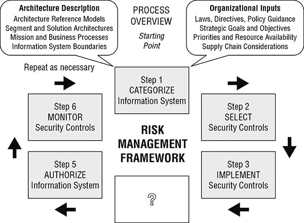

1. 评估安全控制。
2. 确定控制差距。
3. 修补控制差距。
4. 评估用户活动。

### 63. HAL Systems 最近决定停止提供公共 NTP 服务，因为担心其 NTP 服务器会被用于放大 DDoS 攻击。HAL 在其 NTP 服务方面采取了哪种风险管理策略？

1. 风险缓解
2. 风险接受
3. 风险转移
4. 风险规避

### 64. Susan 正在与公司管理团队合作对数据进行分类，试图应用额外的安全控制以限制数据泄露的可能性。Susan 试图强制执行哪项信息安全原则？

1. 可用性
2. 拒绝
3. 机密性
4. 完整性

### 65. 以下哪个组件应包含在组织的应急响应指南中？

1. 应在紧急事件中被通知的个人名单
2. 长期业务连续性协议
3. 组织冷站点的激活程序
4. 订购设备的联系信息

### 66. 谁是批准组织业务连续性计划的理想人选？

1. 首席信息官
2. 首席执行官
3. 首席信息安全官
4. 首席运营官

### 67. 以下哪项行动通常不是业务连续性规划的项目范围和规划阶段的一部分？

1. 对组织的结构化分析
2. 对法律和监管环境的审查
3. BCP 团队的创建
4. 计划的文档化

### 68. Gary 正在实施一种新的网站架构，该架构在负载均衡器后面使用多个小型 Web 服务器。Gary 寻求强制执行哪项信息安全原则？

1. 拒绝
2. 机密性
3. 完整性
4. 可用性

### 69. Becka 最近与一家备用数据处理设施签署了合同，该设施将在发生灾难时为其公司提供场地。该设施包括暖通空调、电力和通信线路，但没有硬件。Becka 使用的是哪种类型的设施？

1. 冷站点
2. 温站点
3. 热站点
4. 移动站点

### 70. 触发《计算机欺诈和滥用法案》的对联邦计算机系统的恶意破坏阈值是多少？

1. $500
2. $2,500
3. $5,000
4. $10,000

### 71. Ben 正在寻找一个被全球广泛接受且专门关注信息安全控制的控制目标框架。以下哪个框架最能满足他的需求？

1. ITIL
2. ISO 27002
3. CMM
4. PMBOK Guide

### 72. 以下哪项法律要求通信服务提供商配合执法部门的请求？

1. ECPA
2. CALEA
3. Privacy Act
4. HITECH Act

### 73. 每年，Gary 都会收到他有账户的金融机构邮寄的隐私通知。哪项法律要求这些机构向 Gary 发送这些通知？

1. FERPA
2. GLBA
3. HIPAA
4. HITECH

### 74. 以下哪种协议通常要求供应商在合作范围内不得泄露所获知的机密信息？

1. NCA
2. SLA
3. NDA
4. RTO

### 75. 以下哪一项不是技术控制的示例？

1. 路由器 ACL
2. 防火墙规则
3. 加密
4. 数据分类

### 76. 以下哪个利益相关者通常不包含在业务连续性规划团队中？

1. 核心业务职能负责人
2. 信息技术人员
3. CEO
4. 支持部门

### 77. Ben 正在为一家银行设计消息系统，并希望包含一项功能，允许消息接收者向第三方证明该消息确实来自所谓的发送者。Ben 试图实现什么目标？

1. 认证
2. 授权
3. 完整性
4. 不可否认性

### 78. 哪项信息安全原则规定组织应尽可能实施重叠的安全控制？

1. 最小权限
2. 职责分离
3. 深度防御
4. 通过隐匿实现安全

### 79. 以下哪一项不是正式变更管理计划的目标？

1. 以有序的方式实施变更。
2. 在实施前测试变更。
3. 为变更提供回滚计划。
4. 在变更发生后通知利益相关者。

### 80. Ben 负责数据库中存储的支付卡信息的安全。策略指示他从数据库中删除该信息，但由于操作原因他无法做到。他获得了策略例外，并正在寻找适当的补偿控制来降低风险。他的最佳选择是什么？

1. 购买保险
2. 加密数据库内容
3. 删除数据
4. 对例外提出异议


### 81. Domer Industries 的风险评估团队最近进行了一次定性风险评估，并制定了一个类似于此处所示的矩阵。哪个象限包含需要最立即关注的风险？

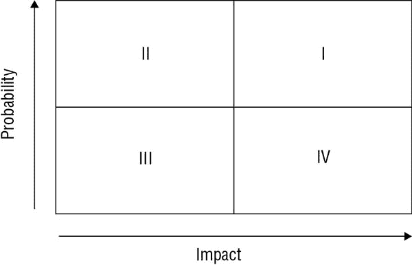

1.  I
2.  II
3.  III
4.  IV

### 82. Tom 计划今天下午解雇一名因欺诈行为的员工，并预计会议会有些对抗性。他正在与人力资源部门协调会议，并希望保护公司免受损害。以下哪项步骤最重要，需要与解雇会议同步协调？

1.  通知其他员工该解雇决定
2.  收回员工的带照片身份证件
3.  计算最终工资单
4.  撤销电子访问权限

### 83. Rolando 是一家大型企业的风险经理。该公司最近评估了加利福尼亚泥石流对其在该地区业务的风险，并确定应对成本超过了实施任何控制措施的收益。公司选择目前不采取任何行动。Rolando 的组织采取了哪种风险管理策略？

1.  风险规避
2.  风险缓解
3.  风险转移
4.  风险接受

### 84. Helen 是一个为准备考试的初中和高中学生提供信息的网站的所有者。她担心其网站的活动可能属于《儿童在线隐私保护法案》（COPPA）的管辖范围。根据 COPPA，在收集儿童个人信息前必须获得父母同意的年龄界限是多少？

1.  13
2.  15
3.  17
4.  18

### 85. Tom 正考虑在佛罗里达州迈阿密市中心设立业务。他查阅了该地区的 FEMA 洪水平原图（如图所示），并确定他考虑的区域位于百年一遇洪水平原内。

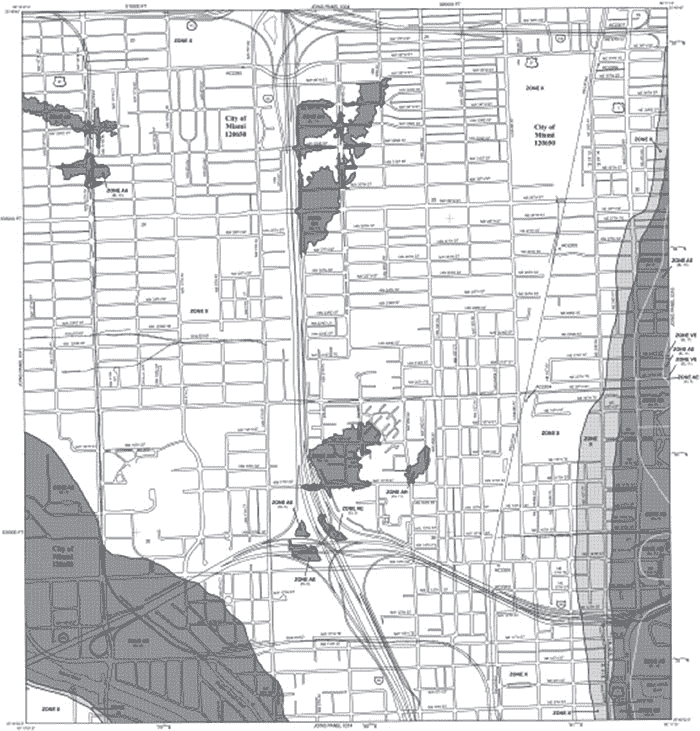

1.  100
2.  1
3.  0.1
4.  0.01

### 86. 你发现网络上的一个用户一直在使用 Wireshark 工具，如图所示。进一步调查显示，他将其用于非法目的。信息安全的哪个支柱最有可能被违反？

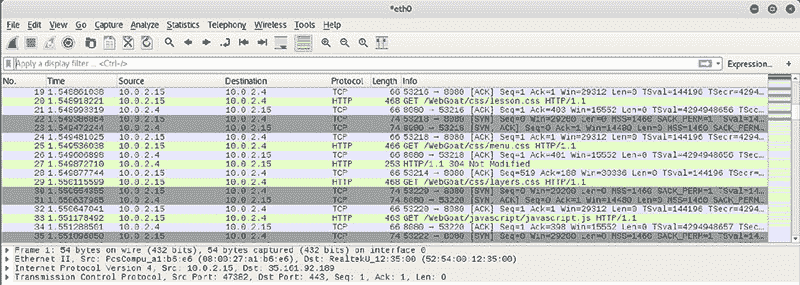

1.  完整性
2.  否认性
3.  可用性
4.  机密性

### 87. Alan 正在进行威胁建模，并决定将系统分解为此处所示的关键元素会很有用。他正在使用什么工具？

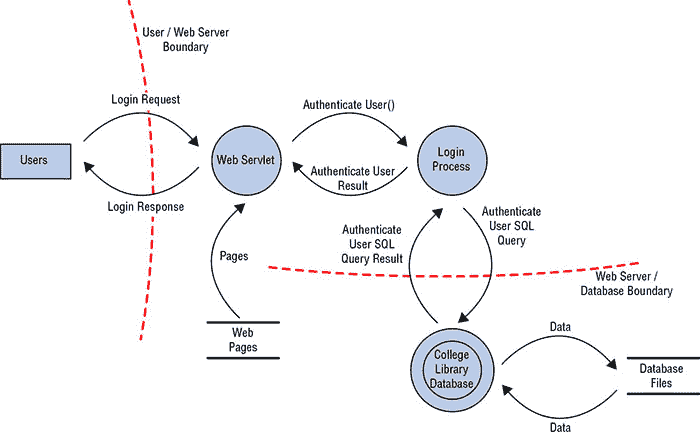

1.  漏洞评估
2.  模糊测试
3.  简化分析
4.  数据建模

### 88. 将下列编号的法律或行业标准与其字母描述相匹配：

**法律和行业标准**

1.  GLBA
2.  PCI DSS
3.  HIPAA
4.  SOX

**描述**

1.  一项美国法律，要求受监管的金融机构每年向客户提供隐私声明
2.  一项美国法律，要求上市公司进行内部控制评估，包括 IT 交易流程
3.  一项行业标准，涵盖处理信用卡的组织
4.  一项美国法律，为医疗信息提供数据隐私和安全要求

### 89. Craig 正在为新数据中心选择选址，必须在美国境内选择一个位置。他从美国地质调查局获得了如图所示的地震风险图。如果他主要关心地震风险，以下哪个位置建设设施最安全？

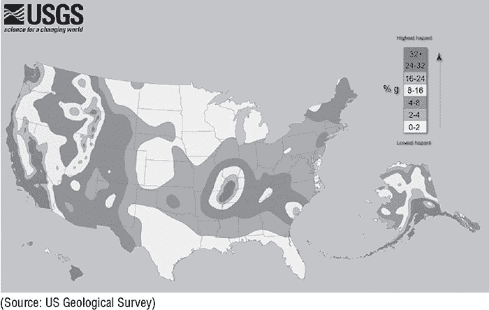

1.  纽约
2.  北卡罗来纳州
3.  印第安纳州
4.  佛罗里达州

### 90. 以下哪种工具最常用于标识目的，而不适合用作认证器？

1.  密码
2.  视网膜扫描
3.  用户名
4.  令牌

### 91. 当试图评估故障对客户信心的影响时，哪种业务影响评估工具最合适？

1.  定量
2.  定性
3.  年化损失期望值
4.  简化

### 92. 制定组织关键记录计划的第一步是以下哪一项？

1.  识别关键记录
2.  定位关键记录
3.  归档关键记录
4.  保存关键记录

### 93. 以下哪个安全计划旨在为员工提供执行其特定工作任务所需的知识？

1.  意识培训
2.  培训
3.  教育
4.  灌输

### 94. 以下哪个安全计划旨在建立安全理解的最低通用标准基准？

1.  培训
2.  教育
3.  灌输
4.  意识培训

### 95. Ryan 是一家保险公司的安全风险分析师。他目前正在检查这样一种场景：恶意黑客可能会利用 SQL 注入攻击篡改 Web 服务器，原因是公司 Web 应用程序中缺少补丁。在此场景中，什么是威胁？

1.  未修补的 Web 应用程序
2.  Web 篡改
3.  恶意黑客
4.  操作系统

### 第 96-98 题，请参考以下场景：

Henry 是 Atwood Landing（美国中西部的一个度假社区）的风险经理。该度假村的主要数据中心位于印第安纳州北部，该地区易发龙卷风。Henry 最近进行了重置成本分析，确定重建和重新配置数据中心将花费 1000 万美元。

Henry 咨询了龙卷风专家、数据中心专家和结构工程师。他们共同确定，一次典型的龙卷风将给设施造成约 500 万美元的损失。气象学家确定，Atwood 的设施位于每 200 年可能经历一次龙卷风的区域。

#### 96. 根据此场景中的信息，龙卷风对 Atwood Landing 数据中心影响的暴露因子是多少？

1.  10%
2.  25%
3.  50%
4.  75%

#### 97. 根据此场景中的信息，Atwood Landing 数据中心发生龙卷风的年化发生率是多少？

1.  0.0025
2.  0.005
3.  0.01
4.  0.015

#### 98. 根据此场景中的信息，Atwood Landing 数据中心龙卷风的年化损失期望值是多少？

1.  $25,000
2.  $50,000
3.  $250,000
4.  $500,000

### 99. John 正在分析针对其公司的一次攻击，攻击者在 HTML 代码中嵌入的注释中发现了利用软件漏洞所需的线索。使用 STRIDE 模型，他发现了哪种类型的攻击？

1.  欺骗
2.  抵赖
3.  信息泄露
4.  权限提升

### 100. 以下哪一项是可保护信息机密性的管理控制？

1.  加密
2.  保密协议
3.  防火墙
4.  容错

### 101. Chris 担心其组织最近采购的笔记本电脑在交付前已被第三方修改以植入键盘记录器。他应将精力集中在何处以防止这种情况？

1.  他的供应链
2.  他的供应商合同
3.  他的采购后构建流程
4.  原始设备制造商 (OEM)

### 102. STRIDE、PASTA 和 VAST 都是以下哪种工具的示例？

1.  风险评估方法论
2.  控制矩阵
3.  威胁建模方法论
4.  意识宣传工具


# 练习题

### 103. 在线银行开发人员的代码提交流程
Lisa 作为在线银行的开发人员，需要提交代码进行测试和审查。代码通过该流程并获批后，另一名员工将代码移至生产环境。该流程描述了哪种安全管理？

1.  回归测试
2.  代码审查
3.  **变更管理**
4.  模糊测试

### 104. 安全意识培训完成率指标
Charles 在完成安全意识计划第一年后，对比完成培训的员工数与被指派培训的员工数，以确定是否达到 95% 的完成率目标。这种度量类型称为什么？

1.  **KPI** (关键绩效指标)
2.  指标
3.  意识控制
4.  投资回报率

### 105. 入职前筛选流程
以下哪项通常**不**包含在入职前筛选流程中？

1.  药物测试
2.  背景调查
3.  社交媒体审查
4.  **体能评估**

### 106. (ISC)² 职业道德准则
(ISC)² 职业道德准则适用于所有 CISSP 持证人。以下哪项**不是**该准则四大强制准则之一？

1.  保护社会、公共利益、必要的公众信任和信心以及基础设施
2.  **披露隐私、信任和道德的违规行为**
3.  为委托人提供勤勉且称职的服务
4.  推进并保护职业

### 107. 数据泄露法律适用范围
Greg 所在公司发生重大数据泄露，涉及大量客户个人数据。他们应审查哪些泄露法律以确保采取适当行动？

1.  总部所在州的泄露法律
2.  **其开展业务所在州的泄露法律**
3.  仅联邦泄露法律
4.  泄露法律仅涵盖政府机构，不涵盖私营企业

### 108. 漏洞扫描与风险评估的组织场景
Lawrence 被要求对系统执行漏洞扫描和风险评估。这些活动更可能与哪种组织流程相关？

1.  **合并**
2.  剥离
3.  裁员
4.  财务审计

### 109. 离职流程
以下哪项通常**不**属于离职流程？

1.  离职面谈
2.  财产回收
3.  账户注销
4.  **签署 NCA (竞业禁止协议)**

### 110. SCA 评估的组织类型
Laura 被要求执行 SCA (软件成分分析/供应链评估等，视具体语境)。她最可能身处哪类组织？

1.  高等教育
2.  **银行业**
3.  政府
4.  医疗保健

### 111. 定性风险评估后的应对策略
Sally 在进行定性风险评估后，建议购买网络安全泄露保险。她推荐的是哪种风险应对行为？

1.  接受
2.  **转移**
3.  降低
4.  拒绝

# 第 2 章 资产安全 (Domain 2)

### 1. 交易安全与 TLS
Angela 是银行的信息安全架构师，负责确保交易在网络传输过程中的安全。她建议所有交易使用 TLS。她最可能试图阻止什么威胁，并使用什么方法防护？

1.  中间人攻击，VPN
2.  数据包注入，加密
3.  **窃听，加密**
4.  窃听，TEMPEST

### 2. COBIT 框架与数据管理角色
COBIT (Control Objectives for Information and Related Technology) 是 IT 管理和治理框架。哪个数据管理角色最可能选择并应用 COBIT，以在安全控制需求与业务需求间取得平衡？

1.  业务所有者
2.  数据处理者
3.  **数据所有者**
4.  数据管家

### 3. 最低安全标准基准
用于描述最低安全标准起点的术语是什么？

1.  大纲
2.  **基线**
3.  策略
4.  配置指南

### 4. 媒体标签规则
当媒体根据其包含数据的分类进行标记时，通常应用什么标签规则？

1.  根据数据的完整性要求进行标记。
2.  **根据其包含数据的最高分级进行标记。**
3.  标记其包含数据的所有分级。
4.  根据其包含数据的最低分级进行标记。

### 5. 分配安全控制级别的行政流程
以下哪项行政流程协助组织为敏感信息分配适当级别的安全控制？

1.  **信息分类**
2.  残留
3.  传输数据
4.  清除

### 6. 数据保留策略降低责任
数据保留策略如何帮助降低责任？

1.  **确保不保留不需要的数据**
2.  确保销毁有罪证据数据
3.  确保数据被安全擦除，以免在法律取证中恢复
4.  降低法律要求的数据存储成本

### 7. IT 部门人员的数据角色
被委派负责日常任务的 IT 部门员工持有什么数据角色？

1.  业务所有者
2.  用户
3.  数据处理者
4.  **保管人**

### 8. 处理欧盟客户 PII 的合规要求
Susan 就职于一家与欧盟客户有业务往来的美国公司。若她负责处理这些客户的 PII (Personally Identifiable Information)，她可能需要做什么？

1.  始终加密数据。
2.  根据 HIPAA 对数据进行标记和分类。
3.  按 PCI DSS 标准进行年度评估。
4.  **遵守如 US-EU Privacy Shield (美欧隐私盾) 等标准。**

### 9. 使用安全基线的原因
Ben 被指派为组织信息分类系统覆盖的系统确定安全控制。Ben 为何可能选择使用安全基线？

1.  它适用于所有情况，允许一致的安全控制。
2.  它们由行业标准机构批准，防止责任。
3.  **它们提供良好的起点，可根据组织需求进行裁剪。**
4.  它们确保系统始终处于安全状态。

### 10. 媒体重用术语
描述覆写媒体以允许其在相同敏感级别环境中重用的术语是什么？

1.  **清除**
2.  擦除
3.  清除
4.  消毒

### 11. 美国政府分类级别
以下哪个分类级别是美国政府用于标记“可能造成损害，但不会造成严重或极其严重损害”数据的标签？

1.  绝密
2.  机密
3.  **秘密**
4.  分类

### 12. 硬盘备用扇区、坏扇区与 SSD 过度配置空间的共同问题
硬盘的备用扇区、坏扇区以及现代 SSD 的过度配置空间存在什么共同问题？

1.  可用于隐藏数据。
2.  只能退磁。
3.  它们不可寻址，导致数据残留。
4.  **它们可能无法被清除，导致数据残留。**

### 13. 数据残留定义
描述在尝试移除数据后仍保留的数据的术语是什么？

1.  残余字节
2.  **数据残留**
3.  空闲空间
4.  零填充

### 案例研究 (第 14-16 题)
您的组织定期处理三类数据：与客户共享的信息、内部开展业务使用的信息、以及提供显著竞争优势的商业机密信息。与客户共享的信息在 Web 服务器上使用和存储，而内部业务数据和商业机密信息则存储在内部文件服务器和员工工作站上。

#### 14. 民用数据分类
哪种民用数据分类最适合这些数据？

1.  非机密、机密、绝密
2.  公开、敏感、私有
3.  **公开、敏感、专有**
4.  公开、机密、私有

#### 15. 商业机密标识技术
可使用何种技术标记商业机密信息，以便在其泄露或被盗时识别？

1.  分类
2.  对称加密
3.  **水印**


### 元数据

#### 16. 你应该在文件服务器上对专有数据使用哪种类型的加密，以及如何保护传输中的数据？

1.  静态 TLS 和动态 AES
2.  **静态 AES 和动态 TLS**
3.  静态 VPN 和动态 TLS
4.  静态 DES 和动态 AES

#### 17. 标记数据允许 DLP 系统做什么？

1.  **DLP 系统可以检测标签并应用适当的保护。**
2.  DLP 系统可以根据分类方案的变化调整标签。
3.  DLP 系统可以通知防火墙允许流量通过。
4.  DLP 系统可以删除未标记的数据。

#### 18. 为什么购买高质量介质来存放敏感数据具有成本效益？

1.  昂贵的介质不太可能发生故障。
2.  **数据的价值通常远超介质的成本。**
3.  昂贵的介质更容易加密。
4.  更昂贵的介质通常能提高数据完整性。

#### 19. Chris 负责其公司所有的工作站，并且知道公司一些工作站用于处理专有信息。哪个选项最能描述他负责的工作站在生命周期结束时应发生什么？

1.  擦除
2.  清除
3.  **清理**
4.  销毁

#### 20. 将以下美国政府数据分类级别按敏感度从低到高重新排序。

1.  Secret（机密）
2.  Confidential（秘密）
3.  **Unclassified（非密）**
4.  Top Secret（绝密）

**正确顺序：**
1.  Unclassified（非密）
2.  Confidential（秘密）
3.  Secret（机密）
4.  Top Secret（绝密）

#### 21. 什么场景描述了静态数据？

1.  IPSec 隧道中的数据
2.  电子商务交易中的数据
3.  **存储在硬盘驱动器上的数据**
4.  存储在 RAM 中的数据

#### 22. 如果你正在为处理信用卡的 Windows 10 系统选择安全标准，哪个安全标准是你的最佳选择？

1.  Microsoft 的 Windows 10 安全基线
2.  CIS Windows 10 基线
3.  **PCI DSS**
4.  NSA Windows 10 基线

---

### 第 23–25 题场景

互联网安全中心（`CIS`）与来自各行各业的主题专家合作，为操作系统、移动设备、服务器软件和网络设备创建安全控制列表。你的组织决定对系统使用 `CIS` 基准。根据此决定回答以下问题。

#### 23. CIS 基准是以下哪种实践的示例？

1.  进行风险评估
2.  实施数据标记
3.  适当的系统所有权
4.  **使用安全基线**

#### 24. 将 CIS 基准调整为适应组织的使命和特定 IT 系统将涉及哪两个过程？

1.  界定范围和选择
2.  **界定范围和裁剪**
3.  基线化和裁剪
4.  裁剪和选择

#### 25. 你应该如何确定给定系统或软件包应从基线接收哪些控制？

1.  咨询数据管理员。
2.  **根据其存储或处理的数据的分类级别进行选择。**
3.  对所有系统应用相同的控制。
4.  咨询系统或数据支持的业务流程所有者。

#### 26. FTP 和 Telnet 的什么问题使得使用 SFTP 和 SSH 成为更好的替代方案？

1.  `FTP` 和 `Telnet` 未安装在许多系统上。
2.  **`FTP` 和 `Telnet` 不加密数据。**
3.  `FTP` 和 `Telnet` 存在已知漏洞且不再维护。
4.  `FTP` 和 `Telnet` 难以使用，使得 `SFTP` 和 `SSH` 成为首选解决方案。

#### 27. Saria 所在的政府国防承包商最近关闭了一个主要研究项目，并计划将该项目使用的价值数十万美元的系统和数据存储磁带用于其他用途。当 Saria 审查公司内部流程时，她发现无法重复使用这些磁带，且手册规定应将其销毁。为什么不允许 Saria 对磁带进行消磁后再重复使用以节省雇主资金？

1.  数据持久性可能是个问题。
2.  **数据残留是一个隐患。**
3.  磁带可能遭受位腐烂。
4.  磁带上的数据无法通过消磁擦除。

#### 28. 可用于区分或追踪个人身份的关于个人的维护信息被称为哪类信息？

1.  **个人身份信息（`PII`）**
2.  个人健康信息（`PHI`）
3.  社会安全号码（`SSN`）
4.  安全身份信息（`SII`）

#### 29. 静态数据面临的主要信息安全风险是什么？

1.  分类不当
2.  **数据泄露**
3.  解密
4.  数据完整性丢失

#### 30. 像 Microsoft BitLocker 这样的全盘加密用于保护哪种状态下的数据？

1.  传输中的数据
2.  **静态数据**
3.  未标记数据
4.  已标记数据

#### 31. Sue 的雇主要求她使用 IPsec VPN 连接到其网络。当 Sue 连接时，IPsec VPN 允许她做什么？

1.  通过公共网络发送解密数据，并表现得就像她在雇主的内部网络上一样。
2.  **创建一个通过公共网络承载的私有加密网络，并表现得就像她在雇主的内部网络上一样。**
3.  在雇主的内部网络上使用 `TLS` 创建虚拟专用网络。
4.  创建一个将雇主网络连接到其内部家庭网络的隧道网络。

#### 32. 数据分类的主要目的是什么？

1.  它量化了数据泄露的成本。
2.  它确定 IT 支出的优先级。
3.  它允许遵守违规通知法律。
4.  **它确定了数据对组织的价值。**

#### 33. Fred 的组织允许在项目完成并清除系统后对系统进行降级以供重用。对于将其绝密项目的系统重用于未来的机密项目，Fred 应该提出什么担忧？

1.  **绝密数据可能与机密数据混合，导致需要重新给系统贴标签。**
2.  清理过程的成本可能超过新设备的成本。
3.  数据可能在清理过程中暴露。
4.  组织的 `DLP` 系统可能会因数据标签的差异而标记新系统。

#### 34. 以下哪项顾虑在对数据分类时不应成为决策的一部分？

1.  **对数据进行分类的成本**
2.  数据的敏感性
3.  数据泄露可能造成的危害程度
4.  数据对组织的价值

#### 35. 以下哪项是从介质中移除数据的最无效方法？

1.  消磁
2.  清除
3.  擦除
4.  **清除**

#### 36. 将此处显示的每个编号数据元素与字母分类之一匹配。你可以使用分类一次、多次或根本不使用。如果一个数据元素匹配多个类别，请选择最具体的一个。

##### 数据元素

1.  医疗记录
2.  信用卡号
3.  社会安全号码
4.  驾驶执照号码

#### 类别

1.  `PCI DSS`
2.  `PHI`
3.  `PII`

**匹配：**

*   1. 医疗记录 → **2. `PHI`**
*   2. 信用卡号 → **1. `PCI DSS`**
*   3. 社会安全号码 → **3. `PII`**
*   4. 驾驶执照号码 → **3. `PII`**

---

### 第 37–39 题场景

Lauren 所在的医疗公司处理 `HIPAA` 数据以及内部业务数据、受保护的健康信息和日常业务通信。其内部政策对静态和传输中的 `HIPAA` 数据安全使用以下要求。

| 分类 | 处理要求 |
| :--- | :--- |
| 机密（`HIPAA`） | 静态加密和传输加密。 |


| 分类 | 处理要求 |
| :--- | :--- |
| 机密 | 所有工作站均需进行全盘加密。 |
| | 文件只能以加密形式发送，且密码必须通过单独途径传递。 |
| | 打印文档必须标注“需要 HIPAA 处理”。 |
| 私密 | 静态加密和传输加密。 |
| | PHI 必须存储在安全服务器上，不应在本地工作站保留副本。 |
| | 打印文档必须标注“私密”。 |
| 敏感 | 建议加密，但非强制要求。 |
| 公开 | 信息可明文发送。 |

#### 37. 什么加密技术适用于传输中的 HIPAA 文档？

1. BitLocker
2. DES
3. TLS
4. SSL

#### 38. Lauren 的雇主要求 Lauren 对带有内部患者标识符但无法直接识别患者身份的患者 X 光数据进行分类。公司的数据所有者认为，该数据泄露可能会对组织造成损害（但非特别严重损害）。Lauren 应如何对该数据分类？

1. 公开
2. 敏感
3. 私密
4. 机密

#### 39. Lauren 的雇主可实施什么技术，以帮助防止机密数据被通过电子邮件发送出组织？

1. DLP
2. IDS
3. 防火墙
4. UDP

#### 40. 一个美国政府数据库包含秘密、机密和绝密数据。应如何对其分类？

1. 绝密
2. 机密
3. 秘密
4. 混合分类

#### 41. 什么工具用于防止离职员工与新雇主分享专有信息？

1. 加密
2. NDA
3. 分类
4. 清除

#### 42. `BitLocker` 和 Microsoft 的 `Encrypting File System` 共同使用什么加密算法？

1. Blowfish
2. Serpent
3. AES
4. 3DES

#### 43. Chris 负责其组织的安全标准，并指导了其组织中 Windows PC 安全基线的选择与实施。Chris 如何最有效地确保其负责的工作站接受合规性检查，并按需应用设置？

1. 指派用户抽查基线合规性。
2. 使用 Microsoft 组策略。
3. 创建启动脚本以在系统启动时应用策略。
4. 定期与数据所有者和系统所有者一起审查基线。

#### 44. 什么术语用于描述一组通用的安全配置，通常由第三方提供？

1. 安全策略
2. 基线
3. DSS
4. NIST SP 800-53

#### 45. 什么类型的策略描述了数据在销毁前保留和维护多长时间？

1. 分类
2. 审计
3. 记录保留
4. 可用性

#### 46. 哪种攻击促使供应商默认弃用 SSL 并转向仅使用 TLS？

1. POODLE
2. Stuxnet
3. BEAST
4. CRIME

#### 47. 如果备份磁带被盗或丢失，什么安全措施能提供额外的安全控制？

1. 保留多份磁带副本。
2. 用硬盘替换磁带介质。
3. 使用适当的安全标签。
4. 使用 AES-256 加密。

#### 48. Joe 在一家大型制药研发公司工作，被编写组织的数据保留策略。作为法律要求的一部分，该组织必须遵守美国食品药品监督管理局的《联邦法规》第 21 编。为此，要求保留带有电子签名的记录。为什么签名会成为保留要求的一部分？

1. 它确保有人审查了数据。
2. 它提供机密性。
3. 它确保数据未被篡改。
4. 它验证谁批准了数据。

#### 49. 通过命令行进行远程服务器管理时，什么协议优于 Telnet？

1. SCP
2. SFTP
3. WDS
4. SSH

#### 50. 什么方法使用强磁场擦除介质？

1. Magwipe
2. 退磁
3. 清理
4. 清除

#### 51. Steve 担心离职员工通常知晓专有信息。以下哪项控制措施对此威胁最有效？

1. 清理
2. NDA
3. 清除
4. 加密

#### 52. Alex 为一家政府机构工作，该机构需满足美国联邦政府的数据安全要求。为满足这些要求，Alex 被指派确保数据可通过其分类级别进行识别。Alex 应对数据做什么？

1. 对数据分类。
2. 加密数据。
3. 给数据打标签。
4. 对数据应用 DRM。

#### 53. Ben 遵循美国国家标准与技术研究院 (NIST) 特别出版物 800-88 中关于清理和处置的指南（如下图所示）。他处理的信息被其组织分类为敏感，在 NIST 模型中属于中等安全分类。如果介质将作为剩余资产出售，Ben 需遵循什么流程？

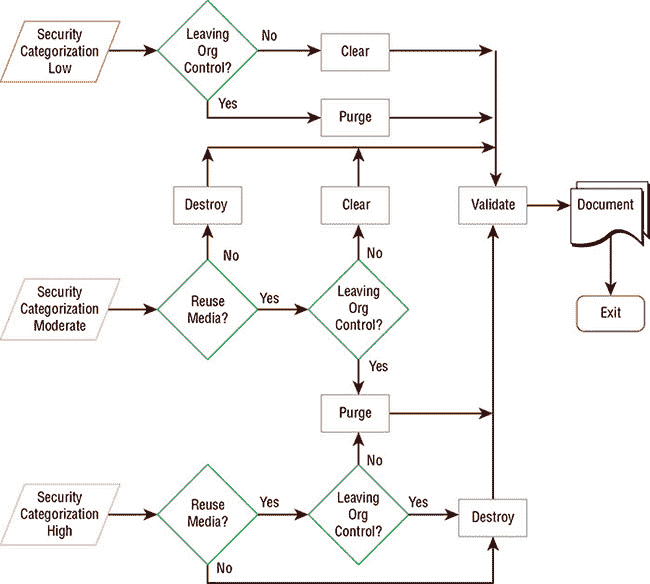

1. 销毁、验证、记录
2. 清除、清除、记录
3. 清除、记录、验证
4. 清除、验证、记录

#### 54. 什么方法常用于保护传输中的数据？

1. Telnet、ISDN、UDP
2. BitLocker、FileVault
3. AES、Serpent、IDEA
4. TLS、VPN、IPSec

#### 55. 以下哪个数据角色对数据承担最终组织责任？

1. 系统所有者
2. 业务所有者
3. 数据所有者
4. 任务所有者

#### 56. 什么美国政府机构监督希望使用欧盟公民个人数据的组织对隐私盾框架的合规性？

1. FAA
2. FDA
3. DoD
4. 商务部

### 第 57–59 题请参考以下场景：

Chris 最近入职一家新组织。Chris 所在组织使用以下分类流程：

1. 设定数据分类标准。
2. 为每类数据建立数据所有者。
3. 对数据进行分类。
4. 为每个分类选择所需控制措施。
5. 为组织选择基线安全标准。
6. 对控制措施进行范围界定和调整。
7. 应用并强制执行控制措施。
8. 授予并管理访问权限。

#### 57. 如果 Chris 是该组织的数据所有者之一，他最可能负责该流程中的哪些步骤？

1. 他负责步骤 3、4 和 5。
2. 他负责步骤 1、2 和 3。
3. 他负责步骤 5、6 和 7。
4. 所有步骤均为其直接职责。

#### 58. Chris 管理一支系统管理员团队。如果他们执行分类流程的步骤 6、7 和 8，他们履行什么数据角色？

1. 他们是系统所有者和管理员。
2. 他们是管理员和保管员。
3. 他们是数据所有者和管理员。
4. 他们是保管员和用户。

#### 59. 如果 Chris 的公司在欧盟运营，并受合同约束为第三方处理数据，当它使用此流程对数据进行分类和处理时，公司扮演什么角色？

1. 业务所有者
2. 任务所有者
3. 数据处理者
4. 数据管理员

#### 60. 以下哪项不是欧盟《通用数据保护条例》(GDPR) 的原则？


1. 信息必须公平处理。

2. 信息必须在获取后一年内删除。

3. 信息必须安全维护。

4. 信息必须准确。

61. Ben 的公司位于欧盟，聘请了一家第三方组织为其处理数据。谁有责任保护数据隐私，并确保数据不被用于预期目的以外的任何用途？

    1. Ben 的公司负责。
    2. 第三方数据处理者负责。
    3. 数据控制者负责。
    4. 两个组织承担同等责任。

62. 武装部队成员 Hunter 少校被委托掌握某信息，一旦泄露可能对国家安全造成严重损害。根据美国政府分类标准，该数据应如何分类？

    1. 非密
    2. 绝密
    3. 机密
    4. 秘密

63. 当计算机退役报废时，确保所有存储介质已被移除或销毁的过程称为什么？

    1. 清除
    2. 彻底清除
    3. 销毁
    4. 解密

64. 使用 `bcrypt` 的 Linux 系统正在使用一种基于什么 DES 替代加密方案的工具？

    1. 3DES
    2. AES
    3. Diffie–Hellman
    4. Blowfish

65. Susan 所在组织为所有可移动介质贴上标签，标明其所含数据的分级，包括公开数据。为什么 Susan 的雇主要给所有介质贴标签，而不只是给泄露后可能造成危害的数据介质贴标签？

    1. 订购所有预贴标签的介质更便宜。
    2. 防止敏感介质因疏忽而未被标记。
    3. 防止公开介质被重用于敏感数据。
    4. HIPAA 要求给所有介质贴标签。

66. 存储在 RAM 中的数据最好被描述为哪种类型的数据？

    1. 静止数据
    2. 使用中数据
    3. 传输中数据
    4. 大规模数据

67. NIST SP 800-88 示例清除证书（如图所示）中的验证部分旨在帮助防止什么问题？

    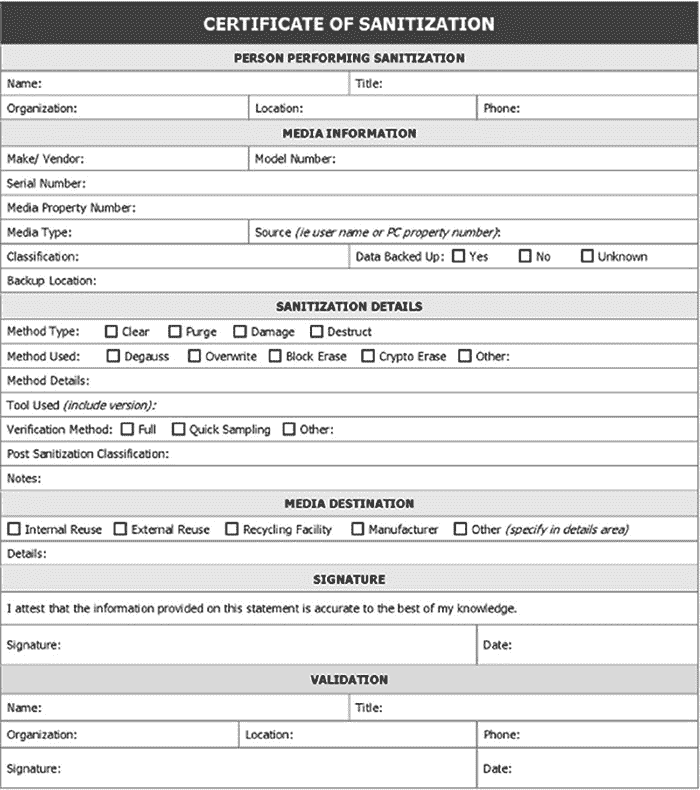

    1. 销毁
    2. 重用
    3. 数据残留
    4. 归属

68. 为什么解密很少被选作介质重用的选项？

    1. 彻底清除足以应对敏感数据。
    2. 清除是数据移除的首选方法。
    3. 其成本高于新介质且仍可能失败。
    4. 必须先进行清除。

69. 焚烧、粉碎、碎纸和解体都描述了介质生命周期中的哪个阶段？

    1. 清除
    2. 退磁
    3. 彻底清除
    4. 销毁

70. 欧盟 (EU) 通用数据保护条例 (GDPR) 不包含以下哪项关键要素？

    1. 需为特定、明确和合法的目的收集信息
    2. 需确保收集仅限于实现既定目的所必需的信息
    3. 需保护数据防止意外销毁
    4. 需对静止信息进行加密

71. 为什么组织可能会在处理不同分级数据的工作站上使用独特的屏幕背景或设计？

    1. 指示正在使用的软件版本
    2. 宣传企业信息
    3. 促进可用性
    4. 指示数据或系统的分级

72. Charles 被要求降级其组织用于存储私有数据的介质。Charles 应遵循什么流程？

    1. 对驱动器退磁，然后重新贴上较低分级的标签。
    2. 将驱动器粉碎，然后根据其包含的数据重新分级。
    3. 遵循组织的彻底清除流程，然后降级并更换标签。
    4. 重新贴标签，然后遵循组织的彻底清除流程以确保介质与标签匹配。

73. 根据 NIST SP 800-18，以下哪项任务不是由系统所有者执行的？

    1. 制定系统安全计划
    2. 制定数据适当使用和保护规则
    3. 识别并实施安全控制
    4. 确保系统用户接受适当的安全培训

74. NIST SP 800-60 提供了一个流程（如下图所示）来评估信息系统。该图显示了什么流程？

    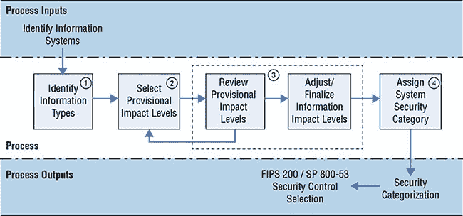

    1. 选择标准并实施
    2. 分类并选择控制
    3. 制定基线并选择控制
    4. 分类并清除

下图显示了典型工作站和服务器及其相互连接和连接互联网的情况。第 75-77 题请参考此图。

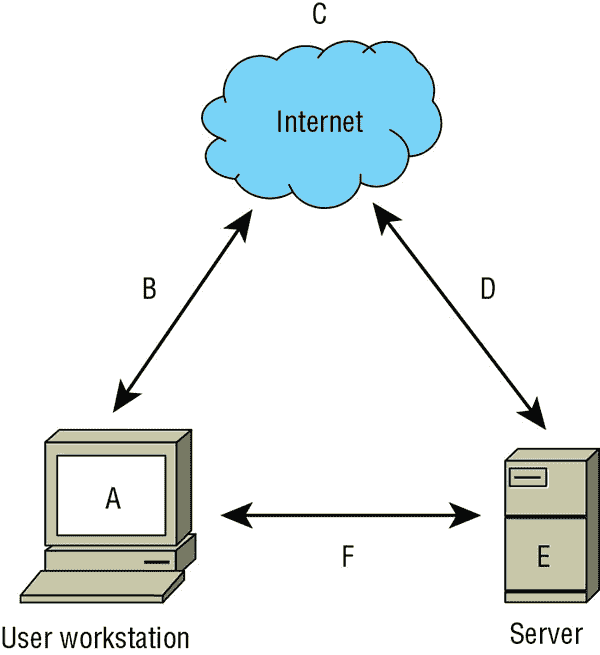

75. 图中哪些字母表示可能存在静止数据的位置？

    1. A、B 和 C
    2. C 和 E
    3. A 和 E
    4. B、D 和 F

76. 保护 B、D 和 F 点数据的最佳方式是什么？

    1. AES-256
    2. SSL
    3. TLS
    4. 3DES

77. 保护从工作站 A 经互联网服务 (C) 发送到远程服务器 E 的文件的最佳方式是什么？

    1. 在 A 点使用 AES 保护静止数据，在经过 B 和 D 传输时使用 TLS。
    2. 加密数据文件并发送。
    3. 使用 3DES 和 TLS 提供双重安全。
    4. 在 A 和 E 使用全盘加密，在 B 和 D 使用 SSL。

78. Susan 需要为电子邮件提供一组最低安全要求。她应建议组织采取哪些步骤以确保电子邮件保持安全？

    1. 所有电子邮件都应加密。
    2. 所有电子邮件都应加密并贴标签。
    3. 敏感电子邮件应加密并贴标签。
    4. 只有高度敏感的电子邮件才应加密。

79. 什么术语描述了审查基线安全控制并仅选择适合您要保护的 IT 系统的控制的过程？

    1. 标准创建
    2. CIS 基准测试
    3. 基线制定
    4. 范围界定

80. 用于处理数据的系统扮演什么数据角色？

    1. 任务所有者
    2. 数据所有者
    3. 数据处理者
    4. 保管人

81. 根据美国联邦政府法规，以下哪项不被视为 PII？

    1. 姓名
    2. 社会安全号码
    3. 学生证号
    4. 邮政编码

82. 《健康保险流通与责任法案》要求保护哪类健康信息？

    1. PII
    2. PHI
    3. SHI
    4. HPHI

83. 哪种加密算法能为存储在 USB 闪存驱动器上的数据提供强力保护？

    1. TLS
    2. SHA1
    3. AES
    4. DES

84. Lauren 的跨国公司希望确保遵守欧盟 GDPR。GDPR 的哪项原则规定个人有权接收涉及自己的个人信息并将其传输给另一数据控制者？

    1. 后续传输
    2. 数据完整性
    3. 执行
    4. 数据可移植性

85. 清除固态硬盘 (SSD) 的最佳方法是什么？

    1. 清除
    2. 零填充
    3. 解体
    4. 退磁

第 86-88 题请参考以下场景：

如下图安全生命周期图所示（大致基于 NIST 参考架构），NIST 使用五步流程进行风险管理。利用您对数据角色和实践的知识，根据 NIST 框架流程回答以下问题。

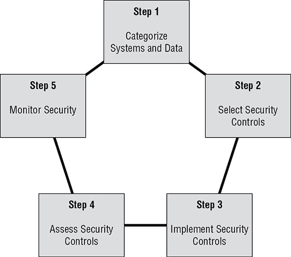


### 86. 哪个数据角色将负责步骤 1（信息系统分类）的责任；他们将把步骤 2 委托给谁；以及哪个数据角色将负责步骤 3？

1.  数据所有者，系统所有者，保管人
2.  数据处理者，保管人，用户
3.  业务所有者，管理员，保管人
4.  系统所有者，业务所有者，管理员

### 87. 如果被评估的系统都处理信用卡信息（且无其他敏感数据），PCI DSS 将在哪个步骤首次发挥重要作用？

1.  步骤 1
2.  步骤 2
3.  步骤 3
4.  步骤 4

### 88. 哪个数据安全角色主要负责步骤 5？

1.  数据所有者
2.  数据处理者
3.  保管人
4.  用户

### 89. Susan 所在组织在将硬盘发送给第三方组织进行粉碎前，会对其执行零填充。她的组织试图避免什么问题？

1.  硬盘在第三方站点时的数据残留
2.  第三方对硬盘的处理不当
3.  分类错误
4.  数据永久性

### 90. 用于帮助识别文件所有者的嵌入式数据是哪种标签的示例？

1.  版权声明
2.  DLP
3.  数字水印
4.  隐写术

### 91. 只要有需要就保留和维护信息被称为？

1.  数据存储策略
2.  数据存储
3.  资产维护
4.  记录保留

### 92. 以下哪项活动在数据分类期间**不**需要考虑？

1.  谁可以访问数据
2.  如果数据丢失或泄露会造成什么影响
3.  创建数据的成本是多少
4.  数据可能需要什么保护法规

### 93. 静态数据通常使用哪种加密类型？

1.  非对称加密
2.  对称加密
3.  DES
4.  OTP

### 94. 哪个数据角色负责授予员工适当的访问权限？

1.  数据处理者
2.  业务所有者
3.  保管人
4.  管理员

### 95. 加利福尼亚州的哪项法律要求在收集加州居民个人信息的商业网站上显著张贴隐私政策？

1.  个人信息保护和电子文档法
2.  加利福尼亚州在线隐私保护法
3.  加利福尼亚州在线网络隐私法
4.  加利福尼亚州民法典 1798.82

### 96. Fred 正准备将备份磁带发送到安全的第三方异地存储设施。在发送磁带之前，Fred 应该采取什么步骤？

1.  确保磁带的处理方式与基于其分类的原始介质处理方式相同。
2.  因为磁带离开了公司的管辖范围，所以提高磁带的分类级别。
3.  清除磁带以确保机密数据不丢失。
4.  解密磁带以防运输途中丢失。

### 97. 以下哪项**不**描述传输中的数据？

1.  正在运送到存储设施的备份磁带上的数据
2.  TCP 数据包中的数据
3.  电子商务交易中的数据
4.  正在不同位置间复制的文件中的数据

### 98. 一项新法律的通过将导致如果涵盖的数据被盗或意外泄露，将给您的公司造成重大经济损失。您的组织应该怎么做？

1.  选择一个新的安全基线。
2.  重新标记数据。
3.  加密所有静态和传输中的数据。
4.  审查其数据分类并适当地对数据进行分类。

### 99. Ed 被要求通过电子邮件发送其组织分类为机密和专有的数据。什么加密技术适合确保附件在遍历互联网时内容保持机密？

1.  SSL
2.  TLS
3.  PGP
4.  VPN

### 100. 哪个映射正确地匹配了非政府和政府分类方案之间的数据分类？

1.  绝密 – 机密/专有
    *   机密 – 私有
    *   秘密 – 敏感
2.  机密 – 商业机密
    *   分类 – 专有
    *   秘密 – 公司内部
3.  绝密 – 商业敏感
    *   机密 – 公司内部
    *   秘密 – 商业专有
4.  机密 – 专有
    *   分类 – 私有
    *   非密 – 公开

# 第 3 章：安全架构与工程（领域 3）

### 1. Matthew 是一家咨询公司的安全管理员，必须实施访问控制，根据用户之前的活动限制其访问权限。例如，一旦顾问访问了咨询客户 Acme Cola 的数据，他们就不再能访问 Acme 任何竞争对手的数据。哪种安全模型最适合 Matthew 的需求？

1.  Clark-Wilson
2.  Biba
3.  Bell-LaPadula
4.  Brewer-Nash

### 2. 参照此处所示的图表，在火灾的哪个最早阶段可以使用检测技术来识别它？

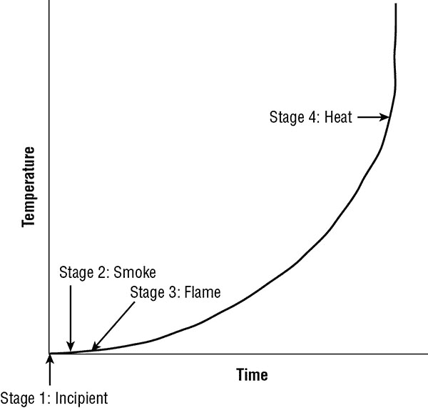

1.  初期
2.  冒烟
3.  明火
4.  发热

### 3. Ralph 正在为一个新的计算设施设计物理安全基础设施，该设施将基本处于无人值守状态。他计划在设施中实施运动探测器，但也希望包含一个用于物理存在的二次验证控制。以下哪项最能满足他的需求？

1.  CCTV
2.  IPS
3.  闸机
4.  法拉第笼

### 4. Harry 想要从一个使用 m-of-n 控制的数据库中检索丢失的加密密钥，其中 m = 4，n = 8。检索密钥所需的最少托管代理数量是多少？

1.  2
2.  4
3.  8
4.  12

### 5. Fran 的公司正在考虑从供应商处购买基于 Web 的电子邮件服务，并淘汰自己的电子邮件服务器环境作为节省成本的措施。Fran 的公司正在考虑哪种类型的云计算环境？

1.  SaaS
2.  IaaS
3.  CaaS
4.  PaaS

### 6. Bob 是联邦政府的安全管理员，希望选择一种数字签名方法，该方法是 FIPS 186-4 下联邦数字签名标准的批准部分。以下哪种加密算法**不**是用于数字签名的可接受选择？

1.  DSA
2.  HAVAL
3.  RSA
4.  ECDSA

### 7. Harry 想要访问存储在文件服务器上、由 Sally 拥有的文档。将主体/客体模型应用于此场景，资源请求的主体是谁或什么？

1.  Harry
2.  Sally
3.  服务器
4.  文档

### 8. Michael 负责取证调查，正在调查一个涉及公司网站被篡改的中等严重度安全事件。相关的 Web 服务器运行在虚拟化平台上，市场团队希望尽快恢复网站运行。Michael 最合理的下一步是什么？

1.  在调查完成前保持网站离线。
2.  将虚拟化平台作为证据离线。
3.  对受损系统进行快照并将其用于调查。
4.  忽略该事件，专注于快速恢复网站。

### 9. Helen 是一名软件工程师，正在开发代码，她希望将代码限制在隔离的沙箱中运行以确保安全。Helen 使用了什么软件开发技术？

1.  边界检查
2.  输入验证
3.  限制
4.  TCB


### 10. 什么概念描述了组织对其控制措施满足安全要求的置信程度？

1.  信任
2.  凭证管理
3.  验证
4.  保证

### 11. 当开发人员为了方便自己访问其开发的软件以进行测试时，最有可能将哪种类型的安全漏洞引入代码中？

1.  维护钩子
2.  跨站脚本
3.  SQL 注入
4.  缓冲区溢出

### 12. 在此处显示的图中，由于 Biba 完整性模型，Sally 被阻止读取该文件。Sally 拥有 Secret（机密）安全许可，而该文件具有 Confidential（秘密）分类。正在强制执行 Biba 模型的哪项原则？

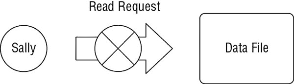

1.  简单安全属性
2.  简单完整性属性
3.  \*-安全属性
4.  \*-完整性属性

### 13. Tom 负责维护发电厂内用于控制工业过程的系统的安全。用于描述这些系统的术语是什么？

1.  POWER
2.  SCADA
3.  HAVAL
4.  COBOL

### 14. Sonia 最近因硬件故障将加密硬盘从一台笔记本电脑取出并移至新设备。尽管她知道用户的密码，但她在访问驱动器上的加密内容时遇到困难。哪项硬件安全功能可能导致了此问题？

1.  TCB
2.  TPM
3.  NIACAP
4.  RSA

### 15. Chris 想要验证他下载的软件包是否与原始版本匹配。如果他认为技术复杂的攻击者可能已将软件包替换为包含后门的版本，他应该使用什么哈希工具？

1.  MD5
2.  3DES
3.  SHA1
4.  SHA 256

### 16–19 题场景

Alice 和 Bob 希望使用非对称密码系统相互通信。他们位于该国的不同地区，但已通过使用由双方共同信任的证书颁发机构签名的数字证书交换了加密密钥。

#### 16. 如果 Alice 希望向 Bob 发送加密消息，她使用什么密钥来加密消息？

1.  Alice 的公钥
2.  Alice 的私钥
3.  Bob 的公钥
4.  Bob 的私钥

#### 17. 当 Bob 收到来自 Alice 的加密消息时，他使用什么密钥来解密消息？

1.  Alice 的公钥
2.  Alice 的私钥
3.  Bob 的公钥
4.  Bob 的私钥

#### 18. 在此场景中，Bob 不会拥有以下哪个密钥？

1.  Alice 的公钥
2.  Alice 的私钥
3.  Bob 的公钥
4.  Bob 的私钥

#### 19. Alice 还想对发送给 Bob 的消息进行数字签名。她应该使用什么密钥来创建数字签名？

1.  Alice 的公钥
2.  Alice 的私钥
3.  Bob 的公钥
4.  Bob 的私钥

#### 20. 为击败彩虹表攻击而添加到密码中的随机值叫什么名字？

1.  哈希
2.  盐值
3.  扩展器
4.  加固筋

#### 21. 以下哪项不是哈希算法的属性？

1.  它们需要加密密钥。
2.  它们是不可逆的。
3.  很难找到具有相同哈希值的两条消息。
4.  它们接受可变长度的输入。

#### 22. 当检测到火灾初期时，哪种灭火系统会注满水，然后需要喷头热激活才能喷水？

1.  湿式管道
2.  干式管道
3.  淹没式
4.  预作用

#### 23. Susan 希望配置 IPsec，以便为数据包的内容提供机密性。IPsec 的哪个组件提供此功能？

1.  AH
2.  ESP
3.  IKE
4.  ISAKMP

#### 24. 以下哪个加密目标可防范设备丢失或被盗所带来的风险？

1.  不可抵赖性
2.  认证
3.  完整性
4.  机密性

#### 25. 此处显示的真值表描述了什么逻辑运算？

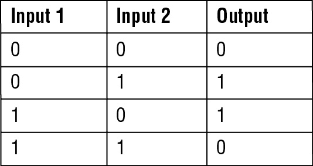

1.  OR
2.  AND
3.  XOR
4.  NOR

#### 26. 数据加密标准使用多少位密钥材料来加密信息？

1.  56 位
2.  64 位
3.  128 位
4.  256 位

#### 27. 在此处显示的图中，Harry 写入数据文件的请求被阻止。Harry 拥有 Secret（机密）安全许可，而数据文件具有 Confidential（秘密）分类。Bell-LaPadula 模型的哪项原则阻止了此请求？

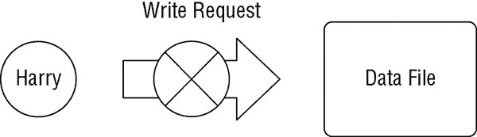

1.  简单安全属性
2.  简单完整性属性
3.  \*-安全属性
4.  自主安全属性

#### 28. Florian 和 Tobias 希望开始使用对称密码系统进行通信，但他们没有预先约定的密钥，也无法亲自会面交换密钥。他们可以使用什么算法来安全地交换密钥？

1.  IDEA
2.  Diffie-Hellman
3.  RSA
4.  MD5

#### 29. 根据通用准则，哪个元素描述了产品的安全需求？

1.  TCSEC
2.  ITSEC
3.  PP
4.  ST

#### 30. 以下哪项不是加密哈希函数的基本要求之一？

1.  该函数必须作用于固定长度的输入。
2.  该函数对于任何输入必须相对容易计算。
3.  该函数必须是单向的。
4.  该函数必须无碰撞。

#### 31. 使用包含 5 位密钥的密码，存在多少个可能的密钥？

1.  10
2.  16
3.  32
4.  64

#### 32. 什么加密原则支持“加密算法应公开供公众检查”这一观点？

1.  通过隐匿实现安全
2.  Kerckhoff 原则
3.  纵深防御
4.  海森堡原理

#### 33. 参照此处显示的图，箭头所指示的安全控制措施的名称是什么？

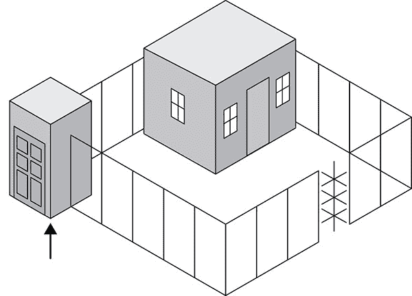

1.  人员互锁
2.  转闸
3.  入侵防御系统
4.  门户

#### 34. 以下哪项不描述布线间的标准物理安全要求？

1.  仅放置在保安监控的区域。
2.  不要在间内存放易燃物品。
3.  在门上使用传感器以记录进入情况。
4.  定期检查间内情况。

#### 35. 在此处显示的图中，Sally 因 Biba 完整性模型而被阻止写入数据文件。Sally 拥有 Secret（机密）安全许可，而该文件被分类为 Top Secret（绝密）。是什么原则阻止她写入该文件？


1.  简单安全属性
2.  简单完整性属性
3.  \*-安全属性
4.  \*-完整性属性

#### 36. 将以下每个编号的架构安全概念与相应的字母描述匹配：

##### 架构安全概念

1.  检查时间
2.  隐蔽信道
3.  使用时间
4.  维护钩子
5.  参数检查
6.  竞争条件

##### 描述

1.  一种通过通常不用于通信的路径传递信息的方法
2.  利用检查时间和使用时间之间的差异
3.  主体检查对象是否可用的时间
4.  主体可以访问对象的时间
5.  仅系统开发人员知道的访问方法
6.  一种有助于防止缓冲区溢出攻击的方法


#### 37. 实现公平密码系统密钥托管方法所需的独立参与方的最小数量是多少？

1.  1
2.  2
3.  3
4.  4

#### 38. 当进程已准备好执行但 CPU 当前不可用时，处理器的调度程序将该进程置于何种状态？

1.  就绪
2.  运行
3.  等待
4.  停止

#### 39. Alan 正在审查一个根据通用准则被分配了 EAL1 评估保证级别的系统。他可以对该系统抱有何种程度的保证？

1.  它已经过功能测试。
2.  它已经过结构测试。
3.  它已经过正式验证、设计和测试。
4.  它已经过系统化设计、测试和审查。

#### 40. 在强制访问控制系统中，以下哪个组件用于给对象分配分类？

1.  安全标签
2.  安全令牌
3.  安全描述符
4.  安全能力

#### 41. 哪种类型的软件程序将代码暴露给任何希望检查它的人？

1.  闭源
2.  开源
3.  固定源
4.  无限制源

#### 42. Adam 最近在 NTFS 文件系统上配置了权限，通过单独列出每个用户来描述不同用户可能对文件拥有的访问权限。Adam 创建了什么？

1.  访问控制列表
2.  访问控制条目
3.  基于角色的访问控制
4.  强制访问控制

#### 43. Betty 担心针对其组织内部开发的定制应用程序发起缓冲区溢出攻击。哪种安全控制能为抵御此类攻击提供最强有力的防御？

1.  防火墙
2.  入侵检测系统
3.  参数检查
4.  漏洞扫描

#### 44. 以下哪个术语**不**用于描述系统的特权操作模式？

1.  用户模式
2.  内核模式
3.  监管模式
4.  系统模式

#### 45. James 正在使用一个国防部系统，该系统被授权同时处理机密级和绝密级信息。他使用的是哪种类型的系统？

1.  单状态
2.  非密
3.  分隔
4.  多状态

#### 46. Kyle 获得了对一个使用 System High 模式（系统高模式）的军用计算机系统的访问权限。关于 Kyle 的安全许可要求，以下哪项描述是**不正确**的？

1.  无论其访问权限如何，Kyle 必须拥有该系统所处理的最高密级的许可。
2.  Kyle 必须获得对系统处理的所有信息的访问批准。
3.  Kyle 必须对系统处理的所有信息都有有效的知悉必要性。
4.  Kyle 必须拥有有效的安全许可。

#### 47. Gary 截获了两人之间的通信，怀疑他们在交换秘密消息。通信内容似乎是此处显示的图像。这些人可能使用什么技术将消息隐藏在该图像内部？


1.  视觉密码学
2.  隐写术
3.  密码散列
4.  传输层安全

#### 48. 以下哪个术语准确描述了凯撒密码？

1.  置换密码
2.  分组密码
3.  移位密码
4.  强密码

#### 49. 在此处所示的环形保护模型中，操作系统内核位于哪个环？

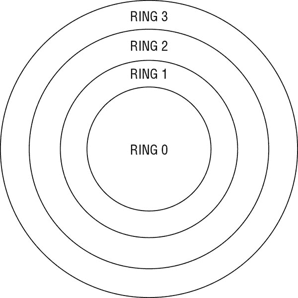

1.  0 环
2.  1 环
3.  2 环
4.  3 环

#### 50. 在基础设施即服务（IaaS）环境中，供应商为客户提供存储服务访问权限，当磁盘驱动器退役时，通常由谁负责从中移除敏感数据？

1.  客户的安全团队
2.  客户的存储团队
3.  客户的供应商管理团队
4.  供应商

#### 51. 以下哪项是代码的示例，而非密码？

1.  数据加密标准
2.  “一盏灯陆路，两盏灯海路”
3.  字母移位三位
4.  单词乱序

#### 52. 以下哪个系统保证过程提供对系统控制的独立第三方评估，该评估可被许多不同组织信任？

1.  认证
2.  定义
3.  验证
4.  认可

#### 53. 进程 ________ 确保任何行为仅影响与该进程关联的内存和资源。

1.  限制
2.  隔离
3.  约束
4.  参数

#### 54. Harold 正在评估其环境对硬件故障的敏感性，并希望确定一件硬件的预期寿命。他应使用什么指标？

1.  MTTR
2.  MTTF
3.  RTO
4.  MTO

#### 55. 哪种类型的灭火器仅适用于普通可燃物？

1.  A 类
2.  B 类
3.  C 类
4.  D 类

#### 56. Gary 担心如何在其组织全范围内使用的众多移动设备上应用一致的安全设置。哪种技术最能协助应对这一挑战？

1.  MDM
2.  IPS
3.  IDS
4.  SIEM

#### 57. Alice 发送了一条消息给 Bob。Bob 希望向 Charlie 证明他收到的消息确实来自 Alice。Bob 试图实现密码学的哪个目标？

1.  认证
2.  机密性
3.  不可抵赖性
4.  完整性

#### 58. Rhonda 正在考虑在其组织中使用新的识别卡进行物理访问控制。她发现一个军用系统使用此处所示的卡片。这是什么类型的卡片？

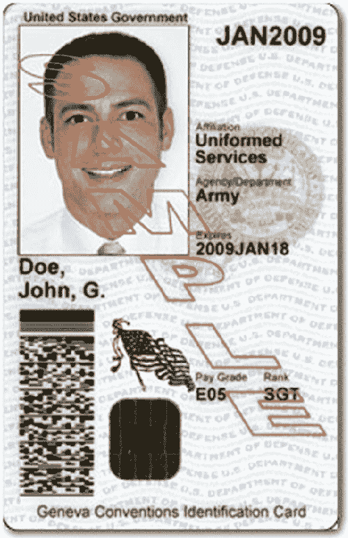

1.  智能卡
2.  邻近卡
3.  磁条卡
4.  第三阶段卡

#### 59. Gordon 担心黑客可能利用 Van Eck 辐射现象远程读取其设施内计算机显示器的内容。哪种技术可防范此类攻击？

1.  TCSEC
2.  SCSI
3.  GHOST
4.  TEMPEST

#### 60. 在此处所示的计算机系统安全边界图中，被 XXX 替换名称的组件是什么？

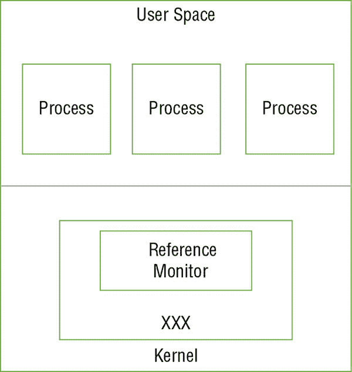

1.  内核
2.  TCB
3.  安全边界
4.  用户执行

#### 61. Sherry 对其组织内使用的加密技术进行了清查，发现正在使用以下算法和协议。她应该替换掉哪项技术，因为它不再被认为是安全的？

1.  MD5
2.  3DES
3.  PGP
4.  WPA2

#### 62. 在重复使用 SSD 设备之前，可以采取什么措施来防止因磨损均衡导致的意外数据泄露？

1.  重新格式化
2.  磁盘加密
3.  退磁
4.  物理销毁

#### 63. Tom 是一名密码分析师，正在致力于破解某加密算法的密钥。他拥有一份截获的加密消息副本，也拥有该消息解密后的明文副本。他想利用加密消息及其解密后的明文来获取密钥，以便解密其他消息。Tom 正在进行哪种类型的攻击？

1.  选择密文攻击
2.  选择明文攻击
3.  已知明文攻击
4.  暴力破解

#### 64. 一名黑客最近通过使用精确的时序攻击修改文件，破坏了 James 公司数据的完整性。攻击者等待 James 使用哈希值验证文件内容的完整性，然后在 James 验证完完整性和读取文件内容之间的时间窗口内修改了文件。发生了哪种类型的攻击？

1.  社会工程学
2.  TOCTOU


##### 3. 数据篡改

##### 4. 参数检查

#### 65. 什么标准管辖用于公钥基础设施的数字证书的创建和验证？

1.  **X.509**
2.  TLS
3.  SSL
4.  802.1x

#### 66. 使围栏难以轻易攀爬、从而阻止大多数入侵者的最小围栏高度是多少？

1.  3 英尺
2.  4 英尺
3.  5 英尺
4.  6 英尺

#### 67. Johnson Widgets 公司严格限制对总销量信息的访问，将其归类为商业机密。然而，发货文员拥有对订单记录的无限制访问权限，以便完成交易。最近一名发货文员提取了一个季度的所有单独销售记录并将它们加总，以确定总销量。发生了哪种类型的攻击？

1.  社会工程学
2.  推理
3.  **聚合**
4.  数据篡改

#### 68. 哪种物理安全控制通过持续广播虚假辐射来掩盖计算设备真实电磁辐射的存在？

1.  法拉第笼
2.  掺铜窗户
3.  屏蔽电缆
4.  **白噪音**

#### 69. 在软件即服务云计算环境中，通常由谁负责确保采取适当的防火墙控制来保护应用程序？

1.  客户的安全团队
2.  **供应商**
3.  客户的网络团队
4.  客户的基础设施管理团队

#### 70. Alice 拥有对象的读权限，她希望 Bob 拥有相同的权限。Take-Grant 保护模型中的哪条规则允许她完成此操作？

1.  创建规则
2.  移除规则
3.  **授予规则**
4.  夺取规则

#### 71. 作为事件响应过程的一部分，Charles 安全擦除了受损机器的驱动器，并从原始介质重新安装了操作系统 (OS)。完成后，他为机器全面打补丁，并应用了他组织的安全模板，然后将系统重新连接到网络。系统恢复服务后几乎立即，他发现它已重新连接到之前所属的同一个僵尸网络。Charles 应该在哪里寻找导致此行为的恶意软件？

1.  操作系统分区
2.  **系统 BIOS 或固件**
3.  系统内存
4.  安装介质

#### 72. 以下哪种计算模型允许在单个进程内执行多个并发任务？

1.  多任务处理
2.  多处理
3.  多道程序设计
4.  **多线程**

#### 73. Alan 截获了一条加密消息，想要确定创建该消息所用的算法类型。他首先执行频率分析，并注意到消息中字母的频率与英语语言中字母的分布非常接近。创建此消息最可能使用了哪种密码？

1.  替换密码
2.  AES
3.  **置换密码**
4.  3DES

#### 74. Double DES (2DES) 加密算法从未作为原始 DES 算法的可行替代方案被使用。2DES 易受哪种攻击，而该攻击在 DES 或 3DES 方法中不存在？

1.  选择密文攻击
2.  暴力破解
3.  中间人攻击
4.  **中途相遇攻击**

#### 75. Grace 希望在其组织中实施应用程序控制技术。用户经常需要为研究和测试目的安装新应用程序，她不想干扰该过程。同时，她希望阻止已知恶意软件的使用。哪种类型的应用程序控制适合这种情况？

1.  **黑名单**
2.  灰名单
3.  白名单
4.  蓝名单

#### 76. Warren 正在为其数据中心设计物理入侵检测系统，并希望包含一种技术，如果报警系统的通信线路被意外切断，该技术会发出警报。哪种技术满足此要求？

1.  **心跳传感器**
2.  辐射安全
3.  运动探测器
4.  法拉第笼

#### 77. John 和 Gary 正在谈判一笔商业交易，John 必须向 Gary 证明他有权访问某个系统。他参与了此处所示的“魔门”场景的电子版本。John 使用了什么技术？

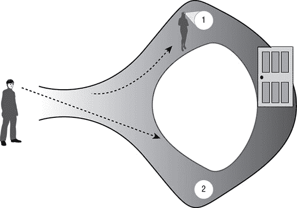

1.  分散知识证明
2.  **零知识证明**
3.  逻辑证明
4.  数学证明

#### 78. Raj 正在为其组织选择加密算法，希望能根据信息的敏感度调整加密强度。以下哪种算法允许使用不同的密钥强度？

1.  **Blowfish**
2.  DES
3.  Skipjack
4.  IDEA

#### 79. 参照此处所示的火灾三角形，以下哪种灭火材料通过移除燃料源来扑灭火灾？

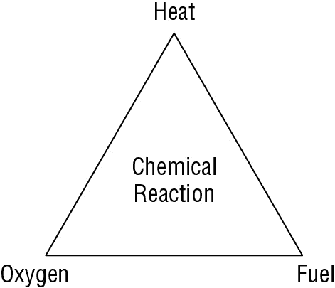

1.  水
2.  酸碱灭火剂
3.  二氧化碳
4.  **卤代烷**

#### 80. Howard 正在为其组织选择加密算法，希望选择一种支持创建数字签名的算法。以下哪种算法满足他的要求？

1.  **RSA**
2.  DES
3.  AES
4.  Blowfish

#### 81. Laura 负责保护公司基于 Web 的应用程序，并希望为开发人员开展关于常见 Web 应用程序安全漏洞的教育计划。她可以去哪里获取最常见 Web 应用程序问题的简明清单？

1.  CVE
2.  NSA
3.  **OWASP**
4.  CSA

#### 82. Bell-LaPadula 和 Biba 模型以使用什么特定状态机模型的方式实现状态机？

1.  **信息流**
2.  非干扰
3.  级联
4.  反馈

#### 83. 进程的 \_\_\_\_\_\_\_\_\_\_\_ 包含对该进程可访问的内存地址和资源设置的限制。

1.  外围
2.  限制范围
3.  边界标志
4.  **边界**

#### 84. 哪种运动探测器能感知受监控区域内电磁场的变化？

1.  红外线
2.  **波模式**
3.  电容
4.  光电

#### 85. 以下哪种灭火系统使用的灭火剂因环境担忧而不再生产？

1.  FM-200
2.  氩气
3.  Inergen
4.  **卤代烷**

#### 86. 关于 Biba 访问控制模型，以下哪项陈述是正确的？

1.  它解决机密性和完整性。
2.  它解决完整性和可用性。
3.  它防止隐蔽通道攻击。
4.  **它专注于保护客体免受完整性威胁。**

#### 87. 在传输层安全中，什么类型的密钥用于加密 Web 服务器和客户端之间通信的实际内容？

1.  **临时会话密钥**
2.  客户端的公钥
3.  服务器的公钥
4.  服务器的私钥

#### 88. Beth 希望在其数据中心的安全区域包含技术，以防止不必要的电磁辐射。什么技术能帮助她实现这一目标？

1.  心跳传感器
2.  **法拉第笼**
3.  尾随
4.  WPA2

#### 89. 在虚拟化计算环境中，什么组件负责强制执行客户机之间的隔离？

1.  客户操作系统
2.  **Hypervisor**
3.  内核
4.  保护管理器

#### 90. Rick 是一名主要使用 Python 的应用程序开发人员。他最近决定评估一项新服务，即他将 Python 代码提供给供应商，由供应商在其服务器环境中执行。这是什么类型的云计算环境？


## 云服务模型

1.  SaaS
2.  PaaS
3.  IaaS
4.  CaaS

# 练习题

### 91. 组合理论
一家软件公司开发了两个共享信息的系统。系统 A 向系统 B 的输入提供信息，系统 B 随后通过向系统 A 的输入提供信息进行回馈。哪种组合理论最能描述这种做法？

1.  级联
2.  **反馈**
3.  连接
4.  基础

### 92. UPS 电源保护
Tommy 计划在其数据中心的一个服务器机架上实施电源调节 UPS。如果以下哪种情况持续较长时间，UPS 将无法提供保护？

1.  故障
2.  **停电**
3.  电压跌落
4.  噪声

### 93. 数据中心湿度范围
以下哪个湿度值处于数据中心运行的可接受范围内？

1.  0%
2.  10%
3.  25%
4.  **40%**

### 94. 非对称加密密钥数量
Chris 正在为公司内部使用设计一个加密系统。公司有 1,000 名员工，他们计划使用非对称加密系统。总共需要多少个密钥？

1.  500
2.  **1,000**
3.  2,000
4.  4,950

### 95. 认证与授权术语
指定批准机构 (DAA) 正式声明某信息技术 (IT) 系统获批在特定环境中运行，该术语是什么？

1.  认证
2.  **授权**
3.  评估
4.  批准

### 96. 面向对象编程概念
面向对象编程语言采用黑盒开发方法，对象的使用者不一定需要知道对象的实现细节。描述这一概念的术语是什么？

1.  分层
2.  **抽象**
3.  数据隐藏
4.  进程隔离

### 97. 证书吊销列表 (CRL) 元素
Todd 想要将证书添加到证书吊销列表中。证书的哪个元素会被列入该列表？

1.  **序列号**
2.  公钥
3.  数字签名
4.  私钥

### 98. 数字证书信任要求
Alison 正在检查其银行网站向她呈现的数字证书。以下哪项要求对于她信任该数字证书**不是**必需的？

1.  **她知道该服务器属于该银行。**
2.  她信任证书颁发机构。
3.  她验证该证书未列在 CRL 上。
4.  她验证证书上的数字签名。

### 99. 隐蔽定时通道
当用于从组织中窃取信息时，以下哪项是隐蔽定时通道的示例？

1.  发送电子邮件
2.  在 P2P 文件共享服务上发布文件
3.  **以摩斯密码的节奏打字**
4.  向共享内存空间写入数据

### 100. 自签名证书适用场景
以下哪项是使用自签名数字证书的合理应用场景？

1.  电子商务网站
2.  银行应用
3.  **内部日程安排应用**
4.  客户门户

### 101. Mirai 恶意软件防护目标
Mike 的任务是防止类似 Mirai 的恶意软件爆发。他组织中的哪类系统应受到保护？

1.  服务器
2.  SCADA
3.  移动设备
4.  **物联网设备**

### 102. 数据中心 HVAC 冗余
Kim 管理的数据中心因主 HVAC 系统的组件故障导致高温报警。在解决问题后，Kim 应考虑什么以防止未来出现类似问题？

1.  闭环冷水机组
2.  **冗余冷却系统**
3.  蒸发式冷却器
4.  将数据中心迁移到气候更寒冷的地区

### 103. 取证保管链
作为团队取证调查流程的一部分，Matt 在处理证据前，会签署文件将硬盘和其他证据从存储中领出。他正在创建哪种类型的文档？

1.  刑事
2.  **保管链**
3.  民事
4.  CYA（自我保护）

### 104. ASLR 技术原理
Lauren 实施 ASLR 以帮助防止系统妥协。她使用了什么技术来保护系统？

1.  加密
2.  强制访问控制
3.  **内存地址随机化**
4.  自主访问控制

### 105. 私钥泄露应对
在系统审计期间，Casey 发现其组织 Web 服务器的私钥已在公共 Amazon S3 存储桶中存放了一年多。她应该怎么做？

1.  从存储桶中移除密钥
2.  通知所有客户其数据可能已泄露
3.  **使用新密钥请求新证书**
4.  什么都不做，因为私钥应可访问以供验证

### 106. 楼宇控制系统类型
Joanna 想要查看其组织用于楼宇控制的工业控制系统的状态。她应该询问访问哪类系统？

1.  SCADA
2.  DSS
3.  **BAS**
4.  ICS-CSS

### 107. 过时 iOS 设备处理建议
扫描无线网络上的所有系统后，Mike 发现一台系统被识别为运行着大规模过时版本 Apple 移动操作系统的 iOS 设备。深入调查后，他发现该设备是一台初代 iPad，无法更新到当前安全版本的操作系统。Mike 应建议怎么做？

1.  **报废或更换设备**
2.  将设备隔离在专用无线网络上
3.  在平板电脑上安装防火墙
4.  重装操作系统

### 108. 嵌入式系统漏洞无补丁应对
在第三方漏洞扫描和安全测试中，Danielle 的雇主最近发现，安装用于管理公司新大楼的嵌入式系统存在严重的远程访问漏洞。制造商已倒闭，设备没有补丁或更新。Danielle 应建议雇主对这些数百台易受攻击的设备采取什么措施？

1.  确定替代设备型号并更换每台设备
2.  关闭所有设备
3.  **将设备移至安全的网络段**
4.  逆向工程设备并构建内部补丁

### 109. PDF 文件分发访问控制
Alex 的雇主创建的大部分工作成果为 PDF 文件。Alex 担心将 PDF 文件的受众限制为已付费的个人。他可以使用什么技术最有效地控制这些文件的访问和分发？

1.  EDM
2.  加密
3.  数字签名
4.  **DRM**

### 110. 安全模型匹配题
将以下编号的安全模型与相应的字母安全描述进行匹配：

**安全模型**

1.  Clark-Wilson
2.  Graham-Denning
3.  Bell-LaPadula
4.  Sutherland
5.  Biba

**描述**

1.  该模型阻止低分类对象访问高分类对象，从而确保机密性。
2.  该模型的 \* 性质可总结为“禁止上写”。
3.  该模型使用安全标签，通过转换过程和受限接口模型授予对对象的访问权限。
4.  该模型专注于使用八条主要保护规则或动作，安全地创建和删除主体和对象。
5.  该完整性模型专注于防止干扰以支持完整性。

---

# 第 4 章  
通信与网络安全（领域 4）

### 1. Frame Relay 与 X.25 的区别
什么重要因素将 Frame Relay 与 X.25 区分开来？

1.  **Frame Relay 支持在单个 WAN 运营商连接上建立多个 PVC。**
2.  Frame Relay 是一种单元交换技术，而 X.25 是一种分组交换技术。
3.  Frame Relay 不提供承诺信息速率 (CIR)。
4.  Frame Relay 仅要求在提供商侧部署 DTE。

### 2. LEAP 协议安全建议
在对无线网络进行安全评估期间，Jim 发现正在使用 WPA 的网络上启用了 LEAP。Jim 应提出什么建议？

1.  继续使用 LEAP。它为 WPA 网络提供比 TKIP 更好的安全性。
2.  **使用 PEAP 或 EAP-TLS 等替代协议，并在支持的情况下实施 WPA2。**


### 3. 继续使用 LEAP 以避免认证问题，但迁移到 WPA2。

### 4. 使用备选协议，如 PEAP 或 EAP-TLS，并实施有线等效隐私以避免无线安全问题。

### 3. Ben 使用 802.11g 连接将笔记本电脑连接到了平板电脑。他使用了哪种无线网络模式来连接这些设备？

1.  基础设施模式
2.  有线扩展模式
3.  临时模式
4.  独立模式

### 4. Lauren 和 Nick 的电脑通过同时发送流量进行传输。什么网络术语描述了网络上可能受此同一问题影响的系统范围？

1.  子网
2.  超网
3.  冲突域
4.  广播域

### 5. Sarah 正在手动审查 TCP 流量的数据包捕获，发现某系统在短时间内反复发送的 TCP 数据包中设置了 RST 标志。TCP 数据包头中的此标志是什么意思？

1.  RST 标志意为“Rest（休止）”。服务器需要流量短暂暂停。
2.  RST 标志意为“Relay-set（中继设置）”。数据包将被转发至数据包中设置的地址。
3.  RST 标志意为“Resume Standard（恢复标准）”。通信将按正常格式恢复。
4.  RST 意为“Reset（复位）”。TCP 会话将被断开。

### 6. Gary 正在部署无线网络，希望部署速度最快的无线技术。受技术限制，他只能使用 2.4 GHz 选项。他应使用以下哪种无线网络标准？

1.  802.11a
2.  802.11g
3.  802.11n
4.  802.11ac

### 7. 将列出的每个编号 TCP 端口与所提供的字母标识协议进行匹配：

**TCP 端口**

1.  23
2.  25
3.  143
4.  515

**协议**

1.  SMTP
2.  LPD
3.  IMAP
4.  Telnet

### 8. Chris 正在配置 IDS 以监控未加密的 FTP 流量。Chris 应在其配置中使用哪些端口？

1.  TCP 20 和 21
2.  仅 TCP 21
3.  UDP 端口 69
4.  TCP 端口 21 和 UDP 端口 21

### 9. FHSS、DSSS 和 OFDM 都使用何种无线通信方法，该方法可在多个频率上同时发生？

1.  WiFi
2.  扩频
3.  复用
4.  正交调制

### 10. Brian 正在为 PPP 连接选择认证协议。他希望选择一种能加密用户名和密码、并通过质询/响应对话防止重放攻击的选项。他还希望定期重新认证远程系统。他应使用哪种协议？

1.  PAP
2.  CHAP
3.  EAP
4.  LEAP

### 11. 以下哪种协议常用于为 VPN 提供后端认证服务？

1.  HTTPS
2.  RADIUS
3.  ESP
4.  AH

### 12. 下图显示了什么网络拓扑？

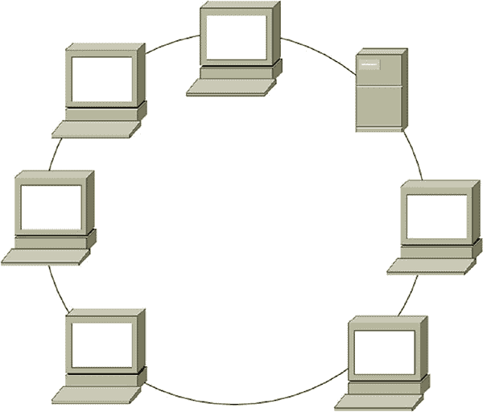

1.  环形
2.  总线型
3.  星型
4.  网状

Chris 正在为其组织设计分层网络安全。使用下图回答第 13 至 15 题。

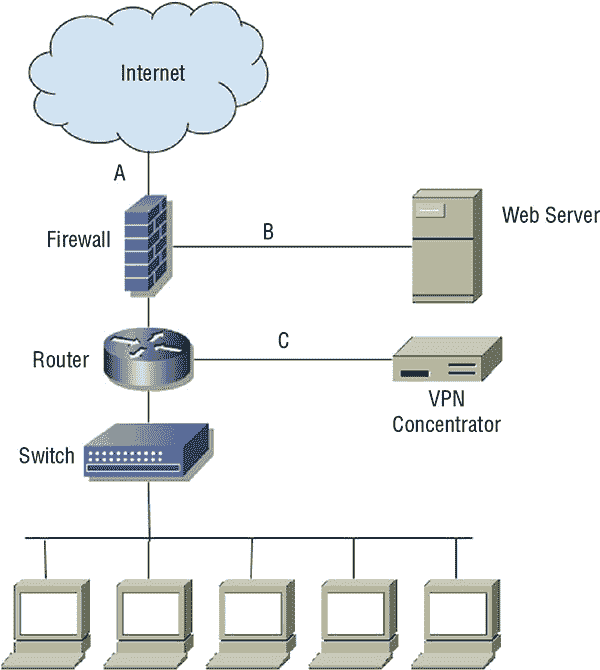

### 13. 图中显示的是哪种防火墙设计？

1.  单层防火墙
2.  双层防火墙
3.  三层防火墙
4.  四层防火墙

### 14. 如果 VPN 授予远程用户与本地工作站相同的网络和系统资源访问权限，Chris 应提出什么安全问题？

1.  VPN 用户将无法访问 Web 服务器。
2.  不存在额外的安全问题；VPN 集中器的逻辑网络位置与工作站的逻辑网络位置相匹配。
3.  Web 服务器流量未经过状态检测。
4.  VPN 用户应仅从受管电脑连接。

### 15. 如果 Chris 想阻止针对 Web 服务器的跨站脚本攻击，最适合此目的的设备是什么，应将其放在何处？

1.  防火墙，位置 A
2.  IDS，位置 A
3.  IPS，位置 B
4.  WAF，位置 C

### 16. Susan 正在部署一种路由协议，该协议维护一个目标网络列表，其度量值包括到达它们的跳数距离以及流量应发送的方向。她使用的是哪类协议？

1.  链路状态协议
2.  链路距离协议
3.  目标度量协议
4.  距离矢量协议

### 17. Ben 将其网络配置为不广播 SSID。Ben 为何要禁用 SSID 广播，且其 SSID 如何被发现？

1.  禁用 SSID 广播可防止攻击者发现加密密钥。可从解密的数据包中恢复 SSID。
2.  禁用 SSID 广播可向未授权人员隐藏网络。可使用无线嗅探器发现 SSID。
3.  禁用 SSID 广播可防止信标帧问题。可通过重建 BSSID 恢复 SSID。
4.  禁用 SSID 广播有助于避免 SSID 冲突。可通过尝试连接网络来发现 SSID。

### 18. 什么网络工具可用于在提供互联网访问的同时保护客户端身份？该工具通过接受客户端请求、更改请求的源地址、将请求映射到客户端，并发送修改后的请求至目的地来实现此功能。

1.  网关
2.  代理
3.  路由器
4.  防火墙

### 19. 在故障排查期间，Chris 使用 nslookup 命令检查其尝试连接的主机的 IP 地址。响应中显示的 IP 并非查询时应解析出的 IP。很可能发生了哪种攻击？

1.  DNS 欺骗
2.  DNS 投毒
3.  ARP 欺骗
4.  Cain 攻击

### 20. 一种将桌面电脑上显示的内容复制到远程计算机的远程访问工具，属于哪种技术？

1.  远程节点操作
2.  屏幕抓取
3.  远程控制
4.  RDP

### 21. 哪种电子邮件安全解决方案提供两种主要用法模式：(1) 签名消息，提供完整性、发件人认证和不可抵赖性；(2) 加密信封消息模式，提供完整性、发件人认证和机密性？

1.  S/MIME
2.  MOSS
3.  PEM
4.  DKIM

### 22. 在安全评估期间，Jim 发现其合作组织使用多层协议处理 SCADA 系统，且最近将 SCADA 网络连接到了该组织其余的生产网络。关于通过 TCP/IP 传输的串行数据传输，他应提出什么担忧？

1.  现在连接到网络的 SCADA 设备可通过网络遭受攻击。
2.  TCP/IP 上的串行数据无法加密。
3.  串行数据无法封装在 TCP 数据包中。
4.  TCP/IP 的吞吐量可轻易对串行设备发起拒绝服务攻击。

### 23. WEP 使用哪种密钥加密无线通信？

1.  非对称密钥
2.  每台主机唯一的密钥集
3.  预定义的共享静态密钥
4.  每台主机唯一的非对称密钥

### 24. Arnold 收到最终用户报告，称其互联网连接极慢。他检查防火墙，发现每秒有数千个意外的入站连接从世界各地涌入。最可能发生的是哪种攻击？

1.  蠕虫
2.  拒绝服务攻击
3.  病毒
4.  Smurf 攻击

### 25. 802.11n 使用的速度和频率范围是什么？

1.  54 Mbps，5 GHz
2.  200+ Mbps，5 GHz
3.  200+ Mbps，2.4 和 5 GHz
4.  1 Gbps，5 GHz

### 26. 地址解析协议 (ARP) 和反向地址解析协议 (RARP) 在 OSI 模型的哪一层运行？


## 网络安全与协议练习题

### 基础网络层级

1. 第 1 层
2. 第 2 层
3. 第 3 层
4. 第 4 层

### 综合题目

#### 27. 以下哪项是允许通过 TCP 进行存储挂载的融合协议，且常作为光纤通道的低成本替代方案？

1. MPLS
2. SDN
3. VoIP
4. **iSCSI**

#### 28. Chris 正在构建一个以太网网络，他知道需要用 `1000BaseT` 网络跨越 150 米以上的距离。他应该使用什么网络技术来解决这个问题？

1. 在 100 米前安装中继器或汇聚器。
2. 使用 7 类线缆，其具有更好的屏蔽以支持更高速度。
3. 安装网关来处理距离问题。
4. 使用 STP 线缆以在高速下处理更长距离。

Lauren 的组织已使用一种流行的即时通讯服务多年。最近，关于即时通讯的使用引发了担忧。使用下图回答第 29 至 31 题。

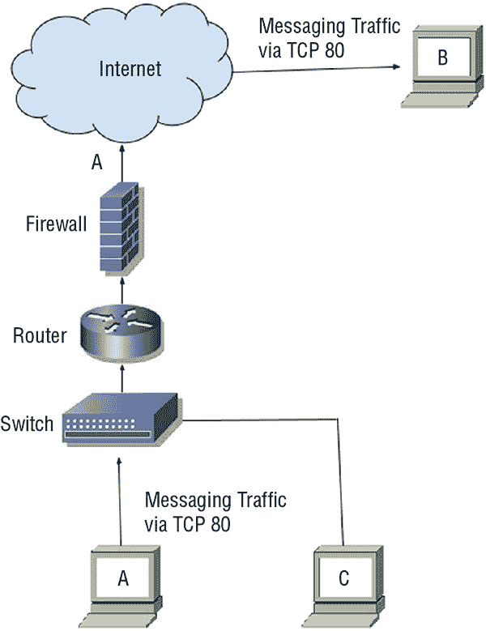

#### 29. 根据图表，即时通讯流量最可能使用什么协议？

1. SLACK
2. HTTP
3. SMTP
4. **HTTPS**

#### 30. 从 A 发送内部通讯到 B 引发了什么安全担忧？

1. 防火墙不保护系统 B。
2. 系统 C 可以看到从系统 A 到 B 的广播流量。
3. 它正通过未加密协议传输。
4. 即时通讯不提供不可抵赖性。

#### 31. Lauren 公司如何最好地解决内部系统 A 和 C 用户对安全即时通讯的需求？

1. 使用第三方即时通讯服务。
2. **实施并使用本地托管服务。**
3. 使用 HTTPS。
4. 停用即时通讯改用电子邮件，因为电子邮件更安全。

#### 32. 允许多层协议时，以下哪项缺陷是一个关注点？

1. 更高层可能使用一系列协议。
2. **允许隐蔽信道。**
3. 过滤器无法被绕过。
4. 加密无法在多层中融合。

#### 33. 下图显示的是什么网络拓扑？

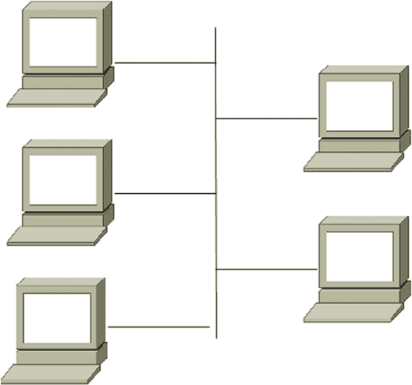

1. 环形
2. 星型
3. 总线型
4. 网状

#### 34. Chris 使用蜂窝热点（调制解调器）在出差时提供互联网接入。如果他在 PC 连接到其组织的企业网络时，让热点保持与 PC 连接，可能会导致什么安全问题？

1. 流量可能路由不当，暴露敏感数据。
2. **他的系统可能充当从互联网到本地网络的桥接。**
3. 他的系统可能成为反射 DDoS 攻击的入口。
4. 如果发生安全问题，安全管理员可能无法确定他的 IP 地址。

#### 35. 作为信息安全专业人员，Susan 被要求识别组织无线网络可能被访问但本不应被访问的区域。Susan 应该怎么做来确定组织无线网络可访问的位置？

1. 现场勘测
2. **Warwalking（无线踩点）**
3. Wardriving（无线寻踪）
4. 设计图

#### 36. DARPA TCP/IP 模型的应用层对应 OSI 模型的哪三层？

1. 应用层、表示层和传输层。
2. 表示层、会话层和传输层。
3. **应用层、表示层和会话层。**
4. 没有直接匹配。TCP 模型创建于 OSI 模型之前。

#### 37. Susan 在渗透测试中的一次攻击涉及将虚假 ARP 数据插入系统的 ARP 缓存。当系统尝试发送流量到它认为属于合法系统的地址时，流量会被发送到她控制的系统。这种攻击叫什么？

1. RARP 泛洪
2. **ARP 缓存投毒**
3. ARP 拒绝攻击
4. ARP 缓冲区爆破

#### 38. Sue 将她的 MAC 地址修改为一个在使用 MAC 过滤提供安全性的网络上被允许的地址。Sue 使用了什么技术，她的行为可能导致什么非安全问题？

1. 广播域利用，地址冲突
2. 欺骗，令牌丢失
3. **欺骗，地址冲突**
4. 虚假 EUI 创建，令牌丢失

#### 39. Jim 对大型组织传统 PBX 的审计显示，直接内部系统接入（DISA）被第三方滥用。什么问题最可能导致此问题？

1. PBX 未完全打补丁。
2. 拨入调制解调器线路使用未发布的号码。
3. DISA 设置为仅允许本地呼叫。
4. **一个或多个用户的接入代码已泄露。**

#### 40. SMTP、HTTP 和 SNMP 都发生在 OSI 模型的哪一层？

1. 第 4 层
2. 第 5 层
3. 第 6 层
4. **第 7 层**

#### 41. Lauren 使用 `ping` 实用程序检查远程系统是否在线，作为渗透测试练习的一部分。如果她不想在数据包嗅探器日志中看到自己的 `ping` 数据包，她应该过滤掉什么协议？

1. UDP
2. TCP
3. IP
4. **ICMP**

#### 42. Lauren 想在网络上提供基于端口的认证，以确保客户端在使用网络前必须认证。什么技术是满足此需求的合适解决方案？

1. 802.11a
2. 802.3
3. 802.15.1
4. **802.1x**

#### 43. Ben 部署了一个 `1000BaseT` 1 Gbps 网络，需要布线到另一栋楼。如果 Ben 直接从一台交换机连线到那栋楼的另一台交换机，根据 `1000BaseT` 规范，Ben 最多能覆盖多远的距离？

1. 2 千米
2. 500 米
3. 185 米
4. **100 米**

#### 44. Jim 正在为一个只有 ISDN 作为连接选项的远程站点构建网络。他应该寻找哪种类型的 ISDN 以获得最大可能速度？

1. BRI
2. BPRI
3. **PRI**
4. D 信道

#### 45. SPIT 攻击针对什么技术？

1. 虚拟化平台
2. Web 服务
3. **VoIP 系统**
4. 安全流程内部传输

#### 46. 蓝牙窃取攻击针对什么？

1. IBM 系统上的数据
2. 通过蓝牙的外拨电话
3. 802.11b 网络
4. **支持蓝牙设备上的数据**

#### 47. 以下哪个选项包含存在于 OSI 模型第 6 层的标准或协议？

1. NFS、SQL 和 RPC
2. TCP、UDP 和 TLS
3. **JPEG、ASCII 和 MIDI**
4. HTTP、FTP 和 SMTP

#### 48. 此处显示的是什么网络拓扑？

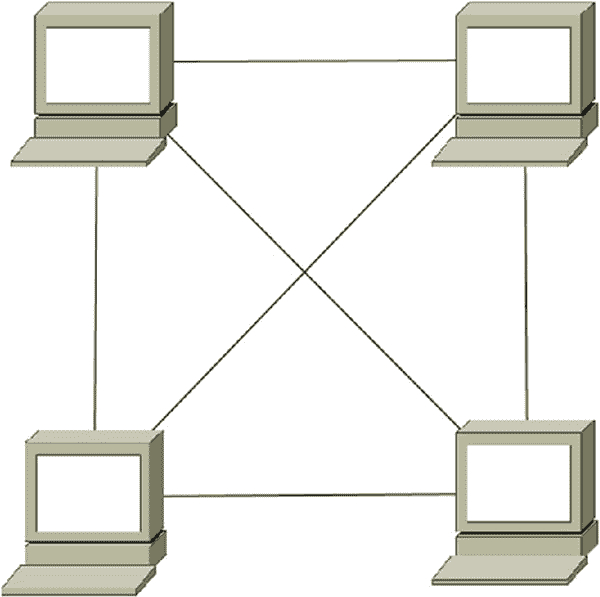

1. 环形
2. 总线型
3. 星型
4. 网状

#### 49. 有四种常见的 VPN 协议。列出的哪个组包含所有常见的 VPN 协议？

1. PPTP、LTP、L2TP、IPsec
2. PPP、L2TP、IPsec、VNC
3. **PPTP、L2F、L2TP、IPsec**
4. PPTP、L2TP、IPsec、SPAP

#### 50. 什么网络技术最好地描述为一种令牌传递网络，它使用一对方向相反的环进行流量传输？

1. 环形拓扑
2. 令牌环
3. **FDDI**
4. SONET

#### 51. 哪个 OSI 层包含电气规范、协议和接口标准？

1. 传输层
2. 设备层
3. **物理层**
4. 数据链路层

#### 52. Ben 正在设计一个 Wi-Fi 网络，并被要求为网络选择最安全的选项。他应该选择哪个无线安全标准？

1. **WPA2**
2. WPA
3. WEP
4. AES

#### 53. 如果组织需要允许电子邮件附件以支持关键业务流程，帮助避免由附件引起的安全问题的两个最佳选项是什么？

1. **培训用户并使用反恶意软件工具。**
2. 加密电子邮件并使用反恶意软件工具。
3. 培训用户并要求所有电子邮件使用 S/MIME。


#### 4. 默认使用 S/MIME 并移除所有 ZIP (.zip) 文件附件。

#### 54. 分段、排序和错误检查均发生在 OSI 模型的哪一层，该层与 SSL、TLS 和 UDP 相关联？

1.  传输层
2.  网络层
3.  会话层
4.  表示层

#### 55. Windows `ipconfig` 命令显示以下信息：

```
BC-5F-F4-7B-4B-7D
```

什么术语描述了这一点，通常可以从中收集什么信息？

1.  IP 地址，系统的网络位置
2.  MAC 地址，网络接口卡的制造商
3.  MAC 地址，正在使用的介质类型
4.  IPv6 客户端 ID，网络接口卡的制造商

#### 56. Chris 被要求在 PEAP 和 LEAP 之间选择一种用于无线认证的实现方案。他应该选择哪一个，为什么？

1.  LEAP，因为它修复了 TKIP 的问题，从而提供更强的安全性
2.  PEAP，因为它实现了 CCMP 以保障安全
3.  LEAP，因为它实现了 EAP-TLS 以实现端到端会话加密
4.  PEAP，因为它可以提供一个封装 EAP 方法的 TLS 隧道，保护整个会话

#### 57. Ben 正在排查网络故障，发现他连接的 NAT 路由器将 `192.168.x.x` 子网作为其内部网络，而其外部 IP 为 `192.168.1.40`。他遇到了什么问题？

1.  `192.168.x.x` 是不可路由网络，不会被传送到互联网。
2.  `192.168.1.40` 不是有效地址，因为它被 RFC 1918 保留。
3.  使用相同的 IP 范围无法实现双重 NAT。
4.  上游系统无法解封装他的数据包，他需要改用 PAT。

#### 58. B 类网络的默认子网掩码是什么？

1.  `255.0.0.0`
2.  `255.255.0.0`
3.  `255.254.0.0`
4.  `255.255.255.0`

#### 59. Jim 的组织使用传统 PBX 进行语音通信。其内部通信最可能面临的常见安全问题是什么，他应该建议采取什么措施来防止？

1.  窃听，加密
2.  中间人攻击，端到端加密
3.  窃听，物理安全
4.  扫号攻击，部署 IPS

#### 60. 无绳电话常被忽视的常见安全问题是什么？

1.  其信号极少加密，因此很容易被监控。
2.  它们使用无证频段。
3.  它们可能允许攻击者访问无线网络。
4.  它们极少打补丁，易受恶意软件攻击。

#### 61. Lauren 的组织将 VoIP 电话部署在与台式 PC 相同的交换机上。这可能会造成什么安全问题，什么解决方案会有所帮助？

1.  VLAN 跳跃；使用物理上独立的交换机。
2.  VLAN 跳跃；使用加密。
3.  来电显示欺骗；MAC 地址过滤。
4.  拒绝服务攻击；在网络之间使用防火墙。

**针对第 62–65 题，请参考运行此处所示规则库的状态检测防火墙。图中省略了源端口，但为回答第 62–64 题，你可以假设它们已正确指定。**

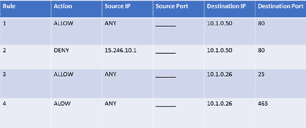

#### 62. 以下哪条规则未在规则库中显示，但将由防火墙强制执行？

1.  隐身
2.  隐含拒绝
3.  连接代理
4.  出站过滤

#### 63. IP 地址 `10.1.0.26` 运行的是什么类型的服务器？

1.  邮件
2.  Web
3.  FTP
4.  数据库

#### 63. 位于 `15.246.10.1` 的系统尝试与运行在 `10.1.0.50` 的 Web 服务器建立 HTTP 和 HTTPS 连接。关于该连接，以下哪项陈述是正确的？

1.  两个连接都将被允许。
2.  两个连接都将被阻止。
3.  HTTP 连接将被允许，HTTPS 连接将被阻止。
4.  HTTP 连接将被阻止，HTTPS 连接将被允许。

#### 65. 规则 #3 的源端口应填入什么值？

1.  `25`
2.  `465`
3.  `80`
4.  Any（任意）

#### 66. 数据流发生在 OSI 模型的哪三层？

1.  应用层、表示层和会话层
2.  表示层、会话层和传输层
3.  物理层、数据链路层和网络层
4.  数据链路层、网络层和传输层

#### 67. Chris 需要设计一种防火墙架构，能够以安全的方式支持 DMZ、数据库和私有内部网络，并分离各功能。他应该使用哪种设计，需要多少台防火墙？

1.  采用两台防火墙的四层防火墙设计
2.  采用三台防火墙的两层防火墙设计
3.  至少采用一台防火墙的三层防火墙设计
4.  采用三台防火墙的单层防火墙设计

#### 68. Lauren 的网络团队被要求确定一种技术，允许他们通过将网络视为代码来动态更改组织网络。她应该推荐哪种架构？

1.  遵循 5-4-3 规则的网络
2.  融合网络
3.  软件定义网络
4.  基于虚拟化管理程序的网络

#### 69. 电缆调制解调器、ISDN 和 DSL 都是哪种技术的示例？

1.  基带
2.  宽带
3.  数字
4.  广播

#### 70. 下图显示的是哪种防火墙设计？

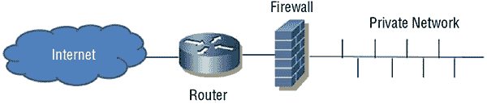

1.  单层
2.  双层
3.  三层
4.  下一代

#### 71. 在对组织网络进行审查时，Angela 发现网络遭受广播风暴，且承包商、访客和组织行政人员处于同一网段。Angela 应建议何种设计变更？

1.  要求所有用户使用加密。
2.  在网络边界安装防火墙。
3.  启用生成树环路检测。
4.  根据功能需求对网络进行分段。

#### 72. ICMP、RIP 和网络地址转换均发生在 OSI 模型的哪一层？

1.  第 1 层
2.  第 2 层
3.  第 3 层
4.  第 4 层

**针对第 73–75 题，请参考以下场景：**

Ben 是一家组织的信息安全专业人员，该组织正用虚拟机替换物理服务器。随着虚拟环境的构建，组织减少了物理服务器的数量，同时采购了更强大的服务器作为虚拟化平台。

#### 73. Ben 负责的 IDS 通过数据中心交换机上的镜像端口监控数据中心的通信。一旦数据中心的大多数服务器完成虚拟化，Ben 将看到什么流量？

1.  与他目前看到的相同流量
2.  所有虚拟机间流量
3.  仅发送到虚拟机环境外部的流量
4.  所有虚拟化管理程序间流量

#### 74. 虚拟机管理员建议启用虚拟机之间的复制粘贴功能。Ben 应就此做法提出什么安全顾虑？

1.  它可能导致拒绝服务状况。
2.  它可作为隐蔽信道。
3.  它可能允许病毒传播。
4.  它可能绕过认证控制。

#### 75. Ben 担心允许虚拟机逃逸的漏洞利用。Ben 应建议采取什么选项来帮助限制虚拟机逃逸漏洞利用的影响？

1.  根据任务或数据类型，将虚拟机分离到不同的物理硬件上。
2.  在底层虚拟化管理程序上使用虚拟机逃逸检测工具。
3.  定期将机器恢复到其原始快照。
4.  使用类似 Tripwire 的实用程序查找虚拟机中的变更。


### 76. WPA2 的 Counter Mode Cipher Block Chaining Message Authentication Mode Protocol (CCMP) 基于哪种常见加密方案？

1. DES
2. 3DES
3. AES
4. TLS

### 77. 当以太网网络上的主机检测到冲突并发送干扰信号时，接下来会发生什么？

1. 发送干扰信号的主机被允许重传，而所有其他主机暂停，直到该传输成功接收。
2. 所有主机停止传输，每个主机等待一段随机时间后再尝试传输。
3. 所有主机停止传输，每个主机根据其最近一次成功传输的时间长短等待一段时间。
4. 主机等待令牌传递，然后在传递令牌时恢复数据传输。

### 78. T3 线路的速度是多少？

1. 128 kbps
2. 1.544 Mbps
3. 44.736 Mbps
4. 155 Mbps

### 79. 下图显示的是哪种防火墙设计类型？

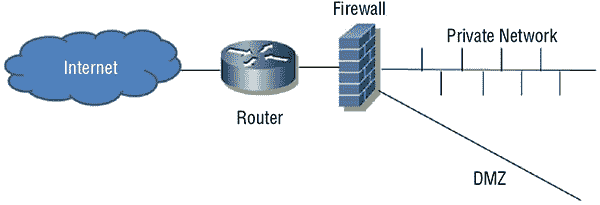

1. 单层防火墙
2. 双层防火墙
3. 三层防火墙
4. 完全受保护的 DMZ 防火墙

### 80. 终端安全系统部署中最常见的挑战是什么？

1. 妥协/攻陷
2. 数据量
3. 监控网络上的加密流量
4. 处理非 TCP 协议

### 81. 127.0.0.1 属于哪种类型的地址？

1. 公网 IP 地址
2. RFC 1918 地址
3. APIPA 地址
4. 回环地址

### 82. Susan 正在为需要使用蓝牙的组织用户编写最佳实践声明。她知道蓝牙存在许多潜在安全问题，并希望提供最佳建议。Susan 应包含以下哪组指导建议？

1. 使用蓝牙内置的强加密，更改设备上的默认 PIN 码，关闭发现模式，并在不主动使用时关闭蓝牙。
2. 仅将蓝牙用于非机密活动，更改设备上的默认 PIN 码，关闭发现模式，并在不主动使用时关闭蓝牙。
3. 使用蓝牙内置的强加密，使用扩展（8 位或更长）蓝牙 PIN 码，关闭发现模式，并在不主动使用时关闭蓝牙。
4. 仅将蓝牙用于非机密活动，使用扩展（8 位或更长）蓝牙 PIN 码，关闭发现模式，并在不主动使用时关闭蓝牙。

### 83. 哪种网络设备最常用于将终端系统分配到 VLAN？

1. 防火墙
2. 路由器
3. 交换机
4. 集线器

### 84. Steve 的任务是在 IP 网络上实施网络存储协议。他在实施中可能会使用哪种以存储为中心的融合协议？

1. MPLS
2. FCoE
3. SDN
4. VoIP

### 85. 哪种网络设备在用于计算机通信的模拟载波信号和数字信息之间进行调制解调？

1. 网桥
2. 路由器
3. 网桥路由器
4. 调制解调器

### 86. 将此处显示的 OSI 模型层按第 1 层到第 7 层的适当顺序排列。

1. 应用层
2. 数据链路层
3. 网络层
4. 物理层
5. 表示层
6. 会话层
7. 传输层

### 87. 发送分片 TCP 数据包的拒绝服务 (DoS) 攻击被称为哪种攻击？

1. 圣诞树攻击
2. 泪滴攻击
3. 栈溢出攻击
4. 碎片手雷攻击

### 88. Phillip 维护一个调制解调器池，以支持组织使用的多项遗留服务。以下哪种协议最适合此目的？

1. SLIP
2. SLAP
3. PPTP
4. PPP

### 89. Jim 在执行安全审计时发现的一个问题是私有网络中使用了非 IP 协议。Jim 应指出使用这些非 IP 协议可能导致什么问题？

1. 它们已过时，无法在现代 PC 上使用。
2. 它们可能无法被防火墙设备过滤。
3. 它们可能允许圣诞树攻击。
4. IPX 扩展了 IP 协议，可能并非所有 TCP 协议栈都支持。

### 90. Angela 需要在 EAP、PEAP 和 LEAP 中选择一种用于安全认证。她应该选择哪种认证协议，为什么？

1. EAP，因为它默认提供强加密
2. LEAP，因为它提供频繁的重新认证和 WEP 密钥更换
3. PEAP，因为它提供加密且不受 LEAP 相同漏洞的影响
4. 这些选项均无法提供安全认证，应选择替代方案。

### 91. 出于安全原因，Lauren 被要求用 L2TP 实现替换组织的 PPTP 实现。L2TP 替代 PPTP 的主要安全原因是什么？

1. L2TP 可以使用 IPsec。
2. L2TP 创建点对点隧道，避免多点问题。
3. PPTP 不支持 EAP。
4. PPTP 未正确封装 PPP 数据包。

### 92. Jim 正在构建一个研究计算系统，该系统受益于系统间的全网状拓扑。在五节点全网状拓扑设计中，单个节点将有多少个连接？

1. 两个
2. 三个
3. 四个
4. 五个

### 93. 哪种拓扑正确描述了以太网？

1. 环形
2. 星形
3. 网状
4. 总线型

### 94. 成功的 ARP 欺骗尝试后，最可能发生哪种攻击？

1. DoS 攻击
2. 特洛伊木马
3. 重放攻击
4. 中间人攻击

### 95. 类别 3 (Category 3) UTP 线缆的额定速度是多少？

1. 5 Mbps
2. 10 Mbps
3. 100 Mbps
4. 1000 Mbps

### 96. 当通过一组导线传输的数据被另一组导线拾取时，会发生什么问题？

1. 磁干扰
2. 串扰
3. 传输吸收
4. 幅度调制

### 97. RC4 实现中的哪两个关键问题使得有线等效保密 (WEP) 比原本更脆弱？

1. 使用静态公共密钥和客户端设置的加密算法
2. 使用静态公共密钥和有限数量的初始化向量
3. 使用弱非对称密钥和有限数量的初始化向量
4. 使用弱非对称密钥和客户端设置的加密算法

### 98. Chris 正在建立一个酒店网络，需要确保每个房间或套房内的系统可以相互连接，但不同套房或房间内的系统不能互连。同时，他需要确保酒店内的所有系统都能访问互联网。作为最高效的商业解决方案，他应该推荐什么方案？

1. 每房间一个 VPN
2. VLAN
3. 端口安全
4. 防火墙

### 99. 在取证调查期间，Charles 确定了连接到受损网络的系统的媒体访问控制地址。Charles 知道 MAC 地址与制造商或供应商相关联，是系统指纹的一部分。MAC 地址属于哪个 OSI 层？

1. 应用层
2. 会话层
3. 物理层
4. 数据链路层

### 100. Ben 知道组织希望在收发电子邮件时，能够根据域名验证其他组织的身份。Ben 应推荐什么工具？

1. PEM
2. S/MIME
3. DKIM
4. MOSS

# 第 5 章：身份与访问管理（领域 5）

### 1. 以下哪项最好地描述了一种侧重于主体并标识每个主体可访问的客体的访问控制模型？


## 访问控制与身份管理练习题

### 1. 访问控制列表
以下哪项是访问控制列表？

1.  访问控制列表
2.  隐式拒绝列表
3.  能力表
4.  权限管理矩阵

### 2. IDaaS 实施建议
Jim 的组织范围内的 IDaaS 实施为基于云的应用程序提供了广泛支持。Jim 的公司没有内部身份管理人员，也不使用集中式身份服务。相反，他们依赖 `Active Directory` 进行 AAA 服务。以下哪项选项 Jim 应该推荐以最好地处理公司的现场身份需求？

1.  使用 OAuth 集成现场系统。
2.  使用本地第三方身份服务。
3.  使用 SAML 集成现场系统。
4.  设计内部解决方案以处理组织的独特需求。

### 3. Kerberos 的弱点
以下哪项不是 Kerberos 的弱点？

1.  KDC 是单点故障。
2.  KDC 被攻破将允许攻击者冒充任何用户。
3.  认证信息未加密。
4.  它容易受到密码猜测攻击。

### 4. 语音模式识别
语音模式识别属于哪种认证因素类型？

1.  你知道的东西
2.  你拥有的东西
3.  你本身的东西
4.  你所在的地方

### 5. 认证因素类型计数
如果 Susan 的组织要求她使用用户名、PIN、密码和视网膜扫描登录，她使用了多少种不同的认证因素类型？

1.  一种
2.  两种
3.  三种
4.  四种

### 6. 受限接口
以下哪项通常不与受限接口相关联？

1.  Shell
2.  键盘
3.  菜单
4.  数据库视图

### 7. 日志审查与攻击类型
在日志审查期间，Saria 发现了一系列显示登录失败的日志，如下所示：

*   `Jan 31 11:39:12 ip-10-0-0-2 sshd[29092]: Invalid user admin from remotehost passwd=orange`
*   `Jan 31 11:39:20 ip-10-0-0-2 sshd[29098]: Invalid user admin from remotehost passwd=Orang3`
*   `Jan 31 11:39:23 ip-10-0-0-2 sshd[29100]: Invalid user admin from remotehost passwd=Orange93`
*   `Jan 31 11:39:31 ip-10-0-0-2 sshd[29106]: Invalid user admin from remotehost passwd=Orangutan1`
*   `Jan 31 20:40:53 ip-10-0-0-254 sshd[30520]: Invalid user admin from remotehost passwd=Orangemonkey`

Saria 发现了哪种类型的攻击？

1.  暴力破解攻击
2.  中间人攻击
3.  字典攻击
4.  彩虹表攻击

### 8. Kerberos 认证过程步骤排序
将以下步骤按照 Kerberos 认证过程中发生的顺序排列。

1.  生成客户端/服务器票据
2.  生成 TGT
3.  生成客户端/TGS 密钥
4.  用户访问服务
5.  用户提供认证凭据

### 9. 分散式访问控制的主要问题
分散式访问控制经常导致什么主要问题？

1.  可能发生访问中断。
2.  控制不一致。
3.  控制过于细粒度。
4.  培训成本高。

### 10. 固定电话回叫
固定电话号码回叫是哪种因素类型的示例？

1.  你知道的东西
2.  你所在的地方
3.  你拥有的东西
4.  你本身的东西

### 11. Active Directory 信任关系
Kathleen 需要设置 Active Directory 信任以允许与现有的 Kerberos K5 域进行认证。她需要创建哪种类型的信任？

1.  快捷信任
2.  林信任
3.  外部信任
4.  领域信任

### 12. 最常用的 AAA 协议
以下哪种 AAA 协议最常用？

1.  TACACS
2.  TACACS+
3.  XTACACS
4.  Super TACACS

### 13. 单点登录实现
以下哪项不是单点登录实现？

1.  Kerberos
2.  ADFS
3.  CAS
4.  RADIUS

### 14. 访问控制模型
如下图所示，Windows 系统上的用户无法使用“发送消息”功能。哪种访问控制模型最能描述这种限制类型？

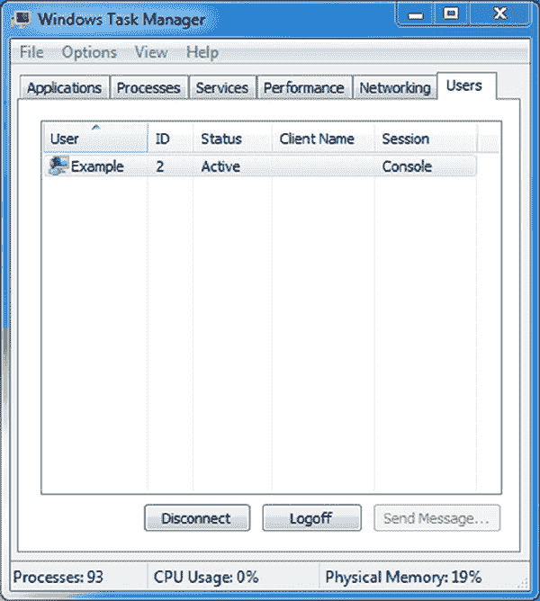

1.  最小权限
2.  需知原则
3.  受限接口
4.  职责分离

### 15. 文件所有者授权访问控制
哪种访问控制允许文件所有者使用访问控制列表授予其他用户访问权限？

1.  基于角色
2.  非自主
3.  基于规则
4.  自主访问控制

### 16. 访问控制概念
Alex 的工作要求他查看受保护的健康信息（PHI）以确保患者得到适当治疗。他对医疗记录的访问不提供患者地址或账单信息的访问权限。哪种访问控制概念最能描述这种控制？

1.  职责分离
2.  受限接口
3.  上下文相关控制
4.  需知原则

---

请利用你对 Kerberos 登录过程的了解和下图回答第 17-19 题。

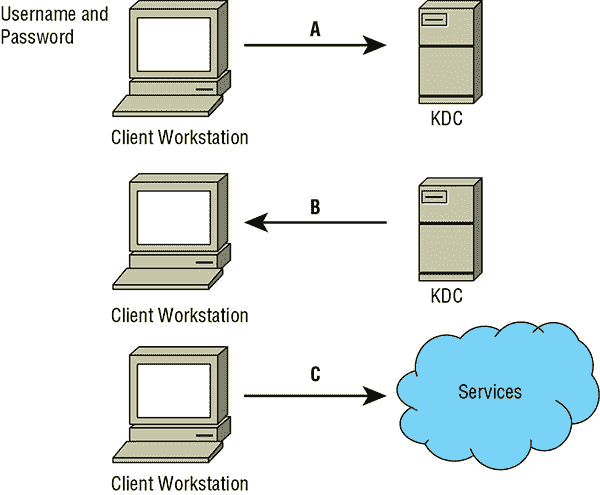

### 17. 客户端发送凭据的保护
在图中的 A 点，客户端将用户名和密码发送给 KDC。用户名和密码是如何受到保护的？

1.  3DES 加密
2.  TLS 加密
3.  SSL 加密
4.  AES 加密

### 18. KDC 发送的关键元素
在图中的 B 点，KDC 在验证用户名有效后向客户端发送哪两个重要元素？

1.  加密的 TGT 和公钥
2.  访问票据和公钥
3.  加密的、带时间戳的 TGT 和用用户密码哈希加密的对称密钥
4.  加密的、带时间戳的 TGT 和访问令牌

### 19. 客户端使用 TGT 前的任务
客户端在可以使用 TGT 之前必须执行哪些任务？

1.  必须生成 TGT 的哈希并解密对称密钥。
2.  必须接受 TGT 并解密对称密钥。
3.  必须解密 TGT 和对称密钥。
4.  必须使用对称密钥向 KDC 发送有效响应并安装 TGT。

### 20. 视网膜扫描的担忧
Jacob 正在规划组织的生物特征认证系统，并考虑使用视网膜扫描。他的组织中的其他人可能会对视网膜扫描提出什么担忧？

1.  视网膜扫描可能会泄露医疗状况信息。
2.  视网膜扫描很痛苦，因为它们需要向用户的眼睛吹一股气。
3.  视网膜扫描仪是最昂贵的生物特征设备类型。
4.  视网膜扫描仪具有较高的误报率，会导致支持问题。

### 21. 强制访问控制模型
强制访问控制基于哪种类型的模型？

1.  自主
2.  基于组
3.  基于格
4.  基于规则

### 22. 非访问控制攻击类型
以下哪项不是针对访问控制的攻击类型？

1.  字典攻击
2.  暴力破解攻击
3.  Teardrop 攻击
4.  中间人攻击

### 23. 身份使用问责制
为身份使用提供问责制的最佳方式是什么？

1.  日志记录
2.  授权
3.  数字签名
4.  类型 1 认证

### 24. 权限审查流程
Jim 在过去几年里在公司担任过人力资源、薪资和客户服务角色。他的公司应该执行哪种流程以确保他拥有适当的权限？

1.  重新配置
2.  账户审查
3.  权限蔓延
4.  账户撤销

### 25. Biba 模型类型
Biba 是哪种类型的访问控制模型？

1.  MAC
2.  DAC
3.  基于角色的访问控制
4.  基于属性的访问控制

### 26. 网络访问服务器认证协议
以下哪项是一种客户端/服务器协议，旨在允许网络访问服务器通过向中央服务器发送访问请求消息来认证远程用户？

1.  Kerberos
2.  EAP
3.  RADIUS
4.  OAuth

### 27. 权限列表访问控制类型
在以下权限列表中使用的是哪种类型的访问控制？

*   存储设备 X
*   User1: 可读、写、列表
*   User2: 可读、列表
*   User3: 可读、写、列表、删除
*   User4: 可列表

1.  基于资源的访问控制
2.  基于角色的访问控制
3.  强制访问控制
4.  基于规则的访问控制


### 28. RADIUS 协议监控

Angela 使用嗅探器监控配置了默认设置的 RADIUS 服务器的流量。她应该监控什么协议，能读取什么流量？

1.  UDP，无。所有 RADIUS 流量均已加密。
2.  TCP，除密码外的所有流量，密码已加密。
3.  **UDP，除密码外的所有流量，密码已加密。**
4.  TCP，无。所有 RADIUS 流量均已加密。

### 29. Kerberos 认证系统组件

以下哪项不是 Kerberos 认证系统的一部分？

1.  KDC
2.  TGT
3.  AS
4.  **TS**

### 30. 授权示例

当应用程序或系统允许已登录用户执行特定操作时，这是以下哪项的示例？

1.  角色
2.  组管理
3.  登录
4.  **授权**

### 31. 权限蔓延问题

Alex 在公司工作十余年，担任过多个职位。审计发现，他因以前的角色仍拥有共享文件夹和应用程序的访问权限。Alex 公司遇到了什么问题？

1.  过度供给
2.  未授权访问
3.  **权限蔓延**
4.  账户审查

### 32. 访问控制机制常见威胁

以下哪项不是访问控制机制的常见威胁？

1.  伪造登录页面
2.  钓鱼攻击
3.  字典攻击
4.  **中间人攻击**

### 33. 竞争条件

当两个或多个进程需要访问同一资源，且必须按正确顺序完成任务才能正常运行时，该术语是什么？

1.  冲突
2.  **竞争条件**
3.  确定性
4.  乱序执行

## 34. 访问控制方案识别

下表展示的是哪种访问控制方案？

| 高度敏感 | 红 | 蓝 | 绿 |
| :--- | :--- | :--- | :--- |
| 机密 | 紫 | 橙 | 黄 |
| 内部使用 | 黑 | 灰 | 白 |
| 公开 | 透明 | 透明 | 透明 |

1.  RBAC
2.  DAC
3.  **MAC**
4.  TBAC

### 35. 无效 LDAP DN

以下哪项不是有效的 LDAP DN（可分辨名称）？

1.  `cn=ben+ou=sales`
2.  `ou=example`
3.  `cn=ben,ou=example;`
4.  `ou=example,dc=example,dc=com+dc=org`

### 36. 标识过程

当主体声称一种身份时，正在发生什么过程？

1.  登录
2.  **标识**
3.  授权
4.  令牌呈现

### 37. 物理控制示例

看门狗、警卫和围栏都是以下哪类控制的常见示例？

1.  检测型
2.  恢复型
3.  管理型
4.  **物理型**

### 38. 防止暴力破解的密码策略

Susan 的组织正在更新密码策略，希望使用最强密码。哪项密码要求对防止暴力破解攻击的影响最大？

1.  将最大使用期限从 1 年改为 180 天。
2.  **将最小密码长度从 8 个字符增加到 16 个字符。**
3.  增加密码复杂度，要求至少包含三类字符（如大写、小写、数字和符号）。
4.  保留至少四个历史密码以防止重用。

### 39. 生物特征存储样本术语

生物特征因素的存储样本称为什么？

1.  **参考模板**
2.  令牌存储
3.  生物特征密码
4.  注册工件

### 40. FRR 与 FAR 权衡

使用生物特征识别的组织何时会选择允许较高的 FRR（拒真率）而不是较高的 FAR（伪真率）？

1.  **安全性比易用性更重要时**
2.  因数据质量导致误拒不是问题时
3.  系统的 CER（交叉错误率）未知时
4.  系统的 CER（交叉错误率）非常高时

### 41. 密码长度增加带来的复杂度提升

Susan 正通过修改密码策略提高组织密码强度。该密码系统允许大小写字母和数字，不允许其他字符。将组织最小密码长度增加单个字符，会创造多少额外复杂度？

1.  26 倍
2.  **62 倍**
3.  36 倍
4.  2⁶² 倍

### 42. 生物识别系统用户接受度关键因素

以下哪对因素是用户接受生物识别系统的关键？

1.  FAR（伪真率）
2.  **吞吐率和注册所需时间**
3.  CER（交叉错误率）和 ERR
4.  用户重新注册的频率和参考档案要求

---

Alex 负责与主要第三方合作伙伴进行 SAML 集成，该合作伙伴为其组织提供各种业务生产力服务。请参考下图及您对 SAML 集成和安全架构设计的知识回答 43-45 题。

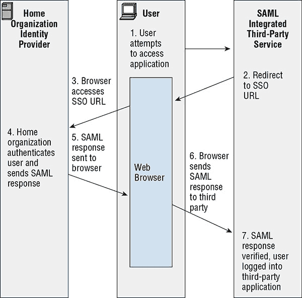

### 43. 防止 SAML 流量窃听与伪造断言

Alex 担心 SAML 流量被窃听，也希望确保伪造断言不会成功。他应采取什么措施防止这些潜在攻击？

1.  使用 SAML 的安全模式提供安全认证。
2.  使用强加密套件实施 TLS，这将防止这两类攻击。
3.  **使用强加密套件实施 TLS 并使用数字签名。**
4.  使用强加密套件实施 TLS 和消息哈希。

### 44. 离站用户认证可用性风险

如果 Alex 的组织主要由离站、出差用户组成，将关键业务应用集成到本地认证会造成什么可用性风险，该如何解决？

1.  第三方集成可能不可信；使用 SSL 和数字签名。
2.  **如果主组织离线，出差用户将无法访问第三方应用；实施混合云/本地认证系统。**
3.  本地用户可能无法正确重定向到第三方服务；实施本地网关。
4.  浏览器可能无法正确重定向；使用 hosts 文件确保重定向问题得到解决。

### 45. 解决第三方控制 SSO 重定向担忧

针对图中步骤 2 所示的第三方控制 SSO 重定向的担忧，什么解决方案最有效？

1.  开展关于可信第三方的意识宣传活动
2.  TLS
3.  **在本地站点处理重定向**
4.  实施 IPS 捕获 SSO 重定向攻击

### 46. MAC 与 DAC 方案选择

Susan 被要求建议组织使用 MAC 方案还是 DAC 方案。如果灵活性和可扩展性是实施访问控制的重要需求，她应推荐哪种方案及原因？

1.  MAC，因为它通过按需添加标签提供更大的可扩展性和灵活性
2.  **DAC，因为允许各个管理员对其控制的对象做出选择，从而提供可扩展性和灵活性**
3.  MAC，因为分区隔离非常适合灵活性，增加分区将使其良好扩展
4.  DAC，因为集中决策过程允许快速响应，通过减少所需决策数量提供可扩展性，通过将决策移至中央授权机构提供灵活性

### 47. 验证供给流程合规性的工具

以下哪种工具通常不用于验证供给流程是否遵循组织安全策略？

1.  日志审查
2.  权限人工审查
3.  **基于特征的检测**
4.  审查审计追踪

### 48. 供给信息接口标准语言

Lauren 需要向第三方组织发送她正在供给的服务信息。她应选择哪种基于标准的标记语言构建接口？

1.  SAML
2.  SOAP
3.  **SPML**
4.  XACML

### 49. 针对哈希密码的攻击

渗透测试中，Chris 恢复了一个包含他试图访问的系统哈希密码的文件。哪种攻击最有可能成功破解这些哈希密码？

1.  暴力破解攻击
2.  **传递哈希攻击**
3.  彩虹表攻击
4.  盐值恢复攻击


### 50. Google 与跨域的各种组织和应用程序进行身份集成，这是以下哪项的示例？

1.  PKI
2.  联邦身份认证
3.  单点登录
4.  供给

### 51. Lauren 入职新工作，发现她拥有多个系统的访问权限，但这些权限并非完成其工作所必需。她遇到了什么问题？

1.  权限蔓延
2.  权限冲突
3.  最小权限
4.  过度授权

### 52. 当 Chris 验证个人身份并将用户 ID 等唯一标识符添加到身份系统时，发生了什么过程？

1.  身份证明
2.  注册
3.  目录管理
4.  会话管理

### 53. Jim 将其 LDAP 客户端配置为连接到 LDAP 目录服务器。根据配置指南，其客户端应通过端口 636 连接到服务器。这向 Jim 表明 LDAP 服务器的配置如何？

1.  它要求通过 SSL/TLS 进行连接。
2.  它仅支持未加密连接。
3.  它提供全局目录服务。
4.  它不提供全局目录服务。

### 54. X.500 标准涵盖哪类重要的身份系统？

1.  Kerberos
2.  供给服务
3.  生物特征认证系统
4.  目录服务

### 55. Microsoft 的 Active Directory 域服务基于以下哪种技术？

1.  RADIUS
2.  LDAP
3.  SSO
4.  PKI

### 56. Lauren 负责构建一个银行网站。她需要注册用户的身份证明。她应如何验证用户身份？

1.  要求用户创建只有他们自己知道的唯一问题。
2.  要求新用户亲自携带驾照或护照前往银行。
3.  使用银行和用户都拥有的信息，例如从其信用报告中提取的问题。
4.  拨打用户注册的电话号码，以验证其是否为其声称的本人。

### 57. 默认情况下，OpenLDAP 以何种格式存储 `userPassword` 属性的值？

1.  明文
2.  加盐并哈希
3.  MD5 哈希
4.  使用 AES256 加密

### 58. 一家使用指纹扫描仪认证用户的银行，其新客户在扫描指纹后惊讶地发现登录到了另一位客户的账户。发生了哪类生物特征因子错误？

1.  注册错误
2.  第一类错误
3.  第二类错误
4.  使用时间、使用方法错误

### 59. 防火墙通常使用哪种类型的访问控制？

1.  自主访问控制
2.  基于规则的访问控制
3.  基于任务的访问控制
4.  强制访问控制

### 60. 当你输入用户 ID 和密码时，你正在执行什么重要的身份和访问管理活动？

1.  授权
2.  校验
3.  认证
4.  登录

### 61. Kathleen 供职于一家数据中心托管机构，该机构为个人和组织提供物理数据中心空间。直到最近，每位客户都会获得一张基于磁条的门禁卡，以访问其服务器所在的设施区域，同时也会获得一把钥匙，以访问其服务器所在的机柜或机架。在过去一个月里，多台服务器被盗，但门禁卡日志仅显示有效的 ID。为确保门禁卡使用者就是他们应该成为的人，Kathleen 的最佳选择是什么？

1.  增加一个要求门禁卡用户输入 PIN 码的读卡器。
2.  在设施中增加摄像头系统，以监控谁在访问服务器。
3.  增加生物特征因子。
4.  用智能卡替换磁条门禁卡。

### 62. 以下哪项是一种基于票据的认证协议，旨在提供安全通信？

1.  RADIUS
2.  OAuth
3.  SAML
4.  Kerberos

### 63. 由支持法规、要求和组织自身策略的策略和程序组成的访问控制类型是什么？

1.  纠正性
2.  逻辑性
3.  补偿性
4.  管理性

### 64. 在 Kerberos 环境中，当用户需要访问网络资源时，什么会被发送给 TGS？

1.  TGT
2.  AS
3.  SS
4.  会话密钥

### 65. 在 MAC 模型中，哪些对象和主体拥有标签？

1.  被分类为机密、秘密或绝密的对象和主体拥有标签。
2.  所有对象拥有标签，所有主体拥有分区。
3.  所有对象和主体都拥有标签。
4.  所有主体拥有标签，所有对象拥有分区。

## 场景：第 66–68 题

Chris 是一家不断发展的电子商务网站的身份架构师，该网站希望利用社交身份。为此，他和他的团队打算允许用户在使用该电子商务网站时，使用其现有的 Google 账户作为主要账户。这意味着当新用户首次连接到电子商务平台时，他们可以选择使用 OAuth 2.0 通过 Google 账户登录，或者使用自己的电子邮件地址和自选密码在平台上创建一个新账户。

利用此信息和下图所示的示例认证流程图，回答第 66–68 题。

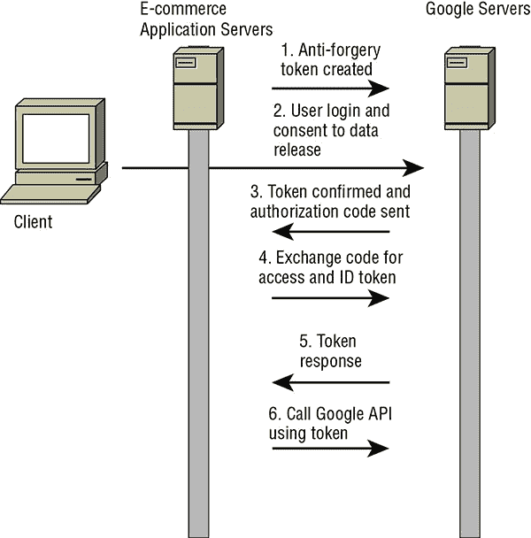

### 66. 当电子商务应用为 Google 用户创建账户时，该用户的密码应存储在何处？

1.  密码存储在电子商务应用的数据库中。
2.  密码存储在电子商务应用服务器的内存中。
3.  密码存储在 Google 的账户管理系统中。
4.  密码从不存储；相反，加盐哈希存储在 Google 的账户管理系统中。

### 67. 哪个系统或系统负责 Google 用户的用户认证？

1.  电子商务应用。
2.  电子商务应用和 Google 服务器两者。
3.  Google 服务器。
4.  该图未提供足够信息以确定这一点。

### 68. 创建和交换 state 令牌旨在防止哪种类型的攻击？

1.  XSS
2.  CSRF
3.  SQL 注入
4.  XACML

### 69. “你的宠物叫什么名字？”这类问题属于哪种身份证明类型？

1.  基于知识的认证
2.  动态基于知识的认证
3.  带外身份证明
4.  第三类认证因子

### 70. Lauren 建立了一张包含分配的特权、对象和主体的表，以管理她负责的系统的访问控制。每当主体尝试访问对象时，系统都会检查该表，以确保主体拥有对该对象的适当权利。Lauren 使用的是哪种访问控制系统？

1.  能力表
2.  访问控制列表
3.  访问控制矩阵
4.  主体/对象权限管理系统

### 71. 在对支持事件的审查中，Ben 所在组织发现密码更改占其服务台案例的四分之一以上。以下哪项最有可能显著降低这一数字？

1.  双因素认证
2.  生物特征认证
3.  自助密码重置
4.  密码短语

### 72. Brian 所在的大型组织多年来一直使用 RADIUS 为网络设备提供 AAA 服务，最近才意识到认证过程中传输的未加密信息存在安全问题。Brian 应如何为 RADIUS 实施加密？

1.  使用 RADIUS 内置的加密。


#### 2. 使用 TLS 保护，通过其原生 UDP 实现 RADIUS。

#### 3. 使用 TLS 保护，通过 TCP 实现 RADIUS。

#### 4. 设备之间使用 AES256 预共享密码。

### 73. Jim 希望允许基于云的应用程序代表他访问其他站点的信息。以下哪种工具可以实现此目的？

1.  Kerberos
2.  OAuth
3.  OpenID
4.  LDAP

### 74. Ben 的组织在午餐时间员工不在工位时，遇到了应用程序和工作站被未授权访问的问题。Ben 推荐哪种类型的会话管理解决方案最有助于防止此类访问？

1.  对所有访问使用会话 ID 并验证所有工作站的系统 IP 地址。
2.  为应用程序设置会话超时，并在工作站上使用受密码保护且带有不活动超时的屏幕保护程序。
3.  对所有应用程序使用会话 ID，并在工作站上使用受密码保护且带有不活动超时的屏幕保护程序。
4.  为应用程序设置会话超时并验证所有工作站的系统 IP 地址。

### 75. 将每个编号的安全控制与字母分类列表中恰好一项相匹配。选择最能描述每个控制的类别。您可以使用每个控制类别一次、多次或根本不使用。

#### 控制措施

1.  密码
2.  账户审查
3.  读卡器
4.  MFA
5.  IDP

#### 类别

1.  管理类
2.  技术类
3.  物理类

### 76. Susan 所在的金融服务公司为其用户提供了一个 Web 门户。当用户需要验证身份时，公司使用来自第三方来源的信息，根据其过往信用报告提出问题，例如“以下哪条街道是您在 2007 年居住过的？”Susan 的组织正在使用什么流程？

1.  身份验证
2.  密码验证
3.  使用类型 2 认证因子进行认证
4.  带外身份验证

### 77. 美国政府的 CAC 是哪种形式的类型 2 认证因子的示例？

1.  令牌
2.  生物特征标识符
3.  智能卡
4.  PIV

### 78. 哪种认证技术可以与 OAuth 配对，以执行身份验证并使用 RESTful API 获取用户配置文件信息？

1.  SAML
2.  Shibboleth
3.  OpenID Connect
4.  Higgins

### 79. Jim 拥有 Secret 级别许可，正在访问使用强制访问控制方案应用 Top Secret、Secret、Confidential 和 Unclassified 标签方案的文件。假设他有有效的 need-to-know（知悉必要性），他可以访问哪些分类级别的数据？

1.  Top Secret 和 Secret
2.  Secret、Confidential 和 Unclassified
3.  仅 Secret 数据
4.  Secret 和 Unclassified

### 80. Susan 所在公司的安全管理员将她使用的工作站配置为仅允许在她的工作时间内登录。哪种访问控制类型最能描述这种限制？

1.  受限界面
2.  上下文相关控制
3.  基于内容的控制
4.  最小权限

### 81. 将每个编号的认证技术与适当的字母分类相匹配。每种技术应恰好与一个类别匹配。每个类别可使用一次、多次或根本不使用。

#### 认证技术

1.  密码
2.  ID 卡
3.  视网膜扫描
4.  智能手机令牌
5.  指纹分析

#### 类别

1.  你所拥有的
2.  你所知晓的
3.  你本身的特征

### 82. 以下哪项不是访问控制层？

1.  物理
2.  策略
3.  管理
4.  技术

### 83. Ben 使用一种基于软件的令牌，其代码每分钟变化一次。他使用的是哪种类型的令牌？

1.  异步
2.  智能卡
3.  同步
4.  静态

### 84. 哪种基于令牌的认证系统使用质询/响应过程，其中质询必须输入到令牌中？

1.  异步
2.  智能卡
3.  同步
4.  RFID

Ben 的组织正在为其高安全性建筑的访问控制系统采用生物特征认证。使用下图回答第 85-87 题，关于该组织采用该技术的情况。


### 85. Ben 的公司正考虑将其系统配置为按图中 A 点所示的级别工作。它将灵敏度设置为何种级别？

1.  FRR 交叉点
2.  FAR 点
3.  CER
4.  CFR

### 86. 在 B 点，可能会发生什么问题？

1.  误接受率将非常高。
2.  误拒绝率将非常高。
3.  误拒绝率将非常低。
4.  误接受率将非常低。

### 87. 如果图中所示的 FAR 和 FRR 无法为组织需求提供可接受的性能水平，Ben 应该怎么做？

1.  调整生物特征设备的灵敏度。
2.  评估其他生物特征系统以进行比较。
3.  移动 CER。
4.  在软件中调整 FRR 设置。

### 88. 哪种 LDAP 认证模式可以提供安全认证？

1.  匿名
2.  SASL
3.  简单
4.  S-LDAP

### 89. 以下哪种类型 3 认证因子适合单独使用，而无需与其他生物特征因子结合使用？

1.  声纹识别
2.  手部几何识别
3.  掌纹扫描
4.  心率/脉搏模式

### 90. 允许 OpenID 信赖方控制与 OpenID 提供者的连接会造成什么危险？

1.  可能导致无法正确选择合适的 OpenID 提供者。
2.  会造成网络钓鱼攻击的可能性，即将数据发送到虚假的 OpenID 提供者。
3.  信赖方可能会窃取客户端的用户名和密码。
4.  信赖方可能不会发送签名断言。

### 91. Jim 正在为其组织实施云身份解决方案。他正在部署哪种类型的技术？

1.  身份即服务
2.  员工 ID 即服务
3.  基于云的 RADIUS
4.  OAuth

### 92. RAID-5 是哪种类型控制的示例？

1.  管理
2.  恢复
3.  补偿
4.  逻辑

### 93. 当 Alex 在 Linux 服务器上作为众多用户之一设置如下图所示的权限时，他利用的是哪种访问控制模型？

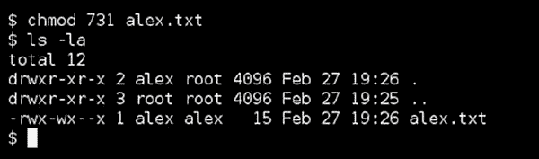

1.  基于角色的访问控制
2.  基于规则的访问控制
3.  强制访问控制 (MAC)
4.  自主访问控制 (DAC)

### 94. 哪种开放协议旨在取代 RADIUS——包括支持额外的命令和协议、用 TCP 替换 UDP 流量、并提供可扩展命令——但不保持与 RADIUS 的向后兼容性？

1.  TACACS
2.  RADIUS-NG
3.  Kerberos
4.  Diameter

### 95. LDAP 可分辨名称 (DN) 由称为相对可分辨名称 (RDN) 的逗号分隔组件组成，这些组件具有属性名称和值。随着从左向右推进，DN 变得不那么具体。以下哪个 LDAP DN 最符合此规则？

1.  uid=ben,ou=sales,dc=example,dc=com
2.  uid=ben,dc=com,dc=example
3.  dc=com,dc=example,ou=sales,uid=ben
4.  ou=sales,dc=com,dc=example


### 96. Susan 正在排查 Kerberos 认证问题...

Susan 正在排查 Kerberos 认证问题，症状包括 TGT 不被接受为有效以及无法接收新票据。如果她正在排查的系统已正确配置 Kerberos 认证，她的用户名和密码正确，且网络连接正常，那么最可能的问题是什么？

1.  Kerberos 服务器离线。
2.  存在协议不匹配。
3.  客户端的 TGT 已被标记为受损并取消授权。
4.  **Kerberos 服务器和本地客户端的时钟未同步。**

### 97. Kerberos、KryptoKnight 和 SESAME 都是以下哪种系统的示例？

1.  SSO
2.  PKI
3.  CMS
4.  Directory

### 98. 以下哪种访问控制类别不包括门锁？

1.  物理
2.  指令
3.  预防
4.  威慑

### 99. Windows 默认对 Active Directory 系统使用哪种认证协议？

1.  RADIUS
2.  Kerberos
3.  OAuth
4.  TACACS+

### 100. Alex 将其 LDAP 服务器配置为在 636 和 3269 端口提供服务...

Alex 将其 LDAP 服务器配置为在 636 和 3269 端口提供服务。根据 LDAP 的默认端口，他配置了哪种类型的 LDAP 服务？

1.  非安全 LDAP 和非安全全局目录
2.  非安全 LDAP 和安全全局目录
3.  **安全 LDAP 和安全全局目录**
4.  安全 LDAP 和非安全全局目录

# 第 6 章：安全评估与测试（领域 6）

### 1. 在端口扫描期间，Susan 发现一台系统正在运行服务...

在端口扫描期间，Susan 发现一台系统正在 TCP 和 UDP 137-139 以及 TCP 445、TCP 1433 上运行服务。如果她连接到该机器，可能会发现什么类型的系统？

1.  Linux 邮件服务器
2.  **Windows SQL 服务器**
3.  Linux 文件服务器
4.  Windows 工作站

### 2. 以下哪项是用于设计新软件测试并确保测试质量的方法？

1.  代码审计
2.  静态代码分析
3.  回归测试
4.  **变异测试**

### 3. 在端口扫描期间，Lauren 发现 TCP 443 端口开放...

在端口扫描期间，Lauren 发现一台系统的 TCP 443 端口开放。哪种工具最适合扫描该端口上最可能运行的服务？

1.  zzuf
2.  **Nikto**
3.  Metasploit
4.  sqlmap

### 4. 网络设备、Linux 和 Unix 系统以及许多其他企业设备通常使用什么消息记录标准？

1.  **Syslog**
2.  Netlog
3.  Eventlog
4.  远程日志协议 (RLP)

### 5. Alex 想要使用自动化工具填充 Web 应用程序表单...

Alex 想要使用自动化工具填充 Web 应用程序表单以测试格式化字符串漏洞。他应该使用哪种类型的工具？

1.  黑盒
2.  暴力破解工具
3.  **模糊测试器**
4.  静态分析工具

### 6. Susan 需要扫描系统以查找漏洞...

Susan 需要扫描系统以查找漏洞，并且她想使用开源工具远程测试系统。以下哪种工具能满足她的要求并允许进行漏洞扫描？

1.  Nmap
2.  **OpenVAS**
3.  MBSA
4.  Nessus

### 7. NIST 特别出版物 800-53A 描述了四种主要类型的评估对象...

NIST 特别出版物 800-53A 描述了四种主要类型的评估对象，可用于识别被评估的项目。如果评估涵盖 IPS 设备，则正在评估哪种类型的评估对象？

1.  规范
2.  **机制**
3.  活动
4.  个人

### 8. Jim 受聘对一家银行的总分行进行渗透测试...

Jim 受聘对一家银行的总分行进行渗透测试。为了使测试尽可能真实，除了银行的名称和地址外，他未获得任何关于该银行的信息。Jim 同意为该银行执行哪种类型的渗透测试？

1.  水晶盒渗透测试
2.  灰盒渗透测试
3.  **黑盒渗透测试**
4.  白盒渗透测试

### 9. Alex 正在使用 nmap 执行端口扫描...

Alex 正在使用 nmap 对一台系统执行端口扫描，并在结果中收到了三种不同的端口状态消息。将每个编号的状态消息与相应的字母描述进行匹配。每个项目应恰好使用一次。

**状态消息**

1.  Open（开放）
2.  Closed（关闭）
3.  Filtered（被过滤）

**描述**

1.  该端口在远程系统上可访问，但没有应用程序在该端口上接受连接。
2.  该端口在远程系统上不可访问。
3.  该端口在远程系统上可访问，且有应用程序在该端口上接受连接。

### 10. 在对提案请求的响应中...

在对提案请求的响应中，Susan 收到了一份 SSAE 18 SOC 1 报告。如果她想要一份包含运行有效性细节的报告，Susan 应该要求什么作为后续跟进，为什么？

1.  **一份 SOC 2 Type II 报告，因为 Type I 不涵盖运行有效性**
2.  一份 SOC 1 Type I 报告，因为 SOC 2 不涵盖运行有效性
3.  一份 SOC 2 Type I 报告，因为 SOC 2 Type II 不涵盖运行有效性
4.  一份 SOC 3 报告，因为 SOC 1 和 SOC 2 报告已过时

### 11. 在无线网络渗透测试期间...

在无线网络渗透测试期间，Susan 使用密码文件针对网络运行 aircrack-ng。什么可能导致她的密码破解尝试失败？

1.  使用 WPA2 加密
2.  **在企业模式下运行 WPA2**
3.  使用 WEP 加密
4.  在 PSK 模式下运行 WPA2

### 12. 在工作日的中间，针对流行的 Apache Web 服务器发布了一个零日漏洞...

在工作日的中间，针对流行的 Apache Web 服务器发布了一个零日漏洞。在 Jacob 作为信息安全分析师的角色中，他需要快速扫描网络以确定哪些服务器容易受到该问题的影响。Jacob 快速识别易受攻击系统的最佳途径是什么？

1.  立即对所有服务器运行 Nessus 以识别哪些系统易受攻击。
2.  查阅 CVE 数据库以查找漏洞信息和补丁信息。
3.  创建自定义 IDS 或 IPS 签名。
4.  **识别受影响的版本，并使用自动化扫描器检查系统是否为该版本号。**

### 13. 哪种测试类型用于确保...

哪种测试类型用于确保单独开发的软件模块能正确交换数据？

1.  模糊测试
2.  动态测试
3.  **接口测试**
4.  API 校验和

### 14. 以下哪项不是主动无线扫描的潜在问题？

1.  意外扫描到实际上属于客人的疑似流氓设备
2.  触发组织无线 IPS 的警报
3.  扫描属于附近组织的设备
4.  **错误识别流氓设备**

### 15. Ben 使用一种模糊测试工具来测试应用程序...

Ben 使用一种模糊测试工具来测试应用程序，该工具通过开发数据模型并基于应用程序如何使用数据的信息创建模糊数据。Ben 正在进行哪种类型的模糊测试？

1.  变异
2.  参数化
3.  **生成式**
4.  衍生式

### 16. Saria 想要记录和审查其网络各部分之间的流量信息...

Saria 想要记录和审查其网络各部分之间的流量信息。她应该在路由器上启用哪种类型的网络日志记录以便执行此分析？

1.  审计日志
2.  **流日志**
3.  跟踪日志
4.  路由日志

### 17. Jim 受聘进行灰盒渗透测试...

Jim 受聘进行灰盒渗透测试，他的客户向他提供了以下关于其网络的信息以便他进行扫描：

*   数据中心：10.10.10.0/24
*   销售部：10.10.11.0/24
*   账单部：10.10.12.0/24
*   无线网：192.168.0.0/16

如果他受聘从站外进行扫描，Jim 将遇到什么问题？

1.  IP 范围太大，无法高效扫描。
2.  提供的 IP 地址无法扫描。
3.  IP 范围重叠，将导致扫描问题。
4.  **提供的 IP 地址是 RFC 1918 地址。**


### 18. Karen 的组织多年来一直在执行系统备份，但不经常使用这些备份。最近一次系统停机期间，管理员尝试从备份中恢复时，发现备份有错误且无法恢复。在选择方法以确保组织的备份下次能正常工作时，Karen 应避免以下哪个选项？

1.  日志审查
2.  MTD 验证
3.  哈希
4.  定期测试

针对第 19–21 题，请参考以下场景：

Jennifer 所在的公司实施了一个集中式日志基础设施，如下图所示。请利用此图及您对日志系统的知识来回答以下问题。

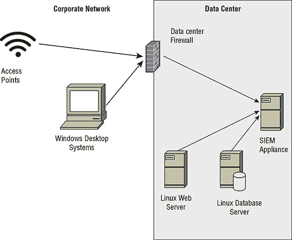

### 19. Jennifer 需要确保所有 Windows 系统向 SIEM 提供相同的日志记录信息。她如何才能最好地确保所有 Windows 桌面具有相同的日志设置？

1.  执行定期配置审计。
2.  使用组策略。
3.  使用本地策略。
4.  部署 Windows syslog 客户端。

### 20. 在正常运行期间，Jennifer 的团队使用 SIEM 设备监控通过 syslog 接收到的异常。图中所示的哪个系统不原生支持 syslog 事件？

1.  企业级无线接入点
2.  Windows 桌面系统
3.  Linux Web 服务器
4.  企业级防火墙设备

### 21. 组织应为图中所示的每个设备使用什么技术，以确保日志可以在整个基础设施中按时间顺序排序？

1.  Syslog
2.  NTP
3.  Logsync
4.  SNAP

### 22. 在一次渗透测试中，Danielle 需要识别系统，但她在所使用的系统上尚未获得生成原始数据包所需的足够访问权限。她应该运行哪种类型的扫描来验证最多的开放服务？

1.  TCP 连接扫描
2.  TCP SYN 扫描
3.  UDP 扫描
4.  ICMP 扫描

### 23. Joseph 在使用 nmap 进行端口扫描时，发现一个系统显示两个开放端口，令他立即感到担忧：

*   21/open
*   23/open

这些端口上可能运行着什么服务？

1.  SSH 和 FTP
2.  FTP 和 Telnet
3.  SMTP 和 Telnet
4.  POP3 和 SMTP

### 24. Saria 的团队正努力说服管理层，他们的网络存在攻击者可利用的大量漏洞。如果她想作为渗透测试的一部分进行一次真实的攻击，应该进行哪种类型的渗透测试？

1.  水晶盒测试
2.  灰盒测试
3.  白盒测试
4.  黑盒测试

### 25. 评估软件测试覆盖应用程序潜在用例程度的常用方法是什么？

1.  测试覆盖率分析
2.  源代码审查
3.  模糊分析
4.  代码审查报告

### 26. 专注于系统**不应**允许的功能的测试，是哪种测试的示例？

1.  用例测试
2.  手动测试
3.  误用用例测试
4.  动态测试

### 27. 哪种监控类型使用模拟流量访问网站以监控性能？

1.  日志分析
2.  合成监控
3.  被动监控
4.  模拟事务分析

### 28. 以下哪种漏洞不太可能被 Web 漏洞扫描器发现？

1.  路径泄露
2.  本地文件包含
3.  竞争条件
4.  缓冲区溢出

### 29. Jim 使用一个工具扫描系统的可用服务，然后连接到这些服务以收集横幅信息，从而确定正在运行的服务版本。该工具随后提供一份详细报告，说明其收集的信息，基于服务指纹识别、横幅信息以及收集到的类似细节，并结合 CVE 信息。Jim 使用的是哪类工具？

1.  端口扫描器
2.  服务验证器
3.  漏洞扫描器
4.  补丁管理工具

### 30. Emily 编写了一个脚本，向她正在测试的 Web 应用程序发送数据。每次脚本运行时，它都会发送一系列事务，其中包含符合 Web 应用程序预期要求的数据，以验证其对典型客户行为的响应。她使用的是哪种事务，这是哪种测试？

1.  合成，被动监控
2.  合成，用例测试
3.  实际，动态监控
4.  实际，模糊测试

### 31. 哪种被动监控技术记录用户与应用程序或网站的所有交互，以确保质量和性能？

1.  客户端/服务端测试
2.  真实用户监控
3.  合成用户监控
4.  被动用户记录

### 32. 今年早些时候，Jim 所在单位的信息安全团队发现了 Jim 负责维护的 Web 服务器中的一个漏洞。他立即应用了补丁，并确信补丁安装正确，但漏洞扫描器仍因检测到的版本号而持续错误地将该系统标记为易受攻击，尽管 Jim 确信补丁已安装。以下哪项是 Jim 处理该问题的最佳选择？

1.  卸载并重新安装补丁。
2.  要求信息安全团队将该系标记为已修补且不易受攻击。
3.  更新 Web 服务器配置中的版本信息。
4.  审查漏洞报告并使用替代补救方案。

### 33. Angela 想使用自动化工具测试 Web 浏览器处理意外数据的情况。她应该选择哪个工具？

1.  Nmap
2.  zzuf
3.  Nessus
4.  Nikto

### 34. STRIDE 代表欺骗、篡改、抵赖、信息泄露、拒绝服务、权限提升，它在应用程序威胁建模的哪个部分很有用？

1.  漏洞评估
2.  误用用例测试
3.  威胁分类
4.  渗透测试规划

### 35. 为什么除了实施无线入侵检测系统等无线安全技术外，还应进行被动扫描？

1.  它有助于识别流氓设备。
2.  它可以通过脚本攻击测试无线网络的安全性。
3.  它们在每个无线信道上的短驻留时间可使其捕获更多数据包。
4.  它们有助于测试无线 IDS 或 IPS 系统。

### 36. 在一次渗透测试中，Lauren 被要求测试组织的蓝牙安全。以下哪项不是她应向雇主解释的顾虑？

1.  蓝牙扫描可能耗时较长。
2.  许多可能被扫描的设备很可能是个人设备。
3.  蓝牙被动扫描可能需要在不同时间多次访问才能识别所有目标。
4.  蓝牙主动扫描无法评估蓝牙设备的安全模式。

### 37. 什么术语描述了旨在发现补丁或配置变更引入的新错误的软件测试？

1.  非回归测试
2.  演化测试
3.  冒烟测试
4.  回归测试

### 38. 以下哪个工具无法为渗透测试人员识别目标的操作系统？

1.  Nmap
2.  Nessus
3.  Nikto
4.  sqlmap

### 39. Susan 需要预测组织的高风险领域，并希望使用指标在风险趋势发生时进行评估。她应该怎么做来处理此事？

1.  执行年度风险评估。
2.  雇佣渗透测试公司定期测试组织安全性。
3.  识别并跟踪关键风险指标。
4.  使用 SIEM 设备监控日志和事件。

### 40. 区分合成监控和被动监控的主要区别是什么？

1.  合成监控仅在问题发生后才起作用。


## 被动监控与合成监控的局限性

2. 被动监控无法检测功能性问题。

3. 被动监控仅在问题发生后才能生效。

4. 合成监控无法检测功能性问题。

---

## 渗透测试方法论场景（第 41–43 题）

请参考以下场景回答第 41–43 题。Chris 使用此处所示的标准渗透测试方法论。请结合该方法论及您对渗透测试的了解，回答测试期间工具使用相关的问题。

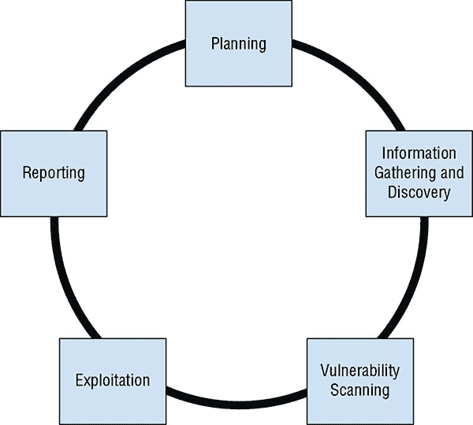

### 41. 第一阶段（规划）中最重要的任务是什么？

1. 搭建测试实验室
2. **获取授权**
3. 收集合适的工具
4. 确定测试是白盒、黑盒还是灰盒

### 42. 以下哪种工具最可能在发现阶段使用？

1. Nessus
2. john
3. **Nmap**
4. Nikto

### 43. 在规划阶段解决以下哪项顾虑最为重要，以确保报告阶段不会引发问题？

1. 使用哪种 CVE 格式
2. **漏洞数据将如何存储和传输**
3. 哪些目标是禁测的
4. 报告应有多长

---

## 代码测试覆盖率标准

### 44. 验证代码测试套件工作时，常用的四种覆盖率标准是什么？

1. 输入、语句、分支和条件覆盖
2. **函数、语句、分支和条件覆盖**
3. API、分支、边界和条件覆盖
4. 边界、分支、循环和条件覆盖

---

## 安全度量指标

### 45. Jacob 作为安全经理，向管理团队提供了下图所示的图表。他为他们提供哪种类型的度量？

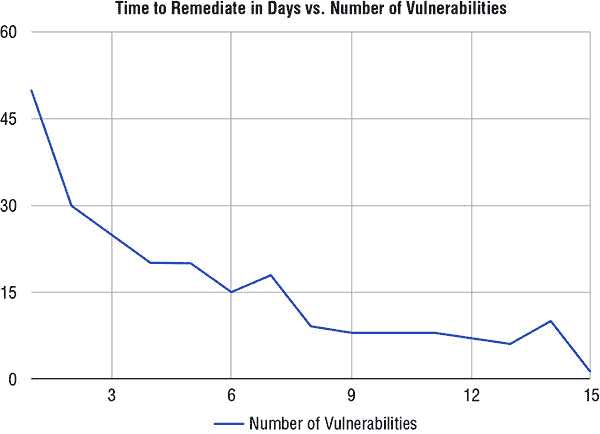

1. 覆盖率度量
2. **关键绩效指标 (KPI)**
3. 生存时间 (TTL) 指标
4. 业务关键性指标

---

## 日志审计与问责制

### 46. 在审查日志时，为所有用户使用唯一用户 ID 能提供什么？

1. 机密性
2. 完整性
3. 可用性
4. **问责制**

---

## 软件测试接口

### 47. 以下哪项不是软件测试过程中通常测试的接口类型？

1. APIs
2. 网络接口
3. UIs
4. **物理接口**

---

## SCAP 组件

### 48. Alan 的组织使用安全内容自动化协议 (SCAP) 标准化其漏洞管理计划。Alan 可以使用 SCAP 的哪个组件来协调不同安全评估工具生成的漏洞身份标识？

1. OVAL
2. XCCDF
3. **CVE**
4. SCE

---

## 安全漏洞成因

### 49. 配置错误、逻辑与功能缺陷以及不良编程实践都是导致什么常见安全问题的原因？

1. 模糊测试
2. **安全漏洞**
3. 缓冲区溢出
4. 竞争条件

---

## 漏洞修复策略

### 50. 以下哪种策略不是针对漏洞扫描器识别出的漏洞的合理修复方法？

1. 安装补丁。
2. 使用变通修复方案。
3. **更新横幅或版本号。**
4. 使用应用层防火墙或 IPS 防止针对已识别漏洞的攻击。

---

## 社会工程学攻击

### 51. 在一次渗透测试中，Saria 致电目标公司的服务台，谎称是公司高管的高级助理。她请求服务台重置该高管的密码，理由是高管出差时笔记本电脑出现问题，并说服他们照做了。她成功实施了哪种类型的攻击？

1. 零知识
2. 服务台欺骗
3. **社会工程学**
4. 黑盒

---

## 日志处理配置问题

### 52. 在此图像中，由于日志处理设置可能会发生什么问题？

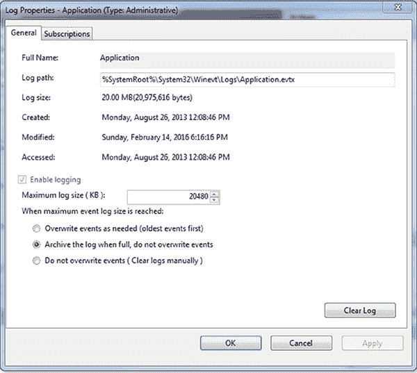

1. 归档日志时可能会丢失日志数据。
2. **日志数据可能会被覆盖。**
3. 日志数据可能不包含所需信息。
4. 日志数据可能填满系统磁盘。

---

## 渗透测试风险

### 53. 以下哪项不是与渗透测试相关的风险？

1. 应用程序崩溃
2. 拒绝服务
3. **漏洞利用**
4. 数据损坏

---

## NIST 特别出版物

### 54. 哪个 NIST 特别出版物涵盖安全和隐私控制的评估？

1. 800-12
2. **800-53A**
3. 800-34
4. 800-86

---

## 扫描类型匹配（第 55 题）

将每个编号的扫描类型与相应的字母描述匹配。每个项目仅使用一次。

**扫描类型**

1. TCP Connect
2. TCP ACK
3. TCP SYN
4. Xmas

**扫描描述**

1. 发送请求以打开新连接
2. **完成三次握手**
3. 发送伪装成活动控制一部分的数据包
4. **发送设置了 FIN、PSH 和 URG 标志的数据包**

> **匹配参考答案：**
> - TCP Connect (1) → 完成三次握手 (2)
> - TCP ACK (2) → 发送伪装成活动控制一部分的数据包 (3)
> - TCP SYN (3) → 发送请求以打开新连接 (1)
> - Xmas (4) → 发送设置了 FIN、PSH 和 URG 标志的数据包 (4)

---

## Nmap 扫描结果分析（第 56–57 题）

Kara 使用 `nmap` 对受控系统进行扫描，获得如下结果。请参考这些结果回答第 56 和 57 题。

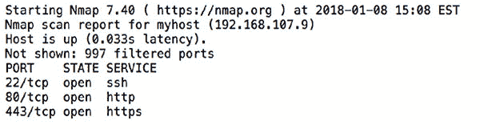

### 56. 如果 Kara 的主要关注点是防止窃听攻击，她应该阻止哪个端口？

1. 22
2. **80**
3. 443
4. 1433

### 57. 如果 Kara 的主要关注点是防止对服务器的管理连接，她应该阻止哪个端口？

1. **22**
2. 80
3. 443
4. 1433

---

## 备份日志审计发现

### 58. 在第三方审计期间，Jim 的公司收到一项发现：“管理员应每天查看备份成功和失败日志，并及时采取行动解决报告的异常情况。”如果 Jim 的 IT 人员需要从备份中恢复，最可能导致的最大问题是什么？

1. 他们将不知道备份是成功还是失败。
2. 备份可能没有被正确记录。
3. **备份可能不可用。**
4. 备份日志可能没有被正确审查。

---

## 国际 IT 审计标准

### 59. Jim 正在帮助组织决定在其国际组织中使用的审计标准。以下哪项不是 Jim 的组织在审计中可能使用的 IT 标准？

1. COBIT
2. SSAE-18
3. **ITIL**
4. ISO 27002

---

## NIST SP 800-137 持续监控流程

### 60. 以下哪项最能描述 NIST 特别出版物 800-137 中所述的构建和实施信息安全持续监控 (ISCM) 计划的典型流程？

1. **定义、建立、实施、分析和报告、响应、审查和更新**
2. 设计、构建、运行、分析、响应、审查、修订
3. 准备、检测和分析、遏制、响应、恢复、报告
4. 定义、设计、构建、监控、分析、反应、修订

---

## 回归测试 KPI

### 61. Lauren 的团队对发布的每个补丁进行回归测试。他们应维护哪个关键绩效指标来衡量测试的有效性？

1. 漏洞修复时间
2. **缺陷复发率度量**
3. 加权风险趋势
4. 其测试特定覆盖率的度量

---

## 代码审查类型

### 62. 以下哪种代码审查类型通常不由人工执行？

1. 软件检查
2. 代码审查
3. **静态程序分析**
4. 软件演练

---

## 质量保证测试场景（第 63–65 题）

请参考以下场景回答第 63–65 题：

Susan 是公司质量保证 (QA) 团队的负责人。该团队被委以测试公司核心软件产品重大版本发布的任务。

### 63. Susan 的软件测试团队需要测试每一条代码路径，包括仅在错误条件下才会使用的路径。为了确保完整的代码覆盖率，她的团队需要哪种测试环境？

1. **白盒**
2. 灰盒
3. 黑盒
4. 动态


## 练习题 64-86

### 64. 测试报告类型
作为其新应用程序持续测试的一部分，Susan 的质量保证团队为一系列黑盒测试设计了一组测试用例。这些功能测试随后被运行，并准备了一份报告解释发生了什么。在此测试期间通常会生成哪种类型的报告来指示测试指标？

1. 测试覆盖率报告
2. 渗透测试报告
3. 代码覆盖率报告
4. 行覆盖率报告

### 65. 代码覆盖测试中可能遗漏的问题
作为其代码覆盖测试的一部分，Susan 的团队在非生产环境中使用日志记录和跟踪工具运行分析。由于运行环境的这种变化，在测试期间最有可能错过以下哪种类型的代码问题？

1. 不当的边界检查
2. 输入验证
3. 竞态条件
4. 指针操作

### 66. 漏洞扫描后的后续步骤
Robin 最近进行了一次漏洞扫描，并在一台处理敏感信息的服务器上发现了一个关键漏洞。Robin 接下来应该做什么？

1. 打补丁
2. 报告
3. 修复
4. 验证

### 67. 代码审查类型
Kathleen 正在审查一个应用程序的代码。她首先计划审查，与审查人员进行概述会议并分配角色，然后与审查人员一起审查材料并为他们的角色做准备。接下来，她打算审查代码、重写代码，并确保所有发现的缺陷都已得到纠正。Kathleen 正在进行哪种类型的审查？

1. 动态测试
2. Fagan 检查
3. 模糊测试
4. Roth-Parker 审查

### 68. 漏洞评分系统
Danielle 希望根据漏洞的可利用性、是否存在利用代码以及修复难度，比较她在数据中心发现的漏洞。她应该使用哪种评分系统来比较这些漏洞指标？

1. CSV
2. NVD
3. VSS
4. CVSS

### 69. 端口扫描识别设备
在对其网络进行端口扫描时，Alex 发现整个组织办公室的许多主机在 TCP 端口 80、443、515 和 9100 上响应。Alex 可能正在发现哪种类型的设备？

1. Web 服务器
2. 文件服务器
3. 无线接入点
4. 打印机

### 70. Web 应用漏洞扫描工具
Nikto、Burp Suite 和 Wapiti 都是以下哪种工具的示例？

1. Web 应用漏洞扫描器
2. 代码审查工具
3. 漏洞扫描器
4. 端口扫描器

### 71. Fagan 检查代码审查步骤排序
将以下 Fagan 检查代码审查的要素按正确顺序排列。

1. 跟进
2. 检查
3. 概述
4. 计划
5. 准备
6. 重写

### 72. Metasploit 使用预期
Jim 正在与一位渗透测试承包商合作，该承包商提议将 `Metasploit` 作为其渗透测试工作的一部分。当使用 `Metasploit` 时，Jim 应该预期会发生什么？

1. 系统将被扫描漏洞。
2. 系统将被利用已知漏洞。
3. 服务将被探测缓冲区溢出和其他未知缺陷。
4. 系统将被测试零日漏洞利用。

### 73. 接口测试
Susan 需要确保其电子商务应用程序组件之间的交互都得到妥善处理。她打算验证整个基础设施中的通信、错误处理和会话管理能力。她计划进行哪种类型的测试？

1. 误用用例测试
2. 模糊测试
3. 回归测试
4. 接口测试

### 74. 日志管理规划因素
Jim 正在设计其组织的日志管理系统，他知道需要仔细规划以处理组织的日志数据。以下哪项不是 Jim 应该关心的因素？

1. 日志数据量
2. 缺乏足够的日志源
3. 数据存储安全要求
4. 网络带宽

### 75. SCAP 组件：CPE
Ken 在关联其组织中不同安全团队的信息时遇到困难。具体来说，他希望找到一种以一致方式描述操作系统的方法。哪个 SCAP 组件可以帮助他？

1. CVE
2. CPE
3. CWE
4. OVAL

### 76. Windows 重启日志类型
当 Windows 系统重新启动时，会生成哪种类型的日志？

1. 错误
2. 警告
3. 信息
4. 失败审核

### 77. 常见日志问题：时间戳不一致
在审查访问日志时，Alex 注意到 Danielle 每天上午 8 点在纽约的工作站登录，但记录显示她每天凌晨 3 点左右登录了其部门的主 Web 应用程序。Alex 可能遇到了什么常见的日志问题？

1. 日志格式不一致
2. 日志被修改
3. 时间戳不一致
4. 多个日志源

### 78. 认证漏洞扫描
哪种类型的漏洞扫描会访问其运行目标系统的配置信息，以及通过网络可用服务访问的信息？

1. 认证扫描
2. Web 应用扫描
3. 未认证扫描
4. 端口扫描

---

## 场景：STRIDE 威胁建模 (第 79-81 题)
Ben 的组织已开始使用 STRIDE 评估其软件，并识别了威胁代理以及这些威胁可能产生的业务影响。现在他们正在努力为已识别的问题确定适当的控制措施。

### 79. 针对提权威胁的控制措施
Ben 的开发团队需要解决一个授权问题，导致提权威胁。以下哪种控制措施最适合此类问题？

1. 启用审计和日志记录。
2. 对特定操作使用基于角色的访问控制。
3. 启用数据类型和格式检查。
4. 根据白名单测试用户输入。

### 80. STRIDE 分类：共享对称密钥导致的事务识别问题
Ben 的团队试图对由多台服务器共享的对称密钥使用导致的事务识别问题进行分类。这应归入哪个 STRIDE 类别？

1. 信息泄露
2. 拒绝服务
3. 篡改
4. 抵赖

### 81. 防止或检测数据篡改的不当方案
Ben 想要防止或检测数据篡改。以下哪项不是合适的解决方案？

1. 哈希
2. 数字签名
3. 过滤
4. 授权控制

### 82. 解决时间戳不一致的协议
Chris 正在排查其组织 SIEM 报告的问题。分析后，他认为不同系统日志条目上的时间戳不一致。他可以使用什么协议来解决此问题？

1. SSH
2. FTP
3. TLS
4. NTP

### 83. 模糊测试的局限性
Ryan 正在考虑在其 Web 应用程序测试计划中使用模糊测试。在做决定时，Ryan 应该考虑模糊测试的以下哪一项局限性？

1. 它们通常只发现简单的故障。
2. 测试人员必须手动生成输入。
3. 模糊器可能无法完全覆盖代码。
4. 模糊器无法重现错误。

### 84. 语句覆盖率分析
Ken 正在为其团队开发的软件设计测试流程。他正在设计一项测试，以验证测试期间是否执行了每一行代码。Ken 正在执行哪种类型的分析？

1. 分支覆盖率
2. 条件覆盖率
3. 函数覆盖率
4. 语句覆盖率

---

## 场景：Nmap 端口扫描结果分析 (第 85-87 题)
在一次端口扫描期间，Ben 使用 `nmap` 的默认设置并看到了以下结果。

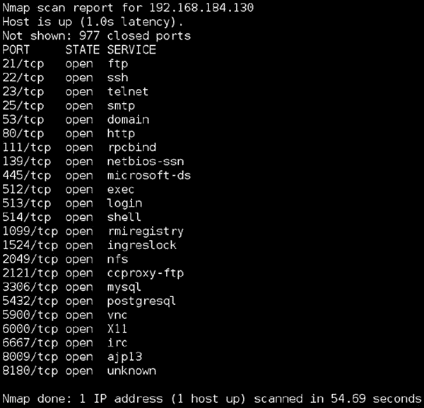

### 85. 渗透测试后续步骤
如果 Ben 正在进行渗透测试，收到这些结果后他的下一步应该是什么？

1. 使用 Web 浏览器连接到 Web 服务器。
2. 通过 Telnet 连接以测试易受攻击的账户。
3. 识别有趣的端口以进行进一步扫描。
4. 对打开的数据库使用 `sqlmap`。

### 86. 根据扫描结果推断操作系统
根据扫描结果，被扫描系统最有可能运行哪种操作系统 (OS)？

1. Windows 桌面版
2. Linux
3. 网络设备
4. Windows Server


### 87. Ben 的经理对其扫描的覆盖范围表示担忧。经理为什么会有这种担忧？

1. Ben 未测试 UDP 服务。
2. Ben 未发现“知名端口”以外的端口。
3. Ben 未执行操作系统指纹识别。
4. Ben 仅测试了有限数量的端口。

### 88. 哪种技术依赖于在不运行代码的情况下审查代码？

1. 模糊测试
2. 黑盒分析
3. 静态分析
4. 灰盒分析

### 89. Saria 需要编写一份代码审查的提案请求 (RFP)，并希望确保审查人员考虑到其组织应用程序背后的业务逻辑。她应在 RFP 中指定哪种类型的代码审查？

1. 静态
2. 模糊测试
3. 人工
4. 动态

### 90. 应用威胁建模中使用的哪种图表包含恶意用户以及 *mitigates*（缓解）和 *threatens*（威胁）等描述？

1. 威胁树
2. STRIDE 图表
3. 误用用例图
4. DREAD 图表

### 91. 在执行渗透测试之前，应首先发生的步骤是什么？

1. 数据收集
2. 端口扫描
3. 获取授权
4. 规划

### 92. Kevin 是一名数据库管理员，希望使用一款专门用于测试数据库安全性的工具。以下哪种工具最适合此目的？

1. `sqlmap`
2. `nmap`
3. `sqlthrash`
4. Nessus

### 93. 在对其组织进行渗透测试期间，Kathleen 的 IPS 检测到一个设置了 URG、FIN 和 PSH 标志的端口扫描并产生了警报。渗透测试人员正在尝试哪种类型的扫描？

1. SYN 扫描
2. TCP 标志扫描
3. Xmas 扫描
4. ACK 扫描

### 94. Nmap 是哪种类型工具的示例？

1. 漏洞扫描器
2. Web 应用模糊测试器
3. 网络设计与布局
4. 端口扫描器

### 95. 漏洞扫描器无法发现哪类漏洞？

1. 本地漏洞
2. 服务漏洞
3. 零日漏洞
4. 需要身份验证的漏洞

### 96. MITRE 的 CVE 数据库提供哪类信息？

1. 软件的当前版本
2. 应用程序的补丁信息
3. 漏洞信息
4. 常见流程的成本与工作量对比清单

### 97. 在遵循 NIST SP 800-53A 设计评估时，哪个评估组件包含策略和程序？

1. 规范
2. 机制
3. 活动
4. 人员

针对第 98–100 题，请参考以下场景。NIST 特别出版物 800-115《信息安全测试与评估技术指南》提供了 NIST 的渗透测试流程。请结合此图及您对渗透测试的知识来回答问题。

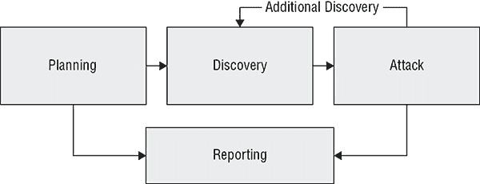

### 98. 以下哪项不属于发现阶段？

1. 主机名和 IP 地址信息收集
2. 服务信息获取
3. 垃圾箱搜寻
4. 提权

### 99. NIST 规定了四个攻击阶段步骤：获取访问权限、提升权限、系统浏览和安装额外工具。攻击者安装额外工具后，渗透测试人员通常会返回哪个阶段？

1. 发现
2. 获取访问权限
3. 提升权限
4. 系统浏览

### 100. 以下哪项通常不属于渗透测试报告的一部分？

1. 已识别漏洞清单
2. 测试期间收集的所有敏感数据
3. 每个已发现问题的风险等级
4. 已识别问题的缓解指南

# 第 7 章：安全运营（领域 7）

### 1. 参照下图，图中显示了什么技术为数据库服务器提供容错能力？

1. 故障转移集群
2. UPS
3. 磁带备份
4. 冷站点

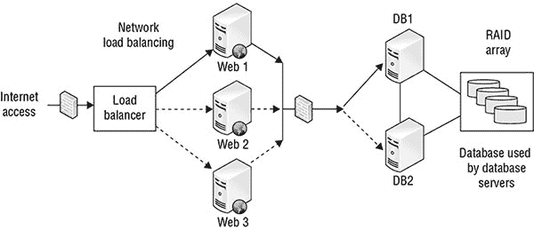

### 2. Joe 是一套 ERP 系统的安全管理员。他正准备为几名新员工创建账户。在创建账户时，他应默认给予所有新员工什么访问权限？

1. 只读
2. 编辑者
3. 管理员
4. 无访问权限

### 3. 以下哪项不是应自动发送到超级用户操作日志的特权管理活动？

1. 清除日志条目
2. 从备份恢复系统
3. 登录工作站
4. 管理用户账户

### 4. 以下哪位人员最有可能主导监管调查？

1. CISO
2. CIO
3. 政府特工
4. 私家侦探

### 5. 哪种证据完全由可带入法庭的有形物品组成？

1. 书证
2. 口头证据
3. 证人证言
4. 物证

### 6. 以下哪种受信任恢复类型不会故障转移到安全操作状态？

1. 手动恢复
2. 自动恢复
3. 无过度损失的自动恢复
4. 功能恢复

### 7. 安全团队可能会在蜜罐系统上使用以下哪项来消耗攻击者的时间并同时向管理员发出警报？

1. 蜜网
2. 伪缺陷
3. 警告横幅
4. 暗网

### 8. Toni 前往一名报告系统运行缓慢的用户工位。在检查该系统的出站网络连接时，Toni 发现大量源自该系统的社交媒体流量。该用户不使用社交媒体，当 Toni 检查相关账户时，发现其中包含疑似加密的奇怪消息。导致此流量的最可能原因是什么？

1. 其他用户正通过 Toni 的计算机中转社交媒体请求。
2. Toni 的计算机是僵尸网络的一部分。
3. Toni 关于其社交媒体使用情况撒谎。
4. 别人在 Toni 不在时使用了她的计算机。

### 9. 在哪种虚拟化模型中，虚拟化平台将网络控制平面与数据平面分离，并用仅接收控制器指令的简单设备取代复杂的网络设备？

1. 虚拟机
2. VSAN
3. VLAN
4. SDN

### 10. Jim 希望识别其网络上可能参与僵尸网络的受损系统。他计划通过监视与已知命令与控制 (C2) 服务器建立的连接来实现这一点。如果 Jim 拥有已知服务器列表，以下哪种技术最有可能提供此信息？

1. Netflow 记录
2. IDS 日志
3. 认证日志
4. RFC 日志

针对第 11–14 题，请参考以下场景：

Gary 最近受聘担任某地方政府机构的首任首席信息安全官 (CISO)。该机构最近遭遇了一起安全漏洞事件，正试图建立一个新的信息安全计划。Gary 希望在设计该计划时应用一些安全运营的最佳实践。

### 11. 当 Gary 决定应授予每位用户何种访问权限时，什么原则应指导他关于默认权限的决策？

1. 职责分离
2. 最小权限
3. 聚合
4. 特权分离

### 12. 在设计计划时，Gary 使用了此处所示的矩阵。该矩阵最直接有助于强制执行哪项信息安全原则？

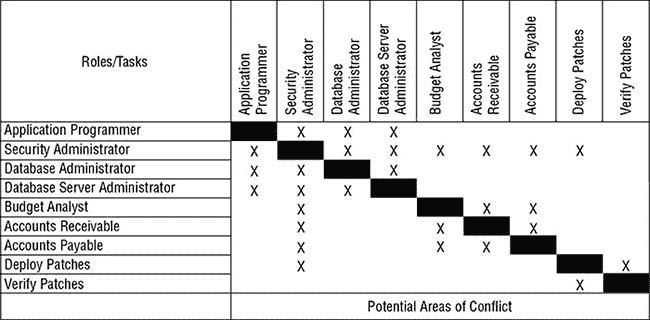

1. 职责分离
2. 聚合
3. 双人控制
4. 纵深防御


### 13. Gary 正准备为新用户创建账户并分配 HR 数据库的权限。在授予此访问权限之前，Gary 必须核实哪两项信息？

1.  凭据和知情需要
2.  安全许可和知情需要
3.  密码和安全许可
4.  密码和生物识别扫描

### 14. Gary 正准备制定针对根加密密钥访问的控制措施，并希望应用一项专门为极其敏感操作设计的安全原则。他应该应用哪项原则？

1.  最小权限
2.  深度防御
3.  通过隐匿实现安全
4.  双人控制

### 15. 组织何时应对用户对敏感系统的特权访问进行审查？

1.  定期
2.  当用户离开组织时
3.  当用户变更角色时
4.  以上全部

### 16. 以下哪个术语常用于描述以大型合集形式发布的、互不相关的补丁集合？

1.  热修复
2.  更新
3.  安全修复
4.  服务包

### 17. 以下哪项任务由取证磁盘控制器执行？

1.  屏蔽存储设备报告的错误状况
2.  向存储设备传输写命令
3.  拦截并修改或丢弃发送给存储设备的命令
4.  防止数据被发送给设备的读操作返回

### 18. Lydia 正在为其组织处理访问控制请求。她遇到一个请求，该用户确实拥有所需的安全许可，但没有业务理由证明该访问的合理性。Lydia 拒绝了该请求。她遵循了什么安全原则？

1.  知情需要
2.  最小权限
3.  职责分离
4.  双人控制

### 19. 将每个编号术语与其正确的字母定义相匹配：

**术语**

1.  蜜罐
2.  蜜网
3.  伪缺陷
4.  暗网

**定义**

1.  故意设计的漏洞，用于引诱攻击者
2.  故意设置漏洞的网络
3.  故意设置漏洞的系统
4.  没有任何主机的受监控网络

### 20. 以下哪种机制通常不被视为防范欺诈的威慑手段？

1.  岗位轮换
2.  强制休假
3.  应急响应
4.  双人控制

### 21. Brian 最近加入一个组织，该组织的大多数服务运行在其自有数据中心的虚拟化平台上，但也利用 IaaS 提供商托管其 Web 服务和 SaaS 邮件系统。哪个术语最能描述该组织使用的云环境类型？

1.  公有云
2.  专用云
3.  私有云
4.  混合云

### 22. Tom 正在响应最近的安全事件，正在寻找关于最近修改系统安全设置的审批流程信息。他最有可能在哪里找到此信息？

1.  变更日志
2.  系统日志
3.  安全日志
4.  应用日志

### 23. Mark 正考虑用云中可用的新产品替换其组织的客户关系管理 (CRM) 解决方案。该新解决方案完全由供应商管理，Mark 的公司无需编写任何代码或管理任何物理资源。Mark 正在考虑哪种类型的云解决方案？

1.  IaaS
2.  CaaS
3.  PaaS
4.  SaaS

### 24. 以下哪个信息来源对于寻求应用程序、设备和操作系统信息安全漏洞列表的安全管理员有用？

1.  OWASP
2.  Bugtraq
3.  Microsoft 安全公告
4.  CVE

### 25. 在进行灾难恢复规划时，以下哪项通常会被视为灾难的示例？

1.  黑客事件
2.  洪水
3.  火灾
4.  恐怖主义

    1.  仅 II 和 III
    2.  仅 I 和 IV
    3.  仅 II、III 和 IV
    4.  I、II、III 和 IV

### 26. Glenda 希望进行灾难恢复测试，并寻求一种测试，允许在不中断正常信息系统活动且以尽可能少的时间投入的情况下审查计划。她应该选择哪种类型的测试？

1.  桌面推演
2.  并行测试
3.  全面中断测试
4.  清单审查

### 27. 以下哪项不是备份磁带轮换方案的示例？

1.  祖父/父亲/儿子
2.  中间相遇
3.  汉诺塔
4.  六盒磁带每周轮换

### 28. Helen 正在实施一项新的安全机制，用于授予员工会计系统的管理权限。她设计该流程，要求员工的经理和会计经理在授予访问权限前都必须批准该请求。Helen 正在强制执行什么信息安全原则？

1.  最小权限
2.  双人控制
3.  岗位轮换
4.  职责分离

### 29. 以下哪项不是证据在法庭上被采纳的要求？

1.  证据必须相关。
2.  证据必须实质性。
3.  证据必须有形。
4.  证据必须胜任。

### 30. 在哪种云计算模型中，客户与云供应商的其他客户共享计算基础设施，其中一位客户可能不知道另一位的身份？

1.  公有云
2.  私有云
3.  社区云
4.  共享云

### 31. 以下哪些组织可能在 CSIRT 中有代表？

1.  信息安全
2.  法律顾问
3.  高级管理层
4.  工程

    1.  I、III 和 IV
    2.  I、II 和 III
    3.  I、II 和 IV
    4.  以上全部

### 32. Sam 负责备份公司的主文件服务器。他配置了一个备份计划，每周一晚上 9 点执行完全备份，在一周的其他日子同一时间执行差异备份。根据下图所示信息，文件发生变化。周三的备份将复制多少个文件？

1.  2
2.  3
3.  5
4.  6

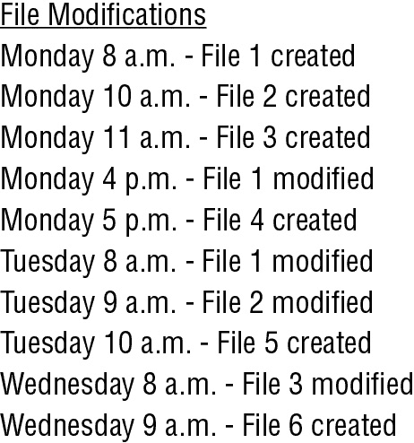

### 33. 以下哪种安全工具无法对安全事件生成主动响应？

1.  IPS
2.  防火墙
3.  IDS
4.  杀毒软件

### 34. 在虚拟化平台中，负责控制虚拟资源对物理资源访问的模块叫什么名字？

1.  客户机
2.  SDN
3.  内核
4.  管理程序

### 35. 创建新账户时，分配给用户的默认权限集称为什么？

1.  聚合
2.  传递性
3.  基线
4.  权利

### 36. 以下哪种协议类型是最正式的文档，包含服务提供商与客户之间关于可用性和其他性能参数的期望？

1.  服务级别协议 (SLA)
2.  运营级别协议 (OLA)
3.  谅解备忘录 (MOU)
4.  工作说明书 (SOW)

### 37. 以下哪个框架专注于 IT 服务管理，并包含变更管理、配置管理和服务级别协议等主题？

1.  ITIL
2.  PMBOK
3.  PCI DSS
4.  TOGAF


### 38. Richard 正在经历其组织网络上网络服务质量的问题。主要症状是数据包从源头传输到目的地始终花费过长时间。哪个术语描述了 Richard 面临的问题？

1.  抖动
2.  丢包
3.  干扰
4.  延迟

### 39. Joe 想要测试一个他怀疑可能包含恶意软件的程序。他可以使用什么技术在程序运行时将其隔离？

1.  ASLR
2.  沙箱
3.  裁剪
4.  进程隔离

### 40. 以下哪项是人为灾难的示例？

1.  飓风
2.  洪水
3.  泥石流
4.  变压器故障

### 41. 关于 (ISC)² 职业道德准则，以下哪项描述**不正确**？

1.  遵守准则是获得认证的条件。
2.  未能遵守准则可能导致认证被撤销。
3.  该准则适用于所有信息安全专业人员。
4.  发现违反准则行为的成员必须报告可能的违规行为。

### 42. Javier 正在核实只有 IT 系统管理员才有能力登录用于管理目的的服务器。他正在执行哪项信息安全原则？

1.  需知原则
2.  最小权限
3.  双人控制
4.  传递信任

### 43. 以下哪项**不是**保护系统和应用程序免受攻击的基本预防措施？

1.  实施入侵检测和防御系统。
2.  保持所有操作系统和应用程序处于当前补丁级别。
3.  移除不必要的账户和服务。
4.  对所有系统进行取证成像。

### 44. Tim 是一名取证分析师，正试图从硬盘驱动器中检索信息。看起来用户曾试图擦除数据，Tim 正试图重建数据。Tim 正在执行哪种类型的取证分析？

1.  软件分析
2.  介质分析
3.  嵌入式设备分析
4.  网络分析

### 45. 以下哪项是计算机安全事件的示例？

1.  备份计划的完成
2.  日志中记录的系统访问
3.  对文件服务器的未授权漏洞扫描
4.  杀毒软件签名的更新

### 46. 以下哪种技术能以具成本效益的方式为库存控制流程提供最大程度的自动化？

1.  IPS
2.  WiFi
3.  RFID
4.  以太网

### 47. Connor 公司最近遭遇了一次拒绝服务攻击，Connor 认为攻击源自内部。如果属实，公司经历了哪种类型的事件？

1.  间谍活动
2.  机密性泄露
3.  破坏活动
4.  完整性泄露

### 48. 下图展示了哪种类型的攻击？

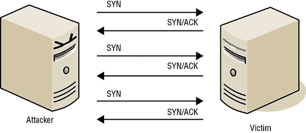

1.  SYN 洪水
2.  Ping 洪水
3.  Smurf
4.  Fraggle

### 49. Florian 正在为其组织制定灾难恢复计划，并希望确定特定 IT 服务在不给业务运营造成严重损害的情况下可中断的时间长度。Florian 正在计算哪个变量？

1.  RTO
2.  MTD
3.  RPO
4.  SLA

### 50. 以下哪项陈述最能描述零日漏洞？

1.  初入黑客世界的攻击者
2.  一种数据库攻击，将日期 00/00/0000 放入数据表中，试图利用业务逻辑中的缺陷
3.  安全社区此前未知的攻击
4.  一种将操作系统日期和时间设置为 00/00/0000 和 00:00:00 的攻击

### 51. 以下哪项**不是** (ISC)² 职业道德准则的准则？

1.  保护社会、公共利益、必要的公众信任和信心以及基础设施。
2.  及时向相关当局报告安全漏洞。
3.  光荣、诚实、公正、负责任且合法地行事。
4.  为委托人提供勤勉且称职的服务。

### 52. 在事件调查期间，调查人员与一名可能掌握事件信息但不是嫌疑人的系统管理员会面。此次会面中进行的是哪种类型的交谈？

1.  访谈
2.  审讯
3.  既是访谈也是审讯
4.  既不是访谈也不是审讯

### 53. 将每个编号的恢复能力类型与其正确的字母定义相匹配：

**术语**

1.  热站点
2.  冷站点
3.  温站点
4.  服务局

**定义**

1.  一个可在灾难发生时提供现场或异地 IT 服务的组织
2.  一个拥有专用存储和实时数据复制的站点，通常具有共享设备，允许在极短时间内恢复服务
3.  一个依赖共享存储和备份进行恢复的站点
4.  一个拥有电力、冷却和连接的租赁空间，可作为恢复工作的一部分接收设备

### 54. 下图中使用了哪种技术来保护知识产权？


1.  隐写术
2.  裁剪
3.  采样
4.  水印

### 55. 你正在评估某区域的洪水风险，并查阅了联邦应急管理局 (FEMA) 的洪水地图。根据这些地图，该区域位于 200 年一遇的洪水泛区内。该地区洪水的年化发生率 (ARO) 是多少？

1.  200
2.  0.01
3.  0.02
4.  0.005

### 56. 在大多数防守完善的组织中，以下哪类人员构成最大的安全风险？

1.  政治活动家
2.  恶意内部人员
3.  脚本小子
4.  寻求刺激的攻击者

### 57. Veronica 正在考虑实施顾问推荐的一种数据库恢复机制。在推荐的方法中，一个自动化流程将每晚将数据库备份从主设施移动到异地位置。顾问描述的是哪种数据库恢复技术？

1.  远程日志
2.  远程镜像
3.  电子存管
4.  事务日志

### 58. 在设计访问控制方案时，Hilda 设置了角色，使得同一个人不具备同时预配新用户账户和为账户分配超级用户权限的能力。Hilda 遵循了哪项信息安全原则？

1.  最小权限
2.  职责分离
3.  工作轮换
4.  通过隐匿实现安全

### 59. Reggie 最近收到公司内部审计部门的一封信，安排其小组评估的启动会议。在该会议中，Reggie **不应**期望了解以下哪项内容？

1.  审计范围
2.  审计目的
3.  预期时间框架
4.  预期发现

### 60. 以下哪个事件标志着灾难恢复过程的完成？

1.  保护财产和人员安全
2.  在备用设施恢复运营
3.  在主设施恢复运营
4.  第一响应人员撤离

### 61. Melanie 怀疑有人正在使用恶意软件窃取其公司的计算周期。以下哪种安全工具最有可能检测到此类事件？

1.  NIDS
2.  防火墙
3.  HIDS
4.  DLP

### 62. Brandon 观察到其网络上某系统的授权用户最近滥用其账户，针对共享服务器利用系统漏洞，从而获得了该服务器的 root 访问权限。发生了哪种类型的攻击？

1.  拒绝服务


#### 2. 权限提升

#### 3. 侦察

#### 4. 暴力破解

### 63. 权限累积场题
Carla 在公司工作了 15 年，担任过多个不同的职位。每次她更换职位时，都会获得与该职位相关的新特权，但从未收回过任何特权。什么概念描述了她累积的一组特权？

1.  授权
2.  聚合
3.  传递性
4.  隔离

### 64. 事件响应阶段
在事件响应过程的哪个阶段，管理员会采取行动以限制事件的影响或范围？

1.  检测
2.  响应
3.  缓解
4.  恢复

---

**第 65–68 题场景：**
Ann 是一家中型企业的安全专业人员，通常负责为其组织处理日志分析和安全监控任务。她的职责之一是监控源自组织入侵检测系统的警报。该系统通常每天生成几十个警报，经过她调查后，其中许多警报被证明是误报。

今天早上，入侵检测系统发出警报，因为网络开始接收异常大量的入站流量。Ann 收到此警报，并开始调查流量的来源。

### 65. 安全事件分类
在事件响应过程的这个阶段，什么术语最能描述 Ann 组织中发生的情况？

1.  安全事件
2.  安全事故
3.  安全事件
4.  安全入侵

### 66. 53 端口服务
Ann 继续调查，意识到触发警报的流量是异常大量的入站 UDP 53 端口流量。什么服务通常使用此端口？

1.  DNS
2.  SSH/SCP
3.  SSL/TLS
4.  HTTP

### 67. 攻击类型识别
随着 Ann 进一步分析流量，她意识到流量来自许多不同的来源，并淹没了网络，阻止了合法使用。入站数据包是对查询的响应，但她在出站流量中看不到这些查询。这些响应对于其类型而言异常巨大。Ann 应该怀疑哪种类型的攻击？

1.  侦察
2.  恶意代码
3.  系统渗透
4.  拒绝服务

### 68. 调查后分类
现在 Ann 了解到已经发生了一次违反其组织安全策略的攻击，什么术语最能描述 Ann 组织中发生的情况？

1.  安全事件
2.  安全事故
3.  安全事件
4.  安全入侵

### 69. 证据可采性
Frank 试图将黑客的笔记本电脑作为法庭证据，以起诉该黑客。该笔记本电脑确实包含表明黑客实施了犯罪的日志，但法院裁定，导致警方发现该笔记本电脑的公寓搜查是违宪的。什么可采性标准阻止 Frank 提交该笔记本电脑作为证据？

1.  实质性
2.  相关性
3.  传闻证据
4.  合法性

### 70. 内部调查权限
Gordon 怀疑黑客已渗透其公司的一个系统。该系统不包含任何受监管的信息，Gordon 希望代表公司进行调查。他已获得主管许可进行调查。以下哪项陈述是正确的？

1.  Gordon 在开始调查前有法律义务联系执法部门。
2.  Gordon 不得自行进行调查。
3.  Gordon 的调查可以包括检查硬盘内容、网络流量以及属于公司的任何其他系统或信息。
4.  Gordon 在识别出肇事者后，可以合乎道德地实施“反向黑客”活动。

### 71. 供应商风险保护
以下哪种工具能为组织提供针对软件供应商倒闭的最高级别保护？

1.  服务级别协议
2.  托管协议
3.  互助协议
4.  PCI DSS 合规协议

### 72. 强制休假政策
Fran 正在为她的银行考虑新的人力资源政策以防范欺诈。她计划实施强制休假政策。通常认为强制休假的最短有效时长是多少？

1.  两天
2.  四天
3.  一周
4.  一个月

### 73. 安全事故定义
以下哪些事件构成安全事故？

1.  尝试网络入侵
2.  成功的数据库入侵
3.  恶意软件感染
4.  违反保密策略
5.  从安全区域移除信息的未遂尝试

1.  2、3 和 4
2.  1、2 和 3
3.  4 和 5
4.  以上全部

### 74. 出站过滤策略
以下哪种流量类型不应被组织的出站过滤策略阻止？

1.  目标为私有 IP 地址的流量
2.  目标为广播地址的流量
3.  源地址来自外部网络的流量
4.  目标地址位于外部网络的流量

### 75. 日志审查技术
Allie 负责审查其组织网络上的身份验证日志。她没有时间审查所有日志，因此决定仅选择存在四次或四次以上无效身份验证尝试的记录。Allie 使用什么技术来减少记录池的大小？

1.  抽样
2.  随机选择
3.  裁剪
4.  统计分析

### 76. 取证数据源
您正在调查网络上潜在的僵尸网络感染，并希望对您网络上不同系统与互联网上系统之间传递的信息进行取证分析。您认为该信息很可能已加密。您在活动结束后开始调查。获取该信息源的最佳且最简单的方法是什么？

1.  数据包捕获
2.  Netflow 数据
3.  入侵检测系统日志
4.  集中式身份验证记录

### 77. 配置标准化
以下哪种工具通过为操作系统和应用程序提供标准的、安全的配置设置模板，帮助系统管理员？

1.  安全指南
2.  安全策略
3.  基线配置
4.  运行配置

### 78. 灾难恢复测试类型
哪种灾难恢复测试会激活备用处理设施并用其进行事务处理，但保持主站点正常运行？

1.  全面中断测试
2.  并行测试
3.  清单复核
4.  桌面推演

### 79. 事件响应阶段：检测
在事件响应过程的哪个阶段，分析师会收到入侵检测系统警报并验证其准确性？

1.  响应
2.  缓解
3.  检测
4.  报告

### 80. 虚拟化模型
在哪种虚拟化模型中，完整的客户操作系统运行在虚拟化平台之上？

1.  虚拟机
2.  软件定义网络
3.  虚拟 SAN
4.  应用虚拟化

### 81. RAID 级别
哪个 RAID 级别也称为磁盘镜像？

1.  RAID-0
2.  RAID-1
3.  RAID-5
4.  RAID-10

### 82. 端口扫描识别
Bruce 在其网络上发现了大量可疑活动。似乎有外部实体正尝试使用 TCP 连接在 22 端口连接到他的所有系统。外部人员可能正在进行哪种类型的扫描？

1.  FTP 扫描
2.  Telnet 扫描
3.  SSH 扫描
4.  HTTP 扫描

### 83. 攻击对比
历史上的“死亡之 Ping”攻击与以下哪种现代攻击类型最相似？

1.  SQL 注入
2.  跨站脚本
3.  缓冲区溢出
4.  暴力破解密码


### 84. Roger 最近接受了一家公司的安全专业人员新职位，该公司在 IaaS 环境中运行其整个 IT 基础设施。以下哪项最有可能是 Roger 所在公司的责任？

1.  配置网络防火墙
2.  应用虚拟化管理程序更新
3.  修补操作系统
4.  处置前擦除驱动器

### 85. 应用程序开发人员可以使用什么技术在隔离的虚拟化环境中测试应用程序，然后再允许它们进入生产网络？

1.  渗透测试
2.  沙箱
3.  白盒测试
4.  黑盒测试

### 86. Gina 是一家小企业的防火墙管理员，最近安装了一台新防火墙。在发现异常繁重的网络流量迹象后，她检查了入侵检测系统，该系统报告正在进行 SYN 洪水攻击。Gina 可以做出什么防火墙配置更改以最有效地防止此攻击？

1.  阻止来自已知 IP 的 SYN。
2.  阻止来自未知 IP 的 SYN。
3.  在防火墙启用 SYN-ACK 欺骗。
4.  禁用 TCP。

### 87. 哪种信任关系超出了参与信任的两个域，延伸至它们的一个或多个子域？

1.  传递信任
2.  可继承信任
3.  非传递信任
4.  不可继承信任

### 88. Renee 是一名软件开发人员，为其组织编写 `Node.js` 代码。公司正考虑从自托管 `Node.js` 环境迁移到一种由云供应商管理应用服务器、Renee 在其上运行代码的环境。Renee 所在公司正在考虑哪种类型的云解决方案？

1.  IaaS
2.  CaaS
3.  PaaS
4.  SaaS

### 89. Timber Industries 最近与一位客户发生纠纷。在与其客户代表的会议上，该客户站起来说：“没有其他解决办法了。我们只能把这件事告上法庭。”然后他离开了房间。Timber Industries 何时有义务开始保存证据？

1.  立即
2.  收到对方律师的诉讼通知时
3.  收到传票时
4.  收到法院命令时

### 90. 什么法律保护防止执法机构在没有合理理由或同意的情况下搜查设施或电子系统？

1.  第一修正案
2.  第四修正案
3.  第五修正案
4.  第十五修正案

### 91. Darcy 是一名计算机安全专家，正在协助起诉一名黑客。检察官要求 Darcy 出庭作证，就该案件中的日志和其他记录在她看来是否表明存在黑客攻击企图发表意见。Darcy 被要求提供哪种类型的证据？

1.  专家意见
2.  直接证据
3.  实物证据
4.  文书证据

### 92. 以下哪种技术不常用于从磁带中移除不需要的残留数据？

1.  物理销毁
2.  退磁
3.  覆写
4.  重新格式化

### 93. 实施 RAID 1 级别所需的最少磁盘数量是多少？

1.  一块
2.  两块
3.  三块
4.  五块

## 94. Jerome 正在进行取证调查，正在查看数据库服务器日志以调查查询内容，寻找 SQL 注入攻击的证据。他正在执行哪种类型的分析？

1.  硬件分析
2.  软件分析
3.  网络分析
4.  介质分析

### 95. Quantum Computing 定期将备份数据磁带跨州运输到二级设施。这些磁带包含机密信息。Quantum 可以使用的最重要的安全控制是什么来保护这些磁带？

1.  上锁的运输集装箱
2.  私人快递员
3.  数据加密
4.  媒体轮换

### 96. Carolyn 担心其网络上的用户可能未经适当授权或安全控制，将社会安全号码等敏感信息存储在硬盘驱动器上。她可以使用什么技术最好地检测此活动？

1.  IDS
2.  IPS
3.  DLP
4.  TLS

### 97. 在哪种软件许可下，软件接收者拥有复制、修改、分发或转售软件包的无限权利？

1.  GNU 公共许可证
2.  免费软件
3.  开源
4.  公共领域

### 98. 在哪种攻击中，攻击者设法将自己插入用户与合法网站之间的连接中？

1.  中间人攻击
2.  Fraggle 攻击
3.  战争驾驶
4.  中间相遇攻击

### 99. 以下哪种技术使用统计方法从大量记录池中选择少量记录进行进一步分析，目的是选择一组能代表整个记录池的记录？

1.  裁剪
2.  随机化
3.  抽样
4.  选择

### 100. 以下哪项控制可在发生持续断电时保护组织？

1.  冗余服务器
2.  不间断电源 (UPS)
3.  发电机
4.  RAID

### 101. 《联邦民事诉讼规则》(FCRP) 中的什么概念有助于确保在电子取证过程中，当收益不超过成本时，不会产生额外的时间和费用？

1.  工具辅助审查
2.  协作
3.  证据毁灭
4.  比例原则

### 102. Anne 想收集遍布公司各处的一组 `Windows 10` 工作站的安全设置信息，并通过收集这些数据建立组织资产的整体视图。哪种 Windows 工具最适合此类配置管理任务？

1.  SCCM
2.  组策略
3.  SCOM
4.  自定义 `PowerShell` 脚本

### 103. Scott 负责处理从公司 SAN 中拆下的、因退役而报废的磁盘驱动器。如果 SAN 上的数据被组织视为高度敏感，以下哪项选项是他应该避免的？

1.  物理销毁它们
2.  与 SAN 供应商签订合同，要求适当处置并提供认证流程
3.  在驱动器离开组织前重新格式化每个驱动器
4.  使用像 DBAN 这样的安全擦除工具

### 104. 事件事后审查完成后，通常准备什么文档？

1.  经验教训文档
2.  风险评估
3.  补救清单
4.  缓解清单

### 105. Susan 公司的员工经常出国旅行。Susan 认为，由于公司正在开发的技术，他们可能成为企业间谍活动的目标。Susan 应该建议他们在旅行时连接网络采取什么做法？

1.  仅连接公共 Wi-Fi
2.  所有连接均使用 VPN
3.  仅使用支持 TLS 的网站
4.  旅行期间不连接网络

### 106. Matt 希望确保公司各系统的关键网络流量优先于网页浏览和社交媒体使用。他可以使用什么技术来实现这一点？

1.  VLAN
2.  QoS
3.  VPN
4.  ISDN

### 107. John 通过其云基础设施即服务提供商，利用全球负载均衡器将网站部署到多个区域。他使用了什么可用性概念？

1.  多处理站点
2.  热备站点
3.  冷备站点
4.  蜜网

### 108. Lauren 希望确保用户仅运行组织批准的软件。她应该部署什么技术？

1.  黑名单
2.  配置管理
3.  白名单


## 灰名单

### 109. 当爱丽丝公司的一名员工打电话寻求支持时，她使用了一个公司约定好的代码词，该代码词用于员工被迫执行某项操作时的情况。这种场景叫什么？

1.  社会工程学
2.  胁迫
3.  不可抗力
4.  斯德哥尔摩综合征

# 第 8 章：软件开发安全（领域 8）

### 1. 在设计面向对象模型时，以下哪种情况是理想的？

1.  高内聚，高耦合
2.  高内聚，低耦合
3.  低内聚，低耦合
4.  低内聚，高耦合

### 2. 以下哪项是攻击者利用僵尸网络的常见方式？

1.  发送垃圾邮件
2.  实施暴力破解攻击
3.  扫描漏洞系统
4.  以上全部

### 3. 关于代码审查，以下哪项陈述是不正确的？

1.  代码审查应是一个由同行驱动、包含多名开发人员的过程。
2.  代码审查可以是自动化的。
3.  代码审查发生在设计阶段。
4.  代码审查人员每小时预期可审查数百行代码。

### 4. 哈罗德的公司有一项强密码策略，要求最小长度为 12 个字符，且必须使用字母数字字符和符号。对于攻击者来说，在哈罗德的组织中破解密码最有效的技术是什么？

1.  暴力破解攻击
2.  字典攻击
3.  彩虹表攻击
4.  社会工程学攻击

### 5. 哪个过程负责确保软件变更包含验收测试？

1.  请求控制
2.  变更控制
3.  发布控制
4.  配置控制

### 6. 以下哪种攻击类型试图利用用户浏览器与其他网站之间的信任关系，通过强制向第三方站点提交经过身份验证的请求来进行攻击？

1.  XSS
2.  CSRF
3.  SQL 注入
4.  会话劫持

### 7. 使用 SDLC 时，以下哪个步骤应在其他步骤之前进行？

1.  功能需求确定
2.  控制规范开发
3.  代码审查
4.  设计审查

### 8. 哈伊梅是一名技术支持分析师，被要求去查看一位用户的电脑，该电脑显示如图所示的错误消息。这台计算机进入了什么状态？

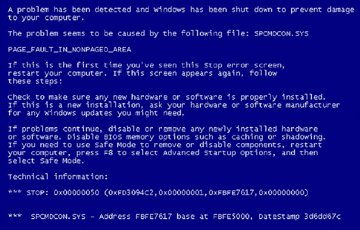

1.  故障开放
2.  不可恢复错误
3.  内存耗尽
4.  故障安全

### 9. 以下哪项不是软件威胁建模的目标？

1.  减少与安全相关的设计缺陷数量
2.  减少与安全相关的编码缺陷数量
3.  降低非安全相关缺陷的严重性
4.  减少威胁向量的数量

### 10. 在此处所示的图中，哪个是方法的示例？

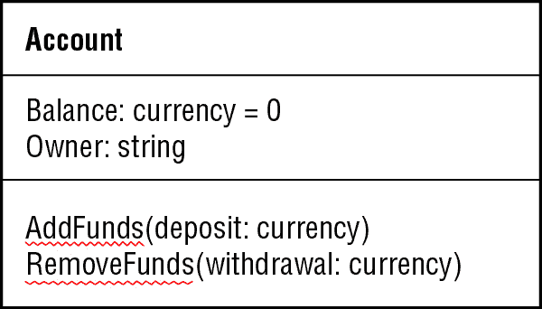

1.  Account
2.  Owner
3.  AddFunds
4.  以上都不是

### 11. 以下哪项被视为主存储器？

1.  内存
2.  硬盘
3.  闪存驱动器
4.  DVD

### 12. 以下哪种测试方法通常在无法访问源代码的情况下工作？

1.  动态测试
2.  静态测试
3.  白盒测试
4.  代码审查

### 13. 卢卡构建的 Web 应用程序存在一个缺陷，导致已登录的用户能够执行其角色不应允许的操作。此安全漏洞应归类为什么类型？

1.  数据验证
2.  会话管理
3.  授权
4.  错误处理

### 14. 鲍比正在调查一名授权数据库用户如何获取其正常权限级别之外的信息。鲍比认为该用户正在利用一种汇总数据的函数。什么术语描述这种类型的函数？

1.  推理
2.  多态
3.  聚合
4.  模块化

### 15. 以下哪种控制能最好地保护应用程序免受缓冲区溢出攻击？

1.  加密
2.  输入验证
3.  防火墙
4.  入侵防御系统

### 16. 贝塔正在分析其服务器上 Windows 防火墙的日志，并发现了如图所示的条目。这些条目表明了哪种类型的攻击？

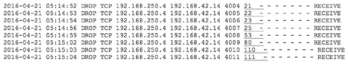

1.  SQL 注入
2.  端口扫描
3.  泪滴攻击
4.  Land 攻击

## 问题 17–20：场景

罗伯特是一名顾问，帮助组织创建和开发成熟的软件开发实践。他倾向于使用软件能力成熟度模型（SW-CMM）通过独立评审和自我评估来评估组织的当前和未来状态。他目前正在与两个不同的客户合作。

**Acme Widgets** 在软件开发实践方面组织得不是很好。他们有一个专门的开发团队，会“不惜一切代价”把软件推出门去，但他们没有任何正式流程。

**Beta Particles** 是一家拥有多年经验、使用正式的、有文档记录的软件开发流程开发软件的公司。他们使用标准的软件开发模型，但对这些过程没有定量管理。

### 17. 罗伯特应报告 Acme Widgets 当前处于 SW-CMM 的哪个阶段？

1.  已定义
2.  可重复
3.  初始
4.  已管理

### 18. 罗伯特正在与 Acme Widgets 合作制定一项推进其软件开发实践的战略。他们的下一个目标里程碑应是 SW-CMM 的哪个阶段？

1.  已定义
2.  可重复
3.  初始
4.  已管理

### 19. 罗伯特应报告 Beta Particles 当前处于 SW-CMM 的哪个阶段？

1.  已定义
2.  可重复
3.  优化
4.  已管理

### 20. 罗伯特也在与 Beta Particles 合作制定一项推进其软件开发实践的战略。他们的下一个目标里程碑应是 SW-CMM 的哪个阶段？

1.  已定义
2.  可重复
3.  优化
4.  已管理

### 21. 以下哪个数据库键用于强制表之间的参照完整性关系？

1.  主键
2.  候选键
3.  外键
4.  主密钥

### 22. 以下哪个文件最有可能包含宏病毒？

1.  projections.doc
2.  command.com
3.  command.exe
4.  loopmaster.exe

### 23. 维克多创建了一个数据库表，其中包含其组织员工的信息。该表包含员工的用户 ID、三个不同的电话号码字段（家庭、工作和移动）、员工的办公地点和员工的职位。表中有 16 条记录。该表的度是多少？

1.  3
2.  4
3.  6
4.  16

### 24. 卡丽正在分析其基于 Web 的应用程序的应用日志，并发现了以下字符串：

`../../../../../../../../../etc/passwd`

针对卡丽的应用程序可能尝试了哪种类型的攻击？

1.  命令注入
2.  会话劫持
3.  目录遍历
4.  暴力破解

### 25. 在遵循 SDLC 方法进行软件开发时，设计审查应在何时进行？

1.  代码审查之后
2.  用户验收测试之后
3.  功能需求开发完成之后
4.  单元测试完成之后


# 练习题

### 26. Tracy 正准备为其组织的企业资源规划系统应用补丁。她担心补丁可能会引入先前版本中不存在的缺陷，因此她计划进行一项测试，将之前对输入的响应与新打补丁的应用程序产生的响应进行比较。Tracy 计划进行哪种类型的测试？

1.  单元测试
2.  验收测试
3.  **回归测试**
4.  漏洞测试

### 27. 什么术语用于描述软件没有漏洞的置信度，无论这些漏洞是故意设计进软件的，还是在其生命周期中的任何时候意外插入的，以及软件按预期方式运行？

1.  确认
2.  认证
3.  置信区间
4.  **保证**

### 28. Victor 最近在一个在线约会网站担任新职位，负责领导一个开发团队。他很快意识到开发人员在生产代码方面遇到问题，因为他们正在从事不同的项目，导致对生产代码进行相互冲突的修改。Victor 应该投资改进哪个流程？

1.  请求控制
2.  发布控制
3.  **变更控制**
4.  配置控制

### 29. 当一组事实的分类级别高于这些事实单独存在时的任何分类级别时，存在哪种数据库安全问题？

1.  推理
2.  SQL 注入
3.  多级安全
4.  **聚合**

### 30. 攻击者为了秘密窃取信息而常利用的两种隐蔽信道类型是什么？

1.  **时间和存储**
2.  时间和防火墙
3.  存储和内存
4.  防火墙和存储

### 31. Vivian 想聘请一名软件测试人员来从用户的角度评估一个新的 Web 应用程序。以下哪种测试最能模拟该视角？

1.  **黑盒**
2.  灰盒
3.  蓝盒
4.  白盒

### 32. 参考此处显示的数据库事务，如果 Accounts 表中不存在账号为 1001 的账户，会发生什么？

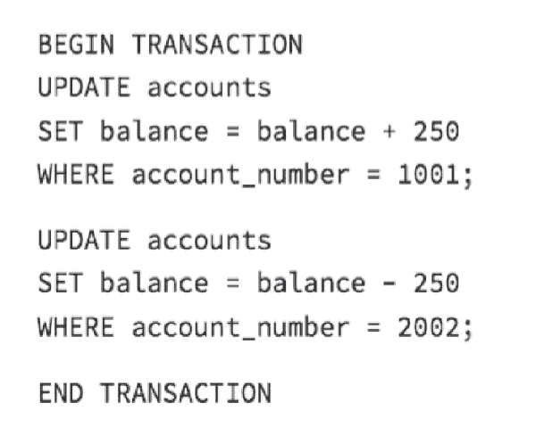

1.  数据库将创建一个具有该账号的新账户，并赋予其 250 美元的余额。
2.  数据库将忽略该命令，仍将第二个账户的余额减少 250 美元。
3.  **数据库将回滚事务，忽略两条命令的结果。**
4.  数据库将生成一条错误消息。

### 33. 哪种恶意软件的特点是利用不需要用户干预的漏洞，凭自身力量从系统传播到系统？

1.  特洛伊木马
2.  病毒
3.  逻辑炸弹
4.  **蠕虫**

### 34. Kim 正在排查一个应用程序防火墙的故障，它作为组织网络和主机防火墙及入侵防御系统的补充，提供针对基于 Web 攻击的额外保护。组织遇到的问题是该防火墙技术会频繁重启，每次导致其不可用 10 分钟。Kim 可以考虑哪种配置，以在该期间以最低成本维持可用性？

1.  高可用性集群
2.  故障转移设备
3.  **故障开放**
4.  冗余磁盘

### 35. 当攻击者可以通过分析几个较低分级的信息推断出更敏感的信息时，会产生哪种安全问题？

1.  SQL 注入
2.  多级安全
3.  聚合
4.  **推理**

### 36. Greg 正在应对其组织中的恶意软件爆发。他使用专业的恶意软件分析工具从三个不同的系统捕获了恶意软件样本，并注意到代码在每次感染中都会略微变化。Greg 认为这就是防病毒软件难以阻止此次爆发的原因。Greg 应该怀疑哪种恶意软件导致了此安全事件？

1.  隐身病毒
2.  **多态病毒**
3.  多部件病毒
4.  加密病毒

---

### 第 37–40 题

**场景：**

Linda 正在查看其公司网站上用户论坛的帖子，当她浏览某个帖子时，屏幕上的一个对话框中弹出一条显示“Alert”的消息。她查看该帖子的源代码，发现了以下代码片段：

```
<script>alert(‘Alert’);</script>
```

#### 37. Linda 的留言板上肯定存在什么漏洞？

1.  **跨站脚本**
2.  跨站请求伪造
3.  SQL 注入
4.  不当认证

#### 38. 在论坛发布包含此代码消息的用户可能的动机是什么？

1.  **侦察**
2.  窃取敏感信息
3.  窃取凭证
4.  社会工程学

#### 39. Linda 与供应商沟通，确定没有可用的补丁来修复此漏洞。以下哪种设备最能帮助她防御应用程序免受进一步攻击？

1.  VPN
2.  **WAF**
3.  DLP
4.  IDS

#### 40. 在与供应商的进一步讨论中，Linda 发现他们愿意修复该问题，但不知道如何更新他们的软件。哪种技术在缓解应用程序对此类攻击的漏洞方面最有效？

1.  边界检查
2.  同行评审
3.  **输入验证**
4.  操作系统打补丁

#### 41. 关系数据库的哪个属性确保一旦数据库事务提交给数据库，它就会被保留？

1.  原子性
2.  一致性
3.  **持久性**
4.  隔离性

#### 42. Lauren 想对她正在开发的应用程序使用软件评审流程。如果她是一名远程工作者，工作时间与团队其他成员不同，以下哪种流程效果最好？

1.  **传阅评审**
2.  结对编程
3.  团队评审
4.  Fagan 检查

#### 43. 以下哪项不是病毒作者用来向反恶意软件隐藏其病毒存在的技术？

1.  隐身
2.  **多部件**
3.  多态
4.  加密

#### 44. 以下哪种类型的软件测试通常最后进行，并针对测试场景执行？

1.  单元测试
2.  集成测试
3.  **用户验收测试**
4.  系统测试

#### 45. 哪种需求类型通过描述软件的输入、行为和输出来指定软件必须做什么？

1.  派生需求
2.  结构需求
3.  行为需求
4.  **功能需求**

#### 46. 以下哪个组织被广泛认为是关于基于 Web 攻击向量信息的权威来源？

1.  (ISC)²
2.  ISACA
3.  **OWASP**
4.  Mozilla 基金会

#### 47. 如果 Chris 正在为应用程序编写代码，他处于敏捷流程的哪个阶段？

1.  规划
2.  冲刺
3.  部署
4.  **开发**

#### 48. Lisa 试图防止其网络成为 IP 欺骗攻击的目标，同时也防止其网络成为此类攻击的源头。以下哪条规则不是 Lisa 可以在其网络边界配置的最佳实践？

1.  阻止源地址为内部地址的数据包进入网络。
2.  阻止源地址为外部地址的数据包离开网络。
3.  阻止源地址为私有 IP 地址的数据包离开网络。
4.  **阻止源地址为公共 IP 地址的数据包进入网络。**


#### 49. 以下 C 语言示例演示了哪种类型的攻击？

```c
int myarray[10];
myarray[10] = 8;
```

1. 数据类型不匹配
2. **溢出**
3. SQL 注入
4. 隐蔽信道

#### 50. 当一个事务向数据库写入一个值，该值覆盖了优先级较高（较早）的事务所需的值时，会发生以下哪种数据库问题？

1. 脏读
2. 不正确的汇总
3. **丢失更新**
4. SQL 注入

#### 51. 以下哪项是防范会话劫持攻击最有效的控制措施？

1. **TLS**
2. 复杂的会话 Cookie
3. SSL
4. 频繁使 Cookie 过期

#### 52. Faith 正在查看一个配置为使用影子密码的系统上的 `/etc/passwd` 文件。当她检查一个具有交互式登录权限的用户的行时，她应该在密码字段中看到什么？

1. 明文密码
2. 哈希密码
3. **x**
4. *

#### 53. TOCTOU 攻击针对哪种类型的漏洞？

1. 缺乏输入验证
2. **竞争条件**
3. 注入缺陷
4. 缺乏加密

#### 54. 在评估潜在安全事件时，Harry 发现一条来自 Web 服务器请求的日志条目，显示用户在表单字段中输入了以下内容：

`CARROT’&1=1;--`

尝试了哪种类型的攻击？

1. 缓冲区溢出
2. 跨站脚本
3. **SQL 注入**
4. 跨站请求伪造

#### 55. 以下哪项不是防范 SQL 注入攻击的有效控制措施？

1. 转义
2. **客户端输入验证**
3. 参数化
4. 限制数据库权限

#### 56. 图中显示的是哪种项目管理工具？


1. WBS 图
2. PERT 图
3. **甘特图**
4. 线框图

#### 57. 在哪种软件测试技术中，评估人员每当软件发生变化时都会重新测试大量场景，以验证结果与标准基线一致？

1. 正交数组测试
2. 模式测试
3. 矩阵测试
4. **回归测试**

#### 58. 以下哪种情况最可能使应用程序容易受到跨站脚本（XSS）攻击？

1. 输入验证
2. **反射输入**
3. 未打补丁的服务器
4. 混杂的防火墙规则

#### 59. Roger 正在为其公司开发的税务准备应用程序进行软件测试。最终用户将通过 Web 访问该应用程序，但 Roger 正在后端进行测试，评估 Web 服务器上的源代码。Roger 正在进行哪种类型的测试？

1. **白盒**
2. 灰盒
3. 蓝盒
4. 黑盒

#### 60. 关于基于启发式的反恶意软件，以下哪项陈述是正确的？

1. 其误报率低于特征码检测。
2. 它需要频繁更新定义库以检测新恶意软件。
3. **它比特征码检测更有可能检测到零日漏洞利用。**
4. 它监控系统中内容已知为病毒的文件。

#### 61. Martin 正在检查一台用户报告有异常活动的系统，包括系统空闲时的磁盘活动以及异常的 CPU 和网络使用率。他怀疑该机器感染了病毒，但扫描结果干净。可能使用了哪种恶意软件技术来解释干净的扫描结果？

1. 文件感染型病毒
2. MBR 病毒
3. 服务注入病毒
4. **隐匿病毒**

#### 62. Tomas 在应用程序日志中发现一行，似乎对应一次目录遍历攻击尝试。他认为攻击使用了 URL 编码。该行内容为：

`%252E%252E%252F%252E%252E%252Fetc/passwd`

`%252E` 值代表哪个字符？

1. **.**
2. ,
3. ;
4. /

#### 63. 攻击者在公共讨论论坛发布了一条包含嵌入式恶意脚本的消息，该脚本不显示给用户，但在用户阅读时在用户系统上执行。这是什么类型的攻击？

1. 持久性 XSRF
2. 非持久性 XSRF
3. **持久性 XSS**
4. 非持久性 XSS

#### 64. 以下哪项不是敏捷软件开发过程的原则？

1. 欢迎需求变更，即使是在开发后期。
2. 最大化未完成工作量是至关重要的。
3. **清晰的文档是进度的主要度量标准。**
4. 围绕有动力的个人构建项目。

#### 65. 将编号的代码测试方法与其字母定义匹配：

**代码测试方法**

1. 回归测试
2. 集成测试
3. 单元测试
4. 系统测试

**定义**

1. 对完整集成产品的测试
2. 专注于模块或较小代码部分进行测试的测试方法
3. 用于验证先前测试过的软件在更改后表现相同的测试方法
4. 用于验证软件模块如何协同工作的测试方法

**匹配：**
*   1 → 3 (回归测试)
*   2 → 4 (集成测试)
*   3 → 2 (单元测试)
*   4 → 1 (系统测试)

#### 66. 专家系统的两个组成部分是什么？

1. 决策支持系统和神经网络
2. 推理引擎和神经网络
3. 神经网络和知识库
4. **知识库和推理引擎**

#### 67. Neal 正在使用 DynamoDB 数据库。该数据库不像关系型数据库那样结构化，但允许 Neal 使用键值存储来存储数据。DynamoDB 是哪种类型的数据库？

1. 关系型数据库
2. 图数据库
3. 层次型数据库
4. **NoSQL 数据库**

#### 68. 在此处显示的事务中，如果数据库在第一条和第二条更新语句之间发生故障，会发生什么？


1. 数据库会给第一个账户增加 250 美元资金，但不会减少第二个账户的余额。
2. 数据库会忽略第一条命令，仅将第二个账户的余额减少 250 美元。
3. **数据库会回滚事务，忽略两条命令的结果。**
4. 数据库会成功执行两条命令。

#### 69. 在此处显示的图中，哪个是属性的示例？


1. Account
2. **Owner**
3. AddFunds
4. 以上都不是

#### 70. 关于软件测试，以下哪项陈述是正确的？

1. 静态测试在运行时环境中工作。
2. **静态测试执行代码分析。**
3. 动态测试使用自动化工具，但静态测试不使用。
4. 静态测试比动态测试更重要。

#### 71. David 正在为软件开发工作制定项目进度计划，他遇到了此处显示的图表。这是什么类型的图表？


1. 工作分解结构
2. 功能需求
3. PERT 图
4. **甘特图**

#### 72. Barry 是一名软件测试员，正在使用其公司开发的新游戏应用程序。他在智能手机上玩游戏进行测试，以最好地模拟正常最终用户的环境，但在测试时他参考了源代码。Barry 正在进行哪种类型的测试？

1. 白盒
2. 黑盒
3. 蓝盒
4. **灰盒**


#### 73. Miguel recently completed a penetration test...

Miguel 最近完成了其组织用于处理敏感信息的应用程序的渗透测试。在测试期间，他发现了一种情况：攻击者可以利用时序条件操纵软件，使其允许攻击者执行未经授权的操作。以下哪种攻击类型符合此场景？

1.  SQL 注入
2.  跨站脚本
3.  传递哈希
4.  TOC/TOU

#### 74. What part of the security review process...

图中所示的输入参数用于安全审查过程的哪个部分？


1.  SQL 注入审查
2.  冲刺审查
3.  Fagan 检查
4.  攻击面识别

#### 75. What application security process...

以下哪个应用程序安全过程可以用这三个主要步骤来描述？

1.  分解应用程序
2.  确定并排序威胁
3.  确定对策和缓解措施

1.  Fagan 检查
2.  威胁建模
3.  渗透测试
4.  代码审查

#### 76. Which one of the following approaches...

从安全角度来看，以下哪种故障管理方法最为保守？

1.  故障开放
2.  故障缓解
3.  故障清除
4.  故障关闭

#### 77. What software development model...

图中显示的是什么软件开发模型？


1.  瀑布
2.  敏捷
3.  精益
4.  螺旋

#### 78. Which of the following database keys...

RDBMS 使用以下哪种数据库键来唯一标识数据库表中的每一行？

1.  外键
2.  主键
3.  候选键
4.  参照键

#### 79. Which one of the following change management...

以下哪种变更管理流程是由用户而非开发人员发起的？

1.  请求控制
2.  变更控制
3.  发布控制
4.  设计评审

#### 80. Which one of the following techniques...

以下哪种技术是针对某些推理攻击的有效对策？

1.  输入验证
2.  参数化
3.  多实例化
4.  服务端验证

#### 81. Ursula is a government web developer...

Ursula 是一名政府 Web 开发人员，最近创建了一个提供财产记录的公共应用程序。她希望将其提供给其他开发人员集成到他们的应用程序中。Ursula 可以创建什么，以便开发人员最轻松地直接调用她的代码并将输出集成到他们的应用程序中？

1.  对象模型
2.  数据字典
3.  API
4.  主键

#### 82. During what phase of the IDEAL model...

在 `IDEAL` 模型的哪个阶段，组织会制定实施变更的具体行动计划？

1.  启动
2.  诊断
3.  确立
4.  行动

#### 83. TJ is inspecting a system...

TJ 正在检查一个系统，用户报告了奇怪的错误消息且无法访问文件。他看到了图中所示的窗口。TJ 应该怀疑哪种类型的恶意软件？


1.  服务注入
2.  加密病毒
3.  SQL 注入
4.  勒索软件

#### 84. Charles is developing a mission-critical application...

Charles 正在开发一个直接影响人身安全的任务关键型应用程序。正确运行的软件比时间和成本更重要。鉴于这些要求，他应该选择以下哪种软件开发方法？

1.  敏捷
2.  DevOps
3.  螺旋
4.  瀑布

#### 85. Which one of the following types of artificial intelligence...

以下哪种人工智能类型试图使用复杂的计算来复制人类思维的部分功能？

1.  决策支持系统
2.  专家系统
3.  知识库
4.  神经网络

#### 86. At which level of the Software Capability Maturity Model...

在软件能力成熟度模型 (`SW-CMM`) 的哪个级别，组织会引入基本的生命周期管理过程？

1.  初始级
2.  可重复级
3.  已定义级
4.  已管理级

#### 87. Lucas runs the accounting systems...

Lucas 管理其公司的会计系统。在一名关键员工被解雇的第二天早上，系统开始神秘地丢失信息。Lucas 怀疑该被解雇员工在离职前篡改了系统。Lucas 应该怀疑哪种类型的攻击？

1.  权限提升
2.  SQL 注入
3.  逻辑炸弹
4.  远程代码执行

#### 88. Which one of the following principles...

在软件开发的 `敏捷` 方法中，以下哪项原则**不**被提倡？

1.  过程和工具高于个人和交互
2.  可工作的软件高于详尽的文档
3.  客户合作高于合同谈判
4.  响应变化高于遵循计划

#### 89. What technique do API developers...

`API` 开发人员最常使用以下哪种技术来限制对 `API` 的访问，仅允许授权的个人和应用程序？

1.  加密
2.  输入验证
3.  API 密钥
4.  IP 过滤器

#### 90. Which one of the following statements about malware is correct?

关于恶意软件，以下哪项陈述是正确的？

1.  恶意软件作者不以 Macintosh 或 Linux 系统为目标。
2.  检测已知恶意软件最可靠的方法是监视异常系统活动。
3.  特征码检测是对抗已知恶意软件最有效的技术。
4.  `APT` 攻击者通常使用旨在利用安全公告中已识别漏洞的恶意软件。

#### 91. Which one of the following is the proper order...

以下哪项是瀑布模型软件开发步骤的正确顺序？

1.  需求、设计、测试、编码、维护
2.  需求、设计、编码、测试、维护
3.  设计、需求、编码、测试、维护
4.  设计、需求、测试、编码、维护

#### 92. Which component of the database ACID model...

数据库 `ACID` 模型的哪个组件确保数据库事务是“全有或全无”的？

1.  原子性
2.  一致性
3.  隔离性
4.  持久性

#### 93. Tom is writing a software program...

Tom 正在编写一个软件程序，用于计算来自不同司法管辖区的在线订单的销售税。该应用程序包含一个用户定义字段，允许输入总销售金额。Tom 希望确保该字段中输入的数据是格式正确的美元金额。他应该使用什么技术？

1.  限制检查
2.  故障开放
3.  故障安全
4.  输入验证

#### 94. Match the following numbered terms...

将以下编号术语与其字母定义相匹配：

1.  会话劫持
2.  跨站脚本
3.  跨站请求伪造
4.  SQL 注入

    1.  一种将恶意脚本注入其他受信任网站的攻击
    2.  一种旨在通过不安全的 Web 应用程序针对数据库执行命令的攻击
    3.  一种通常涉及 Cookie 或密钥以获得对计算机或服务未经授权访问的利用方法
    4.  一种强制用户在他们当前登录的网站或应用程序中执行不需要操作的攻击

#### 95. Which of the following vulnerabilities...

在基于 Web 的应用程序渗透测试中，可能会发现以下哪些漏洞？

1.  跨站脚本
2.  跨站请求伪造
3.  SQL 注入
4.  以上全部

#### 96. What approach to technology management...

什么技术管理方法整合了此图中显示的技术管理的三个组成部分？


1.  敏捷
2.  精益
3.  DevOps
4.  ITIL

#### 97. Which one of the following tools...

攻击者可能会使用以下哪种工具来最好地识别目标系统中的漏洞？

1.  Nmap
2.  Nessus
3.  ipconfig
4.  traceroute

#### 98. Which one of the following database concurrency issues...

以下哪种数据库并发问题发生在一个事务读取了由第二个事务写入数据库但从未提交的信息时？

1.  丢失更新
2.  SQL 注入
3.  不正确的摘要
4.  脏读

#### 99. What type of virus...

哪种类型的病毒通过改变系统引导过程，将 `BIOS` 或 `UEFI` 固件重定向到在操作系统加载前加载恶意软件来工作？

1.  文件感染型
2.  MBR
3.  多态


#### 4. 服务注入

#### 100. 以下哪种病毒的特征是使用两种或两种以上不同的传播机制，以提高其在系统间传播的可能性？

1.  隐形病毒
2.  多态病毒
3.  **多部件病毒**
4.  加密病毒

#### 101. 导致以下问题的根本安全问题是什么？

*   跨站脚本攻击
*   SQL 注入
*   缓冲区溢出
*   跨站请求伪造

1.  缺乏 API 安全
2.  不当的错误处理
3.  **不当或缺失的输入验证**
4.  源代码设计问题

#### 102. 此处所示的周期使用的是哪种应用程序开发方法？


1.  瀑布模型
2.  螺旋模型
3.  敏捷开发
4.  RAD（快速应用开发）

#### 103. Kathleen 正在审查此处所示的 Ruby 代码。这段代码使用了什么安全技术？


1.  **参数化**
2.  类型转换
3.  Gem 切割
4.  存储过程

#### 104. Susan 为其组织的数据提供了一个公共 RESTful API，但希望将其使用限制在受信任的合作伙伴范围内。她打算使用 API 密钥。你还会给 Susan 什么其他建议，以限制服务被滥用的可能性？

1.  **限制请求速率**
2.  强制仅使用 HTTP 请求
3.  因带宽限制而避免使用令牌
4.  将 GET、POST 和 PUT 等 HTTP 方法列入黑名单

# 第 9 章

## 模拟测试 1

### 1. NIST SP800-53 将一组安全控制作为什么类型的安全工具进行讨论？

1.  配置清单
2.  威胁管理策略
3.  **基线**
4.  CIS 标准

### 2. Ed 的任务是确定一项服务，该服务将为其雇主提供一种低延迟、高性能和高可用性的内容托管方式。为了确保其雇主的全球客户能够快速、轻松且可靠地访问内容，他应该寻求哪种类型的解决方案？

1.  热站点
2.  **CDN（内容分发网络）**
3.  冗余服务器
4.  P2P CDN

### 3. 以下哪项不是取证磁盘控制器的功能？

1.  防止存储设备上的数据被修改
2.  返回设备请求的数据
3.  向取证主机报告设备发送的错误
4.  **阻止发送到设备的读取命令**

### 4. Mike 正在构建一台容错服务器，并希望实施 RAID 1。构建此解决方案需要多少个物理磁盘？

1.  1
2.  **2**
3.  3
4.  5

### 5. 哪个 Kerberos 服务生成新票据和会话密钥并将它们发送给客户端？

1.  KDC（密钥分发中心）
2.  TGT（票据授予票据）
3.  AS（认证服务）
4.  **TGS（票据授予服务）**

### 6. 依靠开始和停止标志或位来管理数据传输的通信系统被称为哪种类型的通信？

1.  模拟
2.  数字
3.  同步
4.  **异步**

### 7. 哪种类型的运动探测器使用高微波频率信号传输来识别潜在入侵者？

1.  红外线
2.  基于热量
3.  **波形模式**
4.  电容

### 8. Susan 设置了一个防火墙，该防火墙跟踪两个系统之间通信的状态，并在本地系统发起通信后允许远程系统响应本地系统。Susan 使用的是哪种类型的防火墙？

1.  静态包过滤防火墙
2.  应用层网关防火墙
3.  **状态包检测防火墙**
4.  电路级网关防火墙

## 第 9-11 题，请参考以下场景：

Ben 拥有一家咖啡馆，想为顾客提供无线互联网服务。Ben 的网络很简单，使用单个消费级无线路由器和一个有线调制解调器，通过商业有线数据合同连接。

### 9. Ben 如何在无需在顾客连接前预配用户 ID 的情况下为其提供访问控制，同时收集对其业务有用的联系信息？

1.  WPA2 PSK
2.  **强制门户**
3.  要求顾客使用公开张贴的密码，如 “BensCoffee”
4.  端口安全

### 10. Ben 打算运行一个开放（未加密）的无线网络。他应该如何连接其业务设备？

1.  在同一 SSID 上运行 WPA2。
2.  **设置一个使用 WPA2 的独立 SSID。**
3.  在企业模式下运行开放网络。
4.  设置一个使用 WEP 的独立无线网络。

### 11. 在实施第一个问题的解决方案后，Ben 收到投诉，称咖啡馆内的用户劫持了其他顾客的 Web 流量，包括使用他们的用户名和密码。这是如何发生的？

1.  密码由所有用户共享，导致流量易受攻击。
2.  恶意用户在路由器上安装了特洛伊木马。
3.  用户对路由器进行了 ARP 欺骗，导致所有流量广播给所有用户。
4.  **开放网络未加密，导致流量易于被嗅探。**

### 12. 以下哪项不是数据加密标准的运行模式？

1.  CBC
2.  CFB
3.  OFB
4.  **AES**

### 13. Tom 正在调整其安全监控工具，试图减少管理员收到的警报数量，同时不错过重要的安全事件。他决定将系统配置为仅在一小时内同一账户出现五次登录失败尝试时报告登录失败尝试。哪个术语最能描述 Tom 正在使用的技术？

1.  **阈值设定**
2.  采样
3.  账户锁定
4.  裁剪

### 14. Sally 的任务是为其组织的无线网络服务部署认证、授权和审计服务器，并需要避免使用专有技术。她应该选择什么技术？

1.  OAuth
2.  **RADIUS**
3.  XTACACS
4.  TACACS+

### 15. Christopher’s Cheesecakes 的一名会计文员无法访问个别员工的薪资信息，但想知道一名新员工的薪资。他提取了新员工入职前一个发薪期的总薪资支出，然后提取了下一个发薪期的相同支出。他计算这两个金额的差额以确定该员工的个人薪资。发生了哪种类型的攻击？

1.  聚合
2.  数据篡改
3.  **推理**
4.  社会工程学

### 16. Alice 希望获得对象的读取权限，并且知道 Bob 已经拥有这些权限，她想将这些权限授予自己。如果 Alice 和 Bob 之间存在这种关系，Take-Grant 保护模型中的哪条规则将允许她完成此操作？

1.  **取用规则**
2.  授予规则
3.  创建规则
4.  远程规则

### 17. 在日志审查期间，Danielle 发现了一系列显示登录失败的日志：

```
Jan 31 11:39:12 ip-10-0-0-2 sshd[29092]: Invalid user admin from remotehost passwd=aaaaaaaa
Jan 31 11:39:20 ip-10-0-0-2 sshd[29098]: Invalid user admin from remotehost passwd=aaaaaaab
Jan 31 11:39:23 ip-10-0-0-2 sshd[29100]: Invalid user admin from remotehost passwd=aaaaaaac
Jan 31 11:39:31 ip-10-0-0-2 sshd[29106]: Invalid user admin from remotehost passwd=aaaaaaad
Jan 31 20:40:53 ip-10-0-0-254 sshd[30520]: Invalid user admin from remotehost passwd=aaaaaaae
```

Danielle 发现了哪种类型的攻击？

1.  传递哈希攻击
2.  **暴力破解攻击**
3.  中间人攻击
4.  字典攻击

### 18. 关系数据库的什么属性通过将临时结果存储在数据库中，确保两个正在执行的事务互不影响？

1.  原子性
2.  **隔离性**
3.  一致性
4.  持久性


### 19. Kim 是一家小型企业网络的系统管理员，该网络正面临安全问题。她在晚上独自在办公室处理该问题。在她的注视下，她发现办公室另一侧原本运行正常的系统现在出现了感染迹象。Kim 很可能正在处理哪种类型的恶意软件？

1.  病毒
2.  蠕虫
3.  特洛伊木马
4.  逻辑炸弹

### 20. 以下哪项是数据安全的行业标准？

1.  FERPA
2.  HIPAA
3.  SOX
4.  PCI DSS

### 21. 以下哪个序列正确描述了 TCP 三次握手？

1.  SYN, ACK, SYN/ACK
2.  PSH, RST, ACK
3.  SYN, SYN/ACK, ACK
4.  SYN, RST, FIN

### 22. 以下哪种技术通常**不是**移动设备管理（MDM）解决方案的功能？

1.  远程擦除移动设备内容
2.  接管未注册的 BYOD 移动设备的控制权
3.  强制使用设备加密
4.  管理设备备份

### 23. Jim 正在为其组织实施 IDaaS 解决方案。他正在部署哪种类型的技术？

1.  身份即服务
2.  员工 ID 即服务
3.  入侵检测即服务
4.  OAuth

### 24. Gina 最近参加了 CISSP 认证考试，随后撰写了一篇博客文章，其中包含她遇到的许多考题原文。在这种情况下，最直接违反 (ISC)² 职业道德准则的哪个方面？

1.  促进并保护专业。
2.  光荣、诚实、公正、负责且合法地行事。
3.  保护社会、公共利益、必要的公众信任和信心以及基础设施。
4.  为委托人提供勤勉且称职的服务。

### 25. Gordon 正在为其组织进行风险评估，并确定了洪水预计每年将给其设施造成的损失金额。Gordon 确定了哪个指标？

1.  ALE
2.  ARO
3.  SLE
4.  EF

### 26. Greg 希望在其组织中实施应用程序控制技术。他希望将用户限制为仅在其系统上安装经批准的软件。在这种情况下，哪种类型的应用程序控制是合适的？

1.  黑名单
2.  灰名单
3.  白名单
4.  蓝名单

### 27. Frank 是一台 Web 服务器的安全管理员，该服务器向全球用户提供新闻和信息。其服务器接收到了异常高流量，无法处理而被迫拒绝请求。Frank 将流量源头追溯到一个僵尸网络。发生了哪种类型的攻击？

1.  拒绝服务
2.  侦察
3.  入侵
4.  恶意内部人员

### 28. 在此处显示的数据库表中，哪一列最适合作为主键？


1.  Company ID
2.  Company Name
3.  ZIP Code
4.  Sales Rep

### 29. 关于个人的信息，如他们的姓名、社会安全号码、出生日期和地点，或其母亲的婚前姓氏，属于哪种受保护信息的示例？

1.  PHI
2.  专有数据
3.  PII
4.  EDI

### 30. Bob 正在配置网络的出站过滤，检查发往互联网的流量。其组织使用公共地址范围 `12.8.195.0/24`。Bob 应允许具有以下哪个目标地址的数据包离开网络？

1.  `12.8.195.15`
2.  `10.8.15.9`
3.  `192.168.109.55`
4.  `129.53.44.124`

### 31. 使用 6 位加密密钥的加密算法中存在多少个可能的密钥？

1.  12
2.  16
3.  32
4.  64

### 32. 什么问题导致了建议物理销毁 SSD 驱动器以防止其报废时发生数据泄露？

1.  退磁只能部分擦除 SSD 上的数据。
2.  SSD 没有数据残留。
3.  SSD 无法执行零填充。
4.  内置擦除命令在某些 SSD 上并不完全有效。

### 33. GAD Systems 担心黑客窃取存储在文件服务器上的敏感信息的风险。他们选择采取风险缓解策略。以下哪项行动将支持该策略？

1.  加密文件
2.  删除文件
3.  购买网络责任保险
4.  不采取任何行动

### 34. 在评估账户管理实践时，应如何生成样本？

1.  它们应由管理员生成。
2.  应验证过去 180 天的账户。
3.  抽样应随机进行。
4.  抽样无效，应审计所有账户。

### 35. EU-U.S. Privacy Shield Framework（欧盟-美国隐私盾框架）依赖七项原则。以下哪项正确列出了所有七项？

1.  知情、选择、控制、安全、数据完整性、访问、追索和执行
2.  通知、选择、后续传输责任、安全、数据完整性和目的限制、访问、追索和执行
3.  隐私、安全、控制、通知、数据完整性和目的、访问、执行
4.  提交、编辑、更新、机密、完整性、安全、访问

### 36. 将下列编号的测试方法类型与字母标识的正确知识级别匹配：

**测试方法**

1.  黑盒
2.  白盒
3.  灰盒

**知识级别**

1.  完全了解系统
2.  部分或不完整了解
3.  对系统无先验了解

### 37. 图中显示的是哪种类型的日志？


1.  防火墙日志
2.  变更日志
3.  应用程序日志
4.  系统日志

### 38. Alex 为美国联邦政府工作，需要确保其采购的设备和组件未被篡改。他将参与哪个计划以帮助确保这一点？

1.  TEMPEST
2.  可信代工厂
3.  GovBuy
4.  MITRE

### 39. 当攻击者致电组织的服务台，利用服务台员工的信任和乐于助人说服他们重置密码时，成功实施了哪种类型的攻击？

1.  人肉特洛伊木马
2.  社会工程学
3.  网络钓鱼
4.  鱼叉式网络钓鱼

### 40. 当用户尝试登录其在线账户时，Google 会发送一条包含验证码的短信到其手机。这是什么类型的验证？

1.  基于知识的认证
2.  动态基于知识的认证
3.  带外身份验证
4.  基于风险的身份验证

### 41. 用什么数学运算替换此处所示的空白行，才能使等式正确？


1.  MOD
2.  XOR
3.  NAND
4.  DIV

## 问题 42–44

针对问题 42–44，请参考以下场景：

Ben 所在的组织拥有一个传统的本地 Active Directory 环境，为其 350 名员工的公司采用手动配置流程进行每次添加。随着公司采用新技术，他们越来越多地使用软件即服务应用程序来替换内部开发的软件栈。

Ben 被委派设计一个身份管理实现方案，使其公司能够使用云服务，同时支持现有系统。使用此处所示的逻辑图，回答有关 Ben 应提出的身份建议的以下问题。


## 练习题 42-68

### 42. 如果认证服务的可用性是组织的首要任务，Ben 应该推荐哪种类型的身份平台？

1.  本地部署
2.  基于云
3.  混合
4.  外包

### 43. 如果 Ben 需要与图中所示的业务合作伙伴共享身份信息，他应该调查什么？

1.  单点登录
2.  多因素认证
3.  联邦身份认证
4.  IDaaS

### 44. 当 Ben 的组织需要向其云电子商务应用程序提供认证和授权断言时，可能涉及什么技术？

1.  Active Directory
2.  SAML
3.  RADIUS
4.  SPML

### 45. Dave 负责其组织的密码安全，希望加强密码文件的安全性。他希望防御彩虹表攻击。以下哪种技术专门设计用于挫败彩虹表的使用？

1.  密码过期策略
2.  加盐
3.  用户教育
4.  密码复杂度策略

### 46. 以下哪项是一种单一系统，旨在吸引攻击者，因为它看似包含敏感信息或其他有吸引力的资源？

1.  蜜网
2.  暗网
3.  蜜罐
4.  伪缺陷

### 47. 评估生物识别设备时，等错误率的另一个术语是什么？

1.  FAR
2.  FRR
3.  CER
4.  ERR

### 48. 将以下字母因素与其编号类型匹配：

**因素**

1.  PIN 码
2.  令牌
3.  指纹
4.  密码
5.  智能卡

**类型**

1.  类型 1
2.  类型 2
3.  类型 3
4.  类型 4

### 49. Sean 怀疑公司某人尽管使用了数据丢失防护系统，仍在窃取机密信息。他发现嫌疑人正在向公共互联网留言板发布照片，包括此处所示的照片。个人可能使用什么技术将消息隐藏在此图像内部？


1.  水印
2.  VPN
3.  隐写术
4.  隐蔽定时信道

## 50. Roger 担心受雇开发内部应用程序代码的第三方公司会在代码中植入后门。开发商保留知识产权，仅交付最终形式的软件。以下哪种语言最不易受到此类攻击，因为它将以人类可读的最终形式向 Roger 提供代码？

1.  JavaScript
2.  C
3.  C++
4.  Java

## 51. Jesse 正在查看配置为使用影子密码的系统上的 `/etc/passwd` 文件。她应该期望在该文件的密码字段中看到什么？

1.  明文密码
2.  加密密码
3.  哈希密码
4.  x

## 52. SYN 洪水攻击依赖于什么协议的实现来导致拒绝服务条件？

1.  IGMP
2.  UDP
3.  TCP
4.  ICMP

## 53. 什么原则规定个人应尽一切努力准确、及时地完成其职责？

1.  最小权限
2.  职责分离
3.  尽职照料
4.  尽职调查

## 54. 电缆调制解调器、ISDN 和 DSL 都是什么类型技术的示例？

1.  基带
2.  宽带
3.  数字
4.  广播

## 55. 什么渗透测试技术最有助于评估培训和意识问题？

1.  端口扫描
2.  发现
3.  社会工程学
4.  漏洞扫描

## 56. Bill 在他操作的一台服务器上使用总共三个磁盘实现了 RAID 5 级。在不丢失数据的情况下，最多可以有多少个磁盘发生故障？

1.  0
2.  1
3.  2
4.  3

## 57. 在 OSI 模型的哪一层，数据以比特形式发送？

1.  传输层
2.  网络层
3.  数据链路层
4.  物理层

## 58. Bert 正在考虑使用基础设施即服务云计算合作伙伴来提供虚拟服务器。在这种情况下，以下哪项将是供应商的责任？

1.  维护管理程序
2.  管理操作系统安全设置
3.  维护主机防火墙
4.  配置服务器访问控制

## 59. 当 Ben 记录数据然后针对他的测试网站重放它，以基于真实生产工作负载验证其性能时，他正在进行哪种类型的性能监控？

1.  被动
2.  主动
3.  被动响应
4.  重放

## 60. 什么技术确保操作系统为系统上每个应用程序使用的内存分配单独的内存空间？

1.  抽象
2.  分层
3.  数据隐藏
4.  进程隔离

## 61. Alan 正在考虑在其组织中使用新的识别卡，用于物理访问控制。他遇到一张样卡，不确定其技术。他将其拆开，看到了以下内部结构。这是什么类型的卡？


1.  智能卡
2.  邻近卡
3.  磁条卡
4.  二期卡

## 62. Mark 正在为其组织规划灾难恢复测试。他希望对灾难恢复设施进行实时测试，但不想中断主设施的运营。Mark 应该选择哪种类型的测试？

1.  全面中断测试
2.  清单审查
3.  并行测试
4.  桌面推演

## 63. 以下哪项不是敏捷软件开发方法的原则？

1.  最佳架构、需求和设计源自自我组织的团队。
2.  不频繁交付可工作的软件，重点是在较长的时间线上创建准确的代码。
3.  欢迎需求变更，即使是在开发后期。
4.  简洁性至关重要。

## 64. 在安全审计期间，Susan 发现组织正在使用手部几何扫描仪作为其安全数据中心的访问控制机制。Susan 应该对手部几何扫描仪的使用提出什么建议？

1.  它们具有较高的 FRR，应予以更换。
2.  应增加第二因素，因为它们不是可靠区分个人的好方法。
3.  手部几何扫描仪为数据中心提供了适当的安全性，应考虑用于其他高安全区域。
4.  它们可能造成无障碍顾虑，应考虑替代的生物识别系统。

## 65. Colleen 正在为其组织进行业务影响评估。什么指标提供了关于组织在造成不可挽回的损害之前可能缺少服务的时间量的重要信息？

1.  MTD
2.  ALE
3.  RPO
4.  RTO

## 66. 一种攻击在 Linux 系统上更改符号链接，时间点在于账户对文件的权限被验证之后、文件被访问之前，这是哪种类型攻击的示例？

1.  取消链接
2.  Tick/tock
3.  setuid
4.  TOCTOU

## 67. 一种“是你所拥有”的认证因素，通常包含微处理器和一个或多个证书，是什么类型的认证器？

1.  智能卡
2.  令牌
3.  类型 I 验证器
4.  类型 III 认证器

## 68. 什么术语最能描述一种依赖被盗或伪造的认证凭据来绕过认证机制的攻击？

1.  欺骗
2.  重放
3.  冒充
4.  篡改


## 69. Lisa 想要与一个使用 OAuth 2.0 的云身份提供商集成，并且她想要选择一个合适的认证框架。以下哪项最适合她的需求？

1.  OpenID Connect
2.  SAML
3.  RADIUS
4.  Kerberos

## 70. Owen 最近设计了一个安全访问控制结构，防止单个用户同时持有创建新供应商所需的角色和签发支票所需的角色。Owen 正在实施什么原则？

1.  双人控制
2.  最小权限
3.  职责分离
4.  工作轮换

## 71. Denise 正在为一场涉及其公司与软件供应商之间合同纠纷的审判做准备。供应商声称 Denise 达成了一项修改其书面合同的口头协议。Denise 在辩护中应引用什么证据规则？

1.  实物证据规则
2.  最佳证据规则
3.  口头证据规则
4.  证人证言证据规则

## 72. 在 Lauren 监控网络连接两端的流量时，她看到发往公共 IP 地址的入站流量出现在生产网络内部，目的地是一个使用 RFC 1918 保留地址的内部主机。她应该预期网络边界使用了什么技术？

1.  NAT
2.  VLANs
3.  S/NAT
4.  BGP

## 73. 关于 SSAE-18，以下哪项陈述是不正确的？

1.  它强制要求特定的控制集。
2.  它是一个证明标准。
3.  它用于外部审计。
4.  它使用一个框架，包括 SOC 1、SOC 2 和 SOC 3 报告。

## 74. 受限用户界面有什么作用？

1.  它防止未授权用户登录。
2.  它根据内容限制界面中可见的数据。
3.  它根据用户正在执行的活动限制其获得的访问权限。
4.  它根据权限限制用户可以做什么或看到什么。

## 75. Greg 正在为其组织构建灾难恢复计划，并希望确定在中断发生后恢复特定 IT 服务所需的时间。Greg 正在计算什么变量？

1.  MTD
2.  RTO
3.  RPO
4.  SLA

## 76. 通常哪个业务流程要求在对系统进行修改之前获得经理的签署批准？

1.  SDN
2.  发布管理
3.  变更管理
4.  版本控制

## 77. 哪种类型的灭火器适用于扑灭液体火灾？

1.  A 类
2.  B 类
3.  C 类
4.  D 类

## 78. Chris 所在公司的每扇门上都张贴了通知，提醒员工小心，不要在进出时允许他人尾随进入。哪种控制类型最能描述这种情况？

1.  检测型
2.  物理型
3.  预防型
4.  指令型

## 79. 以下哪项原则不包含在 EU-U.S. Privacy Shield（欧美隐私盾）的七项原则中？

1.  访问权
2.  安全性
3.  救济权
4.  不可否认性

## 80. 根据《数字千年版权法案》（DMCA）的条款，哪个群体有资格获得安全港保护？

1.  音乐制作人
2.  书籍出版商
3.  互联网服务提供商
4.  银行

## 81. Alex 是一所大型大学 HR 系统的系统所有者。根据 NIST SP 800-18，当系统发生重大变更时，他应该采取什么行动？

1.  他应该制定数据保密性计划。
2.  他应该更新系统安全计划。
3.  他应该对系统包含的数据进行分类。
4.  他应该选择保管人来处理日常操作任务。

### 问题 82–84

Alex 在他工作的大学已经待了 10 多年。在此期间，他曾担任系统管理员和数据库管理员，也在大学的服务台工作过。现在他是运行大学 Web 应用程序团队的经理。使用此处所示的配置图，回答以下问题。


## 82. 如果 Alex 雇佣了一名新员工，且该员工的账户是在 HR 根据 Alex 通过一系列表格提供的数据手动输入到配置系统后才完成配置的，那么发生了哪种类型的配置？

1.  自主账户配置
2.  基于工作流的账户配置
3.  自动化账户配置
4.  自助服务账户配置

## 83. Alex 拥有对 B、C 和 D 的访问权限。他应该向大学的身份管理团队提出什么担忧？

1.  配置过程没有给他所需的权限。
2.  他拥有过度的特权。
3.  可能正在发生权限蔓延。
4.  日志记录未正确启用。

## 84. 当 Alex 更换角色时，应该发生什么？

1.  他应该被取消配置并创建一个新账户。
2.  应将他的新权限添加到现有账户中。
3.  他应该仅被配置与其角色相匹配的权限。
4.  他的权限应设置为与他所替代的人员相匹配。

## 85. Robert 正在审查一个根据通用准则被分配了 EAL2 评估保证级别的系统。他对该系统可能拥有的最高保证程度是什么？

1.  它已经过功能测试。
2.  它已经过结构测试。
3.  它已经过正式验证、设计和测试。
4.  它已经过半正式设计和测试。

## 86. Adam 正在处理一位最终用户的访问请求。在授予访问权限之前，他应该核实哪两项内容？

1.  职责分离和知悉需要
2.  许可和背书
3.  许可和知悉需要
4.  第二因素和许可

## 87. 在电子发现参考模型的哪个阶段，组织确保潜在可发现的信息免受篡改或删除？

1.  识别
2.  保全
3.  收集
4.  生成

## 88. Nessus、OpenVAS 和 SAINT 都是以下哪种工具的示例？

1.  端口扫描器
2.  补丁管理套件
3.  端口映射器
4.  漏洞扫描器

## 89. Harry 想要访问存储在文件服务器上、由 Sally 所有的一个文档。将主体/客体模型应用于此场景，资源请求的客体是谁或什么？

1.  Harry
2.  Sally
3.  文件服务器
4.  文档

## 90. 会话层从传输层发送的数据中移除头部时，发生的过程是什么？

1.  封装
2.  数据包解包
3.  解封装
4.  有效载荷化

## 91. 以下哪种工具最适合针对系统测试已知漏洞利用？

1.  Nikto
2.  Ettercap
3.  Metasploit
4.  THC Hydra

## 92. 哪种标记语言使用请求授权方、配置服务点和配置服务目标的概念来处理其核心功能？

1.  SAML
2.  SAMPL
3.  SPML
4.  XACML

## 93. 使用此处所示工具的是哪种类型的风险评估？


1.  定量
2.  损失期望值
3.  财务
4.  定性

## 94. MAC 模型使用三种类型的环境。以下哪项不是强制访问控制设计？

1.  分层
2.  括号式
3.  分区式
4.  混合式

## 95. 哪个 RAID 级别也称为带奇偶校验的磁盘条带化？

1.  RAID 0
2.  RAID 1
3.  RAID 5
4.  RAID 10

## 96. Sally 正在布线千兆以太网网络。为了确保她能以用户所需的全 1000 Mbps 速度使用网络，她应该做出什么布线选择？


## 1. Cat 5 和 Cat 6

## 2. Cat 5e 和 Cat 6

## 3. Cat 4e 和 Cat 5e

## 4. Cat 6 和 Cat 7

## 97. 以下哪一项通常被视为业务连续性任务？

1.  业务影响评估
2.  备用设施选择
3.  冷站点激活
4.  从备份恢复数据

## 98. Robert 是一家小企业的网络管理员，最近安装了一台新防火墙。在发现异常繁重的网络流量迹象后，他检查了入侵检测系统，该系统报告正在进行 Smurf 攻击。Robert 可以做出什么防火墙配置更改以最有效地防止此攻击？

1.  阻止攻击的源 IP 地址。
2.  阻止入站 UDP 流量。
3.  阻止攻击的目标 IP 地址。
4.  阻止入站 ICMP 流量。

## 99. 以下哪种类型的防火墙没有能力跟踪不同数据包之间的连接状态？

1.  有状态检测
2.  应用代理
3.  包过滤
4.  下一代

## 100. 以下哪项仅用于加密网络传输中的数据，不能用于加密静态数据？

1.  TKIP
2.  AES
3.  3DES
4.  RSA

## 101. 哪种模糊测试类型被称为智能模糊测试？

1.  Zzuf
2.  变异
3.  生成式
4.  基于代码

## 102. Matthew 遇到了其组织网络服务质量问题。主要症状是数据包偶尔从源传输到目的地所需时间过长。这种延迟的长度因各个数据包而异。什么术语描述了 Matthew 面临的问题？

1.  延迟
2.  抖动
3.  丢包
4.  干扰

## 103. 以下哪种多因素认证技术既提供了低管理开销又提供了灵活性？

1.  生物识别
2.  软件令牌
3.  同步硬件令牌
4.  异步硬件令牌

## 104. 哪种测试类型可验证对 Web 应用程序支持的所有 Web 浏览器的支持？

1.  回归测试
2.  接口测试
3.  模糊测试
4.  白盒测试

## 105. Kathleen 正在为其组织实施访问控制系统，并构建了以下数组：

*   审阅者：更新文件，删除文件
*   提交者：上传文件
*   编辑者：上传文件，更新文件
*   归档者：删除文件

Kathleen 实施了哪种类型的访问控制系统？

1.  基于角色的访问控制
2.  基于任务的访问控制
3.  基于规则的访问控制
4.  自主访问控制

## 106. Alan 正在安装一个火灾抑制系统，该系统将在火灾发生后启动，保护数据中心内的设备免受严重损坏。Alan 试图降低什么指标？

1.  可能性
2.  RTO
3.  RPO
4.  影响

## 107. Alan’s Wrenches 最近为其产品开发了一种新的制造工艺。他们计划在内部使用这项技术，不与他人共享。他们希望尽可能长时间地保持其受保护状态。哪种知识产权保护类型最适合这种情况？

1.  专利
2.  版权
3.  商标
4.  商业秘密

## 108. Ben 想要使用标准化协议与国家漏洞数据库进行交互。他应该使用什么选项以确保他构建的工具能与 NVD 中包含的数据配合工作？

1.  XACML
2.  SCML
3.  VSML
4.  SCAP

## 109. 以下哪一项不是 DevOps 模型的三个组成部分之一？

1.  软件开发
2.  变更管理
3.  质量保证
4.  运维

## 110. 在此处显示的图中，Harry 读取数据文件的请求被阻止。Harry 拥有 Secret 安全许可，而数据文件具有 Top Secret 密级。Bell-LaPadula 模型的哪项原则阻止了此请求？


1.  简单安全属性
2.  简单完整性属性
3.  \*-安全属性
4.  自主安全属性

## 111. Norm 正在与一家采用 SDLC 方法进行开发的供应商启动一个新的软件项目。当他到岗时，收到一份包含此处显示章节的文档。这是什么类型的规划文档？


1.  功能需求
2.  工作分解结构
3.  测试分析报告
4.  项目计划

## 112. Kolin 正在寻找一种网络安全解决方案，允许他帮助减少零日攻击，同时在系统连接到网络之前使用身份来强制执行安全策略。Kolin 应该实施哪种类型的解决方案？

1.  防火墙
2.  NAC 系统
3.  入侵检测系统
4.  端口安全

## 113. Gwen 发现一个应用程序在 Web 服务器上以服务账户运行。该服务账户拥有对服务器的完全管理权限。这违反了信息安全的哪项原则？

1.  需知原则
2.  职责分离
3.  最小权限
4.  工作轮换

## 114. 以下哪项不是代码审查过程中的结构覆盖类型？

1.  语句
2.  跟踪
3.  循环
4.  数据流

## 115. 以下哪种工具最适合渗透测试的信息收集阶段？

1.  Whois
2.  zzuf
3.  Nessus
4.  Metasploit

### 问题 116–118，请参考以下场景：

在一次 Web 应用程序漏洞扫描测试中，Steve 对一台他认为可能容易受到攻击的 Web 服务器运行了 Nikto。使用此处显示的 Nikto 输出，回答以下问题。


## 116. 为什么 Nikto 标记 /test 目录？

1.  /test 目录允许对 PHP 进行管理访问。
2.  它用于存储敏感数据。
3.  测试目录通常包含可能被滥用的脚本。
4.  它表明潜在的妥协。

## 117. 为什么 Nikto 将目录索引识别为一个问题？

1.  它列出目录中的文件。
2.  它可能允许 XDRF。
3.  目录索引可能导致拒绝服务攻击。
4.  目录索引默认关闭，可能表明已被妥协。

## 118. Nikto 列出了 OSVDB-877，指出系统可能容易受到 XST 攻击。这种攻击将允许攻击者做什么？

1.  使用跨站定位。
2.  窃取用户的 Cookie。
3.  对抗 SQL 追踪。
4.  修改用户的 TRACE 信息。

## 119. 以下哪种内存类型被视为易失性内存？

1.  Flash
2.  EEPROM
3.  EPROM
4.  RAM

## 120. Ursula 认为其组织中的许多人以不安全的方式将敏感信息存储在笔记本电脑上，这可能违反了组织的安全策略。她可以使用什么控制来识别这些文件的存在？

1.  网络 DLP
2.  网络 IPS
3.  端点 DLP
4.  端点 IPS

## 121. 在哪种云计算模型中，客户在自己的数据中心构建云计算环境，或在另一个数据中心构建专供该客户独家使用的环境？

1.  公有云
2.  私有云
3.  混合云
4.  共享云

## 122. 以下哪种技术旨在防止 Web 服务器脱机成为 Web 应用程序架构中的单点故障？


# 负载均衡

# 双电源

# IPS

# RAID

# 问题 123

Alice 想要给 Bob 发送一条消息，并确信 Bob 能够知道该消息在传输过程中未被篡改。Alice 试图实现密码学的哪个目标？

1.  机密性
2.  不可否认性
3.  认证
4.  完整性

# 问题 124

此处显示的是什么网络拓扑？


1.  环形
2.  总线型
3.  星型
4.  网状

# 问题 125

Monica 正在开发一个软件应用程序，用于计算个人的体重指数（BMI），以供医疗规划使用。她希望在医生录入个人体重的字段上添加一个控制，以确保体重落在预期范围内。Monica 应该使用哪种类型的控制？

1.  故障开放
2.  故障安全
3.  限制检查
4.  缓冲区边界

# 第 10 章

## 模拟测试 2

### 问题 1

James 正在为其组织构建灾难恢复计划，并希望确定中断后可接受的数据丢失量。James 正在确定哪个变量？

1.  SLA
2.  RTO
3.  MTD
4.  RPO

### 问题 2

Fred 需要部署一个网络设备，该设备能将他的网络连接到其他网络，同时控制其网络上的流量。哪种设备是 Fred 的最佳选择？

1.  交换机
2.  网桥
3.  网关
4.  路由器

### 问题 3

Alex 正准备征求对其公司网络和系统进行渗透测试的投标。他希望最大化测试的有效性，而不是测试的真实性。他在招标过程中应该要求哪种类型的渗透测试？

1.  黑盒
2.  白盒
3.  灰盒
4.  零盒

### 问题 4

应用程序横幅信息通常在渗透测试的哪个阶段记录？

1.  规划
2.  攻击
3.  报告
4.  发现

### 问题 5

B 类网络的默认子网掩码是什么？

1.  255.0.0.0
2.  255.255.0.0
3.  255.254.0.0
4.  255.255.255.0

### 问题 6

Jim 被要求单独识别用户作为新 BYOD 政策一部分带到工作场所的设备。这些设备不会加入像 `Active Directory` 这样的中央管理系统，但他仍然需要唯一地识别这些系统。以下哪个选项将为 Jim 提供可靠识别每个唯一设备的最佳手段？

1.  记录每个系统的 MAC 地址。
2.  要求用户填写表格以注册每个系统。
3.  使用端口扫描器扫描每个系统。
4.  通过基于 Web 的注册系统使用设备指纹识别。

### 问题 7

David 在一个使用正式数据治理计划的组织中工作。他正在与一位正在从事创建全新数据类别项目的员工进行咨询，并希望与相关人员合作，为该信息分配分类级别。谁负责将信息分配到分类级别？

1.  数据创建者
2.  数据所有者
3.  CISO
4.  数据管理员

### 问题 8

哪种类型的入站数据包是 Ping 洪水攻击的特征？

1.  ICMP 回显请求
2.  ICMP 回显应答
3.  ICMP 目标不可达
4.  ICMP 路由改变

### 问题 9

Gabe 担心作为其组织信息安全计划基石的密码的安全性。以下哪项控制将最大程度地提高 Gabe 对用户进行身份验证的能力？

1.  更复杂的密码
2.  针对社会工程学的用户教育
3.  多因素认证
4.  基于个人知识的安全问题

### 问题 10

将网络基础设施与控制层分离，并结合在供应商中立、基于标准的实现中集中编程网络设计的能力，是以下哪个重要概念的示例？

1.  MPLS，一种用较短标签替换长网络地址并支持多种协议的方式
2.  FCoE，一种允许通过以太网运行通用应用程序的融合协议
3.  SDN，一种允许网络虚拟化的融合协议
4.  CDN，一种使通用网络设计易于访问的融合协议

### 问题 11

Susan 正准备退役其组织的归档 DVD-ROM，其中包含绝密数据。她应如何确保数据不被泄露？

1.  退磁
2.  零擦除
3.  粉碎
4.  安全擦除

### 问题 12

软件能力成熟度模型 (SW-CMM) 的最终阶段是什么？

1.  可重复级
2.  已定义级
3.  已管理级
4.  优化级

### 问题 13

Angie 正在配置网络上的出站监控以提供额外的安全性。Angie 应允许以下哪种数据包类型离开网络前往互联网？

1.  源地址来自 Angie 的公共 IP 地址块的数据包
2.  目标地址来自 Angie 的公共 IP 地址块的数据包
3.  源地址在 Angie 的地址块之外的数据包
4.  源地址来自 Angie 的私有地址块的数据包

### 问题 14

Matt 正在对一台 Linux 服务器进行渗透测试，并成功获得了管理账户的访问权限。他现在想获取密码哈希值用于暴力破解攻击。假设系统配置符合现代安全标准，他可能在哪里找到这些哈希值？

1.  `/etc/passwd`
2.  `/etc/hash`
3.  `/etc/secure`
4.  `/etc/shadow`

### 问题 15

Theresa 正在实施一个新的访问控制系统，并希望确保开发人员无法将代码从开发系统移动到生产环境。她最直接地执行了哪项信息安全原则？

1.  职责分离
2.  双人控制
3.  最小权限
4.  工作轮换

### 问题 16

以下哪种工具可用于实现不可否认性的目标？

1.  数字签名
2.  对称加密
3.  防火墙
4.  IDS

### 问题 17

在 TCP 三次握手的此图中，系统 A 在步骤 3 应向系统 B 发送什么？


1.  ACK
2.  SYN
3.  FIN
4.  RST

### 问题 18

哪种 RADIUS 替代方案常用于 Cisco 网络设备并支持双因素认证？

1.  RADIUS+
2.  TACACS+
3.  XTACACS
4.  Kerberos

### 问题 19

VoIP 呼叫管理器和 VoIP 电话最容易受到哪两种类型的攻击？

1.  DoS 和恶意软件
2.  蠕虫和特洛伊木马
3.  DoS 和主机操作系统攻击
4.  主机操作系统攻击和缓冲区溢出

### 问题 20

Vivian 为一家连锁零售店工作，她想使用一个软件产品，将销售终端 (POS) 上使用的软件限制在预先批准的列表中的软件包。Vivian 应该使用哪种方法？

1.  杀毒软件
2.  启发式
3.  白名单
4.  黑名单

---

**问题 21-23 场景**

Hunter 是 DataTech（一家大型数据中心管理公司）的设施经理。他正在评估在 DataTech 的一家设施安装防洪系统。该设施及其内容价值 1 亿美元。安装新的防洪系统将花费 1000 万美元。

Hunter 咨询了防洪专家，确定该设施位于 200 年一遇的洪水区，如果发生洪水，可能会给设施造成 2000 万美元的损失。

### 问题 21

根据此场景中的信息，洪水对 DataTech 数据中心影响的暴露因子是多少？

1.  2%
2.  20%
3.  100%
4.  200%


## 22. 根据此场景中的信息，DataTech 数据中心发生洪水的年化发生率是多少？

1. 0.002
2. 0.005
3. 0.02
4. 0.05

## 23. 根据此场景中的信息，DataTech 数据中心发生洪水的年化损失期望值是多少？

1. $40,000
2. $100,000
3. $400,000
4. $1,000,000

## 24. 在账户管理评估期间，通常会评估哪些账户？

1. 随机样本
2. 高权限账户
3. 近期生成的账户
4. 存在时间较长的账户

## 25. 云计算采用共享责任模型进行安全管理，供应商和客户各自承担部分安全责任。责任的划分取决于所使用的服务类型。请将此处列出的云服务产品按客户承担责任从*最少*到*最多*的顺序排列。

1. IaaS
2. SaaS
3. PaaS
4. TaaS

## 26. 当有效主体使用生物特征认证器却未被认证时，会发生哪种类型的错误？

1. 类型 1 错误
2. 类型 2 错误
3. 类型 3 错误
4. 类型 4 错误

## 27. Jackie 正在创建一个包含“Customers”表的数据库（如图所示）。她正在设计一个新表来存储“Orders”，并计划在该表中使用 Company ID 来唯一标识与每个订单关联的客户。Company ID 字段在 Orders 表中扮演什么角色？


1. 主键
2. 外键
3. 候选键
4. 参照键

## 28. 在软件测试期间，通常测试哪三种类型的接口？

1. 网络、物理和应用程序接口
2. API、UI 和物理接口
3. 网络接口、API 和 UI
4. 应用程序、编程和用户接口

## 29. George 正在协助检察官处理一起针对黑客的案件，该黑客试图闯入 George 公司的计算机系统。他向检察官提供系统日志作为证据，但检察官坚持要求 George 出庭作证，说明他是如何收集这些日志的。哪条证据规则要求 George 作证？

1. 证人证言规则
2. 口头证据规则
3. 最佳证据规则
4. 传闻证据规则

## 30. 以下哪项不是关键风险指标的有效用途？

1. 在问题发生前提供预警。
2. 提供实时事件响应信息。
3. 提供过往风险的历史视图。
4. 提供对组织风险承受能力的洞察。

## 31. 以下哪种恶意软件类型利用内置的传播机制，通过利用系统漏洞进行传播？

1. 特洛伊木马
2. 蠕虫
3. 逻辑炸弹
4. 病毒

## 32. Don 的公司正在考虑使用基于对象的存储系统，通过 API 调用将数据放置在供应商管理的存储环境中。正在使用哪种类型的云计算服务？

1. IaaS
2. PaaS
3. CaaS
4. SaaS

## 33. 在哪种云计算模型中，两个或多个组织协作构建一个供自己使用的共享云计算环境？

1. 公有云
2. 私有云
3. 社区云
4. 共享云

## 34. 以下哪项不是敏捷软件开发方法的原则？

1. 传递信息最高效的方法是电子方式。
2. 可工作的软件是进度的主要度量标准。
3. 简洁性至关重要。
4. 业务人员和开发人员必须每天一起工作。

## 35. Harry 担心其组织内的会计人员会利用数据篡改攻击来掩盖他们正常访问的账户中的欺诈活动。以下哪种控制措施能最好地防御此类攻击？

1. 加密
2. 访问控制
3. 完整性验证
4. 防火墙

## 36. 哪一类灭火器能够扑灭电气火灾？

1. A 类
2. B 类
3. C 类
4. D 类

## 37. 区分帧中继和 X.25 的重要因素是什么？

1. 帧中继支持在单个 WAN 运营商连接上建立多个 PVC。
2. 帧中继是一种单元交换技术，而 X.25 是一种分组交换技术。
3. 帧中继不提供承诺信息速率 (CIR)。
4. 帧中继仅要求在提供商一侧配备 DTE。

### 使用下表和您对审计流程的了解，回答第 38-40 题。


## 38. 在准备将数据中心迁移到基础设施即服务 (IaaS) 提供商时，Susan 的公司希望了解其新提供商的安全性、完整性和可用性控制的有效性。哪份 SOC 报告能提供最详细的信息，包括审计师对 IaaS 提供商控制有效性的意见？

1. SOC 1。
2. SOC 2。
3. SOC 3。
4. 所有 SOC 报告都不适合此目的，他们应要求其他形式的报告。

## 39. Susan 希望确保其组织请求的审计报告包含外部审计师的意见。她应该请求哪种类型的报告？

1. SOC 2，类型 1
2. SOC 3，类型 1
3. SOC 2，类型 2
4. SOC 3，类型 2

## 40. 当 Susan 请求 SOC 2 报告时，她收到了一份 SAS 70 报告。Susan 应该提出什么问题？

1. SAS 70 不包含类型 2 报告，因此控制评估仅限于某个时间点。
2. SAS 70 已被取代。
3. SAS 70 是一项财务报告标准，不涵盖数据中心。
4. SAS 70 仅使用 3 个月的测试周期。

## 41. 哪两种逻辑网络拓扑可以物理实现为星型拓扑？

1. 总线型和网状型。
2. 环型和网状型。
3. 总线型和环型。
4. 无法将其他拓扑实现为星型。

## 42. Bell-LaPadula 是哪种访问控制模型的示例？

1. DAC
2. RBAC
3. MAC
4. ABAC

## 43. Martha 是一所小型学院的信息安全官员，负责保护学生记录的隐私。哪部法律最直接地适用于她的情况？

1. HIPAA
2. HITECH
3. COPPA
4. FERPA

## 44. 美国哪部法律强制要求保护受保护的健康信息？

1. FERPA
2. SAFE Act
3. GLBA
4. HIPAA

## 45. 攻击者可以使用以下哪种技术来利用 TOC/TOU 漏洞？

1. 文件锁定
2. 异常处理
3. 算法复杂性
4. 并发控制

## 46. Susan 正在配置网络设备以使用 syslog。她应该设置什么，以确保收到问题通知但不接收正常的操作信息消息？

1. 设备代码
2. 日志优先级
3. 安全级别
4. 严重性级别

## 47. 哪个 RAID 级别也称为磁盘镜像？

1. RAID 0
2. RAID 1
3. RAID 3
4. RAID 5

## 48. 哪种类型的防火墙使用多个代理服务器，基于对每种服务所用协议的分析来过滤流量？

1. 静态包过滤防火墙
2. 应用层网关防火墙
3. 电路级网关防火墙
4. 状态检测防火墙

## 49. 调查、访谈和审计都是衡量组织安全态势中哪个重要组成部分的示例？

1. 代码质量
2. 服务漏洞
3. 意识
4. 攻击面


## 50. Tom 是某互联网服务提供商的总法律顾问，他最近收到一份针对该公司的诉讼通知，起因是客户通过提供商的线路非法传输受版权保护的内容。在这种情况下，哪部法律保护 Tom 的公司？

1.  计算机欺诈和滥用法
2.  数字千年版权法
3.  窃听法
4.  版权法典

## 51. 一种基于时间或算法系统生成动态密码的类型 2 认证因子属于哪种类型的认证器？

1.  PIV（个人身份验证卡）
2.  智能卡
3.  令牌
4.  CAC（通用访问卡）

## 52. Fred 的新雇主聘请他担任一个可以接触其商业机密和内部机密数据的职位。如果他选择离职去竞争对手那里工作，雇主应使用什么法律工具来帮助保护其数据？

1.  止损令
2.  NDA（保密协议）
3.  AUP（可接受使用策略）
4.  加密

## 53. 以下哪种计算模型允许操作系统在单个处理器上通过在多个进程间切换来执行它们，而无需修改应用程序？

1.  多任务处理
2.  多处理
3.  多道程序设计
4.  多线程

## 54. 使用具有 8 位二进制加密密钥的加密算法时，存在多少个可能的密钥？

1.  16
2.  128
3.  256
4.  512

## 55. 当你根据将要应用安全控制的 IT 系统的特定需求来应用安全控制时，正在执行什么活动？

1.  标准化
2.  基线化
3.  划定范围
4.  定制

## 56. 在电子取证过程中，组织在哪个阶段会对收集到的信息进行粗略筛选以丢弃无关信息？

1.  保全
2.  识别
3.  收集
4.  处理

## 57. Ben 的工作是确保数据被标记上适当的敏感度标签。由于 Ben 为美国政府工作，他必须将“非机密”、“机密”、“秘密”和“绝密”标签应用到系统和介质上。如果要求 Ben 给一个处理“秘密”、“机密”和“非机密”信息的系统贴标签，他应该如何标记？

1.  混合分级
2.  机密
3.  绝密
4.  秘密

## 58. Susan 发现她工作单位用于保障设施安全的基于智能卡的门锁不起作用，因为员工们把门撑开。她在门上贴了标志，提醒员工敞开门会造成安全隐患，并增加了如果门敞开超过五分钟就会响起的警报。她实施了哪类控制？

1.  物理
2.  管理
3.  补偿
4.  恢复

## 59. Ben 担心针对其系统的密码破解攻击。他希望实施控制措施，防止获得哈希值的攻击者轻易破解它们。哪两种控制措施最能满足这一目标？

1.  更长的密码和加盐
2.  传输加密和使用 SHA1 代替 MD5
3.  加盐和使用 MD5
4.  使用影子密码和加盐

## 60. 哪个团体最适合评估组织实施的管理控制的有效性并向第三方报告？

1.  内部审计员
2.  渗透测试人员
3.  外部审计员
4.  设计、实施和监控控制的员工

## 61. Renee 正在使用加密来保护通过互联网传输中的敏感商业机密。她试图降低哪个风险指标？

1.  可能性
2.  RTO（恢复时间目标）
3.  MTO（最大容忍停工时间）
4.  影响

## 62. 作为雇佣新员工的一部分，Kathleen 的身份管理团队创建了一个新的用户对象，并确保该用户对象在需要的目录和系统中可用。这个过程叫什么？

1.  注册
2.  预配
3.  填充
4.  认证器加载

## 63. Ricky 想通过 VPN 连接访问远程文件服务器。他首先连接到 VPN 并尝试登录。将主体/客体模型应用于此请求，Ricky 登录尝试的主体是什么？

1.  Ricky
2.  VPN
3.  远程文件服务器
4.  远程服务器上包含的文件

## 64. Alice 正在为六个用户设计一个加密系统，并希望使用对称加密算法。她希望任意两个用户都能相互通信，而不必担心第三个用户窃听。她需要生成多少个对称加密密钥？

1.  6
2.  12
3.  15
4.  30

## 65. 以下哪种知识产权保护机制的保护期限最短？

1.  版权
2.  专利
3.  商标
4.  商业秘密

## 66. Gordon 正在为一家制造公司的 IT 运营制定业务连续性计划。该公司位于北达科他州，目前正在评估地震风险。他们选择采取风险接受策略。以下哪项行动与该策略一致？

1.  购买地震保险
2.  将数据中心迁移到更安全的区域
3.  记录决策过程
4.  对设施进行改造以承受地震冲击

## 67. Carol 想实施一项控制，以保护其组织免受数据中心瞬时断电的影响。哪种控制最适合她的需求？

1.  冗余服务器
2.  RAID
3.  UPS（不间断电源）
4.  发电机

## 68. Ben 遇到了用户重复使用密码的问题，尽管要求他们每 30 天更改一次密码。Ben 应该采用哪种密码设置来帮助防止此问题？

1.  更长的最短使用期限
2.  增加密码复杂度
3.  实施密码历史记录
4.  实施密码长度要求

## 69. Chris 正在为其组织进行风险评估，并确定了单次洪水预计会对其设施造成的损失金额。Chris 确定了哪个指标？

1.  ALE（年化损失期望）
2.  SLE（单次损失期望）
3.  ARO（年化发生率）
4.  AV（资产价值）

## 70. 在 PC 报废并作为剩余物资出售前将其硬盘取出，这是哪种类型的动作示例？

1.  清除
2.  消毒
3.  退磁
4.  销毁

## 71. 在事件响应过程的哪个阶段，组织会确定是否需要通知执法官员或其他监管机构有关该事件？

1.  检测
2.  恢复
3.  补救
4.  报告

## 72. 哪种 OASIS 标准标记语言用于在组织内部和与第三方之间生成预配请求？

1.  SAML
2.  SPML
3.  XACML
4.  SOA

## 73. Michelle 负责组织的移动设备管理工作，处理丢失和被盗设备。以下哪项建议能为组织提供最大保证，即设备被盗时数据不会丢失？

1.  强制密码和应用程序管理
2.  全设备加密和强制密码
3.  远程擦除和 GPS 追踪
4.  启用 GPS 追踪和全设备加密

## 74. Susan 的 SMTP 服务器在接受和中继电子邮件前不对发件人进行身份验证。这种安全配置问题称为什么？

1.  电子邮件网关
2.  SMTP 中继
3.  X.400 兼容网关
4.  开放中继

### 请参考以下场景回答第 75–77 题：


# 考试题目

## 场景描述

Jack 所在的大型企业多年来一直使用非集中式日志记录。他们最近开始实施集中式日志记录，并在审查日志时，发现了一起似乎涉及恶意内部人员的入侵事件。

### 75. 入侵发现时，日志审查显示攻击者已清除其入侵系统上的日志。未来如何防止此类情况？

1.  加密本地日志
2.  要求管理员访问权限才能更改日志
3.  启用日志轮转
4.  将日志发送到堡垒主机

### 76. Jack 如何利用组织新部署的集中式日志记录来检测此类问题？

1.  部署并使用 `IDS`
2.  将日志发送到中央日志服务器
3.  部署并使用 `SIEM`
4.  使用 `syslog`

### 77. Jack 如何最好地确保其环境中系统操作的问责制？

1.  日志审查并要求每份日志都有数字签名。
2.  要求所有操作进行身份验证并集中采集日志。
3.  记录管理凭据的使用并加密传输中的日志数据。
4.  要求授权并集中采集日志。

### 78. Ed 的组织从 ISP 获得了 5 个 IP 地址，但需要将 100 多台计算机和网络设备连接到互联网。他可以使用什么技术通过有限的 IP 地址连接整个网络？

1.  `IPsec`
2.  `PAT`
3.  `SDN`
4.  `IPX`

### 79. 以下预防措施有助于防止哪种类型的攻击？

*   要求身份证明
*   要求纯语音请求进行回拨授权
*   不通过语音通信修改密码

1.  `DoS` 攻击
2.  蠕虫
3.  社会工程学
4.  偷窥

### 80. Fred 的组织需要在其 VPN 上使用非 IP 协议。他应选择哪种常见 VPN 协议以原生处理非 IP 协议？

1.  `PPTP`
2.  `L2F`
3.  `L2TP`
4.  `IPsec`

### 81. 残留数据是指尝试擦除后留下的哪种数据的另一种称呼？

1.  剩余数据
2.  `MBR`
3.  位腐烂
4.  残余数据

### 82. 以下哪种灾难恢复测试类型涉及实际激活灾难恢复设施？

1.  模拟测试
2.  桌面推演
3.  并行测试
4.  清单审查

### 83. 哪种访问控制系统允许所有者决定谁有权访问他们拥有的对象？

1.  基于角色的访问控制
2.  基于任务的访问控制
3.  自主访问控制
4.  基于规则的访问控制

### 84. 使用可信通道和链路加密都是防止哪种访问控制攻击的方法？

1.  暴力破解
2.  伪造登录界面
3.  中间人攻击
4.  字典攻击

### 85. 以下哪一项不是 `(ISC)²` 职业道德准则的准则？

1.  保护社会、公共利益、必要的公众信任和信心以及基础设施。
2.  行为荣誉、诚实、公正、负责且合法。
3.  为委托人提供勤勉且称职的服务。
4.  保存所有调查和评估的称职记录。

### 86. 以下哪个组件应包含在组织的应急响应指南中？

1.  即时响应程序
2.  长期业务连续性协议
3.  组织冷站点的激活程序
4.  订购设备的联系信息

### 87. Ben 正在集成联合身份管理系统，需要为基于浏览器的单点登录交换认证和授权信息。哪种技术是他的最佳选择？

1.  `HTML`
2.  `XACML`
3.  `SAML`
4.  `SPML`

### 88. 组织应多久进行一次针对具有特定业务连续性角色人员的业务连续性计划复习培训（最短间隔）？

1.  每周
2.  每月
3.  每半年
4.  每年

### 89. 使用 `3DES` 算法实现强安全性所需的最少加密密钥数量是多少？

1.  1
2.  2
3.  3
4.  4

### 90. 将每个编号的 IP 地址与最符合该 IP 地址的字母描述相匹配。编号列表中的每个 IP 地址应有一个来自描述的答案。每个描述可使用一次、多次或不使用。

**IP 地址**

1.  `10.14.124.240`
2.  `127.0.0.1`
3.  `129.74.250.100`
4.  `169.254.103.17`
5.  `192.168.15.10`
6.  `216.15.1.10`

**描述**

1.  公网 IP 地址
2.  私有 IP 地址
3.  `APIPA` 地址
4.  回环地址

### 91. Lauren 想监控其 `LDAP` 服务器以确定哪些类型的查询导致了问题。如果她希望使用生产服务器和实际流量进行测试，应使用哪种监控类型？

1.  主动
2.  实时
3.  被动
4.  重放

### 92. Steve 正在开发输入验证程序，以保护支持 Web 应用程序的数据库免受 `SQL` 注入攻击。Steve 应将输入验证代码放在何处？

1.  嵌入网页中的 `JavaScript`
2.  Web 服务器上的后端代码
3.  数据库上的存储过程
4.  用户 Web 浏览器上的代码

### 93. Ben 正在为拥有 10,000 名员工的组织选择加密算法。他必须促进组织内任意两名员工之间的通信。以下哪种算法能让他以最少的密钥管理时间实现这一目标？

1.  `RSA`
2.  `IDEA`
3.  `3DES`
4.  `Skipjack`

### 94. Grace 正在考虑在组织中使用新的识别卡用于物理访问控制。她看到如图所示的样卡，但不确定其使用的技术。这是哪种卡？


1.  智能卡
2.  二阶段卡
3.  邻近卡
4.  磁条卡

### 95. 图中显示的是哪种类型的日志文件？


1.  应用程序
2.  Web 服务器
3.  系统
4.  防火墙

### 96. 以下哪项活动将零日漏洞转化为危害较小的攻击向量？

1.  发现漏洞
2.  实施传输层加密
3.  重新配置防火墙
4.  发布安全补丁

### 97. 以下哪项是可能加强组织现有物理设施、从而避免实施业务连续性计划的加固措施示例？

1.  修补漏水的屋顶
2.  审查并更新防火墙访问控制列表
3.  升级操作系统
4.  部署网络入侵检测系统

### 98. Susan 想监控 `VMware` 环境中系统间的流量。监控该流量的最佳解决方案是什么？

1.  使用传统的基于硬件的 `IPS`。
2.  在每个虚拟系统上安装 `Wireshark`。
3.  设置虚拟 `SPAN` 端口并使用虚拟机 `IDS` 捕获数据。
4.  使用 `netcat` 捕获虚拟机之间发送的所有流量。

---

*   请参考以下场景回答第 99–102 题：


## 场景：Matthew 和 Richard 的加密通信

Matthew 和 Richard 是位于不同物理位置的朋友，他们希望开始使用加密技术来保护通信的机密性。他们交换数字证书以启动此过程，并计划使用非对称加密算法来安全地交换电子邮件。

### 99. Matthew 发送消息给 Richard 时，应使用哪个密钥进行加密？

1.  Matthew 的公钥
2.  Matthew 的私钥
3.  **Richard 的公钥**
4.  Richard 的私钥

### 100. Richard 收到 Matthew 的消息时，应使用哪个密钥进行解密？

1.  Matthew 的公钥
2.  Matthew 的私钥
3.  Richard 的公钥
4.  **Richard 的私钥**

### 101. Matthew 希望通过添加数字签名来增强通信安全性。数字签名旨在强制执行加密学的哪个目标？

1.  保密性
2.  可用性
3.  机密性
4.  **不可抵赖性**

### 102. Matthew 添加数字签名时，使用哪个加密密钥来创建签名？

1.  Matthew 的公钥
2.  **Matthew 的私钥**
3.  Richard 的公钥
4.  Richard 的私钥

### 103. Jim 登录系统时，其密码将与数据库中存储的哈希值进行比较。此过程称为什么？

1.  标识
2.  哈希
3.  令牌化
4.  **认证**

### 104. 分散式访问控制的主要优势是什么？

1.  它提供更好的冗余。
2.  **它将资源的访问控制权交给更接近资源的人员。**
3.  它成本更低。
4.  它提供更细粒度的访问控制。

### 105. 以下哪种控制类型不能描述人员气闸？

1.  威慑
2.  预防
3.  **补偿**
4.  物理

### 106. Sally 的组织需要能够证明某些员工发送了电子邮件，她希望采用一种技术来提供这种能力，而无需更改现有的电子邮件系统。作为电子邮件系统所有者，Sally 需要实施的技术能力的术语是什么？她可以使用什么工具来实现？

1.  完整性；IMAP
2.  可抵赖性；加密
3.  **不可抵赖性；数字签名**
4.  认证；DKIM

### 107. 以下哪种背景调查通常不在正常的入职前活动中执行？

1.  信用检查
2.  推荐人核实
3.  犯罪记录检查
4.  **医疗记录检查**

### 108. Margot 正在调查网络上的可疑活动，并使用协议分析器嗅探入站和出站流量。她注意到一个异常数据包，其源 IP 地址和目的 IP 地址相同。哪种攻击使用这种类型的数据包？

1.  Fraggle
2.  Smurf
3.  **Land**
4.  Teardrop

### 109. Jim 正在对公司进行安全评估，并希望使用适当的测试工具。将每个编号工具与最符合其用途的字母描述相匹配。每个项目仅使用一次。

**工具**

1.  Nmap
2.  QualysGuard
3.  Metasploit
4.  Nikto
5.  aircrack-ng

**用途**

1.  网络漏洞扫描
2.  端口扫描
3.  无线加密评估
4.  Web 漏洞扫描
5.  利用框架

**匹配答案：**

*   1 (Nmap) -> 2 (端口扫描)
*   2 (QualysGuard) -> 1 (网络漏洞扫描)
*   3 (Metasploit) -> 5 (利用框架)
*   4 (Nikto) -> 4 (Web 漏洞扫描)
*   5 (aircrack-ng) -> 3 (无线加密评估)

### 110. 在 OSI 模型中，当数据包从数据流变为段或数据报时，它经过了哪一层？

1.  **传输层**
2.  应用层
3.  数据链路层
4.  物理层

### 111. Tommy 处理组织的访问控制请求。一位用户向他解释说，他需要访问人力资源数据库，以完成首席财务官要求的人员统计分析。该用户向 Tommy 成功证明了什么？

1.  许可
2.  职责分离
3.  **需知原则**
4.  隔离

### 112. Kathleen 希望建立一项服务，使用集中式、开放的、与供应商无关的、基于标准的系统来提供有关其组织用户和服务的信息，且该系统易于查询。以下哪种技术是她的最佳选择？

1.  RADIUS
2.  **LDAP**
3.  Kerberos
4.  Active Directory

### 113. 哪种类型的防火墙能够在第 7 层检查流量并针对恶意流量执行特定于协议的分析？

1.  **应用层防火墙**
2.  状态检测防火墙
3.  包过滤防火墙
4.  堡垒主机

### 114. Alice 希望向安全模型添加另一个对象并授予自己对该对象的权限。Take-Grant 保护模型中的哪条规则允许她完成此操作？

1.  Take 规则
2.  Grant 规则
3.  **Create 规则**
4.  Remove 规则

### 115. 当渗透测试人员建议在测试中使用 Metasploit 时，以下哪项顾虑不应出现在 Lauren 的潜在问题清单中？

1.  Metasploit 只能测试其拥有插件的漏洞。
2.  渗透测试仅涵盖组织安全的某一时间点视图。
3.  **像 Metasploit 这样的工具可能导致拒绝服务问题。**
4.  渗透测试无法测试流程和策略。

### 116. Colin 正在审查一个根据通用准则被分配了 EAL7 评估保证级别的系统。他对该系统可能拥有的最高保证级别是什么？

1.  它已通过功能测试。
2.  它已通过系统测试和检查。
3.  它已通过系统设计、测试和审查。
4.  **它已通过正式验证、设计和测试。**

### 117. 当 Alex 使用智能卡向上游认证服务提供证书时，他应期望看到哪个 ITU-T 标准在使用？

1.  X.500
2.  SPML
3.  **X.509**
4.  SAML

### 118. 根据 COPPA 条款，哪类网站受到监管？

1.  非金融机构运营的金融网站
2.  收集个人信息的医疗网站
3.  **收集儿童信息的网站**
4.  金融机构运营的金融网站

### 119. Tracy 最近在一个与国防部密切合作处理机密政府事务的联邦政府机构接受了 IT 合规职位。以下哪部法律最不可能适用于 Tracy 的机构？

1.  **HIPAA**
2.  FISMA
3.  HSA
4.  CFAA

### 120. 参照此处所示的图，箭头所指示的安全控制名称是什么？


1.  **人员气闸**
2.  入侵防御系统
3.  旋转门
4.  门户

### 121. 访问控制的问责制依赖于哪两个重要因素？

1.  标识和授权
2.  认证和授权
3.  **标识和认证**
4.  问责制和认证

### 122. EAP 做出的哪项关键假设可以通过使用 PEAP 来补救？

1.  EAP 假设 LEAP 将取代 TKIP，确保认证发生。
2.  **EAP 最初假设使用物理隔离的信道，且通常不加密。**
3.  没有可用的使用 EAP 的 TLS 实现。
4.  EAP 不允许额外的认证方法，而 PEAP 增加了额外的方法。


## 123. Scott 的组织将其外部 IP 地址配置为 192.168.1.25。当流量发送到其 ISP 时，永远无法到达目的地。Scott 的组织遇到了什么问题？

1.  BGP 未正确设置。
2.  他们未向 ISP 注册其 IP。
3.  该 IP 地址是私有、不可路由的地址。
4.  192.168.1.25 是家用路由器的保留地址。

## 124. Jennifer 需要在为组织的长期目标努力的过程中，衡量其信息安全计划的有效性。她应该选择哪种类型的度量？

1.  指标
2.  KPI（关键绩效指标）
3.  SLA（服务级别协议）
4.  OKR（目标与关键结果）

## 125. Sue 的组织最近未能通过安全评估，因为他们的网络是一个单一的扁平广播域，并且可以在不同功能组之间嗅探流量。她应该推荐什么解决方案来帮助防止已识别的问题？

1.  使用 VLAN。
2.  更改所有系统的子网掩码。
3.  部署网关。
4.  开启端口安全。

# 第 11 章

## 模拟测试 3

### 1. Fred 的数据角色要求他维护系统安全计划，并确保系统用户和支持人员获得关于安全实践和可接受使用方面所需的培训。Fred 最有可能在组织中担任什么角色？

1.  数据所有者
2.  系统所有者
3.  用户
4.  保管员

### 2. Sally 正在使用 IPsec 的 ESP 组件，工作在传输模式下。关于传输模式，她应该了解什么重要信息？

1.  传输模式提供对整个 IP 数据包的完全加密。
2.  传输模式添加一个新的未加密头部，以确保数据包到达目的地。
3.  传输模式不加密数据包的头部。
4.  传输模式不提供加密；只有隧道模式提供加密。

### 3. 以下哪一项不是软件能力成熟度模型（SW-CMM）可重复阶段的关键过程域？

1.  软件项目计划
2.  软件质量管理
3.  软件项目跟踪
4.  软件分包管理

### 4. Ben 希望以自动化方式提供关于其组织风险敞口的预测性信息，作为持续组织风险管理计划的一部分。他应该使用什么来实现这一点？

1.  KRI（关键风险指标）
2.  定量风险评估
3.  KPI（关键绩效指标）
4.  渗透测试

### 5. 在此处显示的图像中，在三次 TCP 握手的第 2 步中，系统 B 向系统 A 发送什么？


1.  SYN
2.  ACK
3.  FIN/ACK
4.  SYN/ACK

### 6. Chris 正在对远程目标进行侦察，并发现目标的边界防火墙允许 ping 通过。他可以通过使用 ping 探测远程网络了解到什么？

1.  哪些系统响应 ping、大致的网络拓扑，以及潜在的额外防火墙位置
2.  目标防火墙后所有系统的列表
3.  每个可 ping 系统的主机名和生存时间（TTL），以及防火墙允许通过的 ICMP 类型
4.  路由器通告、回显请求响应，以及潜在的哪些主机被设为蜜罐

### 7. 什么访问管理概念定义了用户拥有什么权利或特权？

1.  标识
2.  问责
3.  授权
4.  认证

### 8. 以下哪一项不是商业数据分类方案中常见的分类级别？

1.  机密
2.  敏感
3.  保密
4.  公开

### 9. 文件、数据库、计算机、程序、进程、设备和介质都是什么的示例？

1.  主体
2.  客体
3.  文件存储
4.  用户

### 10. Danielle 正在测试税务软件，她的测试过程的一部分要求她输入各种实际税表，以验证软件是否产生正确的答案。Danielle 正在执行哪种类型的测试？

1.  用例测试
2.  动态测试
3.  模糊测试
4.  误用测试

### 11. 在她的组织工作 10 年后，Cassandra 正在转任她的第四个角色，这次是会计部门的经理。如果她的组织没有强有力的账户维护实践，在账户审查期间可能会出现什么问题？

1.  最小权限问题
2.  权限蔓延
3.  账户蔓延
4.  账户终止

### 12. 像 10.10.10.10 和 172.19.24.21 这样的 IP 地址都是哪种类型 IP 地址的示例？

1.  公网 IP 地址
2.  禁止的 IP 地址
3.  私有 IP 地址
4.  B 类 IP 范围

### 13. 用于认知密码的预设问题有什么缺陷令人担忧？

1.  它阻止了令牌的使用。
2.  问题的答案可能很容易在互联网上找到。
3.  认知密码要求用户思考以回答问题，并非所有用户都能解决所提出的问题。
4.  认知密码不支持长密码。

### 14. Megan 需要创建一个硬盘的取证副本，该副本将用于调查。以下哪种工具最适合她的工作？

1.  `xcopy`
2.  `dd`
3.  `DBAN`
4.  `ImageMagik`

### 15. Kay 正在为她的组织选择一种应用程序管理方法。员工需要在其系统上安装软件的灵活性，但 Kay 想防止他们安装某些禁止的软件包。她应该使用哪种类型的方法？

1.  杀毒软件
2.  白名单
3.  黑名单
4.  启发式

### 16. 根据 HIPAA，与个人医疗服务的过去、现在或未来付款相关的数据属于哪种类型的数据？

1.  PCI
2.  个人账单数据
3.  PHI
4.  个人身份信息（PII）

### 17. 八木天线、平板天线、罐装天线和抛物面天线都是哪种类型天线的示例？

1.  全向
2.  胶棒天线或基站天线
3.  信号增强
4.  定向

### 18. 在旅行途中，James 被持刀挟持并被迫登录他的笔记本电脑。这叫什么？

1.  胁迫
2.  反社会工程学
3.  窘迫
4.  持刀黑客攻击

### 19. 任何特定业务连续性计划实施任务至少应有多少人接受培训？

1.  1
2.  2
3.  3
4.  5

### 20. Cameron 负责备份他公司的主文件服务器。他配置了一个备份计划，每周一晚上 9 点执行完全备份，在一周的其他日子同一时间执行增量备份。周三的备份将复制多少个文件？


1.  1
2.  2
3.  5
4.  6

### 21. Susan 使用 SPAN 端口监控其生产网站的流量，并使用监控工具实时识别性能问题。她正在进行哪种类型的监控？

1.  被动监控
2.  主动监控
3.  合成监控
4.  基于特征的监控

### 22. 授予对象的访问类型以及您可以在对象上或使用对象执行的操作是什么的示例？

1.  权限
2.  权利
3.  特权
4.  角色

### 23. 以下哪一项将被视为基础设施即服务云计算的示例？

1.  由供应商管理并通过 Web 交付的薪资系统
2.  由供应商管理并运行客户代码的应用程序平台
3.  由客户在供应商管理的虚拟化平台上配置的服务器
4.  由供应商提供的基于 Web 的电子邮件服务

### 对于第 24-26 题，请参考以下场景：


*   Darcy 是 Roscommon 农产品公司的信息安全风险分析师。她目前正试图决定公司是否应为其主要数据中心购买升级的火灾抑制系统。该数据中心设施的重置成本为 200 万美元。
*   在咨询了精算师、数据中心经理和火灾主题专家后，Darcy 确定一场典型的火灾可能需要更换建筑物内的所有设备，但不会造成重大结构损坏。他们共同估算，从火灾中恢复将花费 75 万美元。他们还确定，公司每 50 年可能会遇到一次这种规模的火灾。

24. 根据此场景中的信息，火灾对 Roscommon 农产品公司数据中心影响的暴露因子是多少？
    1.  7.5%
    2.  15.0%
    3.  27.5%
    4.  37.5%

25. 根据此场景中的信息，Roscommon 农产品公司数据中心发生火灾的年化发生率是多少？
    1.  0.002
    2.  0.005
    3.  0.02
    4.  0.05

26. 根据此场景中的信息，Roscommon 农产品公司数据中心发生火灾的年化损失期望值是多少？
    1.  $15,000
    2.  $25,000
    3.  $75,000
    4.  $750,000

27. 两个 TCP 标头标志很少被使用。在现代网络中，你不太可能看到哪两个标志被使用？
    1.  CWR 和 ECE
    2.  URG 和 FIN
    3.  ECE 和 RST
    4.  CWR 和 URG

28. Mike 希望确保其服务 API 的第三方用户可被追踪，以防止 API 滥用。他应该实施什么来帮助实现这一目标？
    1.  会话 ID
    2.  API 防火墙
    3.  API 密钥
    4.  API 缓冲区

29. Fran 是一家在线零售商的 Web 开发人员。她的老板要求她创建一种方式，让客户能轻松地与 Fran 公司的网站进行集成。他们需要能够以编程方式实时检查库存、下单和查询订单状态，而无需访问网页。Fran 可以创建什么来最直接地促进这种交互？
    1.  API
    2.  网页抓取器
    3.  数据字典
    4.  呼叫中心

30. 当设施经历瞬时断电时，会发生哪种电源问题？
    1.  故障
    2.  停电
    3.  电压跌落
    4.  电压不足

31. Lauren 的系统管理员团队每人管理数百个具有不同安全要求的系统，发现难以处理他们各自拥有的大量用户名和密码。她应该推荐哪种解决方案，以确保密码得到妥善处理，并实现日志记录和密码轮换等功能？
    1.  凭据管理系统
    2.  强密码策略
    3.  职责分离
    4.  单点登录

32. Ed 的 Windows 系统无法连接到网络，`ipconfig` 显示如下：
    
    *   系统上发生了什么？
    1.  系统被其 DHCP 服务器分配了一个无效的 IP 地址。
    2.  系统拥有手动分配的 IP 地址。
    3.  系统未能获取 DHCP 地址，并自行分配了一个地址。
    4.  子网掩码设置不正确，导致系统无法与网关通信。

33. 在供应流程中，通常用什么术语来描述用户账户的初始创建？
    1.  注册
    2.  许可验证
    3.  背景调查
    4.  初始化

34. 哪种类型的取证调查通常具有最高的证据标准？
    1.  行政
    2.  刑事
    3.  民事
    4.  行业

35. 盈利驱动力与 Olivia 组织标准化的安全要求之间存在重大冲突。Olivia 的角色使得因员工无法使用系统而导致的可用性下降和利润损失成为她的主要关注点。Olivia 在其组织中最可能扮演什么角色？
    1.  业务经理
    2.  信息安全分析师
    3.  数据处理者
    4.  任务所有者

36. Tom 认为其互联网服务提供商的一位客户一直在利用其系统中的漏洞阅读其他客户的电子邮件。如果属实，该客户最可能违反了哪部法律？
    1.  ECPA
    2.  CALEA
    3.  HITECH
    4.  隐私法案

37. 在此处所示的环形保护模型中，哪个环包含用户程序和应用程序？
    
    1.  Ring 0
    2.  Ring 1
    3.  Ring 2
    4.  Ring 3

38. 攻击向量、复杂性、利用成熟度以及所需用户交互程度等指标都包含在哪个评分系统中？
    1.  CVE
    2.  CVSS
    3.  CNA
    4.  NVD

39. 在以下哪种情况下，个人没有合理的隐私期望？
    1.  使用手机拨打电话
    2.  通过美国邮政寄送信件
    3.  在工作中发送电子邮件
    4.  检索个人语音邮件

40. 在以下哪种灾难恢复测试中，团队坐在一起讨论对场景的响应，但不实际激活任何灾难恢复控制措施？
    1.  清单审查
    2.  全面中断测试
    3.  并行测试
    4.  桌面推演

41. Susan 希望集成她的网站，允许用户使用来自 Google 等网站的账户。她应该采用什么技术？
    1.  Kerberos
    2.  LDAP
    3.  OpenID
    4.  SESAME

42. Tom 正在为位于佛罗里达中部的果园 Orange Blossoms 进行业务连续性规划工作。在评估过程中，委员会确定该地区有很小的降雪风险，但实施控制措施以降低该风险影响的成本并不值得。他们决定不采取任何具体行动来应对该风险。Orange Blossoms 正在采取哪种风险管理策略？
    1.  风险缓解
    2.  风险转移
    3.  风险规避
    4.  风险接受

43. 将每个编号的电缆类型与字母标记的最大电缆长度中的恰好一项进行匹配。
    **电缆类型**
    1.  5 类增强线
    2.  同轴电缆 (RG-58)
    3.  光纤
    **最大长度**
    1.  500 英尺
    2.  300 英尺
    3.  1+ 公里

44. Jack 的组织是一家跨国非营利组织，在世界各地许多发展中国家设有小型办事处。他们需要实施一种访问控制系统，允许灵活性，并且尽管其所在地的互联网连接较差也能工作。对于 Jack 的组织来说，哪种访问控制设计类型最好？
    1.  集中式访问控制
    2.  强制访问控制
    3.  分散式访问控制
    4.  基于规则的访问控制

45. 如果泄露可能对国家安全造成严重损害，且分类机关能够描述或识别将造成的损害，则会应用哪个美国政府分类标签？
    1.  Classified（机密级 - 统称）
    2.  Secret（秘密级）
    3.  Confidential（机密级）
    4.  Top Secret（绝密级）

*   关于第 46-49 题，请参考以下场景：
*   Mike 和 Renee 希望使用非对称加密系统进行通信。他们位于该国的不同地区，但已通过使用由双方共同信任的证书颁发机构签名的数字证书交换了加密密钥。

46. 当证书颁发机构 (CA) 创建 Renee 的数字证书时，证书主体中包含什么密钥？
    1.  Renee 的公钥
    2.  Renee 的私钥


### 3. CA 的公钥

### 4. CA 的私钥

#### 47. 当证书颁发机构创建 Renee 的数字证书时，它使用了什么密钥来对完成的证书进行数字签名？

1.  Renee 的公钥
2.  Renee 的私钥
3.  CA 的公钥
4.  CA 的私钥

#### 48. 当 Mike 接收到 Renee 的数字证书时，他使用什么密钥来验证证书的真实性？

1.  Renee 的公钥
2.  Renee 的私钥
3.  CA 的公钥
4.  CA 的私钥

#### 49. Mike 想利用此次交换获得的信息给 Renee 发送一条私密消息。他应该使用什么密钥来加密该消息？

1.  Renee 的公钥
2.  Renee 的私钥
3.  CA 的公钥
4.  CA 的私钥

#### 50. 以下哪种工具可用于直接破坏未加密 VoIP 网络上通信的机密性？

1.  Nmap
2.  Nessus
3.  Wireshark
4.  Nikto

#### 51. 单点登录 (SSO) 如何提高安全性？

1.  它减少了主体所需的账户数量。
2.  它有助于降低用户将密码写下来的可能性。
3.  它为其连接的每个系统提供日志记录。
4.  它为认证数据提供更好的加密。

#### 52. 以下哪种加密算法支持不可抵赖性目标？

1.  Blowfish
2.  DES
3.  AES
4.  RSA

#### 53. 微软的 STRIDE 威胁评估框架使用六类威胁：欺骗、篡改、抵赖、信息泄露、拒绝服务和权限提升。如果渗透测试人员能够修改审计日志，哪些 STRIDE 类别最能描述此问题？

1.  篡改和信息泄露
2.  权限提升和篡改
3.  抵赖和拒绝服务
4.  抵赖和篡改

#### 54. RIP、OSPF 和 BGP 都是与哪种类型的网络设备相关的协议示例？

1.  交换机
2.  网桥
3.  路由器
4.  网关

#### 55. 基于 AES 的 CCMP 和 802.1x 取代了什么安全协议？该协议作为 WPA 的一部分被设计出来，旨在帮助修复在 WEP 中发现的重大安全问题。

1.  TLS
2.  TKIP
3.  EAP
4.  PEAP

#### 56. Ben 所在的政府机构安装了一套新的访问控制系统。该系统使用 Ben 的身份、部门、正常工作时间、职位类别和位置等信息来进行授权决策。Ben 的雇主采用了哪种类型的访问控制系统？

1.  基于角色的访问控制
2.  基于属性的访问控制
3.  管理访问控制
4.  系统自主访问控制

#### 57. Anonymous 使用的低轨道离子炮 (LOIC) 攻击工具利用大量家用 PC 来攻击其选定的目标。这是哪种类型的网络攻击示例？

1.  DDoS
2.  电离
3.  僵尸网络
4.  Teardrop（泪滴攻击）

#### 58. Andrew 认为其组织的一个数字证书已被泄露，并希望将其添加到证书吊销列表 (CRL) 中。谁必须将证书添加到 CRL 中？

1.  Andrew
2.  顶级域的根权威机构
3.  颁发该证书的 CA
4.  顶级域的吊销权威机构

#### 59. Amanda 正在考虑实施顾问推荐的一种数据库恢复机制。在推荐的方法中，自动化流程将按小时将事务记录从主站点移动到备份站点。顾问描述的是哪种数据库恢复技术？

1.  电子保管
2.  事务日志
3.  远程镜像
4.  远程日志

#### 60. 系统上的一个进程需要访问当前正被另一个进程使用的文件。在文件可用之前，进程调度程序将把该进程置于什么状态？

1.  运行
2.  就绪
3.  等待
4.  停止

#### 61. 以下哪种调查类型对信息收集和保存的标准最宽松？

1.  民事调查
2.  运营调查
3.  刑事调查
4.  监管调查

#### 62. Sue 入职新公司时被要求签署 NDA（保密协议）。公司为什么要求她签署？

1.  为了保护其数据的机密性
2.  为了确保 Sue 不会删除他们的数据
3.  为了防止 Sue 未来直接与他们竞争
4.  要求 Sue 作为其工作一部分确保其数据的可用性

#### 63. Susan 担心其生物识别技术的 FAR（误接收率）。处理 FAR 的最佳方法是什么？

1.  调整 CER（交叉错误率）。
2.  改变系统的灵敏度以降低 FRR（误拒率）。
3.  增加第二因素。
4.  更换生物识别系统。

#### 64. 将下列编号的服务组织控制 (SOC) 级别与其对应的字母标识的 SOC 报告描述进行匹配：

**SOC 级别**

1.  SOC 1，类型 1
2.  SOC 1，类型 2
3.  SOC 2
4.  SOC 3

**SOC 报告描述**

1.  一份通用报告，报告与合规性和/或运营相关的控制
2.  一份报告，为涉及系统及其所含信息的机密性、可用性、完整性和隐私的控制提供预定义的标准基准，通常限制使用
3.  一份报告，对受服务组织处理影响的财务报表断言的重大错报风险提供评估，并包含服务审计师对控制的测试描述以及测试结果及其有效性
4.  一份报告，提供审计师关于服务组织控制的财务报表意见，并包含关于服务组织系统陈述的意见报告以及控制的适用性

#### 65. 以下哪项不是代码审查过程？

1.  邮件传阅
2.  肩旁审查
3.  结对编程
4.  IDE 强制

#### 66. 以下哪种攻击类型依赖于精确的时机？

1.  TOCTOU
2.  SQL 注入
3.  传递哈希
4.  跨站脚本

#### 67. 在 OSI 模型的每一层，什么过程会给接收到的数据添加首部和尾部？

1.  归因
2.  封装
3.  TCP 封装
4.  数据隐藏

#### 68. 攻击者攻破网站后，通常会获取哈希密码数据库。哪种技术能最好地保护这些密码，防止使用预计算值的自动密码破解攻击？

1.  使用 MD5 哈希算法
2.  使用 SHA-1 哈希算法
3.  加盐
4.  双重哈希

#### 69. Jim 作为系统工程师入职新工作，老板给他一份名为“取证响应指南”的文档。以下哪项陈述是不正确的？

1.  Jim 必须遵守该文档中的信息。
2.  该文档包含有关取证检查的信息。
3.  Jim 应仔细阅读该文档。
4.  该文档很可能基于行业最佳实践。

#### 70. 以下哪种工具最常用于标识目的，而不适合用作认证器？

1.  密码
2.  视网膜扫描
3.  用户名
4.  令牌

#### 71. Ben 需要验证其组织关键应用的最新补丁未在其他地方引入问题。Ben 需要进行哪种类型的测试以确保这一点？

1.  单元测试
2.  白盒测试
3.  回归测试


## 4. 黑盒测试

### 72. Tamara 最近决定购买网络责任保险，以覆盖公司发生数据泄露时的成本。她采取了什么风险管理策略？

1.  风险接受
2.  风险缓解
3.  **风险转移**
4.  风险规避

### 73. 以下哪一项不是 (ISC)² 职业道德准则的四大准则之一？

1.  避免可能危害公正性的利益冲突。
2.  保护社会、公共利益、必要的公众信任和信心以及基础设施。
3.  光荣、诚实、公正、负责任且合法地行事。
4.  为委托人提供勤勉且称职的服务。

### 74. Jim 希望允许合作伙伴组织的 Active Directory 林 (B) 访问其域林 (A) 的资源，但不希望允许其域中的用户访问 B 的资源。他也不希望在建立信任关系时，信任关系向上传递至域树。他应该怎么做？

1.  建立双向传递信任。
2.  建立单向传递信任。
3.  **建立单向非传递信任。**
4.  建立双向非传递信任。

### 75. Susan 的团队通过手动审查代码缺陷来执行代码分析。他们正在执行哪种类型的分析？

1.  灰盒
2.  **静态**
3.  动态
4.  模糊测试

### 76. IP 地址 `201.19.7.45` 属于哪种类型的地址？

1.  **公网 IP 地址**
2.  RFC 1918 地址
3.  APIPA 地址
4.  回环地址

### 77. Sam 是一家保险公司的安全风险分析师。他正在检查这样一种场景：黑客可能利用 SQL 注入攻击篡改 Web 服务器，原因是公司 Web 应用程序缺少补丁。在此场景中，什么是漏洞？

1.  **未打补丁的 Web 应用程序**
2.  Web 篡改
3.  黑客
4.  操作系统

### 78. 以下哪一类安全数据移除技术包含消磁？

1.  清除
2.  缩减
3.  **净化**
4.  销毁

### 79. 哪种类型的备用处理设施包含恢复运营所需的所有硬件和数据，能在几分钟或几秒钟内恢复运营？

1.  **热站点**
2.  温站点
3.  冷站点
4.  移动站点

### 80. syslog 服务通常使用哪个 UDP 端口？

1.  443
2.  **514**
3.  515
4.  445

### 81. Fred 发现一个数据包，他的协议分析器显示 PSH 和 URG 标志均被置位。他正在查看什么类型的数据包，这些标志意味着什么？

1.  一个 UDP 数据包；PSH 和 URG 用于指示数据应以高速发送
2.  **一个 TCP 数据包；PSH 和 URG 用于清空缓冲区并指示数据紧急**
3.  一个 TCP 数据包；PSH 和 URG 用于预设报头并指示网络速度不受限制
4.  一个 UDP 数据包；PSH 和 URG 用于指示应清空 UDP 缓冲区且数据紧急

### 82. 此处展示的是什么代码审查流程？


1.  静态检查
2.  **Fagan 检查法**
3.  动态检查
4.  接口测试

### 83. 在日志审查期间，Karen 发现她需要从中收集日志的系统具有如图所示的日志设置。Karen 可能会遇到什么问题？


1.  系统上将存储过多的日志数据。
2.  系统正在自动清除归档日志。
3.  日志将不包含所需的信息。
4.  **日志将仅包含最近 20 MB 的日志数据。**

### 84. 在调查一起大规模分布式拒绝服务攻击时，Matt 将其中一台攻击系统的 IP 地址输入浏览器，并看到了下面的页面。僵尸网络很可能由哪种类型的设备组成？


1.  SCADA
2.  云基础设施
3.  Web 服务器
4.  **IoT**

#### 第 85–87 题，请参考以下场景：

Alejandro 是一家大型企业的事件响应分析师。他在午夜轮班时，入侵检测系统向他发出警报，提示针对公司关键信息系统的潜在暴力破解密码攻击。他在采取任何进一步行动之前，对该事件执行了初步分诊。

### 85. Alejandro 目前正在执行事件响应流程的哪个阶段？

1.  **检测**
2.  响应
3.  恢复
4.  缓解

### 86. 如果 Alejandro 的初步调查确定很可能正在发生安全事件，他的下一步应该是什么？

1.  调查根本原因。
2.  提交书面报告。
3.  **启动事件响应团队。**
4.  尝试将系统恢复正常运行。

### 87. 随着事件响应的推进，团队应在哪个阶段进行根因分析？

1.  响应
2.  报告
3.  补救
4.  **经验总结**

### 88. Barry 最近收到一条来自 Melody 的消息，该消息由 Melody 使用对称加密加密。Barry 应该使用什么密钥来解密该消息？

1.  Barry 的公钥
2.  Barry 的私钥
3.  Melody 的公钥
4.  **共享密钥**

### 89. 在对应用程序进行 100% 覆盖的自动化功能测试后，最有可能残留哪种类型的错误？

1.  **业务逻辑错误**
2.  输入验证错误
3.  运行时错误
4.  错误处理错误

### 90. 在事件响应流程的哪个阶段，安全专业人员会分析流程本身，以确定是否需要任何改进？

1.  **经验总结**
2.  补救
3.  恢复
4.  报告

### 91. 哪部法律禁止移除版权持有者放在受版权保护作品上的保护机制？

1.  HIPAA
2.  **DMCA**
3.  GLBA
4.  ECPA

### 92. Linda 正在为她的组织选择灾难恢复设施，她希望尽可能保持与其他组织的独立性。她想选择一个在成本和恢复时间之间取得平衡的设施，允许在宣布灾难后约一周内激活。她应该选择哪种类型的设施？

1.  冷站点
2.  **温站点**
3.  互助协议
4.  热站点

### 93. 购买保险属于哪种类型的风险应对？

1.  **转移**
2.  规避
3.  缓解
4.  接受

### 94. 哪种类型的渗透测试提供渗透测试范围的详细信息——包括目标系统等项目——但不提供对渗透测试人员必须测试的系统或网络的配置或其他详细信息的完全可见性？

1.  水晶盒
2.  白盒
3.  黑盒
4.  **灰盒**

### 95. 测试覆盖率使用以下哪个公式计算？

1.  测试用例数量/用例总数
2.  测试代码行数/总代码行数
3.  测试函数数量/函数总数
4.  **测试条件分支数量/可测试分支总数**

### 96. TCP 和 UDP 均在 OSI 模型的哪一层运行？

1.  第 2 层
2.  第 3 层
3.  **第 4 层**
4.  第 5 层

### 97. 以下哪一项物理安全环境目标在控制功能顺序中最先发生？

1.  延迟
2.  检测
3.  **威慑**
4.  拒绝

### 98. 在哪种类型的可信恢复过程中，系统能够在无需管理员干预的情况下恢复，但系统可能会遭受一定的数据丢失？

1.  **自动恢复**
2.  手动恢复
3.  无过度数据丢失的自动恢复


# 功能恢复

## 99. Skip 需要将文件从他的 PC 传输到远程服务器。他应该使用什么协议来代替 FTP？

1. `SCP`
2. `SSH`
3. `HTTP`
4. `Telnet`

## 100. Ben 在纽约的商业网络服务收集加利福尼亚州居民的个人信息。《加利福尼亚州在线隐私保护法》要求 Ben 做什么才能合规？

1. Ben 必须加密他接收的所有个人数据。
2. Ben 必须遵守欧盟 GDPR。
3. Ben 必须在其网站上显眼位置发布隐私政策。
4. Ben 必须为其网站用户提供通知和选择权。

## 101. 什么过程用于验证拨号用户是从他们被预授权使用的电话号码进行连接，且该方式能防止欺骗？

1. `CallerID`
2. `Callback`
3. `CHAP`
4. `PPP`

## 102. 2018 年初宣布的 Meltdown 漏洞将内核数据暴露给了用户应用程序空间。对于 x86 PC，这两个环被称为？

1. 0 环和 1 环
2. 1 环和 2 环
3. 1 环和 3 环
4. 0 环和 3 环

## 103. 虹膜扫描相比大多数其他类型的生物特征因素有什么优势？

1. 虹膜扫描仪更难被欺骗。
2. 虹膜不像其他因素那样变化大。
3. 虹膜扫描仪比其他因素更便宜。
4. 虹膜扫描无法被轻易复制。

## 104. Alex 希望让所有员工签署一份协议，承诺不将组织的知识产权与未经授权的个人共享。Alex 应该要求员工签署哪种类型的协议？

1. `SLA`
2. `NDA`
3. `OLA`
4. `DLP`

## 105. Matthew、Richard 和 Christopher 希望使用对称加密相互交换消息。他们希望确保每个人都能私下向另一个人发送消息，而第三个人无法读取该消息。他们需要多少个密钥？

1. 1
2. 2
3. 3
4. 6

## 106. 以下哪一项不是刑法的例子？

1. 格雷姆-里奇-比利雷法案
2. 计算机欺诈和滥用法案
3. 电子通信隐私法案
4. 身份盗窃和假设威慑法案

## 107. 确保传输中电子邮件机密性的最佳方法是什么？

1. 在客户端和服务器之间使用 `TLS`。
2. 在客户端和服务器之间使用 `SSL`。
3. 加密电子邮件内容。
4. 使用数字签名。

## 108. Brenda 在其组织基于 Web 的订单处理应用程序成功被攻破后，正在分析 Web 服务器日志。她在日志文件中发现一条记录，显示用户在下单时将以下信息作为姓氏输入：

```
Smith’;DROP TABLE orders;--
```

尝试了哪种类型的攻击？

1. 缓冲区溢出
2. 跨站脚本
3. 跨站请求伪造
4. SQL 注入

## 109. 什么类型的策略描述了数据在销毁前保留多长时间？

1. 分类
2. 审计
3. 记录保留
4. 可用性

## 110. BCP 过程的目标是什么？

1. `RTO < MTD`
2. `MTD < RTO`
3. `RPO < MTD`
4. `MTD < RPO`

## 111. 在事件响应过程的哪个阶段，管理员会设计新的安全控制措施，旨在防止事件再次发生？

1. 报告
2. 恢复
3. 补救
4. 经验教训

## 112. Bethany 收到一位同事的电子邮件，带有一个名为 `smime.p7s` 的异常附件。她不认识该附件，不知道该怎么办。最可能的情况是什么？

1. 这是一封加密的电子邮件。
2. 这是一封钓鱼邮件。
3. 这是嵌入式恶意软件。
4. 这是一种欺骗攻击。

## 问题 113–115 的场景

Kim 是 Aircraft Systems, Inc.（ASI）的数据库安全管理员。ASI 是一家军事承包商，从事飞机航空电子系统的设计和分析，并定期代表政府和其他政府承包商处理机密信息。Kim 关心确保存储在 ASI 数据库中的信息安全。

Kim 的数据库是一个多级安全数据库，不同的 ASI 员工拥有不同的安全许可。数据库包含搭载 ASI 系统的军用飞机的位置信息，以便 ASI 员工监控这些系统。

## 113. Kim 得知军方正在计划一项涉及部分 ASI 飞机的机密任务。她担心未获任务许可的员工可能会通过注意到大量飞机向该地区移动而得知此事。单个员工获准知晓单架飞机的移动情况，但未获准知晓整体任务。Kim 担心哪种类型的攻击？

1. 聚合
2. SQL 注入
3. 推理
4. 多级安全

## 114. Kim 可以采用什么技术来防止未获任务许可的员工得知飞机的真实位置？

1. 输入验证
2. 多实例化
3. 参数化
4. 服务端验证

## 115. Kim 的数据库通过尾号唯一标识飞机。以下哪个术语不一定能准确描述尾号？

1. 数据库字段
2. 外键
3. 主键
4. 候选键

## 116. Kim 想要创建一个键来强制执行数据库的参照完整性。她需要创建哪种类型的键？

1. 主键
2. 外键
3. 候选键
4. 主密钥

## 117. Doug 正在为他领导的一个开发新业务应用程序的项目选择软件开发生命周期模型。他有非常明确的需求，并希望选择一种在早期就强调开发全面文档的方法。他不需要快速原型或迭代改进。哪种模型最适合此场景？

1. 敏捷
2. 瀑布
3. 螺旋
4. DevOps

## 118. 哪个人对数据保护任务承担最终责任？

1. 数据所有者
2. 数据管理员
3. 用户
4. 审计员

## 119. 用于密码哈希的盐值应满足什么条件？

1. 应设置单一盐值，以便在需要时对密码进行解哈希。
2. 应使用单一盐值，以便使用原始盐值将密码与其哈希值进行核对。
3. 应为每个用户存储唯一的盐值。
4. 每次用户登录时都应创建唯一的盐值。

## 120. 基于 NIST SP800-53A《联邦信息系统安全控制评估指南》的建议，与机制和活动相关的评估方法是什么？

1. 检查和访谈
2. 测试和评估
3. 测试和访谈
4. 检查和测试

## 121. 以下哪种控制对于检测零日攻击尝试最有效？

1. 基于特征的入侵检测
2. 基于异常的入侵检测
3. 强补丁管理
4. 全盘加密

## 122. 存储和生成密码、提供日志记录和审计功能、以及允许密码签入和签出，这些都是哪种系统的功能？

1. AAA
2. 凭据管理
3. 双因素认证
4. Kerberos

## 123. 以下哪个组件应包含在组织的应急响应指南中？


# 第一响应者的次级响应程序

# 长期业务连续性协议

# 组织冷站点的激活程序

# 订购设备的联系信息

## 问题 124

当 Jim 进入其组织的数据中心时，他必须使用智能卡和代码才能进入，并被允许通过第一组门。第一组门关闭后，他必须再次使用他的卡才能通过第二组门，第二组门在他身后锁上。这是什么类型的控制，它叫什么名字？

1.  一种物理控制；单向活板门
2.  一种逻辑控制；双重刷卡授权
3.  一种指令性控制；单向访问走廊
4.  一种预防性访问控制；人员气闸

## 问题 125

可用于实施称为双人控制概念的安全控制是什么？

1.  强制休假
2.  职责分离
3.  最小权限
4.  纵深防御

# 第 12 章：练习测试 4

## 问题 1

哪种类型的访问控制旨在通过在事件发生后提供信息来发现不需要的或未经授权的活动？

1.  预防性
2.  纠正性
3.  检测性
4.  指令性

## 问题 2

在入侵尝试期间，以下哪项为攻击者提供了最复杂的诱饵环境供其探索？

1.  蜜罐
2.  暗网
3.  蜜网
4.  伪缺陷

> **注意：** Ben 的组织正在为其高安全建筑的访问控制系统采用生物识别认证。使用此图表，回答问题 3-5，关于他们对该技术的采用。
>
> 

## 问题 3

Ben 的公司正在考虑将其系统配置为按图中 A 点所示的级别工作。他们将灵敏度设置为何种级别？

1.  FRR 交叉点
2.  FAR 点
3.  CER
4.  CFR

## 问题 4

在 B 点，可能会发生什么问题？

1.  错误接受率将非常高。
2.  错误拒绝率将非常高。
3.  错误拒绝率将非常低。
4.  错误接受率将非常低。

## 问题 5

如果图中所示的 FAR 和 FRR 无法为其组织的需求提供可接受的性能水平，Ben 应该怎么做？

1.  调整生物识别设备的灵敏度。
2.  评估其他生物识别系统以进行比较。
3.  移动 CER。
4.  在软件中调整 FRR 设置。

## 问题 6

Ed 的任务是保护其组织客户的信息，包括他们的姓名、社会安全号码、出生日期和出生地，以及各种其他信息。这些信息被称为？

1.  PHI
2.  PII
3.  个人受保护数据
4.  PID

## 问题 7

下图显示的是哪种软件开发生命周期模型？


1.  螺旋模型
2.  敏捷模型
3.  Boehm 模型
4.  瀑布模型

## 问题 8

封装是使哪种协议成为可能的核心概念？

1.  网桥
2.  多层
3.  哈希
4.  存储

## 问题 9

以下哪项不是 COBIT 框架用于 IT 安全控制目标的关键原则？

1.  满足利益相关者需求
2.  执行详尽分析
3.  覆盖企业端到端
4.  分离治理与管理

## 问题 10

Roscommon Enterprises 是一家处理个人信息的爱尔兰公司。他们与许多其他国家交换信息。以下哪个国家会触发 EU-U.S. Privacy Shield（欧盟-美国隐私盾）的后续传输条款？

1.  美国
2.  法国
3.  意大利
4.  德国

## 问题 11

将每个编号协议与最准确的字母描述相匹配。每个答案仅使用一次。

**协议**

1.  TCP
2.  UDP
3.  DNS
4.  ARP

**描述**

1.  在 MAC 地址和 IP 地址之间执行转换
2.  在 FQDN 和 IP 地址之间执行转换
3.  以面向连接的方式通过网络传输数据
4.  以无连接的方式通过网络传输数据

## 问题 12

NIST 特别出版物 800-53A 描述了四种可被评估的对象类型。如果 Ben 正在审查密码标准，他在评估这四种对象类型中的哪一种？

1.  一种机制
2.  一种规范
3.  一种活动
4.  一个个体

## 问题 13

通常使用什么过程来确保即将退役但将被转售或以其他方式重复使用的工作站的数据安全？

1.  销毁
2.  擦除
3.  清理
4.  清除

## 问题 14

Colleen 正在进行一项软件测试，评估代码的安全缺陷和可用性问题。她从最终用户的角度使用应用程序，并在逐步浏览产品时参考源代码。Colleen 正在进行哪种类型的测试？

1.  白盒
2.  蓝盒
3.  灰盒
4.  黑盒

## 问题 15

Harold 正在寻找一种软件开发方法论，以帮助解决其组织中看到的一个主要问题。目前，开发人员和运维人员不一起工作，经常被视为将问题“扔过篱笆”给另一个团队。哪种技术管理方法旨在缓解这一问题？

1.  ITIL
2.  精益
3.  ITSM
4.  DevOps

## 问题 16

NIST 特别出版物 800-92《计算机安全日志管理指南》描述了日志管理的四种常见挑战：

*   众多日志源
*   不一致的日志内容
*   不一致的时间戳
*   不一致的日志格式

以下哪种解决方案最适合解决这些问题？

1.  为所有记录设备实施 SNMP。
2.  实施 SIEM。
3.  为所有设备标准化 Windows 事件日志格式并使用 NTP。
4.  确保所有端点使用其原生日志格式启用日志记录并正确设置其本地时间。

## 问题 17

Mike 有一张闪存卡想要重复使用。该卡包含敏感信息。他可以使用什么技术安全地移除卡上的数据并允许其重复使用？

1.  退磁
2.  物理销毁
3.  覆写
4.  重新格式化

## 问题 18

Carlos 正在调查其组织中敏感信息的泄露事件。他认为攻击者设法从数据库中检索了所有员工的人员信息，并在基于 Web 的人员管理系统的日志条目中发现了以下用户提供的输入：

`Collins’&1=1;––`

发生了哪种类型的攻击？

1.  SQL 注入
2.  缓冲区溢出
3.  跨站脚本
4.  跨站请求伪造

## 问题 19

以下哪项是一份详细的、分步的文档，描述了个人必须完成的确切行动？

1.  策略
2.  标准
3.  指南
4.  程序

## 问题 20

关系数据库的哪项原则确保已成功完成的事务的永久性？

1.  原子性
2.  一致性
3.  隔离性
4.  持久性

## 问题 21

Bryan 有一组敏感文档，他希望防止其被公开披露。他希望使用一种控制措施，如果文档出现在公共论坛上，可用于将泄露追溯到最初获得文档副本的人。哪种安全控制最能实现这一目的？

1.  数字签名
2.  文档染色
3.  哈希
4.  水印


## 22. 数据中心选址

Carlos 正在为一个将建在新的四层企业总部内的数据中心规划设计。该建筑包含一个地下室和三个地上楼层。数据中心的最佳位置在哪里？

1.  地下室
2.  一层
3.  二层
4.  三层

## 23. 尽职照管原则

Chris 是一家大型企业的信息安全专业人员。当他走进大楼时，发现通往安全区域的门敞开着。物理安全不在他的职责范围内，但他立即采取行动关上门，并通知物理安全团队他的行为。Chris 体现了什么原则？

1.  尽职照管
2.  尽职调查
3.  职责分离
4.  知情同意

## 24. 举证标准

以下哪种调查类型始终使用“排除合理怀疑”这一举证标准？

1.  民事调查
2.  刑事调查
3.  运营调查
4.  监管调查

## 25. 备份类型与存档位

以下哪种备份类型**不**会改变文件上存档位的状态？

1.  完全备份
2.  增量备份
3.  部分备份
4.  差异备份

## 26. 备用处理设施

哪种类型的备用处理设施包含恢复运营所需的硬件，但**没有**当前的数据副本？

1.  热站点
2.  温站点
3.  冷站点
4.  移动站点

## 27. 电源故障术语

以下哪个术语描述瞬时高电压？

1.  跌落
2.  低电压
3.  尖峰
4.  浪涌

## 28. 主体与客体

Web 应用程序访问数据库中的信息以检索用户信息。Web 应用程序扮演什么角色？

1.  主体
2.  客体
3.  用户
4.  令牌

## 29. OSPF 路由协议类型

开放最短路径优先（`OSPF`）协议是一种路由协议，它保存所有连接的远程网络的映射，并使用该映射选择通往远程目的地的最短路径。`OSPF` 属于哪种类型的路由协议？

1.  链路状态
2.  最短路径优先
3.  链路映射
4.  距离矢量

## 30. 编程语言代数

以下哪一类包含第一代编程语言？

1.  机器语言
2.  汇编语言
3.  编译型语言
4.  自然语言

---

### 场景：Concho Controls 备份策略（第 31-35 题）

**Concho Controls** 是一家专注于楼宇自动化系统的中型企业。他们在本地数据中心托管一组本地文件服务器，存储客户提案、建筑图纸、产品信息及其他对业务运营至关重要的数据。

**Tara** 在 Concho Controls IT 部门工作，负责设计和实施组织的备份策略等任务。她目前在每周日晚上 8 点进行完全备份，在周一至周五中午进行差异备份。

Concho 在周三下午 3 点发生服务器故障。Tara 重建服务器并希望从备份中恢复数据。

## 31. 首先应用的备份

Tara 应该首先向服务器应用哪个备份？

1.  周日的完全备份
2.  周一的差异备份
3.  周二的差异备份
4.  周三的差异备份

## 32. 备份总数

为了使系统包含的数据尽可能最新，Tara 总共必须应用多少个备份？

1.  1
2.  2
3.  3
4.  4

## 33. 数据丢失时段

在这种备份方法中，部分数据可能会永久丢失。任何更改都将丢失的时间段有多长？

1.  3 小时
2.  5 小时
3.  8 小时
4.  没有数据会丢失

## 34. 改为增量备份后的备份总数

如果 Tara 遵循相同的时间表但将差异备份改为增量备份，为了使系统包含的数据尽可能最新，她总共需要应用多少个备份？

1.  1
2.  2
3.  3
4.  4

## 35. 增量备份文件大小对比

如果 Tara 将差异备份改为增量备份，并假设每天更改的信息量相同，以下哪个文件最大？

1.  周一的增量备份
2.  周二的增量备份
3.  周三的增量备份
4.  三个大小相同

## 36. STRIDE 威胁建模分类

Susan 正在进行 `STRIDE` 威胁评估，将威胁归入以下一个或多个类别：欺骗、篡改、抵赖、信息泄露、拒绝服务和权限提升。作为评估的一部分，她发现了一个问题，允许在 Web 浏览器和其访问的应用程序服务器之间修改事务。哪种 `STRIDE` 分类最适合此问题？

1.  篡改和信息泄露
2.  欺骗和篡改
3.  篡改和抵赖
4.  信息泄露和权限提升

## 37. 记录保留策略

Bob 的任务是编写一项政策，描述数据应保留多长时间以及何时应清除。该政策涉及什么概念？

1.  数据残留
2.  记录保留
3.  数据编辑
4.  审计日志

## 38. IPsec 组件功能

`IPsec` 的哪个组件提供认证、完整性和不可抵赖性？

1.  `L2TP`
2.  封装安全载荷
3.  加密安全头
4.  认证头

## 39. 网络侦察攻击

Renee 发现她网络上的一个系统最近在短时间内收到了来自单个系统针对所有 65,536 个 `TCP` 端口的连接尝试。Renee 最可能经历了哪种类型的攻击？

1.  拒绝服务
2.  侦察
3.  恶意内部人员
4.  入侵

## 40. Windows 审核日志类型

哪种类型的 Windows 审核记录描述操作系统关闭或服务停止等事件？

1.  应用程序日志
2.  安全日志
3.  系统日志
4.  安装日志

## 41. 环保护模型与特权模式

在图中所示的环保护模型中，哪个环不在特权模式下运行？


1.  Ring 0
2.  Ring 1
3.  Ring 2
4.  Ring 3

## 42. RAID 级别别称

哪个 `RAID` 级别也称为磁盘条带化？

1.  `RAID 0`
2.  `RAID 1`
3.  `RAID 5`
4.  `RAID 10`

## 43. TOCTOU 攻击

Jacob 使用一个有效但低权限的用户账户，通过访问该账户有权访问的文件指针，对系统发起攻击。在访问检查之后、文件打开之前，他迅速将文件指针切换指向该用户账户无权访问的文件。这是什么类型的攻击？

1.  `TOCTOU`
2.  权限蔓延
3.  冒充
4.  链接交换

## 44. RAID 0 最小磁盘数

实现 `RAID 0` 级别所需的最小磁盘数量是多少？

1.  1
2.  2
3.  3
4.  5

## 45. 邮件完整性方案

Fred 的公司希望确保通过其中央邮件服务器发送的电子邮件的完整性。如果邮件的机密性不重要，Fred 应该建议什么解决方案？

1.  对所有邮件进行数字签名并加密以确保完整性。
2.  对所有邮件进行数字签名但不加密。
3.  使用 `TLS` 保护邮件，确保其完整性。
4.  使用哈希算法在每封邮件中提供哈希值以证明其未被更改。

## 46. 访问控制模型选择

Susan 公司的领导要求她实施一个访问控制系统，支持类似“仅允许来自托管设备的销售人员在上午 8 点到下午 6 点之间通过无线网络访问”这样的规则声明。哪种访问控制系统是 Susan 的最佳选择？

1.  `ABAC`
2.  `RBAC`
3.  `DAC`
4.  `MAC`

## 47. 同步通信

哪种通信依赖于使用独立时钟或嵌入在通信中的时间戳的计时机制？

1.  模拟
2.  数字
3.  同步
4.  异步


## 48. Chris 正在使用 6 类线缆在两栋建筑之间部署千兆以太网络。根据 6 类标准，他最多可以布放多长的线缆？

1.  50 米
2.  100 米
3.  200 米
4.  300 米

## 49. Howard 是一名安全分析师，正与一位经验丰富的计算机取证调查员合作。调查员让他取回一台取证驱动器控制器，但 Howard 在储藏室找不到名为该名称的设备。取证驱动器控制器的另一个名称是什么？

1.  RAID 控制器
2.  写保护器
3.  SCSI 终端器
4.  取证设备分析仪

## 50. Saria 的开发团队正在开发的 Web 应用程序需要提供安全的会话管理，以防止利用该应用程序依赖的 Cookie 劫持会话。以下哪种技术最适合她推荐以防止这种情况？

1.  为 Cookie 设置 Secure 属性，从而强制使用 TLS。
2.  将 Domain Cookie 属性设置为 example.com，以将 Cookie 访问限制在同一域中的服务器。
3.  将 Expires Cookie 属性设置为少于一周。
4.  设置 HTTPOnly 属性以仅要求未加密会话。

## 51. Ben 的公司最近淘汰了他们的多功能打印机机群。他们的信息安全团队表示担忧，因为打印机包含硬盘驱动器，其中可能仍存有扫描和打印作业的数据。这个问题的专业术语是什么？

1.  数据汇聚
2.  清除失败
3.  数据持久性
4.  数据残留

## 52. 哪种访问控制方案对主体和客体进行标记，并在标记匹配时允许主体访问客体？

1.  DAC
2.  MAC
3.  基于规则的访问控制 (RBAC)
4.  基于角色的访问控制 (RBAC)

## 53. 一种提供账户预配、管理、认证、授权、报告和监控功能的基于云的服务被称为哪种类型的服务？

1.  PaaS
2.  IDaaS
3.  IaaS
4.  SaaS

## 54. Sally 想要保护她组织的 VoIP 系统。以下哪种攻击是她不必担心的？

1.  窃听
2.  拒绝服务
3.  黑盒测试
4.  来电显示欺骗

## 55. Marty 发现他组织中的访问限制允许任何用户登录分配给任何其他用户的工作站，即使他们来自完全不同的部门。这种访问类型最直接地违反了哪项信息安全原则？

1.  职责分离
2.  双人控制
3.  需知原则
4.  最小权限

## 56. Fred 需要在不受信任的网络上的两台服务器之间传输文件。因为他知道网络不可信，所以他需要选择一种加密协议来确保数据安全。他应该选择什么协议？

1.  SSH
2.  TCP
3.  SFTP
4.  IPsec

## 57. Chris 使用数据包嗅探器捕获 TACACS+ 服务器的流量。他应该监控什么协议，并期望什么数据是可读的？

1.  UDP；无 — TACACS+ 加密整个会话
2.  TCP；无 — TACACS+ 加密整个会话
3.  UDP；除用户名和密码外均可读，用户名和密码被加密
4.  TCP；除用户名和密码外均可读，用户名和密码被加密

*   利用你对 Kerberos 认证和授权的了解以及下图回答 58-60 题。

    

## 58. 如果客户端已经向 KDC 进行了认证，当它想要访问资源时，客户端工作站会在 A 点向 KDC 发送什么？

1.  它重新发送密码。
2.  一个 TGR
3.  它的 TGT
4.  一个服务票据

## 59. 步骤 A 和 B 之间发生了什么？

1.  KDC 验证 TGT 的有效性以及用户是否拥有请求资源的正确特权。
2.  KDC 根据 TGT 中的数据更新其访问控制列表。
3.  KDC 检查其服务列表并根据服务请求准备一个更新的 TGT。
4.  KDC 生成一个服务票据发给客户端。

## 60. 被访问的服务使用什么系统或系统来验证票据？

1.  KDC
2.  客户端工作站和 KDC
3.  客户端工作站以客户端到服务器票据和认证器的形式提供它。
4.  KVS

## 61. 在 Kerberos 认证中，服务票据 (ST) 提供什么？

1.  它充当认证主机。
2.  它提供主体被授权访问客体的证明。
3.  它提供主体已通过 KDC 认证并可请求票据以访问其他客体的证明。
4.  它提供票据授予服务。

## 62. 一种要求用户回答一系列问题（如“你母亲的娘家姓是什么？”或“你最喜欢的颜色是什么？”）的密码被称为哪种类型的密码？

1.  口令
2.  多因素密码
3.  认知密码
4.  密码重置问题

## 63. CDMA、GSM 和 IDEN 都是哪一代蜂窝技术的例子？

1.  1G
2.  2G
3.  3G
4.  4G

## 64. 以下哪种灭火系统在数据中心因意外喷射而损坏设备的风险最大？

1.  闭式喷头
2.  干式管道
3.  淋喷系统
4.  预作用系统

## 65. Lauren 的医疗服务提供商维护着诸如她的健康详情、治疗和医疗账单等数据。这是什么类型的数据？

1.  受保护的健康信息
2.  个人身份信息
3.  受保护的健康保险
4.  个人受保护数据

## 66. 哪种类型的代码审查最适合识别业务逻辑缺陷？

1.  变异模糊测试
2.  人工审查
3.  生成式模糊测试
4.  接口测试

## 67. “你所知道的东西”是哪种认证因素类型的示例？

1.  类型 1
2.  类型 2
3.  类型 3
4.  类型 4

## 68. Saria 是一家医疗机构的系统所有者。对于驻留在或由她拥有的系统处理的数据，她有哪些责任？

1.  她必须对数据进行分类。
2.  她必须确保已采取适当的安全控制来保护数据。
3.  她必须向人员授予适当的访问权限。
4.  她单独承担确保数据在静止、传输和使用过程中受到保护的责任。

## 69. 在软件测试期间，Jack 绘制了黑客可能如何攻击他正在审查的应用程序的图表，并确定黑客可能有哪些需求。然后他测试系统对攻击者可能行为的响应。Jack 正在进行哪种类型的测试？

1.  误用用例测试
2.  用例测试
3.  黑客用例测试
4.  静态代码分析

## 70. 当供应商开发出希望提交进行通用准则评估的产品时，他们完成什么来描述其产品的安全主张？

1.  PP
2.  ITSEC
3.  TCSEC
4.  ST

## 71. Chris 被指派扫描一个系统上所有可能的 TCP 和 UDP 端口。为了完成任务，他必须扫描每种类型各多少个端口？

1.  65,536 个 TCP 端口和 32,768 个 UDP 端口
2.  1024 个常用 TCP 端口和 32,768 个临时 UDP 端口
3.  65,536 个 TCP 端口和 65,536 个 UDP 端口
4.  16,384 个 TCP 端口和 16,384 个 UDP 端口

## 72. CVE 和 NVD 都提供关于什么的信息？

1.  漏洞
2.  标记语言
3.  漏洞评估工具
4.  渗透测试方法论


# 考题集

## 73. 军事分类体系中的最高级别是什么？

1.  Secret（机密）
2.  Confidential（秘密）
3.  SBU（敏感但未分类）
4.  Top Secret（绝密）

## 74. 在哪种类型的可信恢复过程中，系统会在没有管理员干预的情况下针对一种或多种故障类型进行恢复，同时保护自身免受数据丢失？

1.  自动恢复
2.  手动恢复
3.  功能恢复
4.  无过度数据丢失的自动恢复

## 75. 如果您试图控制无线网络的信号强度以及其可访问范围，应考虑哪三个重要项目？

1.  天线放置、天线类型、天线功率电平
2.  天线设计、功率电平、使用捕获门户
3.  天线放置、天线设计、使用捕获门户
4.  功率电平、天线放置、FCC 最低信号强度要求

## 76. 确保数据无法从 SSD 中恢复的最佳方法是什么？

1.  使用内置擦除命令
2.  使用 1 和 0 的随机模式擦除
3.  物理销毁驱动器
4.  对驱动器进行消磁

## 77. Alice 向 Bob 发送一条消息，并希望确保第三方 Mal 在传输过程中不读取消息内容。Alice 试图实现密码学的哪个目标？

1.  机密性
2.  完整性
3.  认证
4.  不可抵赖性

## 78. 以下哪个指标指定了业务连续性规划者认为在灾难后恢复服务可接受的时间量？

1.  MTD（最长可容忍停工期）
2.  RTO（恢复时间目标）
3.  RPO（恢复点目标）
4.  MTO（最长可容忍中断时间）

## 79. Gary 想要查阅关于计算机欺诈的刑法文本，以确定其是否适用于最近针对其公司的黑客攻击行为。他应该去哪里阅读法律文本？

1.  联邦法规汇编
2.  最高法院判例
3.  法律汇编
4.  美国法典

## 80. James 选择实施一种采用准入后理念的 NAC 解决方案来控制网络连接。严格的准入后策略无法处理哪类问题？

1.  带外监控
2.  防止未打补丁的笔记本电脑在连接网络后立即被利用
3.  当用户行为与授权矩阵不匹配时拒绝访问
4.  当用户行为根据授权矩阵被允许时允许用户访问

## 81. Ben 建立了一个访问控制列表，列出了其用户被允许访问的对象。当用户尝试访问他们没有权限的对象时，即使没有具体规则阻止，也会被拒绝访问。哪项访问控制原则是该行为的关键？

1.  最小权限
2.  隐性拒绝
3.  显性拒绝
4.  最终规则落空

## 82. Mary 是一家保险公司的安全风险分析师。她正在检查这样一个场景：黑客可能利用 SQL 注入攻击篡改 Web 服务器，原因是公司 Web 应用程序缺少补丁。在此场景中，什么是风险？

1.  未打补丁的 Web 应用程序
2.  网页篡改
3.  黑客
4.  操作系统

## 83. 在此处显示的计算机系统安全边界图中，被 XXX 替换名称的组件是什么？


1.  内核
2.  特权核心
3.  用户监视器
4.  安全边界

## 84. Val 试图审查安全日志，但因组织中央日志库中维护的记录数量巨大而不知所措。她可以使用什么技术来选择一组有代表性的记录以供进一步审查？

1.  统计抽样
2.  裁剪
3.  选择每天前 5% 的记录
4.  选择一天中间 5% 的记录

## 85. 作为工业生产设施的网络管理员，Jen 的任务是确保网络不易受电磁干扰，因为生产车间运行着大型电机和其他设备。如果这一顾虑比成本和安装难度更重要，她应该选择哪种网络布线？

1.  10Base2
2.  100BaseT
3.  1000BaseT
4.  光纤

## 86–89. 场景题

> **场景描述：**
> Jasper Diamonds 是一家珠宝制造商，通过其网站营销和销售定制珠宝。Bethany 是 Jasper 软件开发组织的经理，她正致力于使公司符合行业标准实践。她正在为组织制定新的变更管理流程，并希望遵循通用的公认方法。

### 86. Bethany 希望建立控制措施，为公司员工提供一个有组织的框架，以建议其团队将开发的新网站功能。哪个变更管理流程可促进这一点？

1.  配置控制
2.  变更控制
3.  发布控制
4.  请求控制

### 87. Bethany 还想创建一个流程，帮助多个开发人员同时处理代码。哪个变更管理流程可促进这一点？

1.  配置控制
2.  变更控制
3.  发布控制
4.  请求控制

### 88. Bethany 正在与同事进行用户验收测试。哪个变更管理流程包含此任务？

1.  配置控制
2.  变更控制
3.  发布控制
4.  请求控制

### 89. Bethany 注意到，当系统管理员在未通知开发人员的情况下更新库时，会出现一些问题。哪个变更管理流程可协助解决此问题？

1.  配置控制
2.  变更控制
3.  发布控制
4.  请求控制

## 90. Ben 为他正在构建的 Web 应用程序编写了密码哈希系统。他的密码哈希代码函数导致一系列密码产生以下过程：

```
hash (password1 + 07C98BFE4CF67B0BFE2643B5B22E2D7D) =
10B222970537B97919DB36EC757370D2

hash (password2 + 07C98BFE4CF67B0BFE2643B5B22E2D7D) =
F1F16683F3E0208131B46D37A79C8921
```

Ben 的哈希实现引入了什么缺陷？

1.  明文加盐
2.  盐值重用
3.  使用短盐值
4.  盐值算法选择不当

## 91. 以下哪项是风险转移的示例？

1.  建立岗亭
2.  购买保险
3.  竖立围栏
4.  搬迁设施

## 92. 什么协议取代了证书吊销列表并增加了实时状态验证？

1.  RTCP
2.  RTVP
3.  OCSP
4.  CSRTP

## 93. Jim 对程序执行词法分析并生成控制流图。他正在执行哪种类型的软件测试？

1.  动态
2.  模糊测试
3.  手动
4.  静态

## 94. 是什么过程使 TCP 成为面向连接的协议？

1.  它通过网络连接工作。
2.  它使用握手。
3.  它监控丢失的连接。
4.  它使用复杂的头部。

## 95. 哪个 LDAP 操作包含对 LDAP 服务器的认证？

1.  Bind（绑定）
2.  Auth
3.  StartLDAP
4.  AuthDN

## 96. 您正在为您的组织进行定性风险评估。在您的风险分析中，应权重最大的两个重要风险要素是概率和 \_\_\_\_\_\_\_\_\_\_\_\_\_\_\_\_。

1.  可能性
2.  历史
3.  影响
4.  成本

## 97. 使用 OSI 模型，数据链路层使用什么格式来封装从堆栈上层接收到的消息？

1.  数据流
2.  帧
3.  段
4.  数据报


## 98. (ISC)² 同行评审委员会在考虑潜在的道德违规行为时，可施加的最高处罚是什么？

1.  撤销认证
2.  终止雇佣关系
3.  经济处罚
4.  暂停认证

## 99. 关于 SDLC（软件开发生命周期），以下哪项陈述是正确的？

1.  SDLC 要求使用迭代方法进行软件开发。
2.  SDLC 要求使用顺序方法进行软件开发。
3.  SDLC 不包括对最终用户和支持人员的培训。
4.  瀑布模型与 SDLC 兼容。

## 100. 在此处显示的图表中，Harry 被阻止读取一个比其安全许可等级更高的分类级别的文件。什么安全模型阻止了这种行为？


1.  Bell-LaPadula（贝尔-拉帕杜拉）
2.  Biba（比巴）
3.  Clark-Wilson（克拉克-威尔逊）
4.  Brewer-Nash（布鲁尔-纳什）

## 101. Susan 正在为一家当地咖啡馆设置网络，她希望确保用户必须使用电子邮件地址进行身份验证，并同意咖啡馆的可接受使用策略，然后才能访问网络。她应该使用什么技术来实现这一点？

1.  802.11
2.  NAC（网络准入控制）
3.  网络准入门户
4.  无线网关

## 102. 主动监控的另一个术语是什么？

1.  合成
2.  被动
3.  响应式
4.  基于 SPAN

## 103. TCP 头部由源端口、目的端口、序列号等元素组成。TCP 头部长度是多少字节？

1.  8 字节
2.  20–60 字节
3.  64 字节
4.  64–128 字节

## 问题 104–106

Fred 所在的公司正在审查其公司发放手机的安全性。他们发放运行 Android 和 iOS 的 4G 智能手机，并使用移动设备管理解决方案向手机部署公司软件。移动设备管理软件还允许公司在手机丢失时远程擦除手机。

### 104. 通过蜂窝网络发送敏感数据时，Fred 的公司应要求哪些安全注意事项？

1.  他们应使用与通过任何公共网络传输数据相同的要求。
2.  蜂窝供应商网络是私有网络，不应要求特殊考虑。
3.  加密所有流量以确保机密性。
4.  要求手机发送的所有数据都使用 WAP。

### 105. Fred 打算今年参加一个大型黑客大会。在会议期间连接到其蜂窝供应商的 4G 网络时，他应该怎么做？

1.  继续正常使用。
2.  停止所有使用；基站可能被欺骗。
3.  仅使用受信任的 Wi-Fi 网络。
4.  连接到其公司的加密 VPN 服务。

### 106. 导致移动电话远程擦除失败的最可能情况是什么？

1.  手机设置了密码。
2.  手机无法联网。
3.  供应商未解锁手机。
4.  手机正在使用中。

## 107. Elaine 正在为其组织制定业务连续性计划。她应寻求将哪个值最小化？

1.  AV（资产价值）
2.  SSL（安全套接层）
3.  RTO（恢复时间目标）
4.  MTO（最大可容忍停工时间）

## 108. NIST 特别出版物 800-53 第 4 版描述了两种保证度量。哪种开发保证度量最好地描述为衡量“在信息系统的硬件、软件和固件组件的设计和开发过程中产生的工件（如功能规格、高层设计、低层设计、源代码）的严谨性、详细程度和正式性”？

1.  覆盖度
2.  适用性
3.  确认
4.  深度

## 109. 将灾难恢复测试类型列表按其对业务的潜在影响程度排序，从影响最小到影响最大。

1.  清单审查
2.  并行测试
3.  桌面推演
4.  全面中断测试

## 110. Chris 遇到了其组织网络上网络服务质量的问题。主要症状是数据包在从源传输到目的地的过程中损坏。什么术语描述了 Chris 面临的问题？

1.  延迟
2.  抖动
3.  干扰
4.  丢包

## 111. Kathleen 被要求为其软件质量保证团队选择一个高度正式化的代码审查流程。以下哪种软件测试流程最严格、最正式？

1.  Fagan（法根检查法）
2.  Fuzzing（模糊测试）
3.  Over the shoulder（过肩审查）
4.  Pair programming（结对编程）

## 112. Frank 试图保护其 Web 应用程序免受跨站脚本攻击。用户无需提供包含脚本的输入，因此他认为在服务器上编写一个监视 `<SCRIPT>` 标签并将其移除的过滤器是最有效的过滤方式。Frank 的方法有什么问题？

1.  验证应始终在客户端执行。
2.  攻击者可能会针对这种方法使用 XSS 过滤器绕过技术。
3.  服务器端验证要求移除所有 HTML 标签，而不仅仅是 `<SCRIPT>` 标签。
4.  Frank 的方法没有问题。

## 113. 以下哪项不是面向对象的编程语言？

1.  C++
2.  Java
3.  Fortran
4.  C#

## 114. Uptown Records Management 最近与一家医院签订了合同，用于医疗记录的安全存储。该医院是 HIPAA 覆盖实体。为了遵守 HIPAA，这两个组织必须签署哪种类型的协议？

1.  NDA（保密协议）
2.  NCA（不竞争协议）
3.  BAA（业务伙伴协议）
4.  SLA（服务级别协议）

## 115. Norm 想为其组织进行灾难恢复测试，并希望选择最彻底的测试类型，认识到这可能会造成很大的干扰。Norm 应该选择哪种测试类型？

1.  全面中断测试
2.  并行测试
3.  桌面推演
4.  清单审查

## 116. Ed 正在构建一个支持 IPv6 的网络，但需要将其连接到 IPv4 网络。Ed 应在网络之间放置什么类型的设备？

1.  交换机
2.  路由器
3.  网桥
4.  网关

## 117. 哪种加密标准在高级加密标准认证竞赛中获胜？

1.  Blowfish
2.  Twofish
3.  Rijndael
4.  Skipjack

## 118. 将每个编号服务与该服务常用的字母标识网络端口匹配。每个项目应恰好使用一次。

**服务**

1.  DNS
2.  HTTPS
3.  SSH
4.  RDP
5.  MSSQL

**网络端口**

1.  TCP 端口 443
2.  TCP 端口 3389
3.  TCP 端口 1433
4.  UDP 端口 53
5.  TCP 端口 22

## 119. 根据欧盟《通用数据保护条例》（GDPR），以下哪项行动不是必需的？

1.  组织必须允许个人选择退出信息共享。
2.  组织必须向个人提供有权访问信息的员工名单。
3.  组织必须使用适当的机制保护数据，防止未经授权的披露。
4.  组织必须建立隐私问题的争议解决流程。

## 120. Tammy 正在为其组织选择灾难恢复设施。她希望选择一种能在恢复运营所需时间和所涉及成本之间取得平衡的设施。她应该选择哪种类型的设施？

1.  热站点
2.  温站点
3.  冷站点
4.  红站点

## 121. OSI 模型的哪一层与数据报相关？

1.  会话层
2.  传输层
3.  网络层
4.  数据链路层


# 122. 以下哪一项不是高级加密标准（AES）的有效密钥长度？

1.  128 位
2.  192 位
3.  256 位
4.  384 位

# 123. 以下哪种技术提供了一个函数接口，允许开发人员在不了解系统实现细节的情况下直接与系统交互？

1.  数据字典
2.  对象模型
3.  源代码
4.  API

# 124. 该图展示了哪种电子邮件加密技术？


1.  MD5
2.  Thunderbird
3.  S/MIME
4.  PGP

# 125. 当 Ben 在 Linux 系统上列出文件时，他看到如下图所示的一组属性。


*   字母 `rwx` 表示不同级别的什么？

1.  标识
2.  授权
3.  认证
4.  审计

# 附录

## 答案

# 第 1 章：安全与风险管理（领域 1）

1.  **D.** 定量风险分析的最后一步是进行成本/效益分析，以确定组织是否应实施拟议的对策。

2.  无线攻击术语与其描述的匹配如下：

    1.  **非法接入点：** B. 旨在通过使用看似合法的 SSID 吸引新连接的接入点。
    2.  **重放攻击：** C. 一种重新传输捕获的通信以尝试获得对目标系统访问权限的攻击。
    3.  **邪恶双生：** A. 一种依靠接入点欺骗合法接入点的 SSID 和 MAC 地址的攻击。
    4.  **战争驾驶：** D. 使用检测工具查找无线网络的过程。

3.  **C.** DMCA 规定提供者不对其用户的暂时性活动负责。通过网络传输信息符合此豁免条件。列出的其他活动均为非暂时性行为，要求提供者采取补救措施。

4.  **C.** 被遗忘权，也称为擦除权，保障数据主体有能力使其信息从处理或使用中移除。它可能与数据处理的同意相关；如果主体撤销处理同意，数据控制者可能需要采取额外步骤，包括擦除。

5.  **D.** 三种常见的威胁建模技术分别关注攻击者、软件和资产。社会工程学是攻击者的一个子集。

6.  **A.** 大多数州的数据泄露通知法都是仿照加利福尼亚州的法律制定的，该法律涵盖社会安全号码、驾驶执照号码、州身份证号码、信用卡/借记卡号码、银行账户号码（结合 PIN 码或密码）、医疗记录和健康保险信息。

7.  **C.** 善良管理人规则要求高级管理人员对确保尽职尽责承担个人责任，即在同等情况下，普通审慎的人会行使的注意义务。该规则最初适用于财务事项，但联邦量刑指南于 1991 年将其应用于信息安全事项。

8.  **D.** 指纹扫描是“你是什么”因素的一个示例，适合与“你知道什么”的密码配对以实现多因素认证。用户名不是认证因素。PIN 码和安全问题都是“你知道什么”，与密码配对时无法实现多因素认证，因为两种方法来自同一类别，不满足多因素认证的要求。

9.  **D.** 美国商务部负责实施欧盟-美国隐私盾协议。该框架取代了早先的隐私港框架，后者因 NSA 监控披露事件被裁定为不充分。

10. **A.** 格雷姆-里奇-比利雷法案（GLBA）包含监管客户财务信息隐私的条款。它专门适用于金融机构。

11. **A.** 联邦信息安全管理法案（FISMA）专门适用于政府承包商。政府信息安全改革法案（GISRA）是 FISMA 的前身，于 2002 年 11 月失效。HIPAA 和 PCI DSS 分别适用于医疗保健和信用卡信息。

12. **D.** 加密软件向某些国家的出口受美国出口管制法律的监管。

13. **D.** 在权限提升攻击中，攻击者将受限用户账户转变为具有更高权限、权力和/或系统访问权限的账户。欺骗攻击伪造身份，而抵赖攻击试图否认对某行为的责任。篡改攻击试图破坏信息或资源的完整性。

14. **D.** 每当你选择接受风险时，都应保留详细的风险接受过程文档，以备未来审计。这应在实施安全控制、设计灾难恢复计划或重复业务影响分析（BIA）之前进行。

15. **B.** 围栏没有检测入侵的能力。然而，它确实具有防止和威慑入侵的能力。围栏是物理控制的一个例子。

16. **D.** Tony 通过结合定量和定性风险评估的要素将获得最佳结果。定量风险评估擅长分析财务风险，而定性风险评估是评估无形风险的好工具。结合这两种技术可提供全面的风险图景。

17. **D.** 经济间谍法对任何被判定从美国公司窃取商业秘密的人处以罚款和监禁。它为商业秘密所有者的知识产权提供了真正的法律效力。

18. **C.** 尽职原则规定，个人在处理情况时应使用任何理性人都会预期的同等注意程度。这是一个非常宽泛的标准。尽职调查原则是尽职的一个更具体的组成部分，规定被分配责任的个人应尽职尽责，准确且及时地完成任务。

19. **C.** RAID 5 级别，带奇偶校验的磁盘条带化，运行至少需要三块物理硬盘。

20. **B.** 安全意识培训是管理控制的一个例子。防火墙和入侵检测系统是技术控制。保安人员是物理控制。

21. **A.** 专利和商业秘密都可以保护与制造工艺相关的知识产权。商业秘密仅适用于细节可在组织内部严格控制的情况，因此专利是本案例中的适当解决方案。

22. **B.** RAID 技术为硬盘故障提供容错，是业务连续性行动的一个例子。从备份磁带恢复、迁移到冷站点和重启业务运营都是灾难恢复行动。

23. **C.** 在制定资产清单后，业务影响分析团队应为每项资产分配价值。

24. **C.** 风险缓解策略旨在降低风险发生的概率和/或影响。入侵防御系统试图降低成功攻击的概率，因此属于风险缓解的例子。

25. **D.** 灭火系统保护基础设施免受物理损坏。与不间断电源一样，灭火系统是用于加固物理基础设施的技术的良好示例。防病毒软件、硬件防火墙和双因素认证都是逻辑控制的例子。

26. **A.** 访问控制列表（ACL）用于确定用户的授权级别。用户名是标识工具。密码和令牌是认证工具。


# 练习题答案解析

## 27. D
商标保护延伸至市场上用于代表组织、产品或服务的文字和符号。

## 28. A
显示的消息是勒索软件的一个示例，它加密用户计算机的内容以阻止合法使用。这是一个可用性攻击的示例。

## 29. B
健康和健身应用程序开发人员不一定会收集或处理医疗数据，HIPAA 的条款不适用于这一类业务。HIPAA 监管三类实体——医疗服务提供者、健康信息交换中心和健康保险计划——以及这些受监管实体的任何业务关联方。

## 30. A
Smurf 攻击是拒绝服务攻击的一个示例，它危及目标网络的可用性。

## 31. D
在大多数情况下，战略规划具有长达五年的长期规划期限。运营和战术规划的期限较短，为一年或更短。

## 32. A
美国专利商标局（USPTO）负责商标注册。

## 33. B
在遵循职责分离原则时，组织将关键任务划分为离散的组件，并确保没有任何个人有能力同时执行这两项操作。这可以防止单个恶意个人以未经授权的方式执行该任务。

## 34. B
《联邦信息安全管理法案》（FISMA）适用于联邦政府机构和承包商。在列出的实体中，国防承包商最有可能拥有受 FISMA 约束的政府合同。

## 35. B
支付卡行业数据安全标准（PCI DSS）管辖信用卡信息的存储、处理和传输。

## 36. A
数据管理员角色分配给负责实施策略和高级管理层定义的安全控制的个人。数据所有者确实对这些任务承担最终责任，但数据所有者通常是授权数据管理员承担运营责任的高级领导者。

## 37. B
书面作品（如网站内容）通常受版权法保护。商业秘密地位不适用于此处，因为内容在线且可在公司外部获取。专利保护发明，商标保护用于代表品牌的文字和符号，这两者在此场景中均不相关。

## 38. C
《联邦法规汇编》（CFR）包含联邦机构颁布的所有行政法规文本。《美国法典》包含刑法和民法。最高法院裁决包含法律解释，本身不是法律。《法律汇编》不存在。

## 39. D
安装一个能够阻止攻击的设备，是通过降低成功应用攻击的可能性来降低风险的一种尝试。

## 40. B
信息安全计划的所有者可能不同于负责实施控制的个人。此人应尽可能是能够专注于安全计划管理的高级个人。总裁和首席执行官（CEO）不是合适的选择，因为此级别的高管不太可能有足够的时间专注于安全。在剩余选项中，首席信息官（CIO）是最高级别的职位，将成为高管层面最有力的倡导者。

## 41. A
高级管理人员在业务连续性规划中扮演多种角色。这些包括设定优先级、获取资源以及裁决团队成员之间的争议。

## 42. D
服务组织控制审计计划在 SOC 2 审计中包含业务连续性控制，但在 SOC 1 审计中不包含。尽管 FISMA 和 PCI DSS 可能会审计业务连续性，但它们不适用于医院使用的电子邮件服务。

## 43. A
抵赖威胁允许攻击者否认执行过某项操作或活动，而另一方无法证明情况并非如此。

## 44. A
完整性控制（如本示例中 Beth 正在实施的控制）旨在防止未经授权的信息修改。

## 45. A
服务级别协议（SLA）通常不涉及数据机密性问题。这些条款通常包含在保密协议（NDA）中。

## 46. A
商标保护代表产品或服务的文字和图像，不保护计算机软件。

## 47. B
虚拟专用网络（VPN）使用加密通过其他不安全的网络（如互联网）提供安全通信通道。如果在两个办公室之间建立 VPN 连接，一个办公室的用户可以通过互联网安全地访问位于另一个办公室服务器上的内容。数字签名用于提供不可抵赖性，而非机密性。虚拟局域网（VLAN）提供本地网络上的网络分段，但不跨越互联网。数字内容管理解决方案旨在管理 Web 内容，而非访问位于文件服务器上的共享文件。

## 48. C
RAID 使用额外的硬盘驱动器来保护服务器免受单个设备故障的影响。负载均衡和服务器集群确实增加了健壮性，但需要增加服务器。计划备份可防止数据丢失，但在硬盘驱动器发生故障时无法提供对数据的即时访问。

## 49. A
哈希允许您通过计算验证文件在两次哈希评估之间未被修改。ACL 和只读属性是有用的控制措施，可能有助于防止未经授权的修改，但它们无法验证文件未被修改。防火墙是网络安全控制，不验证文件完整性。

## 50. B
第四修正案直接禁止政府特工在没有搜查令和合理理由的情况下搜查私人财产。法院已将第四修正案的解释扩大，以包括针对其他侵犯隐私行为的保护。

## 51. A
业务连续性计划文档通常包括连续性规划目标、重要性声明、优先级声明、组织责任声明、紧迫性和时机声明、风险评估以及风险接受和缓解文档、关键记录计划、应急响应指南，以及维护和测试计划的文档。

## 52. D
强制休假计划要求员工每年连续休假一段时间，并在该期间撤销其系统特权。这有望破坏任何隐藏欺诈所必需的掩盖行为，从而暴露威胁。职责分离、最小权限和纵深防御控制都可能有助于首先防止欺诈，但不太可能加速检测已经发生的欺诈。

## 53. C
电子存储是属于灾难恢复而非业务连续性工作的数据备份任务。

## 54. C
拒绝服务（DoS）攻击和分布式拒绝服务（DDoS）攻击试图通过向受害者发送大量流量或以其他方式中断服务，来破坏信息系统和网络的可用性。

## 55. B
基线提供了组织中每个系统必须满足的最低安全级别。

## 56. C
组织中的每个人都应接受业务连续性计划的基本意识培训。具有特定角色的人员（如第一响应者和高级管理人员）还应接受详细的、特定于角色的培训。

## 57. C
如果组织的主要关注点是重建数据中心的成本，James 应使用重置成本法来确定同等服务器的当前市场价格。


## 58. D
1987 年《计算机安全法案》赋予国家标准与技术研究院（`NIST`）为联邦计算机系统制定标准和指南的责任。为此，`NIST` 在适当情况下会借鉴国家安全局的技术建议和协助。

## 59. B
专利并无要求必须由美国公民发明。另一方面，可申请专利的发明必须具有新颖性、非显而易见性和实用性。

## 60. A
键盘记录器监控个人的击键并将其回传给攻击者。它们旨在窃取敏感信息，这破坏了机密性目标。

## 61. A
当威胁与漏洞相交时，风险便会存在。这可以用公式 `Risk = Threat * Vulnerability` 来描述。

## 62. A
`NIST` 风险管理框架的第四步是评估安全控制。

## 63. D
`HAL Systems` 因风险决定停止提供该服务。这是风险规避策略的一个例子。该公司以消除 `NTP` 被滥用风险的方式改变了其运营。

## 64. C
机密性控制防止向未授权个人泄露敏感信息。降低数据泄露的可能性是防止未授权泄露的一种尝试。

## 65. A
应急响应指南应包含组织针对紧急情况应遵循的即时步骤。这些包括即时响应程序、应通知紧急情况的相关人员名单，以及针对首批响应者的二级响应程序。它们不包括启动业务连续性协议、订购设备或激活 `DR` 站点等长期行动。

## 66. B
尽管 `CEO` 通常不在 `BCP` 团队中任职，但最好获得高层管理批准您的计划，以增加成功采纳的可能性。

## 67. D
项目范围与规划阶段包含四项行动：对组织进行结构化分析、创建 `BCP` 团队、评估可用资源、分析法律和监管环境。

## 68. D
保持服务器正常运行是可用性控制的一个例子，因为它增加了服务器保持可用以响应用户请求的可能性。

## 69. A
冷站点包含数据中心运营所需的基本能力：空间、电力、`HVAC`（供暖、通风与空调）和通信，但不包含恢复运营所需的任何硬件。

## 70. C
《计算机欺诈与滥用法案》（`CFAA`）规定，在任何一年期间内恶意造成超过 5,000 美元的联邦计算机系统损害属于联邦罪行。

## 71. B
`ISO 27002` 是一项侧重于信息安全的国际标准，标题为“信息技术——安全技术——信息安全管理实践规范”。信息技术基础设施库（`ITIL`）确实包含安全管理实践，但这并非其唯一重点，且 `ITIL` 安全部分源自 `ISO 27002`。能力成熟度模型（`CMM`）侧重于软件开发，项目管理知识体系（`PMBOK`）指南侧重于项目管理。

## 72. B
《通信协助执法法案》（`CALEA`）要求所有通信运营商使执法官员在持有适当法院命令的情况下能够实施窃听。

## 73. B
《格雷姆-里奇-比利雷法案》（`GLBA`）对金融机构实施严格的隐私法规，包括向客户提供书面隐私实践通知。

## 74. C
保密协议（`NDAs`）通常要求在商业关系中承担相互或单向的保密义务。服务级别协议（`SLAs`）规定服务正常运行时间和其他性能指标。竞业禁止协议（`NCAs`）限制员工未来的就业可能性。恢复时间目标（`RTOs`）用于业务连续性规划。

## 75. D
路由器 `ACLs`、加密和防火墙规则都是技术控制的例子。数据分类属于管理控制。

## 76. C
虽然高级管理层应在 `BCP` 团队中有代表，但 `CEO` 亲自担任此角色的情况极为罕见。

## 77. D
不可抵赖性允许接收方向第三方证明消息来自所谓的来源。认证只能向 Ben 证明发送者是真实的，但 Ben 无法向第三方证明这一点。

## 78. C
纵深防御原则指出，组织应尽可能拥有重叠的安全控制，以满足相同的安全目标。这种方法在单一控制失效时仍能提供安全保障。

## 79. D
利益相关者应在变更发生前（而非事后）获知。列出的其他项目均是变更管理计划的目标。

## 80. B
Ben 应对数据进行加密，以作为补偿控制提供额外的保护层。组织已作出政策例外规定，因此他不应通过反对例外或未经授权移除数据来应对。购买保险可能转移部分风险，但并非缓解控制。

## 81. A
风险评估团队应最优先关注位于第一象限的风险。这些是发生概率高且一旦发生对组织影响大的风险。

## 82. D
对公司资源的电子访问必须经过仔细协调。保留访问权限的离职员工可能利用该权限实施报复行动。另一方面，如果过早终止访问权限，员工可能会察觉到即将被解雇。

## 83. D
在风险接受策略中，组织决定不采取任何行动是管理风险最有利的途径。

## 84. A
《儿童在线隐私保护法案》（`COPPA`）要求网站在收集 13 岁以下儿童个人信息前，获得事先的家长同意。

## 85. D
年化发生率（`ARO`）是指预期风险每年发生的频率。在百年一遇的洪水区，风险分析师预期洪水每 100 年发生一次，即每年 0.01 次。

## 86. D
`Wireshark` 是一种协议分析器，可用于窃听网络连接。窃听是针对机密性的攻击。

## 87. C
在缩减分析中，安全专业人员将系统分解为五个关键要素：信任边界、数据流路径、输入点、特权操作和安全控制详情。

## 88. D
法律或行业标准与描述的对应关系如下：

1.  `GLBA`：A. 一项美国法律，要求涵盖的金融机构每年向客户提供隐私通知。
2.  `PCI DSS`：C. 一项涵盖处理信用卡组织的行业标准。
3.  `HIPAA`：D. 一项为医疗信息提供数据隐私和安全要求的美国法律。
4.  `SOX`：B. 一项要求上市公司进行内部控制评估（包括 `IT` 交易流程）的美国法律。

## 89. D
在列出的州中，佛罗里达州是唯一未被标记为面临严重大地震风险的州。

## 90. C
用户名是一种识别工具。它们非保密，因此不适合用作密码。

## 91. B
定性工具常用于业务影响评估，以捕捉对客户信心、员工士气和声誉等无形因素的影响。


# 练习题解析

## 92. A
一个致力于关键记录管理计划的组织，应首先识别所有符合关键业务记录资格的文档。这应包括在组织启动其业务连续性计划时，在新地点重启业务所需的所有记录。

## 93. B
安全培训旨在为员工提供履行其工作职能所需的特定知识。它通常针对具有相似工作职能的个人设计。

## 94. D
安全意识建立了信息安全理解的最低标准。它旨在适应组织中的所有人员，无论其分配的任务是什么。

## 95. C
风险是威胁和漏洞的结合。威胁是试图破坏安全的外部力量，例如本例中的恶意黑客。漏洞是可能允许威胁得逞的内部弱点。在本例中，缺失的补丁就是漏洞。在此场景中，如果恶意黑客（威胁）针对未打补丁的服务器（漏洞）尝试 SQL 注入攻击，结果将是网站被篡改。

## 96. C
暴露因子是风险管理人员预期如果风险发生，将会受损的设施百分比。它通过将损失金额除以资产价值来计算。在本例中，即 500 万美元损失除以 1000 万美元的设施价值，结果为 50%。

## 97. B
年化发生率（ARO）是风险分析师预期某风险在任何给定年份发生的次数。在本例中，分析师预期龙卷风每 200 年发生一次，即每年 0.005 次。

## 98. A
年化损失期望值（ALE）通过将单次损失期望值（SLE）乘以年化发生率（ARO）来计算。在本例中，SLE 为 5,000,000 美元，ARO 为 0.005。将这两个数字相乘得到 ALE 为 25,000 美元。

## 99. C
信息泄露攻击依赖于私密、机密或受控信息的泄露。嵌入 HTML 代码中的编程注释就是此类攻击的一个例子。

## 100. B
保密协议（NDA）通过要求员工和关联方不与第三方共享机密信息，来保护敏感信息的机密性。NDA 通常在员工离职后仍然有效。

## 101. A
供应链管理有助于确保组织获取的硬件、软件和服务的安全性。Chris 应关注其笔记本电脑从原始设备制造商（OEM）到交付的每一个步骤。

## 102. C
STRIDE、攻击模拟与威胁分析流程（PASTA）以及可视化、敏捷和简单威胁（VAST）建模都是威胁建模方法论。STRIDE 专为应用程序和操作系统设计（但可更广泛地使用），PASTA 是一种以风险为中心的建模系统，VAST 是一种基于敏捷项目管理和编程技术的威胁建模概念。

## 103. C
变更管理是一个关键的控制流程，涉及系统地管理变更。如果没有它，Lisa 可能会在没有监督、文档记录或测试的情况下直接将代码部署到生产环境。回归测试侧重于测试以确保新代码不会带回旧缺陷，而模糊测试向代码输入意外数据。代码审查审查源代码本身，可能涉及变更管理流程，但不是此处描述的内容。

## 104. A
Charles 正在跟踪关键绩效指标（KPI）。KPI 用于衡量绩效（和成功）。如果没有成功的定义，这仅仅是一个指标，但 Charles 正朝着已知目标努力，并可据此进行衡量。本题中不存在投资回报计算，该衡量标准也不是一种控制。

## 105. D
体能评估通常不是招聘流程的典型部分。药物测试、背景调查和社交媒体审查都是当前常见的招聘做法。

## 106. B
(ISC)² 职业道德准则还包括“诚实、公正、负责、合法地行事”，但并未具体要求认证持有者披露所有隐私、信任或道德方面的违规行为。

## 107. B
一般来说，公司应了解其开展业务所在任何地点的数据泄露法律。美国各州拥有多样化的泄露法律和要求，这意味着在本例中，Greg 的公司可能需要审查许多不同的泄露法律，以确定如果他们在该州开展业务或与该州居民打交道，可能需要遵守哪些法律。

## 108. A
当组织合并时，了解双方组织的安全状况非常重要。运行漏洞扫描和执行风险评估都是在准备合并两个（或更多）IT 环境时采取的常见步骤。

## 109. D
签署竞业禁止协议或保密协议通常在入职时进行。离职面谈、收回组织财产和账户注销都是离职流程的常见要素。

## 110. C
安全控制评估（SCA）通常指美国政府评估安全控制的正式流程，通常与安全测试与评估（ST&E）流程配对使用。这意味着 Laura 很可能属于政府组织或承包商。

## 111. B
购买保险是一种风险转移手段。如果 Sally 致力于降低事件发生的可能性，她将采用降低或风险缓解策略，而仅仅继续按原方式运作组织将是接受策略的一个例子。拒绝或否认风险不是有效的策略，尽管它确实会发生！

# 第 2 章：资产安全（领域 2）

## 1. C
加密常用于保护银行交易等流量免受嗅探攻击。虽然数据包注入和中间人攻击也是可能的，但它们发生的可能性要小得多，如果使用 VPN，它将用于提供加密。TEMPEST 是一套用于防止利用电磁辐射进行窃听的技术规范，不会用于阻止任何普通银行的攻击。

## 2. A
业务所有者必须在提供价值的需求与法规、安全及其他要求之间取得平衡。这使得采用像 COBIT 这样的通用框架变得很有吸引力。数据所有者更可能要求负责控制选择的人员确定要使用的标准。数据处理者需要根据欧盟 GDPR 等法规执行特定操作。最后，在许多组织中，数据管家是监督数据如何使用的内部角色。

## 3. B
基线用于确保最低安全标准。策略是标准可能指向的授权基础，配置指南可能基于基线构建，以帮助需要实施它的员工完成任务。大纲虽有帮助，但 *outline* 不是此处要找的术语。

## 4. B
介质通常标记其所含数据的最高分类级别。这可防止数据在较低分类级别下被处理或访问。数据完整性要求可能是分类过程的一部分，但不独立驱动分类方案中的标记。

## 5. A
保护敏感数据的需求驱动信息分类。这使组织能够专注于需要保护的数据，而不是在不太重要的数据上浪费精力。残留性描述的是尝试移除数据后留在介质上的数据。传输数据不是保护敏感数据的管理流程的驱动因素，清除是从介质上移除数据的技术过程。


## 6. A
数据保留策略有助于确保过时数据被清除，从而消除潜在的额外发现成本。许多组织实施积极的保留策略，既为了降低存储成本，也为了限制保留和可发现的数据量。数据保留策略并非旨在销毁有罪证据数据，法律对数据保留的要求仍必须满足。

## 7. D
保管人被委派处理日常任务的角色，通过管理和监督数据的处理、存储和保护来履行职责。数据处理器是用于处理数据的系统。业务所有者通常是项目或系统所有者，负责确保系统为其用户或客户提供价值。

## 8. D
隐私盾合规性有助于美国公司满足欧盟《通用数据保护条例》（GDPR）的要求。年度评估可能有用，但并非强制要求。HIPAA 是专门适用于医疗保健及相关组织的美国法律，而始终加密所有数据是不可能的（至少如果你想使用这些数据的话！）。PCI DSS 是一项用于处理信用卡信息的全球合同法规。

## 9. C
安全基线为根据组织需求确定范围和定制安全控制提供了起点。它们并不总是适合特定的组织需求，无法确保系统始终处于安全状态，也不能免除责任。

## 10. A
清除是指为重用准备介质。当介质被清除时，非机密数据会被写入介质上所有可寻址的位置。完成后，该介质可被重用。擦除是指删除文件或介质。清洗是一种更彻底的清除形式，用于在低安全级别区域重用；净化是一系列过程，可从系统或介质中移除数据，同时确保数据无法通过任何手段恢复。

## 11. C
美国政府使用“机密”标签标识未经授权披露可能造成损害的数据。泄露“绝密”数据被认为可能造成严重损害，而“秘密”数据可能造成严重损害。“分类”并非美国政府分类体系中的一个级别。

## 12. D
备用扇区、坏扇区以及 SSD 上为磨损均衡提供的空间（过度预留空间）都可能包含写入该空间的数据，这些数据在驱动器被擦除时不会被清除。大多数擦除工具仅处理驱动器上当前可寻址的空间。SSD 无法进行消磁，磨损均衡空间也无法可靠地用于隐藏数据。这些空间仍可被驱动器寻址，尽管操作系统可能无法看到它们。

## 13. B
数据残留是指尝试擦除或移除数据后留下的数据。松散空间描述磁盘簇中未使用的空间，零填充是一种将所有数据位替换为零的擦除方法，而`residual bytes`是一个编造的术语。

## 14. C
与客户共享的信息是公开的，内部业务信息可能是敏感或私密的，商业秘密是专有的。因此，公开、敏感、专有与此最匹配。机密是军事分类，这排除了剩余选项中的两个，而且商业秘密的损失比私密分类所允许的更具破坏性。

## 15. C
水印用于给数据打数字标签，可用于表明所有权。加密本可在数据丢失时防止数据被访问，而分类是有助于确保正确控制到位的一套安全实践的一部分。最后，元数据用于标记数据，可能帮助数据丢失防护（DLP）系统在数据离开组织前将其标记。

## 16. B
AES 是一种强大的现代对称加密算法，适合加密静态数据。TLS 常用于保护传输中的数据。虚拟专用网络不一定是加密连接，且用于移动中的数据，而 DES 是过时的算法，不应用于需要强安全性的数据。

## 17. A
数据丢失防护（DLP）系统可利用数据上的标签来确定应用于数据的适当控制。DLP 系统不会实时修改标签，通常也不会直接与防火墙协作以阻止流量。删除未标记的数据会给尚未给每条数据打标签的组织带来巨大问题！

## 18. B
介质上所含数据的价值往往超过介质本身的成本，这使得寿命更长或具有加密支持等额外功能的更昂贵介质成为一个好的选择。虽然昂贵的介质不太可能故障，但选择它的理由在于数据的价值，而不仅仅是它不太可能故障。一般来说，介质成本与加密的难易程度无关，数据完整性也无法通过更好的介质来保证。

## 19. C
净化是一系列过程的组合，确保系统中的数据无法通过任何手段恢复。擦除和清除都容易出错和出现技术问题，可能导致残留数据，且不适用于处理专有信息的系统。销毁是确保数据不被泄露的最彻底方法，一些组织选择销毁整个工作站，但由于成本高昂，这并非典型解决方案。

## 20
美国政府的分类级别从低到高依次为：

*   C. Unclassified（非密）
*   B. Confidential（机密）
*   A. Secret（秘密）
*   D. Top Secret（绝密）

## 21. C
静态数据是物理存储的非活动数据。IPsec 隧道中的数据或电子商务交易的一部分属于传输中的数据。RAM 中的数据是短暂的，并非非活动数据。

## 22. C
PCI DSS（支付卡行业数据安全标准）为信用卡处理系统提供了一套要求。Microsoft、NSA 和 CIS 基线都有助于构建 Windows 10 安全标准，但 PCI DSS 标准是更好的答案。

## 23. D
CIS 基准是安全基线的一个示例。风险评估有助于确定所需的控制，适当的系统所有权是确保基线得到实施和维护的重要组成部分。数据标记有助于确保控制应用于正确的系统和数据。

## 24. B
确定范围涉及仅选择适合 IT 系统的控制，而定制则将组织的使命与所选基线中的控制相匹配。基线化是配置系统或软件以匹配基线或构建基线本身的过程。`Selection`不是这些过程中的任何一个所使用的技术术语。

## 25. B
从安全基线实施的控制应与系统上使用或存储的数据的数据分类相匹配。保管人受托确保数据的日常安全，应通过确保满足并维护基线来做到这一点。业务所有者在功能性和数据安全性之间往往存在利益冲突，当然，在所有地方应用相同的控制既昂贵，也可能无法满足业务需求，或不是负责任的资源利用方式。

## 26. B
FTP 和 Telnet 不为其传输的数据提供加密，如果可能应避免使用。SFTP 和 SSH 提供加密，以保护它们发送的数据以及通过这两个工具登录时使用的凭据。


## 27. B

许多组织要求销毁包含高分级数据的介质。通常介质的成本低于数据泄露的潜在成本，且难以保证重复使用的介质不包含残留数据。磁带可通过消磁擦除，但消磁并不总是完全有效。位腐描述的是老化介质上数据的缓慢丢失，而 `data permanence` 有时用于描述数据和介质的生命周期。

## 28. A

NIST 特别出版物 800-122 将 PII 定义为可用于区分或追踪个人身份的任何信息，例如姓名、社会安全号码、出生日期和地点、母亲婚前姓名、生物特征记录，以及与个人相关联或可关联的其他信息，如医疗、教育、财务和就业信息。PHI 是关于特定个人的健康相关信息，社会安全号码发放给美国个人，而 `SII` 是一个编造的术语。

## 29. B

静态数据面临的最大威胁通常是数据泄露。高敏感度的静态数据通常会被加密以帮助防止这种情况。如果使用强加密且加密密钥得到妥善保管，解密就不是一个重大威胁。数据完整性问题可能会发生，但适当的备份有助于防止此问题，当然数据也可能被错误分类，但这并非对数据的主要威胁。

## 30. B

全盘加密仅保护静态数据。因为它加密整个磁盘，所以不区分已标记和未标记的数据。

## 31. B

使用 IPsec VPN 的一种方式是通过公共网络创建一个私有的加密网络（或隧道），允许用户虚拟地成为其雇主内部网络的一部分。IPsec 与 TLS 不同，它为机密性和完整性提供加密，当然，在此场景中 Sue 是连接到雇主的网络，而不是雇主连接到她的网络。

## 32. D

分类标识了数据对组织的价值。这通常有助于推动 IT 支出优先级的确定，如果发生泄露，也可能有助于粗略估算成本，但这不是主要目的。最后，大多数泄露通知法律针对特定数据类型规定了通知要求，而不是要求组织自行对数据进行分类。

## 33. B

由于难以确保清理彻底完成，系统和介质的降级使用很少见。彻底擦除（或销毁）系统所用介质的需求意味着重复使用的成本通常很高，可能超过购买新系统或介质的成本。清除的目标是确保不留下任何数据，因此数据混合不应成为问题，数据泄露也不应成为顾虑；只有具备适当许可的员工才应处理这些系统！最后，DLP 系统应根据标记标记数据，而非根据数据来源系统。

## 34. A

分类应基于数据对组织的价值、其敏感度以及数据泄露可能造成的危害程度来进行。成本应在实施控制时予以考量，并与泄露造成的损害进行权衡。

## 35. C

擦除描述的是许多操作系统中的典型删除过程，通常仅移除指向文件的链接，而保留构成文件本身的数据。数据将保留在原地但不被索引，直到需要该空间并被覆写。消磁仅适用于磁性介质，但对其可能非常有效。清除和清理均描述更复杂的移除过程。

## 36. C

数据元素与类别的对应关系如下：

##### 数据元素

1.  医疗记录：B. PHI。
2.  信用卡号：A. PCI DSS。
3.  社会安全号码：C. PII。
4.  驾驶执照号码：C. PII。

医疗记录是受保护健康信息（PHI）的一个例子。信用卡号属于个人可识别信息（PII），但也受支付卡行业数据安全标准（PCI DSS）约束，该标准仅管辖信用卡信息，属于更具体的类别，因此是更好的答案。社会安全号码和驾驶执照号码是 PII 的例子。

## 37. C

TLS 是一种用于加密和保护传输中数据的现代加密方法。BitLocker 是一种用于静态数据的全盘加密技术。DES 和 SSL 都是过时的加密方法，不应用于需要高安全级别的数据。

## 38. C

我们知道数据分类不会是最高级别的“机密”，因为数据丢失不会造成严重损害。这意味着我们必须在私有（PHI）和敏感（机密）之间选择。由于患者的个人健康信息，将其称为私有符合分类方案，从而得出正确答案。

## 39. A

数据丢失防护（DLP）系统或软件旨在识别已标记的数据或符合特定模式和描述的数据，以帮助防止其离开组织。IDS 旨在识别入侵。虽然某些 IDS 系统可使用模式匹配检测特定类型的敏感数据，但它们无法阻止流量。防火墙使用规则控制流量路由，而 UDP 是一种网络协议。

## 40. A

当数据存储在混合分类环境中时，通常根据所包含数据的最高分级进行分类。在本例中，美国政府的最高分级是绝密。混合分类在此方案中不是一个有效的分类。

## 41. B

保密协议（NDA）是一份法律协议，防止员工与新雇主共享专有数据。清除用于介质，而分类用于数据。加密有助于保护数据安全，但无法阻止能够解密或复制数据的员工共享数据。

## 42. C

默认情况下，BitLocker 和微软的加密文件系统（EFS）均使用 AES（高级加密标准），这是 NIST 批准的 DES（数据加密标准）替代品。Serpent 是 AES 的竞争对手，而 3DES 是作为 DES 的可能替代品而创建的。

## 43. B

组策略提供在安全基线中监控和应用设置的能力。用户手动检查和使用启动脚本提供的审查较少且可能容易失败，而定期审查基线不会导致合规性被检查。

## 44. B

基线是一组安全配置，可被采用并修改以适应组织的安全需求。安全策略是书面描述组织安全方法的文档，而 DSS 是支付卡行业数据安全标准的后半部分。NIST SP-800 系列文档涉及计算机安全的各个领域。

## 45. C

记录保留策略描述组织应保留数据多长时间，也可能规定销毁应如何及何时发生。分类策略描述分类应如何及为何发生以及谁负责，而可用性和审计策略可能为特定目的而创建。

## 46. A

POODLE（或填充 Oracle 降级遗留加密）攻击促使从 SSL 3.0 迁移到 TLS，因为它允许攻击者轻松访问 SSL 加密消息。Stuxnet 是针对伊朗核计划的蠕虫，而 CRIME 和 BEAST 是针对 SSL 的早期攻击。


### 47. D
使用强加密（如 `AES-256`）有助于确保磁带等可移动介质的丢失不会导致数据泄露。安全标签可能有助于处理流程，但一旦介质被盗或丢失，标签就无济于事。拥有多份副本可确保仍能访问数据，但不会提高介质本身的安全性。最后，使用硬盘代替磁带仅改变了介质类型，并不能消除因盗窃或丢失带来的风险。

### 48. D
本规则中使用的电子签名可证明签名由预期签署人提供。作为 FDA 法规一部分的电子签名旨在确保电子记录“值得信赖、可靠，且总体上等同于纸质记录和在纸上执行的手写签名”。签名无法提供机密性或完整性，也无法确保某人已审查数据。

### 49. D
安全外壳协议（`SSH`）是一种用于远程登录和命令行访问的加密协议。`SCP` 和 `SFTP` 均为安全文件传输协议，而 `WDS` 是 Windows 部署服务的缩写，提供 Windows 操作系统的远程安装功能。

### 50. B
消磁利用强磁场擦除磁性介质。`Magwipe` 是一个虚构术语。清理是用于从系统或介质中移除数据以确保其无法恢复的多种流程的组合。清除是一种用于将在较低密级或较低安全环境中重用的介质的清理形式。

### 51. B
保密协议（`NDAs`）用于强制员工遵守保密约定，即使员工离职后仍可能生效。其他控制措施（如清理、清除和加密）对员工记忆中的信息无效。

### 52. C
数据标签对于识别介质上所含信息的密级至关重要。数字版权管理（`DRM`）工具提供控制数据使用方式的手段，而加密有助于维护数据的机密性和完整性。对数据分类是贴标签的前提，但分类本身不会自动在数据上打上标签。

### 53. D
`NIST SP 800-88` 中关于清理和处置的流程表明，将被重用且密级为中等的介质应进行清除，随后验证该清除过程，最后进行记录。

### 54. D
传输中的数据是指正在遍历网络或以其他方式处于运动状态的数据。`TLS`、`VPN` 和 `IPsec` 隧道均为保护传输中数据的技术。`AES`、`Serpent` 和 `IDEA` 均为对称算法，而 `Telnet`、`ISDN` 和 `UDP` 均为协议。`BitLocker` 和 `FileVault` 均用于加密数据，但它们仅保护存储的数据，而非传输中的数据。

### 55. C
数据所有者对组织所属数据负最终责任，通常为 CEO、总裁或其他高级员工。业务和任务所有者通常拥有流程或项目。系统所有者拥有处理敏感数据的系统。

### 56. D
美国商务部监管隐私盾框架。仅受联邦贸易委员会（`FTC`）管辖的美国组织，或受交通部（`DOT`）管辖的美国航空公司和售票代理，获准参与安全港框架。

### 57. A
Chris 最有可能负责对其拥有的数据进行分类，并协助或建议系统所有者确定安全需求和控制措施选择。在拥有多个数据所有者的组织中，Chris 不太可能单独制定数据分类标准。作为数据所有者，Chris 通常也不直接负责控制措施的范围界定、裁剪、实施或强制执行。

### 58. B
系统管理员扮演数据管理员的角色（授予访问权限），同时也充当保管人的角色（负责安全控制的日常应用）。他们并非作为拥有数据本身的数据所有者行事。通常，系统管理员由系统所有者（如部门主管）授权，当然也负责为用户提供访问权限。

### 59. C
代表数据控制者处理个人数据的第三方组织被称为数据处理者。与其签约的组织将扮演业务或任务所有者的角色，而 Chris 组织内的其他人将扮演数据管理员的角色，根据操作程序和数据分类按需授予数据访问权限。

### 60. B
GDPR 确实包含要求公平处理数据、安全维护数据和准确维护数据的规定。但它不包含要求在一年内删除信息的规定，尽管它确实规定了信息不应保留超过必要的时间。

### 61. D
根据欧盟法规，共享数据的组织和第三方数据处理者均有责任维护个人信息的隐私和安全。

### 62. D
美国政府规定“机密”为密级，泄露该级别信息可能对国家安全造成严重损害。“绝密”用于泄露可能造成极其严重损害的信息，而“秘密”数据泄露预期造成的危害较小。“非密”并非实际密级，仅表示数据可向非密级人员发布。组织仍可限制对非密信息的访问。

### 63. A
清理是用于从系统或介质中移除数据的多种流程的组合。当 PC 报废时，清理包括移除或销毁硬盘、介质及其可能包含的任何其他存储设备。清除、销毁和解密均为其他处理方法。

### 64. D
Bcrypt 基于 Blowfish（名称中的 `b` 是关键提示）。`AES` 和 `3DES` 均为 `DES` 的替代算法，而 Diffie-Hellman 是一种密钥交换协议。

### 65. B
要求所有介质必须贴标签，意味着发现无标签介质时应立即视为可疑。这有助于防止可能导致敏感数据无标签的错误。预贴标签的介质不一定更便宜（也不一定适合购买！），而重用公开介质仅意味着必须根据其当前包含的数据对其进行分类。HIPAA 没有具体的介质标签要求。

### 66. B
使用中的数据是指应用程序或进程使用时位于临时存储位置中的数据。因此，内存中的数据最好描述为使用中的数据或临时数据。静态数据位于存储中，而传输中的数据正在网络或其他信道上传输。`大数据` 是一个虚构术语。

### 67. C
执行验证流程是为了确保清理过程已完成，避免数据残留。此类表单有助于确保每台设备均已检查并妥善擦除、清除或清理。这可支持重用，但不阻止销毁，也不利于归属认定（归属认定是加密中用于证明文件创建者或发送者的概念）。

### 68. C
确保数据无法恢复很困难，作为解密一部分安全且彻底擦除介质所需的时间和精力可能超过新介质的成本。清理、清除和擦除可能是解密的一部分，但它们并非组织因数据安全顾虑而不常选择解密作为选项的原因。


## 69. D
销毁是介质生命周期的最后阶段，可通过解体、焚烧或其他多种方法实现，这些方法会导致介质和数据变得不可恢复。清除是当数据从系统或介质中移除时所使用的一组流程的组合。清除是一种深度的清理形式，而消磁则利用强磁场擦除磁性介质上的数据。

## 70. D
GDPR 确实包含为特定、明确和合法目的收集信息的要求；确保收集仅限于实现既定目的所必需的信息的要求；以及防止数据意外销毁的保护要求。但它不包含对静态数据加密的具体要求。

## 71. D
独特的屏幕背景等视觉指示器可以帮助员工记住他们正在处理的分类级别，从而明确他们应遵循的处理要求。

## 72. C
如果组织允许对介质进行降级，则应遵循清除流程，然后对介质重新贴标签。消磁可用于磁性介质，但无法处理所有类型的介质。粉碎会销毁介质，使其无法重复使用，而先重新贴标签可能导致错误，致使未经清除的介质投入使用。

## 73. B
数据所有者制定数据使用和保护的规则。其余选项均描述了系统所有者的任务，包括安全控制的实施。

## 74. B
在 NIST SP 800-60 图表中，该流程确定适当的分类级别，从而得出安全分类，然后将其作为输入以确定控制措施。标准选择发生在组织层面，而基线化发生在系统配置以满足基线时。清除需要有意地从机器或介质中移除数据。

## 75. C
A 和 E 均可预期包含静态数据。C（互联网）属于未知环境，无法保证数据处于静止状态。B、D 和 F 均为跨网络链路传输的动态数据。

## 76. C
B、D 和 F 均显示网络链路。在提供的答案中，传输层安全性 (TLS) 为动态数据提供了最佳安全性。AES-256 和 3DES 均为对称密码，更可能用于静态数据。SSL 已被 TLS 取代，不应作为首选解决方案。

## 77. B
在文件离开前对其加密发送，意味着传输过程中的文件泄露不会导致机密性破坏，且文件将保持安全，直到在 E 位置解密。由于答案 A、C 和 D 未提供关于 C 点发生情况的任何信息，应视为不安全，因为文件可能在 C 点以未加密形式静止存放。

## 78. C
对敏感邮件进行加密和贴标签，将确保其保持机密且可被识别。仅对敏感邮件执行这些操作，将降低加密所有邮件的成本和工作量，使组织的精力仅集中在敏感邮件上。仅加密高度敏感邮件不仅会跳过贴标签步骤，还可能暴露其他不应暴露的分类邮件。

## 79. D
范围界定是在将基线控制与你正在保护的 IT 系统进行匹配时执行的。标准创建是配置过程的一部分，可能涉及基线的使用。基线化可以指创建安全基线的过程，也可以指配置系统以满足基线。CIS（互联网安全中心）提供多种安全基线。

## 80. C
用于处理数据的系统是数据处理者。数据所有者通常是 CEO 或其他高级职员，保管员被授予处理数据的日常任务权限，而任务所有者通常是项目或信息系统所有者。

## 81. D
个人身份信息 (PII) 包括任何可唯一识别个人身份的信息。这包括姓名、社会安全号码和任何其他唯一标识符（包括学生 ID 号）。单独的邮政编码无法唯一识别个人身份。

## 82. B
受保护健康信息 (PHI) 包括多种格式的多种数据，包括口头和记录数据，例如由医疗服务提供者、雇主和人寿保险提供者创建或接收的数据。PHI 必须受 HIPAA 保护。PII 是个人身份信息。`SHI` 和 `HPHI` 均为编造的首字母缩略词。

## 83. C
AES 是一种强对称密码，适用于静态数据。SHA1 是一种加密哈希，而 TLS 适用于动态数据。DES 是一种过时且不安全的对称加密方法。

## 84. D
数据可移植原则规定，数据主体有权接收个人信息，并将该信息传输给另一数据控制者。数据完整性原则规定数据应当可靠，且信息不应用于用户通过通知知晓并通过选择接受的目的之外。执行旨在确保遵守原则得到保障。后续传输限制将传输范围限定在遵守通知和选择原则的其他组织。

## 85. C
由于残留数据问题，美国国家安全局要求对 SSD 进行物理销毁。该过程称为解体，通过粉碎过程产生极小的碎片。零填充通过用零替换数据来擦除驱动器，消磁利用磁铁擦除磁性介质，而清除是为重用准备介质的过程。

## 86. A
数据所有者负责对信息系统进行分类，并将控制选择委托给系统所有者，而保管员实施控制。用户不执行这些任何操作，而业务所有者的任务是确保系统满足其业务目的。

## 87. B
PCI DSS 提供了一组必需的安全控制和标准。第 2 步将由 PCI DSS 的要求指导。PCI DSS 不会极大地影响第 1 步，因为所有系统都处理信用卡信息，导致 PCI DSS 适用于涵盖的所有系统。第 3 步和第 4 步将在第 2 步由 PCI DSS 指导决策后进行。

## 88. C
保管员的任务是对数据的完整性和安全性进行日常监控。第 5 步要求监控，这是一项保管任务。数据所有者可能授予保管员权限，但不负责执行监控。数据处理者代表数据控制者处理数据，而用户只是通过计算系统使用数据。

## 89. B
Susan 的组织在销毁前先对驱动器进行清除，从而限制了风险。如果第三方处理不当导致驱动器被盗、转售或复制，这限制了数据泄露的可能性。驱动器的销毁将处理任何数据残留问题，而如果驱动器已被销毁，分类错误则不重要。数据持久性和数据生命周期在已销毁的驱动器上不重要。

## 90. C
数字水印用于识别文件所有者或以其他方式对其进行标记。版权声明提供关于文件主张版权的信息，而数据丢失防护 (DLP) 是旨在防止数据丢失的解决方案。隐写术是隐藏信息的科学，通常隐藏在图像或文件中。

## 91. D
记录保留是按需保存和维护信息的过程。数据存储策略描述数据如何以及为何存储，而数据存储是实际保存数据的过程。资产维护是维护物理资产的非信息安全相关过程。


## 试题解析

### 92. C
数据的成本不直接包含在分类过程中。相反，考虑的是数据一旦泄露或遭到破坏对组织造成的影响。谁可以访问数据以及哪些法规或合规要求涵盖该数据也是重要的考量因素。

### 93. B
对称加密（如 `AES`）通常用于静态数据。当需要公钥和私钥时，非对称加密常用于交易或通信过程中。`DES` 是过时的加密标准，`OTP` 是 *onetime password*（一次性密码）的首字母缩写。

### 94. D
管理员拥有分配权限以访问和处理数据的权利。保管员负责日常数据处理任务。业务所有者通常是系统或项目所有者，数据处理器是用于处理数据的系统。

### 95. B
《加利福尼亚州在线隐私保护法案》（`COPPA`）要求，如果商业网站和服务的运营商收集加利福尼亚州居民的个人信息，必须发布显著展示的隐私政策。

《个人信息保护和电子文档法案》是加拿大的隐私法，而《加利福尼亚州民法典》第 1798.82 条是要求违规通知的加利福尼亚州法典的一部分。《加利福尼亚州在线网络隐私法案》并不存在。

### 96. A
磁带在运输过程中经常因盗窃或丢失而暴露。这意味着离开正常存储设施的磁带应根据组织的分类方案和处理要求进行处理。清除磁带会导致数据丢失，而提高磁带的分级则不合适。磁带应当加密而非解密。

### 97. A
正确答案是正在运往存储设施的磁带。你可能会认为运输中的磁带属于“动态数据”，但关键概念在于数据未被访问，而是处于存储状态。`TCP` 数据包中的数据、电子商务交易中的数据或本地 `RAM` 中的数据属于动态数据，正在被主动使用。

### 98. D
当数据因法律、合规或业务原因导致价值发生变化时，审查分类并重新分类数据是适当的响应。审查完成后，可对数据重新分类并按其分级进行处理。仅重新贴标签会规避分类流程，可能导致数据未被妥善处理。同样，仅选择新基线或仅加密数据可能无法满足影响数据的所有需求。

### 99. C
`PGP`（`Pretty Good Privacy`，完美隐私）或其开源替代品 `GPG` 可为文件提供强加密，随后可通过电子邮件发送。电子邮件会遍历多台服务器，在存储和转发至目的地的过程中，会在路径上的多个节点以明文形式静态存储。

### 100. A
虽然许多非政府组织会创建自己的分类方案，但此处展示了一个与美国政府分类标签对齐的通用模型。在给定选项中，B 和 D 与美国政府的“绝密、机密、秘密”方案不符，C 错误地将业务专有数据与机密数据匹配，将绝密数据与业务敏感数据匹配。*Business internal*（业务内部）常作为 *Business sensitive*（业务敏感）的同义词，即用于匹配两个分类！


# 第 3 章：安全架构与工程（领域 3）

### 1. D
`Brewer-Nash` 模型允许访问控制根据用户的操作动态变化。它常用于类似 Matthew 的环境中，在不同客户的数据之间实施“中立墙”。

### 2. A
火灾最早可在初期阶段被探测到。在此阶段会发生空气电离，专用的初期火灾探测系统可识别这些变化，从而提供火灾早期预警。

### 3. A
闭路电视（`CCTV`）系统作为物理存在的二次验证机制，因为它们允许安保人员在动作警报响起时查看设施内部，以确定当前人员及其活动。

### 4. B
在 *m of n* 控制系统中，至少需要 *m of n* 个可能的托管代理协作，才能从托管数据库中检索加密密钥。

### 5. A
这是供应商提供功能完整的应用程序作为基于 Web 的服务的示例。因此，它符合软件即服务（`SaaS`）的定义。在基础设施即服务（`IaaS`）、计算即服务（`CaaS`）和服务即平台（`PaaS`）模式中，客户提供自己的软件。在此示例中，供应商提供电子邮件软件，因此这些选项均不合适。

### 6. B
数字签名标准批准三种加密算法用于数字签名：数字签名算法（`DSA`）；`Rivest, Shamir, Adleman`（`RSA`）算法；椭圆曲线 `DSA`（`ECDSA`）算法。`HAVAL` 是哈希函数，而非加密算法。虽然哈希函数用作数字签名过程的一部分，但它们不提供加密功能。

### 7. A
在访问控制的主体/客体模型中，请求资源的用户或进程是该请求的主体。在本例中，Harry 请求资源访问，因此他是主体。

### 8. C
Michael 应进行调查，但恢复网站上线是迫切的业务需求。最合理的做法是对受损系统创建快照，并使用该快照进行调查，尽快恢复网站运行，同时利用调查结果提高网站安全性。

### 9. C
使用沙箱是限制的示例，即系统限制特定进程的访问权限，以限制其影响同一系统上运行的其他进程的能力。

### 10. D
保证是组织对其安全控制正确实施的信心程度。它必须持续监控并定期重新验证。

### 11. A
维护钩子（即后门）为开发人员提供了绕过正常安全控制的便捷系统访问方式。如果在最终确定代码前未移除，一旦攻击者发现维护钩子，将构成重大安全漏洞。

### 12. B
简单完整性属性规定：个人不得读取安全级别低于其自身安全许可级别的文件。

### 13. B
监控与数据采集（`SCADA`）系统用于控制工业流程并采集数据。它们常见于发电厂和其他工业环境中。

### 14. B
可信平台模块（`TPM`）是一种硬件安全技术，它将加密密钥存储在主板芯片上，防止他人通过将加密驱动器安装到另一台计算机来访问数据。

### 15. D
`MD5` 已被人为制造出碰撞，`SHA 1` 于 2017 年初宣布遭遇真实世界的碰撞攻击。`3DES` 不是哈希工具，因此 `SHA 256`（有时称为 `SHA 2`）是 Chris 列表中唯一真正的选择。

### 16. C
在非对称密码系统中，消息发送方始终使用接收方的公钥加密消息。

### 17. D
Bob 收到消息后，使用自己的私钥解密。因为只有他拥有自己的私钥，所以只有他能解密，从而保证了机密性。

### 18. B
每个用户将自己的私钥作为秘密信息保留。在本场景中，Bob 只能访问自己的私钥，无法访问 Alice 或任何其他用户的私钥。


## 19. B
Alice 使用她自己的私钥创建数字签名。然后 Bob 或任何其他用户都可以使用 Alice 的公钥来验证该数字签名。

## 20. B
盐值是在操作系统对密码进行哈希运算之前添加到密码中的随机值。然后将盐值与哈希后的密码一起存储在密码文件中。这通过消除使用预计算哈希值的攻击（如彩虹表）的作用，增加了密码分析攻击的复杂性。

## 21. A
哈希函数不包含任何保密元素，因此不需要加密密钥。

## 22. D
预作用灭火系统分两步激活。一旦检测到火灾的早期迹象，管道就会注满水。直到喷头上的热传感器触发第二阶段，系统才会喷水。

## 23. B
封装安全载荷 (ESP) 协议为数据包内容提供机密性和完整性。它加密数据包载荷，并提供有限的认证和防重放攻击保护。

## 24. D
设备丢失或被盗时最大的风险是设备上包含的敏感数据落入坏人之手。机密性可防范此风险。

## 25. C
异或 (XOR) 运算仅在一个且只有一个输入值为真时结果为真。

## 26. A
DES 使用 64 位加密密钥，但其中只有 56 位实际用作加密操作中的密钥材料。剩余的 8 位用于检测密钥的篡改或损坏。

## 27. C
`*-安全属性` 规定主体不得写入分类级别低于该主体分类级别的文件。这也称为限制属性。

## 28. B
Diffie-Hellman 算法允许在公共网络上安全地交换对称加密密钥。

## 29. C
保护配置文件 (PP) 规定了产品要通过通用准则认证必须具备的安全需求和保护措施。

## 30. A
哈希函数必须能够处理任意可变长度的输入，并从该输入产生固定长度的输出，而不管输入的长度如何。

## 31. C
二进制密钥空间包含的密钥数量等于 2 的密钥位数次方。2 的 5 次方是 32，因此 5 位密钥空间包含 32 个可能的密钥。

## 32. B
Kerckhoffs 原则指出，加密系统应当是安全的，即使除了密钥之外的系统一切细节都是公开知识。

## 33. A
人员闸 使用一组双门来防止尾随，每次只允许单个个体进入设施。

## 34. A
虽然将布线间设在安保人员监控的位置是理想选择，但在大多数环境中这并不可行。布线间必须在地理上分布在组织使用的每栋建筑的多个位置。

## 35. D
`*-完整性属性` 规定主体不能修改完整性级别高于该主体所具备级别的对象。

## 36.
体系结构安全概念与描述的匹配如下：

1.  **检查时间**：C. 主体检查对象是否可用的时间。
2.  **隐蔽信道**：A. 一种通过正常不用于通信的路径传递信息的方法。
3.  **使用时间**：D. 主体可以访问对象的时间。
4.  **维护钩子**：E. 仅系统开发人员知道的访问方法。
5.  **参数检查**：F. 一种有助于防止缓冲区溢出攻击的方法。
6.  **竞争条件**：B. 利用检查时间和使用时间之间的差异进行攻击。

## 37. B
在公平密码系统的密钥托管方法中，通信中使用的秘密密钥被分成两个或多个部分，每个部分交给一个独立的第三方。

## 38. A
当进程准备好执行但 CPU 不可用时，使用就绪状态。当进程在 CPU 上执行时，使用运行状态。当进程阻塞等待外部事件时，使用等待状态。当进程终止时，使用停止状态。

## 39. A
EAL1 保证级别适用于相关系统已通过功能测试的情况。它是通用准则下最低的保证级别。

## 40. A
管理员和进程可以将安全标签附加到对象上，以提供关于对象属性的信息。标签常用于在强制访问控制系统中应用分类。

## 41. B
开源软件将源代码公开供公众检查和修改。开源社区包括 Linux 操作系统等主要软件包。

## 42. A
Adam 创建了一个可以访问该文件的单个用户列表。这是一个访问控制列表，由多个访问控制条目组成。因为它包含用户名，所以不是基于角色的；因为 Adam 能够修改该列表，所以它也不是强制访问控制。

## 43. C
参数检查，或输入验证，用于确保用户提供给应用程序的输入与应用程序的预期参数相匹配。开发人员可以使用参数检查来确保输入不超过预期长度，从而防止缓冲区溢出攻击。

## 44. A
`内核模式`、`管理模式` 和 `系统模式` 都是用于描述系统运行特权模式的术语。用户模式是非特权模式。

## 45. D
多状态系统经过认证，能够通过实施适当隔离数据的保护机制，同时处理不同安全分类的数据。

## 46. C
对于运行在系统高模式下的系统，用户必须拥有该系统处理的所有信息的有效安全许可、对该系统处理的所有信息的访问批准，以及对该系统处理的部分（但不一定是所有）信息的有效知悉需求。

## 47. B
隐写术是利用加密技术将秘密消息嵌入其他内容中的艺术。某些隐写算法通过修改构成图像文件的众多位中最低有效位来工作。

## 48. C
凯撒密码是一种作用于文本流的移位密码，也是一种替换密码。它不是分组密码或置换密码。作为一种加密算法，它极其脆弱。

## 49. A
内核位于中心环，即 Ring 0。概念上，Ring 1 包含其他操作系统组件。Ring 2 用于驱动程序和协议。用户级程序和应用程序运行在 Ring 3。Ring 0 到 Ring 2 运行在特权模式，而 Ring 3 运行在用户模式。重要的是要注意，许多现代操作系统并未完全实施此模型。

## 50. D
在基础设施即服务环境中，安全职责遵循共享责任模型。由于供应商负责管理存储硬件，因此当硬盘驱动器退役时，销毁或擦除驱动器的责任由供应商承担。然而，客户仍有责任在使用供应商的存储服务之前，验证供应商的清除程序是否满足其要求。

## 51. B
代码和密码的主要区别在于密码在字符或位级别上改变消息，而不是在单词级别。DES、移位密码和单词乱序都在字符或位级别上工作，属于密码。“陆路来一，海路来二”是一条单词中隐藏含义的消息，是代码的一个例子。


## 52. C
验证过程与认证过程相似，因为它验证安全控制。验证可能更进一步，涉及第三方测试服务，并编译可能被许多不同组织信任的结果。认证是管理层正式接受评估系统的行为，而不是评估系统本身。

## 53. B
当进程被限制在特定的访问边界内时，该进程在隔离中运行。隔离保护操作环境、操作系统内核以及系统上运行的其他进程。

## 54. B
平均故障时间（`MTTF`）提供了特定规格设备发生故障前的平均时间。

## 55. A
A 类灭火器仅适用于普通可燃材料。它们使用水或苏打酸作为灭火剂。B 类灭火器用于液体火灾。C 类灭火器用于电气火灾，D 类灭火器用于可燃金属。

## 56. A
移动设备管理（`MDM`）产品为向移动设备应用安全配置设置提供了一致的、集中的界面。

## 57. C
当消息接收者能够向第三方证明该消息来自所谓的发送者时，就会发生不可抵赖性。

## 58. A
图像中显示的卡片在美国国旗下方有一个智能芯片。因此，它是智能卡的一个例子。这是最安全的识别卡技术类型。

## 59. D
`TEMPEST` 计划创建的技术不易受 `Van Eck phreaking` 攻击，因为它减少或抑制了自然电磁辐射。

## 60. B
可信计算基（`TCB`）是包含在内核中的系统的一小部分子集，执行关键系统活动。

## 61. A
`MD5` 哈希算法已知存在碰撞，截至 2005 年，不再被认为在现代环境中用于安全用途是安全的。

## 62. B
对 `SSD` 驱动器上的数据进行加密确实可以防止磨损均衡。磁盘格式化不能有效地从任何设备中删除数据。消磁仅对磁性介质有效。物理销毁驱动器将不允许重复使用。

## 63. C
在已知明文攻击中，攻击者拥有加密消息的副本以及用于生成该密文的明文消息。

## 64. B
在检查时间到使用时间（`TOCTOU`）攻击中，攻击者利用安全控制被验证的时间与受控制保护的数据实际被使用的时间之间的差异。

## 65. A
由国际电信联盟开发的 `X.509` 标准包含数字证书的规范。

## 66. D
设计用于阻止不止普通入侵者的围栏至少应有 6 英尺高。如果物理安全系统旨在阻止甚至坚定的入侵者，它至少应有 8 英尺高，并顶部加装三股带刺铁丝网。

## 67. C
在聚合攻击中，个人利用其对特定信息片段的访问权限，拼凑出他们无权访问的更大图景。

## 68. D
虽然提到的所有控制都可防止不需要的电磁辐射，但只有白噪声是主动控制。白噪声产生虚假辐射，有效地“干扰”电子设备发出的真实辐射。

## 69. B
在软件即服务环境中，客户无法访问任何底层基础设施，因此根据云计算共享责任模型，防火墙管理是供应商的责任。

## 70. C
授予规则允许主体将其在对象上拥有的权限授予另一个主体。

## 71. B
Charles 正在修复的系统可能存在固件或 `BIOS` 感染，恶意软件驻留在系统板上。虽然不常见，但这种类型的恶意软件可能难以发现和移除。由于他使用了原始介质，恶意软件不太可能来自软件供应商。Charles 擦除了系统分区，并且系统在重建前会重启，从而清除系统内存。

## 72. D
多线程允许在单个进程内并发执行多个任务。这些任务称为线程，可以在不切换进程的情况下在它们之间切换。

## 73. C
此消息最有可能是用置换密码加密的。使用替换密码（包括 `AES` 和 `3DES` 等类别）会改变频率分布，使其不再反映英语语言的分布。

## 74. D
中间相遇攻击使用已知明文消息，并以暴力方式同时使用明文加密和密文解密，在大约基本 `DES` 算法暴力攻击时间的两倍内识别加密密钥。

## 75. A
应用控制的黑名单方法允许用户安装他们想要的任何软件，除了管理员特别指定为禁止的包之外。这将是在用户应该能够安装他们想要使用的任何非恶意软件的场景中的适当方法。

## 76. A
心跳传感器从报警系统向监控中心发送周期性状态消息。如果监控中心在较长时间内未收到状态消息，则触发警报，表明通信已中断。

## 77. B
在零知识证明中，个人向另一个人证明他们可以实现需要敏感信息的结果，而无需实际披露敏感信息。

## 78. A
`Blowfish` 允许用户选择 32 到 448 位之间的任何密钥长度。

## 79. B
苏打酸和其他干粉灭火器通过移除燃料供应起作用。水抑制温度，而卤代烷和二氧化碳移除火灾的氧气供应。

## 80. A
数字签名仅在使用非对称加密算法时才可能。在列出的算法中，只有 `RSA` 是非对称的并支持数字签名功能。

## 81. C
开放 Web 应用程序安全项目（`OWASP`）生成年度十大 Web 应用程序安全问题列表，全球的开发人员和安全专业人员依赖该列表进行教育和培训。`OWASP` 漏洞构成了许多 Web 应用程序安全测试产品的基础。

## 82. A
信息流模型将状态机应用于信息流。`Bell-LaPadula` 模型将信息流模型应用于机密性，而 `Biba` 模型将其应用于完整性。

## 83. D
在系统上运行的每个进程都被分配特定的物理或逻辑边界以进行资源访问，例如内存。

## 84. C
电容运动探测器监控受监控区域内的电磁场，感知对应于运动的干扰。

## 85. D
卤代烷灭火系统使用氯氟烃（`CFC`）灭火材料，因其破坏臭氧层而被《蒙特利尔议定书》禁止。

## 86. D
`Biba` 模型仅专注于保护完整性，不提供针对机密性或可用性威胁的保护。它也不提供针对隐蔽信道攻击的保护。`Biba` 模型关注外部威胁，并假设内部威胁通过编程方式解决。

## 87. A
在 `TLS` 中，服务器和客户端首先使用临时对称会话密钥进行通信。它们使用非对称加密交换此密钥，但所有加密内容均使用对称加密保护。

## 88. B
法拉第笼是一种金属外皮，可防止电磁辐射向外泄露。这是一种很少使用的技术，因为它笨重且昂贵，但它在阻挡不需要的辐射方面非常有效。


## 89. B
管理程序负责协调对物理硬件的访问，并强制在同一物理平台上运行的不同虚拟机之间实施隔离。

## 90. B
客户仅提供应用程序代码以在供应商提供的计算平台上执行的云计算系统，是平台即服务（PaaS）计算的示例。

## 91. B
组合理论的反馈模型发生在一个系统为第二个系统提供输入，然后第二个系统又为第一个系统提供输入时。这是级联模型的一个特例，因此反馈模型是最合适的答案。

## 92. B
UPS（不间断电源）旨在防范短期电力损失，例如电力故障。当它们进行电力调节时，也能防范电压跌落和噪声。UPS 使用寿命有限的电池，无法在持续停电期间维持持续运行。

## 93. D
数据中心湿度应保持在 40% 到 60% 之间。低于此范围的值会增加静电风险，而高于此范围的值可能产生湿气从而损坏设备。

## 94. C
非对称密码系统为每个用户使用一对密钥。在这种情况下，有 1,000 个用户，系统将需要 2,000 个密钥。

## 95. B
认证是指指定认证官员（DAA）正式批准 IT 系统可在描述的风险环境中运行。

## 96. B
抽象采用黑盒方法，向对象的用户隐藏该对象的实现细节。

## 97. A
证书吊销列表包含由证书颁发机构颁发后又被吊销的数字证书的序列号。

## 98. A
数字证书的目的是向 Alison 证明该服务器属于银行，因此她不需要预先建立这种信任。要信任该证书，她必须验证证书上的 CA 数字签名、信任该 CA、验证证书未列在 CRL 上，并验证证书包含银行名称。

## 99. C
隐蔽信道使用隐秘的通信路径。隐蔽定时信道以可测量的方式改变资源的使用以泄露信息。如果用户使用特定的摩斯密码节奏打字，这就是隐蔽定时信道的一个例子。监视或监听按键的人可能会收到秘密消息，而日志中不会留下任何消息痕迹。

## 100. C
自签名数字证书应仅用于内部面向的应用程序，在这些应用中，用户群信任内部生成的数字证书。

## 101. D
Mirai 瞄准“物联网”设备，包括路由器、摄像头和 DVR。随着组织将越来越多此类设备引入其企业网络，保护内部和外部目标免受不安全、不经常更新且通常脆弱的 IoT 设备的威胁变得日益重要。

## 102. B
设计良好的数据中心应为其基础设施的每个关键部分拥有冗余系统和能力。这意味着电力、冷却和网络连接都应是冗余的。Kim 应确定如何确保单个系统故障不会使其数据中心离线。

## 103. B
Matt 正在协助维护其电子证据的保管链文档。如果其组织需要证明他们处理的数字证据未被篡改，这可能很重要。更好的流程将涉及不止一个人，以确保不存在篡改的可能性。

## 104. C
Lauren 实现了地址空间布局随机化，这是一种随机化内存位置的内存保护方法，可防止攻击者利用已知地址空间和连续内存区域通过溢出或栈粉碎攻击执行代码。

## 105. C
Casey 首先应通知其管理层，但在此之后，更换证书并对新证书的密钥使用适当的密钥管理实践应排在她的首位。

## 106. A
监控与数据采集系统，或 SCADA 系统，提供图形界面以监控工业控制系统（ICS）。Joanna 应询问关于其组织 SCADA 系统的访问权限。

## 107. A
当移动设备不再提供操作系统补丁时，最佳选择通常是退役或更换该设备。构建隔离网络无法阻止设备被用于浏览或其他用途，这意味着它很可能继续暴露于威胁中。安装防火墙无法修复操作系统中的安全缺陷，尽管可能有所帮助。最后，重装操作系统无法获得新更新或修复根本问题。

## 108. C
最合理的选择是将设备移至安全且隔离的网络段。这将允许设备继续服务于其预期功能，同时防止其被攻破。所有其他场景要么产生巨大的新成本，要么剥夺其组织购买这些设备所要提供的功能。

## 109. D
Alex 可以使用数字版权管理（DRM）技术将 PDF 的使用限制为付费客户。虽然 DRM 很少是完美的解决方案，但在这种情况下，它可能满足其组织的需求。EDM 是电子舞曲，其客户可能会欣赏，但无法解决问题。加密和数字签名有助于保护文件安全并证明其来源，但无法解决 Alex 面临的权限管理问题。

## 110
安全模型与描述的匹配如下：

1.  **Clark-Wilson**：C。该模型使用安全标签通过转换过程和受限接口模型授予对对象的访问权限。
2.  **Graham-Denning**：D。该模型侧重于使用八条主要保护规则或动作安全地创建和删除主体和客体。
3.  **Bell-LaPadula**：A。该模型阻止低密级主体访问高密级客体，从而确保机密性。
4.  **Sutherland**：E。该完整性模型侧重于防止干扰以支持完整性。
5.  **Biba**：B。该模型的 `*` 性质可概括为“禁止上写”。

# 第 4 章：通信与网络安全（领域 4）

## 1. A
帧中继支持多个永久虚拟电路（PVC），这与 X.25 不同。它是一种分组交换技术，提供承诺信息速率（CIR），即服务提供商向客户提供的最小带宽保证。最后，帧中继要求在每个连接点都有 DTE/DCE，其中 DTE 提供对帧中继网络的访问，而提供商提供的 DCE 通过网络传输数据。

## 2. B
LEAP（轻量级可扩展认证协议）是一种思科专有协议，旨在解决 TKIP 的问题。不幸的是，LEAP 也存在严重的安全问题，不应使用。任何现代硬件都应支持 WPA2 和 PEAP 或 EAP-TLS 等技术。使用 WEP（WPA 和 WPA2 的前身）将使任何网络的安全性大幅倒退。

## 3. C
Ben 正在使用自组网模式，该模式直接连接两个客户端。这很容易与独立模式混淆，后者使用无线接入点连接客户端，但不连接到有线资源（如中央网络）。基础设施模式将端点连接到中央网络，而不是直接相互连接。最后，有线扩展模式使用无线接入点将无线客户端链接到有线网络。


## 4. C
冲突域是指如果同时传输可能会导致冲突的系统集合。冲突域之外的系统如果同时发送，不会导致冲突。这一点很重要，因为冲突域中的系统数量增加会导致冲突增多，从而增加网络拥塞的可能性。广播域是指可以相互接收广播的系统集合。子网是网络的逻辑划分，而超网由两个或多个网络组成。

## 5. D
`RST` 标志用于重置或断开会话。可以通过新的三次握手重启连接来恢复会话。

## 6. C
他应该选择 `802.11n`，它在 2.4 GHz 或 5 GHz 频率范围内支持 200+ Mbps 的速度。`802.11a` 和 `802.11ac` 都仅支持 5 GHz，而 `802.11g` 仅能达到 54 Mbps。

## 7. C
TCP 端口与协议的对应关系如下：

1.  TCP 端口 23：D. Telnet。
2.  TCP 端口 25：A. SMTP。
3.  TCP 端口 143：C. IMAP。
4.  TCP 端口 515：B. LPD。

这些常用端口很重要，尽管其中一些协议正变得不那么常用。`SMTP` 是简单邮件传输协议，`IMAP` 是互联网消息访问协议，`LPD` 是行式打印机守护进程协议，用于将打印作业发送到打印机。

## 8. A
文件传输协议 (`FTP`) 在 TCP 端口 20 和 21 上运行。UDP 端口 69 用于简单文件传输协议，即 `TFTP`，而 UDP 端口 21 不用于任何常见的文件传输协议。

## 9. B
跳频扩频 (`FHSS`)、直接序列扩频 (`DSSS`) 和正交频分复用 (`OFDM`) 都使用扩频技术同时在多个频率上传输。`FHSS` 和 `DSSS` 均不使用正交调制，而复用描述的是通过任何类型的共享介质组合多个信号。`WiFi` 可能会受到 `FHSS` 系统的干扰，但不使用它。

## 10. B
质询握手认证协议，即 `CHAP`，被 `PPP` 服务器用于认证远程客户端。它对用户名和密码均进行加密，并在连接期间使用防重放攻击技术执行定期重新认证。`LEAP` 提供重新认证，但专为 `WEP` 设计，而 `PAP` 以明文发送密码。`EAP` 具有可扩展性，曾用于 `PPP` 连接，但不直接解决上述列出的问题。

## 11. B
远程认证拨号用户服务 (`RADIUS`) 协议最初设计用于支持拨号调制解调器连接，但仍常用于基于 `VPN` 的认证。`HTTPS` 不是认证协议。`ESP` 和 `AH` 是 `IPsec` 协议，但不为其他系统提供认证服务。

## 12. A
环形拓扑将所有系统连接起来，如同圆上的点。令牌环网络使用环形拓扑，令牌在环上的系统之间传递，以允许每个系统进行通信。更现代的网络可能被描述为环形，但仅在物理上是环形，并未在逻辑上使用环形拓扑。

## 13. B
图中的防火墙后面有两个受保护区域，这使其成为双层防火墙设计。

## 14. D
连接到受保护网络的远程 PC 需要遵守与内部网络要求相匹配的安全设置和标准。`VPN` 集中器在逻辑上将远程用户置于防火墙后的受保护区域中，但这意味着用户工作站（和用户）必须像本地工作站一样受到信任。

## 15. C
入侵防御系统可以扫描流量并阻止已知和未知攻击。Web 应用程序防火墙 (`WAF`) 也是一种合适的技术，但将其放置在 C 位置只能防止通过组织 `VPN` 发起的攻击，而 `VPN` 应仅由受信任用户使用。防火墙通常不具备识别和阻止跨站脚本攻击的能力，而 `IDS` 系统仅监控而不阻止攻击。

## 16. D
距离矢量协议使用包括方向和到远程网络的跳数距离在内的度量值来做决策。链路状态路由协议考虑到远程网络的最短距离。目的度量协议和链路距离协议并不存在。

## 17. B
禁用 `SSID` 广播有助于防止未经授权的人员尝试连接网络。由于 `SSID` 仍处于激活状态，仍可通过无线嗅探器发现。加密密钥与 `SSID` 广播无关，信标帧用于广播 `SSID`，并且多个网络可以拥有相同的 `SSID`。

## 18. B
代理是一种网关形式，为客户端提供过滤、缓存或其他服务，以保护其信息免受远程系统侵害。路由器连接网络，而防火墙使用规则限制允许通过的流量。网关在协议之间进行转换。

## 19. B
`DNS` 投毒是指攻击者更改系统的域名到 IP 地址映射，以将流量重定向到备用系统。`DNS` 欺骗是指攻击者向请求系统发送虚假回复，抢在实际 `DNS` 服务器的有效回复之前到达。`ARP` 欺骗针对 IP 查询提供虚假硬件地址，Cain & Abel 是一款强大的 Windows 黑客工具，但 Cain 攻击并非一种特定的攻击类型。

## 20. B
屏幕刮取器复制实际显示的屏幕并在远程位置显示。`RDP` 提供终端会话而不进行屏幕刮取，远程节点操作等同于拨号访问，远程控制是控制远程系统的一种手段（屏幕刮取是远程控制的一个专用子集）。

## 21. A
`S/MIME` 支持签名消息和安全封装方法。虽然 `S/MIME` 的功能可以用其他工具复制，但安全封装是 `S/MIME` 特有的概念。`MOSS`（MIME 对象安全服务）和 `PEM` 也都能提供认证、机密性、完整性和不可抵赖性，而 `DKIM`（域名密钥识别邮件）是一种域验证工具。

## 22. A
多层协议如 `DNP3` 允许 `SCADA` 和其他系统使用基于 `TCP/IP` 的网络进行通信。许多 `SCADA` 设备从未设计为暴露在网络中，将它们添加到潜在不安全的网络中会造成重大风险。`TLS` 或其他加密可用于 `TCP` 数据包，这意味着即使串行数据也可以受到保护。串行数据可通过 `TCP` 数据包传输，因为 `TCP` 数据包不关心其内容；它只是另一种负载。最后，`TCP/IP` 设计上没有特定的吞吐量，因此吞吐量问题是设备级别的问题。

## 23. C
`WEP` 拥有非常薄弱的安全模型，依赖单个预定义的共享静态密钥。这意味着现代攻击可以在一分钟内破解 `WEP` 加密。

## 24. B
拒绝服务攻击是导致服务失效或不可用的攻击。耗尽系统资源以导致服务失效是常见的拒绝服务攻击形式。蠕虫是通过网络传播的自我复制恶意软件，病毒是一种可自我复制传播的恶意软件，Smurf 攻击是一种分布式拒绝服务 (`DDoS`)，它欺骗受害者的 IP 地址发送给使用 IP 广播的系统，导致所有这些系统向目标发送流量。

## 25. C
`802.11n` 可在超过 200 Mbps 的速度下运行，且可在 2.4 GHz 和 5 GHz 两个频段上运行。`802.11g` 使用 2.4 GHz 频段，速度为 54 Mbps，`802.11ac` 能够使用 5 GHz 频段达到 1 Gbps。`802.11a` 和 `b` 都已过时，不太可能在现代网络安装中遇到。


## 26. B
ARP 和 RARP 在数据链路层运行，即 OSI 模型的第二层。这两个协议都处理物理硬件地址，这些地址用于物理层（第 1 层）之上和网络层（第 3 层）之下，因此属于数据链路层。

## 27. D
iSCSI 是一种融合协议，允许通过传统网络技术提供与位置无关的文件服务。其成本低于传统的光纤通道。VoIP 是 IP 语音，SDN 是软件定义网络，MPLS 是多协议标签交换，一种使用路径标签而非网络地址的技术。

## 28. A
中继器或集线器将放大信号，确保 1000BaseT 的 100 米距离限制不成问题。如果网络协议发生变化，网关将很有用，而 Cat7 线缆适用于更短距离的 10Gbps 网络。STP 线缆限于 155 Mbps 和 100 米，这会给 Chris 留下网络问题。

## 29. B
使用 TCP 80 端口表明消息服务正在使用 HTTP 协议。Slack 是一种运行在 HTTPS 上的消息服务，使用 443 端口。SMTP 是一种使用 25 端口的电子邮件协议。

## 30. C
HTTP 流量通常通过 TCP 80 发送。未加密的 HTTP 流量可在 A 和 B 之间的任何一点被轻松捕获，这意味着所选的消息解决方案无法为组织的企业通信提供机密性。

## 31. B
如果业务需求要求使用消息传递，使用本地消息服务器是最佳选择。这可以防止流量传输到第三方服务器，并能提供额外的好处，如日志记录、归档，以及对加密使用等安全选项的控制。

## 32. B
多层协议给安全从业者带来三个主要担忧：它们可隐藏隐蔽信道（从而允许隐蔽信道存在），过滤器可能被隐藏在分层协议中的流量绕过，且网络段建立的逻辑边界在某些情况下可能被绕过。多层协议允许在各层进行加密，并支持高层的多种协议。

## 33. C
总线可以是线性或树状的，并将每个系统连接到干线或主干电缆。以太网网络基于总线拓扑运行。

## 34. B
当工作站或其他设备同时连接到安全网络和非安全网络（如互联网）时，它可能充当网桥，绕过企业网络边缘的安全防护。流量不太可能因路由不当而导致敏感数据泄露，因为发往内部系统和网络的流量不太可能被路由到外部网络。反射式 DDoS 攻击用于隐藏身份，而非连接到内部网络，托管系统的安全管理员应能确定其系统使用的本地和无线 IP 地址。

## 35. A
WarDriving 和 WarWalking 都是用于定位无线网络的过程，但通常不如现场勘测详细和彻底，`design map` 是一个编造的术语。

## 36. C
DARPA TCP/IP 模型被用于创建 OSI 模型，OSI 模型的设计者确保将 OSI 模型层映射到它。TCP 模型的应用层映射到 OSI 的应用层、表示层和会话层，而 TCP 和 OSI 模型都有独特的传输层。

## 37. B
ARP 缓存投毒发生在虚假 ARP 数据被插入系统的 ARP 缓存中时，允许攻击者修改其行为。`RARP flooding`、`denial of ARP attacks` 和 `ARP buffer blasting` 都是编造的术语。

## 38. C
使用假 MAC（介质访问控制）地址的过程称为欺骗，欺骗网络上已在使用的 MAC 地址会导致地址冲突，阻止流量到达其中一个或两个系统。令牌用于令牌环网络（已过时），EUI 指扩展唯一标识符，是 MAC 地址的另一个术语，但令牌丢失仍不是关键问题。广播域指主机可通过广播消息发送流量的一组机器。

## 39. D
直接内部系统接入 (DISA) 使用分配给用户的接入代码，为外部访问和 PBX 控制增加一层控制。如果代码泄露，攻击者可以通过 PBX 拨打电话甚至控制它。不更新 PBX 可能导致一系列问题，但本题针对的是 DISA 问题。仅允许本地通话和使用未公开号码都是安全控制措施，可能有助于保持 PBX 更安全。

## 40. D
特定应用程序协议在 OSI 模型的第 7 层，即应用层处理。

## 41. D
Ping 使用 ICMP（互联网控制消息协议）来确定系统是否响应，以及发起系统和远程系统之间有多少跳数。Lauren 只需过滤掉 ICMP 即可不看到她的 ping 操作。

## 42. D
802.1x 提供基于端口的认证，可与 EAP（可扩展认证协议）等技术配合使用。802.11a 是无线标准，802.3 是以太网标准，802.15.1 是最初的蓝牙 IEEE 标准。

## 43. D
根据规格，1000BaseT 能够支持 100 米的布线距离。对于更长的距离，现代网络通常使用光纤电缆。

## 44. C
PRI（主速率接口）可使用 2 到 23 个 64 Kbps 信道，最大潜在带宽为 1.544 Mbps。由于 D 信道不能用于实际数据传输，实际速度会较低，但 PRI 的带宽仍优于 BRI 的两个 B 信道加一个 D 信道的 144 Kbps。

## 45. C
SPIT 代表互联网电话垃圾信息，针对 VoIP 系统。

## 46. D
Bluesnarfing（蓝牙窃取）针对蓝牙设备上的数据或信息。Bluejacking（蓝牙骚扰）是指攻击者通过蓝牙发送未经请求的消息。

## 47. C
第 6 层，即表示层，通过格式化和标准化数据，将来自应用层的数据转换为其他系统可理解的格式。这意味着 JPEG、ASCII 和 MIDI 等标准用于表示层的数据。TCP、UDP 和 TLS 用于传输层；NFS、SQL 和 RPC 在会话层运行；HTTP、FTP 和 SMTP 是应用层协议。

## 48. D
全互连网状网络为每个系统提供到网状网络中每个其他系统的直接物理链路。这非常昂贵，但可为特定类型的计算工作提供性能优势。

## 49. C
PPTP、L2F、L2TP 和 IPsec 是最常见的 VPN 协议。TLS 也用于越来越大比例的 VPN 连接，并可能在 CISSP 考试中出现。PPP 是拨号协议，LTP 不是协议，SPAP 是有时与 PPTP 一起使用的 Shiva 密码认证协议。

## 50. C
FDDI（光纤分布式数据接口）是一种令牌传递网络，使用一对方向相反的环。它可通过丢弃断点并使用第二个未断开的环继续运行，从而绕过断裂段。令牌环也使用令牌，但不使用双环。SONET 是一种通过光纤发送多路光流的协议，环拓扑是一种设计，而非技术。

## 51. C
物理层包括电气规范、协议和标准，允许控制吞吐量、处理线路噪声以及各种其他电气接口和信令要求。OSI 层没有设备层。传输层连接网络层和会话层，数据链路层将网络层的数据包封装以供物理层设备传输和接收。


## 52. A
WPA2 是 WPA 的替代品，不会遭受 WEP（最初的无线安全协议）和 WPA（其继任者）都存在的安全问题。AES 用于 WPA2，但本身并非专门的无线安全标准。

## 53. A
用户意识是处理附件时最重要的工具之一。附件常被用作恶意软件的传播媒介，有安全意识的用户可通过不打开附件来帮助防止攻击成功。反恶意软件工具（包括防病毒软件）可在用户看到附件前检测已知威胁。加密（包括 S/MIME 等工具）无助于防止基于附件的安全问题，移除 ZIP 文件附件仅能阻止通过 ZIP 文件发送的恶意软件。

## 54. A
传输层提供设备间的逻辑连接，包括端到端传输服务以确保数据交付。传输层协议包括 `TCP`、`UDP`、`SSL` 和 `TLS`。

## 55. B
介质访问控制（`MAC`）地址是机器用于第 2 层通信的硬件地址。`MAC` 地址包含组织唯一标识符（`OUI`），用于标识制造商。`MAC` 地址可被更改，因此不能保证准确性，但在正常情况下，可通过 `MAC` 地址判断设备制造商。

## 56. D
`PEAP` 为 `EAP` 方法提供加密并可提供认证。它不实现 `CCMP`（包含在 `WPA2` 标准中）。`LEAP` 存在严重安全缺陷，自 2000 年代初已有攻击工具，不应使用。

## 57. C
在相同 IP 范围内无法实现双重 NAT；相同 IP 地址不能同时出现在 NAT 路由器的内部和外部。`RFC 1918` 地址为保留地址，仅为避免其在互联网上被使用和路由，改用 `PAT` 无法解决该问题。

## 58. B
B 类网络可容纳 `2¹⁶` 台系统，其默认网络掩码为 `255.255.0.0`。

## 59. C
传统专用分组交换机（`PBX`）系统易受窃听，因语音通信直接通过铜线传输。标准电话不提供加密（除非你是 NSA，否则不太可能添加加密电话），物理上保护线路和中心连接点是最佳策略。

## 60. A
大多数无绳电话不使用加密，即使使用提供加密的 `DECT` 标准的现代电话也已被破解。这意味着有决心的攻击者几乎总能窃听无绳电话，若用于机密通信则构成安全风险。

## 61. A
当设备共享同一交换机基础设施时，可在语音和计算机 `VLAN` 间实现 `VLAN` 跳跃。使用物理隔离的交换机可防止此攻击。加密无助于防范 `VLAN` 跳跃，因其依赖交换机需读取的报头数据（未加密），而来电显示欺骗是 `VoIP` 系统固有问题。拒绝服务虽可能发生，但非 `VoIP` 特有问题，若在必须允许的端口上，防火墙可能无法阻止。

## 62. B
所有状态检测防火墙在规则库最后强制执行隐式拒绝规则，旨在丢弃未被前序规则接受的所有入站流量。隐形规则将防火墙对外部网络隐藏，但非默认包含。此防火墙不含出站过滤规则，且出站过滤非默认强制。连接代理是状态检测防火墙的可选功能，无显式规则则不生效。

## 63. A
`SMTP` 使用端口 `25` 和 `465`。存在允许 `SMTP` 流量的入站规则表明这是邮件服务器。

## 64. C
`HTTP` 连接将被允许，尽管存在规则 #2，因其匹配规则 #1。`HTTPS` 连接将被阻断，因无规则允许 `HTTPS` 连接至此服务器。

## 65. D
防火墙应配置为接受源系统选定任意端口的入站连接。绝大多数入站防火墙规则允许来自任意源端口的访问。

## 66. A
数据流关联应用层、表示层和会话层。到达传输层后，变为段（`TCP`）或数据报（`UDP`）。随后在网络层转为包、数据链路层转为帧、物理层转为比特。

## 67. C
三层设计分隔三个不同的受保护区域，可用具有多个接口的单个防火墙实现。单层和双层设计不支持本场景所需的受保护网络数量，四层设计则会提供不必要的层级。

## 68. C
软件定义网络（`SDN`）提供可作为代码或软件定义和配置的网络架构，使 Lauren 团队能根据组织需求快速变更网络。`5-4-3` 规则是依赖中继器或集线器的网络旧设计规则。汇聚网络承载语音、视频、数据等多种流量。基于虚拟机监控程序的网络可能是软件定义的，但也可能使用作为虚拟机运行的传统网络设备。

## 69. B
`ISDN`、有线调制解调器、`DSL`、`T1` 和 `T3` 线路均为可支持多路同步信号的宽带技术。它们属于模拟而非数字技术，也非广播技术。

## 70. A
单层防火墙部署非常简单，不提供 `DMZ` 或独立事务子网等有用的设计选项。

## 71. D
网络分段可减少性能问题，并通过限制段内系统数量降低广播风暴几率。这减少了每个系统可见的广播流量并可减轻拥塞。分段还可通过分离无需互访的功能组来提供安全性。边界防火墙仅助于入站和出站流量，对跨网络流量无效。生成树环路预防可防止以太网环路（如通过两个端口将交换机互连两次），但无法解决非环路引起的广播风暴或安全问题。加密虽可防止功能组间某些问题，但无法阻止其扫描其他系统，更无法阻止广播风暴！

## 72. C
`ICMP`、`RIP` 和网络地址转换均发生在第 3 层（网络层）。

## 73. C
虚拟化的可见性风险之一是：使用虚拟接口的服务器和系统间通信可能发生在虚拟环境“内部”。这意味着虚拟化环境中的流量可见性必须作为设计一部分专门构建。选项 D 虽正确但不完整，因 `IDS` 可见流量不限于虚拟机监控程序间流量。

## 74. B
虚拟机间复制粘贴可绕过常规基于网络的数据丢失防护工具和监控工具（如 `IDS` 或 `IPS`），从而作为隐蔽通道在安全区域间传输数据。目前复制粘贴未被用作虚拟环境中恶意软件传播手段，也未与拒绝服务攻击关联。复制粘贴要求用户登录，不绕过认证要求。


## 75. A
虽然虚拟机逃逸仅在实验室环境中得到演示，但应对该威胁的最佳方式是限制对底层 Hypervisor 的访问权限，以防止成功的攻击者利用它。按数据类型或访问级别进行分段，可以限制 Hypervisor 受损的潜在影响。如果攻击者能够访问底层系统，将违规范围限制在仅相似的数据类型或系统内，将限制影响范围。市场上没有逃逸检测工具，将机器恢复到原始快照无法防止漏洞再次被利用，而 Tripwire 检测文件更改，不太可能捕获逃逸出虚拟机本身的漏洞利用。

## 76. C
WPA2 的 CCMP 加密方案基于 AES。截至本书撰写时，尚未针对 WPA2 出现实际的真实攻击。DES 已被成功破解，3DES 和 TLS 均未用于 WPA2。

## 77. B
以太网网络使用带冲突检测的载波侦听多路访问（CSMA/CD）技术。当检测到冲突并发送干扰信号后，主机会等待一段随机时间，然后再尝试重传。

## 78. C
T3 (DS-3) 线路的传输速率为 44.736 Mbps，通常称为 45 Mbps。T1 为 1.544 Mbps，ATM 为 155 Mbps，ISDN 通常为 64 或 128 Kbps。

## 79. B
双层防火墙使用具有多个接口的防火墙或串联的多个防火墙。该图显示了一个具有两个受保护接口的防火墙，一个用于 DMZ，一个用于受保护网络。这允许在各个区域（Internet、DMZ 和私有网络）之间过滤流量。

## 80. B
端点安全解决方案面临的挑战是它们产生的数据量巨大。当每个工作站都生成关于事件的数据时，这将是海量数据。正确实施时，端点安全解决方案应减少妥协数量，并且通过监控本地主机上解密后的流量提供帮助。最后，非 TCP 协议在现代网络中相对罕见，因此这对端点安全系统实现来说是一个相对罕见的问题。

## 81. D
IP 地址 `127.0.0.1` 是回环地址，将解析到本地机器。公共地址是非 RFC 1918、非保留地址。RFC 1918 地址是保留地址，包括 `10.x.x.x` 等范围。APIPA 地址是在找不到 DHCP 服务器时使用的自分配地址。

## 82. B
由于蓝牙不提供强加密，因此应仅用于非机密活动。蓝牙 PIN 码是四位数字，通常默认为 `0000`。关闭蓝牙并确保设备不处于发现模式，有助于防止蓝牙攻击。

## 83. C
将端点系统分配给 VLAN 通常由网络交换机执行。

## 84. B
以太网上的光纤通道（FCoE）允许通过以太网网络进行光纤通道通信，允许使用现有的高速网络传输存储流量。这避免了光纤通道实施的定制布线成本。MPLS（多协议标签交换）用于高性能网络；VoIP 是 IP 语音；SDN 是软件定义网络。

## 85. D
调制解调器（MOdulator/DEModulator）在模拟载波（如电话线）和数字通信（如计算机之间使用的通信）之间进行调制解调。虽然调制解调器在大多数地区不再大量使用，但它们仍用于系统控制和远程系统联系，以及在有电话线但其他通信形式太昂贵或不可用的地区。

## 86. OSI 模型层级（第 1 层到第 7 层）
OSI 各层按第 1 层到第 7 层顺序排列如下：

*   **D. Physical（物理层）**
*   **B. Data Link（数据链路层）**
*   **C. Network（网络层）**
*   **G. Transport（传输层）**
*   **F. Session（会话层）**
*   **E. Presentation（表示层）**
*   **A. Application（应用层）**

## 87. B
泪滴攻击使用分片数据包，针对系统 TCP 协议栈处理分片重组的缺陷。如果攻击成功，TCP 协议栈将失效，导致拒绝服务。圣诞树攻击在数据包上设置所有可能的 TCP 标志，从而“点亮像圣诞树一样”。*Stack killer*（协议栈杀手）和 *frag grenade attacks*（分片手榴弹攻击）是编造的答案。

## 88. D
点对点协议（PPP）用于调制解调器、ISDN、帧中继及其他技术的拨号连接。它在几乎所有情况下都取代了 SLIP。PPTP 是用于 VPN 的点对点隧道协议，而 SLAP 根本不是一种协议！

## 89. B
虽然非 IP 协议（如 IPX/SPX、NetBEUI 和 AppleTalk）在现代网络中很少见，但它们可能构成挑战，因为许多防火墙无法过滤它们。当应用程序或系统功能需要这些协议时，这会产生风险，因为它们可能必须在未经任何检查的情况下通过。圣诞树攻击在 TCP 数据包上设置所有可能的标志（因此与 IP 协议相关），IPX 不是基于 IP 的协议，虽然这些协议已过时，但仍有方法让现代 PC 理解它们。

## 90. C
在三个答案中，PEAP 是最佳解决方案。它将 EAP 封装在 TLS 隧道中，提供强加密。LEAP 是思科专有协议，最初设计用于帮助解决 WEP 的问题。LEAP 的防护已被破解，使其成为较差的选择。

## 91. A
L2TP 可以使用 IPsec 提供流量加密，确保通过 L2TP VPN 传输的流量机密性。PPTP 以明文发送会话的初始数据包，可能包含用户名和哈希密码。PPTP 支持 EAP，并设计用于封装 PPP 数据包。所有 VPN 都是点对点的，多点问题不是 VPN 问题。

## 92. C
全网状拓扑将每台机器直接连接到网络上的每台其他机器。对于五个系统，这意味着每个系统有四个连接。

## 93. D
以太网使用总线拓扑。虽然设备在物理上可能连接到交换机，形成看起来像星型的物理拓扑，但使用以太网的系统可以同时在总线上传输，可能导致冲突。

## 94. D
ARP 欺骗通常用于替换目标对目标 IP 的缓存条目，允许攻击者进行中间人攻击。拒绝服务攻击旨在破坏服务，而不是欺骗 ARP 响应；重放攻击涉及现有会话；特洛伊木马是伪装成无害形式的恶意软件。

## 95. B
类别 3 非屏蔽双绞线（UTP）主要用于电话线，也用于早期以太网网络，提供 10 Mbps 吞吐量。Cat 5 线缆提供 100 Mbps（Cat 5e 可达 1000 Mbps）。Cat 6 线缆也可提供 1000 Mbps。

## 96. B
串扰发生在一组导线上传输的数据被另一组导线拾取时。这种干扰是电磁的，而非单纯的磁性；*transmission absorption*（传输吸收）是编造的术语；幅度调制是 AM 广播的工作原理。

## 97. B
WEP 对 RC4 的实现因其使用静态公共密钥和有限的初始化向量而被削弱。它不使用非对称加密，客户端也不选择加密算法。

## 98. B
VLAN 可用于在逻辑上分离网络端口组，同时仍提供上行链路访问。逐房间 VPN 将给支持带来巨大开销并产生额外费用。端口安全用于限制可连接到端口的系统，但不提供系统间的网络安全。最后，虽然防火墙可能有效，但它们会增加额外费用和复杂性，且相对于 VLAN 解决方案无任何额外优势。


# 第 5 章：身份与访问管理（领域 5）

### 第 99–100 题

**99. D.** MAC 地址及其组织唯一标识符（OUI）用于数据链路层以识别网络上的系统。应用层和会话层不关心物理地址，而物理层涉及电气连接和物理接口的处理，而非寻址。

**100. C.** 域名密钥识别邮件（DKIM）旨在允许域身份断言以验证电子邮件。S/MIME、PEM 和 MOSS 都是可提供认证、完整性、不可抵赖性和机密性的解决方案，具体取决于它们的使用方式。

### 第 1–22 题

**1. C.** 能力表列出分配给主体的特权，并标识主体可访问的对象。访问控制列表（ACL）是面向对象的，而非面向主体的。隐式拒绝是一项原则，规定未明确允许的任何内容均被拒绝，而权限管理矩阵并非一种访问控制模型。

**2. B.** 由于 Jim 的组织正在使用基于云的身份即服务（IDaaS）解决方案，第三方本地身份服务可提供与 IDaaS 解决方案集成的能力，且该公司对 Active Directory 的使用得到了第三方供应商的广泛支持。OAuth 用于使用现有凭证登录第三方网站，无法满足所述需求。SAML 是一种标记语言，无法满足完整的 AAA 需求。由于组织正在使用 Active Directory，与现成的第三方解决方案相比，定制的内部解决方案不太可能同样有效，且实施起来可能需要更多的时间和费用。

**3. C.** Kerberos 使用密钥加密消息，为认证流量提供保护。密钥分发中心（KDC）既是单点故障，如果被攻破也会造成问题，因为存储在 KDC 上的密钥将允许攻击者冒充任何用户。与许多认证方法一样，Kerberos 也可能易受密码猜测攻击。

**4. C.** 声纹识别属于“你是什么”，即生物特征认证因子，因为它测量的是认证个体的物理特征。

**5. B.** Susan 使用了两种不同类型的因子：PIN 和密码均属于类型 1 因子，而视网膜扫描属于类型 3 因子。她的用户名不属于认证因子。

**6. B.** 菜单、Shell 和数据库视图均常用于受限界面。键盘通常不是受限界面，尽管自动取款机、读卡器和其他设备上常见的物理受限界面很常见。

**7. C.** 字典攻击使用字典或常用密码列表以及这些单词的变体来尝试以授权用户身份登录。此攻击显示了基于相似基础单词的多种密码，这通常是字典攻击的良好指标。暴力破解攻击通常显示简单的密码迭代，而中间人攻击不会出现在认证日志中。彩虹表攻击用于攻击者已持有密码哈希的情况，同样不会出现在日志中。

**8.** 在 Kerberos 认证过程中，步骤按以下顺序进行：

1.  **E.** 用户提供认证凭证
2.  **C.** 生成客户端/TGS 密钥
3.  **B.** 生成 TGT
4.  **A.** 生成客户端/服务器票据
5.  **D.** 用户访问服务

**9. B.** 分散式访问控制可能导致一致性降低，因为负责控制的个人可能对策略和要求有不同的理解，并可能以不同方式执行其职责。访问中断、过度细粒度的控制和培训成本可能会因具体实施而发生，但它们并非分散式访问控制常见的已知问题。

**10. B.** 回拨固定电话号码是“你在何处”因子的一个示例，因为有线电话具有固定的物理位置。回拨移动电话则属于“你拥有什么”因子。

**11. D.** Kerberos 使用领域，对于需要连接到 K5 域的 Active Directory 环境，应建立的正确信任类型是领域信任。快捷信任是域树或林内部各部分之间的传递性信任，可缩短信任路径；林信任是两个林根域之间的传递性信任；外部信任是不同林中 AD 域之间的非传递性信任。

**12. B.** TACACS+ 是列表中唯一的现代协议。它兼具 TACACS 和 XTACACS 的优势，并相较于 RADIUS 具有一些优势，包括对所有认证信息进行加密。Super TACACS 并非实际协议。

**13. D.** Kerberos、Active Directory 联合身份验证服务（ADFS）和中央认证服务（CAS）均为单点登录（SSO）实现。RADIUS 并非单点登录实现，尽管某些供应商会在幕后使用它为专有 SSO 提供认证。

**14. C.** 基于用户特权的界面限制是受限界面的一个示例。最小权限描述的是仅向用户提供完成其工作所需权利的理念，而“需知”则根据主体是否需要知道该信息以完成分配的任务来限制访问。职责分离侧重于通过将任务拆分给多个主体来防止欺诈或错误。

**15. D.** 当文件所有者决定谁拥有文件的权利或访问特权时，他们使用的是自主访问控制（DAC）。基于角色的访问控制将根据主体的角色授予访问权限，而基于规则的访问控制则基于一组规则或要求做出决定。非自主访问控制对环境应用一组固定规则以管理访问。非自主访问控制包括基于规则、基于角色和基于晶格的访问控制。

**16. D.** 当像 Alex 这样的主体仅能访问完成其工作所需的数据时，应用的是“需知”原则。职责分离用于通过让多名员工执行任务的不同部分来限制欺诈和滥用。受限界面限制用户能看到或执行的操作，如果“需知”未在此场景中更完整地描述其访问权限，这将是一个合理的答案。上下文相关控制依赖于正在执行的活动来应用控制，而本题未指定工作流或流程。

**17. D.** 在 Kerberos 登录中，客户端使用 AES 在将用户名和密码发送到 KDC 之前对其进行加密。

**18. C.** KDC 使用用户的密码生成哈希值，然后使用该哈希值加密一个对称密钥。它将加密的对称密钥和加密的带时间戳的 TGT 同时传输给客户端。

**19. B.** 客户端需安装 TGT 以供其过期前使用，且必须使用用户密码的哈希值解密对称密钥。

**20. A.** 视网膜扫描可能泄露额外信息，包括高血压和怀孕情况，从而引发隐私担忧。较新的视网膜扫描不再需要吹气，且视网膜扫描仪并非最昂贵的生物特征因子。其误报率通常可通过软件调整，允许管理员根据需要调整接受率，以平衡易用性和安全性。

**21. C.** 强制访问控制（MAC）系统基于基于晶格的模型。基于晶格的模型使用分类标签矩阵对数据进行分隔。自主访问模型允许对象所有者确定对其所控制对象的访问，基于角色的访问控制通常基于组，而基于规则的访问控制（如防火墙 ACL）对其适用的所有主体应用规则。

**22. C.** 字典攻击、暴力破解攻击和中间人攻击均为常针对访问控制的攻击类型。泪滴攻击是一种拒绝服务攻击。


## 23
**A.** 日志系统可以通过跟踪用户或账户执行的操作、更改和其他活动，为身份系统提供问责制。

## 24
**B.** 随着员工角色的变化，他们往往会经历权限蔓延，即旧权限和角色的累积。账户审查是审查账户并确保其权限与所有者的角色和工作要求相匹配的过程。账户撤销会移除账户，而重新配置可能发生在员工被解雇后返回或休假后返回的情况下。

## 25
**A.** Biba 使用晶格来控制访问，是一种强制访问控制（MAC）模型。它不使用规则、角色或属性，也不允许用户自主决定。用户可以在其级别或更低级别创建内容，但不能决定谁获得访问权限；级别不是角色，属性也不用于做出访问控制决策。

## 26
**C.** RADIUS 是一种 AAA 协议，用于提供认证和授权；它常用于调制解调器、无线网络和网络设备。它使用网络接入服务器将访问请求发送到中央 RADIUS 服务器。Kerberos 是一种基于票据的认证协议；OAuth 是一种用于认证的开放标准，允许使用一个站点的凭据在第三方站点上进行认证；EAP 是可扩展认证协议，一种常用于无线网络的认证框架。

## 27
**A.** 基于资源的访问控制将权限与资源（如存储卷）相匹配。基于资源的访问控制在基于云的基础设施即服务环境中变得越来越常见。缺乏角色、规则或分类系统表明此处未使用基于角色、基于规则和强制访问控制。

## 28
**C.** 默认情况下，RADIUS 使用 UDP 且仅加密密码。RADIUS 支持 TCP 和 TLS，但这并非默认设置。

## 29
**D.** 密钥分发中心（KDC）提供认证服务，票据授予票据（TGT）提供主体已通过认证并可请求票据以访问对象的证明。认证服务（AS）是 KDC 的一部分。Kerberos 基础设施中不存在 TS。

## 30
**D.** 授权为用户提供能力或权利。角色和组管理都是可用于将用户与权利匹配的方法。登录用于验证用户。

## 31
**C.** 权限蔓延发生在用户保留了其先前担任角色所拥有的、但完成当前工作不需要的权利时。未授权访问发生在未授权用户访问文件时。`过度配置` 不是用于描述权限问题的术语，而账户审查有助于发现此类问题。

## 32
**B.** 钓鱼攻击不是针对访问控制机制的攻击。虽然钓鱼攻击可能导致凭据被盗，但攻击本身不是针对控制系统，而是针对被钓鱼的人。字典攻击和中间人攻击都针对访问控制系统。

## 33
**B.** 竞争条件发生在两个或多个进程需要按正确顺序访问同一资源时。如果攻击者能破坏此顺序，他们可能会影响系统的正常操作并获得未授权访问或不当权限。冲突发生在两个不同文件通过哈希运算产生相同结果时，乱序执行是一种 CPU 架构特性，允许利用原本闲置的周期，而 `确定性` 是一个哲学术语，而不是你在 CISSP 考试中应该看到的内容！

## 34
**C.** 强制访问控制使用晶格来描述分类标签之间的关系。在此图像中，为所示的每个标签设置了分类级别。自主访问控制（DAC）系统将显示对象所有者如何允许访问。RBAC 可以是基于规则或基于角色的访问控制，并将使用系统范围的规则或角色。基于任务的访问控制（TBAC）将为用户列出任务。

## 35
**C.** LDAP 可分辨名称由零个或多个用逗号分隔的组件组成，称为相对可分辨名称。`cn=ben,ou=example;` 以分号结尾，不是有效的 DN。可以通过在同一 RDN 中使用加号来包含额外的值。

## 36
**B.** 主体声称或宣称身份的过程称为识别。授权通过检查密码等因素来验证主体的身份。登录通常包括识别和授权，令牌呈现是一种认证类型。

## 37
**D.** 狗、警卫和围栏都是物理控制的例子。虽然狗和警卫可能会发现问题，但围栏不能，所以它们不都是侦测控制的例子。这些控制都无法在问题发生后帮助修复或恢复功能，因此它们不是恢复控制，也不是涉及策略或程序的管理控制，尽管警卫在执行任务时可能会参考这些程序。

## 38
**B.** 密码复杂度由长度驱动，较长的密码比较短的密码更能有效抵御暴力破解攻击。每增加一个字符的长度，破解难度就会增加潜在字符集的大小倍数（例如，单个小写字符会使密码破解难度增加 26 倍）。虽然其他每个设置对于强密码策略都有用，但它们对暴力破解攻击的影响不会相同。

## 39
**A.** 生物特征因素的存储样本称为参考档案或参考模板。其他答案均不是生物特征系统中常用的术语。

## 40
**A.** 拥有非常严格的安全要求且无法容忍误接受的组织，希望将误接受率（FAR）降低到尽可能接近零。这通常意味着误拒率（FRR）会增加。不同的生物特征技术或更好的注册方法有助于提高生物特征性能，但由于数据质量导致的误拒在现代生物特征系统中通常不是问题。在这种情况下，知道交叉错误率（CER）或拥有非常高的 CER 对决策没有帮助。

## 41
**B.** 暴力破解密码的复杂度基于潜在字符数量和增加的字母数量而增加。在这种情况下，有 26 个小写字母、26 个大写字母和 10 个可能的数字。这产生了 62 种可能性。由于我们只增加了一个字符的长度，我们得到 62¹，即 62 种可能性，因此新密码平均来说暴力破解难度会增加 62 倍。

## 42
**B.** 如果注册时间过长（超过几分钟）且生物特征系统扫描并接受或拒绝用户的速度太慢，生物特征系统可能面临重大的可用性挑战。FAR 和 FRR 可能对管理员或设计师的设计决策很重要，但它们通常对用户不可见。CER 和 ERR 是相同的，是 FAR 和 FRR 相交的点。参考档案要求是系统需求，而非用户需求。

## 43
**C.** TLS 提供消息机密性和完整性，可防止窃听。当与数字签名（提供完整性和认证）配对时，伪造的断言也可以被击败。SAML 没有安全模式，依赖 TLS 和数字签名在需要时确保安全。没有签名的消息哈希有助于防止消息被修改，但不一定提供认证。


## 44. B
与依赖本地身份验证的基于云的第三方集成，如果本地组织的互联网连接或服务器离线，可能会失败。采用混合云和本地身份验证系统可以确保处理互联网或服务器中断，无论用户身在何处，或其主组织是否在线，都允许身份验证工作。使用加密和签名通信无法解决可用性问题，重定向是第三方的配置问题，而本地网关无法处理远程用户。此外，主机文件除了 DNS 之外，对其他服务的可用性问题没有帮助。

## 45. A
虽然许多解决方案是技术性的，但如果受信任的第三方重定向到意外的身份验证站点，安全意识通常是最好的防御。使用 TLS 可以保持事务机密，但无法防止重定向。在本地处理重定向仅适用于本地托管的站点，而使用第三方服务需要站外重定向。IPS 可能会检测到攻击者的重定向，但跟踪大多数大型提供商使用的众多负载均衡服务器可能具有挑战性，甚至不可能。此外，IPS 依赖于对流量的可见性，而出于安全考虑 SAML 集成应当加密，这将需要配置中间人类型的 IPS。

## 46. B
自主访问控制（DAC）可以通过利用多个管理员提供更大的可扩展性，这些管理员可以通过自行决定对其对象的访问权限来增加灵活性，而无需适应僵化的强制访问控制系统（MAC）。MAC 因其提供的强控制集而更安全，但其扩展性不如 DAC，且相比之下相对缺乏灵活性。

## 47. C
虽然基于特征的检测用于检测攻击，但对供给流程的审查通常涉及检查日志、审查审计跟踪，或在供给过程中对授予的权限执行人工审查。

## 48. C
服务供给标记语言，即 SPML，是一种基于 XML 的语言，旨在允许平台生成供给请求并做出响应。SAML 用于制作授权和身份验证数据，而 XACML 用于描述访问控制。SOAP（简单对象访问协议）是一种消息传递协议，可用于任何 XML 消息传递，但它本身不是一种标记语言。

## 49. C
彩虹表是预哈希密码与高速查找功能配对的数据库。因为它们可以快速将已知哈希与文件中的哈希进行比较，所以使用彩虹表是从哈希快速确定密码的最快方法。暴力破解攻击最终可能成功，但对大多数哈希来说速度会非常慢。传递哈希攻击依赖于将嗅探到的或以其他方式获取的 NTLM 或 LanMan 哈希发送到系统，以避免需要知道用户的密码。盐值是添加到哈希中的数据，用于防止使用彩虹表等工具。添加到密码中的盐值意味着该哈希不会与未使用相同盐值生成的彩虹表匹配。

## 50. B
Google 与其他应用程序和组织的联合允许单点登录，以及对其电子身份及其相关属性的管理。虽然这是 SSO 的一个例子，但它超越了简单的单点登录。供给提供账户和权限，公钥基础设施用于证书管理。

## 51. D
当用户拥有的权限超过完成其工作所需的权限时，他们拥有过度特权。这违反了最小权限概念。与权限蔓延不同，这是一个供给或权限管理问题，而不是用户保留不再需要的权利的问题。`权限冲突` 是一个编造的术语，因此此处不是一个问题。

## 52. B
注册是将用户添加到身份管理系统的过程。这包括创建其唯一标识符并添加与其身份关联的任何属性信息。身份证明发生在用户提供信息以证明其身份时。目录被管理以维护用户、服务和其他项目的列表。会话管理跟踪应用程序和用户会话。

## 53. A
端口 636 是 LDAP-S 的默认端口，它提供基于 SSL 或 TLS 的 LDAP，从而表明服务器支持加密连接。由于未提及端口 3268 或 3269，我们不知道服务器是否提供对全局目录的支持。

## 54. D
X.500 系列标准涵盖目录服务。Kerberos 在 RFC 中描述；生物识别系统由多种标准涵盖，包括 ISO 标准；供给标准包括 SCIM、SPML 和其他。

## 55. B
活动目录域服务基于 LDAP（轻量级目录访问协议）。活动目录还使用 Kerberos 进行身份验证。

## 56. C
身份证明可以通过将组织已有的用户信息（如账户号码或个人信息）进行比较来完成。要求用户创建唯一问题，可以通过提供一种让他们重置密码的方式来帮助未来的支持。仅使用电话只能验证创建账户的个人拥有他们注册的电话，而无法证明他们的身份。当面验证不符合大多数网站的业务需求。

## 57. A
默认情况下，OpenLDAP 以明文形式存储 userPassword 属性。这意味着确保以安全格式向 OpenLDAP 提供密码，是构建其供给系统的管理员或程序员的责任。

## 58. C
生物识别系统中的类型 2 错误发生在无效主体被错误地认证为有效用户时。在本例中，扫描指纹时，除实际客户外不应验证任何人。类型 1 错误发生在有效主体未被认证时；如果拒绝了现有客户，那将是类型 1 错误。注册是添加用户的过程，但注册错误、使用时间、使用方法错误并非特定的生物识别身份验证术语。

## 59. B
防火墙在其访问控制列表中使用基于规则的访问控制（Rule-BAC），并将管理员创建的规则应用于通过它们的所有流量。DAC（自主访问控制）允许所有者确定谁可以访问他们控制的对象，而基于任务的访问控制为用户列出任务。MAC（强制访问控制）使用分类来确定访问权限。

## 60. C
当你输入用户名和密码时，你是通过提供唯一标识符和验证你是该标识符的合法拥有者（密码）来对自己进行身份验证。授权是确定用户被允许做什么的过程。验证和登录都描述了该过程中发生的要素；然而，它们并不是最重要的身份和访问管理活动。

## 61. C
Kathleen 应该实施生物识别因素。卡和钥匙是类型 2 因素（"你拥有的东西"）的示例。使用智能卡用另一个类型 2 因素替代它，但卡仍可能被借出或盗窃。添加 PIN 存在相同问题：PIN 可能被盗。添加摄像头无法阻止进入设施，因此无法解决眼前的问题（但这是个好主意！）。

## 62. D
Kerberos 是一种使用票据的身份验证协议，可在客户端、密钥分发中心（KDC）、票据授予服务（TGS）、身份验证服务器（AS）和端点服务之间提供安全通信。RADIUS 默认不提供同等级别的安全性，SAML 是一种标记语言，OAuth 旨在允许第三方网站依赖来自 Google 或 Microsoft 等其他站点的凭据。


# 63. D
管理访问控制是程序及其衍生出的策略。它们基于法规、要求以及组织自身的策略。纠正访问控制在发生问题后将环境恢复到其原始状态，而逻辑控制是依赖硬件或软件来保护系统和数据的技术访问控制。补偿控制是在其他控制之外使用，或作为其他控制的替代方案。

# 64. A
当客户端执行客户端服务授权时，它们将 TGT 和请求服务的 ID 发送给 TGS，如果请求通过验证，TGS 会向客户端返回客户端到服务器的票据和会话密钥。AS 是认证服务器，SS 是服务服务器，两者均无法被发送。

# 65. C
在强制访问控制系统中，所有主体和客体都有一个标签。分区可能会被使用，也可能不被使用，但并没有针对主体或客体必须进行分区的具体要求。机密、秘密和绝密这些特定标签并非 MAC 所强制要求的。

# 66. D
在设计良好的环境中，Web 应用程序永远不会存储密码。取而代之的是，存储加盐哈希值，并将其与密码加盐哈希后的结果进行比对。如果哈希值匹配，则用户通过认证。

# 67. C
当第三方站点通过 OAuth 2.0 进行集成时，认证由服务提供商的服务器处理。在本例中，Google 充当用户认证的服务提供商。为创建自己账户的本地用户进行的认证将在电子商务应用程序（或相关服务器）中进行，但这并非本题所问的内容。

# 68. B
OAuth 会话期间交换的防伪造状态令牌旨在防止跨站请求伪造。这确保了来自 Google OAuth 服务的认证响应中包含的唯一会话令牌可用于验证发起请求的是用户而非攻击者。XSS 攻击侧重于脚本并会涉及脚本标签，SQL 注入会包含 SQL 代码，而 XACML 是可扩展访问控制标记语言，并非一种攻击类型。

# 69. A
基于知识的认证依赖于预设问题，例如“您宠物的名字是什么？”，以及相应的答案。由于社交媒体或其他网站上答案的可获取性，这种方式容易受到攻击。动态基于知识的认证依赖于用户已知的事实或数据，可用于按需创建用户可回答的问题（例如，以前的住址，或就读过的学校）。

带外身份验证依赖于备用通道，如电话或短信。最后，类型 3 认证因素是生物特征，即“您所具有的”，而非基于知识的。

# 70. C
访问控制矩阵是一个列出客体、主体及其权限的表格。访问控制列表侧重于客体以及哪些主体可以访问它们。能力表列出主体以及它们可以访问哪些客体。主体/客体权限管理系统并非基于访问控制模型。

# 71. C
自助密码重置工具通常对服务台的密码重置联系次数有显著影响。双因素和生物特征认证都会增加额外的复杂性，甚至可能增加联系次数。口令比传统的复杂密码更容易记忆，可能会减少来电，但其影响力不如自助服务系统。

# 72. C
RADIUS 支持基于 TCP 的 TLS。RADIUS 没有支持基于 UDP 的 TLS 模式。AES 预共享对称密码不是受支持的解决方案，且在大型环境中实施和维护非常困难，而 RADIUS 内置的加密仅保护密码。

# 73. B
OAuth 提供了从另一服务访问资源的能力，可满足 Jim 的需求。OpenID 允许他使用另一服务的账户登录其应用程序，而 Kerberos 和 LDAP 更多用于内部服务。

# 74. B
由于物理访问工作站是问题的一部分，设置应用程序超时和受密码保护的屏幕保护程序，并配置相对较短的不活动超时时间，有助于防止未经授权的访问。对所有应用程序使用会话 ID 并验证系统 IP 地址，有助于防御针对应用程序的在线攻击。

# 75. 安全控制与类别的匹配如下：
1. 密码：B. 技术。
2. 账户审查：A. 管理。
3. 徽章读取器：C. 物理。
4. MFA：B. 技术。
5. IDP：B. 技术。

* 密码、多因素认证（MFA）技术和入侵防御系统（IPS）都是技术控制的示例。账户审查是一种管理控制，而使用徽章控制访问是一种物理控制。

# 76. A
使用第三方事实信息（类型 1 认证因素）验证个人应知的自身信息，有时称为动态基于知识的认证，属于身份验证的一种。带外身份验证将使用其他方式联系用户，如短信或电话，而密码验证需要密码。

# 77. C
美国政府的通用访问卡（CAC）是一种智能卡。美国政府还发放 PIV 卡，即个人身份验证卡。

# 78. C
OpenID Connect 是一种基于 RESTful、JSON 的认证协议，配合 OAuth 使用时，可提供身份验证和基本配置文件信息。SAML 是安全断言标记语言，Shibboleth 是一种联合身份解决方案，旨在实现基于 Web 的 SSO，Higgins 是一个开源项目，旨在让用户控制其身份信息的发布。

# 79. C
在强制访问控制系统中，分类不必包含对较低级别的权限。这意味着我们唯一能确定 Jim 拥有权限的标签是“秘密”。尽管“非密”属于非分类级别，但它仍是一个不同的标签，Jim 可能无权访问它。

# 80. B
基于时间的控制是上下文相关控制的一个示例。受限界面将限制 Susan 在应用程序或系统界面中能执行的操作，而基于内容的控制将根据她的角色或权限限制她对内容的访问。最小权限用于确保主体仅获得执行其角色所需的权限。

# 81. 安全控制与类别的匹配如下：
1. 密码：B. 您所知的事物。
2. ID 卡：A. 您所拥有的事物。
3. 视网膜扫描：C. 您所具有的特征。
4. 智能手机令牌：A. 您所拥有的事物。
5. 指纹分析：C. 您所具有的特征。

# 82. B
策略是访问控制管理层的一个子集。管理、技术和物理访问控制在安全中都发挥着重要作用。

# 83. C
同步软令牌（如 Google Authenticator）使用基于时间的算法生成不断变化的一系列代码。异步令牌通常要求在令牌上输入质询，以便其计算响应，服务器将把该响应与其预期的响应进行比对。智能卡通常呈现证书，但也可能内置其他令牌功能。静态令牌是可包含凭证的物理设备，包括智能卡和存储卡。


# 84. A
异步令牌使用质询/响应过程，系统发送质询，用户使用 PIN 和对质询的计算响应进行回应。服务器执行相同的计算，如果两者匹配，则对用户进行身份验证。同步令牌使用基于时间的计算来生成代码。智能卡与读卡器配对使用，不需要输入质询，RFID 设备不用于质询/响应令牌。

# 85. C
交叉错误率（CER）是误接收率（FAR）和误拒绝率（FRR）相交的点，是用于比较生物识别设备准确性的标准评估指标。

# 86. A
在 B 点，误接收率（FAR）相当高，而误拒绝率（FRR）相对较低。这在某些情况下可能是可以接受的，但在误接收可能导致严重问题的组织中，它们可能应该选择 A 点右侧的点。

# 87. B
CER 是评估生物识别设备的标准。如果该设备的 CER 不符合组织需求，Ben 应评估其他生物识别系统，以找到 CER 更低的系统。灵敏度已在 CER 图表中考虑在内，移动 CER 不是 Ben 可以做的。FRR 不是软件中的设置，所以 Ben 也不能将其作为选项。

# 88. B
LDAP 的简单认证和安全层（SASL）提供对一系列认证类型的支持，包括安全方法。匿名认证不需要也不提供安全性，简单认证可以通过 SSL 或 TLS 隧道传输，但本身不提供安全性。S-LDAP 不是 LDAP 协议。

# 89. C
掌静脉扫描将掌静脉模式与数据库进行比对以验证用户身份。静脉模式是唯一的，这种方法比语音模式识别、手部几何特征和脉搏模式更好的单因素认证方法，后者每种都更难在个体间唯一识别，或更容易被欺骗。

# 90. B
允许信赖方提供重定向到 OpenID 提供商，可能会通过将客户端定向到可捕获有效凭证的虚假 OpenID 提供商而允许网络钓鱼攻击。由于 OpenID 提供商 URL 由客户端提供，信赖方无法选择错误的提供商。信赖方永远不会收到用户的密码，这意味着他们无法窃取它。最后，信赖方接收签名断言但不发送断言。

# 91. A
IDaaS（身份即服务）作为第三方服务提供身份平台。这可以带来包括与云服务集成、消除传统本地身份系统维护开销等好处，但也可能因第三方控制身份服务和依赖异地身份基础设施而产生风险。

# 92. B
RAID-5 阵列中的驱动器旨在处理驱动器故障。这是一个恢复控制的例子，用于在故障后将操作恢复到正常功能。管理控制是策略和程序。补偿控制有助于弥补主要控制的问题或改进它们。逻辑控制是用于保护资源和系统的软件和硬件机制。

# 93. D
Linux 文件系统允许对象的所有者确定主体对它们的访问权限。这意味着它是一种自主访问控制（DAC）。如果系统强制实施基于角色的访问控制（RBAC），Alex 将不会设置控制；它们将基于分配给每个主体的角色来设置。基于规则的访问控制系统会在整个系统中应用规则，而强制访问控制（MAC）系统使用分类标签。

# 94. D
Diameter 旨在提供增强的现代功能以取代 RADIUS。Diameter 提供了更好的可靠性和广泛的改进功能。RADIUS-NG 不存在，Kerberos 不是 RADIUS 的直接竞争对手，TACACS 不是开放协议。

# 95. A
在此示例中，`uid=ben,ou=sales,dc=example,dc=com`，各项从左到右按从最具体到最不具体（最宽泛）的顺序排列，这是 DN 所要求的。

# 96. D
Kerberos 依赖于连接两端正确同步的时间来运行。如果本地系统时间不同步超过五分钟，有效的 TGT 将失效，系统将不会接收任何新票据。

# 97. A
Kerberos、KryptoKnight 和 SESAME 都是单点登录（SSO）系统。PKI 系统是公钥基础设施系统，CMS 系统是内容管理系统，LDAP 和其他目录服务器提供关于服务、资源和个人的信息。

# 98. B
锁可以作为预防性访问控制阻止未经授权的访问，可以通过增加访问难度来威慑潜在入侵者，并且是物理访问控制。它们不是指令性控制，因为它们不控制主体的行为。

# 99. B
Windows 使用 Kerberos 进行身份验证。RADIUS 通常用于无线网络、调制解调器和网络设备，而 OAuth 主要用于 Web 应用程序。TACACS+ 用于网络设备。

# 100. C
SSL/TLS LDAP 目录信息和全局目录服务的默认端口分别是 636 和 3269。非安全 LDAP 使用 389，非安全全局目录服务使用 3268。

# 第 6 章：安全评估与测试（领域 6）

## 1. B
TCP 和 UDP 端口 137–139 用于 NetBIOS 服务，而 445 用于 Active Directory。TCP 1433 是 Microsoft SQL 的默认端口，表明这很可能是一台提供 SQL 服务的 Windows 服务器。

## 2. D
变异测试以微小方式修改程序，然后测试该变异体以确定其是否按预期运行或是否失败。此技术用于通过变异来设计和测试软件测试。静态代码分析和回归测试都是测试代码的手段，而代码审计是对源代码的分析，而不是设计和测试软件测试的手段。

## 3. B
TCP 端口 443 通常表示 HTTPS 服务器。Nikto 适用于 Web 服务器和应用程序的漏洞扫描，是列出选项中针对 Web 服务器的最佳选择。Metasploit 包含一些扫描功能，但不是专门为漏洞扫描构建的工具。zzuf 是模糊测试工具，与漏洞扫描无关，而 sqlmap 是 SQL 注入测试工具。

## 4. A
Syslog 是一种广泛用于事件和消息记录的协议。`Eventlog`、`netlog` 和 `Remote Log Protocol` 都是编造的术语。

## 5. C
模糊测试器是旨在向应用程序提供无效或意外输入的工具，用于测试格式化字符串漏洞、缓冲区溢出问题和其他问题。静态分析依赖于在不运行应用程序或代码的情况下检查代码，因此不会作为 Web 应用程序的一部分填写表单。暴力破解工具尝试通过尝试密码或其他值的每一种可能组合来绕过安全性。黑盒测试是渗透测试的一种类型，测试人员对环境一无所知。

## 6. B
OpenVAS 是一个开源漏洞扫描工具，将为 Susan 提供一份报告，列出其从远程基于网络的扫描中识别出的漏洞。Nmap 是一个开源端口扫描器。Microsoft Baseline Security Analyzer (MBSA) 和 Nessus 都是闭源工具，尽管 Nessus 最初是开源的。

## 7. B
IPS 是硬件、软件或固件控制或系统等机制的一个例子。规范是基于文档的工件，如策略或设计；活动是涉及人员的支持信息系统的行动；个人是应用规范、机制或活动的一个或多个人。


## 8. C
Jim 已同意进行黑盒渗透测试，这种测试不提供关于组织、其系统或其防御的任何信息。水晶盒或白盒渗透测试提供攻击者所需的所有信息，而灰盒渗透测试仅提供部分而非全部信息。

## 9
状态消息与描述的对应关系如下：

1.  **Open（开放）**：C. 该端口在远程系统上可访问，且有应用程序正在该端口上接受连接。
2.  **Closed（关闭）**：A. 该端口在远程系统上可访问，但没有应用程序在该端口上接受连接。
3.  **Filtered（被过滤）**：B. 该端口在远程系统上不可访问。

## 10. A
正确回答此问题的关键在于理解 Type I（类型 I）和 Type II（类型 II）审计的区别。Type I 审计仅涵盖单一时间点，并基于管理层对控制措施的描述。它们不包含对运行有效性的评估。Type II 审计涵盖一段时间，且确实包含对运行有效性的评估。

## 11. B
WPA2 企业版对用户使用 `RADIUS` 认证，而非预共享密钥。这意味着密码攻击更有可能失败，因为针对特定用户的密码尝试可能导致账户锁定。WPA2 加密无法阻止密码攻击，而 WPA2 的预共享密钥模式专门成为试图寻找密钥的密码攻击的目标。`WEP` 加密不仅过时，而且经常能被 `aircrack-ng` 等工具快速破解。

## 12. D
在漏洞利用最初被报告时，通常没有针对漏洞扫描器的预构建特征码或检测规则，且 `CVE` 数据库可能不会立即包含有关该攻击的信息。Jacob 的最佳选择是快速收集信息，并根据当前配置审查潜在的易受攻击服务器。随着更多信息的发布，特征码和 `CVE` 信息很可能会随之公布。不幸的是，对 Jacob 而言，`IDS` 和 `IPS` 特征码只能检测攻击，除非他看到系统正在被利用，否则无法检测系统是否存在漏洞。

## 13. C
接口测试用于确保软件模块正确满足接口规范，从而能够正确交换数据。动态测试在运行环境中测试软件，而模糊测试是一种动态测试，它向运行中的软件输入无效数据以测试错误和输入处理。`API` 校验和不是一种测试技术。

## 14. B
主动扫描不仅可能触发无线 `IPS` 警报，如果测试目的是测试响应能力，这种警报甚至可能是期望的。意外扫描客人或邻居，或错误识别属于第三方的设备，都是主动扫描的潜在问题，要求安全评估人员仔细核实她正在扫描的系统。

## 15. C
基于生成的模糊测试依赖于应用程序输入的模型，并基于该信息进行模糊测试攻击。基于变异的模糊测试器有时被称为“哑”模糊测试器，因为它们只是简单地变异或修改现有数据样本以创建新的测试样本。`parametric`（参数化）和 `derivative`（衍生）均非用于描述模糊测试器类型的术语。

## 16. B
流（也常称为网络流）被采集以提供对网络流量的洞察，用于安全、故障排除和性能管理。审计日志提供关于路由器上事件的信息，路由日志记录并非常见的网络日志功能，而跟踪日志用于在特定软件包执行其功能时对其进行故障排除。

## 17. D
客户提供的 `IP` 地址是 `RFC 1918` 非路由 `IP` 地址，Jim 无法从站外对其进行扫描。要使渗透测试成功，他必须先渗透其网络边界，或在其内部网络放置一台机器以从内部进行扫描。`IP` 地址重叠并非扫描的真正顾虑，当前的扫描系统可以轻松处理这些范围。

## 18. B
Karen 无法使用 `MTD` 验证，因为 `MTD` 是最大可容忍停机时间。验证它只能告诉她系统在不造成重大业务影响的情况下可以离线多长时间。审查日志、使用哈希验证日志完整性以及执行定期测试，都是验证备份正常工作的有效方法。

## 19. B
由 `Active Directory` 强制执行的组策略可以确保一致的日志设置，并能对系统定期强制执行策略。定期配置审计无法捕捉两次审计之间发生的更改，而本地策略可能因本地更改或部署差异而产生偏移。Windows `syslog` 客户端将使 Windows 系统能够向 `SIEM` 设备发送 `syslog`，但无法确保事件日志记录的一致性。

## 20. B
Windows 系统以 Windows 原生日志格式生成日志。要发送 `syslog` 事件，Windows 系统需要辅助应用程序或工具。企业级无线接入点、防火墙和 `Linux` 系统通常都支持 `syslog`。

## 21. B
网络时间协议（`NTP`）可确保系统使用相同的时间，从而允许在整个集中式日志基础设施中对日志进行时间排序。`Syslog` 是系统将日志发送到日志服务器的一种方式，无法解决时间排序问题。`logsync` 和 `SNAP` 均非行业术语。

## 22. A
当测试人员没有原始数据包创建权限时（例如，他们在受损主机上未提升权限），可以使用 `TCP connect scan`（TCP 连接扫描）。在大多数 `Linux` 系统上，`TCP SYN scans`（TCP SYN 扫描）需要提升权限，因为需要编写原始数据包。`UDP scan`（UDP 扫描）将错过大多数通过 `TCP` 提供的服务，而 `ICMP` 扫描仅仅是对响应 ping 的系统进行 ping 扫描，根本无法识别服务。

## 23. B
Joseph 可能会惊讶地发现网络上开放了 `FTP`（`TCP` 端口 21）和 `Telnet`（`TCP` 端口 23），因为这两种服务均为未加密，且已基本被 `SSH`、`SCP` 或 `SFTP` 取代。`SSH` 使用端口 22，`SMTP` 使用端口 25，`POP3` 使用端口 110。

## 24. D
黑盒测试是最真实的渗透测试类型，因为它不向渗透测试人员提供关于系统、软件或网络配置或设计的内部信息。灰盒测试提供部分信息，而白盒或水晶盒测试提供大量或完整的详细信息。

## 25. A
测试覆盖率分析常用于深入了解测试对应用程序正在测试的用例集覆盖得有多好。源代码审查检查程序代码以查找缺陷，不一定涉及用例分析，而模糊测试测试无效输入。代码审查报告可能作为源代码审查的一部分生成。

## 26. C
测试系统如何被滥用，即误用测试，关注的是组织不希望出现的、或违背系统或应用程序正常功能的行为。用例测试用于验证期望的功能是否正常工作。动态测试用于确定代码如何处理随时间变化的变量，而手动测试顾名思义，就是人工测试代码。

## 27. B
综合监控使用模拟或记录的事务来监控响应时间、功能或其他性能指标的性能变化。被动监控使用 SPAN 端口或其他方法复制流量并实时监控。日志分析通常针对实际日志数据执行，但也可针对模拟流量执行以识别问题。`Simulated transaction analysis`（模拟事务分析）并非行业术语。


## 28. C
路径泄露、本地文件包含和缓冲区溢出都是 Web 漏洞扫描器可能发现的漏洞，但利用时序问题的竞争条件往往只能通过代码分析，或使用专门测试竞争条件的自动化工具（作为软件测试的一部分）来发现。

## 29. C
没有管理权限访问机器或未使用代理扫描的漏洞扫描器会扫描远程机器以收集信息，包括对查询和连接的响应指纹、服务的横幅信息以及相关数据。**CVE** 信息是通用漏洞披露信息，即漏洞信息。端口扫描器收集哪些服务端口开放的信息，尽管某些端口扫描器模糊了端口扫描器和漏洞扫描器之间的界限。补丁管理工具通常作为代理在系统上运行，以便监控补丁级别并根据需要更新系统。服务验证通常涉及测试服务的功能，而非其横幅和响应模式。

## 30. B
Emily 正在使用合成事务，它可以使用记录的或生成的事务，并正在进行用例测试，以验证应用程序能否正确响应实际用例。`actual data`（实际数据）和 `dynamic monitoring`（动态监控）都不是行业术语。模糊测试涉及向程序发送意外输入以查看其响应。被动监控使用网络抽头或其他捕获技术，以便监控发往系统或应用程序的实际流量。

## 31. B
真实用户监控（RUM）是一种被动监控技术，它记录用户与应用程序或系统的交互，以确保性能和应用程序行为正常。RUM 常被用作预部署过程的一部分，使用实际用户界面。其他选项都是编造的——合成监控使用模拟行为，但 `synthetic user monitoring`（合成用户监控）不是一种测试方法。同样，被动监控监控实际流量，但 `passive user recording`（被动用户记录）不是行业术语或技术。客户端/服务器测试仅描述一种可能的架构。

## 32. B
如果 Jim 确定补丁已安装，他应该要求信息安全团队将该问题标记为已解决。许多漏洞扫描器依赖版本信息或横幅信息，如果软件提供商未更新其可见的信息，可能会标记已打补丁的版本。卸载并重新安装补丁不会改变这种情况。更改版本信息可能无法改变扫描器标记的所有细节，并可能导致日后出现问题。查看漏洞信息以寻找变通方法可能是个好主意，但如果已安装适当的补丁，则不应有必要；这可能会在日后造成维护问题。

## 33. B
`zzuf` 是列表中唯一的模糊测试工具，专门设计用于配合 Web 浏览器、图像查看器和类似软件工作，通过修改网络和文件输入来测试应用程序。`Nmap` 是端口扫描器，`Nessus` 是漏洞扫描器，`Nikto` 是 Web 服务器扫描器。

## 34. C
应用程序威胁建模的一个重要部分是威胁分类。它有助于评估影响应采取何种控制措施的攻击者目标。其他选项涉及的主题都不是应用程序威胁建模的直接组成部分。

## 35. C
被动扫描可以通过捕获与已部署设备不匹配的 MAC 地址供应商 ID、通过硬件地址验证系统是否与组织拥有的硬件清单匹配、以及监控流氓 SSID 或连接，来帮助识别流氓设备。

脚本攻击属于主动扫描而非被动扫描，主动扫描可用于测试 **IDS** 或 **IPS** 系统，而被动扫描不会被检测系统发现。最后，较短的驻留时间实际上可能会遗漏麻烦的流量，因此在被动无线扫描工作中，平衡驻留时间与覆盖范围是必要的。

## 36. D
蓝牙主动扫描可以确定 PIN 码的强度以及设备正在运行的安全模式。不幸的是，由于蓝牙的有限范围和个人拥有的蓝牙设备普遍存在，蓝牙扫描可能具有挑战性。被动蓝牙扫描仅检测活动连接，通常需要多次访问才有机会识别所有设备。

## 37. D
回归测试是一种功能测试或单元测试，用于测试以确保更改未引入新问题。非回归测试检查更改是否产生了预期效果，冒烟测试关注对关键功能有影响的简单问题，而演化测试不是一种软件测试技术。

## 38. D
`Nmap`、`Nessus` 和 `Nikto` 都具有操作系统指纹识别或其他操作系统识别能力。`sqlmap` 旨在执行 SQL 注入缺陷的自动化检测和测试，不提供操作系统检测。

## 39. C
关键风险指标用于告知风险管理负责人一项活动的风险程度以及变更对该风险概况的影响程度。识别关键风险指标并对其进行监控，有助于在生命周期早期识别高风险领域。年度风险评估可能是个好主意，但只提供某一时间点的视图，而渗透测试可能会遗漏与安全无直接关系的风险。使用 **SIEM** 设备监控日志和事件有助于在问题发生时检测问题，但不一定能显示风险趋势。

## 40. C
被动监控仅在问题发生后才有效，因为它需要实际流量。合成监控使用模拟或记录的流量，因此可用于主动识别问题。合成监控和被动监控都可用于检测功能问题。

## 41. B
获得授权是规划阶段最关键的要素。许可，以及证明组织领导层知晓渗透测试可能导致的问题的“免责卡”，是任何渗透测试的第一步。收集工具、构建实验室以及确定将进行哪种类型的测试都很重要，但在获得许可之前不应发生任何事情。

## 42. C
发现阶段可以包括主动发现和被动发现。端口扫描通常在发现阶段进行，以评估目标提供哪些服务，`nmap` 是用于此目的的最流行工具之一。`Nessus` 和 `Nikto` 可能在漏洞扫描阶段使用，而 `john`（一种密码破解工具）可在利用阶段用于恢复密码。

## 43. B
渗透测试报告通常包含如果意外泄露或被盗可能导致额外风险的信息。因此，确定漏洞数据应如何存储和传输至关重要。禁区目标的问题更可能导致漏洞评估和利用阶段出现问题，报告不应限制长度，而应根据需要达到完成测试目标所需的长度。

## 44. B
代码覆盖率测试最常要求：每个函数都已被调用、每条语句都已被执行、所有分支都已被充分探索、以及每个条件都已针对所有可能性进行求值。**API** 测试、输入测试和循环测试不是常见的代码覆盖率测试度量类型。

## 45. B
修复漏洞所需时间是安全团队常用的关键绩效指标。生存时间（TTL）度量数据包以跳数为单位可存在多久，业务关键性是衡量服务或系统对组织重要程度的指标，覆盖率用于衡量代码测试的有效性。


### 46. D
唯一用户 ID 与可审计日志相结合可提供问责制，以证明特定用户采取了任何给定操作。机密性、可用性和完整性可通过其他方式提供，如加密、系统设计和数字签名。

### 47. B
应用程序编程接口 (API)、用户界面 (UI) 和物理接口在执行软件测试时都是需要测试的重要内容。网络接口不属于软件测试中通常测试的接口列表范畴。

### 48. C
通用漏洞披露 (CVE) 数据库为识别安全漏洞提供了一致的参考。开放漏洞评估语言 (OVAL) 用于描述系统的安全状况。可扩展配置核对列表描述格式 (XCCDF) 用于以标准化方式创建安全核对列表。脚本检查引擎 (SCE) 旨在使脚本与安全策略定义实现互操作。

### 49. B
安全漏洞可能由错误配置、逻辑或功能设计/实现问题或不良编程实践导致。模糊测试是一种软件测试方法，而非一种问题类型。缓冲区溢出和竞争条件均由逻辑或编程缺陷引起，但通常不是由错误配置或功能问题导致的。

### 50. C
仅更新应用程序提供的版本号可能会阻止漏洞扫描器对其进行标记，但无法修复根本问题。打补丁、使用变通方法，或安装应用层防火墙或 IPS 都有助于修复漏洞或限制其影响。

### 51. C
Saria 的社会工程学攻击成功说服服务台的一名员工为某人更改了密码，而该员工不仅看不到此人，也无法核实此人是否真正需要重置密码。`Black box`（黑盒）和 `zero knowledge`（零知识）均是描述在不掌握组织或系统信息的情况下进行渗透测试的术语，而 `help desk spoofing`（服务台欺骗）并非行业标准术语。

### 52. D
所示菜单将在日志达到允许的最大大小 (20 MB) 时进行归档。这些归档文件将被保留，这可能会填满磁盘。日志数据不会被覆盖，且归档数据时不应丢失日志数据。题目未提供足够信息以判断所需信息是否可能未被记录。

### 53. C
渗透测试旨在帮助识别漏洞，利用漏洞是该过程的一部分，而非风险。应用程序崩溃；因系统、网络或应用程序故障导致的拒绝服务；甚至数据损坏，都可能是渗透测试的风险。

### 54. B
NIST SP 800-53A 的标题为“联邦信息系统和组织中安全与隐私控制的评估：构建有效的评估计划”，涵盖了评估和衡量控制的方法。

NIST 800-12 是计算机安全入门，800-34 涵盖应急计划，800-86 是“将取证技术整合到事件响应中的指南”。

### 55
安全控制与类别的对应关系如下：

1. **TCP Connect**：B. 完成三次握手。
2. **TCP ACK**：C. 发送伪装成活动连接一部分的数据包。
3. **TCP SYN**：A. 发送打开新连接的请求。
4. **Xmas**：D. 发送设置了 FIN、PSH 和 URG 标志的数据包。

### 56. B
端口 80 由 HTTP 协议用于未加密的 Web 通信。如果 Kara 希望防止窃听，她应阻止该端口，并将 Web 访问限制为端口 443 上的加密 HTTPS 连接。

### 57. A
端口 22 由安全外壳 (SSH) 协议用于管理连接。如果 Kara 希望限制管理连接，她应阻止该端口上的访问。

### 58. C
审计发现表明，备份管理员可能未监控备份日志，也未根据日志报告采取适当措施，从而导致备份可能不可用。与没有可用的备份相比，审查、记录或了解备份成功与失败的问题都显得次要。

### 59. C
ITIL 最初代表 IT 基础设施库，是一套 IT 服务管理实践，通常不用于审计。COBIT（信息及相关技术控制目标）、ISO 27002 和 SSAE-18（第 18 号鉴证业务准则声明）均用于审计。

### 60. A
NIST SP 800-137 概述了组织建立、实施和维护 ISCM（信息安全持续监控）的流程，即：定义、建立、实施、分析和报告、响应、审查和更新。准备、检测和分析、遏制、响应、恢复、报告是事件响应计划，其他选项均不符合 NIST 流程。

### 61. B
Lauren 的团队正在使用回归测试，旨在防止问题复发。这意味着衡量缺陷复发率是衡量其工作的适当指标。修复漏洞所需时间与打补丁等活动相关，而非准备补丁；加权风险趋势用于衡量组织随时间变化的风险。最后，特定覆盖率可能有助于确定是否全面测试了其工作，但回归测试更具体地由缺陷复发率来衡量。

### 62. C
静态程序审查通常由自动化工具执行。程序理解、程序领会、代码审查、软件检查和软件走查均为以人为中心的代码审查方法。

### 63. A
为了全面测试代码，需要进行白盒测试。如果没有代码的完全可见性，可能会遗漏错误条件或其他代码，这使得灰盒或黑盒测试成为不合适的解决方案。使用针对活动代码运行的动态测试，也可能因代码部分未暴露于典型用法而导致某些条件被遗漏。

### 64. A
测试覆盖率报告衡量已完成多少测试用例，是在使用测试用例时提供测试指标的一种方式。渗透测试报告是在进行渗透测试时提供的——这不是渗透测试。代码覆盖率报告涵盖已测试代码的比例，行覆盖率报告是代码覆盖率报告的一种类型。

### 65. C
插入了检测代码的测试环境与代码的生产环境之间的差异，可能会掩盖与时序相关的问题，如竞争条件。边界检查、输入验证和指针操作均与编码问题相关，而非环境问题，因此更有可能在测试环境中被发现。

### 66. D
漏洞扫描器识别出潜在问题后，需要进行验证以确认该问题确实存在。在确认漏洞后，方可进行报告、打补丁或其他修复行动。

### 67. B
Fagan 检查是一种详细的代码审查，分为计划、概览、准备、检查、返工和跟进几个阶段。动态测试在真实运行时环境中测试代码，而模糊测试是一种动态测试，通过向软件输入无效数据来测试其异常处理能力。Roth-Parker 审查是为本题编造的术语。

### 68. D
通用漏洞评分系统 (CVSS) 包含用于可利用性、影响性、漏洞利用代码成熟度、漏洞修复情况的指标和计算工具，以及针对用户独特需求对漏洞进行评分的方法。NVD 是国家漏洞数据库，CSV 是逗号分隔值的缩写，`VSS (Visual SourceSafe)` 是与软件开发相关而非漏洞管理的无关术语。


## 69. D
支持网络的打印机通常通过 TCP 515 和 9100 提供服务，并在 TCP 80 和 443 上同时拥有非安全和安全的 Web 管理接口。Web 服务器、接入点和文件服务器通常不会在 LPR 和 LPD 端口（515 和 9100）上提供服务。

## 70. A
Nikto、Burp Suite 和 Wapiti 都是 Web 应用漏洞扫描器，是专门设计用于扫描 Web 服务器和应用程序的工具。虽然它们与更广泛的漏洞扫描器和端口扫描工具共享一些功能，但它们的关注点更窄，且通常比漏洞扫描器具有更深入的能力。

## 71. Fagan 检查步骤
Fagan 检查的正确步骤顺序是：

1.  **规划**
2.  **概述**
3.  **准备**
4.  **检查**
5.  **返工**
6.  **跟进**

## 72. B
Metasploit 是一个利用框架，旨在协助渗透测试人员。使用 `Metasploit` 的测试人员可以利用已创建好利用代码的已知漏洞，也可以使用该工具创建自己的利用代码。虽然 `Metasploit` 提供了内置的漏洞扫描功能，但使用 `Metasploit` 的测试人员主要应预期执行可利用漏洞的实际测试。同样，`Metasploit` 支持创建缓冲区溢出攻击，但它并非专门构建的缓冲区溢出测试工具，当然，除非零日漏洞利用代码已发布，否则测试系统的零日漏洞利用是行不通的。

## 73. D
Susan 正在进行接口测试。接口测试涉及测试系统或应用程序组件，以确保它们能正常协同工作。误用用例测试关注攻击者可能如何滥用应用程序，不会测试正常用例。模糊测试尝试发送意外输入，可能涉及接口测试，但无法覆盖全套关注点。回归测试在测试变更时进行，用于确保应用程序或系统在更新或变更前后功能一致。

## 74. B
日志源不足并非日志管理系统设计中的关键考量因素，尽管这可能是无法捕获所需数据的安全管理者的担忧。日志管理系统设计必须考虑日志数据量及其消耗的网络带宽、数据安全性，以及分析数据所需的工作量。

## 75. B
`SCAP` 的通用平台枚举（`CPE`）组件提供了一种引用操作系统和其他系统组件的一致方式。通用漏洞披露（`CVE`）组件提供了一种引用安全漏洞的一致方式。通用弱点枚举（`CWE`）组件有助于描述软件缺陷的根本原因。开放漏洞评估语言（`OVAL`）将漏洞评估过程的步骤标准化。

## 76. C
重启 Windows 机器会产生一条信息日志条目。Windows 定义了五种事件类型：错误，表示重大问题；警告，可能表示未来的问题；信息，描述成功的操作；成功审核，记录成功的安全访问；失败审核，记录失败的安全访问尝试。

## 77. C
时间戳不一致是常见问题，通常由设置不当的时区或系统时钟设置差异引起。在本例中，一致的时间差通常表明一个系统使用本地时间，而另一个使用格林威治标准时间（`GMT`）。来自多个来源的日志往往会导致集中化和收集方面的问题，而不同的日志格式会给解析日志数据带来挑战。最后，被修改的日志通常是入侵或恶意意图的迹象。

## 78. A
认证扫描使用只读账户访问配置文件，从而允许更准确地测试漏洞。Web 应用扫描、未认证扫描和端口扫描无法访问配置文件，除非配置文件被意外暴露。

## 79. B
微软的 `STRIDE` 威胁评估模型将威胁归入六大类别之一：

*   **欺骗** — 涉及用户凭据和身份认证，或伪造合法通信的威胁
*   **篡改** — 涉及恶意修改数据的威胁
*   **抵赖** — 导致发生无法被用户否认的行为的威胁
*   **信息泄露** — 涉及向未授权个人暴露数据的威胁
*   **拒绝服务** — 拒绝为合法用户提供服务的威胁
*   **权限提升** — 向未授权用户提供更高权限的威胁

对特定操作使用基于角色的访问控制（`RBAC`）将有助于确保用户无法执行其不应执行的操作。审计和日志记录有助于检测滥用行为，但无法防止；数据类型、格式检查和白名单对于防止 SQL 注入和缓冲区溢出等攻击很有用，但并不像 RBAC 那样直接针对授权问题。

## 80. D
由于共享对称密钥可被任意服务器使用，由共享密钥引起的事务识别问题很可能涉及抵赖问题。如果加密事务无法通过服务器唯一标识，则无法证明其来自特定服务器。

## 81. C
过滤有助于防止拒绝服务攻击，但无法防止数据篡改。哈希和数字签名均可用于验证数据完整性，授权控制有助于确保只有拥有适当权限的人才能修改数据。

## 82. D
网络时间协议（`NTP`）允许将系统时钟与标准时间源同步。安全外壳协议（`SSH`）为服务器提供加密的管理连接。文件传输协议（`FTP`）用于数据交换。传输层安全（`TLS`）是一种加密过程，用于保护网络传输中的信息。

## 83. B
模糊测试工具能够自动生成输入序列以测试应用程序。因此，测试人员无需手动生成输入，尽管他们若愿意也可手动生成。模糊测试工具可以复现错误（因此“模糊测试工具无法复现错误”并非问题），但通常无法完全覆盖代码——代码覆盖率工具通常与模糊测试工具搭配使用，以验证可能达到的覆盖率。模糊测试工具通常局限于简单错误，因为它们无法处理业务逻辑或需要应用程序用户知识的攻击。

## 84. D
语句覆盖测试验证测试期间是否执行了每一行代码。分支覆盖验证每个 `if` 语句是否在所有 `if` 和 `else` 条件下均被执行。条件覆盖验证代码中每个逻辑测试是否在所有输入集下均被执行。函数覆盖验证代码中每个函数是否被调用并返回结果。

## 85. C
使用像 `nmap` 这样的端口扫描工具扫描开放端口后，渗透测试人员将识别出有趣的端口，然后进行漏洞扫描以确定哪些服务可能存在漏洞。这将执行许多与通过 Web 服务器连接相同的活动，且通常比尝试通过 `Telnet` 手动测试易受攻击的账户更有用。`sqlmap` 通常在漏洞扫描器识别出关于服务的更多信息后使用，而漏洞扫描器通常会提供更广泛的有用信息。

## 86. B
该系统很可能是 Linux 系统。该系统显示 `X11`，以及 `login`、`shell` 和 `nfs` 端口，这些在 Linux 系统上比在 Windows 系统或网络设备上更常见。该系统的安全防护也非常薄弱；其上运行的许多服务在现代安全网络中不应暴露。


## 87. D
Nmap 默认仅扫描 1000 个 TCP 和 UDP 端口，包括“知名端口” 0–1024 范围之外的端口。通过使用 Nmap 的默认设置，Ben 错过了 64,535 个端口。操作系统指纹识别不会覆盖更多端口，但会提供对扫描系统上运行的操作系统的最佳猜测。

## 88. C
静态分析是在不运行代码的情况下审查代码的过程。它依赖数据流分析等技术来审查代码在给定一组输入运行时会做什么。黑盒和灰盒分析不是代码审查的类型，尽管黑盒和灰盒都描述了渗透测试的类型。模糊测试提供意外或无效的数据输入以测试软件如何响应。

## 89. C
当理解代码中的上下文和业务逻辑很重要时，人工代码审查（由人工逐行审查代码）是最佳选择。模糊测试、动态和静态代码审查都能发现人工代码审查可能遗漏的错误，但不会考虑程序员的意图。

## 90. C
误用用例图使用超出典型用例图的语言，包括 `threatens` 和 `mitigates`。威胁树用于映射威胁，但不使用像 `threatens` 和 `mitigates` 这样的专用语言。STRIDE 是威胁建模中使用的助记符和模型，DREAD 是一种风险评估模型。

## 91. C
渗透测试最重要的第一步是获得许可。一旦获得许可，就可以开始规划、数据收集，然后是实际测试的要素，如端口扫描。

## 92. A
`Sqlmap` 是专用的数据库漏洞扫描器，非常适合 Kevin 的目的。`Nmap` 是网络端口扫描器，不会提供相关结果。`Nessus` 是网络漏洞扫描器，可能检测到数据库问题，但不如 `sqlmap` 有效。`Sqlthrash` 不存在。

## 93. C
设置所有或大多数可能的 TCP 标志的 TCP 扫描称为圣诞树扫描，因为据说它会“像圣诞树一样亮起来”这些标志。SYN 扫描会尝试打开 TCP 连接，而 ACK 扫描发送设置了 ACK 标志的数据包。不存在称为 TCP 标志扫描的扫描类型。

## 94. D
`Nmap` 是一款非常流行的开源端口扫描器。`Nmap` 不是漏洞扫描器，也不是 Web 应用模糊测试器。虽然端口扫描器可用于部分绘制网络图，且其名称代表 Network Mapper，但它不是网络设计工具。

## 95. C
漏洞扫描器无法检测其没有测试、插件或签名的漏洞。签名通常包括版本号、服务指纹或配置数据。如果提供了凭据，它们可以检测本地漏洞以及需要身份验证的漏洞，当然也可以检测服务漏洞。

## 96. C
通用漏洞披露（CVE）字典提供了一个安全漏洞和问题的中央存储库。应用程序和软件版本的补丁信息有时使用中央补丁管理工具管理，但没有可供免费或公共使用的单一中央数据库。成本与工作量的对比也不是 CVE 的含义。

## 97. A
规格说明书是与被审计系统相关的文档。规格说明书通常包括策略、程序、需求和设计。

## 98. D
权限提升发生在渗透测试的攻击阶段。主机和服务信息收集，以及垃圾箱搜寻等可以提供组织、其系统和安全信息的活动，都是发现阶段的一部分。

## 99. B
安装额外工具后，渗透测试人员通常会使用它们来获得额外访问权限。从那里，他们可以进一步提升权限、搜索新目标或数据，并再次安装更多工具，以便进一步转向基础设施或系统。

## 100. B
渗透测试报告通常不包含评估期间捕获的具体数据，因为报告读者可能无权访问所有数据，且报告泄露可能给组织带来额外问题。发现的问题列表、风险等级和修复指南都是渗透测试报告的常见部分。

# 第 7 章：安全运营（域 7）

## 1. A
该图展示了一个故障转移集群的示例，其中 `DB1` 和 `DB2` 都配置为数据库服务器。在任何给定时间，只有一个充当活动数据库服务器，而另一个随时准备在第一个故障时承担责任。虽然该环境可能使用 UPS、磁带备份和冷站点作为灾难恢复和业务连续性控制，但它们未在图中显示。

## 2. D
最小权限原则应指导 Joe 处理此情况。他应该默认不应用访问权限，然后给每个用户执行其工作职责所需的必要权限。只读、编辑器和管理员权限可能对一个或多个用户是必要的，但这些权限应根据业务需求分配，而非默认分配。

## 3. C
虽然大多数组织希望记录登录工作站的尝试，但这不被视为特权管理活动，将通过正常的日志记录流程进行。

## 4. C
监管调查旨在查明个人或组织是否违反了行政法。这些调查几乎总是由政府特工进行。

## 5. D
实物证据是指可以实际带入法庭作为证据的物品。例如，实物证据包括硬盘、武器和包含指纹的物品。文书证据由书面项目组成，可能是有形的，也可能是无形的。证人证言是具有相关信息的证人提供的口头证词。口头证据规则规定，当协议以书面形式订立时，假定书面文件包含协议的所有条款。

## 6. A
在手动恢复方法中，系统不会故障转移到安全状态，而是需要管理员手动恢复操作。在自动恢复中，系统可以针对一种或多种故障类型自我恢复。在无过度损失的自动恢复中，系统可以针对一种或多种故障类型自我恢复，并保护数据免遭丢失。在功能恢复中，系统可以自动恢复功能进程。

## 7. B
伪缺陷是系统中的虚假漏洞，可能吸引攻击者。蜜网是由多个蜜罐组成的网络，为入侵者创建了一个更复杂的探索环境。暗网是一段未使用的网络地址空间，不应有任何网络活动，因此可轻松用于监控非法活动。警告横幅是用于通知入侵者他们无权访问系统的法律工具。

## 8. B
社交媒体通常被用作僵尸网络活动的命令与控制系统。最可能的情况是 Toni 的计算机感染了恶意软件并加入了僵尸网络。这解释了异常的社交媒体流量和缓慢的系统活动。

## 9. D
软件定义网络将控制平面与数据平面分离。网络设备本身不再包含复杂逻辑，而是从 SDN 接收指令。


## 10. A
Netflow 记录包含网络上发生的每个网络通信会话的条目，并可与已知恶意主机列表进行比对。IDS 日志可能包含相关记录，但可能性较小，因为只有当流量触发 IDS 时，它们才会创建日志条目，而 Netflow 记录则涵盖所有通信。身份验证日志和 RFC 日志不会包含任何网络流量记录。

## 11. B
Gary 应遵循最小权限原则，仅分配用户执行工作职责所需的权限。`Aggregation`（聚合/权限累积）是指随着时间的推移无意中积累特权的术语，也称为权限蔓延。职责分离和特权分离是用于保护敏感流程的原则。

## 12. A
图中所示的矩阵称为职责分离矩阵。它用于确保一个人不会获得会产生潜在冲突的两项特权。`Aggregation`（聚合/权限累积）是指随着时间的推移无意中积累特权的术语，也称为权限蔓延。双人控制用于两人必须共同协作执行敏感操作的场景。纵深防御是一种通用安全原则，用于描述重叠安全控制的理念。

## 13. B
在授予访问权限之前，Gary 应核实用户具有有效的安全许可，且因业务需要知晓该信息。Gary 正在执行授权任务，因此无需验证用户的凭据，如密码或生物识别扫描。

## 14. D
Gary 应遵循双人控制原则，要求两名独立的授权人员同时采取行动才能访问加密密钥。他还应应用最小权限和纵深防御原则，但这些原则适用于所有操作，并非针对敏感操作特有。Gary 应避免“通过隐晦实现安全”原则，即依赖安全机制的保密性来为系统或流程提供安全性。

## 15. D
特权访问审查是组织安全计划中最关键的组成部分之一，因为它们确保只有授权用户才能访问并执行最敏感的操作。每当拥有特权访问权限的用户离开组织或更改角色时，以及定期循环的基础上，都应进行此类审查。

## 16. D
热修复、更新和安全修复都是旨在修正单一问题的单个补丁的同义词。Service Pack（服务包/补丁包）是包含许多不同更新的集合，作为操作系统或应用程序的主要更新。

## 17. C
取证磁盘控制器执行四项功能。其中一项是写保护，它拦截发送到设备的写命令，防止其修改设备上的数据。其他三项功能包括：返回读操作请求的数据、返回设备的访问关键信息，以及将设备的错误报告回取证主机。

## 18. A
Lydia 正在遵循“需知”原则。虽然用户可能拥有访问此信息的适当安全许可，但未提供业务理由，因此她不知道用户是否具有知晓该信息的适当业务需求。

## 19. 匹配结果
术语与定义的匹配如下：

1.  **Honeypot（蜜罐）**：C. 一个设置了故意漏洞的系统。
2.  **Honeynet（蜜网）**：B. 一个设置了故意漏洞的网络。
3.  **Pseudoflaw（伪缺陷）**：A. 一个故意设计的漏洞，用于引诱攻击者。
4.  **Darknet（暗网/黑网）**：D. 一个没有任何主机的受监控网络。

*   暗网是一段未使用的网络地址空间，不应有任何网络活动，因此可轻松用于监控非法活动。蜜罐是用作诱饵的计算机系统，用于引诱入侵者发起攻击。蜜网是由多个蜜罐组成的网络，为入侵者创造了一个更复杂的探索环境。伪缺陷是系统中的一个虚假漏洞，可能会吸引攻击者。

## 20. C
工作轮换和强制休假通过增加被发现的可能性来威慿欺诈。双人控制通过要求两名员工串通来威慿欺诈。事件响应通常不作为一种威慑机制。

## 21. D
该场景描述了公有云和私有云服务的混合。这是混合云环境的一个示例。

## 22. A
变更日志包含有关已批准变更和变更管理流程的信息。虽然其他日志可能包含有关变更影响的详细信息，但变更管理的审计追踪可在变更日志中找到。

## 23. D
在软件即服务解决方案中，供应商管理物理基础设施和完整的应用程序堆栈，为客户提供对全托管应用程序的访问。

## 24. D
通用漏洞披露（`CVE`）字典包含许多不同安全问题的标准化信息。开放 Web 应用程序安全项目（`OWASP`）包含关于 Web 应用程序安全问题的一般指导，但不跟踪特定漏洞，也不超出 Web 应用程序范围。Bugtraq 邮件列表和 Microsoft 安全公告是很好的漏洞信息来源，但不是已知问题的综合数据库。

## 25. D
灾难是指任何可能中断正常 IT 运营的事件，可以是自然灾害，也可以是人为灾害。黑客攻击和恐怖主义是人为灾害的例子，而洪水和火灾是自然灾害的例子。

## 26. D
核对表审查是破坏性最小的灾难恢复测试类型。在核对表审查期间，团队成员各自独立审查其灾难恢复核对表的内容，并提出任何必要的更改。在桌面演练中，团队成员聚在一起演练场景，而不对信息系统进行任何更改。在并行测试中，团队实际激活灾难恢复站点进行测试，但主站点保持运行。在全面中断测试中，团队关闭主站点，并确认灾难恢复站点能够处理常规操作。全面中断测试是最彻底的测试，但也是破坏性最大的。

## 27. B
Grandfather/Father/Son（祖父/父/子）、Tower of Hanoi（汉诺塔）和 Six Cartridge Weekly（六盒带周轮换）方案都是备份介质轮换的不同方法，在介质重用和数据保留顾虑之间取得平衡。`Meet-in-the-middle`（中间相遇攻击）是针对 `2DES` 加密的一种密码学攻击。

## 28. B
在此场景中，Helen 设计了一个需要两人同意才能执行敏感操作的流程。这是双人控制的一个示例。

## 29. C
提交法庭的证据必须与待定事实的认定相关、对当前案件实质性且合法获取。证据不必是有形的。证人证言就是一种可在法庭上提供的无形证据示例。

## 30. A
在公有云计算模型中，供应商构建一个由许多不同客户共享的单一平台。这也称为共享租户模型。

## 31. D
CSIRT（计算机安全事件响应小组）的代表通常至少包括高级管理层代表、信息安全专业人员、法律代表、公共事务人员和工程/技术人员。

## 32. C
在此场景中，服务器上的所有文件将在周一晚上的完全备份期间进行备份。周三的差异备份随后将复制自上次完全备份以来修改的所有文件。这些包括文件 1、2、3、5 和 6：共五个文件。


## 33. C
入侵检测系统（IDS）仅提供被动响应，例如向管理员发出疑似攻击的警报。另一方面，入侵防御系统和防火墙可能会采取行动阻止攻击尝试。防病毒软件也可能通过隔离可疑文件来进行主动响应。

## 34. D
Hypervisor 在虚拟化平台内运行，充当虚拟资源和物理资源之间的调节者。

## 35. D
`Entitlement`（权利/授权）是指在首次预配账户时授予用户的特权。

## 36. A
服务级别协议（SLA）是在服务提供商和客户之间签订的，以正式方式记录了围绕可用性、性能和其他参数的期望。备忘录（MOU）可能涵盖相同的项目，但不是那么正式的文档。运营级别协议（OLA）是在内部服务组织之间签订的，不涉及客户。工作说明书（SOW）是合同的附件，描述要执行的工作。

## 37. A
IT 基础设施库（ITIL）框架专注于 IT 服务管理。项目管理知识体系（PMBOK）提供了项目管理专业知识的通用核心。支付卡行业数据安全标准（PCI DSS）包含信用卡安全法规。开放组架构框架（TOGAF）专注于 IT 架构问题。

## 38. D
延迟是指数据包从源头传送到目的地的延迟。抖动是指不同数据包延迟的变化。丢包是指传输过程中数据包的消失，这需要重传。干扰是指破坏数据包内容的电噪声或其他干扰。

## 39. B
在沙箱中运行程序提供安全隔离，可以防止恶意软件影响其他应用程序或系统。如果 Joe 使用适当的检测工具，他可以观察程序的行为、所做的更改以及可能尝试的任何通信。ASLR 是一种内存位置随机化技术，进程隔离使进程互不影响，但沙箱通常在此类场景中提供更大的效用，因为它可以通过仪表化和管理方式更好地支持调查，而 `clipping` 通常是信号处理中使用的术语。

## 40. D
变压器故障是人造电气组件的故障。洪水、泥石流和飓风都是自然灾害的例子。

## 41. C
（ISC）² 职业道德准则仅适用于（ISC）² 会员中的信息安全专业人员。遵守准则是认证的条件，被发现违反准则的个人可能会被吊销认证。观察到违反准则行为的（ISC）² 会员必须遵循道德投诉程序报告可能的违规行为。

## 42. B
最小权限原则规定个人应仅拥有完成其工作职能所必需的特权。从非管理员用户中移除管理权限是最小权限的一个例子。

## 43. D
没有必要将取证镜像作为预防措施。相反，取证镜像应在事件响应过程中使用。维护补丁级别、实施入侵检测/预防以及移除不必要的服务和账户都是基本的预防措施。

## 44. B
出于取证目的对硬盘驱动器进行审查是介质分析的一个例子。嵌入式设备分析查看包含在其他大型系统（如汽车或安全系统）中的计算机。软件分析分析应用程序及其日志。网络分析查看网络流量和日志。

## 45. C
安全事件会对信息或资产的机密性、完整性或可用性产生负面影响，和/或违反安全策略。未经授权的服务器漏洞扫描确实违反了安全策略，并可能对该系统的安全性产生负面影响，因此符合安全事件的资格。完成备份计划、记录系统访问和更新防病毒签名都是常规操作，它们不违反策略也不危及安全，因此它们都是事件而非事故。

## 46. C
射频识别（RFID）技术是在设施内跟踪物品的一种具有成本效益的方法。虽然 Wi-Fi 可用于相同目的，但实施成本要高得多。

## 47. C
内部人员（如员工）对组织发起的攻击称为破坏。间谍活动和机密泄露涉及敏感信息窃取，指控中并未声称发生此情况。完整性破坏涉及未经授权的信息修改，该场景中未描述此情况。

## 48. A
在 SYN 洪水攻击中，攻击者向系统发送大量 SYN 数据包，但不响应 SYN/ACK 数据包，试图用半开连接淹没受攻击系统的连接状态表。

## 49. B
最大可容忍停机时间（MTD）是指 IT 服务或组件不可用而不给组织造成严重损害的最长时间。恢复时间目标（RTO）是指故障后将 IT 服务或组件恢复运行所需的预期时间。恢复点目标（RPO）以时间为单位标识恢复过程中可能丢失的最大数据量。服务级别协议（SLA）是记录服务期望的书面合同。

## 50. C
零日攻击是指安全社区先前未知的攻击，因此没有可用的补丁。这些攻击特别危险，因为在解决方案可用之前，它们可能非常有效。

## 51. B
（ISC）² 职业道德准则的四大准则是：保护社会、公共利益、必要的公众信任和信心以及基础设施；诚实、公正、负责任且合法地行事；为委托人提供勤勉且称职的服务；促进和保护专业。

## 52. A
访谈是指调查人员与可能掌握与其调查相关信息但不是嫌疑人的个人会面。如果该个人是嫌疑人，则该会面为审讯。

## 53. 术语与定义匹配如下：

1.  **热站点**：B. 具有专用存储和实时数据复制的站点，通常具有共享设备，可在极短时间内恢复服务。
2.  **冷站点**：D. 一个拥有电力、冷却和连接的租赁空间，可作为恢复工作的一部分接收设备。
3.  **温站点**：C. 一个依赖共享存储和备份进行恢复的站点。
4.  **服务局**：A. 一个在灾难发生时可以提供现场或异地 IT 服务的组织。

## 54. D
该图片明显包含美国地质调查局（USGS）的水印，确保看到该图片的任何人都知道其来源。仅凭观察图片无法判断是否使用了隐写术。采样和裁剪是数据分析技术，不用于保护图片。

## 55. D
年化发生率（ARO）是指预计每年发生事件的次数。对于 200 年一遇的洪水泛滥平原，规划者应预计每 200 年发生一次洪水。这相当于任何一年发生洪水的几率为 1/200，即每年 0.005 次洪水。

## 56. B
虽然所有怀有恶意的黑客都对组织构成风险，但恶意内部人员构成的安全风险最大，因为他们很可能拥有对敏感系统的合法访问权限，这可能被用作攻击的跳板。其他攻击者不具备这种优势。


## 57. C
在电子保管库方法中，自动化技术按计划（通常是每天）将数据库备份从主数据库服务器移动到远程站点。事务日志记录本身不是一种恢复技术；它是生成远程日志记录所用日志的过程。远程日志记录比电子保管库更频繁（通常是每小时）地将事务日志传输到远程站点。远程镜像在备份站点维护一个实时数据库服务器，并将主站点的所有事务镜像到备份站点的服务器上。

## 58. B
Hilda 的设计遵循了职责分离原则。赋予一个用户同时创建新账户和授予管理权限的能力，将导致重大安全变更的两个操作合二为一，而这两个操作应分配给两个不同的用户。

## 59. D
审计启动会议应明确描述审计的范围和目的以及预期的时间框架。审计人员不应带着任何关于将发现什么的预期来进行审计，因为发现只能基于审计检查的结果来形成。

## 60. C
灾难恢复过程的最终目标是在主设施恢复正常业务运营。列出的所有其他操作可能在灾难恢复过程中发生，但该过程直到组织再次在其主设施中正常运行时才算完成。

## 61. C
基于主机的入侵检测系统（`HIDS`）可能能够检测系统上运行的未授权进程。提到的其他控制措施——基于网络的入侵检测系统（`NIDS`）、防火墙和 `DLP` 系统——都是基于网络的，可能无法察觉流氓进程。

## 62. B
该场景描述了一种权限提升攻击，即拥有系统授权访问权限的恶意内部人员滥用该访问权限以获取特权凭证。

## 63. B
Carla 的账户经历了权限聚合，即权限随时间累积。这种情况也称为权限蔓延，很可能违反了最小权限原则。

## 64. C
事件响应的缓解阶段侧重于能够遏制事件造成的损害的行动。这包括限制事件的范围和/或有效性。

## 65. C
此时，Ann 没理由相信发生了任何实际的安全妥协或策略违规，因此这种情况不符合安全事件或入侵的标准。相反，入侵检测系统生成的警报只是一个需要进一步调查的安全事件。*安全发生* 不是事件处理中常用的术语。

## 66. A
`DNS` 流量通常使用端口 `53` 进行 `TCP` 和 `UDP` 通信。`SSH` 和 `SCP` 使用 `TCP` 端口 `22`。`SSL` 和 `TLS` 没有分配专用端口，但通常用于端口 `443` 上的 `HTTPS` 流量。未加密的 `HTTP` Web 流量通常使用端口 `80`。

## 67. D
该场景中描述的攻击具有拒绝服务攻击的所有特征。更具体地说，Ann 的组织很可能正在经历 `DNS` 放大攻击，攻击者向第三方 `DNS` 服务器发送带有伪造源 `IP` 地址（属于目标系统）的虚假请求。因为攻击使用 `UDP` 请求，所以没有三次握手。攻击数据包经过精心设计，旨在从简短查询中引发冗长响应。这些查询的目的是生成足够大且足够多的响应发往目标系统，以淹没目标网络或系统。

## 68. B
既然 Ann 怀疑组织遭受攻击，她就有足够的证据宣布发生安全事件。正在进行的攻击似乎破坏了其网络的可用性，符合安全事件的标准之一。这超出了安全事件的范畴，但未达到入侵的级别，因为没有证据表明攻击者甚至尝试过访问 Ann 网络上的系统。*安全发生* 不是事件处理中常用的术语。

## 69. D
要被采纳，证据必须具有关联性、实质性和合法性。本案中的笔记本电脑显然具有实质性，因为它包含与相关犯罪有关的日志。它也具有关联性，因为它提供了将黑客与犯罪联系起来的证据。但它不具备合法性，因为证据获取方式不合法。

## 70. C
Gordon 可以按自己的意愿进行调查，并使用任何合法可用的信息，包括属于其雇主的信息和系统。没有义务联系执法部门。但是，Gordon 不得执行“反向黑客”活动，因为这可能构成违法和/或违反 `(ISC)²` 职业道德准则。

## 71. B
软件托管协议将软件包的源代码副本交由独立第三方保管，如果供应商停止业务运营，第三方将把代码移交给客户。服务级别协议、互助协议和合规协议如果供应商倒闭，将失去部分或全部效力。

## 72. C
大多数安全专业人员建议至少休假一周，最好两周，以防止欺诈。其思路是：在员工离岗且无法获得实施掩盖所需的访问权限期间，欺诈计划会被发现。

## 73. D
任何试图破坏组织安全或违反安全策略的行为都是安全事件。描述的每个事件都符合这一定义，应视为事件处理。

## 74. D
出站过滤扫描出站流量以查找潜在的安全策略违规。这包括目标为私有 `IP` 地址的流量、目标为广播地址的流量，以及源地址被伪造且不属于该组织的流量。

## 75. C
从大量记录池中选择记录进行进一步分析的两种主要方法是抽样和截尾。抽样使用统计技术选择能代表整个池的样本，而截尾使用阈值选择超过预定义阈值的记录，因为这些记录可能是分析师最感兴趣的。

## 76. B
`Netflow` 数据包含所有网络通信的源、目的和大小信息，并作为常规活动例行保存。数据包捕获数据将提供相关信息，但必须在可疑活动期间捕获，事后无法重现，除非组织已在进行 100% 的全量数据包捕获，这非常罕见。此外，加密的使用限制了数据包捕获的有效性。入侵检测系统日志不太可能包含相关信息，因为加密流量可能不匹配入侵特征。集中式认证记录不包含网络流量信息。

## 77. C
基线配置作为配置安全系统和应用程序的起点。它们包含遵守组织安全策略所需的安全设置，随后可根据实施的特定需求进行定制。虽然安全策略和指南可能包含保护系统所需的信息，但它们不包含可应用于系统的一组配置设置。系统的运行配置是当前应用的设置集，可能安全也可能不安全。


## 78. B
在并行测试期间，团队实际上会激活灾难恢复站点进行测试，但主站点保持运行。在完全中断测试期间，团队会关闭主站点，并确认灾难恢复站点能够处理常规操作。完全中断测试是最彻底的测试，但也是破坏性最大的。核对清单审查是破坏性最小的灾难恢复测试类型。在核对清单审查期间，团队成员各自独立审查其灾难恢复核对清单的内容，并提出任何必要的更改。在桌面演练期间，团队成员聚在一起演练场景，而不对信息系统进行任何更改。

## 79. C
接收警报和验证其准确性均发生在事件响应过程的**检测**阶段。

## 80. A
虚拟机在称为**管理程序**的宿主平台之上运行完整的客户操作系统。

## 81. B
RAID 1 级也称为**磁盘镜像**。RAID-0 称为**磁盘条带化**。RAID-5 称为**带奇偶校验的磁盘条带化**。RAID-10 称为**镜像的条带化**。

## 82. C
SSH 使用 TCP 端口 22，因此这种攻击很可能是试图扫描开放或安全性较弱的 SSH 服务器。FTP 使用端口 20 和 21。Telnet 使用端口 23，HTTP 使用端口 80。

## 83. C
**死亡之 Ping** 攻击在 ICMP 回显请求数据包的负载中放置了超出规范允许的数据量。这类似于现代的**缓冲区溢出**攻击，攻击者试图在目标系统的内存中放置比为该数据分配的空间更多的数据。

## 84. C
在**基础设施即服务**环境中，供应商负责硬件和网络相关的职责。这些包括配置网络防火墙、维护管理程序以及管理物理设备。客户保留对其虚拟机实例上的操作系统进行补丁管理的责任。

## 85. B
**沙箱**是一种技术，应用程序开发人员（或不受信任应用程序的接收者）可在与生产系统隔离的虚拟化环境中测试代码。白盒测试、黑盒测试和渗透测试都是常见的软件测试技术，但不需要使用隔离系统。

## 86. C
虽然这可能不是显而易见的答案，但许多防火墙都内置了**抗 SYN 洪水**防御功能，可代表受保护系统响应 SYN。一旦远程系统通过继续三次握手证明是合法连接，其余的 TCP 会话就会被放行。如果连接被证明是攻击，防火墙将使用适当的缓解技术处理额外负载。阻止来自已知或未知 IP 地址的 SYN 可能会导致本应能够连接的系统出现问题，而关闭 TCP 将会中断大多数现代网络服务！

## 87. A
**传递信任**超出了信任关系中直接涉及的两个域，并扩展到它们的子域。

## 88. C
在**平台即服务**解决方案中，客户提供应用程序代码，供应商随后在其自己的基础设施上执行该代码。

## 89. A
每当公司认为诉讼威胁迫在眉睫时，就有义务保存证据。该客户所说的“我们将不得不把这件事告上法庭”清楚地构成了诉讼威胁，应触发对任何相关文档和记录的保存。

## 90. B
**第四修正案**部分规定：“人民的人身、住宅、文件和财产不受无理搜查和扣押的权利，不得侵犯……除依据合理理由，以宣誓或代誓宣言作保证，并详细说明搜查地点和扣押的人或物，不得发出搜查和扣押状。”**第一修正案**包含与言论自由相关的保护。**第五修正案**确保任何人不得被强迫自证其罪。**第十五修正案**保护公民的投票权。

## 91. A
**专家意见证据**允许个人基于证据事实和其个人知识提出意见。只有当法庭接受证人为某一特定领域的专家时，才可提供专家意见证据。**直接证据**是指证人就其直接观察到的情况作证。**实物证据**是指带入法庭作为证据的有形物品。**书面证据**是指作为法庭证据使用的书面记录。

## 92. D
根据 NIST 媒体清理指南，清除磁带的标准方法包括用非敏感数据覆盖磁带、消磁，以及通过粉碎或焚烧进行物理销毁。重新格式化磁带无法移除残留数据。

## 93. B
RAID 1 级，也称为**磁盘镜像**，使用包含相同信息的两个磁盘。如果一个磁盘发生故障，另一个磁盘包含系统继续运行所需的数据。

## 94. B
应用程序日志分析是软件分析的核心任务之一。这是正确答案，因为 SQL 注入攻击属于应用程序攻击。

## 95. C
Quantum 可以选择使用这些安全控制中的任何一项或全部，但**数据加密**是迄今为止最重要的控制。它保护存储在磁带上的数据的机密性，而磁带在两个安全位置之间传输时最容易被盗窃。

## 96. C
**数据丢失防护 (DLP)** 系统可识别存储在端点系统上或通过网络传输的敏感信息。这是其主要目的。入侵检测和防御系统 (IDS/IPS) 可用于利用为此目的构建的特征识别某些敏感信息，但这不是这些工具的主要作用，且它们在此任务上的效果不如 DLP 系统有效。TLS 是一种网络加密协议，可用于保护敏感信息，但不具备识别敏感信息的能力。

## 97. D
如果软件被发布到**公共领域**，任何人均可出于任何目的无限制地使用它。所有其他许可类型均包含至少某些级别的限制。

## 98. A
在**中间人攻击**中，攻击者设法将自己插入用户与合法网站之间的连接中，在两方之间中继流量的同时窃听连接。尽管名称相似，**中间相遇攻击**是一种密码学攻击，不一定涉及连接篡改。Fraggle 是一种使用 UDP 数据包的基于网络的拒绝服务攻击。**网络侦察**是一种发现开放或安全性较弱的无线网络的侦察技术。

## 99. C
从大量记录池中选择记录以进行进一步分析的两种主要方法是**抽样**和**截尾**。抽样使用统计技术选择能代表整个池的样本，而截尾使用阈值选择超出预定义阈值的记录，因为这些记录可能是分析师最感兴趣的。

## 100. C
发电机能够在断电事件中提供持续一段时间的备用电源，但它们需要时间来启动。**不间断电源 (UPS)** 可提供即时的、由电池驱动的电源，持续一小段时间以弥补瞬时断电，但无法覆盖持续的断电。RAID 和冗余服务器是高可用性控制，但不涵盖断电场景。

## 101. D
额外取证的益处必须与其所需的额外成本成比例。这可防止额外取证请求变得过分昂贵，请求者通常必须向主持案件的法官证明这些请求的合理性。


# 练习题解析

## 102. A
**System Center Configuration Manager (SCCM)** 提供此功能，旨在允许管理员评估 Windows 工作站和服务器的配置状态，并提供资产管理数据。**SCOM** 主要用于监控健康和性能，**Group Policy** 可用于包括部署设置和软件在内的各种任务，自定义 **PowerShell** 脚本也可以做到这一点，但不应将其作为配置检查的必要条件。

## 103. C
物理销毁、带有认证的适当合同以及安全擦除都是合理的选择。在每种情况下，都应进行仔细的清点和检查，以确保每个驱动器都得到妥善处理。重新格式化驱动器可能会留下残留数据，这使得它成为包含敏感数据的驱动器的不佳数据生命周期选择。

## 104. A
事后审查后，通常会创建并分发**经验教训文档**给相关方，以确保参与事件的人员以及其他可能从中受益的人员了解他们可以采取哪些措施来预防未来的问题，以及在事件发生时如何改进响应。

## 105. B
虽然要求员工完全不连接任何网络很诱人，但 Susan 知道他们需要连接才能工作。使用 **VPN** 将笔记本电脑和移动设备连接到受信任的网络，并确保所有流量都通过 VPN 隧道传输，是保护其互联网使用安全的最佳选择。Susan 还可能希望确保他们携带不含敏感信息或文档的“干净”笔记本电脑和设备，并且这些系统在归还时会被完全擦除和审查。

## 106. B
**服务质量** 是路由器和其他网络设备上的一项功能，可对特定网络流量进行优先级排序。**QoS 策略** 定义优先处理哪些流量，然后根据策略处理流量。

## 107. A
John 的设计提供了多个处理站点，将负载分发到多个区域。这不仅提供了业务连续性和灾难恢复功能，还意味着他的设计对**拒绝服务攻击**更具弹性。

## 108. C
允许的应用程序**白名单**将确保 Lauren 的用户只能运行她预先批准的应用程序。**黑名单**将要求她维护一个她不想允许的每个应用程序的列表，这是一项几乎不可能完成的任务。**灰名单** 不是一种技术选项，**配置管理** 对于确保正确的应用程序在 PC 上很有用，但通常无法直接阻止用户运行不需要的应用程序或程序。

## 109. B
**胁迫**，即在暴力威胁或其他约束下，是银行、珠宝店或其他组织关注的问题，攻击者可能试图强迫员工执行操作。预期可能发生此类情况的组织通常会使用**胁迫代码**，让其他人知道他们正在受到威胁的情况下执行操作。

# 第 8 章：软件开发安全（领域 8）

## 1. B
**耦合** 是对象之间交互程度的描述。**内聚** 是同一类中方法目的之间关系的强度。在开发面向对象模型时，理想的状态是**高内聚、低耦合**。

## 2. D
**僵尸网络** 被用于各种恶意目的，包括扫描网络中的脆弱系统、对其他系统进行暴力破解攻击以及发送垃圾邮件。

## 3. C
**代码审查** 发生在代码开发之后，即系统开发生命周期（SDLC）的设计阶段之后。代码审查可能结合使用手动和自动化技术，或仅依赖其中一种。它应该是一个**同行驱动的过程**，包括编写代码以外的开发人员。开发人员平均每小时预计可完成约 300 行代码的审查。

## 4. D
**社会工程学攻击** 可能会诱使用户向攻击者透露其密码。其他依赖于猜测密码的攻击，如**暴力破解攻击**、**彩虹表攻击**和**字典攻击**，考虑到组织的强密码策略，不太可能成功。

## 5. C
**发布控制流程** 的职责之一是确保流程包含验收测试，以确认对最终用户工作任务的任何更改在代码发布前都被理解且功能正常。**请求控制**、**变更控制** 和 **配置控制** 流程不包含验收测试。

## 6. B
**跨站请求伪造（XSRF 或 CSRF）** 攻击利用网站对用户浏览器的信任，试图强制向第三方网站提交经过身份验证的请求。**会话劫持攻击** 试图窃取先前经过身份验证的会话，但不会强制浏览器提交请求。**SQL 注入** 通过 Web 应用程序直接攻击数据库。**跨站脚本** 利用反射输入诱骗用户的浏览器执行来自受信任站点的不受信任代码。

## 7. A
**SDLC** 由七个阶段组成，顺序如下：概念定义、功能需求确定、控制规范开发、设计评审、代码审查、系统测试评审、维护和变更管理。

## 8. D
图中显示的错误消息是臭名昭著的**“蓝屏死机”**，当 Windows 系统发生危险故障并进入**故障安全状态** 时会出现。如果系统“故障开放”，它将继续运行。所描述的错误是内存故障，重新启动系统很可能可以恢复。没有迹象表明系统已耗尽可用内存。

## 9. D
**软件威胁建模** 旨在减少与安全相关的设计和编码缺陷的数量，以及其他缺陷的严重性。软件的开发人员或评估人员无法控制威胁环境，因为它外部于组织。

## 10. C
在图中，**Account** 是类名。**Owner** 和 **Balance** 是该类的属性。**AddFunds** 和 **RemoveFunds** 是该类的方法。

## 11. A
**主存储** 是一个技术术语，指直接可供 CPU 使用的内存。**非易失性存储** 机制，如闪存驱动器、DVD 和硬盘驱动器，被归类为**辅助存储**。

## 12. A
软件的**动态测试** 通常发生在**黑盒环境** 中，测试人员无法访问源代码。**静态测试**、**白盒测试** 和 **代码审查** 方法都需要访问应用程序的源代码。

## 13. C
鉴于此处提供的选项列表，根原因最可能是**授权检查** 存在问题，未能正确将用户限制在其应有的授权范围内。**数据验证** 问题更可能允许注入攻击或允许输入错误数据，而**会话管理** 问题将允许会话劫持，或可能导致他们以另一个用户身份登录。最后，**错误处理** 会在发生错误时显现为问题，而此问题并未表明这一点。

## 14. C
**聚合函数** 汇总大量数据，仅提供汇总信息作为结果。如果精心设计，聚合函数可能会无意中泄露敏感信息。

## 15. B
防范**缓冲区溢出攻击** 的最佳保护是**服务端输入验证**。此技术将用户输入限制在适合分配缓冲区的批准值范围内。虽然防火墙和入侵防御系统可能包含限制缓冲区溢出的控制，但在应用服务器上执行过滤会更有效。**加密** 无法防范缓冲区溢出攻击。


## 16. B
日志条目显示了端口扫描的特征模式。攻击系统针对一系列常用端口向目标系统发送连接尝试。

## 17. C
Acme Widgets 显然处于 SW-CMM 的初始阶段。该阶段的特点是缺乏正式流程。公司可能仍能生产出可工作的代码，但方式杂乱无章。

## 18. B
可重复阶段是 SW-CMM 的第二阶段，紧随初始阶段之后。这应是 Acme Widgets 的下一个里程碑目标。可重复阶段的特点是基本的生命周期管理流程。

## 19. A
SW-CMM 的已定义阶段以基本生命周期管理流程的存在和代码复用为标志。它包括需求管理、软件项目规划、质量保证和配置管理实践的使用。

## 20. D
受控阶段是 SW-CMM 的第四阶段，紧随已定义阶段之后。这应是 Beta Particles 的下一个里程碑目标。受控阶段的特点是使用定量软件开发度量。

## 21. C
参照完整性确保当记录通过外键从另一张表被引用时，该记录存在于从表中。外键是用于强制执行参照完整性的机制。

## 22. A
宏病毒最常见于办公生产力文档中，例如以 `.doc` 或 `.docx` 扩展名结尾的 Microsoft Word 文档。它们不常见于具有 `.com` 或 `.exe` 扩展名的可执行文件中。

## 23. C
数据库表的度是指表中属性的数量。Victor 的表有六个属性：员工用户 ID、家庭电话、办公电话、移动电话、办公地点和职位。

## 24. C
日志中显示的字符串是目录遍历攻击的特征，攻击者试图强制 Web 应用程序向上遍历文件层级，检索通常不应提供给 Web 用户的文件（如密码文件）。一系列“双点”表明这是目录遍历攻击，因为它是用于引用层级中上一级目录的字符串。

## 25. C
设计评审应在功能规格和控制规格开发完成后、代码创建前进行。代码评审、单元测试和功能测试都在代码创建之后进行，因此也在设计评审之后。

## 26. C
回归测试是指运行一组已知输入针对应用程序进行测试，然后将结果与早期版本软件产生的结果进行比较。它旨在在将新代码版本引入生产环境之前，捕获部署新代码版本的意外后果。

## 27. D
就软件而言，保证是指对软件不存在漏洞（无论是故意设计还是在其生命周期内意外插入）以及软件按预期方式运行的信心水平。该术语通常用于军事和国防环境。

## 28. C
变更控制流程负责提供一个有组织的框架，使多个开发人员可以在将解决方案推出生产环境之前创建和测试解决方案。请求控制为用户请求提供框架。发布控制管理代码部署到生产环境。配置控制确保软件版本的变更符合变更和配置管理策略。

## 29. D
聚合是指一组事实的集合其密级高于单独任何一项事实的密级时产生的安全问题。推理问题发生在攻击者可以拼凑敏感度较低的信息片段并用它们推导出敏感度更高的信息时。SQL 注入是一种 Web 应用程序漏洞利用。多级安全是一种系统控制，允许同时处理不同密级的信息。

## 30. A
隐蔽信道的两大分类是时间隐蔽信道和存储隐蔽信道。隐蔽时间信道通过改变系统组件的性能或以可预测的方式修改资源的时序来传递信息。隐蔽存储信道通过将数据写入另一个进程可读取的公共存储区域来传递信息。不存在隐蔽防火墙信道。内存是一种存储类型，因此基于内存的隐蔽信道属于隐蔽存储信道类别。

## 31. A
黑盒测试开始时不掌握系统实现的任何先验知识，模拟用户视角。白盒测试和灰盒测试分别在测试前提供系统的完全知识和部分知识。蓝盒是一种电话黑客工具，不用于软件测试。

## 32. B
在此示例中，两条 SQL 命令确实捆绑在一个事务中，但发出一条不匹配任何行的更新命令并非错误。因此，第一条命令将“成功”更新零行，不会产生错误或导致事务回滚。然后第二条命令将执行，将第二个账户的余额减少 250 美元。

## 33. D
蠕虫具有内置的传播机制，不需要用户交互，例如扫描包含已知漏洞的系统，然后利用这些漏洞获取访问权限。病毒和特洛伊木马通常需要用户交互才能传播。逻辑炸弹不会在系统间传播，而是潜伏等待，直到满足特定条件触发其载荷投放。

## 34. C
此情况下故障开放配置可能是合适的。在此配置下，防火墙在重启时将继续放行流量而不进行检查。这将最大限度地减少停机时间，且流量仍受场景中描述的其他安全控制保护。故障切换设备和高可用性集群确实能提高可用性，但成本可能很高。冗余磁盘对此场景无帮助，因为未描述磁盘故障。

## 35. D
推理问题发生在攻击者可以拼凑敏感度较低的信息片段并用它们推导出敏感度更高的信息时。聚合是指一组事实的集合其密级高于单独任何一项事实的密级时产生的安全问题。SQL 注入是一种 Web 应用程序漏洞利用。多级安全是一种系统控制，允许同时处理不同密级的信息。

## 36. B
多态病毒每次感染系统时都会通过调整代码来变异，以协助其逃避特征码检测机制。加密病毒也会在每次感染时变异，但通过在每个设备上使用不同的密钥对自身进行加密来实现。

## 37. A
留言论坛显然容易受到跨站脚本攻击。Linda 发现的消息中的代码是尝试进行跨站脚本攻击的典型示例，她收到的警告框证明了该漏洞的存在。该网站也可能容易受到跨站请求伪造、SQL 注入、不当认证和其他攻击，但场景中未提供相关证据。

## 38. A
Linda 发现的脚本仅在用户屏幕上弹出一条消息，不执行任何更恶意的操作。这种使用 `alert()` 调用的脚本常用于探测网站的跨站脚本漏洞。


## 39. B
Web 应用防火墙 (WAF) 位于 Web 应用程序前端，监视潜在的恶意 Web 攻击，包括跨站脚本攻击。随后，它们会阻止该流量到达 Web 应用程序。入侵检测系统 (IDS) 可能会检测到攻击，但无法采取行动加以阻止。DLP 和 VPN 解决方案无法检测 Web 应用程序攻击。

## 40. C
输入验证确保用户提供的输入不违反安全条件，是防御跨站脚本攻击最有效的手段。边界检查是输入验证的一种形式，但它用于确保数值输入落在可接受范围内，不适用于防御跨站脚本攻击。同行评审和操作系统补丁管理都是良好的安全实践，但不太可能有效防御跨站脚本攻击。

## 41. C
持久性要求一旦事务提交给数据库，就必须被保留。原子性确保如果数据库事务的任何部分失败，整个事务必须回滚，就像从未发生过一样。一致性确保所有事务与数据库的逻辑规则保持一致，例如拥有主键。隔离性要求事务彼此独立运行。

## 42. A
传阅评审通常通过电子邮件或使用中央代码评审系统进行，允许开发人员异步评审代码。结对编程要求两名程序员协同工作，一人编写代码，另一人评审并跟踪进度。团队评审通常以小组形式进行，而 Fagan 检查是一种正式的评审流程，涉及开发人员和团队使用正式流程评审代码。

## 43. B
多部分病毒使用多种传播机制来突破系统安全控制，但不一定包含旨在隐藏恶意软件以躲避杀毒软件的技术。隐匿病毒篡改操作系统以隐藏其存在。多态病毒在感染的每个系统上改变其代码以击败特征码检测。加密病毒使用类似技术，利用加密改变其外观以避开特征码检测机制。

## 44. C
用户验收测试 (UAT) 通常是测试过程的最后阶段。它验证开发的解决方案满足用户需求，并根据用例对其进行确认。单元测试、集成测试和系统测试都在 UAT 之前的过程中较早进行。

## 45. D
功能需求指定软件的输入、行为和输出。派生需求是从其他需求定义开发而来的需求。结构需求和行为需求关注系统的整体结构及其表现出的行为。

## 46. C
开放 Web 应用安全项目 (OWASP) 被广泛认为是 Web 应用安全问题最权威的来源。他们发布 OWASP Top Ten 列表，公开最关键的 Web 应用安全问题。

## 47. B
Chris 正处于敏捷冲刺阶段，很可能正在根据用户故事开发代码。规划包括干系人故事，以及设计和测试用例准备。部署包括应用程序的实际部署，以及额外的验证和测试。

## 48. D
本题要求识别防火墙上**不应**设置的阻断规则。带有公网 IP 地址的数据包通常会被允许进入网络，因此你不应创建规则阻止它们，这使其成为正确答案。带有内部源地址的数据包绝不应源自网络外部，因此应阻止它们进入网络。带有外部源地址的数据包绝不应出现在内部网络中，因此应阻止它们离开网络。最后，私有 IP 地址绝不应在互联网上使用，因此包含私有 IP 地址的数据包应被阻止离开网络。

## 49. B
这是一个特定类型缓冲区溢出的示例，称为差一错误。代码第一行定义了一个包含 10 个元素的数组，编号为 0 到 9。第二行代码试图在数组的第 11 个元素中放入一个值（记住，数组计数从 0 开始！），这将导致溢出。

## 50. C
丢失更新发生在一个事务向数据库写入一个值，该值覆盖了具有较早优先级的事务所需的值，导致这些事务读取到不正确的值。脏读发生在一个事务从数据库读取一个由另一个未提交事务写入的值时。错误汇总发生在一个事务使用聚合函数汇总数据库中存储的数据，而第二个事务正在对数据库进行修改，导致汇总包含不正确信息时。SQL 注入是 Web 应用安全缺陷，而非数据库并发问题。

## 51. A
传输层安全性 (TLS) 对会话劫持提供最有效的防御，因为它加密客户端和服务器之间的所有流量，防止攻击者窃取会话凭证。安全套接字层 (SSL) 也加密流量，但其加密技术容易受到攻击。复杂且会过期的 Cookie 是个好主意，但不足以防范会话劫持。

## 52. C
当系统使用影子密码时，哈希后的密码值存储在 `/etc/shadow` 中，而不是 `/etc/passwd`。`/etc/passwd` 文件不会包含明文或哈希形式的密码。相反，它会包含一个 `x` 来指示密码哈希在影子文件中。`*` 字符通常用于禁用账户的交互式登录。

## 53. B
检查时间到使用时间 (TOCTOU) 攻击针对存在竞争条件的情况，即对操作时序的依赖允许不允许的操作发生。

## 54. C
输入字段中的单引号是 SQL 注入攻击的明显标志。引号用于跳出 SQL 代码的输入字段，其后的文本用于直接操纵从 Web 应用发送到数据库的 SQL 命令。

## 55. B
客户端输入验证对任何类型的攻击都不是有效的控制，因为攻击者可以通过修改客户端上的代码轻松绕过验证。转义受限字符可防止它们被传递给数据库，参数化也是如此。限制数据库权限可防止危险代码执行。

## 56. B
PERT 图使用节点表示里程碑或交付物，然后显示在里程碑之间移动的估计时间。甘特图使用不同的格式，每个任务一行，线条显示任务的预期持续时间。工作分解结构是较早的交付物，将项目工作分解为可实现的任务。线框图用于 Web 设计。

## 57. D
回归测试在开发人员对应用程序进行更改后执行。它重新运行许多测试用例，并将结果与基线结果进行比较。正交数组测试是一种基于统计分析生成测试用例的方法。模式测试利用过去软件缺陷的记录来指导分析。矩阵测试开发所有可能输入和输出的矩阵来指导测试计划。

## 58. B
跨站脚本 (XSS) 攻击可能利用 Web 应用中反射输入的使用，即一个用户提供的输入被显示给另一个用户。输入验证是防止 XSS 攻击的一种控制措施。XSS 不需要未修补的服务器，也不需要除允许访问 Web 应用的防火墙规则之外的任何规则。


## 59. A
在白盒测试中，攻击者在开始测试前拥有系统完整实现细节的访问权限，包括源代码。在灰盒测试中，攻击者拥有部分知识。在黑盒测试中，攻击者不了解系统，并从用户角度对其进行测试。蓝盒是一种电话黑客工具，不用于软件测试。

## 60. C
基于启发式的反恶意软件比基于特征的方法更有可能检测到零日漏洞利用。基于启发式的软件不需要频繁的特征更新，因为它不依赖于监控系统中已知恶意软件的存在。这种方法的权衡是，它的误报率比特征检测方法高。

## 61. D
扫描结果干净的一种可能性是病毒使用了隐身技术，例如拦截杀毒软件的读取请求并返回一个看起来正确的受感染文件版本。系统也可能是零日攻击的受害者，使用的病毒尚未包含在杀毒软件供应商提供的特征定义文件中。

## 62. C
在 URL 编码中，`.` 字符被替换为 `%252E`，`/` 字符被替换为 `%252F`。可以在日志条目中看到这一点，其中预期的 `../../` 模式被替换为 `%252E%252E%252F%252E%252E%252F`。

## 63. C
恶意用户诱骗受害者的 Web 浏览器通过第三方站点执行脚本的攻击称为跨站脚本攻击（XSS）。这种特定攻击是持久型 XSS 攻击，因为它会保留在讨论论坛上，直到管理员发现并将其删除，从而有能力影响许多用户。

## 64. C
敏捷宣言包含 12 条软件开发原则。其中三条列在答案选项中：最大化未完成工作量是必不可少的、围绕有动力的个人构建项目、以及欢迎在开发过程中随时变更需求。然而，敏捷并不认为清晰的文档是进度的主要度量标准。相反，可工作的软件是进度的主要度量标准。

## 65. 代码测试方法与其定义的匹配如下：

1.  **回归测试**：C. 一种用于验证先前测试过的软件在更改后以相同方式执行的测试方法。
2.  **集成测试**：D. 一种用于验证软件模块如何协同工作的测试方法。
3.  **单元测试**：B. 一种专注于模块或较小代码部分进行测试的测试方法。
4.  **系统测试**：A. 对完整集成产品进行的测试。

## 66. D
专家系统有两个组件：一个包含人类专家收集智慧的知识库，以及一个推理引擎，它允许专家系统基于知识库中包含的信息，对新情况得出结论。

## 67. D
键值存储是 NoSQL 数据库的一个示例，它不遵循像传统数据库那样的关系或层次模型。图数据库是另一个 NoSQL 数据库示例，但它使用节点和边来存储数据，而不是键和值。

## 68. C
事务中间发生的数据库故障会导致整个事务回滚。在这种情况下，数据库不会执行任何一条命令。

## 69. B
在图中，`Account` 是类名。`Owner` 和 `Balance` 是该类的属性。`AddFunds` 和 `RemoveFunds` 是该类的方法。

## 70. B
静态测试以离线方式执行代码分析，而不实际执行代码。动态测试在运行时环境中评估代码。静态和动态测试都可能使用自动化工具，两者都是重要的安全测试技术。

## 71. D
图中所示的图表是甘特图，显示了不同活动的拟议开始和结束日期。它是基于工作分解结构（WBS）开发的，而 WBS 是基于功能需求开发的。计划评审技术（PERT）图将项目进度显示为一系列编号节点。

## 72. D
在灰盒测试中，测试人员从用户角度评估软件，但在测试过程中可以访问源代码。白盒测试也可以访问源代码，但从开发人员的角度执行测试。黑盒测试从用户角度工作，但无法访问源代码。蓝盒是一种电话黑客工具，不是软件测试技术。

## 73. D
检查时间到使用时间（TOCTOU）攻击利用系统验证授权与软件使用该授权执行操作之间的时序差异。这是一种竞争条件攻击的例子。其他提到的三种攻击不依赖精确的时序。

## 74. D
这些输入参数中的每一个都构成了应用程序攻击面的一部分。攻击者可以选择以其中任何一个为目标，来攻击代码或其支持基础设施。

## 75. B
威胁建模通常涉及分解应用程序以了解它及其与其他组件或用户的交互方式。接下来，识别和排序威胁使您能够专注于应优先处理的威胁。最后，确定如何缓解这些威胁完成整个过程。完成后，组织可以采取行动，通过适当的控制来处理已识别的威胁。

## 76. D
故障关闭方法在系统安全故障期间阻止任何活动发生，是故障管理最保守的方法。故障开放采取相反的理念，在安全控制故障时允许所有活动。故障清除和故障缓解不是故障管理方法。

## 77. D
图示展示了软件开发的螺旋模型。在这种方法中，开发人员使用瀑布式软件开发过程的多次迭代。这变成了一个通过类似过程的“循环”迭代。瀑布方法不会反复迭代整个过程，而只允许在阶段之间前后移动一步。敏捷软件开发方法专注于迭代改进，不遵循严格的 SDLC 模型。精益是一种过程改进方法论，而不是软件开发模型。

## 78. B
关系数据库使用主键来唯一标识表中的每一行。主键由数据库设计师从能够唯一标识每一行的候选键集合中选择，但 RDBMS 仅使用主键为此目的。外键用于建立表之间的关系。参照键不是一种数据库键类型。

## 79. A
请求流程始于用户发起的功能请求。变更和发布控制由寻求实施变更的开发人员发起。设计评审是开发人员在完成设计时发起的变更审批阶段。

## 80. C
多实例化允许在数据库中以不同分类级别存储多条不同的信息，以防止攻击者推断出任何关于信息不存在的情况。输入验证、服务端验证和参数化都是用于防止 Web 应用程序攻击的技术，对推理攻击无效。

## 81. C
虽然 Ursula 当然可以在开发工作中使用对象模型、数据字典和主键，但外部开发人员无法直接使用它们来访问她的代码。应用程序编程接口（API）允许其他开发人员从自己的代码中调用 Ursula 的代码，而无需了解 Ursula 实现的细节。


# 考题解析

## 82. C
在 IDEAL 模型的 **Establishing（建立）阶段**，组织采纳 **Diagnosing（诊断）阶段** 的一般性建议，并制定实现这些变更的具体行动计划。

## 83. D
图中所示的消息类似于 **勒索软件攻击** 的特征。攻击者加密用户硬盘上的文件，然后索要赎金（通常以比特币支付），以换取恢复访问原始内容所需的解密密钥。相比之下，**加密病毒** 使用加密来躲避杀毒软件的检测，不会篡改系统上的其他内容。

## 84. D
尽管许多组织转向敏捷、DevOps 或其他更灵活的开发方法论，但当 **明确的目标** 和 **稳定的需求** 与 **防止缺陷** 以及 **对开发过程和输出进行高度控制** 的需求相结合时，瀑布模型仍然是强有力的竞争者。

## 85. D
**神经网络** 试图利用复杂的计算技术来模拟人类思维的行为。**知识库** 是专家系统的组成部分，旨在捕获和重用人类知识。**决策支持系统** 旨在为执行标准程序的人员提供建议，通常由专家系统驱动。

## 86. B
在 SW-CMM 的 **第 2 级（可重复级）**，组织引入基本的生命周期管理流程。代码以有组织的方式开始复用，并期望从类似项目中获得可重复的结果。该级别的关键过程领域包括：需求管理、软件项目规划、软件项目跟踪与监督、软件分包管理、软件质量保证和软件配置管理。

## 87. C
本题关键在于 Lucas 怀疑篡改发生在员工离职**之前**。这是 **逻辑炸弹** 的特征：潜伏的恶意代码，直到满足特定条件才触发。其他列出的攻击类型——**权限提升**、**SQL 注入** 和 **远程代码执行**——更可能实时发生。

## 88. A
敏捷软件开发方法遵循四项核心原则：
- 重 **个体和交互** 过 **流程和工具**
- 重 **可工作的软件** 过 **详尽的文档**
- 重 **客户合作** 过 **合同谈判**
- 重 **响应变化** 过 **遵循计划**

## 89. C
API 开发者通常使用 **API 密钥** 来限制授权用户和应用程序的访问。**加密** 可保证通过 API 交换信息的机密性，但不提供认证。**输入验证** 是一种应用安全技术，用于防范恶意输入。**IP 过滤器** 可用于限制 API 访问，但不常用，因为部署带有 IP 过滤器的 API 很困难，因为端点变更需要持续修改和维护过滤器。

## 90. C
**特征检测** 对已知恶意软件株系极其有效，因为它使用可靠的模式匹配技术来识别已知恶意软件，因此是检测已知恶意软件最可靠的方法。然而，该技术对 **零日恶意软件** 无效，后者通常被高级持续性威胁（APT）使用，且不利用安全公告中已识别的漏洞。虽然恶意软件作者曾几乎只针对 Windows 系统，但现在所有主流平台都存在恶意软件。

## 91. B
在 **瀑布模型** 中，软件开发过程遵循五个顺序步骤，依次为：**需求、设计、编码、测试和维护**。

## 92. A
- **原子性** 确保数据库事务要么完全执行，要么完全不执行。
- **一致性** 确保所有事务必须在一个与数据库所有规则一致的环境中开始操作。
- **隔离性** 要求事务彼此独立运行。
- **持久性** 确保一旦提交，数据库事务就是永久的。

## 93. D
**输入验证** 确保提供给程序的输入数据与预期参数匹配。**限制检查** 是输入验证的一种特殊形式，确保值保持在预期范围内，但本场景中未指定范围。**故障开放** 和 **故障安全** 是规划可能的系统故障时的选项。

## 94. 术语与定义匹配
1. **会话劫持**：C. 一种常涉及 Cookie 或密钥以获取对计算机或服务未授权访问的利用方法。
2. **跨站脚本攻击**：A. 一种将恶意脚本注入其他受信任网站的攻击。
3. **跨站请求伪造**：D. 一种强制用户在其当前登录的网站或应用程序中执行非预期操作的攻击。
4. **SQL 注入**：B. 一种旨在通过不安全的 Web 应用程序对数据库执行命令的攻击。

## 95. D
基于 Web 系统的 **渗透测试** 可检测任何可能的 Web 应用程序安全缺陷，包括 **跨站请求伪造 (XSRF)**、**跨站脚本 (XSS)** 和 **SQL 注入** 漏洞。

## 96. C
**DevOps** 技术管理方法旨在将软件开发、运维和质量保证无缝集成，建立这三个学科之间的协作。

## 97. B
**Nessus** 是一款供安全专业人员使用的漏洞测试工具，攻击者也可获取。**nmap** 也可能协助攻击者，但它仅显示开放端口，识别漏洞的能力有限。**ipconfig** 显示系统的网络配置信息，而 **traceroute** 标识两个系统之间的网络路径。

## 98. D
- **脏读**：一个事务读取了另一个未提交事务写入的数据库值。
- **丢失更新**：一个事务写入的值覆盖了具有较早优先级的事务所需的值，导致这些事务读取到不正确的值。
- **错误汇总**：一个事务使用聚合函数汇总数据库存储的数据时，第二个事务正在修改数据库，导致汇总包含不正确信息。
- **SQL 注入** 是 Web 应用程序安全缺陷，而非数据库并发问题。

## 99. B
**主引导记录 (MBR) 病毒** 重定向引导过程，在操作系统加载过程中加载恶意软件。**文件感染型病毒** 感染系统上存储的一个或多个正常文件。**多态病毒** 改变自身以避免检测。**服务注入病毒** 破坏操作系统的受信任组件。

## 100. C
**多部分病毒** 使用多种传播机制在系统间传播。这提高了其成功感染系统的可能性，因为它提供了替代感染机制，可能成功攻击对主要感染机制不脆弱的系统。

## 101. C
这些问题均由不当或缺失的 **输入验证** 引起，可通过妥善处理输入来解决。在许多情况下，可使用开发者所用语言或框架内置的库或方法来实现。

## 102. D
**快速应用开发 (RAD)** 专注于快速开发和快速适应变更需求的能力。RAD 使用四个阶段：**需求规划、用户设计、构建和切换**。

## 103. A
此代码是 **参数化** 的示例，有助于避免 **SQL 注入**。注意每个参数都有一个占位符，随后传递给查询。


## 104. A

限制请求速率可以防止此类 API 被滥用。其他建议都是不良推荐。通常情况下，请求应要求使用 HTTPS，令牌通过 JSON Web 令牌（`JWT`）等工具用于安全防护，且 HTTP 方法可能会受到限制，但 `GET`、`POST` 和 `PUT` 是用于 API 访问的一些最常用方法，通常会被加入白名单。

# 第 9 章：模拟测试 1

### 1. C

`NIST SP 800-53` 将安全控制基线作为安全控制列表进行讨论。`CIS` 发布安全基线，基线是威胁管理策略的有用组成部分，可能包含可接受配置项的列表。

### 2. B

内容分发网络（`CDN`）旨在提供可靠、低延迟、地理分布式的内容分发。在此场景中，`CDN` 是理想解决方案。像 `BitTorrent` 这样的 `P2P CDN` 不是商业实体的典型选择，而冗余服务器或热站点可提供高可用性，但无法满足其余要求。

### 3. D

取证磁盘控制器执行四项功能。其中一项写保护会拦截发送到设备的写命令，防止其修改设备上的数据。其他三项功能包括：返回读操作请求的数据、返回设备的访问关键信息，以及将设备的错误报告回传给取证主机。控制器不应阻止读命令发送到设备，因为这些命令可能返回关键信息。

### 4. B

`RAID 1`，即磁盘镜像，需要两块包含相同数据副本的物理磁盘。

### 5. D

`TGS`（票据授予服务，通常与 `KDC` 在同一服务器上）从客户端接收 `TGT`。它验证 `TGT` 以及用户访问所请求服务的权限。随后 `TGS` 向客户端发出票据和会话密钥。`AS` 作为认证服务器，将用户名转发给 `KDC`。值得注意的是，客户端不直接与 `KDC` 通信，而是与 `TGT` 和 `AS` 通信，因此此处 `KDC` 不是合适的答案。

### 6. D

异步通信依赖内置的停止和开始标志或位。这使得异步通信的效率低于同步通信，但更适合某些类型的通信。

### 7. C

波形模式运动探测器向监控区域发射超声波或微波信号，监测信号反射自物体后返回信号的变化。

### 8. C

有状态包检测防火墙，也称为动态包过滤防火墙，会跟踪会话状态，并可根据内部系统被允许发起通信的事实，允许来自远程系统的响应。静态包过滤和电路级网关仅基于源、目的和端口进行过滤，而应用层网关防火墙则为特定应用代理流量。

### 9. B

捕获门户可以要求想要连接和使用 WiFi 的人提供电子邮件地址以进行连接。这使得 Ben 能够在满足业务目的的同时提供易于使用的无线网络。`WPA2 PSK` 是 `WPA` 的预共享密钥模式，无法提供关于被给予密钥用户的信息。共享密码同样不便于数据收集。端口安全旨在基于 `MAC` 地址保护有线网络端口。

### 10. B

许多现代无线路由器可提供多个 `SSID`。Ben 可以为其业务运营创建一个私有、安全的网络，但他需要确保客户网络和业务网络通过防火墙或其他方式在逻辑上相互隔离。在同一 `SSID` 上运行 `WPA2` 若不创建另一个无线网络则无法实现，且会给客户造成困惑（`SSID` 无需唯一）。以企业模式运行网络不用于开放网络，而 `WEP` 已过时且极其脆弱。

### 11. D

未加密的开放网络以明文广播流量。这意味着通往网站的未加密会话很容易被数据包嗅探器捕获。像 `FireSheep` 这样的某些工具专门设计用于从热门网站捕获会话。幸运的是，许多网站现在默认使用 `TLS`，但其他网站仍以明文发送用户会话信息。共享密码不是漏洞的成因，`ARP` 欺骗不是无线网络的问题，木马旨在伪装成安全软件，而非攻破路由器。

### 12. D

`DES` 的运行模式包括电子密码本（`ECB`）、密码分组链接（`CBC`）、密码反馈（`CFB`）、输出反馈（`OFB`）和计数器（`CTR`）。高级加密标准（`AES`）是一种独立的加密算法。

### 13. D

截尾是一种分析技术，仅在警报超过设定阈值后才报告。它是采样的一种特定形式，采样是一个更通用的术语，描述任何为审查而摘录记录的尝试。`阈值设定` 不是常用术语。管理员可以选择在登录失败后配置自动或手动账户锁定，但这不在场景描述范围内。

### 14. B

`RADIUS` 是一种常见的 `AAA` 技术，用于为拨号、无线网络、网络设备及一系列其他系统提供服务。`OAuth` 是一种认证协议，用于允许应用程序代表用户行事而无需共享密码，广泛用于许多 Web 应用程序。虽然 `XTACACS` 和 `TACACS+` 都提供 Sally 所需的功能，但两者均为 Cisco 专有协议。

### 15. C

在推理攻击中，攻击者利用多条通用的非敏感信息来推断出特定的敏感值。

### 16. A

获取规则允许主体获取属于另一个对象的权限。如果 Alice 拥有对 Bob 的获取权限，她可以赋予自己 Bob 已拥有的相同权限。

### 17. B

暴力破解攻击尝试所有可能的密码。在此攻击中，密码每次尝试仅改变一个字母，表明这是暴力破解攻击。字典攻击会使用字典单词进行攻击，而中间人攻击或传递哈希攻击在认证日志中最可能仅表现为成功登录，不可见异常尝试。

### 18. B

隔离性要求事务彼此独立运行。原子性确保如果数据库事务的任何部分失败，整个事务必须回滚，就像从未发生过一样。一致性确保所有事务与数据库的逻辑规则一致，例如拥有主键。持久性要求一旦事务提交到数据库，就必须被保留。

### 19. B

蠕虫具有内置的传播机制，不需要用户交互，例如扫描包含已知漏洞的系统，然后利用这些漏洞获取访问权限。病毒和特洛伊木马通常需要用户交互才能传播。逻辑炸弹不会在系统间传播，而是潜伏等待，直到满足特定条件触发其载荷投放。

### 20. D

`PCI DSS`（支付卡行业数据安全标准）是信用卡操作和处理的行业标准。`HIPAA`、`SOX` 和 `FERPA` 均为美国法律。

### 21. C

`TCP` 三次握手包括：通过 `SYN`（同步标志包）发起初始联系；接收带有 `SYN/ACK`（同步并确认标志包）的响应；原始发送方以 `ACK`（确认包）进行确认。`RST` 用于重置 `TCP` 连接，`PSH` 用于立即发送数据，`FIN` 用于结束连接。


## 22. B
MDM 产品不具备控制当前未由组织管理的设备的能力。这相当于入侵他人拥有的设备，可能构成犯罪。

## 23. A
身份即服务（IDaaS）作为第三方服务提供身份平台。这可以带来诸多益处，包括与云服务集成以及消除维护传统本地身份系统的开销，但也会因第三方控制身份服务和依赖异地身份基础设施而产生风险。

## 24. A
Gina 的行为通过破坏考试过程的完整性，损害了 CISSP 认证和信息安全社区。虽然 Gina 也表现得不诚实，但对专业的危害更直接地违反了职业道德准则。

## 25. A
年化损失期望（ALE）是组织预期每年因特定风险而发生的损失金额。

## 26. C
应用程序控制的白名单方法仅允许用户安装管理员特别批准的软件包。在需要严格控制应用程序安装的场景中，这将是一种合适的方法。

## 27. A
这是一个典型的拒绝服务攻击示例——通过压倒性流量拒绝合法用户对系统的授权访问。它超出了侦察攻击的范畴，因为攻击者正在影响系统，但这不算作入侵，因为攻击者未尝试获取系统访问权限。没有理由相信涉及恶意内部人员。

## 28. A
`Company ID` 可能是表中每行唯一的，使其成为主键的最佳选择。可能有多家公司共享相同的名称或邮政编码。同样，单个销售代表可能服务于多家公司，这使得这些字段不适合用作唯一标识符。

## 29. C
个人可识别信息（PII）包括可用于区分或追踪个人身份的数据，还包括其医疗、教育、财务和就业信息。PHI 是个人健康信息，EDI 是电子数据交换，专有数据用于维护组织的竞争优势。

## 30. D
`129.53.44.124` 是有效的公网 IP 地址，是离开 Bob 网络流量的合法目标地址。`12.8.195.15` 是 Bob 网络上的公网地址，不应成为离开网络的数据包的目标地址。`10.8.15.9` 和 `192.168.109.55` 均为私有 IP 地址，不应路由到互联网。

## 31. D
二进制密钥空间包含的密钥数量等于 2 的位数次方。2 的 6 次方是 64，因此 6 位密钥空间包含 64 个可能的密钥。由于奇偶校验位和其他算法开销或安全问题限制了某些密钥值的使用，大多数算法中可行的密钥数量通常较少。

## 32. D
研究表明，在 SSD 上清理文件的传统方法不可靠。SSD 作为磨损均衡的一部分会重新映射数据扇区，且擦除命令在多个 SSD 品牌间的效果不一致。零填充可在 SSD 上执行，但可能无效，类似于擦除命令。消磁对 SSD 无效，因为它们是闪存介质，而非磁性介质。

## 33. A
加密文件降低了数据被成功窃取的概率，因此是风险缓解的示例。删除文件属于风险规避。购买保险属于风险转移。不采取任何行动属于风险接受。

## 34. C
抽样应随机进行以避免人为偏见。选择时间范围可能会遗漏历史问题，或仅反映当前管理员的流程。如果在足够大小的真正随机样本上进行，抽样是一个有效的过程，能为用户群提供有效的覆盖。

## 35. B
欧盟-美国隐私盾原则包括：

*   通知
*   选择
*   后续转移责任
*   安全
*   数据完整性和目的限制
*   访问
*   救济、执行和责任

## 36. 测试方法与知识水平的对应关系如下：

1.  **黑盒测试**：C. 对系统无先验知识。
2.  **白盒测试**：A. 对系统拥有完全知识。
3.  **灰盒测试**：B. 对系统拥有部分或不完整的知识。

## 37. C
该文件明确显示 HTTP 请求，这从众多 `GET` 命令中可见一斑。因此，这是一个来自 HTTP 服务器的应用程序日志示例。

## 38. B
美国可信代工厂计划通过确保生产和供应组件及设备的公司是安全的，来帮助保护供应链。TEMPEST 是一个旨在从电子辐射中捕获数据的计划名称，GovBuy 不是政府计划或供应商，MITRE 为美国政府进行研发。

## 39. B
社会工程学利用人性使攻击得逞。由于服务台员工的具体任务是提供帮助，他们可能成为冒充合法员工的攻击者的目标。特洛伊木马是一种恶意软件，而网络钓鱼是一种通过电子通信手段实施的有针对性的攻击，旨在窃取密码或其他敏感数据。鲸钓是针对高知名度或重要目标的网络钓鱼类型。

## 40. C
依赖初始验证环境之外的验证类型的身份证明称为带外身份证明。这种验证依赖于手机或电话号码的所有者对其拥有控制权，但消除了攻击者仅使用基于互联网的资源来攻破账户的能力。基于知识的认证依赖于对预选信息的回答，而动态基于知识的认证则利用关于用户的事实或数据构建问题。基于风险的身份证明使用基于风险的指标来确定是允许还是拒绝身份访问。它用于限制金融交易（如信用卡购买）中的欺诈。这是一种有效的证明形式，但不一定使用带外通道（如短信）。

## 41. A
取模函数是在整数除法运算发生后剩余的余数值。

## 42. C
混合身份验证服务既可在云端也可在本地提供身份验证服务，确保因链路中断导致的服务中断最小化。本地服务在互联网中断期间仍可工作，但不允许电子商务网站进行身份验证。云服务会使企业位置离线。外包身份验证并未指明解决方案是本地还是异地，因此不是一个有用的答案。

## 43. C
联邦身份认证在多个组织之间关联身份信息。与业务合作伙伴建立联邦关系可允许它们之间进行识别和授权，使集成变得更加容易。单点登录（SSO）可减少用户登录次数，但无法促进身份信息共享。多因素认证（MFA）有助于保护身份验证，但同样无助于与第三方集成。最后，身份即服务提供商可能提供联邦功能，但不保证一定提供。


### 44. B
安全断言标记语言（SAML）常用于集成云服务，并提供进行身份验证和授权断言的能力。Active Directory 集成虽然可行，但对于云服务提供商而言并不常见，而 RADIUS 通常不用于此类集成。服务供应标记语言（SPML）用于供应用户、资源和服务，而非用于身份验证和授权。

### 45. B
彩虹表利用预计算的密码哈希值对密码文件进行破解攻击。加盐（salting）的使用可能会阻碍此类攻击，加盐是在哈希之前向密码添加指定值，使得预计算变得困难得多。密码过期策略、密码复杂度策略和用户教育都有助于密码安全，但它们并非针对彩虹表使用的直接防御手段。

### 46. C
蜜罐是一种诱饵计算机系统，用于引诱入侵者发起攻击。蜜网是由多个蜜罐组成的网络，为入侵者创造了一个更复杂的探索环境。伪缺陷是系统中故意设置的虚假漏洞，可能会吸引攻击者。暗网是一段未使用的网络地址空间，本不应有任何网络活动，因此可轻松用于监控非法活动。

### 47. C
交叉错误率（CER）是指误接受率和误拒绝率相交的点。CER 和 ERR（等错误率）含义相同，可互换使用。

### 48.
因素与类型的对应关系如下：

1.  PIN 码：类型 1。
2.  令牌：类型 2。
3.  指纹：类型 3。
4.  密码：类型 1。
5.  智能卡：类型 2。

### 49. C
隐写术是利用加密技术将秘密信息嵌入其他内容中的艺术。隐写算法通过对文件进行不可见的修改来工作，例如修改构成图像文件的众多位中的最低有效位。VPN 可用于隐藏秘密通信，但它们仅提供传输过程中的保护，无法用于将信息嵌入图像。水印技术确实会在图像中嵌入信息，但其目的是保护知识产权。静态图像不会用于隐蔽定时信道，因为它是一个固定的文件。

### 50. A
JavaScript 是一种解释型语言，因此代码在执行前无需编译，这使得 Roger 能够检查代码内容。C、C++ 和 Java 均为编译型语言——编译器会生成人类不可读的可执行文件。

### 51. D
当系统配置为使用影子密码时，`/etc/passwd` 文件在密码位置仅包含字符 `x`。它不会包含任何形式的密码，无论是明文、加密还是哈希形式。

### 52. C
SYN 洪水攻击依赖于机器和网络设备上的 TCP 实现来造成拒绝服务状况。

### 53. D
尽职原则规定，个人在处理情况时应表现出任何理性之人所应具备的同等关注程度。这是一个非常宽泛的标准。尽职调查原则是尽职原则中更具体的组成部分，规定被分配责任的个人应尽职尽责，准确且及时地完成该责任。

### 54. B
ISDN、有线调制解调器、DSL、T1 和 T3 线路均属于可支持多路同时信号的宽带技术。它们属于模拟技术而非数字技术，也非广播技术。

### 55. C
社会工程学是最佳答案，因为它对渗透测试人员很有用，可用于评估员工是否应用了安全培训，以及是否吸收了组织使用的安全意识宣导信息。端口和漏洞扫描发现的是技术问题，这些问题可能与意识或培训问题有关，但不太可能直接相关。发现过程可能涉及端口扫描或其他数据收集工作，但也不太可能直接与培训和意识相关。

### 56. B
RAID 5 级也称为带奇偶校验的磁盘条带化。它使用三块或更多磁盘，其中一块磁盘包含奇偶校验信息，用于在发生故障时将数据恢复到另一块磁盘。使用三块磁盘时，RAID 5 能够承受单块磁盘的损失。

### 57. D
物理层处理作为比特发送以传输数据的电脉冲或光脉冲。

### 58. A
在 IaaS 服务器环境中，根据共享责任模型，客户保留大部分服务器安全运营的责任。这包括管理操作系统安全设置、维护主机防火墙和配置服务器访问控制。供应商将负责虚拟化管理程序层及以下所有安全机制。

### 59. B
主动监控，又称合成监控，使用录制或生成的流量来测试系统和软件。被动监控使用网络跨接、分流器或其他设备捕获流量以供分析。`Reactive`（反应式）和 `replay`（回放）不是监控类型的行业术语。

### 60. D
进程隔离确保操作系统为每个进程分配独立的内存区域，防止进程查看彼此的数据。这是多级安全系统的要求。

### 61. B
卡内使用电磁线圈表明这是一张邻近卡（proximity card）。

### 62. C
在并行测试期间，团队会实际激活灾难恢复站点进行测试，但主站点保持运行。在完全中断测试期间，团队会关闭主站点，并确认灾难恢复站点能够处理常规操作。完全中断测试是最彻底的测试，但也是破坏性最大的。核对表审查是破坏性最小的灾难恢复测试类型。在核对表审查期间，团队成员各自独立审查其灾难恢复核对表的内容，并提出必要的更改建议。在桌面演练中，团队成员聚在一起演练场景，而不对信息系统进行任何更改。

### 63. B
敏捷软件开发方法遵循敏捷宣言中的 12 条核心原则。其中一条原则是：最好的架构、需求和设计源自自我组织的团队。另一条是：团队应在流程的任何步骤欢迎需求变更。第三条是：简洁性至关重要。敏捷方法强调频繁交付软件，而非不频繁交付。

### 64. B
手部几何扫描仪评估个人手部的物理尺寸，但不验证个人的其他独特因素，甚至不验证其是否为活体。这意味着手部几何扫描仪不应作为安全环境的唯一认证因素实施。手部几何扫描仪并无异常高的 FRR（误拒率），且从无障碍角度来看，与其他生物识别系统相比并无突出问题。

### 65. A
最大可容忍停机时间（MTD）是指业务在发生不可挽回损害前，可在无服务状态下维持的时间。该指标有时也称为最大可容忍中断时间（MTO）。

### 66. D
在检查权限和访问文件之间的时间间隔内，通过更改符号链接以访问账户无权访问的文件的攻击，属于检查时间到使用时间（TOCTOU）攻击，这是一种竞争条件。Unlinking（取消链接）会从 Linux 文件系统中移除名称，setuid 允许用户以文件所有者的权限运行可执行文件，而 tick/tock 不是一种攻击类型或 Linux 命令。


### 67. A
智能卡是一种类型 II 认证因子，包含微处理器和至少一个证书。因为它们属于“你拥有的东西”，所以不是类型 I 或类型 III 认证因子。令牌不一定包含证书。

### 68. C
伪装（或冒充）攻击使用被盗或伪造的凭证来绕过认证机制。欺骗攻击依赖于在没有凭证的情况下伪造身份，如 IP 地址或主机名。重放攻击是一种更具体的伪装攻击，它依赖捕获的网络流量来重新建立授权连接。修改攻击发生在捕获的数据包被修改并重放给系统，以尝试执行某项操作时。

### 69. A
OpenID Connect 是一个认证层，其底层授权框架为 OAuth 2.0。它已被云服务提供商广泛采用，并得到广泛支持。

### 70. C
此场景描述的是职责分离——不允许同一人担任两个结合在一起属于敏感职责的角色。虽然双人控制是一个类似的概念，但它不适用于此场景，因为场景并未说明任一操作都需要两个用户的共同参与。

### 71. C
口头证据规则规定，当双方当事人之间的协议以书面形式订立时，推定该书面协议构成完整的协议，除非以书面形式修改。最佳证据规则规定，如果原始文件可用，则文件副本不可采纳。实物证据和证言证据是证据类型，而非证据规则。

### 72. A
网络地址转换 (NAT) 将内部地址转换为外部地址。VLAN 用于逻辑上划分网络，BGP 是一种路由协议，而 `S/NAT` 是一个捏造的术语。

### 73. A
SSAE-18 不断言特定控制。相反，它审查被审计组织中控制的使用和应用。它是一种证明标准，用于外部审计，并构成了 SOC 1、2 和 3 报告的底层框架的一部分。

### 74. D
受限用户界面根据用户权限限制其所能看到或执行的操作。这可能导致菜单项变灰或缺失，或其他界面变化。基于活动的控制称为上下文相关控制，而基于对象内容的控制称为内容相关控制。防止未授权用户登录是基本的认证功能。

### 75. B
恢复时间目标 (RTO) 是指在发生故障后，将 IT 服务或组件恢复运行所需的预期时间。最大可容忍停机时间 (MTD) 是指 IT 服务或组件不可用而不给组织造成严重损害的最长时间。恢复点目标 (RPO) 以时间为单位标识恢复过程中可能丢失的最大数据量。服务级别协议 (SLA) 是记录服务期望的书面合同。

### 76. C
变更管理通常要求在进行变更前获得经理或主管的签署批准。这有助于确保适当的知情和沟通。SDN 代表软件定义网络，发布管理是新软件版本被接受所经历的过程，版本控制用于区分软件、代码或其他对象的不同版本。

### 77. B
B 类灭火器使用二氧化碳、卤代烷或酸碱灭火剂作为灭火材料，适用于液体火灾。水不能用于扑灭液体火灾，因为它可能导致燃烧的液体飞溅，而且许多燃烧的液体（如油）会浮在水面上。

### 78. D
Chris 所在公司张贴的标识等通知和程序是指令型访问控制的示例。检测型控制设计为在事后运作。门及其上的锁是物理控制的示例。预防型控制旨在阻止事件发生，也可能包括门上的锁。

### 79. D
欧盟-美国隐私盾框架规定了处理个人信息的七项原则：告知、选择、后续传移责任、安全、数据完整性和目的限制、访问，以及追索、执法和责任。

### 80. C
DMCA 为互联网服务提供商运营商提供安全港保护，这些运营商仅作为公共承运人出于临时目的处理信息。

### 81. B
根据 NIST SP 800-18，当系统所有者负责的系统发生重大变更时，应更新系统安全计划。如果新增了数据，可能会发生分类、保管人选择和设计保护数据机密性的方法，但除此之外这些本应已经完成。

### 82. B
通过既定工作流（如通过 HR 流程）进行的供给称为基于工作流的账户供给。如果 Alex 亲自为新员工在他管理的系统上建立账户，他将使用自主账户供给。如果供给系统允许新员工自行注册账户，他们将使用自助服务账户供给，如果存在一个由软件驱动的集中流程而非 HR 表单，那将是自动化账户供给。

### 83. C
随着 Alex 角色的变更，他保留了对不再管理的系统的访问权限。供给系统已提供对工作站和他管理的应用服务器的权限，但他不应拥有对不再管理的数据库的访问权限。未指定权限级别，因此我们无法确定他是否拥有过度权限。日志记录可能已启用也可能未启用，但无法从图表或问题中判断。

### 84. C
当用户角色发生变更时，应根据其角色和其他访问权利进行供给。取消供给和重新供给耗时且可能导致 ID 变更及现有凭证工作方式出现问题。仅添加新权利会导致权限蔓延，而匹配另一用户的权利可能因该用户的权限蔓延而导致过度特权。

### 85. B
EAL2 保证级别适用于系统已通过结构测试的情况。它是通用准则下倒数第二低的保证级别。

### 86. C
在授予任何用户信息访问权限之前，Adam 应核实该用户具有适当的安全许可，以及了解相关信息的业务需求。

### 87. B
在保全阶段，组织确保与当前事项相关的信息免受故意或非故意的篡改或删除。识别阶段定位相关信息但不保全它。收集阶段发生在保全之后，收集响应信息。处理阶段对收集的信息进行粗略筛选以判断相关性。

### 88. D
Nessus、OpenVAS、欧盟-美国隐私盾扫描器和管理器以及 SAINT 都是漏洞扫描工具。它们都提供端口扫描功能，但不仅仅是简单的端口扫描工具。

### 89. D
在主体/客体模型中，客体是主体请求的资源。在本例中，Harry 想要访问该文档，因此该文档是请求的客体。

### 90. C
从 OSI 模型中上一层接收的数据中移除头部（可能还有尾部）的过程称为解封装。封装发生在添加头部和/或尾部时。载荷是病毒或恶意软件包中传递给目标的部分，而 `packet unwrapping` 是一个捏造的术语。


## 91. C
Metasploit 是一种用于利用已知漏洞的工具。Nikto 是一种 Web 应用程序和服务器漏洞扫描工具，Ettercap 是一种中间人攻击工具，THC Hydra 是一种密码暴力破解工具。

## 92. C
服务供应标记语言 (SPML) 使用请求授权机构向供应服务点发出 SPML 请求。供应服务目标通常是用户账户，且要求在其实现中允许对数据进行唯一标识。SAML 用于安全断言，SAMPL 是一种代数建模语言，XACML 是一种访问控制标记语言，用于以 XML 格式描述和处理访问控制策略。

## 93. D
使用概率/影响矩阵是定性风险评估的标志。它使用概率和影响的主观度量（如“高”和“低”）来代替定量度量。

## 94. B
强制访问控制系统可以是分层的，其中每个域都有序且与其上下相关的域相关联；也可以是分隔的，其中各个域之间没有关系；或者是混合的，同时使用层级和分隔。在强制访问控制设计中不存在“括定” 的概念。

## 95. C
RAID 5 级也称为带奇偶校验的磁盘条带化。RAID 0 称为磁盘条带化。RAID 1 称为磁盘镜像。RAID 10 称为镜像条带化。

## 96. B
超五类 (Category 5e) 和六类 (Category 6) UTP 线缆的额定带宽均为 1000 Mbps。五类 (Cat 5，而非 Cat 5e) 线缆的额定带宽仅为 100 Mbps，而七类 (Cat 7) 线缆的额定带宽为 10 Gbps。不存在 Cat 4e 这种线缆。

## 97. A
制定业务影响评估是业务连续性规划工作不可或缺的一部分。备用设施的选择、激活以及从备份中恢复数据，这些都是灾难恢复任务。

## 98. D
Smurf 攻击（斯莫夫攻击）采用分布式攻击方式，从许多不同的源地址向目标系统发送 ICMP 回显应答。阻止此类攻击最有效的方法是阻断入站 ICMP 流量。阻断源地址不可行，因为攻击者很可能只会更改源地址。阻断目标地址可能会干扰正常活动。Smurf 攻击不使用 UDP，因此阻断 UDP 流量不会产生任何效果。

## 99. C
静态包过滤防火墙被称为第一代防火墙，不跟踪连接状态。状态检测、应用代理和下一代防火墙都增加了连接状态跟踪功能。

## 100. A
TKIP 仅用作加密传输的手段，不用于静态数据。RSA、AES 和 3DES 均可用于静态数据以及传输中的数据。

## 101. C
生成式模糊测试 也称为智能模糊测试，因为它依赖于利用对程序如何使用数据的理解来开发数据模型。`zzuf` 是一种模糊测试程序。变异式模糊测试 只是每次修改输入，而 `code based` 并不是用于描述模糊测试类型的术语。

## 102. B
延迟 是指数据包从源头传送到目的地的延迟。抖动 是指不同数据包延迟的变化。丢包 是指传输过程中数据包消失，需要重传。干扰 是指损坏数据包内容的电噪声或其他干扰。

## 103. B
软件令牌 灵活多样，交付选项包括移动应用程序、短信和电话交付。它们的管理开销相对较低，因为用户通常可以自行管理。生物识别 需要付出巨大努力来注册用户、部署和维护基础设施，并且在每个认证地点都需要硬件。两种类型的硬件令牌 都可能需要额外的分发和维护开销，且令牌故障可能导致支持挑战。

## 104. B
Web 应用程序通过接口与 Web 浏览器通信，因此接口测试 是此处的最佳答案。回归测试 可能用作接口测试的一部分，但过于具体，不足以成为最佳答案。同样，测试可能是白盒测试 或全知测试，但接口测试能更好地描述这一具体示例。模糊测试 不太可能作为浏览器兼容性测试的一部分，因为它测试的是意外输入，而非功能性。

## 105. A
基于角色的访问控制 根据用户在组织中的职位赋予其一系列权限，例如此处所示的方案。基于任务的访问控制 不是标准方法。基于规则的访问控制 使用适用于所有主体的规则，这在列表中未体现。自主访问控制 赋予对象所有者权利以选择其拥有的对象如何被访问，这不是该列表所展示的内容。

## 106. D
灭火系统无法阻止火灾发生，但能减轻火灾造成的损害。这是通过降低事件影响来降低风险的一个例子。

## 107. D
专利 和商业秘密 都可以保护以流程形式存在的知识产权。专利要求公开披露且有有效期，而商业秘密只要保持秘密状态就会一直有效。因此，商业秘密保护 最符合公司的目标。

## 108. D
安全内容自动化协议 (SCAP) 是一套用于处理漏洞和安全配置信息的规范。NIST 提供的国家漏洞数据库 使用 SCAP。XACML 是可扩展访问控制标记语言，一种用于访问控制决策的 OASIS 标准，而 VSML 和 SCML 都不是行业术语。

## 109. B
DevOps 模型的三个组成部分是软件开发、运维和质量保证。

## 110. A
简单安全属性 防止个人读取其许可级别允许之上的更高安全级别的信息。这也称为“不读上”规则。简单完整性属性 规定用户不能将数据写入高于其自身完整性级别的级别。`*-安全属性` 规定用户不能将数据写入低于其自身安全级别的级别。自主安全属性 允许使用矩阵来确定访问权限。

## 111. B
工作分解结构 (WBS) 是一种重要的项目管理工具，它将大型项目的工作划分为较小的组件。它不是项目计划，因为它不描述时间安排或资源。测试分析 用于开发工作的后期阶段以报告测试结果。功能需求 可能包含在工作分解结构中，但它们不是完整的 WBS。

## 112. B
网络准入控制 (NAC) 系统可用于认证用户，然后在允许其连接网络之前验证其系统是否符合安全标准。强制执行安全配置文件 有助于减少零日攻击，使 NAC 成为一个有用的解决方案。防火墙 无法强制执行系统安全策略，而入侵检测系统 (IDS) 只能监控攻击并在发生时发出警报。因此，防火墙和 IDS 都无法满足 Kolin 的需求。最后，端口安全 是一种基于 MAC 地址的安全功能，只能限制哪些系统或设备可以连接到特定端口。

## 113. C
此场景违反了最小权限原则，因为应用程序运行绝不应需要完全管理权限。Gwen 应更新服务账户，使其仅拥有支持应用程序所需的特权。

## 114. B
追踪覆盖率 不是一种结构覆盖率类型。常见的结构覆盖率类型包括语句覆盖、分支/判定覆盖、循环覆盖、路径覆盖和数据流覆盖。


## 练习题 115-125

### 115. A
在渗透测试的信息收集和发现阶段，测试人员将收集关于目标的信息。`Whois` 可以提供关于组织的信息，包括 IP 范围、物理地址和员工联系方式。`Nessus` 在漏洞检测阶段很有用，而 `Metasploit` 在利用阶段很有用。`zzuf` 是一个模糊测试工具，不太可能在渗透测试期间使用。

### 116. C
测试目录通常包含可能保护不力的脚本，或者可能包含其他可被滥用的数据。不存在允许对 PHP 进行管理访问的默认测试目录。测试目录通常不用于存储敏感数据，测试目录的存在也不是妥协指标的常见标志。

### 117. A
目录索引在渗透测试期间最初可能看起来不是问题，但仅仅知道文件的名称和位置就能为攻击者提供关于组织的大量信息，以及潜在可访问文件的列表。`XDRF` 不是一种攻击类型，索引也不是拒绝服务攻击向量。目录索引开启通常是由于配置错误或设计原因，或者是因为服务器在设置时未正确配置，而不是攻击的迹象。

### 118. B
跨站追踪（`XST`）利用 HTTP `TRACE` 或 `TRACK` 方法，可通过跨站脚本（`XSS`）窃取用户的 Cookie。其他选项不是 Web 应用程序或 Web 服务器攻击或漏洞的行业术语。

### 119. D
RAM 的内容是易失性的，这意味着只有在内存芯片通电时才可用。`EPROM`、`EEPROM` 和闪存都是非易失性的，意味着它们即使在断电时也能保留内容。

### 120. C
数据丢失防护（`DLP`）系统专门用于识别敏感信息。在本例中，Ursula 希望识别终端设备上此类信息的存在，因此她应选择端点 `DLP` 控制。基于网络的 `DLP` 除非用户通过网络传输数据，否则无法检测存储的信息。入侵防御系统（`IPS`）旨在检测并阻止正在进行的攻击，不一定用于检测敏感信息的存在。

### 121. B
在私有云计算模型中，云计算环境专用于单个组织，不遵循共享租户模型。该环境可由公司在自己的数据中心构建，或由供应商在托管站点构建。

### 122. A
负载均衡有助于确保服务器故障不会导致网站或服务离线。双电源仅用于防止电源或电源故障。`IPS` 有助于防止攻击，`RAID` 有助于防止磁盘故障导致系统离线。

### 123. D
完整性确保数据在存储或传输过程中未被未授权修改。

### 124. C
星型拓扑使用中心连接设备。以太网网络看起来像星型，但它们实际上是逻辑总线拓扑，有时以物理星型部署。

### 125. C
输入验证确保作为输入提供给程序的数据与预期参数匹配。限制检查是输入验证的一种特殊形式，确保值保持在预期范围内，本场景即属于此情况。故障开放和故障安全是在规划可能的系统故障时的选项。缓冲区边界不是一种软件控制类型。

## 第 10 章：练习测试 2

### 1. D
恢复点目标（`RPO`）标识恢复工作期间可能丢失的最大数据量（以时间衡量）。恢复时间目标（`RTO`）是故障后将 IT 服务或组件恢复运行所需的预期时间。最大可容忍停机时间（`MTD`）是 IT 服务或组件不可用而不给组织造成严重损害的最长时间。服务级别协议（`SLA`）是记录服务期望的书面合同。

### 2. D
Fred 应选择路由器。路由器旨在控制网络流量，同时连接到其他类似网络。如果网络差异很大，网桥可以帮助连接它们。网关用于连接使用其他协议的网络，通过在流量通过时将其转换为适当的协议或格式。交换机常用于创建广播域并连接终端系统或其他设备。

### 3. B
水晶盒渗透测试（也称为白盒渗透测试）向测试人员提供关于网络、系统和配置的信息，从而实现高效测试。它不像黑盒和灰盒测试那样模拟实际攻击，因此不具备相同的真实性，并可能导致在零知识或有限知识攻击中会失败的攻击成功。

### 4. D
发现阶段包括收集 IP 地址、网络范围和主机名等活动，以及收集关于员工、位置、系统的信息，当然还有这些系统提供的服务。横幅信息通常作为发现的一部分收集，以提供所提供服务的版本和类型信息。

### 5. B
B 类网络可容纳 2¹⁶ 个系统，其默认网络掩码为 255.255.0.0。

### 6. D
通过 Web 门户进行设备指纹识别可要求用户认证，并收集操作系统、版本、软件信息等可唯一标识系统的诸多因素。使用自动指纹识别系统优于人工注册处理，将用户认证与数据收集相结合比端口扫描提供更多细节。MAC 地址可被伪造，且系统可能因网络接口数量不同而拥有多个 MAC 地址，这会使唯一识别变得困难。

### 7. B
数据所有者通常负责在适当级别对信息进行分类。此角色通常由高级经理或总监担任，随后将操作责任委托给数据管理员。

### 8. A
Ping 洪水攻击向目标系统发送回显请求。这些 Ping 使用入站 ICMP 回显请求数据包，导致系统响应出站 ICMP 回显应答。

### 9. C
虽然列出的所有控制都能提高认证安全性，但大多数仅仅加强了基于知识认证的使用。改进认证过程的最佳方式是通过多因素认证增加非基于知识的因素。这可能包括使用生物识别控制或基于令牌的认证。

### 10. C
软件定义网络（`SDN`）是一种融合协议，允许将虚拟化概念和实践应用于网络。`MPLS` 处理 ATM、DSL 等多种协议，但不旨在提供 `SDN` 那样的集中化能力。内容分发网络（`CDN`）不是融合协议，`FCoE` 是以太网光纤通道，一种用于存储的融合协议。

### 11. C
确保 DVD 上数据彻底消失的最佳方法是销毁它们，粉碎 DVD 是适当的销毁手段。`DVD-ROM` 是只写介质，安全擦除和零擦除无效。消磁仅适用于磁性介质，无法保证零数据残留。

### 12. D
`SW-CMM` 的五个阶段按顺序为：初始级、可重复级、已定义级、已管理级和优化级。在优化级，会发生持续改进过程。


### 13
**A.** 离开安吉网络的所有数据包，其源地址都应来自她的公共 IP 地址块。目标地址来自安吉网络的数据包不应离开该网络。源地址来自其他网络的数据包极有可能是伪造的，应由出站过滤器阻断。源地址或目标地址为私有 IP 地址的数据包绝不应被路由到互联网上。

### 14
**D.** 安全最佳实践要求使用影子密码文件，将密码哈希值从广泛可访问的 `/etc/passwd` 文件移动到访问受限更严格的 `/etc/shadow` 文件中。

### 15
**A.** 虽然开发人员可能觉得他们有业务需求将代码移入生产环境，但职责分离原则规定，他们不应同时拥有编写代码和将其部署到生产服务器的权限。代码部署通常由变更管理人员执行。

### 16
**A.** 对消息应用数字签名可使发送方实现不可抵赖性目标。这使消息接收方能够向第三方证明该消息确实来自声称的发送方。对称加密不支持不可抵赖性。防火墙和 IDS 是网络安全工具，不用于提供不可抵赖性。

### 17
**A.** 系统 A 应发送一个 `ACK` 以结束三次握手。TCP 三次握手过程为 `SYN`、`SYN/ACK`、`ACK`。

### 18
**B.** `TACACS+` 是 `TACACS`（终端访问控制器访问控制系统）的最新版本。它是一种思科专有协议，提供了 `RADIUS` 之外的额外功能，因此常用于思科网络。`XTACACS` 是早期版本，`Kerberos` 是一种网络认证协议而非远程用户认证协议，`RADIUS+` 是一个虚构的术语。

### 19
**C.** 呼叫管理器和 VoIP 电话可被视为服务器或设备，以及嵌入式或网络设备。这意味着它们最可能面临的威胁是拒绝服务 (`DoS`) 攻击和针对宿主操作系统的攻击。恶意软件和木马不太可能对不浏览互联网或交换数据文件的服务器或嵌入式系统生效；缓冲区溢出通常针对特定应用程序或服务。

### 20
**C.** 应用程序控制的黑名单方法会阻止特定的禁止软件包，但允许在系统上安装其他软件。白名单方法采用相反的理念，仅允许经过批准的软件。杀毒软件只能在事后检测到恶意软件的安装。启发式检测是杀毒软件的一种变体。

### 21
**B.** 暴露因子是指风险管理人员预期如果风险发生，设施将受损的百分比。它通过将损失金额除以资产价值来计算。在本例中，即 2000 万美元损失除以 1 亿美元的设施价值，结果为 20%。

### 22
**B.** 年化发生率是指风险分析师预期在任何给定年份中风险发生的次数。在本例中，分析师预期每 200 年发生一次洪水，即每年 0.005 次。

### 23
**B.** 年化损失期望值通过将单次损失期望值 (`SLE`) 乘以年化发生率 (`ARO`) 来计算。在本例中，`SLE` 为 2000 万美元，`ARO` 为 0.005。将这两个数字相乘得出 `ALE` 为 10 万美元。

### 24
**B.** 账户管理审查最常针对高权限账户，因为它们带来最大的风险。随机抽样是第二可能的选择。存在时间较长的账户比新创建的账户更容易因权限蔓延而出现问题，但除非有特定的组织理由选择它们，否则这两种选择都不太可能。

### 25
云服务产品按客户承担责任从*最少*到*最多*的顺序为：

*   **B.** SaaS
*   **C.** PaaS
*   **A.** IaaS

在基础设施即服务 (`IaaS`) 云计算模型中，客户保留操作系统和应用程序安全管理的责任，而供应商管理超 visor 层及以下的安全。在平台即服务 (`PaaS`) 环境中，供应商承担操作系统的责任，但客户编写和配置应用程序。在软件即服务 (`SaaS`) 环境中，供应商承担应用程序开发和实施的责任，而客户仅在应用程序内配置安全设置。`TaaS` 不是一种云服务模型。

### 26
**A.** 类型 1 错误发生在合法主体未被认证时。类型 2 错误发生在非法主体被错误认证时。类型 3 和类型 4 错误与生物识别认证无关。

### 27
**B.** 公司 ID 是用于标识另一表中对应记录的字段。这使其成为外键。每个客户可能下多个订单，因此公司 ID 不适合在此表中用作主键或候选键。参照键不是一种数据库键类型。

### 28
**B.** 应用程序编程接口 (`APIs`)、用户界面 (`UIs`) 和物理接口都在软件测试过程中进行测试。网络接口通常不进行测试，且 `programmatic interfaces` 是 `APIs` 的另一种说法。

### 29
**D.** 传闻证据规则规定，证人不得就他人告诉他们的内容作证，除非在极少数特定例外情况下。法院已将传闻证据规则延伸应用，包含这样一个概念：律师不得将日志作为证据提交，除非由系统管理员进行认证。最佳证据规则规定，如果原件可用，则不得提交文件副本作为证据。口头证据规则规定，如果双方签订书面协议，则假定该书面文件包含协议的所有条款。证言证据是一种证据类型，而非证据规则。

### 30
**B.** 虽然关键风险指标可为组织规划提供有用信息，并加深对组织风险视角的理解，但 `KRIs` 并不适合处理实时安全响应。入侵防御系统 (`IPS`)、安全信息与事件管理 (`SIEM`) 等监控和检测系统更适合处理实际攻击。

### 31
**B.** 蠕虫具有内置的传播机制，不需要用户交互，例如扫描包含已知漏洞的系统，然后利用这些漏洞获取访问权限。病毒和特洛伊木马通常需要用户交互才能传播。逻辑炸弹不会在系统间传播，而是潜伏等待，直到满足特定条件触发其载荷。

### 32
**A.** 在此场景中，供应商提供基于对象的存储，这是一种核心基础设施服务。因此，这是基础设施即服务 (`IaaS`) 的一个例子。

### 33
**C.** 在社区云计算模型中，两个或多个组织汇集资源创建一个云环境，然后共享该环境。

### 34
**A.** 敏捷软件开发方法指出，可工作的软件是进度的主要度量标准，简洁性至关重要，且业务人员和开发人员必须每天共同工作。它还指出，面对面交流是最高效的信息传递方式，而非电子方式。

### 35
**C.** 在此示例中，加密、访问控制和防火墙均无效，因为会计人员拥合法的数据访问权限。完整性验证软件可通过识别受保护数据中意外的变化来防范此类攻击。


## 36. C
C 类灭火器使用二氧化碳或卤代烷灭火剂，适用于扑灭电气火灾。由于存在触电风险，切勿使用水基灭火器扑灭电气火灾。

## 37. A
帧中继支持多条专用虚拟电路（PVC），这与 X.25 不同。它是一种分组交换技术，提供承诺信息速率（CIR），即服务提供商向客户保证的最小带宽。最后，帧中继要求在每个连接点都配备 DTE/DCE，其中 DTE 提供对帧中继网络的接入，而由提供商提供的 DCE 负责通过网络传输数据。

## 38. B
SOC 2 报告在保密协议（NDA）下发布给选定的合作伙伴或客户，并可提供有关控制措施及其可能存在问题的详细信息。SOC 1 报告仅提供财务控制信息，而 SOC 3 报告由于公开可用，提供的信息较少。

## 39. C
SOC 2 类型 2 报告包含有关数据中心安全性、可用性、处理完整性、机密性和隐私的信息，并包含审计师关于控制措施运行有效性的意见。SOC 3 没有类型之分，而 SOC 2 类型 1 仅要求组织自身的证明。

## 40. B
SAS 70 于 2010 年被具有三个 SOC 报告级别的 SSAE 16 标准取代。SAS 70 包含类型 2 报告，涵盖数据中心，并对类型 2 报告采用 6 个月的测试周期。

## 41. C
逻辑总线和逻辑环均可实现为物理星型。以太网通常通过将交换机置于星型中心的方式部署为物理星型，但以太网仍作为总线运行。同样，使用多站点接入单元（MAU）的令牌环部署为物理星型，但作为环运行。

## 42. C
Bell-LaPadula 模型在对象上使用安全标签，在主体上使用许可级别，因此它是一种 MAC（强制访问控制）模型。它不使用自主访问控制、基于规则的访问控制、基于角色的访问控制或基于属性的访问控制。

## 43. D
《家庭教育权利和隐私法案》（FERPA）保护接受任何形式联邦资助的教育机构中学生的隐私。

## 44. D
《健康保险流通与责任法案》（HIPAA）强制要求保护受保护的健康信息（PHI）。SAFE 法案涉及抵押贷款，《格拉姆-里奇-比利雷法案》（GLBA）涵盖金融机构，而 FERPA 处理学生数据。

## 45. C
攻击者可能利用算法复杂性作为工具来利用 TOC/TOU（检查时刻到使用时刻）竞争条件。通过改变 CPU 的工作负载，攻击者可能利用处理请求所需的时间量，并利用这种差异来有效地安排攻击的执行。文件锁定、异常处理和并发控制都是用于防御 TOC/TOU 攻击的方法。

## 46. D
syslog 的实现各不相同，但大多数提供严重级别设置，允许配置一个值以确定发送哪些消息。典型的严重级别包括调试、信息、通知、警告、错误、严重、警报和紧急。syslog 也支持设备代码，但它与正在记录日志的服务相关联。安全级别和日志优先级不是典型的 syslog 设置。

## 47. B
在 RAID 1（也称为磁盘镜像）中，系统包含两个物理磁盘。每个磁盘都包含相同数据的副本，如果另一磁盘发生故障，任一磁盘均可使用。

## 48. B
应用层网关防火墙为其过滤的每项服务使用代理。每个代理旨在分析其特定流量类型的流量，从而更好地理解有效流量并防止攻击。静态包过滤器和电路级网关仅查看正在使用的源、目标和端口，而状态包检测防火墙可以跟踪通信状态，并基于该理解允许或拒绝流量。

## 49. C
面谈、调查和审计都有助于评估安全意识。代码质量最好通过代码审查来判断，服务漏洞使用漏洞扫描器和相关工具进行测试，而组织的攻击面则需要技术和管理双重审查。

## 50. B
《数字千年版权法》将普通承运人保护延伸至互联网服务提供商，后者不对其客户的“暂时性活动”承担责任。

## 51. C
令牌是基于时间或算法生成一次性密码的硬件设备（你所拥有的东西）。它们通常与密码等另一因素结合使用以认证用户。CAC 和 PIV 卡是美国政府发放的智能卡。

## 52. B
保密协议（NDA）是双方之间的法律协议，规定了他们不会披露的数据。NDA 在拥有敏感或商业机密信息且不希望员工带到新工作单位的行业中很常见。加密仅在传输中或静止时有帮助，而 Fred 作为其工作一部分很可能会以未加密形式访问数据。AUP 是可接受使用策略，止损单用于股票市场。

## 53. A
多任务处理通过操作系统在单个处理器上切换来处理多个进程。多处理使用多个处理器同时执行多个进程。多道程序设计需要修改底层应用程序。多线程在单个进程内运行多个线程。

## 54. C
二进制密钥空间包含的密钥数量等于 2 的位数次方。2 的 8 次方是 256，因此 8 位密钥空间包含 256 个可能的密钥。

## 55. C
范围界定是根据将要应用安全控制的系统来审查和选择安全控制的过程。裁剪是将安全控制列表与组织使命相匹配的过程。基线用作一组基础安全控制，通常来自创建它们的第三方组织。标准化在此处不是相关术语。

## 56. D
在保全阶段，组织确保与当前事项相关的信息免受故意或无意的篡改或删除。识别阶段定位相关信息但不保全它。收集阶段发生在保全之后，收集响应信息。处理阶段对收集的信息进行粗略筛选以判断相关性。

## 57. D
系统和介质应标记其存储或处理的最高敏感级别。在本例中，基于美国政府分类方案，系统中使用的最高分级为“机密”。混合分级无法提供关于级别的有用信息，而“绝密”过高，“保密”过低。

## 58. C
她实施了补偿控制。当像本例中的锁这样的控制措施不足时，会使用补偿控制。虽然警报是一种物理控制，但她张贴的标志不是。同样，警报也不是管理控制。这些控制都无助于从问题中恢复，因此不是恢复控制。


## 59. A
彩虹表依赖于能够使用预计算哈希值的数据库，以快速搜索与攻击者获取的已知哈希值匹配的内容。增加密码长度会极大地增加查找匹配哈希值所需的彩虹表规模，而在密码中添加盐值将使攻击者几乎无法生成匹配的表，除非他们能获取盐值。与现代密码哈希相比，`MD5` 和 `SHA1` 都是密码哈希的不佳选择，现代密码哈希的设计目的是使哈希计算容易但恢复困难。彩虹表通常用于针对攻击获取的哈希列表，而非针对传输过程中的攻击，因此传输加密在此处并无特别用处。影子密码仅将 Unix 和 Linux 系统上传统上全局可读的密码哈希列表移至仅 root 可读的位置。一旦哈希值被获取，这并不能防止彩虹表攻击。

## 60. C
外部审计员可以为第三方提供对组织控制措施的无偏见和公正的看法。内部审计员在向组织高级管理层报告时很有用，但通常不要求向第三方报告。渗透测试测试技术控制，但不太适合测试许多管理控制。构建和维护控制措施的员工在测试这些控制措施时更可能带有偏见，不应要求他们向第三方报告这些控制措施。

## 61. A
使用加密通过降低窃听者获取敏感信息的可能性来降低风险。

## 62. B
预配包括在应用程序、系统和目录中创建、维护和移除用户对象。注册发生在用户录入生物识别系统时；`population` 和 `authenticator loading` 并非通用的行业术语。

## 63. A
在访问控制的主体/客体模型中，发起资源请求的用户或进程是该请求的主体。在本例中，Ricky 请求访问 VPN（请求的客体），因此他是主体。

## 64. C
确定对称算法所需加密密钥数量的公式是 `((n*(n − 1))/2)`。有六个用户时，需要 `((6*5)/2)`，即 15 个密钥。

## 65. B
在列出的技术中，专利的保护期限最短：20 年。版权保护期为作者死后 70 年。商标可无限期续展，商业秘密只要保持秘密状态就会受到保护。

## 66. C
在风险接受策略中，组织选择除记录风险外不采取任何行动。购买保险属于风险转移的示例。搬迁数据中心属于风险规避。重新设计设施属于风险缓解策略的示例。

## 67. C
不间断电源（`UPSs`）提供即时的、由电池驱动的短时电力，以应对瞬时断电。发电机能在断电事件中提供持续的备用电力，但需要启动时间。`RAID` 和冗余服务器是高可用性控制，但不涵盖断电场景。

## 68. C
密码历史记录保留之前的密码列表，最好是之前密码的加盐哈希列表，以确保用户不重复使用之前的密码。较长的最短使用期限有助于防止用户修改密码后又改回原密码，但无法阻止有决心的用户最终找回旧密码。长度要求和复杂度要求若不配合单点登录、密码存储系统或其他降低密码管理难度的工具，往往会驱使用户重复使用密码。

## 69. B
单次损失期望值（`SLE`）是指风险每次发生时预计造成的损失金额。

## 70. B
清理包括在 PC 作为剩余资产出售前移除硬盘和其他本地存储等步骤。消磁利用磁场擦除介质；清除是一种彻底的清理形式，用于确保数据从介质中移除且不可恢复；而移除不一定意味着销毁驱动器。

## 71. D
在报告阶段，事件响应人员评估其根据法律法规向政府机构和其他监管机构报告事件的义务。

## 72. B
服务预配标记语言（`SPML`）是 OASIS 开发的一种标记语言，旨在为组织间提供服务、用户和资源预配。安全断言标记语言（`SAML`）用于交换用户认证和授权数据。可扩展访问控制标记语言（`XACML`）用于描述访问控制。面向服务的架构（`SOA`）不是一种标记语言。

## 73. B
虽然全设备加密不能保证数据绝对无法被访问，但配合密码使用时，它为 Michelle 防止设备被盗导致数据丢失提供了最佳选择。强制密码和应用管理有助于防止基于应用的攻击和未经授权的设备访问，但如果设备丢失，无法保证数据安全。远程擦除和 GPS 定位在窃贼允许设备连接蜂窝或 Wi-Fi 网络时很有用。不幸的是，许多现代窃贼会立即采取措施确保设备无法被追踪或连接网络，然后再窃取数据或擦除设备以转售。

## 74. D
在中继邮件前不验证用户身份的 `SMTP` 服务器称为开放中继。暴露在互联网上的开放中继通常会被迅速利用来为垃圾邮件发送者发送邮件。

## 75. D
将日志发送到安全日志服务器（有时称为堡垒主机）是确保日志在入侵后幸存下来的最有效方法。加密本地日志无法阻止攻击者删除它们，要求管理员访问权限也无法阻止已攻破主机并提升权限的攻击者。日志轮转基于时间或文件大小归档日志，达到阈值后也可清除日志。轮转无法阻止攻击者清除日志。

## 76. C
安全信息和事件管理（`SIEM`）工件旨在提供对日志和安全事件的自动化分析和监控。接收日志访问权限的 `SIEM` 工具可帮助检测并针对日志被清除或其他入侵指标等事件发出警报。`IDS` 有助于检测入侵，但 `IDS` 通常不设计用于处理集中日志。集中日志服务器可接收和存储日志，但若不采取额外措施，无法协助分析。`Syslog` 只是一种日志格式。

## 77. B
要求认证有助于提供问责制，确保任何操作都能追溯到特定用户。集中存储日志可确保用户无法擦除其执行操作的证据。日志审查在识别问题时很有用，但数字签名不是典型日志环境的组成部分。记录管理凭据的使用仅针对这些用户有效，无法覆盖所有用户，加密日志对问责制无帮助。授权有帮助，但通过认证具体识别用户更为重要。

## 78. B
端口地址转换（`PAT`）用于允许网络在内部使用任何 IP 地址集而不与公共互联网发生冲突。`PAT` 常与网络地址转换（`NAT`）混淆，后者将一个内部地址映射到一个外部地址。`IPsec` 是一套安全协议，软件定义网络（`SDN`）是以编程方式定义网络的方法，`IPX` 是一种非 IP 网络协议。


## 79. C
列出的每项预防措施都有助于防止社会工程学攻击，因为它们有助于防止对信任的利用。避免仅使用语音通信尤为重要，因为通过电话确认身份很困难。列出的其他攻击无法通过这些技术来预防。

## 80. C
`L2TP` 是四种常见 VPN 协议中唯一能原生支持非 IP 协议的协议。`PPTP`、`L2F` 和 `IPsec` 都是仅支持 IP 的协议。

## 81. D
残留数据是指在尝试移除或擦除数据后仍然留存的数据。位腐是一个用来描述随时间衰老衰减的介质的术语。`MBR` 是主引导记录，是硬盘和其他介质上发现的引导扇区。`剩余数据` 不是一个行业术语。

## 82. C
在并行测试期间，团队会激活灾难恢复站点进行测试，但主站点保持运行状态。模拟测试涉及在主持人监督下对准备好的场景进行角色扮演。对响应进行评估以帮助改进组织的响应流程。核对表审查是破坏性最小的灾难恢复测试类型。在核对表审查期间，团队成员各自独立审查其灾难恢复核对表的内容，并提出任何必要的更改。在桌面演练中，团队成员聚在一起演练场景，而不对信息系统进行任何更改。

## 83. C
自主访问控制赋予所有者决定谁有权访问其所拥有对象的权利。基于角色的访问控制由管理员为拥有特定角色、任务的人员组或角色做出该决定；基于任务的访问控制为每个用户使用任务列表；基于规则的访问控制对所有主体应用一组规则。

## 84. C
保护网络流量免遭捕获的可信路径和链路加密都是帮助防止中间人攻击的方法。暴力破解和字典攻击都可以通过使用减缓重复攻击速度的退避算法来预防。日志分析工具也可以创建动态防火墙规则，或者 `IPS` 可以实时阻止此类攻击。伪造的登录屏幕很难预防，尽管用户安全意识培训会有所帮助。

## 85. D
`(ISC)²` 职业道德准则的四项准则是：保护社会、公共利益、必要的公众信任和信心以及基础设施；行为荣誉、诚实、公正、负责且合法；为委托人提供勤勉且称职的服务；促进并保护专业。

## 86. A
应急响应指南应包含组织针对紧急情况应遵循的即时步骤。这些包括即时响应程序、应通知紧急情况的个人名单，以及针对首批响应者的二级响应程序。它们不包括激活业务连续性协议、订购设备或激活灾难恢复站点等长期行动。

## 87. C
安全断言标记语言 (`SAML`) 是提供认证和授权信息的最佳选择，特别是针对基于浏览器的 `SSO`。`HTML` 主要用于网页，`SPML` 用于交换用户信息以实现 `SSO`，而 `XACML` 用于访问控制策略标记。

## 88. D
具有特定业务连续性角色的个人应至少每年接受一次培训。

## 89. B
三重 DES 通过使用两个或三个加密密钥来运作。当仅使用一个密钥时，`3DES` 会产生弱加密的密文，这是不安全的，等同于 `DES`。

## 90
IP 地址与描述的匹配如下：

1. `10.14.124.240`：B. 专用 IP 地址。
2. `127.0.0.1`：D. 回环地址。
3. `129.74.250.100`：A. 公用 IP 地址。
4. `169.254.103.17`：C. APIPA 地址。
5. `192.168.15.10`：B. 专用 IP 地址。
6. `216.15.1.10`：A. 公用 IP 地址。

专用 (RFC 1918) 地址范围为 `10.0.0.0` 至 `10.255.255.255`、`172.16.0.0` 至 `172.31.255.255` 以及 `192.168.0.0` 至 `192.168.255.255`。APIPA 地址分配在 `169.254.0.01` 和 `169.254.255.254` 之间，`127.0.0.1` 是回环地址（尽管技术上整个 `127.x.x.x` 网络都保留用于回环）。公用 IP 地址是地址空间中的其余地址。

## 91. C
由于 Lauren 想要监控她的生产服务器，她应该使用被动监控，通过网络分流器、SPAN 端口或其他将实际流量复制到监控系统的方法，该系统可以识别性能和其他问题。这将避免故意引入潜在的问题流量，同时捕获实际的流量问题。主动监控依赖合成或预先录制的流量，`重放` 和 `实时` 都不是用于描述监控类型的常见行业术语。

## 92. B
对于 Web 应用程序，输入验证应始终在 Web 应用程序服务器上执行。当输入到达数据库时，它已经是正确格式的 `SQL` 命令的一部分，此时进行输入验证将困难得多，甚至不可能。输入验证控制绝不应位于客户端浏览器中（如 `JavaScript` 的情况），因为用户可能会移除或篡改验证代码。

## 93. A
`RSA` 是一种非对称加密算法，每个用户仅需要两个密钥。`IDEA`、`3DES` 和 `Skipjack` 都是对称加密算法，在系统中每个唯一的用户对都需要一个密钥。

## 94. D
图片清晰地显示卡片上有一条黑色的磁条，这使其成为磁条卡的一个示例。

## 95. D
此示例中包含的日志条目显示了入站和出站 `TCP` 及 `UDP` 会话的允许/拒绝状态。因此，这是一个防火墙日志的示例。

## 96. D
零日漏洞将一直处于危险的零日类别中，直到发布修复该漏洞的补丁。届时，IT 专业人员有责任通过应用补丁来保护其系统。实施其他安全控制（如加密或防火墙）不会改变零日漏洞的性质。

## 97. A
列出的所有技术都是加固方法，但只有修补漏雨的屋顶是物理基础设施加固的一个示例。

## 98. C
使用虚拟机监控虚拟 SPAN 端口，如果实施得当，可以提供与物理网络中相同类型的可见性。安装 `Wireshark` 将允许在每个系统上进行监控，但扩展性不佳。物理设备将要求所有流量发送出 `VM` 环境，从而失去许多设计优势。最后，`netcat` 是一个用于发送或接收数据的网络工具，但它不是允许捕获系统间流量数据包的工具。

## 99. C
消息的发送方使用消息接收方的公钥对消息进行加密。

## 100. D
消息的接收方使用他/她自己的私钥来解密用接收方公钥加密的消息。这确保了除预期接收方之外，没有其他人可以解密该消息。

## 101. D
数字签名强制执行不可抵赖性。它们防止个人否认他/她是消息的实际发送者。

## 102. B
个人通过使用他/她自己的私钥对消息摘要进行加密来创建数字签名。

## 103. D
将因子与验证身份进行比较的过程称为认证。当 Jim 出示其用户 ID 时，将发生标识。令牌化是将敏感数据元素转换为该元素的非敏感表示形式的过程。哈希将字符字符串转换为代表原始字符串的固定长度值或密钥。


## 104. B
去中心化访问控制授权离资源更近的人员控制访问，但无法提供一致的控制。它不提供冗余，因为它仅仅是移动了控制点；访问控制的成本取决于其实现和方法；粒度控制既可在集中式模型中实现，也可在去中心化模型中实现。

## 105. C
人员阻隔器由一对门和一个访问控制机制组成，该机制每次只允许一扇门打开，它是一种预防性访问控制的示例，因为它可以通过防止入侵者因门敞开而进入设施或尾随合法员工进入来阻止非法访问。它可以起到威慑作用，阻止那些如果没有适当权限就会被困在其中的入侵者；当然，带锁的门是物理控制的一个例子。补偿性控制旨在弥补现有控制的缺陷，或增加额外控制以改进主要控制。

## 106. C
Sally 需要提供不可抵赖性，即能够可靠地将给定电子邮件与发送者关联起来。数字签名可以提供不可抵赖性，是她的最佳选择。`IMAP` 是一种邮件协议，加密可以提供机密性，而 `DKIM` 是一种用于识别发送电子邮件域名的工具。

## 107. D
在大多数情况下，由于医疗隐私法律，雇主不得访问医疗信息。背景调查、犯罪记录检查和信用历史报告通常都在入职前背景调查中发现。

## 108. C
在 Land 攻击（本地回环攻击）中，攻击者发送一个具有相同源和目的 IP 地址的数据包，试图使无法处理这种超出规范流量的系统崩溃。

## 109
测试工具与其用途描述的匹配如下：

1. `nmap`：B. 端口扫描。
2. `QualysGuard`：A. 网络漏洞扫描。
3. `Metasploit`：E. 利用框架。
4. `Nikto`：D. Web 漏洞扫描。
5. `aircrack-ng`：C. 无线加密评估。

## 110. A
当数据流被转换为段（`TCP`）或数据报（`UDP`）时，它会从会话层过渡到传输层。这种从发送的消息到编码段的变化使其能够随后遍历网络层。

## 111. C
用户已成功解释了知晓该数据的正当需求——完成 `CFO`（首席财务官）要求的报告需要此访问权限。然而，用户尚未证明他或她拥有访问该信息的适当许可。`CFO` 的便条将满足这一要求。

## 112. B
Kathleen 的需求指向目录服务，轻量级目录访问协议（`LDAP`）将满足她的需求。`LDAP` 是一种开放的、行业标准的、与供应商无关的目录服务协议。`Kerberos` 和 `RADIUS` 都是认证协议，而 `Active Directory` 是微软产品，并非与供应商无关，尽管它确实支持许多开放标准。

## 113. A
应用层防火墙为其他防火墙解决方案增加了第 7 层功能。这包括检查应用层细节的能力，例如分析 `HTTP`、`DNS`、`FTP` 和其他应用协议。

## 114. C
创建规则允许主体创建新对象，并从主体到该对象创建一条边，授予主体对新对象的权限。

## 115. A
`Metasploit` 提供了一个可扩展框架，允许渗透测试人员除了使用内置漏洞利用外，还能创建自己的漏洞利用代码。不幸的是，渗透测试只能覆盖实施测试的那个时间点。在进行渗透测试时，由于脆弱服务的存在，始终有可能导致拒绝服务，但它可以通过社会工程学和运营测试来测试流程和策略，验证这些流程和策略如何工作。

## 116. D
`EAL7` 是通用准则下最高的保证等级。它适用于系统已被形式化验证、设计和测试的情况。

## 117. C
`X.509` 定义了公钥证书的标准，如许多智能卡所使用的证书。`X.500` 是一系列定义目录服务的标准。服务供应标记语言（`SPML`）和安全断言标记语言（`SAML`）并非 Alex 在使用智能卡进行认证时应预期看到的标准。

## 118. C
儿童在线隐私保护法案（`COPPA`）管辖面向儿童的网站或明知收集 13 岁以下儿童信息的网站。

## 119. A
健康保险流通与责任法案（`HIPAA`）适用于医疗信息，不太可能适用于这种情况。联邦信息安全管理法案（`FISMA`）和政府信息安全改革法案管辖所有政府机构的活动。国土安全法案（`HSA`）创建了美国国土安全部，更重要的是，就本问题而言，它包含了 2002 年网络安全增强法案和 2002 年关键基础设施信息法案。计算机欺诈和滥用法案（`CFAA`）为政府机构运营的系统提供了特定保护。

## 120. C
转闸门是单向闸门，可防止一次有多个人进入设施。

## 121. C
访问控制系统依赖于识别和认证来提供问责制。有效的授权系统是理想的，但不是必需的，因为日志可以提供关于谁访问了什么资源的信息，即使对这些资源的访问管理得不好。当然，糟糕的授权管理会造成许多其他问题。

## 122. B
`EAP` 最初旨在用于物理隔离的网络通道，并不包含加密。幸运的是，它被设计为可扩展的，`PEAP` 可以提供 `TLS` 加密。`EAP` 不限于 `PEAP` 作为选项，`EAP-TLS` 也存在，提供了一种 `EAP` `TLS` 实现，同样的可扩展性允许多种其他认证方法。

## 123. C
`192.168.0.0` 到 `192.168.255.255` 地址范围是 `RFC 1918` 定义的私有、不可路由 IP 范围之一。Scott 的 `ISP`（以及任何其他拥有正确配置路由器的组织）不会将来自这些地址的流量路由到公共互联网上。

## 124. B
她应该使用 `KPI`（关键绩效指标）。`KPI` 用于衡量成功，通常与组织的长期目标相关。指标是度量标准，虽然 `KPI` 可以是一个指标，但并非所有指标都是 `KPI`。`SLA` 是服务级别协议，指标可以帮助确定是否满足 `SLA`。目标与关键结果（`OKR`）用于将员工绩效与结果联系起来，使用主观衡量标准衡量目标，使用定量衡量标准衡量关键结果。

## 125. A
基于功能分组设计良好的 `VLAN` 集合将在逻辑上分隔网络段，使 `VLAN` 之间难以出现数据泄露问题。更改子网掩码只会修改广播域，无法解决数据包嗅探问题。如果不同网段上的网络协议不同，则网关是合适的。端口安全旨在限制哪些系统可以连接到给定端口。

# 第 11 章：模拟测试 3

## 1. B
`NIST SP 800-18` 描述了系统所有者的职责，包括协助制定系统安全计划、维护计划、确保培训，以及识别、实施和评估安全控制。数据所有者更有可能将这些任务委托给系统所有者。保管人可能被要求强制执行这些控制，而用户将直接受其影响。

## 2. C
`ESP` 的传输模式加密 IP 数据包数据，但保留数据包头部未加密。隧道模式加密整个数据包，并添加一个新头部以支持通过隧道传输。


### 3. B
在 SW-CMM 的第 2 级（可重复级），组织引入基本的生命周期管理流程。代码以有组织的方式开始复用，并期望从类似项目中获得可重复的结果。该级别的关键过程领域包括需求管理、软件项目规划、软件项目跟踪与监督、软件分包管理、软件质量保证和软件配置管理。软件质量管理是发生在第 4 级（已管理级）的过程。

### 4. A
关键风险指标（KRI）常用于监控建立持续风险管理计划的组织的风险。使用自动化数据收集以及允许数据被消化和汇总的工具，可以提供关于组织风险如何变化的预测性信息。KPI 是关键绩效指标，用于评估组织的绩效。定量风险评估适合基于详细估值和测量的时间点视图，而渗透测试则提供组织安全控制运行状况的详细信息。

### 5. D
三次握手为 `SYN`、`SYN/ACK`、`ACK`。系统 B 在收到 `SYN` 后，应向系统 A 响应“同步并确认”（Synchronize and Acknowledge）。

### 6. A
响应 ping 的系统将显示到达它们的数据包的生存时间（TTL）。由于 TTL 在每一跳递减，这有助于构建粗略的网络拓扑图。此外，某些防火墙对 ping 的响应与普通系统不同，这意味着 ping 扫描网络有时可以揭示原本不可见的防火墙的存在。主机名通过 DNS 查询揭示，仅执行 ping 无法揭示防火墙允许通过的 ICMP 类型。ICMP 可用于路由器通告，但 ping 不会显示它们！

### 7. C
授权定义了主体可以或不可以做什么。标识发生在主体声称身份时，问责制由跟踪系统上发生事件的日志和审计跟踪提供，而授权发生在该身份被验证时。

### 8. A
(ISC)² 讨论的商业分类方案包含四个主要分类级别：机密、私有、敏感和公开。秘密是军事分类方案的一部分。

### 9. B
所有这些都是对象。尽管其中某些项目可以是主体，但文件、数据库和存储介质不能是主体。进程和程序不是文件存储，当然这些也都不是用户。

### 10. A
期望功能测试是用例测试。动态测试用于确定代码如何处理随时间变化的变量。误用测试关注代码如何处理误用示例，而模糊测试向代码输入意外数据以观察其响应。

### 11. B
当员工随时间变更角色，而其权限和许可未正确修改以反映新角色时，权限蔓延是常见问题。最小权限问题是设计或实现问题，角色切换通常不是导致其发生的原因。*账户蔓延* 不是通用的行业术语，账户终止意味着某人删除了账户，而不是将其切换到新组或新角色。

### 12. C
这些是私有 IP 地址的示例。`RFC1918` 定义了一组用于内部网络的私有 IP 地址。这些私有地址包括 `10.0.0.0` 到 `10.255.255.255`、`172.16.0.0` 到 `172.31.255.255` 以及 `192.168.0.0` 到 `196.168.255.255`，绝不应在公共互联网上路由。

### 13. B
认知密码基于用户知道的一系列事实或问题答案对用户进行认证。认知密码的预设问题通常依赖于用户的常见信息，如母亲的婚前姓氏或宠物名字，这些信息经常可在互联网上找到。最好的认知密码系统允许用户自定义问题。

### 14. B
Linux 工具 `dd` 创建目标驱动器的逐位副本，非常适合取证使用，且存在提供更多取证功能的特殊取证版 `dd`。仅使用 `xcopy` 等工具复制文件无法创建取证上可靠的副本。`DBAN` 是驱动器擦除工具，会导致 Megan 丢失她试图复制的数据。`ImageMagik` 是图形处理和编辑程序。

### 15. C
应用控制的黑名单方法阻止特定禁止的软件包，但允许安装其他软件。白名单方法采用相反理念，仅允许经批准的软件。防病毒软件只能在事后检测到恶意软件的安装。启发式检测是防病毒软件的一种变体。

### 16. C
个人健康信息（PHI）由 `HIPAA` 专门定义，包含个人医疗账单信息。`PCI` 可能指支付卡行业安全标准，但仅适用于信用卡相关场景。`PII` 是个人可识别信息的广义术语，*个人账单数据* 不是广泛使用的行业术语。

### 17. D
八木天线、平板天线、罐头天线和抛物面天线均为定向天线类型。全向天线向所有方向辐射，而这些天线类型不一定具备信号增强功能。最后，胶棒天线是一种全向极化天线。

### 18. A
当某人在威胁下被迫执行行动时，称为胁迫。

### 19. B
组织应至少培训两名人员掌握每项业务连续性计划任务。这在主要响应人员不可用时提供备份。

### 20. B
在此场景中，服务器上的所有文件将在周一晚间的完全备份中备份。周二的增量备份将包含自周一完全备份以来更改的所有文件：文件 1、2 和 5。周三的增量备份将包含自周二增量备份以来修改的所有文件：文件 3 和 6。


### 21. A
Susan 正在执行被动监控，它使用网络分流器或 SPAN 端口捕获流量进行分析，而不影响网络或被监控设备。合成或主动监控使用记录或生成的流量测试性能和其他问题。基于特征的技术包括 `IDS`、`IPS` 和反恶意软件系统。

### 22. A
虽然权利、许可和角色的区别可能令人困惑，但通常许可包含可对对象执行的访问和操作。权利通常指对对象执行操作的能力，不包含对其的访问。特权结合了权利和许可，角色基于工作任务或其他组织要素描述特权集合。

### 23. C
基础设施即服务的核心能力之一是在供应商管理的虚拟化平台上提供服务器。基于 Web 的薪资和邮件系统是软件即服务的示例。由供应商管理、运行客户代码的应用平台是平台即服务的示例。

### 24. D
暴露因子是风险管理者预期在风险实现时将受损的设施百分比。计算公式为损失金额除以资产价值。本例中为 750,000 美元损失除以 200 万美元设施价值，即 37.5%。

### 25. C
年化发生率是风险分析师预期风险每年发生的次数。本例中，分析师预期火灾每 50 年发生一次，即每年 0.02 次。


## 26. A
年化损失期望值（ALE）是通过将单次损失期望值（SLE）乘以年化发生率（ARO）来计算的。在本例中，SLE 为 $750,000，ARO 为 0.02。将这两个数字相乘即可得到 $15,000 的 ALE。

## 27. A
拥塞窗口减少（CWR）和 ECN-Echo（ECE）用于管理拥塞链路上的传输，在现代 TCP 网络中很少见。

## 28. C
API 密钥（应用程序编程接口密钥）会被传递给服务，用于标识程序、开发者或用户。有了这些信息，Mike 就可以按用户以编程方式控制 API 的使用。当然，如果密钥意外泄露，API 密钥本身可能会被滥用。会话 ID 通常用于标识应用程序的用户，而非 API 用户。API 防火墙和 API 缓冲区是为本题编造的干扰项。

## 29. A
应用程序编程接口（API）允许外部用户直接调用 Fran 代码中的例程。他们可以将 API 调用嵌入脚本和其他程序中，以实现与 Fran 公司的自动化交互。网页抓取工具或呼叫中心可能促成相同的任务，但它们不是直接集成的方式。数据字典可能提供有用信息，但也不允许直接集成。

## 30. A
故障是瞬时的电力中断。停电是持续的完全断电。电压跌落和欠压不是完全的电力中断，而是低电压状况的时期。

## 31. A
Lauren 的团队将从凭据管理系统中受益。凭据管理系统提供密码管理、用于检索密码的多因素认证、日志记录、审计和密码轮换等功能。强密码策略如果手动执行，只会让维护多个系统的密码变得更加困难。单点登录（SSO）如果所有系统具有相同的敏感度级别会有所帮助，但高敏感度系统通常需要不同的凭据。

## 32. C
如果 Windows 系统无法联系 DHCP 服务器，它们会为自己分配一个介于 `169.254.0.1` 和 `169.254.255.254` 之间的 APIPA 地址。

## 33. A
注册是供应流程中创建用户账户的初始步骤。资质审查和背景调查有时是确保被注册人身份与其声称身份相符的流程的一部分。初始化不用于描述供应流程。

## 34. B
刑事取证调查通常对证据有最高标准，因为它们必须能够帮助排除合理怀疑地证明案件。行政调查只需满足组织的标准并能在法庭上站得住脚，而民事调查则以证据优势为准则。在 CISSP 考试的取证类型分类中，不存在称为“行业”的取证调查类别。

## 35. D
业务或任务所有者的角色负责确保系统提供价值。当控制措施降低了组织获得的价值时，业务所有者有责任向相关方倡导解决该问题。NIST 定义的数据安全角色列表中没有业务经理或信息安全分析师角色。数据处理者虽有定义，但作为第三方数据处理者，不必在 Olivia 的组织中代表这一问题。

## 36. A
《电子通信隐私法》（ECPA）将侵犯个人电子隐私定为犯罪。它禁止未经授权监控电子邮件和语音邮件通信。

## 37. D
内核位于中心环（Ring 0）内。Ring 1 包含其他操作系统组件。Ring 2 用于驱动程序和协议。用户级程序和应用程序运行在 Ring 3。Ring 0-2 运行在特权模式，而 Ring 3 运行在用户模式。

## 38. B
通用漏洞评分系统（CVSS）使用攻击向量、复杂性、漏洞利用成熟度、所需用户交互程度等度量，以及适合本地关注的度量。CVE 是通用漏洞披露字典，CNA 是 CVE 编号授权机构，NVD 是国家漏洞数据库。

## 39. C
当任何通信发生在雇主拥有的通信设备或账户上时，个人不享有合理的隐私期望。

## 40. D
在桌面推演中，团队成员聚在一起演练场景，而不对信息系统进行任何更改。核对表审查是破坏性最小的灾难恢复测试类型。在核对表审查中，团队成员各自审查其灾难恢复核对表的内容并提出必要的更改。在并行测试中，团队实际激活灾难恢复站点进行测试，但主站点保持运行。在全面中断测试中，团队关闭主站点，确认灾难恢复站点能够处理常规操作。全面中断测试是最彻底的测试，但也是破坏性最大的。

## 41. C
OpenID 是一种广泛支持的标准，允许用户使用单一账户登录多个网站，Google 账户常与 OpenID 配合使用。

## 42. D
当组织确定采取其他风险管理策略的成本无法得到合理解释，从而选择不采取任何行动时，就会发生风险接受。

## 43. 线缆类型与最大长度的对应关系如下：
1.  **Category 5e**: B. 300 英尺。
2.  **Coaxial (RG-58)**: A. 500 英尺。
3.  **Fiber optic**: C. 1+ 公里。

## 44. C
分散式访问控制合情合理，因为它允许对访问进行本地控制。当网络连接到中央控制点出现问题，或者规则和法规因地点不同而差异巨大时，尽管集中式控制在一致性方面面临挑战，但分散式控制可能比集中式控制更可取。由于题目未描述具体的控制需求，强制访问控制和基于规则的访问控制虽符合需求，但并非最佳答案。

## 45. B
美国政府将如果泄露可合理预期会对国家安全造成损害、且损害可被识别或描述的数据分类为“机密”。美国政府在其正式的四级分类中不使用“Classified”一词。“绝密”数据可能造成极其严重的损害，而“秘密”数据可预期会造成损害。

## 46. A
数字证书的目的是向公众提供证书主体公钥的经过认证的副本。

## 47. D
证书创建过程的最后一步是数字签名。在此步骤中，证书颁发机构（CA）使用其自己的私钥对证书进行签名。

## 48. C
当个人收到一份数字证书副本时，他或她通过使用 CA 的公钥来验证证书上包含的数字签名，从而验证该证书的真实性。

## 49. A
Mike 使用从 Renee 的数字证书中提取的公钥，来加密他想发送给 Renee 的消息。

## 50. C
Wireshark 是一种网络监控工具，可以捕获和重放通过数据网络发送的通信，包括 IP 语音（VoIP）通信。Nmap、Nessus 和 Nikto 都是安全工具，可能会识别网络中的安全缺陷，但它们不会直接破坏机密性，因为它们没有捕获通信的能力。


## 51. B
研究一致表明，如果用户拥有更多账户，他们更有可能把密码写下来。如果出现问题，对单一账户进行集中控制也更容易关闭。单纯减少主体所需的账户数量本身并不能提高安全性，而且 SSO 并不能保证单个系统的日志记录，尽管它应提供 SSO 活动的集中日志记录。由于未指定 SSO 系统，因此无法确定给定的 SSO 系统是否为认证数据提供了更好或更差的加密。

## 52. D
只有非对称加密算法才能实现不可抵赖性。`RSA` 是一种非对称算法。`AES`、`DES` 和 `Blowfish` 都是对称加密算法，不提供不可抵赖性。

## 53. D
修改审计日志将阻碍抵赖，因为数据不可信，因此无法证明地否认行为。日志的修改也是篡改的直接例子。最初可能会倾向于回答“提权和篡改”，因为攻击者修改了本应受保护的文件，但在没有更多信息的情况下这是未知的。同样，攻击者可能访问了文件，导致除篡改外还发生了信息泄露，但问题中也未指明这一点。最后，这并未导致拒绝服务，因此该答案可以忽略。

## 54. C
路由信息协议（`RIP`）、开放最短路径优先（`OSPF`）和边界网关协议（`BGP`）都是路由协议，并与路由器相关联。

## 55. B
临时密钥完整性协议（`TKIP`）用于现有硬件上的 `WPA` 以取代 `WEP`。自 2012 年起，`TKIP` 已被 `CCMP` 和 `802.1x` 取代。`PEAP` 和 `EAP` 都是认证协议。传输层安全（`TLS`）用于保护 Web 事务和其他网络通信。

## 56. B
与 Ben 的访问权限关联的每个属性都为基于属性的信息控制系统提供信息。如 `NIST SP 800-162` 所述，基于属性的信息控制在允许访问发生前，可以将关于用户、操作和对象的许多细节纳入考量。基于角色的访问控制只会考虑 Ben 的角色，而 `管理` 和 `系统自主访问控制` 并非描述访问控制的常用术语。

## 57. A
`LOIC` 是分布式拒绝服务攻击的一个例子。它利用许多系统攻击目标，结合它们的带宽，由于攻击者数量多且来源多样，使得攻击难以关闭。`Ionization` 和 `zombie horde attacks` 都是编造的答案。Teardrop 攻击是一种较老的攻击类型，通过发送分片数据包作为拒绝服务攻击。

## 58. C
数字证书只能由创建该数字证书的证书颁发机构添加到证书吊销列表中。

## 59. D
远程日志记录比电子保管库更频繁地将事务日志传输到远程站点，通常是每小时一次。事务日志记录本身不是一种恢复技术；它是生成远程日志记录所用日志的过程。在电子保管库方法中，自动化技术按计划（通常是每天）将数据库备份从主数据库服务器移动到远程站点。远程镜像在备份站点维护一个实时数据库服务器，并将主站点的所有事务镜像到备份站点的服务器上。

## 60. C
当进程因等待外部事件而阻塞时，使用等待状态。当进程在 CPU 上执行时，使用运行状态。当进程准备好执行但 CPU 不可用时，使用就绪状态。当进程终止时，使用停止状态。

## 61. B
运营调查由内部团队执行，以排查性能或其他技术问题。它们不旨在产生用于法庭的证据，因此不具备刑事、民事或监管调查所要求的严格收集标准。

## 62. A
保密协议（`NDA`）旨在保护组织数据的机密性，包括在职期间和离职后的商业秘密。`NDA` 无法防止删除或可用性问题，需要竞业禁止协议来阻止竞争。

## 63. C
增加第二因素可以确保那些可能被错误接受的用户，不会因为高于期望的误接受率（`FAR`）而获得系统访问权限。`CER` 是误接受率和误拒率（`FRR`）的交叉点，用作衡量生物识别系统准确性的一种方式。改变灵敏度以降低 `FRR` 实际上可能会增加 `FAR`，而更换生物识别系统在时间和成本上可能很昂贵。

## 64. SOC 级别
SOC 级别与报告描述的对应关系如下：

1.  **SOC 1，类型 1**：D. 一份提供审计师关于服务组织控制的财务报表意见的报告，其中包括关于服务组织系统陈述的意见报告以及控制的适用性。
2.  **SOC 1，类型 2**：C. 一份提供关于受服务组织处理影响的财务报表断言重大错报风险评估的报告，其中包括服务审计师控制测试的描述、测试结果及其有效性。
3.  **SOC 2**：B. 一份为涉及系统及其所含信息的机密性、可用性、完整性和隐私的控制提供预定义标准基准的报告，通常仅限受限使用。
4.  **SOC 3**：A. 一份报告合规性和/或运营相关控制的通用报告。

## 65. D
肩后审查要求原开发人员在演示代码的同时向同行解释代码。邮件传递代码审查是通过将代码发送给同行进行审查。结对编程需要两名开发人员，其中只有一人编写代码，但双方协作。`IDE` 强制不是一种代码审查类型；`IDE` 是集成开发环境。

## 66. A
检查时间到使用时间（`TOC/TOU`）攻击利用系统验证授权与软件使用该授权执行操作之间的时序差异。它是竞态条件攻击的一个例子。提到的其他三种攻击不依赖精确的时序。

## 67. B
封装是一个过程，它在将数据移交给下一层之前，在每一层接收到的数据前添加头部，并可能添加尾部。`TCP wrappers` 是一种基于主机的网络访问控制系统，归因是确定谁或什么执行了操作或发送了数据，数据隐藏是面向对象编程中的一个术语，此处不相关。

## 68. C
加盐在哈希之前向密码添加随机文本，旨在挫败使用预计算值的自动密码破解攻击。`MD5` 和 `SHA-1` 都是常见的哈希算法，因此使用它们并不会增加任何安全性。双重哈希对攻击者来说只是微小的不便，效果不如加盐有效。

## 69. A
指南基于行业和组织开发的最佳实践提供建议，但它们不是强制性的。遵守指南是可选的。

## 70. C
用户名是一种识别工具。它们不是秘密，因此不适合用作密码。


## 71. C
回归测试确保应用程序或系统在更改后仍能正常运行。单元测试侧重于测试程序的每个模块，而不是针对其之前的功能状态进行测试。白盒测试和黑盒测试都描述了对系统或应用程序了解的程度，而不是测试的特定类型或意图。

## 72. C
风险转移涉及将潜在风险的影响从承担风险的组织转移到另一个组织。保险是风险转移的常见示例。

## 73. A
`(ISC)²` 职业道德准则的四项准则是：保护社会、公共利益、必要的公众信任和信心以及基础设施；诚实、正直、公正、负责且合法地行事；为委托人提供勤勉且称职的服务；促进并保护该职业。

## 74. C
允许一个林访问另一个林的资源，但反向访问不可能的信任关系，是单向信任的一个例子。由于 Jim 不希望信任路径随着域树的形成而流动，因此该信任必须是非传递的。

## 75. B
Susan 的团队正在执行静态分析，即分析非运行状态的代码。动态分析使用运行中的代码，而灰盒评估是在不完全了解内部情况的情况下进行的一种评估类型。模糊测试作为动态分析的一部分，向程序输入意外数据。

## 76. A
`201.19.7.45` 是一个公网 IP 地址。RFC 1918 地址范围为 `10.0.0.0` 至 `10.255.255.255`、`172.16.0.0` 至 `172.31.255.255` 以及 `192.168.0.0` 至 `192.168.255.255`。APIPA 地址分配在 `169.254.0.0` 至 `169.254.255.254` 之间，而 `127.0.0.1` 是回环地址（尽管技术上整个 `127.x.x.x` 网络都保留用于回环）。

## 77. A
风险是威胁和漏洞的结合。威胁是试图破坏安全的外部力量，本例中即黑客。漏洞是可能允许威胁得逞的内部弱点。本例中缺失的补丁即为漏洞。在此场景中，如果黑客尝试对未打补丁的服务器（漏洞）发起 SQL 注入攻击（威胁），结果将导致网站被篡改。

## 78. C
数据销毁的三大类别是：清除（用非敏感数据覆盖）、净化（移除所有数据）和销毁（介质的物理销毁）。消磁是一种净化技术的示例。

## 79. A
热站点包含恢复运营所需的所有硬件和数据，且可在极短时间内激活。

## 80. B
Syslog 使用 UDP 端口 `514`。基于 TCP 的 Syslog 实现通常使用端口 `6514`。其他端口可能看起来很熟悉，因为它们是常用的 TCP 端口：`443` 是 HTTPS，`515` 是 LPD 打印服务，`445` 用于 Windows SMB。

## 81. B
`PSH` 是一个用于清空缓冲区的 TCP 标志，导致数据立即发送；`URG` 是 TCP 紧急标志。这些标志不存在于 UDP 头部中。

## 82. B
Fagan 检查是一种高度正式化的审查和测试过程，使用计划、概览、准备、检查、返工和跟进步骤。静态检查在不运行代码的情况下查看代码，动态检查使用运行中的程序，接口测试测试代码模块交互的地方。

## 83. D
系统设置为覆盖日志，当文件达到 `20 MB` 时，将用新日志条目替换最旧的日志条目。系统并未清除归档日志，因为它根本没有归档日志。由于日志只能有 `20 MB`，该系统不会存储过多的日志数据，且问题未提供足够信息以判断是否会因缺乏所需信息而出现问题。

## 84. D
图像显示的是一台网络连接的网络摄像头。这很可能是一个物联网僵尸网络，非常类似于 2016 年对全球互联网流量产生重大影响的 Mirai 僵尸网络。

## 85. A
Alejandro 处于事件响应过程的第一阶段：检测。在此阶段，入侵检测系统提供初始警报，Alejandro 执行初步分诊，以确定是否真正发生了入侵，以及该场景是否符合激活事件响应过程后续步骤的标准（后续步骤包括响应、缓解、报告、恢复、补救和经验总结）。

## 86. C
在检测到安全事件后，流程的下一步是响应，应遵循组织的正式事件响应程序。该程序的第一步是激活相应的团队，包括组织的计算机安全事件响应团队 (CSIRT)。

## 87. C
根因分析检查事件以确定导致事件发生的原因，并为修复系统以防止事件再次发生提供关键信息。这是事件响应过程中补救步骤的一个组成部分，因为根因分析的输出对于彻底补救受影响的系统和流程是必要的。

## 88. D
使用对称加密时，发送方使用共享密钥加密消息，接收方使用同一密钥解密消息。只有非对称加密使用公钥和私钥对的概念。

## 89. A
自动化功能测试最有可能遗漏业务逻辑错误。如果进行了完整的代码覆盖测试，运行时、输入验证和错误处理问题很可能会被自动化测试发现。任何自动化系统都更有可能遗漏业务逻辑错误，因为通常需要人工来理解业务逻辑问题。

## 90. A
在经验总结阶段，分析师通过回顾整个事件响应过程来结束事件。这可能包括提出改进建议，以简化未来事件响应工作的效率和有效性。

## 91. B
《数字千年版权法案》(DMCA) 禁止试图绕过版权持有者在受保护作品上放置的版权保护机制。

## 92. B
Linda 应该选择温站点。这种方法在成本和恢复时间之间取得了平衡。冷站点激活时间非常长，以周或月计。热站点可立即激活，但成本相当高昂。互助协议取决于另一个组织的支持。

## 93. A
购买保险是将风险转移给另一个实体的一种方式。

## 94. D
灰盒测试是晶盒（或白盒）测试和黑盒测试的结合。晶盒测试提供关于目标的完整信息，而黑盒测试提供极少或不提供关于目标的知识。

## 95. A
测试覆盖率使用公式 `测试覆盖率 = 已测试用例数 / 总用例数` 计算。代码覆盖率通过其他公式评估，包括函数覆盖率、条件覆盖率和总代码覆盖率。

## 96. C
TCP、UDP 以及 SSL 和 TLS 等其他传输层协议在传输层运行。

## 97. C
威慑是物理安全机制的首要功能目标。如果物理安全控制对潜在攻击者构成严峻挑战，他们可能根本不会尝试发动攻击。

## 98. A
在自动恢复中，系统可以针对一种或多种故障类型自行恢复。在手动恢复方法中，系统不会进入安全状态，而是需要管理员手动恢复操作。在无过度损失的自动恢复中，系统可以针对一种或多种故障类型自行恢复，并保护数据免遭丢失。在功能恢复中，系统可以自动恢复功能进程。

## 99. A
Skip 应该使用 SCP——安全复制是一种安全的文件传输方法。SSH 是一种安全的命令行和登录协议，而 HTTP 用于未加密的 Web 流量。Telnet 是一种未加密的命令行和登录协议。


## 100. C
《加利福尼亚州在线隐私保护法案》要求从加利福尼亚州用户处收集个人信息的商业网站显著张贴隐私政策。该法案不要求遵守欧盟《通用数据保护条例》（GDPR），也不使用 GDPR 中的通知或选择概念，且不要求对所有个人数据进行加密。

## 101. B
回拨断开远程用户的初始连接，然后拨打其预授权号码。来电显示对此有帮助，但可能被伪造，这使得回拨成为更好的解决方案。CHAP 是一种认证协议，PPP 是一种拨号协议。两者都无法验证电话号码。

## 102. D
Ring 0 是内核，Ring 1 和 Ring 2 用于设备驱动程序，Ring 3 是用户应用程序空间。Meltdown 漏洞允许 Ring 3 中的进程读取 Ring 0 中内核内存的数据。

## 103. B
虹膜扫描的有效寿命比许多其他类型的生物特征因素更长，因为它们在人的一生中不会改变（除非眼睛本身受损）。在某些情况下，高分辨率的眼部图像可以欺骗虹膜扫描仪，且虹膜扫描仪并不比其他扫描仪便宜太多。

## 104. B
保密协议（NDA）禁止员工在未经授权的情况下共享敏感信息，即使在其雇佣关系结束后也是如此。它们也可能适用于商业合作伙伴、承包商、客户和其他人。服务级别协议（SLA）和运营级别协议（OLA）规定了供应商向客户提供的服务参数。数据丢失防护（DLP）技术防止数据丢失，但属于技术控制而非策略控制。

## 105. C
他们需要为密码系统中每一对可能的用户准备一个密钥。第一个密钥将允许 Matthew 和 Richard 之间通信。第二个密钥将允许 Richard 和 Christopher 之间通信。第三个密钥将允许 Christopher 和 Matthew 之间通信。

## 106. A
《格雷姆-里奇-布莱利法案》是成文法的一个例子。《计算机欺诈和滥用法案》、《电子通信隐私法案》和《身份盗窃和假设威慑法案》都是刑法的例子。

## 107. C
SMTP 协议不保证服务器之间的机密性，这使得客户端和服务器之间的 TLS 或 SSL 仅是部分措施。加密邮件内容可以提供机密性；数字签名可以提供不可否认性。

## 108. D
输入字段中的单引号是 SQL 注入攻击的明显迹象。引号用于跳出 SQL 代码的输入字段，其后的文本用于直接操纵从 Web 应用程序发送到数据库的 SQL 命令。

## 109. C
记录保留策略描述组织应保留数据多长时间，也可能规定销毁的方式和时间。分类策略描述分类应如何及为何发生以及由谁负责，而可用性和审计策略可能为特定目的而创建。

## 110. A
业务连续性规划过程的目标是确保您的恢复时间目标（RTO）均小于最大可容忍停机时间（MTD）。

## 111. C
事件处理的补救阶段侧重于进行根因分析，以确定导致事件的因素，并根据需要实施新的安全控制。

## 112. A
S/MIME 安全邮件格式对加密邮件消息使用 P7S 格式。如果收件人没有支持 S/MIME 的邮件阅读器，消息将显示为带有名为 `smime.p7s` 的附件。

## 113. A
聚合是一种安全问题，当一组事实的集合其密级高于其中任何单个事实单独存在时的密级时，就会出现该问题。推理问题发生在攻击者能够从多个来源收集敏感度较低的信息碎片，并利用它们推导出敏感度更高的信息时。在本例中，仅使用了单一数据源。SQL 注入是一种 Web 应用程序漏洞利用。多级安全是一种系统控制，允许同时处理不同密级的信息。

## 114. B
多实例化允许在数据库中以不同密级存储多条不同的信息，以防止攻击者进行聚合或推理攻击。Kim 可以在较低密级存储不正确的位置信息，以防止本场景中的聚合攻击。输入验证、服务端验证和参数化都是用于防止 Web 应用程序攻击的技术，对推理攻击无效。

## 115. B
尾号是一个数据库字段，因为它存储在数据库中。它也是一个主键，因为题目说明数据库使用该字段唯一标识飞机。任何主键根据定义也都是候选键。题目未提供信息表明尾号是用于引用其他数据库表的外键。

## 116. B
外键用于在数据库中创建表之间的关系。数据库通过确保表中使用的外键在被引用表中有对应的记录且该值为主键，来强制执行参照完整性。

## 117. B
瀑布模型采用顺序开发软件的方法，在前期花费大量时间进行需求和设计的开发与文档编写。螺旋模型和敏捷模型侧重于迭代开发，适用于需求未被充分理解或首选迭代开发的情况。DevOps 是一种整合开发和运维活动的方法，并非 SDLC 模型。

## 118. A
数据所有者是承担数据保护任务最终责任的高级管理人员。数据所有者通常将此责任委派给一个或多个数据管理员。

## 119. C
应为每个用户使用安全生成方法创建唯一的盐值，并存储在该用户的记录中。由于针对哈希的攻击依赖于构建表格以供比较，每个用户唯一的盐值使得为整个数据库构建表格基本上成为不可能——恢复单个用户账户的工作量可能是可行的，但大规模恢复每次都需要完全重新生成表格。单一盐值如果被窃取或可根据常用密码猜测，则允许生成彩虹表。每次用户登录时创建唯一盐值无法与已知的加盐哈希密码进行匹配。

## 120. D
NIST SP800-53 描述了三个过程：

*   **检查**，即审查或分析评估对象，如规范、机制或活动
*   **访谈**，即与个人或群体进行
*   **测试**，即在使用或演练时评估活动或机制的预期行为

深入了解特定 NIST 文档的细节可能具有挑战性。要解决此类问题，首先排除讲不通的选项；此处，机制无法被访谈，且 `test` 和 `assess` 含义相同。这只留下了一个正确答案。

## 121. B
基于异常的入侵检测系统可能识别零日漏洞，因为其偏离了正常的活动模式。基于特征的检测方法无效，因为零日漏洞没有特征。强补丁管理无帮助，因为根据定义，零日漏洞没有可用补丁。全盘加密无法检测攻击，因为它不是一种检测性控制。


## 练习题解析

### 122. B
凭证管理系统提供旨在使凭证的使用和存储安全且可控的功能。AAA 系统是授权、认证和审计系统。双因素认证和 Kerberos 是协议的示例。

### 123. A
应急响应指南应包含组织在应对紧急情况时应遵循的即时步骤。这些包括即时响应程序、应被通知紧急情况的人员名单，以及针对第一响应者的二级响应程序。它们不包括长期行动，如激活业务连续性协议、订购设备或激活灾难恢复站点。

### 124. D
人员闸使用两组门，一次只能打开其中一组。人员闸是一种预防性访问控制，尽管其实施属于物理控制。

### 125. B
在遵循职责分离原则时，组织将关键任务划分为离散的组成部分，并确保没有任何单个个体有能力同时执行这两项操作。这可以防止单个恶意个体以未经授权的方式执行该任务，也称为双人控制。

## 第 12 章：模拟测试 4

### 1. C
检测性访问控制在事后运行，旨在检测或发现未经授权的访问或活动。预防性访问控制旨在防止活动发生，而纠正性控制在问题发生后将环境恢复到其原始状态。指令性访问控制限制或指导主体的行为，以确保遵守策略。

### 2. C
蜜罐是一种诱饵计算机系统，用于引诱入侵者进行攻击。蜜罐网络是由多个蜜罐组成的网络，为入侵者创造了一个更复杂的探索环境。伪缺陷是系统中的虚假漏洞，可能会吸引攻击者。暗网是一段未使用的网络地址空间，本不应有任何网络活动，因此可轻松用于监控非法活动。

### 3. C
CER 是 FAR 和 FRR 交叉的点，它是用于比较生物识别设备准确性的标准评估指标。

### 4. A
在 B 点，误接纳率 (FAR) 相当高，而误拒率 (FRR) 相对较低。这在某些情况下可能是可以接受的，但在误接纳可能导致重大问题的组织中，它们可能应该选择 A 点右侧的一个点。

### 5. B
CER 是评估生物识别设备的标准。如果该设备的 CER 不符合组织需求，Ben 应评估其他生物识别系统，以寻找 CER 更低的系统。灵敏度已在 CER 图表中考虑在内，Ben 无法移动 CER。FRR 不是软件中的设置，因此 Ben 也无法将其作为选项使用。

### 6. B
个人身份信息 (PII) 可用于区分一个人的身份。个人健康信息 (PHI) 包括病史、化验结果、保险信息及其他患者详细信息等数据。`Personal Protected Data` 是一个编造的术语，PID 是进程 ID 的首字母缩写，即与正在运行的程序或进程关联的编号。

### 7. D
该图显示的是温斯顿·罗伊斯开发的瀑布模型。该模型的关键特征是一系列顺序步骤，包含一个反馈回路，允许在必要时将流程返回到当前步骤的前一步。

### 8. B
封装既创造了多层协议的优势，也带来了潜在问题。网桥可以使用各种协议，但不依赖封装。哈希和存储协议通常不依赖封装作为其功能的核心部分。

### 9. B
COBIT 的五大原则是：满足利益相关者需求、覆盖企业端到端、应用单一集成框架、实现整体方法、将治理与管理分离。

### 10. A
后续传输原则要求组织仅与受欧盟《通用数据保护条例》(GDPR) 隐私原则约束的其他组织交换个人信息。法国、意大利和德国作为欧盟成员国，均受这些原则约束。美国没有将这些原则编纂成综合隐私法，因此适用后续传输要求。

### 11. 协议匹配
协议与描述的匹配如下：

1.  **TCP**：C. 以面向连接的方式通过网络传输数据。
2.  **UDP**：D. 以无连接的方式通过网络传输数据。
3.  **DNS**：B. 在 FQDN 和 IP 地址之间执行转换。
4.  **ARP**：A. 在 MAC 地址和 IP 地址之间执行转换。

域名系统 (DNS) 将人类友好的完全合格域名 (FQDN) 转换为 IP 地址，使得网站和主机名易于记忆。ARP 用于将 IP 地址解析为 MAC 地址。TCP 和 UDP 用于控制系统间传输的网络流量。TCP 通过三次握手以面向连接的方式进行控制，而 UDP 使用无连接的“尽力而为”交付。

### 12. B
Ben 正在评估一份规格说明。规格说明是基于文档的工件，如策略或设计。活动是支持涉及人员的信息系统的动作。机制是信息系统中基于硬件、软件或固件的控制或系统，个人是应用规格说明、机制或活动的一个或多个人。

### 13. C
如果正确执行，清理过程可完全确保数据在重复使用前不残留在系统上。清除和擦除都可能容易失败，当然销毁则不会留下机器或设备供重复使用。

### 14. C
在灰盒测试中，测试人员从用户角度评估软件，但在测试过程中有权访问源代码。白盒测试也有权访问源代码，但从开发人员的角度执行测试。黑盒测试从用户角度工作，但无权访问源代码。蓝盒是一种电话黑客工具，而非软件测试技术。

### 15. D
DevOps 技术管理方法旨在将软件开发、运维和质量保障整合为一项协同工作。它专门试图通过建立 IT 团队成员之间的协作关系，消除“将问题扔过墙去”的现象。

### 16. B
安全信息和事件管理 (SIEM) 工件旨在集中来自多个位置、多种格式的日志，并确保尽管不同系统和设备存在差异，日志仍能被读取和分析。简单网络管理协议 (SNMP) 用于某些日志消息传递，但不是解决所有这些问题的方案。大多数非 Windows 设备（包括网络设备等）并非设计为使用 Windows 事件日志格式，尽管使用 NTP 进行时间同步是个好主意。最后，本地日志记录很有用，但单独设置时钟会导致随时间推移产生漂移，且无法解决多日志源的问题。

### 17. C
Mike 应使用覆写来保护该设备。虽然消磁是一种有效的安全数据移除技术，但在这种情况下无效，因为消磁仅适用于磁性介质。物理销毁会阻止设备重复使用。重新格式化不是一种有效的安全数据移除技术。


## 18. A
输入字段中的单引号是典型的 SQL 注入攻击迹象。该引号用于跳出 SQL 代码的输入字段，而其后的文本则用于直接操纵从 Web 应用程序发送到数据库的 SQL 命令。

## 19. D
程序是正式的、强制性的文档，提供了执行任务的个人所需的详细分步操作。

## 20. D
持久性要求一旦事务提交给数据库，就必须被保留。原子性确保如果数据库事务的任何部分失败，整个事务必须回滚，就像从未发生过一样。一致性确保所有事务与数据库的逻辑规则一致，例如拥有主键。隔离性要求事务彼此独立运行。

## 21. D
水印通过以可见或隐藏的形式嵌入源信息来改变数字对象。数字签名可能标识文档来源，但它们很容易被移除。哈希无法提供任何文档来源的指示，因为任何人都可以计算哈希值。文档染色不是一种安全控制。

## 22. C
数据中心应位于建筑物的核心区域。将其设在低层会使其易受洪水和物理闯入的威胁。将其设在顶层则使其易受风灾和屋顶损坏的影响。

## 23. A
尽职原则规定，个人在处理情况时应采取任何理性人所预期的同等程度的注意义务。这是一个非常宽泛的标准。尽职调查原则是尽职原则中更具体的组成部分，规定被分配责任的个人应尽职尽责，准确且及时地完成任务。

## 24. B
刑事调查风险极高，犯罪者面临严厉惩罚，可能包括监禁。因此，它们采用所有调查中最严格的证据标准：排除合理怀疑。民事调查采用证据优势标准。监管调查可根据证据提交地点的适用标准而定，可能包括排除合理怀疑标准，但并非总在监管调查中使用。运营调查不使用证据标准。

## 25. D
差异备份不会改变文件的存档位，而增量备份和完全备份在备份完成后会将存档位重置为 0。部分备份不是一种备份类型。

## 26. B
温站包含恢复运营所需的硬件，但没有最新的数据副本。

## 27. C
电源尖峰是瞬时的高电压时期。浪涌是持续的高电压时期。电压跌落和欠压是低电压时期。

## 28. A
主体是可以访问被动客体以从客体中或关于客体检索信息的活动实体。在获得适当授权时，主体也可以对客体进行更改。用户通常是主体，但并非所有主体都是用户。

## 29. A
OSPF 是一种链路状态协议。链路状态协议维护所有连接网络的拓扑图，并为流量优先选择通往远程网络的最短路径。距离矢量协议会映射通往远程网络的方向和跳数距离，而最短路径优先和链路映射不是路由协议的类型。

## 30. A
机器语言是第一代编程语言的例子。第二代语言包括汇编语言。第三代语言包括编译型语言。第四代和第五代语言超越了标准编译型语言，包括自然语言和声明式编程方法。

## 31. A
Tara 首先必须建立系统基线。她通过将最近的完全备份应用到新系统来实现这一点。这是周日的完全备份。一旦 Tara 建立了这个基线，她就可以继续应用差异备份，将系统恢复到更近期的状态。

## 32. B
为了将系统恢复到尽可能当前的状态，Tara 必须首先应用周日的完全备份。然后她可以应用最近的差异备份，即周三中午的备份。差异备份包含自最近一次完全备份以来所有已更改的文件，因此周三备份的内容包含了周一和周二备份中所有的数据，这使得周一和周二的备份在此场景中无关紧要。

## 33. A
在此场景中，差异备份是在中午制作的，服务器在下午 3 点故障。因此，中午到下午 3 点之间修改或创建的任何数据都不会包含在任何备份中，将永久丢失。

## 34. D
通过从差异备份切换到增量备份，Tara 的工作日备份将只包含自前一天以来更改的信息。因此，她必须应用所有可用的增量备份。她将从恢复周日完全备份开始，然后应用周一、周二和周三的增量备份。

## 35. D
每个增量备份仅包含自最近一次完全或增量备份以来更改的信息。如果假设每天更改的信息量相同，则每个增量备份的大小大致相同。

## 36. A
客户端和服务器之间可修改的信息也意味着其可访问，这指向篡改和信息泄露。STRIDE 中的欺骗针对凭证和认证，题目中未提及此点。抵赖要求证明执行操作的人很重要，而权限提升则在涉及权限级别时发挥作用。

## 37. B
记录保留确保数据在需要的时间内被保存和维护，并在不再需要时被清除。数据残留是指在尝试移除数据后数据仍遗留的现象，而 `data redaction` 不是描述此工作的技术术语。最后，审计日志可能是保留记录的一部分，但不能描述数据的生命周期。

## 38. D
认证头为 IPsec 连接提供认证、完整性和不可抵赖性。封装安全载荷提供加密，从而提供机密性。它也可以提供有限的认证。L2TP 是一种独立的 VPN 协议，而 `Encryption Security Header` 是一个捏造的术语。

## 39. B
场景中描述的攻击是 TCP 扫描的典型例子，这是一种网络侦察技术，可能先于其他攻击。没有证据表明该攻击破坏了系统可用性（这将构成拒绝服务攻击）；没有证据表明是由恶意内部人员发动的；也没有证据表明攻击导致系统被攻陷。

## 40. C
Windows 系统日志包括重启、关机和服务状态更改。应用程序日志记录程序生成的事件，安全日志跟踪登录和权限使用等事件，安装日志跟踪应用程序安装。

## 41. D
内核位于中心环，即 Ring 0。Ring 1 包含其他操作系统组件。Ring 2 用于驱动程序和协议。用户级程序和应用程序运行在 Ring 3。Ring 0-2 运行在特权模式，而 Ring 3 运行在用户模式。

## 42. A
RAID 0 级也称为磁盘条带化。RAID 1 称为磁盘镜像。RAID 5 称为带奇偶校验的磁盘条带化。RAID 10 称为镜像的条带集。


## 43. A
这是一个时间检查/时间使用（TOC/TOU）攻击的示例。它利用了系统检查执行操作的权限时刻与实际执行操作时刻之间的差异。如果账户随着其他人的角色或工作变化而随时间获得额外权限，就会发生权限蔓延。冒充是指攻击者假装成合法用户，而链接交换不是一种攻击类型。

## 44. B
RAID 0（磁盘条带化）至少需要两块磁盘来实现。它提高了存储系统的性能，但不提供容错能力。

## 45. B
Fred 的公司需要保护完整性，这可以通过数字签名消息来实现。任何更改都会导致签名无效。加密不是必需的，因为公司不想保护机密性。TLS 可以提供传输中的保护，但无法保护消息的完整性，当然，如果没有验证哈希值未被更改的方法，单独使用哈希也无法确保完整性。

## 46. A
基于属性的访问控制（ABAC）系统将允许 Susan 指定关于主体、对象和访问的详细信息，从而实现细粒度控制。虽然基于规则的访问控制系统（RBAC）可能允许这样做，但基于属性的访问控制系统可以更具体，因此更灵活。自主访问控制（DAC）将允许对象所有者做出决定，而强制访问控制（MAC）将使用分类；这两种能力均未在需求中描述。

## 47. C
同步通信使用定时或时钟机制来控制数据流。这可以允许非常快速的通信。

## 48. B
Cat 6 电缆的最大允许长度为 100 米（或 328 英尺）。长距离通常通过光纤布线或使用交换机、中继器等网络设备来处理。

## 49. B
取证驱动器控制器的主要功能之一是防止发送到设备的任何命令修改存储在设备上的数据。因此，取证驱动器控制器通常也被称为写保护器。

## 50. A
设置 `Secure` Cookie 将仅允许通过 HTTPS TLS 或 SSL 会话发送 Cookie，防止以 Cookie 为目标的中间人攻击。其余设置均存在问题：Cookie 容易受到 DNS 欺骗。Domain Cookie 通常应具有尽可能窄的作用域，这实际上是通过不设置 Domain Cookie 来实现的。这仅允许源服务器访问 Cookie。没有 `Expires` 或 `Max-age` 属性的 Cookie 是临时的，仅在会话期间保留，因此比存储的 Cookie 更不易受攻击。通常，`HTTPOnly` 属性是个好主意，但它防止的是脚本访问，而不是要求未加密的 HTTP 会话。

## 51. D
数据残留描述的是在尝试移除数据后仍留在介质上的数据。*清除失败* 和 *数据池* 不是技术术语，数据持久性描述的是数据持续多久。

## 52. B
强制访问控制（MAC）向主体和对象应用标签，并允许主体在其标签匹配时访问对象。自主访问控制（DAC）由对象所有者控制，基于规则的访问控制在整个系统中应用规则，基于角色的访问控制根据角色（通常作为用户组处理）确定权限。

## 53. B
身份即服务（IDaaS）提供账户预配、管理、认证、授权、报告和监控等功能。平台即服务（PaaS）、基础设施即服务（IaaS）和软件即服务（SaaS）。

## 54. C
窃听、拒绝服务攻击和来电显示欺骗都是常见的 VoIP 攻击。*黑箱测试* 是一个编造的答案，尽管各种类型的彩盒曾与电话破解相关联。

## 55. D
这种广泛的访问权限可能间接违反所有列出的安全原则，但它最直接地违反了最小权限原则，因为它授予了用户其工作职能不需要的特权。

## 56. C
安全文件传输协议（SFTP）专门设计用于加密文件传输。SSH 用于安全的命令行访问，而 TCP 是常用于跨网络传输数据的互联网协议包之一。IPsec 可用于创建隧道来传输数据，但并非专门为文件传输设计。

## 57. B
TACACS+ 使用 TCP 并加密整个会话，这与仅加密密码并通过 UDP 运行的 RADIUS 不同。

## 58. C
客户端将其现有的有效 TGT 发送给 KDC 并请求访问资源。

## 59. A
KDC 必须验证 TGT 是否有效，以及用户是否具有访问其请求服务的正确特权。如果有效，它将生成服务票据并将其发送给客户端（步骤 B）。

## 60. C
当客户端连接到服务服务器（SS）时，它发送以下两条消息：

*   使用服务密钥加密的客户端到服务器票据
*   一个新的认证器，包括使用客户端/服务器会话密钥加密的客户端 ID 和时间戳

被访问的服务器或服务在服务票据中接收所有所需数据。为此，客户端使用从票据授予服务接收到的客户端到服务器票据。

## 61. B
Kerberos 认证中的服务票据提供了主体被授权访问对象的证明。票据授予服务由 TGS 提供。主体已认证并可请求访问其他对象票据的证明使用票据授予票据，*认证主机* 是一个编造的术语。

## 62. C
一系列用户之前提供过答案或用户知道答案的问题（如所列问题）称为认知密码。口令由短语或一系列单词组成，而多因素认证由两个或更多认证因素组成，如密码和生物特征因素或一次性基于令牌的代码。

## 63. B
CDMA、GSM 和 IDEN 都是 2G 技术。EDGE、DECT 和 UTMS 都是 3G 技术的示例，而 4G 技术包括 WiMax、LTE 和 IEEE 802.20 移动宽带。

## 64. A
干式管、淋浴和预作用系统都使用在系统检测到火灾迹象之前保持空置的管道。闭式系统使用注满水的管道，如果管道损坏可能会损坏设备。

## 65. A
受保护健康信息（PHI）由 HIPAA 定义，包括医疗服务提供者使用的健康信息，如医疗、病史和账单。个人身份信息（PII）是可用于识别个人的信息，可能包含在 PHI 中，但不专门指此类数据。*受保护健康保险* 和 *个人受保护数据* 都是编造的术语。

## 66. B
手动测试利用人类对业务逻辑的理解来评估程序流程和响应。变异或代际模糊测试有助于确定程序对预期输入的响应，但不测试业务逻辑。接口测试确保模块间的数据交换正常工作，但不关注程序或应用程序的逻辑。

## 67. A
类型 1 认证因素是你知道的东西。类型 2 认证因素是你拥有的东西，如智能卡或硬件令牌。类型 3 认证因素是你本身的东西，如生物特征标识符。不存在类型 4 认证因素。


## 68. B
系统所有者必须确保其负责的系统根据该系统处理的最高级别数据进行适当标记，并确保在这些系统上实施了适当的安全控制。系统所有者还与数据所有者共同承担数据保护责任。管理员授予适当的访问权限，而数据所有者拥有分类过程的所有权。

## 69. A
Jack 正在进行误用用例分析，这是一种基于代码在被误用而非正确使用时的表现来测试代码的过程。用例测试测试有效的用例，而静态代码分析涉及审查代码本身以查找缺陷，而不是测试运行中的软件。黑客用例测试并非测试类型的行业术语。

## 70. D
供应商完成安全目标（ST）以描述其产品中存在的控制措施。在评审过程中，评审人员将这些 ST 与实体的保护轮廓（PP）进行比较，以确定产品是否满足所需的安全控制。

## 71. C
TCP 和 UDP 端口号都是 16 位二进制数，这意味着可以有 `2¹⁶` 个端口，即 65,536 个端口，编号范围从 0 到 65,535。

## 72. A
MITRE 的通用漏洞披露（CVE）字典和 NIST 的国家漏洞数据库（NVD）都提供有关漏洞的信息。

## 73. D
军事分类方案包含三个主要级别。按敏感度降序排列为：绝密、机密和秘密。非密是默认状态，而非分类级别，而敏感但非密（SBU）已被受控非密信息（CUI）取代。

## 74. D
在自动恢复中，系统可以针对一种或多种故障类型自行恢复。在无过度损失的自动恢复中，系统可以针对一种或多种故障类型自行恢复，并保护数据免遭丢失。在功能恢复中，系统可以自动恢复功能进程。在手动恢复方法中，系统不会故障转移到安全状态，而是需要管理员手动恢复操作。

## 75. A
天线放置、天线设计和功率电平控制是决定信号可被访问的位置及其可用性的三个重要因素。捕获门户可用于控制用户登录，天线设计是天线类型的一部分。FCC 确实提供了最大广播功率指南，但不要求最小功率电平。

## 76. C
物理销毁驱动器是确保驱动器上无残留数据的最佳方式。SSD 是闪存介质，这意味着你无法对其进行消磁，而随机模式写入和内置擦除命令都被证明存在问题，这是由于 SSD 内置的磨损均衡机制以及它们处理擦除命令的方式不同所致。

## 77. A
机密性确保数据在存储或传输过程中无法被未授权个人读取。

## 78. B
恢复时间目标（RTO）是指在灾难发生后恢复服务所需的时间，而不会对业务造成不可接受的影响。每个服务的 RTO 都是在业务影响评估期间确定的。

## 79. D
美国法典（USC）包含由立法机关通过并由总统签署（或总统的否决被国会推翻）的所有联邦刑事和民事法律的文本。

## 80. B
准入后理念根据用户连接后的活动允许或拒绝访问。由于这不会在机器连接前检查其状态，因此无法防止连接后立即发生的系统漏洞利用。这并不排除带外或带内监控，但这意味着严格的准入后策略无法在系统准入网络前处理系统检查。

## 81. B
隐性拒绝原则规定，任何未被明确允许的行为均被拒绝。这是防火墙规则和其他访问控制系统的重要概念。实施最小权限确保主体仅拥有完成其工作所需的权限。虽然 `explicit deny`（显式拒绝）和 `final rule fall-through`（最终规则落空/穿透）听起来像重要的访问控制概念，但两者都不是。

## 82. B
风险是威胁和漏洞的结合。威胁是试图破坏安全的外部力量，本例中即黑客。漏洞是可能允许威胁得逞的内部弱点。在本例中，网页篡改是风险。在该场景中，如果黑客尝试对未打补丁的服务器（漏洞）发起 SQL 注入攻击（威胁），结果将是网站篡改（风险）。

## 83. A
操作系统的内核是协同工作以实现安全、可靠操作系统的组件集合。内核包含可信计算基（TCB）和参考监视器。

## 84. A
Val 可以使用统计抽样技术选择一组具有代表性的记录进行审查，以代表全天的数据。截尾法仅选择超过设定阈值的记录，因此它不是代表性样本。根据记录时间选择记录可能无法产生代表性样本，因为它可能捕获每天同一时间发生的事件，而错过许多根本不在所选时间段内发生的事件。

## 85. D
光纤电缆比绞铜线或同轴电缆更昂贵且安装难度大得多，但它不易受电磁干扰（EMI）影响。这使其成为解决 Jen 问题的绝佳方案，特别是如果她部署抗 EMI 系统以配合抗 EMI 网络电缆的话。

## 86. D
请求控制流程提供了一个有组织的框架，用户可在其中请求修改，管理者可进行成本/效益分析，开发人员可确定任务优先级。

## 87. B
变更控制提供了一个有组织的框架，多个开发人员可在其中创建和测试解决方案，然后再将其推广到生产环境中。

## 88. C
发布控制包括验收测试，以确保最终用户工作任务的任何变更都被理解且功能正常。

## 89. A
配置控制确保软件版本的变更符合变更控制和配置管理流程。更新只能根据这些策略从授权分发源进行。

## 90. B
Ben 正在重复使用他的盐值。当每个哈希使用相同的盐值时，所有密码相同的用户将拥有相同的哈希值，攻击者可以尝试窃取盐值，或者根据常用密码针对最高频哈希出现次数来尝试猜测盐值。盐值过短是个问题，但此处使用的盐值长度为 32 字节（256 位）。此处未使用或提及任何盐值算法；盐值是哈希的附加值，`plaintext salting`（明文加盐）是一个捏造的术语。

## 91. B
风险转移涉及将风险从一方转移给另一方的行动。购买保险是风险转移的一个例子，因为它将风险从被保险人转移给了保险公司。

## 92. C
在线证书状态协议（OCSP）通过提供实时证书验证的手段，消除了使用证书吊销列表固有的延迟。

## 93. D
静态代码分析使用控制流图、词法分析和数据流分析等技术在不运行代码的情况下评估代码。动态代码分析在真实或虚拟处理器上运行代码，并使用实际输入进行测试。模糊测试提供意外或无效输入以测试程序如何处理非正常输入。人工分析通过逐行阅读代码来识别 Bug 或其他问题。


## 94. B

TCP 使用握手过程来建立通信，这使其成为一种面向连接的协议。TCP 不会监控连接中断，其通过网络连接工作这一事实也并不使其成为面向连接的协议。

## 95. A

LDAP `bind` 操作用于认证并指定 LDAP 协议版本。`Auth`、`StartLDAP` 和 `AuthDN` 操作在 LDAP 协议中不存在。

## 96. C

定性风险评估最重要的两个要素是确定每个风险对组织的**概率**和**影响**。可能性是概率的另一种说法。成本应予以考虑，但它只是影响的一个要素，影响还包括声誉损害、运营中断和其他不良后果。

## 97. B

当消息到达数据链路层时，称为**帧**。数据流存在于应用层、表示层和会话层，而段和数据报分别存在于传输层（针对 TCP 和 UDP）。

## 98. A

如果 (ISC)² 同行评审委员会发现认证人员违反了 (ISC)² 职业道德准则，委员会可以吊销其认证。委员会无权终止个人的雇佣关系或处以经济罚款。

## 99. D

SDLC 方法包括为支持人员提供运营培训以及最终用户培训的步骤。SDLC 可以使用多种开发模型，包括瀑布模型和螺旋模型。SDLC 不强制使用迭代或顺序方法；它允许采用任一方法。

## 100. A

Bell-LaPadula 模型包含**简单安全属性**，该属性防止个人读取分类级别高于其安全许可的信息。

## 101. C

**Captive portals（网关认证/强制门户）**旨在显示一个页面，要求用户在连接到互联网前执行接受协议或记录电子邮件地址等操作。**NAC（网络准入控制）**旨在验证客户端是否满足安全配置文件，这不符合大多数咖啡店的需求。**无线网关**是访问蜂窝网络或其他网络的工具，而不是在用户连接前与其交互的方式，**802.11** 是 IEEE 无线标准族。

## 102. A

**主动监控**也称为**合成监控**，依赖于预先录制或生成的流量来测试系统的性能和其他问题。**被动监控**使用 SPAN 端口、网络分流器或类似技术捕获实际流量进行分析。`Reactive monitoring` 不是一个常用的行业术语。

## 103. B

TCP 头部长度为 20 到 60 字节，具体取决于设置的选项。

## 104. A

蜂窝网络具有与任何公共网络相同的问题。加密要求应与组织为酒店、会议 Wi-Fi 等其他公共网络场景选择的要求相匹配。加密所有数据既困难又会增加开销，因此除非公司有特定要求，否则不应将其作为默认答案。**WAP** 是一个过时的无线应用协议，不再广泛使用；强制要求它将很困难。WAP 确实提供 TLS，这在使用时会有所帮助。

## 105. D

Fred 的最佳选择是使用加密的、受信任的 VPN 服务来隧道传输其所有数据流量。在黑客大会上，不太可能存在受信任的 Wi-Fi 网络，普通使用很危险，因为搭建假基站的技术泛滥，而完全停止使用无法满足 Fred 的业务需求。

## 106. B

远程擦除工具是一个有用的解决方案，但仅当手机能够访问蜂窝网络或 Wi-Fi 网络时才有效。远程擦除解决方案旨在无论手机是否在使用中或是否有密码，都擦除手机中的数据。运营商解锁手机是为了在其他蜂窝网络上使用，而不是为了擦除或其他功能支持。

## 107. C

业务连续性规划演练的目标是减少恢复运营所需的时间。这是通过最小化**恢复时间目标（RTO）**来实现的。

## 108. D

**NIST Special Publication 800-53** 描述了**深度**和**覆盖范围**。深度是指设计和开发过程中产生的工件的详细程度、严格性和正式性。覆盖范围是指所执行评估的广度和范围。如果你遇到此类问题，但不熟悉 NIST 800-53 等标准的细节，或可能记不住它们，请关注每个词的含义和问题的细节。我们可以轻松排除 `affirmation`（确认），因为它不是一种度量。`Suitability`（适用性）是一种可能性，但 `depth`（深度）比 `suitability` 或 `coverage` 更贴切。

## 109. 灾难恢复测试类型

按对业务的潜在影响从小到大排序，灾难恢复测试类型如下：

1.  **清单审查**
2.  **桌面演练**
3.  **并行测试**
4.  **全面中断测试**

**清单审查**是影响最小的演练类型，因为它甚至不需要开会。每个团队成员自行审查清单。**桌面演练**影响稍大，因为它要求将灾难恢复团队召集在同一房间。**并行测试**需要激活备用处理站点并需要大量资源。**全面中断测试**是影响最大的演练类型，因为它涉及将运营转移到备用站点，并可能中断生产活动。

## 110. C

**干扰**是指破坏数据包内容的电气噪声或其他干扰。**延迟**是指数据包从源到目的地的传递延迟。**抖动**是指不同数据包延迟的变化。**丢包**是指传输中数据包的消失，这需要重传。

## 111. A

**Fagan 检查**遵循严格、高度结构化的流程来执行代码审查，使用规划、概述、准备、检查、返工和跟进周期。**模糊测试**向程序输入意外数据，而**过肩代码审查**只是让另一位开发人员会面，通过演练来审查代码。**结对编程**使用一对开发人员，其中一人编写代码，但双方都通过交谈来梳理编码和开发过程。

## 112. B

虽然从用户输入中移除 `<SCRIPT>` 标签，但这还不够，因为用户可以通过使用 XSS 过滤器规避技术对标签进行编码来轻松绕过此过滤器。Frank 在服务器端而非客户端执行验证是正确的，但他应该使用将用户输入限制为允许值的验证，而不是仅过滤掉一个潜在的恶意标签。

## 113. C

**Fortran** 是一种函数式编程语言。**Java**、**C++** 和 **C#** 都是面向对象语言，意味着它们使用对象模型，并将编程视为描述对象之间的交互。

## 114. C

**HIPAA** 要求，任何代表 HIPAA 覆盖实体处理个人健康信息的人员，都必须受**业务伙伴协议（BAA）**条款的约束。

## 115. A

在**全面中断测试**期间，团队关闭主站点，并确认灾难恢复站点能够处理常规操作。全面中断测试是最彻底的测试，但也是破坏性最大的。在**并行测试**期间，团队实际激活灾难恢复站点进行测试，但主站点保持运行。**清单审查**是破坏性最小的灾难恢复测试类型。在清单审查期间，团队成员各自审查其灾难恢复清单的内容并提出任何必要的更改。在**桌面演练**期间，团队成员聚在一起演练场景，而不对信息系统进行任何更改。


# 116

D. Ed 的最佳选择是安装一个 IPv6 到 IPv4 的网关，该网关可以在网络之间转换流量。网桥适用于不同类型的网络，而路由器适用于网络类型相似的情况。现代交换机可能能够承载这两种类型的流量，但在在这两种协议之间进行转换方面帮助不大。

# 117

C. Rijndael 分组密码被选为优胜者，是高级加密标准 (AES) 的底层加密算法。

# 118

服务与网络端口的对应关系如下：

1. DNS：D. UDP 端口 53。
2. HTTPS：A. TCP 端口 443。
3. SSH：E. TCP 端口 22。
4. RDP：B. TCP 端口 3389。
5. MSSQL：C. TCP 端口 1433。

# 119

B. 欧盟《通用数据保护条例》不要求组织向个人提供员工名单。

# 120

B. Tammy 应该选择温站点。这种类型的设施在成本和恢复时间之间提供了良好的平衡，满足了她的要求。它比热站点便宜，但比冷站点能实现更快的恢复。红站点不是一种灾难恢复设施。

# 121

B. 当数据到达传输层时，它以段 (TCP) 或数据报 (UDP) 的形式发送。在传输层之上，数据变为数据流；而在传输层之下，它们在网络层被转换为包，在数据链路层被转换为帧，在物理层被转换为比特。

# 122

D. 高级加密标准支持使用 128 位密钥、192 位密钥和 256 位密钥进行加密。

# 123

D. 应用程序编程接口 (API) 允许开发人员创建一种直接的方法，让其他用户通过一种抽象层与其系统进行交互，而无需了解实现细节。访问对象模型、源代码和数据字典也能间接促进交互，但这种方式会向其他开发人员提供实现细节。

# 124

D. Phil Zimmerman 发明的 PGP 电子邮件系统使用“信任网络”方法来保护电子邮件安全。商业版使用 RSA 进行密钥交换，使用 IDEA 进行加密/解密，使用 MD5 生成消息摘要。免费版使用 Diffie-Hellman 密钥交换、Carlisle Adams/Stafford Tavares (CAST) 加密/解密和 SHA 哈希。

# 125

B. Linux 中授予文件的权限指定了授权用户可以对这些文件执行的操作——读取、写入或执行。在图片中显示的示例里，所有用户都可以读取、写入和执行 index.html，而所有者可以读取、写入和执行 example.txt，所属组不能，而其他所有人可以写入和执行它。

# 索引

## A

*   2DES (双重 DES) 加密算法，69
*   3DES (三重 DES)，427
*   127.0.0.1 地址，98
*   127.0.0.1 IP 地址，356
*   802.1x，352
*   802.11g 连接，80
*   802.11n，86，348，350
*   1000BaseT，86，90，352

*   ABAC (基于属性的访问控制) 系统，449
*   抽象，346
*   访问控制，106，271，421。*另请参阅* 物理控制；物理安全
    *   ABAC (基于属性的访问控制)，449
    *   问责制，255
    *   攻击，108
    *   Biba 完整性模型，54，60，71，72，109
    *   纠正型，288
    *   分散式，105，252，359，429，436
    *   检测型，288，445
    *   指导型，288，413
    *   防火墙，116
    *   标记，299
    *   层级，121
    *   链路加密，248
    *   锁，369
    *   MAC，450
    *   强制型，109
    *   模型，104
    *   对象所有权，248
    *   策略，116
    *   特权，164
    *   程序，116
    *   RBAC (基于规则的访问控制)，449
    *   请求，155
    *   基于资源的，109
    *   基于角色的，109
    *   基于规则的，109
    *   主体/客体模型，339
    *   表，110
    *   威胁，110
    *   可信通道，248
    *   类型，224

*   访问控制列表，107，118，304，320
*   访问控制矩阵，366
*   账户管理，208，236
*   账户审查，109
*   ACID 模型，数据库，196
*   Active Directory，210
    *   认证和，106
    *   林，274
    *   组策略，371
    *   工作站，219
*   Active Directory 域服务，115，364
*   主动监控，309，428，455
*   主动扫描，370
*   主动无线扫描，130
*   活动，446
*   地址空间布局随机化，346
*   ADFS (Active Directory 联合身份验证服务)，359
*   管理访问控制，365
*   管理控制，5，141，160，324
    *   活动，152
    *   安全意识培训，319
*   AES (高级加密标准)，312，313，329，332，336，405，457
*   基于 AES 的 CCMP，271
*   聚合攻击，343，382，395，443
*   聚合函数，394
*   敏捷方法，185，189，195，215，238，398，411，421
*   敏捷宣言，400
*   协议类型，159
*   aircrack-ng，130，429
*   ALE (年度预期损失)，434
*   模拟载波信号，调制，99
*   年度预期损失，407
*   基于异常的入侵检测，444
*   答案
    *   资产安全，327–338


# 索引

## 综合主题

*   通信与网络安全，347–358
*   身份与访问管理，358–369
*   模拟测试 1，404–417
*   模拟测试 2，418–431
*   模拟测试 3，431–444
*   模拟测试 4，445–457
*   安全与风险管理，318–327
*   安全架构与工程，338–347
*   安全评估与测试，369–381
*   安全运营，381–392
*   软件开发安全，393–404

## 详细条目

*   天线，263，433，452
*   API（应用程序编程接口），374，402，421，434，457
    *   密钥，199，434
    *   限制访问，196
*   应用控制，69，206
*   应用防火墙，430
*   应用日志，391
*   应用层网关防火墙，422
*   特定应用协议，351
*   架构安全概念，60
*   体系结构安全概念，341
*   ARO（年化发生率），19，164，324，326，387，420，434
*   ARP（地址解析协议），86，350
    *   欺骗，101
*   ARP 缓存投毒，351
*   ARP 欺骗，357
*   AS（认证服务器），365
*   ASLR，75
*   汇编语言，448
*   评估对象，129
*   资产安全，答案，327–338
*   资产价值，13
*   保证，339，395
*   非对称密码系统，55–56，74，269，339，345，437
*   异步通信，405
*   异步令牌，367
*   原子性，397，403，406
*   电子邮件附件，92
*   攻击，7，67，162，186，204
    *   对访问控制的，108
    *   聚合，343
    *   攻击向量，267
    *   蓝牙窃取攻击，91，352
    *   僵尸网络与，176
    *   暴力破解，105，277–278，360，362，406，427
    *   缓冲区溢出，61，179，398
    *   C 语言编程，186
    *   来电显示欺骗，450
    *   分类，183
    *   跨站脚本，84
    *   数据篡改，239
    *   诱饵环境，288
    *   字典，105，358，360
    *   DoS（拒绝服务），7，99，161，277，322，350，388，407，437，450
    *   窃听，450
    *   权限提升攻击，319
    *   嵌入式脚本，188
    *   离职员工，195
    *   劫持，186
    *   入站流量，166
    *   个人风险，164
    *   推理，406
        *   对策，193
    *   信息泄露，326
    *   Land 攻击，429
    *   Linux 系统，216
    *   逻辑炸弹，402
    *   中间人，105，172，360，391
    *   伪装，412
    *   中间相遇，344
    *   篡改，412
    *   密码，176
    *   阶段，150
    *   网络钓鱼，361
    *   Ping 洪水，418
    *   死亡之 Ping，169，390
    *   精确计时，67
    *   预防，161
    *   特权与，165
    *   彩虹表，56，105，211，363，409，424
    *   勒索软件，194–195，320，402
    *   重放，412
    *   脚本化，373
    *   Smurf，223，320，415
    *   SPIT，90
    *   欺骗，185，412，448
    *   SQL 注入，23，398，403
    *   状态令牌与，118
    *   SYN 洪水，213，386，390，410
    *   Teardrop，356
    *   计时条件，191，273
    *   TLS 与，28
    *   TOC/TOU，186，241，398
    *   信任关系与，176
    *   URL 编码，188
    *   VoIP 与，235
    *   Web 应用程序，181
    *   XSS（跨站脚本），187，311，399
    *   零日，386
*   审计，239–241，387
    *   评估，164
    *   审计标准与，142
    *   外部审计员，424
    *   内部审计员，424


# 索引

## A

*   认证，17，65，116，120，121，209，233，302，429
    *   Active Directory 系统，125
    *   生物识别，108，111，115，122，211
    *   设备指纹识别，418
    *   EAP，100
    *   因素类型，104
    *   伪造凭证，216
    *   Google，118
    *   混合，409
    *   身份平台，211
    *   Kerberos，105，110
    *   基于知识，365，408
    *   LEAP，100
    *   日志，168
    *   多因素，3，223
    *   OpenID，123
    *   PEAP，100
    *   基于端口，90
    *   PPP，82
    *   要求，426
    *   扫描，378
    *   你拥有的东西，216
    *   基于票据的协议，116
    *   基于令牌，121
    *   工具，22
    *   移动用户，113
    *   Type 3 认证器，123
    *   美国政府，120
    *   声纹识别，104
    *   VPN 协议，82
    *   无线网络，93

*   认证头，449

*   授权，361，432
    *   规划阶段，374
    *   权限蔓延，110
    *   工具，6

*   自动恢复，441，452

*   意识，353

*   意识培训，319

## B

*   后门，55，339

*   备份，294–295
    *   归档状态，293
    *   差异，158，295，447，448
    *   完全，158，448
    *   增量，263，295，448
    *   日志，141
    *   还原，131
    *   磁带，36，49，157，337

*   基线，32，45，322，327，328，332，389，423，448

*   BCP 流程，282

*   bcrypt，41，334

*   Bell-LaPadula 模型，58，71，77，225，240，345，347，422，455

*   基准，CIS（互联网安全中心），31
    *   流程，32

*   BGP（边界网关协议），270，437

*   BIA（业务影响分析），319

*   Biba 完整性模型，54，60，71，72，77，109，345，347，360

*   二进制密钥空间，340，407，423

*   生物识别认证，122，211，288，364
    *   错误，115
    *   FAR（误接受率），111，272
    *   指纹，318
    *   FRR（误拒率），111
    *   虹膜扫描，281，442
    *   掌纹扫描，368
    *   参考档案，362
    *   视网膜扫描，108
    *   存储样本，111
    *   易用性，362
    *   用户接受度，112

*   BitLocker，33，35，332

*   黑盒测试，143，182，188，208，370，371，396，399，400，408

*   黑名单，344，392，420，433

*   Blowfish，334，344

*   蓝盒测试，182，188，399，400

*   蓝屏死机，393

*   蓝牙窃取攻击，91，352

*   蓝牙
    *   主动扫描，373
    *   最佳实践，98
    *   加密，356
    *   扫描，136

*   僵尸网络，168，207，393
    *   攻击，176
    *   识别，154
    *   IoT（物联网），440
    *   社交媒体，382

*   Brewer-Nash 模型，338

*   宽带，354，410

*   广播风暴，96

*   暴力破解攻击，105，277–278，360，362，406，427

*   缓冲区溢出攻击，61，179，372，398

*   Burp Suite，144，377

*   总线拓扑，357

*   业务连续性规划，4，5，11，222，244，268，304，322，427
    *   行动，15
    *   批准，15
    *   目标，443
    *   复习培训，248
    *   高级管理人员，9
    *   利益相关者，17
    *   培训，12，263，433


## 索引

### B

*   业务连续性任务，12
*   业务影响分析，6，22，320，414
*   业务逻辑错误，301，441
*   BYOD 策略，232

### C

*   CA（证书颁发机构），269
*   CaaS（计算即服务），53，338
*   电缆调制解调器，95，213，354
*   布线，268，305，357，436
    *   1000BaseT 网络，86
    *   3 类 UDP 线缆，101
    *   以太网，222
    *   光纤，453
    *   长度，298
*   凯撒密码，63，342
*   CALEA（通信协助执法法案），324
*   加利福尼亚州在线隐私保护法案，280
*   呼叫管理器，419
*   来电显示欺骗，450
*   罐头天线，263，433
*   能力表，358
*   电容式运动探测器，345
*   捕获门户，405，455
*   CAS（中央认证服务），359
*   CAST（Carlisle Adams/Stafford Tavares），457
*   3 类 UDP 线缆，额定值，101
*   CBC（密码分组链接模式），405
*   CCMP（计数器模式密码分组链接消息认证码协议），97，271
*   CCTV（闭路电视），338
*   CDMA，451
*   CDN（内容分发网络），404，419
*   蜂窝技术，301，309
*   集中化，246
*   CER（交叉错误率），362，367，409，438，445
*   清理证明，42
*   证书吊销列表，74，346，437
*   CFAA（计算机欺诈和滥用法案），323，430
*   CFB（密文反馈模式），405
*   CFR（联邦法规汇编），321
*   保管链，75，346
*   变更控制，395，453
*   变更管理，17，193，306，326，412
*   CHAP（质询握手认证协议），348
*   清单复查，384，436
*   密码
    *   凯撒密码，63
    *   *对比* 代码，64，342
    *   Rijndael 分组密码，457
*   CIR（承诺信息速率），347
*   电路级网关，405
*   CIS（互联网安全中心），基准，31，32，329
*   CISO（首席信息安全官），9，154
*   Clark-Wilson 模型，77，347
*   B 类网络，子网掩码，93
*   分类，28，33，35，37，39，41，120，182，261，327，329，330，334，436
    *   基线与，29
    *   解密，介质再利用与，42–43
    *   HIPAA，35
    *   标记与，41
    *   强制访问控制系统，其中的对象，61
    *   映射，50
    *   军事，283，303，452
    *   混合，332
    *   过程，33
    *   目的，33
    *   美国政府，29，62，243，269
    *   工作站与，43
*   客户端输入验证，399
*   削波，385，391，406
*   云计算，53，228，299
    *   混合，362–363
    *   IaaS（基础设施即服务），174，214，237，420
    *   IDaaS（身份即服务），104
    *   PaaS（平台即服务），237，345，420
    *   SaaS（软件即服务），237，420
    *   共享云，238
    *   共享基础设施，158
*   云身份解决方案，123
*   基于云的应用程序，119
*   CMM（能力成熟度模型），323
*   COBIT（信息及相关技术控制目标），28，290
*   代码
    *   后门，213
    *   *对比* 密码，64，342
    *   Node.js，170
    *   生产代码，181
    *   重用，431
    *   静态分析，454
    *   测试，验证，138
*   代码覆盖率测试，143，374
*   代码审查，24，148，176，276，393
    *   业务逻辑缺陷，301
    *   Fagan 检查，144
    *   正式，311
    *   人工，380
    *   非人工，142
    *   提案请求，148
    *   结构覆盖，226
*   代码测试方法，189，400
*   代码字，174
*   认知密码，262，301，433，451
*   内聚性，393
*   冷站点，386
*   收集阶段，414
*   冲突检测，阻塞信号，97
*   冲突域，348
*   通用准则
    *   EAL1 评估保证级别，61


# 索引

## E

*   **EAL2 评估保证级别**，220
*   **安全需求**，58，302

## C

*   **通信与网络安全**，答案，347–358
*   **通信系统**，202，298
*   **社区云计算模型**，421
*   **补偿控制**，423
*   **编译型语言**，448
*   **复杂性**，267
*   **合规性**，工作站，36
*   **组合理论**，73
*   **计算机欺诈与滥用法案**，15，442
*   **1987 年计算机安全法案**，13，322
*   **计算机**，261
*   **汇聚器**，350
*   **置信度**，181
*   **机密性**，16，323，452
*   **配置控制**，454
*   **限制范围**，72
*   **连接**，速度，86
*   **一致性**，397，403，406
*   **受限用户界面**，218，358，360，412
*   **上下文相关控制**，360
*   **持续性规划**，4
*   **控制流图**，307
*   **控制目标框架**，16
*   **控制**，4，5，17，54，202
*   **Cookie**，450
*   **COPPA（儿童在线隐私保护法案）**，18，255，324，430
*   **版权法**，241，279，321
*   **无绳电话**，94
*   **商业间谍活动**，173
*   **耦合**，393
*   **覆盖标准**，验证代码测试，138
*   **隐蔽定时信道**，74，182，346，395
*   **CPE（通用平台枚举）**，378
*   **创建规则**，430
*   **凭据管理**，435，444
*   **信用卡信息**，8，34
*   **CRL（证书吊销列表）**，271
*   **CRM（客户关系管理）**，云与，156
*   **跨站请求伪造**，196–197，403
*   **串扰**，357
*   **密码学**，228，251–252
    *   **非对称密码系统**，55–56，74，339，345
    *   **认证与**，65
    *   **密码**，67
    *   **解密**，明文，67
    *   **设备**，57
    *   **公平密码系统方法**，60，341
    *   **哈希函数**，58
    *   **Kerckhoff 原则**，340
    *   **密钥**，207，242，249，442
    *   **不可否认性**，270
    *   **协议**，66
    *   **隐写术**，212，342，410
    *   **对称密码系统**，58，281
    *   **系统设计**，244
*   **水晶盒渗透测试**，418
*   **CSIRT（计算机安全事件响应小组）**，158，384，440
*   **CSMA/CD（带冲突检测的载波监听多路访问）**，355
*   **CSRF（跨站请求伪造）**，393
*   **CTR（计数器）**，405
*   **CUI（受控非密信息）分类**，452
*   **保管员**，328
*   **剪切和粘贴**，虚拟机，97
*   **CVE（通用漏洞披露）**，149，302，372，374，378，380，383，452
*   **CVSS（通用漏洞评分系统）**，377，435
*   **CWE（通用弱点枚举）**，378
*   **CWR（拥塞窗口减小）**，434

## D

*   **DAA（指定批准机构）**，74
*   **DAC（自主访问控制）**，361，363，449
    *   **DAC 方案**，对比 MAC 方案，113
*   **暗网**，156，383，409，445
*   **DARPA TCP/IP 模型**，89，351
*   **数据**
    *   **销毁**，32，43，282，392，419，440，452
    *   **移除**，34
    *   **责任**，39
*   **大数据**，334
*   **静态数据**，31，32–33，45，48，223，329，330
*   **数据泄露**，3，318，326，330，337
*   **数据中心位置**，293
*   **数据保管员**，321
*   **数据篡改攻击**，239
*   **数据元素**，331
*   **动态数据**，49
*   **传输中数据**，39，223，333
*   **使用中数据**，334
*   **数据持久性**，330
*   **数据可移植性**，336
*   **数据残留**，328，449，450
*   **数据移除**，30
*   **数据保留**，28，328
*   **数据流**，95，354，429，454
*   **数据库**，182，190，261
    *   **ACID 模型**，196
    *   **并发性**，198
    *   **DynamoDB**，189
    *   **故障**，400
    *   **防火墙架构与**，95
    *   **主键**，207
    *   **RDBMS**，193
    *   **恢复机制**，164，271


# 索引

## D

*   **关系型**，205，292，401
*   **服务器，容错**，152
*   **表**，180，395，443
*   **事务，保持**，184

*   **日常任务**，29
*   **dd 工具**，433
*   **DDoS（分布式拒绝服务）攻击**，12
*   **去中心化访问控制**，105，252，359，429，436
*   **解密，介质再利用和**，42–43
*   **诱饵环境**，288
*   **解密**，56，252
*   **纵深防御**，324
*   **退磁**，233，275，333，407，447
*   **淹水系统**，451
*   **派生需求**，397
*   **DES（数据加密标准）**，57，204，332，340
    *   **3DES（三重 DES）**，427
    *   **CBC（密码分组链接模式）**，405
    *   **CFB（密文反馈模式）**，405
    *   **CTR（计数器模式）**，405
    *   **ECB（电子密码本模式）**，405
    *   **OFB（输出反馈模式）**，405
*   **设计评审**，181，395
*   **目标度量协议**，84
*   **数据销毁**，32，43，208，282，335，391，419，440，452
*   **检测型控制**，4，445
*   **威慑型控制**，4，441
*   **设备指纹识别**，418
*   **DevOps 模型**，225，403，446
    *   **组件**，416
*   **拨号用户**，280
*   **Diameter 协议**，368
*   **字典攻击**，105，358，360
*   **篡改攻击**，239
*   **差异备份**，158，295，447，448
*   **Diffie-Hellman**，340
*   **数字证书**，67，74，75，269，346，436
*   **数字信息，调制**，99
*   **数字签名**，53，56，252，340，344，419
    *   **加密算法**，71
    *   **FIPS 数字签名标准**，53
    *   **抗抵赖和**，428，429
*   **数字水印**。*参见* **水印**
*   **直接证据**，390
*   **定向天线**，433
*   **指令型访问控制**，413，445
*   **目录索引**，417
*   **脏读**，398，403
*   **DISA（直接内拨系统访问）**，89，351
*   **灾难恢复**，163，232，247，389，411，426
    *   **完成**，164–165
    *   **停机时间**，162
    *   **设施**，313
    *   **目标**，387
    *   **人为灾难**，160
    *   **规划**，157
    *   **评审**，268
    *   **测试类型**，311，456
    *   **测试**，157，168，215
    *   **时间**，218
    *   **类型**，310
*   **发现阶段**，150，242，374，392，418
*   **自主访问控制**，426
*   **磁盘驱动器，处置**，173
*   **磁盘镜像**，169，241
*   **处置**，38
*   **距离矢量协议**，84，349
*   **DKIM（域名密钥识别邮件）**，358
*   **DLL（数据链路层）**，308，454
*   **DLP（数据丢失防护）**，30，329，331，337，391，417
*   **DMCA（数字千年版权法）**，2，219，318，413，423，441
*   **DMZ，防火墙架构和**，95，98
*   **DNP3 协议**，350
*   **DNS（域名系统）**，446
*   **DNS 投毒**，349
*   **文档**，12
    *   **保管链**，75
    *   **经验教训**，392
    *   **事后评审**，173
*   **DoS（拒绝服务）攻击**，7，12，99，161，277，322，350，388，407，437，450
*   **DOT（运输部）**，333
*   **介质降级**，331
*   **驾驶执照号码，类别**，34
*   **DRM（数字版权管理）**，333，347
*   **干式管道系统**，451
*   **DSA（数字签名算法）**，339
*   **DSL**，95，213，354
*   **DSS（数字签名标准）**，339
*   **DSSS（直接序列扩频）**，81，348
*   **应尽注意原则**，319，410，447
*   **应尽勤勉原则**，319，410
*   **持久性**，397，403，406，447
*   **胁迫**，263，392，433
*   **动态分析**，439
*   **动态包过滤防火墙**，405
*   **动态测试**，394，432
*   **DynamoDB 数据库**，189

## E


# 索引

## E

*   **EAL1** 评估保证级别，61，341
*   **EAL2** 评估保证级别，220
*   **EAL7** 评估保证级别，255，430
*   **EAP** (可扩展认证协议)，255，352，431
    *   认证，100
*   **窃听攻击**，141，450
*   **ECB** (电子密码本)，405
*   **ECDSA** (椭圆曲线 DSA)，339
*   **ECE** (ECN 回显)，434
*   **电子商务**，118，144，211
*   **经济间谍法**，319
*   **ECPA** (电子通信隐私法)，435
*   **EFS** (加密文件系统)，332
*   **出站过滤**，207，234，389
*   **电磁辐射**，68，72
    *   电容运动探测器，345
    *   法拉第笼，345
*   **电子通信隐私法**，442
*   **电子取证参考模型**，220–221
*   **电子签名**，332
*   **电子保管库存储**，322，387
*   **提权攻击**，319
*   **电子邮件**，85
    *   附件，92
    *   机密性，281，297
    *   加密，314
    *   传阅评审，438
    *   安全需求，45
    *   信任网络方法，457
*   **嵌入式数据**，文件所有权与，48
*   **应急响应**，15，323，427
    *   组成部分，248
*   **EMI** (电磁干扰)，453
*   **封装安全载荷**，449
*   **封装**，290，414，439，445
*   **加密文件系统** (Microsoft)，35
*   **加密**，30，49，324，327，332，335，408，421，424
    *   访问信息，55
    *   **AES** (高级加密标准)，312，332
    *   算法，59，66，69–71，250
    *   非对称密码系统，55–56
    *   **bcrypt**，41，334
    *   **BitLocker**，33，35
    *   **凯撒密码**，63
    *   **CCMP** (计数器模式密码分组链接消息认证码协议)，97
    *   蜂窝网络，455
    *   静态数据，48，223
    *   传输中数据，223
    *   解密，56，252
    *   电子邮件，314
    *   **加密文件系统** (Microsoft)，35
    *   频率分析，69
    *   全盘，33，330
    *   **HIPAA** 与，35
    *   密钥，53，56，58，72，85，207，424
    *   链路加密，248
    *   消息，428
    *   协议，299
    *   **RADIUS**，119
    *   风险度量，243
    *   社交媒体流量与，153
    *   软件出口，319
    *   **SSD** 驱动器，343
    *   隐写术，62–63
    *   对称，278，337
    *   拇指驱动器，46
*   **端点系统**，98，99，355，356
*   **注册**，435
*   **权利**，385
*   **擦除介质**，37，171，331，333
*   **ERP 系统**，权限，152
*   **错误消息**，177
*   **ESP** (封装安全载荷)，340
    *   传输模式，431
*   **间谍活动**，386
*   **以太网**
    *   布线，222
    *   **CSMA/CD** (带冲突检测的载波侦听多路访问)，355
    *   拓扑，101
*   **EU** (欧洲联盟)
    *   与美国的隐私盾协议，3
*   **EU GDPR** (通用数据保护条例)，3，40，43，46，312–313，442，457
*   **EU-U.S. Privacy Shield Framework** (欧盟-美国隐私盾框架)，208，218，319，408，413
*   **证据**，153，217，238，381，384，435
    *   可采性，158，388
    *   法庭与，166
    *   直接证据，390
    *   专家意见，390
    *   口头证据规则，412
    *   保全，170
*   **邪恶双生攻击**，2，318
*   **过度特权**，114
*   **专家意见证据**，390
*   **专家系统**，189，400
*   **漏洞利用成熟度**，267
*   **漏洞利用测试**，221
*   **外部审计员**，424

## F

*   **Fagan 检查** 代码审查，144，377，440，456
*   **故障关闭** 方法，401
*   **故障开放** 配置，396，417
*   **故障安全**，417
*   **登录失败**，204
*   **故障切换**，396
*   **故障切换集群**，381
*   **故障管理**，192，385
*   **公平密码系统** 方法，60，341


## F

*   **FAR** (误接收率/虚警率), 111, 272, 289, 362, 367, 438, 445
*   **法拉第笼**, 345
*   **容错**, 152, 202
*   **容错系统**, RAID-5 和, 5
*   **故障**, 434
*   **FCRP** (联邦民事诉讼规则), 172
*   **FDDI** (光纤分布式数据接口), 352
*   **FEMA** (联邦应急管理局), 164
*   **FERPA** (家庭教育权利和隐私法案), 422
*   **FHSS** (跳频扩频), 81, 348
*   **光纤电缆**, 453
*   **以太网光纤通道**, 356
*   **文件服务器**, 加密, 30
*   **过滤**, 379
    *   出站, 207, 389
*   **FIPS 数字签名标准**, 53
*   **火灾**
    *   探测, 52, 338
    *   灭火器, 218, 239, 343, 413
    *   灭火系统, 56, 70–72, 224, 301, 320, 340, 345, 415
*   **防火墙**, 5, 9, 10, 35, 84, 183, 203, 254, 349, 421, 430
    *   访问控制和, 116
    *   应用层网关, 422
    *   数据库和, 95
    *   设计, 83, 96
    *   DMZ 和, 95, 98
    *   动态包过滤防火墙, 405
    *   四层, 83
    *   入站连接, 354
    *   下一代, 96
    *   包连接, 223
    *   ping, 261
    *   专用网络和, 95
    *   代理服务器, 241
    *   基于规则的访问控制, 364
    *   规则, 94
    *   单层, 83, 96, 98
    *   Smurf 攻击, 223
    *   有状态包检测, 405
    *   静态包过滤, 415
    *   SYN 洪水攻击, 170
    *   三层, 83, 96, 98
    *   双层, 83, 96, 98, 355
    *   Windows 防火墙, 179
*   **固件感染**, 344
*   **FISMA** (联邦信息安全管理法案), 8, 319, 320, 430
*   **闪存**, 292
*   **外键**, 443
    *   参照完整性, 394
*   **取证分析**, 161, 262, 273, 298, 386, 450
*   **取证磁盘控制器**, 155, 202, 383, 404
*   **Fortran**, 456
*   **第四修正案**, 322, 390
*   **四层防火墙**, 83
*   **FQDN** (完全合格域名), 446
*   **帧中继**, 347, 421
    *   *对比* X.25, 80, 239
*   **欺诈**, 威慑措施, 156
*   **频率**, 802.11n, 86
*   **FRR** (误拒率), 111, 289, 362, 367, 438, 445
*   **FTC** (联邦贸易委员会), 333
*   **FTP** (文件传输协议), 330, 348
    *   替代方案, 280
    *   *对比* SFTP, 32
*   **完全备份**, 158, 448
*   **全盘加密**, 33, 330
*   **全面中断测试**, 436, 456
*   **功能缺陷**, 139
*   **功能需求**, 397
*   **模糊测试工具**, 369, 379
    *   zzuf, 373
*   **模糊测试**, 131, 146, 371, 416, 439, 451
    *   生成式, 415
    *   智能模糊测试, 223
    *   zzuf, 415

## G

*   **甘特图**, 399, 400
*   **网关**, 84, 418
*   **GDPR** (通用数据保护条例), 2, 334, 335, 446
*   **生成式模糊测试**, 415
*   **GISRA** (政府信息安全改革法案), 319
*   **GLBA** (格拉姆-里奇-比利雷法案), 319, 324, 325, 422
*   **Graham-Denning 模型**, 77, 347
*   **格拉姆-里奇-比利雷法案**, 442
*   **祖父/父亲/儿子方案**, 384
*   **授权规则**, 344
*   **灰盒渗透测试**, 131, 182, 188, 208, 399, 400, 408, 441, 446
*   **组策略**, 332
*   **GSM**, 451

## H

*   **HAL 系统**, 323
*   **手部几何扫描仪**, 216, 411
*   **硬盘驱动器**
    *   取证分析, 262
    *   扇区, 坏道, 29
    *   零填充, 48
*   **硬件故障**, 64
*   **哈希函数**, 340
*   **哈希密码**, 114, 273, 306–307, 398
*   **哈希算法**, 56, 322, 429
*   **HAVAL**, 339
*   **首部**, 移除, 414


## H

*   **传闻证据规则**，421
*   **基于启发式的反恶意软件**，188，399，420
*   **HIDS**（基于主机的入侵检测系统），387
*   **劫持**，186，196–197，393，403
    *   无线网络，203
*   **HIPAA**（健康保险流通与责任法案），7，34，46，240，262，311，319，320，325，422，430，433，451
    *   加密与，35
*   **招聘**
    *   背景调查，253
    *   筛选，25
*   **蜜网**，156，211，383，409，445
*   **蜜罐**，153，156，211，383，409，445
*   **热站点**，88，386，440
*   **热修复**，383
*   **HSA**（国土安全法案），430
*   **HTTP**（超文本传输协议）
    *   OSI 模型与，90
    *   流量，350
*   **湿度值**，73
*   **HVAC 系统**，75
*   **混合认证**，409
*   **混合云计算**，362–363
*   **虚拟机监控程序**，345，385

## I

*   **IaaS**（基础设施即服务），53，63，169，214，237，264，338，342，390，410，420，434
*   **ICMP**（互联网控制报文协议），96，352，355
*   **IDaaS**（身份即服务），104，206，358，368，407，450
*   **IDEAL 模型**，194，402
*   **标识**，361，432
    *   用户名，439
*   **身份证件**，215
*   **身份**，111
    *   问责制，108
    *   认证与，116
    *   唯一标识符，114
    *   验证，115
    *   X.500 标准，115
*   **身份与访问管理**，答案，358–369
*   **身份信息共享**，211，409
*   **身份集成**，114
*   **身份管理**，220，244，248
*   **身份平台**，211
*   **身份验证**，118，364，408
*   **身份盗窃与假设威慑法案**，442
*   **IDS**，FTP 流量监控，81
*   **IMAP**（互联网邮件访问协议），348
*   **影响**，风险评估与，222
*   **隐性拒绝**，453
*   **事件响应**，159，161，167，277–278，388，440
    *   缓解阶段，388
    *   阶段，168
    *   补救阶段，443
*   **事件**，389
*   **增量备份**，263，295，448
*   **行业标准**，21
*   **推理攻击**，193，396，406
*   **信息泄露攻击**，326
*   **信息流模型**，345
*   **信息安全持续监控计划**，142
*   **基础设施**，物理加固，6
*   **输入验证**，249，342，397，399，401，403，417，428
*   **内部攻击**，387
*   **保险**，274，279，441
*   **集成测试**，400
*   **完整性控制**，321，417
*   **\*-完整性属性**，341
*   **知识产权**，5，9，10，163，224，244，319
*   **智能模糊测试**，223
*   **接口测试**，237，377
*   **接口**
    *   受限接口，218，358，412
    *   编程接口，421
    *   受限接口，104，359
    *   测试与，139，370
*   **干扰**，456
*   **内部审计员**，424
*   **内部网络**，防火墙架构与，95
*   **互联网**，连接速度，86
*   **物联网**，346
*   **面谈**，241，386，423
*   **入侵检测系统**，5，6，165–166，277–278，440
    *   基于异常的，444
    *   诱饵环境，288
    *   HIDS，387
    *   NIDS，387
    *   物理，69
    *   SYN 洪水攻击，170
*   **入侵防御系统**，349
*   **发明**，专利，13
*   **库存控制**，161
*   **调查**，162–163，293，447
    *   证据，153，217，435
    *   面谈，386，423
    *   法律问题，167
    *   运营，438
    *   监管，381
    *   搜查，170
    *   证词，171
    *   虚拟化与，54


# I

*   **IoT** (Internet of Things，物联网)，440
*   **IP addresses**（IP 地址），398，432
    *   `127.0.0.1`，356
    *   **APIPA**，427
    *   **loopback**（环回），427
    *   `nslookup` command，84
    *   **private**（专用），427
    *   **public**（公用），427
    *   **servers**（服务器），94
*   **IP protocols**（IP 协议），non-IP protocols（非 IP 协议），100
*   **IP spoofing attacks**（IP 欺骗攻击），185
*   `ipconfig` command，93
*   **IPS** (intrusion prevention systems，入侵防御系统)，366，370
*   **IPsec**，296
    *   **ESP** component（ESP 组件），260
    *   packet content（数据包内容），57
    *   **VPNs**，33，330
*   **IPv4**，312，457
*   **IPv6**，312，457
*   **iris scans**（虹膜扫描），281，442
*   **(ISC²) International Information Systems Security Certification Consortium**（国际信息系统安全认证联盟），6，25，185，326，385，454
    *   classification（分类），432
    *   code of ethics（职业道德准则），160，162，206，248，274，386，427，439
    *   penalties（惩罚/处罚），308
*   **iSCSI**，350
*   **ISDN**，95，213，354
    *   speed（速度），90
*   **isolation**（隔离），397，403，406，411
*   **ITIL** (Information Technology Infrastructure Library，信息技术基础设施库)，323，376，385
*   **ITU-T standard**（ITU-T 标准），255

## J

*   **JavaScript**，410
*   **Jitter**（抖动），415
*   **job rotation**（工作轮换），383

## K

*   **KDC** (key distribution center，密钥分发中心)，300，360，361，365，451
*   **Kerberos**，124，202，300，358，359，365，368
    *   **AES**，360
    *   authentication process（认证过程），105，110
    *   logon process（登录过程），107–108
    *   passwords（密码），107–108
    *   realms（领域/域），359
    *   service ticket（服务票据），451
    *   **ST** (service ticket，服务票据)，301
    *   **TGS**，117
    *   **TGTs**，124
    *   usernames（用户名），107–108
    *   weaknesses（弱点），104
    *   Windows and（与 Windows），369
*   **Kerckhoff’s principle**（克霍夫原则），340
*   **Kernel mode**（内核模式），342
*   **kernels**（内核），63，342，435，449，453
*   **key risk indicators**（关键风险指标），373，421
    *   uses（用途），238
*   **keycards**（磁卡/钥匙卡），116
*   **keyloggers**（键盘记录器），13，24，323
*   **keys**（密钥），58
    *   encryption（加密），207
    *   private storage（私有存储），76
    *   referential integrity relationships（参照完整性关系），180
    *   retrieval（检索），53
    *   strength（强度），70
    *   **TLS** and（与 TLS），72
    *   **WEP** and（与 WEP），85
*   **key-value stores**（键值存储），400
*   **KKRIs**，421
*   **knowledge-based authentication**（基于知识的认证），365，408
*   **KPI** (key performance indicator，关键绩效指标)，326，431
*   **KRIs** (key risk indicators，关键风险指标)，432
*   **KryptoKnight**，124，368

## L

*   **L2TP**，357
    *   *versus* **PPTP**，100
*   **labeling**（标记），423
    *   classification and（与分类），41
    *   **DLP** systems（DLP 系统），30
    *   media（介质），28，327
*   **land attacks**（Land 攻击），429
*   **languages**（语言），294
*   **LANs** (local area networks，局域网)，10，11
*   **laptops**（笔记本电脑），24
*   **latency**（延迟），385，415
*   **layered security**（分层安全），networks（网络），83
*   **LDAP** (Lightweight Directory Access Protocol，轻量级目录访问协议)，125，307，364，430
    *   bind operation（绑定操作），454
    *   distinguished names（可分辨名称），361
    *   server configuration（服务器配置），115
*   **LDAP DN** (distinguished name，可分辨名称)，111，249
    *   **RDNs** (relative distinguished names，相对可分辨名称)，124
*   **LDAP-S**，364
*   **LEAP** (Lightweight Extensible Authentication Protocol，轻量级可扩展认证协议)，347，357
    *   authentication（认证），100
    *   wireless authentication and（与无线认证），93
    *   **WPA** and（与 WPA），80
*   **least privilege**. *See* principle of least privilege（最小权限原则）
*   **lessons learned document**（经验教训文档），392，441
*   **lexical analysis**（词法分析），307
*   **licensing**（许可），172
*   **life-cycle management**（生命周期管理），**SW-CMM** and（与 SW-CMM），195
*   **limit checks**（限制检查），417
*   **link encryption**（链路加密），248
*   **link-distance protocols**（链路距离协议），84
*   **link-state protocols**（链路状态协议），84
*   **load balancers**（负载均衡器），174，417
*   **local file inclusions**（本地文件包含），372
*   **log analysis**（日志分析），276–277，305，427
*   **log entries**（日志条目），394，425
*   **log files**（日志文件），250–251
*   **logging**（日志记录），131，132，145，168，209
    *   devices（设备），133
    *   management system design（管理系统设计），145
    *   settings（设置），140
    *   systems（系统），360
    *   unique user IDs（唯一用户 ID），138
    *   Windows system reboot（Windows 系统重启），145，378
*   **logic bombs**（逻辑炸弹），402，406
*   **logical bus**（逻辑总线），422
*   **logical flaws**（逻辑缺陷），139
*   **logical ring**（逻辑环），422
*   **logins**（登录），205
*   **logs**（日志），156
    *   login failures（登录失败），105
    *   overwriting（覆盖），440


## L

*   `LOIC` (Low Orbit Ion Cannon)，271，437
*   丢失更新，398
*   `LPD` (Line Printer Daemon)，348

## M

*   `M OF N` 控制系统，338
*   `MAC` (mandatory access control，强制访问控制)，108，361，363，365，367，450
    *   环境，222
    *   标签，117
*   `MAC` 地址，89，102，351，353，358
*   `MAC` 方案 *versus* `DAC` 方案，113
*   机器语言，448
*   宏病毒，180，395
*   魔术门场景，70
*   磁性介质擦除，37，171
*   磁条卡，428
*   维护钩子，339
*   恶意软件，68，75，196，205
    *   分析工具，183
    *   `BIOS`，198
    *   内置传播机制及，238
    *   检测，165
    *   基于启发式的反恶意软件，188
    *   隐藏病毒，185
    *   勒索软件，194–195
    *   测试，160
    *   `UEFI`，198
    *   蠕虫，183
*   管理层签署，218
*   强制访问控制，61，109，360，414
*   强制休假，12，167，322，383，388
*   中间人攻击，105，172，360，391
*   人为灾难，160
*   闯关门/人员锁，59，252，341，429，444
*   手工代码审查，380
*   手工恢复，381
*   手工测试，451
*   映射，分类和，50
*   标记语言，221
*   掩码，子网，232
*   伪装，412
*   矩阵测试，399
*   `MAU` (multistation access unit，多站点接入单元)，422
*   `MBR` (master boot record，主引导记录)，404
*   `MBSA` (Microsoft Baseline Security Analyzer，Microsoft 基准安全分析器)，369
*   `MD5`，339，343
*   `MDM` (Mobile Device Management，移动设备管理) 解决方案，206，343，406
*   机制，446
*   医疗记录，类别，34
*   中间相遇攻击，344，384
*   Meltdown 漏洞，280
*   内存，易失性，228
*   存储卡，292
*   网状拓扑，100，352，357
*   留言板，183–184
*   消息记录，128
*   消息传递，87
    *   内部系统，87
    *   协议，87
*   Metasploit，144，255，377，414，416，429，430
*   方法，178
*   `MFA` (multifactor authentication，多因素认证)，366
*   Microsoft 加密文件系统，35
*   军事分类方案，283，303，452
*   最低安全标准，28
*   镜像端口，96
*   错误配置，139
*   误用用例图，380，452
*   误用测试，302，432
*   缓解阶段，事件响应，388
*   `MITRE`，408
*   混合分类，332
*   移动设备，64，246，309–310
*   调制解调器 (`MOdulator/DEModulator`)，88，100，356
*   操作模式，特权，62
*   修改攻击，412
*   取模函数，409
*   运动探测器，72，203
*   `MOU` (memorandum of understanding，谅解备忘录)，159，385
*   `MPLS`，419
*   `MTD` (Maximum Tolerable Downtime，最长可容忍停机时间)，371，386，411，412，418
*   `MTO` (maximum tolerable outage，最长可容忍中断时间)，411
*   `MTTF` (mean time to failure，平均故障时间)，343
*   多因素认证，3，223
*   多层协议，88，350，351
*   多部分病毒，397，404
*   多处理，423
*   多道程序设计，423
*   多状态系统，342
*   多任务处理，68–69，423
*   多线程，344，423
*   变异测试，369

## N

*   `NAC` (Network Access Control，网络准入控制) 系统，304，416
*   `NAT` (network address translation，网络地址转换)，412
    *   双重 NAT，353
    *   `OSI` 模型和，96
*   `NAT` 路由器，93
*   自然灾害，18，19，21，23
*   `NCA` (noncompete agreement，竞业禁止协议)，324
*   `NDA` (nondisclosure agreement，保密协议)，35，37，242，272，281，321，324，326，332，333，423，438，442
*   知情需要，360，383
*   Nessus，221，373，403，414，416
*   NetFlow 记录，382，389
*   网络流，371
*   网络
    *   连接，232
    *   过滤，出站，207
    *   分层安全，83


# 索引

## N

*   日志记录，131
*   路由器，418
*   分段，354
*   软件定义，95，354，382
*   令牌传递，92
*   拓扑，82，88，91，229
*   无线，80，81，89，92

*   下一代防火墙，96
*   NIDS（基于网络的入侵检测系统），387
*   Nikto，144，226–227，373，377，429
*   NIST（美国国家标准与技术研究院），322
    *   800-115 出版物，150
    *   处置，38
    *   媒体清理，391
    *   出版物，140
    *   风险管理框架，323
    *   清理，38，41
*   NIST SP800-18，219，431
*   NIST SP800-53，202，310，404，455
*   NIST SP800-53A，290，375
*   NIST SP800-92，291
*   nmap，129，133，149，373，379，380，429
*   Node.js，170
*   非 IP 协议，100
*   不可否认性，234，270，324，343，428，429，437
*   nslookup 命令，84
*   NTFS 文件系统，权限，61
*   NTP（网络时间协议），14，371，379
*   NVD（国家漏洞数据库），224，302，435，452

## O

*   OASIS 标准，245
*   OAuth，120，217，358，365
*   基于对象的存储系统，238
*   面向对象模型，设计，176
*   OCSP（在线证书状态协议），454
*   OFB（输出反馈），405
*   OFDM（正交频分复用），81，348
*   差一错误，398
*   OLA（运营级协议），159，442
*   全向天线，433
*   后续转移原则，446
*   OOP（面向对象编程），黑盒方法，74
*   OpenID，123，436
*   OpenID Connect，366，412
*   OpenLDAP，115，364
*   开源软件，341
*   OpenVAS，221，369，414
*   操作系统
    *   内核，环保护模型，63
    *   恶意软件，68
    *   SCAP 与，145
*   运营调查，438
*   正交数组测试，399
*   OSI 模型，90–92，95–96，99，102，214，221，254，308，313，352–354，356
*   OSPF（开放最短路径优先），270，294，437，448
*   OTP（一次性密码），337
*   带外身份验证，365
*   OVAL（开放漏洞评估语言），374，378
*   重叠控制，17
*   肩窥评审，438
*   覆写介质，29，447
*   OWASP（开放 Web 应用安全项目），344，383，397

## P

*   PaaS（平台即服务），53，237，338，345，390，420
*   丢包，310，415
*   数据包嗅探器，299
*   数据包
    *   入站，Ping 洪水攻击，233
    *   干扰，456
    *   IPsec 配置，57
    *   速度，160，223
    *   TCP 流量，80
*   结对编程，397，439
*   掌纹扫描，368
*   面板天线，433
*   抛物面天线，263，433
*   并行测试，436
*   参数检查，342
*   参数化，404
*   口头证据规则，412
*   传阅评审，397
*   通行卡，116
*   被动监控，135，136，374，411，434
*   被动扫描，135，373
*   密码，212
    *   攻击，176，209
    *   认证与，116，233
    *   更改，118
    *   修改，245
    *   认知型，262，301，433，451
    *   复杂性，112，362
    *   控制，243
    *   凭据管理与，285
    *   电子商务，118
    *   哈希，114，306–307，398
    *   历史记录，425
    *   Kerberos，107–108
    *   数量，437
    *   密码破解，130
    *   彩虹表攻击，56，211
    *   要求，111
    *   加盐，439，444，454
    *   自助密码重置工具，366
    *   隐藏/加密存储，186，398，419


# 索引

*   **存储**，365

*   **PASTA 威胁模型**，24，326

*   **PAT（端口地址转换）**，426

*   **补丁**，155，184，383
    *   **测试**，181
    *   **验证**，274

*   **专利**，13，319，323，416，424

*   **路径泄露**，372

*   **载荷**，414

*   **支付卡信息**，17

*   **PBX 系统**，353
    *   **DISA（直接内部系统访问）**，89，351
    *   **安全问题**，93

*   **PCI DSS（支付卡行业数据安全标准）**，34，47，319，320，325，329，331，385

*   **PDF 文件**，76

*   **PEAP 认证**，93，100，353，357

*   **渗透测试**，129，130，133，140，147，232，279，375
    *   **aircrack-ng**，130
    *   **应用程序横幅信息**，232
    *   **ARP 数据，伪造**，89
    *   **评估**，133
    *   **意识问题与**，214
    *   **晶盒测试**，418
    *   **发现阶段**，416
    *   **FIN 标志**，149
    *   **初步步骤**，148
    *   **模糊测试工具**，131
    *   **灰盒测试**，131
    *   **信息收集**，226，416
    *   **Metasploit**，144
    *   **新漏洞**，136
    *   **开放服务**，133
    *   **操作系统**，136
    *   **密码哈希**，234
    *   **密码破解**，130
    *   **规划**，380
    *   **PSH 标志**，149
    *   **报告**，150
    *   **报告**，374
    *   **社会工程学**，139
    *   **工具**，136–137
    *   **培训问题与**，214
    *   **URG 标志**，149
    *   **Web 应用程序**，197
    *   **基于 Web 的系统**，403

*   **性能监控**，214

*   **权限**，123，164，204，359，434。*另请参阅* **特权**
    *   **账户审查**，109
    *   **管理活动**，152
    *   **默认**，159
    *   **ERP 系统**，152
    *   **过度特权**，114
    *   **授予**，154，155
    *   **Linux 文件**，457
    *   **NTFS 文件系统**，61
    *   **Take-Grant 模型**，68

*   **PERT（项目评估审查技术）**，399，400

*   **PGP（优良隐私协议）**，338，457

*   **PHI（受保护的健康信息）**，34，107，301，331，336，422，433，445，451

*   **网络钓鱼**，361，408

*   **电话系统**，353
    *   **回拨固定电话**，105，359
    *   **无绳**，94
    *   **VoIP 电话**，94

*   **电话**，**PBX 系统**
    *   **DISA（直接内部系统访问）**，89
    *   **安全问题**，93

*   **物理控制**，4，53，111，124，218，285，293，362
    *   **卡片**，65
    *   **数据中心位置**，293
    *   **电磁辐射**，68，72
    *   **围栏高度**，67，343
    *   **围栏**，319
    *   **火灾探测**，52
    *   **灭火器**，64
    *   **灭火系统**，56，70–72
    *   **洪水**，236
    *   **目标**，280
    *   **手部几何扫描仪**，216
    *   **湿度值**，73
    *   **身份识别卡**，215
    *   **入侵检测**，69
    *   **钥匙卡**，116
    *   **人员阱**，59，341，429
    *   **人员阱**，252，444
    *   **运动探测器**，72
    *   **转闸**，430
    *   **布线间**，59

*   **物理基础设施，加固**，6

*   **物理层**，352

*   **PII（个人身份信息）**，29，32，34，46，207，289，331，336，407，445

*   **PIN**，212

*   **ping**，90，432
    *   **防火墙**，261
    *   **ICMP（互联网控制消息协议）**，352

*   **ping 洪水攻击**，418
    *   **入站数据包**，233

*   **死亡之 ping 攻击**，169，390

*   **明文攻击**，343

*   **PMBOK（项目管理知识体系）**，323，385

*   **策略**，36

*   **多实例化**，401，443

*   **多态病毒**，396，397

*   **POODLE（降级遗留加密填充 oracle 攻击）**，332

*   **端口扫描**，128，134，144
    *   **nmap**，129，133

*   **基于端口的认证**，90

*   **端口**
    *   **阻塞**，141
    *   **镜像**，96
    *   **SPAN 端口**，264
    *   **TCP**，81

*   **准入后理念**，453

*   **电源**，293


## P

*   UPS, 172
*   电源损耗，265
*   电源尖峰，448
*   电源浪涌，448
*   PPP（点对点协议），356
    *   认证，协议，82
*   PPs（保护配置文件），340
*   PPTP *versus* L2TP，100
*   模拟测试 1 答案，404–417
*   模拟测试 2 答案，418–431
*   模拟测试 3 答案，431–444
*   模拟测试 4 答案，445–457
*   预作用系统，451
*   精确计时攻击，67
*   表示层，352
*   保存阶段，414，423
*   预防性控制，4，445
*   PRI（基本速率接口），352
*   主键，数据库，207
*   主存储，178，394
*   隐性拒绝原则，453
*   最小权限原则，381，382，385，432
*   隐私声明，16
*   隐私权，11
*   隐私盾协议，3
*   隐私盾合规，328
*   隐私盾框架，39
*   私有云计算，417
*   权限蔓延，110，165，360，361，387，432
*   权限提升，380，387
*   特权访问审查，382
*   特权操作模式，62
*   特权，164，178，261，359。*另请参阅* 权限
    *   分配，155
    *   攻击，165
    *   默认，159
    *   资格，385
    *   过度特权，114
    *   授予，158
    *   最小权限原则，381，385
    *   审查，155
*   主动监控，411
*   概率，风险评估和，222
*   概率/影响矩阵，414
*   程序，292，447
*   生产代码，181
*   编程接口，421
*   编程，139
*   程序，261
*   项目管理工具，187
*   项目范围和规划阶段，323
*   协议
    *   AAA，106
    *   特定应用，351
    *   ARP，290
    *   融合，86
    *   密码学，66
    *   DNS，290
    *   加密，299
    *   消息传递，87
    *   多层，88，351
    *   非 IP，100
    *   路由协议，84
    *   基于 TCP 的存储挂载，86
    *   TCP，81，290
    *   UDP，290
    *   VPN，92
*   供应，114，220，413，424
    *   加固条款，251
    *   第三方和，114
    *   基于工作流的账户供应，413
*   供应服务点，221
*   供应服务目标，221
*   代理，84，349
*   谨慎人原则，318
*   伪缺陷，156，382，383，409，445
*   PSH 标志，440
*   公有云，384
*   公钥，436

## Q

*   QoS（服务质量），392
*   定性风险评估，4，26，308，319
    *   可能性，454
    *   矩阵，18
    *   概率，454
*   定性工具，325
*   QualysGuard，429
*   定量风险评估，2，4，318，319

## R

*   竞争条件，361
*   RAD（快速应用开发），404
*   RADIUS（远程访问拨号用户服务），124，349，360
    *   思科网络，235
    *   加密，119
    *   监控，109
*   RAID（独立磁盘冗余阵列），5，320，322
    *   磁盘镜像，169，241，404
    *   带奇偶校验的磁盘条带化，222
    *   磁盘，214
    *   级别 1，389
    *   级别 5，319
*   彩虹表攻击，56，105，211，363，409，424
*   RAM（随机存取存储器），41，417
*   勒索软件，194–195，320，402
*   RARP（反向地址解析协议），86，350
*   RBAC（基于规则的访问控制）系统，449
*   RDBMS，193
*   RDNs（相对可分辨名称），124
*   读取权限，204
*   就绪状态，341，438
*   记录保留，48，332，337，443，449
*   恢复，153，163，280
    *   自动化，452
    *   数据库，164
    *   手动，381
    *   可信恢复过程，303
*   缩减分析，325
*   引用完整性，394
    *   数据库键，180
*   注册，364，424，435


# 索引

## R

*   **回归测试**，142，373，376，395，399，400，439
*   **法规**，3–4，16，21
    *   **1987 年计算机安全法**，13
    *   **知识产权**，5，10
    *   **调查**，152
    *   **隐私权**，11
    *   **商标**，8
*   **监管调查**，381
*   **关系型数据库**，205，401
    *   **持久性**，292
*   **发布控制**，454
*   **补救**，139
*   **补救阶段，事件处理**，443
*   **残留数据**，426
*   **远程访问，屏幕抓取**，85
*   **远程日志记录**，438
*   **远程系统，ping**，90
*   **远程擦除工具**，455
*   **中继器**，350
*   **重放攻击**，2，318，412
*   **报告阶段**，425
*   **抵赖威胁**，321
*   **建议书请求**，401
*   **协议请求**，130
*   **请求授权机构**，221
*   **残留字节**，328
*   **残余数据**，247
*   **基于资源的访问控制**，109，361
*   **响应**，15
*   **RESTful API**，199
*   **从备份恢复**，131
*   **受限接口**，104
*   **零售销售**，236，265
*   **保留**，48
*   **视网膜扫描**，108，360
*   **RFID（射频识别）**，386
*   **被遗忘权**，318
*   **擦除权**，318
*   **权利**，261，434
*   **Rijndael 分组密码**，457
*   **环保护模型**，63，267，296–297
*   **环形拓扑**，92，349
*   **RIP（路由信息协议）**，270，355，437
    *   **OSI 模型和**，96
*   **风险**，323，325，440
    *   **静态数据**，32–33
    *   **确定，公式**，13
    *   **公式**，13
    *   **威胁和**，453
    *   **威胁建模**，3
    *   **转移**，327，441
    *   **漏洞和**，453
*   **风险接受策略**，244，324，424，436
*   **风险评估**，25，136，206，324
    *   **资产价值**，13
    *   **洪水**，164
    *   **影响**，222
    *   **矩阵**，18
    *   **自然灾害**，18，21，23
    *   **自然灾害**，19
    *   **概率**，222
    *   **定性，矩阵**，18
    *   **定量**，2
*   **风险管理**，323
    *   **框架**，14
    *   **组织**，260
    *   **策略**，6
*   **风险缓解策略**，208，320
*   **风险转移**，439，454
*   **基于风险的身份验证**，408
*   **流氓接入点攻击**，2，318
*   **基于角色的访问控制**，109，415
*   **根因分析**，441
*   **根安全问题**，198
*   **路由器**，84，418
    *   **NAT**，93
*   **路由协议**，84
*   **RPO（恢复点目标）**，386，412，418
*   **RSA（Rivest、Shamir、Adleman）**，339，428，437
*   **RST 标志**，80，348
*   **RTO（恢复时间目标）**，324，386，412，418，453
*   **Ruby 代码**，199
*   **Rule-BAC**，364
*   **基于规则的访问控制**，109
*   **规则，防火墙**，94
*   **RUM（真实用户监控）**，372

## S

*   **SaaS（软件即服务）**，53，73，237，338，344，383，420
    *   **防火墙控制**，68
*   **SAINT**，221
*   **盐值**，284，340，439，444，454
*   **SAML（安全断言标记语言）**，358，409，414，425，427，430
    *   **窃听**，113
    *   **集成**，112
*   **采样**，172，305，391，408，453
*   **沙箱**，54，339，385，390
*   **清理**，38，41，291，329，334，407，425，446
    *   **认证**，42
    *   **SSD（固态硬盘）**，46
*   **SASL（简单认证和安全层）**，368
*   **SBU（敏感但未分类）分类**，452
*   **SCA（安全控制评估）**，26，327
*   **SCADA 系统**，85，339
*   **SCADA（数据采集与监视控制）系统**，346
*   **扫描**，169
    *   **描述**，141
*   **SCAP（安全内容自动化协议）**，139，145，416
*   **SCCM（System Center Configuration Manager）**，392
*   **SCE（脚本检查引擎）**，374


# 索引

*   调度进程，61，272
*   作用域，330，335，423
*   SCP（安全复制），442
*   屏幕抓取，85，349
*   脚本攻击，373
*   SDLC 方法，177，225，308，393，454
    *   设计评审，181
*   SDN（软件定义网络），419
*   扇区，29
*   安全与风险管理，答案，318–327
*   安全架构与工程，答案，338–347
*   安全评估与测试，答案，369–381
*   安全意识培训，5
*   安全许可，美国政府，62
*   安全修复，155，383
*   保安人员，5
*   安全事件，389
*   安全模型，52
    *   Bell-LaPadula，58，77，347
    *   Biba，77，347
    *   Clark-Wilson，77，347
    *   Graham-Denning，77，347
    *   Sutherland，77，347
*   安全运营，答案，381–392
*   \*-安全属性，340
*   分段，354
*   自助密码重置工具，366
*   自签名数字证书，75，346
*   职责分离，8，12，320，360，387，412，444
*   服务局，387
*   服务组织控制审计，321
*   服务包，155
*   SESAME，124，368
*   会话劫持，186，196–197，393，403
*   会话 ID，119
*   会话层，首部，221
*   SFTP（安全 FTP），450
    *   *versus* FTP，32
*   影子密码，186，398，419
*   SIEM（安全信息与事件管理），132，146，426，446
*   信号传输，203
*   特征检测，402
*   基于特征的检测，363
*   登录实现，106
*   简单完整性属性，339，416
*   简单安全属性，416，455
*   单点登录，270
*   单层防火墙，83，96，98
*   六盒磁带周轮换方案，384
*   SLA（服务级别协议），10，159，321，324，385，412
*   SLE（单次损失期望值），326，420，425，434
*   智能卡，212，243，250，285，343，411
*   S/MME，350
*   SMTP（简单邮件传输协议），348，442
    *   OSI 模型与，90
    *   端口，354
    *   服务器，425
*   Smurf 攻击，223，320，415
*   SNMP，OSI 模型与，90
*   SOAP（简单对象访问协议），363
*   SOC（服务组织控制），272，370
    *   级别，438
*   SOC 2 报告，422
*   社会工程学，139，209，375，393，408，410
*   社交媒体，153，382
*   软件
    *   验收测试，176
    *   批准的，174
    *   后门，55
    *   开发进度表，191
    *   许可，172
    *   需求，185
    *   源代码，61
    *   测试，128，139，142–143，147，185，187，190
    *   供应商退出业务，167
*   软件开发，193，195，199，291
    *   敏捷，185，189，195，215，398，401，411
        *   过程，189
    *   答案，393–404
    *   生命周期模型，284，289
    *   螺旋模型，401
    *   瀑布模型，196，401–403，443，445
*   软件托管协议，388
*   基于软件的令牌，121
*   软件定义网络，95，354，382
*   拥有型认证，216
*   源代码，测试与，178
*   源端口，95
*   SOW（工作说明书），159
*   端口镜像，264
*   螺旋开发模型，199
*   SPIT（互联网电话垃圾邮件）攻击，90，352
*   SPML（服务供应标记语言），363，409，414，425，430
*   欺骗攻击，185，280，412，427，448
*   SQL 注入攻击，23，187，197，304，393，398，403
    *   证据，171


# 索引

## S

*   `sqlmap`, 380
*   `SSAE-18`, 217
*   `SSH` (Secure Shell), 332, 379
    *   *versus* `Telnet`, 32
*   `SSI`, OSI model and, 92
*   `SSIDs`
    *   disabling, 84, 349
    *   discovering, 84
    *   multiple, 405
*   `SSO` redirects, 113
*   `ST` (service ticket), 301
*   stakeholders, 324
    *   business continuity planning and, 17
*   star topology, 240, 417
*   state machines
    *   Bell-LaPadula model, 71
    *   Biba model, 71
*   state tokens, 118
*   stateful inspections, 354, 405
*   statement coverage tests, 379
*   static analysis, 380
*   static code analysis, 454
*   static packet filtering, 405, 415, 422
*   static program reviews, 376
*   static testing, 400
*   stealth viruses, 397
*   steganography, 62–63, 212, 342, 410
*   Stopped state, 438
*   `STRIDE` (Spoofing, Tampering, Repudiation, Information Disclosure, Denial of Service, Elevation of Privilege), 4, 10, 24, 135, 146, 270, 295, 326, 378
*   structural and behavior requirements, 397
*   structural coverage, code review, 226
*   `STs` (security targets), 452
*   subject/object model, 53, 424, 448
*   subnet masks, 93, 232
*   supervisory mode, 342
*   surveys, 241
*   Sutherland model, 77, 347
*   `SW-CMM` (Software Capability Maturity Model), 179–180, 234, 260
    *   Defined stage, 394, 419
    *   Initial stage, 419
    *   initial stage, 394
    *   life-cycle management and, 195
    *   Managed stage, 394, 419
    *   Optimizing stage, 419
    *   Repeatable stage, 394, 402, 419, 431
*   symlinks, 216
*   symmetric cryptosystems, 58, 278, 281, 337, 419, 441
*   symmetric keys, shared, 379
*   `SYN` flood attack, 170, 213, 386, 390, 410
*   synchronous communications, 450
*   synchronous soft tokens, 367
*   synthetic monitoring, 136, 372, 411, 455
*   synthetic transactions, 372
*   `syslog`, 241, 369, 422, 440
*   system boot process, 198
*   system downgrade, 33
*   System High mode, 342
*   system mode, 342
*   system testing, 400
*   systems assurance, 64

## T

*   `T1` lines, 354
*   `T3` lines, 97, 354, 355
*   tables (databases), degrees, 180
*   tabletop exercise, 436
*   `TACACS+` (Terminal Access Controller Access-Control System), 359, 419, 450
*   tailoring, 423
*   take rule, 406
*   Take-Grant permissions model, 68, 204, 254
*   tampering, solutions, 146
*   tapes, 171, 337
    *   clearing, 391
    *   rotation scheme, 157
*   `TBAC` (task-based access control), 361
*   `TCB` (Trusted Computing Base), 343, 453
*   `TCP` (Transmission Control Protocol), 80–81, 206
*   `TCP` 443, 128
*   `TCP` 445, 128
*   `TCP` 1433, 128
*   `TCP` header, 309
*   `TCP` ports
    *   80, 350
    *   protocols, 348
*   `TCP` scans, 380, 449
*   `TCP SYN` packets, denial of service attack, 7
*   team reviews, 397
*   teardrop attacks, 356
*   technical controls, 16, 324
*   technology management, 197
*   `Telnet`, 330
    *   alternatives, 37
    *   *versus* `SSH`, 32
*   `TEMPEST` program, 343, 408
*   terminating employees, 18, 26
*   test coverage, 279, 441
*   test directories, 417
*   testing, 261
    *   black box, 143, 182, 188, 208, 370, 371, 396, 399, 400, 408
    *   blue box, 182, 188, 399, 400
    *   Bluetooth security, 136
    *   code, 400
    *   code coverage, 374
    *   coverage report, 376
    *   designing, 128
    *   disaster recovery, 157, 215
    *   dynamic testing, 394, 432
    *   e-commerce applications, 144
    *   exploits, 221
    *   full interruption, 436, 456
    *   functions disallowed, 134
    *   fuzzing, 146
    *   gray box, 182, 188, 208, 400, 408, 441, 446


## T

*   测试
    *   集成测试，400
    *   接口，139，237，370，377
    *   针对恶意软件，160
    *   手动，451
    *   矩阵，399
    *   误用，302，432
    *   变异，369
    *   顺序，185
    *   正交阵列，399
    *   并行，436
    *   补丁与，181
    *   回归测试，142，373，376，395，399，400，439
    *   软件，187，190
    *   源代码访问与，178
    *   语句覆盖测试，379
    *   系统测试，400
    *   测试覆盖率分析，372
    *   工具，253，429
    *   单元测试，400
    *   用例，432
    *   虚拟化与，169
    *   Web 应用程序，134
    *   Web 浏览器，135，224
    *   白盒，182，188，208，399，400，408，418

*   TFTP（简单文件传输协议），348
*   TGS（票据授予服务），365，405
*   TGT，使用，108
*   威胁建模，3，393，401
    *   资产，318
    *   攻击者，318
    *   分类，373
    *   目标，177
    *   缓解，148
    *   PASTA，24
    *   社会工程学，318
    *   软件，318
    *   STRIDE，4，10，24
    *   威胁，148
    *   工具，20
    *   VAST，24
*   威胁，325
    *   风险与，453
*   三层防火墙，83，96，98，354
*   三次握手，206，235，432
*   阈值处理，406
*   拇指驱动器，加密，46
*   基于票据的认证协议，116
*   时间戳，378
*   基于时间的控制，367
*   TKIP（临时密钥完整性协议），415，437
*   TLS（传输层安全），28，331，335，345，379，398
    *   加密密钥，72
    *   OSI 模型与，92
*   TOC/TOU（检查时间/使用时间）攻击，186，241，343，398，401，439
*   TOGAF（开放组架构框架），385
*   令牌环网络，349
*   基于令牌的认证，121
*   令牌化，429
*   令牌传递网络，92
*   令牌，212，415，423
*   工具，148，202
    *   授权，6
    *   渗透测试，136–137
*   拓扑，82，88，91，229
    *   总线，357
    *   以太网，101
    *   网状拓扑，100，357
    *   环形，92，349
    *   星形，240，417
*   汉诺塔方案，384
*   TPM（可信平台模块），339
*   跟踪覆盖率，416
*   商业秘密信息，30，319，416
*   商标，8，320，321
*   流量
    *   过滤，167
    *   模拟，监控测试与，134
*   培训，25
    *   安全意识培训，5
*   事务日志记录，438
*   转移风险，327
*   变压器故障，385
*   传递信任，390
*   传输层，221，353
*   传输模式，260
*   特洛伊木马，406，408
*   信任路径，439
*   可信通道，248
*   可信路径，427
*   可信恢复过程，303
*   真值表，57
*   双人控制，285，384
*   双层防火墙，83，96，98，355
*   类型 2 认证，242
*   类型 3 验证器，123

## U

*   UAT（用户验收测试），397
*   UDP，OSI 模型与，92
*   UDP，137–139，128
*   UDP 端口，275
*   UEFI，198
*   UI（用户界面），374，421
*   单元测试，400
*   美国，隐私盾协议，3
*   更新，383
*   UPS（不间断电源），73，172，245，345，391，424
*   URL 编码，188，399
*   美国食品药品监督管理局，37
*   美国政府
    *   认证，120
    *   CAC，120
    *   分类，29–31，33，35，41，62，120，243，269，329，334，436，452
    *   安全许可，62
*   美国可信代工厂计划，408
*   USC（美国法典），453


## V

*   **用例测试**，432
*   **用户账户**
    *   创建，266
    *   注册，435
    *   登记，435
*   **用户意识**，353
*   **用户界面**，受限的，218，412
*   **用户名**，439
    *   识别和，325
    *   Kerberos，107–108
*   **用户**，出差的，113
*   **USPTO**（美国专利商标局），320

## W

*   **休假**，383
    *   强制性，167，388
*   **验证**，334
    *   **输入验证**，249，342，397，403，417，428
        *   客户端，399
*   **范埃克辐射**，65
*   **VAST 威胁模型**，24，326
*   **核实**，209，342
    *   身份证明，408
    *   补丁，274
*   **虚拟机**，389，428
    *   复制和粘贴，97，355
    *   逃逸，355
*   **虚拟化**，54，73，153
    *   访问控制模块，159
    *   云类型，156
    *   完整客户操作系统，169
    *   测试和，169
    *   可见性风险，355
*   **病毒**，406
    *   加密的，397
    *   隐藏，185
    *   宏，180，395
    *   多部分，397，404
    *   多态，397
    *   多态病毒，396
    *   传播，198
    *   隐蔽，397
*   **关键记录计划**，22
*   **VLAN**（虚拟局域网），321，357，431
    *   跳跃，353
*   **VM 逃逸**，97
*   **VMWare 环境**，251
*   **语音模式识别**，104，358
*   **VoIP**（IP 语音），299，437
    *   攻击，235
*   **VoIP 电话**，94，419
*   **易失性内存**，228
*   **VPN**（虚拟专用网络），244，321，392
    *   认证，协议，82
    *   IPsec，33，330
    *   非 IP 协议，247
    *   协议，92
    *   远程用户，83
*   **漏洞**，325
    *   绘制图表，138
    *   置信度，181
    *   信息来源，157
    *   留言板，183–184
    *   扫描器未发现，149
    *   补丁，184
    *   修复，139，374
    *   风险和，453
    *   SCAP 和，139
    *   TOC/TOU 攻击，186
    *   无线网络，89
    *   零日，130，162，226
*   **漏洞扫描**，25，134，135，147，372，380
    *   主动无线，130
    *   蓝牙，136
    *   配置信息，145
    *   覆盖范围，148
    *   Nikto，226–227
    *   远程访问漏洞，76
    *   响应，143
    *   评分系统，143
    *   工具，开源，129
    *   Web 扫描器，134
*   **漏洞状态**，54

## X

*   **WAF**（Web 应用防火墙），397
*   **等待状态**，438
*   **Wapiti**，144，377
*   **战争驾驶**，2，318，351
*   **战争步行**，351
*   **温站点**，387，441，447，457
*   **瀑布模型**，196，401–403，443，445
*   **水印**，329，337，387，447
*   **波形模式运动探测器**，405
*   **WBS**（工作分解结构），400，416
*   **磨损均衡**，SSD 设备，66
*   **Web 应用程序**
    *   攻击，181
    *   自动表单填充，128
    *   问题列表，71
    *   负载均衡，228
*   **Web 浏览器**，测试，135
*   **信任网络方法**，457
*   **WEP**（有线等效隐私），350
    *   加密，密钥，85
    *   RC4 实现，357
    *   RC4 实现和，101
*   **鲸钓攻击**，408
*   **白盒测试**，182，188，208，399，400，408，418
*   **白噪声**，343
*   **白名单**，392，407，433
*   **whois**，416
*   **Wi-Fi 网络**，203
    *   安全标准，92
*   **Windows**，系统重启日志，145
*   **Windows 10**
    *   安全标准，31
    *   工作站，173
*   **Windows 防火墙**，179
*   **Windows 系统日志**，371
*   **线框设计**，399
*   **无线攻击**
    *   邪恶双子，2，318
    *   重放，2，318
    *   非法接入点，2，318
    *   战争驾驶，2，318，351
    *   战争步行，351
*   **无线网络**
    *   802.11g 连接，80
    *   审计，204


## W

*   **无线**
    *   认证，204
        *   LEAP，93
        *   PEAP，93
    *   授权，204
    *   部署，81
    *   劫持攻击，203
    *   开放，203
    *   被动扫描与，135
    *   漏洞，89

*   无线扫描，130

*   Wireshark，20，325，437

*   配线间，59

*   工作分解结构，399

*   基于工作流的账户预配，413

*   **工作站**
    *   Active Directory，219
    *   分类与，43
    *   合规性，36
    *   处置，31
    *   清除，291
    *   服务器连接，44
    *   Windows，173

*   蠕虫，183，396，406，421

*   WPA，347
    *   与 LEAP，80

*   WPA2，347，353
    *   CCMP（计数器模式密码分组链接消息认证码协议），97，355

## X

*   X.25，*对比* 帧中继，80，239
*   X.500 标准，115，364
*   X.509 标准，343，430
*   XACML（可扩展访问控制标记语言），416，425
*   XCCDF（可扩展配置核对表描述格式），374
*   XOR（异或）运算，340
*   XSRF（跨站请求伪造），393
*   XSS（跨站脚本），84，187，196–197，311，393，396，399，403
*   XST（跨站追踪），417

## Y

*   八木天线，263，433

## Z

*   零填充，407
    *   硬盘驱动器，48
*   零日漏洞，130，162，226，251，284，386，428
*   零知识证明，344
*   Zimmerman, Phil，457
*   zzuf，373，415，416


# 在线题库

注册即可获得一年免费的在线互动题库访问权限，助您备考 (ISC)² CISSP 认证考试——随本书购买赠送！本书中的所有模拟测试均包含在在线题库中，您可以在限时评分的环境中进行练习。

### 注册并访问在线题库

要注册您的书籍并获取在线题库访问权限，请执行以下步骤：

1.  访问 [bit.ly/SybexTest](http://bit.ly/SybexTest)。
2.  从列表中选择您的书籍。
3.  填写所需的注册信息，包括回答安全验证问题以证明书籍所有权。您将收到一封包含 PIN 码的电子邮件。
4.  按照电子邮件中的说明操作，或访问 [www.wiley.com/go/cissptestprep](http://www.wiley.com/go/cissptestprep)。
5.  输入您收到的 PIN 码，然后点击“激活 PIN”按钮。
6.  在“创建账户或登录”页面，输入您的用户名和密码，然后点击“登录”。将出现“感谢您激活 PIN 码！”的提示信息。如果您还没有账户，请创建一个新账户。
7.  点击“转到我的账户”按钮，将您的新书添加到“我的产品”页面。

还需要更多帮助吗？如果您尚未阅读 Sybex 出版的《CISSP (ISC)² 认证信息系统安全专家官方学习指南 第 8 版》（作者：Mike Chapple、James M. Stewart 和 Darril Gibson，ISBN：978-1-119-47593-4），并且在这些模拟测试中未能获得及格分数，那么这本书是掌握任何导致问题的 CISSP 主题的绝佳资源。本书将每个官方考试目标映射到书中对应的章节，帮助您逐个目标地跟踪考试准备情况；每章都包含具有挑战性的复习题，为考试当天做准备；并提供包含闪存卡和额外模拟测试的在线考试备考材料。


# WILEY 最终用户许可协议

访问 [www.wiley.com/go/eula](http://www.wiley.com/go/eula) 查看 Wiley 的电子书 EULA。

