# CISSP® 通行证

## 关于作者

**Bobby Rogers**（他/他的/他本人）是一名网络安全专业人士，在信息技术和网络安全领域拥有超过 30 年的经验。他目前在阿拉巴马州亨茨维尔的一家大型工程公司工作，帮助保障其客户的网络安全并管理网络风险。Bobby 的客户包括美国陆军、NASA、田纳西州以及私营/商业公司和组织。他的专长是网络安全工程、安全合规性和网络风险管理，但他几乎在网络安全的每个领域都有工作经验，包括网络防御、计算机取证和事件响应以及渗透测试。

Bobby 是美国空军退役军士长，服役超过 21 年。他在美国、乍得、乌干达、南非、德国、沙特阿拉伯、巴基斯坦、阿富汗以及其他几个偏远地区建立并保障了网络安全。他的勋章包括两枚功绩勋章、三枚空军嘉奖勋章、国防服务勋章以及多枚空军成就勋章。他于 2006 年退役。

Bobby 拥有信息保障理学硕士学位和计算机信息系统理学学士学位（俄语双专业），以及两个理学副学士学位。他的众多认证包括 CISSP-ISSEP、CRISC、CySA+、CEH 和 MCSE: Security。

Bobby 为多家培训公司讲解并制作了超过 30 部计算机培训视频，目前为 Pluralsight ([`www.pluralsight.com`](https://www.pluralsight.com)) 制作此类视频。他也是 `CompTIA Mobility+ All-in-One Exam Guide (Exam MB0-001)`、`CRISC Certified in Risk and Information Systems Control All-in-One Exam Guide` 和 `Mike Meyers’ CompTIA Security+ Certification Guide (Exam SY0-401)` 的作者，并担任畅销书 `CISSP All-in-One Exam Guide, Ninth Edition` 的撰稿作者/技术编辑，上述书籍均由 McGraw Hill 出版。

## 关于技术编辑

**Nichole O’Brien** 是一位富有创造力的商业领袖，在网络安全和 IT 领导力、项目管理以及商业开发方面拥有超过 25 年的经验，涵盖商业、教育以及联邦、州和地方商业市场。她对创新解决方案的关注体现在开发了一个商业网络安全和 IT 业务集团，她目前在一家财富 500 强公司管理该集团，并获得了该公司年度杰出客户服务奖。她目前担任 Cyber Huntsville 的外联副主席，是国家网络安全峰会基金会董事会成员，并支持网络安全教育计划，如 USSRC Cyber Camp。Nichole 拥有工商管理学士和硕士学位，并持有 CISSP 认证。

`I’d like to dedicate this book to the cybersecurity professionals who tirelessly, and sometimes, thanklessly, protect our information and systems from all who would do them harm.`

`I also dedicate this book to the people who serve in uniform as military personnel, public safety professionals, police, firefighters, and medical professionals, sacrificing sometimes all that they are and have so that we may all live in peace, security, and safety.`

—Bobby Rogers

## The (ISC)² Code of Ethics

## Code of Ethics Preamble

## Code of Ethics Canons

## Organizational Code of Ethics

## Workplace Ethics Statements and Policies

## Other Sources for Ethics Requirements

## REVIEW

## 1.1 QUESTIONS

## 1.1 ANSWERS

## Objective 1.2 Understand and apply security concepts

## Security Concepts

## Data, Information, Systems, and Entities

## Confidentiality

## Integrity

## Availability

## Supporting Tenets of Information Security

## Identification

## Authentication

## Authenticity

## Authorization

## Auditing and Accountability

## Nonrepudiation

## Supporting Security Concepts

## REVIEW

## 1.2 QUESTIONS

## 1.2 ANSWERS

## Objective 1.3 Evaluate and apply security governance principles

## Security Governance

## External Governance

## Internal Governance

## Alignment of Security Functions to Business Requirements

## Business Strategy and Security Strategy

## Organizational Processes

## Organizational Roles and Responsibilities

## Security Control Frameworks

## Due Care/Due Diligence

## REVIEW

## 1.3 QUESTIONS

## 1.3 ANSWERS

## Objective 1.4 Determine compliance and other requirements

## Compliance

## Legal and Regulatory Compliance

## Contractual Compliance

## Compliance with Industry Standards

## Privacy Requirements

## REVIEW

## 1.4 QUESTIONS

## 1.4 ANSWERS

## Objective 1.5 Understand legal and regulatory issues that pertain to information security in a holistic context

## Legal and Regulatory Requirements

## Cybercrimes

## Licensing and Intellectual Property Requirements

## Import/Export Controls

## Transborder Data Flow

## Privacy Issues

## REVIEW

## 1.5 QUESTIONS

## 1.5 ANSWERS

## Objective 1.6 Understand requirements for investigation types (i.e., administrative, criminal, civil, regulatory, industry standards)

## Investigations

## Administrative Investigations

## Civil Investigations

## Criminal Investigations

## Regulatory Investigations

## Industry Standards for Investigations

## REVIEW

## 1.6 QUESTIONS

## 1.6 ANSWERS

## Objective 1.7 Develop, document, and implement security policy, standards, procedures, and guidelines

## Internal Governance

## Policy

## Procedures

## Standards

## Guidelines

## Baselines

## REVIEW

## 1.7 QUESTIONS

## 1.7 ANSWERS

## Objective 1.8 Identify, analyze, and prioritize Business Continuity (BC) requirements

## Business Continuity

## Business Impact Analysis

## Developing the BIA

## REVIEW

## 1.8 QUESTIONS

## 1.8 ANSWERS

## Objective 1.9 Contribute to and enforce personnel security policies and procedures

## Personnel Security

## Candidate Screening and Hiring

## Employment Agreements and Policies

## Onboarding, Transfers, and Termination Processes

## Vendor, Consultant, and Contractor Agreements and Controls

## Compliance Policy Requirements

## Privacy Policy Requirements

## REVIEW

## 1.9 QUESTIONS

## 1.9 ANSWERS

## Objective 1.10 Understand and apply risk management concepts

## Risk Management

## Elements of Risk

## Identify Threats and Vulnerabilities

## Risk Assessment/Analysis

## Risk Response

## Risk Frameworks

## Countermeasure Selection and Implementation

## Applicable Types of Controls

## Control Assessments (Security and Privacy)

## Monitoring and Measurement

## Reporting

## Continuous Improvement

## REVIEW

## 1.10 QUESTIONS

## 1.10 ANSWERS

## Objective 1.11 Understand and apply threat modeling concepts and methodologies

## Threat Modeling

## Threat Components

## Threat Modeling Methodologies

## REVIEW

## 1.11 QUESTIONS

## 1.11 ANSWERS

## Objective 1.12 Apply Supply Chain Risk Management (SCRM) concepts

## Supply Chain Risk Management

## Risks Associated with Hardware, Software, and Services

## Third-Party Assessment and Monitoring

## Minimum Security Requirements

## Service Level Requirements

## REVIEW

## 1.12 QUESTIONS

## 1.12 ANSWERS

## Objective 1.13 Establish and maintain a security awareness, education, and training program

## Security Awareness, Education, and Training Program

## Methods and Techniques to Present Awareness and Training

## Periodic Content Reviews

## Program Effectiveness Evaluation

## REVIEW

## 1.13 QUESTIONS

## 1.13 ANSWERS

## 2.0 Asset Security

## Objective 2.1 Identify and classify information and assets

## Asset Classification

## Data Classification

## REVIEW

## 2.1 QUESTIONS

## 2.1 ANSWERS

## Objective 2.2 Establish information and asset handling requirements

## Information and Asset Handling

## Handling Requirements

## Information Classification and Handling Systems

## REVIEW

## 2.2 QUESTIONS

## 2.2 答案

## 2.3 问题

## 2.3 答案

## 目标 2.4 管理数据生命周期

## 管理数据生命周期

## 数据角色

## 数据收集

## 数据位置

## 数据维护

## 数据保留

## 数据残留

## 数据销毁

## 复习

## 2.4 问题

## 2.4 答案

## 目标 2.5 确保适当的资产保留（例如，生命周期终止 (EOL)，支持终止 (EOS)）

## 资产保留

## 资产生命周期

## 生命周期终止和支持终止

## 复习

## 2.5 问题

## 2.5 答案

## 目标 2.6 确定数据安全控制和合规性要求

## 数据安全与合规性

## 数据状态

## 控制标准选择

## 数据安全控制的范围和定制

## 数据保护方法

## 复习

## 2.6 问题

## 2.6 答案

# 3.0 安全架构与工程

## 目标 3.1 使用安全设计原则研究、实施和管理工程流程

## 威胁建模

## 最小权限

## 防御纵深

## 安全默认值

## 安全失败

## 职责分离

## 保持简单

## 零信任

## 隐私设计

## 信任但验证

## 共享责任

## 复习

## 3.1 问题

## 3.1 答案

## 目标 3.2 了解安全模型的基本概念（例如，Biba、星模型、Bell-LaPadula）

## 安全模型

## 术语和概念

## 系统状态和处理模式

## 机密性模型

## 完整性模型

## 其他访问控制模型

## 复习

## 3.2 问题

## 3.2 答案

## 目标 3.3 基于系统安全要求选择控制措施

## 选择安全控制措施

## 性能和功能要求

## 数据保护要求

## 治理要求

## 接口要求

## 风险响应要求

## 复习

## 3.3 问题

## 3.3 答案

## 目标 3.4 了解信息系统 (IS) 的安全功能（例如，内存保护、可信平台模块 (TPM)、加密/解密）

## 信息系统安全功能

## 硬件和固件系统安全

## 安全处理

## 复习

## 3.4 问题

## 3.4 答案

## 目标 3.5 评估和缓解安全架构、设计和解决方案元素的漏洞

## 安全架构、设计和解决方案的漏洞

## 基于客户端的系统

## 基于服务器的系统

## 分布式系统

## 数据库系统

## 加密系统

## 工业控制系统

## 物联网

## 嵌入式系统

## 基于云的系统

## 虚拟化系统

## 容器化

## 微服务

## 无服务器

## 高性能计算系统

## 边缘计算系统

## 复习

## 3.5 问题

## 3.5 答案

## 目标 3.6 选择和确定加密解决方案

## 加密

## 加密生命周期

## 加密方法

## 完整性

## 混合加密

## 数字证书

## 公钥基础设施

## 不可否认性和数字签名

## 密钥管理实践

## 复习

## 3.6 问题

## 3.6 答案

## 目标 3.7 了解密码分析攻击方法

## 密码分析攻击

## 暴力破解

## 仅密文

## 已知明文

## 选择密文和选择明文

## 频率分析

## 实现

## 侧信道

## 故障注入

## 时序

## 中间人攻击（中间路径）

## 哈希传递

## Kerberos 利用

## 勒索软件

## 复习

## 3.7 问题

## 3.7 答案

## 目标 3.8 将安全原则应用于场地和设施设计

## 场地和设施设计

## 场地规划

## 安全设计原则

## 复习

## 3.8 问题

## 3.8 答案

## 目标 3.9 设计场地和设施安全控制

## 设计设施安全控制

## 通过环境设计预防犯罪

## 关键设施关注区域

## 复习

## 3.9 问题

## 3.9 答案

# 4.0 通信与网络安全

## 目标 4.1 评估和实施网络架构中的安全设计原则

## 基本网络概念

## 开放系统互连和传输控制协议/互联网协议模型

## 互联网协议网络

## 安全协议

## 安全网络概念的应用

## 多层协议的影响

## 汇聚协议

## 微分段

## 无线技术

## 无线理论与信令

## Wi-Fi

## 蓝牙

## Zigbee

## 卫星

## Li-Fi

## 蜂窝网络

## 内容分发网络

## 复习

## 4.1 问题

## 4.1 答案

## 目标 4.2 保障网络组件安全

## 网络安全设计与组件

## 硬件运作

## 传输介质

## 终端安全

## 复习

## 4.2 问题

## 4.2 答案

## 目标 4.3 根据设计实现安全通信通道

## 保障通信通道安全

## 语音

## 多媒体协作

## 远程访问

## 数据通信

## 虚拟化网络

## 第三方连接

## 复习

## 4.3 问题

## 4.3 答案

# 5.0 身份与访问管理 (IAM)

## 目标 5.1 控制对资产的物理和逻辑访问

## 控制逻辑和物理访问

## 逻辑访问

## 物理访问

## 复习

## 5.1 问题

## 5.1 答案

## 目标 5.2 管理人员、设备和服务的身份识别与身份验证

## 身份识别与身份验证

## 身份管理实现

## 单因素/多因素身份验证

## 责任追究

## 会话管理

## 注册、身份证明与身份建立

## 联合身份管理

## 凭据管理系统

## 单点登录

## 即时访问

## 复习

## 5.2 问题

## 5.2 答案

## 目标 5.3 与第三方服务实现联合身份

## 第三方身份服务

## 本地部署

## 云端

## 混合

## 复习

## 5.3 问题

## 5.3 答案

## 目标 5.4 实施和管理授权机制

## 授权机制与模型

## 自主访问控制

## 强制访问控制

## 基于角色的访问控制

## 基于规则的访问控制

## 基于属性的访问控制

## 基于风险的访问控制

## 复习

## 5.4 问题

## 5.4 答案

## 目标 5.5 管理身份和访问配置生命周期

## 身份和访问配置生命周期

## 配置与取消配置

## 角色定义

## 特权提升

## 账户访问审查

## 复习

## 5.5 问题

## 5.5 答案

## 目标 5.6 实施身份验证系统

## 身份验证系统

## 开放授权

## OpenID Connect

## 安全断言标记语言

## Kerberos

## 远程访问身份验证和授权

## 复习

## 5.6 问题

## 5.6 答案

# 6.0 安全评估与测试

## 目标 6.1 设计和验证评估、测试和审计策略

## 定义评估、测试和审计

## 设计和验证评估

## 目标与策略

## 使用内部、外部和第三方评估人员

## 复习

## 6.1 问题

## 6.1 答案

## 目标 6.2 执行安全控制测试

## 安全控制测试

## 漏洞评估

## 渗透测试

## 日志审查

## 合成事务

## 代码审查与测试

## 滥用用例测试

## 测试覆盖率分析

## 接口测试

## 违规攻击模拟

## 合规性检查

## 复习

## 6.2 问题

## 6.2 答案

## 目标 6.3 收集安全流程数据（例如，技术和行政）

## 安全数据

## 安全流程数据

## 复习

## 6.3 问题

## 6.3 答案

## 目标 6.4 分析测试输出并生成报告

## 测试结果与报告

## 分析测试结果

## 报告

## 修复、异常处理与道德披露

## 复习

## 6.4 问题

## 6.4 答案

## 目标 6.5 执行或协助安全审计

## 执行安全审计

## 内部安全审计员

## 外部安全审计员

## 第三方安全审计员

## 复习

## 6.5 问题

## 6.5 答案

# 7.0 安全运营

## 目标 7.1 理解并遵守调查

## 调查

## 取证调查

## 证据收集与处理

## 数字取证工具、策略与程序

## 调查技术

## 报告与文档

## 复习

## 7.1 问题

## 7.1 答案

## 目标 7.2 执行日志记录和监控活动

## 日志记录与监控

## 持续监控

## 入侵检测与防御

# 8.0 软件开发安全

## 目标 8.1 了解并在软件开发生命周期（SDLC）中集成安全性

## 软件开发生命周期

## 开发方法论

## 成熟度模型

## 运行与维护

## 变更管理

## 集成产品团队

## 复习

## 8.1 问题

## 8.1 答案

## 目标 8.2 识别并应用软件开发生态系统中的安全控制措施

## 软件开发中的安全控制措施

## 编程语言

## 库

## 工具集

## 集成开发环境

## 运行时

## 持续集成和持续交付

## 安全编排、自动化和响应

## 软件配置管理

## 代码仓库

## 应用程序安全测试

## 复习

## 8.2 问题

## 8.2 答案

## 目标 8.3 评估软件安全性的有效性

## 软件安全性有效性

## Auditing and Logging Changes

## Risk Analysis and Mitigation

# **REVIEW**

## 8.3 QUESTIONS

## 8.3 ANSWERS

## Objective 8.4 Assess security impact of acquired software

## Security Impact of Acquired Software

## Commercial-off-the-Shelf Software

## Open-Source Software

## Third-Party Software

## Managed Services

# **REVIEW**

## 8.4 QUESTIONS

## 8.4 ANSWERS

## Objective 8.5 Define and apply secure coding guidelines and standards

## Secure Coding Guidelines and Standards

## Security Weaknesses and Vulnerabilities at the Source-Code Level

## Security of Application Programming Interfaces

## Secure Coding Practices

## Software-Defined Security

# **REVIEW**

## 8.5 QUESTIONS

## 8.5 ANSWERS

# A About the Online Content

## System Requirements

## Your Total Seminars Training Hub Account

## Privacy Notice

## Single User License Terms and Conditions

## TotalTester Online

## Technical Support

# Index

## Acknowledgments

A book isn’t simply written by one person; so many people had key roles in the production of this study guide, so I’d like to take this opportunity to acknowledge and thank them. First and foremost, I would like to thank the folks at McGraw Hill, Wendy Rinaldi, Caitlin Cromley-Linn, and Janet Walden. All three worked hard to keep me on track and made sure that this book met the highest standards of quality. They are awesome people to work with, and I’m grateful once again to work with them!

I would also like to sincerely thank Nitesh Sharma, Senior Project Manager, KnowledgeWorks Global Ltd, who worked on the post-production for the book, and Bill McManus, who did the copyediting work for the book. They are also great folks to work with. Nitesh was so patient and professional with me at various times when I did not exactly meet a deadline and I’m so grateful for that. I’ve worked with Bill a few times on different book projects, and I must admit I’m always in awe of him (and a bit intimidated by him, but really glad in the end to have him help on my projects), since he is an awesome copyeditor who catches every single one of the plentiful mistakes I make during the writing process. I have also gained a significant respect for Bill’s knowledge of cybersecurity, as he’s always been able to key in on small nuances of wonky explanations that even I didn’t catch and suggest better ways to write them. He’s the perfect person to make sure this book flows well, is understandable to a reader, and is a higher-quality resource. Thank you, Bill!

There are many other people on the production side who contributed significantly to the publication of this book, including Rachel Fogelberg, Ted Laux, Thomas Somers, and Jeff Weeks, as well as others. My sincere thanks to them all for their hard work.

I also want to thank my family for their patience and understanding as I took time away from them to write this book. I owe them a great deal of time I can never pay back, and I am very grateful for their love and support.

And last, but certainly not least, I want to thank the technical editor, Nichole O’Brien. I’ve worked with Nichole on tons of real-world cybersecurity projects off and on for at least ten years now. I’ve lost count of how many proposals, risk assessment reports, customer meetings, and cyber-related problems she has suffered through with me, yet she didn’t hesitate to jump in and become the technical editor for this book. Nichole is absolutely one of the smartest businesspeople I know in cybersecurity, as well as simply a really good person, and I have an infinite amount of professional and personal respect for her. This book is so much better for having her there to correct my mistakes, ask critical questions, make me do more research, and add a different and unique perspective to the process. Thanks, Nichole!

*—Bobby Rogers*

## Introduction

Welcome to *CISSP Passport*! This book is focused on helping you to pass the Certified Information Systems Security Professional (CISSP) certification examination from the International Information System Security Certification Consortium, or (ISC)². The idea behind the Passport series is to give you a concise study guide for learning the key elements of the certification exam from the perspective of the required objectives published by (ISC)², in their CISSP Certification Exam Outline. Cybersecurity professionals can review the experience requirements set forth by (ISC)² at [`www.isc2.org/Certifications/CISSP/experience-requirements`](https://www.isc2.org/Certifications/CISSP/experience-requirements). The basic requirement is five years of cumulative paid work experience in two or more of the eight CISSP domains, or four years of such experience plus either a four-year college degree or an additional credential from the (ISC)² approved list. (ISC)² requires that you document this experience before you can be fully certified as a CISSP. For those candidates who do not yet meet the experience requirements, they may achieve Associate of (ISC)² status by passing the examination. Associates of (ISC)² are then allowed up to six years to accumulate the required five years of experience to become full CISSPs.

The eight domains and the approximate percentage of exam questions they represent are as follows:

• Security and Risk Management (15%)

• Asset Security (10%)

• Security Architecture and Engineering (13%)

• Communication and Network Security (13%)

• Identity and Access Management (IAM) (13%)

• Security Assessment and Testing (12%)

• Security Operations (13%)

• Software Development Security (11%)

*CISSP Passport* assumes that you have already studied long and hard for the CISSP exam and now just need a quick refresher before you take the exam. This book is meant to be a “no fluff” concise study guide with quick facts, definitions, memory aids, charts, and brief explanations. Because this guide gives you the key concepts and facts, and not the in-depth explanations surrounding those facts, you should *not* use this guide as your only study source to prepare for the CISSP exam. There are numerous books you can use for your deep studying, such as *CISSP All-in-One Exam Guide, Ninth Edition*, also from McGraw Hill.

I recommend that you use this guide to reinforce your knowledge of key terms and concepts and to review the broad scope of topics quickly in the final few days before your CISSP exam, after you’ve done all of your “deep” studying. This guide will help you memorize fast facts, as well as refresh your memory about topics you may not have studied for a while.

This guide is organized around the most recent CISSP exam domains and objectives released by (ISC)², which is May 1, 2021 at the time of writing this book. Keep in mind that (ISC)² reserves the right to change or update the exam objectives anytime at its sole discretion and without any prior notice, so you should check the (ISC)² website for any recent changes before you begin reading this guide and again a week or so before taking the exam to make sure you are studying the most updated materials.

本学习指南的结构与 (ISC)² 发布的八个 CISSP 领域的结构相平行，书中按相同的数字顺序呈现，各领域内的单个目标也按目标编号排序。本指南中的每个领域相当于一本常规书籍的章节，因此本指南包含八个相当庞大的“章节”，各章节设有专门针对目标编号的小节。这种组织方式旨在帮助你以逻辑方式学习和掌握每个目标。由于某些领域目标存在重叠，你会发现本书讨论的主题中有一些冗余；在这种情况下，该主题会在当前领域目标的适当上下文中呈现，并且你会看到对讨论同一主题的其他目标的交叉引用。

每个领域包含以下有用项目，用于突出显示感兴趣的要点。

**EXAM TIP** 指出你在实际考试中可能遇到的关键主题。

**NOTE** 指出辅助但相关的信息，以及进一步学习的领域。

**CAUTION** 警告你在现实世界中使用该技术时常见的陷阱、误解以及潜在有害或风险的情况。

**Cross-Reference**

指引你前往书中涵盖概念的其他位置，供你参考。

**ADDITIONAL RESOURCES** 指出你可以找到书籍、网站和其他媒体以获得进一步帮助的位置。

每个目标的末尾为你提供两个实用工具。“Review”部分提供目标的概要——这是快速回顾关键信息的好方法。然后，“Questions”和“Answers”部分使你能够测试你新获得的知识。为了进一步学习，本书包含访问在线模拟考试的权限，这些考试将帮助你准备参加实际考试。访问考试问题所需的所有信息均在附录中提供。我建议你参加模拟考试以找出知识缺口，然后根据需要回头复习相关材料。

我希望本书不仅能帮助你备考 CISSP 考试，还能作为你在职业生涯中使用的快速参考指南。感谢你选择这本书来帮助你学习，祝你考试顺利！

## 安全与风险管理

## 领域目标

• 1.1 理解、遵守并推广职业道德。

• 1.2 理解并应用安全概念。

• 1.3 评估并应用安全治理原则。

• 1.4 确定合规性和其他要求。

• 1.5 理解与信息安全相关的法律和监管问题，置于整体语境中。

• 1.6 理解调查类型的要求（即，行政、刑事、民事、监管、行业标准）。

• 1.7 制定、记录并实施安全政策、标准、程序和指南。

• 1.8 识别、分析并确定业务连续性（BC）要求的优先级。

• 1.9 为人员安全政策和程序做出贡献并加以执行。

• 1.10 理解并应用风险管理概念。

• 1.11 理解并应用威胁建模概念和方法论。

• 1.12 应用供应链风险管理（SCRM）概念。

• 1.13 建立并维护安全意识、教育和培训计划。

领域 1，“安全与风险管理”，是理解你在 CISSP 考试中将遇到的关键安全原则的重要领域之一。该领域的大多数主题包括为管理安全计划而实施的行政或管理安全措施。在这个领域中，你将了解职业道德和重要的基本安全概念。我们将讨论治理与合规性、调查、安全政策以及其他关键管理概念。我们还将深入探讨业务连续性、人员安全以及至关重要的风险管理流程。我们还将讨论威胁建模，探索供应链风险管理，并通过考察安全培训和意识计划的不同方面来结束该领域。这些都是非常重要的概念，将帮助你理解后续领域，因为它们提供了你在考试中取得成功所需的知识基础。

## 理解、遵守并推广职业道德

(ISC)² 将职业道德列为 CISSP 考试要求中第一个领域的第一个目标，这一事实充分说明了道德和道德行为在我们职业中的重要性。网络入侵、数据丢失和勒索软件的持续增加，表明在不断扩大的信息安全格局中，道德行为的重要性。我们的信息系统安全劳动力正在以快速的速度扩张，这些新招募人员需要了解成功所需的专业纪律。有些人可能进入该领域是因为他们期望赚很多钱，但最终，能力、正直和可信度才是成功所需的品质。大多数职业都有针对道德行为的发布标准，例如医疗保健、执法、会计以及许多其他职业。事实上，你很难找到一个没有至少某种最低道德要求来规范专业行为的职业。

虽然考试目标 1.1 是唯一明确涵盖道德和专业行为的目标，但强调它们很重要，因为你在考试中将被期望了解它们，更重要的是，你将被期望遵守它们以维持你的 CISSP 资格。本考试目标的第一部分涵盖了 (ISC)² 本身的核心道德要求。除去你可能还需要在你的职业、组织、客户甚至你持有的任何其他认证中遵守的其他道德标准，(ISC)² 道德准则应足以指导你在担任信息系统安全专业人员期间的道德行为和专业行为，只要你持有 CISSP 认证。目标的第二部分回顾了指导你行为的其他职业道德来源，例如来自行业或专业组织的来源。首先，让我们来看看 (ISC)² 道德准则。

## (ISC)² 道德准则

(ISC)² 道德准则位于 (ISC)² 网站上的 `https://www.isc2.org/Ethics#`，由序言和四项强制性准则组成。此外，该网页还包括一套全面的道德投诉程序，用于对认证成员提出道德投诉。投诉程序旨在详细说明某人如何正式指控认证成员违反一项或多项准则。

**NOTE** (ISC)² 不时更新道德准则，因此最好偶尔访问 (ISC)² 网站并查看是否有任何更改。这使你能够跟上当前要求，并提醒你自己的道德和专业责任。

## 道德准则序言

道德准则序言简单地指出，受该准则约束的人必须遵守最高道德行为标准，并且该准则是认证的条件。根据 (ISC)² 网站 (`https://www.isc2.org/Ethics#`)，序言陈述（在撰写时）：

“社会的安全和福祉以及公共利益，对我们委托人的责任以及彼此之间的责任，要求我们遵守，并被视为遵守最高道德行为标准。因此，严格遵守本准则是认证的条件。”

## 道德准则准则

《职业道德准则》规定了认证持有者必须遵守的更具体要求。根据 `(ISC)²` 详述的道德投诉程序，违反这些准则中的任何一项，都足以成为吊销证书持有者认证资格的理由。这些准则如下：

**I.** 保护社会、公共利益、必要的公众信任与信心以及基础设施。

**II.** 荣誉、诚实、公正、负责任且合法地行事。

**III.** 为委托人提供勤勉且称职的服务。

**IV.** 促进并保护该职业。

显然，这些准则故意定得比较宽泛，不幸的是，有人可能会将其解释为几乎涵盖 CISSP 的任何行为（无论是意外的还是恶意的），并将其归入上述某一类别。然而，道德投诉程序规定了针对认证持有者违反这些准则提出投诉所涉及的举证责任。投诉程序在“投诉人资格”部分中规定，“只有声称因涉嫌行为而受到伤害的人才会受理投诉。”任何知晓违反准则 I 或 II 的人都可以对某人提出投诉，但只有委托人（即认证持有者的雇主或客户）才能就违反准则 III 的任何行为提出投诉，而只有其他认证专业人士才能就违反准则 IV 的行为登记投诉。

同样根据道德投诉程序，投诉将提交给道德委员会，该委员会审理《职业道德准则》违规投诉，并向董事会提出建议。但董事会最终决定投诉的有效性，并在必要时对成员采取最终的纪律处分。根据这四项准则，任何被提出道德投诉的人都有权回应并对指控发表评论，因为该过程中内置了健全的正当程序程序。

**EXAM TIP** 你应该熟悉 `(ISC)²` 职业道德准则的前言和四项准则，以备考试之用。建议在考试前不久访问 `(ISC)²` 网站，查阅最新的职业道德准则。

## 组织职业道德

考试目标 1.1 的第二部分涵盖组织标准和职业道德。当今大多数组织都有某种形式的最低限度的职业道德、专业标准或行为要求，你必须遵守这些要求才能成为该组织的成员。在此语境下，“组织”指专业组织、你的工作场所、你的客户组织，或任何其他你所属或受雇于的正式、有组织的实体。无论你是政府雇员还是私人承包商，无论你是为志愿机构工作还是在商业环境中工作，你很可能都需要遵守某种形式的组织职业道德。让我们来看看大多数组织职业道德共有的核心要求。

## 工作场所道德声明和政策

工作场所的职业道德可能有文档记录，也可能没有。通常，组织并没有发布正式的、明确的职业道德文档，尽管在大型或上市公司中情况可能并非如此。更多时候，道德或专业行为的要求被表述为一项或一组政策，这些政策不仅适用于组织中的安全专业人员，也适用于每一位员工。例如，通常会有涵盖组织 IT 资产可接受使用、对他人的个人行为、性骚扰和霸凌、贿赂、外部方赠予的礼物等主题的政策。这些政策合在一起涵盖了广泛的专业行为期望。这些政策可能由人力资源部门赞助和监督，并且很可能出现在组织的员工手册中。对于拥有明确专业道德文档的组织，这些文档通常描述不特定于 IT 或网络安全专业人员的一般性声明，并指导员工在所有事项中以道德和专业的方式行事。

## 其他道德要求来源

虽然 CISSP 考试不直接考查这些内容，但值得注意的是，对于技术专业人员（尤其是网络安全专业人员）来说，还有其他道德要求来源。所有这些来源都包含类似要求：以专业、诚实的方式行事，保护客户、雇主和其他利益相关者的利益，并维护专业诚信，致力于社会福祉。以下小节将描述几种专业道德标准来源，让你了解道德和专业行为在网络安全乃至整个技术领域有多么重要。

## 计算机伦理研究所

计算机伦理研究所（CEI）是一个非营利性的政策、教育和研究团体，旨在促进技术伦理的研究。其成员包括多个技术相关组织和知名技术人员，并被定位为公众讨论影响技术与社会融合的各种话题的论坛。其最著名的成果是制定了《计算机伦理十诫》，该十诫已被用作多份专业道德和行为文件的基础，其中包括 `(ISC)²` 职业道德准则。

以下是来自 CEI 网站的《计算机伦理十诫》：

**1.** 不得使用计算机伤害他人。

**2.** 不得干扰他人的计算机工作。

**3.** 不得窥探他人的计算机文件。

**4.** 不得使用计算机进行盗窃。

**5.** 不得使用计算机作伪证。

**6.** 不得复制或使用未付费的专有软件。

**7.** 未经授权或未给予适当补偿，不得使用他人的计算机资源。

**8.** 不得挪用他人的知识产出。

**9.** 应思考你所编写的程序或所设计的系统的社会后果。

**10.** 应始终以确保对同胞予以考虑和尊重的方式使用计算机。

## 电气与电子工程师学会 – 计算机学会

电气与电子工程师学会（IEEE）发布了一份专业《职业道德准则》，旨在在技术专业人员中推广道德行为。尽管 IEEE《职业道德准则》并非专门针对网络安全专业人员，但其原则同样促进其他技术专业人员的专业和道德行为，其要求与 `(ISC)²` 职业道德准则相似。IEEE《职业道德准则》的更重要要点总结如下：

• 在专业活动中坚持高标准的诚信、负责任的行为和道德操守

• 将公众的安全、健康和福祉置于首位

• 避免实际或感知到的利益冲突

• 避免非法行为

• 公平对待所有人并尊重他们

• 确保同事和同事遵守该准则

如你所见，这些要点与 `(ISC)²` 职业道德准则直接一致，并且与许多行为准则一样，不会与成员可能受其约束的其他准则产生冲突。事实上，由于职业道德和专业行为准则通常相似，它们相互支持并加强了对各类个人施加的要求。

## 其他资源

除了 IEEE 道德准则示例之外，许多与网络安全专业人员密切相关或与其一致的其他专业组织也有值得提及的类似准则。另一个值得注意的例子是项目管理协会（PMI）道德与职业行为准则，可在 [`https://www.pmi.org/about/ethics/code`](https://www.pmi.org/about/ethics/code) 查看。

## 治理伦理要求

还有一些作为监管要求的一部分而施加的标准，涵盖了技术专业人员的行为方式。其中一些标准并不专门针对网络安全专业人员，但它们确实规定了有关数据保护等方面的道德行为，并适用于组织和人员。几乎所有数据保护法规，例如欧盟的《通用数据保护条例》（GDPR）、美国的《健康保险可移植性与责任法案》（HIPAA）、美国国家标准与技术研究院（NIST）出版物、2002 年《萨班斯-奥克斯利法案》第 406 条中规定的道德准则要求，以及无数其他法律法规，都描述了拥有敏感数据特权访问权限的用户和人员必须采取的行动，以便从法律和道德角度保护这些数据，以符合安全、隐私和其他治理要求。

## 复习

## 目标 1.1：理解、遵守并推广职业道德

在此目标中，我们关注了 CISSP 考试中更重要的目标之一——一个在考试准备中经常被忽视的目标。我们讨论了旨在指导我们专业行为的道德准则要求。我们特别审查了 `(ISC)² Code of Ethics`，因为它与考试最相关。道德准则由序言和四项强制性准则组成。`(ISC)²` 还有一套全面的投诉程序，用于针对认证成员的道德投诉。投诉程序详细说明了正式指控认证成员违反四项准则中一项或多项的过程，同时确保对被指控者进行公正和公正的正当程序。

我们还审查了组织道德，并讨论了某些组织可能没有正式的道德准则文件，但其道德或专业行为期望可能包含在其政策中。这些通常出现在可接受使用、接受礼品、贿赂和其他类型的政策中。影响员工专业行为的大多数政策通常出现在员工手册中。

最后，我们讨论了职业道德的其他来源，来自专业组织和治理要求，这些来源可能定义如何保护某些敏感数据分类。在没有规定专业行为的其他核心道德文件的情况下，`(ISC)² Code of Ethics` 对 CISSP 认证持有者是强制性的，并应用于指导他们的行为。

## 1.1 问题

**1.** 你是一名为小企业工作的 CISSP。你的工作场所没有正式的职业道德准则。你的经理最近要求你篡改一组生产服务器漏洞评估的结果，以使其看起来安全态势正在改善。在没有工作场所道德准则的情况下，以下哪项应指导你对此请求的行为？

**A.** 你自己的职业良知

**B.** `(ISC)² Code of Ethics`

**C.** 工作场所可接受使用政策

**D.** 计算机伦理研究所政策

**2.** Nichole 是安全运营中心（SOC）主管，她观察到她的一名 CISSP 认证下属反复违反公司的专业行为要求和 `(ISC)² Code of Ethics`。她应该采取以下哪项行动？

**A.** 仅向公司人力资源部门报告违规行为

**B.** 向 `(ISC)²` 和人力资源部门报告违规行为

**C.** 忽略一次性违规行为并对个人进行辅导

**D.** 仅向 `(ISC)²` 报告违规行为

**3.** 以下哪项是基于特定行业、数据类型和敏感性，对个人施加的保护数据的法律、道德或专业要求？

**A.** `(ISC)² Code of Ethics`

**B.** IEEE Code of Ethics

**C.** 《萨班斯-奥克斯利法案》道德准则要求

**D.** 计算机伦理研究所的《计算机伦理十诫》

**4.** Bobby 被指控违反了 `(ISC)² Code of Ethics` 的四项准则之一。一位网络安全专业同事投诉称，Bobby 故意撰写一份网络安全审计报告，以有利于他正在申请工作的公司，以便赢得其经理的青睐。Bobby 很可能违反了以下哪项准则？

**A.** 为委托人提供勤勉和称职的服务

**B.** 光荣、诚实、公正、负责任且合法地行事

**C.** 促进和保护专业

**D.** 保护社会、公共利益、必要的公众信任和信心以及基础设施

## 1.1 答案

**1.** B 在没有工作场所的其他具有约束力的职业道德准则的情况下，`(ISC)² Code of Ethics` 将认证专业人员约束于更高的行为标准。虽然运用你自己的专业判断是值得赞赏的，但并非每个人的专业标准都处于同一水平。工作场所政策并不总是专门涵盖网络安全人员的专业行为。计算机伦理研究所的政策对网络安全专业人员不具约束力。

**2.** B 由于该员工既违反了公司的专业行为要求，也违反了 `(ISC)² Code of Ethics`，Nichole 应该将该行为同时报告给这两个机构。如果违规行为仅涉及 `(ISC)² Code of Ethics`，她可能不需要向公司报告。一次性违规可能是意外造成的，应由主管酌情处理；但是，重复违规可能需要进一步行动，具体取决于违规的性质和情况。

**3.** C 《萨班斯-奥克斯利法案》（SOX）道德准则要求是防止证券和金融欺诈的法规（该法案第 406 条）的一部分，要求组织制定道德准则以保护财务和个人数据。其他选项并不关注数据敏感性或法规，而是适用于技术和网络安全专业人员。

**4.** A 虽然可以认为伪造审计报告可能违反 `(ISC)² Code of Ethics` 的四项准则中的任何一项或全部，但该场景特别影响要求专业人员为委托人提供勤勉和称职服务的准则。

## 理解和应用安全概念

在此目标中，我们将考察一些更基本的安全概念。虽然基础，但它们对于理解随后的所有内容至关重要，因为我们在所有 CISSP 领域的未来目标中将讨论的所有内容都与安全目标及其支持原则相关。

## 安全概念

要成为 CISSP 认证专家，你必须具备涵盖广泛主题的知识和经验。然而，无论你在网络、数字取证、合规性或渗透测试等不同领域拥有何种经验，你都需要理解一些基本概念，这些概念是你职业生涯中所需的所有其他安全知识的基础。这些核心知识包括安全目标及其支持原则。

在本目标中，我们将讨论这些核心知识，它们可以作为你在尝试考试之前可能已经拥有的经验的提醒。我们将介绍安全目标以及支持性原则，例如识别、身份验证、授权和不可否认性。我们还将讨论关键支持性概念，例如最小权限原则和职责分离。你会发现，无论你在 CISSP 领域拥有何种专业知识，这些核心原则都是所有领域的基础。在讨论这些核心主题时，我们将讨论 CISSP 领域内的不同主题如何与这些领域相关联。首先，建立一些你在本书和考试学习过程中可能会遇到的术语的共同基础是有用的。

## 数据、信息、系统和实体

网络安全中有一些常用术语，如果该领域的所有人都不清楚这些术语的含义，可能会造成混淆。我们的领域充满了缩写，例如 MAC、DAC、RBAC、IdM 等。通常，同一个缩写可能代表不同的术语。例如，在信息技术和网络安全术语中，MAC 可以代表媒体访问控制、消息认证码、强制访问控制和内存访问控制器，更不用说它也是 Macintosh 计算机的俚语。这就是为什么在讨论安全概念之前，先定义几个术语很重要的一个例子。这些术语包括数据、信息、系统和实体（及其相关术语主体和客体）。

技术人员在日常对话中经常混用的两个术语是 `data` 和 `information`。在非技术讨论中，这种区别真的不重要，但作为网络安全专业人员，我们需要在表达上更加精确，并区分这两者。就本书和考试学习而言，`data` 是原始的、单一的事实或知识片段，没有直接的上下文或含义。示例可能是 IP 地址、域名，甚至审计日志条目，这些本身可能没有任何含义。`Information` 是组织成上下文并赋予意义的数据。示例可能是几个数据片段，它们相关联以显示特定个人在特定时间在特定主机上发生的事件。

**EXAM TIP** CISSP 考试目标不区分“信息”和“数据”这两个术语的区别，因为它们在专业领域中也经常混用。就本书而言，我们有时也不会区分差异，并根据上下文和所呈现的考试目标混用这些术语。

`system` 由多个组件组成，例如硬件、软件、网络协议，甚至进程。系统也可以由多个较小的系统组成，有时称为系统的系统，但无论子系统的类型或数量如何，通常都只是称为系统。

就我们的目的而言，`entity` 是一个一般性的抽象术语，包括任何组织、人员、硬件、软件、进程等的组合，这些组合可能与人员、系统、信息或数据进行交互。我们经常谈论用户访问数据，但实际上，软件程序、硬件和进程也可以独立访问网络上的数据和其他资源，无论用户操作如何。因此，更准确的说法可能是实体或实体访问这些资源。我们可以为几乎任何类型的实体分配账户和权限，而不仅仅是人类。还值得注意的是，实体也被称为 `subjects`，它们对 `objects` 执行操作（读取、写入、创建、删除等），`objects` 是计算机、系统和信息等资源。

现在我们已经定义了这些术语，让我们讨论安全的三个目标——机密性、完整性和可用性。

## 机密性

在信息安全的三个主要目标中，机密性可能是大多数人与网络安全联系在一起的目标。当然，确保系统和数据保持机密，并且仅由有正当理由的实体访问很重要，但我们将很快讨论的其他安全目标也同样重要。`Confidentiality` 是关于保密信息，在某些情况下，保护隐私。它要求保护那些并非对所有人开放，而是仅对少数人开放的信息。无论是个人隐私、健康数据、专有公司信息、机密政府数据，还是仅仅是敏感性质的数据，机密信息都旨在保密。在后续目标中，我们将讨论不同的访问控制，例如文件权限、加密、身份验证方案和其他措施，这些措施旨在保持数据和系统的机密性。

## 完整性

`Integrity` 是安全的目标，旨在确保数据和系统未经授权不会被修改或销毁。为了保持完整性，数据应仅由具有适当访问权限和正当修改理由的实体进行更改。显然，数据可能会出于恶意目的被故意更改，但意外或非故意的更改可能由出于好意的用户，甚至由导致文件或数据传输完整性下降的糟糕网络连接引起。完整性通过多种手段得到保障，包括识别和身份验证机制（稍后讨论）、加密方法（例如，文件哈希）和校验和。

## 可用性

`Availability` 意味着信息及其处理系统可随时以授权用户要求的任何方式轻松访问。如果用户在需要时无法访问和使用这些资源，系统和信息对用户几乎没有好处，而仅仅阻止其授权使用也违背了可用性目标。可用性可能因网络或设备故障而意外被拒绝，也可能因恶意实体破坏系统和数据或通过拒绝服务攻击阻止使用而被故意拒绝。可用性可以通过多种手段确保，包括设备冗余、数据备份、访问控制等。

## 信息安全的支持性原则

安全原则是支持三个安全目标的过程。安全原则包括识别、身份验证、授权、审计、问责和不可否认性。请注意，这些可能会根据知识来源或组织的不同而以不同方式列出或包含其他原则。

## 识别

`Identification` 是出示凭据以声明（断言）个人或实体身份的行为。`credential` 是一段信息（物理或电子），用于确认凭据持有者的身份，并由权威来源颁发。用于识别实体的凭据示例包括驾驶执照、护照、用户名和密码组合、智能卡等。

## 身份验证

## 身份验证

身份验证发生在识别之后，是验证所呈现的凭据是否与呈现该凭据的实体的实际身份相匹配的过程。身份验证通常发生在实体呈现身份标识和凭据，而系统或网络根据已知身份和特征的数据库验证该凭据时。如果所声明的身份和凭据与数据库中的某个条目匹配，则该实体已通过身份验证。一旦发生这种情况，该实体即被视为已向系统通过身份验证，但这并不意味着他们有能力对任何资源执行任何操作。这就是下一步，即授权，发挥作用的地方。

## 真实性

真实性与身份验证密切相关，因为它是通过经过验证的手段对用户、操作、文档或其他实体进行验证。用户真实性是通过强身份验证机制建立的，例如；操作的真实性是通过审计和问责机制建立的，文档的真实性可能是通过哈希等完整性检查来建立的。

## 授权

授权仅在实体通过身份验证后才发生。授权确定实体可以对给定资源（例如计算机、应用程序或网络）采取哪些操作。请注意，实体可能已通过身份验证，但没有对资源采取任何操作的授权。授权通常通过考虑个人的职位、安全许可级别以及对特定资源的需要知道状态来确定。授权可以由系统管理员、资源所有者或其他有权限的实体授予。授权通常以权限、权利和特权的形式实现，用于与系统和信息等资源进行交互。

**EXAM TIP** 请记住，授权由个人可以执行的操作组成，并基于其职责、安全许可和需要知道。

## 审计和问责

问责是追踪并让实体对其对资源采取的任何操作负责的能力。问责通常通过审计来实现。审计是审查实体与对象之间所有交互以评估安全控制有效性的过程。一个示例是审计对网络文件夹的访问，并能够确定性地确定用户 Gary 删除了该文件夹中的某个特定文档。审计将排除另一用户对该资源执行此操作的可能性。大多数资源，例如计算机、数据和信息，都可以针对各种操作（例如访问、创建、删除等）进行审计。审计最常见的表现形式是审计跟踪或日志，这些日志由被审计的系统或对象生成，并记录任何用户对该系统或对象采取的所有操作。

## 不可否认性

为了让用户等实体对其对对象执行的操作负责，我们必须能够确定性地将其身份与某个事件关联起来。审计对于记录与系统和数据的交互以确定谁对这些操作负责很有用。但是，我们还希望能够确保审计日志具有如此高的保真度，以至于用户或实体无法后来否认其采取了该操作。如果我们怀疑审计日志（例如）已被篡改、修改甚至伪造，那么我们就无法确定性地让某人对其操作负责。不可否认性是指实体无法否认其执行了特定操作；换句话说，通过审计和其他手段，可以确定性地证明实体执行了特定操作，且该实体无法否认。有多种方法用于确保不可否认性，包括审计日志安全、强身份识别和身份验证机制以及强审计流程。

## 支持性安全概念

除了安全的三个主要目标及其支持性安全原则外，几个关键概念构成了良好安全的基础。这些是安全原则，确保个人只能执行其被允许执行的操作，对系统和信息的访问有明确的理由，并且个人不得对系统和信息拥有过度的权限。我们将在本目标的其余部分讨论其中三个安全概念，并在我们继续深入该领域时稍后介绍其他概念。

## 最小权限原则

信息安全中最古老、最基本的概念之一是最小权限原则。简单来说，最小权限原则指出，实体应仅拥有完成其工作所需的对系统和信息的最低级别的权限、权利、特权和权限，且不得超出此限度。这种限制防止其采取超出其权限或超出其职责范围的操作。此概念适用于常规用户、管理员、经理以及任何对系统和信息具有任何访问权限的人。最小权限原则适用于信息安全中的各种场景，包括访问对象所需的最低权限、对系统的最低权限级别，以及可能影响系统和网络资源的操作的有限能力。我们确保最小权限原则的各种方式包括最小权限和受限账户。

## 需要知道

需要知道是与最小权限原则相关的安全概念。虽然最小权限原则意味着用户被明确分配仅采取对系统和信息对象操作所需的最低能力，但需要知道意味着用户不应拥有对信息或系统的访问权限，无论其被分配的能力如何，除非他们需要该访问权限来完成工作。例如，如果一个人没有访问共享文件夹的适当权限，需要知道也意味着不应告知他们该文件夹中的内容，因为这可能是敏感信息。只有当一个人对信息有明确的需要知道，并获得其监督链的批准后，才应考虑授予其额外的权限或特权以访问系统和数据。

## 职责分离

职责分离是信息安全中的另一个关键概念，您将看到它以各种方式实现。即使用户对信息有明确的需要知道，并被分配了完成工作所需的最低权限、权利和特权的适当访问权限，他们也不应有能力执行某些关键功能，除非与另一个人协同进行。职责分离的意图是禁止用户在未经监督的情况下执行重要功能，从而需要他人监督以帮助防止灾难性结果。如果允许个人单独执行选定的关键功能，则应要求另一个人对准确性或完整性进行双重检查。这种方法防止流氓用户对组织的系统和信息造成严重损害。

**EXAM TIP** 虽然最小权限原则、需要知道和职责分离相似且互补，但它们并非同义。请理解这些术语之间的细微差别。

## 复习

## 目标 1.2：理解并应用安全概念

在本目标中，我们讨论了关键的安全概念，其中包括安全目标以及支持性的租户和概念。我们讨论了机密性、完整性和可用性，以及它们如何通过不同的访问控制来支持。我们还讨论了诸如识别、身份验证、授权、问责制、审计和不可否认性等原则。最后，我们讨论了最小权限原则、知悉权和职责分离等关键概念。

## 1.2 问题

**1.** Emilia 是一名新的网络安全实习生，在安全运营中心工作。在与主管的指导会议期间，她被问及身份验证和授权之间的区别。以下哪项是她最好的回答？

**A.** 授权验证身份，身份验证允许个人访问资源。

**B.** 身份验证允许个人访问资源，并且与授权是同一件事。

**C.** 身份验证验证身份，授权允许个人访问资源。

**D.** 身份验证是向系统呈现用户身份的行为，授权验证该身份。

**2.** Evey 是一名在主要研究设施工作的网络安全分析师。随着时间的推移，网络管理人员累积了广泛的权限集，管理层现在担心，如果某个个人怀有恶意，就能够对网络基础设施造成重大损害。Evey 正在试图理清每个网络管理员积累的不同权利、权限和特权。以下哪项概念应由她实施，以确保单个人无法在不被另一个人发现或完成的情况下单独执行关键的、可能具有破坏性的功能？

**A.** 职责分离

**B.** 知悉权

**C.** 最小权限原则

**D.** 授权

**3.** Ben 是公司事件响应团队的成员。最近，公司检测到敏感数据共享中的几个关键文件在无人知晓的情况下被微妙地篡改。以下哪项被违反了？

**A.** 不可否认性

**B.** 机密性

**C.** 可用性

**D.** 完整性

**4.** Sam 是一名新认证的 CISSP，负责审查对敏感文件的访问审计日志。他发现审计未配置正确，因此难以将对对象执行的操作追溯到唯一的个人，并确凿地证明该个人执行了该操作。由于当前的审计配置，以下哪项是不可能的？

**A.** 身份验证

**B.** 不可否认性

**C.** 授权

**D.** 完整性

## 1.2 答案

**1.** C 身份验证在身份呈现给系统时验证该身份，授权规定用户在经过身份验证后被允许对资源执行哪些操作。

**2.** A Evey 必须实施职责分离，以确保网络管理员只能与另一个人一起执行关键功能。这将消除单个人在怀有恶意时显著损害基础设施的能力，因为这将需要另一个人来检查其操作或完成关键任务。

**3.** D 对关键文件的未经授权的更改表明其完整性已发生变化。

**4.** B 如果无法确凿地将对对象执行的操作与唯一的用户身份关联起来，用户就可以否认（不可否认性）他们执行了某项操作。这不仅阻止了问责制，也无法确保不可否认性。

## 评估并应用安全治理原则

在目标 1.3 中，我们将讨论安全治理原则，它们是安全计划的基石。

## 安全治理

安全治理最好被描述为由内部和外部实体对组织施加的要求，这些要求规定了组织将如何保护其资产，包括系统和信息。安全治理规定了组织将如何管理风险、遵守监管要求以及运行其 IT 和网络安全计划。在本目标中，我们将讨论内部和外部治理，以及安全功能如何与业务要求保持一致。我们还将讨论组织流程如何由安全治理塑造，以及这些流程反过来又如何支持该治理。我们将简要讨论在组织内管理网络安全所涉及的不同角色和职责。我们还将介绍安全控制框架在管理组织风险和保护资产方面的需求。最后，我们将探讨应有尽有和应查尽查的概念，以及它们为何在降低风险和责任方面至关重要。

## 外部治理

外部治理源于组织外部的来源。组织无法控制或忽视外部治理要求，因为它们源于包括法律、法规和行业标准在内的各种来源。外部治理在很大程度上规定了组织如何保护某些类别的数据，例如医疗数据（由 HIPAA 强制规定）、财务数据和个人信息。外部治理还指导组织如何与组织外部的机构进行交互，例如监管机构、标准组织、业务合作伙伴、客户、竞争对手等。外部治理通常是强制性的，组织无法更改或无视。

## 内部治理

内部治理源于组织内部，形式为政策、程序、采用的标准和指南。为了本目标的目的，请注意内部要求（通常以安全政策的形式阐述）存在是为了支持外部治理。例如，如果对组织施加了外部法律或法规，则会编写内部政策，以说明该法律或法规将如何在组织内部遵守和执行。政策和其他内部治理对组织及其成员施加强制性的行为标准，由高级管理层决定。内部治理的开发和管理必须与组织的既定战略、使命、目标和宗旨保持一致，我们将简要讨论这些内容。

**交叉引用**

我们将在目标 1.7 中深入讨论内部治理组件。

## 安全功能与业务要求的对齐

安全并非为了自身而存在。它实际上是业务的推动者，尽管不参与安全的业务人士经常争论这一点。安全应通过整体信息技术战略或信息安全战略，来补充和支持组织的整体战略、使命、目标和宗旨。安全功能是用于支持这些组织要求的活动、任务和流程。

## 业务战略与安全战略

组织的使命是其声明的宗旨，即其存在并开展业务的最初原因。例如，汽车零件制造商的使命是向更大的汽车公司供应零件。组织的使命是持续的，并且很少改变。目标是组织为推进其使命而希望实现的成果。大多数目标都是为了覆盖三个一般时间范围而制定的，即长期目标、近期目标和短期目标，它们分别对应战略目标、运营目标和战术目标。战略目标是较长期的举措，通常为三到五年，旨在解决支持组织使命的“大局”问题和理念。运营目标涵盖较短的时间范围，通常为一到三年（近期），并专注于维持顺利和成功运营所需的要求。战术目标是指完成日常或短期活动以处理常规任务。

组织还应制定信息技术战略和支持性的网络安全战略。这两份战略文档（或如果合并则为一份）支持战略和运营业务目标。例如，如果组织的业务战略描述了公司在未来五年内扩展到其他国家的路径，那么 IT 和网络安全战略将与这些目标保持一致，并描述基础设施必须在该时间范围内如何演变以支持扩张工作。运营和战术层面的 IT 和网络安全活动反过来通过支持执行使命的不同组织流程来支持各自的战略。

## 组织流程

所有网络安全活动都必须与组织流程集成并支持这些流程，无论它们是高层还是低层级、战略还是战术流程。反过来，在开发和实施这些组织流程时，必须考虑网络安全影响。例如，推出一条重大的新产品线是一项业务决策，必须得到 IT 基础设施扩展和变更的支持，以及网络安全活动的支持，以保持这些新系统的安全性和互操作性。同样，负责推出新产品线的人员在设计和实施过程中必须考虑网络安全要求。高级管理人员通常会成立安全治理委员会，以评估并就安全将如何影响以及如何受到新或现有业务流程、业务、能力等方面的影响提供反馈。新业务流程和业务中必然存在一定程度的固有风险，组织的高级管理层必须加以应对。

许多关键的组织流程与安全基础设施紧密耦合。虽然这里无法提及所有流程，但考试目标指出了一些具体的流程，特别是并购（以及之前提到的治理委员会）。这两个流程涉及收购另一个组织，或者相反，将一个组织拆分为不同的部分，有时拆分为两个完全新的独立组织。让我们简要讨论一下每个流程。

当一个组织购买或与另一个组织合并时，就会发生收购。这一交易对两个组织的安全基础设施都至关重要，因为每个组织的基础设施可能截然不同，尤其是在治理、数据类型和敏感性以及每个组织管理安全和风险的方式方面。因此，在收购过程中，收购另一个组织的组织必须履行其尽职调查和谨慎义务（如本目标稍后讨论），通过研究另一个组织的安全态势和基础设施来实现。收购组织必须识别并记录被收购组织的关键人员、流程和基础设施组件。最重要的是，收购组织必须识别并记录威胁、漏洞和其他风险要素，因为该组织不仅收购了新组织，还收购了其风险。

同样的原则也适用于剥离。当一个组织拆分为新的独立组织时，就会发生剥离，在这种情况下，必须仔细考虑数据、人员和基础设施在它们之间的划分。当然，这些不是在新组织之间划分的唯一事物——风险也会被每个单独的组织继承。通常是相同的风险，但有时可能会有所不同，具体取决于分配给每个新组织的业务流程和资产。

## 组织角色和职责

在每个组织中，人们被任命到各种角色，并负责履行不同的安全职能——有些在更高的战略管理层级，有些在较低的运营层级。高级管理层的大多数角色在法律上对组织的行为负责并承担责任。然而，有些角色处理保护资产和实施安全控制的日常工作。表 1.3-1 描述了其中一些角色及其相关职责。

**表 1.3-1** 关键组织安全角色和职责

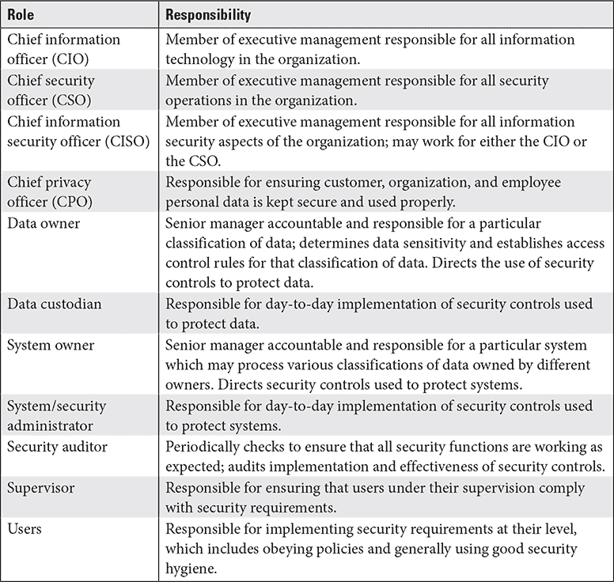

## 安全控制框架

框架是总体性的流程和方法，为组织执行安全职能规定了一条路径。有风险管理框架推荐风险方法论和评估及应对风险的步骤，就像有用于管理组织 IT 资产的框架一样。与“具体细节”安全职能更密切相关的是安全控制框架。

安全控制框架规定了一套正式化的控制措施或安全措施，组织应实施这些措施以保护其资产并降低风险。组织可以使用多种安全控制框架，许多框架由外部治理或内部采用强制要求，以使其与组织的使命和战略保持一致。表 1.3-2 列出并描述了几种更常用的框架。

**表 1.3-2** 常用安全控制框架

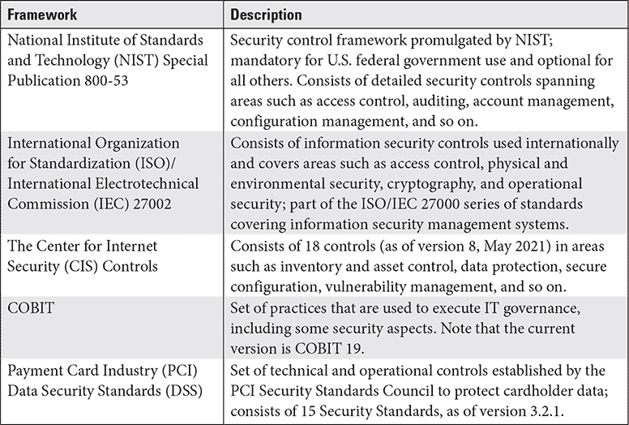

## 审慎注意/尽职调查

审慎注意和尽职调查这两个术语经常被混用，但不一定是同一回事。然而，你应该了解它们之间的区别，以便应对考试，因为有时在讨论使用这两个术语时的上下文会使它们之间的区别变得重要。它们的含义相似，两者都是确保组织计划和做正确事情所必需的，原因多种多样。这些原因包括避免法律责任、维护声誉以及遵守外部治理（如法律和法规）。

尽职调查意味着组织在规划其行动时进行了深思熟虑，并实施了控制措施以保护系统和信息，防止发生泄露等事件。尽职调查更侧重于战略层面。如果组织仔细考虑了风险，并实施了保护系统、信息、设备、设施和人员的控制措施，那么可以说该组织实践了尽职调查。

## 尽职注意

*尽职注意* 是组织针对特定事件所采取或将采取的行动的术语。尽职注意通常适用于特定情况和场景，例如组织在火灾或自然灾害期间如何保护生命和资源，或如何应对特定的网络安全事件，例如信息泄露。由于这种运营重点，它通常被称为“审慎人”规则，指的是合理人在相同或类似情况下会采取的行动。尽职注意还涉及验证作为其尽职调查责任一部分所采取的计划和行动是否得到实践、有效且可行。

**EXAM TIP** 将尽职调查视为在不良事件发生前的仔细规划和负责任的行动（主动），并将尽职注意视为在事件*确实*发生时的负责任的行动（被动）。

## REVIEW

## 目标 1.3：评估和应用安全治理原则

在本目标中，我们讨论了安全治理及其支持概念。我们研究了内部治理和外部治理。内部治理来自组织自身的政策和程序。外部治理来自法律和法规。我们还研究了安全功能如何与组织的战略、目标、使命和宗旨相结合和保持一致。我们讨论了组织流程（例如并购、剥离等）如何既影响又受安全治理的影响。我们研究了各种组织角色和职责，涉及管理信息技术和安全。我们还考虑了安全控制框架的必要性，以及它们如何构成保护组织内资产的基础。最后，我们回顾了尽职注意和尽职调查的关键概念，以及它们如何对于降低组织的风险和责任是必要的。

## 1.3 问题

**1.** 你公司的高层领导关注确保内部治理反映其遵守政府机构强加给其的法律和法规的承诺。以下哪项在内部用于将法律要求转化为组织人员在特定情况下必须采取的强制性行动？

**A.** 标准

**B.** 战略

**C.** 法规

**D.** 政策

**2.** 以下哪项是信息安全战略直接支持的？

**A.** 组织使命

**B.** 组织目标

**C.** 组织业务战略

**D.** 运营计划

**3.** 以下哪个高级角色负责确保客户、组织和员工数据保持安全并被正确使用？

**A.** 首席隐私官

**B.** 首席安全官

**C.** 首席信息官

**D.** 数据所有者

**4.** Gail 是一名网络安全分析师，正在参与编写信息安全战略文档。该组织计划在未来五年内扩展到国际市场，Gail 希望确保所使用的控制框架支持该组织目标。以下哪个控制框架应包含在信息安全战略中，供组织在未来几年内迁移到？

**A.** NIST 特别出版物 800-53

**B.** ISO/IEC 27002

**C.** COBIT

**D.** CIS 控制

## 1.3 答案

**1.** D 政策用于将法律要求转化为组织人员必须满足的可操作要求。

**2.** C 组织信息安全战略直接支持主要的组织业务战略，而业务战略又支持组织的目标和总体使命。

**3.** A 首席隐私官负责确保客户、组织和员工数据保持安全并被正确使用。首席安全官负责组织安全的所有方面。首席信息官关注整个 IT 基础架构。数据所有者关注特定类型和敏感性的数据，并负责确定该数据的访问控制。

**4.** B Gail 应在组织的信息安全战略中包含国际标准化组织（ISO）/国际电工委员会（IEC）27002 控制框架，供组织在未来几年内实施，因为它可以在国际上使用，且不与特定政府或商业标准绑定。

##  确定合规性和其他要求

在我们讨论治理之后，目标 1.4 讨论了安全计划必须符合治理的必要性。在本目标中，我们将研究遵守治理的法律和监管方面，以及治理如何影响合同协议和隐私。

## 合规性

在上一个目标中，我们讨论了治理。将本目标（关于合规性）视为该主题的自然延伸，因为遵守治理要求是网络安全的关键部分。*合规性*意味着遵守特定治理标准的要求。请记住，治理可以是外部的或内部的。外部治理通常以政府制定的法律、法规或条例形式出现。组织通常对外部治理的应用没有影响力或控制权。但是，它控制自己的内部治理。内部治理以组织自身的政策、程序、标准和指南形式出现。

## 交叉参考

内部治理文档将在目标 1.7 中进一步讨论。

合规性通过多种方式进行监控。组织可能会由颁布要求的机构进行评估，或通过受监管机构授权的第三方进行评估。通常，合规性通过以下方式进行检查：

• 检查

• 审计

• 所需报告

• 调查

如果组织被认为不符合治理要求，可能会有短期或长期的后果。在某些情况下，后果可能仅仅是不利的报告或要求在指定时间内符合要求。在其他情况下，不合规的后果可能非常严重。不合规的潜在后果包括

• 刑事指控和起诉

• 法律责任

• 民事诉讼

• 罚款

• 利益相关者或消费者信心的丧失

在本目标中，我们将讨论遵守几种不同类型的要求，包括法律和法规、合同以及行业标准。我们还将讨论遵守隐私规则，这些规则存在于法律和其他类型的治理中。

## 法律和法规合规性

大多数法律和法规侧重于保护特定类别敏感数据的要求。这些类别包括个人身份信息（PII）（例如姓名、地址、驾驶执照号码、护照号码等）、受保护的健康信息（PHI）和财务信息。这些法律不仅规定了必须实施的行政、技术和物理安全控制的要求，以保护数据，而且许多法律还旨在保护消费者及其隐私。有些法律甚至规定了组织必须如何报告和应对数据泄露。表 1.4-1 提供了一些具有网络安全影响或必须由网络安全人员定期考虑以符合合规性的法规示例。

## TABLE 1.4-1 Laws and Regulations That Affect Cybersecurity

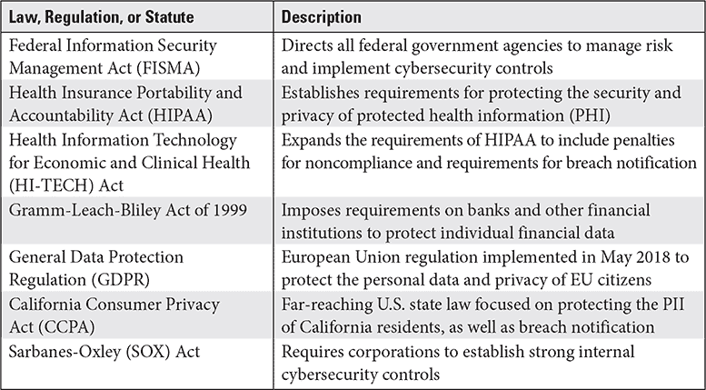

## EXAM TIP

You do not have to know the particulars of any law or regulation for the exam, but you should be generally familiar with them for both the exam and your career.

## Contractual Compliance

As data protection has increased in criticality over the past decade, many contracts between organizations are now including language describing how each organization will protect sensitive data shared between them. This language is more specific than a standard nondisclosure agreement (`NDA`). Contract terms now include responsibilities for data protection, data ownership, breach notification, and audit requirements. Companies entering these contractual relationships must be compliant with the terms or face civil liability for breach of contract.

Often contracts and other types of agreements require demonstration of due diligence and due care on the part of all entities entering into the contract. Sometimes contracts even outline penalties for violating the terms of the contract, such as failing to protect sensitive information. Sometimes this contract language is included as a regulatory requirement to protect specific categories of information, such as protected health information, that may be shared between two healthcare providers. Other times, a company may want to include contractual provisions to limit the liability of one party if the other party suffers a breach or incurs liability.

## Compliance with Industry Standards

Some industries have their own professional standards bodies that establish governance regulations for that industry. If an organization desires to become a member of one of these professional standards bodies, it must adopt and agree to obey the regulatory requirements established by that standards body for the industry. Noncompliance with those standards may result in the organization no longer being sanctioned by the professional organization, or even forbidden to further participate in activities governed by that body. An example of an industry standard is the Payment Card Industry (`PCI`) Data Security Standard (`DSS`), which is a security standard developed and enforced by a consortium of credit card providers, such as Visa, MasterCard, American Express, and others. `PCI DSS` is mandated for any merchant that processes credit card payments. As the standard is voluntary, a merchant does not have to agree to comply, but the consequence is that the merchant will not be permitted to process credit card transactions.

## Privacy Requirements

There are many different laws, regulations, and even industry standards that cover privacy. Remember that privacy is different from security in that security seeks to protect the confidentiality, integrity, and availability of information, whereas privacy governs what is done with specific types of information, such as `PII`, `PHI`, personal financial information, and so on. Privacy determines how much control an individual has over their information and what others can do with it, to include accessing it and sharing it. You can think of privacy as controlling how information is used and security as the mechanism for enforcing that control.

We briefly mentioned a few of the most prevalent privacy regulations earlier in the objective. Although there are differences in how countries view privacy and enforce privacy rules, the privacy laws and other governance standards of most countries have some commonalities. Whether it is the General Data Protection Regulation enforced by the European Union or the NIST Special Publication `800-53` privacy controls, there are some commonalities in the different privacy requirements. Complying with privacy laws and regulations usually requires an organization that collects an individual’s (the `subject’s`) personal data to have a formal written privacy policy, and then further demonstrate how it complies with that policy. Privacy policies typically include, at a minimum, the following provisions:

• **Purpose** The purpose for which information is collected

• **Authority** The authority to collect such information

• **Uses** How the collected information is used

• **Consent** The extent of the subject’s consent required to collect and use information

• **Opt-in/opt-out** Rights of the subject to opt out of data collection

• **Data retention and disposal** How long the information is retained and how it is disposed of

• **Access and corrections** How subjects of the information can view and correct their information

• **Protection of privacy data** How the organization protects the information and who is responsible for that protection

• **Transfer to third parties** The circumstances under which the information can be released to third parties

• **Right to be forgotten** The guarantee that an individual can request to have their information deleted

• **Notification of breach** The requirement to notify the subject of any breach of their personal information

Note that some of these privacy requirements are not always applicable, depending upon the law, regulation, or even country involved. In Objective `1.5` we will discuss additional privacy requirements and concerns, including specifics on how privacy is treated on an international basis.

## REVIEW

**Objective `1.4`: Determine compliance and other requirements** This objective covered the necessity of complying with governance requirements. Compliance with laws, regulations, contracts, industry standards, and privacy requirements is a major portion of cybersecurity. First, we discussed compliance with several different laws and regulations imposed by governments. Laws and regulations primarily serve to enforce how particular categories of data are protected, such as financial, healthcare, and personal data. Compliance with laws and regulations is mandatory, and lack of compliance is typically punished by fines and civil penalties, but some laws have provisions that specify possible criminal penalties such as imprisonment.

We also discussed another aspect of civil penalty—contract compliance. Contracts are agreements between two or more entities and are legally enforceable. Failure to comply with the terms of a contract can result in civil liabilities, such as lawsuits and fines.

Although industry standards may not be legally mandated, participation in a particular industry may require that an organization obey those standards. A classic example is the security standards imposed by the credit card industry, known as the Payment Card Industry Data Security Standard (`PCI DSS`), which dictates how organizations that process credit card payments must secure their systems and data.

Finally, we examined common characteristics of privacy rule requirements in several laws, regulations, and other governance standards. These rules include an individual’s ability to be able to correct erroneous information, determine who has access to personal information, and the right to be informed of a breach of personal data.

## 1.4 QUESTIONS

**`1`.** Emma is concerned that the recent breach of personal health information in a large healthcare corporation may affect her, but she has not yet been notified by the company that was breached. Emma, a resident of the state of Alabama, is researching the various laws under which she should be legally notified of the breach. Which of the following relevant laws or regulations dictates the timeframe under which she should be notified of the data breach of her `PHI`?

**A.** California Consumer Privacy Act (`CCPA`)

**B.** Health Information Technology for Economic and Clinical Health (`HI-TECH`) Act

**C.** General Data Protection Regulation (`GDPR`)

**D.** Federal Information Security Management Act (`FISMA`)

**2.** Riley 是一名初级网络安全分析师，最近在一家主要银行机构工作。一位高级网络安全工程师告诉他，他必须熟悉适用于金融行业的不同数据保护法规。Riley 必须熟悉以下哪项法律或法规？

**A.** 通用数据保护条例 (GDPR)

**B.** 联邦信息安全管理法案 (FISMA)

**C.** 1999 年格拉姆-莱奇-布莱利法案

**D.** 健康保险可移植性与责任法案 (HIPAA)

**3.** Geraldo 拥有一家小型体育用品供应商店连锁店。最近，他的企业被要求接受审计，以衡量其对 PCI DSS 标准的合规性。Geraldo 的企业未通过审计。以下哪项是此次失败最可能的后果？

**A.** 除非他修复任何未解决的安全问题，否则他的企业可能不再被允许处理信用卡交易。

**B.** 他的企业将被要求根据 FISMA 报告持续的合规状态。

**C.** 他的企业必须根据 HIPAA 报告数据泄露。

**D.** 他的企业将根据 HI-TECH 法案面临潜在罚款。

**4.** Nichole 是她公司的合同合规审计员。她正在审查应包含在与新业务合作伙伴合同中的网络安全要求语言。新合作伙伴将能够访问 Nichole 公司拥有的极其敏感的信息。以下哪项是合同语言中至关重要的内容？

**A.** 要求业务合作伙伴维护高可用性系统

**B.** 要求业务合作伙伴在遭遇泄露时立即通知 Nichole 的公司

**C.** 业务合作伙伴的法律义务

**D.** 业务合作伙伴的安全计划

## 1.4 ANSWERS

**1.** B Emma 应根据《健康信息技术经济与临床健康法》(HI-TECH Act) 被告知泄露情况，该法案将 HIPAA 法规扩展到包括违规通知。作为阿拉巴马州的居民，既不适用保护加州居民的《加州消费者隐私法》(CCPA)，也不适用保护欧盟公民的《通用数据保护条例》(GDPR)。FISMA 是一项联邦法规，要求政府机构管理风险并实施安全控制。

**2.** C Riley 必须熟悉并理解 1999 年《格拉姆-莱奇-布莱利法案》施加的要求，该法案要求金融机构实施适当的安全控制措施，以存储、处理和传输客户财务信息。

**3.** A 由于 Geraldo 的企业未通过支付卡行业数据安全标准审计，其企业可能在问题得到修复之前被禁止处理信用卡交易。

**4.** B 由于业务合作伙伴将能够访问极其敏感的信息，Nichole 应在合同中加入语言，要求合作伙伴在发生数据泄露时立即通知她的公司。业务合作伙伴的高可用性要求与保护敏感数据无关。Nichole 不必在合同语言中包含业务合作伙伴的法律义务，因为无论合同语言中是否包含，法律都适用。安全计划通常不会包含在合同语言中。

### 了解与信息安全相关的法律和监管问题的整体背景

在目标 1.5 中，我们将继续讨论组织可能面临的治理、合规性和一般信息安全方面的法律和监管要求。我们将审查法律和监管要求、网络犯罪、知识产权以及跨境数据流动等问题，以及进出口控制和隐私问题。

## 法律和监管要求

作为网络安全专业人员，您应该了解在保护数据、起诉网络犯罪和处理隐私问题方面对该行业施加的法律和监管要求。您还应该熟悉向其他国家出口某些技术所涉及的问题，以及不同国家如何看待跨越或存储在其境内的数据。其中许多问题相互关联，因为各国制定有利于本国利益的数据法，同时影响隐私、其境内可使用的技术以及数据进入和退出其国家 IT 基础设施的方式。

## 网络犯罪

构成网络犯罪的定义因国家而异，但一般来说，`cybercrime` 是指使用或针对计算机、网络或其他相关技术实施的违反法律、法规或条例的行为。常见的网络犯罪包括黑客攻击、身份盗窃、欺诈、网络跟踪、儿童剥削和恶意软件传播。CISSP 考试不要求您成为执法专家，但您应该熟悉与网络犯罪相关的一些当前法律和问题。这些包括数据泄露以及知识产权的盗窃或滥用。

**Cross-Reference**

与网络犯罪和网络法相关的领域，例如调查，将在目标 1.6 和 7.1 中介绍。

## 数据泄露

数据盗窃、丢失、破坏以及未经授权实体的访问现已成为网络安全领域最大的关注点。数据泄露现在司空见惯，因为敏感数据的价值促使复杂的个人和团伙投入大量时间和资源来攻击计算机系统。再加上有时采取的保护敏感数据的措施往往不足。尽管数据泄露法律滞后于网络犯罪快速发展的步伐，但此类法律已制定出来，旨在通过施加重罚，并赋予法律系统更大的调查、起诉和惩罚实施这些犯罪的人的权力，从而遏制此类事件。

某些数据泄露法律适用于特定领域，例如医疗信息、财务数据或个人信息。其他法律则不分数据类型，普遍适用。通常，数据泄露法律定义了试图保护的数据类型，并规定对泄露实施者的处罚。数据泄露法律包括违规通知条款，要求遭受数据泄露的组织通知可能受泄露影响的对象，通常在规定的时间内，并对数据保护不足或未能在发生泄露时通知对象的行为处以罚款和处罚。涉及数据保护要求以及数据泄露问题的各种美国法律包括

• 《健康信息技术经济与临床健康法》(HI-TECH Act)

• 《加州消费者隐私法》(CCPA)

• 1996 年《经济间谍法》

• 1999 年《格拉姆-莱奇-布莱利法案》

## 许可和知识产权要求

`Intellectual property (IP)` 是指个人或组织的有形和无形创造物，例如表达、想法、发明等。知识产权可以依法保护，防止未经授权的人使用。知识产权示例包括软件代码、音乐、电影、专有信息、公式等。您应该熟悉的不同类型的知识产权包括

• **商业秘密** `Confidential information that is proprietary to a company, which gives it a competitive advantage in a market space.` 商业秘密作为其所有者的财产受到法律保护。

• **版权** `Protections for the rights of creators to control the public distribution, reproduction, display, adaptation, and use of their own original works.` 这些作品可能包括音乐、视频、图片、书籍，甚至软件。版权适用于想法的`expression`，而非想法本身。请注意，版权在表达的那一刻即存在——注册提供法律保护，但所有权并非必须注册，尽管为了执行所有权，强烈建议注册。

• **商标** `A word, name, symbol, sound, shape, color, or some combination of these things that represents a brand or organization.` 商标通常是用于识别公司或产品的区分性标志。

• **专利** `The legal registration of an invention that provides its creator (or owner if the owner is not the same entity as its creator) with certain protections.` 这些保护包括发明的所有者/创建者确定谁可以合法使用该发明以及在何种情况下使用的权利。

虽然商业秘密通常不进行注册（由于其保密性质），但如果所有者能证明其所有权，其所有者可以对使用其专有或机密信息的另一个实体提起法律诉讼。另外三种知识产权形式通常会向监管机构注册，以保护所有者的合法权利。版权不需要注册，如果所有者能证明他们是作品的所有者/创建者，且该作品在未经其许可的情况下被复制或使用。希望合法使用受版权、商标和专利法保护材料的人必须从知识产权所有者处获得许可。许可描述了实体合法使用他人知识产权的条件，并赋予他们合法许可，通常需要支付费用。

**EXAM TIP** 我们讨论过的知识产权类型中，由于其保密性质，商业秘密通常不会向任何人注册，这与版权、商标和专利不同。但是，如果有人侵犯了另一个组织的商业秘密，声称拥有该商业秘密的实体应该能够证明该商业秘密属于他们。

## 进出口管制

许多国家限制某些先进技术的进口或出口；事实上，有些国家认为进口或出口某些这些先进技术等同于进口或出口武器。网络安全专业人员需要特别了解的进出口管制包括与加密技术以及先进的高性能计算机和设备相关的管制。每个国家都有自己的法律法规来管辖先进信息技术的进出口。以下是两项涉及禁止技术出口的关键美国法律：

• **国际武器贸易条例（ITAR）** `Prohibits export of items designated as military and defense items`

• **出口管理条例（EAR）** `Prohibits the export of commercial items that may have military applications`

考虑一下如果先进加密技术落入恐怖分子或犯罪组织，或某国的宣称敌人手中会产生什么影响。显然，各国在宣布哪些技术可以或不可以进口或出口时，都会按照自身的最佳利益行事。另一个例子是，某些国家不允许其公民进口和使用先进加密技术，因为政府希望禁止其无法解密的加密方法。

瓦森纳安排是一项国际条约，目前由 42 个国家遵守，详细规定了特定类别的双用途商品的出口管制。对网络安全人员感兴趣的是第 3 类（电子产品）、第 4 类（计算机）和第 5 类（电信和信息安全物品）领域，应根据出口国和进口国的法律在出口前查阅这些领域。

## 跨境数据流

国家边界之间的数据流动有时会引起争议。需要考虑的问题包括隐私问题、专有数据，以及可能被外国政府列为机密的数据。某些国家严格禁止某些分类的数据在不同国家进行处理甚至存储。这些法律被称为`data localization`法律（也称为`data sovereignty`法律），要求某些类型的数据必须在一个国家的边界内存储或处理。

在某些地理区域，例如欧盟，对处理其公民私人数据的禁止旨在保护人们。在其他情况下，一个国家可能要求数据留在其境内，因为希望出于审查、国家安全或其他动机来限制、控制和访问此类数据。虽然有不同的国际协议控制其中一些跨境数据流，但也有社会、政治和技术方面的担忧，即这些协议在不同隐私权和技术（如云计算）以及 IT 全球化的背景下有多有效。

## 隐私问题

隐私可能是一个复杂的问题，特别是在讨论国际法律和法规的背景下。在世界某些地区，例如欧盟，隐私是优先事项并得到严格执行。在其他地方，对任何个人隐私的遵守基本上只是空谈。各国通常将其隐私法律与几个其他问题联系起来，例如国家安全、数据主权和跨境数据流。一些国家有特定的法律法规来保护个人隐私，例如：

• 欧盟的《通用数据保护条例》（GDPR）

• 加拿大的《个人信息保护和电子文件法》

• 新西兰的《1993 年隐私法》

• 巴西的《一般数据保护法》（LGPD）

• 泰国的《个人数据保护法》（PDPA）

其他国家，包括美国，没有特定的全面隐私法，但倾向于将隐私要求作为其他法律的一部分，例如影响企业或特定市场细分或人群的法律。美国这种方法的例子包括 1999 年的《格拉姆-莱奇-布里利法案》（GLBA），适用于金融组织，《健康保险可携性和责任法案》（HIPAA），适用于医疗保健提供者，以及 1974 年的《隐私法》，仅适用于处理隐私信息的美国政府组织。

除了我们在目标 1.4 中讨论的不同隐私政策要素（如目的、权限、使用和同意）之外，在法律和法规中处理隐私还有不同的方法。一种方法是在特定行业或市场细分中，称为`vertical enactments.` 隐私法律和法规被制定并适用于特定领域，例如医疗保健领域或金融世界（例如，HIPAA 和 GLBA，分别）。与之形成对比的是`horizontal enactment`，即特定法律或法规跨越多个行业或领域，例如保护 PII 的法律，无论其行业用途或上下文如何。

## 复习

## 目标 1.5：了解与信息安全相关的法律和监管问题（整体视角）

在目标 1.5 中，我们继续讨论遵守法律法规的问题，并深入探讨了关键的网络安全问题，例如网络犯罪、数据泄露、知识产权盗窃、受限技术的进出口、国家间的数据流动以及隐私问题。网络犯罪是指使用或针对计算机、网络或其他相关技术而实施的违反法律、法规或条例的行为。常见的网络犯罪包括黑客攻击、身份盗窃、欺诈、网络跟踪、儿童剥削以及恶意软件的传播。数据泄露通常是指通过犯罪行为导致的数据被盗窃或破坏。已有多部法律颁布，用于处理特定类型数据的泄露，这些法律适用于医疗保健和金融等行业。

我们还讨论了必须保护的不同类型的知识产权，包括商业秘密、版权、商标和专利。商业秘密受法律保护，但由于其保密性质，通常不进行登记。版权也不必登记，但应当登记以保护所有者的合法权益。商标和专利则需向相应的政府机构依法登记。如果有人希望合法使用受版权、商标或专利法保护的他人知识产权，则需要获得许可。

进出口管制旨在根据国家自身的法律法规，防止某些先进技术（例如加密技术）跨越国家边境。各国之间已签署多项条约，限制某些敏感技术的进出口，其中包括瓦森纳安排。跨境数据流动受不同国家法律和限制的约束，这些法律基于各国自身的国家利益。数据本地化或主权法律被实施，以限制特定类别敏感数据的出口、使用和访问。由于国际法律缺乏一致性，且某些国家不尊重个人隐私，隐私问题变得更加复杂。

## 1.5 问题

**1.** 以下哪部法律要求通报受保护的健康信息（PHI）泄露？

**A.** HI-TECH

**B.** GLBA

**C.** PCI DSS

**D.** CCPA

**2.** 要使犯罪被视为网络犯罪，以下哪项必须成立？

**A.** 必须导致欺诈。

**B.** 必须使用计算机、网络和/或相关技术。

**C.** 必须涉及恶意意图。

**D.** 不得是暴力犯罪。

**3.** 您的公司研发了一种用于制造特殊强金属合金的秘密配方。以下哪种知识产权类型适用于该秘密配方？

**A.** 商业秘密

**B.** 商标

**C.** 专利

**D.** 版权

**4.** 某国禁止进口高强度加密算法用于其境内，因为该国希望能够拦截并解密其公民发送和接收的消息。该国可能会颁布以下哪种法律来限制这些技术的使用？

**A.** 版权法

**B.** 知识产权法

**C.** 隐私法

**D.** 进出口法

## 1.5 答案

**1.** A 《健康信息技术经济与临床健康法案》（`HI-TECH`）是一项为进一步保护私人医疗信息而颁布的法律，并规定如果此类信息发生泄露，应通知相关信息主体。

**2.** B 如果犯罪针对计算机、网络或相关技术，则被视为网络犯罪，无论意图如何，无论是否实施欺诈，或犯罪是否导致身体暴力。

**3.** A 由于该配方被视为机密，并为公司提供市场竞争优势，因此将被视为商业秘密。该配方不会根据版权、商标或专利法进行登记，因为这会将其内容公之于众。

**4.** D 如果某国希望限制其公民及其境内使用先进技术（例如`encryption`），它将颁布进出口法，以防止这些技术进入该国，并使其使用或持有行为非法。

## 了解调查类型的要求（例如，行政、刑事、民事、监管、行业标准）

在目标 1.6 中，我们将讨论调查，并考察各种调查类型，例如行政调查，以及民事、刑事和监管调查。我们还将探讨可能不属于其他类别的各种行业调查标准。

## 调查

调查是网络安全领域的必要组成部分。调查通常是因为有人不遵守规则（例如可接受使用政策中规定的规则），或有人犯错导致数据泄露或丢失而进行。无论引发调查的原因是什么，网络安全专业人员都应熟悉可能需要的不同类型的调查。请注意，本目标讨论了不同的调查类型；这是我们在域 7 的相关目标中将进行的更详细调查讨论的宝贵先修知识。

## 交叉引用

调查也在目标 7.1 中有所涉及。

## 行政调查

行政调查是针对组织成员的调查。这种调查通常是内部调查，用于审查运营问题或违反组织政策的行为。行政调查通常由组织内部人员（如网络安全人员甚至审计员）进行。在小型组织中，管理层可能会指定某人进行独立调查，甚至咨询外部机构。内部行政调查的后果包括，例如，训诫和解除雇佣。但是，有时调查可能会升级为民事调查或刑事调查，具体取决于违规行为的严重程度。

## 民事调查

当两方发生争议，且一方决定通过向另一方提起诉讼来解决分歧时，通常会进行民事调查。作为诉讼的一部分，通常需要进行调查以确定事实并确定过错或责任。根据法院认定哪一方承担责任，过错方可能会被处以罚款或向被认为受损方支付赔偿金（损害赔偿）。请注意，民事调查的证据要求（举证责任）不如刑事调查的证据要求严格。民事调查采用“证据优势”标准，这意味着案件可能仅基于某人可能对另一方犯下不法行为的合理可能性就做出裁决。请注意，无论民事调查与刑事调查所承担的举证责任要求如何，都不会改变调查的实施方式，我们将在目标 7.1 中稍后看到这一点。

## 刑事调查

更严重的调查通常涉及个人或组织违反法律的情况。刑事调查是针对涉嫌违反刑法的行为进行的。与行政调查不同，刑事调查通常由执法人员进行。如前所述，刑事调查的证据标准远高于民事调查的标准，并且需要确定有罪或无罪，证据必须达到“排除合理怀疑”的程度，因为刑罚要严重得多。刑事调查及随后审判可能导致的处罚包括罚款或监禁。

**EXAM TIP** 民事调查与刑事调查的主要区别在于：民事调查是诉讼的一部分，且举证责任远低于刑事调查。民事案件的处罚通常也比刑事案件轻。

## 监管调查

当政府机构认为个人或组织违反了行政法（通常是旨在控制组织在社会责任、应有注意与勤勉，或对他人造成经济损害方面行为的法规或法规）时，可能会进行监管调查。然而，与刑事调查不同，监管调查不一定非要由执法人员进行。它可以由负责执行行政法律和法规的其他政府机构进行。

监管调查的一个例子是：证券交易委员会（SEC）调查一家公司涉嫌内幕交易。监管调查施加的处罚可以从民事调查后的相同处罚（例如罚款或赔偿）到刑事调查导致的处罚（例如监禁）不等。

**EXAM TIP** 刑事调查与监管调查的主要区别在于背景。如果存在明显的欺诈、暴力或其他严重犯罪的严重证据，可能会发生刑事调查。刑事调查也通常涉及个人。监管调查通常是在组织（而非个人）违反行政类法律（例如与金融犯罪或数据保护相关的法律）时进行的。监管调查很容易转变为刑事调查，具体取决于情况。

## 调查的行业标准

我们将讨论的最后一种调查类型，不是由法律、法规甚至任何特定组织强加的。行业标准是由行业内的组织本身强加的，作为行业自我监管其成员（无论是个人还是组织）行为的一种方式。行业标准通常是自愿的，组织通常会采纳它们或必须同意它们才能成为该行业的一部分。

行业标准的一个例子是支付卡行业数据安全标准（在前两个目标中讨论过），所有处理信用卡交易的供应商和商家都必须遵守，否则将失去支付卡处理权限。另一个更直接适用于个人网络安全人员的行业标准是（ISC）² 施加的标准，以获得 CISSP 认证。个人同意遵守专业和道德标准，作为认证的条件。

同意遵守行业标准的组织也同意在被怀疑违反标准时接受调查。标准组织的调查通常是出于原因进行的，例如针对成员组织提出的投诉，而不是作为常规审计流程的一部分。调查通常由标准机构的成员进行，对被发现违反行业标准的组织和个人可能施加的处罚可能包括停职、被标准机构终止会员资格、罚款或谴责。在极端情况下，可能会被永久禁止加入赞助该标准的组织，甚至可能承担民事责任。

## 复习

**目标 1.6：了解调查类型的要求（即，行政、刑事、民事、监管、行业标准）** 在本目标中，您了解了不同类型的调查，包括行政、民事、刑事、监管以及行业标准要求的调查。行政调查由组织内部的安全或审计人员进行。民事调查作为各方之间诉讼的一部分进行，旨在确定哪一方有过错。刑事调查在个人或组织违反法律时进行，可能会导致对有罪方施加严厉的处罚，例如罚款或监禁。监管调查由负责执行行政法律和法规的机构进行。监管调查也可能导致罚款、赔偿或监禁。违反行业或专业组织施加的标准可能会导致执行机构的调查。这种调查导致的处罚可能包括被组织暂停会员资格、被行业终止或罚款。

## 1.6 问题

**1.** 您是一家中型公司的网络安全分析师，高级管理层委托您调查一名个人的行为，该个人通过访问被禁止的网站违反了组织的可接受使用政策。在调查过程中，您确定该个人的互联网访问还可能违反了公司所在州的法律。您的管理层决定将调查移交给执法机关。以下哪项最能描述这种类型的调查？

**A.** 行政调查

**B.** 民事调查

**C.** 监管调查

**D.** 刑事调查

**2.** 您公司的一台 Web 服务器最近被黑客攻击。在您公司调查黑客攻击并减轻损害后，另一家公司声称攻击者使用了您公司的 Web 服务器攻击其网络。另一家公司已对您公司提起诉讼，并聘请了一家私人网络安全调查公司来确定您公司是否应承担责任。以下哪种类型的调查属于这种情况？

**A.** 刑事调查

**B.** 行政调查

**C.** 民事调查

**D.** 因违反行业标准而产生的调查

**3.** 您的公司加入了一个行业专业组织，该组织对其成员组织施加要求，作为会员资格的条件。一家竞争对手最近向该专业组织举报您的公司违反了其行为准则。该专业组织决定启动独立调查以验证这些指控。这将被视为哪种类型的调查？

**A.** 行政调查

**B.** 民事调查

**C.** 行业标准调查

**D.** 刑事调查

**4.** 以下哪个示例最能描述监管调查？

**A.** 一家公司的网络安全团队调查违反可接受使用政策的行为。

**B.** 公司律师调查另一家公司涉嫌商标侵权的指控。

**C.** 联邦调查局调查您公司内个人涉嫌支持恐怖主义活动的指控。

**D.** 联邦通信委员会调查互联网服务提供商涉嫌非法互联网审查的指控。

## 1.6 答案

**1.** D 虽然调查最初是一项简单的内部行政调查，但发现潜在的违法行为将调查升级为刑事调查，因为已经介入了执法机构。

**2.** C 由于调查是由民事诉讼发起的，因此这将被视为民事调查。

**3.** C 由于调查是因为声称贵公司违反了行业标准组织施加的要求而发起的，因此这将被视为行业标准调查。

**4.** D 联邦通信委员会（FCC）调查互联网服务提供商潜在的非法审查行为，将是监管机构调查的一个示例。由联邦调查局（FBI）调查的犯罪将被视为刑事调查。公司律师调查商标侵权将构成民事调查。组织内部的网络安全人员调查违反可接受使用政策的行为将被视为行政调查。

## 制定、记录和实施安全政策、标准、程序和指南

目标 1.7 将结束我们对治理的讨论。对于此目标，我们将探讨内部治理，例如安全政策、标准、程序和指南。这些是为支持外部治理（如法律和法规）而制定的内部治理文件。

## 内部治理

如目标 1.3 中简要讨论的那样，内部治理旨在支持和阐述外部治理，外部治理可能以法律、法规、法规以及专业行业标准的形式出现。内部治理特别要求组织内部人员支持外部治理，以及组织的战略目标和使命。内部治理以政策、程序、标准、指南和基线的形式出现，我们将在本目标中讨论这些内容。

内部治理由组织内的高级管理层正式制定和批准。然而，在实际操作中，许多一线员工和中层经理也对内部治理有所贡献。通常，他们帮助提供信息或起草文件，由高级管理人员最终确定和批准。内部治理通常由内部执行委员会或指导委员会管理，该委员会由组织内广泛的业务领域代表组成，包括业务流程、IT、网络安全、人力资源和财务部门。这种广泛的方法使所有重要利益相关者在内部治理结构中都有发言权。最终，然而，高级管理层负责批准和实施所有内部治理。

## 政策

安全政策代表组织高级领导层对其安全管理计划施加的要求，以及其如何运行该计划。单个安全政策构成了该总体政策，是内部治理的基石。政策为组织人员提供方向。政策规定组织人员必须满足的要求。请注意，政策和其他内部治理文件被视为行政控制。政策不会深入细节——它们只是陈述要求。大多数政策还列出了负责管理或实施政策的人员的角色和职责。政策规定要求；它陈述*必须做什么*，有时甚至陈述*为什么必须这样做*（例如，为了实施法律或法规）。然而，它通常不规定*如何*执行要求。*如何*的过程在程序中描述，我们将在下一节讨论。

虽然组织以多种方式编写政策，但政策通常应简洁明了。政策文件应说明政策的特定范围和目的，当与外部治理相关联时，政策应说明它支持哪项法律或法规。政策文件还可以说明不遵守政策的后果。最后，高级管理人员应签署政策文件，作为政策的批准机构，因为这表明管理层对政策的承诺。

## 程序

程序以及其他内部治理文件，旨在支持政策。当政策规定*必须做什么*时，程序会进一步详细描述*如何做*。程序可以非常详细，描述为执行政策要求而必须执行的不同流程和活动。程序通常在组织的较低层级制定，通常由中层管理人员和一线员工参与创建。最终，它们仍必须由高级管理人员批准，但这些管理人员通常较少参与程序的实际编写。

程序可以详细说明各种流程，例如设备处理、加密敏感数据、执行数据备份、处置介质等等。请注意，与政策一样，程序通常是组织中的强制性要求。程序通常由标准和指南文件提供参考，我们将依次讨论这些内容。

## 标准

标准可以有多种形式。例如，标准可以是控制框架，或者是描述程序或流程必须达到的绩效水平才能被视为正确执行的文件。它还可以详细说明流程或活动的最低要求。标准文件通常是内部治理的强制性部分，就像政策和程序一样。标准可以由独立组织或政府监管机构制定。在某些情况下，组织在采用标准方面没有选择权。在其他情况下，组织可以选择采用自愿标准，但将其作为组织范围内的强制性要求。无论如何，标准旨在提供关于如何执行程序的指导。

为了让您了解标准在内部治理框架中的关系，可以制定一项政策，要求使用安全控制。此外，由于外部治理，该政策可能要求在所有流程和程序中使用 NIST 安全控制目录（NIST 特别出版物 800-53，修订版 5，美国政府实体必须遵循的标准）。程序可以详细说明如何实施 NIST 控制目录中规定的特定控制。另一个示例是，当政策要求对存储在敏感设备上的数据进行加密时。程序将详细说明用户必须采取的加密数据的步骤，而联邦信息处理标准（FIPS）可能规定所使用的加密算法的要求。

## 指南

指南通常是标准和程序的补充。指南可以由组织内部制定，也可以由供应商或专业安全组织制定。指南通常不被视为强制性，因为它们仅提供关于如何执行程序或活动的补充信息。指南可以更详细地解释如何执行任务，或者只是提供程序中可能未包含的其他信息。有时，指南提供被视为非强制性但可能必要的最佳实践。

## 考试提示

为了帮助理解政策、流程、标准和指南之间的关系，请记住指南不是强制性的，但内部治理的其他元素是强制性的。还要记住，政策是指令性的，流程详细说明如何实施政策，标准规定达到什么级别或深度，而指南只是辅助信息，可用于协助实施政策。

## 基线

与我们之前审查的其他内部治理文档类似，基线是为实施政策确立的要求而开发的。然而，与其他文档不同，基线作为基础设施中不同组件上的配置项实施。基线是在组织内设备上使用的标准化配置。它可以是与其他系统配置相同的标准化操作系统安装，也可以是以类似方式一致配置的标准应用程序。基线还可以包含标准化的网络流量模式。

关于基线的关键因素是它们在整个组织中是标准化的。它们通过将政策转化为实际控制实施来支持安全政策。例如，如果政策规定所有基础设施设备都将使用静态数据加密，而标准规定必须使用 AES 256 位加密，则基线将包括实施该要求的配置选项。流程将提供配置该基线的详细信息。

基线作为配置管理的一部分进行维护和记录。当组织基础设施发生变化并需要更改基线时，此修改必须经过仔细规划、测试、执行和记录。任何被接受的更改都作为正式变更和配置管理流程的一部分，成为新基线的一部分。最终，所有更改都必须符合批准并实施的内部治理。

## 考试提示

虽然基线不包含在目标 1.7 中，但它们对于理解组织政策如何在系统和基础设施级别实施至关重要。

## 复习

**目标 1.7：开发、记录和实施安全政策、标准、流程和指南** 在此目标中，我们涵盖了内部治理的许多组成部分。内部治理反映了高级管理层的领导理念，以及与外部治理（如法律和法规）的协调和支持。内部治理组成部分包括单独的安全政策，这些政策规定了高级管理层对组织施加的要求，以支持其总体安全政策。流程详细说明政策将如何实施，即在流程或活动方面。标准有助于告知活动和流程必须满足的深度、质量或绩效水平。政策、流程和标准通常被视为强制性的。指南通常被视为可选的，由用于增强流程的补充信息组成，以采用最佳实践或优化的实施方法。指南可以由软件或硬件供应商、专业组织，甚至组织本身开发。

基线是政策实施的结果，由基础设施的标准化配置组成。基线包括标准化的操作系统、应用程序、网络流量和安全配置。如果组织由于新技术、业务流程变化或威胁环境而需要对基础设施进行更改，这些更改将通过变更和配置管理流程纳入基线。

## 1.7 问题

**1.** 以下哪项是内部治理的组成部分？

**A.** 法律

**B.** 法规

**C.** 法规条文

**D.** 政策

**2.** 以下哪项不被视为内部治理的强制性组成部分？

**A.** 指南

**B.** 标准

**C.** 政策

**D.** 流程

**3.** 您是一家中型公司的网络安全分析师。贵公司高级管理层在进行风险评估后，决定实施一项政策，要求关键补丁在发布后一周内应用到系统上。以下哪项将详细说明实施该政策所需的活动？

**A.** 操作系统指南

**B.** 补丁管理流程

**C.** 配置管理标准

**D.** 符合 NIST 标准的操作系统基线

**4.** 您的公司已在基础设施中为操作系统、应用程序以及网络端口、协议和服务标准化了基线。最近，安装了一个新的业务线应用程序，但无法正常工作。在检查基础设施安全设备后，您发现应用程序的一个协议及其关联端口被阻止了。从管理角度来看，必须做什么才能使应用程序正常工作？

**A.** 卸载新的业务线应用程序，因为其端口和协议不在基线允许范围内

**B.** 经历变更和配置管理流程，对网络流量端口进行更改以创建新的永久基线

**C.** 在安全设备上取消阻止关联的协议和端口

**D.** 重新配置应用程序，使其仅使用已包含在基线中的端口和协议

## 1.7 答案

**1.** D 政策用于实施内部治理要求，并可能与外部治理（如法律、法规和法规条文）保持一致。

**2.** A 指南由补充信息组成，不被视为内部治理的强制性部分。它们通过提供额外信息和最佳实践来增强内部治理。政策、流程和标准被视为内部治理的强制性组成部分。

**3.** B 补丁管理流程需要在政策变更后进行更新，以包含在所有系统上实施关键补丁的要求，该要求规定在补丁发布后一周内实施。流程将详细说明如何执行这些任务和活动。

**4.** B 您应经历正式的变更和配置管理流程，将应用程序的端口和协议添加到既定基线中。卸载应用程序可能不是选项，因为业务决策是基于有效的业务需求而安装它的。仅在安全设备上取消阻止应用程序使用的端口和协议是一种技术方法，可能在基线变更正式批准后发生，但这不是管理行动。重新配置应用程序可能不是选项，因为它可能出于特定原因使用特定端口和协议，更改它可能会干扰网络上的其他应用程序，并导致基线中出现太多其他更改。

## 识别、分析和优先排序业务连续性 (BC) 需求

目标 1.8 开始了一项贯穿全书的讨论，涵盖各种其他目标，内容涉及业务连续性规划 (BCP)。我们还将在第 7 域中讨论业务连续性及其密切相关的流程——灾难恢复。目前，我们将查看业务连续性要求，例如在进行业务影响分析 (BIA) 时开发的要求。

## 业务连续性

## 业务连续性 (BC)

业务连续性 (BC) 是一项关键的网络安全流程，直接关注安全的可用性目标。BC 关注的是保持关键业务流程持续运行，即使在重大事件（如灾难和灾难性事件）期间也是如此。虽然通常被讨论为一个完全独立的实体，但 BC 与事件响应紧密相连；BC 是通常在控制和减轻严重事件的紧急问题之后才启动的流程，并致力于将一切恢复到完全运行状态。BC 也与灾难恢复密切相关；有时事件响应、业务连续性和灾难恢复的开始和结束之间存在模糊的界限。虽然业务连续性关注的是保持业务运行，但灾难恢复（我们将在域 7 中稍后看到）关注的是安全、保护人员生命以及恢复设备和设施的紧急问题，以便业务连续性可以开始。

## 考试提示

事件响应、业务连续性和灾难恢复是三个密切相关但独立的流程。事件响应是在任何负面事件期间立即发生的事情，用于发现发生了什么、如何发生以及如何停止对信息和系统的破坏。灾难恢复也可能在该过程中发生，具体取决于事件的性质，或者它可能是一个独立的流程，但它主要关注拯救生命和设备。业务连续性紧随灾难恢复之后，并专注于使业务重新投入运行并执行其主要任务。然而，所有这些活动都需要在事件发生之前进行综合规划。

BC 也是风险管理的组成部分，正如您将在目标 1.10 中关注风险时所看到的那样。为业务连续性规划 (`BCP`) 必须做的第一件事是完成一份清单，以了解和记录支持关键业务流程的系统、信息、设备、设施和人员。这份清单对于完成业务影响分析（下文将讨论）至关重要。

## 业务影响分析

业务影响分析，或 `BIA`，识别组织的关键业务流程，以及支持这些流程的系统、信息和其他资产。目标是确定业务必须绝对维护哪些流程以履行其使命并最大限度地减少财务后果。`BIA` 有助于在组织因事件（如自然灾害、重大攻击或其他灾难）而丢失资产时，对资产进行恢复优先级排序。如前所述，`BIA` 直接影响风险管理流程，因为业务流程和支持资产的清单有助于确定必须在基础架构中实施哪些安全控制措施来保护这些资产，从而降低丢失这些资产的风险。

## 开发 BIA

开发 `BIA` 是网络安全和 IT 人员与业务流程所有者之间的合作工作。如果组织尚未开发其关键业务流程的关键性列表，以及必须保持运行以正常运作的流程，那么这是一个很好的机会来完成此项工作。关键业务流程所有者必须开发文档，识别其自身的使命和目标声明，以及这些业务流程如何支持组织的整体使命和目标。他们必须清点并列出保持其特定业务领域运转的关键上游流程。然后，他们必须将这些关键流程分解为尽可能小的级别，以便了解流程之间的各种关系以及涉及的依赖项，即使是那些以前可能被认为不重要的流程也是如此。

一旦此流程工作流完成，网络安全分析师和 IT 人员将映射支持这些业务流程的各种系统和信息流，以确定工作流中任何点丢失的影响。通常，`BIA` 开发项目会发现以前没有人认为重要的关键资产，仅仅是因为它们支持其他系统和依赖项。`BIA` 可以绘制组织的整个业务流程基础架构，以及支持这些关键领域的关键资产。

## 范围

`BIA` 的范围显然应涵盖组织的关键业务流程领域，但首先必须发现这些流程，正式记录并按重要性进行优先级排序。业务流程所有者需要决定哪些流程最关键，并提供关于哪些流程不太重要的信息。然后，他们必须确定哪些流程对于维持可接受的运营至关重要，哪些流程可以承受特定时间段的停机或无法运行，以及哪些流程不关键但仍然必要。

`BIA` 的范围将取决于分配给这些关键业务流程领域的影响值。反过来，支持这些关键业务流程的关键信息资产也必须在识别后纳入 `BIA` 的范围。然后，它们将根据可维护性和可恢复性进行优先级排序。

## 记录 BIA

`BIA` 应以正式的方式记录，使其易于理解并充分涵盖组织试图完成的范围。所有关键业务流程所有者以及其员工都应该能够审查 `BIA` 并提供改进意见和建议，并应确保没有遗漏任何内容。

一旦 `BIA` 在整个组织中获得批准，每个人都应该熟悉它，并且它应该存储在安全区域，以免被轻易更改。但是，所有授权的利益相关者都应该能够访问它以进行审查并在需要时进行更新。`BIA` 应定期审查，以确保它仍然是最新的，尤其是在基础架构、新技术、新风险等方面发生新变化时。

## 交叉引用

业务连续性，连同灾难恢复，将在域 7 中进行更详细的讨论。

## 复习

**目标 1.8：识别、分析并优先排序业务连续性 (`BC`) 要求** 在本目标中，我们讨论了业务连续性和业务影响分析的必要性。业务连续性关注的是在重大事件期间保持支持使命的关键业务功能得到维护和运行。业务影响分析是一种审查过程及其产生的文档，用于确定支持组织使命的关键流程，以及支持这些关键业务流程的信息资产。这包括系统、信息、数据流、设备、设施，甚至人员。业务流程所有者首先清点这些关键流程，然后 IT 和网络安全人员清点并优先排序支持这些流程的资产。`BIA` 必须在整个组织中得到适当的社会化，以便每个人都有机会审查它并提出更改，以及了解和理解其内容。

## 1.8 问题

**1.** 您是一名网络安全分析师，负责协助编写组织的业务影响分析。编写 `BIA` 的第一步是什么？

**A.** 制定灾难恢复计划

**B.** 执行风险评估

**C.** 清点所有基础架构资产

**D.** 记录所有关键业务流程

**2.** 您正在开发 `BIA` 并需要确保其范围正确。以下哪项 *不* 属于 `BIA` 范围？

**A.** 所有关键资产的漏洞评估

## B. 所有关键业务流程清单

## C. 支持关键业务流程的所有信息系统资产清单

## D. 不同业务流程对各种资产的依赖关系

## 3. 业务影响分析过程完成后，以下哪项应当进行？

## A. BIA 文档应妥善保管，访问权限仅限高级管理人员，因为其具有保密性。

## B. 应监控 BIA 文档的潜在更新。

## C. BIA 文档应提交给审计师批准。

## D. BIA 文档应作为灾难恢复计划的一部分。

## 1.8 答案

## 1. D 识别并记录支持组织使命的所有关键业务流程是准备 BIA 的第一步，因为所有其他操作都依赖于该确定。

## 2. A 漏洞评估不属于业务影响分析过程的范围。但是，它对整体风险评估过程至关重要。

## 3. B 业务影响分析完成后，应向所有授权利益相关者提供以进行定期更新。应监控该分析，因为业务流程和支持技术有时会发生变化，这可能会影响 BIA。将 BIA 提交给审计师审查并非必需。BIA 是业务连续性计划的一部分，而不是灾难恢复计划的一部分，后两者是两个独立但相关的过程。

## 参与并执行人员安全政策和程序

在目标 1.7 中，我们讨论了政策，即支持外部治理要求（即法律、法规和行业标准）以及管理层制定的内部要求的内部治理文件。现在我们将查看行政和管理流程下的人员安全及相关政策领域。

## 人员安全

人员安全计划旨在识别控制措施，以有效管理组织中招聘和留用人员的安全相关方面。这些活动包括入职前实践和控制、入职和离职流程、终止流程以及人员安全培训。在大多数情况下，人员安全控制是行政或管理性的，但你也会偶尔发现适合人员安全功能的技术控制。

人员安全计划建立良好的安全实践，例如：

- 许可/需要知道
- 职责分离
- 最小权限原则
- 防止串通
- 确保个人对其行为负责
- 防止和处理内部威胁
- 员工安全意识和培训计划

**Cross-Reference**

安全意识和培训计划将在目标 1.13 中更详细地讨论。

## 候选人筛选和招聘

在可能被雇用之前，所有候选人都必须经过仔细审查，以确保他们适合该组织。现代公司中的大多数职位，特别是安全领域，都被视为信任职位。通常，个人必须在其背景的可验证事实中具备最低水平的实证信任，例如良好的法律和教育地位、财务责任、坚定的道德等。实证主要通过一系列适宜性检查完成，这些检查可能包括

- 背景调查，例如安全许可审查
- 信用或财务责任检查
- 教育资格验证
- 犯罪记录审查

虽然这些不同类型的检查会产生大量信息，但组织必须意识到不能收集哪些信息。通常，被视为与隐私相关的信息，例如过去的个人关系、群体或组织归属、政治倾向、病史等，作为筛选过程的一部分被视为禁止范围。其中一些信息可能会在流程后期由员工请求并提供，例如公司保险的关系状态，但组织不应请求可能在法律或道德上属于禁止范围的信息。

## 雇佣协议和政策

入职员工应审查将影响其雇佣的不同政策，例如可接受使用政策和设备使用政策。这些政策可能包含在员工第一天上班时提供给员工的全面员工包中。员工必须仔细审查、理解，并通过签名证明其理解和同意，这些政策将作为其雇佣条件得到执行。员工在初始雇佣时可能需要审查和签署的员工协议和政策示例包括

- 可接受使用政策
- 设备保养政策
- 社交媒体政策
- 数据敏感性/分类政策
- 骚扰政策
- 安全政策
- 安全事件报告政策

一旦员工签署这些政策，它们就成为员工记录的一部分，并表示他们承诺遵守。这些政策在法律上具有强制力，如果员工不遵守，可能会受到纪律处分甚至被解雇。组织为新员工创建和提供这些政策至关重要，以便他们以后不能声称不知道政策或不理解政策。这就是为什么雇主获得员工签名至关重要，表示他们已阅读并理解政策的后果。

**EXAM TIP** 在员工入职过程中需要特别关注的关键人员安全政策包括可接受使用、隐私和数据敏感性。这些政策可能全部整合到单一员工政策中，也可能是几项其他政策的一部分，但这些关键主题应予以解决。

## 入职、调动和终止流程

雇佣协议和政策对于正确实施各种雇佣流程至关重要。确保员工理解并接受（以书面形式）组织的规则和期望，可以实现入职和终止等流程的一致应用。还需要针对雇佣期间各个时间点发生的操作制定流程，例如员工调动、晋升或降职时。无论哪个阶段，这些流程通常都需要审查和验证员工对敏感系统和数据的访问权限。

## 入职

将员工带入组织的初始流程称为 `onboarding`。首先，员工必须审查并签署先前描述的雇佣协议和政策。然后，必须执行配置活动，以向员工提供有关系统和数据的用户名、密码、权限、许可和特权。

通常，配置流程作为招聘流程的一部分启动，并由人力资源部门与个人的业务单元及其监督链协调。业务单元必须确定员工将拥有何种类型的访问权限以及访问哪些资源。这些权限不仅必须提供给人力资源部门，还必须提供给 IT 部门。负责这些资产的系统或数据所有者也可能有权授予访问权限。IT 部门会从人力资源部门验证员工的相关信息，例如安全许可，并从员工的监督链验证特定系统或数据的需要知道原则，然后在公司系统中创建授予相应访问权限的账户。

在此过程中，员工还会领取所需的任何设备，例如笔记本电脑、公司智能手机或安全令牌。员工应当为这些设备签字，并必须同意妥善保管。

员工还将在入职培训期间接受任何初始安全意识培训，该培训应反映一般安全职责、关于公司或员工岗位特定威胁的信息等等。

## 转岗、晋升与纪律处分

人员安全并不会在入职培训后结束。在员工在组织中服务的整个生命周期内都会发生一些活动。政策经常变更，所有员工都必须审阅并再次签字，确认其理解并同意遵守这些政策。复习性安全意识培训也会定期进行，我们将在后面的目标 1.13 中讨论这一点。员工职业生涯中还有一些特定事件，例如转岗、晋升和纪律事件，在人员安全方面需要特殊处理。

组织部门或分部之间的转岗需要特别考虑，因为员工会获得额外的权利、权限、特权以及对敏感数据或系统的访问权限。这些系统和数据可能有自己的访问要求，在员工转岗时必须进行修改。除了审阅和签署额外的政策或访问请求，并接受监督链的验证外，员工可能还需要针对更敏感的数据或系统接受特定培训。

转岗的一个问题是 `privilege creep`，当员工在组织内从一个岗位转到另一个岗位，或者仅仅是晋升，却保留了不再需要的权限时，这种情况会随时间发生。应审阅离职岗位和新岗位的权限，以确保员工仅拥有所需的访问权限，而不多不少。这一做法直接支持最小权限原则。

降职和纪律处分尤其需要权限审查，因为这些负面措施可能要求将员工从特定计划中移除或限制其访问权限。纪律处分应记录在员工的档案中，包括原因和对这些处分的最终裁决。管理层应在一段时间内更密切地监控这些员工，以确保降职或纪律处分不会诱使他们违反安全要求。

## 离职

离职可能出于各种原因，且不一定总是负面的。积极的离职，如退休或常规的工作变动，可能不会引起任何额外的人员安全问题。这类离职应遵循常规的离职流程，其中包括有序地归还设备、停用账户、归还敏感数据、减少并消除对敏感系统的访问权限，以及有序地离开组织。

出于非积极原因的离职，例如违反政策、法律或因过错被解雇，如果管理层担心个人会破坏或窃取公司财产或危及他人安全，可能需要采取额外的安全措施。在这种情况下，一旦决定解雇某人，组织必须迅速行动，立即撤销其对系统和数据的访问权限。该人员应在组织内始终有人陪同，并且组织采取的任何行动（例如解雇通知、安全简报、设备归还等）都应有证人在场。

所有入职、转岗和离职程序都应有详细记录，并包括信息安全考虑因素，例如配置和取消配置、数据保护、保密协议以及其他人力资源文档。

## 供应商、顾问和承包商协议与控制

虽然不被视为员工，但组织通常会有供应商、顾问、外部承包商和业务合作伙伴在其设施中工作。尽管可能需要为这些个人实施独特的安全要求，但总的来说，我们讨论的大多数人员安全实践都适用于他们。要访问组织系统，他们必须审阅并遵守诸如可接受使用、设备保养等政策。访问敏感系统和数据将需要来自监督链或数据和系统所有者的必要批准。组织还可能要求对外部人员进行有限的背景调查。即使是每周只进入设施一次的自动售货机供应商，也可能需要进行有限的背景检查，仅仅是为了确保他们没有严重的犯罪记录，因为他们将被允许进入设施，通常无人陪同，在靠近敏感工作区域的地方活动。

对外部人员施加的大多数人员安全要求都包含在组织与其雇主之间的合同协议中。通过将要求纳入合同，它们具有法律约束力。如果外部人员不遵守组织的安全政策，他们可以被移出设施或合同，另一家公司可能因其行为承担责任。本次讨论的关键要点是，确保人员要求包含在所有合同协议中，并正式化一个流程，以确保任何请求的访问都经过仔细审查并有记录。

## 合规性政策要求

大多数政策旨在确保遵守某种类型的治理要求，无论该要求是由外部治理（以法律和法规的形式）施加，还是由组织管理层施加以阐述其自身要求。无论如何，已实施的政策必须由员工遵守。许多政策不仅描述了政策的要求，还描述了不遵守的后果。这些后果可能从简单的纪律措施，到停职，一直到解雇。

一些常见的人员政策，如果不遵守可能会导致纪律处分或解雇，包括可接受使用政策、设备保养和使用政策、骚扰政策、安全政策、数据保护政策和社交媒体政策。这里的关键是，所有的人员安全政策都包含一个必须考虑的合规性部分。

## 隐私政策要求

隐私政策可能是一把双刃剑，以不同方式影响组织。首先，必须实施隐私政策，以保护员工和客户的个人数据。各种法律和法规对隐私政策有具体要求。最普遍的法律或法规包括美国《健康保险可移植性与责任法案》（HIPAA）和欧盟《通用数据保护条例》（GDPR）。这两项法规都规定了隐私政策中必须包含的内容，以及该政策必须如何实施和强制执行，例如：

• 如何以及为何从个人（如员工）处收集个人数据

• 这些数据将如何被使用

• 数据将如何存储或保护

• 数据将如何传播给其他实体

• 数据在不再需要时将如何保留或销毁

其次，除了保护个别员工和客户的数据外，隐私政策还用于保护组织。组织通常持有必须谨慎保护的数据。如果这些数据丢失、被盗或以其他方式泄露，组织可能会面临法律麻烦。从组织的角度来看，隐私政策通常规定如何保护敏感个人数据，例如医疗或财务数据。这些政策有助于履行公司的尽职调查和谨慎义务，并证明符合法规要求。

## REVIEW

**目标 1.9：参与并执行人员安全政策和程序** 在本目标中，我们讨论了人员安全，并重点介绍了组织用于管理其人员安全的不同政策和流程。人员安全不仅关注员工或经理；供应商、顾问和外部承包商等其他人员也包含在这些政策中。

我们讨论了初始候选人筛选以及雇佣候选人使其成为正式员工所涉及的政策和流程。员工协议是必要的，以确保新员工了解其权利和责任，并且是最初向新员工告知其风险安全责任的绝佳方式，然后确保他们理解并同意这些责任。

入职、组织内部员工调动以及员工离职等人员活动需要严格遵守安全政策。这些活动确保员工得到适当的入职培训，了解其安全角色和责任，并在其在组织任职期间得到管理。调动程序确保员工不会不当积累权限，并且当员工更改角色或职位时，这些权限会得到审查和验证。离职程序确保当员工与公司结束关系时，知识、设备和数据能够有序地移交回组织。有效的离职流程有助于防止设备或数据被盗，避免离职人员可能带来的安全问题，并确保考虑员工和公司双方的利益。

本质上是全职员工的外部人员，例如供应商、顾问和承包商，受某些人员安全政策的约束，例如要求进行安全入职培训和培训、安全许可、需要知道、背景调查等。这些政策的制定是为了确保人员（即使不是技术上属于公司员工的人员）了解其责任，并对其行为负责。

我们还讨论了合规政策，即为保持与治理的合规性而创建和强制执行的某些政策，并直接影响组织中的人员。这些政策主要关注隐私和数据保护，详细说明了遵守内部和外部治理要求所需的行为和行动，并描述了如果不遵守将面临纪律处分或终止等后果。

隐私政策旨在保护组织、其客户及其人员的数据。隐私政策规定了个人数据如何被收集、使用、存储和传播。隐私政策还旨在确保符合外部治理，例如法律和法规。

## 1.9 问题

**1.** Emilia 正在接受贵组织的就业审查。作为常规预筛查的一部分，人力资源部门正在对她进行背景调查。以下哪项信息对于需要 Emilia 担任可信任职位的岗位最为相关？

**A.** 健康史

**B.** 犯罪记录

**C.** 政治倾向

**D.** 就业史

**2.** Evie 正在作为威胁建模和研究部门的网络安全分析师入职组织。作为入职流程的一部分，她必须审查并签署所有员工都必须确认的公司政策。此外，由于她的职位，她还必须获得对敏感系统和数据的访问权限。以下哪个角色将确定并批准对这些敏感系统的访问？

**A.** 部门主管

**B.** 人力资源主管

**C.** 公司总裁

**D.** IT 安全技术员

**3.** Caleb 正在调往公司的不同部门，同时获得晋升。他在新部门的职责将大不相同，并且将监督其他人员。以下哪些更改应应用于他对敏感系统和数据的访问权限？

**A.** 他应继续获得旧部门的权限，并应添加他新部门所需的权限。

**B.** 他应仔细审查以获取与其晋升和调动相关的任何新系统或数据的访问权限，但无需审查其旧权限。

**C.** 应审查并移除他对新职位不需要的系统和数据的访问权限，并应根据其调动和晋升所需的任何新系统或数据对其进行适当审查。

**D.** 他应立即移除对旧部门所有系统和数据的访问权限，并应接受审查以确定其是否适合访问与其新职位相关的系统。

**4.** Sam 是会计部门的一名员工。在例行审计期间，发现 Sam 对公司实施了欺诈。决定终止其雇佣关系。以下哪项应作为离职流程的一部分完成？

**A.** 立即撤销他对所有系统和数据的访问权限。

**B.** 告知他还有两周时间离开公司，并在其最后一天工作日移除其对系统和数据的访问权限。

**C.** 审查他对所有系统和数据的访问权限，仅移除对敏感会计系统的访问权限。

**D.** 允许他无人陪同下离职，并要求他在当天离开前交回设备、数据文件和访问徽章/令牌。

## 1.9 答案

**1.** B 虽然雇佣历史对于确定经验和工作经历可能至关重要，但犯罪记录是决定组织中敏感岗位是否值得信任的关键信息。病史和政治倾向与组织中的敏感岗位无关，在招聘过程中绝不应索取这两类信息。

**2.** A 部门主管应批准对敏感系统和数据的访问，因为该人员很可能是数据或系统所有者，并对这些系统的安全负责。人力资源部门无法做出任何访问决定，因为这不属于其专业领域。访问控制决策通常会下放至公司总裁以下层级，除非存在极端或异常情况。IT 安全人员通常负责配置账户和访问权限，而不是做出访问决定。

**3.** C 应审查 Caleb 对其原部门和原职位中任何系统和数据的访问权限，以确定他仍需要哪些访问权限，并移除他不再需要的访问权限。对于因其调动和晋升而产生的任何新系统和数据的访问权限，应对其进行适当审查，前提是这未包含在针对这些人事行动的整体审查流程中。

**4.** A 由于 Sam 因非有利情况（例如对公司实施欺诈）被解雇，应立即终止他对所有系统和数据的访问权限。他还应在设施内受到护送，其主管应在其移交设备、数据、访问徽章和令牌等物品时陪同。所有公司人事行动都应有见证人在场，例如面谈、签署保密协议等。

## Understand and apply risk management concepts

风险是威胁（负面事件，如灾难或恶意攻击）发生并影响一个或多个资产的概率（可能性）。风险管理是围绕风险的框架、评估、响应、监控和管理的整体计划。在此目标中，我们将介绍风险和风险管理的基本概念。

## Risk Management

风险管理包括为降低组织整体风险而开展的所有活动。虽然风险无法完全消除，但可以将其降低或缓解至组织满意的水平。要理解风险管理，必须了解风险的要素，以及风险管理的流程和活动。

## Elements of Risk

网络安全社区中通常考虑的风险有五个一般要素：组织的资产、其漏洞和威胁，以及事件的可能性和影响。任何数量的外部和内部因素都可能影响这些组件，进而增加或降低风险。

## Assets

`asset` 是组织为履行其使命所需的任何有价值的东西，例如系统、设备、设施、数据和信息以及人员。资产可以是有形的或无形的。`Tangible assets` 是我们可以轻松看到、触摸、交互并测量的项目；示例包括系统、设备、设施、人员，甚至信息。为有形资产分配货币价值可能相对容易，因为我们必须考虑系统和设备的更换成本、升级设施的成本、系统或一组信息产生的收入，以及我们支付给人员的工时费用。`Intangible assets` 是那些无法轻松交互或以成本、收入或其他货币衡量方式进行估值，但对组织成功仍然至关重要的项目。无形资产包括消费者信心、公众声誉和市场地位等项目。这些都是组织必须保护的宝贵资产。

## Vulnerabilities

漏洞可以以不同方式定义。首先，漏洞可以定义为资产或组织固有的弱点。例如，系统可能内置了容易被绕过的弱加密算法。其次，漏洞可以定义为保护资产的安全措施或控制中的缺陷，例如缺乏适当的政策和程序来保障资产安全。

## Threats

威胁是具有潜在利用资产或组织中漏洞的负面事件。威胁利用弱点并攻击这些弱点，对资产或组织造成损害。与此目标相关的一个概念是 `threat actors`（也称为 `threat sources` 或 `threat agents`），它们发起或使能威胁。另一个重要概念是威胁和漏洞的配对。理论上，如果没有可利用的漏洞，威胁就不存在，反之亦然。威胁和漏洞通常一起表达为 `threat-vulnerability pair`，尽管某些威胁适用于多个漏洞。

## Likelihood

讨论可能性和影响是我们开始真正定义风险的地方。可能性通常表达为负面事件发生的概率——利用漏洞并对资产或组织造成损害（影响）。可能性可以数值表示，作为统计数字，也可以定性表示，作为一系列主观值，例如非常低、低、中等、高和非常高的可能性。稍后在此目标中，我们将讨论使用这些客观和主观值来表达可能性和影响的方法。可能性可以通过多种方法确定，包括对可用数据进行历史或趋势分析、概率和结果，甚至多种主观方法。

## Impact

如前所述，影响是如果发生负面事件（威胁）并利用资产或组织中的弱点（漏洞），对资产甚至整个组织造成的损害程度或规模。与可能性一样，影响可以通过多种方式衡量，包括如果资产被完全毁坏或需要大规模维修的实际货币损失，作为数值百分比，或作为一系列主观值，例如非常低、低、中等、高和非常高的影响。

## Determining Risk

如上所述，风险是威胁（负面事件，如灾难或恶意攻击）发生并影响一个或多个资产的概率（可能性）。由于可能性和影响的值各不相同，高风险可能意味着负面事件发生的可能性高，或影响程度高。由于两个要素独立运作，即使事件发生的可能性低，如果对资产的潜在损害高，则风险也高。风险通常以伪数学公式 `Risk = Likelihood × Impact` 表示，我们将在稍后的目标中讨论这一点。

## Identify Threats and Vulnerabilities

风险管理的关键步骤之一是识别您的资产。如果您不知道哪些基础设施已连接、它们如何与其他资产交换数据，以及这些资产的重要性，那么您就无法管理风险。但是，在审查和记录资产后，您必须识别这些资产面临的威胁以及其固有的漏洞。

## Identifying Threats and Threat Actors

如前所述，威胁是一种负面事件。威胁可能是潜在的，也可能是已实现的。一旦威胁实际利用了漏洞，就需要确定对资产或组织造成的损害程度。幸运的是，威胁可以在实现之前被识别，然后与它们在资产或组织中可能利用的漏洞相匹配。威胁可以以不同方式分类——人为发起或自然、故意或意外、普遍或非常具体。威胁可以一次针对整个组织中的多个漏洞（想想飓风或洪水），或者针对非常具体的漏洞，例如操作系统中的弱加密算法。

威胁可以通过列出可能影响组织或其系统的一些常见负面事件来通用地识别。来自公共来源的大量威胁库可供组织使用，这些库列出了威胁及其威胁来源。然而，仅仅列出威胁并不能让组织发现特定威胁将如何影响它。一种更有效的过程称为 `threat modeling`，它查看组织并特别将可能的威胁与已发现的漏洞和组织资产相匹配。

## 交叉引用

威胁和威胁建模在目标 1.11 中有更详细的讨论。

## 识别漏洞

如前所述，漏洞是资产中的弱点，或是保护资产的安全控制中的缺陷或缺失。所有资产都有某种漏洞，无论是运行服务器的操作系统中的漏洞、跨网络发送信息的加密算法、身份验证方法，还是编写不良的软件代码。但漏洞不仅仅与系统或数据相关；漏洞可能存在于组织的行政、技术和物理流程中。组织漏洞可能是缺乏用于保护其资产的政策或程序。物理漏洞可能包括设施周围入侵者可以轻易进入场地的区域。

漏洞通常在称为 `vulnerability assessment` 的过程中被发现。漏洞评估通常具有技术性质，例如扫描系统中的配置问题或缺少安全补丁。然而，漏洞评估也可以涵盖其他领域，例如行政或业务流程、物理环境中的设施，甚至与人类相关的漏洞，例如社会工程攻击中可能存在的漏洞。其他可以暴露资产或组织中漏洞的评估类型包括风险评估（稍后讨论）、渗透测试，甚至常规系统测试。可以通过实施更强的安全控制或纠正资产中的弱点来消除或减少漏洞。我们将在目标中稍后讨论一些与漏洞相关的风险降低方法。

## 风险评估/分析

为了确定组织能承受多少风险，他们会制定风险偏好和风险容忍度值。`Risk appetite` 是一个通用术语，适用于组织愿意接受多少风险。在风险规避型组织中，风险偏好水平不高。在允许甚至鼓励冒险以扩展业务的组织中，风险偏好更高。

另一方面，风险容忍度通常适用于单个业务冒险或努力。`Risk tolerance` 本质上是组织愿意接受的偏离风险偏好的变化或偏差，具体取决于组织认为该特定业务努力的变化是否值得。风险容忍度可能略高于组织对特定冒险的风险偏好，甚至可能略低。这些风险偏好和容忍度值是从不同因素制定的，例如组织的 `risk culture`（组织整体如何看待冒险，例如风险规避）、运营环境、治理以及许多其他因素。

风险的主要要素——可能性和影响，必须在确定风险之前确定。在这个两步过程中，风险评估过程首先发生，包括收集关于组织及其资产的数据。风险分析过程随后发生，涉及查看组织收集的所有信息，并确定它们如何结合起来以定义对资产或组织的风险。

## 风险评估

风险评估和风险分析这两个术语经常被混用；即使是一些稍后讨论的正式风险框架，也会混用它们。然而，风险评估和风险分析实际上是整体风险管理计划中不同且独立的过程。风险评估通常将风险分析作为其过程的一部分。整体风险评估过程涉及收集数据并分析数据，以确定对组织、资产或两者的风险。收集的数据与前面讨论的一些风险要素直接相关：资产、漏洞和威胁。可能性和影响，风险的另外两个要素，通常在分析过程中从该数据中计算得出。

确定风险所需的信息可以来自各种来源。关于资产的信息可以来自清单、网络扫描、业务影响分析等。我们还会收集影响这些资产的威胁和漏洞的信息，通过威胁和漏洞评估。如前所述，关于威胁的通用信息很容易获得，但并不提供有用的深度或细节来确定特定威胁尝试利用资产中特定漏洞的可能性。同样，这就是威胁建模的作用，我们将在目标 1.11 中讨论它。

几个风险框架规定了详细的风险评估过程。例如，美国国家标准与技术研究院（NIST）风险管理框架（RMF）在其特别出版物 800-30（当前为修订版 1）中详细说明了四步风险评估过程：

**1.** 为评估做准备。

**2.** 进行评估：

**a** 识别威胁来源和事件。

**b** 识别漏洞和易感条件。

**c** 确定发生的可能性。

**d** 确定影响的程度和影响。

**e** 确定风险。

**3.** 传达结果。

**4.** 维护评估。

在此示例中，风险分析部分属于步骤 2，进行评估。除了识别关于威胁和漏洞的信息外，还涉及确定负面事件发生的可能性，以及估计对资产或组织的影响。我们将在下一部分更深入地讨论风险分析。

## 风险分析

风险分析在收集所有可用的资产、威胁和漏洞数据后进行。除了这些风险要素之外，还会收集有关各种风险因素（即可能影响组织风险的各种要素）的信息。风险因素是组织可能能够或无法控制的、会影响某些风险要素的事物，例如经济、组织在市场中的地位、内部组织结构、治理等等。例如，经济可能会影响资产的价值、其带来的收入以及修复或更换资产的成本。治理可能会影响保护特定类型数据所必须存在的安全控制的级别和深度。内部组织结构可能会影响谁拥有业务流程以及投入多少资源。有关这些风险因素的信息包含在评估期间收集信息的“先决条件”部分中。

风险分析的目的是确定风险的最后两个要素：可能性和影响。如前所述，可能性考虑以下因素：

• 威胁事件发生的概率

• 它是否会成功利用给定的漏洞，以及

• 它是否会对资产或组织造成一定程度的损害。

如前所述，可能性可以用统计百分比或主观术语来表达，而影响通常以数值表示，但也可以主观地表达。

风险分析使用两种主要手段来定性风险：定量和定性。`Quantitative analysis` 关注具体、可衡量的数据，通常以数字形式呈现。例如，使用历史分析和统计，我们可以计算资产在特定事件中可能经历的预期退化。我们可能预计在洪水期间会损失 25% 的资产，因此将该数字（称为 `exposure factor`）乘以资产价值将告诉我们在数值上预计会损失多少。其他类型的数值计算涉及时间、距离、财务、统计计算等数据。重点在于，定量分析是客观的，并使用硬数据。

另一方面，`Qualitative analysis` 使用主观数据。这意味着数据基于意见或本质上是主观的。与其分配数值，不如分配定性值，如前所述，例如非常低、低、中等、高和非常高。这些值的问题在于，一个人认为的“非常高”值，对另一个人来说可能只是“高”值。此外，用于进行计算的数据质量可能是主观且基于意见的。这并不意味着定性分析是一种劣质的分析形式；事实上，大多数风险分析都使用定性判断，因为许多无形资产难以量化。通常情况下，你会发现风险分析使用定量和定性方法的结合。在提及影响或损失时，最常使用数值数据，因为财务影响是真实且可衡量的，并且对公司高级管理人员非常有意义。可能性本质上更具主观性，因为它可能基于数据的外推。

你应该了解的用于 CISSP 考试的定量测量之一是如何计算资产因威胁发生而导致的单次损失和年度损失，这与风险的影响要素直接相关。Table 1.10-1 列出了你应该为考试记住的一些更常见的定量公式。

**TABLE 1.10-1** Quantitative Risk Formulas

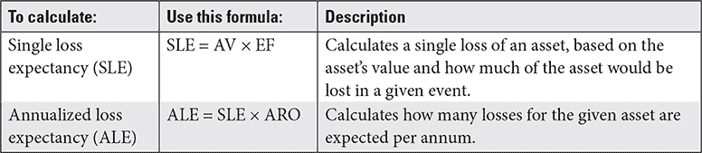

要使用这些公式，你需要几个关键信息：

• 资产价值 (`AV`) 是资产的计算价值，以更换成本、原始购买价格、资产产生的收入或组织赋予资产的其他货币价值来衡量。

• 暴露因子 (`EF`) 以百分比表示，是指在负面事件中预计会损失的资产部分。

• 单次损失期望 (`SLE`) 以货币术语表示，代表单次负面事件造成的损失的美元价值。

• 年发生率 (`ARO`) 是一个值，表示每年事件发生导致损失的次数。该值为 1 表示每年一次，.5 表示每两年一次，等等。如果导致损失的事件一年发生多次，则该数字将大于 1。

• 年损失期望 (`ALE`) 是特定威胁事件在年度基础上导致给定资产预期损失的金额。

请注意，这些公式非常简单，因为它们只考虑单个资产的单个事件。你需要汇总多个事件，确定许多不同资产的价值，然后汇总结果，以获得更完整的风险图景，这就是为什么定量分析很少单独进行的原因。定性分析更适合在多个威胁事件、资产和各种其他因素的情况下，将单个资产的风险汇总到整个组织。

**EXAM TIP** 了解定量分析和定性分析之间的区别，并熟悉考试中 `SLE` 和 `ALE` 的公式。

## 风险响应

风险响应是组织在彻底分析其风险并确定降低或缓解风险所需的行动后所做的事情。风险响应旨在降低风险的可能性和影响。如果这两个要素中的任何一个降低，则总体风险降低。请注意，你可以缓解甚至完全消除漏洞，但你无法消除威胁行为者或威胁事件——你只能加强对其的防御。

组织可以采取四种一般方法来管理风险：

• 风险缓解（降低）

• 风险转移（或风险共担）

• 风险规避

• 风险接受

风险缓解涉及通过降低可能性或影响来降低风险，通常通过消除或最小化漏洞或加强安全控制来实现。目标是降低总风险水平。

风险转移涉及将部分风险转移给另一个实体。风险共担或转移的一个典型示例是使用保险。如果发生严重的负面事件，它将降低组织的财务影响。请注意，风险转移并非旨在免除组织的责任或问责；组织必须仍然承担这两者，但其在财务上受到影响的可能性较低。风险共担的另一个示例是使用第三方服务提供商，例如可能提供云服务、托管基础设施甚至安全服务的提供商。

风险规避并不意味着组织对风险视而不见。它意味着组织将避免或停止进行会导致不可接受风险水平的活动。组织避免可能超出其风险偏好或风险容忍水平的活动，例如新的商业冒险。

风险接受并不意味着组织简单地接受现状的风险。它尽可能使用其他可用的响应来降低、转移或规避风险，剩余的任何风险（称为 `residual risk`）如果在风险偏好或容忍水平之内，则予以接受。

## 风险框架

## 风险框架

风险框架提供了一套正式的、全面的流程和方法，组织可以使用这些流程和方法来建立和运行其风险管理计划。其中一些框架由组织的市场或行业驱动；其他框架由私营组织颁布；还有一些由政府机构发布。大多数风险框架提供了一个框架结构，用于界定风险（确定组织的风险偏好和容忍度）、评估风险、响应风险并监控风险。一些流行的风险框架示例包括

• NIST 风险管理框架（之前已介绍）

• ISO/IEC 27005

• 关键威胁、资产和漏洞评估（OCTAVE）

• 信息风险因素分析（FAIR）

## 对策选择与实施

对策（安全控制）用于降低风险，并根据不同因素进行选择。最重要的是降低风险的能力，但还有其他考虑因素，例如成本。如果使用对策的成本高于修复或更换资产的成本，那么实施该对策可能不具成本效益。对策必须基于成本/效益分析进行选择。使用控制或对策的收益必须超过实施和维护控制的成本，并且必须与资产本身的成本或货币价值相平衡。如果修复或更换资产的成本低于对策，那么为了防止威胁损坏资产而实施对策是否值得？请记住，资产的价值不仅仅是其修复或更换成本；价值还应考虑资产产生的收入量及其对业务流程的整体价值。

**EXAM TIP** 虽然控制和对策这两个术语几乎同义，但存在细微差别：控制通常指一种持续的安全机制，用于防止负面结果，例如机密性、完整性或可用性受到破坏。从技术上讲，对策是在发生破坏后作为响应应用的，例如在恶意事件期间。控制是预防性的，而对策是反应性的。由于 CISSP 考试目标经常互换和同义地使用这些术语，我们在本书中也将如此。

## 适用的控制类型

安全从业者通常重视三种控制类型，以及六种控制功能。大多数控制只被归类为一种控制类型，但根据上下文，可能用于多种功能。以下是您在考试中将遇到的控制类型和功能的定义。

## 控制类型

主要的控制类型是管理控制（也称为*管理*控制）、技术控制（或*逻辑*控制）和物理控制（或*操作*控制）。Table 1.10-2 描述了这些控制类型。

**TABLE 1.10-2** Control Types

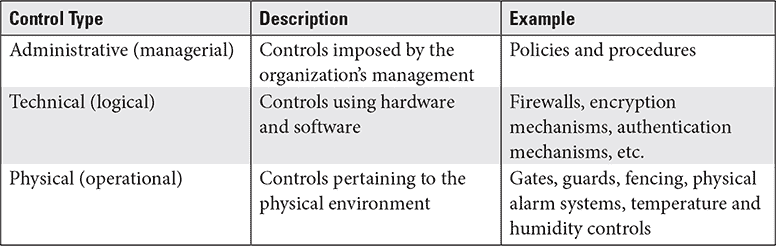

## 控制功能

控制功能描述控制的作用。虽然大多数控制被归类为一种控制类型，但控制可以跨越多种功能。对于考试，您应该记住通常有六种控制功能，如 Table 1.10-3 中所列。

**TABLE 1.10-3** Control Functions

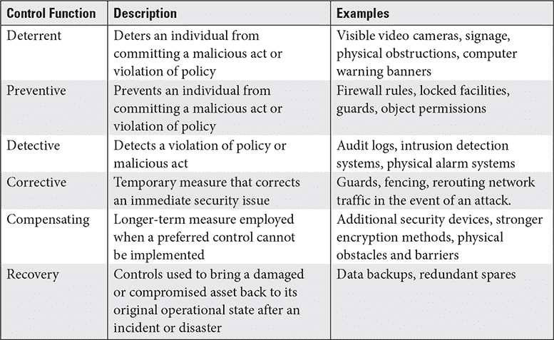

请注意，控制可以跨越多种功能；例如，放置在战略位置的摄像头可以阻止某人实施恶意行为，并且还可以检测是否发生了恶意行为。威慑控制必须被个人知晓，才能阻止他们实施恶意行为或违反政策；然而，预防控制不需要被知晓也能发挥作用。此外，如果个人只是选择实施该行为，威慑控制并不总是有效，而预防控制则肯定能帮助阻止行为的发生。

另一个需要区分的是纠正控制和补偿控制。纠正控制是临时性的，仅用于修复即时的安全问题。补偿控制是长期性的，当组织无法负担主要或期望的控制时可以采用。

## 控制评估（安全和隐私）

控制必须定期评估其有效性、合规性和风险。

• **有效性** 安全控制在保护资产方面有多有效？

• **合规性** 安全控制是否符合所需的治理要求？

• **风险** 实施的安全控制在多大程度上降低或缓解了风险？

在评估控制时，组织希望了解控制在保护资产方面做得如何，或者在隐私控制的情况下，控制在保护个人数据以及符合组织隐私政策方面做得如何。控制可以通过四种主要方式进行测试：

• 与关键人员访谈（系统管理员、工程师、隐私从业者等）

• 观察控制的运行情况（确定控制是否按预期工作）

• 文档审查（设计和架构文档、日志、维护记录等）

• 技术测试（例如，系统漏洞扫描或渗透测试）

控制应定期测试，并可通过特定的控制评估、漏洞评估、风险评估、系统测试甚至渗透测试进行测试。在有效性、合规性或风险降低方面未能通过任何测试的控制应评估更换、升级或加强。控制评估结果必须在适当的报告中彻底记录，并成为组织风险态势的一部分。

## 监控与测量

风险的所有元素都应持续监控，因为威胁会变化，新漏洞会不断被发现，甚至可能性和影响也可能会变化，具体取决于组织的安全态势及其运行环境。风险不是静态的，必须监控任何变化，这些变化反过来应促使组织改变其响应以应对任何新的或增加的风险。

风险及其各个组成部分也应进行测量。我们简要提到了定量和定性测量，每种在所需数据类型及其对组织可能具有的意义方面都有其优势。

## 报告

风险报告通常是一个正式过程，基于组织的要求或可能要求特定报告程序以用于合规目的的任何管理实体的要求。由于大多数类型的安全评估都属于风险评估的总体范畴，因此这些评估的结果在完成后即会报告，因此在大多数成熟组织中，正式的风险报告会相当定期地进行。正式风险报告过程的一个关键部分是所谓的*风险登记册*，有时也称为行动与里程碑计划（POA&M）。这两份文件都记录了各种数据，包括风险、受影响的资产、构成这些风险的漏洞，以及缓解或应对这些风险的计划。它们还可能指定风险负责人和处理风险的时间表。

非正式风险报告也会在发现漏洞或遇到影响威胁、漏洞、影响或可能性的风险因素时发生。这些风险因素可能包括安全预算减少或适用于组织的新法律或法规等事项。由于这些因素会影响风险，它们通常会被非正式报告，或可能在以后记录在正式报告中。

## 持续改进

## 风险管理与威胁建模

在风险管理的背景下，持续改进意味着组织必须不断努力评估、降低和监控风险。这意味着要不断改进其安全流程，同时也要改进其安全态势，使资产更好地免受威胁和漏洞的影响。在高度成熟的组织中，可能会出现一种称为 *risk maturity modeling* 的概念。成熟度模型旨在帮助组织确定其管理活动执行得如何。成熟度模型通常以级别（例如，1–5）来表示，这些级别可能显示组织以临时、未管理的方式进行风险管理；以可重复的方式进行风险管理，其中大多数程序都有文档记录并得到遵循；甚至达到风险管理流程领先于游戏并根据数据和预测模型主动寻求管理风险的级别。

## REVIEW

**Objective 1.10: Understand and apply risk management concepts** 在此目标中，我们探讨了风险管理。我们讨论了风险的要素，包括资产、漏洞、威胁、可能性和影响。风险是后两个要素（可能性和影响）的综合度量。我们还讨论了如何识别威胁和漏洞。威胁是可能利用资产中漏洞（弱点）的事件。风险评估包括收集有关资产、威胁和漏洞的数据，并分析这些数据以生成可能性和影响值，这些值构成了风险。

我们还讨论了组织可以采取的四种风险响应行动：风险降低或缓解、风险转移或共享、风险规避和风险接受。我们还列出了在风险管理活动中可能遇到的一些风险框架，例如 NIST RMF 和 ISO/IEC 27005。我们还讨论了对策选择，这涉及基于控制或对策缓解的风险量与实施和维护控制的成本之间的成本/效益分析。这必须与资产的价值相平衡。实施和维护成本高于资产价值的控制可能不具成本效益。

我们还研究了控制的类型和功能。通常有三种类型的控制：管理控制、技术控制和物理控制。有六种控制功能：威慑、预防、检测、纠正、补偿和恢复。我们讨论了如何进行控制评估，包括评估控制的有效性、合规性和风险。进行控制评估的四种方法是：采访关键人员、审查与控制相关的文档、观察控制的运行情况以及对控制进行技术测试。我们还简要提到了如何持续监控和衡量风险和控制，以及如何报告风险和控制结果。持续改进意味着我们必须始终努力改进安全流程、控制和风险管理活动。

## 1.10 QUESTIONS

**1.** 你正在为公司进行风险评估，并收集与保护资产缺乏或控制不足相关的信息。以下哪项描述了这种缺乏足够控制的情况？

**A.** 威胁

**B.** 漏洞

**C.** 风险因素

**D.** 影响

**2.** 你正在进行风险分析，但发现很难为分析过程中收集的某些数据分配数值。你希望能够利用你的专业知识和基于事实的意见，表达关于组织资产风险严重性的值。以下哪项描述了你应该使用的方法？

**A.** 统计

**B.** 定量

**C.** 定性

**D.** 数值

**3.** 以下哪项是选择控制或对策时最重要的因素？

**A.** 成本

**B.** 风险降低程度

**C.** 实施难易程度

**D.** 复杂性

**4.** 以下哪项是正式报告和跟踪风险的有效手段？

**A.** 风险登记册

**B.** 定量分析

**C.** 风险评估

**D.** 漏洞评估

## 1.10 ANSWERS

**1.** B  漏洞是资产中的弱点，或是保护该资产缺乏或控制不足的情况。

**2.** C  定性分析使得难以量化的数据能够表达数值；这些数值是主观的，基于事实的意见。其他所有选项都描述了定量分析。

**3.** B  选择控制或对策时最重要的因素是其降低的风险量；然而，必须进行成本/效益分析，以确定降低的风险量与实施和维护控制的成本之间的平衡是否超过资产的价值。

**4.** A  风险登记册是一种用于正式报告和跟踪组织中风险的工具，包括风险发现、漏洞、承担风险的资产以及风险所有权，以及减轻风险的时间表和必须投入的资源。

## Understand and apply threat modeling concepts and methodologies

在目标 1.10 中，我们讨论了什么是威胁及其相关术语，例如威胁行为者、威胁来源等。你了解到威胁是一种可能利用资产或组织中漏洞的负面事件。在此目标中，我们将探讨威胁的各个方面，包括威胁建模、威胁组件、威胁特征和威胁行为者。虽然这些方面有时被单独讨论，但它们相互关联并相互促进。

## Threat Modeling

仅识别广泛的威胁范围可以让你大致了解可能危害组织的事物；然而，仅识别可能影响也可能不影响你组织的泛化威胁，并不能在帮助你关注针对特定资产的特定威胁方面起到很大作用。这就是 *threat modeling* 发挥作用的地方。它涉及查看哪些特定威胁正在针对你的组织，并评估它们实际尝试利用资产中特定漏洞的可能性，以及它们是否可能在该利用中成功。威胁建模会查看所有泛化威胁，并尝试根据现实参数（例如你拥有的资产、有人或什么东西会针对它们的原因，以及可能存在哪些现实漏洞供其利用）将其缩小。

**Cross-Reference**

威胁建模也在目标 1.10、3.1 和 7.2 中讨论。

## Threat Components

威胁有许多不同的方面，可以以多种方式进行表征。威胁由不同的属性组成，包括威胁的来源、威胁的特征、威胁是潜在的还是已实现的，以及它可以利用的漏洞。一些威胁针对非常特定的漏洞，因此可能更容易管理；一些威胁，例如自然灾害，则更为普遍，并可能在各种漏洞和资产中造成严重破坏。让我们讨论几种威胁属性。

## Threat Characteristics

在发生之前，它们仅仅是潜在威胁，但一旦被实际发起并发生，就被视为威胁事件。请记住，威胁事件必须始终利用漏洞，这就是为什么我们通常将威胁和漏洞配对在一起的原因。例如，威胁事件可以是自然灾害期间的数据破坏，也可以是通过恶意代码实际利用漏洞。我们通常拥有少量数据，单独来看毫无意义，但当放在一起时，它们显示威胁已经实际发生并利用了漏洞。这些被称为 `threat indicators`。当它们被集体查看并显示恶意事件已经发生时，它们被称为 `indicators of compromise`。

威胁可以以不同的方式进行描述，包括

• 自然灾害与人为发起（例如，飓风与黑客攻击尝试）

• 潜在威胁与实际威胁（即尚未发生的威胁与已经发生的威胁）

• 威胁源（例如，黑客、自满的用户、雷雨等）

• 泛化威胁与特定威胁（例如，针对未打补丁操作系统的一般威胁与专门识别用于利用特定漏洞的威胁）

• 已知威胁与未知威胁（已识别和分类的威胁与零日漏洞利用，例如）

## 威胁行为体

威胁行为体，也称为 `threat agents` 或 `threat sources`，是发起威胁、传播威胁或使威胁发生的实体。威胁行为体并不总是人类，尽管我们将大多数恶意行为归因于人类。还有自然威胁源，例如洪水、飓风和龙卷风。请记住，威胁源也可以以不同的方式分类，正如我们在目标 1.10 中也提到的：

• 对抗性 恶意实体，例如个人、群体、组织，甚至国家

• 意外性 自满的用户

• 结构性 设备或软件故障

• 环境性 自然或人为引发的灾难和中断

**EXAM TIP** 虽然有时很难做到，但请记住，你必须尝试区分威胁行为体或源与威胁本身。有时这些几乎是一回事，但给定足够的信息和上下文，你可以区分威胁的来源与威胁，威胁是发生的事件。请记住，威胁也利用漏洞；威胁行为体不利用。它们仅仅发起或使能威胁。

## 威胁建模方法论

各种形式化的方法论已被开发出来，以解决威胁的不同特征和组成部分。其中一些方法论处理威胁指标，一些处理威胁源可以针对组织使用的攻击方法（称为 `threat vectors`），还有一些允许进行深入的威胁建模和分析。所有这些方法论都允许组织正式管理威胁，是威胁建模过程的关键组成部分。一些示例列在 表 1.11-1。

**TABLE 1.11-1** 各种威胁建模方法论

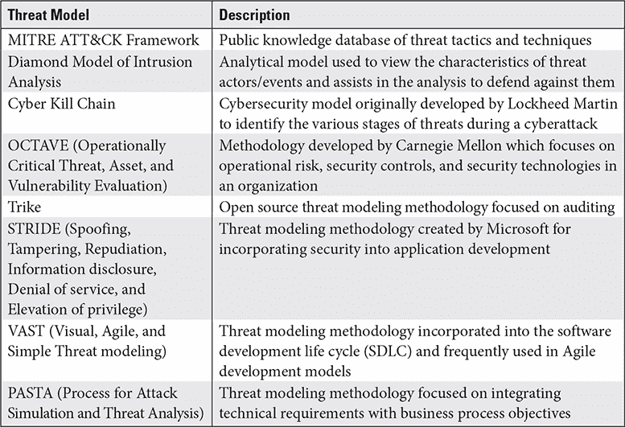

虽然对这些威胁方法论中的任何一种进行深入讨论超出了本书的范围，但请研究它们，并确保你对它们有基本了解，以便参加考试。

## 复习

**目标 1.11：理解和应用威胁建模概念和方法论** 在目标 1.11 中，我们讨论了威胁建模的基本概念。威胁建模超越了简单列出可能适用于任何组织的通用威胁；威胁建模对特定威胁如何影响组织的资产和漏洞进行了更深入、更详细的审视。威胁行为体包括对抗性和非对抗性行为体，例如人类和自然事件，分别。各种威胁建模方法论存在以协助这项工作，包括 `STRIDE`、`VAST`、`PASTA` 和许多其他方法论。

## 1.11 问题

**1.** 你是公司事件响应团队的成员。你的公司刚刚遭受了一次恶意攻击，多个服务器中包含关键数据的几个关键硬盘已被完全擦除。初步调查表明，一名黑客渗透了基础设施并运行了一个脚本来删除这些关键硬盘的内容。关于威胁行为体和威胁事件，以下哪项陈述是正确的？

**A.** 黑客是威胁行为体，数据删除是威胁事件。

**B.** 脚本是威胁行为体，黑客是威胁事件。

**C.** 脚本既是威胁行为体也是威胁事件。

**D.** 数据删除是威胁事件，脚本是威胁行为体。

**2.** Nichole 是一名网络安全分析师，为 O'Brien Enterprises 工作，这是一家小型网络安全公司。她正在向一位客户推荐各种威胁方法论，该客户希望为 Microsoft Windows 开发定制应用程序。她的客户希望纳入一种威胁建模方法论，以帮助他们进行安全代码开发。Nichole 应该向她的客户推荐以下哪项？

**A.** PASTA

**B.** Trike

**C.** VAST

**D.** STRIDE

## 1.11 答案

**1.** A 在这个场景中，黑客发起了威胁事件，实际事件是从关键硬盘中删除数据。脚本可能是攻击的工具，但它既不发起威胁也不是威胁本身，因为脚本本身不会做任何恶意的事情。负面事件是数据删除。

**2.** D `STRIDE`（欺骗、篡改、否认、信息泄露、拒绝服务和权限提升）是由 Microsoft 创建的一种威胁建模方法论，用于将安全性纳入应用程序开发中。列出的其他方法论都不特定于应用程序开发，除了 `VAST`（可视化、敏捷和简单威胁建模），但它并不特定于 Windows 应用程序开发。

## 应用供应链风险管理 (SCRM) 概念

公司的供应商为组织引入了严重的安全考量，特别是因为供应品（包括软件和硬件）可能被恶意软件破坏、功能或性能低劣，甚至可能是假冒的。在这个目标中，我们讨论组织如何减少与供应链相关的潜在安全问题。

## 供应链风险管理

供应链组织由硬件、软件以及商品和服务的供应商序列组成。一个组织可以拥有提供其供应品的上游供应链，以及用于向他人供应品的下游供应链。供应链风险管理 (SCRM) 是组织采取的措施，以确保供应链的每个环节都是安全的。与 SCRM 相关的许多问题包括有缺陷或假冒的部件、嵌入恶意软件的组件以及其他恶意行为。这个目标探讨供应链管理中涉及的风险以及组织应如何应对它们。

## 与硬件、软件和服务相关的风险

供应链中的任何环节都可能受到攻击，但三个常见目标是硬件、软件和服务。与这些目标各自相关的不同风险一样，组织可以采取不同的步骤来减轻或降低这些风险。接下来的几个部分将描述这些风险和措施。

## 硬件

电子元件和机器零件通常是供应链中攻击者的目标。硬件风险包括

• 不符合指定标准的有缺陷的元件或零件

• `Counterfeit or fake parts passed off as the real part`

• `Electronic components loaded with firmware-level malware`

这些风险可能导致因零部件质量不佳而引起关键系统故障；因购买和销售假冒或伪造零部件而产生的法律后果；以及恶意软件可能会窃听或窃取电子系统中的信息，并将这些信息发送给恶意第三方。可以通过多种方法来应对这些风险，包括供应商对零部件来源进行尽职调查并追踪其在供应链中与其他实体的交互、第三方对硬件进行验证，以及在零部件被接受或用于关键系统之前进行测试。

## Software

软件可能带来与硬件相同的风险，包括嵌入式恶意软件或其他可能无法达到组织要求标准的可疑代码；可能无法满足性能或功能要求的有缺陷代码；以及可能给组织带来法律问题的假冒或盗版软件。用于解决供应链中软件问题的方法几乎与解决硬件问题的方法相同。组织应使用尽职调查来确保软件来自信誉良好的供应商，这些供应商拥有稳健且安全的开发方法；在软件获取或在关键系统中实施软件之前进行广泛的软件测试；并寻求对软件的第三方验证和认证。

## Services

虽然通常不被视为与硬件和软件同一领域，但供应链中提供的服务也可能遭受攻击和破坏。考虑那些通常外包给第三方的服务，例如安全、电子邮件、目录服务、基础设施和软件编程，所有这些都可能遭受攻击和破坏。组织可能会因有缺陷或被破坏的软件、低于合同预期性能和功能水平的服务，甚至第三方提供商内部的恶意内部人员（考虑数据盗窃）而遭受损失。

组织有几种方法来降低第三方服务提供商风险，这些方法包括

• `Ensuring the service level agreement (SLA) or contract includes clear, delineated security roles and responsibilities for both the service provider and the organization`

• `Reviewing the security program of the service provider`

• `Conducting audits on the service provider either by the organization or a third-party assessor`

• `Reviewing the service provider’s own security assessments, if available`

• `Conducting the organization’s own tests and security reviews for any services provided to the organization by the service provider`

• `Implementing nondisclosure agreements (NDAs)`

• `Understanding the legal and ethical environment in which the service provider operates`

**EXAM TIP** 与服务提供商和供应商的全面协议是将供应链风险降低到可接受水平的关键；确保协议条款包括预期服务水平、保密、安全审查和评估以及法律责任等项目。

## Third-Party Assessment and Monitoring

有两种不同的情境涉及第三方评估和监控的主题：

• `Assessing and monitoring a third-party service provider that provides services to your organization`

• `Using a third party to assess or monitor a service provider that provides services to your organization`

在第一种情况下，组织应采取措施，确保评估或监控服务提供商的授权包含在 SLA 或合同中。如果没有，组织可能没有法律地位这样做。组织应在系统或软件开发生命周期中，对第三方提供的任何硬件或软件，将对提供商施加的任何安全评估要求纳入其中。组织还应具备审查这些测试结果的能力，并在软件或硬件不符合组织所需安全规范时提供意见。组织还应具备在法律或法规要求独立评估时聘请第三方评估员的能力。

在第二种情况下，引入第三方评估员来审查提供商的绩效并非可以轻率考虑的问题，尽管这可能由法律、法规或行业治理要求。寻找合格的第三方评估员可能很昂贵。例如，支付卡行业评估员必须经过独立组织的认证和认可，才能对管理信用卡交易的组织执行 PCI DSS 安全评估。行业标准通常要求定期进行这些评估，因此第三方服务提供商可能处于其中一项要求之下，这通常要求他们承担评估费用，而不是组织。

**Cross-Reference**

目标 1.4 更详细地讨论了 PCI DSS 安全要求。

## Minimum Security Requirements

在聘用第三方服务提供商时，组织应确保安全标准和要求包含在合同或服务级别协议的措辞中。文档化的安全要求对于受监管要求的行业（例如医疗保健行业和信用卡行业）尤其关键，这些行业分别需要遵守《健康保险可携性和责任法案》(HIPAA) 安全标准和支付卡行业数据安全标准 (PCI DSS)。

即使对第三方提供商没有强制性监管标准，组织也有能力在任何合同文档中包含并强制执行这些标准。至少，要求应包括访问控制、审计和问责、配置管理、安全软件开发、系统安全、物理安全和人员安全的规范。组织无需自行制定标准，可以施加行业标准，例如美国国家标准与技术研究院 (NIST) 特别出版物 800-53 控制、互联网安全中心 (CIS) 控制或 ISO/IEC 27001 框架。

**Cross-Reference**

目标 1.3 中的表 1.3-2 更详细地描述了这些框架。

## Service Level Requirements

组织不仅可以对其供应链和第三方服务提供商施加服务级别要求，还可以对关键零部件和软件的供应商施加此类要求。软件和硬件供应商必须遵守准时交付、质量以及在安全条件下交付的最低标准。第三方服务提供商应满足包括最小正常运行时间、事件响应、硬件或软件故障等在内的基准。这些通常都包含在合同中，但也应包含在先前提到的名为 `service level agreement`（即 SLA）的文档中。SLA 是向供应链中任何环节（无论是硬件、软件还是服务）施加和强制执行要求的关键。

## REVIEW

## 目标 1.12：应用供应链风险管理（SCRM）概念

在本目标中，我们讨论了供应链风险管理的基础知识，包括供应链的定义、上游和下游供应商，以及与供应链三个关键部分相关的风险。我们讨论了与硬件相关的风险，包括有缺陷的、被攻破的或假冒的硬件，以及与软件相关的风险，同样包括有缺陷的、被攻破的甚至假冒的软件。我们介绍了供应链的第三部分，即可能外包给第三方提供商的服务。服务固有的风险包括缺乏安全控制、恶意内部人员以及有缺陷的安全流程。我们还讨论了第三方监控和评估，既包括提供服务的一方，也包括使用外部评估人员。最后，我们讨论了应对任何类型的服务提供商或供应链中任何其他人员施加的最低安全要求，以及服务级别协议在施加和强制执行安全要求方面的重要性。

## 1.12 问题

**1.** 您的公司决定将供应链风险纳入其整体风险管理计划。您的主管指派您启动该流程。为了开始供应链风险管理，您应该首先做以下哪项？

**A.** 对供应链进行风险分析。

**B.** 识别公司供应链的所有上游和下游组件。

**C.** 开始检查收到的任何硬件是否存在故障或被攻破。

**D.** 开始扫描购买的任何软件以查找漏洞。

**2.** 您的公司从各种海外供应商处接收硬件和软件组件。作为努力提升供应链风险可见性的一部分，您决定公司必须开始更仔细地验证硬件和软件组件。以下哪项是完成此任务的最佳方式？

**A.** 对接收到的任何硬件或软件组件进行安全测试。

**B.** 向供应商请求任何硬件或软件组件的安全文档。

**C.** 将硬件和软件安装到关键系统中，然后测试系统。

**D.** 委托第三方评估人员评估和监控您的供应商。

**3.** 您的公司从本地云服务提供商处承包基础设施服务。在最初撰写合同时，安全考虑未包含在协议中。现在合同在期满时正在重新谈判，您的主管希望您在新合同中包含几个关键要求。以下哪项应作为新合同安全要求的一部分包含在内？

**A.** NIST 或 CIS 控制标准

**B.** 事件响应团队就绪情况

**C.** 最低安全要求，包括控制措施和安全职责

**D.** 数据保密性要求

**4.** 您的公司处理敏感数据，其中一些受监管要求约束。您正在与一家新的第三方提供商签订合同，该提供商将能够访问敏感数据。虽然保护敏感数据的监管要求将自动施加给新提供商，但以下哪项您也应建立，以帮助在提供商的人员访问敏感数据时保护敏感数据？

**A.** 保密协议（NDA）

**B.** 服务级别协议（SLA）

**C.** 提供商自身的内部安全评估报告

**D.** 第三方评估人员关于提供商的报告

## 1.12 答案

**1.** B 在做任何其他事情之前，您都应该花时间识别公司的所有上游供应商及其提供的商品和服务，以及您的公司通过其提供商品或服务的链条中的任何下游环节。

**2.** A 要验证硬件和软件组件的安全状态，您应该开始对这些组件运行安全测试。请求接收到的任何硬件或软件组件的安全文档很有用，但可能不会让您对其安全态势更有信心，因为文档可能被伪造或不完整。将一些硬件和软件安装到关键系统中不是最佳选择，因为对这些系统的安全扫描可能无法识别被攻破的组件。此外，委托第三方评估人员/监控人员可能成本过高。

**3.** C 您应在新合同中包含最低安全要求以及安全职责。如果编写得当，这些最低安全要求将涵盖其他选项。

**4.** A 除了法规施加的数据保护要求外，您还应让组织及其人员签署保密协议，以确保敏感数据受到保护且不会披露给未经授权的各方。虽然数据保护要求可能包含在服务级别协议中，但这些要求可能较为笼统，且对为第三方提供商工作的个人可能不具强制力。评估报告可能会让您了解提供商的安全态势，但不能保证敏感数据受到保护。

## 建立和维护安全意识、教育和培训计划

在本目标中，我们将讨论组织的安全意识、教育和培训计划。这是组织可用的关键行政控制之一，也是保护其资产最关键的控制之一。

## 安全意识、教育和培训计划

组织的安全意识、教育和培训计划是一项关键的行政控制，针对组织中最脆弱的要素：人员。该计划向员工（学生）传达与人为要素相关的威胁、漏洞和风险。需要注意的是，这些术语——意识、教育和培训——各不相同，尽管有时会被混用。表 1.13-1 详细说明了这三个术语的独特要素。

## 表 1.13-1 培训级别和描述

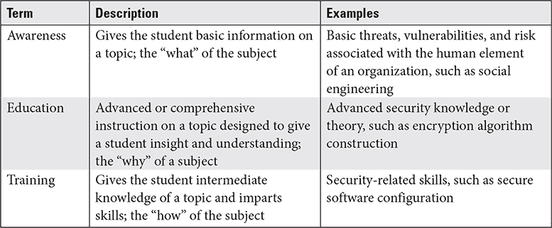

## 提供意识和培训的方法和技术

不同级别的意识、培训和教育通常需要不同的演示方法，并可能取决于受众知识或理解水平、学生的安全职责、主题深度等因素。频率也可能决定学生接受的演示类型；例如，初始培训和教育通常比复习意识简报或培训更全面，因此可能使用不同的演示方法。可用设备或培训空间等后勤因素有时会影响用于受众的演示方法。

## 演示技术

传统的演示技巧，例如课堂培训，可能更受青睐，但由于目标受众的规模、可用空间、远程办公室、培训预算等原因，可能无法实现。当今一种流行的培训形式是自学，其中可能包括学生可以自行复习的预录音频或视频，以及推荐或必读的教材（例如，书籍或网站）。近年来使用量不断增加的另一种培训方法是通过互联网使用协作软件进行远程学习。这种在线学习具有能够触达更多学生的优势，采用实时或同步培训方法，并且可能不会过度受预算、培训空间或距离的限制。

考虑到最有利于学习者的演示方法，意味着一些更传统的技巧，例如简单地展示幻灯片演示，可能对所有学生都无效。更具互动性的演示技巧通常会提高学生对所呈现信息的保留率。其中一些互动技巧包括

• 社会工程角色扮演练习

• 组织网络钓鱼练习

• 与学生团队进行的互动式安全意识培训游戏（“游戏化”）

除了演示技巧之外，安全主题还应针对特定受众进行定制。只有非常基础安全职责的用户在入职组织时以及之后定期进行时，应接受基础安全意识概述。拥有更高级安全职责的用户，例如 IT 或安全人员，应接受更深入的培训，涵盖更高级的主题，并且频率更高。即使是经理和高级高管也应接受针对其独特角色和职责的特定培训，例如安全风险、合规性和其他更高级别的主题。

通常，员工可能会承担起主导培训计划或项目的责任，并担任项目的“安全冠军”，带领他人采纳项目的安全方面，将安全整合到并改进其自身领域。这些安全冠军不一定总是拥有安全相关职责的员工；这表明他们已经吸收了广泛培训提供的安全概念，并确保安全成为其工作生活中内置的一部分。

**EXAM TIP** 请注意，安全主题可以以不同的方式呈现，具体取决于所需的知识或理解水平、受众以及主题本身的性质。安全主题可以简单地以公告栏通知、月度通讯或深入的课堂培训的形式呈现。演示方法应根据组织的需求进行调整。

## 定期内容审查

随着威胁、漏洞和风险的不断变化，在这些领域呈现给学生的培训也应偶尔进行变更。当新的威胁和漏洞变得普遍时，员工需要接受教育，也许是在专门的培训课程中，并且常规安全培训应相应更新。更新非常适合所谓的 `just-in-time` 培训，这意味着学生在需要时立即接受培训。此外，当组织发生任何可能改变其安全环境的运营环境变化时，例如对组织施加新的治理或法规、实施新系统或安全功能、人员变动等，也应审查和更新培训。

## 计划有效性评估

组织应能够衡量其培训计划的有效性。评估方法包括在培训计划后收集数据，统计安全事件数量或报告的可疑网络钓鱼事件数量的增加或减少。关键是衡量所呈现的特定培训与预期结果，以查看培训是否积极改变了行为，从而减少安全事件并提高员工的安全合规性。

组织应记录谁接受了培训、培训频率以及培训主题，并且这些文档应保存在各个学生的人事档案中。确保用户在需要时获得正确类型的培训，也有助于在用户违反政策或实施恶意行为时保护组织。该人员之后不能声称自己没有得到适当的培训，甚至未被告知相关要求。

## 复习

## 目标 1.13：建立并维护安全意识、教育和培训计划

在本目标中，我们讨论了安全意识、培训和教育。安全意识提供有关安全主题的基本信息，包括威胁、漏洞和风险，以及个人在组织中承担的基本安全职责。安全培训通常针对技能的发展，例如 IT 或安全人员执行其职能所需的技能。安全教育呈现的是高级性质的主题，面向对安全主题的更高层次理解和理解。

演示方法至关重要，具体取决于目标受众、后勤（例如，可用人员、空间和距离）以及培训预算等因素。传统的演示方法，例如课堂培训，仍然可以使用，但应考虑其他方法，具体取决于所呈现的材料和学生的知识水平。这些其他方法包括远程学习、自学以及互动模拟和练习。培训应定期进行评估和更新，以确保其对组织的时效性和相关性。对于易失性知识或威胁和漏洞的重大变化，应考虑 `just-in-time` 培训。

安全意识和培训计划应定期评估以确定其有效性；这通常基于衡量培训如何改变其目标学生的行为。有效培训计划的结果应导致安全事件减少以及以安全为中心的行为和合规性增加。

## 1.13 问题

**1.** 您的主管要求您向公司的一小群用户介绍一个安全主题。所有用户都与您在同一栋楼里工作，并且有大量会议室可用于简短演示。该主题非常基础，涉及攻击者使用的一种新型社会工程学方法的信息。您应该使用哪种教学水平和演示技巧？

**A.** 意识，课堂培训

**B.** 教育，远程学习

**C.** 培训，远程学习

**D.** 意识，自学

**2.** 您是一家制造公司的网络安全分析师。由于您的经验和参加高级防火墙培训，您被视为公司防火墙设备的本地专家。您的主管刚刚告诉您，公司 CISO 希望您向其他一些网络安全技术人员提供培训。这些技术人员中有许多人地理位置分散且工作班次不同。以下哪种方式是呈现此培训的最有效方法？

**A.** 一对一培训

**B.** 课堂培训

**C.** 远程学习和自学相结合

**D.** 自学

## 3

作为治理要求的一部分，贵公司内特定群体的用户必须每年接受风险管理技术和合规性培训。以下哪个群体可能是此培训的目标对象？

**A.** 高级管理人员

**B.** 常规用户

**C.** 帮助台技术人员

**D.** 初级安全分析师

## 4

对于公司赞助的非工作时间员工发展计划，你希望教授一门更高级的安全理论课程。以下哪个选项是此类教学的适当级别？

**A.** 意识

**B.** 培训

**C.** 教育

**D.** 简报

## 1.13 答案

## 1

A 由于所有用户都在同一地点，远程学习可能不是必需的。该主题非常基础，因此培训只需提高对新型社交工程技术的意识即可。

## 2

C 因为你必须培训的一些学生地理位置分散且工作班次不同，课堂培训可能不可行。你应该考虑远程学习，结合自学，因为该主题性质较为高级，并包括交互式练习，帮助学生学习如何更好地配置防火墙。仅靠自学可能不足以让他们充分掌握这些技能。

## 3

A 由于主题涉及风险管理和合规性，高级管理人员可能从这种培训中获益最大，因为这更适合他们的职责和职责范围。

## 4

C 高级主题，如安全理论，很可能被视为培训计划中的教育级别，因为这种学习水平代表了涵盖主题“为什么”的更高级主题。

## 资产安全

域目标

• 2.1 识别和分类信息和资产。

• 2.2 建立信息和资产处理要求。

• 2.3 安全配置资源。

• 2.4 管理数据生命周期。

• 2.5 确保适当的资产保留（例如，生命周期结束（EOL）、支持结束（EOS））。

• 2.6 确定数据安全控制和合规性要求。

域 2，“资产安全”，讨论了组织在保障自身安全方面可以做的最重要的事情之一：保护其资产。正如你将在本域中看到的，任何有价值的东西都可以被归类为资产，组织必须通过识别资产并根据其对组织的价值程度来保护它们，从而有效地管理其资产。在本域中，我们将讨论如何识别和分类资产，以及如何处理其安全使用、存储和运输。我们还将讨论如何向授权用户安全配置资产和资源。作为资产，信息有明确的生命周期，我们将研究这个生命周期，以便你了解保护关键或敏感信息所涉及的一切。我们还将讨论资产保留，以及作为保护资产的一部分而施加的安全控制和合规性要求。

## 识别和分类信息和资产

如目标 1.10 中所讨论，资产是对组织有价值的任何东西。资产示例包括服务器、工作站、网络设备、设施、信息和人员。对资产的价值取决于组织需要它多大程度上来履行其使命。组织如何对资产定价取决于许多因素，包括资产的原始成本、折旧、更换价值、维修成本、它为组织产生的收入量，以及它对组织使命的重要性。

我们还在目标 1.10 中讨论了有形资产和无形资产。作为回顾，有形资产是我们可以轻松看到、触摸、交互和测量的项目；示例包括系统、设备、设施、人员，甚至信息。无形资产是那些难以交互，有时也难以定价，但对组织成功仍然至关重要的资产。无形资产示例包括客户满意度、声誉和市场地位。在此目标中，我们将讨论如何识别和分类资产和数据。

**考试提示** 虽然 CISSP 目标有时似乎将*信息*和*资产*视为两种不同的东西，但请理解，在现实中，信息实际上是组织的关键资产之一，在本书中，我们将其视为资产，并将其与设施、设备、系统甚至人员一起称为资产。

## 资产分类

对资产分类意味着以某种方式对其进行分类，以便更好地管理。资产通常按关键性和敏感性进行分类，这两者将在下一节中讨论。资产不是为了自身而购买或获取的；它们存在是为了支持组织的使命，包括其业务流程。组织可以通过确定资产支持的业务流程有多关键，来根据关键性对资产进行分类。

执行此关键性评估的常见方法是进行业务影响分析（BIA），该分析在目标 1.8 中介绍。BIA 也是业务连续性规划的第一步之一，我们将在本书后面讨论。BIA 清点组织的业务流程，以确定对其使命至关重要且不允许停止运行的流程。它还识别支持这些流程的信息资产，这些资产被视为组织中的关键资产。

**交叉引用**

我们将在目标 7.13 中，作为业务连续性规划的一部分，讨论业务影响分析。

然而，在确定关键性之前，组织必须发现其所有资产。通常，有形 IT/网络资产分为两类：硬件或软件。硬件通常通过其序列号、型号、成本和其他数据元素进行清点和识别。软件通过其许可证号或密钥、支持的业务或流程以及特定功能进行跟踪。

## 数据分类

与其他资产一样，数据可以按关键性或敏感性进行分类。虽然数据关键性和数据敏感性经常被混用，但它们意味着两种不同的东西。数据关键性是指数据对任务或业务流程的重要性，而数据敏感性是指数据的机密性级别。例如，组织中的隐私数据可能对其核心业务流程并不关键，并且仅在管理员工的人力资源流程中偶然收集。然而，它仍然是非常敏感的数据，不允许未经授权的实体访问。

**交叉引用**

请记住，来自目标 1.2，数据和信息是经常被混用的术语，但它们有明确的定义。数据是没有直接上下文或含义的原始、单一的事实或知识片段。示例包括 IP 地址、域名，甚至审计日志条目。信息是组织成上下文并赋予含义的数据。当赋予上下文时，许多数据片段就变成了信息。给数据赋予上下文意味着关联数据——确定它与其他数据片段以及特定事件或情况的关系。虽然单个数据片段应被视为关键或敏感，但我们通常分类的是信息，而不是数据片段。

同样，像其他资产一样，信息必须被识别并建立清单。虽然信息是一种有形资产，但有时它可能更像无形资产，因为对其进行清单登记比仅仅统计办公室里的计算机数量要困难得多。组织必须先确定自己拥有哪些信息，然后才能弄清楚其关键性和敏感性。识别信息通常涉及查看组织中的每个系统，并记录它们处理哪些类型的信息。这些信息可能涵盖隐私、医疗和财务信息等不同集合，也可能涉及组织用于在市场中保持竞争力的专有流程。

一旦不同类型的信息被识别并建立清单，这些类型将根据其所在位置、在哪些系统上处理以及系统如何处理该数据类型再次进行清单登记。然后可以为它们分配关键性和敏感性值。请记住，在我们关于目标 1.10 的讨论中，我们可以为风险的不同元素分配定量或定性值。我们也可以为信息分配定量或定性值。定量值通常是数值，例如为信息类型分配美元金额。定量美元值很容易分配给一台设备，但不一定适用于其处理的信息类型。定性值可能更适合信息，例如可以从非常低到非常高不等。

组织应该为其资产建立一个正式的分类系统。某些资产可能会被分配一个用于组织关键性的美元值，但其他资产可能需要分配一个定性性质的分类范围。与定量值不同，定性值可以同时分配给关键性和敏感性。这个分类系统应该记录在组织的数据分类和资产管理政策中。

将资产分配给分类系统的一个好理由是确定为保护这些资产而分配控制措施的成本效益。我们在目标 1.10 中讨论了控制措施和对策的选择标准。资产的价值（无论是单个服务器还是信息类型，以成本、关键性或敏感性为衡量标准）必须与为保护它而实施的控制措施的成本相平衡。如果保护不足，或者资产的价值远低于实施和维护控制措施的成本，那么实施该控制措施就不值得。实施控制措施还应与该控制措施所减轻或降低的风险水平相平衡。如果资产的关键性和/或敏感性分类非常高，那么显然它对组织更有价值，成本效益分析将支持实施更昂贵的控制措施来保护它。

私营行业和政府中使用了各种不同的分类系统。私营公司可能会使用一个分类系统，分配诸如 Public、Private、Proprietary 和 Confidential 等标签来表示资产敏感性，或者使用 Very Low、Low、Moderate、High 和 Very High 等主观值来表示敏感性或关键性。军事分类通常包括使用 Top Secret、Secret 和 Confidential 等术语来根据敏感性对信息和其他资产进行分类。无论使用哪种分类系统，组织都必须正式开发和记录该系统，并在确定资产所需的保护级别时应用它。

## 交叉引用

我们将在目标 2.2 中更详细地讨论分类标签，届时我们将介绍数据处理要求。

## 复习

## 目标 2.1：识别和分类信息和资产

在这个目标中，我们回顾了有形资产和无形资产的定义。我们还讨论了识别和分类资产（包括信息）的必要性。资产可以根据关键性和敏感性进行分类。关键性描述资产对使命或业务的重要性，可以通过检查关键业务流程并进一步确定哪些资产支持它们来确定。敏感性涉及保持信息或资产机密并远离未经授权实体的需求。资产必须先被识别并建立清单，然后才能根据关键性和敏感性进行分类。

## 2.1 问题

**1.** 你被指派在公司内对资产进行清单登记。你必须根据资产对业务流程和公司的重要性来识别资产。以下哪种方法可用于确定关键性？

**A.** 分类系统

**B.** 业务影响分析

**C.** 数据上下文

**D.** 资产价值

**2.** 以下哪个是信息（带有上下文的数据）的最佳示例？

**A.** IP 地址

**B.** TCP 端口号

**C.** 对两台主机之间连接以及它们之间交换的流量的分析

**D.** 审计日志安全事件条目

**3.** 你正在为公司资产创建一个数据分类系统，并且正在查看关键性和敏感性的主观级别。以下哪个是可用于数据敏感性和关键性的主观量表示例？

**A.** Very Low、Low、Moderate、High 和 Very High

**B.** 资产的美元价值

**C.** Public、Private、Proprietary 和 Confidential

**D.** Top Secret、Secret 和 Confidential

**4.** 你的公司正在对其资产进行分类。它是从零开始这个过程，因此以下哪个选项最能描述资产分类所需步骤的顺序？

**A.** 对资产分类，识别资产，并对资产建立清单

**B.** 识别资产，对资产建立清单，并对资产分类

**C.** 对资产分类，对资产建立清单，并将安全控制措施分配给资产

**D.** 识别资产，将安全控制措施分配给资产，并对资产分类

## 2.1 答案

**1.** B 进行业务影响分析（BIA）不仅可以帮助你识别关键业务流程，还可以帮助你识别支持这些流程的资产，并协助你确定资产关键性。

**2.** C 数据是知识或事实的单个元素，例如没有上下文的 IP 地址、TCP 端口号或审计日志安全事件条目。信息（放入上下文中的数据）的示例是对两台主机之间连接事件以及它们之间交换的流量的分析，这将由多个数据片段组成。

**3.** A 主观值通常是非定量的，并提供一个可以应用于关键性和敏感性的范围，在此情况下是一个从非常低到非常高的定性量表。资产的美元价值将是关键性的定量或客观测量，并不一定适用于资产的敏感性。商业敏感性标签，例如 Public、Private、Proprietary 和 Confidential，不一定适用于资产的关键性。Top Secret、Secret 和 Confidential 是政府或军事分类系统的元素，不一定表示关键性，也不适用于商业公司。

**4.** B 正确的步骤顺序是识别资产，对资产建立清单，并根据敏感性和关键性对资产分类。将安全控制措施分配给资产以保护它是在其关键性和敏感性分类之后进行的。

## 建立信息和资产处理要求

本目标是对我们关于如何分类和处理敏感信息资产（包括信息本身以及处理信息的系统）的讨论的延续。在目标 2.1 中，我们讨论了资产（尤其是信息）如何根据关键性和敏感性进行分类（或分级）。本目标进一步探讨了这些分类方法如何影响资产在其生命周期内的处理方式。

## 信息和资产处理

组织的数据敏感性或分类策略会为不同类型的信息（例如，私人信息、专有信息等）分配关键性或敏感性级别。基于这些分类级别，会分配控制措施或对策来保护敏感和关键数据。显然，关键性或敏感性分类标签较高的资产会获得更多保护，因为它们对组织的价值更大。我们将在本目标中进一步讨论这一问题，重点关注信息根据这些分类实际上是如何处理的。

**EXAM TIP** 请记住，资产是根据关键性和/或敏感性进行分类的。

## 处理要求

信息具有生命周期，我们将在本书的各个部分讨论这一点。目前，你需要了解的生命周期阶段是那些涉及信息在存储（静止状态）、物理传输、传输（传输中）以及转移给另一方时如何处理的阶段。我们将在后面讨论信息生命周期的其他方面，包括信息的生成以及其处置。

以下一般处理要求适用于信息资产，无论它们处于生命周期的哪个阶段：

• 存储和传输过程中的信息加密

• 适当的访问控制，例如权限

• 访问信息资产需要强身份验证

• 信息资产的物理安全

• 资产的积极控制和清点

• 行政控制，例如政策和程序，规定如何处理信息资产

我们将现在考察这些处理要求如何适用于各个阶段的信息资产，例如存储、运输、传输和转移。

## 存储

存储中的信息，通常称为*静态数据*，是指当前未被访问或使用的信息。存储可以指信息驻留在笔记本电脑的硬盘上等待处理或使用，或者存储在更永久的环境中用于归档目的或作为备份/恢复策略的一部分。区分已归档的信息和仅为了在发生灾难时恢复而备份的信息非常重要。

归档信息通常是组织可能因法规或业务要求需要保留指定时间段的信息，但该信息不会用于在发生事件或灾难时恢复数据。组织的信息保留策略，结合外部治理要求，通常指示信息必须归档多长时间。一般来说，只将信息归档到法规或业务要求规定的最小程度是一种良好的做法。在不再需要保留信息后仍将其保留归档不是一种良好的做法，因为它最终可能会被泄露或滥用。用于恢复丢失数据的备份信息存储在本地现场的备份介质上，或者更好的是，存储在异地，例如云端或异地物理存储位置。

无论信息是出于归档还是备份目的进行存储，处理时都应采取特定保护措施：

• 备份或归档介质的加密

• 备份或归档介质的访问权限

• 访问介质需要强身份验证

• 归档或备份信息的物理安全，包括锁定或安全存储、物理访问日志、适当标记等

• 存储信息以及存储信息的介质和设备的清点

• 行政控制，例如归档和备份/恢复程序、双人控制等

## 运输

物理运输信息资产（例如归档或备份介质、已停用的工作站，或转移到组织内另一个地理位置的新资产）需要特殊处理。除了我们已经提到的控制措施（例如加密介质以及要求强身份验证才能访问介质和设备）之外，信息资产的物理运输可能还包括额外的物理控制措施。由指定运输敏感信息资产的个人保持积极控制是其中一个考虑因素；信息资产在运输过程中可能需要指定人员随时护送或看守，以及在运输过程中保持严格的保管链。

## 传输

以数字方式传输的信息，也称为*传输中数据*，通常通过使用强身份验证控制和加密来保护。这些措施确保信息在传输过程中不会被拦截，并且仅由经过适当身份验证的个人发送、接收和解密。

**Cross-Reference**

我们将在域 3 中更深入地讨论传输安全。

## 转移

当信息资产在个人或各方之间转移时，通常涉及介质或系统的物理转移。但是，实体之间的逻辑转移（例如传输受保护的健康数据）也涉及转移信息资产特有的特定保护措施。所有这些保护方法之前已经讨论过，但可能适用于转移资产的特定实例，例如：

• 在转移前加密存储或传输介质

• 实施强身份验证控制，以确保人员有权发送或接收信息资产

• 对物理资产（例如系统）进行积极控制和清点

• 用于验证转移各方身份的行政、技术和物理程序

## 信息分类和处理系统

从前面的讨论可以看出，信息分类方案直接规定了信息资产的处理方式，包括物理和逻辑两方面。对于 CISSP 考试，信息分类和处理方案通常分为两类：适用于商业或私营组织的方案，以及政府和军事组织使用的方案。我们将简要讨论这两类，并提供每类的示例。

## 商业/私营分类处理

商业和私营组织拥有众多信息分类和处理系统，因此我们在此讨论的分类级别仅作为示例。由于信息类型繁多，组织可能拥有许多这样的分类级别，这些级别适用于处理敏感（但不一定关键）的信息资产。表 2.2-1 列出了其中一些分类级别作为示例。

**TABLE 2.2-1** 商业和私营信息分类和处理标签示例

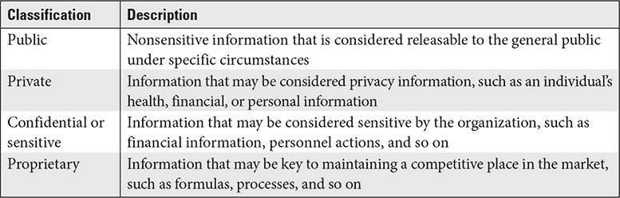

## 美国政府分类和处理

许多政府机构都有自己的分类和处理系统，其中最著名的一个是美国政府和美国武装部队使用的系统。表 2.2-2 描述了这些分类和处理级别。请注意，该系统描述的是信息和系统的相对敏感性，而非关键性。

**TABLE 2.2-2** 美国政府分类和处理级别

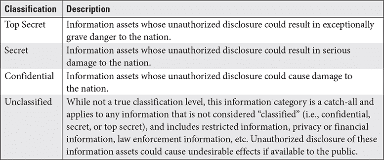

请注意，不同类型的信息可能会根据其敏感性级别以及针对这些信息类型的法规，制定相应的处理要求。例如，受《健康保险可携性和责任法案》(HIPAA) 约束的受保护健康信息 (PHI)，有其自身的特殊处理要求。

## REVIEW

**目标 2.2：建立信息和资产处理要求** 在此目标中，我们探讨了信息资产处理的不同方面，包括存储、运输、传输和转移。我们研究了在处理信息时保护信息的不同方法，例如加密、强身份验证、访问控制、物理安全和其他行政控制。我们还讨论了不同的信息处理要求，例如私营公司可能有的要求以及政府机构和军事服务的要求。这些包括针对指定为公开、私密、机密和专有（私营或商业部门常用的标签）的信息的不同处理要求，以及针对指定为绝密、机密、机密和非密（例如，在美国政府和军事服务中使用）的信息的要求。

## 2.2 问题

**1.** 您是公司的一名网络安全分析师，被指派确保包含高度敏感信息的硬盘安全运输到公司位于全国各地的一个分支机构，以便在其系统中使用。以下哪项必须作为特殊处理要求实施，以确保存储介质上的数据不会发生未经授权的访问？

**A.** 处理政策和程序

**B.** 存储介质加密

**C.** 数据权限

**D.** 传输介质加密

**2.** 您是为美国国防承包商工作的网络安全分析师，因此必须使用政府分类方案来保护信息。以下哪个分类标签必须用于如果披露给未经授权的实体可能会对国家造成严重损害的信息？

**A.** 绝密

**B.** 专有

**C.** 机密

**D.** 机密

## 2.2 答案

**1.** B 虽然每一项都很重要，但加密存储信息的存储介质对于确保在物理运输过程中未经授权的实体访问数据至关重要。信息处理政策和程序应包含此要求。数据权限仅在介质到达目的地后才重要，因为授权人员将能够解密驱动器，并凭借正确的权限访问解密介质上的特定数据。由于介质正在进行物理运输，因此传输介质加密在这里不是问题。

**2.** C 未经授权披露可能对国家造成严重损害的信息，在美国政府和军事服务使用的分类方案中被标记为机密。

###  安全地配置资源

在此目标中，我们讨论如何确保组织的信息资源在正确的时间、以安全的方式提供给正确的人。这只有通过对信息资产的强大安全性和良好的资产管理才能实现，我们将在此目标中讨论这两者。

## 安全资源

资产安全是关于保护组织认为对其使命有价值的所有资源。无论资产是数据、信息、硬件、软件、设备、设施甚至是人员，这一点都适用。信息资产（由信息和系统组成）必须通过各种行政、技术和物理控制来保护。这些控制的示例包括加密、强身份验证系统、安全处理区域以及信息处理政策和程序。为了保护这些资源，我们必须考虑诸如信息资产所有权、资产的控制和清点以及这些资产的管理方式等事项。

## 资产所有权

资产所有权是指谁负责资产，包括维护和保护资产。请记住，信息资产是为了支持组织的业务流程而存在的。资产所有者可能也可能不是资产所支持的业务流程的所有者。无论如何，资产所有者必须确保资产得到妥善维护，并且分配给资产的安全控制措施得到正确实施。

资产可以根据资产支持的关键业务流程或其他功能或组织结构（例如业务流程的功能或资助资产的部门）来分配所有者。无论如何，资产所有者必须了解自己在维护和保护资产方面的责任。

**EXAM TIP** 资产和业务流程所有者可能不是同一人，因为资产可能由另一个实体拥有，尤其是当资产支持多个业务流程时。

## 资产清点

如目标 2.1 中所述，可以通过执行业务影响分析来开发资产清点，该分析识别并清点关键业务流程以及支持这些流程的资产。

以最简单的形式，设备（特别是硬件和设施）的清点相对容易维护，但必须得到一致的管理。维护良好资产清点的一些方面包括

• 根据资产价值、关键性和敏感性跟踪资产

• 为资产分配负责其维护和安全的所有者

• 随时了解资产的位置和状态

• 对高价值资产给予特别关注，包括按序列号跟踪、防止被盗或滥用，以及更频繁的清点更新

组织在对有形资产和无形资产分配价值、清点和跟踪方面可能存在一些差异，如下文所述。

## 有形资产

如前所述，有形资产是组织可以轻松赋予价值并直接交互的资产。这些包括信息、硬件部件、设备、设施、软件等。这些资产更容易清点，并应从多个角度进行跟踪，包括以下内容：

• 保护资产免受盗窃、损坏或滥用

• 确保执行关键维护活动以保持资产功能正常

• 在需要时更换部件

• 管理资产的生命周期，包括获取、实施和处置阶段

## 无形资产

管理无形资产并不像管理有形资产那么容易。请记住，无形资产是指那些不容易赋予货币价值、无法计入库存或无法直接交互的资产。无形资产的示例包括性质模糊且可能随时发生价值或实质剧烈变化的事物，例如消费者信心、市场地位、公司声誉等。虽然可以进行许多定性测量来确定这些无形资产在特定时间点的相对价值，例如统计分析、抽样、调查等，但这些测量最多也只是合理的猜测。此外，由于无形资产的价值经常波动，有时甚至剧烈波动，这些测量必须不断重新评估。组织不能仅仅“盘点”一次消费者信心，就期望下次测量时它仍然相同；这些资产必须持续进行测量。

## 资产管理

资产管理不仅仅是维护良好的库存。整体资产管理确保资源（包括信息资产）在需要时、以正确的状态（就功能和性能而言）提供给需要它们的人员和流程。资产管理的一个关键部分是安全配置，它涉及仅向授权实体提供访问信息资产的权限。`Secure provisioning` 是确保只有经过授权、正确识别和身份验证的实体（通常是个人、流程和设备）访问信息和系统，并且只能执行授予它们的操作的一组流程。安全配置通常涉及

• 验证实体的身份（身份验证）

• 验证实体访问系统和信息的需求（授权）

• 创建适当的访问令牌（例如，用户名、密码和其他身份验证信息）

• 安全地向实体提供身份验证和访问令牌

• 根据需要知道、职位或角色、安全许可等，为实体访问资源分配正确的授权（权利、权限和其他特权）

• 对资产进行持续的特权管理

请注意，安全配置只是端到端资产管理的一小部分。如前所述，我们将在后续目标中讨论完整的资产管理生命周期。

## 复习

**目标 2.3：安全配置资源** 在本目标中，我们进一步讨论了管理信息资产。我们研究了信息资产所有权的概念，并指出支持该资产的业务流程所有者不一定总是拥有该资产的同一个人。资产所有者有责任维护和保护分配给他们的任何资产。资产必须根据其对组织的重要性、敏感性和价值进行盘点和跟踪，无论该价值是否以货币形式表示。有形资产更容易管理，因为它们可以被物理计数、跟踪、定位并赋予美元价值。无形资产更难管理，且价值可能经常变化。无形资产包括消费者信心、公司声誉和市场份额。无形资产可以使用定性或主观方法进行测量，但必须持续进行测量。

资产管理不仅涉及资产的盘点，还涉及在需要时、以所需状态将资产提供给正确的人员。这始于资产的安全配置。安全配置包括创建访问令牌和标识符、强制执行实体的正确识别和身份验证，以及授权实体可以对资产采取的操作。

## 2.3 问题

**1.** 您的主管希望您为某些无形资产分配资产价值，例如消费者对贵公司安全态势的信心。您考虑了风险水平、公司内部安全事件的统计和历史数据以及其他因素。您还考虑了安全各个方面的成本，包括系统和人员。以下哪项是您最可能为这些资产分配的价值类型？

**A.** 基于客户信心调查的定量价值

**B.** 与成本与收入相关的定量价值

**C.** 非常低、低、中等、高和非常高的定性描述性价值

**D.** 与成本与收入相关的定性价值

**2.** 您是一名网络安全分析师，负责公司多个关键系统的常规安全配置和补丁管理。您使用的系统之一是数据库管理系统，它支持公司内许多不同部门和业务线应用程序。以下哪项将是该系统最合适的资产所有者？

**A.** 公司的信息技术经理

**B.** 主要负责资产维护和安全的资产所有者

**C.** 共享资产所有权的多个业务流程所有者

**D.** 最关键业务线应用程序的业务流程所有者

## 2.3 答案

**1.** C 分配给无形资产的任何价值都将是定性的；主观描述性价值，如非常低、低、中等、高和非常高，是无形资产最合适的价值，因为很难为它们赋予货币价值。

**2.** B 由于该资产支持许多不同的业务流程和所有者，系统应由直接负责资产维护和安全的人员所有；但是，他们可能还需要对任何或所有业务流程所有者负责并承担问责。

## 管理数据生命周期

在本目标中，我们将讨论数据生命周期的各个阶段，以及不同实体在数据整个生命周期中使用、维护和保护数据方面所扮演的角色。我们还将讨论与信息可能发生的不同交互，例如其收集、维护、保留和销毁。此外，我们将查看应密切监控的数据方面，包括其位置和数据残留。

## 管理数据生命周期

数据有一个正式的生命周期，始于其创建或获取。存在多种数据生命周期模型，但一个常被引用的模型来自美国国家标准与技术研究院（NIST）。NIST 特别出版物（SP）800-37，修订版 2，将信息生命周期定义为“信息经过的阶段，通常表征为创建或收集、处理、传播、使用、存储和处置，包括销毁和删除。”本目标的其余部分讨论个人和其他实体在数据生命周期中所扮演的角色，以及他们如何参与各种数据生命周期活动。

## 数据角色

管理组织的数据需要为数据分配敏感性和关键性标签，根据这些标签分配适当的安全措施，并指定负责在组织内管理数据的组织角色。虽然组织可能不会正式分配数据管理角色，但某些法规要求正式的数据所有权角色（例如，本目标后面将介绍的《通用数据保护条例》，即 GDPR）。数据管理角色可以在法律上对数据的保护和处置承担责任和问责。请注意，除非治理明确禁止，否则许多这些角色在角色和职责上可能会重叠。

## 附加资源

NIST SP 800-18，修订版 1，详细介绍了不同的数据管理角色。

大多数数据管理角色必须由组织正式任命，并且只有在实体基于法规满足某些条件时，才能授予对数据的访问权限，包括以下内容：

• 安全许可
• 需要知道
• 培训
• 法定要求

## 数据所有者

`data owner` 是对一个或多个数据类型负有最终组织责任的个人。数据所有者通常是组织高管，例如高级经理、副总裁、部门主管等。也可能是组织中对该数据负有法律责任和义务的人。

数据所有者和资产所有者不一定是同一个人（虽然在某些情况下可能是同一个人）；请记住，在目标 2.3 中，资产所有者是负责处理敏感数据的资产或系统的个人。数据所有者和系统（资产）所有者通常都有以下职责：

• 制定系统或数据安全计划
• 确定资产的访问要求
• 实施和管理系统或数据的安全控制

## 控制者、保管者、处理者、用户和主体

虽然与在组织中管理数据相关的角色有很多常识性角色，但还有其他一些关键角色你应该了解。有些角色由法规定义和要求，例如 `data controller`。数据控制者是组织内确定数据目的和用途的指定人员或法律实体。这通常是大多数组织中的高级经理。

`data processor` 是在履行职责过程中常规处理数据的人；这可能是执行简单数据录入任务、查看数据、对数据运行查询等的人。请注意，这是对数据处理者的一般化描述，但有一项特定法规，即欧盟的《通用数据保护条例》（GDPR），特别将数据处理者定义为代表数据控制者提供服务并处理数据的人。数据处理者不必是个人；受合同委托代表数据控制者处理数据的第三方服务提供商也符合此定义。

## 注意

GDPR 要求的另一个角色是数据保护官，这是一个正式的领导角色，负责组织内整体数据保护方法、策略和实施。此人通常还对 GDPR 合规性负责。

`data custodian` 是一个更一般化的角色，是被任命的个人或实体，对组织内的数据负有法律或监管责任。例如，任命医疗保健组织中的人员作为医疗保健数据的保管者。这可能是数据隐私官或其他高级角色；然而，所有数据管理角色在不同程度上都有一定的保管责任。

`Data users` 只是那些在日常工作中使用数据的人或实体。他们可能只是访问数据库中的数据、进行研究，或执行数据录入或检索。

## 考试提示

请记住，数据用户是在履行职责的正常过程中使用数据的人；数据主体是数据所涉及的人。

最后，`data subject` 是其个人信息被收集、处理和/或存储的人。如果一个人向另一个实体提交其个人、医疗或财务信息，那么该人就是数据的主体。隐私的总体最终目标是保护数据主体免受其数据被滥用或未经授权的披露。

## 注意

欧盟的 GDPR 正式定义了管理数据的关键角色，包括控制者、处理者和主体。

## 数据收集

数据收集是一个持续的过程，发生在常规交易中，例如输入医疗数据、填写包含财务数据的在线网页表单等。数据收集可以是正式或非正式的，并可以通过纸质或电子方式进行。数据收集的关键在于，组织应仅收集为满足特定业务目的或遵守法规所需的数据，且不得多收。这一约束应在组织的数据管理政策中体现（例如，数据敏感性、隐私等）。

## 数据位置

数据位置是指收集、存储、处理甚至传输数据的物理位置。数据位置是一个重要考虑因素，因为数据经常跨越州和国际边界，而管辖数据的法律和法规可能不同。一些国家实行一种称为 `data sovereignty` 的概念，基本上规定，如果数据源自某个国家，或在该国存储或处理，则该国政府对数据有一定程度的监管权。

## 交叉引用

目标 1.5 讨论了 `data localization` 法律（也称为 `data sovereignty` 法律），涉及数据位置的法律后果。

## 数据维护

数据维护是一个应定期执行的过程。数据维护包括许多不同的过程和操作，包括

• 验证数据的正确使用、相关性和准确性
• 归档、备份或恢复数据
• 正确转移或发布数据
• 处置数据

数据维护操作应予以记录，并且仅由授权人员执行，并遵循组织的政策和管辖法规。

## 数据保留

数据保留有两种形式：

• 备份数据，以便在发生事件或自然灾害导致数据丢失时可以恢复。这是一项常规业务流程，应对关键数据执行，以便在原始数据源出现问题时可以恢复。
• 归档不再需要的数据。这涉及将不再使用但因政策或法律要求而需要保留的数据移动到单独的存储环境中。

作为一般规则，组织应仅保留履行业务流程或遵守法律要求所绝对需要的数据，且不得多保留；保留的数据越多，发生泄露或某种法律责任的可能性就越高。组织应制定符合任何要求的法律或法规的数据保留政策，详细说明数据必须保留多长时间、如何存储以及必须提供哪些安全保护。任何保留的数据都应进行清点，并密切监控任何未经授权的访问或使用的迹象。

## 考试提示

了解数据归档和数据备份之间的区别。数据归档是不再需要但根据政策或法规保留的数据。数据备份是为了在数据丢失或被毁时恢复仍然需要的数据而创建的。

## Data Remanence

Data remanence is that which remains on a storage media after the media has been sanitized of data. It could be simply random ones and zeros, file fragments, or even human- or machine-readable information if the sanitization process is not very thorough. Data remanence is a problem when data remains on media that is transferred to another party or reused. The best way to solve the data remanence problem is destruction of the media on which it resides.

## Data Destruction

Data destruction refers not only to the process of destroying data itself by wiping data from storage media, but also destroying paper copies and any other media on which data resides. Media includes hard drives, USB sticks, optical discs, and so on. In the case of routine or noncritical data destruction, it may simply be enough to degauss hard drives or smash SD cards and optical discs. If the data is very sensitive, often the destruction must be witnessed and documented by more than one person, with the process recorded and verified. The following are common methods of destroying sensitive data and the media on which it resides:

• Burning or melting

• Shredding

• Physical destruction by smashing media with hammers, crowbars, etc.

• Degaussing hard drives or other magnetic media

## REVIEW

**Objective 2.4: Manage data lifecycle** In this objective you learned about the data life cycle, as well as some of the activities that go on during that life cycle. We also discussed the different roles that entities play in the data life cycle, such as data owners, controllers, custodians, processors, users, and data subjects. We also covered various activities that are critical to managing data during its life cycle, including its collection, storage or processing, location, maintenance activities that must be performed on data, how data is retained and destroyed, and data remanence.

## 2.4 QUESTIONS

**1.** You are drafting a data management policy in order to adhere to laws and regulations that apply to the various types of personal data your organization collects and processes. Which of the following would be the most important consideration in developing this policy?

**A.** Cost of security controls used to protect data

**B.** Appointment of formal data management roles

**C.** Manual or electronic methods of collecting data from subjects

**D.** Background check requirements for data users in the organization

**2.** Your organization has developed formalized processes for data destruction, some of which require witnesses for the destruction due to the sensitivity of the data involved. Which of the following is the organization trying to reduce or eliminate?

**A.** Data collection

**B.** Data retention

**C.** Data remanence

**D.** Data location

## 2.4 ANSWERS

**1.** B While all of these may be important considerations for the organization and its data management strategy, to be compliant with certain data protection regulations the organization must appoint formal data management roles. Cost of security controls isn’t considered or addressed by policy, nor is the method of collecting data from subjects. Background check requirements for employees who use data in the organization are typically addressed by other policies.

**2.** C The organization, through a comprehensive destruction process, is attempting to reduce or eliminate any data remanence that may be compromised or accessed by unauthorized entities. Data collection is part of its business processes that it must also address, as is retention and location, but these are not addressed through data destruction.

### Ensure appropriate asset retention (e.g., End-of-Life (EOL), End-of-Support (EOS))

In Objective 2.4 we discussed data retention; in this objective we will expand that discussion to examine asset retention in general. There are issues that an organization must consider during its asset life cycle, including an asset’s normal end-of-life point and how to replace it and dispose of it.

## Asset Retention

In our coverage of data retention in Objective 2.4 we discussed how the organization should only retain data that is necessary to fulfill business processes or legal requirements, and no more. Retaining unnecessary data presents a greater chance of compromise or unauthorized access. Similarly, an organization needs to consider retention issues related to its other assets, such as systems, hardware, equipment, and software, and develop a life cycle for those assets.

**CAUTION** Data should only be retained when required due to governance (i.e., laws, regulations, and policies) or to fulfill business process requirements. Retaining data unnecessarily subjects the organization to risk of data compromise and legal liability.

## Asset Life Cycle

The asset life cycle is similar to the general data life cycle. Assets are acquired (software may be developed or purchased and hardware may be bought or constructed) and go through a life cycle that includes implementation, maintenance (sometimes called sustainment), and finally disposal. The asset life cycle typically contains the following phases (although there are many versions of the asset life cycle promulgated in different industries and communities):

• **Requirements** Establish the requirements for what the asset needs to do (function) and how well it needs to do it (performance)

• **Design and architecture** Establish the asset design and overall fit into the architecture of the organization

• **Development or acquisition** Develop or purchase the asset

• **Testing** Test the asset’s suitability for its intended purpose and how well it integrates with the existing infrastructure

• **Implementation** Put the asset into service

• **Maintenance/sustainment** Maintain the asset throughout its life cycle by performing normal activities such as repair, patching, upgrades, etc.

• **Disposal/retirement/replacement** Determine that the asset has reached the end of its usable life and replace it with another asset, as well as dispose of it properly

As mentioned, these are generic asset life cycle phases; different asset management and systems/software engineering methodologies have similar phases but may be referred to differently.

## End-of-Life and End-of-Support

Assets normally have a prescribed life cycle, at the end of which they are often replaced or must be disposed of. Additionally, some assets may outlive their useful life cycle because organizations are reluctant to replace assets that are costly or have a specialized purpose. Often, replacing an asset involves retooling or re-architecting an entire infrastructure. New assets, especially complex systems, often require additional training on their use and maintenance.

在任何情况下，某些资产可能也不再受制造商或开发者支持。这可能是因为该资产已超出其使用寿命，并且有更新的资产能够更好、更高效或更安全地执行其功能。一个示例是 Windows 7 操作系统，该系统于 2020 年 1 月失去了来自 Microsoft 的官方支持。支持结束意味着 Microsoft 将不再为仍在运行该特定操作系统版本所导致的问题提供补丁、更新或支持。然而，即使在 2022 年，仍有旧系统在运行 Windows 7。这是生命周期结束（end-of-life）与支持结束（end-of-support）之间差异的一个很好示例。生命周期结束意味着该资产不再履行其预定用途，已过时、损坏，或者组织对其的需求已不再存在。它必须由更新的资产替换。然而，支持结束意味着该资产可能仍按预期运行，它仍然服务于其目的，组织仍会使用它，尽管风险更大，但由于其供应商不再提供维护、升级等。

**EXAM TIP** 生命周期结束意味着该项目不再按要求可行或功能正常。支持结束仅意味着其制造商不再对其进行服务，无论其功能水平如何。

当资产（例如软件或硬件设备）超过其生命周期结束点或支持结束时间时，组织必须决定如何最佳地处理替换资产（如果其功能仍被需要），以及随后如何处理该资产。某些资产可以捐赠给其他组织，某些可以重新利用，但许多资产必须被销毁。

## 替换、销毁、处置

用执行类似功能的资产替换旧资产，并非资产达到生命周期结束时唯一需要考虑的问题。除了能够执行其替换资产的类似功能外，组织在替换资产时还应考虑性能因素。该资产不仅必须执行原始功能，而且理想情况下应更高效、更有效、更安全地执行该功能。组织在替换资产时可能需要新功能，或者可能要求资产具有某些特性，使其能够与更新的技术互操作。

一旦资产被替换，组织必须决定如何处置它。通常，捐赠资产（例如通用计算机系统）可能是一个选择，特别是如果另一个组织可以将其用于不需要资产那么多功能或性能能力的目的。（想象一个组织替换所有台式机，然后将这些计算机捐赠给学校或慈善机构。）然而，在资产被重新利用或转移给另一个组织之前，必须清除其中所有敏感数据；事实上，系统上的任何数据都应被清除，以便未经授权的实体永远无法再访问，如目标 2.4 中所述。这就是执行删除所有数据残留步骤的地方；存储介质（如硬盘）将从资产中移除，或者至少被擦除以销毁介质上的数据。

某些资产无法转移或重新利用。通常为专用物品的资产可能具有组织不希望他人使用的应用程序。考虑一个过时但仍然复杂的系统，它执行特定的制造流程，而组织不希望竞争对手重复该流程。或者考虑具有军事特定应用程序的系统，不应转移给普通公众。这类系统很可能会被销毁而不是重新利用。它们仍将经历清除敏感数据的典型步骤，但随后硬件通常会被销毁，以便不再被使用或逆向工程。

## 复习

## 目标 2.5：确保适当的资产保留（例如，生命周期结束（EOL）、支持结束（EOS））

在此目标中，您了解了一般资产保留原则，包括资产生命周期以及资产的生命周期结束和支持结束点如何影响组织关于是替换资产、重新利用资产还是以其他方式销毁资产的决策。

## 2.5 问题

**1.** 您的公司对一款新的工程软件有要求，该软件必须具有特定特性。该软件正在替换一个内部开发的旧软件包，因此缺乏许多新功能和现代安全机制。组织已确定，雇佣开发团队创建新应用程序不具成本效益。在替换软件包时，组织处于资产生命周期的哪个阶段？

**A.** 获取

**B.** 处置

**C.** 实施

**D.** 维护

**2.** 您为一家公司工作，该公司正在按四年周期替换所有笔记本电脑。公司进行了一项研究并得出结论，没有其他组织可以使用这些笔记本电脑来获得竞争优势，因为它们是通用设备，对于公司的需求而言已达到其使用寿命的终点。组织还已采取措施，从笔记本电脑中移除所有内部硬盘和其他包含数据的介质。以下哪项将是处置这些笔记本电脑的最佳方式？

**A.** 将它们存放起来，希望在公司内再次使用

**B.** 与外部公司签约销毁笔记本电脑

**C.** 将笔记本电脑捐赠给学校或其他慈善机构

**D.** 通过将它们扔进垃圾桶来处置

## 2.5 答案

**1.** A 公司处于资产生命周期的获取阶段。由于公司已为新软件制定了要求，并决定不在内部开发软件，因此公司面临从外部来源购买或授权软件的情况。获取阶段允许组织获取软件，而无需在开发上投入精力和资源。该场景未提及组织希望如何处置其旧软件，并且对于旧软件包，组织已过了实施和维护阶段。

**2.** C 最具成本效益、高效且环保的处置方法是将笔记本电脑捐赠给学校或其他类型的慈善机构。由于它们已被剥离了包含敏感数据的介质，因此无法为任何其他人提供竞争优势，而且学校和慈善机构的计算需求很可能低于公司。与本地公司签约销毁它们可能不具成本效益，而将它们存起来供公司日后使用则不切实际，因为它们已达到其使用寿命的终点。将它们扔进垃圾桶可能不具成本效益或高效，因为可能存在关于笔记本电脑中敏感电子元件回收或卫生处置的法规。

### 确定数据安全控制和合规要求

在 Domain 2 的最后一个目标中，我们将讨论为确保资产安全而实施的安全控制，重点关注数据/信息安全。我们还将讨论合规性如何影响安全控制的选择，以及安全控制如何进行范围界定和定制。此外，我们将介绍 CISSP 目标中规定的三种关键数据保护方法：数字版权管理、数据防泄漏和云访问安全代理。

## 数据安全与合规性

保护和保障信息的控制措施不能随意选择。控制措施的选择涉及许多因素，其中包括数据所处的状态、数据类型以及数据的治理要求。数据状态会影响所使用的控制措施，以及如何实施控制措施以满足需要保护的数据的特定需求。

## 数据状态

原始数据以及放置在上下文中的信息被归类为始终处于以下三种状态之一：静态、使用中（或处理中）和传输中。许多用于保护数据的安全控制措施都集中在一个或多个这些状态上，我们将在下一部分讨论。

## 传输中的数据

传输中的数据是指正在通过传输介质（如电缆或无线）主动发送的数据。如果未得到适当保护，处于此状态的数据容易受到窃听和拦截。传统上用于保护传输中数据的控制措施包括强身份验证和传输加密。用于保护传输过程中数据的协议和其他机制示例包括传输层安全协议（TLS）、安全外壳协议（SSH）、硬件加密设备等。

## 静态数据

静态数据是指处于永久存储中的数据，例如驻留在系统硬盘上的数据。它是不被主动传输或接收，也不被系统主动处理的数据。在此状态下，数据容易受到未经授权的访问、复制、删除或移除。通常用于保护静态数据的控制措施包括访问控制（如权限）、强加密和强身份验证。

## 使用中的数据

使用中的数据是指处于临时或短暂状态的数据，其特征是数据正在被设备的 CPU 主动处理，并驻留在易失性或临时内存中（例如 RAM）。在处于使用中的此状态下，数据会跨系统总线传输，以与各种软件和硬件组件（包括 CPU 和内存，以及使用数据的应用程序）进行交互。处于此状态的数据注定要被读取、转换或修改，然后返回存储。

此数据状态一直是数据和系统安全的传统弱点，因为数据并不总能通过加密等控制措施得到完全保护。例如，不同的软件和硬件组件可能无法与所选安全控制措施配合使用，因为它们需要对数据进行直接、不受限制的访问。直到最近，才开始努力保护正在被主动处理的数据，通常用于保护数据的控制措施现在已包含在系统硬件和软件组件中。硬件和软件的进步促进了诸如在系统总线上对存储设备与 CPU 之间的数据进行加密、内存保护、进程隔离以及其他安全措施等控制措施的实施。

**EXAM TIP** 数据存在于三种公认的“状态”中：静态（存储中）、传输中（正在传输）和使用中（正在设备的 CPU 和 RAM 中被主动访问和处理）。

## 控制标准选择

选择控制措施以保护信息和其他资产并非随意决定。组织会根据多种因素使用控制标准，例如 ISO/IEC 27000 系列、互联网安全中心（CIS）关键安全控制措施（CIS 控制措施）或美国国家标准与技术研究院（NIST）安全控制措施（NIST SP 800-53，修订版 5，信息系统和组织的安全与隐私控制措施）。这些因素包括数据类型（例如，财务数据、医疗数据、个人数据等）、所需保护级别（基于数据的敏感性和关键性），以及最重要的是，符合治理要求。通常，治理是决定性因素，因为某些敏感数据类型（例如信用卡信息）必须根据特定的控制集进行保护。

除治理外，组织可能会因为所处行业、数据保护需求或其管理文化而选择控制标准。例如，为美国国防部提供服务的国防承包商通常默认遵循 NIST 控制措施，因为美国联邦政府要求承包商遵守这些控制措施。

## 数据安全控制措施的范围界定与定制

无论组织选择哪种控制标准来保护其敏感数据，都有多种因素会影响组织使用哪些控制措施，以及组织实施控制措施以保护其信息的深度。控制措施并非简单地以“一刀切”的方式实施；所选控制措施及其实施级别可以根据组织的信息保护要求进行适当的范围界定和定制。

在范围界定和定制信息安全控制措施时，需要考虑的因素包括我们在目标 1.10 中讨论风险管理时提到的因素，包括数据的关键性和敏感性。数据越关键或越敏感，就必须采取越严格的控制措施来保护它。另一个问题是数据或资产对组织的整体价值。组织会进行成本效益分析，以确定资产对组织的价值是否远低于实施和维护保护控制措施的成本。

治理也会影响这一范围界定和定制工作。某些法律和法规要求特定级别的控制措施实施，此外还施加了基本标准。例如，金融法规要求个人财务信息必须加密，使用特定的加密强度或算法。

无论如何，以组织要求的级别选择控制措施并以正确方式对其进行定制以保护关键资产中的数据，是一项风险管理实践，正如我们在目标 1.10 中讨论的那样。

## 数据保护方法

本考试学习指南涵盖了多种数据保护方法，但考试目标 2.6 指出了三种你应该为考试熟悉的特定方法，如本节所述。对于此目标，我们将重点介绍数字版权管理（DRM）、数据防泄漏（DLP）和云访问安全代理（CASB）。

## 数字版权管理

数字版权管理（DRM）是指各种技术，用于限制对数据的访问，以防止未经授权的用户复制或修改数据。DRM 最常用于保护受版权保护的材料，例如音乐和电影，但也用于保护组织生产的专有或敏感信息，例如商业秘密。DRM 通常在软件中实现，也有一些硬件支持的 DRM 解决方案，例如 DVD 和 Blu-ray 播放器，它们不会播放复制或未加密的光盘。软件实现包括水印、文件或软件加密、许可限制等保护措施。一种流行的 DRM 形式是隐写术，它涉及在计算机文件中隐藏嵌入的信息。隐写术可以用于恶意目的，将恶意软件隐藏在看似无害的文件中，但在 DRM 领域，它用于将数字水印插入文件以保护知识产权。

## 数据防泄漏

## 数据丢失防护（DLP）

数据丢失防护（DLP）也指代多种技术。在此情况下，这些技术用于防止敏感数据离开组织的基础设施和控制范围。通常，DLP 仅审慎地应用于组织中最关键或最敏感的数据；使用 DLP 控制离开网络的每一份数据将适得其反且成本高昂。DLP 主要通过为文件和其他数据元素分配标签或元数据来工作。这些元数据指示数据的敏感性，并作为标记，以便设备和应用程序不会允许其通过电子邮件、文件复制等方式离开网络。

DLP 的两种主要类型是网络 DLP（NDLP）和端点 DLP（EDLP）。

• `Network DLP` 作为各种网络支持的应用程序和设备部署，用于扫描通过传输介质离开网络的数据，并防止被识别为敏感的数据通过电子邮件、HTTP 连接、文件传输等方式退出。NDLP 甚至可以拦截离开公司网络的安全流量，例如加密流量，并解密该流量以确保没有敏感数据离开公司网络。

• `Endpoint DLP` 专注于最终用户设备，例如工作站，并采取措施确保数据保持加密，仅可由授权用户访问，且无法从设备复制，例如通过 USB 和其他可移动介质。EDLP 防止数据从集中式网络存储位置复制，该位置甚至可能是用户的工作站。通常，组织内部通常会实施同时包含这两种 DLP 类型的混合解决方案。

DLP 在组织中工作的必要要求是数据必须按类型、关键性和敏感性进行“清点”。此外，必须在整个基础设施中发现和记录数据流、数据处理和存储位置。只要 DLP 解决方案了解数据所在的位置以及数据应流向的位置，DLP 就可以控制网络内外的数据流。

## 云访问安全代理

云访问安全代理（CASB）是一种解决方案，随着组织将数据、应用程序甚至基础设施迁移到云服务提供商，其使用频率越来越高。CASB 是软件和硬件解决方案的组合，旨在调解与组织云存储和基础设施之间的连接、数据访问和数据传输。这种访问调解包括控制措施，以对静态数据和传输中数据实施强身份验证和加密。CASB 提供了用户与组织云服务相关活动的可见性，并对正在使用的数据和应用程序应用安全策略和控制措施。

CASB 使用两种主要方法：代理，使用位于组织与云资产之间数据路径上的 CASB 设备，以及应用程序编程接口（API），这些接口与云支持的应用程序集成。虽然组织可能对 CASB 解决方案如何控制对组织数据的访问保持一定程度的控制，但云服务提供商本身通常负责从功能和性能角度维护技术。

使用 CASB 的主要优势是对组织云资源的访问进行集中控制，这提供了易于管理的基于策略的管理。使用 CASB 的缺点取决于实现方法。基于代理的 CASB 必须拦截流量，包括用户加密的流量。这意味着加密流量必须先被解密并检查安全问题（例如数据外泄），然后再重新加密并发送到云端。这可能会引入各种技术问题，以及隐私问题，更不用说网络连接的延迟了。CASB API 有其自身的漏洞，包括可能存在于有缺陷代码中的普通软件编程漏洞。

## 复习

## 目标 2.6：确定数据安全控制和合规性要求

在域 2 的最后一个目标中，我们结束了对资产安全的讨论。我们讨论了数据安全和合规性的各个方面，包括数据的三种典型状态。我们涵盖了传输中数据、静态数据和使用中数据的定义和典型保护要求。我们还讨论了组织选择用于保护资产的安全控制标准的过程。作为这项讨论的一部分，我们涵盖了组织在制定和定制控制措施以保护信息和其他资产时必须考虑的关键事项。我们还涵盖了考试目标要求的三种关键数据保护方法：DRM、DLP 和 CASB。

## 2.6 问题

**1.** 您是公司的一名网络安全分析师，并被指派探索公司将采用哪种控制标准来保护敏感信息。您的组织处理和存储各种敏感数据，包括客户的个人和财务信息。以下哪个因素可能是选择控制标准时最重要的因素？

**A.** 成本

**B.** 治理

**C.** 数据敏感性

**D.** 数据关键性

**2.** Gary 是他公司的一名高级网络安全工程师，并被指派实施 DLP 解决方案。解决方案的要求之一是，必须拦截并解密离开公司网络的安全流量（例如使用 TLS 加密的流量），以确保没有敏感数据被外泄。以下哪项必须包含在公司的解决方案中以满足该特定要求？

**A.** 网络 DLP

**B.** DRM

**C.** 端点 DLP

**D.** CASB

## 2.6 答案

**1.** B 由于组织处理的敏感数据可能包括其客户的个人或财务数据，因此在选择控制标准时，治理可能是最重要的考虑因素，因为个人和财务数据受到各种法律法规的保护。这些法律法规可能要求特定的控制标准。提到的其他因素也很重要，但在考虑这些因素时，组织有一定的灵活性。

**2.** A 网络数据丢失防护（NDLP）必须包含在公司的解决方案中，因为它专门用于防止组织网络中的数据被外泄。网络 DLP 可用于拦截加密流量，解密并分析流量，然后在流量退出网络之前重新加密。数字版权管理（DRM）和端点 DLP（EDLP）也应作为分层解决方案的一部分使用，但它们不会拦截和解密网络流量以进行分析。云访问安全代理（CASB）仅用于调解云资产的访问控制。

# 安全架构与工程

## 域目标

• `3.1` 使用安全设计原则研究、实施和管理工程流程。

• `3.2` 了解安全模型的基本概念（例如，Biba、Star Model、Bell-LaPadula）。

• `3.3` 基于系统安全要求选择控制措施。

• `3.4` 了解信息系统（IS）的安全功能（例如，内存保护、可信平台模块（TPM）、加密/解密）。

• `3.5` 评估和缓解安全架构、设计和解决方案元素的漏洞。

• `3.6` 选择和确定加密解决方案。

• `3.7` 了解密码分析攻击方法。

• `3.8` 将安全原则应用于场地和设施设计。

• `3.9` 设计场地和设施安全控制措施。

# Domain 3: 安全架构与工程

Domain 3，“安全架构与工程”，是 CISSP 考试中最大且可能最难理解和记忆的领域之一。Domain 3 约占考试题目的 13 个百分点。我们将介绍其九个目标，这些目标涉及安全设计原则、安全模型以及基于安全要求的控制选择。我们还将讨论信息系统中的安全功能和机制，并介绍如何评估和缓解各种安全架构、设计和解决方案所带来的漏洞。然后，我们将介绍专注于密码学的目标，考察各种密码学方法的基本概念，并理解针对这些方法的攻击。最后，我们将探讨物理安全，回顾场地和设施设计的安全原则以及其中实施的控制措施。

## 使用安全设计原则研究、实施和管理工程流程

在此目标中，我们将通过研究用于创建安全系统整个过程中的安全设计原则，开始我们对安全架构与工程的学习。安全架构与工程的范围涵盖整个系统和软件生命周期，但一切始于在创建第一个设计或连接第一个组件之前，理解基本安全原则。我们在之前的领域中已经涉及其中的一些原则，在此目标中（以及在本书的其余部分），我们将更深入地探讨它们。

## 威胁建模

回顾一下，我们在目标 1.11 中讨论了威胁建模的原则和流程。在此，我们将在安全设计的背景下讨论它们。除了威胁建模作为一个应在整个基础设施中持续进行的流程外，在系统生命周期的架构和工程设计阶段也应考虑威胁建模。作为提醒，威胁建模是描述详细威胁、事件及其对组织资产的具体影响的过程。在作为安全设计原则的威胁建模背景下，网络安全架构师和工程师应考虑确定特定的威胁行为者和事件，以及它们将如何利用正在设计的系统或应用程序固有的一系列漏洞。

## 最小权限

如前所述，在目标 1.2 中介绍过，最小权限原则规定，实体（最常见的是用户）应仅拥有履行其职责所需的最低级别的权利、特权和权限，且不得超出此范围。最小权限原则通过严格审查个人的访问要求，并将其与该个人履行其职能所需的内容进行比较来实现。最小权限原则应在信息安全的所有方面实践，包括系统和数据访问（包括物理访问）、特权使用以及角色和职责的分配。每当购买或构建系统及其各个组件并将其连接在一起时，都应使用此安全设计原则，包括默认限制特权的机制。

## 防御纵深

`Defense in depth` 意味着设计和实施多层方法来保护资产。理论是，如果对资产或组织应用多层保护，那么即使其中一层失效，资产或组织仍将受到保护。这种防御纵深策略的一个示例是，网络在入口/出口点受到多个级别的保护。防火墙和其他安全设备可能保护边界免受大多数恶意流量进入内部网络，但其他访问控制，例如资源权限、强加密和身份验证机制，用于进一步限制外部世界对网络内部的访问。防御层不一定全部是技术性的；以策略形式的行政控制和以安全处理区域形式的物理控制也用于为这些层增加深度。

## 安全默认

安全性和功能性往往相互冲突。通常，系统或应用程序对用户的功能越多，其安全性就越低，反之亦然。因此，许多应用程序和系统被配置为偏好功能性，允许用户和进程执行更广泛的操作。对功能性的关注导致组织将系统配置为“故障开放”或默认禁用安全控制。`安全默认`原则意味着开箱即用的安全控制应当是安全的，而不是开放的。例如，当旧操作系统最初安装时，网络安全专业人员必须“加固”系统以使其更安全，因为默认情况下，系统旨在更具功能性而非更安全。这意味着将默认的空白或简单密码更改为更复杂的密码，实施加密和强身份验证机制，等等。遵循安全默认原则的系统在安装时已经以安全的方式配置了这些控制，因此其默认状态即为安全状态。

## 安全故障

安全默认原则的另一个应用是，当系统或应用程序中的控制因错误、服务中断、断电或其他问题而失效时，系统以安全的方式失效。例如，如果系统检测到正在受到攻击，且其资源（如内存或 CPU 算力）下降，系统将自动保护自身，防止访问数据和关键系统组件。安全默认原则在故障期间的相关术语是“安全故障”，与“安全故障开放”术语相对。

虽然在某些控制中，期望的行为是故障到安全状态，但其他控制必须故障到安全操作模式，以保护人身安全、防止设备损坏和数据丢失等。安全故障开放原则的一个示例是，当数据中心发生火灾时，出口门故障到开放状态，而不是安全或锁定状态，以允许人员安全撤离该区域。

**EXAM TIP** `Secure default` 与“安全故障关闭”术语相关，这意味着在紧急情况或危机发生时，安全机制被启用。与之相对的是“安全故障开放”术语，也可称为“安全故障开放”，这意味着在危机发生时，安全控制被关闭。在这些情况下，任何一种条件都可能是应对紧急情况或危机的有效响应。

## 职责分离

职责分离（SoD）原则是信息安全中一个非常基本的概念：一个个人或实体不应能够执行多个可能导致系统或信息被破坏的敏感任务。SoD 原则规定，任务或职责应分离给不同的实体，从而提供一种制衡体系。例如，在银行中，出纳员的职责可能允许他们访问大笔资金。但是，要实际从账户转账或取款，需要另一名个人（通常是主管）的签名，该交易才能发生。因此，一个人不能简单地将资金转入自己的账户，或为他人进行大额取款，而无需单独的批准。

同样的原则也适用于信息安全。一个经典的例子是拥有管理员权限的个人，他们可能会执行敏感任务，但不允许审计这些任务。另一个被分配访问和审计记录的个人，将能够检查管理员的行为。管理员不允许访问审计记录，因为管理员可能会篡改或删除这些记录以掩盖其不当行为或错误。使用定义的角色将关键任务分配给不同的用户组，是切实实施职责分离原则的一种方法。

相关的原则是多人控制，有时也被称为“M of N”或双人控制。该原则规定，完成某项任务（例如访问高度敏感的信息，如企业管理员密码）需要两个或更多人员。该原则有助于消除单个人访问敏感信息或系统并实施恶意行为的可能性。

## Keep It Simple

保持简单是一种设计原则，意味着架构和工程设计应尽可能保持简单。系统或机制越复杂，就越可能存在未被发现的固有弱点，或者可能被绕过的安全机制。此外，系统越复杂，就越难以理解、配置和记录。安全架构师和工程师必须避免不必要地使安全机制或流程过于复杂的诱惑。

## Zero Trust

零信任原则指出，基础设施中的任何实体都不会自动信任任何其他实体；也就是说，每个实体必须始终与另一个实体重新建立信任。根据这一原则，除非证明否则，实体被视为敌对。例如，网络中的主机应始终相互进行身份验证，以验证另一台主机的身份和访问级别，即使它们以前执行过此操作。此外，该原则确保即使建立了信任，也应尽可能保持最小。实体之间的信任非常明确且离散——受信任实体中的每个操作、进程或组件并不都被视为可信。该原则减轻了如果主机或其他实体在上次建立信任后被攻破，系统能够通信或交换数据的可能性。

相互身份验证、定期重新身份验证和重放防护是三种关键安全措施，可以帮助建立和支持零信任原则。由于在整个基础设施中广泛使用零信任原则可能会阻碍数据通信和交换，因此其实施通常仅限于极度敏感的资产，例如敏感数据库或服务器。

## Privacy by Design

隐私设计意味着将个人隐私考虑因素从一开始就构建到系统和应用程序中，包括作为系统的初始需求的一部分，并延续到设计、架构和实施。请记住，隐私和安全并不相同。安全旨在保护信息免受未经授权的披露、修改或拒绝授权实体访问。隐私旨在确保某些类型信息的控制权由该信息的个人主体保留。构建到系统和应用程序中的隐私控制确保隐私数据类型被标记了适当的元数据，并受到保护，防止未经授权的访问或传输给未经授权的实体。

## Trust But Verify

信任但验证是零信任模型的下一个逻辑扩展。在零信任模型中，没有任何实体会自动获得信任。信任但验证原则更进一步，要求一旦建立信任，就必须定期重新建立和验证，以防某个实体被攻破。审计也是两个受信任实体之间验证过程的重要组成部分；关键或敏感的交易会被审计和密切监控，以确保信任是合理的，在可接受的基准范围内，并且未被破坏。

## Shared Responsibility

共享责任是一种模型，适用于多个实体负责并对保护系统和信息负责的情况。每个实体都有自己规定的任务和活动，专注于保护系统和数据。这些责任在协议或合同中正式确立，并得到适当的记录。共享责任模型的最佳示例是云服务提供商及其客户，他们各自负责保护系统和信息以及其访问的某些方面。组织可能在其端保留最初配置用户对系统和数据访问的责任，而云提供商负责这些系统和数据的物理和技术安全保护。

## REVIEW

目标 3.1：研究、实施和管理使用安全设计原则的工程过程 对于领域 3 的第一个目标，我们讨论了在安全架构和工程设计活动中至关重要的基础原则。

• 威胁建模不仅应作为常规流程进行，还应在设计和实施系统和应用程序之前进行，因为安全控制可以设计为在系统实施之前应对这些威胁。

• 最小权限原则指出，实体应仅拥有执行其工作职能所需的权利、权限和特权，且不得超出此范围。

• 防御深度是一种多层方法，用于设计和实施安全控制以保护组织中的资产。它的应用方式是，在一个或多个安全控制失效的情况下，其他控制仍可继续保护敏感资产。

• 安全默认是指当系统首次实施或安装时，其默认配置处于安全状态的原则。

• 安全失败是指系统在意外停止、中断或性能下降时，也应失败到安全状态。

• 职责分离意味着关键或敏感任务不应全部落在一个人身上；这些任务应分散给不同的个人，以防止某人能够对系统或信息造成严重损害。

• 保持简单意味着系统或应用程序越复杂，其安全性就越低，并且越难以理解和记录。

• 零信任意味着基础设施中的两个或多个实体不会一开始就相互信任。必须首先建立信任，然后定期重新建立。

• 信任但验证是一种原则，意味着一旦建立信任，就必须定期重新建立并验证其是否仍然当前和必要，以防某个实体被攻破。

• 隐私设计是指隐私考虑因素应包含在系统、应用程序和流程的初始需求、设计和架构中，以便保护个人隐私。

• 共享责任是指两个或多个实体共同承担保护系统和数据的责任和问责。这种共享责任应正式商定并记录。

## 3.1 QUESTIONS

**1.** 你是一家大型组织的网络安全管理员。IT 管理员经常执行许多敏感任务，包括添加用户帐户和向这些用户授予敏感数据访问权限。为了确保这些管理员不会从事非法行为或违反政策，你必须经常检查审计日志，以确保他们履行职责并对其行为负责。这里采用了以下哪项原则，以确保 IT 管理员无法审计自己的行为？

**A.** 最小权限原则

**B.** 信任但验证

**C.** 职责分离

**D.** 零信任

**2.** 你的公司刚刚实施了一个尖端的数据防泄漏（DLP）系统，该系统安装在所有工作站、服务器和网络设备上。但是，该解决方案的文档并不明确说明数据在整个基础架构中是如何标记和传输的。在测试该解决方案期间，已报告多次数据仍然传出网络，原因可能是多个存储区域、传输路径以及冲突的数据分类。在安全设计中，以下哪项原则可能被违反，从而导致敏感数据离开基础架构？

**A.** 保持简单

**B.** 共享责任

**C.** 安全默认

**D.** 安全失败

## 3.1 ANSWERS

**1.** C 这里采用了职责分离原则，以确保关键任务（例如审计管理员操作）不由被审计活动的人员执行，在此例中即 IT 管理员。审计员负责审计 IT 管理员的行为，这两项任务保持分离，以确保不会发生未经授权的操作。

**2.** A 在这种情况下，保持简单原则可能被违反，因为该解决方案可能配置得过于复杂，并允许数据穿过多个不受控制的路径。该原则未得到正确应用的进一步迹象是该解决方案缺乏清晰的文档，如场景中所示。

### 了解安全模型的基本概念（例如，Biba、星型模型、Bell-LaPadula）

一个 *安全模型*（有时也称为 *访问控制模型*）是系统和数据被用户、进程和其他系统等实体访问的数学表示。在此目标中，我们将研究安全模型，并解释它们如何基于多种标准（包括安全许可、需要知道和工作角色）允许访问数据。

## 安全模型

安全模型提出如何允许实体受控访问信息和系统，保持机密性和/或完整性，这是安全的两个关键目标。*安全级别*是分配给信息系统的不同敏感级别。这些级别直接来自数据敏感性策略或分类方案。从机密性角度处理访问控制的模型不允许一个安全级别的实体读取或以其他方式访问驻留在不同安全级别的信息。从完整性角度处理访问控制的模型不允许主体写入或更改给定安全级别的信息。我们将讨论的大多数安全模型都专注于这两个目标：机密性和完整性。

安全模型最常与 *强制访问控制（MAC）* 访问控制范式相关联，管理员使用该范式对用户和其他实体（称为 *主体*）及其与系统和信息（通常称为 *对象*）的交互实施高度限制性的访问控制。

**Cross-Reference**

强制访问控制（MAC）、自主访问控制（DAC）、基于角色的访问控制（RBAC）和其他访问控制模型在目标 5.4 中讨论。

## 术语和概念

在强制访问控制模型中，对信息的访问基于三个重要概念：安全许可、管理批准和 *需要知道*。安全许可验证个人是否“获准”访问给定安全级别的信息，例如美国军事分类级别中的“机密”和“绝密”。持有机密安全许可的人不允许访问绝密级别的信息，因为分类级别权限不同。当系统或一组信息的安全级别高于希望访问的主体的安全级别时，将拒绝访问。需要知道也会限制访问，即使主体拥有与系统或数据相同或更高的安全许可。

如前所述，在此处讨论的访问类型是读取或写入该安全级别信息的能力。如果主体未获授权“向上读取”到更高（更严格）的安全级别，则无法访问该级别的信息或系统。如果主体未获授权写入不同的安全级别（无论其是否可以读取），则无法修改该级别的信息。基于这些限制，似乎如果主体有权访问给定级别的信息，则会自动允许访问任何较低（限制较少）级别的信息。然而，情况不一定如此，因为还必须应用需要知道和管理批准的附加要求。

即使主体有权访问较高（甚至相同）安全级别的信息，如果他们与其职位相关没有有效的需要知道，则不应允许他们访问该信息，无论该信息驻留在较低安全级别还是其他级别。此外，管理层必须正式批准访问；仅拥有安全许可和需要知道并不会自动授予信息访问权限。Figure 3.2-1 显示了在这些示例中如何实施机密性和完整性的概念。

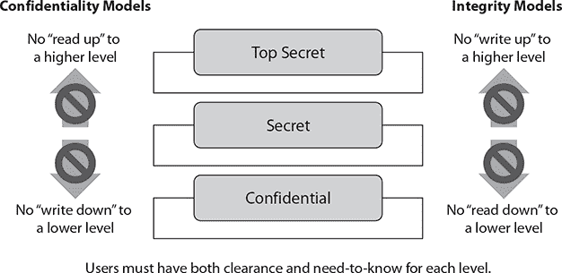

FIGURE 3.2-1 Ensuring confidentiality and integrity in mandatory access control

**NOTE** 我们通常将多级安全视为处于彼此之间较高（更严格）或较低（限制较少）的级别之间，但情况不一定如此。信息也可以被分隔（即使在相同的“级别”），但在访问控制方面仍然分离和受限。这就是“需要知道”发挥最大作用的地方。

## 系统状态和处理模式

在讨论各种机密性和完整性模型之前，了解系统在针对不同安全级别分类的信息方面运行的不同“状态”和“模式”是有帮助的。在 *单状态* 系统中，处理器和系统资源一次只能处理一个安全级别。单状态系统不应同时处理多个安全级别，但可以使用安全策略机制在它们之间切换。另一方面，*多状态* 系统可以同时处理多个安全级别，因为它内置了专门的安全机制。不同的处理模式是根据处理的安全级别和对用户的访问控制定义的。你应该熟悉四种公认的处理模式，按从最严格到最不严格的顺序如下。

## 专用安全模式

## 专用安全模式

专用安全模式是一种单状态系统，意味着其中只处理一个安全级别。但是，与信息交互的访问要求是受限的。本质上，访问安全级别的用户必须具备：

• 允许其访问系统中处理的 `all` 信息的安全许可  
• 管理层批准其访问系统处理的 `all` 信息  
• 与其职位相关的、针对系统中处理的 `all` 信息的有效需要知道（need-to-know）  

## 系统高安全模式

对于系统高安全模式，用户不必对系统中存在的 `all` 信息拥有有效的需要知道，但必须对其中至少 `some` 信息拥有需要知道。此外，用户必须具备：

• 允许其访问系统中处理的 `all` 信息的安全许可  
• 管理层批准以及针对系统处理的 `all` 信息签署的保密协议（NDA）  

## 分隔安全模式

分隔安全模式在允许用户访问系统方面稍微宽松一些。对于分隔安全模式，用户必须满足以下要求：

• 允许其访问系统中处理的 `all` 信息的安全许可级别  
• 管理层批准其访问系统中 `at least some` 信息，并针对系统中所有信息签署 NDA  
• 针对其将访问的 `at least` 信息的有效需要知道  

## 多级安全模式

最后，多级安全模式可能在系统中处理多个级别的敏感信息。用户不一定总是需要拥有系统中所有信息所需的安全许可。但是，用户必须具备：

• 至少等同于其将访问的信息级别的安全许可  
• 管理层针对其将访问的 `any` 信息的批准，以及针对系统中所有信息签署的 NDA  
• 针对其将访问的 `at least` 信息的有效需要知道  

图 3.2-2 说明了与多级安全相关的概念。

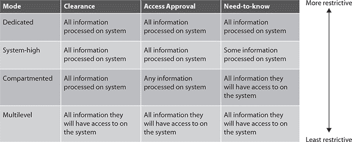

图 3.2-2 多级安全状态和模式

**考试提示** 理解安全状态和处理模式是理解本目标中讨论的保密性和完整性模型的关键，尽管考试中可能不会专门询问状态或处理模式。

## 保密性模型

如前所述，安全模型针对安全性的保密性方面或完整性方面。此处讨论的保密性模型旨在严格控制对信息的访问，即在特定安全级别读取信息的能力。但是，保密性模型不考虑其他方面，例如完整性，因此它们不解决主体可能“写入更高”安全级别（即使无法读取该级别的信息）而未经授权修改信息的潜在风险。

## Bell-LaPadula

保密性访问控制模型最常见的示例是 Bell-LaPadula 模型。它只涉及保密性，不涉及完整性，并使用三条主要规则来强制执行访问控制：

• **简单安全规则** 给定安全级别的主体不允许读取驻留在更高或更受限安全级别的数据。这通常称为“不可向上读”规则，因为主体无法读取更高分类或敏感级别的信息。  
• **\*-属性规则（称为星属性规则）** 给定安全级别的主体不能将信息写入较低安全级别；换句话说，主体不能“向下写入”，这会将高敏感级别的数据转移到敏感要求较低的级别。  
• **强星属性规则** 任何同时对给定安全级别具有读取和写入能力的主体，只能在 `same` 安全级别执行这两项功能——不能更高，也不能更低。要使主体能够同时读取和写入对象，主体的许可级别必须等于对象的分类或敏感级别。  

图 3.2-1（前面所示）演示了简单安全规则和星属性规则在保密性模型中的工作方式。

**考试提示** CISSP 考试目标专门提到了“星模型”，但这是指保密性和完整性模型中存在的星属性和星完整性规则（通常简称为“* 属性”和“* 完整性”）。

## 完整性模型

如前所述，某些强制访问控制模型只涉及完整性，其目标是确保数据不会被不允许这样做的主体修改，并确保数据不会被写入不同的分类或安全级别。两种流行的完整性模型是 Biba 和 Clark-Wilson，当然还有许多其他模型。

## Biba

Biba 模型使用完整性级别（而不是安全级别）来防止任何完整性级别的数据流向不同的完整性级别。与 Bell-LaPadula 类似，Biba 使用三条主要规则来影响对不同安全级别的读取和写入，并使用这些规则来强制执行完整性保护，而不是保密性。这些级别也在 图 3.2-1 中说明。

• **简单完整性规则** 主体不能从较低完整性级别读取数据（这也称为“不可向下读”）。  
• **\*-完整性规则** 主体不能将数据写入驻留在较高完整性级别的对象（称为“不可向上写”）。  
• **调用规则** 一个完整性级别的主体不能请求或调用来自较高完整性级别的服务。  

**考试提示** 虽然 Bell-LaPadula（保密性模型）和 Biba（完整性模型）涉及安全性的不同方面，但两者都被称为 `信息流模型`，因为它们控制信息在安全级别之间的流动方式。对于考试，请记住适用于每个模型的规则。如果使用“simple”一词，则该规则涉及 `读取` 信息。如果规则名称中使用 \* 符号或“star”，则该规则适用于 `写入` 信息。

## Clark-Wilson

Clark-Wilson 模型也是一种完整性模型，但在 Biba 之后开发，并采用不同的方法来保护信息完整性。它使用一种称为 `well-formed transactions` 的技术，以及严格定义的职责分离。well-formed transaction 是一系列操作，将数据从一种状态转换为另一种状态，同时保持数据一致。一致性因素确保数据不会降级并保留其完整性。进程和主体之间的职责分离确保只有有效的主体才能转换或更改数据。

## 其他访问控制模型

我们介绍了强制访问控制中涉及的两个关键安全模型，即保密性和完整性，还有几种其他模型执行一些相同的功能，但使用不同的技术。实际上，这些安全模型在现实世界中都不太实用；每种模型都有其在非常特定环境中的位置。例如，分类军事系统甚至安全医疗系统可能使用不同类型的访问控制模型来保护处理不同阶段的信息，因此它们不仅依赖于一种访问控制模型。更常见的是，您会在不同情况下一起使用这些安全模型。

虽然我们不会在此深入讨论，但为了考试目的，您可能需要熟悉的其他模型包括

• `Noninterference model` 这种多级安全模型要求，在一个安全级别执行的命令或活动不应被不同安全级别的主体和客体看到或影响。

• `Brewer and Nash model` 也称为“中国墙”模型，该模型用于防止利益冲突，其规定主体只有在无法读取不同数据集中另一个对象时，才能向某个对象写入。

## REVIEW

**Objective 3.2: Understand the fundamental concepts of security models (e.g., Biba, Star Model, Bell-LaPadula)** 在本目标中，我们探讨了安全模型的基础知识，这些模型通常遵循强制访问控制范式。我们探讨了采用两种不同访问控制方法的模型：保密性模型和完整性模型。保密性模型关注严格控制主体在给定安全级别“读取”或访问信息的能力。主要的保密性示例是 Bell-LaPadula 模型，它使用规则来限制主体“向上读取”和“向下写入”的能力，以防止未经授权的数据访问。完整性模型严格限制主体在给定安全级别写入或修改信息的能力。我们还讨论了系统状态和处理模式，包括专用安全模式、系统高安全模式、分区安全模式和多级安全模式。

## 3.2 QUESTIONS

**1.** 如果用户拥有系统上处理的*所有*信息的安全许可，但仅获得管理层对*部分*信息的批准，并且仅对该特定信息有知悉需求，那么系统的安全模式是以下哪项？

**A.** 分区安全模式

**B.** 专用安全模式

**C.** 多级安全模式

**D.** 系统高安全模式

**2.** 强制访问控制安全模型涉及以下哪两个安全目标？

**A.** 保密性和可用性

**B.** 可用性和完整性

**C.** 保密性和完整性

**D.** 保密性和不可否认性

**3.** 您的主管已授予您访问处理高度敏感信息的系统的权限。为了实际访问该系统，您必须拥有系统上处理的*所有*信息的安全许可、管理层对系统上处理的*所有*信息的批准，以及对系统上处理的*所有*信息的知悉需求。系统在以下哪种安全模式下运行？

**A.** 多级安全模式

**B.** 系统高安全模式

**C.** 专用安全模式

**D.** 分区安全模式

**4.** 您是一名网络安全工程师，正在帮助设计使用强制访问控制的系统。系统的目标是保护信息完整性。以下哪条规则可用于防止主体将数据写入位于更高完整性级别的对象？

**A.** 强安全规则

**B.** `*-security rule`

**C.** 简单完整性规则

**D.** `*-integrity rule`

## 3.2 ANSWERS

**1.** A 分区安全模式意味着用户必须拥有系统上处理的*所有*信息的安全许可，无论是否获得管理层批准访问信息或知悉需求。此外，用户必须对系统上处理的至少*部分*信息拥有特定的管理层批准和知悉需求。

**2.** C 强制访问控制模型涉及安全的保密性和完整性目标。

**3.** C 由于用户必须满足系统上处理的*所有*信息的所有三项要求（安全许可、管理层批准和知悉需求），因此系统在专用安全模式下运行。这表明是一个单状态系统，因为它仅使用一个安全级别。

**4.** D `*-integrity rule` 规定主体不能将数据写入位于更高完整性级别的对象（称为“不可向上写入”）。

### Select controls based upon systems security requirements

在本目标中，我们将讨论如何根据系统安全要求选择安全控制措施进行实施。我们在领域 1 中讨论过其中一些要求。在本目标中，我们将在整个系统生命周期的背景下回顾这些要求，更具体地说，如何在生命周期早期阶段选择安全控制措施。

## Selecting Security Controls

如您可能从目标 1.10 中记得，我们根据多种标准选择要实施的安全控制措施。除了成本之外，我们还考虑资产的保护需求、控制措施降低的风险，以及控制措施符合治理要求的程度。如果控制措施的成本高于资产本身的价值，或者无法提供足够的保护、风险降低或合规性以平衡其成本，我们应重新考虑实施该控制措施。

不应在系统或应用程序已安装并运行后才选择控制措施进行实施；控制措施选择过程实际上发生在系统构建或购买之前。为了在系统安装和运行之前确定要实施的安全控制措施类型，我们必须审查系统的完整要求。此审查在软件/系统开发生命周期（SDLC）的需求阶段进行，包括功能要求（必须做什么）、性能要求（做得如何）以及当然还有安全要求。另外，请记住，技术控制并非唯一需要考虑的控制措施；行政控制和物理控制与技术控制并行，也应予以考虑。在选择要实施的安全控制措施时，有许多变量需要考虑，我们将重点介绍几项您应该为考试目的理解的关键要求。

**Cross-Reference**

我们将在目标 8.1 中更详细地讨论 SDLC。

## Performance and Functional Requirements

安全要求说明系统、软件甚至机制必须做什么；换句话说，它履行什么功能。为了满足安全要求，必须根据控制措施的功能要求（它们做什么）以及执行该功能的能力（做得如何）来选择控制措施。控制措施的功能和性能要求应在系统或应用程序获取（构建或购买）之前建立。可能会选择一个控制措施，因为它提供支持保密性、完整性和/或可用性的所需安全功能。从实际角度来看，此功能可能是加密或身份验证。

我们还必须考虑控制措施执行其功能的效果如何。要求应始终描述控制措施将支持的系统的可接受性能标准。仅仅选择提供身份验证服务的控制措施是不够的；它必须满足特定标准，例如加密强度、时序、与其他系统的互操作性等。例如，选择仅支持基本用户名和密码身份验证或未加密协议的旧身份验证机制，今天可能不太可能满足预期的性能标准。功能和性能要求可以追溯到数据保护和治理指令。

## Data Protection Requirements

## 数据保护要求

数据保护要求可能来自不同的来源，包括治理。然而，数据保护的两个关键因素是数据的关键性和敏感性，这在目标 2.1 中已深入讨论。请记住，`criticality` 描述了信息或系统对组织业务流程和使命的重要性。`Sensitivity` 指的是信息的机密性级别，并与其易受未经授权的访问或披露的程度相关。在选择控制措施时，应考虑这两个要求。

控制措施必须考虑系统或该系统处理的信息的关键性级别，并实施以保护该资产达到该级别。业务影响分析（`BIA`），在目标 1.8 中讨论，帮助组织确定其业务流程的关键性，并识别支持这些流程的资产。利用 `BIA` 的结果，组织可以选择并实施适当的控制措施来保护关键流程。保护关键数据的控制措施提供资产的弹性和可用性。此类控制措施的示例包括备份、系统冗余和故障转移，以及业务连续性和灾难恢复计划。

如前所述，在选择和实施控制措施时，也必须考虑敏感性。系统和信息越敏感，控制措施就应越强，以保护其机密性。旨在保护机密性的控制措施包括强加密、身份验证以及其他访问控制机制，如权限、许可和定义的角色等。

## 治理要求

除了组织对关键性和敏感性的自行判断之外，治理对控制措施的选择和实施有重大影响。治理可能会对必须到位以保护系统和信息的控制措施施加特定的强制性要求。例如，要求可能包括特定的加密强度或算法级别，或要求在访问敏感数据的安全处理区域中包含警卫和摄像头的物理控制措施。已定义控制要求的治理示例包括《健康保险可携性和责任法案》（`HIPAA`）、《支付卡行业数据安全标准》（`PCI DSS`）、《萨班斯-奥克斯利法案》（`SOX`）以及各种隐私法规。

## 接口要求

接口要求在更详细的层面上影响控制措施，并且非常重要。这些要求规定了系统和应用程序如何与其他系统和应用程序、流程等进行交互。接口要求应考虑数据交换、格式化和访问控制。由于敏感数据可能会跨越一个或多个不同的网络，因此查看位于这些网络或系统之间的控制措施非常重要，以确保它们仅允许在非常特定的情况下允许授权级别的数据通过它们。例如，如果敏感系统连接到较低敏感性级别的系统，除非数据已被适当清理或处理，使其达到目标系统的相同敏感性级别，否则不得允许数据在系统之间传输。一个更具体的例子是医院中包含受保护医疗信息的系统；如果该系统连接到财务系统，某些信息应被限制流向这些系统，但其他信息，例如患者姓名和账单信息，必须传输到这些系统。此级别的控制措施可能负责选择性地编辑不需要用于财务交易的私人健康信息。

根据接口要求选择的控制措施包括在系统之间移动信息的安全协议和服务、强加密和身份验证机制，以及网络安全设备，如防火墙。

## 风险响应要求

控制措施必须满足的风险响应要求在需求阶段可能难以确定。这就是为什么必须在系统甚至不存在之前进行风险评估和分析的原因。在需求阶段进行的风险评估收集关于威胁环境的数据，并考虑可能已经到位以保护资产的现有安全控制措施。为实施而选择的控制措施可能高于现有控制措施，但是必要的，以弥合现有控制措施与新系统面临的潜在增加威胁之间的差距。

风险评估和分析应考虑我们刚刚讨论的所有其他项目：治理、关键性和敏感性因素、互连和接口要求，以及许多其他因素。应考虑的其他因素包括威胁态势（威胁行为者以及针对组织及其资产的已知威胁）；组织、其基础设施和资产中的潜在漏洞（即使在资产获取之前）；以及物理环境（设施、位置和其他环境因素）。

> **EXAM TIP** 控制措施是根据多种不同的因素考虑和选择的，包括功能和性能要求、治理、它们将保护的接口以及对风险分析的响应。然而，选择安全控制措施最重要的因素是它们保护系统和数据的效果如何。

威胁建模通过为您开发大量风险信息来为需求阶段的风险评估做出贡献；您将作为威胁建模工作的附带好处发现漏洞和其他风险特征。基于风险响应选择控制措施的关键是将现有控制措施与针对资产和组织识别的威胁进行权衡，然后在资产到位后，弥合当前安全态势与期望安全状态之间的差距。

## 交叉引用

目标 1.11 对威胁建模进行了深入介绍。

## 复习

**目标 3.3：根据系统安全要求选择控制措施** 在本目标中，我们扩大了对安全控制措施选择的讨论，并讨论了这些控制措施应在资产获取之前就予以考虑和选择。这发生在 SDLC 的需求阶段，包括对控制措施的功能和性能、数据保护要求、治理、接口要求以及风险响应的考虑。

## 3.3 问题

**1.** 您的公司正在考虑购买新的业务线应用程序，并将其与旧版基础设施集成。在考虑新应用程序的额外控制措施时，管理层已经考虑了治理以及控制措施必须如何执行。但是，它尚未考虑影响应用程序与其他组件互操作性的安全控制措施。管理层在为新应用程序选择安全控制措施时，应考虑以下哪些要求？

**A.** 功能性要求

**B.** 风险响应要求

**C.** 接口要求

**D.** 身份验证要求

**2.** 以下哪项应在 SDLC 的需求阶段进行，以充分考虑可能影响选择额外安全控制措施的新威胁、潜在资产漏洞和其他组织因素？

**A.** 业务影响分析

**B.** 风险评估

**C.** 接口评估

**D.** 控制措施评估

## 3.3 答案

**1.** C 接口要求涉及应用程序与其他系统组件的互连，以及与这些旧组件的互操作性。安全控制必须考虑如何以安全的方式在这些组件之间交换数据，尤其是当旧组件无法使用相同的安全机制时。

**2.** B 在需求阶段，应进行风险评估，以确定现有控制措施的状态，以及可能对新资产构成问题的任何新出现或新兴威胁。此外，还应考虑组织的安全态势。风险评估将有助于确定可用于风险响应的新控制措施。

## 了解信息系统（IS）的安全功能（例如，内存保护、可信平台模块（TPM）、加密/解密）

在本目标中，我们将探讨信息系统的一些集成安全功能。这些安全解决方案内置于硬件和固件中，例如可信平台模块、硬件安全模块和自加密驱动器。我们还将简要讨论总线加密，它用于在计算设备内访问和处理数据时保护数据。此外，我们将研究可信执行环境、处理器安全扩展和原子执行等安全概念和流程。理解每个这些概念对于充分掌握系统安全在较低硬件级别的工作原理非常重要。

## 信息系统安全功能

虽然有多种类型的信息系统安全功能可用，但我们将在此将讨论限于考试目标 3.4 中指定或隐含的硬件和固件的安全功能。我们将在本书中讨论其他信息系统安全功能，包括目标 3.6 和 3.7 中的加密功能。

## 硬件和固件系统安全

嵌入在系统中的硬件和固件安全功能旨在解决两个主要问题：对系统组件的信任；以及静态数据（驻留在存储中）、传输中数据（正在通过传输介质主动发送）和使用中数据（正由设备 CPU 主动处理并驻留在易失性或临时内存中）的数据保护。同样，尽管有几个组件有助于这些过程，但我们将讨论为满足考试目标而需要知道的特定组件。

## 可信平台模块

可信平台模块（`TPM`）作为安装在计算设备主板上的硬件组件实现。最常见的是作为计算机芯片实现。其目的是执行多种安全功能，包括存储加密密钥和数字证书。它还执行加密和哈希等操作。`TPM`用于两个重要场景：

• **绑定硬盘驱动器** 这意味着通过加密使硬盘“绑定”到特定系统，从而防止硬盘被盗并在另一系统中使用以获取其数据。

• **密封** 这是为系统的特定硬件和软件配置加密数据并将其存储在 `TPM` 上的过程。此方法用于防止篡改硬件和软件组件以绕过安全机制。如果驱动器或系统被篡改，则无法访问驱动器。

`TPM`使用两种不同类型的内存来存储加密密钥：持久内存和多用途内存。每个密钥和其他安全信息使用的内存类型取决于密钥的用途。`持久内存`在系统断电后仍保留其内容。`多用途内存`是动态的，在断电或丢失电源时会丢失其内容，就像正常的系统 RAM（易失性内存）一样。这些内存区域中存储的密钥和其他信息类型包括以下内容：

• **背书密钥（`EK`）** 这是在 `TPM` 制造时安装的公钥/私钥对。此密钥对不可修改，用于验证 `TPM` 的真实性。它存储在持久内存中。

• **存储根密钥（`SRK`）** 这是用于保护存储在 `TPM` 中的密钥的“主”密钥。它也存储在持久内存中。

• **平台配置寄存器（`PCRs`）** 这些用于存储数据的加密哈希值，并用于通过 `TPM`“密封”系统。这些是 `TPM` 多用途内存的一部分。

• **证明身份密钥（`AIKs`）** 这些密钥用于向各种服务提供商证明 `TPM` 芯片本身的有效性和完整性。由于这些密钥在制造时与 `TPM` 的身份相关联，因此它们也与背书密钥相关联。这些密钥存储在 `TPM` 的多用途内存中。

• **存储密钥** 这些密钥用于加密系统的存储介质，也位于多用途内存中。

## 硬件安全模块

硬件安全模块（`HSM`）在功能上与 `TPM` 几乎相同，区别在于 `TPM` 作为芯片实现在计算设备的主板上，而 `HSM` 是外围设备，可以通过附加卡甚至 USB 连接外部连接到不具备 `TPM` 的系统。

**考试提示** `TPM` 和 `HSM` 几乎相同且服务于相同的功能；区别在于 `TPM` 内置于系统主板，而 `HSM` 是附加卡或 USB 设备形式的外围设备。

## 自加密驱动器

自加密驱动器（`SED`），顾名思义，是一种自包含的硬盘，其驱动器电子元件中内置了加密机制；它不需要计算设备的 `TPM` 或 `HSM`。密钥存储在驱动器本身内，并可由用户选择的密码管理。只要设备与驱动器兼容，`SED` 可以在设备之间移动。

## 总线加密

总线加密是为解决在数据被应用程序和系统上的硬件使用之前必须从永久存储中解密时可能出现的问题而开发的。在此期间，数据处于使用中（活动）状态，如果未加密，则容易被恶意应用程序读取并发送给恶意实体。总线加密在数据放置到系统总线之前对其进行加密，并确保数据在系统内使用时保持加密状态，除非由 CPU 直接访问。但是，总线加密需要使用 `加密处理器`，这是一种内置于系统中的专用芯片，用于管理此过程。

## 安全处理

对于 CISSP 考试，您需要熟悉安全处理的几个关键特征，这些特征包括前一节讨论的硬件和固件管理的特征。请注意，这些不是唯一的安全处理机制，但对于目标 3.4，我们将重点关注可信执行环境、处理器安全扩展和原子执行。

## 可信执行环境

## 可信执行环境（TEE）

可信执行环境（TEE）是处理器中的一个安全、隔离环境，应用程序可以在此环境中运行，文件可以在此环境中打开，并受到保护，免受外部进程的影响。可信执行环境在移动设备中被广泛使用（Apple 将其实现称为 `secure enclave`）。TEE 的工作原理是在应用程序处理空间周围创建一个可信边界，并控制不受信任的对象与应用程序及其数据的交互方式。TEE 拥有对硬件资源（例如内存和 CPU）的独立访问权限，这些资源对不受信任的环境和应用程序不可用。

你应该注意，TEE 保护处理环境的几个方面；由于应用程序运行在不应被任何其他进程损坏的内存空间中，这被称为 `memory protection`。内存保护也可以通过其他机制的组合来实现，例如操作系统和软件应用程序控制。

**EXAM TIP** TEE 是一个受保护的处理环境；它不是 TPM 本身的功能，但它依赖 TPM 为设备硬件提供信任链，以便创建可信软件环境。

## 处理器安全扩展

以安全为设计目标的现代硬件可以提供创建 TEE 所需的安全边界。现代 CPU 自带 `processor security extensions`，这些是专门为提供可信环境支持而创建的指令。处理器安全扩展使程序员能够在内存中为敏感进程创建特殊的保留区域，允许这些内存区域包含与所有其他进程隔离的加密数据。这些内存区域可以由 CPU 使用安全扩展动态解密。这保护了敏感数据免受任何试图以明文读取它的恶意进程的影响。处理器安全扩展还提供了控制 TEE 中的应用程序与数据以及驻留在安全处理边界之外的不受信任的应用程序和硬件之间交互的能力。

## 原子执行

原子执行与其说是一种技术，不如说是一种控制应用程序部分运行方式的方法。它是一种防止其他非安全进程干扰受保护进程所使用的资源和数据的方法。要实现原子执行，程序员利用操作系统库，在执行特定代码段期间调用硬件保护。然而，这的一个缺点是，它可能导致系统性能下降。原子操作要么完全执行，要么根本不执行。

原子执行专门设计用于防止时序攻击，这种攻击利用应用程序中对序列和时间的依赖来并发执行多个任务和进程。这些攻击通常被称为 `time-of-check to time-of-use (TOC/TOU)` 攻击。它们试图中断代码段必须完成的任务的时序或顺序。如果攻击者在特定任务后中断序列或时序，最坏的情况是可能导致应用程序失败，最坏的情况是允许攻击者读取敏感信息。这种攻击也被称为 `asynchronous attack`。

## REVIEW

**Objective 3.4: Understand security capabilities of Information Systems (IS) (e.g., memory protection, Trusted Platform Module (TPM), encryption/decryption)** 在此目标中，我们讨论了信息系统中内置的许多安全功能中的一些。具体到此目标，我们讨论了使用可信平台模块、硬件安全模块、自加密驱动器和总线加密的硬件和固件系统安全。我们还讨论了依赖于此硬件和固件的安全处理特性。我们探讨了可信执行环境的概念，它为软件执行提供了一个封闭、可信的环境。我们还提到了处理器安全扩展，这是内置于 CPU 中的附加代码，允许为敏感进程保留内存和加密。最后，我们讨论了原子执行，这是一种用于保护或锁定代码段以防止可能干扰序列和任务执行时序的异步或时序攻击的方法。

## 3.4 QUESTIONS

**1.** 以下哪项安全功能能够加密媒体并可在系统之间移动，但不依赖内部设备加密机制来管理设备加密？

**A.** Hardware security module

**B.** Self-encrypting drive

**C.** Bus encryption

**D.** Trusted Platform Module

**2.** 以下哪项安全处理功能用于防止检查时间到使用时间攻击？

**A.** Trusted execution environment

**B.** Trusted Platform Module

**C.** Atomic execution

**D.** Processor security extensions

## 3.4 ANSWERS

**1.** B 自加密驱动器在驱动器电子设备中内置了自己的加密硬件机制，因此不依赖其他设备安全机制，例如 TPM、HSM 或总线加密来管理其加密功能。此外，自加密驱动器可以从一个设备移动到另一个设备。

**2.** C 原子执行是安全软件构建中使用的一种方法，它锁定或隔离特定代码段，并防止外部进程或应用程序中断其处理，并在执行进程或任务时利用序列和时序问题。

## 评估和缓解安全架构、设计和解决方案元素的漏洞

在此目标中，我们将查看各种安全架构和设计，了解它们是什么以及它们如何融入整体组织安全图景。我们还将讨论影响每种架构的一些漏洞。

## 安全架构、设计和解决方案的漏洞

基础设施的设计和架构方式有很多种，每种方式都有其自身的优缺点以及独特的安全问题。在此目标中，我们将讨论您在考试和现实世界中都会遇到的几种关键架构。我们还将讨论困扰这些解决方案的某些漏洞。与所有这些解决方案相关的大多数漏洞都涉及反复出现的主题：身份验证薄弱、缺乏强加密、缺乏限制性权限，以及在专用设备的情况下，无法在将其连接到敏感网络甚至更大的互联网的同时安全地配置它们。

## 基于客户端的系统

基于客户端的系统是最简单的计算机架构之一。它通常不依赖任何外部设备或处理能力；所有物理硬件和必要软件都包含在系统内。基于客户端的系统使用完全在单个设备上执行的应用程序。该设备可能具有或不需要与其他设备的任何类型的网络连接。

虽然基于客户端的系统如今已不常见，但在特定实现中仍会遇到它们。在某些情况下，它们只是较旧或旧版设备和实现，而在许多其他情况下，它们是具有非常专业用途的设备，并被有意设计为独立且自包含的。无论在何处看到它们或它们存在的原因，基于客户端的系统仍可能需要补丁和更新，并且由于存储空间有限，可能需要连接到外部存储设备。偶尔的外部处理可能涉及连接到其他应用程序或网络支持的设备。但是，所有核心处理仍在基于客户端的系统上执行。

与基于客户端的系统相关的漏洞与在其他类型架构上被放大到更大程度的漏洞相同。基于客户端的系统经常遭受身份验证薄弱的问题，因为设计者认为使用简单（或有时不存在）的身份验证没有风险，其假设是这些系统可能不会连接到任何其他东西。设备上可能也几乎没有或根本没有非常薄弱的加密机制。同样，假设是设备不会连接到任何其他设备，因此数据不需要以加密形式传输。但是，这种假设没有考虑到设备存储中应加密的数据。基于客户端系统上的大多数安全机制都是单点故障；也就是说，如果它们失败，就没有备份或冗余。

## 基于服务器的系统

基于服务器的系统架构扩展了基于客户端的系统架构（其中所有内容都发生在单个设备或应用程序上），通过将客户端连接到网络，使它们能够与其他系统通信并访问其资源。基于服务器的系统，通常称为客户端/服务器或两层架构，由一个客户端（设备或应用程序）组成，该客户端连接到服务器组件，有时在同一系统上或网络上的另一个系统上，以访问数据或服务。大部分处理发生在服务器组件上，然后将数据传递给客户端。

基于服务器的系统固有的漏洞包括操作系统和应用程序漏洞、身份验证薄弱、加密机制不足，以及在网络客户端/服务器组件的情况下，不安全的通信。

## 分布式系统

分布式系统是包含多个组件的系统，例如软件或数据驻留在网络甚至 Internet 上的多个系统中。这些被称为 `n-tier` 计算架构，因为多个物理或软件组件以某种方式连接在一起，通常通过网络连接。单个层通常是一个自包含系统，而多个层意味着应用程序和设备相互连接并依赖彼此以提供数据或服务。这些架构可以从简单的两层客户端/服务器模型（例如客户端的 Web 浏览器连接到 Web 服务器以检索信息）到具有多个层和许多不同组件的更复杂架构（例如应用程序或数据库服务器）。

分布式系统最显著的特征是处理在主机之间共享。在 `n-tiered` 系统中，一些主机提供大部分处理，一些主机提供存储功能，而其他主机则提供安全、数据转换等服务。

`n-tiered` 架构存在许多不同的安全问题。一个是组件之间的数据流。从纯粹的功能角度来看，数据延迟、完整性和可靠性是问题，因为连接可能会中断或降级，从而影响安全性的可用性目标。但是，其他安全问题包括不安全的通信、身份验证机制薄弱以及缺乏足够的加密。`n-tiered` 架构中的另外两个关键考虑因素是应用程序漏洞以及任何组件上的操作系统相关漏洞。

## 数据库系统

数据库有多种实现，并且经常成为恶意实体的目标。数据库可以是包含个人财务信息的简单电子表格或桌面数据库，也可以是大规模的多层大数据实现。数据库构建有多种模型，其中一些比其他模型更有利于安全性。

关系型数据库占数据库设计的绝大多数，基于 `tables` 信息，带有行和列（分别也称为 `records` 和 `fields`）。数据库 `rows` 包含关于特定主题的数据，而 `columns` 包含表中所有主题共有的特定信息元素。`key` 是表中用于唯一标识记录并与不同表中的相关记录建立关系的一个或多个字段。`primary key` 是基于非重复数据唯一标识记录的字段唯一组合。`foreign key` 用于与不同表甚至另一个数据库中的相关记录建立关系。`Indexes` 是用于在数据库内促进数据搜索的键。

除了关系型数据库（最常见的类型）之外，还有其他数据库架构存在并在不同情况下使用。其中一些是使用文本文件的简单数据库，这些文件格式化为简单的逗号或制表符分隔字段，并且只使用一个表（称为 `flat-file` 数据库）。另一种类型称为 `NoSQL`，用于聚合性质不同的数据库和数据源，例如结构化数据库与非结构化（未格式化）数据相结合。`NoSQL` 数据库用于“大数据”应用程序，这些应用程序必须从多个没有共同格式、结构甚至数据类型的数据源中提取可用信息。第三种数据库架构类型是 `hierarchical` 数据库，这是一种较旧的类型，仍在某些应用程序中使用。层次数据库使用层次结构，其中主数据元素下有几个嵌套层次的信息。请注意，还有更多类型的数据库架构以及我们刚刚提到的那些架构的变体。

无论架构如何，数据库的常见漏洞包括设计不佳，允许最终用户查看他们不应有权访问的信息、接口不足、缺乏适当权限以及数据库管理系统本身的漏洞。为了应对这些漏洞，应实施限制性视图和受约束的接口，以限制授权用户能够访问的数据元素，以及对数据库管理系统进行数据库加密和漏洞/补丁管理。

## 加密系统

加密系统有两种主要类型的漏洞：一种是固有于加密算法或密钥的漏洞，另一种是影响加密系统实现方式的漏洞。在两者之间，弱算法和密钥更常见，但加密系统的设计和实现也可能存在问题。我们将在目标 3.6 中更深入地探讨加密系统的弱点。

## 工业控制系统

## 工业控制系统（ICSs）

工业控制系统（ICSs）是一组独特的信息技术，旨在控制机械和物理过程中的物理设备。ICSs 与传统 IT 系统不同，因为其中一些设备、编程语言和协议是旧式或专有的，旨在独立运行且不连接到传统网络。分布式控制系统（DCS）是这些设备的网络，它们相互连接但可能是封闭网络的一部分；通常，DCS 由彼此靠近的设备组成，因此不需要长途或广域网连接。DCS 可能是制造或电力设施中遇到的控制设备网络类型。与 DCS 范围有限且设备彼此非常接近不同，监控控制与数据采集（SCADA）系统覆盖大型地理区域，并由多个物理设备组成，这些设备使用传统 IT 和 ICS 的混合体。

**NOTE** DCS 和 SCADA 系统以及一些 IoT 和嵌入式系统均属于更大的 ISC 类别。

您应该了解的与 ICSs 相关的概念和技术，以便参加考试包括

• 可编程逻辑控制器（PLCs）这些是控制机电过程的设备。

• 人机界面（HMIs）这些是监控系统，允许操作员监控和与 ICS 系统交互。

• 数据历史库 这是作为 ICS 设备数据存储库的系统，通常存储传感器数据、警报、命令历史记录等。

由于 ICS 设备往往相对较旧或具有专有性质，它们通常没有内置身份验证或加密机制，并且可能没有任何安全控制，或者安全控制很弱。但是，现代技术和网络现在连接到其中一些旧式或传统设备，这引发了关于安全兼容性的问题，以及涉及数据丢失的许多漏洞，以及通过这些传统设备连接到原本安全网络的能力。运营技术（OT）是将传统 IT 和 ICS 设备组合到一个系统中，并需要特别关注以保护这些网络。

## 物联网

与 ICS 设备密切相关的是那些更现代、商业化且有时由消费者驱动的设备版本，通常被称为物联网（IoT）。IoT 是一种更现代的方法，用于嵌入可以与其他系统（包括全球互联网）交互和连接的智能系统。从智能冰箱、门铃和电视到医疗设备、可穿戴设备（例如，智能手表）、游戏和汽车等各种设备，只要它们能够通过无线或有线连接连接到其他系统，就被视为物联网的一部分。IoT 设备使用标准化的通信协议，例如 TCP/IP，并具有非常专业但有时有限的处理能力、内存和数据存储。连接到互联网时的安全性不足是其主要弱点，因为许多 IoT 设备没有高级身份验证、加密或其他安全机制，这使得它们成为进入可能存储敏感数据的其他传统系统的简易入口。

## 嵌入式系统

嵌入式系统是集成计算机，其所有组件都自包含在系统中。它们通常针对特定用途设计，可能仅具有有限的处理或存储功能。嵌入式系统的示例包括控制现代汽车发动机功能的系统或控制飞机系统的系统。嵌入式系统与 ICS/SCADA 和 IoT 系统相似，因为它们是特殊功能设备，通常连接到互联网，有时不考虑安全机制。许多嵌入式系统是专有的，并且没有强大的内置安全机制，例如强身份验证或加密功能。此外，嵌入式系统中的软件通常嵌入到计算机芯片中，在发现系统漏洞时可能不容易更新或修补。

## 基于云的系统

云计算是一组相对较新的技术，用于促进使用共享远程计算资源。云服务提供商（CSP）向订阅服务的客户提供服务。通常，云服务提供商拥有客户用于访问服务的物理硬件，有时还包括基础设施和软件。客户远程连接到提供商的基础设施，并使用资源，就像客户连接到客户所在场所一样。云计算通常实现为大型数据中心，在强大的硬件上运行多个虚拟机，这些硬件可能专用于客户，也可能不是。

组织订阅云服务的原因有很多，包括通过减少构建自身基础设施、购买自身设备或雇佣自身网络和安全人员的必要性来节省成本。云服务提供商根据客户订阅的内容，在一定程度上承担所有这些事情。

云计算订阅服务有三种主要模式：

• 软件即服务（SaaS）客户订阅由 CSP 提供的应用程序。

• 平台即服务（PaaS）虚拟计算机在 CSP 的基础设施上运行，并为客户使用而配置。

• 基础设施即服务（IaaS）CSP 提供网络基础设施和虚拟主机，客户可以根据需要配置和使用。

CSP 提供的其他类型的云服务包括安全即服务（SECaaS）、数据库即服务（DBaas）、身份即服务（IDaas）以及许多其他服务。

除了三种主要订阅模式外，云基础设施还有四种主要部署模式：

• 私有云 客户组织拥有基础设施，或订阅位于云服务提供商数据中心的专用部分基础设施。

• 公有云 客户组织使用公有云基础设施提供商，仅订阅特定服务；基础设施服务不专用于客户，而是在不同客户之间共享。

• 社区云 云基础设施在类似组织之间共享，用于协作和信息交换。

• 混合云 这是任何或所有其他部署模式的组合，可能是您最常见的模式。

虽然云服务提供商使用共享责任模型，将部分安全保护负担从客户转移，但基于云的模型和部署中仍然存在漏洞。共享安全模型的一些考虑因素包括

• 界定的责任 云服务提供商和客户之间的责任必须界定，并且必须保持问责制。

• 对设备和基础设施的管理访问 客户可能或可能无法访问其使用的所有设备和基础设施，并且可能有能力配置或保护这些设备的能力有限。

• 审计 客户和 CSP 必须共同承担审计客户人员和 CSP 操作的责任。

• 配置和修补 通常，CSP 负责主机、软件和基础设施配置和修补，但这必须在协议中详细说明。

• **数据所有权和保留** 客户拥有的数据（尤其是医疗信息和个人数据等敏感数据）可能会被 CSP 的人员访问或处理，但其保护责任仍由客户承担。

• **法律责任** CSP 协议必须处理法律责任、责任和问责制等方面的违约问题。

• **数据分段** 客户必须确定数据在 CSP 的设备上处理和存储时，是会与其他组织的数据混合，还是与之分段。

## 虚拟化系统

虚拟化系统使用软件模拟硬件资源；它们存在于由软件创建的模拟环境中。虚拟化系统最常见的示例是由虚拟机监控程序创建和管理的虚拟操作系统。`hypervisor` 负责创建模拟环境并为虚拟化系统管理硬件资源。它充当虚拟系统与更高级别操作系统和物理硬件之间的层。虚拟机监控程序有两种类型：

• **类型 I** 也称为 `bare-metal hypervisor`，这是一种最小的特殊用途操作系统，直接在硬件上运行并支持安装在其之上的虚拟机。

• **类型 II** 这是作为软件应用程序实现的，运行在现有操作系统（如 Windows 或 Linux）之上，并充当操作系统与虚拟化系统之间的中介。虚拟化操作系统有时被称为 `guest`，而它运行的物理系统被称为 `host`。

## 容器化

虚拟化系统可以是整台计算机，包括其操作系统、应用程序和用户数据。但是，有时不需要完整的虚拟化系统。虚拟化系统可以缩小到比客户操作系统小得多的级别。可以创建一个较小的模拟环境，称为 `container`，它只需完整运行一个应用程序，因此不需要完整的虚拟操作系统。容器与 hypervisor 交互以获取所有必要资源，例如 CPU 处理时间、RAM 等。这允许最小资源使用，并消除了构建整个虚拟计算机的必要性。流行的容器化软件包括 Kubernetes 和 Docker。

## 微服务

微服务是一种最小化的容器化形式，不需要构建大型应用程序。应用程序功能和应用程序可能提供的服务被划分为更小的组件，称为 `microservices`。微服务在容器化环境中运行，本质上是为支持业务能力而设计和构建的小型、分散的单个服务。微服务也是独立的；它们倾向于松散耦合，这意味着单个服务之间没有太多必需的依赖关系。微服务可以快速、高效地开发、测试和配置各种功能和服务。

## 无服务器

一种更最小化的虚拟化形式是无服务器函数。在无服务器实现中，计算、存储、消息传递等服务及其配置参数被部署为微服务。它们被称为 `serverless functions`，因为不需要专用托管服务或服务器。无服务器架构在单个函数级别工作。

## 高性能计算系统

高性能计算（HPC）系统比传统的通用计算系统强大得多，旨在解决大型问题，例如数学、经济学和高级物理学中的问题。除了在处理链的每个步骤中都拥有极高端的硬件外，HPC 系统还通过使用多个处理器（有时多达数十万个）、更快的总线以及专为速度和精度设计的专用操作系统来聚合计算能力。

## 边缘计算系统

在实时金融交易、视频流、高端游戏以及需要大量处理能力和存储且闪电般的网络速度随时可用的时代，边缘计算已成为分布式计算中更重要的一部分。`Edge computing` 是 `content distribution networks` (`CDNs`；有时也称为 `content delivery networks`) 的自然演进，后者最初是为向用户交付 Web 内容（例如游戏和视频流服务）而发明的。随着托管这些服务的大型数据中心变得更加强大，然后分布在大型区域中，缓慢的跨国广域网 (`WAN`) 链路往往成为瓶颈。将速度和效率更贴近用户已成为一种必要。

**EXAM TIP** CDN 通过在多个数据中心定位内容来提供冗余和更可靠的服务交付。边缘计算旨在将内容在地理上更贴近用户，以克服缓慢的 WAN 链路。然而，两者都使用类似的方法，几乎属于相同的基础设施。

用户无需通过可能遍布整个国家甚至海外的缓慢链路网络进行连接，边缘计算允许在物理和逻辑上更贴近用户的位置建立数据和服务的中间分发点，以帮助减少对过载长途连接的依赖。这样一来，用户不一定需要始终保持与集中式数据中心的连接来进行视频流；内容也可以复制到边缘计算节点，以便用户可以直接访问这些节点，而无需在长距离上与缓慢链路作斗争。边缘计算还使用最快的可用设备和链路来帮助最大限度地降低延迟。

## REVIEW

**目标 3.5：评估和缓解安全架构、设计和解决方案元素的漏洞** 在此目标中，我们讨论了不同类型的计算架构和设计，以及它们的漏洞。基于客户端的系统不依赖任何外部设备或处理能力，并且不一定连接到网络。基于服务器的系统具有客户端和服务器组件。N 层架构是使用多个组件的分布式系统。我们了解了数据库系统的基础知识，包括关系型和层次型系统。非传统 IT 系统包括工业控制系统、SCADA 系统和物联网设备，这些设备可能具有或不具有内置的安全身份验证或加密机制。我们还回顾了云订阅服务和云部署架构，包括软件即服务、基础设施即服务和平台即服务，以及公有云、私有云、社区云和混合云模型。虚拟化系统由各种组件组成，包括 hypervisor、虚拟化客户机、物理主机、容器、微服务和无服务器架构。这些组件不仅模拟操作系统，还模拟应用程序和较低级别的构造，以最大限度地减少硬件要求并提供特定功能。我们还简要讨论了嵌入式系统，这些系统本质上是嵌入计算机芯片的系统，以及规模相反端的计算平台，这些平台处理大量处理能力，即高性能计算。最后，我们简要讨论了边缘计算系统，这些系统将服务更贴近用户，以帮助消除广域网上的延迟问题。

## 3.5 问题

## 1

一家大型公司的系统包含多个组件，包括应用程序服务器、Web 服务器和后端数据库服务器。客户端通过 Web 浏览器访问该系统。以下哪项最能描述这种架构类型？

**A.** `N-tier architecture`

**B.** `Client/server architecture`

**C.** `Client-based system`

**D.** `Serverless architecture`

## 2

贵公司需要为执行仅极少量服务但会连接到另一个更大的业务线应用程序的用户提供一些功能。您不需要编程另一个大型企业级应用程序。以下哪项是最符合您需求的解决方案？

**A.** `Microservices`

**B.** `Virtualized operating systems`

**C.** `Embedded systems`

**D.** `Industrial control systems`

## 3.5 ANSWERS

## 1

`A` `n-tier architecture` 的特点是具有多个分布式组件。在此示例中，`n-tier architecture` 由应用程序服务器、Web 服务器和数据库服务器组成，并伴随其基于客户端的 Web 浏览连接。

## 2

`A` `Microservices` 提供可由其他应用程序访问的低级功能，无需构建整个企业级应用程序。

## 选择并确定加密解决方案

目标 3.6 和 3.7 涉及密码学。您应该了解与密码学相关的基本术语和概念，但对于考试来说，您不必了解其背后的数学。我们将在此目标中介绍基本术语和概念，并在目标 3.7 中讨论可针对密码学实施的一些攻击。

在此目标中，我们将探讨密码学和密码分析的各个方面，包括加密生命周期，它解释了如何选择和管理密钥和算法，以及所使用的加密方法，例如对称加密、非对称加密和量子密码学。我们还将探讨密码学的应用，以公钥基础设施 (`PKI`) 的形式呈现。

## 密码学

`Cryptography` 是利用数学算法和密钥存储和传输信息的科学，只有特定实体才能读取或访问这些信息。虽然密码学是我们与该科学关联时使用的最流行术语，但 `cryptology` 是涵盖密码学和密码分析的总称。`Cryptanalysis` 是指分析和逆转加密过程以破解加密。`Encryption` 是将 `plaintext` 信息（人类和计算机都可以轻松读取）转换为称为 `ciphertext` 的内容的过程，如果没有适当的加密机制，人类或机器都无法读取或访问这些内容。`Decryption` 逆转该过程，允许授权实体查看加密隐藏的信息。密码学支持安全性的机密性和完整性目标，还有助于确保身份验证、不可否认性和问责制等支持性原则得到满足。

当今使用的大多数密码学都涉及使用 `ciphers`，它将单个字符（或构成字符的二进制位）转换为密文。相比之下，术语 `code` 是指使用符号而不是字符或数字来表示整个单词或短语。早期的密码使用简单的 `transposition` 来重新排列消息中的字符，使它们仅在自身之间混乱，或者使用 `substitution`，即密码用字母表中的不同字符替换字符。

**NOTE** 术语 `cipher` 也可以与术语 `algorithm` 互换使用，后者是指给定的加密/解密过程必须遵循的数学规则。我们将在接下来的两个部分中讨论算法。

## 加密生命周期

密码学有许多不同的组件，每个组件都根据精心规划的生命周期进行控制。`cryptographic life cycle` 是识别密码学要求、选择满足您需求的算法、管理密钥以及实施将促进整个加密/解密过程的加密系统的持续过程。无论使用哪种加密方法，都有三个重要组件：算法、密钥和加密系统。

## 算法

算法是复杂的数学公式或函数，用于促进加密和解密的加密过程。它们规定如何操作明文以生成密文。算法通常是标准化的，并且公开可用于检查。如果仅仅是将明文通过算法并生成密文，那么该过程可以重复多次以产生相同的结果密文。然而，这种可预测性最终会成为漏洞，因为，给定足够多的明文和密文样本，某人可能会弄清楚算法的工作原理。这就是为什么引入了密钥这一拼图的另一部分，以给加密过程增加可变性和不可预测性。

## 密钥

`key`，有时也称为 `cryptovariable`，与算法一起引入加密过程，以增加加密和解密的复杂性。密钥类似于密码，必须经常更改，并且通常只有拥有访问和授权权限以加密和解密信息的授权实体才知道。1883 年，Auguste Kerckhoffs 发表了一篇论文，指出在加密系统中只有密钥应保密。称为 `Kerckhoffs’ principle`，它进一步指出，加密系统中的算法应公开，以便其漏洞可以被发现和缓解。

这一原则有一些例外；值得注意的是美国政府的 Clipper Chip 和 Skipjack 算法，其内部工作原理在保密状态下，理论是如果政府圈子外的没有人知道它们的工作原理，那么就没有人能够发现漏洞。行业和专业安全社区不同意这种方法，因为它往往遵循 `security through obscurity` 的错误原则，这意味着仅仅不了解安全控制并不能使其更强大。因此，当今大多数常用算法都开放供检查和审查。

密钥应创建为强密钥，这意味着在创建密钥时应考虑以下指导原则：

• 较长的密钥长度有助于创建更强的密钥。
• 较大的密钥空间（密钥中可用字符集及其可能性的数量）会创建更强的密钥。
• 更随机且不基于常见术语（例如字典单词）的密钥更强。
• 密钥应像密码一样受到机密性保护——不要写在公共可访问的地方或共享。
• 密钥应经常更改，以减轻可能危及它们的攻击。
• 两个密钥不应从相同的明文生成相同的密文，这称为 `clustering`。

## 加密系统

加密系统是实施加密的设备或机制。它负责加密和解密过程。加密系统不必是硬件；它可以是软件，例如生成密钥或加密电子邮件的应用程序。加密系统以安全的方式构建，但也使用复杂的密钥和算法。加密系统的强度称为其 `work function`。工作函数越高，加密系统越强。正如我们将在目标 3.7 中看到的，针对加密系统及其实现中任何弱点的攻击都很常见。

## 加密方法

使用算法、密钥和加密系统等常见密码学组件，密码学通过多种不同的方法和手段实现。密码学方法旨在提高加密过程的强度和韧性，同时尽可能降低其复杂性。

用于将明文转换为密文的两种基本操作是：

• **混淆** 任何明文与密钥之间的关系都非常复杂，以至于攻击者无法将明文加密为密文，并从这些关系中推断出密钥。

• **扩散** 明文中的微小变化，即使是句子中的单个字符，也会导致结果密文中出现更大的变化。因此，更改明文中的单个字符不一定只会更改密文中的单个字符；结果的变化可能会改变结果密文的很大一部分。

另一种你应该了解的加密过程涉及使用布尔数学，即二进制。密码学使用逻辑运算符，例如 AND、NAND、OR、NOR 和 XOR，将明文的二进制位更改为密文。所使用的逻辑运算的具体组合及其顺序，很大程度上取决于所使用的算法。这些过程还使用单向函数。`one-way function` 是一种无法轻易逆转的数学运算，因此通过其中一个函数处理成密文的明文，在不知道算法和密钥的情况下，无法使用相同的函数从密文逆转回其原始状态。某些算法还会添加随机数或种子（称为 `nonce`），以使加密过程更加复杂、随机且难以逆向工程。

存在各种加密方法，但为了准备 CISSP 考试，你应该特别熟悉以下四种：对称加密、非对称加密、量子密码学和椭圆曲线密码学。

## 对称加密

对称加密（也称为 `secret key` 或 `session key` 密码学）对其加密和解密操作使用一个密钥。密钥由通信过程的所有各方选择，每个人都拥有相同的密钥。密钥可以由加密系统或应用程序即时生成，例如当某人访问安全网站并与远程服务器协商安全连接时。对称加密的主要特征包括以下内容：

• 它不易于扩展，因为所有相关各方之间的完全机密通信需要管理更多的密钥。

• 它相对较快，适合加密大量数据。

• 密钥交换存在问题，因为对称密钥必须安全地提供给所有各方，以防止未经授权的实体访问密钥。

对称加密的主要漏洞之一是它不易于扩展，因为需要的密钥数量随需要相互加密的群体规模增加而增加。例如，如果两个人想要使用对称加密相互发送加密消息，他们只需要一个对称密钥。但是，如果有三个人参与，并且他们每个人都需要发送只有对方才能解密的加密消息，那么每个人都需要两个对称密钥来连接另外两个人。对于较大的群体，这个数字可能会变得难以处理；确定多方之间所需密钥数量的公式是 N(N – 1)/2，其中 N 是参与方的数量。

例如，如果 100 个人需要相互交换安全消息，并且所有 100 个人都有权阅读所有消息，那么只需要一个对称密钥。但是，如果某些消息必须加密并且只能由该群体中的特定人员解密，那么就需要更多的密钥。在此示例中，为了确保每个人只能与其他每个单独的人交换安全消息，根据公式 100(100 – 1)/2，则需要 4,950 个单独的密钥。如下一节所示，非对称加密方法可以解决可扩展性问题。

对称加密方法使用两种主要类型的密码之一：块密码或流密码。`block` 密码以称为块的大块数据进行加密。块大小以位为单位。常见的块大小为 64 位、128 位和 256 位块。典型的块密码包括 Blowfish、Twofish、DES 和高级加密标准（AES），这些在 表 3.6-1 中详细介绍。

**表 3.6-1** 常见对称算法

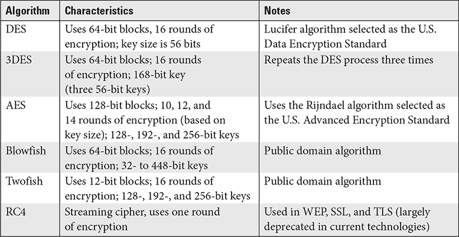

另一方面，流密码一次加密一位数据。流密码比块密码快得多。广泛使用的流密码最常见的示例是 RC4。初始化向量 (IV) 是用于开始使用流密码进行加密过程的随机种子值。

## 非对称加密

非对称加密与其对称加密的对应物不同，使用两个密钥。其中一个密钥被任意称为公钥，另一个是私钥。密钥在数学上相关但不相同。拥有访问权限或了解其中一个密钥，并不允许某人推导出密钥对中的另一个密钥。关于非对称加密需要了解的重要一点是，无论一个密钥加密什么数据，只有另一个密钥才能解密，反之亦然。你不能使用用于加密的相同密钥来解密密文。这是一个重要的区别，因为它是非对称加密（也称为公钥密码学）的基础。

非对称加密的其他关键特征包括以下内容：

• 它使用数学上复杂的算法来生成密钥，例如极大数的质因数分解。

• 它比对称加密慢得多。

• 它在加密大量数据方面效率非常低。

• 它非常可扩展，因为即使是大量人员交换加密消息，每个人也只需要自己的密钥对，而不是来自其他人的多个密钥。

非对称加密允许用户保留一个密钥，称为用户的 `private key`，并将 `public key` 提供给任何人。由于使用公钥加密的任何内容只能使用用户的私钥解密，因此这确保了机密性。相反，使用用户私钥加密的任何内容只能使用公钥解密。虽然这绝对不能保证机密性，但它确实有助于确保身份验证，因为只有拥有私钥的用户才能加密任何拥有公钥的其他人都可以解密的数据。常见的非对称算法包括 表 3.6-2 中列出的算法。

**表 3.6-2** 常见非对称算法

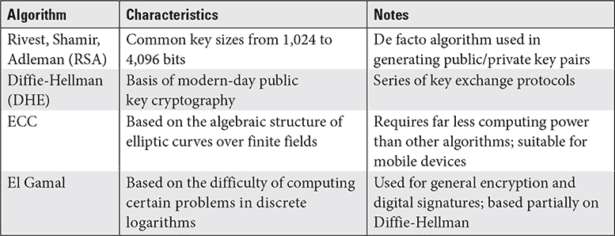

## 量子密码学

量子密码学是一种尖端技术，利用量子力学提供本质上无法窃听或逆向工程的加密功能。尽管量子密码学的大部分内容仍然是理论性的，距离实际实现还有数年时间，但 `quantum key distribution (QKD)` 是量子密码学的一个方面，在近期变得越来越有用。QKD 可以帮助解决与对称密码学相关的安全密钥分发问题。它使用分配给二进制值的偏振光子的方向，将密钥从一个实体传递到另一个实体。请注意，观察或尝试测量这些光子的方向实际上会改变它们并中断通信，使该过程失效。这就是为什么很容易检测到任何未经授权的窃听或对通信流的修改。

## 椭圆曲线密码学

## 椭圆曲线密码学（ECC）

椭圆曲线密码学（ECC）是一种非对称算法的示例，它使用椭圆曲线上的点来生成公钥和私钥。密钥在数学上相关，如同所有非对称密钥一样，但不能相互推导。ECC 用于许多不同的功能，包括数字签名（将在即将到来的章节中讨论）、安全密钥交换和分发，当然还有加密。你需要记住的 ECC 的主要特点是它效率极高，远高于其他非对称算法，资源消耗远低，且所需处理能力远小。这使得 ECC 非常适合处理能力、存储、电力和带宽受限的移动设备。

## 完整性

与机密性和可用性一起，完整性是安全的三个主要目标之一，如目标 1.2 所述。完整性确保数据和系统未被篡改，且未对其进行任何未经授权的修改。可以通过多种方式保证完整性，其中之一是通过密码学，它通过计算数据片段的单向哈希（也称为 `message digest`）来确定数据未被更改。例如，使用单向哈希函数对消息进行哈希处理会生成一个唯一的指纹，即消息摘要。之后，在消息传输、接收或存储后，如果需要质疑或验证消息的完整性，则对消息应用相同的哈希算法。如果消息未被更改，哈希值应相同。如果消息以任何方式更改，无论是故意还是无意，生成的哈希值都会不同。

哈希可用于多种场景，包括数据传输和接收、电子邮件、密码存储等。请记住，哈希与加密不同；哈希的目的不是加密必须解密的内容。哈希值是使用单向函数生成的，该函数不可逆，然后比较哈希值，而不是解密它们。

哈希值应针对一段数据是唯一的，且不应被使用相同算法的任何其他不同数据重复。如果发生这种情况，则称为 `collision`，并代表哈希算法中的漏洞。流行的哈希算法包括 MD5 和安全哈希算法（SHA）系列算法。

**EXAM TIP** 虽然哈希是一种加密过程，但哈希与加密不同。加密文本可以被解密，即逆转回其明文状态。哈希文本不会被解密，而是对文本再次进行哈希处理，以便比较哈希值来验证完整性。

## 混合密码学

混合密码学，正如你从其名称中可能猜到的那样，是多种密码学方法的组合，主要是对称和非对称密码学。一方面，对称加密不易扩展，但速度快，非常适合加密大量信息；它不适合在大量人群中使用。另一方面，非对称加密每人只使用两个密钥，公钥可以提供给任何人，这使其非常易于扩展。但它速度较慢，不适合批量数据加密，这更适合对称加密。很容易看出，每种算法都弥补了另一种算法的缺点，因此将它们一起使用是合理的。

为了共同使用非对称和对称加密，两个想要共享加密数据的人可以执行以下操作：

**1.** 第一个用户（发送方）会将其公钥提供给第二个用户（接收方）。

**2.** 接收方会生成一个对称密钥，然后使用发送方的公钥加密该对称密钥。

**3.** 发送方随后会使用其自身的私钥解密加密的密钥。

一旦发送方拥有该密钥，双方就不再需要担心公钥和私钥对；他们可以简单地使用对称密钥快速交换大量数据。在这个特定示例中，该对称密钥称为 `session key`，因为它仅用于该特定的加密数据交换会话。

非对称加密方法允许安全密钥交换，这在现实世界中也会发生，例如当用户使用网页浏览器与安全服务器建立 HTTPS 连接时。在这个示例中，一方（通常是客户端）会创建一个会话密钥供双方使用。由于以未加密的形式将该密钥发送给第二方（在此例中为服务器）不安全，发送方可以使用接收方的公钥加密会话密钥。接收方随后使用其私钥解密消息，从而访问会话密钥。现在双方都拥有会话密钥，他们可以使用它以快速高效的方式交换大量数据。

## 数字证书

数字证书是包含公钥和/或私钥的电子文件。数字证书文件是一种安全分发公钥和私钥的方式，并用于证明它们与单个实体（如个人或组织）紧密相连。证书是通过一个签发它们的服务器生成的，称为 `certificate authority` 服务器。数字证书可以安装在任意数量的软件应用程序甚至硬件设备中。安装后，它们驻留在系统的安全证书存储中。这使用户需要使用它们加密电子邮件、连接到安全金融网站或在传输前加密文件时，能够自动且透明地使用它们。

数字证书包含用户姓名、组织、证书签发日期、到期日期及其用途等属性。数字证书可用于多种用途，并且可以根据签发组织的意愿，为单一用途或多种用途签发数字证书。例如，数字证书可用于加密电子邮件和文件、提供身份验证等，或者数字证书可以仅为特定目的生成，并仅由软件开发公司用于对软件进行数字签名。大多数数字证书使用流行的 X.509 标准，该标准规定了其格式和结构。数字证书的常见文件格式包括 DER、PEM 和公钥密码学标准（PKCS）#7 和 #12。

**NOTE** PKCS 由 RSA Security 开发，是一套专有标准。

## 公钥基础设施

公钥基础设施，或 PKI，是用于指实施混合密码学（同时使用非对称和对称方法和算法）的技术、流程和程序以及相关基础设施的名称，旨在为加密、文件完整性和身份验证提供可信基础设施。PKI 遵循正式的层次结构，如 Figure 3.6-1 所示。

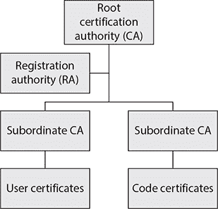

FIGURE 3.6-1 典型的 PKI

典型的 PKI 由一个可信实体组成，称为 `certificate authority (CA)`，它提供证书和密钥。这可能是一家专门从事此业务的商业公司（如 Verisign、Thawte、Entrust 等），甚至是您自己公司中负责签发密钥和证书的部门。可信实体也可以是第三方，只要它们能够验证主体的身份即可。对 CA 的信任基于这样一个假设：它会验证其签发密钥和证书的实体（称为 `subjects`）的身份和有效性。

一般来说，如果证书仅在组织内部使用或受信任，则应来自内部 CA；如果需要组织外部的机构（例如客户、业务合作伙伴、供应商等）信任该证书，则应使用外部或第三方 CA。

**注意** 术语 `certificate authority` 可指受信任的实体本身，也可指实际生成密钥和证书的服务器，具体取决于上下文。

在较大的组织中，身份验证的工作量通常会卸载给不同的部门或组织；这被称为 `registration authority (RA)`。RA 收集身份证明，例如个人的驾驶执照、护照、出生证明等，并验证用户确实是其声称的那个人。然后，RA 将这些信息传递给 CA，由 CA 执行实际的密钥生成并颁发数字证书。

在由 `root`（顶级）CA 执行所有密钥生成和证书颁发功能的组织中，添加 `subordinate`（有时也称为 `intermediate`）CA 可能是明智的做法，这些额外的服务器负责颁发特定类型的证书，以减轻根 CA 的工作负担。下属服务器可以颁发特定证书，例如用户证书或代码签名证书，也可以简单地分担颁发与根 CA 相同证书的工作负载。实施下属 CA 也是一种良好的安全实践。通过让下属 CA 颁发所有证书，根 CA 可以脱机以保护它，因为对该服务器的攻击将危及组织颁发的证书的整个信任链。

虽然 PKI 是非对称加密最常见的实现方式，但并非唯一的一种。正如刚才描述的那样，PKI 依赖于信任层次结构，始于集中式根 CA，并且结构类似于树。其他模型实现数字身份，包括对等模型，例如 Pretty Good Privacy (PGP) 加密程序使用的 web-of-trust 模型。

## 否认不可抵赖性和数字签名

`Nonrepudiation` 意味着某人无法否认其采取了某项操作，例如发送消息或访问资源。否认不可抵赖性对于问责制和审计至关重要，因为问责制用于确保任何个人的行为都可以追溯到其本人，并且他们应对这些行为负责。审计有助于为各种操作建立否认不可抵赖性，包括与访问资源、行使特权等相关的操作。

加密可以通过使用数字签名来协助否认不可抵赖性。数字签名与个人完全绑定，因此其使用保证（前提是数字证书未以任何方式被泄露）个人无法否认其采取了某项操作，例如发送经过数字签名的电子邮件。

数字签名支持真实性过程，以证明用户发送的消息是真实的，并且用户就是发送者。这是混合加密的完美示例；要发送的消息被哈希处理，这提供了完整性，因为消息在不更改其哈希的情况下无法被篡改。发送者的私钥加密消息哈希，并作为传输的一部分发送给接收者。当接收者接收到消息（该消息除了经过数字签名外，还可能被加密）时，他们可以使用发送者的公钥解密消息的哈希，然后比较哈希以确保完整性。哈希处理确保消息完整性，使用用户的私钥加密哈希确保真实性，因为消息只能来自私钥持有者。

## 密钥管理实践

密钥管理包括用于在密钥整个生命周期内管理和保护加密密钥的程序和过程。请注意，密钥可能是硬件机制或软件应用程序使用的密钥，也可能是颁发给用户的单个密钥。密钥管理包括制定策略和实施密钥管理基础设施。密钥管理的实践部分包括

• 验证用户身份

• 颁发密钥和证书

• 安全密钥存储

• 密钥托管（在用户离职且需要恢复加密数据时，安全地保存用户密钥的副本）

• 密钥恢复（在用户丢失密钥或其数字副本损坏的情况下）

• 管理密钥过期（在密钥和证书过期前续期或重新颁发）

• 暂停密钥（出于临时原因，例如调查或长期休假）

• 密钥吊销（基于密钥泄露或用户违反安全策略等情况的永久性操作）

在所列项目中，密钥管理最重要的职责之一是确保证书及其关联的密钥在过期前进行续期。如果允许其过期，可能很难重新使用，组织将不得不重新颁发新的密钥和证书。

证书吊销也是一个重要的安全问题。组织通常使用多种手段来吊销被怀疑泄露或滥用的证书。首先，组织发布正式的 `certificate revocation list (CRL)`，其中列出已吊销的证书。此过程可以是手动的，生成实际可下载的列表，但大多数现代组织使用在线证书状态协议 (OCSP)，它自动化了发布证书状态（包括吊销）的过程。CRL 会定期或按需发布，并以电子方式复制到组织的集中式存储库中。这允许在其他组织使用或信任证书之前对其进行检查。

虽然证书吊销通常是在发生策略违规或泄露时采取的永久性操作，但组织也可以选择暂时暂停密钥和证书，并在满足某些条件后重新激活并重新使用它们。例如，组织可能会暂停密钥和证书，以便个人在调查期间或长期休假期间无法使用它们。组织应始终仔细考虑是需要吊销证书，还是仅暂时暂停，因为吊销证书实际上使其永久失效。

另一个重要的考虑因素是证书泄露。如果发生这种情况，组织应立即吊销证书，使其无法再被使用。吊销的详细信息应发布到 CRL，并随下一次 OCSP 更新一起发送。此外，组织应解密使用该密钥对加密的所有数据，并颁发新的密钥和证书来替换被泄露的证书。

## 复习

**目标 3.6：选择和确定加密解决方案** 在涵盖加密深度内容的两个目标中的第一个目标中，我们讨论了加密的基本元素，包括与加密、密码学和密码分析相关的术语和定义，以及加密的基本组件，包括算法、密钥和加密系统。

我们还研究了各种加密方法，包括对称加密（使用单个密钥进行加密和解密）、非对称加密（使用公钥/私钥对）、量子加密和椭圆曲线加密。

我们简要讨论了密码学在确保数据完整性方面所起的作用，形式为哈希或消息摘要。混合密码学是一种应用不同密码学方法的解决方案，通常包括对称密码学、非对称密码学和哈希，以弥补这些方法单独使用时的各自缺点。通过混合密码学，我们可以确保机密性、完整性、身份验证、真实性和不可否认性。混合密码学通过使用数字证书来实现，数字证书由公钥基础设施生成。

数字证书用于确保消息的真实性并验证其发送者。公钥基础设施由多个组件组成，包括证书颁发机构、注册机构和下属证书服务器。密钥管理实践涉及在整个生命周期中管理密钥和证书，包括制定策略、颁发密钥和证书、在其过期前续期，以及在必要时暂停或吊销它们。

## 3.6 QUESTIONS

**1.** 你正在教授一门 CISSP 考试准备课程，并向班上的学生讲解密码学基础知识。以下哪项是 Kerckhoffs 原则的关键特征？

**A.** 密钥和算法都应公开审查。

**B.** 算法应公开审查，密钥必须保密。

**C.** 密钥应公开审查，算法必须保密。

**D.** 密钥和算法都不必公开审查；两者都应保密。

**2.** Evie 是一家主要研究设施的网络安全分析师。她正在审查不同的密码系统，供研究设施可能购买，并希望能够对它们进行比较。以下哪项是密码系统强度的衡量指标，可使她比较不同的系统？

**A.** 工作函数

**B.** 密钥空间

**C.** 密钥长度

**D.** 算法块大小

**3.** 以下哪种类型的算法仅使用单个密钥，该密钥既可加密也可解密信息？

**A.** 椭圆曲线

**B.** 哈希

**C.** 非对称密码学

**D.** 对称密码学

**4.** 以下哪种算法的缺点是不太擅长加密大量数据，因为它比其他加密方法慢得多？

**A.** 量子密码学

**B.** 哈希

**C.** 非对称密码学

**D.** 对称密码学

## 3.6 ANSWERS

**1.** B Kerckhoffs 原则指出，算法应公开供检查和审查，以便发现和缓解漏洞，而密钥应保持保密。

**2.** A 工作函数是指示密码系统强度的度量。它考虑多个因素，包括密码系统可用的算法种类、密钥大小、密钥空间等。

**3.** D 对称密码学算法只需要使用一个密钥来加密和解密信息。

**4.** C 非对称密码学在加密大量数据时处理效果不佳，而且速度可能相当慢，与对称加密相反，对称加密速度快得多，可以轻松处理批量数据加密/解密。

## Understand methods of cryptanalytic attacks

在本目标中，我们将继续从目标 3.6 讨论密码学，探讨密码系统可能易受攻击的多种不同方式，并讨论其中一些攻击方法。这不会使你成为密码攻击专家，但你将熟悉一些在 CISSP 考试范围内用于攻击密码学的基本攻击方法。

## Cryptanalytic Attacks

密码系统易受多种攻击。`Cryptanalysis` 是攻破密码系统的过程。密码分析和密码攻击的目标是通过发现涉及的密钥、破解算法，或以其他方式击败密码系统的实现，使系统失效，从而规避加密。

密码分析中使用了许多不同的攻击向量，但它们都针对三个主要领域中的一个或多个：密钥本身、用于创建加密过程的算法，以及密码系统的实现。被针对的次要领域包括数据本身（无论是密文还是明文）以及人员，通过使用社会工程学技术。其中一些攻击方法特定于特定类型的密码算法或系统，而其他攻击方法则非常通用。我们将在本目标中讨论其中许多攻击方法。

## Brute Force

暴力攻击是指攻击者对密钥、算法或密码系统几乎一无所知的攻击。本质上，攻击者正在尝试每一种可能的密文组合，以推导出正确的密钥（或密码），直到发现正确的明文。大多数暴力攻击是针对通过其他攻击方法从系统中捕获的密码哈希进行的离线攻击，因为在线攻击很容易被账户锁定机制挫败。理论上，给予足够的计算能力，几乎所有离线暴力攻击最终都会成功，但破解一些更复杂的算法和密钥所需的极长时间使得大多数此类攻击不可行。

区分字典攻击和暴力攻击也很重要。在字典攻击中，攻击者使用一个范围小得多的字符集，通常编译成单词列表，这些列表被哈希并针对目标密码哈希进行尝试。如果密码哈希匹配，则攻击者已发现密码。如果不匹配，则攻击将继续到单词列表中的下一个单词。字典攻击通常通过使用预计算的哈希（称为彩虹表）来加速。请注意，字典攻击比暴力攻击更不随机。在暴力攻击中，攻击者使用所有可能的允许字符组合来尝试猜测正确的密码或密钥。

**EXAM TIP** 字典攻击和暴力攻击通常都是自动化的，每分钟可以尝试数十万个密码组合。与暴力攻击不同，暴力攻击理论上在给予足够时间和计算能力的情况下最终会成功，而字典攻击受限于所使用的单词列表，可能会耗尽列表中的所有可能性，而永远无法发现目标密码。

## Ciphertext Only

仅密文攻击是指攻击者只有密文样本可供分析的攻击。这种攻击是最常见的攻击类型之一，因为拦截网络流量很容易获得密文。可用于仅密文攻击的不同方法包括频率分析，将在即将到来的章节中讨论。

## Known Plaintext

在这种攻击类型中，攻击者不仅拥有密文，还拥有与之对应的已知明文，这使攻击者能够将已知明文与其密文结果进行比较，以确定两者之间是否存在任何关系。攻击者寻找可能表明明文是如何转换为密文的模式，包括所使用的任何算法以及密钥。这种攻击的目的不一定是解密攻击者拥有的密文，而是能够收集攻击者可用于收集更多密文，然后有能力解密它。

## 选定密文和选定明文

在选定密文攻击中，攻击者通常可以访问加密系统，并可以选择密文进行解密以生成明文。这种攻击不一定用于访问特定的加密明文，而是为了能够解密未来的密文。攻击者还可能希望发现系统的工作原理，包括推导密钥和算法，如果攻击者还没有这些信息的话。

另一方面，选定明文攻击使攻击者能够选择要加密的明文并查看生成的密文。这也允许攻击者将每个明文输入与其对应的密文输出进行比较，以确定加密系统的工作原理。同样，这两种攻击类型都假设攻击者对相关加密系统有一定的访问权限，并可以随意向系统输入明文并从系统中获取密文。

## 频率分析

频率分析是一种在攻击者可以访问密文并寻找统计上常见模式（例如密文中的单个字符、单词或短语）时使用的技术。想想你可能在超市杂志中看到的流行“密码谜题”拼图。这种技术通常只有在密文没有进一步打乱或组织成更令人困惑的模式时才有效；例如，将密文分组为每组十个字符，无论它们在明文消息中的间距如何，都有助于击败这种技术。

## 实现攻击

实现攻击不仅针对密钥或算法，还针对加密系统的整体构建和实现方式。例如，系统在加密前在内存中存储明文的方式可能存在缺陷，这可能使攻击者在加密过程甚至发生之前就能访问该内存。其他系统可能会在内存中存储解密后的文本甚至密钥。有多种不同的攻击可用于攻击加密系统，我们将在接下来的几个部分中讨论其中几种。

## 侧信道

`side-channel attack` 是任何不直接攻击密钥或算法，而是攻击加密系统本身特征的攻击类型。侧信道攻击可能间接攻击加密系统实现方式的不同方面。侧信道攻击的目标是试图获取有关加密系统工作原理的信息，例如通过记录功率波动、CPU 处理时间和加密系统的其他特征，并推导出有关加密过程敏感内部工作原理的信息，可能包括缩小所使用的算法和密钥大小范围。执行侧信道攻击有许多不同的方法；通常，攻击者选择的方法取决于涉及的加密系统类型。这些方法包括故障注入和定时攻击。

## 故障注入

故障注入攻击试图足够干扰加密系统，使其重复敏感过程，例如身份验证，从而让攻击者有机会获取有关这些过程的信息，或者在极端情况下，拦截凭据或将自己插入该过程。故障注入攻击的一个经典示例是，攻击者在无线网络上广播取消身份验证流量，干扰无线客户端和无线接入点之间的通信。这会导致客户端和接入点都必须相互重新进行身份验证，为攻击者拦截无线接入点使用的四次握手身份验证过程敞开了大门。

## 定时攻击

定时攻击利用敏感操作期间的错误事件序列。在目标 3.4 中，我们讨论了定时攻击如何利用同时执行多个任务和进程的应用程序（包括加密应用程序和进程）中对序列和时间的依赖性。请记住，这些攻击被称为 `time-of-check to time-of-use (TOC/TOU)` 攻击。它们试图中断加密系统必须按顺序执行的任务的时间或顺序。如果攻击者可以中断序列或时间，中断可能允许攻击者拦截凭据或将自己注入加密过程。这种攻击也称为 `asynchronous` 攻击。

## 中间人（中间路径）

中间路径攻击，以前广泛称为中间人（MITM）攻击，可以使用几种不同的方法来执行。第一种方法是拦截通信信道本身，并尝试使用捕获的密钥、证书或其他身份验证信息将攻击者插入对话中。然后，攻击者可以拦截正在发送和接收的内容，并有能力发送虚假消息或回复。这与一种类似的攻击相关，称为 `replay` 攻击，攻击者最初拦截然后“重播”凭据，例如会话密钥。第二种方法是尝试发现并逆转加密和解密函数，直到可以确定剩余函数为止。这种变体称为 `meet-in-the-middle` 攻击。

## 传递哈希

在某些情况下，Windows 将使用所谓的 `pass-through authentication` 来验证用户对其他资源的身份。这可能发生在用户无需显式进行身份验证的情况下，因为密码哈希在身份验证完成后仍存储在 Windows 系统中。在此攻击中，犯罪者拦截传递身份验证过程中使用的 Windows 密码哈希，并尝试在网络上重用该哈希，只需将哈希传递给其他主机即可对其进行身份验证。请注意，攻击者没有实际密码，只有密码哈希。资源假设密码哈希来自有效用户的传递身份验证尝试。

传递哈希攻击最常见于仍使用旧身份验证协议（例如 NTLM）的系统，但即使是现代 Windows 系统在与 Windows Active Directory 网络上的对等系统通信时，在某些条件下也可能默认使用 NTLM。这使得即使在现代 Windows 网络中，传递哈希攻击仍然是一个严重问题。

## Kerberos 利用

Kerberos 在目标 5.6 中有详细描述，它高度依赖于基础设施中一致的时间源，因为它会对票证和请求进行时间戳，并且只允许非常短的时间跨度来使用它们。干扰或攻击 Kerberos 域的权威时间源可以帮助攻击者进行重放攻击。对 Kerberos 的其他攻击包括尝试拦截票证以供重用，以及前述的传递哈希攻击。请注意，如果 Kerberos 密钥分发中心（KDC）被攻破，它也可能成为单点故障。

## 勒索软件

勒索软件攻击是传统加密攻击的一种变体。攻击者不再试图窃取凭据、发现密钥、攻击加密系统或解密密文，而是利用加密技术将组织的数据劫持，并要求支付赎金以换取解密密钥。攻击者经常通过加密敏感和关键数据来威胁组织，这些数据组织无法取回，有时甚至威胁将加密数据连同密钥一起公开到公共互联网上。

几乎所有勒索软件攻击都发生在恶意实体通过攻击向量（通常是网络钓鱼攻击）入侵组织基础设施之后。勒索软件最近被用于攻击医院、学区、制造公司和其他关键基础设施。最近的一个例子是殖民管道攻击，表明勒索软件正在迅速成为组织面临的最具影响力的网络威胁。

## REVIEW

Objective 3.7: Understand methods of cryptanalytic attacks In this objective we discussed the various attack methods that can be attempted against cryptographic systems. Cryptanalytic attacks typically target keys, algorithms, and implementation of the cryptosystem itself.

Attacks that target keys include common brute-force and dictionary attacks. Algorithm attacks include more sophisticated attacks that target both pieces of ciphertext and plaintext to gain insight into how the encryption/decryption process works. We also examined frequency analysis and chosen ciphertext attacks. Implementation attacks include side-channel attacks, fault injection attacks, and timing attacks. We also discussed on-path (formally known as man-in-the-middle or MITM) attacks that attempt to interrupt communications or cryptographic processes. Other advanced techniques include pass-the-hash and Kerberos exploitation attacks. We concluded our discussion with how ransomware attacks use cryptography in a different way to deny people the use of their data.

## 3.7 QUESTIONS

1. Your company has recently endured a cyberattack, and researchers have discovered that many different users’ encryption keys were compromised. The post-attack analysis indicates that the attacker was able to hack the application that generates keys, discovering that keys are temporarily stored in memory until the application is rebooted, and was therefore able to steal the keys directly from the application. Which of the following best describes this type of attack?

A. Fault injection attack

B. Timing attack

C. Ransomware attack

D. Implementation attack

2. You are a security researcher, and you have discovered that a web-based cryptographic application is vulnerable. If it receives carefully crafted input, it can be made to issue valid encryption keys to anyone, including an attacker. Which of the following best describes this type of attack?

A. Timing attack

B. Fault injection

C. Frequency analysis

D. Pass-the-hash

## 3.7 ANSWERS

1. D Since this type of attack took advantage of a flaw in the application that generates keys, this would be an implementation attack.

2. B In this type of attack, a web application could receive faulty input, which creates an error condition and causes valid encryption keys to be issued to an attacker. This would be considered a fault injection attack.

## Apply security principles to site and facility design

In this objective and the next one, Objective 3.9, we’ll discuss physical security elements. First, in this objective, we will explore how the secure design principles outlined in Objective 3.1 apply to the physical and environmental security controls, particularly site and facility design.

## Site and Facility Design

Although much of the CISSP exam relates to technical and administrative controls, it also covers physical controls, which are also critically important to protect assets. Site and facility design are advanced concepts that many cybersecurity professionals don’t have knowledge of or experience with. We’re going to discuss how to secure an organization’s site and its facilities and how to design and implement controls to protect people, equipment, and facilities.

## Site Planning

If an organization is developing a new site, it has the opportunity to design the premises and facilities to address a wide variety of threats. If the organization is taking over an existing facility, particularly an old one, it may have to make some adjustments in the form of remodeling, retrofitting, landscaping, and so on, to ensure that fundamental security controls are in place to meet threats.

Site planning focuses on several key areas:

• Crime prevention and disruption Placement of fences, security guards, and warning signage, as well as implementation of physical security and intrusion detection alarms, motion detectors, and security cameras. Crime disruption (delay) mechanisms are layers of defenses that slow down an adversary, such as an intruder, and include controls of locks, security personnel, and other physical barriers.

• Reduction of damage Minimization of damage resulting from incidents, by implementing stronger interior walls and doors, adding external barriers, and hardening structures.

• Incident prevention, assessment, and response Assessment and response controls include the same physical intrusion detection mechanisms and security guards. Response procedures include fire suppression mechanisms, emergency response and contingency procedures, law enforcement notification, as well as external medical and security entities.

Common site planning steps to help ensure that physical and environmental security controls are in place include the following:

1. Identifying governance (regulatory and legal) requirements that the organization must meet

2. Defining risk for the physical and environmental security program, which includes assessment, analysis, and risk response

3. Developing controls and countermeasures in response to a risk assessment, as well as their performance metrics

4. Focusing on deterrence, delaying, detection, assessment, and response processes and controls

## Cross-Reference

Objective 1.10 covered risk management concepts in depth.

## Secure Design Principles

In Objective 3.1, we discussed several key principles that are critical in security architecture and engineering. Security design is important so that systems, processes, and even the security controls involved don’t have to be redesigned, reengineered, or replaced at a later date. Although we discussed secure design principles in the context of administrative and technical controls, these same principles apply to physical and environmental design.

## Threat Modeling

You already know that threat modeling goes beyond simply listing generic threats and threat actors. For threat modeling to be effective, you must go into a deeper context and relate probable threats with the inherent vulnerabilities in assets unique to your organization. Threat modeling in the physical and environmental context works the same way and requires that you do the following:

• Determine generic threat actors and threats

• Relate those threat actors and threats to the specifics of the organization, its facilities, site design, and weaknesses that are inherent to those characteristics

• Take into account the organization’s schedules and traffic flows, as well as its natural and artificial barriers

• Examine the assets that someone would want to physically interact with, to include disrupting them, destroying them, or stealing them

## 使用威胁建模保护物理环境

使用威胁建模保护物理环境将帮助你设计非常具体的物理和环境控制措施来应对这些威胁。

## 最小权限

与技术资产和流程一样，人员应仅分配到执行其工作职能所必需的最少物理访问权限。并非所有人员都应拥有对每个物理区域或设备的相同访问权限。虽然所有员工都可以进入公共区域，但只有少数人可以进入敏感处理区域。当最小权限作为设施或敏感区域访问控制列表实施时，它是一种物理控制。

## 防御纵深

防御纵深（又称分层安全）的原则同样适用于物理和环境安全，如同适用于技术安全一样。物理安全控制也分层实施，以便在一个或多个层级失效或被攻破时仍能提供强大的保护。物理控制的层级包括安全和警示标识、访问控制徽章、视频监控和录像系统、物理周界屏障、安全警卫以及集中出入口的布局。

## 安全默认

安全默认的原则意味着安全控制最初处于锁定状态，然后仅根据需要放宽。这包括对敏感区域、出入口、停车场、紧急出口、非紧急门以及存储设施出入口的默认物理访问权限。作为一种管理控制，默认情况下仅授予需要该访问权限以执行其工作职能的人员进入敏感区域的权限。默认情况下，不会向所有人授予访问权限。

## 安全失败

“安全失败”一词的意思是，在紧急情况下，安全控制默认切换到安全模式。例如，这可能包括在发生未经授权人员的盗窃或入侵时锁定的敏感区域门。这与“安全失效”这一术语形成对比，后者的意思是当发生意外或紧急情况时，某些控制会失效到开放或安全模式。一个经典的例子是，数据中心的门应在火灾时失效到安全模式并保持解锁，以便人员安全逃生。

是否使用安全失败控制或安全失效控制是管理层必须仔细考虑的设计选择，因为安全和人类生命的保存是物理安全中最重要的方面。然而，与此同时，资产必须免受盗窃、破坏和损坏。一种折中方案可能是实施足够复杂和先进的控制措施，以便针对某些场景进行编程并适当失效。例如，在发生入侵报警时，自动系统或安全警卫可以手动确保所有门安全失败，但在发生火灾报警时，相同的门可能会解锁并保持打开。

**EXAM TIP** 请注意，在发生事件时，`fail secure` 意味着控制措施将失效到更安全的状态；然而，其他控制措施可能会 `fail safe` 到不太安全或开放的状态。安全失效用于保护生命并确保安全，而安全失败用于保护设备、设施、系统和信息。

## 职责分离

正如技术和管理控制通常需要职责分离一样，物理控制也常常需要这一相同原则。物理安全职责通常被分离，以减轻未经授权的物理访问、入侵、设备破坏、犯罪行为和其他未经授权的活动。例如，应用于物理控制的职责分离可能是一项政策，要求管理人员登记访客，但要求另一名员工陪同访客。这体现了双人控制，即授权访客的人与陪同访客的人不是同一人，并增加了其他人知道他们在附近的保证。

## 保持简单

保持简单的设计原则也可以应用于物理和环境安全设计。更简单的物理安全设计使物理布局更有利于工作环境，减少交通和不必要的移动，并使在整个设施中保持受控访问变得更容易。更简单的设施或工作场所设计还可以帮助消除入侵者的藏身之处，并有助于安全摄像头和警卫的定位。

除了更简单的布局之外，允许进入设施及其内部的简单程序也是更简单物理设计的必要组成部分。过于复杂的程序几乎肯定会在某个时刻因各种原因导致这些程序失败：

- 员工不理解它们。
- 员工变得过于自满而不遵循它们。
- 程序以不可接受的程度中断业务流程。
- 程序无法满足组织的功能需求。

此外，设施内访问控制的简单程序可以大大提高安全性和安全性。

## 零信任

回顾目标 3.1，零信任原则的意思是，在实体之间发生交互时，除非该信任已被确凿地每次认证，否则没有实体信任另一个实体。所有实体最初都被视为不受信任，直到被证明否则。必须实施物理和程序控制，以最初与设施中的实体建立信任，并随后验证该信任。这些控制包括物理和人员安全措施，例如：

- 对个人的积极物理和逻辑识别
- 保密协议
- 安全许可
- 特定区域的需要知道
- 敏感区域访问的主管批准
- 相关安全培训

## 信任但验证

如前所述，信任在建立后并不总是自动保持。实体可能会变得不可信，甚至被攻破。遵循与零信任原则相同的思路，必须定期重新验证信任，组织必须确保信任仍然有效。有几种方法可以验证持续的信任，其中大多数与审计和问责措施相关，可能包括验证物理日志、审查视频监控录像、在定期安全培训中定期重新确认行为准则，以及不时重新验证需要知道和安全许可。

## 隐私设计

隐私设计作为一种设计原则，确保在实施安全控制之前就考虑隐私。在物理环境安全规划中，设施和工作空间的设计应尽可能考虑个人隐私。一些必须考虑的明显工作区域包括员工有合理隐私期望的区域，如洗手间或更衣室。但这些还包括发生个人数据敏感处理的工作区域，以及员工预期可以与主管讨论个人或敏感信息的监督工作区域。其他应考虑隐私的空间包括医疗区域，如公司诊所，以及人力资源办公室。

## 共同责任

如在目标 3.1 中所讨论的，安全设计中的共同责任原则意味着，例如服务提供商等组织，通常会与其客户共同承担责任。经典示例是云服务提供商与从该提供商处接收服务的客户。然而，在物理和环境背景下，也存在共同责任的范式。例如，一个容纳多家不同公司的大型设施。每家公司可能拥有分配给它们的一小套办公室或工作区域。然而，设施安全的整体责任可能落在宿主组织身上，可能包括提供安保人员、监控摄像头、带有受控入口的集中式前台等。设施中的租户组织可能负责其他物理安全控制，例如访问其自身特定区域，以及协助识别潜在入侵者或未经授权的人员。

## REVIEW

目标 3.8：将安全原则应用于站点和设施设计 在本目标中，我们讨论了站点和设施设计，重点介绍了我们首先在目标 3.1 中讨论的安全设计原则。这些原则在很大程度上以与应用于管理和技术控制相同的方式应用于物理和环境安全设计。我们讨论了在物理环境中进行威胁建模的必要性，以便可以理解和缓解物理威胁。最小权限原则适用于需要限制访问的环境中的物理空间。纵深防御原则确保物理环境具有多层控制以保护它。我们讨论了控件的安全默认值，这些控件可能配置为功能性强于安全性，以及 fail secure 和 fail safe 的定义。请记住，fail secure 意味着如果控件失败，它会以安全的方式失败。Fail safe 适用于必须以开放或安全的方式失败以保护生命和安全的控件。我们还讨论了职责分离，以及它如何应用于物理环境。站点和设施设计中的保持简单原则有助于在不使可能干扰安全或安全的控件过于复杂的同时确保安全。零信任人员默认不被信任以访问物理设施；他们必须建立这种信任，并在整个设施停留期间保持它。此外，我们讨论了信任但验证原则，这意味着信任必须偶尔重新建立和验证。隐私设计确保私有空间包含在站点和设施规划中。最后，共同责任解决了可能有多个组织共享设施且安全功能必须在它们之间共享的设施。

## 3.8 QUESTIONS

1. 以下哪项原则规定人员只能进入完成工作所需的物理区域，且不能超过此范围？

A. 职责分离

B. 最小权限

C. 零信任

D. 信任但验证

2. 在您的公司中，当人员首次进入设施时，他们不仅必须在读卡器上刷电子访问徽章（该读卡器验证其身份），还必须通过安检站，保安通过查看徽章上的照片来视觉验证其身份。在一天中，他们需要定期在额外的读卡器上刷访问徽章，并可能接受额外的物理验证。以下哪项原则在此起作用？

A. 信任但验证

B. 职责分离

C. 隐私设计

D. 安全默认值

## 3.8 ANSWERS

1. B 最小权限原则规定，组织中的人员应仅能访问其履行工作职能所需进入的物理区域，且不能超过此范围。这确保了人们不会拥有超过其所需的设施和安全工作区域的访问权限。

2. A 由于人员在进入设施时必须最初验证其身份，然后在一天中定期重新验证，这些行为符合信任但验证原则。

## Design site and facility security controls

在本目标中，我们将继续讨论物理和环境安全控制设计。我们将超越目标 3.8 中介绍的站点和设施安全的基本原则，涵盖您在建筑和平面图设计过程中必须解决的关键领域和因素。

## Designing Facility Security Controls

为物理环境设计安全控制要求您不仅了解目标 3.1 和 3.8 中讨论的设计原则，还要了解它们如何应用于不同情况、站点布局和设施特征。您还需要了解组织的安全要求。如前所述，站点和设施设计要求您考虑关键目标，例如预防犯罪、检测事件、保护人员和资产，并延缓入侵者或其他恶意行为者的进展，直到可以调用安全控制，同时评估情况。实现这些关键目标要求您考虑一些应纳入考虑的关注重点领域，我们将在即将到来的章节中讨论，以及如何通过有目的的环境设计专门预防犯罪或恶意行为。

## Crime Prevention Through Environmental Design

预防犯罪或其他恶意行为是一门称为 Crime Prevention Through Environmental Design（CPTED，环境设计犯罪预防）的学科的重点。CPTED 背后的理论是，人类交互的环境可以被操纵、设计和架构，以阻止和减少恶意行为。CPTED 涉及站点或设施的特征，例如屏障放置、照明、人员和车辆交通模式、景观设计等。其理念是影响人们如何与其直接环境交互，以阻止恶意行为或使其更加困难。例如，增加设施周围照明覆盖范围可能会阻止入侵者在夜间闯入建筑物；放置物理屏障（如防撞桩）有助于防止车辆冲撞建筑物入口。

CPTED 涉及以下四个主要领域：

• Natural access control 这涉及通过控制空间以及门、围栏、照明、景观、人行道和其他屏障的放置，自然引导站点或设施的入口和出口流程。

• Natural surveillance 自然监控旨在通过设计人行道和公共区域等环境特征，使其高度可见，从而让恶意行为者感到不安或受到威慑，以便观察者（除保安或电子手段外）可以观察或监视他们。

• Territorial reinforcement 这是有意的物理站点设计，强调或扩展组织的物理影响范围。示例包括可能显示组织财产所有权或边界限制的墙壁或围栏、标志、车道或其他屏障。

• Maintenance 这指的是跟上物理维护，以确保站点或设施呈现出干净、整洁和功能性的外观。修理破损的窗户或围栏，以及维护油漆和外部细节，表明设施得到妥善维护，并向潜在入侵者表明安全受到重视。

## 关键设施关注区域

在每个站点或设施中，在设计和实施安全控制时，有几个区域需要特别关注。这些区域包括受限工作区、服务器机房和大型数据中心。存储设施（如用于存储敏感媒体或调查证据的设施）也必须受到严格控制。设计站点和设施安全控制不仅包括保护数据和资产，还包括确保人员安全。必须仔细规划和实施的安全功能包括适当的公用设施和环境控制，以及消防安全和电力管理。

## 配线间/中间分发设施

任何依赖互联网服务提供商（ISP）提供高带宽通信服务的组织，在其场所内都有专门用于接收这些服务的特定敏感区域和设备。这些通信区域称为 `distribution facilities`，是外部数据线进入建筑物并从高带宽线路拆分为多条低带宽线路的物理点。在较大的设施中，这些被称为 `main distribution facilities`，或 `MDFs`。较小的分发区域和设备被称为 `intermediate distribution facilities`，或 `IDFs`。`IDFs` 将高带宽连接拆分为单独的线路或网络布线接口，用于多个终端，要么直接连接到主机，要么连接到集中式网络交换机。`MDFs` 通常存在于大型设施的数据中心和服务器机房中，而 `IDFs` 通常位于小型配线间。

通常，`MDFs` 是安全的，因为它们位于几乎总是受到保护的大型数据中心或服务器机房中。`IDFs` 有时可能安全性较低，并位于未受保护的公共区域，甚至位于清洁工储藏室中。理想情况下，`MDFs` 和 `IDFs` 都应位于锁闭或受限区域，且访问权限受限。它们还应设置在较高位置，以防洪水或其他类型的损坏，因此显然不应实施在地下室区域或地面以下。它们还应远离有故障的顶部喷淋系统、破裂的水管，甚至供暖、通风或空调（`HVAC`）设备所带来的风险。

## 服务器机房/数据中心

由于服务器机房和大型数据中心包含敏感数据和处理设备，这些区域应仅限于需要在那里履行职能的人员进入。在设施设计方面，最好将数据中心、服务器机房和其他敏感区域位于设施的核心或中心位置，以利用不同敏感度区域（例如厚墙）提供的保护。此外，服务器机房和数据中心应位于建筑物的低层，以便紧急人员更容易进入。

对于关键服务器机房或数据中心，必须实施特定的安全法规。大多数消防法规要求受控区域至少有两个出入口门，以备紧急情况使用。服务器机房和数据中心的门还应配备警报器，并在紧急情况下切换为安全模式（`fail safe`）。

## 交叉引用

使用“`fail safe`”机制来保护人类健康和安全的问题已在目标 3.1 中讨论过。

服务器机房和数据中心的其他安全特征包括

• `Positive air pressure` 以确保烟雾和其他污染物不得进入敏感处理区域

• `Fire detection and suppression mechanisms`

• `Water sensors` 战略性地放置在架空地板下方，以检测洪水

• 与设施中的其他设备或区域分开的 `power circuits`，以及备用电源

## 媒体存储设施

存储媒体时应同时考虑安全性和环境因素。由于存储在媒体上的数据具有敏感性，媒体应存储在具有访问限制和环境控制的区域。具有不同敏感度或分类级别的媒体应分开存放。请注意，根据所存在的备份媒体类型（例如磁带或光学媒体），设施操作员必须仔细控制媒体存储位置的温度和湿度。所有类型的媒体，无论敏感度或备份类型如何，都应处于库存控制之下，以便轻松识别和定位丢失的敏感媒体。

## 证据存储

证据存储有其自身的安全考虑因素，但设施内指定为证据存储的敏感区域也应至少考虑以下事项：

• `Highly restrictive access control`

• 使用锁具保护且仅有一个出入口

• 将证据带入或移出存储区域需要严格的保管链

• 证据存储内针对不同敏感级别证据的隔离区域

## 受限和工作区安全

所有敏感区域，无论是用于处理敏感数据还是存储，都必须以安全和安全为设计原则。敏感工作区应具有限制性访问控制，并且只允许有正当需要在那里履行职能的人员进入。敏感工作区需要使用入侵检测系统、视频监控等进行密切监控。应尽可能实施坚固的屏障、锁具机制和墙体结构。包含不同敏感级别数据的工作区应设计为基于需要知道原则进行分段。实施时，吊顶和架空地板都应配备警报器并受到仔细监控，以防止入侵者。

## 公用设施和供暖、通风及空调

设施公用设施包括电力、水、通信以及供暖、通风和空调（`HVAC`）服务。`HVAC` 用于确保处理环境中的适当温度和湿度控制，并需要冗余电源以确保该环境得到妥善维护。敏感区域需要在地板中建立正向排水（即内容物向外流动）以防止洪水。此外，水、蒸汽和燃气管道应内置监控器和截止阀等安全机制。空间应设计为设备可以放置在处理区域内，而不会因管道爆裂或泄漏而对处理造成不利影响、损坏设备或创造不安全条件。

## 环境问题

根据设施的地理位置，湿/干燥或炎热/寒冷的气候可能会因空气中水分多或少而产生问题。高湿度和炎热季节的地区空气中可能含有更多水分，这可能导致生锈和短路问题。干燥或寒冷气候中的静电是一个问题，因为空气中的水分较少。静电可能导致短路，严重损坏设备，并创造不安全条件。除了监控湿度和温度控制外，还需要使用温度计/恒温器来监控和调节温度，并使用湿度计来控制湿度。湿热图仪可以同时测量和控制温度和湿度。

## 火灾预防、检测和抑制

解决火灾问题涉及三个关键工作：预防火灾、检测火灾以及抑制或扑灭火灾。在这三个方面中，火灾预防是最重要的。火灾预防通过多种方式实现，包括培训人员如何预防火灾，以及最重要的是，如何在火灾发生时做出反应。

## 火灾预防

火灾预防的另一个关键部分是拥有整洁、无杂物且有序的工作环境，以降低火灾风险。设施的建造和设计有助于预防火灾；墙壁、门、地板、设备机柜等应具备适当的防火等级，这通常由建筑或设施规范要求。建筑材料的防火等级由 ASTM International 发布。

火灾可以通过手动和自动方式进行检测。显然，人们可以通过视觉或嗅觉感知火灾并报告，但这通常可能比其他检测机制更慢。烟雾感应传感器可以在灭火系统启动前发出警报。这些传感器通常是光电设备，用于检测由烟雾引起的光强度变化。还有热感应传感器，当达到预定温度阈值或温度在特定时间内快速上升（称为 `rate of rise`）时，可以发出火灾警报。火灾检测传感器应均匀地放置在设施的关键区域，并经常进行测试。

**NOTE** 升温率传感器提供的警报比固定温度传感器更快，但可能容易产生误报。

火灾需要三样东西：燃料来源、氧气和点火源。减少或移除这三个元素中的任何一个都可以预防和扑灭火灾。灭火意味着移除其燃料来源、剥夺其氧气或降低其温度。表 3.9-1 列出了火灾的元素以及如何扑灭或抑制它们。

## 表 3.9-1 燃烧元素和灭火方法

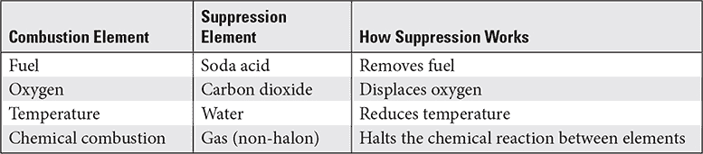

灭火还包括随时准备好合适的设备，通过针对每个元素来扑灭火灾。灭火方法应根据火灾类型及其燃料和其他特征进行匹配。表 3.9-2 列出了美国的火灾分类，包括其类别、类型、燃料以及用于控制它们的灭火剂。

## 表 3.9-2 常见火灾特征及其灭火方法

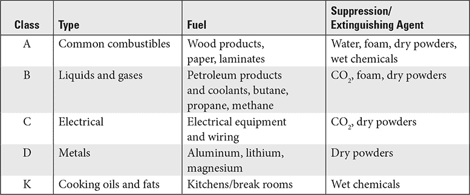

**CAUTION** 使用不正确的灭火方法不仅无法扑灭火灾，还可能产生相反效果，导致火势蔓延或引起其他严重的安全问题。例如，向电气火灾泼水可能会造成严重的触电危险。

**EXAM TIP** 你应该熟悉常见灭火器的类型和特征，以便应对考试。

在灭火方面，你应该了解一些关键考虑事项；其中大多数与水灭火系统的使用有关，因为水在电气设备周围（尤其是数据中心）并不是最佳选择。然而，水管系统仍然在设施的其他区域使用。水管或喷淋系统通常更简单且实施成本更低。然而，它们可能会造成严重的水灾损害，例如水浸，并增加触电危险。

水喷淋系统主要有四种类型：

• **湿管系统** 这是基本类型的系统；管道中始终含有水，并由温度控制传感器释放。缺点是它在寒冷气候中可能会冻结。

• **干管系统** 在这种系统中，系统内不储存水；水储存在水箱中，仅在检测到火灾时才释放。

• **预作用系统** 这与干管系统类似，但水不会立即释放。有一个延迟，允许人员撤离或使用其他方式扑灭火灾。

• **大水淋灌系统** 正如其名称所示，一旦检测到火灾，这允许在非常短的时间内释放大量水。

**EXAM TIP** 你应该熟悉四种主要的水喷淋系统类型：湿管系统、干管系统、预作用系统和大水淋灌系统。

在处理火灾预防、检测和灭火时，对于 CISSP 考试和现实世界，你还应记住一些其他关键事项。首先，你应该确保人员接受过火灾检测和灭火培训，更重要的是，在人员无法控制火灾时，应建立紧急疏散系统。该疏散计划应经常演练。其次，HVAC 系统应连接到报警和灭火系统，以便在检测到火灾时关闭。HVAC 系统可能会通过向火灾供气以及在设施内传播烟雾来实际扩大火灾。第三，由于电缆通常铺设在吊顶上方的空间中，你应该确保仅使用防烟型电缆。这意味着电缆不应由聚氯乙烯（PVC）制成，因为燃烧这类电缆会释放对人体有害的有毒气体。

## 电力

设施内的所有工作区域，尤其是数据中心和服务器机房，都需要持续供应清洁电力。在处理电力时，有几个需要考虑的问题，包括备用电源和电力波动。请注意，冗余电源与主电源同时应用于系统；如果主电源失效，没有延迟，冗余电源会立即接管。另一方面，备用电源仅在主电源失效后才启动。备用电源策略包括

• **不间断电源** 用于向电气设备（如服务器）供电备用电源，仅供短时间使用，以便服务器可以优雅地关闭。

• **发电机** 自包含式发动机，运行以向设施提供短期（通常为数小时或数天）电力，必须频繁加油。请注意，发电机可以快速产生大量危险的废气，且应仅由受过培训的人员操作。

设施内的电力问题可能是短期或长期的。即使是瞬间的电力问题也可能对设备造成损坏，因此在将电力供应给设施和设备时，仔细控制和调节电力至关重要。电力问题可能包括瞬间中断或瞬间电力增加，这两者都可能损坏设备。

电力丢失情况包括 `faults`，即瞬间停电，以及 `blackouts`，即长期且通常完全丢失电力。电力也可能在未完全丢失的情况下下降。`sag` 或 dip 是瞬间低电压状况，通常仅持续几秒钟。`brownout` 是低于设备运行所需正常电压的长期电压下降。电力瞬间增加包括 `inrush` 电流状况，即启动负载所需的初始电流激增，通常发生在切换到发电机时，还包括 `surge` 或 `spike`，即可能烧毁或以其他方式损坏设备的瞬间电力增加。电压调节器和线路调节器是连接在电源和设备之间的电气设备，用于确保整个设施、数据中心或也许只是一组设备的电力分配清洁且平稳。

## 复习

## 目标 3.9：设计场所和设施安全控制措施

在本目标中，我们完成了使用目标 3.1 和 3.8 中涵盖的安全原则设计场所和设施安全控制措施的讨论。此讨论将这些原则应用于安全控制设计，并重点关注通过有目的地设计环境因素（例如照明、屏障布置、自然访问控制、监控、领土强化和维护）来预防犯罪。我们还讨论了关键设施区域的保护，例如主配线设施和中间配线设施，它们提供与外部通信提供商的连接，并在整个设施内分发通信服务。我们考虑了服务器机房和数据中心以及媒体存储设施、证据存储和敏感工作区域的安全与安全性。我们讨论了与电力、通信和 HVAC 等公用事业相关的安全控制措施。我们提到了监控关键环境问题（例如湿度和温度）的必要性，以确保它们处于避免设备损坏所需的范围内。我们还涵盖了火灾预防、探测和灭火的重要性，以及这三个关键过程的工作原理。最后，我们评估了可能影响设备的电源状况以及一些尽量减少影响的解决方案。

## 3.9 问题

**1.** 你正在与设施安全官员合作，为贵公司的新数据中心设计物理访问控制。使用 CPTED 原则，你希望确保任何靠近设施入口特定距离的人都能被员工轻易观察到。你正在使用以下哪项 CPTED 原则？

**A.** 自然监控

**B.** 自然访问控制

**C.** 维护

**D.** 领土强化

**2.** 以下哪种灭火方法适用于可能发生在服务器机房中的电气火灾？

**A.** 这是 A 类火灾，因此水或泡沫是合适的。

**B.** 这是 B 类火灾，因此湿化学品是合适的。

**C.** 这是 K 类火灾，因此湿化学品是合适的。

**D.** 这是 C 类火灾，因此 CO² 是合适的。

## 3.9 答案

**1.** A 除了电子监控措施外，你还希望设计物理环境，以便正常人员（例如员工）能够观察潜在的入侵者或其他恶意行为者。这被称为自然监控。

**2.** D 电气火灾是 C 类火灾，通常使用使用 CO[2] 或干粉的灭火器来扑灭。水、泡沫或其他湿化学品是不合适的，并可能造成电击危险。

# 通信与网络安全

## 领域目标

• 4.1 在网络架构中评估和实施安全设计原则。

• 4.2 保护网络组件。

• 4.3 根据设计实施安全通信渠道。

领域 4 涵盖安全网络基础设施。安全网络始终是 CISSP 考试的关键部分，但在过去几个版本的考试中，该领域已从仅要求记忆基础网络知识（例如网络架构、端口号、安全设备、安全协议等）转变为强调将所有这些知识应用于使用我们在领域 3 中讨论的安全设计原则来保护基础设施。基础网络知识仍然至关重要，我们将涵盖你为考试目标需要知道的关键点；但是，你应该关注每个简单的网络组件如何用于创建强大网络安全的分层方法。在本领域中，我们将解决三个目标，这些目标侧重于在网络架构中实施安全设计原则、配置安全网络组件以及保护网络通信渠道。

## 在网络架构中评估和实施安全设计原则

本目标涵盖在应用于网络架构时的基本安全设计原则。为了理解这些原则的应用，我们将回顾网络的关键基础知识。虽然我们不会深入探讨网络，但我们将回顾核心概念，例如 OSI 模型和 TCP/IP 协议栈、IP 网络以及安全协议。我们还将讨论多年来不断发展的网络技术的应用，例如多层协议、融合技术、微分段和内容分发网络。我们不会将讨论局限于有线网络，因为我们还将回顾无线技术的关键点，包括 Wi-Fi 和蜂窝网络。

## 基础网络概念

理解本节中涵盖的基础网络概念不仅对于通过 CISSP 考试是必要的，而且还将帮助你理解如何将更复杂的安全设计原则应用于网络架构。在本节中，我们将介绍开放系统互连（OSI）和传输控制协议/互联网协议（TCP/IP）模型，它们有助于概念化网络如何在不同层上运行，使用各种协议和设备，以及数据如何在层之间传递。像这样的网络通信模型有助于网络专业人员（例如技术人员、工程师和架构师）概念化数据在网络中的流动，并以安全的方式设计和维护基础设施。除了讨论 OSI 模型和 TCP/IP 协议栈外，我们还将研究安全协议，因为它们在传输和接收数据的同时确保机密性和完整性方面至关重要。

## 开放系统互连和传输控制协议/互联网协议模型

网络通信模型用于演示网络组件如何运行以及如何相互交互。这些包括物理组件（例如网络设备）和逻辑组件（例如数据）。模型可以帮助你理解不同类型的设备、协议和数据的各种功能，这些设备、协议和数据相互交互以促进网络通信。请记住，模型只是抽象表示，不一定代表所有网络。它们旨在帮助你理解网络如何通信，并在构建网络架构时提供标准，尤其是在使用不同组件时。

## OSI 模型

OSI 模型是网络设计和运行的无处不在的标准。在现代网络中，协议、接口和设备等组件均设计为与 OSI 模型互操作。OSI 模型本身不是协议栈或组件，但提供了一个用于构建网络和连接其组件的框架。

OSI 模型由七层组成，每层编号从 1 到 7，从底层的第 1 层开始，一直到顶层的第 7 层。模型的每一层代表该层网络流量、协议、设备等发生的不同交互。每一层代表网络的不同功能。图 4.1-1 显示了 OSI 模型的七层。

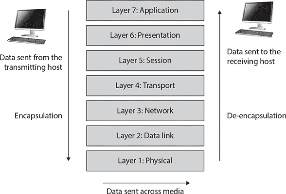

图 4.1-1 OSI 模型

## OSI 模型与 TCP/IP 协议栈

## OSI 模型概述

模型的每一层与数据的交互方式不同；然而，每一层都接收数据并将其传递给下一层，无论是“向上”还是“向下”传递模型。每一层都忽略除其上下两层以外的所有层。数据在每一层内被转换，并在转换过程中被称为不同的协议数据单元（PDU），具体取决于其所在的层。

如 Figure 4.1-1 所示，数据向下传递层（从第 7 层到第 1 层）时会被 *封装*，这意味着每一层都会将管理头部信息添加到数据中，这些信息在数据逐层向下传递时成为数据本身的一部分。相反，数据向上传递模型，从第 1 层到第 7 层时会被 *去封装*，这意味着头部信息会从每个 PDU 中剥离，剩余数据会被传递到下一层。Figure 4.1-2 展示了头部信息如何添加到来自第 4 层（TCP）的数据中，并将其封装在下一层，即第 3 层（IP）中。

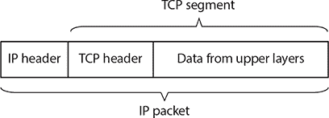

FIGURE 4.1-2 OSI 模型中数据在传输层和网络层之间传输时的 PDU 和头部示例

不同设备和协议在 OSI 模型的不同层工作；Table 4.1-1 总结了 OSI 模型层、相关设备和协议，以及考试中应记住的协议数据单元。

**TABLE 4.1-1** OSI 模型各层的协议、设备和 PDU

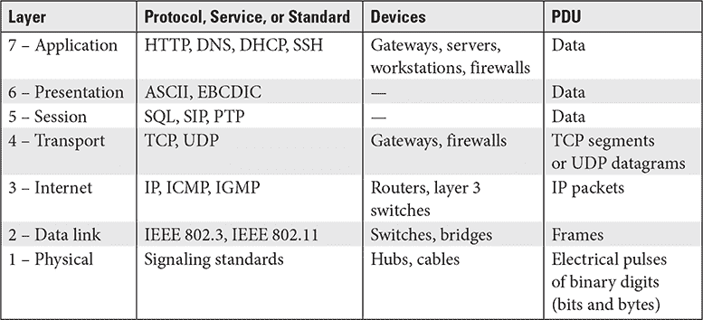

**EXAM TIP** 许多这些协议和设备也在其他层工作，执行特定功能或以特定方式与其他组件交互，因此您可能会发现 SSH 等协议也在会话层工作。但是，为了 CISSP 考试的目的，您应关注协议设备功能的主要层。跨越多个层的协议称为 *多层协议*，将在本目标的后面部分讨论。

## TCP/IP 协议栈

TCP/IP 是一套协议（有时称为 *协议栈*），由基于 OSI 模型实现的协议组成。TCP/IP 通常被称为模型，这不一定不正确，但与仅作为理论框架存在的 OSI 模型相比，TCP/IP 协议栈是一套实际协议，每天都在运行以促进网络通信。换句话说，TCP/IP 是 OSI 模型的实际实现，而不仅仅是一个模型。

TCP/IP 包含四层。这些层与 OSI 模型不一一对应，但所有功能都可以直接匹配到 OSI。我们讨论常见协议，例如 HTTP、FTP、DNS、IP 安全（IPSec）等；这些协议是 TCP/IP 套件的一部分。IT 专业人员经常互换使用 TCP/IP 协议栈和 OSI 模型，因为 TCP/IP 套件的协议，延伸而言，在 OSI 模型的各个层工作。在常规讨论中这并不错误，但为了考试目的，您需要知道 TCP/IP 层及其与 OSI 模型层的对应关系，如 Figure 4.1-3 所示。

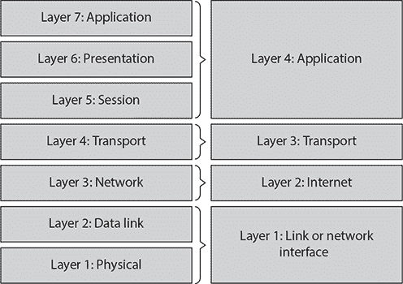

FIGURE 4.1-3 TCP/IP 套件与 OSI 模型的映射

## Internet 协议网络

Internet 协议（IP）是 TCP/IP 套件中的关键协议之一。IP 为网络流量提供路由服务；没有它，流量将仅限于局域网。IP 负责逻辑寻址和路由，将网络数据传输到更大的网络（例如 Internet），跨越多个 WAN 链路和路由器。IP 由多个不同的协议组成，我们将简要讨论其中几个。IP 中更重要的协议之一是 IPSec，将在下一节讨论。

IP 版本 4（IPv4）是全球当前使用的 IP 版本。它是已成为现代 Internet 骨干协议的版本。IPv4 使用 32 位地址，理论上几年前已耗尽。然而，随着网络地址转换（NAT）、私有 IP 寻址和其他技术的出现，IPv4 的生命周期已延长。IP 版本 6（IPv6）是 IP 的下一代，已在全球 Internet 上有限采用。版本 6 将 IPv4 有限的 32 位地址扩展到用于寻址的 128 位。它还包括地址作用域、自动配置、安全性和服务质量（QoS）等功能。

IPv4 包含多个协议，例如 ICMP、IGMP 和 ARP，将在下文讨论。IPSec 是 IPv4 的后期添加内容，将在下一节中在安全协议的上下文中讨论。

## ICMP

Internet 控制消息协议（ICMP）用于与主机通信以确定其状态。您可以通过使用 ICMP 的实用程序来确定主机是否在线以及其 TCP/IP 协议栈是否在某个层级正常工作。网络专业人员熟悉的最常见实用程序是 *ping*、*traceroute* 和 *pathping*。这些实用程序使用回显请求向主机或网络发送简短的维护消息，并接收回显响应以响应请求，指示主机是否在线。不幸的是，ICMP 也可用于对网络或主机进行各种基于网络的攻击，尽管大多数此类攻击已通过操作系统和安装在其上的 TCP/IP 协议栈的现代更新得到缓解。出于此原因，入站到网络的 ICMP 通常被阻止或过滤。

## IGMP

Internet 组管理协议（IGMP）用于支持 *多播*，即向特定主机组传输数据的过程。IGMP 使用特定的 IP 地址类，即 D 类范围，从 224.0.0.0 地址空间开始。特定 IGMP 组中的主机具有可由网络上任何其他主机访问的正常 IP 地址，以及该范围内的 IGMP 地址。

## ARP

地址解析协议（ARP）用于将逻辑 32 位 IP 地址解析为 48 位硬件地址（网络接口的物理或 MAC 地址）。这是因为在 OSI 模型的第 2 层（数据链路层），主机仅理解本地网络的硬件地址。在从主机发送数据之前，目标逻辑 IP 地址必须转换为硬件地址，然后通过传输介质发送。ARP 执行此功能。如果 ARP 未将 IP 地址解析为本地硬件地址，主机将假设该地址在远程系统上，并将其转发到默认网关的硬件地址，通常是本地网络的路由器接口。

ARP 存在源自 *ARP 欺骗* 的安全问题，这意味着本地主机的 ARP 缓存可能会被错误条目污染。这可能发生在恶意实体发送的 gratuitous（未请求）ARP 请求和虚假响应中。这可能导致毫无戒心的受害者主机与恶意主机通信，而不是预期的主机。

## 安全协议

在 Internet 的早期，大多数协议不用于保护传输中的数据；Telnet 或 HTTP 等协议不原生提供身份验证或加密服务，这允许数据以明文形式发送并轻易被拦截。然而，现代协议确保不仅数据被加密，强身份验证和完整性机制也内置其中。在本目标的这一部分中，我们将讨论其中几种安全协议。

安全协议可用于直接保护数据并提供身份验证和完整性服务，也可以封装未受保护的数据和非安全协议，通过为其提供隧道服务来提供保护。

## SSL、TLS 和 HTTPS

## 超文本传输协议（HTTP）

超文本传输协议（HTTP）是一种用于传输 Web 内容（如文本、图像和其他多媒体）的无处不在的协议。它是创建网页的语言。但是，它本身并不安全，并且以明文发送信息。它必须使用安全网络传输协议进行身份验证和加密。广泛使用的这些协议之一是传输层安全（TLS）。TLS 一直旨在取代旧协议安全套接层（SSL），但在 2014 年，SSL 3.0 被发现易受 POODLE 攻击，该攻击影响 SSL 使用的所有块密码。两种协议的运行方式相似，但是，当 HTTP 通过 SSL 或 TLS 隧道传输时，它被称为 HTTPS（HTTP 安全版）。SSL 和 TLS 默认都使用 TCP 端口 443。

> **CAUTION** 自 2015 年起，安全套接层的所有版本（直至 3.0）均已弃用，并被传输层安全有效取代。但是，在考试中仍可能看到对它的引用，以及在旧版应用程序中配置 SSL 的功能。

TLS 目前为 1.3 版（截至 2018 年 8 月），提供端到端加密服务，主要在 OSI 模型的会话层工作。1.3 版仅支持五种加密算法（与之前版本中包括一些已知漏洞算法在内的 37 种算法相比），因此可最大限度地减少可使用的易受攻击的密码套件数量。这也使攻击者难以将加密级别降级到较不安全的版本。TLS 不仅用于保护普通 HTTP 会话，还可用于其他端到端加密需求，例如虚拟专用网络。基于 TLS 的虚拟专用网络（VPN）开销较小，可用于通过现代 Web 浏览器进行客户端到站点的 VPN。TLS 支持服务器身份验证以及客户端与服务器之间的相互身份验证。

当客户端发起 TLS 连接时，它会发送一条“hello”消息，列出客户端支持的密码套件以及密钥交换请求。服务器会回复其选择的密码套件和安全协议。服务器还会发送其数字证书，以证明服务器的身份，并提供公钥供客户端用于安全密钥交换。客户端随后使用服务器的公钥加密安全会话密钥并将其发回，只有服务器可以解密。这为加密通信建立了安全密钥。可选步骤是让客户端通过发送其自身的数字证书和公钥向服务器进行身份验证。

## IPSec

IP 安全（IPSec）是一套位于 OSI 模型网络层（或 TCP/IP 的 Internet 层）的协议套件。它的开发是因为 IPv4 没有任何内置安全机制。IPSec 可以提供加密和身份验证服务，以及安全密钥交换，保护 IP 流量。IPSec 由套件中的四个主要协议组成：

- **身份验证头（AH）** 提供身份验证服务和数据完整性
- **封装安全有效载荷（ESP）** 为数据有效载荷提供加密服务
- **Internet 安全关联和密钥管理协议（ISAKMP）** 允许安全密钥关联和安全密钥交换
- **Internet 密钥交换（IKE）** 协助使用 IPSec 的两个实体之间进行密钥交换

> **NOTE** IPSec 可以单独或一起使用 AH 和 ESP，具体取决于流量是否需要加密、身份验证或两者兼具。

IPSec 可以采用两种模式之一保护通信：传输模式或隧道模式。在传输模式下，IPSec 可用于本地网络，并可加密特定流量（包括多个主机之间的特定协议），只要所有主机都支持相同的身份验证和加密方法。这有助于保护网络内的敏感流量。在隧道模式下，IPSec 被隧道传输到另一个协议中（最常见的是第二层隧道协议（L2TP）），并通过本地网络之外的其他不安全或公共网络（包括 Internet）发送到另一个网络，因此对于建立 VPN 连接非常有效。IPSec 在隧道模式下可以保护数据和头信息。

> **EXAM TIP** 了解 IPSec 的传输模式和隧道模式之间的区别。传输模式仅保护 IP 有效载荷，通常用于内部网络，而隧道模式封装整个数据包（包括头信息（例如 IP 地址）），用于在不受信任的网络（例如 Internet）上安全传输流量。隧道模式下的 IPSec 流量还必须封装在网络隧道协议（例如 L2TP）中。

## 安全外壳协议

安全外壳协议（SSH）既是一种安全协议，也是一套工具，用于为通信会话提供加密和身份验证服务。它最常用于 Linux 环境，尽管也已移植到 Windows 操作系统。它通常用于主机之间的远程访问，以执行安全的特权操作。这使得 SSH 非常适合取代以前使用的远程会话协议（例如 Telnet），后者根本不提供任何安全服务。尽管不太具备可扩展性，SSH 可以在有限的基础上用于长距离远程访问。除了加密数据并在主机之间提供身份验证外，SSH 还可以用于保护不安全的协议（例如文件传输协议（FTP）），当这些协议通过它进行隧道传输时。但是，SSH 提供了这些协议的安全版本，例如安全复制协议（SCP）和安全外壳 FTP（SFTP）。

> **EXAM TIP** 不要将 SFTP（FTP 的 SSH 版本）与仅通过 TLS 或 SSH 隧道传输的 FTP（称为 FTPS）混淆。SFTP 不是通过 SSH 隧道传输的——它实际上是 SSH 安全套件的一部分。

SSH 使用 TCP 端口 22，可以在 OSI 模型的多个层工作，包括会话层及更高层。SSH 套件中包含的实用程序允许用户生成主机和用户密钥，以便在主机和用户之间实现强身份验证。

## EAP

可扩展身份验证协议（EAP）是一个框架，允许使用多种身份验证方法，让用户和设备对网络进行身份验证，通常通过远程或无线连接。EAP 可以使用多种不同的身份验证方法，例如密码、令牌、生物识别、一次性密码（OTP）、Kerberos、数字证书以及其他几种方法。当两个实体使用 EAP 连接时，它们会协商两个实体共有的身份验证方法列表。EAP 可以通过多种其他协议（例如 PPP、PPTP 和 L2TP）以及有线和无线网络使用。EAP 有几种不同的变体，分别使用 TLS（EAP-TLS）、预共享密钥（EAP-PSK）、隧道 TLS（EAP-TTLS）和 Internet 密钥交换第 2 版（EAP-IKE2）。这些变体各自适用于不同类型的身份验证要求，具体取决于现有基础架构以及与旧版设备的兼容性。EAP 还广泛用于 802.1X 身份验证方法，将在下一节中讨论。

## 802.1X

IEEE 802.1X 不是 802.11 标准的一部分，但经常与它们混淆，因为它常与 WLAN 一起使用。802.1X 是一种基于端口的身份验证协议，可用于有线和无线网络。其主要目的是访问控制。它允许对设备和用户进行身份验证，并可以强制执行相互身份验证。它在企业级网络中比在个人网络中更常见。

802.1X 有三个重要组件，考试时应了解：

- **Supplicant** 通常是客户端设备

## Authenticator
`Authenticator` 连接客户端与网络并将身份验证请求转发至身份验证服务器的基础设施设备

## Authentication Server
`Authentication server` 包含身份验证信息的服务器，例如 RADIUS 或 Kerberos 服务器

802.1X 可使用多种身份验证方法，包括可扩展身份验证协议及其众多变体（`PEAP`、`EAP-TLS` 和 `EAP-TTLS` 等）。

## Kerberos

`Kerberos` 是一种用于向网络和资源验证用户身份的安全协议。`Kerberos` 最常用于轻量级目录访问协议（`LDAP`）网络中，作为单点登录（`SSO`）技术。`Kerberos` 是 Windows Active Directory 网络中首选的身份验证协议，并使用基于票据的系统来验证用户身份，随后在用户与资源之间提供身份验证服务。它还高度依赖时间，以防止重放攻击。`Kerberos` 使用 TCP 端口 88。

**交叉引用**

其中一些安全协议，例如 `SSH`、`802.1X`、`EAP` 和 `TLS`，将在目标 4.3 中进一步讨论。

`Kerberos` 将在目标 5.6 中更详细地讨论，内容涉及实施身份验证系统。

## 应用安全网络概念

端口、协议和服务等元素在安全网络中至关重要。这些元素，以及 IP 地址、硬件地址和网络流量的其他特征，在保障网络安全方面非常重要，因为它们用于`filter`（阻止或拒绝）流量。

基于端口、协议等进行流量过滤，只能防范网络中相对容易阻止的一些较重“噪声”。要实现更高保真度的流量过滤，防火墙等网络设备必须能够检查流量的特征以及流量本身。换句话说，必须检查流量的内容，而不仅仅是查看其使用的协议或拥有的 IP 地址。

**交叉引用**

我们将在目标 7.7 中讨论防火墙和其他专用安全设备。

除了基于特征或内容的流量过滤之外，安全网络还涉及安全架构的设计与实施。这意味着物理和逻辑网络拓扑必须以安全为前提进行设计，并使用安全设备、安全协议、受控流量、强加密和身份验证等网络组件，构建多层方法来保护系统和信息。安全网络架构将在下一个目标 4.2 中更详细地讨论。

## 多层协议的影响

`multilayer protocols` 这一术语通常根据上下文指以下两种情况之一：

• 跨越 OSI 模型或 TCP/IP 栈多个层的协议。`SSH` 是一个示例，因为它在 OSI 模型的应用层和会话层运行。

• 在 OSI 模型或 TCP/IP 栈的同一层运行，但同时使用 UDP 和 TCP 的协议。域名系统（`DNS`）和动态主机配置协议（`DHCP`）是两个示例，它们为不同功能同时使用 TCP 和 UDP，并且可以为两者使用相同的端口号（如 `DNS` 所做），或者根据协议使用 TCP 还是 UDP 作为传输机制而使用不同的端口号（如 `DHCP` 所做）。

还存在本质上为单体的专有协议，单个协议可能跨越协议栈中的多个层或功能。其他示例是封装其他协议的协议，例如第 2 层传输协议（`L2TP`），它在用于 VPN 时会封装 `IPSec`，即保护数据的安全协议。

无论多层协议在哪个层级运行，关键在于必须根据多个标准来保护这些协议，并考虑安全问题如何影响跨不同层使用的协议。保护多层协议的注意事项包括

• 协议所在的层级

• 协议使用的端口，以及其传输协议是 TCP 还是 UDP

• 涉及层级的设备，例如路由器或交换机

• 是否使用封装或加密

• 是否使用安全协议来保护非安全协议，例如使用 `IPSec` 保护未加密的 VPN 流量，或使用 `TLS` 保护 HTTP 流量

## 汇聚协议

在网络发展历史中，曾存在其他类型的流量，例如语音，它们使用独立的设备、路由、方法甚至协议，将各种形式的信息从一个点传输到另一个点。缓慢地，这些不同的技术已汇聚到全部使用标准化网络和数据结构。事实上，大部分此类信息现在可以作为数字数据通过标准 TCP/IP 网络传输。CISSP 考试目标要求你了解其中几种`converged protocols`，但请注意，还有许多我们在此不予讨论。考试目标 4.1 中明确列出的汇聚协议包括以太网光纤通道、iSCSI 和互联网协议语音流量。

## 以太网光纤通道

`Fibre Channel over Ethernet` (`FCoE`) 是一种允许存储区域网络（`SAN`）解决方案在以太网上运行的技术。`FCoE` 以高速运行，使用光纤通道协议，并需要专用网络设备，例如交换机、主机适配器、网络接口卡和特殊布线。光纤通道是一种用于光纤网络上高速数据存储和传输的串行数据传输协议。它已更新为允许在铜质以太网电缆上使用，因此有了 `FCoE`。使用 `FCoE`，`SAN` 可以以极低延迟构建，使实际存储位置对用户而言不重要且透明，无论它位于同一本地网络上，还是通过广域网链路位于地球另一端。`FCoE` 在 OSI 模型第 2 层工作，并要求最低速度约为 10 千兆位每秒（`Gbps`）才能运行。后续技术是 IP 光纤通道（`FCIP`），它不需要特定的网络速度或设备，因为它在 IP 内封装并在 OSI 模型第 3 层（网络层）运行。

## 互联网小型计算机系统接口

与 `FCIP` 类似，互联网小型计算机系统接口（`iSCSI`）是一种在 OSI 模型第 3 层工作的存储技术，因为它基于 IP。它也可用于在局域网或长距离广域网链路上进行与位置无关的数据存储和传输。`iSCSI` 运行在标准网络设备上，而 `FCoE` 需要专用设备，因此 `iSCSI` 不如 `FCoE` 昂贵。

`iSCSI` 基本上将块级访问命令发送到基于网络的存储设备；换句话说，它通过 TCP/IP 网络发送 SCSI 数据传输命令。客户端（称为 `initiators`）将这些命令发送到远程网络上的存储设备（称为 `targets`）以进行数据存储和检索。

## 互联网协议语音

直到过去十年左右，语音一直被视为一种独立的模拟数据类型，并通过独立的独特系统传输。然而，随着网络设备和协议的速度和效率不断成熟，语音已集成到数字数据网络中。我们将在目标 4.3 中更深入地介绍互联网协议语音（`VoIP`）及其成为网络数据流量一部分的过渡过程。

**交叉引用**

`VoIP` 将在目标 4.3 中详细讨论。

## 微分段

## 网络分段

网络分段出于多种原因，主要是为了性能和安全性。就性能而言，我们使用路由器和交换机等设备对网络进行分段，以消除广播域和冲突域，从而减少网络拥塞。就安全性而言，我们对网络进行分段，以便将敏感主机和网络与普通用户群隔离开来。例如，组织的服务器和网络设备可以逻辑上分离到其自身的虚拟局域网（VLAN）中，而不仅仅是将其从普通用户群中物理隔离开来，这样就可以应用规则和过滤器来控制对这些设备和网络的访问。

`Micro-segmentation` 是此策略的扩展，有时会一直细分到敏感主机甚至应用程序，使其与普通网络分离并能够得到妥善保护。我们可以在微观级别对网络和主机进行分段的方式有多种，包括将其放在自己的逻辑子网上、使用 VLAN、对与主机或分段之间的所有流量进行完全加密，以及其他逻辑方法。我们还可以使用不同的布线和媒体进行物理分段，甚至完全将主机与网络断开连接，强制使用手动方法（例如，sneaker net）将数据传输到这些隔离主机或从这些隔离主机传输数据。虚拟化是我们可以用来分段网络和主机的逻辑方法之一，我们将在下一节讨论几种网络虚拟化方法。

## 软件定义网络

正如操作系统和应用程序可以驻留在虚拟化环境中一样，网络也可以。软件定义网络（SDN）是一种虚拟化技术，允许使用软件控制组织内主机之间的流量转发方式，从而对传统网络进行虚拟化。这种虚拟化允许软件控制路由表和决策、带宽利用率、服务质量等。SDN 使用软件控制器来处理动态流量路由，从而消除了物理网络中涉及的一些较慢的基于硬件基础设施的决策。SDN 还允许快速重新配置和配置网络。

SDN 接管了 `control plane`（基础设施控制层的一部分，有助于更新路由）的功能，并使用基于软件的协议来决定如何以及向何处发送流量。SDN 将这些功能与网络硬件分离，网络硬件可能较慢且对网络拓扑的动态或手动更改响应不够灵敏。SDN 将工作从转发平面卸载，以减少这些功能中涉及的复杂逻辑。`forwarding plane` 是基础设施中实际根据控制平面的路由信息做出流量转发决策的部分，通常在网络设备中实现为硬件芯片。SDN 分离了控制平面和转发平面，并代表硬件做出这些决策。

SDN 为组织提供了对网络内流量控制的更大灵活性。组织不再被要求仅使用特定供应商，其产品仅彼此互操作。SDN 使用开放标准和协议，并且与供应商无关。

## 软件定义广域网

软件定义广域网（SD-WAN）是 SDN 的逻辑扩展，可用于虚拟化地理上分离的基础设施（例如远程位置、云服务和多个数据中心）之间的连接和流量控制。SD-WAN 与 SDN 一样，可以控制站点之间的流量，提供带宽和 QoS 控制。

## 虚拟可扩展局域网

虚拟可扩展局域网（VxLAN）是一种协议（定义在 RFC 7348 中），它封装 VLAN 管理流量并允许其跨越逻辑和物理子网发送到地理上分离的位置。这扩展了 VLAN，使其超出本地创建的虚拟子网，并允许 VLAN 扩展到由 WAN 链路分隔的不同地理位置。VLAN 通常仅限于单个路由器接口，但使用 VxLAN 的 VLAN 将第 2 层 VLAN 帧封装到 UDP 中，以便可以通过 IP 跨越多个子网的链路发送。使用 VxLAN 的 VLAN 也具有更高的可扩展性；VLAN 通常限于 4096 个网络（由于 12 位 VID），但 VxLAN 将其扩展到超过 1600 万个虚拟化网络。

## 封装

封装之前已在讨论数据如何在 OSI 模型层中向下移动时被包装在其他数据中时介绍过。上一层的数据被重新打包为另一个 PDU，添加头部信息，整个包成为堆栈中下一层的数据。然而，封装远不止于此，并且在保护网络数据和流量方面非常强大。封装也可用于分段整个网络。

考虑一个网络，其中大部分数据不敏感，但某些敏感数据使用加密协议传输，基本上将该数据与网络的其余部分隔离开来。敏感数据只能由具有加密和解密能力的特定主机发送和接收。封装或隧道也是将 VPN 流量与更大的公共 Internet 分开的方式。VPN 连接通过非安全网络（例如 Internet）隧道传输敏感流量，在目标网络由远程 VPN 集中器接收，并进行解封装和解密。这些都是封装（以及隧道，一种封装形式）如何通过将网络流量与不受信任的网络分开来保护数据的示例。

## 交叉引用

我们还将简要讨论虚拟化网络技术，例如 VLAN、SDN、VxLAN 和 SD-WAN，在目标 4.3 中。

## 无线技术

网络使用两种介质：有线和无线。我们将在目标 4.2 中讨论保护有线介质（并简要提及无线介质），并在此部分重点讨论无线网络。请记住，无线除了 Wi-Fi 之外，还包括使用广泛的技术，包括射频（RF）信号、微波和卫星传输、红外线以及其他技术。我们还将讨论蜂窝技术。本部分不会教你关于无线技术的所有知识；这只是一个复习，重点介绍你为 CISSP 考试需要知道的无线网络的关键技术和安全方面。

## 无线理论和信号

我们无法在不讨论无线网络所基于的一些标准和技术的情况下讨论无线网络。无线使用电磁频谱，包括各种能量类型，包括无线电、微波和光。我们将触及这些能量类型中的每一种，但首先我们必须讨论一些你应该为考试牢记的基本无线理论。

电磁（EM）频谱可以分为多种能量类型，但为了考试目的，我们将主要讨论频谱的射频（RF）部分；请记住，这些概念也适用于 EM 频谱的许多其他区域。基本 RF 信号是 `sine wave`，表现为电流在定义的时间段内均匀改变电压。随着时间推移，波形从一侧向另一侧改变方向。当波形在测量的时间段内改变方向时，称为 `cycle`。每秒周期数称为其 `frequency`。频率以称为赫兹（Hz）的单位测量，使用诸如千赫兹（KHz，即 1000 Hz）、兆赫兹（MHz，即 100 万 Hz）和吉赫兹（GHz，即 10 亿 Hz）等前缀。

特定范围内的频率称为 `bandwidth`，即该范围内上限频率与下限频率之差。无线电波可以基于 `amplitude`（正弦波的高度）或其频率进行改变，或 `modulated`。由于无线电波通常表现出可预测的模式，在相同频率和调制下，它们应当是统一的。然而，当它们不统一时，被认为处于 `phase` 不同的状态，这可能导致传输混乱。RF 传播面临许多问题，包括 `absorption`（被材料吸收）、`refraction`（导致波被物体弯曲）、`reflection`（波被物体反射时）、`attenuation`（信号随时间和距离逐渐减弱）以及 `interference`（噪声干扰波的构建，导致传输不完整或混乱）。

天线用于发送和接收无线电信号，本质上是 RF 能量的导体。天线有多种不同的形状和尺寸，取决于所使用的 RF 信号的性质和特性。无线电信号功率以瓦特（W）为单位进行测量，尽管通常使用毫瓦等测量单位来描述低功率发射器，例如用于无线网络的发射器。

无线网络使用多种不同的信令方法。其中许多涉及使用 `spread-spectrum` 技术，即将单个信号分布到整个 `frequency band`（分配频率的频段或部分）。这使得发射器能够更有效地使用带宽，因为发送系统可以同时使用多个频率。这些信令方法包括以下内容：

• `Direct sequence spread spectrum (DSSS)` 通过附加扰码来连续使用整个频率带以区分传输；发送方和接收方都必须拥有正确的扰码才能进行通信。

• `Frequency hopping spread spectrum (FHSS)` 使用频率带中的部分带宽，将其分割为更小的子信道，发射器和接收器在指定时间内使用这些子信道，然后再切换到另一个频率或信道。

• `Orthogonal frequency division multiplexing (OFDM)` 这不是一种扩频技术，但它是现代无线网络中使用的一种重要信令方法。OFDM 是一种数字调制方案，将多个调制载波组合在一起，从而减少带宽。调制信号彼此 `orthogonal`（正交），因此不会相互干扰。

**EXAM TIP** 关于无线网络的 RF 理论，需要记住的关键点是频率和所使用的信令方法。

接下来，我们将讨论使用各种无线电频段和信令方法的有线标准。

## Wi-Fi

Wi-Fi 是一系列技术的名称，这些技术允许家庭和企业利用电磁频谱连接设备以及连接互联网以发送和接收数据，尽可能放弃有线连接，并创造“移动革命”。请注意，Wi-Fi 这一术语是 Wi-Fi 联盟的商标。现在我们已经简要了解了该技术背后的科学原理，将讨论 Wi-Fi 技术，包括其基础知识和各种重要标准，然后讨论 Wi-Fi 安全。

针对 CISSP 考试需要关注的无线标准始于 IEEE 802.11 标准及其修正案。这些是分配给无线网络的标准，还有许多其他标准也对无线网络有所贡献。其中一些标准规定了频率使用和信令方法，而其他标准则规定了服务质量和安全性。我们不会涵盖存在的每一个无线标准，但有几个标准你应该为考试熟悉。

## Wi-Fi 基础知识

无线局域网（WLAN）使用安装了无线电发射器和接收器的设备，例如智能手机、笔记本电脑、PC、平板电脑等。虽然这些设备可以通过 Wi-Fi 直接相互通信（这称为 `ad hoc` 网络，设置起来既麻烦又不安全），但大多数家庭和企业无线网络使用无线接入点（WAP）。WAP 管理接入点与客户端设备之间以及设备之间的无线连接。使用 WAP 时，这被称为 `infrastructure mode`，连接到 WAP 的设备被称为基本服务集（BSS）。WAP 也可以连接到有线网络，以便无线客户端可以访问更大的网络。要使用 WAP，客户端必须配置正确的 `Service Set Identifier (SSID)`，这本质上是配置在 WAP 上的无线网络名称。SSID 可能对不属于该网络的其他无线客户端可见，也可以通过不广播来隐藏，以便未经授权的无线客户端无法轻松加入网络。请注意，无线设备必须在同一频率带（信道）上才能相互连接，并且共享常见的安全参数，我们稍后将讨论这些参数。无线网络的 802.11 标准的频率带包括工业、科学和医疗（ISM）范围内的频率（分别为 900 MHz、2.4 GHz 和 5.8 GHz），以及非授权国家信息基础设施（UNII）频段（5.725 GHz 至 5.875 GHz，与上部 ISM 频段有一定程度的重叠）。

## Wi-Fi 物理标准

Wi-Fi 物理标准是在多年中开发的，主要是由电气和电子工程师学会（IEEE）发布的标准，以及为有线网络（如以太网、光纤分布式数据接口（FDDI）和令牌环网）制定的相同标准。大多数 Wi-Fi 标准都属于 IEEE 802.11 标准及其修正案。有针对数据速率、物理（PHY）信令技术、频率带和范围的修正案。还有针对安全性、服务质量以及无线网络及相关设备必须满足的其他特性的修正案。Wi-Fi 联盟是一个由无线设备制造商和专业机构组成的联盟，为许多标准做出了贡献，并将其作为无线行业的官方标准颁布。制造商销售的设备必须符合 Wi-Fi 联盟标准，才能获得该机构的认证。

Table 4.1-2 概述了一些你应该为 CISSP 考试熟悉的更重要的 IEEE 802.11 修正案。

**TABLE 4.1-2** 常见无线网络标准

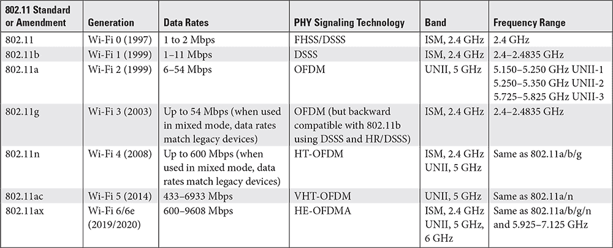

## Wi-Fi 安全

自最初的 802.11 规范发布以来，无线安全一直存在问题。将安全性引入无线传输的第一次尝试是通过有线等效隐私（WEP），它在早期的无线设备中很普遍，例如连接到 802.11a 和 802.11b 网络的设备。然而，WEP 使用了弱初始化向量和 RC4 流密码的问题实现。WEP 被认为非常不安全且易于破解，因此早已被弃用。后来，Wi-Fi 联盟在等待正式 IEEE 标准实施期间开发了 Wi-Fi 保护访问（WPA）。

WPA 允许使用更大的密钥大小，并实现了临时密钥完整性协议（`TKIP`）。WPA 在许多无线设备上实现，这些设备是在正式的 IEEE 安全标准 `802.11i` 实现之前制造的，因此当时的许多设备不仅与 WEP 向后兼容，还与临时 WPA 标准和较新的官方 WPA2 标准兼容，IEEE `802.11i` 标准后来就被称为 WPA2。WEP 已被弃用，因为它可以被快速破解，WPA 也是如此。WPA2 的改进包括能够使用高级加密标准（`AES`）而不是 `TKIP`，以及更大的密钥大小和更好的加密方法。

许多现代设备仍然使用 WPA2，但大多数正在过渡到新的 WPA3 标准，该标准自 2020 年起由 Wi-Fi Alliance 要求。虽然不是官方的 IEEE 标准，但 Wi-Fi Alliance 已确保 WPA3 继续实施原始 `802.11i` 修正案的要求，以及 IEEE `802.1s`（引入对等方同时身份验证 [`SAE`] 交换，取代了以前 Wi-Fi 安全协议中使用的预共享密钥）和 IEEE `802.11w`，后者提供管理帧保护。WPA3 的实施对 Wi-Fi Alliance 在 2020 年 7 月后认证的所有设备均为强制性。

除了运行推荐的安全协议（如 WPA3）之外，以下是您应该采取的几项其他措施来保护无线网络：

• 仅在绝对必要时或无法升级或更换设备时才使用已弃用的安全协议，并通过其他控制措施（例如 `IPSec`）来减轻弱点。

• 确保密码和其他身份验证器保持最小字符长度和复杂性。

• 确保无线接入点和网络设备受到物理保护。

• 将无线接入点和其他设备的发射功率降低到仅足以有效覆盖所需的程度。

• 不要依赖隐藏或不广播网络的 SSID 来提供任何安全性，因为这只能阻止偶然的窥探者，而不能阻止经验丰富的黑客。

• 根据安全策略定期更改无线网络上使用的身份验证器。

• 连接到企业网络时，对用户和设备都使用企业级相互身份验证。

• 将基于端口的身份验证（`802.1X`）作为企业级安全的一部分使用。

• 不要依赖 MAC 地址过滤来防止流氓客户端连接到 WAP，因为 MAC 地址可以轻易伪造。

• 主动扫描网络中的流氓设备，例如未知的 WAP，这些设备可能被用来进行邪恶双胞胎攻击。

## Bluetooth

Bluetooth 是一种 IEEE `802.15` 标准，有助于在设备之间创建无线个人区域网络（`WPANs`），例如智能手机与耳机或外部扬声器之间，计算机与键盘和鼠标之间，以及无数其他支持 Bluetooth 的设备之间。此连接过程称为配对。Bluetooth 使用与 `802.11` 设备相同的一些频率，范围在 `2.4-GHz`。Bluetooth 的最大范围约为 100 米，具体取决于使用的版本、环境因素以及发送设备的发射强度。撰写本文时，Bluetooth 当前版本为 `5.3`。

早期版本的 Bluetooth 容易受到来自设备的未请求配对请求的攻击，导致未请求的消息发送到接收器，例如广告、骚扰消息甚至淫秽材料等非法内容。这种攻击称为 Bluejacking。另一种攻击称为 Bluesnarfing，它更具侵入性，允许攻击者请求 Bluetooth 连接，一旦配对，就可以读取、修改或删除受害者设备上的信息。这两种攻击都可以通过简单地在所有者有意与已知设备配对之前使设备不可发现来预防，还可以更改出厂默认代码（或 PIN），配对 Bluetooth 设备时通常需要该代码。默认 PIN 可能是非常简单的东西，例如 `0000`，并且可能在许多不同的设备上常用。

Bluetooth Low Energy（`BLE`）是一种专为低功耗设备（如医疗设备和物联网（`IoT`）设备）设计的 Bluetooth 版本。请注意，`BLE` 与标准 Bluetooth 不兼容，尽管这两种类型可能存在于同一设备上。

## Zigbee

Zigbee 是一种基于 IEEE `802.15.4` 标准的技术，具有非常低的功耗要求和相应的低数据吞吐率。它要求设备彼此非常接近，并经常用于创建 `WPANs`。Zigbee 用于 IoT 应用程序，并能够提供 `128-bit` 加密服务来保护其传输。它用于工业控制系统、医疗设备、传感器网络，甚至家庭自动化，例如用于控制智能家居中灯光或温度的类型。

虽然 Zigbee 内置了加密服务，但它使用所谓的开放信任模型，这意味着 Zigbee 网络上的所有应用程序和设备本质上相互信任。但是，网络管理和数据保护是使用三个不同的 `128-bit` 对称密钥来保护的。网络密钥是 Zigbee 网络上所有设备共享的密钥，用于广播消息。链路密钥用于每对连接的设备，并在两个不同设备之间的单播期间使用。主密钥对每对连接的设备是唯一的，用于建立对称密钥和密钥交换。虽然 Zigbee 在标准中内置了加密功能，但开放信任模型允许几乎任何其他设备对其进行身份验证，因此该协议的安全机制有所欠缺。Zigbee 依赖于受保护的物理环境来确保其设备安全。

## Satellite

卫星可以用于提供无线网络访问，作为两个远距离点之间的链路。卫星是一种视距技术，这意味着所有使用卫星发送和接收数据的点都必须在卫星的直接视距范围内。卫星的覆盖范围称为其足迹。大多数卫星无线客户端（称为地面站）通过正常的有线或无线链路（包括地面微波和普通 Wi-Fi）与集中式枢纽通信，但即使是远程最终用户站也有能力到达卫星以发送和接收信号。卫星上的应答机用于向地面发送信号并从地面接收信号，通常用于在地面接收和发送卫星信号的天线是抛物面形状。卫星可用于宽带电视和互联网接入。

卫星通常处于两种轨道之一，以便提供通信服务。低地球轨道（`LEO`）卫星在距离地球表面 99 到约 1,245 英里的距离上运行，因此地面站与卫星之间的距离不那么远。较短的距离意味着可以使用更小、功率更小的接收器。但是，这也意味着可用带宽较少。`LEO` 卫星经常用于国际蜂窝通信和卫星互联网服务提供商。

同步卫星在 22,236 英里的高度运行，并以与地球相同的速率旋转。这使得卫星看起来固定在同一位置的轨道上。但是，同步卫星需要一个大型地面天线，并且由于距离原因，比 `LEO` 卫星在通信过程中引入了更多延迟。同步卫星提供跨大西洋通信、电视广播服务等服务。

## Li-Fi

## Li-Fi

Li-Fi 使用光来发送和接收无线信号，因为光也是一种频率更高的电磁波。理论上，光可以承载比普通无线电波更多的信息，这由用于高吞吐量骨干网的光纤电缆所证明。Li-Fi 受限于比使用 802.11 标准频率的普通 RF 无线更小的空间，因此更难被截获。Li-Fi 仅处于起步阶段，因此技术尚不成熟；然而，它有能力在低频 RF 信号可能易受干扰的位置，以更低的延迟和更好的适应性支持更多的数据。

## 蜂窝网络

蜂窝技术是一种无处不在的无线媒体形式，随着如此多的移动设备（特别是智能手机和平板电脑）的普及而普及。蜂窝网络之所以得名，是因为它们属于被称为“小区”的地理区域，该区域是蜂窝塔及其关联基站的最大发送和接收距离。小区呈六边形，彼此相邻，因此蜂窝技术在移动设备从一个小区移动到另一个小区时，为移动设备与小区塔之间提供了无缝切换。

由于分配给蜂窝网络以及给定蜂窝塔和基站的频率数量有限，设备必须争用这些频率。为了解决这个问题，已经开发了许多技术，允许对这些频率进行多址接入。通常，多址接入意味着使用不同的技术，例如时分、码分或频分，以允许多个设备访问频率带。蜂窝技术使用以下多址接入方法：

• 时分多址接入 (TDMA) 信令方法，使用特定频率的时间片，允许每个用户在短暂的有限时间内使用该频率。

• 码分多址接入 (CDMA) 扩频信令方法，允许多个用户通过为每个用户的数据传输和设备分配唯一代码来使用频率范围。

• 频分多址接入 (FDMA) 在这种方法中，可用频率范围被划分为子频带或信道，每个信道在订户通话期间分配给特定的订户（设备）；订户在会话期间独占使用此信道。

• 正交频分多址接入 (OFDMA) 这与 FDMA 类似，只是信道被细分为间距紧密的正交频率，带宽较窄；这些不同的子信道可以同时发送和接收。

**EXAM TIP** 不要将 OFDM（正交频分复用）与 OFDMA（正交频分多址接入）混淆。OFDM 是一种单用户数字复用方案，可以在多个载波上发送多种类型的信号，而 OFDMA 是 OFDM 的扩展，用于多个用户共享蜂窝频率，其吞吐量比 OFDM 高三倍。

蜂窝服务通常按其代际（或“G”）来称呼。类似技术的代际包括 2G、3G、4G 和 5G。现代移动设备依赖于至少 4G 技术才能充分发送和接收语音和多媒体（包括视频、文本、音频和互联网内容）。4G 是第一种主要使用 IP 来发送和接收数据的稳定技术。蜂窝设备的传输通常在设备和小区塔之间加密，但一旦塔接收到它们，它们就会通过普通的长途有线电话基础设施传输，因此这些传输可能未受保护并以明文发送，使其容易被截获。蜂窝技术及其代际包括表 4.1-3 中列出的那些。

**TABLE 4.1-3** 蜂窝代际和特性摘要

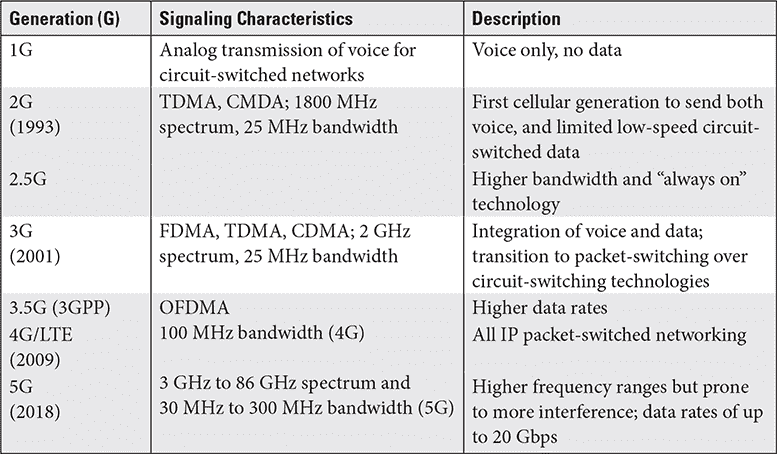

**EXAM TIP** 虽然您在考试中可能不会看到关于传统蜂窝技术（1G 到 3G）的具体问题，但熟悉它们仍然是个好主意，以便了解它们如何导向 4G 和 5G 等现代技术。

## 内容分发网络

内容分发网络（或 CDN，也称为内容传递网络）是一个多层的网络服务和资源组，这些服务和资源在整个互联网的各个级别实现，包括在数据中心和 WAN 链路上。大型多媒体提供商，例如流媒体公司（例如 Hulu、Netflix、Amazon 等），使用 CDN 来提供高内容可用性和性能，同时将延迟降至最低。CDN 为这些提供商提供冗余和负载平衡服务，确保其客户的高数据可用性。与 CDN 相关的概念是边缘计算，它也有助于降低延迟，并通过将设备地理上部署得更靠近用户来提供高可用性。实施 CDN 减少了内容从用户到用户往返所需的地理距离，通过消除需要从世界另一端通过多个 WAN 链路下载内容的需求来降低延迟。

**Cross-Reference**

边缘计算在目标 3.5 中进行了更详细的讨论。

## REVIEW

目标 4.1：在网络架构中评估和实施安全设计原则 在此目标中，我们简要讨论了网络概念和基础知识的要点，例如 OSI 模型和 TCP/IP 协议栈。我们还讨论了 IP 网络和安全协议的基础知识。这些关键要素对于确保在设计网络时遵循安全设计原则是必要的。我们研究了安全网络概念的应用，并调查了多层协议和融合技术。我们还涉及了微分段、软件定义网络和 Virtual eXtensible Local Area Network 的关键概念。我们探索了无线和蜂窝网络，并讨论了这些技术的安全问题。最后，我们讨论了内容分发网络在为多媒体消费者提供更好可用性方面的目的。

## 4.1 QUESTIONS

1. 您在本地网络上配置了 IPSec，敏感流量正在特定主机之间发送。但是，当您在协议分析器中查看流量时，它未加密。为了使 IPSec 加密流量，必须确保以下哪个协议配置正确？

A. Encapsulating Security Payload (ESP)

B. Authentication Header (AH)

C. Internet Key Exchange (IKE)

D. Internet Security Association and Key Management Protocol (ISAKMP)

2. 您的组织大量使用 VLAN。由于与另一家公司合并，现在在全球各地设有地区办事处，并且还将部分基础设施迁移到了云端。您希望保留使用 VLAN 的能力，这些 VLAN 可以部署而不考虑地理位置或 WAN 链路。您应该推荐贵公司实施以下哪种技术？

A. Software-defined networking (SDN)

B. Software-defined wide area networking (SD-WAN)

C. Virtual eXtensible Local Area Network (VxLAN)

D. Fibre Channel over Ethernet (FCoE)

3. 以下哪个 IEEE 802.11 标准修正案指定了 6-GHz 频段的 Wi-Fi 操作？

A. IEEE 802.11ac

B. IEEE 802.11g

C. IEEE 802.11i

D. IEEE 802.11ax

## 4

你正在为公司的 IT 员工讲授无线技术课程。一名学生询问你关于可用于帮助管理蜂窝网络中频段使用的不同多址接入方法。以下哪项正确描述了所使用的三种多址接入方法？

**A.** 频分、码分和带宽分

**B.** 时分、幅分和频分

**C.** 时分、码分和频分

**D.** 时分、带宽分和频分

## 4.1 ANSWERS

**1** A 封装安全有效载荷（`ESP`）是 `IPSec` 中负责加密数据的协议。

**2** C 虚拟可扩展局域网（`VxLAN`）是一种协议，它封装 `VLAN` 管理流量，并允许 `VLAN` 技术跨多个地理位置通过 `WAN` 链路进行扩展。

**3** D 在给定的选项中，唯一在 `6-GHz` 频段运行的 IEEE `802.11` 标准是 IEEE `802.11ax`。

**4** C 管理蜂窝网络中频率使用的三种主要方法是时分多址接入（`TDMA`）、码分多址接入（`CDMA`）和频分多址接入（`FDMA`）。既不使用带宽，也不使用幅度来管理多个设备对频率的访问。

###  安全网络组件

在此目标中，我们将讨论所有基础设施组件应当维护的最低安全控制措施。虽然这只是一个简要回顾，但本目标的关键要点是，网络组件应从物理和逻辑两方面防止未经授权的访问，并且强身份验证、加密、配置管理和反恶意软件等安全控制措施是必不可少的。

## 网络安全设计与组件

网络组件不仅包括网络基础设施设备和服务器，还包括工作站和移动设备等网络主机，以及传输介质。保护这些组件的内容贯穿本书，但本目标特别指出了你必须考虑的控制措施，以确保安全的网络运行和资产保护。

## 硬件操作

基础设施硬件包括服务器、交换机和路由器，以及安全设备和任何其他向用户提供基本服务的网络支持硬件。基础设施硬件不仅包括传统的 IT 设备，还包括被识别为工业控制系统和物联网（`IoT`）设备的非传统设备。每种类型的设备都有其自身的优势和劣势，以及自身的配置管理流程。网络设备允许对安全配置和流经其上的流量进行不同程度的控制。它们也可以以不同的程度进行保护；尖端技术可能比旧系统具有更好的内置安全控制措施。你必须考虑保护网络设备的许多方面，包括网络架构、网络流量控制设备和专用安全设备。

## 网络架构

网络架构设计是保护网络组件的第一步。你应该彻底考虑设备的放置以及它们如何作为安全控制措施进行连接。网络架构可以非常简单，也可以非常复杂，并包括物理和逻辑分段（`e.g.`、`VLAN`、不同的 IP 子网、主机隔离、边缘设备等）。除了通过隔离和保护敏感主机来提供安全性之外，网络架构还可以减少网络流量问题，例如由冲突和广播引起的拥塞。考虑到这一点，对于 CISSP 考试，你应该了解各种网络架构：

• **Intranet** 仅存在于组织内部并与公共 Internet 或其他非受信网络隔离的专用网络

• **Extranet** 组织网络中特别分段的部分，配置为为业务合作伙伴、客户和供应商提供服务

• **Demilitarized zone (`DMZ`)** 经过精心控制的边缘网络，用作公共或非受信网络与内部或受保护网络之间的屏障

• **Virtual LAN (`VLAN`)** 严格来说不是一种网络架构，而是一种使用高级交换机创建虚拟（而非物理）局域网的方法，这些网络拥有自己的 IP 地址空间——本质上是可以与其他网络段逻辑分离并具有自己的访问控制规则的软件定义 LAN

• **Bastion host** 专门配置（加固）的主机，用于将非受信网络或主机与敏感网络或主机分隔开

请注意，这些架构可以由许多以特定配置排列的不同设备组成，以提供保护和控制流量流动，甚至可以是单个设备，例如前面提到的堡垒主机，它将敏感网络与非受信网络分隔开。

## 网络硬件设备

网络硬件设备执行许多不同的功能，包括使用物理或逻辑寻址将流量从一个网络或节点移动到另一个网络或节点；确保流量被传送到正确的段或主机；并根据流量的特性（例如端口、协议、服务、地址等）过滤流量。网络硬件设备还致力于提高特定类型流量或内容的服务质量和可靠交付。虽然本节并非对网络硬件设备的全面回顾，但你将遇到的最常见设备在 `Table 4.2-1` 中作为复习呈现。

**TABLE 4.2-1** 常见网络硬件设备

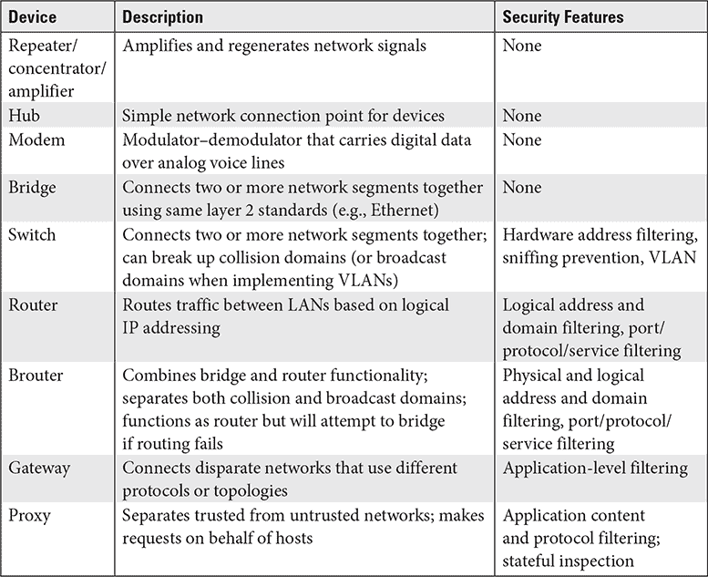

## 防火墙

防火墙是无处不在的网络安全设备；它们是建立保护组织企业网络的安全边界的基础。防火墙用于控制和调节网络之间的流量，例如 Internet 与内部网络之间，`DMZ` 网络与外部网络或外联网之间，甚至私有网络内部的敏感主机和段之间。

防火墙用于根据其规则集中指定的元素过滤（通过阻止或允许）流量。防火墙规则的元素包括流量的基本特征，例如源 IP 地址或目标 IP 地址、域、端口、协议和服务，但也包括更复杂的流量特征，例如用户上下文、一天中的时间、异常流量模式等。许多下一代防火墙（`NGFWs`）是组合设备，包括代理、入侵检测/预防设备和网络访问控制的功能和特性。

防火墙通常不止一个接口，这使它们能够连接并过滤多个网络之间的流量。防火墙还可以部署在多层架构中，例如可能存在于非军事区的架构。例如，你可以有一个单层防火墙来分隔 Internet 和内部网络，或者一个两层或三层防火墙设置，将网络划分为保护区域，每个区域都更加严格。

从历史和功能角度来看，防火墙可以按类型和功能级别进行分类。不同类型的防火墙包括

• `Packet-filtering` 或 `static` 防火墙基于非常基本的流量特征进行过滤，例如 IP 地址、端口或协议。这些防火墙主要在 OSI 模型的网络层（`TCP/IP Internet layer`）运行，也称为 `screening routers`；这些被认为是第一代防火墙。

• `Circuit-level` firewalls filter session layer traffic based on the end-to-end communication sessions rather than traffic content.

• `Application-layer` firewalls, also called `proxy` firewalls, filter traffic based on characteristics of applications, such as e-mail, web traffic, and so on. These firewalls are considered second-generation firewalls, which work at the application layer of the OSI model.

• `Stateful inspection` firewalls, considered third-generation firewalls, are dynamic in nature; they filter based on the connection state of the inbound and outbound network traffic. They are based on determining the state of established connections. Stateful inspection firewalls work at layers 3 and 4 of the OSI model (network and transport, respectively).

• `Next-generation` firewalls (NGFWs) are typically multifunction devices that incorporate firewall, proxy, and intrusion detection/prevention services. They filter traffic based on any combination of all the other firewall techniques, to include deep packet inspection (DPI), connection state, and basic TCP/IP characteristics. NGFWs can work at multiple layers of the OSI model, but primarily function at layer 7, the application layer.

**EXAM TIP** You should understand the various types of firewalls and their functions, as well as at which layers of the OSI model they function.

## Network Access Control Devices

Network access control (NAC) is a method of strictly controlling access to the organization’s infrastructure by requiring stringent security configurations for devices. The goal of NAC is to enforce strong authentication and security policies to ensure only hosts meeting minimum security requirements can connect to the network. NAC is often implemented through devices or dedicated appliances but can also be implemented through software on a traditional security device, such as an IDS/IPS or next-generation firewall.

NAC devices are physically protected similarly to other infrastructure equipment; they should be kept in a secure locked room with limited access. Administrative access to NAC devices should be very limited and should be controlled through strong authentication protocols. You should also restrict access to the devices that can successfully connect to the infrastructure through the NAC devices; policy should determine whether users can bring their own devices and connect to the corporate network, for example, and if this is not the case, only a predefined list of authorized devices should be able to connect through the NAC devices and into the corporate network.

Since NAC devices are used to initially grant or deny access to the network from authorized devices, make sure that each authorized device is required to undergo a health or compliance check, to ensure that it has the appropriate patches installed, configuration settings secured, and up-to-date anti-malware. NACs should also be monitored and audited on a continual basis.

## Network Device Security Controls

In general, technical security controls used to protect network devices are common across the infrastructure, but you should make sure that you address the following technical controls for critical network devices:

• Limit both physical and remote access to only authorized administrators.

• Use only secure protocols for remote administration, such as Secure Shell (SSH), a secure VPN protocol such as IPSec, or Transport Layer Security (TLS); use multifactor authentication whenever possible.

• Configure complex passwords for each device.

• Use role-based administration for network devices.

• Turn off all unnecessary services, especially unsecure services such as Telnet.

• Audit all administrative access to each device.

• Limit which hosts administrators can use to access network devices.

• Ensure all devices are updated with the latest security patches.

Physical controls are also very important for network device security. Obviously, network devices should be locked in a secure area, such as a data center, communications closet, or server room. This secure processing area should have very limited personnel access, and any uncleared personnel, such as physical maintenance personnel, for instance, should be escorted when in the area around network devices. You should also restrict any type of personal device that transmits using wireless or cellular signals when in the vicinity of network devices, such as smartphones, tablets, and laptops.

In addition to technical and physical controls, you should also consider controls that can directly impact the availability goal of security:

• Ensure temperature and humidity levels are properly maintained in locations where network devices operate.

• Use both redundant power supplies and backup power devices, such as uninterruptible power supplies and generators, for network devices.

• Be aware of end-of-life support for network devices and maintain the warranties on those devices.

• Ensure that spare parts and components are available for all network devices.

• Maintain an accurate and up-to-date inventory of all authorized network devices.

## Transmission Media

Transmission media can be categorized as either wired media or wireless media. Each category has some common security requirements you should pay attention to, but each category also has its own unique requirements. For wired media, the key is to protect cabling from unauthorized physical access. You should secure cabling in the following ways:

• Protect connection endpoints from the possibility that someone could plug an unauthorized device into the network.

• Try to run cable away from general-use and high-traffic areas.

• Secure cable behind walls, above ceilings, and under the floor.

• If a cable run is rarely used, disable switch ports that may connect to it.

• Remove any unused cable runs.

• Label all cables on both ends with the room number, drop number, or other unique ID. Also consider labeling which end device the cable should be plugged into.

• Have a formal diagram or other documentation (switch port, end device, etc.) for all cabling runs when possible.

• Add additional protection to cabling runs that go through physically vulnerable areas, such as break rooms, reception areas, and other high-traffic areas.

• Periodically inspect cabling for any evidence of misuse or tampering.

Wireless media also should be protected to the maximum extent possible. Although there is no physical cabling to protect, wireless access points must be physically protected, and transmission ranges of wireless devices should be limited and controlled. In general, for wireless media, you should

• Use strong authentication and encryption mechanisms (e.g., WPA 2/WPA 3, strong keys, 802.1X, mutual authentication methods, etc.).

• Implement physical protections for wireless access points.

• Use only the power levels needed to transmit to the range of authorized devices; excessive power can send wireless signals into adjoining buildings, the parking lot, and other adjacent areas.

• Centrally locate wireless access points in the facility; try not to place them near windows, external walls, or roofs.

• Filter wireless client MAC addresses when practical, although this is of limited security effectiveness.

• Rename the default service set identifier (SSID) and use SSID hiding whenever possible, although understand that this is also of limited security effectiveness and is more to deter casual wireless snoopers than determined attackers.

• Routinely monitor wireless access points to determine if there is any unusual activity with them, or if there are any unauthorized wireless access points present.

• Segregate guest wireless networks and business wireless networks.

## Endpoint Security

端点安全是纵深防御原则中不可或缺的一部分。端点安全的前提是，无论其他安全控制和网络保护如何，主机本身都必须受到保护。无论是计算机工作站、笔记本电脑、平板电脑、服务器，甚至智能手机，都应确保主机设备拥有全面的安全防护，包括以下内容：

• 强身份验证机制  
• 静态数据和传输中数据的加密  
• 仅限授权用户进行物理访问  
• 基于主机的防火墙和入侵检测系统  
• 更新的反恶意软件  
• 要求使用安全 VPN 和 NAC 连接到企业网络  
• 设备审计，包括设备访问、资源访问以及可能出现的异常事件  
• 最新的安全补丁  
• 安全配置设置  
• 仅保留最小化的应用程序和服务  

## REVIEW

**Objective 4.2: Secure network components** 此目标总结了在保护网络设备及相关组件时应采取的措施。我们讨论了网络架构的重要性，并简要提及了几种需要物理保护和限制逻辑访问的关键网络设备。网络设备应通过强身份验证机制和加密进行保护；定期应用安全补丁；并减少服务和非安全协议。我们简要了解了不同类型的防火墙及其功能，并讨论了网络访问控制设备。我们还简要介绍了有线和无线传输介质，以及应采取的一些安全措施来保护它们。最后，我们讨论了端点安全及其重要性。

## 4.2 QUESTIONS

**1.** 你正在为一个组织设计网络，该网络必须与任何外部网络完全隔离。只有本地连接到该网络的主机才能访问其上的资源。以下哪种架构设计最适合该组织？

**A.** Internet  
**B.** Intranet  
**C.** Extranet  
**D.** Demilitarized zone  

**2.** 你正在为一个组织设计边缘网络的安全。你正在非军事区配置中构建多层安全设备。你希望第一层安全设备在网络外围通过仅基于 IP 地址、端口和协议等基本特征进行过滤，来阻止不需要的多余流量。以下哪种设备是最高效、最不复杂的选择？

**A.** Packet-filtering firewall  
**B.** Next-generation firewall  
**C.** Proxy  
**D.** Circuit-level firewall  

## 4.2 ANSWERS

**1.** B Intranet 是仅供内部主机访问的封闭式内部网络。

**2.** A Packet-filtering firewall 可以通过消除大量易于过滤的多余网络噪声（例如，可轻松通过 IP 地址、域名、端口、协议和服务阻止的流量），来帮助减轻更复杂且更昂贵设备的工作负担。然后，更复杂的流量可以留给其他设备（例如下一代防火墙）进行过滤。

### 按照设计实现安全通信通道

此目标结束了我们对通信和网络安全的简要讨论。它涉及在网络基础设施上保护通信会话所实施的关键要素：识别、身份验证、授权、加密、数据完整性和不可否认性。

## Securing Communications Channels

通信通道以多种方式实现的语音、视频和数据网络。在*安全*通信通道的背景下，我们的重点将放在用于保护通过网络和互联网（特别是通过远程访问）发生的语音通信和现代多媒体协作的安全实践和控制上。我们还将讨论通过虚拟网络进行的通信，以及第三方连接到敏感内部网络的情况。

## Voice

语音被视为一种“融合技术”，因为它已与网络流量集成，并使用 TCP/IP 通过标准网络基础设施传输。从历史角度来看，了解语音直到 1990 年代才成为现代网络的一部分是有帮助的；在此之前，它使用*普通旧式电话服务（POTS）*，该服务由拨号线和通过与 IP 网络完全独立的系统路由的专用电路组成。该系统称为*公共交换电话网络（PSTN）*，使用电路交换技术，而不是现代数据网络中使用的分组交换方法。常规电话线使用模拟系统，如果组织拥有自己的内部电话系统，语音通信仅通过所谓的*专用分支交换机（PBX）*进行。这些旧式 PBX 系统将组织的内部电话系统连接到外部世界，并进一步集成到更大的公共电话通信基础设施中。

这些旧系统存在许多漏洞，包括普遍较弱的安全性。这些漏洞包括：

• 管理松散，公司内部任何人（有时甚至包括公司外部人员）通常都能不受限制地访问  
• 身份验证机制薄弱  
• 没有加密服务  
• 易受多种攻击，包括战拨号、电话黑客、拒绝服务和欺骗  

普通用户和黑客都利用这些薄弱系统，将呼叫转入和转出组织的电话基础设施，并冒充组织成员，以进行社会工程攻击或获取免费长途服务。通常，这些系统还连接到一组调制解调器，这些调制解调器用于从外部世界拨入组织；这往往是人们连接到内部网络的唯一方式。这允许战拨号攻击，并通过易受攻击的 PBX 系统入侵网络。

针对这些漏洞，唯一可用的缓解措施是严格控制 PBX 系统的远程维护或管理，仅允许有限账户，限制呼叫转发，并配置设备以拒绝来自组织外部电话的内部号码。

Table 4.3-1 描述了旧式语音通信技术。

**TABLE 4.3-1** Legacy Traditional Voice and Dial-Up Technologies

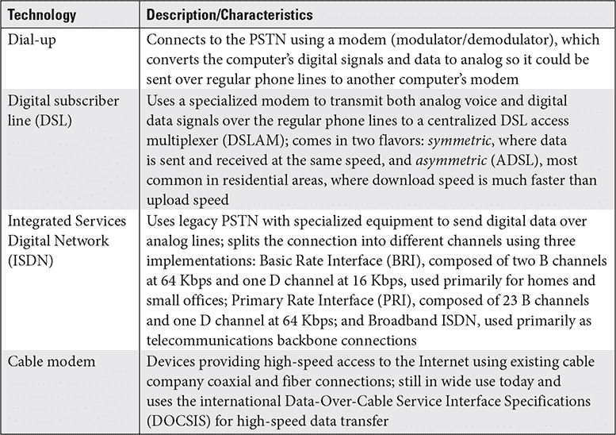

**EXAM TIP** 虽然被视为旧技术，但在考试中你可能会遇到与旧式语音技术相关的问题。

随着更好的基础设施和更高效、更可靠的设备的出现，语音逐渐进入数据网络领域，并成为通过标准网络基础设施传输的流量的一部分。语音可以通过标准化的 IP 流量（称为 Voice over IP，或 VoIP）传输，视频流量也是如此。为了满足现代企业对高质量语音服务的高需求，语音流量需要高带宽、具有弹性的无连接协议，以及近乎持续不断的可用性。然而，VoIP 也继承了标准网络流量的一些漏洞，例如拦截、窃听、欺骗（即虚假呼叫）和拒绝服务攻击的风险。与可能具有内置安全机制的安全网络协议不同，语音流量通常没有内置安全协议来保护它，因此它在很大程度上依赖于安全网络协议和设备，与其他网络流量一样，来保障其安全。

**NOTE** `VoIP` 也称为 `Internet Protocol (IP) telephony`，其中还包括其他技术，例如实时消息传递和视频会议应用程序。

存在多种 `VoIP` 技术，这些技术既包括软件也包括硬件。此外，随着时间的推移，还开发出了不同的标准，这些标准要么相互竞争，要么最终相互合并。CISSP 考试中应了解的关键语音标准在 表 4.3-2 中概述。

**TABLE 4.3-2** IP Telephony Technologies

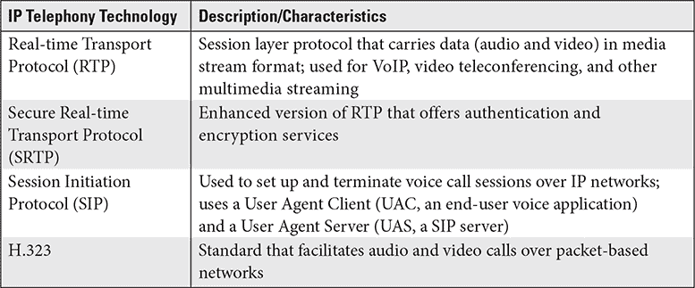

如前所述，`VoIP` 流量容易受到与在正常 IP 网络上传输的其他类型数据相同的漏洞和攻击的影响。在网络中实现语音服务时，必须考虑重要问题，例如组织如何进行 911 紧急呼叫以及如何处理备份通信，因为 IP 网络可能容易受到降级、中断和故障的影响。备份通信应包括无线或蜂窝功能，以及传统的 PSTN 电话系统。

**NOTE** `SIP` 和 `H.323` 都是竞争性标准，并且都基于 `RTP` 运行，以提供呼叫会话启动和设置、可靠的数据包传输以及其他服务。

## Multimedia Collaboration

`Multimedia collaboration` 是一个统称，指代多种协作技术，包括视频会议、多用户应用程序共享、项目工作流等。虽然这些技术已经使用了一段时间，但在 COVID-19 大流行期间，由于大量新的远程工作者需要连接到业务网络并与团队成员在线协作处理复杂项目，这些技术成为开展业务的关键服务。大流行后，对多媒体协作的需求依然很高，因为许多组织已将远程工作视为一种可接受的替代方案。

这些技术中的一些，尤其是视频会议，在大规模远程工作这一新范式出现之前并不像本可以那样成熟，但在此期间，它们迅速赶上了其他尖端技术。在远程办公增加期间变得越来越关键的技术示例包括以下内容：

• 远程桌面访问

• 远程文件共享和协作

• 远程会议

• 协作工作站点（例如，Microsoft Teams）

• 电子邮件和即时消息

这些技术中的大多数最初是为有限使用而设计的，例如偶尔的远程或出差用户，或偶尔的虚拟团队会议。直到远程工作者远程连接的需求激增，组织中已有的大部分必要基础设施都无法支持使用这些技术的人数增加。迅速改进协作技术的可扩展性和性能的必要性要求基础设施也随之改进。许多组织现在需要更强大、可扩展的网络基础设施来支持大规模的多媒体协作；否则，它们将面临严重的性能问题，例如速度、延迟和带宽有限。与电子邮件和网页浏览不同，语音和视频技术需要网络流量优先级，以确保足够的带宽，从而实现一致、稳定、无抖动的连接。

与任何新兴技术一样，多媒体协作技术使用量的突然增加暴露了传统漏洞，例如应用程序和设备中缺乏内置的身份验证和加密技术、允许通过网络连接利用的应用程序漏洞，以及与远程数据共享和集中控制相关的管理和技术问题。这些漏洞通常会导致劫持攻击、身份欺骗、数据拦截以及对系统或其资源的未经授权的远程控制。这些类型的攻击在大规模远程办公运动的第一波期间频繁发生，当时新兴技术在 2020 年初 COVID-19 大流行早期经受了考验。

这些漏洞的缓解措施是适用于网络和应用程序的经典安全控制措施。这些措施包括使用强身份验证和加密技术、安全网络协议、安全应用程序设计和实施，以及普通用户对特权功能的限制访问。

## Remote Access

远程网络访问对部分劳动力成员（如出差销售人员）来说几十年来一直至关重要，但如前所述，自 2020 年 COVID-19 大流行开始影响企业以来，它对更广泛的劳动力群体也变得至关重要。现在大量员工远程办公，即使许多公司正在将员工带回办公室。我们将讨论几种不同的远程访问方法，包括老式拨号，因为您在 CISSP 考试中仍可能遇到它，但我们将强调更现代的方法，例如虚拟专用网络 (`VPN`)。

尽管拨号连接在技术发达的国家不再广泛使用，但您可能仍然偶尔在农村地区或欠发达国家看到它们的使用。拨号连接需要调制解调器，用于直接拨入另一台计算机，甚至拨入专门为多个远程访问用户配置的调制解调器组。这些旧式连接中的一些可能还需要某种形式的身份验证和计费服务器，尽管这些技术的大多数旧版本没有使用强身份验证或加密协议。旧版本的拨号连接使用现已弃用的串行线路接口协议 (`SLIP`) 或点对点协议 (`PPP`) 连接。

几乎所有现代远程访问连接都使用某种形式的 `VPN`，它允许通过不受信任的网络（例如 Internet）进行“隧道”传输并受到保护的通信会话。不受信任的网络提供传输机制，而安全协议用于提供加密和身份验证服务。`VPN` 有两种不同的类型：

• **Client-to-site `VPN`** 当单个用户必须从远程位置（例如酒店房间或家庭网络）通过 `VPN` 服务器（也称为 `concentrator`）连接到企业网络时使用。

• **Site-to-site `VPN`** 用于连接由广域网连接分隔的多个企业局域网。它也使用 `VPN` concentrator，但配置为多个用户通过 Internet 连接到单个本地 concentrator，再连接到远程 concentrator，远程 concentrator 是组织基础设施的一部分。可以将其视为一个分支办公室，必须通过 Internet 将其所有员工连接到企业局域网。

远程访问使用包括专注于加密、身份验证和连接本身的协议和服务在内的技术。远程身份验证协议和服务在 表 4.3-3 中概述。

**TABLE 4.3-3** Remote Access Protocols

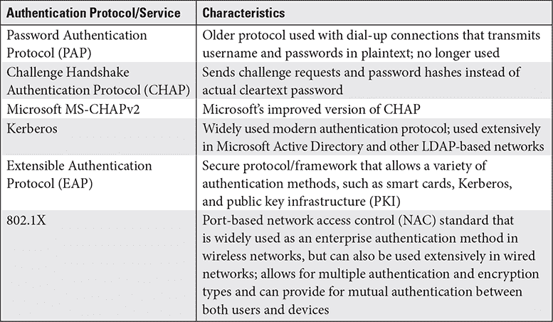

**EXAM TIP** 您应熟悉此处介绍的身份验证协议/服务和远程连接/隧道技术的特征。

除了远程身份验证协议外，您还应熟悉远程连接和隧道技术及协议，这些内容在 表 4.3-4 中概述。

**TABLE 4.3-4** Remote Connection/Tunneling Technologies and Protocols

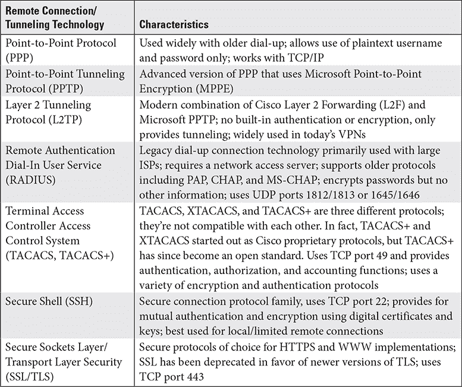

**Cross-Reference**

上述一些安全协议，例如 `Kerberos`、`EAP`、`SSH` 和 `SSL/TLS`，已在目标 4.1 中更详细地介绍。

## Data Communications

虽然一整本书都可以专门讲述保护数据通信，但对于 CISSP 考试（以及现实生活），你需要熟悉几个关键要素：识别、身份验证、加密、授权、数据完整性和不可否认性。回顾一下，这些要素在数据通信的语境下的含义如下：

• **识别** 通信主机和/或用户必须在通信会话之前，甚至有时在会话期间，使用用户名/密码或多因素身份验证方法（如 PKI）等标识符明确标识自身。

• **身份验证** 主机、用户，甚至网络应用程序或服务都应在通信过程中向其他实体进行身份验证。

• **授权** 只有经过适当授权的实体才能通过传输介质或在特定会话期间进行通信，包括敏感数据的传输和接收。

• **加密** 传输期间应加密身份验证信息和数据。请注意，加密可以通过加密整个数据流、仅加密会话中的某些数据，或仅加密会话本身来实现。

• **数据完整性** 在通信会话期间应实施技术控制以确保数据完整性，例如循环冗余校验（CRC）、哈希和其他手段。

• **不可否认性** 传输主机、用户、应用程序和服务必须无法否认它们在通信过程中向其他实体发送了消息。

为了实施所有这些要素来保护数据通信，必须使用强大的安全协议。其中许多协议在目标 4.1 中已讨论。应避免的协议示例包括那些具有弱身份验证或加密功能的协议，例如 Telnet、SMTP、FTP、TFTP 以及现已弃用的 SSL。

## 虚拟化网络

正如我们可以虚拟化操作系统、软件运行时环境和微服务一样，我们也可以虚拟化网络。网络虚拟化具有多种优势，包括降低基础设施复杂性和成本、最大限度地减少物理硬件数量，当然还有安全性。从安全角度来看，它在敏感网络分段和主机分离方面发挥着重要作用。网络可以使用虚拟 LAN 分段、独立的 IP 地址空间，并根据网络的保护需求对其应用不同的安全策略。网络虚拟化还可以在发生攻击或灾难时动态重新配置网络；使用物理硬件设备来做到这一点会耗时得多且更加困难。我们看到虚拟化网络以多种不同的方式实现，这些方式在 表 4.3-5 中进行了总结。

**表 4.3-5** 虚拟化网络组件

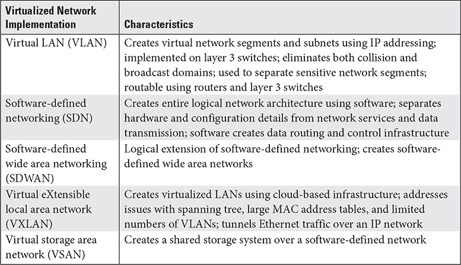

## 第三方连接

确保授权的第三方安全地连接到组织网络，是你需要为 CISSP 考试了解的安全通信渠道的最后一类。我们已经讨论了外联网（可以将敏感内部网络与用于外部利益相关者访问的网络分开）的使用，以及网络访问控制（NAC）、VPN 和其他远程访问技术的可用性，以保护网络连接。用于组织人员远程连接到其网络的相同技术，也可以允许授权的第三方连接到组织的网络。这些第三方可能包括业务合作伙伴、供应商、服务提供商，甚至客户。

在所有情况下，你都应确保识别、强身份验证、加密、授权、数据完整性和不可否认性等关键要素都存在，以便只有经过审查、授权的第三方用户才能连接到网络。你还应确保用于创建安全网络基础设施的相同安全设计原则用于管理第三方连接到网络。这些原则包括最小权限、纵深防御、安全默认值、职责分离、零信任等概念。

**交叉引用**

安全设计原则已在目标 3.1 中深入讨论。

## 复习

**目标 4.3：根据设计实施安全通信渠道** 在此目标中，我们讨论了保护不同类型的通信渠道，包括用于语音、多媒体协作和远程访问的渠道。我们在整个目标中强调了使用关键安全要素，例如识别、强身份验证、授权、加密、数据完整性和不可否认性。我们还讨论了这些要素如何应用于所有数据通信渠道。然后，我们介绍了虚拟化网络的使用，这些网络可以分隔包含敏感主机的段，并在发生攻击时动态重新配置。最后，我们讨论了使用安全设计原则进行第三方内部网络连接。

## 4.3 问题

**1.** 以下哪种旧技术提供对称和非对称服务，并影响用户的上传和下载速度？

**A.** H.323

**B.** 非对称数字用户线路（ADSL）

**C.** 普通旧电话服务（POTS）

**D.** 安全实时传输协议（SRTP）

**2.** 以下哪种是远程访问身份验证协议，可以使用多种身份验证方法，例如智能卡和 PKI？

**A.** 密码身份验证协议（PAP）

**B.** 可扩展身份验证协议（EAP）

**C.** 质询握手身份验证协议（CHAP）

**D.** 第二层隧道协议（L2TP）

## 4.3 答案

**1.** B 非对称数字用户线路（ADSL）是一种旧技术，通过模拟语音线路传输数字数据。使用 ADSL 时，下游数据分配的带宽多于上游数据，因此速度不同。

**2.** B 可扩展身份验证协议（EAP）是一种身份验证协议/框架，可以处理多种类型的身份验证方法，包括智能卡、PKI 证书和用户名/密码。PAP 只能使用用户名和密码，这些信息以明文形式传输。CHAP 不能使用多种身份验证方法。L2TP 是一种隧道协议，而不是身份验证协议。

## 身份和访问管理（IAM）

域目标

• 5.1 控制对资产的物理和逻辑访问。

• 5.2 管理人员、设备和服务的识别和身份验证。

• 5.3 与第三方服务的联合身份。

• 5.4 实施和管理授权机制。

• 5.5 管理身份和访问配置生命周期。

• 5.6 实施身份验证系统。

域 5 侧重于身份和访问管理（IAM）的细节。该域深入探讨了识别、身份验证和授权的概念。首先讨论物理和逻辑访问控制，然后讨论用于验证实体确实是其声称身份的各种识别和身份验证服务。我们还将讨论与第三方提供商的联合身份，以及身份验证过程完成后如何实施授权机制。我们还将介绍整个身份和访问配置生命周期。

### 控制对资产的物理和逻辑访问

在此目标中，我们讨论访问控制及其如何用于限制和控制对资产的物理和逻辑访问，这些资产包括信息、系统、设备、设施和应用程序。

## 控制逻辑和物理访问

资产通过访问控制在逻辑和物理上得到保护。`access control` 是任何限制或控制对资源访问的安全措施。`Access` 是 `entities` 之间的交互，`entities` 包括人员、系统、应用程序、物理位置、设备和信息。`subject` 是试图访问资源的主动实体。资源称为 `object`，是向 subject 提供信息和服务的被动实体。subject 的示例包括人员、应用程序、系统和进程。object 的示例包括应用程序、系统和信息。

访问控制旨在识别和验证试图访问资源的 subject，并确定该访问是否被授权，如果是，授权的程度是什么。某些访问控制还会监控和记录 subject 在访问期间与 object 的交互。

**EXAM TIP** 了解访问控制的三种主要类型：管理型、技术型和物理型，以及常见的控制功能，包括威慑型、预防型、检测型、纠正型和补偿型。控制的类型和功能在目标 1.10 中有更详细的说明。

请注意，为了考试目标的目的，我们的重点是控制对系统、设备、设施、应用程序以及也许最重要的是存储在这些系统中的信息的逻辑和物理访问。快速回顾如下：

• `Information`（包括原始数据——没有上下文的非组织化事实）可以存在于系统、设备和存储介质上，存在于应用程序内部，以及存在于可以传输、存储或处理信息的其他地方。

• `Systems` 生成、存储、处理和传输信息，包括工作站、服务器、网络基础设施设备，甚至个人或移动设备。

• `Devices` 是系统的一个子集，可能包括嵌入式设备、IoT 设备和个人移动设备。有些可能有其自身独特的安全要求，以保护它们免受盗窃和破坏，例如屏幕锁定、远程擦除、应用程序和信息分离（容器化）以及各种其他物理和逻辑措施。

• `Applications` 是运行在系统和设备上的软件，用于协助生成、存储、处理、传输和接收信息。应用程序也有其自身独特的安全要求和访问控制，包括安全编码、受保护资源使用等。

• `Facilities` 包括多建筑校园、数据中心、服务器机房以及任何存储或使用敏感资产的其他场所。设施主要使用物理控制，但逻辑控制也有助于将物理安全管理系统与限制和控制对安全空间访问的实际控制相连接。

我们不打算单独为这些资产类别中的每一个分解物理和逻辑访问控制，而是将逻辑和物理访问控制一起讨论，因为它们都适用于这些资产。

## 逻辑访问

逻辑访问控制包括通常作为技术控制实施的措施。这些控制最常与我们关联的技术有关，这些技术保护操作系统、应用程序和信息。如在目标 1.10 中讨论的，逻辑访问控制是使用软件和硬件实现的。用于控制逻辑访问的关键元素包括以下内容：

• 用于验证和信任 subject 的识别和强身份验证机制

• 授权机制（权利、权限、特权）

• 责任控制（例如，审计）

• 完整性机制（例如，哈希算法）

• 强加密系统、算法和密钥

• 不可否认机制（例如，数字证书）

## 物理访问

用于物理保护系统、设备和设施的许多控制在目标 3.8 和 3.9 中讨论过，但在此重述作为提醒：

• 设施的入口点控制，包括敏感内部区域，如数据中心和服务器机房

• 在设施内分层的受保护“区域”

• 物理入侵检测警报

• 视频监控摄像头

• 物理和电子锁

• 人工守卫

• 门、栅栏、防撞桩和其他外部物理障碍

• HVAC、温度和湿度控制

• 锁定的设备柜

• 便携式系统的电缆和锁

• 盘点标签

## 复习

**目标 5.1：控制对资产的物理和逻辑访问** 在域 5 的第一个目标中，我们讨论了控制对资产的物理和逻辑访问。资产包括信息、系统、设备、设施和应用程序。访问通过逻辑访问控制（如强身份验证、加密和授权访问控制）以及物理访问控制（如锁门、门、守卫、物理入侵检测警报和视频摄像头）来控制。

## 5.1 问题

**1.** 您必须实施逻辑访问控制以保护计算设备上运行的操作系统。首先，您需要将访问限制在已获准访问这些设备的个人。以下哪种逻辑访问控制是控制对系统或设备访问的第一道防线？

**A.** 识别和身份验证

**B.** 身份验证和责任

**C.** 识别和授权

**D.** 身份验证和不可否认

**2.** 您需要确保只有授权人员才能访问设施内非常敏感的数据处理室。其他人员可以访问公共区域和其他不太敏感的处理区域，因此您必须设置性质逐渐更加严格的区域。在此场景中，您需要实施以下哪种物理访问控制？

**A.** 物理入侵检测警报

**B.** 具有不同访问级别的分层保护区域

**C.** 锁定的设备柜

**D.** 责任机制，例如系统审计

## 5.1 答案

**1.** A 限制对系统访问的第一步是确保试图访问系统的实体得到正确的识别和身份验证。除非个人已获准访问，否则他们无法向系统识别自己并进行身份验证。一旦他们被识别和验证，他们就被授权、审计，并对其采取的行动负责，并强制执行不可否认性。

**2.** B 设置划分不同访问级别的分层保护区域是确保只有获准进入某些敏感区域的人员才能进入，同时允许获准进入不太敏感区域的人员访问这些区域的好方法。

## 管理人员、设备和服务的识别和身份验证

在此目标中，我们将研究与管理实体或 subject 的识别和身份验证相关的关键概念，这些实体或 subject 可以包括人员、设备、应用程序、服务和进程。

## 识别和身份验证

访问控制由几个重要组件组成，包括识别、身份验证、授权和责任。我们将在此目标中讨论识别、身份验证和责任（以及在目标 5.3、5.5 和 5.6 中），并将在目标 5.4 中深入讨论授权。

## 身份管理与身份验证

## 身份识别与身份验证

在访问控制的语境下，*身份识别*是指出示身份证明并声明该身份属于出示证明的特定实体（例如用户）的过程。仅凭身份识别并不能赋予任何实体权限。该身份必须通过某个受信任的机制进行验证（证明该身份与出示证明的实体相关联）。这就是身份验证的本质；实体声明特定身份，并通过身份验证过程将该身份验证为真实。身份验证通过检查实体提供的凭据来工作，这些凭据通常由用户名和密码，或其他识别信息组成，并在集中式系统（通常是某种数据库）中验证用户提供的用于声明身份的信息是否包含在用户数据库中且受信任。它要求用户声明仅在受信任数据库中才能找到的信息。

## 身份管理实现

身份管理（IdM）是组织对所有访问其信息系统的实体进行的正式化、持续的过程。IdM 对于管理资源（例如互联网上的资源）的任何人都至关重要，这些资源由客户、供应商、业务合作伙伴和其他用户访问。组织可能拥有自己的内部 IdM 解决方案，但许多组织将此功能外包给第三方提供商。这就是第三方或联合身份管理发挥作用的地方，我们将在本目标的后面部分讨论。

IdM 需要在整个生命周期内管理身份。此生命周期包括身份创建；安全密钥和身份存储；以及使用——更新、暂停，最后，当其时间到来时，撤销身份。这与身份预配生命周期密切相关，该生命周期将在目标 5.5 中讨论，但 IdM 实际上包括我们将在本领域讨论的所有内容。

## 单因素/多因素身份验证

为了进行身份验证，用户必须提供凭据。凭据可能由用户名和密码、智能卡、令牌，甚至指纹和个人识别号码（PIN）组成。这些凭据或识别特征可以分类为*因素*。

可用于身份验证的因素有多种。其中包括：

• 你知道的东西（知识因素）

• 你拥有的东西（持有因素）

• 你本身的东西（固有因素）

这些因素单独使用或以不同组合使用，以向身份验证机制提供身份。如果你只使用其中一个因素，例如前面提到的用户名和密码组合，这称为*单因素身份验证*。例如，用户名和密码都是你知道的东西，可以作为凭据提供。虽然这是两个独立的信息，但仍被视为一个因素，即知识因素。

要求使用多个因素称为*多因素身份验证（MFA）*。多因素身份验证的示例是使用 ATM 卡、智能卡或令牌结合 PIN。在这种情况下，涉及两个因素：你拥有的东西（卡或令牌）和你知道的东西（PIN）。固有因素将包括指纹、声纹、面部识别和笔迹，因为这些是固有且对个人独特的因素。请注意，固有因素也称为*生物识别*因素，因为这些因素构成了你是谁，并且是唯一可识别的。

**NOTE** 除了本目标中讨论的三个主要身份验证因素外，可用于 MFA 的其他因素包括位置和一天中的时间以及其他基于规则的特征，这些特征使多因素身份验证更加安全。

多因素身份验证（也称为*强身份验证*）被定义为使用多个因素进行身份识别和身份验证，因为破坏两个或多个因素比破坏单个因素要困难得多。例如，破坏用户名和密码组合（单因素）相对容易，因为攻击者可能会发现这两者。然而，在用于多因素身份验证的智能卡和 PIN 组合的情况下，即使攻击者拥有其中一个，他们可能无法访问另一个。

组织应为所有存储有价值信息或连接到组织网络的系统实施 MFA。MFA 正在成为企业、网站甚至个人使用的首选身份验证方法，但单因素身份验证（主要是简单的用户名和密码组合）仍然被广泛使用。即使有密码复杂性要求，密码仍然可以相对容易地被破坏。

**EXAM TIP** 请记住，多因素身份验证要求至少使用上述两种类型的因素，例如指纹（固有）和 PIN（知识）。虽然用户名和密码组合包含两个不同的信息，但它仅包含知识因素，不被视为多因素身份验证。

## 责任追究

责任追究是我们在域 1 早期讨论的安全原则之一（在目标 1.2 中）。责任追究确保实体执行的操作可以追溯到该实体，并且该实体可以对这些操作承担责任。责任追究与不可否认性密切相关，不可否认性确保个人不能否认其采取了某项操作。责任追究通过审计实现，审计是另一个密切相关的安全原则，因为审计记录用户与系统和资源的交互。

责任追究是身份和访问管理的关键组成部分，并内置于我们将讨论的许多技术中，包括身份验证和授权协议及技术。关于责任追究需要理解的关键要素是，用户和其他实体与系统和资源的交互被记录，包括他们经历的身份验证过程的所有细节以及他们对授权特权的使用。

## 会话管理

双方之间的所有通信会话，例如用户与网站，或用户与工作期间的网络，都必须在会话期间进行管理和保护。会话始于身份识别和身份验证，通常以终止与应用程序、系统甚至网络的会话结束。在会话期间，必须保护交换的数据，包括用于定期重新身份验证的凭据。此外，会话本身可能受到安全要求的约束，例如有限的会话时长、仅在特定主机之间进行等。以下是一些你应确保实施的关键安全措施，以提供安全的会话管理：

• 强身份验证机制

• 强会话密钥

• 强加密算法和机制

• 用于限制会话时长的超时

• 会话非活动断开连接

• 用于检测异常活动（例如与会话劫持相关的活动）的控制

## 注册、身份验证和身份建立

## 身份验证

身份验证是指验证个人的系统凭据与该个人相关联，以便系统可以验证其身份。但是，除非系统已拥有该个人的已验证凭据，否则无法对个人进行身份验证。但在个人甚至获得账户之前，如何验证其身份？这需要一个过程，由个人向另一个实体建立其身份并验证该身份。注册和身份证明是组织用来证明个人身份以及为未来验证注册该身份的相互关联的过程。一旦该身份得到验证，就可以在其与其他身份（例如系统凭据）之间建立信任链。

以获取美国护照的过程为例。护照本身是有效的身份证明，但如何建立身份以获得护照？您需要提供其他可信的身份证明，例如驾驶执照和出生证明。您还必须亲自出现在护照官员面前，提供经批准的照片，并可能需要采集指纹。这建立了一条信任链，以便签发护照，而护照本身之后也被信任。这个过程称为身份建立。

对于公司的新员工，身份建立涉及向雇主提供实体文档，例如驾驶执照、出生证明、护照等。雇主出于各种原因需要这些信息，包括启动安全许可、预扣税款和进行背景调查。此过程必须可信；如果组织错误地接受实际上无效的身份证明（例如图书馆卡或过期的驾驶执照）或容易伪造的身份证明，这将在入职过程以及其他过程中建立一条薄弱的信任和证明链。

这种证明和身份建立过程不仅由雇主使用，也由任何拥有用户可能希望在线访问的资源的组织使用。例如，考虑网上银行，或访问另一个金融网站。个人必须证明其身份，通常是通过完成在线表单，通过一系列只有他们自己知道答案的问题来验证其身份，或者再次亲自提供书面文档，然后才能被允许访问该网站。无论如何，注册、身份证明和身份建立过程用于验证个人，以便组织随后可以向个人颁发一组可信的凭据。

## 联合身份管理

联合身份管理（FIM）意味着多个组织可以使用单个 IdM 提供商。IdM 提供商存储属于实体的个人身份和凭据，当任何其他希望验证个人的实体请求时，这些身份和凭据会在参与的多个组织和系统中得到验证。例如，当用户希望使用其 Facebook 凭据向第三方应用程序或网站进行身份验证时，Facebook 执行 FIM 服务。通常，第三方负责联合身份管理，但关键在于，一旦建立，相同的身份可以用于各种资源，无论组织如何，只要组织信任联合身份提供商的凭据。

## 交叉引用

目标 5.3 继续讨论与第三方服务的联合身份管理。

## 凭据管理系统

凭据管理系统是一种安全存储凭据，并可用于颁发、更新、暂停和撤销凭据的系统。考虑一个 Active Directory 账户，它可以被创建、添加到组、授予权限、锁定和删除。Active Directory 数据库以及用于管理数据库中用户账户的实用程序，是一种凭据管理系统。但是，凭据管理系统要全面得多，因为它们还可以包括用于管理凭据的行政策略、控制和使用智能卡的物理系统以及其他技术控制。

除了创建、更新和删除账户外，凭据管理系统还促进长期账户管理中使用的管理过程。其中一些管理过程嵌入在企业凭据管理系统中，但其他可能是附加组件甚至是独立应用程序。凭据管理系统执行的其他活动包括

- 密码管理 凭据管理系统协助创建和安全存储用户密码
- 密码同步 凭据管理系统协助在多个系统、应用程序和身份之间同步密码。
- 自助密码重置 凭据管理系统协助用户重置自己的密码，允许他们使用认知密码（例如，一系列只有用户知道的预定问题和答案）或其他安全方法。
- 辅助密码重置 帮助台人员可以使用凭据管理实用程序协助安全地重置用户密码，允许用户验证其身份并创建只有他们自己知道的密码。

## 单点登录

单点登录（SSO）是一种身份验证方法，要求用户只需进行一次身份验证，即可访问组织内甚至其他组织内的多个资源。在单点登录之前，如果每个资源都有自己的安全策略和凭据要求，用户需要进行多次身份验证。单点登录由各种技术实现，包括 Kerberos 和 Windows Active Directory。其他技术可以协助将单点登录与联合身份管理集成，以便第三方身份提供商可用于向跨多个组织、网站等的资源验证用户。

## 交叉引用

目标 5.6 讨论可以协助跨多个组织进行单点登录身份验证的技术，包括 OpenID Connect (OIDC) 和 Open Authorization (OAuth)，以及对 Kerberos 进行深入讨论。

## 即时访问

即时访问控制是指仅允许用户在需要时拥有所需的访问权限。通常 JIT 访问仅适用于特定的一组操作，并且是临时的。例如，以非特权用户身份运行特权命令可能要求员工通过作为具有更高权限的不同账户进行身份验证来提升其权限级别。在 Windows 中，这通常通过使用 runas 命令完成，在 Linux 中则通过使用 sudo 命令完成。即时访问通常会提前预配，但直到用户实际需要时才生效。访问权限也可能取决于情况；除非用户基于情况（例如一天中的时间、登录主机等）需要，否则用户可能无法访问特定资源或特定权限级别。

## 交叉引用

目标 5.5 提供了有关 runas 和 sudo 命令的详细信息。

Just-in-time access prevents users from carrying higher privileges or access than they normally need on a continual basis; they only get the access when they need it and only under specific circumstances. Such access can also be temporary and apply to only a specific action or resource. Just-in-time access is an effective way to adhere to the principle of least privilege while still allowing users to have the functionality they may need based upon their job duties. JIT access also helps to relieve the IT administrative burden by enabling users to perform necessary tasks without IT intervention.

## REVIEW

**Objective 5.2: Manage identification and authentication of people, devices, and services** In this objective we addressed identification and authentication of people, devices, and services. We discussed several key elements of identification and authentication, including identity management (`IdM`), authentication factors (knowledge, possession, and inherence), and the distinction between single-factor authentication and multifactor authentication.

We also discussed the accountability aspect, which means that details about the identification and authentication process must be recorded in order to hold individuals accountable for their actions. Session management is ensured through strong identification and authentication mechanisms, as well as strong encryption.

In order to initially prove an individual’s identity, they must go through a registration, proofing, and establishment process. Once this process is complete, the individual is able to obtain other identities, such as system credentials, that can be further trusted.

Federated identity management uses a single entity that is responsible for credentials that multiple organizations can trust and use to authenticate an individual for multiple resources. Credential management systems are used to create, update, and revoke credentials, as well as perform functions such as self-password reset, password synchronization, and password management. Single sign-on is an implementation of authentication technologies that allows the user to authenticate only once but subsequently be able to access many different resources.

Just-in-time access control refers to only allowing a user to have the access they need at the time they need it. Usually JIT access applies only to a specific set of actions and is temporary. The use of the `runas` command in Windows and `sudo` in Linux can facilitate JIT access control.

## 5.2 QUESTIONS

**1.** You are tasked with implementing multifactor authentication for a sensitive system in your organization. Your supervisor would like you to explain which combination of factors would be considered multifactor. Which of the following would you tell your supervisor is a good example of multifactor authentication?

**A.** Smart card and PIN

**B.** PIN and password

**C.** Username and password combination

**D.** Smart card and token

**2.** In order to issue you credentials for a sensitive system, your organization must go through a formal process to verify your identity. Which of the following examples best describes registration, identity proofing, and establishment processes?

**A.** Providing your public key to your employer

**B.** Proving your identity using a driver’s license, passport, and birth certificate

**C.** Providing a letter of recommendation from a supervisor

**D.** Comparing the picture on your identification card to a picture in a company database

## 5.2 ANSWERS

**1.** A Multifactor authentication consists of at least two separate types of factors. In this case, a smart card, which is something you possess, and a PIN, which is something you know, would be two factors. All other choices would be considered single-factor authentication, since each one of them only uses one of the authentication factors.

**2.** B Registration, identity proofing, and identity establishment processes require that you conclusively prove who you are, using trusted identification credentials. In this case, a driver’s license, passport, and birth certificate would conclusively prove your identity. Providing your public key to your employer would not prove anything, since anyone can have your public key. Providing a letter of recommendation from a supervisor would not prove who you are. Comparing the picture on your identification card to a picture in a company database would not conclusively prove who you are, since both the identification and the information in the database could be forged.

### Federated identity with a third-party service

In this objective we will examine federated identity management (`FIM`) processes that use third-party services. Third-party services are most often used in online identification and authentication, and examples include Microsoft and Google authentication services and apps that people have on their smartphone or tablet. This objective explains third-party identity management services in on-premise, cloud, and hybrid implementations.

## Third-Party Identity Services

Not every organization can afford the cost of the personnel, infrastructure, and policy involved with identifying and authenticating external individuals who access the organization’s web services and managing their credentials. Fortunately, such organizations can turn to a third-party identity service provider to meet their needs, which often is more affordable and more efficient and ensures that identification and authentication are securely handled.

Almost everyone has used third-party identity services, whether they actually realized it or not. If you’ve ever used Duo, Microsoft, or Google authentication services, for example, you have used third-party identity services. For this objective, we will discuss three approaches to providing third-party identify services: on the premises of the organization, through cloud-based services, or as a hybrid of both methods. In Objective 5.6 we will discuss additional components of identity and authentication services, including mechanisms and protocols associated with third-party services such as the Security Assertion Markup Language (`SAML`), Open Authentication (`OAuth`), and OpenID Connect (`OIDC`).

As briefly discussed in Objective 5.2, `FIM` expands beyond a single organization and is used when organizations join a group or a “federation” of other organizations who share identity and credentials for the purposes of single sign-on (`SSO`) into multiple resources across organizations. Examples of a federation might include a company with numerous geographically separated divisions or campuses, universities with multiple campuses, or government organizations across a country. Note that while the federation manages identities and credentials, each member of the federation controls its own access to resources.

## On-Premise

Having an on-premise (aka on-premises) solution for identity management (`IdM`) typically means that the organization has implemented and retains both management control over the solution and the responsibility for its daily maintenance and security. However, some third-party solutions also can reside on-premise; these are solutions that require identity management servers or services to be installed within the organization’s internal infrastructure. The organization still has some level of control, as well as lower-level maintenance and security responsibilities with the solutions. These are typically integrated solutions that use standardized identification and authentication mechanisms and protocols, such as Kerberos authentication and Microsoft Active Directory.

## Cloud

## 基于云的身份服务

基于云的身份服务是第三方身份即服务（IDaaS）产品，提供识别、授权和访问管理。当组织的内部客户使用云服务提供商的软件即服务（SaaS）应用程序时，最常会遇到这种场景。常见示例是使用 Microsoft Office 365 和 Azure 基于云的订阅服务，这些服务可以与 Active Directory 集成。请注意，基于云的解决方案可能需要云访问安全代理（CASB）解决方案，该方案代表组织控制和过滤对云服务的访问。CASB 可以为各种基于云的服务提供访问控制、审计和问责服务。此外，基于云的服务可以提供弹性和更高的可用性服务，因为云提供商的数据中心内置了多重冗余。与本地服务相比，基于云的服务还能带来显著的成本节约，因为组织无需获取或维护自己的设备，也无需留住维护设备所需的受过培训的人员。

## 考试提示

了解本地身份服务和基于云的身份服务的优缺点。本地服务为组织提供更多控制权，但云服务提供弹性和成本节约。

## 混合

混合身份服务解决方案集成了基于云的和本地的身份管理（IdM）解决方案。混合模式让组织兼得两者之长：它允许组织保留一定程度的控制权，同时提供基于云解决方案的优势，例如弹性和成本效益。

## 复习

## 目标 5.3：与第三方服务的联合身份

在此目标中，我们探讨了三种与第三方服务实现联合身份的方法。使用本地解决方案时，组织将第三方身份提供商的服务集成到组织的本地基础设施中。基于云的解决方案作为云服务提供商提供的服务提供。混合解决方案是本地和基于云解决方案的混合体，在组织控制、弹性和成本效益方面兼得两者之长。

## 5.3 问题

## 1

如果组织希望对其身份和身份验证机制保持严格控制，并使用其自身的基础设施和资源，以下哪种解决方案更能确保其保持对这些服务的控制和安全性？

**A.** 混合  
**B.** 云  
**C.** 本地  
**D.** 联合身份管理（FIM）

## 2

您的组织需要与本地基础设施分开的识别和身份验证服务，但仅针对通过软件即服务（SaaS）订阅提供的特定应用程序。您已从本地解决方案启用直通身份验证，以便这些凭据可以通过 CASB 为您的软件订阅提供单点登录功能。您实现了以下哪种类型的身份管理解决方案？

**A.** 本地  
**B.** 基于云  
**C.** 联合  
**D.** 混合

## 5.3 答案

## 1

C 本地解决方案最适合希望对其身份管理解决方案保持严格控制的组织。这使他们对其解决方案拥有独占控制权，但也更加昂贵，因为他们必须实施所需的基础设施和维护系统所需的人员。

## 2

D 由于它包含本地和基于云解决方案的元素，因此这是一种混合设置。

## 实施和管理授权机制

此目标基于我们在目标 5.1 中关于访问控制的讨论，通过考察授权来深入探讨。在主体被识别和身份验证后，授权确定主体被允许与哪些对象进行交互。在此目标中，我们将讨论访问控制概念，并重新审视访问控制模型。

## 授权机制和模型

经过验证的识别和身份验证是允许主体访问对象的第一步。但是，仅仅因为主体已被识别和身份验证，并不意味着主体拥有对所有内容的随意访问权限。授权机制确保经过身份验证的实体只能执行其被允许执行的操作，且不能超出此范围。有几种机制和访问控制模型用于确保这种限制。请注意，授权模型和机制是围绕核心安全原则设计的：最小权限原则（实体应仅拥有履行其职责所需的最低权限、特权和许可，且不能超出此范围）和职责分离原则（任何个人都不应拥有超出其需求的访问权限，以至于能够单独执行关键任务）。

## 交叉引用

最小权限原则和职责分离原则在目标 3.1 和 7.4 中有深入介绍。

以下是与访问控制相关的关键概念，您需要了解这些概念以应对 CISSP 考试：

• 安全许可基于背景调查和其他因素，用于验证个人是否可以被信任处理特定级别的敏感信息，这些许可分为不同级别。

• 知悉需求原则意味着个人需要访问系统或信息，以履行其工作角色所要求的任务。

• 受限接口通过控制主体可以通过操作系统或应用程序执行哪些操作，来协助限制主体对对象可以采取的操作。

• 内容依赖访问意味着用户根据对象所持信息的类型（例如医疗或财务信息）受到限制。

• 上下文依赖访问意味着用户必须处于正确的环境和上下文中才能执行特定操作；例如，用户可能只能从指定主机（如跳板机）访问管理功能，而不能从其他主机访问。

• 权限是指可以对特定对象采取的允许操作，例如读取或写入文件或共享文件夹。请注意，权限是对象的属性，而非主体的属性。

• 权利是指实体拥有的功能，例如恢复备份数据，这是常规用户不具备且必须明确授予的功能。

• 特权通常作为一个统称，指常规用户无法采取的特殊操作，涉及系统和数据两方面。

## 注意

权限、权利和特权这几个术语经常被混用，但存在细微差别。权限通常指固有于对象且可授予用户的操作。权利是指必须明确授予用户但不一定依赖于对象的功能。特权可以指上述两者之一，具体取决于上下文以及主体与对象之间交互的具体情况，但始终指必须明确授予实体且通常不是常规用户能力一部分的操作或功能。

我们将讨论的授予或拒绝主体访问客体的细粒度要求可以是显式的，也可以是隐式的。`Explicit` 表示权限、批准的操作或规则被具体识别或列为允许项。`Implicit` 表示未被具体列出的内容仍可能默认被暗示或生效。例如，用户可能被显式授予文件夹的写入权限，该权限在文件夹的访问控制列表中被识别。但是，如果用户由文件夹的所有者授予文件夹的完全控制权，那么该用户隐式地拥有写入该文件夹的权限，即使该特定权限未被显式列出。显式和隐式权限及规则可能难以处理，尤其是在涉及防火墙、路由器和其他安全设备的规则集时。

在本目标的其余部分，我们将考察六种授权模型：自主访问控制、强制访问控制、基于角色的访问控制、基于规则的访问控制、基于属性的访问控制和基于风险的访问控制。

## 自主访问控制

自主访问控制（DAC）意味着对象（例如文件或文件夹等资源）的创建者或所有者可以为其管理的对象分配权限和其他访问控制。即使是普通用户也可以是对象的创建者或所有者，并向他人分配权限。取决于 DAC 系统的设置方式，例如在 Windows 中，管理员除了创建者/所有者之外，还可以分配这些访问控制。这是你在现代操作系统中看到的最常见的模型。

`EXAM TIP` DAC 是唯一本质上自主的访问控制模型；换句话说，对象的创建者和所有者可以授予或拒绝访问相关对象。我们将讨论的其他模型是非自主的，访问控制决策由安全管理员管理。

## 强制访问控制

强制访问控制（MAC）意味着安全管理员必须分配所有访问权限，对象的创建者或所有者无法随意分配权限、权利或特权。强制访问控制通常在高度安全的系统中实现，例如政府或医疗领域使用的系统，以便只有授权的主体才能访问非常特定的对象。强制访问控制指定诸如以下要求：

- 个人持有的安全许可级别
- 职位所需的需要知道原则
- 访问所需的明确主管批准
- 与安全许可级别匹配的对象安全标签

## 交叉引用

强制访问控制也在目标 3.2 中讨论过，并用于 Bell-LaPadula、Biba 和 Clark-Wilson 等机密性和完整性模型。

## 基于角色的访问控制

基于角色的访问控制（RBAC）也是非自主的——安全管理员根据用户的角色或职能分配所有权限、权利和特权。例如，数据库操作员角色可能只有操作数据库内对象和数据的特定权限，而没有其他权限。当用户被分配到该角色时，他们将继承这些特定权限。如果用户同时承担多个角色，例如既是数据库操作员又是主管，他们可能会累积权限，除非管理员明确拒绝。

请注意，角色和组不一定是同一回事；这些术语经常被互换使用，但组是用户、计算机或其他对象的逻辑集合，可以分配或继承安全策略的某些元素。角色是基于职能具有特定所需特权的用户的定义集合。虽然现代桌面操作系统和网络具有内置的角色和组，但这些与真正的 RBAC 不同。

`EXAM TIP` 虽然存在基于角色、基于规则和基于风险的访问控制模型，但在安全领域中，公认的惯例是 RBAC 缩写仅与基于角色的访问控制相关联。如果在考试中看到 RBAC 这个术语，它很可能指的是基于角色的访问控制。

## 基于规则的访问控制

基于规则的访问控制模型用于特定实例；最常见的示例是防火墙和路由器规则集。规则由特定元素和条件组成，与这些规则匹配的操作要么被拒绝，要么被允许。请注意，规则也可以应用于其他模型；DAC 可以对用户施加规则，例如特定的登录时间或 IP 子网。

`EXAM TIP` 基于规则的访问控制几乎总是存在于流量过滤设备中，例如防火墙和路由器；但是，基于规则的访问控制也可以集成到其他模型中。

## 基于属性的访问控制

基于属性的访问控制（ABAC）与基于规则的访问控制非常相似，但深入到更详细的层次。用于访问控制的属性可能包括关于用户、主机、网络和设备的几乎任何细节。访问可以由任意数量或组合的精确属性控制，例如星期几和一天中的时间、登录位置、使用的身份验证机制等等。访问控制属性可以基于主体或对象，或两者的组合。例如，用户的登录主机和共享资源的特征（如敏感级别）等属性可以组合使用以允许或拒绝访问。

## 基于风险的访问控制

基于风险的访问控制是动态的；这也是一种较新的模型，不像传统的 MAC、DAC 和 RBAC 那样使用固定要求或特征。该模型适应当前情况以及系统和环境风险的变化特征。该模型学习并应用先前定义的主体和对象行为基线，然后检查后续行为和当前风险环境，以确定允许主体执行操作是否存在更高风险。请注意，基于风险的访问控制仍然使用定义的策略和规则，但可以根据不断变化的风险环境动态更改以允许或阻止访问。

`NOTE` 虽然我们在这里描述了不同的访问控制模型，但在现实中，它们通常在现代访问控制系统中结合使用。你可能会经常发现 DAC、RBAC 和基于规则的访问控制一起使用，尽管是在基础设施中的不同系统或应用程序上。你也可能会发现 MAC 与基于角色和基于规则的访问控制一起使用的情况。

## 复习

**目标 5.4：实施和管理授权机制** 在本目标中，我们讨论了授权和访问控制模型及机制。我们回顾了访问控制的关键概念，包括需要知道原则、经过验证的身份识别和身份验证以及安全许可。我们研究了访问控制机制，例如受限接口、内容依赖访问和上下文依赖访问。我们还定义了权限、权利和特权。然后我们考察了六种不同的授权模型，包括自主访问控制、强制访问控制、基于角色的访问控制、基于规则的访问控制、基于属性的访问控制和基于风险的访问控制。

## 5.4 问题

`1.` 你是一名安全管理员，在一个处理敏感财务信息的环境中工作。你的一位用户打电话询问你是否可以授予另一位部门用户对包含非敏感信息的共享文件夹的读取访问权限。她是文件夹的所有者，所以你向她解释了她如何自己为文件夹分配访问权限。这个环境中使用的是哪种访问控制模型？

## A. Nondiscretionary

## B. Discretionary

## C. Mandatory

## D. Role-based

## 2

你是一家大型金融公司的安全管理员，正在为新系统设置访问控制。你必须保留控制哪些人员可以访问系统的能力，且不允许单个账户拥有访问权限。你将创建定义好的用户类别，每个类别根据其职能拥有对系统的非常具体的访问权限。以下哪种访问控制模型最符合你的要求？

## A. Rule-based access

## B. Discretionary access

## C. Risk-based access

## D. Role-based access

## 5.4 ANSWERS

## 1

B 由于共享文件夹的所有者可以在无需安全管理员干预的情况下授予访问权限，因此这是酌情访问控制（`DAC`）模型。

## 2

D 该模型最能满足本场景下的要求，即基于角色的访问控制，因为你正在创建用户类别（角色），这些角色将根据其特定的工作职能被分配访问权限。

## Manage the identity and access provisioning lifecycle

本目标讨论身份和访问预配流程。由于这是一个定义明确、可重复且具有标准化步骤的流程，我们可以将其活动组织为生命周期。与所有生命周期一样，它有开始和结束，不仅仅是从给某人分配用户账户开始，也不仅仅是在他们离开组织时简单地停用该账户结束。

## Identity and Access Provisioning Life Cycle

`Provisioning` 是为人员提供信息服务所执行的所有活动的集合。无论信息服务是提供对应用程序的访问权限、对共享文件夹的权限、新用户账户，甚至是新笔记本电脑，此过程都有一个定义的生命周期。该过程涵盖创建账户、管理账户及其可访问的资源、定期更改账户，以及在不再需要时最终终止这些账户。身份和访问预配生命周期必须基于几个关键安全概念，其中包括最小权限原则、职责分离和问责制。该过程为识别和身份验证、授权、审计和问责制以及不可否认性的主要步骤提供了框架。

在以下部分中，我们将讨论身份和访问预配生命周期的主要组成部分，包括账户访问预配和定期审查、正式预配和取消预配流程、根据工作职能将人员分配到正确角色，以及处理即时权限提升。

## Provisioning and Deprovisioning

为用户预配和取消预配信息资源包含许多不同的步骤，这些步骤发生在不同阶段，包括个人受聘期间、受雇期间以及雇佣终止或退休时。许多预配步骤是重复性的，许多取消预配步骤只是创建账户或授予访问权限的预配步骤的简单逆过程。我们将查看此生命周期的三个阶段：首先是初始预配，然后是用户终止或退休时发生的取消预配流程。稍后在本目标中，我们将考察这两个事件之间执行的活动，这些活动构成了在用户仍受雇期间管理访问权限的过程，例如定义角色、权限提升和定期账户审查。

## Initial Provisioning

大多数组织都有入职流程，通常涉及在新员工第一天向其介绍福利、公司政策和安全责任。此活动几乎总是包括 IT 部门为新员工预配账户。从 IT 角度简单创建账户非常容易，但事前应完成一些背景工作。

在初始入职期间，并且很可能在最终雇佣决定之前，个人通常会接受背景调查。这可能包括较低级别的背景调查，例如身份和国籍验证、简单的信用检查、犯罪背景调查等。某些背景调查更为严格，例如与政府安全许可相关的调查。通常，当个人在组织内从一个工作角色转移到另一个角色时，这些背景调查信息会随其携带，如政府安全许可的情况一样，因此组织无需从头开始。请注意，IT 部门不参与入职的这部分；这些严格是人力资源部门的职能。但是，它们会告知授予个人访问组织信息资产的访问级别。

假设背景检查合格且个人符合其他资格（可能包括最低教育要求、最低经验、特定认证等），则个人受聘并加入组织。由于个人是为特定工作职能受聘的，组织应建立流程，在个人上岗首日之前获得访问各种信息敏感级别的批准。这可能涉及功能主管或数据所有者与人力资源和安全部门之间的协调。

完成此协调后，IT 部门创建用户账户，并根据个人的工作职位分配对各种资源的适当访问权限。用户账户创建过程通常称为 `registration` 或 `enrollment`，通常包括为个人分配唯一标识符，并预配各种身份验证方法，例如多因素身份验证令牌、智能卡和指纹注册。在此入职流程期间，用户始终被要求签署一份文件，表明已被告知并理解可接受使用、不披露等政策。

## Deprovisioning

用户可能因多种不同原因被取消预配。举个简单的例子，一家失去政府合同的公司将被要求确保其员工上交政府颁发的访问徽章，并从适用于该合同的系统中移除其账户。其他触发取消预配流程的事件包括离职活动，如退休和终止雇佣，这些会导致离开组织。请注意，虽然 IT 人员在退休或终止雇佣涉及的人事活动中参与度有限或没有参与，但他们负责专注于取消预配组织内信息系统的访问权限。

以下是 IT 人员可能参与的最常见的取消预配活动：

• 从系统、数据存储区域（如共享文件夹或数据库）和应用程序中移除用户账户

• 备份用户账户可能拥有的任何关键数据

• 解密用户可能拥有的任何加密数据

• 要求用户上交设备、访问徽章、令牌和其他标识符

• 停用用户的账户

**NOTE** 通常在用户离开组织后立即删除其用户帐户并不是一种好的做法。你几乎总会发现一些你不知道存在或需要解密的数据，并且在帐户删除后可能无法访问这些数据。用户离开组织后的标准做法是仅 *暂停* 用户帐户（通过停用它或简单更改密码）一段预定的时间，例如 30 天，然后再删除它。

如果用户被解雇，特别是因过错被解雇，组织在处理取消配置时必须非常小心。用户可能知道也可能不知道自己即将被解雇，组织必须确保他们没有时间利用信息或系统进行任何有害操作，例如未经授权的数据复制或删除、损坏系统、加密大量关键数据、向系统引入恶意软件等。一旦决定解雇某个人，其用户帐户必须立即被暂停，以便他们不再能访问任何系统、应用程序或信息。他们应始终由管理层或安保人员陪同。所有访问令牌、徽章及其他标识符和身份验证器必须立即被收缴，其设备也必须立即交回，以便组织稍后能从设备中检索数据。

退休或长期离开组织（例如，延长假期、进修、带薪休假甚至更长期的残疾）可能不需要立即终止帐户并在整个设施内陪同的严格要求。通常这类离职并不不愉快，因此一旦组织得知个人即将离职，管理层可以根据组织对个人的信任程度，决定是否允许个人在指定时间内继续工作（例如，当个人提前 30 天通知时）。无论如何，在个人的最后一个工作日都会遵循相同的流程：收集设备、撤销访问权限、交回徽章和访问令牌，并将个人陪同出设施。

## Role Definition

用户在初始配置时应定义并分配角色；然而，这些角色在其长期的雇佣过程中可能会发生变化。转到另一个部门或项目、在同一部门或不同部门内晋升，或完全改变工作职能和职责，都可能需要更改分配给用户的角色。

请记住，角色（甚至在自主访问控制模型中的组）的创建是为了避免为单个用户帐户分配权限。用户帐户仅被放置在适当的预定义角色中，例如数据库操作员、主管、管理员、财务控制人员等。这使得管理员管理访问权限比为单个用户帐户分配权限、权利和特权要简单得多。持续更新角色成员资格是配置和取消配置生命周期的一部分。

**EXAM TIP** 请注意，基于角色的访问控制（RBAC，在目标 5.4 中讨论）不一定非要实施才能将人员分配到适当的角色。即使在自主访问控制模型中，用户也可以被分配到适当的角色或组，这些角色或组被分配了适当的权限、权利和特权。

## Privilege Escalation

正如个人在其职业生涯中可以更改角色一样，他们也可以更改权限。通常更改角色和权限是同时进行的；例如，一名被晋升为部门主管的数据库操作员可能会保留数据库操作员的角色和权限，但也会累积与主管角色相关的额外权限。个人可以通过将其添加到另一个角色或组来获得额外权限。他们也可以通过单个用户帐户获得额外权限，但这不是首选方法，因为权限可能更难以跟踪，导致 *权限蔓延*（用户在长时间内累积过多权限）。

**CAUTION** 即使在考虑权限提升时，你也应尽可能或在实际可行的情况下努力尽量减少额外权限，并遵循最小权限这一基本安全原则。

当用户请求额外权限时，主管或其他有决策权的人员应验证权限提升是否对用户履行其职责是必要的。权限提升不应仅因为用户联系 IT 支持台并要求额外权限而发生。授予额外权限也应记录在案，并在可能时使用角色或组来执行。

## Temporary Privilege Escalation

在某些情况下，用户可能只需要临时权限提升，例如安装新软件或运行系统更新。这就是目标 5.2 中介绍的即时（JIT）访问配置的基础。由于用户不应拥有超过其日常工作所需的持续权限，例外情况可以通过简单地授予他们临时运行特权功能的能力来配置。

在 Windows 中，临时权限提升是通过 `runas` 命令实现的，用户可以通过右键单击可执行程序图标来访问该命令，前提是用户有另一个可以访问的特权帐户来运行程序。这种方法有多种用途。首先，它防止用户持续以可能滥用的过度权限登录。其次，它要求即时身份验证（用户必须输入特权帐户所需的凭据）。第三，该帐户可以接受更严格的审计，以便这些操作被记录以供审查。

在 Linux 中，即时权限提升可以使用 `sudo` 命令实现，前提是用户包含在预定义的 `sudoers` 配置文件中。该文件还包括一个条目，说明用户可以利用哪个特权组以及可以运行哪些命令。`sudo` 命令还要求用户在尝试使用该实用程序时进行身份验证，以便其操作可被审计。使用 `sudo` 命令临时提升权限消除了用户以系统 root 帐户登录的需求。

## Managed Service Accounts

托管服务帐户是不属于普通用户的帐户；它们属于必须在没有用户在场进行系统身份验证的情况下自动执行程序的应用程序或进程。托管服务帐户可能会带来问题，因为它们通常保留在默认配置中，处于拥有过多权限的角色或组中，超出了其所需的范围。管理员经常忘记定期更改服务帐户密码。这些帐户往往是“设置后即忘记”的，管理员通常不知道密码是否符合复杂性要求，甚至不知道实际密码。

当托管服务帐户最初配置时，通常是在安装应用程序或构建系统时，你应审查该帐户的权限和角色，以确保它们默认情况下并不远超出其执行功能所需的范围。

你应该将托管服务账户放在仅拥有所需权限的专用角色或组中。即便如此，仍可能出现令人困惑的错误消息，显示应用程序或进程没有足够的权限来执行任务；这时你可能需要调整账户的权限，但同时必须小心不要授予过多权限。

## 账户访问权限审查

如前所述，在入职流程中完成初始配置后，用户的账户和访问权限必须在其受雇期间进行管理。人们会晋升、在部门之间调动，或者可能面临停职或调查等纪律处分。在这些情况下，组织应当审查用户的访问权限，并确保其仍满足其职位所需的安全许可和需要知道原则。偶尔，用户的权限可能需要增加，被分配到新角色，甚至根据组织的要求降低访问权限，尤其是当用户调动且不再需要访问特定系统或信息时。

除了这些基于事件的审查之外，即使用户在受雇期间没有触发审查的事件，组织也应常规和定期地审查用户的访问权限，以确保其仍然是最新且有效的。这可以简单到每周审查姓氏以特定字母开头的用户账户，或在用户受雇纪念日审查用户。无论如何，政策必须同时定义基于事件的审查和定期审查。这确保用户没有积累不再需要的权限，他们正在执行其职位职能并被分配到需要访问系统和信息的角色，并且配置和取消配置流程保持最新。

你应按计划定期审查系统账户和服务账户。你应确保它们是否仍然需要，因为许多应用程序可能已被卸载或升级，不再需要服务账户。你还应确保它们仍然需要授予的权限，如果不需要，则相应更改。你也可以利用这个机会更改服务账户密码，因为你不希望永远使用相同的密码。确保不要将其设置为与其他服务账户相同的密码，因为如果一个账户被攻破，实际上所有共享相同密码的其他账户也会被攻破。密码还应符合组织的密码复杂性和长度要求。

Figure 5.5-1 总结了整个身份访问管理生命周期，包括初始配置、账户生命周期内的访问权限管理，最后是账户取消配置。请注意，这只是一个通用的生命周期；大多数组织可能有类似的流程，但会有一些变化。

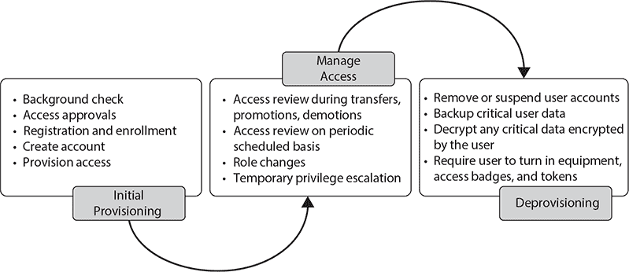

FIGURE 5.5-1    身份访问和管理生命周期

## 复习

**目标 5.5：管理身份和访问配置生命周期** 在此目标中，我们回顾了身份和访问配置生命周期，它包括为执行所有活动以向用户提供信息系统访问权限。此配置生命周期基于识别和身份验证、授权、审计和问责制以及不可否认性的核心安全原则。生命周期还必须考虑最小权限原则、职责分离和问责制。

我们讨论了用户、系统和服务的初始账户配置，以及进行定期访问审查的必要性。我们研究了配置和取消配置流程，这些流程通常需要主管、人力资源和 IT 人员之间的协调，以确保个人拥有基于其职位职能的正确安全许可和需要知道原则，从而获得资源访问权限。我们研究了人们如何被分配到新角色，以便可以按职位职能仔细控制对系统和信息的访问。

我们还简要涉及了权限提升的问题，以及尽可能减少额外权限的必要性。我们研究了临时提升权限的方法，例如即时配置，以及使用 `runas` 和 `sudo` 等实用程序。我们研究了在初始配置用户账户时通过角色定义权限的必要性，以及当用户晋升或调动时的必要性。

用户受雇期间应在不同时间进行定期账户访问权限审查。当用户晋升或调动时，或至少按定期计划基础进行审查，以确保他们没有积累过多权限，并且基于其持续的需要知道原则、职位和安全许可，他们仍然需要访问敏感资源。

## 5.5 问题

**1.**    你正在为新员工办理入职手续，并确保他们在获得账户和访问敏感系统的权限之前满足所有安全要求。其中一个系统需要进行相当广泛的政府背景调查，该调查已延迟但正在进行中。就授予系统和信息访问权限而言，你应采取的最佳行动是什么？

**A.**    不要创建账户，也不要授予组织内任何其他系统的访问权限。

**B.**    创建账户，仅授予个人当前已获许可并因职位职能具有有效需要知道原则的系统的访问权限，但不要超过此范围。

**C.**    创建账户并授予个人执行其工作所需访问的所有系统的访问权限，因为安全许可流程已经开始并且很可能会获批。

**D.**    创建账户，但仅授予非敏感系统的访问权限。

**2.**    你正在审查一名在公司工作超过十年的员工的权限和访问权限。在此期间，他们晋升了三次，调动了两次。当你审查他们的访问权限时，发现多年前他们被授予了不再应拥有访问权限的系统的特权访问权限。你应该怎么做？

**A.**    不要采取任何行动；用户可能仍需要这些访问权限以确保职位之间的连续性。

**B.**    立即收回用户的所有权限并暂停其账户。

**C.**    继续审查其所有访问权限，确定其当前职位所需的权限，并收回所有其他权限。

**D.**    在审查完成之前，将其从所有角色和组中移除。

## 5.5 答案

**1.**    B    如果新员工因其资格和需要知道原则而被批准访问系统和信息，那么你应该创建账户，并仅授予其访问那些系统和信息的权限。你不应授予其访问任何尚未获批准的信息或系统，无论信息的敏感程度如何。

**2.**    C    你应继续审查其访问权限，确定其当前职位所需的访问权限，并收回所有其他访问权限。你不应收回其当前工作所需的任何访问权限，因为他们仍需履行职责。不采取任何行动是不可接受的答案，因为他们将拥有不再需要的访问权限。

## 实施身份验证系统

## 身份验证系统

本目标讨论身份验证系统，特别是那些连接到 Internet 并帮助在多个系统之间实现单点登录概念的系统。我们将讨论各种身份验证机制和协议，这些是您参加 CISSP 考试所需熟悉的内容，其中包括 OpenID Connect、OAuth、SAML、Kerberos、RADIUS 和 TACACS+。

我们在整本书中都讨论了身份验证概念，但在此目标中，我们将其进一步深入，讨论必须在联合系统中连接在一起的身份验证机制，以便在 Internet 上的不同服务器和资源之间提供单点登录（SSO）功能。我们将讨论的身份验证系统支持那些在每个人生活中都已无处不在的服务；例如，它们使您能够登录金融网站并安全地将凭据传递给您的银行，向不同的债权人支付账单，并转账资金。这些协议和机制允许智能设备上的不同应用程序使用身份管理（IdM）服务以安全的方式进行透传身份验证。我们还将讨论您也会遇到的更传统的身份验证机制，例如 Microsoft 的 Active Directory 中实现的 Kerberos，以及远程访问协议 RADIUS 和 TACACS+。

## 开放授权

开放授权（OAuth）是一个开放标准授权框架。如果您曾经使用过智能手机上的应用程序，该应用程序需要访问另一个应用程序的敏感信息或服务，您可能会被提示进行身份验证，表现为一个弹出框，要求您输入必须提供服务的应用程序的用户 ID 和密码。这是 OAuth 在实践中的一个示例。OAuth 在应用程序的应用程序编程接口（API）之间交换消息，并创建一个临时令牌，显示一个应用程序向另一个应用程序访问信息或服务已获授权。请注意，OAuth 仅用于授权，不用于身份验证。身份验证是 OpenID 和 OpenID Connect 发挥作用的地方，将在下一节讨论。

## OpenID Connect

OpenID Connect（OIDC）是另一个开放标准，但在此情况下，它是由 OpenID 基金会支持的 `身份验证` 标准。OpenID 可以方便用户仅使用一组凭据登录到多个不同的网站。该组凭据由第三方身份提供者（IdP）维护，称为 OpenID 提供者。如果用户访问支持 OpenID 的 Web 资源，他们必须输入其 OpenID 凭据，这反过来会导致网站（称为 `信赖方`）和 OpenID 提供者交换身份验证信息，如果提供者对凭据和用户身份进行身份验证，则允许访问。

**考试提示** 为了减少混淆，请记住 OAuth 是一个 `授权` 框架，OpenID 是一个 `身份验证` 层，而 OpenID Connect（OIDC）是一个身份验证框架，它位于 OAuth 之上以提供身份验证和授权服务。

## 安全断言标记语言

安全断言标记语言（SAML）是一种基于 XML 的语言，用于允许身份提供者与服务提供者安全地交换身份验证信息，例如身份和属性。SAML 使用基于 XML 的消息，称为 `SAML 断言`，这些消息在请求访问资源的用户和资源所有者之间交换。这些断言包含凭据信息，例如身份，由集中式第三方 IdP 进行身份验证。

SAML 使用特定的 XML 标签来允许应用程序格式化有关用户的身份信息。SAML 目前有三个组件，版本为 2.0：

• `主体` 这是请求访问的用户。
• `身份提供者` 这是验证用户身份的实体。
• `服务提供者` 这是拥有或控制用户请求访问的服务或应用程序的实体。

由于 SAML 是一种常见标准，它被许多不同的身份和服务提供者使用。例如，如果用户请求访问网站或资源，服务提供者会向用户请求身份信息，用户通过基于 Web 的应用程序提交该信息。服务提供者获取该响应，并向身份提供者请求身份验证验证，身份提供者反过来向服务提供者提供经过验证的身份验证信息，例如关于用户身份验证信息的断言以及他们对资源拥有的任何授权。然后服务提供者可以允许或拒绝访问资源。可以对 Web 资源进行用户身份验证的第三方 IdP 示例包括 Microsoft、Google 和 Facebook。

## Kerberos

Kerberos 是一种流行的开放标准身份验证协议，广泛应用于各种技术中，包括 Linux 和 UNIX，其中最突出的是 Microsoft 的 Active Directory。Kerberos 在 MIT 开发，提供 SSO 和端到端安全身份验证服务。它通过生成称为 `票据` 的身份验证令牌来工作，这些令牌被安全地颁发给用户，以便他们可以进一步访问网络上的资源。Kerberos 使用对称密钥加密和共享密钥，而不是在网络上传输密码。

Kerberos 有几个重要组件，您应该了解以备 CISSP 考试：

• `密钥分发中心（KDC）` 是 Kerberos 域内的主要组件。它存储所有主体的密钥，并提供身份验证和密钥分发服务。在 Microsoft Active Directory 中，域控制器充当 KDC。
• `主体` 是 KDC 拥有其账户并与其共享密钥的任何实体。
• `票据` 本质上是会话密钥，在预定的时间后过期。票据由 KDC 颁发，主体使用票据来访问资源。
• `票据授予票据（TGT）` 在用户进行身份验证时颁发给用户，以便他们可以稍后使用它来请求会话票据。
• Kerberos `域` 由 KDC 提供服务的所有安全主体组成；Microsoft 将 Kerberos 域实现为 Active Directory 域。
• KDC 上的 `身份验证服务（AS）` 在用户登录到 Kerberos 域时对主体进行身份验证。
• `票据授予服务（TGS）` 生成会话票据，当安全主体需要对资源或彼此进行身份验证时，会将这些票据提供给他们。

使用 Kerberos 进行身份验证的过程可能比较复杂，但您应该为考试熟悉它。基本上，该过程的工作方式如下：

1. 用户通过登录到域主机进行身份验证，该主机将用户名发送到 KDC 上的身份验证服务。KDC 将 TGT 发送给用户，该 TGT 使用 TGS 的密钥进行加密。
2. 如果用户在登录时正确输入了密码，则 TGT 会被解密，用户将被允许访问其设备。
3. 当用户需要访问网络资源时，其工作站将 TGT 发送到 TGS 以请求访问资源。
4. TGS 创建并发送加密的会话票据回给用户，以便对资源进行身份验证。
5. 当用户收到加密的会话票据时，其工作站会对其进行解密，并将其发送到资源进行身份验证。
6. 如果资源（例如，文件服务器或打印机）能够验证该票据同时来自用户和 KDC，则允许访问。

请注意，身份验证和票据分发在很大程度上依赖于 Kerberos 域内的系统时间同步；KDC 会对所有票据加时间戳，并且必须能够访问有效的时间源，例如网络时间协议（NTP）服务器。如果 Kerberos 域内设备的时间设置差异超过指定量，将会导致票据时间戳出现问题。这种同步要求有助于防止重放攻击。

Kerberos 是一种非常强健的身份验证和授权系统；不过，它也存在几个弱点：

• 除非部署了多台服务器以实现冗余，否则 `KDC` 是单点故障。

• `KDC` 必须具备可扩展性，并能够处理网络上的用户数量。

• 弱密钥（例如密码）容易受到攻击。

• 密钥会暂时存储在用户设备上（有时处于解密状态），因此如果设备被攻破，密钥也可能被攻破。

操作系统和其他安全控制措施可以帮助缓解 Kerberos 的弱点；这些措施包括加密所有流量以及保护最终用户设备。

## 远程访问身份验证和授权

CISSP 考试目标要求你了解各种远程访问身份验证和授权协议及技术。我们在本领域的前面部分介绍过其中一些，并在目标 4.3 中简要提及了 `RADIUS` 和 `TACACS+`。针对本目标，我们将更详细地介绍 `RADIUS`、`TACACS+` 以及另一种远程访问协议 `Diameter`。这些协议被称为身份验证、授权和审计（或计费，具体取决于来源），即 AAA 协议。

AAA 协议为可能使用拨号、VPN 或其他类型远程连接的远程用户提供这些服务。它们使用运行这些协议的远程访问服务器，这些服务器还可以连接到身份验证数据库，例如 Microsoft 的 Active Directory。虽然这些远程访问技术并未广泛使用，已被更现代的 VPN 技术取代，但你可能仍会在特殊情况下（例如在完全身份验证和连接配置之前与互联网服务提供商进行初始连接）、旧系统或高速互联网覆盖稀少的地点看到它们的使用。

## RADIUS

远程拨入用户身份验证服务（`RADIUS`）是一种访问协议，可为远程连接到网络提供身份验证、授权和计费服务。`RADIUS` 最初是为了支持使用拥有大量调制解调器库、身份验证数据库以及针对这些连接的计费和账单服务的基础设施的大型互联网服务提供商（`ISPs`）的拨号连接而创建的。`RADIUS` 使用网络访问服务器进行拨入，但随后可以将身份验证服务卸载到内部凭据数据库。`RADIUS` 支持许多较旧的身份验证协议，例如 `PAP`、`CHAP` 和 `MS-CHAP`。

就通信保护而言，`RADIUS` 服务器可以加密密码，但不能加密其他内容，包括用户名和其他会话通信信息，例如 IP 地址、主机名等。`RADIUS` 还需要比其他协议（特别是下一节将讨论的 `TACACS+`）更多的开销，因为它依赖于 `UDP`（通过端口 1812/1813 或 1645/1646），并且必须具有内置的错误检查机制来弥补 `UDP` 无连接设计的不足。

## TACACS+

终端访问控制器访问控制系统加强版（`TACACS+`）的功能类似于 `RADIUS`，但两者差异很大。`RADIUS` 使用 `UDP`，而 `TACACS+` 使用 `TCP`（通过端口 49）。`TACACS` 家族中有三种不同的协议：原始 `TACACS` 协议、`TACACS+` 和扩展 `TACACS`（`XTACACS`）。你应该了解，原始 `TACACS`、`XTACACS` 和 `TACACS+` 是三种不同的协议；它们彼此不兼容。事实上，`TACACS+` 和 `XTACACS` 最初是 Cisco 的专有协议，但 `TACACS+` 后来已成为开放标准。

`TACACS` 将其身份验证和授权服务合并在一起，但 `XTACACS` 将身份验证、授权和计费功能分开。还值得注意的是，`TACACS+` 通过添加多因素身份验证改进了 `XTACACS`，而原始 `TACACS` 仅使用固定密码。

## Diameter

`Diameter` 是为增强 `RADIUS` 的功能并克服其众多局限性而开发的。它比 `RADIUS` 或 `TACACS+` 提供更多的灵活性和功能。它被无线设备和智能手机使用，并可以通过移动 IP、PPP 以太网甚至 VoIP 使用。`Diameter` 与 `RADIUS` 和 `TACACS+` 的不同之处在于，虽然它们是客户端/服务器协议，但 `Diameter` 是一种对等协议，任何端点都可以发起通信。请注意，`Diameter` 与 `RADIUS` 不向后兼容；它被视为一种升级。

**考试提示** 虽然 CISSP 考试目标中未明确指出，但当问题集中在 `RADIUS` 或 `TACACS+` 时，你可能会在选项中看到 `Diameter` 作为干扰项或错误答案，因此至少了解它是个好主意。`Diameter` 是一种类似技术，几乎总是与 `RADIUS` 和 `TACACS+` 协议一起讨论。

## 复习

**目标 5.6：实施身份验证系统** 在本目标中，我们讨论了广泛用于连接互联网上的系统并安全地在系统之间传递凭据的身份验证机制、系统和协议，从而使用户能够实现单点登录。我们讨论了两种重要身份验证机制的具体内容，即开放授权（`OAuth`）和 OpenID Connect（`OIDC`），以及一种基于 XML 的语言 `SAML`，它允许依赖第三方 IdM 服务的系统之间安全地交换凭据。我们还讨论了 `Kerberos` 等协议，它在 Microsoft 的 Active Directory 中很普遍，以及用于远程连接中身份验证、授权和计费的三种关键 AAA 协议，即 `RADIUS`、`TACACS+` 和 `Diameter`。

## 5.6 问题

**1.** 你正在对公司开发的基于 Web 的应用程序进行安全审查。但是，开发人员未内置对任何第三方身份提供程序的支持，并且不确定如何实现。他们需要能够使用一种通用语言来帮助与第三方提供程序交换身份验证信息。你应该建议他们使用以下哪项？

**A.** `OAuth`

**B.** `RADIUS`

**C.** `SAML`

**D.** `TACACS+`

**2.** 你正在排查客户 Active Directory 基础设施的问题。用户只能断断续续地对网络进行身份验证并访问资源。查看多个日志后，你发现多个条目表明票据正在快速过期，或因不再有效而被拒绝。以下哪项可能是问题的根源？

**A.** 网络上的时间同步未正常工作。

**B.** `KDC` 已离线。

**C.** 用户输入了错误的凭据。

**D.** 故障网络设备导致服务中断。

## 5.6 答案

**1.** C 你应该建议开发人员，Web 应用程序应支持 `SAML`，因为它是一种基于 XML 的标准化语言，用于与第三方身份提供程序交换身份验证信息。

**2.** A 由于票据在使用前即过期，且部分日志显示票据因不再有效而被拒绝，您应开始调查网络时间源，并确保所有主机都接收正确的时间同步。Kerberos 高度依赖整个网络的时间同步，时间不正确可能导致票据过早过期，或因票据不再有效而被拒绝。这还可能间歇性地阻止用户对网络进行身份验证或访问资源。

## 安全评估与测试

## 域目标

• 6.1 设计并验证评估、测试和审计策略。

• 6.2 执行安全控制测试。

• 6.3 收集安全流程数据（例如，技术和行政）。

• 6.4 分析测试输出并生成报告。

• 6.5 执行或促进安全审计。

域 6 涉及安全评估与测试这一重要主题。安全评估与测试使网络安全专业人员能够确定为保护资产而实施的安全控制是否正常运行，并达到其设计所要满足的标准。在本域的过程中，我们将讨论几种类型的评估和测试，并说明使用其中一种而非另一种的情况和原因。本域涵盖设计和验证评估、测试和审计策略；执行安全控制测试；收集用于执行测试的安全流程数据；检查测试输出并生成测试报告；以及执行安全审计。

## 设计和验证评估、测试和审计策略

在进行任何类型的安全评估、测试或审计之前，组织必须明确开展该活动的原因，以便选择满足其需求的正确流程。信息安全专业人员出于各种原因、具有不同目标，并有时为每种评估、测试和审计采用不同方法。在本目标中，我们将探讨组织可能希望进行特定类型评估、测试和审计的原因，包括内部、外部和第三方，并讨论每种类型的策略。

## 定义评估、测试和审计

在讨论进行评估、测试和审计的原因及相关策略之前，定义每个流程的含义很有用。尽管评估、测试和审计这几个术语经常被混用，但每个术语都有其独特的含义。请注意，每个安全流程都包含可能重叠的活动；事实上，这三个流程中的任何或全部都可以作为同一工作的一部分同时进行，因此有时很难将它们相互区分开，或将其作为独立事件分开。

**NOTE** 尽管“评估”是您在提及测试和审计时最常听到的术语，但为了在本目标中避免在一般性引用安全评估、测试和审计时产生混淆，我们将使用“评价”这一术语。

测试是一种定义的程序，用于记录被测系统的属性、特征和行为。测试可以使用手动检查表、自动化软件（如漏洞扫描器）或两者的组合来进行。通常，测试有一个特定目标，收集的数据用于确定目标是否达成。测试结果可能会与监管标准或合规框架进行比较，以查看这些结果是否满足或超过要求。大多数与安全相关的测试在技术性质上，但不一定非得如此。例如，社会工程测试可以帮助确定用户是否接受了足够的培训，能够识别并抵制社会工程攻击。我们将在本域后面讨论的其他测试示例包括漏洞测试和渗透测试。

`assessment` 是一组相关测试，通常旨在确定系统是否符合指定的安全标准。测试集合不必全部是技术性的；例如，控制评估可能包括技术测试、文档审查、与关键人员访谈等。我们将在本域后面讨论的其他评估包括漏洞评估和合规性评估。

**Cross-Reference**

安全评估的领域还包括风险评估，这些在目标 1.10 中已讨论过。

审计旨在衡量安全控制的有效性。作为常规业务流程的审计是持续进行的。作为侦测控制的审计通常涉及查看审计跟踪（如日志文件），以发现违规行为或违反安全策略的情况。另一方面，作为特定事件的 `audit` 包括对特定系统或流程进行量身定制的、系统性的评估，以确定其是否符合特定标准。虽然审计可用于分析基础设施中的特定事件（如交易），但审计人员可能被专门指派审查特定事件、活动或流程。

## 设计和验证评价

评价旨在实现特定结果，无论是合规性评估、安全流程审计还是系统安全测试。虽然大多数这类评价使用类似的流程和程序，但组织希望从评价中获得的信息和结果可能会影响其设计方式。例如，必须产生技术配置发现的测试必须设计为扫描系统、以常用格式收集安全配置信息，并以经过验证为准确且可接受的方式一致报告这些结果。评价的设计和验证对于结果的一致性和有用性至关重要。

## 目标和策略

组织选择使用的安全评价类型取决于其目标。组织希望从评估中获得什么？需要测试什么？需要以何种方式进行审计，为什么需要以特定方式进行？根据组织使用的安全评价类型，可以采用不同的策略来执行每种活动。为了涵盖考试目标 6.1，我们将讨论涉及在评估、测试和审计中使用内部人员、外部人员和第三方团队的目标和策略。

## 使用内部、外部和第三方评估人员

任何类型的评价都可能耗费大量资源；即使使用内部人员，简单的系统测试也会耗费时间和人工工时。涵盖多个系统的大型评估，或审查多个不同安全业务流程的审计，可能非常昂贵，尤其是涉及许多不同人员并需要系统停机时。组织可以通过有效高效地利用可用内部资源来降低成本，尤其是这些资源的人工工时已经预算。然而，内部团队并不总是执行评价的最佳选择，因为它们可能存在确认偏差。有时，使用外部团队或第三方评估人员是获得真正客观评价所必需的。

Table 6.1-1 总结了内部评估人员与外部（第二方）评估人员和第三方评估人员的使用情况，以及它们的优缺点。

**TABLE 6.1-1** 评估人员类型及其特征

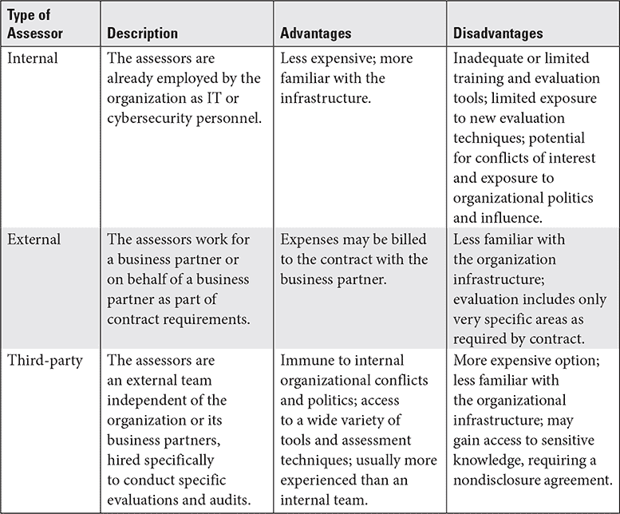

**EXAM TIP** 虽然内部评估员与其他类型评估员之间的区别似乎很简单，但外部评估员与第三方评估员之间的区别可能就没那么简单了。内部评估员为组织工作；外部评估员为业务合作伙伴或与组织有关联的人员工作。第三方评估员与组织及其任何合作伙伴完全独立。通常，他们为独立的外部实体（例如监管机构）工作。

## REVIEW

**Objective 6.1: Design and validate assessment, test, and audit strategies** 在本目标中，我们定义并讨论了评估、测试和审计。我们还探讨了使用内部、外部和第三方评估员的三种关键策略。选择使用哪种类型的评估员取决于多个因素：组织的安全预算、如果使用内部审计员可能产生的利益冲突或政治问题，以及评估员对基础设施的熟悉程度。另一个需要考虑的因素是对评估技术的更广泛了解以及能够使用更先进的工具。

## 6.1 QUESTIONS

**1.** 你的经理要求你确定系统中特定控制措施是否功能正常且有效。此工作范围非常有限，仅使用一组定义的程序来关注特定目标。以下哪种方法最为合适？

**A.** Assessment

**B.** Test

**C.** Audit

**D.** Review

**2.** 你需要对公司的一个系统进行重大安全合规性评估。此评估预算非常充足，并且必须独立于组织影响进行。以下哪种类型的评估团队最适合开展此项评估？

**A.** Third-party assessment team

**B.** Internal assessment team

**C.** External assessment team

**D.** Second-party assessment team

## 6.1 ANSWERS

**1.** B 测试是最合适的方法，因为它范围非常有限，仅涉及用于检查控制措施功能性和有效性的程序列表。评估由多个测试组成，范围要广泛得多。审计关注特定事件或业务流程。审阅不是三种评估类型之一。

**2.** A 第三方评估团队最适合开展重大安全合规性评估。此类评估团队不受组织影响，但通常也是开展此类工作最昂贵的团队类型。不过，组织为此项工作拥有充足的预算。内部评估团队不独立于组织影响，但通常费用较低。“外部评估团队”和“第二方评估团队”是同一类型团队的两种称呼，通常作为两个实体（例如业务合作伙伴）之间合同的一部分来雇用，且仅用于评估合同的特定要求。

### Conduct security control testing

Objective 6.2 详细介绍了使用各种技术和测试方法进行安全控制测试。安全控制测试涉及出于三个主要原因对控制措施进行测试：评估已实施控制措施的有效性、确定控制措施是否符合治理要求，以及查看控制措施在多大程度上降低或减轻了资产的风险。

## Security Control Testing

在本目标中，我们将讨论各种测试，这些测试用于验证安全控制措施是否按设计方式运行，并验证其在实现目的方面的有效性。这些测试各自用于验证和验证安全控制措施。我们将探讨不同类型的测试，例如漏洞评估和渗透测试。我们还将查看日志中审计跟踪的审阅，这些日志描述了测试期间发生的情况。我们将回顾安全控制测试的其他方面，例如测试期间使用的合成事务，以及可以对基础设施资产进行的一些更具体的测试类型。这些包括代码审查和测试、使用和误用用例测试、接口测试、模拟违规攻击以及合规性测试。在此讨论期间，我们还将讨论测试覆盖率分析，以及针对特定评估，究竟需要多少测试才足够。

## Vulnerability Assessment

漏洞评估是一种测试类型，涉及识别系统中单个组件、整个系统，甚至组织不同区域中存在的漏洞或弱点。虽然我们通常将漏洞评估视为技术性测试，但也可以对人员和流程进行漏洞评估。回顾 Objective 1.10，漏洞不仅是资产固有的弱点，还包括缺乏安全控制措施，或安全控制措施在保护资产或降低风险方面效果不佳的情况。

漏洞评估可以使用多种方法进行，但大多数技术评估涉及使用网络扫描工具，例如 `Nmap`、`OpenVAS`、`Qualys` 或 `Nessus`。这些漏洞扫描仪为我们提供关于基础设施的信息，例如网络上的活动主机、这些主机上的开放端口、协议和服务、配置错误、缺失的补丁，以及大量其他信息。当这些信息与其他类型的测试相结合时，可以告知我们网络上存在哪些弱点和漏洞。

**EXAM TIP** 漏洞评估与接下来讨论的渗透测试的区别在于，在漏洞评估期间，我们只查找漏洞；我们不会尝试利用它们来采取行动。

本书的其他部分也涵盖了漏洞缓解，但请理解，你必须对发现的漏洞进行优先级排序以进行缓解。大多数缓解措施包括打补丁、重新配置设备或应用程序，或在基础设施中实施额外的安全控制措施。

## Penetration Testing

渗透测试可以被视为漏洞评估的下一步逻辑延伸，但存在一些关键区别。首先，虽然漏洞评估查找理论上可被利用的弱点，但渗透测试更进一步，证明这些弱点 `can` 被利用。发现扫描工具报告为严重的漏洞是一回事，但拥有实际利用该弱点所需的工具、技术或知识则是完全不同的事情。换句话说，发现严重漏洞与攻击者利用它的能力之间往往存在很大差异。渗透测试试图利用已发现的漏洞并影响系统变化。渗透测试更加精确，因为它们展示了你应该关注的网络上的真实弱点。这有助于你更好地分配资源和缓解措施，以消除那些确实可以被利用的漏洞，而不是那些可能不容易被利用的漏洞。

**CAUTION** 渗透测试对组织可能非常具有侵入性，并可能导致基础设施组件（例如系统、网络和应用程序）出现故障或性能下降。在执行渗透测试之前，所有相关方都应了解涉及的风险，并且渗透测试团队与客户之间应有书面协议明确说明这一点，客户需签字确认其了解潜在风险。

有几种不同的方法可以对渗透测试人员和渗透测试进行分类。首先，你应该了解通常参与渗透测试的不同类型的测试人员（有时也被称为黑客）：

• `White-hat (ethical) hackers` 安全专业人员，他们测试系统以确定其弱点，从而可以减轻这些弱点并更好地保护系统

• `Black-hat (unethical) hackers` 恶意实体，他们入侵系统以渗透系统、访问敏感数据或破坏基础设施运营

• `Gray-hat hackers` 在白帽和黑帽世界之间来回切换的黑客，有时会将其专业知识出售以造福组织，有时则会从事不道德或非法活动

**NOTE** `Black-hat hackers`（以及作为 `Black-hat hackers` 运行的 `Gray-hat hackers`）通常不被视为渗透测试人员，因为他们的动机不是测试安全控制以改善系统安全性。

请注意，道德黑客或测试人员可能是为组织持续工作的内部安全专业人员，也可能是作为受组织聘请的独立团队提供有价值服务的外部安全专业人员。

除了渗透测试中各种颜色的帽子之外，在安全测试或演练过程中，我们还会遇到红队、蓝队和白单元。`red team` 这个词只是渗透测试团队的另一个名称，即攻击性测试人员组。`blue team` 是作为基础设施防御者的人员群体的名称，他们负责检测和响应攻击。最后，`white cell` 作为一个独立实体，促进 `blue` 和 `red` 团队与组织管理层之间的沟通和协调。`white cell` 通常是管理演练的团队，作为所有利益相关者的联络人，并在演练期间对任何冲突拥有最终决策权。

正如测试人员有不同的类别一样，测试也有不同的类别。每个类别都有其独特的特征和优势。以下将其总结为关键术语和定义，以帮助你记住它们以备考试：

• `Full-knowledge (aka white box) test` 一种渗透测试，测试团队对基础设施及其架构有完全了解，包括操作系统、网络分段、设备及其漏洞。这种测试有助于团队专注于特定感兴趣的领域或特定漏洞。

• `Zero-knowledge (aka blind or black box) test` 一种渗透测试，团队对基础设施一无所知，必须依靠能够发现的任何开源情报来确定网络特征。这种测试有助于从攻击者的角度发现网络架构及其漏洞，因为这是真实攻击者最可能面临的情况。在此场景中，防御者可能知道基础设施正受到测试团队的攻击，并将根据测试场景做出相应反应。

• `Partial-knowledge (aka gray box) test` 一种介于全知识测试和零知识测试之间的渗透测试，测试团队对基础设施仅拥有一些有限的有用知识。

• `Double-blind test` 一种对攻击团队为零知识，且防御者也不知道评估的渗透测试。这种测试的优势在于，防御者的检测和响应能力也会得到评估，并且往往会以更现实的方式做出反应。

• `Targeted test` 一种针对组织管理层特定感兴趣领域的测试，可以由上述任何类型的测试人员或团队执行。

**EXAM TIP** 除非你已获得适当授权，否则绝不应进行渗透测试。组织管理层和测试团队应共同制定一套“参与规则”，该规则应明确界定测试参数，并以书面形式授予你执行测试的权限。

## 日志审查

日志审查在正常安全业务流程和安全评估期间都发挥多种功能。在更广泛的范围内，日志审查每天进行，以检查网络中发生的不同类型的事务，例如审计用户操作或其他感兴趣的事件。日志会被频繁审查，以确定是否发生了任何异常或恶意行为。在安全评估期间，日志审查发挥相同的功能，并记录安全测试的结果。日志在安全测试期间和之后都会被审查，以确保测试按照其设计参数进行并产生可预测的结果。当出现未预测的测试结果时，日志可用于追踪原因。

日志可以手动审查，或由自动化系统（如安全信息和事件管理（`SIEM`）系统）摄取，用于聚合、关联和分析。日志有助于重建时间线和事件顺序，特别是当它们来自可能呈现不同视角的不同来源时。

## 合成事务

信息系统通常基于事务系统运行。`transaction` 是一系列按某种串行或并行顺序发生的单个事件的集合，以产生所需行为。例如，当创建用户帐户时发生的事务，包含几个单独的事件，如创建用户名、然后创建密码、为帐户分配其他属性，最后将帐户添加到具有特定权限的用户组中。`Synthetic transactions` 是旨在模拟真实用户和进程行为的自动化或脚本事件。它们允许安全专业人员系统地测试关键安全服务在特定条件下的行为。合成事务可能包含几个脚本事件，这些事件创建具有特定属性的对象，并针对这些对象执行代码以引起特定行为。合成事务的优势在于可控、可预测且可重复。

## 代码审查与测试

代码审查包括检查开发的软件代码的功能、性能和安全特性。代码审查旨在确定代码是否符合组织设定的特定标准。代码审查有多种方法，包括由人工进行的手动审查和由代码审查软件及脚本进行的自动化审查。可以将代码审查视为在软件代码发布并投入生产系统运行之前进行的校对。代码审查中审查的项目包括结构和语法、变量、与系统资源（如内存和 CPU）的交互、安全问题（如嵌入式密码和加密模块）等等。

除了审查之外，代码还使用手动和自动化工具进行测试。代码测试涉及的一些安全方面包括

• 输入验证

• 安全数据存储

• 加密和身份验证机制

• 安全传输

• 依赖不安全或未知资源，例如库文件

• 与系统资源（如内存和 CPU）的交互

• 边界检查

• 导致非安全应用程序或系统状态的错误条件

## 滥用用例测试

## 用例测试和误用案例测试

用例测试用于评估从功能角度看，软件可能被正确使用的所有不同可能场景。误用案例测试涉及评估软件可能被滥用或恶意使用的不同场景。误用案例是一种用例类型，用于测试软件代码可能以未经授权、恶意或破坏性的方式进行交互。误用案例用于确定恶意实体（例如黑客）可能利用软件应用程序或系统中弱点的所有各种方式。

## 测试覆盖率分析

在进行评估时，您应确定系统、应用程序或流程的哪些部分将由评估覆盖，您将测试多少，以及测试的深度或详细程度。这被称为测试覆盖率分析，旨在得出测试或整体评估将检查系统多少部分的百分比测量值。IT 专业人员、安全专业人员和管理层在批准和进行评估之前都想了解这一限制。

测试覆盖率分析考虑许多因素，例如评估成本、人员可用性和系统关键性。显然，高度关键的系统比非关键系统需要更多的测试覆盖率，以确保分析所有可能的场景和异常。测试覆盖率分析可以是一种随时间延伸的测量值；例如，组织可以每周对其 25% 的资产进行深入漏洞测试，这样一个月后，所有资产都已覆盖，然后该过程重复。这种方法确保基础设施的任何一部分都不会被遗漏测试。

## 接口测试

接口是硬件和软件之间的连接和入口/出口点。接口示例包括图形用户界面（GUI），它帮助人类用户与系统通信，以及网络接口，它将系统连接到网络以促进数据交换。接口还可以包括安全机制、应用程序编程接口（API）、数据库表以及许多其他示例。无论如何，接口代表通信和数据交换的关键节点，应针对安全性进行测试。

接口的安全问题包括数据从更安全的环境移动到较不安全的环境、将恶意软件引入系统，以及用户或进程的未经授权的访问。接口通常不仅负责在系统或网络之间交换数据，还负责数据转换，这可能会影响数据完整性。接口测试应解决所有这些问题，并确保实体之间交换的数据格式正确，并使用正确的访问控制进行传输。

## 违规攻击模拟

违规攻击模拟是一种自动化渗透测试形式，组织可以针对各种系统、网络段甚至应用程序对其自身进行此类测试。违规攻击模拟通常按固定时间表进行，并介于漏洞测试和渗透测试之间，因为它试图发现确实可利用的漏洞。通常，违规攻击模拟不会实际利用漏洞，除非其被特意配置为如此；它可能运行自动化测试和合成事务，以显示漏洞确实可利用，而无需实际执行攻击。违规攻击模拟的一个优势是，由于其定期执行，因此不仅仅是一次性评估，而渗透测试则是一次性评估。违规攻击模拟通常作为软件包的一部分提供，有时作为基于订阅或云的安全套件的一部分。

## 合规性检查

合规性检查是旨在确定控制或安全流程是否符合治理要求的测试或评估。虽然合规性检查的执行方式与迄今讨论的其他类型评估基本相同，但真正的区别在于，结果要根据有时非常详细的要求进行核对，这些要求通过法律、法规或控制必须满足的强制性标准传递下来。例如，仅确认控制确保传输过程中数据加密可能还不够；治理要求可能规定加密强度必须达到某个级别或使用特定算法，因此必须检查控制以确定其是否满足该要求。

**NOTE** 虽然这两个术语肯定相互关联，但安全和合规并非同义词。控制可能是安全的，但由于缺乏文档或一致的流程，不一定合规。反之亦然。

大多数评估不仅检查控制的安全性及其保护资产的效果，还检查其是否符合规定的治理要求。单个测试（例如由网络扫描仪执行的漏洞评估）可能只能确定控制是否安全。由执行整体评估的安全分析师来确定其是否符合治理要求。

## 复习

**目标 6.2：执行安全控制测试** 在此目标中，我们更深入地探讨了安全控制测试。我们讨论了整体评估，例如漏洞评估和渗透测试。漏洞评估查找系统中的弱点，但不尝试利用它们。另一方面，渗透测试不仅发现漏洞，还通过尝试利用它们来评估其严重性。渗透测试可以有多种形式，并可由不同类型的测试人员执行，例如道德黑客或内部和外部测试人员。渗透测试可以以不同方式分类，例如全知识、零知识和部分知识测试。

评估可以使用不同的工具和方法，但应包括各种方法来验证和确认安全控制。验证意味着测试控制以确定其是否按设计运行；确认意味着确定控制执行该功能的实际有效性。安全控制测试包括：

- 日志审查，以确定测试结果是否与预期一致。
- 合成事务，即可用于测试系统不同功能或安全性方面的脚本事件集。
- 代码审查和测试，对于确保软件代码无错误并采用强大的安全机制至关重要。
- 误用案例测试，用于查看用户可能如何滥用系统，导致未经授权访问信息或系统被攻破。
- 测试覆盖率分析，用于根据系统或应用程序被测试部分的百分比测量值来检查数据。
- 接口测试，用于检查系统、网络、应用程序和其他组件之间的不同连接和数据交换机制。
- 违规攻击模拟，这是一种自动化的定期过程，不仅能发现漏洞，还能更仔细地检查漏洞是否可被利用，而无需实际利用。
- 合规性检查，用于确保控制不仅安全，而且符合治理要求。

## 6.2 问题

**1.** 你是一名网络安全分析师，负责确定网络上的弱点。你的主管明确表示，无论你发现什么弱点，都不得通过确定其是否可被利用来中断运营。以下哪种评估类型最能满足这些要求？

**A.** 渗透测试

## B. 漏洞评估

## C. 零知识测试

## D. 合规性检查

## 2
贵组织已执行多次时间点测试，以确定基础设施中存在哪些弱点以及是否可被利用。然而，此类测试成本高昂，且执行需要大量规划。以下哪项是更好的方法，可以定期不仅确定弱点，还能确定这些弱点是否可能被利用？

## A. 执行漏洞评估

## B. 执行零知识渗透测试

## C. 执行全知识渗透测试

## D. 执行违规攻击模拟

## 6.2 答案

## 1
B 在给定的选项中，执行漏洞评估是首选的测试类型，因为它能发现基础设施中的漏洞，而无需通过尝试利用漏洞来干扰运营。

## 2
D 违规攻击模拟是一种自动化方法，用于定期扫描和测试系统中的漏洞，并运行脚本及其他自动化方法来确定这些漏洞是否可被利用。然而，违规攻击模拟不会实际利用漏洞。

## 收集安全流程数据（例如，技术和行政数据）

为实现目标 6.3，我们将讨论收集和使用安全流程数据的重要性，用于安全评估和测试。安全流程数据是指任何与管理安全计划相关的生成数据，无论是来自常规安全流程的常规数据，还是来自特定事件（如事件或测试事件）的数据。在本领域的背景下，我们将重点关注因安全业务流程而生成的数据。

## 安全数据

在安全流程中可以收集和使用的数据源如此之多，以至于无法在此有限的篇幅内全部涵盖。一般来说，您需要收集技术和行政流程数据，无论是电子数据、书面数据还是叙述数据。各种数据收集方法包括从日志文件、配置文件等中摄取数据，以及手动文档审查和与关键人员访谈。

**EXAM TIP** 安全流程数据可以是技术性的或行政性的。行政数据由行政流程产生的分析或叙述数据组成（例如指标），而技术数据来自用于从系统收集数据的技术工具。

## 安全流程数据

虽然有一些公认的信息类别用于安全，但任何支持组织安全功能的数据都可以称为“安全数据”。显然，安全数据包括日志、配置文件和审计跟踪数据，但其他类型的数据，如安全流程数据（来自行政或技术流程的数据）、风险报告和其他信息，也可用于完善安全流程。并非专门为安全目的创建的有益数据包括架构、电路和建筑图，以及视频或语音录音和为无关目标收集的信息。例如，在调查期间，其中一些信息可用于为事件创建时间线，或支持安全决策。在接下来的几段中，我们将介绍不同的安全流程数据来源及其如何应用于安全功能。

## 数据来源

数据可以通过自动化方式或手动收集，从基础设施中的各种来源接收和收集。技术数据来源可以是设备上的基于代理的软件，也可以通过运行程序或脚本手动从主机检索数据来收集。确实，您应该查看任何能提供有关安全控制有效性、漏洞严重性或应调查和监控的事件的信息的来源。有价值的信息可以从各种来源收集，包括电子日志文件、纸质访问日志、漏洞扫描结果和配置数据。在成熟的组织中，集中式安全信息和事件管理（SIEM）系统可能会收集、汇总和关联所有这些信息。

**Cross-Reference**

目标 7.2 更深入地介绍了 SIEM。

## 账户管理

账户管理数据对安全人员至关重要。账户管理数据包括用户账户的详细信息，包括其权限、特权和其他特权，以及其他用户属性。账户使用历史记录通常以电子账户列表的形式出现，但也可能来自由主管签署的纸质记录，以向新个人授予账户或增加其特权。此信息可用于将用户身份与审计跟踪相匹配，从而便于审计和问责。

## 备份验证数据

备份验证数据很重要，因为组织需要确保其信息得到正确备份、保护、传输和存储。备份验证数据可以来自书面日志，其中网络安全分析师或 IT 专业人员手动记录备份已发生，或者更常见的是，来自备份应用程序或系统生成的事务日志。所有关键信息都应备份，以防发生使数据无法使用或损坏系统的事件。导致数据丢失的事件应得到充分记录，以及备份数据的完整恢复过程。

## 培训和意识

由于安全培训是管理人为因素最关键的部分，个人应拥有反映其完成的所有形式安全培训的培训记录。当组织了解其人员培训得如何、培训频率以及培训主题时，这些数据日后可与趋势进行比较，以指示培训是否导致安全事件的数量或严重程度增加或减少。培训数据可以以电子方式记录在数据库中，以便根据其频率、交付方式和/或主持人分析有效培训。安全培训数据是衡量人员了解其安全责任程度的良好指标。

## 灾难恢复和业务连续性数据

从备份恢复数据的能力很重要。然而，更大的图景是组织对负面事件（如事件或灾难）的反应和恢复程度。关于团队响应事件的速度或团队组织和装备情况的数据，对于评估满足恢复目标的准备情况至关重要。灾难恢复（DR）和业务连续性（BC）数据提供关键恢复点目标、恢复时间目标和最大允许停机时间的详细信息。组织应在灾难发生前制定这些指标。最重要的数据是组织在事件期间实际满足这些目标的程度。

**Cross-Reference**

请参阅目标 1.8 了解 BC 要求，以及目标 7.11 了解 DR 流程。

## 关键绩效和风险指标

迄今为止讨论的许多数据点单独使用可能并不十分有用。收集的数据必须与其他类型的数据进行汇总和关联，以创建信息。被认为有用的数据还应与组织先前开发的测量值或指标相匹配。指标可用于开发关键指标。关键指标显示向目标的整体进展或必须解决的不足之处。关键指标有四种常见形式：

• `Key performance indicators (KPIs)` 指标，显示业务流程甚至系统相对于其预期性能的表现情况。

• `Key risk indicators (KRIs)` 可显示系统、流程或其他感兴趣领域中单一或汇总风险的上升或下降趋势。

• `Key control indicators (KCIs)` 显示控制措施的运行和执行情况。

• `Key goal indicators (KGIs)` 整体指标，可使用其他指标来显示组织目标的实现情况。

这些指标中的大多数是通过汇总、关联和分析相关安全流程数据（包括技术数据和行政数据）来创建的。可用于生成这些指标的数据示例包括在技术扫描中发现的漏洞、风险分析以及用户习惯和事件的摘要。

## 管理评审与批准

应收集并出于治理原因保留的重要数据源之一，是管理评审和批准评估、报告、安全措施等所产生的纸质痕迹。这些信息很重要，以便组织和任何外部实体了解批准政策、实施控制措施或应对风险或安全问题所完成的详细过程。这份文档痕迹不仅对审计和治理很重要，而且还能证明安全计划已获得管理层的批准和参与。在安全流程的整体管理产生任何责任的情况下，它还可以建立尽职调查和合理注意义务。

## REVIEW

**Objective 6.3: Collect security process data (e.g., technical and administrative)** 在本目标中，我们探讨了安全计划应收集的一系列数据点以及收集来源，以维护和管理其安全计划。数据可以来自各种来源，包括应用程序、设备、日志文件和 SIEM 系统的技术数据。相关数据也可以来自书面来源，例如访客访问控制日志，或以基础设施图、配置文件、漏洞评估结果等形式的流程文档。甚至基于人员访谈的叙述性数据也可能有用。关键收集的数据包括但不限于账户管理数据、备份验证数据以及灾难恢复和响应数据。指标涉及使用特定数据来创建关键指标，这些是管理层感兴趣的特定数据点。最后，反映管理层对安全流程和措施进行评审和批准的文档是关键的信息来源。

## 6.3 QUESTIONS

**1.** 你是公司的一名事件响应分析师。你正在调查一起涉及员工访问其无权查看的受限信息的事件。除了审查设备和应用程序日志外，你还希望建立从个人进入设施开始以及他采取的各种其他物理操作的事件时间线。以下哪些信息来源可以帮助你在事件时间线中建立这些事件？（选择两项。）

**A.** 电子徽章访问日志

**B.** Active Directory 事件日志

**C.** 闭路电视视频文件

**D.** 工作站审计日志

**2.** 以下哪项是数据点的汇总，可以向管理层展示控制措施的执行情况或组织中风险的趋势？

**A.** 定量分析

**B.** 安全流程数据

**C.** 指标

**D.** 关键指标

## 6.3 ANSWERS

**1.** A C 徽章访问日志和视频监控日志可以帮助建立事件时间线中的事件，这些事件显示员工的物理活动。

**2.** D 关键指标是已收集、关联和分析的数据点的汇总，用于代表组织中关于绩效、目标和风险的重要指标。

## Analyze test output and generate report

在本目标中，我们将讨论如何处理测试输出和结果，以及如何报告这些结果。不同的组织和法规有不同的报告要求，但我们将讨论分析和报告过程中的关键部分，你应了解这些内容以备 CISSP 考试，以及补救、异常处理和道德披露。

## 测试结果与报告

一旦组织从测试中收集了所有相关数据，就应分析测试输出并将结果报告给所有利益相关者。利益相关者包括管理层，也可能包括业务合作伙伴、监管机构等。每个组织都有其内部报告要求，例如将报告路由到不同的部门和经理、必须进行的编辑和更改以及报告格式。在报告时应考虑所有这些要求，但这里的关键要点是，主要利益相关者（即高级管理层和其他关键组织人员）应了解测试结果、其对组织安全态势和风险的影响，以及降低风险和加强安全态势的前进路径。

## 分析测试结果

分析测试结果涉及收集所有相关数据（如目标 6.3 中讨论的），分析评估期间执行的测试的结果和输出，并将所有这些数据提炼为可操作的信息。无论评估方法论或分析中投入的数据量如何，正确评估测试结果应提供以下内容：

• 彻底、清晰且简洁的分析

• 减少或消除重复或不必要的数据

• 根据严重性、风险、成本等对漏洞或其他问题进行优先级排序

• 显示基础设施中发生的情况以及它如何影响组织安全态势和风险的信息

• 任何问题的根本原因（如果可能）

• 对组织的业务影响

• 缓解替代方案或补偿控制措施

• 识别关键绩效指标 (KPIs)、关键目标指标 (KGIs) 和关键风险指标 (KRIs) 以及组织定义的其他指标的变化。

**Cross-Reference**

KPIs、KGIs 和 KRIs 在目标 6.3 中已定义。

## 报告

完成测试后，安全人员将结果和任何建议报告给管理层和其他利益相关者。报告的目的是向利益相关者说明在测试期间可能发现的任何问题、缺陷或漏洞的实际情况。报告应包括历史分析、根本原因以及管理层应了解的任何负面趋势。此外，任何积极的结果，例如风险降低和良好的安全实践，也应在报告中予以突出。调查结果应以技术术语讨论，供那些拥有知识和经验来实施任何已发现漏洞缓解措施的人阅读，但通常在最终报告中需要对分析进行非技术性摘要，以便高级管理层和其他非技术性利益相关者理解。

报告应清晰传达组织的安全态势、合规状态以及系统或组织所承担的风险，具体取决于报告的范围和背景。还应审查组织正式定义的相关指标，如前所述的指标指标。最后，报告中应包括建议和其他缓解措施，以证明为缓解任何问题所需的资源（资金、时间、设备和人员）支出的合理性。

## 修复、异常处理和道德披露

除了分析测试结果和报告之外，考试目标 6.4 要求我们检查与评估结果相关的三个关键领域。除了本领域和书中其他部分详细说明的其他要求之外，您必须了解修复漏洞、处理漏洞缓解管理例外以及作为道德专业行为的一部分披露漏洞的要求。

## 修复

作为一般规则，所有漏洞都应尽快识别并尽快缓解。这可能意味着修补软件、更换硬件组件、要求人员接受额外培训、制定新政策，甚至改变业务流程。组织试图一次性缓解所有已发现的漏洞通常并不具有成本效益；相反，组织应根据多种因素对漏洞进行优先级排序。严重性是首要任务，其次是缓解成本、对组织及其系统的实际风险水平以及漏洞的范围。例如，一个仅影响未连接外部世界的单个系统的漏洞，对组织来说风险较低，其修复优先级可能低于影响多个关键系统并带来更高风险的漏洞。

修复措施应由管理层仔细考虑，并纳入正式的变更和配置管理流程。措施还应正式记录在流程或系统维护记录中，以及风险文档中。

## 异常处理

如前所述，漏洞应主要根据漏洞的严重性，在实际可能的情况下尽快缓解。但是，有时由于各种原因，包括资源不足、系统停机、法规或其他原因，无法轻松缓解漏洞。`Exception handling` 指的是在无法立即修复漏洞时如何处理漏洞。例如，发现医疗设备中的漏洞，由于美国食品药品监督管理局（FDA）法规无法轻松修补，这要求组织开发异常处理流程，通过采用补偿控制措施来缓解漏洞。

异常流程应从通知能够就缓解选项做出决策的相关人员（通常是高级管理层）开始；记录异常及其原因；并确定可以降低不直接缓解漏洞风险的补偿控制措施。还应有一个后续计划，以评估从更永久的基础上缓解漏洞的长期可行性，这可能包括升级或更换系统、更改控制措施，甚至改变业务流程。

`EXAM TIP` 了解如何通过补偿控制措施、文档和定期后续跟进来处理政策例外，例如无法立即修复的漏洞。

## 道德披露

道德披露是指网络安全专业人员有道德义务向组织的利益相关者披露发现的漏洞。无论您是组织的员工并在日常职责中发现漏洞，还是作为外部评估人员受雇对组织进行评估或审计，这一道德义务均适用。无论哪种情况（或任何其他场景），如果您在软件或硬件产品中发现漏洞，您都有道德义务予以披露。您应向使用该系统或产品的组织、产品的创建者/开发者，以及在必要时向相关专业社区披露任何已发现的漏洞。作为专业礼节，在首先向上述实体披露之前，不应将新发现的漏洞披露给大众，因为该漏洞可能被恶意实体用于在存在缓解措施之前破坏系统。

## REVIEW

**目标 6.4：分析测试输出并生成报告** 该目标总结了您在分析和报告评估结果时应考虑的内容，包括分析测试输出和向所有利益相关者报告测试结果的一般要求。该目标还涉及了漏洞修复、异常处理和漏洞的道德披露。

## 6.4 问题

`1.` 您在组织使用的软件产品中发现了一个漏洞。在研究该漏洞的补丁或其他缓解措施时，您发现该漏洞从未被记录过。作为一名专业的网络安全分析师，您应该采取以下哪些措施？（多选。）

`A.` 直接联系软件供应商报告漏洞。

`B.` 立即在公共安全网站上发布有关漏洞的信息。

`C.` 保持沉默；如果没有人知道漏洞存在，那么就没有人会尝试利用它。

`D.` 通知您的主管。

`2.` 在一次常规漏洞扫描后，您发现几台关键服务器存在一个操作系统漏洞，这使组织面临高风险的利用。该漏洞存在于服务器未使用但默认运行的服务中。该漏洞有补丁，但涉及停机，由于一年中的这个时候数据处理量大，无法接受。以下哪项是解决此漏洞的最佳行动方案？

`A.` 不做任何处理；由于服务器不使用该特定服务，漏洞无法影响它们。

`B.` 立即停机并修补每台服务器上的漏洞。

`C.` 禁用关键系统上的服务运行，并在高峰处理时间过去后，再修补漏洞。

`D.` 禁用该服务，无需担心修补漏洞，因为服务器不使用该服务。

## 6.4 答案

## 1

A D 你应该联系软件供应商并报告漏洞，以便为其开发补丁或其他缓解措施。你还应该联系你的主管，让管理层了解漏洞，并确定保护组织资产所需的任何缓解措施。

## 2

C 漏洞最终必须打补丁，但在短期内，仅仅禁用该服务可能会在高数据处理时间过去之前，在一定程度上缓解或降低风险；之后，服务器可以进行打补丁所需的停机时间。无所作为不是一个选项；即使服务器不使用该特定服务，漏洞仍可能被利用。立即关闭服务器并在每个服务器上打补丁通常不是一个选项，因为这是高数据处理量的时期，这可能会严重影响业务。

## Conduct or facilitate security audits

为了结束我们对安全评估、测试和审计的讨论，在此目标中，我们将讨论进行和促进安全审计，具体使用内部、外部和第三方审计师。我们将重申审计作为过程的定义，以及审计作为独立事件的定义，并提供一些审计示例以及不同类型的审计团队最有益的情况。

## Conducting Security Audits

在目标 6.1 中，我们简要地在两种不同的背景下描述了审计。首先，审计是一种侦测控制，是一个应该持续进行的过程。它是一种安全业务流程，涉及持续监控和审查数据，以检测违反安全策略、非法活动以及系统和信息访问方式偏离标准的情况。但是，安全审计也可以是计划审查组织内特定领域（例如系统、特定技术，甚至一组业务流程）的独立事件。安全审计还可以用于审查事件，以及确保组织遵循符合合规性或治理要求的标准化程序。

**NOTE** 就我们在此的目的而言，除非另有说明，否则假设本目标中的“审计”和“审计师”特指“安全审计”和“安全审计师”。

为了本目标的目的，我们将研究三种不同的审计团队，可用于进行审计：内部审计师、外部审计师和第三方审计师。这些与目标 6.1 中讨论的三种评估团队类似，因此你会注意到此讨论中存在一些重叠。

**EXAM TIP** 内部、外部和第三方评估者（也在目标 6.1 中简要讨论过）与此处讨论的三种审计师之间几乎没有区别，除非在评估与审计的类型上存在细微差别。能够执行这些工作的团队具有相同的特征。

## Internal Security Auditors

与外部和第三方审计团队相比，内部审计师可能是最具成本效益的。内部审计师为相关组织全职工作，因此审计已经是他们正常日常职责的一部分。网络安全审计师负责每天审查日志和其他数据，以检测策略违规、非法活动和基础设施中的异常。但是，审计师可以被分配到特定事件，例如审查账户管理流程或审查事件响应或业务连续性演练的结果。

使用内部审计师的优势包括

- 成本效益，因为审计师已经为组织工作
- 与外部审计相比，安排内部审计的难度较小
- 熟悉组织、其人员、流程和系统
- 减少敏感数据向外部人员暴露

但是，使用内部审计团队也有劣势，而且确实存在不允许这种情况的情形，特别是当审计由外部实体（例如监管机构）指导时。使用内部审计团队的劣势包括

- 受组织政治和利益冲突的影响
- 可能不是全职审计师，并且在审计事件期间可能还有其他必须履行的职责
- 缺乏与组织结构和管理层的独立性
- 在各种审计工具和技术方面经验不足
- 如果治理要求独立审计，可能不被外部机构允许

## External Security Auditors

就像目标 6.1 中提到的外部评估团队一样，外部审计团队通常为组织的业务合作伙伴实体工作。组织之间的合同或其他法律协议可能规定某些系统、活动或流程必须定期接受审计。外部审计师（也称为第二方审计师）将定期进入组织，审计特定系统或流程，以满足合同要求。

与内部审计团队一样，使用外部审计师也有优势和劣势。优势包括

- 成本可能高于内部审计团队，但通常已预算并包含在合同中
- 不太容易受到组织政治或利益冲突的影响
- 由于合同要求而有明确的时间表（例如，每年）

使用外部团队的劣势包括

- 缺乏对组织人员、内部流程和基础设施的熟悉度
- 缺乏独立性（效忠于业务合作伙伴，而不是组织）
- 可能受到业务合作伙伴内部利益冲突或政治的影响
- 可能会产生与内部团队相同的一些限制，例如在常规 IT 或网络安全工作之间分配时间、缺乏先进审计工具和技术的访问权限等。

## Third-Party Security Auditors

与此目标相关的第三个也是最后一个选项是使用第三方审计师。第三方审计师不为组织或其任何业务合作伙伴工作。第三方审计团队通常需要独立于任何内部利益相关方实体。这是监管机构可能雇佣的团队类型，例如，以确保遵守法律或法规。根据审计类型，组织可能无法选择是否使用第三方审计团队；它可能作为外部治理要求的一部分被强制执行。

与其他两种团队一样，使用第三方审计团队也有优势和劣势。使用第三方审计团队的优势包括

- 真正独立于任何组织利益冲突或政治
- 可以使用先进的审计工具和技术
- 建立遵守或不遵守法规或标准的无偏见证据

使用第三方审计团队的劣势包括

- 三种审计团队中最昂贵的选择；费用不一定总是可以预测或预算
- 有时由于其他审计承诺而难以安排时间，即使需要定期进行
- 缺乏对组织人员、流程和基础设施的熟悉度

**EXAM TIP** 请记住，外部审计师为组织外部的业务合作伙伴或利益相关方工作。第三方审计师为独立组织工作，例如监管机构。

## REVIEW

## 目标 6.5：进行或协助安全审计

在本目标中，我们讨论了进行安全审计。审计是一项持续的业务流程，旨在查找运营中的不当行为和异常情况。但是，审计也是一种用于审查系统、流程和其他活动合规性标准的事件。审计可以由三种类型的审计团队之一执行：内部团队、外部团队和第三方团队。内部团队更具成本效益，但缺乏与组织的独立性，并且可能无法使用正确的审计工具和技术。外部团队为业务合作伙伴或其他利益相关方工作，并根据合同要求审计流程和活动。第三方审计团队更昂贵，但允许一定程度的组织利益相关方独立性，并且在监管审计的情况下可能需要。

## 6.5 问题

**1.** 你是一家公司的网络安全分析师。你被指派审计公司另一个部门的账户管理。以下哪种审计类型会被视为此类？

**A.** 第三方审计

**B.** 外部审计

**C.** 内部审计

**D.** 第二方审计

**2.** 你的公司必须接受审计，以符合保护医疗信息的法规。以下哪种审计人员最适合执行此任务？

**A.** 外部审计人员

**B.** 内部审计人员

**C.** 第二方审计人员

**D.** 第三方审计人员

## 6.5 答案

**1.** C 内部审计使用组织内部的审计人员来评估组织的另一部分。

**2.** D 对于合规性审计，由于其独立性，第三方审计人员通常是执行此项工作的最合适的审计团队类型。

## 安全运营

## 领域目标

• 7.1 了解并遵守调查。

• 7.2 进行日志记录和监控活动。

• 7.3 执行配置管理 (CM)（例如，预配、基线、自动化）。

• 7.4 应用基础安全运营概念。

• 7.5 应用资源保护。

• 7.6 进行事件管理。

• 7.7 操作和维护侦测和预防措施。

• 7.8 实施和支持补丁和漏洞管理。

• 7.9 了解并参与变更管理流程。

• 7.10 实施恢复策略。

• 7.11 实施灾难恢复 (DR) 流程。

• 7.12 测试灾难恢复计划 (DRP)。

• 7.13 参与业务连续性 (BC) 规划和演练。

• 7.14 实施和管理物理安全。

• 7.15 解决人员安全和安全问题。

领域 7 独特之处在于它拥有比任何其他 CISSP 领域更多的目标，并且约占考试问题的 13%。你会发现，本领域（安全运营）涵盖的许多目标在整本书中也已简要讨论过。这是因为安全运营是跨越安全多个领域的多样且全面的活动。

在本领域中，我们将考察广泛的主题，包括具有反应性质的主题，例如调查、日志记录和监控、漏洞管理以及事件管理。我们还将探讨如何确保由补丁管理支持的安全变更和配置管理流程的详细信息。

我们将回顾在领域 1 中也讨论过的一些基础安全运营概念，并将这些概念应用于资源保护。我们还将探讨侦测和预防措施（例如防火墙和入侵检测系统）的一些更技术性的细节。四个目标涉及业务连续性规划和灾难恢复，我们将讨论每个主题涉及的策略，以及如何实施和测试与这些流程相关的计划。最后，我们将回顾物理安全和人员安全与安全问题。

## 了解并遵守调查

在目标 1.6 中，我们简要提及了你在安全领域可能遇到的调查类型，并回顾了目标 1.5 中的相关法律和监管问题。这两个目标与目标 7.1 密切相关，目标 7.1 通过关注*如何*进行调查，将我们的讨论进一步深入。

## 调查

回顾目标 1.6，四种主要的调查类型是行政调查、监管调查、民事调查和刑事调查。但是，无论调查类型如何，所使用的大多数活动、流程和技术在所有调查中都是共通的。这包括如何收集和处理证据；报告和记录调查；使用的调查技术；实施的数字取证工具、策略和程序；以及使用这些工具、策略和程序在计算设备上发现的工件。这些共同活动是本目标的重点。

## 交叉引用

你在网络安全中可能遇到的调查类型在目标 1.6 中已详细讨论。

## 取证调查

计算机、移动设备、网络设备、应用程序和数据文件都包含潜在证据。在涉及其中任何一项的事件中，都必须对其进行调查。计算设备可以以三种不同的方式成为事件的一部分：

• 作为事件的目标（例如，对系统的攻击）

• 作为事件的工具（用于直接实施犯罪，例如黑客攻击）

• 与事件无关（事件的一部分，但不是直接目标或使用的工具，例如研究如何实施谋杀）

*计算机取证* 是识别、保存、获取、分析、发现、记录和向法院（民事或刑事）、公司管理层甚至常规客户提交证据的科学。计算机取证调查由具有独特资格执行这些调查的人员进行。*电子发现* 是另一个你应该熟悉的术语；它是发现数字证据并准备该信息以在法庭上提交的过程。计算机取证过程中最重要的部分是如何收集和处理证据，这将在下一部分讨论。

## 证据收集和处理

证据保存是调查中最关键的部分。即使缺乏经验的调查人员没有经过适当培训来分析证据，只要确保在调查的所有阶段都保存和保护证据，调查仍可挽救。证据保存涉及适当的收集和处理，包括保管链、物理保护和逻辑保护。我们将在接下来的几个部分讨论适当的收集和处理程序。但是，保管链是一个首先要讨论的重要问题。

## Chain of Custody

*Chain of custody* refers to the consistent, formalized documentation of who is in possession of evidence at all stages of the investigation, up to and including when the evidence is presented in court or another proceeding. Chain of custody starts at the time evidence is obtained. The individual collecting the evidence initiates a chain of custody form that describes the evidence and documents the time and location it was collected, who collected it, and its transfer. From then on, every individual who takes possession of the evidence, relocates it, or pulls it out of storage for analysis must document those actions on the chain of custody form. This ensures that an uninterrupted sequence of events, timelines, and locations for the evidence is maintained throughout the entire investigation. Chain of custody assures evidence integrity and protects against tampering. This is one of the most crucial pieces of documentation you must initiate and maintain throughout the entire investigative cycle.

## Evidence Life Cycle

Evidence has a defined life cycle. This means that the moment evidence is identified during the initial response to the investigation, it is collected and handled carefully, according to strict procedures. Chain of custody begins this critical process, but it doesn’t end with that event. Evidence must be protected throughout the investigation against tampering; even the appearance of intentional or inadvertent changes to evidence may call its investigative value and admissibility into court into question.

The evidence life cycle consists of four major phases, summarized as follows:

• **Initial response** Evidence is identified and protected; a chain of custody is initiated.

• **Collection** Evidence is acquired through forensically sound processes; evidence integrity is preserved.

• **Analysis** All evidence is analyzed at the technical level to determine the timeline and chain of events. Determining innocence or guilt of a suspect is the goal as well as identifying the root cause of the incident.

• **Presentation** Evidence is summarized in the correct format for presentation and reporting for corporate management, a customer, or to a court of law.

**NOTE** This life cycle, as with all other life cycles, may be different depending upon the methodology or standard used, since there are many different life cycles that exist in the investigative world. However, all of them agree on fundamental evidence collection and handling processes, which are standardized all over the world.

Obviously, there are more in-depth processes and procedures that must take place at each of these phases, and we will discuss those at length in the next section. Figure 7.1-1 summarizes the evidence life cycle.

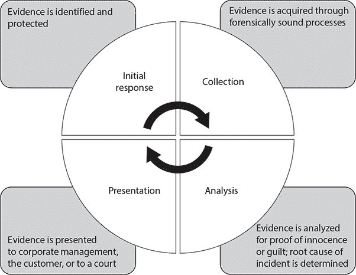

FIGURE 7.1-1 The evidence life cycle

## Evidence Collection and Handling Procedures

There are standardized evidence collection and handling procedures used throughout the world, regardless of the type of investigation. These have all been adopted as formal standards by different law enforcement agencies, security firms, and professional organizations. They are summarized as follows:

• Secure the scene of the crime or incident against unauthorized personnel.

• Photograph the scene before it is disturbed in any way.

• Don’t arbitrarily power off devices until any available live evidence has been gathered from them.

• Obtain legal authorization from law enforcement or an asset owner before removing items from the scene.

• Inventory all items removed from the scene.

• Transport and store all evidence items in protected containers and store them in secure areas.

• Maintain a strong chain of custody at all times.

• Don’t perform a forensic analysis on original evidence items; forensically duplicate the evidence item and perform an analysis on the duplicate to avoid destroying or compromising the original.

**EXAM TIP** Once evidence is obtained from the source, such as a device, logs, and so on, that source may be placed on what is known as *legal hold*. Legal hold ensures that any devices or media that contain the original evidence must be kept in secure storage, and access must be controlled. These items cannot be reused, destroyed, or released to anyone outside the chain of custody until cleared by a legal department or court.

## Artifacts

Artifacts are any items of potential evidentiary value obtained from a system. They are usually discrete pieces of information in the form of files, such as documents, pictures, executables, e-mails, text messages, and so on that are found on computers, mobile devices, or networks. However, they can also be information such as screenshots, the contents of RAM, and storage media images.

Artifacts are used as evidence of activities in investigations and can serve to support audit trails. For example, the Internet history files from a computer can support an audit log that indicates an individual visited a prohibited website. Files such as pictures or documents can indicate whether individuals are performing illegal activities on their system.

Note that artifacts by themselves are not indicative of an individual’s guilt or innocence; the presence of artifacts on a system mutually corroborates audit trails and other sources of information during an investigation. Artifacts must be investigated on their own merit before they are determined to meet the requirements of evidence. As discussed earlier in the objective, digital artifacts, as potential evidence, must be collected and handled with care.

## Digital Forensics Tools, Tactics, and Procedures

While knowledge and experience with evidence collection and handling procedures are among the most crucial skills forensic investigators can have, they should also have core technical analysis skills and knowledge of a variety of subjects, including how storage media is constructed and operates, operating system architecture, networking, programming or scripting, and security. If you are conducting a forensic investigation, these skill sets will assist you greatly when performing some of the following forensic tasks:

• Data acquisition from volatile memory or hard drives using forensic techniques

• Establishing and maintaining evidence integrity through hashing tools to ensure artifacts are not intentionally or inadvertently changed

• Data carving (the process used to “carve” discrete data or files from raw data on a system using forensics processes) to locate and preserve artifacts that have been deleted or hidden

We are long past the days when computer forensics was performed mostly on simply end-user desktop computers or servers. In today’s environment, devices and data are integrated all the way from end-user mobile devices, into the cloud, and back to the organization’s infrastructure. While core forensics knowledge and skills are still necessary, so too are knowledge and skills related to specific procedures that are tied to more narrowly focused areas within forensics. These areas often require specialized knowledge and tools in addition to generalized forensics skills. These areas of expertise include

• Cloud forensics

• Mobile device forensics

• Virtual machine forensics

## 取证调查员使用的工具选择至关重要

取证调查员使用的工具选择至关重要。存在针对特定操作使用的特定工具，包括数据采集、日志聚合审查等等。每个调查员或组织通常都有自己偏好的工具来执行所有这些任务。有些工具是专有的、商业现成的企业级软件套件，专门用于取证流程，但许多只是随操作系统本身提供的单个工具，例如实用程序或内置应用程序。许多取证工具也可能是内部开发的实用程序，包括脚本，例如，甚至是开源软件实用程序或应用程序。

无论组织使用哪些数字取证工具，以下是关于取证工具集需要记住的一些关键事项：

• 工具应当标准化并彻底记录。组织应当建立程序，供调查员在使用工具时遵循。

• 取证工具通常由专业组织或国家标准机构验证；应优先选择这些工具，而不是内部开发的工具或其来源和有效性无法轻易验证的工具。

• 应使用能够提供可重复和可验证结果的工具；例如，如果一个工具每次都不能一致地对同一块硬盘进行镜像，那么由于其完整性无法信任，其有用性可能会受到限制。

虽然这个目标不可能涵盖你在取证调查期间可用的每一个工具，但你通常可以将工具分为以下几个领域：

• 网络工具（协议分析器或嗅探器，例如 `Wireshark` 和 `tcpdump`）

• 系统工具（用于获取系统的技术配置信息）

• 文件分析工具

• 存储介质镜像工具（硬件和软件工具）

• 日志聚合和分析工具

• 内存采集和分析工具

• 移动设备取证工具

## 调查技术

调查试图发现事件发生前、发生中和发生后的情况。调查员的目标是确定事件的根本原因，并帮助确保有人对非法行为或违反政策的行为负责。调查员还希望回答诸如事件的谁、什么、哪里、何时和如何等问题。调查员的主要任务包括

• 收集和保存所有证据

• 确定时间线和事件顺序

• 确定事件期间的根本原因和使用的方法

• 对证据进行技术分析

• 提交完整、全面、无偏见的报告

调查员应始终将所有调查视为结果最终将在法庭上呈现。这是因为许多调查，即使看似最初只是无害的政策违规，如果证据表明已发生违法行为，也可能会上法庭。

在调查过程中，有几个关键点需要牢记：

• 保持无偏见；不要在调查中自动预设有罪或无罪。

• 始终让另一位调查员验证你所做的工作。

• 保持有记录且可验证的取证程序。

• 尽可能将所有调查信息保密；只应与关键人员（如高级企业经理或执法人员）共享。

• 只对你经过培训并有资格执行的证据进行操作；不要进行你没有资格执行的任何操作。

• 确保你拥有对证据进行取证活动的适当工具；使用错误的工具可能会无意中破坏或损害证据的完整性。

## 报告和文档

文档是调查中最关键的方面之一。调查员应记录调查期间采取的每一项操作。调查的文档应满足法律要求，并且详尽完整。文档内容包括

• 涉及证据和证人的所有操作（保管链、收集的证物、证人访谈等）

• 日期、时间和相关事件

• 对证据的所有取证分析

报告和相关文档通常正式提交给公司法务部门、人力资源部门、所有相关方的律师以及执法调查人员。报告和调查文档应清晰简洁，仅呈现有关事件的事实。

一份好的报告包括调查事件、时间线和证据。报告的分析部分包括确定根本原因、事件期间使用的攻击方法，以及对被告有罪或无罪的证明断言。

调查报告通常根据公司管理层或拥有调查管辖权的法院或机构的意愿进行格式化。然而，一般来说，调查报告应包括执行摘要、调查事件的详细情况、任何调查结果和支持证据，以及关于案件根本原因的结论。一份写得好的调查报告的特点包括

• 清晰、简洁且非技术性

• 写作良好且研究充分

• 回答关键调查问题：谁、什么、哪里、何时、为什么和如何

• 有证据支持的结论

• 无偏见的分析

除了文档和报告之外，调查还可能使用证人证词或陈述。如果证人对案件事实有直接了解，通常会被要求作证。调查员也可能被要求出庭作证，详细说明调查的事实。

## 复习

## 目标 7.1：理解并遵守调查

**目标 7.1：理解并遵守调查** 此目标提供了一个机会，更深入地讨论调查的细节。虽然目标 1.6 涵盖了不同类型的调查，但在此目标中，我们讨论了调查 *如何* 进行的细节。我们特别研究了取证调查，这涉及从计算系统中收集证据数据。

证据收集和处理是调查中最关键的部分，因为一旦证据被破坏或损害，可能就无法恢复或信任。证据生命周期包括四个一般阶段：初始响应、收集、分析和呈现。证据收集和处理中最关键的部分是建立保管链，以跟踪证据在整个生命周期中的流转。保管链确保证据在转移、存储和分析过程中始终有据可查，并有助于反驳证据被篡改或不可靠的说法。其他关键的证据处理活动包括保护事件或犯罪现场、在移除所有证据前拍照、安全地运输和存储证据，以及仅使用可验证的取证程序进行分析。

证物是从系统中获得的任何具有潜在证据价值的项目，包括文件、日志、屏幕图像、媒体、网络流量和易失性内存的内容。证物用于支持法律案件，并与其他信息来源相互印证。

## 数字取证

数字取证包含各种各样的工具、技术和程序。取证调查人员应精通多个学科，包括网络、操作系统、编程以及云计算、移动设备取证和虚拟机技术等其他特定领域。数字取证工具可按网络工具、系统工具、文件分析工具、存储介质镜像工具、日志聚合分析工具、内存获取与分析工具以及移动设备工具进行分类。

调查技术包括对证据收集和处理方面的法律与取证程序的扎实了解，以及技术专业知识。调查人员还应了解如何在法庭上呈现证据分析，并且应将所有调查都视为可能朝着该方向进行。调查人员还应以开放的心态对待每起事件，对嫌疑人的有罪或无罪不存成见。

取证报告和文档必须详尽完整；它们必须遵循企业实体、客户或管辖法院规定的格式。报告应包括执行摘要、技术调查结果以及支持这些调查结果的证据分析。报告还应提出结论，并列出与案件相关的任何相关事实。报告还应清晰易懂，非技术人员也能理解。

## 7.1 QUESTIONS

**1.** 你被要求调查一起员工从互联网下载受版权保护材料、违反企业安全策略的事件。你必须收集与该事件相关的所有证据，包括员工的工作站。以下哪一项是响应中最关键的方面？

**A.** 建立证据保管链

**B.** 分析工作站的硬盘

**C.** 创建工作站硬盘的取证副本

**D.** 为管理层创建正式报告

**2.** 以下哪项最能描述取证调查人员必须完成的主要任务之一？

**A.** 确保证据证明嫌疑人有罪

**B.** 确定时间线和事件顺序

**C.** 独自进行调查以确保保密性

**D.** 手动分析设备日志

## 7.1 ANSWERS

**1.** A 在初始响应期间，建立稳固的证据保管链对于证据的完整性和保存至关重要。其他选项指的是通常在初始响应之后进行的过程。

**2.** B 调查人员的主要任务之一是确定事件期间发生的时间线和事件顺序。其他选项表明调查人员不应做的事情，例如只寻找证明有罪的证据、独自进行调查或手动分析日志。

## Conduct logging and monitoring activities

本目标涵盖记录和监控网络基础设施及流量的更技术性方面。尽管我们在书中多次涉及这些主题，但本目标阐述了从网络各处收集数据、汇总这些数据，然后进行分析和关联以确定网络整体安全态势的需求和过程。

## Logging and Monitoring

请记住，在目标 6.1 中你学习了安全审计；审计直接由记录网络活动并监控基础设施中的负面事件和异常行为来实现。然而，这些关键活动不仅限于此。记录和监控对于保持对网络基础设施中正在发生的事情的理解和可见性是必要的，这包括网络设备、流量、主机、其应用程序和用户活动。你不仅需要了解网络在任何给定时刻正在发生什么，还需要了解随时间推移发生的情况，以便进行历史分析并预测潜在的负面趋势。

监控不仅包括安全监控，还包括性能监控、功能监控和用户行为监控。所有这些记录和监控的目的是收集小片段的数据，当将它们组合起来并赋予上下文时，会生成信息，使你能够采取主动措施来保护网络。你必须监控的基础设施的一些关键元素包括

• 网络设备及其性能

• 服务器

• 端点安全

• 带宽利用率和网络流量

• 用户行为

• 基础设施变更或偏离正常基线

这些信息中的大部分由日志生成，特别是来自网络和主机设备的日志。网络安全分析师几乎每天都会审查的日志包括防火墙日志、代理日志以及入侵检测和防御系统日志。在本目标中，我们将讨论许多实现记录和监控的技术，以及它们的实现方式。

## Cross-Reference

目标 7.7 提供了防火墙和入侵检测与防御系统的更广泛概述。

## Continuous Monitoring

持续监控需要一个有弹性的基础设施，能够在多个层面收集、调整和分析数据，包括基于网络的数据（例如，流量特征和模式）和基于主机的数据（例如，主机通信、进程、应用程序和用户活动）。持续监控涉及使用 IDS/IPS 和安全信息和事件管理系统（SIEM）。

我们在此讨论两种不同情境下的持续监控。第一种更侧重于记录和监控基础设施，涉及对网络基础设施及其连接的主机进行主动监控，以检测配置基线中的异常以及潜在的恶意活动。第二种情境不那么技术化，但同样重要：监控整体系统和组织风险。风险会持续监控和衡量，以便能够快速识别组织风险态势的任何变化，并在必要时进行调整。由于多种因素，风险经常变化，这些因素包括威胁态势、组织的运营环境、技术、行业或市场细分，甚至组织本身。必须监控所有这些风险因素，以确保风险不超过组织的风险偏好或容忍水平。

## Intrusion Detection and Prevention

历史上，网络和安全人员专注于简单的入侵检测功能。现代安全设备既充当入侵检测系统，也充当入侵防御系统（IDS/IPS）。它们不仅可以检测和分类潜在攻击，还可以采取行动阻止可能具有恶意性质的流量。IDS/IPS 可以通过动态重新路由网络流量、分流连接，甚至隔离主机来执行此功能。

入侵检测通常依赖于三种模型中的一种或多种组合来检测基础设施中的问题：

• 基于签名或模式的检测（基于规则的检测） 使用与攻击特征匹配的已知签名或行为模式（例如，来自特定域或 IP 地址的特定端口的入站流量）

• 基于异常或行为的分析 检测正常行为基线的偏差

• 启发式分析 也检测正常行为基线的偏差，但将这些偏差与潜在攻击特征相匹配

## EXAM TIP

行为分析与启发式分析之间存在差异，尽管两者非常相似。在行为分析中，正常行为基线的任何偏差都会被标记，并向安全人员发出警报。但是，即使是偏差，在某些情况下也可以得到解释。启发式分析更进一步，它会查看这些异常行为可能会做什么，例如访问受保护的内存区域、更改操作系统文件或将数据写入硬盘。

## 安全信息和事件管理

通过正确配置的监控和日志记录，大型网络，甚至中型网络，每天可能会从各种网络源收集数百万条数据。这些数据来自主机、网络设备、用户活动、网络流量等。一个人，甚至几个人，都不可能筛选这些数据来理解它们并从中获得有意义的信息。来自日志记录和监控的大量数据可能并不重要；安全分析师需要确定数百万条数据中哪些是重要的，以及它们对网络整体安全意味着什么。

幸运的是，收集、汇总、关联和分析这些数据的艰巨过程，并不完全依赖人类来完成。这就是自动化对安全流程做出重大贡献的地方。我们已经讨论过安全工具自动化对安全流程至关重要，但这里我们专门讨论安全信息和事件管理（`SIEM`）系统。

`SIEM` 系统是一种多功能安全设备，其目的是从各种来源收集数据，对其进行汇总，并协助安全分析师分析数据，以生成关于网络上发生情况的可操作信息。`SIEM` 系统通常是所有日志文件、流量捕获和其他形式数据（有时是异构数据）的中心收集点。`SIEM` 系统会摄取所有这些数据，并将看似无关的数据进行关联，以连接数据点并展示它们实际上是如何相互关联的。这种设备可以帮助您几乎实时地就网络安全做出基于风险的明智决策。

`SIEM` 系统使用一种称为 `dashboard` 的概念，向安全分析师显示信息，并允许他们对信息进行广泛查询，以从所有这些不同的信息来源中获得非常详细的分析。

## 出口监控

出口监控专门检查离开网络的流量。出口监控通常由防火墙、代理、入侵检测或数据防泄漏系统执行。在大多数情况下，这将是常规流量，但出口监控会查找特定的安全问题。显然，一个主要问题是恶意软件。通常，攻击可能以分布式拒绝服务（`DDoS`）攻击的形式出现，该攻击由僵尸网络执行，通过感染不同的主机来利用网络攻击自身，然后这些主机攻击网络上的其他主机，甚至攻击外部网络上的主机。出口监控会查找内部主机已被攻破并受外部恶意实体控制并与其通信的迹象。

除了恶意软件之外，出口监控还能检测的另一个问题是数据外泄。这通常涉及以不受控制的方式，将敏感数据非法发送到网络外部的未授权实体。出口监控使用多种不同的技术来检测此问题；除了部署在网络设备和用户终端上的数据防泄漏（`DLP`）技术之外，防火墙等安全设备还会实施规则集，以查找大量数据以及具有特定扩展名、大小和其他特征的文件。

## 交叉引用

数据防泄漏已在目标 2.6 中讨论。

## 日志管理

如果组织不监控其日志并对其做出适当反应，日志就没有任何有用的功能。考虑到可能有数千台设备在写入日志，管理日志可能看起来是一项艰巨的任务。同样，这就是自动化发挥作用的地方。日志通常会自动发送到中心收集点，例如前面提到的 `SIEM` 系统，甚至 `syslog` 服务器，以供检查。通常，必须进行手动日志审查来解决特定问题、研究特定事件或了解网络的更多情况。但是，这些通常是例外，如前所述，大部分日志管理过程都可以自动化。

大多数设备生成的内容统称为 `event logs`。`event log` 记录活动或事件的发生。事件通常是被单独考虑的事物，并具有可定义的特征。日志中事件的基本信息包括

- 事件定义
- 事件影响的系统或资源
- 主机的标识信息，例如主机名、IP 地址或 MAC 地址
- 发起或导致事件的用户或其他实体
- 事件的日期、时间和持续时间
- 事件操作（例如，文件删除、特权使用等）

## EXAM TIP

您应该熟悉事件日志条目的一般内容，通常包括事件定义、受影响的系统、主机信息、用户信息、采取的操作以及事件的日期和时间。

日志分析主要也是由 `SIEM` 系统执行的自动化任务，其目标是浏览各种日志，连接数据点，并确定这些汇总数据点之间是否存在任何模式。

## 威胁情报

`Threat intelligence` 是收集和分析原始威胁数据的过程，旨在识别对组织的潜在或实际威胁。这可能涉及确定威胁趋势以预测威胁将做什么，对威胁数据进行历史分析以识别特定事件期间发生了什么，或进行行为分析以了解威胁在特定情况下对环境的反应。

请注意，`threat data` 和 `threat intelligence` 这两个术语相似，但并非同一回事。威胁数据是指原始的信息片段，通常没有上下文，可能相互关联，也可能不相关。例如，一个 IP 地址或显示两台主机之间连接的日志条目。只有当威胁数据被分析和关联，以获得有关数据如何与组织资产相关的有用洞察时，它才成为威胁情报。威胁情报可以来自各种来源，称为 `threat feeds`，其中包括开源、专有和闭源信息。

## 威胁情报的特征

威胁情报的有效性可以根据以下三个不同的特征进行评估，这些特征将决定情报对组织的质量或有用性：

- `Timeliness` 情报必须在需要时尽快获得，才能在应对威胁时具有任何价值。
- `Accuracy` 情报必须在事实上正确、准确，且不会导致假阴性或假阳性。
- `Relevance` 情报必须与手头的特定威胁问题相关，并在与其他因素一起查看时，在正确的上下文中加以考虑。

威胁情报的另外两个特征是

- `Threat rating` 指示威胁的潜在危险级别。通常，评级越高，威胁越危险。
- `Confidence level` 对威胁情报来源的信任程度，以及相信威胁评级是准确的程度。

威胁评级和置信度都可以采用定性量表来表示，例如从最不危险到最危险，或者从最低置信度到最高置信度，分别表示。通常，威胁评级和威胁置信度与我们获取情报的来源直接相关，因为有些来源比其他来源更可靠。威胁情报来源将在下一节中讨论。

**EXAM TIP** 请确保熟悉威胁情报的及时性、准确性和相关性的特征，并理解威胁评级和置信度的概念。

## 开源情报

开源情报（OSINT）来自普通公众可获取的来源。示例包括公共数据库、网站和一般新闻。虽然开源情报非常有用，但通常范围更广，描述的是威胁的非常一般性特征，可能不适用于您特定的资产、漏洞或整个组织。开源情报量很大，必须将其缩减、排序、优先级排序并分析，以确定其与组织的相关性。（稍后讨论的威胁建模对于提炼 OSINT 很有用。）

## 闭源情报

闭源情报来自可能受限的威胁信息源。例如，考虑机密政府情报信息源。由于数据敏感性或其来源的敏感性，这些信息源不易被普通公众获取，例如来自在外国秘密行动的特工，或通过秘密技术获得的信息。闭源情报与 OSINT 的另一个关键区别是，通常闭源情报更准确、经过更彻底的身份验证，并且具有更高的置信度。闭源情报还通常提供关于威胁的更多细节和保真度，特别是因为情报通常针对特定组织、资产和漏洞，这些是被攻击的目标。

## 专有情报

专有情报可以被视为一种闭源情报信息源，但它通常由私人组织开发，并通过订阅方式出售给任何希望购买它的组织。这使其更像是一种情报商品，而不是基于敏感性而限制普通公众获取。许多组织从其他公司购买专有威胁情报信息源，有时会针对其特定市场或情况进行定制。

## 威胁搜寻

威胁搜寻是主动努力确定基础设施中是否存在各种威胁。在某些情况下，分析师可能希望确定特定威胁或威胁行为者是否已经渗透到基础设施并继续保持存在。在其他情况下，威胁搜寻更多地是为了持续寻找各种威胁，以确保它们根本无法进入基础设施。威胁搜寻同时使用威胁情报信息源和威胁建模，以更精确地确定哪些威胁更可能针对基础设施中的哪些资产，而不是寻找通用威胁。然后，威胁搜寻者会共同努力在网络中寻找这些特定威胁或威胁行为者。

## 威胁建模方法论

已经开发了几种正式化的方法论来解决威胁的不同特征和组成部分。有些解决威胁指标，有些解决威胁来源可用于攻击组织的攻击方法（称为 `threat vectors`），有些允许进行深入的威胁建模和分析。所有这些方法论都允许组织正式管理威胁，是威胁建模过程的关键组成部分。几个示例在 表 7.2-1 中列出并描述。

**TABLE 7.2-1** 各种威胁建模方法论

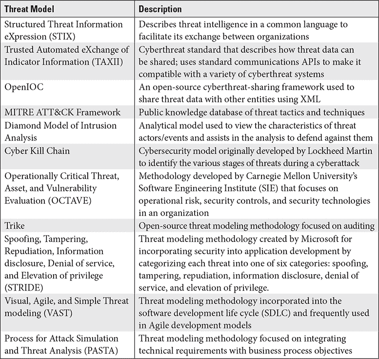

虽然对这些威胁方法论中的任何一种进行深入讨论超出了本书的范围，但您应该对它们有基本了解，以便参加 CISSP 考试。

**Cross-Reference**

我们还在目标 1.11 中讨论了威胁建模。

## 用户和实体行为分析

用户和实体行为分析（UEBA）关注用户和其他实体（例如，服务账户或进程）的行为模式。UEBA 不仅仅是审查用户操作日志；它会随时间查看用户行为模式，以检测这些行为模式何时发生变化。这些行为模式包括用户通常何时登录或注销系统、访问哪些资源，以及如何与系统整体交互。

当行为模式偏离正常基线时，可能是妥协指标（IoC）。它可能表明几种值得进一步调查的可能性，例如：

• 用户正在违反政策或从事非法活动

• 系统本身运行正常，但性能不佳

• 系统正受到恶意实体的攻击

与基础设施中的所有其他类型数据一样，用户行为数据最初必须被收集、汇总和分析，以确定行为的正常基线。

## REVIEW

**Objective 7.2: Conduct logging and monitoring activities** 在此目标中，我们讨论了技术日志记录和监控的细节。日志记录和监控通过提供连接事件与实体的数据来为审计功能做出贡献。日志可以来自各种来源，包括网络设备、主机、应用程序等。事件日志条目通常包括发起事件的用户详细信息、标识主机信息、事件描述或定义、事件日期和时间，以及实际发生的情况。

持续监控是一种主动方式，用于确保您不仅能持续了解网络中发生的情况，还能进行历史分析和趋势预测。持续监控还意味着组织正在持续监控其风险态势。

入侵检测和防御系统使用三种检测方法，有时相互结合：基于签名或模式的检测、基于行为的检测和启发式检测。

基础设施中的日志和其他数据可以输入到一个自动化系统中，该系统汇总和关联所有这些信息，称为 SIEM 系统。SIEM 系统通过仪表板和复杂查询，让您即时了解网络的安全态势。

出口监控允许安全人员检测可能利用僵尸网络并导致主机互相攻击，或更糟的是，攻击组织不拥有的外部网络的恶意软件攻击。出口监控还允许组织通过安全设备规则集和数据丢失防护系统检测数据外泄。

日志管理意味着管理员实际审查日志以检测恶意事件、网络性能不佳或负面趋势。大多数现代日志管理通过 SIEM 系统实现自动化。

我们还重新审视并扩展了威胁建模的基本概念。威胁建模不仅仅是列出可能适用于任何组织的通用威胁；威胁建模更深入、更详细地了解特定威胁如何影响组织的资产和漏洞。威胁建模使用及时、相关和准确的威胁情报，这些情报可能来自各种威胁信息源，例如开源、闭源或专有来源。存在各种威胁管理和建模方法论，包括 STRIDE、VAST、PASTA 和许多其他方法。

最后，我们研究了用户和实体行为分析（UEBA），它会查找用户、系统账户和进程中的异常行为模式。正常行为模式的这些偏差可能表明用户、系统存在问题，或者发生了攻击。

## 7.2 问题

**1.** 你正在为公司设计一个新的入侵检测和防御系统。你希望确保该系统能够接受来自系统供应商的安全信息源，以便你能够基于已知攻击模式检测入侵。以下哪种检测模型必须包含在系统设计中？

**A.** 基于行为的检测

**B.** 启发式检测

**C.** 基于签名的检测

**D.** 基于情报的检测

**2.** 你是一家主要研究设施的网络安全分析师。作为组织对其系统进行威胁建模工作的一部分，你需要查看各种专有情报信息源，并确定哪些信息源最有可能有助于这项工作。在选择威胁信息源时，以下哪项不是你应该考虑的威胁情报的重要特征？

**A.** 及时性

**B.** 方法论

**C.** 准确性

**D.** 相关性

**3.** Nichole 是 O'Brien Enterprises（一家小型网络安全公司）的网络安全分析师。她正在向一位客户推荐各种威胁方法论，该客户希望为 Microsoft Windows 开发定制应用程序。她的客户希望采用一种威胁建模方法论，以帮助他们进行安全代码开发。Nichole 应该向她的客户推荐以下哪项？

**A.** PASTA

**B.** TRIKE

**C.** VAST

**D.** STRIDE

## 7.2 答案

**1.** C 基于签名的检测允许系统基于已知模式或签名检测攻击。

**2.** B 方法论不是评估情报信息源时的考虑因素。为了对组织有用，威胁情报应具备及时性、相关性和准确性。

**3.** D STRIDE（欺骗、篡改、否认、信息泄露、拒绝服务和特权提升）是微软为将安全性纳入应用程序开发而创建的一种威胁建模方法论。列出的其他方法论均不特定于应用程序开发，除了 VAST（可视化、敏捷、简单威胁建模），但它也不特定于 Windows 应用程序开发。

## 执行配置管理（CM）（例如，配置、基线、自动化）

配置管理（CM）是组织变更管理计划执行的一系列活动和流程，旨在确保系统配置保持一致且安全。在此目标中，我们将讨论与 CM 直接相关的主题，包括初始配置配置、维护基线配置以及自动化 CM 流程。

## 配置管理活动

配置管理是更广泛的变更管理流程的一部分。变更管理关注基础设施规划和设计的宏观战略变更，以及管理基础设施的操作层面，而配置管理则更侧重于系统层面，通常是战术性或日常活动的一部分。配置管理涵盖系统、应用程序和其他组件的初始配置和持续基线配置，尤其是尽可能通过自动化流程实现。

**交叉引用**

配置管理与补丁和漏洞管理（在目标 7.8 中介绍）以及变更管理（在目标 7.9 中详细讨论）关系非常密切。

## 配置

正如用户账户会被配置（如目标 5.5 所述），系统也会被配置。在此语境下，配置是指系统的初始安装和配置。配置可能需要手动安装操作系统和应用程序，以及更改配置设置，以确保系统既功能正常又安全。但是，如本目标稍后所述，自动化可以使系统配置更加高效，并确保配置满足其初始所需基线（下文将讨论）。

配置通常使用基线镜像，即符合组织硬件和软件设置要求的预先批准的配置，以快速部署操作系统和软件，从而减少安装系统所需的时间和出错空间。

## 基线

大多数系统的默认设置不安全，并且通常无法满足组织的功能需求。因此，需要更改初始默认配置和设置，以更好地适应组织的功能和安全要求。基线是指确保系统的配置按照既定组织标准设置，并在配置和变更过程中保持不变。这并不意味着系统的基线不会有时发生变化；随着系统功能的变更、系统升级、补丁应用以及组织运行环境的变化，组织的基线经常会发生变化。更改基线是整个变更管理流程的一部分，必须经过仔细的规划、测试和实施。

组织可能有几个适用于特定主机的既定基线。例如，组织可能有一个适用于所有最终用户工作站的工作站基线，以及一个适用于服务器的单独服务器基线。它还可能有适用于网络设备甚至移动设备的基线。这里的要点是，对于给定设备，组织应有一个基线设计，详细说明设备上安装的操作系统和应用程序的版本，以及应在所有类似设备上标准化的仔细控制的配置设置。

所有基线配置都应记录并定期检查。有一些自动化软件解决方案（其中一些是操作系统的一部分），如果系统偏离基线，可以向管理员发出警报。对基线的合法更改可能是新软件或应用于主机的补丁；这些有效的更改，一旦经过测试并被接受，就会成为更新后的基线配置的一部分。但是，必须关注基线的非标准或未知更改，因为这些更改可能以未经授权的更改甚至恶意软件的形式出现。

基线配置设置通常包括

• 操作系统和应用程序的标准化版本

• 安全配置设置，包括仅允许的端口、协议和服务

• 移除或更改默认账户和密码设置

• 移除未使用的应用程序和服务

• 操作系统和应用程序补丁

**考试提示** 你应该牢记，对于考试而言，基线对于维护基础设施中所有系统的安全配置至关重要。安全基线包括受控的操作系统和应用程序版本，以及它们的安全设置。组织可能有多个基线，具体取决于所涉及的设备类型。

## 自动化配置管理流程

## 基础设施中的大多数系统都很复杂，拥有大量必须仔细设置的配置选项，以维持其安全性和功能性。管理员手动设置所有这些配置选项，并期望有时间处理其他日常任务，这不切实际。此外，由于人为错误会导致配置错误，许多配置选项如果设置不正确，可能会导致系统无法正常运行或不安全。这就是自动化在维护配置基线方面至关重要的原因。

有数百种自动化工具可用于协助配置管理。其中一些工具内置于操作系统本身，许多其他工具是随管理软件提供的免费或第三方实用程序。例如，Windows Server 包含 Active Directory (AD)，其中具有组策略设置，使变更管理管理员能够在 AD 域中管理配置基线。Linux 也有自己的内置配置管理实用程序。此外，组织可以使用强大的自定义脚本，例如用 PowerShell 或 Python 编写的脚本，以及企业级管理系统。我们将在目标 8.2 中讨论许多用于配置和维护安全设置的工具。使用自动化工具执行配置管理可以帮助减少由人为错误引起的问题，确保企业范围内配置设置的标准化，并使配置变更更加高效。

## 交叉引用

工具集、软件配置管理以及安全编排、自动化和响应 (SOAR) 与自动化配置管理流程相关，并在目标 8.2 中深入讨论。

## 复习

## 目标 7.3：执行配置管理 (CM)（例如，配置、基线设置、自动化）

本目标回顾了配置管理流程。配置管理是变更管理的一个子集，与漏洞管理和补丁管理密切相关。配置过程是系统和应用程序初始安装和配置发生的地方。在整个组织中为设备建立标准化基线非常重要，并且可能有多个基线来解决不同类型的设备。基线也会偶尔更改，因为环境或系统和应用程序会发生变化。使用自动化工具可以使配置管理更加高效和容易，这些工具可以帮助减少人为错误并确保维护配置基线。

## 7.3 问题

**1.** 您的公司正在为其最终用户工作站创建安全基线。工作站只能与网络上的特定应用程序和主机通信。以下哪项应包含在工作站的安全基线中，以确保强制执行这些限制性通信要求？

**A.** 操作系统版本

**B.** 应用程序版本

**C.** 限制的开放端口、协议和服务

**D.** 默认密码

**2.** Riley 一直在手动配置安全子网中的几个主机，这些主机将处理公司的敏感数据。这些系统在从测试环境移出并连接到生产网络之前会进行扫描。扫描显示手动配置的主机配置设置存在广泛差异。Riley 应该做什么，以便配置设置保持一致并遵循安全基线？

**A.** 使用自动化手段配置系统，例如基线映像

**B.** 使用供应商提供的建议手动配置系统

**C.** 在网络上备份一个通用系统，并将备份还原到新系统，以便它们配置相同

**D.** 使用安全基线检查表手动配置系统

## 7.3 答案

**1.** C 任何开放端口、协议和服务都会影响工作站与网络上其他应用程序或其他主机的通信方式。这些都应仔细考虑并控制，以用于安全基线。其他选项也是安全基线的考虑因素，但不一定会影响仅与网络上的特定应用程序或主机通信。

**2.** A Riley 应该使用自动化手段来配置安全主机；可以部署带有安全基线的操作系统映像，使工作更加轻松高效，并确保配置设置标准化。

## 应用基础安全运营概念

在本目标中，我们重新审视了在先前领域中涵盖的一些基础安全概念，尽管在本目标中是从运营背景下进行的。这些概念包括需要知道、最小权限、职责分离、特权账户管理、工作轮换和服务级别协议。

## 安全运营

安全运营描述了安全功能和程序的日常运行。当你最初学习安全理论、模型、定义和术语时，可能不清楚这些事物如何应用于安全专业人员的日常工作。现在，你将把之前在书中学到的基础知识和概念应用到运营世界中。

## 需要知道/最小权限

在领域 1 中介绍的两个重要基础概念，并在整本书中得到强调，即需要知道和最小权限原则。这些概念确保实体不会拥有不必要的信息或系统访问权限。

## 需要知道

回顾之前的讨论，需要知道意味着个人只应拥有执行其工作职能所需的信息或系统访问权限。换句话说，如果他们的工作不需要访问权限，那么他们就不需要知道信息，以及由此延伸的处理该信息的系统。这种限制有助于支持和强制执行机密性的安全目标。需要知道的概念在安全活动中运营层面得到应用。示例包括限制性权限、权利和特权；强制访问控制模型中对需要知道的要求；以及保持隐私信息机密的需要。

新员工的需要知道应被假定为履行其工作职能所需的最低限度。随着时间的推移，个人可能需要更多访问权限，具体取决于工作要求和运营环境的变化。只有在那时，才应授予额外的访问权限。需要知道应由有权批准的人仔细考虑并批准；通常这可能意味着个人的主管、数据或系统所有者，或高级经理。还应定期审查需要知道，以查看个人是否仍然拥有访问系统和信息的经过验证的要求。如果工作要求发生变化，或运营环境不再要求个人拥有需要知道，则应撤销或减少访问权限。

## 最小权限原则

## 原则最小权限

The principle of least privilege, as we have discussed in other objectives, essentially means that an individual should only have the rights, permissions, privileges, and access to systems and information that they need to perform their job. This may sound similar to the concept of need-to-know, but there is a subtle difference that you must be aware of for the exam. With need-to-know, an individual may or may not have access at all to a system or information. The principle of least privilege states that if an individual does have access to system or information, they can only perform certain actions. So, it becomes a matter of no access at all (need-to-know) or minimal access necessary (least privilege).

**EXAM TIP** Need-to-know determines `what` you can access. Least privilege regulates `what you can do` when you have access.

The principle of least privilege is applied at the operational level by only allowing individuals, ranging from normal users to administrators and executives, to perform tasks at the minimal level of permissions necessary. For example, an ordinary user should not be able to perform privileged administrative tasks on a workstation. Even a senior executive should not be able to perform those tasks since they do not relate to their duties.

## Separation of Duties and Responsibilities

The concept of separation of duties (SoD) prevents a single individual from performing a critical function that may cause damage to the organization. In practice, this means that an individual should perform only certain activities, but not others that may involve a conflict of interest or allow one person to have too much power. For example, an administrator should not be able to audit their own activities, since they could conceivably delete any audit trails that record any evidence of wrongdoing. A separate auditor should be checking the activities of administrators.

Related to the concept of separation of duties are the concepts of `multiperson control` and `m-of-n control`, which require more than one person to work in concert to perform a critical task.

## Multiperson Control

`Multiperson control` means that performing an action or task requires more than one person acting jointly. It doesn’t necessarily imply that the individuals have the same or different privileges, just that the action or task requires multiple people to perform it, for the sake of checks and balances.

A classic example of multiperson control is when an individual bank teller signs a check for over a certain amount of money, and then a manager or supervisor must countersign the check authorizing the transaction. In this manner, no single individual can use this method to steal a large amount of funds. A bank teller and bank manager could secretly agree to commit the crime, known as `collusion`, but it may be less likely because the odds of getting caught increase. Another example would be a situation that requires three people to witness and sign off on the destruction of sensitive media. One person alone can’t be empowered to do this, since assigning only one person to be responsible for destroying the media could allow that person to steal the media and claim that they destroyed it. But assigning three people to witness the destruction of sensitive media would reduce the possibility of collusion and reduce the risk that the media was destroyed improperly or accessed by unauthorized individuals.

## M-of-N Control

M-of-n control is the same as multiperson control, except it doesn’t require all designated individuals to be present to perform a task. There may be a given number of people, “n,” that have the ability to perform a task, but only so many of them (the “m”) are required out of that number. For example, a secure piece of software may designate that five people are allowed to override a critical financial transaction, but only three of the five are necessary for the override to take place. This means that any three of the five people could input their credentials signifying that they agree to an override for it to take place. This doesn’t necessarily imply that they all have different rights, privileges, or permissions (although in the practical world, that is often the case); it could simply mean that a single person alone can’t make that decision.

Note that separation of duties does not require multiperson control or m-of-n control. An individual can have separate duties and perform those tasks daily without having to work with anyone. Multiperson or m-of-n control only comes into play when a task must be completed by multiple people working together at that moment or in a defined sequence to make a decision or complete a sensitive or critical task.

## Privileged Account Management

Privileged accounts require special care and attention. In addition to carefully vetting individuals before assigning them higher-level accounts with special privileges, those accounts should be approved by the management chain. The individual should have the proper need-to-know and security clearance for a privileged account, as well as additional training that emphasizes the special procedures for safeguarding the account and the potential dire security consequences of failing to do so. Note that it’s not only administrators who receive accounts with higher-level privileges; sometimes users receive accounts with additional privileges for legitimate business reasons.

Once a privileged account has been granted to an individual, they should also be carefully scrutinized for the correct authorizations. Even with a privileged account, the principles of separation of duties and least privilege still apply. Having a privileged account is not an all-or-nothing prospect; the account should still have only the privileges necessary to perform the functions related to the individual’s job description, and no more. Having a privileged account also does not mean that the individual has access to all resources and objects. There still may be sensitive data that they do not need to access, which falls under the principle of need-to-know, as mentioned earlier.

**EXAM TIP** Even privileged accounts are still subject to the principle of least privilege; not every privileged account requires full administrator privileges over the system or application. Privileged accounts can still be assigned only the limited rights, privileges, and permissions required to perform specific functions.

Individuals with privileged accounts should only use those accounts for specific privileged functions, and for only a limited amount of time. They should not be constantly logged into the privileged account, since that increases the attack surface for the account and the resources they are accessing. Privileged account holders should also maintain a routine user account and use it for the majority of their duties, especially for mundane tasks such as e-mail, Internet access, and so on. Using the methods described in Objective 5.2, the organization should employ just-in-time authorization; that is to say, the privileged account should only be used when and if necessary, and then the individual should revert to their basic account.

**Cross-Reference**

Just-in-time identification and authorization was discussed in Objective 5.2 and described the use of utilities such as `sudo` and `runas` to affect temporary privileged account access.

特权账户管理也适用于基于角色的授权。安全管理员无需向用户账户授予额外权限，而是可以将用户置于允许额外权限的角色中。其在该角色组中的成员身份应要求其账户接受更频繁且更详细的审计。如果该用户的大部分日常工作都需要使用额外权限，这种方法可能比授予用户单独的特权账户更好。同样，关键在于对任何额外权限以及系统或信息访问进行频繁审查和管理批准。

## 工作轮换

实施工作轮换政策的组织会定期将员工轮换到各个职位，以确保没有任何一个人在某个职位上待得足够长，从而实施欺诈或其他恶意行为，程度足以严重损害组织继续运营的能力。工作轮换不仅起到侦查控制作用，还起到威慑控制作用，因为员工知道，过一段时间后会有其他人接替其职位，并能够发现任何不当行为。在大型组织中实施工作轮换政策通常比在小型组织中更容易，因为小型组织可能缺乏具备必要资格来胜任该工作的多个人员。即使没有对恶意行为或政策违规的怀疑，出于正常的专业成长和发展，将某人从某个职位上轮换出来也可能很困难，因为他们可能已经深深扎根于该角色，以至于没有其他人能胜任他们的工作。这就是为什么计划性的定期交叉培训，并让多个人员确切了解特定工作要求所涉及的内容是必要的。组织绝不应只依赖一个人来执行某项工作职能；如果该人被怀疑存在欺诈、盗窃、自满、无能或其他负面行为，要将其从该职位上轮换出来将非常困难，更不用说为了业务连续性，在某个人受伤或因某种原因离开组织时，需要有人接受过该职位的培训。

## 强制休假

与工作轮换有些相关的是强制休假原则——强制个人暂时离开某个职位甚至整个组织一段时间。通常，如果一个人长期从事某项工作而没有休息，公司政策可能要求其休假以休息和康复。通常，政策的这一部分允许个人每年在自己选择的时间内，离开组织一个预定的休假天数。这可能是强制休假政策中较为积极的方面之一。

然而，强制休假政策也可以用来强制涉嫌恶意行为的人暂时离开职位，以便进行调查。如果你在新闻中看到公众信任职位的人（例如）涉嫌不当行为，通常会看到这种行动。人们常被置于“行政休假”状态，无论是否领薪，等待调查。这与强制休假是同一回事。调查完成后，该个人可能被允许恢复职责，也可能被重新分配甚至被组织解雇。

**CAUTION** 积极使用强制休假政策的组织，出于必要，也应在其政策和程序中包含一定程度的交叉培训或工作轮换。

## 服务级别协议

服务级别协议（SLA）存在于第三方服务提供商与组织之间。第三方提供基础设施、数据管理、维护以及各种其他服务，这些服务可以根据合同提供给组织。请注意，第三方服务还可以包括云服务提供商提供的服务。服务级别协议主要通过影响可用性这一安全目标来影响组织的安全态势，但如果第三方可以访问敏感信息，也可能影响数据机密性。服务表现不佳会影响组织的高效运营、性能和安全，因此，制定协议以确保第三方提供的服务具有一致的功能和性能水平至关重要。

除了可能包含在与第三方服务提供商合同中的法律合同文档外，SLA 在规定双方责任方面至关重要。该文件用于保护组织和第三方服务提供商。SLA 可用于保证第三方服务提供商在性能和功能方面达到特定水平，以及界定客户和提供商在保护系统和数据方面的安全责任。未能满足 SLA 要求通常会导致财务处罚。

## 复习

**目标 7.4：应用基础安全运营概念** 在本目标中，我们回顾了几个基础安全运营概念，包括知悉需要、最小权限、职责分离、特权账户管理、工作轮换和服务级别协议。这些概念中的每一个都在至少一个先前的目标中讨论过，但在这里我们将其置于安全运营的背景下进行了阐述。

知悉需要意味着，除非个人的工作需要该访问权限，否则其不应拥有对系统或信息的任何访问权限。这与最小权限原则形成对比，后者意味着一旦获得对系统或信息的访问权限，个人只应被允许执行履行其工作职责所需的最小任务。职责分离意味着，不应允许一个人完成关键任务所需的所有职责，从而防止在两人或更多人串通的情况下发生欺诈或恶意活动。这也由多人控制和 m-of-n 控制的概念进一步体现，这些概念要求至少有指定数量的授权人员在场，以批准或执行关键任务。

特权账户管理要求，任何拥有高于普通用户级别权限的个人都应经过管理层审查并批准其权限。授予这些个人的特权账户不应用于常规用户功能，而应仅用于其创建目的所对应的特权功能。还应定期审查特权账户，以确保其仍然有效。

工作轮换用于定期更换某项工作职能中的个人，以便可以审计该人员的活动，查找任何恶意或不当行为。这与强制休假类似，后者仅是暂时的，通常在个人正在接受调查时实施。

服务级别协议用于通过在合同中规定每一方所需的性能和功能水平（包括安全性），来保护第三方服务提供商和组织。

## 7.4 问题

**1.** 以下哪项是在组织中实施知悉需要的最佳示例？

**A.** 因个人没有需要访问权限的工作职责，而拒绝其访问包含敏感信息的共享文件夹

**B.** 允许个人对包含敏感信息的共享文件夹具有读取权限，但没有写入权限

## C. 要求四名有权批准删除审计日志的人员中有三人一致同意

## D. 定期将人员重新分配到需要访问不同敏感信息的不同安全岗位

## 2. 敏感系统的审计日志已被删除。公司中只有少数人具备执行该操作所需的培训水平和特权访问权限。虽然怀疑某个特定人员实施了恶意行为，但在调查期间，所有具有访问权限的人员都必须暂时离开其岗位。以下哪项描述了此操作？

## A. 职责分离

## B. 工作轮换

## C. 强制休假

## D. M-of-n 控制

## 7.4 ANSWERS

## 1. A 需要知道（Need-to-know）通常是一种拒绝或允许的情况；基于需要知道原则，拒绝访问包含用户工作职责不需要的敏感信息的共享文件夹。

## 2. C 由于只有少数人拥有该级别的访问权限，因此在调查期间，他们必须全部暂时离开岗位并被安置在行政休假中，这是一种强制休假形式。如果只有少数人能够执行该职能且他们都在接受调查，则工作轮换不是一种选择。

###  应用资源保护

我们在整本书中讨论了保护资源，但在此目标中，我们将专门关注之前未涉及的一个领域——媒体管理和保护。媒体通常与备份磁带相关联，但也包括硬盘阵列、CD-ROM 和 Blu-ray 光盘、存储区域网络（`SANs`）、网络附加存储（`NAS`）以及便携式媒体，例如 USB 拇指驱动器，无论它们是本地存储还是远程存储。此目标侧重于管理各种媒体以及用于保护媒体的特定安全措施。

## 媒体管理和保护

无论您的组织使用哪种类型的媒体，都应仔细考虑与媒体管理相关的几项关键保护活动。这些包括行政、技术和物理安全控制。每种类型的控制都用于保护媒体免受未经授权的访问、盗窃、损坏和销毁。我们将在即将到来的章节中讨论其中一些控制。

## 媒体管理

媒体管理主要使用行政控制，例如与规定组织中媒体将如何使用相关的政策和程序。管理层应制定媒体保护和使用政策，概述组织中存储媒体的正确保养和使用要求。该政策还可以与组织的数据敏感性政策密切相关，因为媒体上存储的数据应根据政策规定的最高敏感性级别进行保护。

政策中详细说明的媒体管理要求应包括

• 所有媒体必须在库存控制程序下维护，并在存储、运输和使用期间得到保护。

• 必须为媒体分配适当的访问控制，例如对象权限。

• 组织系统中只能使用授权的便携式媒体，并且便携式媒体必须加密。

• 只有在敏感数据可以从媒体上充分擦除的情况下，才能重复使用媒体。

• 如果由于存储在媒体上的数据的敏感性而无法重复使用，则应考虑销毁媒体。

## 媒体保护技术

媒体管理为组织中各种类型媒体的使用、存储、传输和处置设定了行政政策控制。它还规定了这些活动预期的实用控制。媒体保护技术包括在访问、传输、存储和处置期间实施的技术和物理控制。

## 媒体访问控制

应根据媒体上存储的数据的敏感性级别，小心处理和操作媒体。这同样应符合管理层确定的数据敏感性政策。这些控制包括

• 媒体上存储的敏感数据应加密。

• 授予授权用户的访问控制权限应基于其工作职责和需要知道原则；最小权限原则和职责分离原则也应包含在这些访问控制中。

• 即使对于授权用户，访问媒体所需的强身份验证机制也必须使用。

## 媒体存储和运输

物理控制是用于在存储媒体以及在运输过程中保护媒体以防止未经授权人员访问的主要控制类型。媒体存储和运输的物理控制必须包括

• 安全的媒体存储区域（例如，上锁的壁橱和房间）

• 授权进入媒体存储区域的人员的物理访问控制列表

• 媒体存储位置的适当温度和湿度控制

• 媒体库存和问责系统

• 对所有媒体进行适当标记，包括联系人信息（即，数据或系统所有者）、敏感性级别、归档或备份日期以及任何特殊处理说明

• 运输包含高度敏感信息的媒体时实行双人完整性（要求两人见证/控制高度敏感媒体的运输以确保安全）

**EXAM TIP** 关键媒体保护控制包括媒体使用政策、数据加密、强身份验证方法和物理保护。

## 媒体清理和销毁

媒体应仅在需要时保留。请回顾，目标 2.4 解释了为什么不应保留数据超过组织出于合法业务原因或监管要求所需的时间。一旦信息出于任何原因不再需要，组织应根据政策处置它。这包括包含该数据的任何媒体。通常，媒体可以在组织内部进行清理或清除以供重复使用，但在某些情况下，必须销毁媒体以防止敏感信息意外落入错误之手的任何可能性。

清理方法应比简单格式化或重新分区媒体更彻底；数据可以通过取证过程或使用常见文件恢复工具轻松恢复。擦除是清除旨在重复使用的媒体的更好方法。`Wiping` 涉及将一组模式的 1 和 0 写入媒体，以覆盖即使在文件删除或媒体格式化后可能仍然存在于媒体上的任何残留数据。

当媒体磨损、过时或否则不打算重复使用时，应使用媒体销毁。在媒体上存储高度敏感数据的情况下，擦除技术可能不足以让管理层有信心数据不会被使用高级取证工具和技术的人恢复。在这些情况下，媒体应简单地被销毁。媒体销毁方法包括消磁、焚烧、粉碎，甚至使用锤子或其他方法物理破坏媒体，使其完全无法使用。对于高度敏感的媒体，组织应考虑实施双人完整性；也就是说，它要求两人参与并见证敏感媒体的销毁，以便管理层可以确信它不会落入错误之手。

**Cross-Reference**

数据保留、残留和销毁也在目标 2.4 中讨论过。

## REVIEW

## 目标 7.5：应用资源保护

该目标考察了资源保护，具体关注媒体管理以及用于保护各种媒体类型的控制措施。媒体管理始于政策，这些政策应包括库存控制、访问控制和物理保护。媒体保护控制包括在使用、存储、运输和处置过程中保护媒体的控制措施。具体控制措施包括加密、强身份验证和对象访问的需求。如果媒体将被重复使用，则必须对其进行清理以擦除任何敏感数据残留。如果重复使用媒体不切实际，则必须将其销毁。

## 7.5 问题

**1.** 媒体管理和保护必须从以下哪项开始？

**A.** 媒体政策

**B.** 强加密

**C.** 强身份验证

**D.** 物理保护

**2.** 管理层决定销毁包含敏感数据的媒体，而不是重复使用它。由于这些媒体可能会从组织的竞争对手那里获得不错的价格，管理层希望实施额外控制措施，以确保媒体被正确销毁。以下哪一项在媒体销毁过程中是有效的控制措施？

**A.** 销毁文档

**B.** 焚烧或消磁媒体

**C.** 双人完整性

**D.** 强加密机制

## 7.5 答案

**1.** A 媒体保护始于由组织管理层制定的全面媒体使用政策，该政策规定了媒体使用、存储、运输和处置的要求。

**2.** C 在这种情况下，确保媒体已被正确销毁的最有效安全控制措施之一是使用双人完整性系统，该系统要求两人参与并见证敏感媒体的销毁，以便管理层可以确保其不会落入不法分子之手。

# 进行事件管理

在此目标中，我们将介绍您需要了解的事件管理流程的各个阶段，以备 CISSP 考试之用，这些阶段包括检测、响应、缓解、报告、恢复、补救和经验教训。我们还将探讨另一个阶段，即准备阶段，它通常被视为许多其他事件管理生命周期中的第一阶段。在阅读本目标时，请记住，事件管理与灾难恢复规划和流程（在目标 7.11 和 7.12 中介绍）以及业务连续性规划（在目标 7.13 中介绍）有所不同，尽管它们有时会根据事件的性质而重叠。

## 安全事件管理

`incident` 是指对组织产生负面后果的任何类型的事件。作为网络安全专业人员，我们通常将事件分类为某种形式的基础设施攻击，但即使是临时停电、服务器故障或人为错误，如果对组织产生负面影响，也从技术上属于事件范畴。任何影响组织或其资产安全的事件，无论其源于恶意黑客、自然灾害，还是仅仅是员工的松懈行为，都值得网络安全专业人员关注。任何影响机密性、完整性和可用性这三个安全目标的事件都可以被视为安全事件。事件管理远不止是对事件做出响应。整个事件管理流程包括组织用于规划和执行事件准备、在事件发生期间进行响应以及开展事件后活动的管理计划和流程。

## 考试提示

安全事件不一定涉及恶意行为；它也可能是洪水或龙卷风等自然灾害的结果，也可能是火灾等事故的结果。它也可能是员工疏忽的结果。

## 事件管理生命周期

作为一种正式化的流程，事件管理有明确的生命周期。不同的书籍、标准和专业组织颁布了各种事件管理生命周期。尽管它们的标题和特定阶段通常有所不同，但它们都提倡事件检测、响应和事件后活动的阶段。例如，美国国家标准与技术研究院（NIST）在其特别出版物（SP）800-61 修订版 2《计算机安全事件处理指南》中提供了一个事件响应生命周期模型，该模型讨论了准备；检测和分析；遏制、根除和恢复；以及事件后活动等生命周期阶段。图 7.6-1 说明了 NIST 生命周期。

图 7.6-1 NIST 事件响应生命周期（改编自 NIST SP 800-61 修订版 2，图 3-1）

CISSP 考试目标 7.6 概述了类似的阶段，这些阶段可以轻松映射到 NIST 生命周期模型或其他几种事件管理生命周期模型。这里的要点是，事件管理是一个正式化的流程，不应留给机会。每个组织都应制定正式的事件管理政策和程序，采用事件响应标准，并遵循正式的事件管理生命周期。

## 准备

奇怪的是，准备阶段并非正式 CISSP 考试事件管理目标的一部分；但是，它仍然是您应该熟悉的重要概念，因为事件管理流程的其他步骤在很大程度上依赖于充分的准备。NIST 生命周期模型将此阶段讨论为整体事件管理中至关重要的阶段，并将 `preparation` 描述为拥有所有正确的流程，以及支持程序、设备、人员、信息和其他所需资源。

事件管理的准备阶段包括

• 制定事件管理策略、政策、计划和程序

• 组建和培训合格的事件响应团队

• 为事件响应能力提供设施、设备和物资

组织必须为事件管理制定的程序源于事件响应政策要求，并且必须考虑到在事件期间可能需要与组织日常遵循的流程不同的流程。这些流程应围绕事件管理量身定制，并包括

• 事件定义和分类

• 事件通信程序，包括通知和警报、升级、报告，以及与内部利益相关者和外部机构的通信

• 事件分类、优先级排序和升级

• 证据保全和其他取证程序

• 事件分析

• 攻击遏制

• 恢复程序

• 损害缓解和补救

## 检测

大多数检测功能并非专注于事件响应，而是专注于事件预防。检测功能应作为基础设施架构和设计的正常组成部分。这些功能包括入侵检测和防御系统（IDS/IPSs）、警报、审计机制等等。

## 早期检测

早期检测是响应事件的最重要因素之一。检测机制必须经过适当调整，以便捕捉可能表明攻击（称为 `indicators of compromise`，或 `IoCs`）的看似不重要的单一事件，但又不会容易报告误报。这是一个非常微妙的平衡，而且永远不会完全完美。随着组织成熟其事件管理能力，误报数量将减少，从而使组织能够识别表明实际事件的模式。

检测基于来自各种来源的数据，包括反恶意软件应用程序、设备和应用程序日志、入侵检测警报，甚至最终用户对网络使用中异常情况的情境意识。

## 响应

一旦检测到事件，就必须迅速完成几件事。首先，必须对事件进行分类，以确定它是否为误报，如果不是，则确定其范围和潜在的关键影响。组织通常会开发检查清单，供 IT、安全甚至最终用户人员使用，以确定是否存在事件，如果存在，事件有多严重以及下一步该做什么。对于最终用户，此列表通常非常基本，最终的正确操作是向安全人员报告事件。对于 IT 和网络安全员工，此检查清单将更加复杂，包含多个可能的决策点。

当事件得到适当分类后，事件响应团队将被通知，如果有必要，事件将升级到高层管理人员或外部机构。如果事件被视为任何类型的灾难，特别是可能威胁人身安全或对设施或设备造成严重损害的灾难，灾难响应团队也将被通知。通常，通知外部机构的决定必须来自有权做出该决定的高级经理。响应阶段也是事件响应团队被激活的时候。此通知通常来自 24/7 安全运营中心（`SOC`）、值班人员或事件响应团队成员。通常会激活呼叫树，以确保团队成员能够快速有效地收到通知。在某些情况下，如果事件响应指挥中心尚未是 `SOC` 的一部分，则会激活该指挥中心。每个团队成员都有自己的工作，并从日常职位过渡到事件处理职位。

事件响应（`IR`）团队有几个关键任务必须快速完成。几乎同时，`IR` 团队必须收集数据并分析事件的原因、范围、事件影响的基础设施部分以及受影响的系统和数据。`IR` 团队还必须尽快控制事件，以防止其扩散，并找到事件的来源并停止或根除它。所有这些同时行动构成了非常复杂的响应，尤其是在大型环境中。

除了分析、控制和根除之外，`IR` 团队还必须尽一切努力收集和保存法医证据，以确定发生了什么并将事件追溯到其根本原因。证据也是确保发现责任方并追究其责任所必需的。

## 交叉引用

调查和法医程序在目标 7.1 中讨论过。

初始响应不被视为完成，直到事件被控制和停止。例如，恶意软件传播必须停止对系统和数据的进一步损害，黑客攻击必须被阻止，甚至非恶意事件，例如机房洪水，也必须停止。一旦事件被控制且来源被阻止造成进一步危害，组织现在必须将注意力转向恢复系统功能和数据，以便业务流程可以恢复。

## 缓解

在响应过程中缓解损害有许多方面。首先，必须控制事件，并尽可能限制任何损害的扩散。有时这需要实施临时措施。这些措施可以从暂时关闭系统、重新路由网络和停止处理到更激进的步骤。但这些只是控制事件所需的临时缓解措施；有时甚至在事件仍在发生时，也可能需要考虑永久性缓解措施。临时纠正控制（如紧急补丁、配置更改或从备份恢复数据）通常会被实施，直到可以实施更永久的解决方案。永久或长期缓解措施将在后续讨论补救时介绍。

**EXAM TIP** 请记住，纠正控制是临时性质的，旨在立即缓解严重的安全问题，例如事件期间发生的问题。补偿控制是长期性质的，当首选控制因某种原因无法实施时会被实施。纠正控制和补偿控制之间的区别也在目标 1.10 中讨论过。

## 报告

报告有许多方面，无论是在事件期间还是之后。有效的报告高度依赖于事件响应计划中建立的沟通程序。在事件期间，关于响应状态（尤其是控制和根除事件的努力）的报告会沿指挥链上下传递，以及横向传递给组织中受事件影响的其他部门。在更严重的事件期间和之后，可能会向外部第三方报告，例如执法机构、客户、业务合作伙伴和其他利益相关方。事件期间的报告可能每天发生多次，可以是非正式或正式的沟通，例如状态电子邮件、电话、新闻发布会，甚至是响应日结束时的摘要报告。

报告的另一个方面是事件后报告，这需要更正式和全面的报告。请注意，事件后报告通常在补救步骤完成后进行，如本目标稍后讨论。报告必须提交给组织内外的关键利益相关方。高级管理层必须决定哪些敏感信息应报告给各种利益相关方，因为某些信息可能是专有或机密的。无论如何，事件响应团队会制定一份报告，向非技术人员总结事件，但可能包含技术附录。报告包括事件的根本原因分析、响应措施、事件时间表以及为控制和根除原因而采取的缓解措施。报告通常还包括防止进一步事件的建议。

## 恢复

恢复工作在事件被控制且原因得到缓解后进行。在事件管理过程的这一阶段，系统和数据将被恢复，业务运营将重新上线。目标是尽快使业务恢复完全运行状态，但如果损害过于严重，这并不总是能实现。如果系统受损或数据丢失，组织可能会在一段时间内以降级状态运行。

此阶段的事件管理测试组织业务连续性计划的有效性，前提是事件足够严重，足以中断业务运营。这是事件响应与业务连续性直接相关的一点。在业务连续性计划过程中，业务影响分析定义了关键业务流程以及支持这些流程的系统和信息，以便在事件发生后优先恢复。

## 交叉引用

业务影响分析和业务连续性在目标 1.8 中均已讨论，业务连续性将在目标 7.13 中深入讨论。

## 补救

补救处理长期缓解措施，以修复基础设施的损坏，包括更换丢失的系统和恢复数据，以及实施解决方案以防止同类事件再次发生。组织必须制定计划来补救导致事件的问题，包括任何漏洞、资源不足、安全计划缺陷、管理问题等等。此时，组织应执行更新的风险评估和分析。这使组织能够重新评估其风险，查看是否未能实施足够的风险降低措施，以及识别新风险或更新先前已知风险的严重程度评级。

事件管理生命周期的这一阶段既是管理性的，也是技术性的。漏洞可以修补，系统可以重建，但管理失败通常被发现是事件的根本原因。管理层必须重新承诺提供所需资源，例如资金、人员、设备、设施等等。这都是补救过程的一部分。

## 经验教训

事件管理的最后一部分是理解并实施事件响应中吸取的经验教训。组织必须进行深入分析，以确定事件发生的原因、本可以采取什么措施来预防事件，以及未来必须做什么来防止类似事件再次发生。经验教训应包含在最终报告中，但它们还必须融入组织文化，以便这些经验可以用于保护组织资产免受进一步事件的影响。

经验教训不必仅限于审视可能导致事件的组织失败；它们还可以审视组织如何计划、实施和执行其事件响应。这些经验教训中的一些可能包括改进以下方面的方法：

- 响应时间，包括事件检测、通知、升级和响应
- 事件期间资源的部署，包括人员、设备和时间
- 人员配备和培训
- 事件响应政策、计划和程序

无论如何，在响应后审视整个事件管理生命周期，将为组织带来许多可在未来使用的经验，前提是组织愿意这样做。

## 复习

**目标 7.6：进行事件管理** 在本目标中，我们考察了组织内的事件管理计划。我们回顾了采用事件管理生命周期的必要性，生命周期有很多种，并简要考察了由 NIST 颁布的一种生命周期。然后，我们讨论了事件管理过程的各个阶段，这些阶段是您需要为 CISSP 考试理解的内容。

- 准备是事件管理过程中最重要的阶段，因为响应的其余部分取决于组织为事件做好准备的程度。
- 事件的早期检测至关重要，以便组织能够快速高效地执行其响应。
- 响应本身包含许多部分，包括事件遏制、分析以及根除事件原因。
- 缓解阶段包括实施临时措施，以纠正控制的形式，这些控制可以保护系统、数据和设备，并使业务在某种程度上继续运行；但在补救阶段，纠正控制需要被更永久且经过仔细考虑的缓解措施所取代。
- 报告包括事件期间和之后所需的所有通信。报告可以包括上下级指挥链的通信，以及组织内部横向的通信。有效的通信流程应包含在事件响应计划中。它还可能需要向组织外部的各方报告，例如执法机构、监管机构或合作伙伴和客户。事件发生后应生成一份正式报告，其中包含对根本原因的全面分析以及防止进一步事件的建议。
- 事件恢复阶段涉及在事件发生后将业务恢复到完全运行状态，这可能需要时间，并且取决于事件影响的严重程度，可能会分阶段进行。恢复操作包括基于彻底的业务影响分析对系统和数据进行优先恢复，该分析在业务连续性计划过程中进行。
- 事件后的补救包括必须实施的更永久控制措施，以修复系统损坏并防止事件再次发生。
- 理解经验教训需要审视整个事件管理过程，以确定组织安全态势以及事件响应流程中的缺陷。必须理解这些经验教训，并用于保护基础设施免受进一步事件的影响。

## 7.6 问题

**1.** 在事件管理生命周期的哪个阶段开发事件响应计划并配备和培训事件响应团队？

**A.** 准备

**B.** 响应

**C.** 经验教训

**D.** 恢复

**2.** 您的组织正处于响应事件的早期阶段，恶意软件已渗透基础设施并正在网络中迅速传播，系统地使系统无法使用并删除数据。以下哪项行动是阻止恶意软件传播以防止进一步损坏的最关键行动之一？

**A.** 分析

**B.** 分诊

**C.** 升级

**D.** 遏制

## 7.6 答案

**1.** A 事件响应的所有计划，包括制定实际事件响应计划和组建响应团队，均在事件管理生命周期的准备阶段进行。在事件管理生命周期的任何其他阶段执行这些活动都为时已晚，且大多无效。

**2.** D 遏制可能是事件响应团队应参与的最关键活动，因为这可以防止系统和数据遭受进一步损坏。其他答案也很重要，但可能不直接有助于阻止恶意软件的传播。

## 操作和维护侦测和预防措施

## 在本目标中，我们关注被认为具有预防性和侦测性质的技术控制

预防是首选，以便在负面活动开始之前就将其阻止；然而，如果没有预防，快速检测对于迅速停止事件、控制并最大限度地减少其对基础设施造成的损害至关重要。我们将讨论防火墙和入侵检测/预防系统及其工作原理。我们还将简要探讨第三方服务及其在安全中的作用。此外，我们将考察各种其他预防性和侦测性控制，例如沙箱、蜜罐和蜜网，以及至关重要且无处不在的反恶意软件控制。最后，我们将讨论机器学习和人工智能在网络安全中所发挥的作用。

## 交叉引用

控制类型和功能在目标 1.10 中已讨论。

## 侦测和预防控制

在本书讨论的所有控制功能中，预防可以说是最重要的。防止事件发生非常理想，因为它可以节省时间、金钱和其他资源，并防止信息资产的丢失或损坏。我们拥有大量不同的管理、技术和物理控制，旨在防止非法行为、违反政策、紧急或灾难情况、数据丢失等。然而，预防性控制并不总是足够。尽管拥有采用纵深防御作为安全设计原则的设计良好且架构完善的安全基础设施，事件仍然会发生。即使在事件发生之前，侦测性控制也必须到位，因为对事件的早期检测有助于减少对系统、数据、设施、设备、组织以及最重要的是人员造成的损害程度。

## 允许列表和拒绝列表

允许列表和拒绝列表（正式称为 `whitelisting` 和 `blacklisting`，分别）是可以允许或拒绝（阻止）列表中项目的技术。这些列表本质上是规则集。`rule set` 是一组规则，根据特定内容项目（例如网络流量类型、文件类型和访问控制列表条目）规定允许和拒绝操作。这些规则集用于控制在基础设施中处理、传输或接收或访问的内容。

大多数规则集取决于上下文，因为它们在安全中可以以不同的方式使用。例如，列出允许的应用程序或拒绝的应用程序的规则集，可以分别用于允许相应的可执行文件在系统上运行或拒绝它们在系统上运行。另一种用途是根据流量的特征（例如端口、协议、服务、源或目标主机 IP 地址、域等）允许或拒绝某些类型的网络流量。规则集的另一种实现可能允许或拒绝个人或用户组访问资源（例如共享文件夹）。

**EXAM TIP** 与技术中的一切一样，概念和术语会不时发生变化，这取决于更新的技术、我们生活和工作的环境，甚至社会变化。术语 `whitelist` 和 `blacklist` 也是如此，这些术语已被弃用，并且在我们的专业安全社区中使用越来越少。事实上，(ISC)² 在其自己的博客文章（`https://blog.isc2.org/isc2_blog/2021/05/isc2-supports-nist.xhtml`）中表示，他们打算遵循 NIST 的引领，停止使用“黑名单”和“白名单”这两个术语。为了预期他们术语的变化，我将使用包容性术语 `allow list` 和 `deny list`。但是，请注意，由于撰写本文时 CISSP 考试目标可能尚未跟上这一变化，因此您在考试中仍可能会看到“白名单”和“黑名单”这两个术语。

这些规则集通常在 `access control lists (ACLs)` 中实现，这个术语通常与网络设备和流量相关联。虽然现代允许/拒绝列表可能合并为一个单体规则集，其中包含允许和拒绝条目，但您仍可能会看到仅允许或仅拒绝规则集中项目的列表。为了解释，以下是这些排他性列表的工作原理：

• 允许列表用于仅允许该规则集中的项目被处理、传输、接收或访问。由于列表中的项目是允许处理的例外，因此默认情况下，列表中不存在的任何项目都被拒绝。虽然称为允许列表，但这也是实现默认拒绝访问控制方法的东西，因为默认情况下，除非某个项目在列表中，否则一切都被拒绝。

• 拒绝列表的工作方式与允许列表完全相反。规则集中的所有元素都被拒绝。规则集中不存在的任何项目都被允许。这被称为默认允许访问控制方法，因为列表中不存在的任何项目默认都被允许通过规则集处理。

**EXAM TIP** 术语可能有些令人困惑，但 `allow` 列表启用默认 `deny` 访问控制方法，因为列表中不存在的任何项目都不被处理；而 `deny` 列表启用默认 `allow` 访问控制方法，因为列表中不存在的任何项目都被处理。

请注意，如前所述，现代规则集中包含既有允许规则又有拒绝规则的条目，因此访问受到仔细控制。但是，组织是使用包含允许和拒绝条目的列表作为访问控制方法，还是使用默认拒绝或默认允许范式，通常取决于组织关于开放性、透明度和宽容性的网络资源策略。这是组织的风险偏好和容忍度与其实施技术控制方式之间联系的一个很好的例子；一个风险容忍度高的组织可能会实施默认允许的访问控制方法，这比默认拒绝的思维方式要宽松得多。

允许列表和拒绝列表是理解现实世界和 CISSP 考试的一个非常重要的基本概念，因为这种技术在安全领域中广泛应用。允许列表和拒绝列表可以分别或一起用于网络安全设备，例如防火墙、入侵检测和预防系统、边界路由器、代理服务器等。这些技术还用于限制允许在网络上运行的软件，以及控制基础设施中哪些主体可以访问哪些对象。

在允许列表和拒绝列表的上下文中，您还会遇到以下术语：

• `Explicit` 指允许列表或拒绝列表中的实际条目。拒绝列表中的条目是明确拒绝的项目，允许列表中的条目是明确允许的项目。

• `Implicit` 指未列出但根据含义被允许（在拒绝列表的情况下）或被拒绝（在允许列表的情况下）的任何内容。

## 防火墙

无论好坏，防火墙传统上被安全专业人员和外行视为安全保护的无处不在的万能解决方案。然而，防火墙并不能解决基础设施中的每一个安全问题。防火墙只是用于从一个点到另一个点过滤流量的设备。防火墙使用规则集以及其他先进的网络流量检测方法，来决定是否允许或拒绝该流量到达基础设施的特定部分。大多数防火墙要么是基于网络的，要么是基于主机的，但还有其他更近期的防火墙类型可用，包括 Web 应用程序防火墙和基于云的防火墙。

## 基于网络和基于主机的防火墙

## 基于传统网络的防火墙

基于传统网络的防火墙为网络的不同部分提供分离和分段。在传统的防火墙部署中，防火墙位于组织的网络边缘，将公共互联网与内部组织网络隔离开来。基于网络的防火墙也可以部署在 `demilitarized zone (DMZ)` 或 `screened subnet` 架构中，该架构利用其他安全设备（例如边界路由器）与一个或多个防火墙相结合，使流量不仅被分段，还被路由到其他网络段。在 DMZ 架构中，流量进入外部防火墙，经过适当检查和过滤（允许或阻止），然后可能被重定向到网络中不属于内部网络的另一部分。入站至内部网络的流量在到达目的地之前可能会先经过内部防火墙。这使得流量过滤具有多层架构。

`Host-based firewalls` 在性质上要简单得多，仅保护特定主机。它们可以与其他基于主机的安全服务集成，例如反恶意软件或入侵检测和防御系统（将在即将到来的章节中讨论）。基于主机的防火墙通常不是专用安全设备；它们只是作为应用程序安装在主机上的软件，或者在某些情况下作为操作系统的一部分，例如 Windows Defender Firewall。

## 防火墙类型

虽然我们在目标 4.2 中讨论了防火墙，但为了 CISSP 考试准备，在安全运营的背景下回顾它们并介绍安全运营中使用的更多防火墙类型（例如 Web 应用防火墙和基于云的防火墙）是有帮助的。基于网络的防火墙拥有多个网络接口，使它们能够跨越多个物理和逻辑网络段，从而能够在网络之间执行流量过滤和控制功能。防火墙还使用各种标准进行过滤，包括流量特征和模式，例如端口、协议、服务、源或目标地址以及域。高级防火墙甚至可以根据网络流量的内容进行过滤。

作为目标 4.2 的回顾，防火墙的主要类型和代际如下：

• `Packet-filtering` 或 `static firewalls` 根据非常基本的流量特征（例如 IP 地址、端口或协议）进行过滤。这些防火墙主要在 OSI 模型的网络层（TCP/IP 互联网层）运行，也称为 `screening routers`；这些被认为是第一代防火墙。

• `Circuit-level firewalls` 基于端到端通信会话而非流量内容来过滤会话层流量。

• `Application-layer firewalls`，也称为 `proxy firewalls`，根据应用程序的特征（例如电子邮件、Web 流量等）过滤流量。这些防火墙被认为是第二代防火墙，在 OSI 模型的应用层工作。

• `Stateful inspection firewalls`，被认为是第三代防火墙，具有动态特性；它们根据入站和出站网络流量的连接状态进行过滤。它们基于确定已建立连接的状态。请记住，有状态检测防火墙在 OSI 模型的第 3 层和第 4 层（分别是网络层和传输层）工作。

• `Next-generation firewalls (NGFWs)` 通常是多功能设备，集成了防火墙、代理和入侵检测/防御服务。它们根据其他防火墙的所有技术的任何组合来过滤流量，包括深度包检测 (DPI)、连接状态和基本 TCP/IP 特征。NGFW 可以在 OSI 模型的多个层工作，但主要在第 7 层（应用层）功能。

## Web 应用防火墙

Web 应用防火墙 (WAF) 是一种较新的特殊用途防火墙类型。它专门用于保护 Web 应用服务器免受基于 Web 的攻击，例如 SQL 和命令注入、缓冲区溢出攻击以及跨站点脚本。WAF 还可以执行各种其他功能，包括通过本地 IdM 服务（包括 Active Directory）和第三方 IdM 提供商进行身份验证和授权服务。

## 交叉引用

身份管理 (IdM) 在目标 5.2 中介绍过。

## 基于云的防火墙

防火墙技术的另一项近期发展涉及使用云服务提供商提供的基于云的防火墙。正如我们将在即将到来的关于第三方安全服务的章节中讨论的那样，许多组织没有合格的员工来管理组织内的安全功能，因此将这些功能外包给第三方服务提供商。在基于云的防火墙的情况下，第三方提供防火墙即服务 (FWaaS)，它包括管理和维护防火墙服务，通常针对同时使用其他基于云的订阅（例如平台即服务或基础设施即服务）的组织。请注意，虽然单独部署基于云的防火墙可以大大简化组织安全基础设施的管理，但当组织基础设施的较大部分已迁移到云端时，使用基于云的防火墙会更加有效。

## 入侵检测系统和入侵防御系统

历史上，入侵检测系统 (IDS) 侧重于简单检测潜在有害事件并向安全管理员发出警报。随后，开发了更先进的入侵防御系统 (IPS)，它们可以通过在攻击期间动态重新路由流量或做出高级过滤（允许和拒绝）决策来实际防止入侵。经过几代技术变更，IDS 和 IPS 已合并并基本上变得集成。尽管 IDS/IPS 可以是独立系统，但通常 IDS/IPS 功能是高级或下一代安全系统的一部分，该系统将这些功能以及防火墙和代理功能集成到单个系统中，通常是专用硬件设备或软件套件。

传统的 IDS/IPS 通过强制流量流入一个接口并从另一个接口流出来收集和分析流量，这要求 IDS/IPS 必须放置在网络基础设施内串联。这种方法的问题是它会给网络引入延迟，因为 IDS/IPS 的规则集必须检查通过系统的每个数据包。然而，技术的进步使得 IDS/IPS 可以放置在基础设施的战略位置，并在网络中分布式部署传感器，这样流量就不必通过单一瓶颈点。这减少了延迟，并使 IDS/IPS 能够对更多网络段有可见性。

IDS/IPS 还根据它们是基于网络还是基于主机进行分类：

• `Network-based IDS/IPS (NIDS/NIPS)` 主要查看进入基础设施、从基础设施退出以及在内部主机之间传输的网络流量。NIDS/NIPS 不会筛选进入或退出主机网络接口的流量。

• `Host-based IDS/IPS (HIDS/HIPS)` 查看进入和退出特定主机的流量，通常作为安装在主机上的单独应用程序或作为操作系统本身的一部分的软件实现。

除了监控主机流量之外，HIDS/HIPS 还可以与其他安全软件功能集成，并可能为主机执行流量过滤、反恶意软件功能，甚至高级端点监控和保护。虽然不是必须的，但大型企业中大多数现代 HIDS/HIPS 都是基于代理的集中式管理系统。它们使用安装在主机上的软件端点代理，以便安全信息可以报告回集中式收集点，并由 SIEM 单独或汇总分析，如目标 7.2 中所述。

目标 7.2 还讨论了 IDS/IPS 检测异常网络流量和潜在攻击的方法。回顾一下，有三种主要方法可以单独或组合使用，以检测网络中的潜在问题：

• `Signature- or pattern-based (rule-based) detection`（也称为 `knowledge-based detection`）使用预配置的攻击签名，这些签名可能作为 IDS/IPS 供应商提供的订阅服务的一部分包含在内。

• `Anomaly- or behavior-based analysis` 涉及允许 IDS/IPS“学习”基础设施中的正常网络流量模式；当 IDS/IPS 检测到这些正常模式的偏差时，系统会向管理员发出警报。

• `Heuristic analysis` 将行为分析进一步推进；除了捕捉正常行为模式的变化之外，启发式分析引擎还会查看这些异常行为，以确定它们可能导致网络上哪些类型的恶意活动。

**EXAM TIP** 您应该了解 IDS/IPS 检测异常和潜在入侵的方法，以及它们如何被分类为基于网络或基于主机的系统。

请注意，IDS/IPS 可以查看大量流量特征来检测异常和潜在的恶意活动，包括端口、协议、服务、源地址和目标地址、域等。这些特征还可能包括特定模式，例如在流量通常较轻的特定白天或夜间时段出现异常高的带宽使用或网络使用情况。高级系统还可以对特定协议（例如 HTTP）进行深入内容检查，甚至可以使用 TLS 等协议拦截和破坏安全连接，以便系统可以检测在安全协议中加密的潜在恶意流量。

**Cross-Reference**

入侵检测和预防也在目标 7.2 中讨论过。

## 第三方提供的安全服务

组织，尤其是较小的组织，可能并不总是配备足够的人员来处理自己的安全服务和基础设施。随着组织现在面临日益严峻的安全挑战，使用 `managed security services (MSSs)`（也称为 `Security as a Service`）的第三方提供商的趋势日益增长，组织可以将部分或全部安全功能外包给这些提供商。MSS 可以管理组织安全的各个方面，例如安全设备配置、维护和监控、安全运营中心 (SOC) 服务，甚至用户和资源管理或控制。

将服务外包给信誉良好的第三方服务提供商有以下优势，其中包括：

• `Cost savings` 组织不必雇佣和培训自己的安全人员，也不必维护安全基础设施。

• `Risk sharing` 由于组织不维护自己的安全基础设施，这项工作涉及的一些风险与另一方共享。

但是，与第三方服务提供商签约也存在明显的劣势：

• `Less control over the infrastructure` 组织不一定总能立即控制基础设施的配置方式，或对客户需求和事件做出反应。它依赖第三方在响应能力方面可靠，并具有紧迫感。

• `Legal liability` 在发生泄露事件时，组织仍然对敏感信息承担最终责任和问责（尽管第三方服务提供商也可能承担一定程度的责任）。

• `Lack of visibility into the service provider’s infrastructure` 组织甚至可能无法查看自己的审计日志或安全设备性能。组织可能也没有能力审计第三方安全提供商的流程、法律或法规合规性，或基础设施。

无论组织选择外包哪些安全功能，与第三方安全服务提供商建立成功关系的关键是服务级别协议 (SLA)。MSS 通常提供标准 SLA，组织应仔细审查，并在必要时与提供商签订合同前寻求修改。SLA 应明确定义组织和第三方提供商在保护系统和信息方面各自承担的独立和共享责任。SLA 还应解决关键主题，例如可用性、弹性、数据信息所有权，以及在发生泄露等事件时的法律责任。

**Cross-Reference**

第三方提供商及其提供的某些服务，以及服务级别协议，在目标 1.12、4.3、5.3 和 8.4 中详细讨论。

## 蜜罐和蜜网

在防止攻击者访问敏感主机的持续努力中，管理员通常会在网络上部署蜜罐，作为其纵深防御策略的一部分。`honeypot` 是一个故意设置漏洞的主机，与实时网络隔离，在攻击者看来是一个值得利用的主要目标。蜜罐会分散攻击者对敏感主机的注意力，同时让管理员有机会记录和审查攻击者使用的攻击方法。

蜜罐通常作为虚拟机部署，并通过物理和虚拟方式与敏感主机隔离。它们可能位于路由器外的独立物理子网上，以及使用受严格控制的 VLAN。它们可能有专用的 IDS/IPS 进行监控，以及其他安全设备。管理员通常可以选择根据攻击者的行为动态更改蜜罐的配置，或在需要时完全禁用它。

一个复杂的攻击者可能会识别出单个蜜罐，因此网络防御者可能部署的更高级技术是蜜网。`honeynet` 是一个蜜罐网络，可以模拟整个网络，包括基础设施设备、服务器、最终用户工作站，甚至安全设备。攻击者可能会忙于在蜜网周围导航和攻击，以至于在安全管理员检测并阻止攻击之前，没有时间攻击实际的敏感主机。

请注意，组织在决定部署蜜罐和蜜网之前应仔细考虑其使用情况。如果实施不当，蜜罐/蜜网可能会给组织带来法律问题，因为攻击者已知会使用蜜罐进一步攻击组织控制之外的不同网络。这可能会使组织面临潜在的法律责任。此外，如果组织试图对攻击者提起诉讼，这可能是一个法律灰色地带，因为攻击者可能会声称自己被诱捕，特别是如果蜜罐是由执法或政府机构设置的。组织在部署蜜罐技术之前肯定应该咨询其法律部门。

## 反恶意软件

## 恶意软件

恶意软件是当今世界常见且普遍的威胁。大多数组织都非常重视恶意软件，并在主机和企业基础设施上安装反恶意软件产品。我们今天看到的大部分恶意软件被称为 `commodity malware`（即商业现成恶意软件）。这是恶意实体在线上获取（通常是免费或廉价）用于攻击组织的常见恶意软件。它通常针对那些在系统漏洞和补丁管理方面做得不好的组织进行攻击，并寻找那些可能不会持续更新反恶意软件的易受攻击目标。这种类型的恶意软件相对容易检测和消除，因为其签名和攻击模式广为人知，并已被纳入反恶意软件中。即使它在野外发生变异（如 `polymorphic malware` 所做的那样），大多数反恶意软件公司也会迅速注意到这些变化，并将这些签名添加到其安全套件中。

商品恶意软件非常常见，而高级恶意软件可能是高级犯罪分子甚至国家的产物。这种类型的恶意软件专门针对复杂漏洞或尚未有缓解措施的漏洞（例如零日漏洞）或高级防御。因此，高级恶意软件可能非常难以检测和遏制。

反恶意软件使用其他安全服务和功能使用的一些相同检测方法。这些方法包括以下内容：

- `Signature- or pattern-based detection` 用于常见恶意软件。
- `Behavior analysis` 和 `heuristic detection`。即使可执行文件未根据其签名被识别为恶意软件，但它与系统、其他应用程序和数据的交互行为可能表明其具有恶意性质。使用行为和启发式分析的反恶意软件解决方案通常可以检测出未知的恶意代码。
- `Reputation-based services`，其中反恶意软件与供应商和安全网站通信，以交换关于代码特征的数据。根据其他人看到的代码行为，会为代码分配一个声誉评分，从而使反恶意软件能够将其分类为“好”或“坏”。

关于反恶意软件解决方案最重要的一点是，它们必须持续且不断地使用最新的签名和更新进行更新。如果反恶意软件解决方案没有频繁更新，它将无法检测新的恶意软件签名或模式。企业网络中的大多数反恶意软件解决方案都是集中管理的，因此为整个组织更新签名相对容易。但是，负责使用单独安装和管理的反恶意软件解决方案的独立主机的管理员必须警惕地保持自动更新或经常手动更新反恶意软件签名。

未被反恶意软件解决方案检测到的未知且可能具有恶意的代码是逆向工程的良好候选对象。逆向工程是恶意软件分析的一部分，这意味着分析人员获取潜在恶意代码的副本并分析其特征。这些特征包括其进程、内存位置、注册表项、文件和资源访问以及它执行的其他操作。这种分析还会仔细查看未知可执行文件生成的任何网络流量。基于此分析，精通编程和恶意软件分析的网络安全分析人员可能能够确定代码的性质。

## 沙箱

`sandbox` 是一个受保护的环境，管理员可以在其中执行未知且可能具有恶意的软件，以便这些潜在有害的应用程序不会影响网络。沙箱可以是主机上的受保护内存和磁盘空间区域、虚拟机、应用程序容器，甚至是与网络其余部分完全隔离的完整物理主机。多年来，沙箱也被称为 `detonation chambers`，其中包含未知可执行文件的介质被插入并执行，以研究其行为和影响。

虽然反恶意软件应用程序在检测恶意可执行文件方面可能非常有效，但攻击者也同样聪明，通过所谓的 `bit-flipping` 或更改恶意软件的签名来模糊这些可执行文件的恶意性质。沙箱通过允许应用程序在无法影响其他主机、应用程序或网络的受保护环境中执行，来帮助确定该应用程序是恶意还是无害。请注意，某些反恶意软件应用程序可以作为其常规操作的一部分自动对未知或可疑的可执行文件进行沙箱处理。

## 机器学习与人工智能

机器学习 (`ML`) 和人工智能 (`AI`) 是计算机科学的高级学科。虽然不专门针对网络安全，但 `ML` 和 `AI` 工具、概念和流程可以协助分析非常大的异构数据集。这些技术为分析人员提供了远超简单模式搜索或关联的更多功能。这些功能将行为分析与复杂的数学算法相结合，并实际从 `ML`- 或 `AI`- 启用系统摄取的数据以及这些系统执行的分析中“学习”。

当 `ML` 和 `AI` 集成到安全编排、自动化和响应 (`SOAR`) 实现或 `SIEM` 系统等系统中时，对于查看来自基础设施各处来源产生的大量数据非常有帮助。它们可以帮助确定是否存在潜在的恶意活动，通过实现看似不相关的数据点之间的数据关联，以及关注可能是难以检测的妥协指标的晦涩数据片段。这种技术在威胁狩猎以及查找基础设施中高级持续性威胁 (`ATP`) 的存在方面非常有用。

`ML` 和 `AI` 也可用于历史数据分析，以确定给定数据集在一段时间内确切发生了什么。此外，它们还可以用作预测方法，以确定未来趋势或潜在威胁。

## 交叉引用

安全编排、自动化和响应 (`SOAR`) 在目标 8.2 中详细讨论，安全信息和事件管理 (`SIEM`) 系统在目标 7.2 中讨论过。

## 复习

**目标 7.7：操作和维护侦测和预防措施** 在此目标中，我们研究了安全运营中使用的各种侦测和预防措施。其中大多数是旨在帮助检测网络中异常或恶意活动并防止这些活动对组织造成严重影响的技术控制。预防控制在恶意活动开始之前阻止它们至关重要，但如果预防控制无效，检测对于阻止恶意事件至关重要。

允许列表和拒绝列表是用于基于列表或规则集中包含的规则来允许或阻止网络流量、内容和资源访问的技术。允许列表中的项目被明确允许，列表中不存在的任何项目都被隐式或默认拒绝。拒绝列表中的项目被明确拒绝，列表中不存在的任何项目都被隐式或默认允许。但是，大多数现代列表都包含允许和拒绝规则。

防火墙是流量过滤设备，可以使用各种标准（例如端口、协议和服务）以及深度内容检查来决定是否允许或拒绝进入、离开或在网络之间传输的流量。基于网络的防火墙关注网络流量，而基于主机的防火墙主要关注保护单个主机。防火墙类型包括数据包过滤、电路级、状态检测和先进的下一代防火墙。较新的防火墙类型包括 Web 应用程序防火墙，其目的是保护 Web 应用程序服务器免受特定攻击，以及基于云的防火墙，它作为云服务提供商提供的服务，当组织的大部分基础设施已迁移到云服务提供商的数据中心时，效果更显著。

入侵检测/防御系统可以检测和防止针对整个网络（NIDS/NIPS）或单个主机（HIDS/NIPS）的攻击。IDS/IPS 可以使用多种方法检测流量，包括基于签名或模式的检测、基于行为或异常的检测以及基于启发式的检测。

第三方安全服务，也称为托管安全服务和安全即服务，通常会被委托执行组织无法自行配备人员或具备资质执行的安全功能。这些服务可能包括安全设备配置、维护和监控、日志审查以及 SOC 服务。只要第三方服务提供商值得信赖，并且组织与提供商之间建立了强有力的服务等级协议（SLA），这可能是一种首选的风险共担方式。然而，第三方安全服务提供商的风险包括职责不明确、缺乏可靠性、数据所有权未定义以及发生违规事件时的法律责任。

蜜罐是在网络上设置的诱饵主机，用于吸引攻击者的注意，以便记录和研究其行为，并将其从敏感目标上转移注意力。蜜网是一组蜜罐主机。

反恶意软件应用程序可以部署在整个网络或单个主机上，并通常集中管理。反恶意软件应用程序可以使用与入侵检测相同的一些方法检测恶意代码，例如签名或模式、行为变化，甚至启发式检测方法。反恶意软件还可以使用基于声誉的评分来确定未知应用程序是否可能是恶意软件。关于反恶意软件解决方案最关键的一点是，它们会不断由供应商更新，因此管理员必须确保自动或手动更新频繁进行。

沙箱是在与网络其余部分隔离的受保护环境中执行潜在未知或恶意可执行文件的方法。这有助于在不给基础设施带来潜在危险或损坏的情况下，确定软件是恶意的还是无害的。沙箱可以是虚拟机或物理机。

最后，我们还研究了机器学习和人工智能的优势，它们可以让分析人员具备更广泛、更深入的能力来分析大量异构数据，以确定关系和模式。

## 7.7 QUESTIONS

**1.** 你是公司的一名网络安全分析师，负责配置安全设备的规则集。你被指示采取严格的过滤方法，因此你希望拒绝几乎所有通过安全设备的流量，只有少数选定的协议除外。以下哪项最能描述你正在采取的方法？

**A.** 默认允许

**B.** 默认拒绝

**C.** 隐式允许

**D.** 显式拒绝

**2.** 你必须部署一个新防火墙来保护用户通过浏览器访问的基于互联网的在线资源。你希望保护此资源免受注入攻击和跨站点脚本攻击。以下哪种防火墙类型最适合实施以满足你的要求？

**A.** 数据包过滤防火墙

**B.** 电路级防火墙

**C.** Web 应用程序防火墙

**D.** 基于主机的防火墙

## 7.7 ANSWERS

**1.** B 如果你只允许少数选定的协议并拒绝其他所有内容，那么默认情况下其他所有内容都被拒绝。允许的协议在规则集中被明确列出。

**2.** C Web 应用程序防火墙专门设计用于保护基于互联网的 Web 应用程序服务器，可以防止各种基于 Web 的攻击，包括注入和跨站点脚本攻击。

## Implement and support patch and vulnerability management

本目标涉及更新和修补系统以及管理其漏洞的必要性。本目标还与目标 7.3 中的配置管理（CM）讨论密切相关，因为为解决漏洞所需的补丁和配置更改必须通过 CM 流程仔细控制。

## Patch and Vulnerability Management

我们在目标 7.3 中讨论了安全、标准化基线系统配置的必要性。除非我们对系统进行任何故意更改，否则它们理论上应无限期地保持在这些基线中。然而，在实践中这是不可能的，因为操作系统、应用程序甚至硬件的漏洞每周都会被发现。因此，我们必须对系统应用补丁或更新，这意味着它们的基线必须发生变化，有时甚至频繁变化。补丁管理可能是一场与恶意行为者的竞赛，后者会在漏洞一经发布就加以利用。在某些情况下，漏洞在补丁发布之前就被利用；这些被称为零日漏洞，是最紧急需要缓解的漏洞之一。

每个组织都必须建立全面的补丁和漏洞管理计划。显然，政策是一切的起点。组织的政策必须根据系统关键性和漏洞严重性来解决漏洞管理问题，包括补丁管理计划，并解决如何在将补丁应用于主机之前进行测试，以减轻可能在生产系统上发生的任何意外问题。

## Managing Vulnerabilities

如前所述，漏洞公告每周甚至有时每天都会发布。虽然“漏洞”一词通常让人联想到技术漏洞，例如与操作系统、应用程序、加密算法、源代码等相关的漏洞，但还有非技术漏洞需要考虑。每个漏洞都需要其自身的确定漏洞严重性和后续缓解策略的方法。

## Technical Vulnerabilities

技术漏洞是本书中经常讨论的话题。它们适用于一般系统，但具体可以出现在操作系统、应用程序、代码、网络协议甚至硬件中，无论是传统的 IT 设备还是物联网等领域的专用设备。大多数技术漏洞属于几个类别之一，包括但不限于

• 身份验证漏洞

• 加密或密码漏洞

• 软件代码漏洞

• 资源访问和竞争漏洞

## 技术漏洞

技术漏洞通常通过补丁、更新或系统配置变更来修复，在某些情况下，如果无法以其他方式消除漏洞，则可能需要全新的软件或硬件来缓解漏洞。技术漏洞通常在漏洞扫描期间被检测到，漏洞扫描涉及使用基于主机或基于网络的扫描器来搜索系统中的已知漏洞。我们将在本目标的后面部分讨论漏洞扫描。

## 非技术漏洞

非技术漏洞可能比技术漏洞更难检测，甚至更难缓解，但它们同样严重。非技术漏洞包括固有于管理控制（例如政策和程序）以及物理控制的弱点。例如，一项规定必须使用加密的政策，如果没有人被要求加密敏感数据，则是一个严重的弱点。物理漏洞，例如缺乏围栏、警报、警卫等，在保护设施、人员和设备方面可能会造成严重的安全和安全问题。

非技术漏洞也在漏洞评估期间被发现，但这种类型的评估更仔细地审查流程和程序，以及管理和物理控制。然而，这些漏洞不能仅通过打补丁来解决；通常情况下，缓解这些漏洞需要更多资源、额外的人员培训或额外的政策。

## 管理补丁和更新

随着漏洞管理而来的是补丁和更新管理。技术漏洞最常通过操作系统和应用程序的补丁或更新来解决。但是，补丁和更新不应只是零星地应用，或者仅在管理员有空时才应用。应仔细考虑它们可能引入基础设施的积极和潜在的负面安全及功能问题。管理补丁和更新包括考虑补丁和系统的关键性、稳固的补丁更新计划，以及正式的补丁测试和配置管理，所有这些将在下文讨论。

**NOTE** 虽然一些专业人员倾向于在日常对话中互换使用“补丁”和“更新”这两个术语，但补丁专门用于缓解单个漏洞或修复特定的功能或性能问题。更新是由供应商以较低频率发布（通常定期安排）的一组补丁，可能会为系统添加功能，或“汇总”多个补丁。

## 补丁和系统关键性

关键性是补丁和更新管理中的关键问题，从两个不同的角度来看：

• **系统关键性** 在安装补丁和更新时，关键资产（例如服务器和网络设备）在应用和测试补丁或更新期间可能会离线不确定的时间。通常这种停机时间很短，但对于关键资产，安装应安排以满足用户群和组织的需求。

• **补丁和更新关键性** 补丁或更新本身的关键性可能是一个因素。例如，补丁可能缓解组织中存在高风险的零日漏洞。补丁必须尽快应用，但应与必须应用补丁的系统的关键性相平衡。

组织必须准备好做出需要平衡系统关键性与补丁关键性的决策；这通常是一个必须由整个变更管理委员会快速解决的主题，因此组织必须适当规划。

**EXAM TIP** 在决定安装缓解严重漏洞的补丁时，必须平衡补丁和系统的关键性，特别是那些尚未测试或可能导致系统停机未知时间的补丁。您必须平衡维护系统正常运行时间和可用性的需求与不快速实施补丁的风险。

## 补丁更新计划

除了关键性之外，补丁应尽快应用，但应根据补丁的紧急程度和资产的关键性进行优先级排序。组织应有部署补丁的定期计划和常规，该计划应包括在将补丁应用于生产系统之前，在开发环境中测试补丁的能力。管理员应有机会根据系统关键性以及未打补丁系统所带来的风险来审查补丁，以便他们可以适当地安排补丁的安装时间。

常规补丁可能每周或每月应用一次，但至少应安排好，以便对用户群造成最小的干扰。这就是政策发挥作用的地方——补丁和漏洞管理政策应根据补丁和系统的关键性指示计划。典型的计划可能要求关键补丁在一个工作日内应用，常规补丁在七个日历日内应用。无论如何，定期的补丁计划绝对必要，以确保新漏洞得到缓解。

## 补丁测试和配置管理

仅仅下载补丁并将其应用于生产系统不是一种安全的做法；补丁和更新有时会对系统产生不利影响，包括影响其功能和性能，甚至可能打开进一步的安全漏洞。有时修补一个漏洞可能会导致另一个漏洞，因此补丁应在实施到生产环境之前，先在开发或测试系统上进行测试。不幸的是，有时补丁计划会使这变得困难，特别是当补丁或系统是关键时。在紧急补丁的情况下，组织可能会决定在彻底研究并确保在需要时可以快速回滚补丁或更新后，将其直接应用于生产系统。

如前所述，补丁和更新与配置管理密切相关；有时应用主要补丁或更新会显著更改安全基线。一旦补丁经过测试并获得批准，它将在生产系统上实施。对于未来的系统，补丁可能需要考虑纳入初始构建，并包含在系统主映像中。这需要配置管理以及记录对官方标准化基线的更改。

应尽可能详细地记录补丁和更新；有时在大量补丁一次性到来的情况下，这可能不切实际，但至少保持补丁列表或在打补丁前后的系统状态快照可以帮助后续文档。这一点很重要，因为如果补丁或更新更改了系统功能或降低了系统的安全级别，文档在研究问题根本原因时可以提供有价值的信息，并可以支持潜在的回滚。

**Cross-Reference**

配置管理在目标 7.3 中已详细讨论。

## REVIEW

## 目标 7.8：实施和支持补丁与漏洞管理

在本目标中，我们探讨了补丁与漏洞管理，它们与系统配置和变更管理密切相关。我们讨论了按计划对系统和应用程序应用补丁和更新的必要性，并在制定补丁管理策略时考虑补丁和系统的关键性。我们还强调了在生产系统上实施补丁之前测试补丁的重要性，因为即使是补丁也可能导致系统功能降低或安全性下降。我们还研究了漏洞管理，包括扫描和缓解技术漏洞的必要性。非技术漏洞可能比技术漏洞更难检测和缓解，但解决它们同样重要。主动的漏洞和补丁管理计划对基础设施的安全性至关重要。

## 7.8 问题

## 1

您的公司有十台服务器运行着一个重要的数据库应用程序，其中一些是其他服务器的备份，一个业务线应用程序中存在重大漏洞，可能导致未经授权的数据访问。针对此漏洞刚刚发布了一个补丁，必须尽快应用。您在开发服务器上测试了该补丁，没有不利影响。在所有生产服务器上实施补丁时，以下哪项是最佳行动方案？

**A.** 一次性在所有生产服务器上安装补丁。

**B.** 仅在部分生产服务器上安装补丁，同时保持充当备份的服务器的正常运行时间。

**C.** 每次仅在一台服务器上安装补丁。

**D.** 在用户不需要访问数据库之前，不要在任何关键系统上安装补丁。

## 2

您在未经测试的情况下，在几台生产服务器上安装了一个关键补丁。在接下来的几个小时里，用户报告运行在这些服务器上的业务线应用程序出现故障。调查问题后，您确定补丁是问题的原因。以下哪项是快速恢复服务器完全运行能力并修补漏洞的最佳行动方案？

**A.** 从头开始重新构建每台服务器，并预先安装补丁。

**B.** 在所有系统上重新安装补丁，直到它们开始正常运行。

**C.** 回滚更改，并接受系统未安装补丁的风险。

**D.** 回滚更改，确定补丁导致问题的原因，根据需要对配置进行更正，测试补丁，并仅在部分生产服务器上安装它。

## 7.8 答案

## 1

B 由于补丁是关键的，必须尽快安装，并且尽可能一次安装在尽可能多的服务器上。由于某些服务器是备份，这些服务器可以在其他服务器打补丁时保持在线，然后可以对备份重复该过程。一次性在所有服务器上安装补丁会导致生产能力在不确定的时间内停机，并且没有必要。每次仅在一台服务器上安装补丁会增加漏洞可能被利用的时间窗口。

## 2

D 必须回滚更改，以便将服务器恢复到运行状态，然后必须进行研究以确定补丁导致问题的原因。应调查任何配置更改，以确定问题是否可以纠正，只有在之后才应测试补丁并重新安装。您应该仅在部分生产服务器上安装它们，以便保持一些处理能力。如果问题仍然存在，则应重复该过程，直到问题解决。服务器不需要从头开始重新构建，因为这可能需要太长时间，并且不能保证能修复问题。反复重新安装补丁直到系统开始正常运行是不现实的。如果漏洞是关键的，未打补丁系统的风险可能对组织来说是不可接受的。

# 了解并参与变更管理流程

如目标 7.3 中所述，配置管理是整体变更管理流程的一个子集。在本目标中，我们转向变更管理计划本身，并讨论组织必须实施的变更管理流程，以便有效管理基础设施中发生的变更，并处理这些变更的安全影响。

## 变更管理

变更管理是一个整体管理流程。它指的是组织如何管理基础设施的战略和运营变更。这是一个正式化的流程，特意如此，以防止未经授权的变更，这些变更最好会给组织带来不便，最坏的情况会使整个组织瘫痪。变更管理涵盖了变更如何引入基础设施、测试和批准流程，以及在这些变更过程中如何考虑安全性。

组织应特别关注的变更类型示例包括

- 软件和硬件变更及升级
- 网络的重大架构或设计变更
- 需要变更的安全或风险问题（例如，新威胁或漏洞）

## 交叉引用

软件开发的变更管理也在目标 8.1 中讨论。

## 变更管理流程

作为一个正式化的管理计划，变更管理必然必须有文档化的流程、活动、任务等。变更管理计划始于策略（与组织中其他每个管理计划一样），该策略指定了组织中管理变更的个人角色和职责。变更管理流程还将变更视为一个生命周期，并解决该生命周期中的功能和安全影响。

## 变更管理策略

如前所述，变更管理计划始于策略。组织必须制定和实施策略，通过分配角色和职责、创建变更管理周期以及定义变更级别，在组织中正式化变更管理计划。角色和职责通常通过创建变更控制委员会来建立和界定，该委员会将在下一节中讨论。

## 变更管理委员会

负责监督基础设施变更的个人群体称为变更管理委员会（CMB）、变更控制委员会（CCB）或变更咨询委员会（CAB）。委员会的个别成员由组织的高级管理层任命，来自管理层、IT、安全性和各种功能领域，以确保变更得到正式请求、测试、批准和实施，并得到所有组织利益相关者的同意。每个已识别的利益相关者群体通常会向委员会任命一名成员和一名替补，以确保该群体的利益得到代表。

CMB/CCB/CAB 通常由一份名为 `charter` 的文件创建，该文件建立了各种角色及其职责。章程还可以规定提交和批准变更的流程、对变更进行投票的流程，以及委员会的一般运作方式。委员会通常根据章程的规定定期召开会议，讨论和投票批准已批准的变更议程。这些变更可能来自组织的战略计划、运营环境和风险态势的变化，或由行业或法规要求的变更。

## 变更管理生命周期

## 变更管理生命周期

组织应在政策中定义正式的变更管理生命周期。该生命周期应基于多个标准满足组织的要求，包括组织对风险的承受能力和容忍度、组织的业务和 IT 战略，以及必须进行的变更的紧迫性。组织中变更管理流程的通用生命周期包括以下步骤：

## 1. 识别变更需求

这可能源于计划中的基础设施变更、风险或安全评估结果、环境和技术变更，甚至行业或市场变化。

## 2. 请求变更

变更必须由组织内的某人正式请求（并推动）——无论是 IT、安全、业务或职能领域的代表——该人提交正式的商业案例来证明变更的合理性。

## 3. 测试批准

CCB 根据请求的理由投票批准或不批准测试变更。对拟议的变更进行测试，以查看其可能对现有基础设施产生的影响，包括互操作性、功能、性能和安全性。

## 4. 实施变更

根据测试结果，CCB 可能会投票批准变更以进行最终实施，或将变更退回给请求者，直到满足某些条件。如果变更获准实施，则正式采用新基线。

## 5. 变更后活动

这些活动因组织而异，包括记录变更、监控变更、更新风险评估或分析，以及在出现不可预见问题时回滚变更。

> **CAUTION** 请理解，这些只是通用的变更管理步骤；每个组织将根据其独特需求制定自己的变更管理生命周期。

并非所有变更都被视为同等重要；有些变更比其他变更更关键，可能需要变更委员会的全面考虑。其他变更不那么关键，实施它们的决定可能是例行事项，并可下放给委员会的少数成员，甚至 IT 或安全人员，如果这些变更不会对组织造成重大风险。所有这些选项和决策树都必须由政策确定。在这方面，组织应制定优先考虑和实施的变更级别。虽然每个组织必须制定自己的变更级别，但通常可以将其视为以下几种：

- **紧急或紧急变更** 这些是必须立即进行的变更，以确保系统的持续功能和安全性。
- **关键变更** 这些是必须尽快进行的变更，以防止系统或信息损坏或泄露。
- **重要变更** 这些是必须尽快执行但可以作为计划变更的一部分的变更。
- **例行变更** 这些是可以每天或每月进行的次要变更；大多数非关键补丁或更新通常属于此类。

> **EXAM TIP** 变更的优先级对于组织制定和遵守至关重要，因为有些紧迫的变更必须快速考虑和实施，尤其是那些影响基础设施安全性的变更。

请注意，一些组织除了根据紧迫性对变更进行优先级排序外，还根据实施变更所需的工作量或变更的范围对变更进行分类。示例可能包括重大变更和次要变更等类别。

## 变更管理中的安全注意事项

安全是适当变更管理中的关键因素。对基础设施的任何变更都会引入一定程度的风险，因此这些变更必须经过评估，以确定它们将对组织资产引入多大程度的安全影响或风险。在变更实施前后，组织都应对受影响的系统进行漏洞测试，以查看变更会产生哪些漏洞差异；这样，任何新漏洞都可以正确归因于变更本身，而不是其他因素。在发生这种情况之前，应将受影响的系统“冻结”或锁定配置，以免在测试和后续变更中引入任何意外或随机因素。一旦确定了变更的安全影响，这些信息将与其他因素（例如停机时间、变更范围和紧迫性）一起考虑，然后再最终确定变更。

## REVIEW

## 目标 7.9：理解并参与变更管理流程

此目标介绍了将变更管理作为组织正式计划的概念。变更管理意味着组织必须建立正式化、文档化的计划，以有效处理基础设施的战略和运营变更。变更管理始于一份全面的政策，该政策概述了角色、职责、变更管理生命周期和变更分类。变更管理委员会负责监督变更流程，包括接受变更请求、批准变更，并确保流程遵循标准化程序。变更生命周期包括请求变更、测试变更、批准、实施和记录变更。安全影响考虑必须包含在变更管理流程中，因为变更可能会向基础设施引入新漏洞。

## 7.9 问题

**1.** 以下哪项正式成立变更管理委员会并建立变更管理程序？

**A.** 安全影响评估

**B.** 章程

**C.** 政策

**D.** 变更请求

**2.** 您公司的变更管理委员会正在评估向网络添加新业务线应用程序的请求。在最终批准此请求之前，应执行变更管理生命周期的哪个步骤？

**A.** 记录应用程序及其支持系统。

**B.** 在开发环境中测试对基础设施的更改。

**C.** 将原始基础设施配置回滚。

**D.** 由负责的业务领域向委员会提交正式的商业案例。

## 7.9 答案

**1.** B 变更管理委员会章程通常用作成立变更委员会并建立其流程的源文档。

**2.** B 在最终批准对基础设施的变更之前，所有变更都应在开发环境中进行测试。

## 实施恢复策略

在此目标中，我们开始讨论灾难恢复和业务连续性。我们将讨论各种恢复策略，包括与备份、恢复站点、弹性和高可用性相关的策略。尽管我们将介绍的恢复策略通常与特定的灾难相关，但这些相同的策略也可以在各种事件中使用，正如我们在目标 7.6 中讨论的那样。因此，目标 7.10 是我们之前关于事件管理的讨论与目标 7.11（涉及灾难恢复规划，我们将在本领域稍后讨论）之间的重要链接。

## 恢复策略

恢复策略旨在在灾难或事件期间保持业务运转并加快恢复正常运营。恢复策略的关键在于弹性、冗余、高可用性和容错性。我们将在本目标中讨论每一项内容，因为组织可以实施的不同策略通常针对这些关键领域之一。

## 备份存储策略

## 备份策略与存储方案

## 恢复处理能力的前提

To recover an organization’s processing capabilities, the organization must ensure that its data is backed up prior to any adverse event that requires data restoration. There are several backup storage strategies an organization can use; the decision regarding which one (or combination of several) to use depends on a few factors, including

• How much data the organization can afford to lose in the event of a disaster

• How much data the organization requires to restore its processing capability to an acceptable level

• How fast the organization requires the data to be restored

• How much the backup method or system and media cost

• How efficient the organization’s network and Internet connections are in terms of speed and bandwidth

In the next few sections we will discuss various backup strategies that vary in cost, speed, recoverability, and efficiency.

## 传统备份策略

Traditional backup strategies involve backing up individual servers to a tape array or even to separate disk arrays. Because these backup methods are often expensive and time consuming, a system of using backup strategies such as full, incremental, and differential backups was developed to deal with these issues. Briefly, the strategies are executed as follows:

• **Full backup** The entire hard disk of a system is backed up, including its operating systems, applications, and data files. This type of backup typically takes a much longer amount of time and requires a great deal of storage space.

• **Incremental backup** This strategy backs up only the amount of data that has changed since the last full backup. It requires less storage space and is somewhat faster, but the data restore time can take much longer. The last full backup and each incremental backup since the last full backup have to be restored one at a time, in the order in which they occurred. Incremental backups reset the archive bit on a backup file, showing that the data has been backed up. If the archive bit is set to “on,” as happens when a file changes, this means it has not been backed up.

• **Differential backup** This backup strategy involves backing up only data that has changed since the last full or incremental backup; the difference between this type of backup and an incremental backup is that the archive bit for the backup files is *not* turned off. In the event of a restore, only the last full backup and the last differential backup have to be restored, since each subsequent differential backup includes all the previous changed data. However, as differential backups are run, they became larger and larger, since they include all data that has changed since the last full backup.

Again, these strategies were devised during the days when backup solutions were highly expensive, backup media was slow and unreliable, and backups were very time-consuming and tedious. Although there are still some valid uses of these strategies today, they have largely become obsolete due to the much lower cost of other backup media, high-speed networking, and both the availability and inexpensive nature of technologies such as cloud storage, all of which are discussed in the following sections.

## 直接连接存储

Direct-attached storage is the simplest form of backup. It also may be the least dependable, since it is an external storage media, such as a large-capacity USB drive, directly attached to the computing system. While direct-attached storage may be fast enough for the organization’s current requirements, it is unreliable in that a physical disaster that damages a system may also damage the attached storage. This type of storage is also susceptible to accidents, intentional damage, and theft. Direct-attached storage should never be used as the only form of backup for critical or sensitive data, but it may be effective as a secondary means of backup for individual user workstations or small datasets.

## 网络连接存储

A network-attached storage (NAS) system is the next step up from direct-attached storage. It is simply a network-enabled storage device that is accessible to network hosts. It may be managed by a dedicated backup server running enterprise-level backup software. It may also double as a file server. Over a high-speed network, NAS can be quite efficient, but suffers from some of the same reliability issues as direct-attached storage. Any disaster that occurs causing damage to the infrastructure may also damage the NAS system. NAS may be sufficient for small to medium-sized businesses and may or may not offer any redundancy capabilities.

## 存储区域网络

A storage area network (SAN) is larger and more robust than a simple network-attached storage device. A SAN is designed to be a significant component of a mature data center supporting large organizations. It may have its own cluster of management servers and even security devices to protect it. A SAN is often built for redundancy by having multiple storage devices that fail over to each other. Components are connected to each other and to the rest of the network with high-speed fiber connections. While designed for high availability and efficiency, a SAN still suffers from the possibility that a catastrophic event damaging the facility can also damage the SAN.

## 云存储

Cloud-based storage is becoming more of the norm than on-premises storage. While on-premises storage is still necessary for short-term or smaller-level data recovery, the remote storage capabilities of the cloud support large-scale data recovery that is fast and reliable. Even if a facility is entirely destroyed, data that is backed up over high-speed Internet connections to the cloud is easily available for restoration. The only limiting factors an organization may face when using cloud-based storage as a disaster recovery solution are the associated costs of cloud storage space, which may increase if the amount of data increases over time, as well as the availability of high-speed bandwidth from the organization to the cloud provider.

## 离线存储

*Offline storage* simply means that data is backed up and stored off of the network and/or at a remote location away from the physical facility. The methods for creating and using offline storage may be manual or electronic; even cloud-based storage is considered offline since it is not part of the same organizational infrastructure and is not housed in the same physical facility. Traditionally, organizations manually transported backup media, such as tapes, optical discs, and hard drive arrays, to a geographically separated site so that if a disaster damaged or destroyed the primary processing facility, the backup media would still be available. Another benefit of offline storage is that a malware infection, ransomware, or other malicious attack that impacts the primary processing facility is far less likely to impact the offline storage.

## 电子备份与远程日志

Contrary to traditional thinking, backups don’t always have to be on a full, incremental, or differential basis. Backups can also be performed on individual files and even individual transactions. They can also be captured electronically either on a very frequent basis or in real time. *Electronic vaulting* is a backup method where entire data files are transmitted in batch mode (possibly several at a time). This may happen two or three times a day or only during off-peak hours, for instance. Contrast this to *remote journaling*, which only sends changes to files, sometimes in the form of individual transactions, in either near or actual real time.

Both methods require a stable, consistent, and sometimes high-bandwidth network or Internet connection, depending on if the backup mechanism is local within the network or located at a geographically separated site.

**EXAM TIP** 请牢记电子备份与远程日志的区别。电子备份是按批次进行的，并频繁移动整个文件。远程日志是一个实时过程，仅将文件中的更改传输到所使用的备份方法或设施。

## 恢复站点策略

恢复站点，有时也称为备用处理站点，用于在发生事件或灾难后使组织的运营重新上线。如果组织的主要数据处理设施或工作中心因灾难而被毁，或因损坏、缺乏公用设施等原因而无法使用，则通常需要恢复站点。选择和建立恢复站点需要考虑许多因素。首先，组织必须根据需要使用备用恢复站点的可能性，评估要投入多少资源（如资金和设备）。例如，如果您的组织已进行风险评估并充分考虑了灾难性事件的可能性和影响，并确定此类事件发生的概率非常低，那么它很可能会决定维持一个全天候有人值守且设备完全冗余的恢复站点是不必要的，也是浪费资金。另一个考虑因素是您的组织能承受多长时间的停机或以最低能力运行。如果它可以在无法运营的情况下生存一周，那么拥有一个可以在几天内激活的恢复站点，可能比拥有一个随时待命的站点更具成本效益。就这两个考虑因素而言，恢复站点策略在很大程度上取决于您的组织进行风险分析的程度。

## 交叉引用

风险分析在目标 1.10 中已深入讨论。

制定恢复站点策略的另一个考虑因素是组织激活恢复站点并将其运营迁移到该站点的难易程度。如果站点距离较远，当自然灾害破坏道路、交通、员工家庭情况等时，迁移可能过于困难。这些问题可能会阻止组织高效地迁移到另一个站点并充分恢复其运营。

在制定恢复站点策略时，您的组织还应考虑其他问题

- 灾难性事件造成的潜在损坏或破坏程度
- 灾难影响区域的可能大小
- 灾难的性质（例如，龙卷风、洪水、飓风、恐怖袭击、战争等）
- 公共基础设施的可用性（例如，大面积停电、高速公路和交通方式损坏、医院拥挤、食物短缺等）
- 政府强加的要求，例如戒严、防止哄抬物价、隔离区等
- 对员工家庭产生负面影响的灾难，因为这肯定会影响劳动力
- 多个组织争夺相同或类似资源的可能性

除了这些考虑因素之外，恢复站点必须拥有足够的资源来支持组织；这包括电力、水、热量和通信等公用设施。设施中必须有足够的空间来容纳恢复行动所需的员工，以及可能需要迁移的设备。组织在选择恢复站点时需要考虑这些限制，将在下文讨论。

## 多处理站点

组织在为其需求选择合适的备用处理站点类型时，必须仔细考虑几个问题：

- 运营中断后，组织需要多快访问该站点？
- 站点是否必须在几小时内完全配备并具备所有适当的公用设施，还是企业可以承受在迁移前等待几天或几周？
- 在备用处理站点的成本超过该站点可能被需要的风险之前，组织可以投入多少时间、资金和其他资源？

这些问题都可以通过仔细的灾难恢复和业务连续性规划来回答。

传统的备用处理站点包括冷站点、温站点和热站点；当组织因设施和物理设备受损而必须物理迁移其运营时，会使用这些站点。这种损坏可能意味着设施因缺乏结构、缺乏公用设施，甚至存在安全问题而无法使用。我们将要考察的其他类型的站点，包括互惠站点、基于云的站点和移动站点，不一定要求组织迁移其物理存在，而是提供“虚拟”迁移或仅提供备用处理能力。

## 冷站点

冷站点不过是设施中的空空间。它不容纳任何设备、数据或员工的舒适设施。它可能只有非常有限的公用设施开启，例如电力、水和热量。它可能没有组织可以立即使用的高带宽互联网连接或电话系统。当组织在需要迁移其物理存在之前有充裕的时间，或者根本负担不起其他任何东西时，会使用这种类型的站点。作为最便宜的备用处理站点选项，冷站点无法随时待命，必须在灾难发生后才进行布置、配备人员和配置。其所有设备和家具都必须在站点准备好接管处理操作之前移入。

## 温站点

温站点在费用和恢复速度的光谱上更进一步。它比冷站点更昂贵，但在发生灾难时可以更快地激活，以重新启动组织的处理操作。除了员工和设备的空间外，温站点可能已经开启了额外的公用设施，例如互联网和电话接入。现场可能有一定数量的家具和处理设备——通常是已经在设施中预先部署的备用或冗余设备。温站点通常需要系统开启、打补丁、安全配置，并恢复当前数据，才能有效地接管操作。

## 热站点

热站点是传统物理备用处理站点中最昂贵的选项。热站点已准备好快速过渡为主要运营站点，通常在几分钟或几小时内。它已经具备所需的所有公用设施，例如电力、热量、水、互联网接入等。它通常具备恢复组织关键业务流程所需的所有设备，可以随时待命。在热站点场景中，组织还可能快速甚至实时地将数据传输到备用站点，而不会有丢失任何数据的风险，尤其是如果它使用高速数据备份连接。由于可以通过高速互联网连接快速传输大量数据，许多组织将其热站点用作异地数据备份解决方案，这使得在物理热站点上的资金支出更加高效和具有成本效益。

**EXAM TIP** 当组织需要物理迁移其运营时，应使用传统的备用处理站点。冷站点最便宜，但需要最长时间才能投入运营；温站点更昂贵，但可以更快准备就绪；热站点最昂贵，可以在几小时内准备好接管处理操作。关于使用这三种站点中的哪一种的决定，取决于组织能负担多少成本以及需要多快投入运营。

## 互惠站点

## 互惠站点协议

Many organizations have a reciprocal site agreement with another organization that specifies each organization can share the other’s resources in the event of a disaster that affects only one of the organizations. This type of agreement gives the affected organization an opportunity to recover its operations without having to move to a traditional cold, warm, or hot recovery site.

A reciprocal site agreement may be an effective strategy, but there are a few key considerations:

• Are the organizations direct competitors, in a similar business market, or offering similar products or services? On one hand, being in a similar market means the two organizations probably serve well as reciprocal sites since each organization likely uses comparable equipment, applications, and processing capabilities. On the other hand, if they are direct competitors, it might not be a suitable long-term solution for maintaining confidentiality of proprietary or sensitive information.

• Are the organizations in the same geographic area? If so and a natural disaster strikes, neither organization may be able to support the other.

## Cloud Sites

Cloud service providers offer a new opportunity for organizational resilience. Traditionally, if an organization suffered physical facility damage, it had to find a new place to set up operations. Depending on the level of damage to the operations, recovery could require long hours provisioning new servers, restoring data from backups (still possibly losing a couple of days’ worth of data in the process), reloading applications, and so on. Cloud computing changes this entire paradigm. If an organization suffers serious physical harm to its facilities or equipment, it’s possible to have complete redundancy for its systems and data built into the cloud. Cloud-based redundancy means that the only reasons an organization would have to find an alternate processing location would be to preserve the health, safety, and comfort of its personnel. With the surge in remote working necessary to maintain operations during the global COVID-19 pandemic, use of cloud solutions has greatly accelerated.

Even during normal processing times, with no risk of disaster or catastrophe, organizations were already slowly moving a great deal of their processing power to the cloud. Organizations have increasingly moved to Software as a Service (SaaS), Infrastructure as a Service (IaaS), Platform as a Service (PaaS), and other, “Anything as a Service (XaaS)” cloud offerings. So if a disaster strikes, the organization may not even have to expend much effort toward disaster recovery or business continuity activities. If the majority of your organization’s systems are already functioning in the cloud, the only ones that need to be recovered are likely lower-priority systems or legacy systems that have not transitioned to the cloud.

## Cross-Reference

Cloud-based systems were covered in depth in Objective 3.5.

## Mobile Sites

Mobile sites add another dimension to alternate processing capabilities. While cloud-based services can certainly support information processing operations, an organization still may require a physical alternate processing site. If an organization determines, for example, that a cold or warm site is insufficient for bringing operations online quickly enough and that a hot site is too expensive, a mobile site may offer a convenient, economical alternative. A mobile site can be built into a large van, a bus, or even an 18-wheeled transfer truck. While this type of alternate site won’t hold many employees, it gives organizational leadership and key personnel the ability to still work together from a physical “command post.” The mobility advantages are clear; the mobile site can travel away from the major disaster area, where there may be plentiful power, fuel, and other resources, and where the infrastructure may be more supportive for recovery. Larger organizations may own their own vehicle specially outfitted as a mobile site; smaller businesses may be required to lease such a specialized vehicle.

Mobile sites are considered miniature hot sites; while a mobile site may not have the capacity of a large building or other facility, it can certainly hold enough physical equipment to maintain a small data center, particularly if many of its hosts are virtualized or actually present in the cloud and accessible through a strong Internet connection.

## Resiliency

Resiliency is the capability of a system (or even an entire organization) to continue to function even after a catastrophic event, although it may only function at a somewhat degraded level. For example, a system with 32GB of RAM that suffers an electrical problem and loses half of that RAM is still functional, although it may be limited in its processing capability and run slower than normal. The same can be said of a server that has dual power supplies and loses one of them or experiences a failure of a disk in a hardware raid array. These components may not necessarily fail, but they may operate at a marginal level of capability.

In the case of an entire organization, resiliency means it may lose some of its overall capabilities (people, equipment, facilities, etc.) but still be able to function at an acceptable, albeit degraded, level. High resiliency is one of the goals of business continuity; it is enabled by having redundant (and often duplicate) system components, alternative means of processing, and fault-tolerant systems.

## High Availability

An organization that has implemented high availability (HA) can expect its infrastructure and services to be available on a near constant basis. Traditionally, high availability means that any downtime experienced by the processing capability or a component in the infrastructure is limited to only a few hours or a few days a year. In the early days of e-commerce, most businesses could afford that level of downtime. Only critical services required higher availability rates. For example, if the infrastructure had an availability rate of 99.999 percent (commonly referred to as “five nines uptime”), it would only be down, theoretically, just five minutes and 15 seconds per year. Typically, only very large organizations with critical services could afford this level of availability.

With the advent of high-speed Internet, cloud technologies, virtualization, and other technologies, high availability is a far less expensive prospect, affordable by even small businesses. Additionally, in the ultra-connected global age we live in, even a five-minute period of downtime per year may be too much. Consider the millions of transactions that may occur in a single minute that could be lost with even a small amount of downtime. Fortunately, the technologies available for resiliency and redundancy almost guarantee, if properly implemented, that even a small level of downtime can be almost eliminated.

## Quality of Service

`Quality of service (QoS)` is a somewhat subjective term. Essentially, QoS is the minimum level of service performance that an organization’s applications and systems require. For example, the organization could establish a minimum level of bandwidth required to move its data in and out of, as well as within, the organizational infrastructure. Different types of data and the context in which they move throughout the organization affect the level of service quality required. For example, high-resolution video typically requires a higher level of bandwidth than simple text; any degradation of bandwidth or network speeds reduces the quality of the video or prevents it from being sent or viewed.

在诸如导致带宽损失的灾难等情况下，组织可能不得不接受无法将那些大型高分辨率视频文件通过网络传输，可能只能使用分辨率较低但仍能完成工作的较小文件。例如，IP 语音（VoIP）流量在网络中通常获得最高优先级，因为它无法容忍导致中断（称为抖动）的低带宽，而电子邮件服务则不同。用户可能不会注意到电子邮件流量中 50 毫秒以上的延迟，但语音和视频流量会经历抖动和质量下降，因此这些服务和应用程序需要最低带宽。因此，QoS 通常是确定组织为不同服务所需的最低服务水平与其通常拥有的水平之间的差异。QoS 还通过冗余或替代功能、容错能力和服务可用性得到改善。

## 容错能力

容错能力意味着基础设施或其系统之一具有抗故障能力。预期是，如果网络具有高容错能力，它可以抵抗一个或多个组件的完全故障并仍能正常运行。以下是确保容错能力的几种方法：

- 投资于故障率较低的高质量组件。廉价制造的组件即使在较轻负载下也经常损坏。
- 投资于冗余组件，例如具有双电源的服务器、镜像 RAID 阵列或多个处理器。更强的示例是使用虚拟机功能的服务器集群。

投资于容错组件和设计的决策有助于确保更高的整体可用性。

## 复习

**目标 7.10：实施恢复策略** 在此目标中，我们讨论了各种恢复策略。所有这些策略都涉及弹性、冗余、高可用性、容错能力和服务质量等关键概念。

备份存储策略的选择基于多种因素，包括成本、组织需要恢复数据的速度、网络和互联网连接可用的带宽和速度、组织需要恢复的数据量以及必须多快恢复，以及组织在灾难期间可以承受丢失多少数据。

- 备份解决方案包括使用磁带或硬盘阵列的传统备份方法，并采用完整、增量或差异策略执行。
- 直接连接存储是物理连接到系统的设备，例如 USB 硬盘。
- 网络连接存储是连接到网络并可由各种系统访问的存储设备。
- 存储区域网络（SAN）通常是更大、更强大的存储阵列，由多个设备组成并通过高速骨干连接。
- 直接连接存储、网络连接存储和 SAN 都存在漏洞，即如果整个设施受损或被毁，它们也会受到影响。
- 基于云的存储不受组织设施损坏的影响，尽管可能因设施中的网络中断而暂时无法访问。但是，如果组织不需要物理迁移，基于云的存储提供了近乎完美的备份解决方案。
- 离线存储意味着数据使用手动或电子方式存储在远程站点或云中。
- 电子备份涉及频繁批量处理整个文件。
- 远程日志记录实时执行，只需要对文件进行分段备份，通常按事务进行。
- 恢复站点策略围绕组织能承受多少成本、需要备用处理站点的风险以及灾难后需要多快达到运营状态。
- 冷站点本质上是只有最少公用设施的空空间；它不提供灾难后快速恢复的能力，但它是成本最低的备用处理站点选项。
- 温站点在成本和可恢复性之间提供了一个中间点；它们比冷站点更昂贵，但包括额外的公用设施、一些待命设备，以及比冷站点更快让组织恢复运营的能力。
- 热站点是最昂贵的物理备用处理站点类型，因为它提供具有冗余设备和数据的完全功能的物理处理空间，使组织能够在几分钟或几小时内恢复运营能力。
- 云站点是那些已经将部分处理能力迁移到基于云的服务的组织的绝佳选择；它们为不需要物理迁移到备用处理站点的组织提供了相当完整的恢复解决方案。
- 如果组织需要在灾难后保持最小的物理存在，但比冷站点或温站点更快地需要替代空间，且比热站点更便宜，则可以使用移动站点。移动特性允许组织将其指挥部或运营基地从危险区或其他灾难区域移动到具有更好公用设施和基础设施支持的区域。但是，移动站点无法为大量人员提供足够的空间。
- 恢复策略围绕弹性、高可用性、服务质量和容错能力等关键概念。
- 弹性意味着组件、系统或组织的整个基础设施不会完全或轻易地失败；处理能力可能会降低到较低水平，但仍将保持功能。
- 高可用性意味着系统和数据必须几乎始终可用。在当今需要几乎实时处理大量数据的情况下，即使是几秒钟的停机时间对组织来说也可能是灾难性的。幸运的是，云服务、高速网络、虚拟化和高质量组件等现代技术可以帮助即使是小企业也能保证高可用性。
- 服务质量为选定的系统或数据优先分配带宽。
- 容错能力是基础设施中组件对故障的抵抗力。容错能力通过设备和组件冗余、重复功能以及使用高质量设备来实现。

## 7.10 问题

**1.** 以下哪种传统备份方法仅备份自上次完整备份以来更改的数据，并且也会重置该数据的存档位？

**A.** 增量

**B.** 完整

**C.** 差异

**D.** 事务

**2.** 以下哪种传统备份站点应用于以最快方式物理迁移组织的处理能力和人员，且所有所需设备和数据均已预先部署？

**A.** 冷站点

**B.** 温站点

**C.** 热站点

**D.** 移动站点

## 7.10 答案

**1.** A 增量策略仅备份自上次完整备份以来更改的数据。数据备份后，它会重置存档位，显示数据已被备份。在数据恢复情况下，首先恢复完整备份，然后必须依次恢复每个增量备份。

**2.** C 热站点是此场景最合适的备用处理站点类型，因为组织必须快速恢复运营，且站点必须包含恢复完整运营所需的所有必要设备和数据。

## 实施灾难恢复（DR）流程

# Objective 7.11

Objective 7.11 continues our discussion of how organizations must plan for and react to disasters. Disaster recovery is focused on saving lives first, then equipment, facilities, and data. The recovery strategies discussed in Objective 7.10 not only apply to general incidents and business interruptions, but also to disasters that may destroy facilities, damage equipment, place personnel in harm’s way, and seriously disrupt business operations. This objective discusses the processes that go into a disaster recovery plan and how they are developed.

## Disaster Recovery

As mentioned previously in this domain, there is a blurry line between incident response (IR), disaster recovery (DR), and business continuity (BC) activities. There are similarities and commonalities between all three of these major activities, such as planning and response; in some cases you will be performing the same type of activity or task for any of the three areas. Context is sometimes the only differentiating factor between these areas. The major differentiator for disaster recovery is that it is focused foremost on saving lives and preventing harm to individuals, and then recovering or salvaging equipment, systems, facilities, and even data. In this objective we will look at the various processes that go into planning and executing the disaster recovery plan.

**EXAM TIP** The primary focus of disaster recovery is saving lives and preventing further harm to individuals. The secondary focus is saving, recovering, or salvaging equipment, systems, information, and facilities. Getting the business back up and running is the focus of business continuity, not disaster recovery; however, many of their processes overlap and are executed simultaneously as the organization is able to do so.

## Saving Lives and Preventing Harm to People

People are the most important focus of the disaster recovery plan. The primary goal of disaster recovery is saving lives and ensuring the safety of individuals. There are several key elements that go into ensuring safety and preventing harm.

• Establish solid emergency procedures, such as those related to evacuations, fire safety, tornado or earthquake sheltering, and, unfortunately necessary, manmade catastrophes, such as active shooters, terrorist attacks, and serious crime against the organization.

• Be prepared with the proper lifesaving and emergency safety equipment, including fire extinguishers, first-aid kits, stretchers, and so on. In the event of a serious disaster, if personnel have serious injuries and need significant medical attention, the initial response is even more critical. Options should be considered in the event of a mass casualty event to triage injuries and transport people to the closest medical facility immediately.

• Training personnel is also a critical factor in preserving lives. Personnel should be trained on emergency situations, as discussed later in this objective. Emergency procedures should be exercised; fire evacuation drills, active shooter exercises, and other disaster scenarios must be practiced, ensuring that people understand the plans and their responsibilities during these difficult situations.

## The Disaster Recovery Plan

The success of the disaster response itself is highly dependent on a good disaster recovery plan (`DRP`). The planning process is designed to ensure that in the event of a disaster, human lives are saved and equipment is recovered or salvaged. It’s important that the right amount of effort be put into developing the `DRP`, as planning also extends to ensuring that the right people, processes, equipment, supplies, and other resources are in place and functional.

The `DRP` must address several key points, including

• Criteria for declaring a disaster

• Preserving human lives and ensuring personnel safety

• Procedures for activating the disaster recovery team

• Communication strategies for all critical personnel

• Lines of authority and responsibilities of key personnel

• Procedures for assessing damage and recoverability of assets

• Processes for initiating business continuity activities

• Exercising contingency plans

Most of these topics have been discussed in the preceding objective or will be covered in this objective and the next two objectives, since all of these objectives relate to business continuity planning and disaster recovery planning.

## Response

The `DRP` addresses response actions that the organization must be adequately prepared to take. This involves a wide gamut of actions, which include:

• Steps for declaring a disaster

• Activating the disaster response team

• Determining the safety and status of all personnel

• Establishing communications and command structure for the recovery efforts

• Damage assessment for all facilities and critical equipment

• Recovering or salvaging equipment, systems, and data

• Establishing alternate facilities to house personnel for business continuity efforts

• Restoring utilities such as power, water, heat, and communications

• Implementing business continuity efforts

## Personnel

The organizational personnel selected to be part of the response team should be trained and qualified to perform all activities detailed in the `DRP`. Not only do these activities include general emergency procedures, but disaster recovery team personnel should also be trained in activities such as facilities and equipment damage assessment, recovery and salvage operations, and restoring business operations.

## Communications

Communication is vital during disaster recovery efforts. When an organization creates its disaster recovery plan, it must define its communications procedures and strategy prominently in the plan. In addition to the obvious need to communicate up the chain to management and senior leaders about the recovery situation as it plays out, the `DR` team’s leaders need to be able to communicate with members of their team, other employees, and any other stakeholders. Communications also happen laterally across the organization. Different functional areas will likely need to communicate with each other during the recovery effort to coordinate activities.

Internal communications are not the only concern. Since a disaster likely involves many outside agencies and stakeholders, external communications are also critical. The communications plan should dictate primary and alternate communications personnel who will pass information on to external agencies. Depending on the size and complexity of the organization, there may be a specific person (or more than one person) designated to pass information to the media, customers, business partners, suppliers, law enforcement, regulatory agencies, emergency personnel, and so on. Senior leadership must also dictate how much information can be shared with specific external parties. In the event of a terrorist attack or a crime, for example, only certain information should be shared with the public, but all available information the organization has must be shared with law enforcement.

## 灾难恢复通信

在灾难恢复的初期阶段，固定电话、网络通信（例如，电子邮件和即时通讯），甚至蜂窝服务可能会中断。组织可能只有很少的选择来与其人员沟通，以确保他们的安全并启动恢复操作。无线电是极佳的应急通信方式。它们必须在任何灾难发生前购买并（定期）测试，并分发给关键人员。通常，应急期间使用的无线电功率和范围足以覆盖更长的距离，并在所需的紧急或一般用途频率上运行。组织可能会发现，在最严重的灾难中，派遣指定人员（称为 `runners`）前往个人住所传递信息可能是必要的。基础设施的二次故障，例如高速公路受损、断电等问题，甚至可能中断派遣人员进行面对面沟通。这些与组织人员沟通的替代方法应在 DRP 中建立。

组织应建立程序，使得在灾难后没有通信能力时，人员应就地避难或尽可能尝试与其主管或灾难恢复团队的关键成员沟通。如果灾难条件根本禁止通信，组织可能不得不接受通信延迟，但应在条件允许联系人员并启动灾难恢复工作时，制定通信计划和程序。

**EXAM TIP** 组织在制定 DRP 时必须考虑通信的几个不同方面：管理链上下的通信、组织内部横向的通信以及与外部利益相关者的通信。

## 评估

评估是紧接在恢复和业务连续性之前的关键任务。

评估团队由灾难恢复团队成员组成，负责确定以下事项（包括但不限于）：

• 设施的安全性，以便人员返回

• 设备和系统的功能可行性

• 设备或系统损坏是否可以修复

• 设施中存储介质上留下的任何信息是否完好

• 公用事业和其他关键资源是否仍然功能正常或存在

评估团队负责在条件允许的情况下尽快前往组织的设施，确定组织的设备、设施、系统和信息有多少是可恢复的。虽然这必须在灾难后尽快完成，但团队必须等到条件安全或稳定后才能行动。评估团队应由具备必要知识和经验的专家组成，以评估情况并确定组织资产（尤其是关键资产）有多少可以恢复和恢复正常。

请注意，某些判断，例如设施的安全性，可能需要市政建筑检查员、消防部门安全人员等外部专业知识。对于影响较大区域的灾难，地方政府官员可能有权决定组织是否可以开始恢复操作。

## 恢复

恢复发生在灾难条件已足够改善，允许安全移动和活动之后。长期或严重的灾难可能会因条件不安全、缺乏基础设施和普遍混乱而无限期阻止恢复工作。

恢复涉及将组织从受灾害损害的状态，带到组织准备开始业务连续性工作的状态。目标是将环境恢复到人员可以安全恢复工作并访问所需资源的条件。这还可能包括考虑组织人员的个人生活，因为这将直接影响他们的可用性以及他们帮助组织重新站起来的有效性。

## 培训与意识

强调培训和意识计划的重要性，这些计划教导人们在灾难恢复工作中必须执行的关键任务，其重要性无论如何强调都不为过。如果人们甚至不了解灾难恢复活动的基础知识，他们肯定无法在实际灾难的混乱和不确定性中执行这些任务。

应向人员传授的基本 DR 信息包括灾难的性质、恢复工作期间的预期情况，以及他们如何挽救生命、保持安全，然后执行恢复设备、数据和设施的任务。基本救生和安全培训包括心肺复苏术、急救、紧急疏散程序等。组织中的所有人员都应接受这一最低限度的培训，即使他们未被分配任何灾难恢复职责。

被分配 DR 职责的员工应在某些任务上接受主操作员培训，在其他任务上接受备用操作员培训，因为他们很可能在恢复工作过程中需要执行多种功能。例如，损坏评估团队应接受培训，了解如何在设施被相应安全或执法人员清除后安全地通过设施，并对设备、系统和信息进行清点，评估其是否仍然可行。然而，这些团队成员可能要在个人安全得到保证后才能执行该功能，因此他们可以接受培训，执行损坏评估之前发生的其他任务。

课堂培训必须是灾难恢复培训和意识计划的一部分；然而，演练灾难恢复计划也至关重要，这将在目标 7.12 中讨论。仅仅教导人们需要做什么是不够的——他们必须练习才能熟练掌握。这必须变成像肌肉记忆一样，使他们的反应自动且准确。正如我们将在目标 7.12 中讨论的那样，演练 DRP 还有助于找出计划中的不一致、问题和冲突。执行计划任务和活动的人员将是发现这些问题的一部分，因此他们将更加意识到这些问题以及它们如何影响他们在恢复工作中的表现。

## 经验教训

正如我们在目标 7.6 中在事件管理的背景下讨论的那样，经验教训对于在负面事件中获取所有可用信息，并利用这些信息改进对下一次负面事件的响应至关重要。关于响应本身的速度和效率，以及计划制定和执行得如何，这些信息对于改进响应非常重要。在灾难恢复的背景下，组织应从其应急程序在保护人类生命和安全方面做得如何，以及未来灾难（如火灾、洪水、地震、龙卷风和飓风）需要采取哪些额外程序和设备中吸取教训。

此外，关于通信过程及其在灾难期间的有效性的经验教训必须被记录，并应导致事件期间及之后通信的改进。还有从评估损坏中吸取的教训，包括损坏评估团队的资格，以及在评估期间为其提供安全保障。最后，恢复关键服务，如电力、水、热力以及人们工作的场所，是另一个必须评估以进行改进的领域。

所有这些经验教训，以及在响应过程中收集的其他关键信息，都应尽快捕获并记录下来，因为依赖人们的记忆可能无法帮助组织充分保留和使用这些信息。一旦响应结束，组织恢复到某种正常或可接受的运营水平，灾难恢复团队应聚集并讨论响应的有效性、其成功与失败，以及应用于下一次灾难的经验教训。

## 交叉引用

许多 DR 流程与目标 7.6 中讨论的事件管理流程相似，例如通信、培训与意识，以及经验教训。

## 复习

## 目标 7.11：实施灾难恢复 (DR) 流程

在本目标中，我们回顾了灾难恢复流程。灾难恢复的主要目标是挽救生命和防止伤害，之后重点转向挽救设备、系统和数据。许多 DR 流程与事件响应和业务连续性流程相似，甚至可能并行运行。

灾难响应涵盖许多灾难恢复计划必须解决的关键问题。规划过程应解决宣布灾难的标准，并确保有适当的人员、流程和资源到位，以启动响应团队、评估损害、保持与所有利益相关者的通信，然后过渡到业务连续性活动。

灾难响应团队应由各个领域的专家组成，但所有人都应接受紧急程序、损害评估、抢救和恢复操作以及 DRP 中详述的所有其他活动的培训。

通信程序必须在 DRP 中仔细详述。通信包括上下级指挥链的通信、组织内部横向的通信，以及面向外部利益相关者和机构的通信。组织必须识别应急措施，以防正常通信（如固定电话、网络和蜂窝功能）因灾难而降级或不可用。这可能包括使用移动无线电，甚至亲自派人前往员工住所。

损害评估由组织内部合格的知识人员团队执行。该团队经过培训，具有确定设备和系统的生存能力、可修复性和可用性的经验。损害评估应仅在当局确定可以安全重新进入设施并开始恢复操作后进行。

恢复是恢复设施、设备和数据的过程，以便人员在灾难后能够安全地完成工作。这项工作的大部分与业务连续性重叠，但必须在组织恢复到任何功能水平之前发生。

培训和意识对于组织人员在灾难期间准备执行其职责至关重要。虽然课堂培训是起点，但演练 DRP 是个人真正了解其角色以及如何在灾难期间执行预期任务的方式。DRP 演练的重要性无论如何强调都不为过。

经验教训是一个概念，意味着组织应将从灾难恢复过程中学到的一切正式化，并将其纳入 DRP 的未来迭代中。这些经验教训包括资源分配、人员可用性、紧急程序、从设备和设施损害中恢复以及进行整个恢复工作所学到的经验。

## 7.11 问题

**1.** 您所在地区发生了一场重大龙卷风，损坏了包括贵公司大楼在内的多家企业的建筑物。电力和其他公用设施大面积中断，风暴还损坏了电话线和蜂窝基站。以下哪项可能是最初与公司人员通信以确定其安全和状态的最佳方式？

**A.** 电子邮件

**B.** 即时通讯

**C.** 信使

**D.** 电视广播

**2.** 公共安全官员已宣布贵公司大楼在一场重大火灾摧毁了大部分设施后可以安全进入。在人员被允许重新进入设施后，组织应采取的恢复的第一步可能是以下哪项？

**A.** 进行损害评估。

**B.** 将所有人员迁移到备用处理设施。

**C.** 开启设备并开始业务连续性运营。

**D.** 确保人员接受培训，了解他们应如何协助恢复操作。

## 7.11 答案

**1.** C 在其他通信方式恢复之前，亲自派信使前往员工住所可能是最初与他们沟通其安全和状态的最有效方式。所有其他方法都需要至少电力，而电力目前大面积中断，并且可能还需要互联网接入，而互联网接入可能也时断时续。

**2.** A 一旦人员被允许重新进入设施，进行损害评估是首先应采取的逻辑行动。这将帮助组织了解哪些设备、系统和数据可以恢复，以及恢复的程度。

## 测试灾难恢复计划 (DRP)

目标 7.11 描述了组织灾难恢复计划 (DRP) 中应包含的各种灾难恢复 (DR) 流程。它还强调，除非这些流程在实际灾难发生前经过测试和演练，否则它们在实际灾难期间不会有效。本目标讨论了组织可以用来测试其 DRP 流程的不同技术。请注意，本目标也通过延伸适用于事件响应 (IR) 和业务连续性 (BC) 计划，因为灾难恢复、事件响应和业务连续性有密切相关的流程。组织进行涵盖这三个领域（程度不一）的响应演练并不罕见，因为从逻辑上讲，在您最初响应事件或自然灾害后，您将从中恢复（根据事件性质以不同方式），然后确保您的业务恢复运营。

## 测试灾难恢复计划

仅仅制定灾难恢复计划，然后将其锁起来直到灾难发生是不够的。您真的不会知道这些计划是否有效，直到您不得不使用它们，而且您肯定不希望重大灾难的第一天就是您发现这些计划不如您所想的那样有效的那一天。这就是为什么测试灾难恢复计划如此关键。每个组织都应定期测试其灾难恢复计划，至少每年一次，尽管更频繁地测试当然更可取。

当测试 DRP 时，目标是确保所有流程和步骤都按预期顺序工作，计划用于恢复的所有资源确实可用，并且在出现意外情况时已指定替代行动。测试和演练是发现并纠正计划中任何问题的绝佳机会。例如，如果计划要求一组特定任务或活动按顺序发生，组织可能会通过演练发现，由于资源不可用，该顺序在现实中实际上无法发生，或者活动顺序根本无法按计划指定的方式进行。例如，人员可能无法同时执行两项任务，或者其他人可能正在使用另一项关键任务所需的资源。这些正是你在测试和演练中会发现的问题，因此它们非常重要。所有这些问题都可以在实际灾难发生之前得到解决。

**NOTE** 尽管 `test` 和 `exercise` 这两个术语经常被混用，但它们之间存在细微差别。`test` 通常涉及确定特定任务（例如系统切换）是否按计划实际工作。`exercise` 涉及执行一系列预先编程的任务（这些任务可能已经过测试），以获得执行整个流程的经验和洞察力。尽管 CISSP 考试目标 7.12 的标题使用了“Test”这一术语，但我们将要描述的活动大多涉及对灾难恢复和业务连续性计划进行演练。

在本目标中，我们将讨论每个组织都应针对其灾难恢复计划使用的不同类型的测试和演练。所有这些测试和演练均按从对正常业务运营影响最小到影响最大的顺序呈现。虽然很容易执行不影响正常业务运营的演练，但这些并非对实际灾难期间将发生情况的真正测试。每种演练都有其目的，应为此目的而使用，包括可能对业务运营产生不利影响的测试或演练。

**Cross-Reference**

使用相同类型测试和演练的业务连续性演练将在目标 7.13 中详细讨论。

## Read-Through/Tabletop

Read-through 或 tabletop 演练只是召集利益相关者和参与者，按步骤逐一审查文档化的计划。这有助于参与者熟悉计划并理解自己在其中的一般角色。这是他们提出问题并获得解答的机会，内容涉及恢复操作期间他们将要做什么。审查可以帮助指出文档或计划中的明显错误，并促使人们询问自己将要做什么、如何执行、将投入哪些资源以及如何获取这些资源等问题。请注意，Read-through 或 tabletop 演练不一定需要所有参与者都亲自到场；这样做可能更有效，但参与者也可以虚拟或独立阅读文档，并通过协作软件异步提交问题。

重要的是要强调，Read-through 或 tabletop 演练仅用于熟悉目的。它不能充分演练计划以发现与之相关的一些实际问题。它涵盖计划的理论方面；即恢复操作期间 `应该` 发生什么与实际 `会` 发生什么之间的区别。请注意，Read-through 或 tabletop 演练通常对组织的运营没有干扰性。

**EXAM TIP** Read-through 或 tabletop 演练仅用于计划熟悉目的；它实际上并不演练计划。这种类型的测试是所有灾难恢复测试和演练中影响最小的一种。

## Walk-Through

Walk-through 演练将简单的计划审查推进到下一步。在这种类型的演练中，参与者手持计划离开会议室，走遍所有在灾难恢复中发挥作用的不同业务区域。不使用实际设备，数据也不会转移到替代能力，但 Walk-through 可以帮助人们在物理上可视化事件序列、会面地点、需要移动的设备等。它可以帮助人们思考将要执行的流程，从而帮助他们识别并指出明显问题。例如，如果服务器需要从机架中取出并迁移到替代处理设施，向人们展示服务器和物理空间的样子可能会让他们意识到需要携带合适的工具来执行任务、需要解锁访问门、需要制定在服务器仍在运行时优雅关闭的计划，等等。

物理 Walk-through 对于人们更好地了解纸面上的内容将如何在物理世界中实际实施非常有帮助。如果物理 Walk-through 测试导致灾难恢复计划发生大量更改和补充，请不要感到惊讶。与 Read-through 或 tabletop 演练一样，Walk-through 演练通常不会影响正常业务运营。

## Simulation

Simulations 将测试推进到下一个逻辑层次。如前所述，在 Read-through/tabletop 演练中，参与者只是审查计划；在 Walk-through 演练中，参与者会在现场走动并查看他们将执行导致恢复的任务或活动的区域。然而，在这两种测试中，参与者都不会实际触摸任何设备或与任何数据交互。Simulations 允许参与者实际执行其中一些任务和活动，并在一定程度上与系统和数据进行交互。

Simulations 通常会专注于特定活动，而不是整个演练，尽管整个 DR/BC 流程可以被模拟。需要注意的是，任何技术活动（例如系统备份或恢复）都在通常用作备用、测试或备份系统的系统上进行。正在用于主要操作的实际系统和数据不会被触碰，因为这可能会对组织的实际运营产生不利影响。

对于没有备用或备份可用的关键设备，使用 Simulations 应作为最后手段，因为这可能需要占用当时正在执行实际操作功能的设备。为了缓解这一不足，组织应确定一种方法，使用其他方法（例如使用模型、虚拟机甚至软件模拟程序）在关键设备上模拟任务。Simulations 也不应通常干扰实际操作。

## Parallel Testing

我们之前讨论的演练（Read-through/tabletop、Walk-throughs 和 Simulations）通常不应影响实际处理。然而，接下来的两种演练类型，Parallel Testing 和全中断测试，可能会在一定程度上影响正常运营。Parallel Test 是指组织实际启动冗余或备份处理设备或使用替代处理能力，并在保持完全运行能力的同时对其进行演练。这两种能力通常并行运行，通常使用相同的数据甚至相同的系统。此测试的目的是确定替代处理能力是否能实际运行并执行其关键操作。

存在一种风险，即并行测试可能会干扰实际业务操作，因为可能会使用相同的设备或数据。此外，在组织使用其主处理能力的同时使用备用处理能力，可能需要相同的人员进行额外工作并花费额外的时间和资源。

## 全中断测试

顾名思义，全中断测试是组织可以执行的最具侵入性的演练类型。在这种演练中，主处理能力将完全切换到备用处理能力。如果存在备用处理站点，则该站点将在测试期间用于正常业务操作。这意味着设备可能需要从主站点移动或迁移，并重新配置以在备用站点工作。备份或冗余系统通常用于替代主系统，以确保它们能够承担关键处理的负载。备份数据源（例如数据库的完整副本）用于此类演练期间的处理。

在实际可行的范围内，组织应将其整个主处理能力已损坏或被毁的情况作为全中断演练来进行。这是组织真正了解其所有备用处理能力是否按预期运作的唯一方式。很可能，此类演练不会持续很长时间，因为如果切换出现问题，或者使用备用能力处理关键业务功能以某种方式失败，可能会对实际操作产生不利影响。

**EXAM TIP** 你应当熟悉用于灾难恢复和业务连续性规划的测试和演练类型。按对业务操作从最不具侵入性到最具侵入性的顺序，这些类型为：阅读式/桌面演练、走查式演练、模拟测试、并行测试和全中断测试。

## REVIEW

**目标 7.12：测试灾难恢复计划（DRP）** 该目标涉及测试和演练灾难恢复及其他计划。通常，灾难恢复和业务连续性计划会同时进行演练，并使用相同类型的测试。

• 阅读式或桌面演练仅是文档审查，旨在使参与者熟悉计划及其活动。

• 走查式测试将参与者实际带入恢复场所，以查看他们在真实恢复期间将如何执行活动，但不涉及实际执行这些活动。

• 模拟测试使用替代设备（如备用、测试或冗余设备）来执行任务，帮助提高参与者的熟练程度。

• 并行测试涉及启动任何备用处理能力或备用站点，并与主处理能力并行运行。

• 全中断测试实际上将主处理能力切换到备用处理能力，并测试备用处理能力完全管理处理负载的能力。

请注意，阅读式、走查式和模拟测试通常对组织的实际业务操作无侵入性。并行测试和全中断测试在测试期间可能会显著影响实际处理操作，因此必须仔细规划。

## 7.12 问题

**1.** 你公司的业务连续性规划团队刚刚完成了灾难恢复和业务连续性计划的初稿。由于每位参与者都在负责自己的领域，并不完全了解整个计划，你希望进行一次无侵入性演练，让每个人都熟悉整个计划。对于此工作，以下哪种测试或演练类型是合适的？

**A.** 模拟

**B.** 并行测试

**C.** 全中断测试

**D.** 阅读式/桌面演练

**2.** 你公司一直在制定灾难恢复和业务连续性计划，并已最终确定所有流程和活动，以及开发了备用处理能力。但是，没有人确定备用能力在实际启动后是否会按预期运行。组织希望测试这些能力，但同时又不希望冒关闭所有实际操作的风险。以下哪种测试最适合满足这些要求？

**A.** 走查式演练

**B.** 并行测试

**C.** 模拟

**D.** 阅读式/桌面演练

## 7.12 答案

**1.** D 由于目标是让参与者熟悉整个计划，同时又不干扰业务操作，因此阅读式或桌面演练是最佳选择。它无侵入性，不要求参与者执行他们尚不熟悉的任何程序，也不使用实际设备。

**2.** B 并行测试允许组织在不关闭主操作的情况下使用其备用处理能力。虽然这具有一定的侵入性，但在实际灾难发生之前，必须在某个时间点测试备用处理能力。

### 参与业务连续性（BC）规划和演练

提醒一下，业务连续性规划的基础知识已在目标 1.8 中讨论过。具体来说，我们讨论了业务连续性规划的第一个关键步骤，即业务影响分析。目标 7.13 结束了我们对业务连续性的讨论。在此目标中，我们将讨论完成业务连续性计划所涉及的流程，然后回顾各种业务连续性演练，这些演练与目标 7.12 中介绍的灾难恢复计划演练类似。

## 业务连续性

如前所述，业务连续性规划是与灾难恢复规划不同的工作，尽管两者密切相关。考虑负面事件按顺序发生以及该顺序期间发生的情况。整体事件响应是组织必须首先采取的措施，以对事件进行分类和控制，无论是恶意攻击还是物理事件（如火灾、龙卷风等）。虽然我们倾向于认为事件响应仅适用于成为恶意人为攻击目标的信息系统，但这并不总是正确的。然后是灾难恢复工作（如果事件威胁生命、安全、设备或设施），最后一部分是业务连续性——使业务重新运行。

然而，事件响应规划以及灾难恢复规划和业务连续性规划通常并行进行。业务连续性规划侧重于确保业务仍能在某个运营水平上运行，即使不是最佳水平。另一方面，灾难恢复规划首先关注确保安全和保护人类生命，次要目标是保护设备和设施。

虽然在灾难恢复规划上投入了大量时间和精力，但当灾难实际发生时，实施 DRP 是一个基于灾难类型和其他因素的反应性过程。一旦事件响应团队确定灾难已发生，灾难恢复便接管工作，以保障人员安全，随后尝试保护设备和设施。一旦这些事物得到保护或抢救，业务连续性便开始，以便组织能够在可接受的时间范围内和可接受的级别恢复运营。

## 业务连续性规划

业务连续性规划的目标是确保组织在事件或灾难发生后能尽快恢复一定程度的运营。理想情况下，组织能够迅速达到完全运营状态，但这并非总是可能的。多种因素会影响组织达到运营水平的速度，包括灾难发生后必要资源是否以及何时可用，以及基础设施受损的程度。为了在事件或灾难后达到可接受的运营水平，组织必须了解其所有业务流程的复杂性，特别是对其运营至关重要的流程。

组织开始业务连续性规划流程必须做的第一件事之一（假设该流程是从零开始）是组建一支由合格组织成员组成的业务连续性规划团队。业务连续性规划团队主要由业务流程所有者、高级管理人员以及来自各个职能领域的各种顾问组成。IT 和网络安全必须成为团队的一部分，但不会成为团队的重点，除非他们正在努力保护支持那些关键业务流程的关键信息资源。除了 IT 和网络安全代表外，其他职能领域的代表可能包括会计、设施和人员安全、人力资源以及其他支持领域。

## 业务影响分析

虽然我们在书中 Objective 1.8 中已经讨论过 BIA 流程，但在本次关于业务连续性规划的讨论中，有必要再次重申。请记住，BIA 试图清点并优先排序构成组织运营的关键业务流程。这也必然意味着清点所有支持这些关键流程的关键资产，例如系统和信息。这些关键资产是业务连续性规划团队的主要关注点。

灾难可能会损坏或摧毁许多系统、设备、设施和信息。那么问题就变成了如何恢复、修复或替换这些资产，或进行调整，以便这些关键业务流程仍然得到支持。BIA 流程关注每个资产恢复的优先级；该流程的结果是对这些资产及其组织在没有它们的情况下能够运行多长时间的详细分析，然后规定它们恢复的优先级，以及组织可能如何去做到这一点。BIA 为组织提供了明确的方向，指出在业务连续性计划本身中必须关注哪些关键流程和资产。

## 交叉引用

业务影响分析在 Objective 1.8 中进行了更深入的讨论。

## 制定业务连续性计划

业务连续性计划详细说明了在灾难性事件发生期间及之后立即必须进行的流程和活动，以便组织能够重新开始工作。灾难发生后，业务甚至要开始运作，可能需要满足最低要求；这些通常包括拥有电力、水、供暖、通信和其他必需品的稳定处理设施。它们还包括适当的功能设备，例如计算系统，以及开始处理所需的最新信息。这些信息可能以客户订单数据库、会计软件、基本办公效率套件等形式存在。组织必须计划确保这些资源的可用性，直到最细致的层次，以便考虑到组织重新开始运作所需的一切。

## 重要的业务连续性指标

组织的业务连续性计划应尽可能精确地规定组织在部分功能受损或被摧毁的情况下，真正能够运行多长时间。这些细节有助于确定关键流程及其支持资源的恢复优先级，以及恢复过程中需要采取的行动的优先级。

考试中你应该了解的一些关键业务连续性指标包括

• **最大可容忍停机时间（MTD）** 这是业务流程或功能在遭受灾难性损害之前能够承受中断的最大时间量。

• **恢复时间目标（RTO）** 这是组织可以容忍某个流程或系统中断的最大时间量。

• **恢复点目标（RPO）** 这是组织可以承受丢失的最大数据量，按时间计量（例如，两天的数据量）；它也是组织在需要时必须尝试恢复的最小数据量。

• **平均失效时间（MTTF）** 这是组件或系统额定在最终失效前能够运行的时间量。这通常是组件的整个寿命，如果它无法修复的话。

• **平均故障间隔时间（MTBF）** 此指标适用于可修复的组件；这是故障之间的估计时间量。组织应使用此指标来确定应为系统组件保留多少备件。

• **平均修复时间（MTTR）** 这表示修复损坏组件所需的时间；它不仅包括完成修复的实际时间，还包括通过供应链获取修复所需零件所需的时间。

## 考试提示

你应该熟悉关键业务连续性指标，特别是恢复点目标和恢复时间目标。请记住，恢复点目标是组织在恢复变得困难之前可以承受丢失的数据量，按时间计量。恢复时间目标是组织可以容忍恢复特定业务功能所需的时间量。

## 业务连续性演练

我们在 Objective 7.12 中讨论了不同类型的演练；作为快速回顾，这些包括

• **阅读/桌面演练** 让参与者熟悉计划的步骤，并识别计划中明显的问题或不足；对实际运营无干扰

• **演练** 在不实际执行任何活动或使用任何资源（例如系统或信息）的情况下，让参与者实际走一遍计划；同样对实际运营无干扰

• **模拟** 使用非生产设备和数据来模拟实际事件期间必须执行的任务；不干扰实际运营

• **并行测试** 使用冗余设备和功能来测试实际活动，同时保持正常运营能力运行；由于投入人员和资源，可能会对实际运营造成干扰

• **全中断测试** 涉及从主要运营能力到替代运营的完全切换；完全中断正常处理以测试灾难恢复和业务连续性流程

## 交叉引用

目标 7.12 讨论了用于灾难恢复和业务连续性的测试和演练类型。

请理解，由于灾难恢复和业务连续性密切相关，这些演练类型也用于演练业务连续性计划。事实上，在这些演练类型中，将事件响应、灾难恢复和业务连续性计划全部结合起来并不罕见。关于这些演练，你应该记住的关键点是，它们测试灾难恢复和业务连续性计划的可行性。这意味着，每次演练后，这两个计划都应不断改进。计划中的不足通常在演练中被发现，并且在某些情况下会被更改、调整甚至完全重做。有必要定期、周期性地演练这些计划。这是因为操作环境会发生变化，人员会加入或离开组织，因此专业知识和经验水平也会发生变化。演练计划可以确保新员工熟悉灾难恢复和业务连续性流程，并且已经是组织一部分的人员能更好地执行这些计划。

业务连续性演练中使用的场景应真实，并测试业务连续性计划的所有方面。这包括将功能转移到备用处理能力或站点、模拟必须更换或修复的故障设备、根据需要重新配置服务以支持关键业务流程，以及在资产无法修复或更换时想出处理信息的替代方法。

## 复习

## 目标 7.13：参与业务连续性（BC）规划和演练

此目标完成了我们对整体灾难恢复和业务连续性流程的讨论。在此目标中，我们讨论了业务连续性规划流程，包括规划团队本身的重要性。我们简要描述了几个有助于确定业务能够运行多长时间的重要指标，包括与组件故障和修复相关的指标，以及恢复时间目标和恢复点目标。我们还重申了业务影响分析流程的重要性以及参与业务连续性演练的重要性。这些演练通常与灾难恢复演练相结合。

## 7.13 问题

**1.** 以下哪项是业务连续性规划流程的第一部分，也是可能最重要的部分？

**A.** 业务连续性演练

**B.** 业务影响分析

**C.** 制定业务连续性指标

**D.** 组建业务连续性规划团队

**2.** 以下哪项业务连续性指标表示组织在成功恢复受到威胁之前，可以承受丢失的最大数据量（以时间计）？

**A.** 最大可容忍停机时间（MTD）

**B.** 恢复时间目标（RTO）

**C.** 恢复点目标（RPO）

**D.** 平均失效时间（MTTF）

## 7.13 答案

**1.** B 业务影响分析是业务连续性流程的第一部分，也是可能最重要的方面，因为正是在规划的这一部分中，确定了关键业务流程和支持它们的资产。

**2.** C 恢复点目标表示组织在完全恢复变得不可能之前，可以承受丢失的最大数据量；它以时间来衡量。

## 实施和管理物理安全

我们在其他领域和目标中已经讨论了物理安全控制的一般重要性，但在此目标中，我们将重点介绍特定的物理安全控制，包括保护设施、设备和人员的外围安全控制，以及旨在减轻内部威胁和未经授权访问的内部安全控制。

## 物理安全

网络安全人员通常认为物理安全的责任属于另一群人、技能组或安全计划。然而，作为 CISSP 认证的候选人，你必须理解物理安全的重要性以及物理安全控制如何与管理和逻辑安全控制集成。防火墙、入侵检测系统、规则集、强身份验证、加密机制以及其他管理和逻辑安全控制，如果入侵者可以物理访问系统或设备，将无法保护组织的重要信息。安全领域的一句老话指出，如果恶意个人可以物理访问你的计算机，他们现在就拥有你的计算机。物理安全控制通常是防止个人、设备和设施受到伤害的第一道防线，此类控制对网络安全和 CISSP 候选人的重要性无论如何强调都不为过。

在此目标中，我们将讨论物理外围安全控制，例如安全警卫、受控入口点、围栏、适当照明和屏障。我们还将讨论物理内部安全控制，例如安全区域和物理安全流程与程序。此讨论完成并补充了我们在领域 3 和领域 5 中已经讨论的内容。

## 交叉引用

物理安全也在目标 3.8、3.9 和 5.1 中进行了广泛讨论。

## 外围安全控制

组织的逻辑边界可能比其物理边界更难以定义，因为组织网络基础设施有许多逻辑入口点——通过防火墙、通过无线连接，甚至通过触及互联网的应用程序（如电子邮件）。虽然定义物理边界可能更容易，但组织的物理边界往往同样难以保护。物理外围安全的复杂性因多种因素而异，包括设施的布局、在设施工作的人数、特定时间段进出设施的人流量起伏、可用安全警卫的数量、闸门和围栏的类型，甚至设施周围的照明。在本节中，我们将讨论外围安全控制的几个方面，包括视频监控、屏障、围栏、安全警卫和物理入侵检测系统。

回顾目标 3.9 中关于环境设计犯罪预防（CPTED）学科的讨论，该学科主张在设计外围控制时应考虑四个主要领域：自然访问控制、自然监控、领土强化以及场地和设施维护。在设计和实施外围控制（如屏障、围栏、交通流量以及外围安全的其他方面）时，你应该评估这些考虑因素。

## 外围安全区域

## 物理安全区域

物理安全区域的作用与逻辑安全区域相同。请记住，根据目标 4.2，逻辑安全区域是在非受信网络和敏感网络之间创建的，用于在外部网络和内部网络之间建立屏障（例如，由防火墙和边界路由器创建的非军事区）。物理安全区域的创建也是为了将非受信或公共区域与敏感区域分开，例如存放敏感设备和进行信息处理活动的区域。安全区域可以部署在设施周边，以将公共可进入区域与仅员工可进入的区域分开，例如员工停车场、安全围栏内部区域、室外休息区等。安全区域可以通过围栏、障碍物（如防撞桩）或自然物体（如灌木）来划定。设施外部的安全区域应由安全摄像头、警卫和组织人员进行监控。安全区域也可以在设施内部使用，我们将在后面的目标中讨论这一点。

## 入口控制点

入口控制点对于控制人员进入设施至关重要。中小型设施应设置一个主要入口控制点，员工、访客、业务合作伙伴、承包商及其他合法人员可以在此进入，然后对其身份进行检查和验证。大型设施可能有多个主要入口控制点。可能会有专用于员工的次要入口控制点，以及临时开放用于送货、运输、大型设备等的入口。这些次要入口控制点也应受到仔细控制和监控。

根据设施的安全要求，入口控制点可以实现自动化，但应有安全警卫在场以处理突发问题并提供视频监控功能。在需要且可行的情况下，可以通过使用屏障来防止车辆或行人未经授权进入。如果可能，入口控制点应距离主设施保持合理距离，这样即使有人通过撞车冲过入口控制点或冲过屏障，距离也能帮助延迟或阻止其前进。目标是尽可能在入侵者到达主设施之前，给警卫足够的时间通知安全巡逻队或执法部门。

## 围栏

围栏用于确定组织设施周围的物理边界。它们用于区分哪些部分由组织控制，哪些部分不受控制。通常会有一个外围围栏环绕组织的校园，但如果某些区域需要更高安全性，也可能有内部围栏区域。使用多层围栏有助于增加物理安全层级。

围栏有各种尺寸和建筑材料：

• 四英尺以下的围栏通常足以阻止普通入侵者并确立设施敏感区域的边界。

• 高达八英尺的围栏将阻止大多数闯入者。

• 超过八英尺高的围栏专为更高安全性的区域设计。

有时，围栏顶部会插入螺旋状的带刺铁丝或剃刀铁丝（称为螺旋铁丝），以增加任何试图翻越围栏的人的难度。

周界入侵检测与评估系统（PIDAS）是一种围栏系统，可能会结合使用两种或多种威慑手段来创建物理安全区域。您通常会在安全军事设施和关键基础设施（如发电厂和变电站）中看到 PIDAS 的应用。内围栏可能超过八英尺高，并且带电或顶部装有螺旋铁丝。外围栏可能要矮得多且安全性较低，旨在阻止仅出于好奇的人，甚至野生动物。根据设施所需的安全级别，可能需要额外的围栏层。围栏层之间通常有一个供安全警卫巡逻的区域，该区域还可以用于将任何穿过外围栏的入侵者隔离在单独区域内。这种围栏通常还配有安装在高杆顶部的强力泛光灯，可照亮整个区域。PIDAS 实现通常还配备物理入侵检测传感器和报警器，以便在内围栏和外围栏被突破时通知安全人员。

围栏与门和转闸协同工作。门用于创建受控的进出点。它们可以简单到是一个带铰链的围栏片，可以打开和关闭，也可以是一个警卫室，人员必须进入该室获准后才能继续进入围栏内部。许多入口控制点设有转闸，转闸是只能单向旋转或开启的门或屏障，允许人员要么进入要么退出，但不能同时进行两者操作。

## 障碍物

障碍物用于阻止和延迟入侵者，可以由各种建筑材料制成，包括钢材、混凝土和其他重型材料。障碍物通常部署在设施周边区域内部，用于引导和控制车辆交通，并防止失控车辆靠近建筑物。障碍物也可以更隐蔽，例如花盆、柱子和精心规划的景观，为行人交通提供看似自然但经过精心控制的路径。设施周围放置的障碍物示例包括混凝土块和防撞桩，它们能有效地重新引导或阻止行人和车辆交通。

## 照明

外部照明作为一种威慑控制措施很有用，因为如果设施在夜间灯火通明，闯入者、入侵者甚至好奇的路人不太可能进入。外部照明还用于照亮周围区域，以防止犯罪，例如人身攻击、盗窃和财产破坏。

**考试提示** 确保您理解 `lumen` 这个术语，它是光亮度或强度的度量。流明（描述为英尺-烛光，即距离上的光强度）用于设定外部照明标准。一个流明照亮约一平方米（或约三平方英尺，在这种情况下称为 `lux`）的区域。安全区域通常应以至少两个流明（缩写为 `lm`）的强度照明。

灯杆的布置也是外部照明需要考虑的因素。灯杆应足够近地放置，以防止灯杆之间出现黑暗区域。基本上，如果灯杆的光照覆盖面积为 50 英尺，则灯杆之间的距离不应超过 50 英尺。每个灯杆光照的重叠覆盖可最大限度地减少灯杆之间的未照明区域。

## 监控

当今安全设施内的大多数监控是通过视频或闭路电视（CCTV）摄像头实现的。视频监控发挥两个重要的控制功能：

• **检测** 它以视觉方式记录事件，因此可以用作侦测控制。

• **威慑** 如果摄像头可见，它可以阻止人们实施非法行为或违反政策。

监控还通过人工警卫进行，他们能对看到的情况做出更快反应，但在详细说明发生了什么方面不如视频监控有效。此外，能够回放视频对于调查很有用。

现代监控系统集成到网络系统中，并使用基于 IP 的摄像头，而不是旧式的 CCTV 摄像头。现代摄像头还具有长时间录制的功能，并将数据存储在可移动介质上，例如 SD 卡。复杂的摄像头可以由远程位置的警卫控制；现代摄像头可以旋转并查看整个房间，或者用视频行话来说，平移、倾斜和缩放（PTZ）。高级摄像头可以检测运动物体并执行人脸识别。摄像头可以是更大的入侵检测系统的关键组件，该系统可以触发电子警报、启动自动化安全程序并通知安全人员。

## 警卫和狗

即使是最好的自动化系统，包括最先进的入侵检测系统、警报、视频监控和徽章系统，也无法完全取代人类安全警卫。这些技术应该补充人类安全警卫，而不是取代他们。技术可以帮助成为警卫的眼睛和耳朵，因为警卫无法无处不在，但组织应始终有人员在场以控制安全机制和流程。人类可以做出自动化无法做出的快速决策，并可以决定某个事件是误报还是需要升级的问题。他们可以确定紧急或危机情况是否有效，并可以在瞬间做出下一步行动的决定，以保护生命、设施和设备。

使用人类安全警卫既有优点也有缺点。优点正如刚才讨论的那样——他们能够根据上下文做出适当的决策，并将经验、培训和常识注入到情况中，以确定是否是有效的紧急情况。如果自动化系统未能检测到事件、产生误报或做出不当的访问控制决策，人类警卫可以覆盖自动化系统。人类警卫还充当员工与安全职能之间的桥梁，并且是帮助普通员工浏览复杂安全机制以获得设施授权访问权的宝贵资源。

人类警卫的缺点是他们可能很昂贵。就薪水、福利和监督而言，成本会增加人力资源管理流程的复杂性。警卫必须获得其巡逻区域的许可，并且必须接受培训，以便在需要时做出适当的关键瞬间决策。他们还为安全控制增加了一个（必要的）复杂性层。与所有员工一样，警卫也有典型的人事问题，例如人格冲突、纪律、发展等等。对于无法雇佣警卫的小型组织，接待员或其他员工可能需要接受物理安全措施的培训，并被用于其专业领域之外的区域，例如访客控制、物理监控等等。然而，大型组织会发现人类警卫力量几乎是绝对的必要。

守卫犬可能会带来问题。虽然它们确实有用，通常用于在围栏区域内巡逻设施外部，但它们也可能带来问题。这些包括对狗的适当培训和控制、兽医护理、住房和饲养的费用，当然还有责任。例如，如果一只狗伤害了正在履行授权职责的员工，组织可能需要承担责任。组织必须仔细权衡仅在特定功能和特定区域使用守卫犬的好处，与护理和监督的成本以及如果组织因伤害个人而被起诉的潜在责任。

## 内部安全控制

内部安全控制与周界安全控制同样重要。周界安全控制的目标是确保只有授权人员进入设施；但是，获准进入设施的个人，例如访客、供应商、承包商和业务合作伙伴，不一定可信。一旦个人进入设施，即使他们已获准进入，他们可能也没有权限访问某些存放敏感系统和数据的敏感工作区域。

一旦一个人经过审查并被允许越过设施周界（此时被视为访客或授权客人），内部安全控制的目的就是将他们远离未获授权的敏感区域。即使在授权人员访问敏感区域的情况下，内部安全控制也可以帮助防止未授权访问，并强制执行最小权限、职责分离和需要知道等安全原则。内部安全控制还可以帮助保护个人、设备和设施免受意图伤害他们的恶意实体的侵害。这包括内部威胁和可能专门进入设施以实施盗窃、欺诈或身体伤害的入侵者。

## 交叉引用

设计设施安全控制在目标 3.9 中讨论过，涵盖了内部设施关注区域，包括布线间、服务器机房和数据中心以及敏感工作区域。

在本目标的前面，我们讨论了设施周围使用安全区域。内部物理安全区域的一个示例是设施的接待区，公众可以进入该区域以获得进入企业的初始访问权限，出示身份证件，然后被护送到其他区域。接待区之后是仅允许员工进入的公共区域，例如办公室、休息室、洗手间等。这些员工必须满足背景调查的基本要求，并根据其工作要求获得这些区域的访问权限。其他被认为更敏感的区域仅对具有适当许可、需要知道和职位要求的员工开放。这些敏感区域不对所有员工开放。因此，基本上，这个示例在设施中有三个内部安全区域。当然，这是一种简化的观点，安全区域也可以更详细地划分。

## 人员进入要求

每个进入设施的人，尤其是员工，必须有正当理由并获得适当的许可。访客、潜在员工、承包商、客户、业务合作伙伴等不被视为员工，但显然，也应该有正当理由仅进入设施中最不安全的区域，这可能是接待区、车辆装货区、检查站，甚至是初始入口控制点。这些人员应始终有人护送，或者应持有限制性或临时徽章，该徽章授予他们有限的区域访问权限（例如自动售货机承包商的休息室），通常是无人护送但仍受控制。

像永久承包商和业务合作伙伴的员工等人员，在获得进入设施及其敏感区域的权限之前，应进行适当的背景调查、基于职能的需要知道许可，并获得主管批准。访问权限应仅授予特定区域，然后应定期审查，以确保个人仍然有相同的访问需求。

## 锁

通常人们说，锁只能挡住诚实的人；这在旧式手动锁上可能是事实，因为旧式手动锁可以用撬棍或几种简单工具（例如螺丝刀或开锁工具包）有效地绕过，但现代锁（尤其是电子锁）并不那么容易被绕过。锁可用于威慑和延缓入侵者，有多种类型，包括机械锁和电子锁。机械锁的范围从挂锁和插芯锁到机械钥匙锁和组合锁。这些锁可用作延缓机制，但其延缓能力取决于入侵者破坏锁具或开锁所需的时间。

机械锁有三种类型：

• `Warded lock` 一个好的 `Warded lock` 示例是挂锁，它由一个带有弹簧加载的栓栓组成，栓栓上切有凹槽。钥匙插入凹槽中，并在从锁定位置转动到解锁位置时滑动栓栓。栅栏是金属凸起，必须与钥匙上的相应凹槽匹配，才能插入并转动钥匙。

• `Tumbler lock` `Tumbler lock` 比 `Warded lock` 稍微复杂一些。金属钥匙插入圆筒并转动，导致锁内部的金属部件移动到正确位置，以便栓栓可以移动到锁定位置或解锁位置。`Tumbler lock` 的三种类型包括弹子锁、片子锁和杠杆锁。

• `Combination lock` `Combination lock` 内部有轮子，必须正确对齐，锁才能分离并解锁。

电子锁，也称为 `cipher locks`，可以编程。这种类型的锁要求将特定组合输入到键盘中，或者要求带有电子条纹的徽章通过徽章读卡器刷卡或放置在其传感器附近（称为 `proximity badge`）。`Cipher lock` 组合可以更改，`cipher locks` 还可以有多个组合，以便为不同用户分配唯一组合，并对其访问进行审计。`Cipher locks` 还具有以下安全功能：

• `Door delay` 如果门保持打开时间过长，此功能会触发物理警报或提醒安全警卫。

• `Key override` 可以将特定组合编程到锁中，以便在紧急情况下覆盖正常功能。

• `Master key` 此功能使安全人员能够更改用户的访问代码并编程锁。

• `Duress code` 这允许可能处于胁迫或强迫下的个人输入秘密代码，以提醒安全人员。

请注意，电子 `cipher locks` 还具有其他高级功能，例如能够为用户分配特定组合以进行审计和访问控制，以及对授权用户访问设施的能力进行细粒度控制，例如编程锁仅在一天中的特定时间工作。

## 物理入侵检测系统

物理入侵检测系统 (`IDSs`) 用于检测非法访问或违反安全策略，并向安全人员发出这些事件的警报。常用几种类型的 `IDSs`，它们拥有多种传感器来检测异常事件。`IDSs` 不仅能检测通过门、窗户、围栏和其他未经授权的入口点的入侵，还能检测设备被盗。物理 `IDSs` 检测

• 光线变化，通过 `photoelectric` 或 `photometric` 传感器

• 声音和振动，通过 `acoustical detection systems`

• 温度变化，通过 `passive infrared systems`

• 运动，通过使用 `wave pattern motion detectors`，它感应微波、超声波或低频能量波模式的干扰，以及 `proximity` 或 `capacitance detectors`，它测量电磁场的干扰，可以设置在物体周围（例如一件艺术品）以检测盗窃

• 电路连续性变化，通过 `electromechanical systems`（用于检测已打开的门或窗户）

所有这些环境因素的变化都可能表明有入侵者存在，前提是安装了合适的传感器。

以下是关于物理 `IDSs` 的几个其他需要了解的事项：

• 它们可能很昂贵，具体取决于您获得的 `IDS` 类型及其对环境的敏感程度。

• 它们应具有冗余电源或紧急备用电源，以防停电。

• 它们应链接到集中式、集成的物理安全系统。这些系统的故障安全配置应默认为激活状态，以便在发生停电或其他服务中断时，`IDS` 保持开启状态。

• 如果有人试图篡改它们，它们应提醒安全人员。

• 当它们触发警报时，需要人工监控和交互。

## 审计设施访问

就像访问信息系统一样，访问设施（尤其是敏感区域）必须进行审计。您应频繁且例行地审计设施访问，以检测趋势或特定的异常行为实例。这包括不仅审计奇怪的事件，还要审计大量允许的常规事件，以检测可能的负面趋势。请注意，您需要过滤掉大量“噪声”（无害事件），并能够随时间关联看似无关的事件，以确定是否存在任何趋势或特别感兴趣的事件。

审计设施访问通常涉及手动和自动流程的组合。手动记录访问控制的方法，例如笔和纸的访客登记簿，应每天审查，并在可能时转移到数据库系统中。至少，手动日志应保留特定时间段，以便在需要用于调查时以后可以审查。它们还应与自动日志记录方法相关联，以支持时间线、事件和安全流程。

记录设施访问的自动方式与用于系统访问的方式相似；通常，一个人的身份信息（例如徽章号码）、事件类型（进入或离开区域）以及事件的日期和时间都通过徽章传感器、视频监控和人脸识别、指纹扫描仪等进行记录。

通常，来自自动方法的数据会被收集并发送到集中式日志设施，该设施可能还包括系统访问数据和其他传感器数据。合并日志可以创建个人活动的完整图景，从其进入设施时开始——他们去了哪里、访问了哪些系统，以及他们与系统和数据的交互情况。所有这些数据都通过安全信息和事件管理 (`SIEM`) 系统进行关联和分析，并可用于准确定位个人在设施内的所有行为。

您应审计触发警报的特定事件，并通知安全人员失败的进入或退出尝试以及尾随（也称为 `piggybacking`，即某人紧随授权人员通过入口或出口点而未经过身份验证）。还应密切监控授予授权访客、供应商、合作伙伴等的临时访问权限。这不仅适用于设施的公共区域，也适用于所有敏感工作和处理区域。

## REVIEW

**Objective 7.14: Implement and manage physical security** 在此目标中，我们继续讨论物理安全，深入探讨了边界安全控制和内部安全控制的类别。

边界安全设计应考虑以下安全控制：

• 安全区用于在设施周边以及内部敏感区域中分隔敏感区域。

• 进入设施的控制点应为单一的进出点，以便控制人员流量。

• 围栏用于保护设施周边，其高度可变，并可配备刀片铁丝网等设施。可使用多道围栏来创建物理安全区。

• 障碍物用于阻挡和引导车辆及行人流量，可为天然障碍物，也可由混凝土、钢材及其他材料制成，布置在设施周边的关键区域。

• 室内外照明均应足够明亮，以照亮区域并防止他人隐藏或不被发现。

• 外部照明应合理布置，使灯杆之间没有暗区。

• 监控可以是人工监控（如安保人员），也可以是技术监控（如视频摄像头）。

• 人工警卫的额外好处在于，他们能够快速反应，并在必要时做出瞬间决策，以保护生命、设备和设施。

• 警犬可在有限情况下使用，但通常会带来费用和责任风险。

除上述周边控制措施外，还应考虑以下内部安全控制措施：

• 人员入场要求通常由安全许可、基于职位的需要知道原则、主管批准以及访问原因等指导。

• 锁可以是手动或电子的，为敏感区域提供额外的保护层。

• 对设施访问进行审计是必要的，以确保只有授权人员进入设施和敏感区域。应审计物理访问事件的成功与失败，以确定趋势并发现重大事件。

## 7.14 QUESTIONS

**1.** 你被要求加入一个安全委员会，负责制定设施安全改进建议。提出的一个问题是，人们可以通过四个入口中的任何一个进入设施。以下哪项建议可以缓解此问题？

**A.** 带刀片铁丝网的八英尺围栏

**B.** 安全区

**C.** 集中式单一入口控制点

**D.** 警犬

**2.** 你正在为安全数据中心的周边设计安全，需要确定外围围栏周围的泛光灯间距，该围栏设施每边长约 140 英尺。你选用的泛光灯覆盖直径约 70 英尺的区域。基于此，灯杆应相隔多少安装？

**A.** 50 英尺

**B.** 70 英尺

**C.** 140 英尺

**D.** 100 英尺

## 7.14 ANSWERS

**1.** C 为设施安装集中式单一进出点，可防止人们从街道各个方向进入主入口。虽然围栏有助于实现这一目标，但仅靠围栏无法将人员进出整合到单一点。警犬无法帮助限制进入设施，并且会给组织带来过多的责任风险。

**2.** B 灯杆应安装得使灯杆之间没有未照明区域。如果灯杆的有效照明直径约为 70 英尺，那么灯杆应相隔约 70 英尺安装，以便每个照明区域与下一个灯杆的区域相邻。

## Address personnel safety and security concerns

在此目标中，我们将讨论人员安全与保障。本主题的许多方面在其他目标中也有涉及，但在此重复是必要的，因为保护人类生命以及人员的安全与保障是组织内最重要的优先事项。我们将在旅行、安全意识与培训、应急管理以及胁迫的背景下讨论人员安全与保障。

## Personnel Safety and Security

将保护人类生命和人员安全与保障置于优先地位，不仅是众多法律法规的要求，也是赋予组织高尚道德和伦理标准所必需的。人员是组织最重要的资源；建筑物、设备，甚至信息系统和数据都可以更换，但人类生命不可替代。我们在其他目标中讨论了人员保障，因此本目标将主要关注安全方面。

## Travel

员工代表组织出差前，尤其是高管或携带组织敏感信息的员工，需要了解专门针对商务旅行者的广泛威胁行为者。他们未必因工作单位或掌握的信息而成为目标，但任何人都可能成为犯罪活动的受害者。除了任何合理的人在潜在有害情况下应采取的预防措施外，拥有敏感信息或承担关键职责的员工在出差时应谨慎行事，以防止自身及公司资产（如移动设备）受到损害或泄露。

员工出差时应采取的一些具体预防措施包括

• 除非绝对必要，否则不要携带包含组织敏感信息的移动设备；在这种情况下，将敏感信息最小化为仅出差所需的内容，并确保其已加密。

• 采取特殊预防措施，保持对上述移动设备的物理控制。在无法保持物理控制的情况下（例如通过机场安检时），确保设备已锁定或关机。

• 时刻注意周围环境。

• 出差时制定计划，特别是前往高风险国际地区或犯罪率较高的地区，并与同行人员或至少家中的人分享该计划。示例包括你将致电或会面的具体时间，以及备选会面地点，以及如果在一定时间内没有你的消息他们应采取的措施。

• 避免使用免费 Wi-Fi 热点，除非它们位于可信位置。

• 仅使用安全虚拟专用网络（`VPN`）连接访问公司网络资源，包括电子邮件。

## Security Training and Awareness

虽然之前已讨论过，但强调安全培训和意识的概念很重要，特别是在讨论人员安全与保障时。我们在目标 1.13 中已经讨论了意识、培训和教育之间的区别。与其回顾可用的培训类型或应为人员提供的演示技巧，不如关注培训内容，在此背景下，培训内容应涉及他们自身的人身安全与保障。

你应该设计和实施正式培训计划，帮助员工提高安全意识并养成更好的安全习惯。网络卫生是一个很好的培训主题，涉及一般人身安全。它不仅可以帮助人员理解遵守工作场所安全政策的重要性，还可以帮助他们养成保护家中个人信息的网络卫生习惯。

以人员安全与保障为重点的安全意识和培训通常包括以下主题：

• 个人和职业网络卫生（例如，个人信息控制、社交工程技术意识、便携式存储设备控制等）

• 对周围环境和环境的意识

• `Common sense precautions to take when traveling`

• `Adherence to emergency procedures, such as fire evacuation plans and active shooter protocols`

• `General workplace safety procedures`

## Cross-Reference

Security training and awareness were also discussed in Objective 1.13.

## Emergency Management

Emergency management is a part of the organization’s processes for keeping its personnel safe from harm and should detail their due diligence and due care responsibilities. Emergency management includes obvious processes, such as having a fire evacuation plan, workplace safety regulations, and accident reporting requirements, but it involves much more. You could consider disaster recovery, for example, as part of emergency management, since disaster recovery planning is also concerned with saving lives and reacting to disasters.

The organization must, at a minimum, comply with health and safety regulations. Those include having emergency evacuation plans, placing the proper safety equipment throughout the facility, and ensuring that its personnel are trained to use that equipment. The organization should also have an emergency management point of contact, preferably someone in senior management, who is responsible and accountable for ensuring that the emergency management team implements and maintains these processes.

At a minimum, the organization should ensure that it has in place the following emergency management processes and procedures:

• `Emergency evacuation plans`

• `A formalized safety program`

• `Recurring safety training`

• `Safety-related risk assessments`

• `Safety and emergency equipment prepositioned at various critical points within the facility`

• `Fire prevention, detection, and suppression systems`

• `Environmental monitoring systems`

• `Disaster recovery procedures`

Obviously, the organization should test these processes and procedures on a regular basis so that personnel, especially newly hired employees, know what to do in the event of an emergency or other crisis.

**EXAM TIP** Keep in mind the various steps the organization should take in implementing its emergency management processes, to include evacuation plans, safety training, installation of safety equipment, and so on.

## Duress

A person under `duress` is either being physically harmed or being threatened with violence or some other harmful action in order to make them do something against their will. Since people are the most valuable, and typically vulnerable, asset in an organization, they can often be threatened with violence to coerce them to do something that may harm them, other people, or an organization’s information systems. An example might be if someone were coerced with the threat of violence against their person to give up an administrator password. Although this may sound like the stuff of movies, these events actually do happen. Most of the time, individuals are alone or in a vulnerable situation when they are placed under duress. Think of an administrator who is working at night and may come out to a deserted, dark parking lot where a disgruntled employee may accost them, for instance.

Duress systems and procedures are used to alert others who can help. Consider a bank teller who is able to press a secret button to notify law enforcement in the event of a robbery. Duress systems can be placed in a data center, reception area, or sensitive processing area, in case an intruder is able to enter the facility. Duress systems could alert guards or law enforcement, automatically lock doors, and sound alarms. Duress procedures can also assist if a person is unable to engage a duress system. For instance, if an employee is being threatened while on the phone or talking to a coworker to obtain information or to give orders to that person, they could use a specific code word or phrase that is known to both of them as the organization’s duress signal. When the coworker hears this word or phrase spoken by the employee in danger, they could then take action to alert the authorities.

## REVIEW

**Objective 7.15: Address personnel safety and security concerns** In this last objective for Domain 7, we discussed the importance of personnel safety and security, which should be the highest priority in an organization. We touched on aspects of several topics, including security training, safety awareness, and emergency management. We also discussed the importance of employee safety during travel as well as notification options if they are under duress.

## 7.15 QUESTIONS

**1.** Your company’s security awareness and training program is comprehensive in its coverage of cyberthreats. Which of the following topics should you also include in the program to address issues of personnel safety and security?

**A.** Social engineering

**B.** Physical intrusion

**C.** Malware

**D.** Phishing attacks

**2.** Your company has hired an outside consultant to train its personnel on emergency procedures that might involve a hostage situation. The scenario that the consultant has given your employees involves not being able to trigger a physical alarm to alert security personnel. Which of the following is a useful technique to alert someone without having to trigger a physical alarm?

**A.** Using a duress code word

**B.** Yelling to security guards that may be within earshot

**C.** Attempting to place a call to the security office when the opportunity is afforded during the situation

**D.** Attempting to escape to alert someone about the situation

## 7.15 ANSWERS

**1.** B A physical intrusion could directly affect personnel safety and security, particularly if the intruder begins an attack of a violent nature, such as that instigated by an active shooter situation. The other options are not as relevant to personnel safety or security.

**2.** A Using a duress code word should be considered when in a situation where triggering a physical alarm is not possible or safe. The other options mentioned could result in physical harm to individuals and should not be considered unless there is no other option.

# Software Development Security

## Domain Objectives

• `8.1 Understand and integrate security in the Software Development Life Cycle (SDLC).`

• `8.2 Identify and apply security controls in software development ecosystems.`

• `8.3 Assess the effectiveness of software security.`

• `8.4 Assess security impact of acquired software.`

• `8.5 Define and apply secure coding guidelines and standards.`

Domain 8 focuses on the software security piece of the CISSP exam. In this domain we will discuss how security is integrated into the software development life cycle, which is a formalized framework used to guide software developers in building code that is not only functional but secure. We will also examine the how security controls are applied in software development environments; how to determine the effectiveness of software security controls; and how to assess the impact on security of software that is acquired from a variety of sources, including software that is bought, commissioned, or even developed internally. We will also explore some key concepts regarding secure coding guidelines and standards.

### Understand and integrate security in the Software Development Life Cycle (SDLC)

In this objective we delve into the basic foundations of the software development life cycle. We will discuss several aspects of this framework, including development methodologies and maturity models. We will also describe how the functions of operations and management, as well as change management, and the integrated product team contribute to integrating security into the SDLC.

## Software Development Life Cycle

如前所述，软件开发生命周期（SDLC）是一种正式化的流程，用于为组织内的软件开发工作提供结构和指导。`life cycle`一词自然意味着，软件应用程序的生命周期有开始和结束。SDLC 从软件的创建开始，到其退役或处置结束。存在多种不同版本的 SDLC，它们根据行业细分以及客户、专业机构、政府机构甚至组织本身施加的具体要求而有所不同。我们将在本目标中讨论几种关键的 SDLC 方法论。

一般而言，软件开发生命周期由以下阶段组成，在此期间会发生特定活动：

**1. 需求收集**
在此阶段，需求被正式收集，包括功能需求（软件必须`what`做什么）和性能需求（它必须`how well`做得多好）。

**2. 设计**
此阶段涉及确定软件将如何满足其功能和性能需求。

**3. 开发/获取**
在此阶段，软件要么在内部编程，要么从第三方获取，这意味着它是委托开发或从另一个来源购买的。

**4. 测试**
此阶段涉及验证特定的功能和性能需求是否已按预期实现并正常工作；此阶段还涉及将软件代码与其他应用程序和系统集成，以确保它们具有互操作性。

**5. 运行/维护**
此阶段涉及在软件被组织接受后实施并投入运行使用。维护涉及计划的变更管理、更新等。

**6. 退役/替换**
软件最终会被较新版本取代、退役或以其他方式停用。

请注意，此处提到的并非每个阶段都包含在每个 SDLC 模型中；事实上，其他 SDLC 模型可能包含额外的阶段。请理解，这些仅仅是为了满足考试目标而提供的通用阶段，用于熟悉目的。我们将在接下来的几个部分讨论具体的开发方法论。

**EXAM TIP** 虽然各种 SDLC 模型可能包含不同的阶段或使用不同的阶段名称，但您应该熟悉通用 SDLC 模型及其阶段，以备 CISSP 考试之用。

## 开发方法论

SDLC 模型为您提供了一个总体框架，用于界定以“阶段”为单位开发和部署软件应用程序的过程，而开发方法论则更加详细，并围绕 SDLC 提供特定流程。它们也可能本身作为 SDLC 出现。大多数早期方法论并未将安全作为一个流程或阶段。然而，其中一些方法论后来已被修改，以将安全构建到开发过程中，而不是在软件已经构建甚至部署后，试图将安全作为事后补救“加装”上去。

我们将在本节讨论一些传统的开发方法论，但请记住，它们多年来已不断演变。此外，请理解，以下对方法论的讨论描述了它们在理论上的工作方式；您在现实世界中很少会发现它们以“纯粹”形式实现。许多方法论已被修改、组合或与其他方法论集成，以适应开发组织的需求。

## 瀑布模型

瀑布模型是传统的软件开发方法，可追溯到软件的最初时期；几十年来，它一直是美国政府事实上的首选开发方法论。瀑布模型结构极其严谨且顺序性强，需要协调的评审、批准和其他把关事件，才能从一个阶段进入下一个阶段。由于它通常是一种僵化、线性、单向的方法论，因此如果在开发过程后期出现问题，它会阻碍开发人员返回早期阶段进行返工。

## 增量模型和螺旋模型

增量模型允许软件开发团队在开发阶段（例如，需求收集、设计、开发、测试、运行和维护、退役/替换）中稍快地推进软件代码，尽管可能不具备最终产品应满足的所有必要需求。每个完成开发生命周期的迭代都是一个完整、可工作的产品，但可能不包含软件最终必须包含的所有功能。当软件的一个部分（或功能领域）正在经历开发过程时，另一部分也已经进入该过程，因此，软件必须包含的所有功能需求最终都会通过多次迭代逐步添加。事实上，这种方法论有时被称为`iterative methodology`。您可以将这种方法论视为多个瀑布模型实例的组合。

螺旋开发方法论是一种更正式化的迭代方法论版本。每个迭代，或`spiral`，都经过精心规划，因此最终用户确切了解每个迭代将满足哪些需求，以及下一个螺旋将如何改进。每个新螺旋都有必须满足的特定目标。除了迭代开发之外，软件的每个新版本在开发过程中也会经过彻底的测试和业务风险分析。

## 原型法

原型法是一种使用软件模型或原型的方法论，这些模型或原型可以被开发和分析，以确保它们满足客户需求。客户可能会频繁收到软件的原型版本用于测试和批准；其危险在于，客户可能会习惯于原型的外观而非最终产品，或开始在实际生产中使用原型。在某些情况下，这实际上是计划好的，交付给客户的原型是软件的功能性、可用版本（称为`operational prototype`），尽管可能未满足所有最终需求。

这种方法论的另一个版本，称为`rapid prototyping`，正是其名称所描述的那样。原型被快速开发以交付给客户进行测试和使用，通常是为了满足紧急的业务需求，并向客户提供满足功能需求的代码片段。虽然原型通常在开发和测试后被丢弃，但`evolutionary prototypes`是构建并呈现给客户的，目的是逐步改进。在这种方法中，原型带有核心功能基础交付给客户，并在增量开发周期中不断添加和修改。每个原型都会收到客户反馈，并将其纳入下一个版本原型的改进中。

## 快速应用开发

快速应用开发（RAD）可以被视为原型法的扩展；然而，主要区别在于 RAD 环境中前期规划投入的精力较少。规划和开发是集成的，产生客户可以审查、提供反馈并决定使用或丢弃的快速原型。对满足需求收集阶段中列出的所有功能和性能需求的特定迭代可交付软件代码片段关注较少；需求是在客户开发和测试应用程序的过程中被发现并构建的。

RAD 演变为一种严肃的开发方法论，因为其他更结构化的方法论，如 `Waterfall`、`Incremental` 和 `Spiral`，速度太慢，无法跟上客户快速变化的环境。通常，当软件最终开发完成以满足原始需求时，由于操作环境、技术、市场等因素，这些需求可能已经发生变化或变得过时。RAD 理论认为，现在的 60% 解决方案优于三年后的 100% 解决方案，并且理解在迭代开发过程中，解决方案将更快地接近客户的最终需求。

## Agile

Agile 更多是一种软件开发方法，而非单一的方法论；事实上，许多方法论都遵循 Agile 方法。正如其名称所示，Agile 促进软件开发的敏捷性，不受过度使用结构化流程的限制，这些流程可能会妨碍实际开发。同时，Agile 方法论通常比原型法和 RAD 方法论提供更多结构，但结构旨在帮助理解客户需求，而不是在较长时间内追求软件的完美。Agile 方法的一个优势是，它借鉴了所有其他方法论，并使用每种方法论中的最佳技术。Agile 可以是增量式和迭代式的，但也足够灵活，能够适应每个应用程序的需求。Agile 方法论专注于交付基于业务需求的小型功能代码增量，而不是交付一个可能需要数年才能完善的大型单体应用程序。

Agile 方法论的一个关键特征是 `user story`。这本质上是从用户角度出发的用例，明确说明用户想要做什么（功能）、用户想要这样做的原因（结果）以及如何做（性能）。这个用户故事能有效地告诉开发人员最终客户希望在软件功能中看到什么。这种方法可能比正式的需求开发更有效，因为它允许用户用自己的话表达他们想要什么。

关键的 Agile 方法论包括

• `Scrum` 这允许根据产品功能的添加、更改或删除重置开发点；它使用称为 `sprint` 的两周开发间隔，之后交付新功能或更改。

• `Extreme Programing (XP)` 这种方法类似于 Scrum，但没有 sprints，并且使用称为 `pair programming` 的方法进行更多代码审查，程序员成对工作，并不断输入和检查彼此的工作。XP 还独特之处在于开发人员在编写代码之前就编写测试用例，因此代码会不断改进，直到实际通过测试用例为止。

• `Kanban` Kanban 最初是丰田开发的一种生产排程系统，但最终软件开发人员将其改编用于软件开发。它使用任务的可视化跟踪，以便所有团队成员了解优先级是什么，以及在特定时间应该处理什么工作。

## DevOps and DevSecOps

在传统的开发环境中，软件开发人员和运维人员是两个独立的群体，两者之间几乎没有富有成效的互动。这通常导致软件无法满足客户需求、存在缺陷或需要返工。随着时间的推移，一种在软件开发过程中将这两个功能实体结合起来的新范式出现了，称为 `DevOps`。现在，集成开发团队由开发人员和运维人员组成。这两个广泛领域包括程序员、软件工程师、IT 人员和质量控制团队成员。这种新范式的好处是，开发人员和运维人员可以协作，生成更好地满足更现实客户需求的代码，并且在需求变化时可以根据需要进行调整。

虽然 `DevOps` 是整合直接功能领域以生成性能更好的代码的一项进步，但它忽略了安全这一部分。代码仍然倾向于在安全真空中开发，即开发过程中不包括安全考虑。虽然 `DevOps` 从功能角度使代码更好，但它使代码非常容易受到日益复杂的软件攻击的威胁。一种较新的范式，称为 `DevSecOps`，将安全人员整合到 `DevOps` 团队中，允许在开发过程以及从开发开始的应用程序代码本身中包含安全考虑，而不是在软件开发完成后再尝试添加安全功能。

**NOTE** `DevOps` 和 `DevSecOps` 实际上并不严格属于开发方法论，它们只是将来自不同功能领域的人员结合起来参与开发过程的一种方法。两者都可以在团队中使用各种开发方法论。

## Maturity Models

成熟度模型不是一种软件开发方法论。它是一种正式化的模型，用于确定组织的开发工作组织得有多好、定义得有多清晰以及管理得有多有效。成熟度模型提供了对组织软件开发能力的度量或视角，将其分类为松散和临时的（在光谱的一端）或高度组织化、定义清晰且精确（在光谱的另一端）。大多数组织介于这两个极端之间。成熟度模型的目的是为组织提供一种方法和框架，以帮助改进其软件工程和开发能力。虽然有许多不同的成熟度模型涵盖不同的功能领域，包括安全、软件开发、工程等，但我们将在以下部分讨论两个关键的成熟度模型，这是您参加 CISSP 考试需要知道的。

## Capability Maturity Model

`Capability Maturity Model` (`CMM`) 提供了一种方法，用于沿着日益提高的有效性定义光谱评估组织的软件开发计划，并识别改进领域。可以通过检查组织软件开发工作的管理质量、软件开发人员、培训、开发方法论，以及最终的软件质量，来衡量组织软件开发工作的成熟度。

`Capability Maturity Model Integration` (`CMMI`) 最初由卡内基梅隆大学开发，现由 ISACA 管理，是一种流行的成熟度模型，用于衡量组织软件开发计划的情况。它还提供了软件开发生命周期不同阶段的指导，并识别出组织在软件开发工作中应采用的最佳实践。`CMMI` 包含六个成熟度级别：

**0.** `Incomplete` 此级别被视为临时性的，没有已知的正式流程。

**1.** `Initial` 在 `initial` 级别，开发工作是不可预测且对情况做出反应的；开发工作通常超支且进度延误。

**2.** `Managed` 在 `managed` 成熟度级别，已建立管理基础设施的雏形，以在项目级别控制软件开发工作，使用基本的规划技术和指标。

**3.** `Defined` 在 `defined` 级别，已建立正式的组织标准，为软件开发工作提供结构。

**4.** `Quantitatively Managed` 在 `quantitatively managed` 级别，组织拥有正式流程，不仅可以管理软件开发工作，还可以外推和分析数据，以获得效率并制定更有效的管理路线图。

## 5. 优化

在 `optimizing` 级别，组织专注于持续的流程改进和长期软件开发计划策略。

## 考试提示

你应该熟悉 CMMI 模型的六个级别，以便应对考试。

## 软件保障成熟度模型

开放 Web 应用安全项目（OWASP）是一个专业组织，其既定目标是改进软件安全性。为实现这一目标，OWASP 开发了自己的软件保障成熟度模型（SAMM），该模型专门关注安全软件开发。任何组织都可以使用该模型，无论其开发工作的规模如何。SAMM 被分解为五个关键业务功能。该模型背后的理念是，生产软件的组织应执行这五个功能。这些功能中的每一个进一步分解为三个安全实践，这些实践包含每个功能中的安全相关活动。总共 15 个安全实践可以评估其有效性和成熟度，进而使组织了解其当前所处的成熟度级别，以及需要追求的成熟度级别。

构成 SAMM 的五个业务功能及其各自的安全实践，总结在 表 8.1-1 中。

## 表 8.1-1 软件保障成熟度模型

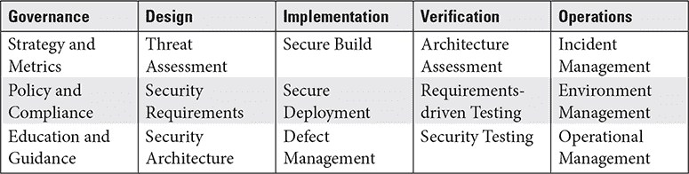

请注意，每个安全实践还包含多个活动，这些活动被分解为更多层级。

## 运行与维护

无论使用哪种开发方法论或生命周期模型，一旦软件已开发、被用户接受并实施，它就进入运行与维护（`O&M`）阶段。但是，在 `O&M` 期间，开发并不一定停止。通常，基于新的功能或性能需求，会生成补丁或升级。安全机制可能会被引入软件，此前未被发现的缺陷可能会被识别，并计划在软件的另一次更新或迭代中进行缓解。实施后，版本控制至关重要，以确保只有经过授权的生产代码位于生产环境中。

除了新需求、更新、缺陷修复以及软件的其他预期变更之外，漏洞管理流程也可能影响 `O&M` 期间的软件。每天都会发现新的漏洞，无论是在应用程序、其代码库中，甚至是在与软件相关的组件中，例如网络连接模块或身份验证机制。这些漏洞必须通过打补丁、安全配置和整体安全管理来解决。

## 变更管理

变更管理也是软件开发中的关键考量因素。没有任何应用程序能在其整个生命周期中不经历一定程度的变更，无论这些变更是次要的（例如补丁或更新），还是软件本身的重大重新设计。变更管理必须是一个具有结构的正式流程，而非临时性的努力。变更必须始终经过仔细考虑、测试和记录。

虽然正式的变更管理流程必然是一个全面的管理流程，但 `变更控制` 发生在较低级别，是在软件应用程序生命周期中控制特定变更并记录这些变更的流程。请注意，这也可以称为 `软件版本控制`。这与系统的配置管理流程非常相似，因为它发生在系统或软件级别。正式的变更和控制管理流程本质上包括请求变更、测试变更、批准变更、实施变更和记录变更；这些正式流程可能因组织而异，具体取决于其软件开发成熟度级别。

## 交叉引用

正式变更管理流程的细节已在目标 7.9 中讨论。

## 集成产品团队

一个 `集成产品团队（IPT）` 由具备广泛领域专业知识的团队成员组成。这使程序员能够与各类运营人员合作，包括 IT、会计、市场营销、工程以及其他传统上不参与软件开发的职能领域。这使开发人员了解这些领域的实际运作方式，从而能够编写真正满足客户需求的更好代码。请注意，IPT 不一定是一种开发方法论，而更多是一种管理技术，它通过让来自各种职能领域的合适人员参与软件开发过程，来促进软件设计和安全性。但是，IPT 通常使用敏捷开发方法论。

## 复习

**目标 8.1：理解并在软件开发生命周期（`SDLC`）中集成安全性** 在此目标中，我们开始讨论软件开发安全性。我们讨论了软件开发生命周期在提供构建功能代码和应用程序的结构化框架方面的重要性。我们探讨了几种不同的开发方法论，这些方法论可以独立于 SDLC。这些包括瀑布模型（一种严格的顺序方法论）、增量模型和螺旋模型（两者都允许开发阶段的多次迭代）、原型法、快速应用开发和敏捷开发。敏捷更多是一种开发方法而非方法论，包括多种方法论，如 Scrum、极限编程和看板。我们还讨论了 DevOps 和 DevSecOps，它们源于将开发人员与运营和安全功能相结合的需求，以生产更贴近实际用户需求、功能完善且安全的软件。

我们还讨论了成熟度模型，这些模型允许组织衡量其在软件开发流程中的成熟度水平。CMMI 和 SAMM 是我们讨论的两个特定成熟度模型。我们接下来简要探讨了在运行与维护期间确保软件保持最新并打补丁的需求。对于软件 `O&M` 尤其重要的是漏洞管理，理解即使在软件实施后，也会发现必须修复的安全缺陷。

我们还简要提到了变更管理流程，该流程也在目标 7.9 中讨论，以及它如何应用于软件开发。最后，我们讨论了集成产品团队的价值，它不仅将开发人员与运营人员和安全人员结合起来，还吸纳了来自各种职能领域的人员，包括会计、市场营销、工程和其他运营领域。

## 8.1 问题

**1.** 你正在与政府机构签订合同，并正在审查一个必须从头完全重建的旧版软件应用程序的文档。文档表明，在软件开发过程中存在关键决策点，之后不允许进行所需的更新和更改。这可能影响了软件的功能和特性。以下哪种软件开发方法论最可能用于开发此旧版应用程序？

**A.** 增量模型

**B.** 瀑布模型

**C.** 敏捷开发

**D.** 快速应用开发

**2.** 以下哪种开发方法论允许开发人员快速构建软件模型并将其提供给客户审查？

**A.** 原型法

**B.** 瀑布模型

**C.** 螺旋模型

**D.** 增量模型

## 3

以下哪项最能描述一种相对较新的软件开发方法论，该方法将开发人员、运维人员（即最终用户）和安全人员整合到同一个团队中，以开发更贴近客户需求、功能完善且内置安全性的软件？

**A.** Extreme Programming  
**B.** Scrum  
**C.** DevOps  
**D.** DevSecOps  

## 4

以下哪种成熟度模型由业务功能及其对应的安全实践组成？

**A.** Scrum  
**B.** CMMI  
**C.** SAMM  
**D.** Agile  

## 8.1 ANSWERS

**1** B 这描述了瀑布模型的软件开发方法，因为在做出决策后，很少能够逆转，且开发无法回退到之前的阶段进行更新或添加新功能。

**2** A 原型法允许软件开发人员开发软件模型并提供给客户进行审查和反馈。原型可能具备也可能不具备所有所需功能。

**3** D DevSecOps 结合了开发、安全和运维职能领域的代表，共同开发更贴近客户需求且安全的软件。

**4** C OWASP 软件保障成熟度模型（SAMM）由五个关键业务功能组成，包括治理、设计、实现、验证和运维，每个功能进一步由三项与安全相关的实践组成。

## Identify and apply security controls in software development ecosystems

在本目标中，我们将探讨在软件开发过程中及开发环境中应实施的一些安全控制措施。

## Security Controls in Software Development

在本书的大部分内容中，我们已在识别、身份验证、授权、审计、问责、不可否认性、密码学和物理安全的背景下讨论了安全控制措施。在软件开发生态系统中实施安全控制措施同样至关重要。在大多数情况下，管理控制和技术控制是在软件开发生命周期中实施的。这些控制措施包括软件开发策略、标准化的安全开发方法论以及对生产代码的访问控制等；但物理控制措施，例如对软件仓库和开发实验室的物理保护，也是必要的。

在本目标中，我们将讨论组织应在其软件开发环境中实施的各种安全控制措施，但我们还将介绍有助于安全的软件开发基础领域，例如编程语言、软件交付和软件配置管理。我们还将讨论代码仓库、应用程序安全测试以及组织内安全工具的编排和自动化等重要主题。

## Programming Languages

所有软件都是以代码形式编写的，代码是一组指令，告诉应用程序如何执行。软件代码是使用编程语言编写的，编程语言使用特定的语法、语句、变量、函数、子程序等。自软件开发开始以来，编程语言已经发生了显著演变，从使用晦涩复杂的十六进制指令，到结构化过程式代码，再到面向对象编程，最后到自然语言。对于 CISSP 考试，你应该记住五种定义的编程语言代际。Table 8.2-1 列出并简要描述了这五种语言代际。

**TABLE 8.2-1** The Five Generations of Programming Languages

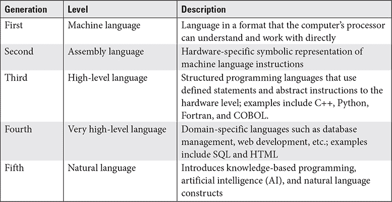

请注意，随着每种语言代际的发展，发生了两个关键变化：

• 语言对程序员来说变得越来越容易编写，在提供更多功能的同时，所需的编程工作量大大减少。例如，用汇编语言编写任务指令所需的编程工作量，远大于用第四代或第五代语言编写相同任务所需的工作量。

• 抽象级别提高了。随着语言的发展，程序员需要了解的关于底层操作系统和硬件的细节减少了。这使得编程更容易、更高效，并且实际上更加可移植，从而实现了跨平台编程，因为抽象级别的提高使软件能够与更广泛的硬件平台进行通信。

无论编程语言的代际如何，指令最终都必须转换或翻译为机器级别。即使是第五代语言，在特定硬件平台或处理器能够理解其指令之前，也必须经过多层翻译。软件代码可以使用三种不同的方法进行翻译：

• **Assembler** 将汇编语言源代码转换为机器代码。

• **Compiler** 将高级语言语句转换为特定于底层硬件和处理器的机器级格式。

• **Interpreter** 直接从高级代码中解释单个程序语句，例如脚本中发现的语句。解释代码的可移植性更高，并且没有编译为可执行文件所带来的较大开销。

代码模块是指定义好的代码片段的名称，例如子程序、函数或其他可以与其他代码区分开的软件代码段。通常，代码模块的特征在于其能够在应用程序中执行特定任务或功能的能力。对于 CISSP 考试，你应该了解代码模块的两个关键特征，它们与程序效率以及进而与安全性相关。内聚性是指代码模块能够执行多少种不同类型的任务。模块被编写用于执行的任务越少，内聚性级别越高。内聚性越高越好。

耦合是指代码模块为了执行其任务而必须进行的交互或通信。耦合越低，模块执行任务所需与其他模块交互或通信就越少。耦合越高，所需的通信就越多。从编程效率的角度来看，低（或松散）耦合比高（或紧密）耦合更可取。请注意，高内聚性和低耦合都是减少代码攻击面这一安全概念的经典示例。

## Libraries

软件库是软件组件（例如代码片段、函数等）的集合，可以在许多不同的软件开发项目中使用。软件库本质上是可重用代码的集合。有人开发了一段执行所需功能的代码，并将其保存在软件库中。这些功能的示例可能用于实施安全控制，包括加密模块、身份验证机制等。如果这些软件库被认为坚固且有用，它们对于其他应用程序可能非常有用。软件库通常表示为代码模块、可执行文件、动态链接库等。开发人员需要了解软件代码模块的构建方式，如果模块不能轻松集成到应用程序中，可能需要开发应用程序编程接口（API）以将模块集成到其应用程序中。

## Tool Sets

开发团队使用的工具集在不同组织之间，甚至在同一组织内部，可能并不标准化。每个程序员都有自己偏好的工具集，但必须努力在组织内部标准化这些工具集，以便实现标准化的开发方法论和可预测的结果。开发者的工具集可以有多种形式：定制脚本、自研应用程序、数据库、电子表格、自定义库以及许多其他为简化开发者工作而实现的非标准工具。标准化开发者的工具集可能很困难，但如果管理层倾听开发者的意见，并采用开发者真正需要的最佳工具，同时结合标准化的集成开发环境（下文将讨论），这是可行的。请注意，这些工具集除了用于一般的软件编程和开发任务外，通常还包括安全功能，例如加密和身份验证机制。

## 集成开发环境

集成开发环境（IDE）是一套专为代码开发设计的工具，并通过单一图形用户界面使用。在软件开发的早期，代码被严格编写为顺序的文本行。当今的 IDE 允许使用可视化图形界面进行面向对象编程（OOP）。IDE 支持的功能远不止简单地编写代码行，它使开发者能够频繁检查代码错误、在受控环境中执行代码，并使用各种内置或可自定义的测试用例进行测试。IDE 可以用于多种语言，前提是 IDE 支持这些语言。复杂的 IDE 还可用于控制对代码仓库的访问、实施版本控制，以及记录和审计对代码的更改。IDE 还可以包含安全功能和控制，这些功能可以轻松实现在使用该 IDE 开发的软件中。

## 运行时

`Runtime` 是一个名称，用于指代任何平台编写的代码可以在其中执行的环境。运行时环境充当一种微型操作系统或虚拟机容器，其中应用程序（通常称为 `portable` 或 `mobile code`）可以像原生编写一样运行。你最常会看到运行时环境用于为基于 Web 的应用程序编写的移动代码，例如 Java。运行时环境充当代码与代码可以通信的操作系统之间的层，并反过来翻译代码对资源的请求以及从主机返回的响应。因为它充当操作系统与在其中运行的代码之间的层，运行时环境可以保护运行中的代码免受其环境中不安全条件的影响，反之亦然。

## 持续集成和持续交付

代码发布到生产环境的方式变得极其关键，尤其是随着开发方法论的变化以及代码更高效地交付给客户。你应该了解 CISSP 考试的两个关键交付概念：持续集成和持续交付（CI/CD）。

`Continuous integration` 意味着一旦代码被开发、测试并批准，它就会被集成到测试（或预暂存）环境中。这非常是一个自动化过程；代码被开发并合并到代码仓库中，在那里会进行一系列自动化测试。如果测试产生良好结果，自动化过程会将代码交付到仓库并产生一个新的软件版本。错误会被快速识别，并可以更高效地纠正。

`Continuous delivery` 允许软件版本的持续、增量重建，这些版本可以随时发布。同样，这比传统的交付方法更多是一个自动化过程，因此代码可以几乎实时地发布到生产环境，前提是它满足所有测试和验收要求。

因为这两个过程都高度依赖自动化，所以保持代码仓库和自动化组件的安全非常重要。2021 年，一个名为 `Codecov` 的流行 CI/CD 平台遭到破坏，允许恶意行为者潜在地渗透任何使用该平台的产品或组织的代码库。

## 安全编排、自动化和响应

安全编排、自动化和响应（SOAR）是一种管理组织用于在组织内部管理安全流程的各种安全工具（例如套件、脚本和可执行文件）的新方式。通常作为集成平台实现，SOAR 试图将所有各种工具纳入一个伞下，以便更容易管理和集成。SOAR 支持常见的数据格式，以便安全信息可以在工具之间轻松交换；在某些情况下，API 可用或开发以连接一个应用程序到另一个应用程序。

使组织能够通过单一用户界面执行每个不同工具的功能并接收结果，节省时间并在安全管理中创造效率。SOAR 可以通过自动化标准补救措施来加速安全响应，使分析师能够专注于需要人工分析的高优先级事件。许多安全信息和事件管理（SIEM）套件也可以充当 SOAR 平台，尽管可能需要额外的附加模块，或者组织可能需要在其某些自研工具和 SOAR 平台之间构建自定义接口。

## 软件配置管理

正如其名称所示，软件配置管理（SCM）是一个管理过程。它是用于确保软件按照一套严格的标准构建和配置、进行文档记录，并且其版本受到严格控制的过程。其中大部分是通过自动化过程完成的，尽管必须存在手动任务和人工管理，以确保这些自动化过程能够维护受控的代码库。配置管理和变更控制在目标 7.9 中详细讨论过，在目标 8.1 中简要讨论过，那些目标中讨论的原则也适用于软件配置管理。

文档和版本控制可能是软件配置管理中两个最重要的方面。软件必须在多个方面进行文档记录。代码本身必须被注释并彻底记录，以便将来审查它的程序员能够理解代码是如何以及为什么被设计的。还必须编写详细说明如何操作应用程序的高级手册；有时必须为用户或技术人员记录安全机制。

`Version control` 意味着必须严格遵守变更和配置控制流程。对官方代码库的任何更改都必须记录，并且无论是主版本号还是次版本号，版本号都必须递增。投入生产的代码库版本必须与开发和测试仓库中的代码版本分开。`Code synchronization`（确保所有工作版本与最新批准的更改同步）可能会成为问题，如果开发者被允许在不经过正式代码检出流程的情况下随机处理代码。下一节将讨论的这个流程，确保代码同步问题被最小化。

## 代码仓库

代码仓库既可以是物理上的，也可以是逻辑上的安全存储区域，用于代码管理。代码仓库充当代码库，用于存储和管理各种版本的软件。访问控制对代码仓库至关重要；开发人员只能访问开发代码，而 IT 人员以及负责将代码实际实现到生产环境中的其他人员只能访问生产代码。由于版本控制是软件配置管理的关键功能，审计和识别代码更改的能力必须成为任何代码仓库系统的一部分。处于不同阶段的代码，例如开发、测试和生产，应由个人“检出”，以便可以实施审计；更改可以被锁定或允许，但尝试应被记录和审计。

## 应用程序安全测试

作为大多数 SDLC 模型的一部分，应用程序安全测试在开发之后、软件实施并投入运行和维护之前进行。除了几种测试方法之外，还可以进行几种不同类型的测试。您在 SDLC 期间会看到的典型应用程序安全测试类型包括以下内容：

• **单元** 测试单个代码片段的性能和功能。

• **接口** 测试代码与应用程序其他组件以及硬件之间的接口。

• **集成** 测试软件应用程序代码与其他系统组件的集成不会降低这些组件的功能或安全性；这与互操作性测试密切相关。

• **用例** 将代码置于从用户需求开发的各种用例中进行测试，以确保代码在预定义条件下执行其预定功能。

• **安全** 在实施前评估软件的安全性；包括漏洞测试、渗透测试和误用用例测试（在目标 6.2 中也有讨论）。

应用程序代码会针对各种潜在问题进行测试。这些包括普通编程缺陷、已知编程语言漏洞（例如 C++ 中的某些不安全函数），当然还有安全问题。以下列表回顾了目标 6.2 中提到的代码测试的安全方面：

• 输入验证

• 安全数据存储

• 加密和身份验证机制

• 安全传输

• 依赖不安全或未知资源，例如库文件

• 与系统资源交互，例如内存和 CPU

• 边界检查

• 导致不安全应用程序或系统状态的错误条件

## 交叉引用

各种类型的测试，以及它们测试的一些安全问题，也在目标 6.2 中讨论过。

CISSP 考试要求您不仅了解应用程序安全测试的类型和测试的问题，还要了解使用的几种关键测试方法。这些包括静态和动态应用程序安全测试，以及下面讨论的其他方法。

## 静态应用程序安全测试

静态应用程序安全测试 (SAST) 涉及在不实际执行应用程序代码的情况下对其进行测试。SAST 需要访问实际源代码，而不是编译后的可执行文件。SAST 可以通过多种方式进行，包括手动或自动方式。在手动 SAST 中，代码由另一名程序员逐行审查；这是一种基本的代码审查技术。自动化测试使用专门设计用于快速逐行扫描应用程序代码的软件套件，以查找语法错误、已知缺陷、错误逻辑或顺序、不当变量使用以及许多其他常见问题。一些更复杂的软件套件可以查找缺乏输入验证、错误函数调用等问题。此外，可以根据组织的需求向软件套件添加自定义测试。

## 动态应用程序安全测试

动态应用程序安全测试 (DAST) 在应用程序处于生产模式时进行。一旦完成静态测试，应用程序在实际执行时进行测试。由于 DAST 在代码执行期间运行，因此不需要访问源代码。用于 DAST 的特定软件套件可以识别各种问题，包括硬件资源过度使用、与其他应用程序或操作系统的互操作性缺乏等。测试套件还可以创建人工错误条件，以查看软件代码的反应。

**考试提示** SAST 需要访问源代码，本质上是使用手动或自动方式进行的代码审查。DAST 不需要访问源代码，并在执行期间测试代码。

## 应用程序安全测试的形式

无论使用 SAST 还是 DAST，应用程序安全测试都有特定目标，例如单元测试或接口测试。应用程序安全测试可以采取多种形式，包括：

• 漏洞测试，在此期间发现软件代码中的已知漏洞。

• 渗透测试，尝试使用各种手动和自动方法“黑客”代码，以绕过安全机制。理想情况下，漏洞测试和渗透测试的结果用于在测试后改进软件代码中的安全机制。

• 误用用例测试，尝试确定软件可能被滥用或误用的所有不同方式。误用用例测试并不总是局限于安全功能；它还可以用于检查用户是否以非预期的方式使用软件。但是，误用通常会导致安全问题，例如可能允许访问管理特权或底层操作系统或硬件的错误（也称为异常）。

• 模糊测试是一种误用用例测试，可以在安全测试期间使用自动和手动方式进行。模糊测试获取非标准输入并在应用程序运行时将其馈入应用程序，以查看应用程序的反应。它本质上测试输入验证，以及变量使用和内存管理。

## 复习

**目标 8.2：识别并应用软件开发生态系统中的安全控制** 在此目标中，我们讨论了在软件开发过程中应考虑实施的一些安全控制。其中一些控制专门应用于软件开发环境，例如访问控制，但软件开发本身的一些特征可以帮助保护开发环境和代码，例如使用的编程语言类型、安全开发方法等。

我们简要介绍了软件开发的一些基础方面，包括对编程语言、库、工具集、IDE 和运行时环境的快速回顾。

我们还讨论了持续集成和持续交付的概念，这些概念使错误能够被快速发现，并使高质量代码能够更快地投入生产。安全编排、自动化和响应 (SOAR) 是一种总体管理方法，用于集成各种不同的安全工具，例如应用程序、脚本等，以便它们可以在一个界面下进行管理，并且它们的结果或输出可以更高效地收集和分析为可用信息。

软件配置管理有两个关键特征：所有软件代码的详尽文档和版本控制。代码仓库是存储不同官方版本代码的地方；它们必须在逻辑上和物理上受到保护，防止未经授权的访问和修改。

应用程序安全测试是软件开发生命周期（SDLC）的关键部分。应用程序可以使用多种方法进行测试，包括静态、动态、自动化和手动方法。

## 8.2 问题

**1.** Emmy 是贵公司的一名新程序员。她被指派在紧张的时间表内更新一个关键的业务线应用程序。当前版本的应用程序相当稳定，并利用了组织中其他应用程序广泛使用的许多标准化代码模块。如果 Emmy 使用这些代码模块，她是在利用以下哪项？

**A.** 代码库

**B.** 集成开发环境

**C.** 运行时环境

**D.** 持续集成和持续交付

**2.** Caleb 是一名网络安全分析师，必须对新应用程序进行安全测试。他特别需要测试新应用程序的输入验证。以下哪种测试类型最适合满足此要求？

**A.** 漏洞评估

**B.** 代码审查

**C.** 模糊测试

**D.** 单元测试

## 8.2 答案

**1.** A 重用已知的稳定代码就是利用组织维护的代码库。

**2.** C Caleb 必须对应用程序执行模糊测试来测试输入验证，这涉及向应用程序输入各种意外数据，以查看应用程序如何处理这些输入。

## 评估软件安全的有效性

此目标介绍了评估软件开发方面整体安全计划有效性的方法。我们在本书其他目标中讨论过的相同评估原则也适用于软件安全，例如测试、审计和风险管理，我们将讨论这些原则与软件安全的关系。

## 软件安全有效性

如何评估软件安全的有效性？它是衡量软件中发现了多少漏洞的指标吗？只有当软件从未被黑客攻击时，安全才是有效的吗？因为我们使用安全开发方法或安全编码，它就是有效的吗？这些问题只能由每个组织自行回答，但有几种方法可以评估软件开发过程是否安全，以及评估软件本身的整体安全性。

在目标 6.2 和 8.2 中，我们讨论了评估和测试的价值以及测试软件的各种方式，例如静态测试和动态测试。这些方法告诉我们软件在实施前有多安全。但是，软件在实施后也必须继续使用相同的方法进行评估，同时还要使用审计和风险分析。我们将在以下部分讨论这些主题。

## 审计和记录更改

对软件更改进行审计和记录实际上适用于两种不同的上下文。首先是软件开发过程。如目标 8.2 中所述，官方代码库应保持安全，不应被未经授权的人员更改。这是通过将代码存储在代码仓库并维护版本控制来实现的。可能有一个专门批准用于开发的版本，一个用于测试，最重要的是，一个用于生产代码。除非有人获得授权，否则任何人都不应有权访问代码，即使获得授权，对任何这些代码库的更改也应经过批准和审计。更改应被记录，尤其是在更改生产代码时，但在更改开发或测试代码时也应如此。更改后应相应递增版本号，以维护版本控制。

软件审计和记录的另一个上下文涉及软件本身，在运行和维护期间。软件应开发具有内置的日志记录和审计机制。例如，如果有人尝试更改软件应用程序中的敏感数据，应用程序本身应记录这些尝试，或者至少与更大的日志系统集成，例如 Windows 的应用程序日志设施或 syslog 服务器，以记录更改。软件还应记录安全事件，例如身份验证或授权失败。无论软件具有自己的内置日志记录和审计设施，还是使用操作系统或其他日志记录应用程序的设施，这些日志都应受到未经授权人员的保护；只有具有管理级权限的工作人员才应被允许访问软件应用程序日志。

**考试提示** 请记住，记录对代码库的所有更改并审计对所有版本软件代码的访问（包括开发、测试和特别是生产代码）至关重要。

## 风险分析和缓解

一般风险管理原则在目标 1.10 中已详细讨论。相同的风险管理原则适用于软件，但在本目标中，我们还将介绍更具体的细节，说明如何使用风险管理来分析软件安全性并缓解安全问题。

将风险管理原则应用于软件开发和安全流程，涉及确定与我们的软件资产相关的威胁行为者、威胁和漏洞。就本讨论而言，软件资产不仅包括完成的软件应用程序，还包括其特定版本的所有代码库：开发、测试和生产。我们的软件资产还可能包括我们用于开发和管理软件的工具，例如 IDE、代码仓库和各种实用程序。所有这些资产也必须受到各种威胁的保护，并检查漏洞。

可以使用我们在目标 8.2 中讨论过的一些技术在软件中发现漏洞，例如 SAST 和 DAST。但是，另一个开始查找漏洞的好地方是将您的软件与行业漏洞数据库和列表进行比较，例如 MITRE 托管的社区开发的硬件和软件漏洞列表 Common Weakness Enumeration (CWE) Top 25 Most Dangerous Software Weaknesses，以及由 Open Web Application Security Project 发布的 Web 应用程序软件中十个最关键漏洞列表 OWASP Top Ten。

OWASP Top Ten 会定期更新，请务必查看最新版本（`https://owasp.org/Top10/`）。例如，2021 年的 OWASP Top Ten 列表如下：

• A01: 访问控制失效

• A02: 密码失败

• A03: 注入

• A04: 不安全设计

• A05: 安全配置错误

• A06: 易受攻击且过时的组件

• A07: 身份识别和身份验证失败

• A08: 软件和数据完整性失败

• A09: 安全日志记录和监控失败

• A10: 服务器端请求伪造 (SSRF)

一旦您确定了与软件资产相关的威胁和漏洞，您就可以确定可能性和影响，就像评估任何其他类型资产时一样。目标 1.10 中介绍的相同定性和定量分析类型适用于确定软件资产的可能性和影响。

一旦你确定了软件风险，接下来的步骤自然是应对风险。如在目标 1.10 中讨论的那样，四种主要的风险应对措施是缓解、转移或共享、接受和回避。这些措施均可以多种方式应用于软件风险。缓解涉及使用更强大的安全机制对软件进行补丁更新或升级；转移或共享风险可能涉及将部分更复杂的编码工作外包；接受可能是在所有其他风险应对措施都已耗尽且组织必须接受一定程度的剩余风险后的一种选择；而回避意味着组织可能会停止生产该软件，或在其软件开发工作中采取另一条路径。

## 交叉引用

风险管理在目标 1.10 中已进行了详细讨论，其中涵盖的所有风险管理原则均可轻松应用于软件开发工作和软件资产。

## 复习

## 目标 8.3：评估软件安全性的有效性

在此目标中，我们回顾了在各种其他目标中讨论的评估方法，并将其应用于确保软件安全性有效性的场景。除了软件测试之外，评估软件安全性的有效性还需要软件审计以及对代码库变更进行日志记录。我们还简要总结了风险分析和响应过程在软件安全性中的应用。

## 8.3 问题

**1.** 以下哪项对于确保版本控制并检测代码库中任何未经授权的更改是必要的？

**A.** 静态代码分析

**B.** 动态代码分析

**C.** 审计所有更改

**D.** 手动代码审查

**2.** 你的公司是一家软件供应商，正在对一个软件包进行风险分析，然后再将其发布到市场。你的公司投入了数千美元和数千小时的人力来开发该软件包。经过密集测试，在软件中发现了几个关键漏洞。鉴于你的公司在该应用程序上投入了如此多的时间和资金，以下哪项是最佳的风险应对措施？

**A.** 接受风险并发布软件。

**B.** 通过补丁、配置更改和更新进行风险缓解。

**C.** 通过完全停止软件发布来使用风险回避。

**D.** 通过为软件应用程序购买网络保险来转移风险。

## 8.3 答案

**1.** C 对软件代码库的所有更改进行审计对于保持版本控制和检测代码库中的任何未经授权的更改至关重要。

**2.** B 你的公司应尽可能通过补丁、配置更改和更新进行风险缓解。只有在剩余风险处于可接受水平后，你的公司才应发布软件。

## 评估所获软件的安全影响

在前三个领域 8 目标中，我们讨论了组织内部软件开发的安全性。在此目标中，我们将继续讨论软件安全性，但从其他地方获取的软件（例如商业软件、开源软件以及专门为组织创建的第三方软件）的角度出发。这些软件各自在软件安全性方面都有其独特的挑战。

## 所获软件的安全影响

在此领域中，我们讨论了确保软件开发生命周期安全，以及组织自身开发工作所产生的软件安全性。在此目标中，我们想要查看通过其他方式获取的软件。并非每个组织都会开发自己的软件应用程序；事实上，大多数组织会将软件作为商业现成软件包的一部分来获取，或者，在专业业务线软件的情况下，可能会采用交钥匙解决方案，甚至委托第三方开发人员开发软件。组织还可以使用开源社区的软件。我们将查看每种软件来源的安全注意事项。

## 注意

在这些外部软件来源中，组织用于确保自身开发工作中软件安全性的相同流程，也可用于建立对从第三方获取的软件的信任。这些流程包括确保第三方使用安全的软件开发方法、对其代码库实施严格的访问控制、维护安全的代码仓库、采用严格的软件版本控制、实施安全测试、发布补丁和更新，并维护整体安全的管理流程。

## 商业现成软件

商业现成（COTS）软件通常由微软等公司或其他主流软件开发公司生产并销售。例如办公生产力套件、会计软件、视频编辑软件或音乐软件。通常，你并不是真正购买软件，而是购买使用许可，而该许可附带开发者施加的多种不同限制。我们不会详细介绍众多可用的许可模型，但可以说，一段软件的许可决定了其使用、购买、转让等方式。

在大多数情况下，组织可以获取可在系统上安装的可执行文件，但无法获取源代码，因为源代码是软件开发者用来保持其在市场竞争优势的知识产权。大多数许可禁止反汇编或逆向工程软件，因为这会削弱软件开发者的竞争优势。同样，大多数许可禁止未经购买而复制或使用软件。与过去仅输入软件密钥的日子不同，当今的许可机制通常需要联网激活和定期在线更新，以维护许可协议的安全性。

COTS 软件可能是最安全的软件来源，因为它通常已在大规模上经过测试和实施。然而，这并不意味着 COTS 软件没有漏洞。商业软件中不断发现新漏洞，尽管大多数软件开发公司通常能够在漏洞被利用之前发布更新或补丁来解决漏洞或安全问题，但情况并非总是如此。零日漏洞（可立即被利用且尚未开发出缓解措施的漏洞）已在大多数流行的 COTS 软件中被发现，促使软件开发者、反恶意软件供应商和安全从业者争相快速缓解缺陷，防止恶意实体利用这些漏洞。

无论组织是内部开发软件，还是从其他组织购买或委托开发软件，都应定期、周期性地扫描漏洞。应建立一个管理良好的补丁管理程序，以确保软件定期更新和打补丁。

## 开源软件

从实际角度来看，大多数开源软件是良性的，但其代码中仍存在漏洞的可能性，即使经过长时间也是如此。开源软件的优势在于其开发者社区，他们辛勤工作，以确保（在大多数情况下）发布的开源软件是稳定且功能强大的，同时也安全。

当然，开源软件仍有可能被恶意实体渗透并遭到破坏。对于正在考虑使用开源软件的组织来说，最好的防御措施是尝试将其来源追溯到经过验证的可靠开发者或社区。组织在实施可靠的开源软件后，应定期扫描软件中的漏洞，这与商业软件的做法相同。

## 第三方软件

第三方软件通常是专门为不自行开发软件的组织开发的。这可能是为业务应用程序开发的专用代码，用于运行生产设备，或用于满足特殊业务需求。无论如何，评估第三方软件安全影响的关键在于评估软件开发者是否可信。组织必须确定其能在多大程度上信任第三方开发者。组织可以通过审查第三方开发者的声誉（通过社交媒体、网站、公开可用的审计报告等）及其软件开发认证（例如 CMMI 级别）来做到这一点。

在确定第三方软件开发者可信后，组织必须确定如何在软件的开发和交付过程中强制执行安全机制。这时，合同、服务级别协议（SLAs）和其他法律机制就派上用场了。组织可以通过合同协议，强制执行某些安全方面的要求，例如可验证的安全软件开发方法论、代码审查和测试、程序员所需的经验和技能集等。有了这些措施，第三方开发者就更加可信了。

**EXAM TIP** 第三方软件开发安全可以通过对第三方开发者流程的信任，以及组织与第三方之间的合同协议来实现。

## 托管服务

托管服务有其自身的挑战，但在某些方面，使用托管服务可能是管理软件安全性的更简单方式，因为大部分艰苦工作都外包给了服务提供商。托管服务是由第三方代表组织执行的服务。这些服务范围从管理组织的基础设施、服务器和安全，到管理其软件、桌面及其他信息技术方面。所有这些服务也可以作为云服务产品的一部分进行管理，形式为软件即服务（SaaS）、基础设施即服务（IaaS）和平台即服务（PaaS）。提供商通常负责软件安全，包括开发过程以及应用程序中的安全机制。提供商通常还负责保持软件使用最新的补丁和更改进行更新。如果提供商提供 IaaS 或 PaaS，情况亦然。

确保托管服务（尤其是软件服务）安全性有两个关键点。第一是提供商的可信度。你需要确定提供商是否有良好声誉。你应该通过在线仔细研究提供商并通过采访提供商来进行尽职调查，以回答以下问题：他们是否雇佣了熟练且经验丰富的开发者？他们是否使用可靠的软件开发方法论？他们是否在合同或协议中保证服务或安全级别？

协议本身是确保托管服务安全性的第二个关键点。无论协议是保证特定安全级别的合同还是 SLA，都应通过指定安全责任、功能和性能级别等来保护组织。合同可以写成要求提供商为其软件使用经验丰富的开发者，并提供安全审计报告或允许组织对其进行审计。

**Cross-Reference**

我们在目标 1.12、3.5 和 7.7 中讨论了第三方服务产品以及云服务提供商。

## REVIEW

**Objective 8.4: Assess security impact of acquired software** 本目标简要讨论了如何确保通过商业购买或许可、开源、第三方开发者或托管服务获得的软件的安全性。先前 Domain 8 目标中讨论的相同软件保证实践也适用于这些软件来源；主要区别在于组织不控制开发或安全流程。确保软件安全性的两个关键是对开发者的信任和合同要求。软件安全性还通过组织如果拥有自己的开发工作时会使用的一些相同流程来保证：测试、安全代码仓库、软件版本控制、漏洞测试、补丁和更新。

## 8.4 QUESTIONS

**1.** 您的组织正在寻找替换一个已达到生命周期终点的专用生产系统的软件应用程序。生产系统的原始制造商已经倒闭，因此无法帮助升级与该系统相关的软件。贵公司没有内部开发计划。以下哪项是为运行独特生产系统获取软件的最佳解决方案？

**A.** 商业现成软件

**B.** 第三方软件开发者

**C.** 开源软件

**D.** 内部开发软件

**2.** 您的公司已与托管服务提供商签订合同，以提供专有软件服务来支持专用业务应用程序。托管服务提供商拥有软件许可证并负责其维护和补丁。然而，软件有一个新的主要版本，托管服务提供商拒绝为贵公司部署，称其没有合同义务这样做。贵公司需要此新版本来适应即将到来的生产流程变更。不升级软件可能会使贵公司损失大量资金，且旧软件也将无法与随流程变更而来的新安全机制兼容。如果贵公司继续需要该软件，则在接收未来主要版本和软件升级方面应考虑以下哪项？

**A.** 审查指导数据和软件流程保护的法规和条例，并考虑在民事法院起诉提供商。

**B.** 寻找与贵公司流程兼容的不同第三方供应商。

**C.** 修改与软件提供商的合同和服务级别协议，以包含新版本软件和安全升级的要求。

**D.** 决定停止使用该服务提供商，改用商业现成软件或开源软件。

## 8.4 ANSWERS

**1.** B 使用第三方软件开发者可能是最佳选择，因为组织没有自己的内部软件开发计划。由于这是一个独特的生产系统，且原始制造商已经倒闭，COTS 软件可能不是可行的替代方案，开源软件也不是，因为生产系统具有独特且专用的性质。

## 2

如果组织继续需要该软件，则应修改与托管服务提供商的合同或服务级别协议，以包含主要升级和新版本。只有在组织确定如果转向不同的软件包将面临的安全和财务风险后，才应重新考虑合同并选择商用现成软件（COTS）甚至开源软件。

## 定义并应用安全编码指南和标准

在领域 8 的最后一个目标中，我们将通过介绍安全编码标准和指南、常见软件漏洞以及软件定义的安全，来完成对软件安全的讨论。

## 安全编码指南和标准

编写不含常见安全缺陷的代码是开发安全软件的关键。即使使用最安全的开发环境，如果最终软件产品充满缺陷和漏洞，也毫无区别。在以下部分中，我们将讨论如果不遵循安全编程实践，常常会进入源代码的常见安全漏洞。接下来，我们将重点介绍应用程序编程接口（`API`）安全的必要性。然后，我们将探讨安全编码实践及其重要性。最后，我们将简要讨论软件定义网络的下一个逻辑延伸，即软件定义的安全。

## 源代码级别的安全弱点和漏洞

尽管付出了最大的开发努力，即使包括安全的独立环境、代码仓库和强大的管理实践，应用程序源代码也始终会存在漏洞。有时这些缺陷非常严重，有时则较轻微且仅影响功能。但即使是轻微的漏洞，也可以串联在一起导致更大的弱点。有几个常见的漏洞可以在源代码中轻松解决，但其他漏洞可能需要你非常努力地查找。

当然，发现漏洞的最佳方法是通过测试。我们在目标 8.2 中讨论了静态应用程序安全测试（`SAST`）和动态应用程序安全测试（`DAST`）。这两种测试都会查找可以识别和修复的常见漏洞。你遇到的大多数漏洞都与有故障的输入、资源滥用（`e.g., memory, CPU, and storage space`）、编程语言本身固有的易受攻击函数以及有故障的安全机制（`e.g., legacy or vulnerable authentication and encryption modules`）有关。回顾目标 8.3，常见漏洞列在 OWASP Top Ten 和 CWE Top 25 Most Dangerous Software Weaknesses 等来源中。表 8.5-1 显示了 2021 年 CWE Top 25 列表，作为 2021 年报告的最常见但关键漏洞的示例。

**TABLE 8.5-1** CWE Top 25 (adapted from [`https://cwe.mitre.org/top25/archive/2021/2021_cwe_top25.xhtml`](https://cwe.mitre.org/top25/archive/2021/2021_cwe_top25.xhtml))

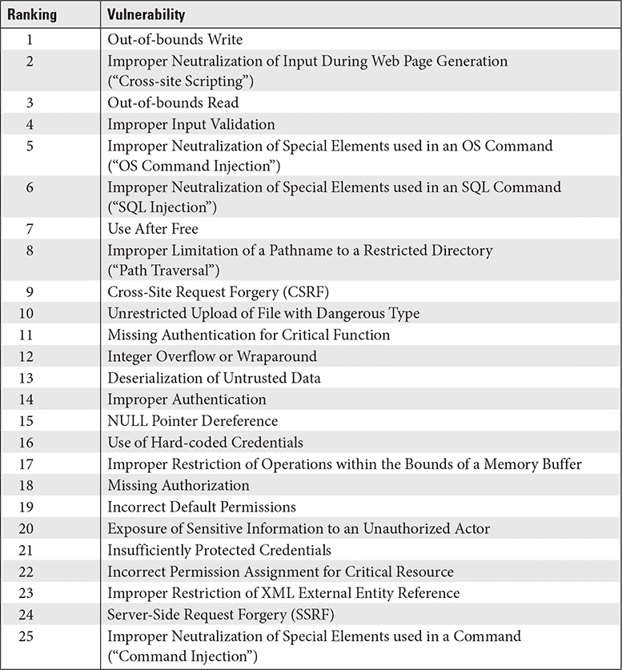

**EXAM TIP** 考试不要求你逐字背诵 CWE Top 25 或 OWASP Top Ten，但你仍应熟悉一些最关键的软件漏洞，以及安全编码实践如何缓解这些漏洞。

请注意，OWASP Top Ten 和 CWE Top 25 都不是全面的；还有数百种其他软件漏洞你应该了解，它们包含在不同的列表或数据库中。许多其他资源专注于特定的数据库、Web 应用程序或操作系统漏洞。还有针对特定应用程序的漏洞列表。然而，几乎所有这些漏洞都可以通过稍后在目标中讨论的安全编码实践来缓解。

## 应用程序编程接口安全

应用程序编程接口（`API`）是一段独立的代码，通常是一个模块，允许独立的应用程序（和操作系统）相互连接并交换数据。这些应用程序可能具有不同的数据格式、安全机制（例如 `authentication` 和 `encryption`）以及交换数据的方法。`API` 用于弥补这些差距，并允许应用程序在各个层级（包括用户界面）之间实现无缝集成。API 可以根据它们连接的不同应用程序构建为可重用，并且通常存在于组织的代码库中，使开发新应用程序的开发人员能够引入现有 API，例如将新应用程序连接到旧版应用程序。

API 也存在必须解决的安全问题。除了前面提到的常见软件漏洞外，API 必须被编程为接受各种输入，并将其转换为安全、格式正确且对其他应用程序有用的数据。参数验证在这里很重要；API 必须确定它从其他应用程序或操作系统接收的数据或命令是否正确。

## 安全编码实践

安全编码涉及许多流程。首先，在整个组织中标准化并要求程序员遵循的安全编码方法论是该过程的第一步。第二步是强烈的代码审查，通常来自同行，但也来自正式的审查和测试流程。虽然安全开发传统上未包含在大多数软件开发生命周期模型中，但它已越来越多地从生命周期的开始阶段集成进来，例如使用现代开发方法论（如 `DevSecOps`）时，可从需求阶段开始。

**Cross-Reference**

`DevSecOps` 和其他开发范式在目标 8.1 中讨论过。

一些更常见的安全软件编码方法论包括 OWASP 推广的安全实践，OWASP 是一个独立的专业组织，推荐软件安全方法（并发布之前介绍的 OWASP Top Ten）。OWASP 建议为安全软件开发建立以下基础：

• 为安全和开发人员定义角色和职责  
• 为开发人员提供充分的安全培训  
• 实施安全开发生命周期模型  
• 采用安全编码方法论  

除了这些总体建议外，OWASP 还发布了安全编码实践检查清单，该清单侧重于以下领域（改编自 *OWASP Secure Coding Practices Quick Reference Guide*，[`https://owasp.org/www-pdf-archive/OWASP_SCP_Quick_Reference_Guide_v2.pdf`](https://owasp.org/www-pdf-archive/OWASP_SCP_Quick_Reference_Guide_v2.pdf)）：

• 输入验证  
• 输出编码  
• 身份验证和密码管理  
• 会话管理  
• 访问控制  
• 加密实践  
• 错误处理和日志记录  
• 数据保护  
• 通信安全  
• 系统配置  
• 数据库安全  
• 文件管理  
• 内存管理  

OWASP 还在检查清单中包含一般编码实践，包括我们已经讨论过的一些实践，例如安全代码审查和测试的必要性、独立的开发环境、使用经过验证的代码模块和库等等。

公众可以使用各种其他安全编码实践，有些由 OWASP 等独立专业组织开发和推广，有些由软件或操作系统供应商开发，还有些由美国政府和行业标准机构开发。

## 软件定义的安全

软件定义网络速度更快、效率更高，并允许动态路由和交换，有效取代了硬件做出的较慢流量决策。软件定义安全将其提升到一个新水平，能够执行高级流量过滤。软件定义安全既可以执行基于内容的过滤，也可以执行基于上下文的过滤，同时支持基于简单和复杂规则集的过滤。然而，这项技术不仅限于流量过滤；软件定义安全还可以执行硬件防火墙、IDS、代理和其他安全设备的相同功能。软件定义安全还与硬件无关，独立于硬件供应商。

## REVIEW

## 目标 8.5：定义并应用安全编码准则和标准

本目标完成了我们对软件开发安全（领域 8）的讨论。在此目标中，我们讨论了安全编码准则和标准。首先，我们讨论了应用程序源代码中常见的一些安全弱点和漏洞。这些问题可以在手动测试和自动化测试期间识别出来。大多数这些安全弱点和漏洞可以通过安全编码轻松修复，但有时可能需要偶尔重新设计软件以适应安全机制。你可以找到数百个软件漏洞来源，它们会显示数据库、Web 应用程序等的关键漏洞，包括 OWASP Top Ten 和 CWE Top 25 列表。

我们还讨论了应用程序编程接口的安全性。这一点至关重要，因为用于交换数据的应用程序之间的链接必须安全，并提供强大的身份验证和加密机制，以及数据完整性。

我们还研究了安全编码实践，其始于管理层要求在组织中实施标准。安全编码实践包括代码审查和广泛测试，以定位和缓解漏洞。安全编码实践和方法包括独立专业组织（如 OWASP）、软件或操作系统供应商，以及美国政府和行业标准机构所颁布的那些。

最后，我们讨论了软件定义安全，它是软件定义网络的扩展。软件定义安全通过更快的流量过滤决策并执行高级安全硬件功能，动态保护软件定义网络。

## 8.5 问题

**1.** 以下哪项对于发现组织开发的代码中的漏洞至关重要？

**A.** 安全编码标准

**B.** 测试

**C.** 安全设计

**D.** 安全需求

**2.** 你被指派监督一项开发工作的安全测试，该工作专注于创建一条新的业务线应用程序，该应用程序必须与多个现有应用程序集成。在测试期间，你发现新应用程序与现有应用程序之间的身份验证机制会自动默认使用旧版加密算法。为了确保应用程序之间的身份验证机制默认安全，你应该解决以下哪项？

**A.** 输入验证

**B.** 网络接口

**C.** 应用程序编程接口

**D.** 内存和 CPU 使用情况

## 8.5 答案

**1.** B 要发现组织开发的软件中的漏洞，测试是绝对必要的。其他选项在开发前和开发期间防止这些漏洞方面至关重要。

**2.** C 应用程序编程接口用于连接不同的应用程序，并可能负责交换身份验证数据。为了确保应用程序之间使用的身份验证机制正常运行，API 必须安全开发。

## 关于在线内容

本书附带 TotalTester Online 可自定义的练习考试软件，包含 300 道练习考试题目。

## 系统要求

推荐并支持以下桌面浏览器的当前版本和上一主要版本：Chrome、Microsoft Edge、Firefox 和 Safari。这些浏览器会频繁更新，有时更新可能会导致与 TotalTester Online 或托管在 Training Hub 上的其他内容出现兼容性问题。如果你在使用其中某个浏览器时遇到问题，请尝试使用另一个，直到问题解决。

## 你的 Total Seminars Training Hub 账户

要访问在线内容，你需要在 Total Seminars Training Hub 上创建一个账户。注册免费，你可以使用账户跟踪所有在线内容。如果你希望接收 McGraw Hill 或 Total Seminars 的营销信息，也可以选择加入，但这并不是访问在线内容所必需的。

## 隐私通知

McGraw Hill 重视你的隐私。请务必阅读注册期间提供的隐私通知，以了解你提供的信息将如何被使用。你可以访问 McGraw Hill 隐私中心查看我们的企业客户隐私政策。访问 **[mheducation.com](http://mheducation.com)** 网站，然后单击页面底部的 **Privacy**。

## 单用户许可条款和条件

本书附带的数字内容的在线访问受下文概述的 McGraw Hill 许可协议约束。使用此数字内容即表示你同意该许可的条款。

**访问** 要注册并激活你的 Total Seminars Training Hub 账户，只需按照以下简单步骤操作。

**1.** 访问此 URL：**[hub.totalsem.com/mheclaim](http://hub.totalsem.com/mheclaim)**

**2.** 要注册并创建新的 Training Hub 账户，请在 **Register** 选项卡上输入你的电子邮件地址、姓名和密码。创建账户不需要进一步的个人信息（例如信用卡号）。

如果你已经拥有 Total Seminars Training Hub 账户，请在 **Log in** 选项卡上输入你的电子邮件地址和密码。

**3.** 输入你的产品密钥：`pg5g-gpjg-js4v`

**4.** 单击接受用户许可条款。

**5.** 对于新用户，单击 **Register and Claim** 按钮以创建账户。对于现有用户，单击 **Log in and Claim** 按钮。

你将被带到 Training Hub，并可以访问本书的内容。

**许可期限** 通过 Total Seminars Training Hub 访问你的在线内容将在出版商宣布本书停版之日起一年后过期。

你通过零售商店购买的此 McGraw Hill 产品（包括其访问码）受该商店退货政策的约束。

内容是 McGraw Hill 的受版权保护的作品，McGraw Hill 保留对内容的所有权利。本作品 © 2023 年由 McGraw Hill 出版。

**转让限制** 用户仅获得有限的使用权，用于用户自身的内部和个人使用，且取决于购买并持续拥有本书。未经 McGraw Hill 的同意，用户不得复制、转发、修改、基于内容创作衍生作品、传输、分发、传播、出售、出版或再授权内容，或以任何方式将内容与其他第三方内容混合。

## 有限保修

McGraw Hill 内容按“原样”提供。McGraw Hill 及其许可方不作任何形式的明示或暗示的担保或保证，包括但不限于对适销性或特定用途适用性的暗示担保，以及关于任何 McGraw Hill 内容或其中信息的准确性、完整性、正确性，或通过访问或使用 McGraw Hill 内容所获得结果的任何担保，或关于该内容中引用的任何材料，或由用户或其他人员输入到被许可人产品中的任何信息，以及/或可通过被许可人产品获得或访问的任何材料（包括通过任何超链接或其他方式），或关于不侵犯第三方权利的任何担保。任何形式的明示或暗示担保均被否认。通过使用 McGraw Hill 内容获得的任何材料或数据由用户自行酌情和承担风险，用户理解其将对由此导致的计算机系统任何损坏或数据丢失承担全部责任。

McGraw Hill 及其许可方不对任何订阅者、用户或其他人员因任何不准确、延迟、服务中断、错误或遗漏（无论原因如何）或由此产生的任何损害承担责任。

在任何情况下，McGraw Hill 或其许可方均不对任何间接、特殊或后果性损害承担责任，包括但不限于时间损失、金钱损失、利润损失或商誉损失，无论是在合同、侵权、严格责任或其他情况下，并且无论此类损害与使用 McGraw Hill 内容是否可预见或不可预见。

## TotalTester Online

TotalTester Online 为您提供 CISSP 考试的模拟。考试可以在练习模式或考试模式下进行。练习模式提供一个辅助窗口，包含提示、正确答案和错误答案的解释，以及在考试过程中检查答案的选项。考试模式提供实际考试的模拟。问题数量、问题类型和允许的时间旨在准确反映考试环境。自定义测验的选项允许您从选定的领域创建自定义考试，并且您可以进一步自定义问题数量和允许的时间。

要参加考试，请按照上一节提供的说明注册并激活您的 Total Seminars Training Hub 账户。注册后，您将被带到 Total Seminars Training Hub。从 Training Hub 主页，选择页面顶部的学习下拉菜单中的认证，以钻取到您书籍的 TotalTester。您也可以从主页的您的主题列表中滚动到它，然后单击 TotalTester 链接以启动 TotalTester。启动 TotalTester 后，您可以选择自定义测验的选项，并开始在练习模式或考试模式下测试自己。所有考试都提供总体成绩和按领域细分的成绩。

## 技术支持

有关 TotalTester 或 Training Hub 操作的问题，请访问 **[www.totalsem.com](http://www.totalsem.com)** 或发送电子邮件至 **support@totalsem.com**。

有关图书内容的问题，请访问 **[www.mheducation.com/customerservice](http://www.mheducation.com/customerservice)**。

## 索引

## A

ABAC (基于属性的访问控制), 243

无线技术中的吸收, 198

设施访问审计, 385–386

访问控制

身份验证。*参见* 身份验证

CPTED, 174

IAM。*参见* 身份和访问管理 (IAM)

媒体, 316

意外威胁, 71

问责制

描述, 12

概述, 231–232

账户

访问审查, 249–250

取消预配, 246–247

注册, 246

安全流程数据, 274

威胁情报中的准确性, 299

声学检测系统, 384

收购软件安全, 416–420

SDLC 中的收购阶段, 394

威胁行为者, 58–59, 71–72

临时网络, 199

地址解析协议 (ARP), 189

基于云的系统中的管理访问, 145

管理控制, 65

管理调查, 35

对抗性威胁, 71

AES 算法, 153

敏捷方法论, 397–398

协议

合同合规性, 25

雇佣, 50–51

SLA, 77, 312–313, 333, 418

第三方, 52–53

AHs (认证头), 190

AI (人工智能), 336

TPM 中的 AIKs (认证身份密钥), 136

ALE (年损失期望值), 63

加密算法, 150

安全功能与业务需求的对齐

业务战略和安全战略, 17

应谨慎/应尽职调查, 20–21

组织流程, 18

组织角色和职责, 18–19

安全控制框架, 19–20

允许列表, 327–328

放大器, 209

无线技术中的振幅, 198

分析

BIA。*参见* 业务影响分析 (BIA)

证据生命周期, 288

风险, 61–63

安全测试, 277–281

年损失期望值 (ALE), 63

年发生率 (ARO), 63

基于异常的入侵分析, 296, 332

天线, 198

反恶意软件, 334–335

风险偏好, 60

应用层防火墙, 210, 330

应用程序编程接口 (API) 安全, 421–422

应用程序

描述, 227

安全测试, 408–411

架构

资产生命周期, 106

网络, 208–209

安全。*参见* 安全架构与工程

ARO (年发生率), 63

ARP (地址解析协议), 189

工件, 289–290

人工智能 (AI), 336

AS (认证服务), 255

汇编器, 405

汇编编程语言, 404

评估

控制, 66–67

定义, 260–261

灾难恢复计划, 363

风险, 60–61

安全。*参见* 安全评估与测试

软件开发安全, 416–420

第三方, 76

漏洞, 59, 265

安全评估评估员, 262–263

资产安全

分类, 86–90

数据生命周期, 99–105

## 数据安全控制
109–114

## 处理要求
90–95

## 管理
97–98

## 目标
85–86

## 资源配置
96–99

## 保留
105–109

## 资产价值 (AV)
62

## 资产
57

## 辅助密码重置
234

## 非对称加密
152–154

## 异步攻击
164

## 原子执行
138

## 无线技术中的衰减
198

## TPM 中的证明身份密钥 (AIKs)
136

## 基于属性的访问控制 (ABAC)
243

## 审计
更改，413

基于云的系统，145

执行，281–284

定义，260–261

描述，12

设施访问，385–386

审查和问题，284

## 身份验证
229–230

问责制，231–232

基于属性的访问控制，243

凭据管理系统，233–234

数据通信，221

自主访问控制，241

身份证明，232–233

即时，234–235

强制访问控制，241–242

机制，239–244

概述，11–12

透传，165

审查和问题，235–236，243–244

基于风险的访问控制，243

基于角色的访问控制，242

基于规则的访问控制，242–243

会话管理，232

单因素和多因素，230–231

单点登录，234

## 认证报头 (AHs)
190

## 身份验证服务器
192

## 认证服务 (AS)
255

## 身份验证系统
Kerberos，254–255

开放授权，253

OpenID Connect，253

概述，252–253

远程访问，256–257

审查和问题，257–258

SAML，253–254

## IEEE 802.1X 中的验证器
192

## 授权中的真实性
12

## 授权
数据通信，221

描述，12

开放授权，253

远程访问，256–257

## 自动化配置管理
306

## AV (资产价值)
62

## 可用性
11，355–356

## 意识
灾难恢复计划，364

方法和技术，80–81

定期内容审查，82

人员安全，389

演示技巧，81–82

计划有效性评估，82

审查和问题，82–84

安全流程数据，274

## B

## 备份电源策略
180

## 备份存储
云，350

直接连接存储，349

电子保管和远程日志记录，351

网络连接存储，350

离线，350

存储区域网络，350

策略，348–349

验证数据，274

## 徽章读取器
384

## 无线技术中的带宽
198

## 裸机虚拟机监控程序
145

## 屏障
380

## 基线
配置管理，305–306

内部治理，42

## 堡垒主机
208

## BC. 参见业务连续性 (BC)

## BCPs. 参见业务连续性计划 (BCPs)

## 基于行为的分析
反恶意软件，334–335

IDS/IPS，332

入侵检测，296

## Bell-LaPadula 模型
126–127

## BIA. 参见业务影响分析 (BIA)

## Biba 模型
127

## 绑定硬盘驱动器
136

## 身份验证中的生物特征因素
231

## 沙箱中的位翻转
335

## 黑盒渗透测试
267

## 黑帽 (不道德) 黑客
266

## 黑名单
327–328

## 盲渗透测试
267

## 分组密码
152

## Blowfish 算法
153

## Bluejacking
202

## Bluesnarfing
202

## Bluetooth 标准
202

## 违规
攻击模拟，270

数据，29–30

## Brewer and Nash 模型
128

## 桥接器
209

## 路由桥
209

## 棕电
180

## 暴力密码分析攻击
162

## 总线加密
137

## 业务连续性 (BC)
业务影响分析，45–47，373–374

简介，45

概述，372–373

计划。参见业务连续性计划 (BCPs)

安全流程数据，274

## 业务连续性计划 (BCPs)
制定，374

指标，374–375

审查和问题，376–377

测试，375–376

## 业务影响分析 (BIA)
资产关键性，87

描述，46

制定，46

记录，47

概述，373–374

审查和问题，47–48

范围，46–47

## 业务战略和安全战略
17

## C

## 电缆调制解调器
216

## CABs (变更咨询委员会)
345

## 加州消费者隐私法案 (CCPA)
24，30

## 候选人，筛选和招聘
49

## 能力成熟度模型 (CMM)
399

## 能力成熟度模型集成 (CMMI)
399

## 电容探测器
385

## CAs (证书颁发机构)
156–157

## CASBs (云访问安全代理)
112–113

## CCPA (加州消费者隐私法案)
24，30

## CCTV (闭路电视) 摄像机
381

## CDMA (码分多址)
204

## CDNs (内容分发网络)
147，205–206

## CEI (计算机伦理研究所)
5

## 蜂窝网络
204–205

## 互联网安全中心 (CIS) 控制
20

## 证书颁发机构 (CAs)
156–157

## 证书吊销列表 (CRLs)
159

## certificates
156–157

## chain of custody for evidence
287

## Challenge Handshake Authentication Protocol (CHAP)
220

## change advisory boards (CABs)
345

## change management
## life cycle
345–346

## policies
344–345

## processes
344–346

## review and questions
347–348

## security considerations
346–347

## software development life cycle
401

## software development security
413

## channels
## cellular networks
204

## communications
*See* communications channels

## CHAP (Challenge Handshake Authentication Protocol)
220

## chief information officers (CIOs)
19

## chief information security officers (CISOs)
19

## chief privacy officers (CPOs)
19

## chief security officers (CSOs)
19

## Chinese Wall model
128

## chosen ciphertext and chosen plaintext attacks
163

## CI/CD (continuous integration and continuous delivery)
407

## CIOs (chief information officers)
19

## cipher locks
384

## ciphers
149

## ciphertext
149

## ciphertext-only cryptanalytic attacks
162

## circuit-level firewalls
210, 330

## CIS (Center for Internet Security) Controls
20

## CISOs (chief information security officers)
19

## civil investigations
35–36

## Clark-Wilson model
127–128

## classification
## assets
86–87

## data
87–88

## information
93–94

## client-based system vulnerabilities
140

## client-to-site VPNs
219

## Clipper Chip algorithm
150

## closed-circuit television (CCTV) cameras
381

## closed-source intelligence
300

## cloud access security brokers (CASBs)
112–113

## cloud-based firewalls
330

## cloud-based identity services
238

## cloud-based system vulnerabilities
144–145

## cloud sites
354

## cloud storage
350

## clustering cryptographic keys
150

## CMM (Capability Maturity Model)
399

## CMMI (Capability Maturity Model Integration)
399

## COBIT framework
20

## code, cryptography
149

## code, software
## guidelines and standards
420–425

## repositories
408

## review and testing
268–269

## code division multiple access (CDMA)
204

## code modules
405

## cohesion in programming
405

## cold sites
353

## collection
## data
102

## evidence
287–290

## security data
272–276

## collisions, hash
155

## collusion
310

## columns in database tables
141

## combination locks
384

## commercial classification systems
93

## commercial-off-the-shelf (COTS) software
416–417

## commodity malware
334

## communication and network security
## channels
*See* communications channels

## network components
207–214

## network security application
193–207

## networking concepts
184–192

## objectives
183–184

## communication in disaster recovery plans
361–362

## communications channels
## data communications
220–222

## introduction
215

## multimedia collaboration
218–219

## remote access
219–220

## review and questions
223–224

## third-party connectivity
222–223

## virtualized networks
222

## voice
215–218

## community clouds
144

## compartmented security mode
125

## compensating controls
66

## compilers
405

# compliance
## contractual
25

## controls
66–67

## data security
109–114

## industry standards
25

## legal and regulatory
24

## overview
23–24

## personnel policy requirements
53

## privacy requirements
25–26

## review and questions
26–28

## compliance checks
270

## Computer Ethics Institute (CEI)
5

## concentrators
209

## confidence levels in threat intelligence
299

## confidential classification
93

## confidentiality
## description
10

## models
126–127

## configuration management
## automating
306

## baselining
305–306

## cloud-based systems
145

## introduction
304

## patches
341–342

## provisioning
305

## review and questions
306–307

## software
408

## confusion in cryptographic methods
151

## constrained interfaces
240

## consultants, agreements and controls with
52–53

## containerization vulnerabilities
146

## content-dependent access authentication
240

## content distribution networks (CDNs)
147, 205–206

## content reviews in security awareness
82

## context-dependent access
240

## continuous improvement in risk management
68

## continuous integration and continuous delivery (CI/CD)
407

## continuous monitoring
296

## contractual compliance
25

## control planes in SDN
196

## controllers of data
101–102

## controls
*See* security controls

## converged protocols
194

## copyrights
30–31

## corrective controls
66

## cost savings in third-party security services
333

## COTS (commercial-off-the-shelf) software
416–417

## countermeasure selection and implementation in risk management
64–65

## coupling in programming
405

## CPOs (chief privacy officers)
19

## CPTED (Crime Prevention Through Environmental Design)
174

## credentials
11

## crime prevention and disruption concerns in site planning
167

## Crime Prevention Through Environmental Design (CPTED)
174

## criminal investigations
36

## critical changes
346

## criticality
## information
131

## patch management
340–341

## C

CRLs (certificate revocation lists), 159

cryptanalysis, 149

cryptanalytic attacks

brute force, 162

chosen ciphertext and chosen plaintext, 163

ciphertext-only, 162

fault injection, 164

frequency analysis, 163

implementation, 163

Kerberos, 165

known plaintext, 162–163

man-in-the-middle, 164

overview, 161–162

pass the hash, 165

ransomware, 165

review and questions, 166–167

side-channel, 163–164

timing, 164

cryptographic keys in TPMs, 136

cryptographic solutions

cryptosystems, 151

digital certificates, 156

hybrid cryptography, 155–156

integrity, 154–155

introduction, 148–149

key management practices, 158–159

life cycle, 149–150

methods, 151–154

nonrepudiation and digital signatures, 158

public key infrastructure, 156–158

review and questions, 159–161

vulnerabilities, 142

cryptoprocessors, 137

cryptosystems, 151

cryptovariables, 150

CSOs (chief security officers), 19

culture, risk, 60

custodians, data, 101–102

Cyber Kill Chain threat model, 72, 301

cybercrimes, 29

cycles, wave, 197

## D

DAC (discretionary access control), 241

damage concerns, 168

DAST (dynamic application security testing), 410

data

breaches, 29–30

classification, 87–88

communications, 220–222

custodian responsibilities, 19

description, 9–10

data at rest, 91, 110

data centers, 175–176

data historians in industrial control systems, 143

data in transit, 92, 109–110

data in use, 110

data life cycle

collection, 102

destruction, 103–104

location, 102

maintenance, 102–103

overview, 99–100

owners, 100–101

remanence, 103

retention, 103

review and questions, 104–105

roles, 100–102

data localization laws, 32

data loss prevention (DLP), 112

data owners

cloud-based systems, 145

responsibilities, 19

data protection requirements in control selection, 131–132

data retention in cloud-based systems, 145

data security and compliance

control scoping and tailoring, 111

control standards selection, 110–111

data at rest, 110

data in transit, 109–110

data in use, 110

data states, 109

protection methods, 111–113

review and questions, 113–114

data segmentation in cloud-based systems, 145

data sovereignty, 102

database system vulnerabilities, 141–142

DCSs (distributed control systems), 142–143

de-encapsulation in OSI model, 186

decryption, 149

dedicated security mode, 124

default-deny method of controlling access, 328

defaults

secure, 117

site and facility design, 169

defense in depth

secure design, 117

site and facility design, 169

defined maturity level in CMMI, 399

delineated responsibilities in cloud-based systems, 145

deluge water sprinkler systems, 179

demilitarized zones (DMZs)

description, 208

firewalls, 329

demotions, 51–52

deny-listing, 327–328

deprovisioning in identity and access, 245–247

DES algorithm, 153

design phase

asset life cycle, 106

software development life cycle, 394

designing evaluations, 261–264

destruction

assets, 107

data, 103–104

media, 316–317

detection

fire, 177–178

incident management, 320–321

surveillance, 381

detective and preventive controls

allow-listing and deny-listing, 327–328

anti-malware, 334–335

description, 66

firewalls, 328–330

honeypots and honeynets, 333–334

IDS/IPS, 331–332

machine learning and artificial intelligence, 336

overview, 326

review and questions, 336–338

sandboxing, 335–336

third-party provided security services, 332–333

determination, risk, 58

deterrence, surveillance for, 381

deterrent controls, 66

detonation chambers, 335

development phase in SDLC, 394

devices, 227

DevOps development, 398

DevSecOps development, 398

DHE (Diffie-Hellman) algorithm, 154

dial-up communications, 216

Diameter system, 257

Diamond Model of Intrusion Analysis, 72, 301

differential backups, 349

Diffie-Hellman (DHE) algorithm, 154

diffusion in cryptographic methods, 151

digital certificates, 156

digital forensics tools, 290–291

digital rights management (DRM), 111–112

digital signatures, 158

digital subscriber line (DSL), 216

dips, power, 180

direct-attached storage, 349

direct sequence spread spectrum (DSSS), 198

disaster recovery data in security process data, 274

disaster recovery (DR)

lessons learned, 364–365

overview, 359–360

people safety concerns, 360

plans. *See* disaster recovery plans (DRPs)

review and questions, 365–367

disaster recovery plans (DRPs)

assessment, 363

## communications

- 361–362

## key points

- 360–361

## personnel

- 361

## response

- 361

## restoration

- 363

## testing

- 367–372

## training and awareness

- 364

## disciplinary activities

- 51–52

## discretionary access control (DAC)

- 241

## disposal phase in asset life cycle

- 106–107

## distributed control systems (DCSs)

- 142–143

## distributed system vulnerabilities

- 141

## distribution facilities

- 175

## DLP (data loss prevention)

- 112

## DMZs (demilitarized zones)

## description

- 208

## firewalls

- 329

## documentation

## business impact analysis

- 47

## investigations

- 292–293

## software configuration management

- 408

## dogs

- 381–382

## door delay locks

- 384

## double blind penetration tests

- 267

## DR. See disaster recovery (DR)

## drives

## binding

- 136

## self-encrypting

- 137

## DRM (digital rights management)

- 111–112

## DRPs. See disaster recovery plans (DRPs)

## dry pipe water sprinkler systems

- 179

## DSL (digital subscriber line)

- 216

## DSSS (direct sequence spread spectrum)

- 198

## due care

- 20–21

## due diligence

- 20–21

## duress codes for locks

- 384

## duress systems for personnel safety

- 390–391

## duties, separation of

## information security

- 118

## overview

- 14

## purpose

- 309–310

## site and facility design

- 170

## dynamic application security testing (DAST)

- 410

## E

## EAP (Extensible Authentication Protocol)

- 191–192, 220

## EAR (Export Administration Regulation)

- 31

## ECC (elliptic curve cryptography)

- 154

## Economic Espionage Act

- 30

## edge computing system vulnerabilities

- 146–147

## EDLP (Endpoint DLP)

- 112

## education for security awareness

- 80–84

## EF (exposure factor) in risk

- 62–63

## effectiveness

## controls

- 66–67

## software development security

- 412–415

## egress monitoring

- 297–298

## EKs (endorsement keys) in TPMs

- 136

## El Gamal algorithm

- 154

## electromagnetic (EM) spectrum

- 197

## electromechanical intrusion detection systems

- 385

## electronic locks

- 384

## electronic vaulting

- 351

## elliptic curve cryptography (ECC)

- 154

## EM (electromagnetic) spectrum

- 197

## embedded system vulnerabilities

- 143–144

## emergency changes

- 346

## emergency management

- 389–390

## emergency procedures

- 360

## employment agreements and policies

- 50

## Encapsulating Security Payload (ESP)

- 190

## encapsulation

## network security

- 196–197

## OSI model

- 186

## encryption. See also cryptographic solutions

## bus

- 137

## data communications

- 221

## description

- 149

## end-of-life phase in asset life cycle

- 106–107

## end-of-support phase in asset life cycle

- 106–107

## endorsement keys (EKs) in TPMs

- 136

## Endpoint DLP (EDLP)

- 112

## endpoint security for network components

- 213

## engineering security. See security architecture and engineering

## enrollment for user accounts

- 246

## entities

- 9–10

## entry control points

- 379

## environmental issues

## site and facility

- 177

## threats

- 71

## ESP (Encapsulating Security Payload)

- 190

## establishing identity

- 232–233

## ethical disclosure in security test results

- 279

## ethical (white-hat) hackers

- 266

## ethics. See professional ethics

## evacuation plans

- 179–180

## evaluations

## assessors

- 262–263

## goals and strategies

- 261–262

## review and questions

- 263–264

## event logs

- 298

## evidence

## collection and handling

- 287–290

## life cycle

- 287–288

## storage

- 176

## evolutionary prototypes

- 396

## exception handling in security test results

- 279

## explicit denies

- 328

## explicit permissions

- 241

## Export Administration Regulation (EAR)

- 31

## exposure factor (EF) in risk

- 62–63

## Extensible Authentication Protocol (EAP)

- 191–192, 220

## external assessors for security evaluations

- 262–263

## external governance

- 16

## external security auditors

- 282–283

## extranets

- 208

## Extreme Programming (XP)

- 398

## F

## facilities

## access audits

- 385–386

## description

- 227

## design. See site and facility design

## factors, authentication

- 230–231

## fail securely

## secure design

- 117–118

## site and facility design

- 169–170

## fault injection cryptanalytic attacks

- 164

## fault tolerance

- 356

## faults, power

- 180

## FCIP (Fibre Channel over IP)

- 194

## FCoE (Fibre Channel over Ethernet)

- 194

## FDMA (frequency division multiple access)

- 204

## Federal Information Security Management Act (FISMA)

- 24

## Federated Identity Management (FIM)

- 233, 237–239

## fencing

- 379–380

## FHSS (frequency hopping spread spectrum)

- 198

## Fibre Channel over Ethernet (FCoE)

- 194

## Fibre Channel over IP (FCIP)

- 194

## fields in database tables

- 141

## fifth generation programming languages

- 404

## FIM (Federated Identity Management)

- 233, 237–239

## fire prevention

- 177–180

## Firewall as a Service (FWaaS)

- 330

## firewalls

## cloud-based

- 330

## network- and host-based

- 329

## overview

- 328–329

## types

- 210–211, 329–330

## web application

- 330

## firmware in system security

- 135

## first generation programming languages

- 404

## FISMA (Federal Information Security Management Act)

- 24

## flat-file databases

- 142

## 卫星足迹

203

## 数据库系统中的外键

141–142

## 取证调查

## 描述

287

## 数字工具

290–291

## SDN 中的转发平面

196

## 第四代编程语言

404

## 框架，风险

64

## 无线技术中的频率

197–198

## 频率分析密码分析攻击

163

## 无线技术中的频段

198

## 频分多址 (FDMA)

204

## 跳频扩频 (FHSS)

198

## 完整备份

349

## 全中断测试

## 业务连续性计划

375

## 灾难恢复计划

370

## 全知识渗透测试

267

## 控制选择中的功能需求

131

## 控制功能

65–66

## 模糊测试

411

## FWaaS (防火墙即服务)

330

## G

## 闸门

380

## 网关

209

## 一般数据保护条例 (GDPR)

24, 101–102

## 发电机，电力

180

## 地球同步卫星

203

## 目标

## 组织

17

## 安全评估

261–262

## 治理要求

## 控制选择

132

## 伦理

6

## Gramm-Leach-Bliley 法案

24, 30

## 灰盒渗透测试

267

## 灰帽黑客

266

## 卫兵

381–382

## 内部治理准则

41–42

## H

## H.323 标准

217

## HA (高可用性)

355–356

## 资产处理

## 分类系统

93–94

## 概述

90–91

## 复习与问题

94–95

## 存储

91–92

## 转移

93

## 传输

92

## 运输

92

## 证据处理

287–290

## 硬盘驱动器，绑定

136

## 硬件

## 网络组件

208–209

## 风险

75

## 系统安全

135

## 硬件安全模块 (HSMs)

136

## 防止对人员造成伤害

360

## 密码学中的哈希

155

## 健康信息技术促进经济和临床健康法案 (HITECH Act)

24, 30

## 健康保险可移植性与责任法案 (HIPAA)

24

## 供暖、通风和空调 (HVAC) 服务

177

## 启发式分析

## IDS/IPS

332

## 入侵检测

296

## 启发式反恶意软件

334–335

## HIDS/HIPS (基于主机的入侵检测/防御系统)

331

## 层次数据库

142

## 高可用性 (HA)

355–356

## 高级编程语言

404

## 高性能计算 (HPC) 系统漏洞

146

## HIPAA (健康保险可移植性与责任法案)

24

## 招聘候选人

49

## HITECH (健康信息技术促进经济和临床健康) 法案

24, 30

## HMI (人机界面)

143

## 蜜罐和蜜网

333–334

## 水平法规

33

## 基于主机的防火墙

329

## 基于主机的入侵检测/防御系统 (HIDS/HIPS)

331

## 热站点

353

## HPC (高性能计算) 系统漏洞

146

## HSM (硬件安全模块)

136

## HTTP (超文本传输协议)

189–190

## 集线器

209

## 人机界面 (HMI)

143

## HVAC (供暖、通风和空调) 服务

177

## 混合云

144

## 混合密码学

155–156

## 混合身份服务

238

## 超文本传输协议 (HTTP)

189–190

## 虚拟机监控程序

145

## I

## IaaS (基础设施即服务)

144

## IAM. 参见身份和访问管理 (IAM)

## ICMP (互联网控制消息协议)

188

## ICSs (工业控制系统)

142–143

## IDE (集成开发环境)

406

## 识别

## 数据通信

220

## 描述

11

## 威胁和漏洞

59–60

## 身份和访问管理 (IAM)

## 身份验证系统

252–258

## 授权机制

239–244

## 联合身份

237–239

## 识别和身份验证

229–236

## 逻辑和物理访问控制

226–229

## 目标

225–226

## 配置生命周期

245–252

## 身份管理 (IdM)

230

## SAML 中的身份提供者

254

## IDFs (中间分发设施)

175

## IdM (身份管理)

230

## IDS/IPSs (入侵检测和防御系统)

## 类别

331–332

## 模型

296

## 物理 IDS

384–385

## IEEE (电气和电子工程师学会)

## 802.1X

192, 220

## 道德准则

6

## IGMP (互联网组管理协议)

188

## IKE (互联网密钥交换)

190

## 影响，风险

58

## 实施

## 资产生命周期

106

## 变更

345

## 实施密码分析攻击

163

## 隐式拒绝

328

## 隐式权限

241

## 进出口管制

31

## 重要变更

346

## 站点和设施设计中的事件关注点

168

## 事件管理

## 检测

320–321

## 经验教训

324

## 生命周期

319–320

## 缓解

322

## 概述

318–319

## 准备

320

## 恢复

323

## 补救

323

## 报告

322–323

## 响应

321–322

## 复习与问题

324–326

## CMMI 中的不成熟成熟度级别

399

## 增量备份

349

## 增量方法论

396

## 数据库系统中的索引

142

## 妥协指标 (IoCs)

## 事件管理

320–321

## 威胁

71

## I

industrial control systems (ICSs), 142–143

industry standards

compliance, 25

investigations, 37

information, description, 9–10, 227

information flow models, 127

information systems (IS)

capabilities, 135–138

review and questions, 138–139

Infrastructure as a Service (IaaS), 144

infrastructure mode in Wi-Fi, 199

initial maturity level in CMMI, 399

initial response phase in evidence life cycle, 288

initiators in iSCSI, 195

inrush current, power, 180

Institute of Electrical and Electronics Engineers (IEEE)

802.1X, 192, 220

Code of Ethics, 6

intangible assets, 57, 97

integrated development environment (IDE), 406

integrated product teams (IPTs), 401

Integrated Services Digital Network (ISDN), 216

integration tests in application security, 409

integrity

cryptography, 154–155

data communications, 221

overview, 11

integrity models, 127–128

intellectual property (IP) requirements, 30–31

interface requirements in control selection, 132

interface tests

application security, 409

security issues, 269–270

interference in wireless technologies, 198

intermediate CAs, 157

intermediate distribution facilities (IDFs), 175

internal assessors for security evaluations, 262–263

internal governance

baselines, 42

description, 16–17

guidelines, 41–42

overview, 39–40

policies, 40

procedures, 40–41

review and questions, 42–44

standards, 41

internal security auditors, 282

internal security controls

locks, 383–384

overview, 382–383

personnel entry requirements, 383

International Organization for Standardization (ISO)/International Electrotechnical Commission (IEC) 27002, 20

International Traffic in Arms Regulations (ITAR), 31

Internet Control Message Protocol (ICMP), 188

Internet Group Management Protocol (IGMP), 188

Internet Key Exchange (IKE), 190

Internet of Things (IoT) vulnerabilities, 143

Internet Protocol (IP), 187–188

Internet Protocol (IP) telephony, 217

Internet Security Association and Key Management Protocol (ISAKMP), 190

Internet Small Computer Systems Interface (iSCSI), 194–195

interpreters, 405

intranets, 208

intrusion detection and prevention systems (IDS/IPSs)

categories, 331–332

models, 296

physical IDSS, 384–385

inventory of assets, 96–97

investigations

administrative, 35

civil, 35–36

criminal, 36

digital forensics tools, 290–291

evidence collection and handling, 287–290

forensic, 287

industry standards, 37

overview, 286

regulatory, 36–37

reporting and documentation, 292–293

review and questions, 37–39, 293–294

techniques, 291–292

invocation rule in Biba model, 127

IoCs (indicators of compromise)

incident management, 320–321

threats, 71

IoT (Internet of Things) vulnerabilities, 143

IP (intellectual property) requirements, 30–31

IP (Internet Protocol), 187–188

IP (Internet Protocol) telephony, 217

IP Security (IPSec), 190–191

IPTs (integrated product teams), 401

IS (information systems)

capabilities, 135–138

review and questions, 138–139

ISAKMP (Internet Security Association and Key Management Protocol), 190

(ISC)*2* Code of Ethics

canons, 3–4

preamble, 3

iSCSI (Internet Small Computer Systems Interface), 194–195

ISDN (Integrated Services Digital Network), 216

ISO (International Organization for Standardization)/International Electrotechnical Commission (IEC) 27002, 20

ITAR (International Traffic in Arms Regulations), 31

iterative methodology, 396

## J

job rotation, 311–312

journaling, remote, 351

just-in-time access control, 234–235

## K

Kanban methodology, 398

KCIs (key control indicators), 275

KDCs (Key Distribution Centers), 254–255

keep it simple principle

secure design, 119

site and facility design, 170

Kerberos

characteristics, 220

components, 254–255

cryptanalytic attacks, 165

description, 192

Kerckhoffs, Auguste, 150

Kerckhoffs’ principle, 150

key control indicators (KCIs), 275

Key Distribution Centers (KDCs), 254–255

key goal indicators (KGIs), 275

key management practices, 158–159

key override for locks, 384

key performance indicators (KPIs), 275

key risk indicators (KRIs), 275

keys

asymmetric encryption, 152–153

cryptographic, 150

database systems, 141–142

hybrid cryptography, 156

symmetric encryption, 151–152

Zigbee, 203

KGIs (key goal indicators), 275

knowledge-based intrusion detection, 332

known plaintext cryptanalytic attacks, 162–163

KPIs (key performance indicators), 275

KRIs (key risk indicators), 275

## L

Layer 2 Tunneling Protocol (L2TP), 221

layered security in site and facility design, 169

least privilege principle

description, 13

secure design, 116–117

security operations, 309

site and facility design, 169

legal and regulatory requirements

cybercrimes, 29

data breaches, 29–30

import/export controls, 31

licensing and intellectual property, 30–31

privacy issues, 32–33

review and questions, 33–34

transborder data flow, 32

legal compliance, 24

legal holds, 289

legal liability

cloud-based systems, 145

third-party provided security services, 333

LEO (Low Earth orbit) satellites, 203

lessons learned

disaster recovery, 364–365

incident management, 324

Li-Fi technology, 203–204

libraries, software, 405–406

licensing requirements, 30–31

life cycle

assets, 106

change management, 345–346

cryptographic, 149–150

data, 99–105

evidence, 287–288

identity and access provisioning, 245–252

incident management, 319–324

software development, 394–395

light in intrusion detection systems, 384

lighting, 380–381

likelihood, risk, 58

link keys in Zigbee, 203

lives, saving, 360

location of data, 102

locks, 383–384

log management, 298

log reviews, 267–268

logging and monitoring

changes, 413

continuous monitoring, 296

egress monitoring, 297–298

intrusion detection and prevention, 296

log management, 298

overview, 295

review and questions, 302–304

SIEM systems, 297

threat hunting, 300

threat intelligence, 298–300

threat modeling, 300–301

user and entity behavior analytics, 301–302

logical controls

description, 65

IAM, 226–229

loose coupling in programming, 405

Low Earth orbit (LEO) satellites, 203

lumens, 380

**M**

m-of-n control, 310

MAC (mandatory access control), 122, 241–242

machine learning (ML), 336

machine programming languages, 404

main distribution facilities (MDFs), 175

maintenance

asset life cycle, 106

CPTED, 174

data, 102–103

software development life cycle, 395

malware, 334–335

man-in-the-middle (MITM) attacks, 164

managed maturity level in CMMI, 399

managed security services (MSSs), 332

managed service accounts, 249

managed services, 418

management review and approval for security process data, 275

managerial controls, 65

mandatory access control (MAC), 122, 241–242

mandatory vacations, 312

master keys for locks, 384

master keys in Zigbee, 203

maturity models, 398–399

maximum tolerable downtime (MTD), 374

MDFs (main distribution facilities), 175

mean time between failures (MTBF), 375

mean time to failure (MTTF), 375

mean time to repair (MTTR), 375

measuring risk, 67

mechanical locks, 383–384

media management, 315–317

media storage facilities, 176

memory protection in trusted execution environments, 137

message digests in cryptography, 155

metrics in business continuity plans, 374–375

MFA (multifactor authentication), 230–231

micro-segmentation, 195

microservices vulnerabilities, 146

Microsoft MS-CHAPv2, 220

minimum security requirements in supply chain risk management, 77

missions, organizational, 17

misuse case testing, 269

mitigation

incident management, 322

software development security, 413–414

MITM (man-in-the-middle) attacks, 164

MITRE ATT&CK Framework, 72, 301

ML (machine learning), 336

mobile code, 406

mobile sites, 355

modulation in wireless technologies, 198

monitoring

and logging. *See* logging and monitoring

risk, 67

third parties, 76

motion in intrusion detection systems, 385

MSSs (managed security services), 332

MTBF (mean time between failures), 375

MTD (maximum tolerable downtime), 374

MTTF (mean time to failure), 375

MTTR (mean time to repair), 375

multicasting in IGMP, 188

multifactor authentication (MFA), 230–231

multilayer protocols, 186, 193–197

multilevel security mode, 125–126

multimedia collaboration, 218–219

multiperson control, 309–310

multiple processing sites, 352

multistate systems, 124

**N**

NAC (network access control) devices, 211

NAS (network-attached storage), 350

National Institute of Standards and Technology (NIST)

incident response life cycle, 319

Risk Management Framework, 61

Special Publication 800-18, 100

Special Publication 800-37, 100

Special Publication 800-53, 20, 26

natural access control in CPTED, 174

natural programming languages, 404

NDLP (Network DLP), 112

need-to-know principle

authentication, 240

description, 13

security models, 123

security operations, 308

network access control (NAC) devices, 211

network-attached storage (NAS), 350

network-based firewalls, 329

network-based IDS/IPS (NIDS/NIPS), 331

network components

controls, 211–212

endpoint security, 213

firewalls, 210–211

hardware, 208–209

network access control devices, 211

review and questions, 214

transmission media, 212–213

Network DLP (NDLP), 112

network keys in Zigbee, 203

## 网络安全应用

内容分发网络，205–206

简介，193

多层协议，193–197

复习与问题，206–207

无线技术，197–205

## 网络概念

ARP，189

EAP，191–192

ICMP，188

IEEE 802.1X，192

IGMP，188

Internet 协议，187–188

简介，184

IPSec，190–191

Kerberos，192

OSI 模型，185–187

安全协议，189

安全外壳，191

SSL、TLS 和 HTTPS，189–190

TCP/IP 协议栈，186–188

下一代防火墙（NGFW），210，330

NIDS/NIPS（基于网络的 IDS/IPS），331

NIST。*参见* 国家标准与技术研究院（NIST）

随机数，151

非干扰模型，128

不可否认性

密码学，158

数据通信，221

描述，12–13

非技术漏洞，340

NoSQL 数据库系统，142

## O

O&M（软件开发生命周期中的运维），400

OAuth（开放授权），253

对象

实体，10

IAM，226

安全模型，122

OCSP（在线证书状态协议），159

OCTAVE（操作关键威胁、资产和漏洞评估）威胁模型，72，301

OFDM（正交频分复用），198，204

OFDMA（正交频分多址），204

离线存储，350

OIDC（OpenID Connect），253

中间人攻击，164

本地身份管理，237–238

入职，51

单向加密函数，151

在线证书状态协议（OCSP），159

开放授权（OAuth），253

开源情报（OSINT），299–300

开源软件，417

开放系统互连（OSI）模型，185–187

Zigbee 中的开放信任模型，203

开放 Web 应用安全项目（OWASP），400

OpenID Connect（OIDC），253

OpenIOC 威胁模型，301

软件开发生命周期中的运维（O&M），400

运营控制，65

运营目标，组织性，17

运营原型，396

操作关键威胁、资产和漏洞评估（OCTAVE）威胁模型，72，301

软件开发生命周期中的运营阶段，395

CMMI 中的优化成熟度级别，399

组织道德准则，4

复习与问题，7–8

来源，5–6

工作场所道德声明和政策，4–6

组织流程，18

组织角色和职责，18–19

正交频分多址（OFDMA），204

正交频分复用（OFDM），198，204

OSI（开放系统互连）模型，185–187

OSINT（开源情报），299–300

OWASP（开放 Web 应用安全项目），400

所有者

资产，96

基于云的系统，145

数据生命周期，100–101

职责，19

## P

PaaS（平台即服务），144

分组过滤防火墙，210，329

挂锁，383

结对编程，398

Bluetooth 中的配对，202

PAP（密码认证协议），220

并行测试

业务连续性计划，375

灾难恢复计划，370

部分知识渗透测试，267

哈希传递密码分析攻击，165

被动红外系统，384

密码认证协议（PAP），220

密码管理和同步，234

PASTA（攻击模拟和威胁分析流程），72，301

补丁管理，339–340

基于云的系统，145

关键性，340–341

复习与问题，342–344

计划，341

测试，341–342

专利，30–31

pathping 实用程序，188

基于模式的反恶意软件，334–335

基于模式的入侵检测，296，332

支付卡行业（PCI）数据安全标准（DSS），20

PBX（专用分支交换）系统，215–216

PCR（平台配置寄存器），136

渗透测试

应用程序安全，410

安全控制，265–267

灾难恢复中的人员安全问题，360

控制选择中的性能要求，131

周界入侵检测和评估系统（PIDAS），379–380

周界安全控制，378

屏障，380

入口控制点，379

围栏，379–380

警卫和警犬，381–382

照明，380–381

监控，381

区域，378–379

安全意识的定期内容审查，82

权限，240–241

TPM 中的持久内存，136

人员

通信，361

入境要求，383

隐私政策要求，53–54

人员安全

胁迫，390–391

应急管理，389–390

复习与问题，391–392

安全培训和意识，389

旅行，388–389

人员安全，48

候选人筛选和招聘，49

合规性政策要求，53

雇佣协议和政策，50

入职，51

实践，49

复习与问题，54–56

终止，52

third parties, 52–53

transfers, promotions, and disciplinary activities, 51–52

photometric sensors, 384

physical security

description, 65

facility access audits, 385–386

IAM, 226–229

internal controls, 382–387

intrusion detection systems, 384–385

overview, 377–378

perimeter security controls, 378–382

review and questions, 386–387

physical Wi-Fi standards, 199–201

PIDASs (Perimeter Intrusion Detection and Assessment Systems), 379–380

ping utility, 188

PKI (public key infrastructure), 156–158

plain old telephone service (POTS), 215

plaintext, 149

Plan of Action and Milestones (POA&M), 67

Platform as a Service (PaaS), 144

platform configuration registers (PCRs), 136

PLCs (programmable logic controllers), 143

POA&M (Plan of Action and Milestones), 67

Point-to-Point Protocol (PPP), 221

Point-to-Point Tunneling Protocol (PPTP), 221

poisoning, ARP, 189

policies

change management, 344–345

compliance, 53

employment, 50

internal governance, 40

privacy, 26, 53–54

workplace ethics, 4–5

portable code, 406

post-change activities, 345

POTS (plain old telephone service), 215

power for site and facility, 180

PPP (Point-to-Point Protocol), 221

PPTP (Point-to-Point Tunneling Protocol), 221

preaction water sprinkler systems, 179

preparation in incident management, 320

presentation

evidence life cycle, 288

security awareness, 81–82

preventive controls, 66

primary keys in database systems, 141

principals

Kerberos, 254

SAML, 254

principle of least privilege

description, 13

secure design, 116–117

security operations, 309

site and facility design, 169

privacy

compliance, 25–26

legal and regulatory requirements, 32–33

personnel requirements, 53–54

policy requirements, 53–54

privacy by design

secure design, 119

site and facility design, 171

Private Branch Exchange (PBX) systems, 215–216

private clouds, 144

private keys in asymmetric encryption, 152–153

private organizations in classification systems, 93

privilege creep, 51

privilege escalation, 248–249

privileged account management, 310–311

privileges, 240–241

procedures in internal governance, 40–41

Process for Attack Simulation and Threat Analysis (PASTA), 72, 301

processing modes in security models, 124–126

processor security extensions, 138

processors, data, 101–102

professional ethics

introduction, 2

(ISC)*2* Code of Ethics, 3–4

organizational, 4–6

program effectiveness evaluation for security awareness, 82

programmable logic controllers (PLCs), 143

programming languages, 404–405

promotions, 51–52

proofing identity, 232–233

proprietary classification, 93

proprietary intelligence, 300

protection methods for data, 111–113

prototyping methodology, 396

provisioning

configuration management, 305

resources, 96–99

provisioning in identity and access

account access review, 249–250

deprovisioning, 245–247

initial, 245–246

managed service accounts, 249

overview, 245

privilege escalation, 248–249

review and questions, 251–252

role definitions, 247–248

proxies, 209

proximity badges, 384

proximity detectors, 385

proxy firewalls, 210, 330

PSTNs (public switched telephone networks), 215

public classification, 93

public clouds, 144

public key infrastructure (PKI), 156–158

public keys in asymmetric encryption, 152–153

public switched telephone networks (PSTNs), 215

**Q**

QKD (quantum key distribution), 154

qualitative risk analysis, 62

quality of service (QoS), 356

quantitative risk analysis, 62

quantitatively managed maturity level in CMMI, 399

quantum cryptography, 154

quantum key distribution (QKD), 154

**R**

RAD (Rapid Application Development), 397

RADIUS (Remote Authentication Dial-In User Service), 221, 256

ransomware, 165

Rapid Application Development (RAD), 397

rapid prototyping, 396

RAs (registration authorities) for certificates, 157

ratings for threat intelligence, 299

RBAC (role-based access control), 242, 248

RC4 algorithm, 153

read-through tests

business continuity plans, 375

disaster recovery plans, 368–369

Real-time Transport Protocol (RTP), 217

realms, Kerberos, 254

reciprocal sites, 354

records in database tables, 141

recovery

controls, 66

incident management, 323

recovery point objective (RPO), 375

recovery sites

cloud, 354

cold, 353

hot, 353

mobile, 355

multiple processing, 352

reciprocal, 354

strategies, 351–352

warm, 353

recovery strategies

backup storage, 348–351

fault tolerance, 356

high availability, 355–356

quality of service, 356

recovery sites, 351–355

resiliency, 355

## review and questions, 357–359

## recovery time objective (RTO), 374

## reflection in wireless technologies, 198

## registration

## identity, 232–233

## user accounts, 246

## registration authorities (RAs) for certificates, 157

## regulatory compliance, 24

## regulatory investigations, 36–37

## relational databases, 141–142

## relevance in threat intelligence, 299

## relying parties in OpenID Connect, 253

## remanence, data, 103

## remediation

## incident management, 323

## security test results, 278–279

## remote access

## authentication and authorization, 256–257

## overview, 219–220

## Remote Authentication Dial-In User Service (RADIUS), 221, 256

## remote journaling, 351

## repeaters, 209

## replacement phase

## asset life cycle, 106–107

## software development life cycle, 395

## reporting

## incident management, 322–323

## investigations, 292–293

## risk, 67–68

## security tests, 277–278

## reputation-based anti-malware, 334–335

## requests for change, 345

## residual risk, 64

## resiliency, 355

## resource protection

## media management, 315–317

## overview, 314–315

## review and questions, 317–318

## resource provisioning, 96–99

## response

## disaster recovery plans, 361

## incident management, 321–322

## risk, 63–64

## responsibilities

## alignment of security functions to business requirements, 18–19

## cloud-based systems, 145

## restoration in disaster recovery plans, 363

## restricted area security, 176

## retention

## assets, 105–109

## cloud-based systems, 145

## data, 103

## retirement phase

## asset life cycle, 106

## software development life cycle, 395

## rights, 240–241

## risk analysis in software development security, 413–414

## risk-based access control, 243

## risk management

## continuous improvement, 68

## controls, 65–67

## countermeasure selection and implementation, 64–65

## monitoring, 66–67

## reporting, 67–68

## review and questions, 68–70

## risk analysis, 61–63

## risk assessment, 60–61

## risk elements, 57–58

## risk frameworks, 64

## risk response, 63–64

## threats and vulnerabilities identification, 59–60

## Risk Management Framework (RMF), 61

## risk registers, 67

## risk response in control selection, 133

## risk sharing in third-party provided security services, 333

## Rivest, Shamir, Adleman (RSA) algorithm, 154

## RMF (Risk Management Framework), 61

## role-based access control (RBAC), 242, 248

## roles

## alignment of security functions to business requirements, 18–19

## data, 100–102

## IAM, 247–248

## root CAs, 157

## routers, 209

## routine changes, 346

## rows in database tables, 141

## RPO (recovery point objective), 375

## RSA (Rivest, Shamir, Adleman) algorithm, 154

## RTO (recovery time objective), 374

## RTP (Real-time Transport Protocol), 217

## rule-based access control, 242–243

## rule-based intrusion detection, 296, 332

## rules in Bell-LaPadula model, 126–127

## runtime environments, 406–407

# **S**

## SaaS (Software as a Service), 144

## safety, personnel, 388–392

## sags, power, 180

## SAML (Security Assertion Markup Language), 253–254

## SAMM (Software Assurance Maturity Model), 400

## sandboxing, 335–336

## sanitizing media, 316–317

## SANs (storage area networks), 350

## Sarbanes-Oxley (SOX) Act, 24

## SAST (static application security testing), 410

## satellites in wireless technologies, 203

## saving lives, 360

## SCADA (supervisory control and data acquisition) systems, 142–143

## schedules for patch updates, 341

## SCM (software configuration management), 408

## scope in business impact analysis, 46–47

## scoping and tailoring controls, 111

## screened subnets, 329

## screening candidates, 49

## screening routers, 210, 329

## SCRM. *See* supply chain risk management (SCRM)

## Scrum methodology, 397

## SD-WAN (software-defined wide area networking), 196, 222

## SDLC. *See* software development life cycle (SDLC)

## SDN (software-defined networking), 195–196, 222

## sealing process in TPM, 136

## second generation programming languages, 404

## secret keys

## asymmetric encryption, 152–154

## symmetric encryption, 151–152

## secure defaults, 117

## secure processing, 137

## secure protocols, 189

## Secure Real-time Transport Protocol (SRTP), 217

## Secure Shell (SSH), 191, 221

## Secure Sockets Layer/Transport Layer Security (SSL/TLS), 221

## security and risk management

## business continuity, 45–48

## compliance, 23–28

## internal governance, 39–44

## investigations, 35–39

## legal and regulatory requirements, 29–34

## objectives, 1–2

## personnel security policies and procedures, 48–56

## professional ethics, 2–8

## risk management, 57–70

## security awareness, 80–84

## security concepts, 9–11

## security governance principles, 16–22

## supply chain risk management, 74–79

## tenets of information security, 11–16

## threat modeling, 70–74

## security architecture and engineering

## control selection, 130–134

## cryptanalytic attacks, 161–167

## cryptographic solutions, 148–161

## 安全索引

## 安全基础原则
- `defense in depth`, 117
- `fail securely`, 117–118
- `information systems`, 135–139
- `least privilege principle`, 116–117
- `objectives`, 115–116
- `principles`, 115–122
- `privacy by design`, 119
- `secure defaults`, 117
- `security models`, 122–130
- `separation of duties`, 118
- `shared responsibility`, 120
- `simplicity`, 119
- `site and facility controls`, 173–181
- `site and facility design`, 167–172
- `threat modeling`, 116
- `trust but verify principle`, 119–120
- `vulnerabilities`, 139–148
- `zero trust`, 119

## 安全服务与协议
- `Security as a Service`, 332
- `Security Assertion Markup Language (SAML)`, 253–254

## 安全评估与测试
- `analyses`, 277–281
- `audits`, 281–284
- `definitions`, 260–261
- `evaluations`, 261–264
- `external auditors`, 282–283
- `internal auditors`, 282
- `objectives`, 259–260
- `security control testing`, 264–272
- `security process data collection`, 272–276
- `third-party auditors`, 283–284

## 安全审计与意识
- `security auditor responsibilities`, 19
- `security awareness`
  - `methods and techniques`, 80–81
  - `periodic content reviews`, 82
  - `presentation techniques`, 81–82
  - `program effectiveness evaluation`, 82
  - `review and questions`, 82–84
- `security clearances`, 240

## 安全概念
- `availability`, 11
- `confidentiality`, 10
- `data, information, systems, and entities`, 9–10
- `integrity`, 11
- `introduction`, 9
- `tenets of information security`, 13–14

## 安全控制框架与选择
- `security control frameworks`, 19–20
- `security control selection`
  - `data protection requirements`, 131–132
  - `governance requirements`, 132
  - `interface requirements`, 132
  - `overview`, 130–131
  - `performance and functional requirements`, 131
  - `review and questions`, 133–134
  - `risk response requirements`, 133
- `standards selection`, 110–111

## 安全控制测试
- `breach attack simulations`, 270
- `code review and testing`, 268–269
- `compliance checks`, 270
- `interface testing`, 269–270
- `log reviews`, 267–268
- `misuse cases`, 269
- `overview`, 264
- `penetration testing`, 265–267
- `review and questions`, 271–272
- `synthetic transactions`, 268
- `test coverage analysis`, 269
- `vulnerability assessments`, 265

## 安全控制
- `assessments`, 66–67
- `data security`, 109–114
- `functions`, 65–66
- `network`, 211–212
- `site and facility`, 173–181
- `software development security`, 403–412
- `third parties`, 52–53
- `types`, 65

## 安全治理
- `alignment of security functions to business requirements`, 17–21
- `external`, 16
- `internal`, 16–17
- `introduction`, 16
- `review and questions`, 21–22

## 安全信息与事件管理
- `security information and event management (SIEM) systems`, 297

## 安全模型
- `security models`, 122
  - `confidentiality models`, 126–127
  - `integrity models`, 127–128
  - `review and questions`, 128–130
  - `system states and processing modes`, 124–126
  - `terms and concepts`, 123–124

## 安全运营
- `business continuity`, 372–377
- `change management`, 344–348
- `concepts`, 308–314
- `configuration management`, 304–307
- `detective and preventive controls`, 326–338
- `disaster recovery`, 359–367
- `incident management`, 318–326
- `investigations`, 286–294
- `job rotation`, 311–312
- `logging and monitoring`, 295–304
- `mandatory vacations`, 312
- `need-to-know principle`, 308
- `objectives`, 285–286
- `patch and vulnerability management`, 339–344
- `physical security`, 377–387
- `principle of least privilege`, 309
- `privileged account management`, 310–311
- `recovery strategies`, 348–359
- `resource protection`, 314–318
- `review and questions`, 313–314
- `separation of duties`, 309–310
- `service level agreements`, 312–313

## 安全编排与自动化
- `security orchestration, automation, and response (SOAR)`, 407
- `security process data, collecting`, 272–276
- `security services by third parties`, 332–333

## 安全策略与测试
- `security strategy and business strategy`, 17
- `security tests for application security`, 409
- `security through obscurity`, 150

## 安全技术与设备
- `self-encrypting drives (SEDs)`, 137
- `self-service password reset`, 234
- `sensitive classification`, 93
- `sensitivity levels in security models`, 122
- `sensitivity of information`, 131

## 职责分离
- `separation of duties (SoD)`
  - `information security`, 118
  - `overview`, 14
  - `purpose`, 309–310

## 站点与设施
- `site and facility design`, 170
- `server-based system vulnerabilities`, 140–141
- `server rooms`, 175–176
- `serverless function vulnerabilities`, 146

## 服务等级协议与供应链
- `service level agreements (SLAs)`
  - `security operations`, 312–313
- `supply chain risk management`, 77
- `third-party provided security services`, 333
- `third-party software`, 418

## 服务与协议
- `service providers in SAML`, 254
- `service risks`, 75–76
- `Service Set Identifiers (SSIDs)`, 199
- `Session Initiation Protocol (SIP)`, 217

## 会话管理
- `session keys`
  - `hybrid cryptography`, 156
  - `symmetric encryption`, 151–152
- `session management`, 232

## 共享责任与侧信道
- `shared responsibility`
  - `secure design`, 120
  - `site and facility design`, 171–172
- `side-channel cryptanalytic attacks`, 163–164

## 安全信息与事件管理系统
- `SIEM (security information and event management) systems`, 297

## 无线与恶意软件
- `signaling in wireless technologies`, 197–198
- `signature-based anti-malware`, 334–335

## 基于签名的入侵检测
296, 332

## 密码学中的签名
158

## Biba 模型中的简单完整性规则
127

## Bell-LaPadula 模型中的简单安全规则
126

## 简单性

## 设计原则
119

## 站点和设施设计
170

## 模拟

## 违规攻击
270

## 业务连续性计划
375

## 灾难恢复计划
369–370

## 无线技术中的正弦波
197

## 单因素身份验证
230–231

## 单次损失期望 (SLE)
62–63

## 单点登录 (SSO)
234

## 单状态系统
124

## SIP (会话初始协议)
217

## 站点和设施控制

## 关注领域
174–176

## CPTED
174

## 火灾
177–180

## 概述
173–174

## 电源
180

## 审查和问题
181–182

## 公用事业
177

## 站点和设施设计

## 默认值
169

## 防御纵深
169

## 安全失败
169–170

## 最小权限
169

## 隐私设计
171

## 审查和问题
172–173

## 职责分离
170

## 共同责任
171–172

## 简单性
170

## 站点规划
167–168

## 威胁建模
168–169

## 信任但验证原则
171

## 零信任原则
171

## 站点恢复
*See* 恢复站点

## 站点到站点 VPN
219

## Skipjack 算法
150

## SLA
*See* 服务级别协议 (SLA)

## SLE (单次损失期望)
62–63

## SOAR (安全编排、自动化和响应)
407

## SoD
*See* 职责分离 (SoD)

## 软件即服务 (SaaS)
144

## 软件保障成熟度模型 (SAMM)
400

## 软件配置管理 (SCM)
408

## 软件定义网络 (SDN)
195–196, 222

## 软件定义安全
424

## 软件定义广域网 (SD-WAN)
196, 222

## 软件开发生命周期 (SDLC)

## 变更管理
401

## 集成产品团队
401

## 生命周期
394–395

## 成熟度模型
398–400

## 方法论
395–398

## 运行和维护
400

## 审查和问题
401–403

## 软件开发安全

## 应用程序安全测试
408–411

## 资产
416–420

## 代码仓库
408

## 编码准则和标准
420–425

## 持续集成和持续交付
407

## 控制
403–412

## DAST
410

## 有效性
412–415

## 集成开发环境
406

## 库
405–406

## 目标
393–394

## 编程语言
404–405

## 运行时
406–407

## SAST
410

## SOAR
407

## 软件配置管理
408

## 软件开发生命周期
394–403

## 工具集
406

## 软件风险
75

## 软件版本控制
401

## 入侵检测系统中的声音
384

# 源代码级弱点和漏洞
420–421

## 安全流程数据来源
273

## SOX (萨班斯-奥克斯利) 法案
24

## 电源尖峰
180

## 螺旋开发方法论
396

## STRIDE (欺骗、篡改、否认、信息泄露、拒绝服务和权限提升) 威胁模型
72, 301

## 扩频无线技术
198

## 冲刺
397

## TPM 中的 SRK (存储根密钥)
136

## SRTP (安全实时传输协议)
217

## SSH (安全外壳协议)
191, 221

## SSID (服务集标识符)
199

## SSL/TLS (安全套接层/传输层安全协议)
221

## SSO (单点登录)
234

## 标准

## 控制
110–111

## 行业
25, 37

## 内部治理
41

## NIST
*See* 国家标准与技术研究院 (NIST)

## 软件代码
420–425

## Wi-Fi
199–201

## Biba 模型中的星形完整性规则
127

## Bell-LaPadula 模型中的星形属性规则
126

## 有状态检测防火墙
210, 330

## 状态

## 数据
109

## 系统
124–126

## 静态应用程序安全测试 (SAST)
410

## 静态防火墙
210, 329

## 隐写术
112

## STIX (结构化威胁信息表达) 威胁模型
301

## 存储

## 资产
91–92

## 备份
*See* 备份存储

## 证据
176

## 媒体
316

## 存储区域网络 (SAN)
350

## TPM 中的存储密钥
136

## TPM 中的存储根密钥 (SRK)
136

## 组织战略目标
17

## 安全评估策略
261–262

## 流密码
152

## STRIDE (欺骗、篡改、否认、信息泄露、拒绝服务和权限提升) 威胁模型
72, 301

## 强身份验证
231

## Bell-LaPadula 模型中的强星形属性规则
126

## 结构性威胁
71

## 结构化威胁信息表达 (STIX) 威胁模型
301

## 主体

## 证书
157

## 数据
101–102

## 实体
10

## IAM
226

## 安全模型
122

## 从属 CA
157

## 替换密码
149

## 主管职责
19

## 监控数据采集 (SCADA) 系统
142–143

## IEEE 802.1X 中的请求者
192

## 供应链风险管理 (SCRM)

## 描述
74

## 硬件
75

## 最低安全要求
77

## 审查和问题
77–79

## 服务级别要求
77

## 服务
75–76

## 软件
75

## 第三方评估与监控

76

## 抑制，火灾

177–178

## 浪涌，电源

180

## 监控

## CPTED

174

## 外围安全控制

381

## 资产生命周期中的维持阶段

106

## 交换机

209

## 对称加密

151–152

## 代码同步

408

## 合成事务

268

## 系统关键性

340

## 系统高安全模式

125

## 系统所有者职责

19

## 系统/安全管理员职责

19

## 安全模型中的系统状态

124–126

## 系统，描述

9–10, 227

## T

## 数据库系统中的表

141–142

## 桌面测试

## 业务连续性计划

375

## 灾难恢复计划

368–369

## TACACS, TACACS+ (终端访问控制器访问控制系统)

221, 256

## 战术目标

17

## 有形资产

57, 97

## 目标渗透测试

267

## iSCSI 中的目标

195

## TAXII (可信自动化指标信息交换) 威胁模型

301

## TCP/IP 协议栈

186–188

## TDMA (时分多址)

204

## 技术控制

65

## 技术漏洞

339

## TEEs (可信执行环境)

137

## 入侵检测系统中的温度

384

## 时间密钥完整性协议 (TKIP)

200

## 临时权限提升

248–249

## 计算机伦理十诫

5

## 信息安全的基本原则

## 审计与问责

12

## 身份验证

11–12

## 真实性

12

## 授权

12

## 识别

11

## 不可否认性

12–13

## 复习与问题

14–16

## 安全概念

13–14

## 终端访问控制器访问控制系统 (TACACS, TACACS+)

221, 256

## 人员终止

52

## CPTED 中的领域加固

174

## 安全控制测试中的测试覆盖率分析

269

## 测试

## 应用程序安全

408–411

## 资产生命周期

106

## 业务连续性计划

375–376

## 变更批准

345

## 定义

260–261

## 灾难恢复计划

367–372

## 补丁

341–342

## 安全控制

264–272

## 软件开发生命周期

395

## Kerberos 中的 TGS (票据授予服务)

255

## Kerberos 中的 TGTs (票据授予票据)

254–255

## 第三代编程语言

404

## 第三方

## 协议和控制

52–53

## 评估和监控

76

## 通信通道连接

222–223

## 身份服务

237–239

## 安全审计员

283–284

## 安全评估评估员

262–263

## 安全服务

332–333

## 软件

417–418

## 威胁狩猎

300

## 威胁情报

298–300

## 威胁建模

## 参与者

58–59, 71–72

## 特征

71

## 组件

70–71

## 方法论

72, 300–301

## 概述

70

## 复习与问题

73–74

## 安全设计

116

## 场地和设施设计

168–169

## 威胁-漏洞对

58

## 威胁

## 描述

58

## 识别

59

## 3DES 算法

153

## Kerberos 中的票据授予服务 (TGS)

255

## Kerberos 中的票据授予票据 (TGTs)

254–255

## Kerberos 中的票据

254–255

## 编程中的紧密耦合

405

## 时分多址 (TDMA)

204

## 检查时间到使用时间 (TOC/TOU) 攻击

138, 164

## 威胁情报中的及时性

299

## 时序密码分析攻击

164

## TLS (传输层安全)

189–190

## TOC/TOU (检查时间到使用时间) 攻击

138, 164

## 风险容忍度

60

## 软件开发中的工具集

406

## TPMs (可信平台模块)

135–136

## traceroute 实用程序

188

## 商业秘密

30–31

## 商标

30–31

## 培训

## 灾难恢复计划

364

## 人员安全

389

## 安全意识

80–84

## 安全流程数据

274

## 事务

## Clark-Wilson 模型

127–128

## 合成

268

## 跨境数据流

32

## 转移

## 资产

93

## 人员

51–52

## 网络中的传输介质

212–213

## 资产传输

92

## 传输层安全 (TLS)

189–190

## 运输

## 资产

92

## 媒体

316

## 置换密码

149

## 旅行安全

388–389

## Trike 威胁模型

72, 301

## 信任但验证原则

## 安全设计

119–120

## 场地和设施设计

171

## 可信自动化指标信息交换 (TAXII) 威胁模型

301

## 可信执行环境 (TEEs)

137

## 可信平台模块 (TPMs)

135–136

## 弹子锁

384

## 转闸门

380

## Twofish 算法

153

## Type I 虚拟机监控程序

145

## Type II 虚拟机监控程序

145

## U

## 美国政府分类系统

94

## UEBA (用户和实体行为分析)

301–302

## 不道德 (黑帽) 黑客

266

## 不间断电源

180

## 应用程序安全的单元测试

409

## 更新

## 关键性

340–341

## 管理

340

## 补丁

341

## 紧急变更

346

## 应用程序安全中的用例测试

409

## 用户账户

## 访问审查

249–250

## 撤销配置

246–247

## V

- 注册，246
- 安全处理数据，274
- 用户和实体行为分析（UEBA），301–302
- 敏捷方法中的用户故事，397
- 用户
  - 数据，101–102
  - 职责，19
- 站点和设施控制中的公用设施，177

## 假期，强制性，312

## 验证评估，261–264

## VAST（可视、敏捷和简单威胁）建模，72，301

## 电子保管，351

## 威胁向量，300

## 供应商，协议和控制，52–53

## 验证，备份，274

## TPM 中的多功能内存，136

## 版本控制

- 软件，401
- 软件配置管理，408

## 垂直颁布，32

## 极高级编程语言，404

## 虚拟可扩展局域网（VxLAN），196，222

## 虚拟局域网（VLANs），208，222

## 虚拟专用网络（VPNs），219–220

## 虚拟存储区域网络（VSANs），222

## 虚拟化网络通信信道，222

## 虚拟化系统漏洞，145

## 可视、敏捷和简单威胁（VAST）建模，72，301

## VLANs（虚拟局域网），208，222

## 语音通信，215–218

## 互联网语音协议（VoIP），195，217

## VPNs（虚拟专用网络），219–220

## VSANs（虚拟存储区域网络），222

## 漏洞

- 评估，59，265
- 基于客户端的系统，140
- 基于云的系统，144–145
- 容器化，146
- 加密系统，142
- 数据库系统，141–142
- 描述，57–58
- 分布式系统，141
- 边缘计算系统，146–147
- 嵌入式系统，143–144
- 高性能计算系统，146
- 识别，59–60
- 工业控制系统，142–143
- 物联网，143
- 微服务，146
- 复习和问题，147–148
- 基于服务器的系统，140–141
- 无服务器函数，146
- 源代码级别，420–421
- 虚拟化系统，145

## 漏洞管理

- 非技术性，340
- 复习和问题，342–344
- 技术性，339

## 应用程序安全中的漏洞测试，410

## VxLAN（虚拟可扩展局域网），196，222

## W

## WAFs（Web 应用程序防火墙），330

## 走查测试

- 业务连续性计划，375
- 灾难恢复计划，369

## 叶片锁，383

## 温站点，353

## 瓦森纳协定，31

## 水喷淋系统，179

## 瀑布模型，395–396

## 波形模式运动探测器，385

## 源代码级别的弱点，420–421

## Web 应用程序防火墙（WAFs），330

## Clark-Wilson 模型中的格式正确的事务，127–128

## WEP（有线等效隐私），200

## 湿管水喷淋系统，179

## 白盒渗透测试，267

## 白帽（道德）黑客，266

## 白名单，327–328

## Wi-Fi

- 基础知识，199
- 概述，199
- 物理标准，199–201
- 安全，200–202

## Wi-Fi Protected Access（WPA），200

## Wired Equivalent Privacy（WEP），200

## 无线技术

- Bluetooth，202
- 蜂窝网络，204–205
- 简介，197
- Li-Fi，203–204
- 卫星，203
- 理论和信令，197–198
- Wi-Fi，199–202
- Zigbee，202–203

## 布线间，175

## 工作区安全，176

## 加密系统中的工作函数，151

## 工作场所道德声明和政策，4–5

## WPA（Wi-Fi Protected Access），200

## X

## XP（极限编程），398

## Z

## 零知识渗透测试，267

## 零信任原则

- 安全设计，119
- 站点和设施设计，171

## Zigbee 技术，202–203

## 外围安全中的区域，378–379

