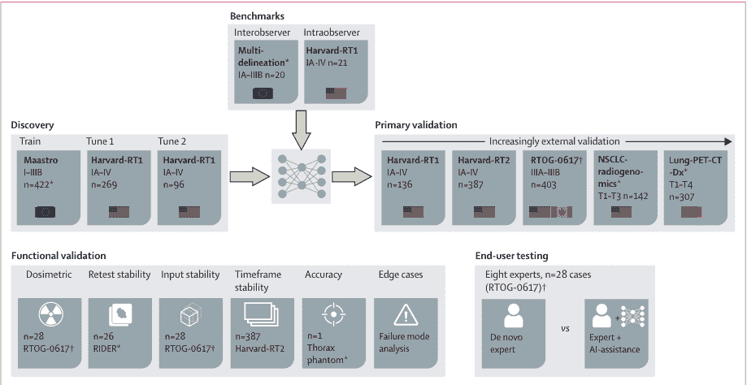
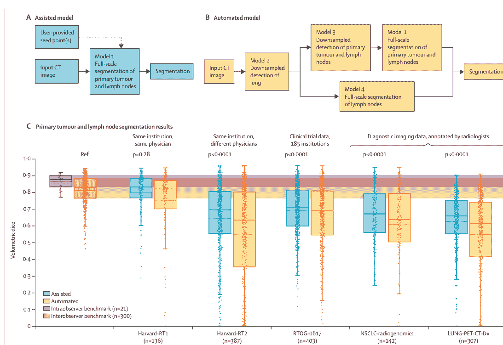
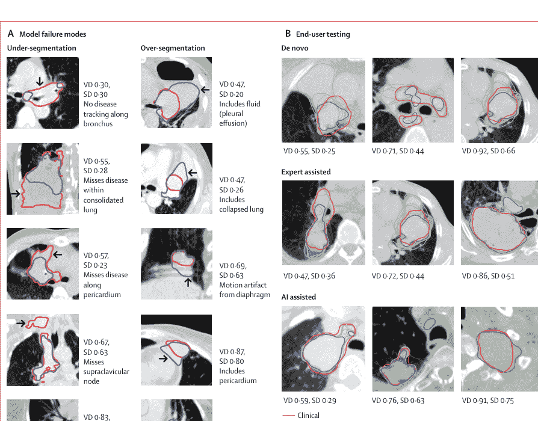
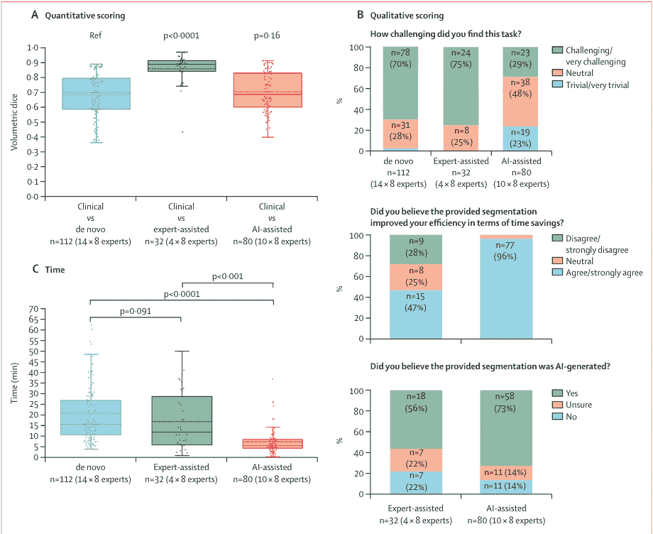

# 非小细胞肺癌放疗靶区勾画深度学习算法的临床验证：一项观察性研究

## 摘要

**背景** 人工智能（AI）和深度学习在简化临床任务方面显示出巨大潜力。然而，大多数研究仍局限于小型内部队列的计算机模拟验证，没有外部验证或真实世界临床实用性的数据。我们开发了一种深度学习模型临床验证策略，用于分割CT图像中的原发性非小细胞肺癌（NSCLC）肿瘤和受累淋巴结，这是放射治疗计划中一个耗时且专家间差异较大的步骤。

**方法** 在这项观察性研究中，CT图像和分割数据收集自美国、荷兰、加拿大和中国的八个内部和外部来源，其中来自Maastro和Harvard-RT1数据集的患者用于模型发现（由单一专家分割）。验证包括观察者间和观察者内基准测试、初步验证、功能验证和最终用户测试，使用的数据集如下：multi-delineation、Harvard-RT1、Harvard-RT2、RTOG-0617、NSCLC-radiogenomics、Lung-PET-CT-Dx、RIDER和thorax phantom。初步验证包括在外部程度递增的数据集上进行逐步测试，使用重叠度量包括体积Dice（VD）和表面Dice（SD）。功能验证探讨了剂量学效应、模型失败模式、重测稳定性和准确性。最终用户测试由八位专家在模拟临床环境中评估自动分割。

**结果** 我们纳入了2001年至2015年期间接受影像检查的2208名患者，其中787名患者用于模型发现，1421名用于模型验证，包括28名患者用于最终用户测试。模型表现优于观察者间基准（multi-delineation数据集；VD 0·91 [IQR 0·83–0·92]，p=0·0062；SD 0·86 [0·71–0·91]，p=0·0005），并在观察者内基准范围内。对于初步验证，AI在内部Harvard-RT1数据（由分割发现数据的同一专家分割）上的表现为VD 0·83（IQR 0·76–0·88）和SD 0·79（0·68–0·88），在观察者间基准范围内。在由其他专家分割的内部Harvard-RT2数据上的表现为VD 0·70（0·56–0·80）和SD 0·50（0·34–0·71）。在RTOG-0617临床试验数据上的表现为VD 0·71（0·60–0·81）和SD 0·47（0·35–0·59），在诊断性放射学数据集NSCLC-radiogenomics和Lung-PET-CT-Dx上结果相似。尽管这些几何重叠结果如此，模型产生的靶区体积在辐射剂量覆盖方面与专家相当。我们还发现，专家独立分割与AI辅助分割之间没有显著差异。AI辅助使分割时间缩短了65%（5·4分钟；p<0·0001），观察者间变异性（SD）降低了32%（p=0·013）。

**解读** 我们提出了一种AI模型的临床验证策略。我们发现，计算机模拟的几何分割指标可能无法与模型的临床实用性相关联。专家的分割风格和偏好可能会影响模型性能。

**资金** 美国国立卫生研究院和欧盟欧洲研究委员会。

## 引言

肺癌是全球癌症相关死亡的主要原因。¹ 非小细胞肺癌（NSCLC）是最常见的肺癌类型，占所有诊断的85%。² 放射治疗在NSCLC的治疗中发挥关键作用，五分之一的早期患者和一半的晚期患者接受这种治疗方式。³ 放射治疗可作为一种单独治疗，与全身药物联合使用，可在手术前或手术后进行，并在姑息治疗中发挥作用。

放射治疗的时间效益和成本效益受到一项昂贵的前期投入的影响：放射治疗计划。放射治疗计划对于最大化对癌症组织的辐射和最小化对正常组织的辐射至关重要。在图像采集之后，计划步骤包括图像配准、靶区和邻近器官的分割，以及剂量分布。手动分割靶区——即原发性肿瘤和受累淋巴结——是放射肿瘤学家完成的最耗时的计划任务之一。⁴ 这项细致的工作需要在体素基础上解读图像以勾画靶区体积。调强放射治疗和图像引导等先进放射治疗计划和实施技术的出现，使得对周围器官的剂量更小，但需要高精度的分割。⁵ 此外，靶区分割存在大量且文献充分记载的观察者间变异性，⁶,⁷ 即使在具有预设参数的放射治疗临床试验中也是如此。⁸ 最后，靶区分割的准确性可直接影响患者结局，分割不足会降低肿瘤控制率，分割过度会增加毒性风险。⁹

已经提出了几种计算机辅助工具来帮助简化放射治疗计划。⁴ 对于分割任务，半自动化方法，包括分割图谱，在临床上具有不同程度的实用性。¹⁰ 构建图谱需要医生投入大量的时间和精力，而且图谱内容的异质性可能会降低性能。最近，人工智能（AI）方法——特别是深度学习——已被提出作为有前途的替代方案。¹¹ 深度学习算法可以自动从数据中学习特征表示，从而提高多种任务的性能。¹² 尽管研究已经探索了使用深度学习来自动化放射治疗靶区分割并提高其准确性和一致性，¹³ 但大多数仍处于概念验证阶段。因此，这些研究通常局限于小型内部队列的计算机模拟验证，没有外部验证。在众多有希望的结果中，只有少数研究显示了这些自动化系统的临床影响。¹⁴,¹⁵

在本研究中，我们提出了一种可推广的治疗性AI算法临床验证策略，旨在弥合早期概念验证研究与前瞻性临床试验之间的差距。该策略包括四个主要组成部分：基准测试、初步验证、功能验证和最终用户测试（图1）。为了展示该策略的应用，我们开展了一项针对NSCLC放射治疗靶区勾画的深度学习模型临床验证研究。

## 研究背景

### 本研究之前的证据

我们使用以下检索词在PubMed中进行了检索：“(machine learning OR artificial intelligence OR deep learning) AND (radiation oncology OR radiotherapy)”。我们重点关注2014年1月1日至2020年4月1日期间使用医学影像的英文文章。我们的检索确定了183篇文章。在同一次检索中，我们还确定了通过临床部署和测试人工智能（AI）工具进行最终用户验证的研究，无论是回顾性还是前瞻性。尽管深度学习在医学影像中的应用显示出巨大前景，但大多数研究仍处于概念验证阶段，通常在小队列中进行验证，且没有外部验证。此外，大多数研究仅限于计算机模拟测试，只有少数研究调查了模型在临床环境中的性能。关于真实世界临床实用性的证据不足，最终导致对开展前瞻性临床试验以临床评估模型的信心不足。

### 本研究的附加价值

在本研究中，我们开发了一种多方面的深度学习模型临床验证策略，旨在弥合早期计算机模拟验证与大规模前瞻性临床试验之间的转化差距。该策略包括四个组成部分：(1) 制定临床基准以了解当前的标准治疗；(2) 在大型外部队列中进行初步验证，以了解模型的泛化情况；(3) 功能验证，以研究模型对下游临床终点的影响；(4) 在模拟临床环境中进行最终用户测试，以评估模型在部署状态下的表现。虽然AI模型的计算机模拟验证可能提供临床实用性的证据，但通常需要在部署环境中衡量性能。我们的工作强调了同时进行这两种验证模式的价值，并为它们之间出现分歧的情况提供了见解，揭示了一些潜在问题，如评估指标的选择。

### 所有现有证据的启示

我们的研究结果强调了更广泛采用类似验证策略的重要性，这些策略有助于弥合临床AI应用的转化差距。此类策略可能提供在医学中开展临床AI试验所需的高度信心，揭示模型弱点，并量化将AI输出提升到临床可接受水平所需的时间和精力。我们的结果还强调了在人类因素方面生成数据的重要性，因为我们对此领域理解不完整，同时还需要研究医生与AI输出的交互及其总体满意度。

## 方法

### 发现数据

我们使用Maastro和Harvard-RT1数据集进行模型开发。Maastro包括422名患者（I–IIIB期；290 [69%]名男性，132 [31%]名女性；平均年龄68岁 [范围33–91]），经组织学证实为NSCLC，并接受单纯放射治疗（n=196 [46%]）或放射治疗联合化疗（n=226 [54%]）。患者于2004年至2010年间在荷兰马斯特里赫特的Maastro诊所接受治疗（附录第16页）。Harvard-RT1包括501名患者（IA–IV期；263 [52%]名男性，236 [47%]名女性，2 [<1%]名未指定；

**图1：临床验证框架和实验设置**
AI=人工智能。*公开可用。†受限访问。

中位年龄73岁（范围39–89岁），患有组织学证实的非小细胞肺癌（NSCLC），于2001年至2015年间在美国马萨诸塞州波士顿的Dana-Farber癌症研究所和Brigham and Women's医院接受放疗。靶体积由一位放射肿瘤科医生（RHM；称为R1）勾画。该数据集中的269名（54%）患者用于训练，96名（19%）用于调参，136名（27%）用于测试。测试集与已发表研究中所用测试集相同，在该研究中，参赛者竞争开发最佳分割模型。使用体积Dice（VD）和表面Dice（SD）指标，将该竞赛中的最佳方案与此处获得的结果进行了比较。

模型结构紧密遵循原始实现，编码器和解码器路径通过跳跃连接相连。架构参数（例如卷积和池化核大小；附录p 14）和模型超参数（例如学习率和批量大小；附录pp 6–7）使用nnU-Net（版本1.6.5）进行了微调。

## 数据预处理

数据预处理包括将所有数据重采样到共同的体素间距1×1×3 mm³，对CT图像使用线性插值，对分割使用最近邻插值。CT亨斯菲尔德单位通过裁剪至第0.5和第99.5百分位数进行归一化。数据集特征分布，包括大体肿瘤体积、CT图像层厚和静脉对比剂的使用情况，见附录（pp 62, 64–65）。训练期间的数据增强细节也见附录（p 6）。

## 模型开发

我们使用了U-Net，即输入CT体积并输出相应二值分割的全卷积神经网络。我们的辅助和自动化流程包括四个三维（3D）U-Net模型，用于定位和分割肺、原发肿瘤和受累淋巴结（图2A, B）。总体而言

## 指标

我们使用多种指标评估模型性能（附录p 15），包括VD（两个体积的空间重叠，0表示无重叠，1表示完全重叠），以及SD（表面在距离阈值内与另一表面的比例，0表示没有表面在容差范围内，1表示所有表面都在容差范围内）。我们使用观察者间变异性的第75百分位数（1.9 mm）作为阈值（附录pp 25–26）。

## 基准

我们使用20名患者（IA–IIIB期；男性12名[60%]，女性8名[40%]；中位年龄67岁[IQR 57–71]）的多勾画数据集开发了观察者间基准，这些患者患有组织学证实的NSCLC，在Maastro诊所接受放疗。除R1外，五位放射肿瘤科医生还进行了手动肿瘤勾画（附录pp 18, 68）。在观察者间基准中，对两名住院医师和四名主治医师进行了比较。使用从Harvard-RT1测试集中随机抽样的21名患者开发了观察者内基准。R1在3个月洗脱期后进行了两次分割任务。

## 图2：主要验证结果及与基准的比较

辅助（A）和自动化（B）分割流程示意图。(C) 模型在定位和分割原发性非小细胞肺癌肿瘤及受累淋巴结方面的表现，通过五个逐步外部的数据集使用体积Dice指标进行验证。

## 主要验证

我们在四个逐步外部的数据集上进行了进一步验证，这些数据集与训练数据的特征差异越来越大：由其他专家分割的Harvard-RT2、来自其他机构的RTOG-0617，以及来自诊断放射学的NSCLC-radiogenomics和Lung-PET-CT-Dx。Harvard-RT2包括387名患者（IA–IV期；男性165名[43%]，女性222名[57%]；中位年龄69岁[范围32–92]），患有组织学证实的NSCLC，于2011年至2017年间在Dana-Farber癌症研究所和Brigham and Women's医院接受放疗。肿瘤体积由多名医生勾画（附录p 19）。RTOG-0617包括403名患有组织学证实的NSCLC患者（IIIA–IIIB期；男性223名[55%]，女性155名[38%]，未指定25名[6%]；中位年龄64岁[IQR 57–70]），来自3期RTOG-0617试验（NCT00533949）。患者于2007年至2011年间在美国和加拿大的185个机构接受放疗（附录pp 20, 69）。NSCLC-radiogenomics包括142名患有组织学证实的早期NSCLC患者（病理分期T1–3、N0–2和M0–1；男性124名[77%]，女性38名[23%]；平均年龄68岁[范围42–86]），于2008年至2012年间在美国加利福尼亚州斯坦福大学医学院（n=67）和Palo Alto退伍军人事务部（n=75）接受手术治疗。肿瘤分割由两位胸部放射科医生完成（附录pp 22, 70）。Lung-PET-CT-Dx包括307名患有组织学证实的NSCLC患者（临床分期T1–4、N0–3和M0–13；男性163名[53%]，女性144名[47%]；平均年龄61岁[范围28–90]），在中国哈尔滨医科大学附属第二医院接受影像检查。肿瘤位置由五位胸部放射科医生使用逐层边界矩形进行标注（附录pp 23, 71）。

## 功能验证

剂量学分析中使用的数据来自RTOG-0617数据集中28名患者的随机四分位子集（附录p 44）。比较了RTOG-0617临床试验中使用的计划靶体积与其AI生成的对应靶体积（由大体肿瘤体积生成）之间的剂量覆盖（附录p 7）。计算了两个常用剂量指标：V95（接受至少95%处方剂量的靶体积百分比）和D95（覆盖95%靶体积的剂量）。使用RIDER版本24评估了重测稳定性（同一患者不同CT图像生成的分割之间的几何重叠），该版本包括26名NSCLC患者（原发肿瘤≥1 cm；男性12名，女性14名；平均年龄62岁[范围29–82]），每名患者在15分钟内接受了两次胸部CT扫描。图像于2007年1月至9月间在纽约州纽约市的Memorial Sloan-Kettering癌症中心获取。肿瘤分割由两位胸部放射科医生完成（附录p 72）。此外，我们通过模拟多位专家放置种子点（50次模拟）检测了辅助模型稳定性随输入数据变化的函数。在肿瘤质心周围的50 mm立方体内生成随机种子点，并测量了所得分割之间的几何重叠。在Harvard-RT2中测试了3D和4D CT数据之间的时间帧稳定性（n=186单时间帧3D CT对比n=201多时间帧4D CT）。模型准确性使用包含12个合成肺部病变（有效直径10 mm和20 mm，每肺6个）的胸部体模CT进行评估。体模在纽约州纽约市的哥伦比亚大学医学中心进行了扫描（附录p 24）。根据我们的AI生成分割计算出的病变体积与先前发表的三个分割模型的体积进行了比较。基于图像中使用静脉对比剂（通过已发表算法27检测）的模型性能通过亚组分析进行评估。DSB通过定性评估RTOG-0617数据集上的模型结果并识别分割不足或过度分割的案例，进行了模型故障模式分析。

（专家辅助；附录pp 11, 73）。测试在我们机构用于此任务的软件MIM内的模拟临床环境中进行（附录p 74）。专家获得每位患者的以下信息：年龄、性别、东部肿瘤协作组评分、组织学、分期和原发肿瘤肺叶。专家还在审查每个病例之前、期间和之后接受了调查。每个病例之后，专家被要求定性评价任务难度和提供的分割质量。任务完成时间在后台自动记录。我们使用时间测量来比较从头、专家辅助和AI辅助三组。还测量了时间与分割指标（VD和SD）之间的相关性。各数据集伦理批准和患者同意的细节见附录（pp 1–6）。

## 最终用户测试

## 统计分析

我们招募了来自Brigham and Women's医院放射肿瘤科的八位放射肿瘤科医生（DSB, JMQ, HR, SP, AS, LCP, BHK, 和 RHM），并获得了书面知情同意（按照方案DF/HCC 20-328）。专家具有不同的经验水平：三位主治医师（1、2和9年经验）和五位住院医师（附录pp 9–10）。使用的数据是RTOG-0617数据集中28名患者的随机四分位子集，进一步分为两组，每组14名患者（附录p 44）。在第一组中，专家被要求从头执行分割任务。对于第二组，专家被要求对提供的分割进行评分和编辑，同时对其来源不知情。在这个第二组中，对于十名患者，提供了来自辅助流程的自动化分割（AI辅助）。对于四名患者，提供了来自RTOG-0617的临床分割

所有进行的统计检验均为非参数检验，双侧p值小于0.05表示显著性。对于两个相关组，我们使用了Wilcoxon配对符号秩检验。对于两个独立组，我们使用了Mann-Whitney U秩检验。对于三个或更多独立组，我们使用了Kruskal-Wallis H检验。为了衡量两组之间的相关性，我们使用了Spearman秩相关系数。所有分析均在python（版本3.8.0）中完成。

## 资助来源的作用

研究的资助者在研究设计、数据收集、数据分析、数据解释或报告撰写中没有任何作用。

## 结果

观察者间基准为VD 0.83（IQR 0.77–0.88）和SD 0.72（0.61–0.81；附录pp 25–26）。AI与R1的比较产生VD 0.91（0.83–0.92）和SD 0.86（0.71–0.91），与基准相比在VD（p=0.0062）和SD（p=0.0005）方面均显著改善（附录pp 27–28）。此外，AI与R1的比较与所有六位专家中变异性的IQR呈负相关（Spearman r=–0.74；p=0.0002；附录p 29）。以AI分割为参考，住院医师和主治医师之间未检测到显著差异（附录p 30）。

观察者内基准为VD 0.88（IQR 0.83–0.90）和SD 0.85（0.80–0.93；附录p 31）。AI与R1的第一次读取比较产生VD 0.86（0.83–0.87）和SD 0.79（0.72–0.90），第二次读取结果相似（附录p 33）。对于VD，将两个结果与基准进行比较时观察到非显著差异。对于SD，AI与R1的第一次读取与基准相比无显著差异，而AI与R1的第二次读取显著较低（p=0.043；附录pp 32–33）。

首先，我们在内部Harvard-RT1数据集上进行了测试，该数据集也由R1分割。辅助原发肿瘤的结果

A 模型失败模式
欠分割
过分割
B 最终用户测试
从头开始
专家辅助
AI辅助

## 图3：模型失败模式和最终用户测试

(A) 模型失败模式的示例。包括欠分割和过分割场景下的十个代表性模型失败示例（每种各五个案例）。案例按从上到下的顺序排列，模型性能指标依次递增。(B) 最终用户测试中的九个代表性示例。所展示的分数是在临床分割和AI分割之间计算的。AI=人工智能。SD=表面Dice。VD=体积Dice。

分割结果中，VD为0·86（IQR 0·81–0·89），SD为0·83（0·73–0·91），较先前发表的结果16有显著改善（p<0·0001；附录p 35）。自动原发肿瘤分割结果中，VD为0·83（0·77–0·89），SD为0·80（0·75–0·83）。原发肿瘤和淋巴结分割的结果为：辅助模型的VD为0·83（0·76–0·88），SD为0·79（0·68–0·88）；自动模型的VD为0·82（0·70–0·88），SD为0·74（0·62–0·83）（n=3 [2%] 定位失败；附录p 8；图2C）。

其次，我们使用由我们机构其他专家分割的内部Harvard-RT2数据集对模型进行了测试。结果：辅助模型的VD为0·70（IQR 0·56–0·80），SD为0·50（0·34–0·71）；自动模型的VD为0·63（0·36–0·80），SD为0·44（0·23–0·62）（n=40 [10%] 定位失败；附录p 8；图2C）。

第三，我们在RTOG-0617试验数据.21上测试了模型。结果：辅助模型的VD为0·71（IQR 0·60–0·81），SD为0·47（0·35–0·59）；自动模型的VD为0·69（0·54–0·82），SD为0·44（0·30–0·58）（n=2 [0·5%] 定位失败；附录p 8；图2C）。我们发现试验组之间差异不显著（p=0·47；附录p 39），不同放射治疗技术之间差异也不显著（p=0·24；附录p 40）。

最后，我们在两个诊断数据集上测试了模型。对于NSCLC-radiogenomics.22，结果：辅助模型的VD为0·68（IQR 0·56–0·79），SD为0·61（0·37–0·85）；自动模型的VD为0·64（0·50–0·79），SD为0·55（0·30–0·82）（n=9 [6%] 定位失败；附录p 8；图2C）。我们发现不同肺叶之间的差异不显著（p=0·36；附录p 41）。对于Lung-PET-CT-Dx.23，结果：辅助模型的VD为0·66（0·55–0·76），SD为0·31（0·22–0·43）；自动模型的VD为0·61（0·42–0·74），SD为0·27（0·16–0·42）（n=27 [9%] 定位失败；附录p 8；图2C）。

### 图4：最终用户测试的结果

(A) 临床试验分割与从头分割、专家辅助（提供临床分割）和AI辅助（提供AI生成分割）分割之间的体积Dice分数。(B) 在最终用户测试期间向专家提出的定性问题的答案。(C) 完成分割任务所需的时间。AI=人工智能。

为了评估使用AI生成的分割所导致的辐射剂量变化，我们进行了剂量学分析（附录pp 45–46）。我们发现临床计划靶区体积与AI计划靶区体积在两个常见剂量指标上差异不显著：V95（p=0·37）和D95（p=0·47；附录p 47）。

使用RIDER^24（附录p 48）评估了同一患者两次独立CT扫描的模型稳定性。第一次扫描中AI与放射科医师的差异与第二次扫描中的相同比较无显著差异（VD，p=0·25；SD，p=0·29；附录p 49）。放射科医师在两次扫描中的总肿瘤体积与AI模型的总肿瘤体积无显著差异（p=0·19；附录p 50）。在模型稳定性随种子点放置位置变化方面，中位预测表现出高稳定性，VD和SD的IQR均为0·02（附录p 51）。关于跨CT时间帧的稳定性，我们发现3D和4D CT数据之间无显著差异（VD，辅助模型p=0·14，自动模型p=0·33；附录pp 36–38）。

模型准确性是在含有已知体积结节^25的胸部模体CT上测量的（附录p 52）。平均而言，模型低估了结节体积0·4 cm³，即已知体积的12%。三个已发表的模型在相同数据^26上也显示出类似趋势（附录p 53）。模型还被发现在对比增强图像上显著表现更佳（VD p=0·042；SD p=0·0043；附录p 66）。

最后，通过专家评审检查了模型失败模式。这些包括遗漏了发现数据中原本采样不足的胸部淋巴结站（例如锁骨上淋巴结；附录p 67）、过度分割到心包和塌陷肺，以及容易受到膈肌周围运动伪影的影响（图3A）。

八位专家被要求从头执行分割任务，或对提供的分割进行评分和编辑

从基准测试开始，我们的结果强调了模型在识别具有大观察者间变异的挑战性病例方面的能力。虽然我们显示住院医师和主治医师之间的表现没有差异，但仍需进一步研究经验对人机交互的影响，以及这类模型在增强医师培训方面的潜力。

我们的分层验证过程从最接近训练数据的单专家内部测试数据（Harvard-RT1）开始。我们报告了在相同数据上测试的45种不同模型与先前发表结果相比的显著改进。¹⁶ 在后续日益外部的数据集上相对稳定的背景下，多专家内部测试数据（Harvard-RT2）上的性能下降表明，分割变异性可能是治疗医师偏好和经验的函数。来自4D CT数据的结果暗示了模型与现代影像实践的相关性。来自诊断数据集的结果突出了放射科医师（解剖学知识）和放射肿瘤科医师（治疗目标）之间在肿瘤定义上的已知差异（附录pp 42, 60）。这些发现引发了对AI标签外使用的进一步讨论，即在一个专业领域内开发的应用被部署到另一个领域，同时强调了放射科医师在放射治疗计划中输入的重要性。²⁸

我们的功能验证和最终用户测试强调了超越常见几何测量来评估分割的重要性。与先前研究类似，²⁹ 我们的剂量学分析显示几何测量与剂量学测量之间没有相关性。这种关系可能受到影响剂量学测量的因素的干扰，包括剂量分布、放射治疗技术、射野布置和其他患者特定考虑因素。此外，我们还发现几何测量可能无法准确反映时间节省和其他定性终点（图5A）。我们的结果还突出了常见指标与肿瘤体积之间的不良相关性（图5B；附录p 13）。因此，迫切需要结合定性医师评估与几何、剂量学和时间相关测量的新指标，以准确反映临床实用性和可接受性。³⁰

模型失败模式可以通过警告自动检测，提示模型输出可能受影响，从而为自动化系统带来急需的信任。³¹ 在肿瘤定位失败方面，我们的自动模型在6%的验证案例中失败，这与类似肺癌诊断环境中的假阳性率一致。³² 尽管这些失败需要回退到辅助模型，未来的迭代版本可能通过从其他来源（如临床记录）自动提取粗略的解剖肿瘤位置来增强，以确保准确的模型定位。最后，成像对比度对模型性能的确切影响仍不清楚，因为我们的模型在对比增强图像上显著表现更佳，尽管主要是在非对比数据上训练的（附录p 65）。

有几个局限性需要注意。我们的计算机模拟和最终用户测试都受其回顾性性质的限制。我们的许多发现数据依赖于单一人类专家。尽管这种方法使我们能够突出模型封装特定专家技能的能力，并将其作为决策支持与其他临床医生共享，但我们的模型可能获得了自然偏差。我们的放射科医师与放射肿瘤科医师的比较依赖于AI生成的分割，这可能并不能完全代表放射治疗分割。我们的剂量学分析可能并不总是反映临床现实，因为这种分析不允许手动编辑大体肿瘤体积与计划靶体积之间的中间体积，即临床靶体积。Lung-PET-CT-Dx的结果是在肿瘤边界框上计算的，因此应相应地进行解读。我们最终用户测试的设计不允许研究AI对观察者内变异性的影响，也没有纳入PET成像，而PET成像常用于非小细胞肺癌患者的放射治疗计划。最后，尽管对专家掩盖所提供分割的来源提高了AI模型评估的公平性，但这种设计没有测试人类对临床AI算法的偏见。

未来的方向包括通过实验各种模型类型、架构、集成方法、多专家分割池化、外部基准验证和前瞻性测试来改进分割性能——无论是在计算机模拟还是临床上。为了能够分别报告淋巴结的分割结果，需要改进的数据管理策略，以明确地将淋巴结从合并的大体肿瘤体积分割中分离出来。

在临床环境中对AI工具进行早期和彻底的测试对于成功转化为临床实践至关重要。我们的四部分验证策略能够揭示在临床中实施AI模型的下游后果，这些后果在典型的计算机模拟验证中可能被忽视。我们鼓励更广泛地采用类似的验证策略，以帮助弥合临床AI应用的转化差距。

## 贡献者

AH、DSB、HJWLA和RHM构思并设计了该研究。AH、DSB、CVG、JMQ、HR、SP、AS、LCP、IP、ZY、BHK、DEK和DC收集并处理了数据。RHM对Harvard-RT1数据集进行了分割。DSB进行了模型失败模式分析。AH进行了深度学习和可视化分析。AH、DSB、HJWLA和RHM撰写了手稿的初稿。AH创建了图表。DSB、JMQ、HR、SP、AS、LCP、BHK和RHM参与了最终用户测试。IP和DEK协调了最终用户测试。AH和PJC进行了统计检验。AH、DSB和RHM直接访问并验证了基础数据。HJWLA和RHM负责决定提交手稿。所有作者随后阅读并

revised the manuscript, as well as read and approved the final version. All authors had access to all the data in the study.

## Declaration of interests
AH reports consultancy fees for Altis Labs; and owning stock in Altis Labs. HJWLA reports being a scientific adviser and shareholder for Onc.AI, Love Health, Health-AI, and Bristol Myers Squibb. RHM reports a research grant from ViewRay; honoraria from NewRT and ViewRay; is on an advisory board for AstraZeneca; and reports travel expenses from NewRT. DEK reports honoraria from RefleXion; and is a consultant and on an advisory board for Genentech. All other authors declare no competing interests.

## Data sharing
The following datasets are publicly available on the Cancer Imaging Archive website: Maas, Multi-delineation, RTOG-0617, NSCLC-radiogenomics, Lung-PET-CT-Dx, RIDER, and Thorax phantom. RTOG-0617 is a limited access dataset. Harvard-RT1 and Harvard-RT2 are not publicly available. See appendix (pp 1–6) for individual URLs. For output data, including AI-generated segmentations and tabular result metrics, see https://github.com/AIM-Harvard/DL-RT-segmentation.

## Acknowledgments
The authors acknowledge financial support from the US National Institutes of Health (HJWLA: U24CA194354, U01CA190234, U01CA209414, and R35CA22052; and BHK: K08DE030216-01). We also acknowledge financial support from the EU European Research Council (HJWLA: 866504). We thank the patients whose imaging data were used in this study. We thank the team behind The Cancer Imaging Archive for hosting all the publicly available data used in this study. We thank Dan Darkov and Joe Meyers of MIM Software for their help in setting up workflows to conduct the end-user testing. This manuscript was prepared using data from Datasets NCT00533949-D1, NCT00533949-D2, and NCT00533949-D3 from the National Clinical Trials Network (NCTN) Data Archive of the National Cancer Institute’s NCTN. Data were originally collected from clinical trial NCT00533949. All analyses and conclusions in this manuscript are the sole responsibility of the authors and do not necessarily reflect the opinions or views of the clinical trial investigators, the NCTN, or the National Cancer Institute.

## References
- 1. Torre LA, Bray F, Siegel RL, Ferlay J, Lortet-Tieulent J, Jemal A. 全球癌症统计，2012。 *CA Cancer J Clin* 2015; 65: 87–108.
- 2. Molina JR, Yang P, Cassivi SD, Schild SE, Adjei AA. 非小细胞肺癌：流行病学、危险因素、治疗和生存。 *Mayo Clin Proc* 2008; 83: 584–94.
- 3. Miller KD, Siegel RL, Lin CC, et al. 癌症治疗和生存统计，2016。 *CA Cancer J Clin* 2016; 66: 271–89.
- 4. Huynh E, Hosny A, Guthier C, et al. 放射肿瘤学中的人工智能。 *Nat Rev Clin Oncol* 2020; 17: 771–81.
- 5. Chan C, Lang S, Rowbottom C, Guckenberger M, Faivre-Finn C. 肺癌的调强放疗：现状与未来发展。 *J Thorac Oncol* 2014; 9: 1598–608.
- 6. Cui Y, Chen W, Kong F-M, et al. 非小细胞肺癌放疗中勾画变异及图谱的作用：多机构临床前试验计划研究的分析。 *Pract Radiat Oncol* 2015; 5: e67–75.
- 7. Fotina I, Lütgendorf-Caucic G, Stock M, Pötter R, Georg D. 放疗靶区定义中观察者间变异性评价参数的批判性讨论。 *Strahlenther Onkol* 2012; 188: 160–67.
- 8. Ohri N, Shen X, Dicker AP, Doyle LA, Harrison AS, Showalter TN. 放疗方案偏离与临床结局：合作组临床试验的荟萃分析。 *J Clin Oncol* 2012; 30: 181.
- 9. Eaton BR, Pugh SL, Bradley JD, et al. 接受化疗放疗的 NSCLC 患者中机构入组情况和生存率：NRG Oncology 放射治疗肿瘤学组（RTOG）0617。 *J Natl Cancer Inst* 2016; 108: djw034.
- 10. Delpon G, Escande A, Ruef T, et al. 前列腺癌术后放疗自动图谱分割软件的比较。 *Front Oncol* 2016; 6: 178.
- 11. Esteva A, Robicquet A, Ramsundar B, et al. 医疗保健中深度学习的指南。 *Nat Med* 2019; 25: 24–29.
- 12. Litjens G, Kooi T, Bejnordi BE, et al. 医学图像分析中深度学习的综述。 *Med Image Anal* 2017; 42: 60–88.
- 13. Sheng K. 放疗中的人工智能：技术综述。 *Front Med* 2020; 14: 431–49.
- 14. Lin L, Dou Q, Jin Y-M, et al. 用于鼻咽癌 MRI 原发肿瘤体积自动勾画的深度学习。 *Radiology* 2019; 291: 677–86.
- 15. Ni W, Jang J, Zhang T, et al. 深度学习改善非小细胞肺癌术后放疗临床靶区勾画的质量和效率。 *Front Oncol* 2019; 9: 1192.
- 16. Mak RH, Endres MG, Paik JH, et al. 利用众包创新开发基于人工智能的放疗靶向解决方案。 *JAMA Oncol* 2019; 5: 654–61.
- 17. Ronneberger O, Fischer P, Brox T. U-Net：生物医学图像分割的卷积网络。 In: Navab N, Hornegger J, Wells WM, Frangi AF, eds. Medical image computing and computer-assisted intervention—MICCAI 2015. Cham: Springer, 2015: 234–41.
- 18. Isensee F, Jaeger PF, Kohl SAA, Petersen J, Maier-Hein KH. nnU-Net：基于深度学习的生物医学图像分割的自配置方法。 *Nat Methods* 2021; 18: 203–11.
- 19. van Baardwijk A, Bosmans G, Boersma L, et al. 非小细胞肺癌中基于 PET-CT 的自动勾画与病理相关并降低原发肿瘤和受累淋巴结体积勾画的观察者间变异性。 *Int J Radiat Oncol Biol Phys* 2007; 68: 771–78.
- 20. Cancer Imaging Archive. NSCLC-Cetuximab (RTOG-0617). https://wiki.cancerimagingarchive.net/pages/viewpage.action?pageId=33948334 (accessed Sept 15, 2021).
- 21. Bradley JD, Paulus R, Komaki R, et al. IIIA 或 IIIB 期非小细胞肺癌患者标准剂量与高剂量适形放疗联合同步及巩固卡铂加紫杉醇，伴或不伴西妥昔单抗（RTOG 0617）：一项随机、两因素三期研究。 *Lancet Oncol* 2015; 16: 187–99.
- 22. Bakr S, Gevaert O, Echegaray S, et al. 非小细胞肺癌的放射基因组学数据集。 *Sci Data* 2018; 5: 180202.
- 23. Cancer Imaging Archive. 用于肺癌诊断的大规模 CT 和 PET/CT 数据集（lung-PET-CT-dx）。 https://wiki.cancerimagingarchive.net/pages/viewpage.action?pageId=70224216 (accessed Sept 2, 2021).
- 24. Zhao B, James LP, Moskowitz CS, et al. 评估非小细胞肺癌患者同日重复 CT 扫描肿瘤测量值的变异性。 *Radiology* 2009; 252: 263–72.
- 25. Zhao B, Tan Y, Sui SW, Schwartz LH, Lu L. 探索肿瘤 CT 特征的变异性：初步体模研究。 *Transl Oncol* 2014; 7: 88–93.
- 27. Ye Z, Qian JM, Hosny A, et al. 基于深度学习的 CT 扫描静脉对比增强检测。 *Radiol Artif Intell* 2022; 4: e210285.
- 26. Kalpathy-Cramer J, Zhao B, Goldgof D, et al. 肺结节分割算法的比较：多机构研究的方法与结果。 *J Digit Imaging* 2016; 29: 476–87.
- 28. Braunstein S, Glastonbury CM, Chen L, Quivey JM, Yom SS. 基于神经放射学的同行评审对头颈部放疗靶区勾画的影响。 *AJNR Am J Neuroradiol* 2017; 38: 146–53.
- 29. Cao M, Stiehl B, Yu YV, et al. 放疗计划中使用自动轮廓分割的几何性能和剂量学影响分析。 *Front Oncol* 2020; 10: 1762.
- 30. Sherer MV, Lin D, Elguindi S, et al. 评估放疗计划自动分割性能的指标：批判性综述。 *Radiother Oncol* 2021; 160: 185–91.
- 31. Asan O, Bayrak AE, Choudhury A. 医疗保健中的人工智能与人类信任：聚焦临床医生。 *J Med Internet Res* 2020; 22: e15154.
- 32. Shimazaki A, Ueda D, Choppin A, et al. 基于分割方法的胸部 X 线片肺癌检测深度学习算法。 *Sci Rep* 2022; 12: 727.
