# 云安全：技术与应用（智能计算应用）


本书谨献给 Shri N. J. Yasaswy——金融与投资作家、ICFAI 大学创始人，以及 Shri E. N. Murthy——ICFAI 学会成员秘书，感谢他们的支持、鼓励和祝福，使我们得以完成这项工作和努力。

上述卷册饱含深沉的爱与敬意，谨以“纪念我已故的父亲 Shri Potluri Rama Mohana Rao”，正是他的基础、激励和祝福，使我取得了如此伟大的事业和人生。

# 前言

云计算和雾计算等可持续计算范式正在挖掘更好的解决方案，以应对安全、隐私、性能、存储、处理、维护、效率、集成、成本、能耗和延迟等问题。在当今不断发展的时代，据统计，数十亿台联网设备正在产生海量的实时数据。为了对收集到的数据进行复杂的计算和处理以做出动态决策，这些设备通过云或雾环境实现连接。云正在实施最佳实践和协议，以确保架构中的每个环节都具备安全性和隐私性。

本书阐释了云环境中为保护隐私和安全而采用的一些最佳实践及其相应成果。本书旨在为动态云提供更高层次的安全和隐私保护技术。书中汇聚了安全云领域的创新技术和方法，以展示所选领域的前沿和专门研究。

利用人工智能、机器学习、区块链、物联网、DDoS 缓解实践、工业 4.0、云制造、数据分析和 VANET 在云计算环境中实现安全与隐私的各种最新和前沿方法，是本书的重要篇章。

本书重点研究涉及安全和隐私保护方法及技术的各类研究问题，包括大数据存储与分析、大规模数据处理、知识发现与知识管理、计算智能、数据安全与隐私、数据表示与可视化以及数据分析。本书的特色技术利用工程和技术中的商业智能优化了各种行业流程。本书还阐明了基于云的安全集成与开发实践，以提高生产力并降低运营成本。

第 1 章重点介绍基于人工智能的先进技术，该技术可帮助公司高效管理复杂运营并提高生产力。基于 AI 的网络不仅能最大化组织绩效，还能规避风险和威胁。本章重点关注安全和隐私相关问题，并探讨了处理此类问题的有效对策。本章还提供了关于协同安全集合的最新文献，以识别其解决的漏洞类型以及采用的应对方式。

第 2 章重点介绍基于区块链的先进技术，可提供基础设施，并因其性能和可用性而被广泛采用。区块链技术作为新兴技术之一，可用于补充云用户面临的问题。该技术提供了去中心化、分布式、真实性、不可篡改、信任等特性，可用于应对数据完整性威胁。本章重点关注云模型中数据的安全和隐私问题，以及区块链技术特性如何增强该模型的完整性。

第 3 章重点介绍云计算环境中 DDoS 攻击的发生、DDoS 类型以及相关的安全和隐私问题。由于处理元件、设备和服务导向的按使用付费策略之间存在动态行为、分布式范式和异构性，云计算环境面临可用性、安全和隐私问题。在这些众多问题中，云计算范式中一个重要问题就是 DDoS 攻击。本章简明阐述了云计算环境中的 DDoS 攻击及其检测和预防机制。本章还解释了 DDoS 攻击对云平台的影响，以及需要考虑的相关防御机制。

第 4 章重点介绍基于云的安全医疗应用，以处理医疗行业的大数据。处理和加工如此庞大的数据块可能是一项艰巨的任务。为了避免此类情况，许多医疗部门已采用云计算作为解决方案。本章解释了隐私相关问题、安全相关关切、动态可接受的存储、监管问题、包含患者数据的电子文档、手写医疗记录，以及 X 射线、MRI 扫描和放射影像分析等各种图像。

第 5 章重点介绍安全的物联网框架、方法、安全安排，以及适用于物联网运营应用各层的重要且合适的最佳保护模型。本章还提出了增强型物联网模型：标准型和安全型，并扩展了安全与安保组件以及物理证据层。本章还阐述了如何识别安全漏洞，以及应对云、边缘和物联网所有层中网络安全风险的最佳安全措施。

第 6 章重点介绍高效的营销策略，通过使用基于云的营销自动化解决方案，企业对企业（B2B）营销和对客户（B2C）营销得到显著提升。云治理通过专业实践确保满足企业的期望和需求。确保云营销安全的重要因素已嵌入营销生命周期的每个阶段。本章解释了各种基于云的安全营销解决方案，以满足下一代营销需求。

第 7 章重点介绍安全机器学习模型，以预测最佳结果并优化基于云的长期行动方案。本章提出了面向下一代计算标准的战略云安全增强模型。卷积神经网络等高效机器学习算法提供了自动化和响应式的方法来加强云环境中的安全性。这些模型提供的解决方案整合了全局方法，可确保所有云应用中的企业知识安全。

第 8 章重点介绍用于智能交通的安全智能 VANET，以通过基于云的基础设施观察解决方案。车辆连接在一起


通过网络形成车辆云，它将以按需服务的形式向客户提供存储空间、计算资源和传感器读数。市民需要高效的计算、监督和引导解决方案，以摆脱交通相关问题。本章阐述了多种方法，以便在大型和中型城市的大学、购物中心或商业综合体附近区域内找到合适的停车场，这些区域将受益于自动停车管理工具的辅助。

第9章重点介绍新颖的云制造原型，它是在云计算、物联网、虚拟化技术、面向服务的计算以及前沿计算技术和专业知识的支持下，从现有的创新制造原型和企业级信息技术发展而来的。制造即服务是一种先进的制造原型，由现存的制造模式（如ASP、AM、NM和MGrid）发展而来。本章旨在研究和讨论基于云的制造中的安全与隐私问题及解决方案。

Sirisha Potluri，印度
Katta Subba Rao，印度
Sachi Nandan Mohanty，印度

# 致谢

编辑们想对所有贡献章节的作者表示感谢，并传递美好祝愿和赞赏。我们还要感谢能够抽出时间审阅各章并及时交付的领域专家。我们特别感谢那些抽出时间提供建议和意见，帮助我们完善思路和方法，从而产出更丰富成果的人们。我们特别感谢Walter de Gruyter GmbH出版社的优秀团队，感谢他们在鼓励、参与、支持、合作和贡献等方面给予我们的一切帮助，使本书得以出版。

# 缩略语列表

| 缩写 | 含义 |
|---|---|
| AI | 人工智能 |
| DI | 数据完整性 |
| DU | 数据使用 |
| TTP | 基于第三方的加密方案 |
| VM | 虚拟机 |
| CDC | 集中式数据中心 |
| ANN | 人工神经网络 |
| MSE | 均方误差 |
| DNN | 深度神经网络 |
| IoT | 物联网 |
| CSP | 云服务提供商 |
| SAMS | 以人为中心的安全认证管理方案 |
| DDoS | 分布式拒绝服务 |
| DoS | 拒绝服务 |
| SLA | 服务等级协议 |
| SDN | 软件定义网络 |
| KNN | K最近邻 |
| SOA | 面向服务的架构 |
| BW-DDoS | 带宽分布式拒绝服务 |
| CDN | 内容分发网络 |
| SMC | 安全多方计算 |
| API | 应用程序编程接口 |
| VMM | 虚拟机管理器 |
| SaaS | 软件即服务 |
| PaaS | 平台即服务 |
| IaaS | 基础设施即服务 |
| BDaaS | 大数据即服务 |
| NaaS | 网络即服务 |
| HaaS | 医疗即服务 |
| MaaS | 制造即服务 |
| IoTaaS | 物联网即服务 |
| AaaS | 分析即服务 |
| EMS | 紧急医疗系统 |
| CNN | 卷积神经网络 |
| AWS | 亚马逊网络服务 |
| RFID | 射频识别 |
| IAM | 身份与访问管理 |
| SEO | 搜索引擎优化 |
| SEM | 搜索引擎营销 |
| CRM | 客户关系管理 |
| CapEx | 资本支出 |
| OpEx | 运营支出 |
| RACE | 触达、行动、转化和参与 |
| CRO | 转化率优化 |
| LPO | 着陆页优化 |
| SMB | 中小型企业 |
| BFSI | 金融服务和保险 |
| PPC | 按点击付费 |
| CTA | 行动号召 |
| ML | 机器学习 |
| CAGR | 复合年增长率 |
| SIEM | 安全信息和事件管理系统 |
| VCC | 车辆云计算 |
| VANET | 车载自组网 |
| LTE | 长期演进 |
| WAVE | 无线接入车辆环境 |
| DSRC | 专用短程通信 |
| BSM | 基本安全消息 |
| QoS | 服务质量 |
| LIDAR | 激光照明探测与测距 |
| SARTRE | 面向环境的安全道路列车 |
| VC | 车辆云 |
| PKI | 公钥基础设施 |
| CRL | 证书吊销列表 |
| CA | 证书颁发机构 |
| ITS | 智能交通系统 |
| ECPP | 增强条件隐私保护 |
| PACP | 基于假名认证的条件隐私 |

# 贡献者列表

Sirisha Potluri女士是海德拉巴ICFAI高等教育基金会计算机科学与工程系的助理教授。她正在印度维杰亚瓦达的KL教育基金会攻读云计算领域的博士学位。她的研究领域包括分布式计算、云计算、雾计算、推荐系统和物联网。她拥有7年以上的教学经验。她的教学科目包括C语言计算机编程、数据结构、核心Java、高级Java、C++面向对象编程、分布式操作系统、人机交互、C#和.NET编程、计算机图形学、Web技术、UNIX编程、分布式与云计算、Python编程和软件工程。她在知名国际期刊上发表了22篇同行评审的学术研究论文。她参加了由IEEE和Springer等专业机构组织的11次国际会议，展示其新颖的研究论文。她拥有一项云计算领域的专利，并编辑了两本图书。她是IEEE计算机学会的会员。Sirisha是Inderscience Publishers旗下多种期刊的审稿人，并审阅了多篇稿件。

Sachi Nandan Mohanty博士，印度浦那工程学院计算机工程系副教授。他于2019年在IIT Kanpur完成博士后研究，并于2015年在印度IIT Kharagpur获得博士学位，期间获得印度政府MHRD奖学金。他与Springer、Wiley和CRC Press合作编辑了14本图书。他的研究领域包括数据挖掘、大数据分析、认知科学、模糊决策、脑机接口和计算智能。S N Mohanty教授在IIT Kharagpur攻读博士期间，曾荣获3项最佳论文奖，其中一项来自中国北京的国际会议，另一项来自2013年由IIIT Roorkee组织的软计算应用国际会议。他于2015年荣获印度计算机学会最佳论文一等奖。他在国际知名期刊上发表了42篇论文，并当选为工程师学会会士、IETE会士，以及IEEE计算机学会海德拉巴分会高级会员。他还是《机器人与自主系统杂志》（Elsevier）、《计算与结构生物技术杂志》（Elsevier）、《人工智能评论》（Springer）和《空间信息研究》（Springer）的审稿人。

Katta Subba Rao博士是印度海德拉巴B.V.Raju技术学院计算机科学与工程系教授。他获得了印度安得拉邦Nagarjuna大学的博士学位。他的研究领域包括软件工程、云计算和机器学习。他拥有超过15年宝贵的教学和研究经验。他的研究贡献包括多篇期刊文章、会议论文和书籍章节。

Gouse Baig Mohammad博士是印度海德拉巴Vardhaman工程学院计算机科学与工程系副教授。他获得了印度安得拉邦Nagarjuna大学的博士学位。他的研究领域包括网络安全、物联网和机器学习。他拥有14年宝贵的教学和研究经验。他的研究贡献包括在知名国际期刊上发表的7篇同行评审学术研究论文和2项专利。

Srikanth Pothuri先生是印度海德拉巴ICFAI高等教育基金会营销部全国负责人。他正在印度北阿坎德邦德拉敦的ICFAI大学ICFAI商学院攻读博士学位。他的研究领域包括营销管理，


# XX — 贡献者名单

市场营销战略、消费者行为与营销定量方法。他拥有19年的行业经验。

- **V. MNSSVKR GUPTA 先生** 目前担任印度比马瓦拉姆的 Sagi Rama Krishnam Raju 工程学院（SRKR 工程学院）的助理教授。他正在印度维杰亚瓦达的 KL 教育基金会攻读博士学位。他的研究领域包括人工智能、生物信息学和图像处理。他拥有 12 年的教学经验。他已在知名国际期刊上发表 11 篇经过同行评审的学术研究文章，并参加了 5 次国际会议。

- **Vangeti Bhanu Prakash Reddy 先生** 是印度海得拉巴 ICFAI 高等教育基金会 ICFAI Tech（科学与技术学院）计算机科学与工程系的研究员。他的研究兴趣包括人工智能、云计算和机器学习。

- **Srinath Bellamkonda 先生** 是印度海得拉巴 ICFAI 高等教育基金会 ICFAI Tech（科学与技术学院）计算机科学与工程系的研究员。他的研究兴趣包括人工智能、云计算和机器学习。

- **Manjunath Reddy 先生** 是印度海得拉巴 ICFAI 高等教育基金会 ICFAI Tech（科学与技术学院）计算机科学与工程系的研究员。他的研究兴趣包括人工智能、云计算和机器学习。

- **Shagun S Lokre 先生** 是印度海得拉巴 ICFAI 高等教育基金会 ICFAI Tech（科学与技术学院）计算机科学与工程系的研究员。他目前的研究兴趣领域包括区块链技术、以太坊、分布式账本技术和供应链管理。他的成就之一是，在印度专利局（IPO）获得了活动管理领域中区块链技术领域的专利批准，并合著了区块链技术方面的 3 个章节，标题分别为“使用区块链技术的枪支追踪系统”、“使用区块链技术的安全活动门票预订系统”和“利用 Corda 的建筑业分布式账本技术”。这些章节分别属于“区块链技术：应用与挑战”、“智能系统参考图书馆，施普林格（WoS 和 Scopus 索引）”和“新先进社会：人工智能与工业物联网范式，Wiley 出版社（美国）”。他目前还在撰写其他关于分布式账本技术的研究论文。

- **Shanmukhi Priya 女士** 是印度海得拉巴 ICFAI 高等教育基金会 ICFAI Tech（科学与技术学院）计算机科学与工程系的研究员。她目前的研究兴趣领域包括区块链技术、以太坊、分布式账本技术、Corda 和后端技术。她的成就之一是，在印度专利局（IPO）获得了活动管理领域中区块链技术领域的专利批准，并合著了区块链技术方面的 3 个章节，标题分别为“使用区块链技术的枪支追踪系统”、“使用区块链技术的安全活动门票预订系统”和“利用 Corda 的建筑业分布式账本技术”。这些章节分别属于“区块链技术：应用与挑战”、“智能系统参考图书馆，施普林格（WoS 和 Scopus 索引）”和“新先进社会：人工智能与工业物联网范式，Wiley 出版社（美国）”。她目前还在撰写其他关于分布式账本技术的研究论文。

- **SVB Revanth 先生** 是印度海得拉巴 ICFAI 高等教育基金会 ICFAI Tech（科学与技术学院）计算机科学与工程系的研究员。他的研究兴趣包括云计算、数据分析和数据可视化。

- **Siliveru Akhil Durga 先生** 是印度海得拉巴 ICFAI 高等教育基金会 ICFAI Tech（科学与技术学院）计算机科学与工程系的研究员。他的研究兴趣包括云计算、数据分析和数据可视化。

- **A. D. Sriram Kumar 先生** 是印度海得拉巴 ICFAI 高等教育基金会 ICFAI Tech（科学与技术学院）计算机科学与工程系的研究员。他的研究兴趣包括云计算、机器学习、工业 4.0 和物联网。

- **D. MAHESHWARI 女士** 是印度海得拉巴 ICFAI 高等教育基金会 ICFAI Tech（科学与技术学院）计算机科学与工程系的研究员。她的研究兴趣包括云计算、机器学习、工业 4.0 和物联网。

- **B. Rahini 女士** 是印度海得拉巴 ICFAI 高等教育基金会 ICFAI Tech（科学与技术学院）计算机科学与工程系的研究员。她的研究兴趣包括云计算、机器学习、工业 4.0 和物联网。

- **Ramya Reddy P 女士** 是印度海得拉巴 ICFAI 高等教育基金会 ICFAI Tech（科学与技术学院）计算机科学与工程系的研究员。她的研究兴趣包括云计算、机器学习和人工智能。

- **Lavanya Reddy P 女士** 是印度海得拉巴 ICFAI 高等教育基金会 ICFAI Tech（科学与技术学院）计算机科学与工程系的研究员。她的研究兴趣包括云计算、机器学习和人工智能。

- **M. Vaishnavi 女士** 是印度海得拉巴 ICFAI 高等教育基金会 ICFAI Tech（科学与技术学院）计算机科学与工程系的研究员。她的研究兴趣包括云计算、机器学习、VANET 和网络安全。

- **K. Sahaja 女士** 是印度海得拉巴 ICFAI 高等教育基金会 ICFAI Tech（科学与技术学院）计算机科学与工程系的研究员。她的研究兴趣包括云计算、机器学习、VANET 和网络安全。

Sachi Nandan Mohanty, Sirisha Potluri, V. Bhanu Prakash, B. Srinath, B. Manjunath

# 云安全概念、威胁与解决方案：基于人工智能的方法

摘要：人工智能是一种先进技术，可帮助公司高效地管理复杂操作并提高生产力。在这个时代，许多商业团体使用基于人工智能的网络来最大化组织绩效，同时也用来规避风险和威胁。安全和隐私是人工智能技术的两大主要问题，它们既会导致数据隐私泄露，也会引发黑客攻击问题。拟议研究聚焦于人工智能技术的安全问题，并探索了改善数据隐私的有效对策。隐私保护协同过滤推荐系统旨在为用户提供正确的建议，同时对其信息隐私保持一定的保证。本调查考察了协同安全收集的最新文献，概述了该领域，并指出了重大贡献。该研究还致力于识别它们所针对的漏洞类型，以及用于处理这些漏洞的方法形式。

关键词：云计算、云安全、用户识别系统、数据存储、数据完整性、人工智能

Sachi Nandan Mohanty，印度马哈拉施特拉邦浦那市 Shivajinagar Wellesley 路浦那工程学院计算机工程系，邮编 411005，sachinandan09@gmail.com

Sirisha Potluri，印度特伦甘纳邦海得拉巴 Shankarpalli 路 Donthanapally，ICFAI 高等教育基金会 ICFAI Tech（科学与技术学院）计算机科学与工程系，邮编 501203，sirisha.vegunta@gmail.com

V. Bhanu Prakash Reddy，印度特伦甘纳邦海得拉巴 Shankarpalli 路 Donthanapally，ICFAI 高等教育基金会 ICFAI Tech（科学与技术学院）计算机科学与工程系，邮编 501203，bhanu.vangati@gmail.com

B. Srinath，印度特伦甘纳邦海得拉巴 Shankarpalli 路 Donthanapally，ICFAI 高等教育基金会 ICFAI Tech（科学与技术学院）计算机科学与工程系，邮编 501203，srinathbellamkonda14@gmail.com

B. Manjunath Reddy，印度特伦甘纳邦海得拉巴 Shankarpalli 路 Donthanapally，ICFAI 高等教育基金会 ICFAI Tech（科学与技术学院）计算机科学与工程系，邮编 501203，manju.chikku55@gmail.com


一系列过往经历和社会经济状况；电影和书籍推荐网站一直被用来为观众和读者筛选新的热门选择；在线音乐流媒体管理会生成动态播放列表，以迎合听众的喜好趋势。

令人振奋的是，历史的新纪元和新技术的变革正在各个平台上兴起。我们倾向于认为，一个以泛在网络、数据技术、共享服务、跨界融合、自动化和大规模生产为特征的“互联网与人工智能（AI）”新时代即将到来。最新人工智能与网络技术、新数据技术、新能源技术、机械技术和生物技术的快速发展和融合，是这一新时代的必要条件，它能够改变模式、方法、自然资源、福利和国家安全。

云平台通过数据访问提供诸如软件包资源等重要服务，并带来数据存储、服务器维护和云用户可访问性等众多优势。由于云日益普及，大量数据库被导出，以减少存储量和成本。此外，数据完整性（DI）一直是云中处理数据安全和数据一致性时面临的持续问题。因此，由于数据完整性的不足，数据使用（DU）在利用云计算进行存储和数据传输应用时面临风险。为了处理数据完整性问题，云平台利用基于可信第三方的加密方案（TTP）提供高可靠性保障。TTP 的功能是在持续提供数据完整性保护的同时，确保对 DU 进行持续认证。为确保数据隐私，云平台必须采用高效的数据加密方法。

云计算是计算领域中一个不断扩展的领域。它是一种提高资源利用率和计算能力的方式，且不会让用户承受购买新基础设施的经济负担。云计算服务具有诸多特性，如高效性、可靠性、灵活性、盈利性、弹性、可用性，以及通过效用计算实现按需资产交付。云资源通常根据其在完成指定任务执行过程中的使用量来衡量。

云计算通过互联网和 Web 应用程序提供服务。资源会根据需求动态伸缩；此外，在成本效益定价之外，还采用按使用量付费（pay as you go）的简单支付策略。因此，云计算平台拥有云服务提供商提供的多种资源，云存储流程也在动态变化，以满足持续增长的数据和信息需求。然而，云存储带来的益处与一系列网络安全相关协议和方法相伴相生。

隐私问题是最严重的威胁之一，会造成数据丢失、恶意篡改、服务器崩溃，其他网络威胁示例还包括：2013 年雅虎 30 亿账户遭黑客泄露、2014 年苹果 iCloud 泄露、2016 年 Dropbox 信息隐私侵犯事件，以及一起 iCloud 泄露事件，该事件曝光了多位好莱坞演员的照片，引发了大量抗议。这些事件对公司的声誉产生了深远影响。

雾集成将云计算范式扩展到网络边缘，从而在云环境中提供新型应用、服务和安全性。因此，我们常常准备好利用人工智能机制来发展云技术，以保护用户信息安全。

## 2 文献分析

人工智能是与云计算相关的重要研究领域之一。如图 1 所示，云计算的新兴研究领域包括人工智能、区块链和物联网。我们研究的重要性和意义在于确定与人工智能技术相关的安全风险和问题，并探索近期研究的结果。

### 2.1 人工智能的重要性

Čerka、Grigienė 和 Sirbikytė（2015）研究指出，安全是人工智能技术中必不可少的部分，用于在黑客发送恶意信号时进行检测和处理，从而减少数据隐私与安全相关问题。在组织内部，人工智能技术有助于高效执行任务，但未经授权信号的存在会侵犯数据隐私，并导致数据泄露问题。

利用人工智能实现隐私保护的三项关键专业技术是深度学习、自然语言处理、机器学习、神经网络和计算机视觉。基于人工智能的机制可以高效处理各种云设备和云基础设施上未经授权活动与服务的不当配置问题。在云计算环境中，使用安全网络来处理恶意软件传播非常重要；这样可以提高人工智能网络的隐私性，并增强先进系统的性能。

Guihot、Matthew 和 Suzor（2017）发表观点指出，人工智能技术有助于改进业务流程，并处理组织中的数据相关风险、挑战和泄露事件。基于网络的人工智能使用互联网连接和通信系统，而有时未经授权信号的存在会导致网络犯罪，并降低敏感信息的隐私性。如果恶意软件被传输并进入基于人工智能的云系统，则可以通过基于人工智能的机制来识别、控制和处置此类传输 [4-7]。

### 2.2 安全问题

Pan（2016）指出，人工智能网络中存在多种安全风险或问题，例如由技术缺陷引发的技术滥用安全威胁，以及大量类似问题。有必要找出与云计算环境相关的危险因素，以便利用人工智能技术防御这些网络犯罪和风险，保护所开发的系统 [8]。

### 2.3 隐私问题

根据 Rehman 和 Saba（2014）的观点，人工智能的隐私常常会因通信信道干扰以及访问组织的个人网络而遭到破坏。随着人工智能的出现，与现有解决方案相比，机密性问题、网络钓鱼以及犯罪分子传输的未经授权信号等各种隐私风险都能得到更高效的处理。因此，专注于隐私保护非常重要；在组织中实施人工智能网络时，应确保数据安全，并优先仅使用专用网络，而不是第三方网络 [9]。

### 2.4 利用人工智能增强安全与隐私

人工智能（AI）的目标是创建基于物联网的基础设施和雾节点，用于监控工作环境并持续调整，以提供卓越的服务质量（QoS）特性、降低功耗和总基础设施成本。

人工智能由各种搜索算法、机器学习和强化学习构成，用于高效处理云中的各类问题。在当今雾计算增长和云部署的深度数据操作世界中，不同层面需要越来越多的人工智能来提供更好的工作流决策、虚拟机迁移等，以改善上述状况。

有许多项目致力于投入人工智能策略，以提升云和雾系统的性能。各种完全不同的功能直接应用于云规划策略、虚拟化算法、分布式系统等，这些功能使用遗传算法、监督式机器学习和稳健的深度学习等搜索方法来实现其预期功能。

人工智能提供了一种优化大型系统的有效方式，在工程简洁性和效率方面更加细致入微，它允许自动化决策，而非人工解决方案，从而提供更高效、更快速的解决方案。

随着当前互联网的扩展、传感器的无处不在、大数据的出现、电子商务的发展，以及……的增长

信息社会以及数据与信息同社会、物理环境和网络空间的融合，带来了信息环境的巨大变化：AI 2.0（Pan，2016）观察到云端的巨大变化。最新技术的到来赋能人工智能进入新阶段。AI 2.0的关键特征包括：由深度学习数据驱动的视觉敏锐度的出现、基于互联网的智能、人与技术融合的机制，以及高级媒体。Yotasale利用人工智能，基于历史数据对云成本进行预测或决策，帮助节省大量支出。此外，还可利用Yotasale进行实时分析，通过深度学习策略（监督/无监督或预测模型）检测不利趋势，找出原因，并基于云使用量及其成本提供未来预测。分布式计算和云计算的研究方向如图2和图3所示。

在人工智能中，ANN——人工神经网络是最好的分类方法之一，可用作入侵检测系统。人工神经网络是一种受自然和生物神经结构启发的高效信息处理方法。它试图通过网络、电子电路和程序集合来表征物理大脑、其功能及其思维过程。

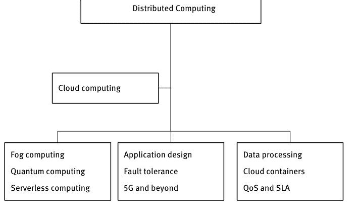

图2：分布式计算的研究方向

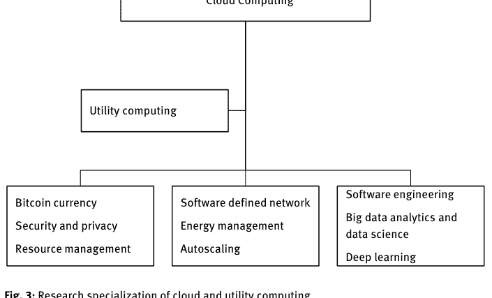

图3：云计算与效用计算的研究方向

人工智能技术促进了智能生产领域中新模式、新方法、新形式、系统设计和技术体系的开发。人工智能在智能制造领域与智能生产系统一起使用。人工智能在智能生产系统之外的使用毫无意义。在“互联网+人工智能”的背景下，智能生产系统以独立智能、通信、协作、学习、分析、理解、决策、控制和人性化为特征，机器、物料、环境和知识贯穿整个系统与生命周期。

## 3 安全

安全是采用云计算时需要考虑的主要因素。用户会在计算机上存储大量安全信息。使用云计算技术时，这些数据将从其计算机转移到云端。因此，云必须采取有效的安全措施来保护这些数据。云计算中观察到的威胁和攻击如图4所示。

Pan（2016）指出，AI网络中存在多种安全风险或问题，例如技术滥用带来的安全威胁、由技术缺陷引发的安全威胁等。为了防御网络犯罪和已开发系统带来的风险，识别与AI技术相关的风险因素非常重要。近期文献发现，AI是一种中性技术，它将众多技术和计算设备相互连接，以有效执行操作[11]。

以下是云计算中观察到的安全问题清单，这些问题可以通过人工智能实践得到有效解决。

- 控制管理
- 风险管理
- 合规性
- 漏洞管理
- 补丁管理
- 物理安全
- 数据安全
- 操作安全
- 法律问题
- 身份管理
- 应用安全
- 存储安全
- 网络安全
- 信息安全
- 网络空间安全
- 虚拟化安全
- 审计与维护
- 数据加密与密钥生成

用于传输欺诈信号的恶意程序会降低AI系统中所用通信信道和技术的性能，而AI系统无法检测到黑客借以实施数据泄露的恶意信号。由于一些技术缺陷，AI网络无法保护数据免受网络犯罪侵害，超过34%的公司正面临此类问题。

Ransbotham等人（2017）支持这一论点，并指出缺乏意识是一个关键问题：公司没有为员工提供全面培训，黑客可通过恶意程序获取计算设备的登录凭据。

云计算具有易于实施、可访问性、分布性、可靠性、容错性、资源共享、存储容量增加和成本节约等优势。尽管云计算具有诸多优势，但无论对于云服务提供商还是云用户而言，它仍然面临许多安全问题和违规行为。

根据云安全联盟的一篇文章，“数据泄露、不幸的信息、记录或管理任务、未经授权与应用程序编程接口（API）集成、DoS攻击、不良内容、云滥用、因效率低下而导致的效率低下，最终共享新风险”，被确定为云计算的九大威胁。AI在网络安全中的重要性如图5所示。

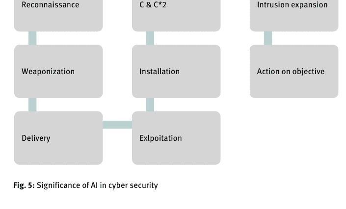

图5：AI在网络安全中的重要性

## 4 隐私

隐私与安全常常被混淆。数据安全确保拥有授权访问权限的人在需要时能够获得数据。数据隐私确保数据被恰当使用。隐私被定义为个人决定信息如何以及向谁传达的权利。数据隐私可以通过访问控制方法限制对数据的访问，或通过匿名披露信息来保护。

关于隐私保护这一主题已经进行了大量研究。近年来，有许多重要的综述主题分析数据机密性、隐私保护、拟议结构和数据隐私措施；它们的优缺点均已发表。数据隐私保护的建议方法分为初始方法、所使用的统计分析、有用的基于计算机的信息和机器学习方法。

人工智能的隐私可能通过阻断通信信道和访问企业专用网络而受到侵犯。在人工智能领域，已经出现了三大隐私风险，包括隐私问题、身份盗窃犯罪以及犯罪分子传输的未经授权信号。因此，在业务中使用AI网络时，重视隐私非常重要；企业应确保只使用独立网络，而不是第三方网络[12]。

为了有效解决数据隐私保护问题，对云数据进行加密存储是一种非常出色的解决方案。加密后，数据以密文形式存储在云服务提供商提供的服务器上；同时，当用户需要时，服务器也需要将数据返回给用户。当用户需要频繁使用数据时，与服务器通信并实现数据加密和解密需要大量网络带宽和用户时间，这将显著降低云计算的可用性。

同时，当存储在云服务器中的加密数据达到一定规模后，对加密数据进行有效检索已成为一个需要解决的新问题，而传统信息检索技术已无法满足云存储环境下海量数据检索的需求。

同态加密技术是一种能够直接处理加密数据的加密方法，可有效保护用户数据内容的安全，在云存储应用背景下具有非常广阔的发展潜力。

通过利用同态加密算法，不仅可以确保加密数据不会被统计分析以解密出相应的明文，而且还可以对密文进行同态运算（如加法和乘法），同时在运算过程中保持该密文对应的明文顺序。


在检索过程中，所使用的索引文件和关键词均以密文形式存在，云服务器无法从检索结果中获取用户数据的任何信息。索引文件体积较小，不会增加云服务器的存储压力。同时，检索速度快，并支持多关键词检索，方便用户使用，具有高安全性和强实用性。图6展示了人工智能在网络安全中的重要意义。

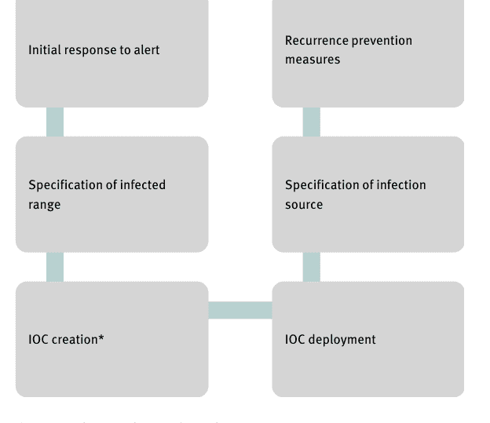

图6：人工智能在网络安全中的意义

以下是在云计算中观察到的隐私问题列表，这些问题可以通过人工智能实践得到有效解决。

- 失控
- 信息滥用
- 物理风险
- 身份盗窃
- 与基于互联网的活动相关的隐私
- 隐私法律
- 网络可疑活动
- 信息黑客入侵
- 数据隐私

## 5 利用人工智能的安全与隐私解决方案

人工智能是一种先进技术，可帮助公司高效管理复杂运营并提高生产力。在当今时代，许多商业社区使用基于人工智能的网络来最大化组织绩效，但也面临风险和威胁。安全与隐私是人工智能技术的两大问题，这些问题会导致数据隐私问题并引发黑客入侵。本研究聚焦于人工智能技术的安全问题，并探索了改善数据隐私的有效对策 [13-15]。

可以使用以下对策和策略来解决人工智能中的安全威胁：

- 避免系统中出现多余和未授权的信号
- 仅使用安全网络并保护高级系统
- 安装有效的安全工具，如防火墙和数据加密
- 为员工提供与基于人工智能的网络相关的全面培训
- 制定并实施隐私政策
- 使用反网络钓鱼技术和工具

## 6 拟议解决方案或方法

### 6.1 研究方法

研究在很大程度上侧重于研究质量以及与主题相关的问题。有两种方法可用作研究方法，即倾向法和提取法。导入法用于提供与研究主题相关的深度细节，而拉取法用于给出调查的简要细节。在本研究中，采用导入法，因为它能够提供与云安全相关的实用要点。借助这种方法，可以成功解决各种研究问题，从而找到与研究主题相关的可靠事实。

### 6.2 研究设计

研究设计是有用的工具，可以为研究提供适当的研究和对研究问题的成功管理。本研究使用的两种设计类型是定性和定量。Russell、Dewey 和 Tegmark（2015）指出，定性用于收集理论事实，而定量用于获取研究中的统计数据。在本研究中，采用定性构建是可以接受的，因为研究者对研究主题具有充分把握，并且能够提供与人工智能保护相关的深度细节。这种方法的使用使研究质量得到提高，以获得正确的要点。

### 6.3 数据收集

数据收集方法包括两部分：初级方法和次级方法。Scherer（2015）指出，初级方法提供新信息，而次级方法提供研究中的已审查数据和事实。在本研究中，采用次级方法收集有关人工智能的信息。为了找到次级数据，使用了各种来源，如近期在线论文、网站和书籍中收集的数据。

### 6.4 数据分析

在本调查中，采用描述性内容方法分析所收集的数据，因为它可以提供与研究主题相关的有效结果和要点。此外，使用Excel软件将收集到的数据以表格和图形形式呈现。因此，这些方法的使用改进了研究问题的解决方式，并管理了细节的流向。

人工智能技术可用于采取行动，并且已被用于检测恶意软件，其功能已经得到验证。其有效性的另一个证明是，2017年7月，谷歌宣布将把Cylance AI技术集成到VirusTotal（谷歌的恶意软件检测服务）中。IBM还试图通过智能搜索引擎来展示其AI技术的有效性，这些搜索引擎利用Watson的网络安全功能仔细控制海量威胁信息。

针对大数据机密性的隐私保护分析，提出了一种深度学习方法。该方法转换个人信息的关键部分，使其成为敏感信息。为了执行此过程，提出了一种两阶段方法，即在架构中使用了改进的稀疏自编码器类型和CNN。

改进的去噪自编码器实现数据转换，CNN为转换后的数据设置路径。为了在数据转换中实现较低的损失，向其中添加了稀疏化参数，特别是带有Kullback-Leibler散度函数的自编码器函数。

此处，模型的效率通过损失的MSE（均方误差）函数进行评估。为了测试转换过程的准确性，将基于特征的稀疏去噪自编码器算法输入到CNN的高级算法中，并进行重建数据分类。重建数据分类包括三类，分别是黑色（0）、白色（1）和灰色（2）。

CNN算法将黑色类数据分类为灰色类，置信度为0.99。还提供了所提方法与高效自编码器的比较，并在从心血管疾病数据库、心律失常数据库和Skoda数据集提取的Cleveland医学数据库中进行了应用，结果表明所提方法优于其他标准方法。

## 7 模型/数据防盗窃安全技术

### 7.1 教师集成的私有分离（PATE）

该技术通过在模型训练阶段将训练数据划分为多个集合来工作，每个训练集合都是一个独立的DNN模型。独立的DNN类型通过投票方式共同训练学生模型。该技术确保学生模型不会泄露特定的训练数据，从而保证训练数据的机密性。

### 7.2 独特隐私保护

该技术在模型训练阶段使用不同的隐私方式向数据或模型添加噪声。例如，一些专家建议如何通过替代隐私措施来构建梯度，以保护数据的隐私。

### 7.3 模型水印

该技术在模型训练阶段将特殊识别神经元集成到原始模型中。这些神经元使特殊输入样本能够测试另一个模型是否是通过窃取原始模型而获得的。

## 8 为什么AI技术对网络安全至关重要？

网络攻击日益多样化。虽然仍然存在许多无差别攻击，如恶意软件传播和欺诈邮件，但针对特定目标的复杂攻击清楚地表明，定向攻击意图现在是一个主要威胁。近年来的网络攻击以高度组织化和工业化的结构为特征。用于定向攻击的个人信息和各种类型的恶意软件在黑市上广泛可用、易于获取且价格低廉，这便于武器的识别和使用，而这些都是网络杀伤链的第一阶段。

现在，黑客可以利用黑市上可用的工具，在短时间内发起多次定向攻击。这模糊了无差别攻击和定向攻击之间的界限。人们现在认识到，常规人力资源和响应速度将无法跟上网络攻击的快速变化。正是这种认识促使安全专业人士将信任寄托于快速进步的人工智能技术。

在提高效率和加快响应速度方面，人们正在努力提供一种名为安全编排与自动化（SOA）的解决方案，该方案自2014年左右起在美国引起关注，以色列的Hexadite公司也在进行相关工作。在SOA中，预先编写了称为作战手册的反防御策略。按照这些流程，SOA可以自动执行数据收集、分析以及实施防御措施，如图5和图6所示。在此，AI再次被期望在作战手册的动态规划和更新中发挥关键作用。

## 9 结果

本研究提供了关于人工智能及其安全问题的详细信息。事实证明，人工智能是一种高效技术，可帮助公司可靠地解决复杂任务。安全是与人工智能技术相关的最大焦虑所在，因为犯罪分子会获取敏感信息并访问公司的计算机设备。文献综述表明，无知是员工的一大问题，因此他们可能在计算机程序中使用未授权网络，并遭受数据泄露问题的困扰。

研究发现，所选搜索词已提供有关人工智能安全的完整详细信息。人工智能的一个重要特点是它将人、机械设备等连接起来，使公司能够同时处理多项工作。因此，公司在使用人工智能工作时使用适当的安全工具非常重要，而员工对与计算机设备相关的安全攻击知之甚少。值得注意的是，人工智能系统中存在三种主要攻击。

欺诈包括恶意软件、身份盗窃和拒绝服务攻击。本研究提供了有效的对抗策略，可用于解决隐私问题以及与人工智能技术相关的安全问题。数据安全和隐私通过高效的数据加密以及


解密算法。通过人工智能的集成，安全性和隐私性可以提升到更高的水平。下面给出了反向密码和凯撒密码算法的代码。图7给出了数据加密和解密过程的流程图。

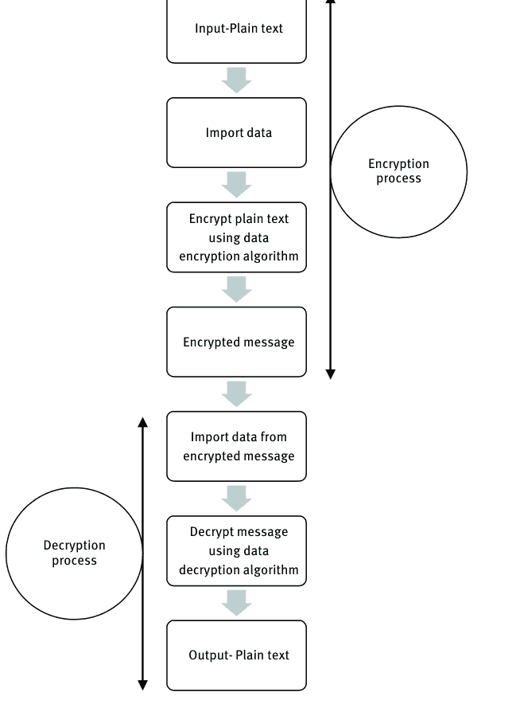

图7：数据加密与解密过程

随着程序产生的数据量不断增加，传统的入侵检测系统运行速度变得越来越慢。因此，人工智能应用已广泛普及，尽管目前这些应用主要是为应对数据规模的增长而设计的。这是因为人们认为，与人工智能旨在检测、识别和响应新网络威胁的目标相比，人类目前正在执行更全面的任务。

然而，人们担心人工智能工具本身可能不安全，攻击者可能很快制造出由人工智能驱动的武器。这是一个需要持续关注的研究领域。

因此，本文从当前和未来两个层面总结了人工智能对信息安全和网络安全中人的因素的影响。就目前而言，人工智能的影响主要体现在人力资本方面。但在未来，影响可能走向两个方向：要么人类被独立的AI应用完全取代，要么人与AI相互融合、取长补短，产生良好的效果。研究人员展望未来，提出将社会与技术发展进程相结合应作为解决方案，并需要在此方面继续研究。人们认识到，人工智能的各个方面都存在一定的研究局限性。另一方面，还有多种人工智能机制尚未经过测试。

这项拟议的研究提供了一种途径，使读者能够提升人工智能领域的技能，并以适当的方式解决安全方面的担忧。

## 11 参考文献

- [1] Mazur S, Blasch E, Chen Y, Skormin V, Mitigating cloud computing security risks using a self-monitoring defensive scheme, Proceedings of the 2011 IEEE National Aerospace and Electronic Conference (NAECON), Dayton, OH, 2011, pp. 39-45, doi: 10.1109/NAECON.2011.6183074
- [2] Alabdulkarim A, Al-Rodhaan M, Tian Y, Al-Dhelaan A, A privacy-preserving algorithm for clinical decision-support systems using random forest, Computers, Materials & Continua, 2019, Vol.58, No.3, pp.585-601, doi:10.32604/cmc.2019.05637
- [3] Chen J, Wang Y, Wang X, On-demand security architecture for cloud computing, Computer, 2012, vol. 45, no. 7, pp. 73-78, doi: 10.1109/MC.2012.120
- [4] Li B, Hou B, Wu W et al., Applications of artificial intelligence in intelligent manufacturing: a review, Frontiers Inf Technol Electronic Eng, 2017, 18, 86–96
- [5] Rasim A, Ramiz A, Fargana A, Privacy-preserving deep learning algorithm for big personal data analysis, Journal of Industrial Information Integration, 2019, Volume 15, Pages 14-19, ISSN 2452-414X, https://doi.org/10.1016/j.jii.2019.07.002
- [6] Sukhpal G, Shresht T, Minxian X, Inderpreet S, Karan V, Lindsay D, Shikhar T, Smirnova D, Manmeet S, Jainu U, Pervaiz H, Sehgal B, Sukhwinder K, Sanjay M, Sadegh A, Harshit M, Stankovski V, Garaghan P, Transformative effects of IoT, Blockchain and Artificial Intelligence on cloud computing: Evolution, vision, trends and open challenges, Internet of Things, 2019, Volume 8, 100118, ISSN 2542-6605, https://doi.org/10.1016/j.iot.2019.100118
- [7] Wan J, Yang J, Zhongren W, Qingsong H, Artificial intelligence for cloud-assisted smart factory, IEEE Access, 2018, PP. 1-1, 10.1109/ACCESS.2018.2871724
- [8] Chen J, Dongyong Y, Data security strategy based on artificial immune algorithm for cloud computing, Applied Mathematics & Information Sciences, 2013, 7, 149-153, 10.12785/amis/071L21
- [9] Sun L, Jiang X, Ren H, Guo Y, Edge-cloud computing and artificial intelligence in internet of medical things: architecture, technology and application, IEEE Access, 2020, vol. 8, pp. 101079-101092, doi: 10.1109/ACCESS.2020.2997831
- [10] Tabrizchi H, Rafsanjani K, A survey on security challenges in cloud computing: issues, threats, and solutions, J Supercomput, 2020, 76, 9493-9532, https://doi.org/10.1007/s11227-020-03213-1
- [11] Barona R, Anita E, A survey on data breach challenges in cloud computing security: issues and threats, 2017 International Conference on Circuit, Power and Computing Technologies (IC-CPCT), Kollam, 2017, pp. 1-8, doi: 10.1109/ICCPCT.2017.8074287
- [12] Alia A, Al-Rodhaan M, Al-Dhelaan Y, A privacy-preserving algorithm for clinical decision-support systems using random forest, Computers, Materials & Continua, 2019, 58, 585-601, 10.32604/cmc.2019.05637
- [13] Wang T, Jiyuan Z, Chen X, Guojun W, Anfeng L, Yang L, A three-layer privacy preserving cloud storage scheme based on computational intelligence in fog computing, IEEE Transactions on Emerging Topics in Computational Intelligence, 2018, 2, 3-12, 10.1109/TETCI.2017.2764109
- [14] Ram P, Murali S, Siva A, Privacy preservation techniques in big data analytics: a survey, J Big Data, 2018, 5, 33, https://doi.org/10.1186/s40537-018-0141-8
- [15] Muhammad N, Cloud computing: security issues and challenges, Journal of Wireless Communications, 2016, 1 (1), 10-15, https://doi.org/10.21174/jowc.v1i1.73

Shagun S Lokre, Shanmukhi Priya, Vihas Naman, Sachi Nandan Mohanty, Sirisha Potluri

# 应对云计算中的安全与隐私：区块链即服务

**摘要：** 近年来，随着云计算技术的引入，IT行业已经进入了软件进步的新时代。这项技术对基础设施交付已经变得至关重要，并因其性能和可用性而被广泛采用。云计算使我们能够通过互联网访问许多应用程序和服务。该技术执行的大部分活动都围绕不同形式的数据展开，使其成为一种宝贵的资源。数据的重要性和使用已达到新的高度，与所有珍贵资源一样，数据也需要安全性和隐私性。不幸的是，这正是许多云计算用户所关心的问题，因为数据所有者无法完全控制某些方面，如数据存储的位置和访问权限。区块链技术作为新兴技术之一，可以用来补充解决云用户所面临的问题。该技术提供了去中心化、分布式、真实性、不可篡改、信任等特性，可用于应对数据完整性方面的威胁。在本章中，我们将讨论云模型中数据的安全和隐私问题，以及区块链技术的特性如何增强该模型的完整性。虽然存在一些局限性，如高延迟和低吞吐量，但这些局限性降低了区块链技术的实际效用。

**关键词：** 安全、隐私、云计算、去中心化、完整性、区块链技术

**Shagun S Lokre**，计算机科学与工程系，IcfaiTech（科学与技术学院），ICFAI高等教育基金会，Donthanpally，Shankarpalli Road，海得拉巴，特伦甘纳邦 501203，印度，shagunslokre22@gmail.com

**Shanmukhi Priya**，计算机科学与工程系，IcfaiTech（科学与技术学院），ICFAI高等教育基金会，Donthanpally，Shankarpalli Road，海得拉巴，特伦甘纳邦 501203，印度，shanmukhipriya99@gmail.com

**Vihas Naman**，计算机科学与工程系，IcfaiTech（科学与技术学院），ICFAI高等教育基金会，Donthanpally，Shankarpalli Road，海得拉巴，特伦甘纳邦 501203，印度，vihas.naman@gmail.com

**Sachi Nandan Mohanty**，计算机工程系，浦那工程学院，Wellesley Rd, Shivajinagar，浦那，马哈拉施特拉邦 411005，印度，sachinandan09@gmail.com

**Sirisha Potluri**，计算机科学与工程系，IcfaiTech（科学与技术学院），ICFAI高等教育基金会，Donthanpally，Shankarpalli Road，海得拉巴，特伦甘纳邦 501203，印度，sirisha.vegunta@gmail.com


## 1 Introduction

即使在云计算尚未发展之前，IT 行业就已经面临着一些严峻的挑战，例如数据存储和访问、托管以及数据隐私等。在云出现之前，客户端/服务器计算本质上是集中式存储，所有软件、数据和控制都位于服务器端。这对 IT 行业造成了重大阻碍，因为集中式数据库严重依赖网络连接，这意味着互联网连接越慢，访问数据库所需的时间就越长。尽管数据冗余有限或不存在，如果数据集合意外丢失，手动恢复它是非常困难的。以前，如果用户希望查看某些信息或执行程序，他/她必须先连接到服务器，然后获得访问权限，然后再进行工作。这还不是全部，如果 IT 公司规模庞大、员工众多，那么公司就很难为员工完成任务安排足够的硬件和软件。不可能为每台系统和每位员工购买软件和应用程序。但找到改变 IT 行业面貌的解决方案并没有花费太多时间，“云计算”[1-2]。简单来说，云计算意味着计算机资源的服务是由云提供商控制和管理，而不是终端用户。这些资源包括从基于浏览器的网络应用程序、第三方数据存储设备或用于支持行业、研究或个人项目计算机基础设施的第三方服务器等一切内容。

在云计算广泛使用之前，企业和普通计算机用户通常必须购买和维护他们想要使用的软件和硬件。随着基于云的应用程序、存储服务和机器的日益普及，企业和消费者现在可以通过互联网服务访问大量按需计算资源[3]。如果工作中的软件和硬件转移到远程网络化和分布式资源上，云用户就不再需要投入购买和维护数据所需的工作、资金或专业知识。这种前所未有的计算机资源访问带来了新一代基于云的公司，改变了各行业的 IT 实践，并将许多计算机辅助实践转变为日常实践。许多组织开始使用云来存储记录、提供企业应用程序以及数字化部署服务和商品。这些类型的基于云的技术和采用方式在该领域是独一无二的。在教育领域，教育工作者和学者使用基于云的教学和研究应用程序[4]。正如人们所说，世上没有完美的事物，云计算也有一些缺点需要在继续推进前加以考虑。在云计算中，保密性和隐私性是最受质疑的问题之一。通过使用云存储基础设施，我们完全致力于提供基于云的应用程序保护和数据保密性。这意味着如果我们遇到任何问题，就不能就数据错误或数据中的任何错误向服务器索赔。云计算的另一个主要缺点是其在遭受攻击时的脆弱性。由于云计算是在线进行的，云计算的任何方面都可能暴露给各种服务器，从而导致数据攻击和服务器存储活动，因此人们对云计算存在诸多担忧。在本章中，我们将提出区块链技术如何有助于使整个系统实现去中心化、防篡改和透明化[5]。

## 2 Literature Survey

目前，区块链技术面临的核心障碍与可扩展性、监管限制、身份注册、消费者保护、法律法规以及合规要求有关。本章基于以往研究的文献撰写，结合区块链技术和云的概念，创建具有选定访问权限的安全云系统[6]。本章对云系统与区块链技术的结合进行了详细研究。随着科学技术的不断进步，安全、快速系统的需求已成为任何信息检索的首要任务。区块链的当前用途包括协助物联网系统以及云计算系统协助区块链技术，使家庭环境在任何流程中更高效、安全、更快，这使用了云服务提供商[7]、边缘服务提供商和轻量级客户端；这些模块各自协助数据的存储和使用。

区块链的另一个应用是为轻量级客户端提供安全网络计算，该应用用于计算能力不足以进行重度使用的移动设备[8]。该应用使用移动资源管理，通过蓝牙技术连接附近的手机，利用附近手机的综合资源，我们使用以人为中心的安全认证管理方案（SAMS）通过区块链对移动设备进行身份验证，所有设备都提供身份验证数据，伪造无法发生[9]。区块链技术的主要用途是医疗领域，任何患者的病史对于特定疾病的诊断都非常重要[10]。数据越容易存储和安全共享，鉴于保密性至关重要，诊断和治愈任何疾病就越容易。使用去中心化应用程序，我们将把所有病史上传到区块链，允许患者授予特定医生访问权限以查看并将诊断添加到现有数据中。这一概念被称为电子病历。我们还使用了多篇关于云计算中存在的安全和隐私问题的调查论文。有多种类型的云服务，如软件、平台和基础设施即服务[11]。

这些模型各自具有复杂性和安全问题，主要挑战是数据的保密性、完整性和可用性[12]。云计算的支持概念是虚拟化，该过程允许轻松地将数据上传到任何云服务。在使用区块链的云计算相关技术中存在多重挑战。从区块链的角度来看，存在可扩展性问题。从云计算的角度来看，存在安全问题和财务问题，因为云服务可能很昂贵[13]。

## 3 Cloud Computing Concepts

在继续阅读本章之前，人们可能会遇到一些问题，例如云到底是什么？云在哪里？我们现在是否在云中？用最简单的话来说，云计算意味着数据和程序是通过互联网存储和访问的，而不是存储在我们计算机的硬盘上。最终，“云”这个词只是一个互联网隐喻。基于云的计算鼓励将文件保存在远程档案中，而不是保存在私有硬盘或本地存储设备上。尽管电子计算机可以访问互联网，但电子设备可以访问数据和软件应用程序。云存储之所以被称为云存储，是因为所查看的知识可以直接位于云或虚拟环境中。拥有云存储的公司允许用户将文件和软件保存在远程服务器上，然后通过互联网访问所有数据。这确保了用户不必处于特定位置即可获得访问权限，从而使用户能够远程操作。云计算消除了从我们手持或坐着操作的笔记本电脑中处理和操作数据所需的所有繁重工作。它还将整个工作转移到庞大的网络空间计算集群。互联网正在演变为云，使得我们的文件和工作可以从我们连接的互联网上的世界任何设备查看。云存储平台为消费者提供一系列功能，例如电子邮件、存储、数据备份、软件开发和检查、数据处理、音频和视频流、按需设备分发[14]。

云计算提供的服务分为如图 1 所示的 3 种服务模型：

- SaaS: 软件即服务。
- PaaS: 平台即服务。
- IaaS: 基础设施即服务。

SaaS：NIST 将云中的此服务描述为能够访问提供商的云计算应用程序。应用程序可以通过薄客户端界面（如网络浏览器）或软件互-

面对。除了可能的最低用户特定配置要求外，用户不跟踪或管理云资源，包括网络、处理器、操作系统、内存，甚至单个软件功能。

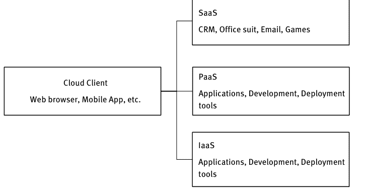
图1：云计算的类别

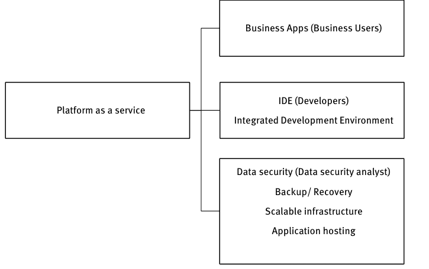
图2：平台即服务

用户通过软件即服务（SaaS）模式访问应用程序和数据库。运行软件的底层基础设施和系统由云提供商运营。SaaS通常被称为“按需软件”，其定价通常基于按使用量付费或按月收费。

事实证明，使用SaaS在可扩展性、可靠性和性能方面具有优势。

- 适度的软件工具
- 有效利用软件许可证
- 集中化数据与监控
- 由提供商运营的网络的责任
- 多利益相关方解决方案

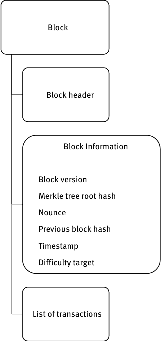
**图3：** 区块链中的区块结构

PaaS：根据NIST的定义，云计算中的平台即服务描述为：向用户提供的功能是，通过编写一组代码，使用供应商资助的库、API和资源，将消费者创建或购买的软件运行在云基础设施上。用户既不操作也不监控底层云资源，包括网络、服务器、操作系统或存储，但可以控制已安装的软件以及应用程序托管环境的可能配置设置。

PaaS供应商提供用于创建应用程序的平台，如图2所示。供应商通常会创建工具包、实现规范以及分发和支付渠道。在PaaS模型中，云供应商提供计算基础设施，通常包括操作系统、编程语言执行环境、数据库和Web服务器。

使用PaaS的好处包括：

- 更低的管理开销
- 可调节的选项
- 为框架提供更现代的软件

IaaS：基础设施即服务（IaaS）是一种即时计算基础设施，通过互联网交付和运营。它是云计算的四种类型之一，另外三种是软件即服务（SaaS）、平台即服务（PaaS）和无服务器服务。

IaaS可以根据需求轻松扩展或缩减，让你只为所使用的资源付费。它使你免于拥有和维护物理服务器及其他数据中心资源的成本与困难。每种资源都作为独立的服务组件提供，你只需在需要的时间内租用单个资源。云存储供应商（如Azure）在购买、下载、配置和维护你的软件——操作系统、中间件和程序——时负责运营该平台[15]。

## 4 共识机制

云计算在商业和IT领域提供了多重优势。它使我们能够创建真正的虚拟工作场所，从而随时随地沟通。随着当今企业界使用的联网设备数量（例如智能手机、平板电脑），现在访问数据变得更加简单。转向云存储将降低IT系统的管理和维护成本。通过利用云计算平台的服务，而不是为企业购买昂贵的系统和设备，可以降低开支。大多数拥有1000名以上员工的公司与初创企业有着不同的IT需求[16]。使用云是一个很好的选择，因为它使公司能够根据市场需求高效且快速地扩展或缩减其IT部门。

基于云的应用程序适合对带宽需求不断增长或持续变化的企业。随着公司需求增加，你可以迅速扩展云的能力，而无需在物理资源上投入资金。这种灵活性将使你在使用云计算的竞争对手面前获得真正的优势。这就是可扩展性发挥作用的地方。可扩展性最大限度地降低了内部维护和组织挑战带来的风险。凭借专业的策略和零前期投资，你就能拥有高性能的工具。云的最大价值无疑就是可扩展性[17]。

## 5 区块链技术概念

通俗地说，区块链是一条由包含交易数据的区块组成的链。从技术上讲，区块链是一个分布式、去中心化且可信的账本或数据共享平台，可供互不信任的参与者使用。区块链被称为分布式的，因为网络中的每个参与者都共同执行任务；它被称为去中心化的，因为有多个协调点，不存在单点故障[18]。

### 5.1 共识机制

早期，传统账本的使用导致中心化权威，因为只有单一实体控制账本中的条目。但随着区块链技术的引入，网络中的每个参与者都拥有一份账本副本，没有任何单个参与者拥有单独添加条目的权力。所有参与者都遵循一种共识机制来决定是否向账本中添加条目。最常见的共识机制如下所示。

- **工作量证明（PoW）：** 这是目前最常用的算法。该算法要求网络中的参与者解决一个具有挑战性的计算难题来创建新区块。解决这个难题的机制称为“挖矿”，执行这一过程的节点称为“矿工”。解决难题的矿工将获得一种激励，称为区块奖励。挖出区块的概率取决于矿工完成的工作量。这项工作消耗物理资源，如CPU算力和时间。

- 权益证明（PoS）：该算法要求矿工获得足够的权益才能挖出一个区块。虽然发起攻击成本高昂，但由于攻击者需要持有高额权益，攻击的激励也会降低。因此，攻击对攻击者自身的影响更大。这个过程提供了更高的安全性，并且节能高效，但无法使系统完全去中心化。

- 燃烧证明（PoB）：该算法要求矿工燃烧部分财富来挖出新区块。矿工必须通过将币发送到一个可验证的不可花费地址来证明他们燃烧了部分财富。这个过程与PoW一样昂贵，但除了矿工的财富外，不需要使用外部资源。PoB消耗虚拟或数字资源，同样节能高效。PoB通过燃烧PoW挖出的加密货币来运作。

### 5.2 区块链的结构

所有区块链结构通常分为三类：

- 公有区块链架构：在这种架构中，任何参与者都可以按照自己的意愿进入和退出区块链网络，无需任何许可。所有愿意参与的参与者只要在网络中，就可以访问网络中的数据。例如：比特币、以太坊等。

- 私有区块链架构：在这种架构中，每个参与者进入和退出区块链网络都需要获得许可。进入区块链的参与者也可能被限制访问某些数据。该系统由特定组织的用户控制。例如：Hyperledger Fabric。

- 联盟区块链结构：在这种架构中，区块链网络由一组组织构建。这种架构既不完全公有，也不完全私有。所有权限都由预先指定的用户控制。例如：Quorum、Corda等。

表1概述了三种区块链结构的比较：

表1：区块链结构比较

| 属性 | 公有区块链 | 私有区块链 | 联盟区块链 |
|---|---|---|---|
| 可访问性 | 任何人 | 单一组织 | 多个组织 |
| 谁可以加入？ | 任何人 | 经许可且已知身份 | 经许可且已知身份 |
| 共识机制 | PoW/PoS | 投票或多方共识算法 | 投票或多方共识算法 |


| 属性 | 公有区块链 | 私有区块链 | 联盟区块链 |
|---|---|---|---|
| 共识决定 | 所有矿工 | 单个组织内部 | 选定的节点集合 |
| 共识过程 | 无需许可 | 需要许可 | 需要许可 |
| 读取权限 | 公开 | 公开或受限 | 公开或受限 |
| 不可篡改性 | 几乎无法篡改 | 可能被篡改 | 可能被篡改 |
| 资源利用效率 | 低 | 高 | 高 |
| 中心化 | 无 | 有 | 高 |
| 交易速度 | 慢 | 更轻量且更快 | 更轻量且更快 |

虽然区块链分为三类，但所有区块链都由区块组成，且所有区块都遵循类似的结构。区块就像一个数据结构，用于累积将要纳入区块链的交易 [20]。每个区块分为包含元数据的区块头和交易列表，如图 3 所示。区块链中的第一个区块被称为创世区块。区块头由以下部分组成：

- 区块版本：这是一个用于跟踪软件更新的版本号，大小为 4 字节。
- 前一区块哈希：这是对当前链中父区块/前一区块哈希的引用，大小为 32 字节。
- 默克尔树根哈希：这是本区块交易构成的默克尔树的根节点哈希，大小为 32 字节。
- 时间戳：这是创建区块所需的大致时间，大小为 4 字节。
- Nonce：这是用于工作量证明算法的计数器，大小为 4 字节。
- 难度目标：这是本区块的工作量证明算法难度目标，大小为 4 字节。

挖矿过程需要 Nonce、难度目标和时间戳。

### 5.3 区块链的工作流程

图 4 展示了采用工作量证明共识机制的区块链工作流程。

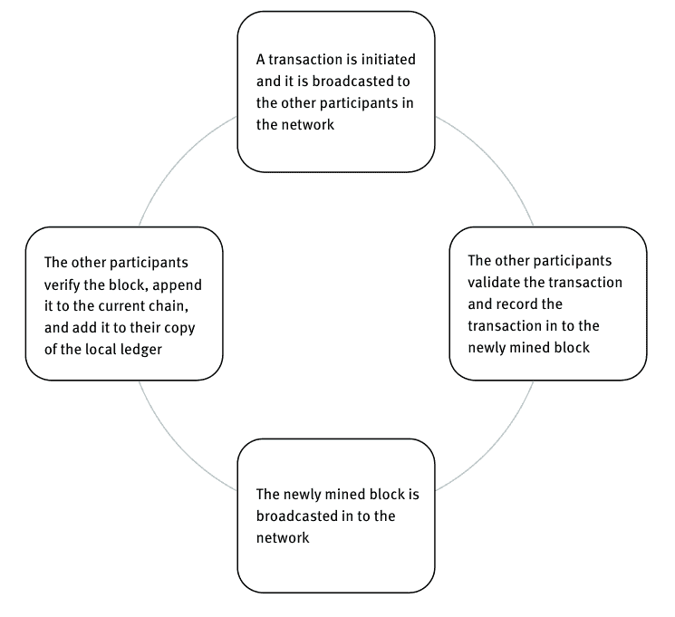

图 4：区块链的工作流程

首先，由某个参与者发起交易，并将交易广播给网络中的其他参与者。收到该交易的参与者使用数字签名来验证交易的真实性。验证通过后，该交易被添加到参与者各自账本中的真实交易列表中。为了登记这些真实交易，网络中的参与者会努力挖掘新块，即寻找该区块的 Nonce。一旦某个参与者找到有效的 Nonce，他/她就可以挖掘包含相关交易的区块。随后，其他参与者通过分析默克尔根来检查收到的区块中的交易；一旦新挖出区块中的交易通过认证且未被篡改，该新块就会被追加到区块链的本地副本中。完成整个过程后，新挖出的区块就可以附加到当前区块链上 [21]。下面给出了区块链即服务的示例代码，用于声明交易数据和区块链挖矿。

#### 清单 1：区块链即服务：用于声明交易数据和区块链挖矿

```python
#Transactions declaration
def get_transdata(self, sender, receiver, amount):
        self.current_data.append({
                'sender': sender,
                'receiver': receiver,
                'amount': amount
        })
        return True
#Blockchain mining
def blockchain_mining(self, details_miner):
        self.get_data(
                sender="0",
                receiver=details_miner,
                quantity=1,
        )
        last_block = self.latest_block
        last_proof_number = last_block.proof_number
        proof_number = self.proof_of_work(last_proof_number)
        last_hash = last_block.compute_hash
        block = self.build_block(proof_number, last_hash)
        return vars(block)
```

### 5.4 区块链的特性

下面列出了区块链的一些重要特性 [22-25]：

- **去中心化：** 该特性意味着，所有交易都由网络中的所有参与者共同登记，每个参与者都维护一份本地账本副本，已记录的交易保存在其中。这样一来，账本就不受中心化机构控制，也避免了单点故障。
- **可信任：** 该特性意味着，进入网络的参与者无需证明自己的身份，因为任何交易的验证都不需要依赖某个特定参与者。由于使用共识算法来验证交易，因此也不需要任何第三方。
- **不可篡改性：** 该特性意味着，记录到区块链中的交易永远无法被操纵或篡改。区块链利用密码学原理来保证其自身和内容不可篡改。
- **不可否认性：** 该特性意味着，一旦交易完成，任何参与者都无法否认自己发起或接收了该交易。这是因为每笔交易在广播到网络之前都会使用私钥进行加密签名。该私钥只有其所有者知道，因此发起者不可能否认自己发起的交易。
- **透明性：** 该特性意味着，每个参与者都可以访问区块链中记录的所有交易，并验证所有交易。
- **可追溯性：** 该特性意味着，借助附加在区块头中的时间戳，可以轻松地追踪和验证每笔交易及每个区块。

### 5.5 区块链可能遭受的攻击

众所周知，事物都有两面性，区块链技术同样存在某些脆弱性，从而导致针对区块链的攻击。下面列出了一些潜在的攻击方式：

- 女巫攻击（Sybil attack）：攻击者使用大量具有匿名身份的节点充斥整个网络。这样，攻击者可以控制网络的大部分节点，并试图主导网络。尽管这些节点看起来互不相关，但它们都由同一个参与者操控。这种攻击针对整个网络，使攻击者能够在账本中创建分叉，从而实现双重支付。
- 自私挖矿攻击：通常，网络中长度最长的链被视为账本的真实且最新版本。因此，如果自私的矿工以隐蔽模式在现有链之上继续构建区块，他/她就能发布这条虚假链，并且由于它是最长的链，所有人都会接受它。这为攻击者提供了一个短暂窗口来实施双重支付。
- 51% 攻击：当一个矿工或一组矿工控制了一个区块链网络中 51% 或以上的挖矿算力时，就会发生这种攻击。这种情况在大型网络中很难发生，但在小型网络中则非常可能发生。
- 拒绝服务（DoS）攻击：当恶意参与者完全占用资源，使资源持续忙于验证和传输区块与交易时，就会发生这种情况。这些恶意参与者可以向其他参与者发起大量交易，从而淹没网络，使其他参与者的交易无法传输和验证。

## 6 云安全问题

如今最大的问题是对云防护的挑战。恶意或无意的行为可能在多个层面损害组织。无论是在云环境还是非云环境中都是如此，但随着软件和服务复杂性的增长，安全漏洞也会增多。与传统服务模型相比，云的攻击面更大，因为相关模块具有多个不同的端点和协议，需要以不同的方式处理。需要多种方法来识别和解决已知威胁与新出现的威胁。

分布式拒绝服务（DDoS）攻击只是云计算中一种常见的安全威胁。云服务提供商通常会提供多种架构解决方案，以配置受保护的基础设施来避免此类攻击，例如流量隔离（将虚拟机集群隔离到不同虚拟网络组中的能力）或访问控制列表，以建立指定多层级组件权限的规则。

对于传统云范式而言，第二个最重要的问题是数据管理。数据管理中需要讨论的一个方面是数据一致性。这意味着所有云用户都能同时看到相同的数据。这并非易事，因为硬件（数据资源）与操作的事务状态相关联，并且要遵循物理网络约束，这些约束会通过连接用户而影响连续性。

第三个主要问题是韧性和云兼容性。韧性是指优雅地处理错误并恢复整个系统的能力。对于模块之间争抢资源并依赖于其他发生故障的内部或外部组件/服务、或可能依赖有缺陷软件的服务和应用而言，这是一个巨大的问题。规划如何观察、记录、修复和恢复这些错误，不仅需要开发人员，还需要所有团队将其作为云战略的一部分参与其中。

为了支持这一点，可以使用一些应用程序来重现各种随机问题，从硬件问题到重大外部威胁，包括失败的实现或可疑的设备行为 [26-27]。

## 7 区块链救援

除了上述提到的问题之外，云计算还存在一些挑战和限制；其中部分限制可以通过区块链技术消除或缓解。云计算的主要挑战是安全问题、成本管理、资源不足、数据的治理或控制、多云管理、构建私有云、功能受限、数据流动性以及可靠的互联网连接。


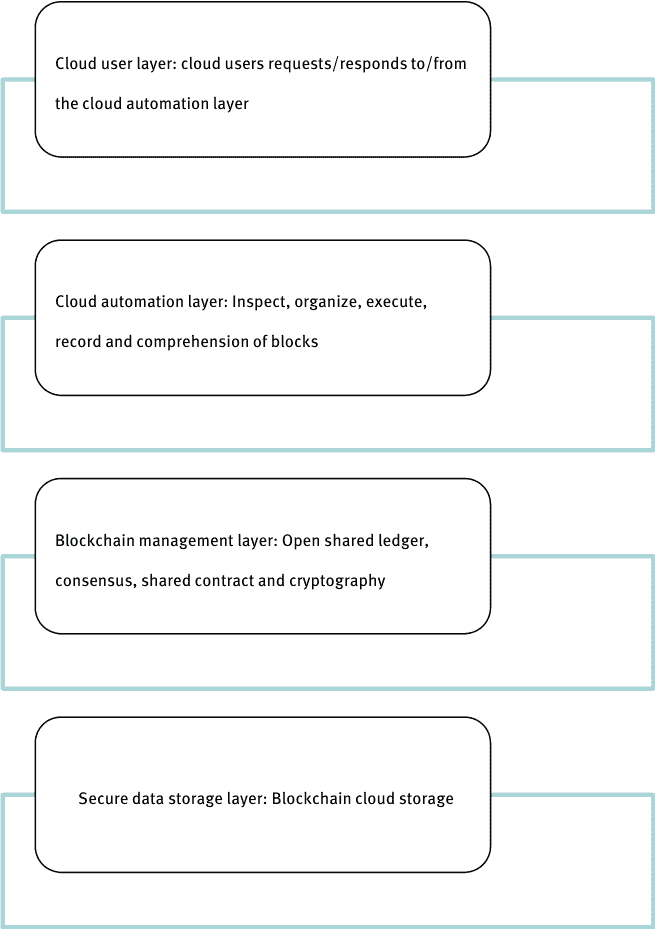

**图5：** 区块链即服务（BaaS）

这些问题的大部分都可以通过区块链技术来解决。区块链即服务如图5所示。区块链的去中心化、不可篡改性及共识机制等特性增强了安全性。以下问题可以通过区块链技术得到解决。

### 7.5 管理多个云或服务器

随着存储各类数据的需求日益增长，我们需要不断扩展的存储空间。这种存储管理起来成本过高。另一种解决方案是管理多个服务器或云环境，但这使得追踪和筛选数据变得非常困难。在区块链中，我们可以使用多个系统来解决这个问题。由于区块链上的数据以去中心化的方式存储，我们不需要多个服务器。

### 7.6 构建私有云

如果数据或任何信息高度机密，那么就需要私有云。但这不划算且成本高昂；这个问题可以通过使用私有区块链来解决。使用私有区块链具有多种优势，例如选择性授予访问权限和安全的数据传输。构建私有区块链比拥有私有云要容易得多。维护存储模块和服务器设置是一项繁琐且维护成本高的工作。

### 7.7 功能受限

并非所有云服务都具有相同的功能。如果需要在云上更改任何特性，迁移所有数据将是一个非常漫长且费力的过程。使用区块链，我们可以确定初始特性集并使用它们。随着区块链技术的不断发展，安全措施和任何其他功能都可以在需要时随时更新。

### 7.8 可靠的互联网连接

拥有快速且稳定的互联网或内网连接非常重要。速度需要在检索端和服务器端同时得到保证。由于在区块链环境中数据存储在多个系统上，某个系统临时停机意味着可以从区块链中的不同区块检索到相同的数据。这是云环境中最大的问题之一，而区块链技术可以解决这一问题。

## 8 结论

云计算为我们提供了多种存储和操作数据的系统。与现有系统相比，我们完全可以使用区块链来改善安全系统和数据共享。在本章中，我们探讨了区块链技术及相关的关键创新，并回顾了迄今为止的研究模式，以探索更多有待研究的领域。在云计算领域使用区块链时，应考虑现有的各种问题。区块链目前正面临许多问题，例如交易稳定性、钱包和应用等，并且已经开展了多种研究来解决上述问题。通过将区块链用于云计算环境，应以安全的方式维护用户的匿名信息，并且在用户退出或停止使用服务时，应删除用户信息。如果用户信息未被丢弃，就可能被用来识别用户身份，导致用户身份暴露；检索到的信息可能被用于不法行为。

云基础设施将长期存在，但要注意——传统方法不足以满足当前云工作负载的需求。云存储、数据管理和资源兼容性是实际问题，需要作为现代云战略的一部分加以考虑。

## 9 参考文献

- [1] Smith F, Waterman S, Identification of common molecular subsequences, J. Mol. Biol., 1981, 147, 195–197
- [2] May P, Ehrlich H, Steinke T, ZIB structure prediction pipeline: composing a complex biological workflow through web services, Nagel W, Walter W, Lehner W, Euro-Par 2006 Parallel Processing, LNCS, 2006, vol. 4128, pp. 1148–1158, Springer, Heidelberg
- [3] Toby V, Anthony V, Elsenpeter R, Cloud computing, A Practical Approach (1st ed.), McGraw-Hill, Inc., USA, 2009
- [4] Sabahi F, Cloud computing security threats and responses, 2011 IEEE 3rd International Conference on Communication Software and Networks, 2011, pp. 245-249, doi: 10.1109/ICCSN.2011.6014715
- [5] Jin P, Jong P, Blockchain security in cloud computing: use cases, challenges, and solutions, Symmetry, 2017, 9, no. 8: 164
- [6] Ravishankar B, Kulkarni P, Vishnudas M V, Blockchain-based database to ensure data integrity in cloud computing environments, 2020 International Conference on Mainstreaming Block Chain Implementation (ICOMBI), Bengaluru, India, 2020, pp. 1-4, doi: 10.23919/ICOMBI48604.2020.9203500
- [7] Saurabh S, In-ho R, Weizhi M, Maninder K, Cho G, SH-BlockCC: A secure and efficient Internet of things smart home architecture based on cloud computing and blockchain technology, International Journal of Distributed Sensor Networks, 2019, 15(4), 155014771984415, 10.1177/1550147719844159
- [8] Yang X, Guojun W, Jidian Y, Ju R, Yaoxue Z, Cheng Z, Towards secure network computing services for lightweight clients using blockchain, Wireless Communications and Mobile Computing, 2018, 1-12, 10.1155/2018/2051693
- [9] Hyun-Woo K, Young-Sik J, Secure authentication-management human-centric scheme for trusting personal resource information on mobile cloud computing with blockchain, Human-centric Computing and Information Sciences, 2018, 8 (1), 10.1186/s13673-018-0136-7
- [10] Yue X, Wang H, Jin D, Mingqiang L, Jiang W, Healthcare data gateways: found healthcare intelligence on blockchain with novel privacy risk control, Journal of medical systems, 2016, 40(10), 218, 10.1007/s10916-016-0574-6
- [11] Simanta S, Application of blockchain in cloud computing, International Journal of Innovative Technology and Exploring Engineering (IJITEE), 2019, ISSN: 2278-3075, Volume-8 Issue-12
- [12] Rajeswari S, Kalaiselvi R, Survey of data and storage security in cloud computing, 2017 IEEE International Conference on Circuits and Systems (ICCS), 2017, pp. 76-81, doi: 10.1109/ICCS1.2017.8325966
- [13] Ashok G, Siddiqui S, Alam S, Mohammed S, Cloud computing security using blockchain, JETIR, 2019, Volume 6, Issue 6, 791-794
- [14] Jadeja Y, Modi K, Cloud computing - concepts, architecture and challenges, 2012 International Conference on Computing, Electronics and Electrical Technologies (ICCEET), Kumaracoil, 2012, pp. 877-880, doi: 10.1109/ICCEET.2012.6203873
- [15] Gibson J, Rondeau R, Eveleigh D, Tan Q, Benefits and challenges of three cloud computing service models, 2012 Fourth International Conference on Computational Aspects of Social Networks (CASoN), Sao Carlos, 2012, pp. 198-205, doi: 10.1109/CASoN.2012.6412402
- [16] Kawanami Y, Kato H, Yamaguchi H, Tanimura M, Tagaya Y, Mechanism and control of cloud cavitation, J. Fluids Eng., Dec 1997, 119(4), 788-794 (7 pages), https://doi.org/10.1115/1.2819499
- [17] Li X, Zhou L, Shi Y, Guo Y, A trusted computing environment model in cloud architecture, 2010 International Conference on Machine Learning and Cybernetics, Qingdao, China, 2010, pp. 2843-2848, doi: 10.1109/ICMLC.2010.5580769
- [18] Liang Y, Blockchain for dynamic spectrum management, Dynamic Spectrum Management, Signals and Communication Technology, Springer, Singapore, 2020, pp. 121-146, https://doi.org/10.1007/978-981-15-0776-2_5
- [19] Nguyen C, Hoang D, Nguyen D, Niyato D, Nguyen H, Dutkiewicz E, Proof-of-Stake consensus mechanisms for future blockchain networks: fundamentals, applications and opportunities, IEEE Access, 2019, 7, 85727–85745
- [20] Liu Z, Luong N, Wang W, Niyato D, Wang P, Liang Y, Kim D, A survey on blockchain: a game theoretical perspective, IEEE Access, 2019, 7, 47615–47643
- [21] Perboli G, Musso S, Rosano M, Blockchain in logistics and supply chain: a lean approach for designing real-world use cases, IEEE Access, 2018, 6, 62018–62028
- [22] Konstantinidis I, Siaminos G, Timplalexis C, Zervas P, Peristeras V, Decker S, Blockchain for business applications: a systematic literature review, Abramowicz W, Paschke A, Business Information Systems, BIS 2018, Lecture Notes in Business Information Processing, 2018, vol. 320, Springer, Cham, https://doi.org/10.1007/978-3-319-93931-5_28
- [23] Umesh B, Sudeep T, Karan P, Pimal K, Sudhanshu T, Neeraj K, Mamoun A, Blockchain for Industry 4.0: a comprehensive review, 2020, IEEE Access, vol. 8, pp. 79764-79800, doi: 10.1109/ACCESS.2020.2988579
- [24] Kshetri N, Can blockchain strengthen the internet of things?, IT Professional, 2017, vol. 19, no. 4, pp. 68-72, doi: 10.1109/MITP.2017.3051335
- [25] Arora D, Gautham S, Gupta H, Bhushan B, Blockchain-based security solutions to preserve data privacy and integrity, 2019 International Conference on Computing, Communication, and Intelligent Systems (ICCCIS), 2019, pp. 468-472, doi: 10.1109/ICCCIS48478.2019.8974503
- [26] Houshyar H, Rashid M, Fakhrul A, Demidenko S, Multi-layer blockchain-based security architecture for internet of things, Sensors 2021, 21(3), 772, https://doi.org/10.3390/s21030772
- [27] Rui Z, Rui X, Ling L, Security and privacy on blockchain, ACM Comput. Surv., 2019, 52, 3, Article 51, 34 pages, DOI: https://doi.org/10.1145/3316481


# 缓解云中DDoS攻击的安全与隐私保护模型

Sirisha Potluri, Sachi Nandan Mohanty, T. Kundana, D. Abhinav, P. Sushrutha

## 摘要

拒绝服务（DoS）攻击事件是新兴云计算模型中的主要安全挑战之一。目前，针对各种云服务和资源实施了多种不同类型的 DoS 攻击，这些攻击针对其可用性、服务级别协议（SLA）和性能。一次成功的 DDoS 攻击可能导致服务降级或完全中断。DDoS 攻击会减少网络资源，并可能导致带宽耗尽。DDoS 攻击的主要目标是阻止某些用户访问云中的服务。在本研究中，我们提出了一种适用于 SDN 的隐私保护跨域攻击检测方案。Predis 可能是扰动加密与编码的组合，以保护隐私，并使用计算简单且高效的机器学习算法 k 最近邻（KNN）进行检测。这里我们还对 KNN 进行了改进，以实现更高的效率。通过广泛的模拟和理论分析，该算法的 DEMO 能够在保护敏感信息安全的同时，实现高效、准确的攻击检测。虚拟化使得单台服务器上的资源可以同时共享给某些应用或服务，这给云带来了一定数量的威胁和安全问题。本模块侧重于识别与云安全相关的挑战，并尝试引入解决这些问题的方法。

**关键词：** 拒绝服务，KNN，软件定义网络，加密，虚拟化，云安全，云隐私

**Sirisha Potluri**，计算机科学与工程系，IcfaiTech（科学与技术学院），ICFAI 高等教育基金会，Donthanapally，Shankarpalli 路，海得拉巴，特伦甘纳邦 501203，印度，sirisha.vegunta@gmail.com

**Sachi Nandan Mohanty**，计算机工程系，浦那工程学院，Wellesley Rd，Shivajinagar，浦那，马哈拉施特拉邦 411005，印度，sachinandan09@gmail.com

**T. Kundana**，计算机科学与工程系，IcfaiTech（科学与技术学院），ICFAI 高等教育基金会，Donthanapally，Shankarpalli 路，海得拉巴，特伦甘纳邦 501203，印度，kundana666666@gmail.com

**D. Abhinav**，计算机科学与工程系，IcfaiTech（科学与技术学院），ICFAI 高等教育基金会，Donthanapally，Shankarpalli 路，海得拉巴，特伦甘纳邦 501203，印度，dabhinavviser@gmail.com

**P. Sushrutha**，计算机科学与工程系，IcfaiTech（科学与技术学院），ICFAI 高等教育基金会，Donthanapally，Shankarpalli 路，海得拉巴，特伦甘纳邦 501203，印度，psushrutha15@gmail.com

## 1 引言

使用托管在 Web 上的远程服务器网络来存储、管理和处理数据，而不是使用本地服务器或个人计算机，这种做法称为云计算。它是一种按使用付费的模式。由于结合了虚拟化和面向服务的架构等新兴技术，云计算可以被视为新兴技术的未来。根据部署模型，有多种类型的云[1]。

- 公有云/互联网云
- 私有云/企业云
- 混合云/混合云
- 社区云

公有云面向大量公共客户设计，私有云服务仅向云所有者开放。两个或多个云的组合可视为混合云，其中云可以是公有云、社区云或私有云；广义上，社区云服务由多个组织共享。

云通过多种模型提供服务，如软件即服务（SaaS）、平台即服务（PaaS）和基础设施即服务（IaaS）。

- SaaS：它为用户提供对软件应用程序的访问权限。这些存在于云中的软件应用程序被用于各种各样的任务。
- PaaS：它提供构建基于云的应用程序所需的全部硬件和软件组件。
- IaaS：它向最终用户提供存储、安全工具和网络等服务。

针对各种云部署模型，设计并提出了几种严重的安全攻击，这些攻击对采用者构成了严重的安全风险。诸如包装攻击、恶意软件注入等攻击以及其他攻击都可以针对云计算实施。其中一种安全攻击是拒绝服务（DoS）攻击。它是一种事件或恶意行为，削弱或阻止云安全执行其预期的功能和服务。DoS 攻击的一种分布式形式称为分布式拒绝服务（DDoS）攻击，它利用大量网络主机对受害者造成更大影响[2]。

DDoS 攻击可分为以下几类：

- 带宽攻击
- 物理破坏
- 限制利用
- 连接性攻击
- 资源耗尽
- 进程中断
- 数据破坏

软件定义网络（SDN）已成为一种新的通信范式，摆脱了对传统网络的直接集成，并通过明智的网络控制器为系统和网络提供了灵活性。SDN 包含数据平面、控制平面和应用平面。控制平面包含一些控制器，这些控制器使用逻辑控制策略，并维护以逻辑为中心的整个网络视图。管理员从网络服务中移除所有网络视图，并为提供商、研究人员或第三方提供易于使用的接口，以方便这些人员定制事务计划并实现合理的网络管理。SDN 用户不必担心底层设备的技术细节，一个简单的系统就能检测新应用的快速交付。

先进的控制功能和系统使 SDN 面临所谓的分布式拒绝服务（DDoS）攻击的风险。例如，控制器在决定 SDN 中每个组件的性能方面起着非常重要的作用，它是 DDoS 攻击的主要目标。被攻破的控制器可能导致其控制下所有交换机的异常行为。拒绝服务（DoS）攻击会耗尽目标计算机上的系统资源，停止服务，并使其正常用户无法访问。当黑客使用两台或多台被攻破的计算机作为“傀儡机”对特定目标发起 DDoS 攻击时，就称为 DDoS 攻击。傀儡机的 IP 地址以及攻击数据包的组成和类型并不固定，因此很难定位攻击者。

DDoS 攻击已成为当今互联网的主要威胁，攻击来自多个攻击者，使大量受害者无法使用在线服务。随着在线提供服务的企业数量呈指数级增长，DDoS 攻击可能导致重大的经济损失。最近一份报告显示，2015 年 DDoS 攻击占数据恢复账户的 22% [3-4]。

DDoS 攻击分三个步骤进行，即扫描、登录和发起攻击。DDoS 攻击的异常移动性常常影响多条路径和网络域。本文还主要涉及 KNN 模型，该模型将被改进以检测攻击。

云计算是分布式系统的一种形式，包含一组虚拟机，这些虚拟机可以动态配置，以满足客户不断变化的资源需求。云与客户之间的关系由服务级别协议（SLA）管理。

云减轻了此类庞大系统物理安装和维护的开销，从而降低了总体成本并提高了效率。云计算中的虚拟化采用面向服务的架构（SOA），能够将客户需求问题转化为服务，从而有益于云计算理念。云客户必须依赖云服务提供商（CSP）来保障其信息的安全和隐私。


因此，信息安全显然应满足以下目标：

- C – 保密性
- I – 完整性
- A – 可用性

保密性意味着确保需要保密的信息得到保护，未经授权的用户不得读取该信息。完整性意味着确保未经授权的用户无法修改或破坏信息。可用性意味着确保授权人员不会被阻止访问信息。

云架构及其与标准化传统本地系统的差异使得识别和分离云安全中的不同方面成为一项艰巨的任务。

本模块旨在探索各种安全挑战并提出适用于云安全的解决方案。

## 2 文献分析

在 DDoS 攻击中，攻击者向称为命令与控制服务器（C&C 服务器）的系统发出指令，该服务器将协调并触发僵尸网络。一般来说，僵尸网络可以被视为一组受损主机，通过提供间接层来掩盖攻击者。C&C 服务器命令僵尸网络对受害者（服务器）发起 DDoS 攻击，之后僵尸会将攻击数据包发送给受害者，其内容取决于攻击类型。因此，攻击者主机与其受害者之间由一层或多层僵尸主机隔开。僵尸或肉鸡是指受攻击者控制的受损计算机，攻击者控制着许多其他机器，这些机器共同构成僵尸网络 [5-7]。

## 3 DDoS 攻击分类

分布式拒绝服务攻击可以根据其各种特征和攻击来源进行分类。DDoS 攻击可分为外部 DDoS 攻击和内部 DDoS 攻击 [8-10]。

### 3.1 外部和内部攻击的各种类型

#### 3.1.1 外部攻击内部

在这种情况下，执行攻击的僵尸网络来自外部目标系统。攻击可以针对云基础设施的网络入口或服务器。如果虚拟机中的特定客户端成为攻击的受害者，它也会影响云中同一服务器上存在的其他虚拟机。

#### 3.1.2 内部攻击外部

在这种情况下，攻击可以通过接管云中运行的虚拟机来发生。这可以通过特洛伊木马完成。特洛伊木马是恶意软件或代码，可以控制系统。选择取决于要感染的客户虚拟机非常重要，因为如果客户拥有大量虚拟机，特洛伊木马可能会在所有虚拟机中传播，从而形成僵尸网络。

#### 3.1.3 内部攻击内部

在云基础设施中，形成内部僵尸网络，可以攻击系统内的另一个目标，例如单个虚拟机或一批虚拟机。这些类型的攻击可能导致所有云基础设施崩溃。不同类型的攻击针对不同类型的攻击者，其中每种攻击场景都与具有特定位置和目标的特定攻击者相关联。

### 3.2 DDoS 攻击分类

#### 3.2.1 协议漏洞利用

这些攻击利用协议中存在的已知弱点，例如协议设计或实现中的缺陷、不当活动，并且可以更改到特定目标的数据。根据设计，某些协议步骤可能被创建以检查 DoS 攻击的可能性。

#### 3.2.2 格式错误的数据包

格式错误的数据包攻击通常针对许多协议发起。例如，针对 IP 协议的格式错误数据包攻击。在 IP 数据包选项攻击中，格式错误的数据包可以随机化 IP 数据包内的可选字段，并可以将所有服务类型位设置为 1，这可能导致受害者在数据包处理方面进行更多处理。

#### 3.2.3 洪水攻击

洪水攻击也称为带宽分布式 DoS（BW-DDoS）攻击。攻击者试图用不需要的流量淹没受害者以阻止合法流量。洪水攻击根据协议类型而有所不同。一些强大的攻击代理包括特权僵尸，它们控制其主机，而弱代理包括自动下载并在沙箱中运行的程序。

#### 3.2.4 放大攻击

它们是反射 DDoS 攻击的毁灭性版本。它们利用网络协议的固有特性来增加反射到受害者的流量数量。因此，到达受害者的流量会被反射服务器放大。放大 DDoS 攻击是通过流量倍增攻击或负载放大产生的，其中产生大量响应，或反射器发出比相应请求更大的响应消息。

#### 3.2.5 反射攻击

DDoS 攻击者应用的另一种方法是反射方法。此方法有助于攻击者间接向受害者发送流量并帮助攻击者保持未被检测到。在此方法中，攻击者发送的所有攻击数据包都包含受害者的 IP 地址在其 IP 数据包的源地址字段中。

DDoS 攻击的分类见图 1。

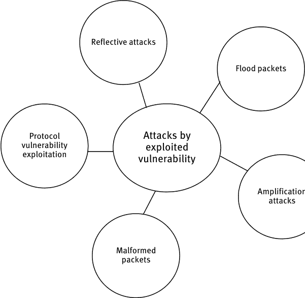

**图 1：** DDoS 攻击分类

### 3.3 当前流行的 DDoS 攻击

- AgoBot: 它是防病毒厂商中最受欢迎的机器人之一，拥有超过 600 个版本。其变种有 Gaobot、Nortonbot、Phatbot 和 Polybot。
- SDBot: 它拥有超过 1800 个变种，并附带 ping 和 UDP 泛洪工具。
- RBot: 它拥有超过 1600 个变种，用 C++ 编写，针对 Windows 系统。
- SpyBot: 它是用 C 编程语言编写的，也影响 Windows 操作系统。

### 3.4 影响 DDoS 攻击严重性的因素

- 攻击类型
- 攻击中被滥用的协议或事件类型
- 攻击主机数量
- 受害者站点资源量
- 云类型，主要是公有云

## 4 DDoS 缓解技术

DDoS 缓解技术帮助我们有效对抗攻击。一些缓解技术如下：

### 4.1 减少攻击面

减少将被攻击的服务会限制攻击者的选择。使用防火墙和网络访问控制列表只允许必要的流量从必要的 hosts 访问必要的端口。以 Web 服务器为例，它们允许来自任何地方的流量访问 Web 服务器的 80 端口。在这种情况下，应进一步采取其他保护措施。即使对于可在整个网络上访问的网站，也可以通过将流量限制在用户所在国家/地区来减少攻击面。

### 4.2 CDN

CDN 通过最小化资源与终端用户之间的距离来分发内容并提高性能。它们在多个位置存储内容的缓存版本，这最终通过避免攻击者试图集中攻击单个目标时的单点故障来缓解 DDoS 攻击。

### 4.3 黑洞路由

顾名思义，黑洞路由在没有任何过滤的情况下，将合法和恶意流量都路由到空路由或黑洞，流量在网络中被丢弃。根据模式，如果能识别出攻击者，则数据包通常会被过滤并可被路由回黑洞。

## 5 DDoS 缓解阶段

### 5.1 检测

最初，需要检测是否存在攻击。在此阶段，需要识别合法流量和恶意软件。在缓解 DDoS 时，不应丢弃潜在的客户流量，否则将是灾难性的。


### 5.2 响应

一旦检测到攻击，就有必要寻求如何应对这些攻击。

### 5.3 路由

通过智能路由，可以将剩余流量分解为可管理的数据块，由其所路由到的集群资源进行处理。

### 5.4 自适应

这是 DDoS 缓解中最重要的阶段之一，需要搜索 DDoS 攻击的模式，并检查这种分析是否能进一步增强缓解技术。

## 6 DDoS 攻击中的隐私

数据集 LLDOS 的分析如下：

|  | 数值 |
|---|---|
| 阶段流编号 | 172.16.112.* 172.16.113.* 172.16.114.* 172.16.115.* |
| 受害者攻击者组合扫描 | 424 328 32 296 0 1081 1081 |
| 入侵 | 128 0 97 0 0 332 335 |
| 攻击 | 2 0 0 285 107465 199 107667 |

KNN 特征便于使用，当我们需要在分隔器中嵌入其他特殊功能以保护测试数据的隐私时，对我们非常有用。另一方面，KNN 作为一种分区算法，在精确度方面表现良好，而且 KNN 对供应商不敏感，当数据库中存在某些噪音时，仍能保持较高的准确度。

n 维欧几里得向量公式为：

$$d = \sqrt{\sum_{i=1}^{n}(X_{i1}-X_{i2})^2}$$  (1)

高精度的 KNN 广泛应用于许多不同领域。

## 7 我们使用 KNN 的贡献总结

- 我们推荐 Predis，一个用于 SDN 隐私保护的 DDoS 隐私保护程序，它同时关注 DDoS 攻击的检测和多参与方合作中的隐私保护。Predis 利用 SDN 特性和改进的 KNN 算法实时准确地检测 DDoS 攻击，并结合数字加密和扰动加密来保障每个参与方的隐私和机密性。
- 我们以现代密码学中计算机安全的渐近形式证明了 Predis 的安全性。通过严格的安全分析，我们确认每个参与方提供的流量数据与其潜在对手是不可分离的。
- 我们使用最权威的数据集进行了广泛的研究，以证明 Predis 的及时性和准确性。我们表明，我们的系统不仅能判断流量是否正常，还能在 DDoS 攻击初期检测到异常流量。结果表明，Predis 比现有的保护参与方隐私的方案更准确。限制在单一域内的检测尝试将无法在攻击初期发现攻击。因此，多个域参与攻击检测将有助于实现更准确和及时的检测。

## 8 DDoS 攻击检测方法总结

由于 DDoS 攻击的普遍性和严重性，关于 DDoS 攻击检测的研究有很多。因此，我们从两个角度简要总结了相关工作，即传统网络中的 DDoS 攻击检测和 SDN 中的 DDoS 攻击检测。DDoS 攻击的检测方法已在传统网络模型中得到广泛研究[11-12]。

### 8.1 传统网络熵

- 支持向量机
- 朴素贝叶斯
- 神经网络
- 聚类分析
- 人工神经网络
- K 最近邻

### 8.2 SDN

- 自组织映射
- 支持向量机
- 目的 IP 地址的熵变化
- 深度学习
- 贝叶斯网络

DDoS 攻击者可以同时控制多台计算机，并在计算环境中构建一个包含控制傀儡/替身和攻击傀儡/替身的攻击架构。传统攻击架构类似于哑铃状结构。其中，中间网络主要负责数据转发，安全事件和控制功能由管理层完成，而网络本身无法检测网络攻击并处理它们。

## 9 跨域检测中的隐私保护

Predis 中的 SDN 域是指受 SDN 架构控制的域，它位于网络域中，部署了 SDN 技术，可以由运营商独立控制。SDN 域采用集中式方式控制数据转发。我们论文中解释的多个 SDN 域进行协作，这些 SDN 域在物理上或地理位置上可能相邻，也可能不相邻。该域的控制平面将流表发送到计算服务器上的选定位置。计算服务器提供 DDoS 检测服务，并将检测结果返回给控制器。

用于流量转发的传统网络域是分布式控制，无法实现集中控制。隐私保护的跨域攻击检测通常被视为安全多方计算（SMC）问题，即在没有可信第三方的情况下，如何安全地计算一个函数[13-14]。

KNN 算法出现在嵌入加密步骤中。在提供训练细节之后，KNN 可以通过在训练阶段之外选择距离度量公式（Predis 中选择的是欧几里得距离）来分离测试样本。

## 10 模型

### 10.1 系统模型/方法与威胁模型

我们首先概述系统模型/方法以及 Predis 中包含的角色。然后我们介绍威胁模型，接着讨论安全性。

它有三种角色：

- 计算服务器（CS）
- 检测服务器（DS）
- 软件定义网络（SDN）域

域 Dn 是参与攻击检测的第 n 个域，并向 CS 和 DS 提供数据。CS 和 DS 反过来为域 Dn 提供计算和加密服务。每个域将流量信息发送到 CS 以进行计算，并从 DS 接收检测结果。CS 提供计算服务并将中间结果发送给 DS。后者基于中间结果提供检测服务，并回复每个域的检测结果。因此，CS 和 DS 相互协作执行计算。Predis 为各个域提供准确的 DDoS 攻击检测服务，而这些域不愿意共享隐私流量信息。

在这里，我们给出隐私的正式定义。由参与检测的域提供的流表知识称为隐私。重要的是，隐私包括 IP 源地址、IP 目的地址、端口源、端口目的、长度和流数据包。基本操作包括前面提到的三种角色，作为具有输入和输出的函数。每个函数旨在对实时数据中划分到特定区间的连续输入运行，Predis 为此配备了一组 n 个输入对等方。DDoS 的示例代码如下所示。

**清单 1：** 执行 DDoS 攻击导致服务不可用

```
import socket
import sys as s1
import os
print("DDoS Attacking: "+s1.argv[1]+" Initiating...")
print("Inject Code "+s1.argv[2])
def attackFunc():
    s = socket.socket(socket.AF_INET, socket.SOCK_STREAM)
    s.connect((s1.argv[1], 80))
    print(">>> GET Message /" + s1.argv[2] + " HTTP/1.1\n")
    s.send("GET Message /" + s1.argv[2] + " HTTP/1.1\n")
    s.send("From Host Initiate: " + s1.argv[1] + "\n");
s.close()
for var in range(1, 10000):
    attackFunc()
```

## 11 不同云计算服务模型中的安全性

提供不同层级服务的三种云服务模型分别是软件即服务、平台即服务和基础设施即服务。

- SaaS——客户对安全的控制力最小，因为后端基础设施和执行平台都位于客户范围之外。
- PaaS——在 PaaS 中，客户对部署的应用程序有一定程度的控制权，并对应用程序环境的配置设置进行远程控制。与 SaaS 相比，该框架对安全有更多控制，但比 IaaS 提供的控制要少。
- IaaS——在 IaaS 中，客户对安全的控制力远大于其他两种模型，因为 IaaS 提供虚拟计算资源，如网络、存储设备和硬件。

## 12 不同云部署模型中的安全性

云计算的四种部署模型分别是公共云、私有云、社区云和混合云，客户根据适用性、需求和用户云的目的从中选择。

- 公共云——在此部署模型中，组织必须牺牲某些方面的安全性，因为云位于服务提供商端。客户不知道其数据的地理位置、CSP 使用的存储类型，因此该模型的安全性稍差。
- 私有云——它由单一组织或位于内部或外部的第三方拥有。该部署模型在一定程度上解决了公共云中面临的一些安全问题，但也有其困难，如资源调配、存储管理和容量监控。
- 社区云——它由具有共同兴趣的组织社区拥有。该模型的缺点是，在跨多个域和组织的数据扩散以及服务中断方面，存在许多未解决的问题。
- 混合云——由于混合云是任意两种部署模型的组合，它兼具扩展性、成本和安全方面的优势。数据隐私和完整性在混合模型中构成威胁。


欺骗性机制和弱密码可能导致用户成为身份盗窃的受害者。

攻击者可以利用上述漏洞和威胁，通过向用户发送大量请求来发起拒绝服务攻击，使用虚拟机管理程序根工具包攻击虚拟化，进行网络钓鱼以及元数据欺骗。

## 14 安全问题

### 14.1 分层安全问题

云可以从物理层、虚拟化层、服务提供商层和用户层等不同层次来观察。每一层都存在一定的安全问题。

表1：云计算架构中的安全问题（按层次划分）

| 层次 | 描述 | 安全问题 |
|---|---|---|
| 物理层 | 提供计算、存储和网络资源。 | 1. 数据库入侵<br>2. 数据存储问题<br>3. 机密性、完整性、可用性。<br>4. 网络漏洞和攻击 |
| 虚拟化层 | 该层存在虚拟机管理程序以及客户操作系统和虚拟机 | 1. 访问控制问题<br>2. 法规遵从性<br>3. 虚拟机管理程序和虚拟机的暴露<br>4. 虚拟机之间的隔离 |
| 服务提供商层 | 提供服务管理，如调度、负载均衡、计费策略管理、资源调配和监控。 | 1. 信任管理<br>2. 临时数据安全问题<br>3. 身份验证和授权问题<br>4. 审计、法规遵从性<br>5. 策略执行 |
| 用户层 | 拥有应用程序、应用程序接口和工具。 | 1. 身份验证、访问控制<br>2. 浏览器和API的暴露<br>3. 应用程序中的漏洞 |

## 15 文献中提出的解决方案

文献中已有的各种先进方法如下所列。

### 15.1 数据机密性方案

表2：数据机密性方案

| 方案名称 | 提出者 | 方案思路 | 所用算法 |
|---|---|---|---|
| 可搜索加密 | I-En Liao 与 Jyun-yao Hung (2012) | 秘密共享与可搜索加密 | 1. 非数值文件搜索<br>2. 数据加密 |
| 洋葱加密 | Curino 等人 (2011) | 提供不同加密层的适应性安全，以维护用户数据的机密性 | 1. 查询执行<br>2. 数据加密 |
| 全同态加密 | Tebba 等人 (2012) | 允许客户端在将数据存储到云服务提供商之前对其加密，从而确保数据机密性 | 1. 加密<br>2. 密钥生成<br>3. 评估 |
| 基于属性的安全细粒度可扩展访问控制加密 | Yu 等人 (2010) | 通过密码技术保护用户数据，并在客户端数据上引入密钥分发和管理的开销。 | 1. 密钥生成<br>2. 设置<br>3. 加密<br>4. 代理重加密<br>5. 解密 |

### 15.2 云虚拟化机密性方案

表3：云虚拟化机密性方案

| 方案名称 | 提出者 | 方案思路 | 所用算法 |
|---|---|---|---|
| PALM | Zhang 等人 (2008) | 一种原型，在迁移过程中和迁移后确保受保护的用户数据和备份数据的安全 | 1. 元数据迁移保护<br>2. 迁移数据保护 |
| 可信云计算平台（TCCP） | Santos、Gumadi 和 Rodrigues (2009) | 虚拟机热迁移，旨在保护虚拟机执行的机密性 | 1. 虚拟机启动<br>2. 节点注册 |
| 自助云计算方案（SSC） | Ganapathy V (2015) | 解决与不中断云服务相关的问题，并允许访问客户端CPU内容、内存和寄存器。 | 1. Create_MTSD<br>2. Create_UDom()<br>3. Create_Userdomain<br>4. Bootstrapping_SSL<br>5. Grant_Privilege |
| TVDC | IBM (2008) | 在此概念中，每个虚拟机都被限制访问任何其他虚拟机，从而防止不必要的数据泄露 | 1. 虚拟机监控器授权<br>2. 资源访问<br>3. 基础设施完整性和网络隔离<br>4. 虚拟机间通信 |

### 15.3 云数据完整性方案

表4：云数据完整性方案

| 方案名称 | 提出者 | 方案思路 | 所用算法 |
|---|---|---|---|
| 公共可验证性和数据动态方案 | Wang 等人 (2009) | 提供云数据存储完整性 | 1. KeyGen<br>2. SigGen<br>3. GenProof<br>4. VerifyProof<br>5. ExecUpdate<br>6. VerifyUpdate |
| MHT | Niaz M.S、Saake Gin (2015) | Merkle方案，用于维护用户数据完整性，而无需在数据所有者端维护表。 | 1. 多连接<br>2. 单连接<br>3. 零连接<br>4. 范围条件 |
| 动态可证明数据拥有 | Erway 等人 (2009) | 在云数据完整性基础上支持数据动态 | 1. 准备更新<br>2. 验证更新<br>3. 执行更新<br>4. 挑战<br>5. 证明<br>6. 验证 |
| 隐私保护公共审计方案 | Wang 等人 (2015) | 确保云存储的数据完整性，并提供最佳数据验证方法以防止完整性破坏 | 1. KeyGen<br>2. SigGen<br>3. GenProof<br>4. VerifyProof |

### 15.4 云虚拟化中的完整性方案

表5：云虚拟化中的完整性方案

| 方案名称 | 使用的虚拟机管理程序 | 所用算法 |
|---|---|---|
| ACPS | KVM | 1. 活动检查<br>2. 活动记录<br>3. 校验和计算<br>4. 警报生成<br>5. 生成安全响应 |
| SSC | XEN | 1. Create_UDom |
| MIRAGE | VMware | 1. 访问控制<br>2. 镜像转换<br>3. 来源追踪<br>4. 镜像维护 |
| PALM | Xen | 1. 数据迁移保护<br>2. 元数据迁移保护 |

## 16 洋葱加密（OE）

这是一种数据机密性方案。它提供了一种具有不同加密层的适应性安全视图（类似于洋葱的层次），以便可以对编码数据执行SQL查询，包括聚合、排序操作、连接，并且查询处理在云服务提供商端完成，同时维护用户数据机密性，因为解密将在客户端进行。

其主要重点是为每一列维持不同的加密级别，并根据请求的查询解码每一列。

该方案使用两种算法：

- 数据加密算法
- 查询执行算法

这些算法使用密钥，如 RND、DET、OPE、HOM。

- 1. 随机加密密钥（RND）：在自适应选择明文攻击下提供相似性。
- 2. 保序加密密钥（OPE）：对于涉及基于比较的选择的查询，该密钥提供安全执行。
- 3. 同态加密密钥（HOM）：对于涉及服务器端聚合计算的查询，使用该密钥执行。
- 4. 确定性加密密钥（DET）：对于涉及对特定值进行相等性选择的查询，使用该密钥执行。

时间复杂度：时间复杂度可以计算如下：
如果 T1 = 重新设计查询所花费的时间
T2 = 编码和解码有效负载所需的时间
时间复杂度为 T1 * T2 的数量级，即 O (T1*T2)
研究发现，洋葱加密方案使吞吐量综合下降了22.5%。

## 17 结论

云计算由于结合了网络链路、Web服务器、虚拟机等技术而存在已知漏洞，但由于云计算具有可扩展性和弹性优势，它对攻击提供了足够的抵抗能力。其中，DoS和DDoS攻击易于升级且更具破坏性。安全应被视为云提供商和用户的共同责任。传统计算已被云计算完全转变为一种成本效益高、优化的计算方式。然而，在云中安全信息共享方面仍然存在一些挑战和问题。需要增强现有的安全措施，同时还需要新的安全机制，以消除云环境中的安全问题。

本文介绍了一些缓解技术、解决方案和方案，通过这些可以保护云的安全性和隐私。部分解决方案无法完美缓解所有可能的攻击，但其他解决方案是有效的。提出了一种基于SDN的跨域攻击检测方案，该方案提供了隐私保护。此外，我们还遇到了跨域隐私保护问题以及基于SDN的DDoS攻击检测，其中我们结合了几何变换和数据加密方法来保护隐私，将检测过程分为两个步骤：扰动和检测，涉及两台服务器协同工作，利用云虚拟化概念完成检测过程。一个


提出了一种改进的KNN算法，旨在实现低时间消耗和高准确率。对不同作者的实验结果进行的大量实验表明，Predis能够在保护隐私的同时熟练检测跨域异常，并具有最佳时间复杂度和高准确率。本文整体上可用于在未来进一步降低Predis在攻击检测中的时间消耗。

## 18 参考文献

- [1] Saurabh S, Young-Sik J, Hyuk J, 云计算安全综述：问题、威胁和解决方案, Journal of Network and Computer Applications, 2016, Volume 75, Pages 200-222, ISSN 1084-8045, https://doi.org/10.1016/j.jnca.2016.09.002
- [2] Shankarwar M, Pawar A, 云计算中的安全与隐私：综述, 第三届智能计算前沿国际会议论文集：理论与应用（FICTA）2014, 智能系统与计算进展, 2014, vol 328, Springer, Cham. https://doi.org/10.1007/978-3-319-12012-6_1
- [3] Andrew C, Mohammad H, Omar A, 云计算中分布式拒绝服务攻击的防御, Procedia Computer Science, 2015, Volume 73, Pages 490-497, ISSN 1877-0509, https://doi.org/10.1016/j.procs.2015.12.037
- [4] Mohammad M, Marzie J, 云计算中拒绝服务攻击的调查与分类, Security and Communication Networks, 2016, 9(16), 3724–3751, DOI: https://doi.org/10.1002/sec.1539
- [5] Potluri S, Mangla M, Satpathy S, Mohanty S N, 云计算环境中DDoS攻击的检测与预防机制, 2020年第11届计算、通信与网络技术国际会议（ICCCNT）, Kharagpur, India, 2020, pp. 1-6, doi: 10.1109/ICCCNT49239.2020.9225396
- [6] Priyanka K, Munesh T, Virendra Y, Vikash S, DDoS攻击检测技术：综述, 2017年第4届IEEE北方邦分会电气、计算机与电子国际会议（UPCON）, Mathura, India, 2017, pp. 675-679, doi: 10.1109/UPCON.2017.8251130
- [7] Zhang P, Huang X, Sun X, Wang H, Ma Y, 跨多域网络的隐私保护异常检测, 2012年第9届模糊系统与知识发现国际会议, Chongqing, China, 2012, pp. 1066-1070, doi: 10.1109/FSKD.2012.6234272
- [8] Jelena M, Peter R, DDoS攻击与DDoS防御机制的分类法, SIGCOMM Comput. Commun. Rev., 2004, 34(2), 39–53, DOI: https://doi.org/10.1145/997150.997156
- [9] Soule A, Ringberg H, Silveira F, Rexford J, Diot C, 两个相邻网络中流量异常的可检测性, Uhlig S, Papagiannaki K, Bonaventure O, 被动和主动网络测量, PAM 2007, 计算机科学讲义, 2007, vol 4427, Springer, Berlin, Heidelberg, https://doi.org/10.1007/978-3-540-71617-4_3
- [10] Yaar A, Perrig A, Song D, Pi：一种防御DDoS攻击的路径识别机制, 2003年安全与隐私研讨会, 2003, Berkeley, CA, USA, pp. 93-107, doi: 10.1109/SECPRI.2003.1199330
- [11] Shui Y, Yonghong T, Song G, Dapeng W, 我们能击败云中的DDoS攻击吗？, IEEE Transactions on Parallel and Distributed Systems, 2014, vol. 25, no. 9, pp. 2245-2254, doi: 10.1109/TPDS.2013.181
- [12] Keromytis A, Misra V, Rubenstein D, SOS：一种缓解DDoS攻击的架构, IEEE Journal on Selected Areas in Communications, 2004, vol. 22, no. 1, pp. 176-188, doi: 10.1109/JSAC.2003.818807
- [13] Mousavi S, St-Hilaire M, 针对SDN控制器的DDoS攻击早期检测, 2015年国际计算、网络与通信会议（ICNC）, Garden Grove, CA, USA, 2015, pp. 77-81, doi: 10.1109/ICNC.2015.7069319
- [14] Saied A, Richard O, Tomasz R, 使用人工神经网络检测已知和未知的DDoS攻击, Neurocomputing, 2016, Volume 172, Pages 385-393, ISSN 0925-2312, https://doi.org/10.1016/j.neucom.2015.04.043

# 面向智慧医疗的安全云基础设施：基于物联网的健康监测

Sirisha Potluri, Sai Lalitha Sunaina, Neha Pavuluri, Chennu Sai Sri Govind, Raghavender Rao Jakileti, V. MNSSVKR Gupta

- Sirisha Potluri, 计算机科学与工程系, ICFAI Tech（科学与技术学院）, ICFAI高等教育基金会, Donthanapally, Shankarpalli Road, Hyderabad, Telangana 501203, India, sirisha.vegunta@gmail.com
- Sai Lalitha Sunaina, 计算机科学与工程系, ICFAI Tech（科学与技术学院）, ICFAI高等教育基金会, Donthanapally, Shankarpalli Road, Hyderabad, Telangana 501203, India, sunaina7571@gmail.com
- Neha Pavuluri, 计算机科学与工程系, ICFAI Tech（科学与技术学院）, ICFAI高等教育基金会, Donthanapally, Shankarpalli Road, Hyderabad, Telangana 501203, India, nehapavuluri99@gmail.com
- Chennu Sai Sri Govind, 计算机科学与工程系, ICFAI Tech（科学与技术学院）, ICFAI高等教育基金会, Donthanapally, Shankarpalli Road, Hyderabad, Telangana 501203, India, govindchennu@gmail.com
- Raghavender Rao Jakileti, 计算机科学与工程系, ICFAI Tech（科学与技术学院）, ICFAI高等教育基金会, Donthanapally, Shankarpalli Road, Hyderabad, Telangana 501203, India, jakiletiraghu@gmail.com
- V. MNSSVKR Gupta, 计算机科学与工程系, SRKR工程学院, Chinnamiram, Bhimavaram, Andhra Pradesh 534204, India, guptavkrao@gmail.com

**摘要：**医疗保健领域的大数据规模预计将不断增长。大数据，当聚焦于医疗保健领域时，可以最好地描述为一种以结构化、非结构化和半结构化方式表示患者个人数据（如医疗状况、处方等）的形式。处理和加工如此庞大的数据块可能是一项艰巨的任务。为了避免此类情况，许多医疗机构已经采用云计算作为解决方案。在诸如COVID-19这样的疫情期间，远程工作已成为新常态。医疗机构正逐渐适应远程治疗（也称为远程医疗）的理念。患者的病情需要与专家、营养师、护士等团队协调。通过使用云计算，可以完全避免面对面互动；这在当前如COVID-19的情况下非常有用。因此，许多医疗部门选择云计算来接收和存储大量患者数据，并管理其电子记录。这些大量的电子记录有助于数据挖掘过程，识别大数据医疗保健领域的模式和发展趋势。需要注意的主要事项：与隐私相关的问题和安全相关的顾虑、动态可接受的存储、监管问题、包含患者数据的电子文档、手写病历以及各种图像（如X射线、MRI扫描、放射图像等）都可以随时随地被检索。这可以同时是优点和缺点。所涉及的主要挑战包括网络故障、安全相关的顾虑，以及患者信息被用户/客户、黑客、网络停机、恶意软件等不当利用而引发的隐私问题。

**关键词：**云计算、虚拟化、数据安全、密码学、拒绝服务、医疗保健、大数据、区块链

## 1 引言

云计算是一种分布式计算模型，有助于提供计算机系统服务，包括计算能力和数据存储。云模型通过分布式系统的概念，将各种虚拟机组合在一起，利用资源的动态配置来满足客户不断变化和动态的资源需求。虚拟化是云计算的核心，并发挥着重要作用。虚拟化技术涉及创建服务器、存储设备、桌面或操作系统的虚拟版本。编程级虚拟化有助于PaaS服务，而IaaS基于硬件虚拟化的思想[1]。

在过去十年中，信息技术在医疗保健领域发挥了重要作用。许多医疗机构已经采用云计算作为解决方案。医院和医疗服务提供者无需再购买硬件和服务器。借助云，只需购买实际使用的资源，即可节省大量成本。患者可以通过云计算掌控自己的健康，这使数据民主化。通过将患者记录和医学图像存储在云上，可以轻松检索数据。借助云计算，医疗服务提供者可以轻松访问患者数据，从而开具处方和治疗方案。无论地理位置如何，云计算还能帮助专家审阅患者病例并提出意见。通过在医疗保健中应用云计算模型，可以改进许多医疗相关功能，例如远程医疗、住院前护理和住院后护理等[2]。

在医疗实践和观察中，在线访问EHR记录（电子健康记录）的首要关注点是安全性和隐私性。为了保护患者信息，医疗数据的敏感记录不应提供给未经授权的人员。然而，云计算中的网络漏洞对患者电子健康记录的安全性和隐私性构成了恶意影响。在线访问患者记录和与诊断相关的交易，对患者以及医疗组织和专业人员都有许多好处，但也引发了与患者私人数据相关的严重安全和隐私问题。由于与EHR记录——电子健康记录相关的风险


## 健康记录

确保患者的隐私至关重要。电子健康记录（EHR，Electronic Health Record）系统上的黑客事件可能导致患者数据被篡改。

大数据的出现给各个研究领域带来了多重障碍。“大数据”一词指的是庞大且巨大的结构化和非结构化数据量。它由患者数据组成，有助于他们选择主要可能性并支持医疗治疗方案。然而，随着医疗数据的急剧增大，它们使得数据的操纵和处理变得困难。相比之下，分布式源上的大数据处理由 MapReduce 完成。医疗领域故障的主要原因之一是患者相关数据和信息的不完整、不完善的访问，以及参与流程的利益相关者之间沟通不畅 [3]。

## 2 医疗保健中的云部署模型

云部署模型在图 1 中表示如下。

### 2.1 公有云

这种类型的云模型可供任何想要使用或购买的人使用。它基于共享成本模型或按需付费政策。

### 2.2 私有云

该模型主要由独立组织使用。私有云最适合需要高安全性和高管理需求的组织。

### 2.3 社区云

社区云是一种共享模型，仅限于一组组织或员工。此类云计算部署模型由内部或第三方供应商管理并托管。

### 2.4 混合云

混合云结合了两种或多种模型，如公有云、私有云或社区云。根据业务需求，混合云架构允许企业在私有和公共环境之间移动数据和应用程序。

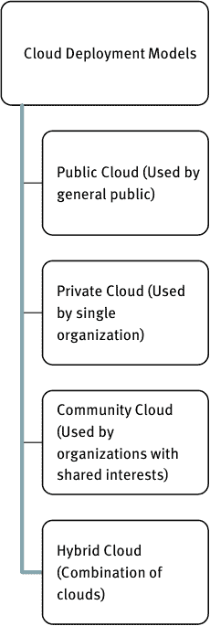

**图 1：** 医疗保健的云部署模型

## 3 医疗保健中的云服务模型

云服务模型在图 2 中表示。

### 3.1 软件即服务（SaaS）

SaaS 描述了一种云服务，消费者能够通过互联网访问在云基础设施上运行的软件应用程序。SaaS 解决方案不需要客户端维护任何内容，包括数据存储和网络，并由供应商管理。

### 3.2 平台即服务（PaaS）

平台即服务（PaaS）是一种集成且抽象的基于云的模型，支持应用程序的开发和管理。数据的全部存储和管理都交由供应商负责。

### 3.3 基础设施即服务（IaaS）

IaaS 是以硬件、网络和存储设施的形式虚拟交付计算资源。根据您在一段时间内使用的存储量和处理能力，您将按此收费。

## 4 评估云系统安全时需考虑的因素

### 4.1 保密性

保密性是指保护数据免受未经授权用户的访问。在云系统中，此类用户可能想要未经授权访问其他个人的数据。患者信息在医疗保健环境中应保密。不当披露该信息可能会威胁患者的声誉、机会和人性尊严。

### 4.2 完整性

完整性保证资产的安全属性未被未经授权的第三方人员修改。它在数据的整个“生命周期”内保持数据的准确性、可靠性和一致性。完整性确保资产相对于其所有者的准确性和正确性。在医疗保健中，患者的个人详细信息、健康摘要、临床记录、检验结果等的准确性可以通过完整性来维护。

### 4.3 可用性

需要维护的最重要的安全方面之一是可用性。服务等级协议是客户与服务提供商之间关于在可用性和需求响应方面提供服务的约定。早些时候，SLA 是在服务消费者和客户之间协商的。但今天存在不同级别的 SLA，如基于客户的 SLA、基于服务的 SLA 和多级 SLA。

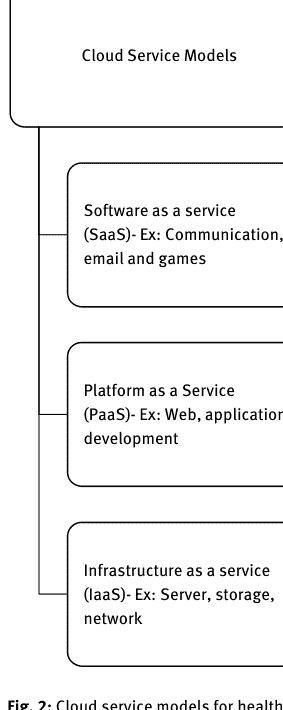

**图 2：** 医疗保健的云服务模型

评估云系统安全时需考虑的三个重要因素在图 3 中表示。

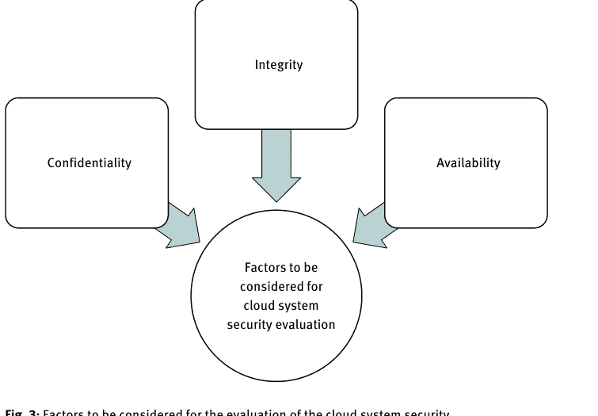

**图 3：** 评估云系统安全时需考虑的因素

## 5 文献综述

表 1 中讨论了医疗保健中各种安全和隐私保护方法及方法，如下所示。

**表 1：** 云计算环境中的安全和隐私保护方法

| 序号 | 作者 | 标题 | 拟议模型 |
|--------|--------|-------|----------------|
| 1 | Jan de Muijnck-Hughes (2011) | 基于谓词的加密同时关注平台即服务和软件即服务的实现 | 基于谓词的加密（PBE） |
| 2 | Venkata Sravan et al. (2011) | 云中保护数据的技术 | 理解云计算中使用的安全风险和所需的安全策略以减轻它们 |
| 3 | Ali Asghari Karahroudy (2011) | 云计算的安全分析和框架 | 部分分布式文件系统与奇偶校验（PDFSP） |
| 4 | Nabil Giweli (2013) | 增强云计算中的数据隐私和访问匿名性 | 以数据为中心的安全方法 |
| 5 | Miao Zhou (2013) | 增强隐私云关键词搜索和私有数据的远程公共完整性审计 | 创新的基于树的密钥管理方案 |
| 6 | Sudhanshu Ranjan Lenka et al. (2014) | 使用 RSA 加密和 MD5 算法增强云计算中的数据安全 | RSA 算法用于加密通信和文件加密解密，而 MD5 算法的数字签名被使用。 |
| 7 | Aastha Mishra (2014) | 用户数据的保密性和隐私 | 高级秘密共享密钥管理方案 |
| 8 | Nesrine Kaaniche (2014) | 基于密码机制的云数据存储安全 | 基于身份的密码学（IBC）和 CloudSec |
| 9 | Afnan Ullah Khan (2014) | 云计算中的数据保密性和风险管理 | 访问控制和数据保密性（ACDC） |
| 10 | Sarojini et al. (2016) | 云中利用增强的相互信任和信誉访问控制算法的受信任和信誉服务 | 增强的相互信任访问控制算法（EMTACA） |

## 6 智能医疗保健模型的建议

医疗保健与患者沟通的一种方式，即通过互联网通过移动设备和笔记本电脑。考虑到经济状况、位置和可负担性等因素，移动设备需求旺盛。由于我们的主要重点是借助云计算服务和设施为患者提供安全可靠的医疗保健服务，我们借助 PaaS、SaaS 和 BDaaS，分别指平台即服务、软件即服务和大数据即服务。

分析型移动应用程序帮助我们在事前分析和过滤收集的数据，因此与普通移动应用程序相比，这是一个额外的优势。这些是使用云计算技术构建和托管的。移动应用程序通过在移动浏览器上运行的 Web 服务器访问，而不考虑移动特定操作系统、容量和内存。

云计算技术包括各种类型设施的交付，如图 4 所示。

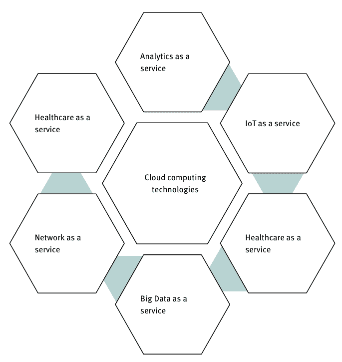

**图 4：** 云计算技术

## 7 云架构类型

### 7.1 集中式

客户端绑定到最近的数据中心，以避免通信高延迟，因为云资源在地理上分布在广阔的距离上。

### 7.2 联邦式

许多小型云共同形成一个大型云。当客户端在地理上分发数据时需要高度数据保密时，它非常有用。


### 7.3 P2P 云

它是联邦云架构的扩展。唯一的区别在于，P2P 中没有集中化和监控组件。它由独立资源和对等节点组成，对等节点的成本分摊非常低，从而实现了极简管理。

同样在 2010 年，Koufi 等人提出了一个以简称 EMS [10] 表示的模型，旨在实现云紧急医疗系统的普适访问。他们以一种经济高效的方式为我们展示了一种新的紧急医疗系统模型。他们系统的关键组成部分如下：

-   满足持续需求的灵活性
-   适应动态变化的可扩展性
-   理解和支持系统行为的互操作性
-   执行和实现平台无关的应用程序与策略：这确保了可通过任何设备从分布式环境中的任何位置轻松访问和获取所需数据。

上面列出了我们需要考虑的重要因素，我们希望将这些因素全部纳入考量，因此提出了一种采用 P2P 云架构并融合 BDaaS、SaaS 和 PaaS 的模型。这符合他们系统中所有关键组件的要求。由于 P2P 没有集中化，仅由独立资源和对等节点组成，因此具有可扩展性。我们提供的服务具有灵活性和互操作性，而执行则是所提出模型最有效的特性。该模型强调移动应用与云计算的结合。

考虑到各种作者提出的所有因素和不同方法，并牢记所有挑战——网络中观察到的故障、安全挑战，以及被用户、黑客、恶意软件等滥用的患者信息隐私问题。根据对上述文章的分析和研究，许多研究者专注于缩短患者响应时间、提高安全保护并加快患者的医疗救治。我们借助 PaaS（平台即服务）、SaaS（软件即服务）和 BDaaS（大数据即服务），并结合 P2P，这就是我们的方法。

## 8 P2P 架构

P2P 云计算以更有趣的方式结合了现有用途和技术。用户信息、信用卡信息等存在许多安全问题。数据安全和连接安全是两种可对此提供帮助的方法。P2P 云架构中的每个存储设备都应使用更高级别的数据加密。

这种数据存储技术可以确保内容级保护，使没有访问权限的人无法接触存储的数据。在经典方法中，用户通过 Web 服务等协议直接连接到服务器。P2P 则确保连接是安全的。

我们认为，将 P2P 架构与云计算相结合是分析和管理大数据的最佳解决方案。一方面，P2P 网络有助于去中心化，使对等节点能够控制自己的数据并通过云共享资源。它还为大数据分析提供了所需的存储资源、计算能力和网络。P2P 的总体架构如下图所示（图 5）。

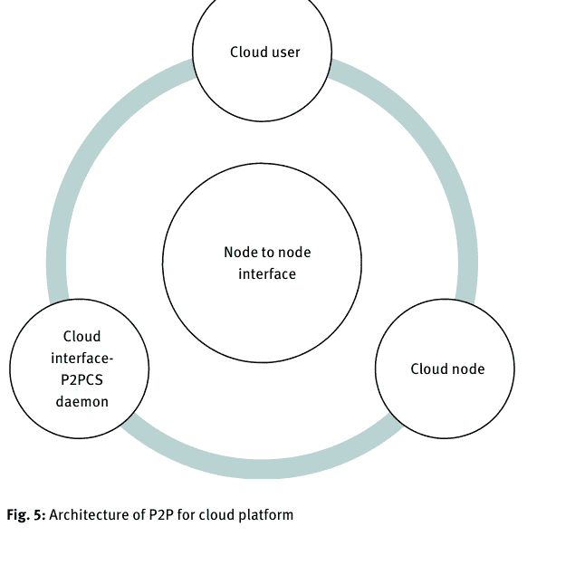

图 5：面向云平台的 P2P 架构

## 9 安全与隐私

数据隐私确保数据被恰当地使用，并且只有经过授权访问的人才能获得数据。隐私可以被解释为个人决定信息在多大程度上被传播以及如何传播给他人的权利。

数据隐私的两个主要类别是：

-   数据与第三方共享或发布。这包括数据收集、隐私保护、数据集成、数据共享和发布。
-   隐私保护数据挖掘。

关于隐私安全这一主题已有大量研究，近年来出现了许多重要的综述文章，对数据隐私分类、隐私保护机制、所提出的架构和数据隐私保护方法及其优缺点进行了评述。建议的数据隐私安全技术可分为初始方法、数学分析、基于信息的软计算和机器学习方法。

除了数据丢失、恶意篡改、服务器崩溃之外，隐私问题是主要威胁之一。这些是网络威胁的一些例子，例如 2013 年雅虎 30 亿个账户被黑客泄露。

我们提出了一种基于 CNN 的数据隐私保护方法，以确保云计算环境中更好的质量标准。功能提取和推理阶段在此被分开，前者在本地进行，而后者在云端进行。这样，在边缘节点上的功能提取阶段，机密信息会从数据中提取出来，并减少向云端传输的数据量。通过应用深度神经网络，解决了数据分类处理中的隐私保护问题。本文使用 CNN（卷积神经网络）算法作为深度神经网络。在学习和分类过程中，使用低阶非线性多项式以获得高精度激活函数。保留了一个经典的深度神经网络（使用 ReLU 激活函数）来为训练过程提供数据隐私安全，之后，网络仅在用于分类时才会改变。将上述多项式近似与批量归一化相结合是本工作的主要理论创新。

为了有效解决数据隐私保护问题，云数据加密存储是一种非常出色的解决方案。加密后，数据以密文形式存储在云服务提供商提供的服务器中，同时，当用户需要数据时，服务器也被要求将数据返回给用户。当用户需要频繁使用数据时，这需要大量

## 11 用于保护医疗数据安全的云服务

保护数据安全在当前至关重要，尤其是当不同领域的各类组织都在使用云存储时——从依赖 Google Drive 等服务的教育机构和大型跨国公司，到使用 Dropbox、Box、Amazon Drive、Microsoft OneDrive 等的个人用户。这些用户信任这些服务，并希望通过防止数据以任何方式损坏或丢失来维护其数据隐私。如果这种信任持续下去，数百万其他用户可能也会希望将数据存储在云上。由于云中存储的数据以加密形式保存，因此在第三方可能破坏信息之前，需要先对其进行解密。此外，用户还可以通过多种方法在系统提供的安全措施之外，加入自己的安全措施。综上所述，在实践与拟议安排之间仍然存在漏洞、不可调和的矛盾，以及在要求和想法上的差异。

表 2 [14-21] 展示了用于医疗保健的云安全与隐私保护算法的比较。

表 2：用于医疗保健的云安全与隐私保护算法的比较

| 序号 | 模型/算法 | 参数 |
|------|-----------------|------------|
| 1 | 双线性配对密码学 | 成本、时间 |
| 2 | 基于身份的加密 | 成员资格、身份 |
| 3 | 同态加密 | 患者数据，如临床记录、扫描和 X 光图像 |
| 4 | 基于属性的加密（ABE） | 安全参数、用户数据 |
| 5 | 多目标隐私感知工作流调度算法（MOPA） | 存储成本、时间、数据 |

## 12 实时医疗健康仪表盘——基于血压读数的案例研究

实时医疗健康仪表盘对于跟踪患者健康状况至关重要，例如血压读数、心跳监测、血糖观察、癌细胞生长感知等。基于此，我们可以进行时间序列分析，从而做出更好的预测。以下代码展示了用于监测患者的实时医疗健康仪表盘。


### 清单1：用于跟踪患者健康状况（血压读数）的实时医疗保健仪表板

```python
# Real time healthcare dashboard for tracking a patient health condition
# based on blood pressure readings
def _health_monitoring():
    arr_results = []
    client_record = WithingsApi(creds)
    health_readings = {
        # analyse readings based on past history
        'past_reading': {
            'x': '',
            'diastolic_p': '',
            'systolic_p': '',
            'pulse_p': '',
            's_m_average_p': {
                'diastolic_p': '',
                'pulse_p': '',
                'systolic_p': '',
            }
        }
    }
    # Get patient readings
    p_measures = client_record.get_measures()
    # Get patient last reading date
    l_r_date = p_measures[-1].date
    p_counter = 1
    # Get patient raw readings from the record
    raw_readings_p = {
        'systolic_p': [],
        'diastolic_p': [],
        'pulse_p': [],
    }
    # Extract patient measure
    for p_measure in p_measures:
        if p_measure.systolic_p_blood_pressure\
            and p_measure.diastolic_p_blood_pressure:
            next_pdate = l_r_date + timedelta(days=p_counter)
            # sort the values of date times
            health_readings['past_reading']['x'] += '"' + p_measure.date.strftime('%Y/%m/%d %H.%M.%S') + '",'
            health_readings['future_reading']['x'] += '"' + next_pdate.strftime('%Y/%m/%d %H.%M.%S') + '",'
            health_readings['past_reading']['systolic_p'] += str(p_measure.systolic_p_blood_pressure) + ','
            health_readings['past_reading']['diastolic_p'] += str(p_measure.diastolic_p_blood_pressure) + ','

            raw_readings_p['systolic_p'].append(p_measure.systolic_p_blood_pressure)
            raw_readings_p['diastolic_p'].append(p_measure.diastolic_p_blood_pressure)
            if p_measure.heart_pulse and p_measure.heart_pulse > 33:
                raw_readings_p['pulse_p'].append(p_measure.heart_pulse)
                health_readings['past_reading']['pulse_p'] += str(p_measure.heart_pulse) + ','
                p_counter += 1
    return health_readings
```

## 13 结论

根据文献中的调查研究，远程医疗服务的性能和实施是通过托管和呈现Amazon EC2的选项和选择来实现的。通过每秒处理的请求数来检验和研究其效率和效能。根据他们提供的描述，在Web层使用中型实例进行动态资源调配远优于使用大型和超大型实例进行静态分配。虽然获得了可行的解决方案，但尚未实时实施。

基于云的家庭护理云模型最适合呼吸系统疾病患者。他们拥有一个智能平台，可以快速地将患者的呼吸数据分发给护理人员、家属和医疗机构并加以存储。通过利用移动技术和模型，可以监测和检查氧饱和度和容量，并将信息分发给患者和医学专家。

在P2P中，没有集中化和监控组件。它由独立的资源和对等节点组成，对等节点之间的成本分摊非常低，从而实现了最低限度的管理。PaaS提供商将承担大部分基础设施和其他IT相关服务的费用，用户可以在分布式环境中通过Web浏览器随时随地访问这些服务。而且价格实惠。PaaS产品通常用于移动应用、跨平台应用和DevOps工具。SaaS和BDaaS将有助于医疗保健领域云计算的全面发展。

## 14 参考文献

- [1] Rajkumar B, Chee Y, Srikumar V, James B, Ivona B, Cloud computing and emerging IT platforms: vision, hype, and reality for delivering computing as the 5th utility, Future Generation Computer Systems, 2009, Volume 25, Issue 6, Pages 599-616, ISSN 0167-739X, https://doi.org/10.1016/j.future.2008.12.001
- [2] Peter M, Timothy G, The NIST definition of cloud computing, National Institute of Standards and Technology: Special Publication (NIST SP), 800-145, 2011
- [3] Al-Issa Y, Ashraf O, Tamrawi A, eHealth cloud security challenges: a survey, Journal of Healthcare Engineering, 2019, vol. 2019, Article ID 7516035, 15 pages, https://doi.org/10.1155/2019/7516035
- [4] Harika K, Manisha G, Potluri S, An IoT based solution for health monitoring using a body-worn sensor enabled device, Journal of Advanced Research in Dynamical and Control Systems (JARDCS), 2018, Volume 10, Issue 9, PP: 646-651, ISSN 1943-023X
- [5] Potluri S, Avinash M, Health record data analysis using wireless wearable technology device, Journal of Advanced Research in Dynamical and Control Systems (JARDCS), 2018, Volume 10, Issue 9, PP: 696-701, ISSN 1943-023X
- [6] Avinash M, Potluri S, A study on technologies in cloud-based design and manufacturing, International Journal of Mechanical and Production Engineering Research and Development (IJMPERD), 2018, Volume 8, Issue 6, PP: 187-192, ISSN(P): 2249-6890, ISSN(E): 2249-8001
- [7] Potluri S, Achyuth S, Elham T, Mohanty S N, IoT enabled cloud-based healthcare system using fog computing: a case study, Journal of Critical Reviews, 2020, ISSN- 2394-5125, Vol 7, Issue 6, PP: 1068-1072, doi: 10.31838/jcr.07.06.186
- [8] Goyal S, Public vs private vs hybrid vs community - cloud computing: a critical review, International Journal of Computer Network and Information Security, 2014, 6, 20-29
- [9] Jansen W, Grance T, Guidelines on security and privacy in public cloud computing, NIST Special Publication, 2011, 800-144, pp. 5.
- [10] Koufi V, Malamateniou F, Vassilakopoulos G, Ubiquitous access to cloud emergency medical services, Proceedings of the 10th IEEE International Conference on Information Technology and Applications in Biomedicine, Corfu, Greece, 2010, pp. 1-4, doi: 10.1109/ITAB.2010.5687702
- [11] Haider W, Iqbal W, Bokhari S, Bukhari F, On providing response time guarantees to a cloud-hosted telemedicine web service, Zhang Y, Peng L, Youn CH, Cloud Computing, CloudComp 2015, Lecture Notes of the Institute for Computer Sciences, Social Informatics and Telecommunications Engineering, 2015, vol 167, Springer, Cham, https://doi.org/10.1007/978-3-319-38904-2_24
- [12] Risso A, Neyem A, Benedetto J, Carrillo M, Farías A, Gajardo M, Loyola O, A cloud-based mobile system to improve respiratory therapy services at home, J Biomed Inform, 2016, 63, 45-53, doi: 10.1016/j.jbi.2016.07.006
- [13] Navimipour J, Navin H, Rahmani M, Hosseinzadeh M, Behavioral modeling and automated verification of a cloud-based framework to share the knowledge and skills of human resources, Computers in Industry, 2015, 68, 65–77
- [14] Neghabi A, Navimipour J, Hosseinzadeh M, Rezaee A, Load balancing mechanisms in the software defined networks: a systematic and comprehensive review of the literature, IEEE Access, 2018, 6, 14159–14178
- [15] Akinsanya, Opeoluwa O, Papadaki M, Sun L, Current cybersecurity maturity models: how effective in healthcare cloud?, CERC (2019)
- [16] Duncan B, Pym D, Whittington M, Developing a conceptual framework for cloud security assurance, IEEE 5th International Conference on Cloud Computing Technology and Science, Bristol, UK, 2013, pp. 120–125, doi: 10.1109/CloudCom.2013.144
- [17] Kumari S, Kamal A R, Optimal integrity policy for encrypted data in secure storage using cloud computing, Indian J Sci Technol, 2016, vol.9, no.8, pp.1–10
- [18] Monikandan S, Arockiam L, A security service algorithm to ensure the confidentiality of data in cloud storage, Int J Eng Res Technol, 2014, 3(12), 1053–1058
- [19] Shabbir A, Shabbir M, Rizwan M, Ahmad F, Ensuring the confidentiality of nuclear information at cloud using modular encryption standard, Security and Communication Networks, 2019, vol. 2019, Article ID 2509898, 16 pages, https://doi.org/10.1155/2019/2509898
- [20] Singh N, Singh A, Data privacy protection mechanisms in cloud, Data Sci. Eng, 2018, 3, 24–39, https://doi.org/10.1007/s41019-017-0046-0
- [21] Delettre C, Boudaoud K, Rivail M, Cloud computing, security and data concealment, Proceedings, 16th IEEE Symposium on Computers and Communications, Kerkyra, Greece, 2011, 424–431, 10.1109/ISCC.2011.5983874 2-s2.0-80052768216


# 云际互联：基于物联网使能服务的安全与隐私保护云模型

Indrani Inapakolla, SVB Revanth, Siliveru Akhil Durga, Sirisha Potluri, Sachi Nandan Mohanty

**Abstract:** 安全性和可靠性是物联网（IoT）面临的关键难题之一。未修补和不合适的设备、缺乏稳健有效的<|message|>安全机制、客户忽视以及使用知名强大设备等问题都是物联网面临的挑战。在本研究中，我们探讨了物联网框架的基础和安全工作，并审视了其他安全和防护问题、用于验证基于物联网的组件和结构的方法、已实施的安全措施，以及适用于物联网运行应用各层的最佳保护模型至关重要且合适。在本研究中，我们提出了一种增强的物联网模型：标准版和扩展版，包含安全和防护组件以及物理设备的层级。所提出的云/边缘物联网框架已开发并测试。底层由通过亚马逊网络服务（AWS）创建的物联网设备组成，例如虚拟机。中心层（边缘）已借助 AWS 中的 Greengrass 边缘环境开发为 Raspberry Pi 4 的资源单元。我们使用 AWS 中的云使能物联网核心创建了顶层（云）。为确保客户数据的安全，所有这些区域均包含安全机制和基本管理机制。我们已验证安全机制以允许数据在所提出的云使能模型各层之间流动。所提出的框架模型不仅消除了 perceived 的安全漏洞，而且还可以与最佳安全措施一起使用，以对抗所有后继层面临的网络安全风险：云、边缘和物联网。

**Keywords:** 物联网, 云计算, 云隐私, 云安全, 边缘计算

**Indrani Inapakolla**, 计算机科学与工程系, Icfaitech（科学与技术学院）, ICFAI高等教育基金会, Donthanapally, Shankarapalli Road, Hyderabad, Telangana 501203, India, indrani1999@gmail.com

**SVB Revanth**, 计算机科学与工程系, Icfaitech（科学与技术学院）, ICFAI高等教育基金会, Donthanapally, Shankarapalli Road, Hyderabad, Telangana 501203, India, svbrevanth162000@gmail.com

**Siliveru Akhil Durga**, 计算机科学与工程系, Icfaitech（科学与技术学院）, ICFAI高等教育基金会, Donthanapally, Shankarapalli Road, Hyderabad, Telangana 501203, India, s.akhildurga@gmail.com

**Sirisha Potluri**, 计算机科学与工程系, Icfaitech（科学与技术学院）, ICFAI高等教育基金会, Donthanapally, Shankarapalli Road, Hyderabad, Telangana 501203, India, sirisha.vegunta@gmail.com

**Sachi Nandan Mohanty**, 计算机工程系, 浦那工程学院, Wellesley Rd, Shivajinagar, Pune, Maharashtra 411005, India, sachinandan09@gmail.com

## 1 引言

物联网（IoT）指的是各种设备相关物品在互联网或无线互联网上的概念。物联网或物联网的普及迅速增长，因为这些新设备被用于多种用途，包括文献、旅行、教育和业务改进。物联网引入了连接性的概念，这意味着组织和个人可以轻松地远距离通信。Kevin Ashton 于 1999 年创造了“物联网”一词，以推广射频识别（RFID）的概念，后者结合了传感器和执行器。尽管如此，第一个想法是在 1960 年代提出的。当时，该想法不可避免地要注册或安装互联网。Ashton 提出了物联网的想法，以推广与链条的良好实践。尽管如此，物联网的多功能性有助于在 2010 年期间提升强大的可用性。中国政府通过推出五年计划对物联网提出了更大的需求。大约有 266.6 亿台物联网设备存在于地球上。2011 年随着家用电器、可穿戴设备和智能电能表的引入，大爆炸开始。物联网的快速爆炸帮助了组织，并在多种方式上改进了统计和商业研究方法。此外，物联网通过引入计算机管理改善了人们的生活方式。然而，不受控制的爆炸加剧了安全和防护挑战 [1]。

未被识别的使用、弱密码管理以及设备更新的缺失增加了在线安全风险，并使恶意应用程序被接受到敏感的物联网框架中。这种不当做法增加了信息泄露和事故的可能性。绝大多数安全专家由于弱安全机制和配置，将物联网视为数字攻击的脆弱区域。尽管有一些安全项目旨在保护物联网设备免受数字攻击，但安全规则并未得到妥善记录。沿着这些思路，终端客户无法使用防御战术来阻止信息攻击。攻击者自 2008 年前就创建了各种恶意软件来破坏物联网设备。他们组织各种形式的犯罪以窃取敏感信息，以便迫使公众代表分享敏感信息。同样，工作场所和某些公司不断面临因突出攻击而导致的安全漏洞。如果设备制造商和安全专家准确评估数字风险，他们可以创建保护组件以防止或减轻数字事故 [2]。

物联网使能设备用于自动化应用和各种商业用途。这些应用帮助这些组织实现其目标。然而，由于不必要地选择了共享信息和连接的各种智能设备，安全和信息访问成为许多组织的主要关注点，因为它干扰了工作流程、运营和组织管理。专业人员必须克服这些危险问题，并做出全面的安全努力和策略来保护其业务资源，并确保管理的持续完整性和安全性。例如，与本地组织关联的强大的物联网厨房电器可能是攻击者进入业务、窃取相关信息或控制和破坏业务流程的入口。

新的发展正在出现，或对现有发展进行更改。例如，考虑 5G 网络的最新发展。预计 5G 将在物联网框架和应用中发挥主要作用。它足够重要以被认可，并伴随着高频率和数据传输带来的安全和防护风险。然而，较短的波长需要在基站进行调整，因此需要额外的通道来覆盖同一区域，这由新的和不同的远程技术来满足 [3]。

在本研究中，我们计划为物联网应用、益处和预期风险提供一个框架。此外，构建一个需要考虑的结构，并通过执行或研究现有程序或开发新程序来进一步增强最佳实践。基于研究结果，我们提出了避免此类危险和解决潜在安全问题的建议。本研究将指导管理组织继续实施策略，指导利益相关者、客户和物联网相关合作伙伴创建和实施适当的安全和保护措施。

我们使用亚马逊网络服务（AWS）作为概念验证开发了我们的模型，后来参考了模拟整体物联网结构的真实传感器框架。通过创建原型，我们可以通过创建真实部署和基准来测试和考虑不同的安全措施。

我们采用了案例研究研究哲学来探索一系列实验以及物联网框架的基础、其安全和隐私问题以及对策。我们表达了我们对包容性和扩展的物联网模型及其隐私和安全性的看法。我们设计并测试了具有物理设备（传感器）、边缘中心（Raspberry Pi）和云管理（AWS）的云/边缘物联网模型。该原型旨在测试我们在本文随附各节中提出的模型。我们的研究并未深入探讨不同的物联网应用（医疗保健、智慧城市、供应链、交通运输等）；其特征、偏好、挑战或可在这些应用中考虑的安全风险。文献中此类研究丰富。在本研究中，我们希望对文献进行全面回顾，并为进一步的测试和评估奠定基础。

本文其余部分组织如下：下一节介绍背景，其后是物联网安全和保护挑战。第 4 节详细审视物联网的边缘。第 5 节介绍所提出的基于云/边缘物联网模型：标准版和扩展版，包含保护和安全组件以及物理设备的层级。该节同样说明了所提出的 AWS 云模型的使用以及 Raspberry Pi 4 边缘和网关上的配置。第 6 节结束本文。


## 2 文献综述

作者指出存在各种问题，例如钓鱼和勒索软件攻击以及其他未经授权的访问，这降低了客户信息的可信度。存在潜在的程序可以帮助个人采取各种安全措施，从而帮助保护其物联网设备。如前所述，目前出现了各种安全风险，并且它们可以通过其集成组织访问物联网技术。组织应为所有物联网设备提供测试和过滤工具，这些工具能够安全地检测任何已识别的风险类型并尝试消除入侵风险。威胁和流量分析师有助于识别和评估各种数字风险 [4]。

许多管理员已将小部件的难度或加载部分引入到各种物联网设备及其端口。能够确保该安全机制的各种组件的不同保护工具、模型和可访问性也有助于为网络创建明确定义的物联网安全机制。只要行为者支持此实验，大多数人都会同意物联网安全测试的快速发展以及各种仿真工具。如果物联网设备很可能受到攻击，那么问题会变得更糟。

作者承认，虽然物联网为客户带来了巨大好处，但也存在应认真对待的伴随风险。网络安全和隐私问题是讨论中最重要的问题。这两者代表了某些商业组织作为开放组织所面临的巨大困难。对网络保护的通常攻击显示了新物联网设备的弱点。这仅仅是因为组织在物联网上的交互带来了对匿名且不可靠的互联网的暴露，这需要为网络提供安全安排。此外，强调物联网网络安全框架中关于创建物联网安全框架的重要规范和标准也很重要。如所述，考虑的关键步骤之一是配置具有不同通信协议的各种设备。协议差异阻止了单独的服务合同运行，并且是每个物联网网络安全结构中必须找到的基本要素。作者指出，为了确保网络安全领域中物联网系统的可靠性，应取得很大进展以帮助降低物联网网络的安全复杂性。同样，作者表明做更多事情是物联网网络安全计划成功的重要组成部分。研究人员表示，物联网生态系统应与各种因素合作，以应对数十亿的互联网相关挑战和网络安全。因此，作者建议物联网网络的安全保护也应保持测试，例如安装测试、部分测试、框架测试和一致性测试，适当地最大限度地减少复杂性和风险。同样，作者介绍了当前物联网网络安全系统的部分内容 [5]。

作者已做出了一些重要的安全努力，并表明它们没有为提供商做出更好的安排做好准备。由于物联网的在线安全风险，组织可能不会做出必要的安排。此外，作者正在整体介绍实时灵活和数字框架，从工业控制框架和现代车辆到关键基础设施。最近的功能和特性，例如工业 4.0 和物联网（IoT），通过强大的网络和有效使用新时代的安装设备，确保新客户的创新和创新计划。

这些框架产生、处理和交换各种功能信息。安全和隐私漏洞使数字攻击成为物联网中的有吸引力的目标，造成真正的破坏并扰乱人们的生活。网络安全和隐私很重要，因为它们可能构成风险。这些框架的多样性和数字攻击的潜在后果在当今互联的物联网框架中带来了新的危险。安全和隐私挑战的潜在答案是现代物联网框架的标准安全框架。当前的物联网框架尚未得到充分开发，以确保适当的安全能力。

因此，对物联网上各种安全问题的调查和评估有了显著增加。物联网安全的主要目标之一是保护、维护并确保每个客户能够建立信心、基础和对物联网生态系统提供的不同服务访问的保证。同样，替代的物联网安全测试在各种计算工具（如多核计算机）的帮助下增强了基本能力 [6]。

## 3 物联网安全和隐私问题

物联网为客户带来了巨大好处；然而，也涉及一些困难。网络安全和隐私问题是相关分析师和安全专业人员的重要关注点。这两者代表了某些商业组织（如开放组织）的巨大困难。显著的网络攻击凸显了物联网设备的弱点。这种弱点在于，组织与物联网的连接带来了对匿名且不可靠的互联网的访问，这需要为网络提供安全安排。

在绝大多数已知问题中，没有一个影响物联网变体，例如安全和保护。然而，不幸的是，客户在发生入侵后才获得必要的安全影响保证，造成严重损害，例如重要信息的丢失。随着破坏消费者保护的先进威胁的出现，消费者对无效安全性的信心正在减弱。在一次旨在安全和安全的持续研究中，物联网客户服务进展不佳。当前汽车行业存在很多弱点 [7-8]。

### 3.1 安全

物联网由标准 PC 和嵌入式设备组成，使其无法应对各种类型的安全挑战：

- 许多物联网设备设计用于大规模部署。
- 通常，物联网配置包含许多相似或几乎无法区分的具有可比功能的设备。这种相似性增强了任何安全漏洞的影响，可能完全影响其中大量设备。
- 这一进步意味着物联网设备之间潜在连接数量惊人。可以更确定的是，其中大多数设备可以建立连接并以意想不到的方式与其他设备通信。这需要在物联网安全可用的设备、方法和技术旁边考虑。

事实上，虽然数据安全和隐私问题并非新现象，但物联网的使用带来了需要考虑的不同安全措施。消费者需要依赖互联网技术和服务免受错误影响，尤其是随着这些创新继续获得动力并融入我们的日常生活。在部分安全的物联网设备和管理下，这是在数据流未受保护的情况下用于数字攻击的主要途径之一，例如客户信息的窃取。

物联网设备连接的概念意味着，如果设备验证不充分并连接到互联网，它有可能影响全球的安全和稳定。这种行为由大量物联网设备表现出来。除了某些设备能够直接与其他设备交互的能力外，这意味着物联网的客户和开发人员都有责任确保他们不会使其他客户或互联网本身暴露于潜在损害。构建强大而高效的危机安全响应的标准方法在物联网中现在可见 [9-10]。

例如，在身份验证方面，物联网面临一个明显的弱点，这仍然是许多系统安全机制中的主要问题。所使用的身份验证有限，因为它仅针对一种风险提供保护，例如拒绝服务（DoS）或重放攻击。数据安全是物联网身份验证中最关键的领域之一，由于多样化物联网环境信息导致的不安全使用增加。如果可能，例如，我们拍摄了 Visa 联系人的照片。


这些卡配备后，卡号和姓名无需身份验证即可使用；这使得攻击者能够利用持卡人的金融账号和个人身份购买商品。

另一种值得注意的针对物联网的攻击是中间人攻击，攻击者秘密拦截并转发网络交易中双方之间的消息。中间人使得银行员工认为该交易是合法的，因为攻击者无需知道受害者的身份。

### 3.2 安全性

易于使用的物联网这一概念取决于它能在多大程度上满足人们对安全性的偏好。对于加入物联网生态系统的安全性和潜在危害的担忧，对于维持物联网的广泛接受度可能至关重要。必须认识到，消费者保护和隐私权对于确保客户对物联网、连接设备及相关数据管理的信任至关重要。大量工作正在试图确保诸如未经授权的监控和跟踪等物联网安全问题得到解决。对安全担忧背后的解释，直接源于对复杂环境的理解，在这种环境中，物联网数据的收集和传播几乎可以在任何地方进行。互联网的普遍接入同样是理解这个问题的一个基本因素；除非有有效的安全系统，否则从地球任何地方访问个人数据都将相对容易[11]。

### 3.3 协作

众所周知，物联网专业化的碎片化环境会抑制客户的积极性。除了在房地产和管理中完全集成很少可行之外，当缺乏灵活性且担心被供应商锁定时，客户也不愿购买和管理设备。物联网安全性不足可能意味着我们使用的管理系统将受到负面影响。

密码学是以多种方式提供安全性最广泛使用的基石之一。仅使用单一安全系统无法实现抵御潜在攻击的强大自防御体系。这反过来又需要不同级别的保护来应对物联网身份验证的风险。

通过改进已识别的安全点并添加这些优秀功能，可以防止黑客入侵。这种避免是由于客户会购买当前具有足够安全性并解决潜在漏洞的产品。在线安全计划是确保物联网安全的现有措施之一。

其他特性和漏洞可能会影响物联网设备的安全工作，这些包括：

- **定期更新：** 大多数情况下，物联网制造商每季度提供安全更新。操作系统更新和安全补丁也会重新设计。这样一来，攻击者就有充分的机会攻破安全机制并访问相关数据。
- **嵌入式密码：** 物联网设备存储嵌入式密码，使支持专业人员能够远程排除操作系统故障或提供重要更新。或者，攻击者可以利用此功能访问设备。
- **自动化：** 常规用户、性能用户和最终用户使用计算机设备来构建物联网系统或改进业务流程。然而，如果未实施适当的安全措施，已安装的应用程序可能会访问这些资源，从而使威胁进入框架。
- **远程访问：** 物联网设备使用多种通信协议进行远程访问，如Wi-Fi、ZigBee和Z-Wave。通常，访问限制未得到解决，这可能被网络罪犯利用。因此，攻击者可以迅速通过这些远程访问协议建立恶意连接。
- **外部应用程序集成：** 许多应用程序可在线获得，组织可利用它们执行特定任务。无论如何，这些应用程序的功能很难被验证。如果最终用户和员工安装或访问此类程序，攻击者就可能进入框架并破坏数据库。
- **设备身份验证错误：** 大多数物联网应用程序不使用身份验证机制来阻止或限制网络风险。这样，攻击者就能进入并破坏安全性。
- **设备识别薄弱：** 总的来说，所有物联网制造商都设置了可识别的设备标识符来监视和跟踪设备。无论如何，一些制造商没有维护适当的安全策略。归根结底，遵循可疑的互联网请求会变得非常危险[12-16]。

## 4 物联网的未来

目前，物体和系统已具备网络接入能力，并能够与兼容的小工具和设备通信。提高生活各领域系统的连接性将使我们的生活更高效，并帮助我们节省时间和金钱。此外，为了连接互联网，越来越多的传感器或模块被安装，以确保整体支撑网络的强度。为了确保快速处理和管理数据，以提供无法等待数据发送到云端的必要服务，我们提出了边缘计算能力，它可以在本地运行，同时存储相关信息并将其发送到云层进行处理和长期存储。在某些情况下，我们需要向某些可穿戴设备发送命令或更新，以修改其配置或可用性设置，这将需要额外的身份验证和安全措施。

图2显示了所提出模型的扩展架构。我们看到新层不断扩展：边缘层和雾层。这两层可以克服因依赖云层而导致的延迟问题，并可通过快速决策来解决。边缘计算发生在传感器物理连接或嵌入的设备上。它们提供对数据源的持续收集和控制，同时与各层通信，通过集成、远程访问和分析来传递信息。雾计算层能够在与节点相关的所有最著名的智能设备上实现边缘分析，并且实际上远离服务器和数据源。这些额外的好处带来了重大的安全和安保挑战[18]。

## 6 安全与隐私策略

基于云的管理通常被视为基本的物联网框架，提供信息存储、数据准备和信息共享。攻击者和恶意用户将目光投向物联网处理设备以及存储或传输敏感信息的中枢。例如，敏感数据和电子临床记录使医疗服务框架成为重要目标。物联网模型的每一层都带来安全挑战，同时也提供了维护安全实践和机制的机会。例如，在设备层，传感器信息被发送到边缘层，然后到雾层，再到云层；需要信任特定实体的身份验证和授权机制来减轻这些攻击。固件和硬件安全机制是必需的；然而，它们以功耗为代价，尤其是在远程设备中，如电池供电的可穿戴设备。这些安全努力必须旨在同时实现安全性和能效[19]。

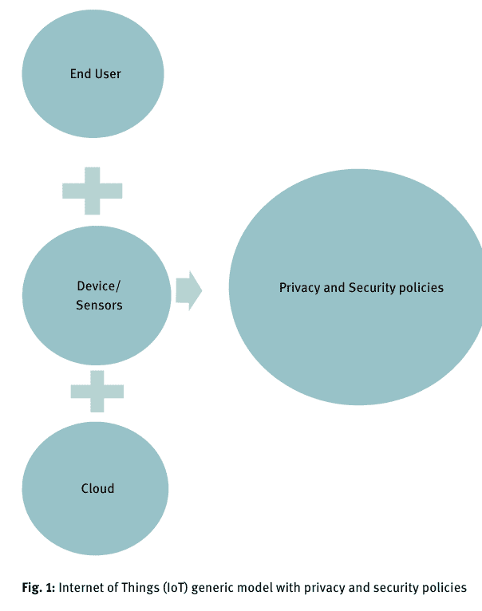

*图1：物联网（IoT）通用模型，包含隐私与安全策略*

在云层，安全努力需要确保边缘区域和雾区域之间以及最终来自传感器的安全通信。加密通信消息、突出加密点以及启用身份验证为验证和登录提供最小限度的信息。在数据管理和最终用户层面，我们需要确保数据保留和存储数据的检索受到保护，免受SQL攻击、恶意软件和敏感身份文件被盗的影响，提供可靠支持并遵循HIPAA程序（在医疗保健框架中）[30]。信息的整合可能使攻击者能够隔离客户端，从而导致安全性受损。由于物联网设备可以加入和离开传感器和数据源网络，这可能给通用安全策略增加很多复杂性，因此需要新的、智能的、多样化的安全机制[20]。


**图 2：** 云-边缘-IoT 模型

## 7 推荐云-边-IoT 模型的实施

我们的方法是在将支持物联网的小型设备发送到 IoT 之前确保安全措施到位，这在规划和确保它们能够安全传输和共享信息、保护数据加密方面已被证明是有效的。下面的图 3 展示了机器、系统和书籍模型的出现。该模型包含作为专家云的 AWS 云、作为边缘节点的树莓派 4、以及作为物联网设备的虚拟机。我们创建的框架是一个付费 AWS 账户，用于完全接受 AWS 提供的资产，包括证书密钥和加密、批准和验证。

通过 AWS 获得的资产，我们实施了 AWS 身份与访问管理（IAM）网络管理。它允许我们通过为所有客户端设置一个 IAM（客户代表）账户来控制客户端登录。出于安全原因，我们没有使用 AWS 根账户，而是启动了带有授权许可的 IAM 客户端。将树莓派设计为边缘枢纽（AWS Greengrass Core），AWS Greengrass Core 直接与云端协同工作，并在本地运行。

树莓派在设计上为 Linux 的持久性增添了出色的附加功能。创建了 AWS 与树莓派之间的合作关系。我们使用 AWS Greengrass Core 与中心设备以及其他剩余的 IoT 设备建立了一个环，使它们能够在边缘进行通信。

我们需要公告来验证所有设备与 AWS 的连接。我们发布了建议、私钥和公钥，用于与 AWS 建立安全可靠的关系。一旦我们完成了 Greengrass 环，AWS 就会生成机构认证，如下面的图 4 所示。我们下载了在树莓派上生成的文件，并启动了 Greengrass Core。

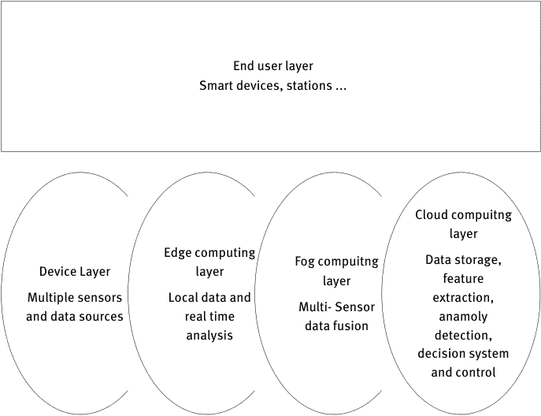

图 3：提出的模型

## 8 讨论与分析

IoT 设备被分类为虚拟机，制作到 AWS 中，并添加到 Greengrass 设施中，如下面的图 4 所示。在创建时，发布了一条特殊公告，为所有设备提供了公钥和私钥，以通过 AWS 和 Greengrass Core 设备验证它们。两个设备之间的连接是通过一个使用 MQTT 会话的安全系统建立的，该系统被称为消息供应商。最后，图 5 显示了 IoT 和 Edge hub 设施均被成功部署，并且在特定时间完成了信息交易。

以下是关于我们的 AWS 工作空间和使用模型需要记住的一些关键点：

- 在每个模型中，IoT 设备要么是可移植的，要么随附 AWS IoT Core。
- 在我们的模型中，我们通过 AWS 上的 Green Grass IoT 中心视图添加了一个边缘视图，并通过树莓派与之通信，从而使其成为 IoT 和 AWS IoT Core 设备之间的额外中间层，然后连接到云。
- 每个设备都需要自己的认证、私钥和 CA 根公告（这是 AWS IoT 协议）。根据 IoT 设备类型，存在不同类型的 CA 根协议。
- 每个设备都需要一个策略；此设置指示该设备可以执行哪些功能（接口/查找/分发/购买等）。

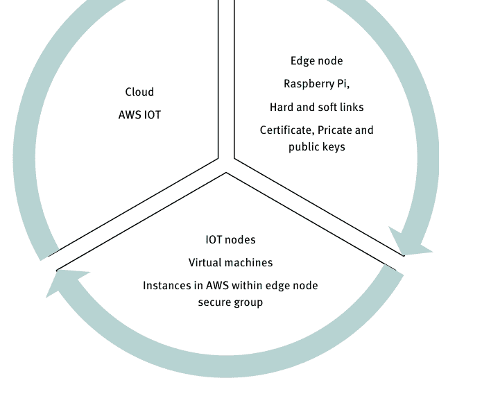

图 4：启用 IoT 的节点

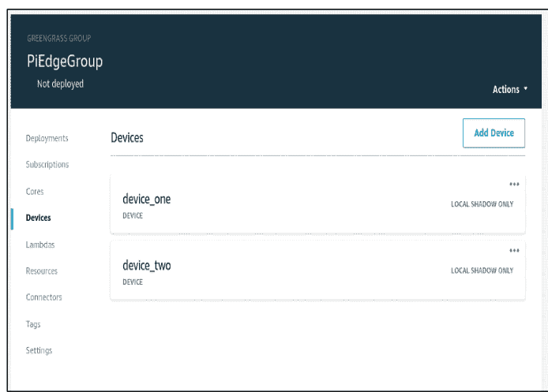

图 5：节点之间的成功通信和数据交换

x 轴：月份中的天数，y 轴：连接数。沿着这些思路，我们制作了一个设备、策略和证书。那时，我们将策略连接到证书上，然后将认证附加到设备上。默认策略在下面的代码清单中展示：

### 清单 1：Amazon Web Service（AWS）中的默认设备策略

```
{
  "Version": "2012-10-17",
  "Statement": [
    {
      "Effect": "Allow",
      "Action": "iot:*",
      "Resource": "*"
    }
  ]
}
```

### 8.1 提出模型的关键点

- 默认策略允许设备执行来自任何剩余设备（App：*）的所有功能（Action：iot:*）。
- 在我们的模型中，我们开发了一种修改后的策略，以处理额外的边缘层。
- 此外，活动：greengrass：* 意味着绿色草地环中的设备可以对该环内不同设备的所有功能进行执行（App：*）。

我们模型的修改版本出现在下面的代码清单中。在我们的案例中，书籍是使用 MQTT 程序集完成的，这是一种机器程序集系统。使用 MQTT 的原因是其轻量级（消息体积小，功耗低），因此适用于恶劣天气（传感器作为实际应用的隐喻）。

#### 清单 2：修改后的设备策略以在提议模型中包含边缘层

```
{
    "Version": "2012-10-17",
    "Statement": [
        {
            "Effect": "Allow",
            "Action": [
                "iot: Publish",
                "iot: Subscribe",
                "iot: Connect",
                "iot: Receive"
            ],
            "Resource": [
                "*"
            ]
        },
        {
            "Effect": "Allow",
            "Action": [
                "greengrass:*"
            ],
            "Resource": [
                "*"
            ]
        }
    ]
}
```

此外，请注意，AWS 中的 IoT 设备被复制为 MQTT 客户端（如果它们是可见的——在我们的案例中这是重要的），MQTT 客户端传输 MQTT 主题。该关联可以被视为客户之间的安全通道；它被创建时，客户可以从它那里购买，而不同的客户则向其传播消息。

现在，树莓派的设置过程涉及安装 JAVA JDK8、greengrass 文件，以及相应的 Core 软件（取决于所使用的设备——对我们来说，是树莓派 4）。

所有这些文件都已传输到树莓派 4，如下面的图 6 所示。

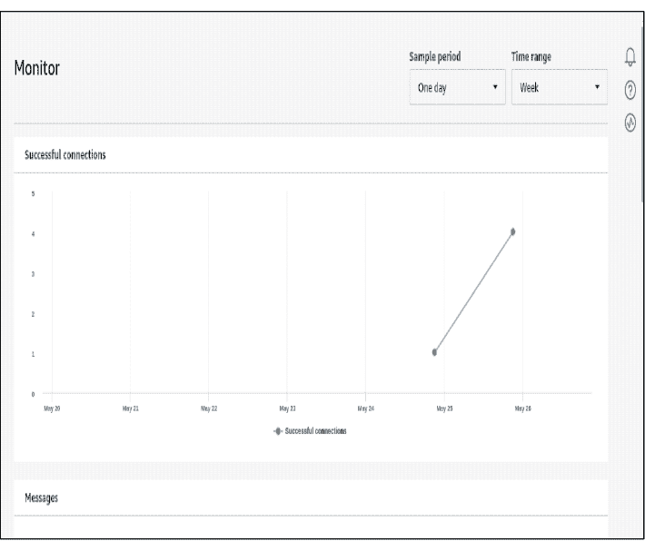

图 6：树莓派 4 套件设置

在将基本文档交换到树莓派 4 之后，我们需要提取它们并对某些安排记录进行特定改进，以协调创建的证书和密钥。最后，我们启动了 Green Grass 中心设备。

下面的图 7 显示我们的 Raspberry 设备有效地作为边缘设备工作。

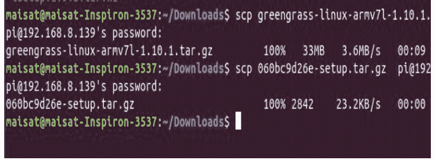

图 7：在树莓派 4 套件上成功运行 Greengrass

在设置天气并确保其正确之后，我们为我们的情况创建了 MQTT 主题，并将其命名为（my/point）。那时，我们让设备购买 my/subject，并创建另一个设备作为 my/theme 上的演示者。所有技术都可以对任何剩余设备执行所有功能（默认策略），并且所有消息都被成功出售。图 8 显示了一天中交易的不同类型的消息。会议时间受许多因素影响，包括组织的惰性和预管理阶段。

所提出的 IoT 模型表明，我们可以在允许支持 IoT 的设备或枢纽传输或共享信息之前确保安全措施到位。如果设计和构建得当，我们能确保资源安全。本文展示的模型可用于提供具有迷雾/边缘处理层和传感器组合的安全 IoT 形态和结构。一些实时应用可以使用该模型，例如医疗保健、军事、灾难恢复等。让我们以医疗服务为例；例如，通过一个基于战略的模型，客户将能够信任其医疗服务提供者，让他们受到保护，看到他们正在被照顾。医疗保健组织将资源整合到服装中，并保证这些资源将有助于提高员工福利、减少失业并降低医疗服务成本。可穿戴设备的另一个主要因素是它可以为残疾人提供服务的信念。例如，有特殊需求的人可以通过移动手指等方式选择下订单和发送文本。最后但同样重要的策略是可以在其记录上工作的安全客户数量。例如，个人可以分类谁能看到他们的社交媒体帖子，或者制定策略来指定他们的记录增加多少额外安全性（例如，双因素认证）。

虽然物联网应用（在这种情况下是医疗服务）的开发人员尽力为客户提供最佳服务，但仍有几个原则会失败。其中一个低效之处将是客户信息如何被移除以及外部人员如何处理它。通常取决于供应商自己，确保他们制定规则并提出安排，使其能够对供应商和客户负责任地行事。客户隔离也是如此。很多时候，外部人员（例如保险机构）可以在客户“同意”的情况下获取客户数据，然后从那时起，确定其是否可靠可能就很危险。在下图中，X 轴表示一天中的小时，Y 轴表示一天的消息读数。

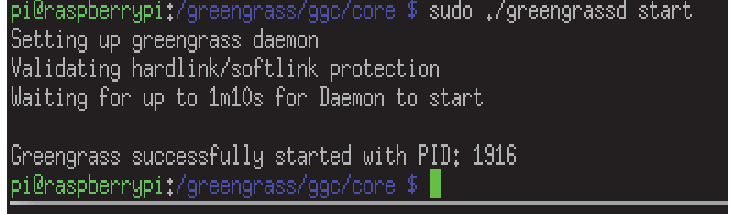

图 8：一天中交易的消息类型


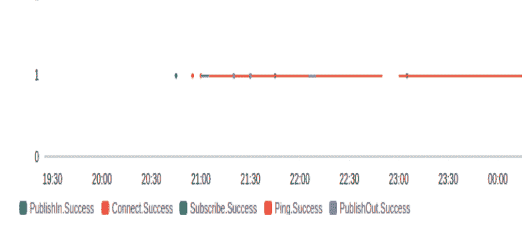

图 8：成功交换的不同类型消息：PublishOut.Success、Publish-In.Success、Connect.Success、Ping.Success、Subscribe.Success

## 9 结论

物联网设备和应用在我们的现代生活中扮演着重要角色。从家庭、办公室、购物中心、学校、机场以及许多其他地方，我们几乎随处可见物联网设备，它们为我们提供安全且备受欢迎的服务。

物联网设备支持与合作伙伴的协作，并有助于理解业务需求和成果。此外，基于物联网的测试和信息处理可以提高现代框架的盈利能力和生产力。

此外，物联网框架正在各个领域实现多种创新的新开发应用。零售商和许多组织正在寻找大部分解决方案来保护其设备免受恶意攻击。由于大量物联网设备与我们的私人组织和互联网相关联，额外的担忧和保护措施也被考虑在内。我们读到和听到，我们的咖啡机正在监视我们的对话；我们优秀的部门向客人发送政府机构的照片。一些真实模型强调了与使用物联网设备相关的安全漏洞的严重性。

在这项工作中，我们引入了新的物联网模型：具有保险和安全组件及亮点的标准且可访问的模型。所提出的云/边缘结构得到维护和测试。底层由亚马逊网络服务（AWS）开发的物联网设备视为真实机器。中层（边缘）已实现为装有AWS中Greengrass边缘环境源的Raspberry Pi 4套件。高层（即云）使用AWS中的物联网云计算实现。在每一层之间都保留了安全机制和基本管理机制，以确保客户数据的保护。

在未来的工作中，应进一步研究最适合操作受限物联网（轻量级加密）设备的密码安全策略。这将有助于确保具有各种连接方式的客户可以使用和设置物联网框架，而不会因为大量物联网设备而缺乏消费者集成。此外，确实需要为与互联网相关的物联网设备提供各种信息和共享方法。这些指南将减少不同类别中意外漏洞和相关攻击的数量。

我们研究了与物联网相关的收益和风险。尽管有各种好处，风险也可能被滥用，通过允许未经授权获取敏感信息、实现框架攻击和危害个人健康来伤害最终客户。随着物联网设备进入市场，我们需要为其提供适当的安全措施，以促进其使用、功能并融入现有结构。我们依靠分析师的帮助创建了一种独特的安全结构，以减少（而非真正消除）安全和保护机会，并且足够灵活以适应新文献发展中的变化和各种应用的组织条件。

## 10 参考文献

- [1] Sharma N, Shamkuwar M, Singh I, The history, present and future with IoT, Balas V, Solanki V, Kumar R, Khari M, Internet of Things and Big Data Analytics for Smart Generation, Intelligent Systems Reference Library, 2019, vol 154, Springer, Cham, https://doi.org/10.1007/978-3-030-04203-5_3
- [2] Khanna A, Kaur S, Internet of things (IoT), applications and challenges: a comprehensive review, Wireless Pers Commun, 114, 2020, 1687–1762, https://doi.org/10.1007/s11277-020-07446-4
- [3] Chang D, Chen Y, Chen L, Chao C, Internet of things and cloud computing for future internet, Chang S, Kim T, Peng L, Security-Enriched Urban Computing and Smart Grid, Communications in Computer and Information Science, 2011, vol 223, Springer, Berlin, Heidelberg, https://doi.org/10.1007/978-3-642-23948-9_1
- [4] Heena W, Rajni A, Fog computing with the integration of internet of things: architecture, applications and future directions, 2018, 987-994, 10.1109/BDCloud.2018.00144
- [5] Adel A, Utilizing technologies of fog computing in educational IoT systems: privacy, security, and agility perspective, J Big Data, 2020, 7, 99, https://doi.org/10.1186/s40537-020-00372-z
- [6] Anand P, Hameed P, Won-Hwa H, Hyun S, Seungmin R, Fog computing-based IoT for health monitoring system, Journal of Sensors, 2018, vol. 2018, Article ID 1386470, 7 pages, https://doi.org/10.1155/2018/1386470
- [7] Michele D, Koen T, Nicola D, Foundations and evolution of modern computing paradigms: cloud, IoT, edge, and fog, IEEE Access, 2019, vol. 7, pp. 150936-150948, doi: 10.1109/ACCESS.2019.2947652
- [8] Aazam M, Huh E, Fog computing and smart gateway based communication for cloud of things, 2014 International Conference on Future Internet of Things and Cloud, Barcelona, 2014, pp. 464-470, doi: 10.1109/FiCloud.2014.83
- [9] Lee K, Kim D, Ha D, Rajput U, Oh H, On security and privacy issues of fog computing supported internet of things environment, 2015 6th International Conference on the Network of the Future (NOF), Montreal, QC, 2015, pp. 1-3, doi: 10.1109/NOF.2015.7333287
- [10] Chen Y, Chang Y, Chen C, Lin Y, Chen Y, Chang Y, Cloud-fog computing for information-centric internet-of-things applications, 2017 International Conference on Applied System Innovation (ICASI), Sapporo, 2017, pp. 637-640, doi: 10.1109/ICASI.2017.7988506
- [11] Elazhary H, Internet of things (IoT), mobile cloud, cloudlet, mobile IoT, IoT cloud, fog, mobile edge, and edge emerging computing paradigms: disambiguation and research directions, Journal of Network and Computer Applications, 2019, Volume 128, Pages 105-140, ISSN 1084-8045
- [12] Potluri S, Achyuth S, Elham Y, Mohanty S N, IOT enabled cloud based healthcare system using fog computing: a case study, Journal of Critical Reviews, ISSN- 2394-5125, 2020, Vol 7, Issue 6, PP: 1068-1072, doi: 10.31838/jcr.07.06.186
- [13] Xuan-Qui P, Eui-Nam H, Towards task scheduling in a cloud-fog computing system, 2016 18th Asia-Pacific Network Operations and Management Symposium (APNOMS), Kanazawa, 2016, pp. 1-4, doi: 10.1109/APNOMS.2016.7737240
- [14] Potluri S, Subbarao K, Improved quality of service-based cloud service ranking and recommendation model, TELKOMNIKA Telecommunication, Computing, Electronics and Control, 2020, Vol. 18, No. 3, pp. 1252~1258, ISSN: 1693-6930, accredited First Grade by Kemenristekdikti, Decree No: 21/E/KPT/2018 DOI: 10.12928/TELKOMNIKA.v18i3.11915
- [15] Potluri S, Subbarao K, A hybrid PSO based task selection and recommended system for cloud data, Test Engineering and Management, 2020, Vol-83, ISSN: 0193-4120, PP: 10210 – 10217
- [16] Potluri S, Subbarao K, Hybrid self-adaptive PSO and QoS based machine learning model for cloud service data, International Journal of Control and Automation, 2020, Vol. 13, No. 2s, pp. 36 - 50, ISSN: 2005-4297
- [17] Binh M, Huynh T, Thanh B, Bao D, Evolutionary algorithms to optimize task scheduling problem for the IoT based bag-of-tasks application in cloud–fog computing environment, Appl. Sci, 2019, 9, 1730, https://doi.org/10.3390/app9091730
- [18] Gouri P, Iglesias-Urkia M, Barcelo M, Gomez R, Moran A, Bilbao J, Fog computing based efficient IoT scheme for the industry 4.0, 2017 IEEE International Workshop on Electronics, Control, Measurement, Signals and their Application to Mechatronics (ECMSM), Donostia-San Sebastian, 2017, pp. 1-6, doi: 10.1109/ECMSM.2017.7945879
- [19] Yi S, Qin Z, Li Q, Security and privacy issues of fog computing: a survey, Xu K, Zhu H, Wireless Algorithms, Systems, and Applications, WASA 2015, Lecture Notes in Computer Science, 2015, vol 9204. Springer, Cham, https://doi.org/10.1007/978-3-319-21837-3_67
- [20] Alrawais A, Alothaily A, Hu C, Cheng X, Fog computing for the internet of things: security and privacy issues, IEEE Internet Computing, 2017, vol. 21, no. 2, pp. 34-42, doi: 10.1109/MIC.2017.37


Srikanth Pothuri

# 营销分析即服务：安全云端自动化策略

**摘要：** 面向企业对企业营销（内容、入站营销、社交媒体、SEO、SEM、基于账户、获得性媒体、推荐计划、行业活动、对话式以及作为解决方案的领先一步）和企业对客户营销（社交网络、付费媒体、互联网、电子邮件、直接营销、购买点、公益事业、对话式、获得性媒体和讲故事）的有效营销策略，通过使用基于云的营销自动化解决方案得到了极大提升。云治理通过专业实践确保满足业务愿望和需求。确保云营销安全的关键因素嵌入在营销生命周期的每个阶段。本文详细介绍了各种基于云的安全营销解决方案，并比较和说明了其性能。为了满足下一代营销需求，基于云的解决方案是实施高效营销策略的首选。

**关键词：** 客户关系管理，云营销，营销分析即服务，云安全，云隐私

## 1 引言

Cloud-based efficient solutions in marketing, sales, promotion and CRM save money by converting capital expenses or capital expenditure (CapEx) into operating expenses or operating expenditure (OpEx)。营销、销售、推广和 CRM 中的基于云的高效解决方案通过将资本支出或资本支出（CapEx）转换为运营支出或运营支出（OpEx）来节省资金。
Flexibility, availability and ease of use features of cloud-based marketing automation suite provide public cloud services based on pay-as-you-use model to avoid investing in servers, storage devices and other computing infrastructure。基于云的营销自动化套件的灵活性、可用性和易用性功能提供基于按需付费模式的公共云服务，以避免投资服务器、存储设备和其他计算基础设施。
For storing sensitive data, maintaining greater flexibility, security, privacy and control, the private cloud offers necessary business solutions。为了存储敏感数据、保持更大的灵活性、安全、隐私和控制，私有云提供了必要的业务解决方案。
Hybrid cloud is aimed at combining public and private clouds to meet the business objectives。混合云旨在结合公共云和私有云以满足业务目标。
To bring business groups or organizations together which are having common business interest, concern or goal in order to share CapEx and OpEx and observe reduced costs, community cloud is an abundant choice [1-3]。为了将具有共同商业利益、关注点或目标的业务团体或组织聚集在一起，以便共享 CapEx 和 OpEx 并实现成本降低，社区云是不错的选择 [1-3]。
Various categories of clouds which are available to meet business objectives of diverse forms of organizations are given in fig. 1。可用于满足不同类型组织业务目标的各种云类别如图 1 所示。

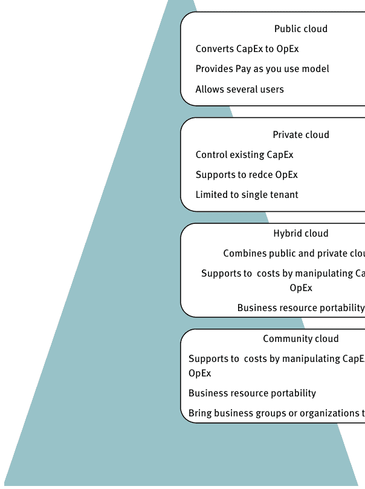

| 云类型 | 特性 |
|---|---|
| 公有云 | 将 CapEx 转换为 OpEx；提供按需付费模式；允许多个用户 |
| 私有云 | 控制现有 CapEx；支持降低 OpEx；仅限单一租户 |
| 混合云 | 结合公有云和私有云；通过操纵 CapEx 和 OpEx 支持降低成本；业务资源可移植性 |
| 社区云 | 通过操纵 CapEx 和 OpEx 支持降低成本；业务资源可移植性；将业务团体或组织聚集在一起 |

图 1：企业和管理的云部署模型

## 2 通过营销自动化实现云治理：满足业务需求

Cloud platform provides expert governance solutions to meet business needs, objectives and desires as shown in fig. 2。云平台提供专家治理解决方案以满足业务需求、目标和愿望，如图 2 所示。
Marketing strategy includes the plan as given below。营销策略包括以下计划。

- 识别：问问自己 - 你是谁以及你的目的是什么
- SWOT：审视自己 - 你的优势、劣势、机会、局限性是什么
- 目标：识别自己 - 你的目标市场、其行为和需求是什么
- 检查：审视自己 - 你的目标与你的贡献在哪里相交
- USP：创造自己 - 你的独特卖点是什么
- 完善：审视自己 - 你的反馈和纠正措施是什么

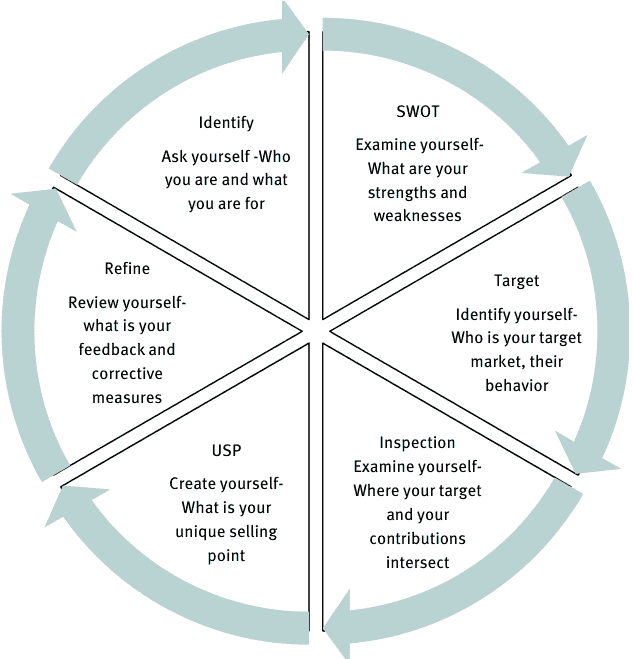

**图 2：** 高效营销策略的云治理解决方案

Cloud governance lets your organization bring everything together to satisfy various business needs: business monitoring, recommendations, operations management, cost transparency, cost optimization, scheduled policies, lead dashboard, lead analytics, report generation, auditing, budget management, and security and compliance governance。云治理让您的组织将一切整合在一起以满足各种业务需求：业务监控、建议、运营管理、成本透明度、成本优化、计划策略、线索仪表板、线索分析、报告生成、审计、预算管理和安全与合规治理。
The major disciplines of cloud governance are shown in fig. 3。云治理的主要学科如图 3 所示。

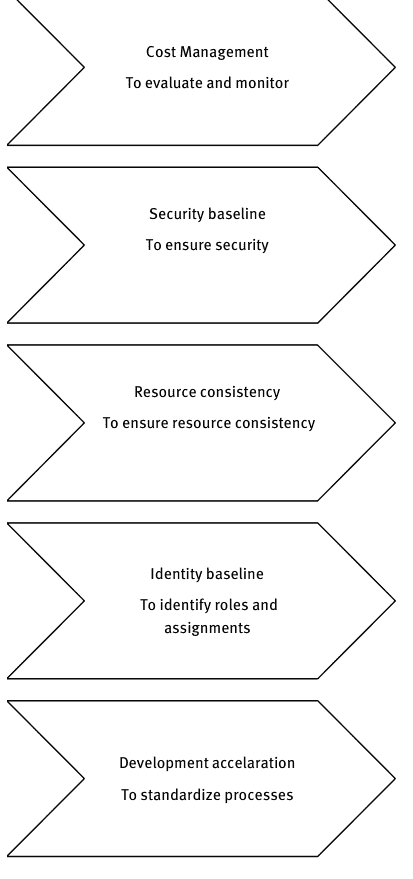

图 3：云治理的主要学科

## 3 确保基于云的营销自动化过程安全的关键因素

The three main areas of security concerns in the cloud-based applications are access, data, and platform [4-6]. Let us examine these in detail。云端应用中的三大安全问题领域是访问、数据和平台 [4-6]。让我们详细审视这些。

### 3.1 访问安全

Cloud offers an integrated data storage, computing and networking mechanism. “Who can access the data” is firmly administered by having access rights。云提供集成的存储、计算和网络机制。“谁可以访问数据”通过访问权限得到严格管理。
SaaS providers add additional layer of security and privacy to stop unauthorized access to information in cloud。SaaS 提供商增加额外的安全和隐私层以阻止未经授权访问云中的信息。

### 3.2 数据安全

Recent applications need infrastructure for data security to meet ongoing business demands and needs。近期应用需要数据安全基础设施以满足持续的业务需求。
The increasing need of data storage, data processing and data analytics on the cloud has also improved the need and responsibility of data security on cloud service providers。对云上数据存储、数据处理和数据分析日益增长的需求也提高了对云服务提供商数据安全的需求和责任。

### 3.3 平台安全

A cloud platform is a physical system that offers, houses and distributes information。云平台是一个提供、容纳和分发信息的物理系统。
A cloud platform delivers an on-demand platform and environment for designing, developing, challenging, delivering, and handling software applications。云平台提供按需平台和环境，用于设计、开发、挑战、交付和处理软件应用程序。

Significant factors ensuring security in cloud based marketing automation process at a glance are given in fig. 4。确保基于云的营销自动化过程安全的关键因素一目了然，如图 4 所示。

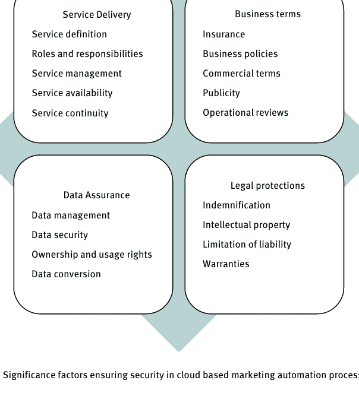

图 4：确保基于云的营销自动化过程安全的关键因素

## 4 通过基于云的安全营销解决方案实现营销生命周期的自动化

The practical framework, RACE (Reach, Act, Convert, and Engage) can be automated through cloud based secure marketing solutions [7-10]。实用的框架 RACE（覆盖、行动、转化和参与）可以通过基于云的安全营销解决方案实现自动化 [7-10]。

The RACE Framework consists of these four steps and online marketing activities are designed to help marketing people to engage their customers throughout the customer lifecycle。RACE 框架由这四个步骤组成，在线营销活动旨在帮助营销人员在整个客户生命周期中与客户互动。
The framework is demonstrated in fig. 5。该框架如图 5 所示。

### 4.1 覆盖

Reach includes building product awareness, media usage and visibility through messaging, live chat, website visits, social media posts, advertising and mouth publicity。覆盖包括通过信息传递、实时聊天、网站访问、社交媒体帖子、广告和口碑宣传建立产品认知、媒体使用和可见性。
It ensures maximizing the reach over time of the customer by creating several interactions using different ways of paid, unpaid, owned, public and earned media networks and touchpoints。它通过使用付费、非付费、自有、公共和获得性媒体网络和触点的不同方式创造多次互动，确保随着时间的推移最大化客户的覆盖范围。
This is to bring awareness of a particular brand or product。这是为了提高特定品牌或产品的知名度。

### 4.2 行动

It is a short form of interact. With interest and intent, sales team get leads through conversations, chat, booked calls, webinars, email marketing, list building and many other means of interaction。它是 interact 的简写。在兴趣和意图的驱动下，销售团队通过对话、聊天、预约电话、网络研讨会、电子邮件营销、名单建立以及许多其他互动方式获取线索。
For many categories of businesses, particularly, B-to-B, this step can bring a decent quantity of leads。对于许多类型的企业，特别是 B-to-B，本步骤可以带来相当数量的线索。

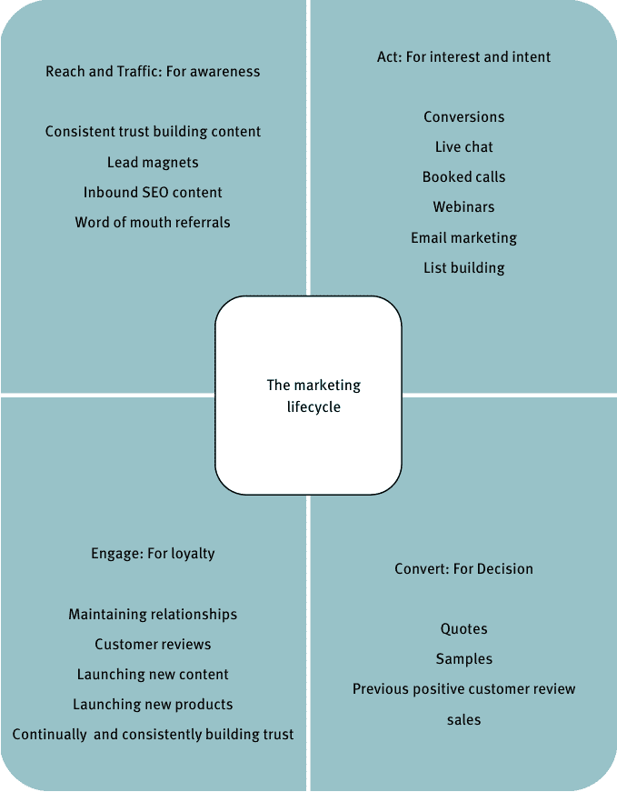

**图 5：** 营销生命周期 - RACE 框架

### 4.3 转化

This step ensures online or offline lead conversion to sale。本步骤确保在线或离线线索转化为销售。
It includes getting your target audience and customers to take the next important step of payment through online transaction, ecommerce or offline modes。它包括让目标受众和客户通过在线交易、电子商务或离线方式采取付款这一重要下一步。
This step uses product quotes, product samples, previous positive customer reviews and sales information to engage the customer。本步骤使用产品报价、产品样品、之前的积极客户评价和销售信息来吸引客户。

### 4.4 参与

This is a long-term commitment and engagement, evolving a long-term association and relationship with initial and first-time product buyers to form customer loyalty as recurrence and repeat product purchases。这是一种长期承诺和参与，与初始和首次产品买家建立长期关联和关系，形成客户忠诚度，即重复和重复购买产品。
Engage is ensured by using communications on your web site, social network posts and active presence, email interactions, direct communications and messaging。参与通过在您的网站上的沟通、社交网络帖子和积极存在、电子邮件互动、直接沟通和信息传递得到确保。
Loyalty of the customer is maintained through healthy relationships, competent reviews, launching new products, continuous positive feedback and consistently building trust。客户忠诚度通过健康的关系、competent 评价、推出新产品、持续的积极反馈和持续建立信任来维护。

## 5 各种基于云的安全营销解决方案

### 5.1 Adzooma 软件

Adzooma is a digital publicity and advertising platform that supports and benefits businesses of all dimensions of the organizations to expand marketing related operations and strategies by improving and optimizing sales promotions across Google marketing platform, Facebook influencer marketing platform and Microsoft marketing and advertising center。Adzooma 是一个数字宣传和广告平台，支持并使各类型组织的企业受益，通过在 Google 营销平台、Facebook 影响者营销平台和 Microsoft 营销与广告中心改进和优化销售推广，从而扩展与营销相关的运营和策略。

Using the opportunity engine platform and machine/deep learning processes, experts can view programmed and automated recommendations about recommended keywords, smart targeting, budget and economy management, CRO- conversion rate optimization and LPO- landing page optimization。使用机会引擎平台和机器/深度学习流程，专家可以查看有关推荐关键词、智能定位、预算和经济管理、CRO-转化率优化和 LPO-着陆页优化的编程和自动化建议。

Organizations are using Adzooma to study and analyze recommended data and inevitably break in proceedings for ongoing promotions or proposals on low performing keywords。组织使用 Adzooma 来研究和分析推荐数据，并不可避免地在低表现关键词的持续推广或提案程序中突破。

Marketing managers can configure automation rules by outlining precise conditions and situations to obtain reports about the budget which is overspent across promotions。营销经理可以通过概述精确的条件和情况来配置自动化规则，以获取关于在推广中超支的预算的报告。

Furthermore, it lets cloud users manage several accounts on a centralized environment and filter account particulars by date sort。此外，它允许云用户在集中环境中管理多个账户，并按日期排序过滤账户详情。

Marketing hierarchies can use Adzooma for customizable analysis and collect stakeholders. Pricing is based on periodic basis (say monthly) subscriptions and营销层级可以使用 Adzooma 进行可定制分析并收集利益相关者。定价基于定期（例如每月）订阅和

支持可通过反馈、实时聊天、电子邮件、Slack、电话以及其他在线或可访问的流程提供。

### 5.2 Bitrix24 软件

Bitrix24 是一款客户或顾客监管解决方案，为企业提供基础设施和平台，用于与潜在及预期客户和合作伙伴建立并追踪关系。使用该软件，用户可以维护和管理交互日志，以捕获和汇编潜在客户数据、生成销售报告并完成目标受众细分。从某个来源获取的潜在客户可以直接作为条目输入 CRM，创建消息模板，向潜在客户发送沟通信息，识别可与客户互动的潜在沟通机会，并安排会议以达成目标。用户可以通过自动维护客户信息，通过电子邮件将定制的客户报表发送给客户。

Bitrix24 的销售漏斗模块提供了销售沟通和交易的概览。借助销售控制面板/仪表板，销售经理可以查看所有团队成员的交易对比、评级和销售情况。

### 5.3 WebEngage 软件

WebEngage 是一个客户关系管理平台，不仅为大型企业组织，也为中小企业（SMB）提供营销自动化、客户数据管理、用户参与和维护等服务。WebEngage 销售控制面板/仪表板允许用户识别潜在客户、实现更好的客户互动、进行营销分析、确定营销活动日历，并跟踪增长指标，从而在通往健康目标的旅程中取得良好进展。

该软件在全球范围内广泛应用于电子商务、教育、营销分析、商业服务、社交媒体、医疗保健、零售、制造、游戏、银行、金融服务和保险（BFSI）等多个领域。

### 5.4 BetterMetrics 软件

BetterMetrics 是营销领域的一种解决方案，可实现报告自动化、采用按点击付费（PPC）策略的下一代数字营销，并与多种持续性和按需数据管理应用（如 Google Sheets（Google Analytics）、Data Studio（Google 交互式仪表板）和 BigQuery（云数据仓库））集成，使数字营销人员能够在一个集中位置收集和汇总所有 PPC 数据。该软件采用按使用付费模式（基于月度订阅）。该软件的优势在于为用户挖掘更好的指标、统一报告和全面检查。

### 5.5 EngageBay 软件

EngageBay 是面向营销、销售、推广和 CRM 等多个领域的综合解决方案。该软件主要面向中小企业（SMB），旨在获取、吸收并转化网站访客为潜在客户。这款基于云的软件允许企业组织将其用作营销工具，以与客户建立并长期维持健康的关系。

EngageBay 的优势包括电子邮件营销（用于沟通）、着陆页（用于优化）、实时聊天/帮助台（用于互动）、工单系统（用于公告）、电话（用于广播）、预约安排（用于宣传）、联系人管理（用于传播）等。它具有卓越的功能，包括内置 CRM 支持、营销能力、潜在客户转化策略、电子邮件模板、社交媒体可见性、用于更好沟通的表单和弹窗，以及自动邮件和沟通。

### 5.6 Agile CRM 软件

Agile CRM 是为中小企业（SMB）设计的云启用 CRM 解决方案。它涉及联系人监管、电话技术、预约安排、营销流程自动化、项目组织、着陆页设计器以及知识和信息库功能。

该软件还通过集成和同步 Gmail、Yahoo、Microsoft Exchange、Hotmail、Office 365 和 IMAP 的数据来提供电子邮件服务。用户可以分析网站访客以研究客户行为，执行营销自动化流程、任务管理，并通过 GUI 界面生成营销流程。借助用户友好的 GUI，任务管理可以通过拖放、排序、添加和更新任务或任务状态的方式轻松完成。通过集成 Facebook、Twitter、Instagram、Tumblr、微信、Messenger、LinkedIn 等，社交媒体协作也成为可能。

### 5.7 Sender 软件

Sender 是一款云启用的电子邮件营销、广告和销售解决方案，支持用户为中小企业（SMB）生成和处理基于电子邮件的推广和广告。Sender 软件的重要功能包括可自定义的订阅流程和原型、订阅者细分和管理工具、电子邮件个性化和管理、第三方集成等。

用户可以根据可自定义的模板发送广告和促销电子邮件、通用调查或新闻通讯。Sender 还为第三方支付和电子商务平台提供插件，使组织能够获取客户数据用于电子邮件，并将产品信息整合到新闻通讯中。用户可以补充多媒体文件，如各种格式的图片、音频、视频以及动画和动态 GIF。定价基于定期模式（如月度订阅），支持通过智能手机和电子邮件反馈提供。

### 5.8 SendX 软件

SendX 是一款内置的、价格合理且可自定义的电子邮件营销、广告和销售软件，适用于组织的所有利益相关者。它允许用户发送不受限制的电子邮件促销活动、构建电子邮件营销活动、通过拖放功能进行基于 GUI 的电子邮件设计、设置电子邮件序列、个性化和自动化。该软件确保 24x7 全天候的积极实时支持和维护、更好的迁移服务、可自定义且响应式的电子邮件模板，以及用于电子邮件促销和活动的图片库。定价基于定期模式（如月度订阅和年度订阅），支持通过电子邮件和实时聊天反馈提供。

### 5.9 InTouch 软件

InTouch 软件是一项浏览器（Chrome）扩展服务，用于自动化 LinkedIn 的沟通和消息。它是 LinkedIn 中用于潜在客户生成、监控和销售管理的安全且完美的工具。该软件通过自动连接或大规模消息发送、数据抓取器和潜在客户看板定制来自动化流程，从而对 LinkedIn 进行潜在客户挖掘。

自动连接或大规模消息发送提供自定义的消息管理、灵活的消息发送和跟进。数据抓取器用于通过社交媒体网络定义目标客户。潜在客户看板定制提供了一个仪表板，用于通过任务启动、查看或管理潜在客户。InTouch 软件被营销专业人员、商业供应商、服务提供商和招聘人员使用。

### 5.10 SendinBlue

SendinBlue 是一款云启用的基于电子邮件的营销、广告和推广工具，适用于大、中、小型组织。它在一个软件包中提供营销、广告和销售自动化、电子邮件促销、事务性电子邮件日志以及自定义自由格式短信消息等功能。

SendinBlue 允许用户使用自定义工具和 API 来制作、安排、自动化或交付基于移动设备的响应式动态电子邮件。该软件通过引入联系人、分类和分组列表、收集和设计表单、沟通表单等功能，实现丰富的客户沟通管理。SendinBlue 还支持报告、内容管理、电子商务管理、导出和导入结果以及响应式网站管理。

### 5.11 Freshworks CRM 软件

Freshworks CRM 是一款云启用的高效客户关系管理解决方案，帮助不同业务垂直领域的组织完成与现有及潜在客户的沟通。

其主要功能包括销售跟踪、销售管理、活动管理、一键电话和任务管理。用户还可以从该解决方案中引用定制的大批量电子邮件，然后监控这些电子邮件活动的完成情况。收件箱会自动突出显示来自联系人、人脉和潜在客户的需要积极回复的电子邮件。Freshworks CRM 追踪动态和响应式网页，用于探查联系人行为、生成潜在客户看板仪表板、确定任务优先级，并管理客户及其潜在客户，包括讨论、接触点、活动、预约和责任。

### 5.12 Routee 软件

Routee 是一款基于云的工具，旨在帮助大、中、小型企业组织。它提供基于消息的营销流程、潜在客户生成、批量消息、双因素验证、推送通知、实时广播和数据分析。

Routee 允许企业组织通过包含必要信息向客户发送定制的大规模消息。该工具使用户能够生成促销活动、跟踪沟通和联系、制定订阅实践，并通过多个渠道和系统定位和细分潜在客户。

### 5.13 Zoho CRM 软件

Zoho CRM 是一款云启用的业务管理和行政管理工具，帮助大、中、小型企业组织。它提供销售、广告和营销自动化软件，并包含仪表板、帮助台、数据分析、数据可视化和客户支持工具。


它拥有人工智能驱动的销售助手，用于强大的客户关系管理、数据指标、动态统计以及与 Google Suite、WordPress API、MailChimp 自动化工具、Evernote 应用和 Unbounce 等第三方工具的有序集成。

### 5.14 Omnisend 软件

Omnisend 是一个高效的营销、广告和销售自动化平台，专为以电子商务为基础的业务组织而开发。该软件使您能够将多个网络整合到同一个自动化流程中，通过电子邮件、短信、在线聊天、网页推送通知和公告以及客户群管理等工具实现统一沟通。

它可以生成强大的自动化流程，并根据客户记录、活动安排和购物行为推荐来定制您的消息和沟通。Omnisend 提供了与流行的电子商务应用平台及其他营销管理工具的集成。定价基于定期（例如按月）订阅，付款可通过智能手机、在线聊天、知识共享和电子邮件等反馈渠道完成。

### 5.15 AiHello 软件

AiHello 软件主要面向亚马逊按点击付费（PPC）运营和促销。它拥有重要模块，包括：自动驾驶（用于高效的电子商务营销、广告和销售）工具、竞价优化（用于基于按点击付费的顶级自动化和竞价）工具、人工智能引擎（用于智能业务自动化）、先进算法库（用于补货支持和销售预测）、实时分析（用于定期检查和分析客户活动）、多渠道分析（用于轻松集成不同数据源、仓库以及 Shopify、Woocommerce 和 Magento 等应用程序）、电子商务应用（用于支持连接各种电子商务平台）和营销分析（用于信息管理）。

### 5.16 Mailchimp 软件

MailChimp 是一种基于云端和网络的电子邮件营销、广告和销售自动化服务，拥有全球数百万用户。该工具允许用户在多个社交网络上分享新闻通讯或信件，以检查和跟踪客户行为与互动。该工具提供有针对性的客户电子邮件，运行 Facebook 广告推广和营销活动，系统化跟进，并观察推广和活动的发展与进展，等等。

各种基于云计算的营销解决方案的比较如图 6 所示。

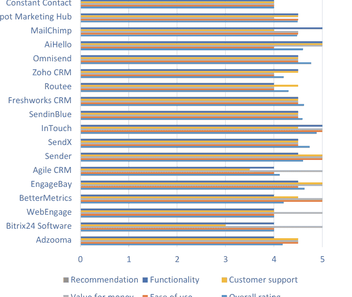

图 6：各类基于云的安全营销解决方案分析

图 7 给出了所给基于云计算的营销模型在总体评分和推荐标签方面的比较。

## 6 结果与讨论

所有这些用于营销最佳实践的云解决方案揭示了以下内容：

- 通过接纳、理解并重视客户而脱颖而出
- 提高营销团队的专注力与集中度，以全面审视客户需求的背景和视角
- 通过无缝、持续且个性化的体验和理解与客户互动并参与其中
- 自动化 RACE 框架，以实现触达、行动、转化和互动
- 通过安全的基于云的营销软件/工具确保营销活动中的安全性
- 确保营销垂直领域的云治理，以观察高效的成本管理、资源利用和发展
- 建立客户期望和信任
- 以更强的洞察力和敏捷性扩展客户关系与关联
- 履行你对客户及产品/品牌的承诺
- 利用实时业务计算与智能来赋能快速数据分析
- 利用基于云的营销自动化来确保整个组织动态且灵活地决策
- 通过优化营销展示来取悦客户
- 利用基于云的营销自动化工具观察 B2B 营销的需求和发展
- 赋能营销人员高效地产生潜在客户转化，并最终推动更多业务
- 创建一个商业测试案例来推广你的营销实践和策略
- 应用“客户第一”战略
- 获取高效的基于云的解决方案来打造现代多渠道营销
- 通过基于实时数据构建的高效 SEO 工具，实现高效且轻松的营销管理
- 完整且内置的营销细分功能和垂直领域
- 定制化沟通
- 对客户数据进行实时数据分析，以快速有效地决策
- 跨所有网络动态生成客户画像，可通过分析识别其行为和需求
- 线索管理功能与营销和销售部门集成，用于跨部门分析
- 识别组织需求，并能部署云类型：公有云、私有云、混合云或社区云
- 识别营销需求和要求，并从云服务提供商处获得营销分析即服务
- 识别组织中各部门的集成，同样可以通过使用基于云的营销软件来实现
- 实现个性化、关联的客户旅程，从而提高客户转化率
- 驱动忠诚度，并提升营销对最终业绩的贡献和参与

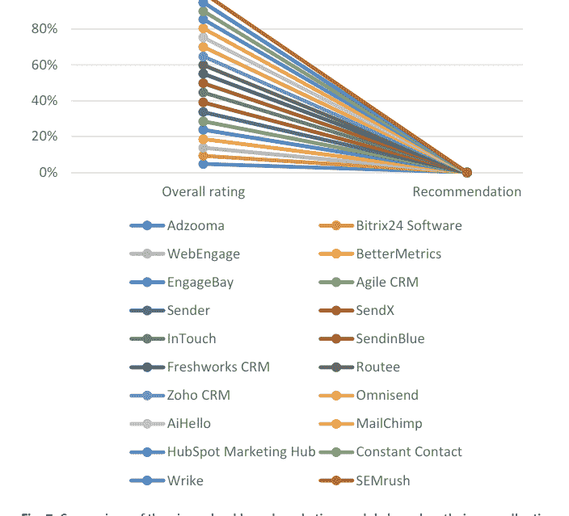

图 7：所给基于云计算的营销模型在总体评分和推荐方面的比较

## 7 结论

还有各种其他基于云的营销工具，例如 Sap Marketing Cloud、Lengow、Basis、ZoomInfo、Evocalize、Jilt、FIREBusinessPlatform、Promoboxx、Ad-sale、Influx MD、MailOptin、Involve.me、FunnelMaker、Converttri、Privy、Oracle Datamanagement Platform、SutiCRM、Automizy、Morph.ai、SlickText、Vitalblocks CRM、Synerise、Goody、MoonMail、EmailDelivery.com、Tabrasa、TractionNext、Whatagraph、Texting Base、TargetEveryone、SugarCRM、SendPulse、SalesSeek、Skyword、Rejoiner、Pure360、Prisync、QZZR、Post Planner、Voogy、Mission Suite、iSalesCRM、Marketing Automation Professional、Marketing Automation Enterprise、BOTNATION AI、Mailify、LeadByte、Blackbaud Luminate Online、Instapage、Inter-com、Greenrope、Genoo、Higher Logic、FreshMail、EverString、Ecrion、Dialog Insight、AutoManager、ConvergeHub、Contactually、Click2Mail、ConnectAndSell、ClickDimensions、Brightpod、C2CRM、Bronto Marketing Platform、BigMarker、BannerFlow、PromoNavi、Salesgenie、Bonzo、Nimbus Omnichannel、Insightly Marketing、BounceX、INBOX25 等。通过实施最佳实践并使用这些高效的基于云的工具，营销生命周期可以产生更高的产出。

## 8 参考文献

- [1] Kirtiš K, Karahan F, 全球衰退后是否应进入社交媒体领域：最具成本效益的营销策略, Procedia - Social and Behavioral Sciences, 2011, Volume 24, Pages 260-268, ISSN 1877-0428, https://doi.org/10.1016/j.sbspro.2011.09.083

- [2] Muliana M, Nek K, Azhari A, 马来西亚私立幼儿园概述：营销策略与挑战, Procedia - Social and Behavioral Sciences, 2014, Volume 130, Pages 105-113, ISSN 1877-0428, https://doi.org/10.1016/j.sbspro.2014.04.013

- [3] Joseph J, Jeffery S, Mark R, Ramirez E, Martinez J, 绿色营销策略：审视利益相关者及其带来的机遇, J. of the Acad. Mark. Sci, 2011, 39, 158–174, https://doi.org/10.1007/s11747-010-0227-0

- [4] Nancy W, 学术图书馆中的创新营销策略：综述, 信息服务的设计与营销创新, Jeyasekar J, Saravanan P, IGI Global, 2020, pp. 1-15. http://doi:10.4018/978-1-7998-1482-5.ch001

- [5] John P, Steven M, 使创业企业抵御衰退的营销策略, Journal of Business Venturing, 1997, Volume 12, Issue 4, Pages 301-314, ISSN 0883-9026, https://doi.org/10.1016/S0883-9026(97)89449-9

- [6] Baena V, 在线和移动营销策略作为球队品牌热爱的驱动因素：来自皇家马德里的发现, International Journal of Sports Marketing and Sponsorship, 2016, Vol. 17, No. 3, pp. 202-218, https://doi.org/10.1108/IJSMS-08-2016-015

- [7] Aspelund A, Madsen K, Moen, 国际新创企业的基础、国际营销策略与绩效述评, European Journal of Marketing, 2007, Vol. 41 No. 11/12, pp. 1423-1448, https://doi.org/10.1108/03090560710821242

- [8] Gabrielsson P, Gabrielsson M, Seppälä T, 来自小型开放经济体的公司海外扩张的营销策略：战略契合与绩效的影响, Journal of International Marketing, 2012, 20(2), 25–48, https://doi.org/10.1509/jim.11.0068

- [9] Cacciolatti I, Lee S, 重新审视营销能力与企业绩效的关系：市场导向、营销战略和组织权力的调节作用, Journal of Business Research, 2016, Volume 69, Issue 12, Pages 5597-5610, ISSN 0148-2963, https://doi.org/10.1016/j.jbusres.2016.03.067

- [10] Adjei M, Clark M, B2C情境下的关系营销：人格特质的调节作用, Journal of Retailing and Consumer Services, 2010, Volume 17, Issue 1, Pages 73-79, ISSN 0969-6989, https://doi.org/10.1016/j.jretconser.2010.10.001


## 1 引言

### 1.1 云计算

云计算是一种新的分布式计算技术，利用它我们可以增强对虚拟化资源的使用。这些虚拟化资源旨在动态云环境中为最终用户提供服务，以便始终向云用户提供可靠可信的服务。云计算环境的主要优势在于，我们可以尽可能改进和优化物理资源的利用率。这项技术的美妙之处主要在于对物理资源进行抽象和隔离，从而减少对硬件设备的需求。为了处理高度基于需求的动态任务，云计算利用了虚拟化技术。虚拟化是一种技术，通过该技术可以为给定的单个物理资源/服务器创建多台虚拟机，以处理/执行多个任务。资源管理在此发挥着重要且关键的作用，因为需要动态供应资源以满足云计算环境的按需服务需求。资源管理的主要目标是最大化资源利用率时间、减少任务执行时间、实现高系统吞吐量并改善负载均衡。在任何云系统架构中，主要包含三个核心模块，即应用程序（任务提交源）、映射算法（使用各种算法将提交的任务映射到物理资源）和虚拟机。使用映射算法，通过估算云任务的预期完成时间，将一组云任务映射到资源，然后在选定资源上执行这些云任务[1-2]。

### 1.2 机器学习

基于机器学习的系统已被证明是各种替代方案中的最佳解决方案。最主要的云服务提供商，如亚马逊互联网服务、Microsoft Azure 和 Google Cloud，都在其企业级安全中实施了机器学习。所有主要的云服务提供商都使用完全不同的机器学习系统，这些系统在功能性和层次结构上彼此不同[3]。

### 1.3 机器学习系统在云上的优势

机器学习系统在云上的优势总结如下[4-5]。

- 基于机器学习的云系统是具有性价比的解决方案
- 机器学习模型与应用程序编程接口（API）和软件开发工具包（SDK）的集成毫不费力地完美契合
- 基于机器学习的云安全解决方案具有智能未来和稳定需求
- 在基于机器学习的应用程序的云按需付费模式中，可扩展性得到增强
- 基于机器学习的云应用程序提供增强的基于云的解决方案

### 1.4 机器学习系统在云上的局限性

机器学习系统在云上的局限性总结如下[6]。

- 由于领域知识不足和缺失，缺乏专业技术人员和专门知识
- 在企业级实现信息集成和关联的支持有限
- 通过基础设施和人力获得所需计算能力的部署成本增加
- 基本工程、简单和中等复杂的问题可通过使用开源机器学习工具（如 TensorFlow、MXNet 和 CNTK）解决。然而，这些模型可能无法为更复杂和更繁琐的问题提供有效的解决方案

### 1.5 文献综述

- B. Nassif 等人指出，确保云安全的最佳方式是使用机器学习模型。该论文总结了不同类型的云安全威胁、各种机器学习技术以及性能相关的结果。根据调查结果，他们指出支持向量机模型是最佳机器学习技术之一，真正阳性率和训练时间分别是应用最多和应用最少的指标，KDD 和 KDD CUP'99 是使用最多的数据集[7]。
- Han Qiu 等人指出，基于物联网的远程医疗系统使用基于云的数据分析来构建身体传感器网络。为了确保身体传感器网络中的安全和隐私保护，云计算模型通过机器学习方法使用选择性加密技术。轻量级选择性加密技术的设计基于高效的分类机器学习模型[8]。
- Sirisha Potluri 等人指出，云中与 DDoS 攻击相关的检测和防御机制需要高效的动态云资源使用。为了应对这些不利影响，云使用各种基于机器学习的防御机制[9]。
- H. Karimipour 等人指出，通过使用机器学习技术解决数字通信技术中的安全威胁和漏洞，以实现高效可靠的电力分配。符号动态滤波技术用于减少智能电网中的计算负担，同时发现节点之间的潜在交互[10]。
- Wei Wu 等人指出，在基于相似性度量的流量分析中，使用无监督机器学习模型进行 Bot 检测。使用高效的聚类算法来识别包含最多流量的主要簇、消除重复流量以及计算相似性分析[11]。
- Ünal Çavuşoğlu 等人指出，混合分层入侵检测系统结合了各种机器学习和特征选择技术，以在不同攻击类型中提供高性能的入侵检测[12]。
- Sirisha Potluri 等人指出，雾计算网络通过使用物联网基础设施发送和接收数据，专为分布式和去中心化计算平台而设计。雾计算的各种应用包括电子商务、移动、农业、汽车、智能电网、医疗保健和数据分析[13]。
- Mahmud 等人指出，基于雾的物联网医疗解决方案结构在可互操作的医疗解决方案中集成了基于云和雾的服务。使用 iFogSim 模拟器，从分布式计算的角度分析结果，以显示延迟降低、通信成本优化和高效能源消耗[14]。
- Subramanian, E. 等人指出，为了保障云交易的安全和隐私，极有必要在云范围内提供安全、可靠且稳健的基于机器学习的解决方案。线性回归、卷积神经网络和支持向量机等各种机器学习方法提供了增强的基于云的解决方案，以确保安全和隐私[15]。
- Mbarek Marwan 等人指出，使用支持向量机和模糊C均值聚类可以更高效地完成图像像素分类。在医学图像数据中，使用传统的两层体系结构，可以同时实现图像分割和数据保护[16]。

## 2 基于机器学习的云解决方案以应对研究问题和挑战

### 2.1 注重隐私与安全的安全措施

云计算环境使用大量数据集进行存储和处理。本地数据的存储、处理与加工完全无风险。但如果数据保存在其他位置，则存在更大的风险。云服务提供商、中介机构或承载云平台的公司可能会泄露其可访问的数据。因此，数据可能被篡改或丢失。无论哪种情况，都会导致安全和隐私问题。由于这些安全和隐私原因，云计算虽已被广泛采用，却也因这些问题略有退缩。基于机器学习的云计算模型和方法为计算平台提供了下一代隐私和安全性[17]。

### 2.2 性能及其度量

在云环境中，这个问题非常重要，因为它是计算环境中的度量技术之一。性能是云系统中的一个主要关注点，它影响各种服务的交付、因服务交付而产生的收入以及参与该过程的客户数量[18]。

### 2.3 通过可靠性和可用性提供周全的解决方案

可靠性定义了系统在选定时间间隔和给定条件下的确定性预期功能。任何系统的可用性可定义为资源组的可用程度，以及这些可用资源在需要时（无论何时何地）被使用的程度。这两个因素共同决定了系统的强度和效能[19]。

### 2.4 通过可扩展性和弹性提供适应性解决方案

可扩展性可定义为其适应变化的能力。当各种云用户需要资源时，系统应高效地处理工作负载。系统的弹性可定义为其高效处理工作负载的程度。弹性确保资源的分配和释放，以满足按需用户的需求[20]。

### 2.5 通过互操作性和可移植性提供自适应解决方案

云计算环境的互操作性可定义为系统运行来自不同供应商的各种服务所采用的能力。其相关因素互操作性可定义为不同云服务提供商之间有效使用不同平台的方式。可移植性是一个重要因素，它定义了转移相关内容的能力

从一个 CSP 到另一个 CSP 的数据应用几乎不涉及依赖关系 [21]。

### 2.6 基于 QoS 的资源管理和调度

资源管理可以定义为一个因素，表示资源的有效使用和维护。各种类型的资源被映射到提交的作业中，以便更高效地调度它们。通过使用更好的调度策略可以实现更好的资源调度和供给。通过使用这些调度算法，我们可以优化云服务以实现高水平的服务质量。存在许多类别的用户、任务和资源，通过这些实现任务映射和执行 [22-24]。

### 2.7 高效的能源消耗基础设施

任何云数据中心或存储都包含大量且庞大的基础设施。云计算环境利用其庞大的基础设施为大量用户提供各种类型的服务。需要冷却基础设施来抵消这些服务器产生的热量。这种昂贵的基础设施应得到非常谨慎的开发、运营和维护，因为它会产生对环境平衡不利的温室气体。云中心维护适当的冷却系统和机制，以使云基础设施保持环境友好 [25]。

### 2.8 基于虚拟化的可扩展分布式计算

在分布式和云计算环境中，虚拟化概念发挥着非常重要的作用。这是指为各种物理资源创建虚拟机的过程。该概念与任务调度过程密切相关，其中任务队列被映射到各种虚拟机以进行调度。虚拟化的主要优点是成本降低、高度可扩展，并为云计算环境提供弹性行为 [26]。

### 2.9 具有更好吞吐量的成本敏感型基础设施

根据云计算，带宽是指传输比特的速率。该测量主要在计算系统吞吐量时有用。由于云计算环境提供系统之间高速数据传输，因此需要高带宽 [27]。

## 3 基于机器学习的云模型——Google Cloud Machine Learning Engine：案例研究

用于云安全和隐私的各种机器学习算法如图 1 所示。

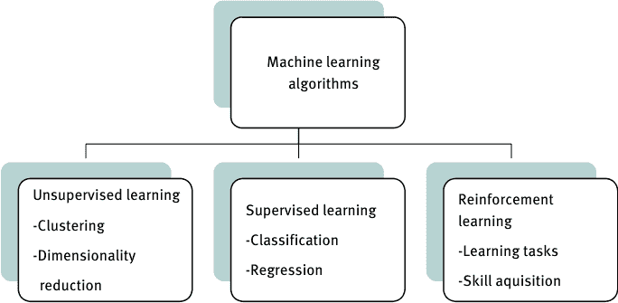

**Fig. 1:** 机器学习算法——概述

在云计算和其他环境中，资源规划存在许多相似性和差异。调度的目标是实现资源使用方面的显著差异。在传统和常规的资源映射调度中，所使用的对象是线程、作业和任务，它们涉及实体资源明确定义、细粒度的映射和调度。云调度对象如任务和作业是属于细粒度映射和调度的虚拟机（VM）。Google Cloud 正在使用机器学习模型来观察云资源管理中的革命性变化。

### 3.1 Google Cloud Platform 简介

硬件和软件中出现了革命性变化，推动了机器学习（ML）的发展。Google Cloud Platform 为各类用户如初学者和专家提供不同类型的产品或工具。多年来，机器学习一直是 Google 内部系统的核心优势。Google Cloud Platform 根据我们对大规模数据驱动系统的需求，提供适当的框架、技术、基础设施和信息，以满足客户需求。Google 提供托管服务以帮助

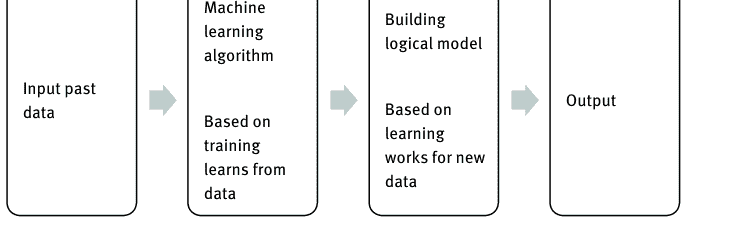

**Fig. 2:** 机器学习流程——概述

### 3.2 各类服务

如图 3 所示，说明了各种类型的服务。

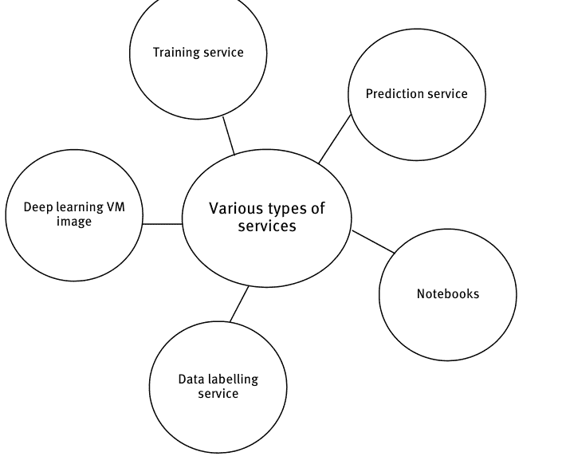

**Fig. 3:** 机器学习算法提供的各种服务

机器学习算法识别给定数据中的自然模式，从而产生洞察并帮助您做出更好的决策、预测和预报。它们每天被用于医疗分析、股票交易、能源负荷预测等关键决策中。

#### 3.2.1 训练服务

训练服务允许我们使用广泛的不同定制选项来训练模型和原型。选择不同类型的机器可以为您的训练作业提供动力，促进分布式训练，练习使用超参数调优，并通过图形处理单元或张量处理单元加速。

#### 3.2.2 预测服务

平台预测服务让我们能够基于训练好的模型提供预测，无论该模型或原型是否在人工智能平台上训练。

#### 3.2.3 笔记本

笔记本服务允许我们使用在 JupyterLab 中可用的虚拟机管理器创建、管理和销毁虚拟机实例。这些服务包含预安装的软件包，如深度学习、TensorFlow 和 PyTorch。这些实例受 Google Cloud 身份验证保护，并且可以轻松与 GitHub 仓库集成。

#### 3.2.4 数据标注服务

数据标注服务允许我们对文本、图像或视频数据集进行人工标注，以训练设计的机器学习模型。该服务为给定数据集提供所有可能的标签以及这些标签的标注方式说明。

#### 3.2.5 深度学习 VM 镜像

深度学习 VM 镜像允许我们从为数据科学和 ML 任务优化的一组镜像中进行选择。

### 3.3 如何使用 Google Cloud Machine Learning？

请按照以下步骤使用 Google Cloud Machine Learning

- 使用现有凭据注册您的 Google 账号
- 创建一个 Google Cloud Platform 项目
- 启用 Cloud Machine Learning Engine 和 Compute Engine API
- 恭喜，您已开始使用 Google Cloud Machine Learning Engine

### 3.4 与人工智能平台交互的工具

#### 3.4.1 Google Cloud 控制台

使用云控制台，我们可以管理和部署云模型、版本和原型。该工具通过使用云日志和云监控等工具充当与 AI 资源交互的界面。

#### 3.4.2 Gcloud 命令行

使用 Gcloud 命令行 gcloud ai-platform，我们可以在命令行管理 AI 模型、原型和版本以完成 AI 任务。Gcloud 命令和 REST API 用于 AI 平台中的在线预测。

#### 3.4.3 REST API

REST API 提供 RESTful 服务以辅助在线预测。

### 3.5 基于机器学习的 Google 服务的优势

- 更高的生产力，可快速获取发明和创新：Google AI 系统定期以高效的方式提供更新。
- 用户采用新功能和功能时干扰更少：Google 以持续流的方式提供新功能和功能。
- 员工的全球工作文化：员工可以通过 Google 的基于网络的应用程序从世界任何地方访问服务和信息。
- 支持快速协作：由于服务的高可用性，云用户可以快速访问云中可用的数据。
- 拥有熟练人员的增强安全性：Google 拥有并聘请熟练人员以确保云中的下一代安全。
- 云和本地计算机中存储的数据比例：为避免漏洞，本地设备中存储的数据更少，而大量信息和服务通过云平台提供。
- 服务的高可用性和可靠性：由于冗余数据中心，数据和服务以高可用性和可靠性提供给云用户。
- 按需可扩展的访问和控制：通过强大的 Google 应用，用户可以按需可扩展地访问和控制服务。
- 支出更少，收益更多：Google 云服务允许用户以更少的支出访问它们。

### 3.6 关于机器学习的统计事实

- 国际数据公司（IDC）称，包括软件、硬件和其他服务导向在内的各行业的整体收入预计在 2020 年将超过 1560 亿美元。相比 2019 年增长了超过 12%。
- IDC 的《全球半年度人工智能追踪》称，到 2024 年全球收入将增加 3000 亿美元，复合年增长率（CAGR）超过 17%。
- 福布斯——全球媒体杂志称，基于人工智能的定价和促销有望带来超过 2590 亿美元的全球市场价值。
- 在电信行业，数据爆炸可能增加安全威胁风险。Google Cloud 称，到 2022 年，全球市场的数据流量速率可能超过每月 77 艾字节，复合年增长率为 46%。
- Google 称，平均 Gmail 邮件中 <0.1% 为垃圾邮件，其中 0.05% 为有用邮件。垃圾邮件预测和检测可通过机器学习算法实现。
- 通过聊天机器人的智能将从 2019 年的仅 28 亿美元增长到 2024 年的 1420 亿美元。
- 在线教育市场到 2025 年可能借助机器学习技术达到 3500 亿美元。


## 4 基于机器学习的商业 Web 云

Cloud SIEM — 安全信息和事件管理系统如图 4 所示。

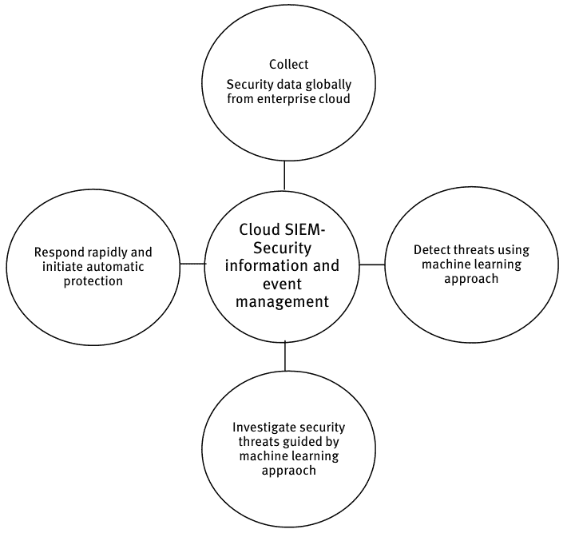

图 4：Cloud SIEM — 安全信息和事件管理系统

### 4.1 Cloud Shell

Cloud Shell 是一个基于 Web 的环境，它使用在线终端借助实用程序、命令行工具和库来支持和管理资源。使用 Cloud Shell，我们可以创建基于云的应用程序。Google Cloud Shell 包括 Cloud Speech-to-Text、App Engine、Data Transfer 和 Cloud Build。

### 4.2 Cloud Shell 中可用的各种工具

#### 4.2.1 持久磁盘存储

Google Cloud Storage 为每位用户按使用量付费提供持久磁盘存储，使用虚拟机和虚拟机管理器界面。`$HOME` 目录被挂载以提供此存储，其中包含主目录、软件、脚本和配置文件等各种文件。

#### 4.2.2 授权

Google Cloud API 使用命令行工具进行授权，使用 Authorize Cloud Shell 对话框进行授权。

#### 4.2.3 预配置环境变量

当 Cloud Shell 启动时，项目将被提供给 gcloud 配置系统以供立即使用。通过使用环境变量 `GOOGLE_CLOUD_PROJECT`，库的应用程序默认凭据和活动项目也将在控制台中设置。

#### 4.2.4 区域选择

Cloud Shell 通过各种 Google Cloud 平台在全球范围内分发。最初，它被分配到最近的地理区域。之后，根据工作负载，它将尝试迁移到其他虚拟机。

#### 4.2.5 镜像发布

Cloud Shell 的最新镜像会随 Cloud 软件开发工具包、Docker 以及所需运行时实用程序和库一起更新。

#### 4.2.6 Root 用户

当您创建用户账户时，您在分配的虚拟机上拥有所有权限，并且可以在其上执行工作负载。

#### 4.2.7 可用工具

这些可用工具是预先安装的，并且可以根据需要安装额外的工具。安装在虚拟机上的额外工具在实例终止后将不会保留。

#### 4.2.8 语言支持

各种语言，即 Java、Go、Python、Node.js、Ruby、PHP 和 .NET，提供预安装的语言支持。

#### 4.2.9 安全模式

Google Cloud 在 URL 中使用 `cloudshellsafemode=true` 以确保安全模式并修复文件中的安全问题。

### 4.3 Amazon Web Services

Amazon Web Services (AWS) 是一个于 2006 年推出的基于 Web 的云平台，提供各种产品，如 Amazon SageMaker、Amazon Augmented AI、Amazon Forecast、Amazon Translate、Amazon Personalize、AWS Deep Learning AMIs 和 Amazon Polly。

#### 4.3.1 Microsoft Azure

Microsoft Azure 是一个于 2010 年推出的基于 Web 的云计算平台，提供各种产品，如 Microsoft Azure Cognitive Service、Microsoft Azure Databricks、Microsoft Azure Bot Service、Microsoft Azure Cognitive Search 和 Microsoft Azure Machine Learning。

### 4.4 IBM Cloud

IBM Cloud 是一个云计算平台，提供多种类型的云服务，如公有、私有和混合，并提供各种产品，即 IBM Watson Studio、IBM Watson Speech-to-Text、IBM Watson Text-to-Speech、IBM Watson Natural Language Understanding、IBM Watson Visual Recognition 和 IBM Watson Assistant。

## 5 用于云安全的先进机器学习算法

各种最先进的机器学习算法列于表 1 中。

表 1：最先进的机器学习算法

| 算法 | 机器学习算法 | 备注 |
|---|---|---|
| 对云计算安全机器学习算法的综述 | 有监督、无监督、半监督和强化 | 阐述了云计算的安全威胁、问题及相关解决方案 |
| 云计算框架中机器学习算法的评估 | 有监督 | 阐述了允许机器识别模式并促进人类学习的强大分析方法 |
| 使用机器学习算法组合的云环境网络入侵检测系统 | 基于深度神经网络 (DNN) 的异常网络入侵检测系统，使用基于改进遗传算法 (IGA) 和模拟退火算法 (SAA) 的混合优化框架 (IGASAA) | 减少执行时间、收敛时间和节省处理能力 |
| 云安全监督式机器学习的可行性 | 有监督 | 通过提高云安全，证明了这些模型在多个数据集上的有效性 |
| 评估云中异常检测的机器学习算法 | 有监督和无监督 | 通过分析从云基础设施的所有层和组件收集的指标，检测服务和主机的异常行为 |

下面给出了线性回归、支持向量机和朴素贝叶斯分类等机器学习算法的代码。

列表 1：线性回归、支持向量机和朴素贝叶斯分类等机器学习算法的代码

```
#Linear regression
lin_regr = linear_model.LinearRegression()
lin_regr.fit(X_train, y_train)
print(lin_regr.coef_)
print(lin_regr.score(X_test, y_test))
plt.style.use('fivethirtyeight')
plt.scatter(lin_regr.predict(X_train), lin_regr.predict(X_train) - y_train, color = "yellow", s = 10, label = 'Training data')
plt.scatter(lin_regr.predict(X_test), lin_regr.predict(X_test) - y_test, color = "pink", s = 10, label = 'Testing data')
plt.hlines(y = 0, xmin = 0, xmax = 100, linewidth = 5)
plt.legend(loc = 'upper right')
plt.title("Demo")
plt.show()
#Support vector machine
from sklearn import svm as s
from sklearn import metrics as m
s_class = s.SVC(kernel='linear')
s_class.fit(X_train, y_train)
y_pred = s_class.predict(X_test)
print(m.accuracy_score(y_test, y_pred))
print(m.precision_score(y_test, y_pred))
print(m.recall_score(y_test, y_pred))
#Naive Bayes Classification
import numpy as n
import pandas as p
from sklearn.naive_bayes import GaussianNB
from sklearn.metrics import confusion_matrix, accuracy_score
NB_class = GaussianNB()
NB_class.fit(X_train, y_train)
y_pred = NB_class.predict(X_test)
ac_sc = accuracy_score(y_test,y_pred)
cm_ma = confusion_matrix(y_test, y_pred)
```

## 6 结论

机器学习目前已成为我们日常生活的一部分，并且是一种旨在处理云计算中出现的安全和隐私问题的全新技术。近年来，对云计算的保护和隐私问题进行了深入分析。因此，安全和隐私变得极其重要和关键，需要得到解决。对于未来的工作，研究人员深入研究云计算中安全攻击的不同安全原语解决方案至关重要。混合协议技术将降低保护和隐私保护解决方案的计算开销。此外，机器学习隐私和安全协议的定制也是一个值得注意且开放的研究领域，以开发可行的解决方案。研究人员期待在机器学习的各种应用中开展研究，例如天文学、自然哲学、核子学、物理科学、磁学、机器、技术、力学、电渗流、信号处理、电力、能源、生物信息学、经济和金融等领域。

## 7 参考文献

- [1] Dillon T, Wu C, Chang E, 云计算：问题与挑战, 2010 年第 24 届 IEEE 先进信息网络与应用国际会议, 珀斯, 西澳大利亚, 澳大利亚, 2010, 页码 27-33, doi: 10.1109/AINA.2010.187
- [2] Wang L, Laszewski V, Young A, 云计算：一种视角研究, New Gener. Comput, 2010, 28, 137–146, https://doi.org/10.1007/s00534-008-0081-5
- [3] Naveen G, Ayushi G, 基于机器学习的云计算调度综述, 2017 年智能系统、元启发式与群体智能国际会议论文集, Association for Computing Machinery, 纽约, 纽约州, 美国, 2017, 57–61, DOI: https://doi.org/10.1145/3093337.3093532
- [4] Umer A, Muhammad M, Shah S, Amin R, Shaukat W, Syed R, Suh Y, Piran J, 云计算安全机器学习算法综述, Electronics, 9, 2020, 第 9 期: 1379, https://doi.org/10.3390/electronics9091379
- [5] Subramanian K, Tamilselvan L, 关注未来云：基于机器学习的云安全, SOCA, 2019, 13, 237–249, https://doi.org/10.1007/s11761-019-00270-0
- [6] Bhamare D, Salman T, Samaka M, Erbad A, Jain R, 云安全监督式机器学习的可行性, 2016 年信息科学与安全国际会议 (ICISS), 芭堤雅, 泰国, 2016, 页码 1-5, doi: 10.1109/ICISSEC.2016.7885853
- [7] Nassif A, Talib M, Nasir Q, Albadani H, Dakalbab F, 云安全的机器学习：系统综述, IEEE Access, 2021, 第 9 卷, 页码 20717-20735, doi: 10.1109/ACCESS.2021.3054129
- [8] Han Q, Meikang Q, Zhihui L, 基于监督式机器学习的体传感器网络 ECG 数据选择性加密, Information Fusion, 2020, 第 55 卷, 页码 59-67, ISSN 1566-2535, https://doi.org/10.1016/j.inffus.2019.07.012
- [9] Potluri S, Mangla M, Satpathy S, Mohanty S N, 云计算环境中 DDoS 攻击的检测与预防机制, 2020 年第 11 届计算、通信与网络技术国际会议 (ICCCNT), 哈拉格布尔, 印度, 2020, 页码 1-6, doi: 10.1109/ICCCNT49239.2020.9225936
- [10] Karimipour H, Dehghantanha A, Parizi R, Choo K, Leung H, 用于大规模智能电网网络攻击检测的深度可扩展无监督机器学习系统, IEEE Access, 2019, 第 7 卷, 页码 80778-80788, doi: 10.1109/ACCESS.2019.2920326
- [11] Wu W, Alvarez J, Liu C, 等, 使用无监督机器学习的 Bot 检测, Microsyst Technol, 2018, 24, 209–217, https://doi.org/10.1007/s00542-016-3237-0
- [12] Çavuşoğlu Ü, 使用机器学习方法进行入侵检测的一种新混合方法, Appl Intell, 2019, 49, 2735–2761, https://doi.org/10.1007/s10489-018-01408-x
- [13] Potluri S, Achyuth S, Elham T, Mohanty S N, 使用雾计算的物联网使能云医疗保健系统：案例研究, Journal of Critical Reviews ISSN 2394-5125, 2020, 第 7 卷, 第 6 期, 页码 1068-1072, doi: 10.31838/jcr.07.06.186


Sirisha Potluri, Gouse B. Mohammad, Sachi Nandan Mohanty, M. Vaishnavi, K. Sahaja

# 车载自组网的安全智能框架：基于云的交通模型

**摘要：** 车载云计算对信息技术解决方案产生了巨大的影响。根据VCC，未被利用的计算资源包括停泊的车辆、拥堵中的车辆以及任何地点停放的汽车。VCC架构分为三层。过去几十年来，汽车行业的一些发展非常有趣，并且以解决问题为导向。研究人员和美国交通部为VANET提出了许多安全应用、便利应用和商业应用。车辆通过网络连接在一起，形成车载云，为客户端提供存储空间、计算资源、传感器读数等按需服务。交通拥堵正成为一种日常现象，甚至日益严重，浪费了人们的宝贵时间，损害了健康和精力。公民需要高效的计算、监督和引导解决方案，以摆脱与交通相关的问题和困扰。在大中城市，在大学、购物中心或商业综合体附近寻找合适的停车位，可以借助自动停车管理工具的帮助。

**关键词：** 车载云计算、智能交通系统、云安全、云隐私、车载自组网、物联网

## 1 VANET简介

过去几十年来，汽车行业的一些发展非常有趣。如今的车辆比以往更加省油。即使在今天，车辆也容易因雾、烟、灰尘以及道路上的各种其他致命陷阱而发生事故，但最重要的是，它们更容易因人为错误而发生事故。

然而，这些致命的人为错误中的大部分即将减少，因为汽车行业多年来一直在积极努力，将各种传感器安装到汽车中，并将其连接到车载计算机系统。随着技术的发展，电信和广播现在可以通过无线技术将车辆相互连接，使它们能够互连并协同工作。当今时代，各国政府都在支持自动驾驶汽车。

各国政府，尤其是英国政府，为无人驾驶汽车的研究提供了大量资金。这些资金正促使多家公司合并，不仅包括汽车行业的公司，还包括信息技术和电信行业的公司，它们共同合作。

福特、现代、塔塔等许多汽车制造商通过将其应用程序编程接口（API）提供给其他开发者，为其平台发布了应用程序开发工具。开发人员提交他们的应用程序，并在批准后供下载。长期演进（LTE）连接通过提供高速互联网、流媒体电影、导航控制、音乐应用程序和实时电视等的接入和访问，持续服务于车内演示服务并加以改进。另一个特点是商业性和盈利性的，它为车辆旅行者提供基于位置的服务和广告。LTE连接不仅将互联网带入车辆，还使车辆成为互联网的一部分，为车载自组网（VANET）铺平了道路。

互联车辆真正的未来前景只有在车辆相互连接时才能实现。这种由车辆互连形成的网络被称为VANET。车辆技术的这一转变将带来一个创新的新时代，并开辟大量有助于提高道路安全和减少道路事故的应用领域。

VANET之所以重要，是因为它们具有巨大的潜力和多种可用的应用。VANET不仅提供了强大的安全增强功能，还提供了许多商业机会。车载环境中的无线接入（WAVE）为VANET中的专用短程通信（DSRC）提供了基本的无线电标准。

车辆使用DSRC无线电以两种方式相互连接和通信，即车对车通信（V2V）和车对基础设施通信（V2I）。专用短程通信的通信范围在300至1000米之间。随着车辆中4G/LTE连接的加入，互联和联网车辆显然可以通过云共享数据。在互联车辆中使用云的优势是巨大的，因为使用应用程序的机会几乎是无限的。

DSRC识别一种主要类型的消息，称为基本安全消息（BSM），车辆每100毫秒通信并传输一次。在基本安全消息中，车辆广播其位置、速度、加速度以及其他几个有用参数的详细信息，这些信息可以帮助其他车辆避免碰撞，并生成警告以改善安全措施。这些消息还帮助车辆和汽车维护其邻居列表。

导航系统已经可用，但其他车辆的精确实时位置信息尚不可用。这是未来的一个领域，即使能见度为零或驾驶员无法驾驶车辆，也能让驾驶员在道路上安全驾驶。因此，愿景是在道路上所有车辆之间建立相互理解，从而带来无人驾驶汽车。

所有车辆都可以通过软件进行编程和自动化，以便在行驶过程中观察到速度或位置意外变化时传输和共享其位置及其他相关重要信息。然而，DSRC的带宽相当有限，因此当车辆尝试传输其位置、位置或速度信息时，可能会出现信道拥塞。车辆中的DSRC和4G/LTE连接可以相互支持，并解决带宽问题，为VANET用户提供高质量、一致、可靠和安全的信息[1-5]。

## 2 云的约束

云计算通过匹配服务级别协议，使用高效的资源利用和基于分配的协议，向客户提供按需服务。服务级别协议通常包括多个部分，如性能测量、问题管理、客户满意度、从故障中恢复以及最终协议终止。SLA被持续检查和验证，从而在消费者和提供商之间建立更好的沟通渠道。SLA在基于服务的系统提供商和用户之间建立服务质量（QoS）协议。如果违反SLA，提供商必须支付罚款。为了确保这些CSP按照SLA中所述提供服务，需要进行持续的性能检查。SLA通常以特定的分界线来设计，相关方需要定期会面，以建立一个开放的沟通论坛。云计算使用资源集合，所有这些资源都由分布式和云计算环境的接口和基础设施概念支持。服务级别协议可以看作是客户和提供商之间的文档，主要基于服务而不是客户[6-10]。

## 3 VANET的应用

研究人员和美国交通部为VANET提出了许多安全应用、便利应用、商业和商业应用。下面简要讨论其中一些应用。当道路上的众多车辆拥有如此多的计算能力和传感器时，利用所有这些数据来构建高度移动的自组织网络是显而易见且合理的[11]。为VANET推荐的一些应用如下。

### 3.1 安全应用

一些安全应用包括：

- 如果发生任何碰撞，发送通知。
- 大雨情况下，由于恶劣、湿滑或潮湿的道路条件而可能发生的道路威胁。
- 在车速过快或疏忽时提供交通制动警告和弯道速度警告。
- 紧急电子交通控制，或任何碰撞前感应和协作式前向碰撞警告。

一些安全预防措施还可能包括向驾驶员发出警告消息，告知他们任何紧急车辆的接近。

### 3.2 便利应用

一些便利应用包括：

- 提供导航和个人路径规划以到达目的地，在交通拥堵时提供停车建议。


- 为方便驾驶员，提供收费排队和停车位可用性信息。
- 道路和天气状况通常通过共享车载传感器信息进行监测。
- 车载网络可以转变为危机和紧急传输装置。

联网车辆在断电和网络中断等情况下可以发挥非常重要的作用，因为它们需要车载电池和大量传感器，包括能够提供宝贵图像和SOS呼叫的摄像头。

### 3.3 商业应用

部分商业应用包括：

- 基于位置的服务和设施，如广告、公告和娱乐，包括数据/信息/视频中继、社交网络信息。
- 通过使用车辆对车辆通信和车辆对基础设施通信，可以轻松传递车辆位置和道路状况等信息。

此外，驾驶员可能需要在收到信息（如手刹灯、前方碰撞警告）的支持下做出挽救生命的决定。因此，确保并保障消息的隐私、安全、可靠性和完整性至关重要，以便在收到信息后立即采取行动。

## 4 基于VANET云的方案

大量未使用和闲置的存储和计算能力，包括车载传感器，为将车辆用作无线传感器网络提供了独特的机会。车辆不仅将配备传感器来感知温度、降雨量、湿度、风等，还将配备摄像头。这与高速（4G/LTE）连接一起，通常为广泛的基于云的车辆应用提供了极好的优势 [12]。

### 4.1 云中的VANET

联网车辆可以与云连接，并上传包括传感器读数和交通信息在内的数据，其他跟随在后的车辆可以下载这些数据。这使得用户能够匿名共享数据，并保护所提供信息的安全性和隐私性，如图1所示。嵌入在云中的应用程序服务器可以收集和汇总来自车辆的信息，然后整合这些信息以形成针对交通、道路状况和周围环境、事故以及由车辆传感器数据支持的天气的公告和声明。通过根据报告此类信息的用户或消费者的数量过滤掉有偏见或不诚实的信息，提高了信息的可靠性。

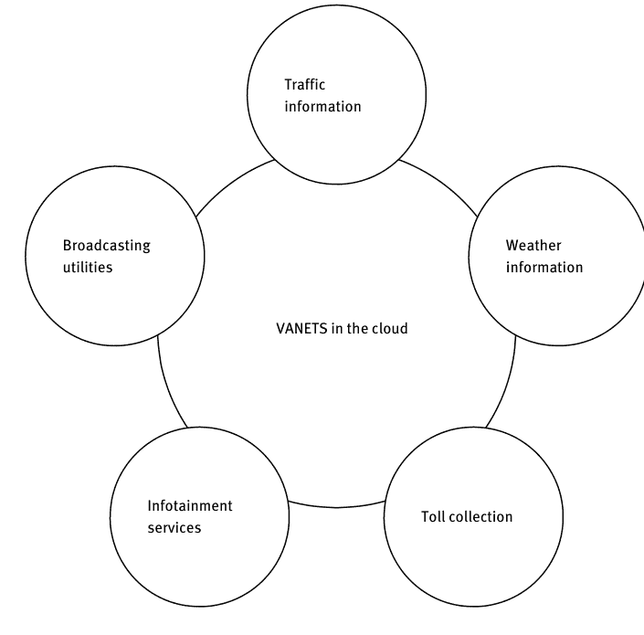

图1：云中的VANET

### 4.3 私有车辆云

车辆的计算资源、存储设施通常可以被所有者用作个人云，用户连接到网络并将所有数据上传到私有云中，如图3所示。通过将所有数据存储到私有云中，用户可以拥有数据的所有权，并在需要时随时查看 [14]。

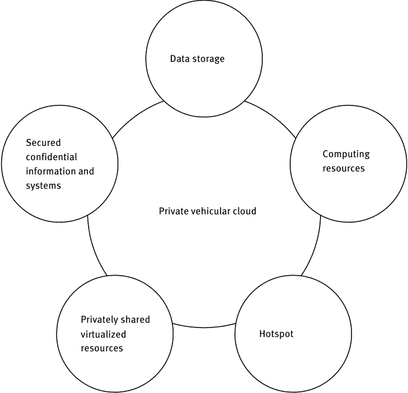

**图3：** 私有车辆云

## 5 自动驾驶/自主控制车辆

自动驾驶或自主控制车辆如今通过Google汽车已成为现实，并且可以合理地说，相关技术和专业知识将进一步改进并降低成本，在不久的将来成为一项标配功能。然而，以相同的速度进行编队并组成群体或“车辆群”。Ricardo是一家参与SARTRE项目的英国工程公司，认为车辆队列行驶对于完全自动驾驶或自主控制车辆是可行的 [16]。

## 7 车辆云计算的应用

### 7.1 基于停车场的数据库或信息云

美国交通部的近期指标显示，在美国街道和公路上注册的车辆队列接近2.56亿辆，并且正在逐步增加。此外，统计数据披露，这些车辆中的大多数每天花费数小时停在停车场、停车区域或车道上。让我们考虑一家雇佣数百名员工并提供IT服务的小公司。我们不考虑拼车，车辆仍停在停车场。在这些车辆中，算法资源没有使用，持续闲置数小时。公司可以给员工一个意向，让他们为VC组建租用这些资源。因此，停车场内的贡献和参与车辆创建了一个计算机车辆集群，并为安全数据存储提供了充足的服务 [17]。

### 7.2 动态和自发的交通灯管理

如今，由于道路上有大量车辆，交通成为日常现象，浪费了宝贵的时间、资源、能源和人类的健康。解决这个问题的最佳方法之一，不是基于最坏情况预先分配大量资源，而是分配适当数量的资源。让我们设想一个像足球比赛这样的场合，有成千上万人参加，在分流处可能发生交通拥堵。尽管通过利用VANET和ITS完成了大量研究和培训来解决这个问题，但它们无法迅速发现交通问题，通常无法提供交通缓解计划。VCC能够提供一种更有组织且成本效益更高的方式来解决交通拥堵，通过从加入交通的可用车辆中提供明确资源并将它们连接起来，以非常规方式找到解决方案，而不期望官员做出反应 [18]。

### 7.3 优化和增强交通信号

交通信号设置信号周期长度以及相应的绿灯相位长度。信号系统优化目前是在离线状态下进行的，要么在支路连接处，要么在通道层面。时间段由针对特定时间段（例如工作日早晨或下午的高峰时段）的定时策略定义。这种方法的一个缺点是它需要关于交通转向运动的数据，这些数据经常被收集以确保信号定时策略适合当前的交通容量条件。另一个困难是，该计划不能很好地应对交通情况和环境的无限变化。因此，扫描通过积极利用车载网络来发挥信号系统的作用。

### 7.4 道路安全通信和消息

新车配备了嵌入式检测设备，以实现熟练和安全操作。摄像头通过追踪道路标线帮助驾驶员保持在车道内。因此，汽车拥有传感器节点，VC可以动态地形成一个大型无线传感器网络。车辆检查附近其他汽车的传感器，以扩展前瞻能力并评估前方可能存在的道路风险、路况、减速带、颠簸和积雪。然而，这种VANET设计不会给我们提供安全措施的方向和更快的解决方案。

### 7.5 发展中国家的VC

由于缺乏熟练的集中决策支持系统和设施，VC的概念在发展中国家也将非常重要。此外，VC将通过动态使用许多计算应用程序，在通过车载网络提供大量计算资源方面发挥重要作用，这些应用程序不太可能用于现有基础设施。

### 7.6 管理停车设施

在大学、购物中心或大城市的附近区域寻找合适的停车场，将受益于自动停车控制设施。最近，公认的解决方案强化了一种统一模式，将单个停车库和停车计费表整合后推广到社区。如今，驾驶员能够通过智能手机应用程序（例如Smart park、Park Me和Park Mate）找到停车场。然而，这些应用程序有一些尚未解决的缺点，例如：


覆盖了地球上的网络盲区，因此需要接入互联网。在特定区域内组成车载自组网的车辆将能实时获取可用停车位的数据，并引导驾驶员前往最合适的位置 [19]。

## 8 车载自组网的特征

车载自组网的特征包括高机动性和拓扑结构的频繁变化。下面讨论车载自组网的一些特征：

### 8.1 高机动性

车载自组网具有很高的机动性。车载自组网中的高机动性在展示车载自组网协议方面发挥着非常重要的作用。车载自组网中的每个节点都以极高的速度移动，这使得节点具有很高的机动性，同时减少了车载网络中的通信时间。

### 8.2 驾驶员安全

车载自组网有助于提升驾驶员安全性、提高乘客舒适度并改善交通流量。车载自组网最重要的优势之一是车辆之间可以直接互联并相互通信。这使得多种应用能够在不同节点（如路侧单元（RSU）和车载单元（OBU））之间进行连接和通信。

### 8.3 动态网络拓扑

车载自组网的拓扑结构会随着车辆速度和高度机动性而迅速变化。车辆灵活性方面的变化使车载自组网更容易遭受各种类型的攻击，同时检测可疑车辆也变得更加困难。

### 8.4 频繁的网络断连

车载自组网的频繁中断和断连已成为车辆之间以及天气等各种常见条件下的高速现象。道路上大量的车辆也会导致服务频繁中断。

### 8.5 无功率限制

车载自组网中当然没有功率限制。这使得车辆能够通过长效电池为车载单元提供持续的电力。

### 8.6 网络强度

车载自组网的网络强度受道路交通流量影响。如果发生交通拥堵，网络强度可能非常高；如果完全没有交通流量，网络强度可能较低。在高速公路附近以及城市出入口附近，网络质量会更好。

### 8.7 大规模计算处理

车载自组网中的节点是车辆，可以配备传感器以及其他计算设备，如处理器、天线和 GPS。所有这些资源都需要车载自组网节点具备强大的计算能力，并提供更健壮的无线通信，以获取有关位置、速度和方向的特定信息。

## 9 车载自组网的安全服务

车载自组网的安全与保障是为乘客和驾驶员提供安全的重要问题。安全服务如下：

- 服务的可用性
- 服务的机密性
- 服务的认证性
- 服务的数据完整性
- 服务的不可否认性

### 9.1 服务的可用性

可用性特性在车载自组网安全中起着极其关键的作用，因为它确保网络在许多故障和不可预测的条件下始终保持可用。与其他一些现有安全服务相比，这一可用性特性极易受到某些危险攻击的影响。因此，可以使用许多基于信任的机制和密码学实践来保护车载自组网免受这些攻击。

### 9.2 服务的机密性

机密性确保数据和记录只能由指定用户访问，同时使未授权用户无法访问与指定用户通信相关的私密和机密信息。

### 9.3 服务的认证性

认证在保障车载自组网安全方面起着重要作用。它防止车辆受到网络中可能发生的恶意活动的影响。为了避免网络遭受危险攻击，有必要对通过网络传输的用户和消息进行认证。

### 9.4 服务的数据完整性

数据完整性特性有助于确保消息内容在传输过程中不会以任何方式被更改或篡改。

### 9.5 服务的不可否认性

不可否认性特性非常重要，因为它确保有效性，并确保发送和接收实体在任何争议情况下都无法否认其发送和接收行为。

## 10 车载自组网的威胁与攻击

车载自组网会面临不同类型的威胁和攻击，这些攻击造成的破坏可能对多种其他应用造成损害。某些攻击的不利影响会波及许多进程和措施。其中一些应用包括安全、保障、舒适性和车载信息娱乐。

### 10.1 通信攻击

在车载自组网中，实现安全通信很困难，因为车载自组网安全会面临许多威胁，如证书复制攻击、窃听攻击以及位置机密性或隐私攻击。

#### 10.1.1 证书复制攻击

在这种攻击中，攻击者可以使用其他用户的虚假证书和密钥作为认证证据而不被追踪。此类攻击的主要目的是制造混乱，使识别恶意车辆变得更加困难。

#### 10.1.2 窃听攻击

这种攻击在非注册车辆使用有效且合法的证书收集车辆的所有有价值信息（如用户 ID、车辆位置等）时，获取机密和个人信息。

#### 10.1.3 隐私攻击

这种攻击包括对隐私保护方案的各种攻击，可能涉及车辆追踪等行为。例如，攻击者可能试图利用目标车辆的位置、ID、签名和凭证来发起替代攻击而不被追踪。

### 10.2 安全应用攻击

这些攻击与信道分配相关。

#### 10.2.1 拒绝服务攻击

这是车载自组网中最常见的攻击之一。当恶意车辆发送大量消息从而阻塞所有可能的通信途径时，就会发生这种攻击。多个攻击者可以同时发起此类攻击。

## 11 车载自组网中的安全与隐私相关问题

各种安全方案已根据其所采用的安全机制来保护隐私，这些方案可分为：

- 与公钥基础设施（PKI）结合的假名机制
- 基于信任的方案
- 群签名

### 11.1 假名与基于 PKI 的方案

假名保护并维护用户的隐私。它隐藏用户的原始身份，并避免身份与假名之间产生任何关联性。然而，如果用户实施任何类型的非法活动，假名可以揭示其真实身份，从而在发生任何不当行为时提供可追溯性。

假名方案的缺点在于车载单元存储了数千个假名，需要定期刷新。为了维护用户隐私，假名会被不断更换。

假名需要维护 CRL。CRL 代表证书撤销列表。该列表保存所有不可靠和不可信车辆的信息。该列表需要持续检查，这既耗时又耗费资源。被称为 CA 的证书颁发机构将假名与车辆关联，因此必须保持其安全，以维护用户隐私。

### 11.2 基于信任的方案

基于信任的方案已被提出用于移动自组网。同样的方案也已应用于车载自组网。在车载自组网中，节点数量庞大，而且由于车辆移动速度非常快，拓扑结构变化迅速。因此，维护车辆的可信性变得困难。

在车载自组网中，目标是提高道路安全性，因此由于高速度和有限的时间，决策过程需要非常快速。信任建立通过中央机构或借助安全基础设施完成。安全基础设施需要动态地建立信任评分。信任评分需要维护和检查。

在基于信任的方案中，当一组车辆联合组成网络时，抵御内部攻击变得困难。为了解决这个问题，人们提出了以数据为中心的信任方案。在这种方案中，可以根据信息交换来判断节点是否转发了错误数据，从而轻松识别虚假节点。这种虚假节点可以被报告并忽略。


VCC 内部的安全与隐私问题需要研究人员付出努力，以开发一种强大的算法，使其能够抵御各类针对 VCC 的安全威胁。

### 12.1 车载云计算的安全服务

主要有五大安全需求，分别是：

#### 12.1.1 机密性

确保主要数据不会泄露给外部节点。

#### 12.1.2 完整性

确保消息有效，并且在通信过程中消息内容未被篡改。

#### 12.1.3 可用性

每当车辆需要某些数据资源时，这些资源必须可用。

#### 12.1.4 身份认证

在此过程中，VC 将通过检查用户身份和发送方地址，对可疑节点进行认证，从而受到保护。

#### 12.1.5 隐私

通过敏感与机密信息，车辆或乘客将免受攻击者的侵害。

### 12.2 车载云计算的威胁

由于面临的挑战，VCC 的使用需求逐年增加。以下是车载云计算面临的一些威胁。

- [15] Zhao J, Li Q, Gong Y, Zhang K, Computation offloading and resource allocation for cloud assisted mobile edge computing in vehicular networks, IEEE Transactions on Vehicular Technology, 2019, vol. 68, no. 8, pp. 7944-7956, Aug. 2019, doi: 10.1109/TVT.2019.2917890
- [16] Euisin L, Eun-Kyu L, Mario G, Soon Y, Vehicular cloud networking: architecture and design principles, IEEE Communications Magazine, 2014, vol. 52, no. 2, pp. 148-155, doi: 10.1109/MCOM.2014.6736756
- [17] Alazawi Z, Altowaijri S, Mehmood R, Abdjabar M, Intelligent disaster management system based on cloud-enabled vehicular networks, 2011 11th International Conference on ITS Telecommunications, St. Petersburg, Russia, 2011, pp. 361-368, doi: 10.1109/ITST.2011.6060083
- [18] Yu R, Zhang Y, Gjessing S, Xia W, Yang K, Toward cloud-based vehicular networks with efficient resource management, IEEE Network, 2013, vol. 27, no. 5, pp. 48-55, doi: 10.1109/MNET.2013.6616115
- [19] Hassan A, Luong T, Jin W, Sungyoung L, Saad Q, V-Cloud: vehicular cyber-physical systems and cloud computing, In Proceedings of the 4th International Symposium on Applied Sciences in Biomedical and Communication Technologies, Association for Computing Machinery, New York, NY, USA,2011, Article 165, 1–5, DOI:https://doi.org/10.1145/2093698.2093863

SaaS——软件即服务，通过互联网使用所有软件服务，其模式为付费使用。使用 SaaS 后，我们无需在计算机上安装任何其他类型的软件应用程序。所有这些软件应用程序都存储在云端，需要时即可通过互联网访问。

PaaS——平台即服务是一种云计算服务，利用虚拟化技术为云用户和组织提供开发平台。该平台还包括内存、数据库、计算、存储以及其他一些应用开发服务。PaaS 最适用于应用程序的开发和测试环境。这种平台即服务的主要优点是：无需购买硬件、无需花费更多时间、可加速应用程序的开发；任何人都可以随时随地登录并使用应用程序；所存储的数据具有高安全性，并且无需担心数据丢失[6-9]。

## 3 制造云组织模型

根据部署方式的不同，云分为四种模型，即公有云、私有云、混合云和社区云。

公有云——公有云向云用户提供所有资源，任何人都可以通过互联网访问这些资源。公有云的示例包括 Microsoft Azure。在公有云中，您可以与其他组织共享相同的存储和硬件。公有云的主要优势在于安全性、灵活性、可控性和成本效益。

私有云——私有云仅允许特定或选定的用户使用资源，而不是所有公共用户都能使用。它通过专用资源使用解决了公有云的安全问题。这种私有云的主要优点包括安全性更高、性能高效以及能力强大。

混合云——混合云是公有云和私有云的组合。当组织出于各种需求和要求同时使用公有云和私有云时，这种云类型非常适用。混合云的优点是灵活性、备份云、成本节省以及对敏感数据的安全保护。

社区云——社区云将计算服务共享给主要目标群体或某些组织。这种云计算类型也用于商业组织、研究组织、招标项目以及贸易公司的高管。社区云的主要优势在于可用性、可靠性、安全性和改进的服务供应[10-13]。

制造云的供应和组织模型如下图 1 所示。

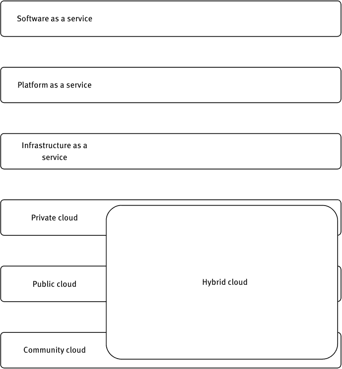

**图 1：** 制造云供应和组织模型

## 4 云制造范式

云制造是一个并行、精简、网络化、交互式和分布式的系统，包含一个互联且集成的虚拟化制造资源服务池。该范式具有智能管理和控制按需服务使用的能力，能够为制造全生命周期中的所有类型用户提供解决方案[14-16]。云制造的概念意味着一种涵盖产品整个生命周期的范式，如生产、模拟、设计、测试和维护。基于云的制造应用包括金属制品制造、汽车制造、住房、建筑。

### 5.2 提高正常运行时间

云使其用户能够持续获得最新、最先进的软件版本。因此，无论何时软件为了更高质量而改进或更新，每个人都能立即、马上获得更新并受益。

### 5.3 标准化

标准化通过简化业务流程并在整个运营中创建标准化，提高了资源利用和使用的的一致性。

### 5.4 更快的实施

由于云客户需求实施速度更快，节省了时间和金钱。

### 5.5 敏捷性

由于敏捷性，使用云制造模型的整个制造过程运营成本更低。

云计算系统可根据制造资源分为以下三类：

- 面向服务的适配输入
- 制造资源的运行和工作平台
- 面向服务的适配输出

云制造系统中有三类关键利益相关者，分别是：

- 提供者
- 运营者
- 消费者

提供者将其资源发布到云制造平台，运营者管理与平台运行和操作相关的各个方面，消费者则向云平台请求服务。

基于云的制造平台由五个层次组成，如图 3 所示。它们是：

- 业务规划
- 制造运营管理
- 自动化与控制
- 传感器与执行器
- 生产过程

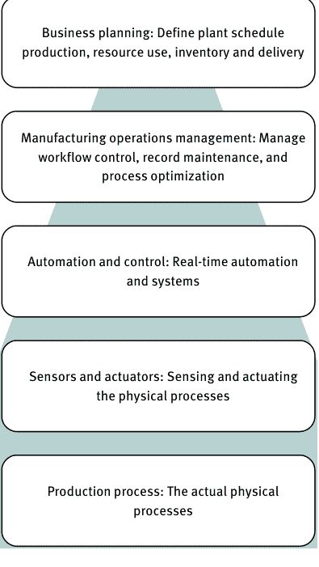

**图 3：** 基于云的制造平台的分层架构

云制造由于与多种技术集成而面临诸多挑战。云计算利用语义 Web、物联网和嵌入式系统确保高性能。必须解决若干技术问题，例如云管理引擎、云制造应用之间的协作、基于知识的资源云化与可视化，以及云计算环境中的用户界面[17-18]。


## 6 云制造的安全与隐私方面

云计算安全是一套基于控制的集成技术与策略，旨在遵守常规组织规范与规则，并保护/守护数据应用和云技术基础设施。由于高效的资源共享，云安全在身份管理、访问控制和隐私方面带来了主要问题。云端数据应以加密形式存储。它在云中处理安全控制，并按照必要的法规为客户提供数据安全、合规性和隐私保护。

### 6.1 云制造中的安全挑战

云以订阅方式向许多组织提供其所有资源。尽管云有许多优势，但仍需应对以下诸多挑战。

#### 6.1.1 可靠性

消费者的数据存储在第三方服务器上。他们不知道自己的数据存储在何处或哪个位置。他们也不清楚提供了哪些安全机制来保护其数据。

#### 6.1.2 隐私

所有云用户都将数据存储在云中，而这些数据存储在世界各地不同位置的某些物理机器上。所有数据都通过互联网传输。

#### 6.1.3 数据丢失

数据丢失是云计算中最严峻的安全挑战之一。如果任何云用户将重要数据存储在云中，我们就需要关注安全问题。如果数据因自然灾害、事故或DDoS攻击而丢失，将给组织带来灾难性后果。

#### 6.1.4 带宽

当资源需求量大或需要存储大量数据时，就需要高带宽。

#### 6.1.5 可用性

有时，当需要同时提供大量资源时，云将无法满足所有消费者的需求。

#### 6.1.6 完整性

云需要确保消费者数据的正确性和可信性。数据不应被修改、恶意伪造、故意删除或篡改。

#### 6.1.7 DoS

恶意用户通过选择/选定受害机器，并同时向虚拟机发送大量请求来发起拒绝服务攻击，导致可靠和真实用户无法获得服务。

#### 6.1.8 身份验证

每个云用户在访问云资源之前都应接受检查和身份验证。

#### 6.1.9 访问控制

云用户或消费者需要根据云用户类型进行分类，并授予相应权限。

谷歌云平台、微软Azure、亚马逊网络服务等云服务提供商正在为用户迁移到云计算提供最佳资源。用户无需担心其数据安全，因为数据安全由一系列策略和协议、虚拟机以及符合规则法规的数据安全机制来保障。

### 6.2 影响云系统安全的重要因素

影响云系统安全的重要因素包括机密性、完整性和可用性。

#### 6.2.1 机密性

机密性非常重要，它可以确保我们的数据不被未授权方访问。这意味着敏感数据只能由授权人员访问。机密性维护失败意味着未授权人员能够访问提供商提供的所有所需资源，这可能是由于故意行为或意外造成的。这种失败被称为机密性失败或泄露。一旦机密数据（如银行详细信息）泄露，就会导致高风险。

机密性要求分为两类，即数据机密性和虚拟化机密性。

##### 6.2.1.1 数据机密性

云提供商提供许多在线服务来存储云用户数据。这有时可能导致数据安全和机密性的潜在损失。当使用分布式云存储服务在群组内共享数据时，客户端应定期收到群组中任何用户更改数据的最新通知。通过了解云用户的内容以及云用户的访问账户和权限信息，还可以获得许多更有趣的信息。

##### 6.2.1.2 虚拟化机密性

在基础设施即服务中，云服务提供商在云用户或客户有需求时会托管虚拟机。在云系统中，任何拥有特权访问权限的人都可以读取或更改已部署的服务。这意味着，考虑到所有云安全相关问题，整个虚拟化层会引发一些安全问题。虚拟机支持弹性扩展、容错、硬件池化、易于维护、负载均衡和资源维护。

#### 6.2.2 完整性

完整性是一项资产属性，它保证数据或信息没有被任何未经授权的第三方人员修改。因此，资产的正确性和准确性相对于其所有者而言，是确保完整性的体现。通常，删除、编辑和追加操作被认为会改变完整性。因此，所有与网络相关的攻击在云环境中都非常普遍，可能会更改或篡改虚拟机元数据、数据库、用户文件/日志文件和WSDE文件的内容。

完整性要求分为两类，即数据完整性和虚拟化完整性。

##### 6.2.2.1 数据完整性

云方案允许大量以数据为中心的操作和任务，这些操作和任务具有非常大的数据需求，其中“巨大”指的是TB和PB级别。因此，与PaaS（平台即服务）、DaaS（数据即服务）等相关的数据可靠性挑战需要非常小心地处理。一些云特定的数据完整性问题如下：

- 数据传输/外包
- SQL注入
- 跨站脚本
- 元数据欺骗攻击
- 包装攻击

##### 6.2.2.2 虚拟化完整性

正如我们在前面章节中所讨论的，虚拟化层自身存在与安全相关的挑战和问题，这些挑战不仅限于隐私和安全，还包括虚拟机的完整性。一些云特定的虚拟化完整性问题如下：

- 云服务提供商管理员
- 虚拟机复制
- 虚拟机回滚
- 虚拟机逃逸
- VM跳跃

#### 6.2.3 可用性

可用性是云服务提供商必须维护和保持的安全重要方面之一。使用基于云的服务为客户服务和工作的各类商业企业和项目必须保证这些服务具有最高的可用性。即使是最小的停机时间或服务中断也可能导致无法挽回的巨大经济损失。

这些可用性要求分为两类，即数据可用性和虚拟化可用性。

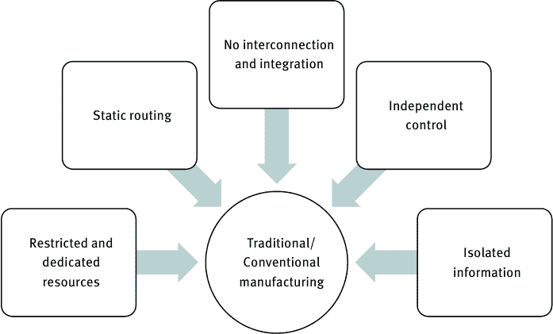

**图4：** 传统/常规制造的局限性

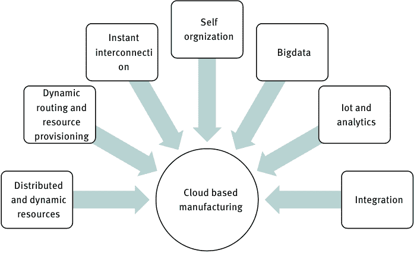

**图5：** 云制造的优势

## 8 安全的云制造模型

表1显示了安全云制造模型的分析。

**表1： 安全云制造模型**

| 序号 | 作者 | 安全云制造模型及其关键实践 |
|---|---|---|
| 1 | Carsten Ellwein, Oliver Riedel, Olga Meyer, Daniel Schel [19] | 制造过程因最新的数字化趋势和技术（如物联网、云计算和数据分析）而频繁变化。云制造模型确实影响产品生产和制造生命周期。**关键实践：**<br>1. 数字化<br>2. 工业物联网<br>3. 云制造<br>4. 安全技术栈<br>5. 面向模块化计算的服务导向架构<br>6. 安全租赁与生产（RnP）即服务<br>7. 集成计算机辅助制造<br>8. 计算机数控 |
| 2 | Zhi Li, Ali Vatankhah Barenji, George Q. Huang [20] | 新兴的制造原型，如基于云的制造、物联网辅助制造和服务导向架构，已为制造业带来诸多好处。**关键实践：**<br>1. 云制造分布式网络<br>2. 区块链技术以确保安全<br>3. 安全数据共享<br>4. 物联网驱动的制造和服务导向制造<br>5. 分布式点对点网络架构以维护云制造（CMfg）中的安全与隐私<br>6. 基于区块链的云制造（BCmfg）允许安全数据共享<br>7. 提出了五层集成模型以实现更高的安全性和可扩展性 |
| 3 | Christian Esposito, Aniello Castiglione, Ben Martini, Kim-Kwang Raymond Choo [21] | 智能制造通过组织之间或单个公司内部物理/逻辑/人力资源之间的互联与协作，提高了效率和能力。工业4.0的最新进展支持组织之间更好地协作、集成与合作，以实现更优… |


| 序号 | 作者 | 安全云制造模型及其关键实践 |
|---|---|---|
|  |  | 资源共享与使用<br>**关键实践：**<br>1. 协作网络化制造<br>2. 云制造的分层安全架构<br>3. 安全云制造的密钥管理的四个阶段<br>4. 用于防御云制造数据泄露的安全云服务<br>5. 网络化制造模型 |
| 4 | Haibo Yi [22] | 云制造在世界各地都受到了广泛关注。云制造的专业知识整合了面向服务的实践以及基于云计算的制造实践。在云计算平台的帮助下，制造服务提供了高效的安全解决方案，使其成为最受欢迎的选择。<br>**关键实践：**<br>1. 用于数据安全的后量子非对称密钥加密方案<br>2. 用于身份验证安全的后量子公钥签名生成<br>3. 用于安全高效云制造的后量子安全通信系统<br>4. 保障云制造通信<br>5. 安全且保护隐私的加密和解密系统 |
| 5 | Florin Anton, Theodor Borangiu, Silviu Răileanu, Silvia Anton, Nick Ivănescu, Iulia Iacob [23] | 云系统通过工业 4.0 解决方案确保更多生产，整合车间流程并管理更高级别的企业模块。<br>**关键实践：**<br>1. 基于云的制造系统集成<br>2. 对制造系统的远程访问和控制<br>3. 基于 VM 的自定义配置云 |

## 9 云制造生命周期：一种高效的集成方法

物联网、数据分析、大数据、自组织和高效资源利用是通过高效集成云制造实现的，如图 6 所示。

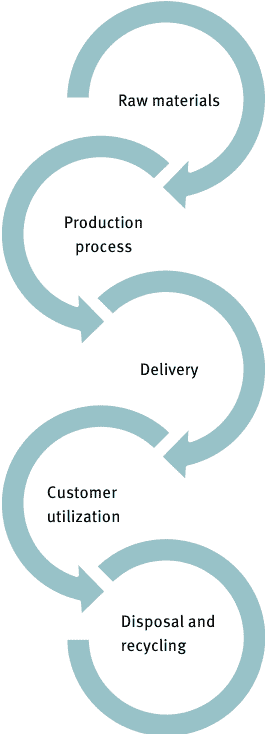

**图 6：** 云制造 - 集成方法

## 10 拟议的安全云制造模型架构

所提出的架构如图 7 所示。所提出的模型具有用于数据安全的不对称密钥加密方案、用于身份验证安全性的公钥签名生成以及用于安全高效云制造的安全通信系统，以保障云制造系统通信和数据安全。

在发送方和接收方使用不同的密钥对数据进行加密和解密。通过改进的加密机制，明文被转换为密文。使用高效的解密机制，密文被转换回明文。

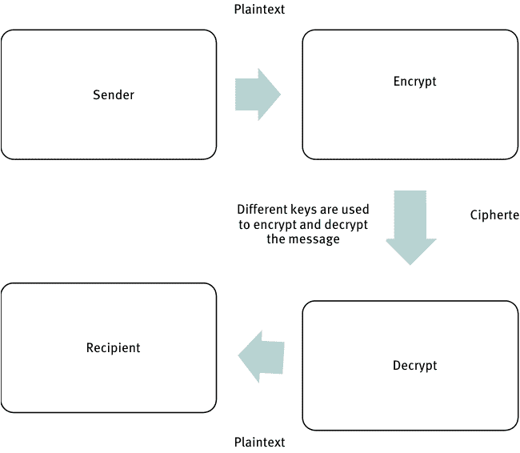

**图 7：** 安全云制造模型架构

以下代码展示了使用 Python 平台进行安全数据加密。

- [12] Potluri S, 解决云计算中数据安全问题的主要方法, The IUP Journal of Computer Science, 2016, Vol. X, Nos. 1 & 2, pp. 18-24, 2016
- [13] Avinash M, Potluri S, 对云端设计与制造技术的研究, International Journal of Mechanical and Production Engineering Research and Development (IJMPERD), 2018, Volume 8, Issue 6, PP: 187-192, ISSN(P): 2249-6890; ISSN(E): 2249-8001
- [14] Potluri S, Subbarao K, 基于服务质量的制造过程自动化云模型, Innovations in Computer Science and Engineering. Lecture Notes in Networks and Systems, 2019, vol 32, PP: 231-240, Springer, Singapore. https://doi.org/10.1007/978-981-10-8201-6_26
- [15] Zhang Y, Zhang G, Liu Y, et al., 云制造机器服务封装和虚拟化访问模型研究, 2017, J Intell Manuf, 28, 1109–1123, https://doi.org/10.1007/s10845-015-1064-2
- [14] Wang X, Mohammad G, Liu W, 云上的制造系统：基于云的工艺规划案例研究, Procedia CIRP, 2017, Volume 63, Pages 39-45, ISSN 2212-8271, https://doi.org/10.1016/j.procir.2017.03.103
- [15] Yingfeng Z, Geng Z, Ting Q, Yang L, Ray Y, 用于云制造服务优化配置的分析目标级联, Journal of Cleaner Production, 2017, Volume 151, Pages 330-343, ISSN 0959-6526, https://doi.org/10.1016/j.jclepro.2017.03.027
- [16] Yongkui L, Lihui W, Vincent W, Xun X, Lin Z, 云制造中的调度：现状与研究挑战, International Journal of Production Research, 2019, 57:15-16, 4854-4879, DOI: 10.1080/00207543.2018.1449978
- [17] Ellwein C, Riedel O, Meyer O, Schel D, Rent 'n' Produce：中小企业的安全云制造平台, 2018 IEEE International Conference on Engineering, Technology and Innovation (ICE/ITMC), 2018, pp. 1-6, doi: 10.1109/ICE.2018.8436332
- [18] Zhi L, Vatankhah B, George Q, 构建区块链云制造系统作为点对点分布式网络平台, Robotics and Computer-Integrated Manufacturing, 2018, Volume 54, Pages 133-144, ISSN 0736-5845, https://doi.org/10.1016/j.rcim.2018.05.011
- [19] Esposito C, Castiglione A, Martini B, Yoo K, 云制造：安全、隐私和取证问题, IEEE Cloud Computing, 2016, vol. 3, no. 4, pp. 16-22, doi: 10.1109/MCC.2016.79
- [20] Yi H, 云制造安全的后量子安全通信系统, J Intell Manuf, 2021, 32, 679–688, https://doi.org/10.1007/s10845-020-01682-y
- [21] Anton F, Borangiu T, Răileanu S, Anton S, Ivănescu N, Iacob I, 为研发在云中安全共享机器人和制造资源, Berns K, Görges D, Advances in Service and Industrial Robotics, RAAD 2019, Advances in Intelligent Systems and Computing, 2019, vol 980, Springer, Cham. https://doi.org/10.1007/978-3-030-19648-6_61

# 索引

- 亚马逊网络服务 85
- 人工智能 4
- 非对称密钥加密方案 187
- 自主或自控车辆 152
- 可用性 68

- 基本安全消息 147
- 区块链即服务 31
- 区块链结构 29
- 区块链技术 23

- 凯撒密码 17
- 资本支出 105
- 密文 11
- 客户端-服务器计算 22
- 基于云的计算 24
- 基于云的管理 93
- 以云为中心的软件 175
- 云计算 2
- 云治理 108
- 云制造 174
- 云保护 33
- 云服务提供商 179
- 云 Shell 137
- 云系统安全 68
- 社区云 53 173
- 计算技术 132
- 保密性 67
- 共识机制 28
- 转化率优化 112
- 密码学 89
- 客户关系管理 113
- 网络攻击 15

- 数据完整性 3
- 数据丢失 178
- 数据隐私 75
- 数据安全 77
- 数据使用 3
- 专用短程通信 146
- 拒绝服务 42
- 去噪自编码器 14
- 分布式拒绝服务 42

- Google Cloud 机器学习引擎 132
- 群签名 161

- 混合云 53
- 虚拟机监视器 54

- 信息安全 44
- 基础设施即服务 67
- 完整性 67, 180
- 智能交通系统 162
- 互联网使能传感器 92
- 物联网 84
- 互操作性 129
- 基于物联网的测试和信息处理 102
- 物联网压缩物联网设备 103
- 物联网网络安全框架 86
- 物联网设备连接 88

- 着陆页优化 112
- 激光照明探测与测距 153

- 机器学习 126
- 制造云供给与组织 173
- 营销策略 107
- 移动即时通信 189

- 网络安全与隐私 87

- 本地数据存储 128
- 运营支出 105

- P2P 云计算 73
- 按点击付费策略 113
- 平台即服务 67
- 私有云 53
- 销毁证明 29
- 权益证明 29
- 工作量证明 28
- 与公钥基础设施耦合的假名 161
- 公有云 53

- 服务质量 147

- RACE 框架 109
- 射频识别 84
- 可靠性 129


- 韧性 34
- 资源管理 130
- 投资回报 118
- 反向密码 17
- 环保安全公路列车 153
- 可扩展性 129
- 安全信息和事件管理系统 137
- 服务级别协议 43
- 软件即服务 66
- 软件定义网络 43
- 基于第三方的加密方案 3
- 传统常规制造 182
- 基于信任的方案 161
- 车载自组网 146
- 虚拟化 54
