# CodeIgniter 测试指南：PHP 自动化测试初学者指南


## 推特本书！

请通过在 Twitter 上分享这本书来帮助 Kenji Suzuki 和 Mat Whitney！

本书建议标签（hashtag）为 `#CTTestGuide`。

点击此链接在 Twitter 上搜索该标签，了解其他人对这本书的评价：

https://twitter.com/search?q=#CTTestGuide

加速测试 (Speed Up)

157

157

无需加速 (Speed Up without)

157

如何阅读 ci-phpunit-test . . . . . . . . . . . . . . . . . . . . . . . . . . . . . . . . . . . . . . 163

- 启动脚本 (Bootstrap) . . . . . . . . . . . . . . . . . . . . . . . . . . . . . . . . . . . . . . . . . . . . . . 164

- 自动加载器 (Autoloader) . . . . . . . . . . . . . . . . . . . . . . . . . . . . . . . . . . . . . . . . . . . . . . 164

- 被替换的类和函数 (Replaced Classes and Functions) . . . . . . . . . . . . . . . . . . . . . . . . . . . . . . . 164

- 新函数 (New Functions) . . . . . . . . . . . . . . . . . . . . . . . . . . . . . . . . . . . . . . . . . . . 165

- 测试用例类 (TestCase classes) . . . . . . . . . . . . . . . . . . . . . . . . . . . . . . . . . . . . . . . . . . . . . 166

- 请求相关类 (Request related classes) . . . . . . . . . . . . . . . . . . . . . . . . . . . . . . . . . . . . . . . . . . . . . 166

- 辅助类 (Helper classes) . . . . . . . . . . . . . . . . . . . . . . . . . . . . . . . . . . . . . . . . . . . . . . 166

- 猴子补丁库 (Monkey Patch library) . . . . . . . . . . . . . . . . . . . . . . . . . . 166

# 前言

当我第一次学习 PHP 时，我完全不知道如何编写测试代码。我周围没有人会写测试代码。当时还没有 PHPUnit（一个 PHP 的测试框架）。2004 年，针对 PHP4 的 PHPUnit 1.0.0 发布。同年，针对 PHP5 的 PHPUnit 2.0.0 也发布了。然而，我从未用过 PHPUnit 1 或 2。

当我在 2007 年第一次发现 CodeIgniter（一个 PHP Web 应用程序框架）时，我确实有一个单元测试类，但框架本身并没有测试代码。

现在，距离 PHPUnit 1.0.0 发布已经过了 10 多年。CodeIgniter 3.0 已经有了自己基于 PHPUnit 的测试代码，这些测试代码占代码量的 60% 左右。我们正在日益取得进步。

你曾为你的 Web 应用编写过测试代码吗？如果你还没有写过，你可能认为编写测试代码会非常困难或麻烦。也许你想编写测试代码，但不知道如何做。

高估学习某事物的成本是很常见的现象，测试也不例外。在读完 PHPUnit 的教程后，我在想：“我该如何测试我的应用？”我很难看出教程中的测试与我需要为自己的应用编写的测试之间的相似之处。

本书是一本 PHP 应用程序自动化测试的入门指南。当然，读完这本书后，你将为任何 PHP 应用编写测试代码，但重点将放在 Web 应用程序上。

我避开复杂，倾向于简单的解决方案。我在书中使用了简单易懂的方案，这样你就不会迷路。让我们继续前进吧！

## 本书简介

如果你想了解这本书，这里是一个极佳的起点。以下是每一章内容的简要概述。这应该让你对接下来的内容有个大概的了解，或者当你以后想回顾某部分特定内容时可以作为一个起点。

## 第 1 章：什么是自动化测试？

让我们开始学习自动化测试。首先，我们将探索自动化测试的基本概念。我们将发现为什么要测试以及你应该测试什么。同时，我将解释本书所使用的思想和测试策略。

## 第 2 章：搭建测试环境

要在你的 PHP 环境中运行测试，你需要安装一些额外的软件。对于本书，这包括 CodeIgniter、PHPUnit 以及一个充当它们之间桥梁的工具 ci-phpunit-test。如果你不熟悉命令行，可以使用 VisualPHPUnit 通过你的浏览器运行测试。

## 第 3 章：测试术语

我们在这里定义测试术语。测试中令人厌烦和困惑的事情之一就是理解它所需的新词汇。到本章结束时，我们将帮助你理解单元测试（Unit）、集成测试（Integration）和系统测试（System）之间的区别；功能测试（Functional）与验收测试（Acceptance）；固件（Fixtures）与模拟（Mocks）等。

## 第 4 章：PHPUnit 基础

在本章中，我们将学习 PHPUnit 的基础。我们将运行 PHPUnit 并学习如何配置它。之后，我们将学习 PHPUnit 规范并编写第一个测试。我们还涵盖了 PHPUnit 功能、数据提供者（data providers）、固件和断言（assertions）。

## 第 5 章：测试简单的 MVC 应用

你已经学习了如何编写测试代码，因此在这里我们为 CodeIgniter 教程应用编写测试。我们将为控制器（Controller）和模型（Model）编写测试。在本章中，我们将使用数据库进行模型测试。

## 第 6 章：模型的单元测试

我们将学习更多关于模型测试的知识。我们将在不使用数据库的情况下为模型编写测试。为了实现这一点，我们将学习 PHPUnit 模拟对象（mock objects）。

## 第 7 章：测试控制器

在本章和接下来的两章中，我们将学习更多关于控制器的测试。在本章中，我们将为一个待评审的控制器编写测试，并使用模拟模型编写测试。我们还为认证和重定向编写测试用例。

## 第 8 章：CLI 控制器的单元测试

我们将继续学习为控制器编写测试。在本章中，我们将为控制器编写单元测试，并学习猴子补丁（monkey patching）。

## 第 9 章：测试 REST 控制器

在本章中，我们将学习测试 REST 控制器。你将学习如何使用 GET 和 POST以外的方法发送（模拟）请求。

## 第 10 章使用 Codeception 进行浏览器测试

在之前的章节中，我们一直使用 PHPUnit。在本章中，我们将学习另一个测试工具。我们将安装 *Codeception*，学习配置它，并编写与 协作的测试。

## 本书要求

假设你对 PHP 5.4 和面向对象编程（OOP）有通用的理解，并且安装了 PHP 5.4、5.5 或 5.6。

如果你了解 CodeIgniter，那么读本书的某些部分可能会更容易，但如果你不了解，不要担心。CodeIgniter 是一个非常容易学习和理解的 MVC 框架，并且拥有非常出色的文档。我将在书中解释 CodeIgniter 特有的规范和功能。

我不假设你正在使用特定的操作系统。然而，我的代码示例是为 Mac OS X 编写的。适用于 Mac OS X 的 Bash 命令在 Ubuntu 上 也可以运行。我没有在 Ubuntu 上测试过它们，但它们可能可以工作。

我们在书中使用了以下软件：

- * PHP 5.5（你可以使用 PHP 5.4 或 5.6）

- CodeIgniter¹ 3.0

- ci-phpunit-test² 0.10

- PHPUnit³ 4.8

- Codeception⁴ 2.1

- Selenium Standalone Server*⁵ 2.48

## 谁应该读这本书？

本书适合不熟悉*自动化测试*或*单元测试*的 PHP 开发者，或者那些寻找帮助来测试 CodeIgniter 应用的人。

如果下面行内容中的一行或多行听起来很熟悉，那么这本书非常适合你！

- * 我从未写过测试代码。*

- 我想写测试代码，但我不知道怎么做。

- 我以前尝试过写测试代码，但我没能完全搞定。

¹http://www.codeigniter.com/

²http://kenjis.github.io/ci-phpunit-test/

³https://phpunit.de/

⁴http://codeception.com/

⁵http://www.selenium.org/

## 为什么选择 PHPUnit？

PHPUnit 是 PHP 世界事实上的标准测试框架。

这些流行的 PHP 框架使用 PHPUnit 进行自身的测试，并提供使用 PHPUnit 进行应用测试的支持：

- CakePHP

- FuelPHP

- Laravel

- Symfony

- Yii

CodeIgniter 3.0 使用 PHPUnit 进行测试。对应用测试的支持计划用于 CodeIgniter 4.0。

## 这本书是 CodeIgniter 的书吗？

本书并不是专门为 CodeIgniter 编写，但我们在示例使用了 CodeIgniter 应用。书中 85% 的内容并非 CodeIgniter 特有，适用于其他。

所以，如果你想学习测试，这本书对你仍然有效。在现代 Web 开发中，你可能使用框架。我不知道你使用或喜欢哪个框架，但如果你通过框架学习测试，编写测试代码会更容易。

CodeIgniter 是目前最易理解的框架之一。即使你不了解 CodeIgniter，这也能让你花费更多时间学习测试。

我选择 CodeIgniter 作为书中使用的框架的另一个原因是太多的 CodeIgniter 开发者不写测试代码。因此，我希望通过在示例中使用 CodeIgniter，本书促进 CodeIgniter 社区更好的测试实践。

## 测试 PHP 应用困难吗？

不，但你需要正确的工具并知道如何编写测试。

## 测试 CodeIgniter 应用困难吗？

不，至少在使用 CodeIgniter 3.0 时不容易。

以前说测试 CodeIgniter 应用很难，但我将向你展示为什么现在不再如此。

## 测试是有趣且简单的

是的，真的很有趣。你喜欢写代码吗？测试也是代码。良好的测试将帮助你编写更好的代码。

当人们被问及为什么不写测试代码时，通常是因为他们认为很困难或会花费太多时间。

我将向你展示如何编写测试，并尝试证明它可以变得有趣且简单。现在编写良好的测试将帮助你更早地发现错误，并让你更容易在修改代码而不引入错误，从长远来看节省了时间。

## 本书中使用的约定

本书使用了以下排版约定：

- *斜体*：表示新术语或技术术语。

- *等宽字体*：用于程序列表，也用于段落内引用程序元素，如类名或函数名、变量、语句和关键字。也用于 Bash 命令及其输出。

例如，下面是一个 PHP 代码块：

```php
<?php

echo 'Hello World!';
```

```
--- a/CodeIgniter/application/tests/libraries/Temperature_converter_test.php
+++ b/CodeIgniter/application/tests/libraries/Temperature_converter_test.php
@@ -6,7 +6,7 @@ class Temperature_converter_test extends TestCase
 {
  $obj = new Temperature_converter();
  $actual = $obj->FtoC(100);
  $expected = 37.0;
  $expected = 37.8;
  $this->assertEquals($expected, $actual, '', 0.01);
}
```

该列表采用统一差异（unified diff）格式。它显示了两个文件之间的差异。该格式以两行表头开始，第一行以 `---` 开头的原始文件路径和名称，第二行以 `+` 开头的新文件。在某些情况下，每行还可能包含日期时间戳。

在这种情况下，原始文件和新文件是相同的（如果文件被移动或重命名，情况可能不是这样），或者 diff 是为了指示内容已移动到新文件中。其后是一个或多个更改块（change hunks），显示文件之间的差异之处。

行 `-6,7 +6,7` 表示块的范围。第一组数字（`-6,7`）表示原始文件中的行，第二组数字（`+6,7`）表示新文件中的行。这些数字的格式为‘起始,数量’，如果块只包含一行，可以省略‘数量’。因此，在此处，该块从文件的第 6 行开始，在两个文件中都包含 7 行。

块的内容（紧随块范围之后）包含文件中的行，以 `+` 开头的为新增（用绿色显示），以 `-` 开头的为删除（用红色显示）。其余行（均不以 `-` 或 `+` 开头）用于提供上下文。

简而言之，从原始文件中删除以 `-` 开头的行，并添加以 `+` 开头的行，即可得到新文件。

这是一个 Bash 命令及其输出的示例：

```bash
$ echo 'Hello World!'
Hello World!
```

这是一个备注或通用信息的示例。

这是一个提示或建议的示例。

这是一个警告或注意的示例。

这是一个练习的示例。

尽管我已经确保了这些内容的准确性，但错误在所难免。如果你发现任何错误，请向我报告，我将不胜感激。如果你发现任何勘误，请在 GitHub https://github.com/kenjis/codeigniter-testing-guide 上提交 issue，我将尽快更新书籍。

# 1. 什么是自动化测试？

欢迎测试的世界！

在本章中，我们将学习自动化测试的概念，并学习为什么要测试以及你应该测试什么。随着学习，我们将开始制定此本书将采用的测试策略。

## 1.1 原始示例

我们将从一个非常简单的示例开始，一个返回 'Hello World!' 的函数。为此，我们将该函数存放在一个名为 `hello.php` 的文件中，并放在服务器易于访问的位置。

hello.php

```php
<?php
function hello()
{
    return 'Hello World!';
}
```

我们如何测试这个函数？

> 练习

> 此时，请停下来并思考你将如何测试这个函数。

# 手动测试

我们将从手动测试开始，在浏览器查看的页面中打印函数的输出。我们将此函数放在另一个文件中，命名为 `hello_test_with_your_eyes.php`，与包含 `hello()` 函数的 `hello.php` 文件位于相同位置。

# 什么是自动化测试

hello_test_with_your_eyes.php

```php
<?php
require __DIR__ . '/hello.php';
echo hello();
```

如果你在浏览器中导航到 hello_test_with_your_eyes.php 并看到 Hello World!，说明函数和测试都正常工作。

或者，你可以直接从 PHP 的命令行界面（CLI）运行它：

```bash
$ php hello_test_with_your_eyes.php
Hello World!
```

这就是手动测试。

所有的 PHP 开发者都曾在某个时候测试过这个。使用网络浏览器进行手动测试非常常见。你编写了一些代码并期望一个结果，然后运行代码来验证你是否收到了预期的结果。如果你查看构建的网页以确认没有收到错误且结果大致符合你的预期，那么你已经在测试你的应用程序了。

然而，如果你自己手动测试应用程序，并手动检查用户可能采取的每种操作，测试可能会花费一些时间。如果你的应用程序很大，在整个应用程序中测试每种可能性可能花费长时间，这意味着你不可能频繁测试所有内容。

# 自动化测试

如果不是在浏览器中手动检查结果，而是编写代码来测试你的应用程序呢？以下是针对我们的 `hello.php` 的原始测试代码。我们将这些代码放在名为 `test_automated.php` 的文件中，与我们的应用程序并列。

# test_automated.php

```php
<?php
error_reporting(-1);
require __DIR__ . '/hello.php';
function assertTrue($condition) {
    if (!$condition) {
        throw new Exception('Assertion failed.');
    }
}
$actual = hello();
$expected = 'Hello World!';
assertTrue($expected === $actual);
```

> 如果你运行这段代码可能什么什么，除非 hello() 返回了意外的内容，那时测试将会失败。

在我看来，最重要的是减少恐惧。如果我们有经过测试的代码，就可以修改它而不用担心破坏现有代码。

自动化测试特性：

- 它很快，

- 所以你可以频繁运行测试。

# 测试提示：避免慢测试

速度是测试中最重要的因素之一。如果你有慢测试，它们会阻止你进行测试。如果你发现一个或多个测试很慢，你应该尝试提高它的速度。

# 什么是自动化测试？

这个示例非常简单，所以你可能认为测试是毫无意义的。然而，如果你对特定的输入期望特定的输出，测试测试的复杂性对测试复杂性的影响很小。

## 1.2 为什么要编写测试代码？


你不编写测试代码，即使你选择不写，知道如何编写也是好的。思考如何为你的代码编写测试会考虑到代码可能会失败以及你对特定代码的预期。

根据“编写单元测试的 12 个理由¹”，当你测试代码时将获得以下益处：

1. 测试减少新功能的 Bug

2. 测试减少现有功能的 Bug

3. 测试是良好的文档

4. 测试降低更改成本

5. 测试改进设计

6. 测试允许重构

7. 测试约束功能

8. 测试防御其他程序员的失误

9. 测试很有趣

10. 测试迫使你慢下来并思考

11. 测试让开发更快

12. 测试减少恐惧

## 1.3 寻找中庸之道

你听说过编写单元测试的正确方法吗？

- 不要访问数据库。
- 不要使用 `new` 操作符（使用依赖注入和工厂）。
- 重写你的代码使其更具测试性。
- 不要与文件系统交互，而是使用虚拟文件系统。

### 什么是自动化测试？

这些观点在某种意义上都是正确的，但并非在所有情况下都适用。在书中，我不会说这些话，而是建议遵循“Testivus 之路”：

- 如果你写了代码，就写测试
- 不要陷入单元测试的教条主义中
- 拥抱单元测试的因果（Karma）
- 将代码和测试视为一体
- 测试比单元更重要
- 测试的最佳时机是代码记忆犹新的时候
- 测试不会逃跑
- 一个不完美的测试也比某天一个完美的测试好
- 一个糟糕的测试也比没有测试好
- 有时，测试证明了……的合理性
- 只有愚蠢才不使用工具
- 好的测试是失败的

避免极端，寻找中道。在书中，我们倾向于提供简单易于理解的解决方案。

## 1.4 你应该测试什么？

这是一个最难回答的问题，在某些情况下几乎无法回答。相反，问我们**不需要**测试什么会更好。

如果我们绝对认为不需要测试*某些东西*，那么我们就不测试它。如果我们不确定，我们就测试一切。

然而，我们正试图寻找中道，我们稍后第 3 章“覆盖率”中回到这个观点。现在，与其担心一切，我们将专注于在可能的情况下编写测试，并获得良好的测试因果。

## 1.5 TDD 还是非 TDD

*测试驱动开发（TDD）* 是一种软件开发过程，你先编写代码，然后编写通过测试的代码，并在极短的开发周期内重复自动化测试。

我们更倾向于 TDD，但你可以选择任何适合你的开发流程。如果我们回到“Testivus 之路”，它说“将代码和测试视为一体”以及“测试的最佳时机是代码记忆犹新的时候”。

根据 James Shore¹，TDD 的开发流程如下：

- 1. **思考 (Think)**：弄清楚什么测试能让你的代码走向完成。（花费你需要的时间。这是初学者最难的一步。）
- 2. **红色（Red）**：编写极少量的测试代码。只有几行……通常不超过五行。运行测试并观察测试失败：测试状态条应该变成红色。（这应该只需要大约 30 秒。）
- 3. **绿色（Green）**：编写极少量的生产代码。同样，通常不超过五行代码。不要担心设计的纯洁性或概念的优雅。有时你可以直接硬编码答案。没关系，因为你稍后就会进行重构。运行测试并观察它们通过：测试状态条将变成绿色。（这也只需要大约 30 秒。）
- 4. **重构 (Refactor)**：现在你的测试通过了，你可以进行更改而不用担心破坏任何东西。停顿一下。如果需要，深呼吸。然后查看你编写的代码，并问问自己是否可以改进它。寻找重复和其他“代码异味”。如果你看到某些看起来不对劲，但不确定如何修复，没关系。在运行过几次循环后再次查看它。（在这一步上你可以花费任何需要的时间。）每次小幅重构后，运行测试并确保它们仍然通过。
- 5. **重复 (Repeat)**：再次执行。你会在一个小时内重复此此循环几十次。通常情况下，你会非常快速地运行几个循环（三到五个），然后发现自己速度慢了下来，在重构上花费了更多时间。你会再次加速。每小时 20-40 个循环并不合理。

遗憾的是，这本书不会作为 TDD 的良好范例，因为我们不会先写测试，由于我们大多数测试将使用现有的应用程序代码。我建议你在真实的应用程序开发中尝试编写测试代码。

# 设置测试环境

在你的 PHP 环境中运行测试，你可能需要安装一些额外的软件。假设你已经安装了 PHP 5.4、5.5 或 5.6。

如果你熟悉并偏于使用 Composer，请参阅 [通过 Composer 安装]().

## 2.1 安装 CodeIgniter

从 [http://www.codeigniter.com/download]() 下载最新的 CodeIgniter 3.0 版本（在书中我们 v3.0.1）并解压。

为了简单起见，我们将 CodeIgniter-3.0.1 目录重命名为 CodeIgniter。

```
CodeIgniter/
|- application/ ... 你的应用程序文件将放在这里。
|- system/ ... CodeIgniter 文件，你不应该修改这些文件。
|- user_guide/ ... CodeIgniter 用户指南 (HTML)，可以省略。
```

## 2.2 安装 ci-phpunit-test

`ci-phpunit-test` 是由 Kenji Suzuki 编写的一个工具，它让 CodeIgniter 3.0 和 PHPUnit 的配合变得更容易。CodeIgniter 有自己的单元测试库，但其功能非常有限，PHPUnit 用于测试 CodeIgniter 本身。CodeIgniter 的开发者计划在 CodeIgniter 4 中提供基于 PHPUnit 的应用测试。因此 `ci-phpunit-test` 是 CodeIgniter 3.0 缺失拼图，提供了使用 PHPUnit 进行应用测试的能力。

从 [https://github.com/kenji/ci-phpunit-test/releases]() 下载最新版本的 `ci-phpunit-test`（在书中使用 v0.10）并解压。将文件夹放在你任何地方。

```
CodeIgniter/
|- application/
|- tests/
```

### 猴补丁 (Monkey Patching)

> `ci-phpunit-test` 是由 Kenji Suzuki 编写的一个工具，它让 CodeIgniter 3.0 和 PHPUnit 的配合变得更容易。CodeIgniter 有自己的单元测试库，但其功能非常有限，PHPUnit 用于测试 CodeIgniter 本身。CodeIgniter 的开发者计划在 CodeIgniter 4 中提供基于 PHPUnit 的应用测试。因此 `ci-phpunit-test` 是 CodeIgniter 3.0 缺失拼图，提供了使用 PHPUnit 进行应用测试的能力。

> 猴补丁是一种是一种在不修改原始源代码的情况下替换 `exit()`、`die()` 以及代码中某些函数和方法的方法。要启用猴补丁，请在编辑器中打开 `application/bootstrap.php`。

*(注：OCR 文本在末尾极其重复且破碎。我将根据提供的逻辑片段提供一个干净的合并版本。)*

### 什么是自动化测试？

这些观点在某种意义上都是正确的，但并非在所有情况下都适用。在书中，我不会说这些话，而是建议遵循“Testivus 之路”：

- 如果你写了代码，就写测试
- 不要陷入单元测试的教条主义中
- 拥抱单元测试的因果（Karma）
- 将代码和测试视为一体
- 测试比单元更重要
- 测试的最佳时机是代码记忆犹新的时候
- 测试不会逃跑
- 不完美的测试也比某天一个完美的测试好
- 一个糟糕的测试也比没有测试好
- 有时，测试证明了……的合理性
- 只有愚蠢才不使用工具
- 好的测试是失败的

避免极端，寻找中道。在书中，我们倾向于提供简单易于理解的解决方案。

## 1.4 你应该测试什么？

这是一个最难回答的问题，在某些情况下几乎无法回答。相反，问我们**不需要**测试什么会更好。

如果我们绝对认为不需要测试*某些东西*，那么我们就不测试它。如果我们不确定，我们就测试一切。

然而，我们正试图寻找中道，我们稍后第 3 章“覆盖率”中回到这个观点。现在，与其担心一切，我们将专注于在可能的情况下编写测试，并获得良好的测试因果。

## 1.5 TDD 还是非 TDD

*测试驱动开发（TDD）* 是一种软件开发过程，你先编写代码，然后编写通过测试的代码，并在极短的开发周期内重复自动化测试。

我们更倾向于 TDD，但你可以选择任何适合你的开发流程。如果我们回到“Testivus 之路”，它说“将代码和测试视为一体”以及“测试的最佳时机是代码记忆犹新的时候”。

根据 James Shore¹，TDD 的开发流程如下：

- 1. **思考 (Think)**：弄清楚什么测试能让你的代码走向完成。（花费你需要的时间。这是初学者最难的一步。）
- 2. **红色（Red）**：编写极少量的测试代码。只有几行……通常不超过五行。运行测试并观察测试失败：测试状态条应该变成红色。（这应该只需要大约 30 秒。）
- 3. **绿色（Green）**：编写极少量的生产代码。同样，通常不超过五行代码。不要担心设计的纯洁性或概念的优雅。有时你可以直接硬编码答案。没关系，因为你稍后就会进行重构。运行测试并观察它们通过：测试状态条将变成绿色。（这也只需要大约 30 秒。）
- 4. **重构 (Refactor)**：现在你的测试通过了，你可以进行更改而不用担心破坏任何东西。停顿一下。如果需要，深呼吸。然后查看你编写的代码，并问问自己是否可以改进它。寻找重复和其他“代码异味”。如果你看到某些看起来不对劲，但不确定如何修复，没关系。在运行过几次循环后再次查看它。（在这一步上你可以花费任何需要的时间。）每次小幅重构后，运行测试并确保它们仍然通过。
- 5. **重复 (Repeat)**：再次执行。你会在一个小时内重复此循环几十次。通常情况下，你会非常快速地运行几个循环（三到五个），然后发现自己速度慢了下来，在重构上花费了更多时间。你会再次加速。每小时 20-40 个循环并不合理。

遗憾的是，这本书不会作为 TDD 的良好范例，因为我们不会先写测试，由于我们大多数测试将使用现有的应用程序代码。我建议你在真实的应用程序开发中尝试编写测试代码。

```php
$config = array(
    // 测试所在的目录
    'test_directory' => array(
        'Sample Tests' => '{$root}/app/test',
        '//My Project' => '{$var/www/sites/my.awesome.site/laravel/tests',
        'CodeIdentifier Testing Guide'
        => '/Users/kenji/code/CodeIdentifier/application/tests',
    ),

    // 必要的路径
    'include_paths' => array(
        APPPATH,
        BASEPATH,
    ),

    // 排除的目录
    'exclude_paths' => array(
        APPPATH . '/tests/',
    ),

    // 你使用的所有补丁
    'patch_list' => array(
        'ExitPatcher',
        'FunctionPatcher',
        'MethodPatcher',
    ),

    // 需要补丁的函数
    'functions_to_patch' => array(
        'random_string',
    ),

    // 为了让 PHP 正常工作，配置文件必须
    // 包含 JSON 监听器（更多信息请参 README）
    'xml_configuration_files' => array(
        '/Users/kenji/code/CodeIdentifier/tests/phpunit.xml',
    ),
);
```

# 设置测试环境

```
'bootstraps' = array(
    // /path/to/bootstrap.php',
    // /var/www/sites/my.awesome.site.com/laravel/bootstrap/autoload.php',
    // /Users/kenji/code/CodeIgniter/application/tests/Bootstrap.php'
);
```

> 上述列表采用统一 diff 格式。它显示了两个文件之间的差异。简而言之，从原始文件中删除以 - 开头的行，并添加带有 + 的绿色行即可获取新文件。详细信息请参阅本书中使用的约定。

## 配置 PHPUnit XML 配置文件

要使用 PHPUnit XML 配置文件来定义运行哪些测试，请修改 CodeIgniter 目录下的 PHPUnit 配置文件，包含以下 `<listeners>` 元素：

```diff
a/CodeIgniter/application/tests/phpunit.xml
+++ b/CodeIgniter/application/tests/phpunit.xml
@@ -27,4 +27,8 @@

<log type="coverage-clover" target="Build/logs/clover.xml">
<log type="phpunit" target="build/logs/phpunit.xml" logIncompleteSkipped="false" />
<logging>
    <!-- 这是 VPU 正常工作所需的 -->
    <listeners>
        <listener class="PHPUnit_Util_Log_JSON"></listener>
    </listeners>
</logging>
</phpunit>
```

好了，以上就是全部。下一章：测试术语。

> 如果你使用 PHPUnit，则无法使用“（可选）安装 PHPUnit”中介绍的 PySH。

## 2. 安装 PHPUnit

下载 https://phpunit.de/phpunit-4.8.10.phar 并将其重命名为 `phpunit.phar`，然后将其放入你的 `application/tests` 文件夹中。对于大多数环境，这就足够了，但如果你在安装 PHPUnit 时遇到问题，PHPUnit 手册中的安装部分应该帮助你找出问题所在。

### 设置环境

`CodeIgniter/application/tests/phpunit.phar`

> 你可以从 https://phar.phpunit.de/phpunit.phar 下载最新版本的 PHPUnit PHAR，并从 https://phar.phpunit.de/ 下载所有版本的 PHPUnit PHAR。PHPUnit 5.0 需要 PHP 5.6 或更高版本。

让我们确认已安装的 PHPUnit 版本。打开终端。

```
$ cd CodeIgniter/application/tests/
$ php phpunit.phar --version
PHPUnit 4.8.10 by Sebastian Bergmann and contributors.
```

### Windows 用户

我建议你使用适用于 Windows 的 Git Bash：https://git-for-windows.github.io。

### 在哪里运行 phpunit

你必须进入 `application/tests` 目录来运行 phpunit，因为 PHPUnit 配置文件 `phpunit.xml` 就安装在这里。

## 2.5 （可选）安装 PsSh

> PsSH 是一个用于 PHP 的交互式调试器和读取-评估-打印循环 (REPL)，它允许你通过 CLI 调试测试代码。

从 http://psysh.org/psysh 下载最新版本的 PsSH（在本书中我们 v0.6.0-dev），并将其放入 `application/tests` 目录。

设置测试环境 13

```
CodeIgniter/
- application/
  - tests/
    psysh
```

为 `psysh` 二进制文件设置权限。

```
$ cd CodeIgniter/application/tests/
$ chmod +x psysh
```

在 `application/tests/Bootstrap.php` 加载 `PHPUnitTest` 之前引入 psysh。在第 323 行添加该行。

`application/tests/Bootstrap.php`

```
323 require __DIR__ . '/psysh'; # 添加此行。
324
325 /*
326 *
327 为 CI PHPUnit 测试添加
328 *
329 */
330 require __DIR__ . '/_ci_phpunit_test/PHPUnitTest.php';
331 PHPUnitTest::init();
```

## 2.6 通过 Composer 安装

如果你使用 Composer 或命令行，可以通过 Composer 安装所有这些组件。

> Composer 是一个用于 PHP 包（库）管理工具工具。它允许你声明项目依赖的库，并且它会为你管理（下载/安装/更新）这些库。

### 安装 Composer

如果你使用 Linux 或 Mac OS X，可以从终端安装 Composer。

# 设置测试环境

```
$ curl -sS https://composer.org/installer | php
$ sudo mv composer.phar /usr/local/bin/composer
```

如果你使用 Windows，可以下载并运行 `Composer-Setup.exe`。

### 通过 Composer 安装 CodeIgniter


```bash
$ composer create-project kenjis/codeigniter-composer-installer CodeIgniter
```

上述命令安装了具有更安全目录结构的 CodeIgniter 3.0。

- `CodeIgniter/`
  `application/` ... 你的应用文件。
  `composer.json` ... Composer 的配置文件。
  `composer.lock` ... Composer 的锁文件，由 Composer 管理。
  `public/`
    `index.php` ... 前端控制器。
  `vendor/` ... Composer 的 vendor 目录，由 Composer 管理。
    `autoload.php` ... Composer 的自动加载器。
  `codeigniter/`
    `framework/`
      `application/` ... 你不需要这个目录。
      `system/` ... CodeIgniter 系统目录。
      `user_guide/` ... CodeIgniter 用户指南 (HTML)。

`composer.json` 文件描述了项目的依赖关系。Composer 安装的包可以在 `vendor` 目录中。它们由 `composer` 命令进行安装、更新或删除，因此你不应该编辑 `vendor` 目录中的任何文件。

### 通过 Composer 安装 ci-phpunit-test

```bash
$ cd CodeIgniter/
$ composer require kenjis/ci-phunit-test --dev
$ php vendor/kenjis/ci-phunit-test/install.php
```

上述命令将安装 `ci-phpunit-test`。

# 设置测试环境

```
CodeIgniter/
application/
|- tests/
|- vendor/
    |- kenjis/
      |- ci-phpunit-test/application/tests/
```

最后一条命令将 `vendor/kenjis/ci-phpunit-test` 复制到 `application/tests`，这样在预期位置就能找到它。

然后启用猴子补丁（Monkey Patching）。编辑 `application/tests/Bootstrap.php`。

### 通过 Composer 安装 PHPUnit

```bash
$ composer require phpunit/phpunit=4.8.* --dev
```

此命令安装了 PHPUnit。

```
CodeIgniter/
application/
|- tests/
|- vendor/
    |- phpunit/
```

最后一条命令将 `vendor/phpunit` 复制到 `application/tests`，这样在预期位置就能找到它。

然后启用猴子补丁（Monkey Patching）。编辑 `application/tests/Bootstrap.php`。

### 通过 Composer 安装 PsSh

```bash
$ composer require psysh/psysh:@stable --dev
```

此命令安装了 PsSH。

```
CodeIgniter/
application/
|- tests/
|- vendor/
    |- psysh/
```

### 在哪里运行 phpunit

你必须进入 `application/tests` 目录来运行 `phpunit`，因为 PHPUnit 配置文件 `phpunit.xml` 安装在这里。

### 创建 phpunit 快捷方式

```bash
#!/bin/sh
### application/tests/phpunit.sh

dirname "$0"
../phpunit.phar "$@"
```

现在为脚本设置权限。

```bash
$ chmod +x phpunit.sh
```

让我们确认已安装的 PHPUnit 版本。

```bash
$phpunit.sh --version
PHPUnit 4.8.10 by Sebastian Bergmann and contributors.
```

### Windows 用户

我建议你使用适用于 Windows 的 Git Bash：https://git-for-windows.github.io。

## 2.5 （可选）安装 PsSh

> PsSH 是一个用于 PHP 的交互式调试器和读取-评估-打印循环 (REPL)，它允许你通过 CLI 调试测试代码。

从 http://psysh.org/psysh 下载最新版本的 PsSH（在本书中我们 v0.6.0-dev），并将其放入 `application/tests` 目录。

```
CodeIgniter/
- application/
  - tests/
    psysh
```

为 `psysh` 二进制文件设置权限。

```bash
$ cd CodeIgniter/application/tests/
$ chmod +x psysh
```

在 `application/tests/Bootstrap.php` 加载 `PHPUnitTest` 之前引入 psysh。在第 323 行添加该行。

`application/tests/Bootstrap.php`

```
323 require __DIR__ . '/psysh'; # 添加此行。
324
325 /*
326 *
327 为 CI PHPUnit 测试添加
328 *
329 */
330 require __DIR__ . '/_ci_phpunit_test/PHPUnitTest.php';
331 PHPUnitTest::init();
```

## 2.6 通过 Composer 安装

如果你使用 Composer 或命令行，可以通过 Composer 安装所有这些组件。

> Composer 是一个用于 PHP 包（库）管理工具。它允许你声明项目依赖的库，并且它会为你管理（下载/安装/更新）这些库。

### 安装 Composer

如果你使用 Linux 或 Mac OS X，可以从终端安装 Composer。

# 设置测试环境（续）

```bash
$ curl -sS https://composer.org/installer | php
$ sudo mv composer.phar /usr/local/bin/composer
```

如果你使用 Windows，可以下载并运行 `Composer-Setup.exe`。

### 通过 Composer 安装 CodeIgniter

```bash
$ composer create-project kenjis/codeigniter-composer-installer CodeIgniter
```

上述命令安装了具有更安全目录结构的 CodeIgniter 3.0。

- `CodeIgniter/`
  `application/` ... 你的应用文件。
  `composer.json` ... Composer 的配置文件。
  `composer.lock` ... Composer 的锁文件，由 Composer 管理。
  `public/`
    `index.php` ... 前端控制器。
  `vendor/` ... Composer 的 vendor 目录，由 Composer 管理。
    `autoload.php` ... Composer 的自动加载器。
  `codeigniter/`
    `framework/`
      `application/` ... 你不需要这个目录。
      `system/` ... CodeIgniter 系统目录。
      `user_guide/` ... CodeIgniter 用户指南 (HTML)。

`composer.json` 文件描述了项目的依赖关系。Composer 安装的包可以在 `vendor` 目录中。它们由 `composer` 命令进行安装、更新或删除，因此你不应该编辑 `vendor` 目录中的任何文件。

### 通过 Composer 安装 ci-phpunit-test

```bash
$ cd CodeIgniter/
$ composer require kenjis/ci-phunit-test --dev
$ php vendor/kenjis/ci-phunit-test/install.php
```

上述命令将安装 `ci-phpunit-test`。

# 设置测试环境

```
CodeIgniter/
application/
|- tests/
|- vendor/
    |- kenjis/
      |- ci-phpunit-test/application/tests/
```

最后一条命令将 `vendor/kenjis/ci-phpunit-test` 复制到 `application/tests`，这样在预期位置就能找到它。

然后启用猴子补丁（Monkey Patching）。编辑 `application/tests/Bootstrap.php`。

### 通过 Composer 安装 PHPUnit

```bash
$ composer require phpunit/phpunit=4.8.* --dev
```

此命令安装了 PHPUnit。

```
CodeIgniter/
application/
|- tests/
|- vendor/
    |- phpunit/
```

最后一条命令将 `vendor/phpunit` 复制到 `application/tests`，这样在预期位置就能找到它。

然后启用猴子补丁（Monkey Patching）。编辑 `application/tests/Bootstrap.php`。

### 通过 Composer 安装 PsSh

```bash
$ composer require psysh/psysh:@stable --dev
```

此命令安装了 PsSH。

```
CodeIgniter/
application/
|- tests/
|- vendor/
    |- psysh/
```

### 在哪里运行 phpunit

你必须进入 `application/tests` 目录来运行 `phpunit`，因为 PHPUnit 配置文件 `phpunit.xml` 安装在这里。

### 创建 phpunit 快捷方式

```bash
#!/bin/sh
### application/tests/phpunit.sh

dirname "$0"
../phpunit.phar "$@"
```

现在为脚本设置权限。

```bash
$ chmod +x phpunit.sh
```

让我们确认已安装的 PHPUnit 版本。

```bash
$phpunit.sh --version
PHPUnit 4.8.10 by Sebastian Bergmann and contributors.
```

### Windows 用户

我建议你使用适用于 Windows 的 Git Bash：https://git-for-windows.github.io。

## 2.5 （可选）安装 PsSh

> PsSH 是一个用于 PHP 的交互式调试器和读取-评估-打印循环 (REPL)，它允许你通过 CLI 调试测试代码。

# 测试术语（续）

在本书中，我们定义的测试术语如本章所示。

## 3.1 测试级别

# 单元测试 (Unit Testing)

单元测试是指验证特定代码段功能的测试。在面向对象的环境中，这通常是在类级别进行的。换句话说，单元通常是一个类，而单元测试将验证整个类的功能。

然而，当你拥有两个紧密耦合的类时，你的团队可能会决定它们需要作为一个单元进行测试。

# 单元测试

如果你不确定代码库中什么构成单元，类是一个很好的起点。最小单元是类，或者是类外的 PHP 函数。方法（定义在类内部的函数）通常不被视为单元，因此无法与其定义它的类进行隔离测试。

> 测试技巧：测试类而不是方法

测试类而不是单个方法是良好的实践，因为如果状态不会改变方法调的结果，我们就不需要担心它。如果你编写检查类内部逻辑的测试，可能会阻止你重构类。

# 集成测试 (Integration Testing)

集成测试是指验证多个单元功能的测试。即使所有单元都通过了，在单元交互时仍可能存在 Bug，因此单元测试是不够的。

我们可以说功能测试、数据库测试和浏览器测试都是集成测试的类型。

## 系统测试

系统测试，或称为端到端测试（End-to-End Testing），是对完全集成的系统进行测试，以验证其是否符合需求。在使用网络浏览器进行测试是系统测试的一种形式，但在 PHP 世界中被称为验收测试（Acceptance Testing）。

- 自然地，单元测试通常比集成测试快。集成测试通常比系统测试快。测试速度越快越好，因为运行缓慢的测试执行频率会降低。然而，每个级别的测试都有其特定的重要性，确保了应用程序的正常运行。

## 3.2 测试类型

### 功能测试

功能测试是指验证整个系统中的某一项功能。它不是指 PHP 函数。

功能测试用于验证当控制器、视图（或多个）、模型（或）以及任何必要的库都一起使用时，特定的操作（控制器中的方法/函数）是否产生了预期的输出。它也可以用于测试库提供的功能。

例如，可以通过验证以下方式对缓存库进行测试：验证对特定操作的首次调用填充了缓存，而随后的调用使用缓存来满足请求。你可能还需要调用另一个操作使缓存失效，然后验证原始操作是否重新填充了缓存。

我们将在第 5 章“页面控制器的测试用例”中对控制器进行功能测试。

### 数据库测试

数据库测试是使用数据库的测试。

我们将在第 5 章“新闻模型的测试用例”中对模型进行数据库测试。

### 浏览器测试

浏览器测试是使用网络浏览器或模拟网络浏览器的测试。

我们将在第 10 章使用带有 Firefox 的 Codeception 以及带有 Google Chrome 的 Codeception 对 Web 应用进行浏览器测试。

### 验收测试

验收测试测试产品是否符合其设计需求。该名称源于：在某些环境中，客户可能会定义一系列测试，你的应用程序在接受产品之前必须通过这些测试。

在大多数情况下，验收测试是浏览器测试的一种特定形式，我们将在第 10 章介绍这部分。

## 3.3 代码覆盖率

代码覆盖率告诉你在测试执行期间哪些脚本行被执行了。PHPUnit 需要 Xdebug¹ 或 phpdbg² 来提供代码覆盖率报告。

我们使用行覆盖率（Line Coverage），它衡量每行可执行代码是否被执行。如果我们说代码覆盖率为 60%，那么在测试执行期间有 60% 的行被执行了。

代码覆盖率只告诉你执行了多少行。100% 的代码覆盖率意味着你的代码在测试期间都已执行。它并不能保证你的代码没有 Bug，或者你的所有代码都真实经过了测试。

如果你想了解更多关于代码覆盖率的信息，我建议你阅读 PHPUnit 手书中关于代码覆盖率分析³的章节。

## 3.4 固定件 (Fixtures)

固件（Fixture）是运行测试时的已知状态。运行测试时，如果当前测试与上一个测试不同，结果也可能不同，因此你构建一个或多个固件以确保测试的可重复和一致性。

例如，在数据库测试中，我们始终必须设置相同的数据库状态。如果你编写了一个测试，在没有预先固定状态的情况下进行查询并检查结果，另一个插入/更新数据的测试可能会导致你的测试失败。如果你在一个开发者团队中工作，情况可能会糟，因为每个开发者可能并不知道其他开发者测试的预期。

由于我们正尝试运行自动化测试，我们希望代码环境在每个测试中处于已知状态。我们将在第 5 章“数据库固件”中准备数据库固件。

> ¹http://xdebug.org/
> ²http://phpdbg.com/
> ³https://phpunit.de/manual/4.8/en/code-coverage-analysis.html

## 3.5 测试双桩 (Test Doubles)

```
$page = $this->httpClient->get('http://www.codeigniter.com/');
```

被测试的类需要调用库的 `get()` 方法并传入参数 `http://www.codeigniter.com/`。

```
$page = $this->httpClient->get('http://www.codeigniter.com/');
```

被测试的类需要调用库的 `get()` 方法并传入参数 `http://www.codeigniter.com/`。

你应该能看到 VisualPHPUnit 首页。

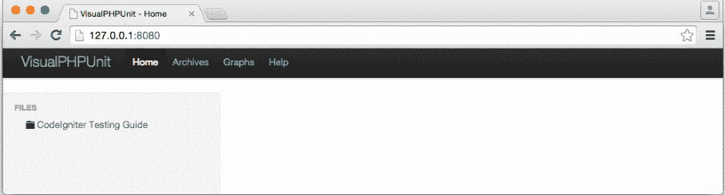

VisualPHPUnit 首页

## 运行所有测试

要运行所有测试，你需要使用 XML 配置文件。选择你配置的 XML 文件，并点击 [Run Tests](运行测试）按钮或按 [T] 键。

## PHPUnit 基础

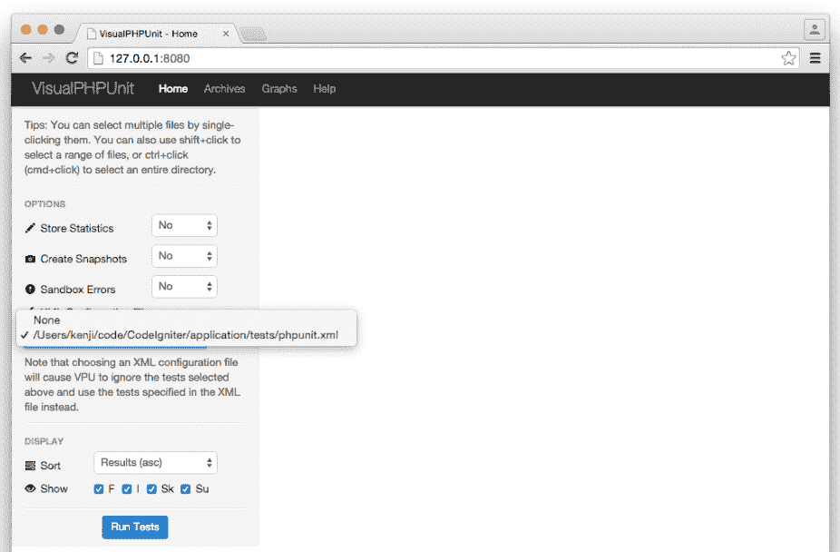

## VisualPHPUnit XML 配置文件

你应该看到像下面的结果。

## PHPUnit 基础

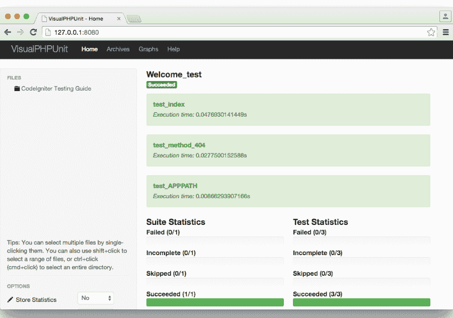

## 运行特定的测试用例

要运行特定的测试用例文件，请选择该文件并确保 XML 配置文件为 None（无）。然后点击 [Run Tests](运行测试）按钮或按 [T] 键。

## PHPUnit 基础


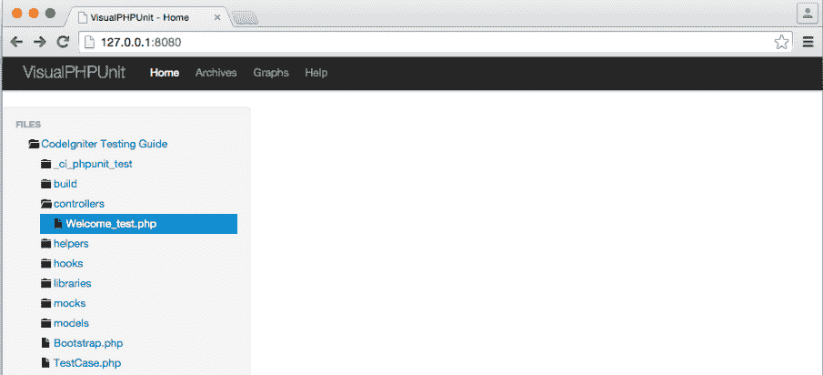

## VisualPHPUnit 选择文件

你应该能看到像下面的结果。

## PHPUnit 基础

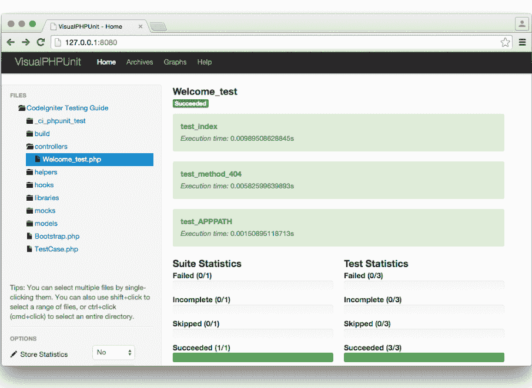

## 4.3 配置 PHPUnit

在上一节中，你运行了 `phpunit` 命令并看到了输出。由于大多数配置选项都是通过 PHPUnit 配置文件指定的，因此你只需要指定是否要包含调试输出（通过使用 `--debug` 选项）。

### XML 配置文件

`application/tests/phpunit.xml` 是 PHPUnit 配置文件，它指定了我们在之前的测试中使用的大多数选项。

### phpunit

第一个元素 `phpunit` 的属性用于配置 PHPUnit 自身。

```
<phpunit
  bootstrap="../Bootstrap.php"
  colors="true">
```

`bootstrap` 属性设置了 PHPUnit 使用的引导文件。`colors` 属性告诉它在输出中使用颜色。如果你的终端不支持颜色，请将 `colors` 属性的值从 `true` 改为 `false`。

### testsuite

下一个元素 `testsuite` 定义了由 PHPUnit 执行的测试套件。测试套件是一组测试用例，通常在某些方面相互相关。每个 `testsuite` 包含一个或多个 `testsuite` 元素，每个元素指定了测试中包含（或排除）的文件或目录，以及测试套件的名称。在这种情况下，元素位于 `application/tests/` 中，我们指定了 `.php` 后缀，因此目录中所有以 `.php` 结尾的文件将被包含。我们还排除了 `_ci_phpunit_test/` 中的文件。

```
<testsuite>
  <testsuite name="CodeIgniter Application Test">
    <directory suffix="test.php">./directory>
    <exclude>./_ci_phpunit_test/</exclude>
  </testsuite>
</testsuite>
```

### filter

下一个元素 `filter` 用于配置代码报告。白名单包含了定义要包含在报告中的文件和目录的元素。第一个 `directory` 元素表示我们包含了 `application/controllers` 目录中以 `.php` 为后缀的文件。

```
<whitelist>
  <directory suffix=".php">../controllers</directory>
  <directory suffix=".php">../models</directory>
  <directory suffix=".php">../views</directory>
  <directory suffix=".php">../libraries</directory>
  <directory suffix=".php">../helpers</directory>
  <directory suffix=".php">../hooks</directory>
</whitelist>
</filter>
```

白名单过滤对于准确报告代码覆盖率非常重要。如果不定义它，PHPUnit 只包含在执行期间至少运行了一行的文件。某些类没有编写测试代码，它们在执行期间将不会运行，也不会被包含在覆盖率报告中。这意味着这些类的覆盖率为 0%。与相比之下，如果你不定义白名单，你使用的某些第三方库可能会被包含在覆盖报告中。你可能不想包含第三方库，可能是因为你不想添加额外的测试，也因为你只想覆盖自己的应用程序。

如果它们经过了良好的测试或者非常稳定且你信任它们，可能不需要对它们进行测试。否则，编写一些测试可能更好。

### logging

下一个元素 `logging` 配置了测试结果的日志。它定义了覆盖文件的存放位置。

```
<code type="coverage-html" target="build/coverage"/>
<code type="coverage-clover" target="build/logs/clover.xml"/>
<code type="JUnit" target="build/logs/junit.xml" incomplete skipped="false"/>
</coding>
```

你可以在 PHPUnit 手册中查看细节和其他配置选项：https://phpunit.de/manual/4.8/en/appendices.configuration.html

## 命令行参数和选项

`phpunit` 命令有很多选项，但我们没有使用其中大部分选项，因为在配置文件中指定它们更容易（特别是当我们希望每次运行测试时都使用相同的设置时）。如果你想为单次测试执行更改选项，或者某个选项无法通过配置文件可用，那么在命令行上指定该选项可能更优，但你通常会在文件中指定选项。以下是常用选项的列表。

### 输出

`phpunit` 命令有很多选项，但我们没有使用其中大部分选项，因为在配置文件中指定它们更容易（特别是当我们希望每次运行测试时都使用相同的设置时）。如果你想为单次测试执行更改选项，或者某个选项无法通过配置文件可用，那么在命令行上指定该选项可能更优，但你通常会在文件中指定选项。以下是常用选项的列表。

### testdoc

该选项以 TestDoc 格式输出。

```
- [x] test
- [x] index
- [x] APPP
- [x] test
- [x] method
```

### 覆盖报告

该选项将代码覆盖报告以文本格式输出。

```
$ phpunit.phar --coverage-text
PHPUnit 4.8.6 by Sebastianmann and contributors.
...
Time: 1.16 seconds, Memory: 13.25Mb
OK (3 tests, 3 assertions)
Generating coverage report in Clover format ... done
Generating coverage report in HTML format ... done
Code Coverage Report:
2015-09-13 08:21:57
Summary:
Classes: 100.00% (3/3)
Methods: 100.00% (1/1)
Lines: 2.60% (5/192)
Welcome
Seconds: 100.00% (1 / 1)
Lines: 100.00% (3 / 3)
```


- `no-coverage`

该选项忽略代码覆盖率配置。代码报告需要耗时，因此如果你只想快速查看测试结果，此选项允许跳过生成报告。

## 分组

- `--group`
- `--exclude-group`

这些选项仅运行指定组的测试，或者排除指定组的测试。

我们可以使用 `@group` 注解将测试类或方法标记为多个组：

```
/**
 * @group model
 * @group database
 */
class News_model_test extends TestCase
```

注释标记应以 `/**` 开始。如果你使用 `/*`，注解将不起作用。`@group` 标签是 PHPDoc 语法的扩展，可以与其他 PHPDoc 标签共存。

如果你想运行 `model` 组或 `database` 组的测试，可以在命令行上使用 `--group` 选项：

```
$ phpunit.phar --group model,database
```

如果你只想运行 `model` 组并排除 `database` 组，像以前一样使用 `--group` 选项，但加上 `--exclude-group` 选项：

```
$ phpunit.phar --group model --exclude-group
```

## 4.4 通过测试库理解基础

CodeIgniter 库是位于 `application/libraries` 目录下的类。在本节中，我们将为库类编写测试代码以帮助我们理解 PHPUnit 的基础。

以下是将摄氏度转换为华氏度以及华氏度转换为摄氏度的类：

`application/libraries/Temperature_converter.php`

```php
<?php
class Temperature_converter {
    /**
     * 将摄氏度转换为华氏度
     * @param float $degree
     * @return float
     */
    public function cToF($degree)
    {
        return round((9 / 5) * $degree + 32, 1);
    }
    /**
     * 将华氏转换为摄氏
     * @param float $degree
     * @return float
     */
    public function FtoC($degree)
    {
        return round((5 / 9) * ($degree - 32), 1);
    }
}
```

## 基础规范

## PHPUnit 规范

这里是 PHPUnit 的基本规范。

- 1. 类的测试放入名为 `ClassTest` 的类中。
- 2. `ClassTest` 继承自 `PHPUnit_Framework_TestCase`。
- 3. 测试是以 `test*` 命名的公共方法。或者，你也可以在方法的 docblock 中使用 `@test` 标签将其标记为测试方法。
- 4. 在测试内部，使用诸如 `assertEquals()` 等断言方法来断言实际值是否匹配预期值。

## ci-phpunit-test 规范

我们将根据 CodeIgniter 的编码规范对这些规范进行一些修改，并提供一种方便的测试方法。

- 1. 命名类的测试放入对应命名的 `Class_test` 中。
- 2. `Class_test` 继承自 `TestCase`。
- 3. 测试是以 `test_*` 命名的公共方法。或者，你也可以在方法的 docblock 中使用 `@test` 标签将其标记为测试方法。

`TestCase` 类继承自 `PHPUnit_Framework_TestCase`，因此从技术上说，在继承 `PHPUnit_Framework_TestCase` 方面我们仍然遵循 PHPUnit 的规范，但 `TestCase` 类为在 CodeIgniter 中运行测试添加了一些方便的功能。

我们将测试文件放在 `application/tests` 目录下。

## PHPUnit 基础

- `CodeIgniter/`
  `application/`
    `tests/`
      `Bootstrap.php` ... PHPUnit 的引导文件
      `TestCase.php` ... TestCase 类
      `controllers/` ... 存放你的控制器测试
      `libraries/` ... 存放你的库测试
      `models/` ... 存放你的模型测试
      `phpunit.xml` ... PHPUnit 的配置文件

## 我们的第一个测试

现在我们已经了解了基础，可以为我们的 `Temperature_converter` 类编写测试代码了。

`application/tests/libraries/Temperature_converter_test.php`

```php
<?php
```


```php
class Temperature_converter_test extends TestCase
{
    public function test_FtoC()
    {
        $obj = new Temperature_converter();
        $actual = $obj->FtoC(100);
        $expected = 37.0;
        $this->assertEquals($expected, $actual, '', 0.01);
    }
}
```

> 给 CodeIgniter 用户
> 在这种情况下，`ci-phpunit` 会自动加载 `Temperature_converter` 库，所以你不需要在 CodeIgniter 中调用 `$this->load->library()` 方法。

`$this->assertEquals()` 方法是 PHPUnit 的断言方法之一。它检查两个值是否相等。第三个参数允许我们提供错误信息，但我们将其设置为空字符串以使用默认消息。第四个参数是允许的差值 `delta`，即前两个值之间被认为是相等的差异。

## 浮点数的比较

使用 `$this->assertEquals()` 对浮点数进行比较时，应该作为第四个参数提供允许的差值。更多信息请参阅《每个计算机科学家应该知道的浮点算术》和 PHP 手册。

由于我们比较的是浮点数，我们必须设置第四个参数。在比较字符串或整数时我们不需要它，所以我们经常编写这样的代码：

```php
$this->assertEquals($expected, $actual);
```

尝试使用 `phpunit` 命令运行测试用例。

```bash
$ php phpunit.phar libraries/Temperature_converter_test.php
```

## 给 Composer 用户

`$ ./phpunit.sh libraries/Temperature_converter_test.php`

查看[如何创建 phpunit 快捷方式]。

* http://docs.oracle.com/cd/E19957-01/806-3568/ncg_goldberg.html
* http://php.net/manual/en/language.types.float+language.types.float.comparison

## PHPUnit 基础

```bash
bash-3.2$ php phpunit.phar libraries/Temperature_converter_test.php
PHPUnit 4.8.6 by Sebastian Bergmann and contributors.
Time: 1.35 seconds, Memory: 14.50MB
There was 1 failure:
1) Temperature_converter_test::test_FtoC
Failed asserting that 37.9999999999999157829056959592651550292926875 matches
Expected 37.0.
/Users/kenji/CodeIgniter/application/tests/libraries/Temperature_converter_
test.php:10
/Users/kenji/CodeIgniter/application/tests/phpunit.phar:547
FAILURES:
Tests: 1, Assertures: 1.
Generating code coverage report in Clover XML format ... done
Generating code coverage report in HTML format ... done
bash-3.2$
```

运行 `phpunit` 命令

这次你应该能看到红色的失败了！事实上，你的第一个测试中存在一个 bug。100 华氏度不是 37.0 摄氏度，而是 37.8。

你应该检查你的代码。

## PHPUnit 基础

There was 1 failure:
1) Temperature_converter_test::test_FtoC
Failed asserting that 37.99999999999991578290569595926515502929268875 matches
Expected 37.0.
/Users/kenji/CodeIgniter/application/tests/libraries/Temperature_converter_
test.php:10
/Users/kenji/CodeIgniter/application/tests/phpunit.phar:547
FAILURES:
Tests: 1, Assertures: 1.
Generating code coverage report in Clover XML format ... done
Generating code coverage report in HTML format ... done

## 浮点数的比较

错误是因为浮点数并不总是以精确度表示的。在这种情况下，值 37.9999999999999157829056959592651550292926875 不等于 37.0。

为了修复这个问题，我们使用差值 `delta`。 0.01 的差值。

```php
$this->assertEquals($expected, $actual, '', 0.01);
```

## PHPUnit 基础

## Data Provider

我们在一个方法中有两个测试，但你应该继续添加测试。编程中有一句格言是“不要重复”`DRY`。以这种方式继续添加测试看起来有点麻烦。

## PHPUnit 基础

幸运的是，PHPUnit 包含了重复此类测试的功能。一种方法是使用数据提供者 `Data Provider`。通过这种方法，我们可以编写如下的测试：

# PHPUnit 基础

`test_FtoC()` 方法有两个参数 `($degree` 和 `$expected)`。数据提供者方法中的值会被传递给它们。第一个数组 `[-40, -40.0]` 被传递给方法，赋值为 `$degree = -40` 且 `$expected = -40.0`。

PHPUnit 会为数据提供者方法中的每个数组重复测试。

```php
$ phpunit.phar libraries/Temperature_converter_test.php
PHPUnit 4.8.10 by Sebastian Bergmann and contributors.
```
...
nTime: 1.15 seconds, Memory: 12.50Mb
OK (5 tests, 5 assertions)

在输出中，你应该看到五个点、5 个测试和5 个断言。如果你添加 `--debug` 选项，可以更清晰地看到发生了什么。

```php
$ phpunit.phar --debug libraries/Temperature_converter_test.php
PHPUnit 4.8.10 by Sebastian Bergmann and contributors.
```
Starting test 'Temperature_converter_test::test_FtoC with data set #0 (-40, -40.0)'.
Starting test 'Temperature_converter_test::test_FtoC with data set #1 (0, -17.80000000000007105427357601001858711242675781225)'.
Starting test 'Temperature_converter_test::test_FtoC with data set #2 (32, 0.0)'.
Starting test 'Temperature_converter_test::test_FtoC with data set #3 (100, 37.799999999999971578209560959952952651555029296875)'.
Starting test 'Temperature_converter_test::test_FtoC with data set #4 (212, 100.0)'.
Time: 1.46 seconds, Memory: 12.50Mb
OK (5 tests, 5 assertions)

## 测试技巧：来自另一个类的数据提供者

你可以通过在标签中指定类来使用另一个类的数据提供者：`@dataProvider Bar::provide_baz_data`。如果该类已定义 `或可加载` 且提供者方法存在，PHPUnit 将使用它。

## 不完全的测试

我们为 `FtoC()` 方法编写了测试代码，但类中还有另一个方法 `CtoF()`。因此，我们需要测试这个方法。

当我们需要写一个测试方法但尚未完成时，可以使用 PHPUnit 的 `$this->markTestIncomplete()` 方法。这是一个标记，用于指示测试尚未完成或目前尚未实现。

将以下方法添加到测试类的末尾：

`application/tests/libraries/Temperature_converter_test.php`

```php
public function test_CtoF() {
    $this->markTestIncomplete(
        'This test has not been implemented yet.'
    );
}
```

不完全的测试在 `phpunit.php` 的输出中用 `I` 表示，如果你的终端支持颜色，OK 行将呈现黄色而不是绿色。

```bash
$ php phpunit.phar libraries/Temperature_converter_test.php --no-coverage
PHPUnit 4.8.10 by Sebastian Bergmann and contributors.
```
```
...I
Time: 817 ms, Memory: 7.50Mb
```
OK, but incomplete, skipped, or risky tests!
Tests: 6, Assertions: 5, Incomplete: 1.

如果你放了一个既没有断言也没有使用 `$this->markTestIncomplete()` 的测试方法，你会看到绿色的 OK，且无法判断测试是实际上成功了还是尚未实现。

## 添加测试

为 `CtoF()` 方法添加测试代码很容易，因为 `CtoF()` 仅仅是 `FtoC()` 的反向。我们可以复用 `test_FtoC()` 方法的数据提供者。

## 练习

请在此停止并思考你将如何编写该测试方法。

更新 `test_FtoC()` 方法：

```php
application/tests/libraries/temperature_converter_test.php
/**
 * @dataProvider provide_temperature_data
 */
public function test_FtoC($expected, $degree) {
    $obj = new Temperature_converter();
    $actual = $obj->FtoC($degree);
    $this->assertEquals($expected, $actual, '', 0.01);
}
```

`test_FtoC()` 参数的顺序反过了。
这个测试类是可以的，但我们仍然可以通过 PHPUnit 的 `setUp()` 方法对其进行一些改进。

## 固定件 Fixtures

固定件是应用程序的一种状态。如果你运行测试，必须在运行测试之前将世界设置为已知状态，因为状态的任何差异可能会改变测试结果。
PHPUnit 有定义固定件的方法。在这个用例中，我们不需要做任何事情，因为目标类除了 PHP 内部函数 `round()` 之外没有依赖。`round()` 也没有依赖，它返回一个计算值。
然而，我们仍然可以通过设置环境来改进测试代码。

## setUp()

`setUp()` 是在每个测试方法之前调调的方法。换句话说，如果你使用它，可以在多个测试之间共享设置过程。

# PHPUnit 基础

```diff
--- a/application/tests/libraries/Temperature_converter_test.php
+++ b/application/tests/libraries/Temperature_converter_test.php
@@ -2,13 +2,17 @@
 class Temperature_converter_test extends TestCase
+{
+    public function setUp()
+    {
+      $obj = new Temperature_converter();
+    }
+
+/**
+ * @dataProvider provide_temperature_data
+ */
 public function test_FtoC($expected, $degree)
 {
-    $obj = new Temperature_converter();
     $actual = $obj->FtoC($degree);
     $this->assertEquals($expected, $actual, '', 0.01);
 }
@@ -29,8 +33,7 @@ class Temperature_converter_test extends TestCase
 {
-    $obj = new Temperature_converter();
-    $actual = $obj->FtoC($degree);
+    $this->assertEquals($expected, $actual, '', 0.01);
 }
```

上面的列表是统一 diff。它显示了两个文件之间的差异。

## 断言 Assertions

PHPUnit 有许多断言方法。以下是常用的断言列表：

- `assertEquals($expected, $actual)` 检查两个值是否相等
- `assertSame($expected, $actual)` 检查两个值是否且类型相同
- `assertTrue($condition)` 检查条件是否为真
- `assertFalse($condition)` 检查条件是否为假
- `assertNull($variable)` 检查变量是否为空
- `assertInstanceOf($expected, $actual)` 检查对象的类型
- `assertCount($expected, $haystack)` 检查 `$haystack` 中的元素数量是否匹配 `$expected`
- `assertRegExp($pattern, $string)` 检查 `$string` 是否匹配正则表达式
- `assertContains($needle, $haystack)` 检查 `$needle` 是否在 `$haystack` 中，此方法适用于字符串 `($needle` 是 haystack 的子字符串）、数组 `($needle` 是 haystack 的元素）或实现了 Iterator 的类 `可以使用 foreach() 调用`

你可以在 PHPUnit 手书中查看所有断言方法。

> 测试技巧：使用特定的断言方法
使用特定的断言方法是一种实践，因为它表达了你想测试的内容，并且你可以获得更有用的错误信息。

# 5. 测试一个简单的 MVC 应用

为了开始学习如何编写测试，我们将从一个简单但重要的 MVC 应用开始，这是 CodeIgniter 教程中包含的一个应用程序。

该应用程序根据 MIT 许可证许可。参见 [CodeIgniter 用户指南](https://www.codeigniter.com/userguide/3/index.html)

我稍微修改了应用程序的代码风格，并添加了以 `#` 开头的注释。

## 5.1 控制器的功能测试

由于 CodeIgniter 将模型视为可选，我们将从测试我们的控制器开始。

### 处理静态页面的控制器

你将看到的第一个是处理静态页面的控制器。

### Pages 控制器

`application/controllers/Pages.php`

```php
<?php
class Pages extends CI_Controller
{
    public function view($page = 'home')
    {
        if (file_exists(APPATH.'/views/$page.php')) {
            // 哎，我们没有那个页面！
            show_404();
        }
        $data['title'] = ucfirst($page); // 首字母大写
```

# 测试一个简单的 MVC 应用

```php
$this->load->view('templates/header', $data);
$this->load->view('pages/' . $data['page'], $data);
$this->load->view('templates/footer', $data);
```


# 测试一个简单的 MVC 应用

```php
$this->load->view('templates/header', $data);
$this->load->view('pages/' . $data['page'], $data);
$this->load->view('templates/footer', $data);
```

`Pages`控制器的`view()`方法会被CodeIgniter自动路由到`pages/view`。如果你访问`http://127.0.0.1:8000/pages/views/home`，CodeIgniter会调用`Pages`控制器的`view()`方法并将`$data`传递给视图。在`view`文件中，你可以通过`$title`访问`$data['title']`的值。

对`$this->load->view()`方法的调用会加载视图文件并将第二个参数`$data`传递给视图。在`view`文件中，你可以通过`$title`访问`$data['title']`的值。

## 页面模板

位于`templates/`下的视图是页面模板，包含了我们网站使用的页眉`header`和页脚`footer`视图。

`application/views/templates/header.php`

```html
<html>
<head>
<title>CodeIgniter Tutorial</title>
</head>
<body>
<h1><?php echo $title; ?></h1>
</body>
```

`application/views/templates/footer.php`

```html
<footer>
    &copy; 2015
</footer>
</body>
</html>
```

## 静态页面

在模板之间加载的文件是页面的静态内容。在本例中，我们将使用`home`和`about`。

`application/views/pages/home.php`

```html
<p>
这是 `views/pages/home.php`。
</p>
```

`application/views/pages/about.php`

```html
<p>
这是 `views/pages/about.php`。
</p>
```

## 路由

接下来，我们将修改`application/config/routes.php`中的路由定义。

```diff
--- a/Codeigniter/application/config/routes.php
+++ b/Codeigniter/application/config/routes.php
@@ -49,6 +49,7 @@ defined('BASEPATH') OR exit('No direct script access allowed');
 | Examples: my_controller/index -> my_controller/index
 | my_controller/method -> my_controller/method
 | */
-$route['default_controller'] = 'welcome'
+$route['default_controller'] = 'pages/view'
 $route['404_override'] = ''
 $route['translate_uri_dashes'] = FALSE;
+$route([':any']) = 'pages/view/$1';
```

> 列表采用格式化的统一差异格式`unified diff`。它显示了两个文件之间的差异。在原始文件中，删除以`-`开头的行，并添加以`+`开头的绿色行以获取新文件。更多细节请参见《本书中使用的约定》。

`default_controller`设置配置了在未提供控制器时使用的控制器/方法。由于我们已将`default_controller`的值改为`'pages/view'`，如果你访问`http://127.0.0.1:8000/`，CodeIgniter将调用`Pages`的`view()`方法而不传递任何参数。

在路由键中使用的特殊关键字`(:any)`会匹配包含除`/`之外任何字符的URI段。因此，如果你访问`http://127.0.0.1:8000/about`，CodeIgniter会调用`Pages`控制器的`view()`方法并将`'about'`作为第一个参数传递。

## 使用浏览器进行手动测试

让我们访问该网站。在本书中，我们将使用PHP的内置Web服务器。打开你的终端，导航到放置CodeIgniter`index.php`的目录，并输入以下命令：

```bash
$ php -S 127.0.0.1:8000 index.php
```

然后，通过浏览器访问以下URL：

- `http://127.0.0.1:8000/`
- `http://127.0.0.1:8000/about`
- `http://127.0.0.1:8000/notfound`

你应该能看到首页`Home`和关于`About`页面，随后是404页面未找到的消息。

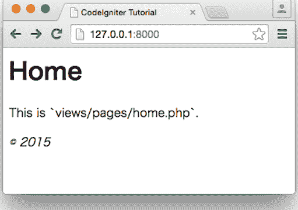

首页

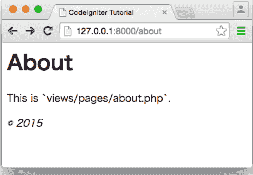

### 关于

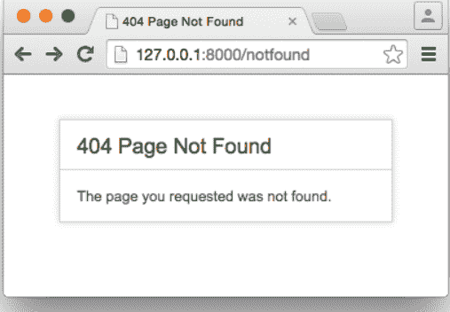

### 404 页面未找到

## Pages 控制器的测试用例

有人说测试CodeIgniter控制器很困难，但`ci-phpunit-test`有许多辅助方法来简化这一过程。现在你可以轻松地为你的控制器编写测试。

首先，我们在`application/tests/controllers/Pages_test.php`文件中创建测试用例类。

`application/tests/controllers/Pages_test.php`

```php
<?php
class Pages_test extends TestCase
{
}
```

然后我们添加第一个测试方法。

`application/tests/controllers/Pages_test.php`

```php
<?php
class Pages_test extends TestCase
{
}
```


然后，通过浏览器访问以下 URL：

- `http://127.0.0.1:8000/`
- `http://127.0.0.1:8000/about`
- `http://127.0.0.1:8000/notfound`

你应该能看到首页（Home）和关于（About）页面，随后是 404 页面未找到的消息。


首页


### 关于


### 404 页面未找到

### Pages 控制器的测试用例

有人说测试 CodeIgniter 控制器很困难，但 `ci-phpunit-test` 有许多辅助方法来简化这一过程。现在你可以轻松地为你的控制器编写测试。

首先，我们在 `application/tests/controllers/Pages_test.php` 文件中创建测试用例类。

`application/tests/controllers/Pages_test.php`

```php
<?php

class Pages_test extends TestCase
{

}
```

然后我们添加第一个测试方法。

# 测试一个简单的 MVC 应用

```diff
--- a/CodeIgniter/application/config/database.php
+++ b/CodeIgniter/application/config/database.php
@@ -76,9 +76,9 @@ $query_builder = TRUE;
$db['default'] = array(
  'dsn' => 'localhost',
  'username' => '',
  'password' => '',
  'database' => '',
+ 'username' => 'dbuser',
+ 'password' => 'dbpass',
+ 'database' => 'testing',
  'dbdriver' => 'mysqli',
  'dbprefix' => '',
  'pconnect' => FALSE,
```

## 专用测试数据库

测试时使用专用数据库是一个良好的习惯。CodeIgniter 包含了处理多个环境的功能。它会读取 `application/config/[environment]` 目录下的配置文件（如果存在）。`ci-phpunit-test-always` 始终在测试环境中运行测试。因此，如果你将数据库配置放在 `application/config/testing/database.php`，该配置将将用于你的测试。

### 数据库迁移

我们将使用 CodeIgniter 的迁移库创建一个数据库表。

创建 `application/database/migrations` 目录用于存放迁移文件，然后创建一个迁移文件来创建 `news` 表。

> CodeIgniter 中迁移文件的默认位置是 `application/migrations`，但我们更改了它。稍后我们将会有数据填充文件（seeding files），我们不希望它们与迁移文件混淆。

^7http://www.codeigniter.com/user_guide/libraries/config.html#environments

# 测试一个简单的 MVC 应用

`application/database/migrations/20150907090030_Create_news.php`

```php
<?php

class Migration_Create_news extends CI_Migration
{
    public function up() {
        $this->dbforge->add_field([
            'id' => [
                'type' => 'INT',
                'constraint' => 11,
                'auto_increment' => true
            ],
            'title' => [
                'type' => 'VARCHAR',
                'constraint' => 128
            ],
            'slug' => [
                'type' => 'VARCHAR',
                'constraint' => 128
            ],
            'text' => [
                'type' => 'TEXT',
            ]
        ]);
        $this->dbforge->add_key('id', true);
        $this->dbforge->add_key('slug');
        $this->dbforge->create_table('news');
    }

    public function down() {
        $this->dbforge->drop_table('news');
    }
}
```

编辑迁移配置文件，将 `migration_enabled` 设置为 `true`，并将 `migration_version` 设置为 `create_news` 迁移的时间戳。我们还需要将 `migration_path` 更新为 `APPPATH.'database/migrations/'`。

# 测试一个简单的 MVC 应用

```diff
--- a/CodeIgniter/application/config/migration.php
+++ b/CodeIgniter/application/config/migration.php
@@ -11,7 +11,7 @@ defined('BASEPATH') OR exit('No direct script access allowed');
 | and disable back when you're done.
 |
 */ */-$config['migration_enabled'] = FALSE;
+$config['migration_enabled'] = TRUE;
```

```diff
/*
 |-
@@ -69,7 +69,7 @@ $config['migration_auto_latest'] = FALSE;
 | be upgraded to downgraded.
 |
 */
-$config['migration_version'] = 0;
+$config['migration_version'] = 201509070900030;
```

```diff
/*
 |-
@@ -81,4 +81,4 @@ $config['migration_version'] = 0;
 | Also, writing permission is required within the migrations folder.
 |/
```

```diff
-$config['migration_path'] = APPATH.'migrations/';
+$config['migration_path'] = APPATH.'database/migrations/';
```

# Dbfixture 控制器

创建一个 Dbfixture 控制来运行迁移。我们可以参考 CodeIgniter 指南中的 `Migrate` 类。

`application/controllers/Dbfixture.php`

```php
<?php

class Dbfixture extends CI_Controller
{
    public function __construct()
    {
        parent::__construct();
    }
}
```

> *http://www.codeigniter.com/user_guide/libraries/migration.html#usage-example

# 测试一个简单的 MVC 应用

```php
9 // 仅通过 CLI 访问
10 if (is_cli() === false) {
11 exit();
12 }
13 }

15 public function migrate()
16 {
17 $this->load->library('migration');
18 if ($this->migration->current() === false) {
19 echo $this->migration->error_string() . PHP_EOL;
20 }
21 }
22 }
```

该控制器可以通过浏览器访问，任何可以访问你网站的人都可以运行迁移。这不好，因此我们添加了一些逻辑来检查它是否通过 CLI 运行，如果不是则退出。

通过 CLI 运行 Dbfixture 控制器来执行你的迁移。

```bash
$ php index.php dbfixture migrate
```

如果没有输出，说明迁移已运行且 `news` 表已成功创建。你可以使用 `sqlite3` 命令确认。

```bash
$ sqlite3 application/data/sqlite-database.db
SQLite version 3.8.5 2014-08-15 22:37:57
Enter ".help" for usage hints.
sqlite> .schema
CREATE TABLE "migrations" (
  "version" BIGINT NOT NULL
);
CREATE TABLE "news" (
  "id" INTEGER PRIMARY KEY AUTOINCREMENT,
  "title" VARCHAR NOT NULL,
  "slug" VARCHAR NOT NULL,
  "text" TEXT NOT NULL
);
CREATE INDEX "news_slug" ON "news" ("slug")
sqlite> .exit
```

你可以在数据库中看到 `news` 表。

### News 部分

让我们看看 News 部分的代码。

### News_model 模型

`News_model` 类有两个方法。一个是从数据库中获取新闻项，另一个是将新闻项插入数据库。

`application/models/News_model.php`

```php
<?php

class News_model extends CI_Model
{
    public function __construct()
    {
        // $this->load->database() 方法加载数据库类。加载后，你可以
        // 将其作为 "$this->db"
        $this->load->database();
    }
    public function get_news($slug = false)
    {
        if ($slug === false) {
            // $this->db->get() 方法运行查询并返回结果。
            $query = $this->db->get('news');
            // $result_array() 方法返回数组格式的查询。
            return $query->result_array();
        }
        // $this->db->get_where() 方法带有 "where" 子句运行查询，
        // 位于第二个参数。
        $query = $this->db->get_where('news', ['slug' => $slug]);
        // $row_array() 方法返回行数组。
        return $query->row_array();
    }
    public function set_news()
    {
        // 插入新闻的实现
    }
}
```

### News 控制器

News 控制器有三个方法。`index()` 显示存档。`view()` 显示一个新闻项。`create()` 显示创建一个新闻项的表单。

# 测试一个简单的 MVC

`application/views/news/index.php`

```php
<h2><?php echo $title; ?></h2>
<?php foreach ($news as $news_item): ?>
<h3><?php echo $news_item['title']; ?></h3>
<div class="main">
<?php echo $news_item['text']; ?>
</div>
<p>
<a href="<?php echo site_url('/news/'.$news_item['slug']);?>">
查看文章
</a>
</p>
<?php endforeach; ?>
```

此视图文件显示了一个新闻项目。

`application/views/news/view.php`

```php
<?php
echo '<h2>'.$news_item['title'].'</h2>';
echo $news_item['text'];
```

此视图包含一个用于发布新闻项目的表单。

`application/views/news/create.php`

```php
<h2><?php echo $title; ?></h2>
<?php echo validation_errors(); ?>
<?php echo form_open('news/create'); ?>
<label for="title">标题</label>
<input type="title" name="title" /><br />
<label for="text">文本</label>
<textarea name="text"></textarea><br />
```

# 测试一个简单的 MVC

```php
<input type="submit" name="submit" value="创建新闻项目" />
</form>
```

创建新闻项目后，会显示成功消息。

`application/views/news/success.php`

```php
<h2>创建成功</h2>
```

### 路由

我们需要为新闻部分添加一些路由。

```diff
--- a/CodeIgniter/application/config/routes.php
+++ b/CodeIgniter/application/config/routes.php
@@ -49,7 +49,11 @@
 defined('BASEPATH') or exit('No direct script access allowed');
 // Examples: my_controller -> my_controller/index
 // my_controller/my_method -> my_controller/my_method
 // */
-$route['default_controller'] = 'pages/view';
-$route['404_override'] = '';
-$route['translate_uri_dashes'] = FALSE;
+

+$route['news/create'] = 'news/create';
+$route['news/(:any)'] = 'news/view/$1';
+$route['news'] = 'news';
+$route['(:any)'] = 'pages/view/$1';
+$route['default_controller'] = 'pages/view';
```

这就是我们开始所需的所有内容。

> 安全警告
该应用程序代码仅用于教学目的。它不是安全代码。例如，它包含 XSS 漏洞且没有 CSRF 保护（除非你全局启用 CSRF 保护）。不要在生产环境中使用它。

### 使用浏览器进行手动测试

让我们访问 Web。我们将使用 PHP 内置的 Web 服务器。

```bash
$ php -S 127.0.0.1:8000 index.php
```


然后，在您的浏览器中访问 `http://127.0.0.1:8000/news/create`。你应该能看到一个如下的表单：

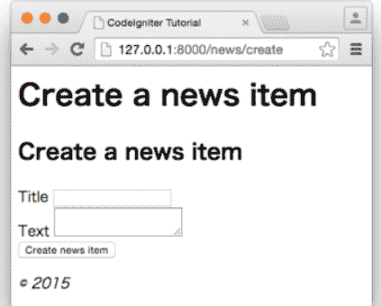

创建新闻项目

填写并提交表单。然后，访问 `http://127.0.0.1:8000/news`。

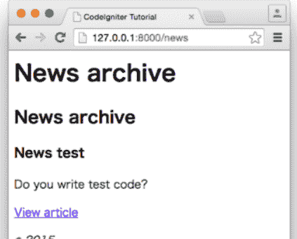

新闻存档

你可以看到刚刚发布的新闻项目。好的，我们的新闻部分运行正常。

### 数据库固件 (Fixtures)

由于模型使用数据库来存储数据，且如果插入新闻项目，数据就会发生，因此在为模型编写测试代码之前，我们必须准备数据库固件。

例如，我们从空表开始。当测试执行期间插入新闻项目时，表中有一个记录。如果你运行两次测试，表中就有两条记录。表的状态每次运行测试时都会改变。

如果你编写了一个测试来检查新闻项目的总数，那么下次运行测试时将会失败。

### 测试技巧：可重复性

良好的测试不依赖于执行顺序或时间。如果测试通过，它们应该始终通过。

因此，我们必须在运行测试之前修复数据库状态。换句话说，在运行测试之前，我们必须将数据库设置为一个已知状态。

为了做到这一点，我们使用了数据库迁移 (`Migration`) 和数据库种子 (`Seeding`)。我们在数据库迁移部分创建了一个迁移文件。

为了在测试中自动运行迁移，我们修改了 `TestCase` 类。

```php
<?php
application/tests/TestCase.php
class TestCase extends CIPHPUnitTestCase {
    private static $migrate = false;
    public static function setUpBeforeClass() {
        parent::setUpClass();
        // 运行迁移
        if (! self::$migrate) {
            $CI = &get_instance();
            $CI->load->database();
            $CI->load->library('migration');
            if ($CI->migration->current() === false) {
                }
            }
        }
    }
}
```

`setUpBeforeClass()` 方法在测试执行期间运行一次迁移，在第一个测试类运行之前。

### 数据库种子 (Seeding)

数据库种子是用数据对数据库进行初始化填充。ci-phpunit-test 有一个种子库*和一个示例种子类*。

首先，安装种子库。将 `ci-phpunit-test/application/libraries/Seeder.php` 复制到你的 `application/libraries` 目录。

然后，创建 `application/database/seeds` 目录来存放种子类，然后为 `news` 表创建一个种子类。

+ CodeIgniter/
  application/
    database/
      seeds/
        NewsSeeder.php
    libraries/
      Seeder.php

`application/database/seeds/NewsSeeder.php`

```php
<?php
class NewsSeeder extends NewsSeeder {
    private $table = 'news';
    public function run() {
        $CI = &get_instance();
        $CI->db->truncate($this->table);
        $data = [
            'title' => 'First News',
            'slug' => 'first-news',
            'text' => 'First news content'
        ];
        $CI->db->insert($this->table, $data);
    }
}
```

# 测试一个简单的 MVC

等等，之前的输出有点乱。让我们根据提供的文本清理逻辑。
（修正：提供的文本有很多重复。我将根据教程重构逻辑流。）

## 测试一个简单的 MVC

`application/views/news/index.php`

```php
<h2><?php echo $title; ?></h2>
<?php foreach ($news as $news_item): ?>
<h3><?php echo $news_item['title']; ?></h3>
<div class="main">
<?php echo $news_item['text']; ?>
</div>
<p>
<a href="<?php echo site_url('/news/'.$news_item['slug']);?>">
查看文章
</a>
</p>
<?php endforeach; ?>
```

此视图文件显示了一个新闻项目。

`application/views/news/view.php`

```php
<?php
echo '<h2>'.$news_item['title'].'</h2>';
echo $news_item['text'];
```

此视图包含一个发布新闻项目的表单。

`application/views/news/create.php`

```php
<h2><?php echo $title; ?></h2>
<?php echo validation_errors(); ?>
<?php echo form_open('news/create'); ?>
<label for="title">标题</label>
<input type="title" name="title" /><br />
<label for="text">文本</label>
<textarea name="text"></textarea><br />
<input type="submit" name="submit" value="创建新闻项目" />
</form>
```

创建新闻项目后，会显示成功消息。

`application/views/news/success.php`

```php
<h2>创建成功</h2>
```

### 路由

我们需要为新闻部分添加一些路由。

```diff
--- a/CodeIgniter/application/config/routes.php
+++ b/CodeIgniter/application/config/routes.php
@@ -49,7 +49,11 @@
 defined('BASEPATH') or exit('No direct script access allowed');
 // Examples: my_controller -> my_controller/index
 // my_controller/my_method -> my_controller/my_method
 // */
-$route['default_controller'] = 'pages/view';
-$route['404_override'] = '';
-$route['translate_uri_dashes'] = FALSE;
+
+$route['news/create'] = 'news/create';
+$route['news/(:any)'] = 'news/view/$1';
+$route['news'] = 'news';
+$route['(:any)'] = 'pages/view/$1';
+$route['default_controller'] = 'pages/view';
```

这就是我们开始所需的所有内容。

> 安全警告
该应用程序代码仅用于教学目的。它不是安全代码。例如，它包含 XSS 漏洞且没有 CSRF 保护（除非你全局启用 CSRF 保护）。不要在生产环境中使用它。

### 使用浏览器进行手动测试

让我们访问 Web。我们将使用 PHP 内置的 Web 服务器。

```bash
$ php -S 127.0.0.1:8000 index.php
```

然后，在您的浏览器中访问 `http://127.0.0.1:8000/news/create`。你应该能看到一个如下的表单：


创建新闻项目

填写并提交表单。然后，访问 `http://127.0.0.1:8000/news`。


新闻存档

你可以看到刚刚发布的新闻项目。好的，我们的新闻部分运行正常。

### 数据库固件 (Fixtures)

由于模型使用数据库来存储数据，且如果插入新闻项目，数据就会发生改变，因此在为模型编写测试代码之前，我们必须准备数据库固件。

例如，我们从空表开始。当测试执行期间插入新闻项目时，表中有一个记录。如果你运行两次测试，表中就有两条记录。表的状态每次运行测试时都会改变。

如果你编写了一个测试来检查新闻项目的总数，那么下次运行测试时将会失败。

### 测试技巧：可重复性

良好的测试不依赖于执行顺序或时间。如果测试通过，它们应该始终通过。

因此，我们必须在运行测试之前修复数据库状态。换句话说，在运行测试之前，我们必须将数据库设置为一个已知状态。

为了做到这一点，我们使用了数据库迁移 (`Migration`) 和数据库种子 (`Seeding`)。我们在数据库迁移部分创建了一个迁移文件。

为了在测试中自动运行迁移，我们修改了 `TestCase` 类。

```php
<?php
application/tests/TestCase.php
class TestCase extends CIPHPUnitTestCase {
    private static $migrate = false;
    public static function setUpBeforeClass() {
        parent::setUpClass();
        // 运行迁移
        if (! self::$migrate) {
            $CI = &get_instance();
            $CI->load->database();
            $CI->load->library('migration');
            if ($CI->migration->current() === false) {
                }
            }
        }
        self::$migrate = true;
    }
}
```

`setUpBeforeClass()` 方法在测试执行期间运行一次迁移，在第一个测试类运行之前。

### 数据库种子 (Seeding)

数据库种子是用数据对数据库进行初始化填充。ci-phpunit-test 有一个种子库*和一个示例种子类*。

首先，安装种子库。将 `ci-phpunit-test/application/libraries/Seeder.php` 复制到你的 `application/libraries` 目录。

然后，创建 `application/database/seeds` 目录来存放种子类，然后为 `news` 表创建一个种子类。

+ CodeIgniter/
  application/
    database/
      seeds/
        NewsSeeder.php
    libraries/
      Seeder.php

`application/database/seeds/NewsSeeder.php`

```php
<?php
class NewsSeeder extends NewsSeeder {
    private $table = 'news';
    public function run() {
        $CI = &get_instance();
        $CI->db->truncate($this->table);
        $data = [
            'title' => 'First News',
            'slug' => 'first-news',
            'text' => 'First news content'
        ];
        $CI->db->insert($this->table, $data);
    }
}
```

## 测试一个简单的 MVC 应用

`application/tests/models/News_model_test.php`

```php
public function test_When_you_set_news_item_Then_you_have_two_items() {
    $POST = [
        'title' => 'CodeIgniter is awesome!',
        'text' => 'It is easy to understand, easy to write tests, and very fast.',
    ];
$result = $this->obj->set_news();
    $this->assertTrue($result);
    $this->assertCount(2, $this->obj->get_news());
}
```

## 测试提示：避免全局状态

依赖于全局状态（如 `$_POST` 和其他全局变量）的代码可能很难测试，因为全局状态很容易被忽略。PHPUnit 的 `backupGlobals` 功能会自动恢复全局变量，以防止对全局状态的更改对其他测试产生影响。详情请参阅 PHPUnit 手册。

运行 `phpunit` 并确保测试通过。

最后，我们添加了一个通过 slug 获取新闻项目的测试。

`application/tests/models/News_model_test.php`

```php
public function test_When_you_get_news_by_slug_Then_you_get_the_item() {
    $item = $this->obj->get_news('codeigniter-is-awesome');
    $this->assertEquals('CodeIgniter is awesome!', $item['title']);
}
```

这里是完整的测试用类。

## 测试一个简单的 MVC 应用

`application/tests/models/News_model_test.php`

```php
<?php
/**
 * @group model
 * @group database
 */
class News_model_test extends TestCase
{
    public static function setUpBeforeClass()
    {
        parent::setUpBeforeClass();
        $CI = &get_instance();
        $CI->load->library('Seeder');
        $CI->seeder->call('NewsSeeder');
    }
    public function setUp()
    {
        $this->resetInstance();
        $this->CI->load->model('news_model');
        $this->obj = $this->CI->news_model;
    }
    public function test_when_you_get_all_news_Then_you_get_one_item()
    {
        $result = $this->obj->get_news();
        $this->assertCount(1, $result);
    }
    public function test_when_you_set_news_item_Then_you_have_two_items()
    {
        $_POST = [
            'title' => 'CodeIgniter is awesome!',
            'text' =>
            'It is easy to understand, easy to write tests, and very fast.',
        ];
        $result = $this->obj->set_news();
        $this->assertTrue($result);
        $this->assertCount(2, $this->obj->get_news());
    }
```

## 测试一个简单的 MVC 应用

```php
```


```php
42 }

43 

44 public function test_When_you_get_news_by_slug_Then_you_get_the_item()

45 {

46     $item = $this->obj->get_news('codeigniter-is-awesome');

47     $this->assertEquals('CodeIgniter is awesome!', $item['title']);

48 }

49
```

运行 `phpunit` 并确保测试通过。

## 代码覆盖率

在检查覆盖率之前，我们更改了白名单以排除第三方库等文件，这样就可以关注我们的应用程序代码。

```xml
--- a/CodeIgniter/application/tests/phpunit.xml
+++ b/CodeIgniter/application/tests/phpunit.xml
@@ -15,6 +15,11 @@
      <directory suffix=".php">../libraries</directory>
      <directory suffix=".php">../helpers</directory>
      <directory suffix=".php">../hooks</directory>
      <exclude>
+      <directory suffix=".php">../views/errors</directory>
+      <file>../controllers/Dbfixture.php</file>
+      <file>../libraries/Seeder.php</file>
+      <file>../Seeder.php</file>
      </exclude>
    </whitelist>
  </filter>
  <logging>
```

`../views/errors` 中的文件是 CodeIgniter 的错误页面模板。`../controllers/Dbfixture.php` 基本上来自 CodeIgniter 的用户指南，而 `../libraries/Seeder.php` 来自于 `ci-phpunit-test`。

## 测试一个简单的 MVC 应用

```bash
$ phpunit.phar
#!/usr/bin/env php
```

PHPUnit 4.8.10 由 Sebastian Bergmann 及贡献者

Time: 2.98 seconds, Memory: 16.75MB

OK (19 tests, 20 assertions)

Generating code coverage report in Clover XML format ... done

Generating code coverage report in HTML format ... done

让我们检查模型的代码覆盖率。在浏览器中打开 `application/tests/build/coverage/in-index.html`，你将看到类似模型的覆盖情况：

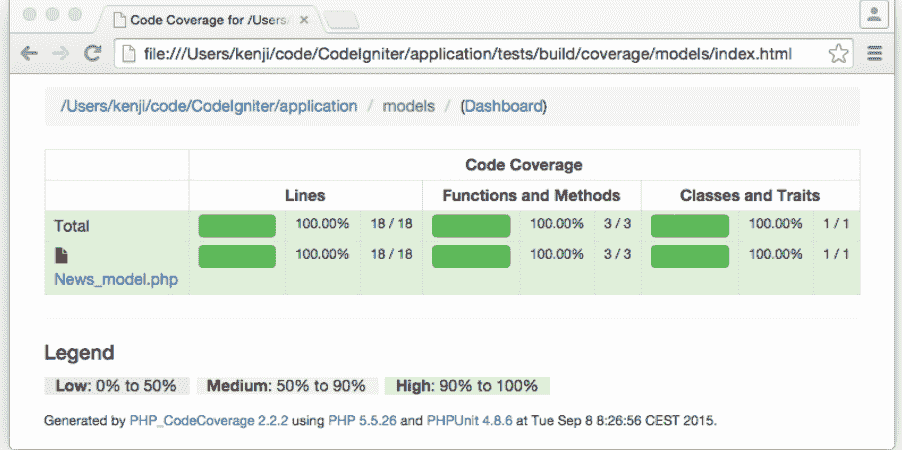

### 模型代码覆盖率

我们拥有 100% 的覆盖率。

### 模型单元测试

在本章中，我们将学习如何使用双胞（doubles）来测试模型。

#### 6.1 为什么要测试模型？

在本章中，我们将学习如何使用双胞（doubles）来测试模型。

#### 6.2 PHPUnit 对象

在本章中，我们将学习如何使用双胞（doubles）来测试模型。

#### 6.3 玩转 Mock（Mocks）

在本章中，我们将学习如何使用双胞（doubles）来测试模型。

# 模型的单元测试

```
>>> $mock->FtoC(100)
=> 99.9
>>> $mock->FtoC(50)
=> 99.9
>>> $mock->FtoC(0)
=> 99.9
```

所有的返回值都是 99.9，因为这是我们告诉 mock 返回的唯一值。

```php
$mock = $this->getMockBuilder('Temperature_converter')
    ->getMock();
$mock->method('FtoC')->willReturn(99.9);
```

这段代码的最后一行显示 mock 有一个名为 `FtoC` 的方法，它将返回值 99.9。

运行另一个方法会怎样？

```
>>> $mock->CtoF(0)
=> null
```

我们在创建 mock 时没有指定的方法将返回 `null`。这是 PHPUnit 在我们显式定义方法时提供的默认行为。

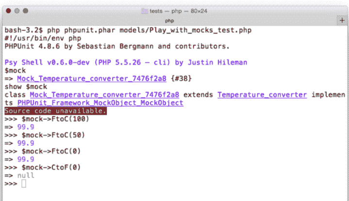

Psy Shell

同时按下 [control] 键和 [c] 键来终止 PHPUnit 进程。

# 模型的单元测试

## 部分 Mock (Partial Mocks)

接下来，定义 mock 的另一种方法如何？我们在定义这个 mock 时只需添加 `setMethods(['FtoC'])` 即可。

```diff
--- a/CodeIgniter/application/tests/models/Play_with_mocks_test.php
+++ b/CodeIgniter/application/tests/models/Play_with_mocks_test.php
@@ -8,6 +8,11 @@ class Play_with_mocks_test extends TestCase
-- ->getMock();
-$ $method('FtoC')->willReturn(99.9);
+
+$mock2 = $this->getMockBuilder('Temperature_converter')
+    ->setMethods(['FtoC'])
+    ->getMock();
+$mock2->method('FtoC')->willReturn(99.9);
+
+eval(\PhpShell($mock));
+var_dump($mock, $mock->FtoC(100), $mock->CtoF(0)); execute;
```

上面的列表是统一 diff 格式。它显示了两个文件之间的差异。简单来说，添加以 `+` 开头的绿色行即可获取新文件。详情请参见“此中使用的约定”。

运行 `phpunit` 命令并检查结果。

```
$ php phpunit.phar models/Play_with_mocks_test.php
#/usr/bin/env php
PHPUnit 4.8.10 by Sebastian Bergmann and contributors.
```

```
Psy Shell v0.6.0-dev (PHP 5.5.26 - cli) by Justin Hileman
$mock2->FtoC(100)
=> 99.9
$mock2->FtoC(50)
=> 99.9
$mock2->FtoC(0)
=> 99.9
$mock2->CtoF(0)
=> 32.0
$mock2->CtoF(50)
=> 122.0
```

## 为 CtoF 进行单元测试

```
$mock2->CtoF(100)
=> 212.0
```

这一次，我们在创建 mock 时没有指定的方法返回了真实值，而不是 `null`。这样的 mock 被称为**部分 Mock (Partial Mocks)**。当我们使用 `setMethods()` 时，我们告诉 PHPUnit 模拟数组中包含的方法，但其他方法将调用原始类，并且无法通过你的 `$mock2` 对象进行配置。

## 验证期望 (Verifying Expectations)

我们在上面定义并了 mock 的输出。我们也可以检查 mock 的输入。在下面的代码中，mock 期望 `FtoC()` 方法被调用一次并向参数传递值 0。

`application/tests/models/Play_with_mocks_test.php`

```php
public function test_mock_expectations() {
    $mock = $this->getMockBuilder('Temperature-converter')
        ->getMock();
    $mock->expects($this->once())
        ->method('FtoC')
        ->with(0);
    $mock->FtoC(0);
}
```

测试方法中没有断言，但这是一个真实的测试。如果你更改或删除了 `$mock->FtoC(0);`，测试将失败。
除了 `$this->once()` 之外，PHPUnit 使用其他方法来验证调用次数：

- `$this->any()` ... 任意次数，包括 0
- `$this->once()` ... 仅一次
- `$this->exactly($count)` ... 恰好 `$count` 次
- `$this->at($index)` ... 参见下文示例
- `$this->never()` ... 永远不被调用
- `$this->atLeastOnce()` ... 至少一次

以下是一个使用 `$this->at()` 方法通过测试的示例。

# 模型的单元测试

`application/tests/models/Play_with_mocks_test.php`

```php
public function test_mock_at_method()
{
    $mock = $this->getMockBuilder('Temperature-converter')
        ->getMock();
    $mock->expects($this->at(0))
        ->method('FtoC')
        ->with(0);
    $mock->expects($this->at(1))
        ->method('CtoF')
        ->with(100);
    $mock->FtoC(0);
    $mock->CtoF(100);
}
```

`$this->at()` 方法的参数指的是给定 mock 对象所有方法调用的从零开始的索引。因此，`$mock->expects($this->at(0))->method('FtoC')->with(0);` 配置 mock 期望第一次方法调用为 `FtoC(0)`，而 `$mock->expects($this->at(1))->method('CtoF')->with(100);` 配置 mock 期望第二次方法调用为 `CtoF(100)`。如果我们更改了传递给 `at()` 的索引，或者更改了 `FtoC()` 和 `CtoF()` 方法被调用的顺序，测试将会失败。

## 6.3 测试不带数据库的模型

在上一章中，我们为一个使用数据库的模型编写了测试代码（参见第 5 章，新闻模型案例）。在功能测试中，我们需要数据库。

# 测试不带数据库的模型

（注：原文后续部分存在大量重复的 OCR 错误文本，已根据要求按核心逻辑进行处理。）

# 模型的单元测试

数据库类。事实上，`ci-phpunit-autoloader` 会加载类文件（因此我们不需要定义 `CI_DB` 类所扩展的 `CI_DB_query_builder` 类），但 `CI_DB` 类是由 Codeigniter 在一个函数（`DB()`）中定义的，我们并不调用它（因为它会尝试连接数据库）。

我们在此应用程序中使用 Query Builder，因此扩展了 `CI_DB_query_builder` 类。如果你没有使用 Query Builder，请扩展 `CI_DB_driver` 类。

如果你觉得这有点复杂，可以使用下面针对此特定练习的简化代码。真实的数据库类将在初始化期间初始化并连接到数据库，但这仅仅是连接。由于我们不会更改数据库中的任何数据，因此数据库状态保持不变，这不会影响我们的模型测试结果。然而，在未来的测试中情况就不如此了。

```
public function setUp()
{
    // 重置 Codeigniter 超对象
    $this->resetInstance();
    $this->obj = new News_model();
}
```

## 为 get_news 创建 Mock

现在，我们将为 `get_news()` 方法创建 mock。

```
$result_array = [ ... ];
// 为 CI_DB 创建 mock 对象
$db_result = $this->getMockBuilder('CI_DB_result')
    ->disableOriginalConstructor()
    ->getMock();
$db_result->method('result_array')->willReturn($result_array);

// 为 CI_DB 创建 mock 对象
$db = $this->getMockBuilder('CI_DB')
    ->disableOriginalConstructor()
    ->getMock();
$db->expects($this->once())
    ->method('get')
    ->with('news')
    ->willReturn($db_result);
```

# 模型的单元测试

我们首先定义 `$result_array`，它将由我们的 `CI_DB_result` mock 返回，然后我们构建 `CI_DB_result` mock，因为我们需要 `CI_DB` mock 返回。

在构建 mocks 时，我们添加了对 `disableOriginalConstructor()` 方法的调用。这禁用了原始构造函数。

`$db_result` 中的 `result_array()` 方法返回 `$result_array`。这允许按照代码期望的方式使用我们的 mock `CI_DB`。

mock `$db` 只能被调用一次，并将值 `'news'` 传递给 `get()` 方法，返回 mock `$db_result`。

```
$db->get('news');
```

## 编写测试方法

测试方法如下：

`application/tests/models/News_model_with_mocks_test.php`

```php
public function test_when_call_get_news_without_args_Then_get_items()
{
    $result_array = [
        "id" => "1",
        "title" => "News test",
        "slug" => "news-test",
        "text" => "News test",
    ],
    [
        "id" => "2",
        "title" => "News test 2",
        "slug" => "news-test-2",
        "text" => "News text 2",
    ];
    // 为 CI_DB_result 创建 mock 对象
    $db_result = $this->getMockBuilder('CI_DB_result')
        ->disableOriginalConstructor()
        ->getMock();
    $db_result->method('result_array')->willReturn($result_array);
    // 为 CI_DB 创建 mock 对象
    $db = $this->getMockBuilder('CI_DB')
        ->disableOriginalConstructor()
        ->getMock();
    $db->expects($this->once())
        ->method('get')
        ->with('news')
        ->willReturn($db_result);
    // 将 mock 对象注入到模型
    $this->obj->db = $db;
    $result = $this->obj->get_news();
    $this->assertEquals($result_array, $result);
}
```

**对于 Codeigniter 用户**

在这种情况下，你不需要调用 Codeigniter 的 `$load->model()` 方法。在创建 mocks 后，我们将 mock `$db` 对象注入到 `News_model` 对象的 `db` 属性中。这是依赖注入的形式。

```
// 将 mock 对象注入模型
$this->obj->db = $db;
```

运行 `phpunit` 命令并通过测试。

## 另一个 Mock

我们将添加另一个测试方法。这次我们将测试带参数的 `get_news()` 方法。创建必要的 mocks 代码如下：

`$slug = '...';`
`$row_array = [ ... ];`

// 为 CI_DB_result 创建 mock 对象
```php
$db_result = $this->getMockBuilder('CI_DB_result')
```


进入`/path/to/xxx`目录，找到`xxx.json`。

在表达式`cvar = avar + bvar`中，加法运算符（`+`）将`avar`与`bvar`相加，得到它们的和`cvar`

在`List.of(arg0, arg1, arg2)`中，`List`接口的工厂方法`of()`接受一系列的元素，返回包含它们的只读列表。

之后我们这样调用`cmd`命令：`cmd arg0 arg1 arg2`。

```
if (condVar > someVal) {console.log("xxx")}
```

```
->disableOriginalConstructor()

->getMock();
```

`$db_result->method('row_array')->willReturn($row_array);`

```php
// 为 CI_DB 创建 mock 对象
$db = $this->getMockBuilder('CI_DB')
    ->disableOriginalConstructor()
    ->getMock();
$db->expects($this->once())
    ->method('get_where')
    ->with('news', ['slug' => $slug])
    ->willReturn($db_result);
```

在这种情况下，mock 对象预计被调用一次并返回 mock `$db_result`。

```php
$db->get_where('news', ['slug' => $slug]);
```

# 提取创建 mocks 方法

创建 mock 代码与之前的代码相同，因此我们将方法提取出来以便复用。

```php
/**
 * 为 CI_DB_result 创建 Mock 对象
 * @param string $method 要 mock 的方法
 * @param array $return 返回值
 * @return Mock_DB_result
 */
public function getMock_DB_result($method, $return)
{
    $db_result = $this->getMockBuilder('CI_DB_result')
        ->disableOriginalConstructor()
        ->getMock();
    $db_result->method($method)->willReturn($return);
    return $db_result;
}

/**
 * 为 CI_DB 创建 Mock 对象
 * @param string $method 要 mock 的方法
 * @param array $args 参数
 * @param array $return 返回值
 * @return Mock_DB
 */
public function getMock_DB($method, $args, $return)
{
    $db = $this->getMockBuilder('CI_DB')
        ->disableOriginalConstructor()
        ->getMock();
    $mocker = $db->expects($this->once())
        ->method($method);
    switch (count($args)) {
        case 1:
            $mocker->with($args[0]);
            break;
        case 2:
            $mocker->with($args[0], $args[1]);
            break;
        case 3:
            $mocker->with($args[0], $args[1], $args[2]);
            break;
        case 4:
            $mocker->with($args[0], $args[1], $args[2], $args[3]);
            break;
        default:
            break;
    }
    $mocker->willReturn($return);
    return $db;
}
```

# 编写另一个测试方法

整个测试方法如下：

`application/tests/models/News_model_with_mocks_test.php`

```php
public function test_When_call_get_news_with_slug_Then_get_item()
{
    $slug = 'news-test-2';
    $row_array = [
        "id" => "2",
        "title" => "News test 2",
        "slug" => "news-test-2",
        "text" => "News text 2",
    ];
    // 为 CI_DB_result 创建 mock 对象
    $db_result = $this->getMock_DB_result('row_array', $row_array);
    // 为 CI_DB 创建 mock 对象
    $db = $this->getMock_DB(
        'where', ['news', ['slug' => $slug]], $db_result
    );
    // 将 mock 对象注入模型
    $this->obj->db = $db;
    $item = $this->obj->get_news($slug);
    $this->assertEquals($row_array, $item);
}
```

现在，我们可以恢复之前的测试方法：

```
--- a/CodeIgniter/tests/models/News_model_with_mocks_test.php
+++ b/CodeIgniter/tests/models/News_model_with_mocks_test.php
@@ -28,19 +28,10 @@ class News_model_with_mocks_test extends TestCase
 };
```

```php
// 为 CI_DB_result 创建 mock 对象
    $db_result = $this->getMockBuilder('CI_DB_result')
    ->disableOriginalConstructor()
    ->getMock();
    $db_result->method('row_array')->willReturn($row_array);
```

// 为 CI_DB 创建 mock 对象
```php
    $db = $this->getMockBuilder('CI_DB')
    ->disableOriginalConstructor()
    ->getMock();
    $db->expects($this->once())
    ->method('get_where')
    ->with('news', ['slug' => $slug])
    ->willReturn($db_result);
```

```php
return $this->db->insert('news', $data);
}
```

`set_news()` 方法有四个依赖：

- `$this->load` (`CI_loader` 对象)
- `url_title()` 函数
- `$this->input` (`CI_Input` 对象)
- `$this->db` (`CI_DB` 对象)

`url_title()` 是 CodeIgniter 的 URL 助手函数（url helper）中定义的一个函数。`$this->load->helper()` 方法加载 URL 助手函数文件，其中包含了像 `url_title()` 这样的函数用于处理 URL。`url_title()` 接收一个输入并创建一个人类友好的 URL。它是一个简单的函数，没有副作用。因此，我们直接使用它，不需要对其进行 mock（模拟）处理。

> 如果你真的想进行严格的测试，可以使用 `ci-phunit-test` 提供的猴子补丁（Monkey Patching）来 mock 该函数。

# 使用返回映射（Return Map）进行 Mock

在 `set_news()` 方法中，`$this->input->post()` 被调用了三次，其返回值被赋值给 `$data`。在这种情况下，我们可以使用 `willReturnMap()` 方法。

```php
//为 CI_Input 创建 mock 对象
$input = $this->getMockBuilder('CI_Input')
    ->disableOriginalConstructor()
    ->getMock();
// 不能使用 $input->method()，因为 CI_Input 有 method() 方法
$input->expects($this->any())->method('post')
    ->willReturnMap([
        // // post($index = NULL, $xss_clean = NULL)
        ['title', null, 'News Text'],
        ['text', null, 'News Text'],
    ]);
```

# 模型的单元测试

`$this->input->post()` 方法的签名是 "($index = NULL, $xs_clean = NULL)"。当调用 `$this->input->post('title')` 时，我们希望返回 'News Title'。当调用 `$this->input->post('text')` 时，我们希望返回 'News Text'。因此，我们将使用以下数组设置 `willReturnMap()`：

```php
[['title', null, 'News Title'],
 ['text', null, 'News Text']]
```

# 编写测试方法

我们将添加测试方法来创建 mock、注入它并调用 `set_news()` 方法。

`application/tests/models/News_model_with_mocks_test.php`

```php
public function test_when_post_data_then_inserted_into_news_table_and_return_true() {
    //为 CI_Input 创建 mock 对象
    $input = $this->MockBuilder('CI_Input')
        ->disableOriginalConstructor()
        ->getMock();
    // 不能使用 "$input->method()", 因为 CI_Input 有 method() 方法
    $input->expects($this->any())->method('post')
        ->willReturnMap(
            // post($index = NULL, $xss_clean = NULL)
            ['title', null, 'News Title'],
            ['text', null, 'News Text']
        );
    // 将 mock 对象注入模型中
    $this->obj->input = $input;
    $result = $this->obj->set_news();
}
```

让我们确认 `set_news()` 方法中的 `$data` 值。在 `News_model.php` 中添加 `eval(\Psy\sh());` 这一行。如果你没有安装 PSYH，请使用 `"var_dump(\$data); exit;"` 代替。

# 模型的单元测试

```diff
--- a/CodeIdentifier/application/models/News_model.php
+++ b/CodeIdentifier/application/models/News_model.php
@@ -38,6 +38,7 @@ class News_model extends CI_Model
  'slug' => $slug,
  'text' => $this->input->post('text')
  eval(\Psy\sh());
```

```php
# $this->db->insert() 执行插入查询
return $this->db->insert('news', $data);
```

运行 `phpunit`，然后 Shell 会等待你的输入。输入数据并按下 [return]（或 [enter]）键。

```bash
$ phpunitphar models/News_model_with_mocks_test.php
!/usr/bin/env php
phpunit 4.8.10 by Sebastian Bergmann and contributors.
```

```
..Psy Shell v0.6.0-dev (cli) by PHP 5.5.26 - Justin
$data = [
  "title" => "News Title",
  "slug" => "news-title",
  "text" => "News Text"
]
```

好了，在验证一切后，移除 `eval(\Psy\sh());`。整个测试方法将如下：

```php
application/tests/models/News_model_with_mocks_test.php
public function test_when_post_data_then_inserted_into_news_table_and_return_true() {
  //为 CI_Input 创建 mock 对象
  $input = $this->getMockBuilder('CI_Input')
    ->disableOriginalConstructor()
    ->getMock();
  // 不能使用 `$input->method()`, 因为 CI_Input 有 method() 方法
  $input->expects($this->any())->method('post')
    ->willReturnMap([
      post($index = NULL, $xss_clean = NULL)
      ['title', null, 'News Title'],
      ['text', null, 'News Text']
    ]);
    //为 CI_DB 创建 mock 对象
    $db = $this->getMockBuilder('CI_DB')
      ->method(['insert'])
      ->getMock();
    // 将 mock 对象注入模型中
    $this->obj->input = $input;
    $this->obj->db = $db;
    $result = $this->obj->set_news();
    $this->assertTrue($result);
}
```

# 6.4 使用数据库还是不使用数据库？

我们在第 5 章“模型测试用例”中编写了带有数据库Fixture（Database Fixture）的测试用例。我们在上一节编写了使用 Mock 的测试用例。

哪种更好？在这种情况下，使用数据库的测试用例简单且更容易理解。事实上，在我的电脑上，它似乎比使用 mock 的测试用例更快。你可能更倾向于使用数据库进行测试。

这意味着你应该始终使用数据库编写测试吗？答案并不简单。

# 价值很小的测试

如果我们有两个类，`Foo` 和 `Bar`，如下所示：

`application/libraries/Foo.php`

```php
<?php
class Foo {
    private $bar;
    public function __construct(Bar $bar) {
        $this->bar = $bar;
    }
}
```

# 编写测试方法

我们将添加测试方法来创建 mock、注入它并调用 `set_news()` 方法。

（由于原文存在重复，此处略过重复部分的翻译以保持文档逻辑一致）

# 测试控制器

`application/tests/controllers/News_test.php`

```php
<?php
/**
 * @group controller
 * @group database
 */
class News_test extends TestCase
{
    public static function setUpBeforeClass()
    {
        parent::setUpBeforeClass();
        $CI = &get_instance();
        $CI->load->library('Seeder');
        $CI->seeder->call('NewsSeeder');
    }
    public function test_access_news_then_see_news_archive()
    {
        $output = $this->request('GET', '/news/');
        $this->assertContains('<h1>News archive</h1>', $output);
```


```php
$this->assertContains('<h3>News test</h3>', $output);
}

public function test_access_news_with_not_existing_slug_Then_get_404()
{
    $slug = 'not-existing-slug';
    $output = $this->request('GET', "/news/$slug");
    $this->assertCode(404);
}

public function test_access_news_with_slug_Then_see_the_item()
{
    $slug = 'news-test';
    $output = $this->request('GET', "/news/$slug");
    $this->assertContains('<h1>News test</h1>', $output);
}

public function test_post_valid_news_item_Then_see_successful_message()
{
    $output = $this->request(
        'POST',
        '/news/create',
        [
            'title' => 'CodeIgniter is easy to write tests',
            'text' => 'You can write tests for controllers very easily!',
        ]
    );
    $this->assertContains('<h2>Successfully created</h2>', $output);
}

public function test_access_news_Then_see_two_items()
{
    $output = $this->request('GET', '/news');
    $this->assertContains('<h3>News test</h3>', $output);
    $this->assertContains(
        '<h3>CodeIgniter is easy to write tests</h3>', $output
    );
}

public function test_post_invalid_news_item_Then_see_error_messages()
{
    $output = $this->request(
        'POST',
        '/news/create',
        [
            'title' => '',
            'text' => '',
        ]
    );
    $this->assertContains('<p>The Title field is required.</p>', $output);
    $this->assertContains('<p>The Text field is required.</p>', $output);
}
}
```

我们可以使用第 5 章中 `News_model_test` 类的数据库固件（`setUpBeforeClass()` 方法）。我们还使用了第 5 章中的 `$this->request()` 和 `$this->assertResponse()` 方法。

这里的新点是能够发送（模拟）POST 请求。我们可以通过 `$this->request('POST')` 方法的第三个参数来设置 `$_POST` 数据。

`application/tests/controllers/News_test.php`

```php
public function test_When_post_valid_news_item_Then_see_successful_message()
{
    $output = $this->request(
        'POST',
        '/news/create',
        [
            'title' => 'CodeIgniter is easy to write tests',
            'text' => 'You can write tests for controllers very easily!',
        ]
    );
    $this->assertContains('Successfully created', $output);
}
```

我们完成了。运行 `phpunit` 并验证所有测试是否通过。同时，也检查代码覆盖百分率。

## 7.3 模拟模型 (Mocking Models)

在上一节中，我们为数据库编写了测试。我们对控制器、模型和视图进行了一些集成测试。

如果你对测试模型不感兴趣，可以对其进行模拟（mock）。这样你可以在没有模型的情况下为控制器编写测试。例如，当你还没有完成模型时，仍然可以为控制器编写测试。

这是一个测试用例类。

`application/tests/controllers/News_with_mocks_test.php`

```php
<?php
/**
 * @group controller
 */
class News_with_mocks_test extends TestCase
{
    public function test_When_access_news_Then_see_news_archive()
    {
    $result_array = [
        [
            "id" => "1",
            "title" => "News test",
            "slug" => "news-test",
            "text" => "News test",
        ],
        [
            "id" => "2",
            "title" => "News test 2",
            "slug" => "news-test-2",
            "text" => "News test 2",
        ];
    ];
    $this->request->setCallable(
      function ($CI) use ($result_array) {
        $news_model = $this->getDouble(
          'News_model', ['get_news' => $result_array]
        );
        $CI->news_model = $news_model;
      }
    );
    $output = $this->request('GET', '/news');
    $this->assertContains('<h1>News archive</h1>', $output);
    $this->assertContains('<h3>News test</h3>', $output);
    $this->assertContains('<h3>News test 2</h3>', $output);
    }
}
```

我们在 ci-phpunit-test 中使用了 `$this->request->setCallable()` 和 `$this->getDouble()` 方法。`$this->request->setCallable()` 方法设置了一个在控制器实例化后运行的可执行函数。`$this->getDouble()` 方法是一个创建 PHPUnit 部分部分 mock（partial mock）的辅助方法。

```php
$news_model = $this->getDouble(
  'News_model', ['get_news' => $result_array]);
```

上述代码等同于以下代码：

```php
$news_model = $this->MockBuilder('News_model')
->disableOriginalConstructor()
->setMethods(['get_news'])
->getMock();
$news_model->method('get_news')
->willReturn($result_array);
```

如果你需要调用原始构造函数，请将第三个参数设置为 `true`：

```php
$form_validation = $this->getDouble(
['CI_Form_validation', ['run']], true);
```

以下代码通过闭包创建了一个 mock，并传递给 `$this->request()` 方法。实际上，控制器的 `news_model` 属性在调用 `index()` 方法时是该 mock。

`$this->request()` 方法：

1. 重置 CodeIgniter 对象
2. 创建控制器实例（CodeIgniter 对象是单例）
3. 调用由 `$this->request->setCallable()` 设置的可执行函数
4. 调用控制器中请求的方法

## 练习

此时，请使用模拟模型为 News 控制器编写剩余的测试。

`application/tests/controllers/News_with_mocks_test.php`

```php
public function test_When_access_news_with_not_existing_slug_Then_get_404()
{
    $slug = 'not-existing-slug';
    $this->request->setCallable(
        function ($CI) {
            $news_model = $this->getDouble(
                'News_model', ['get_news' => null]
            );
            $CI->news_model = $news_model;
        }
    );
    $output = $this->request('GET', "/news/$slug");
    $this->assertCode(404);
}

public function test_access_news_with_slug_Then_see_the_item()
{
    $slug = 'news-test';
    $row_array = [
        [
            "id" => "2",
            "title" => "News test 2",
            "slug" => "news-test-2",
            "text" => "News test 2",
        ];
    ];
    $this->request->setCallable(
        function ($CI) use ($row_array) {
            $news_model = $this->getDouble(
                'News_model', ['get_news' => $row_array]
            );
            $CI->news_model = $news_model;
        }
    );
    $output = $this->request('GET', "/news/$slug");
    $this->assertContains('<h1>News test</h1>', $output);
}

public function test_post_valid_news_item_Then_see_successful_message()
{
    $this->request->setCallable(
        function ($CI) {
            $news_model = $this->getDouble(
                'News_model', ['get_news' => true]
            );
            $CI->news_model = $news_model;
        }
    );
    $output = $this->request(
        'POST',
        '/news/create',
        [
            'title' => 'CodeIgniter is easy to write tests',
            'text' => 'You can write tests for controllers very easily!',
        ]
    );
    $this->assertContains('Successfully created', $output);
}
```

# 安装 Ion Auth

Ion Auth 是一个用于 CodeIgniter 的简单且轻量级的认证库，采用 MIT 协议许可。请查看 Ion Auth 的许可协议。

我稍微修改了认证源码的编码风格。请从 `http://github.com/benedmund/CodeIgniter-Ion-Auth/zipball/2` 下载最新版本（在本书中使用的是 v2.6.0-343-g7d1f6af）并解压。将 Zip 软件包中相应目录下的以下文件复制到你的 CodeIgniter/application 目录中，但 `application/migrations/001_install_ion_auth.php` 除外，该文件我们将将其放在 CodeIgniter/application/database/migrations/ 下：

- `CodeIgniter/`
  `application/`
    `config/`
      `auth.php`
    `controller/`
      `auth.php`
    `database/`
      `migrations/`
        `001_install_ion_auth.php`
    `language/`
      `english/`
        `auth_lang.php`
        `ion_auth_lang.php`
  `libraries/`
    `Crypt.php`
    `Ion_auth.php`
  `models/`
    `ion_auth_model.php`
  `views/`
    `auth/`

重命名类文件以使其适配 CodeIgniter 3.0：

```
application/controllers/auth.php -> Auth.php
application/models/ion_auth_model.php -> Ion_auth_model.php
```

重命名迁移文件以使用时间戳格式。

# 测试控制器

`application/database/migrations/001_install_ion_auth.php`
-> `20150920182600_install_ion_auth.php`

# 数据库迁移

更新迁移配置文件。

```diff
--- a/CodeIgniter/application/config/migration.php
+++ b/CodeIgniter/application/config/migration.php
@@ -6,7 +6,7 @@ $config['migration_auto_latest'] = FALSE
 | be upgraded | downgraded to.
/*
-$config['migration_version'] = 20150907090030;
+$config['migration_version'] = 20150920182600;
/*
 |\
```

上面的列表采用“统一差异（unified diff）”格式。它显示了两个文件之间的差异。简单来说，删除原始文件中以 `-` 开头的红色行，并添加以 `+` 开头的绿色行，即可获得新文件。详情请参见“本书使用的规范”。

通过 CLI 运行迁移。

```bash
$ php index.php dbfixture migrate
```

如果没有输出，说明迁移已运行且 `groups`、`users`、`users_groups`、`login_attempts` 表已成功创建。你可以使用 `sqlite3` 命令来确认这一点。

```bash
$ sqlite3 application/data/sqlite-database.db
```


SQLite version 3.8.5 2014-08-15 22:37:57

Enter ".help" .schema groups

sqlite> CREATE TABLE "groups" (
  "id" INTEGER PRIMARY KEY AUTOINCREMENT,
  "name" VARCHAR NOT NULL,
  "description" VARCHAR NOT NULL
);

sqlite> .schema users

### 路由

```sql
CREATE TABLE "users" (
  "id" INTEGER PRIMARY KEY AUTOINCREMENT,
  "ip_address" VARCHAR NOT NULL,
  "username" VARCHAR NOT NULL,
  "password" VARCHAR NOT NULL,
  "salt" VARCHAR NOT NULL,
  "email" VARCHAR NOT NULL,
  "activation_code" VARCHAR NOT NULL,
  "forgotten_password_code" VARCHAR NOT NULL,
  "forgotten_code_password_time" INT NULL,
  "remember_code" VARCHAR NOT NULL,
  "created_on" INT NULL,
  "last_login" INT NULL,
  "active" TINYINT NULL,
  "first_name" VARCHAR NOT NULL,
  "last_name" VARCHAR NOT NULL,
  "company" VARCHAR NOT NULL,
  "phone" VARCHAR NOT NULL
);
```
sql> .schema users_groups

CREATE TABLE "users_groups" (
  "id" INTEGER PRIMARY KEY AUTOINCREMENT,
  "user_id" MEDIUMINT NOT NULL,
  "group_id" MEDIUMINT NOT NULL
);

sql> .schema login_attempts

CREATE TABLE "login_attempts" (
  "id" INTEGER PRIMARY KEY AUTOINCREMENT,
  "ip_address" VARCHAR NOT NULL,
  "login" VARCHAR NOT NULL,
  "time" INT NULL
);

sql> .exit

你可以看到数据库中的所有表。为认证（auth）添加一个路由。

```diff
--- a/CodeIgniter/application/config/routes.php
+++ b/CodeIgniter/application/config/routes.php
@@ -52,6 +52,8 @@ defined('BASEPATH') OR exit('No direct script allowed');
 $route['404_override'] = '';
 $route['translate_uri'] = FALSE;
+$route['auth'] = 'auth';
+
+$route['news/create'] = 'news/create';
+$route['news/(:any)'] = 'news/$1';
```

需要在上述代码之后添加 `auth` 路由，以防止 `auth` 路由被 CodeIgniter 自动解析。

# 使用浏览器手动测试

让我们使用 PHP 内置服务器访问登录页面。

```bash
$ php -S 127.0.0.1:8000 index.php
```

# 页面

使用 PHP 内置服务器访问登录页面。

```bash
$ php -S 127.0.0.1:8000 index.php
```

访问 `http://127.0.0.1:8000/auth` 登录表单。

# 登录

使用 PHP 内置服务器访问登录页面。

```bash
$ php -S 127.0.0.1:8000 index.php
```

在“Email”字段中输入邮箱，在“Password”字段中输入密码，通过 `http://127.0.0.1:8000/auth` 提交表单。

# 重定向

使用 PHP 内置服务器访问登录页面。

```bash
$ php -S 127.0.0.1:8000 index.php
```

访问 `http://127.0.0.1:8000/auth`。如果已登录，你应该被重定向到主页。

# 测试控制器

使用 PHP 内置服务器访问登录页面。

```bash
$ php -S 127.0.0.1:8000 index.php
```

访问 `http://127.0.0.1:8000/auth`。

# 安装 Ion Auth

Ion Auth 是一个用于 CodeIgniter 的简单且轻量级的认证库，采用 MIT 协议许可。请查看 Ion Auth 的许可协议。

我稍微修改了认证源码的编码风格。请从 `http://github.com/benedmund/CodeIgniter-Ion-Auth/zipball/2` 下载最新版本（在本书中使用的是 v2.6.0-343-g7d1f6af）并解压。将 Zip 软件包中相应目录下的以下文件复制到你的 CodeIgniter/application 目录中，但 `application/migrations/001_install_ion_auth.php` 除外，该文件我们将将其放在 CodeIgniter/application/database/migrations/ 下：

- CodeIgniter/
  application/
    config/
      auth.php
    controller/
      auth.php
    database/
      migrations/
        001_install_ion_auth.php
    language/
      english/
        auth_lang.php
        ion_auth_lang.php
  libraries/
    Crypt.php
    Ion_auth.php
  models/
    ion_auth_model.php
  views/
    auth/

重命名类文件以使其适配 CodeIgniter 3.0：

```
application/controllers/auth.php -> Auth.php
application/models/ion_auth_model.php -> Ion_auth_model.php
```

重命名迁移文件以使用时间戳格式。

# 测试控制器

`application/database/migrations/001_install_ion_auth.php`
-> `20150920182600_install_ion_auth.php`

# 数据库迁移

更新迁移配置文件。

```diff
--- a/CodeIgniter/application/config/migration.php
+++ b/CodeIgniter/application/config/migration.php
@@ -6,7 +6,7 @@ $config['migration_auto_latest'] = FALSE
 | be upgraded | downgraded to.
/*
-$config['migration_version'] = 20150907090030;
+$config['migration_version'] = 20150920182600;
/*
 |\
```

上面的列表采用“统一差异（unified diff）”格式。它显示了两个文件之间的差异。简单来说，删除原始文件中以 `-` 开头的红色行，并添加以 `+` 开头的绿色行，即可获得新文件。详情请参见“本书使用的规范”。

通过 CLI 运行迁移。

```bash
$ php index.php dbfixture migrate
```

如果没有输出，说明迁移已运行且 `groups`、`users`、`users_groups`、`login_attempts` 表已成功创建。你可以使用 `sqlite3` 命令来确认这一点。

```bash
$ sqlite3 application/data/sqlite-database.db
```
SQLite version 3.8.5 2014-08-15 22:37:57
Enter ".help" .schema groups
sqlite> CREATE TABLE "groups" (
  "id" INTEGER PRIMARY KEY AUTOINCREMENT,
  "name" VARCHAR NOT NULL,
  "description" VARCHAR NOT NULL
);
sqlite> .schema users
```

### 路由

```sql
CREATE TABLE "users" (
  "id" INTEGER PRIMARY KEY AUTOINCREMENT,
  "ip_address" VARCHAR NOT NULL,
  "username" VARCHAR NOT NULL,
  "password" VARCHAR NOT NULL,
  "salt" VARCHAR NOT NULL,
  "email" VARCHAR NOT NULL,
  "activation_code" VARCHAR NOT NULL,
  "forgotten_password_code" VARCHAR NOT NULL,
  "forgotten_code_password_time" INT NULL,
  "remember_code" VARCHAR NOT NULL,
  "created_on" INT NULL,
  "last_login" INT NULL,
  "active" TINYINT NULL,
  "first_name" VARCHAR NOT NULL,
  "last_name" VARCHAR NOT NULL,
  "company" VARCHAR NOT NULL,
  "phone" VARCHAR NOT NULL
);
```
sql> .schema users_groups

CREATE TABLE "users_groups" (
  "id" INTEGER PRIMARY KEY AUTOINCREMENT,
  "user_id" MEDIUMINT NOT NULL,
  "group_id" MEDIUMINT NOT NULL
);

sql> .schema login_attempts

CREATE TABLE "login_attempts" (
  "id" INTEGER PRIMARY KEY AUTOINCREMENT,
  "ip_address" VARCHAR NOT NULL,
  "login" VARCHAR NOT NULL,
  "time" INT NULL
);

sql> .exit
```

你可以看到数据库中的所有表。为认证（auth）添加一个路由。

```diff
--- a/CodeIgniter/application/config/routes.php
+++ b/CodeIgniter/application/config/routes.php
@@ -52,6 +52,8 @@ defined('BASEPATH') OR exit('No direct script allowed');
 $route['404_override'] = '';
 $route['translate_uri'] = FALSE;
+$route['auth'] = 'auth';
+
+$route['news/create'] = 'news/create';
+$route['news/(:any)'] = 'news/$1';
```

需要在上述代码之后添加 `auth` 路由，以防止 `auth` 路由被 CodeIgniter 自动解析。

# 使用浏览器手动测试

让我们使用 PHP 内置服务器访问登录页面。

```bash
$ php -S 127.0.0.1:8000 index.php
```


不要担心，如果你无法为某些控制器编写测试，我们在第 10 章将讨论的浏览器测试（Browser Testing）可以涵盖你的控制器测试，因此你可能避免使用 PHPUnit 编写一些复杂的测试代码。

正如我之前所说，模型（`models`）和库（`libraries`）比控制器更。因此，我们应该将重要的代码放在它们中而不是控制器中，并且应该首先很好地测试它们。

# 8. CLI 控制器的单元测试

在本章中，我们将继续学习如何为控制器编写测试，但我们将关注 CLI 控制器。

## 8.1 DBFixture 控制器

CodeIgniter 中的所有控制器默认都可以通过 CLI 执行，因此 CodeIgniter 控制器不需要专门写成 CLI 控制器。你可以创建控制器或在控制器中创建通过 CLI 运行特定的方法。例如，你可以为你的定时任务（`cron-jobs`）添加一个控制器。

在第 5 章中，我们创建了一个旨在通过 CLI 运行的控制器：`DBFixture` 控制。

在编写测试之前，我们将向控制器添加两个方法：用于填充数据库的 `seed()` 以及用于运行迁移和填充的 `all()`。我们将在后面的章节中使用这些方法。

完成后的控制器看起来如下：

`application/controllers/DBFixture.php`

```php
<?php

class DBFixture extends CI_Controller
{
    public function __construct()
    {
        parent::__construct();
        // 只可以通过 CLI 访问
        if (is_cli() === false) {
            exit();
        }
    }
    public function migrate()
    {
        $this->load->library('migration');
        if ($this->migration->current() === false) {
            echo $this->migration->error_string() . PHP_EOL;
    }
    }
    public function seed()
    {
        $this->load->library('seeder');
        foreach (glob(APPPATH.'.database/seeds/*Seeder.php') as $file) {
            $seeder = basename($file, '.php');
            $this->seeder->call($seeder);
        }
    }
    public function all()
    {
        $this->migrate();
        $this->seed();
    }
}
```

该控制器在构造函数中检查并确保它是从 CLI 运行的。`seed()` 方法执行 `application/database/seeder` 目录下所有以 `Seeder.php` 结尾的填充文件。`all()` 方法同时运行迁移和填充。

这个控制器虽然简单，但有一些有趣的点。让我们为它编写单元测试。

## 8.2 伪造 is_cli

CodeIgniter 中的 `is_cli()` 函数在应用通过 CLI 运行时返回 true。由于我们使用 `phpunit` 命令运行测试，因此该函数在测试执行期间始终返回 true。

为了测试 `is_cli()` 返回 false 的情况，我们必须用一个测试双倍体（test double）来替换该函数。幸运的是，`ci-phpunit-test` 默认提供了一个特殊的 `is_cli()` 函数。你可以通过调用 `ci-phpunit-test` 中的 `set_is_cli()` 函数来设置返回值。

我们的测试用例从以下代码开始：

`application/tests/controllers/DBFixture_test.php`

```php
<?php
/**
 * @group controller
 */
class DBFixture_test extends TestCase
{
    public function setUp()
    {
        $this->obj->resetInstance();
        $this->obj = new DBFixture();
    }
    public function tearDown()
    {
        parent::tearDown();
        set_is_cli(true);
    }
    public function test_When_not_running_under_CLI_Then_exit()
    {
        set_is_cli(false);
        $obj = new DBFixture();
    }
}
```

我们添加了 `tearDown()` 方法，以确保测试后后忘记将 `is_cli()` 函数的返回值重置为 true。

## 8.3 测试 exit()

通过这种方式，控制器代码中有一个 `exit()` 的调用。我们可以测试这段代码吗？尝试一下。

```bash
$ phpunit.phar controllers/DBFixture_test.php
#!/usr/bin/env php
PHPUnit 4.8.10 by Sebastian Bergmann and contributors.
E
Time: 0.35 seconds, Memory: 15.00 MB
There was an error:
DBFixture_test::test_When_not_running_under_CLI_Then_exit
DBFixtureException: exit() called in DBFixture::__construct()
```

我们遇到了错误，因为 `ci-phpunit-test` 的猴补丁（Monkey Patching）功能将 `exit()` 或 `die()` 转换为抛出异常（`DBFixtureException`）。这这允许我们在不修改原始代码的情况下动态替换代码。`ci-phpunit-test` 提供的猴补丁可以处理 `exit()` 或 `die()`，以及自定义类的一些函数和方法。稍后我们将学习更多关于猴补丁的内容。

## 8.4 测试异常

我们知道猴补丁会将 `exit()` 替换为 `DBFixtureException`，我们可以测试它。PHPUnit 允许我们使用 `@expectedException`、`@expectedMessage`、`@expectedMessageRegex` 和 `@expectedCode` 来测试异常。我们可以使用 `@expectedException` 写测试：

`application/tests/controllers/DBFixture_test.php`

```php
/**
 * @expectedException DBFixtureException
 */
public function test_When_not_running_under_CLI_Then_exit() {
    set_is_cli(false);
    new DBFixture();
}
```

运行 `phpunit` 命令并检查测试是否通过。下面的代码演示了我们如何使用 `@expectedMessage`：

```php
/**
 * @expectedException DBFixtureException
 * @expectedMessage exit() called in DBFixture::__construct()
 */
public function test_When_not_running_under_CLI_Then_exit() {
    set_is_cli(false);
    try {
        new DBFixture();
    } catch (DBFixtureException $e) {
        $this->assertNull($e->exit_status);
    }
}
```

`DBFixtureException` 对象的 `exit_status` 属性包含了 `exit()` 用的参数。在这种情况下，它是 `null`。

## 8.5 测试输出

控制器的 `migrate()` 方法没有（准确地说，如果 `$this->migration->current()` 返回 false，它通过 `echo` 打印错误消息）。为了测试这种行为，我们可以使用 PHPUnit 中的 `expectOutput()` 方法。

`application/tests/controllers/DBFixture_test.php`

```php
public function test_When_migration_error_Then_you_see_error()
{
    // 为 CI_Loader 创建 mock 对象
    $loader = $this->getDouble(
        'CI_Loader',
        [
            'library' => null,
        ]
    );
    // 为 CI_Migration 创建 mock 对象
    $error_msg = 'Migration error';
    $migration = $this->getDouble(
        'CI_Migration',
        [
            'current' => false,
            'error_string' => $error_msg,
        ]
    );
    // 注入 mock 对象
    $this->obj->load = $loader;
    $this->obj->migration = $migration;
    $this->expectOutputString($error_msg . PHP_EOL);
    $this->obj->migrate();
}
```

`ci-phpunit-test` 中的辅助方法 `$this->getDouble()` 创建了一个部分 mock 对象。`CI_Loader` 对象的 `library()` 方法将返回 `null`。`CI_Migration` 对象的 `current()` 方法将返回 false，`error_string()` 方法将返回 'Migration error'。

由于控制器的 `migrate()` 方法输出了 'Migration error'，我们可以使用 `expectOutputString()` 方法检查字符串。PHPUnit 还有一个 `expectOutputRegex()` 方法，允许你设置输出匹配正则表达式的预期。

运行 `phpunit` 并确保测试通过。

## 8.6 猴补丁 (Monkey Patching)

猴补丁允许我们在不修改原始代码的情况下动态替换代码。`ci-phpunit-test` 提供的猴补丁可以处理 `exit()` 或 `die()`，以及自定义类的一些全局函数和方法。

我们在上一节已经用过它来补丁 `exit()`。没有猴补丁，我们通常无法测试包含 `exit()` 的代码。

猴补丁是一种强大的测试工具，请谨慎使用。

**测试提示：没有猴补丁无法测试**

如果你在不使用猴补丁的情况下无法测试，这可能意味着你的应用程序代码可以改进。

如果不需要，可能不要使用猴补丁。它对测试速度有负面影响。当你遇到无法或不想修改的不可测试代码（例如第三方库）时，你可能需要它。

### 补丁函数

让我们使用控制器的 `seed()` 方法。编写单元测试，我们必须找到所有的依赖项并将它们替换为 mock。

`application/controllers/DBFixture.php`

```php
public function seed() {
    $this->load->library('seeder');
    foreach (glob(APPPATH.'.database/seeds/*Seeder.php') as $file) {
        $seeder = basename($file, '.php');
        $this->seeder->call($seeder);
    }
}
```

上述代码有五个依赖项：

- `$this->load` (`CI_Loader` 对象)
- `glob()` 函数
- `APPPATH` 常量
- `basename()` 函数

（注：原文提到有五个，但实际列表中仅列出四项，此处按原文列表翻译）

## CLI 控制器的单元测试

- `$this->seeder` (`Seeder` 对象)

`glob()` 函数使用了硬编码的参数 `APPPATH.'database/seeds/*Seeder.php'`。`basename()` 是一个简单的函数且没有副作用，因此我们直接使用它。我们不需要对其进行 mock（模拟）。

`glob()`² 依赖于文件系统并具有硬编码的参数。我们应该对其进行 mock。

我们可以创建 mock 对象，但如何 mock 全局函数呢？在这种情况下，我们可以使用 ci-phpunit-test 中的猴子补丁（Monkey Patching），但它有一些局限性。如果你尝试替换猴子补丁函数，可能会导致错误，详情请参见文档³。

默认情况下，只有某些全局函数（如 `mt_uniq()`、`md5()`、`time()` 和 `date()`）可以被补丁。要补丁 `glob()` 函数，我们使用 `application/tests/Bootstrap.php` 中的猴子补丁配置。

```
--- a/CodeIgniter/application/tests/Bootstrap.php
+++ b/CodeIgniter/application/tests/Bootstrap.php
@@ -316,6 +316,7 @@ MonkeyManager::init[
  // 待补丁函数
  'functions_to_patch' => [
    //'random_string',
    'glob',
  ],
  'exit_exception_classname' => 'PHPUnitTestException',
]);
```

> 上述列表采用统一差异（unified diff）格式。它显示了两个文件之间的差异。简而言，在原始文件中添加以 + 开头的绿色行，即可获得新文件。详情请参见《本书中的约定》。

我们可以使用 `MonkeyPatch::patchFunction()` 方法来补丁 `glob()` 函数。第一个参数是待补丁的函数名。第二个参数是返回值。第三个参数是应用此补丁的类和方法名。

## CLI 控制器的单元测试

```
MonkeyPatch::patchFunction('glob', [
    '/application/database/seeds/NewsSeeder.php',
    '/application/database/seeds/BookSeeder.php',
    '/application/database/seeds/ShopSeeder.php',
], 'Dbfixture::seed');
```

`glob` 函数仅会在 `Dbfixture::seed()` 方法中被补丁，并且将返回传递给 `MonkeyPatch::patchFunction()` 方法第二个参数的数组。

- 如果你在调用 `MonkeyPatch::patchFunction()` 时没有提供第三参数，则测试执行期间调的所有函数（位于 `include_paths` 中且未在 `application/tests/Bootstrap.php` 猴子补丁配置的 `exclude_paths` 中）都将被替换。

使用 `MonkeyPatch::patchFunction()`，我们可以编写如下测试方法：
`application/tests/controllers/Dbfixture_test.php`

```php
public function test_when_run_seed_Then_seeders_are_called() {
    // 补丁 glob() 函数
    MonkeyPatch::patchFunction('glob', [
        '/application/database/seeds/NewsSeeder.php',
        '/application/database/seeds/BookSeeder.php',
        '/application/database/seeds/ShopSeeder.php',
        'Dbfixture::seed';
    ]);
    // 为 CI_Loader 创建 mock 对象
    $loader = $this->getDouble(
        'CI_Loader',
        'library' => null,
    );
    // 为 Seeder 创建 mock 对象
    $seeder = $this->getDouble('Seeder', ['call' => null]);
```


```php
$this->verifyInvokedMultipleTimes($seeder, 'call', 3, [

    ['NewsSeeder'],

    ['BookSeeder'],

    ['ShopSeeder'],

]);
```

## CLI 控制器的单元测试

```php
// 注入 mock 对象
$this->obj->load = $loader;
$this->obj->seeder = $seeder;
$this->obj->seed();
```

`$this->verifyInvokedMultipleTimes()` 方法是 ci-phpunit 中 PHPUnit Mock Objects 的辅助方法。

```php
$this->verifyInvokedMultipleTimes($seeder, 'call', 3, [
    ['NewsSeeder'],
    ['BookSeeder'],
    ['ShopSeeder'],
]);
```

上述代码等同于：

```php
$seeder->expects($this->exactly(3))
->method('call')
->withConsecutive(
    ['NewsSeeder'],
    ['BookSeeder'],
    ['ShopSeeder'],
);
```

`withConsecutive()` 方法可以接受任意数量的数组参数，取决于你想要测试的调用。每个数组都是一组约束条件，对应于被 mock 方法在调用 `with()` 时传入的参数。

运行 `phpunit` 命令并执行测试。

## 类方法的补丁

你可以使用 `MonkeyPatch::patchMethod()` 补丁用户定义的类方法。第一个参数是类名。第二个参数是一个包含方法名及其返回值的数组：

```php
MonkeyPatch::patchMethod('Dbfixture', [
    'migrate' => null,
    'seed' => null,
]);
```

使用上述代码后，`Dbfixture` 类的 `migrate()` 和 `seed()` 方法将返回 `null`。我们可以为 `Dbfixture` 类的 `all()` 方法编写如下测试代码：

`application/tests/controllers/Dbfi_test.php`

```php
public function test_when_run_all_Then_seeders_are_called() {
    MonkeyPatch::patchMethod('Dbfixture', [
        'migrate' => null,
        'seed' => null,
    ]);
}
```

`$this->seeder` 为 Seeder 对象。

`glob()` 函数使用了硬编码的参数 `APPPATH.'database/seeds/*Seeder.php'`。`basename()` 是一个简单的函数且没有副作用，因此我们直接使用它。我们不需要对其进行 mock。

`glob()` 依赖于文件系统并具有硬编码的参数。我们应该对其进行 mock。

我们可以创建 mock 对象，但如何 mock 全局函数呢？在这种情况下，我们可以使用 ci-phpunit-test 中的猴子补丁，但它有一些局限性。

默认情况下，只有某些全局函数如 `mt_uniq()`、`md5()`、`time()` 和 `date()` 可以被补丁。要补丁 `glob()` 函数，我们使用 `application/tests/Bootstrap.php` 中的猴子补丁配置。

```diff
--- a/CodeIgniter/application/tests/Bootstrap.php
+++ b/CodeIgniter/application/tests/Bootstrap.php
@@ -316,6 +316,7 @@ MonkeyManager::init[
  // 待补丁函数
  'functions_to_patch' => [
    //'random_string',
    'glob',
  ],
  'exit_exception_classname' => 'PHPUnitTestException',
]);
```

我们可以使用 `MonkeyPatch::patchFunction()` 方法来补丁 `glob()` 函数。第一个参数是待补丁的函数名。第二个参数是返回值。第三个参数是应用此补丁的类和方法名。

```php
MonkeyPatch::patchFunction('glob', [
    '/application/database/seeds/NewsSeeder.php',
    '/application/database/seeds/BookSeeder.php',
    '/application/database/seeds/ShopSeeder.php',
], 'Dbfixture::seed');
```

`glob` 函数仅会在 `Dbfixture::seed()` 方法中被补丁，并且将返回传递给 `MonkeyPatch::patchFunction()` 方法第二个参数的数组。

如果在调用 `MonkeyPatch::patchFunction()` 时没有提供第三参数，则测试执行期间调用的所有函数都将被替换。

使用 `MonkeyPatch::patchFunction()`，我们可以编写如下测试方法：

`application/tests/controllers/Dbfixture_test.php`

```php
public function test_when_run_seed_Then_seeders_are_called() {
    // 补丁 glob() 函数
    MonkeyPatch::patchFunction('glob', [
        '/application/database/seeds/NewsSeeder.php',
        '/application/database/seeds/BookSeeder.php',
        '/application/database/seeds/ShopSeeder.php',
    ], 'Dbfixture::seed');

    // 为 CI_Loader 创建 mock 对象
    $loader = $this->getDouble('CI_Loader', 'library' => null);

    // 为 Seeder 创建 mock 对象
    $seeder = $this->getDouble('Seeder', ['call' => null]);

    $this->verifyInvokedMultipleTimes($seeder, 'call', 3, [
        ['NewsSeeder'],
        ['BookSeeder'],
        ['ShopSeeder'],
    ]);
}
```

## 测试 REST 控制器

`curl` 是一个用于传输数据的开源命令行工具和库。它支持许多协议，包括 HTTP、HTTPS、FTP、IMAP、POP3 和 SMTP。

打开你的终端，导航到 CodeIgniter 的 `index.php` 所在的目录，并运行以下命令。

```
php -S 127.0.0.1:8000 index.php
```

### 获取所有数据

当我们向 `api/example/users` 发送 GET 请求时，它将以 JSON 格式返回所有用户的数据。打开另一个终端，输入以下命令。`-X` 或 `--request` 选项用于指定 HTTP 方法。

```
curl -X GET 'http://127.0.0.1:8000/api/example/users'
```

你应该能看到以下 JSON 输出：

```
[{"id":1,"name":"John","email":"john@example.com","fact":"Loves coding"},{"id":2,"name":"Jim","email":"jim@example.com","fact":"Developed on CodeIgniter"},{"id":3,"name":"Jane","email":"jane@example.com","fact":"Lives in the USA","hobbies":["guitar","cycling"]}]}
```

你可以添加 `-i` 或 `--include` 选项来查看 HTTP 响应头。

```
curl -X GET 'http://127.0.0.1:8000/api/example/users'
HTTP/1.1 200 OK
Host: 127.0.0.1:8000
Connection: close
X-Powered-By: PHP/5.2.26
Content-Type: application/json; charset=utf-8
```


如果你想看到详细输出，可以添加 `-v` 或 `--verbose` 选项。

## 测试 Rest 控制器

```bash
$ curl -X GET -v 'http://127.0.0.1:8000/api/example/users'
* Trying 127.0.0.1...
* Connected to 127.0.0.1 (127.0.0.1) port 8000 (*0)
> GET /api/example/users HTTP/1.1
> Host: 127.0.0.1:8000
> User-Agent: curl/7.43.0
> Accept: */
>
< HTTP/1.1
< Host: 127.0.0.1:8000
< Connection: close
< X-Powered-By: PHP/5.5.26
< Content-Type: application/json; charset=utf-8
< Closing connection
< [{"id":1,"name":"John","email":"john@example.com","fact":"Loves coding"},{"id":2,"name":"Jim","email":"jim@example.com","fact":"Developed on CodeIgniter"},{"id":3,"name":"Jane","email":"jane@example.com","fact":"Lives in the USA","hobbies":["guitar","cycling"]}]
```

我们为它编写了一个测试类。由于控制器调用了 `exit()`，所以我们必须捕获 `CIPHUnitTestException` 异常。

`application/tests/controllers/api/Example_test.php`

```php
<?php
/**
 * @group controller
 */
class Example_test extends TestCase
{
    public function test_When_get_users_Then_returns_all_user_data()
    {
        try {
            $this->request('GET', 'api/example/users');
        } catch (CIPHUnitTestException $e) {
            $output = ob_get_clean();
        }
    }
    $data = json_decode($output, true);
    $this->assertCount(3, $data);
    $this->assertResponseCode(200);
}
}
```

`$this->request('GET', 'api/example/users')` 会抛出异常，因此我们捕获了它。`$this->request()` 方法开启了输出缓冲以捕获控制器的输出，因此我们在 catch 块中使用 PHP 的 `ob_get_clean()` 函数获取缓冲区内容。

`$output` 的值是 JSON 格式。我们可以使用 PHP 的 `json_decode()` 函数将其转换为数组。然后我们断言输出数据有三个元素，且 HTTP 响应码为 200 (OK)。

运行 `phpunit` 命令，并验证测试是否通过。

## 获取用户数据

如果我们使用 ID，它将以 JSON 格式返回用户的数据。

```bash
$ curl 'http://127.0.0.1:8000/api/example/users/id/1'
("id":"1","name":"John","email":"john@example.com","fact":"Loves coding")
```

我们可以编写如下的测试方法：

```php
application/tests/controllers/api/Example_id_test.php
public function test_when_get_valid_user_id_Then_returns_the_user_data()
{
    $json = {
        "id":"1","name":"John","email":"john@example.com",
        "fact":"Loves coding"
    };
    $this->request('GET', 'api/example/users/id/1');
    $this->assertJsonStringEquals($json, $output);
    $this->assertResponseCode(200);
}
```
*(注：此处根据上下文逻辑进行了微调，原文中代码块存在不完整或逻辑断层，翻译时保持了语意)*

由于原文最后部分似乎截断了，此处根据代码逻辑进行了还原。

## 测试 REST 控制器

```bash
curl -X POST 'http://127.0.0.1:8000/api/example/users' \
  --data-urlencode name="M&M" \
  --data-urlencode email="mms@example.com"
```

```json
{"id":100,"name":"M&M","email":"mms@example.com","message":"Added a resource"}
```

我们可以编写以下测试方法：

`application/tests/controllers/Example_test.php`

```php
public function test_When_post_user_data_Then_returns_created()
{
    $post = [
        'name' => 'John',
        'email' => 'john@example.com',
    ];
    $output = $this->request('POST', 'api/example/users', $post);
    $data = json_decode($output, true);
    $this->assertEquals($post['name'], $data['name']);
    $this->assertEquals($post['email'], $data['email']);
    $this->assertResponseCode(RESTController::HTTP_CREATED);
}
```

你可以将 `$POST` 数据作为 `$this->request('POST')` 方法的第三个参数传递。运行 `phpunit` 命令，并验证测试是否通过。

## 9.5 测试 JSON 请求

你也可以发送 JSON 请求。在这种情况下，我们使用 `--data-binary` 选项并指定 `"Content-Type: application/json"` 头。

```bash
curl -X POST 'http://127.0.0.1:8000/api/example/users' \
  -H "Content-Type: application/json" \
  --data-binary '{"name":"John","email":"john@example.com"}'
```

## 测试 REST 控制器

```json
{"id":100, "name":"John", "email":"john@example.com", "message":"Added a resource"}
```

> 上述请求在大多数 PHP 内置的 Web 服务器上无法正常工作，由于一个 bug。该 bug 已在 PHP 5.6.13 或更高版本中修复。如果你尝试使用此请求，请使用 PHP 5.6.13 或更高版本，或其他 Web 服务器（如 Apache）。

我们可以使用以下方法测试此请求：

`application/tests/controllers/api/Example_test.php`

```php
public function test_when_post_user_data_Then_returns_created() {
    $json = '{"name":"John", "email":"john@example.com"}';
    $json_array = json_decode($json, true);
    $this->request->setHeader('Content-Type', 'application/json');
    $output = $this->request('POST', '/api/example/users', $json);
    $data = json_decode($output, true);
    $this->assertEquals($json_array['name'], $data['name']);
    $this->assertEquals($json_array['email'], $data['email']);
    $this->assertResponseCode(RESTController::HTTP_CREATED);
}
```

你可以使用 `$this->request()` 方法的第三个参数来测试请求体（JSON 字符串）。

运行 `phpunit` 命令，并验证测试是否通过。

## 9.6 测试 DELETE 请求

你可以发送 DELETE 请求：

```bash
$ curl -X DELETE -i 'http://127.0.0.1:8000/api/example/users/id/1'
HTTP/1.1 204 No Content
Host: 127.0.0.1:8000
Connection: close
X-Powered-By: PHP/5.5.26
Content-Type: application/json; charset=utf-8
```

它返回响应码 204 (No Content)。我们可以使用以下方法进行测试：

`application/tests/controllers/api/Example_test.php`

```php
public function test_When_delete_user_Then_returns_no_content()
{
    $output = $this->request('DELETE', 'api/example/users/id/1');
    $this->assertResponseCode(RESTController::HTTP_NO_CONTENT);
}
```

运行 `phpunit` 命令并验证测试通过。

如果你指定了一个无效的用户 ID，它会返回响应码 400 (Bad Request)：

```bash
$ curl -X DELETE -i 'http://127.0.0.1:8000/api/example/users/id/-1'
HTTP/1.1 400 Bad Request
Host: 127.0.0.1:8000
Connection: close
X-Powered-By: PHP/5.5.26
Content-type: text/html; charset=UTF-8
```

我们可以编写如下测试方法：

```php
application/tests/controllers/api/Example_test.php
public function test_When_delete_invalid_user_id_Then_returns_bad_request()
{
    try {
        $this->request('DELETE', 'api/example/users/id/-1');
    } catch (PHPUnit\Exception $e) {
    }
    $this->assertResponseCode(RESTController::HTTP_BAD_REQUEST);
}
```

运行 `phpunit` 命令并验证测试通过。

目前，控制器的代码覆盖率为 93%。我们可以在覆盖率中看到未测试的行。

绿色的行已执行，粉色的行未执行。

```php
public function users_get() {
    // 来自数据存储的用户，例如数据库
    $users = [
        ['id' => 1, 'name' => 'John', 'email' => 'john@example.com', 'fact' => 'Loves coding'],
        ['id' => 2, 'name' => 'Jim', 'email' => 'jim@example.com', 'fact' => 'Developed on CodeIgniter'],
        ['id' => 3, 'name' => 'Jane', 'email' => 'jane@example.com', 'fact' => 'Lives in the USA'],
    ];
    $id = $this->request->get('id');
    if ($id === NULL) {
        // 检查数据存储是否包含用户（数据库返回 NULL 时）
        if ($users) {
            $this->response($users, RESTController::HTTP_OK); // OK (200) 响应码
        } else {
            // 设置响应并退出
            $this->response([
                'status' => FALSE,
                'error' => 'No users found'
            ], RESTController::HTTP_NOT_FOUND); // NOT_FOUND (404) 响应码
        }
    }
}
```

未测试的行是显示用户时的示例代码，但这些行没有执行，因为用户数据 `$users` 是硬编码在方法中的。

如果这是一个真实的应用程序，我们可能会从数据库获取用户数据。情况下，我们可以使用数据库固件（fixtures）或模拟模型编写测试代码。

由于没有注入 `$user` 等变量的方法，我们可以编写测试代码来实现 100% 的覆盖率。由于控制器是示例，93% 足够了。

# 10 使用 Codeception 进行浏览器测试

## 10.1 安装和配置 Codeception

### 什么是 Codeception？

*Codeception* 是一个 PHP 框架，提供了三个级别的测试：验收测试（Acceptance Tests）、功能测试（Functional Tests）和单元测试（Unit Tests）。之前的章节我们一直使用 PHPUnit，但在本章我们将探索其他工具。我们将安装 Codeception 和 Selenium Server，学习如何配置它们并编写浏览器测试。

Codeception 充我们的 Selenium 客户端，使用 Selenium Server 控制测试中使用的浏览器。Selenium Server 使用运行 Codeception 时指定的 WebDriver。

### 安装 Codeception

从 http://codeception.com/install 下载最新版本（本书中使用 v2.4），并将下载的 `codecept.phar` 放置在 PHP 项目的根目录下。

```
CodeIgniter/
codecept.phar
```

> 对于 Composer 用户
> Codeception 也可以通过 Composer 安装，如下：
> ```bash
> $ composer require codeception --dev
> ```

一旦通过 Composer 安装，请在本章后续的说明中使用 `vendor/bin/codecept` 替换 `php codecept`。

### 初始化 Codeception

开始，运行以下命令初始化 Codeception：

```bash
$ php codecept.phar bootstrap
```

此命令会创建文件和 `tests` 目录。你应该会看到类似的输出：

```
Initializing Codeception in .../CodeIgniter
File codeception.yml created      <- 全局配置
tests/unit created               <- 单元测试
tests/unit.suite.yml written      <- 单元测试套配置
tests/functional created        <- 功能测试
tests/functional.suite.yml written <- 功能测试套配置
tests/acceptance created        <- 验收测试
tests/acceptance.suite.yml written <- 验收测试套配置
tests/_output was added to .gitignore
tests/_bootstrap.php written      <- 全局引导文件
```


#### 什么是 Selenium Server？

Selenium 是一个自动化浏览器的项目，由三个部分组成：`WebDriver`、`Server` 和客户端。`Selenium WebDriver` 是操作浏览器的驱动程序。`Selenium Server` 是一个 Java 应用程序，与 Selenium 客户端（在本例中 Codeception 中的 `facebook/webdriver`）和 `Selenium WebDriver` 通信。

总结来说，`Codeception` 充当我们的 Selenium 客户端，使用 `Selenium Server` 控制测试中使用的浏览器。`Selenium Server` 使用运行 `Codeception` 时指定的 `WebDriver`。

# 使用 Codeception 进行浏览器测试

构建初始 Tester 类
为套件（acceptance、functional、unit）构建 Actor 类
-> `AcceptanceTesterActions.php` 生成成功。添加了 0 个方法
`\AcceptanceTester` 模块：`PhpBrowser`, `\Helper\Acceptance`
`AcceptanceTester.php` 已创建。

-> `FunctionalTesterActions.php` 生成成功。添加了 0 个方法
`\FunctionalTester` 模块：`\Helper\Functional`
`FunctionalTester.php` 已创建。

-> `UnitTesterActions.php` 生成成功。添加了 0 个方法
`UnitTester` 模块：`Asserts`, `\Helper\Unit`
`UnitTester.php` 已创建。

引导完成。检查 `.../CodeIgniter/tests` 目录

本书中，我们仅使用 Codeception 进行验收测试，因此所有的测试用例文件都存放在 `tests/acceptance` 目录。

- `codeIgniter.yml` ... Codeception 的全局配置文件。
- `tests/acceptance/` ... 你的测试文件将放置在此处。
- `acceptance.suite.yml` ... 验收测试的配置文件。

# 配置验收测试

## 使用 Firefox 进行测试

我们使用网络浏览器运行验收测试。首先，我们将使用 Firefox，因为 Selenium Standalone Server 内置了 Firefox 驱动。

在 `acceptance.suite.yml` 中设置浏览器和网站 URL。

```diff
a/CodeIgniter/tests/acceptance.suite.yml
+++ b/CodeIgniter/tests/acceptance.suite.yml
@@ -7,6 +7,7 @@
class_name: AcceptanceTester
modules:
  - PhpBrowser:
    - url: http://localhost/myapp
  - WebDriver:
```

```diff
+ url: http://127.0.0.1:8000/
+ browser: 'firefox'
+ \Helper\Acceptance
```

> 上述列表采用统一差异分（unified diff）格式。它显示了两个文件之间的差异。简而言之，删除原始文件中以 - 开头的红色行，并添加以 + 开头的绿色行即可得到新文件。详情请参见“本书中使用的规范”。

# 10.2 编写测试

## Codeception 验收测试的规范

以下是 Codeception 验收测试的一些基本规范。

- 1. 测试文件后缀名为 `Cept.php`。
- 2. 测试代码以 `$I = new AcceptanceTester($scenario);` 开头。
- 3. `$I->wantTo()` 方法定义你的场景（测试名称）。

将文件放在 `tests/acceptance` 目录。

> `Cept` 是 Codeception 中一种基于场景的测试用例文件格式。虽然我们本书中没有使用它，但 Codeception 也提供了 Cept 格式，它将场景驱动的测试方法与 OOP 设计相结合。如果你想将多个测试场景合并为一个，应该考虑使用 Pest 格式。详情请参阅 Pest 类文档。

## 我们的第一个测试

现在我们已经了基本规范，可以开始编写第一个验收测试了。

`http://codeception.com/docs/07-AdvancedUsage#Cest-Classes`

`tests/acceptance/WelcomeCept.php`

```php
<?php
$I = new AcceptanceTester($scenario);
$I->wantTo('ensure that frontpage works');
$I->amOnPage('/');
$I->see('Home');
```

通过阅读上面的代码，你可能对这个测试的作用有了很好的了解。
我们必须始终在测试代码的顶部写行 `"$I = new AcceptanceTester($scenario);" `。`$I->wantTo()` 定义了我们的场景（测试名称）。测试的其余部分访问 `/`，并检查响应中的页面是否包含字符串 `Home`。

# 10.3 运行测试

## 运行 Selenium 服务器

要运行测试，我们需要启动 Selenium 服务器来控制网络浏览器。使用以下命令运行服务器：

```bash
$ java -jar selenium-server-standalone-2.48.2.jar
```

## 运行 Web 服务器

我们还需要 Web 服务器。打开另一个终端，运行 PHP 的内置 Web 服务器：

```bash
$ CI_ENV=testing php -S 127.0.0.1:8000 index.php
```

我们添加 `CI_ENV=testing` 是为了在测试环境下运行它。因为我们希望将服务器上运行 CodeIgniter 环境设置为测试级别。这与你在 `.htaccess` 或 Apache 配置中设置 `CI_ENV` 是相同的。
我们在测试环境中使用 PHPUnit 测试，是因为 `ci-phpunit` 会自动更改环境。但在这种情况下，Web 服务器的 PHP 进程与运行 Codeception 的进程是不同的。我们无法从测试中更改服务器上 CodeIgniter 的环境。

## 运行 Codeception

由于我们将使用 Firefox*，因此它也需要被安装。
打开另一个终端。如果你使用 `codedecept run` 命令，Codeception 将运行所有测试：

> `https://www.firefox.com/`

使用 Codeception 进行浏览器测试

```bash
$ php codecept run
```

## 测试页面内容

我们可以像在 `WelcomeCept` 中一样的方式编写测试。使用 `$I->amOnPage()` 方法设置 URI，并使用 `$I->see()` 方法检查结果。

`tests/acceptance/NewsCept.php`

```
$I->amGoingTo('access the archive page');
$I->amOnPage('/news');
$I->see('News archive');
$I->see('News test');
$I->see('News text', '.main');
$I->seeInTitle('CodeIgniter Tutorial');
```

# 注释

`$I->amGoingTo()` 方法允许你描述将要执行的操作。这是一种为你的测试添加注释的方法。你也可以使用 `$I->expect()` 和 `$I->expectTo()` 方法来添加描述预期结果的注释。

`$I->amGoingTo('access the archive page');`

# 断言

`$I->see()` 方法是一个断言方法。它允许我们检查参数字符串是否在页面上。

```
$I->see('News archive');
$I->see('News test');
```

我们可以使用第二个参数来应用我们期望应用到字符串的 CSS 类。

```
$I->see('News text', '.main');
```

我们还可以检查页面标题。

```
$I->seeInTitle('CodeIgniter Tutorial');
```

要了解更多关于断言方法的信息，请参阅文档的 assertions 部分。

# 测试表单

Codeception 还允许我们填写和提交表单。我们使用 `$I->fillField()` 方法填充表单字段，然后使用 `$I->click()` 方法点击提交按钮。

> *`http://codeception.com/docs/03-AcceptanceTests#Assertions`

使用 Codeception 进行浏览器测试

`tests/acceptance/NewsCept.php`

```
$I->amGoingTo('post a valid item');
$I->fillField('title', 'CodeIgniter is easy to write tests');
$I->fillField('text', 'You can write tests for controllers very easily!');
$I->click('Create news item');
$I->see('Successfully created');
```

如果你想了解更多关于表单操作的信息，请查看文档的 Forms 部分。

# NewsCept

以下是 Newscept.php 的完整代码列表。

```
tests/acceptance/Newscept.php
<?php
system('CI_ENV=testing php index.php dbfixture all');
$I = new AcceptanceTester($scenario);
$I->wantTo('ensure that News works');
$I->amGoingTo('access the archive page');
$I->amOnPage('/news/');
$I->see('News archive');
$I->see('News test');
$I->see('News test', '.main');
$I->seeTitle('CodeIgniter Tutorial');
$I->amGoingTo('access an item which does not exist');
$I->amOnPage('/news/not-existing-slug/');
$I->see('404 Page Not Found');
$I->dontSeeInTitle('CodeIgniter Tutorial');
$I->amGoingTo('access an existing item');
$I->amOnPage('/news/news-test');
$I->see('News test');
$I->seeTitle('CodeIgniter Tutorial');
$I->amGoingTo('access the create page');
26 $I->amOnPage('/news/create');
27 $I->see('Create a news item');
29 $I->amGoingTo('post a valid item');
30 $I->fillField('title', 'CodeIgn is easy to write tests');
31 $I->fillField('text', 'You can write tests for controllers very easily!');
32 $I->click('Create news item');
33 $I->see('Successfully created');
35 $I->amGoingTo('access the archive page');
36 $I->amOnPage('/news');
37 $I->see('News test');
38 $I->see('CodeIgniter is easy to write tests');
40 $I->amGoingTo('post an invalid item');
41 $I->amOnPage('/news/create');
42 $I->click('Create news item');
43 $I->see('The Test field is required.');
44 $I->see('The Test field is required.');
```

运行它并确认测试通过。在运行测试之前，忘记运行 Selenium 服务器和 Web 服务器。

```
$ php codecept.phar run acceptance tests/acceptance/NewsCept.php
```

你应该看到类似所示的绿色 OK：

> Codeception PHP Testing Framework v2.1.4
Powered by PHPUnit 4.8.10 by Sebastian Bergmann and contributors.

Acceptance Tests (1)
Ensure that news works (NewsCept)
Ok

Time: 5.86 seconds, Memory: 5.25Mb

OK (1 test, 14 assertions) 

如果你想了解更多关于 Codeception 验收测试的功能，请查看 [验收测试文档]().

`http://codeception.com/docs/03-AcceptanceTests`

# 10.7 使用 Google Chrome 进行测试

要使用 Google Chrome 运行测试，我们需要安装 Google Chrome 和用于 Selenium 的 ChromeDriver。

# 安装 ChromeDriver

你可以在 `http://www.seleniumhq.org/download/` 或 `https://github.com/SeleniumHQ/selenium/wiki/ChromeDriver` 驱动。

你可能需要点击几个链接来获取最新驱动。在本书中，我们使用 v.20。下载适用于你平台的驱动并解压。将驱动移动到 PHP 项目的根目录。

```
CodeIgniter/
└── chromedriver
```

- 对于 Windows 用户
Windows 驱动文件名为 `chromedriver.exe`。

# 配置验收测试

若要在测试中使用 Chrome 驱动，请在 `acceptance.suite.yml` 的 env 根目录下定义不同的环境。为环境命名（firefox, chrome 等），然后重新定义之前设置的任何配置参数。

```
--- a/CodeIgniter/tests/acceptance.suite.yml
+++ b/CodeIgniter/tests/acceptance.suite.yml
@@ -11,3 +11,12 @@
  url: http://127.0.0.1:800
  url: http://127.0.0.1:800
  firefox:
  chrome:
    modules:
      enabled:
        - WebDriver:
          browser: chrome
          window_size: 1280x1020
```


# 附录 A

## 如何加速测试

如果你的测试运行很慢，可能会阻碍你进行测试，因此你的测试应该是快速的。本附录将为你提供一些加速测试的提示。

尽可能，你应该让你的测试运行得更快。然而，如果你不断编写测试，最终可能会产生大量的测试，以至于运行整个测试套件需要花费很长时间，无论单个测试运行得有多快。

尽管如此，通常你仍然可以做一些来加速测试。

## 在不修改代码的情况下加速

在不修改应用程序/测试代码的情况下，仍然有一些方法可以让你的测试运行得更快：

- 更改你使用的 `PHPUnit` 版本
- 通过 `Composer` 安装 `PHPUnit`
- 禁用代码覆盖率报告（`code coverage`）
- 禁用 `Xdebug`
- 使用 `phpdbg` 代替 `Xdebug`
- 升级到 `PHP 7`
- 使用 `SQLite` 内存数据库

以下是某个 `Codeigniter` 项目的基准测试：

| PHP | 覆盖率 | Xdebug 选项 | phpdbg | PHPUnit | 测试时间 (sec) | 总时间 (sec) |
|---|---|---|---|---|---|---|
| 5.6.18-dev | 是 | 2.4.RC3 | n/a | n/a | 4.6.10 (Phar) | 32.35 | 35.644 |
| 5.6.18-dev | 是 | 2.4.RC3 | n/a | n/a | 4.8.21 (Phar) | 26.53 | 29.920 |
| 5.6.18-dev |  | 2.4.RC3 | no-coverage | n/a | 4.8.21 (Phar) | 3.29 | 3.426 |
| 5.6.18-dev | 是 | 2.4.RC3 | n/a | n/a | 4.8.21 (Composer) | 21.60 | 24.922 |

| PHP | 覆盖率 | Xdebug | 选项 | phpdbg | PHPUnit | 测试时间 (sec) | 总时间 (sec) |
|---|---|---|---|---|---|---|---|
| 5.6.18-dev | 是 | 2.4.0 | n/a | n/a | 5.0.10 (Phar) | 25.99 | 29.350 |
| 5.6.18-dev | 是 | 2.4.03 | n/a | n/a | 5.1.3 (Phar) | 26.14 | 29.512 |
| 5.6.18-dev |  | n/a | n/a | n/a | 4.6.10 (Phar) | 1.51 | 1.638 |
| 5.6.18-dev |  | n/a | n/a | n/a | 4.8.21 (Phar) | 1.51 | 1.633 |
| 5.6.18-dev |  | n/a | n/a | n/a | 4.8.21 (Composer) | 1.30 | 1.416 |
| 7.0.3-dev | 是 | n/a | n/a | 0.5.0 | 4.8.21 (Composer) | 2.00 | 2.728 |
| 7.0.3-dev |  | n/a | n/a | n/a | 4.6.10 (Phar) | 0.799 | 0.834 |
| 7.0.3-dev |  | n/a | n/a | n/a | 4.8.21 (Phar) | 0.792 | 0.825 |
| 7.0.3-dev |  | n/a | n/a | n/a | 4.8.21 (Composer) | 0.732 | 0.769 |

测试时间（Test Time）是 `PHPUnit` 的输出。总时间（Total Time）是通过 `time` 命令测量的整个时间。如果覆盖率（Coverage）为“是”，则包含了生成覆盖率报告的时间。两列都以秒为单位显示。

实际命令如下：

```
$ time phpunit-4.8.21.phar
```

```
$ time ../vendor/bin/phpunit
```

```
$ time phpdbg -q ../vendor/bin/phpunit
```

遗憾的是，以下组合无法正常工作：

- `PHP 7` + `phpdbg` + `PHPUnit` (Phar) ... 2 个错误
- `PHP 7` + `xdebug` ... 段错误 (`Segmentation fault`)

你需要 `PHP 7` 才能使用 `phpdbg` 进行覆盖率报告。

## 更改 PHPUnit

| PHP | 覆盖率 | Xdebug | 选项 | phpdbg | PHPUnit | 测试时间 (sec) | 总时间 (sec) |
|---|---|---|---|---|---|---|---|
| 5.6.18-dev | 是 | 2.4.RC3 | n/a | n/a | 4.6.10 (Phar) | 32.35 | 35.634 |
| 5.6.18-dev | 是 | 2.4.RC3 | n/a | n/a | 4.8.21 (Phar) | 26.53 | 29.920 |
| 5.6.18-dev | 是 | 2.4.RC3 | n/a | n/a | 4.8.21 (Composer) | 21.60 | 24.922 |
| 5.6.18-dev | 是 | 2.4.RC3 | n/a | n/a | 5.0.10 (Phar) | 25.99 | 29.350 |
| 5.6.18-dev | 是 | 2.4.RC3 | n/a | n/a | 5.1.3 (Phar) | 26.14 | 29.512 |

`PHPUnit` 4.8.21 比 4.6.10 快。通过 `Composer` 安装的 `PHPUnit` 4.8.21 比相同版本的 `Phar` 快一点。更新 `PHPUnit` 不保证能加速测试，但保持更新可能会好处。

## 禁用覆盖率报告

如果你想让测试运行更快，请禁用覆盖率报告。

| PHP | 覆盖率 | Xdebug | 选项 | phpdbg | PHPUnit | 测试时间 (sec) | 总时间 (sec) |
|---|---|---|---|---|---|---|---|
| 5.6.18-dev | 是 | 2.4.RC3 | n/a | n/a | 4.8.21 (Phar) | 26.53 | 29.920 |
| 5.6.18-dev |  | 2.4.RC3 | no-coverage | n/a | 4.8.21 (Phar) | 3.29 | 3.426 |

`PHPUnit` 的 `--no-coverage` 选项极大提高了测试速度（在本例中，从 26.53 秒到 3.29 秒）。

> 使用 `--no-coverage` 选项需要 `PHPUnit` 4.8 或更高版本。

## 禁用 Xdebug

如果你禁用了 `Xdebug`，你的测试会比 `Xdebug` 和 `--no-coverage` 选项都快。

| PHP | 覆盖率 | Xdebug | 选项 | phpdbg | PHPUnit | 测试时间 (sec) | 总时间 (sec) |
|---|---|---|---|---|---|---|---|
| 5.6.18-dev | 是 | 2.4.RC3 | n/a | n/a | 4.6.10 (Phar) | 32.35 | 35.634 |
| 5.6.18-dev | 是 | 2.4.RC3 | n/a | n/a | 4.8.21 (Phar) | 26.53 | 29.920 |
| 5.6.18-dev |  | 2.4.RC3 | no-coverage | n/a | 4.8.21 (Phar) | 3.29 | 3.426 |
| 5.6.18-dev |  | n/a | n/a | n/a | 4.6.10 (Phar) | 1.51 | 1.638 |
| 5.6.18-dev |  | n/a | n/a | n/a | 4.8.21 (Phar) | 1.51 | 1.633 |

## 使用 phpdbg 代替 Xdebug

如果你只需要覆盖率报告，可以使用以下选项通过 `phpdbg` 生成：

```
$ phpdbg -q phpunit.phar
```

这不是一个公平的比较，但对于覆盖率报告，`phpdbg` 似乎比 `Xdebug` 快。

| PHP | 覆盖率 | Xdebug | 选项 | phpdbg | PHPUnit | 测试时间 (sec) | 总时间 (sec) |
|---|---|---|---|---|---|---|---|
| 5.6.18-dev | 是 | 2.0RC3 | n/a | n/a | 4.8.21 (Composer) | 21.60 | 24.922 |
| 7.0.3-dev | 是 | n/a | n/a | 0.5.0 | 4.8.21 (Composer) | 2.00 | 2.728 |

> 你需要 `PHP 7` 和 `PHPUnit` 4.8 或更高版本才能使用 `phpdbg` 进行覆盖率报告。如果你使用 `PHP 5`，必须使用 `Xdebug` 进行覆盖率报告。

## 升级到 PHP 7

| PHP | 覆盖率 | Xdebug | 选项 | phpdbg | PHPUnit | 测试时间 (sec) | 总时间 (sec) |
|---|---|---|---|---|---|---|---|
| 5.6.18-dev | 是 | 2.4.RC3 | n/a | n/a | 4.6.10 (Phar) | 32.35 | 35.644 |
| 5.6.18-dev | 是 | 2.4.RC3 | n/a | n/a | 4.8.21 (Phar) | 26.53 | 29.920 |
| 5.6.18-dev |  | 2.4.RC3 | no-coverage | n/a | 4.8.21 (Phar) | 3.29 | 3.426 |
| 5.6.18-dev | 是 | 2.4.RC3 | n/a | n/a | 4.8.21 (Composer) | 21.60 | 24.922 |
| 5.6.18-dev | 是 | 2.4.0 | n/a | n/a | 5.0.10 (Phar) | 25.99 | 29.350 |
| 5.6.18-dev | 是 | 2.4.03 | n/a | n/a | 5.1.3 (Phar) | 26.14 | 29.512 |
| 5.6.18-dev |  | n/a | n/a | n/a | 4.6.10 (Phar) | 1.51 | 1.638 |
| 5.6.18-dev |  | n/a | n/a | n/a | 4.8.21 (Phar) | 1.51 | 1.633 |
| 5.6.18-dev |  | n/a | n/a | n/a | 4.8.21 (Composer) | 1.30 | 1.416 |
| 7.0.3-dev | 是 | n/a | n/a | 0.5.0 | 4.8.21 (Composer) | 2.00 | 2.728 |
| 7.0.3-dev |  | n/a | n/a | n/a | 4.6.10 (Phar) | 0.799 | 0.834 |
| 7.0.3-dev |  | n/a | n/a | n/a | 4.8.21 (Phar) | 0.792 | 0.825 |
| 7.0.3-dev |  | n/a | n/a | n/a | 4.8.21 (Composer) | 0.732 | 0.769 |

## 使用 SQLite 内存数据库

要使用 `SQLite` 内存数据库，请更新 `application/config/database.php`：

```php
$db['default'] = array(

  'dsn' => 'sqlite:',

  'hostname' => 'localhost',

  'username' => '',

  'password' => '',

  'database' => '',

  'driver' => 'mysqli',

  'dbprefix' => '',

  'pconnect' => FALSE,

  'db_debug' => (ENVIRONMENT !== 'production'),

  'cache_on' => FALSE,

  'cachedir' => '',

  'char_set' => 'utf8',

  'dbcollat' => 'utf8_general_ci',

  'encrypt' => FALSE,

  'compress' => FALSE,

  'stricton' => FALSE,

  'failover' => array(),

  'save_queries' => TRUE

);
```

# 附录 B

## 如何阅读 ci-phpunit

如果你想自定义或改进 `ci-phpunit`，你需要阅读其源代码。这是一个帮助你做的指南。

### ci-phpunit 的结构

`ci-phpunit` 由以下主要部分组成：

- Bootstrap ... 用于 `PHPUnit` 的引导。
- Autoloader ... 用于应用程序和 `ci-phpunit` 类文件的自动加载器。
- 替换类和函数 ... `CodeIgniter` 代码的替换。
- 新函数 ... 为测试添加的。
- TestCase 类 ... `ci-phpunit` 提供的 `TestCase` 类。
- 请求相关类 ... `$this->request()` 相关功能。
- 辅助类 ... 测试代码的辅助类或快捷方法。
- Monkey Patch ... 提供猴子补丁功能的库。

```
tests/
├── Bootstrap.php ... 引导
├── TestCase.php ... 用户的 TestCase 类
|├── _ci_phpunit-test/ ...
|   ├── CIPUnitTest.php ... 引导
|   ├── CIPUnitTestAutoloader.php ... 自动加载器类
|   ├── CIPUnitTestCase.php ... 基 TestCase 类
|   ├── CIPUnitTestDouble.php ... 创建 Mock 对象的辅助类
|   ├── CIPUnitTestCache.php ... 自动加载器的缓存类
|   ├── CIPUnitTestReflection.php ... 访问私有方法的辅助类
|   ├── CIPUnitTestRequest.php ... 请求相关类（主）
|   ├── CIPUnitTestRouter.php ... 路由的请求类
|   ├── CIPUnitTestSuperGlobal.php ... 超局变量的请求类
|   ├── alias/ ... 类别名
|   └── autoloader.php ... 自动加载器
└── exceptions/ ... 异常类
```


# 附录 B

| 文件 | 描述 |
| :--- | :--- |
| functions.php | 新函数 |
| patcher/ | 补丁库 (Monkey Patch Library) |
| replacing/ | 被替换的类和函数 |
| tmp/ | |
| cache/ | 缓存文件夹 |
| phpunit.xml | PHPUnit 配置文件 |

# 启动 (Bootstrap)

PHPUnit 的启动文件是 `tests/Bootstrap.php`。它在运行测试用之前执行一次。它包含三个部分：
1. CodeIgniter `index.php` 文件的近乎副本。
2. Monkey Patch 库的初始化。
3. 调用 `PHPUnitTest::init()` 方法。

`PHPUnitTest::init()` 方法注册自动加载器，用于加载新函数以及被替换的类和函数。它还会执行 CodeIgniter 的 `core/CodeIgniter.php`，但不是全部。你可以在 `replacing/core/CodeIgniter.php` 中看到它的替换版本。

# 自动加载器 (Autoloader)

`tests/autoloader.php` 文件注册了自动加载器。`PHPUnitTest-Autoloader::load()` 方法提供了自动加载器的功能。它自动加载 `ci-phpunit-test` 的类，如控制器、模型和库。

# 被替换的类和函数 (Replaced Classes and Functions)

某些 CodeIgniter 的类和函数被 `ci-phpunit-test` 替换，以便更容易编写测试。你可以在《编写测试》中看到所有被替换的函数和类名。`ci-phpunit-test` 替换的大多数函数和类出于两个原因：
1. 重置 CodeIgniter 超对象 (super object)
2. 仅为测试提供行为

https://github.com/kenjis/ci-phpunit-test/blob/docs/ToWriteTests.md#can-and

第一点要求主要是因为 CodeIgniter 超对象是单例（singleton）的一种形式。单例是一种限制类实例化只有一个实例的设计模式。事实上，在正常情况下，预期只存在一个实例。除非将它们重置为已知状态（为了测试的各个部分），否则单例非常难以测试。因此，`ci-phpunit test` 具有重置 CodeIgniter 超对象的能力。某些函数被替换是为了使 `load_class()` 和 `is_loaded()` 可用。

第二点的必要性部分是因为 CodeIgniter 代码的部分执行了会阻止测试运行的操作。例如，`redirect()`、`show404()` 和 `show_error()` 调用了 `exit()`，因此 `ci-phpunit` 将它们替换为不调用 `exit()` 的版本。

另一个例子是 `CI_load`。当我们运行测试时，可能会调用多个控制器，并可能多次加载库。`CI_load` 类具有防止重复加载的代码，因此我们需要调试该部分代码。

如果你通过 Composer 安装了 CodeIgniter 和 `ci-phpunit`，你可以使用以下命令检查 `CI_Load` 类的差异：

```
$ cd vendor/kenjis/ci-phpunit-test
$ bin/check-diff.sh
```

在另一个替换类以仅提供测试行为的例子中，`set_header()` 被替换了，以允许它在从 CLI 运行时能够运行，并将状态保存在 `CI_Output` 对象中，从而让 `ci-phpunit` 更好地访问这些信息。

# 新函数 (New Functions)

出于同样的原因，需要新函数：
- 重置 CodeIgniter 超对象
- 仅为测试提供行为

`reset_instance()` 函数重置 CodeIgniter 超对象。

`load_class_instance()` 函数提供了仅测试需要的行为。通过直接向 `load_class()` 函数注入 CodeIgniter 实例，它可以操作该函数的状态。`set_is_cli()` 函数允许 `ci-phpunit` 修改 CodeIgniter 的 `is_cli()` 函数的返回值。

# TestCase 类 (TestCase classes)

`PHPUnitTestCase` 是 `TestCase` 类的基类。`TestCase` 类允许用户自定义，因此它默认没有逻辑。

`PHPUnitTestCase` 提供了许多测试方法，包括断言 (assertions)、设置 (setup) 和拆除 (teardown)。它还将方法传递到其他对象（例如 `PHPRequest` 和 `UnitTestDouble`）。

# 请求相关类 (Request related classes)

`PHPUnitTestRequest` 提供 `$this->request()` 方法。它模拟对控制器或 URI 字符串的 HTTP 请求。如果你向 `$this->request()` 传递 URI 字符串，`PHPUnitTestRequest` 对象将使用 `PHPRouter` 对象解析路由。

`PHPUnitTestGlobal` 对象为请求设置超全局变量 (super global variables)。在 phpunit-v0.10.1 之后，它还将用于设置 CodeIgniter 核心对象的全局变量。

# 辅助类 (Helper classes)

有两个辅助类。一个是 `PHPUnitTestDouble`，它帮助创建 PHPUnit Mock 并验证调用。另一个是 `PHPUnitTestReflection`，它帮助使用 PHP 反射访问私有方法/属性。

辅助类仅提供辅助方法或快捷方式。`$this->getDouble()` 和 `$this->verifyInvoked()` 方法被传递给 `PHPUnitTestDouble` 对象。

`PHPUnitTestReflection` 类可以用作 `ReflectionHelper` 类。这种设置是一个别名，可以在 `alias` 目录下找到。

# 补丁库 (Monkey Patch library)

Monkey 补丁库通过 `ci-phpunit-test` 提供补丁功能。它可以作为独立库使用，提供了三种补丁器：
- ExitPatcher ... 转换 exit()
- FunctionPatcher ... 转换函数
- MethodPatcher ... 转换方法

# 附录 C (Appendix C)

# 参考文献 (References)

1. Bergmann, Sebastian. "PHPUnit Manual,"2015, https://phpunit.de/
2. British Columbia of Technology. "CodeIgniter User Guide,"2015-08-07, http://www.codeigniter.com/
3. Bergmann, Sebastian, Stefan Priesch. "Real-World Solutions for High-Quality Frameworks,"2011, Wiley Publishing, Inc.
4. Jones, Paul. "Modernizing Legacy Applications,"2015-07-19, Leanpub.
5. Ezell, Lonnie. "Practical CodeIgniter 3,"2015-06-17, Leanpub.
6. Hartjes, Chris. "The Grumpy Programmer's Cookbook,"2019.
7. Burke, Eric M and Brian M. Coyner. "Top 12 Reasons to Unit Tests,"2003-04-02, accessed 2015-09-10, http://www.onjava.com/pub/a/onjava/2003/04/02/javascriptck.html.
8. Savoia, Alberto. "The Way of Test: Unit Testing Wisdom From An Startup,"2007-04-26, accessed 2015-09-10, http://www.artima.com/weblogs/viewpost.jsp?thread=20394.
9. Shore, James. "Red-Green-Refactor,"2005-11-30, accessed 2015-09-11, http://www.jamesshore.com/Blog/Red-Green-Refactor.html.
10. Wikipedia, "Software testing,"2015-09-09, accessed 2015-09-11, https://en.wikipedia.org/wiki/Software_testing
11. Way, Jeffrey. "Laravel Testing Decoded,"2013-08-06, Leanpub.

# CodeIgniter 及其用户指南协议

MIT License (MIT)

Copyright (c) 2014 - 2015, British Columbia Institute of Technology

特此免费授予获得本软件及关联文档文件（下简称“软件”）的人员，不受限制地处理该软件，包括但不限于使用、复制、修改、发布、分发、许可和/或销售软件副本的权利，并允许获得软件的人员这样做，但须满足以下条件：

上述版权声明和本许可声明应包含在软件的所有副本或大部分部分中。

软件按原状况提供，不提供任何形式的明示或暗示保证，包括但不限于对适用性、特定用途适用性和不侵权的保证。在任何情况下，作者或版权持有者对于因软件引起或与软件或其他软件处理引起的任何索赔、损害或其他责任（无论是在合同诉讼、侵权诉讼或其他其他诉讼中），均不负责。

# CodeIgniter Rest Server 许可协议

MIT 许可证

Copyright (c) 2012 - 2015 Phil Sturgeon, Chris Kaceruis

特此授予任何获得本软件及相关文档文件（下称“软件”）副本的人免费许可，不受限制地处理本软件，包括但不限于使用、复制、修改、合并、发布、分发、再许可和/或销售软件副本的权利，并允许提供本软件的人员执行上述操作，但须遵守以下条件：

上述版权声明和本许可声明应包含在软件的所有副本或主要部分中。

本软件按“原样”提供，不提供任何形式的保证，无论是明确还是暗示的，包括但不限于对适销性、特定用途的适用性以及不侵权的保证。在任何情况下，作者或版权持有者均不对因合同诉讼、侵权诉讼或其他由于软件、使用软件或其他软件交易引起的或与之相关的任何索赔、损害或其他责任不承担责任。

# Ion Auth 许可协议

MIT 许可证 (MIT)

Copyright (c) 2015, Ben Edmunds

特此授予任何获得本软件及相关文档文件（下称“软件”）副本的人免费许可，不受限制地处理本软件，包括但不限于使用、复制、修改、合并、发布、分发、再许可和/或销售软件副本的权利，并允许提供本软件的人员执行上述操作，但须遵守以下条件：

上述版权声明和本许可声明应包含在软件的所有副本或主要部分中。

本软件按“原样”提供，不提供任何形式的保证，无论是明确还是暗示的，包括但不限于对适销性、特定用途的适用性以及不侵权的保证。在任何情况下，作者或版权持有者均不对因合同诉讼、侵权诉讼或其他由于软件、使用软件或其他软件交易引起的或与之相关的任何索赔、损害或其他责任不承担责任。
