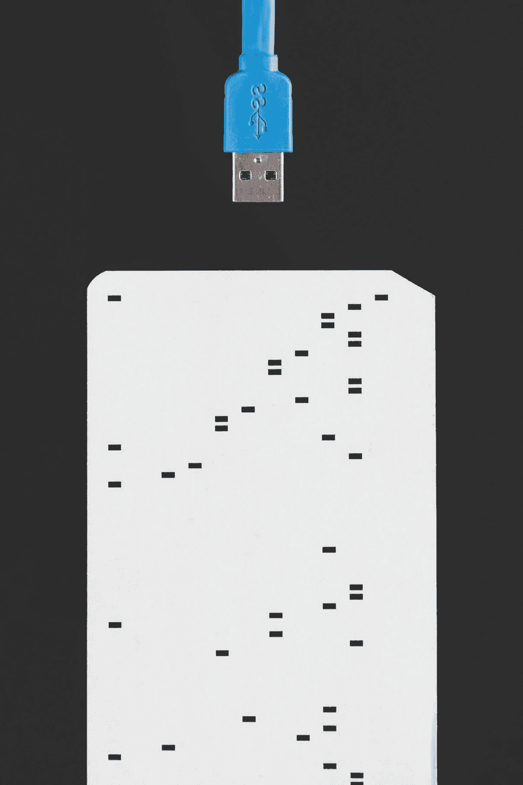
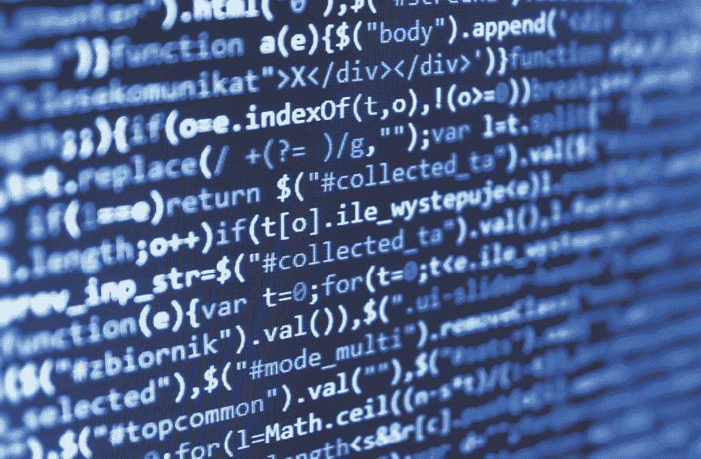
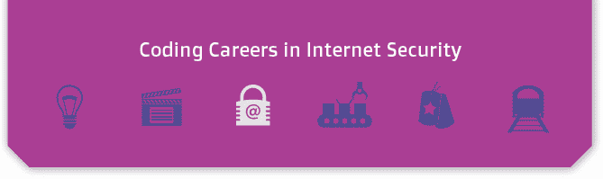
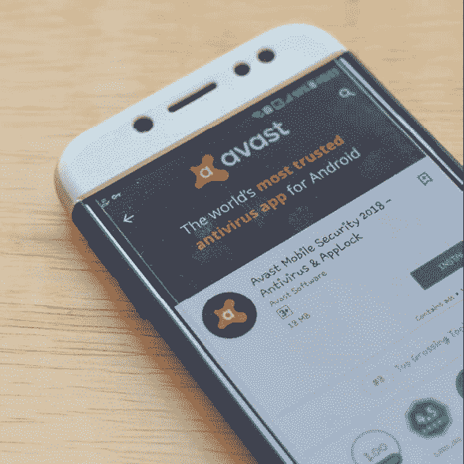

# 
网络安全编程职业（面向未来的编程职业）

Website: [cavendishsq.com](http://cavendishsq.com)

This publication represents the opinions and views of the author based on his or her personal experience, knowledge, and research. The information in this book serves as a general guide only. The author and publisher have used their best efforts in preparing this book and disclaim liability rising directly or indirectly from the use and application of this book.

All websites were available and accurate when this book was sent to press.

Editorial Director: `David McNamara`

Editor: `Kristen Susienka`

Copy Editor: `Denise Larrabee`

Associate Art Director: `Alan Sliwinski`

Designer: `Ginny Kemmerer`

Production Coordinator: `Karol Szymczuk`

Photo Research: `J8 Media`

The photographs in this book are used by permission and through the courtesy of: Cover `Emir Klepo/Alamy Stock Photo`; p. 1 (and used throughout the book) `Maciek905/iStockphoto.com`; p. 4 `ETham Photo/Getty Images`; p. 6 [Best-Backgrounds/Shutterstock.com](http://Best-Backgrounds/Shutterstock.com); p. 8 `Digital Vision/ Getty Images`; p. 10 Mary Holzer & Matt Crypto/Wikimedia Commons/File: Diffie and Hellman.jpg/CC BY-SA-3.0, (used throughout) [MF3d/iStockphoto.com](http://MF3d/iStockphoto.com); p. 12 `Aleksandar Nakic/Getty Images`; p. 14 `Miguel Candela/SOPA Images/LightRocket/Getty Images`; p. 18 `Michael J. Okoniewski/AP Photo`; p. 24 `Richard Ellis/Alamy Stock Photo`; p. 27 `Sundry Photography/Shutterstock.com`; p. 28 `Bangoland/Shutterstock.com`; p. 30 `Monsitj/iStock/Getty Images`; p. 33 `Matejmo/iStock/Getty Images`; p. 37 `Charles Brutlag/Shutterstock.com`; p. 39 `Izabela Habur/Getty Images`; p. 42 `Gerald Herbert/AP Photo`; p. 44 `Time Stopper/ Getty Images`; p. 50 `J.M. Eddins Jr./Air Force Photo`; p. 51 `Grinvalds/iStock/Getty Images`; p. 54 `Daniel Acker/Bloomberg/Getty Images`; p. 56 `South Agency/Getty Images`; p. 61 `Corey Williams/AP Photo`; p. 62 `Sol Stock/iStock/Getty Images`; p. 63 `David Becker/Bloomberg/Getty Images`; p. 64 `NSF`; p. 66 `NASA`.

Printed in the United States of America
About the Author

Early coders used punch cards to create computer programs. This image shows an old punch card and a modern USB cord. Both give a computer instructions.

An Introduction to Coding in Internet Security

Computer coding is the process of designing and building a computer program to perform a particular set of tasks. This process is also called computer programming or software development. Early computer coders used punch cards to build computer programs. It worked like this: a coder wrote out the data and program instructions for the program. The coder (or a helper) then punched holes into a card in a set pattern for each piece of data or program instruction. There might be hundreds or even thousands of these cards for a given program. The complete set of cards for a program was called the source deck. The source deck was fed into a machine called a compiler. The compiler converted the program instructions into a special language called machine language and produced a new stack of cards with holes punched through them called the program deck. This was the program. A computer operator could insert a program deck into a computer to perform the task the program was built to complete.

COMPUTER CODING AS A CORE COMPETENCY

Today, coders build programs by typing program instructions into a computer text file. These instructions are called source code. Program instructions are written in one of several programming languages. In most cases, coders feed the source code into a computer program called a compiler. The compiler converts the source code into a program. There are literally millions of computer programs designed to perform all sorts of tasks.

Here is an example of modern computer code.

Computer coding used to be a special skill that few people knew how to do. Today, it is a core competency for young people—like reading, writing, or math. This is because more and more jobs require computer-coding skills.

COMPUTER CODING AND INTERNET SECURITY

Computer coders work in many different industries. Some work in health care. Others work in manufacturing, communications, or transportation. Still others work in the military or in government agencies. Some computer coders specialize in an area called internet security or cybersecurity. A US Department of Defense division called the Advanced Research Projects Agency (ARPA) developed the internet during the 1960s—except they called it the ARPANET. At first, the ARPANET consisted of only four linked computers—three in California and one in Utah. Today, the internet connects billions of computers around the globe.

-   [互联网的重要性不容小觑](https://example.org)。美国国家安全局（NSA）说：“作为一个国家，我们依赖互联网。”

企业和其他组织，包括政府机构，都不断使用互联网。每天，人们都会利用网络购物、银行和通信。“我们都依赖随时随地访问互联网及其诸多功能”，NSA 表示。

今天，程序员可以在许多地方找到工作。一些网络安全工作在五角大楼。

这使得互联网特别吸引黑客。黑客是使用电脑的用户，通常为了窃取存储在电脑上的个人信息而入侵计算机系统。

一些黑客受金钱驱动。他们的目标往往是窃取用户电脑上的个人数据，并利用这些信息申请信用卡或贷款。这种做法称为身份盗用。他们通过入侵商业系统窃取客户数据，或访问个人用户的机器来搜寻敏感信息。从事此类行为的黑客通常被称为网络罪犯。

其他黑客想制造混乱。他们常通过在电脑系统中植入称为恶意软件（malware）的程序来实现。恶意软件即恶意软件的缩写，是黑客编写的计算机程序，目的是损坏或以某种方式利用计算机系统。恶意软件攻击可能非常危险。例如，网络罪犯可能通过攻击商业系统来损害经济，或通过攻击电力公司的计算机系统来切断电力 grid，导致严重的社会动荡！

还有那些拥有更强国家主义目的的黑客。这些黑客可能入侵外国政府的计算机系统，以获取军事活动或外交政策的情报，甚至可能通过攻击政府计算机系统的方式进行“战争”。这类黑客常被称为网络恐怖分子。

专注于互联网安全的计算机代码专家可以帮助防止此类网络攻击。这些网络安全专业人员让互联网——乃至整个世界——更安全。

CODING JOBS IN INTERNET SECURITY

精通互联网安全的程序员拥有多种职业选择。其中一种职位是安全软件开发人员。安全软件开发人员编写程序，以保护计算机系统免受网络攻击。例如，防病毒程序就是一种安全程序。防病毒程序阻止恶意软件进入计算机系统，并扫描系统以检测并删除可能已经渗透的恶意软件。

公钥加密

左图为 Whitfield Diffie，右图为 Martin Hellman，他们是加密的早期先驱之一。

加密是对抗黑客的重要武器。它通过混淆信息来保护信息。许多计算机系统使用公钥加密来保护私密通信。该方法于 1970 年代由斯坦福大学电气工程系的教授马丁·赫尔曼（Martin Hellman）和一名研究生惠特菲尔德·迪菲（Whitfield Diffie）共同开发。

在赫尔曼和迪菲之前，只有美国政府使用加密。事实上，国家安全局（NSA）劝阻学术界研究加密。纽约时报报道称：“关于现代加密方法的已发表材料非常少，且大部分被分类。”

尽管如此，赫尔曼和迪菲于 1974 年自行着手开发加密系统。到 1976 年，他们已研发出著名的 Diffie‑Hellman 密钥交换——一种最早的公钥加密协议。该系统既简单又几乎无法破解，它让人们能够在网络上以完全私密的方式安全通信。发布后，NSA 威胁要起诉赫尔曼和迪菲，但最终让他们免于法律追究。

如果没有赫尔曼、迪菲以及其他关注加密的计算机科学家，互联网可能永远不会兴起。毫无疑问，购物和银行等常见在线活动将无法实现。得益于迪菲和赫尔曼的工作，“互联网已成为商业和通信的场所”，并且是“安全交换商品和服务的场所”，Wired 杂志表示。

另一项网络安全专业人员的工作是密码学家。密码学家开发密码（cipher），用于加密计算机系统中的敏感信息。即使黑客成功入侵系统，也无法读取其中的信息。有些密码学家为政府机构如 NSA 或中央情报局（CIA）工作。

精通互联网安全的程序员拥有种类繁多的工作！这位女士在工作时正滚动查看代码。

第三种网络安全工作是渗透测试员，也称为白帽黑客。渗透测试员以黑客的方式入侵计算机系统，但目的是帮助组织发现系统中的安全漏洞——而非窃取信息或破坏系统。这种做法称为伦理黑客。

以上仅列举了网络安全专业人员可选择的三种工作，但还有许多其他职位可供选择和探索。

Norton 只是一个防病毒程序的例子，它帮助管理程序安全。

计算机代码专家通过两种主要方式提升互联网安全。一种是构建阻止恶意软件的软件；另一种是设计安全性最小的计算机系统，以防止恶意软件或黑客访问这些系统。在这两种情况下，恶意软件都是主要威胁。

恶意软件的威胁

恶意软件有多种类型。有些仅仅是烦人的。其他则极其危险。在烦人的一端是广告软件（adware），它会在用户屏幕上弹出广告。更危险的是间谍软件（spyware），它可以扫描系统以获取个人信息，跟踪用户的上网活动，并记录键盘输入——包括用于访问各种互联网账户的用户名和密码。其他危险的恶意软件会修改或删除系统文件，破坏硬盘，或创建其他入口，使黑客能够完全接管系统。还有勒索软件（ransomware），它会锁定系统，直到用户支付赎金。

某些恶意软件的目的完全不同：使计算机系统瘫痪。这些被称为病毒（viruses）和蠕虫（worms）。就像生物病毒附着在活体宿主上，计算机病毒附着在程序或文件上。当宿主程序或文件运行时，病毒复制自己，复制体随后附着到另一个程序或文件上。当该程序或文件运行时，恶意软件继续自我复制，直至系统资源不足以处理所有复制品。蠕虫与病毒相似，但不同之处在于：病毒需要程序或文件被执行才能传播，而蠕虫可以自行传播。

恶意软件通常通过以下两种方式感染计算机系统。一种方法是检测系统中的安全漏洞并利用这些漏洞进行入侵。安全漏洞通常是由于 bugs（错误或缺陷）导致的。 bug 是计算机系统或程序（通常在其源代码中）中的错误或缺陷，会导致其行为出现意外情况，这往往为恶意软件提供了利用途径。利用安全漏洞进行感染的恶意软件有时被称为零日漏洞（zero‑day exploit）。

第二种恶意软件感染方式是一种名为“特洛伊木马”（Trojan horse）或“特洛伊”（Trojan）的机制。黑客通过诱骗用户安装特洛伊木马来传播它们。一些特洛伊木马伪装成无害或甚至有用的程序；其恶意属性仅在用户安装后才显现。其他特洛伊木马通过电子邮件传播。这些信息警告用户出现某种问题，并指示他们点击信息中的链接以了解更多。当然，当用户点击链接时，他们会下载特洛伊木马。这种战术被称为“网络钓鱼”（phishing）。

恶意软件是一个严重的问题。反恶意软件公司卡斯珀斯基实验室在 2017 年检测到超过十五百万份恶意代码，影响了近 30%的电脑。专家预测，由于恶意软件及其他网络犯罪行为，每年的财务损失将在 2021 年达到 6 万亿美元。这取决于专注于网络安全的计算机代码专家来阻止制作恶意软件的罪犯。

早期恶意软件攻击示例

大多数早期恶意软件并非旨在损坏或利用计算机系统。相反，它们是计算机代码编写者实验的产物。

1971 年，计算机代码编写者开发了一个名为“Creeper”的蠕虫程序作为实验。它的目的是展示计算机程序如何自我复制，并在网络上从一台电脑传播到另一台电脑。Creeper 未损害它感染的电脑，仅向用户显示一条消息。

另一个实验性例子是“莫里斯蠕虫”。一位名叫罗伯特·莫里斯的年轻计算机程序员构建了该蠕虫，旨在揭示 ARPANET 的安全漏洞。然而，代码中的缺陷导致蠕虫瘫痪了网络。

Creeper 和莫里斯蠕虫没有恶意意图（尽管莫里斯蠕虫确实造成了损害）。这与 1974 年释放的另一种恶意软件程序——兔子病毒（Rabbit 或 Wabbit）不同。该病毒被设计为在计算机系统上快速自我复制，直到机器变得缓慢并崩溃。1986 年释放的另一种恶意软件程序也具有恶意意图。黑客们将该程序伪装成更新版的流行免费文字处理程序 PC-Write。当用户在机器上安装该程序时，它会删除系统上的所有文件。该程序是已知的第一个特洛伊木马。

莫里斯构建了已知的最早几种恶意软件之一，它被称为莫里斯蠕虫。

这些早期的恶意软件示例很有效。然而，它们并未造成广泛损害。有三个主要原因：第一，当时很少有人拥有个人电脑（PCs）；第二，很少有组织拥有计算机网络；第三，互联网（更准确地说是 ARPANET）主要由政府官员和学术人员使用。

这在 1990 年代发生了改变。正是在这一时期，公司开始向普通消费者建造并销售个人电脑，计算机网络在企业和其他组织中变得更为流行，互联网以及诸如网页浏览器和电子邮件程序等相关软件也向公众开放。

随着更多人上网，电子邮件迅速成为黑客传播恶意软件的流行方式。一个例子是 1999 年席卷互联网的 Melissa 病毒。它的工作方式是：一名电脑用户收到一封带有 Microsoft Word 文档附件的电子邮件。当用户打开文档时，它会在用户的电脑上感染病毒。病毒随后扫描受感染的系统，判断是否安装了 Microsoft Outlook 电子邮件程序。如果有，病毒会在 Outlook 通讯录中找到五十个用户的联系人并将其复制到这些联系人。虽然 Melissa 病毒并未直接损害受感染的电脑，但它产生了大量网络流量——足以导致许多网络瘫痪。

一年后，另一种恶意软件程序——I Love You 病毒——引发了更严重的问题。它的工作方式与 Melissa 病毒相同，但它并未仅将自身转发给感染机器的 Outlook 通讯录中的前五十个联系人，而是转发给所有人，并随即删除随机文件。I Love You 病毒迅速感染了约五千万台机器，造成全球约 50 亿美元至 150 亿美元的损失。

现代恶意软件攻击

21 世纪出现了更具破坏性的恶意软件攻击。其中之一发生在 2017 年，使用的恶意程序名为 WannaCry。它利用某些版本的 Microsoft Windows 操作系统的安全漏洞，锁定全球范围内的电脑。攻击背后的黑客要求受影响的用户支付赎金以恢复数据，否则将永久丢失数据。幸运的是，Microsoft 迅速发布了针对该安全漏洞的补丁。补丁是用于修复或“补丁”操作系统或其他计算机程序安全漏洞的代码片段。软件开发商通过发布更新向用户分发补丁。更重要的是，安全专家还发现了该恶意程序中的“关闭开关”，用于阻止其传播。这有助于限制受影响的电脑数量和造成的损害——尽管损害仍然相当严重。

另一个 2017 年的恶意软件攻击——NotPetya——则证明更加毁灭性。NotPetya 利用与 WannaCry 相同的安全漏洞，但缺乏关闭开关。它被设计为快速传播。一位安全专家称其为“我们所见过的最快传播的恶意软件”。但这还不全部。NotPetya 感染系统后，会极其迅速地将其禁用。它仅用四十五秒就使一家乌克兰大银行的整个网络瘫痪！起初，NotPetya 看似与 WannaCry 类似，因为它显示了要求赎金的界面。然而，调查人员很快意识到其目的在于永久破坏它感染的每个系统上的内容。调查人员还发现，它很可能是由俄罗斯作为网络战手段释放，针对乌克兰及其盟友，开启了“新的战争时代”，涉及“削弱民主、摧毁关键基础设施的生计以及武器化信息”，英国国防大臣加文·威廉森（Gavin Williamson）如是说。

正如讨论过的，并非所有恶意软件攻击都涉及破坏计算机系统。一些黑客制作恶意软件的目的是窃取被入侵系统上的数据。这可能包括私人客户信息、企业系统的商业机密，或政府系统的机密信息。2016 年，一个名为“影子联盟”（Shadow Brokers）的黑客组织入侵了美国国家安全局（NSA）维护的机器——该机构负责美国的网络安全。Shadow Brokers 随后窃取了该机构开发的顶级黑客工具，并将其在暗网上公开。暗网是互联网的一个角落，允许完全匿名的通信，主要流通非法商品，包括恶意软件。这些工具可以“削弱许多主要政府和企业网络的安全性，无论国内还是国外”，一位安全专家表示。

新型恶意软件攻击被称为“加密劫持”（crypto-jacking）。这涉及在机器上安装恶意软件，该恶意软件秘密地“矿工”数字货币，即加密货币。当某人花费加密货币时，交易会记录在名为区块链（blockchain）的安全账本中。区块链通过复杂的算法（需要大量处理能力）来批准交易。为了增加区块链可用的处理能力，人们可以将电脑连接到区块链以换取少量加密货币支付。这种做法称为加密矿工（crypto-mining）。因此，加密劫持的恶意软件会在用户机器上连接该机器到区块链，但将支付发送给安装恶意软件的黑客。如果黑客感染足够多的机器，这可以相当有利可图。

-   [这些只是近期恶意软件攻击的几个例子。还有成千上万的其他攻击。事实上，现在就有成千上万的攻击正在发生。]

## THE DANGERS OF BUGS

恶意软件对安全构成了最严重的威胁。但它并不是唯一的威胁。其他威胁来源于计算机漏洞，即问题。

一些漏洞为恶意软件进入系统提供了通路。然而，其他漏洞会导致不同的安全问题。一个例子是 1999 年的 Y2K 漏洞。早期程序员经常用两位数字表示年份（例如 06/17/88），而不是四位（06/17/1988）。当 2000 年（通常称为 Y2K）临近时，人们担心计算机可能错误地解读两位数字的年份输入。例如，他们担心计算机会将日期 01/01/00 解读为 1900 年 1 月 1 日。他们担心这会导致一些计算机和网络崩溃。专家警告说，如果这发生在管理航空交通或电力网络的计算机系统中，后果将是灾难性的。有人甚至预测这会导致社会完全崩溃，甚至引发世界末日。幸运的是，得益于全球计算机程序员的 feverish（费尽周折且昂贵）努力修复该漏洞，其影响极小。

美国总统比尔·克林顿于 1998 年发表关于 Y2K 的演讲。

## EARLY EFFORTS TO SECURE THE INTERNET

早期计算机用户对互联网安全很少有思考，因为当时很少人使用互联网，或者不了解它如何被滥用。

1971 年 Creeper 蠕虫的发布为互联网上的潜在安全问题提供了早期线索。它还催生了人们认为是第一个反恶意软件程序——Reaper。Reaper 由与发布 Creeper 的计算机程序员共同构建。它在机器之间移动，以在网络上查找并删除所有 Creeper 的实例。（有趣的是，Reaper 在技术上是一种病毒，但它是为好事而设计的。）

随着恶意软件变得更加复杂和先进，反恶意软件工具也随之发展。许多工具是在 1980 年代末由互联网安全公司的程序员开发的。至今仍存在的几家安全公司正是在此期间成立的，包括`Symantec`、`Sophos`、`McAfee`、`Avast`和`Panda Security`。这些公司雇佣（并继续雇佣）计算机程序员来对抗网络犯罪。

与此同时，非正式的程序员群体也形成以对抗恶意软件。其中一个是在线群体`VIRUS-L`，它始于 1988 年。其成员包括当今互联网安全领域的知名人物，如`Eugene Kaspersky`，他于 1997 年创立了`Kaspersky Lab`。该群体讨论新病毒及可能的检测和消除方法。更正式的组织如`计算机防病毒研究组织（CARO）`和`欧洲计算机防病毒研究所（EICAR）`开始对恶意软件及其他安全话题进行进一步研究。

### Contributions of Computer Coders to Secure Internet Shopping

在 1990 年代之前，人们通常在居住附近的商店购买物品。如果需要的物品在当地商店没有，他们可能会从印刷目录中订购，或者干脆放弃。更常见的情况是，他们直接放弃，寻找其他满足需求的东西。

互联网改变了一切。20 世纪中叶，企业家推出了电子商务网站，让人们可以在网上购买和出售商品。像`Amazon`和`eBay`（均于 1995 年推出）这样的网站使得人们几乎可以从任何地方研究、定位并购买几乎任何商品——通常花费更少。

离不开那些专注于互联网安全的计算机程序员。他们开发了工具，使买家和卖家之间的连接安全。这防止了黑客拦截支付信息（如信用卡号码）。没有安全的连接，任何形式的电子金融交易都不可能实现。所以，下次你在网上购物时，请感谢一位计算机程序员！

`Amazon`是历史上最早创建的几个大型电子商务网站之一。

## INTERNET SECURITY TODAY

技术进步为专注于互联网安全的计算机程序员带来了新挑战。例如，移动技术、云计算和物联网（IoT）的创新为黑客创造了新的攻击途径。安全程序员必须管理这些威胁，同时继续防御传统目标的攻击。

仅仅应对攻击已经不够了。作为一个日益连接和依赖技术的社会成员，互联网安全专家需要主动出击——预判攻击并在此发生前阻止它们。只有在威胁尚未造成损害之前主动阻断，才能确保“好人”获胜。

当前，反恶意软件程序正在帮助保持手机等技术免受病毒侵害。

### The Internet Security Arms Race

每当“恶”计算机程序员在互联网上释放新的恶意软件程序时，“好”计算机程序员会迅速推出解药。如果没有这些“好”程序员来帮助对抗恶意软件，互联网及其连接的数百万台计算机很可能会停止运行。然而，这一不断的攻防循环已经演变成一种军备竞赛。每一次攻击和反击，局势都会升级。恶意程序员释放更具破坏性的恶意软件，以产生更大的影响。

这一挑战还因恶意软件的开发和分发可能非常有利可图而变得更加复杂。根据`Carbon Black`（一家网络安全公司）的数据，一些恶意软件开发者每年从暗网销售软件的收入超过`$100,000`，而平均 legitimate software developers（合法软件开发人员）每年仅赚`$69,000`。`Federal Bureau of Investigation (FBI)`估计，2016 年黑客仅通过勒索软件的赎金收款就收到了`$1 billion`。

“有一个‘坏人’行业，”一位安全专家说，“它非常有利可图。”因此，“‘好人’行业必须比他们更好。”这对专注于互联网安全的好程序员来说是一项挑战：必须比构建恶意软件的坏程序员做得更好。

恶意软件程序通常带有某种“数字指纹”。

1987 年，著名计算机科学家`Fred Cohen`指出“没有能够完美检测所有可能的计算机病毒的算法”。计算机算法是一系列步骤或公式，用于让计算机完成任务或解决问题。Cohen 是正确的。这解释了为什么反恶意软件程序在检测和消除恶意软件时采取不同的方法。

加密在某些消息中是重要的工具。

一些反恶意软件程序采用类似的方法，但它们在云端的沙箱中加载新程序，而不是在用户计算机上的模拟器中加载。沙箱是用于测试软件的隔离虚拟空间。云端指的是互联网上托管软件和服务的计算机。用户可以连接云端，从这些计算机运行软件或服务，而不是从自己的计算机。

其他下一代方法使用诸如**机器学习（ML）**等技术。机器学习涉及开发算法或模型，使机器能够随时间学习。程序员将机器学习模型纳入反恶意软件程序，以检测使用变态或变形代码的恶意软件。这些模型通过观察程序是否包含异常代码或行为可疑来检测恶意软件。机器学习还能通过识别代码中的特定模式，帮助识别恶意软件的创建者，从而为执法机构提供打击网络犯罪的帮助。

不出所料，黑客也开始使用机器学习。有时他们使用它来构建更隐蔽的恶意软件程序。其他时候，他们设计它来欺骗或混淆反恶意软件程序中使用的机器学习模型，导致其出错。这被称为**对抗性机器学习**。

## COMMON CODING LANGUAGES

程序员通过在计算机文件中输入用编程语言编写的程序指令来构建计算机程序（包括恶意软件和反恶意软件）。这些程序指令被称为**源代码**。大多数源代码会通过一个特殊的计算机程序——**编译器**——进行处理。编译器将源代码中的编程语言翻译成计算机可以读取的**机器语言**。（有些源代码设计为跳过这一步，这类代码被称为**解释型**。）机器语言由一系列**0 和 1**组成，这些 0 和 1 的顺序决定了程序的行为。包含这些机器语言的代码被称为**目标代码**。

事实上，编程语言数量数以千计。不同的编程语言具有不同的特性。一些编程语言是**低级语言**，这意味着它们与机器语言相似。它们对人类来说更难阅读和学习。另一些是**高级语言**，这意味着它们通常使用类似人类语言的元素（如单词），具有固定结构，并可能自动化某些编程功能，使其更易学习和使用。其他编程语言的特性还包括其是**通用目的**还是**特定用途**；是**imperative**（包含实现特定结果的操作序列）还是**declarative**（指定期望结果但不指定实现步骤）等。

## More on Machine Learning

许多人将**人工智能（AI）**和**机器学习**互换使用。但实际上它们并不完全相同。人工智能指的是构建所谓“智能”机器的科学与工程。例如，亚马逊的数字个人助理**Alexa**使用 AI。另一个例子是某些网站上用于客户服务的**聊天机器人**。相比之下，机器学习描述的是机器通过经验随时间学习的能力。因此，机器学习是实现人工智能的一种方式。

机器学习代表了**网络安全**的前沿，也是对抗恶意软件的最强防御手段——尤其是当与其他安全方法（如在模拟器或云端扫描签名）结合使用时。机器学习特别适合处理与打击恶意软件相关的工作：它能够**快速执行常规任务**（如扫描文件）并处理**海量数据**（以识别和分类互联网上数百万种恶意软件样本）。这些工作的效率和速度远超人类。

亚马逊的 Alexa 使用人工智能来通信并执行用户请求。

专注于网络安全的程序员不需要研究每种编程语言——这不可能。但他们应该学习几种关键语言。以下是其中一些：

• **JavaScript**：JavaScript 是一种**解释型**、**imperative**（包含实现特定结果的操作序列）、**高级**编程语言。它常用于构建交互式网页，并在大多数现代网站的源代码中出现。它是使用最广泛的编程语言之一。

• **HTML**：几乎所有网站都包含 HTML 代码。因此，专注于网络安全的程序员必须了解 HTML。该语言极易学习。

• **Python**：与 JavaScript 类似，Python 是一种**解释型**、**imperative**、**高级**编程语言。与 HTML 一样，它易于学习。Python 模仿人类语言，因此在不太经验丰富的恶意软件制作者中非常流行。

• **C 和 C++**：C 于 1970 年代开发，至今仍是流行的通用编程语言。C 被视为高级语言，但不如 Python 等语言那么高级。C++ 是 C 的更新版本，编译更快且性能更好。

对专注于网络安全的学生感兴趣的编程语言有几种。以下是学生学习不同编程技术的场景：

## THE MOVEMENT TO OPEN SOURCE CODE

在 20 世纪 90 年代后期，一些软件开发人员开始从构建**专有软件**（由特定个人或组织所有）转向使用**开源模式**。开源软件的源代码对公众开放，可供研究或修改。自其发展以来，开源软件已获得广泛 popularity。这种开发模式鼓励协作。由于更多人审查和修改开源代码，它几乎总是比专有代码更强大且更安全。例如，**Linux 操作系统**（开源）比**Windows**和**MacOS**（专有）更安全。

-   [开源模型](https://www.owasp.org)特别适合互联网安全领域。在该领域使用开源软件的实践被称为开源安全。根据开源倡导者大卫·A·维勒（David A. Wheeler）的说法，开源安全之所以有效，是因为“协同工作以消除和修复漏洞的防御者可能比孤立工作的防御者更有效”。除了协作使软件更安全外，“防御者”还可以团结起来构建更有效的反恶意软件程序。正如安全专家凯文·基尼（Kevin Keeney）所解释的，为了对抗“当今日益狡猾的网络对手”，程序员“需要朝开源项目的方向发展，以便我们能够协作并团结作战”。

一个致力于推广开源代码的组织是开放式应用程序安全项目（OWASP）。按照其自身的话，OWASP 是一个“面向全球的非营利性慈善组织，专注于改善软件安全”。该非营利组织分发阅读材料和工具，帮助希望采用开源方法以提升其计算机程序安全性的用户。（更多信息请参见[`https://www.owasp.org`](https://www.owasp.org)）。

LEGISLATIVE AND GOVERNMENTAL EFFORTS TO STOP HACKERS

创建安全程序和构建反恶意软件软件是应对网络犯罪的两种方式。第三种方式是通过立法来威慑黑客。

美国立法者于 1977 年提出了第一部打击计算机犯罪的法律，名为《联邦计算机系统保护法》（Federal Computer Systems Protection Act）。然而，该法案未通过——可能是因为立法者不了解计算机及其可能被用于犯罪的方式。

1983 年，一位 FBI 高级特工在国会作证称，计算机可以像“枪支、刀具或伪造者的笔”一样用于犯罪。此次作证促成了 1984 年的《计算机欺诈与滥用法》（Computer Fraud and Abuse Act of 1984）——美国首部打击计算机犯罪的联邦法律。此后，美国立法者陆续通过了多部网络犯罪法律。

为执行网络犯罪法律并提升网络安全，美国政府在关键机构内设立了多个专门机构。这些机构包括计算机应急响应团队（Computer Emergency Response Team）、网络安全与通信办公室（Office of Cybersecurity and Communications）、网络犯罪中心（Cyber Crimes Center）、国家网络调查联合任务组（National Cyber Investigative Joint Task Force）、国家安全网络专家网络（National Security Cyber Specialist network）以及国家安全网络援助计划（National Security Cyber Assistance Program），仅举几例。许多这些政府机构招聘计算机编码员，以帮助遏制黑客。

美国网络安全法律主要针对针对组织的刑事行为。它们并不规定组织如何保护其计算机系统或网络免受攻击。这很遗憾。组织未能妥善保护系统可能会对普通美国人造成严重后果，如果数据被黑客窃取。然而，美国国家标准暨技术研究所（NIST）已制定了计算机系统安全指南，称为 NIST 网络安全框架（NIST Cybersecurity Framework）。该框架旨在帮助企业和其他组织防止和保护免受网络攻击、检测网络攻击，以及应对和从网络攻击中恢复。

FBI 只是一家招聘专精互联网安全的程序员的政府机构。这里，一名 FBI 特工在计算机取证实验室工作。

欧洲联盟（EU），一个欧洲国家合作的集团，对确保计算机系统和网络的安全采取了更为严格的措施。2016 年，它通过了一部名为《通用数据保护条例》（General Data Protection Regulation，GDPR）的法律。该法规要求收集私人客户数据的公司以简单易懂的方式说明其如何处理这些数据。此外，该法规还要求公司采取合理措施保护私人数据，并在规定期限内报告数据泄露。对于专精互联网安全的程序员而言，了解这些法律（或缺失的法律）至关重要，尤其是那些负责保护处理私人数据的应用程序和网络的程序员。

黑客不断尝试入侵线上安全场所。这种持续的尝试凸显了对互联网安全专家的需求。

