# 基于机器学习算法的认知行为与人机交互


1. **表 16.1** 水下图像的比较分析。
2. **表 16.2** 拟议方法的时间和熵测量值。


# 239. 239

# 240. 241

# 241. 242

# 242. 243

# 243. 244

# 244. 245

# 245. 246

# 246. 247

# 247. 248

# 248. 249

# 249. 250

# 250. 251

# 251. 252

# 252. 253

# 253. 254

# 254. 255

# 255. 256

# 256. 257

# 257. 258

# 258. 259

# 259. 260

# 260. 261

# 261. 262

# 262. 263

# 263. 265

# 264. 266

# 265. 267

# 266. 268

# 267. 269

# 268. 270

# 269. 271

# 270. 272

# 271. 273

# 272. 274

# 273. 275

# 274. 276

# 275. 277

# 276. 278

# 277. 279

# 278. 280

# 279. 281

# 280. 282

# 281. 283

# 282. 284

# 283. 285

# 284. 286

# 285. 287

# 286. 288

# 287. 289

# 288. 290

# 289. 291

# 290. 292

# 291. 293

# 292. 294

# 293. 295

# 294. 296

# 295. 297

# 296. 298

# 297. 299

# 298. 301

# 299. 302

# 300. 303

# 301. 304

# 302. 305

# 303. 306

# 304. 307

# 305. 308

# 306. 309

# 307. 310

# 308. 311

# 309. 312

# 310. 313

# 311. 315

# 312. 316

# 313. 317

# 314. 318

# 315. 319

# 316. 320

# 317. 321

# 318. 322

# 319. 323

# 320. 324

# 321. 325

# 322. 326

# 323. 327

# 324. 328

# 325. 329

# 326. 330

# 327. 331

# 328. 332

# 329. 333

# 330. 334

# 331. 335

# 332. 336

# 333. 337

# 334. 338

# 335. 339

# 336. 340

# 337. 341

# 338. 342

# 339. 343

# 340. 344

# 341. 345

# 342. 346

# 343. 347

# 344. 348

# 345. 349

# 346. 350

# 347. 351

# 348. 352

# 349. 353

# 350. 354

# 351. 355

# 352. 356

# 353. 357

# 354. 358

# 355. 359

# 356. 361

# 357. 362

# 358. 363

# 359. 364

# 360. 365

# 361. 366

# 362. 367

# 363. 368

# 364. 369

# 365. 370

# 366. 371

# 367. 372

# 368. 373

# 369. 374

# 370. 375

# 371. 376

# 372. 377

# 373. 378

# 374. 379

# 375. 381

# 376. 382

# 377. 383

# 378. 384

本版本首次于 2022 年由 John Wiley & Sons, Inc. 出版，地址：美国新泽西州霍博肯市河街 111 号，邮编 07030，以及 Scrivener Publishing LLC 出版，地址：美国马萨诸塞州贝弗利市卡明斯中心 100 号，541J 室，邮编 01915。

© 2022 Scrivener Publishing LLC

如需了解 Scrivener 出版物的更多信息，请访问 [www.scrivenerpublishing.com](http://www.scrivenerpublishing.com)。

版权所有。未经法律允许，任何部分不得以任何形式或任何方式（电子、机械、影印、录制或其他）复制、存储于检索系统中或传输。关于如何获取重用本标题材料的许可的建议，请访问 [`www.wiley.com/go/permissions`](http://www.wiley.com/go/permissions)。

**Wiley 全球总部**

111 River Street, Hoboken, NJ 07030, USA

如需了解我们全球编辑办公室、客户服务以及更多 Wiley 产品信息，请访问 [www.wiley.com](http://www.wiley.com)。

**责任限制/免责声明**


虽然出版商和作者在准备本作品时已尽最大努力，但对本作品内容的准确性或完整性不作任何陈述或担保，并特此声明不承担任何担保，包括但不限于任何适销性或特定用途适用性的暗示担保。销售代表、书面销售材料或针对本作品的宣传声明均不得创建或延伸任何担保。本作品中作为引用和/或进一步信息的潜在来源而提及某个组织、网站或产品，并不意味着出版商和作者认可该组织、网站或产品可能提供的信息或服务，或其可能提出的建议。本作品的销售基于这样的理解：出版商不提供专业服务。此处包含的建议和策略可能不适合您的情况。如有需要，您应咨询专家。出版商和作者均不对任何利润损失或其他商业损害（包括但不限于特殊、偶然、间接或其他损害）承担责任。此外，读者应注意，本作品中列出的网站可能在本作品撰写和阅读之间已发生变更或消失。

***Library of Congress Cataloging-in-Publication Data***

ISBN 978-1-119-79160-7

封面图片：[Pixabay.Com](http://Pixabay.Com)

封面设计：Russell Richardson

由马尼拉排版公司（Makati, Philippines）采用 11pt 字号和 Minion Pro 字体排版

在美国印刷

10 9 8 7 6 5 4 3 2 1

# 前言

人机交互（HCI）是我们大多数人认为是 UI 设计的学科，它关注人类与计算机在日益复杂和简单的层面上如何交互。鉴于该主题的重要性，本书旨在提供更多相关信息，这些信息将对行业中希望了解其实时应用的学生、学者和研究人员有所帮助。除了提供理论、认知、设计、评估和用户多样性方面的内容外，本书还解释了通常用于描述特定认知过程康复方法的认知、社会和组织问题的根本原因。还描述了来自各种不同领域的认知科学家可以使用的新建模算法。HCI 的进步涉及跨学科研究，其成果发表在涵盖广泛交互系统的理论和应用文章中。因此，本书本质上是跨学科的，并发表计算、工程、人工智能、心理学、语言学以及应用于交互系统的设计、实现、应用、分析和评估的社会和系统组织方面的原创研究。由于机器学习研究在国际层面的各种应用中已经进行了十年，新的学习方法主要用于基于机器学习的认知应用。由于这将指导在神经科学、神经成像、基于机器学习的脑映射和建模等领域工作的科学家和研究人员的未来研究，本书强调了一种用于先进跨行业 HCI 技术的新型强健方法的框架。这些实施策略和未来研究方向将长期满足多种现代和实时应用的设计和应用要求。因此，本书将比大多数很久以前出版、因此很少阐述认知行为和 HCI 算法所需当前进展的可用书籍更好。本书包括：

* 认知行为和 HCI 处理模型、方法、技术等的最新进展综述。

* HCI 中学习方法的综述和描述。

* 认知行为中的新技术和应用及其实际实施。

* 认知行为和 HCI 领域中现有的和新兴的图像挑战与机遇。

* 如何促进不同学科研究人员之间的相互理解和网络建立。

* 未来研究发展和合作的促进。

* 实时应用。

最后，我们谨向所有为本同行评议编辑著作付出巨大贡献、投入时间、提出批判性思考和建议的贡献作者表示感谢。编辑们也感谢 Scrivener Publishing 及其团队成员提供出版本卷的机会。最后，我们感谢家人在整个工作期间给予的爱、支持、鼓励和耐心。

**Sandeep Kumar**

**Rohit Raja**

**Shrikant Tiwari**

**Shilpa Rani**

2021 年 10 月

## 1 认知行为：不同的人机交互类型

**S. Venkata Achyuth Rao^(1\*), Sandeep Kumar^(2) and GVRK Acharyulu^(3)**

*^(1)CSE, SIET, Hyderabad, Telangana, India*

*^(2)Computer Science and Engineering Department, Koneru Lakshmaiah Education Foundation, Vaddeswaram, Andra Pradesh, India*

*^(3)Operations & Supply Chain, MBA (Healthcare & Hospital Management), School of Management Studies, University of Hyderabad, Telangana, India*

*\**通讯作者*：drsvarao@gmail.com*

> *摘要*

> 认知行为在当今部署的人机交互设备中发挥着重要且战略性的作用，涉及人工智能、深度学习和机器学习计算技术。用户体验是机器与人类之间任何成功交互设备的关键因素。提供 HCUIMS 的理念是创建接口，以组织底层的决策处理用户交互设备系统（DPUIDS）为基础，其次是中层管理的决策支持用户交互设备系统（DSUIDS），最后是高管层的管理信息用户交互设备系统（MIUIDS），在各种灾难性情况下可以在不确定性下做出决策。这里展示了用户在与计算机通信过程中的具体差距，认知建模在启动阶段对于演进设计和提供培训是有用的。

> 这是通过各种交互设备来实现的，例如个人智能交互（I3）、人工和个人智能交互（AI3）、脑机交互（BCI）以及通过计算机的个人交互（I2C），以一种富有竞争性的方式满足各个领域所有利益相关者的企业挑战，并提供更好的用户体验。

> ***关键词*：**认知行为，用户体验，交互设备，建模，智能

## 1.1 简介：认知模型和人机交互用户界面管理系统


认知模型在多个方面或许多变量相互作用的高层管理系统中，对于评估和预测具有实用性，能够提供在各种实验性实证研究中观察到的近似行为特征。在现实世界的终身情境中，许多因素会影响产生作为行为分析报告的结果报告。这是通过带有模式表示的神经处理数据完成的。这些模型在过程和产品方面的结果与各种人相互作用，如实证实验所示。以下是心理学家与关心认知模型的各种设计师交互所必需的工具。这些用于 HCI 的模型具有适当的不同目标，以更好地为用户使用必要的界面。一般来说，至少有三种认知模型作为一般目标在服务中 \[1\]。

* 交互式用户行为预测系统

* 自适应交互观测变化系统

* 群组交互模型构建系统

## 1.1.1 交互式用户行为预测系统

人类行为预测系统界面被设计和部署为用户与机器（一种自动动态、多功能系统）之间的交互和通信，通过用户-机器界面 \[2\]。存在强相关的现实世界假设，以及用于区分用户-机器自动动态多功能系统与用户-计算机交互领域的方面。50 年来，该领域的研究一直在进行，涉及不同的交互式人类预测系统，这些系统通过硬件和软件交互内置显示器，随必要的传播嵌入式事件而演进。用户交互自动预测系统应用的最佳和新兴环境设计在所有垂直领域的许多产品和服务中拥有正确的市场地位并垂直获取价值，涉及医疗、交通、教育、游戏和娱乐等各个行业，这些是行业的需求 \[3\]。

## 1.1.2 自适应交互观测变化系统

自适应交互观测系统基于用户原型获取和涉及学习、培训、推理或决策过程必要约束的报告推断，获取其针对独立用户的心理特征。自适应交互观测变化系统界面适应的首要且必要的目标是考虑个别用户独特的感知或身体障碍；它允许他们更灵活、更高效地使用动态系统，错误最少，挫败感更低。自适应交互观测系统界面是一种嵌入式软件工件，通过原型模型改进其功能以与个别用户交互，从而基于与该用户的部分心理可考虑经验构建用户模型 \[4\]。

随着 www、互联网和 gopher 服务在人群中日益普及，越来越多的复杂软件、新兴技术涉及硬件事件、小工具、小部件和事件，这些事件变得越来越高度交互和响应。只有少数早期的个人新手在打孔卡上编程并提交深夜和过夜作业，随后分时系统和调试监视器、文本编辑器变得越来越慢，并依赖于多核并向并行处理发展。最新的新兴操作系统和实时操作系统支持各种交互式软件，如所见即所得。编辑器系统软件对于交互式计算机游戏来说过于高级，以及最有效和杰出的嵌入式系统、汽车响应式、交互式和自适应保守系统，在分层交互式图形用户界面中，这些订阅者和监听者是自适应交互观测变化系统的关键角色。此类系统已被视为任何商业和学术生活的重要组成部分，有万亿人依赖它们来推进日常生活。大多数关于机器学习的学术工作仍然集中在改进技术和羞辱可能在预见和调用后发生的步骤。确实，大多数调查、会议、研讨会和研究兴趣，尤其是媒体和娱乐、虚拟现实、仿真、建模和设计，仍然强调学习方法更广泛领域之间的差异。最终，由决策树归纳、算法设计分析、基于案例的推理方法以及统计和概率方案所证明，通常会产生非常相似的结果 \[5\]。

## 1.1.3 群组交互模型构建系统

本章的主要目标是描述使用协同响应动力学进行群组建模信息系统的现有认知框架活动。此类信息系统非常少，有必要在混合组织中应用，以支持广泛的业务扩张并做出战略决策。在这种认知群组交互模型构建理论中，重要的方法论动力学首先定位于个别用户交互之下，然后分类，以便为群组活动原型作为构建系统考虑提供作为需求分析报告的深入概念 \[6\]。这种头脑风暴动力学的结果表明，现有方法提出交互模型系统的全球视图非常罕见。此外，还需要讨论三个复杂问题：了解用户知识的开端、用户之间共识建立的交互建立，以及提供必要便利的主要方面。

群组交互模型构建系统是一个动态系统，其特征如下：

1. 群组参与者之间的响应性和强交互；

2. 存在必要的交互、相互关系和强依赖的整合；

3. 内部抽象复杂凝聚力受其反馈影响；以及

4. 群组之间延迟行为反应的模糊性，用于评估或预测。

这里描述了一个有组织的框架，作为任何有组织方法的概括，提供与群组交互模型构建任何方面相关的详细指南中的推理过程和凝聚交互。此分析旨在获得对应用群组交互建模系统的研究的全球愿景的广泛视角。使用系统动力学可以引起对缺乏支持相关行为特征的高级交互设备管理方面的关注。

群组建模系统方法的动态行为如下描述，强调群组交互模型系统。

建模过程使用两种类型的信息系统 \[7\]：

1. 建模信息系统与群组交互模型信息系统。

2. 专家建模系统与团队专家建模信息系统。

## 1.1.4 人机交互用户界面管理系统

人机交互用户界面（HCUI）设计主要强调预见计算机交互用户需要做什么，并确认人机交互界面具有多种元素，这些元素灵活且易于了解、查看、导航、更新、管理和修改，并用于以事件和小部件的形式提供便利。HCUI 通过解释、布局设计、交互设计、视觉设计和信息架构来实现相关功能。


HCUIMS（HCUI 管理系统）不被视为一个系统，而是一种交互式软件架构（HCUIMS 也称为 HCUI 架构），其特点是“各种应用程序用户界面的设计与部署与其他应用程序的底层功能清晰且明确区分”。这种显著划分的连贯目标是提升与其他软件的维护便捷性和适应性。大多数现代 HCUIMS 架构采用集成开发环境进行设计。借助于从应用程序逻辑、语法和语义中抽象出用户界面，代码生成能够更好地支持定制。尽管这些架构已被证明在高度交互方面很有用，但在操作应用程序与 HCUI 之间的界面边界时具有语义反馈，且难以维护或无法维护 \[8\]。

### 1.1.5 人机交互用户界面的不同类型

1. 命令行界面

2. 菜单驱动界面

3. 触摸屏驱动界面

4. 图形用户界面

5. 事件驱动界面

6. 传感器基础用户界面

7. 语音基础用户界面

8. 自然语言用户界面

9. 表单基础用户界面

10. 手势驱动用户界面

11. 移动用户界面

12. 数据库用户界面

13. VR 设计界面

### 1.1.6 用户界面管理系统的作用

用户界面管理系统架构的作用比关注硬件、嵌入式系统软件应用、设计分析和算法、软件过程、软件包、分布式服务器和其他程序等狭隘问题更为广泛。大多数领域及其相关学科广泛贡献于管理信息系统学科，包括以下内容：

1. 传统祖先科学技术相关学科，如函数形式、lambda 表达式、谓词演算、系统理论、运筹学和计量经济学；

2. 电子技术、信息技术、生物信息学、纳米技术和计算机科学等技术；

3. 如安全管理研究等新兴技术，包括认知网络、链路窃听、中间人攻击、暴力破解、跨站点请求伪造和基于 doom 的攻击；以及

4. 人体工程学、语言学等社会工程学和行为理论。

用户界面管理系统的开发与众不同，因为信息系统需要持续进行充分建模，且工作人员需要在企业管理系统组织中发挥高效作用 \[9\]。需要高效执行的角色和职责如下所示，其中一些将在下文讨论。

1. 信息系统程序员和系统分析师需要花更多时间与利益相关者个别或群体互动，以获取更有用的信息，从而设计和演进系统交互，使其有意义且响应迅速。

2. 在不确定时期确定哪些信息有助于决策是一项具有挑战性的任务。为此，信息系统人员被迫花费更多时间和大量精力与系统用户互动。

3. 开发和部署方法（如构建原型模型）基于快速应用开发模型反馈，或基于连接用户关于交互效率（针对其需求）的迭代、增量反馈。

4. 高层管理人员和顶层董事将以信息形式呈现的结果视为一项基本资产。

5. 可视化的信息系统不仅在给定组织中显示，还可在许多组织中使用或部署，因为它遵循战略而非仅在给定组织中发挥运营作用。

6. 如果在不确定、灾难性或大流行环境中，不确定性向顶层管理决策传播，这些系统允许您提供可选决策以供实施，并在连接用户之间进行交互。

### 1.1.7 人机交互用户界面管理系统的基本认知行为元素

HCUIMS 不仅仅是用户界面管理系统界面。用户界面与计算机交互系统之间存在差距和显著差异。如前所述，最终，我们认为 HCUIMS 是广义的，包括用户（开发者和用户）之间可能在系统生命周期内需要的任何界面。因此，运筹学科学家、系统开发、实施、验收、使用和影响方面的研究人员在管理人员决策中占据重要地位，捕捉广泛的人机交互问题和关切。简而言之，广义的人类交互活动视图包含五个组成部分：人（用户）、技术（硬件、软件及其他相关技术）、交互（通信）、任务（要完成的任务）和上下文（基于领域）。

最后，从组织角度来看，有四个基本上下文被识别出来，如 Figure 1.1 \[10\] 所示：

![Figure 1.1 Cognitive behavioral elements of broad view of human-computer interface in management \[10\].](images/fig1_1.jpg)

**Figure 1.1** Cognitive behavioral elements of broad view of human-computer interface in management \[10\].

* 组织上下文，

* 技术上下文，

* 社会上下文，

* 全球上下文。

在上述任何一个上下文中设计界面时，应在用户选择交互元素方面保持一致性和可预测性。最初，专家需要培训用户使用各种功能和操作各种事件；无论用户是否意识到这一点，都必须接受培训；一旦他们熟悉这些元素，如果他们以某种方式行动，在适当的时候采用这些元素将有助于以最大满意度高效地完成任务。

界面元素包括但不限于以下内容：

* 技术和先进技术：输入、输出、信息等。

* 任务/工作：任务目标和任务特征

* 人：人口统计、身体/运动、认知水平和情绪水平

* 上下文：组织上下文、技术上下文、社会上下文和全球上下文。

然而，设计 `usability` 日益增加，主要指连接用户完成其预期任务的难易程度，并与使用评估影响相对密切相关，该影响通过可用性测试计算得出。因此，许多人将可用性视为任何人机交互界面管理系统产品设计中相当战术性的方面：全球上下文、社会上下文、技术上下文和组织上下文。然而，可用性可能无法涵盖所有与易用性相关的 UI 元素。用户界面元素的结果包括灵活性、适应性、兼容性，以及以可能的方式轻松学习和识别信息，经济实惠性也属于此类别 \[10\]。

## 1.2 认知建模：决策处理用户交互设备系统（DPUIDS）


# 认知建模在决策处理系统中的应用

认知建模通过用户界面设备系统在决策处理系统中很有帮助。数据科学和行为科学被视为任何决策制定的重要组成部分。它为我们提供了一个强大的新工具，这些工具通过行为变化及其日后表现的分析指示来抑制繁琐任务，使其尽可能简单，并以可视化形式呈现。机器学习和数据科学研究通过利用广泛大型数据集的分析来评估预期结果，从而帮助预测未来结果，以实现个性化的行为干预。这可能不是大多数企业方面的关注点；有些程序足够充分且适用于日常问题。通过认知行为评估，调查人员和研究人员设计了新算法，以识别其环境周围的情况，并随后将负面能量转化为正面能量，以产生更多结果来满足预期结果。它使我们能够快速进行基本算术运算，并读取情商、肢体语言、姿势和手势，并完成句子。

## 1.2.1 决策过程交互设备示例中的认知建模自动化

对于典型的讨论，如果任何人的精力因任务或流程、连续会议或需要高度专注而降低，其心理能量将降低到自动系统需要接管并执行下一任务的程度。当认知决策处理用户界面设备系统通过算法预测进行设计和开发时，就可以开始识别决策者的特征、因素以及类似的利益，并适当地定位交互人员。

准医学结构描述了商业智能用户社区的决策处理系统。数据分析是一个监控过程，包括检查的开始、清理数据（如不平衡）、识别偏度、外部噪声，通过在线分析处理和在线事务处理转换数据和信息，并建模数据以提取有用信息以支持决策。数据分析过程具有多个方面和战略方法，涵盖在各种立方体、名称、不同的商业、科学和社会科学领域下的多种技术。假设典型用户没有专业知识或资源来雇佣专门的信息技术资源来开发报告、工具或定制应用程序。他或她可以借助软件工具，事件的可视化将有助于决策。在这方面，自动交互式可视化有助于代表用户。

决策处理用户交互设备系统的一个方面是事件的集成实现集合。那些响应系统并收集交互式可视化方法的人包括通过报告处理生成系统接收所需数据的选择。集成数据由数据库存储系统组成，它们的主动监听接口在源发送者和接收监听者之间给出。这些存储数据库和相应的接口设备调用必要的方法，自动生成功能活动，然后完成用户任务。他们可以根据启发式方法轻松确定所选数据的关联可视化；据说使用一组规则来确定最适合交互式决策处理系统的关联可视化 \[12\]。

决策处理和交互设备系统将复杂数据识别为更易于访问、理解和使用。这些系统用于商业、组织和各种事业等领域，大量数据正在被收集、处理和存储。随着互联网、内联网、先进的网络技术、强大的移动设备、可穿戴设备以及许多庞大设备互连的采用，这一趋势呈指数级增长。世界变成了地球村，大多数设备通过物联网（IoT）和传感器网络相互连接。交互设备系统的应用是一组认知行为和神经网络相关的机器学习、深度学习以及卷积网络和循环神经网络等类型，这些网络在企业中运行，例如不限于工资单、库存、市场营销、销售与分销、供应商管理、会计、供应链管理和资源规划等应用程序（图 1.2）\[13\]。

![图 1.2 决策处理系统用户界面设备管理作为外部客户 \[13\]。](images/fig1_2.jpg)

**图 1.2** 决策处理系统用户界面设备管理作为外部客户 \[13\]。

## 1.2.2 可视化决策处理用户交互设备系统中的认知建模过程

认知模型是有用的工件，用于以更好的方式完成我们世界中的现实世界对象任务。在知识表示和自动推理的背景下，使用可视化工具来创建知识提取中的有用模式。

下面描述了重要的建模可视化工具及其功能，以及在各种设备中决策处理交互角色的目标，如下图所示（图 1.3）\[15\]。

流程图描述是逐步进行的。

1. 视图到心智模型，从而计算感官输入设备以可视化数据并发现有用信息。理解和证明。

2. 一组方法、程序、算法和学习方法，用于数据预处理、解释、可视化、存储、分析和转换，与预期结果进行比较。

3. 系统（DPUIMS）。以下是模型，可视化模型输出以理解和传达必要的计算模型。最后，可视化模型已作为信息产生。

![图 1.3 可视化决策处理用户交互设备系统中的认知建模过程 \[15\]。](images/fig1_3.jpg)

**图 1.3** 可视化决策处理用户交互设备系统中的认知建模过程 \[15\]。

## 1.3 认知建模：决策支持用户交互设备系统（DSUIDS）

认知模型用于以计算机程序、应用程序、算法、事件以及传感器或设备或组件或控件或工具的形式支持用户交互设备系统，这些模型基于认知技能模拟人类表现。它们通过人机交互很有用，可协助用户预测任务并发现有意义和有用的模式。如果这些模型通过新兴设计方法与历史接口相比进行演变，将产生出色且奇特的结果，并配合高交互式图形可视化工具。这种战略方法被抽象和封装为认知模型决策支持界面设备的产出，类似于并基于认知模型决策支持用户界面管理系统（DPUIMS）。以下是交互管理交互设备系统的模型和结构表示。这些系统将有助于利用分支之间的协同效应，跨学科领域在用户之间有交互作用 \[15\]。

## 1.3.1 用户交互认知建模的核心工件


有各种工艺品作为工具，用于帮助提供用户界面之间的交互开发。某些工具可以通过认知模型开发中的任务模拟机制来设计和部署。没有其他链接机制可以支持和解释认知模型，以适应大型组织决策支持系统中的广泛界面（表 1.1）。

作为集成目的的初步考虑，以下是特色流程 \[16\]：

1. 创建计算机用户界面工具。
2. 在模型视图运行期间，任务模拟参与机制是根据模型所需的必要交互。
3. 需要通信机制来传递认知模型和任务模拟中的信息。

### 1.3.2 交互决策支持机制的认知模型支持

认知决策支持机制的实现基于基本元素；它们通过认知建模工具与认知架构组合，然后实现结合手和眼的通信机制，从而找到相应的 HCUI 以与用户交互。带有任务模拟工具的环境模型在异构和同构环境（操作系统、实时操作系统、各种服务器和客户端、多台计算机、数据库等）上有效运行。它最终与用户交互管理系统界面和基于计算机的管理交互管理系统集成。

**表 1.1** 用户交互认知建模中提供的核心工艺品 \[16\]。

| 工艺品 | 目的 |
| --- | --- |
| 认知模型 | 它提供认知表现和用户行为的模拟，以执行任务。 |
| 任务模拟 | 它为认知模型提供任务。同时，用户界面将在模型中使用。 |
| 链接机制 | 它提供模型与模拟之间的路径，以便进行人类感知和动作的通信。它模拟人类感知和动作。 |

![图 1.4 交互决策支持机制的认知模型支持 \[16\]。](images/fig1_4.jpg)

**图 1.4** 交互决策支持机制的认知模型支持 \[16\]。

交互决策支持架构的认知模型支持（图 1.4）体现在以下三个必要步骤中。

提供模型以支持人机交互中感知和动作的决策能力的初始步骤，是通过添加带有模拟手的眼睛，将必要的认知工具作为架构扩展为完整模型，并结合任务模拟。

在认知模型到模拟的第二步中，模拟眼睛和手的观察将被记录，并且该信息将传递到认知模型以采取必要行动。

模型的最终步骤分为两个特定部分：模拟眼睛和手在该环境中作为模拟实现，使用必要的模拟工具，而认知模型可以分离。在此，在这两个分离的特定部分之间发生通信机制，形式为模拟眼睛和手与认知建模之间的交互 \[16\]。

### 1.3.3 决策支持用户交互设备系统中认知建模的表征用途

认知建模主题中的一些表征在以下图表 \[17\] 中有描述。

![表 1.2 决策支持用户交互设备系统中认知建模的表征用途 \[17\]。](images/fig15_1.jpg)

**表 1.2** 决策支持用户交互设备系统中认知建模的表征用途 \[17\]。

* 理解模型上下文
* 定义结构模型
* 模型的实现
* 模型评估
* 模型实施

## 1.4 认知建模：管理信息用户交互设备系统 (MIUIDS)

今天，所有行业利益相关者都考虑不同的界面，因为它提供了新产品在现实生活中有效性的反馈。但是，不得忘记从字符用户界面数据到语音用户界面信息的界面通信采用。信息是任何组织处理和存储的关键。利益相关者，主要是客户体验，是即时有价值的反馈，产品安全性和低维护是战略性设计的，并配备必要的管理用户交互设备系统。管理用户交互设备系统的基本元素在必要图表 (图 1.5) 中描述。

* 内存
* 编码
* 存储
* 检索

在实际与预测性能的比较中，实际性能的条始终更宽。在显示上添加评论以解释异常情况、解释图形描绘、引用相关显示并通知待处理的更改。例如，一个显示可能显示注册人数可能少于三个，如预测所示。但是，负责该显示的工作人员知道，来自秘鲁的三架飞机的首付款正在途中，并将此信息作为评论添加到显示上。如果没有添加评论，可能会出现所谓的“纸老虎”情况，因为它们看起来需要管理层关注，但实际上不需要。MIDS 工作人员认为，“传输数据不等于传达信息” \[8\]。这些显示是考虑到高管的关键成功因素而创建的。一些措施，例如利润和售出的飞机数量，是显而易见的。其他措施，例如员工参与公司赞助的计划，则不太明显，反映了 MIDS 工作人员努力充分理解和满足高管的信息需求。

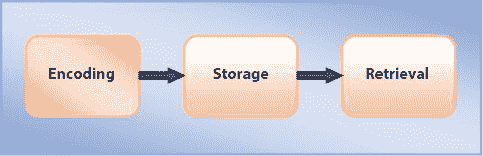

**图 1.5** 管理信息用户交互设备系统的基本元素。

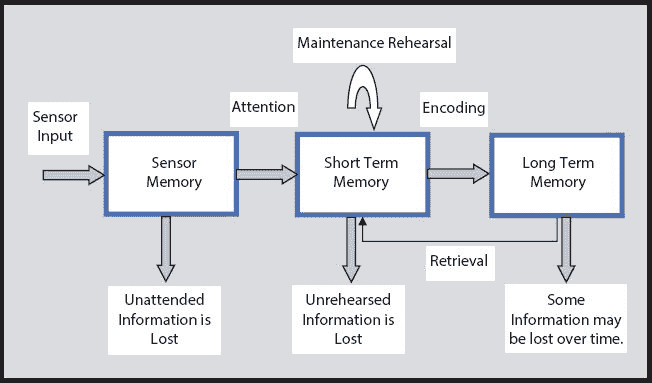

**图 1.6** 内存模型，信息通过不同阶段以便存储在长期内存中。


MIDS 描述成功系统的关键在于，对负责概念化、批准和开发类似系统的人员有用。也许更重要的是，了解是什么使系统取得成功。一位致力于支持的高级管理层赞助人希望拥有一个像 MIDS 这样的系统，投入了必要的资源，参与了其创建，并鼓励其他人使用它。它仔细定义了系统需求。几个考虑因素主导了系统的设计。它必须根据用户的信息需求进行定制。易用性是一项关键因素，对于那些对计算机持戒备态度的高管来说至关重要。响应时间必须快速。显示屏必须随着条件的变化而快速高效地更新。他们仔细定义了信息需求。一直在持续努力了解管理层的信息需求。显示屏会随着时间的推移而添加、修改和删除。为管理层提供相关信息至关重要（图 1.6）。开发、运行和演进 MIDS 的团队结合了信息系统技能和功能领域知识。计算机分析师负责系统的技术方面，而信息分析师负责为管理层提供所需的信息。后者的责任要求信息分析师了解业务，并与信息来源和用户保持密切联系 \[18\]。

MIDS 的初始版本成功地满足了公司总裁最关键的信息需求，并加强了他对系统的支持。毫无疑问，为全体用户开发一个完全集成的系统将会导致重大延误，并降低对系统的热情。

仔细选择计算机硬件和软件在这个模式中至关重要。当合适的彩色终端以合理的价格出现时，决定继续开发 MIDS。当时，图形软件非常有限，有必要在内部开发 MIDS 的软件。MIDS 开发本可以推迟，直到出现性能更好、成本更低的硬件和软件，但这个决定会延迟向管理层提供所需信息。影响硬件选择的还有组织现有的硬件以及将 MIDS 集成到整体计算架构中的需求。虽然认为为 MIDS 做出了出色的硬件和软件决策，但其他公司的不同情况可能导致不同的硬件和软件配置。MIDS 的未来计划将继续沿着之前提到的方向发展。还计划通过使用具有屏幕数字化功能的摄像机来改进显示图形。还预计有几项其他增强功能。MIDS 的未来版本可能会在实际条件偏离用户定义的水平超过一定程度时自动呈现差异报告。音频输出可以补充显示屏所呈现的内容。系统可能包含人工智能组件。可能会有比当前可用分辨率更好的 MIDS 显示屏大屏幕投影。首要目标是为洛克希德佐治亚管理层提供他们需要的信息，以便有效、高效地履行其工作职责。

## 1.5 认知建模：环境角色与用户交互设备系统

环境在与各种交互设备系统进行交互中起着至关重要的作用。背后有四个“E”激励着认知建模的理论和假设 \[19\]；这些主要包括以下内容：

*   具身化，
*   嵌入式，
*   扩展，和
*   行动式。

因此，以游戏方式提供各种交互设备，如个人智能交互（I3）、人工与个人智能交互（AI3）、脑机交互（BCI）和通过计算机进行的个人交互（I2C），以满足各个领域所有利益相关者的企业挑战，并提供更好的用户体验。

## 1.6 结论与范围

认知建模在当今和未来部署的人机交互设备中发挥着重要且战略性的作用，涉及人工智能、深度学习和机器学习计算技术。数据科学和数据分析提供了准确的可视化分析，结合客户反馈体验，以了解用户与上述交互设备交互的过程。用户体验是任何成功的机器与人类交互设备的关键因素，因为由于各种情况，决策可能具有不确定性。认知模型交互设备系统的一个关键优势是其众多实际应用。它被用于实地实验，以调查认知访谈技巧培训对侦探在目击者访谈中表现的影响。这意味着采用认知方法的研究在某种程度上是科学的，并且在未来所有管理层级决策的决定性决策中具有良好的内部效度。

## 参考文献

1. Ritter, F.E., Baxter, G.D., Gary, R.M., Supporting Cognitive Models as Users. *ACM Trans. Comput.-Hum. Interact*., 7, 2, 141–173, June 2000.

2. Boden, M.A., *Artificial Intelligence, A Volume in Handbook of Perception and Cognition*, School of Cognitive and Computing Science University of Sussex Brighton, England, Elsevier Inc. Book, 1996.

3. Bernd, Liepert, T., Hahn, A.B., Vasilyeva, A., *An AI PPP A focal point for collaboration on Artificial Intelligence, Data and Robotics, Second Consultation Release, September 2019*.

4. Sanders, N., A Balanced Perspective on Prediction and Inference for Data Science in Industry. *Harv. Data Sci. Rev*., 1.1, 1–29, Summer 2019, Sep 18, 2019.

5. Rasta, P., *A Planning Guide - Mariana Patra, Information and Communication Technologies in Teacher Education*, The University of Texas at Austin (USA), Division of Higher Education UNESCO 7, place de Fontenay 75352 Paris 07 SP, France, 1998.

6. Pew, R.W. and Mayor, A.S., *Committee on Human-System Design Support for Changing Technology*, National Research Council of the National Academies, The National Academies Press, Washington, D.C., April 1991.

7. Shawn, T., Järvenpää, S., Lee, A.S. (Eds.), Process Models in Information Systems, in: *Information Systems and Qualitative Research*, © Springer Science Business Media Dordrecht, University of Texas at Austin, USA, 1997.

8. Alvarez-Cores, V., Zarate, V., Ramirez Uresis, J.A., Zayas, B.E., Current Challenges and Applications for Adaptive User Interfaces, in: Human–Computer Interaction, I. Maurtua (Ed.), pp. 13–30, IntechOpen, Rijeka, Croatia, 2009.

9. Karim, A.J., the significance of management information systems for enhancing strategic and tactical planning. *J. Inf. Syst. Technol. Manage. (Online)*, 8, 2, 459–470, São Paulo 2011.

10. Zhang, P. and Galleta, D., *Human–Computer Interaction and Management Information Systems: Foundations*, 2006.

11. Samson, A., *an introduction to Behavioral Economics, Guide Behavioral Economics Guide*, Behavioral Science Solutions Ltd and the London School of Economics, 2014.

12. Grosz, A.E., Lai, A.J.F., Schultz, D. et al., Methods and systems for background uploading of media files for improved user experience in production of media-based products, US Patent US 8,799,829 B2, assigned to Interactive Memories, Inc., 2014.

13. Filippos, L. and Mastriano, O., Managerial Decision Support Making in Economic Systems Based on Cognitive Modeling. *Int. J. Eng. Technol*., 7, 4.3, 588–592, 2018.


14. Berna, I., Stefan, K., Pawed, M. *et al*., *Building Information Modelling*, Construction Managers’ Library, Erasmus, Iceland, Great Britain, 2015.

15. Chen, A., Starke, S.D., Baber, C. *et al*., A Cognitive Model of How People Make Decisions Through Interaction with Visual Displays School of Psychology. *ACM proceedings of the HCI Conference on human factors in computing systems*, May 2017, pp. 1205–1216.

16. Ritter, F.E., Baxter, G.D. *et al*., User interface evaluation: How cognitive models can help, in: *Human-computer interaction in the new millennium*, J. Carroll (Ed.), pp. 125–147, Addison-Wesley, Reading, MA, 2001.

17. Paschal, M.F. and Stary, C., The Role of Cognitive Modeling for User Interface Design Representations: An Epistemological Analysis of Knowledge Engineering in the Context of Human-Computer Interaction. *Mind. Mach*., 8, 203–236, 1998.

18. Houdashelt L, G., Marietta, C.D., Watson, H.J. *et al*., The Management Information and Decision Support (MIDS) System at Lockheed- Georgia, Executive Information System. *MIS Quart*., 5, 1–18, March 1998.

19. Ward, D. and Stapleton, M., *Es are good Cognition as enacted, embodied, embedded, affective and extended*, School of Philosophy, Psychology and Language Sciences, University of Edinburgh, Edinburgh, Scotland, United Kingdom, May 2016.

20. Peerce, J., Rogers, Y., Sharp, H., *Interaction design: beyond human- computer interaction*, John Wiley & Sons, Inc, Southern Gate, Chichester, West Sussex, UK, 2002.

21. Bernard, C., Paris-Dauphine *et al*., Group Model Building Using System Dynamics: An Analysis of Methodological Frameworks, Control Systems, Robotics, And Automation, in: *Human-Machine Interaction*, vol. xxi.

22. Grayed, J.D., Dual Process Theories in Behavioral Economics and Neuro economics: A Critical Review. *Rev. Philos. Psychol*., 11, 105–136, 2020.

# 2

Classification of HCI and Issues and Challenges in Smart Home HCI Implementation

**Pramod Vishwakarma**^(1\*), **Vijay Kumar Soni**^(1), **Gaurav Srivastav**^(1) and **Abhishek Jain**^(2)

^(1)Department of AIT-CSE, Chandigarh University, Mohali (SAS Nagar), India

^(2)Department of Computer Science, Roorkee Institute of Technology, Roorkee, India

\*Corresponding author*: pramod.e9758@cumail.in

> *Abstract*

Human-Computer Interaction (HCI) implies an association with humans or individuals with computer or machine. Human-computer cooperation is likewise called as computer-human connection or CHI. HCI is the arranging, planning, and improving human-computer gadgets, predominantly interface of the computer, page, ATM interface, portable interface, etc. The principle point of HCI is to improve the cooperation among utilization and machine or processing association. HCI additionally treated plan and assessed execution of computer screen or other UI. This article manages the part of HCI, its job, and current guidelines. The paper likewise informs us concerning the human gadget cooperation.

***Keywords*:** Human-Computer-Interaction, human cooperation, design, ease of use, ease of use designing, information science, user amicability, MMI, CHI

## 2.1 Introduction

Computer innovation is persistently advancing. New processors, gadgets, and applications are arising every day. Besides, electronic gadgets, similar to computers, portable telephones, tablets, PDAs, and GPSs, are utilized by more individuals and with new purposes such that they are practically fundamental in our lives. When we talk about computers or then again innovation and how individuals use it, we have unmistakably discussed collaboration. Human-Computer Interaction (HCI) includes the investigation, arranging, and plan of the communication among clients and computers. Communication among clients and computers happens at the UI, which incorporates both programming and equipment. The interface is the space where communication among people and machines happens and the achievement or disappointment of an item depends significantly on its interface. There have been changes in how items work, look, act, and respond to individuals who use them. Through years ago, numerous improvements had occurred here, a large number of them identified with equipment and new gadgets for communication, yet besides in the field of analogies, ideal models, cooperation’s styles, guidelines, and so on. Progress in gadget improvement has changed cooperation techniques like mice and consoles to new advancements that allow clients to collaborate in a more available way without extensive learning and transformation. From the old info orders style through direct control or enlarged reality, numerous enhancements had changed how we associate with innovation from the old and hefty monochrome screens to current smart phones. However, this transformation has not been completed at this point. Luckily, there are likewise numerous regions where we can improve to make the association cycle simpler, more agreeable, and better for the last client. All in all, numerous difficulties can be refined in the field of human-computer association. A house is one of the fundamental components of present-day life. Today, the home’s customary idea has been advanced to be more brilliant and broadened by present-day data innovation. The smart home was first referenced in the 1990s \[38\] and as indicated by the Smart Home Association, the Smart Home is “the mix of innovation and administrations through home systems administration for a superior nature of living” \[43\]. The brilliant home plan depends on dissecting the necessities for present-day living, which incorporate development, comfort, Internet correspondence, advanced gadgets, and mechanized gadgets. The smart home’s idea consolidates business items with framework administrations 和 the executives to help extra prerequisites in the territories of productivity, insight, security, and intuitiveness applied in an eco-accommodating design. These necessities mirror another pattern of assumptions for everyday environments that have advanced with our advanced society’s turn of development. Savvy home items have as of late seen an increment in distributed investigations and creatively applied for work on, making the Smart Home a quick creating and well-known region of exploration. Lately, the improvement of the data society and advances in ecological insight have prompted the fast development of framework based applications and administrations, which has brought an assortment of new human-computer cooperation (HCI) measurements play. Astute conditions improve the significance of HCI in the data society because of the presence of new types of uses that can accommodate our everyday needs in a wide range of conditions and application areas. As indicated by a report by the European Commission for Information Society, the idea of ecological insight gives another point of view to underlining a more significant level of easy to understand association, more adequate assistance uphold, more hearty client authority, and expanded help for HCI best practices \[43\]. In a wise climate, individuals are presented to various types of articles and conditions, in which the climate can distinguish and respond to consistently and straightforwardly. The brilliant home is turning into a significant application field in the cutting edge data society. Numerous new computerized items and administrations are being created on the side of these coordinated and wise registering conditions, thus presenting new difficulties to Smart Home turn of development and the utilization of HCI best practices.


在我们这个尖端的社会中，人们普遍倾向于偏好简单性。智能家居的发展既满足了生活便捷性的需求，又提供了一种全新且变革性的生活方式。最重要的是，智能家居可以通过简化电子设备的操作来增加家庭时间。全能控制面板可用于操作各种智能设备，例如电视、电脑、空调系统和灯光。我们可以通过智能家居控制系统操作这些设备来节省时间，从而与亲人共度更多时光。

同样，智能家居可以根据个人偏好进行高度定制。例如，用户只需点击几下，就可以随时更改灯光颜色或数字壁纸的内容。

同样，我们可以在智能家居的不同房间中创建特定的主题或风格。最后，智能家居可以为家庭提供更安全的环境。随着监控和警报系统的进步，我们可以在远离家时使用手机查看家居状况。同样，智能家居可以帮助儿童或残障人士锁定或打开门窗，并提醒老年人关闭烤箱或灯光。因此，智能家居可以显著提高生活质量。

## 2.2 人机交互文献综述

“人机协作可以被视为两个强大的信息处理器（人和计算机）试图通过一个带宽极窄、受到严格限制的接口相互通信” \[15\]。HCI 被 \[9\] 定义为“一门关注为人类使用而设计、评估和实施计算系统，并研究围绕它们的重要现象的学科” \[8\]。\[7\] 给出了另一个定义，即 HCI 是“为人类使用而设计、评估和实施交互式计算机系统的学科，以及研究围绕这一学科的重要现象” \[7\]。“HCI 包括在用户的任务和工作环境中对交互式系统进行预期使用和评估” \[8\]。对于 HCI 是什么，存在混淆，是一门科学、一门应用科学，还是一门工程学科。科学的定义是“HCI 受假设的影响，为设计者提供工程风格的理论和工具” \[3\]。HCI 是一门设计科学，“发展一种基于艺术的方法和新的研究策略来评估现有系统，在其预期的任务和工作环境中，利用结果为下一代系统的设计者提供信息”，由 Carroll 和 Campbell \[4\] 定义。HCI 作为一门工程学科，Long 和 Dowell \[5\] 将其定义为“……设计人与计算机的交互以有效地完成工作”，同时他们将该学科分解为人与计算机交互的设计以及计算机与人交互的设计。HCI 关注人们如何与计算技术交互，以及计算机系统如何被设计得更有效、更简单、更自然。这些交互明确强调从更广泛的视角看待与技术的“接口处的交互”。今天，HCI 已吸引了研究人员的大量关注，并且“它是计算机科学和工程面临的最关键的挑战之一”（IEEE）。

在设计这些系统的 UI 时，应考虑用户与计算机的心理过程，因为通常用户的属性与计算机属性不匹配。此外，我们应考虑计算机系统可能对用户产生非认知影响，例如用户对虚拟世界的反应。Reeves *et al*. \[6\] 指出“人们有很强的倾向以与对待其他人相似的方式对待计算机” \[6\]。HCI 是一个跨学科领域，与心理学、计算机科学、认知心理学、工程学、人工智能和人体工程学等多个学科相互关联。近年来，其他学科如人文主义、人文科学、艺术科学等也做出了贡献。因此，它结合了计算的社会和认知方面。HCI 设计中的一个关键因素是心理学与计算机科学之间的相互关系，正如 Carroll *et al*. \[14\] 所言：

“心理理论和方法……可以为更好的界面设计提供基础；但同样，界面设计为评估和改进复杂学习行为的心理理论提供了一个丰富而详细的领域。也许这两个学科现在已经足够成熟，可以考虑建立真正的关系。”由于硬件、软件技术的快速发展及其成本的降低，以及语音和音频处理、计算机视觉等新技术的发展，来自不同领域且不太熟悉计算机的人们将越来越多地在日常生活中使用计算机。同样，“由于某些原因，一些用户可能无法使用鼠标和键盘与机器交互” \[10–12\]。这将促使设计新的多模态人机交互，涉及不同的输入方式，如语音或声音、类似纸张的书写或手写笔、计算机视觉（使计算机能够看到其环境并对其进行解释）、眼动输入技术和手势。多模态 HCI 应用程序对多种通信方式的输入做出响应，如视觉、触觉、听觉和嗅觉，这些方式可以通过个人输入设备对计算机进行贡献。最近，桌面应用程序已通过键盘、鼠标和视觉显示器使用机械输入方法，并使用熟悉的 WIMP 界面。起初，典型的 HCI 应用程序中存在单一的用户—计算机交互。现在，我们拥有利用新硬件技术（摄像头、触觉传感器、嗅觉、麦克风等）实现的多用户多模态计算机交互，这提供了“实现人与机器之间自然直观通信的保证”。Jason *et al*. (2005) 提出了新一代包含计算机视觉的界面，其中 HCI 是“人与机器之间的通信”。同样，Preece *et al*. \[7\] 同意表示“虚拟环境和计算机生成的现实通常提供直接的物理存在感、三维感官信号和一种自然的交互形式（例如使用常见手势）”。这意味着这些系统的界面具有新的性质，正如 Faconti *et al*. \[13》所说：“许多应用系统的 UI 已开始集成各种设备，这些设备可以一起使用以包含单一表达。此类界面通常被称为多模态，因为它们使用各种通信渠道来获取信息”。随着交互式计算机系统数量的增加，人类活动正在迅速被计算机中介。HCI 关注“这些交互式计算机系统的设计、实施和评估，以及影响这种交互的各种问题的多学科研究” \[1\]，而主要关注点是确保“可用性”、可操作性、可发现性、简单性和可学性，以及安全性、实用性、有效性、效率、可访问性和易用性 \[1\] 和灵活性（指系统支持的任务完成方式的变化）。

## 人机交互


# 人机交互（HCI）

一个不错的用户界面可能从多个角度获益，因为它能提高盈利能力并减少错误。设计良好的界面允许用户高效操作。HCI 的三个主要模块是人、计算机和交互（通信）。所有模块都简要描述如下。

*   **Human**：使用该系统的用户。
*   **Computer**：运行软件的硬件。
*   **Interaction**：用户如何与界面交互、使用或与系统通信。

HCI 中使用的基本 HR 包括感知（利用感官获取信息）和认知（处理信息和生理的过程）。感知涉及字体分类和大小、颜色对比度。思维资源的通信应清晰，并为用户提供一致的响应选项 \[49\]。

## HCI：交互工具

HCI 是与软件工程、数据科学和脑科学融合的跨学科领域。从本质上讲，人机交互负责实现具有更好可用性和智能性的新用户界面。同样，HCI 如今也被称为人机通信；除了计算机之外，许多机器交互都通过界面来管理。HCI 还被视为制定清晰且可预测的策略和协作假设的领域。该领域的专家基本上设计和创建网站、图形界面和直观界面。HCI 最近在计算科学中日益流行，因为它具有更广泛的优势。当前的研究人员正在该领域设计新的设计技术，尝试新的硬件设备（图 2.1

**Figure 2.1** HCI 的效用。

## HCI 的作用

人机交互的基本要点和目标如下（图 2.2）：

*   为设计更好的用户界面和计算机图标（图形界面）；
*   使界面更易于使用；
*   设计界面的方法和流程；
*   为使计算机和 ATM 用户界面精美、多彩且智能；
*   实现界面的方法；
*   基于稳健的信息架构，通过更好的信息设计实现更快的信息使用；
*   促进、优先和稳健的界面准备。

## HCI 与现代原则

根据著名的可用性和 HCI 工程专家，为了更好、更精细的 HCI 设计，最好遵循这些标准。

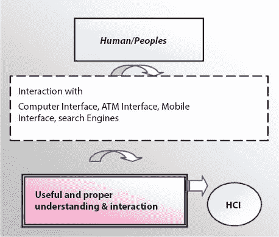

**Figure 2.2** HCI 及相关领域的基础。

*   可读显示：基本上，显示的可读性应清晰且可用；
*   根据 Christopher 的说法，信号应清晰且可用是根本的；
*   需要自上而下的处理；基本上，信号应清晰且可用；
*   必须反复且以多种替代形式遵循信号；
*   必须消除对象或数字之间的模糊性；
*   基本上，演示应看起来像它所代表的变量；
*   如果移动蚂蚁部分是根本的，那么遵循与用户实际假设或心理模型兼容的模式和方向的移动是根本的；
*   界面准备的成本应有足够的意义；
*   必须选择易于访问且时间高效的对象；
*   在两个信息源之间分配注意力对于完成一项任务可能是必要的；
*   应有可能跨多个来源访问数据；
*   菜单议程和类似类型的显示可能有助于用户编号任何对象或界面；
*   根据 Christopher 的说法，预测支持的标准允许用户专注于当前条件，同时也考虑可能的未来条件；
*   另一种设计或界面应基本相同，或满足用户未来使用实例的一致性。

## HCI 与 HID

为了更好的人机连接和机器界面，我们需要可靠且更好的协作设备。主机和设备都应显著更有用且更智能。HID 协议使设备的使用变得必要。主机（即计算机和另一台机器）应更不复杂，以便与设备（包括键盘、鼠标、操纵杆等）进行更好的通信。

设备易于使用且简单，因为这些设备将主导所有通信。主机需要从设备中检索 HIID 描述符并在与设备通信之前解析它。主要流程是首先从输入开始，然后从主机到设备再到人输出数据流（图 2.3 和 2.4）。

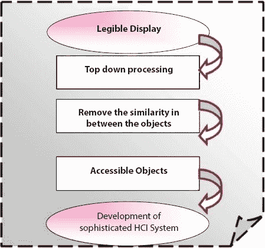

**Figure 2.3** 智能易用性的制作。

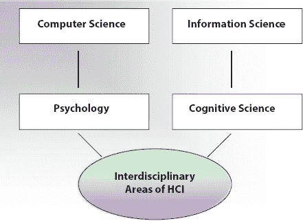

**Figure 2.4** HCI 与易用性设计的相关领域。

## HCI 中的主要问题

人机交互中存在一些重要问题 \[2\]，在设计学习环境的界面时必须牢记。表现会随训练而改善，专家可以将过去的知识转移到当前任务。同时，初学者需要精心设计的界面、探索以及有助于探索的变量，这些变量已成为熟悉界面的主要方法之一。用户的词汇（命令）会增加词汇的使用，但词汇是固定的，尽管界面中存在灵活性，但由于正在进行的各种不同的交互，它不太可能被使用。

## 2.2.1 通信样式和界面概述

协作样式是指基于创新平台通过协作策略在人与计算机之间的各种通信方法，这些策略是“在人机对话中使用物理输入/输出设备执行常规任务的方式” \[17\]。交互样式被解释为“通过界面的原型元素及其行为，例如命令行、下拉菜单、表单填写或直接控制” \[18\]。使用以下基本通信样式和界面。

### 命令行方言

这个著名的类别涵盖了人与计算机之间使用语言通过向计算机输入命令来进行的协作，这会提示一条准备好接受输入的消息。它直接向计算机提供通信准则，使用功能键、单个字符、缩写或整个单词命令。命令行界面的独特之处在于它们提供对系统功能的直接访问，并可以组合起来将多个工具应用于相同的数据。命令行交互的缺点在于文本命令通常难以学习和使用，因为用户在使用系统之前需要知道晦涩的关键字和严格的相关语法。这会导致错误率增加。它们必须被记住。记忆辅助只能作为信号使用。因此，它们更适合专家用户，而不是初学者。

### 菜单


Menus are characterized as a set of alternatives on screen for picking the activity or among choices for information passage. There are three sorts of menus \[18\]: Pull-down menus, Pop-up menus, and Hierarchical menus. Preece *et al*. \[7\] proposed a bunch of alternatives showed on the screen where the determination and execution of the choices bring about an adjustment in the interface condition. Not at all like order-driven frameworks, menus have the favorable position that clients do not need to recollect the thing they need, they need to remember it” \[7\]. The benefit of utilizing menus is that client needs to perceive instead of review objects. The menu alternatives should be gathered legitimately and essential so that the client could perceive the required choice without much stretch. Albeit generally the client clicks with a mouse over the thing to be chosen or utilizing a console, with the new equipment advances built up the client can react through notice orders. There is proof that the number of mistakes declines, time to play out an errand is abbreviate except for complex assignments that need more activities to play out, the route through menus to locate the essential choice requirements additional time.

## Direct Control

Direct control interfaces are incredibly famous and influential, particularly with new clients, since they implant controls that are simple to human abilities (pointing, snatching, and moving articles in space), as opposed to prepared practices and “clients have extraordinary power over the presentation and as they select things, the subtleties show up in windows on the slides” \[20\]. Direct control interfaces “present a bunch of articles on a screen and give the client a collection of controls that can be performed on any of them” \[16\]. Every procedure on the interface is done straightforwardly and graphically. Composing a program is finished by moving symbols onto the screen and interfacing them together from a programming angle. The “altering assembling-running” cycle is acknowledged by straightforwardly clicking symbols on the screen rather than carefully grammar end orders or activities. There is no compelling reason to recall the sentence structure. This prompts critical punctuation mistakes like the user cannot incorporate non-existing code since it is not on the screen when the user clicks the order symbol and quicker execution of an errand.

As indicated by Shneiderman *et al*. \[16\], these sorts of controls have a few implications:

1. The nonstop portrayal of the object of interest, and
2. Actual activities or marked catch presses rather than complex grammar.
3. Fast gradual reversible tasks whose sway on the object of interest is quickly noticeable.

As Shneiderman *et al*. \[19\] numbers the accompanying focal points of direct control to objects:

1. Tenderfoots can learn essential usefulness rapidly, generally through a demon2. Specialists can work incredibly quickly to do a broad scope of assignments.
2. Learned discontinuous clients can hold operational ideas.
3. Blunder messages are seldom required.
4. Clients can see promptly if their activities are promoting their objectives, and if not, they can alter the course of their action.

## Form Fill-In

It is “the least difficult style of collaboration that comprises the client being needed to respond to questions or fill in numbers in a fixed arrangement rather like rounding out a structure” \[18\]. In this structure, the lone sort of client communication is data arrangement, which is valuable for the information section into applications. Additionally, accounting pages are considered as a modern variety of structure filling.

## Natural Language

The scientists and specialists are more inspired by frameworks that utilize natural language handling as human-computer correspondence, both of discourse and composed info. Based on discourse input, the client should realize which expresses the computer comprehends since computer requires severe directions and clients may get baffled if a lot is standard. The benefit of utilizing this cooperation style is to clients that do not approach consoles or have restricted insight. Simultaneously, ambiguities of the language may cause unforeseen impacts and make it exceptionally hard for a computer to comprehend. A decent viewpoint is that “Regular Language frameworks ought to be stretched out to incorporate non-verbal exchanges” since he contends that “Common” language incorporates motions. Signals can be utilized to frame explicit liquid expressions. Multistring motions can benefit from the capacities of human execution to empower significant ideas to be communicated in a reasonable, fitting, and “common way” \[21\]. Regular language cooperations are “a point of view on non-verbal dialogs since they are from numerous points of view, more normal than those dependent on words” \[21\].

## Question/Answer and Inquiry discourse

This is an essential component for contributing to an application in a particular area. The client has posted a progression of inquiries (primarily with yes/no reactions, different decisions, or codes) driven through the cooperation bit by bit. These interfaces are not challenging to learn and utilize yet are restricted in usefulness and force. Inquiry dialects then again are utilized to develop questions to recover data from an information base.

## WIMP Interface

Weakling represents windows, symbols, menus, and pointers (in some cases, windows, symbols, mice, and pull-down menus). These interfaces are presumably the most well known and compelling for intelligent conditions. Windows are territories of the screen that carry on as though they were autonomous terminals in their own right. A symbol is a little picture used to address a shut window, record, or another item. The pointer is a significant segment of a WIMP interface since it interfaces the pointing, clicking, squeezing, hauling, and determination of items on the screen which could be moved, altered, investigated, and executed as it better fits the client’s vision. Different instruments of computer interface configuration are menus, exchange boxes, checkboxes and radio fastens, etc. These utilize representation strategies and computer illustrations to give a more available interface than order line-based showcases. WIMP plans’ crucial objective is to give the client a significant working allegory, for instance, an office or “work area” portrayal instead of the order line interfaces. Its preferences are general application, make capacities express, and give immediate criticism. People are susceptible to pictures and visual data that, on the other hand, can impart a few sorts of data considerably more quickly and viably than some other technique, and as is said, “words generally cannot do a picture justice”.

## Virtual Reality

“Virtual conditions and computer-generated realities commonly offer a feeling of direct actual presence, tangible prompts in three measurements, and a characteristic type of connection (for instance employing characteristic motions)” \[7\]. Other than these styles, new collaboration styles have arisen: “discourse input/yield, computer vision-based information (e.g., motions), sound interfaces (e.g., non-discourse sound), material and power criticism, biophysical signals (e.g., retina scanner)” \[22–25\] which present to us the new age of interfaces that are non-order based with cooperations like eye following interfaces, real counterfeit factors, play-along music backup, and specialists.

### 2.2.2 Input/Output


The customary info gadgets utilized are console, mouse, and visual showcase utilized in order based communications. New information gadgets are utilized with new equipment innovations like cameras, haptic sensors, olfactory, receivers, and others. The new info advancements utilized are discourse acknowledgment, signal acknowledgment innovations, eye following innovation as non-order based cooperation, strategies for correspondence, and control of multidimensional information; Output gadgets utilized are the customary computer work area, head-mounted showcases, autostereoscopic shows, accessible three-dimensional presentations, the non-discourse sound yield for “imagining” information, and so on, designed for clients with great necessities.

### 2.2.3 Older Grown-Ups

Society is getting more seasoned. By 2030, the populace level over age 65 will go from 17% to 29% in Asia, North America, and Europe. Individuals live longer, stay more dynamic into a more seasoned age, and remain in their homes longer before finding the requirement for “helped to live” plans. Such an adjustment in socioeconomics carries with it significant changes in the requests for items and administrations. Albeit more seasoned grown-ups are more averse to utilize innovation contrasted with more youthful or moderately aged grown-ups, they additionally utilize a wide assortment of advances \[50\]. They have numerous assessments about computers, Internet, etc. Albeit some of them discover no issue utilizing them, the degree of dissatisfaction experienced when managing these items is very apparent in different clients. There are various issues they experience when managing innovation: monetary limits, obliviousness about how to utilize it, a sensation of dread to “break” it, and well-being troubles \[51–53\]. Item guidelines and use data are now and again challenging to grasp, moreover, on account of seniors. Around 25% of the issues they have experienced utilizing innovation might be addressed considering this client’s aggregate (for instance, amplifying letter-size or utilizing more exact names) \[50\]. Now and again, more seasoned grown-ups must choose the option to utilize innovations, for instance, phone voice menu frameworks, cell phones, and air terminal registration booths. These innovations are probably planned with the assumption that anybody ought to have the option to collaborate with them effectively. However, more seasoned grown-ups report disappointments in their communications because those items have not been intended to oblige the restrictions of this system. The proper use of Universal Design is for a long time or should be viewed in the following year.

Organic, mental, and additionally social issues emerge with age: lack in sensation and discernment, working memory declination, increasingly slow dependable data handling, increasingly slow fruitful obtaining of new techniques, specific consideration issues, development weakness, and relationship challenges. Devices and methods should be offered to relieve these issues. They can be accomplished through the plan of explicitly input/yield gadgets; versatile applications, explicit errand investigation, ease of use, and associations strategies are too systems that could help this objective. Including a delegate test of grown-ups in these assignments could help see some extraordinary attributes of more seasoned grown-up populaces that should be viewed while exploring for them. Medical care innovation is an essential worry for grown-ups of any age, particularly for more established grown-ups (because of their affinity to sickness and ongoing conditions). Exercises, for example, organizing doctor arrangements, making sure to take prescriptions, preparing data about as of late analyzed aliments, checking ongoing conditions are essential for the assignments that would benefit from outside intervention by innovation, which can be improved before very long. At long last, a proper plan of preparing and instructional projects for these clients is a duty regarding appropriate utilization of advancements: explicitly planned training programs are expected to incorporate older folks into a general public where computerized uneducated people have a great danger of social rejection. Versatile preparing, the utilization of reproduction, or the consideration of e-learning strategies are significant rules to consider when planning those projects.

### 2.2.4 Cognitive Incapacities

Characterizing psychological incapacity is not simple and definitions are generally expansive. It very well may be said that an individual with a psychological handicap has more considerable trouble with at least one sort or mental errands than an average individual. While an individual with significant intellectual incapacities will require help with pretty much every part of the day by day living, somebody with a minor learning handicap might have the option to work satisfactorily despite the inability, even to the degree the incapacity is rarely analyzed. People with psychological impedances can profit by utilizing novel processing advances, social computational frameworks, and setting mindful frameworks and that is only the tip of the iceberg. Innovation might be successful for the analysis, the board and treatment of a few problems like mental imbalance, Down Syndrome, horrible mind injury (TBI), or less intellectual severe conditions like a lack of ability to concentrate clutter (ADD) consistently, dyslexia (trouble perusing), dyscalculia (trouble with math), and learning incapacities all in all. Some rules address how to make web content available to individuals with handicaps, including intellectual ones. Notwithstanding, the usage of these rules does not ensure a complete admittance to the substance. The wide fluctuation among the psychological capacities of an individual with an intellectual handicap convolutes matters a ton. Many web contents cannot be made open to people with significant psychological inabilities, regardless of how enthusiastically the designer attempts. In those circumstances, some substances will consistently be excessively unpredictable for specific crowds. By and by, as a test for the following a very long time, there are still a few things that planners can do to expand the availability of web substance to individuals with less intellectual severe handicaps. Procuring the specialization to create open substance for these clients is a challenge for designers. Experts need to work related to interface creators to share their insight, direct them to grow new strategies for controlling hear-able yield, improving components to recollect arrangements. To finish consecutive activities, lessening the measure of data on a solitary page. To choose fitting designs with no messiness and considering new techniques to pick an alternative among huge informational indexes, giving explicit messages and definitions to abnormal terms. Limiting the psychological burden while surfing, utilizing illustrations to upgrade understanding and just when suitable (never abusing them), creating assistive advancements or programs with worked in versatile highlights, giving reliable orders and highlights along with the site, shortening menus, etc. All these techniques and methods ought to be joined with experimentation and test with genuine clients. The assessment of the existing all-around innovation and the new advancements should likewise be made related to schools and organizations that consider the exceptional clients. What separates intellectually incapacitated from other disabled clients is that the specific issue and its degree is regularly not characterized (not at all like for different clients, for example, outwardly hindered clients), and those experts are presumably the best-qualified ones to guidance during the turn of events and assessment measure.

## 2.3 Programming: Convenience and Gadget Explicit Substance

**• Software Convenience**


在完美的世界中，所有产品都不应该难以使用，并且应对客户的广泛范围开放。然而，从大型组织到小型组织的应用程序和网站，经常无法实现最基本的易用性和可访问性目标。有多种理由来证明这些核心障碍的合理性：许多组织不进行易用性测试。其他组织虽然会进行测试，但出于速度或降低成本的考虑，他们仅在开发周期的开始或结束阶段进行测试，或者使用减少的用户数量进行测试，或者对嵌入式设备的理解仍然不足，可能会阻碍长期执行。这些技术可能有助于修复受损的视觉框直接脑植入物，并且可能有可能为瘫痪患者提供新的功能。部分侵入式 BCI 设备被植入头骨内部，但位于大脑外部，而不是位于灰质内部。它们产生的信号质量优于非侵入式 BCI，因为在非侵入式 BCI 中，头骨的骨组织会分散和扭曲信号，并且与完全侵入式 BCI 相比，在大脑中形成疤痕组织的风险较低。非侵入式技术使用头皮外部的电极来记录大脑的电活动。这种技术非常适合人类；但是，由于与脑组织的距离，以及被大脑膜、头骨、皮下组织和头皮分隔，它会经历空间分辨率降低和噪声增加。因此，只能检测到同步的活动或大量的神经元组件。也许最常见的非侵入式技术是脑电图（EEG）：它易于使用、便携且设置成本低。主要缺点是客户在操作该技术之前需要进行广泛的培训，并且设置该技术的人员需要具备一定的技能，还需要定期维护以确保与皮肤有足够好的接触。尽管近年来发生了许多改进，但有机会将这些创新应用于连接过程。最重要的是，一个严重的问题是需要能够提供快速、准确和可靠控制信号的工具。


非侵入性和侵入性策略都将从编年史技术的改进中获益。此外，我们要求进行检验以了解所估计信号的重要性，或者换句话说，更好地了解大脑的功能。几乎没有残障的人广泛使用这项技术是未来的另一项挑战（10）。计算机设备的持续改进提供了体积小巧且功能极其强大的紧凑型系统。例如，“epic”活动——一款由 Emotiv 开发的 299 美元神经头戴设备（含 SDK，另加 500 美元）——无疑将为该领域的投资和新研究做出贡献。当这些困难被克服后，我们可以尝试实现更高的目标，例如开发由思想控制的设备。

### 2.4.2 无处不在的计算——近距离协作

无处不在的计算（ubicomp）是一种后桌面模式的人机交互模式，其中数据处理已完全融入日常物品和活动中（技术无处不在，我们一直在使用它，而无需思考，因为它对用户来说是“不可见”的）。无处不在的计算作为不可见计算的概念，最早由 Mark Weiser 于 1988 年在施乐 PARC 计算机科学实验室提出。无处不在的计算环境拥有多种相互协作的先进设备和服务，而且其中许多设备并不知道自己正在这样做。在这些设备中，有连接互联网的计算机、移动计算设备、小型且廉价的网络处理设备、数字音频播放器、射频识别标签、GPS 和智能平板电脑。无处不在的计算在计算机科学领域带来了挑战：在系统设计与工程、系统建模以及用户界面设计方面。ubicomp 的一个重要主题是探索个人与设备之间，以及个人与其设备组合之间的新型交互方式（13）。1966 年，人类学家 Edward Hall 提出了“近距离学”（proxemics）这一术语，这是一个研究领域，旨在识别人们利用人际距离来理解和干预与他人关系的社会依赖方式 \[62\]。在近距离协作中，其信念是我们可以设计系统，让人们利用对其与附近数字设备之间近距离关系的相似理解，从而促进更加连贯和自然的交互 \[63, 64\]。今天，有许多场景中多个设备位于同一房间：手机、工作站和平板电脑。在大多数情况下，互连这些设备存在特定问题（用户需要具备广泛的知识才能做到这一点，并且需要花费时间来设计和管理通信）。当设备连接后，在它们之间执行任务仍然存在问题（例如，将文件从一个设备发送到另一个设备）。可以说，一个设备的存在对其他设备的存在是无意识的。事实上，这些设备甚至对其他方面也毫无察觉，例如房间里的人数或其他非计算机化物体的存在/不存在。

这就是近距离学可以提供帮助的地方：同样，人们希望在接近他人时增加承诺或亲密感，设备在接近其他设备时也应该增加其网络和关联前景。Greenberg 提出了五个维度来衡量亲近度：元素之间的距离（例如，一个元素是否与另一个元素在同一房间内）、元素之间的方向（俯仰/滚转/偏航/指向/大致指向/远离物体）、身份（精确身份/元素类型）、人员的存在、运动（元素靠近或远离另一个元素时的运动速度）以及区域（元素所处的实际环境）。尽管 ubicomp（甚至近距离连接）的概念是知名的，但仍有一些挑战需要解决：没有“官方”语言来实现这些设备的通信。它们之间不存在任何行为准则（例如，我们是否会在不同设备之间建立优势/服务关系？情况的近距离要素如何决定或影响参与者的通信？）。另一个重要方面是设定当设备对其他设备的亲近度拥有错误或不完整的数据时，设备将如何响应？最后，人们对这种通信范式有什么期望？Marquardt 和 Saul Greenberg 的报告 \[65\] 中也发现了设计 ubicomp 系统的其他挑战。

### 2.4.3 其他设备相关方面

毫无疑问，BCI 或 ubicomp 为人机交互世界提供了广阔的前景。然而，与设备相关的挑战也有很多。对许多用户来说，重要的是希望设计与计算机交互的方式，以适应他们天生的能力。举两个例子，我们可以列出可穿戴计算机和透明设备 \[66–70\]。可穿戴计算机是由携带者穿在衣服下面、里面或上面的小型电子设备。它们适用于需要比仅由硬件编码逻辑更复杂的计算支持的应用。透明设备寻找在使用过程中不需要个人关注的设备：一种与我们自己的生活、自然限度和活动如此契合和协调的技术，以至于在使用时几乎难以察觉 \[71–75\]。一年后，我们可以从黑箱技术（那种不断让用户困惑的技术）走向起点。

## 2.5 针对当前智能家居的 CHI

### 2.5.1 医疗保健智能家居

随着老年人口数量的增加和医疗资源难以跟上步伐，机械解决方案对于改善老年人的生活质量至关重要。许多研究人员认为，智能家居可以发挥其最大潜力来帮助有需要的人 \[26–31\]。智能家居在医疗保健中的主要目标是提供一个监控系统，该系统不断产生细微的数据流，可用于评估一个人的健康状况。此外，“生理体征和个人行为模式的比例可以转化为健康风险的精确指标，即使在早期阶段，也可以与报警触发系统结合，作为一个技术平台来启动适当的行动” \[32\]。尽管根据现有研究，智能家居监控系统对老年人来说是足够的，但此类系统的感知价值很难评估。这些观点对于建立与健康相关的监控数据相关的有效反馈系统至关重要。通过有效的反馈，健康监控系统可以在改善医疗保健系统的同时，促进与老年人更好的参与 \[40\]。


除了针对老年人的精明家庭前提之外，越来越多的需求集中在帮助残障人士的功能上。例如，患有痴呆症（如认知能力下降）的人可能需要生活在智能环境中，以弥补其能力下降的问题。然而，当我们谈论智能家居或智能环境时，使用尖端技术所创造的功能通常对普通最终用户来说难以理解，更不用说对痴呆症患者了 \[76–78\]。因此，设备的设计必须尽量减少与最终用户的直接、全功能交互。基本的智能家居理念集中在人机交互和任务完成上。然而，针对痴呆症患者的智能家居应侧重于记录用户的行为，以便在无人看护的情况下承担“提醒”的角色。智能家居功能将充当家庭成员，根据情况提供诸如开启或关闭设备等服务。这些技术几乎无法取代人工护理，但智能家居可以减轻提供医疗保健服务人员的负担，并提高医疗服务的整体质量 \[41\]。

### 2.5.2 节能智能家居

在过去几年中，关于家庭能源技术的广泛研究和调查已经开展。今天，有多种方法可以通过使用智能程序（例如高效能源管理 \[36\]）来降低家庭能源成本。例如，通过添加更多传感器来提高监控精度，可以更有效地监测用户对居住环境的偏好。此外，一些研究建议采用多代理策略来降低能源消耗。提高智能家居的能源效率并提出全面的智能家居框架理念，不仅可以限制当前的智能家居能源问题，还可以增加在不久的将来创建完全功能的智能家居的可能性 \[36\]。

### 2.5.3 接口设计与人机交互

随着信息技术的快速发展，过去提出的许多想法已成为现实。云计算服务的使用、对界面设计的强调、人机交互理论以及物联网的发展，为智能家居的进步提供了全新的机遇。要为智能家居构建可行的云计算环境，我们需要克服在智能家居环境中管理和安排人员和物品的实际挑战。一种解决方案是让设计师根据客户规格，使用计算机辅助设计界面（也称为设计师导向界面）来创建强大的智能家居设备。为了利用互联网基础设施和应用程序提高人类与人工智能之间的接触和沟通效率，建议在智能家居设备的开发中采用计算机辅助或设计师导向界面 \[33\]。

最近，用户界面被视为满足个人客户需求和偏好的关键因素，从而产生更像个人界面的用户界面。要开发个人界面，设计师应将情境驱动开发视为界面制作的基本要素。情境驱动界面在鼓励用户适应智能家居或环境辅助生活环境方面发挥着越来越重要的作用 \[43\]，一些与情境驱动界面相关的技术，例如运行时的动态方法，也已被提出 \[48\]。最近的进步和发展提高了对智能家居性能的期望。与物理环境相关的技术，例如传感器和执行器，为提升智能家居内舒适度的功能提供了机会，同时限制资源的使用 \[42\]。传感器和执行器的发展使得监控用户行为成为可能。最新的研究更加关注人与系统之间的交互；因此，配备各种敏感服务的智能家居为满足大多数医疗保健应用程序的要求提供了决定性平台 \[45\]。这项前沿技术使智能家居设备更加直观，并为支持基于手势的界面提供了坚实基础。手势是“任何计算机系统可以检测并做出反应的物理动作，无需借助鼠标或指针等传统指示设备。挥手、点头、触摸、脚尖轻敲，甚至挑眉都可以是一种信号” \[44\]。基于手势的界面，例如基于摄像头的手势界面和基于运动传感器的手势界面 \[39\]，可以在无需传统设备（如键盘或鼠标）干预的情况下识别用户的身体动作 \[34\]。人们可以以多种方式与周围环境交互。我们可以直接控制各种类型的设备，并可以在不同的自然环境中行动和反应 \[35\]。如果环境能够识别我们的行为并对我们的行为做出反应，我们能否将其视为智能家居？因此，必须认识到，最新趋势已转向使用更直观的用户界面。随着智能环境理念从医疗保健、信息技术、动作捕捉屏幕和可行用户界面的发展，人机交互可以在我们的日常生活中成为现实。智能家居提供了一个配备各种特定设备的智能环境，可以通过一系列智能自动控制来控制环境知识。这种智能环境能够识别和响应人类行为，并为居住者提供各种服务 \[36\]。随着人机交互的发展和当代文化的进步，对物联网的研究多年来不断增加。人工心理学理论在与物联网相关的智能家居中扮演着越来越基本的角色。智能家居的和谐性一直是近期研究的重点。为了改善人机交互的和谐性，还开展了关于 HCI 的情感识别研究 \[37\]。

### 2.5.4 状态总结


“智能家居是一种推动创新改进的强大力量，其成就取决于创新设计师对增强功能和能源管理的梦想，以及家庭在令人困惑的家庭场所中的需求和要求” \[46\]。为了改善智能家居中的客户体验，需要精良的 UI。一个高质量的智能家居系统不仅应建立在先进的智能设备之上，还应建立在出色的 HCI 设计之上 \[47\]。根据我们的研究，我们认为还应实现以下研究目标。首先，应建立一个集中控制系统，并且还需要一个操作缓冲区来协调各种智能设备。智能设备的操作系统应当统一，不同设备之间的通信标准应当保持一致，这可以为智能家居 UI 的设计提供基础。此外，应制定一份全面指南，说明如何为用于智能家居环境的智能设备设计 UI。我们认为，各种智能设备的 UI 是独特的。UI 设计应基于智能设备的主要功能，设计风格也应遵循 HCI 的基本理论。此外，每个用户的 UI 应根据用户的可访问性需求进行调整。用户批准和确认功能对于提供安全的智能环境至关重要。为不同用户提供可调整的界面对于改善智能家居中的客户体验也是必不可少的。最后，应建立一个安全的数据传输系统以确保客户的信息安全。客户的数据和行为在智能家居中很容易被记录，确保客户的安全是至关重要的。

## 2.6 四种改进 HCI 和 UX 的方法

面对诸多困难，当今智能家居的进步仍然缓慢。在期望智能家居成为普遍现实之前，必须解决各种技术瓶颈。因此，有必要探讨有助于智能家居成功实施的目标。为此，我们提出四种改进 HCI 设计的方法。

### 2.6.1 高效通用控制面板

为了改善智能家居的 HCI，通用控制面板是必不可少的。如今，我们家中几乎每个电子设备都有一个遥控器，例如电视、DVD 播放器和空调，我们很难仅凭外观区分这些不同的控制器。在智能家居中，管理多个控制器不是一个明智的选择。因此，应开发一个通用控制器。卓越的用户体验取决于通过通用控制面板实现的出色 HCI 设计。在专注于控制面板设计之前，仍有一些问题需要解决。首先，应建立一个统一的数据通信标准。我们需要我们的全能控制器能够同时控制各种智能设备。通过简化控制流程来改善用户体验和节省时间至关重要。如果所有智能设备都能连接到一个控制面板，那么控制面板的操作系统也应标准化以运行不同的 UI。改善用户体验的有效方法是将 UI 与智能设备的更新同步。例如，如果您在现有的中央空调系统中添加一个新的空气净化器，您的控制器 UI 应同时更新功能。在智能家居实施之前，建立智能设备的集成通信标准至关重要；换句话说，无论客户从智能家居公司购买什么类型的智能设备，该设备都应与控制面板兼容。高效且强大的 UI 设计必须基于成熟的操作系统开发，只有在建立适当的标准后，才能实现成功的智能家居。此外，智能设备之间的数据交换应兼容且标准化。智能家居设备必须足够智能以相互通信，智能设备捕获的数据以及客户操作的记录应在智能设备之间共享。为了改善用户体验的质量，我们希望我们的智能家居能充当友好的提醒，告知我们家中发生的事情。当烤箱在烹饪食物时，炉子的警告将弹出在电视屏幕上。在必要时，提醒客户的能力在提供智能环境方面发挥着越来越重要的作用，特别是对于那些难以记住事情的人以及残障人士。智能设备之间的数据交换为更高级别的 HCI 提供了关键基础，表现为与智能设备的紧密协作。在共享不同设备捕获的数据时，建立安全的家居环境也是至关重要的。为了实现高效且有效的数据交换，我们可以创建一个使用云计算的数据库。关于客户的数据可以由控制面板或智能设备按日常、定期的时间表记录，云计算和云存储的使用可以提供良好的协调点。

### 2.6.2 令人信服的用户界面

UI 是一个操作面板，可以允许客户通过简单的操作控制各种应用程序的功能和行为。控制面板可以操作智能家居中的各种智能设备，这给 UI 设计师带来了新的挑战。一个有效的 UI 在改善客户体验方面发挥着关键作用。UI 广泛应用于各种主要设备，包括电子器具、手机和社交媒体网站。HCI 的发展及其对 UI 的影响在构建强大的智能家居方面发挥着越来越重要的作用。为了设计高效且有效的 UI，我们提出以下准则。可视化功能。智能家居的 UI 与我们在手机或网站上使用的 UI 不同。各种智能设备的功能对客户至关重要，这就是我们购买不同电子设备用于家庭的原因。智能设备应当被可视化，以改善智能房主的客户体验（参见 Figure 2.5）。首先，客户需要知道哪些设备正在被立即使用。控制面板上智能设备功能的虚拟仿真有助于客户识别控件及其相关状态。例如，当我们需要在厨房操作烤箱时，烤箱的模型应显示在关键功能、温度控制、时钟和开关周围（参见 Figure 2.5a）。通过同时仿真模型区分各种设备比使用一系列按钮更高效。操作全套按钮并不自然，并可能对整个系统产生负面影响。简化的仿真模型也更适合老年人和残障人士。可视化模型对于改善客户体验至关重要，与按按钮相比，能给最终用户带来更积极的体验。


高质量的 HCI 配置离不开有用的批评。批评工具在当前的 HCI 规划中扮演着重要角色，并已被广泛应用于各种 UI 类型，例如网站、移动应用程序和操作系统，以改善用户体验。智能家居中使用的智能设备应向实际设备或客户的控制面板提供高效的批评。批评可以以多种模式设计，例如对话框、灯光、声音和振动。一个高效的批评系统可以提供不同的物理信号以增强 HCI，这种输入对于减少客户的操作失误至关重要。例如，如果客户在控制面板上输入无效的数字或日期，系统应在继续之前通过对话或建议告知客户。此外，输入系统是允许控制面板作为提醒器工作的一个完整部分。一个有用的输入系统在改善老年人和残障人士的用户体验方面也扮演着基本角色。老年人或残障人士需要更高效的输入来记住哪些任务已完成，并在处理其订单前确认必要的活动。

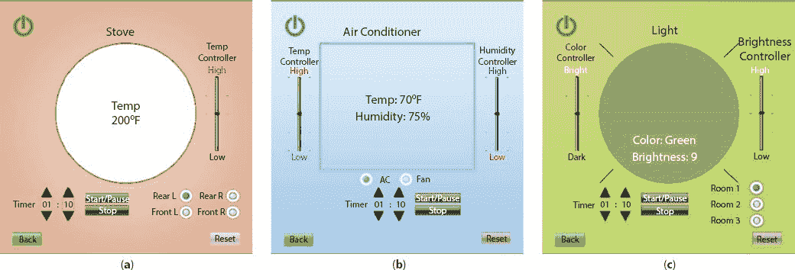

**Figure 2.5** Pictured models of smart devices, (a) Model-1 (b) Model-2 (c) Model-3.

### 2.6.3 Variable Accessibility

一个可行的 UI 为智能家居的控制面板提供了一个总体模型。然而，用户体验，特别是对于老年人、残障人士和儿童，可以通过个性化的可访问性得到显著改善。首先，针对残障人士的 UI 应根据其能力进行更改，并且 UI 还应在不同用户之间可配置。为了改善用户体验，UI 设计应尽可能易于访问，特别是针对特殊需求。建立智能家居的主要目的之一是通过可访问的计划和设施帮助客户提高生活质量。一个专为残障人士设计的 UI 可以为他们提供改进的操作方法和出色的 HCI 体验。请理解，残障人士可以在定制 UI 的帮助下在家中完成大部分任务。例如，UI 可以更改以适应各种要求。当您的一位残障朋友需要访问您的智能家居时，您应该能够轻松地将 UI 更改为特定模式，以允许各种智能设备被轮流控制。如果某些用户无法移动手指触摸屏幕，他们可能能够对控制面板说话。然而，为了让他们做到这一点，UI 模式应从可访问的可视化界面转变为语音控制界面。客户可以使用一系列连续的单词或短语来控制智能设备的功能。例如，如果一位残障客户想要打开空调（参见 Figure 2.5b），此人只需说“空调”、“打开”、“温度”，然后说“上调”或“下调”。对于许多身体残障的客户来说，能够使用通常通过触摸屏幕来控制智能设备的语音命令至关重要。

此外，智能设备功能的批准应针对不同用户具有可变性。全部功能或其部分应取决于客户的批准级别。可访问性的权限衡量控制智能设备的能力，同一设备可能需要来自不同用户的不同权限。应设置权限以建立智能家居服务，客户必须用更高级别的权限来更改此权限。通过提供不同的专家来构建安全的智能系统至关重要。首先，对某些电子设备的有限访问可以防止儿童滥用它们。限制对设备的访问是帮助儿童远离危险的有效策略。各种器具，例如烤箱、微波炉和洗衣机，应仅由成年人操作。当这些设备被手动控制时，拥有适当权限的客户应被告知并允许启动操作以接管设备。通过减少特定设备和服务的实用性来简化某些智能设备的功能并改善儿童的用户体验至关重要。向具有基本访问权限级别的客户展示特定智能设备的每个功能可能是不合适的。为了改善用户体验，UI 设计应专注于智能设备的主要功能。例如，对电视具有基本权限级别的客户应能够控制功能、电源、频道和音量，并且他们不应能够将系统重置为出厂设置。不同的批准级别可以通过提供不同范围的允许通信频率来设置。作为管理员操作各种智能设施的客户应能够访问各种数据通信频率，而那些对智能设备具有基本批准的客户只能访问部分通信频率。这将限制客户访问某些智能设备。此外，我们可以使用密码来对特定智能设备的个别客户设置限制。例如，密码、一系列字符或独特的手势可以由具有最高权限的客户创建，并且密码必须由创建它的人停用。

### 2.6.4 Secure Privacy


随着数据创新的发展，客户为了成为尖端创新驱动社会的一部分，必须分享比以往任何时候都更多的个人数据。然而，随着技术的进步，我们的信息安全几乎没有增加，反而可能降低。许多安全问题需要解决，意外的数据泄露可能会对客户体验产生不利影响。在智能家居中，客户的安全问题涉及各种数据和活动，包括联系信息、在线搜索历史、各种智能设备的设置以及客户的生活方式。要认识到，每项与 HCI 相关的活动都可能被尖端智能设备监控和记录，这可能是一把双刃剑。一方面，智能设备可以在没有客户输入的情况下重复相同的活动，这使客户能够通过简单的点击来控制智能设备，或继续一个未完成的周期。智能办公室保存客户的数据以解开活动，以及当设备或系统充当提醒时，这一点至关重要。监控客户的行为在提高控制智能设备的效率以及促进 HCI 的整体改进方面也发挥着巨大作用。客户的行为可能被记录并存储在数据库中，如果数据库被黑客攻击，这可能会使客户的隐私变得脆弱。保护客户的数据至关重要。可能会有一些商业实体试图利用客户数据来提供通知和促销。突发的警告和广告可能会降低客户体验。此外，这种不想要的通信会削弱客户对 HCI 的信任程度。应建立以下组件，以避免客户体验的中断并提高数据安全性。首先，客户应有选择权，决定是否希望他们的智能设备记录其数据或活动，方法是允许客户选择他们的偏好。应有一个复选框供客户选择，以决定他们是否希望其信息和行为被记录，或者是否希望加入改进计划，以帮助智能家居公司收集客户的信息。与条款和条件相关的协议应与复选框一起提供。此外，客户的信息和行为记录应存储在多个数据库中。数据应分布在不同的数据库中，以便在其中一个数据库被黑客攻击时降低数据泄露的风险。客户还应有选择权，自动或手动清除访问历史记录或记录，并且客户可以通过输入密码或识别指纹来决定访问数据库。最后，智能家居公司应提供一些安全措施。例如，应在每个智能办公室安装反间谍软件和防火墙。客户可以决定是否购买这些软件应用程序，如果客户购买了它们，当客户的个人数据泄露时，智能家居公司应承担责任。客户还可以为其智能设备购买保险，同时也为其数据的安全购买保险。客户和智能家居公司应联合起来，提供一个舒适且安全的环境。

## 2.7 结论与讨论

物联网的假设以及当前尖端技术的现状，为开发和改进智能家居提供了坚实的基础。智能家居可以用于提高有特殊需求人群的生活质量。智能家居及其对智能设备的使用也可以减少能源消耗。此外，HCI 的设计在改进智能家居方面发挥着越来越重要的作用。基本技术的进步，例如传感器、屏幕和控制器，为实现更有效和高效的客户体验提供了必要的工具。基于过去的研究和考察，以及智能家居的基本理论和实践，我们认为，专注于改进 HCI 的设计对于提升智能家居中的客户体验至关重要。因此，提出一些方法来开发智能家居中高效且有效的 HCI 设计是基本要求。我们提出四种潜在方法，包括高效的通用控制面板、有效的用户界面、可变的可访问性以及安全的隐私保护，以显著改进 HCI 设计，并最终提升整体客户体验。最重要的是，本文讨论的四种方法为智能家居中不应出现的情况提供了一般性指导。客户需要熟悉控制面板并了解用户界面的功能。还应考虑客户对智能设备功能的可配置访问，因为有些客户可能需要比其他客户更多的功能。同样重要的是，通过建立授权限制来保护儿童。最后，这四种方法提供了一些有用的指导原则，可能有助于希望在智能家居中设计和开发高效且有效的 HCI 的设计师和工程师。例如，为残障人士提供语音控制以控制智能设备。对智能家居的短期研究应在普通人群（即客户）中验证所提出的概念。智能家居的其他重要组成部分，例如与安全相关的问题和相关的娱乐要点，也应得到解决。首先，应在智能家居中设置备用电源，以便在停电时能够独立工作，用于整体监控和警报系统。此外，应始终设置辅助锁系统，以防传感器读数错误。电气辐射应在安全范围内进行监控和控制，所有电子设备都应防水。关于智能家居娱乐，进一步的研究应集中在设计良好的模块化结构上，使智能家居具有可变性，而不会破坏整个结构的基础。此外，所有智能家居设备的输入和输出端口应相同或兼容。从使用安全摄像头和温度监控器，到使用智能手机（如 iPhone 或 iPad）上的应用程序远程控制电视和空调，智能家居的概念正变得越来越可接受。我们相信，智能家居将在不久的将来成为我们生活中的必需品。总之，技术的发展在实现智能家居方面取得了巨大进步。没有尖端技术的使用，就无法实现高效且强大的智能家居。然而，智能家居客户无限的需求将继续带来新的技术挑战。这是一个良性循环。虽然很难预测该领域未来的研究方向和客户需求，但我们希望为未来的智能家居提出一些潜在挑战。首先，随着 3D 建模的出现，未来的智能家居可以渲染其智能设备。客户可以使用智能家居 3D 打印机来制造新的智能设备或修复智能家居内的损坏设施。此外，可以使用 3D 全息图来使用与智能设备交互的用户界面。此外，可以使用可移动的智能墙来根据需要调整智能家居的布局。屏幕、扬声器、空调和灯光等智能设备可以集成到“智能墙”中以节省空间。

## 参考文献


1. Stephanidis, C., *Interfaces for All - Concepts, Methods, and Tools*, pp. 3–17, Lawrence Erlbaum Associates, Mahwah, NJ, 760 pp, 2001.

2. Eisenhauer, M., Hoffman, B., Kretschmer, D., State of the Art Human-Computer Interaction. *GigaMobile/D2.7.1*, September 16, 2002, 2002.

3. Newell, A. and Card, S.K., The Prospects for Psychological Science in human-computer Interaction. *Hum.-Comput. Interact*., 1, 209–242, 1985.

4. Carroll, J.M. and Campbell, R.L., Artifacts as Psychological Theories: the Case of Human-Computer Interaction. *Behav. Inform. Technol*., 8, 247–256, 1989.

5. Long, J. and Dowell, J., Conceptions of the Discipline of HCI: Craft, Applied Science, and Engineering, in: *People and Computer V. Proceedings of the Fifth Conference of the British Computer Society Human-Computer Interaction Specialist Group, Univ. of Nottingham*, 5-8 Sept. 1989 CUP, Cambridge, 1989.

6. Reeves, B. and Nass, C., *The Media Equation: how people treat computers, televisions and new media like real people and places*, Cambridge University Press, Cambridge, 1996.

7. Preece, J., *Human-Computer Interaction*, Pearson Education Limited, Essex, England, 1994.

8. Dix, A.J., Finlay, J., Abowd, G., Beale, R., *Human-Computer Interaction*, 2nd edition, Prentice-Hall, Englewood Cliffs, NJ, USA, 1998.

9. ACM SIGCHI, *Curricula for Human-computer Interaction*, ACM Special interest group on computer-human interaction curriculum development group \[On-line\], New York, U.S.A., 1996, Available: [`http://www.acm.org/sigchi/cdg/cdg2.html`](http://www.acm.org/sigchi/cdg/cdg2.html).

10. Jones, A. and O’Shea, T., Barriers to the use of computer-assisted learning. *Br. J. Educ. Technol*., 3, 13, 207–217, 1982.

11. Rudnicky, A.I., Lee, K.F., Hauptmann, A.G., Survey of current speech technology. *Commun. ACM*, 37, 3, 52–57, 1992.

12. Corso, J.J., *Techniques for Vision-Based Human-Computer Interaction*, A dissertation submitted to The Johns Hopkins University Baltimore, Maryland, August, 2005.

13. Faconti, G.P., Reasoning on Gestural Interfaces through Syndetic Modelling. *ACM SIGCHI Bull*., 28, 3, July 1996.

14. Carroll, J.M. and Thomas, J.C., Metaphor and the cognitive representation of computing systems. *IEEE Trans. Syst. Man. Cybern*., 12, 2, 107–115, 1982.

15. Tufte, E.R., *Visual Design of the User Interface*, IBM Corporation, Armonk, N.Y., 1989.

16. Shneiderman, B., Direct Manipulation: A Step Beyond Programming Languages. *IEEE Comput*., 16, 8, 57–69, 1983.

17. Foley, J.D., van Dam, A., Feiner, S.K., Hughes, J.F., *Computer Graphics: Principles and Practice*, Addison-Wesley, Reading, Mass, 1990, [`http://lipas.uwasa.fi/~mj/hci/hci11.html`](http://lipas.uwasa.fi/~mj/hci/hci11.html).

18. Shneiderman, B., *Designing the User Interface*, Addison-Wesley, New York, U.S.A., 1992.

19. Shneiderman, B., The future of interactive systems and the emergence of direct manipulation. *Behav. Inform. Technol*., I, 237–256, 1982.

20. Shneiderman, B. and Maes, P., Direct manipulation vs. interface agents interactions. *ACM Digital Library*, 4, 6, 42–61, 1997.

21. Buxton, W., The Natural Language of Interaction: A Perspective on Non-Verbal Dialogues, in: *The Art of Human-Computer Interface Design*, B. Laurel, (Ed.), pp. 405–416, Addison-Wesley, Reading, MA, 1990.

22. Rauterberg, M., Interaction Styles. *ACM Digital Library*, 4, 6, 72–82, 1990.

23. Fetaji, M., Fetaji, B., Ebibi, M., Designing quality e-learning virtual environment for learning Java. To be published in the *CIIT conference proceedings*, Macedonia, Bitola, 21 January 2007.

24. Dumas, J.S. and Redish, J.C., *A practical guide to Usability Testing*, revised edition, pp. 55–62, Pearson Education Limited, New York, U.S.A., 1999.

25. Baeza-Yatez, R. and Ribeiro-Neto, B., Chapter 10, in: *Modern Information Retrieval*, ACM Press, Addison-Wesley, 2001.

26. Anderson, J.R. and Lebiere, C., *The Atomic Components of Thought*, Lawrence Erlbaum Associates, Inc., Mahwah, NJ, 1998.

27. Newell, A., *Unified Theories of Cognition*, Harvard University Press, Cambridge, MA, 1990.

28. Kieras, D.E. and Meyer, D.E., An overview of the EPIC architecture for cognition and performance with application to human-computer interaction. *Hum. Comput. Interact*., 12, 391–438, 1997.

29. Sutcliffe, A., On the effective use and reuse of HCI knowledge. *ACM Trans. Comput.-Hum. Interact. (TOCHI)*, 7, 2, 2000, Publisher: ACM Press.

30. Shneiderman, B., *Designing the User Interface: Strategies for effective human-computer interaction*, Addison Wesley, Reading, Massachusetts, 1986.

31. Bouchard, K., Bouchard, B., Bouzouane, A., Guidelines to efficient smart home design for rapid AI prototyping: A case study. *Proceedings of the 5th International Conference on Pervasive Technologies Related to Assistive Environments*, Heraklion, Crete, Greece, pp. 1–8, 2012.

32. Chan, M., Campo, E., Estève, D., Fourniols, J., Smart homes - Current features and future perspectives. *Maturitas*, 64, 2, 90–97, 2009.

33. Chen, S., Chang, S., Chang, Y., Exploring a designer-oriented computer-aided design interface for the smart home device. *Comput.-Aided Des. Applic*., 7, 6, 875–888, 2010.

34. Choi, E., Kwon, S., Lee, D., Lee, H., Chung, M.L., Towards successful user interaction with systems: Focusing on user-derived gestures for smart home systems. *Appl. Ergon*., 45, 4, 1196–1207, 2014.

35. Davidoff, S., Lee, M.K., Yiu, C., Zimmerman, J., Dey, A.K., Principles of smart home control. *Ubicomp*, 4206, 19–34, 2006.

36. De Silva, L.C., Morikawa, C., Petra, I.M., State of the art of smart homes. *Eng. Appl. Artif. Intell*., 25, 7, 1313–1321, 2012.

37. Du, K., Wang, Z., Hong, M., Human-machine interactive system on smart home of IoT. *J. China Univ. Posts Telecommun*., 20, 1, 96–99, 2013.

38. Harper, R., *Inside the smart home*, Springer, London, 2003.

39. Kühnel, C., Westermann, T., Hemmert, F., Kratz, S., Müller, A., Möller, S., I’m home: Defining and evaluating a gesture set for smart-home control. *Int. J. Hum.-Comput. Stud*., 69, 11, 693–704, 2011.

40. Le, T., Reeder, B., Chung, J., Thompson, H., Demiris, G., Design of smart home sensor visualizations for older adults. *Technol. Health Care*, 22, 4, 657–666, 2014.

41. Orpwood, R., Gibbs, C., Adlam, T., Faulkner, R., Meegahawatte, D., The design of smart homes for people with dementia - user-interface aspects. *Univers. Access Inf. Soc*., 4, 2, 156–164, 2005.

42. Rashidi, P. and Cook, D.J., Keeping the resident in the loop: Adapting the smart home to the user. *IEEE Trans. Syst. Man Cybern., Part A: Syst. Hum*., 39, 5, 1–11, 2009.

43. Roe, P.R.W., *Towards an inclusive future*, COST, Brussels, 2007.

44. Saffer, D., *Designing gestural interfaces*, O’Reilly Media, Ottawa, 2009.

45. Vega-Barbas, M., Pau, I., Martin-Ruiz, M.L., Seoane, F., Adaptive software architecture based on confident HCI for the deployment of sensitive services in smart homes. *Sensors*, 15, 4, 7295–7320, 2015.

46. Wilson, C., Hargreaves, T., Hauxwell-Baldwin, R., Smart homes and their users: A systematic analysis and critical challenges. *Pers. Ubiquit. Comput*., 19, 2, 463–476, 2015.

47. Zhang, B., Rau, P.P., Salvendy, G., Design and evaluation of smart home user interface: Effects of age, tasks and intelligence level. *Behav. Inf. Technol*., 28, 3, 239–249, 2009.

48. Zimmermann, G., Henka, A., Strobbe, C., Mack, S., Landmesser, A., Towards context-driven user interfaces in smart homes. *Proceedings of the Sixth International Conference on Advances in Human-oriented and Personalized Mechanisms, Technologies, and Services*, Venice, Italy, pp. 98–103, 2013.

49. Patrick, A.S., Chris Long, A., Flinn, S., HCI and security systems. *CHI’03 Extended Abstracts on Human Factors in Computing Systems*, ACM, 2003.

50. Fisk, A.D., y Otros, *Designing for older adults: principles and creative human factors approaches*, 2nd edition, CRC Press, Boca Raton, 2009.


51. WebAIM, WebAIM. Web accessibility in mind, 2020, Online [`http://webaim.org/articles/cognitive/`](http://webaim.org/articles/cognitive/).

52. The consortium, W3C, *Web Content Accessibility Guides 2.0*, 2021, Online [`http://www.w3.org/TR/WCAG20/`](http://www.w3.org/TR/WCAG20/).

53. Harty, J., Finding usability bugs with automated tests. *Commun. ACM*, 54, 2, 44–49, February de 2011.

54. Bailey, B., *Judging the severity of usability issues on web sites: this does not work*, [`Usability.gov`](http://Usability.gov), New York, U.S.A., October 2005, [`http://www.usability.gov/articles/newsletter/pubs/102005news.html`](http://www.usability.gov/articles/newsletter/pubs/102005news.html).

55. Wroblewski, L., *When & where are people using mobile devices?*, Lukew Ideation + Design, New York, U.S.A., February 2011, [`http://www.lukew.com/ff/entry.asp?1263`](http://www.lukew.com/ff/entry.asp?1263).

56. Samsung Galaxy Nexus specifications, 2011, [`http://www.google.com/nexus/#/tech-specs`](http://www.google.com/nexus/#/tech-specs).

57. Parker, T., y Otros, *Designing with a progressive enhancement: building the web that works for everyone*, New Riders, New York, U.S.A., 2010.

58. Marcotte, E., *Responsive Web Design*, A-List Apart, New York, U.S.A., May 2010, [`http://www.alistapart.com/articles/responsive-web-design/`](http://www.alistapart.com/articles/responsive-web-design/).

59. Mcfarland, D.J. and Wolpaw, J.R., Brain-computer interfaces for communication and control. *Commun. ACM*, 54, 5, 60–66, 2001.

60. Dobelle, W.H., Mladejovsky, M.G., Girvin, J.P., Artificial vision for the blind: electrical stimulation of the visual cortex offers hope for a functional prosthesis. *Science*, 183, 440–444, February 1974.

61. Weiser, M., The computer for the 21st century. *Sci. Am*., 265, 3, 94–100, 1991.

62. Hall, E.T., *The Hidden Dimension*, Doubleday, New York, 1966.

63. Marquardt, N., y Otros, *The Proximity Toolkit: Prototyping Proxemic Interactions in Ubiquitous Computing Ecologies*, October 16–19, ACM, Santa Barbara, CA. The USA, 2011, UIST’2011.

64. Greenberg, S., y Otros, Proxemic Interactions: the new ubicomp? *Interactions*, XVIII, 1, 42–50, January + February 2011, New York: ACM.

65. Marquardt, N. and Greenberg, S., *Informing the design of proxemic interactions*, Department of Computer Science, Calgary, Canada, 2011, Available at: [`http://dspace.ucalgary.ca/bitstream/1880/48690/1/2011-1006-18.pdf`](http://dspace.ucalgary.ca/bitstream/1880/48690/1/2011-1006-18.pdf). 2011-1006-18.

66. Bird, J., The unprecedented challenge of designing transparent technologies. *Interactions*, XVIII, 6, 20–23, November 2011, New York: ACM.

67. Sears, A. and Jacko, J.A. (Eds.), *Human-Computer Interaction Handbook*, 2nd Edition, CRC Press, New York, U.S.A., 2007.

68. Jacko, J.A. and Sears, A. (Eds.), *Human-Computer Interaction Handbook*, Lawrence Erlbaum & Associates, Mahwah, USA, 2003.

69. Grudin, J., A moving target: The evolution of human-computer interaction, in: *Human-Computer Interaction Handbook*, 2nd Edition, A. Sears and J.A. Jacko (Eds.), CRC Press, New York, U.S.A., 2007.

70. Myers, B., A brief history of human-computer interaction technology. *Interactions*, 5, 2, 44–54, 1998, ACM Press, [`http://doi.acm.org/10.1145/274430.274436`](http://doi.acm.org/10.1145/274430.274436).

71. Carroll, J.M., *Human-Computer Interaction: History and Status*, Encyclopedia Entry at [`Interaction-Design.org`](http://Interaction-Design.org).

72. Baecker, R.M., Grudin, J., Buxton, W.A.S., Greenberg, S. (Eds.), *Readings in human-computer interaction. Toward the Year 2000*, 2. ed, Morgan Kaufmann, San Francisco, 1995.

73. Paul, P.K., Chatterjee, D., Karn, B., Cloud Computing: emphasizing its possible roles and importance in Information Systems and Centers, in: *IEM/IEEE sponsored international conference proceedings (IEMCON-12)*, \[indexed, abstracted in Google Scholar\[USA\], Cite Ceer, EBSCO\], pp. 345–348.

74. Paul, P.K., Chatterjee, D., Karn, B., Cloud Computing: beyond ordinary Information Transfer Cycle. submitted in *National Conference on Computing and Systems*, (Status- Accepted) 15 March, Dept of Computer Science, Burdwan University.

75. Paul, P.K., Sarangi, B.B., Karn, B., Cloud Computing: emphasizing its Facet, Component and Green aspect with special reference to its utilization in the Information Hub, in: *National Conference on Emerging Trends in Computer Application & Management, Faculty of Computer Application and Management*, 24-02-12, 25-02-12, AVIT (AICTE-NBA Accredited Engineering College), Paper published.

76. Choudhary, S., Lakhwani, K., Agrwal, S., An efficient hybrid technique of feature extraction for facial expression recognition using AdaBoost Classifier. *Int. J. Eng. Res. Technol*., 8, 1, 2012.

77. Kumar, S., Singh, S., Kumar, J., Live Detection of Face Using Machine Learning with Multi-feature Method. *Wireless Pers. Commun*., 103, 3, 2353–2375, 2018.

78. Kumar, S., Singh, S., Kumar, J., Automatic Live Facial Expression Detection Using Genetic Algorithm with Haar Wavelet Features and SVM. *Wireless Pers. Commun*., 103, 3, 2435–2453, 2018.

# 3 教学-学习过程与使用 ICT 工具的脑机交互

**Rohit Raja**^(1), **Neelam Sahu**^(2) and **Sumati Pathak**^(3\*)

^(1)Department of IT, GGV (A Central University) Bilaspur, Chhattisgarh, India

^(2)Department of CSE, DRCVRAMAN University Bilaspur, Chhattisgarh, India

^(3)Department of CSIT, DRCVRAMAN University Bilaspur, Chhattisgarh, India

\*Corresponding author: `sumati.gauraha@gmail.com`

> *Abstract*
>
> Teaching is an aid in the process of learning. A teacher is, by default, a learner. A person who is a self-learner turns out to be a teacher, meaning he/she is capable of imparting knowledge to others who are not in a position to spend sufficient time for self-learning. Self-learning is a self-motivated mental exercise to observe, understand, and make a meaningful interpretation of various physical, logical, and philosophical entities. One can accomplish knowledge by self-learning only when one sacrifices the desire to consume time for physical sense-related experiences of pleasure and pain. Self-learning focuses on direct communication between external entities and processes and the brain for cognitive perception and understanding. Teaching should always be viewed as a regenerative feedback system. A brain-computer interface (BCI) provides a pathway for the direct communication between brain and an external device. BCIs provide augmentation, repairing human cognitive and sensory motor functions. Alternatively, “Neuroprosthetics” in neuroscience, which is concerned with neural prostheses of using artificial devices to replace the function of impaired nervous systems or sensory organs. The best examples of neuroprosthetic devices are “cochlear implants”, used to restore hearing, and optical neuroprosthetic devices like retinal implants used to restore vision.
>
> ***Keywords*:** Brain-computer interface (BCI), artificial intelligence, optical neuroprosthetic devices, retinal implants

## 3.1 教学概念

Teaching should be a formal interactive session. A teacher is expected to have core competence in the subject of his interest, good communication skills, powerful articulation, pleasing manners, admirable body language, and patience \[1\]. A good teacher always addresses the students with eye-to-eye contact to feel comfortable during the interactive teaching-learning process (TLP). A teacher should prepare for many hours for just 1 hour of delivery in the class. The material to be taught in a class should be organized, and the teacher should use all kinds of visual tools so that the students understand the subject better \[4\].


Karthikeyan *et al*. \[10\] 开发了一种混合教育数据挖掘模型（HEDM）方法，用于分析学生的表现。基于独特因素，HGDM 方法评估了学生表现，提供了相关结果。此外，该模型结合了朴素贝叶斯分类技术和 J48 分类器的效率，以获得结果并精确分类学生表现 \[5\]。该模型在 WEKA 环境中使用在线可用的基准教育数据集进行了验证。结果表明，HEDM 优于现有的 EDM。但是，HEDM 的错误率需要降低。

Miguéis *et al*. \[15\] 提出了一种两阶段模型，该模型由数据挖掘技术支持，利用学生学术生涯第一年结束时可用的详细信息（路径）来预测其整体学术表现。与大多数教育数据挖掘文献不同，学术表现既从取得的平均成绩，也从完成学位所需的时间进行评估。此外，该模型开发用于根据失败或高绩效证据的二分法对学生进行分段。分段框架允许识别 25 个学生分段。该模型的缺点是样本偏差。尽管考虑了大量学生，但得出的结论仅适用于所考虑的样本。

Yadav \[25\] 引入了一种混合聚类方法，用于评估学生的学术表现。混合聚类基于减法聚类（SC）和模糊 C-均值聚类方法的集成技术。学生学术表现的评估可以被视为一个聚类问题。聚类是根据学生的智力水平形成的。在混合聚类模型中，前件参数和后件参数可以通过 SC 技术轻松确定。SC 技术自动构建隶属函数和模糊 if-then 规则；基于 if-then 规则，评估了学生的学术表现 \[6\]。

Mengash \[14\] 提出了四种基于四种著名数据挖掘技术的学术预测模型：人工神经网络（ANN）、决策树、支持向量机（SVM）和朴素贝叶斯。使用了 2016 年至 2019 年间沙特阿拉伯公立大学计算机与信息学院 2,039 名注册学生的数据集来验证所提方法。结果表明，申请人的早期大学表现可以根据特定的入学前标准在入学前预测。结果表明，ANN 技术以 79% 的准确率优于其他技术，尽管 ANN 的性能不足以进行准确的表现评估。

Xu *et al*. \[24\] 提出了一种机器学习方法，用于预测各种学位课程中的学生表现。\[5\] 使用教育数据挖掘分析了本科生的表现。关注了学生表现的两个方面。首先，预测了 4 年学习课程结束时的学生学术成就。其次，研究了典型的进展，并将其与预测结果相结合。基于此，识别出了两个重要的学生群体：低成就学生和高成就学生。结果表明，通过关注少数特别好或差的绩效指标，可以为低成就学生提供及时的警告和支持，并为高成就学生提供建议和机会。

Helal *et al*. \[9\] 使用从澳大利亚大学收集的数据创建了不同的分类模型来预测学生表现。数据包括学生信息，如社会人口学特征、大学入学基础和出勤类型。该工作的一个重要目标是在构建预测模型时考虑学生的异质性。实验验证了假设，实验揭示，同时考虑入学和课程活动特征有助于更精确地识别脆弱学生。此外，实验表明，没有单个方法在所有方面都提供了卓越的性能。

## 3.2 学习的概念

根据认知科学家的建议，学生主要通过眼睛和耳朵学习。学生理解和同化的信息通过眼睛获得得更好，因为人脑的视觉皮层比听觉皮层更密集地连接到神经网络。Figure 3.1 显示了矢状面平分的人脑模型，Figure 3.2 显示了与感觉器官及其功能区域相关的人脑各个部分的示意图 \[2\]。

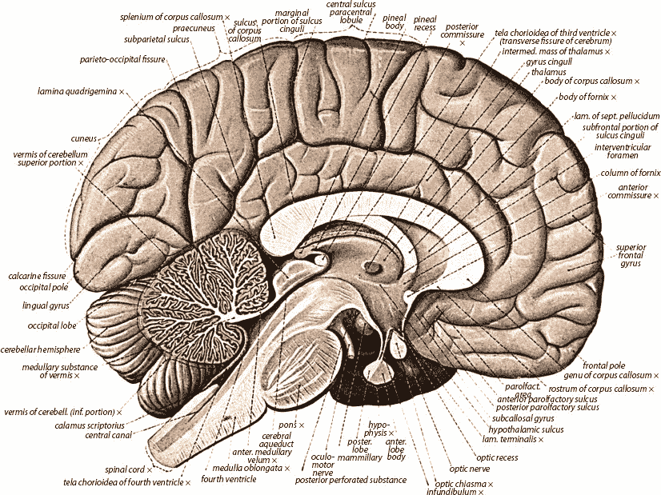

**Figure 3.1** Human brain bisected in the sagittal plane.

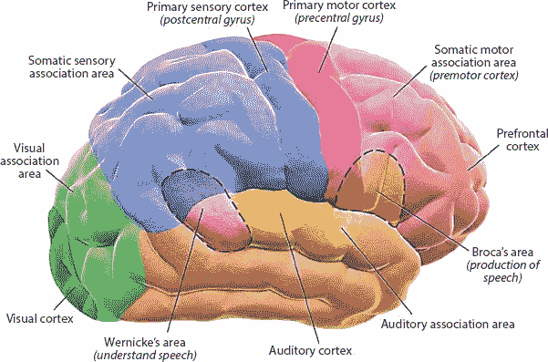

**Figure 3.2** Functional areas of the human brain.

然后，视觉信息存储在神经网络中，以供进一步的模式识别目的。

课堂上的学生将从使用视觉感知中获益良多，因为这将使该学生能够借助教学视觉辅助工具理解课堂上教授的科目 \[3\]。

### 3.2.1 学生视觉感知缺陷

确实，此类技能的任何改变或缺陷都可能导致学生学业成绩不佳。不同层面的各种问题会导致视觉感知和理解缺陷。简而言之，学生由于两个主要原因而缺乏对课堂上所教科目的理解：(i) 部分视力丧失和 (ii) 缺乏注意力。部分视力丧失是由于眼晶体、视网膜和视神经的缺陷引起的，这些结构将视觉信息传递到视觉皮层。缺乏注意力是由于心神不宁、一般身体状况、生活条件、父母照料不力、不良朋友、媒体和无能教师引起的。学生有方法和手段来摆脱这种情况 \[7, 8\]。

### 3.2.2 适当的眼部护理（视力管理）


学生应根本遵循“早睡早起”的原则。每天不间断睡眠八小时对整体健康至关重要，尤其是对保持清晰的视力。此外，学生应每天进行一些基本锻炼，如“Surya Namaskaram”，以改善视力。必须摄入含有维生素 A 和 D 的绿色蔬菜 \[11\]。大多数情况下，视力受损是由于眼睛、视觉通路或视觉皮层本身受损，可能是由于脑损伤引起。利用视觉机制进行感知并未被充分界定，因为可能因视觉失认症而出现缺陷。视觉失认症会导致学生无法理解或识别已学习的对象和实体。失认症分为两种类型：(i) 知觉性失认症和(ii) 联想性失认症。知觉性失认症使人能够可视化物体的某些部分，但无法将物体视为一个整体。另一方面，联想性失认症使人能够将物体视为一个整体，但无法理解该物体 \[12\]。患有此缺陷的学生在课堂上将无法进行视觉感知和理解。一些学生可能患有“akinetopsia”，即无法看到运动。其他一些缺陷包括“achromatopsia”，即无法看到颜色；“prosopagnosia”，即无法识别已学习的对象；以及“Alexia”，即无法与其他学生一起学习。视觉感知中某些不常见的缺陷包括“chizophrenic hallucinations”，即人理解扭曲的视觉对象；以及“Charles-Bonnet Syndrome”，即人会完全失去视力，尽管视觉系统运作正常，大脑无法响应视觉模式。视觉感知使学生能够与环境互动，因此采用手段和视觉管理方法至关重要 \[13\]。

### 3.2.3 Proper Ear Care (Hearing Management)

当今的学生应根本遵循“仅在需要时使用手机”的原则，不间断使用手机会导致各种听力障碍问题。Figure 3.3 显示了人体模型及各个部分的示意图。

当学生无法正确听到声音时，即被认为有听力障碍。聋哑学生要么是听力困难，要么是完全失聪。一些听力障碍包括：(i) 难以听清日常言语，(ii) 难以听清大声言语，(iii) 只有当某些词语在耳边大声喊出时才能听到，(iv) 能够通过读唇语或使用助听器来理解信息，以及(v) 即使耳边大声喊出词语也无法听到，只能通过读唇语或手势来理解信息。有此类听力障碍的学生将无法跟上学业。此类学生需要严重的医疗关注 \[16\]。

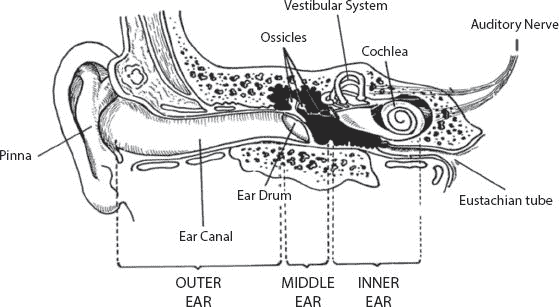

**Figure 3.3** Parts of the human ear.

### 3.2.4 Proper Mind Care (Psychological Management)

父母对良好思想和实践（包括健康）的形成负有根本责任。确实，学生所处的环境对其生理和心理状态有显著影响。当今的学生是填鸭式机器。他们在考试中记忆和复述，对知识交易毫无兴趣或承诺 \[17\]。

使用“neuropsychological assessment”，导师可以轻松测量学生的认知技能。此评估可使用由 Korkman、Kirk 和 Kemp 引入的 NEPSY 测试对学生进行。该测试使导师了解学生解码或破译不同基础知识的能力，并测量学生为尽可能聪明地理解和执行而使用的各种认知资源。该测试还测量视觉感知的一些参数，如命名、反应时间和处理速度。因此，视觉管理、听力管理和心理管理是教学-学习管理的基本过程。关于 TLP 的一些必要细节将在下一节中介绍。

## 3.3 The Concept of Teaching-Learning Process

Figure 3.4 显示了 TLP 作为再生反馈系统的框图。

TLP 在泰特里耶奥义书（Taitireeya Upanishad）的一节诗中被明确定义，如下所示 \[18\]。


大师是第一形式；弟子是后一形式；知识是连接；阐述是连接的关节。泰特里耶奥义书认为“UNILATERAL”一词由两个音节组成。第一个音节是“UNI”，第二个音节是“LATERAL”。只有当这两个音节“UNI”和“LATERAL”连接在一起时，“UNILATERAL”的含义才能被理解。因此，教师被视为第一个音节，学生被视为第二个音节。正如两个音节的结合构成一个有意义的单词，教师与被教者的结合也构成一个有意义的产出，即知识生成。这相当于说 TLP 是一项和谐的活动，导致知识生成。Figure 3.5 显示了 TLP 的概念图 \[19, 20\]。


图 3.5 显示了本论文中介绍的 TLP 的概念图。班主任向学生（无论是个人还是全班学生）提出一个问题：“请告诉我一个你知道你知道的事情的例子。”学生们热情地回答。有人说他知道如何说英语，另一个学生说他知道如何开车 \[21\]。然而，另一个学生说他知道他知道“考试”这个词的含义。老师很高兴所有学生都回应了他的问题。他说他很高兴看到学生的回应，并且他说他还有另一个问题要问。他问他们：“请告诉我一个你知道你不知道的事情的例子。”再次，学生们迅速回应。有人说他不知道跳伞。另一个说他知道他不知道俄语。更多学生回应了这个问题 \[22\]。现在，老师说：“你们的回答很棒。现在，告诉我一个你不知道你不知道的事情的例子。”学生们尝试了，但没有人能给出一个例子。一个人不能给出一个他不知道他不知道的事情的例子。老师问学生：“请告诉我英文单词‘pabulum’的含义。”学生们眨了眨眼。没有人知道“pabulum”这个词的存在。这样一个人不知道他不知道的事情被称为“盲点”。现在，关于 图 3.6，圆内有三个部分：(i) 指定为 KK 区域的区域，即包含他知道他知道的事情的区域，(ii) 指定为 KDK 区域的区域，即包含他知道他不知道的事情的区域，以及 (iii) 指定为 DKDK 区域的区域，即包含他不知道他不知道的事情的区域，这些是盲点。因此，盲点是学生不知道其存在的事情。教学的意义在于老师将盲点从 DKDK 区域抛向 KDK 区域。这相当于说老师不 spoon-feed 学生，而是让他们意识到自己的盲点。这就是真正的教学。这里出现的问题是什么被称为真正的学习。学生必须通过参考和分析努力理解老师展示的盲点。根本的学习是学生将事物从他的 KDK 区域抛向 KK 区域，这就是真正的学习。有一个辐条将 KK 和 KDK 区域分开。学生旋转这个辐条。还有另一个辐条将 KDK 和 DKDK 区域分开，老师旋转这个辐条。老师旋转其辐条的角速度用 `ω[T]` 表示。学生旋转其辐条的速度用 `ω[L]` 表示。现在，以下内容足以用于表征 TLP \[23\]。

1. 如果 `ω[T] = ω[L]`，则 TLP 是理想的。

2. 如果 `ω[T] < ω[L]`，则 TLP 因教学不佳而有缺陷。

3. 如果 `ω[T] > ω[L]`，则 TLP 因学习不佳而有缺陷。

TLP 分数低的机构可能不会培养出好学生。因此，应努力纠正系统。理想的 TLP 分数只有通过教师和受教者之间的和谐互动才能获得。这种优秀 TLP 的详细描述在 Thaitireeya Upanishad 中。

圣人 Bhrugu 去见他的父亲 Varuna，询问如何认识“Brahma”，这是一个盲点。父亲回答：“嘿，Bhrugu！”。应该只通过“Tapasya”来理解“Brahma”，即只通过成为真正的寻求者（Tapaswi）。这对 Bhrugu 来说是一个盲点。Varuna 让他明白“Brahma”只能通过“Tapasya”来感知。Varuna 指导了他的学生（他的儿子）。Bhrugu 为认识“Brahma”做出了许多努力。他识别了各种实体。

如 (i) 食物，(ii) 呼吸，(iii) 心智，(iv) 外部知识，以及 (v) 极乐作为“Brahma”，并分析它们以找出它们是否构成所谓的“Brahma”。首先，他认为“Brahma”是食物。他进行研究并发现所有元素都从食物演化而来，所有演化出的事物都维持在食物中，最终以食物结束。然后，他意识到食物不能是“Brahma”，因为食物有开始、维持和结束。然后，他去见 Varuna 并告诉他他的发现。Varuna 重复说，“Brahma”只能通过寻求来理解。诗句如下所示。

然后，Bhrugu 继续他的研究并发现所有元素都从呼吸（Prana）演化而来；所有演化出的事物都维持在呼吸中，最终以呼吸结束。然后，他意识到呼吸不能是“Brahma”，因为呼吸有开始、维持和结束。然后，他去见 Varuna 并告诉他他的发现。Varuna 重复说，“Brahma”只能通过寻求来理解。诗句如下所示。

再次，Bhrugu 继续他的研究并发现所有元素都从心智（Manas）演化而来。所有演化出的事物都维持在心智中，最终以心智结束。然后，他意识到心智不能是“Brahma”，因为心智有开始、维持和结束。然后，他去见 Varuna 并告诉他他的发现。Varuna 再次重复说，“Brahma”只能通过寻求来理解。诗句如下所示。

Bhrugu 不倦地继续他的研究并发现所有元素都从外部知识（Vignanam）演化而来，所有演化出的事物都维持在知识中，最终以知识结束。然后，他意识到知识不能是“Brahma”，因为知识有开始、维持和结束。然后，他去见 Varuna 并解释他发现了什么。Varuna 照常说，“Brahma”只能通过寻求来理解。诗句如下所示。

Bhrugu 进一步扩展他的研究并发现所有元素都从极乐（Anandam）演化而来，所有演化出的事物都维持在极乐中，最终以极乐结束。然后，他意识到极乐不能是“Brahma”，因为极乐有开始、维持和结束。然后，他去见 Varuna 并解释他发现了什么。因此，Varuna 和 Bhrugu 之间的 TLP 持续了永恒。诗句如下所示。

理解这个 VarunaBhrugu TLP 并据此实践的人将成为一个伟大的人，并获得他所希望的一切。诗句如下所示。

这个 Varuna-Bhrugu TLP 是理想的 TLP，必须制定适当的 TLP 技术方法以达到理想的 TLP。本论文建议可以使用 ICT 工具在 TLP 中达到最佳效果。

## 3.4 教学与学习过程中 ICT 工具的使用


印度各高等学府的专业学生正遭受生理和心理问题的困扰，导致学业成绩不佳，这使得此类学府的存在目的几乎荡然无存。造成这种情况的原因有很多。一个主要原因是教育系统缺乏透明度。教师已成为知识工作者，学生学习是为了获得学位，进而获得高薪工作。这一点在经济导向的社会中尤其明显。人们期望在短时间内取得巨大成果。这已成为当下的常态。员工期望个人经济高速增长，雇主期望高生产率，而这大多数时候远超员工的能力。这些期望导致学术机构对快速教学和学习产生需求。无法满足这些需求的机构将面临诸多挑战，包括关闭，这意味着教师失业，以及可就业学生数量的减少。在此背景下，人们会探讨提高 TLP 质量的各种可能性 \[26\]。使用传统技术确实能取得良好效果，当然，效果会有所延迟。使用 ICT 工具和传统技术可能会加快提高质量的过程。下文将讨论一些 ICT 工具。

### 3.4.1 作为 ICT 工具的数字资源

学术机构应为所有学生和教师提供普遍、公平且免费的 ICT 及 ICT 赋能工具和资源的访问权限。鉴于印度教育状况的多样性，不同语言的不同学科需要各种各样的数字内容。可以使用 Unicode 字体来实现普遍访问，并支持“音译”和“机器翻译”。可以推广使用交互式 ICT 工具来开展有效的 TLP，例如虚拟实验室。可以鼓励开发电子书、动画、课程、练习、交互式游戏、模型和模拟、视频、演示文稿幻灯片、明确的文本材料、图形或上述内容的任何组合。包含各种数字内容的基于 Web 的数字资源库将对学生和教师大有裨益。多媒体学习对象可用于 TLP。教师和学生可以共同开发有助于数字资源库的数字学习资源。维基百科就是一个这样的领域，学生和教师可以在其中做出贡献。可以成立特定兴趣群体，如人工智能和机器学习，并鼓励学生和教师参与讨论。可以安排各种主题的网络研讨会，尤其是在疫情期间。除了商业利益相关的节目外，还可以鼓励媒体为此目的组织节目。就像 MIT 波士顿引入的开放课程（OCW）一样，印度的高等学府可以为普通人推出 OCW \[27\]。

### 3.4.2 用于学生和教师能力建设的特殊 ICT 工具

#### 3.4.2.1 CogniFit

VIPER-NAM 是一项用于提高学生和教师认知能力的测试。例如，特定物体的图像会在屏幕上短暂显示。然后，会显示一些字母，其中只有一个字母与物体的名称相对应。观察者必须快速选择正确答案。这项练习无疑将提高学生和教师的视觉感知能力。

`CogniFit` 是一种市面上可购买的软件支持系统，可帮助训练这种能力。`CogniFit` 拥有一套旨在帮助学生和教师康复和改善视觉感知缺陷及其他认知功能的任务和测试。使用 `CogniFit`，可以像通过持续练习增强肌肉一样增强大脑和神经连接。这意味着可以通过使用 `CogniFit` 来提高自己的视觉感知能力。`CogniFit` 既有评估工具，也有康复计划，可帮助优化认知功能。`CogniFit` 可在线使用，也可以在计算机和移动设备上练习。该程序充满了有趣的脑力游戏，每次训练课程后，用户都会收到一个图形显示的结果，突出显示用户的认知进步。

#### 3.4.2.2 脑机接口

BCI 是大脑与外部设备之间的直接通信通道。BCI 旨在辅助、增强或修复人类的认知或感觉-运动功能。或者，神经科学中的“神经假体”，涉及使用人工设备替代受损神经系统或感觉器官功能的神经假体。神经假体设备的最佳示例是“耳蜗植入物”，用于恢复听力，以及光学神经假体设备，如视网膜植入物，用于恢复视力。一些先进的 BCI 如下：

1. 生物反馈（BF）

2. 神经反馈（NF）

3. 脑机接口（BCI）

4. 自适应 BCI（ABI）

5. 智能 BCI（IBCI）

6. 脑对脑接口（BBI）

大脑主要是神经元网络。大脑的中心部分是皮层或灰质。皮层包含约 10¹¹ 个称为神经元的神经细胞。大多数数据处理发生在皮层。大脑功能的基础是称为神经元的神经细胞。神经元形成各种神经元网络，这些网络是神经系统中信息传输或存储的通路。大脑是一个信息处理系统，计算和符号最能解释信息处理，如 Figure 3.7 所示。计算机中的信息处理是对符号进行操作的程序。大脑中的信息处理是涉及以符号形式表示的心理表征的神经计算。心理表征是大脑中具有意义或编码信息的符号。大脑表征是局部大脑区域的激活，伴随着特定的 EEG 模式。

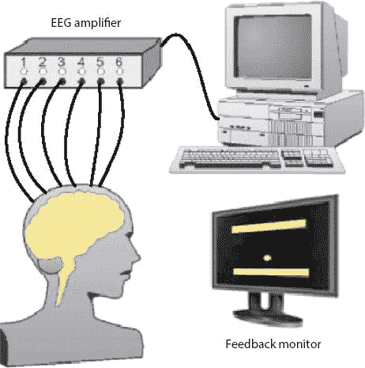

**Figure 3.7** Block diagram of a typical neurofeedback system.

一些研究人员已经证明，受试者可以通过密集训练学会控制自己的大脑活动，以产生固定的 EEG 模式。事实上，“神经反馈”是一种新兴的 ICT 工具，甚至可用于某些疗法，例如预防癫痫发作。通过计算机与受试者之间的学习过程，系统可以通过识别 EEG 来了解受试者的心理状态。这种可以检测不同心理状态的学习型 NF 系统称为脑机接口（BCI）。Figure 3.8 显示了基本的 BCI 架构。

BCI 将 EEG 信号特征转换为命令，以以下方式控制设备：

* 从 EEG 中提取特征。

* 将其输入分类器。

* 使用给定受试者的重复想象模式训练分类器。

* 训练后，BCI 依赖分类器来翻译心理意象。

所以，“一种心理状态”意味着“一条命令”！

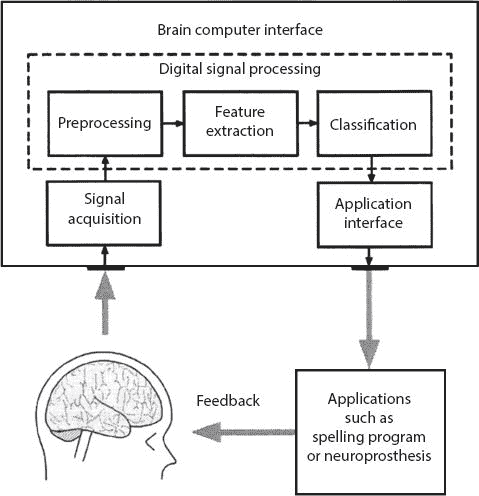

**Figure 3.8** BCI architecture.

训练实验：操作性条件反射（NF 训练）

* 计算机屏幕上有三个按钮，按其位置标识：左、右、上。

* 受试者学会将心理状态与每个按钮关联起来，以便 BCI 系统更好地理解他们的想法。

* 每天训练五天，每天半小时。

* 结果：识别率为 70% 或更高！

* BCI 绕过了大脑的周围神经和肌肉的正常通路。

因此，可以将 BCI 用作改善 TLP 的 ICT 工具。

## 3.5 结论


高等教育系统（`HES`）中的教学与学习质量提升，只有通过信息与通信技术（`ICTs`）才能实现。在系统中利用`ICT`，可以通过最大化课堂教学与学习过程来提供电子学习设施。如今，教学与学习方法已从传统形式转变为在线和模拟虚拟环境。有许多方法可以将`ICT`整合到教育系统中。许多私立大学和州立大学正在使用`ICT`来增强远程学习。借助`ICT`，教学界已准备好前往人们希望学习但缺乏师资和设施的偏远地区。`ICT`还帮助学习者从世界各地获得高质量的学习环境。培训师和教师必须学习新技术和最新的学习方式，以造福学习者。在印度任何州成功利用`ICT`带来的变革，在于将教学任务交给教师并支持他们，以便他们支持学生学习，而不是仅仅收集计算机技能并建立软件和设备。`ICT`与数据挖掘技术的整合，使教育能够以信息的形式从利益相关者那里传递给学生。

## 参考文献

1. Pathak, S., Raja, R., Sharma, V., Ambala, S., `ICT` Utilization and Improving Student Performance in Higher Education. *Int. J. Recent Technol. Eng. (`IJRTE`)*, 8, 2, 5120–5124, July 2019.

2. Pathak, S., Raja, R., Sharma, V., RamyaLaxmi, K., A Framework of `ICT` Implementation on Higher Educational Institution with Data Mining Approach. *Eur. J. Eng. Res. Sci*. 4, 5, 2019.

3. Pathak, S., Raja, R., Sharma, V., The Impact of `ICT` in Higher Education. Published in `IJRECE`. *IJRECE*, 7, 1, 1650–1656, January-March, 2019.

4. Adekitan, A.I., and Noma-Osaghae, E., Data mining approach to predicting the performance of the first-year student in a university using the admission requirements. *Educ. Inf. Technol*. 24, 2, 1527–1543, 2019.

5. Asif, R., Merceron, A., Ali, S.A., Haider, N.G., Analyzing undergraduate students’ performance using educational data mining. *Comput. Educ*. 113, 177–194, 2017, 10.1016/j.compedu.2017.05.007.

6. Bharara, S., Sabitha, S., Bansal, S., Application of learning analytics using clustering data Mining for Students’ disposition analysis. *Educ. Inf. Technol*. 23, 2, 957–984, 2018.

7. Francis, K.B. and Babu, S.S., Predicting the academic performance of students using a hybrid data mining approach. *J. Med. Syst*. 43, 6, 162, 2019.

8. Gabriela, C., Mihai, A., Crivei, L.M., S PRAR: A novel relational association rule mining classification model applied for academic performance prediction. *Proc. Comput. Sci*. 159, 20–29, 2019, 10.1016/j.procs.2019.09.156.

9. Helal, S., Li, J., Liu, L., Ebrahimie, E., Dawson, S., Murray, D.J., Long, Q., Predicting academic performance by considering student heterogeneity. *Knowledge-Based Syst*. 161, 134–146, 2018, 10.1016/j.knosys.2018.07.042.

10. Karthikeyan, V.G., Thangaraj, P., Karthik, S., Towards developing hybrid educational data mining model (`HEDM`) for efficient and accurate student performance evaluation. *Soft Comput*. 24, 1–11, 2020, 10.1007%2Fs00500-020-05075-4.

11. Khan, A. and Ghosh, S.K., Student performance analysis and prediction in classroom learning: A review of educational data mining studies. *Educ. Inf. Technol*. 26, 205–240, 2021, 10.1007%2Fs10639-020-10230-3.

12. Khan, A. and Ghosh, S.K., Data mining-based analysis to explore the effect of teaching on student performance. *Educ. Inf. Technol*. 23, 4, 1677–1697, 2018.

13. Lee, C.S., Wang, M.H., Wang, C.S., Teytaud, O., Liu, J., Lin, S.-W., Hung, P.-H., PSO-based fuzzy markup language for student learning performance evaluation and educational application. *IEEE Trans. Fuzzy Syst*. 26, 5, 2618–2633, 2018.

14. Mengash, H.A., Using data mining techniques to predict student performance to support decision making in university admission systems. *IEEE Access*, 8, 55462–55470, 2020, 10.1109/ACCESS.2020.2981905.

15. Miguéis, L., Freitas, A., Garcia, Silva, A., Early segmentation of students according to their academic performance: A predictive modeling approach. *Decis. Support Syst*. 115, 36–51, 2018, 10.1016/j.dss.2018.09.001.

16. Mimis, M., Hajji, M.E., Es-Saady, Y., Guejdi, A.O., Douzi, H., Mammass, D., A framework for smart academic guidance using educational data mining. *Educ. Inf. Technol*. 24, 2, 1379–1393, 2019.

17. Ouyang, Y., Zeng, Y., Gao, R., Yu, Y., Wang, C., Elective future: The influence factor mining of students’ graduation development based on hierarchical attention neural network model with graph. *Appl. Intell*. 50, 3023–3039, 2020, 10.1007%2Fs10489-020-01692-6.

18. Palo., R., Maricutoiu, L.P., Costea, I., Relations between academic performance, student engagement and student burnout: a cross-lagged analysis of a two-wave study. *Stud. Educ. Eval*. 60, 199–204, 2019, 10.1016/j. stueduc.2019.01.005.

19. Popescu, E. and Leon, F., Predicting academic performance based on learner traces in a social learning environment. *IEEE Access*, 6, 72774–72785, 2018, 10.1109/ACCESS.2018.2882297. hareshvasantdstani.

20. Rao, D.H., Mangalwede, S.R., Deshmukh, V.B., Student performance evaluation model based on scoring rubric tool for network analysis subject using fuzzy logic, in: *2017 International Conference on Electrical, Electronics, Communication, Computer, and Optimization Techniques (`ICEECCOT`)*, `IEEE`, pp. 1–5, 2017, 10.1109/ICEECCOT.2017.8284623.

21. Shahiri, A.M. and Husain, W., A review on predicting student’s performance using data mining techniques. *Proc. Comput. Sci*. 72, 414–422, 2015, 10.1016/j.procs.2015.12.157.

22. Tomasevic, N., Gvozdenovic, N., Vranes, S., An overview and comparison of supervised data mining techniques for student exam performance prediction. *Comput. Educ*. 143, 103676, 2020, 10.1016/j.compedu.2019.103676.

23. Waheed, H., Hassan, S., Aljohani, N.R., Hardman, J., Alelyani, S., Nawaz, R., Predicting the academic performance of students from VLE big data using deep learning models. *Comput. Hum. Behav*. 104, 106189, 2020, 10.1016/j. chb.2019.106189.

24. Xu, J., Moon, K.H., Van DerSchaar, M., A machine learning approach for tracking and predicting student performance in degree programs. *IEEE J. Sel. Top. Signal Process*. 11, 5, 742–753, 2017.

25. Yadav, R.S., Application of hybrid clustering methods for student performance evaluation. *Int. J. Inf. Technol*. 6, 1–8, 2018, 10.1007%2Fs41870-018-0192-2.

26. Yousafzai, B.K., Hayat, M., Afzal, S., Application of machine learning and data mining in predicting the performance of intermediate and secondary education level student. *Educ. Inf. Technol*. 6, 2, 1–21, 2020, 10.1007%2 Fs10639-020-10189-1.

27. Zughoul, O., Momani, F., Almasri, O.H., Zaidan, Zaidan, B.B., Alsalem, M.A., Albahri, Albahri, O.S., Hashim, M., Comprehensive insights into the criteria of student performance in various educational domains. *IEEE Access*, 6, 73245–73264, 2018, 10.1109/ACCESS.2018.2881282.

# 4

基于小波阈值技术的数字图像去噪：比较研究

**Devanand Bhonsle**

*SSTC, SSGI, Bhilai, India*

*Email: devanandbhonsle@gmail.com*

> *摘要*


> 噪声是一种不需要的实体，它会损坏图像，导致图像质量下降。这种退化可能会抑制边缘、脊线和其他对分析细节至关重要的精细结构等细节。因此，去除噪声是必不可少的，或者至少必须将其影响降低到一定程度。图像降噪的过程称为“图像去噪”。它是一种滤波技术，用于抑制噪声并恢复图像。高斯噪声是一种噪声信号，它几乎会损坏所有频率带中的信号；因此，它被称为白高斯噪声。由于它是加性的，即添加到图像的所有像素值中，因此称为加性白高斯噪声。在本章中，讨论了使用各种小波阈值法进行高斯噪声抑制。结果表明，基于小波的滤波器能够将高斯噪声的影响降低到可接受的程度。

> **关键词：** 噪声，小波变换，峰值信噪比，阈值法，均方误差，结构相似性指数矩阵

## 4.1 引言

噪声可能由于各种原因引入。主要是，在从源到目的地的获取和传输过程中，图像中会引入噪声 \[1\]。环境条件和感应元件的质量是在捕获图像时引入噪声的主要因素。信道中的干扰也是导致传输过程中图像中出现噪声的原因。闪电和其他大气条件也可能导致无线传输过程中图像中出现噪声。获取和传输过程中会引入噪声 \[2\]。图像的压缩和解压缩也可能是图像中引入噪声的原因。不完美的仪器/感应元件是噪声的主要来源。例如，暗电流噪声是由于热效应产生的电子而出现的。它与感应元件的曝光时间和温度成正比。光子噪声是由于光电子产生中的量子不确定性产生的 \[2\]。量化噪声是在将一些电子转换为像素强度的过程中产生的。在相干成像系统中，噪声是由于成像目的信号的散射而引入的。超声成像系统 \[3–9\] 是相干成像的最佳示例，它严重受到噪声的影响，通常称为斑点 \[10\]。最常见的噪声是加性白高斯噪声 (AWGN)，它影响几乎所有信号 \[11\]。本章旨在消除数字图像中 AWGN 的影响并评估技术性能。此过程称为图像滤波或图像去噪 \[12–14\]。噪声信号大致可分为三类，*viz*.，加性噪声 \[11, 15\]、乘性噪声 \[11\] 和稀疏噪声 \[2\]。

1. **加性噪声：** 如果噪声被加到像素值上，则称为加性噪声。设 `x(i, j)` 为二维图像，被噪声 `n(i, j)` 损坏。如果 `y(i, j)` 为带噪图像，则 `y(i, j) = x(i, j) + n(i, j)`。白高斯噪声属于加性噪声类别 \[11\]。

2. **乘性噪声：** 如果噪声与像素值相乘，则称为乘性噪声。带噪图像表示为 `y(i, j) = x(i, j)` × `n(i, j)`。斑点噪声属于乘性噪声类别 \[11\]。

3. **稀疏噪声：** 某些噪声信号只会损坏图像中的少数像素。这类图像称为稀疏噪声。尽管它们只影响少数像素，但影响非常严重。它包括椒盐噪声 \[2\]、随机值脉冲噪声以及垂直和横向死线。

本章将仅处理加性噪声，该噪声遵循高斯分布 \[11\]。由于噪声信号在像素值中波动，它们可以归类为随机变量。任何随机变量的概率密度函数 (PDF) 是一个将统计结果的值与其发生概率联系起来的方程。高斯噪声也被称为标准分布噪声模型，具有钟形的 PDF 曲线 \[10\]。它以加性方式影响图像的亮部和暗部。图 4.1 显示了高斯噪声的 PDF，呈钟形。它均匀分布于整个频率带，因此被称为白噪声。高斯分布如下所示：

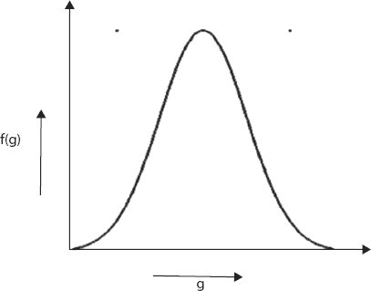

**图 4.1** 高斯噪声的 PDF。

```
(4.1)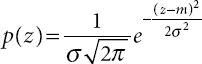
```

其中 `z` 是像素的灰度级，`σ` 是标准差，`m` 是图像的均值。

## 4.2 文献综述

本部分介绍了图像去噪方面的先前工作，许多研究人员针对不同的噪声信号实现了不同的滤波器。噪声可能是上述讨论的任何类型 \[11\]。了解噪声的特性及其对数字图像的影响对于实现滤波器至关重要。上述说明定义了各种类型的噪声信号，图像去噪方面有大量文献可供参考。噪声会影响图像质量，导致许多有用信息可能消失或损坏。图像包含各种信息，*viz*.，边缘、脊线和精细结构 \[16, 17\]。以下是各种文献中提出的各种技术的描述。


Kingsbury [18] 实现了一种用于图像去噪增强的新 DWT，称为 DTCWT，因为它使用两棵小波滤波器树，分别提供复杂小波系数的实部和虚部。它提供了较少的冗余，因为它具有合适的方向性特性。它提供完美重建，且计算效率非常高。这些优势使其成为二维和多维信号去噪和去模糊的高效工具 [18]。Qin *et al*. [19] 开发了一种去噪技术，其中对小波系数应用硬阈值或软阈值进行收缩，然后重建信号 [19]。Sveinsson 和 Benediktsson 使用了基于离散小波变换（DWT）的滤波器组，该组过采样，并命名为双密度离散小波变换（DDDWT）。它具有一个缩放函数和两个不同的小波函数。采用了自适应阈值，该阈值使用非线性 Sigmoid 函数。阈值对每个子带都是自适应的 [20]。Chen *et al*. [21] 实现了一种小波阈值方法，该方法结合了邻域系数 [21]，因此称为 Neigh shrink。它优于维纳滤波器（WF）和其他常规小波去噪技术 [22]。Fowler [15] 开发了一种使用冗余离散小波变换（RDWT，即不抽样离散小波变换 UDWT 的扩展）来抑制加性噪声的技术 [15]。Eslami 和 Radha [23] 实现了一组基于方向滤波器组和小波变换（WT）的非冗余几何图像变换。它表现出方向和非方向基函数，应用于图像去噪和编码 [23]。Gu *et al*. [14] 开发了用于去噪的二维快速 WT。小波包分析（WPA）同时分解低频和高频部分。它能精确地进行局部分析 [14]。Borsdorf *et al*. [12] 描述了一种用于计算机断层扫描（CT）图像去噪的方法，以保留其结构。这是一种基于小波的方法，其中数据分解为两部分，*即*信息信号和噪声信号。它可以根据图像中存在的噪声信号自行适应 [12]。Chang *et al*. [24] 提出了一种数据驱动的软阈值技术，该技术在贝叶斯框架下推导。在大多数情况下，它优于 SURE（Stein’s Unbiased Risk Estimator）收缩 [24]。Dengwen 和 Xiaoliu [25] 提出了一种数据驱动的 Block shrink 技术，该技术应用邻域小波系数的相关性。该技术的缺点是它逐项应用阈值。所有子带的阈值和块大小相同，限制了其性能 [25]。Miller 和 Kingsbury [26] 实现了一种基于相邻位置和尺度系数邻域高斯尺度混合建模的 AWGN 去除技术。它抑制了铃声效应并增强了锐度 [26]。Zhang *et al*. [27] 实现了一种基于 WT 的去噪技术，称为 M-Bayes 阈值，通过结合多个小波表示和贝叶斯阈值。其计算复杂度较低 [27]。Raj 和 Venkateswarlu [28] 提出了一种带有半软和 Stein 阈值算子以及不同小波家族的 UDWT。它能有效去除模糊和铃声效应。然而，它比 DWT 慢，因为它需要更多的存储空间和更高的计算成本。随着分解级别的增加，UDWT 系数的分辨率会降低 [28]。Hassan 和 Saparon [29] 实现了一种使用 DWT 的高斯噪声去除技术。它使用硬阈值或软阈值结合平移不变技术。它抑制了伪影效应。性能可以通过自适应阈值来提高 [29]。Hill *et al*. [30] 开发了一种用于去噪的不抽样 DTCWT，使用双变量阈值，这是传统 DTCWT 的扩展。它改善了低尺度子带定位 [30]。Kim *et al*. [31] 实现了一种去噪技术，该技术在四重小波域中使用 Haar 小波，并在高频四重小波系数上应用局部自适应阈值 [31]。它保留了边缘。Zhao *et al*. [32] 实现了一种小波去噪技术，通过应用扫描仪依赖的阈值估计器和 Visu shrink。随着分解级别的增加，它优于 Visu shrink [32]。

在研究了各种研究文献后，我们可以得出结论：噪声是数字图像中的常见问题，必须予以抑制。许多方法能有效去除 AGWN [11]，但不幸的是，它也会抑制重要特征 [16]。基于小波的阈值 [24, 48] 技术在抑制噪声信号的同时保留图像细节。文献综述的基本思想是了解现有方法、优势和局限性。与其他现有技术相比，基于小波的去噪技术表现出更好的效果。DWT 能提供良好的效果，但存在两个问题，*即*时变性和方向选择性差 [33]。这两个问题已通过 DTCWT 得以克服，因为 DTCWT 具有时间不变性并表现出良好的方向选择性 [34]。小波技术需要阈值处理，通过该处理，噪声小波系数可能被完全移除或替换为计算值。已实现了许多阈值技术，且修改工作仍在继续。各种阈值的示例包括 Neigh shrink [12]、SURE shrink、Visu Shrink、Bayes shrink [27]、Block shrink [25]、双变量阈值 [35] 等。

## 4.3 理论分析

本部分包含了 WT 及本章中用于图像去噪的各种阈值技术的理论解释。

### 4.3.1 小波变换

它处理那些傅里叶或其他变换无法表示的信号。通常，这些变换是正弦波，并从负无穷延伸到正无穷，而小波是非对称且不规则的；因此，它们可以表示包含谐波振荡的信号。小波是集中在空间和时间上的小波，具有有限能量。它适合信号和图像处理，因为它可以在不丢失信息的情况下表示信号 [36]。它提供了良好的时间分辨率和频率分辨率。它大致可分为两种类型：

1.  (i) 连续小波变换（CWT）

2.  (ii) 离散小波变换（DWT）

#### 4.3.1.1 连续小波变换

小波是小波，它们是具有振荡并快速衰减的函数族。它们通过任何函数的构造和扩展而开发 [36]。该函数称为母小波，可以是任何具有零均值的振荡函数，如下所示：

(4.2)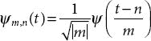

其中 `x(t)` 和 `n` 分别表示缩放和平移参数。

对于任意信号 `x(t)`，在时间 `n` 和尺度 `m` 时，WT 如下所示：

(4.3)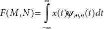

其中 `F(M, N)` 是 `x(t)` 的 WT。通过应用 Parseval 定理，

(4.4)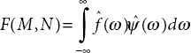

其中 `img001.jpg` 是 `img002.jpg` 在时频域中的频谱，能量为 `img003.jpg`。

它从函数的原始数据中收集大量数据，因此生成了大量系数，并产生了大量冗余。这是 CWT 的最大问题。可以通过使用 DWT 来避免此问题。

#### 4.3.1.2 离散小波变换

它是 CWT 的离散形式，并在每个分解级别提供两种系数，称为近似系数和细节系数。从数学上讲，它可以表示如下：

(4.5)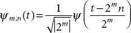

其中 `m` 是缩放，`n` 是平移索引，在每个分解级别中。


如果输入信号经过 `Low Pass Filter (LPF)` 后接一个下采样器，则生成近似系数。如果它经过 `High Pass Filter (HPF)` 后接一个下采样器，则生成细节系数。任何信号都可以分解为多个层级。但是，随着分解层级的增加，分辨率会下降。第一层级获得的系数被视为下一层级的输入。`DWT` 具有可逆性，即可以执行反向 `DWT` 过程，并称为 `Inverse Discrete Wavelet Transform (IDWT)`。因此，如果任何信号使用 `DWT` 进行分解，则可以使用 `IDWT` 进行重构。下面将解释小波域中任何信号的分解和重构 \[32, 33\]。

### 4.3.1.2.1 小波分解

在此过程中，输入信号经过 `LPF` 后接下采样器。结果，生成近似系数。如果它经过 `HPF` 后接下采样器，则生成复杂系数。这些子信号中的每一个都与列数据一起经过 `LPF` 和 `HPF`。结果再次由 Figure 4.2 采样，它显示了数字灰度图像一级分解过程的布局。在此过程中，输入图像分割为四个大小为 `N/2×N/2` 的子图像。

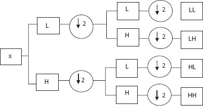

**Figure 4.2** 二维图像的一级分解。

Figure 4.3 表示使用 `WT` 进行一级分解的四个子带。图像也可以分解为更多层级。

Figure 4.4 表示数字图像的三级分解，其中图像分解为三个层级，提供近似和细节小波系数。


**Figure 4.3** 单级 DWT 分解。

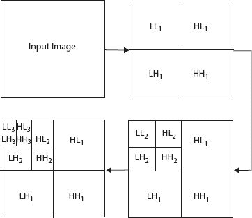

**Figure 4.4** 三级 DWT 分解。

**LL 子带：** 它是对行和列都进行 `LPF` 的结果，包含图像的粗略描述，因此称为“近似”。

**HH 子带：** 它是两个方向都进行 `HPF` 的结果，包含高频分量。

**LH 子带：** 它是一个方向进行 `LPF` 的结果，包含对应于水平边缘的垂直细节。

**HL 子带：** 它是另一个方向进行 `HPF` 的结果，包含对应于垂直边缘的细节。

`HH`、`LH` 和 `HL` 子带被称为细节子带，因为它们提供详细系数。

上述讨论表明，数字图像可以分解为 `n^(th)` 层级，直到完全分解或根据要求停止。

### 4.3.1.2.2 小波重构

它是小波分解的逆过程，即可以使用分解的小波系数重构信号。所有子带都被上采样，并与列数据一起通过相应的逆滤波器。两个结果相加并再次上采样。最后，使用相应的逆滤波器进行滤波。`Astric sign (*)` 表示逆滤波。最后阶段的结果相加；因此，获得原始图像。Figure 4.5 显示了小波重构操作。

从上述讨论可以清楚地看出，图像可以使用 `WT` 进行分解，并无损地恢复到其原始形式；因此，可以获得精确的图像。因此，`DWT` 可以作为图像处理中的有用工具 \[1, 36\]。许多研究论文解释了其优于非小波技术的性能。但是，其性能受两个重要问题的影响，*viz*.，移位方差和低方向选择性。

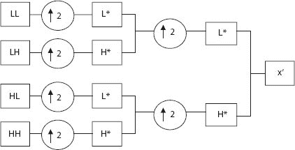

**Figure 4.5** 四个子图像的单级重构步骤。

#### (i) 移位方差

如果输入的微小移位导致不同尺度的小波系数之间能量分布出现显著变化，则这种现象称为移位方差。它会严重影响输出质量。

#### (ii) 方向选择性差

由于滤波器是可分的且 `DWT` 是实数，它们无法区分对角线方向，因此 `DWT` 存在方向性不足的问题。

图像处理应用中需要两个特性，*viz*.，移位不变性和正确的方向特性。因此，为了克服这两个缺点，已使用复杂小波滤波器。这些滤波器同时提供移位不变性和方向性。但是，这些滤波器难以实现，因此不能广泛使用。

### 4.3.1.3 双树复杂小波变换

上述常规 `DWT` \[18\] 的缺陷提出了 `DTCWT`，它表现出时间不变性并提供正确的方向特性 \[18, 37–40\]。它由两个并行的 `DWT` 滤波器组树组成，两棵树的相应滤波器近似正交。由于这种结构，它以不同的方式生成小波系数。它使用双树小波滤波器生成复杂系数。滤波器排列将输入图像在每个层级分解为子图像金字塔；因此，获得六个定向子图像。可以从实系数和虚系数中提取幅度和相位信息。Figure 4.6 显示了 `DTCWT` 的滤波器排列。输入是要使用两组滤波器组 (`H[0a]`, `H[1a]`) 和 (`H[0b]`, `H[1b]`) 分解的数字图像。在树中，通过消除第 1 层滤波器 `H[0a]` 和 `H[1a]` 之后的二分之一下采样，采样率可以加倍。该过程相当于两个并行的彻底抽取树 `a` 和 `b`，前提是 `H[0b]` 和 `H[1b]` 的延迟比 `H[0a]` 和 `H[1a]` 偏移一个采样点。通过这些修改，`DTCWT` 具有以下特性；这使其优于常规 `DWT`：

1. **(i) 移位不变性：** 它是近似移位不变性，这是图像处理所期望的。

2. **(ii) 良好的方向选择性：** 它提供更好的方向选择性，因为它有十二个定向小波（虚树和实树各六个），在二维中以不同角度定向。

3. **(iii) 相位信息：** 在任何给定层级，任何给定子带的相位都可以使用其相应的虚系数和实系数获得。

4. **(iv) 完美重构：** 原始信号可以使用所有系数完全重构。

5. **(v) 较少冗余：** 它提供 `2*^m*:1` 输入信号的冗余度，其中 `m` 是信号维度。

6. **(vi) 较低计算复杂度：** 与 `UDWT` \[41\] 相比，它更不复杂。

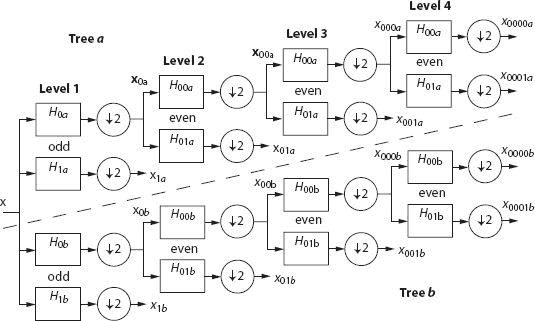

**Figure 4.6** 双树复杂小波变换的滤波器排列。

### 4.3.2 阈值处理类型

阈值处理是一种方法，通过特定规则去除或抑制噪声系数。通过对噪声图像应用 `WT` 生成小波系数。在所有系数中，也存在噪声系数。这些噪声系数被去除或抑制到一定程度，最后应用逆 `WT`；获得无噪声图像。任何方法的效果完全取决于阈值处理技术。该技术可分为，*viz*.，硬阈值处理和软阈值处理 \[42\]。

#### 4.3.2.1 硬阈值处理


在此技术中，需设置一个阈值 `λ`。若输入值大于 `λ`，则保持不变；若小于 `λ`，则将其设为零。该规则仅应用于细分频带的小波系数，而低分辨率系数保持不变。强大的阈值算子可表示如下：

(4.6)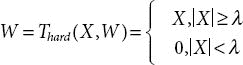

它保留了图像的边缘和边界信息。图 4.7 说明了硬阈值方案。

### 4.3.2.2 软阈值

在此技术中，若系数的幅值大于选定的阈值，则系数会向零收缩；若小于阈值，则将其设为零 `[43]`。软阈值算子可表示如下：

(4.7)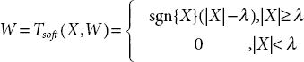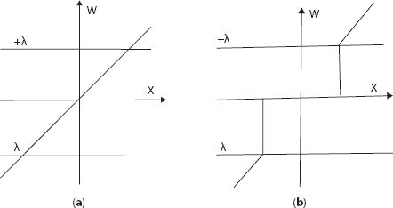

**图 4.7** 硬阈值方案：(a) 原始信号和 (b) 硬阈值后的信号。

 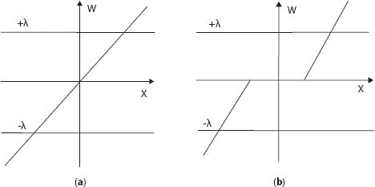

**图 4.8** 软阈值方案：(a) 原始信号和 (b) 软阈值后的信号。

图 4.8 显示了一个软阈值方案，其性能优于硬阈值方案。

### 4.3.2.3 阈值技术

在本章中，我们解释了各种阈值技术，*即*，SURE shrink、Bayes shrink `[27]`、Neigh shrink `[22]`、Block shrink `[25]` 和 Bivariate shrinkage `[35, 44]`。上述提到的阈值方案的描述将在下文讨论。

#### 4.3.2.3.1 SURE Shrink

它由 Donoho 和 Johnstone 提出，基于 Stein 的无偏风险估计器（SURE）。它结合了通用阈值和 SURE 阈值，并缩写为 SURE shrink。它最小化均方误差（MSE），表示如下：

(4.8)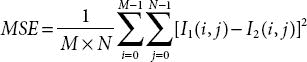

其中 `I1` 是原始图像，`I2` 是大小为 `M × N` 的噪声图像。

SURE Shrink 阈值 `t*` 定义如下：

(4.9)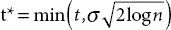

`t` 是最小化 SURE 的值，`σ` 和 `n` 分别是图像的噪声方差和大小。噪声水平 `σ` 的估计基于中位数绝对偏差，定义如下：

(4.10)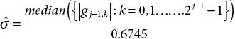

#### 4.3.2.3.2 Bayes Shrink

它由 Chang、Yu 和 Vetterli 开发。由于它最小化贝叶斯风险，因此命名为 Bayes shrink。贝叶斯阈值 `t[B]` 表示如下：

(4.11)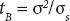

其中 `σ[s]` 和 `σ²` 分别是无噪声信号方差和噪声方差。

由于高斯噪声是加性的，且信号和噪声相互独立，因此可以表示如下：

(4.12)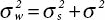

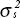可以计算如下：

(4.13)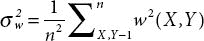

信号方差 os 可以计算如下：

(4.14)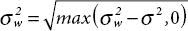

通过计算 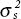 和 `σ*²*`，可以计算出贝叶斯阈值 `t[B]`。`t[B]` 用于对每个频带的小波系数进行阈值处理 `[27]`。

#### 4.3.2.3.3 Neigh Shrink

众所周知，相邻小波系数之间存在显著的统计依赖关系；因此，应利用这一特性来改进噪声系数的估计。对于大小为 `NxN` 的图像，最简单的收缩规则是通用阈值，表示如下：

(4.15)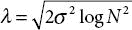

`λ` 随 `N` 趋于无穷大而消除更多噪声系数。它的设计方式是平滑图像而不是最小化误差。由于数字图像中的像素数量有限，因此它们不够平滑。最优阈值是 `αλ`，其中 `a` 对于自然图像总是远小于 1。在实践中，如果应用软阈值规则，对于不同类型和大小的图像，我们得到的 `a` 值非常相似 `[22]`。

在 Neigh shrink `[22]` 规则中，需要在每个小波系数 `d[j,k]` 周围考虑一个邻域窗口 `B[j,k]`。窗口大小可以是 3 × 3、5 × 5 等。图 4.9 显示了一个以待阈值的小波系数为中心的 3 × 3 邻域窗口。

(4.16)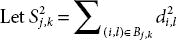

收缩应根据以下方程进行：

(4.17)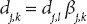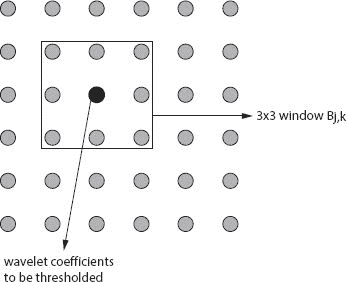

**图 4.9** 以阈值小波系数为中心的邻域窗口。

其中 `j` 是收缩函数，表示如下：

(4.18)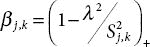

在公式末尾，+ 号表示保留正值而将负值设为零。它是经典软阈值方案的修改。通常更倾向于使用 3×3 或 5×5 的窗口大小，因为如果窗口大小较大，则会保留大量噪声。一般来说，窗口大小越大，阈值越小。

#### 4.3.2.3.4 Block Shrink

它是一种完全数据驱动的阈值方案示例。它利用相邻小波系数之间的关系。这种方法可以通过最小化 SURE 来决定每个小波子频带的块的最优大小和阈值。它不是对单个系数，而是对系数组进行保留或删除。与逐项应用的常规阈值方法相比，此属性更快。它利用相邻小波系数的信息，因此其估计精度更高。在局部块阈值方法中，块大小是固定的。无论小波系数分布如何，相同的规则都应用于所有分辨率级别 `[25]`。

图 4.10 显示了在应用 WT 进行图像小波分解时产生的几个子频带。对于每个子频带，这些都被分为若干个方形块。该方法可以通过最小化 Stein 的无偏风险估计来为给定的子频带选择最优块大小和阈值。

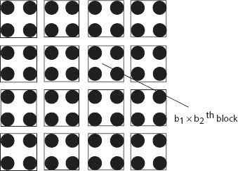

**图 4.10** 小波子频带的 2 x 2 块分区。

#### 4.3.2.3.5 Bivariate Thresholding

它是由 Sendur 和 Selesnick 提出的一种自适应阈值函数 `[35]`，它利用小波系数 `w[2*k]w[1*k]` 之间的统计依赖关系。图像 `x(i, j)` 受到噪声信号 `n(i, j)` 的影响。结果，得到一个噪声图像 `y(i, j)`。如果噪声是 AWGN，则噪声问题可以表示为 方程 (4.19)。

(4.19)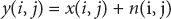

在小波域中，噪声问题可以表示如下：

(4.20)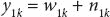(4.21)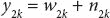

考虑到系数及其父系数之间的统计依赖关系，`y[1*k]` 和 `y[2*k]` 分别是 `w[1*k]` 和 `w[2*k]` 的噪声观测值，`n[1*k]` 和 `n[2*k]` 是噪声样本。我们可以写出

(4.22)

其中 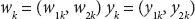 和 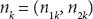

给定损坏观测值 `y` 的 `w` 的标准 MAP 估计器为

(4.23)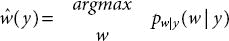

经过一些变换，方程 (4.23) 可以变为

(4.24)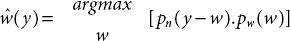

对于系数及其父系数，给出了一个非高斯双变量 PDF，表示如下：

(4.25)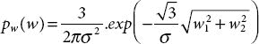

边缘方差 `σ²` 取决于系数索引 `[k]`。MAP 估计器 `w[1]` 已使用这两个方程计算得出：

(4.26)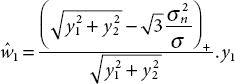

方程 (4.27) 是一个双变量阈值函数，其中 `(`g`)`[+] 已定义。

(4.27)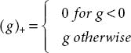


该估计器需要事先了解噪声方差 和每个系数的边缘方差（`σ*²*`）`σ²`。可以使用区域 `N(k)` 中的邻近系数进行估计。它是所有位于 `k^(th)` 系数中心的正方形窗口内的系数 它可以使用稳健中位数估计器从噪声系数中估计。

(4.28)

### 4.3.3 性能评估参数

了解任何方法的效率是可取的。为此，需要计算 PSNR、MSE 和 SSIM 等各种参数。PSNR 表示定量性能，而 SSIM 表示定性性能。下面是每个参数的解释。

#### 4.3.3.1 均方误差

设两个不同的灰度图像为 `I1` 和 `I2`，大小均为 `M × N`，则两幅图像之间的 MSE 如下所示：

(4.29)

#### 4.3.3.2 峰值信噪比

数学上，它如下所示：

(4.30)

如果两幅图像相同，则 MSE 为零，PSNR 为无穷大 \[2\]。

#### 4.3.3.3 结构相似性指数矩阵

它测量任何技术获得的图像质量，并测量两幅图像之间的相似性。其值范围从 0 到 1。如果为 1，则两幅图像在各方面都相同。它是在两个具有标准尺寸的图像之间计算的。数学上，它如下所示：

(4.31)

图像一和图像的均值。

图像一和图像二的方差，分别为。


用于稳定弱分母 `L` 除法的两个变量是两幅图像的协方差和像素值的动态范围。值 `K[1] K[2]` 分别为 0.01 和 0.03。

## 4.4 方法论

本部分涉及应用于去噪受 AWGN 影响的数字灰度图像的方法论。去噪是在小波域中进行的。我们可以使用常规 `DWT` 进行分解，使用 `IDWT` 重建图像，但由于常规 `DWT` 存在上述问题，因此使用了 `DTCWT` 以获得更好的结果。由于它需要的时间较少，因此冗余度较低。与 `UDWT` 相比，其计算成本较低 \[28\]。Figure 4.11 显示了基于 `DTCWT` 的图像去噪技术的框图表示。它只需要三个简单的步骤：


**Figure 4.11** 基于 DTCWT 的阈值技术图像去噪。


**Figure 4.12** 基于小波的阈值技术流程图。

1. (i) 计算 `DTCWT` 以分解噪声图像。

2. (ii) 使用任何阈值规则修改噪声小波系数。

3. (iii) 计算 `IDTCWT` 以重建去噪图像。

在第一步中，对噪声图像进行小波变换并获得小波系数。其中一些系数是噪声系数，因此需要被删除或替换。

为此，使用阈值技术，它可以删除或抑制这些噪声系数。需要重建，这是通过逆小波变换 \[45–47\] 完成的，以获得去噪图像。

希望计算一些性能评估参数，*即*，PSNR、MSE 和 SSIM。Figure 4.12 显示了流程图，它指示了解应用的阈值方法的逐步过程。

## 4.5 结果与讨论

在本部分中，使用上述技术的去噪结果已在去噪图像和从不同阈值技术获得的性能评估参数中显示。这些技术已应用于大小为 512 × 512 的标准灰度图像。这些标准图像是 Lena、barbara、cameraman 和 pepper，并在 Figure 4.13 中显示。

从数据库中获取一张标准图像。现在，使用 MATLAB 编程将该图像损坏为 AWGN。结果，得到一张噪声图像。现在，需要对这张噪声图像应用各种阈值技术，如 Section 4.4 中讨论的那样。现在，需要增加噪声量并重复该过程。同样，同样的过程也应用于其他图像。通过应用阈值技术，得到了不同的去噪图像，Figure 4.14 显示了噪声图像。从上述图像可以得出结论，基于小波的阈值技术提供了良好的结果。然而，通过计算性能评估参数，其去噪能力可能更加精确。为了验证各种技术的性能，已针对不同噪声水平计算了 PSNR 和 SSIM。

Table 4.1 显示 PSNR（以 dB 为单位），Table 4.2 显示不同图像在各种噪声条件下以及从各种阈值技术获得的去噪图像的 SSIM 值。从表格的观察可以清楚地看出，SURE shrink 优于 Neigh shrink 和 Bayes shrink 这两种方法。然而，其性能并不优于 block k shrink 和双变量阈值技术。双变量阈值技术对包含较少噪声的图像给出了更好的响应，但如果图像中存在的噪声增加，那么大多数情况下块阈值技术优于双变量阈值技术。Figures 4.15 和 4.16 是针对 Lena 图像中存在的不同噪声值绘制的噪声和去噪 PSNR 及 SSIM 值的柱状图。


**Figure 4.13** 标准灰度图像 (512 × 512)：(a) lena 图像；(b) barbara 图像；(c) cameraman 图像；(d) pepper 图像。


**Figure 4.14** (a) 噪声图像（噪声级别 = 10）；(b) 去噪图像（SURE shrink）；(c) 去噪图像（Neigh shrink）；(d) 去噪图像（Bayes Shrink）；(e) 去噪图像（Block shrink）；(f) 去噪图像（Bivariate shrink）。

**Table 4.1** 不同 AWGN 值的灰度图像 (512×512) 的 PSNR 值。

| **测试图像**  || **噪声级别--->** || **5** || **10** || **15** || **20** || **25** || **30** |

| --- | --- | --- | --- | --- | --- | --- | --- |

| Lena || 噪声 || 36.323 || 34.321 || 28.375 || 24.389 || 18.662 || 14.332 |

| --- | --- | --- | --- | --- | --- | --- | --- |

| 去噪 (SURE shrink) || 38.463 || 36.883 || 32.743 || 27.757 || 24.854 || 20.021 |

| 去噪 (Neigh shrink) || 38.123 || 36.385 || 32.376 || 28.324 || 24.334 || 19.732 |

| 去噪 (Bayes shrink) || 38.276 || 36.455 || 32.443 || 27.545 || 24.002 || 19.438 |

| 去噪 (Block shrink) || 39.456 || 38.481 || 35.787 || 32.764 || 26.654 || 24.761 |

| 去噪 (Bivariate shrink) || 40.543 || 39.667 || 37.721 || 32.435 || 26.098 || 24.405 |

| Barbara || 噪声 || 35.984 || 34.562 || 29.122 || 24.427 || 18.549 || 15.022 |

| 去噪 (SURE shrink) || 37.492 || 36.587 || 32.142 || 27.259 || 24.455 || 19.023 |

| 去噪 (Neigh shrink) || 38.326 || 36.405 || 32.381 || 28.305 || 24.327 || 19.722 |

| 去噪 (Bayes shrink) || 38.255 || 36.432 || 32.419 || 27.537 || 23.082 || 19.419 |


| Denoised (Block shrink) || 39.441 || 38.457 || 36.776 || 32.748 || 26.635 || 24.737 |

| Denoised (Bivariate shrink) || 39.913 || 39.641 || 36.683 || 32.421 || 26.073 || 24.371 |

| Cameraman || Noisy || 35.684 || 34.652 || 29.352 || 24.437 || 18.565 || 15.126 |

| Denoised (SURE shrink) || 37.532 || 36.594 || 32.203 || 27.289 || 24.483 || 19.124 |

| Denoised (Neigh shrink) || 38.736 || 36.655 || 32.781 || 28.395 || 24.407 || 19.932 |

| Denoised (Bayes shrink) || 38.285 || 36.742 || 32.529 || 27.647 || 23.122 || 19.391 |

| Denoised (Block shrink) || 39.452 || 38.476 || 35.787 || 32.751 || 26.732 || 24.756 |

| Denoised (Bivariate shrink) || 40.001 || 39.105 || 37.541 || 32.545 || 26.096 || 24.471 |

| Peppers || Noisy || 36.221 || 34.252 || 27.644 || 24.463 || 19.012 || 15.726 |

| Denoised (SURE shrink) || 38.222 || 36.484 || 32.173 || 27.259 || 24.502 || 19.131 |

| Denoised (Neigh shrink) || 38.741 || 36.637 || 32.792 || 28.382 || 24.398 || 19.973 |

| Denoised (Bayes shrink) || 38.297 || 36.757 || 32.535 || 27.662 || 23.172 || 19.404 |

| Denoised (Block shrink) || 39.467 || 38.485 || 35.799 || 32.789 || 26.763 || 24.781 |

| Denoised (Bivariate shrink) || 40.126 || 39.117 || 37.559 || 32.569 || 26.102 || 24.489 |

**表 4.2** 不同 AWGN 值下的灰度图像（512×512）SSIM 值。

| **测试图像** || **噪声级别--->** || **5** || **10** || **15** || **20** || **25** || **30** |

| --- | --- | --- | --- | --- | --- | --- | --- |

| Lena || Noisy || 0.891 || 0.867 || 0.752 || 0.542 || 0.321 || 0.139 |

| --- | --- | --- | --- | --- | --- | --- | --- |

| Denoised (SURE shrink) || 0.927 || 0.882 || 0.823 || 0.734 || 0.535 || 0.398 |

| Denoised (Neigh shrink) || 0.903 || 0.875 || 0.793 || 0.721 || 0.523 || 0.381 |

| Denoised (Bayes shrink) || 0.911 || 0.873 || 0.789 || 0.735 || 0.512 || 0.387 |

| Denoised (Block shrink) || 0.925 || 0.902 || 0.891 || 0.784 || 0.572 || 0.402 |

| Denoised (Bivariate shrink) || 0.952 || 0.935 || 0.887 || 0.734 || 0.583 || 0.399 |

| Barbara || Noisy || 0.873 || 0.836 || 0.721 || 0.476 || 0.283 || 0.132 |

| Denoised (SURE shrink) || 0.915 || 0.873 || 0.834 || 0.721 || 0.514 || 0.377 |

| Denoised (Neigh shrink) || 0.932 || 0.876 || 0.782 || 0.732 || 0.518 || 0.372 |

| Denoised (Bayes shrink) || 0.902 || 0.867 || 0.777 || 0.723 || 0.512 || 0.373 |

| Denoised (Block shrink) || 0.939 || 0.899 || 0.878 || 0.772 || 0.582 || 0.397 |

| Denoised (Bivariate shrink) || 0.941 || 0.931 || 0.891 || 0.727 || 0.532 || 0.399 |

| Cameraman || Noisy || 0.888 || 0.854 || 0.765 || 0.545 || 0.278 || 0.332 |

| Denoised (SURE shrink) || 0.914 || 0.875 || 0.819 || 0.712 || 0.523 || 0.395 |

| Denoised (Neigh shrink) || 0.91 || 0.872 || 0.789 || 0.717 || 0.518 || 0.376 |

| Denoised (Bayes shrink) || 0.904 || 0.869 || 0.767 || 0.723 || 0.511 || 0.375 |

| Denoised (Block shrink) || 0.921 || 0.911 || 0.886 || 0.779 || 0.574 || 0.419 |

| Denoised (Bivariate shrink) || 0.932 || 0.928 || 0.886 || 0.727 || 0.569 || 0.365 |

| Peppers || Noisy || 0.912 || 0.892 || 0.712 || 0.565 || 0.391 || 0.343 |

| Denoised (SURE shrink) || 0.927 || 0.887 || 0.834 || 0.723 || 0.535 || 0.389 |

| Denoised (Neigh shrink) || 0.916 || 0.877 || 0.792 || 0.724 || 0.532 || 0.388 |

| Denoised (Bayes shrink) || 0.912 || 0.876 || 0.782 || 0.735 || 0.501 || 0.387 |

| Denoised (Block shrink) || 0.924 || 0.911 || 0.888 || 0.772 || 0.569 || 0.412 |

| Denoised (Bivariate shrink) || 0.934 || 0.941 || 0.874 || 0.739 || 0.555 || 0.376 |


**图 4.15** 各种阈值技术获得的 PSNR 值。


**图 4.16** 各种阈值技术获得的 SSIM 值。

## 4.6 结论

从上述实验可以看出，基于小波的阈值技术能有效抑制噪声信号。通过视觉感知和计算的性能评估参数可以看出，阈值技术不仅能去除噪声，还能保留图像信息，因为这些技术提供了更高的 PSNR 和 SSIM 值。DTCWT 由于具有许多优势（如第 4.3 节所讨论），在获取小波系数方面效果更好。SURE shrink 大多数情况下优于 Neigh shrink 和 Bayes shrink，但不如块阈值和双变量收缩技术。结果还表明，当噪声水平较低时，双变量技术优于块阈值技术；然而，当图像中的噪声水平较高时，块阈值技术优于双变量收缩技术。因此，我们可以得出结论：基于小波的阈值技术能有效地从数字图像中去除 AWGN 噪声。

## 参考文献

1. Sinha, G.R. and Patel, B.C., *Medical Image Processing: Concepts and Applications*, PHI Learning Private Limited, New Delhi, India, 2014.

2. Bhonsle, D., Chandra, V.K., Sinha, G.R., Medical Image De-noising Using Bilateral Filter. *Int. J. Image Graph. Signal Process*., 4, 6, 36–43, 2012.

3. Amirmazlaghani, M. and Amindavar, H., Wavelet Domain Bayesian Processor for Speckle Removal in Medical Ultrasound Images. *IET Image Process*., 6, 5, 580–588, 2012.

4. Andria, G., Attivissimo, F., Lanzolla, A., Savino, M., A Suitable Threshold for Speckle Reduction in Ultrasound Images. *IEEE Trans. Instrum. Meas*., 62, 8, 2270–2279, 2013.

5. Rabbani, H., Vafadust, M., Abolmaesumi, P., Gazor, S., Speckle Noise Reduction of Medical Ultrasound Images in Complex Wavelet Domain Using Mixture Priors. *IEEE Trans. Biomed. Eng*., 55, 9, 2152–2160, 2008.

6. Bhonsle, D., Chandra, V.K., Sinha, G.R., Speckle Noise Removal from Ultrasound Images Using Combined Bivariate Shrinkage and Enhanced Total Variation Techniques. *Int. J. Pure Appl. Math*., 118, 18, 1109–1131, 2018.

7. Bhuiyan, M.I.H., Ahmad, M.O., Swamy, M.N.S., Spatially Adaptive Thresholding in Wavelet Domain for Despeckling of Ultrasound Images. *IET Image Proc*., 3, 3, 147–162, 2009.

8. Farouj, Y., Freyermuth, J.M., Navarro, L., Clausel, M., Delachartre, P., Hyperbolic Wavelet-Fisz De-noising Model Arising in Ultrasound Imaging. *IEEE Trans. Comput. Imaging*, 3, 1, 1–10, 2017.

9. Kongo, R.M., El-Kadmiri, M.L.O., Hassanain, N., Cherkaoui, Md., Dual-Tree Complex Wavelet in Medical Ultrasounds Images Restoration. *IEEE International Conference on Multimedia Computing and Systems*, Tangier, Morocco, pp. 297–303, 2012.

10. Bhonsle, D., Chandra, V.K., Sinha, G.R., Gaussian and Speckle Noise Removal from Ultrasound Images using Bivariate Shrinkage Dual-Tree Complex Wavelet Transform. *i-manager’s J. Image Process*., 2, 2, 1–5, 2015.

11. Bhonsle, D., Chandra, V.K., Sinha, G.R., Additive and Multiplicative Noise Removal From Medical Images Using Bivariate Thresholding by Dual-Tree Complex Wavelet Transform. *1^(st) International Conference on Mathematical Methods and Systems in Science and Engineering*, Tenerife, Spain, pp. 274–280, 2015.

12. Borsdorf, Raupach, R., Flohr, T., Tanaka, J.H., Wavelet-Based Noise Reduction in CT-Images Using Correlation Analysis. *IEEE Trans. Med. Imaging*, 27, 12, 1685–1703, 2008.

13. Chang, S.G., Yu, B., Vetterli, M., Adaptive Wavelet Thresholding for Image De-noising and Compression. *IEEE Trans. Image Process*., 9, 9, 1532–1546, 2000.

14. Gu, X.F., Shi, J.X., Li, J.P., Huang, Y.Y., Lin, J., Application of Wavelets Analysis in Image De-noising. *International Conference on Apperceiving Computing and Intelligence Analysis*, IEEE, Chengdu, China, pp. 49–52, 2008.

15. Fowler, J.E., The Redundant Discrete Wavelet Transform and Additive Noise. *IEEE Signal Process. Lett*., 12, 9, 629–632, 2005.

16. Sheikh, H.R. and Bovik, A.C., Image Information and Visual Quality. *IEEE Trans. Image Process*., 15, 2, 430–444, 2006.


17. Youssef, K., Jarenwattananon, N., Bouchard, L., Feature-Preserving Noise Removal. *IEEE Trans. Med. Imaging*, 34, 9, 1822–1829, 2015.

18. Kingsbury, N., The Dual-Tree Complex Wavelet Transform: A New Technique for Shift Invariance and Directional Filters. *Proceeding of 8th IEEE DSP Workshop*, Bryce Canyon, USA, 1998.

19. Qin, S., Yang, C., Tang, B., Tan, S., The Denoise Based on Translation Invariance Wavelet Transform and its Applications. *Proceeding of a Conference on Structural Dynamics*, pp. 783–787, 2002.

20. Sveinsson, J.R. and Benediktsson, J.A., Double Density Wavelet Transformation for Speckle Reduction of SAR Images. *IEEE International Geoscience and Remote Sensing Symposium*, Toronto, Ontario, Canada, vol. 1, pp. 113–115, 2002.

21. Chen, G.Y., Bui, T.D., Krzyzak, A., Image De-noising using Neighbouring Wavelet Coefficients. *IEEE International Conference on Acoustics, Speech, and Signal Processing*, Montreal, Que., Canada, vol. 2, pp. 917-920, 2004.

22. Chen, G. and Qian, S.E., De-noising of Hyperspectral Imagery Using Principal Component Analysis and Wavelet Shrinkage. *IEEE Trans. Geosci. Remote Sens*., 49, 3, 973–980, 2011.

23. Eslami, R. and Radha H., A., New Family of Nonredundant Transforms Using Hybrid Wavelets and Directional Filter Banks. *IEEE Trans. Image Process*., 16, 4, 1152–1167, 2007.

24. Chang, S.G., Yu, B., Vetterli, M., Adaptive Wavelet Thresholding for Image De-noising and Compression. *IEEE Trans. Image Process*., 9, 9, 1532–1546, 2000.

25. Dengwen, Z. and Xiaoliu, S., Image De-noising Using Block Thresholding. *IEEE Congress on Image and Signal Processing*, Sanya, Hainan, China, pp. 335–338, 2008.

26. Miller, M. and Kingsbury, N., Image De-noising Using Derotated Complex Wavelet Coefficients. *IEEE Trans. Image Process*., 17, 9, 1500–1511, 2008.

27. Zhang, W., Yu, F., Guo, H.M., Improved Adaptive Wavelet Threshold for Image De-noising. *IEEE Chinese Control and Decision Conference*, Guilin, China, pp. 5958–5963, 2009.

28. Raj, V.N.P. and Venkateswarlu, T., Denoising of Medical Images using Undecimated Wavelet Transform. *IEEE International Conference on Recent Advances in Intelligent Computational Systems*, Trivandrum, India, pp. 483–488, 2011.

29. Hassan, H. and Saparon, A., Still Image De-noising Based on Discrete Wavelet Transform. *IEEE International Conference on System Engineering and Technology*, Shah Alam, Malaysia, vol. 6(2), pp. 188–191, 2011.

30. Hill, P., Achim, A., Bull, D., The Undecimated Dual-Tree Complex Wavelet Transform and Its Application to Bivariate Image De-noising using a Cauchy Model. *19^(th) IEEE International Conference on Image Processing*, Orlando, FL, USA, pp. 1205–1208, 2012.

31. Kim, J.H., Ahn, I.J., Nam, W.H., Ra, J.B., An Effective Post-Filtering Framework for 3-D PET Image De-noising Based on Noise and Sensitivity Characteristics. *IEEE Trans. Nucl. Sci*., 62, 1, 137–147, 2015.

32. Zhao, J., Lee, J.S., Xu, H., Xu, K., Ren, Z.H., Chen, J.C., Wu, C.H., Scanner-Dependent Threshold Estimation of Wavelet De-noising for Small-Animal PET. *IEEE Trans. Nucl. Sci*., 64, 1, 705–712, 2017.

33. Ahmad, Alipal, J., Jaafar, N.H., Amira, A., Efficient Analysis of DWT Thresholding Algorithm for Medical Image De-noising. *IEEE International Conference Biomedical Engineering and Sciences*, Langkawi, Malaysia, pp. 772–777, 2012.

34. Sapthagirivasan, V. and Mahadevan, V., De-noising and Fissure Extraction in High-Resolution Isotropic CT Images Using Dual-Tree Complex Wavelet Transform. *2^(nd) IEEE International Conference on Software Technology and Engineering*, San Juan, PR, USA, vol. 1, pp. 362–366, 2010.

35. Sendur, L. and Selesnick, I.W., Bivariate Shrinkage with Local Variance Estimation. *IEEE Signal Process. Lett*., 9, 12, 438–441, 2002.

36. Gonzalez, R.C. and Woods, R.E., *Digital Image Processing*, 3^(rd) ed., Prentice-Hall, New Jersey, USA, 2009.

37. Kingsbury, N., Shift Invariant Properties of the Dual-Tree Complex Wavelet Transform. *IEEE International Conference on Acoustics, Speech, and Signal Processing*, Phoenix, AZ, USA, vol. 3, pp. 1221–1224, 1999.

38. Kingsbury, N., A Dual-Tree Complex Wavelet Transform with Improved Orthogonality and Symmetry Properties. *IEEE International Conference of Image Processing*, Vancouver, BC, Canada, vol. 2, pp. 375–378, 2000.

39. Kingsbury, N., Complex Wavelets for Shift Invariant Analysis and Filtering of Signals. *Appl. Comput. Harmon. Anal*., 10, 3, 234–253, 2001.

40. Kingsbury, N., The Dual-Tree Complex Wavelet Transform: A New Efficient Tool for Image Restoration and Enhancement. *9^(th) European Signal Processing Conference*, Rhodes, Greece, pp. 1–4, 1998.

41. Hill, P., Achim, A., Bull, D., The Undecimated Dual-Tree Complex Wavelet Transform and Its Application to Bivariate Image De-noising using a Cauchy Model. *19^(th) IEEE International Conference on Image Processing*, Orlando, FL, USA, pp. 1205–1208, 2012.

42. Bhonsle, D., Chandra, V.K., Sinha, G.R., An Optimized Framework Using Adaptive Wavelet Thresholding and Total Variation Technique for De-noising Medical Images. *J. Adv. Res. Dyn. Control Syst*., 10, 9, 953–965, 2018.

43. Prakash, O. and Khare, A., Medical Image De-noising Based on Soft Thresholding Using Biorthogonal Multiscale Wavelet Transform. *Int. J. Image Graph*., 14, 1 & 2, 1–30, 2014.

44. Bhonsle, D., Chandra, V.K., Sinha, G.R., Noise Removal from Medical Images Using Shrinkage Based Enhanced Total Variation Technique. *J. Adv. Res. Dyn. Control Syst*., 13, 549–560, 2017.

45. Bayram, I. and Selesnick, I.W., On the Dual-Tree Complex Wavelet Packet and M-Band Transforms. *IEEE Trans. Signal Process*., 56, 6, 2298–2310, 2008.

46. El-Shehaby, A. and Tran, T.D., Implementation and Application of Local Computation of Wavelet Coefficient in the Dual-Tree Complex Wavelets. 16^(th) *IEEE International Conference Image Processing*, Cairo, Egypt, pp. 3885–3888, 2009.

47. Ioannidou, S. and Karathanassi, V., Investigation of the Dual-Tree Complex and Shift-Invariant Discrete Wavelet Transform on Quickbird Image Fusion. *IEEE Geosci. Remote Sens. Lett*., 4, 1, 166–170, 2007.

48. Aravind, N. and Suresh, K.V., An Improved Image De-noising Using Wavelet Transform. *International Conference on Trends in Automation, Communications and Computing Technology*, IEEE, Bangalore, India, pp. 1–5, 2015.

# 5

基于智能虚拟现实的视觉感知式自闭症谱系障碍儿童通用通信系统

**Karunanithi Praveen Kumar^(1\*) and Perumal Sivanesan^(2)**

*^(1)School of Computing, SASTRA University, Thanjavur, Tamilnadu, India*

*^(2)Department of Information Communication Technology School of Computing, SASTRA University, Thanjavur, Tamilnadu, India*

\**Corresponding author*: praveenkumark@sastra.ac.in; praveennhu@gmail.com

> *Abstract*

> In recent years, advances in computer technology have led to Autism Spectrum Disorders (ASD) interventions. Technology has been used efficiently to provide new avenues that are flexible, adaptable, easily accessible, and cost-effective. It is claimed that personal treatment can be done cheaply. In this proposed scheme,


> 计算机为基础、主要基于虚拟现实（VR）的智能适应技术将被实施为一种个人干预方法，用于分析除自闭症谱系障碍（ASD）外儿童和青少年的基本社交缺陷。我们将介绍一个研究项目。具体而言，它利用智能技术基于引人注目的实时数据（眨眼频率）来评估计算机环境中的情绪状态。从这个意义上说，这些研究为专业人士提供了一代新的智能干预系统，这些系统可以适应并回应自闭症谱系障碍儿童和青少年的个体风险，并加强特定的长期干预目标。

> 

> **关键词：** 虚拟现实（VR），自闭症谱系障碍（ASD），瞳孔直径（PD），眨眼频率（BR），注视持续时间（FD），瞳孔半径（PR），眨眼速度（BS）

## 5.1 关注自闭症谱系障碍干预系统进步的必要性

就在 20 年前，自闭症谱系障碍（ASD）曾被认为是罕见的。概览数据显示，印度每 250 名儿童中有 1 名受到 ASD 影响（[`www.autismsocietyofindia.org/`](http://www.autismsocietyofindia.org/)），美国每 88 名儿童中有 1 名 \[19\]。印度政府于 1999 年将自闭症视为一种残疾（Vaidya, 2009）。值得注意的是，越来越多的共识认为，严格的社会和教育干预项目可以显著改善自闭症谱系障碍患者及其家庭的短期和长期结果（\[21\], NRC, 2001）。然而，由于缺乏广泛可用的有效治疗模式来应对这些复杂能力在儿童期、青春期和早期成年期的后期重点，因此证据表明，绝大多数自闭症谱系障碍患者未能在成年后实现适应性独立 \[1\]。因此，尽管在较年长年龄对社会和适应性残疾进行密集治疗的迫切需求和社会重要性，但针对自闭症谱系障碍儿童、青少年和年轻成年人的有效和适当的干预资源却缺乏（Rutter, 2006）。除此之外，自闭症谱系障碍治疗的费用，无论是间接还是直接，都被认为是巨大的 \[32\]，而且绝大多数自闭症谱系障碍成年人努力实现功能性、适应性独立 \[13, 18\]。此外，鉴于自闭症谱系障碍干预中受过培训的专业资源有限，新兴技术很可能在未来发挥重要作用，提供更易获得的密集个性化干预 \[37\]。

## 5.2 基于计算机和虚拟现实的干预系统

将技术，明确地说是计算机和虚拟现实（VR）系统，融入干预实践，对自闭症谱系障碍儿童和青少年可能尤其重要，原因有多种 \[3\]。这种技术用于自闭症谱系障碍干预的优势包括灵活性、可控性、可修改的感官刺激、个性化方法、安全性，以及可能减少治疗期间人际互动中危险的部分（Strickland, 1997）。有迹象表明，基于计算机和虚拟现实的干预可能为自闭症谱系障碍儿童提供一个简化但探索性的互动环境（Parsons and Mitchell, 2002; Tartaro and Cassell, 2007）。自闭症谱系障碍儿童通常发现人与人之间的互动复杂且困难。然而，虚拟世界的复杂性已被控制，干扰或困难有限，可能会提供改进但具体化的社交沟通，这对自闭症谱系障碍儿童来说比一些复杂的社交互动不那么可怕（Moore *et al*., 2000; Tartaro and Cassell, 2007; Standen and Brown, 2005）。基于计算机和虚拟现实的干预技术还可以通过不仅更多地控制教授复杂技能的基本要素，而且能够有意地在各种可控、合理的互动条件下使用和加强这些技能，来解决将学习到的技能推广到现实世界中的重大困难（Strickland, 1997; Mitchell *et al*., 2007）。

此外，自闭症谱系障碍患者在虚拟现实环境中也可能表现出更好的学习效果，因为计算机系统和虚拟环境可以轻松转换属性、添加或删除事物，这些方式在真实实体中可能不可能实现，但对于教授具体和抽象概念可能很重要。因此，这些高度适应性的技术可以提供优势，即呈现可以改变的场景，以适应各种情况，这些情况在给定的治疗环境中可能因空间限制、资源短缺、安全问题等而无法实现（Strickland, 1997; Parsons and Mitchell, 2002; Parsons *et al*., 2004）。虚拟现实还显示出能够减轻干预过程中受过培训的顾问在时间和精力上的负担，并有可能允许未经培训的工作人员（例如，父母或同伴）协助参与者进行干预（Standen and Brown, 2005）。因此，计算机和虚拟现实技术代表了一种适合为自闭症谱系障碍儿童核心障碍领域的技能训练创建互动干预范式的媒介。

然而，目前应用于自闭症谱系障碍辅助干预的计算机和虚拟现实技术（Tartaro and Cassell, 2007）尽管有预期的优势，但通常以开放环方式设计。这些系统可能仅通过表现的某些方面来串联学习；然而，它们无法实现更高程度的个性化。具体而言，它们无法自动识别并适当地根据自闭症谱系障碍儿童的情感需求做出反应和调整支持 \[6\]。因此，它们无法以针对特定儿童的方式识别和预测焦虑以及理想的情感兴奋水平。然而，鉴于情感数据在自闭症谱系障碍干预实践中的重要性（Wieder and Greenspan, 2005），利用这些数据的闭环设计可能对于开发干预系统至关重要，该系统可以允许合理的适应性互动，以挑战并热切促进自闭症谱系障碍人士在特定弱点领域的支架式技能发展。

## 5.3 为什么眼部生理和观看模式对自闭症谱系障碍儿童情感识别具有优势

自闭症谱系障碍青少年通常存在开放性障碍（包括言语和非言语），特别是关于情绪状态的表达，并表现出非典型的观看模式，导致社交信息处理困难 \[2\]。他们经常经历被评估为自主神经系统起源且不包括外部表达的兴奋或学术压力状态（Picard, 2009），这挑战了他们在学习和展示方面的倾向。这些描述信息障碍的缺陷限制了标准观察和对话系统。

这里需要理解的是，赋予计算机理解某些情绪信号的能力，将允许更深入和自然的人机交互。有两到三种模式，例如面部表情、声音手势、符号和姿势以及眼部生理，可以用来研究人们的情绪状态。


尽管如此，由于患有 ASD 的青少年可靠地存在开放性阻抗，尤其是在情绪状态的明确表达方面，我们打算通过利用生理眼部信号（例如瞳孔直径（PD）和眨眼率（BR））\[7\]来选择近似措施。生理信号始终可获取，并且实际上并不直接受开放性无能的影响。因此，生理信号获取可能成为一种在儿童 ASD 可能存在的沟通障碍的情况下收集丰富信息的系统。此外，证据表明，自主神经系统活动指标的显著变化伴随着从一种情绪状态转变为另一种情绪状态 \[15\]。例如，生理眼部记录，具体来说，BR 和 PD，已被视为一个人关键因素的可靠自主水平。研究已宣布，由于任务而长期紧张，一个人的 BR（Meyer *et al*.，1953）和瞳孔扩张（Molloy 和 Simpson，2007）会出现自发性增加。

同样，一个人的观察模式，即他在社交沟通任务中看多少以及看向哪里，可以作为理解其在任务中焦虑水平的重要指标。从面部获取社会重要信息的能力是实现流畅社交沟通的基本限制（Trepagnier *et al*.，2002）。研究表明，社交恐惧症患者在看向说话者的激动面部时表现出减少的注视时长（FD）\[15\]，同时在处理情绪面部表情时表现出非典型的注视模式（Horley *et al*.，2003）。在这里，我们选择压力作为目标情绪状态，基于两个主要原因。首先，压力在与任务执行相关的各种人机交互任务中起着巨大作用。其次，焦虑经常与 ASD 共存，并在儿童与认知差异相关的直接挑战中起着基本作用 \[35\]。

在人机交互中关注情绪数据，以及儿童 ASD 的情感和谨慎因素对干预工作的巨大影响，建立一种可以根据儿童的情绪状态进行调整的警觉模式可能是根本的，该模式是从其眼部生理和观察模式中组织起来的 \[9\]。

## 5.4 将拟议的自适应响应技术应用于自闭症干预的潜在优势

现有技术并未明确说明如何自主且高效地检测并响应非 ASD 儿童基于眼部生理和观察模式的情感线索，包括一个旨在促进复杂技能发展的干预范式（Strickland，1997；Tartaro 和 Cassell，2007；Swettenham，1996；Trepagnier *et al*.，2006；Parsons *et al*.，2005；Scassellati，2005）。为了在竞争性技能训练中代表非 ASD 儿童的核心缺陷，可能需要具有有效动态的调整机制来添加多种意愿因素，如情感线索、干预目标和任务措施。他们可以利用这些线索的力量，可能允许一个顺畅、自然且更高效的交互过程。

实际上，这种建模通常是专家治疗师和干预师在与 ASD 个体合作时试图做的事情 \[10\]。具体来说，干预师试图巧妙地推断 ASD 儿童表现出的情感线索，以调整干预和强化过程以改善学习（Seip，1996；\[29\]，Wieder 和 Greenspan，2005）。因此，基于自适应技术的 ASD 干预系统也必须理解并响应情感需求，例如这些儿童的焦虑水平。美国儿科学会（Myers 和 Johnson，2007）和国家资源委员会（NRC，2001）的共识声明强调了 ASD 儿童的有效干预，包括提供全面干预、针对儿童性质量身定制的个体特定教学、促进技能泛化以及纳入高度结构/组织。拟议的 ASD 干预自适应响应技术将同时解决有效干预的所有这些基本要素，增加干预提供者/工具系统地控制和发展面向干预的技能的能力。

## 5.5 问题

印度已被引用为迄今为止世界上 ASD 人数第二多的国家 \[25》。除此之外，合适的教育、康复和其他设施的不平等可用性加剧了家庭所面临的困难处境（Vaidya，2009）。因此，大多数 ASD 患者与核心及相关适应性残疾作斗争，这些残疾不幸的是最终往往转化为后来未被满足的就业、住房、医疗和行为护理、服务及支持需求 \[13, 18\]。事实上，可能，阻碍 ASD 患者跨生命周期干预开发和实施进步的最大障碍仅仅是谱系的异质性。尽管核心社交沟通包括和广义化行为在所有 ASD 患者中都存在，但这些特征和方法存在于不同程度——从需要持续密集支持的非语言智力障碍人士到具有各种认知优势、能够在核心弱点相关障碍的情况下实现适应性自主的人士。迫切需要推进对 ASD 众多聚类的理解，以帮助我们认识实际问题并开发针对性和个性化的干预措施。

然而，我们的干预框架无法以应用数据驱动的方式确定适用于每个 ASD 患者的干预措施 \[14\]。在这方面，协作创新与生理和行为分析框架相结合，能够缓慢但自然地调整受控条件并强化核心领域的技能，可能成为为 ASD 患者开发定制干预措施的有力工具。可以说，部署一种主要机械工具可以使 ASD 患者的针对性和个性化干预成为现实，并可整合到旨在改善较大儿童、青少年和成人 ASD 患者功能和生活质量的复杂干预范式中。此外，此类机械系统可能能够通过创建可以分散到各种干预环境中的干预工具来克服资源限制 \[16\]。

## 5.6 全球状况

在国际层面，自闭症的高患病率表明，ASD 的识别和有效治疗常被描述为公共卫生危机。研究表明，美国每 88 名儿童中就有 1 名被确诊患有自闭症 \[19\]。在英国，剑桥大学的 Simon Baron-Cohen 教授及其团队发现，每三名被诊断患有自闭症的儿童中，有两名未被正式发现 \[8\]。详细评估表明，剑桥小学生中的患病率可能高达每 64 名中 1 名（[www.nas.uk.org](http://www.nas.uk.org)）。自闭症被认为是第三种最常见的发育障碍，其发生率高于唐氏综合征和脑瘫（Vaidya，2009）。


ASD 的直接和间接费用被认为是巨大的 \[32\]。预计每年 350 亿至 900 亿美元，ASD 对患者、其家庭、教育体系以及社会的费用是巨大的 \[32\]。此外，在获取和实施适当的个性化强力干预服务方面存在强大的障碍（例如，无法获得合格专家的机会有限，缺乏可用信息表明哪些干预措施对特定儿童更有效，对有效性的担忧，对特定干预措施的猜测，以及高昂的费用）\[32, 37\]。

面对所有这些困难，绝大多数 ASD 成年人难以实现功能性、适应性的独立生活 \[13, 18\]。然而，已提供了各种潜在干预措施来应对与 ASD 相关的这些强大障碍和费用。很少有干预措施经受过受控临床试验的考验 \[17\]。尽管缺乏足够受控的治疗研究，但越来越多的证据支持特定教育和行为干预技术的有效性，特别是在改善幼儿的语言、认知能力以及较少程度的社交功能方面。总体而言，看起来早期和更强力的干预对特定儿童是有益的。然而，结果差异很大，这种差异理解不足（\[28\]，NRC，2001；Rogers and Vismara，2008）。此外，即使在显著强化的治疗方式中接受治疗的儿童，也很少有能实现 ASD 真正缓解的（即与核心症状相关的功能障碍不再存在）。纵向研究表明，绝大多数 ASD 患者（即 >70%）无法在成年后实现独立状态 \[13, 18\]。鉴于日益增长的需求来应对 ASD 人群面临的挑战，越来越多的研究正在探讨使用尖端智能技术（例如，计算机技术和虚拟现实环境）进行社交和沟通相关干预的应用。ASD 患者通常能很好地与计算机协作，而计算机为帮助 ASD 患者改善其核心缺陷（包括社交技能）提供了理想的平台。已开发并应用了不同的计算机软件包和 VR 环境，以解决与自闭症相关的特定缺陷，例如，理解欺骗性注意力、表情识别（Silver and Oakes, 2001）、关键社交思维 \[11\] 和社交规范。在全球范围内，VR 在为 ASD 儿童规划干预研究方面已被广泛使用，其中一些如下所述技能。

## 5.7 VR 和适应性技能

在希腊，研究人员设计了基于 VR 的环境，以帮助 ASD 儿童进行日常活动能力训练任务（例如，穿衣和梳洗）\[20\]。在匈牙利，专家使用 VR 教导 ASD 参与者使用公共交通工具所涉及的活动（Lanyi and Tilinger, 2004）。在英国，研究人员进行了几项试点研究，包括为智力障碍人士提供购物、食物准备、空间定向、道路安全、职业培训和危险识别的理想模式（Standen and Brown, 2005）。在美国，一项研究展示了使用 VR 为 ASD 儿童训练过马路技能的应用 \[36\]。

## 5.8 VR 用于促进游戏技能

在英国，研究人员探索了使用 VR 来解决 ASD 儿童在核心象征性和有益游戏方面的缺陷（Jordan, 2003）。在西班牙，研究利用 VR 帮助 ASD 参与者在虚拟杂货店购物时发展社交技能（Herrera *et al*., 2008）。在英国，Farr *et al*. 描述了一种新颖的虚拟编程应用，用于影响合作游戏的发展，他们使用了嵌入在名为“Topobo”的可握持移动积木形式中的有形用户界面（TUI）。使用这些积木，普通和 ASD 参与者群体都可以通过编程玩具的移动来创建和播放动画玩具动作 \[30\]。与 Topobo 的社交游戏似乎表明，通过减少在个人空间花费的时间，Topobo 积木的概念促进了 ASD 群体成员之间更多的社交参与机会。

## 5.9 VR 用于鼓励社交技能

游戏技能的发展与更广泛的社交技能范围密切相关，儿童需要发展这些技能才能与他人建立有意义的联系。从游戏到更高级社交互动的这一过程既流畅又复杂，并被试图利用虚拟环境来弥合差距的专家所建议。在以色列，一组专家使用了一个简单的多用户触摸屏界面 \[31\] 来评估名为“StoryTable”的 3 周干预计划的有效性，其中儿童共同选择故事场景，然后自主记录对场景的自发描述。干预的目标是分享活动，给予其他参与儿童鼓励和帮助，并改善与其他儿童安排社交互动 \[23\]。研究结果显示支持性社交行为和更复杂的游戏大幅增加，同时平行游戏和重复性行为减少。在英国，Parsons *et al*. 通过让 ASD 参与者接触虚拟咖啡馆，为他们设计了基于 VR 的社交技能训练任务（Parsons *et al*., 2004）。在美国，专家们探索了使用基于 VR 的干预来鼓励 ASD 参与者的情绪识别能力（LaCava *et al*., 2007）。

尽管这些工作在技术辅助的 ASD 干预方面做出了开创性贡献，但到目前为止，这些设计都是开放环模式。具体来说，这些是基于执行的（即正确或错误的反应）。它们无法以个性化的方式基于眼部生理和观察模式指数预测参与者的紧张水平，并在保持参与者舒适度的同时进行智能调整，从而使获得社交技能的过程变得愉快。

## 5.10 公共状况

研究表明，印度有 200 万至 400 万人被评估患有自闭症（Vaidya, 2009）。不幸的是，由于缺乏大规模流行病学研究，这些发现是理论性的，可能低估了受自闭症影响的人数 \[24\]。由于许多人缺乏意识和信息，自闭症的研究在印度几乎是一个未开发的领域（Vaidya, 2009）。然而，自闭症自 1999 年起被印度政府视为一种残疾。


为患有 ASD 的儿童群体获取合适的诊断并提供适当治疗的责任在于相关群体。此外，适当的教育、康复及其他服务的获取分布不均，加剧了这些儿童面临的挑战 \[26\]。由于 ASD 儿童常被描述为存在社交互动缺陷和沟通障碍，抚养此类儿童通常具有挑战性。在强调同质性、差异常被视为怀疑与敌视的社会结构中，此类家庭及其子女可获得的社会支持有限。然而，在印度，关于残疾以及社会和国家对残疾居民义务的讨论正在取得进展，这主要得益于国际上对人权的强调，以及自愿组织、自助团体和受影响人士协会的基层活动和支持（Vaidya, 2009）。

在印度，这些家庭艰难的社会处境因缺乏合格的专业资源或针对这些儿童的特殊需求机构而更加恶化。尽管非政府组织的工作日益增加，大众传媒的影响也在扩大，但对 ASD 的认识仍仅限于部分城市地区。在德里，凭借其庞大的公立和私立医院以及发达且活跃的非政府组织领域，在某种程度上已成为“自闭症中心”，大众传媒的影响力使印度各地的人们长途跋涉前往德里，以获取诊断及其他服务，并寻找关于其子女发育偏差的问题解答。

自闭症因残疾相关非政府组织和家长支持协会的努力，被认可为一种独立的残疾（Vaidya, 2009）。伞形组织“Parivaar”（Parivaar，即印度智力迟钝、自闭症、脑瘫及多重残疾人士家长协会全国联合会）在此背景下发挥了关键作用。印度 30 个州的近 200 家非政府组织和家长协会隶属于“Parivaar”旗帜（Vaidya, 2009）。20 世纪 90 年代，残疾领域出现了变化。除了非政府组织的努力外，印度政府还对自闭症给予了法律认可。三项重要的议会法案——《1992 年康复委员会法》、《1995 年残疾人法》和《1999 年国家信托法》已颁布。印度政府社会正义与赋权部负责推动残疾人群体的经济、社会和教育发展，并确保其福利和权利。该部在残疾领域开展了多项研究项目。从 2004 年到 2008 年，该部推出了新的学习课程，包括残疾康复管理硕士、特殊教育哲学硕士以及特殊教育（智力迟钝）学士学位证书（[www.socialjustice.nic.in](http://www.socialjustice.nic.in)）。

印度政府提供的支持以及非政府组织的重大贡献，将自闭症再次从家庭圈子的四壁之内带入了公共领域和公众意识中。然而，正如 Vaidya 所恰当指出的那样，随着快速工业化和高速生活方式，典型的支持模式在印度城市环境中正在消失，家庭面临的障碍应通过合理的替代方案来解决。

尽管技术辅助的 ASD 干预在国际上取得了进展，但其在印度公众信念中的认可仍有待实现。

## 5.11 重要性

在这个紧要关头，基于创新的解决方案可以为家庭提供一个合理的选择，以应对长途跋涉获取适当治疗设施、资源有限以及缺乏足够训练有素的专家等挑战。这是 ASD 谱系概念所要求的个体化治疗，在概括性干预环境中难以实现。然而，这里提出的基于智能移动 VR 的框架可以解决这一问题。同样，这样的框架将有助于了解 ASD 儿童特有的基本心理生理特征，因此，这可以作为干预者手中的虚拟工具。正如 Bellani 所指出的，VR（基于计算机图形的现实模拟）可能很有用，因为它允许教育者和顾问在移动技能掌握过程中提供安全、可重复且可多样化的环境 \[12\]。同样，VR 曾经被认为昂贵且笨重，但在近年来已变得易于使用且相对便宜，可用于干预研究（Varma *et al*., 2012）。

我们的拟议研究有多个原因。首先，我们将开发基于 VR 的社交沟通场景，要求参与者与他们的虚拟同伴（即化身）进行互动。这将伴随着获取眼生理学和观察模式的数据，以及临床观察者关于参与者焦虑水平的信息。这些记录将用于预测一个人对任务的焦虑水平。这将帮助我们了解这些儿童在参与基于 VR 的社交任务时的基本心理生理机制。不同难度级别也将是任务计划的一部分。

因此，将使用一个智能规则表示方法生成器，以个性化的方式切换不同难度级别的任务，同时保持参与者的低焦虑水平 \[27\]。最后，我们打算设计一项可行性研究，以测试自适应响应技术在改善 ASD 人群社交关系能力方面的有效性。审查拟议研究小组/机构在该项目主题方面可用的专业知识。

该项目旨在开发一个创新的、智能的基于 VR 的社交沟通系统，该系统可以根据当前眼生理学和观察模式记录中对一个人焦虑水平的预期进行调整。这需要在自适应系统、计算机图形、情感建模工具和心理学方面具有专业知识。我们研究团队在这些领域的专业知识足以完成这个项目。

## 5.12 基于 VR 的社交互动导致 ASD 年轻人观察模式变化的可行性

进行了一项研究，以探讨参与基于 VR 的社交互动任务是否可以改变 ASD 参与者的个体观察记录。这样的研究很重要，因为与典型发育（TD）儿童相比，ASD 儿童会较少关注面部，而更多关注不同物体（Jones *et al*., 2008）。在首席研究员进行的研究中，使用了 Arrington 眼动仪（[`www.arringtonresearch.com/`](http://www.arringtonresearch.com/））。视觉刺激被分为两个感兴趣区域（ROI）：化身的面部和 VR 环境中的其余物体。任务如下：一个信号会讲述一个持续 2-3 分钟的个人故事。在叙述结束时，参与者被要求回答关于故事主题的一个基本问题。四名参与者（ASD1-ASD4）的结果已显示在 表 5.1 中。该实验包含五次试验。参与者的眼注视被实时观察。


**表 5.1 查看模式索引。**

|  || **平均注视持续时间** || **对象-面部比例** |

| --- | --- | --- |

| **参与者** || **Trial1(s)** || **Trial5(s)** || **%Δ** || **Triall** || **Trial5** || **%Δ** |

| ASD1 || 0.285 || 0.316 || 14.78 || 0.314 || 0.015 || 95.57 |

| --- | --- | --- | --- | --- | --- | --- |

| ASD2 || 0.236 || 0.578 || 151.18 || 0.032 || 0.000 || 100.00 |

| ASD3 || 0.324 || 0.462 || 35.32 || 0.117 || 0.030 || 73.72 |

| ASD4 || 0.452 || 0.575 || 32.34 || 0.091 || 0.001 || 97.82 |

两个回顾文件，具体来说，符号面部区域的平均痴迷长度和对象-对抗比例，被检查因为它们似乎显示一个人的情绪状态（Jones *et al*.，2008）。表 5.1 展示了 Trial1 和 Trial5 的这些调查设计列表。每个成员的平均痴迷术语扩大和对象-对抗比例在 Trial1 和 Trial5 之间减少，这表明成员更专注于面部。以这种方式，实际结果表明，在基于 VR 的社交合作中，成员的调查设计发生了转变。它在 VR 社交任务进展方面，对其虚拟沟通者的面部表现出更显著的痴迷术语方面有所改善。

## 5.13 基于 VR 的社交互动对自闭症儿童眼生理指标变化的可行性

在这里，我们展示了一项探索性研究的结果，该研究旨在分析基于 VR 的框架在引起生理眼记录变化方面的有效性，具体来说，是自闭症儿童的瞳孔距离（PD）和眨眼率（BR），类似于其他非基于 VR 的研究（Partala 和 Surakka，2003；Wilbarger *et al*.，2009）。自闭症儿童经常经历情绪或智力压力状态，表现为自主神经系统激活而没有外在表达（Picard，2009），这挑战了他们在学习和沟通中的偏好。因此，对面部表情的感知可能不可靠，无法判断他们在社交沟通中是否能识别他人的情绪表达（McIntosh *et al*.，2006；Picard，2009）。在这种情况下，眼生理记录可能是显示这些儿童情绪识别过程的重要来源。

**表 5.2 作为情绪识别因素的瞳孔半径（PR）变化。**

|  || **PR[MEAN] *Neutral* (mm)** || **PR[MEAN]*Happy* (mm)** || **%Δ*Neutral-to-Happy*** || **PR[MEAN]*Neutral* (mm)** || **PR[MEAN]*Angry* (mm)** || **%Δ*Neutral-to-Angry*** |

| --- | --- | --- | --- | --- | --- | --- |

| ASD1 || 8.035 || 8.807 || 9.62 || 8.035 || 10.712 || 33.32 |

| --- | --- | --- | --- | --- | --- | --- |

| ASD2 || 6.212 || 6.271 || 0.95 || 6.212 || 6.395 || 2.91 |

| ASD3 || 6.731 || 6.965 || 3.52 || 6.731 || 7.216 || 7.23 |

| ASD4 || 6.744 || 6.816 || 1.11 || 6.740 || 7.261 || 7.72 |

| ASD5 || 7.677 || 8.031 || 4.60 || 7.676 || 7.710 || 0.42 |

| ASD6 || 7.208 || 7.262 || 0.76 || 7.207 || 7.310 || 1.41 |

在这项调查中，成员观看描绘他们遭遇的符号，同时在介绍阶段展示适当的面部表情（快乐、愤怒和中立）。随后是沟通阶段，成员被要求回答与故事相关和情绪识别问题。这伴随着成员生理眼指标的实时数据采集，以时间同步的方式进行。

如 表 5.2 和 5.3 所示，可以看出，自闭症成员的生理眼指标都随着在 VR 中开发的情绪识别应用程序的比例而变化。眼生理记录的变化对所有成员（除一名例外成员外）都呈现出与其他非基于 VR 的研究类似的模式。

**表 5.3 作为情绪识别因素的眨眼速度（BS）变化。**

|  || **BS[MEAN] (times/min)** || **%Δ*Neutral-to-Happy*** || **BS[MEAN] (times/min)** || **%Δ*Neutral-to-Happy*** |

| --- | --- | --- | --- | --- |

| **Neutral** || **Happy** || **Neutral** || **Angry** |

| ASD1 || 8.12 || 13.04 || 60.17 || 8.12 || 23.84 || 193.21 |

| --- | --- | --- | --- | --- | --- | --- |

| ASD2 || 5.41 || 8.12 || 50.00 || 5.41 || 8.64 || 59.25 |

| ASD3 || 7.34 || 13.15 || 79.08 || 7.34 || 9.88 || 34.16 |

| ASD4 || 12.37 || 14.44 || 16.35 || 12.38 || 15.27 || 22.67 |

| ASD5 || 43.33 || 42.40 || \-2.15 || 43.35 || 71.55 || 64.94 |

| ASD6 || 11.31 || 22.17 || 96.05 || 11.31 || 42.15 || 273.38 |

## 5.14 基于 VR 的社交互动对自闭症青少年焦虑水平变化的可能性

在 Researcher Lahiri 进行的另一项研究中，研究了在 VR 中进行的社交互动期间，由于受控社交边界（例如，眼神注视和社交距离）引起的自闭症和 TD（正常发育）儿童的情绪和生理变化。这项研究包括七对自闭症和 TD 儿童（年龄 13-17 岁），按年龄和性别匹配。社交互动旨在使用 Vizard（VR 工具箱软件）投射虚拟人类角色（即符号），这些角色展示了不同的眼神注视模式，并在向成员讲述个人故事时保持不同的距离。我们收集了一位临床观察者对每位完成两个 1.5 小时会议的成员的情绪状态（即焦虑）水平的主观报告。感兴趣的社交边界，眼神注视和社交距离，在 4 × 2 设计中进行了分析，以拉丁方设计的随机顺序呈现，以考虑排序和顺序影响（Keppel，1991）。四种眼神注视类型指示了符号注视成员的时间长度。这些被标记为直接、转开、说话时正常和正常的翻转 \[4, 22, 33\]。两种社交距离，即侵入性（1.5 英尺远）和得体（4.5 英尺远），描述了符号和成员之间的距离（\[5\]，Hall，1966；Schneiderman 和 Ewens，1971）。例如，其他社交边界，面部表情和语调被保持尽可能中立。专家在成员与基于 VR 的社交沟通场景互动时评估了他们的焦虑水平。

调查临床观察者的主观评分发现，控制社交边界导致了成员的情绪变化。详细的焦虑组均值在自闭症组中高于匹配的 TD 组，这与自闭症儿童社交缺陷的观察一致。自闭症组的标准差（SD）高于 TD 组。这一结果表明，自闭症组比 TD 组更容易受到 VR 试验中控制社交边界的影响。同样，主观评分范围（九点量表）在自闭症组中高于 TD 组，在报告的焦虑水平上也是如此。因此，结果表明，我们的基于 VR 的社交沟通框架能够在成员中引起情绪变化。

我们的初步结果已经证明了为自闭症儿童开发基于 VR 的注视敏感社交沟通框架的可行性。它可以（a）建立功能性虚拟环境，以可通过生理眼仪器和眼神注视及调查设计列表的测量来识别的方式控制社交互动的属性，以及（b）在成员的情感状态中引起变化。


鉴于我们过去的工作，下一个阶段是分析如何将这一创新应用于对成员焦虑水平敏感的社交和多功能行为任务，该焦虑水平预期来自一个人的回顾示例和眼生理文件 \[38\]。因此，基于 VR 的视线敏感社交沟通框架应具备通过使用智能调节系统生成器来适应成员预期焦虑水平的能力，以在保持其舒适水平的同时促进社交任务表现的改善。我们认为，所提议的研究可能开启一个新时代的智能干预系统，这些系统（a）具有适应性并能响应自闭症谱系障碍儿童和青少年的个体脆弱性，以及（b）能够增强对长期独立至关重要的特定干预目标。

# References

1. Welch, K.C., Lahiri, U., Sarkar, N., Warren, Z., Stone, W., Liu, C., 第 15 章 情感敏感计算与自闭症，IGI Global，宾夕法尼亚州，美国，2011 年。

2. Anderson, C.J., Colombo, J., Shaddy, D.J., 年轻自闭症谱系障碍儿童的视觉扫描和瞳孔反应。*J. Clin. Exp. Neuropsychol*.，28，1238–1256，2006 年。

3. APA.，《精神障碍诊断与统计手册：DSM-IV-TR》，美国精神病学协会，华盛顿特区，2000 年。

4. Argyle, M. 和 Cook, M.，《注视与相互注视》，剑桥大学出版社，剑桥，马萨诸塞州，1976 年。

5. Argyle, M. 和 Deal, J.，眼神接触、距离与亲和。*Sociometry*，28，3，289–304，1965 年。

6. Asha, K., Ajay, K., Naznin, V., George, T., Peter, D.，基于运动捕捉数据的手势式情感计算。*Int. Conf. on Affective Computing and Intelligent Interaction*，2005 年。

7. Bancroft, W.J.，《非语言沟通研究及其与教学法和暗示疗法的关系》，ERIC，美国，1995 年。

8. Baron-Cohen, S., Scott, F.J., Allison, C., Williams, J., Bolton, P., Matthews, F.E., Brayne, C.，自闭症谱系障碍的患病率：英国学校人群研究。*Br. J. Psychiatry*，194，500–509，2009 年。

9. Bartlett, M.S., Littlewort, G., Fasel, I., Movellan, J.R.，实时人脸检测和面部表情识别：开发及其在人机交互中的应用。*Computer Vision and Pattern Recognition Workshop*，2003 年。

10. Ben Shalom, D., Mostofsky, S.H., Hazlett, R.L., Goldberg, M.C., Landa, R.J., Faran, Y., McLeod, D.R., Hoehn-Saric, R.，高功能自闭症儿童的正常生理情绪但意识感受表达存在差异。*J. Autism Dev. Disord*.，36，3，395–400，2006 年。

11. Bernard-Opitz, V., Sriram, N., Nakhoda-Sapuan, S.，通过计算机辅助教学增强自闭症儿童和正常儿童的社会问题解决能力。*J. Autism. Dev. Disord*.，31，4，377–384，2001 年。

12. Bellani, M.，自闭症中的虚拟现状。现状。*Epidemiol. Pyschiatr. Sci*.，3，235–238，2011 年。

13. Billstedt, E., Gillberg, I.C., Gillberg, C.，青春期后的自闭症：120 名儿童期被诊断为自闭症的个体的基于人群的 13-22 年随访研究。*J. Autism Dev. Disord*.，Springer，柏林，海德堡，35，351–360，2005 年。

14. Blocher, K. 和 Picard, R.W.，情感社交任务：自闭症儿童的情绪识别疗法，载于：*Socially Intelligent Agents: Creating Relationships with Computers and Robots*，K. Dautenhahn, A.H. Bond, L. Canamero, B. Edmonds (Eds.)，Kluwer Academic Publishers，Springer，柏林，海德堡，2002 年。

15. Bradley, M.M.，情绪与动机，载于：*Handbook of Psychophysiology*，J.T. Cacioppo, L.G. Tassinary, G. Berntson (Eds.)，pp. 602–642，剑桥大学出版社，纽约，2000 年。

16. Bradley, M.B., Miccoli, L., Escrig, M.A., Lang, P.J.，瞳孔作为情绪唤醒和自主激活的衡量指标。*Psychophysiology*，45，4，602–607，2008 年。

17. Brown, R.M., Hall, L.R., Holtzer, R., Brown, S.L., Brown, N.L.，性别与视频游戏表现。*Sex Roles*，36，793–812，1997 年。

18. Cederlund, M., Hagberg, B., Billstedt, E., Gillberg, I.C., Gillberg, C.，阿斯伯格综合征与自闭症：原始诊断五年以上的比较性纵向随访研究。*J. Autism Dev. Disord*.，38，72–85，2008 年。

19. 疾病控制与预防中心 (CDC)，自闭症谱系障碍的患病率——自闭症和发育障碍监测网络，美国 14 个地点，2008 年。*Surveill. Summ*.，61，SS03，1–19，2012 年。

20. Charitos, D., Karadanos, G., Sereti, E., Triantafillou, S., Koukouvinou, S., Martakos, D.，利用虚拟现实帮助自闭症儿童在日常任务中组织行为，载于：*3rd ICDVRAT*，P. Sharkey, A. Cesarani, L. Pugnetti, A. Rizzo (Eds)，英国雷丁大学，意大利撒丁岛，pp. 147–152，2000 年。

21. Cohen, H., Amerine-Dickens, M., Smith, T.，早期密集行为治疗：UCLA 模式在社区环境中的复制。*J. Dev. Behav. Pediatr*.，27，2 Suppl，S145–155，2006 年。

22. Colburn, A., Drucker, S., Cohen, M.，头像中介对话界面中眼神注视的作用。*SIGGRAPH Sketches and Applications*，新奥尔良，路易斯安那州，美国，2000 年。

23. Constantino, J.N.，《社会反应量表》，西方心理服务公司，洛杉矶，加利福尼亚州，2002 年。

24. Daley, T.C.，从症状识别到诊断：印度城市地区的自闭症儿童。*Soc. Sci. Med*.，58，1323–1335，2004 年。

25. Daley, T. 和 Barua, M.，印度儿科医生中自闭症的诊断实践和意识：十年数据。*International Meeting for Autism Research, IMFAR, 2010*，2010 年。

26. Dawson, G. 和 Osterling, J.，自闭症早期干预：当前方法的有效性和共同要素，载于：*The effectiveness of early intervention: Second generation research*，Guralnick，(Ed.)，pp. 307–326，1997 年。

27. Dowd, T. 和 Tierney, J.，《向青少年教授社交技能》，Boys Town Press，美国，2005 年。

28. Eikeseth, S.，针对年幼自闭症儿童的综合心理教育干预的结果。*Res. Dev. Disabil*.，30，158–178，2009 年。

29. Ernsperger, L.，《教授自闭症学生的成功关键》，Future Horizons，英国，2003 年。

30. Farr, W., Yuill, N., Raffle, H.，有形用户界面对自闭症谱系障碍儿童的社会益处。*Autism*，14，237-252，2010 年。

31. Gal, E., Bauminger, N., Goren-Bar, D., Pianesi, F., Stock, O., Zancanaro, M., Weiss, P.L.T.，通过共置界面增强高功能自闭症儿童的社会沟通。*AI Soc*.，24，1，75–84，2009 年。

32. Ganz, M.L.，自闭症增量社会成本的终身分布。*Arch. Pediatr. Adolesc. Med*.，161，4，343–349，2007 年。

33. Garau, M., Slater, M., Bee, S., Sasse, M.A.，眼神注视对使用类人化身进行沟通的影响。*SIGCHI conference on human factors in computing systems*，pp. 309–316，2001 年。

34. Garner, M., Mogg, K., Bradley, B.P.，社交焦虑中对面部表情的注视定向和维持。*J. Abnorm. Psychol*.，115，4，760–770，2006 年。

35. Gillott, A., Furniss, F., Walter, A.，高功能自闭症儿童的焦虑。*Autism*，5，3，277–286，2001 年。

36. Goldsmith, T.，使用增强虚拟现实的行为技能训练来教授自闭症谱系障碍儿童和青少年过马路技能，博士论文，138 页，西密歇根大学，密歇根州，美国，2008 年。

37. Goodwin, M.S.，增强和加速自闭症研究和治疗的步伐：开发创新技术的前景。*Focus Autism Other Dev. Disabl*.，密歇根州，美国，23，125–128，2008 年。


38. Green, D., Baird, G., Barnett, A.L., Henderson, L., Huber, J., Henderson, S.E., The severity and nature of motor impairment in Asperger’s syndrome: a comparison with Specific Developmental Disorder of Motor Function. *J. Child Psychol. Psychiatry*, 43, 5, 655–668, 2002.

# 6

Construction and Reconstruction of 3D Facial and Wireframe Model Using Syntactic Pattern Recognition

**Shilpa Rani^(1\*), Deepika Ghai^(2) and Sandeep Kumar^(3)**

*^(1)Lovely Professional University, Punjab, India*

*^(2)ECE, Lovely Professional University, Punjab, India*

*^(3)Computer Science and Engineering Department, Koneru Lakshmaiah Education* Foundation, Vaddeswaram, Andra Pradesh, India

*\*Corresponding author*: shilpachoudhary2020@gmail.com

> *Abstract*

> 日复一日，整个世界都依赖于人机交互机器，因为实时设备的需求日益增加，且涉及安全问题。人机交互机器将使人类生活更加轻松、快速和稳定。人脸识别是图像分析的热门应用之一，因为它具有广泛的法律和商业应用，并且经过 30 年的持续研究，技术得到了改进。使用机器进行人脸识别持续吸引着研究人员，基于机器学习的识别系统在某些局限性下已获得一定程度的成熟。在不同光照和姿态变化下的人脸识别仍然是一个大多未解决的问题。基于 3D 人脸模型的方法为这些问题提供了解决方案。3D 人脸模型可以使用基于图像的方法或基于激光扫描的方法来设计。基于图像的人脸建模方法是通过一张或多张 2D 图像切片对模型进行更显著的重建。我们的目标是创建一个可用于重建 3D 模型的算法。在本文中，我们提出了一种使用 2D 图像重建 3D 人脸模型的新方法。首先，使用句法模式识别技术提取面部特征。第二步，使用 SIFT 技术提取密集特征。第三步，应用形状与阴影技术来提取图像的增强细节。第四步，应用巴塞尔人脸模型来创建 3D 人脸图像。我们提出的方法很高效，因为它只需要一张图像即可重建 3D 人脸模型，并且如果输入图像是线框模型，它还能重建图像的线框模型。所提方法的效率在公开可用的基准数据库（即 Face Warehouse 数据库、USF 数据集和我们的数据集）上得到验证。所提方法的有效性在结果部分通过将所提方法的 RMS 值与现有方法进行比较来表示。所提方法可以根据烧伤前的照片为面部烧伤受害者设计面部面具。

> ***Keywords***: Face recognition, face reconstruction security, human-computer interaction, syntactic

## 6.1 Introduction

人脸模型的重建是计算机图形学和计算机视觉领域的一个优秀研究方向。人脸模型广泛应用于不同的应用，例如图像处理、人脸识别、人脸重建 \[1, 2\]、生物识别 \[3–5, 39\]、纹理混合 \[6–8, 40\]、面部表情识别以及面部手术。在面部表情分析中，3D 人脸建模被用于各种视觉计算应用，近年来，由于人脸的 3D 特性，3D 人脸模型变得流行起来。从 2D 图像重建 3D 人脸模型是计算机视觉中的一个基本问题。由于遮挡、图像中的歧义以及信息丢失等原因，该问题的解决方案比较复杂。

在过去 10 年中，已有大量方法被提出用于使用单张 2D 图像进行 3D 重建。Jiang *et al*. \[9\] 提出了一种使用从粗糙到精细的平滑优化重建 3D 人脸图像的算法。Xiaoguang *et al*. \[10\] 提出了 2DSAL 方法（二维自监督学习方法），该方法可以使用 2D 图像构建 3D 人脸。自 Hu *et al*. \[11\] 使用形状与阴影技术重建 3D 图像以来，3D 人脸重建在过去三十年中获得了更多关注。该方法基于变化原理的概念。每当表面方向发生变化时，就存在阴影变化的可能性。该方法有助于根据图像中像素的强度来恢复特征。在应用形状从阴影方法之前，必须了解图像形成过程。Queau *et al*. \[12\] 也实现了形状从阴影技术来重建 3D 图像。然而，这些技术有一些缺点。这些技术可以应用于兰勃表面（LS），因为 SFS 可以将人脸视为兰勃表面。寻找图像的深度是另一个困难。如果图像具有镜面表面，则由于表面的反射行为，无法找到图像的深度。镜面表面将具有类似镜子的特性；因此，寻找深度是一个复杂的过程，如果处理合成数据，结果会更差。因此，需要找到一种可以处理所有类型表面的方法。

在 SFS 之后，研究人员引入了基于统计学习的方法来重建 3D 图像。这些方法使用了基于学习的方法。在这方面，Zhang *et al*. \[13, 38\] 提出了一种基于时间对应的方法。该方法对高分辨率图像有出色的效果。然而，该方法需要复杂的设置、受控的光照环境以及多张输入图像来重建 3D 图像。这些方法需要严格的人工干预来从图像中寻找人脸特征，这使得它们在计算上非常昂贵。另一方面，一些方法 \[14–16\] 不需要人工干预来跟踪面部特征。然而，这些方法需要单张图像的多个视图和受控的光照环境。Kemelmacher Shlizerman 和 Seitz *et al*. \[17\] 提出了使用多张图像进行 3D 人脸重建的方法。该方法可以使用光度立体法生成高质量的 3D 人脸模型。神经网络也遵循基于学习的方法，这些方法在回归问题上表现更好。Blanz 和 Vetter \[18\] 提出了基于神经网络的 3D 人脸重建方法。由于其简单性，该方法是一种流行的参数化人脸模型，并且是其他人脸重建方法的基础。基于神经网络的方法需要大量图像用于学习，并且计算成本高昂。如果没有足够的训练数据集，神经网络将无法提供良好的结果。此外，由于低维数据的自由度有限，这些方法无法生成目标人脸的几何细节。

### 6.1.1 Contribution

在本文中，我们提出了一种使用单张 3D 图像重建 3D 人脸模型的新方法。我们提出的方法很高效，因为单张图像足以重建 3D 人脸模型。所提方法计算时间较少，处理速度也很快，这使其更适用于实时系统。所提方法的有效性在结果部分通过将所提方法的 RMS 值与现有方法进行比较来表示。

我们提出的方法包含以下步骤：


* 首先，使用句法模式识别技术从图像中提取面部特征。

* 在第二步中，使用 `SIFT` 技术提取稠密特征。

* 在第三步中，应用形状与阴影技术从图像中提取增强细节。

* 在第四步中，应用巴塞尔面部模型来创建 3D 面部图像。


**Figure 6.1** 拟方法的框图。

在拟方法中，面部特征使用句法模式识别技术提取。它获取面部特征并提取图像的深度信息，从而构建一个高效的 3D 重建模型。

拟方法的框图在 图 6.1 中表示。本文其余部分总结如下：第 6.2 节 解释了该领域的文献工作。拟方法和评估参数在 第 6.3 节 和 6.4 中讨论。结果在 第 6.4 节 中讨论，第 6.5 节 表示结论。

## 6.2 文献综述

在本节中，我们对不同的 3D 面部重建方法进行了简要的文献综述，这些方法可以分为基于优化的方法、基于监督学习的方法以及基于形状与阴影的面部重建。完整的比较研究显示在 表 6.1。

根据文献综述，许多研究人员使用监督学习技术来重建 3D 图像。这些方法需要大量数据用于训练，只有算法才能给出更好的结果，如果测试数据集中存在任何未知表情，则不容易重建 3D 面部模型。因此，拟方法设计为在不使用监督机器学习算法的情况下重建任何 3D 面部模型。

**Table 6.1** 现有方法研究。

| **Sr. no.** || **Authors & year** || **Methodology** || **Database** || **Remarks** |

| --- | --- | --- | --- | --- |

| 1 || YajTng Chen *et al*. \[19\], 2020 || 3D Morphable Model Regression || MICC Florence, FRGC2 || Error = 2.41 ± 0.62 Error = 5.05 ± 1.44 |

| --- | --- | --- | --- | --- |

| 2 || Yangyu Fan *et al*. \[20\], 2020 || Generative Adversarial Network || WildUV dataset || PSNR = 29.5 SSIM = 0.952 |

| --- | --- | --- | --- | --- |

| 3 || Yu-Hsuan Huang *et al*. \[21\], 2020 || GLADNet || SoF Dataset, CASIA-WebFace || Accuracy Improved by 2.5% |

| --- | --- | --- | --- | --- |

| 4 || H. M. Rehan Afzal *et al*. \[22\], 2020 || Scale-Invariant Feature Transform (`SIFT`), Multivariate Gaussian Distribution, Basel face model (`BFM`) || LFW Database || RMSE = 0.8866PSNR = 27.27Error = 1.36Mean Error = 0.4996Std. Error = 0.3070SSIM = 0.9864 |

| --- | --- | --- | --- | --- |

| 5 || Qing-Ming Liu *et al*. \[23\], 2019 || Convolution Neural Network || Helen, CelebA face, CMU+MIT, WHU-SCF datasets || PSNR = 37.496 SSIM = 0.918 |

| --- | --- | --- | --- | --- |

| 6 || H. M. Rehan Afzal *et al*. \[24\], 2018 || Supervised Descent Method (`SDM`), Multivariate Gaussian Distribution, `PCA` || LFW Dataset || Perform Better |

| --- | --- | --- | --- | --- |

| 7 || Yudong Guo *et al*. \[25\], 2018 || Convolution Neural Network (Single-image CoarseNet + Tracking CoarseNet and FineNet) || Self-Dataset || MSE = 0.56 Mean vertex distance = 4.56 |

| --- | --- | --- | --- | --- |

| 8 || Luo Jiang *et al*. \[26\], 2018 || Bilinear Face Model || Face Warehouse, Bosphorus database || 3DRMSE = 1.75±0.29 Run-Time CPU = 3min |

| --- | --- | --- | --- | --- |

| 9 || Chen Cao *et al*. \[27\], 2014 || Active Shape Model, `PCA` || Face Model Databases || Better Performance |

| --- | --- | --- | --- | --- |

| 10 || Huy Iho Ho *et al*. \[28\], 2013 || Markov Random Fields, Belief Propagation, Lucas-Kanade (`LK`) algorithm || FERET, CMU-PIE, Multi-PIE || Recognition Rate = 95.5% on FERET, 98.8% on CMU-PIE, 89.4% on Multi-PIE |

| --- | --- | --- | --- | --- |

| 11 || Mingli Song *et al*. \[29\], 2012 || Coupled Radial basis Function Network || BU3D database || MSE = 5.60% |

| --- | --- | --- | --- | --- |

| 12 || Jian Lai *et al*. \[30\], 2012 || Weighted Global Sparse Representation || Extended Yale B and AR database || Recognition Rate = 98.9% and 97.5% |

## 6.3 拟方法

本节总结拟方法。在拟方法中，首先，它将单张图像作为输入，检测图像中的面部，然后执行以下操作（如 图 6.1 中所述）来重建 3D 面部模型。

### 6.3.1 面部检测

在此步骤中，将单张图像作为输入图像。输入图像可以是简单的，也可以是图像的表面。首先，扫描图像以检测图像。使用 Viola-Jones 方法进行面部检测 \[31\]。该技术的结果如 图 6.2 所示。

### 6.3.2 特征提取

特征提取分为两步：首先，从图像中提取面部特征，然后应用 `SIFT` 来提取独特特征。

#### 6.3.2.1 面部特征提取

在拟方法中，使用句法模式识别方法从图像中提取面部特征。

#### 6.3.2.2 句法模式识别

句法模式识别技术是另一种模式识别技术，属于结构模式识别。为了解决现有问题，使用了句法模式识别和图片描述语言。在此方法中，图像可以表示为字符串语法，该字符串语法可以通过字符串的并置获得。并置可以使用头部和尾部位置表示。PDL 可以表示简单和复杂的模式。此机制可用于表示图像的轮廓或线框模型。如 图 6.3 所示，3D 凸多面体表示给定图像的线框，可以用最少 19 个邻域像素绘制。中心单元是 14，1、3、7、9、19、21、25 和 27 是角像素。这些角像素表示给定图像的线框模型，也称为 3D 轮廓或 3D 凸多面体。单个 3D 图像包含 256 个可能的 3D 凸多面体，所有可能的凸多面体都在 表 6.2 中表示。图 6.4 表示 3 x 3 x 3 大小的体素数组和最小可能的凸多面体。

![Figure 6.2 (a) Original image. (b) Face detection from the right angle using Viola-Jones method \[31\]. (c) Face detection from the left angle using Viola-Jones method.](images/fig6_2.jpg)

**Figure 6.2** (a) 原始图像。(b) 使用 Viola-Jones 方法从右侧角度进行面部检测 \[31\]。(c) 使用 Viola-Jones 方法从左侧角度进行面部检测。


在所提方法中，图片描述语言用于特征提取。为追踪整个图像，使用了 3 x 3 x 3 大小的体素，如 图 6.4 所示。整个面部图像逐像素追踪，从 (1, 1, 1) 位置开始，并沿同一方向继续，直到算法找不到第一个强度值为 1 的像素，而这个强度为 1 的第一个像素代表面部的第一个分量。所提方法可以在首选方向上找到整个邻域像素。根据句法模式识别技术，在 2D 图像中，有九个可能方向，邻域像素可能存在于其中。同样，在 3D 图像中，有 26 个可能方向，邻域像素可能存在于所有可能平面中。图像的追踪将继续，直到找不到图像的所有可能邻域像素。相同的方法将继续用于 3D 图像的所有可能平面（中央、前、后）。当所有分量都被追踪后，最终将得到代表图像的知识信息。该知识向量包含图像的特征，并由面部图像的深度信息组成，这使得该算法新颖且独特。


**Figure 6.3** 关于中心单元 14 的 3D 线框。


**Table 6.2** 可能凸多面体样本。


**Figure 6.4** (a) 3 x 3 x 3 大小的体素阵列。(b) 最小可能的三维凸多面体。

### 6.3.2.3 密集特征提取

在此步骤中，应用 SIFT（尺度不变特征变换）算法从图像中获取更具区分度的特征。这些独特特征有助于 3D 面部模型的重建。第一阶高斯差分用于识别感兴趣区域，并且对图像的尺度和方向不变。在下一步中，关键点被定位，这有助于确定每个候选位置的尺度和位置。现在，每个关键点将被分配到局部图像梯度方向。最后，围绕关键点测量局部图像的梯度。

应用 SIFT 的好处是它产生图像的密集特征，句法模式识别方法可以详细生成每个特征，并且它还提供图像的深度信息细节，这有助于重建 3D 图像。计算深度信息对于理解 3D 几何是必要的，而句法模式识别使其变得容易。

### 6.3.3 增强特征

在此步骤中，使用上述步骤提取的特征将使用形状和阴影技术进行增强。使用句法方法计算的图像深度将被添加到图像中，使图像具有三维效果。可以通过向图像添加深度信息，根据要求对图像进行平移和旋转。

### 6.3.4 3D 模型创建

在此步骤中，我们需要将数据与 3DMM 模型对齐。在上述步骤中，我们从两种不同的方法中检索了特征，现在，这些特征应与 3DMM 模型集成并对齐。在此步骤中，使用了 Basel 面部模型，该模型公开可用，并包含 100 个男性和 100 个女性的 3D 扫描。现在，我们需要与 Basel 面部模型建立点对点对应关系。特征应与面部模型映射，并且像素平方差之和应最小以拟合模型。可以按以下方式计算：

(6.1)

该公式有助于将输入图像对齐到 3D 面部模型。

## 6.4 数据集和实验设置

所提算法在 Face Warehouse 数据库 \[32\]、USF 数据集 \[37\] 和我们的数据集上进行评估。Face Warehouse 数据集包含 150 个不同受试者和 20 种不同表情。选择了不同年龄段和不同面部表情的人的图像，以检验算法的性能。USF 数据集包含 77 张面部图像，是不同年龄和种族的男性和女性面部的组合。这些面部模型包含真实面部的深度信息和纹理。这些模型具有光照效果，可能会在重建中引入误差。所提方法使用 Anaconda 工具在 Python 上实现。系统规格为 Windows 操作系统、GPU 处理器和 32 GB 内存。

## 6.5 结果

在所提方法中，我们在 Face Warehouse 数据集 \[32\] 上评估了表情重建结果。我们应用刚性变换来计算 Face Warehouse 数据集与所提方法结果之间的顶点对应关系。这种刚性变换将预测结果与 Face Warehouse 数据集提供的基准真实结果对齐。计算对应顶点之间的均方根误差，以计算所提方法的性能。Table 6.3 表示 Face Warehouse 数据集上点对点均方根误差的均值和标准差。比较分析与 MoFA \[33\] 和 3DMM \[34\] 进行，并在 Figure 6.5 中表示。所提方法也应用于图像的线框，其中图像的线框模型作为输入，然后算法可以重建图像的线框模型图像。与现有最先进的方法相比，所提方法的结果更准确。根据结果分析，所提方法可以生成更具身份特异性的结果。如果图像中出现某些未知表情，则 MoFA \[33\] 无法产生准确结果（如 Figure 6.5 的第 2 行所示）。

Figure 6.6 显示了与最先进方法相比的 3D 详细重建误差图的比较分析，结果表明所提方法的结果比 Sela 17 \[35\] 和 Tran18 \[36\] 更稳健。

**Table 6.3** 面部仓库数据集上点对点 RMSE 的均值和标准差比较分析。

| **Sr. no.** || **Method** || **Error** |

| --- | --- | --- |

| 1 || MoFA \[33\] || 2.26±0.58 |

| --- | --- | --- |

| 2 || 3DMM \[34\] || 1.81±0.43 |

| --- | --- | --- |

| 3 || Proposed || 1.69±0.20 |


**Figure 6.5** 所提算法与面部仓库数据集上现有技术的比较分析。


**Figure 6.6** 3D 详细重建误差图的比较分析。误差图下方的数字表示这些差异的百分比均值和标准差。

## 6.6 结论


# 3D 线框与面部重建模型

我们提出了一种基于句法模式识别的 3D 线框与面部重建模型。我们首先从图像中提取面部，然后，使用句法模式识别技术和 SIFT 方法去除特征。在下一步中，使用形状与阴影技术增强特征，最后，将处理后的数据与 Basel 数据集对齐以重建 3D 面部模型。所提方法的结果通过与现有技术进行比较来验证，结果优于现有的最先进方法。RMS 误差的计算代表了所提方法的效率。句法模式识别与形状和阴影技术使算法能够有效地恢复图像的细微细节，如皱纹、酒窝和嘟嘴。该方法可用于实时系统来重建线框和 3D 面部模型，并且该方法可以重建与输入图像中相同面部表情的 3D 面部模型。因此，所提方法可以在重建的 3D 面部模型中保留面部表情。图 6.7 表示 USF 数据集的重建结果。误差图下方的数字表示这些差异的百分比均值和标准差。


图 6.7 USF 数据集的重建结果。误差图下方的数字表示这些差异的百分比均值和标准差。

## 参考文献

1. Hu, L., Avatar digitization from a single image for real-time rendering. *ACM Trans. Graph*., 36, 6, 195, 2017.

2. Sela, M., Richardson, E., Kimmel, R., Unrestricted facial geometry reconstruction using Image-to-Image translation, in: *Proc. IEEE Int. Conf. Comput. Vis. (ICCV)*, Oct. 2017, pp. 1576–1585.

3. Li, T., Bolkart, T., Black, M.J., Li, H., Romero, J., Learning a model of facial shape and expression from 4D scans. *ACM Trans. Graph*., 36, 6, 1–17, Nov. 2017.

4. Booth, J., Roussos, A., Zafeiriou, S., Ponniah, A., Dunaway, D., A 3D morphable model learnt from 10,000 faces, in: *Proc. IEEE Conf. Comput. Vis. Pattern Recognit. (CVPR)*, Jun. 2016, pp. 5543–5552.

5. Tena, J.R., De la Torre, F., Matthews, I., Interactive region-based linear 3D face models. *ACM Trans. Graph*., 30, 4, 1–10, Jul. 2011.

6. Ichim, A.E., Bouaziz, S., Pauly, M., Dynamic 3D avatar creation from handheld video input. *ACM Trans. Graph*., 34, 4, 1–14, Jul. 2015.

7. Bagautdinov, T., Wu, C., Saragih, J., Fua, P, Sheikh, Y., Modeling facial geometry using compositional VAEs, in: *Proc. IEEE/CVF Conf. Comput. Vis. Pattern Recognit*, Jun. 2018, pp. 3877–3886.

8. Liu, Z., Luo, P, Wang, X., Tang, X., Deep learning face attributes in the wild, in: *Proc. IEEE Int. Conf. Comput. Vis. (ICCV)*, Dec. 2015, pp. 3730–3738.

9. Jiang, L., Zhang, J., Deng, B., Li, H., Liu, L., 3D face reconstruction with geometry details from a single imaToll-Free. *E Trans. Image Process*., 27, 10, 4756–4770, Oct. 2018.

10. Tu, X., Zhao, J., Jiang, Z., Luo, Y., Xie, M., Zhao, Y., He, L., Ma, Z., Feng, J., 3D face reconstruction from a single image assisted by 2D face images in the wild. *IEEE Trans. Multimedia*, 23, 1160–1172, 2021.

11. Hu, J.-F., Zheng, W.-S., Xie, X., Lai, J., Sparse transfer for facial shape-from-shading. *Pattern Recognit*., 68, 272–285, Aug. 2017.

12. Queau, Y., Melou, J., Castan, F., Cremers, D., Durou, J.D., A variational approach to shape-from-shading under natural illumination, in: *Proc. Int. Workshop Energy Minimization Methods Comput. Vis. Pattern Recognit*, pp. 342–357, 2017.

13. Jeni, A.L., Jeffrey, F.C., Takeo, K., Dense 3D face alignment from the 2D video for real-time use. *Image Vis. Comput*., 58, 13–24, Feb. 2017.

14. Maghari, A., Liao, I., Belaton, B., Quantitative analysis on PCA-based statistical 3D face shape modeling, in: *Computational Modelling of Objects Represented in Images III: Fundamentals, Methods and Applications*, vol. 13, 2012.

15. Bradley, D., Heidrich, W., Popa, T., Sheffer, A., High resolution passive facial performance capture. *ACM Trans. Graph*., 29, 4, 1–10, Jul. 2010.

16. Jo, J., Choi, H., Kim, I.-J., Kim, J., Single-view-based 3D facial reconstruction method robust against pose variations. *Pattern Recognit*., 48, 1, 73–85, Jan. 2015.

17. Kemelmacher-Shlizerman, I. and Seitz, S.M., Face reconstruction in the wild, in: *Proc. Int. Conf. Comput. Vis*, Nov. 2011, pp. 1746–1753.

18. Blanz, V. and Vetter, T., A morphable model for the synthesis of 3D faces, in: *Proceedings of the 26th annual conference on Computer graphics and interactive techniques*, pp. 187–194, 1999.

19. Chen, Y., Wu, F., Wang, Z., Song, Y., Ling, Y., Bao, L., Self-supervised learning of detailed 3d face reconstruction. *IEEE Trans. Image Process*., 29, 869687055, 2020.

20. Fan, Y., Liu, Y., Lv, G., Liu, S., Li, G., Huang, Y., Full Face-and-Head 3D Model With Photorealistic Texture. *IEEE Access*, 8, 210709–2107215, 2020.

21. Huang, Y.-H. and Chen, H.H., Face Recognition Under Low Illumination Via Deep Feature Reconstruction Network, in: *2020 IEEE International Conference on Image Processing (ICIP)*, IEEE, pp. 2161–2165, 2020.

22. Rehan Afzal, H.M., Luo, S., Kamran Afzal, M., Chaudhary, G., Khari, M., Kumar, S.A.P., 3D Face Reconstruction From Single 2D Image Using Distinctive Features. *IEEE Access*, 8, 180681–1806895, 2020.

23. Liu, Q.-M., Jia, R.-S., Zhao, C.-Y., Liu, X.-Y., Sun, H.-M., Zhang, X.-L., Face super-resolution reconstruction based on self-attention residual network. *IEEE Access*, 8, 4110–41215, 2019.

24. Rehan Afzal, H.M., Luo, S., Kamran Afzal, M., Reconstruction of 3D facial image using a single 2D image, in: *2018 International Conference on Computing, Mathematics and Engineering Technologies (iCoMET)*, IEEE, pp. 1–5, 2018.

25. Guo, Y., Cai, J., Jiang, B., Zheng, J., Cnn-based real-time dense face reconstruction with inverse-rendered photo-realistic face images. *IEEE Trans. Pattern Anal. Mach. Intell*., 41, 6, 1294–1307, 2018.

26. Jiang, L., Zhang, J., Deng, B., Li, H., Liu, L., 3D face reconstruction with geometry details from a single image. *IEEE Trans. Image Process*., 27, 10, 4756–4770, 2018.

27. Cao, C., Weng, Y., Zhou, S., Tong, Y., Zhou, K., Facewarehouse: A 3d facial expression database for visual computing. *IEEE Trans. Visual. Comput. Graphics*, 20, 3, 413–425, 2013.

28. Ho, H.T. and Chellappa, R., Pose-invariant face recognition using markov random fields. *IEEE Trans. Image Process*., 22, 4, 1573–1584, 2012.

29. Song, M., Tao, D., Huang, X., Chen, C., Bu, J., Three-dimensional face reconstruction from a single image by a coupled RBF network. *IEEE Trans. Image Process*., 21, 5, 2887–2897, 2012.

30. Lai, J. and Jiang, X., Modular weighted global sparse representation for robust face recognition. *IEEE Signal Process. Lett*., 19, 9, 571–574, 2012.

31. Wang, Y.Q., An analysis of the Viola-Jones faces detection algorithm. *Image Process. Line*, 4, 128–148, 2014.

32. Cao, C., Weng, Y., Zhou, S., Tong, Y., Zhou, K., FaceWarehouse: A 3D facial expression database for visual computing. *IEEE Trans. Vis. Comput. Graph*., 20, 3, 413–425, Mar. 2014.

33. Tewari, A. *et al*., MoFA: Model-based Deep convolutional face autoencoder for unsupervised monocular reconstruction, in: *Proc. IEEE Int. Conf. Comput. Vis. (ICCV)*, Oct. 2017, pp. 1274–128.

34. Chen, Y., Wu, F., Wang, Z., Song, Y., Ling, Y., Bao, L., Self-supervised learning of detailed 3d face reconstruction. *IEEE Trans. Image Process*., 29, 86968705, 2020.

35. Sela, M., Richardson, E., Kimmel, R., Unrestricted facial geometry reconstruction using image-to-image translation, in: *Proc. IEEE Int. Conf. Comput. Vis. (ICCV)*, Oct. 2017, pp. 1576–1585.


36. Tran, A.T., Hassner, T., Masi, I., Paz, E., Nirkin, Y., Medioni, G., Extreme 3D face reconstruction: Seeing through occlusions, in: *Proc. IEEE/CVF Conf. Comput. Vis. Pattern Recognit*, Jun. 2018, pp. 3935–3944.

37. *USF DARPA Human-ID 3D Face Database*, [`http://www.csee.usf.edu/sarkar`](http://www.csee.usf.edu/sarkar), Courtesy of Prof. Sudeep Sarkar, Univ. of South Florida, Tampa, FL, USA, 2010.

38. Raja, R., Sinha, T.S., Patra, R.K., Tiwari, S., Physiological Trait Based Biometrical Authentication of Human-Face Using LGXP and ANN Techniques. *Int. J. Inf. Comput. Secur*., 10, 2/3, 303–320, 2018.

39. Raja, R., Patra, R.K., Sinha, T.S., Extraction of Features from Dummy face for improving Biometrical Authentication of Human. *Int. J. Lumin. Appl*., 7, 3–4, 259, 507–512, 2017, Oct-Dec 2017.

40. Raja, R., Sinha, T.S., Dubey, R.P., Orientation Calculation of human Face Using Symbolic techniques and ANFIS. Published *Int. J. Eng. Future Technol*., 7, 7, 37–50, 2016.

# 7

基于深度学习的多模态生物特征认证系统中的攻击检测

**Nishant Kaushal^(1\*), Sukhwinder Singh^(1) and Jagdish Kumar^(2)**

*^(1)Department of ECE, Punjab Engineering College Chandigarh, Chandigarh, India*

*^(2)Department of EE, Punjab Engineering College Chandigarh, Chandigarh, India*

*\*Corresponding author*: `kaushalnishantone@gmail.com`

> *Abstract*

> 基于生物特征的人类身份确认和管理系统近年来越来越受欢迎。个人的生物特征（从指纹、掌纹、虹膜和面部到手势）已应用于各种设备，如智能手机和笔记本电脑，甚至在大规模管理系统中也有应用，例如印度的“Aadhaar”。随着基于生物特征的认证系统的增加，身份盗窃问题也急剧增长。基于生物特征的认证系统涉及人机交互，因为通过传感器捕获的特征会被处理，然后验证身份。黑客用于身份盗窃的最常见方法是使用伪造物（呈现攻击）。单模态生物特征系统比多模态系统更容易受到攻击，因为单模态系统只涉及一个特征，而多模态系统使用两个或更多特征进行身份认证。已为高效且安全的多模态生物特征人类身份认证系统设计和分析了基于多专家决策级融合的检测器。

> ***Keywords*:** Biometrics, deep learning, multimodal, fingerprint, face, spoof, presentation attack detection

## 7.1 Introduction

在过去几十年中，基于生物特征的身份认证设备的使用量不断增加，从智能手机到考勤管理和记录系统。生物特征可以理解为两个词的结合，即“bios”（生命形式）和“metron”（测量）\[1\]。一般来说，生物特征对每个人都是独一无二的，即使是双胞胎也有一些生物特征。一般来说，生物特征分为两大类，即行为特征和生理特征 (Figure 7.1)。行为特征包括测量个人的行为，例如手势、声音和签名。另一方面，生理特征包括测量个人的生理特征，例如指纹、掌纹、虹膜和 DNA \[1\]。在这两者中，基于生理特征的生物特征在大众中最为著名和广泛使用，如今大多数智能手机都配备了基于指纹的认证应用程序。

然而，随着对生物特征进行身份认证的依赖度增加，身份盗窃事件也有所报告。不法分子在获取个人的生物特征（例如指纹和掌纹）后，试图使用合成伪造物在传感器上呈现并欺骗系统，从而非法访问个人的私人账户。当在像印度这样的民主国家中，用于直接福利转移（DBT）政府计划的全国公民记录管理“Aadhaar”完全基于生物特征认证系统时，这成为一个重大问题。一些最近的泄露事件显示了系统的脆弱性。

![Figure 7.1 Hierarchy of biometric traits \[2\].](images/fig7_1.jpg)

**Figure 7.1** Hierarchy of biometric traits \[2\].

研究人员在过去十年中一直积极研究该领域，但仍然，当考虑基于单模态（单一生物特征/模式）的身份认证系统时，它们对呈现/伪造攻击具有高度脆弱性。然而，当考虑基于多模态的生物特征认证系统时，它们对呈现攻击更具抵抗力，因为它们提供了多层安全防护来抵御伪造。与单模态技术相比，多模态生物特征用于身份认证在设备级使用时并不那么强健。

在最近的过去，已经有一些工作致力于使基于生物特征的认证系统更加安全。例如，\[3\] 使用指纹和虹膜结合分数级匹配进行识别，但未考虑伪造物的评估。\[4\] 设计了基于数据级融合的语音和唇部运动多模态技术。在 \[5\] 中，设计了一种基于 CNN（卷积神经网络）的多模态生物特征认证系统，采用双层融合。在 \[6\] 中，使用了多种特征，如签名、面部和掌纹，取得了良好的效果并减少了内存大小。在 \[7\] 中，设计了一种使用动态指纹的多模态呈现攻击检测器，采用分数级融合以取得良好的效果。在 \[8\] 中，设计了一种基于 CNN 的抗伪造系统，首先进行模板匹配，然后通过预训练的 CNN 模型使用掌静脉、指纹和面部生物特征来检测伪造。

近年来，基于深度学习的 CNN 在目标检测和图像分类方面取得了出色的效果。本章提出了多种基于专家的呈现攻击检测技术。我们的主要贡献如下：

1. i. 设计了两个受轻量级深度神经网络 `MobileNet_v2` \[9, 12\] 启发的专家。

2. ii. 使用这些两个专家的决策级融合来确定冒充者。

   1. a) 基于 `LivDet` \[10\] 和 `IDRND_FASDB` \[11\] 等基准数据集的分析已进行。

基于类似 `MobileNet_v2` \[9\] 网络的多专家技术也可以相对容易地在小型设备上实现，与文献中用于多模态系统呈现攻击检测的其他技术相比。所提方法的框图如 Figure 7.2 所示。


**Figure 7.2** Block diagram of the proposed methodology.

## 7.2 Proposed Methodology

在本节中，讨论了所提的基于多专家的 PA（呈现攻击）检测器。所提系统可以帮助使基于多模态生物特征的身份认证系统更能抵御可能损害个人隐私的恶意攻击。提出了一种基于深度可分离卷积和瓶颈的双专家冒充者检测器，其中加权求和可以在更少的卷积中提取许多特征，计算成本降低 7 到 8 倍。两个专家将在以下小节中解释。

### 7.2.1 Expert One


### 7.2.1 专家一

在此专家中，使用了在 ImageNet 上预训练并针对假指纹和活体指纹的特定二类分类进行微调（使用 LivDet 数据集）的网络，用于计算冒名顶替者分数。使用了计算成本显著较低的深度可分离 CNN。输入图像被调整大小到 `128 x 128` 到 `244 x 244` 的范围，以实现高效分类。计算冒名顶替者概率（百分比），以确定专家一的最终建议。

### 7.2.2 专家二

在此专家中，同样与专家一相同，使用了在 ImageNet 上预训练并针对假面部图像和活体面部图像的特定二类分类进行微调（使用数据集）的网络，用于计算冒名顶替者分数。使用了计算成本显著较低的深度可分离 CNN。输入图像被调整大小到 `128 x 128` 到 `244 x 244` 的范围，以实现高效分类。计算冒名顶替者概率（百分比），以确定专家一的最终建议。专家一和专家二的拟议框架分别如 `图 7.3` 和 `图 7.4` 所示。


`Figure 7.3` Proposed framework for expert one.


`Figure 7.4` Proposed framework for expert two.

### 7.2.3 决策级融合

决策级融合是指将上述每个专家针对所提供的一组特定指纹和面部图像的决策进行融合。对各种决策级融合方法（例如，使用“与”和“或”逻辑 `[14, 15]`）进行了大量迭代/实验，结果表明，在最低 FAR（误接受率；即允许的冒名顶替者与冒名顶替者请求总数的比率）下可以实现最佳融合。当从每个专家计算冒名顶替者分数的平均分数（`I[A]`）时，即专家一（`I[Exp1]`）和专家二（`I[Exp2]`），如下方公式所示：


得到的平均分数（`I[A]`）与预定义阈值匹配，即通过大量实验设置为 `70%`。

## 7.3 实验分析

本节讨论了基于多专家的抗攻击多模态生物特征认证系统的拟议方法的评估。实验和评估在不同的真实和冒名顶替/基于假的指纹和面部数据集上进行。以下各节详细阐述了数据集的细节。

### 7.3.1 数据集

拟议的基于多专家的真实/假检测分类器已使用研究界中可用的各种基准和开放访问数据集进行评估。后续小节包含所使用数据集的详细信息。

1.  a. `LivDet 2015 [10]`

    对于专家一，使用了分类真实/冒名顶替指纹 LivDet2015 数据集进行评估。它是一个指纹活体数据库，其中伪造物是通过使用 ecofelx、明胶、木工胶等合作方法制作的，如 `表 7.1` 所示。

2.  b. `IDRND_FASDB [11]`

    对于专家二，使用了在 Kaggle `[11]` 上公开可用的开放访问数据库，包含 `1,596` 张真实图像和 `7,708` 张伪造面部图像。这些图像是使用网络摄像头、移动摄像头和 YouTube 下载获取的。

### 7.3.2 设置

在拟议的基于多专家的检测器中，实验和分析已使用 `Python 3.6` 在配备 `8GB GPU` 和 `64-bit` 操作系统且带有 `TensorFlow [16]` 框架的系统上实现。进行了严格的实验以评估和分析所设计的专家，并在以下各节中讨论。

`Table 7.1` LivDet 2015 dataset details.

| **Scanner**  || **Model** || **Resolution (dpi)** || **Genuine** || **Impostor** |

| --- | --- | --- | --- | --- |

| Biometrika || HiScan Pro || 1,000 || 2,000 || 2,500 |

| --- | --- | --- | --- | --- |

| Cross-match || L Scan Guardian || 200 || 3,010 || 2,921 |

| Green Bit || DactyScan26 || 500 || 2,000 || 2,500 |

| Digital Persona || U.are.U 5160 || 500 || 2,000 || 2,502 |

| Total || 9,010 || 10,423 |

### 7.3.3 结果

指纹和面部专家在数据集上进行了评估，结果与其他最先进的方法进行了比较，如 `表 7.2` 所示。

但是，在决策级融合后评估最终决策时，准确率接近 `100%`，而如果某些伪造物（训练期间未见过）被通过，准确率会降至 `80%` 以下。这意味着对于未知伪造物，系统可以被绕过。

## 7.4 结论与未来展望

正如文献所指出的，基于生物特征的身份认证系统可能被不法分子使用各种软件和硬件技术欺骗。解决这个问题至关重要，因为它直接影响个人的隐私权。为了解决这个问题，提出了基于多模态生物特征的多专家检测器，而不是遵循基于单模态生物特征的传统方法。由于计算效率高，并且在已知伪造物上评估结果良好，因此即使在小型设备上也能有效工作。

`Table 7.2` LivDet 2015 dataset details.

| **Expert**  || **Our results (FAR %)** || **Other techniques** |

| --- | --- | --- |

| **FAR %** || **Ref.** |

| Expert one || 4.1 || \-- || \-- |

| --- | --- | --- | --- |

| Expert two || 8.9 || 12 || `[6]` |

本工作可以进一步扩展，使用特征级融合以更好地学习 CNN 针对未知伪造物，以获得更好的准确率。

## 参考文献

1.  Jain, A.K., Ross, A.A., Nandakumar, K., *Introduction to Biometrics*, Springer US, USA, 2011.

2.  Kaushal, N., Singh, S., Kumar, J., Analysis of Fingerprint Counterfeiting and Liveness Detection Algorithms. *2020 International Conference on Inventive Computation Technologies (ICICT)*, pp. 492–495, 2020.

3.  Choras, R.S., Multimodal Biometrics for Person Authentication, in: *Security and Privacy From a Legal, Ethical, and Technical Perspective*, 2019.

4.  Wu, L., Yang, J., Zhou, M., Chen, Y., Wang, Q., LVID: A Multimodal Biometric Authentication System on Smartphones. *IEEE Trans. Inf. Forensics Secur*., 15, 1572–1585, 2020.

5.  Xu, H., Qi, M., Lu, Y., Multimodal Biometrics Based on Convolutional Neural Network by Two-Layer Fusion. *2019 12th International Congress on Image and Signal Processing, BioMedical Engineering and Informatics (CISP-BMEI)*, pp. 1–6, 2019.

6.  Sujatha, E. and Chilambuchelvan, A., Multimodal Biometric Authentication Algorithm Using Iris, Palm Print, Face and Signature with Encoded DWT. *Wirel. Pers. Commun*., 99, 1, 23–34, 2018.

7.  Bhardwaj, I., Londhe, N.D., Kopparapu, S.K., A spoof resistant multibiometric system based on the physiological and behavioral characteristics of the fingerprint. *Pattern Recognit*., 62, 214–224, 2017.

8.  Sajjad, M., Khan, S., Hussain, T., Muhammad, K., Sangaiah, A.K., Castiglione, A., Esposito, C., Baik, S.W, CNN-based anti-spoofing two-tier multi-factor authentication system. *Pattern Recognit. Lett*., 126, 123–131, 2019.

9.  Sandler, M., Howard, A., Zhu, M., Zhmoginov, A., Chen, L.-C., MobileNetV2: Inverted Residuals and Linear Bottlenecks. In *Proceedings of the IEEE Conference on Computer Vision and Pattern Recognition*, pp. 4510–4520, 2018.

10.  Mura, V., Ghiani, L., Marcialis, G.L., Roli, F., Yambay, D.A., Schuckers, S.A., LivDet 2015 fingerprint liveness detection competition 2015. *2015 IEEE 7th International Conference on Biometrics ’Theory, Applications, and Systems (BTAS)*, pp. 1–6, 2015.

11.  `spoof_raw`.


12. Howard, A., Zhu, M., Chen, B., Kalenichenko, D., Wang, W., Weyand, T., Andreetto, M., Adam, H., MobileNets: Efficient Convolutional Neural Networks for Mobile Vision Applications. *ArXiv*, abs/1704.04861, 1–9, 2017.

13. Deng, J., Dong, W., Socher, R., Li, L., Li, K., Fei-Fei, L., ImageNet: A large-scale hierarchical image database. *2009 IEEE Conference on Computer Vision and Pattern Recognition*, pp. 248–255, 2009.

14. Jain, A.K., Ross, A., Prabhakar, S., An introduction to biometric recognition. *IEEE Trans. Circuits Syst. Video Technol*., 14, 1, 4–20, 2004.

15. Burr, W., Dodson, D., Polk, W., *Electronic Authentication Guideline*, USA, 2006.

16. Abadi, M., Barham, P., Chen, J., Chen, Z., Davis, A., Dean, J., Devin, M., Ghemawat, S., Irving, G., Isard, M., Kudlur, M., Levenberg, J., Monga, R., Moore, S., Murray, D.G., Steiner, B., Tucker, P., Vasudevan, V., Warden, P., Wicke, M., Yu, Y., Zheng, X., TensorFlow: a system for large-scale machine learning. *Proceedings of the 12th USENIX conference on Operating Systems Design and Implementation*, pp. 265–283, 2016.

# 8

Feature Optimized Machine Learning Framework for Unbalanced Bioassays

**Dinesh Kumar**^(1\*), **Anuj Kumar Sharma**^(2), **Rohit Bajaj**^(3) and **Lokesh Pawar**^(3)

^(1)Department of CSE, Guru Kashi University, Bathinda, India

^(2)Department of CSE, BRCMCET, MD University, Rohtak, India

^(3)Department of CSE, Chandigarh University, Chandigarh, India

\**Corresponding author*: kdinesh.gku@gmail.com

> *Abstract*

> 在本研究中，我们讨论了活检；活检是由外科医生进行的一种医疗程序，用于检测患者体内疾病的扩散情况。我们在标准数据库上应用了特定的机器学习方法，以获取更准确的数据。本文旨在发现数据库的精确度得到了提高。作者收集了外科医生提供的活检数据库，并使用名为“类平衡”（class balance）的工具执行类平衡过程。随后，我们应用了四种机器学习算法，分别是多层感知机（Multilayer Perceptron）、袋装法（Bagging）、随机委员会（Random Committee）和 J48。类平衡器（Class Balancer）是一种简单的过滤器，用于为每个实例分配权重，使得数据集中每个类的实例具有相同的值，从而保持数据集中所有实例的总和不变。通过特定实验观察到，多层感知机（Multilayer Perception）和袋装法（Bagging）算法表现出色，提高了准确率，降低了误差，并提高了 TP（真阳性率）。本研究论文将提供一种提高数据准确性的有效方法。

> ***Keywords*:** Bagging, 活检, J48, 机器学习, 多层感知机, 随机委员会

## 8.1 Introduction

活检是由外科医生进行的一种医疗检测过程，以便我们了解受感染组织的情况。在医学上，如果特定组织或体液存在问题，我们会切除该部分并在实验室中进行检测以了解问题所在。当组织的初始阶段不正常时，医生通常倾向于进行活检。如果用简单的话来定义活检，那么从体内取出组织称为活检。活检主要用于癌症，但也有助于其他情况。活检通常用于癌症 \[4, 26\]、黑色素瘤和肝硬化。活检并非复杂的程序，但它取决于患者的状况；在某些情况下，它是切除少量组织，而在某些情况下，它是切除器官并在实验室中进行检测。活检为确定最恶性肿瘤提供了方法。当整个区域从患者体内切除时，受感染组织通常在病理学家的指导下使用显微镜进行检查，这被称为切除性活检（excisional biopsy）。切开性活检（incisional biopsy）是指只切除特定区域，而不是像切除性活检那样切除整个部分。切开性活检也称为穿刺活检（core biopsy）。当使用针头抽取体液且不会扰乱整个结构时，这个过程称为穿刺活检 \[11, 25\]。当怀疑患有疾病时，可以应用多种活检方法。切除性活检是试图切除整个病变。在测量病变周围未受累组织时，会分析样本的切缘以检查疾病是否已扩散到活检区域之外。“清晰切缘”或“阴性切缘”意味着在活检样本的边缘未发现疾病。“阳性切缘”意味着发现了疾病，可能需要更广泛的切除，具体取决于诊断结果。对活检的病理学评估可以确定病变是良性还是恶性，并有助于区分各种类型的恶性肿瘤。与取样病变的活检不同，更大的切除样本（称为切除术，resection）可能会送交病理学家，通常由试图从患者体内切除已知病变的专科医生进行。例如，病理学家会检查乳房切除术样本，无论之前的非切除性乳房活检是否已经确诊了乳腺癌。在某些情况下，从组织表层（例如口腔内）刮取细胞就足以提供良好的评估样本。这种“刮取活检”可能会让人感到不适，但并不疼痛，因此不需要麻醉。宫颈筛查测试是指使用铲子或类似小刷子的工具，轻轻从女性宫颈（子宫颈部）取出一组细胞样本。然后在放大镜下检查这些细胞是否有任何异常变化（异型增生）。如果细胞显示出异常变化，则可能意味着它们具有破坏性，或者它们变得致癌的可能性增加。当您的宫颈筛查测试结果出来后，您的全科医生将能够与您讨论治疗方案，或是否需要进一步检查。您获得活检结果的速度取决于您进行手术的医院以及您病例的紧急程度。常规宫颈涂片检测的结果通常需要 10 到 14 天才能出来，而如果您的主治医生怀疑存在严重疾病（例如癌症）而进行的活检结果，可能在几天内即可得出。在医疗程序中进行活检的情况下，结果通常在极短时间内即可获得，以便在手术进行期间给予正确的治疗。

## 8.2 Related Work


一项由研究人员发布的研究表明，用于活检图像的 AI 计算可以缩短诊断和治疗疾病所需的时间，这种疾病常会给受灾地区的儿童造成永久性的身体和心理伤害。在卫生条件、饮用水和食物匮乏的地区，环境性肠道功能障碍的发病率居高不下，这是一种限制肠道吸收基本营养物质的疾病，会导致生长迟缓、智力发育受损，甚至死亡。该疾病影响着孟加拉国、赞比亚和巴基斯坦等低收入和中等收入国家中 5 岁以下 20% 的儿童。然而，它也影响着弗吉尼亚州的一些儿童。一位副教授表示，这个项目体现了她从医的原因。“我们正在研究一种影响无数儿童的疾病，而这种疾病在很大程度上是可以预防的”，她说。因此，我们可以在为抗击该疾病的卫生当局提供的诊断程序中使用 AI。我们还可以利用一种称为“卷积神经网络”的深度方法来检查许多活检图像。病理学家随后将了解如何根据神经网络寻找差异的位置更有效地监测患者，并将其分析集中于获得结果。

## 8.3 拟议工作

图 8.1 介绍了预测模型的独特视角。生物测定数据（包含具有极端不平衡的活检数据集，包含一些阳性和阴性病例）被输入到 AI 结构中。在 AI 系统中，首先将这些数据分为两部分：训练集和测试集。给定的数据极不平衡且具有许多特征。因此，为了平衡，应用了不平衡数据类平衡器 \[7\] 算法。在随后的阶段，使用多层感知机 \[8\] 来训练数据。这旨在选择最合适的子集特征：有用的、与目标特征有良好关联的特征。在选择重要特征后，它通过用测试数据验证来分析训练数据上的各种分类器，最后，它确认模型的整体性能，即哪个分类器给出了最佳结果。


**Figure 8.1** 机器学习框架。

### 8.3.1 使用类平衡器进行类平衡

处理是指在训练分类器之前对数据进行排列。我们的数据集中使用了活检数据，这些数据包含活性和惰性化合物的不平衡类别。因此，为了平衡数据集，应用了类平衡器。类平衡器是一个直接过滤器，它分配示例权重，使每个类别的实例具有相同的权重，并且数据集中病例总权重保持不变。当过滤分类器应用于此过滤器且基础分类器未实现加权实例处理器时，权重将再次被用于形成用于有放回抽样测试的概率分布。这将产生一个训练集，其中两个类（大约）是平衡的。

### 8.3.2 特征选择

这是整个关键的预处理步骤，在训练分类器之前应用。这意味着选择子集特征，这些特征与目标具有良好的关联，进一步具有重要意义。目前，将多层感知机（MLP）文件应用于训练数据，以从高度冗余的数据中选择最佳特征。如果你了解多层感知机算法，我们会增加权重并在感知机中添加偏置。但是，我们仅在一层中这样做。当我们发现顺序或排列错误时，我们会更新权重。权重更新条件如下：


### 8.3.3 集成分类

AI 结构旨在对生物测定数据中的阳性和有害化合物进行外推。因此，我们有四个不同的模型名称：多层感知机、袋装法、随机委员会和 J48。研究中应用了类平衡器。自助聚合也称为袋装法。这种 AI 集群元算法旨在提高用于可计算分类和退化的 AI 算法的稳定性和准确性。这也减少了修改，并有助于避免过拟合。MLP 是一种深度人工神经系统。

它由多个感知机组成，这些感知机由一个输入层组成以接收信号。输出层对输入做出决定，在这两者之间，可选数量的隐藏层是 MLP 的真正计算引擎。具有一个隐藏层的 MLP 能够近似任何连续函数。训练包括调整模型的参数（即权重和偏置）以最小化错误。反向传播用于估计相对于错误的偏置变化，而这个错误本身可以通过多种方式来衡量，包括均方根误差（RMSE）。

## 8.4 实验

本小标题有助于解释模型的数据集和训练数据集视图。

### 8.4.1 数据集描述

训练数据库中存在 81 个数据集。检索生物测定数据集的化合物需要预处理的损失。有些是活性的，有些是不活性的；有些在数据库中权重较大，有些权重较小；我们可以说数据集高度不平衡。有时，为了找到相关活性化合物，我们需要手动查找。生物测定数据集存在一些问题；它具有经过策划的数据、许多假阳性和不平衡的数据。在生物测定中，数据未经过策划且可能是错误的。尽管如此，公开可用的生物测定数据很少，因为大多数 HTS 技术由私营商业组织持有。寻找相应的确证性生物测定只能手动完成。首先，我们克服了不平衡数据集的障碍；我们使用类平衡器过滤器，该过滤器使用 SMOTE \[9\] 方法。类平衡器做什么？类平衡器首先分析每个实例的权重，然后在不丢失数据库唯一性的情况下给每个实例相同的权重。在平衡数据集后，我们进行特征选择 \[16\] 以从数据库中删除不需要的特征。在删除无用实例后，我们得到了最佳的 30 个实例。对于特征选择，我们使用四种算法：多层感知机、袋装法、随机委员会和 J48。多层感知机在特征选择方面表现出色；它提高了数据库的准确性，减少了错误并提高了真阳性率（TP rate）。之后，我们提供了一个训练数据集，发现一切都反映得很好。

### 8.4.2 实验设置

不同的分歧模型结构策略是使用 R 语言执行的。这些分析的主要目标之一是计算准确性并为分类器生成预测。数据集被分为两个结构：训练数据和测试数据。在训练模型时，处理数据后，训练数据被输入到分类器中。然后，它通过使用测试数据进行验证。为了评估预测系统的结果，使用各种评估指标，例如准确性、TP 率和 FP 率。

## 8.5 结果与讨论

这部分描述了结果、性能和评估，并对标准数据集上的结构进行了分析。

### 8.5.1 性能评估

拟议结构的性能使用不同的指标 \[24\] 进行测试，例如准确性、TP 率、FP 率和错误，如 表 8.1 所示。


表格展示了不同分类器对增强多层感知机的展示相关性。基于 表 8.1，绘制了不同图表来说明各种分类器的类似调查。在 图 8.2 中，以图形方式介绍了 AI 结构的展示检查。图 8.2a 描述了各种分类器的精度。目前，它在所有分类器中具有最高精度，因为它旨在选择。

最可接受的子集类型，这是一个重要的，是由目标组件充分关联。图 8.2b 描述了误差曲线，它意味着分类器的整体表现。如果它们最小值，它清楚地表达了模型的精度。目前，Bagging 在特征选择后误差突然下降，具有最小值。图 8.2c 描述了 TP 率，它意味着准确表征的发生。Multilayer Perception、Bagging、Random Committee 和 J48 执行发生。Multilayer Perception、Bagging、Random Committee 和 J48 很好地执行以准确分类示例。图 8.2d 描述了 FP 率，它意味着不诚实安排的案例。Multilayer Perception、Bagging 和 Random Committee 执行一个形式以错误地排序所有事件，因为这个基于图表的模型利用概率分布和概率假设的概念进行预测 \[20\]。但是，J48 在包含选择前具有较低的 FP 率，但在特征选择后 FP 增加。这些测量在各种分类器上执行，如 Multilayer Perception、Bagging、Random Committee 和 J48 \[2\]。在这些分类器中，可以看出 Multilayer Perception 给出最高精度，而 Random Committee 和 J48 具有最低，即 84.61%。如果我们谈论 TP 率，Multilayer Perception 和 Bagging 具有最高 TP 率，而 Random Committee 和 J48 具有最低，即 0.846。如果我们谈论 FP 率，Multilayer Perception、Random Committee 和 Bagging 完成了出色的工作，它们具有最低 FP 率，但 J48 具有最独特的 FP 率。

**Table 8.1** 不同分类器对增强多层感知机的展示相关性。

| **Classifier** || **Multilayer perception** || **Bagging** || **Random committee** || **J48** |

| --- | --- | --- | --- | --- |

| Accuracy || 93.30% || 92.4% || 84.66% || 84.77% |

| --- | --- | --- | --- | --- |

| Error || 7.79% || 7.91% || 15.38% || 15.38% |

| TP Rate || 0.943% || 0.932% || 0.816% || 0.851% |

| FP Rate || 0.413% || 0.460% || 0.433% || 0.853% |


**Figure 8.2** Comparison of machine learning structure with classifiers using accuracy, error, TP rate, and FP rate.

## 8.6 Conclusion

提出了一种高效的集成 AI 系统，用于训练元素维度和高度平衡的隐性筛选生物测定信息。一种领先的著名元素确定排序器，主要是 Gini 指数，被用来定位用于训练计算模型的基本特征。此外，Class Balancer 计算被执行以调整训练信息中的动态和惰性类。通过所提议模型的实现和使用标准数据集，精度、TP 率、FP 率和错误分别被观察为 92.30%、0.923%、0.423% 和 7.69%。这种基于集成 AI 计算的高效结构也可以作为动态和惰性混合物外推的决策系统。未来，AI 结构将通过应用于各种数据策略（如 Hadoop 和 Spark）来改进。

# References

1.  Alix-Panabieres, C. and Pantel, K., Clinical applications of circulating tumor cells and circulating tumor DNA as liquid biopsy. *Cancer Discov*., 6, 5, 479491, May 2016.

2.  Hooda, N., Bawa, S., Rana, P.S., B2FSE framework for high dimensional imbalanced data: A case study for toxicity prediction. *Neurocomputing*, 276, 31–41, [`doi.org/10.1016Zj.neucom.2017.04.081`](https://doi.org/10.1016Zj.neucom.2017.04.081), 2018.

3.  Pankratz, D.G., Choi, Y., Imtiaz, U., Usual interstitial pneumonia can be detected in transbronchial biopsies using machine learning. *Ann. Am. Thorac. Soc*., 14, 11, 1646–1654, 2017.

4.  Ohl, F., Jung, M., Xu, C., Stephan, C., Rabien, A., Gene expression studies in prostate cancer tissue. *J. Mol. Med*., 83, 1014–1024, 2005.

5.  Hooda, N., Bawa, S., Rana, P.S., Optimizing fraudulent firm prediction using ensemble machine-learning: A case study of an external audit. *Appl. Artif. Intell*., 34, 1, 20–30, [`doi.org/10.1080Z08839514.2019.1680182`](https://doi.org/10.1080Z08839514.2019.1680182), 2019.

6.  Schierz, A.C., Virtual screening of bioassay data. *J. Cheminf*., 1, 1, 1–21, [`doi.org/10.1186/1758–2946-1–21`](https://doi.org/10.1186/1758–2946-1–21), 2009.

7.  Chakrabarti, P. and Satpathy, B., Class balancing using class balance. *Adv. Comput. Data Sci*., 1045, 13–21, 2019.

8.  Tabari, H. and Talaee, P.H., Multilayer perceptron for reference evapotranspira-tion estimation in a semiarid region. *Neural Comput. Appl*., 23, 341–348, 2013.

9.  Xu, M. and Wang, J.J., *Smote algorithm with locally linear embedding*, US 2009/0097741 A1, 2009.

10.  Ko, J., Baldassano, S.N., Loh, P.L., Kording, K., Machine learning to detect signatures of disease in liquid biopsies - a user’s guide. *Lab Chip*., 18, 395405, 2018.

11.  Kowal, M., Filipczuk, P., Obuchowicz, A., Korbicz, J., Computer-aided diagnosis of breast cancer based on fine needle biopsy microscopic images. *Comput. Biol. Med*., 43, 10, 1563–1572, 2013.

12.  Kuusisto, F., Dutra, I., Nassif, H., Using machine learning to identify benign cases with non-definitive biopsy. *IEEE 15th International Conference on e-Health Networking, Applications and Services*, pp. 283–285, 2013.

13.  iGuiu, J.G., iRibe, E.G., iMansilla, E.B., Automatic classification of mammary biopsy images with machine learning techniques, 1999.

14.  Wang, Y., Xiao, J., Suzek, T.O., Zhang, J., Wang, J., Zhou, Z.G., Han, L.Y., Karapetyan, K., Dracheva, S., Shoemaker, B.A., Bolton, E., Gindulyte, A., Bryant, S.H., PubChem’s BioAssay database. *Nucleic Acids Res*., 40, D1, D400-D412, [`doi.org/10.1093/nar/gkr1132`](https://doi.org/10.1093/nar/gkr1132), 2011.

15.  Stork, C., Wagner, J., Friedrich, N.O., de Bruyn Kops, C., Sicho, M., Kirchmair, J., Hit dexter: A machine learning model for the prediction of frequent hitters. *ChemMedChem*, 13, 6, 564–571, [`doi.org/10.1002/cmdc.201700673`](https://doi.org/10.1002/cmdc.201700673), 2018.

16.  Dash, M. and Liu, H., Feature selection for classification. *Intell. Data Anal*., 1, 1–4, 131–156, 1997.

17.  Agid, R., Sklair-Levy, M., Bloom, A.I., Lieberman, S., CT-guided biopsy with cutting-edge needle for the diagnosis of malign antlymphoma: The experience of 267 biopsies. *Clin. Radiol*., 58, 2, 143–147, 2003.

18.  Snoek, J., Larochelle, H., Adams, R.P., Practical bayesian optimization of machine learning algorithms. *Adv. Neural Inf. Process. Syst*., 25, 29602968, 2012.

19.  Dietterich, T.G., Ensemble methods in machine learning. *Multiple Classifier Systems*, pp. 1–15, 2000.

20.  Alfaro, E., Gamez, M., Garcia, N., Adabag: An R package for classification with boosting and bagging. *J. Stat. Software*, 54, 2, 1–35, 2013.

21.  Bhargava, N., Sharma, G., Bhargava, R., Mathuria, M., Decision tree analysis on j48 algorithm for data mining. *Proc. Int. J. Adv. Res. Comput. Sci. Software Eng*., 3, 6, 1114–1119, 2013.


22. Baell, J.B. 和 Holloway, G.A., 用于从筛选文库中移除干扰检测化合物（PAINS）并将其排除在生物测定之外的新子结构过滤器。*J. Med. Chem*.，53, 7, 2719–2740, 2010.

23. Schierz, A.C., PubChem 生物测定数据集，UCI 机器学习库，[`https://archive.ics.uci.edu/ml/datasets/PubChem+Bioassay+Data`](https://archive.ics.uci.edu/ml/datasets/PubChem+Bioassay+Data), 2009.

24. Jeni, L.A., Cohn, J.F., De La Torre, F., 面对不平衡数据-性能指标使用建议，载于：*2013 Humaine Association Conference on Affective Computing and Intelligent Interaction*，pp. 245–251，[`https://doi.org/10.1109/ACII.2013.47`](https://doi.org/10.1109/ACII.2013.47)，2013.

25. Raja, R., Sinha, T.S., Patra, R.K., Tiwari, S., 基于生理特征的人脸 LGXP 和 ANN 技术生物测定身份验证。*Int. J. Inform. Comput. Secur*.，10, 2/3, 303–320, 2018.

26. Raja, R., Patra, R.K., Sinha, T.S., 从虚拟人脸中提取特征以提高人类生物测定身份验证。*Int. J. Lumin. Appl*.，7, 3–4, 259, 507–512, 2017.

# 9 预测模型与交互理论

**Raj Kumar Patra\*, Srinivas Konda, M. Varaprasad Rao, Kavitarani Balmuri 和 G. Madhukar**

*计算机科学与工程系，CMR 技术校区，Kandlakoya，海得拉巴，印度*

\**通讯作者*：`patra.rajkumar@gmail.com`

> *摘要*
>
> 将基本能力结构融入教育框架有助于识别应如何向学生介绍概念以提高学生成绩。许多能力具有因果关系，即一种能力应在另一种能力之前介绍，表明存在牢固的专业知识关系。了解这种关系有助于预测学生表现并识别关键曲线。然而，能力交互并非直接可衡量；相反，可以通过观察学生在不同能力间表现的差异来评估这种关系。然而，此类评估技术似乎缺乏用于考虑其有效性的基准模型。如果两种评估关系存在的方法得出两个不同的值，哪个结果更准确？在这项工作中，我们提出了一种比较试图衡量能力交互强度的模型的方法。使用这种技术，我们开始识别那些学生级协变量，它们能提供最准确的模型来预测专业知识交互的存在。
>
> 专注于跨能力的表现交互，我们利用我们的技术构建模型来预测五组明确相关和五组复制的弱相关专业知识集的存在。我们的方法可以评估几个模型，这些模型以巨大的精度增益识别这些差异，超越无效模型，并为识别学生掌握的交互提供了在这些增益中起主要贡献的途径。
>
> ***关键词*：** 交互建模，技能关系，特征选择，预测模型

## 9.1 引言

许多教育框架已实施基本结构作为向学生介绍能力的建议顺序。这些结构通常由研究领域的领域专家和教育工作者开发，并且可能保持基准真理。例如，很明显，可以通过在问题级别观察能力来识别交互；通过回顾学生完成所有任务所需的步骤，可以认识到完成此类问题所需的任何能力都可以被视为先决条件 \[1\]。例如，乘以整数可能是最大公因数的先决条件，正如我们在研究中所使用的那样。虽然因果关系暗示了牢固的关系，但两种能力也可能相互关联。此类交互较不直观，可能需要类似的观点或步骤集来解决，无论此类任务的内容是否不同。许多因果能力曲线可以由领域专家通过观察内容来识别，然而，正如所描述的，其他此类交互可能因其非直观结构而被遗漏。通过观察领域专家识别的强能力交互，我们构建了一种估计其存在的一般预测因素的策略 \[2\]。

我们还主张，识别强交互对于一种预测方法被视为令人满意是不够的。此类方法还应能够识别弱或不存在的能力交互。毕竟，虽然在组织基本交互方面投入了大量关注和研究，但其中一些是假阳性。一种能力可能被列为先决条件，但与其所谓的后置能力没有明显关系。在这种情况下，几乎没有表现交互。此类交互也应被识别并删除或在学习阶段中重新排序，以使学生受益。大量研究已经探讨了衡量专业知识交互强度 \[25, 28\] 以及此类交互对衡量学生表现的影响 \[27, 34\]。然而，在没有理解的基准真理的情况下，很难在这些方法之间进行比较。此外，许多这些方法本质上或通过表示的变体（例如聚集或聚焦）代表了类似的表现概念化。例如，基本能力上的成就可能会影响后置能力上的成就，但可以表示为正确回答问题的百分比、掌握速度（完成任务所需的项目数量，如在智能辅导系统中常用），或无数其他特征组合。识别这些汇总组件以避免将捕捉相同概念化的内容纳入预测模型至关重要 \[3\]。

这项工作提供了一种评估衡量能力交互强度的模型的方法，并借助此模型，我们试图识别哪些特征最能显示两种能力之间可靠的交互。这项研究将整合一种总结和识别衡量学习和表现各个方面的特征的方法。借助此方法，我们试图回答以下两个研究问题：

* 哪些连接级特征（本文中表达为能力间的表现关联）对于预测专业知识交互的存在或不存在至关重要？

* 哪些特征是专业知识交互的最强指标，组合它们是否能产生更准确的预测模型 \[4\]？

本文接下来的部分将讨论一些关于能力交互和基本结构的先前研究。然后，我们将探讨我们的假设和系统，以提供比较衡量能力交互的方法的模式模型。使用此模型，我们将审查一些常用的学生级特征，并对最准确的特征进行几种不同的表示比较。最后，我们将讨论我们的发现和建议的未来工作。

## 9.2 相关工作


基本能力结构的揭示与优化近来已成为一个重要的探究课题。这一研究对教育体系的影响不容忽视。制定这些结构的空间专家需要信息驱动的方法来辅助其决策；拥有观测数据来推测能力引入的顺序至关重要。这将主要影响学生的学业成就，并可能促进或阻碍学习过程。此外，确定最佳的基本能力结构将改善学生建模；了解学生在基本能力上的先前表现可以预测该学生在后续要求上的表现。这可以为学习困难的学生提供更早的干预，甚至有助于重新思考掌握程度——也许在基本能力上表现非常好的学生在后续能力上需要较少的练习，或者可以获得更高级的模型。

Tatsuoka 定义了一种称为 `Q-Matrix` 的知识结构，它表示问题与能力的映射：该矩阵的行表示问题，列表示能力 \[33\]。尽管该研究的目的是分析学生的误解，但他们开展了多项后续研究，利用这种信息结构作为发现基本结构的初步步骤 \[26, 29, 32\]。

Desmarais 及其合作者开发了一种算法，用于发现学生响应数据中问题或项目之间的基本交互关系 \[30\]。他们检查测试中的项目对，并确定每对之间是否存在任何交互关系。根据交互关系和许多交互相关的度量，他们判断两个项目之间是否存在基本交互关系。Pavlick *et al*. 应用此方法分析项目类型协方差，并提出一种多层次凝聚性聚类技术来优化项目到能力的标注 \[31\]。

Brunskel 开展了一项基础研究，利用学生的噪声数据来推导基本结构 \[28\]。Scheines *et al*. 的进一步研究扩展了一种因果结构发现算法，其中关于项目纯度的假设被放宽以反映真实数据，并利用该算法从数据中推导基本能力结构 \[32\]。

## 9.3 预测分析流程

预测分析包括几个阶段，数据分析师可以通过这些阶段基于当前和历史数据预测未来。这一预测调查过程在 图 9.1 中表示，如下所示。

### 9.3.1 需求收集

应明确预测的目的是什么，以便建立预测模型。通过预测，应定义将要提取的数据类型。例如，一家制药公司需要知道特定区域药品销售预估值，以避免这些药品过期。数据分析师与客户坐下来了解建立预测模型的需求，以及这些预测将如何使他们受益。将确定在建立模型时需要哪些关于客户的信息。


**图 9.1** 预测分析流程。

### 9.3.2 数据收集

在了解客户组织的需求后，分析师将收集用于建立预测模型的数据集，这些数据可能来自各种来源。这可能是使用或查看组织产品的客户的完整列表。这些数据可能是结构化或非结构化的。分析师在客户现场验证收集到的数据。

### 9.3.3 数据分析与整理

数据专家分析收集到的数据，并为其分析和在模型中使用做好准备。在此步骤中，非结构化数据将转换为结构化数据。当完整数据以结构化形式可用后，其质量将进行测试。可能存在主数据集中包含错误数据，或者针对属性存在许多缺失值的情况；所有这些都应得到处理。预测模型的有效性完全取决于数据的质量。分析阶段有时被称为数据清洗或数据揉捏，即将原始数据转换为用于分析的格式。

### 9.3.4 统计与机器学习

预测调查过程使用许多统计和人工智能程序。概率论和回归分析是调查中最常用的强大方法。此外，人工神经网络、决策树和支持向量机是人工智能的工具，广泛应用于许多预测分析任务中。所有预测分析模型都依赖于统计和人工智能方法。因此，分析师应用统计和人工智能的概念来创建预测模型。人工智能程序相对于传统统计方法具有优势，但统计在开发任何预测模型时都应参与。

### 9.3.5 预测建模

在此阶段，基于统计和人工智能程序以及模型数据集创建一个模型。开发后，使用部分原始收集的数据集来检查模型的有效性，如果成功，则模型被认为是适配的。一旦适配，模型就可以对输入系统的新数据进行精确预测。在许多应用中，会针对问题确定多模型方案。

### 9.3.6 预测与监控

在预测的实际测试后，模型被部署到客户现场，用于常规预测和决策过程。结果和报告由模型或管理周期生成。模型被持续监控，以确保其提供正确的结果并做出精确的预测。在这里，我们看到预测分析并非关于未来的单一预测步骤。它是一个逐步的过程，包括从需求收集到部署和监控的多个周期，以便有效地使用系统来解决动态过程系统。

## 9.4 预测分析机遇

尽管与预测分析合作有着悠久的历史，并且在许多领域应用了数十年，但由于技术的进步和对数据的依赖，今天是预测分析的时代。许多组织正在转向预测分析以增加其底线和利润。这种兴趣有几个原因：

*   数据量和种类的增长促使人们利用预测分析从大规模数据中发现洞察。

*   更快、更便宜且易于理解的计算机可用于处理。

*   各种软件可用，并且软件领域正在进行更多进步，这些软件对客户来说易于使用。

*   发展带有利润的组织的严酷环境以及组织的财务状况迫使他们使用预测分析。


预测性检验并不仅限于分析师和数学家，随着易于使用且直观的编程及其可用性的提升，这一技术正被商业调查人员和行政决策流程广泛采用。预测领域中最常见的机会可能记录如下：

*   **`Identifying Fraud:`** 通过结合多种分析策略，可以改进对犯罪行为模式的检测和避免。网络安全的发展正成为一个令人担忧的问题。行为分析可用于实时监控组织的活动。它可能识别可能导致欺诈的异常活动。通过应用这一理念，也可能识别出风险 \[35\]。

*   **`Decrease of Risk:`** 通过应用预测分析，购买者或服务客户的违约可能性可以提前通过 FICO 评分来评估。预测模型利用与个人可靠性相关的所有信息来生成信用评分。这被信用卡发行机构和保险公司用于识别欺诈客户 \[7\]。

*   **`Showcasing Campaign Optimization:`** 可以通过应用预测分析来确定客户购买商品的反应。它也可用于优化交叉销售机会。它帮助组织吸引并留住最有利可图的客户 \[8\]。

*   **`Activity Improvement:`** 通过应用预测模型，可以实现库存预测和资源管理。航空公司可以利用预测分析来设定机票价格。酒店可以利用预测模型来预测特定晚上的访客数量，以提高入住率并增加收入。通过应用预测分析，组织可以更高效地运作 \[9\]。

*   **`Clinical Decision Support System:`** 基于预测模型的专家系统可用于诊断患者。它也可用于改善疾病的处方 \[10\]。

## 9.5 预测分析模型的类别

预测分析的总体意义是预测建模，这意味着利用预测模型对数据进行评分，然后进行确定。然而，通常它被用来指代与分析相关的学科。这些学科包括数据分析的过程，并用于商业决策。这些学科可以分类如下：

*   **`Predictive Models:`** 预测模型展示了单元表现与特征之间的交互作用。该模型评估在不同示例中，可比单元表现出特定表现的可能性。该模型通常应用于广告领域，其中关于客户表现的答案是预期的。它模拟人类行为以回答特定问题。它在客户交易过程中进行计算，以识别与客户或交易相关的风险。

*   **`Descriptive Models:`** 描述性模型建立数据之间的交互作用，以识别可能性中的客户或群体。与预测模型识别一个客户或一个表现不同，描述性模型识别产品及其客户之间的多种关系。它不是根据客户的行为对其进行排序，而是按其产品表现对客户进行分类。大量的个体代理可以一起模拟，以在描述性建模中做出预测。

*   **`Decision Models:`** 决策模型描述了数据、决策和决策预测结果之间的交互作用。这种关系在决策模型中被描述，以预期涉及多个因素的决策。为了提升特定结果、限制其他结果并进行优化，这些模型被使用。它用于制定业务规则，以便为每个客户或任何条件产生理想的行动。

预测洞察模型被明确定义为一种在详细粒度级别进行预测的模型。它为每个人生成预测评分。它更像是一种基于事实学习以对个人未来行为做出预测的技术。这有助于做出更好的决策。模型结果的准确性取决于数据分析的程度。

## 9.6 预测分析技术

所有预测分析模型都分为分类模型和回归模型。分类模型预测属性到特定类别的归属，而回归模型预测一个数值。我们将现在列举出在开发预测模型中广泛使用的有效策略。

### 9.6.1 决策树

决策树是一种较老的模型，但也可用于回归。它是一种与决策和可能结果相关的树状模型。结果可能是事件的结果、资源成本或效用。在其树状结构中，每个分支代表在各种选项之间的决策，所有叶节点都代表一个决策。基于数据变量的类别，它将数据分割成子集。它帮助人们进行决策分析。易于理解和解释使决策树广受欢迎。决策树的标准模型在 Figure 9.2 中表示，如下所示。

决策树在 Figure 9.2 中表示为树状结构。它有内部节点，标记为与决策相关的问题。从一个节点出来的所有分支都标记为该问题的可能答案。树的外部节点称为叶节点，标记为问题的决策。该模型具有处理缺失数据的属性，并且在选择基本因素方面也很有用。它们通常被称为归纳决策的生成模型，在观察数据上运行。它使用数据集中大部分数据，并限制问题的程度。除了这些属性，决策树有一些优点和缺点。可以将新的潜在场景添加到模型中，这反映了模型的适应性和灵活性。它可以根据要求与其他决策模型集成。它们在接收更改方面有一个限制。数据中的小变化会导致结构中的巨大变化。与其他预测模型相比，它们在预测准确性方面落后。该模型中的计算是复杂的，特别是在使用可疑数据时。


**Figure 9.2** 决策树。

### 9.6.2 回归模型

回归是最著名的统计策略之一，用于评估因素之间的交互作用。它展示了因变量与一个或多个自变量之间的交互作用。它分析在模拟交互作用中，改变自变量的值时因变量的值如何变化 \[11\]。因变量和自变量之间的这种模拟交互作用在 Figure 9.3 中表示，如下所示。


关于常数信息，通常认为其具有普通离散性，回归模型在大型数据集中找到了一个重要示例。它用于发现影响变量发展的图形元素的影响。在回归中，响应变量的估计是基于指标变量进行预测的，该指标变量与所有自变量一起用于将它们与因变量对应起来。在此过程中，因变量的变异由回归函数的期望值使用概率分布来描述。


**Figure 9.3** 回归模型。

两种回归模型用于预测或确定线性回归模型和逻辑回归模型。线性回归模型用于显示因变量和自变量之间的线性关系。线性函数在此模型中用作回归函数。另一方面，当存在有序因变量的分类时，则使用逻辑回归。通过此模型，基于自变量的一般值来预测离散变量的未知值。它可以在预测中接受预定数量的值。

### 9.6.3 人工神经网络

人工神经网络是一种基于生物神经元的人工神经元网络，它再现了人类神经系统处理信息信号并产生输出的能力 \[12\]。这是一个精巧的模型，能够建模非常复杂的关系。通用人工神经网络的架构在 Figure 9.4 中表示。

人工神经网络用于预测分析应用中，作为从模型数据集中学习并预测新数据的有用工具。网络的输入层用于处理，并将其传递给隐藏层，隐藏层是一个神经元向量。根据输出的要求，在神经元中使用不同类型的激活函数。一个神经元的输出被传递到下一层的神经元。在输出层，收集输出，这可能是新数据的预测。


**Figure 9.4** 人工神经网络。

存在不同的人工神经网络模型，每个模型使用不同的算法。反向传播是一种流行算法，广泛用于许多监督学习问题。人工神经网络也用于无监督学习问题。聚类是无监督学习中使用的方法，人工神经网络也被使用。它们可以处理数据中的非线性交互作用。它们还用于评估回归模型和决策树的结果。凭借模式识别能力，这些模型用于图像识别问题。

### 9.6.4 贝叶斯统计

该过程属于将参数视为随机变量并使用“确信程度”来描述事件概率的统计学 \[13\]。贝叶斯统计基于贝叶斯定理，该定理将事件称为先验和后验。在条件概率中，方法是在先验事件已经发生的情况下，寻找后验事件的概率。另一方面，贝叶斯定理是在后验事件已经发生的情况下，寻找先验事件的概率。它在 Figure 9.5 中表示。


**Figure 9.5** 贝叶斯统计。

它使用一种称为贝叶斯网络的概率图形模型，用于表示随机变量的条件依赖关系。这一概念可以应用于寻找原因，同时也能找到这些原因的结果。例如，它可以应用于根据症状寻找疾病 \[6\]。

### 9.6.5 集成学习

它属于人工智能领域中监督学习算法的分类。这些模型是通过训练几个类似类型的模型，最后将它们在预测上的结果结合起来而创建的。这样，模型的精度得以提高。这样做可以降低偏差并减少模型的方差。它有助于识别最适合用于新数据的模型 \[14\]。使用集成学习的分类示例在 Figure 9.6 中表示。

### 9.6.6 梯度提升模型

该过程用于作为机器学习策略的预测分析中。它主要用于分类和基于回归的应用。它类似于一个集成模型，将基于决策树的弱预测模型的预测结果组合在一起 \[15\]。它是一种提升方法，对数据集进行多次重采样，并生成重采样数据集的加权平均值。它具有不易过拟合于许多机器学习模型的优势 \[16\]。该模型中使用决策树有助于较好地拟合数据，而提升则改进了数据的拟合效果。该模型在 Figure 9.7 中表示。


**Figure 9.6** 集成分类器。


**Figure 9.7** 梯度提升。

### 9.6.7 支持向量机

它是一种监督型机器学习策略，广泛用于预测分析。它分析分类和回归数据 \[17, 36\]。然而，它主要用于分类应用。它是一种由超平面定义的判别式分类器，用于将模型划分为类别。它是将模型划分为具有明显间隔的类别的表示。然后预测新模型属于哪个类别，取决于它们落在间隔的哪一侧。支持向量机分离的示例在 Figure 9.8 中表示。


**Figure 9.8** 支持向量机。


**Figure 9.9** 时间序列分析。

### 9.6.8 时间序列分析

时间序列分析是一种统计方法，它使用在特定时间间隔内随时间收集的时间序列数据。它结合了传统的数据挖掘方法以及预测 \[18\]。时间序列分析分为两类，即频率域和时域。它基于对过去时期数值的分析，预测变量在未来时间间隔的值。它广泛用于股票市场预测和天气预报。时间段内价格的变化及其未来年份的趋势预测示例如 Figure 9.9 所示。

### 9.6.9 k-近邻 (k-NN)

它是一种非参数方法，用于分类和回归问题。在此方法中，数据包括特征空间中的 k 个最近训练样本 \[19\]。在分类问题中，输出是类别的成员身份，而在回归问题中，输出是对象的属性值。它是最简单的机器学习算法类型。使用 k-NN 进行回归的示例在 Figure 9.10 中表示。


**Figure 9.10** 使用 k-NN 的回归。

### 9.6.10 主成分分析


它是一种事实性系统，通常用于预测模型中的探索性信息调查。它与因子分析密切相关，后者用于求解网络的特征向量。它还用于描述数据集中的波动 \[20\]。数据集中准则部分的示例在 图 9.11 中表示。


图 9.11 主成分分析。

## 9.7 我们研究中使用的数据集

本研究所用的数据集 1 包含来自 ASSISTments 在线学习平台的准确学生信息。原始数据包含与 2018-2019 学年 10 项数学技能相关的学生问题日志。这 10 项技能代表五组技能，如 表 9.1 所示，领域专家认为这些技能具有稳定的基本关系。虽然我们并不将所提出的模式模型的使用仅限于基本交互作用，但由于物质的因果影响（如果专业 B 中的问题需要使用专业 A 才能完成，则可以区分出稳定关系），这些交互作用是最可靠识别的。

一项包含 24.00 组技能（我们拥有足够的学生信息，即学生行数多于 50.00 行）的研究，向 45.00 名使用 ASSISTments 的教师和领域专家进行，以区分可信的基础真实技能匹配。每位受访者被要求在 1-7 的评分标准上进行评分，表示每对技能关系的主观强度。从调查结果中，选择了五组技能作为最相关的交互作用，其评估分数的变化最小。由于我们将这些交互作用视为真理，因此需要对这些组别非常严格。所得数据集包含来自 896.00 名唯一学生的 1,838.00 个完整学生行。这包括每个学生针对包含的五组技能各有两行数据。第一行包含该学生在前置技能和后置技能上的表现信息，而第二行包含学生在前置技能和模拟后置技能上的表现，后者将在下一节中进一步描述。

表 9.1 领域专家控制的稳固技能组。

| Pre-requisite || Post-requisite |
| --- | --- |
| Whole No. Multiplication || Highest Common Factor |
| --- | --- |
| Integers Subtraction || Operations Order |
| Whole No. Division || Multiple Digit Division |
| Rectangle Prism’s Volume Without formula || Rectangle Prism’s Volume |
| 3D Figure Nets || Rectangle Prism’s Surface Area |

对于每个学生，选择了一个分量向量，以使用必要的绩效指标在我们的模型中进行考虑。该分量向量包含八个交互级别特征，代表学生级别前置和后置绩效指标之间的关联。创建的接口级别特征观察到如下描述的区域：

### 百分比正确率

前置技能中正确反应的平均中心化 2 级乘以后置技能中正确反应的平均中心化级别。

### 首题正确性 (FPC)

前置技能中首次反应的配对准确率乘以后置技能中首次反应的双重正确性。

### 掌握速度

前置技能的平均中心化掌握速度定义为每个学生达到三次连续正确反应所需的问题数量，乘以后置技能的平均中心化掌握速度。除了中心化外，这些值还经过了 winsorization 处理，以使最大可能值为 10，该值通常被选为 ASSISTments 内允许的最大每日尝试次数。所有中心化和 winsorization 处理均在将两个值相乘之前进行。

### Z 评分百分比正确率

前置技能中平均中心化正确反应级别的 Z 评分值乘以后置技能中平均中心化正确反应级别的 Z 评分值。

### 分箱掌握速度 (Bin)

如 \[27\] 中描述的前置技能掌握速度的编号容器乘以后置技能的掌握速度容器。如果任务完成，学生根据掌握速度被分配到五个容器中的一个；如果任务未完成，则根据百分比正确率分配。

### Z 评分掌握速度

前置技能中平均中心化、经过 winsorization 处理的掌握速度的 Z 评分值乘以后置技能中平均中心化、经过 winsorization 处理的掌握速度的 Z 评分值。

### 容器 X FPC

前置技能中分箱掌握速度值乘以后置技能中首次反应的双重正确性。

### 百分比正确率 X FPC

前置技能中平均中心化正确反应级别乘以后置技能中首次反应的双重正确性。

## 9.8 方法论

本工作的最终目标是考察预测专业交互作用存在或不存在的模型。我们的方法是通过相关性和识别最准确预测这些交互作用的特征。利用主成分分析，我们将相似特征归类为更概括的概念化，以便在预测交互作用时考虑哪些类型的特征重要，并避免可能影响我们评估的多重共线性问题。一旦建立了这个标准模型，我们就可以从大量特征中构建新的预测模型，并观察它们在预测专业交互作用存在方面的准确性，与必要的无效或不合格模型相比。


要查看针对无效或不存在关系的高亮效果，我们利用当前基本技能的学生复制了另一项专业知识，通过生成任意响应序列。我们随机为每个学生分配一个 0.50 到 0.90 之间的可能性，以生成每个当前学生的任意答案序列。例如，一个被分配 0.50 可能性的学生对每个给定问题有 50% 的概率回答正确。我们复制学生答案，直到掌握完成或学生达到 10 个问题而未掌握。此处选取 10 的值；`ASSISTments` 中的许多任务每天设置 10 次问题尝试的上限，之后要求学生寻求帮助或在另一天重试。虽然我们认识到有许多方法可以完成这一重演步骤，但我们认为这种简单策略足以创建一个与原始基本技能无关的技能，如预期。由于我们的拟议策略旨在以后用于帮助识别不熟悉的前置或后置基本技能交互作用，我们决定使用重演技能而不是任意现有专业知识，以避免随机选择不熟悉相关技能的可能性。再次，我们需要非常具体并考虑几种此类情况，因为我们正在努力创建基准真实值以进行比较。我们使用这两个技能集，一个交互作用表示强关系，而另一个表示不存在关系，我们可以为基本技能中的每个学生计算一个特征向量，其值来自每个技能对。我们使用一个配对逻辑回归，以关系作为因变量和若干交互级别协变量来预测每个学生行是否存在技能关系。关系的存在不仅可以由多数投票来确定。然而，此类估计被排除，而是注意学生级别的精度以进行更详细的检查。我们开始通过两个层次的检查来查看本研究中传统使用的学生级别特征。第一步尝试分析特征的组，将多个相似特征的描述概括为合理的分组。这样，我们可以看到我们称为初始表现、掌握和正确性的预测强度。第二次检查查看个别特征作为整体组的不同描述，以便在更细致的层次上分析这些指标。我们可以以掌握的每个因子为例，并比较其在多个模型中的使用，以确定哪个是技能交互作用存在的最准确指标。

### 9.8.1 比较链路级别特征

要分析学生级别特征的描述，我们最初需要能够对特征的一般概念化进行比较，以确定哪些能提供更清晰的技能交互作用存在预期。我们需要捕捉每个度量的真实描述，并尝试将这些概括解释为特征类型。为了完成这一组指标的分组，我们使用主成分分析（`PCA`）来识别哪些学生级别特征相关并说明更概括的组件。`PCA` 主要用于降维，正如我们在此所做的那样，并使我们能够从端口映射中创建新变量。随后的组件安排可以在 图 9.1 中找到。与我们研究中的情况以及在先前部分提到的一样，我们有许多掌握速度度量，以及一些其他特征。由于我们可以以几种不同的方式表示“掌握”，我们需要知道由所使用的度量捕捉到的掌握的一般概念是否可靠地预测技能交互作用的存在。通过创建这些分组的指标集，我们可以将它们合并到一个二元逻辑回归模型中，以查看每个预测强度。虽然 `PCA` 根据关系将相似特征分组在一起，但审查哪些特征被分组可以解释和命名每个组。从这一过程中，我们发现大部分特征分为三类，我们为它们命名为“掌握”，因为这由掌握速度的描述组成；“准确性”，因为这由学生回答正确程度的描述组成；以及“初始表现”，因为这由学生在每个技能的初始项目上的表现描述组成。除了这三个分类之外，我们还剩下学生掌握速度在学生类别内 z 评分作为一个变量，它不属于上述三个分类中的任何一个。相反，关于掌握速度的确定，我们认为这不与“掌握”分类相关，因为归一化方法，因为它是根据学生的同伴来捕捉此度量。我们将在讨论部分重新审视此案例。

当这些指标被识别和创建后，我们构建一个二元逻辑回归模型来预测，对于每个学生行，是否存在关系。该模型将为模型中的每个指标提供一个显著性值和系数，以及模型的总体预测精度，这将更多地用于后续检查。

### 9.8.2 比较特征模型

在分析哪些概括的特征组是技能交互作用的关键指标后，我们可以通过将它们合并到离散模型中来考虑每个分类中的个别学生级别特征，以观察预测精度。初步检查研究用于确定哪些分类在预测技能交互作用方面是显著的。利用这些信息，我们可以专注于具有重要性的分组，以开发使用每个组中因子的模型。例如，“掌握”分类包含掌握速度和分箱掌握速度，因此我们可以构建使用每个模型来比较预测力的差异。为了避免多重共线性问题，没有单个模型包含来自单个分组的多个因子。这大大减少了要测试的特征数量，与在没有先进行分组、突出显示并识别显著特征的情况下运行此测试相比，正如我们在顶部尝试中所做的那样。

使用关键分组，我们可以创建 17 个模型，由单个集和三个特征组成。对每个模型运行逻辑回归以预测技能关系的存在。在 17 个模型中，有 10 个模型在与无效模型相比时产生统计显著的预测。我们的无效模型理想情况下应产生 50% 的精度，因为我们的数据集中有相同数量的良好和不良交互列。然而，情况并非总是如此，因为取决于观察到的特征，某些学生的数据可能缺失；例如，掌握速度，即学生在达到三个连续正确答案之前尝试的项目数，对于未完成任务的任何学生都将缺失。因此，每个模型的预测强度被描述为预测精度的增益，或者更确切地说，是每个模型的精度减去相关无效模型的精度。

## 9.9 结果


初步检验的结果在 表 9.3 中传达。利用 PCA 进行的三元素分组（即 Mastery、Correctness 和 Initial Performance，不包括 Z-Scored Mastery）均在同一模型中进行分析，以预测能力关系的存在。由于这些再次是接口级特征，描述了学生在必要技能和后必要技能上的表现之间的协作，因此很难从以 log-chances 单位表示的系数值中得出实质性的解释。该系数用于逻辑回归以进行预测，描述了每个部分对因变量的影响。例如，对于“authority”的每个单位增量，交互作用存在的可能性会降低。再次，由于此部分是通信特征的累积，它确实描述了学生级特征之间的一系列差异，使得仅就这些特征本身做出完整的陈述变得困难，并且被纳入以显示总体模式部分的预测。

从表中，我们可以通过评估第三部分中相应的 p 值来确定每个部分对整体预测的重要性。查看这些值，我们可以保证“Rightness”的总体组对模型预测精度的影响似乎较小。由于该术语不显著，我们可以将其余的检查集中在剩余的三个部分上。

表 9.2 显示了我们后续检查的结果，对比了在“rightness”组被排除后，我们可以用剩余特征构建的模型。该图显示了 10 个提供统计显著预测的模型的相似预测精度，如 表 9.3 中所发现。再次，这些值表示为精度增益，或者更确切地说，是相对于每个预测模型的无效模型运行的百分比精度增量。

**表 9.2** PCA 检查的结果。除 Z-Scored Mastery Speed 计划为三个汇总部分之一外的所有特征。

|  || **Components** |

| --- | --- |

| **1** || **2** || **3** |

| % Correct ||  || 0.8210 ||  |

| --- | --- | --- | --- |

| FPC ||  ||  || 0.8390 |

| Mastery Speed || 0.9690 ||  ||  |

| Z-Score % Correct ||  || 0.8650 ||  |

| Bin || 0.9720 ||  ||  |

| Z-Score Mastery Speed ||  ||  ||  |

| FPC X Bin ||  ||  || 0.8730 |

| FPC X % Correct ||  || 0.6120 ||  |

**表 9.3** 检查的汇总部分的系数和显著性估计值。从此，我们可以专注于排除包含在无显著性的部分中的特征的模型。

| **Components** || **Coefficient value** || **Significance** |

| --- | --- | --- |

| Mastery || \-0.2510 || <0.0010\*\*\* |

| --- | --- | --- |

| Correctness || 0.0150 || 0.8020 |

| Initial Performance || 0.1290 || 0.0370\* |

| Z-Scored Mastery Speed || \-0.1290 || <0.0010\*\*\* |

## 9.10 Discussion

这项工作提供了一个衡量模型，用于比较学生在不同能力上的表现，以衡量能力关系的强度，并分析两个特征和模型对该值的估计精度。据我们所知，此类模型在此之前并不存在。我们的技术试图不仅识别有助于更好地预测这些交互作用的单个特征，而且还将相似的特征概括为概念化以进行分析，以限制多重共线性。我们的模型的首要部分分析步骤发现，除一个元素外，所有元素都计划为我们已解释为掌握、准确性和初始表现的三个部分之一。发现 Z-得分的掌握速度，尽管我们的直觉，并没有很好地计划为掌握组。我们可以通过改变对该元素的理解来推测这种情况发生的原因。掌握速度本身是一个有趣的度量，因为它试图捕捉表现的两个要素：理解程度和学习速度。同样，为了重复之前的区别，这些度量是跨能力的表现交互。通过对度量进行 Z-得分，它捕捉了每个学生与班级中其他学生相比的相关影响，这一区别似乎有相当大的影响。注意来自 表 9.2 中关键部分分析的后续模型部分，我们可以专注于具有显著特征的那些部分。Rightness 是该模型中唯一被发现对因变量没有统计显著性的部分。这确实很有趣，因为百分比正确性和其他此类措施是最常见的表现度量之一。也许前必要和后必要百分比正确性之间的交互作用，当该度量用于不同的表现预测时，会失去一些预测能力。

**表 9.4** 从关键汇总部分的特征开发的模型。没有一个模型包含来自每个汇总部分的超过一个元素。

| **Model** || **Null accuracy** || **Model accuracy** || **Gain in accuracy** || **Significance** |

| --- | --- | --- | --- | --- |

| MS (Mastery Speed) || 0.630 || 0.620 || 0.00 || 01.000 |

| --- | --- | --- | --- | --- |

| Z-Scored MS || 0.630 || 0.630 || 0.00 || 00.888 |

| FPC || 0.500 || 0.560 || 0.06 || <00.0010’“ |

| Bin MS || 0.500 || 0.690 || 0.19 || <00.0010’“ |

| Bin X FPC || 0.500 || 0.560 || 0.06 || <00.0010\*\*\* |

| Z-Scored MS, Bin || 0.500 || 0.710 || 0.21 || <00.0010\*\*\* |

| FPC, MS || 0.630 || 0.620 || 0.00 || 01.000 |

| Bin X FPC, MS || 0.630 || 0.620 || 0.00 || 01.000 |

| FPC, Bin || 0.500 || 0.690 || 0.19 || <00.0010\*\*\* |

| Bin X FPC, Bin || 0.500 || 0.690 || 0.19 || <00.0010\*\*\* |

| Z-Scored MS, FPC, MS || 0.630 || 0.630 || 0.00 || 00.7540 |

| Z-Scored MS, MS, Bin X FPC || 0.630 || 0.630 || 0.00 || 00.9790 |

| Z-Scored MS, Bin, FPC || 0.500 || 0.710 || 0.20 || <00.0010\*\*\* |

| Z-Scored MS, Bin, Bin X FPC || 0.500 || 0.710 || 0.21 || <00.0010\*\*\* |

| Z-Scored MS, MS || 0.630 || 0.630 || 0.00 || 00.8430 |

| Z-Scored MS, FPC || 0.500 || 0.640 || 0.14 || <00.0010\*\*\* |

| Z-Scored MS, Bin X FPC || 0.500 || 0.610 || 0.11 || <00.0010\*\*\* |

这种观点概括了另一个重要发现，即某些度量的详细描述各自对所考虑模型的预测精度做出了不同的贡献。例如，结合掌握速度的模型相对于无效模型没有实质性的精度增益，而掌握速度分箱则显示出广泛的增益，如 表 9.4 中所示。本研究中提出的相关模型模式为在同一汇总部分组内包含的特征方面做出该区别提供了途径。如该图所示，特征胜过任何单个元素，通过捕捉不同的表现描述，显示出更强大的模型。

## 9.11 Use of Predictive Analytics

预测分析在各个领域有许多应用。从临床决策分析到金融交易预测，疾病可以根据症状预测，股票的回报可以单独评估投资。我们将在此下列举一些著名的应用。

### 9.11.1 Banking and Financial Services


在银行和货币业务中，预测性检验被大量使用。在这两个领域中，项目的信息和资金都至关重要，从该信息和资金流动中发现知识是必不可少的。预测性调查有助于识别虚假客户和可疑交易。它限制了企业向客户贷款时的信用风险。它有助于战略性交叉销售和追加销售机会，以及留住和吸引关键客户。对于将资金投资于股票或其他资产的金融企业，预测性检验估计投资回报率，并有助于情感投资周期。

### 9.11.2 零售

预测性检验帮助零售业识别客户并了解他们需要什么。通过应用此方法，他们预测客户对某项商品的行为。组织可能会固定价格并为商品设置特殊提案，以识别客户的购买行为。它还帮助零售业预测某项商品在特定季节的成功程度。他们可能会推广商品，并为个别客户提供固定的优惠和价格来管理客户。预测性检验还帮助零售企业改善其供应链。他们识别并预测特定区域商品的需求，可能改善其商品库存 \[21\]。

### 9.11.3 健康与保险

制药领域利用预测性检验进行药物规划并改善其药物供应链。通过利用此策略，这些组织可能会预测特定地区药物因缺乏供应而过期。保险领域利用预测性检验模型来识别和预测客户提交的欺诈索赔。医疗保险领域利用此程序来发现患严重疾病的高风险客户，并向他们销售最适合其投资的保险计划 \[22\]。

### 9.11.4 石油、天然气和公用事业

石油和天然气行业正在利用预测性检验策略来预测设备故障以限制风险。他们利用这些模型预测未来的资源需求。基于能源的组织可以预测维护需求，以避免未来发生任何致命事故 \[23\]。

### 9.11.5 政府和公共部门

公共机构利用基于大量信息的预测性调查程序来识别特定区域可能发生的犯罪。他们分析社交媒体信息以识别可疑人员的背景并推测其未来行为。政府利用预测性调查来估计国家和州一级人口的未来趋势。在加强网络安全方面，预测性调查程序正在全力使用 \[24\]。

## 9.12 结论与未来工作

在期望任务中使用预测模型有着悠久的历史。早期，统计模型被用作预测模型，这些模型依赖于大规模数据集的样本数据。随着计算机科学和计算机技术的进步，更先进的策略已被创建，更好的算法已在一段时间内被引入。人工智能和机器学习的进步改变了计算的世界，其中引入了智能计算方法和算法。AI 模型有着被用作预测模型的历史。人工神经网络在预测性调查领域引发了革命。给定输入边界，任何值的输出或未来都可以被预测。目前，随着 AI 的进步和深度学习策略的发展，目前有一种趋势是使用深度学习模型进行预测性调查，并且它们正在全力应用于此任务。本文开辟了为预测性调查任务开发新模型的范围。同样，还有机会为现有模型添加额外功能，以提高它们在该任务中的表现。

虽然我们已经证明我们的模型可以对比并识别在预测专业知识交互存在方面贡献更高精度的特征，我们也需要强调此数据使用的重要性。查看特征的能力只是我们模型目标的初步步骤。通过识别我们已知存在的可靠能力交互指标，我们可以将其应用于 ASSISTments 和不同系统中的不同能力，以识别可能的新关键曲线，并更可能地估计和预测长期学生表现学习和保留。拥有准确的能力交互估计可以帮助重建基本结构，以提供按能提升学生学习和成就的顺序排列的能力方案。本文的工作将几个能力合并到一个数据集中以进行预测。在这种情况下，我们需要创建一种在某种程度上可推广的方法。虽然我们特定的技能集允许我们对这些模型的整体能力准确性做出一些声明，但很可能的情况是，能力交互对于不同的能力可以以不同的方式量化。进一步的研究可以对数据集中获得的每个能力重复此处的步骤。虽然在这些结果中准确性并不关键，但在预测特定能力时可能很重要。也许，就像我们的特征一样，能力本身可以概括为适用于与表现交互及其交互相关的不同分析类型的应用类型。为我们数据集中的每个学生生成的特征向量捕获了许多最著名的学生级别度量，但肯定不是所有它们。许多其他方面可以被添加，包括完成情况、学习率比例、在任务上花费的时间、提示使用以及无数其他因素。此外，这项研究注意到以这些术语的重复形式表达的关联，以将它们描述为交互级别特征。有不同的替代方法来表示关联或其他此类变化，包括值的差异、值的除法或交叉特征关联。这主要是通过查看 Bin Percent Correct X FPC 来研究的。此类关联模拟了不同的学生表现部分和行为，可以在这种关系预测中很有价值。

该系统介绍了将能力作为相同结果预测的模型，而它可以调整以对关系质量的评估作为连续结果进行比较。该方法注意到学生级别的模型准确性以进行更好的估计，但正在测试的是能力级别关系。未来工作的一个简单扩展可以探讨如何将学生级别的预测合并以生成能力级别预测。然后该方法可以测试整个系统能力结构上的交互。

## 参考文献

1. Elkan, C., *Predictive analytics and data mining*, University of California, San Diego, 2013.

2. Siegel, E., *Predictive Analytics*, John Willey and Sons Ltd, United States, 2016.

3. Nyce, C., *Predictive Analytics White Paper*, American Institute of CPCU/IIA, Irvine, CA, USA, 2007.


4. Eckerson, W., *Extending the Value of Your Data Warehousing Investment*, The Data Warehouse Institute, United States, 2007.

5. Korn, S., *The Opportunity of Predictive Analytics in Finance*, HPC Wire, United States, 2011.

6. Choudhary, S., Lakhwani, K., Agrwal, S., An efficient hybrid technique of feature extraction for facial expression recognition using AdaBoost Classifier. *Int. J. Eng. Res. Technol*., 8, 1, 1–7, 2012.

7. Schiff, M., *BI Experts: Why Predictive Analytics Will Continue to Grow*, The Data Warehouse Institute, Renton, USA, 2012.

8. Reichheld, F. and Schefter, P., *The Economics of E-Loyalty*, Harvard Business School Working Knowledge, Retrieved 2018.

9. Dhar, V., Predictions in Financial Markets: The Case of Small Disjuncts. *ACM Trans. Intell. Syst. Technol*., 2, 3, 2001.

10. Osheroff, J., Teich, J., Middleton, B., Steen, E., Wright, A., Detmer, D., A Roadmap for National Action on Clinical Decision Support. United States, *JAMIA: A Scholarly J. Inf. Health Biomedicine*, 14, 2, 141–145, 2007.

11. Armstrong, J.S., Illusions in regression analysis. *Int. J. Forecasting*, 28, 3, 689694, 2012.

12. McCulloch, W.S. and Pitts, W., A logical calculus of the ideas immanent in nervous activities. *Bull. Math. Biophys*., 5, 4, 115–133, 1943.

13. Lee, P.M., *Bayesian Statistics: An Introduction*, 4th Edition, John Willey and Sons Ltd, 2012.

14. Polikar, R., Ensemble based systems in decision making. *IEEE Circ. Syst. Mag*., 6, 3, 21–45, 2006.

15. Friedman, J.H., Greedy Function Approximation: A Gradient Boosting Machine, Lecture notes, 1999.

16. Kumar, S., Singh, S., Kumar, J., Live Detection of Face Using Machine Learning with Multi-feature Method. *Wireless Pers. Commun*., 103, 3, 2353–2375, 2018.

17. Hur, B. *et al*., Support Vector Clustering. *J. Mach. Learn. Res*., 2, 125137, 2001.

18. Lin, J., Keogh, E., Lonardi, S., Chiu, C., A symbolicrepresentation of time series, with implications forstreaming algorithms. *Proceedings of the 8th* *ACMSIGMOD workshop on research issues in data miningand knowledge discovery*, pp. 2–11, 2003.

19. Altman, N.S., An introduction to kernel and nearest-neighbor nonparametric regression. *Am. Stat*., 46, 3, 175–185, 1992.

20. Abdi, H. and Williams, L.J., Principal componentanalysis. *WIREs: Comput. Stat*., 2, 4, 433–459, 2010.

21. Das, K. and Vidyashankar, G.S., Competitive advantage in retail through analytics: Developing insights, creating values. *Inf. Manage*., 2006.

22. Conz, N., *Insurers Shift to Customer-Focused Predictive Analytics Technologies*, Insurance & Technology, 2008.

23. Feblowitz, J., Analytics in Oil and Gas: The Big Deal About Big Data. *Proceeding of SPE Digital Energy Conference*, Texas, USA, 2013.

24. Kim, G.H., Trimi, S., Chung, J.-H., Big-data applications in the government sector. *Commun. ACM*, 57, 3, 78–85, 2014.

25. Adjei, S., Selent, D., Heffernan, N., Pardos, Z., Broaddus, A., Kingston, N., Refining learningmaps with datafitting techniques: Searching forbetter fitting learning maps, in: *Educational DataMining*, 2014.

26. Barnes, T., The q-matrix method: Mining student response data for knowledge, in: *American Association for Artificial Intelligence 2005 Educational Data Mining Workshop*, 2005.

27. Botelho, A., Wan, H., Heffernan, N., The predictionof student first response using prerequisite skills, in: *Learning at Scale*, 2015.

28. Brunskill, E., Estimating prerequisite structure from noisy data, in: *Educational Data Mining*, pp. 217–222, Citeseer, 2011.

29. Chen, Y., Wuillemin, P.-H., Labat, J.-M., Discovering the prerequisite structure of skills throughprobabilistic association rules mining, in: *The 8^(th) International Conference on Educational Data Mining*, pp. 117–124, 2015.

30. Desmarais, M.C., Maluf, A., Liu, J., User-expertisemodeling with empirically derived probabilisticimplication networks. *User Model. User-Adapted Interact*., 5, 3–4, 283–315, 1995.

31. Pavlik Jr., P.I., Cen, H., Wu, L., Koedinger, K.R., Using item-type performance covariance to improve the skill model of an existing tutor. *Online Submission*, 1–10, 2008.

32. Scheines, R., Silver, E., Goldin, I., Discovering prerequisite relationships among knowledge components, in: *Educational Data Mining*, 2014.

33. Tatsuoka, K.K., Rule space: An approach for dealingwith misconceptions based on item response theory. *J. Educ. Meas*., 20, 4, 1983.

34. Wan, H. and Beck, J.B., Considering the influence ofprerequisite performance on wheel spinning, in: *Educational Data Mining*, 2015.

35. Nigrini, M.J., *Forensic Analytics: Methods and Techniques for Forensic AccountingInvestigations*, John Wiley & Sons, Inc., Hoboken, NJ, 2011.

36. Cortes, C., Vapnik, V. Support-vector networks. *Mach. Learn*., 20, 273–297, 1995. [`doi.org/10.1007/BF00994018`](https://doi.org/10.1007/BF00994018) 1995

# 10 增强现实与虚拟现实的进展

Omprakash Dewangan^(1\*), Latika Pinjarkar^(2), Padma Bonde^(3) and Jaspal Bagga^(2)

^(1)CSE Department, Kalinga University, Atal Nagar, Raipur, CG, India

^(2)IT Department, SSTC, SSGI, Bhilai, CG, India

^(3)CSE Department, SSTC, SSGI, Bhilai, CG, India

\**Corresponding author*: omprakash.dewangan@kalingauniversity.ac.in

> *Abstract*
>
> Virtual and augmented reality advances are expanding in notoriety. Expanded reality has flourished to date basically on versatile applications, with games like Pokemon Go or the new Google Maps utility as a portion of its ministers. Then again, augmented reality has been promoted principally on account of the computer game industry and less expensive gadgets. Nonetheless, what was at first a disappointment in the mechanical field is re-emerging as of late gratitude to the innovative upgrades in gadgets and handling equipment? In this work, a top-to-bottom investigation of the various fields wherein increased and augmented reality has been utilized has been done. This investigation centers around leading an exhaustive perusing audit zeroed in on these new advancements. The development of every one of them during the most recent years in the primary classes and the nations associated with these advances will be examined. Finally, we will dissect the future pattern of these advances and the territories wherein it is important to research to coordinate these innovations into society.
>
> ***Keywords*:** Augmented reality, virtual reality, publications

## 10.1 Introduction

Increased reality and augmented reality are advancements that have been under exploration for quite a long while \[1\]. All things being equal, there are a few items that have been created in that line and that are available to the overall population \[2, 3\]. In any case, because of the general public’s requirements and varieties, these advances have deteriorated in specific territories. In this way, it is critical to know the examination advancement they have had as of late and, gratitude to that, to contemplate the latest thing to envision the regions where they will be applied in the coming years.


首先，有必要阐述扩展现实和增强现实的概念，以便更好地理解本文的主题。这些术语对于保罗·米尔格拉姆和岸野文雄 \[4\] 所定义的“虚实连续体”概念至关重要。该术语描述了一个从现实本身到由计算机创建的增强现实的连续体。在虚实连续体中，我们发现了混合现实的子集，其定义为介于现实世界和虚拟环境之间的一切。在 图 10.1 中，我们可以发现一些虚拟现实（VR）的定义，但最普遍和全面的定义方式如下：“虚拟现实被定义为一种真实或模拟的环境，其中感知者体验远程存在”，由乔纳森·斯图尔 \[5\] 撰写。这是所选定义，因为它将技术的含义分离开来，因此，没有必要指定任何头戴式显示器（HDM）或球体，我们可以专注于策略和应用，以试图找出技术正在遵循的路径。同样，我们可以将增强现实（AR）定义为一种在现实世界之上显示额外信息的策略。有了这个定义，就没有必要讨论具体设备。但是，我们可以确定策略和应用，并专注于技术改进 \[6\]。

尽管 AR 和 VR 的技术已经进行了一段时间的开发 \[7\]，但我们可以说，它们最近才离开研究中心，很大程度上要归功于计算能力的提升和设备成本的降低 \[8\]。如今，增强现实和计算机生成的现实可以在中端手机上使用 \[9\]。尽管，为了获得更沉浸的体验，使用更先进的设备会更有趣，尽管价格稍贵。然而，这项技术有一个小众客户群和基于游戏的狭窄应用领域。本文探讨了这些技术在最近几年的发展，在此期间，观点有了更多发展，以及这一进步所惠及的各个领域。医疗保健领域已采用这些沉浸式技术来帮助患者，为恐惧症治疗甚至手术模拟提供训练周期。同样，一些科学研究表明，增强体验有助于患者降低压力和焦虑水平，以及疼痛感知 \[10, 11\]。它们在教育和工业中作为学习和培训的非常独特的资源脱颖而出，实现了更高效、互动和参与式的学习。


**图 10.1** 虚实连续体。

本文的主要目标是回答以下问题：AR 和 VR 最近的发展是什么？此外，AR 和 VR 在未来几年将呈现什么趋势？如前所述，AR 和 VR 近年来经历了发展，但有必要深入探讨这一发展。AR 和 VR 比以前更流行吗？如今，著名组织正在投资这些技术。

将分析近年来最重要的著作，并利用所得数据得出关于这些技术全球发展以及各个领域和区域发展的结论，以回答主要问题。对于第二个问题，将详细检查近年来的出版物，以检查这些技术的状态（研究高峰、发展、创建等）。最后，将研究与这些技术相关的电子游戏出版物，以了解它们在该特定领域的应用。我们需要回答两个不同的问题：是否有关于 AR/VR 与协同合作共享数据的研究？此外，是否有任何类型的协议来管理扩展现实或计算机生成现实的社区系统？电子游戏行业内的一些作品使用协作数据共享（如《Pokemon Go》作为最著名的模型）。但是，了解这些协会和数据交换是否被用于工业或医学等不同领域，以及一些著名设备（如 Oculus Rift）使用的协议，是至关重要的。本研究旨在确定用于发送和存储虚拟数据的通信原则和协议，以便将其作为开发另一种通信和存储协议的初步步骤，用于集体环境，允许所有设备集成，并可应用于所有领域。

原稿的其余部分划分如下：首先，介绍研究系统。其次，详细说明和分析研究后获得的结果。最后，揭示结论。

## 10.2 拟议方法论

本工作所采用的方法论与传统的检查调查措施相关。本工作所使用的准备步骤已在 图 10.2 中显示。

首先，我们需要分析本次审查中数据有趣的著作和文章。同样，我们需要这些作品的一些基本数据：标题、ISSN（国际标准期刊号）、主题等。然后，我们需要选择用于搜索过程的规则。每位作者自由使用创建的手册，在随后的作品/文章中搜索相关数据。接下来，收集所有获得的数据：作者交换他们的原稿，搜索过程再次开始。这一步骤重复进行，直到每位作者审查所有文章：在本工作中，有三位作者，因此评估的原稿总数除以三并分配给他们。每位作者在三次迭代后完成对所有原稿的审查。

现在，所有数据都从原稿中提取，以相同的方式放置并混合。最终审查结果将出现在一个汇总表中。最后，将分析这些信息，以获取解决引言部分所示问题的数据。


**图 10.2** 所遵循的研究策略。

### 10.2.1 提取的数据/信息分类

在此小节中，提及了从审查的原稿中提取的数据/信息。这些数据对于找到基本问题的解决方案是必要的。

*   `Title:` 所审查的原稿或作品的标题。

*   `ISBN/ISSN:` 期刊原稿或书籍章节的出版代码，分别。

*   `Keywords:` 搜索过程中使用的单词。

*   `Information/Data Search:` 用于执行搜索过程的标准。

*   `Year of Publication:` 所审查作品的出版年份。

*   `Book/Magazine:` 原稿发表的地方。

*   `Localization:` 研究人员在研究期间工作的国家。

*   `Type of Paper:` 出版和应用之间的论文类型。

*   `Type of innovation:` 用于研究的技术，AR 或 VR。

*   `Analyzed Technology:` 研究人员是否使用了任何商业技术。

*   `Protocols of Communication:` 在所调查工作的开发过程中使用的协议名称。

*   `Field of use:` 所介绍工作应用的领域，例如教育、工业、健康等。

*   `Specialization:` 论文领域的专业方向。

*   `Software:` 软件是否可用？

*   `Abstract:` 论文摘要。


*   `Utility:` 额外说明。

在描述检查所需的最相关数据后，浏览过程将被列项。

### 10.2.2 数据/信息搜索阶段

仅考虑在全球期刊上发表的逻辑论文，以获取大量高质量的尝试来进行检查。本工作中使用的主要网络爬虫是 `Google Scholar`，因为它汇集了来自多个平台的作品，简化了此步骤。如果数据不完整，则使用 `Mendeley’s` 数据库来填充。搜索周期中使用的关键词详细列出如下：

*   `Virtual Reality`

*   `Augmented Reality`

`Google Scholar` 设置为搜索 2000 年以来的作品和专利，因此不同引用的书籍或书籍章节被排除在外。获取的数据按重要性排序，仅考虑英文撰写的论文。按照此设置，前 200 条条目被分离并用于本工作，且应讨论增强现实或计算机生成现实（或包含使用其中一种的某些设备）。

在主要搜索过程后，获得的结果如下：

*   `Virtual reality:` 从 1,490,000 个结果中选出 22 篇论文。

*   `Augmented reality:` 从 848,000 个结果中选出 26 篇论文。

在匆忙调查结果后，主要搜索提出一个决定：获得的作品的第一批数量已过时（许多论文已过时），因此一些论文不足以用于本工作。此后，搜索过程使用不同的设置重新分类：起始年份更改为 2010 以获取更近期和重要的作品。

在后续搜索过程后，获得的结果如下：

*   `Virtual reality:` 从 322,000 个结果中选出 29 篇论文。

*   `Augmented reality:` 从 132,000 个结果中选出 54 篇论文。

在这种情况下，我们获得的条目比以前少；但是，我们可以获得更多数据。同样，为了为本工作获得完整的文献数据库，使用扩展关键词完成了两项新搜索：协作计算机生成体验和共享增强现实。如在介绍部分详细说明，未来工作必须知道是否有足够关于使用 `AR` 或 `VR` 的协作作品的数据。

此最后查询获得以下结果：

*   `Community-oriented augmented simulation:` 从 27,000 个结果中选出 20 篇论文。

*   `Collaborative expanded reality:` 从 17,100 个结果中选出 12 篇论文。

所有搜索获得大约 1,200 篇可能的论文，我们在第一轮筛选后选出 189 篇论文。然后，如上文详细说明，我们检查带有 `ISSN` 的全球期刊作品，因此排除了其中的 26 篇。最后，我们拥有一个包含 163 篇论文的数据集。

如已详细说明，Table 10.1 显示首次搜索是在没有可接受措施的情况下从 2000 年开始的；这就是为什么在第二次搜索中从 2010 年开始更改了搜索设置。

**Table 10.1** 搜索过程摘要。

| **Year** || **No. of papers selected** || **Out of results** || **Keywords searched** |

| --- | --- | --- | --- |

| 2000 || 22.00 || 1490000.00 || `Virtual Reality` |

| --- | --- | --- | --- |

| 2000 || 26.00 || 848000.00 || `Augmented Reality` |

| 2010 || 29.00 || 322000.00 || `Virtual Reality` |

| 2010 || 54.00 || 132000.00 || `Augmented Reality` |

| 2010 || 20.00 || 27000.00 || `Collaborative Virtual Reality` |

| 2010 || 12.00 || 17100.00 || `Collaborative Augmented Reality` |

|  || Total = 163.00 ||  ||  |

## 10.3 结果

在本部分中，介绍了检查先前详细说明的作品后获得的结果。首先，考察并介绍了出版物进展的数量。此后，利用作者在工作改进过程中的重新定位以及他们关注的主要主题，完成了深入的数据分析。

### 10.3.1 原始副本出版演变

在收集工作数据库后，我们逐步分析出版物的数量以推进 `AR` 和 `VR` 领域。同样地，在进行此数据确定后，我们从 2000 年开始这项调查，并使用 `Google Scholar` 获取数据。如在 Table 10.2 和 Figure 10.3 中可见，如今，该领域的知名度低于以前：这可能受到技术成本降低的影响，该技术使得在中端手机和 `VR` 头显上使用 `AR` 成为可能，因此这些技术从实验室走向了商业，最终走向了大众。为了使这一理论更加可靠，我们查看 `Gartner’s` 的炒作周期 \[12\]；该周期炒作以评估新兴技术以及这些技术何时将投入使用而闻名。`Gartner’s` 炒作周期代表了特定技术兴趣的成熟度，在其兴趣周期中将其定义为五个阶段（按特定顺序）：

**Table 10.2** 出版社演变。

| **AR number of publications** || **VR number of publications** || **Variation in AR** || **Variation in VR** || **Year of publication** |

| --- | --- | --- | --- | --- |

| 2300.00 || 14100.00 || \-- || \-- || 2000 |

| --- | --- | --- | --- | --- |

| 2570.00 || 15900.00 || 11.740 || 12.770 || 2001 |

| 3190.00 || 17800.00 || 24.120 || 11.940 || 2002 |

| 5540.00 || 19800.00 || 73.670 || 11.240 || 2003 |

| 4640.00 || 23200.00 || \-16.250 || 17.170 || 2004 |

| 5160.00 || 24600.00 || 11.200 || 06.030 || 2005 |

| 5820.00 || 29100.00 || 12.800 || 18.290 || 2006 |

| 6670.00 || 29900.00 || 14.600 || 02.750 || 2007 |

| 7410.00 || 34000.00 || 11.090 || 13.710 || 2008 |

| 8070.00 || 36500.00 || 08.910 || 07.350 || 2009 |

| 10800.00 || 38600.00 || 33.830 || 05.750 || 2010 |

| 13400.00 || 40200.00 || 24.070 || 04.140 || 2011 |

| 16900.00 || 42100.00 || 26.120 || 04.730 || 2012 |

| 19700.00 || 45700.00 || 16.570 || 08.550 || 2013 |

| 24400.00 || 45900.00 || 23.860 || 00.440 || 2014 |

| 27600.00 || 46100.00 || 13.120 || 00.440 || 2015 |

| 30500.00 || 50700.00 || 10.510 || 09.980 || 2016 |

| 35400.00 || 57400.00 || 16.060 || 13.210 || 2017 |

| 31100.00 || 47600.00 || \-12.050 || \-17.070 || 2018 |

| 2570.00 || 27700.00 || \-79.920 || \-41.810 || 2019 |

*   `Triggered Technology:` 技术开始兴起。

*   `Expanded Desires Peak:` 组织开始制作既有成功也有失败的出版物。

 

**Figure 10.3** 出版物演变。

*   `A Trough of Thwarted Expectation:` 大多数调查和实施都失败了。

*   `Illumination Slope:` 技术的第二代或第三代出现。

*   `Profitability Plateau:` 技术此时已成为标准。

从 2000 年至今，计算机生成现实和增强现实技术的 `Gartner’s` 炒作周期演变可见于 Figure 10.4。在此图中，“x”轴代表年份，“y”轴代表 `Gartner’s` 炒作周期阶段，技术被置于其中。该轴上的位置与 `Gartner’s` 炒作周期内的重要性相关。


如 图 10.4 所示，增强现实在 Gartner 炒作周期中的主要光谱可追溯至 2005 年。该创新始于曲线的“创新触发”阶段，直至 2010 年达到“膨胀欲望的顶峰”部分。增强现实在 2013 年至 2018 年间处于“失望低谷”阶段。最终，在 2019 年，它再次出现在“创新触发”区域，但伴随着“云”这一表述的增加。这一进展表明，在 2010 年至 2012 年间，它是一个热门话题，而在那些年之后，其重要性下降。然而，由于纳入了云技术，这项技术变得引人注目，这些技术为最终用户提供了便利。

AR 技术以多种方式出现在 Gartner 的炒作周期中，所有这些相关术语都被认为显示了其在 图 10.4 中的发展。首先，它可以在 2001 年的“创新触发”区域中找到，表现为“头戴式显示器”。其下一次出现是在 2007 年，表现为“虚拟气候/虚拟世界”这一术语，位于“膨胀欲望的顶峰”部分；它在该部分一直持续到 2012 年。同年，该术语改变了其阶段：在 2013 年，它出现在“沮丧低谷”阶段。需要注意的是，从 2013 年到 2016 年，它以“计算机生成现实”这一表述出现。最终，在 2016 年，它进入了“启蒙斜坡”阶段。AR 在 2018 年从炒作周期中消失，因此可以被视为处于创建阶段（这一事实将在审查参考文献后展示）。

总结这一初步考察，2013 年之后，这两项技术开始进入衰退阶段，直至 2019 年，两者几乎都从 Gartner 的炒作周期中消失。然而，AR 正作为“AR 云”获得新生，这是一种利用云技术与增强现实功能的新范式，同样需要关注这一点。有了这些信息，我们不应期望增强现实模拟在未来几年内会增加其重要性；然而，AR 趋势描述了随着云技术纳入而开启的新起点，因此我们应预期在未来几年内该领域的产出和参考文献将大幅增加。


**Figure 10.4** Development of AR and VR advancements in the cycle of hype.

关于那些年份总出版物数量的数学信息（不仅仅是为本工作选定的论文）出现在 表 10.2。

在 表 10.2 中介绍的信息在 图 10.3 中以图形方式呈现。在这两种表述中，必须注意在 Gartner 的炒作周期中识别出的 AR 和 VR 趋势：与这两项技术相关的作品在过去两年中正在减少。在 Gartner 的炒作周期中，其衰退阶段始于 2013-2014 年，其结果在四年后的产出和参考文献中可见。在接下来的 3-4 年中存在真正的机会，由于云技术使 AR 的重要性增加，与增强现实相关的作品和出版物数量将会增加。

这些技术与游戏行业非常接近，因此有必要关注该领域并研究是否可以在此领域观察到类似的发展。为此，利用最流行的平台和设备（如 Steam 或 Oculus Rift）完成了深入的搜索过程，寻找至少使用其中一种技术的游戏。搜索的最佳方式是使用 Steam 平台，因为其他平台不允许按年份排序或搜索特定关键词。在游戏行业中获得的出版物发展情况显示在 图 10.5。

可以看出，所创建游戏的趋势（参见 图 10.5

**Figure 10.5** Advancement of games published in STEAM.

在进行这项 AR 研究时也注意到类似问题：Google Play 和 Oculus 不允许按年份排序数据。这里可以注意到一些零散的作品（如 Pokemon Go），但获得的作品很少。因此，无法从这些数据中分离出任何趋势。

### 10.3.2 一般信息/数据分析

关于最近几年原稿出版物的总体数据研究已在上文完成。现在，利用上一节描述的方法，对一个包含 163 篇原稿的子集进行深入检查，以获取更详细的信息。这项研究包括创建出版物的国家和应用领域。

#### *10.3.2.1 国家*

首先，完成了一项专注于出版物来源地点的调查。在此调查之后，将显示正在研究和开发 AR/VR 技术的地区。

分析数据库后，结果在 图 10.6（顶部）中详细说明。在此图中，可以看出结果以全球方式呈现，并聚焦于美国和欧盟（AR 和 VR 出版物较多的地区）。调查结果在 图 10.6（顶部）中显示，欧盟（EU）是在这些领域投入更多资源的地区（34.4% 的出版物来自该地区），美国（USA）紧随其后，占 27.3% 的出版物，澳大利亚位居第三。可以看出，欧盟和美国合计占了超过 60% 的出版物，因此研究将聚焦于这两个地区。现在，我们将关注这些地区正在贡献的领域。之后，将详细分析各个主题。如 图 10.6（底部）所示，这两个地区在出版领域有许多相似之处。然而，它们的主要差异来自教育和工业：欧盟在工业方面的尝试比美国更多。

在 图 10.7 中，可以看出大部分出版物是在 2010 年之后完成的。我们可以看到论文出版数量在减少。然而，这种模式与在 图 10.3 中发现的不相同：毕竟，受欢迎程度在 2017 年下降，但在此情况下，受欢迎程度的顶峰在 2010 年，此后开始下降。这一事实可能源于引用系统：较旧的论文比更新的论文有更多的引用，因此 Google Scholar 首先显示最被引用的作品；在这种情况下，它给这些作品更多的重要性。最后，我们在 图 10.7 中逐步分析我们子集的出版物数量。在考虑逐步的总体结果后，它们将被隔离在这些技术正在应用的主要主题中。


**Figure 10.6** 顶部是对 AR 或 VR 进行探索的国家层级；左下角是欧盟调查的主题，右下角是美国调查的主题层级。


**Figure 10.7** 逐步筛选的论文考察：蓝线是该年份的相对论文数量。


**Figure 10.8** 已开发领域的分布。

#### 10.3.2.2 主题

已考虑的基本主题包括创新工作（R&D）、医疗保健、教育和工业。所选主题下所选作品的分布出现在 Figure 10.8。在 Figure 10.8 中，可以看出最发达的主题是 R&D，占所选作品的 34.40%，这与用于选择作品的互联网搜索引擎（Google Scholar，一个通常用于研究作品发布的平台）非常一致。但是，65.60% 的所选作品属于明确的应用。在这一部分，可以注意到三个重要主题：医疗保健占 25.80%，教育占 17.20%，最后，工业占 9.80%。我们可以像上面一样，利用逐年分类来分析这些结果。这些结果出现在 Figure 10.9。

在 Figure 10.9 中，注意到属于每个主题及其发展的一些细节。研究和开发在 2010 年和 2011 年达到其受欢迎程度的顶峰。但是，它逐渐下降直到 2016 年，当时达到一个小高峰并再次下降。在医疗服务中，它也在 2010 年达到受欢迎程度的顶峰，并开始下降直到 2017 年。在教育中，受欢迎程度的顶峰出现在 2012 年和 2013 年。工业的出版物从 2010 年起几乎保持稳定。在接下来的小节中，将深入研究这些主题以发现更多关于它们的信息。此外，我们将研究其在欧盟和美国的发展。

#### 10.3.2.3 R&D 创新工作

该主题在可获得的不同中断领域中被最多引用。例如，我们可以注意到关于在手机上整合 VR 的作品 \[13\]，关于 AR 问题的论文 \[14\]，关于姿态评估的作品 \[15, 16\]，以及关于如何利用 P2P（点对点）组织为 AR 创建社区导向框架的作品 \[17\]。本工作使用的数据库中，那些主要主题与创新工作相关的原稿按国家分开，结果出现在 Figure 10.10。虽然 Figure 10.10 中代表了一些国家，但欧盟和美国覆盖了 61.60% 的出版物。剩余的 38.40% 在亚洲和大洋洲国家之间分配。


**Figure 10.9** 所有主题的出版物发展。


**Figure 10.10** 按国家划分的 R&D 出版物。

#### 10.3.2.4 医疗服务

如我们在 8 中所见，医疗保健是 AR 和 VR 最常见的领域。首先，我们将分析所考虑的主题。在 Figure 10.11（左上角）中，可以看出最相关的子主题是医疗程序，紧随其后的是心理学和康复。在医疗程序领域，有一些作品用于在医疗程序前或期间帮助专家 \[18\]，为医疗程序做准备以限制风险 \[19\]，甚至有一些框架用于向学生介绍该领域。在心理学中，我们发现了以恐惧症为例的论文 \[20\]。在康复中，大多数作品与帮助中风患者有关 \[21, 22\]。

集中在欧盟和美国地区 \see [Figure 10.11 (base)\]，分析的数据显示，医疗程序和心理学是最重要的主题：两者几乎覆盖了这些地区 95.00% 的总出版物。在美国，心理学比医疗程序稍微多一些关注，康复是一个重要的考虑主题。这项分析扩展到全球所有地区以比较结果 \see [Figure 10.11 (upper right)\]。不出所料，欧盟和美国是贡献更多的地区。


**Figure 10.11** 关于医疗保健分布的数据：左上角图片是关于医疗服务的分布水平。右上角是按国家划分的分布水平。左下角是欧盟制作的分布，右下角是美国制作的分布数据。

#### 10.3.2.5 培训和教育

在这一部分，主要考虑集中在培训和教育主题上。为前一个主题所做的循环也适用于此，并随后分析结果。这些结果出现在 Figure 10.12。与这些主题相关的作品分为三类：首先，“早期”阶段与专注于教育初始阶段（截至 10 或 11 岁）的作品有关；“中等”用于表示针对中学直至 18 岁的作品；最后，“高级”类别用于应用于大学研究的作品。Figure 10.12（左上角）显示最常见的类别是“中等”：与之相关，我们可以发现专注于帮助学生学习数学 \[23\] 或科学 \[24, 25\] 等作品。在“早期”类别中，我们可以发现专注于向儿童教授科学的作品 \[26\]。最后，在“高级”类别中，作品集中于应用复杂的教学策略，如合作 \[27, 28\]。我们还发现使用 AR/VR 技术教授语言 \[29\] 的作品出现在不止一个类别中。从 Figure 10.12 获得的数据显示，百分之五十的作品涉及与中学阶段学生合作。另一个重要结论是，较高级别的作品比早期作品更有趣（更多引用）。在 Figure 10.12（底部）中，可以看出欧盟主要集中在“中等”和“高级”级别，而在美国，“中等”教育类别覆盖了 63.30% 的作品，而“高级”类别覆盖不到 10.00%。


**图 10.12** 教育出版物数据：左上图是培训中分布级别的细分情况。右上图是各国分布级别。左下图是欧盟的分布情况，右下图是美国的分布数据。

最后，注意到 图 10.12（右上图），关注该主题的主要地区是欧盟和美国，覆盖了 60.00% 的贡献。

### 10.3.2.6 行业

最后，商业主题的分析与以往主题类似。汇总数据可见 图 10.13。图 10.13 中介绍的数据分为三类。第一类也是更常见的一类是“支持”，覆盖了被调查作品的一半：在这个主题中，我们可以发现维护制造工厂 \[30, 31\] 或飞机的策略。


**图 10.13** 行业分布数据：左上图是行业中调查的分布级别。右上图是各国分布级别。左下图是欧盟的分布情况，右下图是美国的分布数据。

第二类是“盈利能力”，这是现代企业获得更好结果和日常行业中更高效率的关键；这可以帮助工人与工业机器人协作，或者使用一些应用程序来创建合理的 3D 模型并与同事共享 \[32–34\]。最后，类别“准备”，占分布的 12.50%，涵盖了专注于帮助工人学习如何使用其设备的作品 \[35\]。图 10.13（底部）展示了来自美国和欧盟的调查数据。可以看出，欧盟 71.00% 的作品属于“支持”类别。“准备”和“效率”类别在欧盟中位居第二。另一方面，美国在这个主题上的作品集中在效率和支持上。最后，图 10.13（右上图）展示了按国家的总分布情况。可以看出，欧盟和美国覆盖了 60.00% 的分布。

## 10.4 结论

结果已被意外地介绍，将数据集中在国家和主题上。因此，AR 和 VR 技术的未来趋势更加明显。首先，所有结果都汇总在 表 10.3 中。之后，对结果及其倾向进行了调查和描述。

**表 10.3** 按主题分类的欧盟和美国出版物概览。

| 地区 | 主题 | 趋势 | 专业方向 |
| --- | --- | --- | --- |
| 美国 欧盟 | 研发 | 预计将增加 | Web AR、跟踪、实时、移动、Web AR、自由手。 |
| 美国 欧盟 | 医疗保健 | 增加 | 心理学、腹腔镜、恐惧症、手术。康复、手术、中风。 |
| 美国 欧盟 | 培训与教育 | 减少 | 数学、科学、解剖学、语言。 |
| 美国 欧盟 | 行业 | 稳定或不稳定，许多出版物 | 维护、组装、飞机。程序任务、远程协作。 |

在 表 10.3 中，对两个最相关地区（欧盟和美国）内的主要主题（研发、医疗保健、教育和行业）的数据摘要进行了调查。但是，在这项研究中，还发现了专注于其他类别或主题的重要作品。例如，我们还发现了关于古生物学 \[36–38\]、工程学 \[39\]、电子游戏 \[40\]、建筑 \[41–43\]、旅游业 \[44–47\]、地质学 \[17\] 或大数据可视化的论文。

当数据被介绍和分析后，有必要回顾这项工作的主要目标。在引言中，详细阐述了四个主要问题，在完成这项工作后，我们可以回答它们。

### 第一个问题是：AR 和 VR 最近的发展如何？

正如在这项工作中详细说明的那样，许多专注于 AR 和 VR 领域的作品已被创建。大量论文已被发表，涵盖了全球各国，然而，我们可以看到欧盟和美国是这些技术的主要研究中心。我们还可以看到，大多数分布可以归纳为四个主题：研发、医疗服务、教育和行业。

### 第二个问题是：AR 和 VR 在未来几年将呈现什么趋势？

利用从逐步观察到的分布总数以及在分布中观察到的 Gartner 购买周期发展趋势所获得的数据，AR 和 VR 技术正在失去人气。这些领域的研究将继续进行。然而，分布数量将减少，直到达到稳定。在电子游戏行业，观察到的趋势与其他领域介绍的相似。最受欢迎和最常玩的游戏之一（Pokemon Go）基于 AR 技术。然而，没有著名的游戏使用 VR 技术，尽管存在一个小而稳定的利基市场。AR 技术没有著名的工具来制作电子游戏。然而，在关于医疗程序、行业或教育的几句话中，发现它是根本的。我们还可以得出结论，AR 的受欢迎程度将在未来几年增长，因为云技术的发展以及它们可以为 AR 增加的可能性。

### 第三个问题是：是否有关于 AR/VR 与集体连接以共享其数据的研究？

专注于这个主题的大量探索项目不多；但是，我们可以找到一些，例如 VirCA（虚拟协作竞技场）项目，该项目专注于自动化控制 \[48\]。

### 最后一个问题是：是否有任何协议来管理增强现实或计算机生成现实的社区导向框架？

VirCA 项目的工程师使用机器人技术中间件（RT-Middleware）来创建他们的环境，互连是通过 VPN（虚拟专用网络）实现的。除此之外，我们没有发现任何协议 \[49, 50\]。


# 在工作初期调查及对 AR 和 VR 进展的文献审查之后

在工作初期调查及对 AR 和 VR 进展的文献审查之后。可以推断，我们目前正处于这些进展的衰退阶段。然而，存在某些领域，其趋势是稳定或略微上升的。此外，由于云技术的发展，未来几年趋势完全可能发生变化。我们可以推测，这些技术所见的兴趣趋势可能会改变；然而，这将需要新技术的帮助，例如 `5G`，这将使更轻便、更智能的设备成为可能，或者 `AR cloud`，它可以帮助处理最复杂的数据 \[51, 52\]。其他技术，如人工智能范式或生物传感器，也适合与 AR 和 VR 应用程序同时集成，如 Gartner 的曲线所示，只有云技术与增强现实领域相关联。此外，AR 应用程序需要强大的硬件系统；因此，将 AR 集成的每个技术的主要技术将是云技术 \[53, 54\]。

## 关于社区导向的条件

关于社区导向的条件，少数工作专注于建立此类条件。同样，几乎没有标准化组件来表示和从虚拟环境发送数据，这可能是社区导向条件没有进步的原因之一。如果未来工作专注于制定此类指南，那么来自不同制造商和不同编码的设备可以集成到单个虚拟环境中 \[55, 56\]。

# References

1. Pucihar, K.C. and Coulton, P., Exploring the evolution of mobile augmented reality for future entertainment systems. *Comput. Entertain. (CIE)*, 11, 1, 2013.

2. Paavilainen, J., Korhonen, H., Alha, K., Stenros, J., Koskinen, E., Mayra, F., The Pokemon GO experience: A location-based augmented reality mobile game goes mainstream, in: *Proceedings of the 2017 CHI Conference on Human Factors in Computing Systems*, Denver, CO, USA, 6–11 May 2017, pp. 2493–2498.

3. Lv, Z., Halawani, A., Feng, S., Ur Rehman, S., Li, H., Touch-less interactive augmented reality game on the vision-based wearable device. *Pers. Ubiquitous Comput*., 19, 551–567, 2015.

4. Milgram, P. and Kishino, F., A taxonomy of mixed reality visual displays. *IEICE Trans. Inf. Syst*., 77, 1321–1329, 1994.

5. Steuer, J., Defining virtual reality: Dimensions determining telepresence. *J. Commun*., 42, 73–93, 1992.

6. Nincarean, D., Alia, M.B., Halim, N.D.A., Rahman, M.H.A., Mobile Augmented Reality: the potential for education. *Procedia-Soc. Behav. Sci*., 103, 657–664, 2013.

7. Bajura, M. and Neumann, U., Dynamic registration correction in video-based augmented reality systems. *IEEE Comput. Graph. Appl*., 15, 52–60, 1995.

8. Yung, R. and Khoo-Lattimore, C., New realities: A systematic literature review on virtual reality and augmented reality in tourism research. *Curr. Issues Tour*., 22, 2056–2081, 2019.

9. Kimura, Y., Manabe, S., Ikeda, S., Kimura, A., Shibata, F., Can Transparent Virtual Objects Be Represented Realistically on OST-HMDs?, in: *Proceedings of the 2019 IEEE Conference on Virtual Reality and 3D User Interfaces (VR)*, Osaka, Japan, 23–27 March 2019, pp. 1327–1328.

10. Opris, D., Pintea, S., Garcia-Palacios, A., Botella, C., Szamoskozi, §., David, D., Virtual reality exposure therapy in anxiety disorders: A quantitative meta-analysis. *Depress. Anxiety*, 29, 85–93, 2012.

11. Powers, M.B. and Emmelkamp, P.M., Virtual reality exposure therapy for anxiety disorders: A meta-analysis. *J. Anxiety Disord*., 22, 561–569, 2008.

12. Gartner’s Hype Cycle, accessed on 26 December 2019. Available online: [`https://www.gartner.com/en/research/methodologies/gartnerhype-cycle`](https://www.gartner.com/en/research/methodologies/gartnerhype-cycle).

13. Lai, Z., Hu, Y.C., Cui, Y., Sun, L., Dai, N., Lee, H.S., Furion: Engineering High-Quality Immersive Virtual Reality on Today’s Mobile Devices. *IEEE Trans. Mob. Comput*., 19, 7, 1586–1602, 2019.

14. Kruijff, E., Swan, J.E., Feiner, S., Perceptual issues in augmented reality revisited, in: *Proceedings of the 9th IEEE International Symposium on Mixed and Augmented Reality 2010: Science and Technology*, 13–16 October 2010, ISMAR, Seoul, Korea, 2010.

15. Hagbi, N., Bergig, O., El-Sana, J., Billinghurst, M., Shape recognition and pose estimation for mobile augmented reality. *IEEE Trans. Vis. Comput. Graph*., 17, 10, 1369–1379, 2011.

16. Murphy-Chutorian, E. and Trivedi, M.M., Head pose estimation and augmented reality tracking: An integrated system and evaluation for monitoring driver awareness. *IEEE Trans. Intell. Transp. Syst*., 11, 2, 300–311, 2010.

17. Zhihan, L., Yin, T., Han, Y., Chen, Y., Chen, G., WebVR-web virtual reality engine based on the P2P network. *J. Netw*., 6, 7, 990–998, 2011.

18. Nicolau, S., Soler, L., Mutter, D., Marescaux, J., Augmented reality in laparoscopic surgical oncology. *Surg. Oncol*., 20, 3, 189–201, 2011.

19. Vankipuram, M., Kahol, K., McLaren, A., Panchanathan, S., A virtual reality simulator for necessary orthopedic skills: A design and validation study. *J. Biomed. Inform*., 43, 5, 661–8, 2010.

20. Baus, O. and Bouchard, S., Moving from virtual reality exposure-based therapy to augmented reality exposure-based therapy: A review. *Front. Hum. Neurosci*., 4, 8, 112, 2014.

21. Jack, D., Boian, R., Merians, A.S., Tremaine, M., Burdea, G.C., Adamovich, S.V., Recce, M., Poizner, H., Virtual reality-enhanced stroke rehabilitation. *IEEE Trans. Neural Syst. Rehabil. Eng*., 9, 3, 308–18, 2001.

22. Hondori, H.M., Khademi, M., Dodakian, L., Cramer, S.C., Lopes, C.V., A spatial augmented reality rehab system for post-stroke hand rehabilitation. *Stud. Health Technol. Inform*., 184, 279–85, 2013.

23. Bujak, K.R., Radu, I., Catrambone, R., MacIntyre, B., Zheng, R., Golubski, G., A psychological perspective on augmented reality in the mathematics classroom. *Comput. Educ*., 68, 536–544, 2013.

24. Cai, S., Wang, X., Chiang, F.K., A case study of Augmented Reality simulation system application in a chemistry course. *Comput. Hum. Behav*., 37, 31–40, 2014.

25. Bressler, D.M. and Bodzin, A.M., A mixed-methods assessment of students’ flow experiences during a mobile augmented reality science game. *J. Comput. Assist. Learn*., 29, 1–10, 2013.

26. Shelton, B.E. and Hedley, N.R., Using augmented reality for teaching Earth-Sun relationships to undergraduate geography students, in: *Proceedings of the ART 2002—1st IEEE International Augmented Reality Toolkit Workshop*, Darmstadt, Germany, 29–29 September 2002.

27. Monahan, T., McArdle, G., Bertolotto, M., Virtual reality for collaborative e-learning. *Comput. Educ*., 50, 4, 1339–1353, 2008.

28. Galambos, P., Weidig, C., Baranyi, P., Aurich, J.C., Hamann, B., Kreylos, O., VirCA NET: A case study for collaboration in shared virtual space, in: *Proceedings of the 3rd IEEE International Conference on Cognitive Infocommunications*, 2–5 December 2012, CogInfoCom, Kosice, Slovakia, 2012.

29. Wagner, D. and Barakonyi, I., Augmented reality kanji learning, in: *Proceedings of the 2nd IEEE and ACM International Symposium on Mixed and Augmented Reality*, 10 October 2003, ISMAR, Tokyo, Japan, 2003.

30. Gavish, N., Gutierrez, T., Webel, S., Rodriguez, J., Peveri, M., Bockholt, U., Tecchia, F., Evaluating virtual reality and augmented reality training for industrial maintenance and assembly tasks. *Interact. Learn. Environ*., 2 778–798, 2015.

31. Wang, J., Feng, Y., Zeng, C., Li, S., An augmented reality-based system for remote collaborative maintenance instruction of complex products. *IEEE Int. Conf. Autom. Sci. Eng*., 309–314, 2014.


32. Back, M., Kimber, D., Rieffel, E., Dunnigan, A., Liew, B., Gattepally, S., Foote, J., Shingu, J., Vaughan, J., The virtual chocolate factory: Building a real-world mixed-reality system for industrial collaboration and control, in: *Proceedings of the 2010 IEEE International Conference on Multimedia and Expo*, 19–23 July 2010, ICME, Suntec City, Singapore, 2010.

33. Poppe, E., Brown, R., Johnson, D., Recker, J., A prototype augmented reality collaborative process modeling tool, in: *Proceedings of the CEUR Workshop Proceedings*, 28 August-2 September 2011, Clermont-Ferrand, France.

34. Clark, A. and Dunser, A., An interactive augmented reality coloring book, in: *Proceedings of the 2012 IEEE Symposium on 3D User Interfaces (3DUI)*, Costa Mesa, CA, USA, 4–5 March 2012, pp. 7–10.

35. Matsas, E. and Vosniakos, G.C., Design a virtual reality training system for human-robot collaboration in manufacturing tasks. *Int. J. Interact. Des. Manuf*., 6, 1–6, 2017.

36. Morgan, C.L., (Re)Building ^atalhoyuk: Changing virtual reality in archaeology. *Archaeologies*, 11, 139–153, 2009.

37. Vlahakis, V, Ioannidis, M., Karigiannis, J., Tsotros, M., Gounaris, M., Stricker, D., Gleue, T., Daehne, P., Almeida, L., Archeoguide: An augmented reality guide for archaeological sites. *IEEE Comput. Graph. Appl*., 22, 52–60, 2002.

38. Haugstvedt, A.-C. and Krogstie, J., Mobile augmented reality for cultural heritage: A technology acceptance study, in: *Proceedings of the ISMAR 2012— 11th IEEE International Symposium on Mixed and Augmented Reality*, 5–8 November 2012, Science and Technology Papers, Atlanta, GA, USA, 2012.

39. Whyte, J., Industrial applications of virtual reality in architecture and construction. *Electron. J. Inf. Technol. Constr*., 8, 43–50, 2003.

40. Romas, B., Close, B., Donoghue, J., Squires, J., De Bondi, P., Morris, M., Piekarski, W., ARQuake: An outdoor/indoor augmented first-person reality application, in: *Proceedings of the Digest of Papers. Fourth International Symposium on Wearable Computers*, Atlanta, GA, USA, 16–17 October 2000, pp. 139–146.

41. Wang, X., Kim, M.J., Love, P.E., Kang, S.C., Augmented reality in the built environment: Classification and implications for future research. *Autom. Constr*., 16, 355–368, 2013.

42. Goulding, J., Nadim, W., Petridis, P., Alshawi, M., Construction industry offsite production: A virtual reality interactive training environment prototype. *Adv. Eng. Inform*., 55, 110–117, 2012.

43. Chi, H.L., Kang, S.C., Wang, X., Research trends and opportunities of augmented reality applications in architecture, engineering, and construction. *Autom. Constr*., 7, 1, 117–127, 2013.

44. Guttentag, D.A., Virtual reality: Applications and implications for tourism. *Tour. Manage*., 19, 1, 3–22, 2010.

45. Carrozzino, M. and Bergamasco, M., Beyond virtual museums: Experiencing immersive virtual reality in real museums. *J. Cult. Herit*., 1, 16–25, 2010.

46. Kounavis, C.D., Kasimati, A.E., Zamani, E.D., Enhancing the tourism experience through mobile augmented reality: Challenges and prospects. *Int. J. Eng. Bus. Manage*., 2012.

47. Yovcheva, Z., Buhalis, D., Gatzidis, C., 132. Olshannikova, E., Ometov, A., Koucheryavy, Y., Olsson, T., Smartphone augmented reality applications for tourism Visualizing Big Data with augmented and virtual reality: Challenges and research agenda. *E-Rev. Tour. Res. J. Big Data*, 4, 10, 63–66, 2012.

48. Galambos, P. and Baranyi, P., VirCA as intelligent virtual space for RT-middleware, in: *Proceedings of the IEEE/ASME International Conference on Advanced Intelligent Mechatronics*, Budapest, Hungary, 3–7 July 2011.

49. De Crescenzio, F., Fantini, M., Persiani, F., Di Stefano, L., Azzari, P. and Salti, S., 2010. Augmented reality for aircraft maintenance training and operations support. IEEE Computer Graphics and Applications, 31, 1, pp. 96–101.

50. Xiangyu, W., and Dunston, P. S., Comparative effectiveness of mixed reality-based virtual environments in collaborative design. *IEEE Transactions on Systems, Man, and Cybernetics, Part C (Applications and Reviews)*, 41, 3, 284–296, 2011.

51. Xiuquan, Q., Ren, P., Dustdar, S., Liu, L., Ma, H., Chen, J., Web AR: A promising future for mobile augmented reality—State of the art, challenges, and insights. *Proceedings of the IEEE*, 107, 4, 651–666, 2019.

52. Weidong, H., Alem, L., Tecchia, F., Duh, H. B.-L., Augmented 3D hands: a gesture-based mixed reality system for distributed collaboration. *Journal on Multimodal User Interfaces*, 12, 2, 77–89, 2018.

53. Sutcliffe, A. G. and Kaur, K. D., Evaluating the usability of virtual reality user interfaces. *Behaviour & Information Technology*, 19, 6, 415–426, 2000.

54. Comport, A.I., Marchand, E., Chaumette, F., A real-time tracker for markerless augmented reality, in: *Proceedings of the 2nd IEEE and ACM International Symposium on Mixed and Augmented Reality*, 7–10 October 2003, ISMAR, Washington, DC, USA, 2003.

55. Wagner, D., Reitmayr, G., Mulloni, A., Drummond, T., Schmalstieg, D., Realtime detection and tracking for augmented reality on mobile phones. *IEEE Transactions on Visualization and Computer Graphics*, 16, 3, 355–368, 2010.

56. Ejder, B., Bennis, M., Medard, M., Debbah, M., Toward interconnected virtual reality: Opportunities, challenges, and enablers. *IEEE Communications Magazine*, 55, 6, 110–117, 2017.

# 11

Computer Vision and Image Processing for Precision Agriculture

**Narendra Khatri**^(\*) **and Gopal U Shinde**

*National Agriculture Higher Education Project, Center of Excellence for Digital Farming Solutions for Enhancing Productivity by Robots, Drones and AGVs*, *Vasantrao Naik Marathwada Krishi Vidyapeeth, Parbhani, India*

\**Corresponding author*: narkhatri@gmail.com

> *Abstract*
>
> Computer vision is the area through which machines “see”. Instead of eyes, it uses cameras to locate, monitor, and quantify the targets for further image processing. In precision agriculture, this technique has been commonly used, playing a crucial role in agricultural automation. This chapter will discuss the numerous computer vision applications in agriculture, *viz*., detection, plant health monitoring, harvesting, sorting and grading, machine guidance, and field robotics. With high performance and high accuracy, computer vision can improve small-scale farming through agriculture automation to achieve low-cost advantages. The potential implementation of computer vision technology along with deep learning is also briefly addressed. The application of computer vision for agricultural production management based on large-scale datasets is more commonly used to solve agricultural field issues and further improve the agricultural automation system’s economics and efficiency.

> ***Keywords*:** Computer vision, image processing, precision agriculture, agri-drones, robots, AGVs

## 11.1 Introduction

The application of computer vision and image processing is noteworthy in precision agriculture and it is increasing continuously due to the affordable cost of the equipment with an increased computational capacity \[1\]. The incorporation of computer vision and image processing is more advantageous than conventional manual operations. However, there are still some challenges that need to be addressed \[2\]. Manual operations are tedious and error-prone, while the advanced computer vision and image processing make the process efficient to support agricultural operations. Moreover, integrating these techniques with machine learning enables the analysis of the massive data set accurately and helps implement precision agriculture \[3\].


# 11.1 计算机视觉与图像处理在精准农业中的应用综述

本章回顾了计算机视觉和图像处理在精准农业中的应用，包括病害检测、果实类型和植物类型等。同时，它概述了在各种农业操作中开展的研究，涉及更多技术话题，例如自主农业车辆和移动农业机器人的基于视觉的导航（引导）系统 \[4\]。本文特别探讨的关键问题如下：

1. 植物/果实检测
2. 收获支持，包括果实计数、果实分级、成熟度检测和产量预测
3. 植物健康监测和疾病识别
4. 精准农业的基于视觉的车辆导航系统
5. 农业应用的基于视觉的移动机器人

本工作与既定的评审流程相结合。文章搜索在 Google Scholar 上使用搜索词“computer vision in precision agriculture”、“computer vision and image processing for smart agriculture”、“Machine vision in agriculture”和“agriculture robots”等进行。共有 54 篇论文被选中用于期刊，这些文章深入探讨了相关工作。

计算机视觉和图像处理的整合为精准农业铺平了道路。机器学习的加入使得专家系统的开发成为可能，从而提高了系统的工作效率和效果。深度学习是机器学习的高级版本。与其他机器学习技术相比，深度学习具有更高的预测效率，这激发了研究人员的兴趣，促使他们将其整合到精准农业系统中。由于该主题的重要性，过去几年中已开发并发表了多篇综述。

Barbedo (2013) 讨论了农业领域的图像处理应用。植物病害识别通过数字图像处理来完成。此外，还完成了图像的定量和分类以识别疾病 \[2\]。Zareiforoush et al. 研究并探索了通过计算机视觉进行大米质量监测的潜力。该研究探讨了大米生产的功能方面，如形状和尺寸分析、整粒米产量估算、裂纹识别、颜色分析、碾米程度和品种分类 \[5\]。Vithu 和 Moses 研究了计算机视觉在粮食生产中的应用。介绍了用于异物检测分析的计算机视觉应用 \[6\]。

Mousazadeh 回顾了用于农业应用的非公路车辆导航系统 \[7\]。Zhao et al. 回顾了收获移动机器人基于视觉控制的过去和当前研究，该研究重点分析了识别果实和眼手协调控制的技术 \[8\]。

本章主要分为六个部分：Section 11.1 介绍了简要的综述领域和涵盖的应用。Section 11.2 简要介绍了计算机视觉及其处理步骤。Section 11.3 讨论了机器学习及其实现的各种机器学习步骤。Section 11.4 介绍了计算机视觉在精准农业中的各种应用领域。Section 11.5 总结了综述研究。

## 11.2 Computer Vision

计算机视觉是计算机科学工程的一个子领域，旨在开发功能应用中的人工视觉技术。计算机视觉系统集成硬件和成像系统以服务于应用方面 \[9\]。

*   **Image acquisition:** 它从通过摄像头将传感器的电信号转换为数字表示开始。摄像头中执行两种图像扫描，即区域扫描或行扫描。在区域扫描中，摄像头为每次曝光生成一幅图像，而行扫描一次生成一行像素。当图像以二维获取时，目标随传输器移动，或者摄像头穿过静止物体。图像质量取决于图像获取阶段的照明。使用适当的照明将提高系统的质量和可靠性 \[10\]。

*   **Image processing:** 它是数字图像操作的过程。图像预处理通过减少噪声和纠正与闪电相关的问题来提高数字图像的质量。图像分析是将数字图像中的区域或信息分离出来以进行信息检索。图像预处理被视为低级图像处理，用于增强数字图像质量，例如灰度调整、焦点校正和对比度调整以减少噪声。同时，中级图像处理过程包括图像对象的分割、定义和分类。高级图像处理涉及定义和分类感兴趣区域，通常通过算法分类或 ANNs 实现。

## 11.3 Machine Learning

机器学习是人工智能的一个分支。它是一种用于自动化分析模型构建的数据分析过程。机器学习背后的理念是开发一个可以从可用数据中学习、处理数据、识别数据模式并在无需人工干预的情况下做出精确决策的系统。基于学习算法，机器学习算法主要分为三类：(i) 监督学习、(ii) 无监督学习和 (iii) 强化学习 \[11\]。开发机器学习模型的编程语言包括 Python、R 编程语言、Java 和 JavaScript。机器学习过程的步骤如下：

1. **(i) Data preparation and acquisition:** 初始步骤是收集包含可在学习中考虑的特征所需数据。学习算法通常需要大量按比例加权的数据。有必要考虑满足大量数据的需求，理想情况下噪声较少。
2. **(ii) Selecting characteristics of interest:** 识别解决问题的最合适参数的过程就是识别最合适参数的过程。
3. **(iii) Algorithm selection:** 选择最合适和适宜的机器学习算法以获得问题的最优解。许多时候，从文献中识别出多种机器学习算法，并在当前数据集上对给定问题进行测试后选择最合适的一个。
4. **(iv) Parameters selection:** 根据要测试的参数对某些 ML 算法进行定制。
5. **(v) Training:** 机器学习中的训练是指借助给定的输入、算法和参数集合构建计算模型，这些模型将用于预测新数据的响应。
6. **(vi) Rating:** 开发的计算模型必须在其准确性水平上进行测试并相应评级，以识别最合适的模型。

### 11.3.1 Support Vector Machine

支持向量机 (SVM) 是一种广泛用于分类应用的知名技术。它是一种非概率线性分类器，生成一个决策阈值，使实例之间具有最大可能的距离。经典 SVM 分类器能够将输入点分类为两个可能的类别。即使在输入的原始空间中无法线性描述，也可以生成线性分隔器 \[12\]。

### 11.3.2 Neural Networks


人工神经网络（NN）是一种广为人知的人工智能技术，用于建模和优化复杂的非线性过程。ANN 模型是数据驱动的；ANN 模型首先使用由输入参数值和输出参数值组成的训练数据集进行训练。一旦开发出具有合理泛化潜力的基于 ANN 的过程模型，它就可以有效地优化其输入空间，以获得所需（最佳）过程变量的值。图 11.1 展示了基本的 ANN 架构。

### 11.3.3 深度学习

深度学习网络与标准 NN 不同，*viz*.，深度学习中的节点数量要多得多，层数更多，且层间互连更复杂。深度学习网络的开发需要大量的数据集和高计算性能。四种最知名的深度学习架构如下：


**Figure 11.1** 基本 ANN 架构。

1.  (i) 无监督预训练网络，

2.  (ii) 卷积 NN，

3.  (iii) 循环 NN，

4.  (iv) 递归 NN。

这些深度学习网络广为人知，并用于解决计算领域中的各种问题，*viz*.，手语、文本转语音 \[13\]、语言合成与识别 \[14\]、信号处理 \[15\] 以及自动生成字幕 \[16\] 等。如今，深度学习算法被用于精准农业和高科技农业。为了获得更具表现力的结果，这些深度学习算法被组合使用。

## 11.4 农业中的计算机视觉与图像处理

计算机通过摄像头获得视觉或“看见”。在机器中，摄像头像眼睛一样工作，用于观察、定位、监测和量化目标，以便进行进一步的图像处理。摄像头系统可以根据应用来确定。这些摄像头分为三类，即 RGB、多光谱和立体视觉摄像头。Table 11.1 列出了精准农业中使用的摄像头清单。电荷耦合器件属于固态半导体器件类别。紧密间距的金属氧化物半导体单片阵列形成光敏层。光导衬底吸收的光线在电极控制下，电荷在隔离的“井”周围积累。每个隔离井代表一个像素。电荷积累的时间为完成单次图像扫描所需的时间。电荷积累量与图像强度成正比。一旦电荷积累，电极会逐行将电荷转移到寄存器 \[17\]。

  

**Table 11.1** 精准农业应用中使用的摄像头。

多光谱摄像头是用于成像不同波长光线的设备。多光谱摄像头有五种成像器；每种都包含光谱光学滤波器，只允许特定波长被捕获。多光谱摄像头也用于军事应用中的目标检测 \[18\]。立体视觉摄像头是一种特殊的摄像头，开发用于生成类似于人类双眼视觉系统的图像。通常，它包含两个或多个镜头及其图像传感器。这些摄像头用于深度感知 \[19\]。

Real sense 摄像头由 Intel 公司设计和开发；Intel RealSense 技术是为物体的深度和跟踪而开发的。同样，深度摄像头和 ZED 摄像头也用于物体的深度分析 \[20, 21\]。红外摄像头检测正在捕获的特定场景发射的热能。它检测被观察物体的热信息。这种摄像头主要用于作物和植物的热辐射分析 \[22\]。

本节对智能农业中计算机视觉与图像识别和处理的五个主要领域进行了深入分析。基于视觉的车辆导航系统用于精准农业，基于视觉的农业移动机器人是主要研究领域。该领域是一个跨学科领域，所有主流工程和农业工程分支都在共同努力，开发可持续的自主系统。

### 11.4.1 植物/果实检测

在数字化农业解决方案中，使用图像分割从背景中检测果实和植物。识别任务是进一步高级应用的关键要求 \[25\]。图像处理技术和先进的机器学习技术可以精确、快速且非侵入式地检测物体 \[26\]。Table 11.2 展示了文献中用于植物和果实检测的一些最新技术。

**Table 11.2** 植物和果实检测技术。

| **Method used** || **Objective** || **Type** || **Features** || **Performance indices** || **Reference** |

| --- | --- | --- | --- | --- | --- |

| CNN + SVM + SLIC + PCA || 开发一种强健的花卉识别技术 || 苹果花检测 || 颜色和空间邻近性 || 苹果数据集 A 的 F 值为 93.40%，B 数据集为 82.20%，C 数据集为 79.90% || \[27\] |

| --- | --- | --- | --- | --- | --- |

| ANN + GA || 用于成熟度识别的聚类分割 || 葡萄 || 颜色（HSV 和 I/a’b 色彩空间）|| 准确率 99.40% || \[28\] |

| --- | --- | --- | --- | --- | --- |

| KNN, ELM, DT, LDA, and Naive Bayes || 用于检测马尼拉芒果机械损伤的近红外高光谱成像系统 || 芒果 || 频谱带 700-780 nm、890-900 nm 和 1,070-1,080 nm || 除朴素贝叶斯外性能均高于 90%，KNN 的性能异常高达 97.95% || \[29\] |

| --- | --- | --- | --- | --- | --- |

| OTSU and multilayer perceptron (ANN) || 小麦谷物种类分类 || 谷物 || 颜色、尺寸和纹理 || 准确率 99.92% || \[30\] |

| --- | --- | --- | --- | --- | --- |

| Sobel + C-V model || 重叠黄瓜叶片的图像分割 || 重叠叶片（黄瓜） || 颜色和形状 || 准确率 95.72% || \[31\] |

| --- | --- | --- | --- | --- | --- |

| PCNN and Immune algorithm || 棉花叶片图像分割 || 棉花叶片 || 颜色（通过直方图分析和平均灰度值） || 准确率 93.50% || \[32\] |

| --- | --- | --- | --- | --- | --- |

| ANN-HS || 受控状态下不同生长阶段的各种植物分割 || 六种不同类型的植物。土豆和锦葵等 || 颜色（五种颜色空间 RGB、CMY、HIS、HSV、YIQ 和 YCbCr 中的 126 个提取特征中的五个特征） || 准确率 99.69% || \[33\] |

### 11.4.2 收获支持

收获是一种重要的农业实践，用于从成熟作物或果实的田地进行收获。识别和收获需要大量劳动。然后根据不同方面（如高度、成熟度、形状和损伤程度）进行人工分类。人工分类耗时且容易出现人为错误，导致整体产品一致性不佳 \[32\]。收获辅助中另一项非常关键的活动是果实计数。高效且自动化的果实计数方法可能使农民优化其收获过程。更深入地了解各行业的产量波动，将帮助农民做出更明智且具有成本效益的劳动力分配、存储、包装和运输决策 \[34\]。


计算机视觉通常被用于简化收获过程，使水果能够更高效、更可靠地进行处理和计数，而无需大量人力。然而，有几个变量使得特定任务变得复杂且令人沮丧。不同的光照条件可能导致水果颜色不同，从而导致误分类。重叠的水果使其难以被发现，并可能导致误分类和误计数。由于收获涉及识别和选择成熟的作物/水果，文献中提出了各种收获选择方法，并在 `Table 11.3` 中介绍，涉及两种适合水果评分和成熟度检测的方法，而 `Table 11.4` 介绍了水果计数和产量预测。

### 11.4.3 植物健康监测与疾病检测

植物健康状况通过计算机视觉结合机器学习算法进行监测。它监测植物，并通过算法分析健康状况，识别疾病（如果有的话）。疾病检测复杂且具有挑战性，主要是由于病变部分的纹理和颜色变化。光照环境的变化也可能显著影响疾病检测的精度。 `Table 11.5` 列出了一些关于杂草和疾病识别的已发表文章，以及所开发方法所依赖的特征。

### 11.4.4 精准农业视觉导航车辆系统

自动驾驶车辆可以减少人力资源需求，提高效率，提高应用精度，并提供服务保护。用于农业应用的此类自动化车辆寿命更长。当导航自动化时，自主控制的机器人可以帮助农民减少执行所需任务所需的额外人力资源和工时。即使农民也可以同时安排和执行其他高级别活动 \[48\]。

**`Table 11.3`** 水果分级和成熟度检测方法。

| **Method used** || **Objective** || **Type** || **Features** || **Performance indices** || **Reference** |

| --- | --- | --- | --- | --- | --- |

| Binarization + Median filter + Morphological analysis || Geometry based sorting of the mango || Mango || Color and geometrical shape and size || Accuracy of 97.00% || \[35\] |

| --- | --- | --- | --- | --- | --- |

| HOG + Otsu’s method + Color thresholding || Detection and sizing calculation of on tree mango || Mango || HOG and CIE L\*a\*b\* c || Fruit detection precision of 100% with R² value 0.96 and 0.93 for fruit length and width estimation, respectively || \[36\] |

| Backpropagation neural network || Early detection of maturity of tomato || Tomato || Color (HIS Model) || Accuracy of 99.31% || \[37\] |

| Morphological + automated thresholding (bimodal statistical analysis) || Estimation of olive diameter and mass || Olive || HSV color space and morphological features || The relative error value is below 2.5% || \[38\] |

**`Table 11.4`** 水果计数和产量预测。

| **Method used** || **Objective** || **Fruit/plant type** || **Features** || **Performance indices** || **Reference** |

| --- | --- | --- | --- | --- | --- |

| Circular Hough transform and HSV color transform || Detection of the flowers and counting || Marigold flower || HSV color space || Mean error value of 5% || \[39\] |

| --- | --- | --- | --- | --- | --- |

| CNN and linear regression || Fruit detection and counting of the fruits || Orange and apple || Image pixel-based || Mean error value of 13.8 and 10.5 for orange and apple, respectively || \[40\] |

| Histogram thresholding and watershed segmentation || Detection and counting || Citrus || HSV color space || MAE value of 5.75% || \[41\] |

| Otsu and BPNN || Early yield prediction || Apple || Color types RGB and HIS with tree canopy || Correlation parameter value of 0.82 and 0.80 respectively || \[42\] |

**`Table 11.5`** 杂草和疾病检测。

| **Method used** || **Objective/task** || **Fruit/plant type** || **Features** || **Performance indices** || **Reference** |

| --- | --- | --- | --- | --- | --- |

| Morphological image analysis || Weed detection || Weed in cauliflower plant Helds || HSV color space and morphology || Precision value of 99.04% and recall value 98.91% || \[43\] |

| --- | --- | --- | --- | --- | --- |

| PCA and ANN || Weed detection || Weed in sugar beet held || Wavelet texture features || Accuracy of detection 96.00% || \[44\] |

| Deep encoding and decoding || Weed detection || Weed detection in a crop held || Color image (RGB) and plan features || Max precision of 98.16% || \[45\] |

| Clustering || `L. botrana` recognition || Insect detection in grapes || Color (gradient and grayscale values) || 95.10% Specificity || \[46\] |

| Support vector machine || Pest detection in strawberry plant || Strawberry plant || HIS color space and morphology of maximum diameter and min diameter || 0.471 MSE || \[47\] |

自动导航既环保又经济，因为车辆不会在田地里无意义地行驶，而是通过选择最短路线，最优地前往特定感兴趣区域。农民随后将更好地利用其在时间和金钱方面的资本 \[49\]。早期导航设备使用了复杂的传感器，显示了技术可行性 \[50\]。导航目前与车辆详细信息在全球或本地坐标框架中的位置紧密相关。全球定位系统 (`GPS`) 常被用作全球导航的传感器 \[51, 52\]。`GPS` 接收器的精度差是基于 `GPS` 导航的最大缺点，其误差约为 50 厘米。此外，为了提高导航精度，机器视觉与 `GPS` 和传感器一起使用 \[53\]。

计算机视觉具有技术特点，拥有能够模拟人类操作员眼睛的强大导航系统 \[52\]。自主移动农业机器人导航系统由导航传感器、分析工具和导航技术组成 \[54\]。 `Figure 11.2` 表示用于识别车辆指令的视觉导航车辆系统，图像处理方法已被用于处理作物行图像。在 \[55\] 中，作物行图像使用 Hough 变换进行标记。自动驾驶车辆平台使用 E/H 转向系统、前馈和 PID 转向控制器 \[53, 56\]。基于 Hough 变换的计算机视觉行识别系统被智能地结合起来，引导自动驾驶车辆在田地周围行驶 \[17\]。


**`Figure 11.2`** Vision-based vehicle navigation system.

图像预处理旨在实现图像二值化和垂直投影过程，以近似图像条状作物行的位置。Hough 变换确定作物行的识别。基于机器视觉的自动导航系统 \[57\] 包含三个阶段。首先，使用相机调谐来获取图像坐标与地球坐标之间的关系。然后，为了实现准导航基线，使用模式识别和图像处理。最后，通过 Hough 变换，从准导航基线中提取实际导航线。

### 11.4.5 农业应用视觉移动机器人


移动机器人与机器视觉一起开发，用于精准农业应用。这些移动机器人设计用于为特定作物服务特定应用。在这个系列中，基于视觉的移动机器人主要用于水果采摘。这些机器人被编程，以便基于视觉的系统规划移动机器人路径并识别需要采摘的成熟水果。

同样，使用移动机器人进行选择性除草剂喷洒以进行杂草控制。在此过程中，相机拍摄图像，并被编程以从背景中识别杂草。被识别的植物会喷洒所需浓度的除草剂。与大面积喷洒相比，杂草识别和选择性喷洒减少了除草剂的需求。基于移动机器人的系统减少了农业领域的人力资源并降低了相关成本。与为农业活动建议的大规模实施相比，窄行距需要彻底处理和人工操作员的快速反应 \[55, 58\]。

农业操作，`viz`., 收获、除草、喷洒、运输、农业机器人，即，`AgroBots`，已被引入。图 11.3 和 图 11.4 分别展示了多用途农业机器人和群体规模农业机器人。`AgroBots` 可以节省劳动力成本，阻止员工执行危险任务，并为农民提供最新且可靠的信息以支持管理决策 \[61\]。

机器人通常用于工业自动化，而农业中的机器人相对较少见。与农业区域相比，制造环境是无菌、干燥、可预测且光线充足的，而田野在阳光、天气和地形方面条件多变。相比之下，工业自动化需要耐用的标准化基本组件用于机器人操作，而农业自动化处理的作物在许多方面各不相同；颜色、形状、位置和叶片常常被遮挡且易损。在有组织的生态系统和多个室内外农业环境中，`AgroBots` 已被引入。然而，在实际田间试验中，只有少数基于视觉的方案被成功开发和测试。

![Figure 11.3 The contadino autonomous implement carrier can be used for seeding, weeding, spraying, fertilizing, and monitoring \[59\].](images/fig11_3.jpg)

**Figure 11.3** The contadino autonomous implement carrier can be used for seeding, weeding, spraying, fertilizing, and monitoring \[59\].

![Figure 11.4 Swarm size agriculture robots \[60\].](images/fig11_4.jpg)

**Figure 11.4** Swarm size agriculture robots \[60\].

## 11.5 结论

在农业生产和工业食品生产的各个领域，计算机视觉技术现在被广泛使用。它们可以出现在橙子、木瓜、杏仁、土豆、柑橘、小麦、玉米、水稻和大豆分级方案中。由于获得的优势，其使用是合理的。使用此类系统可以对样本提供直接和公正的解释，提供精确的描述性数据。通过这些设备，繁重的操作可以以非破坏性方式自动化，为潜在分析产生良好结果。发现当前农业实践需要通过开发和利用智能设备进行升级。为农业自动化开发的最终产品集成了计算机视觉、图像处理和人工智能，以自动化田间任务并将其与农业机械和无人机相结合。在精准农业方面，探索先进计算技术与计算机视觉相结合具有广阔的前景。扩展 GPU 和用于人工智能的创新方法也是未来工作的令人兴奋的替代方案。

## 参考文献

1.  Mahajan, S., Das, A., Sardana, H.K., Image acquisition techniques for assessing legume quality. `Trends Food Sci. Technol`., 42, 2, 116–133, 2015.

2.  Arnal Barbedo, J.G., Digital image processing techniques for detecting, quantifying and classifying plant diseases. `Springerplus`, 2, 1, 1–12, 2013.

3.  Mavridou, E., Vrochidou, E., Papakostas, G.A., Pachidis, T., Kaburlasos, V.G., Machine vision systems in precision agriculture for crop farming. `J. Imaging`, 5, (12), 2019.

4.  Benson, E.R., Reid, J.F., Zhang, Q., Machine Vision-based Guidance System for Agricultural Grain Harvesters using Cut-edge Detection. `Biosyst. Eng`., 86, 4, 389–398, 2003.

5.  Zareiforoush, H., Minaei, S., Alizadeh, M.R., Banakar, A., Potential Applications of Computer Vision in Quality Inspection of Rice: A Review. `Food Eng. Rev`., 7, 3, 321–345, 2015.

6.  Vithu, P. and Moses, J.A., Machine vision system for food grain quality evaluation: A review. `Trends Food Sci. Technol`., 56, 13–20, 2016.

7.  Mousazadeh, H., A technical review on navigation systems of agricultural autonomous off-road vehicles. `J. Terramechanics`, 50, 3, 211–232, 2013.

8.  Zhao, Y., Gong, L., Huang, Y., Liu, C., A review of essential techniques of vision-based control for harvesting robot. `Comput. Electron. Agric`., 127, 311–323, 2016.

9.  Swain, K.C., Zaman, Q.U., Schumann, A.W., Percival, D.C., Bochtis, D.D., Computer vision system for wild blueberry fruit yield mapping. `Biosyst. Eng.`, 106, 4, 389–394, 2010 [`https://doi.org/10.1016Zj.biosystemseng.2010.05.001`](https://doi.org/10.1016Zj.biosystemseng.2010.05.001).

10.  Han, L., Haleem, M.S., Taylor, M., A novel computer vision-based approach to automatic detection and severity assessment of crop diseases. `Proc. 2015 Sci. Inf. Conf. SAI 2015`, pp. 638–644, 2015.

11.  Marsland, S., `Machine Learning: An Algorithmic Perspective`, Second Edition, Chapman & Hall/CRC, Singapore, Boca Raton, FL, USA, 2014.

12.  Liu, M. and Lu, J., Support vector machine—an alternative to artificial neuron network for water quality forecasting in an agricultural nonpoint source polluted river? `Environ. Sci. Pollut. Res`., 21, 18, 11036–11053, 2014.

13.  Li, X., Ma, D., Yin, B., Advance research in agricultural text-to-speech: the word segmentation of analytic language and the deep learning-based end-to-end system. `Comput. Electron. Agric`., 180, 105908, 2021.

14.  Romsdorfer, H. and Pfister, B., Text analysis and language identification for polyglot text-to-speech synthesis. `Speech Commun`., 49, 9, 697–724, 2007.

15.  Yu, J., Zhou, H., Gao, X., Machine learning and signal processing for human pose recovery and behavior analysis. `Signal Process`., 110, 1–4, 2015.

16.  Alvarez, A., Martinez-Hinarejos, C.-D., Arzelus, H., Balenciaga, M., del Pozo, A., Improving the automatic segmentation of subtitles through conditional random field. `Speech Commun`., 88, 83–95, 2017.

17.  Moghaddam, P.A., Arasteh, A.S., Komarizadeh, M.H., Babazadeh, S., Developing a selective thinning algorithm in sugar beet fields using a machine vision system. `Comput. Electron. Agric`., 122, 133–138, 2016.

18.  Parrot Sequoia - Therevolutionary multispectral sensor. \[Online\]. Available: [`https://www.parrot.com/en/shop/accessories-spare-parts/other-drones/sequoia`](https://www.parrot.com/en/shop/accessories-spare-parts/other-drones/sequoia). \[Accessed: 17-Feb-2021\].

19.  Kim, W.S., Lee, D.H., Kim, Y.J., Kim, T., Lee, W.S., Choi, C.H., Stereo-vision-based crop height estimation for agricultural robots. `Comput. Electron. Agric`., 181, December 2020, 105937, 2021.

20.  Intel**®** RealSenseTM Technology. \[Online\]. Available: [`https://www.intel.in/content/www/in/en/architecture-and-technology/realsense-overview.html`](https://www.intel.in/content/www/in/en/architecture-and-technology/realsense-overview.html). \[Accessed: 17-Feb-2021\].


21. ZED Stereo Camera | Stereolabs. [Online]. Available: `https://www.stereolabs.com/zed/`. [Accessed: 17-Feb-2021].

22. Thermal Imaging, Night Vision and Infrared Camera Systems | FLIR Systems. [Online]. Available: `https://www.flir.in/`. [Accessed: 17-Feb-2021].

23. Digoo 960P Mini Wireless WIFI Home Night Vision Smart Security IP Camera CCD. [Online]. Available: `https://www.bihubn.com/index.php?-main_page=product_info&products_id=149800`. [Accessed: 17-Feb-2021.

24. Basler ace acA1920–25uc - Area Scan Camera. [Online]. Available: `https://www.baslerweb.com/en/products/cameras/area-scan-cameras/ace/aca1920–25uc/`. [Accessed: 17-Feb-2021].

25. Malafaia, G., de Arauj, F.G., da Costa Estrela, D., Guimaraes, A.T.B., Leandro, W.M., de Lima Rodrigues, A.S., Corn production in soil containing in natura tannery sludge and irrigated with domestic wastewater. *Agric. Water Manage*., 163, 212–218, 2016.

26. Ji, M., Yang, Y., Zheng, Y., Zhu, Q., Huang, M., Guo, Y., In-field automatic detection of maize tassels using computer vision. *Inf. Process. Agric*., 8, 1, 87–95, 2021.

27. Dias, P.A., Tabb, A., Medeiros, H., Apple flower detection using deep convolutional networks. *Comput. Ind*., 99, 17–28, 2018.

28. Behroozi-Khazaei, N. and Maleki, M.R., A robust algorithm based on color features for grape cluster segmentation. *Comput. Electron. Agric*., 142, 41–49, 2017.

29. Velez Rivera, N., Gomez-Sanchis, J., Chanona-Perez, J., Carrasco, J.J., Millan-Giraldo, M., Lorente, D., Cubero, S., Blasco, J., Early detection of mechanical damage in mango using NIR hyperspectral images and machine learning. *Biosyst. Eng*., 122, 91–98, 2014.

30. Sabanci, K., Kayabasi, A., Toktas, A., Computer vision-based method for classification of wheat grains using artificial neural network. *J. Sci. Food Agric*., 97, 8, 2588–2593, 2017.

31. Wang, Z., Wang, K., Yang, F., Pan, S., Han, Y., Image segmentation of overlapping leaves based on Chan-Vese model and Sobel operator. *Inf. Process. Agric*., 5, 1, 1–10, 2018.

32. Zhang, J., Kong, F., Zhai, Z., Wu, J., Han, S., Robust Image Segmentation Method for Cotton Leaf Under Natural Conditions Based on Immune Algorithm and PCNN Algorithm. *Int. J. Pattern Recognit. Artif. Intell*., 32, 05, 1854011, 2018.

33. Sabzi, S., Abbaspour-Gilandeh, Y., Javadikia, H., Machine vision system for the automatic segmentation of plants under different lighting conditions. *Biosyst. Eng*., 161, 157–173, 2017.

34. Oppenheim, D., Edan, Y., Shani, G., Detecting tomato flowers in greenhouses using computer vision. *Int. J. Comput. Inf. Eng*., 11, 1, 104–109, 2017.

35. Momin, M.A., Rahman, M.T., Sultana, M.S., Igathinathane, C., Ziauddin, A.T.M., Grift, T.E., Geometry-based mass grading of mango fruits using image processing. *Inf. Process. Agric*., 4, 2, 150–160, 2017.

36. Wang, Z., Walsh, K.B., Verma, B., On-tree mango fruit size estimation using RGB-D images. *Sensors (Switzerland)*, 17, 12, 1–15, 2017.

37. Wan, P., Toudeshki, A., Tan, H., Ehsani, R., A methodology for fresh tomato maturity detection using computer vision. *Comput. Electron. Agric*., 146, February 2017, 43–50, 2018.

38. Ponce, J.M., Aquino, A., Millan, B., Andujar, J.M., Olive-fruit mass and size estimation using image analysis and feature modeling. *Sensors (Switzerland)*, 18, (9), 2018.

39. Sethy, P.K., Routray, B., Behera, S.K., Detection and Counting of Marigold Flower Using Image Processing Technique, in: *Lecture Notes in Networks and Systems*, vol. 41, pp. 87–93, Springer, Singapore, Boca Raton, FL, USA, 2019.

40. Chen, S.W., Shivakumar, S.S., Dcunha, S., Das, J., Okon, E., Qu, C., Taylor, C.J., Kumar, V., Counting Apples and Oranges with Deep Learning: A Data-Driven Approach. *IEEE Robot. Autom. Lett*., 2, 2, 781–788, 2017.

41. Dorj, U.O., Lee, M., Yun, S.-s., An yield estimation in citrus orchards via fruit detection and counting using image processing. *Comput. Electron. Agric*., 140, 103–112, 2017.

42. Cheng, H., Damerow, L., Sun, Y., Blanke, M., Early Yield Prediction Using Image Analysis of Apple Fruit and Tree Canopy Features with Neural Networks. *J. Imaging*, 3, 1, 6, 2017.

43. Hamuda, E., Mc Ginley, B., Glavin, M., Jones, E., Automatic crop detection under field conditions using the HSV color space and morphological operations. *Comput. Electron. Agric*., 133, 97–107, 2017.

44. Bakhshipour, A., Jafari, A., Nassiri, S.M., Zare, D., Weed segmentation using texture features extracted from wavelet sub-images. *Biosyst. Eng*., 157, 1–12, 2017.

45. Milioto, A., Lottes, P., Stachniss, C., Real-Time Semantic Segmentation of Crop and Weed for Precision Agriculture Robots Leveraging Background Knowledge in CNNs, in: 2018 *IEEE International Conference on Robotics and Automation (ICRA)*, pp. 2229–2235, 2018.

46. Garcia, J., Pope, C., Altimiras, F., A distributed K-means segmentation algorithm applied to Lobesia botrana recognition. *Complexity*, 2017, 1–14, ID 5137317, 2017.

47. Ebrahimi, M.A., Khoshtaghaza, M.H., Minaei, S., Jamshidi, B., Vision-based pest detection based on SVM classification method. *Comput. Electron. Agric*., 137, 52–58, 2017.

48. Keicher, R. and Seufert, H., Automatic guidance for agricultural vehicles in Europe. *Comput. Electron. Agric*., 25, 1–2, 169–194, 2000.

49. Radcliffe, J., Cox, J., Bulanon, D.M., Machine vision for orchard navigation. *Comput. Ind*., 98, 165–171, 2018.

50. Warner, M.G.R. and Harries, G.O., An ultrasonic guidance system for driverless tractors. *J. Agric. Eng. Res*., 17, 1, 1–9, 1972.

51. *Robotization of Agricultural Vehicles (Part 1): — Component Technologies and Navigation Systems*, Japan International Research Center for Agricultural Sciences | JIRCAS, Japan, 2000.

52. Bell, T., Automatic tractor guidance using carrier-phase differential GPS. *Comput. Electron. Agric*., 25, 1–2, 53–66, 2000.

53. Han, S., Zhang, Q., Ni, B., Reid, J.F., A guidance directrix approach to vision-based vehicle guidance systems. *Comput. Electron. Agric*., 43, 3, 179–195, 2004.

54. Wilson, J.N., Guidance of agricultural vehicles - A historical perspective. *Comput. Electron. Agric*., 25, 1–2, 3–9, 2000.

55. Marchant, J.A., Tracking of row structure in three crops using image analysis. *Comput. Electron. Agric*., 15, 2, 161–179, 1996.

56. Zhang, Q., Zhang, Q., Reid, J.F., Noguchi, N., Agricultural vehicle navigation using multiple guidance sensors. *Proc. INT. CONF. F. Serv. Robot*, 1999.

57. Jiang, G. and Zhao, C., A vision system based crop rows for agricultural mobile robot. *ICCASM 2010 - 2010 Int. Conf. Comput. Appl. Syst. Model. Proc*., p. 11, 2010.

58. Muscato, G., Prestifilippo, M., Abbate, N., Rizzuto, I., A prototype of an orange picking robot: Past history, the new robot and experimental results. *Ind. Rob*., 32, 2, 128–138, 2005.

59. AI, robotics, blockchain make impact, Business | `agupdate.com`, `https://www.agupdate.com/agriview/news/business/ai-robotics-blockchain-make-impactZarticle_9f70900c-b425–5826-9d42–2a2db2bfcb5f.html`.

60. Industry looks to “swarm robots” for sustainable and precise outcomes, FarmingUK News. `https://www.farminguk.com/news/industry-looks-to-swarm-robotsfor-sustainable-and-precise-outcomes_51505.html`.

61. Ortiz, J.M. and Olivares, M., A vision-based navigation system for an agricultural field robot. *3rd IEEE Lat. Am. Robot. Symp. LARS’06*, pp. 106–114, 2006.


62. Sogaard, H.T. and Lund, I., Application Accuracy of a Machine Vision-controlled Robotic Micro-dosing System. *Biosyst. Eng*., 96, 3, 315–322, 2007.

63. He, B., Liu, G., Ji, Y., Si, Y., Gao, R., Auto-recognition of navigation path for harvest robot based on machine vision. *IFIP Adv. Inf. Commun. Technol*., 344 AICT, PART 1, 138–148, 2011.

# 12

# 一种基于空间和频率域滤波技术的低质量指纹图像增强新方法

**Mehak Sood**^(1\*) **和 Akshay Girdhar**^(2)

*^(1)计算机科学与工程系，昌迪加尔大学，加鲁安，印度*

*^(2)信息技术系，GNDEC，卢迪亚纳，印度*

*\*通讯作者*: mehaksood99@gmail.com

> *Abstract*
>
> 指纹广泛应用于执法、医疗保健和教育等众多领域。由于不同的输入环境，指纹图像通常不是高质量图像。大多数现有的指纹图像增强技术仅采用一种方法：频率域或空间域。这些技术无法最终增强图像中复杂的脊线结构。本章提出了一种新算法，利用频率域和空间域两种方法来提高指纹图像的质量。频率和方向估计被输入到空间域的 Gabor 滤波器组中，以恢复损坏区域并提高图像对比度。Gabor 滤波器的输出被输入到频率域带通滤波器中。再次使用空间域滤波后的图像进行频率和方向估计。带通滤波器利用这些重新估计的值进一步显著增强图像。所提算法的结果与 FVC2004 数据库上的一些最先进的技术进行了比较。使用纹理描述子和细节比率来比较结果。所提算法获得了最佳纹理，并结合细化特征提取技术实现了 94.82% 的真细节比率（TMR），结合心态特征提取技术实现了 90.45% 的 TMR，且与其他最先进的技术相比，其他细节比率较低。此外，与现有技术相比，它在 FVC2004 的所有子数据库上均取得了最佳效果。
>
> ***Keywords*:** 相干滤波，指纹增强，频率域滤波，空间域滤波，生物识别，指纹，图像处理

## 12.1 引言

生物识别是根据人的生理和行为特征来自动识别人的研究。这些属性也称为个人的生物识别特征。由于代表了个人的固有特征，生物识别已成为一种有效的人身识别工具。生物识别系统最关键的决策是识别个人 \[1, 53, 55\]。应用场景可分为三种系统：识别、验证和筛选 \[2, 54\]。自公元前 300 年以来，指纹一直被用作识别工具。已知最早使用指纹进行识别的文化是中国文化 \[3\]。生物识别基于七个参数进行评估：普遍性、唯一性、稳定性、可量化性、性能、可接受性和规避性。由于所有参数之间的平衡，指纹是最主流的生物识别技术之一。它们是所有生物识别中最可靠的。至今尚未发现两个人拥有相同的指纹，即使是同卵双胞胎也不例外。此外，指纹是持久的。即使由于某些损伤或皮肤疾病而受损，一旦皮肤愈合，它们也会再次出现，因为指纹图案存在于皮肤表面深处 \[4\]。

指纹的两个最突出特征，称为细节，如下所示：

* 脊线终止

* 脊线分叉

脊线终止是指脊线突然结束的位置，脊线分叉是指一个脊线分叉或分成两条或更多脊线的位置 \[5\]。

由于用于采集指纹的设备类型不同、皮肤上的疤痕、皮肤的干燥或湿润以及对设备表面施加的压力，指纹图像通常是低质量图像。处理这些低质量指纹很困难。

此外，早期用于识别指纹的手动系统非常耗时且效率低下。因此，研究工作集中在构建高效的自动指纹识别系统（AFIS）。为了使 AFIS 给出准确的结果，它需要高质量的输入指纹图像，而由于前述原因，这些图像通常质量较低。提高指纹图像质量的过程是通过应用各种增强算法来完成的。

这些算法作为任何指纹应用中的适当预处理步骤，不会向原始指纹图像添加任何新信息；相反，仅使用原始指纹图像提供的信息，通过消除图像中的噪声并突出感兴趣区域（ROI）来提高其质量。

指纹增强算法通常分为两类：空间域和频率域。空间域方法包括 Gabor 滤波器 \[6, 7\]、基于图像尺度的滤波器 \[8, 9\]、各向异性滤波器 \[11\]、方向滤波器 \[12, 13\]、补偿滤波器 \[14–16\] 和残余方向建模 \[17\]。其他指纹增强方法包括频率域方法，如方向傅里叶滤波器 \[18\]、小波 \[20\]、对数 Gabor 滤波器 \[19\]、STFT \[21\]、FFT \[22\]、DCT \[23, 24\] 等。一些技术同时使用两个域，如静态小波变换（SWT）和空间域滤波 \[25\]。频率域中的 Gabor 滤波器配合直方图均衡化等等。

空间域对像素进行直接操作。空间域技术涉及滤波核与指纹图像的卷积，这是一个简单的过程 \[26–28\]。空间域技术连接断裂的脊线，改善对比度，去除噪声，并照顾局部指纹特征，因为其操作影响单个像素。然而，这些技术会在图像中产生模糊效果 \[29, 30\]。

频率域技术涉及操作图像的傅里叶变换和逆变换以获得处理后的图像 \[32–35\]。频率域技术在整个图像上计算卷积，而不是单个像素，因此比空间域技术去除更多噪声 \[36–38\]。频率域技术连接断裂的脊线，去除噪声，改善图像对比度，并锐化脊线，从而在脊线和谷线之间做出清晰区分。然而，由于它们在整个图像上运行，因此会遗漏指纹图像的局部信息。

从最新的指纹增强趋势可以看出，重点已从使用空间域或频率域技术转向同时使用两者 \[39–43\]。这种转变的主要原因是每个类别都有其优缺点。

尽管已经有一些工作在不同域中增强低质量指纹图像，但在提高指纹图像质量方面仍然存在计算强度高和效率低下等问题 \[44–47\]。

因此，为了填补现有的研究空白，本文提出了一种新的指纹图像增强方法 \[48, 49\]。所提算法利用两个域的技术来提高指纹图像的质量。


# Fingerprint Image Enhancement

Fingerprint images are quite different from other grayscale images like facial images, hand geometry images, digital signatures, and hand vein images \[50, 51\]. The credit for this uniqueness goes to the fingerprint images’ unique structure, which includes frequent changes in the ridges’ orientation, continuous changes in the gray levels due to adjacent ridges and valleys placement, and so on.

The techniques involved in the proposed algorithm were chosen with the utmost care so that they appropriately take care of the characteristics of the fingerprint images. The highlights of the proposed algorithm are discussed below:

1. The coherence filtering involves optimized rotation invariant anisotropic diffusion filtering, which smooth the image in the ridges’ direction. It helps in joining the broken ridges and removing the noise.

2. The ridge filter, which involves a bank of Gabor filters explicitly selected according to the ridge orientation and frequency, is applied to the coherence-enhanced image. Using this step ridges and valleys will be separated. It is helpful to recover the damaged region and also produces the blurring effect of the image.

3. Band-pass filter is applied which used re-estimated ridge orientation and frequency estimation.

4. The proposed algorithm is able to combine the broken ridges, clarifies the ridges and valleys region, and recovers the damaged regions if present, de-noising, contrast enhancement, and smoothes the ridges.

The remaining chapter is designed as follows. The existing related work is discussed in Section 12.2. The detailed design and implementation are discussed in the following Section 12.3. Results are discussed in Section 12.4. Section 12.5 describes the conclusion and future scope.

## 12.2 Existing Works for the Fingerprint Enhancement

Fingerprint image enhancement techniques are of two types: spatial and frequency domains. Many algorithms have been developed using either spatial domain or frequency domain, or both of them.

### 12.2.1 Spatial Domain

Spatial domain techniques involve direct manipulation of pixel’s gray level values while processing. Spatial domain techniques involve the convolution of the filter kernel with the fingerprint image, a simple process. A smaller kernel is chosen to make the computation more straightforward and more time-efficient. The spatial domain filters work on local regions of the image rather than the whole image, making them remove less noise than frequency-domain techniques.

Hong *et al*. \[5\] proposed an algorithm to improve the quality of fingerprint images where the authors first marked the fingerprint image’s area into three classes, i.e., well-specified, unrecoverable, and recoverable corrupted region. Firstly, the image is normalized and then the local frequency and region kernel is approximated. These approximations are then fed to the group of perfectly oriented directional Gabor filtering masks to get the ultimately enhanced fingerprint image. The filter used has a unique feature to select the orientation and frequency of the image. Ridges and valley organization is enhanced adaptively by the proposed fast fingerprint enhancement algorithm. Though this algorithm enhances the fingerprint image compared to the original image, it gives some errors in estimating the orientation of the ridges and region mask classification.

Greenberg *et al*. \[10\] proposed two methods to enhance fingerprint images in the spatial domain. However, both methods show some improvement in terms of average error, efficiency, and speed compared to the other state-of-the-art techniques. However, the proposed method does not use optimum fingerprint orientation and ridge frequency, which leaves a scope of improvement in the proposed method.

Gottschlichet *et al*. \[6\] proposed an algorithm to improve the ridge structure of the fingerprint image by removing the noise. Gottschlich introduced Gabor Filters, which are curved, and these curved filters adapt their shape locally according to the ridges’ orientation field in the fingerprint image. A combination of two existing algorithms for estimating orientation, i.e., the line sensor method \[26\] and the gradient-based method \[27\], is used to build a more robust method. The idea of this fusion is taken from 2008. The curved regions are constructed using this orientation, which is then used to estimate local ridge frequency. These parameters, i.e., orientation and frequency, are finally used in curved Gabor filters to enhance the low-quality fingerprint images. The proposed combination achieves the lowest Equal Error Rate (EER) of 6.39, 3.45, 1.66, and 1.33 for FVC2004 databases DB1, DB2, DB3, and DB4, respectively, as compared to the other combinations. Though the proposed filter upgrades the images, its running time is very high, limiting its use in time-efficient applications.

More variations of the frequency domain techniques can be found \[29, 52\].

### 12.2.2 Frequency Domain

Frequency domain techniques involve manipulating Fourier transforms of an image and inverse transforms to get the processed image. Frequency domain techniques calculate convolution on the complete image rather than individual pixels, making them remove more noise than spatial domain techniques.

Chikkerur *et al*. \[31\] proposed two algorithms for fingerprint image enhancement and minutiae extraction. The enhancement algorithm works in the frequency domain and simultaneously calculates the frequency, orientation, and image quality. The mean sensitivity of 79.40% and specificity of 85.29% is produced by proposed algorithm, but damaged regions in enhanced images are not fully recovered.

Chikkerur *et al*. \[21\] suggested an enhancement technique based on Short-Time Fourier Transform (STFT) analysis to enhance the poor-quality fingerprint images. The proposed algorithm calculates the frequency image, orientation image, and region kernel in the unified process of STFT. In this, the orientation estimation is probabilistic and accordingly does not experience the ill effects of exceptions. The algorithm made complete use of available contextual information like orientation, frequency, coherence, and reliability. It achieves a 24.6% relative improvement in the FVC2002 database. However, due to complicated input contexts, the non-recoverable damaged regions are not recovered properly by simple STFT analysis and need improvement.

Wang *et al*. \[19\] suggested a wavelet domain-based algorithm for improving the ridge clarity and structure of the input image. The first step involves dividing the input image into four sub-bands by a two-dimensional (2D) discrete wavelet transform. Then, based on the referred Gaussian template, the compensation coefficient is adaptively obtained for each sub-band. The algorithm improves ridge continuity and ridge structure, reduces noise, and achieves a more significant singular points (core, delta) identification rate. It achieves better classification accuracy as compared to exiting methods. However, there are overlapping issues in classifying S-type and E-type patterns.

More variations of the frequency domain techniques can be found in Raja *et al*. \[52\].

### 12.2.3 Hybrid Approach

The algorithms that come under this category used both the spatial domain and the frequency domain.

Kale *et al*. \[25\] proposed a low-quality and noisy fingerprint image enhancement algorithm. This algorithm uses a SWT along with morphology functions, mask identification, and spatial domain filtering. Texture descriptors show that the proposed method improves the original fingerprint image’s texture, but it cannot recover the more damaged regions of the fingerprint image.


Bartunek *et al*. \[34\] 提出了指纹增强方法，改进了所提出的方法。作者采用了非线性动态范围调整方法和顺序统计滤波器。还进行了图像分割，以分离增强图像的前景和背景数据。尽管该算法改善了对比度，去除了伪特征点，与现有方法相比将 EER 提高了 2 倍，将曲线下方面积（AAC）提高了 12 倍，但算法中所选各参数的重要性并未在统计上得到证明。此外，该过程计算成本非常高。

Dyre 和 Sumathi \[35\] 提出了一种使用高斯带通滤波器和快速傅里叶变换（FFT）来提高指纹图像质量的方法。该方法首先在空间域中对图像进行分割，然后进行归一化。之后，计算 FFT，并将高斯带通滤波器应用于图像的 FFT。最后，应用逆 FFT 以获得增强图像。所提方法可实现 26.4865 dB 的峰值信噪比（PSNR）和 0.8644 秒的计算时间。与巴特沃斯高通、巴特沃斯带通和高斯高通滤波器等其他滤波器相比，它能获得更好的 PSNR，但未考虑脊频率和脊方向等关键指纹特征。此外，该方法在提升非常低质量的指纹图像方面效率不高。

更多混合方法技术的变体可在 Kocevar *et al*. \[36\] 中找到。

## 12.3 所提算法的设计与实现

根据文献调查，现有技术并不总能相对提升输入图像的质量。为了消除现有技术的局限性，本文提出了一种新的且有用的方法。所提算法同时利用空间域和频率域来增强低质量指纹图像，如 图 12.1 所示。该算法首先在空间域中使用相干滤波对输入指纹图像进行增强，随后进行空间脊滤波。然后，在频率域中使用带通滤波来进一步增强空间域滤波后的图像。指纹参数（脊方向和脊频率）在两个域中分别单独估计。详细过程如下所述：


**图 12.1** 所提算法的流程图。工作流程图。

### 12.3.1 空间域中的增强

所提算法首先在空间域中对输入指纹图像进行增强。该阶段首先使用一种称为相干滤波的尺度空间和图像恢复技术来增强图像。它利用方向分析和非扩散滤波。此步骤可平滑脊线，但图像会产生模糊效果。然后进行自适应阈值处理，以动态分割图像。随后进行方向和频率估计。最后，这些估计值被用于空间脊滤波器以增强指纹图像。该阶段在保持脊线方向和频率完整的同时增强图像，但会产生整体模糊效果，该效果将在所提算法的下一阶段中消除。该阶段涉及的步骤包括相干滤波、自适应阈值处理、方向估计、频率估计和空间脊滤波。以下将详细讨论这些步骤：

1.  *1\. 相干滤波：* 此步骤使用具有优化旋转不变性的基于尺度空间的相干增强各向异性扩散滤波器来平滑指纹脊线。该技术在恢复具有线状结构的流状纹理方面特别有用 \[37\]。它采用非线性各向异性扩散滤波与使用结构张量的方向分析相结合的方式。该技术 \[38\] 用于增强锥束 CT 数据 \[39, 40\]。在此，提议将其用于平滑低质量指纹图像的脊线。

每次迭代中涉及的步骤如下：

*   使用带有单维高斯核的高斯滤波器对图像进行平滑处理，以更好地计算梯度。

*   使用 Scharr 的旋转不变模板表示法计算高斯梯度。所使用的模板显示在 公式 (12.1)。*F[x]* 和 *F[y]* 分别是 x 轴和 y 轴上的一阶导数滤波核，也称为模板。x 轴和 y 轴上的梯度分别由 *u[x]* 和 *u[y]* 表示。(12.1)

*   计算结构张量（*J[p]* 矩阵），也称为散射矩阵、二阶矩阵或 Forstner 兴趣算子。它使用 公式 (12.2) 计算。V*u* 是图像 *u* 的空间梯度。同样，对计算出的结构张量进行高斯平滑处理。(12.2)

*   计算结构张量的特征值（*v[p] v[2]）* 和特征向量 (^,^[2])。用于计算值和向量的公式显示在 公式 (12.3) 至 (12.8)。

    (12.3)(12.4)(12.5)(12.6)(12.7)(12.8)

    其中，*x* 和 *y* 是像素坐标，*J[xx], J[yy]* 和 *J[xy]* 是上一步中计算的 *J[p]* 矩阵的元素。

*   构建边缘保持扩散张量（*D*）。*D* 的特征值使用 公式 (12.9) 和 (12.10) 计算，且这些特征值使用与结构张量相同的特征向量。

    (12.9)(12.10)

    其中 X[1] 和 X[2] 是 *D* 的特征值，^[2] 是结构张量的特征向量，*c*[1]e (0, 1)，且 *c*[2] > 0。

    扩散张量（*D[xx], D[xy], D[yy]*）由 公式 (12.11) 至 (12.13) 给出。*v*[1] 和 *v*[2] 是 *D* 的特征值，*x* 和 *y* 是像素坐标。

    (12.11)(12.12)(12.13)

*   使用 公式 (12.14) 和 (12.15) 计算通量分量（*J*[1], *J*[2])。

    (12.14)(12.15)

    *D , D* , 和 *D* 是扩散张量，*u* 和 *u* 是沿 *x* 和 *y* 方向的图像 *xx xy yy x y* 梯度。

*   使用优化的导数滤波器计算 公式 (12.16) 的值。

    (12.16)

    *D* 是扩散张量，*d[x]* 和 *d[x]* 分别是 *x* 和 *y* 方向上的导数，*J[1]* 和 *J[2]* 是二维通量分量。

*   使用 公式 (12.17) 显式更新值。

    (12.17)

    其中，*u* 是图像，*D* 是扩散张量，*Vu* 是图像梯度，*t* 是扩散时间。

    以上所有步骤对所有迭代重复。在所提算法中，迭代次数经验选择为 15 次。这种迭代过程在平滑低质量指纹图像方面证明非常有用。


# 12.3.1 增强处理（续）

## 2. 自适应阈值处理

此步骤用于对图像进行动态阈值处理，可局部降低强度变化并使图像整体强度趋于一致。虽然它不能提升脊线结构的清晰度，但该处理步骤有助于高效开展后续处理步骤。此处也可采用全局阈值方法，但其缺点在于无法适应图像照明的变化。相反，全局方法会使图像呈现特定的均值和方差，其效率不如本工作中采用的自适应阈值处理。

为此使用了 16 x 16 大小的窗口。窗口大小是经验选择的。自适应阈值处理涉及的步骤 [41] 如下：

* 对一致性滤波图像与均值进行卷积。

* 然后，从卷积图像中减去一致性滤波图像。

* 根据设定的阈值对上述步骤的输出进行阈值处理。在所提算法中，阈值经验设为 0.01。

图像被划分为 16 x 16 的块，并根据阈值通过反转阈值图像生成掩码。该掩码将用于后续处理步骤。

## 3. 方向估计

此步骤用于查找阈值指纹图像脊线的方向。方向是正确增强指纹图像的关键参数之一。因此，执行此步骤时应使用高精度。所提算法采用的技术与所用技术相似。方向按块估计，每个块根据该块中最突出的方向分配方向。在此步骤中，对每个块执行以下步骤：

* 使用梯度方法查找图像梯度（`G[x], G[y]`）。

* 然后，使用 公式 (12.18) 到 (12.20) 中提到的公式查找每个块的方向。对梯度进行高斯平滑处理，以更好地估计方向，因为这消除了梯度值的歧义。

(12.18)(12.19)(12.20)

其中，(`u, v`) 为像素坐标，`G` 和 `G` 为阻塞的垂直和水平梯度，`w` 为窗口大小，`O(x, y)` 为块方向。

## 4. 频率估计

此步骤用于查找脊线频率，这是方向之后指纹图像的另一个关键参数。图像像素的灰度值可以表示为与脊线方向垂直的正弦波，这一特性使脊线频率成为指纹图像的关键参数。阈值图像、方向图像和掩码已评估完毕；所有这些均用于估计脊线频率。同样，图像被划分为 36 x 36 大小的块，并按块计算频率。对于每个块，执行以下步骤：

* 由于指纹图像中存在噪声和损坏区域，需要对方向估计进行修正。为此，通过求正弦和余弦双倍角的均值来估计新方向。新方向的公式给出于 公式 (12.21) 到 (12.23)。

(12.21)(12.22)(12.23)

`G’[xy]` 和 `G’[xx]` 为平均梯度值，`O’(x, y*)` 为新估计的方向值，并表示均值。

* 查找灰度值中的峰值，然后通过将第一个峰值和最后一个峰值之间的距离除以峰值总数减一，确定脊线的空间频率。

## 5. 空间脊线滤波

这是实际滤波步骤，之前步骤中已估计的两个关键参数（方向和频率）用于增强空间域中的指纹图像。如 [5] 中所用，采用 Gabor 滤波器来实现此目的。这些滤波器既具有方向选择性，也具有频率选择性，因此最适合处理具有曲线结构的图像。Gabor 滤波器的一般形式如 公式 (12.24) 到 (12.26) 所示。

(12.24)(12.25)(12.26)

其中，`o` 为 Gabor 滤波器的方向，`f` 为正弦波的频率，`8[x]` 和 `8[y]` 分别为高斯包络在 `x` 轴和 `y` 轴方向上的空间常数。

滤波涉及的步骤 [5] 如下：

* 使用方向和频率估计，查找指纹图像中不同的空间方向和频率。

* 为这些唯一的方向和频率生成滤波器。

* 应用滤波器以增强图像。

在空间域处理中，虽然断裂的脊线被连接且噪声同时被去除，但会产生模糊效应。空间滤波后的图像随后传递到下一阶段，在该阶段中，使用频率域技术去除模糊效应，并最终增强图像以消除该效应。

# 12.3.2 频率域增强

此阶段涉及在频率域中使用上下文带通滤波器增强图像。它消除了空间域处理阶段的缺点，并产生无模糊效应的清晰脊线。处理按块进行，图像被划分为 16 x 16 大小的块 [31]。首先，计算脊线滤波图像块的傅里叶变换。然后，估计方向和频率。这些估计通过高斯平滑处理进行修正，然后用于计算一致性图像。最后，使用角滤波器进行带通滤波。增强图像使用逆傅里叶变换重建。此阶段涉及的步骤为 FFT、能量图阈值处理、方向估计、频率估计、高斯平滑、一致性图像、带通滤波和逆快速傅里叶变换（IFFT）。以下将逐一讨论这些步骤：

## 1. 快速傅里叶变换（FFT）

此步骤用于通过称为 FFT 的过程将空间域图像转换为频率域图像。由于所提工作中按块进行处理，FFT 也按块计算，并去除直流（DC）分量。

## 2. 能量图阈值处理

此步骤 [31] 用于对图像进行分割。分割基于以下事实：在噪声区域或无脊线存在的区域，傅里叶频谱中的能量含量较低。能量图像的表达式如 公式 (12.27) 所示。每个值代表该块的能量值，指纹图像根据阈值能量值进行阈值处理。块值小于阈值的被视为背景区域，而值高于阈值的被视为前景部分。

(12.27)

其中，`E` 表示块的能量，`F(u, v)` 为块的傅里叶频谱。然后，为了获得线性尺度，对能量图取对数。


## 3. 方向估计

此步骤用于以块为单位查找指纹脊线的方向。在空间域处理阶段也进行了方向估计。在此，再次进行方向估计，但这次是使用第一阶来估计方向，这有助于修正估计值，因为经过滤波后脊线结构已得到改善。用于计算方向的方法与所用方法相似。计算方向的公式以极坐标形式给出 公式 (12.28) 到 (12.30)。

(12.28)(12.29)(12.30)

`F(r*, 0)` 是该块的傅里叶谱，`f(r*, 0)` 是概率密度函数 (PDF)，`f*(0)` 和 `f(r)` 是边缘密度函数，`E(0)` 是考虑 PDF `f*(0)` 的方向值，`0` 是一个随机变量。

## 4. 频率估计

此步骤 \[31\] 用于找出脊间距离，即以块为单位的脊频率。它是指纹图像的基本参数之一。频率估计与方向估计类似，使用 公式 (12.29) 中的 PDF。脊频率值被假设为具有 PDF(*fr*) 的随机变量。脊频率的公式在 公式 (12.31) 中给出。

(12.31)

`£*{r*}` 是脊频率，`0` 是 PDF 的罕见随机变量，`(*fr*)` 是边缘密度函数。

## 5. 高斯平滑

此步骤用于使用高斯平滑对方向和频率估计进行平滑处理。它有助于像已完成那样修正估计值。高斯方法使用 5 x 5 大小的高斯掩模来平滑方向图像。平滑操作可以根据要求执行多次。在所提工作中，方向平滑执行三次。使用 3 x 3 大小的高斯掩模和扩散过程来平滑频率图像。

## 6. 相干性图像

此步骤用于查找相干性图像，它告诉关于方向图中中心像素相对于其相邻像素的方向关系。它与圆形数据的离散度量相关。计算相干性图像的公式在 公式 (12.32) 中给出。

(12.32)

其中 `c(x, y)` 是相干性图像，W 是窗口大小，`O(x, y)` 是中心像素方向，`O(x[i], □[□]) Yi` 是相邻像素的方向。如果相邻像素与中心像素具有相似的方向，则相干性高，否则相干性低。相干性图像随后用于下一步以找出角滤波器的带宽。

## 7. 带通滤波

这是频率域中的主要滤波步骤。滤波是通过将图像分割为 16 x 16 块以块为单位进行的。带宽是使用前一步计算的相干性图像计算的。假设 `f (0)` 是单峰的并以 `E{0}` 为中心，带宽定义为角范围，其中 `{|0 -E{0}| < 0*[BW]*} = 0.5`。这使得角带宽在高曲率区域启用自身。块滤波是使用 公式 (12.33) 和 (12.34) 中给出的公式进行的。

(12.33)(12.34)

其中 `r[BW]` 是径向带宽，`0*[BW]*` 是角带宽，`0` 是块的平均方向，`r` 是 PDF 的随机变量。

带通滤波器的输出是频率域中的最终增强图像，然后传递到下一步以将其转换为空间域。

## 8. 逆傅里叶变换 (IFFT)

此步骤用于使用 公式 (12.35) 中给出的函数，从处理过的傅里叶域图像重建增强图像。

(12.35)

其中 `I` 是处理过的傅里叶域图像。它将增强图像从傅里叶域带回到空间域。

## 12.4 结果与讨论

在本节中，所提工作的结果和其他最先进的技术被呈现和讨论。公共指纹验证竞赛 (FVC) 数据库 (FVC2000、FVC2002 和 FVC2004) 已作为基准开发，用于测试指纹识别系统中最先进技术的性能。为了比较结果，选择了其中最具挑战性的数据库，即 FVC2004，来测试所提算法的效率并将其与其他最先进的技术进行比较 \[49\]。据说该数据库难以处理，因为它包含比其他提到的数据库更多的低质量图像。此处选择的 FVC2004 set_b 数据库包含四个子数据库。每个子数据库包含 80 个指纹（即，有 10 个人，每个人的八个指纹均包含在内），共 256 个灰度级别。所有这些子数据库的图像均使用不同的技术获取。其详细信息如下：

*   子数据库图像，即 `DB1_B`，使用光学传感器“V300”获取，尺寸为 640 x 480 像素，分辨率为 500 dpi。

*   子数据库图像，即 `DB2_B`，使用光学传感器“U.are.U 4000”获取，尺寸为 328 x 364 像素，分辨率为 500 dpi。

*   子数据库图像，即 `DB3_B`，使用扫描式热传感器“FingerChip FCD4B17CB”获取，尺寸为 300 x 3480 像素，分辨率为 512 dpi。

*   子数据库图像，即 `DB4_B`，使用合成指纹生成获取，尺寸为 288 x 384 像素，分辨率为 500 dpi（约）。

实验在一台笔记本电脑（Intel Core i5-2410M，2.30GHZ CPU，2.75 GB RAM）上进行，操作系统为 Microsoft Windows 7 Ultimate (32 位) \[52\]。实现是在 MATLAB 2017a 平台上进行的。

### 12.4.1 视觉分析

首先，原始图像质量较低，存在脊线断裂、脊线和谷线合并、噪声、平滑度不足、对比度低以及缺少脊线的损坏区域。

相干性滤波能很好地平滑图像，连接断裂的脊线并去除噪声，但存在无法恢复损坏区域和改善对比度的局限性。此外，它会产生额外的模糊效果，使脊线和谷线之间的区分变得困难。

Gabor 滤波在某些位置连接断裂的脊线，去除噪声并改善对比度，但会产生模糊效果，使脊线和谷线之间的区分变得困难。它无法恢复更多损坏区域中的脊线。

发现傅里叶滤波在某些位置连接断裂的脊线，改善对比度，去除噪声并锐化图像，但无法恢复更多损坏区域中的脊线。此外，图像未得到充分平滑。可以轻易观察到图像中仍然存在不连续性。


**Figure 12.2** (a) 原始图像 (DB1 107\_2.tif)。(b) 相干性滤波。(c) Gabor 滤波。(d) 傅里叶分析。(e) 混合方法。(f) 所提算法。

混合方法改善图像对比度，但无法连接断裂的脊线、去除噪声以及区分脊线和谷线。此外，未进行平滑处理，损坏区域未得到恢复。


最后，在所提算法中，可以观察到它在所有技术中以最佳方式增强了图像。断裂的脊线被正确连接，受损区域被恢复，不连续性被消除，噪声被去除，图像非常平滑，对比度得到改善，并且脊线和谷线之间可以做出适当的区分。

尽管在本节中，所提算法通过视觉分析被认为是最好的。在接下来的章节中，这一事实将通过纹理描述子和特征点比率等性能指标得到定量证明。

### 12.4.2 纹理描述子分析

为了比较所提算法和其他现有技术生成的指纹图像的质量，这里使用了纹理描述子。表 12.1 到 表 12.4 显示了 FVC2004 四个子数据库中图像的纹理描述子结果。

高质量的输入图像必须具有低均值、高标准差、高熵和高平滑度。通过观察 表 12.1 到 表 12.4 中呈现的结果，可以很明显地看出，与现有方法相比，所提算法在几乎所有情况下都给出了所需的值。除了单独优于其他方法外，还可以得出结论，结合连贯滤波、Gabor 滤波和傅里叶分析（即所提算法的基本思想）是一种最佳选择。这一结论是通过仔细观察纹理描述子的值得出的，这些值表明所提算法优于所有三个组成方案。同样需要注意的是，在某些地方，与所提算法相比，一种或另一种方法对某些描述子给出了更好或几乎相同的值。然而，这一观察不能否认，总体而言，所提算法相比现有方法给出了更好的结果。

### 12.4.3 特征点比率分析

通过使用比率对所提增强算法的性能进行了定量评估。使用细化技术来提取指纹特征。特征点比率分别针对这两种特征提取技术计算。这两幅图像的 `FVC2004DB1 107_2.tif` 输出结果显示在 图 12.3。从 FVC2004 的四个子数据库中各随机选择了三幅图像。表 12.5 和 表 12.6 表示这些结果。

**表 12.1** `FVC2004DB1 107_2.tif` 的纹理描述子结果。

| **技术 描述子** || **原始图像** || **连贯滤波 \[38\]** || **Gabor 滤波 \[18\]** || **傅里叶分析 \[31\]** || **混合方法 \[35\]** || **所提算法** |

| --- | --- | --- | --- | --- | --- | --- |

| 均值 || 250.6085 || 250.5816 || 133.0879 || 128.2401 || 246.3166 || 128.1986 |

| --- | --- | --- | --- | --- | --- | --- |

| 标准差 || 20.2554 || 16.9302 || 13.7880 || 12.2531 || 46.2480 || 25.2929 |

| 熵 || 1.0041 || 1.5069 || 2.0616 || 2.0066 || 0.2173 || 2.5120 |

| 平滑度 || 0.9976 || 0.9965 || 0.9948 || 0.9957 || 0.9995 || 0.9984 |

**表 12.2** `FVC2004DB2 101_2.tif` 的纹理描述子结果。

| **技术 描述子** || **原始图像** || **连贯滤波 \[38\]** || **Gabor 滤波 \[18\]** || **傅里叶分析 \[51\]** || **混合方法 \[35\]** || **所提算法** |

| --- | --- | --- | --- | --- | --- | --- |

| 均值 || 188.3364 || 188.3175 || 132.4949 || 132.1800 || 76.1997 || 127.3117 |

| --- | --- | --- | --- | --- | --- | --- |

| 标准差 || 35.3396 || 33.4621 || 29.3635 || 36.8116 || 116.7246 || 43.6397 |

| 熵 || 6.2192 || 6.2130 || 5.9122 || 5.9073 || 0.8798 || 7.2423 |

| 平滑度 || 0.9992 || 0.9991 || 0.9988 || 0.9993 || 0.9999 || 0.9995 |

**表 12.3** `FVC2004DB3 107_7.tif` 的纹理描述子结果。

| **技术 描述子** || **原始图像** || **连贯滤波 \[38\]** || **Gabor 滤波 \[18\]** || **傅里叶分析 \[31\]** || **混合方法 \[35\]** || **所提算法** |

| --- | --- | --- | --- | --- | --- | --- |

| 均值 || 69.5801 || 69.8131 || 127.1067 || 124.3121 || 79.1279 || 126.2747 |

| --- | --- | --- | --- | --- | --- | --- |

| 标准差 || 69.8333 || 58.8977 || 35.1768 || 42.8226 || 117.9682 || 43.1717 |

| 熵 || 5.4402 || 7.2846 || 6.1297 || 7.0794 || 0.8935 || 7.3025 |

| 平滑度 || 0.9998 || 0.9997 || 0.9992 || 0.9995 || 0.9999 || 0.9995 |

**表 12.4** `FVC2004DB4 110_8.tif` 的纹理描述子结果。

| **技术 描述子** || **原始图像** || **连贯滤波 \[38\]** || **Gabor 滤波 \[18\]** || **傅里叶分析 \[31\]** || **混合方法 \[35\]** || **所提算法** |

| --- | --- | --- | --- | --- | --- | --- |

| 均值 || 161.2369 || 161.2330 || 171.8968 || 132.0633 || 184.5471 || 128.1966 |

| --- | --- | --- | --- | --- | --- | --- |

| 标准差 || 25.8711 || 23.4026 || 32.1160 || 27.2480 || 117.0263 || 44.5906 |

| 熵 || 6.5064 || 6.4072 || 5.8752 || 5.7955 || 0.8503 || 6.9277 |

| 平滑度 || 0.9985 || 0.9982 || 0.9990 || 0.9987 || 0.9999 || 0.9995 |

对于高质量图像，真特征点比率（TMR）应较高，而假特征点比率（FMR）、丢失特征点比率（DMR）和交换特征点比率（EMR）应较低。可以看出，所提算法在所有方法中具有最高的 TMR 比率（94.82%），而其其他比率均最低。


**图 12.3** (a) 原始图像。(b) 使用细化技术的所提算法。(c) 原始图像。(d) 使用 mindset 技术的所提算法。

**表 12.5** 细化技术的特征点比率结果。

| **比率 技术**  || **TMR (%)** || **FMR (%)** || **DMR (%)** || **EMR (%)** |

| --- | --- | --- | --- | --- |

| **μ** || **std** || **μ** || **std** || **μ** || **std** || **E** || **std** |

| 原始图像 || 40.29 || 17.49 || 2615.10 || 2339.76 || 51.46 || 20.28 || 40.53 || 27.77 |

| --- | --- | --- | --- | --- | --- | --- | --- | --- |

| 连贯滤波 \[38\] || 57.21 || 18.63 || 1170.66 || 667.42 || 42.775 || 18.62 || 29.24 || 13.38 |

| Gabor 滤波 \[18\] || 68.99 || 12.80 || 3784.34 || 1136.49 || 30.76 || 13.00 || 24.75 || 8.18 |

| 傅里叶分析 \[31\] || 67.91 || 15.42 || 842.53 || 398.19 || 32.10 || 15.42 || 27.54 || 4.70 |

| 混合方法 \[35\] || 61.71 || 9.69 || 2869.21 || 1763.56 || 38.78 || 9.47 || 25.95 || 9.91 |

| 所提算法 || 94.82 || 3.41 || 479.84 || 326.42 || 5.10 || 3.09 || 15.11 || 7.76 |

**表 12.6** mindset 技术的特征点比率结果。

| **比率 技术** || **TMR (%)** || **FMR (%)** || **DMR (%)** || **EMR (%)** |

| --- | --- | --- | --- | --- |

| **μ** || **std** || **μ** || **std** || **μ** || **std** || **μ** || **std** |

| 原始图像 || 33.12 || 17.64 || 31.61 || 73.39 || 53.94 || 25.91 || 9.35 || 5.86 |

| --- | --- | --- | --- | --- | --- | --- | --- | --- |

| 连贯滤波 \[38\] || 54.78 || 18.84 || 30.29 || 42.19 || 43.56 || 19.66 || 10.63 || 5.01 |

| Gabor 滤波 \[18\] || 60.07 || 18.36 || 17.28 || 17.23 || 37.07 || 18.35 || 9.675 || 3.67 |

| 傅里叶分析 \[31\] || 63.25 || 17.62 || 26.29 || 24.39 || 35.84 || 17.53 || 10.24 || 3.66 |

| 混合方法 \[35\] || 41.16 || 17.28 || 22.78 || 39.09 || 54.91 || 22.02 || 8.74 || 4.97 |

| 所提算法 || 90.45 || 5.91 || 8.51 || 4.87 || 50.63 || 15.48 || 4.625 || 2.05 |

所提算法具有最高的 TMR 比率 90.45%，而所有其他比率均较低。


### 12.4.4 基于各种输入模态的分析

本节将所提工作与基于各种输入模态（如扫描式光学传感器、扫描式热传感器和合成图像）的其他最先进技术进行了比较 \[46\]。FVC2004 set\_b 数据库包含四个子数据库，每个子数据库分别包含使用这四种不同技术的图像。表 12.7 和 12.8 表示使用这些不同输入模态的图像所取得的结果。

尽管所提算法对所有四个子数据库效果最佳，但它对光学扫描传感器“U.are.U 4000”给出了最佳 TMR，对合成指纹生成给出了最佳 FMR，对热扫描传感器“Finger Chip FCD4B17CB”给出了最佳 DMR 和 EMR。

尽管所提算法对所有四个子数据库效果最佳，但它对合成指纹生成给出了最佳 TMR、FMR 和 DMR，对光学扫描传感器“V300”给出了最佳 EMR。总体而言，它对合成指纹生成效果最佳。

## 12.5 结论与未来展望

本文提出了一种新型算法，利用空间域和频率域技术对低质量指纹图像进行增强。在现有技术中发现了一些研究缺口，例如高曲率区域性能差、脊和谷之间缺乏区分、高度损坏区域恢复性能差等。所提方案旨在填补这些现有的研究缺口。相干滤波平滑了断裂的脊；空间滤波器去除噪声、改善对比度并恢复损坏区域。频率带通滤波器通过去除空间域滤波输出结果引起的模糊效应来优化输出结果，并进一步恢复损坏区域。

各种分析（如视觉分析、纹理描述符分析、特征点比率分析以及基于不同输入模态的分析）表明，所提算法的性能优于现有方法。与本章相关的未来工作可以是使用像素处理代替块处理，预计这将提高计算时间。

**Table 12.7** 使用细化技术对所提算法获得的特征点比率。

| **Ratio Input modality**  || **TMR (%)** || **FMR (%)** || **DMR (%)** || **EMR (%)** |

| --- | --- | --- | --- | --- |

| **μ** || **Std** || **μ** || **std** || **μ** || **std** || **μ** || **std** |

| Optical sweeping sensor “V300” || 92.17 || 2.73 || 841.15 || 370.90 || 6.78 || 2.56 || 18.17 || 11.71 |

| --- | --- | --- | --- | --- | --- | --- | --- | --- |

| Optical sweeping sensor “U.are.U 4000” || 96.79 || 1.30 || 251.73 || 209.68 || 3.99 || 1.38 || 15.08 || 11.18 |

| Thermal sweeping sensor “Finger Chip FCD4B17CB” || 94.29 || 5.49 || 239.42 || 35.72 || 5.70 || 5.49 || 12.08 || 4.21 |

| Synthetic fingerprint generation || 96.04 || 2.37 || 587.07 || 159.38 || 3.96 || 2.37 || 15.17 || 4.89 |

**Table 12.8** 使用 mindset 技术对所提算法获得的特征点比率。

| **Ratio Input modality** || **TMR (%)** || **FMR (%)** || **DMR (%)** || **EMR (%)** |

| --- | --- | --- | --- | --- |

| **μ** || **Std** || **μ** || **std** || **μ** || **std** || **μ** || **std** |

| Optical sweeping sensor “V300” || 81.84 || 3.19 || 13.85 || 6.45 || 4.54 || 2.59 || 3.93 || 1.42 |

| --- | --- | --- | --- | --- | --- | --- | --- | --- |

| Optical sweeping sensor “U.are.U 4000” || 93.25 || 3.31 || 6.72 || 3.33 || 4.27 || 2.09 || 5.10 || 2.85 |

| Thermal sweeping sensor “Finger Chip FCD4B17CB” || 92.88 || 4.18 || 7.33 || 3.95 || 9.74 || 12.80 || 3.63 || 1.78 |

| Synthetic fingerprint generation || 93.84 || 2.03 || 6.16 || 2.03 || 3.29 || 0.65 || 5.83 || 2.26 |

## 参考文献

1.  Maltoni, D., Maio, D., Jain, A.K., Prabhakar, *Handbook of Fingerprint Recognition*, 2nd ed., Springer London, London, 2009.

2.  Jain, A.K., Ross, A., Pankati, S., Biometrics: A Tool for Information Security. *IEEE Trans. Inf. Forensics Secur*., 1, 2, 125–173, Jun. 2006.

3.  Barnes, J.G., History, in: *The Fingerprint Sourcebook*, pp. 7–24, U.S. Department. Of Justice, Office of Justice Programs, National Institute of Justice, Washington, DC, 2011.

4.  Maltoni, D. and Cappelli, R., Fingerprint Recognition, in: *Handbook of Biometrics*, A.K. Jain, P. Flynn, A.A. Ross (Eds.), pp. 23–42, Springer, New York, 2007.

5.  Hong, L., Wan, Y., Jain, A.K., Fingerprint image enhancement: algorithms and performance evaluation. *IEEE Trans. Pattern Anal. Mach. Intell*., 20, 8, 777–789, Aug. 1998.

6.  Gottschlich, C., Curved-Region-Based Ridge Frequency Estimation, and Curved Gabor Filters for Fingerprint Image Enhancement. *IEEE Trans. Image Process*., 21, 4, 2220–2227, 19 Apr. 2012.

7.  Yang, J., Liu, L., Jiang, T., Fan, F., A modified Gabor filter design method for fingerprint image enhancement. *Pattern Recognit. Lett*., 24, 12, 1805–1817, 2003.

8.  Almansa, A. and Lindberg, T., Fingerprint enhancement by shape adaptation of scale-space operators with automatic scale-selection. *IEEE Trans. Image Process*., 9, 12, 2027–2024, Dec. 2000.

9.  Cheng, J. and Tian, J., Fingerprint enhancement with dyadic scale-space. *Pattern Recognit. Lett*., 25, 11, 1273–1284, Aug. 2004.

10.  Greenberg, S., Aladjem, M., Kogan, D., Dimitrov, I., Fingerprint image enhancement using filtering techniques, in: *15th International Conference on Pattern Recognition*, Barcelona, 2000.

11.  Chen, X., Tian, J., Zhang, Y., Yang, X., Enhancement of Low-Quality Fingerprints Based on Anisotropic Filtering, in: *International Conference*, ICB 2006, Hong Kong, 2006.

12.  Fronthaler, H., Kollreider, K., Bigun, J., Local Features for Enhancement and Minutiae Extraction in Fingerprints. *IEEE Trans. Image Process*., 17, 3, 354363, Mar. 2008.

13.  Chakraborty, S. and Rao, K.R., Fingerprint Enhancement by Directional Filtering, in: *9th International Conference on ECTICON*, Phetchaburi, 2012.

14.  Yang, J.C., Park, D.S., Yoon, S., Reference point determination in enhanced fingerprint image, in: *International Symposium on Computational Intelligence and Design*, Wuhan, 2008.

15.  Yang, J.C., Park, D.S., Hitchcock, R., effectively enhance low-quality fingerprints with local ridge compensation. *IEICE Electron Expr*., 5, 23, 1002–1009, 2008.

16.  Yang, J., Xiong, N., Vasilako, A.V., Two-Stage Enhancement Scheme for Low-Quality Fingerprint Images by Learning from the Images. *IEEE Trans. Hum.-Mach. Syst*., 43, 2, 235–248, 15 Mar. 2013.

17.  Jirachaweng, S., Hou, Z., Yau, W.Y., Areekul, V., Residual orientation modeling for fingerprint enhancement and singular point detection. *Pattern Recognit*., 44, 2, 431–442, Feb. 2011.

18.  Sherlock, B.G., Monro, D.M., Millard, K., Fingerprint enhancement by directional Fourier filtering. 171, 2, 87–94, 1994.

19.  Wang, W.J. and Lee, J.S., Enhanced Ridge Structure for Improving Fingerprint Image Quality Based on a Wavelet Domain. *IEEE Signal Process Lett*., 22, 4, 390–394, Apr. 2015.

20.  Wang, W., Jianwei, L., Huang, F., Feng, H., Design and implementation of Log-Gabor filter in fingerprint image enhancement. *Pattern Recognit. Lett*., 29, 3, 301–308, Feb. 2008.

21.  Chikkerur, S., Cartwright, A.N., Govindaraju, V., Fingerprint Enhancement using STFT Analysis. *Pattern Recognit*., 40, 1, 198–211, Jan. 2007.

22.  Willis, A.J. and Myers, L., A cost-effective fingerprint recognition system for low-quality prints and damaged fingerprint. *Pattern Recognit*., 34, 2, 255270, Feb. 2001.

23.  Kamei, T. and Mizoguchi, M., Image filter design for fingerprint enhancement, in: *International Symposium on Computer Vision*, Coral Gables, FL, 1995.

24.  Jirachaweng, S. and Areekul, V., Fingerprint Enhancement Based on Discrete Cosine Transform, in: *ICB*, Seoul, 2007.


25. Kale, K.V., Manza, R.R., Gornale, S.S., Deshmukh, P.D., Humble, V., SWT based Composite Method for Fingerprint Image Enhancement, in: *International Symposium on Signal Processing and Information Technology*, Vancouver, 2006.

26. Gottschlich, C., Mihailescu, P., Munk, A., Robust orientation field estimation and extrapolation using semilocal line sensors. *IEEE Trans. Inf. Forensics Secur*., 4, 4, 802–811, Dec. 2009.

27. Bazen, A.M. and Gerez, S.H., Systematic methods for the computation of the directional fields and singular points of fingerprints. *IEEE Trans. Pattern Anal. Mach. Intell*., 24, 7, 905–919, Jul. 2002.

28. Predd, J.B., Osherson, D.N., Kulkarni, S.R., Poor, H.V., Aggregating probabilistic forecasts from incoherent and abstaining experts. *Decis. Anal*., 5, 4, 177–189, Dec. 2008.

29. Blotta, E. and Moler, E., Fingerprint Image Enhancement by Differential Hysteresis Processing. *Forensic Sci. Int*., 171, 2–3, 109–113, May. 2004.

30. Raja, R., Sinha, T.S., Patra, R.K., Tiwari, S., Physiological Trait Based Biometrical Authentication of Human-Face Using LGXP and ANN Techniques. *Int. J. Inf. Comput. Secur*., 10, 2/3, 303–320, 2018.

31. Chikkerur, S., Wu, C., Govindaraju, V., A Systematic Approach for Feature Extraction in Fingerprint Images, in: *First International Conference*, ICBA, Hong Kong, 2004.

32. Bartunek, J.S., Nilsson, M., Sallberg, B., Claesson, I., Adaptive Fingerprint Image Enhancement with Emphasis on Preprocessing of Data. *IEEE Trans. Image Process*., 22, 2, 644–656, Feb. 2013.

33. Bartunek, J.S., Nilsson, M., Nordberg, J., Claesson, I., Adaptive fingerprint binarization by frequency domain analysis, in: *Fortieth Asilomar Conference Signals, Systems, and Computers*, Pacific Grove, 2006.

34. Bartunek, J.S., Nilsson, M., Nordberg, J., Claesson, I., Improved adaptive fingerprint binarization, in: *Congress on Image and Signal Processing*, Sanya, 2008.

35. Dyre, S. and Sumathi, C.P., Hybrid Approach to Enhancing Fingerprint Images using filters in the Frequency Domain, in: *IEEE International Conference on Computational Intelligence and Computing Research (ICCIC)*, Coimbatore, 2017.

36. Kocevar, M., Kotnik, B., Chowdhury, A., Kacic, Z., Real-Time Fingerprint Image Enhancement with a Two-Stage Algorithm and Block Local Normalization. *Real-Time Image Process*., 1–10, 2017.

37. Weickert, J., Multiscale texture enhancement, in: *6th International Conference, CAIP ‘95*, Prague, 1995.

38. Weickert, J. and Scharr, H., A Scheme for Coherence-Enhancing Diffusion Filtering with Optimized Rotation Invariance. *J. Vis. Commun. Image Represent*., 13, 1–2, 103–118, Mar. 2002.

39. Kroon, D.J. and Slump, C.H., Coherence Filtering to Enhance the Mandibular Canal in Cone-Beam CT data, in: *Annual Symposium of the IEEE-EMBS Benelux*, Enschede, 2009.

40. Kroon, D., Slump, C.J., Maal, T.J., Optimized Anisotropic Rotational Invariant Diffusion Scheme on Cone-Beam CT, in: *Medical Image Computing and Computer-Assisted Intervention - MICCAI*, Beijing, 2010.

41. Fisher, R., Perkins, S., Walker, A., Wolfart, E., `Adaptive ’Thresholding`, The University of Edinburgh, 2003, \[Online\]. Available: [`homepages.inf.ed.ac.uk/rbf/HIPR2/adpthrsh.htm`](http://homepages.inf.ed.ac.uk/rbf/HIPR2/adpthrsh.htm). \[Accessed 01 Feb. 2016\].

42. Narayan, S.A., Fingerprint Minutiae Extraction, 23 Jun. 2011. \[Online\]. Available: [`www.mathworks.com/matlabcentral/fileexchange/31926-fingerprint-minutiae-extraction`](http://www.mathworks.com/matlabcentral/fileexchange/31926-fingerprint-minutiae-extraction). \[Accessed 20 Mar. 2016\].

43. Bathla, G. and Khan, G., Energy-efficient Routing Protocol for Homogeneous Wireless Sensor Networks. *Int. J. Cloud Comput.: Serv. Archit. (IJCCSA)*, 1, 1, 12–20, May 2011.

44. Singh, G., Bathla, G., Kaur, S.P., Design of new architecture to detect leukemia cancer from medical images. *Int. J. Appl. Eng. Res*., 11, 10, 7087–7094, 2016.

45. Bathla, G. and Randhawa, R., Enhancing WSN Lifetime Using TLH: A Routing Scheme, in: *Networking Communication and Data Knowledge Engineering*, pp. 25–35, Springer, Singapore, 2018.

46. Bathla, G., Minimum Spanning Tree-based Protocol for Heterogeneous Wireless Sensor Networks. *I- Manager’s J. Wirel. Commun. Netw*., 1, 4, 12–22, January-March 2013.

47. Bathla, G. and Randhawa, R., Virtual Tier structured Grid-based Dynamic Route Adjustment scheme for mobile sink-based Wireless Sensor Networks (VTGDRA). *Int. J. Appl. Eng. Res*., 13, 7, 4702–4707, April 2018.

48. Pawar, L., Comparing: Routing Protocols based on sleep mode. *Int. J. Mod. Res., IJMER*, 4, 7, July 2017.

49. Pawar, L., IBEENISH: Improved Balanced Energy Efficient Network Integrated Super Heterogeneous Protocol for Wireless Sensor Networks. *Int. J. Comput. Sci. Netw., IJCSN*, 4, 4, 2015.

50. NIST, `Fingerprint Minutiae Viewer (FpMV)`, 19 Mar. 2017, \[Online\]. Available: [`www.nist.gov/itl/iad/ig/fpmv.cfm`](http://www.nist.gov/itl/iad/ig/fpmv.cfm). \[Accessed 01 Mar. 2016\].

51. Pawar, and Lokesh, Optimized Route Selection based on Discontinuity and Energy Consumption in Delay-Tolerant Networks, in: *Advances in Computer and Computational Sciences*, pp. 439–449, Springer, Singapore, 2017.

52. Raja, R., Patra, R.K., Sinha, T.S., Extraction of Features from Dummyface for improving Biometrical Authentication of Human. *Int. J. Lumin. Appl*., 3–4, 259, 507–512, 2017.

53. Kumar, S., Singh, S., Kumar, J., Live Detection of Face Using Machine Learning with Multi-feature Method. *Wireless Pers. Commun*., 103, 3, 23532375, 2018.

54. Kumar, S., Singh, S., Kumar, J., Automatic Live Facial Expression Detection Using Genetic Algorithm with Haar Wavelet Features and SVM. *Wireless Pers. Commun*., 103, 3, 2435–2453, 2018.

55. Choudhary, S., Lakhwani, K., Agrwal, S., An efficient hybrid technique of feature extraction for facial expression recognition using AdaBoost Classifier. *Int. J. Eng. Res. Technol*., 8, 1, 2012.

# 13

## 提升基于机器学习的原发肿瘤检测

**Lokesh Pawar, Pranshul Agrawal\*, Gurjot Kaur and Rohit Bajaj**

*Computer Science and Engineering Department, Chandigarh University, Mohali, Punjab, India*

\**通讯作者*: Pranshulagrawal9269@gmail.com

> *Abstract*

原发肿瘤是指肿瘤最初发生的部位。肿瘤有三种类型，其中良性肿瘤是最常见的类型。原发肿瘤的进一步发展可能导致癌症。本文在 Weka 3.8 软件上对原发肿瘤数据集的 339 个实例进行了算法处理。该数据集使用多种机器学习算法进行训练，并使用准确率、F 值、TP 率、FP 率、MCC 和 AUC 的值分析了结果。

> ***Keywords*:** LogitBoost, 机器学习, Weka, IBK

## 13.1 引言


肿瘤是异常生长或转移的细胞聚集。“原发”是肿瘤起源并开始产生癌细胞的第一个部位 \[1–3\]。原发肿瘤也称为良性肿瘤。原发肿瘤通常不会危及生命，但在某些情况下，它可能形成癌细胞，从而导致致命的继发肿瘤。在原发肿瘤中，受影响的细胞失去程序性细胞死亡，导致细胞功能紊乱，缺陷细胞开始不受控制地生长并在体内形成簇。原发肿瘤根据症状进一步分为多种类型，具体如下：腺瘤影响上皮组织；纤维瘤是纤维或结缔组织肿瘤；血管瘤发生在血管细胞中；脂肪瘤由脂肪细胞发展而来；脑膜瘤生长于包围大脑和脊髓的膜；肌瘤由肌肉发展而来；痣影响皮肤并在皮肤上产生痣；神经瘤由神经发展而来；骨软骨瘤是出现在关节上的无痛肿块；乳头瘤由上皮组织发展并像手指一样突出。在这些类型的肿瘤中，脂肪瘤通常出现在颈部、肩部、背部或手臂，是成人中常见的一种肿瘤类型，且原发肿瘤在最早期阶段并不危险。各种机器学习技术用于优化数据集中的数据。本文将介绍原发肿瘤数据集的必要参数，并展示最丰富的因素。结果是提取并改进的数据，通过使用 `Weka` 工具的一些技术，使其更加精确和准确。本文其余部分的编写如下：第 13.2 节简要解释了众多策略和相关工作。第 13.3 节介绍了数据集及其数据的实验读取情况。第 13.4 节简要说明了数据和实验设置。在 第 13.5 节 中，展示了最终输出并对数据集进行了比较。在 第 13.6 节 中，提及了最终判断。最后，第 13.7 节 描述了未来工作。

## 13.2 相关工作

在本文中，数据集使用各种分类技术进行分类 \[16, 17\]，并测量数据集概率以确定数据集的正确性。在有监督类平衡器的帮助下，包含 339 个实例和 17 个属性的数据被组装起来。本文的主要目的是确定主要受原发肿瘤影响的年龄组和性别。先前与原发肿瘤数据集相关的论文 \[5\]。进行了全面的元分析和前瞻性研究，以调查两者之间的关联 \[7, 8\]。通过该论文，研究发现右侧 mCRC 在伴有多部位转移的老年病例中很常见，这与 Yang *et al*. \[11\] 的研究一致。文章“[dio.org](http://dio.org)” \[12\] 显示，尽管 4T1 肿瘤模型具有扩散到继发器官的能力，但它们会发展出明显的转移，而 EMT6- 肿瘤负载小鼠会清除从原发肿瘤脱落的循环肿瘤细胞（DTCs）以及通过静脉（IV）注射引入的 DTCs。这为原发肿瘤完全切除后 DTCs 的免疫介导清除提供了有力证据。Sengupta A *et al*. \[13–15\] 进行了一项研究，使用特征选择，这是各种机器学习技术之一。该研究的最终目的是展示自动学习者识别可行肿瘤和坏死肿瘤区域的能力 \[9, 10\]。这是骨肉瘤领域的第一项研究，其中坏死肿瘤从全片切片（WSIs）中自动评估。他们基于输入图像块的核特征、空间特征、基于距离的特征和纹理特征，为组织学图像中的三种组织类别（可行肿瘤/坏死肿瘤/非肿瘤区域）生成了数字组织学特性。

## 13.3 拟议工作

Figure 13.1 显示了机器学习数据集的图表。数据集由两个主要部分组成，分别是训练集和测试集。使用类平衡器处理不平衡数据集，以提高数据集的特征和预测比率。应用排序算法后，根据数据集属性的重要性消除特定属性。通过多次尝试并使用每种算法和分类器来选择训练数据集中最佳的算法，对数据集进行了测试。通过评估算法来检查数据集的结果，并给出最佳结果。


**Figure 13.1** Diagrammatical view.

### 13.3.1 类平衡

最初，数据集是不平衡的，包含重要和不重要的属性。使用类平衡器平衡不平衡数据并提高预测比率。`Weka` 中有多种过滤器，其中类平衡器对于原发肿瘤数据集是最佳且最准确的。它是一种使所有实例权重相同，且所有实例权重之和不变的过滤器。类平衡器的这一特性有助于分类器给出更相关的结果。

### 13.3.2 分类

使用不同的 `Weka` 工具对数据集进行分类和训练，以获得更好的预测和更好的结果。使用的不同分类器包括零分类器、决策树桩、随机森林、随机树、IBK、LogitBoost、贝叶斯网络、逻辑回归、SMO 和朴素贝叶斯。对于其他分类方法，零分类器提供基准作为标杆。它依赖于目标类，而不考虑其他预测类。贝叶斯网络分类器表示有向无环图，其曲线显示贝叶斯网络变量 \[4\]。朴素贝叶斯分类器是一组算法的集合，每个算法都有相同的原理。它基于贝叶斯定理 \[5\]。在训练期间，SMO 通过 SMO 解决与二次优化相关的问题。随机树中为每个分割生成属性的随机子集，多个决策树构成随机森林。与其他分类器相比，它使用更多的存储空间 \[6\]。单层决策树是一种机器学习模型，称为决策树桩。数据集的预测通常基于单个输入特征的值。通过加法模型，LogitBoost 使用元估计器最小化逻辑损失函数。IBK 通常通过测量距离来定位训练数据集中存在的 k 个“接近”实例，并针对每个实例工作，它也被称为基于实例的学习者。使用独立预测器（称为逻辑函数）预测线性方程的值。

### 13.3.3 使用排序算法消除


Ranker 算法是机器学习技术中的一种，还有许多其他不同的技术。使用了许多分类器进行评估，包括 `IBK`，其结果在所有其他分类器中最好。使用 `IBK` 进行评估的主要目的是在应用 Ranker 算法和分类技术后，给出预测的最佳结果。它在所有其他分类器中具有最高的准确率。Ranker 算法根据属性在数据中的重要性对属性进行排序。在其他属性中排名最低的属性被消除，以获得更好的结果。`IBK` 分类器使用距离度量在训练数据集中找到 k 个“接近”的实例，这些实例用于创建预测。在使用分类技术进行消除和分析后，优化后的算法给出了最佳结果。

## 13.4 实验调查

本节讨论了数据集的说明和实验视角。

### 13.4.1 数据集描述

1. 所取数据集为原发性肿瘤数据集，该数据集是基于各种属性的分类数据集，这些属性包括 `class`、`age`、`gender`、`histologic-type`、`degree-of-differ`、`bone`、`bone marrow`、`lung`、`pleura`、`peritoneum`、`liver`、`brain`、`skin`、`neck`、`supraclavicular`、`axillar`、`mediastinum` 和 `abdominal`。

2. 原发性肿瘤数据集在训练数据中包含 339 个实例和 17 个属性。数据是通过一些口头和书面意见调查收集而成的。最终数据集是通过消除不太重要的属性并选择和分类更重要的属性来制作的，使用分类技术。

3. 在数据中更重要的选定属性如下：

   * 根据 `age` 数据集，最受影响的年龄组是 30-59 岁，该组患有原发性肿瘤。

   * 性别：女性是原发性肿瘤的主要目标。

   * 组织学类型：根据数据集，肿瘤的主要部位是 `adeno`。

   * 差异程度：根据数据集，3 级是分化差或未分化的肿瘤。这些高级别肿瘤通常非常具有侵略性。

   原发性肿瘤主要影响的器官按以下顺序给出：

   * 腹部：受影响最严重。

   * 骨骼：受影响第二严重。

   * 纵隔：受影响第三严重。

   * 肺和胸膜：受影响第四严重。

   * 骨髓：在选定的器官中，受影响最轻。

### 13.4.2 实验设置

* 使用特定的分类器来增加参数的值，并确定原发性肿瘤最受影响的年龄组和性别。基于这些分类器，记录了属性正确性的增量。

* 该数据集被分割为测试数据集和训练数据集。

* 训练数据集使用类平衡器进行平衡，并应用不同的分类技术来训练数据集以进行预测。Ranker 算法应用于训练数据集以评估不必要的属性，并消除这些不必要的属性。

## 13.5 结果与讨论

本节讨论了数据的比较、性能评估和结果。

### 13.5.1 性能评估

数据基于特定参数使用不同的算法进行分类：`TP rate`、`accuracy`、`FP rate`、`error`、`F-measure`、`MCC` 和 `AUC`，如 表 13.1 所示，以便更好地预测和输出。通过分析应用分类器的比较，借助 表 13.1 绘制了图表。应用算法的准确率通过 图 13.2a 中的图表表示，`IBK` 在所有其他算法中获得了最高的准确率。表 13.2 帮助我们了解优化算法在最先进参数上的性能。

**表 13.1** 使用特定规范对应用分类器性能的比较。

| **分类器** || **决策树桩** || **随机森林** || **逻辑回归** || **LogitBoost** || **IBK** || **SMO** || **ZeroR** || **朴素贝叶斯** || **优化算法** |

| --- | --- | --- | --- | --- | --- | --- | --- | --- | --- |

| 准确率 (%) || 69.07 || 63.56 || 71.15 || 72.47 || 68.17 || 72.00 || 48.46 || 73.52 || 83.07 |

| --- | --- | --- | --- | --- | --- | --- | --- | --- | --- |

| 错误率 (%) || 30.93 || 36.43 || 28.85 || 27.52 || 31.83 || 28.00 || 51.53 || 26.47 || 16.92 |

| TP rate || 0.691 || 0.636 || 0.712 || 0.725 || 0.682 || 0.72 || 0.485 || 0.735 || 0.831 |

| FP rate || 0.309 || 0.364 || 0.288 || 0.275 || 0.318 || 0.28 || 0.515 || 0.265 || 0.169 |

| F-measure || 0.686 || 0.631 || 0.712 || 0.725 || 0.679 || 0.72 || 0.485 || 0.735 || 0.831 |

| MCC || 0.393 || 0.279 || 0.423 || 0.45 || 0.371 || 0.44 || \-0.031 || 0.472 || 0.663 |

| AUC || 0.653 || 0.65 || 0.781 || 0.804 || 0.723 || 0.72 || 0.484 || 0.792 || 0.93 |

**表 13.2** 选定属性的分析估计。

| **分类器** || **准确率 (%)** || **错误率 (%)** || **TP rate** || **FP rate** || **F-measure** || **MCC** || **AUC** |

| --- | --- | --- | --- | --- | --- | --- | --- |

| 随机森林 || 63.56 || 36.44 || 0.636 || 0.364 || 0.631 || 0.279 || 0.65 |

| --- | --- | --- | --- | --- | --- | --- | --- |

| IBK || 68.17 || 31.83 || 0.682 || 0.318 || 0.679 || 0.371 || 0.723 |

| 朴素贝叶斯 || 73.52 || 26.47 || 0.735 || 0.265 || 0.735 || 0.472 || 0.792 |

| LogitBoost || 72.47 || 27.52 || 0.725 || 0.275 || 0.725 || 0.45 || 0.804 |

| 优化算法 || 83.07 || 16.92 || 0.831 || 0.169 || 0.831 || 0.663 || 0.93 |


**图 13.2** (a-d) 是最先进参数上的性能评估。

应用算法的性能通过 图 13.2b 中的 ROC 曲线图表示。ROC 曲线是一个通过比较真阳性率和假阳性率的图表，其中真阳性率最大的分类器是最合适的，即 `IBK`。`TP rate` 提供关于准确率的信息，在 图 13.2c 中以图形表示。`IBK` 在所有分类器中记录了最大的 `TP rate`。`FP rate` 显示被错误分类的实例，由 图 13.2d 中的图表给出。`IBK` 具有最低的 `FP rate`。Ranker 算法用于应用的分类器，可以分析出 `IBK` 是最准确的，而 `ZeroR` 在测试数据集中是最不准确的。

### 13.5.2 选定属性的分析估计

在本节中，分析了从 UCI 机器学习库获取的数据集。使用包括 `F-measure`、`TP rate`、`error`、`FP rate`、`accuracy`、`AUC` 和 `MCC` 的规范，对同一数据集的过去研究工作进行了比较分析。过去的研究人员对数据进行了分类，其中 `Naive Bayes` 的准确率为 73.52%，`LogitBoost` 的准确率为 72.47%，`SMO` 的准确率为 72.00%，`logistic` 的准确率为 71.15%。在使用各种预处理技术（如类平衡和 Ranker）后，算法改进了优化算法的输出。改进的结果是 `IBK` 的准确率为 83.08%，`random tree` 的准确率为 80.64%，`random forest` 的准确率为 80.17%。

## 13.6 结论


初始原发肿瘤数据集不平衡。数据集使用类平衡器进行了平衡，类平衡器是监督实例算法的一个子部分。然后，使用特定分类器对数据进行分类，并记录了某些参数。分类后，将排序算法应用于数据集，通过该算法消除了低排名属性。在 17 个属性中，仅选取了 10 个属性用于分类性能。数据的整体性能有所提升：准确率提高到 83.09%，FP 率降低到 0.169，TP 率提高到 0.831，MCC 提高到 0.663，F-Measure 提高到 0.831，AUC 提高到 0.93。该数据集可以通过更好的机器学习技术进一步增强。优化后的分类器在所有其他分类器中效果最好，这由实验结果表明。该结果提供了关于受影响最严重的性别（即女性）的信息，以及可从中轻松识别的症状。

## 13.7 未来工作

未来，可以在同一数据集上实现新的方法和预处理技术。预测比率可以提高，并且可以用更少的错误更精确地对数据集进行分类。聚类、集成等不同技术可以提高数据集的结果，并倾向于提供更多正确性和更少错误。深度学习和神经网络也可用于获得更好的输出和结果。排序算法也可以再次应用于同一数据集，并可以进一步选择最佳属性以提高精确率。

## 参考文献

1.  Michalski, R., Mozetic, I., Hong, J., Lavrac, N., tte Multi-Purpose Incremental Learning System AQ15 and it is Testing Applications to ttree Medical Domains, in: *Proceedings of the Fifth National Conference on Artificial Intelligence*, Morgan Kaufmann, Philadelphia, PA, pp. 1041–1045, 1986.

2.  Clark, P and Niblett, T., Induction in Noisy Domains, in: *Progress in Machine Learning*, I. Bratko and N. Lavrac (Eds.), pp. 11–30, Sigma Press, Wilmslow, UK, 1987.

3.  Cestnik, G., Konenenko, I., Bratko, I., Assistant-86: A Knowledge-Elicitation Tool for Sophisticated Users, in: *Progress in Machine Learning*, I. Bratko and N. Lavrac (Eds.), pp. 31–45, Sigma Press, Wilmslow, UK, 1987.

4.  [`www.webmd.com/a-to-z-guides/beningn-tumor-cause-treatments`](http://www.webmd.com/a-to-z-guides/beningn-tumor-cause-treatments)

5.  You, X., Wen, C., Xia, Z., Ying, H., Wang, X., Sun, F., Fang, Z., Wang, W., Li,Y., Chen, Q., Zhang, L., Jiang, Y., Primary tumor sidedness predicts bev-acizumab benefit in metastatic colorectal cancer patients. *Front. Oncol*., 9, 723, 1–9, 2019.

6.  Ryan, J., Lin, M.-J., Miikkulainen, R., Intrusion Detection With Neural Networks, in: *Advances in Neural Information Processing System*, p. 10, MIT Press, Cambridge, MA, 1998.

7.  Pei, J., Upadhayaya, S.J., Farooq, F., Govindaraju, V., Data Mining for Intrusion Detection: Techniques, Applications & Systems, in: *Proceedings of 20th International Conference on Data Engineering*, pp. 877–887, 2004.

8.  Zhao, J.-L., Zhao, J.-f., Li, J.-J., Intrusion Detection Based on Clustering Genetic Algorithm, in: *Proceedings of International Conference on Machine Learning & Cybernetics (ICML)*, IEEE Communication Magazine, 2005.

9.  Campos, M.M. and Milenora, B.L., Creation & Deployment of Data Mining based Intrusion Detection Systems in Oracle Db 10g, in: *4th International Conference proceedings on Machine Learning & Applications*, 2005.

10.  Tavallaee, M., Bagheri, E., Lu, W., Ghorbani, A.A., A detailed analysis of the KDD CUP 99 data set, in: *Proceedings of the Second IEEE international conference on Computational intelligence for security and defense applications*, Ottawa, Ontario, Canada, pp. 53–58, 2009.

11.  Yang, J. *et al*., Characteristics of Differently Located Colorectal Cancers Support Proximal and Distal Classification: A Population-Based Study of 57,847 Patients. *PLoS One*, 11, 12, e0167540, 2016.

12.  [`Https://doi.org/10.1038/s41467–019-09015–1`](http://www.nature.com/naturecommunications) [`www.nature.com/naturecommunications`](http://www.nature.com/naturecommunications).

13.  Arunachalam, H.B., Mishra, R., Daescu, O., Cederberg, K., Rakheja, D., Sengupta, A. *et al*., Viable and necrotic tumor assessment from whole slide images of osteosarcoma using machine learning and deep-learning models. *PLoS One*, 14, 4, e0210706, 2019.

14.  Raja, R., Patra, R., Sinha, T.S., Extraction of Features from Dummy face for improving Biometrical Authentication of Human. *Int. J. Lumin. Appl*., 7, 3–4, Article 259, 507–512, 2017.

15.  Raja, R., Sinha, T.S., Dubey, R.P., Orientation Calculation of human Face Using Symbolic techniques and ANFIS. *Published Int. J. Eng. Future Technol*., 7, 7, 37–50, 2016.

16.  Kumar, S., Singh, S., Kumar, J., Automatic Live Facial Expression Detection Using Genetic Algorithm with Haar Wavelet Features and SVM. *Wireless Pers. Commun*., 103, 3, 2435–2453, 2018.

17.  Choudhary, S., Lakhwani, K., Agrwal, S., An efficient hybrid technique of feature extraction for facial expression recognition using AdaBoost Classifier. *Int. J. Eng. Res. Technol*., 8, 1, 1–7, 2012.

# 14  

基于传统方法和机器学习方法的比较情感分析

**Sandeep Singh^(\*) 和 Harjot Kaur**

*古鲁·纳纳克·德夫大学，古尔达斯普尔分校，旁遮普邦，印度，计算机科学系*

*\*通讯作者：`er.ss1989@gmail.com`*

> *摘要*


> 人们对产品、组织及其服务的看法和情绪，可以通过对文本、语音和手语技术的分类来评估。用于执行此类主观任务的自然语言处理（NLP）称为情感分析（SA）。`\[1\]` 首次提出了 SA 这一术语，用于查找人们撰写文本中的积极或消极极性。如今，每个人在购买任何新产品之前都会阅读用户评论文本，以评估用户的情绪。然而，要准确判断 SA 的具体类型是一项繁琐的任务，因为存在多种 SA，其中四种是必不可少的。这些包括细粒度 SA、情感检测、基于方面的 SA 和意图分析 SA。细粒度 SA 始终能就文本极性提供精确结果，而积极或消极情绪则可通过情感检测 SA 获得。基于方面的 SA 能够确定单个实体对应不同方面的情绪。最后，第四种重要的 SA 类型能让我们更深入地了解用户的意图。这种 SA 在所有四种类型中最为困难。从文本中找出精确情绪的过程面临着诸多挑战。有时，文本带有讽刺和反讽意味，NLP 算法很难对其进行评估。此外，还存在难以检测的隐喻性否定。词义歧义、多重极性、垃圾信息检测、共指消解和方言处理，是计算语言学分析系统在执行 SA 之前面临的关键挑战。SA 系统的实际应用包括分析产品评论、监控社交媒体文本、评估客户支持、监控品牌、管理品牌声誉、发现客户心声、开展市场研究以及自动回答社区问题，仅举几例。SA 系统在将文本输入机器学习分类器并最终接收到被正确分类的情绪之前，会应用分词、词形还原、句法分析、词义消歧和词性标注等语言解构技术。本章将介绍 SA 的基础知识及其类型，接着阐述 SA 系统的工作原理、与 SA 系统相关的挑战以及 SA 的实际应用，最后提出一种使用机器学习分类器的 SA 系统模型。

>

> **关键词：** 情感分析，自然语言处理，社交媒体文本，机器学习，分类，用户评论，极性，特征提取

## 14.1 情感分析简介

利用自然语言处理（NLP）技术从社交媒体文本中评估公众意见、态度、情绪和情感的研究领域被称为情感分析（SA）`\[2\]`。要找到精确的 SA 属于 NP-hard 问题，其中涉及从 SA、意见提取、意见挖掘、情感挖掘、情感分析和效应分析到情感分类等不同的主观任务。SA 这一术语通常用于涵盖 SA 和意见挖掘的范畴。在 NLP 和计算语言学的历史中，研究人员大约在 2000 年开始使用意见挖掘和 SA 这两个术语 `\[3, 4\]`。在 2000 年之前，语言学和 NLP 领域针对寻找适当情感和意见的研究相对较少。过去十年，该领域出现了活跃的研究，针对 SA 的每个角落都提交了大量研究提案。SA 的商业方面使各行业能够利用最新的机器学习技术，获取潜在客户的准确情感，从而在这个领域蓬勃发展。

### 14.1.1 情感定义

通常，只有两种情感更为突出，*即* 积极和消极，与作者文本中的每个句子相关联。让我们考虑一个来自社交媒体平台（例如 Amazon 产品评论 `\[5\]`）的文本示例。它写道：“我一年前买了这部手机，相机很棒，电池续航不错，唯一的缺点是它的重量，我哥哥说它比同价位的其他型号稍重。”

对于上述评论，在定义情感时可以考虑以下观察：

这条评论对一部手机包含两种情感，既有积极的也有消极的。如果我们将这个复杂句子按逗号分割成简单的片段，那么句子的第二部分和第三部分对手机是积极的，但第三部分表达了关于手机重量的负面担忧 `\[6, 7\]`。

因此，从上述观察可以清楚地看出，情感可以由两个基本部分组成，*即* 目标和意见，也就是，


这里，目标可以是表达情感的实体，而意见是可以取三个值的变量，*即* 积极、消极和中性。

例如，上述示例中的目标是手机，对相机和电池续航的意见是乐观的，而对重量的意见是有害的，因为与其他类似型号相比它太重了 `\[8\]`。

上述评论的另一个观察表明，目标实体有不同的方面，人们对这些方面表达了意见。上述示例中观察到的三个方面是相机、电池续航和手机重量。因此，在定义情感时还需要考虑另一个元组，即方面，


因此，这三个元组可以代表评论文本的情感。

此外，意见持有者可以观察表达意见的时间。这使得情感成为一种个人关注点，上述示例显示有两个意见持有者（我和我哥哥）。此外，这部手机是一年前购买的。这意味着去年（那时），我对手机持乐观态度，而我哥哥并不那么满意。他对手机的重量不满意。时间也是必要的；去年，我和我哥哥对手机发表了意见 `\[9\]`。今年，由于手机的性能，我们的意见可能会改变吗？

因此，情感确实取决于时间和意见持有者。因此，我们使用各种元组修订情感的定义如下：


上述定义是精确的，可能更容易评估给定文本的情感，特别是针对产品、品牌、服务等的社交媒体文本。


**Figure 14.1** 用于评估情感的五个元组。

上述定义强调了五元组中的五部分信息，并且必须相互对应 `\[10\]`。这意味着情感必须与表达意见的时间、意见持有者以及目标实体的方面相关联。这样，上述定义就能很好地、自解释地描述任何文本中隐藏的情感。Figure 14.1 正式展示了情感评估的五个组成部分。然而，在从文本中评估情感时存在一些挑战。下一节将讨论与情感评估任务相关的挑战。

### 14.1.2 情感分析任务的挑战


评估文本正确情感的第一个挑战是找到命名实体。不可否认，所有名词都是命名实体，以确保文本的名词，无论它们是否被正确识别。需要启动命名实体识别过程。因此，实体提取是 NLP 中的一个挑战性问题。有时，命名实体会使用不同的拼写，例如，Samsung 可能被写成 Samy 或 Sams；同样，Nokia 可能被写成 Noks 作为缩写。这个问题总是会降低从文本中确定命名实体的准确性 \[11\]。

其次，每个实体的方面是一个关注点，它反映了描述该实体的实际单词或短语。它可能表示某些方面的分类响应。因此，在识别情感的第二个元组时，方面分类是一个关键挑战。有时，方面表达式可能包括名词、名词短语、形容词、动词、动词短语和副词 \[12, 13\]。例如，“这部手机的尺寸和形状完美，因为它完美地适合我的小手。”这篇评论明确描述了方面的性质，情感评估者很容易确定。有时，表达式可以是隐含的，例如，“这部手机很方便，完美地适合我的大衣口袋。”这个表达式有一个隐含的尺寸方面，因为他们没有明确提到尺寸和形状这个术语。这使得评估确切的方面变得具有挑战性，因此也是情感评估的另一个挑战。


**Figure 14.2** ttree values of sentiment.

第三，意见本身是一个巨大的挑战，因为它是一个主观关注点。将意见仅限于三个值，即正面、负面和中性，对我们来说是一个挑战（请参阅 Figure 14.2）。例如，“这台相机很好，但有点太贵了。”和“这台相机太棒了，即使在这个小幅度的价格上涨下。”这两篇评论都是正面的，但它们有多正面本身就是一个问题。这意味着从正面文本中，识别正面的程度是一个重大关注点，也是情感评估者手中的一个挑战 \[14, 15\]。

## 14.2 四种情感分析类型

有四种意见，即常规意见、比较意见、隐含意见和显式意见。这取决于意见在文本中是如何表达的（如 Figure 14.3 所示）。常规意见是一种基本的意见类型，其中表达了定期陈述。例如，“这种药是灵丹妙药。”这里，这是患者对一种药物的普遍意见。人们在描述某些实体（如药物）时经常表达这类陈述 \[16\]。然而，常规陈述中可能是间接意见，例如，“这种药让我的关节疼痛更严重了。”这里，常规意见是间接表达的。


**Figure 14.3** Types of sentiments.

大多数研究人员在从文本中评估情感时只考虑了直接意见。这可能是因为间接意见难以处理。在研究人员中获得流行的第二种意见类型是比较意见。比较意见表达了关于两个或多个概念之间相似性和差异性的比较。例如，“我的大学作为付款方比我们地区的其他大学更好。”通常，比较意见包含动词的比较级 \[17, 18\]。

第三种意见类型是显式意见，其中个人信息使用常规意见或比较意见明确表达。在显式意见中，这里给出了关于实体的提及方面的精确信息。因此，从这种类型的观察陈述中评估情感是直接的。例如，“我喜欢咖啡，因为它味道很棒。”和“牛奶的味道比茶好。”这里，这两个陈述都是主观且精确的，关乎意见持有者的喜好。因此，显式意见是从给定文本中表达正确情感最容易的 \[19\]。

第四种意见类型是隐含意见，其中情感信息隐藏在文本中，意见的关注点是关于实体的客观陈述。任何可取或不可取的事实在隐含陈述中表达，对于情感分类来说很难评估。例如，“这部手机的相机在日光下拍摄的照片很明亮。”在这篇评论中，很难说意见的正面或负面极性，因为意见隐藏在文本中。因此，在情感评估过程中，隐含意见很难表达。迄今为止，大多数研究人员在情感分类中考虑了显式意见，而不是隐含意见。其他人对任何文本的句法信息表达隐含关注。新闻故事的标题通常散发出不同的情感 \[20, 51\]。

## 14.3 SA 系统的工作原理

机器学习方法用于从给定文本中评估情感。与机器学习过程相同，SA 系统分为两个阶段，即训练阶段和预测阶段。机器学习模型在过程的第一阶段进行训练。通常，在这个阶段为监督机器学习方法提供标记文本。机器学习模型可以将给定文本与某些特定特征关联，以决定其情感的极性 \[21,51\]。而非监督机器学习系统用于未标记数据，这些方法基于某些观察到的特征对未标记文本进行聚类。有时，非监督机器学习方法的情感分类准确率相对较低，低于监督机器学习方法。机器学习方法从给定的训练数据生成特征向量；特征向量对用于训练模型。随后，在测试或预测阶段，未见数据被输入到训练好的模型中；基于训练，预测结果取决于模型训练得有多好。在这里，对于 SA，对未见数据进行标签预测 \[22\]。Figure 14.4 显示了 SA 系统的架构。SA 系统的两个阶段依次工作，以评估文本的情感。两个阶段之间的唯一区别在于，训练阶段涉及模型训练，其中标记的训练文本被输入到机器学习模型中，而在预测阶段，未标记文本被输入到特征提取器中，训练好的分类器基于学习到的特征为文本提供三个标签 \[23, 24\]。

 

**Figure 14.4** Architecture of SA system.

训练阶段的第一步是文本向量化，它由词袋或 n-gram 词袋及其各自的频率执行。一些研究人员使用词嵌入进行特征提取。这种特征表示使得同类词具有相似的向量表示。因此，分类器的分类准确率可能通过这种新的特征提取方式得到提高 \[25, 26\]。

用于评估情感的机器学习方法，例如，朴素贝叶斯、SVM、线性回归、神经网络和逻辑回归，


举几例。这里朴素贝叶斯是一种概率型算法，它利用统计学中的贝叶斯定理来预测情感标签。线性回归利用变量 X 和 Y 的线性组合来预测情感，沿着一条线段来衡量 X 相对于 Y 的趋势。SVM 是一种非概率分类器，它将空间中的不同区域映射开来以分离因变量。SVM 创建了正面、负面和中性三种特征区域，以对一段文本进行分类 \[27\]。

## 14.4 SA 系统面临的挑战

文本情感分类存在许多挑战。具有挑战性的任务是从文本中隐含的情感进行分类。情感的主观性使问题变得更加复杂。当文本更具主观性时，问题便开始出现，例如：“我的手机昨天停止工作了，这是在安装新更新后发生的。”这句话更具主观性，文本作者对手机持愤世嫉俗的态度，无法用简单的机器学习分类器来评估 \[11, 28–31\]。

给定社交媒体文本中的垃圾信息难以识别。识别一段文本是否为垃圾信息是一项具有挑战性的任务。同样，讽刺也是机器学习分类器的一大挑战。例如：“这辆车在油耗方面非常适合长途驾驶。”看这条评论，人们可能会说这是一条关于汽车油耗的正面评论。然而，当读完整段文字时，发现这辆车的油耗较差，因此不适合长途驾驶。因此，文本中存在隐藏的讽刺，这可能难以识别 \[22, 26, 32, 33\]。Figure 14.5 展示了与情感分类器相关的一些挑战。这些挑战包括词义消歧、通过算法定义情感极性、观点评分以及情感强度分类，举几例。


**Figure 14.5** 情感分类器的挑战。

## 14.5 SA 的实际应用

SA 在五个主要领域发挥着巨大作用，分别是商业、政治、公共行动、金融和语言学习 \[34, 35, 50–52\]。这五个领域都在 Figure 14.6 中提及，同时还列出了 SA 正在满足当前需求的替代子领域。

## 14.6 用于 SA 的机器学习方法

情感分类通常使用两种机器学习方法，即监督学习和非监督学习分类器。情感预测问题被视为一个二分类问题，即针对给定文本表达正面和负面评论。如果我们讨论的是在线社交媒体评论，那么星级评分为 4 的评论被视为正面评论，而带有负面情感的评论则以星级评分表示，0 星、1 星、2 星和 3 星的评分被视为中立评论。用于情感分类的文本分类算法涉及从科学、技术、体育到政治等许多主题。因此，与各自主题相关的词汇决定了相关主题的情感。这些以主题为中心的词汇称为特征。这种特征工程近来一直是研究人员关注的热点。对主题提取关键特征决定了情感分类器的准确性 \[12, 26, 36–38\]。以下是情感分类器使用的一些特征示例：

**Term frequency** 段落中特定主题下某个词的词频决定了其整体情感极性。单个词称为一元词，两个词的短语称为二元词，三个词的短语称为三元词，以此类推，包含 n 个词的短语称为 n 元词。这些特征对于从文本中分类情感非常有说服力 \[39\]。

**Parts of speech:** POS（即词性）是定义文本精确情感的重要信息。有时，不同词性的词会影响一段文本的情感极性。例如，形容词对情感极性的影响大于简单动词。因此，在定义特征提取器时，形容词会得到特别对待并格外小心。研究人员构建了一个名为 Penn Treebank 的树库用于 POS 标注 \[40, 41\]。

 

**Figure 14.6** 情感分析的实际应用。

**Sentiment phrases and words:** 某些词是情感词，用于在文本中表达正面或负面情绪。例如，good、love、joy、fair、adequate、wonderful、bright、fantastic 和 unique 用于表达正面情感，而 immoral、poor、sucking、terrible 和 hatred 等词用于表达负面情感。

**Sentiment shifters:** 有时，词语或表达会改变情感的方向。例如，否定词如“not”、“do not”、“no”和“nothing”可以将极性从正面转为负面，或反之。例如，“This phone is not so bad”是正面极性，因为“not”与“bad”将极性从负面转为了正面 \[42\]。

另一种情感分类方法是非监督学习，其中以具有混合极性的词的主导因素来预测文本的极性。非监督分类器会记录用于表达场景的连续词的模式，并在训练阶段学习该模式，随后在测试和验证文本中观察到相同模式时进行模式分类。例如，一个包含两个词的模式（一个是副词，另一个是名词）可能描述正面或负面情感的模式。朴素贝叶斯、SVM、k-最近邻、线性回归、逻辑回归、集成学习和决策树分类器是监督机器学习方法，而 k-均值聚类、神经网络和隐马尔可夫模型则是非监督机器学习分类器。

## 14.7 一种拟议方法

本节提出了一种使用机器学习分析从文本中评估情感的新框架。使用分析方法提出 SA 系统的方法论在语言处理系统中是一个新颖的想法。该方法论将展示用于从网络文本中评估情感的分析应用流程。Figure 14.7 展示了评估过程中的步骤。SA 分析的第一阶段是数据收集；这里，应使用 Python 的网络抓取库从各种在线来源收集文本数据 \[23\]。我们使用 bs4 从网络来源提取在线文本。我们的网络来源包括在线讨论论坛、Amazon 产品评论、各种新闻网站的新闻标题、imdb 电影评论等。对于实时分析，数据可能非常庞大，使用简单的提取器很难容纳这些海量数据，为此目的使用 AWS Kinesis 设置了特殊的数据流。

 

**Figure 14.7** 拟议模型的框架。


拟议模型的第二阶段是预处理数据阶段，该阶段对缺失记录、重复项、不一致数据、拼写错误、拼写错误、方言和格式错误进行数据清洗。执行预处理的过程称为数据清洗、数据整理、数据清洗、数据采样、标准化和数据过滤 \[43, 44\]。数据清洗处理通常包括缺失值和格式缺陷的损坏记录。同时，数据整理或清洗执行数据从一种格式到另一种格式的转换。有时，由于缺失记录，数据提取时行尾分隔符未正确插入，如果标签未正确处理，整个格式在 `json` 格式中会被打乱。

第三阶段是处理收集数据的主要阶段。各种算法用于聚类和分类。在此阶段，机器学习分类器可用的训练数据。对于线性回归、朴素贝叶斯、支持向量机、决策树和随机森林等监督机器学习算法，正、负和中性标签的标注通过 Python 的 `text labeler` 模块 \[5, 45\] 设置。第四阶段用于验证和测试；第三阶段训练的机器学习模型在未标记的测试集和验证集上进行测试。测试文档的正负极性与实际极性进行验证 \[44\]。拟议方法论的第五阶段是关于通过可视化实现结果。各种性能参数，如准确率、均方误差、平均绝对百分比误差和 ROC 曲线，用于评估分类器 \[46, 47\]。

## 14.8 结果与讨论

我们从不同来源提取了七个数据集。这些数据集是公开可用的，并且被我们这个时代的大多数研究人员使用。表 14.1 显示了七个不同数据集的统计数据，范围从电影评论到维基百科文本。我们的研究涵盖了几乎每种句子变体和词汇量。拟议方法论的第二阶段使用一组受限的方面对数据集进行了精炼，以提高分类准确性 \[5, 11, 43, 48, 49\]。

考虑四个指标来比较分类器的性能。七个机器学习分类器使用 Python 3.7 中的 `sklearn` 在七个不同的数据集上进行训练。各个分类器的性能在准确率、精确率、召回率和 F 值方面得到关注。表 14.2 显示了七个不同分类器在 IMDB 数据集上的性能参数。观察到，神经网络分类在七个分类器中最精确，精确率为 86.25%，而第二精确的是决策树分类器。

**表 14.1** 数据集统计。

| **数据集领域** || **评论数** || **每条评论句数** || **每条评论词数** || **词汇量** |

| --- | --- | --- | --- | --- |

| IMDB 电影评论 || 21,430 || 6.12 || 65.23 || 25,413 |

| --- | --- | --- | --- | --- |

| Amazon 产品评论 || 34,143 || 3.21 || 24.46 || 12,212 |

| 新闻标题 || 29,005 || 12.33 || 154.12 || 9,234 |

| 在线博客文本 || 25,312 || 9.54 || 78.22 || 32,541 |

| 维基百科文本 || 27,415 || 123.75 || 245.65 || 29,607 |

**表 14.2** IMDB 数据集不同分类器的性能比较（参见 表 14.3）。这里，LR 是逻辑回归，kNN 是 k-近邻，

NB 是朴素贝叶斯，LDA 是潜在狄利克雷分配，SVM 是支持向量机，DT 是决策树。

| **分类器** || **准确率 (%)** || **精确率 (%)** || **召回率 (%)** || **F 值 (%)** |

| --- | --- | --- | --- | --- |

| LR || 64.25 || 82.35 || 78.45 || 80.35 |

| --- | --- | --- | --- | --- |

| kNN || 66.23 || 80.25 || 83.75 || 81.96 |

| NB || 72.42 || 78.23 || 75.24 || 76.71 |

| LDA || 68.25 || 81.47 || 74.30 || 77.72 |

| SVM || 69.42 || 83.15 || 86.52 || 84.80 |

| DT || 75.12 || 84.65 || 89.25 || 86.89 |

| NN || 82.76 || 86.25 || 83.78 || 85.00 |

**表 14.3** Amazon 产品评论数据集不同分类器的性能比较。

| **分类器** || **准确率 (%)** || **精确率 (%)** || **召回率 (%)** || **F 值 (%)** |

| --- | --- | --- | --- | --- |

| LR || 44.21 || 42.55 || 48.75 || 45.44 |

| --- | --- | --- | --- | --- |

| kNN || 46.23 || 60.65 || 43.15 || 50.42 |

| NB || 42.42 || 58.13 || 55.14 || 56.60 |

| LDA || 48.25 || 41.67 || 44.50 || 43.04 |

| SVM || 59.42 || 53.35 || 56.72 || 54.98 |

| DT || 55.12 || 54.35 || 49.85 || 52.00 |

| NN || 62.76 || 66.75 || 63.48 || 65.07 |

观察到，神经网络分类器再次是 Amazon 产品评论数据集中最精确的分类器。然而，其精确率相对低于 IMDB 数据集。原因是 Amazon 评论允许对产品进行任意评论。他们使评论者能够撰写评论并对任何产品提出关切。有时，他们会大大偏离主题，Amazon 欢迎所有评论者，即使他们前一天曾辱骂他人，这就是为什么准确率和精确率比其他受限数据集有所下降。

**表 14.4** 新闻标题数据集不同分类器的性能比较。

| **分类器** || **准确率 (%)** || **精确率 (%)** || **召回率 (%)** || **F 值 (%)** |

| --- | --- | --- | --- | --- |

| LR || 64.28 || 62.51 || 68.72 || 65.47 |

| --- | --- | --- | --- | --- |

| kNN || 66.43 || 50.62 || 63.11 || 56.18 |

| NB || 82.65 || 78.15 || 65.34 || 71.17 |

| LDA || 68.45 || 61.65 || 74.23 || 67.36 |

| SVM || 79.23 || 63.31 || 56.25 || 59.57 |

| DT || 75.43 || 64.31 || 69.65 || 66.87 |

| NN || 72.12 || 76.71 || 73.36 || 75.00 |

朴素贝叶斯分类器以 78.15% 的精确率和 82.65% 的准确率，在新闻标题数据集的七个分类器中表现最佳。该数据集包含广泛的词汇量。因此，Python 3.7 的 `NLTK` 库拥有大量相似词和同义词。表 14.4 显示了七个分类器在所有四个分类指标上的性能比较。

在线博客数据集是一个开放讨论平台，参与讨论的成员来自不同领域，不局限于单一类别（参见 表 14.5）。因此，与开放主题相关的文本评论会连续讨论。评论流有时会演变成激烈的辩论。当政治和宗教话题成为讨论焦点时，人们会满足自己的自尊。大多数政治和宗教讨论传播的负面言论多于正面情绪。NN 在七个分类器中表现最佳，准确率为 62.13%，精确率为 66.71%，而准确率最低的分类器是 NB 分类器。


在所有数据集中，最广泛使用的是 Wikipedia 数据集；然而，Wikipedia 页面结构在层次方面定义明确。我们仅考虑了简介、关于和历史部分。大多数情况下，这些部分中的文本是中性的，不带有积极或消极情感。有时，关于部分中的一些关键信息在实体成就方面带有积极情感，而另一些时候，这些信息批评负面因素。出于这个原因，`DT` 分类器在 Wikipedia 数据集上具有最高的分类准确率。表 14.6 显示了所有七个分类器的四个指标的对比表。

**表 14.5** 在线博客数据集不同分类器的性能比较。

| **分类器** || **准确率 (%)** || **精确率 (%)** || **召回率 (%)** || **F 值 (%)** |

| --- | --- | --- | --- | --- |

| `LR` || 54.22 || 52.51 || 58.72 || 55.44 |

| --- | --- | --- | --- | --- |

| `kNN` || 56.40 || 50.62 || 53.11 || 51.84 |

| --- | --- | --- | --- | --- |

| `NB` || 52.61 || 58.15 || 55.34 || 56.71 |

| --- | --- | --- | --- | --- |

| `LDA` || 58.42 || 51.65 || 64.23 || 57.26 |

| --- | --- | --- | --- | --- |

| `SVM` || 59.27 || 53.31 || 46.25 || 49.53 |

| --- | --- | --- | --- | --- |

| `DT` || 65.45 || 54.31 || 59.65 || 56.85 |

| --- | --- | --- | --- | --- |

| `NN` || 62.13 || 66.71 || 63.36 || 64.99 |

在单独分析所有分类器后，表 14.7 显示了不同分类器的准确率。图 14.8 中的趋势表明，`DT` 和 `NN` 分类器在分类准确率方面表现最佳，而 Wikipedia 数据集在其他六个数据集中最为合适。这是因为 Wikipedia 数据集在主题上下文方面结构最清晰、组织最有序，而其他数据集则开放地包含非主题范围的文本。

**表 14.6** Wikipedia 数据集不同分类器的性能比较。

| **分类器** || **准确率 (%)** || **精确率 (%)** || **召回率 (%)** || **F 值 (%)** |

| --- | --- | --- | --- | --- |

| `LR` || 64.22 || 72.51 || 78.72 || 75.49 |

| --- | --- | --- | --- | --- |

| `kNN` || 66.40 || 70.62 || 73.11 || 71.84 |

| --- | --- | --- | --- | --- |

| `NB` || 72.61 || 78.15 || 75.34 || 76.72 |

| --- | --- | --- | --- | --- |

| `LDA` || 78.42 || 71.65 || 74.23 || 72.92 |

| --- | --- | --- | --- | --- |

| `SVM` || 79.27 || 83.31 || 86.25 || 84.75 |

| --- | --- | --- | --- | --- |

| `DT` || 85.45 || 84.31 || 89.65 || 86.90 |

| --- | --- | --- | --- | --- |

| `NN` || 82.13 || 86.71 || 83.36 || 85.00 |

**表 14.7** 不同数据集不同分类器的准确率比较。

| **分类器** || **IMDB 电影评论** || **Amazon 产品评论** || **新闻标题** || **在线博客文本** || **Wikipedia 文本** |

| --- | --- | --- | --- | --- | --- |

| `LR` || 64.25 || 44.21 || 64.28 || 54.22 || 64.22 |

| --- | --- | --- | --- | --- | --- |

| `kNN` || 66.23 || 46.23 || 66.43 || 56.4 || 66.4 |

| --- | --- | --- | --- | --- | --- |

| `NB` || 72.42 || 42.42 || 62.65 || 52.61 || 72.61 |

| --- | --- | --- | --- | --- | --- |

| `LDA` || 68.25 || 48.25 || 68.45 || 58.42 || 78.42 |

| --- | --- | --- | --- | --- | --- |

| `SVM` || 69.42 || 59.42 || 79.23 || 59.27 || 79.27 |

| --- | --- | --- | --- | --- | --- |

| `DT` || 75.12 || 55.12 || 75.43 || 65.45 || 85.45 |

| --- | --- | --- | --- | --- | --- |

| `NN` || 82.76 || 62.76 || 72.12 || 62.13 || 82.13 |

 

**图 14.8** 不同数据集不同分类器的对比图。

图 14.8 显示了所有七个数据集和所有七个分类器的四个指标的对比图。它清楚地表明，`DT` 在七个分类器中在 Wikipedia 文本数据集上表现最佳，而 `NN` 在 IMDB 电影评论数据集上占据榜首，`NB` 在分类准确率方面位居第二。

## 14.9 结论

本章详细定义了情感，随后讨论了情感分析系统。本章第二部分让读者熟悉四种情感分析类型，随后讨论了本章第三部分中情感分析系统的工作原理。第四和第五部分讨论了情感分析系统相关的各种挑战及其实际应用。第六部分阐述了机器学习方法在情感分析中的应用。我们还提出了一种五阶段模型用于情感分类。结果和讨论部分使读者了解机器学习分类器如何从文本中评估情感。我们从七个不同来源的公开文本中收集了七个数据集。四个性能指标用于分类器评估。单独地，对于所有七个数据集，分类器的性能在七个不同的表中记录。最后，第八个表和对比图根据分类器的性能比较了七个分类器（参见 表 14.7）和对比图（图 14.8）。

## 参考文献

1.  Nasukawa, T. 和 Yi, J., 情感分析：使用自然语言处理捕捉偏好性。*第 2 届知识捕获国际会议论文集，K-CAP 2003*，第 70–77 页，2003 年，[`doi.org/10.1145/945645.945658`](https://doi.org/10.1145/945645.945658)。

2.  Shaikh, M.A.M., Prendinger, H., Ishizuka, M., 通过分析语言特征和上下文情感值分配进行文本情感评估。*应用人工智能*，22, 6, 558–601, 2008 年，[`doi.org/10.1080/08839510802226801`](https://doi.org/10.1080/08839510802226801)。

3.  Pang, B., Lee, L., Vaithyanathan, S., 大拇指朝上？使用机器学习技术进行情感分类。*ACL-02 经验性自然语言处理会议论文集 - EMNLP ‘02*，10(七月)，第 79–86 页，2002 年，[`doi.org/10.3115/1118693.1118704`](https://doi.org/10.3115/1118693.1118704)。

4.  Turney, P.D., 大拇指朝上还是朝下？语义定向应用于评论的非监督分类。*第 40 届计算语言学协会年会论文集 (ACL)*，第 417–424 页，2002 年，[`www.google.com`](http://www.google.com)。

5.  Singh, J., Singh, G., Singh, R., 使用机器学习分类器优化情感分析。*以人为中心的计算与信息科学*，7, 1, 32, 2017 年，[`doi.org/10.1186/s13673–017-0116–3`](https://doi.org/10.1186/s13673–017-0116–3)。

6.  Jose, M.R., 从在线评论中共同提取意见。*国际计算机应用技术研究杂志*，5, 2, 95–98, 2016 年。

7.  Choudhary, S., Lakhwani, K., Agrwal, S., 使用 AdaBoost 分类器进行面部表情识别的特征提取高效混合技术。*国际工程研究与技术杂志*，8, 1, 1–7, 2012 年。

8.  Poria, S., Chaturvedi, I., Cambria, E., Hussain, A., 基于卷积 MKL 的多模态情感识别和情感分析。*IEEE 国际数据挖掘会议论文集，ICDM*，第 439–448 页，2017 年，[`doi.org/10.1109/ICDM.2016.178`](https://doi.org/10.1109/ICDM.2016.178)。

9.  Garcia-Diaz, J.A., Canovas-Garcia, M., Valencia-Garcia, R., 基于本体的基于方面的情感分析分类：关于拉丁美洲传染病的信息流行病学病例研究。*未来一代计算机系统*，112, 641–657, 2020 年，[`doi.org/`](https://doi.org/) [`doi.org/10.1016/j`](https://doi.org/10.1016/j). future.2020.06.019。

10.  Zhang, L. 和 Liu, B., 情感分析和意见挖掘，载于：*机器学习与数据挖掘百科全书*，第 1–10 页，Morgan & Claypool 出版社，Springer，Bostom, MA，2016 年，[`doi.org/10.1007/978–1-4899–7502-7\_907–1`](https://doi.org/10.1007/978–1-4899–7502-7_907–1)。

11.  Hussein, D. M. E.-D. M., 情感分析挑战综述。*沙特国王大学 - 工程科学杂志*，133, 9, 7–11, 2016 年，[`doi.org/10.1016Aj.jksues.2016.04.002`](https://doi.org/10.1016Aj.jksues.2016.04.002)。


12. Li, S., Wang, Y., Xue, J., Zhao, N., Zhu, T., 新冠疫情声明对心理后果的影响：对活跃微博用户的研究。 *Int. J. Environ. Res. Public Health*, 17, 6, 1–9, 2020, [`doi.org/10.3390/ijerph17062032`](https://doi.org/10.3390/ijerph17062032).

13. Spitkovsky, V., II and Jurafsky, D., 标点符号：在非监督依存句法分析中表达观点。 *Comput. Linguist*., 15, 19–28, 2011, June, 19–28, [`pdfs.semanticscholar.org/7c34/6777169c60dcf04f24af5b58dc0db1e78901.pdf`](https://pdfs.semanticscholar.org/7c34/6777169c60dcf04f24af5b58dc0db1e78901.pdf).

14. Cernian, A., Sgarciu, V., Martin, B., 基于 SentiWordNet 作为词汇资源的产品评论情感分析。 *Proceedings of the 2015 7th International Conference on Electronics, Computers and Artificial Intelligence, ECAI 2015*, pp. WE15-WE18, 2015, [`doi.org/10.1109/ECAI.2015.7301224`](https://doi.org/10.1109/ECAI.2015.7301224).

15. Dashtipour, K., Poria, S., Hussain, A., Cambria, E., Hawalah, A.Y.A., Gelbukh, A., Zhou, Q., 多语言情感分析：技术现状与独立比较。 *Cognit. Comput*., 8, 4, 757–771, 2016, [`doi.org/10.1007/s12559–016-9415–7`](https://doi.org/10.1007/s12559–016-9415–7).

16. Mueller, M., Wagner, C.L., Annibale, D.J., Hulsey, T.C., Knapp, R.G., Almeida, J.S., 预测早产儿拔管结果：神经网络与临床专业知识和统计建模的比较。 *Pediatr. Res*., 56, 1, 11–18, 2004, [`doi.org/10.1203/01.PDR.0000129658.55746.3C`](https://doi.org/10.1203/01.PDR.0000129658.55746.3C).

17. Vinodhini, G. and Chandrasekaran, R.M., 基于神经网络的在线评论情感分类方法性能比较评估。 *J. King Saud Univ. - Comput. Info. Sci*., 28, 1, 2–12, 2016, [`doi.org/10.1016/j.jksuci.2014.03.024`](https://doi.org/10.1016/j.jksuci.2014.03.024).

18. Raja, R., Sinha, T.S., Patra, R.K., Tiwari, S., 基于 LGXP 和 ANN 技术的人脸生理特征生物识别认证。 *Int. J. Inf. Comput. Secur*., 10, 2/3, 303–320, 2018.

19. Grant, M.J. and Booth, A., 综述类型学：14 种综述类型及相关方法论分析。 *Health Info. Libr. J*., 26, 2, 91–108, 2009, [`doi.org/10.1111/j.1471–1842.2009.00848.x`](https://doi.org/10.1111/j.1471–1842.2009.00848.x).

20. Xingxing, J., Yingkun, C., Kunqing, X., Xiujun, M., Yuxiang, S., Cuo, C., 一种整合空间数据挖掘与地理信息系统的新方法。 *Geoscience and Remote Sensing Symposium, 2005. IGARSS ‘05. Proceedings. 2005 IEEE International*, vol. 2(40235056), 4 pp., 2005, [`doi.org/10.1109/IGARSS.2005.1525219`](https://doi.org/10.1109/IGARSS.2005.1525219).

21. Singh, J., Singh, G., Singh, R., 针对带观点网络文本的情感分析技术综述。 *CSI Trans. ICT*, 4, 2–4, 241–247, 2016, [`doi.org/10.1007/s40012–016-0107-y`](https://doi.org/10.1007/s40012–016-0107-y).

22. Hamdi, A., Shaban, K., Zainal, A., 阿拉伯语情感分析中挑战性问题综述。 *J. Comput. Sci*., 12, 9, 471–481, 2016, [`doi.org/10.3844/jcssp.2016.471.481`](https://doi.org/10.3844/jcssp.2016.471.481).

23. Ghorbani, M., Bahaghighat, M., Xin, Q., Ozen, F., ConvLSTMConv 网络：一种用于云计算情感分析的深度学习方法。 *J. Cloud Comput*., 9, 1, 1–12, 2020, [`doi.org/10.1186/s13677–020-00162–1`](https://doi.org/10.1186/s13677–020-00162–1).

24. Kim, Y., 用于句子分类的卷积神经网络。 *Proceedings of the 2014 Conference on Empirical Methods in Natural Language Processing (EMNLP)*, pp. 1746–1751, 2014, [`doi.org/10.3115/v1/D14–1181`](https://doi.org/10.3115/v1/D14–1181).

25. Grissette, H. and Nfaoui, E.H., 通过名为 N-gram 嵌入相关药物词汇的方式增强基于卷积的情感提取器。 *Netw. Model. Anal. Health Inform. Bioinform*., 9, 1, 1–16, 2020, [`doi.org/10.1007/s13721–020-00248–5`](https://doi.org/10.1007/s13721–020-00248–5).

26. Mehndiratta, P. and Soni, D., 文本数据中讽刺识别：一项比较研究。 *J. Data Inf. Sci*., 4, 4, 56–83, 2019, [`doi.org/10.2478/jdis-2019–0021`](https://doi.org/10.2478/jdis-2019–0021).

27. Xu, Z., Li, P., Wang, Y., 基于改进 SVM 决策树的文本分类器。 *Phys. Proc*., 33, 1986–1991, 2012, [`doi.org/10.1016/).phpro.2012.05.312`](https://doi.org/10.1016/\).phpro.2012.05.312).

28. Albayrak, M.D. and Gray-Roncal, W., 用于监测和预测事件的实时 Twitter 消息数据挖掘与情感分析。 *2019 9th IEEE Integrated STEM Education Conference, ISEC 2019*, pp. 42–43, 2019, [`doi.org/10.1109/ISECon.2019.8881956`](https://doi.org/10.1109/ISECon.2019.8881956).

29. Jin, Z., Yang, Y., Liu, Y., 基于情感分析和 LSTM 的股票收盘价预测。 *Neural Comput. Appl*., 32, 13, 9713–9729, 2019, [`doi.org/10.1007/s00521–019-04504–2`](https://doi.org/10.1007/s00521–019-04504–2).

30. Lin, Y.-F.A., Li, C.-Y.K., Kalinicheva, Y., Huang, M.-C., Lee, C.-H., Wang, H.-C., Chu, H.-H., 将基于电话的支持系统调整以使药物依赖患者发展应对技能的案例研究。 *Proceedings of the 2017 CHI Conference Extended Abstracts on Human Factors in Computing Systems - CHI EA ‘17*, pp. 985–993, 2017, [`doi.org/10.1145/3027063.3053333`](https://doi.org/10.1145/3027063.3053333).

31. Wunnava, S., Qin, X., Kakar, T., Rundensteiner, E.A., Kong, X., Liu, F., Jagannatha, A., Yu, H., 用于电子健康记录中不良药物事件标记的双向 LSTM-CRF。 *Proc. Mach. Learn. Res*., 90, 48–56, 2018, [`bio-nlp.org/index.php/projects/39-nlp-challenges`](https://bio-nlp.org/index.php/projects/39-nlp-challenges).

32. Patel, V., Prabhu, G., Kiran, B., *Int. J. Comput. Appl. (0975 - 8887)*, 131, 1, 415–463, 2015.

33. Ren, L., Xu, B., Lin, H., Liu, X., Yang, L., 基于情感语义增强多层记忆网络的讽刺检测。 *Neurocomputing*, 401, 320–326, 2020, [`doi.org/10.1016/j.neucom.2020.03.081`](https://doi.org/10.1016/j.neucom.2020.03.081).

34. Lalwani, S., Singhal, S., Kumar, R., Gupta, N., 全面综述：多目标粒子群优化（Mopso）算法的应用。 *Trans. Comb*., 2013, www.combinatorics.ir%5Cnwww.ui.ac.ir.

35. Peters, G., Crespo, F., Lingras, P, Weber, R., 软聚类：模糊和粗糙方法及其扩展与衍生。 *Int. J. Approximate Reasoning*, 54, 2, 307–322, 2013, [`doi.org/10.1016/j.ijar.2012.10.003`](https://doi.org/10.1016/j.ijar.2012.10.003).

36. King, I., Li, J., Chan, K.T., 社会计算中计算方法简要综述。 *2009 International Joint Conference on Neural Networks*, pp. 1625–1632, 2009, [`doi.org/10.1109/IJCNN.2009.5178967`](https://doi.org/10.1109/IJCNN.2009.5178967).

37. Le, Q.V. and Mikolov, T., 句子和文档的分布式表示。 *Proceedings of the 31 St International Conference on Machine Learning*, Beijing, pp. 1–9, 2014, [`doi.org/10.1145/2740908.2742760`](https://doi.org/10.1145/2740908.2742760).

38. Xia, Y., Cambria, E., Hussain, A., Zhao, H., 使用贝叶斯模型和观点级特征进行词极性消歧。 *Cognit. Comput*., 7, 3, 369–380, 2015, [`doi.org/10.1007/s12559–014-9298–4`](https://doi.org/10.1007/s12559–014-9298–4).

39. Chen, Y.-H. and Li, S.-F., 使用潜在狄利克雷分配提高支持向量机的文本分类性能。 *2016 IEEE Congress on Evolutionary Computation (CEC)*, pp. 1280–1286, 2016, [`doi.org/10.1109/CEC.2016.7743935`](https://doi.org/10.1109/CEC.2016.7743935).


# 15 应用人工智能和计算机视觉识别食用燕窝

**Weng Kin Lai**^(1\*), **Mei Yuan Koay**^(1), **Selina Xin Ci Loh**^(2), **Xiu Kai Lim**^(1) and **Kam Meng Goh**^(1)

^(1)Department of Electrical & Electronics Engineering, Faculty of Engineering & Technology, Tunku Abdul Rahman University College, Setapak, Kuala Lumpur, Malaysia

^(2)Department of Mechanical Engineering, Faculty of Engineering & Technology, Tunku Abdul Rahman University College, Setapak, Kuala Lumpur, Malaysia

\**Corresponding author*: laiwk@tarc.edu.my

## Abstract

Cognitive disability is a common feature associated with a variety of neurological disorders which have increasingly been recognised as major causes of death and disability worldwide. Feigin and Theo in their 2019 study had shown that globally, neurological disorders were the leading cause of disability-adjusted life-years (DALY) and the second leading cause of deaths \[1\]. There is now evidence that demonstrated neuroinflammation plays an important role in the development of cognitive impairment \[2\]. However, current available therapies are relatively ineffective in treating or preventing such neurological disorders, thus representing an important, unfulfilled medical need. Hence, developing potential treatment is one of the major areas of research interest.

Edible bird’s nests (EBNs) are nests formed from the saliva of swiftlets commonly found in South East Asia. They contain sialic acid which is believed to improve brain function. A recent study by Careena *et al*. using edible birds nest on lipopolysaccharide-induced impairment of learning and memory in Wistar rats revealed that while there is some improvement in cognitive functions, nevertheless, the effectiveness of the EBNs used are not alike and depend on the source or type of EBNs used \[2\]. Norhayati, Azman and Wan Nazaimoon have demonstrated that the unprocessed depend EBNs harvested during the rainy seasons gave higher composition of proteins as compared to those collected during the non-rainy seasons \[3\]. Once they are harvested, the EBNs are graded before they are offered for sale to the public. The conventional way to grade EBNs is carried out manually by trained human operators. However this approach is time consuming, costly, and inefficient with inconsistencies occurring primarily due to human fatigue. To address these issues, a novel and fast multi-features neural fuzzy approach to automatically and accurately identify the grade of EBNs is proposed here. To demonstrate its effectiveness and usefulness, the proposed new approach is compared with several other state-of-the art artificial intelligence (AI) techniques and the results shown. Essentially the main contributions from this investigation are as follows:

1. 1) a novel application of a fuzzy neural approach to accurately identify the grade of EBNs,
2. 2) an automated approach to identify the grade of EBNs based on an intuitive multi-features set,
3. 3) does not need vast amounts of training data that requires human effort and time to compile,
4. 4) fast training and no need for any unique high-performance computing platforms.

Our proposed approach achieved a high accuracy of more than 95% trained on these EBNs images.

**Keywords:** Image processing, alternative medicine, food supplements, artificial intelligence, edible birds nest

## 15.1 Introduction


# 认知障碍是与不同类型神经系统疾病相关的最常见特征

认知障碍是与不同类型神经系统疾病相关的最常见特征，即阿尔茨海默病、帕金森病、脑损伤和中风。这些疾病是人类死亡和不同类型残疾的主要原因。2016 年，神经系统疾病影响了全球 2.76 亿人，导致 900 万人死亡 \[1\]。虽然残疾可能不会致命，但它会导致衰弱并降低生活质量。没有证据表明神经炎症在认知障碍 \[2\] 的发展中起着关键作用。目前可用的医疗治疗和疗法在预防或治疗此类神经系统疾病方面并不有效。因此，开发这些疾病的潜在治疗方法始终是一个重要的研究领域。可食燕窝（EBNs）产于马来西亚、印度尼西亚、泰国和越南等东南亚国家，是一个数十亿美元的产业。由于其富含高蛋白营养 \[5\] 和被认为能改善大脑功能的唾液酸，它们在一些亚洲社区中尤其受欢迎。

Careena 等人最近的一项研究使用 EBNs 对利用脂多糖诱导的 Wistar 大鼠学习和记忆障碍进行了研究，结果表明，虽然认知功能有所改善，但所使用的 EBNs 的效果并不相同，取决于所使用的 EBNs 的来源或类型。目前市场上主要有两种 EBNs：养殖的或野生采集的。*Norhayati、Azman* 和 *Wan Nazaimoon* 发现，优质 EBNs 是在雨季生产的 \[3\]。在雨季采集的未加工 EBN 样品，与非雨季采集的样品相比，蛋白质含量更高。燕窝可以有多种形式：原燕窝、清燕窝、加工燕窝和分级燕窝。EBN 的价格完全取决于其等级。AA 级燕窝在各个等级中最昂贵，因为它是最高品质，其次是 A 级、B 级和 C 级。EBN 的等级通常基于其形状、大小、颜色和杂质水平。传统上，经过训练的人工操作员会根据这些特征对 EBN 进行分级。然而，分级结果的一致性可能不可靠，因为人工分级过程容易受到人工操作员主观性的影响 \[6–8\]。因此，如此繁琐的分级过程会导致生产成本、结果的主观性以及低效率，因为大量时间花费在检验上。此外，对于传统的分级方法，雇佣和培训新操作员来检查燕窝是不可避免的。尽管采用传统方法，但随着过去几十年技术的进步，识别 EBN 的一些方面在速度、准确性和可靠性方面都有了显著提高 \[4\]。

本章将描述一种新颖且快速的多特征神经模糊方法，使用一组独特的特征来自动对 EBN 进行分级，并将所提方法的结果与几种最先进的人工智能（AI）技术进行比较。我们的研究贡献可总结如下：

1. 1) 一种用于准确对 EBN 进行分级的新颖模糊神经方法的应用，

2. 2) 一种基于直观多特征集的自动对 EBN 进行分级的方法，

3. 3) 不需要大量需要人力投入和时间来编译的训练数据，

4. 4) 快速训练且不需要任何特殊的高性能计算平台。

我们按照以下方式组织本章：一些前期工作在 第 15.2 节 中描述，而我们所提方法的方法学在 第 15.3 节 中讨论。结果随后在 第 15.4 节 中呈现，结论在 第 15.5 节。

## 15.2 前期工作

### 15.2.1 低维颜色特征

行业实践中对 EBN 的分级是基于大小、杂质数量和整体形状。EBN 的分级取决于燕窝的大小，而大小取决于手指的数量 \[7\]。理想的燕窝大小至少为三个手指或超过三个手指。这三个手指是普通成人的食指、中指和无名指。对 EBN 进行分级的另一种方法是基于样本中发现的杂质数量。这些杂质可以从羽毛、沙粒、鸟粪等不等。杂质较少的 EBN 相比杂质较多的 EBN 能卖出更高的价格。最后，采集燕窝的形状对等级有显著影响。形状与公认形状有显著差异的畸形 EBN 商业价值较低 \[7\]。较低等级的燕窝与其更好的同类具有相似的形状，但放置在水平表面上时不会平整，如 图 15.1 所示。

![图 15.1 AA 级、A 级和 B 级 EBN 的形状。改编自 \[4\]。](images/fig15_1a.jpg)

**图 15.1** AA 级、A 级和 B 级 EBN 的形状。改编自 \[4\]。

### 15.2.2 用于自动分级的图像处理

机器视觉始终有助于创建有效的自动分级系统。一些研究人员已使用基于计算机视觉的系统对农产品进行自动分级和分类。然后，人类专家用于从这些图像中预测芒果的成熟度。基于芒果相关特征集的高斯混合模型（GMM）被用于预测成熟度水平。Nandi 等人表明，其系统中使用的 GMM 的分类准确率与人类专家相当 \[8\]。水果的疾病可以通过分类和特征提取方法来检测。测试的水果包括苹果、油棕果、芒果、枣和草莓。不同品种的水果具有用于疾病检测的不同特征。分类技术用于疾病识别 \[9\]。在这种方法中，分割被用于区分健康水果和感染水果。根据感染百分比，水果被分为不同等级。

### 15.2.3 自动分类

农产品的自动分类和分级已使用各种不同的分类技术广泛实施 \[10–12, 40–42\]。此外，Han Yan 等人开发了一种自适应神经模糊推理系统（ANFIS），以根据来自中国所有主要河流流域 100 个监测站收集的总共 9 周数据（845 个观测值，包含 3 个水质参数）来分类河流水质状态 \[44\]。B. Ari Kuncoro 和 Suharjito 研究了 ANFIS，以从 Guney 和 Sarikaya \[3–7, 13\] 分类皱铝箔、罗纹布、棉布和橙皮的纹理。Atashi 报告称，Alireza 等人使用 ANFIS 根据一组风险因素检测和诊断乳腺癌 \[14\]。他们使用 ANIFS 来识别乳腺癌，并使用了标准数据集中的 22 个特征，然后在真实数据上进行验证。结果与 ANIFS 一致，令人满意。

## 15.3 可食燕窝自动分级

EBN 图像是从一家拥有现代化和卫生设施的集中式 EBN 加工设施收集的。这是处理 EBN 的一种更具成本效益的方式。收获后的 EBN 由通常以小规模管理的个别 EBN 农场送去加工。它们既不提供设施，也不提供人力来高效且一致地处理原始 EBN 并对其进行分级。为了测试自动分级器，我们使用了三种不同等级的 EBN：AA 级、A 级和 B 级，这些燕窝已由经过训练的操作员仔细分级。收集了六十三个样本，并使用配备微距镜头的标准数码单反相机拍摄了照片。


**Figure 15.2** 特征提取的框图。

### 15.3.1 特征提取

特征提取过程包含各种图像处理技术，并包含五个不同的步骤，如 Figure 15.2 所示。不同的方法被应用于从 EBNs 图像中提取所需的特征。这些特征包括面积、EBNs 曲率的颜色以及杂质。

### 15.3.2 曲率作为特征

为了建模曲率，一个完美的圆将具有 1 的值。因此，当 EBNs 的形状是完美的圆时，曲率值将具有最大值 1.0，即，

(15.1)

如果形状偏离完美的圆，那么曲率值将会降低。为了计算 EBNs 的曲率，每个图像中的主要前景对象被分割并裁剪，背景更改为黑色。然后将裁剪后的图像二值化并识别其边缘。随机图像噪声被忽略，并针对较大的区域计算曲率。

### 15.3.3 杂质数量

HSV（色调-饱和度-明度）用于识别 EBNs 中的杂质。Figure 15.3 显示了所有三种等级 EBNs 的饱和度值强度分布。

 

**Figure 15.3** 各种等级的饱和度层强度直方图。


**Figure 15.4** 等级 AA、A 和 B 的 EBNs 原始图像（顶行）和检测到的杂质（底行）。

从所有三种等级的饱和度层直方图（Figure 15.3）可以观察到，0.1 到 0.5 范围内的 `saturation` 值像素显著更多，而 `saturation` 值大于 0.5 的像素数量较少。该值用于与杂质相关联。代表杂质的像素值数量少于 EBNs 和背景像素的数量。较高数量的白色像素代表更多的杂质。Figure 15.4 表示相同的情况。

### 15.3.4 EBNs 的颜色

根据对 EBNs 图像的手动检查，等级 AA 更清晰且呈白色，等级 B 呈黄色或偏白色。像泥土或沙子这样的杂质也会影响 EBNs 的颜色，如 Figure 15.5 所示。

 

**Figure 15.5** EBNs（等级 AA、A 和 B）的原始图像（顶行）和 HSV 颜色模型（底行）。

### 15.3.5 大小—总面积

对象可以轻松地从背景中分割出来以估计 EBNs 的大小。计算图像，并且为了去除噪声，使用高斯滤波器来检测对比度梯度的变化。使用 Sobel 核获得每个像素的边缘方向和梯度。Sobel 核应用于水平和垂直两个方向。然后检查每个像素以确定它是否是局部最大值；如果像素不是最大值，则将该像素值赋为零。调整阈值并使用模糊因子以获得包含图像对象的二值掩码。对象的面积基于处理后图像中白色像素的总数计算。三种等级中每个等级的计算面积示例如 Figure 15.6 所示。


**Figure 15.6** 原始图像（顶行）和每个图像检测到的面积（底行）。

**Table 15.1** 各种等级提取的特征。

| **Grade** || **Curvature** || **Size** || **Impurities** || **Color** |

| --- | --- | --- | --- | --- |

| AA || 0.3560 || 5784956 || 1148060 || 0.6824 |

| --- | --- | --- | --- | --- |

| AA || 0.7969 || 2646064 || 2370178 || 0.6784 |

|  || \- || \- || \- || \- |

| A || 0.2403 || 6333746 || 133551 || 0.7608 |

| A || 0.4217 || 5075468 || 416805 || 0.7765 |

|  || \- || \- || \- || \- |

| B || 0.3537 || 5361693 || 518880 || 0.6784 |

| B || 0.7216 || 5084135 || 4971157 || 0.6980 |

|  || \- || \- || \- || \- |

|  || \- || \- || \- || \- |

Table 15.1 显示了每类 EBNs 的四个提取特征的选择。请注意每个特征的值范围不同。大小和杂质估计值在几千，而曲率和颜色小于一。

## 15.4 实验结果

EBNs 等级的分类已使用 ANFIS，并与 k-最近邻（kNN）、朴素贝叶斯（NB）、支持向量机（SVM）以及人工神经网络（ANN）进行了比较。

### 15.4.1 数据预处理

由于提取的特征值的范围不同，我们需要将它们归一化到范围 \[0, 1\]，以避免任何特征的较大数值主导自动评分过程。因此，我们研究了几种不同的数据预处理方法，在数据处理前将原始数据转换为有效且高效的形式。

**Linear #1** (Z-score normalization) 将原始输入数据转换为零均值和单位方差。然后使用均值和标准差 a，将新值归一化到 0 到 1 的范围，即，

(15.2)

其中 `X` 是要转换的值，`X’` 是新值。

**Linear #2** (decimal scaling) 用于将数据值转换为 0 到 10 的幂之间的范围，即，(15.3)

(15.3)

其中 `j` 被选择，使得 10*^j* 等于或大于数据集的最大值。

**Linear #3** (linearization) 是将数据点映射到线性直线。在这种情况下，线性化是通过将每个数据点除以所选特征的最大值来完成的，以便新数据现在位于 0 到 1 的范围内：

(15.4)

**Linear #4** (min-max normalized value) 是一种线性缩放算法，将原始输入范围转换为 0 到 1 范围的新数据，即，

(15.5)

**Non-Linear #1 and #2** (sigmoid) 基于以下非线性变换：

(15.6)

它适用于包含大量异常值的数据集，其中这些数据比均值的中位数小或大三个标准差。小于较低截止值的异常值将映射为 0，而大于较高截止值的异常值将映射为 1。对于 **Non-Linear #1**，截止值设置为仅一个标准差 (ct)，而对于 **Non-Linear #2**，阈值为 2 ct。

### 15.4.2 自动评分

**• k-Nearest Neighbour (kNN)**


kNN 是一种流行且简单的分类器，需要内存来存储整个训练数据，然后用于预测测试数据的类别。kNN 分类器会搜索特定查询点周围 `fc` 个实例或邻居，考虑与该查询点最近的那些点 [15, 16]。查询点的类别随后通过多数投票方案确定，即 k 个邻居中出现频率最高的类别将作为该查询点的类别。本文也对该分类器的性能进行了研究。kNN 分类器选择的邻居数量会影响分类准确率。Koay *et al*. [17] 的最新研究表明，邻域值为 7 时可产生最佳分类结果。

## 朴素贝叶斯

朴素贝叶斯是一种基于贝叶斯定理（来自贝叶斯统计）的概率分类器，具有强（朴素）独立性假设。简单来说，朴素贝叶斯分类器假设某个类别的特定特征的存在（或不存在）与任何其他特征的存在（或不存在）无关。基于朴素贝叶斯构建的分类器在许多不同领域都取得了不错的效果，尽管看似简单，却能为复杂的现实世界情况提供有用的解决方案。其他研究人员推广在缺陷检测中使用朴素贝叶斯，引用其预测性能和可理解性作为显著优势 [18–20]。在农业领域，Thakur 和 Mehta 研究了使用朴素贝叶斯进行芒果和苹果疾病检测 [21]。

## 人工神经网络

多层感知机（MLP）前馈神经网络已在许多不同领域广泛应用并取得了良好结果 [22–29]。我们的多层感知机神经网络（MLP）由常见的拓扑结构 [30] 组成，即输入层、一个隐藏层和输出层。在使用反向传播 [31, 32] 学习算法进行训练期间，权重会被调整以最小化期望值与实际值之间输出的误分类错误。

## 支持向量机（SVM）

由 V. Vapnik [33] 开发的 SVM 以其在各种分类问题上的有效性而闻名，尤其是在仅给出小数据集时。给定训练示例集（x[i], y[i]），i = 1, 2, m，其中输入模式 x[i]e Rn 和类别 y[i]G {+1, -1}，SVM 的目标是找到最优超平面，用于对每个模式进行分类。如果模式是线性可分的，则可以找到一个将数据分为各自正确类别的超平面。SVM 的更多细节可以轻松从其他已发表的工作中找到 [34, 35, 43]。在我们的工作中，我们使用带有线性核的 SVM 进行多类分类，因为其计算效率高。此外，我们在 SVM 中实现了一对一编码，其中不同类别的特征使用单独的分类器进行训练，从而产生 N(N - 1)/2 个分类器。这种编码足以克服数据集分布不平衡的缺点。不过，它计算量更大。

## ANFIS

ANFIS 是人工神经网络（ANN）和模糊推理系统（FIS）的结合 [13, 44]。ANIFS 架构可分为五层，每层中的节点将根据输入信号执行特定功能。此外，每个节点有一组参数（`p`、`q`、`r`）[36]，影响其性能。如果 ANFIS 有两个输入值 x 和 y 且输出为 z，则规则库中将有两个 Takagi 和 Sugeno 类型的模糊 IF-THEN 规则，即，


### 第 1 层

清晰输入被赋予隶属函数程度（`O`、`¹`），表示输入满足与输入节点功能相关的语言标签（`A`）的程度，如 公式 (15.7) 所示。第 1 层中的参数称为前提参数。

(15.7)

### 第 2 层

规则节点通过乘以相应的隶属度来计算规则的触发强度，这些隶属度是第 1 层处理的输入信号的输出，如 公式 (15.8) 所示。

(15.8)

### 第 3 层

此处平均节点通过将每个触发强度除以所有规则触发强度之和来计算每个规则触发强度的归一化。

(15.9)

### 第 4 层

后验节点计算每个规则对整体输出的贡献，其中 {`p[i]`、`q[i]`、`r[i]`} 是可调参数集，称为后验参数。

(15.10)

### 第 5 层

最后，单个输出节点汇总来自第 4 层的所有输入信号以计算整体输出。还将执行去模糊化，将模糊结果转换为清晰输出。

(15.11)

混合学习算法随后结合了梯度下降法（用于反向传递以将误差信号向后传播以更新第 1 层的前提参数）和最小二乘法（用于正向传递以更新第 4 层的后验参数）。ANFIS 分类器被部署以生成初始模糊推理系统（FIS）结构，然后再使用训练数据调整分类器的参数。ANFIS 中有几种模糊规则提取技术，即网格划分、减量聚类和模糊 C-均值聚类（FCM）。尽管网格划分能够划分输入空间用于分类，但它也面临输入维度灾难，导致规则库呈指数级扩张，从而增加计算时间和成本 [37]。减量聚类和 FCM 在数据空间中形成聚类，从而允许开发模糊规则（前提和后验部分）。

## 减量聚类和模糊 C-均值聚类（FCM）

有两种聚类方法可用于模糊规则生成。这些方法被研究以确定哪种更适合 ANFIS 以正确识别正确的 EBN 等级。当用户想要知道数据集中的聚类数量以及聚类中心的位置时，使用减量聚类。通过找到每个数据的势能 [38] 可以找到聚类估计和聚类中心。它适用于高维数据集以降低计算复杂度 [37]。表 15.2 显示了不同半径值的减量聚类结果。

它还显示，半径越小，生成的规则数量越多。不幸的是，这会增加计算时间。尽管如此，当聚类半径为 0.2 时获得了最佳性能，生成 44 条规则，分类准确率最高为 82.17%。FCM 对数据进行聚类，每个数据点可以以不同的隶属强度属于多个聚类。在每次迭代中最小化目标函数，以便可以更新聚类中心和每个数据点的隶属强度。然而，与减量聚类相比，FCM 更高效且更有效。尽管如此，聚类数量也可以变化，但分类准确率对分配的聚类数量敏感。当用于识别三个聚类时，获得了 83.23% 的最佳性能，如 表 15.3 所示。

**表 15.2** 不同半径的减量聚类分类准确率。

| **半径** || **准确率 (%)** || **规则数量** |

| --- | --- | --- |

| 1.0 || 62.13 || 3 |

| --- | --- | --- |

| 0.9 || 58.52 || 4 |


| 0.8 || 66.37 || 4 |

| 0.7 || 77.46 || 6 |

| 0.6 || 81.57 || 8 |

| 0.5 || 81.95 || 11 |

| 0.4 || 82.11 || 19 |

| 0.3 || 81.01 || 28 |

| 0.2 || 82.17 || 44 |

**Table 15.3** 不同聚类数的 FCM 准确率。

| **聚类数** || **总体准确率 (%)** || **生成的规则数** |

| --- | --- | --- |

| 2 || 74.28 || 2 |

| --- | --- | --- |

| 3 || 83.23 || 3 |

| 4 || 82.45 || 4 |

| 5 || 69.35 || 5 |

| 6 || 65.22 || 6 |

| 7 || 59.68 || 7 |

### 15.4.3 EBN 自动评分

所提 ANIFS 使用包含四个特征（共 63 个特征）的三类数据进行了 100 个 epoch 的训练。数据被分为不同比例的训练数据和测试数据。其他分类器也采用了相同的策略。在 ANFIS 的情况下，使用 FCM 生成初始 FIS 结构。计算成本较低，且产生的规则更少。采用 70% 用于训练、其余 30% 用于测试的 k 折交叉验证，以研究分类器在不同数据预处理技术下的性能。此外，所有分类器均测试了 1,000 次迭代，以最大限度地降低初始随机解的敏感性，并记录了平均结果。

我们在隐藏层神经元数量从 6 到最大 16 个的 EBNs 上测试了神经网络。结果总结在 Table 15.4 中，结果表明，隐藏层神经元数量为 11 时性能更好。

ANFIS 准确识别了正确的等级，从 Linear #3 的最低 81.34% 到 Non-Linear #2 的 94.09%，如 Table 15.5 所示。

结果表明，分类器对所使用的预处理方案敏感，并在不同方案下表现更好。kNN 无法与其他分类器的准确率相媲美，Lin\_#3 仅达到 61.54%。另一方面，NB 能够匹配更现代的 SVM 分类器的准确率。此外，如果我们看 ANFIS 的最低性能，它仍然优于大多数其他分类器，如 Table 15.6 所示。

**Table 15.4** 神经网络在不同隐藏神经元数量下的敏感性。

| **神经元数量** || **分类准确率 (%)** |

| --- | --- |

| 6 || 88.76 |

| --- | --- |

| 9 || 88.97 |

| 11 || 89.28 |

| 16 || 88.52 |

**Table 15.5** 自动评分准确率 (%)。

|  || **kNN** || **NB** || **ANN** || **SVM** || **ANFIS** |

| --- | --- | --- | --- | --- | --- |

| Lin\_#1 || 59.88 || 75.93 || 77.45 || 84.07 || 88.62 |

| --- | --- | --- | --- | --- | --- |

| Lin\_#2 || 54.19 || 89.70 || 89.28 || 89.67 || 88.53 |

| Lin\_#3 || 61.54 || 75.93 || 68.32 || 84.19 || 81.34 |

| Lin\_#4 || 60.65 || 89.70 || 71.04 || 89.52 || 88.83 |

| NL\_#1 || 54.45 || 72.09 || 72.82 || 74.97 || 93.14 |

| NL\_#2 || 56.06 || 75.49 || 74.13 || 81.97 || 94.09 |

**Lin**，线性；**NL**，非线性。

最后，卷积神经网络 (CNN) 也被测试用于 EBN 自动评分。选择了基于 VGG-19 CNN 并使用相同数量的卷积层和最大池化层的 MVGG-19 \[39\]。此处使用的 MVGG-19 有 19 层，第一层有 32 个输入滤波器。但是，MVGG-19 的参数数量比 VGG-19 少；MVGG-19 与 Keras 库和 TensorFlow 后端集成。此外，由于计算密集，使用了 NVIDIA GeForce GTX 1070 GPU 来加速计算。由于 EBN 数据集图像尺寸较大，计算时间要长得多。因此，在 CNN 模型处理之前，数据集图像被缩小。采用了挤压法来调整图像大小。此外，由于此类计算方法依赖于大型数据集，对现有 EBN 数据集应用了随机变换形式的数据增强，例如水平/垂直翻转、顺时针和逆时针旋转。Table 15.7 总结了从各种预处理方案中提取的最佳分类准确率。

**Table 15.6** 最大和最小分类准确率 (%)。

| **分类器** || **最小值** || **最大值** |

| --- | --- | --- |

| kNN || 54.19 || 61.54 |

| --- | --- | --- |

| NB || 72.09 || 89.70 |

| ANN || 68.32 || 89.28 |

| SVM || 74.97 || 89.52 |

| ANFIS || 81.34 || 94.09 |

**Table 15.7** 最佳分类准确率。

| **分类器** || **准确率** |

| --- | --- |

| kNN || 61.54 |

| --- | --- |

| NB || 89.70 |

| ANN || 89.28 |

| SVM || 89.67 |

| ANFIS || 94.09 |

| MVGG-19 || 88.89 |

## 15.5 结论

神经炎症与认知障碍相关的病理学至关重要，但最近的研究表明，EBN 可以通过抑制神经炎症和氧化应激过程提供一定程度的神经保护 \[2\]。尽管如此，EBN 的质量在其提供神经保护的有效性方面确实起着重要作用。识别 EBN 质量的标准方法是通过人工检查，这可能耗时、效率低下、结果不一致且劳动密集。

本章提出了一种新的 EBN 评分方法，并将其与人工检查进行自动比较。EBN 图像被处理以生成一组四个独特特征，基于 `curvature`、整体 `size`、`impurities` 级别，最后是 `color`。这些提取的特征用于区分三种不同等级（AA、A 和 B）的 EBN。由于这些特征的值范围差异很大，我们还研究了几种归一化技术。在向分类器呈现四个特征后，ANFIS 优于 kNN，kNN 仅能在 Linear #2 下达到 89%，而 ANFIS 在 Linear #4 下达到 95%。神经网络、SVM 和 NB 达到约 89%，比 ANFIS 低约 6%。我们还评估了一种非特征基础方法，该方法不需要任何特征提取，因为它使用图像。但是，由于数据集相对较小，在 MVGG-19 CNN 学习各种等级并自动评分未用于训练的其余图像之前，需要完成大量的准备工作。使用这种非特征方法，CNN 能够产生平均 88.89% 的准确率。

我们特征基础方法的一个显著优势是它更不耗时，因为此处开发的系统在不需要大量数据或任何额外计算硬件的情况下取得了满意的结果。未来，我们希望将工作扩展到来自不同来源的 EBN，其评分可能不同，并研究更好的成像系统以进一步提高系统的准确性。

## 致谢

作者感谢 Lim Ed Win 及其团队在 Mobile Harvesters Malaysia Sdn. Bhd.—一家拥有洁净室设施的最先进的 EBN 加工厂—对本研究的协助。作者还感谢 Tunku Abdul Rahman University College 提供财务支持和各种设施的使用。

## 参考文献

1.  Feigin, V.L. and Vos, T., Global, regional, and national burden of neurological disorders 1990–2016: a systematic analysis for the Global Burden of Disease Study 2016. *Lancet Neurol*., 18, 5, 459–480, 2019 May.

2.  Careena, S., Sani, D., Tan, S.N., Lim, C.W., Hassan, S., Norhafizah, M., Kirby, B.P., Ideris, A., Stanslas, J., Basri, H.B., Lim, C.T.S., Effect of Edible Bird’s Nest Extract on Lipopolysaccharide-Induced Impairment of Learning and Memory in Wistar Rats. Evidence-Based Complementary and Alternative Medicine, 2018, Article ID 9318789, 7 pages, 2018. [`doi.org/10.1155/2018/9318789`](https://doi.org/10.1155/2018/9318789) \[open access\]


3. Norhayati, M.K., Azman, O., Wan Nazaimoon, W.M., Preliminary study of the nutritional content of Malaysian edible bird’s nest. *Malays. J. Nutr*., 16, 3, 389–396, 2010.

4. Introduction to Birds Nest, 2018, [`http://yanwo.saikim.com.my/english/introduction-birds-nest.html`](http://yanwo.saikim.com.my/english/introduction-birds-nest.html), accessed on 28th March 2018.

5. Chua, Y.G., Chan, S.H., Bloodworth, B.C., Li, S.F.Y., Leong, L.P., Identification of edible bird’s nest with amino acid and monosaccharide analysis. *J. Agric. Food Chem*., 63, 1, 279–289, 2014.

6. Goh, K.M., Lai, W.K., Ting, P.H., Koh, D., Wong, J.K.R., Size Characterisation of Edible Bird Nest Impurities: A Preliminary Study. *21^(st) International Conference on Knowledge-Based and Intelligent Information and Engineering Systems* (KES2017), Marseille, France, 6–8 September 2017, pp. 1072–1081, 2017.

7. Tan, K.H., Chia, F.C., Ong, A.H.K., Impact of Swiftlet’s Moult Season on the Value of Edible Birds Nests. *International Conference on Intelligent Agriculture*, IPCBEE, vol. 63, IACSIT Press, Singapore, 2014, vol. 63.4.

8. Nandi, C.S., Tudu, B., Koley, C., An automated machine vision-based system for fruit sorting and Grading, in: *Sixth International Conference on Sensing Technology (ICST)*, pp. 195–200, 2012.

9. Solanki, U. and U. K. J. D. G. T., A Survey on Detection of Disease and Fruit Grading. *Int. J. Innov. Emerg. Res. Eng*., 2, 2, 109–114, 2015.

10. Park, K., Hong, Y.K., Ki, G.H., Lee, J., Classification of apple leaf conditions in hyperspectral images for diagnosis of Marssonina blotch using mRMR and deep neural network. *Comput. Electron. Agric*., 148, 179–187, 2018.

11. Rumpf, T., Romer, C., Weis, M., Sokefeld, M., Gerhards, R., Plumer, L., Sequential support vector machine classification for small-grain weed species discrimination with particular regard to Cirsium arvense and Galium aparine. *Comput. Electron. Agric*., 80, 89–96, 2012.

12. Mohapatra, A., Shanmugasundaram, S., Malmathanraj, R., Grading of ripening stages of red banana using dielectric properties changes and image processing approach. *Comput. Electron. Agric*., 143, 100–110, 2017.

13. Guney, K. and Sarikaya, N., Adaptive Neuro-Fuzzy Inference System for Texture Image Classification. *Int. Conf. Autom. Cogn. Sci. Opt. Micro-ElectroMechanical Syst. Inf. Technol*., vol. 19, no. 3, pp. 3–7, 2015.

14. Atashi, A., Nazeri, N., Abbasi, E., Dorri, S., Breast Cancer Risk Assessment Using Adaptive Neuro-Fuzzy Inference System (ANFIS) and Subtractive Clustering Algorithm. Multidiscip. Cancer Investig., 1, 2, 20–26, 2017.

15. Hill, T. and Lewicki, P, *STATISTICS: Methods and Applications*, StatSoft, Tulsa, 2007.

16. Aldayel, M.S., K-Nearest Neighbour classification for glass identification problem. *Proceedings ofInternational Conference on Computer Systems and Industrial Informatics*, pp. 1–5, 2012.

17. Koay, M.Y., Loh, S.X.C., Lai, W.K., Goh, K.M., Feature Selection for Automated Grading of Edible Birds Nest with ANFIS. *Proceedings of the International Conference on Control, Robotics and Informatics (ICCRI2018)*, Kuala Lumpur, Malaysia, April 2018, 2018.

18. Wang, T. and Li, W., Naive Bayes Software Defect Prediction Model. *Proceedings of the 2010 International Conference on Computational Intelligence and Software Engineering*, pp. 1–4, 2010.

19. Sankar, K., Kannan, S., Jennifer, P., Prediction of Code Fault Using Naive Bayes and SVM Classifiers. *Middle-East J. Sci. Res*., 20, 1, 108–113, 2014.

20. Veni, S. and Srinivasan, A., Defect Classification Using Naive Bayes Classification. *Int. J. Appl. Eng. Res*., 12, 220, 12693–12700, 2017.

21. Thakur, R. and Mehta, P, Bayesian Classifier Based Advanced Fruits Disease Detection. *Int. J. Eng. Dev. Res*., 5, 3, 1237–1241, 2017.

22. Zabidi, A., Lee, Y.K., Mansor, W., Yassin, I.M., Sahak, R., Classification of Infant Cries with Asphyxia Using Multilayer Perceptron Neural Network. *Proceedings of the Second International Conference on Computer Engineering and Applications*, vol. 1, pp. 204–208, 2010.

23. Catalan, J.A., Jin, J.S., Gedeon, T.D., Reducing the Dimensions of Texture Features for Image Retrieval Using Multi-layer Neural Networks. *J. Pattern Anal. Appl*., 2, 2, 196–203, 1999.

24. Brown, W., Gedeon, T.D., Barnes, R., The Use of a Multilayer Feedforward Neural Network for Mineral Prospectivity Mapping. *Proceedings 6^(th) International Conference Neural Information Processing (ICONIP’99)*, Perth, pp. 160–165, 1999.

25. Sharma, N. and Gedeon, T.D., Artificial Neural Network Classification Models for Stress in Reading. *Proceedings of 19^(th) International Conference on Neural Information Processing 2012 (ICONIP 2012)*, pp. 388–395, 2012.

26. Ali, R., Jiang, B., Man, M., Hussain, A., Luo, B., Classification of Fish Ectoparasite Genus Gyrodactylus SEM Images Using ASM and Complex Network Model. *Proceedings of the 21^(st) International Conference on Neural Information Processing2014 (ICONIP2014)*, pp. 103–110, 2014.

27. Sharda, R. and Delen, D., Predicting box-office success of motion pictures with neural net-works. *Expert Syst. Appl*., 30, 2, 243–254, 2006.

28. Eftekharian, E., Khatami, A., Khosravi, A., Nahavandi, S., Data Mining Analysis of an Urban Tunnel Pressure Drop Based on CFD Data. *Proceedings of the 22^(nd) International Conference on Neural Information Processing 2015 (ICONIP2015)*, pp. 128–135, 2015.

29. Azcarraga, A., Talavera, A., Azcarraga, J., Gender-Specific Classifiers in Phoneme Recognition and Academic Emotion Detection. *Proceedings of the 23^(rd) International Conference on Neural Information Processing2016 (ICONIP 2016)*, pp. 497–504, 2016.

30. Rosenblatt, F., The Perceptron: A Probabilistic Model for Information Storage and Organization In The Brain. *Psychol. Rev*., 65, 6, 386–408, 1958.

31. Rosenblatt, F., *Principles of Neurodynamics: Perceptrons and the Theory of Brain Mechanisms*, Spartan Books, Washington DC, 1961.

32. Russell, S.J. and Norvig, P., *Artificial Intelligence: A Modern Approach*, Third Edition, Pearson Education, Inc, 20102010.

33. Vapnik, V., *The nature of statistical learning theory*, Second edition, Springer Verlag, New York, 1999.

34. Liantoni, F. and Hermanto, L.A., Adaptive ant colony optimization on Mango classification using K-nearest neighbor and support vector machine. *J. Inf. Syst. Eng. Bus. Intell*., 3, 2, October 2017, 75–79, 2017.

35. Cristianini, N. and Shawe-Taylor, J., *An introduction to support vector machines*, Cambridge University Press, Cambridge, 2000.

36. Jang, J.S.R., ANFIS Adaptive-Network-Based Fuzzy Inference System. *IEEE Trans. Syst. Man Cybern*., 23, 3, 665–685, 1993.

37. Rajab, S., A New Approach to ANFIS Modeling using Kernel-based FCM Clustering. *Global J. Comput. Sci. Techol. D Neural Artif. Intell*., 15, 1, 581586, 2016.

38. Aziz, D., Ali, M.A.M., Gan, K.B., Saiboon, I., Initialization of adaptive neurofuzzy inference system using fuzzy clustering in predicting primary triage category. *4^(th) Int. Conf. Intell. Adv. Syst. A Conf. World Eng. Sci. Technol. Congr. -Conf. Proc*., vol. 1, pp. 170–174, 2012.

39. Krizhevsky, A., Sutskever, I., Hinton, G.E., ImageNet classification with deep convolutional neural networks, *Proceedings of the 25th International Conference on Neural Information Processing Systems (NIPS*’*12)*, vol. (1), December 2012, pp. 1097–1105.

40. Fu, L., Sun, S., Li, R., and Wang, S., Classification of Kiwifruit Grades Based on Fruit Shape Using a Single Camera. Sensors (Basel), 16, 7, 1012, 2016.

41. Pereira, D.R., Papa, J.P., Saraiva, G.F.R., Souza, G.M., Automatic classification of plant electrophysiological responses to environmental stimuli using machine learning and interval arithmetic. *Comput. Electron. Agric*., 145, 35–42, 2018A.


42. Pereira, L.F.S., Barbon Jr., S., Valous, N.A., Barbin, D.F., Predicting the ripening of papaya fruit with digital imaging and random forests. *Comput. Electron. Agric*., 145, 76–82, 2018B.

43. Vapnik, V., Universal learning technology: Support Vector Machine, Special Issue on Information Utilizing Technologies for Value Creation. *NEC J. Adv. Technol*., 2, 2, 137–144, 2005.

44. Yan, H., Zou, Z., Wang, H., Adaptive neuro-fuzzy inference system for classification of water quality status. *J. Environ. Sci*., 22, 12, 1891–1896, 2010.

# 16

Enhancement of Satellite and Underwater Image Utilizing Luminance Model by Color Correction Method

**Sandeep Kumar**^(1\*), **E. G. Rajan**^(1) and **Shilpa Rani**^(2)

^(1)Computer Science and Engineering Department, Koneru Lakshmaiah Education Foundation, Vaddeswaram, Andra Pradesh, India

^(2)Department of CSE, Neil Gogte Institute of Technology, Hyderabad, India

\**Corresponding author*: dr.sandeepsahratia@gmail.com

> *Abstract*

> 卫星和水下图像的质量较差，这是由于水、空气及其污染的影响所致。水和空气的特性会导致光线在水和空气介质中传播时发生衰减，从而导致卫星和水下图像对比度低、模糊、光照不均匀以及颜色褪色。该工作提出了一种结合迭代小波算法和白平衡方法以及对比度受限自适应直方图均衡化（CLAHE）的水下和卫星图像增强方法。溢出图像中最大的问题是由于水流不稳定、照明不足和对比度低而引起的模糊效应。卫星图像中的显著问题，即眩光、模糊和低对比度，会影响精度。所提出的工作解决了这些问题，可以提升图像外观并获得更好的效果。在测试所提方法时，使用了多种输入，包括色调校正和对比度增强的图像。在执行过程中，考虑了熵、峰值信噪比（PSNR）和部署时间。使用了诸如暗通道先验（DCP）、对立修改（CA）和离散小波变换（DWT）–动态 CLAHE（DCLAHE）等方法来拟合所提议的协议。执行结果表明，与之前的方法相比，该方法将提高感知效率，并对水下图像产生良好的影响。

> ***Keywords*:** 水下图像，卫星图像，CLAHE，图像增强

## 16.1 Introduction

海洋和空气规划中的众多水下图像遇到视力差的问题，这受到水下和卫星图像中低照明和噪声污染的影响 \[1–3\]。由于处理和散射，光线在水中呈指数级衰减。当高光被水吸收时，光的本质会大幅下降 \[2–5\]。保留程度取决于光的不同频率（RGB），这导致水下照片出现色偏 \[6–9\]。此外，有两种散射，一种是导致模糊的前向散射，另一种是影响较少病变值的横向散射 \[10–13\]。获得清晰且良好的水下图像并非易事，因为水下成像通常会遇到这些特性 \[14–16\]。考虑水下图像增强方法对于图像视觉的海洋应用至关重要 \[17, 54–55\]。

本文的其余部分分为五个部分：第 16.2 节 提供相关工作的信息；第 16.3 节 描述所提工作；第 16.4 节 分析所提工作的评估；最后，第 16.5 节 以总结结束。

## 16.2 Related Work

Xi Qiao *et al*. \[4\] 提出了一种结合 CLAHE 和小波变换（WT）的混合技术，用于水下图像增强。该策略全面提升了海参水下图像的复杂性并降低了噪声。此外，所提框架防止了图像输出中欠增强和过度增强区域的影响。该程序结合了两种方法；规划时间是一个缺点 \[4\]。

Shu Zhang *et al*. \[10\] 提出了受原始 MSR 结构启发的 LAB-MSR。它在 CIELAB 颜色空间中构建水下图像。三个网络中各自的三维通道的一半根据每个网络的特性关联到这三个网络。同样，本文研究了水下图像的退化特性，这有助于该系统的改进 \[10\]。

Wang R *et al*. \[5\] 引入了一种新策略，其中他们使用了全变量方法。在这项工作中，关于边界的处理后图像质量不佳 \[5\]。Puniani S. *et al*. \[3\] 处理这些二进制问题。它使用无设备的 L\*a\*b\*颜色空间。同样，边缘保护平滑已与模糊图像更新结合，因此边界不受影响并保持不变 \[3\]。Yujie Li Y. *et al*. \[2\] 描述了一种新方法，通过去雾和色彩校正来恢复水下图像。扩散和色彩畸变是水下图像退化的两个关键问题。扩散是由广泛悬浮颗粒引起的。色彩畸变考虑了光线在水中通过不同频率时所面临的可变衰减程度，产生由某种蓝色色调主导的周围水下条件 \[31, 32\]。

Mingming Sun *et al*. \[36\] 使用了一种排序策略来学习和评估所提方法。从图像中提取特征。作者选择了深度学习技术，并取得了更好的结果。作者提出了一种名为 RDFM 的新学习方法，RDFM 的性能远优于现有策略。Maria Pia *et al*. \[6\] 使用 ERP 策略来识别面部并识别大脑活动。为了识别面部和识别大脑活动，作者使用了特征选择和深度学习方法。为了性能，识别计算、识别时间和响应时间被选为边界。根据研究结果，深度学习技术在面部识别方面的表现优于现有技术。

Giovanni Poggi *et al*. \[37\] 使用基于局部特征的方法用于生物识别系统 \[3\]，而 \[4\] 使用 DCNN 对性别和年龄进行分类。这项新技术提高了性别和年龄识别的性能。所提策略也在小尺寸图像上进行了测试 \[4\]。Wang Guoyu *et al*. \[5\] 使用传统的深度学习技术用于与计算机视觉相关的应用。深度学习技术可以处理多维数据，未来作者可能将此概念应用于分割目的，这可能提高计算的准确性 \[6\]。


Harry *et al*. \[39\] 利用 CNN 和一种深度学习技术进行人脸识别。所提方法由于采用了合适的特征提取策略而稳健。该策略不受年龄影响，且该方法的成效同样取决于特征的性质 \[5\]。Alahi *et al*. \[7\] 利用深度学习技术进行人体分析。Timofe *et al*. \[42\] 引入了一种基于 CNN 的深度学习策略，用于识别图像中的人脸。创作者采用了 VGG-16 架构，并使用 ImageNet 数据集进行训练和分类 \[8\]。

Nandakumar *et al*. \[43\] 建议采用跨学科技术用于基于生物特征的安全应用，这可能提升框架的鲁棒性 \[9\]。Francisco *et al*. \[44\] 利用非重复 DNN 进行步态分析，所提方法的性能比现有方法高出 9% \[10\]。Sharma *et al*. \[11\] 已将 CNN 应用于 MRI 图像的分类。该分类优于现有策略。由于 2D-CNN，识别精度也得到了提升。Palazzo *et al*. \[46\] 利用 RNN 用于应用目的。创作者已使用 ImageNet 和 Cal-Tech 数据集进行训练和分类。

## 16.3 拟议方法

在本方法中，将输入视为水下或卫星图像。随后，改变大小为 MxN 的输入图像的尺寸。白平衡获取输出图像的平均功率，该功率等于输入图像像素，因此保持不变。图 16.1 展示了拟议技术的流程图。已采用一张 RGB 图像进行进一步处理，并应用颜色校正技术。该过程能够从输入的水下图像中合成图像。它克服了水下环境的限制，消除了色偏，并呈现出水下图像的特征外观。为了改善图像增强效果，CLAHE 在 YCbCr 模型上执行，该模型以亮度（Y）表示色调，Cb 表示色度的蓝色差分，Cr 表示色度的红色差分。CLAHE 应用于 Y 分量，而 Cb 和 Cr 保持不变。在此过程之后，通过交织分离的颜色，校正了图像，并利用多尺度融合策略跟踪低频和高频分量来改善图像，以获取新的低频和增强的再现。随后，对 RGB 图像进行了重新计算，将 RGB 转换为 YCbCr 颜色空间并在 Y 分量上应用 CLAHE。利用多尺度融合策略融合两张图像。设输入彩色图像表示为具有 512 x 512 尺寸的输入，其中 M 和 N 分别表示输入的行和列。

### 16.3.1 颜色校正

水下成像受到由入射光吸收引起的非均匀色偏的影响。色偏取决于轻微衰减的不同程度 \[18–20\]。在我们的实验中，采用了一种简单有效的白平衡操作，通过丢弃色偏来改善图像外观。这种白平衡技术能够从单一水下图像中有效地推断出混合策略的关键贡献 \[21–24\]。它克服了水下环境的障碍，消除了色偏，并呈现出下沉图像的特征外观 \[9–11\]。尽管如此，白平衡方法对于渗透率的变化并不令人满意 \[25–27\]。


**图 16.1** 拟议方法框图。

### 16.3.2 对比度增强

CLAHE 在噪声增加后保持基本分区方面表现突出，优于自适应直方图均衡化（AHE）\[3, 28–30\]。它通过限制复杂度来修改 AHE 完成。该方法的下一步是：a. 考虑输入图像，找出行数和列标题，通过创建图像变换函数设置直方图箱，并将剪切设置为从零到 1 以进行图像增强。b. 通过在预处理步骤中标准化一个值来确定初始剪切限度。在需要时，在分区图像之前合并图像。c. 在此步骤中：分割一个图像区域，创建直方图箱，并根据剪切运行在每个图块上获取直方图，以设置每个图块传递灰度映射。d. 最后阶段是利用插值灰度映射技术合并 CLAHE 图像。在此步骤中，发出一组四个相邻模板边界，处理覆盖每个图块的图像位置，限制单个像素，对每个像素使用四个映射，设置测试以获取像素，复制整个图像 \[3, 7\]。这应该发生。

### 16.3.3 多融合方法

所提融合框架：输入是对比度增强图像，另一个是颜色校正图像 \[31\]。每个输入图像利用小波变换分解为三个尺度的低频和高频片段。随后，开发特定的融合理论来合并低频和高频元素 \[32–35\]。加权平均用于合并低频部分，而局部变换用于高频部分的融合 \[36–40\]。融合方法之后，生成新的低频和高频片段。通过重新组合最新的低频和高频片段得到增强图像 \[41–47\]。

算法

**步骤 1:** \[M, N\] = size (input[img])

(16.1)

**步骤 2:** 颜色校正图像 WB 使用以下方程估算：

(16.2)(16.3)

其中 u[input] = (u[R],u[G],u[B]) 表示输入图像 RGB 通道之和转换为灰度阴影，Y[2] = (Y[R],Y[G],Y[B]) 表示增益系数，该系数使用 RGB 通道的最大值计算，Y[2] = \[0, 0.5\] 的值在此范围内是 Murkowskinorm。使用 MATLAB 函数将 input[img] 从 RGB 转换为 YCbCr 格式。

**步骤 3:** CLAHE 应用于 Y 元素，Cb 和 Cr 保持不变。Y 和 Y 表示亮度模型 Y 通道的最大值和最小值，累积概率分布 P(f) 是均匀的。图块大小固定为 8 x 8，剪切限度设置为 0.01。最后，增强图像从 YCbCr 空间转换回 RGB 空间。

**步骤 4:** 借助 DWT 技术融合两张图像。低频分量 K[W, N] (i,j) 和 KCLAHE,N 的权重平均值由 WB 颜色校正和对比度增强图像表示。融合的低频分量 KF, N 可使用以下方程评估：

(16.4)

其中 m[1] 和 m[2] = 0.5 表示加权系数，*N* 表示 DWT 分解中的三个尺度 Z(N = 1, 2, 3)。

## 16.4 实验结果与评估

该方法实现了水下和卫星图像的增强。结果通过 MATLAB14 编程关于工具箱（图像处理）获得。在此，选取低对比度水下和卫星图像用于评估的发现 \[48–53\]。该外观可通过以下公式评估 PSNR、再现时间和熵。该贡献已与以表格形式呈现的各种方法进行对比。

### 16.4.1 均方误差


其特征表现为参考标志与损坏标志之间的正常平方对比度。通过逐像素计算平方差并按总像素数进行限制，对其进行了很好的评估。假设 `M x N` 是一幅信息图像并被定义为增强图像。`MSE` 可通过此公式确定。

(16.1)

### 16.4.2 峰值信噪比

这是改进图像条件的估计要求，是高度需要的组成部分。它可以用分贝（`dB`）来确定，并由以下公式给出：

(16.2)

### 16.4.3 熵

熵是弱点的统计量，是对改进图像与信息图像之间不同图像所产生的差异的探究。熵通过此公式确定：其中 `Ent` 表示熵；`M` 表示灰度级的最高值，`xi` 的速率可能性。

现有方法与所提方法在 `PSNR` 方面的对比如 图 16.2 所示。根据我们的评估，所提方法达到了比当前技术更高的值，所提算法最高可达 `80.295 dB`。

利用所提方法测得的熵值如 图 16.3 所示，所提方法达到的最大值为 `0.9`。现有方法与所提方法在 `PSNR` 方面的对比如 表 16.1 和 图 16.2 所示。利用所提方法测得的熵值如 表 16.2 和 图 16.3 所示。

**表 16.1** 水下图像的比较分析。

| **Tag** || **DCP \[1\] `PSNR`** || **CA `PSNR`** || **DWT-DCLAHE \[2\] `PSNR`** || **所提 `PSNR`** |

| --- | --- | --- | --- | --- |

| a || `19.102` || `11.6896` || `48.290` || `61.104` |

| --- | --- | --- | --- | --- |

| b || `22.998` || `5.8530` || `26.863` || `52.515` |

| --- | --- | --- | --- | --- |

| c || `19.072` || `14.7270` || `45.733` || `70.234` |

| --- | --- | --- | --- | --- |

| d || `32.946` || `21.580` || `60.513` || `67.675` |

| --- | --- | --- | --- | --- |

| e || `30.641` || `15.381` || `29.623` || `63.259` |

| --- | --- | --- | --- | --- |

| f || `23.856` || `12.749` || `54.112` || `69.128` |

| --- | --- | --- | --- | --- |

| g || `16.305` || `16.806` || `32.220` || `81.295` |

| --- | --- | --- | --- | --- |

| h || `15.009` || `11.828` || `31.844` || `80.666` |

| --- | --- | --- | --- | --- |

| i || `18.651` || `10.934` || `27.040` || `80.324` |

 

**图 16.2** 所提方法与现有技术的相似性。

**表 16.2** 所提方法的时间和熵测量值。

| **Tag** || **熵** || **时间** |

| --- | --- | --- |

| A || `0.756` || `2.967` |

| --- | --- | --- |

| B || `0.754` || `1.450` |

| --- | --- | --- |

| C || `0.993` || `1.289` |

| --- | --- | --- |

| D || `0.570` || `1.310` |

| --- | --- | --- |

| E || `0.685` || `1.378` |

| --- | --- | --- |

| F || `0.490` || `1.388` |

| --- | --- | --- |

| G || `0.996` || `1.393` |

| --- | --- | --- |

| H || `0.987` || `1.326` |

| --- | --- | --- |

| I || `0.994` || `1.359` |

 

**图 16.3** 利用所提方法测得的熵。


**图 16.4** 利用所提方法测得的时间。

 

**图 16.5** 实验数据集。

利用所提方法测得的时间值如 图 16.4 所示，所提方法达到的最大值为 `1.277`。为实验目的，采用了六幅水下图像和三幅卫星图像，格式为最常用的 `jpeg`、`jpg`、`png` 和 `tiff`，如 图 16.5 所示。为评估和实验目的，我们使用了实验数据集。该数据集中的少量图像样本（即六幅水下图像和三幅卫星图像）采用最常用的 `jpeg`、`jpg`、`png` 和 `tiff` 格式，如 图 16.5 所示。从 图 16.6 可以非常清楚地看出，所提工作的效果优于其他方法，部分示例输出图像如 图 16.6 所示。所提工作的整体 GUI 及少量增强图像如 图 16.7 至 16.10 所示。

 

**图 16.6** 所提方法与现有技术结果的对比。


**图 16.7** 在图像 (h) 上利用所提 GUI 显示的结果。

  

**图 16.8** 在图像 (g) 上利用所提 GUI 显示的结果。


**图 16.9** 在图像 (e) 上利用所提 GUI 显示的结果。

 

**图 16.10** 在图像 (f) 上利用所提 GUI 显示的结果。

## 16.5 结论

本研究提出了一种利用色彩校正和 `CLAHE` 结合多尺度融合策略的水下和卫星 `IE` 方法。该方法优于不同程序，基于 `PSNR` 的结果表明，对于存在低复杂度和低照度主要问题的卫星和水下图像效果更好。其基本思路是通过消耗低像素范围，获得高于噪声、模糊、亮度和复杂度的增强图像。该评估可以获得极高对比度的图像，通过短时间使用提升低对比度图像的质量。该技术已在多种图像（如水下和卫星图像）上进行验证。此外，本工作将扩展以改进算法，提升效果，并处理更多图像，如医学图像、人脸图像等。

## 参考文献

1. Chaubey, A. and Atre, A., A hybrid `DWT-DCLAHE` method for enhancement of low contrast underwater images, in: *International Conference of Electronics, Communication and Aerospace Technology (ICECA)*, vol. 1, pp. 196–201, 2017.

2. Li, Y., Lu, H., Serikawa, S., Underwater Image Devignetting and Colour Correction, in: *International Conference on Image and Graphics*, Springer, Cham, pp. 510–521, 2015.

3. Puniani, S. and Arora, S., Improved Fuzzy Image Enhancement Using `L*` `a*` `b*` Color Space and Edge Preservation, in: *Intelligent Systems Technologies and Applications*, pp. 459–469, Springer, Cham, 2016.

4. Qiao, X., Bao, J., Zhang, H., Zeng, L., Li, D., Underwater image quality enhancement of sea cucumbers based on improved histogram equalization and wavelet transform. *Inf. Process. Agric*., 4, 3, 206–213, 2017.

5. Wang, R. and Wang, G., Medical X-ray image enhancement method based on TV-homomorphic filter, in: *2nd International Conference on Image, Vision, and Computing (ICIVC)*, IEEE, pp. 315–318, 2017.

6. Sathya, R., Bharathi, M., Dhivyasri, G., Underwater image enhancement by dark channel prior, in: *2nd International Conference on Electronics and Communication Systems (ICECS)*, IEEE, pp. 1119–1123, 2015.

7. Jaiswal, R., Rao, A.G., Shukla, H.P., Image Enhancement Techniques Based on Histogram Equalization. *Int. J. Electr. Electron. Eng*., 1, 69–78, 2010.

8. Wang, Y., Ding, X., Wang, R., Zhang, J., Fu, X., Fusion-based underwater image enhancement by wavelet decomposition, in: *IEEE International Conference on Industrial Technology (ICIT)*, pp. 1013–1018, 2017.


9. Wang, R., Wang, Y., Zhang, J., Fu, X., Review on underwater image restoration and enhancement algorithms, in: *Proceedings of the 7th International Conference on Internet Multimedia Computing and Service*, p. 56, 2015.

10. Zhang, S., Wang, T., Dong, J., Yu, H., Underwater image enhancement via extended multiscale Retinex. *Neurocomputing*, 245, 1–9, 2017.

11. Kumar, M., Kumar, S., Singh, Y., Gupta, S., A Novel Method For Video Watermarking Using 2LWT in YCbCr Color Space. *Int. J. Electron. Commun. Technol. (IJECT)*, 8, 4, 19–24, October-December 2017.

12. Ghani, A.S.A. and Isa, N.A.M., Enhancement of low-quality underwater image through integrated global and local contrast correction. *Appl. Soft Comput*., 37, 332–344, 2015.

13. Banerjee, J., Ray, R., Vadali, S.R.K., Shome, S.N., Nandy, S., Real-time underwater image enhancement: An improved approach for imaging with AUV-150. *Sadhana*, 41, 2, 225–238, 2016.

14. Quevedo, E., Delory, E., Callico, G.M., Tobajas, F., Sarmiento, R., Underwater video enhancement using multi-camera super-resolution. *Opt. Commun*., 404, 94–102, 2017.

15. Kaur, J. and Sohi, N., Performance improvement of enhancement methods for underwater images, in: *2017 2nd International Conference on Communication and Electronics Systems (ICCES)*, pp. 320–326, 2017.

16. Dubey, N., Tiwari, S.K., Sharma, P., A hybrid DCT-DHE approach for enhancement of low contrast underwater images, in: *2017 International Conference on Recent Innovations in Signal Processing and Embedded Systems (RISE)*, pp. 304–309, 2017.

17. Anwar, S., Li, C., Porikli, F., Deep underwater image enhancement. *Comput. Vis. Pattern Recognit*., 1, 1–12, 2018.

18. Chernov, V, Koljonen, J., Alander, J., Bochko, V, Video Enhancement Methods for Monitoring Submersible Biological Resources. *IFAC Proc*., 46, 18, 293–298, 2013.

19. Singhai, J. and Rawat, P, Image enhancement method for underwater, ground and satellite images using brightness preserving histogram equalization with maximum entropy. *International Conference on Computational Intelligence and Multimedia Applications (ICCIMA 2007)*, Sivakasi, Tamil Nadu, pp. 507512, 2007.

20. Mishra, A., Chaudhuri, D., Bhattacharya, C., Rao, Y.S., Ocean disturbance feature detection from SAR images — An adaptive statistical approach. *3rd International Asia-Pacific Conference on Synthetic Aperture Radar (APSAR)*, pp. 1–4, 2011.

21. Tao, Z., Li, Z., Qin, B., Ocean sand ridges in the Yellow Sea observed by Satellite Remote Sensing measurements. *2011 International Conference on Remote Sensing, Environment and Transportation Engineering*, Nanjing, pp. 528–531, 2011.

22. Mineart, G.M. and Furgerson, J.A., Ocean water-leaving radiance measurements by the Joint Polar Satellite System. *2012 Oceans*, Hampton Roads, VA, pp. 1–8, 2012.

23. Stalin, S.E., Milburn, H.B., Meinig, C., NeMONet: a near real-time deep ocean observatory. *OCEANS 2000 MTS/IEEE Conference and Exhibition. Conference Proceedings (Cat. No.00CH37158)*, Providence, RI, USA, vol. 1, pp. 583–587, 2000.

24. Mittal, A. and Jindal, H., Novelty in Image Reconstruction using DWT and CLAHE. *Int. J. Image Graph. Signal Process*., 9, 5, 28–33, 2018.

25. Rauschkolb, J., Using GIS and satellite imagery to locate hydrocarbons, in: *ESRI Int. User Conference*, pp. 7–10, 2003.

26. Pacheco-Ruiz, R., Adams, J., Pedrotti, F., 4D modeling of low visibility Underwater Archaeological excavations using multi-source photogramme-try in the Bulgarian Black Sea. *J. Archaeol. Sci*., 100, 120–129, 2018.

27. Neves, G., Ruiz, M., Fontinele, J., Oliveira, L., Rotated object detection with forward-looking sonar in underwater applications. *Expert Syst. Appl*., 140, 1–18, 2020.

28. Han, S., Noh, Y., Lee, U., Gerla, M., Optical-acoustic hybrid network toward real-time video streaming for mobile underwater sensors. *Ad Hoc Networks*, 83, 1–7, 2019.

29. Wu, Y., Ta, X., Xiao, R., Wei, Y., An, D., Li, D., Survey of underwater robot positioning navigation. *Appl. Ocean Res*., 90, 101845, 2019.

30. Ding, W., Cao, H., Guo, H., Ma, Y., Mao, Z., Investigation on optimal path for submarine search by an unmanned underwater vehicle. *Comput. Electr. Eng*., 79, 106468, 2019.

31. Shariati, S.K. and Hossein Mousavizadegan, S., Identification of underwater vehicles using surface wave pattern. *Appl. Ocean Res*., 78, 281–289, 2018.

32. Kato, N., Choyekh, M., Dewantara, R., Senga, H., Chiba, H., Kobayashi, E., Yoshie, M., Tanaka, T., Short, T., An autonomous underwater robot for tracking and monitoring of subsea plumes after oil spills and gas leaks from the seafloor. *J. Loss Prev. Process Ind*., 50, 386–396, 2017.

33. Caballero, I. and Stumpf, R.P., Retrieval of nearshore bathymetry from Sentinel-2A and 2B satellites in South Florida coastal waters. *Estuar. Coast. Shelf Sci*., 226, 106277, 2019.

34. Poursanidis, D., Traganos, D., Reinartz, P., Chrysoulakis, N., On the use of Sentinel-2 for coastal habitat mapping and satellite-derived bathymetry estimation using the downscaled coastal aerosol band. *Int. J. Appl. Earth Obs. Geoinf*., 80, 58–70, 2019.

35. Raja, R., Sinha, T.S., Patra, R.K., Tiwari, S., Physiological Trait Based Biometrical Authentication of Human-Face Using LGXP and ANN Techniques. *Int. J. Inf. Comput. Secur*., 10, 2/3, 303–320, 2018.

36. Wong, W.K. and Sun, M., Deep Learning Regularized Fisher Mappings. *IEEE Trans. Neural Networks*, 22, 10, 1668–1675, 2011.

37. Gragnaniello, D., Poggi, G., Sansone, C., Verdoliva, L., An Investigation of Local Descriptors for Biometric Spoofing Detection. *IEEE Trans. Inf. Forensics Secur*., 10, 04, 849–863, 2015.

38. Levi, G. and Hassner, T., Age and gender classification using convolutional neural networks. In *Proceedings of the IEEE Conference on Computer Vision and Pattern Recognition Workshops*, pp. 34–42, 2015.

39. El Khiyari, H. and Wechsler, H., Face Recognition across Time-Lapse Using Convolution Neural Networks. *J. Inf. Secur*., 7, 141–51, 2016.

40. Wang, X., Deep Learning in Object Recognition, Detection and Segmentation. *Found. Trends Signal Process*., 8, 4, 217–228, 2014.

41. Haque, A., Alahi, A., and Fei-Fei, L., Recurrent attention models for depth-based person identification. In *Proceedings of the IEEE Conference on Computer Vision and Pattern Recognition*, pp. 1229–1238, 2016.

42. Rothe, R., Timofte, R., Van Gool, L., Deep expectation of real and apparent age from a single image without facial landmarks*. Int. J. Comput. Vis*., 126, 144–157, 2016.

43. Jain, A.K., Nandakumar, K., Ross, A., 50 years of biometric research: Accomplishments, challenges, and opportunities. *Pattern Recognit. Lett*., 79, 80–105, 2016.

44. Ordonez, FJ. and Roggen, D., Deep Convolutional and LSTM Recurrent Neural Networks for Multimodal Wearable Activity Recognition. *Sensors*, 16, 115, 1–25, 2016.

45. Nathawani, D. and Sharma, T., Neuroscience meets deep learning. *CMU*, 1, 1–8, 2016.

46. Spampinato, C., Palazzo, S., Kavasidis, I., Giordano, D., Shah, M., Soulyk, N., Deep Learning Human Mind for Automated Visual Classification. In *Proceedings of the IEEE Conference on Computer Vision and Pattern Recognition*, pp. 6809–6817, 2017.

47. Kumar, S., Singh, S., Kumar, J., Face Spoofing Detection Using Improved SegNet Architecture with Blur Estimation Technique. *Int. J. Biom., Inderscience Publ*., 13, 131–149, 2021.

48. Raja, R., Kumar, S., Rashid, Md, Color Object Detection Based Image Retrieval using ROI Segmentation with Multi-Feature Method. *Wirel. Pers. Commun. Springer J*., 112, 169–192, 2020.

49. Kumar, S., Singh, S., Kumar, J., Live Detection of Face Using Machine Learning with Multi-feature Method. *Wirel. Pers. Commun*., 103, 3, 23532375, 2018.

50. Kumar, S., Singh, S., Kumar, J., Automatic Live Facial Expression Detection Using Genetic Algorithm with Haar Wavelet Features and SVM. *Wirel. Pers. Commun*., 103, 3, 2435–2453, 2018.


51. Kumar, S., Singh, S., Kumar, J., Multiple Face Detection Using Hybrid Features with SVM Classifier, in: *Data and Communication Networks*, pp. 253–265, Springer, Singapore, 2019.

52. Kumar, S., Singh, S., Kumar, J., A Study on Face Recognition Techniques with Age and Gender Classification, in: *IEEE International Conference on Computing, Communication and Automation (ICCCA)*, May 2017, pp. 1001–1006.

53. Kumar, S., Singh, S., Kumar, J., Automatic Face Detection Using Genetic Algorithm for Various Challenges. *Int. J. Sci. Res. Mod. Educ*., 2, 1, 197–203, 2017.

54. Raja, R., Sinha, T.S., Dubey, R.P., Recognition of human-face from side-view using progressive switching pattern and soft-computing technique. *Assoc. Adv. Modell. Simul. Tech. Enterp., Adv. B*, 58, 1, 14–34, 2015.

55. Choudhary, S., Lakhwani, K., Agrwal, S., An efficient hybrid technique of feature extraction for facial expression recognition using AdaBoost Classifier. *Int. J. Eng. Res. Technol*., 8, 1, 1–9, 2012.

# Index

*   3D, 148

*   Accuracy, 174

*   Activity improvement, 186

*   Adaptive BCI (ABI), 78

*   ANFIS, 350

*   Artifacts, 13

*   Artificial devices, 63

*   Artificial neural networks, 65, 190, 349

*   AUC, 306

*   Augmented reality, 211–212, 216–218

*   Autism spectrum disorders (ASD), 117

*   Auto-grading accuracies, 354–355

*   Automated classification, 343

    *   breast cancer identification, 343

    *   river water quality, 343

*   Autonomic nervous system, 120

*   Autonomous agriculture vehicles, 242

*   Bayesian statistics, 191

*   Biometrics, 157, 266

*   Biopsy, 168

*   Blink rate (BR), 120

*   Blink speed (BS), 131

*   Brain-computer interface (BCI), 63

*   Brain-to-brain interface (BBI), 78

*   Campaign optimization, 186

*   Challenges associated with SA system, 323

*   Challenges of sentiment analysis tasks, 318

*   CHI for current smart homes, 45

    *   a summary of status, 48

    *   interface design and humancomputer interaction, 46

    *   savvy home for energy efficiency, 46

    *   smart home for healthcare, 45

*   CLAHE, 365

*   Class balancer, 171

*   Class balancing, 304

*   Clinical decision support system, 186

*   Cochlear implants, 63

*   CogniFit, 77

*   Cognitive, 20

*   Cognitive disorders, 340

*   Coherence filtering, 236

*   Collaborative augmented reality, 218

*   Collaborative virtual reality, 218

*   Computer-generated reality, 216, 221, 224, 234

*   Construction, 153

*   Context, 8

*   Continuous wavelet transform (CWT), 90

*   Convolutional neural network (CNN), 354

*   Co-operative methods, 162

*   Data analysis, 184, 224

*   Data collection, 184

*   Data pre-processing, 347–349

    *   #1 `z-score normalization`, 347

    *   #2 `decimal scaling`, 347

    *   #3 `linearization`, 348

    *   #4 `min-max normalization`, 349

    *   non-linear #1: `one sigma`, 349

    *   non-linear #2: `two sigma`, 349

*   Decision, 10

*   Decision level fusion, 161

*   Decision models, 187

*   Decision stump, 304

*   Decision tree, 188

*   Decrease of risk, 186

*   Deep learning, 312

*   Depth sensing, 258

*   Descriptive models, 187

*   Digital resources as ICT tools, 77

*   Discrete wavelet transform (DWT), 91

*   Disease detection, 242, 252, 255

*   Distorted visual objects, 66

*   Drones, 259

*   Dual-tree complex wavelet transform (DTCWT), 94

*   DWT, 364

*   Edible bird’s nest, 341

*   Ensemble classification, 171

*   Ensemble learning, 192

*   Entropy, 368

*   Equipment: BCI and proxemic associations, 41

    *   brain-computer interfaces, 41

    *   other gadget-related angles, 44

    *   ubiquitous figuring—proxemic cooperations, 43

*   Error, 149, 174

*   Face detection, 143

*   Face recognition, 143

*   Feature extraction, 344–346

    *   color, 344

    *   curvature, 345

    *   impurities, 346

    *   size, 346

*   Feature selection, 171

*   Fingerprint, 158, 266

*   Fingerprint enhancement, 267

*   Fixation duration (FD), 121

*   Four approaches to Improve HCI and UX, 48

    *   compelling user interface, 50

    *   productive general control panel, 49

    *   secure privacy, 54

    *   variable accessibility, 52

*   Four types of sentiment analyses, 319

*   FP rate, 175, 306

*   Frequency domain filtering, 270

*   Fruit disease detection, 343

*   Fruit grading, 242, 253

*   Fuzzy C-means, 351

*   Grades of EBN, 341

*   Gradient boost model, 192

*   Group, 4

*   Hard thresholding, 96

*   Higher education systems (HES), 80

*   Highlights of the proposed approach, 342

*   Human-computer interaction, 138

*   Identifying fraud, 186

*   Image processing, 267

*   Image processing for automated grading, 343

*   Impostor detector, 160

*   Impostor score, 161

*   Improvement to cognitive functions, 341

*   Information, 21

*   Innovation trigger, 221

*   Intellectual BCI (IBCI), 78

*   Interact, 2


# 索引

* Interaction, 20
* 情感分析简介, 316
* k-最近邻, 349
* k-最近邻, 194
* Knowledge, 11
* 低维颜色特征, 342
* 机器学习框架, 170, 303
* 机器视觉, 242, 256, 257
* Management, 6
* 芒果成熟度预测, 343
* MCC, 306
* 均方误差, 367
* Memory, 18
* 移动机器人, 242, 243, 249, 257
* Model, 17
* 多融合, 366
* 多模态, 159
* 朴素贝叶斯, 349
* 神经系统疾病, 340
* NGO, 126
* Noise, 85
* 植物健康监测, 241, 242, 252
* 预测与监测, 185
* 预测分析机遇, 185
* 预测分析流程, 182, 183
* 预测模型, 180
* 主成分分析, 195
* Programming: convenience and gadget explicit substance, 40
* SA 拟议方法, 326
* PSNR, 368
* 瞳孔直径 (PD), 120
* 瞳孔半径 (PR), 130
* Ranker 算法, 305
* SA 的实际应用, 325
* Reconstruction, 153
* 回归模型, 189
* 需求收集, 182
* 人机交互界面综述, 26
    * 认知障碍, 38
    * 输入/输出, 37
    * 老年人, 37
    * 通信风格和界面概述, 33
* ROI, 129
* 卫星图像, 361
* 情感定义, 316
* EBN 形状, 342
* 软阈值处理, 96
* Software, 19
* 空间域滤波, 269
* 标准差 (SD), 132
* 统计学与机器学习, 184
* 减性聚类, 351
* 支持向量机, 193, 350
* Syntactic, 146
* 教学-学习过程 (TLP), 64
* 阈值处理, 95
* 时间序列分析, 194
* TP 率, 175, 306
* 触发式技术, 212, 219
* 噪声类型, 86
* 典型发育 (TD), 129
* 水下图像, 361
* USF 数据集, 148
* 虚拟协作竞技场, 234
* 虚拟现实 (VR), 117, 212, 216–217
* 基于视觉的控制, 243
* VPN, 234
* 小波分解, 91
* 小波重构, 93
* 小波变换, 90
* 线框模型, 145, 150, 151
* SA 系统工作原理, 321
* YCbCr, 364
* 产量预测, 242, 252, 254

# WILEY END USER LICENSE AGREEMENT

Go to [`www.wiley.com/go/eula`](http://www.wiley.com/go/eula) to access Wiley’s ebook EULA.

