# 多节点无线传感器网络中的认知服务质量预测


## 摘要

无线传感器网络为物联网在日常生活中的实现与普及铺平了道路。随着传感器和通信设备将事物与人们连接得更加紧密，服务质量需求变得严格且多样化。优化冲突的服务质量目标是NP难问题。此外，随着规模、应用特定的性能需求和部署场景等因素的发展，通信系统动态适应的需求也在增长。本文旨在预测服务质量，以提升物联网中服务的性能。我们使用真实测试平台进行了实验，并在广泛的通信参数配置下收集了性能数据。统计分析揭示了通信参数与服务质量指标之间存在显著关系。基于这些相关性，我们训练了深度学习模型来评估指标的可预测性。预测结果令人鼓舞。本研究的成果为在无线传感器网络和物联网中构建数据驱动的自适应服务质量设计奠定了基础。

## 1. 引言

无线传感器网络（WSN）的无处不在极大地促进了物联网（IoT）的实现 [1]，而这种不断扩大的规模也使物联网面临更具挑战性的处境。WSN在日常生活的许多领域都有应用，传感器节点被用于在无需人工干预的情况下执行特定任务。一些应用领域包括农业、医疗单位、水下监测系统、智能家居电器、智能工业等 [2,3]。最近，可穿戴传感器技术导致连接互联网的人数激增 [4]。

WSN的发展使其应用领域多样化，因此实现性能目标变得具有挑战性。要满足特定应用领域的性能需求，通常需要采用特定的介质访问控制（MAC）和物理（PHY）层解决方案。然而，制定MAC和PHY协议会导致大量的实验、标准化和制造成本。这些成本以金钱和时间形式出现。上述方法的另一个主要局限性是缺乏自适应性。协议通常是硬编码定义的，可配置性最小，无法随着网络和应用场景的发展进行自动调整。我们可以通过识别各种协议参数与服务质量（QoS）指标之间的关系，最大限度地提高各种协议参数的可配置性，并选择合适的MAC协议来解决自适应性问题。值得注意的是，参数的可配置性是指在所使用的协议栈不同层中为不同参数分配适当值（例如，数据包大小、流量速率、传输功率、退避时间等）。其中一些参数（特定于协议）有助于协议的配置。同时，我们还建议根据QoS需求选择特定协议。例如，Contiki操作系统的当前实现允许选择CSMA或TSCH作为MAC层协议。两者具有不同的特性，在不同条件下可能表现出不同的行为。理解通信参数与QoS指标之间的关系对于在不断变化的网络条件和新兴应用需求下满足冲突的QoS目标至关重要 [5]。

WSN领域的研究已扩展到多种考量。[6]中提出的工作强调了在农业等关键领域高效组织无线传感器和执行器节点的重要性。所提方案并非基于机器学习等自适应方法。考虑到云计算日益重要的地位以及WSN与云的集成，[7]提出了一种通过在边缘促进处理来减少传输到云的网络负载的方案。所提方案可从可能的自适应网络级配置中受益。[8]提出了一种基于垂直切换操作来解决无线网络QoS问题的方案。[9]提出了一种基于机器学习的使能器，使用支持向量机讨论工业无线传感器和执行器网络中的高效QoS。所提方案侧重于干扰分类，这有助于进一步表征QoS。

* 通讯作者。
电子邮件地址: jsnbs@hongik.ac.kr (B.-S. Kim)。


机器学习（ML）模型在预测满足所需QoS目标的通信参数最优配置方面可以发挥至关重要的作用。ML模型在不同协议栈参数组合下进行训练，以预测性能指标。我们针对数据包投递比（PDR）、吞吐量（THP）和能耗（无线电和CPU）提出了一种解决方案，考虑了传输功率（TP）、最大传输次数（MT）、距离（DT）、数据包大小（PS）、分组到达时间（IAT）和节点数量（NN）。需要指出的是，MT表示在数据包成功投递之前允许的最大传输尝试次数，而IAT是指相邻数据包传输之间的时间间隔（以毫秒为单位）。为了训练数据集，我们使用了深度神经网络（DNN）。这种多参数方法在文献[5,10]中已有报道。其目的是了解这些参数与QoS指标之间的关系。本实验结果为通信参数的动态及其对QoS性能指标的影响提供了足够的洞察。

机器学习（ML）模型被广泛用于为许多WSN应用场景创建预测模型。[11]介绍了一种基于朴素贝叶斯分类器、逻辑回归和人工神经网络（NN）的链路质量预测技术。所提模型使用接收数据包百分比（PRP）和PHY层信息作为输入参数，并预测下一个数据包的接收情况作为输出。逻辑回归的计算开销小且性能更好。这项工作的主要局限性是使用的参数太少，无法捕捉QoS指标和感兴趣参数之间的任何有意义的变化和关系。在[12]中，提出了一种基于实时通信信息的数据驱动技术用于MAC层优化。同样，它也存在使用有限参数以及采用接收端量来预测发送端参数的常见局限性，这在实际中不切实际。[13]的作者使用离线模式和追踪进行性能评估。数学规划技术对于传感器节点等受限设备来说非常复杂。提出了基于神经网络的预测模型，用于预测网络寿命、节点间的TP和DT。所提方法纯粹是仿真，并存在与[12]中讨论的相同不足。在[14]中，提出了一种协作QoS预测的尝试。该技术基于上下文敏感的矩阵分解方法进行预测。它同时考虑了QoS数据中的隐式因素和显式因素，从而为QoS预测提供了更好的洞察。

上述解决方案存在两个主要局限性。首先，大多数解决方案使用的参数非常少，无法捕捉QoS指标和参数之间的任何有意义的关系。其次，许多提出的方案依赖于使用接收端参数来预测发送端量。此外，一些解决方案基于仿真数据，这使得难以获得具有代表性的现实世界结果。

[15]的作者还提供了基于机器学习的QoS解决方案，用于预测WSN和IoT应用中QoS参数，以获得更好的用户端体验。在[16]中，作者提出了一种用于QoS预测的神经网络模型。在[17]中，为IoT提出了一种用于QoS预测模型的目标驱动服务模型，该模型具有自适应和自组织特性。上述文献的总体局限性在于用于训练ML模型的参数数量有限。这些研究存在的另一个缺陷是，在许多情况下，接收端参数被用作发送端预测的输入特征。这些解决方案的共同局限性在于QoS在服务级别进行预测，而没有关注网络特定设置，这些设置本可以使准确且自适应的预测系统的潜力具体化。

在最近的研究工作[18–21]中，我们扩展了用于预测QoS指标的参数数量，并避免将接收端参数作为发送端预测的特征来使用。在[18]中，通过多达7个预配置参数（包括IAT、PS、TP、DT、MT等）的48万余种组合，预测了PDR和能耗。在[19]中，使用相同的参数预测了延迟。在[20]中，预测了带信噪比的PDR。[18–21]中呈现结果的主要局限性在于实验数据是使用单跳拓扑收集的。当前工作关注的是在多节点场景下收集的实验数据。

本文的其余部分分为4个部分。第2部分描述了包括拓扑和参数配置以及所采用的ML方法在内的实验细节。第3部分详细阐述了通信参数与QoS指标之间的统计分析。第4部分详细介绍了预测结果。第5部分总结全文，并强调研究工作的重要性以及未来的研究方向。

激励当前研究的局限性可以总结如下：

- 在普遍部署的WSN和IoT中满足冲突的QoS目标需要解决复杂的优化问题，这些问题通常是NP难的。
- 改善QoS的传统方法缺乏对不断发展的网络参数的适应性。
- 可配置参数提供了根据当前QoS需求进行微调的机会。

基于局限性和动机，当前研究旨在做出以下贡献：

- 分析数据包投递比、吞吐量和能耗等指标，因为各种通信参数设置会影响这些指标。
- 使用机器学习模型识别每个特征及不同特征子集如何对预测所考虑的所有指标的准确性产生贡献。
- 排名在上下文中产生最佳预测结果的特征。

所提工作可能为在不断发展的IoT环境中实现QoS的自适应框架奠定基础。

## 2. 材料与方法

本实验的想法是开展基础工作，以构建WSN中QoS预测的智能框架。WSN中的QoS预测最近引起了广泛关注。

在我们之前的研究[18–20]中，如图1所示，我们使用各种通信参数预测了数据包投递比、能耗、信噪比和延迟等指标。我们采用了各种机器学习模型，并使用各种通信参数设置来训练和测试这些模型。不过，所用数据是利用双节点（1个发送者，1个接收者）拓扑收集的。在本文中，我们将这一想法扩展到更广泛的视角，考虑多节点环境，并除了PDR之外，还纳入了THP、无线电和CPU使用方面的详细能耗（EC）等指标。为了了解这些QoS指标的行为，我们还纳入了TP、DT、IAT、PS、MT和NN等多样化参数。除了这些预配置变量之外，在定义的间隔内实际传输的数据包数量（PT）和可传输的最大数据包数量（MP）也被记录下来。


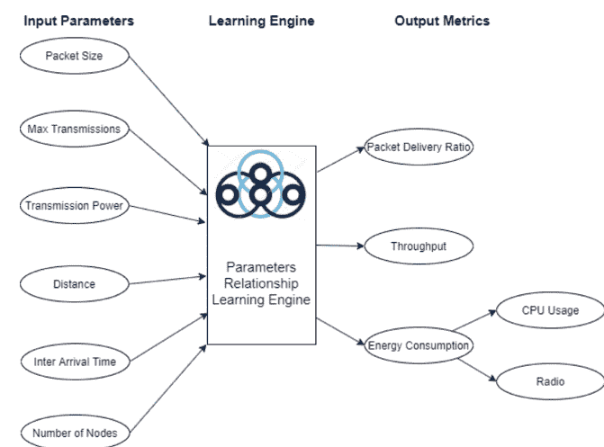

图 1. 通信参数与 QoS 指标之间的关系。

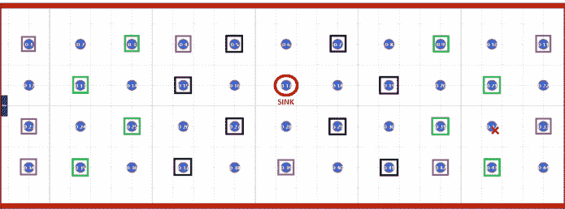

图 2. 涉及 8 个（黑色）、16 个（黑色+绿色）和 24 个（黑色+绿色+紫色）节点的实验拓扑，中心为沉节点（红色）。（有关本图例中颜色引用的解释，读者可参阅本文的网页版。）

### 2.1. 实验拓扑

实验拓扑如图 2 所示。实验设置配置在 w.iLab 测试平台 [22] 上，该平台位于比利时根特大学。发送节点使用方形表示（黑色、绿色和紫色），接收节点（沉节点）使用红色圆圈表示。紫色节点仅在节点数设置为 24 时参与实验。绿色节点在节点数为 16 或 24 时参与实验。黑色节点在节点数设置为 8、16 或 24 时参与所有实验。平均节点间距略超过 2 m，而接收节点/沉节点放置在网络中心。发送节点的数量在 8 个（黑色）、16 个（黑色+绿色）和 24 个（黑色+绿色+紫色）之间变化。图 2 摘自测试平台的实际仪表板，并放置了一个叉号以指示因维护或其他任何问题而功能失常的节点。在进行本实验期间，节点 0–32 不可用。

实验的最小运行时间基于参数值组合的数量。通信参数及其值的详细信息见表 1。基于表 1 中的描述，我们按以下方式介绍组合详情：

```
Total combinations = TP x NN x MT x PS x IAT
= 6 x 3 x 3 x 3 x 4
~ 650 (1)
```

这意味着实验针对这些近 650 个参数配置组合进行了运行。我们针对每个参数配置运行实验 600 s（10 分钟），并重复以期达到一致的行为。因此，运行实验所需的最少时间以及由于调度、技术困难、错误运行产生的开销如下：

```
Total time for experiments = Number of parameter configurations
x Time + Overhead(1/4th of actual time)
= 650 x 10 min + 1625 min
~ 6500 min + 1625 min
= 8125 min ~ 135 h = 06 days
(2)
```

### 2.2. 特征

数据收集后，进行特征（参数）提取。某些特征（例如 TP、PS、NN 等）直接使用；而其他特征（即 MP 和 PT）则基于其他特征（包括每个数据包信息）计算。同样，QoS 指标（PDR、THP 和 EC）从数据中计算得出。对参数与 QoS 指标之间的关系进行了彻底的统计分析，以揭示所进行实验的原理。所有这些特征

**表 1**
通信参数配置详情。

| 协议层 | 参数 | 不同值的数量 | 拟议值 | 依据 |
|---|---|---|---|---|
| 物理层 | TP：传输功率 (dBm) | 5-6 | -7, -5, -3, -1, 1, 3 | TP 值根据经验选择 |
| | NN：活跃节点数量 | 3 | 8, 16, 24 | 用于传输的发送节点数为 8、16 和 24 |
| | MT：最大传输次数 | 3 | 2, 4, 6 | 为了表征数据包传输行为 |
| 应用层 | PS：数据包大小 (字节) | 3 | 25, 50, 75 | 802.15.4 适用于小数据包大小 |
| | IAT：包间到达时间 (s) | 4 | NN = 8 | 2, 4, 6, 8 | 负载范围从非常低到非常高 |
| | | | NN = 16 | 4, 6, 8, 10 | |
| | | | NN = 24 | 6, 8, 10, 12 | |

作为输入提供给 ML 模型以计算预测误差。平均绝对误差（MAE）用作主要评估指标。训练使用 55% 的数据，15% 的数据用于验证。其余 30% 的数据用于测试。

### 2.3. 预测模型

ML 在无线场景中进行 QoS 预测方面具有巨大潜力。由于 PDR、THP 以及 EC 等 QoS 参数是连续的，因此回归模型适合预测此类变量。我们采用了在 JupyterHub 上运行的基于 GPU 的 Tensorflow 和 Keras API 笔记本中的 10 层 DNN。深度学习中可用的多功能构造展现出非常好的预测潜力。

考虑到 8 个拟议参数和 8 个待预测指标（PDR、THP、CPU、LPM、DLP、LSN、TX 和 Off），数据可以使用以下向量表示：

```
f_{(n,1)}, f_{(n,2)}, f_{(n,3)}, f_{(n,4)}, f_{(n,5)}, f_{(n,6)}, f_{(n,7)}, f_{(n,8)}, f_{(n,9)}, f_{(n,10)},
f_{(n,1.1)}, f_{(n,1.2)}, PDR, THP, CPU, LPM, DLPM, LSN, TX, Off
```

其中 f 和 n 分别表示输入特征（参数）和行（记录）编号，而 PDR、THP、CPU、LPM、DLPM、LSN、TX 和 OFF 是使用 ML 预测的指标。此数据作为输入传递给 DNN。DNN 中的计算包括前向传递和后向传递。前向传递使用以下公式计算：

```
O_{[l]}^i = W_{[l]}^i \cdot X_{[l-1]}^i + c_{[l]}^i,
X_{[l]}^i = f_{(l)}(O_{[l]}^i),
```

其中 l 表示当前层，O、W、X、C 和 f 分别表示输出、输入权重、回归参数和激活函数。激活函数（例如 ReLU）应用于输出 O 以获得下一层的输入 X。在前向传递之后，后向传递（其中 d 表示导数）使用以下公式计算：

```
dO_{[l]}^i = dX_{[l]}^i \times df_{(l)}(O_{[l]}^i).
dW_{[l]}^i = \frac{1}{n}(dO_{[l]}^i \cdot X_{[l]^T}^i),
dc_{[l]}^i = \frac{1}{n} \sum_{l=1}^n O_{[l]}^i,
dX_{[l-1]}^i = W_{[l]^T}^i \cdot dX_{[l]}^i,
```

这里 T 表示相关矩阵的转置。为了更新权重和回归参数，使用梯度下降执行：

```
W_{[l]}^i = W_{[l]}^i - \alpha \times dW_{[l]}^i.
```

```
b_{[l]}^i = b_{[l]}^i - \alpha \times dc_{[l]}^i.
```

alpha 的值设置为 0.001。alpha 的常规取值为 0.1、0.01 和 0.001。在此情况下，选择 0.001 是基于经验做出的。在应用和评估 ML 性能之前，计算参数与 QoS 指标之间的统计（Pearson）相关性，旨在了解所考虑的参数与指标之间的关系。使用上述 ML 模型评估测试数据时，我们将 MAE 用作指标。实验和预测的整个工作流程如图 3 所示。由于所提议系统是数据驱动的，它始于一个数据源。数据可以是预先录制的实例（和/或仿真）形式，用于引导系统。任何此类数据都将具有底层拓扑和参数配置。但是，当系统投入生产运行时，它应该与实际部署交互，并从 IoT 中 WSN 基础设施的不同安装点收集实时数据。数据需要经过预处理，以实现将通信参数表示为特征、将 QoS 指标表示为标签或目标的结构化格式。此预处理数据以简单的二维表格形式表示，由行和列组成。划分为训练集和测试集的数据经过学习模型处理，以达到足够的精度。此第一阶段的训练在离线状态下进行。考虑精度和效率，可以选择合适的模型进行部署。

## 3. 统计分析

以下是关于通信参数与 QoS 指标之间关系的图示分析。

### 3.1. 投递率

PDR 与不同通信参数之间的关系如图 4 所示。图 4(a) 揭示了 NN 和 TP 的影响。随着 NN 增加和 TP 降低，PDR 出现非常明显的下降趋势。图 4(b) 显示了 NN 与 PS 共同的影响。随着 NN 增加，PS 增加也会导致 PDR 降低。这证实了图 4(a) 中观察到的趋势。图 4(c) 描绘了 NN 和 MT 的影响。随着 MT 增加，PDR 的第 50 百分位数往往略有下降，而第 25 百分位数则有所上升。这种双重趋势既解释了使用较高 MT 值时的挑战性条件，也说明了更多传输尝试的积极影响。图 4(d) 强调了 MT 和 TP 对 PDR 的影响。TP 和 MT 同时增加会导致 PDR 值上升。PS 和 TP 的影响揭示了与图 4(d) 中 MT 和 TP 的情况相同的趋势（图 4(e)）。在更高 TP 级别下，较小的数据包更有可能到达目的地。图 4(f) 揭示了 PS 以及达到 PDR 的可能性的影响。再次可以清楚地看出，PDR 是


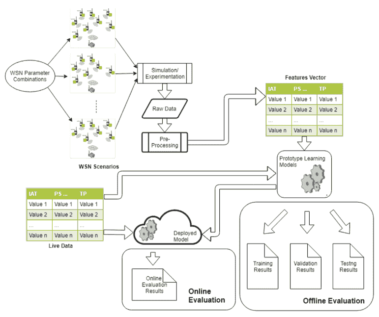

图 3. 展示数据生成、特征向量准备、模型训练和预测的系统模型。

与 PS 和距离成反比。同样，IAT 和距离对 PDR 的影响如图 4(g) 所示。随着 IAT 增加和距离减小，PDR 增加。

图 4 中的所有这些描述都突出了 PS、DT、TP、IAT、MT 和 NN 对 PDR 的影响。观察到的趋势鼓励使用 ML 来预测 PDR。

### 3.2. 吞吐量

THP 与不同通信参数的关系如图 5 所示。图 5(a) 突出了 PS 和 MT 对 THP 的影响。随着 PS 和 MT 值的增加，THP 上升。这很直观，因为更大的数据包减少了控制数据比例并增加了传输尝试次数，从而可以提高可靠性。图 5(b) 揭示了 NN 和 TP 对 THP 的影响。如所见，随着节点数量增加，THP 降低，而随着 TP 增加，THP 提高。

可以理解的是，更多节点使得通信难以同时进行。图 5(c) 显示了 PS 和 NN 对 THP 的影响。随着 NN 增加和数据包尺寸变小，THP 降低的趋势非常一致。图 5(d) 可以看到 NN 和 MT 对 THP 的影响。除了 NN 的 THP 趋势外，还可以观察到 MT 值越高，THP 越高。因此，THP 针对多个参数的行为在这些图中是一致的。

图 5(e) 显示了 MT 和 TP 对 THP 的影响。随着 MT 和 TP 值的增加，THP 增加。但是，与 MT 相比，TP 似乎更有影响力。同样，图 5(f) 揭示了 PS 和 TP 对 THP 的影响。随着 PS 和 TP 的增加，THP 增加。图 5(g) 揭示了随着 IAT 和 PS 的变化，THP 的行为。很明显，随着 PS 增加和 IAT 值减小，THP 增加，这意味着发送更多数据位且以更高速率发送的数据包可以提高吞吐量。图 5(h) 显示了 PS 对 PDR 和 THP 的影响。已经观察到（图 4(e)），随着 PS 增加，PDR 往往会略有下降。但是，它对 THP 产生不同的影响，因为随着更大的数据包尺寸而上升。因此，PS 证明是同时优化 PDR 和 THP 的一个冲突指标。

图 5(i) 强调了 DT 对 PDR 和 THP 的影响。随着 DT 增加，距离对 PDR 和 THP 都有相对一致的影响，两者都会下降。因此，DT 在这些可靠性相关指标中的作用似乎更具决定性。同样，图 5(j) 揭示了 IAT 对 PDR 和 THP 的影响。似乎以更短的间隔发送数据包会改善 THP。但是，IAT 与 PDR 之间的同样的关系存在差异。以更快的速率发送数据包会导致 PDR 略有下降。因此，IAT 也以冲突的方式影响 PDR 和 THP，需要仔细微调。

### 3.3. 能量消耗：无线电使用

#### 3.3.1. 监听模式

图 6(a) 显示了 PS 和 TP 对监听周期的影响。监听周期的增加与 PS 成正比。虽然 TP 的上升也会导致监听周期增加，但是，这种关系似乎不如 PS 与监听周期的关系强。图 6(b) 描绘了 NN 和 PS 与监听周期的关系。印证了 PS（图 6(a)）的关系，NN 也似乎会导致监听周期增加。特别是，随着 NN 增加到 24（最大值），监听周期也会增加。

#### 3.3.2. 关闭模式

图 6(c) 显示了 PS 和 TP 对无线电关闭周期的影响。随着 PS 增加，无线电关闭周期往往会减少，表明更大的 PS 会消耗更多能量。但是，TP 的影响似乎不太显著。但是，随着 TP 级别增加，关闭周期有轻微下降趋势。图 6(d) 揭示了关闭周期与 PS 和 NN 的关系。印证了 PS（图 6(c)）的影响，NN 对关闭周期的影响是反比的。更多节点倾向于增加节点的无线电关闭周期。

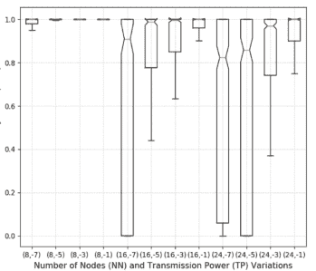

(a) NN 和 TP 与 PDR

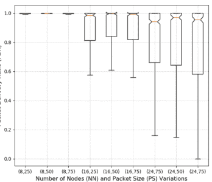

(b) NN 和 PS 与 PDR

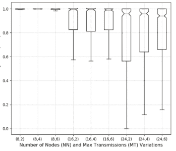

(c) NN 和 MT 与 PDR

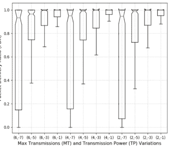

(d) MT 和 TP 与 PDR

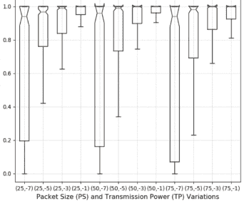

(e) PS 和 TP 与 PDR

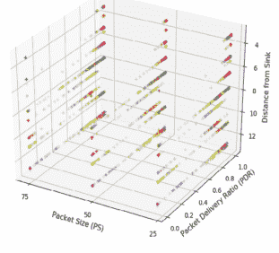

(f) PS 和 DT 与 PDR

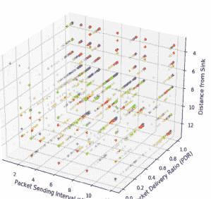

(g) IAT 和 DT 与 PDR

图 4. 通信参数与 PDR 的关系。

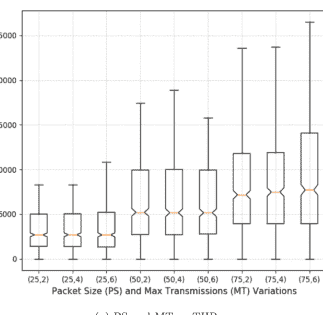

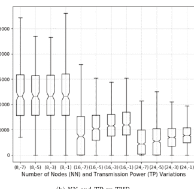

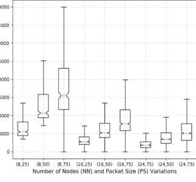

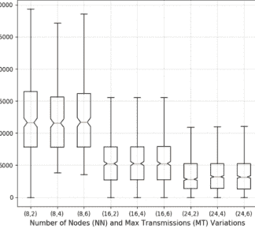

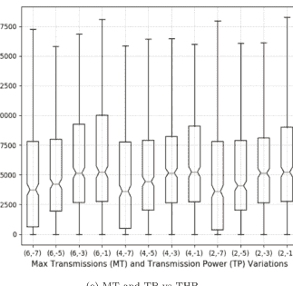

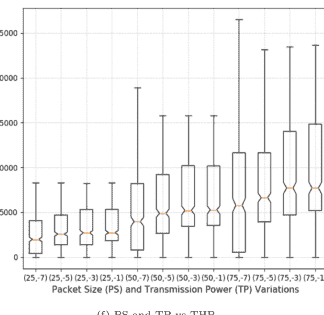

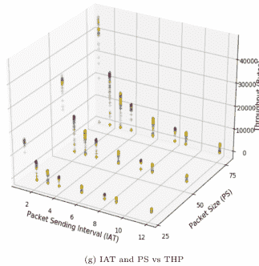

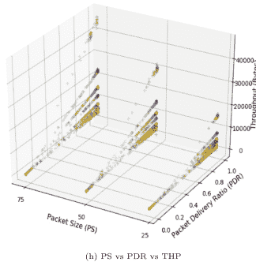

图 5. 通信参数与吞吐量的关系。

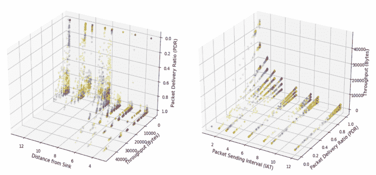

图 5.（续）。

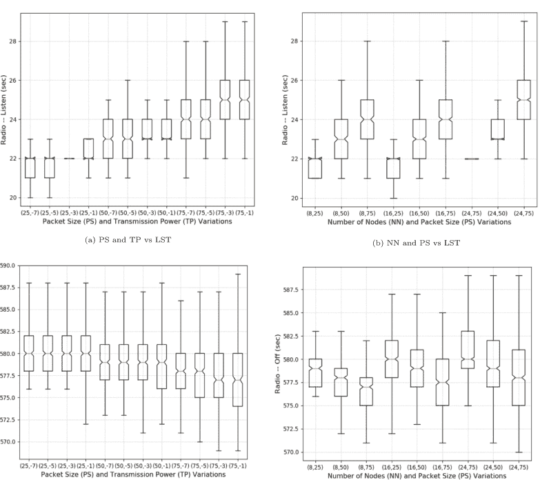

图 6. 通信参数与无线电使用的关系。

### 3.4. 能量消耗：CPU 使用

#### 3.4.1. 低功耗模式

图 7(a) 显示了 NN 和 TP 对 CPU LPM 周期的影响。随着 NN 和 MT 的增加，LPM 周期往往会增加。但是，当 PS 与 NN 组合使用时（图 7(b)），LPM 周期的这种增加趋势会更加明显。

#### 3.4.2. 深度低功耗模式

图 7(c) 显示了 NN 和 TP 对 CPU DLPM 周期的影响。随着 NN 的增加，DLPM 周期增加。DLPM 的行为随 TP 级别的变化而变化。当 NN 为 8 时，随着 TP 级别的增加，DLPM 似乎会增加。但是，对于较大的 NN 值，TP 级别的影响不一致。图 7(d) 描述了 NN 和 PS 对 DLPM 周期的影响。除了 DLPM 随 NN 的变化（图 7(c)）之外，增加 PS 会导致 DLPM 下降。图 7(e) 揭示了 DLPM 与 MT 和 NN 的关系。直观地，与 NN 不同，MT 的增加会导致 DLPM 下降。我们已以图形详细描绘了各种参数和 QoS 指标之间的关系。基于上述描述中观察到的趋势，我们深信应采用 ML 来识别基于不同参数变化的各种 QoS 指标的预测潜力。

## 4. 结果与讨论

### 4.1. 参数与指标之间的相关性

图 8 描述了统计相关性。它显示了参数/特征（y 轴）与 QoS 指标（x 轴）之间关系的 R² 分数。MP、TP、IAT、NN、DT 和 PS 与 THP 的相关分数大小分别为 0.77、0.77、0.59、0.53、0.35 和 0.35。在 PDR 的情况下，DT（0.55）证明是最相关的，其次是 TP（0.27）和 NN（0.26）。其他倾向于具有强相关性的指标包括发送时间（TiTx）、DLPM 时间（TiDLPM）和 CPU 时间（TiCPU）。TiTx 分别与 MP、TP、IAT、PS 和 DT 的相关分数为 0.54、0.54、0.46、0.30 和 0.27。DLPM 受 MP、TP 和 IAT 影响，分数分别为 0.38、0.37 和 0.31。CPU 时间段由 MP、TP、IAT 和 NN 决定，分数分别为 0.92、0.92、0.72 和 0.33。

这些相关分数印证了图 4、5、6 和 7 中所示的图形关系，并为基于考虑中的参数/特征值的变化来预测 QoS 指标提供了基础。

### 4.2. QoS 指标的预测结果

以下是基于 DNN 的 QoS 指标预测结果。图 9 揭示了针对每个特征以及当所有特征一起使用时，PDR 的预测误差（MAE）。总体而言，MAE 为 0.03，代表 97% 的预测准确率。最有影响力的特征是 DT、NN 和 TP，其次是 MP、IAT、TP、PS 和 MT。各特征报告的 MAE 与图 8 中观察到的相关分数一致。图 10 显示了 THP 的预测结果。使用所有特征时达到的最小 MAE 值为 538。考虑到


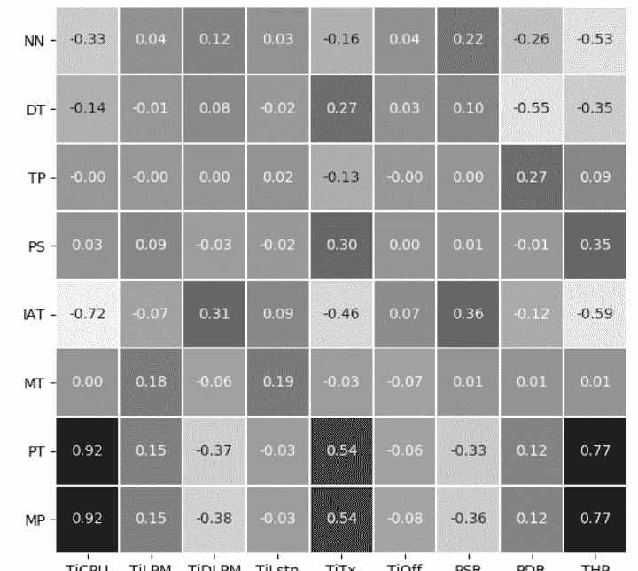

图 8. 相关系数矩阵。

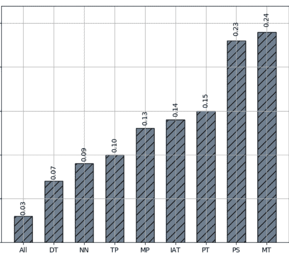

图 9. 数据包投递率预测误差。

最大 THP (46816) 的误差为 1.14%，而平均 THP (6613) 的误差为 8.14%。PT、IAT、MP、PS 和 NN 的 MAE 值分别为 1106、1642、1732、1861 和 2191。因此，这些特征对 THP 的预测有显著贡献。这些贡献特征也体现在相关系数矩阵中，与 THP 具有更强的关系。图 11(a) 揭示了无线电监听时间消耗的预测误差。监听时间范围在 1 到 102 之间，平均值和中位数分别为 24 和 23。当所有特征一起使用时，MAE 的最小值为 9.6，表明在监听时间范围内准确率超过 90%。预测监听时间最有影响力的特征是 MT、NN、MP 和 IAT，其 MAE 值分别为 18.8、29.4、32.9 和 38.3。

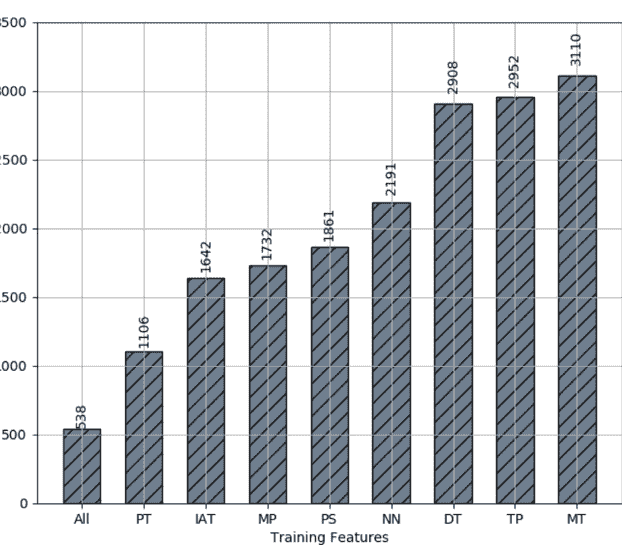

图 10. 吞吐量预测误差。

| 指标 | PDR | THP | 发送 | 监听 | 关闭 | CPU | LPM | DLPM |
|---|---|---|---|---|---|---|---|---|
| MAE | 0.0368 | 538.7 | 0.4815 | 9.603 | 82.06 | 6.325 | 19.08 | 44.05 |
| RMSE | 0.0413 | 788.4 | 0.5122 | 13.272 | 108.2 | 8.549 | 26.57 | 51.76 |
| MAPE | 0.0368 | 0.0982 | 0.1038 | 0.1246 | 0.1582 | 0.2235 | 0.1864 | 0.0829 |
| R | 0.9812 | 0.9538 | 0.9451 | 0.9509 | 0.8964 | 0.8723 | 0.8984 | 0.9667 |
| p值 | <0.01 | <0.01 | <0.01 | <0.01 | <0.05 | <0.05 | <0.05 | <0.01 |

图 11(b) 显示了无线电 OFF 周期的预测误差。数值范围为 10 到 591 秒。平均值和中位数分别为 577 和 579。针对所有特征的 MAE 最小值为 82，表明在 OFF 周期范围内准确率超过 85%。PT、MP、NN、IAT 和 MT 的 MAE 值分别为 142、151、164、169 和 192，其贡献大于其他特征。结果与图 8 中展示的相关系数得分一致。无线电发送时间消耗的预测结果如图 11(c) 所示。发送周期数值范围在 0 到 5 之间，平均值和中位数均约为 1。针对所有特征达到的最小 MAE 为 0.481，表明准确率超过 90%。然而，由于时间以秒为粒度；因此，发送周期的定量准确性不够高，因为单个数据包传输可以在更精细的尺度上进行更好的测量。PS、PT、MP 和 IAT 证明更为重要，其 MAE 值分别为 0.587、0.595、0.626 和 0.639。这些结果与图 8 中显示的相关系数得分一致。

图 12(a) 描述了 CPU 使用率的预测结果。数值范围在 1 到 36 之间，平均值和中位数分别为 15 和 14。使用所有特征的最小 MAE 为 6.32，表明准确率超过 80%。MP、IAT、PT 和 NN 的 MAE 值分别为 9.34、9.68、10.21 和 13.48。特征的这一重要性也在相关系数矩阵（图 8）中得到证实。

CPU 在低功耗模式下运行的预测误差如图 12(b) 所示。LPM 周期数值范围从 1 到 106。平均值和中位数分别为 33 和 32。使用所有特征的 MAE 最小值为 19。这表明准确率超过 80%。在 LPM 周期范围内准确率为 82%。最贡献的特征是 MP、PT、MT 和 PS，其 MAE 值分别为 29、34、50 和 57。这些发现再次与图 8 中报告的相关系数得分一致。图 12(c) 描述了 CPU 在深度低功耗模式下运行的预测结果。DLPM 数值范围从 10 到 574，平均值和中位数分别为 554 和 557。针对所有特征的 MAE 最小值为 44，使准确率超过 92%。预测 DLPM 最贡献的特征是 MP、PT、MT、PS 和 IAT，其 MAE 值分别为 92、102、122、145 和 157。

详细的预测统计结果如表 2 所示。除 MAE 外，还包括均方根误差（RMSE）、平均绝对百分误差（MAPE）、相关系数（R）和 p 值。除 PDR 外，所有指标的 RMSE 值普遍高于 MAE。这表明 THP、无线电和 CPU 参数等指标的数据分布较大。THP（538.7 对比 788.4）和关闭周期（82.06 对比 108.2）的数值尤其高，表明方差较高。PDR、THP 和 DLPM 的 MAPE 在 10% 以内。而 CPU 的 MAPE 则超过 20%。p 值验证了总体假设，即研究中的指标与所考虑的通信参数之间存在显著相关性。

## 5. 结论

现代通信系统设想为自适应系统。软件定义网络和网络功能虚拟化的出现使得实现自适应设计成为可能。这种自适应设计可以通过机器学习的帮助，利用可配置通信参数的动态微调来实现。本文展示了利用机器学习预测无线传感器网络和物联网中服务质量指标的潜力，基于流量速率、数据包大小、发射功率、最大传输次数、节点数量和距离等参数。服务质量指标的准确预测有助于为物联网设计数据驱动的自适应通信系统。数据通过大量实验收集，并进行统计分析以识别通信参数与服务质量指标（如数据包投递率、吞吐量、能耗（包括 CPU 和无线电））之间的关系。

这些相关性鼓励采用机器学习等智能技术。预测结果足够准确，并为基于自适应设计的产品和解决方案开发提供了基础。未来，我们打算开发一个自适应系统的工作原型，该系统将通信网络与云集成，并使用实时性能数据进行预测。

## 资助

本研究由巴基斯坦高等教育委员会在大学国家研究计划（NRPU）7522/Balochistan/NRPU/R&D/HEC/2017 下资助。

## 竞争利益声明

作者声明，他们没有已知的可能影响本文所报告工作的竞争性财务利益或个人关系。

## 致谢

本工作得到韩国国家研究基金会在 BK21 FOUR 项目下的支持。

## 参考文献

- [1] L. Mainetti, L. Patrono, A. Vilei, 无线传感器网络向物联网的演进：一项调查, 载于: SoftCOM 2011, 第 19 届软件、电信和计算机网络国际会议, IEEE, 2011, pp. 1–6.
- [2] L.M. Borges, F.J. Velez, A.S. Lebres, 无线传感器网络应用特征与分类调查, IEEE Commun. Surv. Tutor. 16 (4) (2014) 1860–1890.
- [3] B. Rashid, M.H. Rehmani, 城市地区无线传感器网络应用：一项调查, J. Netw. Comput. Appl. 60 (2016) 192–219.
- [4] A.B. Noel, A. Abdaoui, T. Elfouly, M.H. Ahmed, A. Badawy, M.S. Shehata, 利用无线传感器网络进行结构健康监测：一项全面调查, IEEE Commun. Surv. Tutor. 19 (3) (2017) 1403–1423.
- [5] S. Fu, Y. Zhang, Y. Jiang, C. Hu, C.-Y. Shih, P.J. Marron, WSN 链路多层参数配置的实验研究, 载于: 2015 IEEE 第 35 届分布式计算系统国际会议, IEEE, 2015, pp. 369–378.
- [6] D. Loukatos, K.G. Arvanitis, 实验可扩展农业物联网应用场景中的多模态传感器节点, 载于: 基于物联网的环境与生态工程智能建模, Springer, 2021, pp. 101–128.
- [7] F. Xhafa, B. Kilic, P. Krause, 边缘计算层中语义数据丰富的物联网流处理评估, Future Gener. Comput. Syst. 105 (2020) 730–736.
- [8] N. Dimitriou, L. Sarakis, D. Loukatos, G. Kormentzas, C. Skianis, 未来协作无线网络垂直切换（VHO）框架, Int. J. Netw. Manage. 21 (6) (2011) 548–564.
- [9] S. Grimaldi, A. Mahmood, M. Gidlund, 基于 SVM 的工业无线传感器和执行器网络外部干扰分类方法, J. Sens. Actuator Netw. 6 (2) (2017) 9.
- [10] D. Yuan, S.S. Kanhere, M. Hollick, 无线传感器网络测量——关于重要指标的调查, Pervasive Mob. Comput. 37 (2017) 45–62.
- [11] T. Liu, A.E. Cerpa, 基于链路特征的数据驱动链路质量预测, ACM Trans. Sensor Netw. 10 (2) (2014) 1–35.
- [12] M. Kulin, E. De Poorter, T. Kazaz, I. Moerman, 迈向认知 MAC 层：利用机器学习预测动态 WSN 中的 MAC 级性能, 载于: EWSN2017, 嵌入式无线系统与网络国际会议, 2017, pp. 1–2.
- [13] A. Akbas, H.U. Yildiz, A.M. Ozbayoglu, B. Tavli, 无线传感器网络优化模型基于神经网络的即时参数预测, Wirel. Netw. 25 (6) (2019) 3405–3418.
- [14] H. Wu, K. Yue, B. Li, B. Zhang, C.-H. Hsu, 基于上下文敏感矩阵分解的协作 QoS 预测, Future Gener. Comput. Syst. 82 (2018) 669–678.
- [15] G. White, A. Palade, C. Cabrera, S. Clarke, IoTpredict：物联网中的协作 QoS 预测, 载于: 2018 IEEE 普适计算与通信国际会议（PerCom）, IEEE, 2018, pp. 1–10.
- [16] H. Wu, Z. Zhang, J. Luo, K. Yue, C.-H. Hsu, 基于上下文的深度神经模型多属性 QoS 预测, IEEE Trans. Serv. Comput. 14 (4) (2018) 1084–1096.
- [17] G. White, A. Palade, S. Clarke, 物联网中可靠服务组合的 QoS 预测, 载于: 面向服务计算国际会议, Springer, 2017, pp. 149–160.
- [18] M. Ateeq, F. Ishmanov, M.K. Afzal, M. Naeem, 物联网中可靠性和能耗的多参数分析：一种深度学习方法, Sensors 19 (2) (2019) 309.
- [19] M. Ateeq, F. Ishmanov, M.K. Afzal, M. Naeem, 利用深度学习预测物联网中的延迟：一种多参数方法, IEEE Access 7 (2019) 62022–62031.
- [20] M. Ateeq, M.K. Afzal, M. Naeem, M. Shafiq, J.-G. Choi, 基于深度学习的物联网多参数预测, Sustainability 12 (18) (2020) 7752.
- [21] M. Ateeq, H. Habib, M.K. Afzal, M. Naeem, S.W. Kim, 迈向物联网中 QoS 的数据驱动控制：释放多样化数据集的潜力, IEEE Access 9 (2021) 146068–146081.
- [22] W-iLab.t 测试平台, https://doc.iliabt.imec.be/iliabt/wilab/index.html. (访问日期: 27-Feb-2021).

