# 认知机器人学（智能机器人与自主代理系列）


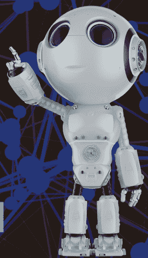


致 Stella 和 Virginia（AC）

献给我亲爱的儿子 Ryu 的纪念，以及 Jin 和 Yuko（MA）


## 前言

> 真理只有通过创造或发明才能得到验证。
> ——Gianbattista Vico

人工智能（AI）、机器学习和机器人技术已成为家喻户晓的术语，这得益于AI在医疗保健、银行业、网络以及核退役场地机器人测试、作为儿童和老年人的社交伴侣，以及最近用于管理COVID-19时代感染风险等各种应用中的重大进展。尽管如此，在机器人配备AI算法能实际做到的事情上，存在某些情况下的过度承诺，但构建具有类人行为、认知和社会能力的机器的挑战仍是一项大胆的事业。

认知机器人学提供了一种新颖且富有洞察力的方法来应对构建人工智能驱动的智能机器人的大胆挑战，即从自然认知系统（即人类、动物、生物系统）如何开发智能中汲取灵感，充分发挥其身体与大脑之间、其所处的物理和社会环境之间，以及其系统发生、发展和学习动力学之间相互作用的全部潜力。这与维科“真理只有通过创造或发明才能得到验证”的哲学方法相一致。也就是说，通过创造或发明新事物——例如，设计计算认知架构以控制认知代理，或开发机器人内在动机和意识能力的机器学习模型，或进行实验以测试机器人在世界中感知、规划和行动的能力——我们可以验证科学理论、假设或模型的有效性。

认知机器人学这一术语和领域起源于20世纪90年代，在过去三十年的研究中，居然没有一本全面的出版物涵盖认知启发型智能机器人系统的广度和深度，这有些令人惊讶。这正是本书的目标：提供对认知机器人学研究及其定义、方法、方法论和应用的首个全面、最先进的覆盖。我们将在第一部分（“定义与方法”）中拉开序幕，对认知机器人学这一术语进行系统定义，并概述其历史发展。本部分还将详细讨论认知机器人学的五种主要开创性方法：发展性方法、神经方法、进化方法、群体方法和软体机器人学。第二部分（“方法与概念”）进一步阐述该领域所采用的主要方法和概念。内容从对最常用的认知机器人平台和机器人模拟器的分析，到生物仿真皮肤作为基于硬件的认知机器人方法的案例。另外两个方法论章节探讨了机器学习方法和认知架构的使用。此外，我们还探讨了认知机器人中的理论考量，例如具身性以及机器人技术和AI的伦理影响。最后第三部分（“行为与认知能力”）包含一系列章节，涵盖各种行为和认知能力方面的机器人模型、实验和应用的广泛范围。范围从内在动机和感知，到社会认知和语言，再到机器人意识问题。这些章节还将明确讨论启发认知机器人模型和实验的心理学和神经科学发现与原则。

本书的目标读者包括希望了解该领域概念和方法的硕士和博士生，以及对特定认知机器人模型和实验感兴趣的研究人员。本书面向跨学科读者，在面向计算读者的技术细节和示例与面向经验科学读者的理论问题及机器人实验高层次描述之间取得平衡。

我们希望读者能享受了解人类和动物认知发展与学习的心理学和神经科学发现与智能机器人设计之间有益联系的过程。

Angelo Cangelosi 和 Minoru Asada


## 致谢

本卷主要是各章作者辛勤奉献的结果。

他们是认知机器人领域的先驱。

尽管他们繁忙的工作涉及教学、研究、撰写论文和申请书以及机构行政职责，但他们仍慷慨地投入时间和精力撰写这些章节。

每位作者还担任其他章节的匿名交叉评审，以确保工作的质量和清晰度。

我们还要感谢MIT出版社的工作人员——特别是Marie L. Lee对书籍提案的热情和支持，以及Elizabeth P. Swayze和Alex Hoopes在手稿准备后期阶段的支持。

特别感谢Stella Cangelosi在参考文献和手稿格式方面的详尽帮助。

该项目的最初想法和工作始于Angelo Cangelosi访问日本国家先进工业科学技术研究所（AIST）人工智能研究中心的一次访问期间。

这些访问得到了AIST向曼彻斯特大学提供的资助的支持。

特别感谢AIST所长辻井淳一，AIST的同事Tetsuya Ogata、Kristiina Jokinen和Junpei（Joni）Zhong，以及曼彻斯特的Sophia Ananiadou，使这次合作成为可能。

Angelo Cangelosi在认知机器人方面的工作，以及本卷的出版，也得益于欧盟Horizon 2020计划（即STRoNA、DCOMM、eLADDA、TRAINCREASE和PERSEO项目）、美国空军科学研究办公室（项目THRIVE++，AFOSR-EOARD奖FA9550-19-1-7002）、本田研究院欧洲（DeCIFER项目）以及英国研究与创新可信自主系统信任节点的慷慨研究资助支持。

Minoru Asada及其研究团队在该领域工作已超过四分之一个世纪，以下研究项目对他们的工作作出了贡献，其中一些已在本书中介绍：日本科学技术振兴机构前沿研究支援计划Asada协同智能项目（2005–2011）；日本学术振兴会“以理解从神经动力学到社会互动的过程为基础的建设性发展科学”特别促进研究资助项目（2012–2016，PI：Minoru Asada）；以及文部科学省“创新领域科学研究”建设性发展科学资助项目（2012–2016，PI：Yasuo Kuniyoshi）。

## 1 什么是认知机器人？

Angelo Cangelosi 和 Minoru Asada

### 1.1 背景与定义

更广泛的机器人学领域涉及构建带有传感器和执行器的硬件机电平台，以在物理世界中执行动作，并设计软件解决方案，以有目的的——即智能的——自适应方式连接感知和执行，以实现任务目标，具有不同程度的自主性。

例如，Matarić（2007, 2）将机器人定义为“存在于物理世界、能够感知环境并能对其采取行动以实现某些目标的自主系统”，这一点得到了体现。

如果我们关注机器人学的软件方面，构建目标导向的智能和自适应能力的工具和方法在很大程度上与人工智能（AI）的方法和技术相重叠。

这些方法从传统的基于知识的推理和规划系统（GOFAI）到最新的深度神经网络和强化学习机器学习算法不等。

这种结合机器人学和人工智能的领域可以称为“智能机器人学”，或者如Murphy（2019）最近提出的，“AI机器人学”。

Murphy（2019, 7）将智能机器人定义为“一个物理位置化的智能代理”。

这一称谓的基础在于：机器人在现实世界中具有物理位置，并具备适合执行特定任务的具身物理结构；同时，智能代理被视为一种感知环境并采取行动以最大化其适应世界成功机会的系统。

这种智能机器人的定义和概念在实际中与Matarić对机器人的一般定义基本一致。

事实上，（软件）机器人学与智能机器人学之间的差异是一个非常模糊的区分，因为没有研究人员真正主张要构建“笨”机器人。

即使是Barbara Webb（1993）将其关于机器人蟋蟀的项目定义为模拟“笨动物和愚蠢机器人”的目标，也需要使用非平凡的计算机科学和人工智能方法。

那么，什么是认知机器人学？它与智能机器人学（AI机器人学）相同吗？

文献中对认知机器人学（以下简称CR）提出了不同的定义。

1997年，Stein在阐述CR的架构原则时提出了CR的第一个定义。

Stein（1997, 471）将CR定义为“构建具身智能系统的努力，其方法大部分借鉴认知科学和具身智能系统的自然示例”。

Kawamura和Browne（2009, 1）将CR定义为“在感知、运动控制和高级认知方面设计和使用具有类人智能的机器人”，并强调需要来自机器人学、人工智能、认知科学、神经科学、生物学、哲学、心理学和控制论等多个领域的跨学科贡献。

Metta和Cangelosi（2012, 613）提出，CR是“利用生物启发方法设计自主机器人的感知运动、认知和社会能力”。

所有这些定义都强调机器人设计中跨学科方法的作用，以及关注从感知运动到高阶认知功能乃至社会技能的人类类似和生物启发功能。

特别是，认知科学（尤其是心理学和神经科学等对人类认知感兴趣的学科）对CR有着根本性的影响。

然而，这种以人为中心的焦点并不排除在设计生物启发认知机器人（如陆龟和蟋蟀）时，从动物认知和神经科学中汲取互补的见解（参见1.2节和1.3.1节中的Walter的陆龟）。

其他研究者将CR主要描述为独特地专注于整合高阶功能（如推理），以补充智能机器人学中对感知和行动的标准关注。

De Giacomo（1998, 1）在组织第一次专门致力于CR的会议（1998年人工智能促进协会[AAAI]认知机器人学冬季研讨会——参见1.3.2节）时，将CR定义为“在统一的理论和实现框架内整合推理、感知和行动的领域”。

Levesque及其同事在定义CR时也关注高阶功能，将其定义为“在动态且不完全已知的世界中，自主机器人（或代理）面临的知识表示和推理问题的研究”（Levesque和Lakemeyer 2008, 869；另见Levesque和Reiter 1998）。

正如我们将在1.2节中看到的，CR定义中对推理技能的强调与早期AI知识表示专家对CR的部分影响有关。

为了总结和整合对CR描述的各种历史贡献，我们希望提出一个全面的CR定义，结合上述对生物启发——即类人和类动物——行为和智能的强调，以及具有认知神经科学和生物学强大贡献的独特跨学科方法：

*认知机器人学是将人工智能以及认知科学和生物学的见解和方法应用于机器人学的领域。*

当前的大多数CR模型通常专注于设计一种或几种生物启发的感知运动和认知技能，如本卷第三部分所介绍的CR模型所示。

然而，CR中的一些作品还强调对一系列认知功能的系统层面集成进行建模——例如，将推理和社会技能等高阶功能与感知运动知识相关联。

既然我们已经定义了CR，这个领域是否与智能机器人学（AI机器人学）相同？

在科学领域，试图在不同的（子）学科和方法之间创造人为的、僵化的区分既不可能，也适得其反。

尽管CR与智能机器人学之间的一个主要区别在于CR强烈强调设计生物启发和认知启发的认知机器人，但在现实中，两个领域之间存在着一个连续体。

一方面，存在严格受限于已知生物学的CR模型


为模拟和复制在自然生物体中观察到的认知发展现象而构建的机制。例如，Mori 和 Kuniyoshi（2010）在其产前运动技能发展模型中对人类胎儿的真实渲染（第 3 章），以及 Morse 等人（2015）对早期语言学习中具身化线索的儿童心理学实验的复制（第 20 章），即属此类。另一方面，研究人员通过组合 AI 技术在智能机器人中实现了各种认知技能，而无需为其生物学灵感或功能提供任何理由。

将 CR 视为一种用于在机器人中建模类人认知的集成性、系统性方法，这一框架也解释了它与认知系统这一相关建模领域及其相关认知定义之间的密切联系。认知系统领域（又称人工认知系统）是指创造具有类人认知的机器和软件系统——即“自我依赖的能力、能够想明白事物的能力、独立自适应的预期行动能力”（Vernon 2014, 2）。认知系统还倾向于关注高层认知、结构化表征和系统视角、来自人类认知的影响以及探索性研究（Langley 2012）。作为一门学科，认知系统通常指使用模拟和虚拟代理以及物理机器人进行认知建模的更广泛领域，以及各种基于软件的代理和基于硬件的智能对象（Morris 等人，2005；Vernon 2014）。在最广泛的意义上，这已扩展到智能人机交互系统的设计（又称认知系统工程；Woods 和 Roth 1988）以及 IBM Watson 应用程序等通用 AI 系统（High 2012）。就 CR 而言，当我们考虑使用物理机器人的认知系统子领域时，存在显著的重叠，包括对身体-环境物理动态复制具有高度保真度的模拟机器人代理认知系统。

Vernon（2014）在建模人工认知系统时考虑四个方面：
- 我们从自然系统中汲取多少灵感
- 我们在复制它们时力求多么忠实
- 我们认为系统的物理结构有多么重要
- 我们如何将认知能力的识别与最终决定其实现方式分开

这些方面提供了一种方法，将单个认知系统（和 CR）模型定位在一个二维空间中，其中一个轴定义了从纯粹计算方法到强烈受生物模型启发的模型的光谱，另一个轴定义了目标生物模型的抽象级别。

认知系统领域的一项重要贡献是提供了一种更全面的认知操作定义。根据 Vernon（2014, 8）对人工认知系统中认知的详细刻画，认知可以定义为“自主系统感知其环境、从经验中学习、预期事件结果、为追求目标而采取行动，并适应不断变化的环境的过程”。因此，认知可以被视为一种全系统过程，它在自主性、感知、学习、预期、行动和适应这几个关键属性中整合了代理的所有能力。特别是，认知可以表示为预期、同化和适应的循环，体现在行动和感知的连续过程中，并通过学习动态适应（图 1.1）。

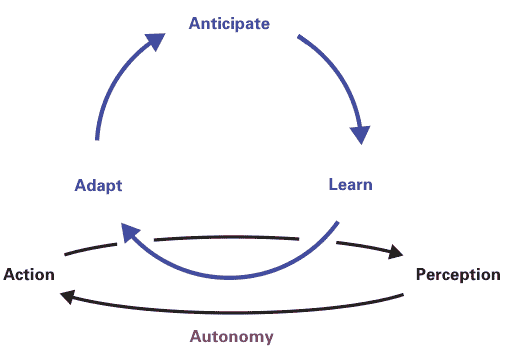

**图 1.1**
人工认知系统中认知的六个关键属性。来源：改编自 Vernon 2014。

这种认知定义及其六个关键属性的识别，可以解释代理应具备的各种技能和能力：目标导向行为、自主性、通过合作和沟通进行的交互、意图读取、对预期和意外事件的解释、对自己和他人行为结果的预测、行动选择和评估、适应不断变化的环境、从经验中学习，以及监控和纠正其自身表现（Vernon 2014）。

这种认知观点与 CR 中机器人从低层次（感知和行动）到高层次（预期）能力的系统性和更广泛覆盖相一致。然而，它强调对认知动态过程（同化、适应、学习）的建模。这与 CR 中的动态系统方法一致，例如在发展机器人学中（参见第 3 章）。

对认知的系统性和集成方法的综合关注，对生物灵感的类人和类动物认知能力的建模，以及对 CR 的跨学科方法，正如其上述定义所体现的那样，将构成接下来章节中对最新技术综述的特征。当然，并非所有单独的 CR 模型都旨在在单个机器人中建模行为和社会认知技能的完整范围。通常，特定的 CR 模型将实现此类类人（和/或类动物）能力的一个子集，具体取决于机器人必须执行的具体任务和技能，或者机器人模型旨在操作化和评估的认知机制。大部分在第 III 部分中介绍的 CR 模型和实验将属于此类情况，每个章节主要侧重于特定能力，从感知、导航和操纵到社会和语言技能，再到高层次推理和意识。

接下来，我们将探讨影响并推动 20 世纪 90 年代后期 CR 领域出现的行为和智能建模的主要认识论和理论方法。然后，我们将总结 CR 的起源和历史发展。

### 1.2 灵感原则与理论

早期的 CR 方法受到行为和认知建模中理论和计算立场的影响，特别是受到具身认知立场（例如，Clark、Pfeifer）和基于行为的机器人学及高阶推理功能 AI 建模计算方法的影响（例如，Brooks）。另一个灵感，特别是从历史角度来看很重要，是对简单类动物生物体建模的综合方法开创性工作（Walter、Braitenberg）以及早期机器人学计算神经科学模型（Edelman，Krichmar）的直接影响。下面我们将简要讨论具体的理论和建模工作，这些工作激励机器人研究人员采用面向智能机器人和 CR 的认知和生物灵感方法。

#### 1.2.1 具身认知理论

具身认知是研究自然智能系统的一种方法，强调感觉运动知识和表征的作用，以及我们自身身体与环境在产生智能行为中的相互作用。特别是，强具身认知论认为，身体在代理的认知处理中发挥着重要的因果作用，作为一种物理构成性角色（Wilson 和 Foglia 2017）。一种相关的方法是基体认知（Barsalou 2008; Pezzulo 等人，2013），它强调表征和内部模拟机制的感觉运动（“模式”）性质（Vernon 2014）。有关具身化和具身认知的详细讨论，请参见第 11 章。

具身认知已影响了各个学科，包括心理学（Pecher 和 Zwaan 2005；Barsalou 2008）；认知科学（Clark 1999）；神经科学（Pulvermüller 和 Fadiga 2010）；以及各种计算建模领域，如语言基体化（Cangelosi 2010）、感觉运动图式学习（Lara 等人 2018）和计算具身神经科学（Caligiore 等人 2010）。第 11 章还将对这一问题及其对 CR 的具体贡献进行详细讨论。

在 CR 的非常早期阶段，关于具身认知有两种主要的理论立场，后来被明确承认对最初的认知机器人产生了影响。这些是 Andy Clark（1999）关于具身认知科学的理论以及 Rolf Pfeifer 关于具身智能和形态计算的立场。

Clark 和 Grush（1999）专门为通往 CR 的路径提出了一种理论立场。这基于“笛卡尔代理人”隐喻——即直接具身、耦合的现实世界行动采取与解耦的离线推理能力的结合。因此，代理人的认知现象涉及离线推理，即环境的替代性探索和内部表征。

这种对基于具身体验的离线推理功能的关注对 CR 产生了强烈影响（Kawamura 和 Browne 2009），也促成了早期 CR 对在机器人中建模知识表征和推理的部分强调（Levesque 和 Reiter 1998；Aiello 等人 2001）。

这种对高阶认知的认识论关注，补充了通过感觉运动协调发展认知能力的平行强调。这是 Pfeifer 及其同事提出的主要立场（Pfeifer 和 Scheier 2001；Pfeifer 和 Bongard 2006）。这种具身认知观由“形态计算”概念所体现——即，某些感觉运动和认知控制过程由身体及其与环境的相互作用执行，而不是由大脑执行。Pfeifer 和 Bongard（2006）以人类腿部的肌肉和肌腱具有弹性为例，这直接影响运动控制。当腿在跑步时撞击地面，膝盖会进行小的适应性运动，而无需


神经控制。因此，控制由肌腱系统本身提供，而肌腱系统是智能体形态的一部分。这种形态计算原理也可应用于机器人学。一个直接的例子是“被动式步行者”（Collins et al. 2005; McGeer 1990），这是一种简单的机器人，它利用带有斜坡轨道和带有柔性膝盖的双腿结构，利用重力向下移动。这无需任何电动机或电能即可实现。

这种对认知的感知运动具身性的关注极大地影响了CR的发展，因为许多早期认知机器人都利用了形态计算原理（第11章）。例如，软体机器人利用传感器和执行器软材料的动力学（第6章和第8章），进化和群体机器人学用于耦合体-脑-环境系统的自动设计（第4章和第5章），以及发育机器人学及其将具身认知原理应用于运动发展模型（第3章）。

#### 1.2.2 AI 与知识系统

AI的经典（GOFAI）方法，以其针对知识系统、符号表示和推理的方法及其广度，也是影响CR的关键因素之一。我们已经提到了Levesque、Reiter、De Giacomo及其同事在CR学科和社区启动阶段的早期工作。在1998年AAAI认知机器人学冬季研讨会上，许多参与者为“认知机器人学宣言”做出了贡献，其明确目标是建模高级别机器人控制，其中机器人智能体需要使用显式知识表示系统进行推理，以得出如何行动的决定（Levesque and Reiter 1998; Aiello et al. 2001）。

这种方法遵循感知-推理-行动（或感知-规划-执行）范式，强烈强调用于连接机器人感知与行动的AI推理/规划方法和模型。它通常涉及情境演算、描述逻辑和几何推理等方法，这些方法通常应用于RoboCup挑战和移动机器人平台的行动规划与导航（例如，Woodbury and Oppenheim 1988; Aiello et al. 2001；但见 Asada and von Stryk [2020]，以了解关于RoboCup挑战所带来的科学与技术挑战的最新讨论）。

#### 1.2.3 行为机器人学

CR的另一条路径源于基于行为机器人学及Brooks（1991, 1996; Arkin 1998）提出的覆盖架构的替代性AI方法。与AI的符号和表征方法强烈对立，Brooks声称智能行为可以通过反应式架构实现，具有直接的感知-行动循环，且不需要中间（符号）表征。Brooks（1991）的“无表征智能”nouvelle AI宣言论文便是此类方法的典范。

在最初关注动物行为的移动机器人模型（由此催生了iRobot Roomba商用扫地机器人）之后，行为机器人学方法导致了人形机器人中行为与认知的建模（Brooks 1996; Matarić 1998）。这包括COG和KISMET平台上的项目（Brooks and Stein 1994; Brooks et al. 1998）。这项工作明确促成了一种跨学科方法，利用行为机器人学作为合成人工行为和分析自然行为的工具，直接从认知科学、神经科学和生物学中汲取灵感，并采用人工生命、进化计算和多智能体系统的方法（Breazeal 2004）。在CR运动中，这与进化和群体机器人学的发展密切相关（分别在第4章和第5章）。

#### 1.2.4 合成方法论

“合成方法论”和“合成神经建模”在行为和认知建模方面的方法也影响了CR（Krichmar 2012）。这些方法基于在模拟虚拟环境或通过物理平台中重建具有大脑灵感控制系统的具身智能体的理念。它们提供了一种平衡的方法，强调大脑、身体和环境之间交织的相互作用。直接影响CR的主要合成方法论来源于Grey Walter的“乌龟”、Valentino Braitenberg的“车辆”以及Chris Langton的人工生命系统。Grey Walter是一位神经科学家，也是行为和认知建模合成方法的先驱。在20世纪40年代末和50年代初，他开发了一组机电机器人，称为乌龟，能够执行光趋性、跟随光源和归巢行为（前往电池充电站）等简单任务。Walter的第一个机器人名为Machina Speculatrix，源自拉丁语动词*speculari*，意为“探索”，因为乌龟会主动探索环境，就像动物一样。Walter给两个原型机器人起了绰号EL SIE（来自Electromechanical robot, Light Sensitive with Internal and External stability）和ELMER（ELECTroMEchanical Robot, Walter 1950, 1953）。他还提出了一个名为CORA（COnditioned Reflex Analogue）的电学学习电路，用于模拟巴甫洛夫条件反射（Walter 1951）。这些系统实现了简单的神经电路。对合成和受神经启发建模的关注激励了CR领域的许多研究人员。例如，Edelman及其同事开发的Darwin系列机器人（1992; Krichmar and Edelman 2003）遵循这种用于移动机器人的合成方法论，但更强调使用计算神经科学模型。这促成了CR神经机器人学方法的发展（参见第2章）。

心理学家Braitenberg随后提出了一种合成建模方法。在他著名的著作*车辆：合成心理学实验*中，Braitenberg（1986）描述了一系列简单移动智能体（即车辆）的理论（虚构）模型。例如，Vehicle 1是最简单的智能体，具有一个传感器和一个电机，能够通过以变速直线行驶来移动，速度取决于温度传感器。Braitenberg描述了一组传感运动系统及其传感器与电机之间连接模式日益复杂的智能体，并推测它们表现出他描述为“恐惧与攻击性”（Vehicle 2）和“爱”（Vehicle 3）的行为的能力。

这些简单而优雅的移动智能体控制模型对CR领域以及机器人学和AI领域产生了重大影响，因为它们对不同控制系统及其在理解行为和认知中的作用进行了分析。例如，Hogg et al.（1991）开发了一组作为LEGO机器人的Braitenberg“生物”，以实现和扩展各种车辆；Hallam et al.（2002）使用进化计算来建模Braitenberg控制器的尖峰网络的演化。

第三种有影响力的CR合成方法是人工生命（ALife; Langton 1997）。它使用典型的合成方法论，旨在在仿真和硬件中“合成”类似生命的行为和智能体。ALife模型和应用远超行为和认知建模；例如，它们可用于研究人工植物和人工化学。在ALife的早期阶段，高度重视智能体和机器人建模，例如源于构建ALife智能体的CR进化和群体机器人学方法（Steels and Brooks 1995）。最近，ALife专注于合成生物学和人工化学，以及生命起源。

### 1.3 认知机器人学的历史

图1.2概述了CR历史上的里程碑，从早期尝试建模类人（和类动物）机器人开始，我们称之为CR的“史前时代”（从20世纪50年代初到1980年代），到CR官方启动和其根基建立的时期（1990年代），再到各种CR方法的当代演化、多样化和增长（2000年以后）。这些历史发展将详细讨论。

#### 1.3.1 史前时代（1950–1980）

Grey Walter在20世纪50年代初于英国布里斯托尔伯登神经学研究所开发的乌龟机器人模型，可被视为CR（前）历史和起源的第一步。Walter开创性的新颖合成方法论、行为建模关注点以及受神经启发的学习架构，不仅在CR领域，而且在机器人学和AI领域留下了重要遗产（Holland 2003a, 2003b）。

20世纪60年代见证了第一台智能机器人Shakey的诞生（Rosen et al. 1969; Nilsson 1984; 参见图 1.2）。它于1966年至1972年在斯坦福研究院人工智能中心（现SRI International）开发。Shakey是一种能够进行规划、路径查找和重新排列简单对象的移动机器人。控制架构将感知与行动与机器人的“世界模型”相结合。该模型作为索引数据结构中的谓词演算语句集合实现，包含五类实体（门、墙面、房间、对象、机器人）以及一组用于在模型中描述这些实体的原语（例如，实体之间的距离）。为了问题求解，它使用了QA3.5定理证明系统（Nilsson 1984）。Shakey以及随后的智能机器人（如能够跟随和与人交流的Flakey）是首批尝试将AI与机器人学联系起来的平台，从而也影响了CR的AI机器人学起源。

20世纪80年代诞生了一些后来影响CR发展的开创性著作。这些包括Braitenberg的车辆理论分析和Brooks的行为机器人学发展，如1.2节所述（参见图 1.2）。据我们所知，20世纪80年代有一部著作首次提及了“认知机器人学”这一术语。这就是Charles Bowling（1987）所著的《思维构建原理与要素、人工智能与认知机器人学》。该书基于对象演算格（OCL）方法，为简化的AI应用提出了一种认知架构。


- 章鱼 2015
- Cangelosi & Schlesinger 2015
- iCub 2008
- Pfeifer & Bongard 2007
- CB2 2007
- Di Giuseppe 1998
- Khepera 1999
- Darwin 1992
- Braitenberg 1986
- 载具 1986
- Shakey 1966
- Walter 1953
- 乌龟 1950

1950 1960 1970 1980 1990 2000 2010 2020

图 1.2 认知机器人学的历史及其机器人和书籍里程碑。

#### 1.3.2 扎根期（1990年代）

第一个明确采用“认知机器人学”标题，并在AI与机器人学交界处工作的群体聚会是1998年AAAI认知机器人学秋季研讨会（De Giacomo 1998）。Giuseppe De Giacomo担任主席，Ray Reiter的团队强力参与，其创新工作将逻辑和推理能力结合到智能机器人中。事实上，这一开创性事件帮助机器人学家强调行动与感知机器人系统中推理等高层认知功能。它促成了《认知机器人学宣言》（Levesque and Reiter 1998; Aiello et al. 2001）。该事件还首次将CR定义为“关注在统一的理论和实现框架内整合推理、感知与行动的领域”（De Giacomo 1998）。

关注受认知启发的机器人学的早期尝试的其他迹象来自从事AI和机器人学的各个团队，此外还有前面讨论过的基于行为的机器人学和具身认知方面的工作。在日本，从事人形机器人认知技能设计的研究人员开始界定CR的一些原则，例如通过使用机器人反复进行假设和验证的“建构性方法”，以探索具有先进认知功能的系统中的认知过程（Asada et al. 1999）。

#### 1.3.3 增长、多样化与资助（2000年代）

20世纪90年代末期确立的CR基础，得益于基于行为的机器人学、具身认知和认知系统等领域的平行贡献，推动了2000年代初至中期CR的爆发式增长，这一趋势一直持续至今。这体现在CR领域研讨会、专刊和奠基性著作的蓬勃发展，以及发育机器人学、进化机器人学和神经机器人学等相关CR方法的进一步扩展。例如，2002年，CR领域的主要先驱在英国布里斯托尔聚集，举办了生物启发机器人学国际研讨会，纪念威廉·格雷·沃尔特（WGW02; Damper 2003; Holland 2003a）。另一届AAAI冬季研讨会“认知科学与机器人学的交汇：从接口到智能”于2004年举办（Shultz 2004）。其他活动还包括2006年在英国雷丁举办的认知机器人学、智能与控制研讨会（COGRIC）（Becerra et al. 2006）、2010年达格斯泰尔研讨会“认知机器人学”（Lakemeyer et al. 2010），以及2013年在大阪举办的关于“认知发展机器人学的过去与未来方向”的国际研讨会。

这一时期还促进了并行、交叉的CR方法的多样化与增长，每种方法都专注于特定的学习或行为机制。这些方法包括发育机器人学、神经机器人学、进化机器人学、群体/集体机器人学和软体机器人学（如本卷第一部分所述）。

认知发展机器人学领域（Lungarella et al. 2003; Asada et al. 2009; Cangelosi and Schlesinger 2015）始于2000年代初期，源于发展与学习研讨会（WDL；2000年4月5–7日，美国密歇根州东兰辛；另见 Weng et al. 2001）和第一届“表观遗传机器人学：在机器人系统中建模认知发展”国际研讨会（EpiRob；2001年9月17–19日，瑞典隆德；Zlatev and Balkenius 2001）。开放系统iCub机器人（Metta et al. 2008, 2010）和CB2机器人（Minato et al. 2007）等婴儿机器人平台的普及，显著推动了发展机器人学研究的增长（有关iCub和CB2机器人，参见图1.2）。有关该领域工作的更近期、更全面的综述，请参见 Cangelosi and Schlesinger (2015) 和第3章。

神经机器人学是CR的一个子领域，专注于利用计算神经科学和神经形态系统来控制机器人的行为和认知系统（Brooks et al. 2009; Krichmar 2012；另见第2章）。它沿袭了20世纪90年代中期早期的Darwin移动机器人模型（Edelman et al. 1992），并促成了众多移动和人形机器人应用，包括直接使用实现类神经电路硬件的神经形态系统（Rast et al. 2018）以及人脑计划中更近期的神经机器人平台（Knoll and Gewaltig 2016）。

进化机器人学（Nolfi and Floreano 2000）是CR的一种方法，通过使用进化计算算法来建模机器人中认知功能的自主设计（另见第4章）。这种方法实际上始于20世纪90年代，随后在2000年代与更广泛的进化计算领域以及CR/面向系统的会议系列“SAB：自适应行为模拟”和“ALIFE人工生命”一同发展。进化机器人学受益于研究实验室中小型移动机器人的设计和易于获取，例如Khepera机器人（Mondada et al. 1999；参见图1.2）。

群体机器人学领域可以被视为群体智能在机器人学中的应用（另见第5章）。它可追溯至20世纪90年代初（例如，Kube and Zhang 1992），并在2000年代取得显著增长（例如，Dorigo and Sahin 2004; Şahin 2004）。该领域早期研究主要以将自组织等生物学原理转移到多机器人系统为特征（Kube and Zhang 1992）。当前群体机器人学研究通常专注于特定方法论，如集体决策，以及面向应用的工作，例如海洋监测、农业以及搜索与救援等领域的应用。

更近期，软体机器人学领域作为机器人学（包括CR）的一个分支出现，其中采用柔软和可变形材料来赋予机器人实现更顺应、灵活、适应性强和健壮行为的能力（Laschi et al. 2016；参见第6章）。这也可以导致生物模仿（例如，受动物启发）机器人的发展，如章鱼机器人（Cianchetti et al. 2015；图1.2）。这强调了功能材料、可变形结构和自适应传感器形态等概念，将在第6章进一步讨论。设计和模仿独特、复杂的身体动力学及其与物理世界相互作用的能力，使软体机器人成为一个令人兴奋的新领域，过去世纪中（刚性）机器人的局限性可以在此得到克服，以进一步理解生物启发机器人学和具身认知。

这一时期还见证了全球各种资助机构对认知系统和CR等新兴领域的关注与资金投入。2002年，美国国防高级研究计划署（DARPA）启动了一项认知系统计划，旨在“开发具有根本性新能力的下一代计算系统，‘知道自己在做什么’的系统”（Brachman and Lemnios 2002）。

欧盟委员会将“认知系统”列为第六框架方案（FP6；2002–2006）的资助优先事项之一，随后在第七框架方案（FP7；2007–2013；Maloney 2007）的“认知系统、交互与机器人学”优先事项中，采取了更侧重机器人学的举措。这些框架方案中的有影响力CR项目示例包括RobotCub（促成了iCub认知机器人平台的开发；Metta et al. 2010；另见第7章；robotcub.org）、用于基于情境（情境和任务）知识进行人机交互的CoSy（Christensen et al. 2010）、面向语言接地的发展机器人学ITALK（Cangelosi et al. 2010），以及关于日常人类交互中感知运动表征和自然语言合成（poesis）的POETICON/POETICON++（Pastra 2008）。该举措还促成了对EUcognition网络行动补助金（www.eucognition.org/）的资助。

2003年，英国政府科学与技术办公室设立了关于“认知系统”的前瞻项目，随后从该国各个委员会获得了跨学科项目资助。该项目采用的工作定义是“认知系统——无论是自然的还是人工的——都能感知、行动、思考、感受、交流、学习和演进”（UK Foresight 2003; Morris et al. 2005）。在该计划中，（认知）机器人学被明确视为认知系统可能分支的一个主要示例（与计算机、可穿戴设备、智能物品等并列）。

在日本，这促成了CR领域大型协作项目的资助，例如日本科学技术振兴机构（JST）探索性先进技术研究（ERATO）Asada协同智能项目，以及两项日本学术振兴会（JSPS）科学研究费补助金，主题为“建构性发展科学。”

### 1.4 书籍结构

本卷旨在全面、及时地概述CR领域的最新进展。因此，各章由该领域的国际顶尖专家撰写，其中包括许多CR先驱。

在第一部分中，我们将首先介绍主要的CR方法或子领域——即神经机器人学、发育机器人学、进化机器人学、群体机器人学和软体机器人学。

第二部分聚焦于大多数CR模型和应用中共同的方法和概念。它包括两章，分别介绍机器人平台与模拟器，以及生物启发机器人传感器和执行器技术；一章概述CR的机器学习方法；两章涉及认知架构和具身化概念。此外，它还包含一章关于机器人学伦理学的内容，这是CR中的一个基本概念。

第三部分是一系列章节，涵盖认知能力的整个光谱。每章专注于一种特定的行为/认知能力。在适当的情况下，章节中包含对引发后续机器人模型和实验的生物启发和认知启发研究与理论的明确讨论。本书这一部分具体包括关于内在动机、视觉感知、导航与建图、操作、人机交互（HRI）决策与控制、社会认知、人机交互、语言与通信、推理与知识表示、抽象概念，以及最后的机器人和机器意识的CR模型章节。

本卷可用于了解CR领域方法、方法论、概念和模型的完整范围——例如，供研究生和研究人员使用，或作为针对特定主题和工作的专项参考书。


每个章节还包含一个标题为“附加阅读与资源”的部分，列出作者所涵盖特定主题的开创性论文和书籍，以及互联网和代码资源的链接。有关一般CR资源，请参见“认知机器人学导论”课程（www.cognitiverobotics.net）。如需了解CR软件资源的指引，请参阅电气与电子工程师学会（IEEE）认知机器人技术委员会的资源页面（http://www.ieee-coro.org）。

### 参考文献

- Aiello Luigia C., Daniele Nardi, and Fiora Pirri. 2001. “认知机器人学案例研究。” 在《人类与机器感知3》中，由 V. Cantoni, V. Di Gesù, A. Setti, and D. Tegolo 编辑。波士顿: Springer.

- Arkin, Ronald C. 1998. 《基于行为的机器人》。剑桥, 马萨诸塞州: MIT出版社.

- Asada, Minoru, Koh Hosoda, Yasuo Kuniyoshi, Hiroshi Ishiguro, Toshio Inui, Yuichiro Yoshikawa, Masaki Ogino, and Chisato Yoshida. 2009. “认知发展机器人学：一项综述。” IEEE 自主心智发展汇刊 1 (1): 12–34.

- Asada, Minoru, Hiroshi Ishiguro, and Yasuo Kuniyoshi. 1999. “迈向认知机器人学。” 日本机器人学会杂志 17 (1): 2–6.

- Asada, Minoru, and Oskar von Stryk. 2020. “RoboCup中的科学与技术挑战。” 控制、机器人与自主系统年度评论 3 (1): 441–471.

- Barsalou, Lawrence W. 2008. “体认知。” 心理学年度评论 59:617–645.

- Becerra, Victor, Mark Bishop, William Browne, William Harwin, Kazuhiko Kawamura, Jeffrey L. Krichmar, Slawek Nasuto, Marica K. O’Malley, and Marjorie Skubic. 2006. 认知机器人、智能与控制研讨会 (COGRIC)。英国雷丁。http://www.cogric.reading.ac.uk.

- Bowling, Charles M. 1987. 思想构建、人工智能与认知机器人学的原理与要素。Csy出版社.

- Brachman R., and Z. Lemnios. 2002. DARPA的新认知系统愿景。DARPA报告。http://www.defense-aerospace.com/articles-view/release/3/10422/darpa-research-into-cognitive-systems-(june-17).html.

- Braitenberg, Valentino. 1986. 《交通工具：合成心理学实验》。剑桥, 马萨诸塞州: MIT出版社.

- Breazeal, Cynthia L. 2004. 《设计社交机器人》。剑桥, 马萨诸塞州: MIT出版社.

- Brooks, Rodney A. 1991. “无表象的智能。” 人工智能 47 (1–3): 139–159.

- Brooks, Rodney A. 1996. “基于行为的类人机器人学。” 在第1卷，IEEE/RSJ智能机器人与系统国际会议论文集中，1–8. 纽约: IEEE.

- Brooks, Rodney A., Cynthia Breazeal, Matthew Marjanović, Brian Scassellati, and Matthew M. Williamson. 1998. “Cog项目：构建类人机器人。” 在隐喻、类比与代理计算国际研讨会上，52–87. 柏林: Springer.

- Brooks, Rodney A., and Lynn Andrea Stein. 1994. “为身体构建大脑。” 自主机器人 1 (1): 7–25.

- Browne, William, Kazuhiko Kawamura, Jeffrey Krichmar, William Harwin, and Hiroaki Wagatsuma. 2009. 特刊，“认知机器人学：通过反向工程大脑功能对机器人与人类智能的新洞察。” IEEE 机器人与自动化杂志 16 (3): 17–18.

- Caligiore, Daniele, Anna M. Borghi, Domenico Parisi, and Gianluca Baldassarre. 2010. “TRoPICALS：兼容性效应的计算具身神经科学模型。” 心理评论 117 (4): 1188.

- Cangelosi, Angelo. 2010. “将语言建立在行动与感知之上：从认知智能体到类人机器人。” 生命物理学评论 7 (2): 139–151.

- Cangelosi, Angelo, Giorgio Metta, Gerhard Sagerer, Stefano Nolfi, Chrystopher Nehaniv, Kerstin Fischer, Jun Tani, et al. 2010. “行动与语言知识的整合：发展性机器人学路线图。” IEEE 自主心智发展汇刊 2 (3): 167–195.

- Cangelosi, Angelo, and Matthew Schlesinger. 2015. 《发展性机器人学：从婴儿到机器人》。剑桥, 马萨诸塞州: MIT出版社.

- Christensen, Henrik, Gert-Jan M. Kruijff, and Jeremy L. Wyatt, 编. 认知系统. 第8卷. 柏林: Springer.

- Cianchetti, M., M. Calisti, L. Margheri, M. Kuba, and C. Laschi. 2015. “水中生物启发式运动与抓取：柔性八肢OCTOPUS机器人。” 生物启发与生物模仿 10 (3): 035003.

- Clark, Andy. 1999. “一种具身认知科学？” 认知科学趋势 3 (9): 345–351.

- Clark, Andy, and Rick Grush. 1999. “迈向认知机器人学。” 自适应行为 7 (1): 5–16.

- Collins, S., A. Ruina, R. Tedrake, and M. Wisse. 2005. “基于被动动态行走者的高效双足机器人。” 科学 307 (5712): 1082–1085.

- Damper, Robert I. D. 2003. “WGW02。生物启发机器人学国际研讨会论文集，献给William Grey Walter。” 皇家学会学报A 361 (1811): 2081–2421.

- De Giacomo, Giuseppe. 1998. “认知机器人学。” 在1998年AAAI秋季研讨会上：技术报告FS-98–02. 梦乐公园, 加利福尼亚州: AAAI出版社.

- Dorigo, Marco, and Erol Şahin. 2004. 特刊，“群体机器人学。” 自主机器人 17 (2–3): 1–171.

- Edelman, Gerald M., George N. Reeke, W. Einar Gall, Giulio Tononi, Douglas Williams, and Olaf Sporns. 1992. “将合成神经建模应用于现实世界人工制品。” 国家科学院院刊 89 (15): 7267–7271.

- Hallam, Bridget, Dario Floreano, Jean-Arcady Meyer, and Gillian Hayes. 2002. “Braitenberg载体中趋光性尖峰神经元电路的演化。” 在《从动物到拟生物7：第七届自适应行为模拟国际会议论文集》中，335–344. 剑桥, 马萨诸塞州: MIT出版社.

- High, Rob. 2012. 《认知系统时代：IBM Watson内部运作及工作原理详解》。阿蒙克, 纽约: IBM红皮书.

- Hogg, David Wardell, Fred Martin, and Mitchel Resnick. 1991. “Braitenberg生物。” 剑桥, 马萨诸塞州: 麻省理工学院媒体实验室认知与学习小组.

- Holland, Owen. 2003a. “探索与大冒险：Grey Walter的遗产。” 伦敦皇家学会学报A 361 (1811): 2085–2121.

- Holland, Owen. 2003b. “第一代生物启发机器人。” 机器人学 21 (4): 351–363.

- Kawamura, Kazuhiko, and Will Browne. 2009. “认知机器人学。” 在《复杂性与系统科学百科全书》中，由 R. Meyers 编辑。纽约: Springer.

- Knoll, Alois, and Marc-Oliver Gewaltig. 2016. “神经机器人学：人脑计划的战略支柱。” 补充，脑启发智能机器人学，科学机器人学 354 (6318): 25–34.

- Krichmar, Jeffrey L. 2012. “生物启发认知机器人学的设计原则。” 生物启发认知架构 1 (2012): 73–81.

- Krichmar, Jeffrey L., and Gerald M. Edelman. 2003. “基于大脑的设备：基于神经系统原理的智能系统。” 在第1卷，2003年IEEE/RSJ智能机器人与系统国际会议论文集中，目录号03CH37453，940–945. 纽约: IEEE.

- Kubo, C. Ronald, and Hong Zhang. 1992. “集体机器人智能。” 在第二届自适应行为模拟国际会议上，460–468. 剑桥, 马萨诸塞州: MIT出版社.

- Lakemeyer, G., H. J. Levesque, and F. Pirri, 编. 2010. “认知机器人学。” 在Dagstuhl研讨会论文集10081中。https://drops.dagstuhl.de/opus/portals/index.php?semnr=10081.

- Langley, Pat. 2012. “认知系统范式。” 认知系统进展 1 (1): 3–13.

- Langton, Chris G., 编. 1997. 《人工生命：概述》。剑桥, 马萨诸塞州: MIT出版社.

- Lara, Bruno, Daidi Astorga, Emmanuel Mendoza-Bock, Manuel Pardo, Esau Escobar, and Alejandra Ciria. 2018. “具身认知机器人学与感觉运动图式学习。” 自适应行为 26 (5): 225–238.

- Laschi, Cecilia, Barbara Mazzolai, and Matteo Cianchetti. 2016. “软体机器人学：推动机器人能力边界的技术与系统。” 科学机器人学 1 (1): eaah3690.

- Levesque, Hector, and Gerhard Lakemeyer. 2008. “认知机器人学。” 人工智能基础 3:869–886.

- Levesque, Hector, and Ray Reiter. 1998. “高层次机器人控制：超越规划，一份立场文件。” 在第37卷，AAAI 1998年春季研讨会：整合机器人研究：迈出下一大步中。地点不详.

- Lungarella, Max, Giorgio Metta, Rolf Pfeifer, and Giulio Sandini. 2003. “发展性机器人学：一项综述。” 连接科学 15 (4): 151–190.

- Maloney, Colette. 2007. “委员会视角：FP7挑战2认知系统、交互与机器人学。” 论文载于EUcognition项目会议，2007年1月12日，慕尼黑。http://www.vermon.eu/cognition/six_monthly_meeting_2/Colette_Maloney.pdf.

- Matarić, Maja J. 1998. “基于行为的机器人学作为合成人工行为与分析自然行为的工具。” 认知科学趋势 2 (3): 82–86.

- Matarić, Maja J. 2007. 《机器人学入门》。剑桥, 马萨诸塞州: MIT出版社.

- McGeer, Tad. 1990. “被动动态步行。” 国际机器人研究期刊 9 (2): 62–82.


Metta, Giorgio, and Angelo Cangelosi. 2012. “认知机器人学。” In 《学习科学百科全书》, 由 N. M. Seel 编辑, 613–616. Boston: Springer.

Metta, Giorgio, Lorenzo Natale, Francesco Nori, Giulio Sandini, David Vernon, Luciano Fadiga, Claes Von Hofsten, et al. 2010. “iCub 人形机器人：认知发展研究的开放式系统平台。” 神经网络 23 (8–9): 1125–1134.

Metta, Giorgio, Giulio Sandini, David Vernon, Lorenzo Natale, and Francesco Nori. 2008. “iCub 人形机器人：具身认知研究的开放平台。” In 《第八届智能系统性能度量研讨会论文集》, 50–56. Boston: Springer.

Minato, Takashi, Yuichiro Yoshikawa, Tomoyuki Noda, Shuhei Ikemoto, Hiroshi Ishiguro, and Minoru Asada. 2007. “CB2：一种用于认知发展机器人学的仿生身体儿童机器人。” In 第七届 IEEE-RAS 人形机器人国际会议, 557–562. New York: IEEE.

Mondada, Francesco, Edoardo Franzi, and Andre Guignard. 1999. “Khepera 的发展。” In 《关于微型机器人 Khepera 的实验，第一届国际 Khepera 研讨会论文集》, 7–14. Paderborn, Germany: Heinz Nixdorf Institute.

Mori, Hiroki, and Yasuo Kuniyoshi. 2010. “人类胎儿发展模拟：通过触觉感觉的行为自组织。” In 2010 IEEE 第九届发展与学习国际会议, 82–87. New York: IEEE.

Morris, Richard G. M., Lionel Tarassenko, and Michael Kenward. 2005. 《认知系统——信息处理与脑科学的结合》。San Diego: Elsevier.

Morse, Anthony F., Viridian L. Benitez, Tony Belpaeme, Angelo Cangelosi, and Linda B. Smith. 2015. “姿态影响机器人和婴儿如何将单词映射到对象。” PLoS One 10 (3): e0116012.

Murphy, Robin R. 2019. 《人工智能机器人导论》。Cambridge, MA: MIT Press.

Nilsson, Nils J. 1984. “Shakey 机器人。” In 技术笔记 323. Menlo Park, CA: AI Center, SRI International.

Nolfi, Stefano, and Dario Floreano. 2000. 《进化机器人学：自组织机器的生物学、智能与技术》。Cambridge, MA: MIT Press.

Pastra, Katerina. 2008. “PRAXICON：基础资源的开发。” In 《人机交互国际研讨会论文集》。Bellagio, Italy.

Pecher, Diane, and Rolf A. Zwaan, eds. 2005. 《认知的基础：感知与行动在记忆、语言和思维中的作用》。Cambridge: Cambridge University Press.

Pezzulo, Giovanni, Lawrence W. Barsalou, Angelo Cangelosi, Martin H. Fischer, Ken McRae, and Michael Spivey. 2013. “计算性基础认知：基础认知与计算建模的新联盟。” 心理学前沿 3:612.

Pfeifer, Rolf, and Josh Bongard. 2006. 《身体如何塑造我们的思维方式：一种关于智能的新观点》。Cambridge, MA: MIT Press.

Pfeifer, Rolf, and Christian Scheier. 2001. 《理解智能》。Cambridge, MA: MIT Press.

Pulvermüller, Friedemann, and Luciano Fadiga. 2010. “主动感知：感觉运动回路作为语言的皮层基础。” 自然评论神经科学 11 (5): 351–360.

Rast, Alexander D., Samantha V. Adams, Simon Davidson, Sergio Davies, Michael Hopkins, Andrew Rowley, Alan Barry Stokes, Thomas Wennemers, Steve Furber, and Angelo Cangelosi. 2018. “认知神经形态机器人中的行为学习：一种整体方法。” IEEE 神经网络与学习系统汇刊 29 (12): 6132–6144.

Rosen, C. A., N. J. Nilsson, B. Raphael, and R. O. Duda. 1969. 《智能自动机研究》。SRI 提案. Menlo Park, CA: Stanford Research Institute.

Şahin, Erol. 2004. “群体机器人学：从灵感来源到应用领域。” In 《国际群体机器人学研讨会论文集》, 10–20. Berlin: Springer.

Schultz, Alan. 2004. “认知科学与机器人学的交汇点：从接口到智能。” In 2004 AAAI 秋季研讨会：技术报告 FS-04-05. Menlo Park, CA: AAAI Press.

Steels, Luc, and Rodney Brooks, eds. 1995. 《通往人工智能的人工生命路径：构建具身、位于代理》。London: Routledge.

Stein, Lynn Andrea. 1997. “后模块化系统：认知机器人学的架构原则。” 控制论与系统 28 (6): 471–487.

UK Foresight. 2003. 《为自然与人工认知系统未来研究制定愿景的远见报告》。英国政府报告。https://www.gov.uk/government/publications/cognitive-systems.

Vernon, David. 2014. 《人工认知系统：入门》。Cambridge, MA: MIT Press.

Walter, W. Grey. 1950. “生命的模仿。” 《科学美国人》 182 (5): 42–45.

Walter, W. Grey. 1951. “一种会学习的机器。” *《科学美国人》* 185 (2): 60–64.
Walter, W. Grey. 1953. *《活的大脑》*. London: Duckworth.
Webb, Barbara. 1993. “生物行为建模，或‘愚蠢的动物和愚蠢的机器人’。” In *《第二届人工生命欧洲会议论文集》*, 1090–1103. Edinburgh: University of Edinburgh, Department of Artificial Intelligence.
Weng, Juyang, James McClelland, Alex Pentland, Olaf Sporns, Ida Stockman, Mriganka Sur, and Esther Thelen. 2001. “机器人和动物的自主心理发展。” *《科学》* 291 (5504): 599–600.
Wilson, Robert A., and Lucia Foglia. 2017. “具身认知。” In *《斯坦福哲学百科全书》*, edited by Edward N. Zalta. Stanford, CA: Stanford University Press.
Woodbury, Robert F., and Irving J. Oppenheim. 1988. “机器人几何推理方法。” *IEEE 航空与电子系统汇刊* 24 (5): 630–646.
Woods, David D., and Emilie M. Roth. 1988. “认知系统工程。” In *《人机交互手册》*, 3–43. Amsterdam: North-Holland/Elsevier.
Zlatev, Jordan, and Christian Balkenius. 2001. “何为表观遗传机器人学。” 在 第一届表观遗传机器人学国际研讨会：机器人系统中的认知发展建模 上发表，9 月 17–19 日，瑞典 Lund.

## 2 神经机器人学：神经科学与机器人

Tiffany J. Hwu and Jeffrey L. Krichmar

### 2.1 引言

神经机器人学是研究神经系统与机器人平台上其物理实体之间交互的学科。由于大脑与身体紧密耦合并位于周围环境中，神经机器人学可以成为研究神经系统与外部世界之间复杂交互的有力工具。神经机器人学也是创建捕捉生物学优势以实现智能行为的自主系统的一种方式。与认知机器人学的一般研究相比，神经机器人学以生物学大脑功能为中心——例如，支持基本认知过程的神经回路和功能解剖学。本章介绍了我们对该领域的观点，重点介绍了其中一些里程碑事件，并探讨了其未来潜力。

### 2.2 神经机器人学中的基础思想

许多人认为，神经机器人学始于 Grey Walter 的乌龟机器人，这些机器人在基本模拟电路上安装了简单的光传感器和碰撞探测器。他的第一台机器人 Elmer 和 Elsie 被编程为简单的反射神经回路，根据传感器控制它们的运动。尽管这些机器人很简单，但却出现了复杂而有趣的行为。例如，一台机器人被放置在镜子前，鼻子上装有一盏灯。机器人开始对自身存在做出反应，这可以被解读为自恋行为。

Braitenberg 车辆是简单电路中涌现出复杂行为的另一个重要示例。首次由 Valentino Braitenberg (1986) 在名为《车辆》的书中介绍，一系列简单的机器人展示了基本神经回路如何创造复杂行为，其中一些行为甚至可以与抽象的人类概念（如情感）相关联，车辆名称包括“恐惧”、“攻击”、“爱”和“探索”。每种车辆左右两侧都装有光传感器和电机。在表现出*恐惧*的车辆中，每个电机的速度与等侧传感器感知到的光量成正比。这导致车辆远离刺激源，仿佛充满恐惧。但是，仅仅交叉接线就会导致车辆朝向刺激源加速，仿佛充满攻击性。这个简单的机器人提供了一个重要的


关于神经系统中同侧和对侧连接功能的神经科学课程。通过使电机速度与传感器成反比，表现出恐惧的车辆可能转变为爱，减缓其朝向刺激物的运动。同样，攻击性随后转变为探索，轻轻地试图远离刺激物。通过这种方式，Braitenberg展示了改变兴奋性和抑制性连接的平衡如何影响行为。尽管电路本身很简单，但很容易对产生的行为赋予人类解释，这一重要经验表明，复杂的认知功能实际上可能由非常简单的机制组成。

位于加利福尼亚州拉霍亚神经科学研究所的Keck机器心理学实验室也是神经机器人学基础性贡献的源泉。所长Gerald Edelman（1987, 1993），其免疫学研究曾获得诺贝尔奖，在一本名为_神经达尔文主义：神经元群体选择理论_的书中阐述了他关于神经系统的理论。该理论认为，在发育过程中通过突触修剪对神经电路进行选择，并在成年后通过重复连接对神经元群体进行选择。对神经机器人学而言重要的是价值系统的概念，它将环境信号与神经元群体联系起来，从而导致对生存至关重要的行为的选择。正如Edelman所说：“大脑是具身的，身体嵌入环境中。”基于这一理念，该小组开发了基于大脑的设备（Brain-Based Devices）Darwin系列（Edelman et al. 1992; Reeke, Sporns, and Edelman 1990）。推动这项工作的另一句话是“世界是一个没有标签的地方”，这意味着感知类别必须通过经验而非监督来选择。这些基于大脑的设备是由大规模神经网络控制其行为的机器人（图2.1）。然而，这些不是当时流行并演变为当今深度神经网络的前馈输入神经网络。基于大脑的设备的神经网络包含类似于生物神经网络的解剖细节。存在感觉流、自上而下的连接、以及区域间的双向长程连接，还有大脑区域内的局部侧向兴奋和抑制。一个名为Darwin VII的早期基于大脑的设备具有人工神经系统，可以学习偏好并预测物体的价值（Almassy, Edelman, and Sporns 1998）。尽管机器人笨拙且无法精确实时运行，但它确实展示了操作性条件反射和基于价值的学习。

在神经机器人学早期，一个重要的场所是年度适应性行为模拟（SAB）会议。例如，SAB 2000介绍了大量范例，如今这些范例将被称为神经机器人（Meyer et al. 2000）。Arleo和Gerstner（2000）提出了一种头向细胞和海马位置细胞模型，该模型在Khepera机器人上具体化，以展示啮齿动物的空间导航。Arsenio（2000）创建了一个基于大脑中观察到的振荡器的神经电路，并展示了如何利用这些振荡器实现类人手臂运动和步态模式。Collins和Wyeth（2000）引入了一个小脑控制器，基于Albus的小脑模型算术计算机（CMAC）神经网络，以克服规划轨迹时的延迟。Gonzalez及其同事（2000）构建了一个基底神经节模型，以展示移动机器人中的动作选择。机器人会找到圆柱体，将其拾起，并将圆柱体放置在机器人竞技场墙壁外。在同一次会议上，介绍了Darwin VII，这是一种能够进行感知分类的基于大脑的设备（Krichmar et al. 2000）。有关Darwin VII的更多详情，请参见下方的案例研究。这只是当时进行工作的一个样本。

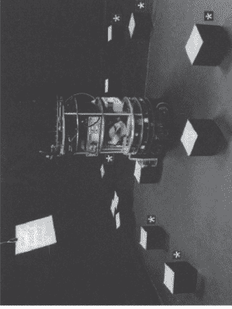

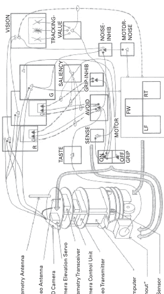

图2.1 Darwin IV基于大脑的设备。左：用于控制Darwin IV行为的神经网络模型。右：Darwin IV在条件反射任务中。来源：改编自Edelman et al. 1992，经许可使用。

连接SAB 2000上广泛方法、机器人和行为的主题是，神经网络模型被用于通过在物理机器人中展示行为来研究神经科学的某些方面。这些研究中的许多研究人员在建立如今所知的神经机器人学领域方面起到了关键作用。

在这个时期，其他团队正在创建可以纳入神经机器人学领域的机器人设计。他们不是构建大脑电路，而是在研究身体和大脑如何相互作用以及神经网络如何发展。例如，谢菲尔德大学的Tony Prescott及其团队研究了啮齿动物的触须摆动，并开发了一种具有生物模仿触须的机器人感觉运动电路（Pearson et al. 2011）。图2.2展示了他们的Whiskerbot，该机器人大约在2005年完成。Dario Floreano帮助建立了进化机器人学领域（Nolfi and Floreano 2000）。Floreano及其同事使用进化算法来进化神经网络，以支持从迷宫导航到发展捕食者-猎物策略的一系列行为（Floreano and Keller 2010）。有关更多详情，读者应参阅第4章。Rolf Pfeifer和Josh Bongard（2006）有了“身体塑造我们思考方式”的洞见。他们建议生物体进行形态计算——也就是说，身体执行某些原本由大脑执行的过程。

尽管这些生物模仿和进化算法并未直接测试大脑理论，但它们增加了我们对大脑和身体如何相互作用的认识，并创造了具有生物启发的新颖算法和机器人设计，这些设计将推动机器人和人工智能领域的发展。

随着并行计算资源的改进，一些团队正在接近大脑规模的神经模拟。Darwin VII的神经网络包含大约两万个神经元和近五十万个突触连接，所有这些连接都需要实时更新，以跟上主动视觉和传感器。Darwin团队使用带有消息传递接口（MPI）的Beowulf集群来实现实时性能。Phil Goodman的虚拟神经机器人项目在计算机集群上拥有至少十万个高度详细的神经元。尽管机器人是虚拟的，但它确实需要实时响应以识别人类参与者的意图和信任（Bray et al. 2012）。

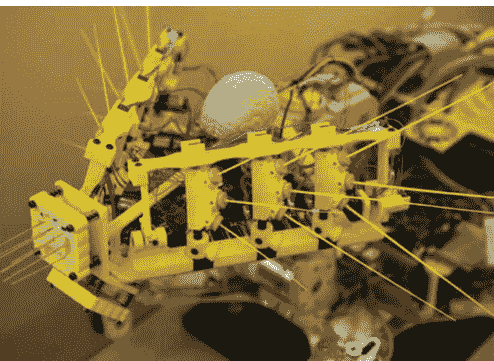

图2.2 谢菲尔德大学的Whiskerbot。Whiskerbot有两个主动触须和一个详细的神经网络模型，用于将触须偏转信号转换为模拟尖峰列车。来源：改编自Pearson et al. 2011，经许可使用。

在此期间，社区经常对大规模建模的必要性提出质疑。使用较小的神经网络（通常少于一百个神经元）就可以实现许多有趣的结果。然而，用小型神经网络解决某些领域中的问题是不可避免的。例如，一个测试特征绑定和不变物体识别理论的视觉皮层模型（Seth et al. 2004b）要求每个相机像素（或感受野）针对每个特征（两种颜色和四个方向）都有一个神经元。由于该网络模拟了视觉皮层感受野的扩展，将原始特征组合成对象（即V1 → V2 → V4 → IT），因此需要大规模神经网络。然而，将同样的建模细节应用于使用触须编码触觉特征的神经网络时，会产生比其小一个数量级的网络（Seth et al. 2004a）。

除了实际原因之外，大规模建模通常还需要实现大脑反应中观察到的神经动力学和解剖路径。尽管这种保真度会导致高度复杂的网络，但它确实允许人们测试大脑理论并做出更好的预测。保留解剖投射会导致大规模异构架构。拥有具有生物物理特性的大量神经元会导致有趣的神经动力学，这在海马体及其周围区域的大规模模型中得到观察（Krichmar, Nitz, et al. 2005）。在这个模型中，内嗅皮层与海马亚区之间的复杂相互作用导致在机器人学习的不同时间点依赖于不同的功能通路（图2.3）。使用大规模神经模型确实除了计算能力之外还有代价。在某个时候，神经网络变得如此复杂，以至于与真实大脑一样难以理解。有趣的是，对大规模海马模型的分析需要开发新工具；一个是通过神经活动的递归回溯（Krichmar, Nitz, et al. 2005），另一个是将格兰杰因果性应用于模拟神经网络（Krichmar, Seth, et al. 2005）。

如今，大规模神经网络模型已成为常态。神经形态硬件可以以非常低的功耗支持大脑规模的神经网络（Indiveri et al. 2011; Merolla et al. 2014; Davies et al. 2018）。具有许多隐藏层的深度神经网络经常被开发（LeCun, Bengio, and Hinton 2015）。借助PyTorch和TensorFlow等工具、图形处理单元（GPU）集群和云计算，大规模神经网络对大多数研究人员和学生来说触手可及。此外，事实证明，以许多层形式存在的规模是解决更具挑战性问题所必需的，例如图像识别（Krizhevsky, Sutskever, and Hinton 2017）或人类水平的游戏对弈（Mnih et al. 2015）。

#### 2.2.1 案例研究：Darwin VII——基于大脑的设备中的感知分类与条件反射

Darwin VII是最早展示基于经验的学习（即，在没有监督信号的情况下通过采样环境进行学习）的神经机器人之一，具有一个详细的、


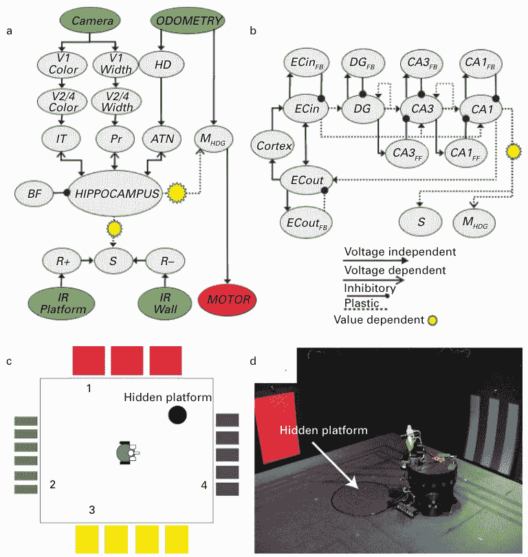

**图 2.3** Darwin X 与情节记忆海马体模型。(a) 整体神经网络架构包括用于视觉“what”和“where”通路（V1 → V2/4 → IT，V1 → V2/4 → Pr，分别）的神经元群、头向系统（HD）、奖励系统（R+, R–, S）以及海马体。(b) 海马体神经群内的亚区。箭头表示子群之间的突触投射。(c) 旱地莫里斯水迷宫的示意图。颜色表示地标；数字表示试验起始组。(d) Darwin X 脑式装置。隐藏平台是一张黑色硬卡纸，Darwin X 无法通过其相机看到，但可以通过向下朝向的 IR 传感器检测到。改编自 Krichmar, Nitz, et al. 2005，经许可使用。

神经生物学可信的神经网络（Krichmar 和 Edelman 2002）。Darwin VII 自主探索其环境并采样包含正负值的刺激（图 2.4）。通过其经验，Darwin VII 建立了其采样对象的感知类别。Darwin VII 的模拟基于脊椎动物神经系统的解剖学和生理学。模拟神经系统包含若干区域，这些区域根据视觉、听觉处理和价值的类似皮层和皮层下脑区进行标记。每个区域包含不同类型的神经元单元，由模拟的局部神经元种群或神经元群组成。

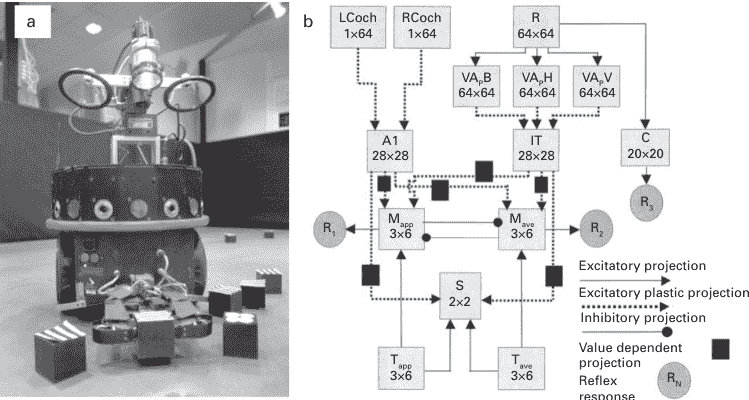

**图 2.4** Darwin VII 机器人和神经网络。(a) Darwin VII 由配备多个传感器和执行器的移动底座组成。Darwin VII 构建在一个带有轮子的圆形平台上，该轮子允许独立的平移和旋转运动，其摄像头和麦克风具有水平转动和俯仰运动，并具有一自由度操纵器或握爪用于物体抓取。CCD 摄像头、摄像头两侧的两个麦克风以及嵌入握爪中、用于测量刺激表面电导率的传感器向神经模拟提供感觉输入。红外（IR）传感器以 45° 间隔安装在移动平台周围共八个。IR 传感器对环境边界有响应，并用于触发避障反射。除了避障之外的所有行为活动均由从神经模拟接收的信号触发。(b) Darwin VII 的区域和功能神经解剖学。模拟神经系统由六个主要系统组成：听觉系统、视觉系统、价值系统、味觉系统、触发行为、视觉跟踪系统和价值系统。CCD 摄像头捕获的 64 x 64 灰度像素图像被中继到视网膜区域 R，并通过地形连接传输到初级视觉区 VA。VA 中的三个子分区对类斑点特征、短水平线段或短垂直线段具有选择性。VA 内的响应紧密跟随刺激发作，并通过活动依赖的可塑连接地形投射到类似下颞皮质（IT）的次级视觉区。Darwin VII 的麦克风捕获的频率和振幅信息被中继到模拟耳蜗区域（LCoch 和 RCoch），并通过映射的耳地图和活动依赖的可塑连接传输到初级听觉区 A1。A1 和 IT 包含局部兴奋和抑制相互作用，产生以周围抑制包围的焦点兴奋区为特征的放电模式。A1 和 IT 向价值系统 S 以及运动区域 M.app 和 M.ave 发送可塑投射。这两个神经元区域能够触发两种不同的行为：摄食性行为和回避性行为。味觉系统（T.app 和 T.ave）由两种感觉单元组成，分别对 Darwin VII 握爪中的传感器测得的刺激物体表面电导的存在或不存在有反应。味觉系统向运动区域（M.app 和 M.ave）和价值系统（S）发送信息。区域 S 带有持久的、价值依赖的活动，向听觉、视觉和运动行为神经元弥散投射。视觉跟踪系统控制导航运动，特别是与背景相比通过亮度对比度识别的物体的接近。为了实现跟踪行为，视网膜区域 R 投射到区域 C（“伏脑”）。来源：改编自 Krichmar 和 Edelman 2002，经许可使用。

模拟神经系统包含 18 个神经元区域、19,556 个神经元单元和大约 450,000 个突触连接。图 2.4b 显示了模拟神经系统中不同神经元区域及其间突触连接的高级别图。Darwin VII 中的一个神经元单元使用平均放电率模型进行模拟，该单元的活动大致对应于一组神经元在 200 ms 时间段内的平均放电活动。这对应于处理感觉输入、计算神经元单元活动、更新可塑连接的连接强度以及生成运动输出所需的时间。

向单元 $i$ 的突触输入的总贡献由以下公式给出

$$A_i(t) = \sum_{j=1}^N c_{ij}s_j(t)$$

其中 $N$ 是连接到单元 $i$ 的连接数，$c_{ij}$ 是从单元 $j$ 投射到单元 $i$ 的连接的权重值，$s_j(t)$ 是时间步 $t$ 时单元 $j$ 的活动。$c_{ij}$ 的负值对应于抑制性连接。单元 $i$ 的活动水平由以下公式给出

$$S_i(t+1) = \phi(tanh(g_i(A_i(t) + \omega s_i(t))))$$

其中

$$\phi(x) = \begin{cases} 0; x < \sigma_i \\ x; otherwise \end{cases}$$

并且 $\omega$ 决定了单元活动从一个周期到下一个周期的持续性，$\sigma_i$ 是单元特异性放电阈值，$g_i$ 是一个比例因子，取决于神经元区域而有所不同。

神经元区域内部及其之间的连接受活动依赖性修改的约束，遵循价值独立和价值依赖的突触规则。突触修改由突触前和突触后活动共同决定，并导致两个神经元单元之间的突触效应增强或减弱。使用 Bienenstock、Cooper 和 Munro (BCM) 学习规则来控制突触变化，因为它具有一个区域，其中弱相关输入被抑制，而强相关输入被增强（Bienenstock, Cooper, and Munro 1982）。

$c_{ij}$ 的价值独立性突触变化由以下公式给出

$$\Delta c_{ij}(t+1) = \varepsilon(c_{ij}(0) - c_{ij}(t)) + \eta s_j(t) F(s_i(t))$$

其中 $s_i(t)$ 和 $s_j(t)$ 分别是突触后和突触前单元的活动，$\eta$ 是固定学习率，$\varepsilon$ 是衰减常数，$c_{ij}(0)$ 是连接 $c_{ij}$ 的初始（$t=0$）权重。衰减常数 $\varepsilon$ 控制突触权重被动、均匀地衰减到其原始起始值。函数 $F$ 是 BCM 学习规则的分段线性近似。

价值依赖性突触可塑性的突触变化由以下公式给出

$$\Delta c_{ij}(t+1) = \varepsilon(c_{ij}(0) - c_{ij}(t)) + \eta s_j(t) F(s_i(t)) \overline{S}$$

其中 $\overline{S}$ 是价值系统 S 的平均活动（见图 2.4b）。

Darwin VII 的环境由一个封闭区域组成，区域有黑色墙壁，地板铺有不透明的黑色塑料面板，上面分布着金属立方体（图 2.4a）。块的顶部表面覆盖有黑白图案：斑点和条纹。握爪中的块上的条纹可以水平或垂直方向查看，总共产生三类需要区分的视觉模式刺激（斑点、水平和垂直）。安装在 Darwin VII 上并与其握爪对齐的手电筒导致包含光电探测器的块在 Darwin VII 附近时发出哔哔声。刺激块的侧面是金属的，可以表现为强导电（“好味道”或摄食性）或弱导电（“坏味道”或回避性）。抓取刺激块激活了相应的味觉

神经元单元（无论是 T<sub>app</sub> 区还是 T<sub>ave</sub> 区）达到足以驱动运动区超过行为阈值的水平。在实验中，强导电性且带有条纹图案的方块和 3.9 kHz 音调被任意选为正值示例，而弱导电性且带有斑点图案的方块和 3.3 kHz 音调代表负值示例。

在条件作用试验早期，Darwin VII 拾取并“品尝”会导致摄食性或厌恶性反应的方块（参见图 2.5a，左侧面板）。在此期间，味觉神经元单元的输出激活了价值系统（S）并驱动运动神经元单元（M<sub>app</sub> 和 M<sub>ave</sub>）以引发行为反应。然而，条件作用后，当 IT 对视觉图案或 A1 对音调产生反应时，价值系统和运动神经元单元会立即被激活。这种从早期试验中由无条件刺激触发的价值系统活动，转变为由条件刺激开始时触发的价值系统活动的变化，类似于灵长类腹侧被盖区在条件作用后发现的多巴胺能神经元活动转变（Schultz, Dayan, and Montague 1997）。

在将视觉图案与味觉联系后，Darwin VII 继续拾取并“品尝”条纹图案的方块，但避开斑点图案的方块（参见图 2.5a，左侧面板）。在将听觉声音与味觉联系后，Darwin VII 继续拾取高频蜂鸣方块，但避开低频蜂鸣方块（参见图 2.5c，左侧面板）。图 2.5b 右侧面板显示了七个 Darwin VII 试验中由听觉或视觉刺激驱动的条件反应百分比。条件反应的增加表明，Darwin VII 学会了听觉或视觉线索预测物体的价值，从而采取了适当的行为反应。这些学习曲线与啮齿类动物、鸽子及其他生物类似条件作用实验的曲线非常接近。

在 Darwin VII 中，模拟下颞皮层（IT）的活动为视觉知觉分类提供了基础。最初，IT 对视觉刺激的反应较弱且弥散（参见图 2.5a 右侧面板中的 IT 活动）。在大约五次刺激接触后，初级视觉皮层 VA<sub>p</sub> 与 IT 之间的活动依赖性可塑性导致 IT 对不同刺激的反应变得强烈、清晰且可区分（参见图 2.5b 右侧面板中的 IT 活动）。观察到 Darwin VII 的物体识别与尺度、位置和旋转无关。无论物体出现在 Darwin VII 视野的哪个位置，视觉刺激的分类都会发生，刺激的表观尺寸从物体正前方时的最大值到物体位于 Darwin VII 远端时的最大值的四分之一不等。当方块不在其夹爪中时，Darwin VII 视野中对条纹方块的正确分类发生在方块上的条纹相对于水平或垂直参考线旋转 ±30° 范围内时。这些不变类别反应是由于视网膜拓扑映射的 VA<sub>p</sub> 与非拓扑映射的 IT 之间活动依赖性可塑连接的竞争而发展起来的。

Darwin VII 的行为表明，一种基于生物学原理运行且无需预设指令的机器人可以执行知觉分类和条件反应。在知觉分类和条件作用实验中，类别反应的发展都需要通过连接强度的特定且高度个体化的变化来探索环境并进行感觉运动适应。Darwin VII

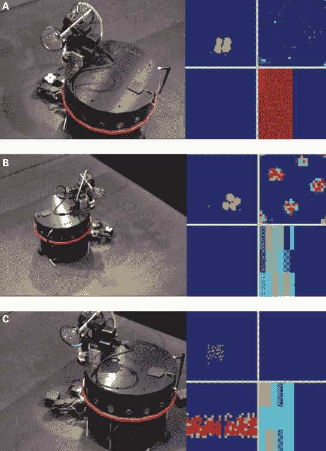

图 2.5 左：Darwin VII 在行为实验中的样子。Darwin VII 右侧面板显示模拟中所选神经区域的活动（R，左上；IT，右上；A1，左下；M_ave，右下左侧；M_app，右下右侧）。所选神经区域中的每个像素代表一个神经元单元，活动从无活动（深黑色）到最大活动（亮红色）进行归一化。（a）Darwin VII 在首次遇到厌恶性方块时。本图及（b）中显示的刺激方块具有斑点状视觉图案但不发出蜂鸣声。在这个早期条件作用试验中，Darwin VII 被显示为拾取并“品尝”一个厌恶性方块。IT 中的活动不足，但味觉系统 T_ave 中的活动足以驱动厌恶性运动行为神经区域（M_ave）中的活动超过行为阈值。（b）Darwin VII 在第十次遇到具有斑点状视觉图案的厌恶性方块时。在视觉刺激的初级条件作用后，IT 区域的活动足以驱动 M_ave 神经元单元超过行为阈值，从而触发避免“品尝”厌恶性方块的运动反应。（c）Darwin VII 在第十次遇到仅具有听觉线索的厌恶性方块时。在听觉刺激的初级条件作用后，A1 区域的活动足以驱动 M_ave 神经元单元超过阈值以触发行为反应。右：Darwin VII 每次遇到听觉和视觉刺激时的条件反应百分比（%CR）。每个点是七个 Darwin VII 试验的平均 %CR。来源：经许可改编自 Krichmar 和 Edelman 2002。

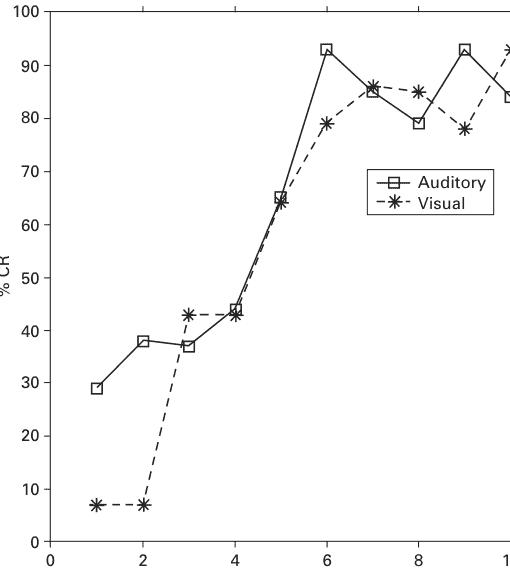

图 2.5（续）

奠定了越来越复杂的神经机器人基础，这些机器人拥有更复杂的神经电路和形态，从而进一步深入了解大脑、身体与行为之间的关系。

### 2.3 构建神经机器人社区

多年来，由于该主题的研讨会和期刊专刊，神经机器人社区逐渐形成。_IEEE 机器人与自动化杂志_为此专题出版了一期（Browne et al. 2009）。主要 IEEE 机器人会议上偶尔会就该主题举办专题会议。欧洲联盟的人类大脑计划（一项用于理解神经系统的大规模研究项目）包含由 Alois Knoll 和 Florian Rohrbein 领导的神经机器人部门（Falotico et al. 2017）。

2004 年，“神经科学与神经信息学中的神经机器人模型”专题会议在适应性行为模拟国际会议上举行（Seth, Sporns, and Krichmar 2005）。为介绍该会议，指出神经机器人设备具有以下特性：1）它参与行为任务，2）它位于结构化环境中，3）其行为由模拟神经系统控制，该系统旨在某种程度上反映大脑的架构和动态。该会议包括 Auke Ijspeert 关于为机器人蝾螈进化神经网络的研究（Ijspeert, Crespi, and Cabelguen 2005; Ijspeert et al. 2007）。在这项研究中，不同的运动模式（即游泳或行走）是由于大脑与身体与特定环境（即水或陆地）的相互作用而出现的。Olaf Sporns 和 Max Lungarella 展示了具体化如何改变和改善神经系统中的信息处理（Lungarella et al. 2005）。此外，还介绍了关于海马如何参与空间记忆的几篇论文（Arleo, Smeraldi, and Gerstner 2004; Banquet et al. 2005; Chavarriaga et al. 2005; Krichmar, Seth, et al. 2005）。

啮齿动物导航的机器人模型构成了若干神经机器人实现。对这些模型感兴趣的原因之一是机器人导航是一个迷人而复杂的问题。另一个原因是大鼠中观察到的神经活动模式清晰、有趣且易于建模。例如，方向细胞可以用吸引子网络和余弦调谐曲线建模（Stringer et al. 2002）。海马位置细胞可以用二维高斯分布建模（Foster, Morris, and Dayan 2000）。在内侧嗅皮层中最近发现的格细胞促使提出了多种神经模型（Zilli 2012）。澳大利亚 RatSLAM 团队使用吸引子网络和类似于方向细胞、位置细胞和格细胞的神经元，报告了受神经启发的算法结果，这些算法在定位和映射方面与常规机器人的最先进技术相当或更好（Milford et al. 2016）。尽管常规机器人社区在 SLAM（即同时定位与映射）（Kohlbrecher et al. 2011; Mur-Artal, Montiel, and Tardos 2015）和路径规划（LaValle 2011a, 2011b）方面取得了巨大进展，但在动态条件下灵活导航方面仍存在许多未解决的问题。在这些挑战性情况下，啮齿动物表现出优越的性能和鲁棒性，并仍然为改进机器人导航算法提供灵感。

### 2.4 神经机器人与神经形态工程

对神经机器人领域的一项重要潜在发展是神经形态工程的再度兴起（Indiveri et al. 2011）。所谓再度兴起，是指 20 世纪 80 年代由 Carver Mead（1990）及其团队开发的原始模拟电路，促成了 IBM（Merolla et al. 2014）和 Intel（Davies et al. 2018）等大型公司设计的接近商业可行的计算机。与神经机器人一样，神经形态工程也借鉴大脑来构建计算机架构和传感器。由于这些计算机专门针对异步、事件驱动处理而设计，因此控制神经机器人的峰值神经网络非常适合这些平台。此外，由于低功耗预算和快速的事件驱动响应，神经形态架构在神经机器人应用方面具有巨大前景。例如，曼彻斯特的 SpiNNaker 神经形态计算机已被用于障碍物避免和随机探索任务（Stewart et al. 2016）。除了在专用硬件上运行神经网络之外，极低功耗的神经形态视觉和听觉传感器也在开发中（Liu and Delbruck 2010）。与生物学类似，这些传感器只对变化或显著事件做出反应，当它们做出反应时，会产生一列峰值。这使得这些传感器与峰值神经网络能够无缝集成，而它们的事件驱动特性带来了理想的嵌入式系统（如机器人）所需的能效。


轻量级神经形态芯片的发展启发了这样一个想法：许多与户外导航相关的计算过程可以在神经形态硬件上实现，以控制地面机器人。神经形态硬件对户外导航尤其有利，因为机器人必须长时间依赖电池供电，并且常用于搜救等重要操作。低级感知导航任务和高级规划任务的脉冲实现使导航子任务能够并行运行。

与 IBM 低功耗 TrueNorth 神经形态芯片（Esser et al. 2016）合作，我们证明卷积神经网络（CNN）可以被训练来自动驾驶机器人在山地小径上行驶（Hwu et al. 2017）。最初，机器人是通过遥控沿着小径行驶的。RGB 摄像头帧，连同相应的动作控制（向左转向、向右转向和向前行驶），被记录下来用于训练 CNN。CNN 首先使用常规的反向传播技术进行训练，使用 RGB 图像作为输入，三个动作的集合作为输出。然后，该神经网络的权重被转移到与原始 CNN 结构相同的脉冲神经网络的权重中。这个脉冲网络在 TrueNorth 芯片上运行，该芯片由同一块供机器人电机供电的单一爱好者级镍氢（NiMH）电池供电（图 2.6）。使用此流程的优势在于，我们能够利用成熟的 CNN 训练技术，同时在能源效率方面实现数量级的提升。图 2.6 中显示的电路图和流程可以推广到其他硬件和神经机器人应用中。

#### 2.4.1 案例研究：脉冲波前传播——受大脑启发的神经形态路径规划

导航是大多数机器人和动物的必要组成部分，两者都在时间和能量有限的约束下运行。借鉴大脑连接性、神经元脉冲动力学以及轴突传导会经历经验依赖性可塑性的近期发现（Fields 2015），创建了脉冲波前传播模型（Hwu et al. 2018）。该模型受海马体在动物导航中的作用启发。这包括海马体中位置细胞的存在，这些细胞根据动物的物理位置活跃（O'Keefe and Dostrovsky 1971）。这些位置细胞参与海马体重放，其中位置细胞按照动物可能采取的潜在轨迹路径依次激活（Dragoi and Tonegawa 2011; Pfeiffer and Foster 2013）。脉冲波前传播背后的另一个生物学观察是，大脑多个区域（包括海马体）中存在扩散的活动波，支持大脑连接性和记忆（Zhang and Jacobs 2015）。

结合这些观察，脉冲波前传播模型能够通过网格空间表示来规划路径。每个网格单元对应物理空间的一个离散化区域，单元之间的连接表示从一个区域到相邻区域旅行的能力。网格中的每个单元代表一个具有脉冲动力学的单个神经元。时间 $t+1$ 时神经元 $i$ 的膜电位表示为

$$
v_i(t+1)=u_i(t)+I_i(t),
$$

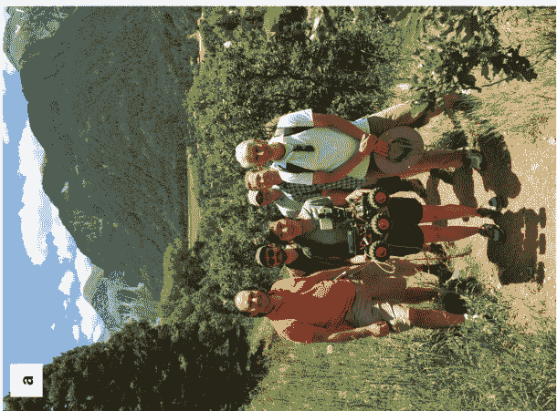

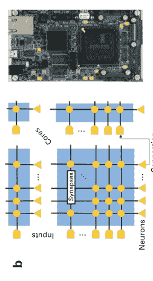

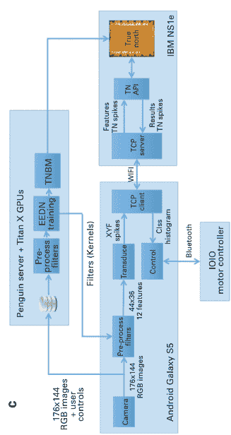

图 2.6 使用 IBM TrueNorth 神经形态硬件上的深度卷积神经网络的自动驾驶机器人。(a) 该照片拍摄于美国科罗拉多州特莱里德，机器人在那里自主穿越了山地小径。从左到右：罗德里戈·阿尔瓦雷斯-伊卡萨（IBM）、雅各布·伊斯贝尔（马里兰大学）、蒂芙妮·胡（加州大学尔湾分校）、威尔·布朗（维多利亚大学惠灵顿分校）、安德鲁·卡西迪（IBM）和杰夫·克里克马（加州大学尔湾分校）。照片中缺少尼古拉斯·奥罗斯（BrainChip）。(b) 左：IBM TrueNorth 神经形态芯片的连接性。右：实验中使用的 IBM TrueNorth NS1e 板图像。(c) 运行自动驾驶机器人的数据流水线。训练分别使用 MatConvNet 包和 Titan X GPU 进行。测试期间，Android Galaxy S5 和 IBM NS1e 之间的 Wi-Fi 连接使用 TrueNorth (TN) 运行时 API 双向传输脉冲数据。来源：经 Hwu et al. 2018 授权改编。

其中 $u_i(t)$ 是恢复变量，$I_i(t)$ 是时间 $t$ 时的输入电流。恢复变量 $u_i(t+1)$ 建模为

$$
u_i(t+1)=(-5 \text{ if } v_i(t)=1; \min(u_i(t)+1, 0) \text{ otherwise}),
$$

这样，如果它初始为负值，则以恒定速率增加至基准值 0。输入电流 $I_i(t+1)$ 表示为

$$
I_i(t+1)=\sum_j(1 \text{ if } d_{ij}(t)=1; 0 \text{ otherwise}),
$$

其中 $d_{ij}(t)$ 是来自邻接神经元 $j$ 到神经元 $i$ 的信号延迟计数器。延迟 $d_{ij}(t+1)$ 计算为

$$
d_{ij}(t+1)=(D_{ij}) \text{ if } v_j(t)=1; \max(d_{ij}(t)-1, 0) \text{ otherwise},
$$

这样，它作为对应轴突延迟的计时器，起始值为 $D_{ij}(t)$。$D_{ij}(t)$ 的这个起始值是一个延迟值，取决于穿越与神经元对应的空间区域的代价。综合来看，这些方程描述了脉冲神经元的简化动力学。当来自邻接神经元的脉冲发生时，输入电流 $I_i$ 设置为 1，从而引起一个脉冲。紧随其后，恢复变量 $u_i$ 被设置为 -5，随后在每个连续时间步长中增加 1 并停在 0。这种机制模拟了神经元的不应期。接下来，所有邻接神经元 $j$ 的所有延迟计数器 $d_{ij}$ 都设置为它们分配的起始值 $D_{ij}$。

对 $D_{ij}$ 值的编码存在多种可能性。这些值应编码从一个区域到另一个区域的代价。这可能是所需能量、潜在风险或物理磨损。例如，穿越崎岖地形对地面机器人来说风险更大且需要更多能量，因此代价更高。与网格尺寸相同的代价图可以一对一地映射到 $D_{ij}$ 值。如果预先知道代价图，可以在运行脉冲波前传播之前使用它来填充网格的延迟值。它们也可以在探索地形时实时学习。在神经科学中，这对应于轴突可塑性，其中由白质构成的神经元髓鞘会随着活动增强而体积增加，从而随后提高信号从一个神经元传到另一个神经元的速度（Fields 2015）。当代理人（无论是随机还是有意导航）穿越其环境时，每次进入新的网格区域时都会使用以下方程更新 $D_{ij}$ 值：

$$
D_{ij}(t+1)=D_{ij}(t)+\delta(map_{xy}-D_{ij}(t)),
$$

其中 $\delta$ 是学习率，$map_{xy}$ 是代理人穿过与网格神经元 $i$ 对应的位置坐标 $(x, y)$ 时的代价样本。该更新规则应用于神经元 $i$ 的每个 $j$ 个邻居。轴突可塑性的优势在于代理人可以在运行过程中学习，不断获取新信息。使用较小的学习率时，模型考虑了环境噪声，因此如果代理人因传感器错误或环境因素采样到错误的代价值，其影响会在多次试验中平均。然而，为整个网格学习准确的代价值可能需要许多试验，因为每个网格区域必须被穿越多次。因此，最好从先验代价图开始，并随传感器观察的出现进行更新。


利用带有代价编码的网格进行路径规划时，会向与代理位置对应的神经元添加输入电流以诱发尖峰。这会诱发邻近神经元产生尖峰，随后在整个网格上引发一束行进波。当尖峰发生时，会使用地址事件表示（AER）记录这些尖峰，其中包含神经元 ID 和尖峰时间的成对数据。图 2.7 展示了如何利用 AER 进行路径规划。

要从起始位置规划到任何其他位置的路径，需记录目标神经元的第一个尖峰时间。目标神经元的 ID 也会记录在列表中。然后检查每个邻近神经元的尖峰时间，并将尖峰最新的神经元追加到列表中。对该邻近神经元重复相同过程，以此类推，直到将起始神经元添加到列表中。随后，将考虑长度和代价的最优路径作为神经元 ID 的反向列表返回。

当前的尖峰波前算法已在一台在草地、泥土和沥青地形上行驶的移动地面机器人上成功测试（Hwu et al. 2018）。该机器人由价格实惠的爱好者零件和一部用于计算的 Android 手机制成（图 2.8，左下角）。机器人的电机和传感器由单个镍氢电池供电，使节能成为其运行的首要任务。该机器人在一个大型户外公园的两个区域进行了测试（图 2.8，左上角）。一个区域是被沥青路包围的草地。基于该区域创建了三张代价图（图 2.8，右上角）：一张统一低代价图，一张周围道路代价较低的地图，以及一张周围道路代价较低且长椅代价中等的地图。另一个区域长满草木，有一条周围的外部沥青路和一条横穿该区域的泥土小径。从该区域生成了一张代价图，包括周围道路代价较低、树木代价较高以及泥土路代价中等。利用这些不同的地图，研究人员使用尖峰波前算法生成了一条在一组起点和终点之间导航的路径。

| 时间 | 神经元 ID (r,c) |
|---|---|
| 1 | (1,1) |
| 2 | (1,2),(2,1),(2,2) |
| 3 | (1,3),(2,3),(3,1) |
| ... | ... |
| 6 | ....(3,6),(5,3).... |
| ... | ... |
| 9 | (3,4),(4,2),(6,6) |

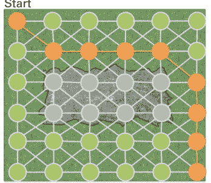

图 2.7 使用地址事件表示表进行路径规划。左侧：尖峰类型和神经元 ID 在此表中记录。为了使用训练好的神经元网格规划路径，与代理位置对应的神经元会接收到一个冲动尖峰。这个尖峰触发波前信号在网格表面上传播。由于一些神经元具有更长的轴突延迟，波前边缘以不同速度行进。使用该表，可以识别出与目标对应的神经元。然后，通过时间步骤回溯，可以将一条神经元路径追溯回起始神经元（右侧）。由于代价使用轴突延迟编码，规划的路径避开了代价更高的有障碍地形。来源：经 Hwu et al. 2018 许可改编。

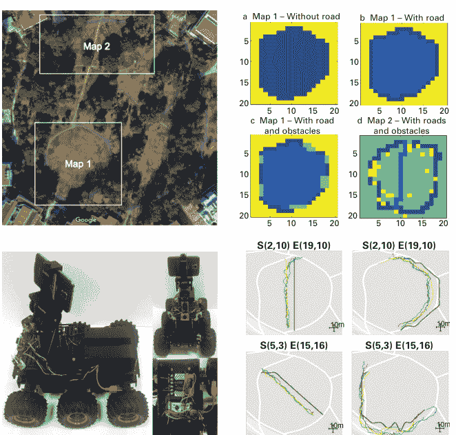

**图 2.8** 尖峰波前传播的室外演示。左上角：一个用于生成代价图的两个区域的户外公园卫星图像。右上角：(a) 草地区域被赋予统一代价。(b) 周围草地区域的道路被赋予低代价。(c) 道路被赋予低代价，公园长椅被赋予中等代价。(d) 周围道路被赋予低代价，树木被赋予高代价，横穿该区域的泥土小径被赋予中等代价。左下角：基于 Android 的机器人平台的侧面、正面和内部视图。右下角：第一行显示了使用相同起点和终点规划的两条路径。左列的路径是使用不含外部道路的代价图生成的，右列的路径是使用包含外部道路的代价图生成的。底行显示相同内容，但使用一组不同的起点和终点。当考虑道路时，规划的路径会选择更长、更平滑的路径，而非最短路径。来源：经 Hwu et al. 2018 许可改编。

路径上的路点对应于表示地图位置的神经元单元。随后，机器人使用 Android 手机的 GPS 沿着算法生成的路点行驶。机器人行驶的路径凸显了寻找最短路径与寻找最平滑路径之间的权衡（图 2.8，右下角）。当使用统一代价时，总是选择最短路径。当考虑道路时，机器人偶尔会选择走道路，即使这意味着行驶更长的距离。对于包含泥土草地的地图，机器人权衡了选择最快路线与在颠簸草地上行驶之间的利弊。机器人演示将尖峰波前传播应用于代价感知路径规划，展示了在能量受限的移动平台上节能的可能性。

此次演示结合尖峰 CNN，展示了针对户外导航的完整神经形态计算解决方案的潜力（Hwu, Krichmar, and Zou 2017）。

这样的系统可以在移动平台上实现更多计算，并提供更多关于大脑如何在能量有限的情况下运作的洞察。

### 2.5 未来展望

神经机器人学建立在多种跨学科思想之上，已发展成为一个丰富而有趣的领域。在其历史上，一些研究子课题一直保持不变，例如导航、运动规划、映射以及神经网络的发展。然而，随着神经生物学（如光遗传学）以及机器学习和深度神经网络等较新技术不断为该领域带来新工具和新见解，研究仍在持续发展。

近年来，人工智能、机器学习以及尤其是人工神经网络领域取得了特别大的成功。尽管深度神经网络在很大程度上取得了成功，但该领域仍存在许多新挑战。大部分情况下，神经网络在特定任务上表现良好，但难以将先前学习任务的知识迁移到较新但相关的任务上。此外，神经网络需要大量数据和训练，且无法捕捉许多对人类来说很容易的行为（Larson 2017）。这表明大脑研究可以为该领域做出重大贡献。

根据神经科学家兼企业家 Jeff Hawkins（2017）的说法，大脑具有智能所需的三个关键特征：1）通过重塑进行学习：大脑中的学习既快速又渐进，可以存储持续一生的表征；2）稀疏表征：在自然的限制下，大脑使用尽可能少的代谢资源来存储信息；3）具身化：大脑与环境之间的相互作用共同是智能所必需的。我们还认为以下特征很重要：4）价值系统：环境中的好坏刺激必须通过检测显著性并做出适当反应来学习（Friston et al. 1994; Krichmar 2008）；5）预测：我们必须能够从过去的经验外推，学习如何处理未来的经验（Clark 2013）。应用这些原则，未来的神经机器人研究有潜力实现对智能的更全面理解，致力于在多个领域间推广并能长期保持信息的行为。神经机器人学是解决人工智能社区当前面临的许多问题的一种有希望的方法。

### 2.6 结论

要真正理解智能，我们认为必须研究大脑和身体，并将这些原则应用于所有应用。智能生物系统目前是我们最好的标准，作为人工智能最终希望实现的目标模型。从神经机器人学中汲取的见解最终将导致对智能本质的深入理解，从而有助于我们认识自己，并带来改善未来技术的应用。


### 补充阅读与资源

- 埃德尔曼，G·M. 1987. 《神经达尔文主义：神经元群体选择理论》. 纽约: 基础图书出版社. 本书介绍了一种重要的大脑理论，该理论可以通过神经机器人学进行检验.

- 克里奇马，J·L., 和 若狭博文，主编. 2011. 《神经形态与脑机器人》. 剑桥: 剑桥大学出版社. 本书提供了当时神经机器人学最新技术的快照。它涵盖了从低级感知到机器意识的广泛主题.

- 谷，淳. 2016. 《探索机器人心智：作为自组织动态现象的行为、符号和意识》. 牛津: 牛津大学出版社. 谷淳一直是神经机器人学的先驱。他的书涵盖了高阶认知如何在神经机器人中实现.

- 神经机器人学软件与设计：
  - RatSLAM: https://openslam-org.github.io/openratslam.html.
  - 基于 Android 的机器人平台: https://www.socsci.uci.edu/~jkrichma/ABR/index.html.

### 参考文献

- 阿尔马西，尼克劳斯，杰拉尔德·M·埃德尔曼，和 奥拉夫·斯彭斯. 1998. “塑造神经元特性的行为约束：嵌入现实世界设备的皮层模型.” 《大脑皮层》 8 (4): 346–361. https://doi.org/10.1093/cercor/8.4.346.

- 阿尔莱奥，安杰洛，和 乌尔夫拉姆·格斯特纳. 2000. “生物模仿机器人学中空间学习的啮齿类头方向细胞和位置细胞建模.” 在 Meyer 等人 2000 中, 236–245.

- 阿尔莱奥，安杰洛，法布里齐奥·斯梅拉尔迪，和 乌尔夫拉姆·格斯特纳. 2004. “基于非均匀加博空间采样、无监督生长网络和强化学习的认知导航.” 《IEEE 神经网络汇刊》 15 (3): 639–652. https://doi.org/10.1109/TNN.2004.826221. https://www.ncbi.nlm.nih.gov/pubmed/15384552.

- 阿森尼奥，图尔图罗·M. 2000. “用于拟生物节律控制的神经振荡器网络.” 在 Meyer 等人 2000 中, 105–114.

- 班凯，让-保罗，P·H·高西耶，马蒂亚斯·科瓦，阿诺·雷韦尔，和 伊夫·比尔诺. 2005. “海马-皮层系统中的关联层次：认知地图和导航策略.” 《神经计算》 17 (6): 1339–1384. https://doi.org/10.1162/0899766053630369. https://www.ncbi.nlm.nih.gov/pubmed/15901401.

- 比恩斯托克，埃利·L，莱昂·N·库珀，和 保罗·W·门罗. 1982. “神经元选择性发展理论：视觉皮层中的取向特异性和双眼相互作用.” 《神经科学杂志》 2 (1): 32–48.

- 布拉滕贝格，瓦伦蒂诺. 1986. 《载体：合成心理学实验》. 马萨诸塞州剑桥: MIT出版社.

- 布雷，劳伦斯·C·贾埃，斯里达尔·R·阿努曼德拉，科里·M·瑟博，罗杰·V·黄，菲利普·H·古德曼，塞尔吉乌·M·达斯卡卢，鲍比·D·布赖恩特，和 弗雷德里克·C·哈里斯 Jr. 2012. “神经机器人信任和意图识别的实时人机交互.” 《神经网络》 32:130–137. https://doi.org/10.1016/j.neunet.2012.02.029.

- 布朗，威廉，河村和彦，杰弗里·克里奇马，威廉·哈尔温，和 若狭博文. 2009. “认知机器人学：通过逆向工程大脑功能对机器人和人类智能的新认识 [来自客座编辑].” 《IEEE 机器人与自动化杂志》 16 (3): 17–18.

- 查瓦里亚加，里卡多，托马斯·斯特罗斯林，德尼·谢尼赫维奇，和 乌尔夫拉姆·格斯特纳. 2005. “啮齿类动物并行导航系统的计算模型.” 《神经信息学》 3 (3): 223–241. https://doi.org/10.1385/NI:3:3:223. https://www.ncbi.nlm.nih.gov/pubmed/16077160.

- 克拉克，安迪. 2013. “接下来会怎样？预测性大脑、位置代理和认知科学的未来.” 《行为与脑科学》 36 (3): 181–204. https://doi.org/10.1017/S0140525X12000477. https://www.ncbi.nlm.nih.gov/pubmed/23663408.

- 柯林斯，大卫，和 戈登·怀思. 2000. “在延迟感觉环境中利用小脑模型进行移动机器人控制.” 在 《从动物到拟生物 6：第六届自适应行为模拟国际会议论文集》，由 让-阿尔卡迪·梅耶，阿兰·贝尔托，达里奥·弗洛雷亚诺，赫伯特·L·罗特布拉特，和 斯图尔特·W·威尔逊 编辑，马萨诸塞州剑桥: MIT出版社.

- 戴维斯，迈克，纳拉扬·斯里尼瓦萨，林宗汉，考特姆·钦尼亚，曹永强，斯里·哈沙·丘达伊，乔治奥斯·迪穆 等人. 2018. “Loihi：具有片上学习功能的神经形态多核处理器.” 《IEEE 微》 38 (1): 82–99. https://doi.org/10.1109/MM.2018.112130359.

- 德拉戈伊，乔治，和 东乡宪. 2011. “海马细胞集群对未来位置细胞序列的预演.” 《自然》 469 (7330): 397–401. https://doi.org/10.1038/nature09633. https://www.ncbi.nlm.nih.gov/pubmed/21179088.

- 埃德尔曼，杰拉尔德·M. 1987. 《神经达尔文主义：神经元群体选择理论》. 纽约: 基础图书出版社.

- 埃德尔曼，杰拉尔德·M. 1993. “神经达尔文主义：高级大脑功能中的选择与再入信号.” 《神经元》 10 (2): 115–125.

- 埃德尔曼，杰拉尔德·M，乔治·N·雷克，W·艾纳·盖尔，朱利奥·托诺尼，道格拉斯·威廉姆斯，和 奥拉夫·斯彭斯. 1992. “合成神经建模在现实世界人工物中的应用.” 《美国国家科学院院刊》 89 (15): 7267–7271. https://doi.org/10.1073/pnas.89.15.7267.

- 埃瑟，史蒂文·K，保罗·A·梅罗拉，约翰·V·阿瑟，安德鲁·S·卡西迪，拉蒂纳库马尔·阿普斯瓦米，亚历山大·安德雷奥普洛斯，大卫·J·伯格 等人. 2016. “用于快速、节能神经形态计算的卷积网络.” 《美国国家科学院院刊》 113 (41): 11441–11446. https://doi.org/10.1073/pnas.1604850113. https://www.ncbi.nlm.nih.gov/pubmed/27651489.

- 法洛蒂科，埃吉迪奥，洛伦佐·万努奇，亚历山德罗·安布罗萨诺，乌戈·阿尔巴涅塞，斯特凡·乌尔布里希，胡安·卡米洛·瓦斯奎兹·蒂克，乔治·欣克尔 等人. 2017. “在综合仿真框架中将人工大脑连接到机器人：神经机器人平台.” 《神经机器人学前沿》 11:2. https://doi.org/10.3389/fnbot.2017.00002.

- 菲尔兹，R·道格拉斯. 2015. “神经系统可塑性的新机制：活动依赖性髓鞘形成.” 《自然评论神经科学》 16 (12): 756–767. https://doi.org/10.1038/nrn4023. https://www.ncbi.nlm.nih.gov/pubmed/26585800.

- 弗洛雷亚诺，达里奥，和 劳伦特·凯勒. 2010. “通过达尔文式选择实现机器人自适应行为的进化.” 《PLOS 生物学》 8 (1): e1000292. https://doi.org/10.1371/journal.pbio.1000292.

- 福斯特，大卫·J，理查德·G·M·莫里斯，和 彼得·达扬. 2000. “基于时差学习规则的海马依赖导航模型.” 《海马》 10 (1): 1–16. 10.1002/(Sici)1098-1063(2000)10:1.

- 弗里斯顿，K·J，朱利奥·托诺尼，G·N·里克 Jr.，奥拉夫·斯彭斯，和 杰拉尔德·M·埃德尔曼. 1994. “大脑中的价值依赖性选择：在合成神经模型中的模拟.” 《神经科学》 59 (2): 229–243. https://www.ncbi.nlm.nih.gov/pubmed/8008189.

- 冈萨雷斯，F·蒙特斯，托尼·J·普雷斯科特，凯文·格尼，马克·汉弗里斯，和 彼得·雷德格雷夫. 2000. “脊椎动物大脑中动作选择机制的具体化模型.” 在 Meyer 等人 2000 中, 157–166.

- 霍金斯，J. 2017. “智能机器需要从新皮层学习什么.” 《IEEE 频谱》 54 (6): 35–40.

- 胡，蒂芙尼，雅各布·伊斯贝尔，尼古拉斯·奥罗斯，和 杰弗里·克里奇马. 2017. “在神经形态硬件上使用深度卷积神经网络的自动驾驶机器人.” 在 2017 年国际神经网络联合会议中, 635–641. 纽约: IEEE.

- 胡，蒂芙尼，杰弗里·克里奇马，和 邹新云. 2017. “室外导航和路径规划的完整神经形态解决方案.” 在 2017 年 IEEE 电路与系统国际研讨会中, 1–4. 纽约: IEEE.

- 胡，蒂芙尼，亚历山大·Y·王，尼古拉斯·奥罗斯，和 杰弗里·L·克里奇马. 2018. “使用具有轴突延迟的峰值神经元算法进行自适应机器人路径规划.” 《IEEE 认知与发展系统汇刊》 10 (2): 126–137. https://doi.org/10.1109/TCDS.2017.2655539. https://ieeexplore.ieee.org/document/7827038/.

- 艾斯佩尔特，奥克·扬，亚历山德罗·克雷斯皮，和 让-马里·卡贝格恩. 2005. “蝾螈运动的仿真和机器人学研究.” 《神经信息学》 3 (3): 171–195. https://doi.org/10.1385/NI:3:3:171.

- 艾斯佩尔特，奥克·扬，亚历山德罗·克雷斯皮，德米特里·日奇科，和 让-马里·卡贝格恩. 2007. “由脊髓模型驱动的蝾螈机器人从游泳到行走.” 《科学》 315 (5817): 1416–1420. https://doi.org/10.1126/science.1138353. https://www.ncbi.nlm.nih.gov/pubmed/17347441.

- 因迪韦里，贾科莫，贝尔纳贝·利纳雷斯-巴兰科，塔拉·朱莉亚·汉密尔顿，安德烈·范沙伊克，拉尔夫·埃蒂安-卡明斯，托比·德尔布吕克，刘士奇 等人. 2011. “神经形态硅神经元电路.” 《神经科学前沿》 5:73. https://doi.org/10.3389/fnins.2011.00073. https://www.ncbi.nlm.nih.gov/pubmed/21747754.

- 科尔布雷彻，斯特凡，奥斯卡·冯·施特吕克，约翰内斯·梅耶，和 乌韦·克林劳夫. 2011. “具有完整 3D 运动估计的灵活可扩展 SLAM 系统.” 在 2011 年 IEEE 安全、安保与救援机器人国际研讨会中, 155–160. 纽约: IEEE.


Krichmar, Jeffrey L. 2008. “神经调节系统：在充满挑战的世界中生存与适应行为的框架。” *自适应行为* 16 (6): 385–399.

Krichmar, Jeffrey L., and Gerald M. Edelman. 2002. “机器心理学：基于大脑设备中的自主行为、感知分类与条件作用。” *大脑皮层* 12 (8): 818–830. https://doi.org/10.1093/cercor/12.8.818.

Krichmar, Jeffrey L., Douglas A. Nitz, Joseph A. Gally, and Gerald M. Edelman. 2005. “刻画基于大脑设备在解决空间记忆任务时的海马功能通路。” *美国国家科学院院刊* 102 (6): 2111–2116. http://www.ncbi.nlm.nih.gov/entrez/query.fcgi?cmd=Retrieve&db=PubMed&dopt=Citation&list_uids=15684078.

Krichmar, Jeffrey L., Anil K. Seth, Douglas A. Nitz, Jason G. Fleischer, and Gerald M. Edelman. 2005. “基于大脑设备中的空间导航与皮层-海马相互作用因果分析。” *神经信息学* 3 (3): 197–221. http://www.ncbi.nlm.nih.gov/entrez/query.fcgi?cmd=Retrieve&db=PubMed&dopt=Citation&list_uids=16077159.

Krichmar, Jeffrey L., James A. Snook, Gerald M. Edelman, and Olaf Sporns. 2000. “表现型真实世界设备中的经验依赖感知分类。” 收录于 Meyer 等人 2000，第 41–50 页.

Krizhevsky, Alex, Ilya Sutskever, and Geoffrey E. Hinton. 2012. “基于深度卷积神经网络的 ImageNet 分类。” *神经信息处理系统进展* 25:1097–1105. https://doi.org/10.1145/3065386.

Larson, Erik J. 2017. “现代人工智能的局限：一个故事。” https://thebestschools.org/magazine/limits-of-modern-ai/.

LaValle, S. M. 2011a. “运动规划第一部分：基础要素。” *IEEE 机器人与自动化杂志* 18 (1): 79–89. https://doi.org/10.1109/Mra.2010.940155.

LaValle, S. M. 2011b. “运动规划第二部分：疆域之外。” *IEEE 机器人与自动化杂志* 18 (2): 108–118. https://doi.org/10.1109/Mra.2011.941635.

LeCun, Yann, Yoshua Bengio, and Geoffrey Hinton. 2015. “深度学习。” *自然* 521 (7553): 436–444. https://doi.org/10.1038/nature14539.

Liu, Shih-Chii, and Tobi Delbruck. 2010. “神经形态感觉系统。” *神经生物学动态* 20 (3): 288–295. https://doi.org/10.1016/j.conb.2010.03.007. https://www.ncbi.nlm.nih.gov/pubmed/20493680.

Lungarella, Max, Teresa Pegors, Daniel Bulwinkle, and Olaf Sporns. 2005. “量化感觉与运动数据信息结构的方法。” *神经信息学* 3 (3): 243–262. https://doi.org/10.1385/NI:3:3:243. https://www.ncbi.nlm.nih.gov/pubmed/16077161.

Mead, Carver. 1990. “神经形态电子系统。” *IEEE 学报* 78 (10): 1629–1636. 10.1109/5.58356.

Merolla, Paul A., John V. Arthur, Rodrigo Alvarez-Icaza, Andrew S. Cassidy, Jun Sawada, Filipp Akopyan, Bryan L. Jackson et al. 2014. “具有可扩展通信网络和接口的百万脉冲神经元集成电路。” *科学* 345 (6197): 668–673. https://doi.org/10.1126/science.1254642. https://www.ncbi.nlm.nih.gov/pubmed/25104385.

Meyer, Jean-Arcady, Alain Berthoz, Dario Floreano, Herbert L. Roitblat, and Stewart W. Wilson, 编. 2000. *从动物到 Animats 6：第六届自适应行为模拟国际会议论文集*. Cambridge, MA: MIT Press.

Milford, Michael, Adam Jacobson, Zetao Chen, and Gordon Wyeth. 2016. “RatSLAM：利用啮齿类海马模型进行机器人导航及更广泛应用。” 收录于 *机器人研究：第 16 届国际 ISRR 研讨会*，第 467–485 页. Cham, Switzerland: Springer. https://doi.org/10.1007/978-3-319-28872-7_27.

Mnih, Volodymyr, Koray Kavukcuoglu, David Silver, Andrei A. Rusu, Joel Veness, Marc G. Bellemare, Alex Graves et al. 2015. “通过深度强化学习实现人类水平控制。” *自然* 518 (7540): 529–533. https://doi.org/10.1038/nature14236.

Mur-Artal, Raul, Jose Maria Martinez Montiel, and Juan D. Tardos. 2015. “ORB-SLAM：一种通用且精确的单目 SLAM 系统。” *IEEE 机器汽刊* 31 (5): 1147–1163. https://doi.org/10.1109/Tro.2015.2463671.

Nolfi, Stefano, and D. Floreano. 2000. *进化机器人学：自组织机器的生物学、智能与技术*. Cambridge, MA: MIT Press.

O'Keefe, John, and Jonathan Dostrovsky. 1971. “海马作为空间图：自由活动大鼠单位活动的初步证据。” *大脑研究*. https://doi.org/10.1016/0006-8993(71)90358-1. https://www.ncbi.nlm.nih.gov/pubmed/5124915.

Pearson, Martin J., Ben Mitchinson, J. Charles Sullivan, Anthony G. Pipe, and Tony J. Prescott. 2011. “机器人生物模拟触须感觉。” *皇家学会 B 类哲学汇刊：生物科学* 366 (1581): 3085–3096. https://doi.org/10.1098/rstb.2011.0164.

Pfeifer, R., and J. Bongard. 2006. 身体如何塑造我们的思维：一种关于智能的新视角. Cambridge, MA: MIT Press.

Pfeiffer, Brad E., and David J. Foster. 2013. “海马位置细胞序列描绘了通往记忆目标的未来路径。” Nature 497 (7447): 74–79. https://doi.org/10.1038/nature12112. https://www.ncbi.nlm.nih.gov/pubmed/23594744.

Reeke, George N., Olaf Sporns, and Gerald M. Edelman. 1990. “合成神经建模：‘达尔文’系列识别自动机。” Proceedings of the IEEE 78 (9): 1498–1530. https://doi.org/10.1109/5.58327.

Schultz, Wolfram, Peter Dayan, and P. Read Montague. 1997. “预测与奖赏的神经基质。” Science 275 (5306): 1593–1599. https://doi.org/10.1126/science.275.5306.1593. https://www.ncbi.nlm.nih.gov/pubmed/9054347.

Seth, Anil K., Jeffrey L. McKinstry, Gerald M. Edelman, and Jeffrey L. Krichmar. 2004a. “带有触须的自主移动基于大脑设备的纹理辨别。” 收录于第 5 卷，IEEE 机器人与自动化国际会议论文集，第 4925–4930 页. New York: IEEE.

Seth, Anil K., Jeffrey L. McKinstry, Gerald M. Edelman, and Jeffrey L. Krichmar. 2004b. “基于大脑设备中通过重入连接和动态同步的视觉绑定。” Cerebral Cortex 14 (11): 1185–1199.

Seth, Anil K., Olaf Sporns, and Jeffrey L. Krichmar. 2005. “神经科学与神经信息学中的神经机器人模型。” Neuroinformatics 3:167–170.

Stewart, Terrence C., Ashley Kleinjans, Andrew Mundy, and Jörg Conradt. 2016. “神经形态机器人中的偶然离线学习。” Frontiers in Neurorobotics 10:1. S0954-898X(02)36091-3.

Stringer, S. M., T. P. Trappenberg, E. T. Rolls, and I. E. de Araujo. 2002. “自组织连续吸引神经网络与路径积分：头方向细胞的一维模型。” Network 13 (2): 217–242. PMID: 12061421.

Zhang, Honghui, and Joshua Jacobs. 2015. “人类海马中的行进性θ波。” Journal of Neuroscience 35 (36): 12477–12487. https://doi.org/10.1523/JNEUROSCI.5102-14.2015. https://www.ncbi.nlm.nih.gov/pubmed/26354915.

Zilli, Eric A. 2012. “2005–2011 年发表的格栅细胞空间放电模型。” Frontiers in Neural Circuits 6:16. https://doi.org/ARTN.

## 3 发展机器人学

Minoru Asada and Angelo Cangelosi

### 3.1 引言

在本章中，我们将在认知机器人学的背景下介绍“发展机器人学”。发展机器人学可以定义为“一种跨学科方法，用于自主设计人工代理（机器人）的行为和认知能力，该方法直接从儿童自然认知系统中观察到的发展原则和机制中汲取灵感”（Cangelosi and Schlesinger 2015, 4）。发展机器人学依赖于发展心理学、神经科学和比较心理学与机器人学及人工智能的高度跨学科努力。特别是，儿童心理学等发展科学为识别指导认知机器人设计及其在情境化发展机器人学实验中测试的一般发展原则、机制、模型和实验方案提供了经验基础。鉴于这种紧密互动，发展心理学和发展机器人学也可以从这种联合努力中相互受益（Cangelosi and Schlesinger 2018）。

发展机器人学基于这样一种愿景：一台婴儿机器人，利用调节其身体、大脑和环境之间实时交互的发展原则和机制，可以自主获取一组日益复杂的感觉运动和心理能力。因此，在认知机器人学这一更广泛的方法中，发展机器人学专注于设计具有自主获取越来越复杂技能能力的婴儿机器人。

从历史上看，发展机器人学领域也被称为“认知发展机器人学”（Asada et al. 2001）、“自主心理发展”（Weng et al. 2001）和“发生表观机器人学”（Zlatev and Balkenius 2001）。Asada et al. (2001) 提出“认知发展机器人学”作为人形机器人设计的新范式。Lungarella et al. (2003) 发表了关于发展机器人学的第一篇调查论文。Asada et al. (2009) 随后对早期认知发展机器人学方法进行了系统调查。更近期地，Cangelosi and Schlesinger (2015) 在其著作 *发展机器人学：从婴儿到机器人* 中对该领域提供了全面的综述。

在本章中，我们将首先考虑认知发展机器人学的理论背景，重点关注从人-对象二元论


到人与机器的身心交互。基于这一背景，“物身化”和“社会交互”被引入作为发育机器人学的关键概念（Asada et al. 2009）。我们将随后将其扩展到Cangelosi和Schlesinger（2015）提出的发育机器人学的六个定义原则，并对每个原则进行简要举例。

### 3.2 理论与哲学背景

Asada（2019）提出了认知发育机器人学起源中意识、人与物体/技术之间关系的理论与哲学背景的一般纲要。下文讨论遵循Tani（2016）引入的概念，但进一步考虑了哲学家康德和维科的贡献（图3.1）。

最初，笛卡尔提出了身心二元论，<sup>1</sup>确立了心智与身体或事物之间的关系，并为现代哲学奠定了基础。随后，维科反对笛卡尔主义和一切还原论，主张verum factum原则，即真理仅通过创造或发明来验证，而非通过笛卡尔主义所主张的观察来验证。<sup>2</sup>

胡塞尔、海德格尔和梅洛-庞蒂提出了身体化、交互和主体间性等重要概念（参见Tani 2016），并指出通过区分人与物体，现实的本质会丢失（关于此问题的更多细节，参见Asada [2019]）。

在他的道德哲学中，康德从道德作为义务行为的角度发表观点——即“应该是什么”。<sup>3</sup>在当今世界，由于技术进步，与物体的交互暴露了人类中心主义的局限性，或者婴儿转向光亮。

触碰面颊和生殖器区域（10周）掌心（11周）脚底（12周）到17周，腹部和臀部

味觉 13-15周

- 仅能辨别动作
- 惊吓
- 一般性动作
- 呃逆
- 孤立的手臂动作
- 孤立的腿部动作
- 头部后仰
- 头部旋转
- 手/面部接触
- 呼吸动作
- 下颌张开
- 伸展
- 头部前屈
- 打哈欠
- 吮吸/吞咽

图3.2 胎动与感觉的出现。来源：改编自de Vries et al. 1984的图1。


| 月份—行为 | 学习目标 |
| :--- | :--- |
| 5 观察手 | 手的前向模型和逆向模型 |
| 6 用手指触碰他人面部 | 面部视触觉整合 |
| 7 放下物体并观察结果 | 物体的因果性与恒常性 |
| 8 击打物体 | 物体的动态建模 |
| 9 敲击或将杯子送到嘴边 | 工具使用 |
| 10 模仿动作 | 未见动作的模仿 |
| 10 初步共情 | 感受疼痛与共情 |
| 11 抓取并将物体拿给他人 | 动作识别与生成，合作 |
| 12 假装 | 心理模拟 |

*来源：改编自 Asada et al. 2009。*

国际科学技术振兴机构（Japan Science and Technology Agency）探索性先进技术研究（JST ERATO）Asada 项目中的 Kuniyoshi 及其同事。第一个模型（Kuniyoshi and Sangawa 2006）提供了胎儿和新生儿发展的初始、极简体模型。随后的胎儿模型（Mori and Kuniyoshi 2010）生成了更真实的胎儿感觉运动装置渲染，并更加聚焦于学习实验。这些模型通过提供胎儿传感器的真实表征以及身体对重力、子宫边界和环境的反应，为研究胎前感觉运动发展提供了有用的研究工具。例如，第一个模型被用于研究一般具身发展原则在早期感觉运动学习中的作用。特别是，它旨在探索这样一个假设：部分有序的具身动态模式在妊娠期间身体-大脑-环境相互作用的混沌探索中涌现。这些模式在发展后期导致了有意义运动行为的出现，例如新生儿的翻身和爬行动作。

### 3.4 发展机器人的六项原则

图 3.3 展示了发展机器人的六项原则，围绕两个关键概念：具身性和社会交互。具身性（或称物理具身性）是婴儿（人类和机器人）通过与环境交互来学习感觉运动映射的根本约束。相关研究主题包括通过跨模态联想（例如，Mannella et al. 2018）进行的运动咿呀学语和身体表征（身体图式或身体形象）。这些主题通过具身化、情境化和行动式发展，导致了自我早期概念的出现，该概念常被称为“生态自我”（Neisser 1994）。生态自我也称为临时自我，或者根据 Gallagher (2000) 的说法，是最小自我，涉及行动感或动作所有权感。

社会交互的早期阶段可以表现为婴儿-照护者互动。代理体内部的内在动机和社会学习本能（Baldassarre and Mirolli 2013; Ishihara et al. 2011）在发展各种行为和认知功能方面发挥重要作用，例如模仿（如手势、发声和共同关注）、轮流互动等等。

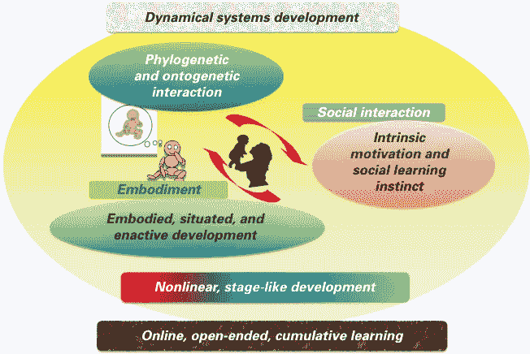

图 3.3 发展机器人的原则。

在上述发展过程中，系统发生相互作用和个体发生相互作用均会发生。先天功能被视为假设，并在每个发展阶段设定学习目标。学习结果成为下一阶段学习的假设，反之亦然——也就是说，当前阶段的假设可能是前一阶段学习的结果。因此，发展出非线性的阶段式学习（Lee et al. 2007）。

发展路径多样，从典型发展到非典型发展，这对于发展机器人也同样适用。这些路径预计共享几个关键点，以实现不同路径之间的社会交互，并且从整体上看，学习在终身规模上超越不同阶段持续进行。这是一个在线的、开放式的、累积的学习过程。

Thelen 和 Smith (1994) 将动力系统方法作为发展心理学理论提出，多种计算建模方法试图复制涉及经典先天-后天问题的耦合相互作用的非线性、动态发展过程。

在接下来的章节中，我们将详细描述 Cangelosi 和 Schlesinger (2015) 提出的发展机器人的六个关键定义原则。每个原则的阐述将参考某些里程碑式的发展心理学研究和相关的发展机器人模型。

#### 3.4.1 动力系统发展

在数学中，动力系统的特征是系统变量之间多方面相互作用的自组织导致相位状态随时间发生复杂变化。非线性现象的复杂相互作用会产生系统的不可预测状态，通常称为涌现状态。在儿童心理学中，Thelen 和 Smith (1994) 借用这一概念来解释儿童发展：这是与儿童不断成长的身体、大脑和环境相关的许多分散的局部相互作用的复杂而动态的相互作用的涌现产物。因此，Thelen 和 Smith 提出，儿童的发展应被视为复杂动态系统内部的变化，其中不断成长的儿童可以通过与环境交互产生新颖行为，这些行为状态在复杂系统中的稳定性各不相同。

该理论的一个关键概念是多因果性——例如，当爬行和走路等一种行为由大脑、身体和环境层面的各种现象同时且动态的结果决定时。Thelen 和 Smith 分析了爬行和走路的动态变化，作为儿童对环境适应（响应身体生长）中多因果性变化的一个例子。当儿童的身体构型产生足够的力量和协调性，通过双手膝姿势支撑身体，但力量不足以进行直立行走时，儿童会采用爬行策略在环境中移动。但当婴儿的身体生长导致腿部更强壮、更稳定时，站立和走路行为会作为稳定的发展状态出现，从而使爬行模式失去稳定性，并逐渐停止。这表明，运动行为是分散因素（如儿童不断变化的身体——更强壮的腿部和更好的平衡能力）及其对环境适应的自组织动力学的结果。

动力系统发展观中的另一个关键概念是嵌套时间尺度。也就是说，神经和具身现象在不同的时间尺度上作用，并以复杂而动态的方式影响发展。例如，神经活动（毫秒）这一极快时间尺度的动力学嵌套在其他较慢时间尺度的动力学之中，例如动作-反应时间（秒或数百毫秒）、学习（数小时或数天后）以及身体生长（数月）。Thelen 和 Smith 用来展示多因果性和嵌套时间尺度概念共同作用的最著名的发展心理学例子之一是 A-not-B 错误。该示例灵感来源于皮亚杰的物体恒常性实验：在实验的第一部分，一个玩具反复被藏在 A 位置（右侧）的盖子下，然后在任务接近末尾时，玩具在 B 位置（左侧）被藏起来进行一次尝试，要求孩子去拿这个物体。虽然十二个月以上的婴儿能够正确地在 B 位置拿到玩具，但出人意料的是，大多数八到十个月大的孩子会错误地在 A 位置寻找物体。尽管皮亚杰等心理学家曾使用基于年龄（阶段）差异的解释，这些差异与表征物体和空间能力的质变有关，但动力系统模型的计算机模拟（Thelen et al. 2002）表明，许多分散因素（多因果性）和时序操纵（嵌套时序）会影响这种情况。例如，这些因素取决于藏物与拿取之间的时间延迟、桌子上盖子的特性、藏物事件的显著性，以及婴儿的过去活动和身体姿势。

将动力系统方法作为发展理论的应用，在发展机器人研究以及其他认知机器人领域（Beer 2000; Nolfi and Floreano 2000）产生了显著影响。例如，该理论已被应用于早期运动发展的发展机器人模型，如 Mori 和 Kuniyoshi 的


(2010) 关于胎儿和新生儿身体表征与一般动作自我组织的模拟。在 Meola et al. (2015) 和 Mannella et al. (2018) 中，机器人的初始动态运动（类似于皮亚杰的循环反应）逐渐被塑造为有目的的动作。此外，早期单词学习的发展机器人模型（Morse et al. 2010）采用了类似于 A-not-B 错误的设置，以探讨具身因素与高阶语言发展现象之间的动态交互作用。Tani (2016) 还展示了基于动态系统理念的神经机器人学方法。

#### 3.4.2 具身化、情境化与本体发生发展

第 1 章已经讨论了具身化在机器人设计中的作用。此外，还有两个概念影响了发展机器人学模型。一个是身体与其环境之间的交互作用（情境化）的作用，另一个则关注有机体通过感知运动交互自主获取世界模型（本体发生）。

Ziemke (2001) 和 Wilson (2002) 分析了关于具身化的不同观点及其在计算模型和心理学实验中的考量。这些观点从将具身化视为身体与环境之间“结构耦合”现象，到更具限制性的“机体”具身化观（基于生物系统的自动产生——即，认知实际上是生物系统与其世界交互所做的事情（Varela et al. 1992））。沿着同样的思路，本体发生范式强调了这样一个事实：与其环境交互的自主认知系统能够发展出对世界的自身理解，并生成关于世界运作方式的自身模型（Vernon 2010; Stewart et al. 2010）。

具身与情境智能对发展机器人学产生了显著影响，实际上几乎任何发展模型都高度重视机器人的身体、大脑与环境之间的关系。具身效应涉及纯粹的运动能力（形态计算）以及诸如语言（接地）和想象等高阶认知技能。Hoffmann et al. (2010) 调查了机器人学中各种身体表征方法。其中，Yoshikawa et al. (2002)、Fuke et al. (2007) 和 Hikita et al. (2008) 的身体图式/图像获取研究侧重于跨模态关联和自组织映射，这两者都是发展机器人学中强大的方法。Yamada et al. (2016) 展示了利用 260 万个尖峰神经元和现实的肌肉骨骼模型的胎儿脑—身体交互作用，尽管这只是计算机模拟。

另一方面，具身化在高阶认知功能中的作用可以体现在以下模型中：基于动作和感知的单词接地模型（Cangelosi 2010; Morse et al. 2010）、心理学与发展机器人学中空间表征与数字认知之间的关系（Rucinski et al. 2011；另见第 22 章），以及感知运动行为与想象过程之间的关系（Seepanomwan et al. 2015）。

#### 3.4.3 内在动机与社会学习本能

发展机器人学探讨了为能够自行定义目标和价值体系的内在动机智能体和机器人设计方法（参见第 13 章；Baldassarre and Mirolli 2013）。内在动机驱动的机器人会完全自主地探索其环境，自行决定想要学习的内容和想要达成的目标。换句话说，内在动机使智能体能够构建自己的价值体系。

内在动机的概念受到婴儿期和早期儿童期开始发展的各种行为和技能的启发，包括好奇心、惊奇、新奇追求和追求掌控力的“驱动”等多种现象。Oudeyer et al. (2007) 提出了一个组织内在动机模型研究的框架，包括两大类：
- 基于知识的方法（后来细分为基于新奇性的方法和基于预测的方法；Barto et al. 2013）
- 基于能力的方法

在此框架内，可以定义并系统地比较大量算法。

基于新奇性的内在动机方法研究机器人如何通过探索和发现不寻常或意外的特征来了解其环境。检测新奇性的一个有用机制是习惯化：机器人将其当前的感知状态与过去的经验进行比较，将注意力集中在独特或不同的情境中（例如，Vieira Neto and Nehmzow 2007）。

基于预测的方法利用基于知识的内在动机，明确尝试预测世界的未来状态（Schmidhuber 2010）。这种方法的原理在于，错误或不准确的预测提供了学习信号——也就是说，它们指出了理解不足并需要进一步分析和关注的事件。作为这种方法的示例，Oudeyer et al. (2005) 描述了游乐场实验，其中索尼 AIBO 机器人学会了探索并与其环境中的一组玩具进行交互。

模拟内在动机的第三种方法是基于能力的方法。机器人受到激励，去探索并发展能够有效产生可靠后果的技能（Barto et al. 2004; Santucci et al. 2016）。基于能力方法的一个关键要素是偶然性检测（Jacquy et al. 2019）：这是指检测自身行为何时对环境产生影响的能力。虽然基于知识的方法激励智能体去发现世界的属性，但相比之下，基于能力的方法则激励智能体去发现它能对世界做什么。

儿童发展研究表明存在社会学习能力（本能）。例如，观察表明新生儿从出生第一天起就会本能地模仿他人的行为，并能模仿复杂的面部表情（Meltzoff and Moore 1977）。此外，比较心理学研究表明，18 至 24 个月大的儿童具有利他合作的倾向，而这种能力在黑猩猩中未被观察到（Warneken et al. 2006）。

发展机器人学高度重视社会学习；各种关于共同注意、模仿和合作的机器人模型已经过测试。Nagai et al. (2003b, 2006) 展示了共同注意的早期发展模型，Sumioka et al. (2010) 提出了一种共同注意的偶然性模型。Asada (2016) 通过婴儿—照顾者交互研究综述了早期发声发展的建模方法。一般来说，模仿和合作也是其他热门话题，代表性研究由 Cangelosi and Schlesinger (2015) 介绍。

#### 3.4.4 系发生与个体发生的交互作用

发展机器人学中必须考虑两个不同的时间尺度：
- 个体发生的学习现象，时间尺度为小时或天，成熟变化持续数月或数年
- 系发生的进化变化现象

因此，在发展机器人学的发展模型中，还应考虑个体发生与系发生现象之间交互作用的额外含义。

整个发展过程可以被视为系发生约束与个体发生过程之间异质性的交互作用。因此，问题并非简单的“先天与后天”二元对立。Ridley (2003) 将这种二元对立重新表述为“通过后天的先天”。虽然有“个体发生重演系发生”之说，但情况似乎并非如此简单。两种过程高度交织，从而呈现出一个广阔而动态的图景。

成熟是指儿童大脑和身体的解剖与生理变化，尤其在生命最初几年中显著。与大脑相关的成熟现象包括早期发展期间大脑可塑性的下降，以及半球专业化和神经元及连接的逐渐修剪（Abitz et al. 2007）。大脑成熟变化也被用来解释学习中的关键期。关键期是有机体生命周期中的阶段（时间窗口），在此期间个体对外部刺激更为敏感，学习效率更高。此外，关键期结束后，学习将变得困难甚至不可能。行为学中最著名的关键期（又称“敏感期”）示例是 Konrad Lorenz 对印刻行为的研究——即小鸭对母亲（或对 Lorenz）的依恋，这只能在出生后头几个小时内发生，并产生持久影响。在视觉研究中，Hubel and Wiesel (1970) 证明，猫的视觉皮层只有在动物生命头几个月内接触视觉刺激时才能发育其感受野，而如果小猫眼睛被覆盖导致完全视觉剥夺，则不会发育。

儿童身体的成熟更为明显，因为儿童从出生到青春期会经历显著的形态变化。这些变化自然会影响儿童的运动发展，如 Thelen and Smith (1994) 对爬行和走路的分析所示。发展过程中发生的形态变化对利用具身化因素也有影响，如在 3.4.2 节中讨论的那样。

一些发展机器人学模型明确解决了大脑和身体成熟变化的问题。例如，Schlesinger et al. (2007) 的研究模拟了神经可塑性在物体感知技能发展中的影响。

由于成熟和学习导致的个体发生变化，对发展与由于进化导致的系发生之间的交互作用具有重要意义。实际上，身体形态和大脑可塑性的变化可以解释为物种对不断变化的环境背景所做的进化适应。这些现象已被分析为影响个体发生现象时间安排的遗传变化，称为异时性变化（McKinney et al. 1991）。异时性变化已被用于解释发展模型中先天与后天之间的复杂交互作用，例如 Elman et al. (1996) 提出，遗传因素在发展中的作用是确定


架构约束，进而控制学习。这类约束可以从大脑适应性以及神经发育和成熟事件的角度来解释。

个体发生与系统发生因素之间的相互作用已通过计算建模得到研究。例如，Hinton 和 Nowlan (1987) 以及 Nolfi 等人 (1994) 开发了模拟模型，用以解释进化中学习的影响，如鲍德温效应。Cangelosi (1999) 测试了异时性变化对模拟智能体神经网络架构进化的影响。此外，模拟身体和大脑形态以响应系统发生和个体发生需求而进化的过程，也是“evo-devo”计算方法的目标。这旨在模拟身体和大脑形态中发育与进化适应的同时影响（例如，Stanley 和 Miikkulainen 2003；Kumar 和 Bentley 2003；Pfeifer 和 Bongard 2006）。

发育机器人模型通常基于形态固定的机器人，无法直接处理系统发生变化及其与个体发生形态变化的相互作用的同时建模。然而，各种表观遗传机器人模型考虑了学习和成熟个体发生变化的进化起源，尤其适用于包含大脑形态变化的研究。Nagai 等人 (2006) 从控制共同注意学习阶段的时序参数角度比较了性能。一种是固定时间表，其中学习阶段转入下一阶段（系统发生约束），另一种则取决于学习结果——即，如果当前学习阶段的目标达成，则转入下一个学习阶段（个体发生约束）。由于这是大脑成熟的情况，时序参数的固定时间表可能是任意的，允许设计师随意调整。然而，在身体成熟的情况下，它可能会干扰学习过程，在一定程度上加速或减缓该过程。这似乎是系统发生过程与个体发生过程之间异质相互作用的典型案例。尽管大脑成熟过程未被清晰描述，Yamada 等人 (2010) 展示了针对胎儿和婴儿的两种计算机模拟，表明了身体成熟。

#### 3.4.5 非线性、阶段式发展

儿童心理学文献中有许多理论和模型，提出了一系列发展阶段。每个阶段的特征是获取特定的行为和心理策略，随着孩子经历这些阶段，这些策略变得更加复杂和精细。皮亚杰 (1952) 的思想发展四个阶段是以阶段为中心的发展理论的典型例子。还有许多其他基于阶段发展的例子（Courage 和 Howe 2002；Butterworth 和 Jarrett 1991）。

在大多数理论中，阶段之间的转变遵循非线性、定性的转变。以皮亚杰的四个阶段为例，每个阶段使用的心理图式在定性上是不同的，因为它们是适应过程的结果，这些过程改变并调整图式以适应新的知识表征和运算。另一种基于发展过程中定性变化的著名发展理论是 Karmiloff-Smith (1995) 的表征-重描述模型。她的模型假设有四个发展层次，从使用隐性表征到不同层次的显性知识表征策略。当儿童学习特定领域的新事实和知识时，他们会发展出新的表征，这些表征会逐渐“重描述”，并增加儿童对世界的显性理解。这已被应用于物理学、数学和语言等多个知识领域。

发展过程的非线性，以及儿童在不同发展阶段所采用的心理策略和知识表征中的定性转变，已通过 U型学习-错误模式和词汇爆炸现象得到广泛研究——即，在缓慢的词汇习得阶段之后，词汇量突然增长（Elman 等人 1996）。

许多发育机器人研究旨在模拟机器人发展过程中的阶段推进，其中一些研究直接处理学习动态导致的发展阶段中的非线性现象问题。Oudino 等人 (2006) 提出了一种基于好奇心的主动词汇习得方法，以部分模拟词汇爆炸现象。Nagai 等人 (2003a) 明确模拟了 Butterworth 和 Jarrett (1991) 提出的共同注意阶段。然而，该模型表明，这些阶段之间的定性变化是机器人神经和学习架构逐渐变化的结果，而非对机器人注意策略的临时操纵。一些模型也直接处理了 U型现象的建模，例如 Morse 等人 (2011) 关于语音处理中错误模式的模型。Asada (2015) 提出了人工同理心发展的概念模型，该模型显示出从情绪感染经过情感/认知同理心到同情/怜悯的阶段式发展。Lee 等人 (2007) 提出了“提升约束、执行、饱和”方法，机器人可以通过在一定能力水平上“饱和”知识的获取，从而释放在更高水平上学习的可能性，进而发展出越来越复杂的技能。

#### 3.4.6 在线、开放式、累积学习

人类发展的特征是在线、跨模态、连续、开放式学习。“在线”指的是学习发生在儿童与环境互动时，而非离线模式。“跨模态”指的是不同的感知方式和认知领域由儿童并行习得，并相互作用。“连续”和“开放式”指的是学习和发展不会在特定阶段开始和停止，而是终身学习体验（Baldassarre 和 Mirolli 2013）。

在线学习目前已在发育机器人领域得到实现。然而，可能导致认知引导现象的跨模态、累积、开放式学习的应用研究较少。当前大多数模型通常只关注单一任务或模态（感知、语音、语义等）的习得，很少考虑模态与认知功能之间的并行发展和相互作用。因此，真正的在线、跨模态、累积、开放式发育机器人模型仍然是该领域的一个根本挑战。

### 3.5 结论

所讨论的众多哲学思考、研究问题、挑战和原则促成了大量探索广泛行为和认知技能的发育机器人模型的产生。在第三部分的许多章节中，这些章节侧重于特定传感运动和认知功能的认知机器人模型，我们将看到更多的发育机器人模型和实验示例。例如，第 13 章在很大程度上基于发育方法，而第 18 章和第 20 章则展示了各种社交和语言技能的发育机器人模型。

### 补充阅读与资源

- 发育机器人领域最全面的概述：Cangelosi, Angelo, 和 Schlesinger, Matthew. 2015. *从婴儿到机器人的发育机器人学*. Cambridge, MA: MIT Press.
- 关于婴儿机器人初始理论问题和先驱模型的里程碑式综述论文：Asada, Minoru, Koh Hosoda, Yasuo Kuniyoshi, Hiroshi Ishiguro, Toshio Inui, Yuichiro Yoshikawa, Masaki Ogino, 和 Chisato Yoshida. 2009. “认知发育机器人学：一项综述.” *IEEE 自主心智发展汇刊* 1 (1): 12–34.
- 关于认知与发育机器人原则和模型的丰富理论和计算分析：Tani, Jun. 2016. *探索机器人心智：作为自我组织动态现象的动作、符号与意识*. Oxford: Oxford University Press.

### 注释

- 1. 实体二元论、以物质为中心的二元论、精神二元论、经典二元论等等，https://www.iep.utm.edu/dualism/.
- 2. Wikipedia，“乔瓦尼巴蒂斯塔·维科”，https://en.wikipedia.org/wiki/Giambattista_Vico.
- 3. Wikipedia，“康德伦理学”，https://en.wikipedia.org/wiki/Kantian_ethics.

### 参考文献

- Abitz, Maja, Rune Damgaard Nielsen, Edward G. Jones, Henning Laurse, Niels Graem, 和 Bente Pakkenberg. 2007. “与成年人相比，人类新生儿背侧丘脑神经元过多.” *大脑皮层* 17 (11): 2573–2578.
- Asada, Minoru. 2015. “迈向人工同理心.” *社会机器人国际期刊* 7:19–33.
- Asada, Minoru. 2016. “通过婴儿-照顾者互动建模早期语音发展：综述.” *IEEE 认知与发展系统汇刊* 8 (2): 128–138.
- Asada, Minoru. 2019. “人工痛苦可能在机器人的意识心智中引发同理心、道德与伦理.” *哲学* 4:38–47.
- Asada, Minoru, Koh Hosoda, Yasuo Kuniyoshi, Hiroshi Ishiguro, Toshio Inui, Yuichiro Yoshikawa, Masaki Ogino, 和 Chisato Yoshida. 2009. “认知发育机器人学：一项综述.” *IEEE 自主心智发展汇刊* 1 (1): 12–34.
- Asada, Minoru, Karl F. MacDorman, Hiroshi Ishiguro, 和 Yasuo Kuniyoshi. 2001. “认知发育机器人学作为人形机器人设计的新范式.” *机器人与自主系统* 37:185–193.
- Baldassarre, Gianluca, 和 Marco Mirolli, 编. 2013. *自然与人工系统中的内在动机学习*. Berlin: Springer.
- Barto, Andrew, Marco Mirolli, 和 Gianluca Baldassarre. 2013. “新颖性还是惊奇?” *心理学前沿* 4:907.
- Barto, Andrew G., Satinder Singh, 和 Nuttapong Chentanez. 2004. “等级技能集的内在动机学习.” 在 *第3届发展与学习国际会议论文集* 中，112–119. La Jolla, CA: UCSD 神经计算研究所.
- Beer, Randall D. 2000. “认知科学中的动态方法.” *认知科学趋势* 4 (3): 91–99.


Butterworth, G. E., and N. L. M. Jarrett. 1991. “心智的共同之处在于空间：服务于婴儿期共同视觉注意的空间机制.” 《英国发展心理学》9:55–72.

Campbell, Stuart. 2004. Watch Me Grow：子宫内婴儿行为与发展的独特三维每周进程. 纽约: Macmillan.

Cangelosi, Angelo. 1999. “发育神经网络中的异时律与适应.” 载于 GECCO99 遗传与进化计算会议论文集, 1241–1248. 旧金山: Morgan Kaufmann Publishers.

Cangelosi, Angelo. 2010. “将语言基于行动与知觉：从认知智能体到人形机器人.” 《生命物理学评论》7:139–151.

Cangelosi, Angelo, and Matthew Schlesinger. 2015. 发展性机器人学：从婴儿到机器人. 马萨诸塞州剑桥: MIT Press.

Cangelosi, Angelo, and Matthew Schlesinger. 2018. “从婴儿到机器人：发展性机器人学对发展心理学的贡献.” 《儿童发展视角》12 (3): 183–188.

Courage, Mary L., and Mark L. Howe. 2002. “从婴儿到儿童：第二年生命期认知变化的动力学.” 《心理学公报》128:250–277.

de Vries, J. I. P., G. H. A. Visser, and H. F. R. Prechtl. 1984. “妊娠前半期的胎儿运动.” 《发育医学临床》94:6–64.

Elman, Jeffrey L., Elizabeth A. Bates, Mark H. Johnson, Annette Karmiloff-Smith, Kim Plunkett, and Domenico Parisi. 1996. 重思先天性：发展的联结主义视角. 第 10 卷. 马萨诸塞州剑桥: MIT Press.

Eswaran, Hari, James D. Wilson, Hubert Preissl, Stephen E. Robinson, Jiri Vrba, Pam Murphy, Douglas F. Rose, and Curtis L. Lowery. 2002. “人类胎儿视觉诱发脑活动的磁脑图记录.” 《柳叶刀》360 (9335): 779–780.

Foucault, Michel. 1994. 事物的秩序：人类科学的考古学. 纽约: Vintage. 重印版.

Fuke, Sawa, Masaki Ogino, and Minoru Asada. 2007. “基于运动与触觉图像并结合视觉信息构建的身体图像.” 《人型机器人国际期刊》4 (2): 347–364.

Gallagher, Shaun. 2000. “自我哲学观念：对认知科学的启示.” 《认知科学趋势》4 (1): 14–21. http://www.sciencedirect.com/science/article/pii/S1364661399014175

Hikita, Mai, Sawa Fuke, Masaki Ogino, Takashi Minato, and Minoru Asada. 2008. “基于显著性的视觉注意引导跨模态身体表征.” 载于第 7 届发展与学习国际会议. 纽约: IEEE.

Hinton, Geoffrey E., and Steven J. Nowlan. 1987. “学习如何指导进化.” 《复杂系统》1:495–502.

Hoffmann, Matej, Hugo Gravato Marques, Alejandro Hernandez Arieta, Hidenobu Sumioka, Max Lungarella, and Rolf Pfeifer. 2010. “机器人学中的身体图式：综述.” 《IEEE 自主心理发展交易》2 (4): 304–324.

Hopson, Janet L. 1998. “胎儿心理学.” 《心理学今日》31 (5): 44–64.

Hubel, David H., and Torsten N. Wiesel. 1970. “小猫单眼闭合生理效应的易感期.” 《生理学杂志》206 (2): 419–436.

Ishihara, Hisashi, Yuichiro Yoshikawa, and Minoru Asada. 2011. “用于理解指导儿童发展的照护者—儿童依恋关系的逼真儿童机器人‘Affetto’.” 载于第 2 卷，2011 年 IEEE 发展与学习国际会议, 1–5. 纽约: IEEE.

Jacquey, Lisa, Gianluca Baldassarre, Vieri Giuliano Santucci, and J. Kevin O’Regan. 2019. “感觉运动偶然性作为发展的关键驱动因素：从婴儿到机器人.” 《神经机器人学前沿》13, 文章 98.

Karmiloff-Smith, Annette. 1995. 超越模块化：认知科学的发展视角. 马萨诸塞州剑桥: MIT Press.

Kumar, Sanjeev, and Peter Bentley, eds. 2003. 论生长、形态与计算机. 马萨诸塞州剑桥: Academic Press.

Kuniyoshi, Yasuo, and Shinji Sangawa. 2006. “基于部分有序神经—身体动力学的早期运动发展：皮质—脊髓—肌肉—骨骼模型实验.” 《生物控制论》95 (6): 589–605.

Lee, Mark H., Qinggang Meng, and Fei Chao. 2007. “发展性机器人学中的分阶段能力学习.” 《自适应行为》15 (3): 241–255.

Lungarella, Max, Giorgio Metta, Rolf Pfeifer, and Giulio Sandini. 2003. “发展性机器人学：调查.” 《联结科学》15 (4): 151–190.

Mannella, Francesco, Vieri G. Santucci, Eszter Somogyi, Lisa Jacquy, Kevin J. O’Regan, and Gianluca Baldassarre. 2018. “通过内在目标了解你的身体.” 《神经机器人学前沿》12:30.

McKinney, Michael L., and Kenneth J. McNamara. 1991. *异时律：发生论的演变*. 纽约: Plenum Press.

Meltzoff, Andrew N., and M. Keith Moore. 1977. “人类新生儿对面部与手势的模仿.” *科学* 198 (4312): 75–78.

Meola, Valentina Cristina, Daniele Caligiore, Valerio Sperati, Loredana Zollo, Anna Lisa Ciancio, Fabrizio Taffoni, Eugenio Guglielmelli, and Gianluca Baldassarre. 2015. “发展过程中的节律性与离散操作动作相互作用：一种策略搜索强化学习机器人模型.” *IEEE 认知与发展系统交易* 8 (3): 152–170.

Mori, Hiroki, and Yasuo Kuniyoshi. 2010. “人类胎儿发展模拟：通过触觉感觉的行为自组织.” 载于 *第 9 届发展与学习国际会议*, 82–87. 纽约: IEEE.

Morse, Anthony, Tony Belpaeme, Angelo Cangelosi, and Caroline Floccia. 2011. “持续发展过程中 U 型表现曲线的建模.” 载于 *认知科学学会年会论文集*. 西雅图: 认知科学学会.

Morse, Anthony, Tony Belpaeme, Angelo Cangelosi, and Linda B. Smith. 2010. “用身体思考：使用真实人形机器人对分类中的空间偏差进行建模.” 载于 *认知科学学会年会论文集*, 1362–1367. 西雅图: 认知科学学会.

Nagai, Yukie, Minoru Asada, and Koh Hosoda. 2006. “功能发展辅助下的共同注意学习.” *先进机器人技术* 20 (10): 1165–1181.

Nagai, Yukie, Koh Hosoda, and Minoru Asada. 2003a. “婴儿如何获得共同注意能力？一种建构性方法.” 载于 *第 3 届表观发生机器人国际研讨会论文集*, 91–98. 瑞典伦德: 伦德大学认知研究.

Nagai, Yukie, Koh Hosoda, Akio Morita, and Minoru Asada. 2003b. “共同注意发展的建构性模型.” *联结科学* 15 (4): 211–229.

Neisser, Ulric, ed. 1994. “被感知的自我.” 载于 *艾莫里认知研讨会*, 3–22. 剑桥: 剑桥大学出版社.

Nolfi, Stefano, and Dario Floreano, eds. 2000. *进化机器人学*. 马萨诸塞州剑桥: MIT Press.

Nolfi, Stefano, Domenico Parisi, and Jeffrey L. Elman. 1994. “神经网络中的学习与进化.” *自适应行为* 3 (1): 5–28.

Ogino, Masaki, Masaaki Kikuchi, and Minoru Asada. 2006. “基于好奇心的主动词汇习得.” 载于 *第 5 届发展与学习国际会议*. 纽约: IEEE.

Oudeyer, Pierre-Yves, Verena V. Hafner, and Andrew Whyte. 2005. “游乐场实验：好奇机器人的任务独立发展.” 载于 *AAAI 春季研讨会：发展机器人学论文集*, 42–47. 美国加州门洛帕克: AAAI Press.

Oudeyer, Pierre-Yves, Frédéric Kaplan, and Verena V. Hafner. 2007. “面向自主心理发展的内在动机系统.” *IEEE 进化计算交易* 11 (2): 265–286.

Pfeifer, Rolf, and Josh C. Bongard. 2006. *身体如何塑造我们的思考方式：关于智能的新视角*. 马萨诸塞州剑桥: MIT Press.

Piaget, Jean. 1952. *儿童智能的起源*. 纽约: 国际大学出版社.

Ridley, Matt. 2003. *通过后天的天性：基因、经验以及造就人类的因素*. 纽约: HarperCollins.

Rucinski, Marek, Angelo Cangelosi, and Tony Belpaeme. 2011. “数字与空间交互的具身发展性机器人模型.” 载于 *认知科学学会年会论文集*. 西雅图: 认知科学学会.

Santucci, Vieri Giuliano, Gianluca Baldassarre, and Marco Mirolli. 2016. “GRAIL：一种面向内在动机学习的目标发现机器人架构.” *IEEE 认知与发展系统交易* 8 (3): 214–231.

Schlesinger, Matthew, Dima Amso, and Scott P. Johnson. 2007. “知觉完成发展过程中的婴儿凝视模式模拟.” 载于 *第七届表观发生机器人国际会议：模拟机器人系统中的认知发展论文集*. 瑞典伦德: 伦德大学认知研究.

Schmidhuber, Jürgen. 2010. “创造力、乐趣与内在动机的形式理论（1990–2010）.” *IEEE 自主心理发展交易* 2 (3): 230–247.

Seepanomwan, Kristsana, Daniele Caligiore, Angelo Cangelosi, and Gianluca Baldassarre. 2015. “心理旋转中的概括、决策与具身效应：一种使用人形机器人测试的神经机器人架构.” *神经网络* 72:31–47.

Stanley, Kenneth, and Risto Miikkulainen. “人工胚发生分类法.” *人工生命* 9 (2): 93–130.


约翰·斯图尔特，奥利维尔·加彭和埃泽基尔·A. 迪保罗。2010年。*通向认知科学新范式的本体行动*。剑桥，马萨诸塞州：麻省理工学院出版社。

住冈秀信，吉川祐一郎和浅田稳。2010年。“再现交互偶然性以实现社会行为的开放式发展：关于共同注意的个案研究”。《IEEE 自主心智发展汇刊》2 (1): 40–50。

谷纯。2016年。*探索机器人心智：作为自组织动态现象的行为、符号和意识*。剑桥：牛津大学出版社。

埃丝特·特伦，格雷戈尔·舍纳，克里斯蒂安·舍耶和琳达·B. 史密斯。2002年。“具身化的动力学：婴儿坚持性伸展的场论”。《行为与脑科学》24:1–86。

埃丝特·特伦和琳达·B. 史密斯。1994年。*认知与行动发展的动力系统方法*。剑桥，马萨诸塞州：麻省理工学院出版社。

弗朗西斯科·J. 瓦雷拉，埃莉诺·罗施和埃文·汤普森。1992年。*具身心智：认知科学与人类经验*。剑桥，马萨诸塞州：麻省理工学院出版社。

彼得-保罗·维尔贝克。2011年。*技术道德化：理解和设计事物的道德*。芝加哥：芝加哥大学出版社。

大卫·弗农。2010年。“作为发展性认知机器人学概念框架的本体行动”。《Paladyn》1:89–98。

乌戈·维埃拉·内托和乌尔里希·内姆措。2007年。“使用移动机器人进行实时自动化视觉检测”。《智能与机器人系统期刊》49 (3): 293–307。

费利克斯·瓦内肯，弗朗西斯·陈和迈克尔·托马塞洛。2006年。“幼儿和黑猩猩的合作活动”。《儿童发展》77 (3): 640–663。

居阳·翁，詹姆斯·麦克莱兰德，亚历克斯·彭特兰，奥拉夫·斯帕恩斯，伊达·斯托克曼，米利安卡·苏尔和埃丝特·特伦。2001年。“机器人和动物的自主心智发展”。《科学》291 (5504): 599–600。

玛格丽特·威尔逊。2002年。“具身认知的六种观点”。《心理onomic 公报与评论》9 (4): 625–636。

山田康则，金泽法则，岩崎翔，塚原优，岩田佑辅，山田重仁和国吉康夫。2016年。“人类胎儿的具身大脑模型”。《科学报告》6:27893。

山田康则，森弘树和国吉康夫。2010年。“胎儿和婴儿发展场景：基于感觉约束的目标导向行为的自我组织”。载于 *第十届表观遗传机器人国际会议论文集*，142–152。瑞典，隆德：隆德大学认知研究。

吉川祐一郎，川西宽之，浅田稳和细田康。2002年。“触觉、视觉和本体感觉空间之间交叉模态映射学习中的体模获取”。载于 *第二届表观遗传机器人研讨会：机器人系统中认知发展建模*，181–184。瑞典，隆德：隆德大学认知研究。

汤姆·齐姆克。2001年。“机器人是否具身？”载于 *第一届表观遗传机器人研讨会：机器人系统中认知发展建模*。瑞典，隆德。

乔丹·兹拉特夫和克里斯蒂安·巴肯尼乌斯。2001年。“何为表观遗传机器人学。”载于 *第一届表观遗传机器人研讨会：机器人系统中认知发展建模*。瑞典，隆德：隆德大学认知研究。

## 4 进化机器人学
斯蒂法诺·诺尔菲

### 4.1 引言

进化机器人学（Nolfi 和 Floreano 2000；Nolfi 等人 2016；Nolfi，2021）是一种方法，它允许创建能够通过类似于自然进化的适应过程而发展出执行一项或多项功能能力的机器人。

机器人被视为在不受人类干预的情况下与环境密切交互中进行适应的自主人工有机体。实验者的角色仅限于指定适应度函数——即用于评估机器人性能水平的标准——以及指定不受适应过程影响的机器人特征。其余特征被编码在参数向量（基因型）中，并通过进化算法（Rechenberg 1973；Goldberg 和 Holland 1988）进行进化。在大多数情况下，进化机器人配备了神经网络控制器。网络的连接权重（决定机器人的行为）被编码在基因型中并进行进化。最终，神经网络的架构（Stanley 和 Miikkulainen 2002；Durr、Mattiussi 和 Floreano 2006）和/或机器人的形态可以被编码在基因型中并进行进化（Sims 1994；Lipson 和 Pollack 2000；Auerbach 和 Bongard 2012；Hiller 和 Lipson 2012）。

进化过程通过创建随机生成的初始基因型种群，然后对特定数量的代际重复以下步骤来实现：1) 创建具有相应基因型中指定特征的机器人种群，2) 允许机器人与其环境交互有限的时间，并计算一个标量值（适应度）以评价每个机器人相对于给定问题的性能，以及 3) 创建一个由最适机器人的基因型的带有随机变异的副本组成的新基因型种群。

需要考虑的一个重要方面是，使用为机器人执行特定功能（例如觅食）提供奖励的适应度函数，可以推动多种行为和认知能力的发展，这些能力对于实现该功能至关重要，例如避开障碍和危险、在环境中定位和导航、区分相关对象、随时间整合感官信息并稍后使用它来适当调节机器人的行为，等等。分析这些能力在进化机器人中是如何实现和集成的，可以从模拟自然系统中类似能力的组织和发展的角度提供有价值的信息。

进化机器人学已被应用于广泛现象的研究，包括具身认知、感觉运动协调、行为和认知技能的整合、社会和集体行为、内部模型以及进化与学习之间的相互作用。在接下来的章节中，我将描述这些领域开展工作的几个代表性示例。

### 4.2 演化身体与大脑：形态计算

机器人或动物的行为和认知技能是随时间展开的动态特性，源于代理人神经系统、身体和环境之间大量相互作用（Chiel 和 Beer 1997；另参见第 11 章）。源于这些相互作用的动态过程取决于代理人身体和大脑的特征。这意味着，改变身体和/或大脑的特征可以塑造动态过程。

通过塑造身体或大脑的特征可以实现的一种行为示例是在倾斜平面上行走。事实上，这既可以由带有被动关节和精心设计的身体形态的无脑机器人（McGeer 1990；Collins 等人 2005）产生，也可以由缺乏前者机器人形态特征的高度受控机器人（Chestnutt 等人 2005）产生。“形态计算”（Pfeifer 等人 2006；Paul 2006；另参见第 1 章）一词被引入以表示原本必须由大脑执行的由身体执行的过程。利用形态计算的解决方案在能源效率和对替代方案的鲁棒性方面往往更具优势（Pfeifer 和 Bongard 2006）。

同时调整机器人的身体方案和控制策略的可能性，允许在可用解决方案谱系中选择更简单、更有效的解决方案——即主要依赖形态计算或控制的解决方案。此外，它还允许生成形态和控制特征协同适应的解决方案。进化机器人学是调整机器人策略和形态的理想方法，因为它是一种无模型方法，不对适应系统的结构做出任何假设。此外，与替代的无模型训练方法不同，它允许调整任何类型的参数，包括质量不同的参数的组合。构成机器人身体的身体部件数量、这些部件的相对位置、每个身体部件的物理特性以及身体部件之间关节的特征都可以编码在基因型中，并与机器人神经网络的特征一起进行进化。这通常通过使用编码生长规则的基因型来实现，这些规则决定初始“胚胎”如何生长和分化，而不是使用直接编码完全形成机器人属性的基因型。

在此领域的开创性工作中，Sims (1994) 演示了如何利用人工进化来进化模拟生物的形态和控制策略，这些生物能够游泳、行走和抓取物体，同时与其他生物竞争。利普森和


Pollack (2000) 后来采用了类似的方法，演化出模拟行走机器人，随后使用三维打印机和备用电子元件制造这些机器人。

自那时起，这种方法已被应用于各种目的。例如，Long (2012) 演化了游泳机器人人工尾部的刚度，以探究早期脊椎动物如何演化出脊柱。通过在复杂程度各异的环境中演化机器人，Auerbach and Bongard (2012) 揭示了演化形态的复杂性与环境复杂性之间的相关性。例如，在不规则地形上演化出行走能力的机器人会发展出包含附肢的形态，而这些附肢是在平坦地形上演化的机器人中所缺失的。Hiller and Lipson (2012) 展示了如何通过演化由具有不同材料特性的细胞按演化拓扑排列而成的机器人，来产生多种运动行为。这些行为源自部分细胞产生的简单周期性膨胀/收缩动作，以及构成机器人身体的细胞之间、细胞与环境之间的物理相互作用。这些由多个细胞组成的模拟机器人随后可通过在相同的三维空间配置中组装外胚层和心脏干细胞，转化为人造生物（Kriegman et al. 2020）。值得注意的，这些人造生物能够自主运动并自主探索其水生环境数天之久。

### 4.3 感觉运动协调

在具身且处于情境中的智能体中，感知的作用无法与动作分离，反之亦然。智能体所感知的内容由其行为决定，而智能体的行为则可由其需要感知的内容决定。

感知与动作之间存在紧密联系，这一观点源于哲学、心理学和认知科学中的多个不同传统。它是 Gibson (1979) 发展的知觉生态理论的核心，也是若干其他基本贡献的核心（Arbib 1989；Varela, Thomson, and Rosch 1991；Maturana and Varela 1987；Thelen and Smith 1994；Berthoz 2000；O’Regan and Noë 2001；Noë 2004；Clark 1998, 1999）。感觉过程与运动过程的耦合可以用“感觉运动协调”（sensorimotor coordination）一词来表示（Dewey 1981 [1886]）。

进化机器人学为研究感觉运动协调在行为和认知技能发展中的作用提供了一个理想框架。第一个原因是，进化过程让演化中的机器人自由确定实现其自适应目标的方式。因此，机器人可以自由协调其感知与动作过程，以有效地实现其目标。第二个原因是，进化过程由适应度度量驱动，该度量对机器人的整体性能进行评级——即在较长评估期间内获得的奖励总和。这使得能够识别并保留增强感觉与动作过程之间协调性的变异，而不论动作与相关奖励之间的时间间隔是即时的还是延迟的。

确实，感觉运动协调在几乎所有由演化机器人开展的实验中都起着至关重要的作用。第一个演示是在一个实验中报告的，该实验中，一辆配备红外传感器并置于被墙壁包围的竞技场中的轮式机器人被演化为具有寻找并停留在圆柱体附近的能力（Nolfi 1996, 2005）。有趣的是，演化出的机器人并非通过内部处理所经历的感知状态来区分对应于墙壁和圆柱体的刺激来解决问题，这种策略实际上具有挑战性，因为圆柱体和墙壁附近经历的刺激在感知空间中高度重叠。它们相反地通过对刺激作出反应来解决任务，以产生行为吸引子——即通过交替执行前进/后退和向左转/向右转动作产生的振荡行为，这种行为出现在圆柱体附近而非墙壁附近。换句话说，它们利用这样一个事实：在墙壁或圆柱体附近执行相同的动作会产生不同的感知后果，从而导致产生两个所需的差异化行为。该实验可以使用 Evorobotpy 软件工具复现，该工具可从 https://github.com/snolfi/evorobotpy 获取（有关运行 ErDiscrim 实验的说明，请参见 Nolfi 2021，第 13 章）。

在这项实验的扩展版本中，机器人配备了编码其车轮速度的本体感觉传感器，Scheier, Pfeifer, and Kuniyoshi (1998) 观察到演化出一种质地不同的感觉运动策略，该策略利用动作来自我选择易于解释的刺激。在这种情况下，演化出的机器人在墙壁和圆柱体附近表现出墙跟随行为，分别表现为沿墙直线行驶和绕圆柱体转弯。然后，它们利用左车轮和右车轮速度之间的感知差异，在圆柱体附近继续产生墙跟随行为，并远离墙壁。换句话说，机器人采取行动以便后来体验有利的感知状态。它们表现出一种初始行为，使其能够后来在墙壁和圆柱体附近的本体感觉传感器上体验到两个差异明显的状态。

在更复杂的机器人中，也观察到了质地相似的解决方案，这些机器人被演化为能够解决更具挑战性的问题。例如，一个模拟 iCub 机器人（Sandini, Metta, and Vernon 2004）被演化为基于粗糙触觉信息区分球形和椭圆形物体的能力（Tuci, Massera, and Nolfi 2010）。该机器人配备了十四个运动神经元，用于编码七组拮抗肌产生的扭矩，这些肌肉控制手臂和手腕的七个自由度（DOF）；两个运动神经元用于编码拇指和四个手指所需的伸展/屈曲；以及两个运动神经元，用于指示物体的类别（即，球形或椭圆形）。机器人的传感器包括八个神经元，用于编码手臂和手腕自由度的当前角位置；五个神经元，用于编码五个相应手指的伸展/屈曲；以及十个神经元，用于编码位于指尖和手掌上的十个触觉传感器。触觉传感器二进制编码机器人身体的相应部分是否与另一个身体发生碰撞。机器人因在多个评估情节中区分所经历物体的形状而获得奖励。它们并未因产生任何特定行为而获得奖励，因此被允许自由选择能够实现和/或促进区分问题的行为。

对演化机器人的分析表明，它们确实发展出了操作行为，使它们能够体验刺激，从而在物体形状相似和触觉传感器分辨率有限的情况下，可靠地区分两种类型的物体。分类过程包括三个阶段。在第一阶段，机器人通过用手指包裹物体并移动物体，直到达到合适的手/物体姿态来操作物体。在此阶段所经历的触觉刺激中包含的信息会增加，并且当手/物体达到合适姿态时最终达到高值，该姿态在情节的其余部分几乎保持稳定。在第二阶段，机器人开始产生分类答案，继续执行精细操作动作，并继续整合所经历的感官信息，最终可能会逆转其分类决定。这一过程在第三阶段继续进行，在该阶段分类决定不再可逆。

因此，演化机器人发现的解决方案符合 Spivey (2007) 阐述的认知动态观。分类过程随时间的延伸使机器人能够体验有用的刺激，并整合随时间经历的相互冲突的证据，以最大限度地提高分类决定的准确性。

### 4.4 反应能力与认知能力之间的关系

进化机器人学也可用于研究行为能力与认知能力之间的关系及其整合。

如上所述，形态计算和感觉运动协调可用于执行大脑原本需要执行的过程。因此，利用智能体与环境之间的交互，使得可以依赖比那些不依赖这些特性的解决方案在内部处理角度来看更简单的解决方案。这引发了关于反应能力与认知能力之间关系的疑问。它们倾向于以协同还是冲突的方式相互作用？认知是否真正无缝——意味着将完全具身的响应性与抽象思维和离线推理联系起来的温和、渐进的轨迹？还是像一块补丁被子，带有跳跃和不连续性，以及服务于不同需求的非常不同的处理和表现形式？（Clark 1999, 350）。

支持协同关系和反应能力与认知能力平滑渐进整合的有趣证据已在针对演化在双 T 型迷宫环境中导航能力的机器人的进化实验中报告（图 4.1；Carvalho and Nolfi 2016）。该机器人最初位于中央走廊底部的一个区域，位置和方向随机变化，应该

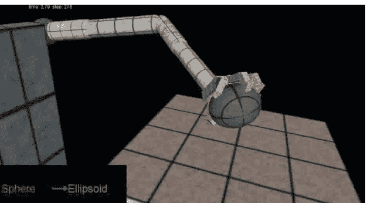

Figure 4.1 用于区分物体的机器人。


朝迷宫四个端点之一的目标目的地行驶。正确的目的地由中央走廊中的两个绿色物体标记。因此，机器人应该解决一个时间延迟问题：即在中央走廊中行驶时经历的信息，以后应影响机器人到达第一个和第二个交叉口时转弯的方向。

对进化机器人的分析表明，它们采用一种策略来解决问题，该策略无需将从绿色物体中提取的信息存储在内部状态中，无需识别到达第一个和第二个交叉口，也无需基于内部状态和交叉口来向左或向右转弯。如图 4.2 所示，不同评估回合中产生的轨迹先在中央走廊的底部汇聚，然后在机器人感知绿色物体位置时发散。初始汇聚使机器人能够减少由不同的初始位置和方向造成的差异。发散过程允许机器人进入机器人/环境动力学的四个独立吸引盆地之一，从而到达正确的目的地——即与两个绿色信标的相对位置相匹配的目的地。

因此，进化机器人所展示的策略利用了一种认知卸载形式——即将代理人的未来意图卸载到外部环境中的可能性（Gilbert 2015a, 2015b）。更具体地说，机器人通过在相对于走廊采用不同位置和方向，然后保持这些位置/方向来卸载在中央走廊中经历的信息。随后，机器人在走廊中的相对位置被用于在第一个交叉口然后第二个交叉口适当地向左或向右转弯。图 4.2 中显示的轨迹由没有内存的机器人产生。然而，具有内存的机器人——即内部神经元中具有循环连接的机器人——也会产生类似策略。因此，在环境中卸载信息的可能性优先于依赖内部处理的替代方案，无论是否有内存可用。

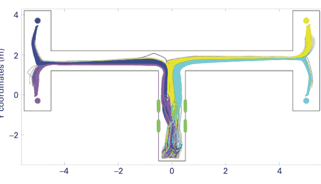

**图 4.2** 典型进化机器人在三百个回合后评估的轨迹。轨迹（*显示为洋红色、蓝色、黄色和青色*）指示机器人在应导航至相应颜色目的地的回合中产生的轨迹。目标目的地由中央走廊左侧或右侧两个绿色物体的相对位置标记。

有趣的是，受到位置扰动（例如不时发生的“阵风”导致随机向左或向右移动）的进化机器人，通过开发复合策略来解决该问题：依赖认知卸载来确定电机轨迹，并在位置扰动后依赖内存重新进入合适的吸引盆地。Carvalho 和 Nolfi（2016）报告的这项及额外控制实验表明，至少在本领域中，反应策略并未阻碍，反而促进了认知能力的发展。此外，它们还说明了，认知能力的发展并未导致预先存在的反应能力的消除，而是其扩展。

### 4.5 社会与集体行为

在上一节中，我们将分析限制在个体行为上——即放置在不包含其他机器人的环境中机器人的进化。然而，进化方法也可应用于进化社会行为。这可以简单地通过将进化机器人置于包含其他机器人的环境中来实现。

此场景已被用于研究支持合作行为进化的条件。正如预期，当一组相互作用的机器人由遗传相关的个体（例如，具有相同基因型的个体）组成，或选择在群体或蜂群水平上运行时，合作行为很容易出现（Floreano et al. 2007）。相反，当形成群体的个体没有遗传关系且选择在个体水平上运行时，进化过程会导致一种动态：合作行为周期性地出现并消失（Mitri, Floreano, and Keller 2009）。

遗传相关机器人的进化很容易产生自组织特性——即从单个机器人之间的局部相互作用中自发形成的空间、时态或时空结构或功能，并且对环境变化具有鲁棒性（Camazine et al. 2001；另见第 5 章）。例如，Sperati、Trianni 和 Nolfi（2011）进行了实验，进化一群轮式机器人以获得觅食能力。进化机器人发展出自行排列成动态链的能力，使群体能够高效地在巢穴和觅食区域之间导航。这些在扰动存在下能自维持的动态链，使得个体感官能力有限的机器人能够通过在群体层面发现和存储相关环境区域位置信息，高效地导航至正确目的地。另一个自组织行为的例子是在一群能够自我组装（即通过物理连接在一起）的机器人中观察到的，用于掌握单个机器人无法解决的问题。进化用于在连接状态下移动能力的机器人发展出协商共同运动方向的能力，并在沿该方向移动时通过补偿运动过程中产生的错位来保持运动（Baldassarre et al. 2007）。同样，在这种情况下，协调和合作的能力对环境条件的变化具有鲁棒性。确实，进化机器人能够独立于其组装配置进行协调。此外，在特定环境条件下进化的机器人展示了将其技能推广到新环境条件的能力。这种推广能力包括展示适应新经验条件的新行为的能力。例如，在无障碍环境中进化的机器人群展示了避障能力，并能在置于带有障碍物的类迷宫环境中时重新排列形状以通过狭窄通道（Nolfi 2009）。

机器人中集体行为的进化还可能导致任务专业化的出现——即个体能够承担不同的互补角色，从而提高群体的效能（Ferrante et al. 2015; Pagliuca and Nolfi 2018）。

为解决有利于合作的问题而被选择的机器人进化，也已被用于研究通信和语言的进化（Cangelosi and Parisi 2002; Nolfi and Mirolli 2010；另见第 20 章）。在 De Greef 和 Nolfi（2010）报告的一系列实验中，作者分析了进化机器人跨代展示的通信系统的起源和复杂化，以及与通信信号相关的含义的起源和转变。这些分析表明，通信能力的发展与其他能力的进化强烈相互关联。机器人需要发展适当的行为来访问和/或生成要传达的信息，并对检测到的信号做出适当反应。有趣的是，通信技能的发展支撑着行为技能的发展，反之亦然。这导致了集成能力的发展以及机器人技能的逐步复杂化（Nolfi 2013）。

最后，进化机器人学实验已被用于解释为什么互惠（即两个合作伙伴之间帮助情节的互惠交换）在自然界中很少见（André and Nolfi 2016）。这一事实与博弈论模型的预测形成对比，后者预测互惠应该容易进化（Axelrod and Hamilton 1981）。正如 André 和 Nolfi（2016）所示，这些博弈论模型的预测是错误的，因为这些方法没有建模行为产生的底层机制，这一限制不影响进化机器人学模型。确实，由进化机器人进行的实验正确地预测了互惠不太可能进化，因为要从不互惠的个体中生成互惠行为需要大量中性突变。

另一条研究路线调查了竞争场景中社会行为的进化——例如，一群利益冲突的机器人进化。捕食者和猎物等竞争物种的共同进化可能有利于进化创新的合成。确实，“一个谱系（例如，捕食者）的适应可能会改变另一个谱系（例如，猎物）的选择压力，从而产生一种反适应。如果这种情况互惠发生，可能会导致不稳定的‘军备竞赛’失控升级”（Dawkins and Krebs 1979, 489; Rosin and Belew 1997）。换句话说，一方的适应呼唤另一方的反适应，而反适应又呼唤更多的反适应，如此循环，从而产生一个升级过程。此外，代理与学习环境的并发进化可能导致自适应问题的自发、逐步复杂化。也就是说，可以产生一种教学上合理的训练过程，其中一个种群中的进展


is accompanied by a gradual complexification of the adaptive task caused by parallel progress in the competing population (Rosin and Belew 1997).

Evolutionary experiments performed by evolving predator and prey robots (Cliff and Miller 1995; Nolfi and Floreano 1998) showed that co-evolution does indeed lead to “arms races” that produce a progressive complexification during the initial generations. The evolutionary dynamics, however, later converge in a limit-cycle dynamic in which progress against current competitors (local progress) is accompanied by retrogression with respect to ancient or future competitors. Cycling dynamics of this type were found in natural evolution in a population of side-blotched lizards (*Uta stansburiana*) by Sinervo and Lively (1996) and in *Daphnia* and associated parasites conserved in lake sediment (Decaestecker et al. 2007). More recently, Simione and Nolfi (2017, 2019) showed how long-term global progress can be produced in controlled ecological conditions—that is, in experiments in which the evolving populations are divided into subgroups that normally interact with specific subgroups of the competing population and only occasionally with the remaining competitors.

### 4.6 进化、发育与学习

The basic evolutionary method illustrated in the introduction can be extended to incorporate development and learning. In the basic method, the process that maps a genotype into a robot is completed before the robot starts to interact with its environment. In other words, robots are born as fully formed individuals. In extended evolutionary methods, by contrast, the developmental process continues during the period in which the robot interacts with its environment.

A model described in Bongard (2011), in which the evolving robots developed from an anguilliform morphology to a legged morphology while they interacted with the external environment, provides an example. The comparison with control experiments, in which the robots did not transition through the anguilliform body plan, indicates that morphological change accelerates the evolution of robust walking behaviors. A second example is given by a series of experiments reported in Kriegman, Cheney, and Bongard (2018) in which soft robots with developmental morphology were evolved for the ability to move over a surface. The analysis of the interaction between the evolutionary and developmental processes in these experiments enabled the authors to highlight an unknown aspect of genetic assimilation—namely, that the traits that render the agents robust to changes in other traits have a greater probability of becoming genetically assimilated in successive generations than traits that are less robust to genetic variations.

A model in which the brains of the robots keep developing while the robots operate in their environment was studied in Nolfi, Miglino, and Parisi (1994). In this model, the evolving robots were provided with neuron axons that grew and branched by establishing connections with other neurons while the robots operated in the environment. As with real nervous systems, the growth process of axons is influenced both by the activity patterns of the single neurons and by genetic factors (Purves 1994; Quartz and Sejnowski 1997). This leads to the evolution of robots capable of developing brains adapted to the environment in which they are situated—for example, to robots that might or might not develop a brain area dedicated to processing light and in which development of the area is triggered by the exposure to light (Nolfi, Miglino, and Parisi 1994).

Other works have investigated the combination of evolution and learning (Nolfi and Floreano 1999). In these models the topology of the neural network was fixed, but the connection weights varied while the robots interacted with the environment on the basis of an unsupervised (Floreano, Durr, and Mattiussi 2008), self-supervised (Nolfi and Parisi 1993), or reinforcement-learning algorithm (Schembri, Mirolli, and Baldassarre 2007). The combination of evolution and learning enables evolving robots to adapt to environmental variations that occur within generations. For example, it enables predator robots to modify their behavior on the fly while interacting with a prey robot to display the strategy that is effective against the current encountered prey (Floreano and Nolfi 1997).

### 4.7 内部模型

Evolutionary robotics is a model-free approach, a method that permits the robots to develop behavioral and cognitive skills from scratch without the need to rely on a model of the external environment and/or the robot's own self. However, the abilities that the robots develop during their adaptation can include the ability to build and use a model of their own body, a model of the external environment, and/or a forward model that allows the consequences of the robots' actions to be predicted.

Bongard, Zykov, and Lipson (2006) give an example of a robot capable of acquiring a model of its own body. In this work, a physical robot was equipped with an onboard simulator that it used to continually evolve a model of itself. The model consisted of a three-dimensional description of the robot's own body that enabled it to predict the perceptual effects of the actions it could execute without actually performing them. The robot then used the model to cope with damages, such as the mechanical separation of a leg. This was realized by:
- using the offset between the actual and predicted consequences of actions to diagnose the damage,
- updating the model of the robot's own body to reduce the offset between the predicted and actual consequences of the robot's action,
- evolving a new control policy capable of operating effectively with the damaged body by using a mental simulation, and
- using the new control policy to keep operating effectively despite the damage.
The availability of the world model thus permits the evolution of a compensatory policy by using the imagined effect of variations of the current policy (mental simulation) as a proxy for the actual effect of variations.

Cully et al. (2015) showed how the ability to recover from damages or faults can be speeded up by learning a behavior-performance map that encodes the correlation between the value of the connection weights and the value of fitness. The map can then be used to introduce mutations that have a higher chance of producing improvements with respect to random mutations.

Gigliotta, Pezzulo, and Nolfi (2011) demonstrated how a robot subjected to sensory deprivation can evolve the ability to react appropriately to sensory stimuli and to self-generate states functionally equivalent to sensory stimuli during sensory deprivation phases in which stimuli are not available. The behavior consists of moving the robot's eye to foveate consecutive portions of the image located over a circular trajectory. In normal phases, the robot can determine the movement of the eye on the basis of the current perceived color. During blind phases, the robot should use self-generated internal states as proxies for missing sensory states. The analysis of the evolved robots indicates that the problem is not solved by generating states that match the missing sensory states. Rather, it is realized by generating internal states that elicit the appropriate movements but are not necessarily similar to the states that would be experienced in normal conditions.

Finally, Ha and Schmidhuber (2018) demonstrated how agents that determine their actions on the basis of features extracted from the sensory states, by a neural network trained with a self-supervised learning algorithm, outperform agents that determine their actions directly on the basis of the features encoded in sensory states. The problem considered consists of learning to drive in a car-racing environment called CarRacing-v0 (Brockman et al. 2016). The learning agent receives an image containing a top-down view of the car and the environment as input. The features are extracted by:
- a variational autoencoder network (Kingma and Welling 2013; Rezende et al. 2014) trained with the ability to encode perceived images in compact representations that can be used to reconstruct the original image and
- a long short-term memory (LSTM) network (Hochreiter and Schmidhuber 1997) trained to predict the compressed state of the next perceived image on the basis of the compressed state of the current image and of the action the agent is going to perform.
These two networks are pretrained using the images collected by the agent during several evaluation episodes in which the agent moves by performing random actions. The neural network controller of the evolving agents, which receives as input the internal state extracted by the sensors from the two pretrained networks described above, is evolved by using a standard evolutionary method for the ability to drive the car. In a second experiment performed by using the VizDoom game problem (Kempka et al. 2016), the authors showed that the autoencoder and LSTM prediction network described above can be used to evolve the agents in virtual worlds imagined by the agents themselves. The solutions evolved in these imagined worlds can then be successfully used to control the agent of a real VizDoom game.

### 4.8 进化作为一种学习形式

The evolutionary method can also be used to model ontogenetic learning (Schlesinger 2004). This is because the evolutionary algorithm constitutes one of the simplest yet most effective ways to evolve an embodied neural network through a trial-and-error process based on distal rewards. An example is illustrated in experiments in which an iCub humanoid robot (Sandini, Metta, and Vernon 2004) trained through an evolutionary method develops reaching and grasping skills analogous to those displayed by human infants from two to eighteen months of age (Savastano and Nolfi 2013). During this period, infants display a first transition from sweeping and unsuccessful arm movements to primitive, imprecise reaching and grasping behaviors and then a second transition leading to integrated and effective reaching and grasping behaviors (Konczak et al. 1995; Konczak, Borutta, and Dichgans 1997; Konczak and Dichgans 1997; von Hofsten and Rönnqvist 1993; Spencer and Thelen 2000).

As illustrated in figure 4.3 (left), the robot is set in an upright position in front of a suspended object. This setting is similar to that used by Hofsten (1982) to analyze the development of


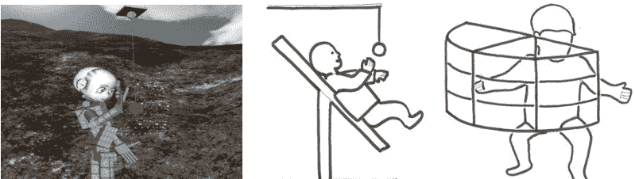

图 4.3  
模拟设置（左）源自 von Hofsten（1982）对婴儿（中间和右侧）进行的实验。

婴儿的伸展和抓握行为（图 4.3，中间和右侧）。机器人的训练分为三个阶段实现：1) 前伸展阶段，此时机器人具有简单的预设反射行为、低视觉敏锐度和不成熟的神经系统；2) 粗伸展阶段，此时机器人具有改进的视觉敏锐度和成熟的皮层区域；以及 3) 精细伸展阶段，此时机器人可以获取编码物体相对于手的相对位置的感知信息。

实验分析表明，前伸展阶段内部神经资源的缺乏具有适应性作用（即，将粗伸展阶段的发育过程引向更好的解决方案）和偏差作用（即，代表了探索性运动咿呀学语行为出现的必要条件）。这表明，皮层区域（Martin 2005）在人类中的后期介入可以发挥适应性作用，并且可能为了实现此功能而进化。此外，对训练过程中机器人行为的分析表明，婴儿中观察到的以下现象是自发产生的：1) 前伸展阶段机器人手臂远端自由度（DOFs）的使用减少（冻结）；2) 前伸展阶段的探索性（运动咿呀学语）行为；以及 3) 精细伸展阶段开始时伸展能力的时间性退行。这些质的变化自发出现的事实表明，它们不一定反映其他特定成熟约束的存在。它们可以是通过暂时降低运动空间、感觉空间和相关任务空间的复杂性来运作的一般自结构过程的表现。

与强化学习算法（Sutton and Barto 2018）形成对比，后者是建模试错学习最常见的选择，进化算法则具有优点和缺点。优点包括能够调整机器人的所有特性，包括机器人的形态和神经网络架构，以及在稀疏奖励存在下良好运行的能力。另一方面，强化学习算法通常样本效率更高。

开发新的进化算法，这些算法通过估计局部梯度（Hansen and Ostermeier 2001）并最终依赖随机梯度优化器来变化自适应参数（Salimans et al. 2017），使得使用进化方法更具吸引力。确实，尽管这些梯度上升方法也可以用于包含多个父代的种群，但通常用于由单个父代产生多个后代的种群。后代的评估用于估计局部梯度，进而用于变化父代的参数。这意味着，如同发生学习中一样，适应过程是通过变化单个个体的参数来实现的。

Salimans et al.（2017）表明，现代进化方法是一种可扩展的替代方案，可替代最先进的强化学习算法（Schulman et al. 2015, 2017）。确实，它们可以用于调整具有数百万个参数的神经网络控制器，并实现与强化学习方法相媲美的结果。结果已在最先进的基准问题上收集：Mujoco 控制问题（需要控制铰接式机器人，Todorov, Erez, and Tassa 2012）和 Atari 游戏（需要控制接收控制台图像作为输入的游戏玩家，Bellemare et al. 2013）。

### 4.9 结论

进化机器人学不仅是一种受生物学启发的自动机器人开发方法，也是研究自然系统中开放问题的工具，例如，认知中具身化的作用、符号通信的起源、行为与认知能力之间的关系，以及支持合作行为发展的机制。

尽管主流学科代表甚至该方法的先驱（Matarić and Cliff 1996）最初持怀疑态度，但多年来，来自广泛学科的越来越多研究人员采用了该方法。该方法的丰富性和富有成效性，加上最近方法论进步所带来的新机遇，表明它将在未来继续发挥重要作用。

有兴趣获取进化机器人学实践知识的读者可以访问免费可用的工具，这些工具允许复制标准实验和设计新实验（参见 Auerbach et al. 2014; Massera et al. 2014; Nolfi 2021；另见 https://github.com/snolfi/evorobotpy）。

### 进一步阅读与资源

- 该领域的最新综述：Nolfi, S., J. Bongard, P. Husbands, 和 D. Floreano. 2016. “进化机器人学。”收录于 *Springer 机器人手册*，Bruno Siciliano 和 Oussama Khatib 编，第 1423–1541 页。第 2 版。柏林：Springer Verlag。

- 一篇更详细地说明具身代理中行为与认知的复杂自适应系统性质的文章：Nolfi, S. 2009. “行为与认知作为复杂自适应系统：来自机器人实验的见解。”收录于 *科学哲学手册. 第 10 卷: 复杂系统哲学*，C. Hooker 编。总编辑：Dov M. Gabbay、Paul Thagard 和 John Woods。圣地亚哥：Elsevier。

- 该领域的更详细综述：Nolfi, S., 和 D. Floreano, *进化机器人学：自组织机器的生物学、智能与技术*. Cambridge, MA: MIT Press, 2000。

- Evorobotpy（Nolfi 2021; https://github.com/snolfi/evorobotpy2）是一种简单且文档齐全的工具，可用于执行进化机器人学实验。相关文档（Nolfi 2021, 第 13 章）包括教程和练习。

- Farsa（Massera et al. 2014; https://sourceforge.net/projects/farsa/）是另一种可用于进行进化机器人学实验的软件工具。

### 参考文献

André, Jean-Baptiste, 和 Stefano Nolfi. 2016. “进化机器人学模拟有助于解释为什么互惠在自然界中很稀有。” Scientific Reports 6:32785。

Arbib, Michael A. 1989. 《隐喻大脑：第 2 卷，神经网络及其后》. New York: Wiley。

Auerbach, Joshua, Denis Aydin, Andrea Maesani, Przemyslaw Kornatowski, Titus Cieslewski, Grégoire Heitz, Pradeep Fernando, Ilya Loshchilov, Ludovic Daler, 和 Dario Floreano. 2014. “RoboGen: 通过人工进化进行机器人生成。”收录于《第十四届生命系统合成与模拟国际会议论文集》，H. Sayama, J. Reiffel, S. Risi, R. Doursat, 和 H. Lipson 编。New York: MIT Press。

Auerbach, Joshua E., 和 Joshua C. Bongard. 2012. “关于进化机器人中环境与形态复杂性之间关系的研究。”收录于《第 14 届遗传与进化计算国际会议论文集》，第 521–528 页。ACM Press。

Axelrod, Robert, 和 William Donald Hamilton. 1981. “合作的进化。” Science 211:1390–1396。

Baldassarre, Gianluca, Vito Trianni, Michael Bonani, Francesca Mondada, Marco Dorigo, 和 Stefano Nolfi. 2007. “物理连接机器人群组中的自组织协调运动。” IEEE 系统、人与控制论汇刊 37 (1): 224–239。

Bellemare, Marc G., Yavar Naddaf, Joel Veness, 和 Michael Bowling. 2013. “街机学习环境：通用代理的评估平台。” 人工智能研究杂志 47:253–279。

Bernstein, Nikolai. 1967. 《动作的协调与调节》. Oxford: Pergamon Press。

Berthoz, Alain. 2000. 《大脑的运动感觉》. Cambridge, MA: Harvard University Press。

Bongard, Joshua C. 2011. “机器中的形态变化加速了稳健行为的进化。” 美国国家科学院院刊 108:1234–1239。

Bongard, Josh, Victor Zykov, 和 Hod Lipson. 2006. “通过持续自我建模实现的有弹性机器。” Science 314 (5802): 1118–1121。

Brockman, Greg, Vicki Cheung, Ludwig Pettersson, Jonas Schneider, John Schulman, Jie Tang, 和 Wojciech Zaremba. 2016. “OpenAI Gym.” ArXiv: 1606.01540。

Brunyé, Tad T., Aaron L. Gardony, Amanda Holmes, 和 Holly A. Taylor. 2018. “导航过程中的空间决策动态：交叉口提示决策过程。” 认知研究：原则与意义 8:13。

Camazine, Scott, Jean-Louis Deneubourg, Nigel R. Franks, James Sneyd, Eric Bonabeau, 和 Guy Theraulaz. 2001. 《生物系统中的自组织》. Princeton, NJ: Princeton University Press。

Cangelosi, Angelo, 和 Domenico Parisi. 2002. 《语言进化模拟》. Berlin: Springer Verlag。

Carvalho, João Tyska, 和 Stefano Nolfi. 2016. “认知卸载不仅不会阻碍，反而促进认知发展。” PLoS One 11 (8): e0160679。

Chestnutt, Joel, Manfred Lau, German Cheung, James Kuffner, Jessica Hodgins, 和 Takeo Kanade. 2005. “Honda ASIMO 人形机器人的脚步规划。”收录于《IEEE 机器人与自动化国际会议论文集》。New York: IEEE。

Chiel, Hillel J., 和 Randall D. Beer. 1997. “大脑拥有身体：适应性行为源于神经系统、身体与环境的相互作用。” 神经科学动态 20:553–557。

Clark, Andy. 1998. 《身临其境：重新整合大脑、身体与世界》. Cambridge, MA: MIT Press。

Clark, Andy. 1999. “一种具身认知科学？” 认知科学动态 3:345–351。

Cliff, Dave, 和 Geoffrey F. Miller. 1995. “追踪红皇后：共进化模拟中适应性进度的测量。”收录于《人工生命进展：第三届欧洲人工生命会议论文集》，F. Moran, A. Moreno, J. J. Merelo, 和 P. Chacon 编。Berlin: Springer Verlag。

Collins, Steve, Andy Ruina, Russ Tedrake, 和 Martijn Wisse. 2005. “基于被动动态步行器的高效双足机器人。” Science 307 (5712): 1082–1085。


科利, 安托万, 杰夫·克卢恩, 达内什·塔拉波尔, 和 让-巴蒂斯特·穆雷. 2015. “像动物一样能够适应的机器人.” *自然* 521:503–507.

理查德·道金斯, 和 约翰·理查德·克雷布斯. 1979. “物种间及物种内的军备竞赛.” *伦敦皇家学会学报 B* 205:489–511.

埃伦·德凯斯特克, 萨布丽娜·加马, 约斯特·A. M. 拉伊马埃克尔斯, 罗比·斯托克斯, 丽丝贝思·范凯克霍文, 迪特尔·埃伯特, 和 吕克·德梅斯特. 2007. “池塘沉积物中存档的“红皇后”宿主-寄生虫动态.” *自然* 450 (6): 870–874.

约阿希姆·德格里夫, 和 斯特法诺·诺尔菲. 2010. “一组移动机器人中隐式与显式通信的演化.” 收录于 *具身代理中的通信与语言演化*, 由 斯特法诺·诺尔菲 和 M. 米罗利 编辑. 柏林: 施普林格出版社.

约翰·杜威. 1981 [1986]. “心理学中的反射弧.” *心理学评论* 3:357–370. 重印于 *约翰·杜威哲学*, 由 J. J. 麦德莫特 编辑, 136–148. 芝加哥: 芝加哥大学出版社, 1986.

彼得·杜尔, 克劳迪奥·马蒂乌西, 和 达里奥·弗洛雷亚诺. 2006. “具有模拟遗传编码的神经进化.” 收录于 *从自然中解决平行问题第九次会议论文集*. 第 9 卷. 柏林: 施普林格出版社.

埃利塞奥·费兰特, 艾利·埃姆雷·图尔古特, 埃德尔·杜埃涅斯-古兹曼, 马尔科·多里戈, 和 汤姆·文塞莱尔斯. 2015. “机器人群体中自组织任务专业化的演化.” *PLoS 计算生物学* 11 (8): e1004273.

达里奥·弗洛雷亚诺, 彼得·杜尔, 和 克劳迪奥·马蒂乌西. 2008. “神经进化：从架构到学习.” *进化智能* 1 (1): 47–62.

达里奥·弗洛雷亚诺, 萨拉·米特里, 斯特凡·马涅纳, 和 劳伦特·凯勒. 2007. “机器人中通信出现的进化条件.” *当代生物学* 17:514–519.

达里奥·弗洛雷亚诺, 和 斯特法诺·诺尔菲. 1997. “竞争共进化物种中的适应性行为.” 收录于 *第四届人工生命会议论文集*, 由 P. 赫斯班德 和 I. 哈维 编辑, 378–387. 剑桥, 麻省: MIT出版社.

奥诺弗里奥·吉利奥塔, 乔瓦尼·佩祖洛, 和 斯特法诺·诺尔菲. 2011. “具身情境代理中预测性内部模型的演化.” *生物科学理论* 130 (4): 259–276.

萨姆·J. 吉尔伯特. 2015a. “将延迟意图战略性地卸载到外部环境中.” *实验心理学季刊* 68 (5): 971–992.

萨姆·J. 吉尔伯特. 2015b. “提醒的战略性使用：领域通用与特定任务元认知信心的影响，独立于客观记忆能力.” *意识与认知* 33:245–260.

詹姆斯·J. 吉布森. 1979. *视觉感知的生态学方法*. 新泽西州希尔斯代尔: 劳伦斯·埃尔鲍姆出版社.

大卫·E. 戈德伯格, 和 约翰·亨利·霍兰德. 1988. “遗传算法与机器学习.” *机器学习* 3 (2–3): 95–99.

大卫·哈, 和 尤尔根·施密德胡伯. 2018. “世界模型.” arXiv: 1803.10122.

尼古劳斯·汉森, 和 安德烈亚斯·奥斯特迈尔. 2001. “进化策略中完全去随机化的自适应.” *进化计算* 9 (2): 159–195.

乔纳森·希勒, 和 霍德·利普森. 2012. “软体机器人的自动设计与制造.” *IEEE 机器人汇刊* 28 (2): 457–466.

塞普·霍赫赖特, 和 尤尔根·施密德胡伯. 1997. “长短期记忆.” *神经计算* 9 (8): 1735–1780.

F. 伊伊达, 和 R. 普费伊尔. 2005. “形态计算：连接身体、大脑与环境.” *日本科学月刊* 58 (2): 48–54.

米哈乌·肯普卡, 马雷克·维德马赫, 格热戈日·伦茨, 雅库布·托切克, 和 沃伊切赫·雅什科夫斯基. 2016. “VizDoom: 基于 Doom 的视觉强化学习 AI 研究平台.” 收录于 *IEEE 计算智能与游戏会议*, 341–348. 纽约: IEEE.

迪德里克·P. 金马, 和 马克斯·韦林. 2013. “变分贝叶斯自动编码.” arXiv: 1312.6114v10.

尤尔根·孔恰克, 迈克·博鲁塔, 和 约翰内斯·迪希甘斯. 1997. “婴儿目标定向伸展行为的发展 II. 学习产生任务适当的关节力矩模式.” *实验脑研究* 113 (3): 465–474.

尤尔根·孔恰克, 迈克·博鲁塔, 赫尔格·托普卡, 和 约翰内斯·迪希甘斯. 1995. “婴儿目标定向伸展行为的发展：手部轨迹形成与关节力矩控制.” *实验脑研究* 106 (1): 156–168.

尤尔根·孔恰克, 和 约翰内斯·迪希甘斯. 1997. “生前 3 年内伸展行为中走向刻板的手臂运动学发展.” *实验脑研究* 117 (2): 346–354.

萨姆·克里格曼, 道格拉斯·布莱克斯顿, 迈克尔·列文, 和 乔什·邦加德. 2020. “可重构生物体设计的可扩展流水线.” *美国国家科学院院刊* 117 (4): 1853–1859.

萨姆·克里格曼, 尼克·切尼, 和 乔什·邦加德. 2018. “形态发育如何指导进化.” 科学报告 8:13934.

霍德·利普森, 和 乔丹·B. 波拉克. 2000. “人工生命形式的自动设计与制造.” 自然 406: 974–978.

约翰·朗. 2012. 达尔文的设备：进化机器能教给我们关于生命历史和技术未来的知识. 纽约: 基础图书出版社.

詹卢卡·马塞拉, 托马索·费鲁托, 奥诺弗里奥·吉利奥塔, 和 斯特法诺·诺尔菲. 2014. “通过 FARSA 开源框架设计自适应类人机器人.” 适应性行为 22 (3): 255–265.

约翰·H. 马丁. 2005. “皮质脊髓系统：从发育到运动控制.” 神经科学家 11 (2): 161–173.

玛亚·马塔里奇, 和 戴夫·克利夫. 1996. “物理机器人控制器演化中的挑战.” 机器人与自动系统 19 (1): 67–83.

亨贝托·R. 马图拉纳, 和 弗朗西斯科·J. 瓦雷拉. 1987. 知识之树：人类理解的生物学根源. 波士顿: 香巴拉出版.

塔德·麦克吉尔. 1990. “被动动态步行.” 机器人学国际期刊 9 (2): 62–82.

萨拉·米特里, 达里奥·弗洛雷亚诺, 和 劳伦特·凯勒. 2009. “利益冲突通信机器人中信息抑制的演化.” PNAS 106 (37): 15786–15790.

阿尔瓦·诺埃. 2004. 感知中的行动. 剑桥, 麻省: MIT出版社.

斯特法诺·诺尔菲. 1996. “分解与整合之外更为强大的工具——适应.” 收录于 进化计算与机器学习研讨会论文集：第 13 届国际机器学习会议, 由 T. 福加蒂 和 G. 文图里尼 编辑. 意大利巴里: 巴里阿尔多·莫罗大学.

斯特法诺·诺尔菲. 2005. “自组织具身代理中的类别形成.” 收录于 认知科学中的分类手册, 由 H. 科恩 和 C. 勒费布尔 编辑. 牛津: 艾尔维斯.

斯特法诺·诺尔菲. 2009. “行为与认知作为复杂适应系统：来自机器人实验的见解.” 收录于 第 10 卷, 科学哲学手册：复杂系统哲学, 由 C. 杭克 编辑. 圣地亚哥: 艾尔维斯.

斯特法诺·诺尔菲. 2013. “进化机器人中通信与语言的出现.” 收录于 语言起源新视野, 由 C. 勒费布尔, B. 康利, 和 H. 科恩 编辑, 533–554. 阿姆斯特丹: 约翰·本杰明斯出版公司.

斯特法诺·诺尔菲. 2021. 行为与认知机器人学：一种适应性视角. 意大利罗马: 意大利国家研究委员会认知科学与技术研究所 (CNR-ISTC). https://bacrobotics.com/.

斯特法诺·诺尔菲, 乔什·邦加德, 菲尔·赫斯班德, 和 达里奥·弗洛雷亚诺. 2016. “进化机器人学.” 收录于 机器人学手册, 第 2 版, 由 B. 西恰诺 和 O. 凯提布 编辑. 柏林: 施普林格出版社.

斯特法诺·诺尔菲, 和 达里奥·弗洛雷亚诺. 1998. “共进化的捕食者与猎物机器人：人工演化中是否会出现“军备竞赛”？” 人工生命 4 (4): 331–335.

斯特法诺·诺尔菲, 和 达里奥·弗洛雷亚诺. 1999. “学习与进化.” 自主机器人 7 (1): 89–113.

斯特法诺·诺尔菲, 和 达里奥·弗洛雷亚诺. 2000. 进化机器人学：自组织机器的生物学、智能与技术. 剑桥, 麻省: MIT出版社.

斯特法诺·诺尔菲, 奥拉齐奥·米利诺, 和 多梅尼科·帕里西. 1994. “演化神经网络中的表型可塑性.” 收录于 从感知到行动国际会议论文集, 由 D. P. 高西耶 和 J.-D. 尼库德 编辑, 146–157. 加利福尼亚州洛斯阿拉米托斯: IEEE 计算机学会出版社.

斯特法诺·诺尔菲, 和 马尔科·米罗利. 2010. 具身代理中的通信与语言演化. 柏林: 施普林格出版社.

斯特法诺·诺尔菲, 和 多梅尼科·帕里西. 1993. “自教：自行开发教学输入的网络.” 收录于 第二届欧洲人工生命会议论文集, 由 J. L. 德努堡, H. 伯西尼, S. 戈斯, G. 尼科利, 和 R. 达戈尼 编辑, 845–862. 布鲁塞尔: 布鲁塞尔自由大学.

J. K. 奥雷根, 和 A. 诺埃. 2001. “视觉与视觉意识的感觉运动论述.” 行为与脑科学 24 (5): 939–973.

保罗·帕利亚卡, 和 斯特法诺·诺尔菲. 2018. “通过神经进化进行稳健优化.” PLoS One 14 (3): e0213193.

查丹娜·保罗. 2006. “形态计算：形态学与控制需求分析的基础.” 机器人与自动系统 54 (8): 619–630.

罗尔夫·普费伊尔, 和 约书亚·C. 邦加德. 2006. 身体如何塑造我们的思考方式：一种全新的智能观. 剑桥, 麻省: MIT出版社.

罗尔夫·普费伊尔, 菲尤米达·伊伊达, 和 加布里埃尔·戈麦斯. 2006. “用于适应性行为与认知的形态计算.” 收录于 国际会议系列, 第 1291 卷, 22–29. 圣地亚哥: 艾尔维斯出版社.


Purves, Dale. 1994. *大脑生长中的神经活动*. 剑桥：剑桥大学出版社.

Quartz, Steven R., and Terrence J. Sejnowski. 1997. “认知发展的神经基础：建构主义宣言”. *行为与大脑科学* 4:537–555.

Rechenberg, Ingo. 1973. *进化策略——根据生物进化原理优化技术系统*. 斯图加特：Frommann-Holzboog.

Rezende, Danilo Jimenez, Shakir Mohamed, and Daan Wierstra. 2014. “深度生成模型中的随机反向传播与近似推理”. 在第32卷, *第31届国际机器学习会议论文集*. 纽约州红钩：JMLR.

Rosin, Christopher D., and Richard K. Belew. 1997. “竞争共进化的新方法”. *进化计算* 5 (1): 1–29.

Salimans, Tim, Jonathan Ho, Xi Chen, Szymon Sidor, and Ilya Sutskever. 2017. “作为可扩展强化学习替代方案的进化策略”. ArXiv:1703.03864v2.

Sandini, Giulio, Giulio Metta, and David Vernon. 2004. “Robotcub：具身认知研究的开放框架”. *人形机器人国际期刊* 8 (2): 18–31.

Savastano, Piero, and Stefano Nolfi. 2013. “伸手抓握发展的机器人模型”. *自主心智发展IEEE汇刊* 4 (5): 326–336.

Scheier, Christian, Rolf Pfeifer, and Yasuo Kuniyoshi. 1998. “嵌入式神经网络：利用约束”. *神经网络* 11:1551–1596.

Schembri, Massimiliano, Marco Mirolli, and Gianluca Baldassarre. 2007. “内在动机强化学习机器人中的进化与学习”. In *欧洲人工生命会议论文集*. 柏林：Springer.

Schlesinger, Matthew. 2004. “作为发展中儿童隐喻的进化代理”. *发展科学* 7:154–168.

Schulman, John, Sergey Levine, Pieter Abbeel, Michael Jordan, and Philipp Moritz. 2015. “信任域策略优化”. In *第32届国际机器学习会议论文集*, 1889–1897. PMLR.

Schulman, John, Filip Wolski, Prafulla Dhariwal, Alec Radford, and Oleg Klimov. 2017. “近端策略优化算法”. ArXiv: 1707.06347.

Schwefel, Hans-Paul. 1977. *利用进化策略对计算机模型进行数值优化*. 第26卷. 巴塞尔/斯图加特：Birkhauser.

Simione, Luca, and Stefano Nolfi. 2017. “在竞争共进化中实现长期进步”. In *IEEE计算智能研讨会论文集*. 纽约：IEEE.

Simione, Luca, and Stefano Nolfi. 2019. “竞争共进化中的长期进步与行为复杂化”. ArXiv: 1909.08303.

Sims, Karl. 1994. “通过竞争演化3D形态和行为”. *人工生命* 4:28–39.

Sinervo, Barry, and Curt M. Lively. 1996. “石头剪刀布博弈与替代雄性策略的进化”. *自然* 380:240–243.

Spencer, John P., and Esther Thelen. 2000. “婴儿学习伸手时肌肉共激活的空间特定变化”. *婴儿期* 1 (3): 275–302.

Sperati, Valerio, Vito Trianni, and Stefano Nolfi. 2011. “机器人群中自组织路径形成”. *群体智能* 5:97–119.

Spivey, Michael. 2007. *心智的连续性*. 纽约：牛津大学出版社.

Stanley, Kenneth O., and Risto Miikkulainen. 2002. “通过拓扑增量演化神经网络”. *进化计算* 10 (2): 99–127.

Sutton, Richard S., and Andrew G. Barto. 2018. *强化学习：导论*. 剑桥，马萨诸塞州：MIT Press.

Thelen, Esther, and Linda B. Smith. 1994. *认知与动作发展的动态系统方法*. 剑桥，马萨诸塞州：MIT Press.

Todorov, Emanuel, Tom Erez, and Yuval Tassa. 2012. “Mujoco：面向基于模型控制的物理引擎”. In *2012年IEEE/RSJ智能机器人与系统大会论文集*. 纽约：IEEE.

Tuci, Elio, Gianluca Massera, and Stefano Nolfi. 2010. “模拟拟人机械臂中物体形状的主动范畴知觉”. *进化计算期刊汇刊* 14 (6): 885–899.

Varela, Francisco J., Evan Thompson, and Eleanor Rosch. 1991. *具身心智*. 剑桥，马萨诸塞州：MIT Press.

von Hofsten, Claes. 1982. “新生儿的眼手协调”. *发展心理学* 18 (3): 450–461.

von Hofsten, Claes, and Louise Rönnqvist. 1993. “新生儿手臂运动的结构化”. *儿童发展* 64 (4): 1046–1057.

## 5 群体机器人学

Mary Katherine Heinrich, Mostafa Wahby, Marco Dorigo, 和 Heiko Hamann

### 5.1 引言

群体机器人学是研究独立机器人如何作为一个群体进行交互，从而产生单个此类机器人无法自行实现的集体行为（Dorigo et al. 2014；参见图 5.1）。该领域可以被视为群体智能的应用，如 Bonabeau et al. (1999) 所定义，其机器人控制方法通常基于自组织原则（Hamann 2018b）。群体机器人学的研究旨在追求常被引用的分布式或自组织控制能够提供的益处，特别是：鲁棒性、灵活性和可扩展性。

#### 5.1.1 什么是群体？

群体是一个由代理（无论是自然的还是人工的）组成的系统，其中特征行为发生在群体层面而非个体层面。代理（例如，粒子、昆虫、人或机器人），如 Russell 和 Norvig (2016) 所定义，就是“仅仅是行动的事物”，并且通常自主行动。尽管代理系统可能表现出差异很大的群体行为，但这些行为因其特征组织层面而统一。

群体行为不是由某个中心实体向个体下达指令来组织的，同样也不是由个体自身直接组织的。相反，群体行为源于分布式和去中心化系统中局部相互作用的复杂非线性动力学。这种动力学在许多领域都有研究（参见 Bar-Yam 1997），既在自然系统中被观察到，也在人工系统中被开发。在物理学研究的非生命系统中，自组织例如可以观察到瑞利-贝娜德对流——即从下方加热流体层会诱导规则细胞图案的形成——或者在自组织临界性中，例如在雪崩大小的幂律概率分布中可以看到。群体行为在生物学中特别普遍——例如，在社会性生物中。它们包括诸如成群飞行的鸟类或行军的蝗虫等移动行为，以及蚂蚁和蜜蜂觅食、白蚁和黄蜂筑巢等空间操纵行为。人工群体行为已被研究用于广泛的任务，包括觅食（Pinciroli et al. 2012；另参见附加资源部分中的链接）、物体检索（Dorigo et al. 2013）和建造（Werfel et al. 2014），最近甚至还被研究用于与自然系统的混合（Hamann et al. 2017）。尽管根据公开可获得的信息，现实世界中的人工群体很少被部署，但最近的例外——特别是 NASA (2015) 的纳米卫星群——表明它们的应用可能会变得更加普遍。

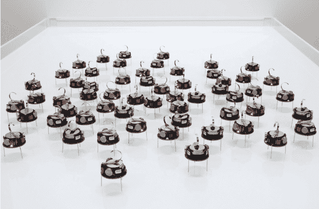

图 5.1 由 Kilobot 组成的机器人群示例。来源：Rubenstein et al. 2012.

由于表征群体的行为发生在群体层面，因此至少需要三个代理才能观察到，许多群体行为需要更多代理。Beni (2004) 提供的群体规模的精确定义是：一个最好表示为多体问题的系统，因为它分别太大而无法将其动力学描述为少体问题，也太小而无法用平均场近似来描述。

#### 5.1.2 自组织与微观-宏观关联

自组织是宏观（即，全局或系统级）空间时空结构从微观（即，局部或点对点）相互作用中产生的机制。在物理和生物系统中，可以在瑞利-贝娜德对流、细胞分化和胚胎发生，或动物的色素图案中观察到这一点。在自组织系统中，宏观结构可能由短程和长程相互作用的组合产生，如生物激活-抑制机制的反应-扩散模型所示（Meinhardt and Gierer 2000）。

在群体机器人学中，微观与宏观之间的关联不是直接发生的，而是通过自组织实现的。单个机器人的行为（即，微观或局部行为）通常是原始的，并伴随着高度的不确定性，因为它们仅由有限的知识以及短程感知和通信所指导（参见第 5.2 节）。相比之下，机器人群体的集体行为（即，宏观或全局行为）更加复杂


并能够解决复杂任务。宏观尺度是蜂群行为开发、测试和分析发生的地方，而机器人控制器（即可执行代码）的实现发生在微观尺度。因此，在开发机器人蜂群时，所需的全局行为必须转换为本地控制器，但由于自组织的非线性动力学，这项任务具有挑战性。目前尚未开发出将宏观规范编译为微观实现的通用方法，而管理“微观-宏观关联”是开发自组织控制的关键挑战（参见第 5.3 节）。

Bonabeau et al. (1999) 定义的自组织，通过系统中必须存在的某些特征来发挥作用。这些特征包括正反馈和负反馈、波动（即随机事件）以及多个微观交互。多个交互是一个显而易见的要求，因为自组织行为源于它们。正反馈和负反馈对于调节系统中的偏差至关重要，两者协同作用，引导机器人蜂群走向平衡或共识。仅靠正反馈会不断强化一种趋势，该趋势可能基于微小的随机偏差，在所有情况下最终都会超过预期目标，从而形成我们可能称之为雪球效应或泡沫的现象。引入负反馈对于抑制过冲和减弱随机偏差的影响至关重要。由于正反馈和负反馈，蜂群中的波动是可控的，但它们也是必要的特征，因为它们使勘探与利用之间能够取得平衡。勘探使蜂群能够搜索所需目标，而利用使其在找到目标后能够留在目标处；这两种倾向的平衡可防止蜂群“陷入困境”。例如，如果机器人蜂群中的正反馈引导其利用一个相当好的解决方案，那么波动对于蜂群逃离该局部最优并找到更好的解决方案将至关重要。同样，如果蜂群已经找到了当前环境的最佳解决方案，波动则使其能够通过发现另一个解决方案后来变得更优来适应未来的环境变化。

#### 5.1.3 认知与生物启发机器行为

人工蜂群最初深受生物学中观察到的过程启发。例如，鸟群、兽群和鱼群的动力学启发了 Reynolds (1987) 多因子计算机图形学模型。另一个关键的生物学启发是拟蚁素，例如在蚁群中（Bonabeau et al. 1999）可以看到。拟蚁素是一类机制，社会性昆虫不直接沟通，而是通过根据环境的当前配置修改环境来沟通，从而诱发行为和环境变化的非线级联。在认知科学中，Couzin (2009) 等关键视角认为自然拟蚁素是一种认知机制。它通常被视为不仅适用于昆虫，也适用于社会系统等其他领域的群体认知模型，并且可以与多种环境特征一起运作。例如，在觅食的蚁群中，拟蚁素涉及的环境线索是蚂蚁集体留下的信息素路径。拟蚁素启发了人工蜂群元启发式“蚁群优化”（Dorigo and Di Caro 1999），以及许多蜂群机器人方法，例如受可爬结构观察形状启发的白蚁启发式建筑（Werfel et al. 2014）。

蜂群机器人和自组织控制中常见生物灵感的认知来源。黏菌是一种通过数千个细胞的自组织进行空间导航的变形虫类生物，它没有内部记忆。它反而使用一种空间外部记忆来引导其勘探。黏菌已被用作优化和自组织的一般模型。植物中可能被视为最小认知的东西在一定程度上启发了 Lindenmayer 系统等自组织语法。植物形态对刺激的分布式引导启发了一种“血管形态发生控制器”，用于机器人蜂群聚集中的适应（Divband Soorati et al. 2019）。在社会性昆虫中，除了拟蚁素之外，还研究了其他集体行为，例如蜜蜂的体温调节行为，这启发了“Beeclust”（Schmickl and Hamann 2011）机器人蜂群聚集控制。进一步的灵感可能来自人类社会和经济系统，这些系统越来越被视为一种蜂群智能形式，并且通常涉及社会认知。社会系统中使用的模型也在机器人中实现——例如，用于在线社交网络的选民模型常用于机器人蜂群的决策（例如 Valentini et al. 2014）。进一步的生物灵感认知来源在第 1.5 节和第 1.6.3 节中讨论，因为新兴视角将蜂群视为“液体大脑”类别的认知（Piñero and Solé 2019），或者将其重新视为“超级有机体”（Reina et al. 2018），心理学模型和理论可以应用于此。

#### 5.1.4 可扩展性

改变系统大小可能会导致问题。过大的系统可能因瓶颈而性能低下，而过小的系统可能因实体间协作机会有限而性能低下。并行计算将加速比定义为 $S=T_1/T_N$，其中 $T_1$ 是使用一个 CPU 等待计算结果的时间，$T_N$ 是使用 $N$ 个 CPU 进行相同计算的时间。在理想情况下，可以实现 $S=N$ 的线性加速比；系统规模加倍会导致性能加倍。如果同一控制算法可以用于大量和少量机器人，同时获得合理的加速比，则多机器人系统是可扩展的（Hamann 2018b）。虽然任何非平凡的多机器人场景都需要机器人之间的一定协调（参见第 5.2 节），但协调可以通过预先为每个机器人分配操作区域来避免。这样，多机器人场景实际上被分解为多个单机器人场景，形式为平凡的并行化。但是，如果我们希望系统能够抵御机器人故障（参见第 5.1.5 节），那么每个机器人都应检查其他机器人的操作区域，以查看它们是否完成各自的任务。这需要在线协调来管理任务分配。禁止机器人之间的协作也将排除产生超线性加速比的可能性（参见 Hamann 2018a）。

蜂群机器人研究旨在实现最大可扩展性——即扩展到几乎任何系统规模的可能性。实现这一目标的必要条件是严格的去中心化方法和有限的通信。所有机器人仅使用本地通信和本地信息。机器人不是在整个蜂群中进行点对点通信，而是仅限于与邻居通信（“窄播”）。如果机器人密度 \(\rho=N/A\)（每单位面积 \(A\) 的机器人数量 \(N\)）保持不变，则邻域大小保持不变，扩展系统就是改变机器人数量 $N$ 和提供的面积 $A$。即使满足这些要求，机器人蜂群仍可能因共享资源有限（例如，基站入口）而无法完美扩展，或者因为所需信息无法通过扩散等方式足够快地在蜂群中传播。相反，一个优势是当机器人协作时，可能实现 $S>N$ 的加速比（Hamann 2018a），例如，跨越间隙或操作对象。

#### 5.1.5 容错性

对任何工程系统，尤其是机器人领域，为故障和环境中未预料的变化做好准备都是一项挑战。作为一个简单的定义，容错性是系统在发生故障和失效的情况下继续运行的能力。多机器人系统仅因系统的固有冗余而被认为比单个机器人具有更高的容错程度；这一点对机器人蜂群更是如此。在蜂群机器人中，失去一台或多台机器人预计对性能的影响有限。因为系统是去中心化的，每个机器人仅依赖本地信息，且所有或许多机器人可以接管另一台机器人的任务。通过将单个空间探测器任务的脆弱性与纳米卫星蜂群概念（NASA 2015）进行比较，说明了机器人蜂群中高潜力的容错性。Winfield and Nembrini (2006) 表明，机器人蜂群中容错的潜力可能已被高估，并不一定是固有特征。机器人的局部故障可能有害，甚至在机器人蜂群中也可能出现系统范围的故障脆弱性。

在关于容错和故障检测的研究中，Christensen et al. (2009) 利用多个等效单元，让它们相互监控并检测异常。用于描述机器人行为的已定义特征首先由每个机器人针对其邻居确定，并用于检测故障行为。第二步，机器人集体确定是否应将某台机器人视为故障机器人并相应地将其忽略。故障机器人会减少蜂群规模，因此容错要求蜂群能够在线适应规模变化。最近，Wahby et al. (2019) 提出了一种机制，允许机器人持续监控蜂群密度。如果检测到显著变化，每个机器人都会调整其控制算法的参数以补偿密度变化。总之，蜂群机器人中有很高的容错潜力，但并非在所有情况下都是固有的。每个机器人都需要监控其邻居和相关环境特征，以检测故障或关键变化并相应地进行调整。

### 5.2 机器人与机器人交互

基于使用单台机器人自动化任务的附加值，添加另一台机器人，然后是更多机器人似乎是有利的。随后的问题是机器人是否以及如何进行交互。允许机器人交互和协作会给系统引入相当大的复杂性。避免复杂性增加的一个选项是简单地并行化任务，通信量可忽略不计。例如，在清洁任务中，每个机器人可能被分配一个独立区域，从而避免机器人之间的干扰。有人可能会认为，机器人之间零交互是理想的，因为这使系统保持简单。但是，机器人之间的交互带来了许多有益的


可能性，例如机器人之间真正的协作，或超越并行化的性能提升。

在多机器人系统中，不同形式的机器人-机器人交互可针对特定任务导致集体行为的涌现。这些交互形式可以是：直接（使用显式信号）；间接（基于观察到的行为变化或环境中留下的线索）；或简单的物理接触。通过物理连接和对接相互交互的机器人已在可重构模块化机器人学以及受蚂蚁自组装启发的机器人群中得到研究（Groß and Dorigo 2009）。本节余下部分描述直接和间接通信方法（即，不仅限于物理接触）。

#### 5.2.1 直接通信（信号）

机器人可能需要传达其战略决策、进度、环境视角或存在。在集中控制的多机器人系统中，机器人使用全局通信来协商策略并分配角色。相比之下，在机器人群中，通信被限制为本地通信。因此，红外通信是一种流行的信号传递方法，因为它允许可靠的短距离障碍物检测、距离计算和数据通信。例如，在 Beeclust (Schmickl and Hamann 2011) 控制算法中，该算法灵感来自年轻蜜蜂的蜂巢导航行为，红外短距离障碍物检测用于根据亮度进行聚集。在 Beeclust 算法中，机器人执行随机游走，同时避开障碍物并在遇到另一台机器人时暂停。暂停的机器人使用其亮度传感器读数 e 来确定等待周期 w，根据 w(e)=wmaxe2/e2+k。Wahby et al. (2019) 使用红外通信进行亲缘识别和环境感知的传递，扩展了 Beeclust 算法，以在动态条件下实现自适应聚集（见图 5.2）。其他常见的信号传递方法包括短距离无线电通信和通过 LED 颜色进行的视觉通信。例如，Groß et al. (2006) 使用了蓝红光信号

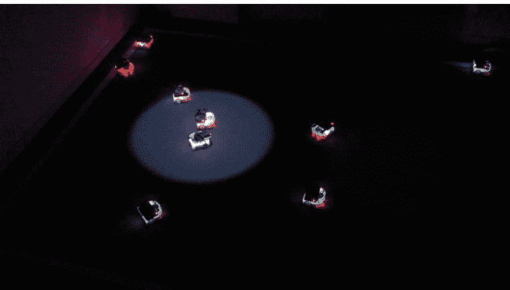

图 5.2 九台机器人组成的群体根据检测到的条件在聚集任务中调整其行为。来源：Wahby et al. 2019。

以影响机器人群体中自组装连接模式的形成。气味和声音等其他方法也已被研究。例如，受触发蜜蜂搬尸行为的剥尸信息素通信的启发，Purnanadja and Russell (2005) 构建了两台配备二氧化锡气体传感器、用于执行救援任务的移动机器人。通过使用气味定位算法，机器人可以找到并营救一个正在释放化学蒸气的塑料泡沫人造机器人（即，故障机器人副本）。

#### 5.2.2 间接通信（线索）

在间接通信方法中，群中的机器人不会明确向其他机器人发送信号或直接交换数据。相反，机器人仅根据对本地环境的观察来调整其行为。这些观察可能涉及其他机器人行为的变化或对环境所做的更改（即，拟迹；参见第 5.1.3 节）。几种间接方法也已被用于在不估计邻居相对航向的情况下实现群集行为。例如，Ferrante et al. (2012) 仅基于距离和方位接近值定义了线性和角速度的吸引/排斥动力学。同样，Yasuda et al. (2014) 定义了一种仅依赖于本地邻居接近性的拓扑交互模型。在这些方法中，交互仅基于对同类机器人运动行为的观察变化，机器人相应地调整其运动。

#### 5.2.3 通信机器人的挑战

通信对于使机器人能够协作至关重要，但当几十甚至数百台机器人需要通信时，它也可能成为潜在的瓶颈。如果大量发送者在有限区域内同时操作，无线电和声音通信都会受到干扰。许多无线电通信协议也存在进一步的局限性，不易扩展（例如，蓝牙、带碰撞避免的载波侦听多路访问 [CSMA/CA]）。因此，许多群体机器人实现依赖于其他形式的通信，例如有限范围（通常小于 15 厘米）的红外定向广播，以直接与邻居通信。

各种硬件平台也各自带来相应的挑战。例如，基于空中无人机的搜救任务在恶劣环境中运行，同时需要高带宽和广泛的通信范围来传输实时画面。在许多情况下，典型的通信技术受到高度限制。例如，Wi-Fi 支持最多 250 米的室外通信，这可能是相邻无人机之间可延伸至数公里的搜救任务中的局限性。微波接入网络互操作性（WiMAX）技术支持高达 30 公里的通信范围，因此是无人机需要远程通信的任务的良好候选方案。当前 4G+ 移动网络的能力也可以支持低空部署的无人机的覆盖范围和传输速率。作为进一步的改进，即将到来的 5G 网络可能为无人机群中的远程通信提供更强大、更有效的连接。

水下通信比空中通信更具挑战性，因为水会吸收大部分电磁辐射，除了可见光谱的一部分。这种可见光在清澈的水中只能传播几百米，在浑浊的水中传播距离更短。因此，可靠的声学调制解调器已用于远距离水下通信，并已在自主水下载具群中用于通信和导航（Behrje et al. 2018）。最近，Farr et al. (2010) 开发了一种基于交换调制蓝绿光数据包的光学通信方法。这种方法比声学调制解调器更快、更便宜，但支持的通信范围更短。

### 5.3 设计机器人群体的方法

设计机器人群体的控制器可以采用以下两种关键方法：要么让人类参与的设计，要么基于优化或机器学习方法自动进行。由于微-宏观问题，两种选项都可能具有挑战性。许多机器人-机器人交互的集体效果难以在分析上预期，同样，自动设计中使用的宏观奖励也不容易追溯到单个机器人的行为（参见第 1.1.2 节）。

#### 5.3.1 人类参与的设计

设计和实现机器人控制算法的传统方法当然是基于让人类参与其中；换句话说，人类工程师为机器人编程。在群体机器人学中，通常但不一定是，单个机器人的控制被保持简单，因为宏观层面的系统复杂性应该从机器人-机器人交互中涌现。因此，重点主要放在无记忆的简单反应控制和基于行为的机器人学框架上。通常，机器人群体拥有基于有限状态机的控制器。为机器人群体设计简单的状态机控制器通常具有挑战性，因为微-宏观问题（参见第 5.1.2 节）。

即使是经验丰富的机器人群体程序员也需要遵循迭代试错过程，直到算法参数经过精确调整并实现所需的群体行为。

一些方法引入了机制，允许机器人在运行时根据周围条件自动调整手动设计算法的参数（例如，Wahby et al. 2019）。然而，这些方法为特定于任务的场景提供自适应解决方案，在具有未预料特征的场景中可能会失败。在应用自动化方法之前的中间下一步是使用模型支持人类设计者。虽然试错方法使用机器人模拟来估计当前算法设计的结果，但另一种方法是相反地提高抽象级别并使用群体动力学模型。建模方法的目标是针对给定算法获得群体行为的通用预测，而不是来自模拟的偶发样本。通常使用概率宏观模型。挑战在于找到既抽象又能与底层控制算法保持清晰连接的模型。例如，Hamann and Wörn (2008) 模拟了空间，并允许微观和宏观层面之间的数学连接。


#### 5.3.2 进化群体机器人学

在群体设计的自动化方法中，人工进化（最初受演化生物学启发）可被视为最为广泛的方法。进化机器人学（Nolfi and Floreano 2000）在群体之外是一种常见的遵循方法（参见第 4 章），并被视为研究广义认知模型的框架（Harvey et al. 2005）。典型的进化群体机器人学方法是在同质群体（例如，Baldassarre et al. 2003）中，在仿真环境下进化人工神经网络控制器（即神经进化）（有关 MultiNEAT 软件库的链接，请参见附加资源部分）。有时也会进化有限状态机，而不是典型的神经网络。进化机器人学（尤其是群体机器人学）的主要挑战之一是转移到现实，因为进化过程可以利用实验环境建模中的任何错误，从而对仿真产生过拟合。这种“现实差距”可以使用 Koos et al. (2012) 的“可转移性方法”（即，在仿真和真实环境中评估进化后的控制器）来解决，例如，在第 1.4 节阐述的群体场景中即可看到。在线进化（即具体进化）因其准确性而具有吸引力，但因其缓慢性而缺乏吸引力，这一缺点在群体中被放大。O’Dowd et al. (2011) 通过控制器与相应模拟器的协同进化，提出了解决这一冲突的方案。除了进化之外，还存在其他自动化设计方法，例如模块化控制架构“AutoMoDe”，其中概率有限状态机由事先参数化的模块组成，这些模块由优化过程连接（Francesca et al. 2014）。

#### 5.3.3 神经与生物启发式自动化设计

机器人群体的一些灵感来源也启发了启发式方法。例如，受鸟群行为启发的粒子群优化已被用于分布式多机器人学习（Di Mario et al. 2015）。人工神经网络（ANN）——粗略地说受神经启发——已在许多领域被证明非常有效，也已在群体机器人学中得到探讨（有关机器人学习和神经机器人学的相关主题，请参见第 3 章和第 9 章。）在一种常见方法中，群体中的每个机器人都接收相同的完整 ANN 控制器，该控制器在离线环境下进化。Silva et al. (2015) 的“odNEAT”方法扩展到了在线且去中心化的神经进化。也提出了分布式神经网络。在 Otte (2018) 的方法中，群体中的每个机器人都在群体范围的 ANN 中持有神经元切片，这由并行神经网络训练实现。在另一种神经启发式方法中，Mathews et al. (2017) 开发了“可合并神经系统”，其中连接的机器人可以灵活地将其分布式控制系统融合为共享的自适应网络。

### 5.4 机器人群体的室内与室外应用

群体机器人学研究通常关注基础模型和设计方法，并由实验室环境中的实验支持。尽管机器人群体的基本特性（例如可扩展性）显然会对应用产生影响，但特定的应用场景很少被直接研究。尽管仅进行实验室实验，但一些方法已间接研究了特定的工业或现场任务。对于工业任务，实验室方法可以使用替代机器人来复制专利工业机器人的关键感知和驱动能力，然后使用实验室替代机器人来研究自组织控制（例如，制造中的可重构光纤部署；Eschke et al. 2019）。实验室环境下的群体机器人学方法也为现场任务提出了解决方案——例如，灾难救援中无法逾越的台阶高度问题，例如，通过分布式构建无定形坡道（Napp and Nagpal 2014）。在另一种方法中，现场的元素可以被带入实验室环境进行实验，如植物生物混合机器人学研究所示（Wahby et al. 2018）。最近，群体机器人学研究进行现场实验变得越来越常见。“subCULTron”欧盟项目（Thenius et al. 2016）正在意大利威尼斯潟湖环境中测试其水下机器人群以用于海洋监测（有关现场过程中的照片，请参见 Hamann [2018b] 中打印的内容）。另一个项目“SAGA”开发了一群四旋翼无人机，用于野外监测和农业条件测绘——例如，杂草检测（Albani et al. 2017）。

#### 5.4.1 室外场景示例

为了提供室内或室外应用的教学示例，我们详细介绍了 Duarte et al. (2016) 的方法，因为它是机器人群体真实现场实验的首个发表案例。Duarte et al. (2016) 使用十艘自主水面航行器，并在葡萄牙里斯本的浅水开放水域环境中对其进行了测试。这些机器人是差分驱动船体，使用廉价且易于获取的现成组件。它们的最长尺寸为 60 厘米，线速度最高可达 1.7 m/s，旋转速度最高可达 90°/s，每艘机器人的组件成本约为三百欧元。每艘船体机器人都配备了通过无线自组网进行 UDP（用户数据报协议）广播以与其他机器人进行去中心化通信的设备，并且配备了 GPS 和罗盘。控制器输出线速度和旋转速度，这些速度用于根据真实机器人动力学（受水中摩擦力和惯性影响）计算电机速度。控制器的输入是三个表示环境中位置的值，这些值从机器人及其邻居的 GPS 和罗盘读数中计算得出，并通过无线网络进行通信。使用这些机器人和控制器，Duarte et al. (2016) 为四个需要机器人之间协调的任务进行了仿真和真实现场实验。机器人控制器在仿真中进化，然后使用进化机器人学的可转移性方法（参见第 5.3.2 节）转移到开放水域的真实现场实验中。在第一个任务“归巢”中，群体集体移动到环境中的目标，同时避免碰撞。在进化过程中，控制器因最小化到目标的距离 d 而获得奖励；具体来说，每个时间步长中每个机器人的 Δd/dt=0 的平均值，乘以系数 S，以在机器人间距小于 3 米时惩罚控制器。第二和第三个任务是分散和聚集，其中机器人要么在不失去与邻居联系的情况下分散在大面积区域内，要么从分散配置开始相互移动以形成簇。第四个任务是区域监测，其中机器人应该移动以共同对界定的有限区域提供持续覆盖。这四种行为被组合成一个“多控制器”任务在现场执行，该任务之前未在仿真中进化或测试过。研究人员为此任务给机器人配备了温度传感器，并从各自任务中选择性能最好的控制器。四个控制器在群体中按顺序触发，成功完成了采样水温的面向应用的任务。在此任务中，机器人群体以紧密群体从起点移动到目标区域，分散并监测整个区域，然后再次聚集成紧密群体并返回初始起点。

### 5.5 群体认知与心理学

如第 5.1.3 节所介绍，集体认知存在于许多自然群体中，是设计人工群体的目标。关于自然群体的既定观点是，其集体行为与神经机制具有共性，因此应在认知科学的相同框架内进行研究（Couzin 2009; Trianni et al. 2011）。另一种观点认为，群体应作为一种独立的认知类别进行研究，形成所谓的“液体大脑”（Piñero and Solé 2019）。在群体中研究的集体认知过程包括集体感知（Schmickl et al. 2006）、集体记忆（Couzin et al. 2002）、集体学习（Montes de Oca and Stützle 2008）和集体决策（参见第 5.6 节）。观察到依赖去中心化的简单生物（如蚂蚁）的认知过程，常常启发群体机器人学。受更复杂生物或非严格去中心化的协调启发的示例要少得多。但是，也有少数示例。关于具有高级认知和中枢神经系统的更复杂生物，已从神经科学（例如，在群体自动化设计方法中）和人类心理学（例如，在可被视为超级有机体的自然群体中）获得启发。关于非严格去中心化的协调，具有层级社会结构的物种（例如狒狒）展示了可能（推测地）与多机器人控制相关的协调策略。还提出，较简单的社会性动物（如鱼群）通常被认为仅使用点对点通信进行移动，但有时可能使用带有临时领导者的层级社会结构以快速应对捕食者（Ioannou 2017）。因此，我们除了参考在线社交网络或层级动物群体中出现的复杂社会结构模型外，还转向神经科学和人类心理学，以寻找可能在机器人群体中具有有用应用潜力的关键理论。迄今为止，心理学和神经科学的关键理论已在几篇关于集体决策的开创性著作中实现到群体行为模型中，详情请参见第 5.6.3 节。此类理论尚未在群体感知、记忆或学习模型中实现。因此，我们描述与这些认知方面相关的现有群体机器人学示例，并回顾一些可能与分布式和去中心化机器人认知相关的关键心理学和神经科学理论。由于我们的目标仅在自然灵感来源对手头工程任务有用时才遵循它，因此我们根据理论与机器人控制的潜在相关性来提出这些理论，而不对这些理论在其源自学科中的地位发表意见。


#### 5.5.1 集体感知与注意力

在现有机器人群体集体感知策略中，同伴会与其局部邻居交换捕获各自感知的信息，逐步就感知环境达成共识。例如，它们会就感知到的特征发出投票或假设（Valentini et al. 2014），或分享受“口交喂食启发”的线索，关于自上次抵达目标以来隐性流逝的时间（Schmickl et al. 2006）。通常认为，自然群体也使用分布式感知策略。然而，有时也有相反观点认为，在某些社会性动物（如鱼类）中，较大群体的改进型捕食者感知可能仅源于汇总的视野以及移动较快个体的临时领导（Ioannou 2017），而无需关于感知的点对点通信。

人类刺激-反应机制的既定心理学定律已被证明与集体决策相关——例如，在群体的速度-准确性权衡方面——也可能与集体感知相关。在人机交互等学科中，运动速度-准确性权衡已由心理学原理 Fitts 法则很好地描述，该原理由 Paul Fitts 于 1954 年提出，目标的大小和距离可预测朝其的运动模式。尽管作为运动法则确立，但已证明它也适用于智能体对动作的感知（Grosjean et al. 2007），这是群体中机器人间协作的重要方面。另一个例子是，心理学已确立注意力水平与觅食中勘探-利用权衡之间的关系（Van den Driessche et al. 2019），这是群体机器人学中经常研究的任务。

在生物学中，感觉运动过程是感知的关键，尤其是在个体间协调方面。Santana and Correia (2010) 提出，通过将注意力与随后的运动系统过程隔离来考虑，生物神经机制可能启发群体感知方法。例如，控制选择性注意力的机制可以转移到机器人群体中，以建立注意力行为与预测或动机之间的关系。

#### 5.5.2 外部记忆与集体记忆

行为科学在自然群体中提出了多种群体记忆概念，例如 Thierry et al. (1995) 的“联合记忆”命题，包括：第一，一种集体类型，其中个体的记忆被耦合；第二，一种外部类型，其中记忆指向环境。外部记忆可能保存在对环境的修改中，如在拟态诱导中，或可能仅包含对环境地标的引用（例如，为了促进新颖动作而非重复记忆的动作）。在人工群体中，一种简单的方法是为智能体配备其自身历史的局部记忆，以增强其与环境交互时的性能。另一种方法可应用于机器人群体的觅食，即使用地形特征的地图式表示，这些特征可以是预定的或自适应构建的（Kumar and Sahin 2003）。机器人群体中最常见的方法显然是拟态诱导的外部记忆方法，它也可以与其他类型的记忆结合，例如个体历史的短期记忆。群体中的短期记忆将在下文进一步讨论，与将自然群体视为超个体相关。

理论生物学尤为提供了基于仿真的群体集体记忆证据，证明群体结构的历史会影响源自相同个体行为的不同集体行为（Couzin et al. 2002）。在蜜蜂中，Beekman (2005) 实验性地证明了过去刺激的个体记忆可能影响后续交互和集体行为，因为被他人触发重新访问仍被记住的地点的智能体会更高效（例如，通过避免不成功的路线尝试）。

在 Thierry et al. (1995) 提出的耦合记忆类型中，个体管理其对某个观点或信息的记忆，并将该个体记忆传达给其他个体——例如，在蜜蜂中，每只只了解环境的一部分信息。在现有机器人群体中，通常不存在群体内空间记忆分布的子群（即，个体持有的观点各异，但其观点所涉的话题是同质的）。然而，个体在群体信息处理中扮演的角色可能受其空间位置影响。值得注意的是，大脑中的分布式记忆根据空间分布高度分化，但生物神经回路中存在的物理连接可能限制它们作为机器人群体的直接灵感来源。在社会性昆虫中，已证明分化的记忆子群会出现，具体来说，当一小群个体成为重复性临时任务的短期专家时（Diez et al. 2011）。

#### 5.5.3 社会学习与集体学习

社会学习，或集体学习，是指通过观察和模仿邻居来发展行为的过程（Rendell et al. 2010）。群体中一种可被视为简单社会学习形式的常见机制是，少数知情个体对群体行为具有不成比例的巨大影响。甚至已证明，为保持准确性所需的知情智能体比例会随群体规模增大而降低（参见 Couzin 2009）。集体决策中达成共识的程序（在 5.6 节中作为认知的一个独立方面讨论）也被视为动物群体中的一种社会学习，在智能体对模仿的邻居具有选择性的情况下（Rendell et al. 2010）。这种选择性大致启发了人工群体中的一种社会学习方法，其中大型群体通过逐渐将智能体加入最初很小的决策子群来更快地达成共识（Montes de Oca and Stützle 2008）。在另一种方法中，人工智能体遵循领导者的指令，并使用这些下游指令间接学习相应任务，以便在领导者丢失时能够集体重建该任务（Karydis et al. 2016）。

在社会性动物中，个体的联想学习已被频繁研究，建立了个体偏好与行为之间的直接联系。然而，Kao et al. (2014) 认为，实验条件下研究的大多数动物自然会以社会群体的形式存在，在其中集体学习将打破联想学习中确立的偏好与行为之间的关系。集体学习对动物联想学习的影响尚未得到直接研究（Kao et al. 2014），尽管关于蜜蜂的相关既定研究已同时考察了基于线索的联想学习和基于舞蹈通信这一众所周知机制的社会学习。智能体个体性（即行为异质性）对自然群体动态的影响已得到研究，可能为机器人群体带来启示（Saffre et al. 2018）。

Burini et al. (2016) 提出了使用动力理论对集体学习动态进行统一表述，包括能力学习和社会消息学习。他们的表述预设了群体中的异质性（即“群体思维”方法）——在机器人群体中，这种异质性可能被描述为在朝共识推进过程中的行为或观点偏差。机器人群体中的观点共识方法已在集体决策中得到研究。

### 5.6 机器人中的集体决策

集体决策是群体认知的关键机制。机器人群体只有在确保某些协调动作达成共识或绝大多数时，才能作为一个整体行动。在群体中实现这种共识和协调，尤其是在未知或动态环境中，需要群体范围的感知、信息处理和动作选择。

#### 5.6.1 群体自主与群体意识

遵循 Russell and Norvig (2016) 的智能体模型，智能体的自主性源于其做出知情决策的能力。同样，机器人群体只有在整体能够做出知情决策时，才能在宏观上实现自主和自我治理。这需要一种集体决策形式，以确保收集相关信息、对该信息进行集体处理，并随后做出群体范围的下一步行动决策。此外，群体需要意识到决策是必要的，并且已达成共识或大多数，以便决策过程结束（Hamann 2018b）。例如，Khaluf et al. (2019) 指出，这对应于人类决策的常见细分，例如识别问题、获取信息（选项及其质量的识别）并对其进行评估。

在群体机器人学以及舆论动态等相关领域中，群体意识的某些方面常常被忽略（Khaluf et al. 2019）。实验通常会隔离某一个方面，例如，直接开始集体决策过程，直到外部观察者在达到足够多数后将其停止。超越孤立方面实验的挑战将对实现完全群体意识至关重要。为了实现完全群体意识，每个机器人都需要对环境或其邻居的（信号）状态变化保持敏感。如果群体在危急情况下未能集体检测到需要集体决策，那么群体可能会分裂、崩溃或以其他方式未能完成其任务。同样，为了确保决策过程结束，每个机器人都需要估计何时停止切换观点。由于每个机器人仅依赖局部信息，这种估计必然是概率性的。这可以实现为每个机器人投票结束集体决策过程，这意味着我们正在将另一个决策过程嵌入系统中。当群体必须适应环境条件并自适应平衡决策过程的速度与准确性时，这可能更具挑战性。因此，集体决策使群体在宏观上具有自主性，但


也需要复杂的信息扩散、闲聊和内部状态共享形式，以创建群体对全局所需群体行动的感知。

#### 5.6.2 集体决策方法

实现完整集体决策系统的方法包括以下所有内容：启动和结束流程、探索选项、传播有关选项的知识、在单个机器人中处理该信息，以及确保群体准确且快速地做出决策（Hamann 2018b）。这些部分都很复杂，无法在此详细讨论。即使考虑处理底层动态网络的建模技术（例如，试图预测预期收敛时间），也会增加更多复杂性。相反，本节通过研究两种简单技术，重点介绍单个机器人的决策机制以及不同算法选择的影响。假设机器人迭代运行三个阶段（探索、传播和切换观点），此处我们仅关注观点切换阶段。例如，一个机器人从其邻居收集消息，这些消息仅包含它们是否赞成红色选项或蓝色选项。那么，统计红色和蓝色消息，确定多数派，并切换到多数观点（如果机器人已经持有该观点，则保持不变）是合理的。

这种简单方法称为多数规则（例如，Valentini et al. 2015）——即，在两种观点之间进行决策时，如果机器人 $r_i$ 的观点与 $[r_i, r_{i+n}]$ 中的多数观点不一致，则其观点会切换，其中 $n$ 是邻域内的机器人数量。多数规则的示例代码可在 PyCX 仓库（Sayama 2013）中找到。如果每个机器人都遵循这一简单规则，那么在给予足够时间的情况下，群体可能会趋于达成共识。一般来说，这是正确的，但可能会因噪声或空间中非均匀分布的机器人而变得复杂（Valentini et al. 2015）。

第二种简单方法是选民模型（例如，Valentini et al. 2014）——即，机器人 $r_i$ 的观点会切换到邻域机器人 $[r_{i+1}, r_{i+n}]$ 中均匀随机选择的观点。选民模型的示例代码也可在 PyCX 仓库（Sayama 2013）中找到。虽然这可能看起来反直觉，但选民模型是决策机制的一个有用选项。在决策中，以及在集体决策中，也存在速度-准确性权衡（第 5.6.3 节末尾也有提及）。这种权衡意味着决策过程可以快或准，但不能同时兼具。给定的决策机制是否优于另一种，始终取决于给定应用场景的要求。一般来说，多数规则快但相对不准确，而选民模型准但慢。没有简单的描述能对此发现提供直观理解，只是选民模型往往对局部暂时偏差更具包容性，而多数规则往往利用当前的局部系统状态。更好的理解需要更深入地研究集体决策的不同建模技术。

#### 5.6.3 机器人群体超级有机体的心理学

在群体中对集体决策进行建模的一种经证实的方法是，从人类心理学中确立的机制汲取灵感，并将它们应用于整个群体，仿佛它是一个有机体。自然群体中观察到的群体认知和组织有时促使将其生物学特征描述为超级有机体（参见 Wilson and Sober 1989）。在超级有机体中，例如蜜蜂群落，自然选择可能根据群落作为一个单元的生存进行操作，演化出紧密相互依赖的群体并建立更高层次的生物组织。这种更紧密的相互依赖可以在蜜蜂的社会凋亡中看到，其中群落免疫由个体牺牲蜜蜂增加的感染易感性所支持（Page et al. 2016）。超级有机体概念看起来与进化中确立的群体选择机制相似，但也被提出为不同的概念。不评论进化生物学，此处我们将超级有机体视为关于自然群体（以及潜在的机器人群体）的有用类比。已经证明，自然群体在群体层面执行典型的有机体级功能，例如，通过“共同胃”来调节觅食（Schmickl and Karsai 2016）或在神经上通过管理速度-准确性权衡，类似于单个动物的大脑（Sasaki and Pratt 2018）。特别是，对刺激作出反应的群落中的集体决策已被证明遵循某些人类心理学的确立法则（Pais et al. 2013; Reina et al. 2018），这种普遍性可能扩展到机器人群体。

第 5.2 节中描述的机器人群体通信的信号和提示也出现在自然群体中，作为可能被选择以不同方式塑造的刺激——在进化生物学中，信号是为了明确的通信目的而形成的刺激，而提示是可能引发响应但不一定为此功能而开发的刺激。Reina et al. (2018) 表明，虽然已知更强的信号会导致更快的决策并避免死锁，但它们也可能导致负面的性能影响。在模拟的蜜蜂群落中，Reina et al. (2018) 证明，当按信噪比衡量信号传递时，增加信号传递会恶化群体区分相似刺激的能力。这让人想起群体机器人中著名的探索-开发权衡。如第 1.1.2 节所述，探索和开发是自组织中必要的机制。实现对已知解的开发与寻找新（可能更好）解的探索之间的最佳平衡，无法通用地解决，因为这取决于各自的任务和环境。例如，在双稳态模式下，机器人群体应选择最佳站点但发现两个同样好的站点，探索-开发权衡的主要挑战是有效地打破对称性（Hamann et al. 2012）。

确立的心理学法则可能支配自然群体中已知存在的动态；例如，Reina et al. (2018) 证明，蜜蜂群落中的探索-开发权衡可能由 1858 年由 Gustav Fechner 提出的关于外部刺激感知的韦伯定律（Weber's law）所支配。该法律将差分敏感性描述为 dp=dS/S——即，刺激 dS 的感知变化与初始刺激 S 成正比。在自然群体中，Pais et al. (2013) 和 Reina et al. (2018) 已证明，韦伯定律在处于双稳态模式中的蜜蜂群落选择站点时成立。在保持相对空间分布的群体中，例如飞鸟群，Perna et al. (2019) 已证明，基于韦伯定律的简单反扩散机制单独就足以实现稳定性，而经典 Reynolds (1987) 方法中则需要两个或多个单独机制相互平衡。同样，Reynolds et al. (2013) 已证明，蜜蜂群落中观察到的自然飞行模式可以通过遵循韦伯定律的里程计来实现。

另一条确立的心理学法则——希克定律（Hick's law），由 William Hick 于 1952 年和 Robert Hyman 于 1953 年提出——描述了一个被称为信息增益率的概念，认为反应时间与不确定程度呈线性上升。即，反应时间 \( RT=kH \)，其中 \( H \) 表示在给定决策中必须处理的信息量。在替代方案等可能的情况下，希克定律指出 \( H=\log_2(n+1) \)，使得 \( H \) 是刺激-响应替代方案数量 \( n \) 的对数函数。Reina et al. (2018) 发现，在处于 best-of-\( n \) 决策的蜜蜂群落超级有机体中，反应时间 \( RT \) 随替代方案数量按希克定律上升，但呈指数级上升，他们提出这可能是由于群体中的非线性。另一条可能适用于该现象的心理学法则是 Cooney and Troyer (1994) 方法，该方法将干扰敏感性集成到反应时间模型中。或者，Reina et al. (2018) 提出了蜜蜂超级有机体中反应时间 \( RT \) 的新模型：\( RT=\alpha \overline{v}^{-\beta} e^{\mu n} \)，其中 \( \overline{v} \) 是 \( n \) 个可用选项的平均质量或可能性，\( \alpha \)、\( \beta \) 和 \( \mu \) 是常数。Reina et al. (2018) 的这一新模型结合了希克定律与 1913 年由 Henri Pieron 提出的皮埃龙定律（Pieron law），该定律指出，反应时间随刺激强度的增加而按幂律下降。

在希克定律的实现中，Reina et al. (2018) 发现 best-of-\( n \) 决策中的信噪比存在权衡，即增加信号传递可以提高速度但削弱选择质量，这与不只出现在机器人群体决策和自然决策中，而且出现在信息处理的许多方面的既定速度-准确性权衡相吻合。多种因素已被证明会影响决策中的速度和准确性，并可能对工程机器人群体中的其权衡产生影响。在动物种群中，选择过程中的速度-准确性权衡被认为会导致快速或缓慢的异质行为倾向，因为由于相关的风险-回报权衡，两种策略可能表现相似（Sih and Del Giudice 2012）。在自然群体中，Pais et al. (2013) 表明，在由韦伯定义的二进制替代方案可区分的蜜蜂群落中，速度-准确性权衡取决于交叉抑制强度（一种在蜜蜂群落和复杂大脑中都观察到的机制）。在个人人类决策中，当准确性本身在真阳性和假阳性之间呈现权衡时，集体方法已被证明通过同时增加真阳性和减少假阳性来反转该权衡（Wolf et al. 2013）。Reina et al. (2018) 指出，自然群体中的准确性取决于探索时间与信号传递时间的比率，这让人想起探索-开发权衡。

### 5.7 结论

群体机器人学最初受到生物学中观察到的行为的启发，人工群体的新进展继续与自然群体的进展相互依赖，特别是在群体认知研究中。生物启发和神经启发方法已被用于开发机器人群体模型和行为——例如，拟态（stigmergy）认知机制——并影响了群体控制器流行的自动设计方法，例如神经进化。群体机器人学利用这些方法来应对挑战，例如直接和间接通信、“微观-宏观链接”的管理，


群体自主性、群体认知，并正朝该领域的应用方向发展。群体认知已从集体感知、集体记忆、集体学习和集体决策等方面进行了研究，在某些情况下，它汲取了人类心理学和认知科学的灵感。如果这些学科在可衡量的新颖性方面不是对现有方法的重新表述，并且对相应的工程任务有效，那么它们可能为群体机器人学提供新的且有用的灵感来源。

### 进一步阅读与资源

- 群体智能的经典入门：Bonabeau, Eric, Marco Dorigo, and Guy Theraulaz. 1999. Swarm Intelligence: From Natural to Artificial Systems. Oxford: Oxford University Press.
- 群体机器人学的近期全面概述，包含大规模机器人群设计的方法和示例场景的详细介绍：Hamann, Heiko. 2018. Swarm Robotics: A Formal Approach. Berlin: Springer.
- 群体机器人学及其未来的近期视角：Dorigo, Marco, Guy Theraulaz, and Vito Trianni. 2021. “Swarm Robotics: Past, Present, and Future.” Proceedings of the IEEE 109 (7): 1152–1165.
- 群体机器人学的起源、应用领域和当前研究问题的简要摘要：Dorigo, M., G. Theraulaz, and V. Trianni. 2021. “Swarm Robotics: Past, Present, and Future.” Proceedings of the IEEE 109 (7): 1152–1165. https://doi.org/10.1109/JPROC.2021.3072740.
- 群体觅食软件，位于 ARGoS 模拟器的仓库中（Pinciroli et al. 2012）：https://github.com/ilpincy/argos3-examples.
- 用于神经网络进化的 MultiNEAT 软件库：http://www.multineat.com.
- 用于机器学习（包括神经网络训练）的 scikit-learn 软件库：https://scikit-learn.org/stable/.
- 多数规则模拟软件：https://github.com/hsayama/PyCX.

### 致谢

本作品部分得到布鲁塞尔自由大学（Université libre de Bruxelles）协调研究行动计划（ARC）的支持。Marco Dorigo 和 Mary Katherine Heinrich 承认来自比利时 F.R.S.-FNRS 的支持，他们分别担任该机构的研究主任和博士后研究员。

### 注记

- 1. Duarte et al. (2016) 中的进化是在 JBotEvolver 中进行的，可在 https://github.com/BioMachinesLab/jbotevolver 上获得。

### 参考文献

- Albani, Dario, Joris Ijsseimuiden, Ramon Haken, and Vito Trianni. 2017. “面向农业应用的机器人群监测与制图。”在 2017 年第 14 届 IEEE 高级视频和基于信号的监控国际会议中，1–6. 纽约: IEEE.
- Baldassarre, Gianluca, Stefano Nolfi, and Domenico Parisi. 2003. “进化能够展现集体行为的移动机器人。” Artificial Life 9 (3): 255–267.
- Bar-Yam, Yaneer. 1997. 复杂系统动力学. Boca Raton: CRC Press.
- Beekman, Madeleine. 2005. “蜜蜂（Apis mellifera L.）会因气味而刺激重访过去有利觅食地点多长时间？” Journal of Comparative Physiology A 191 (12): 1115–1120.
- Behrje, Ulrich, Cedric Isokiet, Benjamin Meyer, and Erik Maehle. 2018. “用于水下机器人群导航的基于声学的可靠通信原理。”在 2018 OCEANS—MTS/IEEE 神户海洋科技大会 (OTO) 中，1–5. 纽约: IEEE.
- Beni, Gerardo. 2004. “从群体智能到群体机器人学。”载于《群体机器人学：SAB 2004 国际研讨会，美国加州圣莫尼卡，2004 年 7 月 17 日，修订选集》，Erol Şahin 和 William M. Spears 编，1–9. 柏林: Springer.
- Bonabeau, Eric, Marco Dorigo, and Guy Theraulaz. 1999. 群体智能：从自然到人工系统. Oxford: Oxford University Press.
- Burini, Diletta, Silvana De Lillo, and Livio Gibelli. 2016. “基于活性粒子动理论的集体学习建模。” Physics of Life Reviews, no. 16, 123–139.
- Christensen, Anders Lyhne, Rehan O’Grady, and Marco Dorigo. 2009. “从萤火虫到容错机器人群。” IEEE Transactions on Evolutionary Computation 13 (4): 754–766.
- Cooney, John B., and Rod Troyer. 1994. “短时记忆任务中反应时间的动态模型。” Journal of Experimental Child Psychology 58 (2): 200–226.
- Couzin, Iain D. 2009. “动物群体中的集体认知。” Trends in Cognitive Sciences 13 (1): 36–43.
- Couzin, Iain D., Jens Krause, Richard James, Graeme D. Ruxton, and Nigel R. Franks. 2002. “动物群体中的集体记忆与空间排序。” Journal of Theoretical Biology 218 (1): 1–12.
- Diez, Lise, Jean-Louis Deneubourg, Lucie Hoebeke, and Claire Detrain. 2011. “搬运尸体蚂蚁的定向：记忆还是化学线索？” Animal Behavior 81 (6): 1171–1176.
- Di Mario, Ezquiel, Inaki Navarro, and Alcherio Martinoli. 2015. “一种面向高维多机器人学习的分布式抗噪粒子群优化算法。”在机器人与自动化国际会议上，5970–5976. 纽约: IEEE.
- Divband Soorati, Mohammad, Mary Katherine Heinrich, Javad Ghofrani, Payam Zahadat, and Heiko Hamann. 2019. “机器人自组装的光形态发生：适应性、集体决策和自我修复。” Bioinspiration and Biomimetics 14 (5): 056006.
- Dorigo, Marco, Mauro Birattari, and Manuele Brambilla. 2014. “群体机器人学。” Scholarpedia 9 (1): 1463.
- Dorigo, Marco, and Gianni Di Caro. 1999. “蚁群优化：一种新的元启发式。”在进化计算大会上，1470–1477. 纽约: IEEE.
- Dorigo, Marco, Dario Floreano, Luca Maria Gambardella, Francesco Mondada, Stefano Nolfi, Tarek Baaboura, Mauro Birattari, et al. 2013. “Swarmanoid：研究异质机器人群的新概念。” IEEE Robotics and Automation Magazine 20 (4): 60–71.
- Duarte, Miguel, Vasco Costa, Jorge Gomes, Tiago Rodrigues, Fernando Silva, Sancho Moura Oliveira, and Anders Lyhne Christensen. 2016. “真实水面机器人群集体行为的进化。” PLoS One 11 (3): e0151834.
- Eschke, Catriona, Mary Katherine Heinrich, Mostafa Wahby, and Heiko Hamann. 2019. “多机器人制造中的自组织自适应路径：可重构且与图案无关的光纤部署。”在 2019 IEEE/RSJ 智能机器人与系统国际会议论文集中，4086–4091. 纽约: IEEE.
- Farr, N., A. Bowen, J. Ware, C. Pontbriand, and M. Tivey. 2010. “一种集成的水下光学/声学通信系统。”在 OCEANS’10 IEEE 悉尼大会上，1–6. 纽约: IEEE.
- Ferrante, Eliseo, Ali Emre Turgut, Cristian Huepe, Alessandro Stranieri, Carlo Pinciroli, and Marco Dorigo. 2012. “带有移动机器人群的自组织群体行为：一种新的运动控制方法。” Adaptive Behavior 20 (6): 460–477.
- Francesca, Gianpiero, Manuele Brambilla, Arne Brutschy, Vito Trianni, and Mauro Birattari. 2014. “AutoMoDe：一种面向机器人群控制软件自动设计的新方法。” Swarm Intelligence 8 (2): 89–112.
- Grosjean, Marc, Maggie Shiffrar, and Günther Knoblich. 2007. “菲特定律适用于动作感知。” Psychological Science 18 (2): 95–99.
- Groß, Roderich, Michael Bonani, Francesco Mondada, and Marco Dorigo. 2006. “Swarm-Bots 中的自主自组装。” IEEE Transactions on Robotics 22 (6): 1115–1130.
- Groß, Roderich, and Marco Dorigo. 2009. “迈向机器人群的群组运输。” International Journal of Bio-inspired Computation 1 (1/2): 1–13.
- Hamann, Heiko. 2018a. “并行计算和多机器人系统中的超线性可扩展性：共享资源、协作和网络拓扑。”在计算机系统体系结构中，31–42. 柏林: Springer.
- Hamann, Heiko. 2018b. 群体机器人学：一种形式化方法. Berlin: Springer.
- Hamann, Heiko, Thomas Schmickl, Heinz Wörn, and Karl Crailsheim. 2012. “集体决策中涌现对称性破缺的分析。” Neural Computing and Applications 21 (2): 207–218.
- Hamann, Heiko, Mohammad Divband Soorati, Mary Katherine Heinrich, Daniel Nicolas Hofstadler, Igor Kuksin, Frank Veenstra, Mostafa Wahby, et al. 2017. “Flora Robotica——一种结合活体天然植物和分布式机器人的建筑系统。” ArXiv preprint: 1709.04291.
- Hamann, Heiko, and Heinz Wörn. 2008. “群体机器人学算法设计的时空连续模型框架。” Swarm Intelligence 2 (2–4): 209–239.
- Harvey, Inman, Ezequiel Di Paolo, Rachel Wood, Matt Quinn, and Elio Tuci. 2005. “进化机器人学：研究认知的新科学工具。” Artificial Life 11 (1–2): 79–98.
- Ioannou, Christos C. 2017. “鱼类中的群体智能？在（某些）动物群体中展示分布式和自组织集体智能的困难。” Behavioral Processes 141 (2): 141–151.
- Kao, Albert B., Noam Miller, Colin Torney, Andrew Hartnett, and Iain D. Couzin. 2014. “社会性动物群体中的集体学习与最优共识决策。” PLoS Computational Biology 10 (8): e1003762.
- Karydis, Konstantinos, Prasanna Kannapan, Herbert G. Tanner, Adam Jardine, and Jeffrey Heinz. 2016. “多智能体网络物理系统中通过学习实现韧性。” Frontiers in Robotics and AI 3:36.
- Khaluf, Yara, Pieter Simoens, and Heiko Hamann. 2019. “设计集体决策过程中被忽略的部分。” Frontiers in Robotics and AI 6:16.
- Koos, Sylvain, Jean-Baptiste Mouret, and Stéphane Doncieux. 2012. “可迁移性方法：跨越进化机器人学中的现实差距。” IEEE Transactions on Evolutionary Computation 17 (1): 122–145.
- Kumar, Vignesh, and Ferat Sahin. 2003. “用于地雷检测应用的群体机器人认知图。”在 2003 年 IEEE 系统、人与控制论国际会议上，3364–3369. 纽约: IEEE.
- Mathews, Nithin, Anders Lyhne Christensen, Rehan O’Grady, Francesco Mondada, and Marco Dorigo. 2017. “机器人可合并神经系统。” Nature Communications 8 (1): 1–7.
- Meinhardt, Hans, and Alfred Gierer. 2000. “通过局部自身激活和侧向抑制形成图式。” Bioessays 22 (8): 753–760.
- Montes de Oca, Marco A., and Thomas Stützle. 2008. “优化和多智能体系统中的渐进式社会学习。”在第 10 届年度遗传与进化计算会议附录 (GECCO ’08) 论文集中，1939–1944. 纽约: 计算机协会.
- Napp, Nils, and Radhika Nagpal. 2014. “非结构化环境中的分布式无定形坡道构建。” Robotica 32 (2): 279–290.
- NASA. N4SA 网络和操作演示卫星. 2015 年。2020 年 7 月访问。https://www.nasa.gov/mission_pages/station/research/explorer/Investigation.html?id=1601.
- Nolfi, Stefano, and Dario Floreano. 2000. 进化机器人学. Cambridge, MA: MIT Press.
- O'Dowd, Paul J., Alan F. T. Winfield, and Mathew Studley. 2011. “群体机器人行为中具身模拟器和控制器的分布式协同进化。”2011 IEEE/RSJ 智能机器人与系统国际会议，4995–5000. 纽约: IEEE.
- Otte, Michael. 2018. “机器人群中的涌现群体心智：通过共享无线神经网络实现的集体认知和分布式感知。” International Journal of Robotics Research 37 (9): 1017–1061.
- Page, Paul, Zheguang Lin, Nitat Buawongpong, Huoqing Zheng, Fuliang Hu, Peter Neumann, Panuwon Chatawananakul, and Vincent Dietemann. 2016. “蜜蜂超级个体中的社会凋亡。” Scientific Reports 6:27210.
- Pais, Darren, Patrick M. Hogan, Thomas Schlegel, Nigel R. Franks, Naomi E. Leonard, and James A. R. Marshall. 2013. “一种面向价值敏感决策的机制。” PLoS One 8 (9): e73216.
- Perna, Andrea, Giulio Facchini, and Jean-Louis Deneubourg. 2019. “基于韦伯定律的感知与动物群体的稳定性。” Journal of the Royal Society Interface 16 (154): 20190212.
- Pinciroli, Carlo, Vito Trianni, Rehan O’Grady, Giovanni Pini, Arne Brutschy, Manuele Brambilla, Nithin Mathews, et al. 2012. “ARGoS：一种用于多机器人系统的模块化、并行、多引擎模拟器。” Swarm Intelligence 6 (4): 271–295.


Piñero, Jordi, 和 Ricard Solé. 2019. “液体大脑的统计物理学.” 哲学汇刊 B: 生物科学 374 (1774): 20180376.

Purnamadja, Anies Hannawati, 和 R. Andrew Russell. 2005. “机器人群中的信息素通讯：剽悍蜂行为及其复制.” 机器人学 23 (6): 731–742.

Reina, Andreagiovanni, Thomas Bose, Vito Trianni, 和 James A. R. Marshall. 2018. “心理物理定律与超级有机体.” 科学报告 8 (1): 1–8.

Rendell, Luke, Robert Boyd, Daniel Cownden, Marquist Enquist, Kimmo Eriksson, Marc W. Feldman, Laurel Fogarty, Stefano Ghirlanda, Timothy Lillicrap, 和 Kevin N. Laland. 2010. “为何复制他人？来自社会学习策略锦标赛的见解.” 科学 328 (5975): 208–213.

Reynolds, Andy M., Patrick Schultheiss, 和 Ken Siu-Kei Cheng. 2013. “利维飞行模式是否源于距离估计中的韦伯-费希纳定律？” 行为生态学与社会生物学 67 (8): 1219–1226.

Reynolds, Craig W. 1987. “群、群体和学校：一种分布式行为模型.” ACM SIGGRAPH 计算机图形学 21 (4): 25–34.

Rubenstein, Michael, Christian Ahler, 和 Radhika Nagpal. 2012. “Kilobot: 一种用于集体行为的低成本可扩展机器人系统.” 载于 2012 年 IEEE 国际机器人与自动化会议, 3293–3298. 纽约: IEEE.

Russell, Stuart J., 和 Peter Norvig. 2016. 《人工智能：一种现代的方法》. 伦敦: Pearson.

Saffre, Fabrice, Hanno Hildmann, 和 Jean-Louis Deneubourg. 2018. “个体异质性是否能影响白蚁筑巢模型中的自组织模式？” 群体智能 12 (2): 101–110.

Santana, Pedro, 和 Luis Correia. 2010. “注意、动作选择与空间记忆的群体认知实现.” 适应行为 18 (5): 428–447.

Sasaki, Takao, 和 Stephen C. Pratt. 2018. “超级有机体的心理学：昆虫社会的集体决策.” 昆虫学年鉴 63:259–275.

Sayama, Hiroki. 2013. “PyCX: 一个基于 Python 的复杂系统教育仿真代码库.” 复杂自适应系统建模 1 (1): 1–10.

Schmickl, Thomas, 和 Heiko Hamann. 2011. “Beeclust: 一种源自蜜蜂的群体算法.” 载于 生物启发计算与通信网络, Yang Xiao 编, 95–137. 博卡拉顿, FL: CRC Press.

Schmickl, Thomas, 和 Istvan Karsai. 2016. “基于共同胃的调节如何导致蜜蜂觅食的经济优化.” 理论生物学杂志 389:274–286.

Schmickl, Thomas, Christoph Möslinger, 和 Karl Crailsheim. 2006. “机器人群中的集体感知.” 载于 群体机器人学, Erol Şahin, William M. Spears, 和 Alan F. T. Winfield 编, 144–157. 柏林: Springer.

Sih, Andrew, 和 Marco Del Giudice. 2012. “将行为综合征与认知联系起来：一种行为生态学视角.” 哲学汇刊 B: 生物科学 367 (1603): 2762–2772.

Silva, Fernando, Paulo Urbano, Luís Correia, 和 Anders Lyhne Christensen. 2015. “odNEAT: 一种用于机器人控制器分散在线进化的算法.” 进化计算 23 (3): 421–449.

Thenius, Ronald, Daniel Moser, Joshua Cherian Varughese, Serge Kernbach, Igor Kuskin, Olga Kernbach, Elena Kuksinia, 等. 2016. “subCULtron: 水下机器人学中的文化发展工具.” 载于 人工生命与智能代理研讨会, 27–41. 瑞士夏蒙: Springer.

Thierry, Bernard, Guy Theraulaz, Jean-Yves Gautier, 和 B. Stiegler. 1995. “共同记忆.” 行为过程 35 (1–3): 127–140.

Trianni, Vito, Elio Tuci, Kevin M. Passino, 和 James A. R. Marshall. 2011. “群体认知：研究自组织生物集体的一种跨学科方法.” 群体智能 5 (1): 3–18.

Valentini, Gabriele, Heiko Hamann, 和 Marco Dorigo. 2014. “自组织集体决策：加权选民模型.” 载于 2014 年自主代理与多代理系统国际会议论文集 (AAMAS '14), 45–52. 南卡罗来纳州里奇兰: 自主代理与多代理系统国际基金会.

Valentini, Gabriele, Heiko Hamann, 和 Marco Dorigo. 2015. “自组织机器人群中的高效决策：关于速度与准确性的权衡.” 载于 2015 年自主代理与多代理系统国际会议论文集 (AAMAS '15), 1305–1314. 南卡罗来纳州里奇兰: 自主代理与多代理系统国际基金会.

Van den Driessche, Charlotte, Françoise Chévrier, Axel Cleeremans, 和 Jérôme Sackur. 2019. “较低的注意力技能预测更多的探索性觅食模式.” 科学报告 9 (1): 1–7.

Wahby, Mostafa, Mary Katherine Heinrich, Daniel Nicolas Hofstadler, Ewald Neufeld, Igor Kuksin, Payam Zahadat, Thomas Schmickl, Phil Ayres, 和 Heiko Hamann. 2018. “自主塑造天然攀援植物：一种生物混合方法.” 王学会开放科学 5 (10): 180296.

Wahby, Mostafa, Julian Petzold, Catriona Eschke, Thomas Schmickl, 和 Heiko Hamann. 2019. “集体变化检测：机器人群中对动态群体密度和光照条件的适应性.” 载于 ALIFE 2019: 2019 年人工生命会议论文集, Harold Fellermann, Jaume Bacardit, Ángel Goñi-Moreno, 和 Rudolf M. Füchslin 编, 642–649. 剑桥, MA: MIT Press.

Werfel, Justin, Kirstin Petersen, 和 Radhika Nagpal. 2014. “设计白蚁启发机器人施工团队中的集体行为.” 科学 343 (6172): 754–758.

Wilson, David Sloan, 和 Elliott Sober. 1989. “复活超级有机体.” 理论生物学杂志 136 (3): 337–356.

Winfield, Alan F. T., 和 Julien Nembrini. 2006. “人多力量大：机器人群中的容错能力.” 建模、辨识与控制国际期刊 1 (1): 30–37.

Wolf, Max, Ralf H. J. M. Kurvers, Ashley J. W. Ward, Stefan Krause, 和 Jens Krause. 2013. “不确定世界中的准确决策：集体认知在增加真阳性的同时降低假阳性.” 王学会学报 B: 生物科学 280 (1756): 20122777.

Yasuda, Toshiyuki, Akitoshi Adachi, 和 Kazuhiro Ohkura. 2014. “基于拓扑距离相互作用的移动机器人群自组织群聚.” 载于 2014 年 IEEE/SICE 系统集成国际研讨会, 106–111. 纽约: IEEE.

## 6 软机器人: 一种发育方法

Luca Scimeca 和 Fumiya Iida

### 6.1 引言

在本章中，我们将首先介绍并回顾软机器人研究，重点阐述柔顺性和柔软性在过去二十年中如何改变了机器人领域的格局。接着，我们将简要讨论发育机器人中的关键理念，这些理念对于理解生物系统与人工系统之间的关系至关重要，并考察发育科学与软机器人如何不可分割地联系在一起，即我们选择命名的“发育软机器人”。事实上，这两个领域可以合并为一个领域，在该领域中，发育科学可以辅助软机器人的设计与制造，而软机器人随后可作为平台，以更好地理解生物系统。最后，我们将讨论系统发育、个体发育和短期适应确实天然适合嵌入“软”机器人语境中。（进一步阅读，参见 Trivedi et al. 2008; Pfeifer, Iida, and Lungarella 2014; Laschi et al. 2016.）

### 6.2 生物启发软机器人

变形是生物系统的基本特征。人体近 90% 由软组织组成；心脏、肺、肌肉、眼晶体等许多重要器官都依赖材料的变形。

例如，在双足行走中，证据表明，身体的软组织不仅可以缓冲每一步的冲击，还可以通过软组织弹性反弹，在每一步中完成相当大的总正功，从而让肌肉免于主动耗散能量的努力（Zelik and Kuo 2010）。

在过去几十年中，材料科学和制造技术取得了空前的进步，加深了我们对功能材料的认识，并赋予人工系统新的能力。这些进步，加上对生物系统更好的理解，催生了软机器人时代，在该时代中，生物启发机器人平台利用软性和可变形材料来实现更灵活、适应性强且鲁棒的行为（Kim, Laschi, and Trimmer 2013; Hughes et al. 2016）.


自软体机器人诞生之初，材料科学与软体顺应性的应用就已改变了机器人领域的格局。例如，在操作方面，“通用握手”（一种通过真空压力控制实现颗粒夹杂的软握手）已被证明能够抓握大量物体（Brown et al. 2010）。抓握和操作的其他解决方案范围从类似触手的系统（Laschi et al. 2012）到气动软握手（Yap, Ng, and Yeow 2016）以及受人类启发的软机器人手（Hughes, Maiolino, and Iida 2018；图 6.1）。

受动物启发的软机器人是软机器人中发展最成熟的子领域之一，其机器人平台从蠕虫（Seok et al. 2010）或毛毛虫（Lin, Leisk, and Trimmer 2011）到章鱼（Laschi et al. 2012）、鱼（Katzschmann et al. 2018）及其他（图 6.1）。例如，在蠕虫状软机器人中，类似于其生物对照体，纵向肌肉收缩随后是环向肌肉收缩，模拟沿身体的行波，从而产生运动（Trueman 1975）。在毛毛虫中，运动是通过协调控制足突附着于底质的时间和位置，以及肌肉收缩波来产生的（Belanger and Trimmer 2000）。

模仿这些独特系统的能力使软机器人成为一个令人兴奋的新领域，过去一个世纪中（刚性）机器人的局限性可以通过新发现的解决方案来克服。

#### 6.2.1 软材料与软驱动

软机器人领域与材料科学领域不可避免地相互关联，后者的新发现有助于前者的进步。为了使软机器人能够利用材料顺应性来辅助机器人任务，机器人的制造至少部分必须是可变形的。弹性体（聚合物）材料，如 EcoFlex 或 Drag-

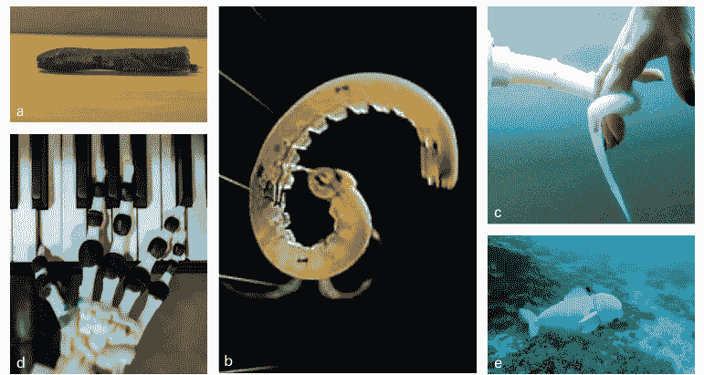

**Figure 6.1** 生物启发的软机器人示例。(a) 受蠕虫启发的软机器人。*来源*: Seok et al. 2010。(b) 受毛毛虫启发的软机器人。*来源*: Lin et al. 2011。(c) 受章鱼启发的触手。*来源*: Cianchetti et al. 2011。(d) 受人类启发的软被动手。*来源*: Hughes et al. 2018。(e) 受鱼启发的软机器人。*来源*: Katzschmann et al. 2018。

onSkin（Siegenthaler et al. 2011）等材料已在多年内成为研究人员关注的焦点，并且每年都在发现新物质。此外，三维打印技术的出现使机器人设计和测试操作比以往快得多，促进了软机器人领域快速且廉价的原型制作。

驱动是最大的挑战之一。在许多动物中，分布在全身的大量肌肉的协同作用能够产生相对较大的力，从而实现协调且强健的动作。复制这种能力并非易事，因为大多数机器人解决方案缺乏产生与过去工业机器人相当力量的能力。

目前存在四种主要的软驱动技术：肌腱驱动、加压空气或流体、介电弹性体执行器（即 DEA）以及形状记忆合金（即 SMA）（Kim et al. 2013）。首先，肌腱驱动模仿生物肌肉骨骼系统，驱动通过对肌腱的拉动和释放实现，需对电机进行适当控制（图 6.2a）。虽然这是一种强大且普遍的驱动技术，但通常需要大量肌腱才能实现复杂行为，且控制复杂度随控制肌腱所需电机数量的增加而增加。对于更柔软的机器人，如连续体软机器人，这类驱动通常难以扩展。

其次，使用流体是软机器人最强大的驱动技术之一，能够产生高力和位移。驱动通常通过改变机器人体内预设腔室内的压力来实现其膨胀和收缩，从而产生运动或形态变化（图 6.2b）。然而，这些驱动系统通常体积庞大且沉重，需要大功率电源，因此不适合无线机器人系统（Laschi and Cianchetti 2014）。

第三，DEA 由软材料制成，可通过静电力驱动（图 6.2c）。DEA 已被证明具有高应变/应力和比功率。然而，DEA 需要预应变，这对机器人设计施加了严格限制（O’Halloran, O’Malley, and McHugh 2008）。最后，SMA（最常见的镍钛合金）可通过材料温度的升高或降低引起的形状变化来产生力（图 6.2d）。然而，温度变化控制是一项挑战。通常需要高电压来实现温度变化，且在不同环境温度下的鲁棒性仍有待克服（Rodrigue et al. 2017）。

还存在其他方法；例如，可以通过电阻加热蒸发乙醇来诱导气动收缩（Miriyev, Stack, and Lipson 2017），或通过燃烧实现弯曲（Tolley et al. 2014）。然而，输出力降低或速度缓慢等其他问题也会出现（Rich, Wood, and Majidi 2018）。软机器人驱动与材料科学仍在不断发展，新解决方案正在通过快速原型制作和迭代加速涌现。

#### 6.2.2 软机器人控制、仿真与学习

软机器人控制面临多种挑战和机遇。这里，“柔软程度”很重要。举个例子，考虑一只手掌和指尖覆有弹性体材料的刚性机器人手。这只手的控制通常可以用经典方法（即反向运动学）实现，其中控制的复杂度取决于机械系统的复杂度。如果手完全是刚性的，实现

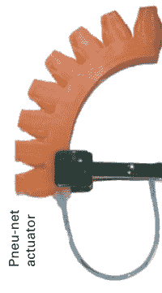
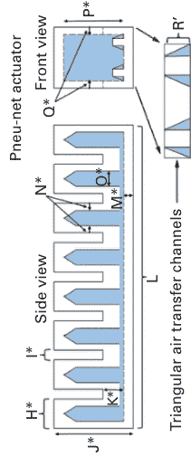

- Z 轴特征：
- (J) - pneu-net 的高度
- (K) - 每个桥的高度
- (P) - 气囊的高度
- (M) - 底层厚度
- (R) - 气传输通道尺寸
- X-Y 平面横截面特征：
- (N,O) - 每个气囊的壁厚
- (O) - 气室的宽度
- (H) - 外部气囊的宽度
- (I) - 气囊之间的距离
- (L) - pneu-net 的长度
- (*) - 重复特征

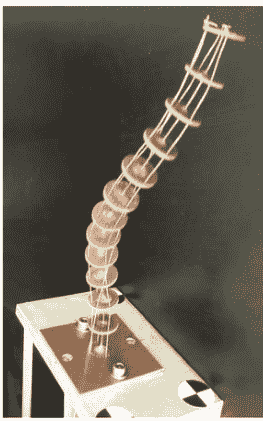
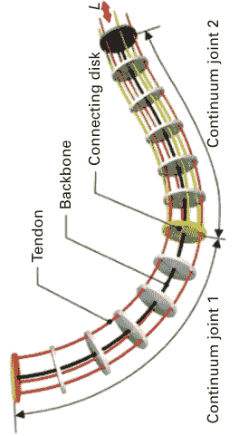

图 6.2 软机器人系统中使用的主要驱动机制示例。(a) 肌腱驱动连续体机器人及其模型。来源：Rucker and Webster 2014; Geng et al. 2018。(b) 气动软执行器。来源：Yirmibesoglu et al. 2018。(c) 可变刚度介电弹性体执行器。来源：Shinake et al. 2015。(d) 基于曲线记忆合金的软执行器。来源：Rodrigue et al. 2017。

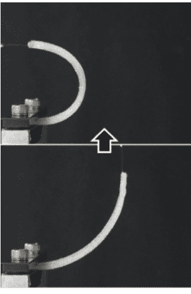
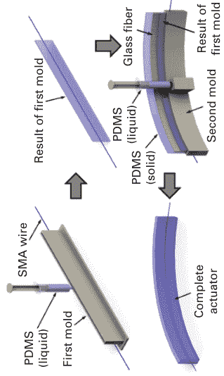
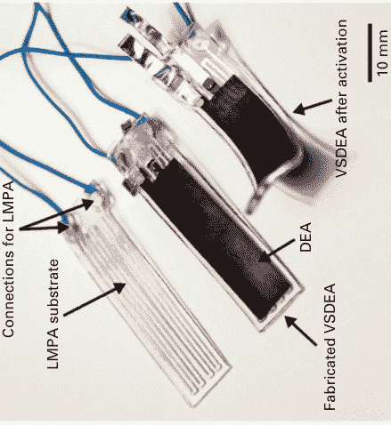
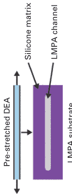

图 6.2（续）

要执行“轻柔”触碰的适当控制可能并非易事。通过恰当利用软手指的机械被动动力学，可以降低控制复杂度以实现所需的抓握行为，从而免除机器人控制中对亚毫米精度的需求（Pfeifer, Lungarella, and Iida 2007; Iida and Laschi 2011）。然而，随着身体“柔软程度”的增加，新的挑战随之产生。

完全由弹性体材料制成的机器人——例如，模仿章鱼触手或大象鼻子的机器人——无法采用经典方法控制；此外，本体感觉和仿真也变得棘手。与经典机器人中带有滑动或旋转关节的刚性连杆不同，身体的连续性和柔软性使得连续体软机器人的控制和仿真要困难得多。新型驱动方法帮助机器人研究人员实现所需的机器人控制（第 6.2.1 节），新的感知和控制方法也在每天被发现（Rus and Tolley 2015）。为了实现软机器人的自主性并超越开环控制，既需要本体感觉，也需要触觉感知。

研究人员在软机器人传感化方面投入了大量精力。最常见的软传感器或许是应变传感器，这是一种柔软、可变形的传感器，能够通过拉伸感知身体变形。因此，可以将此类传感器嵌入机器人（软）身体中，而不影响其变形能力。最广泛使用的某些传感器基于电阻式（Homberg et al. 2015）或电容式（Maiolino et al. 2015）技术。最近，Galloway et al. (2019) 和 Scimeca et al. (2019) 的研究表明，分别通过光纤和电容式触觉传感器进行传感化，可以实现对连续体软体的高保真本体感觉理解。

在控制和仿真背景下，学习起着根本作用。例如，面对连续体软体带来的无限自由度，通过经典方法进行精确控制很困难，且通常难以扩展。基于分段常曲率假设的模型解决方案已被证明对小型类触手机器人有效（Della Santina et al. 2018）。然而，控制器的误差随机器人内部软段数量的增加而持续增加。事实上，这些模型通常过于简单，无法准确捕捉连续体软机器人的复杂性。在这种情况下，学习已被证明对于弥补知识或模型复杂度的不足很有用（Scimeca, Maiolino, and Iida 2018, 2020; Rosendo, von Atzigen, and Iida 2017）。

### 6.3 发育软机器人学

认知发育机器人学（CDR）是一个研究领域，其中机器人学与发育科学融合为一个独特的领域，旨在借助发育科学的见解改进机器人学，并通过使用机器人平台进一步理解发育科学（Lungarella et al. 2003）。CDR 作为一个独立研究领域的需求在二十世纪初产生，源于不仅要理解个体的认知和社会发展（如表观遗传机器人学领域所探讨的）（Zlatev and Balkenius 2001），还要理解运动技能的获取和发展，以及它们和形态如何影响高阶认知功能的发展（Lungarella et al. 2003; Asada et al. 2001, 2009）。


在此语境下，机器人可以作为实验对象，发育模型可以在机器人平台上实现，科学家可以从行为分析中获得洞察，这种方法被称为综合方法（Scheier and Pfeifer 1999; Sporns 2003）。

与传统计算主义方法截然相反，在发育机器人学中，物理身体、决定推理和决策的过程（认知结构）以及世界中实体的符号表示之间没有明确的分隔。相反，这些过程相互影响，智能从它们的相互作用中涌现。发育机器人学在第3章中进行了详细阐述。

当今机器人学中最艰巨的任务之一，是为机器人实现适当的设计，使其能够在世界中执行特定任务。软体机器人的出现，如果说有什么影响的话，反而增加了机器人的复杂性，废除了上个世纪确立的刚性约束，开启了一个新时代。在这个新时代，机器人设计由与生物系统非常相似的因素驱动，其中功能形态、协调的感觉运动作用、物理适应和具身化都有助于机器人在世界中的“生存”以及其完成任务的能力。

发育软体机器人学旨在将软体机器人学、发育机器人学和发育科学这些领域结合起来。事实上，这些领域之间是不可分割的联系，正如我们将展示的那样。

#### 6.3.1 软体机器人学与发育时间尺度

在发育科学中，以最简单的形式，生物有机体的发育可以区分为三个不同的尺度：系统发生、个体发生和短期。

在生物有机体中，系统发生发育具有最大的时间尺度，变化发生在生物群体水平上，跨越许多代，自然选择等过程负责某些“特征”得以存活和演化，而其他特征则灭绝。与系统发生发育类似的是软体机器人设计，其中机器人设计是自适应且不断变化的，以符合机器人必须完成的任务。目前，大部分适应性归功于人为设计，并受人类技能和经验的影响。然而，自主设计的新方法是热门研究课题，进化算法等过程在过去已显示出前景（Nolfi and Floreano 2000; Doncieux et al. 2015）。

个体发生发育关注有机体生命周期中的变化，包括生长和身体适应。机器人在整个生命周期中“变形”以实现所需行为的能力，一直是软体机器人与上个世纪刚性机器人相比的一项关键优势。像真菌菌丝一样通过生长来导航的机器人（Hawkes et al. 2017）、由于压力而伸长身体并改变刚度以改变身体动力学并实现不同行为的机器人（Cianchetti et al. 2013），都是这种适应性的例子。

短期适应是所有适应性和发育时间尺度中最短的一种，在这种情况下，适应需要即时且同时完成。短期适应也许是最自然适合在软体环境下讨论的。在过去，这种适应需要在控制层面主动实现，其中实时控制可以通过机械或感觉反馈允许短期自适应行为。在软体机器人框架内，与生物有机体类似，短期适应仅仅是软体本身柔软、即时变形的结果。例如，当我们轻轻地将手指滑过粗糙表面时，复杂而精确控制的需求因我们真皮在触摸下变形并贴合表面的能力而不再必要。与所示例子类似，软体机器人材料的柔顺性和柔软性可以实现短期适应。机械反馈仅成为接触的物理后果，而柔顺性可以自然地抑制对复杂控制器的需求。图6.3说明了发育软体机器人框架的主要思想。

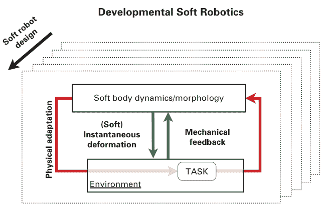

图6.3 发育软体机器人。

#### 6.3.2 功能形态与形态计算

在设计机器人系统时，如果形状最初是形态特征中最显著的，那么随着软体机器人的出现，情况可能不再如此。不同弹性水平的材料已展示出执行“计算”的能力（Scimeca et al. 2018; Eder, Hirsch, and Hauser 2018）。例如，Scimeca et al.（2018）的近期工作表明，复杂的触觉信息可用于基于不同属性对对象进行分类，仅基于聚类分析。推理的简便性之所以可能，是因为在触觉传感器和对象之间有一个“软滤波器”或弹性层。当改变弹性层的属性时，触觉信息会得到适当影响（空间滤波），以诱导对象相对于不同对象属性（如边缘或伸长）的相似性。这里的“智能”在于身体中，因为身体恰当塑造感觉信息的能力使代理的更高认知功能能够使用简单的聚类方法解决对象分类问题，无需事先训练或监督，这否则是不可能完成的壮举。

一种试图利用复杂身体-环境交互的范式是“水库计算”计算框架。水库计算背后的原始想法始于网络计算，其中输入被馈送到网络，网络计算出相应的输出。在水库计算中，使用一个固定的随机动态系统（也称为水库）将输入信号映射到更高维空间。然后，网络的“读出”最终部分被训练以将来自更高维空间的信号映射到所需的输出。如前所述，软体机器人，以及生物有机体，通常至少部分由软材料制成。因此，软体机器人的身体动力学非常复杂、高度非线性且高维，使得控制具有挑战性。通过水库计算范式，可以利用这种系统的复杂性，将软体作为计算资源加以利用，使用身体动力学来模拟非线性动态系统，并因此将部分控制卸载到身体本身（Nakajima et al. 2013, 2015）。例如，Nakajima et al.（2014）表明，可以使用机器人身体作为计算资源，在不使用任何外部控制器的情况下，以闭环方式控制受章鱼触手启发的复杂连续体软臂。从这个角度来看，高非线性和复杂性可能是身体的理想属性，设计可能需要相应地考虑。

另一种允许将软体用作计算资源的属性是记忆。事实上，软体机器人的软体动力学可以表现出短期记忆，使机器人能够模拟需要内嵌记忆的功能（Nakajima et al. 2014）。例如，在欠驱动连续体软机器人时，控制机制可能相对于机器人的行为不具有确定性。在这些情况下，机器人的行为可能不仅取决于诱导控制及其当前状态，还取决于先前机器人状态的历史，这可能发生在通过移动软触手臂的一端来驱动时。

#### 6.3.3 软体机器人的涌现行为

在二十一世纪初，“形态功能机器”的概念被提出。形态功能机器被定义为那些能够在现实世界中执行任务时改变其形态，从而实现适应性的机器（Hara and Pfeifer 2003）。在此语境下，不同时间尺度上的变化已被认为很重要——即短期、个体发生和系统发生（或进化）。重要的是要注意，这里的适应和任务解决是在形态层面而不是控制层面实现的。

正如发育机器人学范式（第3章）所倡导的，智能和协调行动是身体、心智和环境之间复杂交互的结果。后者实际上在决定其中生活的人工或自然有机体的行为方面发挥着重要作用。

过去二十年中最具影响力的实验之一是“死鱼实验”，该实验与哈佛大学和麻省理工学院合作进行。


麻省理工学院（MIT）的技术于 2005 年（Beal et al. 2006）。在实验中，一条死鱼即使在大脑明显没有发送控制冲动的情况下，也能逆流而游。进一步研究表明，鱼的流线型身体通过被动振荡，能够将周围的能量转化为机械能，从而被动地推动自身前进。尽管身体的形态和结构使死鱼能够转换周围的能量，但环境是促成因素。水流产生的涡旋在实验中至关重要，因为它们产生了待转换的能量，并重新创造了身体展示其推进能力的条件。实际上，身体与环境之间的相互作用是决定所观察行为的决定性因素。另一个具有类似影响力的实验是被动动态步行者。该机器人的结构，带有膝盖、弹簧、类似钟摆的腿部摆动等，能够在没有任何复杂控制的情况下实现稳定的、类人的、低能耗的双足运动。然而，环境启动并稳定了行走运动，这一点在机器人被放置在下坡时表现出来（Collins et al. 2005），使得势能能够巧妙地转化为动能。

因此，在机器人设计中，务必始终将环境纳入考量。与之前提到的示例一样，身体和大脑通常不足以实现有用的目标。世界中的事物存在是为了影响和改变其周围环境，并生活在其所处的环境中（Mataric 2006）。在此背景下，智能的、位于情境中的行为可以在身体与环境的相互作用中观察到，形态也可以在其中得到增强并被有目的地调整。

#### 6.3.4 软机器人的传感与知觉

在自然界中，形态在感知景观中起着根本作用，通过机械方式转换、过滤和放大来自外界的传感器刺激，以理解周围环境或内部状态（Towel et al. 2011; Iida and Nurzaman 2016）。例如，在大鼠和小鼠中，触须（即敏感的触觉毛）已知能赋予这些哺乳动物专门的触觉能力，帮助它们完成多种感觉歧视任务（Prescott et al. 2009）。以类似方式，大多数哺乳动物已进化为通过复眼来中介视觉，牺牲分辨率以换取更大的视野和高时间分辨率，从而实现快速的全景知觉（Land and Nilsson 2012）。在仿生机器人领域，人们已尝试赋予机器人系统自然界中观察到的有机体的能力。通过胡须（Pearson et al. 2011）进行的触觉机器人知觉和复合视觉（Floreano et al. 2013）就是两个这样的示例（图 6.4）。

软传感是软机器人领域中最受欢迎的领域之一。赋予软机器人系统感知环境的能力，可以使机器人对未知事件做出反应，随时间改进其控制和形态，并捕捉信息或对世界中的实体进行推理。为软机器人配备传感器并非易事。该领域的目标之一是设计本身表现出某些“软”行为特征的传感器；通常，柔韧性（即可弯曲）和伸展性（Lu and Kim 2014）是可取的。目前，实现可伸展电子的方法包括波形电路（Majidi 2014; Rogers, Someya, and Huang 2010）和导电液体（Cheng and Wu 2012）。最广泛的软传感器之一是应变传感器，已被证明具有高度

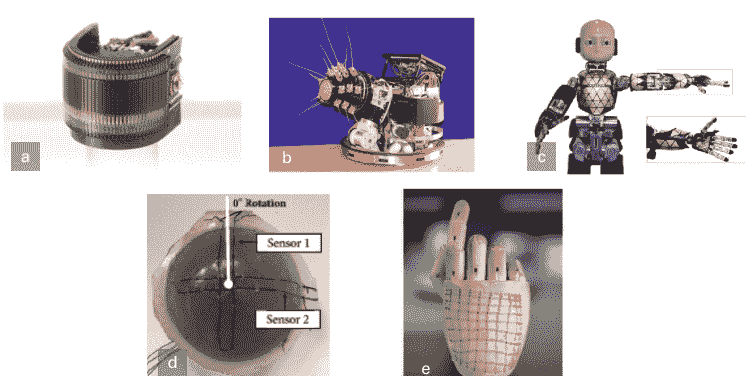

图 6.4 生物启发的柔性和软传感示例。（a）人工复眼。来源：Floreano et al. 2013。（b）机器人触觉触须传感。来源：Pearson et al. 2011。（c）带有大面积柔性电容式触觉皮肤的 iCub 机器人。来源：Hoffmann et al. 2017。（d）传感化的导电热塑性弹性体通用握爪。来源：Hughes and Iida 2017。（e）用于多国传感的可伸展和贴合传感器。来源：Hua et al. 2018。

弹性（Muth et al. 2014）。新的嵌入方法也已证明，可以通过三维打印技术将应变传感器嵌入弹性体中。其他柔性传感技术，如电容式触觉传感（Maiolino et al. 2013）和光纤（Galloway et al. 2019），也已用于软机器人系统中。

如前所述，传感器-运动协调和形态可以增强机器人系统的传感能力。传感器不应仅被视为独立和自给自足的技术。相反，根本应将传感器技术视为驻留在身体内的装置。源自其形态特性的身体动力学，结合机器人系统所处的环境，都应对传感器形态、其特性及其知觉能力产生贡献。这些因素的适当耦合已被证明可以提高机器人系统的传感能力（Iida and Pfeifer 2006）。例如，在 Hughes and Iida (2017) 中，通过一对导电热塑性弹性体（CTPE）应变传感器（图 6.4d）实现了通用握爪的传感化。随后使用差分传感来计算软体内部的变形。然而，形态是关键。通过在软握爪内以不同模式布置应变传感器，可以检测关于变形幅度、方向或位置的信息。由于此类传感也与运动控制、机械动力学和机器人系统的目标密不可分，最近提出了“自适应形态”的概念（Iida and Nurzaman 2016），旨在通过传感器方法的迭代设计、组装和评估，来解释生物体知觉能力的自适应性质。

#### 6.3.5 适应与生长

先前讨论的原则鼓励一种不同的设计方法，旨在赋予机器人适应不断变化环境的能力，并确实利用环境作为解决其分配任务的手段。除了在系统发育尺度上的设计原则以及通过材料特性和设计在短时间尺度上实现的即时变形之外，另一个重要因素是个体发生的变化和适应。例如，植物能够持续改变其形态和生理，以响应环境中的变异从而生存（Mazzolai, Beccai, and Mattoli 2014）。受到植物在多样和极端环境中生存的独特能力的启发，一批研究人员更加热切地尝试在机器人系统中再现其一些适应性。植物机器人（Plantoids），即配备了用于执行土壤探索和监测任务的分布式传感、驱动和智能的机器人系统，已开始在这个方向上获得关注（Mazzolai, Beccai, and Mattoli 2014）。例如，Sadeghi et al. (2013) 和 (2014) 中的根状人工系统已被证明能够通过模拟机器人端部延长的生长的新方法来执行土壤探索。仿生学和材料科学中其他植物启发的技术包括魔术贴（源自植物果钩的机制）（Velcro SA 1955）、用于结构工程材料的竹子启发纤维（Li et al. 1995），以及 Taccolla et al. (2013) 中基于环境湿度可逆吸附和解吸的新驱动机制，以及 Mazzolai et al. (2010) 中基于植物渗透原理的机制。

个体发生适应性的另一个重要因素是有机体在其生命周期内修复自身组织的能力。赋予人工系统自我愈合能力最近已成为首要任务，为无缆机器人在更不确定和更具动态性的任务环境中“生存”更长时间奠定了基础。软材料的自我愈合通常通过对受损区域进行热处理来实现，这使得某些聚合物能够重新连接并恢复其大部分结构特性。例如，在 (Terryn et al. 2017) 中，开发了使用 Diels-Alder 材料（Scheltjens et al. 2013）的软握爪、软手和人工肌肉。在所开发的系统中，Diels-Alder 材料在 80°C 时表现出可逆性，可在损伤后恢复聚合物 98% 至 99% 的机械性能。

#### 6.3.6 工具使用与延伸表现型

在生物学中，表现型是有机体的可观察特征集合，包括其形态、发育过程和生理特性。延伸表现型的概念最初由 Richard Dawkins (1982) 提出，他认为原始的表现型概念可能过于狭隘。事实上，基因可能产生的影响不仅限于有机体本身，还延伸到有机体所处的环境，通过该有机体的行为。人工代理及其环境的耦合已在 6.3.3 节中讨论。然而，延伸表现型概念延伸到了更激进的概念。

其中最引人入胜的例子之一体现在灵长类动物、鸦科鸟类和某些鱼类中，研究发现它们会有意地制作和使用“工具”以在……中实现目标


其所处环境，例如获取食物和水、防御、娱乐或建筑（Shumaker, Walkup, and Beck 2011）。

扩展表现型概念，生物体的可观察性状应扩展为包括通过所使用的工具所衍生的延伸功能、行为和形态。

例如，当灵长类动物握住一根小树枝时，其物理特征无疑发生改变：其触及范围更长，其体重和形态受影响，其在两肢或三肢上保持平衡的姿态，以及其影响周围环境的能力亦是如此。

在扩展表现型概念下，这些变化必须被纳入生物体的表现型性状中。

在软体发育机器人学背景下，机器人系统的个体发育应包括其在整个生命周期内适应环境的能力（物理适应），以及通过主动创造和使用最初未包含在其表现型性状中的工具来增强其功能的能力。

这一能力此前已在 Hoffmann et al. (2010) 和 Nabeshima, Kuniyoshi, and Lungarella (2006) 中得到探讨，其中显而易见，工具使用观念的基础是身体图式概念（参见第 3 章）。

在此场景中，身体图式在整个个体发育过程中需要具备适应性和可改性，以应对身体（包括生长）的变化，以及工具使用所赋予的扩展能力。

这里需要对工具有所了解（Wang, Brodbeck, and Iida 2014）。

Nabeshima, Kuniyoshi, and Lungarella (2006) 认为，多感觉信息的时间整合是解释工具使用如何被纳入身体图式的一个合理候选机制。

此背景下的另一个核心组成部分是本体感觉感知，即感知自身运动和身体位置的能力。

本体感觉在身体表征的感知/动作模型中也起着重要作用（de Vignemont 2010）。

### 6.4 结论

在本章中，我们考察了生物启发机器人学的各个方面，重点在于软体机器人学以及这样一种观点：智能表现为大脑、身体和环境之间的相互作用及其相互动态耦合。

在这种背景下引入了发育软体机器人学的概念，其中可以在三个不同的时间尺度上建立一些设计原则，帮助并使机器人专家和研究人员能够开发新一代机器人的系统。

过去几十年来，许多感知与驱动使能技术推动了进步，使机器人从刚性和工业类型转向柔软和人性化类型。

这些已被证明能够实现运动、拾取和操作物体、与人类安全交互等更多功能。

然而，该领域仍面临诸多挑战，因为创造具有类似动物世界生物能力的机器这一终极目标之路才刚刚开始。

#### 6.4.1 物理软体机器人进化

在系统发育时间尺度上，如何实现复杂的具身行为的问题已得到自然界很长时间的解答。

生物体中进化的概念相当直接，进化被认为是种群在世代更替中可遗传特征的变化（Hall and Strickberger, 2008）。

由于各种遗传变异的来源，新一代具有越来越不同的性状，并通过类似自然选择的中介过程，某些性状将确保更高或更低的生存机会（Scott-Phillips et al. 2014）。

最终，幸存种群拥有我们现在在地球上海量的生物种类中所见到的所有不同性状，这些生物已适应使用大量不同的方法和技术来确保其生存。

在软体机器人学背景下，系统发育学领域与这一概念紧密耦合，因此，该领域对机器人学中的涌现式设计与控制产生重大影响。

在“进化机器人学”领域，进化计算被用于开发机器人的物理设计或控制器（参见第 4 章）。

进化计算从生物进化中汲取灵感。

例如，在机器人学中，可以创建一组初始候选机器人，并以数值方式编码其物理和/或控制特征。

通过针对特定任务测试机器人种群，随后可以识别哪种形态与控制的组合表现更好。

随后可以扰动表现最佳的机器人的编码特征，并用其创建可再次测试的新一代机器人。

经过数千次迭代，该过程已被证明可以实现鲁棒控制（Mautner and Belew 2000; Fleming and Purshouse 2002）和设计（Lund, Hallam, and Lee 1997; Lipson and Pollack 2000; Pfeifer, Iida, and Bongard 2005; Vujovic et al. 2017; Brodbeck, Hauser, and Iida 2015）。

进化算法最大的局限性之一在于获得良好控制器或设计所需的资源和时间。

由于机器人设计、机器人测试和机器人评估的迭代非常耗时，因此通常不可行地从通用的、非边界的机器人特征编码开始，将进化算法应用于非常复杂的问题。

历史上，仿真世界更适合进化算法（Lipson and Pollack 2000; Mautner and Belew 2000; Nolfi et al. 1994），因为种群的创建、测试和迭代较为容易。

然而，找到的控制器和设计通常不是健壮的现实世界解决方案，因为仿真环境仍然非常有限，且其中找到的解决方案不一定对应现实世界中的解决方案（Jakobi, Husbands, and Harvey 1995）。

此外，取决于问题的复杂性，计算资源仍然是一个问题。

在软体机器人学中，鉴于身体的复杂性及其产生的交互作用，设计与控制是两个最大的问题。

进化算法本身作为一种候选解决方案是合适的，但先前提到的局限性仍然适用。

然而，虚拟现实引擎、快速原型制作的新制造方法、材料科学的进步以及不断增强的计算能力等方面的进一步进步，可能在不久的将来绕过其中一些局限性。

#### 6.4.2 复杂性与可扩展性

迄今为止，我们所见的机器人仍然“显得”不自然；它们移动缓慢而迟钝；类人机器人仍然不具备像人类那样行走、奔跑或移动的能力；它们不能像我们一样推理世界，并且在未知事件发生时会感到困惑（Pfeifer, Lungarella, and Iida 2012）。

导致这一事实的几个原因之一是复杂性。

人类中存在的执行器和分布式传感器的数量过高，机器中的电机和标准传感器很难复制。

这种复杂性构成了一个问题，控制大量电机和传感器的耦合也是如此。

即使在处理子问题（例如类人手）时，复杂性也可能已经过高，无法尝试使用标准方法来应对。

曾尝试复制复杂性，例如，在机械操纵器中复制人类手中存在的许多自由度（Tuffield and Elias 2003）。

然而，这种方法并未产生许多人所期望的结果，因为身体的复杂性与控制的复杂性相耦合，要实现可适应、平稳的抓取和操纵行为并非易事。

最近的进展表明，如果与环境的交互得到适当利用，欠驱动甚至被动的手可以实现复杂行为（Hughes et al. 2016, 2018）。

正是在这里，复杂性可以被转移，因为当适当的交互发生时，复杂行为可以从简单的设计中涌现。

在这个框架内，许多问题仍然存在。

事实上，如何设计以避免或利用复杂性仍不清楚。

利用环境约束并非易事，因为要利用的约束也与手头的任务紧密耦合。

在软体机器人学中，机器人本身的构造导致了高度非线性的行为和具有复杂动力学的机器人。

像水库计算这样的范式可以利用此类结构的复杂性，将其作为计算资源，从而使复杂性成为一种可取的特性。

然而，控制仍然难以实现，当身体的复杂性过高时，数学模型无法全面解释动态交互。

这种复杂性带来了无限的挑战和机遇，不断变化的机器人学格局将在不久的将来不得不面对这些挑战和机遇。

#### 6.4.3 通过身体学习

过去二十年来人工智能（AI）的进步已经开启一场科学革命，使机器有可能在几个不同领域（例如基于图像的物体检测（Schmidhuber 2015）、虚拟代理控制（Mnih et al. 2015）和触觉纹理识别（Fishel and Loeb 2012））中达到超越人类水平的性能。

在机器人学中，机器学习已被广泛用于感知方面（例如物体检测和识别）和控制方面（例如机器人轨迹规划和电机控制）。

最强大的机器学习算法使用监督（即目标标签的知识）来随时间或试验改进性能。

广义而言，从机器学习的角度来看，通常尝试通过将函数拟合到传感器或观测数据来解决任务，从而在新数据可用时尝试在相同（或相似）任务上取得良好性能。

例如，数据可能来自安装在室内移动机器人平台上的摄像头的流式图像，监督机器学习模块可以基于在类似室内环境中收集和标记的视觉流，学习何时以及如何将车轮向左或向右转向。

在本章中，我们探讨了软形态学的概念及其被称为形态处理、感觉运动协调行为和软环境交互的影响。

在与上述示例类似的情况下，忽略这种心智、身体和环境的互联是很常见的。

事实上，在软体机器人学中，


以及其他机器人领域，数据通常是由机器人自身收集的感知信息。这里的感知信息受机器人身体形态的影响，也受机器人与世界中实体交互方式的影响。因此，软体机器人可以被视为一种现实过滤器，它可以在其环境中行动，并以最适合学习的方式影响信息。

先前的研究表明，机器人能够通过形态处理和感知运动协调，有目的地影响其从环境中收集的信息（Pfeifer and Scheier 1997；Pfeifer, Iida, and Gómez 2006）。在此背景下，不仅可以对信息进行结构化，使其适合学习，而且结构化的信息本身还可以指导机器人的形态和控制，形成一个能够内在地驱动机器人行为的感知运动与形态适应循环。我们使用“软形态计算”这一术语，来描述软体机器人理解其自身身体和动作如何过滤从世界中检索到的信息，并相应地改变其配置和交互以优化信息检索的能力。这种简化随后可以推动学习，并进一步增强自主机器人系统的适应能力。例如，在 Scimeca, Maiolino, and Iida (2018) 中，表明机器人的软形态能够实现属于不同对象类型的刺激的聚类分离。因此，学习可以通过无监督方法来实现，因为“标签”或类别来自熟练的身体-环境交互，这种交互会诱导感觉分离。

机器人系统通过其动作或形态有目的地塑造感觉信息，并从诱导的结构中学习的能力，有可能改变机器人系统中的学习格局。在此背景下，学习可以被视为不是始于信息世界的过程，而更多地是存在于物理世界中的过程，其中“学习”适用于感觉感知的动作和交互，是后期适当学习感觉刺激的第一步。

### 其他阅读材料与资源

- 关于软体机器人的论文综述（截至 2007 年）：Trivedi, Deepak, Christopher D. Rahn, William M. Kier, and Ian D. Walker. 2008. “软体机器人学：生物灵感、现状与未来研究。” *应用生物力学与生物电子学* 5 (3): 99–117.
- 广泛讨论认知、身体形态与材料特性之间联系的论文：Pfeifer, Rolf, Fumiya Iida, and Max Lungarella. 2014. “自下而上的认知：关于生物灵感、身体形态与软材料。” *认知科学趋势* 18 (8): 404–413.
- 当前软体机器人研究、技术及应用的最新概述：Laschi, Cecilia, Jonathan Rossiter, Fumiya Iida, Matteo Cianchetti, and Laura Margheri. *软体机器人学：趋势、应用与挑战*。*软体机器人周论文集*。柏林：施普林格。
- 软体机器人工具包网站：https://softroboticstoolkit.com.
- 软体机器人 TC 网站：http://softrobotics.org.

### 参考文献

Asada, Minoru, Koh Hosoda, Yasuo Kuniyoshi, Hiroshi Ishiguro, Toshio Inui, Yuichiro Yoshikawa, Masaki Ogino, and Chisato Yoshida. 2009. “认知发育机器人学：一项综述。” IEEE Transactions on Autonomous Mental Development 1 (1): 12–34.

Asada, Minoru, Karl F. MacDorman, Hiroshi Ishiguro, and Yasuo Kuniyoshi. 2001. “将认知发育机器人学作为人形机器人设计的新范式。” Robotics and Autonomous Systems 37 (2–3): 185–193.

Baldassarre, Gianluca, and Marco Mirolli, 编. 2013. 自然与人工系统中的内在动机学习。柏林：施普林格。

Barto, Andrew G. 2013. “内在动机与强化学习。” 在《自然与人工系统中的内在动机学习》中，17–47。柏林：施普林格。

Beal, D. N., F. S. Hover, M. S. Triantafyllou, J. C. Liao, and George V. Lauder. 2006. “涡旋尾迹中的被动推进。” Journal of Fluid Mechanics 549:385–402.

Belanger, Jim H., and Barry A. Trimmer. 2000. “毛虫 Manduca Sexta 爬行时足足功能的联合运动学和肌电图分析。” Journal of Comparative Physiology A 186 (11): 1031–1039.

Bernstein, N. A. 1967. 运动的协调与调节。牛津：珀加蒙出版社。

Berthouze, Luc, and Max Lungarella. 2004. “环境扰动下的运动技能获取：关于交替冻结和释放自由度的必要性。” Adaptive Behavior 12 (1): 47–64.

Braitenberg, Valentino. 1986. 载体：合成心理学实验。剑桥，麻省：麻省理工学院出版社。

Brodbeck, Luzius, Simon Hauser, and Fumiya Iida. 2015. “通过无模型表型发展实现物理机器人的形态进化。” PLoS One 10 (6): e0128444.

Brooks, Rodney A. 1990. “大象不下棋。” Robotics and Autonomous Systems 6 (1–2): 3–15.

Brown, Eric, Nicholas Rodenberg, John Amend, Annan Mozeika, Erik Steltz, Mitchell R. Zakin, Hod Lipson, and Heinrich M. Jaeger. 2010. “基于颗粒材料堵塞的通用机器人抓手。” Proceedings of the National Academy of Sciences 107 (44): 18809–18814.

Buhrmann, Thomas, Ezequiel Alejandro Di Paolo, and Xabier Barandiaran. 2013. “感知运动偶然性的动态系统解释。” Frontiers in Psychology 4:285.

Cheng, Shi, and Zhigang Wu. 2012. “微流体电子学。” Lab on a Chip 12 (16): 2782–2791.

Cianchetti, M., A. Arienti, M. Follador, B. Mazzolai, P. Dario, and C. Laschi. 2011. “受章鱼启发的机器人臂的设计理念与验证。” Materials Science and Engineering C 31 (6): 1230–1239.

Cianchetti, Matteo, Tommaso Ranzani, Giada Gerboni, Iris De Falco, Cecilia Laschi, and Arianna Menciassi. 2013. “STIFF-FLOP 外科操纵器：单模块的机械设计与实验表征。” 在《2013 年 IEEE/RSJ 智能机器人与系统国际会议论文集》中，3576–3581。纽约：IEEE。

Clark, Andy, and Rick Grush. 1999. “迈向认知机器人学。” Adaptive Behavior 7 (1): 5–16.

Collins, Steve, Andy Ruina, Russ Tedrake, and Martijn Wisse. 2005. “基于被动动态步行者的高效双足机器人。” Science 307 (5712): 1082–1085.

Dawkins, Richard. 1982. 扩展表型。第 8 卷。牛津：牛津大学出版社。

Della Santina, Cosimo, Robert K. Katzschmann, Antonio Bicchi, and Daniela Rus. 2018. “与环境交互的软体机器人动态控制。” 在《2018 年 IEEE 软体机器人国际会议》中，46–53。纽约：IEEE。

de Vignemont, Frédérique. 2010. “身体图式与身体形象——利与弊。” Neuropsychologia 48 (3): 669–680.

Doncieux, Stephane, Nicolas Bredeche, Jean-Baptiste Mouret, and Agoston E. Gus Eiben. 2015. “进化机器人学：是什么、为什么以及向何方。” Frontiers in Robotics and AI 2:4.

Edelman, Gerald M. 1987. 神经达尔文主义：神经元群体选择理论。纽约：基本图书出版社。

Eder, M., Florian Hisch, and Helmut Hauser. 2018. “基于形态计算的模块化气动驱动软体机器人臂控制。” Advanced Robotics 32 (7): 375–385.

Fishel, Jeremy A., and Gerald E. Loeb. 2012. “用于纹理智能识别的贝叶斯探索。” Frontiers in Neurorobotics 6:4.

Fleming, Peter J., and Robin C. Purshouse. 2002. “控制系统工程中的进化算法：一项综述。” Control Engineering Practice 10 (11): 1223–1241.

Floreano, Dario, Ramon Pericet-Camara, Stéphane Viollet, Franck Ruffier, Andreas Brückner, Robert Leitner, Wolfgang Buss et al. 2013. “微型弯曲人工复眼。” Proceedings of the National Academy of Sciences 110 (23): 9267–9722.

Fodor, Jerry A. 1981. 表征：认知科学基础的哲学论文。剑桥，麻省：麻省理工学院出版社。

Fogel, Alan. 2011. “发展科学中的动态系统理论与应用研究。” Child Development Perspectives 5 (4): 267–272.

Galloway, Kevin C., Yue Chen, Emily Templon, Brian Rife, Isuru S. Godage, and Eric J. Barth. 2019. “软体机器人光纤形状传感。” Soft Robotics 6 (5): 671–684.

Geng, Shengming, Youyu Wang, Cong Wang, and Rongjie Kang. 2018. “一种空间腱驱动连续体机器人。” 在《感知与成像国际会议》中，25–35。瑞士沙姆：施普林格。

Goldfield, Eugene Curtis. 1995. 涌现形式：人类行动与感知的起源与早期发展。牛津：牛津大学出版社（按需出版）。

Grush, Rick. 2003. “为关于大脑及其运作的一些‘笛卡尔’假设辩护。” Biology and Philosophy 18 (1): 53–93.

Hall, Brian, and Monroe W. Strickberger. 2008. 斯特里克伯格的进化论。伯灵顿，麻省：琼斯与巴特利特出版社。

Hara, Fumio, and Rolf Pfeifer, 编. 2003. 形态功能机器：新物种：设计具身智能。柏林：施普林格科学与商业媒体。

Hawkes, Elliot W., Laura H. Blumenschein, Joseph D. Greer, and Allison M. Okamura. 2017. “一种通过生长在环境中导航的软体机器人。” Science Robotics 2 (8): eaak3028.

Hoffmann, Matej, Hugo Marques, Alejandro Arieta, Hidenobu Sumioka, Max Lungarella, and Rolf Pfeifer. 2010. “机器人学中的身体图式：一项综述。” IEEE Transactions on Autonomous Mental Development 2 (4): 304–324.

Hoffmann, Matej, Zdeněk Straka, Igor Farkaš, Michal Vavrecka, and Giorgio Metta. 2017. “机器人小人：受初级体感皮层启发的人形机器人中人工皮肤表征的学习。” IEEE Transactions on Cognitive and Developmental Systems 10 (2): 163–176.

Homberg, Bianca S., Robert K. Katzschmann, Mehmet R. Dogar, and Daniela Rus. 2015. “使用模块化软体机器人抓手进行物体触觉识别。” 在《2015 年 IEEE/RSJ 智能机器人与系统国际会议论文集》中，1698–1705。纽约：IEEE。

Hua, Qilin, Junlu Sun, Haitao Liu, Rongrong Bao, Ruomeng Yu, Junyi Zhai, Caofeng Pan, and Zhong Lin Wang. 2018. “受皮肤启发的高度可拉伸和顺应性矩阵网络，用于多功能传感。” Nature Communications 9 (1): 1–11.

Hughes, J. A. E., P. Maiolino, and Fumiya Iida. 2018. “利用条件模型进行钢琴演奏的拟人软骨骼手。” Science Robotics 3 (25): aau3098.

Hughes, Josie, Utku Culha, Fabio Giardina, Fabian Guenther, Andre Rosendo, and Fumiya Iida. 2016. “软体操纵器和抓手：一项综述。” Frontiers in Robotics and AI 3:69.

Hughes, Josie, and Fumiya Iida. 2017. “软可变表面的局部差分感知。” 在《2017 年 IEEE 机器人与自动化国际会议》中，4959–4964。纽约：IEEE。

Iida, Fumiya, and Cecilia Laschi. 2011. “软体机器人学：挑战与展望。” Procedia Computer Science 7:99–102.

Iida, Fumiya, and Surya G. Nurzaman. 2016. “传感器形态的适应：来自生物启发机器人学视角的感知整体观。” Interface Focus 6 (4): 20160016.

Iida, Fumiya, and Rolf Pfeifer. 2006. “通过身体动态进行感知。” Robotics and Autonomous Systems 54 (8): 631–640.

Jakobi, Nick, Phil Husbands, and Inman Harvey. 1995. “噪声与现实差距：进化机器人学中仿真的应用。” 在《人工生命欧洲会议》中，704–720。柏林：施普林格。

Katzschmann, Robert K., Joseph DelPreto, Robert MacCurdy, and Daniela Rus. 2018. “使用声学控制软体机器鱼探索水下生命。” Science Robotics 3 (16): eaar3449.

Kim, Sangbae, Cecilia Laschi, and Barry Trimmer. 2013. “软体机器人学：机器人领域的生物启发式演化。” Trends in Biotechnology 31 (5): 287–294.

Kuhl, Patricia K. 2000. “语言、心智与大脑：经验改变感知。” New Cognitive Neurosciences 2:99–115.

Land, Michael F., and Dan-Eric Nilsson. 2012. 动物之眼。牛津：牛津大学出版社。

Laschi, Cecilia, and Matteo Cianchetti. 2014. “软体机器人学：机器人硬件与控制的新视角。” Frontiers in Bioengineering and Biotechnology 2:3.


拉斯基，塞西莉亚，马泰奥·钱凯蒂，芭芭拉·马佐赖，劳拉·马盖里，莫里齐奥·法洛多尔，和保罗·达里奥。2012。“受章鱼启发的软体机器人手臂。”《先进机器人学》26 (7): 709–727。

拉斯基，塞西莉亚，乔纳森·罗西特，文弥·伊达，马泰奥·钱凯蒂，和劳拉·马盖里。2016。*软体机器学：趋势、应用与挑战*。柏林：斯普林格。

李 S.H.，曾 Q.Y.，肖 Y.L.，傅 S.Y.，和周 B.L. 1995。“工程复合材料中的竹韧皮纤维仿生。”《材料科学与工程C》3 (2): 125–130。

林怀地，加里·G. 利斯克，和巴里·特里默。2011。“GoQBot：一款受毛毛虫启发的软体滚动机器人。”《生物灵感与生物模仿》6 (2): 026007。

霍德·利普森，和乔丹·B. 波拉克。2000。“机器人生命体的自动设计与制造。”《自然》406 (6769): 974–978。

吕南姝，和大炯·金。2014。“铺平软体机器学之路的柔性可拉伸电子学。”《软体机器学》1 (1): 53–62。

亨里克·豪托普·伦德，约翰·哈勒姆，和维波·李。1997。“机器人形态的进化。”在*1997年IEEE进化计算国际会议论文集*中，197–202页。纽约：IEEE。

马克斯·隆加雷拉，乔治奥·梅塔，罗尔夫·菲弗，和朱利奥·桑迪尼。2003。“发育机器人学：一项调查。”《联结科学》15 (4): 151–190。

迈奥利诺，P.，法比亚·加兰蒂尼，F. 马斯特罗焦万尼，G. 加罗内，G. 坎纳塔，和费德里科·卡尔皮。2015。“机器人皮肤电容式感应的软介电材料：不同弹性体类型的性能。”《传感器与执行器A：物理》226:37–47。

迈奥利诺，佩尔拉，马尔科·马焦利亚，乔治奥·坎纳塔，乔治奥·梅塔，和洛伦佐·纳塔莱。2013。“一种用于机器人的柔性耐用大规模电容式触觉系统。”《IEEE传感器期刊》13 (10): 3910–3917。

卡梅尔·马吉迪。2014。“软体机器学：一种视角——当前趋势与未来展望。”《软体机器学》1 (1): 5–11。

马塔里奇，M. J.，和B. 斯卡塞拉蒂。2016。“社会辅助机器人学。”在*斯普林格机器人学手册*中，由布鲁诺·西切利亚诺和乌萨马·哈蒂卜编辑，1973–1994页。柏林：斯普林格。

克雷格·莫特纳，和理查德·K. 贝莱。2000。“机器人形态与控制的进化。”《人工生命与机器人学》4 (3): 130–136。

芭芭拉·马佐赖，露西亚·贝卡伊，和维尔吉利奥·马托利。2014。“植物作为仿生学和生物机器人学的模型：新视角。”《生物工程与生物技术前沿》2:2。

芭芭拉·马佐赖，阿莱西奥·蒙迪尼，保罗·科拉迪，塞西莉亚·拉斯基，维尔吉利奥·马托利，埃多阿尔多·西尼巴尔迪，和保罗·达里奥。2010。“一种受植物根系启发的用于土壤探索的小型化机电系统。”《IEEE/ASME机电学会论文集》16 (2): 201–212。

米亚尔，R. C.，D. 乔·韦尔，丹尼尔·M. 沃尔珀特，和J. F. 斯坦。1993。“小脑是史密斯预测器吗？”《运动行为杂志》25 (3): 203–216。

阿斯兰·米里耶夫，肯尼斯·斯塔克，和霍德·利普森。2017。“软体执行器的软材料。”《自然通讯》8 (1): 1–8。

姆尼赫，V.，K. 卡夫库乔格卢，D. 西尔弗，A. A. 鲁苏，J. 维内斯，M. G. 贝勒马尔，A. 格雷夫斯，M. 里德米勒，A. K. 菲德耶兰，G. 奥斯特罗夫斯基，和S. 彼得森。2015。“通过深度强化学习实现人类水平的控制。”《自然》518 (7540): 529–533。

穆思，约瑟夫·T.，丹尼尔·M. 沃格特，莱恩·L. 特鲁比，义吉特·门古奇，大卫·B. 科尔斯基，罗伯特·J. 伍德，和詹妮弗·A. 路易斯。2014。“在高度可拉伸弹性体中嵌入的应变传感器3D打印。”《先进材料》26 (36): 6307–6312。

齐岛浩太，国吉泰夫，和马克斯·隆加雷拉。2006。“机器人工具使用的自适应身体图式。”《先进机器人学》20 (10): 1105–1126。

中岛康平，赫尔穆特·豪泽，康洁，埃马努埃列·古列尔米诺，达尔文·G. 考德威尔，和罗尔夫·菲弗。2013。“软体作为水库：基于章鱼启发软体机器人臂动态模型的案例研究。”《计算神经科学前沿》7:91。

中岛康平，赫尔穆特·豪泽，陶·李，和罗尔夫·菲弗。2015。“通过物理软体进行信息处理。”《科学报告》5:10487。

中岛康平，陶·李，赫尔穆特·豪泽，和罗尔夫·菲弗。2014。“作为计算资源利用软体动态中的短期记忆。”《皇家学会接口期刊》11 (100): 20140437。

艾伦·纽厄尔，和赫伯特·A. 西蒙。2007。“计算机科学作为经验探究：符号与搜索。”在*ACM图灵奖讲演*中，1975年。纽约：计算机协会。

斯特凡诺·诺尔菲，和达里奥·弗洛雷亚诺。2000。*进化机器人学：自组织机器的生物学、智能与技术*。剑桥，麻省：麻省理工学院出版社。

斯特凡诺·诺尔菲，达里奥·弗洛雷亚诺，奥拉齐奥·米利尼奥，和弗朗切斯科·蒙达达。1994。“如何进化自主机器人：进化机器人学的不同方法。”在第4卷，*人工生命：第四届生命系统合成与模拟国际研讨会论文集*中，190–197页。剑桥，麻省：麻省理工学院出版社。

埃利希·奥哈洛兰，弗加尔·奥马利，和彼得·麦休。2008。“介电弹性体执行器、技术、应用与挑战综述。”《应用物理学杂志》104 (7): 9。

J. 凯文·奥利根，和阿尔瓦·诺伊。2001。“视觉与视觉意识的感觉运动解释。”《行为与脑科学》24 (5): 939–973。

皮埃尔-伊夫·乌代耶，弗雷德里克·卡普兰，和维雷娜·V. 哈夫纳。2007。“用于自主心理发展的内在动机系统。”《IEEE进化计算学报》11 (2): 265–286。

苏·泰勒·帕克，和迈克尔·L. 麦金尼。2012。*智力起源：猴子、猿类和人类认知发展的进化*。巴尔的摩：约翰斯·霍普金斯大学出版社。

马丁·J. 皮尔森，本·米奇森，J. 查尔斯·沙利文，安东尼·G. 派普，和托尼·J. 普里科特。2011。“机器人生物模仿触须感觉。”《皇家学会B辑哲学汇刊：生物科学》366 (1581): 3085–3096。

罗尔夫·菲弗。2000。“形态与材料在适应性行为中的作用。”《从动物到阿尼马特》6:23–32。剑桥，麻省：麻省理工学院出版社。

罗尔夫·菲弗，飯田史弥，和乔什·邦加德。2005。“新机器人学：智能系统的设计原则。”《人工生命》11 (1–2): 99–120。

罗尔夫·菲弗，飯田史弥，和加布里埃尔·戈麦斯。2006。“用于适应性行为与认知的形态计算。”在第1291卷，*国际会议系列*中，22–29页。圣地亚哥：艾尔塞维尔。

罗尔夫·菲弗，飯田史弥，和马克斯·隆加雷拉。2014。“从下往上的认知：关于生物启发、身体形态和软材料。”《认知科学趋势》18 (8): 404–413。

罗尔夫·菲弗，马克斯·隆加雷拉，和飯田史弥。2007。“自组织、具身性与生物启发机器人学。”《科学》318 (5853): 1088–1093。

罗尔夫·菲弗，马克斯·隆加雷拉，和飯田史弥。2012。“生物启发‘软体’机器人学面临的挑战。”《计算机协会通讯》55 (11): 76–87。

罗尔夫·菲弗，和克里斯蒂安·施奈德。1997。“感觉-运动协调：隐喻及其超越。”《机器人与自主系统》20 (2–4): 157–178。

罗尔夫·菲弗，和克里斯蒂安·施奈德。1999。*理解智能*。剑桥，麻省：麻省理工学院出版社。

让·皮亚杰。2003。*智力心理学*。伦敦：劳德利奇。

让·皮亚杰，和玛格丽特·库克。1952。*儿童智力起源*。第8卷。纽约：国际大学出版社。

托尼·J. 普里科特，马丁·J. 皮尔森，本·米奇森，J. 查尔斯·W. 沙利文，和安东尼·G. 派普。2009。“与机器人一起触须探索。”《IEEE机器人与自动化杂志》16 (3): 42–50。

史蒂文·I. 里奇，罗伯特·J. 伍德，和卡梅尔·马吉迪。2018。“无线软体机器学。”《自然电子学》1 (2): 102–112。

菲利普·罗查。1998。“婴儿期的自我感知与动作。”《实验脑研究》123 (1–2): 102–109。

乌戈·罗德里格，王伟，韩民禹，托马斯·J. Y. 金，和安成勋。2017。“形状记忆合金耦合执行器与机器人概述。”《软体机器学》4 (1): 3–15。

乌戈·罗德里格，王伟，金东烈，和安成勋。2017。“基于曲线形状记忆合金的软执行器及其在软抓手中的应用。”《复合结构》176:398–406。

约翰·A. 罗杰斯，染谷隆夫，和黄勇刚。2010。“可拉伸电子学的材料与力学。”《科学》327 (5973): 1603–1607。

安德烈·罗森德，马尔科·冯·阿次根，和飯田史弥。2017。“协同优化设计中机器人的形态与控制权衡。”《PLOS ONE》12 (10): e0186107。

D. 凯布·拉克，和罗伯特·J. 韦伯斯特。2014。“带有外部载荷和通用腱道的连续体机器人力学。”在*实验机器人学*中，由乌萨马·哈蒂卜，维杰·库马尔，和加拉夫·苏克塔梅编辑，645–654页。柏林：斯普林格。

丹妮拉·鲁斯，和迈克尔·T. 托利。2015。“软体机器人的设计、制造与控制。”《自然》521 (7553): 467–475。

阿里·萨德吉，爱丽丝·托纳齐尼，利亚娜·波波娃，和芭芭拉·马佐赖。2013。“一种受植物根系启发的土壤穿透机器人机制。”在*2013年IEEE机器人与自动化国际会议*中，3457–3462页。纽约：IEEE。


Sadeghi, Ali, Alice Tonazzini, Liyana Popova, and Barbara Mazzolai. 2014. “受植物根系土壤穿透行为启发的一种新型生长装置.” PloS One 9 (2): e90139.

Scheier, Christian, and Rolf Pfeifer. 1999. “体认认知科学方法.” 载于《动力学、协同作用与自主代理：认知心理学和认知科学的非线性系统方法》, 由 W. Tschacher 和 J.-P. Dauwalder 编辑, 159–179. 新加坡: 世界科学出版社.

Scheltjens, G., M. M. Diaz, J. Brancart, G. Van Assche, and B. Van Mele. 2013. “基于可逆共价键的自愈合聚合物网络.” Reactive and Functional Polymers 73 (2): 413–420.

Schmidhuber, Jürgen. 2015. “神经网络中的深度学习：概览.” Neural Networks 61:85–117.

Scimeca, Luca, Josie Hughes, Perla Maiolino, and Fumiya Iida. 2019. “基于触觉阵列的本体感觉无模型软结构重建.” IEEE Robotics and Automation Letters 4 (3): 2479–2484.

Scimeca, Luca, Perla Maiolino, and Fumiya Iida. 2018. “用于自主类别形成的触觉刺激软形态处理.” 载于 2018 IEEE 软体机器人国际会议 (RoboSoft), 356–361. 纽约: IEEE.

Scimeca, Luca, Perla Maiolino, and Fumiya Iida. 2020. “软形态—动作协同优化的高效贝叶斯勘探.” 载于 2020 年第 3 届 IEEE 软体机器人国际会议 (RoboSoft), 639–644. 纽约: IEEE.

Scott-Phillips, Thomas C., Kevin N. Laland, David M. Shuker, Thomas E. Dickens, and Stuart A. West. 2014. “生态位构建视角：批判性评述.” Evolution 68 (5): 1231–1243.

Seok, Sangok, Cagdas D. Onal, Robert Wood, Daniela Rus, and Sangbae Kim. 2010. “软体机器人中具有拮抗执行器的蠕动运动.” 载于 2010 IEEE 机器人与自动化国际会议, 1228–1233. 纽约: IEEE.

Shintake, Jun, Bryan Schubert, Samuel Rosset, Herbert Shea, and Dario Floreano. 2015. “基于介电弹性体和低熔点合金的软体机器人可变刚度执行器.” 载于 2015 IEEE/RSJ 智能机器人与系统国际会议论文集, 1097–1102. 纽约: IEEE.

Shumaker, Robert W., Kristina R. Walkup, and Benjamin B. Beck. 2011. 《动物工具行为：动物对工具的使用与制造》. 巴尔的摩: 约翰斯霍普金斯大学出版社.

Siegenthaler, K. O., A. Küenkl, G. Skupin, and M. Yamamoto. 2011. “Ecoflex® 和 Ecovio®：可降解、性能赋能塑料.” 载于《合成可降解聚合物》, 由 Bernhard Rieger, Andreas Kunkel, Geoffrey W. Coates, Robert Reichardt, Eckhard Dinjus, and Thomas A. Zevaco 编辑, 91–136. 柏林: 施普林格出版社.

Soni, Mahesh, and Ravinder Dahiya. 2020. “软电子皮肤：具有协调能量与计算的分布式触觉感知.” Philosophical Transactions of the Royal Society A 378 (2164): 20190156.

Sporns, Olaf. 2003. “体认认知.” 载于《脑理论与神经网络手册》, 由 Michael A. Arbib 编辑. 剑桥, 马萨诸塞州: 麻省理工学院出版社.

Taccolla, S., A. Zucca, F. Greco, B. Mazzolai, and V. Mattoli. 2013. “基于 PEDOT: PSS 纳米薄膜的电驱动干式执行器.” 载于 EuroEAP 2013 机电活性高分子 (EAP) 换能器与人工肌肉国际会议. 瑞士杜瑟恩多夫, 6 月 25–26 日.

Taga, Gentaro, Rieko Takaya, and Yukio Konishi. 1999. “婴儿一般运动分析：为理解运动控制的发育原理.” 载于 1999 IEEE 系统、人与控制论国际会议. 编号 99CH37028. 第 5 卷. 678–683. 纽约: IEEE.

Terryn, Seppe, Joost Brancart, Dirk Lefeber, Guy Van Assche, and Bram Vanderborght. 2017. “自愈合软气动机器人.” Science Robotics 2 (9): 1–12.

Thelen, Esther, and Linda B. Smith. 1996. 《认知与动作发展的动力系统方法》. 剑桥: 麻省理工学院出版社.

Tolley, Michael T., Robert F. Shepherd, Michael Karpelson, Nicholas W. Bartlett, Kevin C. Galloway, Michael Wehner, Rui Nunes, George M. Whitesides, and Robert J. Wood. 2014. “一种无线跳跃软体机器人.” 载于 2014 IEEE/RSJ 智能机器人与系统国际会议论文集, 561–566. 纽约: IEEE.

Towal, R. Blythe, Brian W. Quist, Venkatesh Gopal, Joseph H. Solomon, and Mitra J. Z. Hartmann. 2011. “鼠须阵列形态学：量化胡须-物体接触时空模式的模型.” PLoS Computation Biology 7 (4): e1001120.

Trivedi, Deepak, Christopher D. Rahn, William M. Kier, and Ian D. Walker. 2008. “软体机器人：生物灵感、现状与未来研究.” Applied Bionics and Biomechanics 5 (3): 99–117.

Trueman, Edwin Royden. 1975. 《软体动物运动》. 伦敦: 爱德华阿诺德出版社.

Tsakiris, Manos. 2010. “大脑中的我的身体：身体拥有权的神经认知模型.” Neuropsychologia 48 (3): 703–712.

Tuffield, Paul, and Hugo Elias. 2003. “影子机器人模仿人类行为.” *Industrial Robot: An International Journal* 30 (1).

Turvey, Michael T. 1990. “协调.” *American Psychologist* 45 (8): 938.

Velcro SA. 1955. “一种用于生产天鹅绒型织物的方法及装置的改进.” 瑞士专利 721338.

Vujovic, Vuk, Andre Rosendo, Luzius Brodbeck, and Fumiya Iida. 2017. “进化发展机器人学：改进物理机器人的形态与控制.” *Artificial Life* 23 (2): 169–185.

Wang, Liyu, Luzius Brodbeck, and Fumiya Iida. 2014. “工具制造与使用中的力学与能量学：一种综合方法.” *Journal of the Royal Society Interface* 11 (100): 20140827.

Wolpert, Daniel M., Kenji Doya, and Mitsuo Kawato. 2003. “运动控制与社交互动的统一计算框架.” *Philosophical Transactions of the Royal Society of London B: Biological Sciences* 358 (1431): 593–602.

Yap, Hong Kai, Hui Yong Ng, and Chen-Hua Yeow. 2016. “面向软体机器人应用的高力软打印气动技术.” *Soft Robotics* 3 (3): 144–158.

Yirmibesoglu, Osman Dogan, John Morrow, Steph Walker, Walker Gosrich, Reece Cañizares, Hansung Kim, Uranchimeg Daalkhaijav, Chloe Fleming, Callie Branyan, and Yigit Menguc. 2018. “硅橡胶弹性体软体机器人的直接 3D 打印及其与模制对照件的性能比较.” 载于 *2018 IEEE 软体机器人国际会议 (RoboSoft)*, 295–302. 纽约: IEEE.

Zelik, Karl E., and Arthur D. Kuo. 2010. “人类步行并非全是苦力活：软组织对能量耗散与回馈的贡献证据.” *Journal of Experimental Biology* 213 (24): 4257–4264.

Zlatev, Jordan, and Christian Balkenius. 2001. “为什么是遗传机器人学.” 载于 *第一届遗传机器人学国际研讨会：机器人系统中认知发展建模*, 1–4. 瑞典隆德: 隆德大学认知研究.

## 7 机器人平台与模拟器

Diego Ferigo, Alberto Parmiggiani, Elena Rampone, Vadim Tikhanoff, Silvio Traversaro, Daniele Pucci, and Lorenzo Natale

### 7.1 引言

认知机器人学是一个广泛的领域，涵盖机器人技术的多个方向，例如人机交互（HRI）、导航、视觉感知、物体操作、物理人机交互以及认知架构研究。这对所使用的机器人平台提出了特定约束。例如，HRI 研究机器人行为，力求使其尽可能接近人类行为，其目标是让机器人与人类之间的交互尽可能顺畅。HRI 依赖于人类熟悉的通信渠道，例如语音、视觉和触觉。为实现类人的机器人行为，一些 HRI 研究需要一种能够至少复制部分人类运动（如眼球运动或手势）的平台。导航和视觉感知通常通过传感器组合来实现，例如 LIDAR、RGB 或 RGBD 摄像头。物体操作和物理人机交互受益于力矩传感器和触觉传感器。认知架构研究通常具有生物启发性，它强调类人的感知与感察，并常将二者整合于多模态研究中。

出于这些原因，认知机器人学研究的重点通常在于系统级能力。在这些情况下，单项能力不能孤立研究，而必须集成到同一平台中。

最后，鉴于其固有的跨学科特性，认知机器人学研究不仅由机器人专家开展，还涉及计算机科学家、心理学家和神经科学家，其中不少人在机电一体化方面缺乏专业知识。

因此，毫不奇怪的是，从事认知机器人学研究的研究者群体是最早认识到平台作为研究特定科学问题的推动者的重要性的群体之一，并且他们还强调了易于非专家使用且在不同团队之间共享的研究平台的优势。认知机器人社区早期采用的平台示例包括索尼公司（2020）开发的 Aibo 机器人和 iCub 人形机器人（Parmiggiani et al. 2012）。其他流行示例包括由 Aldebaran 开发的 NAO（Gouaillier et al. 2009）和 Pepper（Pandey and Gelin 2018）机器人。

大量机器人学研究在仿真环境中进行。这是因为软件仿真器允许更快速的原型设计和调试，尤其是考虑到


大多数机器人平台都是原型机，可靠性有限。在仿真中开发软件可以在不担心损坏机器人或环境的情况下测试研究算法。最近，深度学习研究表明，可以使用在仿真中生成的数据来训练算法，并在现实世界中部署，取得令人印象深刻的结果。这已被证明在感知方面效果良好，通过数据增强和逼真渲染相结合来解决六维物体姿态估计问题（Tremblay et al. 2018），在强化学习方面，则可以解决使用灵巧手进行手中物体操作问题（Andrychowicz et al. 2020）。这项研究推动了仿真工具的发展，这些工具能够以很高的准确性复现物理环境，包括精巧的逼真效果。

过去曾有专门为认知机器人研究量身定制平台的努力。一个著名的例子是 iCub，这是一款专门针对认知机器人社区开发的人形机器人。其他平台并非怀着这一目标设计，但由于广泛采用而成为事实标准（例如，Aibo、NAO 和 Pepper，已在前文提及，还有来自 Rethink Robotics 的 Baxter [Fitzgerald 2013] 和来自 Franka Emika GmbH 的 Panda [2020]）。本章的目标是识别和描述社区最常用的机器人平台和仿真工具，重点介绍它们在支持研究活动方面的优缺点。

### 7.2 方法论

在撰写本章时，我们试图了解认知机器人社区中使用哪些平台。我们通过查看认知机器人领域的两大主要科学期刊进行了详细研究：IEEE 认知发展系统汇刊（TCDS）和 Springer 社会机器人国际期刊（IJSR）。我们检查了2016–2019年期间在这些期刊上发表的所有论文，记录了每篇论文所采用的机器人平台和软件仿真器（如果有）。这项文献调查的目标是识别社区内使用的平台和软件仿真器。值得注意的是，我们决定专注于期刊，而不是包括会议在内的更广泛的场所，因为这使我们能够检查更长时间跨度的出版物，并接触到更成熟的工作。

结果在表 7.1 中针对硬件平台进行了总结，表 7.2 针对仿真器进行了总结。在表 7.1 中，我们报告了每个平台在考虑期间在 TCDS 或 IJSR 中发表论文的次数。由于无法列出所有机器人平台，我们将所有在少数论文中发现的平台（不超过两次）归类为“其他”。

总共我们分析了337篇论文，其中找到了62个不同的硬件平台和13个软件框架的引用。第一个观察结果是社区的高度分散：除少数例外外，大多数机器人平台只出现一次。这表明其他团队不使用这些平台，并且该领域的大多数研究都是使用仅在特定研究组内部使用的定制原型机进行的。然而，这项调查也使我们能够明确识别出社区内使用的一些平台：NAO 机器人使用最频繁（47篇论文），其次是 iCub（16篇）、Pepper 和 Robovie（7篇）、Pioneer 3-Dx/3-AT（6篇）、Baxter（5篇），

**表 7.1 文献调查：硬件平台结果**

| | TCDS 2019 | TCDS 2018 | TCDS 2017 | TCDS 2016 | IJSR 2019 | IJSR 2018 | IJSR 2017 | IJSR 2016 | 总计 |
|---|---|---|---|---|---|---|---|---|---|
| 其他 | 10 | 9 | 3 | 4 | | 10 | 16 | 10 | 62 |
| NAO | 3 | 5 | 3 | 2 | 4 | 14 | 9 | 7 | 47 |
| iCub | | 6 | 2 | 6 | | | 2 | | 16 |
| Pepper | 1 | | | | 3 | | 3 | | 7 |
| Robovie 系列 | | | | | | 3 | 2 | 2 | 7 |
| Pioneer 3-Dx/3-AT | 2 | 1 | 2 | | | 1 | | | 6 |
| Baxter | 1 | 2 | | 1 | | | 1 | | 5 |
| Kuka LBR iiwa | | | | 1 | 1 | | 1 | | 3 |

注：我们报告了 TCDS 和 IJSR 中每年每个平台发表的论文数量。最后一列报告了所有年份的总和。我们只列出在超过两篇论文中发现的平台。总共我们发现了67个不同的平台。

**表 7.2 文献调查：仿真框架**

| 仿真器 | 机器人平台 | 支持语言 | 操作系统 | 参考文献 |
|---|---|---|---|---|
| ODE | iCub (5), HOAP-2 (1) | C/C++ | macOS, Linux, Windows | (Smith 2020) |
| Gazebo | NeuroSnake (1), Eddie (1), PKU-HR6 (1) | C++ | macOS, Linux, Windows | (Open Software Robotics Foundation 2014) |
| V-REP | NAO (1), Pioneer (2), Exapod (1) | LUA, C/C++, Python, Java, MATLAB/Octave | macOS, Linux, Windows | (Coppelia Robotics GmbH 2020) |
| Webots | NAO (1), Salamander (1) | C/C++, Python, Java, MATLAB | macOS, Linux, Windows | (Cyberbotics Ltd. 2020) |
| Nextage Blender | Kawada (1) Custom (1) | Python | macOS, Linux, Windows | (Blender Foundation 2020) |
| OpenSim | JacoArm (1) | C++, Python, MATLAB, Java | macOS, Linux (仅 API), Windows | (OpenSim 2020) |
| RobWorkSim | UR3 (1) | C++, Python, Java, LUA | macOS, Linux, Windows | (SDU Robotics 2020) |
| SMILE | Baxter (1) | Java | macOS, Linux, Windows | (SMILE 2020) |
| Stage | iRat (1) | C++ | macOS, Linux | (Stage 2020) |
| FARSA | iCub (1) | C++ | macOS, Linux, Windows | (Farsa Sourceforge 2020) |
| SIGVerse | TurtleBot (1) | C# (Unity) | Windows | (SIGVerse 2020) |
| 3D Studio | Probo (1) | macOS, Linux, Windows | Windows | (Autodesk Inc. 2020) |

注：对于每个仿真框架，我们报告所模拟的机器人名称及其在我们分析的论文中出现的次数。我们还添加了有关支持编程语言和操作系统的一般信息，并提供托管仿真器代码的网页链接。

以及 Kuka LBR iiwa（3次）。这些平台将在本章下一部分中详细介绍。

我们还观察到，令人惊讶的是，社区中并不经常使用软件仿真器，社区大体上更喜欢使用真实机器人进行实验。我们认为这是因为仿真器在认知机器人研究方面仍然相当不成熟，因为它们不能很好地模拟复杂环境，尤其是在与人类交互很重要时。另一种可能性是，最近软件仿真的进展主要由机器人学习社区推动，该社区专注于感知和抓取，并在不同场所（例如，机器人学习国际会议）发表论文。发现使用最频繁的软件框架有：Open Dynamic Engine (ODE；4次)、Gazebo（3次）和 V-REP（4次）。然而，这种观点并不能很好地代表机器人社区对仿真框架开发所赋予的日益增长的重要性。这一情况将会改变，因为在未来几年可能会提供更好的仿真环境，对认知机器人社区产生相应影响。出于这些原因，在 7.4 节中，我们概述了软件仿真器在机器人领域中的使用情况，描述了社区中使用的不同类型的仿真器，以及由不断发展的机器学习领域推动的当前研究趋势。

### 7.3 机器人平台

在本节中，我们根据调查回顾了认知机器人社区中最常用的平台。作为总结，每个平台的详细信息也报告在表 7.3 中。

iCub 是一款在 RobotCub 项目背景下开发的开源人形机器人（图 7.1a）。iCub 拥有 53 个自由度（DOF），并配备了丰富的传感器套件（立体摄像头、麦克风、六轴力矩传感器和全身触觉传感器）。iCub 机器人的成本约为 250,000 欧元。它使用 YARP 中间件和自定义运动控制库进行控制（有关 iCub 软件架构的更多细节请参阅 Natale et al. [2016]）。这些元素允许规划和控制涉及物理交互的复杂 HRI 任务。尽管 iCub 具有板载计算和电池，但它通常从固定基座操作，不允许自主导航。iCub 是一个多功能平台，用于研究机器人学的各个方面，包括传感器运动学习（Hoffmann et al. 2018; Zambelli and Demiris 2017; Giagkos et al. 2017; Çelikkanat et al. 2016）、对象学习和工具使用（Ribes et al. 2016; Mar, Tikhanoff, and Natale 2017）、内在动机和强化学习（Meola et al. 2016; Santucci, Baldassarre, and Mirolli 2016）、HRI（Förster, Saunders, and Nehaniv 2018; Baraglia, Nagai, and Asada 2016; Petit, Fischer, and Demiris 2016）、社会机器人学（Anzalone et al. 2017; Ivaldi et al. 2017）以及人工认知架构（Moulin-Frier et al. 2018）。

Pepper 机器人最初由 Aldebaran 公司开发，后被 Softbank Robotics 收购（图 7.1c）。Pepper 机器人拥有 17 个自由度，并配备了全向轮，用于在室内环境中导航。Pepper 机器人专门为社交、非物理 HRI 任务开发；其


| 机器人 | 类型 | 移动方式 | 预估成本 | 高度 [m] | 手臂长度 [m] | 重量 [kg] | 典型用途 | 编程语言 |
|---|---|---|---|---|---|---|---|---|
| NAO | 人型 | 腿 | $7,500 | 0.574 | 0.22 | 5.4 | 展示, HRI | NaoQi SDK, C++, Python, Java |
| iCub | 人型 | 腿 | €250,000 | 1.05 | 0.36 | 33 | 操作, HRI | C++, YARP |
| Pepper | 人型 | 轮子 (3), 全向 | $13,100* | 1.21 | 0.4 | 28 | 导航, HRI | NaoQi SDK, C++, Python, Java |
| Robovie (R3) | 人型 | 轮子 (2), 差动驱动 | $40,000* | 1.08 | ≈ 0.32 | 35 | HRI | RobovieMaker2, C++ |
| Pioneer (3-AT) | 移动底盘 | 轮子 (4), 差动驱动 | $4,195–$30,000* | 0.24 | – | 9 | 导航, SLAM | C++, ROS |
| Baxter | 机械臂 | 不适用 | $25,000* | 0.94 | 0.97 | 75 | 操作, 物理 HRI | C++, Python, ROS |
| Kuka LBR iiwa | 机械臂 | 不适用 | $200,000 | – | 0.8 | 22.3‡ | 操作, 物理 HRI | C++ |
| Panda | 机械臂 | 不适用 | $20,000 | – | 0.855 | 18† | 操作, 物理 HRI | C++, ROS |

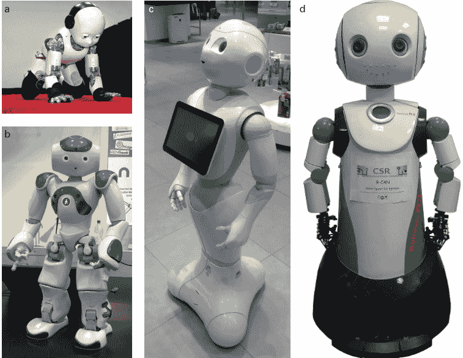

图 7.1 (a) iCub 机器人。来源：意大利理工学院提供。(b) NAO 机器人。来源：Wikimedia: Ubahnverleih 2016，根据 CC0 许可发布。(c) Pepper。来源：Wikimedia: Tokumeigakarinoaoshima 2014，根据 CC0 许可发布。(d) Robovie R3。来源：伊斯坦布尔技术大学认知与社交机器人实验室提供。

电机功率足以驱动关节，但意外接触时不足以伤害他人。Pepper 机器人在设计时注重经济实惠。据报道，该机器人企业型号的成本约为每月 440 美元（TechCrunch 2015），2018 年 RobotCub@Home 竞赛版的成本为 13,100 美元（RobotCub@Home 2018）。Pepper 的机械结构在结构部件和轴承中大量依赖塑料材料。Pepper 配备了摄像头、用于视觉感知的三维传感器以及用于听觉感知的麦克风，还配备了用于导航的激光、声呐和红外传感器。

Pepper 已被用于人机交互（Izui and Venture 2020），包括机器人辅助疗法（Cao et al. 2019）、情绪识别（Tsiourti et al. 2019）和通信（Hirano et al. 2018；Claret, Venture, and Basanez 2017），以及机器人设计研究（Kwak, Kim, and Choi 2017）。

NAO 是由 Aldebaran 公司开发、后被 Softbank Robotics 收购的一款小型人型机器人（图 7.1b）。NAO 拥有二十五个自由度（DOF），设计目标是成为一个经济、开放且易于操作的平台。NAO 的成本约为 7,500 美元（Smashing Robotics 2016）。它身高 57 厘米，重 4.5 千克。得益于其简单实用的设计，NAO 于 2008 年成为 RoboCup 联赛的标准平台。对于希望避免使用大型机器人所带来的实验复杂性的 HRI 研究团队来说，它一直是一个受欢迎的选择。

NAO 机器人主要用于人机交互研究（例如，Khamassi et al. 2019；Murata et al. 2018；Liu and Zhang 2016；Izui and Venture 2020），包括自闭症儿童的机器人辅助疗法（Cao et al. 2019；David et al. 2018）和教育机器人技术（Chandra, Dillenbourg, and Paiva 2020；Jones and Castellano 2018），还包括感觉运动学习（Wieser and Cheng 2018）、模仿学习（Park, Kim, and Nagai 2017）以及通过演示进行触觉手势学习（Pierris and Dahl 2017），仅举几例。

日本尤其在人机交互领域开展了大量研究，使用的是 Robovie R2 平台及其继任者 R3（ATR-Creative 2010；图 7.1d）。Robovie R3 是一款身高 108 厘米的小型人型机器人，拥有两个四自由度手臂、一个三自由度颈部以及两个用于自主导航的轮子。它配备了两个视频摄像头触摸传感器和一个用于检测障碍物的激光器。该机器人由 ATR-C 和 VStone 于 2010 年开发，并以约 40,000 美元的价格供应直到 2016 年（RobotShop Community 2020），随后最终停产。

Robovie 系列机器人被广泛用于研究人机交互、评估拟人化（Złotowski et al. 2018）、测试指示行为（Liu et al. 2017）、测试负面评价的影响（Nomura and Kanda 2015）、评估词汇对齐（Iio et al. 2015）以及研究社交并排行走（Karunaratne et al. 2018）。

在我们分析的论文中，还经常使用了其他不具有人类外形的机器人。Baxter 于 2012 年由美国公司 Rethink Robotics 推出。它是一个具有两个七自由度手臂的双臂操纵器（图 7.2a）。Baxter 在设计时注重安全的物理人机交互，因此在所有手臂关节都配备了串联弹性执行器（SEAs）。这一特性使机器人能够感知外力并相应调整其运动。Rethink Robotics 将 Baxter 机器人设计为经济可行，目标是中小型企业（SMEs）中的重复性装配应用。该机器人的供应成本平均相当于美国装配操作员的薪水（基础价格 25,000 美元；Wikipedia 2020）。2018 年，Rethink Robotics 停止运营，从而中断了 Baxter 项目。

在我们的调查中，我们发现 Baxter 机器人被用于研究通过演示学习（Yang et al. 2018）和通过模仿学习（Katz et al. 2018），以及评估人机交互（Herath, Jochum, and Vlachos 2018）和评估协作任务中行为的合法性（Busch et al. 2017）。Kuka AG 的 LBR iiwa 是一个七自由度机械臂，集成了关节力矩感知（图 7.2b）。它基于在 DLR 机器人与机电一体化研究所开发的 DLR LWRIII 硬件（Hirzinger et al. 2002），售价约为 200,000 美元（Robotics Business Review 2015）。力矩和力控制能力使该机器人特别适合需要安全物理交互的实验。

例如，Kuka LBR iiwa 机器人曾用于合作对象操纵实验（Donner et al. 2017）、可负担性学习（Ugur and Piater 2017）以及辅助环境下的通过演示学习（Lauretti, Cordella, and Zollo 2019）。另一种适合物理人机交互实验的机械臂是 Franka Emika GmbH 的 Panda。

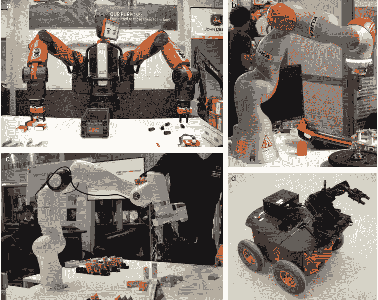

图 7.2 (a) Baxter 机器人。来源：Energy.gov 2013，根据 CC0 许可发布。(b) Kuka LBR iiwa。来源：Caré 2015，根据 CC BY-SA 4.0 许可发布。(c) Panda 机械臂。来源：Ims 2017，根据 CC BY-SA 4.0 许可发布。(d) Pioneer 机器人（3-AT 型号），配备夹爪。来源：J. Wang 2008，根据 CC BY-SA 3.0 许可发布。

（图 7.2c）。Panda 具有七个自由度；每个关节以 1 kHz 集成关节力矩感知。该系统的一个显著特点是其相对较低的价格：其目标成本为 10,000 欧元（IEEE Spectrum 2020a），在撰写本文时，在法国它连同软件一起分销，价格约为 20,000 欧元（不含税）（Generation Robots 2020）。Panda 的第二个优势是其用户友好的编程接口，使没有软件编程专业知识的用户也能使用。总体而言，这些特点使 Panda 成为协作机器人和物体抓取研究的热门选择。Adept（现为 Omron 的一部分）的 Pioneer 3-DX/3-AT 型号是轮式移动机器人，已被广泛用于研究（图 7.2d）。Pioneer 3-DX 是一款紧凑的差动驱动移动机器人，配备两个电动轮子。它包含运动控制器和传感器（声呐和可选激光扫描仪），用于导航和避障。Pioneer 3-AT 是一种带有四个轮子的类似平台，专为室外导航设计。Pioneer 机器人于 2015 年停产，这是在收购 Adept 后 Omron 新产品战略的一部分。平台的成本因配置而异，在 4,195 美元至 30,000 美元之间（IEEE Spectrum 2020a）。它们通常配备额外传感器（如 RGBD 或 RGBD 摄像头）和夹爪。Benli, Motai, and Rogers (2019) 为一台 3-DX 配备了


使用热成像相机来研究人类行为追踪，Glover 和 Wyeth (2018) 为其配备了夹持器，以研究物体可负担性的终身学习。同一平台也被用于研究通过集成物体识别、避障、路径规划和导航来解决物体搜索任务 (Wang et al. 2019)。它还被用于 HRI 场景中研究注意力 (Caccavale and Finzi 2017) 以及评估远程存在界面的有效性 (Ahn and Kim 2018)。

### 7.4 软件模拟器

在现代工程的所有领域，自动构建描述当前正在设计或研究的系统的数学模型，然后在数字计算机中使用这些模型来“模拟”其行为，都是标准做法。

模拟的一个优势在于，它们能够在现实世界调查难以开展的情况下实现研究。例如，感兴趣的现象可能无法接近、过于危险、成本过高，或者在实证研究上在道德上不可接受，至少在早期实验阶段如此。尽管研究真实现象通常是可取的，但与研究现实世界相比，模拟提供了一系列优势。它们允许重复观察、严格控制条件参数以及可扩展性。总的来说，模拟提供了受控、安全且负担得起的环境，在其中可以反复进行、实践、评估和探索面向任务的、社交的和认知技能。

对于认知科学研究人员来说，使用机器人模拟器的主要优势在于能够复现机器人的物理特性和动力学以及其与环境的交互。它能够在不预先面临构建和维护复杂硬件设备问题的情况下，研究不同类型具身代理的行为。通常，模拟器成为在将算法移植到真实机器人之前对其进行测试和验证的工具。Mar、Tikhanoff 和 Natale (2017) 提出了一种框架，用于识别物体的可负担性属性，其目标是预测使用新工具时所执行动作的效果。他们的实验在 iCub 机器人及其模拟器上均进行了。模拟器被用于预先测试所提出框架的有效性，并自动化对大量物体进行广泛实验，这些实验在真实设置上进行会非常繁琐。当案例研究场景使现实世界实验不可行或成本过高时，模拟成为一种有效的替代方案。例如，社交技能分析就是这种情况，适当的实验环境应当包含人类，并能够建模人类、机器人和环境之间的动态交互。Truong 和 Ngo (2017) 通过在 Gazebo 中模拟一个包含门、物体和人员的办公场景解决了这个问题。具有社会意识的移动机器人可以在办公室周围导航，其目标是检测人类、识别其社交状态并定义接近策略。

模拟器的另一个优势是，它们允许通过改变机器人的形态和传感器来进行许多实验，而无需在硬件中开发这些相应的功能。例如，Luo 等人 (2018) 提出了一个受婴儿启发的框架，用于让机器人获得伸展能力。他们在 Gazebo 中使用模拟来评估该框架在处理多种情况时的性能。他们模拟了同一机器人的两个版本，手臂长度不同，以模仿婴儿在学习阶段的成长以及由此产生的不同的工具使用方式。

认知机器人学中的许多研究都是 HRI 研究。从这个角度来看，将人类受试者纳入实验环境至关重要。为此，可以调整模拟框架以允许用户与模拟进行交互。例如，用户可以向模拟机器人发送语音输入，如 Rossi、Staffa 和 Rossi (2016) 所做，其中作者使用 V-REP 创建了一个多机器人架构，由人类操作员引导，并分析了语音交互是如何演变的。或者，可以使用摄像头传感器来监控人类用户的动作，并将其手势转换为机器人的命令。Caccavale 和 Finzi (2017) 在 V-REP 中模拟了 Kuka 全向机器人和用户。模拟用户通过复现真实人类操作员的手势与机器人进行交互，该操作员的动作通过 RGB-D 传感器被检测和识别。第三种方式是使用键盘在模拟环境中生成事件，如 Pinto、Kuo 和 Nikolaidis (2019) 所做。他们使用了一个强化学习框架，其中机械臂收集数据以学习操作任务，而人类在其学习过程中充当对手。实验在 Mujoco 中进行，用户通过键盘对物体施加力来干扰机器人与物体的交互。

自 20 世纪 80 年代以来，模拟器一直是机器人研究中使用的工具之一 (Chan, Weston, and Case 1988)。21 世纪 00 年代，对机器人模拟和软件开发工具的兴趣进一步增长，这也归功于 Microsoft Robotics Developer Studio (Gates 2008; Jackson 2007) 和 USARSim (Carpin et al. 2007) 等工具的推出。模拟器复现现实世界（无论是物理效果还是照片现实感）的能力一直在不断提高。利用深度学习和强化学习等大规模训练技术取得的最新进展，使模拟变得更加重要。深度架构需要在海量数据上进行训练，才能学习世界的有效且广义化的表示或有效的控制策略。利用模拟环境生成数据的可能性，可以加快数据获取速度，而无需人工操作员监督该过程，同时避免对真实设置造成损坏。这一点已被证明在感知方面效果良好，通过数据增强和逼真渲染相结合来解决六维物体姿态估计问题 (Tremblay et al. 2018)。Mahler 等人 (2017) 开发的模型可以在数百万个在模拟中生成的深度图像和抓取姿态上进行训练，从而对许多不同物体进行精确抓取。如今，大量精力被用于利用模拟器将在模拟环境中学习的技能和能力转移到现实世界系统中。这对于基于强化学习的方法特别有用，其中学习过程可能需要数月的现实世界交互，存在损坏机器人的风险，而在模拟中则可以利用现代并行计算来加速。然而，由于所谓的现实差距——即现实与模拟之间的差异，阻止了模拟机器人经验直接实现有效的现实世界性能——因此这种方法的有效性并非显而易见。解决这一问题的一个可能方案是运行多个模拟，其中某些参数被随机化，以便系统可以学习更稳健的控制策略。一个例子是 Open AI 的最近工作，其中一台机器人学习使用灵巧手进行手内物体操作 (Andrychowicz et al. 2020)。

在认知机器人学的背景下，模拟任务必须支持执行现实世界任务所采用的底层心理和认知操作，以确保转移能够有效发生。许多最近的工作都解决了这个问题，提出了缩小仿真到现实差距的有希望的方法 (Peng et al. 2018; Chebotar et al. 2019)。

#### 7.4.1 模拟器类型

模拟器关注机器人系统的不同方面。例如，可以模拟机器人不同部分在与环境交换的力作用下的变形情况。另一个例子是模拟机器人内部的物理量，例如温度，或电机或电路板中的电流和电压。对于认知机器人学研究人员来说，主要关注的是能够在普通计算机上以近似实时模拟完整机械臂或人形机器人的实时工具。在这种情况下，“实时”意味着模拟一秒钟大约需要一秒钟来模拟，这与那些可能比实时慢几个数量级的专用模拟器不同。为了以实时运行，模拟器通常忽略机械变形或热传播等细节的模拟。

为实现实时运行的一大简化方法是使用多体动力学或刚体动力学 (Horak and Trinkle 2019; Featherstone and Orin 2016)。这基于机器人是由多个完全刚性体（称为链接）通过关节互连而组成的假设。另一种简化假设是忽略机器人执行器（无论是电动、液压还是气动）的复杂细节，仅假设可以直接控制电机施加到机器人关节上的扭矩或力 (Neunert, Boaventura, and Buchli 2016)。

可用的模拟器可以分为两大类：物理引擎和模拟环境。物理引擎提供模拟以刚体建模的系统物理特性所需的所有功能，同时考虑外部力以及与其他模拟体的碰撞。而模拟环境则提供许多其他功能，例如集成式 GUI，并为一个或多个物理引擎暴露用户友好的界面。

几种商业和开源物理引擎通常用于机器人模拟。它们作为特定编程语言的库提供，通常是 C/C++，因为性能在机器人模拟中很重要。开源物理引擎的例子有 ODE、Bullet 和 DART（这些将在 7.4.2 节中详细讨论）。

在某些情况下，研究人员直接使用物理引擎库来构建自己的模拟器（一个例子是基于 ODE 物理引擎的 iCub 模拟器 (Tikhanoff et al. 2008)，通常将物理引擎与渲染引擎相结合，以在模拟过程中可视化机器人和环境的三维模型。另一方面，模拟环境是可直接使用的程序，允许使用物理引擎、渲染引擎和用户界面，而无需为每个模拟场景编写特定代码。相反，它们提供描述语言，允许通过文件描述加载机器人结构和环境。此类模拟器的示例

环境包括 Gazebo、CoppeliaSim（原名 V-REP）、Webots 和 SIGVerse。这些环境还支持以自定义插件系统的形式加载针对特定实验的代码，或提供通过中间件接口或 API（例如 ROS/ROS2 或 YARP）公开模拟机器人功能的支持。（由于机器人中间件（如 ROS）的深入讨论超出了本章范围，我们将读者引向 Kortenkamp, Simmons 和 Brugali [2016] 以及 Magyar, Kriszán 和 Sincák [2015]。）

对于物理引擎和模拟环境，有必要区分两种不同的用例。在第一种用例中，用户手动启动模拟，就像启动真实机器人一样，随后其执行以实时继续。在第二种用例中，用户自动同时运行多个模拟，或长时间运行多个模拟——例如，用于训练学习算法。这些用例回应了用户的不同需求，一个环境可以针对其中一种用例进行优化，以提供更多便利。

另一个重要方面是模拟器公开的用于控制机器人的 API。在某些情况下，API 的设计旨在复制真实机器人的接口。这样避免了在从模拟器切换到真实机器人时重写控制软件的需要（从而证明它是真实机器人的数字孪生体）。例如，iCub 人形机器人模拟器（Tikhanoff et al. 2008; Hoffman et al. 2014）采用了这种方法。

图 7.3 展示了从直接使用物理引擎库功能构建的模拟器，到能够采用光线追踪渲染再现逼真场景的成熟模拟环境等模拟器示例。在下一节中，我们将讨论在调查中发现的一些物理引擎和模拟环境，以及一些我们认为基于 2020 年初机器人领域的当前趋势而重要的环境。

#### 7.4.2 可用模拟器

机器人社区广泛使用的常见开源物理引擎包括 Open Dynamic Engine（ODE；Smith 2020）、Bullet（2020）和 DART（2020）。除 DART 外，这些工具最初是为计算机游戏开发的，随后改编为可与机器人协同工作。如今，这两个领域几乎已经融合，同时提供准确的物理模拟和光线追踪渲染。机器人学习社区广泛使用的一种流行闭源物理引擎是 MuJoCo（Roboti LLC 2020）。出于性能原因，物理引擎使用 C 和 C++ 等低级语言开发，尽管它们通常提供与 Python 等其他语言的绑定。绝大多数开源和商业模拟环境都与上述至少一个物理引擎进行接口。

构建机器人模拟器的最初尝试直接依赖于物理引擎库提供的功能。在这方面的一个著名示例是 iCub ODE 模拟器（Tikhanoff et al. 2008），它使用 ODE API 构建了 iCub 机器人的完整模拟，包括所有关节、头部的惯性传感器、摄像头和面部表情。iCub ODE 模拟器还为位置、速度和扭矩控制提供软件接口。它还允许加载物理对象，可以直接从配置文件或使用 YARP 中间件的其他软件模块加载。iCub ODE 模拟器已用于传感器运动学习实验（Tommasino

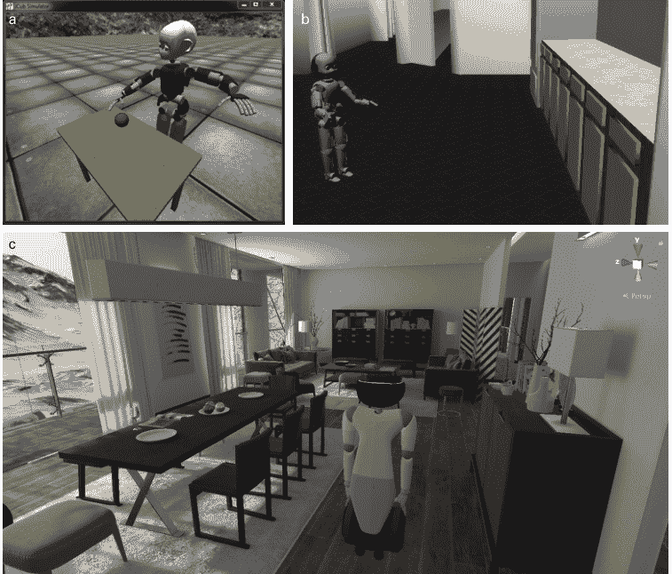

图 7.3 模拟器示例：（a）iCub ODE 模拟器；（b）使用 Gazebo 进行模拟的示例；（c）Isaac Sim。来源：Tikhanoff et al. 2008；（Hoffman et al. 2014；NVIDIA Corporation 2020）。这些示例展示了模拟环境的演变过程，从使用物理引擎库功能编程的自定义模拟器，到允许从描述文件和物体 3D 模型加载复杂场景、具有高保真渲染的成熟环境。

et al. 2019）、工具可负担性（Mar, Tikhanoff, and Natale 2017）、面对面交互期间情感状态的估计（Boccignone et al. 2018）、语言发展计算模型的研究（Štěpánová et al. 2018）、认知技能的协调（Hwang and Tani 2018）以及利他行为（Baraglia, Nagai, and Asada 2016）。

此类模拟器的主要局限性是可维护性。机器人的变更需要通过修改模拟代码来传播；因此，支持多个机器人或让用户有选项向模拟环境添加新机器人或对象变得困难。使用模拟环境的其他好处，除了改善用户体验之外，还包括用自定义功能扩展模拟的可能性，以及能够直接从图形界面与模拟身体交互的机会。特别是在认知机器人研究中，交互至关重要。出于这些原因，近年来，社区已转向采用模拟环境。

最完整且持久的模拟环境之一是 Gazebo（Koenig and Howard 2004），目前由开源机器人基金会（2014）开发，并作为开源软件分发。Gazebo 的开发者还提出了 SDF（Open Source Robotics Foundation 2019），这是一种 XML 格式，用于描述机器人模型、对象以及机器人部署的环境。随着时间的推移，SDF 扩展到描述表征机器人的所有方面，包括静态对象和动态对象、地形以及照明。Gazebo 支持通常安装在机器人上的所有常见传感器，并允许开发软件插件以扩展其功能。它还支持多种物理引擎，例如 ODE、Bullet、Simbody 和 DART。Gazebo 最初是为 Linux 开发的，最近也扩展了对 Windows 的支持。Gazebo 的主要优势在于其成熟度和庞大的社区：Gazebo 在 DARPA 机器人挑战赛（Defense Advanced Research Projects Agency 2013）期间被广泛用于模拟 ATLAS 人形机器人，目前它是 iCub 机器人全身控制和运动实验的首选模拟器（Hoffman et al. 2014）。它还已集成到人脑计划（Human Brain Project 2018）的神经机器人平台中，用于在模拟的闭环系统中研究大脑模型（例如，参见 Chen et al. 2019）。其他示例包括用于 HRI 研究的移动平台模拟（Truong and Ngo 2017）以及模拟婴儿状人形机器人以探索学习伸手任务的发展性方法（Luo et al. 2018）。

CoppeliaSim（Rohmer, Singh, and Freese 2013），原名 V-REP，是一个与 Gazebo 类似的框架，支持多种物理引擎，包括 Bullet 和 ODE。它是跨平台的，面向 macOS、Linux 和 Windows 分发。它可以免费使用，但仅限于其教育版。

在我们的调查中，我们发现 CoppeliaSim-V-REP 被用于模拟自定义机器人系统，以研究家庭任务（清理桌子；Cruz et al. 2016）的强化学习、多机器人移动架构（Rossi, Staffa, and Rossi 2016），以及 HRI 环境中的 Kuka omnibot（Caccavale and Finzi 2017）。

Webots（Cyberbotics Ltd. 2020）是另一个模拟环境，由瑞士联邦工学院（EPFL）于 1998 年开发，并成为 EPFL 衍生公司 Cyberbotics（Olivier 2004）的商业产品。它最初作为闭源应用程序分发，很可能正因如此，其采用受到了影响，尤其是当 Gazebo 等开源替代方案获得流行时。随着 R2019a 的发布，Webots 现在采用开源许可证分发。Webots 基于 ODE；它提供一个图形界面，简化了环境的设计，并从一组传感器和执行器实现机器人系统的快速原型设计。它是跨平台的，运行在 Windows、Linux 和 macOS 上。在 Pierris and Dahl（2017）中，Webots 被用于模拟一种蝾螈状机器人，以研究一种通过扩展通过示范学习的现有技能来推导新技能的架构。

Choregraphe（Pot et al. 2009）是 Aldebaran 机器人（包括 NAO 和 Pepper）的内置编程应用程序。它允许机器人程序员创建动画、行为和对话。除了这些编程功能之外，它还允许用户在模拟机器人上测试编程的行为，因此，使用 Aldebaran 机器人的研究人员经常使用它。

MATLAB 环境还提供了一个用于机器人控制和模拟的工具箱，称为 MATLAB Robotics System Toolbox（MathWorks 2020），其中包括与 Simulink 和 Simscape Mechanics 集成的仿真工具。此外，MATLAB


Robotics System Toolbox 与 Gazebo 模拟器提供开箱即用的集成，允许用户使用 MATLAB 和 Simulink 控制 Gazebo 模型。

NVIDIA 公司（2020）最近发布了 Isaac Sim。它是 Isaac SDK 的一部分，该 SDK 还提供机器学习算法以及运动规划、SLAM 和感知算法。鉴于该公司的专业知识，它专注于利用 GPU 加速进行机器学习和仿真。出于此原因，并得益于 NVIDIA 的支持，预计 Isaac Sim 将很快被大量社区采用。

我们讨论的第二种分类是交互式仿真与批处理仿真之间的区别。交互式仿真实时执行，仿真中的机器人类似于真实机器人的虚拟副本。而批处理仿真则是多个独立仿真的实例，其运行速度甚至可以超过实时。批处理仿真的需求主要由近期在强化学习中提出的技术及其与深度学习的集成所驱动，这些技术需要通过运行数十万甚至数百万次动作获得的训练数据集。认知机器人技术中的关键研究领域，如模仿、行为转移和知识获取，都可能从使用批处理仿真中受益。支持批处理执行的仿真框架包括 Mujoco、PyBullet、CoppeliaSim 和 Isaac Sim。

### 7.5 结论

在本章中，我们概述了认知机器人社区中正在使用的硬件平台和仿真环境。我们分析了该领域的文献，以确定社区中常用的平台，并描述了那些使用最频繁的平台。

我们的主要观察是，该社区高度分散。在对 337 篇论文的分析中，我们发现提到了六十七种不同的硬件平台和十三种软件模拟器。大多数平台和模拟器都只使用了一次。只有少数平台——即 iCub、NAO 和 Pepper——似乎被一个研究者社区所采用。这显然是一个重大问题，因为社区内的这种分散在实验可重复性以及代码和研究结果共享方面带来了严峻挑战。然而，NAO 和 Pepper 机器人在构建研究者社区方面取得了相当大的成功。我们可以推测，这是因为它们的价格实惠，且作为商业产品，比研究平台更可靠。不幸的是，只有部分社区——主要是参与 HRI 研究的研究者——采用了这些机器人。另一方面，iCub 机器人似乎支持更多样化的研究，范围从 HRI 到传感运动学习、全身控制和学习。然而，该平台的多功能性伴随着更高的成本和复杂性，这可能会减少采用，尤其是在没有核心机器人专业知识的团队中。

然而，如果我们看机器人抓取领域，会注意到一种不同的趋势，即 Panda 机械臂和 Baxter 机器人等平台正在成为研究的事实上的标准。我们认为，这是因为这些平台在成本、可靠性、复杂性以及它们允许用户解决的研究问题类型之间取得了良好的平衡。在这方面，单一平台为整个认知机器人社区服务似乎具有挑战性。无论如何，似乎很明显，社区将从更广泛地采用共享平台中受益匪浅，并且能够满足研究者至少部分要求的新平台将对社区产生重大影响。

在我们的调查中，我们还注意到对仿真有浓厚的兴趣，这体现在仿真工具采用非常分散。我们认为可能的原因是，模拟器尚未提供复杂的环境模型，也不允许对与人类的现实交互进行建模。事实上，由于 HRI 通常是双向的，HRI 模拟器应提供接口，供机器人接收来自人类的输入，并供人类接收来自模拟机器人的反馈（视觉和声学，以及触觉）。虚拟现实和增强现实技术的进步可能会逐步弥补这一差距；然而，它们与机器人模拟器的集成尚未得到广泛探索。

仿真工具的多种新型应用可能在认知机器人技术中找到应用，尽管目前其使用并不普遍。最近为 *虚拟现实*（VR）开发的技术，例如 VR 头显，将允许人类用户与模拟机器人进行自然交互，例如在 SIGVerse（Mizuchi 和 Inamura 2017）中所做的那样。同时，各种感知人类的技术正在成熟，可用于在仿真中复制人类的运动。此类技术的示例包括基于视觉的身体跟踪系统（例如，CMU open pose；Cao et al. 2017）以及集成来自分布式惯性单元网络和扭矩及压力传感器信息的传感装备（Latella et al. 2019）。

最后，对于物理 HRI 这一子领域，仿真工具的一个有用未来应用可能是物理接口，它们可以使用触觉反馈设备（Hannaford 和 Okamura 2016）为用户提供来自仿真的力反馈。这些接口不仅会模拟用户与机器人之间的视觉交互，还会模拟交互产生的物理接触。

### 进一步阅读与资源

- 一本关于人形机器人的最新完整手册，包含机器人平台（第二部分）和模拟器（第八部分）的特定章节：Ambarish G. 和 V. Prahlad，编。2019 年。*人形机器人：参考*。荷兰：Springer。
- IEEE 机器人——您的机器人指南：https://robots.ieee.org。
- ROS 机器人操作系统：https://www.ros.org。
- 官方 iCub 网站，包含机器人模拟器和中间件的链接：https://icub.iit.it/。
- IEEE 机器人教育资源：https://www.ieee-ras.org/educational-resources-outreach/educational-material-in-robotics-and-automation。

### 参考文献

- Ahn, Jonggil, and Gerard Jounghyun Kim. 2018 年。“SPRinT：一种用于遥存在的手持式机器人界面的混合方法。” *国际社会机器人学杂志* 10 (4): 537–552。
- Andrychowicz, Marcin, Bowen Baker, Maciek Chociej, Rafal Jozefowicz, Bob McGrew, Jakub Pachocki, Arthur Petron 等人。2020 年。“学习灵巧的手内操作。” *机器人学研究国际期刊* 39 (1): 3–20。
- Anzalone, Salvatore Maria, Giovanna Varni, Serena Ivaldi, and Mohamed Chetouani. 2017 年。“人机器人交互期间外向性的自动预测。” *国际社会机器人学杂志* 9 (3): 385–399。
- ATR-Creative. 2010 年。“Robovie-R Ver.3 的主要规格。” 访问日期：2020 年 1 月 16 日。http://atr-c.jp/robot/r3/robo-r3spec.html。
- Autodesk Inc. 2020 年。“3DS Max。” 访问日期：2020 年 6 月 4 日。https://www.autodesk.it/products/3ds-max/overview。
- Baraglia, Jimmy, Yukie Nagai, and Minoru Asada. 2016 年。“通过最小化预测误差产生利他行为。” IEEE 认知与发展系统交易 8 (3): 141–151。
- Benli, Emrah, Yuichi Motai, and John Rogers. 2017 年。“基于全向热成像相机的人类行为目标跟踪。” IEEE 认知与发展系统交易 11 (1): 36–50。
- Blender Foundation. 2020 年。“关于。” https://www.blender.org/。
- Boccignone, Giuseppe, Donatello Conte, Vittorio Cuculo, Alessandro D’Amelio, Giuliano Grossi, and Raffaella Lanzarotti. 2018 年。“通过多模态表演深度构建情感潜在空间。” IEEE 认知与发展系统交易 10 (4): 865–880。
- Bullet（网站）。2020 年。“Bullet 实时物理仿真。” 访问日期：2020 年 2 月 13 日。https://pybullet.org。
- Busch, Baptiste, Jonathan Grizou, Manuel Lopes, and Freerk Stulp. 2017 年。“从人机器人交互中学习可读运动。” 国际社会机器人学杂志 9 (5): 765–779。
- Caccavale, Riccardo, and Alberto Finzi. 2017 年。“人机器人交互中的灵活任务执行和注意力调节。” IEEE 认知与发展系统交易 9 (1): 68–79。
- Cao, Hoang-Long, Greet Van de Perre, James Kennedy, Emmanuel Senft, Pablo Gómez Esteban, Alberto De Beir, Ramona Simut, Tony Belpaeme, Dirk Lefeber, and Bram Vanderborght. 2019 年。“一种用于治疗中社交机器人的个性化和平台无关的行为控制系统：开发与应用。” IEEE 认知与发展系统交易 11 (3): 334–346。
- Cao, Zhe, Tomas Simon, Shih-En Wei, and Yaser Sheikh. 2017 年。“使用亲和力场进行实时多人二维姿态估计。” 发表于 IEEE 计算机视觉与模式识别会议论文集，7291–7299。纽约：IEEE。
- Caré, Xavier. 2015 年。“Innorobo 2015—Kuka 机器人。” 7 月 2 日。访问日期：2020 年 5 月 21 日。https://commons.wikimedia.org/wiki/File:Innorobo_2015_-_Kuka_Robotics.JPG。
- Carpin, Stefano, Mike Lewis, Jijun Wang, Stephen Balakirsky, and Chris Scrapper. 2007 年。“USARSIM：一种用于研究和教育的机器人模拟器。” 发表于 2007 年 IEEE 国际机器人与自动化会议论文集，1400–1405。纽约：IEEE。
- Çelikkanat, Hande, Giner Orhan, Nicolas Pugeault, Frank Guerin, Erol Sahin, and Sinan Kalkan. 2016 年。“使用增量潜在狄里克雷分配在人形机器人上学习上下文。” IEEE 认知与发展系统交易 8 (1): 42–59。
- Chan, S. F. R. H Weston, and K. Case. 1988 年。“机器人仿真和离线编程。” 计算机辅助工程期刊 5 (4): 157–162。
- Chandra, Shruti, Pierre Dillenbourg, and Ana Paiva. 2020 年。“儿童教具有不同学习能力的社交机器人书写。” 国际社会机器人学杂志 12 (3): 721–748。
- Chebotar, Yevgen, Ankur Handa, Viktor Makoviychuk, Miles Macklin, Jan Issac, Nathan Ratliff, and Dieter Fox. 2019 年。“关闭仿真到现实的循环：使用现实世界经验调整仿真随机化。” 发表于 2019 年国际机器人与自动化会议，8973–8979。纽约：IEEE。
- Chen, Guang, Zhenshan Bing, Florian Röhrbein, Jörg Conradt, Kai Huang, Long Cheng, Zhuangyi Jiang, and Alois Knoll. 2019 年。“迈向具有神经形态蛇形机器人和神经机器人平台的受大脑启发的学习。” IEEE 认知与发展系统交易 11 (1): 1–12。
- Claret, Josep-Arau, Gentiane Venture, and Luis Bañáez. 2017 年。“利用机器人运动冗余作为低优先级任务向人类传达情感。” 国际社会机器人学杂志 9 (2): 277–292。
- Coppelia Robotics GmbH. 2020 年。“CoppeliaSim。” https://www.coppeliarobotics.com/。
- Cruz, Francisco, Sven Magg, Cornelius Weber, and Stefan Wermter. 2016 年。“使用交互式强化学习和情境可负担性训练代理。” IEEE 认知与发展系统交易 8 (4): 271–284。
- Cyberbotics Ltd. 2020 年。“Webots 开源机器人模拟器。” 访问日期：2020 年 2 月 13 日。https://cyberbotics.com/。
- DART（网站）。2020 年。“动态动画和机器人工具箱。” 访问日期：2020 年 2 月 13 日。https://dartsim.github.io/。
- David, Daniel O., Cristina A. Costescu, Silviu Matu, Aurora Szentagotai, and Anca Dobrean. 2018 年。“为自闭症儿童开发机器人增强疗法中的共同注意。” 国际社会机器人学杂志 10 (5): 595–605。
- 美国国防高级研究计划局。2013 年。“DARPA 机器人挑战赛。” https://www.darpa.mil/program/darpa-robotics-challenge。


Donner, Philine, Franz Christange, Jing Lu, and Martin Buss. 2017. “未知柔性物体的协作动态操作.” *国际社会机器人学杂志* 9 (4): 575–599.

Energy.gov. 2013. “AEMC 峰会,” 12月23日. 检索于 2020年5月21日. https://commons.wikimedia.org/wiki/File:AEMC_Summit_(11343380734).jpg.

Farsa Sourceforge (网站). 2020. “自主机器人仿真与分析框架.” 检索于 2020年6月4日. https://sourceforge.net/projects/farsa/.

Featherstone, Roy, and David E. Orin. 2016. “动力学.” 在《斯普林格机器人学手册》中，由 Bruno Siciliano 和 Khatib Oussama 编辑, 37–66. 瑞士齐姆：施普林格.

Fitzgerald, Cliff. 2013. “开发 Baxter.” 在《2013年IEEE实用机器人应用技术会议》中, 1–6. 纽约：IEEE.

意大利技术研究院. 无日期. https://github.com/robotology/idyntree. 检索于 2018年4月1日.

Förster, Frank, Joe Saunders, and Chrystopher L. Nehaniv. 2018. “说‘不’的机器人：情感符号基础与意图解释案例.” *IEEE认知与发育系统汇刊* 10 (3): 530–544.

Franka Emika GmbH. 2020. “介绍 Franka Emika 机器人.” 检索于 2020年2月5日. https://www.franka.de/.

Gates, Bill. 2008. “每家每户都有一个机器人.” 2月1日. 检索于 2020年6月4日. https://www.scientificamerican.com/article/a-robot-in-every-home-2008-02/.

Generation Robots. 2020. “PANDA 机械臂.” 检索于 2020年2月13日. https://www.generationrobots.com/en/403317-panda-robotic-arm.html.

Giagkos, Alexandros, Daniel Lewkowicz, Patricia Shaw, Suresh Kumar, Lee Mark, and Qiang Shen. 2017. “机器人感知运动发展期间局部特征的感知.” *IEEE认知与发育系统汇刊* 9 (2): 127–140.

Glover, Arren J., and Gordon F. Wyeth. 2018. “基于分布式马尔可夫模型的终身可负担性学习.” *IEEE认知与发育系统汇刊* 10 (1): 44–55.

Gouaillier, David, Vincent Hugel, Pierre Blazevic, Chris Kilner, Jérôme Monceaux, Pascal Lafourcade, Brice Marnier, Julien Serre, and Bruno Maisonnier. 2009. “NAO人形机器人的机电设计.” 在《2009年IEEE国际机器人与自动化会议》中, 769–774. 纽约：IEEE.

Hannaford, Blake, and Allison M. Okamura. 2016. “触觉.” 在《斯普林格机器人学手册》中，由 Bruno Siciliano 和 Khatib Oussama 编辑, 1063–1084. 瑞士齐姆：施普林格.

Herath, Damith C., Elizabeth Jochum, and Evgenios Vlachos. 2018. “公共场景中交互机器人具身交互与人类社交存在感知的实验研究.” *IEEE认知与发育系统汇刊* 10 (4): 1096–1105.

Hirano, Takahiro, Masahiro Shiomi, Takamasa Iio, Mitsuhiko Kimoto, Ivan Tanev, Katsunori Shimohara, and Noriho Hagita. 2018. “沟通线索如何改变人机触觉交互印象？” *国际社会机器人学杂志* 10 (1): 21–31.

Hirzinger, Gerd, Norbert Sporer, Albin Albu-Schaffer, M. Hahnle, Rainer Krenn, Antonio Pascucci, and Markus Schedl. 2002. “DLR的力矩控制轻型机器人III——我们是否已触及技术极限？” 在《2002年IEEE国际机器人与自动化会议论文集》中. 件号 02CH37292. 第2卷, 1710–1716. 纽约：IEEE.

Hoffman, Enrico Mingo, Silvio Traversaro, Alessio Rocchi, Mirko Ferrati, Alessandro Settimi, Francesco Romano, Lorenzo Natale, Antonio Bicchi, Francesco Nori, and Nikos G. Tsagarakis. 2014. “基于Yarp的Gazebo模拟器插件.” 在《自主系统建模与仿真国际研讨会》中, 333–346. 瑞士齐姆：施普林格.

Hoffmann, Matej, Zdeněk Straka, Igor Farkaš, Michal Vavrečka, and Giorgio Metta. 2018. “机器人小人：受初级体感觉皮层启发的人形机器人人造皮肤表征学习.” *IEEE认知与发育系统汇刊* 10 (2): 163–176.

Horak, Peter C., and Jeff C. Trinkle. 2019. “机器人仿真中接触模型的异同.” *IEEE机器人与自动化快报* 4 (2): 493–499.

Human Brain Project. 2018. *HBP神经机器人平台*. 检索于 2020年2月13日. https://www.neurorobotics.net/.

Hwang, Jungsik, and Jun Tani. 2018. “人形机器人认知技能的无缝集成与协调：一种深度学习方法.” *IEEE认知与发育系统汇刊* 10 (2): 345–358.

*IEEE频谱*. 2020a. “Franka：一种安全、低成本且可以自我复制的机器人臂.” 检索于 2020年2月13日. https://spectrum.ieee.org/robotics/industrial-robots/franka-a-robot-arm-thats-safe-low-cost-and-can-replicate-itself.

IEEE Spectrum. 2020b. “机器人：你的机器人世界指南.” 检索于 2020年5月5日. https://robots.ieee.org/robots/pioneer/.

Iio, Takamasa, Masahiro Shiomi, Kazuhiko Shinozawa, Katsunori Shimohara, Mitsunori Miki, and Norihiro Hagita. 2015. “人机交互中的词汇对齐.” 《国际社会机器人学杂志》 7 (2): 253–263.

Ims. 2017. “Franka Emika.” 3月23日. 检索于 2020年5月21日. https://commons.wikimedia.org/w/index.php?curid=57761214.

Ivaldi, Serena, Sebastien Lefort, Jan Peters, Mohamed Chetouani, Joelle Provasi, and Elisabetta Zibetti. 2017. “构建考虑个人因素的HRI参与模型：在人机装配任务中外向性和对机器的消极态度与注视及言语的关系.” 《国际社会机器人学杂志》 9 (1): 63–86.

Izui, Takamune, and Gentiane Venture. 2020. “机器人用户印象预测模型的相关性分析：关于视觉媒介和机械噪声的研究.” 《国际社会机器人学杂志》 12 (2): 425–439.

Jackson, Jared. 2007. “Microsoft 机器人工作室：技术介绍.” 《IEEE机器人与自动化杂志》 14 (4): 82–87.

Jones, Aidan, and Ginevra Castellano. 2018. “支持自我调节学习的自适应机器人导师：与小学儿童的长期调查.” 《国际社会机器人学杂志》 10 (3): 357–370.

Karunaratne, Deneth, Yoichi Morales, Takayuki Kanda, and Hiroshi Ishiguro. 2018. “机器人不知道目标的并排行走模型.” 《国际社会机器人学杂志》 10 (4): 401–420.

Katz, Garrett, Di-Wei Huang, Theresa Hauge, Rodolphe Gentili, and James Reggia. 2018. “一种用于机器人模仿和计划识别的新简洁因果推理算法.” 《IEEE认知与发育系统汇刊》 10 (2): 177–193.

Khamassi, Mehdi, George Velentzas, Titisimis Theodore, and Costas S. Tzafestas. 2019. “在参数化强化学习中，模拟动态社交交互期间机器人对人类参与变化的快速适应与主动探索.” 《IEEE认知与发育系统汇刊》 10 (4): 881–893.

Koenig, Nathan, and Andrew Howard. 2004. “Gazebo（开源多机器人模拟器）的设计与使用范式.” 在《2004年IEEE/RSJ智能机器人与系统国际会议论文集》中. 件号 04CH37566. 第3卷, 2149–2154. 纽约：IEEE.

Kortenkamp, David, Reid Simmons, and Davide Brugali. 2016. “机器人系统架构与编程.” 在《斯普林格机器人学手册》中，由 Bruno Siciliano 和 Khatib Oussama 编辑, 283–306. 瑞士齐姆：施普林格.

Kwak, Sonya S., Jun San Kim, and Jung Ju Choi. 2017. “基于有机体与基于对象的机器人设计外观对家用机器人消费者接受度的影响.” 《国际社会机器人学杂志》 9 (3): 359–377.

Latella, Claudia, Silvio Traversaro, Diego Ferigo, Yeshasvi Tirupachuri, Lorenzo Rapetti, Francisco Javier Andrade Chavez, Francesco Nori, and Daniele Pucci. 2019. “人体运动学与关节力矩的同步浮动基估计.” 《传感器》 19 (12).

Lauretti, Clemente, Francesca Cordella, and Loredana Zollo. 2019. “一种用于拟人辅助机器人避障的混合关节/笛卡尔DMP方法.” 《国际社会机器人学杂志》 11 (5): 783–796.

Liu, Phoebe, Dylan F. Glas, Takayuki Kanda, Hiroshi Ishiguro, and Norihiro Hagita. 2017. “面向人类的社会适当指示行为生成模型.” 《国际社会机器人学杂志》 9 (1): 33–49.

Liu, Rui, and Xiaoli Zhang. 2016. “基于对象功能角色视角的机器人人类行为理解.” 《IEEE认知与发育系统汇刊》 8 (2): 115–127.

Luo, Dingsheng, Fan Hu, Tao Zhang, Yan Deng, and Xihong Wu. 2018. “机器人如何像人类婴儿一样发展其伸手能力？” 《IEEE认知与发育系统汇刊》 10 (3): 795–809.

Magyar, Gergely, Peter Kriszán, and Zoltán Sincák. 2015. “机器人应用机器人中间件比较研究.” 在《机器人与智能系统新兴趋势》中，由 P. Hartono, M. Virčiková, J. Vaščák, 和 R. Jakša 编辑, 121–128. 瑞士齐姆：施普林格.

Maher, Jeffery, Jacky Liang, Sheridan Niyaz, Michael Laskey, Richard Doan, Xinyu Liu, Juan Aparicio Ojea, and Ken Goldberg. 2017. “Dex-net 2.0：利用合成点云和解析抓取度量进行深度学习规划稳健抓取.” ArXiv预印本：1703.09312.

Mar, Tanis, Vadim Tikhanoff, and Lorenzo Natale. 2017. “我能用这个工具做什么？基于其3D几何形状的工具可负担性自监督学习.” 《IEEE认知与发育系统汇刊》 10 (3): 595–610.


- MathWorks. 2020. “机器人系统工具箱。” 访问于 2020 年 5 月 26 日。https://www.mathworks.com/products/robotics.html.

- Meola, Valentina Cristina、Daniele Caligiore、Valerio Sperati、Loredana Zollo、Anna Lisa Ciancio、Fabrizio Taffoni、Eugenio Guglielmelli 和 Gianluca Baldassarre. 2016. “发展期间节奏性与离散操作动作的相互作用：一种基于策略搜索的增强学习机器人模型。” IEEE Transactions on Cognitive and Developmental Systems 8 (3): 152–170.

- Mizuchi, Yoshiaki 和 Tetsunari Inamura. 2017. “基于 ROS 和 Unity 框架的云端多模态人机交互模拟器。” 载于 IEEE/SICE 系统集成国际研讨会。纽约：IEEE.

- Moulin-Frier, Clément、Tobias Fischer、Maxime Petit、Grégoire Pointeau、Jordi-Ysard Puigbo、Ugo Pattacini、Sock Ching Low 等人. 2018. “DAC-h3：一种用于获取和表达关于世界及自身知识的主动式机器人认知架构。” IEEE Transactions on Cognitive and Developmental Systems 10 (4): 1005–1022.

- Murata, Shingo、Yuixi Li、Hiroaki Arie、Tetsuya Ogata 和 Shigeki Sugano. 2018. “利用神经动力系统实现人机协作不同适应性水平的学习。” IEEE Transactions on Cognitive and Developmental Systems 10 (3): 712–725.

- Natale, Lorenzo、Chiara Bartolozzi、Francesco Nori、Giulio Sandini 和 Giorgio Metta. 2017. “iCub。” 载于《人形机器人：参考手册》，P. Vadakkepat、A. Goswami 和 P. Vadakkepat 编，第 1–33 页。多德雷赫特：Springer.

- Natale, Lorenzo、Ali Paikan、Marco Randazzo 和 Daniele E. Domenichelli. 2016. “iCub 软件架构：演进与经验教训。” Frontiers in Robotics and AI 3 (25).

- Neunert, Michael、Thiago Boaventura 和 Jonas Buchli. 2016. “现成物理仿真器在反馈控制器性能评估中为何失败——以四足机器人为例的案例研究。” 载于《合作机器人进展：第 19 届 CLAWAR 2016 国际会议论文集》，M. O. Tokhi 和 G. S. Virk 编，第 464–472 页。新泽西州哈肯萨克：World Scientific.

- Nomura, Tatsuya 和 Takayuki Kanda. 2015. “来自机器人的评价与凝视以及人类对负面评价的恐惧对其机器人偏好的影响。” International Journal of Social Robotics 7 (2): 155–164.

- NVIDIA Corporation. 2020. “NVIDIA Isaac Sim。” 访问于 2020 年 2 月 13 日。https://developer.nvidia.com/isaac-sim.

- Olivier, Michael. 2004. “WebotsTM：专业移动机器人仿真。” International Journal of Advanced Robotic Systems 1 (1): 40–43.

- OpenSim（网站）. 2020. 访问于 2020 年 6 月 4 日。http://simtk.org/projects/opensim.

- Open Software Robotics Foundation. 2014. “让 GAZEBO 机器人仿真变得简单。” 访问于 2020 年 2 月 13 日。http://gazebosim.org/.

- Open Source Robotics Foundation. 2019. “SDF 描述你的世界。” 访问于 2020 年 2 月 13 日。http://sdfformat.org/.

- Pandey, Amit Kumar 和 Rodolphe Gelin. 2018. “大规模生产的社交型人形机器人：Pepper：该类机器的第一台。” IEEE Robotics Automation Magazine 25 (3): 40–48.

- Park, Jun-Cheol、Dae-Shik Kim 和 Yukie Nagai. 2017. “使用 RNNPB 进行面向目标动作的学习：模仿对象的发育性变化。” IEEE Transactions on Cognitive and Developmental Systems 10 (3): 545–556.

- Parmiggiani, Alberto、Marco Maggiali、Lorenzo Natale、Francesco Nori、Alexander Schmitz、Nikos Tsagarakis、Jose Santos Victor、Francesco Becchi、Giulio Sandini 和 Giorgio Metta. 2012. “iCub 人形机器人的设计。” International Journal of Humanoid Robotics 9 (4): 1250027.

- Peng, Xue Bin、Marcin Andrychowicz、Wojciech Zaremba 和 Pieter Abbeel. 2018. “带动态随机化的机器人控制从仿真到现实的迁移。” 载于 2018 年 IEEE 国际机器人与自动化会议，第 1–8 页。纽约：IEEE.

- Petit, Maxime、Tobias Fischer 和 Yiannis Demiris. 2016. “多模态流式自传体记忆的终身增强。” IEEE Transactions on Cognitive and Developmental Systems 8 (3): 201–213.

- Pierris, Georgios 和 Torbjorn S. Dahl. 2017. “使用基于分层 SOM 的编码学习机器人控制。” IEEE Transactions on Cognitive and Developmental Systems 9 (1): 30–43.

- Pinto, Lerrel、C.-Jay Kuo 和 Stefanos Nikolaidis. 2019. “通过人类对抗游戏进行机器人学习。” ArXiv 预印本：1903.00636.

- Pot, Emmanuel、Jérôme Monceaux、Rodolphe Gelin 和 Bruno Maisonnier. 2009. “Choregraphe：一种用于人形机器人编程的图形工具。” 载于 RO-MAN 2009——第 18 届 IEEE 机器人与人类交互通信国际研讨会，第 46–51 页。纽约：IEEE.

- Ribes, Arturo、Jesus Cerquides、Yiannis Demiris 和 Ramon Lopez de Mantaras. 2016. “人形机器人上带时间约束的对象与身体模型主动学习。” IEEE Transactions on Cognitive and Developmental Systems 8 (1): 26–41.

- RobotCub@Home. 2018. “SoftBank Pepper 2018 条件。” 访问于 2020 年 5 月 5 日。http://www.robocupathome.org/athome-spl/pepper_conditions_18.

- Robotics Business Review. 2015. “出售通用机器人是否是经典的创新者困境？” 访问于 2020 年 2 月 13 日。https://www.roboticsbusinessreview.com/manufacturing/is_sale_of_universal_robots_classic_innovators_dilemma/.

- Roboti LLC. 2020. “MuJoCo：高级物理仿真。” 访问于 2020 年 2 月 13 日。http://www.mujoco.org/.

- RobotShop Community. 2020. “Robovie R3。” 访问于 2020 年 2 月 13 日。https://www.robotshop.com/community/blog/show/robovie-r3.

- Rohmer, Eric、Surya P. N. Singh 和 Marc Freese. 2013. “CoppeliaSim（原 V-REP）：一种多功能且可扩展的机器人仿真框架。” 载于 2013 年 IEEE/RSJ 智能机器人与系统国际会议论文集。纽约：IEEE.

- Rossi, Alessandra、Mariacarla Staffa 和 Silvia Rossi. 2016. “通过组通信对多机器人进行监督控制。” IEEE Transactions on Cognitive and Developmental Systems 9 (1): 56–67.

- Santucci, Vieri Giuliano、Gianluca Baldassarre 和 Marco Mirolli. 2016. “GRAIL：一种面向内在动机学习的目标发现机器人架构。” IEEE Transactions on Cognitive and Developmental Systems 8 (3): 214–231.

- Saputra, Azhar Aulia、János Botzheim 和 Naoyuki Kubota. 2019. “自适应双足机器人运动的感觉-运动互连结构进化。” IEEE Transactions on Cognitive and Developmental Systems 11 (2): 244–256.

- SDU Robotics. 2020. “RobWork。” 访问于 2020 年 6 月 4 日。https://www.robwork.org/.

- SIGVerse（网站）. 2020. “SIGVerse。” 访问于 2020 年 6 月 4 日。http://www.sigverse.org/wiki/en/.

- Smashing Robotics. 2016. “当今在售的十三款先进人形机器人。” 访问于 2020 年 2 月 13 日。https://www.smashingrobotics.com/thirteen-advanced-humanoid-robots-for-sale-today/.

- SMILE（GitHub 页面）. 2020. “SMILE：马里兰州模仿学习环境模拟器。” 访问于 2020 年 6 月 4 日。https://github.com/dwhuang/SMILE.

- Smith, Russ. 2020. “开放动力引擎。” 访问于 2020 年 2 月 13 日。https://www.ode.org/.

- Sony Corporation. 2020. “Aibos 历史。” 访问于 2020 年 2 月 13 日。http://www.sony-aibo.com/aibos-history/.

- Stage（GitHub 页面）. 2020. “Stage 模拟器。” 访问于 2020 年 6 月 4 日。https://github.com/rtv/Stage.

- Štěpánová, Karla、Federico Beltrame Klein、Angelo Cangelosi 和 Michal Vavrečka. 2018. “现实世界机器人场景中语言到视觉的映射。” IEEE Transactions on Cognitive and Developmental Systems 10 (3): 784–794.

- Tan, Jie、Tingnan Zhang、Erwin Coumans、Atil Iscen、Yunfei Bai、Danijar Hafner、Steven Bohez 和 Vincent Vanhoucke. 2018. “从仿真到现实：四足机器人敏捷运动学习。” ArXiv 预印本：1804.10332.

- TechCrunch. 2015. “软银机器人 Pepper 的企业模式租金每月 400 美元。” 7 月 30 日。访问于 2020 年 5 月 22 日。https://techcrunch.com/2015/07/30/pepper-earns-its-keep/.

- Tikhanoff, Vadim、Angelo Cangelosi、Paul Fitzpatrick、Giorgio Metta、Lorenzo Natale 和 Francesco Nori. 2008. “面向认知机器人研究的开源模拟器：iCub 人形机器人模拟器原型。” 载于第 8 届智能系统性能度量研讨会论文集，第 57–61 页。纽约：计算机协会.

- Tokumeigakarinoaoshima. 2014. “SoftBank Pepper。” 7 月 18 日。访问于 2020 年 5 月 21 日。https://commons.wikimedia.org/wiki/File:SoftBank_pepper.JPG.

- Tommasino, Paolo、Daniele Caligiore、Marco Mirolli 和 Gianluca Baldassarre. 2019. “一种在解决多任务时在技能间迁移知识的增强学习架构。” IEEE Transactions on Cognitive and Developmental Systems 11 (2): 292–317.

- Tremblay, Jonathan、Thang To、Balakumar Sundaralingam、Yu Xiang、Dieter Fox 和 Stan Birchfield. 2018. “家用物体语义机器人抓取的深度物体姿态估计。” ArXiv 预印本：1809.10790.

- Truong, Xuan-Tung 和 Trung-Dung Ngo. 2017. “接近人类？一种统一的接近姿态预测与社交感知机器人导航框架。” IEEE Transactions on Cognitive and Developmental Systems 10 (3): 557–572.

- Tsiourti, Christina、Astrid Weiss、Katarzyna Wac 和 Markus Vincze. 2019. “来自声音、身体和情境的情感信号多模态整合：(不)一致性对情感识别及对机器人态度的影响。” International Journal of Social Robotics 11 (4): 555–573.

- Ugur, Emre 和 Justus Piater. 2017. “使用内在动机和经验特征选择对相互依赖的可负担性学习任务进行涌现结构化。” IEEE Transactions on Cognitive and Developmental Systems 9 (4): 328–340.


Wang, Jiru, Vui Ann Shim, Rui Yan, Huajin Tang, and Fuchun Sun. 2019. “基于深度置信网络的非结构化环境中移动机器人自动对象搜索与行为学习。” IEEE认知与发育系统交易汇刊 11 (3): 395–408.

Wang, Jiguang. 2008. “ActiveMedia Pioneer 3-AT 机器人。” 5月8日。2020年5月21日查阅。https://commons.wikimedia.org/wiki/File:ActivMedia_Pioneer_3-AT_robot.jpg.

Wiese, Erhard, and Gordon Cheng. 2018. “基于多用途预测器的感知-运动技能强健自举的自我验证认知架构。” IEEE认知与发育系统交易汇刊 10 (4): 1081–1095.

Wikipedia. 2020. “Baxter（机器人）。” 2020年2月13日查阅。https://en.wikipedia.org/wiki/Baxter_(robot).

Willemse, Cesco, and Agnieszka Wykowska. 2019. “与具身机器人的自然交互：当它们追随我们的目光时，我们更喜欢这种交互：一项凝视依赖的移动眼动研究。” 皇家学会B辑哲学汇刊 374 (1771): 20180036.

Yang, Chenguang, Chuize Chen, Ning Wang, Zhaojie Ju, Jian Fu, and Min Wang. 2018. “面向机器人示教学习的生物启发运动建模与神经控制。” IEEE认知与发育系统交易汇刊 11 (2): 281–291.

Zambelli, Martina, and Yiannis Demiris. 2017. “基于自学习感知-运动表示的在线多模态集成学习。” IEEE认知与发育系统交易汇刊 9 (2): 113–126.

Złotowski, Jakub, Hidenobu Sumioka, Friederike Eyssel, Shuichi Nishio, Christoph Bartneck, and Hiroshi Ishiguro. 2018. “二元拟人模型：媒体方程效应与隐性拟人之间的关系。” 国际社会机器人学杂志 10 (5): 701–714.

## 8 生物仿生皮肤

Markellos Ntagios, Oliver Ozioko, and Ravinder Dahiya

### 8.1 引言

复制生物器官的基本特征以开发其人工等效物，并将其应用于机器人平台，是一个正在通过柔性机器人技术、电子皮肤（或 eskin）和仿生肢体等主题吸引大量关注的领域（Dahiya 2019; Dahiya, Akinwande 等 2019; Dahiya, Yogeswaran 等 2019; Soni 和 Dahiya 2020）。该领域的兴趣也得到了机器人在智能工厂和环境辅助生活等领域的新兴应用的推动，在这些领域中，安全且智能的人机交互是必要的。为了使机器人系统从工业环境转移到家庭和城市或社会区域，它们必须具备类似人类皮肤的能力，以实现安全的人与机器人交互（Argall 和 Billard 2010; Dahiya 等 2013）。为了实现这一点，机器人系统需要在人类附近运行；因此，机器人需要人类器官的等效物。起搏器和人工耳蜗是过去开发的一些人工器官。电子鼻、电子耳和仿生眼等一些仿生器官的成功商业化鼓励研究人员探索更多的人工器官——例如，eskin 或触觉皮肤。这一进展还得益于软性和柔性电子技术的进步（Gupta, Navaraj 等 2018; Núñez, Manjakkal, and Dahiya 2019），这些技术可能使触觉皮肤能够适应曲面（Hammock 等 2013; Dahiya, Yogeswaran 等 2019; 人工肌肉（Roche 等 2014）; 以及包括人工智能（AI; Decherchi 等 2011; Luo 等 2017; Navaraj 等 2017）在内的计算）。然而，当前的进步仍不足以使我们达到人类皮肤提供的功能。对人体感觉机制的更深入观察表明，“触觉”在广泛的任务中至关重要，例如评估现实世界物体的各种属性及其处理。大小、形状、纹理、温度、表面粗糙度、硬度、柔软度、曲率等都可以通过触摸来评估。为了确定这些参数，人类皮肤具有分布在全身不同部位的不同类型的受体，如下一节所述（Dahiya, Metta 等 2009; Dahiya 和 Valle 2013; Dahiya, Mittendorfer 等 2013; Yogeswaran, Dang 等 2015）。这些受体嵌入在柔软皮肤的不同深度。要实现具有这种复杂程度的人工皮肤具有挑战性，尤其是当软电子技术仍处于早期发展阶段时。此外，皮肤的感知特性与计算、驱动和能量紧密相连（Soni 和 Dahiya 2020）。具有大面积紧密耦合的感知、驱动、计算和能量设备的eskin将对机器人技术以及自动驾驶汽车、触觉互联网（Simsek 等 2016）和增强/虚拟现实等其他新兴领域大有裨益，这些领域都需要智能交互。本章围绕eskin或触觉皮肤的新视角展开，并介绍了一些案例研究。8.1节介绍了一种获得传感器化复杂结构（如机械手或假肢手）的新方法。用于实现嵌入传感器、执行器和电子元件的机械手的先进多材料三维（3D）打印方法和创新设计将在8.3节中介绍。8.4节介绍了另一个案例研究，其中将不同类型的换能器（压电和电容式）堆叠起来，以获得人类皮肤的FA（快适应）和SA（慢适应）受体等效物。所提出的传感器堆叠预计将使eskin能够检测静态和动态触觉或接触事件。此外，已使用机器学习方法来展示所提出的传感器堆叠的纹理检测能力。最后，8.5节描述了一种具有紧密耦合触觉传感器和执行器的新型柔性传感器设备。总的来说，这些案例研究展示了eskin研究如何朝着紧密耦合的感知、驱动和计算方向发展。

### 8.2 触觉感知

人类皮肤是人体最大的器官。它包含多种机械感受器，根据其响应分为两大类（FAs和SAs）（表8.1）。FA机械感受器（梅斯纳小体和帕西尼小体）负责检测施加于人类皮肤的动态接触力/压力。它们响应滑移、高频振动以及刺激的开始和结束。另一方面，SA机械感受器（默克尔细胞和鲁菲尼小体）检测皮肤上的粗糙度、拉伸和静态刺激。此外，指纹图案和人类皮肤的互锁微结构通过在表面探索期间放大振动触觉信号来增强对细纹理的感知（图8.1）。总的来说，人体的这些皮肤机械感受器为以极高精度操纵物体提供了必要的触觉信息（参见第6章）。

表8.1 各类机械感受器分类

| 分类 | 帕西尼小体 | 鲁菲尼小体 | 默克尔细胞 | 梅斯纳小体 |
| :--- | :--- | :--- | :--- | :--- |
| 适应速率 | 快 | 慢 | 慢 | 快 |
| 有效刺激 | 皮肤形态的时间变化 | 垂直力检测，滑移 | 空间变形，曲率，边缘 | 皮肤形态的时间变化 |
| 感官功能 | 高频振动 | 位置，抓握，运动 | 模式检测，感知，纹理 | 低频振动，握持控制 |

来源：改编自 Dahiya 2010。

人工皮肤（eskin）是通过结合不同材料、结构和技术开发出来的，用于模仿人类皮肤。其最早的应用之一出现在1985年，

刺激
响应
动态：仅在力施加开始和结束时放电
- 滑移检测
- 振动/纹理

乳头脊
中间脊
默克尔细胞 (SA-1)
鲁菲尼小体 (SA-II)
梅斯纳小体 (FA-I)
携带部分处理数据的感觉神经
- 精细细节
- 牵拉

刺激

响应

静态：只要力刺激存在就持续放电

图8.1 使无毛人类皮肤产生触觉感觉的机械感受器（MRs）。SA机械感受器（左侧）在静态刺激期间以连续尖峰响应，FA机械感受器（右侧）在刺激的过渡或动态部分以尖峰响应。


当一个分辨率为 5 厘米的柔性阵列被安装在机械臂上用于感应近距离时 (Hammock et al. 2013)。从那时起，电子皮肤的本质变化不大，因为大多数电子皮肤共享类似的传感器和读出特性以及形态 (Navaraj et al. 2017; Yogeswaran et al. 2018; Núñez, Manjakkal, and Dahiya 2019)。通常，它们有一个基底基材 (可弯曲/可拉伸)，其上开发有传感元件 (电容式、电阻式、压电式等)。通常，在感应结构上添加封装层以减少磨损的可能性。这些设备可以弯曲，以贴合机器人刚性身体的表面，从而赋予它们更先进的类人触觉感知能力 (Kap-passov, Corrales, and Perdereau 2015; Yogeswaran et al. 2015; Núñez et al. 2017)。

### 8.3 具有内在触觉感知的机器人手

内在或紧密集成的感知、驱动和计算元件，全部嵌入 3D 结构中，将支撑下一代智能复杂系统（如能够执行认知任务的类人机器人）的进步 (Ntagios et al. 2020)。人类皮肤密集分布着不同类型的机械感受器（如第 8.1 节所述），它们使人类能够理解并快速响应不断变化的环境，从而支持人类执行认知任务的能力。当人类与环境互动时，这些紧密耦合感受器产生的触觉刺激不断由大脑处理、解释和存储，随后相关效应器对刺激做出迅速动作 (Bear, Connors, and Paradiso 2020)。这种实时闭环交互使人类不仅能利用来自感受器的即时信息流，还能利用先前存储的信息来做出反应。因此，为了使机器人自主并能够执行认知任务，电子皮肤应能够通过紧密耦合的传感器、执行器和计算元件以闭环方式获取、处理和存储来自环境的信息。这将使机器人能够对其动态环境做出快速、实时的响应和适应。

研究人员曾尝试通过人造肌肉、大面积电子皮肤、计算设备等方式赋予机器人类人的灵巧性，但这些机器人常常无法执行人类轻松完成的复杂任务 (Viteckova, Kutillek, and Jirina 2013; Siegwart et al. 2011)。原因在于，当前的方案没有像人类那样充分探索传感器、驱动和计算的协同工作。现代开发的电子皮肤具备一些类人皮肤的特征，但其表面安装在频繁使用过程中面临磨损挑战。这些问题源于它们部署在机器人身体表面的方式。传感器需要与物体直接接触，且往往缺乏对极端力量和/或尖锐边缘的充分保护。另一个常见问题是将电子皮肤设备中大量电线布线到计算单元。在操作机器人系统时，这往往会带来潜在危险。通过将感知元件嵌入机器人核心结构中，可以缓解其中一些挑战。

增材制造，更常被称为 3D 打印，在过去几十年中兴起，并可为开发嵌入传感器的机器人部件提供新解决方案（参见第 2.1 节）。该过程基于构建序列，结构通过材料的逐层沉积来构建。作为一种增材方法（与铣削等减材技术相对），3D 打印在考虑构建过程时，能够获得具有任意形状和更多几何自由度的复杂 3D 结构。如果当前基于单一材料的 3D 打印方法可以改造以包含多种材料的同时打印（例如，塑料和金属），那么制造具有增强功能和嵌入式感知/电子组件的“智能”物体就具有潜力 (Nassar et al. 2018)。这是机器人领域的一项令人兴奋的方法，因为不同的感知和驱动材料可以作为构建过程的一部分嵌入机器人身体中。打印各种导电材料，并结合典型的塑料或聚合物来创建复杂的 3D 结构，将允许高效利用这些结构内部的 3D 空间。大多数熔融沉积建模（FDM）打印机及其伴随软件的开源特性也使得打印机可以以各种方式进行广泛改造，例如集成多个打印头、打印新型材料以及调整打印设置以适应自定义应用。话虽如此，该技术存在一些局限性，特别是关于打印分辨率。喷嘴直径、构建体积、用于大规模生产的相对缓慢的制造速度、材料特性以及制造过程中的缺乏可调性都是该技术的一些限制因素。研究人员目前正在通过集成其他制造机制、反馈控制和 AI 来改进这些机器 (Sithi-Amorn et al. 2015; Skylar-Scott et al. 2019)。尽管如此，以一种制造方法打印刚性结构材料、软材料、导电墨水以及感知和驱动元件，用于任意形状的机器人，其巨大的好处是一条将在未来几年推动该领域研究的途径。

最近的一项工作 (Ntagios et al. 2020) 结合了创新的手部设计和多材料 3D 打印，是这种方法的一个很好示例。一种 3D 打印的软电容式传感器及其相关读出电子设备（例如，小型 PCB 上的电容转数字转换器芯片）被嵌入到 3D 打印的机器人手中 (Ntagios et al. 2020)。最初，设计了一款五指 3D 打印机器人手，内置用于每个手指移动的执行器。该设计由经过改装的 3D 打印机进行多材料 3D 打印组成，该打印机装有多个不同材料的热端。机器人手的设计分为三个部分：底部、中部和顶部（图 8.2a）。顶部和底部使用聚乳酸（PLA，一种广为人知的 3D 打印材料）打印，中间部分使用柔性热塑性聚氨酯（TPU）打印。各部分之间打印了一层薄的丙烯腈-丁二烯-苯乙烯（ABS）以增加各部分之间的附着力。这样一来，整个机器人手在一次连续打印中完成，无需组装或支撑材料。这种材料布局利用了 PLA 和 ABS 的刚性以及 TPU 的弹性，以实现手指关节的弯曲。该机器人手是一种欠驱动且自适应的机械末端执行器，没有任何复杂的机械部件。这是一种吸引人的机械设计方法，因为它满足了机器人末端执行器的多种要求，最大限度地减少了后处理和组装时间，与更常见的利用机加工、模塑和/或激光切割等制造技术来生成系统部件，并且通常需要实施极其复杂的驱动机制来驱动机器人手的生产方式形成对比 (Weiner et al. 2020)。大多数机器人手，尤其是商业机器人手，使用完全刚性材料制造，导致大量部件需要制造和组装 (Belter et al. 2013)。

此外，还使用了类似的方法来制造带有嵌入式电容式传感器和嵌入式读出电子设备的指尖（图 8.2b）。指尖具有简单设计，以便制造上述系统（图 8.2c）。指骨的架构模仿了人手指的结构，具有刚性内部（骨骼）、软组织和皮肤。传感器的图案模仿了这种形态，具有刚性 PLA 基底，导电和介电材料封装在刚性 PLA 和由 TPU 制成的顶部表面之间。在刚性 PLA 结构的核心中放置了嵌入式电子设备。该部分的制造分步进行，第一步是打印 PLA，直到达到两个上拉电阻的水平，这些电阻是实现用于读取电容变化的集成电路（IC）芯片的互集成电路（I2C）协议所必需的。后续步骤包括放置电阻和直接墨水书写（DIW）定制的石墨墨水用于互连。墨水干燥后，在上方打印第二段 PLA，直到指定区域内安装了电容转数字转换器 IC 以容纳 PCB。然后将 PCB 放在顶部，再进一步打印直到实现完全封装。在该研究中，探索了三种导电材料（银胶、导电 PLA 和定制石墨基墨水）以及两种介电材料（Ecoflex 和 TPU）来制造电容式传感器。其他研究将硅橡胶材料作为其换能器的一部分进行打印，并得出结论，较软的材料（如 Ecoflex）可降低换能器的滞后 (Tomo et al. 2018)。使用这些材料的组合创建了五种传感器变体：

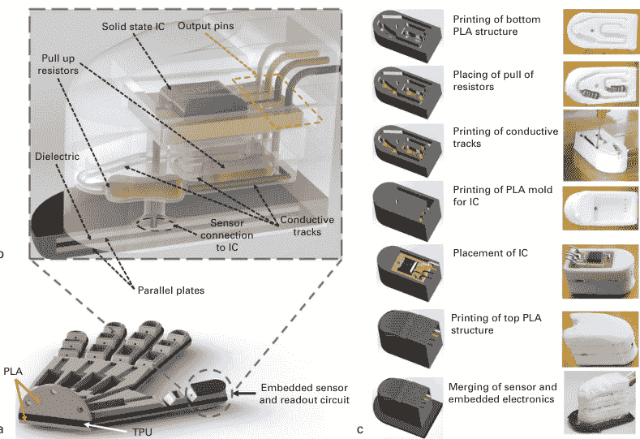

**Figure 8.2** 具有内在触觉感知的 3D 打印机器人手。(a) 带有智能感知指骨的机器人手 CAD 设计，该指骨配备软电容式触摸传感器和嵌入式读出电路。(b) 指骨内部结构的 CAD 设计。(c) 3D 打印指骨的制造步骤。


Ecoflex-silver、TPU-silver、Ecoflex-graphite、TPU-graphite 和 Ecoflex-TPU。所有传感器变体均使用定制的 3D 打印机制造。导电 PLA 和 TPU 采用熔融沉积成型（FDM）技术沉积，Ecoflex 采用滴涂工艺。石墨墨水采用直接墨水书写（DIW）技术打印，银漆采用刷涂，但也可以使用类似的技术与银一起。

Ecoflex-silver 变体展现出卓越性能（图 8.3），在静态和动态条件下具有稳定且可重复的响应，且微小滞后效应。Ecoflex 介电材料与银浆电极相对于其他器件的优势源于材料的特性。发现 Ecoflex 与银漆之间的粘附力相对于其他样品最强。银浆（已知会产生裂纹）在嵌入式配置中并未出现裂纹。这种材料布置及其相互作用展示了传感器耐久性的一种替代方法。将感知元件嵌入柔性弹性体内部，为感知元件提供所需保护，从而延长感知模块的使用阶段并防止昂贵的维修。

近年来，已启动许多类似的研究，试图利用这项技术。此前，大多数 3D 打印传感器使用直接墨水法制造（Muth et al. 2014）。这些方法最常用于软机器人和电子皮肤（eskin）类方法（Truby et al. 2019）。最近，更多研究也在使用 FDM 技术（Kaur and Kim 2019）。

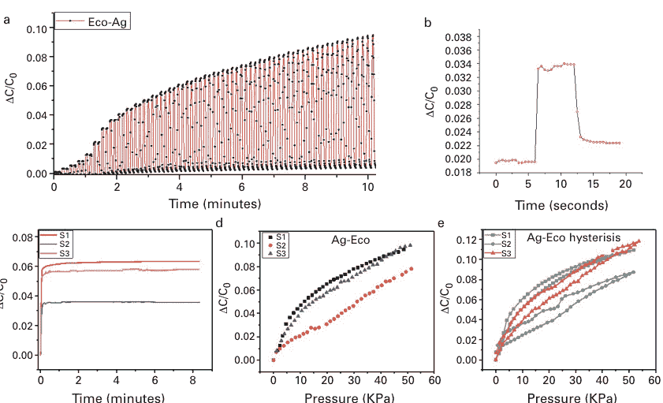

图 8.3 (a) 随压力增加，Eco-Ag 传感器装置随时间变化的动态响应。(b) 在一次加载-卸载循环中，Eco-Ag 传感器装置电容随时间变化的相对变化。(c) 三个传感器在恒定载荷下的响应。(d) 随压力增加的电容相对变化。(e) 测试器件的滞后曲线。

获得具有内在感知、驱动和计算功能的复杂智能结构，是推进自主机器人系统进入下一个时代的途径。3D 打印结构中紧密集成的感知功能，可能为新一代能够自主改变外观和形状的真正智能系统铺平道路。与最先进的机器人或义肢手相比，这种方法可能带来功能更丰富、更坚固且价格更亲民的手。此外，多材料 3D 打印方法通过嵌入式组件，实现了 3D 空间的高效利用。

### 8.4 具有压电/电容堆叠的触觉传感器

来自皮肤的动态和静态力反馈对人类执行日常任务至关重要。如 8.1 节所述，人类皮肤同时含有快适（FA）和慢适（SA）机械感受器。然而，文献中报道的大多数触觉传感器只能提供静态或动态压力（Yousef, Boukallel, and Althoefer 2011; Jamone et al. 2015; Kaur and Kim 2019）。触觉刺激的时空检测对于纹理识别至关重要（Yousef, Boukallel, and Althoefer 2011; Dahiya et al. 2013），为此，电子皮肤（eskin）必须具备检测静态和动态接触的能力。为解决这一问题，科学家最近开发了一种新型触觉传感器——压电传感器和电容传感器的堆叠。这使得既能测量静态刺激也能测量动态刺激，并借助机器学习或人工智能（AI）工具，我们可以探索进一步的认知技能，例如检测曲面的纹理（Navaraj and Dahiya 2019）。这种具有指纹状图案的高灵敏电容-压电柔性感知皮肤，旨在检测和区分时空触觉刺激，包括静态和动态压力以及纹理。

提供静态和动态事件信息的多功能传感器对于机器人的自主性和灵巧性至关重要。在本研究中，为弥补压电传感器无法执行静态感知的不足，引入了集成电容传感器。由此形成了电容-压电传感器堆叠，以模拟人类皮肤的 SA 和 FA 机械感受器（图 8.4）。该传感器被封装在 3D 打印的食指远端指骨内，使用 TPU 制成的指尖图案。该图案增强了系统识别表面粗糙度的检测能力。这是一项重大进步，因为此前开发的大多数表面粗糙度系统都高度依赖大面积阵列（Drimus et al. 2014; Lee, Kukreja, and Thakor 2017）。

触觉传感器采用基于浮动电极的电容结构，并与压电结构串联。该传感器使用两种杨氏模量分别为低和高的软弹性体。这种布置由于较软的弹性体，在低压下实现了高灵敏度，同时由于高杨氏模量弹性体，在高压下不会饱和。在静态压力下，弹性体被压缩，浮动电极更靠近信号电极和接地电极（图 8.4）。传感器堆叠集成到 3D 打印义肢/机器人手食指的远端指骨中。感知装置覆盖由 TPU 聚合物 3D 打印丝材制成的指纹脊。脊以错开的方式排列，以提供坚固保护，方式类似于人类皮肤。

该领域早期研究利用触觉传感器和傅里叶变换小波实现了分类器。研究人员得出结论，随时间变化的纹理是不规则纹理表面之间的重要因素。短时傅里叶变换可用于探索更不规则的表面（Jamali and Sammut 2011）。

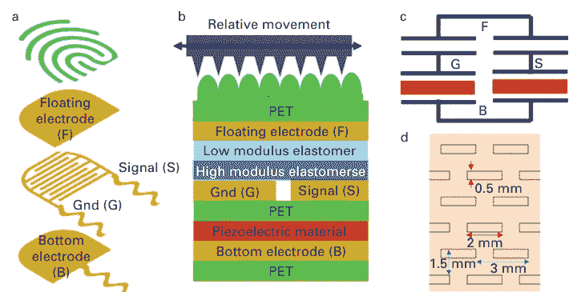

图 8.4 (a) 生物仿觉感知堆叠的示意图。(b) 感知堆叠中的各层，顶部显示指纹脊。(c) 生物仿觉感知堆叠的等效图。(d) 通过使用 NinjaFlex 进行 3D 打印实现的设计指纹脊的尺寸。

在 Navaraj and Dahiya (2019) 中，使用了生物合理的小波变换，基于漏整合-发火（LIF）模型将传感器输出编码为尖峰列车。尖峰使用基于生物观察到的尖峰时序依赖性可塑性（STDP）机制学习算法的 tempotron 分类器进行分类。通过这种方法，可以对非平面纹理表面进行分类，这与先前的工作不同。这是通过一个六自由度机械臂实现的，该机械臂在物体表面保持恒定静态压力。数据被输入到基于小波的处理算法中，使用加波小波变换（GWT）而非常见的傅里叶变换。这种方法在时频域提供定位，同时小波变换在生物系统中似乎是一种更合理的方法。为进一步证明这一点，结果还使用了一百个样本窗口大小的短时傅里叶变换（STFT）进行了展示。GWT 变换后，数据被编码为延迟编码尖峰列车，因为这是生物系统对动态刺激具有如此快速响应的假设原因。LIF 模型用于尖峰模型，而幅度表示尖峰在时间跨度内被触发的速度。这项工作进行了测试，以证明是否可以使用单个生物仿觉感知堆叠来感知纹理。为证明上述陈述的真实性，魔术贴（钩环式紧固件）被用作二进制分类的纹理。分类使用平面和非平面表面进行，以消除可能的偏差。记录了一百次平面扫描、五十次凹面扫描和五十次凸面扫描，每次扫描都包含钩面和环面纹理。训练数据包括为神经网络随机选择的 160 个样本和 40 个测试样本。

图 8.5a–d 显示了系统的响应，并轻松证明环面产生的信号幅度高于钩面，因为环面与指尖图案的相互作用更多。在随训练轮次变化的训练误差中，也很明显，该


GWT方法在纹理识别方面优于传统的STFT方法。基于STFT的方法准确率为95.3%，而基于GWT的方法在相同时间窗口下的准确率为99.45%（图8.5e）。总结，闭环系统下感官栈的输出能够以最高99.45%的准确率对纹理进行分类，这也表明单个感官栈可能足以用于纹理分类。

### 8.5 集成感知与执行技术

本节探讨了面向先进电子皮肤(eSkin)集成传感器与执行器的研究。为了充分发挥机器人的潜力，重要的是要使它们能够以灵巧和认知能力与环境交互，并从与环境的交互中学习。发育机器人学领域在6.3节中提出了对机器人环境的有目的利用。未来的机器人应当能够通过不断学习、推理和共享知识来应对自然环境的不确定性。如8.2节之前讨论的那样，eSkin是研究人员用于实现这一目标的有效方法之一。然而，现有机器人大多配备的eSkin仅具有感知能力。

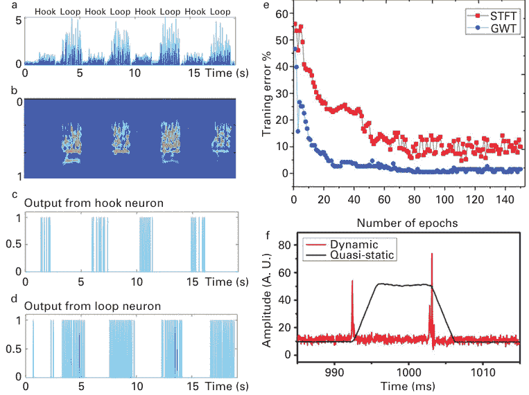

图8.5 (a) 动态扫描记录的典型信号。(b) Gabor小波标度图。(c, d) tempotron分类神经元对应(c)钩和(d)毛的输出。(e) 训练误差与时代数比较STFT和基于GWT的特征。(f) 通过ROS软件包的rqt图获取的无线传输实时数据绘图。

如8.2节所述，研究人员利用各种材料(Yogeswaran等人，2015年)结构(Mannsfeld等人，2010年; Gong等人，2014年; Wang等人，2014年)形态(Dahiya和Gori，2010年; Navaraj等人，2017年; Navaraj和Dahiya，2019年)以及转换方法(Dahiya等人，2011年; Adami等人，2012年; Dahiya和Valle，2013年; Khan等人，2015年; Gupta，Shakthivel等人，2018年; Gupta，Yogeswaran等人，2018年; Hannah等人，2018年; Kawasetsu等人，2018年; Yogeswaran等人，2018年)为eSkin设计了触觉传感器，其中一些模仿人类皮肤的特征，例如表面上的指尖状图案以及集成静态和动态传感器(Navaraj和Dahiya，2019年)。然而，eSkin的复杂性远不止在柔性基板上集成各种类型的触觉传感器(Núñez等人，2017年)。

感知与执行能力的无缝集成将提高下一代eSkin固有的触觉信息精细度(Dahiya等人，2019年)，从而对AI系统做出重大贡献。穿戴此类eSkin的机器人将具有人类般的灵巧性、认知技能和身体能力，因为它们能够通过丰富多样的信息从环境中学习。在此背景下，一些研究探索了向不同类型的执行器添加感知功能，以获取执行过程中产生的位移程度的信息。这些执行器包括电磁式(Andò和Marletta，2016年; Do等人，2018年)、气动式(Yeo等人，2016年)以及电活性聚合物(EAPs; Nakamura和Kawakami，2019年)，具有不同的工作原理和材料(Chen等人，2019年)。与电磁执行器和离子型EAPs(Asaka等人，2013年)不同，大多数执行器因执行原理和/或所用材料的限制，无法提供双向执行、振动触觉反馈或高位移(Biswas和Visell，2019年)。此外，大多数具有集成感知功能的执行器要么在纸上制造(Phan等人，2017年; Amjadi和Sitti，2018年)，要么使用需要相对高电压(约每微米位移150 V; Yeo等人，2016年)的EAPs(Jung, Kim和Choi，2008年)。电磁执行器能够提供高位移(最高1 mm，5 V下高力约5 mN/mm²; Guo等人，2018年; Noguchi, Nagai和Kawamura，2018年)，以及双向执行(Bintoro等人，2005年)和不同频率(≤1 Hz和>500 Hz)的振动触觉反馈(Do等人，2018年)。特别是，双向执行在操纵执行方向方面具有优势，因为它提供可控多向位移的选项(Cho和Ahn，2002年)。为了使电磁执行器本质上柔软且可穿戴，磁电子学领域也正在迅速引起关注(Hellebrekers, Kroemer和Majidi，2019年)。在此，柔性磁体和掺杂铁磁材料的弹性体被用于执行目的(Almansouri等人，2019年; Hintze等人，2014年)。然而，迄今为止，电磁执行器一直是执行目的最常用的执行器(Said等人，2016年; Paknahad和Tahmasebipour，2019年)，主要应用于微型泵(Said等人，2018年)和触觉显示器(Zárate和Shea，2016年)。通过在电磁执行器中集成感知功能，多向执行能力和出色的可控性可以得到充分利用，以推进同时具有感知和触觉反馈能力的软eSkin的实现应用。

电磁执行器(EMAs)通过将磁能转换为机械能来工作，通常由三项基本定律支配：洛伦兹定律、法拉第定律和毕奥-萨伐尔定律(Gomis-Bellmunt和Campanile，2009年)。EMAs中的执行是通过线圈中的电流产生的磁场与永久磁体和/或铁磁材料的相互作用来实现的(Kawasetsu等人，2018年)。这种相互作用产生排斥力或吸引力，直接作用于薄膜或柱塞，从而引起位移。这种排斥力或吸引力被用于实现eSkin软薄膜的排斥和吸引。原则上，电磁执行通过两个主要回路进行：
- 建立电流和电压的电气回路
- 建立磁场强度和磁通量的磁回路。
电流I产生可控的磁场H，而磁场产生磁通量σ和磁通密度B̄(方程8.1)。

B̄ = μᵣμ₀H̄, (8.1)

其中，μᵣ = 材料的相对磁导率，μ₀ = 真空磁导率，磁常数 = 4π×10⁻⁷H。

如8.3节所述，并且研究(Ozioko, Navaraj等人，2018年; Ozioko, Hersh和Dahiya，2018年，2019年; Ozioko, Karipoth等人，2021年)所示，为电磁执行器添加固有感知功能是有利的。图8.6a展示了该原理及其器件结构：一种触觉感知(压阻式)层集成在永久磁体之上，该永久磁体是柔性电磁线圈式执行器的一部分。该器件可通过压阻式层检测接触力，并同时利用电磁执行器产生比例执行。图8.6a展示了执行前的器件，而图8.6b和图8.6c展示了不同执行模式下的器件。执行期间，顶层受线圈吸引或排斥，如图8.6b和图8.6c所示，分别符合本节前面描述的电磁原理。在每种情况下，都有两种可能的状态：振动状态和非振动状态，取决于所供电流的方向。当供应恒定电流时，器件处于非振动状态。当通过线圈供给给定频率的脉动电流时，发生振动状态。这使得可以通过操纵所供电流的大小和方向来控制顶层的速度、运动和方向。因此，具有此功能的eSkin可以按需可控调制。

图8.7展示了该器件更详细的工作原理。该器件的两个主要模块(感知和执行)分别由感知模块和执行模块控制。(图8.7a展示了柔性压阻式感知层。此感知层可采用任何柔性感知层实现，但在此情况下，石墨墨水被封装在Sil-Poxy™中。当外力作用于感知层时，石墨颗粒从距离d1和d2分别靠近到d1 + Δd1和d2 + Δd2。这形成了更紧密的导电网络，导致材料电阻从R(图8.7a1)降低到R + ΔR(图8.7a2)。图8.7c展示了当外部压力作用于感知层时发生的情况。在此情况下，感知控制模块读取到电阻变化(ΔR)。这种电阻变化导致流经由执行控制模块驱动的螺旋线圈的电流发生变化(ΔI)。这种电流变化进而导致螺旋线圈产生的磁场发生比例变化，进而导致执行力发生变化。这种执行力的变化导致顶层因排斥而远离线圈或因吸引而靠近线圈。因此，该器件利用


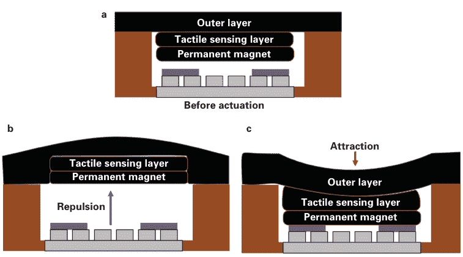

图 8.6 驱动模式。(a) 驱动前。(b) 排斥机制。(c) 吸引机制。

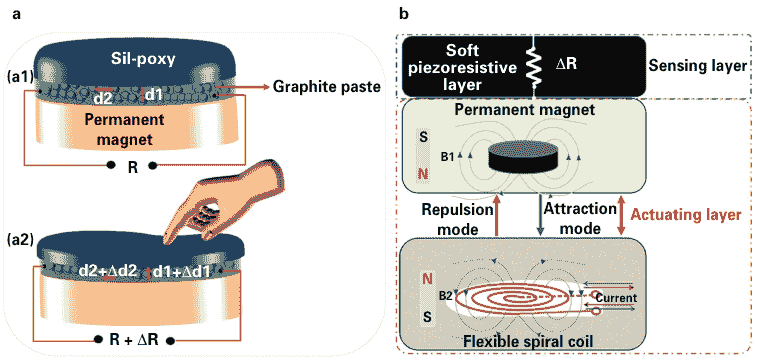

图 8.7 (a) 压阻层的结构与原理。(b) 驱动层的结构与原理。

依托压阻层的感应能力以及线圈与永磁体之间的磁相互作用，实现了同时感应与驱动。此外，感应与驱动可通过数字逻辑门和编程了相应算法的微控制器进行独立控制。

图 8.8 显示了集成器件单独的感应层响应，以及同时进行感应与驱动时的响应。此结果表明，集成器件的自可控性特征使该概念在未来可调电子皮肤中的应用更具优势，从而实现可控性和更丰富信息的提取。未来应用可探索将此集成器件嵌入机器人指尖，以控制其刚度，从而更好地抓取物体。

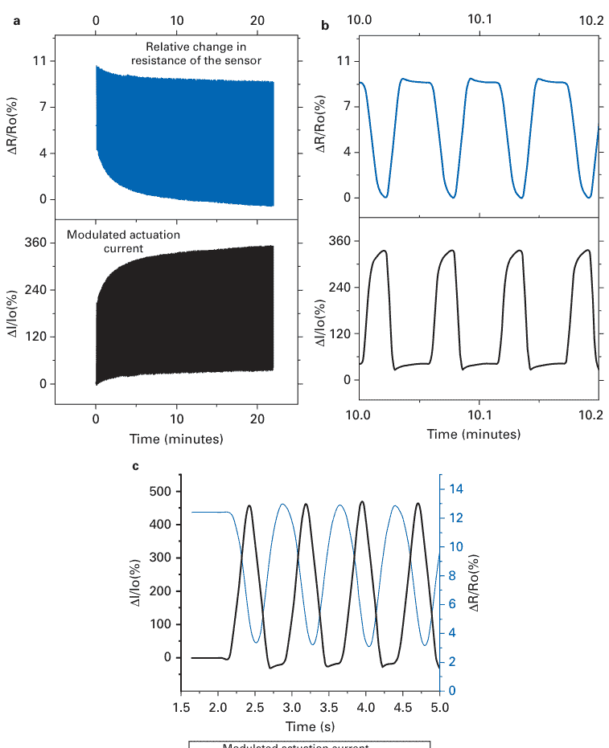

图 8.8 (a) 在约 0.25 Hz 下持续约二十二分钟的同时感应与驱动期间，感应层输出及驱动线圈中的调制电流。(b) 图 8.8a 的放大图，显示随着电阻降低，执行器中的电流增加。它还显示了器件在连续使用约二十二分钟时的稳定性。(c) 在 1 Hz 下同时感应与驱动期间电流和电阻的变化。

### 8.6 结论

本章介绍了机器人皮肤中触觉感知与驱动技术的现状与发展，以及面向仿生和生物启发式触觉感知与计算的新方法。讨论了当前的制造技术及其局限性和缺点。考察了 3D 打印的增长及其提供的优势，以及这项新技术如何增强当前的触觉和驱动系统。第 8.3 节和第 8.4 节介绍的两种触觉传感器结构在多方面模拟了人类皮肤的功能。第 8.2 节讨论的具有内在触觉感知的 3D 打印手具备嵌入式驱动、远端指节中的电容式传感器，以及能够读取电容值并将数字信息传输到微控制器的嵌入式电子设备。这样一来，缓解了电子皮肤的磨损问题，以及布线复杂性问题。第 8.3 节介绍的仿生触觉传感器使用感应堆栈同时测量动态和静态条件。传感器数据输入到神经网络中，该网络能以 99.45% 的极高准确率对两种有纹理表面进行分类。在该研究中，对常用的短时傅里叶变换和仿生加博小波变换进行了比较，以探索性能更优的系统。第 8.5 节介绍的具有集成驱动功能的压阻式传感器可提供振动触觉反馈。此类器件有潜力推动软体机器人发展，使此类机器人在继续感知环境条件的同时能够“挤压”物体。

总体而言，所介绍的案例研究表明，电子皮肤研究正朝着紧密耦合感知、驱动和计算的方向发展。推进机器人能力所需的关键认知技能包括记忆、决策、动作理解和预测。本章讨论的技术为实现这些技能提供了机会，使机器人能够有效感知环境，并处理、存储和使用所获信息来响应动态环境。这可能对人机交互产生重大影响——例如，人类能够从触觉刺激中提取重要信息，这不仅取决于底层触觉特性，还取决于触摸的背景、文化以及沟通者的情感。因此，使机器人不仅能感知触觉信息，还能理解触摸的预期含义，对推进机器人认知以及人机交互具有巨大潜力。

### 扩展阅读与资源

- 本编辑卷全面概述了人类的触觉感知。它包含定义和分类。它还对实现触觉传感器和材料的所有转换方法进行了分类。Dahiya, Ravinder S., 和 Maurizio Valle. 2013. *《机器人触觉感知：技术与系统》*. Berlin: Springer Science and Business Media.

- 一本紧凑的书籍，传达了大量关于感知和驱动的信息。本卷提供了关于各种刺激感知的信息。对机器人运动（包括软体和刚性机器人）进行了详细描述，涉及一些控制算法。Siciliano, Bruno, 和 Oussama Khatib, 编. 2016. *《斯普林格机器人手册》*. Berlin: Springer.

- 一期专刊，介绍了柔性电子和电子皮肤领域的最新工作。Dahiya, Ravinder, Deji Akinwande, 和 Joseph S. Chang. 2019. “柔性电子皮肤：从类人机器人到人类。”专刊，*《IEEE 学报》*107 (10): 2011–2015.

- 面向非专家的不同类型触觉感知机制基础知识。解释了用于读取输出的不同刺激和基础电路：https://www.elprocus.com/tactile-sensor-types-and-its-working/.

- BEST（可弯曲电子与感知技术）YouTube 频道，包含具有触觉感知、3D 打印等内容的机器人/假体视频：https://www.youtube.com/channel/UCOOdGI32wFmWSTPPBUARAvA/.

### 参考文献

Adami, Andrea, Ravinder S. Dahiya, Cristian Collini, Davide Cattin, 和 Leandro Lorenzelli. 2012. “具有 CMOS 集成信号调理电子的 POSFET 触摸传感器。” *《传感器与执行器 A：物理》* 188:75–81.

Almansouri, Abdullah S., Nouf A. Alsharif, Mohammed A. Khan, Liam Swanepoel, Altynay Kaidarova, Khaled N. Salama, 和 Jurgen Kosel. 2019. “一种不可察觉的磁性皮肤。” *《先进材料技术》* 4 (10): 1900493.

Amjadi, Morteza, 和 Metin Sitti. 2018. “基于石墨-碳纳米管混合薄膜的自感纸驱动器。” *《先进科学》* 5 (7): 1800239.

Andò, Bruno, 和 Vincenzo Marletta. 2016. “一种全喷墨打印的带嵌入式感知特性和电磁驱动机制的弯曲驱动器。” *《执行器》* 5 (3): 21.

Argall, Brenna D., 和 Aude G. Billard. 2010. “触觉人机交互综述。” *《机器人与自动系统》* 58 (10): 1159–1176.

Asaka, Kinji, Ken Mukai, Takushi Sugino, 和 Kenji Kiyohara. 2013. “基于纳米碳电极的离子电活性聚合物驱动器。” *《聚合物国际》* 62 (9): 1263–1270.

Bear, Mark, Barry Connors, 和 Michael Paradiso. 2020. *《神经科学：探索大脑》*. Burlington, MA: Jones and Bartlett.

Belter, Joseph T., Jacob L. Segil, Aaron M. Dollar, 和 Richard F. Weir. 2013. “拟人假肢手的机械设计与性能规范：综述。” *《康复研究与开发杂志》* 50 (5): 599.

Bintoro, J. S., A. D. Papania, Y. H. Berthelot, 和 P. J. Hesketh. 2005. “在单片晶圆上制造微线圈的双向电磁微驱动器：膜位移的静态特性。” *《微机械与微工程杂志》* 15 (8): 1378.

Biswas, Shantanu, 和 Yon Visell. 2019. “触觉的新兴材料技术。” *《先进材料技术》* 4 (4): 1900042.

Chen, Luzhuo, Mingeen Weng, Peidi Zhou, Feng Huang, Changhong Liu, Shoushan Fan, 和 Wei Zhang. 2019. “具有集成感应功能的基于石墨烯的驱动器。” *《先进功能材料》* 29 (5): 1806057.

Cho, Hyoung J., 和 Chong H. Ahn. 2002. “使用电镀永磁体阵列的双向磁性微驱动器。” *《微机械系统杂志》* 11 (1): 78–84.

Dahiya, Ravinder S. 2019. “电子皮肤：从类人机器人到人类。” *《IEEE 学报》* 107 (2): 247–252.

Dahiya, Ravinder S., Deji Akinwande, 和 Joseph S. Chang. 2019. “柔性电子皮肤：从类人机器人到人类 [本期导读]。” *《IEEE 学报》* 107 (10): 2011–2015.

Dahiya, Ravinder S., Davide Cattin, Andrea Adami, Cristian Collini, Leonardo Barboni, Maurizio Valle, Leandro Lorenzelli, Roberto Oboe, Giorgio Metta, 和 Francesca Brunelli. 2011. “面向机器人应用的芯片上触觉感知系统。” *《IEEE 传感器杂志》* 11 (12): 3216–3226.

Dahiya, Ravinder S., 和 Monica Gori. 2010. “指纹探测与指纹内部探测。” *《神经生理学杂志》* 104 (1): 1–3.

Dahiya, Ravinder S., Giorgio Metta, Maurizio Valle, 和 Giulio Sandini. 2010. “触觉感知——从人类到类人机器人。” *《IEEE 机器学报》* 26 (1): 1–20.

Dahiya, Ravinder S., Philipp Mittendorfer, Maurizio Valle, Gordon Cheng, 和 Vladimir J. Lumelsky. 2013. “有效利用触觉皮肤的方向：综述。” *《IEEE 传感器杂志》* 13 (11): 4121–4138.


- Dahiya, Ravinder S., and Maurizio Valle. 2013. 《机器人触觉传感：技术与系统》. 柏林: 施普林格科学与商业媒体.

- Dahiya, Ravinder S., Nivasan Yogeswaran, Fengyuan Liu, Libu Manjakkal, Etienne Burdet, Vincent Hayward, and Henrik Jörntell. 2019. 《大面积软电子皮肤：传感器设计之外的挑战》. 《IEEE学报》 107 (10): 2016–2033.

- Decherchi, Sergio, Paolo Gastaldo, Ravinder S. Dahiya, Maurizio Valle, and Rodolfo Zunino. 2011. 《利用计算智能进行触觉数据中接触材料分类》. 《IEEE机器人与自动化学报》 27 (3): 635–639.

- Do, Thanh Nho, Hung Phan, Thuc-Quyen Nguyen, and Yon Visell. 2018. 《用于机器人应用的微型软电磁致动器》. 《先进功能材料》 28 (18): 1800244.

- Drimus, Alin, Gert Kootstra, Arne Bilberg, and Danica Kragic. 2014. 《用于刚性和可变形物体分类的柔性触觉传感器设计》. 《机器人与自动化系统》 62 (1): 3–15.

- Gomis-Bellmunt, Oriol, and Lucio Flavio Campilile. 2009. 《主动机械系统中致动器的设计规则》. 柏林: 施普林格科学与商业媒体.

- Gong, Shu, Willem Schwalb, Yongwei Wang, Yi Chen, Yue Tang, Jye Si, Bijan Shirinzadeh, and Wenlong Cheng. 2014. 《一种可穿戴且高灵敏度的压力传感器，具有超薄金纳米线》. 《自然通讯》 5 (1): 1–8.

- Guo, Rui, Lei Sheng, HengYi Gong, and Jing Liu. 2018. 《液态金属螺线圈驱动的软电磁致动器》. 《中国科学：技术科学》 61 (4): 516–521.

- Gupta, Shoubhik, William T. Navarro, Leandro Lorenzelli, and Ravinder S. Dahiya. 2018. 《用于高性能柔性电子学的超薄芯片》. 《npj 柔性电子学》 2 (1): 1–17.

- Gupta, Shoubhik, Dhayalan Shakthivel, Leandro Lorenzelli, and Ravinder S. Dahiya. 2018. 《使用以扩展栅极的P(VDF-TrFE) BaTiO3电容器的MOSFET进行温度补偿触觉传感》. 《IEEE传感器期刊》 19 (2): 435–442.

- Gupta, Shoubhik, Nivasan Yogeswaran, Flavio Giacomozzi, Leandro Lorenzelli, and Ravinder S. Dahiya. 2018. 《用于触觉感应的柔性AlN耦合MOSFET器件》. In 2018 IEEE Sensors, 1–4. New York: IEEE. https://doi.org/10.1109/ICSENS.2018.8589628.

- Hammack, Mallory L., Alex Choros, Benjamin C-K. Tee, Jeffrey B-H. Tok, and Zhenan Bao. 2013. 《25周年特刊：电子皮肤（E-Skin）的演变：简史、设计考虑因素与近期进展》. 《先进材料》 25 (42): 5997–6038.

- Hannah, Stuart, Alan Davidson, Ivan Glesk, Deepak Uttamchandani, Ravinder S. Dahiya, and Helena Gleskova. 2018. 《基于有机电场效应晶体管和铁电聚（偏二氟乙烯三氟乙烯）的多功能传感器》. 《有机电子学》 56:170–177.

- Hellebrekers, Tess, Oliver Kroemer, and Carmel Majidi. 2019. 《用于连续变形感应的软磁性皮肤》. 《先进智能系统》 1 (4): 1900025.

- Hintze, C., D. Yu Borin, D. Ivaneyko, V. Toschcehikov, M. Sapphiannikova-Grenzer, and G. Heinrich. 2014. 《具有可控刚度的软磁弹性体：实验与建模》. 《Kgk-橡胶塑料》 67 (4): 53–59.

- Jamali, Nawid, and Claude Sammut. 2011. 《多数投票：利用表面纹理通过触觉传感进行材料分类》. 《IEEE机器人与自动化学报》 27 (3): 508–521.

- Jamone, Lorenzo, Lorenzo Natale, Giorgio Metta, and Giulio Sandini. 2015. 《用于拟人机器人手的高灵敏度软触觉传感器》. 《IEEE传感器期刊》 15 (8): 4226–4233.

- Jung, Kwangmok, Kwang J. Kim, and Hyouk Ryeol Choi. 2008. 《一种自感应介电弹性体致动器》. 《传感器与执行器A：物理》 143 (2): 343–351.

- Kappassov, Zhanat, Juan-Antonio Corrales, and Véronique Perdereau. 2015. 《灵巧机器人手中的触觉传感》. 《机器人与自动化系统》 74:195–220.

- Kaur, Manpreet, and Woo Soo Kim. 2019. 《迈向配备3D设计细胞手指的智能柔顺机器人抓手》. 《先进智能系统》 1 (3): 1900019.

- Kawasetsu, Takumi, Takato Horii, Hisashi Ishihara, and Minoru Asada. 2018. 《使用螺旋电感器和磁流变弹性体的柔性三轴触觉传感器》. 《IEEE传感器期刊》 18 (14): 5834–5841.

- Khan, Saleem, Wenting Dang, Leandro Lorenzelli, and Ravinder S. Dahiya. 2015. 《基于丝网印刷P(VDF-TrFE)和P(VDF-TrFE)/MWCNTs的柔性压力传感器》. 《IEEE半导体制造学报》 28 (4): 486–493.

- Kumaresan, Y., O. Ozioko, and Ravinder S. Dahiya. 2021. 《具有温度和压力传感器阵列堆叠的多功能电子皮肤》. 《IEEE传感器期刊》. doi:10.1109/jsen.2021.3055458.

- Lee, Wang Wei, Sunil L. Kukreja, and Nitish V. Thakor. 2017. 《在峰值神经形态网络中通过时间精确事件感应区分动态触觉接触》. 《神经科学前沿》 11:5.

- Luo, Shan, Joao Bimbo, Ravinder S. Dahiya, and Hongbin Liu. 2017. 《机器人对物体属性的触觉感知：一篇综述》. *梅卡特罗尼クス* 48:54–67.

- Mannsfeld, Stefan C. B., Benjamin C. K. Tee, Randall M. Stoltenberg, Christopher V. H. H. Chen, Soumen dra Barman, Beinn V. O. Mui, Anatoly N. Sokolov, Colin Reese, and Zhenan Bao. 2010. 《具有微结构橡胶介电层的高灵敏柔性压力传感器》. *自然材料* 9 (10): 859–864.

- Mohd Said, Muzalifah, Jumril Yunas, Badariah Bais, Azrul Azlan Hamzah, and Burhanuddin Yeop Majlis. 2018. 《一种具有基质图案磁性聚合物复合执行器薄膜的电磁微泵的设计、制造与测试》. *微机械* 9 (1): 13.

- Muth, Joseph T., Daniel M. Vogt, Ryan L. Truby, Yiǧit Mengüç, David B. Kolesky, Robert J. Wood, and Jennifer A. Lewis. 2014. 《在高度可拉伸弹性体中嵌入3D打印应变传感器》. *先进材料* 26 (36): 6307–6312.

- Nakamura, Atsushi, and Shotaro Kawakami. 2019. 《一种用于自感应系统的碳基聚合物复合材料制成的致动器-传感器混合器件》. *AIP进展* 9 (6): 065311.

- Nassar, Habib, Markellos Ntagios, William T. Navaraj, and Ravinder S. Dahiya. 2018. 《多材料3D打印可弯曲智能传感结构》. 在 *2018 IEEE传感器大会* 中, 1–4. 纽约: IEEE. https://doi.org/10.1109/ICSENS.2018.8589625.

- Navaraj, William T., and Ravinder S. Dahiya. 2019. 《指纹增强电容-压电柔性传感皮肤，用于区分静态和动态触觉刺激》. *先进智能系统* 1 (7): 1900051.

- Navaraj, William T., Carlos García Núñez, Dhayalan Shakthivel, Vincenzo Vinciguerra, Fabrice Labeau, Duncan H. Gregory, and Ravinder S. Dahiya. 2017. 《用于机器人触觉传感皮肤的纳米线FET神经元器件》. *神经科学前沿* 11:501.

- Noguchi, Takuya, Sakahisa Nagai, and Atsuo Kawamura. 2018. 《一种无需位置传感器、单位面积提供高力密度的电磁直线致动器，作为触觉单元》. *IEEE工业应用期刊* 7 (3): 259–265.

- Ntagios, Markellos, Habib Nassar, Abhilash Pullanchiyodan, William T. Navaraj, and Ravinder S. Dahiya. 2020. 《通过3D打印软压力传感器实现固有触觉传感的机器人手》. *先进智能系统* 2 (6): 1900080.

- Núñez, Carlos Garcia, Libu Manjakkal, and Ravinder S. Dahiya. 2019. 《能源自主型电子皮肤》. *npj 柔性电子学* 3 (1): 1–24.

- Núñez, Carlos García, William T. Navaraj, Emre O. Polat, and Ravinder S. Dahiya. 2017. 《能源自主、柔性和透明触觉皮肤》. *先进功能材料* 27 (18): 1606287.

- Ozioko, Oliver, Marion Hersh, and Ravinder S. Dahiya. 2018. 《用于助力手套的电感式柔性压力传感器》. 在 *2018 IEEE传感器大会* 中, 1–4. 纽约: IEEE. https://doi.org/10.1109/ICSENS.2018.8589826.

- Ozioko, Oliver, Marion Hersh, and Ravinder S. Dahiya. 2019. 《使用各种铁粉成分的电感式软柔性压力传感器》. 在 *2019 IEEE传感器大会* 中, 1–4. 纽约: IEEE. https://doi.org/10.1109/SENSORS43011.2019.8956646.

- Ozioko, Oliver, Prakash Karipoth, P. Escobedo, Markellos Ntagios, A. Pullanchiyodan, and Ravinder S. Dahiya. 2021. 《SensAct：具有集成柔性致动器的软糯触觉传感器》. *先进智能系统* 3 (3): 1900145.

- Ozioko, Oliver, Prakash Karipoth, Marion Hersh, and Ravinder S. Dahiya. 2020. 《基于集成触摸传感器和致动器的可穿戴辅助触觉通信界面》. *IEEE神经系统与康复工程学报* 28 (6): 1344–1352.

- Ozioko, Oliver, William T. Navaraj, Marion Hersh, and Ravinder S. Dahiya. 2020. 《Tascas：一种具有电容式触觉感应能力的可穿戴触觉显示触觉设备》. *传感器* 20:4780.

- Ozioko, Oliver, William T. Navaraj, Nivasan Yogeswaran, Marion Hersh, and Ravinder S. Dahiya. 2018. 《聋盲人与机器人交互的触觉通信系统》. 在 *2018年第27届IEEE机器人与人机交互通信国际研讨会* 中, 416–421. 纽约: IEEE.

- Paknahad, Ali Asghar, and Mohammad Tahmasebipour. 2019. 《一种具有PDMS-Fe3O4纳米复合磁膜的电磁微致动器》. *微电子工程* 216:110351.

- Phan, Hoang-Phuong, Toan Dinh, Tuan-Khoa Nguyen, Ashkan Vatani, Abu Riduan Md FoisaI, Afzaal Qamar, Atieh Ranjbar Kermany, Dzung Viet Dao, and Nam-Trung Nguyen. 2017. 《使用铁磁纳米颗粒和石墨的自感应纸基致动器》. *应用物理学快报* 110 (14): 144101.

- Roche, Ellen T., Robert Wohlfarth, Johannes T. B. Overvelde, Nikolay V. Vasilyev, Frank A. Pigula, David J. Mooney, Katia Bertoldi, and Conor J. Walsh. 2014. 《一种生物启发的软致动材料》. *先进材料* 26 (8): 1200–1206.

- Said, Muzalifah Mohd, Jumril Yunas, Roer Eka Pawi nanto, Burhanuddin Yeop Majlis, and Badariah Bais. 2016. 《基于PDMS的电磁致动器膜，聚合物复合材料中嵌有磁性颗粒》. *传感器与执行器A：物理* 245:85–96.


Siegwart, Roland, Illah Reza Nourbakhsh, and Davide Scaramuzza. 2011. 《自主移动机器人导论》. Cambridge, MA: MIT Press.

Simsek, Meyrem, Adnan Aijaz, Mischa Dohler, Joachim Sachs, and Gerhard Fettweis. 2016. “5G 赋能触觉互联网.” IEEE Journal on Selected Areas in Communications 34 (3): 460–473.

Sithi-Amorn, Pitchaya, Javier E. Ramos, Yuwang Wang, Joyce Kwan, Justin Lan, Wenshou Wang, and Wojciech Matusik. 2015. “MultiFab: 一种机器视觉辅助的多材料 3D 打印平台.” ACM Transactions on Graphics 34 (4): 1–11.

Skylar-Scott, Mark A., Jochen Mueller, Claas W. Visser, and Jennifer A. Lewis. 2019. “通过多材料多喷嘴 3D 打印实现的体素化软物质.” Nature 575 (7782): 330–335.

Soni, Mahesh, and Ravinder S. Dahiya. 2020. “软电子皮肤：具有协调能源与计算的分布式触觉感应.” Philosophical Transactions of the Royal Society A 378 (2164): 20190156.

Tomo, Tito Pradhono, Massimo Regoli, Alexander Schmitz, Lorenzo Natale, Harris Kristanto, Sophon Somlor, Lorenzo Jamone, Giorgio Metta, and Shigeki Sugano. 2018. “Uskin 用新型硅胶结构——一种柔软、分布式、数字 3 轴皮肤传感器及其在人型机器人 iCub 上的集成.” IEEE Robotics and Automation Letters 3 (3): 2584–2591.

Truby, Ryan L., Robert K. Katzschmann, Jennifer A. Lewis, and Daniela Rus. 2019. “用于躯体敏感操作的带有嵌入式离子凝胶传感器和离散驱动模式的软机器人手指.” In 2019 2nd IEEE International Conference on Soft Robotics, 322–329. New York: IEEE.

Viteckova, Slavka, Patrik Kutilek, and Marcel Jirina. 2013. “可穿戴下肢机器人：一篇综述.” Bio-cybernetics and Biomedical Engineering 33 (2): 96–105.

Wang, Xuewen, Yang Gu, Zuoping Xiong, Zheng Cui, and Ting Zhang. 2014. “丝模柔性、超灵敏且高度稳定的电子皮肤，用于监测人体生理信号.” Advanced Materials 26 (9): 1336–1342.

Weiner, Pascal, Caterina Neef, Yoshihisa Shibata, Yoshihiko Nakamura, and Tamim Asfour. 2020. “一种用于可扩展机器人和义肢手指的嵌入式多模态传感器系统.” Sensors 20 (1): 101.

Yeo, Joo Chuan, Hong Kai Yap, Wang Xi, Zhiping Wang, Chen-Hua Yeow, and Chwee Teck Lim. 2016. “用于可穿戴软体机器人应用的柔性可伸展应变感应执行器.” Advanced Materials Technologies 1 (3): 1600018.

Yogeswaran, Nivasan, Wenting Dang, William T. Navaraj, Dhayalan Shakthivel, Saleem Khan, Emre Ozan Polat, Shoubhik Gupta, et al. 2015. “用于交互式机器人的电子皮肤制造新材料与进展.” Advanced Robotics 29 (21): 1359–1373.

Yogeswaran, Nivasan, William T. Navaraj, S. Gupta, F. Liu, V. Vinciguerra, L. Lorenzelli, and R. Dahiya. 2018. “用于触觉感应的压电石墨烯场效应晶体管压力传感器.” Applied Physics Letters 113 (1): 014102.

Yousef, Hanna, Mehdi Boukallel, and Kaspar Althoefer. 2011. “机器人灵巧手中操作触觉感应——一篇综述.” Sensors and Actuators A: Physical 167 (2): 171–187.

Zárate, Juan José, and Herbert Shea. 2016. “利用壶形磁铁实现稳定且可扩展的电磁触觉显示.” IEEE Transactions on Haptics 10 (1): 106–112.

## 9 认知机器人的机器学习

Tetsuya Ogata, Kuniyuki Takahashi, Tatsuya Yamada, Shingo Murata, and Kazuma Sasaki

### 9.1 引言

近年来，深度学习技术已被证实在图像识别、语音识别和语言处理等多个领域有效，并提出了多种应用方法（LeCun et al. 2015）。

深度学习通常指具有多层、高维输入的层次神经网络模型。

这种方法的一个重要特征是，人类专家通常应根据其知识和经验设计和选择的感官特征——例如，针对计算机视觉算法——可以通过学习过程自我组织。

只要为目标数据提供教学标签，就可以训练深度学习模型。

可以使用高维信号数据集进行训练。

这一特性使深度学习能够以不同于其他研究领域处理这些问题的方式，处理图像、声音和语言等各种类型的数据。

深度学习模型的性能接近常规方法，并且在某些模态下可以实现优于人类能力的性能。

深度学习有几种方法。其中一种代表性方法是使用自动编码器。

自动编码器是一种使输入和输出相同的学习模型。

一旦提供输入数据，它就被归类为“无监督学习”，因为它只是简单地学习复制输入。

例如，一千维的图像输入在中间层被压缩到几十维，然后被解压缩以还原原始图像。

在此，中间层的低维表示可以通过重新学习（微调）用于图像识别。

卷积神经网络（CNN）是当前深度学习的驱动力。

在多层网络中，层与层之间的连接通常采用全连接（密集）连接模式。

然而，在 CNN 中，卷积层和池化层具有具有重复和共享参数的更稀疏连接，通常在末尾添加一个密集连接层。

在图像识别的情况下，由于卷积和池化结构，位置的变化不会影响识别结果。

相反，重要的是捕捉特征子集。

因此，CNN 具有只获取输入图像某些区域的小型神经网络（内核）。

例如，三乘三像素的值乘以权重并压缩为一个单一值。

此操作称为卷积。

内核可以设计成多种不同的尺寸和形状。

由于内核对图像中的某些特征有反应，它会在整个图像区域滑动以生成图像的压缩表示。

池化层压缩图像大小以节省内存。

通过重复卷积和池化，获得最终特征表示，最后通过全连接输出识别结果。

还有一套基于循环神经网络（RNN）的深度网络。

RNN 是一种神经网络，它不以前馈方式直接将输入连接到输出，因为它还具有反馈连接。

即使输入处于相似状态，输出也可以根据内部神经条件发生变化。

在 RNN 中，不仅连接权重，而且内部状态都经过训练以提高预测准确性。

RNN 对时间序列学习有优势。

然而，使用 RNN 可能难以获得良好性能，因为它与深度学习有相同的问题，即梯度消失。

如果学习序列较长，很难将输出错误传播到过去的步骤，因此错误会被消除。

为了解决这个问题，开发了一种新型 RNN，具有多种类型的神经元。

一些神经元长期保留其内部状态（慢神经元）。

一些神经元在短期内改变其内部状态（快神经元）。

这些被称为多时标神经元。

结果，快神经元学习输入值的短时间序列，长期神经元学习这些短时间序列的序列。

多时标 RNN（MTRNN; Yamashita and Tani 2008）使用连续神经元，内部状态由连续值表示。

通过调整神经元变化的时间常数，可以创建快神经元和慢神经元。

另一种常用的深度 RNN 类型是长短期记忆（LSTM; Hochreiter and Schmidhuber 1997）。

除了当前输入的权重外，LSTM 神经元还学习是否接受它（输入门）、是否输出它（输出门）、是否保持当前状态（遗忘门）以及误差反向传播方法使用的其他各种输出。

LSTM 模型现在表现良好，特别是在自然语言处理方面。

在认知机器人学中，各种深度学习模型和应用可以用于视觉、音频和触觉等不同模态。

此外，由于各种模态可以在相似框架中处理，这些可以导致深度学习的多模态应用。

特别是，在现实世界中工作的机器人是一个典型的多模态系统，配备摄像头、麦克风、距离传感器、触觉传感器和执行器。

本章概述了主要集中于机器人学深度学习应用的研究。

在随后专注于特定认知机器人能力的章节中，将讨论更多深度学习模型的示例。

本章第一部分包含三个小节，涉及视觉、触觉和语言模态及技能的学习。

后续部分专注于与模仿学习相关的行为学习以及强化学习方法。

最后一节讨论了深度学习的可能性及其前景。

### 9.2 模态应用的深度学习模型

#### 9.2.1 机器人视觉

深度学习技术最自然的应用是在机器人视觉研究领域。

例如，Lenz、Lee 和 Saxena (2015) 提出了一种输出 posi-


手部姿态和方向（共四个维度），以便远距离抓取物体的图像。Yang, Li 等人（2015）使用 CNN，直接从一个人做饭的 YouTube 视频中识别出四十八种物体和六种抓取方式，并将其应用于机器人的运动。

Redmon 和 Angelova（2015）也使用 CNN，从包含颜色（RGB）和深度（D）数据的三维 RGB-D 图像中预测物体的抓取位置。具体来说，对于 224×224 像素的 RGB 图像，由人类标注物体的抓取位置向量。握持位置向量具有六个维度，包括中心坐标的矩形形状、旋转角度以及向量的握持位置（图 9.1）。

成功率使用两个条件计算：1) 旋转角度误差在 30° 以内，以及 2) 重叠区域（A∩B）相对于总面积（A∪B）超过 25 百分比。然而，这些标准不评估机器人的实际运动。使用真实机器人进行抓取的成功率并不总是很高。

这里重要的是，仅从物体图像无法获得关于物体抓取的信息。学习过程应反映机器人的硬件（主体）以及可能运动的影响。例如，尽管图 9.1 所示的握持位置向量是夹爪的一个特征，但不能保证它对通用夹爪机制来说是充分且最优的特征量。在提取用于抓取物体的区域时，机器人应考虑目标物体的物理特性，例如重量、质心、表面摩擦、形状变化等。即使使用相同的手，抓取也应根据手的尺寸、有效载荷、接近方向（轨迹）等以多种方式改变。也就是说，学习过程应不仅包括物体图像，还应包括机器人硬件生成的运动。

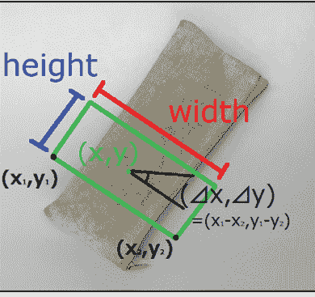

图 9.1
握持位置向量。

行走、与人接触以及物体操作。触觉传感器可用性的提高使该领域的研究蓬勃发展（参见第 8 章）。在使用基于学习的方法之前，触觉传感器数据仅与手工制作的特征（Yang, Sun 等人，2016）一起使用，或用于触发特定动作（Yamaguchi 和 Atkeson，2016）。然而，随着触觉感知技术的进步，此类方法可能扩展性不佳——例如，当需要更高分辨率和更大量的数据，或者任务复杂性增加时。通过使用基于学习的方法，特别是深度学习，现在可以处理涉及高维数据且以前难以处理的任务，例如图像识别和自然语言处理。此外，深度学习方法最近已被应用于触觉感知，例如物体识别（Schmitz 等人，2014；Baishya 和 Bäuml，2016）、触觉特性识别（Gao 等人，2016；Yuan, Wang 等人，2017）以及抓取（Calandra 等人，2018）。

近年来，在涉及触觉传感器的研究中，使用机器人手进行物体操作正受到越来越多的关注，因为操作是机器人执行各种任务（如整理、烹饪和折叠衣物）的基本功能之一。本章将描述触觉学习的最新发展以及物体操作过程的以下四个类别：1) 物体识别，2) 抓取，3) 手中物体姿态估计，以及 4) 手中物体操作。

#### 9.2.2 触觉学习

##### 触觉传感器的类型

已开发多种不同的触觉传感器以改进机器人手的操作（Dahiya 等人，2013；另见第 8 章的详细分析）。然而，这些传感器中的大多数属于以下三类之一：

- 单触式传感器，仅可沿一个轴（即垂直于传感器表面的方向）感知力信息。此类传感器被称为压力传感器（Ohmura, Kuniyoshi, and Nagakubo 2006; Iwata and Sugano 2009; Mittendorfer and Cheng 2011; Fishel and Loeb 2012）。
- 三轴传感器，可同时感知剪切力和压力，但仅为单触式（Paulino et al. 2017）。
- 三轴传感器，可同时感知剪切力和压力，且为多触式（Tomo et al. 2018; Yamaguchi and Atkeson 2016; Yuan, Dong, and Adelson 2017）。

撰写时，最后一类仅有三种传感器：uSkin（Tomo et al. 2018）、Finger Vision（Yamaguchi and Atkeson 2016）和 GelSight（Johnson and Adelson 2009; Dong, Yuan, and Adelson 2017; Yuan, Dong, and Adelson 2017）。uSkin 通过监测硅中磁体的磁场变化来测量接触期间硅的变形。该传感器能够对每个传感器单元的多个接触点测量压力和剪切力。

Finger Vision 不是使用磁体，而是一种基于视觉的触觉传感器，意味着它使用摄像头捕捉并测量与表面接触期间附加标记的变形。除了接触感知外，它还可以用作近接传感器，因为 Finger Vision 使用透明硅。

GelSight 可以通过在 Finger Vision 的硅表面上覆盖另一层含有铝粉的硅来制造。铝粉更清晰地凸显硅层的变形，从而允许在感知期间获得更丰富的信息。GelSight 易于复制且适合深度学习，因为它也使用摄像头，因此可以采用现有的图像处理技术来处理数据。因此，GelSight 在研究中变得越来越受欢迎（Calandra 等人，2018；Tian 等人，2019；Zhang 等人，2020；Anzai 和 Takahashi 2020）。

##### 物体识别

识别机器人手中物体类型（Schmitz 等人，2014）、其材料（Baishya 和 Bäuml 2016; Yuan, Zhu 等人，2017）及其特性（Gao 等人，2016）的主要方法之一，是使用触摸和图像信息，通过手工设计标签的监督学习进行分类。Baishya 和 Bäuml（2016）以及 Yuan, Zhu 等人（2017）使用触觉传感器通过监督学习将物体硬度估计为连续值。然而，在这些方法中，类标签及其程度的结果完全取决于这些类标签的设计方式。另一方面，一种无需手动指定标签的方法是使用无监督学习方法在连续空间中表示触觉特性（Takahashi 和 Tan 2019）。

##### 抓取

Calandra 等人（2018）展示了另一个用例，他们利用深度强化学习，将触觉传感器获取的输入数据与图像相结合，使用平行夹爪抓取物体，与仅使用视觉相比，提高了抓取实验的成功率。Wu 等人（2019）使用多指手显示了类似结果。通过使用触觉传感器，可以评估并通过重抓来提高抓取的稳定性（Calandra 等人，2018；Wu 等人，2019；Hogan 等人，2018）。

##### 手中物体姿态估计

为了实现目标物体姿态，需要能够估计当前物体姿态。物体姿态估计是计算机视觉中一个研究得较为充分的问题。许多研究人员一直在开发使用深度数据（点云）或 RGB-D 数据的方法（Choi 和 Christensen 2012; Aldoma 等人，2012; Choi 等人，2012）。使用深度数据的经典方法主要基于点云匹配方法，例如最近点迭代（ICP；Rusinkiewicz 和 Levoy 2001）。由于该方法需要物体的三维（3D）模型，因此无法处理未知物体。在姿态估计的最新研究中，已使用深度学习研究了不需要 3D 模型的方法（Schwarz, Schulz, and Behnke 2015; Hodan 等人，2018; Hu 等人，2019）。

然而，由于图像或深度数据中手部的遮挡，这些方法在手中操作方面应用具有挑战性。由于触觉传感器可以在视觉遮挡的情况下观察接触状态，因此它们适合克服这一挑战。一些研究通过基于模型的方法（使用 3D 模型（Bimbo 等人，2016）和不使用 3D 模型（Anzai 和 Takahashi 2020））使用触觉传感器进行了物体姿态估计。

为克服遮挡或信息不足等挑战，可以使用多个传感器来试图获得对环境或情况的改进感知。在此情况下，了解在给定情况下可以信任哪些模态——换句话说，给定传感器模态的可靠性有多高——至关重要。例如，如果视觉传感器受损，应将其数据的重要性低于其他传感器模态。然而，通过基于规则的方法确定传感器模态的可靠性是困难的。


安斋和高桥（2020）提出了一种能够自主确定每个模态可靠性的网络。

##### 手中物体操作

将已抓取的物体操作到目标姿态是最具挑战性的任务之一。分析方法虽存在，但存在局限性，例如已知物体模型和刚性物体（Han et al. 1997; Han and Trinkle 1998）。在基于学习的方法中，操作是通过预测机器人末端执行器运动的触觉传感器状态来执行的（Tian et al. 2019; Li et al. 2014; Funabashi et al. 2018）。由于多指手的物体操作仍然具有挑战性，这些研究中的大多数都是简单任务，并在实验环境中进行，少数例外除外（例如，Falco et al. 2018）。

#### 9.2.3 机器人行为中语言接地的学习

自然语言是表达我们向其他代理提出请求的最强大工具。服务机器人必须能够理解自然语言，以便灵活响应人类需求或有效地与人类协作。然而，要在离散系统（语言）与现实世界中的参照物（连续且动态的系统）之间随意设计映射，如符号接地问题（Harnad 1990）所述，这臭名昭著地困难。语言表达的含义也很大程度上取决于代理人所处的当前上下文。例如，为响应指令“抓住红球”，机器人需要根据红球的位置生成不同的关节角轨迹。与大多数工业工厂中的情况不同，我们的生活环境高度多变且开放；新情况几乎总是与之前的情况不同。几乎不可能以自上而下的方式制定能够处理所有可能情况的显式规则。

已有许多尝试让机器人以自下而上的方式从自身经验中学习接地关系。这里我们回顾了现有的研究，这些研究考虑了机器人中语言与行为之间接地关系的学习。特别是，我们讨论了语言接地的两种主要方法：概率建模和神经网络。关于机器人语言模型深度学习方法的更多细节，另请参见第20章。

##### 概率建模

建模语言与其他模态之间关系的一种方法是将它们建模为概率关系。例如，Inamura et al. (2004) 使用隐马尔可夫模型（HMMs）来识别和生成人类运动。在他们的框架中，原型符号（代表特定运动模式）在学习过程中出现。Nishihara, Nakamura, 和 Nagai (2017) 使用多模态潜在狄里克雷模型（MLDA）让机器人学习对象概念，该概念连接了由共现单词、听觉、视觉和触觉数据组成的多模态信息。Tellex et al. (2011) 提出了一种称为广义接地图的框架，该框架根据语言命令的语义结构动态实例化图形模型，然后在图中推导适合导航和操作的计划。

概率模型的一个优点是其高可解释性。在图形模型的情况下，图中的每个节点都设计为有意义的元素。因此，很容易理解模型执行什么样的推断。然而，尚未开发出能够充分处理长期依赖性的概率模型。

##### 神经网络

另一方面，也存在以确定性方式建模语言接地的方法。一种流行的方法是神经网络，例如RNN。Sugita 和 Tani (2005) 提出了一种可训练架构，由两个神经网络组成——一个用于语言，另一个用于机器人行为——并带有一小部分称为参数偏置（PB）的共享节点。该模型学习将语言与行为之间的关系嵌入到 PB 空间的拓扑组织中。Ogata et al. (2007) 采用了类似的架构来学习语言与机器人行为之间的双向映射。Heinrich 和 Wermter (2014) 提出了一个连接三个 RNN 的模型。每个 RNN 分别专门用于视觉、本体感觉和语言，但它们相互连接。学习后，该模型可以生成以字符序列形式描述机器人运动的句子。Stramandinoli, Marocco, 和 Cangelosi (2017) 使用 Jordan 类型 RNN（Jordan 1997）将抽象单词（例如，use 和 make）与机器人的感觉运动经验相接地。抽象单词是通过回忆先前学习的基本单词的含义并将它们组合来学习的。

神经网络的一个优点是，通过引入循环连接和一些门控机制，例如 LSTM（Hochreiter and Schmidhuber 1997），它们可以在没有先验知识的情况下，以更高的性能学习具有长期依赖性的时序结构。神经网络的一个缺点是，由于它们在隐藏层中的表示是分布式的，因此很难理解其行为。最近，一些研究提出了可视化神经网络内部行为的方法（Bach et al. 2015; Smilkov et al. 2017）以及使其表示更具可理解性的方法（Chen et al. 2016; Xu et al. 2015）。下文介绍了一项最近的研究，该研究提出了一种基于 RNN 的框架，用于将语言与机器人行为相接地。

Yamada, Matsunaga, 和 Ogata (2018) 尝试利用两个耦合的循环自编码器（RAEs；图 9.2）双向转换语言和机器人行为：一个 RAE 处理语言，另一个 RAE 处理行为。

每个 RAE 由一个编码器 RNN 和一个解码器 RNN 组成。编码器 RNN 将时间序列（句子或行为序列；\(x_1, x_2, \dots, x_T\)）压缩为固定维度的特征向量 \(z\)：

```
z=EncoderRNN(x_1, x_2, \dots, x_T)
```

解码器 RNN 通过递�地解码特征向量来生成序列：

```
(y_1, y_2, \dots, y_T)=DecoderRNN(z)
```

RAE 经过训练，通过特征向量重建原始序列——即恒等函数。损失函数如下：

```
L = \frac{1}{T} \sum_{t=1}^T \boldsymbol{\psi}(x_t, y_t)
```

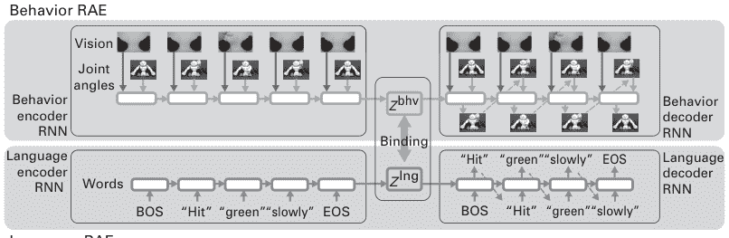

图 9.2 用于双向转换语言和机器人行为的两个耦合 RAEs。来源：改编自 Yamada, Matsunaga, 和 Ogata 2018。

每个时间步损失函数 ψ 的细节取决于模态。在学习过程中，语言 RAE 和行为 RAE 经过优化，以提取每个模态中时间序列数据的重要特征。

此外，整个系统的训练方式使得共现语言和机器人行为的特征向量彼此更接近，而未配对语言和行为的特征向量彼此更远。通过此约束，该耦合 RAE 系统能够通过潜在特征空间双向转换语言和行为。响应句子生成行为序列的方式是：使用语言 RAE 的编码器对句子进行编码，并使用行为 RAE 的解码器扩展特征向量。相反，生成机器人行为的句子描述的方式是：使用行为 RAE 的编码器对行为序列进行编码，并使用语言 RAE 的解码器扩展特征向量。

图 9.3 显示了本机器人实验中学习组织的潜在特征空间。每个点对应左侧面板中的句子和右侧面板中的行为序列。可以看出，行为序列实际上与配对的句子绑定。注意的是，由于行为 RAE 也接收视觉输入，该模型可以响应同一个句子，根据当前上下文生成不同的关节角轨迹。

### 9.3 模仿学习（预测学习）

模仿学习，也称为从示范中学习（LfD）或通过示范编程（PbD），是一种基于学习的方法，使机器人能够从一组专家示范（代表机器人的感觉运动经验）中获取技能（或推断策略）以进行动作生成。模仿学习主要通过预测学习方案进行，机器人需要学习从当前时间步的感觉(-运动)状态预测下一时间步的（感觉-）运动状态。与即将介绍的强化学习相比，这是一种更节省数据的方法。当由于设计上的困难而无法使用强化学习算法时，模仿学习是一种特别有用的方法。


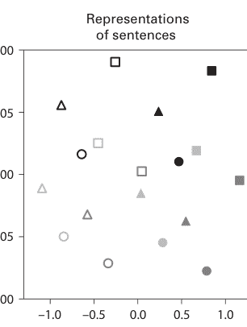

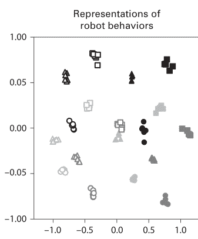

| Symbol | Description | Symbol | Description | Symbol | Description |
|---|---|---|---|---|---|
| ▲ | 推动红色（慢速）。 | ● | 拉动红色（慢速）。 | ■ | 滑动红色（慢速）。 |
| ▲ | 推动绿色（慢速）。 | ● | 拉动绿色（慢速）。 | ■ | 滑动绿色（慢速）。 |
| ▲ | 推动黄色（慢速）。 | ● | 拉动黄色（慢速）。 | ■ | 滑动黄色（慢速）。 |
| △ | 推动红色（快速）。 | ○ | 拉动红色（快速）。 | □ | 滑动红色（快速）。 |
| △ | 推动绿色（快速）。 | ○ | 拉动绿色（快速）。 | □ | 滑动绿色（快速）。 |
| △ | 推动黄色（快速）。 | ○ | 拉动黄色（快速）。 | □ | 滑动黄色（快速）。 |

图 9.3 由耦合 RAEs 生成的语言与机器人行为的隐性表示。来源：改编自 Yamada, Matsunaga, 和 Ogata 2018。

……构建奖励函数并进行大规模探索（使用真实机器人）。在（认知）机器人学和机器人学习的背景下，模仿学习包括以下两种情况：1）从传感器运动经验中学习；2）通过观察另一个代理人的示范来从传感器运动经验中学习。在这两种情况下，都需要通过人类示范者的体感教学或远程操作，在学习过程中提供关于机器人性能的示范。两者之间的区别在于，感官（主要是视觉）经验是否包含关于另一个代理人（通常是人类）性能的示范。也就是说，在第二种情况下，机器人不仅需要学习生成自己的动作，还需要通过推断执行什么以及如何执行，将观察到的他人的动作映射到自己的动作上。这更符合认知科学背景下人类和动物模仿的原始含义（Meltzoff 和 Moore 1977）。

执行模仿学习有几种机器学习方法，例如神经网络（如 CNNs 和 RNNs）；概率模型，如高斯混合模型与高斯混合回归的组合（如 Calinon, Guenter, 和 Billard 2007）；隐马尔可夫模型（如 Inamura 等人 2004）；以及动态系统（如 Ijspeert, Nakanishi, 和 Schaal [2002] 以及 Ijspeert 等人 [2013] 中的动态运动原语）。在本节中，我们特别关注基于神经网络的方法（其他方法请参阅综述论文，例如 Argall 等人 [2009] 和 Billard 等人 [2008]）。以下将对上述两种模仿学习情况的几项研究进行考察。此外，还将介绍它们与深度学习方法的扩展，例如使用深度自动编码器从原始图像中提取视觉特征，以及使用 LSTM 学习长期依赖关系。最后，还将简要讨论相关高级主题，包括一次性模仿学习和来自游戏数据的自监督学习。

#### 9.3.1 基于自身传感器运动经验的模仿学习

Ito 等人（2006）使用带参数偏差的 RNN（RNNNPB）研究了用于对象操作的原始动作学习。在他们的实验中，首先通过体感教学收集了小型人形机器人 QRIO 进行球操作的传感器运动经验。球操作有两种不同的原始动作，包括：1）将球从左侧滚到右侧或反之（以下称为滚球动作）和 2）抬起球并让其落地（以下称为举球动作）。传感器运动经验由视觉信息（表示为球的位置）和动作信息（表示为双臂关节角度）的时间序列数据项（或轨迹）组成。配备 RNNNPB 的机器人需要学习，在给定当前时间步状态的情况下预测下一时间步的视觉运动状态。通过这一学习过程，各种原始动作由优化后的 PB 向量之间的差异来表示。也就是说，一旦将与滚球动作对应的 PB 向量设置到网络中，机器人就会生成滚球动作；一旦设置与举球动作对应的另一个向量，机器人就会生成举球动作。这意味着，不同的原始动作被获取为 RNNNPB 中的多个极限环吸引子。

本实验的一个重要点是，学习阶段后动作生成期间的 PB 向量也会在线优化，以最小化在最近过去时间步时间窗口内计算出的预测误差。对 PB 向量的这种迭代优化使机器人能够适应意外的情境变化。例如，考虑一种情况：已设置滚球动作的 PB 向量，机器人正在生成相应的动作。然后，实验者突然干扰球在左右两侧之间的运动，球的运动在机器人正前方中心停止。在干扰之前，机器人正在预测，球会作为其自身动作生成的结果而在左右两侧之间移动。然而，由于停止了球运动的干扰，机器人感知到预期情况与实际情况之间的差异，即预测误差。最小化这些误差的唯一方法是将原先设置的 PB 向量切换为生成举球动作的另一个向量。PB 向量的这种切换使机器人能够最小化产生的预测误差，并再次执行稳定的动作生成。这一现象的重要点在于，机器人从未学习过在不同原始动作之间切换。得益于所谓的预测误差最小化（Nagai 2019）这一简单计算原理，机器人实现了自适应动作生成。这与基于自由能原理的主动推断方案（Friston 等人 2010）密切相关。

Chen, Murata 等人（2016）将该框架扩展到两台 NAO 机器人之间的交互。在他们的实验中，每台配备 RNN PB 的机器人首先与人类实验者一起学习了一组用于球操作的原始动作。学习到的原始动作取决于球的运动，因此当球朝向机器人的右侧移动时，机器人需要用右手击球。学习阶段结束后，机器人面对面并被要求进行球类游戏交互。由于实验在现实世界中进行，存在球与桌子之间的摩擦等波动，球的动力学有时会以不可预测的方式突然变化。在这种情况下，两台机器人都会出现预测误差，这些误差会触发每台机器人的 PB 向量，并对其进行优化以适应当前情况。每台机器人 PB 向量的这种双重优化使得无需任何训练即可实现自发的动作切换。

在使用 RNN PB 的先前示例中，原始动作之间的切换是由环境变化触发的。接下来，我们考虑如何通过学习由原始动作组合而成的动作序列，故意生成这种切换。Yamashita 和 Tani（2008）以及 Nishimoto 和 Tani（2009）使用上文介绍的 MTRNN 解决了此问题。与前面介绍的 RNN PB 实验类似，他们首先通过体感教学收集了 QRIO 机器人的视觉运动经验。记录的序列比上述第一项研究更复杂。例如，在一个序列中，机器人从主位置伸手去拿一个物体，然后将物体上下移动三次，最后再将其移回主位置。具体来说，每个序列都包含多个原始动作，例如伸手拿物体和移动物体，机器人需要切换或重复此类动作。配备 MTRNN 的机器人利用 MTRNN 慢动态层初始条件的灵敏性，对这些复杂且更长的视觉运动经验进行了预测性学习。学习阶段结束后，机器人成功生成了学习到的动作序列。对快动态层和慢动态层的分析表明，原始动作在快动态层中表示，而这些原始动作的组合（序列信息）则归功于自组织功能层次结构，在慢动态层中表示。

Namikawa, Nishimoto 和 Tani（2011）扩展了此实验设置，并考虑如何学习原始动作之间的概率性转换。与先前的情况类似，他们首先通过体感教学记录了 QRIO 机器人将物体从中心移到左侧、从左侧移到中心、从中心移到右侧等对象操作的视觉运动经验。这些转换模式是概率性确定的，他们还研究了决定性 MTRNN 是否可以学习具有此类概率性转换的序列。学习阶段结束后，机器人通过设置慢动态层的优化初始状态，从头开始重构了演示的视觉运动序列，但该序列逐渐偏离了学习到的序列。对生成的动作序列的分析表明，新生成的序列中仍然保留了转换概率。对 MTRNN 每一层的分析表明，与先前的研究（Yamashita 和 Tani 2008；Nishimoto 和 Tani 2009）一样，不同类型的信息存储在每一层中。另一个更有趣的现象是，只有慢


动力学层表现出具有正李雅普诺夫指数的混沌动力学，从而导致通过确定性神经动力学重建了概率转换。

在深度学习时代之前进行的实验中，例如刚才描述的实验，实验设置被简化了，例如，视觉信息仅是对象位置。这里，介绍了一些扩展规模的实验，它们通过使用深度学习方法（如深度（卷积）自编码器）来处理高维原始视觉图像。

Noda 等人（2014）使用结合了深度自编码器（用于特征提取和时序处理）的方法，对视觉、听觉和运动数据等多模态信息的集成学习进行了研究。与先前的研究一样，他们首先通过本体觉教学收集了 NAO 机器人的传感器-运动体验。然后，分别使用各自的深度自编码器提取了高维原始视觉图像和听觉信息的低维特征。提取的视觉和听觉特征与关节角度信息拼接起来。他们使用了另一种称为时延神经网络（TDNN）的深度自编码器，它接收多模态信息的一个时间窗口并输出其重建。通过使用此框架，他们实现了基于预测和检索的动作生成，例如使用高维传感器-运动状态从听觉和关节角度信息进行视觉检索。

Yang 等人（2017）将此框架扩展到人型工业机器人 Nextage，并执行了毛巾折叠任务。已知毛巾处理是机器人领域的一项挑战性任务，因为建模可变形物体很困难。他们使用 3D 鼠标通过远程操作记录了视觉-运动体验。在他们的实验中，用于视觉特征提取的常规自编码器被深度卷积自编码器（ConvAE）替换。学习阶段后，他们实现了高成功率的可重复毛巾折叠。Kase 及其同事将上述两个实验中使用的 TDNN 替换为基于 RNN 的架构，即 MTRNN（Kase 等人，2018）和 LSTM（Kase 等人，2019）。这些替代实现了更长、更复杂的任务执行，例如放入盒子和串烤串，得益于其功能层次结构和长短期记忆特性。

#### 9.3.2 通过观察另一智能体的示范进行模仿学习

当通过观察另一智能体的动作生成来学习时，机器人需要推断要执行什么以及如何执行。Arie 等人（2012）使用 MTRNN 考虑了这一问题。在他们的实验中，一种小型人型机器人 HOAP-3 学习了一组由多个原始动作组成的视觉-运动序列。例如，在一个序列中，机器人首先从原点位置伸手抓取一个物体，然后将物体向右移动，接着将物体击倒，最后将物体移回原点位置。请注意，机器人不仅学习了自身的动作生成，还学习了如何将观察到的人类表演动作映射到自身的表演。有四种原始动作，包括 R（将物体向右移动）、L（将物体向左移动）、K（击倒物体）和 U（将物体向上移动）。机器人首先学习了由其自身和实验者产生的三种不同类型的视觉-运动序列（RK、UK 和 UL）。在这些序列之后，机器人只接受了 RL 序列的人类表演示范。对机器人进行了评估，看它是否能通过将观察到的人类表演示范映射到自身表演，来为尚未学习过的 RL 序列生成自身的动作。

MTRNN 的慢动力学层有两个特殊的神经单元，当示范为相同模式时，无论机器人表演的生成还是人类表演的观察，其初始条件都被优化为相同的值。慢动力学层中的另外两个单元作为 PB 向量，通过为每个模式分配特定值（自模式为 1，他模式为 -1）来区分自模式（机器人表演的生成）和他模式（人类表演的观察）。在附加学习阶段后的评估中，设置了 RL 序列的人类表演示范的动作特定初始状态，并将示范者特定的 PB 向量切换到自模式。这使机器人能够为 RL 序列生成未学习过的组合动作。

Nakajo 等人（2015）考虑了关于视角表征获取的另一个重要主题。无论视角差异如何，人类都可以理解另一人所展示的动作是什么。获取这种能力对机器人很有用，因为人类表演的示范可以从任何方向提供。然而，对于机器人来说，这并非易事，因为来自不同视角的人类表演示范的视觉信息是不同的。他们使用 MTRNN 来学习机器人和人类表演的对象操作示范。在他们的实验中，一名人类示范者从多个视角执行动作。他们通过引入用于表示视角的子网络，对初始状态优化提供了约束。对子网络初始状态空间的分析表明，视角的位置关系在空间中自我组织化了。在他们的实验中，尽管结构化的视角表征是自我组织化的，但如何将来自多个视角的人类表演示范映射到相同的机器人表演仍然是一个问题。

为解决这个问题，Nakajo 等人（2018）通过引入一种广泛使用的（尤其是在机器翻译中）序列到序列（seq2seq）深度学习方法扩展了实验（Sutskever, Vinyals, and Le 2014）。seq2seq 框架由基于 RNN 的编码器-解码器架构组成。在机器翻译中，编码器 RNN 依次接收源句子信息（例如英语句子）并将其转换为固定维度向量。解码器接收该向量并将其转换为目标句子信息（例如日语句子）。参考 seq2seq 框架的这种信息处理方式，他们首先使用 MTRNN 对卷积编码器提取的关于人类表演示范的视频信息的视觉特征进行编码。然后，将得到的固定维度向量转换为机器人的动作生成。经过学习阶段后，机器人能够将来自未学习视角的人类表演示范映射到自身的动作生成。对 MTRNN 每一层的分析显示了动作、对象和视角的表征。更具体地说，在人类表演示范之后，快动力学层代表视角信息，而慢动力学层代表不含任何视角信息的动作和对象信息。将未学习的人类示范映射到机器人表演成功的关键在于，慢动力学层通过压缩视角信息，获取了关于动作和对象的视角不变表征，而这种视角信息在观察后对于机器人自身的动作生成是不必要的。

#### 9.3.3 一次性模仿学习和自监督学习

模仿学习的新方向之一是一次性模仿学习（Finn 等人，2017；Yu 等人，2018；Duan 等人，2017）。一次性模仿学习意味着，机器人只需从给定任务的机器人或人类表演的单次示范中学习新任务。例如，Finn 等人（2017）结合了一种名为模型无关元学习（MAML；Finn, Abbeel, and Levine 2017）的元学习算法和模仿学习。MAML 使神经网络能够仅从少量训练数据中学习新任务。更具体地说，MAML 假设各种任务，并从中采样一些任务，从这些任务中再采样训练和验证数据项（每个任务至少一个）。在元学习阶段，首先使用初始模型参数和采样的训练数据项计算每个任务的训练损失。使用每个任务的计算出的训练损失，初始模型参数通过梯度下降对每个任务进行（暂时）调整。然后，使用相应的调整后参数和采样的验证数据项计算每个任务的验证损失。最后，通过梯度下降优化初始模型参数以最小化验证损失之和。这意味着元学习算法试图发现可以轻松适应任何任务的通用初始参数。在随后的元测试阶段，只给出了一个与元学习阶段任务分开的新任务的单个训练数据项，通用初始参数可以快速适应该任务。

在使用 PR2 机器人进行的实验中，他们首先通过远程操作收集了各种物体放置任务的机器人表演示范。收集的示范包括机器人上安装的摄像头拍摄的原始视觉图像和动作信息。元学习是通过使用这些示范来学习如何仅从单次机器人表演示范中推断新任务的策略。然后，在元测试阶段，机器人从人类通过远程操作提供的单次示范中学习了新任务。这对于快速学习新任务是有效的；然而，问题是该框架需要机器人表演示范，而提供单次人类表演示范更直接。为解决这个问题，Yu 等人（2018）通过引入域自适应元学习（DAML）扩展了该框架。这使机器人能够学习如何仅从单次人类表演示范中推断新任务的策略。他们使用 PR2 和 Sawyer 机器人评估了这个扩展的框架。正如预期的那样，这些机器人可以从单次人类表演示范中学习新任务，并且即使在不同视角和背景环境下进行示范，也能学习新任务。

另一个新方向是自监督学习（Nair 等人，2017；Pathak 等人，2018；Lynch 等人，2019）。在上述所有实验中，均由人类专家提供特定任务的示范。作为一种替代方法，Lynch 等人（2019）提出了一种新的基于游戏的学习（LfP）范式，在其中机器人获取


仅凭遥操作员提供的游戏数据，即可掌握各种物体操作技能，并在学习阶段后完成目标导向任务。在他们的实验中，人类操作员首先在仿真环境中对机器人进行遥操作。在该环境中，多个用于操作的物体放置在一张配有抽屉以及带有灯光开关按钮的架子的桌子上。操作员被要求通过操作机器人自由探索环境，并收集了此次自由探索过程中的视觉运动经验。关键在于，操作员的好奇心和内在动力使其能够习得环境中可用的操作性和非操作性物体的各种复杂交互动作。收集到的视觉运动经验由基于游戏监督的隐性运动计划（Play-LMP）框架进行学习，该框架由计划提议编码器、计划识别编码器和动作解码器组成。在学习阶段，视觉运动经验的第一部分被随机采样为一个序列。然后，仅对采样序列的初始状态和最终状态由计划提议编码器进行编码，整个序列由计划识别编码器进行编码。两个编码器都生成了隐性计划表示，并将来自识别编码器的表示提供给动作解码器。编码器和解码器联合优化，以最大化解码器上的动作似然性，并最小化编码器生成的隐性计划表示分布之间的KL散度。学习过程完成后，将当前状态和目标状态提供给计划提议编码器，并将该编码器生成的隐性计划表示发送给动作解码器，即可生成插值当前状态和目标状态的动作序列。实验结果表明，与从特定任务演示中学习的机器人相比，从游戏数据中学习的机器人对扰动更具鲁棒性。得益于游戏数据的多样性，它们还表现出不断重试直至成功的行为。

### 9.4 强化学习机器人应用

在本章前面部分，我们回顾了使用机器人行为预定义数据集来控制机器人的基于神经网络的方法。与这种“离线”方法相反，在线学习技术在优化模型的同时收集训练数据集的样本。我们现在将探讨在线学习方法，即一种称为“深度强化学习”的深度学习方法。这种方法提供了一种探索解决方案的方式，使机器人能够学习视觉运动任务，而不是依赖于精心设计的训练数据集。然而，已知强化学习方法往往需要大量的情节采样，原因是奖励噪声或交互的随机性特性。对于机器人任务，使用真实机器人进行大量情节操作成本高昂（例如，时间、计算成本、机器人硬件可靠性）。在本节中，我们首先介绍强化学习问题设置的概述。接着，我们将从如何降低情节采样成本的角度，回顾使用深度强化学习进行机器人任务的研究。

#### 9.4.1 强化学习问题设置

强化学习（RL）问题设置假设可控制代理（例如机器人控制器）与环境之间存在交互（Sutton and Barto 2018；图 9.4）。例如，拾取机器人的控制器可以被视为代理，环境对应于带有某些目标对象的机器人周围空间。代理通过执行动作 _a_ 与环境交互。随后，环境状态被该动作改变，并返回新状态和奖励信号 _r_。奖励信号表示当前状态转移进行得如何，例如任务是否完成——比如，当机器人成功抓取物体时可能为 +1，当机器人移动手臂朝向物体时为 0，失败时为 −1。代理与环境之间的交互将产生状态、动作、新状态及奖励的序列元组 (_s_, _a_, _r_, _s’_)。通常，RL问题假设该元组是从有限马尔可夫决策过程（MDP）中采样的。从当前状态推断动作表示为一个称为策略的函数 \(\pi(a|s)\)，状态转移动态被表述为随机概率函数 \(p(s'|s)\)。RL的目标是找到一个策略，使其能最大化交互过程中每个状态的预期奖励总和（称为回报）。预期回报通常被称为“值” \(v(s) = \mathbb{E}(\sum r|s)\)。

由于MDP的随机性特性，寻找最佳策略或显式计算准确值是不可行的；因此，我们需要近似值函数。RL方法可分为此近似方法的几种类型。其中一种是按动作条件化近似值，称为“动作值”。如果我们能计算准确的动作值，代理将能够通过选择每个时间步中动作值最高的动作来获得最佳回报。动作值与状态值一样也难以计算，因此应通过对代理与环境交互采样的情节数据使用蒙特卡洛方法进行近似。RL Q学习方法采用通过预测折扣未来奖励总和来对动作值进行自举的方法。动作值估计器的近似能力是Q学习性能的关键。将深度学习模型用作动作值近似器，显著提高了RL代理在视频游戏环境中的能力，其状态通常是高维图像数据（Mnih et al. 2015; Vinyals et al. 2019）。另一种RL方法是直接优化参数化策略函数。在深度RL的背景下，策略函数使用深度学习模型实现，并通过梯度上升朝向更高状态值进行优化，称为策略梯度方法。这种优化方法允许动作在连续空间中，而Q学习通常只允许离散动作空间。策略梯度方法

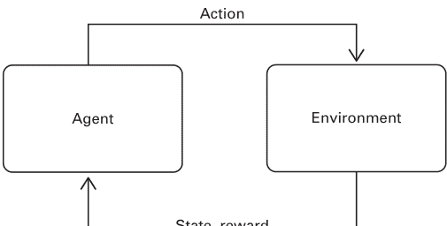

**图 9.4**
代理与环境之间的交互。

具有多种变体，取决于所用的策略函数类型和用于稳定值估计的优化技术。对RL方法的另一种分类方式是区分学习方法是否显式建模状态转移概率 $p(s'|s)$。建模状态转移概率的方法称为“基于模型”，而“无模型”则不建模。与无模型方法相比，基于模型的方法有望实现更低的样本复杂度，因为我们可以用预测的未来状态替代通过运行真实交互得到的状态。当动作空间是离散的且状态转移可以在长时程步骤上准确模拟时，可以使用动作搜索启发式（例如蒙特卡洛树搜索）来收集用于值估计的良好样本数据（Silver et al. 2018）。在机器人实验环境中，状态需要包含大量传感数据，包括相机图像或机器人姿态，因此需要其他值估计或策略优化方法。

利用深度学习模型的函数近似能力，RL方法最近已被应用于大维度状态数据和复杂任务，例如游戏（Mnih et al. 2015; Vinyals et al. 2019）和生成任务（Ganin et al. 2018; Huang, Heng, and Zhou 2019），包括机器人领域。然而，RL仍然需要我们让代理探索环境来收集大量样本数据，这与通过监督学习模仿专家行为形成对比。运行大量真实机器人交互在实验成本和探索过程中损坏机器人的风险方面需要巨大的开支。因此，深度RL研究人员已尝试使优化方法更高效、更稳定。一个主要研究方向是提高数据收集效率，另一个是利用基于模型的方法来发挥样本复杂度的优势。

#### 9.4.2 提高数据收集效率

减少使用真实机器人进行数据收集的方法之一是利用物理仿真软件。尽管模拟器大幅降低了实验成本，但由于仿真环境和机器人再现物理世界动态的能力有限，存在巨大的现实差距。克服现实差距问题的一种方法是通过向仿真过程添加噪声来增强收集的样本数据，也称为“域随机化”（Tobin et al. 2017）。例如，Andrychowicz et al. (2020) 的实验随机化了机器人的属性、质量或重力等物理参数以及视觉外观。域随机化预期可以提高针对真实环境状态或状态转移动态中噪声的泛化能力。除了随机化模拟器渲染器给出的状态外，还研究过使用生成模型伪造的更真实图像替换状态图像。Bousmalis et al. (2018) 报告称，他们通过使用生成对抗网络提高模拟状态图像的质量，在真实机器人环境中大幅减少了情节采样的数量。还尝试过添加约束，以强制在模拟环境中训练的RL代理表现得像真实环境中的代理一样。Fang et al. (2018) 引入了分类情节数据来源的对抗损失，以便将模拟环境中代理的知识迁移到真实环境中的代理。

模拟器上的RL实验通常需要并行运行多个软件环境以提高采样效率。并行进行真实机器人探索任务也可以缩短数据收集时间。Levine et al. (2018) 构建了多机器人臂拾取环境


并针对大量收集的杂乱物体图像数据样本训练了动作值估计器。控制机械臂的动作是通过一种进化策略获得的，其候选项由深度神经网络估计的动作值（作为成功率）进行评估。

提供专家情节序列有助于探索。还预期可降低数据采集成本。Peng 等人（Peng, Abbeel, et al. 2018; Peng, Kanazawa, Malik, et al. 2018）表明，人体运动捕获数据辅助了机器人控制代理在模拟器中的探索。他们添加了一个奖励，鼓励模拟机器人采取与原始任务中人类目标姿态相似的姿态，例如行走或进行杂技动作。此外，探索时的初始状态是从目标姿态中采样的，以观察从相同初始状态采取随机动作难以实现的状态。

将模仿专家序列的奖励纳入与逆强化学习相关，这是一种从专家数据中估计奖励函数的 RL 方法（Ng and Russell 2000）。Finn et al. (2016) 和 Peng, Kanazawa, Toyer, et al. (2018) 提出使用生成对抗协议来确定 RL 代理与专家数据之间情节的相似性。在此情况下，奖励由一个训练用于区分代理探索序列与专家序列的判别器网络给出。训练奖励函数近似器网络也预期可以缓解奖励的稀疏性。基础 RL 要求我们仔细设计奖励函数以表示任务成就。非常稀疏的奖励分布，例如仅在情节结束时给出非零信号，会使探索变得具有挑战性，因为值估计变得不稳定。由训练好的机器学习模型提供的奖励估计器预期即使在情节期间也能给出非零奖励。Ganin et al. (2018) 提出了一种绘画 RL 代理，可以由判别器网络给出的奖励信号进行训练，该网络能够区分图片是由代理还是由人类绘制的。

#### 9.4.3 通过建模环境动态来减少数据采集

基于模型的 RL 方法允许策略优化获取从环境模型预测的序列数据，因此它们有望与无模型算法相比降低样本复杂度。生成式深度学习模型的近期成功促使其被用于建模高维且复杂的状态转移——例如图像帧序列。Ebert et al. (2018) 提出了基于机器人动作条件的图像序列建模方法，用于物体操作任务。他们通过随机动作移动机器人手臂来收集图像序列，并训练一个深度卷积网络来预测未来图像帧。训练图像帧预测器后，动作通过交叉熵方法直接优化，这是一种无导数优化方法。他们利用机器人获取的现有图像和动作候选项，生成了多个预测图像序列。随后，对每个动作候选项使用时间步长水平结束时的预测图像进行评估，以计算给定目标图像与预测图像之间的差异，或者由实验者进行的像素标注。Ha 和 Schmidhuber (2018) 也提出了未来图像预测与无导数算法的组合。在这项研究中，状态转移函数由基于混合密度网络的随机神经模型建模。他们主张，确定性动态预测的状态会使策略优化变得对抗性。尽管如此，非确定性建模容易因为未来的不确定性而导致状态预测不准确。Hafner et al. (2018) 提出了一种使用循环状态空间模型（Karl et al. 2019）组合两种 RL 建模方法的方法。不直接优化动作序列，无模型 RL 方法可以与基于模型的 RL 方法联合使用。将基于模型的 RL 与无模型优化方法相结合时的一个问题是动态建模不准确。Kurutach et al. (2018) 指出，策略优化倾向于利用状态空间不足以实现良好性能的区域。Buckman et al. (2018) 提议使用几个版本的学习动态的集合来稳定值估计。

### 9.5 结论

本章介绍了几个使用机器学习（尤其是深度学习）进行机器人应用的研究示例，涉及的任务包括机器人视觉、触觉与运动学习、模仿学习、预测学习、强化学习和语言学习。

重要的是要认识到，仅在模拟和/或特定环境中展示机器人性能的机器人研究无法带来实际应用。需要考虑的最关键条件之一是评估真实环境中各种噪声情况的鲁棒性。

在日本，各种工业机器人制造商已经开发了多种模仿学习和预测学习的机器人应用原型。硬件和软件层面的机器人系统模块化正在快速推进，并预期通过深度学习技术实现重大进展。总体而言，使用 AI 深度学习方法的机器人方法有望显著提升机器人的认知能力。

### 进一步阅读与资源

- 关于深度学习方法的全面著作：Goodfellow, Ian, Yoshua Bengio, and Aaron Courville. 2016. Deep Learning. Cambridge, MA: MIT Press（免费在线副本：https://www.deeplearningbook.org）。

- 讨论将机器人与深度学习相联系的挑战与机遇的立场文件：Sünderhauf, Niko, Oliver Brock, Walter Scheirer, Raia Hadsell, Dieter Fox, Jürgen Leitner, Ben Upcroft, et al. 2018. “The Limits and Potentials of Deep Learning for Robotics.” International Journal of Robotics Research 37 (4–5): 405–420。

- 近期涵盖强化学习方法的广泛著作：Sutton, Richard S., and Andrew G. Barto. Reinforcement Learning: An Introduction. Cambridge, MA: MIT Press。

- OpenAI Gym 开发强化学习仿真（包括模拟机器人）的工具包：https://gym.openai.com。

### 参考文献

Aldoma, Aitor, Zoltan Csaba Marton, Federico Tombari, Walter Wohlkinger, Christian Pothast, Bernhard Zeisl, Radu Rusu, Suat Gedikli, and Markus Vincze. 2012. “教程：点云库：三维物体识别与 6 DOF 姿态估计。” IEEE 机器人与自动化杂志 19 (3): 80–91. https://doi.org/10.1109/mra.2012.2206675.

Andrychowicz, Open AI: Marcin, Bowen Baker, Maciek Chociej, Rafal Józefowicz, Bob McGrew, Jakub Pachocki, Arthur Petron, et al. 2020. “学习灵巧的手内操作。” 国际机器人研究杂志 39 (1): 3–20. https://doi.org/10.1177/0278364919887447.

Anzai, Tomoki, and Kuniyuki Takahashi. 2020. “深度门控多模态学习：使用触觉和图像数据估计手内物体姿态变化。” 在 IEEE 智能机器人与系统国际会议上. New York: IEEE.

Argall, Brenna D., Sonia Chernova, Manuela Veloso, and Brett Browning. 2009. “基于示范的机器人学习综述。” 机器人与自动系统 57 (5): 469–483. https://doi.org/10.1016/j.robot.2008.10.024.

Arie, Hiroaki, Takafumi Arakaki, Shigeki Sugano, and Jun Tani. 2012. “通过原始动作组合模仿他人：一种神经动态模型。” 机器人与自动系统 60 (5): 729–741. https://doi.org/10.1016/j.robot.2011.11.005.

Bach, Sebastian, Alexander Binder, Grégoire Montavon, Frederick Klauschen, Klaus Robert Müller, and Wojciech Samek. 2015. “关于基于层级相关性传播的非线性分类器决策像素级解释。” 由 Oscar Deniz Suarez 编辑。PLoS One 10 (7): e0130140. https://doi.org/10.1371/journal.pone.0130140.

Baishya, Shiv S., and Berthold Bäuml. 2016. “使用深度学习的触觉皮肤鲁棒材料分类。” 在 IEEE 智能机器人与系统国际会议上, 8–15. New York: IEEE. https://doi.org/10.1109/iros.2016.7758088.

Billard, Aude, Sylvain Calinon, Rüdiger Dillmann, and Stefan Schaal. 2008. “基于示范的机器人编程。” 在 Springer 机器人手册中，由 Bruno Siciliano 和 Oussama Khatib 编辑, 1371–1394. Berlin: Springer. https://doi.org/10.1007/978-3-540-30301-5_60.

Bimbo, Joao, Shan Luo, Kaspar Althoefer, and Hongbin Liu. 2016. “使用基于协方差的触觉到几何匹配的手内物体姿态估计。” IEEE 机器人与自动化期刊 1 (1): 570–577. https://doi.org/10.1109/lra.2016.2517244.

Bousmalis, Konstantinos, Alex Irpan, Paul Wohlhart, Yunfei Bai, Matthew Kelcey, Mrinal Kalakrishnan, Laura Downs, et al. 2018. “使用仿真和域自适应提高深度机器人抓取效率。” 在 IEEE 机器人与自动化国际会议论文集中, 4243–4250. New York: IEEE. https://doi.org/10.1109/icra.2018.8460875.

Buckman, Jacob, Danijar Hafner, George Tucker, Eugene Brevdo, and Honglak Lee. 2018. “带有随机集成值扩展的样本高效强化学习。” 在神经信息处理系统进展中，由 S. Bengio, H. Wallach, H. Larochelle, K. Grauman, N. Cesa-Bianchi, and R. Garnett 编辑, 8224–8234. Red Hook, NY: Curran. http://papers.nips.cc/paper/8044-sample-efficient-reinforcement-learning-with-stochastic-ensemble-value-expansion.pdf.

Calandra, Roberto, Andrew Owens, Dinesh Jayaraman, Justin Lin, Wenzhen Yuan, Jitendra Malik, Edward H. Adelson, and Sergey Levine. 2018. “不仅仅是感觉：使用视觉和触觉学习抓取与重抓。” IEEE 机器人与自动化期刊 3 (4): 3300–3307. https://doi.org/10.1109/lra.2018.2852779.

Calinon, Sylvain, Florent Guenter, and Aude Billard. 2007. “关于类人机器人中任务的学习、表示与泛化。” IEEE 系统、人与控制论汇刊，B 部分：控制论 37 (2): 286–298. https://doi.org/10.1109/tsmcb.2006.886952.

Chen, Xi, Yan Duan, Rein Houthooft, John Schulman, Ilya Sutskever, and Pieter Abbeel. 2016. “InfoGAN：基于信息最大化生成对抗网络的可解释表示学习。” 在神经信息处理系统进展中，由 D. D. Lee, M. Sugiyama, U. V. Luxburg, I. Guyon, and R. Garnett 编辑, 2180–2188. Red Hook, NY: Curran. http://papers.nips.cc/paper/6399-infogan-interpretable-representation-learning-by-information-maximizing-generative-adversarial-nets.pdf.

Chen, Yiwen, Shingo Murata, Hiroaki Arie, Tetsuya Ogata, Jun Tani, and Shigeki Sugano. 2016. “两个机器人之间交互行为基于预测误差最小化机制的涌现。” 在 2016 年 IEEE 开发与学习及表观机器人联合国际会议上, 302–307. New York: IEEE. https://doi.org/10.1109/devln.2016.7846838.

Choi, Changhyun, and Henrik I. Christensen. 2012. “使用 RGB-D 摄像头的日常物体三维姿态估计。” 在 IEEE 智能机器人与系统国际会议上, 3342–3349. New York: IEEE. https://doi.org/10.1109/iros.2012.6386067.


Choi, Changhyun, Yuichi Taguchi, Oncel Tuzel, Ming Yu Liu, and Srikumar Ramalingam. 2012. “基于3D传感器的机器人装配投票式姿态估计。” 在《IEEE机器人与自动化国际会议论文集》中，1724–1731. 纽约：IEEE. https://doi.org/10.1109/icra.2012.6225371.

Dahiya, Ravinder S., Philipp Mittendorfer, Maurizio Valle, Gordon Cheng, and Vladimir J. Lumelsky. 2013. “触觉皮肤有效利用方向：综述。” IEEE传感器期刊 13 (11): 4121–4138. https://doi.org/10.1109/jsen.2013.2279056.

Dong, Siyuan, Wenzhao Yuan, and Edward H. Adelson. 2017. “用于测量几何和滑移的改进型GelSight触觉传感器。” 在IEEE智能机器人与系统国际会议上，137–144. 纽约：IEEE. https://doi.org/10.1109/iros.2017.8202149.

Duan, Yan, Marcin Andrychowicz, Bradly Stadie, OpenAI Jonathan Ho, Jonas Schneider, Ilya Sutskever, Pieter Abbeel, and Wojciech Zaremba. 2017. “一次模仿学习。” 在《神经信息处理系统进展30》中，由I. Guyon, U. V. Luxburg, S. Bengio, H. Wallach, R. Fergus, S. Vishwanathan, and R. Garnett编辑，1087–1098. 纽约州Red Hook：Curran. http://papers.nips.cc/paper/6709-one-shot-imitation-learning.pdf.

Ebert, Frederik, Chelsea Finn, Sudeep Dasari, Annie Xie, Alex Lee, and Sergey Levine. 2018. “视觉预见：用于基于视觉的机器人控制的模型基深度强化学习。” ArXiv预印本：http://arxiv.org/abs/1812.00568.

Falco, Pietro, Abdallah Attwia, Matteo Savariano, and Dongheui Lee. 2018. “对不可逆事件鲁棒的策略学习：机器人手中操作应用。” IEEE机器人与自动化快报 3 (3): 1482–1489. https://doi.org/10.1109/lra.2018.2800110.

Fang, Kuan, Yunfei Bai, Stefan Hinterstoisser, Silvio Savarese, and Mrinal Kalakrishnan. 2018. “用于从仿真中深度学习实例抓取的多任务领域自适应。” 在《IEEE机器人与自动化国际会议论文集》中，3516–3523. 纽约：IEEE. https://doi.org/10.1109/icra.2018.8461041.

Finn, Chelsea, Pieter Abbeel, and Sergey Levine. 2017. “用于深度网络快速自适应的模型无关元学习。” 在第34届国际机器学习会议，ICML 2017 3:1856–1868上. JMLR.org.

Finn, Chelsea, Paul Christiano, Pieter Abbeel, and Sergey Levine. 2016. “生成对抗网络、逆强化学习和基于能量的模型之间的联系。” ArXiv预印本：http://arxiv.org/abs/1611.03852.

Finn, Chelsea, Tianhao Yu, Tianhao Zhang, Pieter Abbeel, and Sergey Levine. 2017. “通过元学习的一次视觉模仿学习。” 第1届机器学习会议(CoRL 2017)论文集，1–12. ArXiv预印本：http://arxiv.org/abs/1709.04905.

Fishel, Jeremy A., and Gerald E. Loeb. 2012. “使用BioTac感知触觉微振动：与人类敏感度的比较。” 在IEEE RAS和EMBS生物医学机器人与生物机电学国际会议论文集中，1122–1127. 纽约：IEEE. https://doi.org/10.1109/biorob.2012.6290741.

Friston, Karl J., Jean Daunizeau, James Kilner, and Stefan J. Kiebel. 2010. “行动与行为：自由能公式。” 生物控制论 102 (3): 227–260. https://doi.org/10.1007/s00422-010-0364-z.

Funabashi, Satoshi, Alexander Schmitz, Takashi Sato, Sophon Somlor, and Shigeki Sugano. 2018. “使用神经网络对不同尺寸和形状的物体进行多功能手中操作。” 在IEEE-RAS人形机器人国际会议上，768–775. 纽约：IEEE. https://doi.org/10.1109/humanoids.2018.8624961.

Ganin, Yaroslav, Tejas Kulkarni, Igor Babuschkin, S. M. Ali Eslami, and Oriol Vinyals. 2018. “使用强化对抗学习合成图像的程序。” ArXiv预印本：http://arxiv.org/abs/1804.01118.

Gao, Yang, Lisa Anne Hendricks, Katherine J. Kuchenbecker, and Trevor Darrell. 2016. “面向视觉和触觉数据的深度触觉理解。” 在《IEEE机器人与自动化国际会议论文集》中，536–543. 纽约：IEEE. https://doi.org/10.1109/icra.2016.7487176.

Ha, David, and Jürgen Schmidhuber. 2018. “循环世界模型有助于策略演化。” 神经信息处理系统进展 C:2450–2462. ArXiv预印本：http://arxiv.org/abs/1809.01999.

Hafner, Danijar, Timothy Lillicrap, Ian Fischer, Ruben Villegas, David Ha, Honglak Lee, and James Davidson. 2018. “从像素学习用于规划的隐性动力学。” ArXiv预印本：http://arxiv.org/abs/1811.04551.

Han, L., Y. S. Guan, Z. X. Li, Q. Shi, and J. C. Trinkle. 1997. “带滚动接触的灵巧操作。” 在《机器人与自动化国际会议论文集》2:992–997. 纽约：IEEE. https://doi.org/10.1109/robot.1997.614264.

Han, L., and J. C. Trinkle. 1998. “通过滚动和手指步态进行灵巧操作。” 在《1998年IEEE机器人与自动化国际会议论文集》1:730–735. 编号98CH36146. 纽约：IEEE. https://doi.org/10.1109/robot.1998.677060.

Harnad, Stevan. 1990. “符号接地问题。” Physica D：非线性现象 42 (1–3): 335–346. https://doi.org/10.1016/0167-2789(90)90087-6.

Heinrich, Stefan, and Stefan Wermter. 2014. “基于多时尺度循环神经网络的交互式语言理解。” 在《计算机科学讲义》中，由Stefan Wermter, Cornelius Weber, Włodzislaw Duch, Timo Honkela, Petia Koprinkova-Hristova, Sven Magg, Günther Palm, and Alessandro E. P. Villa编辑，8681 LNCS:193–200. 瑞士 Cham：Springer. https://doi.org/10.1007/978-3-319-11179-7_25.

Hochreiter, Sepp, and Jürgen Schmidhuber. 1997. “长短期记忆。” 神经计算 9 (8): 1735–1780. https://doi.org/10.1162/neco.1997.9.8.1735.

Hodán, Tomáš, Frank Michel, Eric Brachmann, Wadim Kehl, Anders Glent Buch, Dirk Kraft, Bertram Drost, et al. 2018. “BOP：6D物体姿态估计基准。” 在《计算机科学讲义（包括人工智能讲义和生物信息学讲义子系列）》中，11214 LNCS:19–35. https://doi.org/10.1007/978-3-030-01249-6_2.

Hogan, Francois R., Maria Bauza, Oleguer Canal, Elliott Donlon, and Alberto Rodriguez. 2018. “触觉重握：通过模拟触觉变换进行握持调整。” 在IEEE智能机器人与系统国际会议上，2969–2970. 纽约：IEEE. https://doi.org/10.1109/iros.2018.8593528.

Hu, Yinlin, Joachim Hugonot, Pascal Fua, and Mathieu Salzmann. 2019. “分段驱动的6D物体姿态估计。” 在IEEE计算机社会计算机视觉与模式识别会议论文集中，3380–3389. 纽约：IEEE. https://doi.org/10.1109/cvpr.2019.00350.

Huang, Zhewei, Wen Heng, and Shuchang Zhou. 2019. “使用模型基深度强化学习学习绘画。” ArXiv预印本：https://arxiv.org/abs/1903.04411.

Ijspeert, Auke Jan, Jun Nakanishi, Heiko Hoffmann, Peter Pastor, and Stefan Schaal. 2013. “动作原语：学习运动行为的吸引子模型。” 神经计算 25 (2): 328–373. https://doi.org/10.1162/neco_a_00393.

Ijspeert, Auke Jan, Jun Nakanishi, and Stefan Schaal. 2002. “人形机器人中带非线性动态系统的动作模仿。” 在《IEEE机器人与自动化国际会议论文集》2:1398–1403. 纽约：IEEE. https://doi.org/10.1109/robot.2002.1014739.

Inamura, Tetsunari, Iwaki Toshima, Hiroaki Taniel, and Yoshihiko Nakamura. 2004. “基于拟真论的具身符号出现。” 机器人研究国际期刊 23 (4-5): 363–377. https://doi.org/10.1177/0278364904042199.

Ito, Masato, Kuniaki Noda, Yukiko Hoshino, and Jun Tani. 2006. “小型人形机器人使用动态神经网络模型生成对象处理行为的动态交互方式。” 神经网络 19 (3): 323–337. https://doi.org/10.1016/j.neunet.2006.02.007.

Iwata, Hiroyasu, and Shigeki Sugano. 2009. “人机共生机器人TWENDY-ONE的设计。” 在《IEEE机器人与自动化国际会议论文集》中，580–586. 纽约：IEEE. https://doi.org/10.1109/robot.2009.5152702.

Johnson, Micah K., and Edward H. Adelson. 2009. “用于测量表面纹理和形状的逆向图像感知。” 在2009年IEEE计算机视觉与模式识别会议上，1070–1077. 纽约：IEEE. https://doi.org/10.1109/cvpr.2009.5206534.

Jordan, Michael I. 1997. “串行顺序：一种并行分布式处理方法。” 在《心理学进展》中，由John W. Donahoe and Vivian Packard Dorsel编辑，121:471–495. 心理学进展。阿姆斯特丹：North-Holland. https://doi.org/10.1016/s0166-4115(97)80111-2.

Karl, Maximilian, Maximilian Soelch, Justin Bayer, and Patrick van der Smagt. 2019. “深度变分贝叶斯滤波器：从原始数据中无监督学习状态空间模型。” 第5届国际学习表征会议，ICLR 2017—会议轨道论文集. ArXiv预印本：https://arxiv.org/abs/1605.06432.

Kase, Kei, Ryoichi Nakajo, Hiroki Mori, and Tetsuya Ogata. 2019. “使用具有多吸引器的RNN学习多个传感运动单元以完成复合任务。” 在2019年IEEE/RSJ智能机器人与系统国际会议论文集中，4244–4249. https://doi.org/10.1109/iros40897.2019.8967780.

Kase, Kei, Kanata Suzuki, Pin Chu Yang, Hiroki Mori, and Tetsuya Ogata. 2018. “人形机器人使用深度学习从多个离散任务生成放入盒子任务。” 在《IEEE机器人与自动化国际会议论文集》中，6447–6452. 纽约：IEEE. https://doi.org/10.1109/icra.2018.8460623.

Kurutach, Thanard, Ignasi Clavera, Yan Duan, Aviv Tamar, and Pieter Abbeel. 2018. “模型集成信任区域策略优化。” 在第6届国际学习表征会议，ICLR 2018—会议轨道论文集中。可在以下网址查看 https://iclr.cc/Conferences/2018/Schedule.

LeCun, Yann, Yoshua Bengio, and Geoffrey Hinton. 2015. “深度学习。” 《自然》 521 (7553): 436–444.

Lenz, Ian, Honglak Lee, and Ashutosh Saxena. 2015. “用于机器人抓取检测的深度学习。” 机器人研究国际期刊 34 (4-5): 705–724. https://doi.org/10.1177/0278364914549607.


- Levine, Sergey, Peter Pastor, Alex Krizhevsky, Julian Ibarz, and Deirdre Quillen. 2018. “基于深度学习和大规模数据采集的机器人抓握手眼协调学习。” *国际机器人研究杂志* 37 (4–5): 421–436. https://doi.org/10.1177/0278364917710318.

- Li, Miao, Hang Yin, Kenji Tahara, and Aude Billard. 2014. “面向稳健抓握和灵巧操作的对象级阻抗控制学习。” 在 *IEEE国际机器人与自动化会议论文集*, 6784–6791. 纽约: IEEE. https://doi.org/10.1109/icra.2014.6907861.

- Lynch, Corey, Mohi Khansari, Ted Xiao, Vikash Kumar, Jonathan Tompson, Sergey Levine, and Pierre Sermanet. 2019. “从游戏中学习潜在计划。” *第3届机器人学习会议论文集 (CoRL 2019)*. ArXiv 预印本: http://arxiv.org/abs/1903.01973.

- Meltzoff, Andrew N., and M. Keith Moore. 1977. “人类新生儿对面部和手势的模仿。” *科学* 198 (4312): 75–78. https://doi.org/10.1126/science.198.4312.75.

- Mittendorfer, Philipp, and Gordon Cheng. 2011. “人型多模式触觉传感模块。” *IEEE机器人学刊* 27 (3): 401–410. https://doi.org/10.1109/tro.2011.2106330.

- Mnih, Volodymyr, Koray Kavukcuoglu, David Silver, Andrei A. Rusu, Joel Veness, Marc G. Bellemare, Alex Graves, 等. 2015. “通过深度强化学习实现人类水平控制。” *自然* 518 (7540): 529–533. https://doi.org/10.1038/nature14236.

- Nagai, Yukie. 2019. “预测学习：其在早期认知发展中的关键作用。” *皇家学会哲学汇刊 B: 生物科学* 374 (1771): 20180030. https://doi.org/10.1098/rstb.2018.0030.

- Nair, Ashvin, Dian Chen, Pulkit Agrawal, Phillip Isola, Pieter Abbeel, Jitendra Malik, and Sergey Levine. 2017. “面向视觉绳索操作的自监督学习与模仿学习相结合。” 在 *IEEE国际机器人与自动化会议论文集*, 2146–2153. 纽约: IEEE. https://doi.org/10.1109/icra.2017.7989247.

- Nakajo, Ryoichi, Shingo Murata, Hiroaki Arie, and Tetsuya Ogata. 2015. “基于自身感觉运动经验的模仿学习中视角表征的获取。” 在 *第5届国际联合发展学习与表观遗传机器人会议，ICDL-EpiRob 2015*, 326–331. 纽约: IEEE. https://doi.org/10.1109/devlnr.2015.7346166.

- Nakajo, Ryoichi, Shingo Murata, Hiroaki Arie, and Tetsuya Ogata. 2018. “通过深度神经网络的序列到序列模仿学习获取视角转换和动作映射。” *神经机器人学前沿* 12:46. https://doi.org/10.3389/fnbot.2018.00046.

- Namikawa, Jun, Ryunosuke Nishimoto, and Jun Tani. 2011. “自发行为的神经动力学解释。” *PLoS计算生物学* 7 (10): e1002221–e1002221. https://doi.org/10.1371/journal.pcbi.1002221.

- Ng, Andrew, and Stuart Russell. 2000. “逆强化学习算法。” 在 *第十七届国际机器学习会议论文集* 0:663–670. 旧金山: Morgan Kaufmann. https://doi.org/10.2460/ajvr.67.2.323.

- Nishihara, Joe, Tomoaki Nakamura, and Takayuki Nagai. 2017. “机器人在线学习对象概念和语言模型的算法。” *IEEE认知与发展系统学刊* 9 (3): 255–268. https://doi.org/10.1109/tcds.2016.2552579.

- Nishimoto, Ryunosuke, and Jun Tani. 2009. “动作与运动意象层次结构的发展：来自合成神经机器人学研究的建构主义视角。” *心理学研究* 73 (4): 545–558. https://doi.org/10.1007/s00426-009-0236-0.

- Noda, Kuniaki, Hiroaki Arie, Yuki Suga, and Tetsuya Ogata. 2014. “基于深度神经网络的机器人行为多模式集成学习。” *机器人与自动系统* 62 (6): 721–736. https://doi.org/10.1016/j.robot.2014.03.003.

- Ogata, Tetsuya, Masamitsu Murase, Jim Tani, Kazunori Komatani, and Hiroshi G. Okuno. 2007. “由循环神经网络进行复合句子和臂运动的双向翻译。” 在 *IEEE智能机器人与系统国际会议*, 1858–1863. 纽约: IEEE. https://doi.org/10.1109/iros.2007.4399265.

- Ohmura, Yoshiyuki, Yasuo Kuniyoshi, and Akihiko Nakagubo. 2006. “适用于曲面的顺应性和可扩展触觉传感器皮肤。” 在 *IEEE国际机器人与自动化会议论文集*, 1348–1353. 纽约: IEEE. https://doi.org/10.1109/robot.2006.1641896.

- Pathak, Deepak, Parsa Mahmoudieh, Guanghao Luo, Pulkit Agrawal, Dian Chen, Yide Shentu, Evan Shelhamer, Jitendra Malik, Alexei A. Efros, and Trevor Darrell. 2018. “零样本视觉模仿。” 在 *第6届国际学习表象会议，ICLR 2018—会议轨道论文集*, 2050–2053. 可在以下网址查阅: https://iclr.cc/Conferences/2018/Schedule.

- Paulino, Tiago, Pedro Ribeiro, Miguel Neto, Susana Cardoso, Alexander Schmitz, Jose Santos-Victor, Alexandre Bernardino, and Lorenzo Jamone. 2017. “面向人机友好型机器人Vizzy的低成本三轴柔性触觉传感器。” 在 *IEEE国际机器人与自动化会议论文集*, 966–971. 纽约: IEEE. https://doi.org/10.1109/icra.2017.7989118.

- Peng, Xue Bin, Pieter Abbeel, Sergey Levine, and Michiel van de Panne. 2018. “DeepMimic：基于示例引导的物理角色技能深度强化学习。” *ACM图形学期刊* 37 (4): 1–14. https://doi.org/10.1145/3197517.3201311.

- Peng, Xue Bin, Angjoo Kanazawa, Jitendra Malik, Pieter Abbeel, and Sergey Levine. 2018. “SFV：从视频中学习物理技能的强化学习” 37 (6). https://doi.org/10.1145/3272127.3275014.

- Peng, Xue Bin, Angjoo Kanazawa, Sam Toyer, Pieter Abbeel, and Sergey Levine. 2018. “变分鉴别器瓶颈：通过约束信息流改进模仿学习、逆向强化学习和GAN。” ArXiv 预印本: http://arxiv.org/abs/1810.00821.

- Redmon, Joseph, and Anelia Angelova. 2015. “基于卷积神经网络的实时抓握检测。” 在 *IEEE国际机器人与自动化会议论文集*, 1316–1322. 纽约: IEEE. https://doi.org/10.1109/icra.2015.7139361.

- Rusinkiewicz, Szymon, and Marc Levoy. 2001. “ICP算法的高效变体。” 在 *国际三维数字成像与建模会议，3DIM论文集*, 145–152. 纽约: IEEE. https://doi.org/10.1109/im.2001.924423.

- Schmitz, Alexander, Yusuke Bansho, Kuniaki Noda, Hiroyasu Iwata, Tetsuya Ogata, and Shigeki Sugano. 2014. “利用深度学习和Dropout进行触觉物体识别。” 在 *IEEE-RAS人型机器人国际会议*, 1044–1050. 纽约: IEEE. https://doi.org/10.1109/humanoids.2014.7041493.

- Schwarz, Max, Hannes Schulz, and Sven Behnke. 2015. “基于预训练卷积神经网络特征的RGB-D物体识别与姿态估计。” 在 *IEEE国际机器人与自动化会议论文集*, 1329–1335. 纽约: IEEE. https://doi.org/10.1109/icra.2015.7139363.

- Silver, David, Thomas Hubert, Julian Schrittwieser, Ioannis Antonoglou, Matthew Lai, Arthur Guez, Marc Lanctot, 等. 2018. “一种通用强化学习算法：通过自博弈掌握国际象棋、将棋和围棋。” *科学* 362 (6419): 1140–1144. https://doi.org/10.1126/science.aar6404.

- Smilkov, Daniel, Nikhil Thorat, Been Kim, Fernanda Viégas, and Martin Wattenberg. 2017. “SmoothGrad：通过添加噪声去除噪声。” ArXiv 预印本: 1706.03825. http://arxiv.org/abs/1706.03825.

- Stramandinoli, Francesco, Davide Marocco, and Angelo Cangelosi. 2017. “理解词语：一种用于语言抽象的机器人模型。” *自主机器人* 41 (2): 367–383. https://doi.org/10.1007/s10514-016-9587-8.

- Sugita, Yuuya, and Jun Tani. 2005. “从语言与行为过程的交互中学习语义组合性。” *自适应行为* 13 (1): 33–52. https://doi.org/10.1177/105971230501300102.

- Sutskever, Ilya, Oriol Vinyals, and Quoc V. Le. 2014. “神经网络的序列到序列学习。” 在 *神经信息处理系统进展* 4:3104–3112.

- Sutton, Richard S., and Andrew G. Barto. 2018. *强化学习：导论*. 剑桥, 马萨诸塞州: MIT Press.

- Takahashi, Kuniyuki, and Jethro Tan. 2019. “深度视觉触觉学习：从图像中估计触觉特性。” 在 *IEEE国际机器人与自动化会议论文集*, 8951–8957. 纽约: IEEE. https://doi.org/10.1109/icra.2019.8794285.

- Tellex, Stefanie, Thomas Kollar, Steven Dickerson, Matthew R. Walter, Ashis Gopal Banerjee, Seth Teller, and Nicholas Roy. 2011. “面向机器人导航和移动操作的自然语言命令理解。” 在 *美国人工智能协会全国会议论文集* 2:1507–1514.

- Tian, Stephen, Frederik Ebert, Dinesh Jayaraman, Mayur Mudigonda, Chelsea Finn, Roberto Calandra, and Sergey Levine. 2019. “通过触觉操作：基于深度预测模型的触控控制。” 在 *IEEE国际机器人与自动化会议论文集*, 818–824. 纽约: IEEE. https://doi.org/10.1109/icra.2019.8794219.

- Tobin, Josh, Rachel Fong, Alex Ray, Jonas Schneider, Wojciech Zaremba, and Pieter Abbeel. 2017. “用于将深度神经网络从仿真迁移到现实世界的域随机化。” 在 *IEEE智能机器人与系统国际会议*. 纽约: IEEE. https://doi.org/10.1109/iros.2017.8202133.

- Tomo, Tito Pradhono, Alexander Schmitt, Wai Keat Wong, Harris Kristanto, Sophon Somlor, Jinsun Hwang, Lorenzo Jamone, and Shigeki Sugano. 2018. “用USkin覆盖机器人指尖：一种用于机器人手的具有分布式三轴力敏感元件的柔性电子皮肤。” *IEEE机器人与自动化期刊* 3 (1): 124–131. https://doi.org/10.1109/lra.2017.2734965.

- Vinyals, Oriol, Igor Babuschkin, Wojciech M. Czarnecki, Michaël Mathieu, Andrew Dudzik, Junyoung Chung, David H. Choi, 等. 2019. “使用多智能体强化学习在星际争霸II中达到大师级水平。” *自然* 575 (7782): 350–354. https://doi.org/10.1038/s41586-019-1724-z.

- Wu, Bohan, Iretiayo Akinola, Jacob Varley, and Peter Allen. 2019. “MAT：基于深度强化学习的多指自适应触觉抓握。” *第3届机器人学习会议*. ArXiv 预印本: https://arxiv.org/abs/1909.04787.


Xu, Kelvin, Jimmy Lei Ba, Ryan Kiros, Kyunghyun Cho, Aaron Courville, Ruslan Salakhutdinov, Richard S. Zemel, and Yoshua Bengio. 2015. “展示、关注并告知：带有视觉注意力的神经图像字幕生成。”载于《2015年第32届国际机器学习会议》，3:2048–2057。

Yamada, Tatsuro, Hiroyuki Matsunaga, and Tetsuya Ogata. 2018. “用于机器人动作与语言描述之间双向翻译的成对循环自动编码器。”IEEE机器人与自动化期刊 3 (4): 3441–3448. https://doi.org/10.1109/lra.2018.2852838.

Yamaguchi, Akihiko, and Christopher G. Atkeson. 2016. “结合手指视觉与光学触觉感知：在切割蔬菜时减少和处理错误。”载于《2016 IEEE-RAS第16届国际人形机器人会议（Humanoids）》，1045–1051。纽约：IEEE。https://doi.org/10.1109/Humanoids.2016.7803400.

Yamashita, Yuichi, and Jun Tani. 2008. “多时间尺度神经网络模型中功能层次结构的涌现：一个人形机器人实验。”PLoS计算生物学 4 (11)。https://doi.org/10.1371/journal.pcbi.1000220.

Yang, Hailin, Fuchun Sun, Wenbing Huang, Lele Cao, and Bin Fang. 2016. “基于触觉序列的对象分类：由具有对称转移矩阵的线性动态系统建模的特征包。”载于《国际神经网络联合会议论文集》，5218–5225。纽约：IEEE。https://doi.org/10.1109/ijcnn.2016.7727889.

Yang, Pin Chu, Kazuma Sasaki, Kanata Suzuki, Kei Kase, Shigeki Sugano, and Tetsuya Ogata. 2017. “人形机器人工人使用深度学习的可重复折叠任务。”IEEE机器人与自动化期刊 2 (2): 397–403. https://doi.org/10.1109/lra.2016.2633383.

Yang, Yezhou, Yi Li, Cornelia Fermüller, and Yiannis Aloimonos. 2015. “机器人通过“观看”万维网上的非受限视频学习操作动作计划。”载于《全国人工智能会议论文集》5:3686–3692。

Yu, Tianhe, Chelsea Finn, Annie Xie, Sudeep Dasari, Tianhao Zhang, Pieter Abbeel, and Sergey Levine. 2018. “通过域自适应元学习从观察人类中进行一次模仿学习。”载于《机器人：科学与系统XIV（RSS 2018）论文集》，1–12。https://doi.org/10.15607/rss.2018.xiv.002.

Yuan, Wenzhen, Siyuan Dong, and Edward H. Adelson. 2017. “GelSight：用于估计几何和力的高分辨率机器人触觉传感器。”传感器 17 (12): 2762。https://doi.org/10.3390/s17122762.

Yuan, Wenzhen, Shaoxiong Wang, Siyuan Dong, and Edward Adelson. 2017. “连接外观与触感：关联物理材料的视觉和触觉特性。”载于《2017年IEEE计算机视觉与模式识别会议》，4494–4502。纽约：IEEE。https://doi.org/10.1109/cvpr.2017.478.

Yuan, Wenzhen, Chenzhuo Zhu, Andrew Owens, Mandayam A. Srinivasan, and Edward H. Adelson. 2017. “使用深度学习和GelSight触觉传感器进行与形状无关的硬度估计。”载于《IEEE国际机器人与自动化会议论文集》，951–958。纽约：IEEE。https://doi.org/10.1109/icra.2017.7989116.

Zhang, Yazhan, Weihao Yuan, Zicheng Kan, and Michael Yu Wang. 2020. “朝着在基于视觉的触觉传感器上检测和预测接触事件的学习方向发展。”第3届机器学习会议，1395–1404。ArXiv预印本：https://arxiv.org/abs/1910.03973.

## 10 认知架构

David Vernon

### 10.1 引言

如第1章中认知机器人学的定义所示，该领域涉及多个学科，包括机器人学、人工智能和认知科学。其目标是设计一个集成的认知系统，以智能机器人的形式结合一系列能力，例如传感器运动行为、基于知识的推理和社交技能。其在系统工程和认知科学中的基础汇聚为一个概念：认知架构。

从系统工程的角度来看，认知架构反映了系统架构，利用抽象的力量，使完整复杂系统的建模、规范和设计变得可行。

从认知科学的角度来看，认知架构一词起源于该领域（Newell 1990），认知架构的概念是六十多年研究的结果。要从这个角度理解其含义，我们首先需要熟悉认知科学的根源以及该学科中存在的不同范式。进而，这将使我们理解不同类型的认知架构，以及认知架构在认知科学（尤其是认知机器人学）中所起的作用。

在建立这种理解后，我们将在回顾当今众多认知架构的核心认知能力之前，先回顾认知架构的关键属性。我们将详细考察两种认知架构，以突出这些能力在认知机器人中是如何实现的。最后，我们将探讨认知架构的未来可能带来什么以及仍然存在的挑战。

### 10.2 认知科学的基础

认知科学涵盖神经科学、认知心理学、语言学、认识论、哲学和人工智能等多个学科。其主要目标是解释人类认知的底层过程，理想情况下以可在人工代理中复制的模型形式呈现。它起源于20世纪40年代初的控制论（Wiener 1948），但在20世纪50年代末作为一种正式学科出现，被称为认知主义。认知主义建立在早期控制论者奠定的逻辑基础之上，并将计算机作为认知功能和运作的字面隐喻，将符号信息处理作为认知的核心模型。控制论也催生了另一种替代的涌现系统方法，该方法认识到自我组织在认知过程中的重要性，最终拥抱了联结主义、动力系统理论和认知科学的本体论视角。混合系统试图在不同程度上结合认知主义和涌现范式，而且常常忽略认知主义和涌现范式关于认知基本性质的一些不相容假设（Vernon 2014）。

#### 10.2.1 认知科学中的认知主义范式

认知主义的基本立场是：认知是通过对内部符号知识表示进行计算而实现的，在这个过程中，关于世界的信息通过感官获取，由感知过程过滤，生成抽象掉无关数据的描述，以符号形式表示，并进行推理以推断执行某项任务和实现某些目标所需的内容。在认知主义范式中，任何支持所需符号计算执行的物理平台都足够。换句话说，计算模型的物理实现对模型而言无关紧要。将计算操作与支持这些计算的物理平台原则性地解耦，被称为计算功能主义（皮奇尼尼 2010）。艾伦·纽厄尔在建立实用认知主义系统方面做出了几项里程碑式的贡献：20世纪80年代初，他提出了知识层系统概念、最大理性假设和理性原则（Newell 1982）；20世纪80年代中期，他与约翰·莱尔德和保罗·罗森布卢姆共同开发了用于通用人工智能的Soar认知架构（Laird, Newell, and Rosenbloom 1987）；1990年，他提出了统一认知理论的概念（Newell 1990）——即一种涵盖广泛认知问题的理论，如注意力、记忆、问题解决、决策和学习，这些问题从心理学、神经科学和计算机科学等多个方面进行研究。

#### 10.2.2 认知科学中的涌现范式

在涌现范式中，认知是自主系统维持其自主性的过程之一。通过认知，系统构建其自身的现实——即其世界以及其感知和行动的意义——这是系统在该世界中运作的结果。这种对其环境交互进行理解的过程，是认知科学中一个被称为本体论（enaction）的分支的基础之一（Stewart, Gapenne, and Di Paolo 2010; Vernon 2010）。认知也是系统为未来可能需要的交互做准备的手段。因此，认知与代理人前瞻性行动的能力内在相关。因此，许多涌现方法侧重于获取预期技能而非知识，断言指导……的过程

行动，并提升从所有智能系统的根本能力出发来指导行动的能力（Christensen and Hooker 2000）。因此，与认知主义不同，涌现方法必然是具身的，代理体的身体形态在认知过程中起着因果作用。身体与大脑共同构成认知系统的基础，且这种作用发生在身体所适应的结构化环境生态位中。因此，涌现范式中的认知有时被称为*具身认知*，尽管一些涌现方法对认知的本质做出了更强烈的断言。涌现范式通常利用联结主义或动力系统理论。一般来说，联结主义系统对应于较低抽象层次的模型，动力系统对应于较高抽象层次。它们有时被称为次符号过程。

#### 10.2.3 混合系统

混合系统是试图同时利用认知科学中认知主义和涌现范式的尝试。它们利用符号知识来表示代理体的世界，并利用基于逻辑规则的系统来处理这些知识以追求任务并实现目标。同时，它们通常使用涌现的感知和行动模型来探索世界并构建这些知识。混合系统同时使用符号和次符号表示。后者是通过系统与世界交互和探索时的次符号联结主义过程构建的。因此，与设计者将所有必要知识硬编码不同，世界中的对象和事件可以通过感知到的感知、代理体动作和感知到的结果之间的观察对应关系来表示。因此，与涌现系统一样，混合系统理解外部世界的能力取决于其灵活与世界交互的能力。交互成为一种组织机制，在感知和动作之间建立学习的关联。有关认知科学中认知主义、涌现和混合范式的详细比较，请参见 Vernon, Metta, and Sandini (2007b) 和 Vernon (2014)。

### 10.3 认知架构的类型

认知架构是一种软件框架，它集成了系统展示被认为是认知代理体特征的属性所需的所有元素。这些元素具体是什么可以有不同的解释，但正如我们将看到，在这些解释中识别核心认知能力方面存在共同点——例如，感知、动作、学习、适应、预期、动机、自主性、内部模拟、注意、动作选择、记忆和元推理（Vernon 2014; Vernon, von Hofsten, and Fadiga 2016; Kotseruba and Tsotsos 2020）。

此外，认知架构确定了认知系统的整体结构和组织，包括组成部分或模块（Sun 2004）、这些模块之间的关系以及它们内部的基本算法和表示细节（Langley 2006）。架构规定了知识表示的形式主义、用于存储这些知识的记忆类型、作用于该知识的过程以及获取该知识的学习机制。对于认知主义和混合方法，认知架构还提供了一种编程系统的方法，以便将领域知识和任务知识嵌入系统中。

认知架构明确了该认知模型所基于的一组假设。这些假设通常源于多个来源：生物或心理数据、哲学论证，或受神经生理学、心理学和人工智能等不同学科工作启发的工作假设。一旦创建完成，认知架构还为架构中封装的想法和假设的开发提供了一个框架。

有三种不同类型的认知架构，每种都源于认知科学的三个范式：认知主义、涌现和混合。认知主义认知架构通常被称为符号认知架构（Kotseruba and Tsotsos 2020）。值得注意的是，“认知架构”这一术语本身源于艾伦·纽厄尔及其同事在统一认知理论方面的工作（Newell 1990）。因此，对于认知主义而言，认知架构代表了任何创建统一认知理论的尝试。认知架构 Soar（Laird, Newell, and Rosenbloom 1987; Laird 2009, 2012）、ACT-R（Anderson 1996; Anderson et al. 2004）和 CLARION（Sun 2007, 2016）是典型的统一认知理论候选者，所有这些都在 Kotseruba and Tsotsos (2020) 的调查中被归类为混合认知架构。

#### 10.3.1 认知架构的认知主义视角

在认知主义范式中，认知架构关注的是随时间保持不变且与任务无关的认知方面（Ritter and Young 2001; Langley, Laird, and Rogers 2009）。认知主义认知架构是一种通用的计算模型，既不是特定领域的也不是特定任务的，它需要提供知识才能执行任何给定任务。给定的认知架构与特定知识集的这种组合通常被称为*认知模型*。在许多认知主义系统中，纳入模型的大部分知识通常由设计者提供，并且这些知识往往是经过精心制作的，可能利用了在问题领域工作多年的经验。机器学习越来越多地被用来增强和调整这些知识。

#### 10.3.2 认知架构的涌现视角

涌现的认知方法关注代理体从原始状态到完全认知状态在其生命周期中的发展。因此，涌现认知架构是代理体随后发展的初始状态。发展需要接触有利于发展的环境，即具有足够规律性的环境，以使系统能够构建对周围世界的理解感，但又不会有过多多样性来压倒具有固有发展速度限制的代理体。因此，涌现认知有两个方面：架构和逐渐获得的经验，这对应于认知主义认知架构的两个方面：架构和知识。涌现认知的这两个方面被称为系发生成和个体发生（或个体发生论），后者是发展中的认知系统在获得越来越高的认知能力时所接触到的交互和经验。由于涌现范式认为物理系统——身体——也是认知过程的一部分，因此涌现认知架构应以某种方式反映其所嵌入的物理身体的结构和能力——即形态。

#### 10.3.3 认知架构的混合视角

正如我们所指出的，混合系统致力于鱼和熊掌兼得，结合认知主义和涌现方法的优势。大多数混合系统专注于集成符号和次符号（通常是联结主义）处理。

混合认知架构是最普遍的类型。Kotseruba and Tsotsos (2020) 的调查列出了二十二个符号（即认知主义）认知架构、十四个涌现架构和四十八个混合架构，其中三十八个是完全集成的。

### 10.4 认知架构的可取特征

如果认知架构旨在成为统一认知理论（大多数认知主义认知架构都是如此），那么它应当表现出某些可取属性——即期望项——包括生态现实性、生物进化现实性、认知现实性以及方法和技术的折中主义，以及几种行为特征（Sun 2004）。

生态现实性意味着认知架构应专注于使认知系统能够在其自然环境中运行，参与日常活动并处理许多同时且常常冲突的目标，以及许多环境偶然性。

生物进化现实性意味着人类智能的认知模型应可归约为动物智能模型。认知现实性意味着认知架构应尝试从心理学、神经科学和哲学的角度捕捉人类认知的基本特征。方法和技术的折中主义意味着新模型应借鉴、涵盖或取代旧模型。

大多数用于认知机器人技术的认知架构并非旨在成为统一认知理论，因此，这些属性只能在从机器人技术角度看有用的范围内得到解决。

在认知科学的涌现范式中，发展是认知代理体 1) 扩展其动作能力库并 2) 扩展其预测其世界中事件的时间视野的过程，包括行动的必要性、所选动作的结果、其他认知代理体的意图以及他们的行动结果（Vernon 2010）。这些考虑因素为发展性认知架构产生了一套额外的期望项（Vernon, von Hofsten, and Fadiga 2016），包括需要一个价值系统来确定行动目标并提供实现这些目标的驱动力（Oudeyer, Kaplan, and Hafner 2007; Merrick 2010），以及探索性和社会性动机（Piaget 1954; Vygotsky 1978; Lindblom 2015）来调节行为和选择行动（Edelman 2006）。发展固有的适应性取决于学习。发展性认知架构需要至少具有三种不同的学习模式：监督学习、强化学习和无监督学习（Doya 1999）。它还需要某种机制来模拟未来事件（Seligman et al. 2013）、模拟动作的执行及其可能的结果（Hesslow 2002, 2012），并采取替代视角，包括其他代理体的视角（Schacter, Addis, and Buckner 2008）。


### 10.5 认知架构调查

过去十年左右，已有多篇认知架构调查发表（Vernon, Metta, and Sandini 2007b; Duch, Oentaryo, and Pasquier 2008; Samsonovich 2010; Thórisson and Helgasson 2012），但 Kotseruba 和 Tsotsos（2020）的最新调查迄今为止最为全面。它针对八十四种认知架构，估计已开发出约三百种认知架构，并且大约三分之一当前仍在活跃。最常被引用的认知架构包括 ACT-R（Anderson 1996; Anderson et al. 2004）、Soar（Laird, Newell, and Rosenbloom 1987; Laird 2012）、CLARION（Sun 2007, 2016）、ICARUS（Langley 2006; Langley and Choi 1999 [2006]）、EPIC（Kieras and Meyer 1997）和 LIDA（Franklin et al. 2007, 2014）。大多数认知架构专注于模拟人类认知。

尽管覆盖面全面，Kotseruba 和 Tsotsos 的调查几乎不可避免地不完整。例如，它遗漏了 CRAM 认知架构（Beetz et al. 2010; Mösenlechner 2016），可能是因为 CRAM 文献指的是认知机器人抽象机和认知增强机器人技术，而非认知架构。在本章后面，我们将使用 CRAM 作为认知机器人技术两个认知架构示例之一。尽管如此，该调查为比较和对比现有认知架构提供了无与伦比的基础，方法是评估它们表现出核心认知能力的程度，我们将在本节中持续引用该调查。

## 10.5.1 比较认知架构

尽管有人努力制定基于 Sun（2004）的期望和 Newell（1990, 1992）功能标准等理想特征的公认比较和评估认知架构的标准，但关于认知架构的研究目标、结构、运行和应用的分歧依然存在。基于此，在缺乏明确的认知定义和一般理论、更不用说定义智能的困难的情况下，Kotseruba 和 Tsotsos 采取务实方法，将智能视为一组系统能力和行为。因此，Kotseruba 和 Tsotsos 没有单独总结和审查每种认知架构，而是论述七项核心认知能力——感知、注意机制、动作选择、记忆、学习、推理和元推理——并探讨所调查的八十四种架构展现这些能力的程度。值得注意的是，他们不像其他研究（包括认知架构调查 Vernon, Metta, and Sandini 2007b 或认知科学文献 Atance and O’Neill 2001; Gilbert and Wilson 2007; Schacter et al. 2012; Seligman et al. 2013）那样，将预期（即前瞻性）列为核心认知能力。另一方面，他们确实包含了注意力、推理和元认知——这三项关键能力在其他调查中常被忽略。我们在下文总结这七项核心认知能力，并为完整起见，简要说明预期（即前瞻性）在认知和认知架构中所起的核心作用。

#### 10.5.2 核心认知能力

##### 感知

感知是将原始输入转换为系统内部表征的过程。视觉是最常见的感觉模态，但超过一半的调查认知架构使用模拟视觉输入，而非转换原始感官数据。一般来说，符号认知架构的感知能力往往有限，因此依赖直接的模拟数据输入。听觉在认知架构中较少见，而触觉、嗅觉和本体感觉极少被高保真实现。大多数架构同时仅使用两种模态——例如，视觉和听觉或视觉和距离数据（例如，来自 Lidar 传感器）。只有少数架构致力于感知的生物保真度。大部分情况下，认知架构忽略跨模态交互，并在处理感觉模态时采用模块化方法，尽管这在发展机器人技术（Cangelosi and Schlesinger 2015）中很重要。

##### 注意

注意是一种过程，它减少认知系统需要处理的信息，从感官数据中选择相关信息并过滤掉无关信息。Kotseruba 和 Tsotsos 提到三类信息削减机制（Tsotsos 2011）：选择、限制和抑制。选择机制从众多实体中选择一个——例如，注视和视角选择；限制机制从众多实体中选择一些；抑制机制抑制一些实体。限制机制通过激活来减少搜索空间——即根据任务需求、外源性动机（例如，领域知识）、外源性提示（外部刺激）、外源性任务（将注意力限制在与任务相关的对象）和视野（限制视野），为视觉系统准备输入。抑制机制包括特征或空间抑制、与任务无关的刺激抑制、负激活，以及位置或对象返回抑制，以使代理人将注意力偏向先前关注过的位置。最常实现的注意力机制是选择和限制，只有少数认知架构实现了抑制机制。Kotseruba 和 Tsotsos 指出，视觉注意力在认知架构中很大程度上被忽视，例外包括 ISAC（Kawamura et al. 2008）和 iCub 认知架构（Vernon, Sandini, and Metta 2007a）。

##### 动作选择

动作选择决定代理人接下来应该做什么。有两种主要方法：规划和动态动作选择。规划使用传统的人工智能技术，在执行计划之前确定达到特定目标或解决问题的一系列步骤。动态动作选择涉及基于当前知识选择一个动作，通常使用赢家通吃、概率或预定义顺序选择机制。选择标准包括相关性、效用（在对当前目标的预期贡献意义上）和内部功能——例如，瞬时情绪、驱动或内部机制，包括基本生理需求和高级社会驱动及人格特质，这些都会偏向或调节动作选择，而不是直接确定下一个行为。规划在符号架构和混合架构中很普遍，也出现在涌现架构中，通常会辅以动态动作选择机制，以提高对环境变化的适应能力。

##### 记忆

Kotseruba 和 Tsotsos 在认知架构中识别出六种记忆类型：短时感觉记忆、工作记忆，以及长时情节记忆、语义记忆、程序记忆和全局记忆。感觉记忆是一个非常短期的缓冲区，存储多个最近的知觉，其视觉数据的衰减率约为几十毫秒，听觉数据则更长。工作记忆是与当前任务相关的知觉和信息的临时存储，并经常与当前注意力焦点相关联。它对注意力、推理和学习至关重要。

情节记忆（Tulving 1972, 1984）在认知的预期方面起关键作用。它指代理人经验中的特定实例，而语义记忆指关于代理人世界的一般知识，可能独立于代理人的特定经验：关于对象和概念的一般事实以及这些对象之间关系的知识。在符号认知架构中，语义记忆通常表示为图状本体论网络，节点是概念，链接是关系。在涌现认知架构中，语义记忆通常由连接主义网络中的活动模式表示。

情节记忆和语义记忆统称为陈述性记忆。陈述性记忆捕获知识，而程序记忆捕获技能，分别使代理人「知道那」和「知道如何」（Ryle 1949）。

在符号产生式系统中，程序知识是关于如何执行某项任务的知识，由为特定领域预先编程或学习的一组 if-then 规则表示。在涌现系统中，程序记忆可能由状态-动作对序列或知觉运动关联组成。

全局记忆保留给那些不做类型-持续时间区分，并为所有知识使用统一全局结构的认知架构。

##### 学习

学习是指系统通过获取知识或技能，随时间推移改善其性能的能力。可区分两种学习类型：陈述性和非陈述性。陈述性学习涉及显式知识获取，而非陈述性学习侧重于知觉、程序、联结和非联结学习。

在 Kotseruba 和 Tsotsos 调查的八十四种认知架构中，有十九种——主要是符号和混合架构——未实现任何类型的学习。

陈述性学习可以采取多种形式。在产生式系统中，当事实或规则被添加到陈述性记忆时，就会学习新的陈述性知识——关于世界的事实——例如，在完成目标或解决僵局后。因此，当将本地推理规则应用于现有知识以获取新知识时，就会学习新的符号知识，这些知识被封装在所谓的块中。在涌现和混合认知架构中，陈述性学习通常采取将知觉特征与对象身份关联的形式。

知觉学习指的是从感知数据中学习环境：揭示知觉模式，在知觉之间构建关联，并推断关于环境的知识——例如，其空间组织。

程序学习指的是通过重复练习学习技能，直到技能变得自动化。请注意，这种程序学习观点对构成程序知识的看法，与认知主义产生式系统中的程序知识不同。


关联学习用于指通过奖励和惩罚的影响来改进决策的过程。强化学习常被用作关联学习的计算模型，包括时序差分学习、Q-learning 和赫布学习等变体。近一半的受调查认知架构使用强化学习来实现关联学习。由于强化学习可以与多种表征形式配合使用，因此它被用于所有类型的认知架构：符号主义、涌现主义和混合型。在符号主义（即认知主义）认知架构中，强化学习通过基于信念和行动使用结果来对其重要性进行加权，从而促进适应。在混合型和涌现式认知架构中，强化学习也促进适应，但在这种情况下是通过建立状态与行动之间的加权关联来实现的。这通常表现为一个初始的运动咿呀学语阶段——即执行随机运动并观察其感官结果，随后是一个学习阶段，以建立称为感知运动偶联的稳定模式。

非关联学习是指对单个系统实体的权重或重要性进行的通常是渐进式调整，而不是两个或多个实体之间的关联——例如，对反复呈现的某些刺激或系统活动模式的反应强度逐渐减弱。这称为习惯化。敏化则产生相反的效果，例如，对某些重复刺激或活动的反应强度逐渐增加。

Kotseruba 和 Tsotsos 指出，令人惊讶的是，深度学习目前在认知架构中尚未发挥重要作用，但未来可能发挥重要作用。我们将在 10.7 节再次讨论这个话题。

##### 推理

推理是逻辑和系统地处理知识的能力，通常用于推导结论。逻辑推理的三种经典形式是演绎、归纳和抽推。在认知架构的背景下，推理侧重于寻找要执行的下一个（最佳）动作这一实际目标。认知架构通常旨在促进人类水平的智能，但它们不一定试图模拟人类推理的过程。那些尝试模拟的包括 ACT-R（Anderson 1996; Anderson et al. 2004）、Soar（Laird et al. 1987; Laird 2009, 2012）和 CLARION（Sun 2007, 2016）。许多涌现式认知架构不涉及推理，即使它们能够促进复杂行为。一些涌现式认知架构，例如 SPA（Eliasmith et al. 2012），使用神经架构实现符号推理，这引发了一种可能性：可能不需要在符号认知和次符号认知之间引入严格的区分。

##### 元认知

元认知是指认知系统监控其内部认知过程并对其进行推理的能力，获取关于认知系统内部操作和状态的数据——例如，内部资源的可用性、任务执行过程中的置信度值，以及有时在任务执行过程中生成活动的临时痕迹。Kotseruba 和 Tsotsos 调查的八十四种认知架构中，大约三分之一具有一个元认知元素。这些主要是符号认知架构和具有强大符号处理组件的混合认知架构。

元认知对于社会认知是必要的，特别是如果认知架构要形成 *心智理论*，也称为视角采纳——即推断其正在与之交互的其他代理人的认知状态、预测其行为并做出适当行动的能力。支持这种能力的认知架构非常少。Kotseruba 和 Tsotsos 只提到了两种：Sigma（Rosenbloom, Demski, 和 Ustun 2016）和 PolyScheme（Trafton et al. 2005）。

##### 前瞻

尽管 Kotseruba 和 Tsotsos 确定的核心认知能力不包括前瞻，但它在认知中扮演着如此核心的角色，以至于我们将其包含在此处以完善内容。

前瞻——预测未来的能力——是认知的标志性属性之一。它也是认知代理人的其他核心特征（自主性、感知、行动、学习和适应）的核心（Vernon 2014）。它通过允许代理人做好行动准备，促进自主性和应对逆境条件的能力。它还涉及构成性自主性（Froese, Virgo, 和 Izquierdo 2007），即通过稳态过程预测性地调整内部系统过程（Sterling 2012）。它通过由期望驱动的注意过程促进感知（Borji, Sihite, 和 Itti 2014）。注意反过来又促进预测控制，例如凝视控制（Flanagan and Johansson 2003）和行动后果的预测（Flanagan et al. 2013）。一般来说，预期是行动的核心，因为行动是面向目标并由前瞻信息引导的（von Hofsten 2009）：认知代理人不断预判行动的必要性，并预判这些行动的结果（Vernon, von Hofsten, 和 Fadiga 2011）。前瞻也处于学习的核心，因为学习模型既用于预测也用于解释。最后，当学习模型无法产生准确或可靠的预测时，认知代理人就会产生适应性。

越来越多的共识认为内部模拟在前瞻中发挥着关键作用（Svensson, Lindblom, 和 Ziemke 2007; Mohan, Bhat, 和 Morasso 2018）。然而，对于内部模拟的实现方式，意见尚不一致。一些认知架构选择在架构中设置一个显式模块（例如，Kawamura et al. 2008; Beetz et al. 2010; Kunze and Beetz 2017），而在其他架构中，它是一种隐蔽的操作模式，内部模拟由与负责感知运动介导的行动相同的子系统实现，但使用隐蔽的、内部生成的内源性感知运动信号，而不是外源性感知运动信号（例如，Demiris and Khadhouri 2006; Shanahan 2006）。

#### 10.5.3 应用

Kotseruba 和 Tsotsos 确定了超过九百个使用所调查的八十四种认知架构之一的项目。他们确定了十类应用：心理学实验、机器人技术、人类性能建模、人-机器人和人-计算机交互、自然语言处理、分类和聚类、计算机视觉、游戏和谜题、虚拟代理，以及不属于其他九类的杂项项目。机器人应用占所有应用的近四分之一，主要用于导航和避障、抓取和搬运任务、对象定位和对象操作。

### 10.6 示例认知架构

为了突出我们迄今所涵盖的问题，在本节中，我们将考察两个专门针对认知机器人技术的认知架构示例：CRAM（Beetz, Mösenlechner, 和 Tenorth 2010; Mösenlechner 2016），一种基于知识的推理架构，以及 ISAC（Kawamura et al. 2008），一种由通信软件代理和内存子系统构建的架构。

#### 10.6.1 CRAM 认知架构

CRAM 代表认知机器人抽象机器。它是一种混合认知架构，首次提出于 2010 年（Beetz, Mösenlechner, 和 Tenorth 2010）。自那时起，它得到了显著发展，以该架构的原始基础为基础：在日常场景中实现启用认知的机器人操作，执行只需使用抽象术语指定的欠确定机器人行动计划以模糊方式定义的目标导向任务。模糊性在运行时通过推理解决：查询知识库，并将所得知识与通过感知获得的机器人环境当前状态的信息相结合，推断出为实现目标需要执行的具体行动，并根据需要在运行时对其进行调整。例如，图 10.1 显示了一台 PR2 机器人在每日活动科学与工程跨学科研究中心（https://ease-crc.org）的 CRAM 基础机器人操作演示中摆放桌子。

CRAM——参见图 10.2——包含五个核心元素：

- CRAM 计划语言（CPL）执行器
- 一系列知识库和相关推理机制，统称为 KnowRob2（Beetz et al. 2018）
- 感知执行器
- 动作执行器
- 元认知推理系统

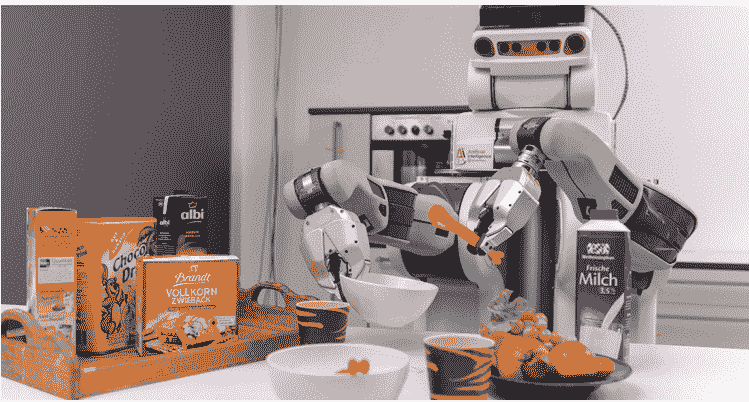

图 10.1
一台 PR2 机器人在使用 CRAM 进行启用认知的机器人操作演示期间摆放桌子。来源：德国不来仑大学 EASE 跨学科研究中心提供。


#### KnowRob 2.0

NEEMs（情节记忆）

Giskard 行动执行器

COGITO 元认知

内省 自我编程

什么、为什么、如何？回答

计划执行器

泛化行动计划
情境化行动指称词
运动计划

身体运动查询
运动规范

RoboSherlock 感知执行器

图 10.2
CRAM 认知架构。来源：德国不来梅大学 EASE 跨学科研究中心提供。

CRAM 在过去十年的发展，其中一小部分包括 Winkler 等人 (2012)、Tenorth 和 Beetz (2013)、Beetz 等人 (2015) 以及 Kunze 和 Beetz (2017)。

CRAM 计划语言（CPL）执行器是 Lisp 编程语言的扩展。它将计划的所有关键方面表示为一阶逻辑中的持久一等对象。因此，CRAM 可以对其计划进行推理，即使在运行时也是如此。这在元认知系统中尤其相关。计划指定机器人应如何响应感官事件、信念状态的变化以及计划中检测到的失败。计划的所有这些方面都可以被查询、检查和推理。计划包含一组用于动作、对象、位置和运动的抽象计划指称词——即基本运动。指称词实际上是占位符，需要根据任务动作的当前上下文在运行时进行解析。指称词的解析可以通过查询计划中嵌入的先验知识、查询 KnowRob2 知识库中的知识，或通过感知执行器访问传感器运动数据来完成。所有计划都具有相似的通用结构，如下所示。以问号开头的术语将根据机器人和环境的当前状态在运行时解析。

```
(par
  (perform
    (desig:an action)
    (type picking-up)
    (arm ?grasping-arm)
    (grasp left-side)
    (object ?perceived-object) ))
  ...
)
```

KnowRob 知识库是面向机器人代理的知识表示与推理框架（参见第 21 章）。它使用 Prolog 实现，并作为常规的一阶时间间隔逻辑知识库公开。然而，许多逻辑表达式是根据实时计算的传感器运动数据按需构建的。它为 CPL 执行器提供了实现其目标导向、确定性不足的任务计划所需的背景常识直观物理知识——例如，如何根据对象的形状、重量、柔软度和其他特性来抓取对象；在移动对象时应如何握持它——例如，保持直立以避免洒出其内容物；以及对象通常位于何处。部分知识是事先指定的，部分知识源于经验，部分知识是使用高保真虚拟现实物理引擎模拟器模拟执行候选动作的结果。所有知识均表示为一阶时间间隔逻辑表达式，并根据需要进行推理。

KnowRob2 包含嵌入在混合（即多模态）推理壳中的五个核心元素，通过基于逻辑的语言层暴露给提供感知、问答、经验获取和知识学习的接口壳。五个元素如下：
- 一组中央知识本体论和公理化；
- 一个封装机器人经验的情节记忆知识库，以次符号形式和广义符号形式表示；
- 一个内部世界知识库和虚拟现实物理引擎模拟器；
- 一个包含抽象符号传感器和动作数据、逻辑公理和推理规则的逻辑知识库；以及
- 一个包含用于参数化运动控制和路径规划的一组数据结构的虚拟知识库。

知识本体论及其相关的公理化提供了关于机器人及其环境的知识的结构化表示。存在核心本体论以及额外的特殊用途、特定于应用程序的本体论。核心本体论定义机器人配置、对象配置、机器人动作、任务、活动和行为、环境配置以及情境上下文。公理识别对象可以扮演的角色——例如，一个杯子是一个带手柄的圆柱形容器，可以作为盛放其内容物以便饮用、混合或倒出的容器。

KnowRob2 的主要区别特征之一是其对情节记忆的关注。这是机器人在过去执行任务时的经验所形成的自传体记忆。这些经验被组织为 NEEMS——叙事支持的情节记忆——这是 KnowRob2 设计者引入的概念。一个 NEEM 包含一个经验和一个叙事。经验是某一情节的详细底层记录，例如基于外感觉和本体感觉传感器数据的姿态和感知记录。它还包括控制信号。这很不寻常，因为记忆的运动方面通常存储在程序记忆中。因此，CRAM 情节记忆，尤其是 NEEMS，将情节的概念推广为包含程序元素。叙事是对任务、上下文、预期目标和观察到的效果的抽象符号描述（Beetz 等人 2018）。KnowRob2 情节记忆通过将程序性知识表示为陈述性知识，使其能够进行推理。情节知识库为回答诸如机器人执行了哪些动作、何时执行、如何执行、为何执行、是否成功、执行时机器人感知了什么以及执行时机器人相信了什么等查询提供了基础。从 NEEMS 提取广义符号知识通过与 Weka 机器学习框架（Holmes, Donkin, 和 Witten 1994）的接口得以促进。

内部世界知识库利用高质量的虚拟现实系统和物理引擎促进几何推理。这使 KnowRob2 能够模拟候选动作的结果并确定该动作的可行性。它为每个实体提供符号名称和属性，并可以推断背景知识——例如，对象存储在何处。内部世界知识库发挥两个作用：作为机器人对其自身和世界的信念状态的表示，以及作为确定候选动作结果的推理机制。因此，它封装了两类知识：关于机器人和世界的当前信念以及未来状态的预期内部模拟。它还充当学习机制，离线生成情节记忆，在物理上不活动时做梦，并运行带有不同控制参数的活动模拟。这些记录并转移到情节记忆知识库中。

逻辑知识库提供关于机器人环境中实体的信息，包括对象、对象部件、对象铰接模型以及由对象、动作和事件组成的环境。它使用一种实体描述语言，允许从符号和次符号属性两个方面对实体进行部分描述。

虚拟知识库提供可计算的谓词，促进将非符号数据集成到推理过程，允许对非符号数据进行符号查询。这使得运行时传感器运动状态能够在运行时集成到知识库中，并以与符号知识相同的方式用于推理。

KnowRob2 提供基于逻辑的语言接口，使混合推理壳可以暴露为纯符号知识库，尽管在内部它使用多种符号和次符号表示以及推理形式。通过这种方式，KnowRob2 可以被 CPL 执行器（以及通过其 OpenEASE 接口的其他系统；Beetz 等人 2015）视为一种符号面向对象查询系统，其中可以通过使用实体谓词提供实体的部分描述来检索实体。这使 KnowRob2 看起来像是一个“机器人版 Siri”（Beetz 2018）——即一个查询与响应神谕。因此，在任务执行期间，CPL 执行器与 KnowRob2 之间存在持续的对话，CPL 执行器提出一系列确定性不足的查询，KnowRob2 提供相应的响应，使 CPL 执行器能够使用行动执行器执行任务。

行动执行器通过将（CPL 执行器请求的）参数化动作实时映射到自适应轨迹来控制机器人。

感官信息可以直接来自感知执行器，也可以通过 KnowRob2 经由虚拟知识库和相关的可计算谓词间接提供给 CPL 执行器。

元认知子系统允许 CRAM 对计划进行推理，并利用变换学习和规划以两种互补的方式改进它们：通过使用日常活动实用流形（PEAMs）进行特化，以及通过元认知归纳进行泛化。之所以可能，是因为，如上文所述，计划本身被表示为一阶逻辑中的一等对象。PEAMs 通过利用日常活动和环境知识所带来的约束，捕捉成功执行动作所需的运动子空间，从而通过特化使那些在完全一般性下难以处理的问题变得可处理。通过元认知归纳进行的泛化通过探索行动计划之间的模式来补充 PEAM 解决策略，寻求以更高效、更有效的方式执行动作或以不同方式实现动作结果来转换它们。

#### 10.6.2 ISAC

ISAC——智能软臂控制——是一种混合认知架构，用于一种也称为 ISAC 的上半身人形机器人（Kawamura 等人 2008）。从软件工程角度来看，ISAC 由一个集成的软件代理及相关记忆集合构成。代理封装架构组件的所有方面，异步运行（即，没有共享时钟来使所有代理的处理保持同步），并通过相互传递消息进行通信。

如图 10.3 所示，多代理 ISAC 认知架构包括用于运动控制的激活器代理、感知代理以及用于实现反应性感知-动作控制的一阶响应代理（FRA）。它有三种记忆系统：短时记忆（STM）、长时记忆（LTM）和工作记忆系统（WMS）。

STM 具有一个以机器人为中心的时空记忆，记录当前正在经历的感知事件。这被称为感觉自我球（SES），它是机器人周围发生情况的离散表示，由一个地球测度球索引表示


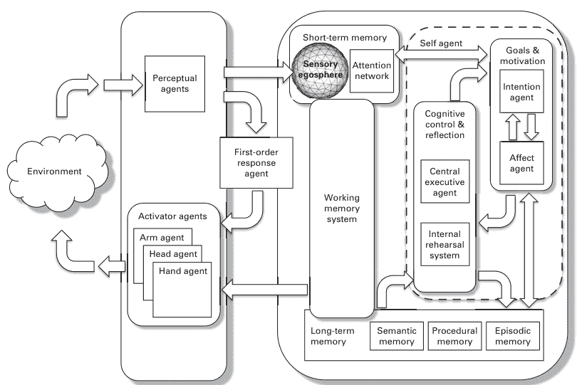

#### 图 10.3 ISAC 认知架构

通过两个角度：水平（方位角）和垂直（仰角）。STM 还具有一个注意力网络，用于确定最相关的感知事件，并将机器人的注意力引导至这些事件。

LTM 存储关于机器人已学技能和过去经验的信息。LTM 由语义记忆、情节记忆和程序记忆组成。语义记忆和情节记忆共同构成了机器人关于其已知事实的陈述性记忆。另一方面，程序记忆存储机器人可执行动作的表示。

ISAC 的情节记忆对过去经验进行抽象，并在它们之间创建链接或关联。它具有多个层级。在最低层级，一个情节经验包含关于外部情境（即来自 SES 的与任务相关的感知）、目标、情绪（在此情况下，对所感知情境的内部评估）、动作以及由动作产生的结果和对这些结果的估值（例如，它们与期望目标状态的接近程度以及因此获得的任何奖励）。情节通过封装行为的链接相互连接：从一个情节到另一个情节的转换。更高层级抽象掉特定细节，并基于较低层级的转换创建链接。这种多层级方法允许高效的记忆匹配和检索。

WMS 受脑功能神经科学模型的启发，暂时存储与当前正在执行的任务相关的信息。它为 STM 构成一种缓存内存，其存储的信息称为 chunks，封装了使用神经网络学习的未来奖励预期。

认知行为由中央执行代理（CEA）和内部预演系统（IRS）负责，IRS 是一种模拟可能动作效果的系统。CEA 和 IRS 连同由意向代理和情感代理组成的目标与动机子系统，共同构成一个称为自代理（Self Agent）的复合代理，该代理连同 FRA 一起，根据当前情境和 ISAC 的内部状态进行决策和行动。CEA 负责认知控制，基于当前注意焦点和过去经验，调用执行给定任务所需的技能。目标由意向代理提供。决策受情感代理的调制。

ISAC 的工作方式如下。通常，FRA 对感官触发做出反应性响应。然而，它还负责执行任务。当任务由人类分配时，FRA 从 LTM 的程序记忆中检索与任务信息中描述的技能相对应的技能。然后，它将其连同当前感知一起作为 chunks 放入 WMS。随后，激活器代理执行它，并在需要反应性响应时暂停执行。如果 FRA 未找到与任务匹配的技能，CEA 将接管，从情节记忆中回忆包含与当前任务类似信息的过去经验和行为。根据 SES 中的当前感知、其相关性以及由 IRS 内部模拟确定的成功执行可能性，选择一个行为-感知对。随后，这被放入工作内存，激活器代理执行该动作。

### 10.7 未来展望

认知架构的设计与实现是一项艰巨的任务。当你考虑到当代认知架构（如 Soar（Laird, Newell, 和 Rosenbloom 1987；Laird 2009, 2012）、ACT-R（Anderson 等人 2004；Anderson 1996）、CLARION（Sun 2007, 2016）和 CRAM（Beetz 等人 2010；Mösenlechner 2016））的开发花费了十年到二十年或更长时间，并且仍在不断发展时，这一事实显而易见。1 为整合认知架构研究，认知科学界已启动一项工作，以识别最突出的认知架构所共享的关键设计特征，目标是创建一个共同的认知模型（Laird, Lebiere, 和 Rosenbloom 2017），并促进更协调一致的发展并取得更大进展。无论如何，进展将取决于在多样化、充满挑战且与人类水平智能一致的现实环境中（如 Kotseruba 和 Tsotsos 2020 所述）对认知架构进行彻底评估，例如 CRAM 认知架构在日常活动科学与工程（EASE）中所针对的环境。

迫切需要更现实的感知能力，这些能力能够在存在噪声和不确定性的恶劣条件下运行，并利用上下文来提高性能。Kotseruba 和 Tsotsos 调查的近一半认知架构未实现任何视觉感知或其他感觉模态。例如，听觉、触觉和嗅觉通常以微不足道的方式处理（Kotseruba 和 Tsotsos 2020）。

认知架构还需要促进与人类更自然的沟通，以推断他们的意图和情绪状态；进行自适应、个性化的交互；读取肢体语言，例如手势和面部表情；进行自然的轮流交流；并促进人机协同行动。关注认知人机交互这些方面的认知架构示例包括 Lemaignan 等人（2017）；Sandini 等人（2018）；Tanevska 等人（2019）。

情节记忆的计算模型未获得显著关注，尤其是在终身学习方面，尽管其存在和重要性已得到广泛认可（Kotseruba 和 Tsotsos 2020）。显著的例外包括 CRAM 认知架构（Beetz, Mösenlechner, 和 Tenorth 2010；Mösenlechner 2016）以及面向情节记忆的 iCub 神经框架（Mohan, Sandini, 和 Morasso 2014）。

深度学习（Schmidhuber 2015; Goodfellow, Bengio, 和 Courville 2016）目前尚未对认知架构产生显著影响（Kotseruba 和 Tsotsos 2020）。这几乎肯定会改变，从而产生新的架构要求——例如，深度发展性机器人架构（Sigaud 和 Droniou 2016）以及深度学习与符号人工智能的调和（Garnelo 和 Shanahan 2019）。深度学习的主要优势之一是其能够产生端到端系统——即系统能直接将输入空间映射到输出空间，例如计算机视觉中的像素到类别。在机器人领域，情况不同：端到端系统必须将像素（和其他感官刺激）在动态交互环境中映射到力矩。基于静态数据集的监督深度学习在这些情况下不可行。然而，深度强化学习（Arulkumaran 等人 2017；Li 2018）能够学习端到端的机器人控制或动作策略。这种学习形式通常使用模拟器实现，在物理机器人上可能不可行。Sünderhauf 等人（2018）估计，使用模拟完成目前需要二十四小时的深度强化学习练习将需要五十三天。他们还指出，模拟与现实世界之间存在现实差距，这限制了基于模拟的深度强化学习的实用性，并讨论了一种基于迁移学习的解决方案：先在模拟环境中学习，冻结网络权重，然后再与物理机器人继续学习。另一方面，使用逼真模拟来支持认知使能机器人推理的结果（Beetz 等人 2018；Mania 和 Beetz 2019）表明，现实差距可能并不显著，且模拟方法可能是可行的。

### 10.8 结论

认知架构既捕捉抽象概念形式，也捕捉功能操作的细节，关注内部凝聚力和自包含完整性。这意味着认知所需的所有机制都属于认知架构的范畴，包括感知、注意、动作、控制、学习、推理、记忆、适应性和预期。因此，认知作为一个过程，认知架构作为一个框架，涵盖了有效行动所需的所有要素。认知架构规定了系统组件以及这些组件作为整体的动态关联方式。它既提供了认知行为的抽象模型，也为该模型的软件实例化提供了充分基础（Lieto 等人 2018）。尽管任务艰巨，但设计和实现合适的认知架构仍然是创建认知机器人不可或缺的一步。

### 附加阅读与资源

- 要深入研究认知架构领域，你可以先阅读 Kotseruba 和 Tsotsos（2020）的综述，并参考配套


网站：http://jtl.lassonde.yorku.ca/project/cognitive_architectures_survey/index.html。尽管该综述并不专门关注机器人认知架构，但仍为该领域提供了当代且全面的概述。

- Vernon、von Hofsten 和 Fadiga (2011) 的附录 A，概括了二十种认知架构的运作：Vernon, D., C. von Hofsten, 和 L. Fadiga. 2011. *人形机器人认知发展路线图*。第 11 卷，*认知系统专著*。柏林: Springer. http://www.vernon.eu/COSMOS_CAs.pdf.
- 认知机器人学导论课程（www.cognitiverobotics.net）设有多个讲座，分别介绍认知架构（总体而言）以及第 10.6.1 节中概述的 CRAM 认知架构（特别地），进一步阐述了在线 CRAM 教程中的材料：http://cram-system.org/tutorials。
- 以下软件可在线获取：例如，CRAM 认知架构：http://cram-system.org；用于认知赋能机器人代理控制的 openEASE 软件组件：https://ease-crc.org/open-ease/；以及 iCub 认知机器人平台：http://www.icub.org。
- 关于如何访问、下载和安装 CRAM 软件的说明包含在认知机器人学导论课程和 CRAM 网站（http://cram-system.org/installation）中，并附有帮助您入门的实践练习。
- 有关其他软件资源，请参阅 IEEE 认知机器人技术委员会网站上的“资源”页面：http://www.ieee-coro.org。

### 注记

- Kotseruba 和 Tsotsos (2020) 调查中认知架构项目的平均年龄约为十五年。

### 参考文献

Anderson, John R. 1996. “ACT：复杂认知的简单理论。”*美国心理学家* 51 (4): 355.

Anderson, John R., Daniel Bothell, Michael D. Byrne, Scott Douglass, Christian Lebiere, 和 Yulin Qin. 2004. “心灵的整合理论。”*心理评论* 111 (4): 1036.

Arulkumaran, Kai, Marc Peter Deisenroth, Miles Brundage, 和 Anil Anthony Bharath. 2017. “深度强化学习：简要调查。”*IEEE信号处理杂志* 34 (6): 26–38.

Atance, Cristina M., 和 Daniela K. O’Neill. 2001. “情景未来思维。”*认知科学趋势* 5 (12): 533–539.

Beetz, Michael. 2018. 个人通信。

Beetz, Michael, Daniel Beßler, Andrei Haidu, Mihai Pomarlan, Asil Kaan Bozcuoğlu, 和 Georg Bartels. 2018. “KnowRob 2.0——面向认知赋能机器人代理的第二代知识处理框架。”收录于 *2018年IEEE机器人与自动化国际会议*，512–519。纽约: IEEE.

Beetz, Michael, Dominik Jain, Lorenz Mösenlechner, 和 Moritz Tenorth. 2010. “执行日常操作活动。”*机器人与自主系统* 58 (9): 1085–1095.

Beetz, Michael, Lorenz Mösenlechner, 和 Moritz Tenorth. 2010. “CRAM——面向人类环境中日常操作的认知机器人抽象机器。”收录于 *2010年IEEE/RSJ智能机器人与系统国际会议论文集*，1012–1017。纽约: IEEE.

Beetz, Michael, Moritz Tenorth, 和 Jan Winkler. 2015. “Open-EASE——面向机器人和机器人/AI研究人员的知识处理服务。”收录于 *2015年IEEE机器人与自动化国际会议*，1983–1990。纽约: IEEE.

Borji, Ali, Dicky N. Sihite, 和 Laurent Itti. 2013. “接下来看何处？在复杂交互环境中建模顶层视觉注意。”IEEE系统、人与控制论汇刊：系统 44 (5): 523–538.

Cangelosi, Angelo, 和 Matthew Schlesinger. 2015. 发展机器人学：从婴儿到机器人。剑桥, MA: MIT出版社.

Christensen, Wayne D., 和 Clifford Alan Hooker. 2000. “智能的交互建构主义方法：自主预期学习。”哲学心理学 13 (1): 5–45.

Demiris, Yiannis, 和 Bassam Khadhouri. 2006. “动作执行与识别的分层注意多模型。”机器人与自主系统 54 (5): 361–369.

Doya, Kenji. 1999. “小脑、基底节和大脑皮层的计算是什么？”神经网络 12 (7–8): 961–974.

Duch, Wlodzislaw, Richard Jayadi Oentaryo, 和 Michel Pasquier. 2008. “认知架构：我们将走向何方？”收录于 人工通用智能2008，第一届AGI会议论文集，AGI 2008，2008年3月1–3日，孟菲斯大学，美国田纳西州孟菲斯，122–136。人工智能与应用前沿 171。阿姆斯特丹：IOS出版社。

EASE. 无日期。日常活动科学与工程。访问于2021年8月21日。https://ease-crc.org/.

Edelman, Gerald M. 2006. 第二天性：脑科学与人类知识。纽黑文, CT: 耶鲁大学出版社。

Eliasmith, Chris, Terrence C. Stewart, Xuan Choo, Trevor Bekolay, Travis DeWolf, Yichuan Tang, 和 Daniel Rasmussen. 2012. “功能大脑的大规模模型。”科学 338 (6111): 1202–1205.

Flanagan, J. Randall, 和 Roland S. Johansson. 2003. “动作观察中使用的动作计划。”自然 424 (6950): 769–771.

Flanagan, J. Randall, Gerben Rottman, Andreas F. Reichert, 和 Roland S. Johansson. 2013. “观察者在观看对象操作任务时的视线行为的作用：预测和评估动作后果。”皇家学会学报B：生物科学 368 (1628): 20130063.

Franklin, Stan, Tamas Madl, Sidney D’Mello, 和 Javier Snaider. 2014. “LIDA：认知、情感与学习的系统级架构。”IEEE自主心理发展汇刊 6 (1): 19–41.

Franklin, Stan, Uma Ramamurthy, Sidney K. D’Mello, Lee McCauley, Aragehgn Negatu, Rodrigo L. Silva, 和 Vivek Datla. 2007. “LIDA：全局工作空间理论与发展性学习的计算模型。”收录于 AAAI人工智能与意识：理论基础秋季研讨会，61–66。门洛帕克, CA: AAAI出版社。

Froese, Tom, Nathaniel Virgo, 和 Eduardo Izquierdo. 2007. “自主性：回顾与重新评估。”收录于 第4648卷，第9届欧陆人工生命大会：人工生命的进展，由 F. Almeida E. Costa, L. Rocha, E. Costa, I. Harvey, 和 A. Coutinho 编辑，455–465。柏林：Springer。

Garnero, Marta, 和 Murray Shanahan. 2019. “协调深度学习与符号人工智能：表示对象和关系。”行为科学展望 29:17–23.

Gilbert, Daniel T., 和 Timothy D. Wilson. 2007. “预景：体验未来。”科学 317 (5843): 1351–1354.

Goodfellow, Ian, Yoshua Bengio, 和 Aaron Courville. 2016. 深度学习。剑桥, MA: MIT出版社.

Hesslow, Germund. 2002. “意识思维作为行为和感知的模拟。”认知科学趋势 6 (6): 242–247.

Hesslow, Germund. 2012. “认知模拟理论的现状。”脑研究 1428:71–79.

Holmes, Geoffrey, Andrew Donkin, 和 Ian H. Witten. 1994. “Weka：机器学习工作台。”收录于 ANZIIS’94—澳大利亚新西兰智能信息系统会议论文集，357–361。纽约: IEEE.

Kawamura, Kazuhiko, Stephen M. Gordon, Palis Ratanaswasd, Erdem Erdemir, 和 Joseph F. Hall. 2008. “人形机器人认知控制的实现。”人形机器人国际期刊 5 (4): 547–586.

Kieras, Davis E., 和 Davis E. Meyer. 1997. “面向人机交互的认知与性能EPIC架构概述。”人机交互 12 (4): 391–438.

Kotseruba, Iuliia, 和 John K. Tsotsos. 2020. “认知架构40年：核心认知能力与实际应用。”人工智能评论 53 (1): 17–94.

Kunze, Lars, 和 Michael Beetz. 2017. “使用基于模拟的投影来设想机器人操作动作的定性效应。”人工智能 247:352–380.

Laird, John E. 2009. “迈向认知机器人学。”收录于 第7332卷，SPIE—无人系统技术XI论文集，P. 73320Z。贝灵厄姆, WA: 国际光电学会.

Laird, John E. 2012. Soar认知架构。剑桥, MA: MIT出版社.


- Laird, John E., Christian Lebiere, and Paul S. Rosenbloom. 2017. “心智的标准模型：迈向人工智能、认知科学、神经科学与机器人学的共同计算框架.” 《AI 杂志》38 (4): 13–26.

- Laird, John E., Allen Newell, and Paul S. Rosenbloom. 1987. “Soar：通用智能的一种架构.” 《人工智能》33:1–64.

- Langley, Pat. 2006. “认知架构与通用智能系统.” 《AI 杂志》27 (2): 33–33.

- Langley, Pat, and Dongkyu Choi. 1999 [2006]. “面向物理代理的统一认知架构.” 载于：《人工智能全国会议录》，第 21 卷，第 2 期，1469. 加利福尼亚州门洛帕克：AAAI 出版社；马萨诸塞州剑桥：MIT 出版社.

- Langley, Pat, John E. Laird, and Seth Rogers. 2009. “认知架构：研究问题与挑战.” 《认知系统研究》10 (2): 141–160.

- Lemaignan, Séverin, Mathieu Warnier, E. Akin Sisbot, Aurélie Clodic, and Rachid Alami. 2017. “面向社交人机交互的人工认知：一种实现.” 《人工智能》247:45–69.

- Li, Yuxi. 2018. “深度强化学习.” ArXiv 预印本: 1801.06339v1.

- Lieto, Antonio, Mehul Bhatt, Alessandro Oltramari, and David Vernon. 2018. “认知架构在通用人工智能中的作用.” 《认知系统研究》48:1–3.

- Lindblom, Jessica. 2015. 具身社会认知. 第 26 卷. 柏林：施普林格.

- Mania, Patrick, and Michael Beetz. 2019. “在模拟照片级真实环境中进行自我训练感知代理的框架.” 载于：2019 IEEE 国际机器人与自动化会议，4396–4402. 纽约：IEEE.

- Merrick, Kathryn Elizabeth. 2010. “机器人自我驱动探索与学习价值系统的比较研究.” 《IEEE 自主心智发展汇刊》2 (2): 119–131.

- Mohan, Vishwanathan, Ajaz Bhut, and Pietro Morasso. 2019. “无肌肉运动协同与无运动的动作：从运动神经科学到认知机器人学.” 《生命物理评论》30:89–111.

- Mohan, Vishwanathan, Giulio Sandini, and Pietro Morasso. 2014. “累积学习婴儿类人机器人情节记忆组织与灵活利用的神经框架.” 《神经计算》26 (12): 2692–2734.

- Mösenlechner, Lorenz. 2016. “认知机器人抽象机器：认知机器人学框架.” 博士论文，慕尼黑工业大学.

- Newell, Allen. 1982. “知识层.” 《人工智能》18 (1): 87–127.

- Newell, Allen. 1990. 认知的统一理论. 马萨诸塞州剑桥：哈佛大学出版社.

- Newell, Allen. 1992. “《认知的统一理论》提要.” 《行为与脑科学》15:425–492.

- Oudeyer, Pierre-Yves, Frédéric Kaplan, and Verena V. Hafner. 2007. “自主心智发展的内在动机系统.” 《IEEE 进化计算汇刊》11 (2): 265–286.

- Piaget, Jean. 1954. 儿童中现实的建构. 纽约：基础图书出版社.

- Piccinini, Gualtiero. 2010. “心智即神经软件？理解功能主义、计算主义与计算功能主义.” 《哲学与现象学研究》81 (2): 269–311.

- Ritter, Frank E., and Richard M. Young. 2001. “作为模拟用户的具身模型：关于使用认知模型改进界面设计专题的介绍.” 《人机交互国际期刊》55 (1): 1–14.

- Rosenbloom, Paul S., Abram Demski, and Volkan Ustun. 2016. “Sigma 认知架构与系统：迈向功能优雅的大统一.” 《人工通用智能期刊》7 (1): 1–103.

- Ryle, G. 1949. 心智的概念. 伦敦：哈钦森大学图书馆.

- Samsonovich, Alexei V. 2010. “迈向已实现认知架构统一目录.” 载于：《生物启发认知架构会议录》，195–244. 阿姆斯特丹：IOS 出版社.

- Sandini, Giulio, Vishwanathan Mohan, Alessandra Scutti, and Pietro Morasso. 2018. “面向人机共生的社会认知——挑战与构建基块.” 《神经机器人学前沿》12:34.

- Schacter, Daniel L., Donna Rose Addis, and Randy L. Buckner. 2008. “未来事件的情景模拟：概念、数据与应用.” 《纽约科学院年鉴》1124:39–60.

- Schacter, Daniel L., Donna Rose Addis, Demis Hassabis, Victoria C. Martin, R. Nathan Spreng, and Karl K. Szpunar. 2012. “记忆的未来：记忆、想象与大脑.” 《神经元》76 (4): 677–694.

- Schmidhuber, Jürgen. 2015. “神经网络中的深度学习：概述.” 《神经网络》61:85–117.

- Seligman, Martin E. P., Peter Railton, Roy F. Baumeister, and Chandra Sripada. 2013. “迈向未来还是受过去驱动.” 《心理科学视角》8 (2): 119–141.

- Shanahan, Murray. 2006. “一种结合内部模拟与全局工作空间的认知架构.” 《意识与认知》15 (2): 433–449.

- Sigaud, Olivier, and Alain Droniou. 2016. “迈向深度发展学习.” 《IEEE 认知与发展系统汇刊》8 (2): 99–114.

- Sterling, Peter. 2012. “稳态：一种预测性调节模型.” 《生理学与行为》106 (1): 5–15.

- Stewart, John, Oliver Gapenne, and Ezequiel A. Di Paolo. 2010. 行动认知：迈向认知科学新范式. 马萨诸塞州剑桥：MIT 出版社.

- Sun, Ron. 2004. “认知架构的期望属性.” 《哲学心理学》17 (3): 341–373.

- Sun, Ron. 2007. “认知架构的重要性：基于 CLARION 的分析.” 《实验与理论人工智能期刊》19 (2): 159–193.

- Sun, Ron. 2016. 心智解剖学：使用 Clarion 认知架构探索心理机制与过程. 牛津：牛津大学出版社.

- Sünderhauf, Niko, Oliver Brock, Walter Scheirer, Raia Hadsell, Dieter Fox, Jürgen Leitner, Ben Upcroft, et al. 2018. “深度学习在机器人学中的局限与潜力.” 《机器人研究国际期刊》37 (4–5): 405–420.

- Svensson, Henrik, Jessica Lindblom, and Tom Ziemke. 2007. “理解具身认知：面向感觉运动与认知过程共享神经机制的模拟理论.” 载于：《身体、语言与心智，第 1 卷：具身》，T. Ziemke, J. Zlatev, 和 R. M. Frank 编辑，241–269. 柏林：默顿·德古特尔出版社.

- Tanveska, Ana, Francesco Rea, Giulio Sandini, Lola Cañamero, and Alessandra Sciutti. 2019. “面向社会适应型机器人的认知架构.” 载于：2019 年 IEEE 第 9 届国际发展与学习及表观遗传机器人学联合会议，195–200. 纽约：IEEE.

- Tenorth, Moritz, and Michael Beetz. 2013. “KnowRob：面向认知赋能机器人的知识处理基础设施.” 《机器人研究国际期刊》32 (5): 566–590.

- Thórisson, Kristinn, and Helgi Helgasson. 2012. “认知架构与自主性：比较综述.” 《人工通用智能期刊》3 (2): 1–30.

- Trafton, J. Gregory, Nicholas L. Cassimatis, Magdalena D. Bugajska, Derek P. Brock, Farlie E. Mintz, and Alan C. Schultz. 2005. “利用机器人中的视角采纳实现有效的人机交互.” 《IEEE 系统、人与控制汇刊——A 部分：系统与人类》35 (4): 460–470.

- Tsotsos, John K. 2011. 视觉注意的计算视角. 马萨诸塞州剑桥：MIT 出版社.

- Tulving, Endel. 1972. “情景记忆与语义记忆.” 《记忆的组织》1:381–403.

- Tulving, Endel. 1984. “《情节记忆的要素》提要.” 《行为与脑科学》7 (2): 223–238.

- Vernon, David. 2010. “行动认知作为认知机器人学发展的概念框架.” 《行为机器人学期刊》1 (2): 89–98.

- Vernon, David. 2014. 人工认知系统——导论. 马萨诸塞州剑桥：MIT 出版社.

- Vernon, David, Giorgio Metta, and Giulio Sandini. 2007a. “iCub 认知架构：类人机器人中的交互式发展.” 载于：2007 IEEE 第 6 届国际发展与学习会议，122–127. 纽约：IEEE.

- Vernon, David, Giorgio Metta, and Giulio Sandini. 2007b. “人工认知系统综述：对计算代理心智能力自主发展的意义.” 《IEEE 进化计算汇刊》11 (2): 151–180.

- Vernon, David, Claes von Hofsten, and Luciano Fadiga. 2011. 类人机器人认知发展路线图. 第 11 卷. 柏林：施普林格科学与商业传媒.

- Vernon, David, Claes von Hofsten, and Luciano Fadiga. 2016. “发展性认知架构的期望属性.” 《生物启发认知架构》18:116–127.

- von Hofsten, Claes. 2009. “动作，认知发展的基础.” 《斯堪的那维亚心理学杂志》50:617–623.

- Vygotsky, Lev S. 1978. 社会中的心智：高级心理过程的发展. 马萨诸塞州剑桥：哈佛大学出版社.

- Wiener, Norbert. 1948. 控制论：或动物与机器中的控制与通信. 纽约：约翰·威利父子公司.

- Winkler, Jan, Georg Bartels, Lorenz Mösenlechner, and Michael Beetz. 2012. “基于知识的高层任务抽象与执行.” 载于：认知系统进步首届年会 2 (1): 131–148.


## 11 认知科学与机器人学中的具身化

汤姆·齐姆克

### 11.1 引言

当今，撰写一章关于认知科学中*具身化*概念的书章——或者更具体地说，关于认知机器人学的内容——并非易事。许多当今研究者都持有这样的信念，正如 M. Wilson (2002, 625) 所表述的，“认知过程深深植根于身体与世界的交互作用之中”，我们可以将其视为*具身认知*研究基本主张的有用初步近似。然而，这一说法对不同的人来说，却有着惊人多且惊人不同的含义。

因此，在单一章节中解释什么是具身化，面临多方面的困难：首先，具身化在认知科学领域已被讨论数十年。早期的例子包括 Lakoff 和 Johnson (1980) 关于身体隐喻在人类认知与语言中作用的研究，以及 Maturana 和 Varela (1980) 关于认知生物学的研究。此外，其中许多讨论的根源可以追溯到认知科学作为一门学科之前的几十年，例如 William James 在十九世纪末的研究。因此，这里有着漫长的历史需要覆盖。其次，在过去二十年中，具身认知已成为一种流行且或多或少属于主流的立场（例如，Clark 1999；Damasio 1999；Gallagher 2005；Ziemke et al. 2006；Pfeifer and Bongard 2007；Chemero 2009；Shapiro 2010；Black 2014；Lindblom 2015）。有人甚至会断言“具身认知正席卷全球”，正如 Shapiro (2010) 关于该主题的教材封底推荐语中所言。然而，具身认知研究尚未发展到足够成熟和主流的程度，以至于研究收敛得足以确立清晰的边界和共享定义，界定什么是或什么不是具身认知（例如，Wilson and Golonka 2013；Ziemke and Thill 2014；Ziemke 2016）。因此，有许多不同的——在某些情况下也相互冲突的——视角需要阐述。最后但同样重要的是，具身化问题在某种程度上独特地处于工程、科学和哲学的交汇点，这意味着具身性对不同的（但有重叠的）研究社群仅具有不同的意义。

后一点在认知机器人学书籍的语境下应该相对清晰（另见第 1.2 节）：一方面，存在*工程视角*（强调“认知机器人学”中的“机器人学”），即如何为特定任务赋予机器人所需的感知运动、认知和通信能力。例如，考虑一个典型的例子，如帮助老年人在家中的服务机器人，很明显，机器人的具身性——即机器人的外观、它拥有什么传感器、执行器和交互模式等——在决定其能做什么以及人们如何与它交互方面起着至关重要的作用。毕竟，例如机器人割草机和吸尘器可能非常适合其特定目的，但它们并不容易交谈。另一方面，存在（认知-）科学视角（强调“认知机器人学”中的“认知”），根据这一观点，具身（即机器人）模型如果与其试图建模的有机体共享某些身体和感知运动特征，可能优于纯计算或数学模型。例如，如果你正在研究如何模拟人类语言使用如何根植于感知运动交互，那么使用类人机器人模型可能是合理的，这些模型至少在一定程度上，在身体特征和感知运动能力方面与你试图建模的人和过程相似。第三手（使用一个故意令人困惑的身体隐喻），当然还有*哲学视角*，根据这一观点，具身认知理论和认知机器人学模型为所谓的心身问题这一古老问题提供了新的方法。

为了涵盖关于具身化的广泛视角，本章剩余部分结构如下：第 11.2 节提出了一些基本问题——例如，什么是身体，我们所说的具身化是什么意思，以及我们所说的具身认知是什么意思——并以可能有用的基本区分形式提供一些初步答案。第 11.3 节随后阐述了认知科学和心灵哲学中具身认知的基本概念。第 11.4 节将视角缩小到人工智能（AI）研究中的具身化概念，在那里，自然的一些核心问题是什么构成能够支持人工具身智能的人工身体或具身性，以及我们应当如何构建此类系统。第 11.5 节随后更具体地阐述了具身性在认知机器人学中的作用，并回到上述关于具身化不同视角的讨论。最后，第 11.6 节提供简要总结和一些结论。

需要指出的是，出于上述原因，在本章全文中，我们优先考虑广度——即，提供关于具身化及其在人类（和机器人）认知中作用的广泛视角，并将感兴趣的读者引向原始文献以进行更深入的讨论。

### 11.2 具身化与具身认知的概念

身体究竟是什么？或者更具体地说，什么构成了可能成为具身认知必要条件的那种身体——或具身性？也许有些令人惊讶的是，许多关于具身认知的讨论实际上对所涉身体的本质和作用关注得相对较少。在心理学或语言学中，这可能很自然，因为这些学科主要处理人类认知或语言等现象，显而易见，具身化讨论涉及的是*人类身体*在上述现象中所起的作用。然而，在人工智能和机器人学中，事情就不那么明显了。这就提出了问题，例如，人工智能系统如果要处理人类语言，可能需要何种具身性。在科幻领域，你可能注意到，《星球大战》中的安卓人 C-3PO 声称精通六百万种交流形式，因此 presumably 能够处理许多不同的物种，尽管他的具身性相当类人。但在今天的现实世界中，另一方面，我们中的许多人经常遇到看起来相当非具身的系统，例如谷歌翻译，或者带有一些极简且明显非人类物理“具身性”的设备，例如 Amazon Echo 或 Google Home，然而它们似乎都能在某种程度上处理人类语言。因此，让我们简要看一下关于具身认知所需身体或具身性的某些概念（遵循 Ziemke 2001, 2003b）。

#### 作为结构耦合的具身化

最广泛的具身性概念可能是：如果系统与其环境结构耦合，则该系统是具身的。结构耦合的概念最初来自 Maturana 和 Varela (1980, 1987) 关于认知生物学的研究，这将在下文详细讨论。Quick 和同事们 (1999, 340) 试图在其具身性的最小定义中将其形式化如下：“如果系统 X 与环境 E 之间存在扰动通道，则系统 X 在环境 E 中是具身的。也就是说，对于 X 和 E 同时存在的每个时刻 t，E 相对于 X 的某些可能状态子集有能力扰动 X 的状态，而 X 相对于 E 的某些可能状态子集有能力扰动 E 的状态。”这一具身性定义本身并未区分认知系统和非认知系统，Quick et al. (1999) 举出的南极苔原上的花岗岩露头被风扰动并反过来扰动气流的例子便说明了这一点。这似乎包括了几乎所有物理对象，但值得注意的是，有人认为结构耦合不一定需要物理身体。例如，Franklin (1997, 500) 明确表示：“在通常物理意义上没有身体的软件系统可以是智能的。但它们必须作为自主代理人与环境结构耦合，在处境化意义上具身。”

#### 历史性具身化

一些研究者强调，认知系统不仅在当下与环境结构耦合。它们的具身性实际上是代理-环境互动历史的结果或反映。例如，根据 Varela et al. (1991, 149)，“知识取决于处于一个与我们的身体、我们的语言和我们的社会史不可分离的世界中——简而言之，取决于我们的具身性。” Ziemke (1999, 187) 指出：“自然具身性不仅仅是物理性……它反映/体现了代理与环境之间结构耦合和共同规定的历史，身体正是在此过程中被构建的。”类似地，Riegler (2002, 347) 在其具身性定义中包含了代理随时间对环境的适应：“如果一个系统在其发展所处的环境中获得了能力，则该系统是具身的。”


#### Physical/Sensorimotor Embodiment

许多身化（机器人）AI的研究者——为了将其方法与传统 AI 区分开来——认为，正如 Pfeifer 和 Scheier（1999, 649）所阐述的，“智能不能仅仅以抽象算法的形式存在，而需要一种物理实例化，即一个身体。”这似乎排除了软件代理，但仍可能被认为包括上述花岗岩露头。然而，身化 AI 和机器人学的大多数研究者自然采用了物理身化概念的更严格版本——该版本可能被称为 _传感器运动身化_——即，身化系统需要与环境连接，不仅通过物理力，而且更具体地通过其自身的传感器和执行器。这也是 Brooks（1990）_物理基础假说_ 的精髓，根据该假说，构建智能系统需要使其表象在物理世界中得到基础，而这反过来又需要通过传感器和执行器将其与世界连接起来。

在此值得指出的是，尽管历史身化和物理/传感器运动身化可以被视为结构耦合的特例，但这两个概念都不一定互相包含或排斥。例如，Riegler（2002）指出，他关于身化的历史概念定义“并不排除物理领域之外的领域”，特别是“计算机程序也可能变得身化”，前提是它们是自我组织的结果，而非常规的人类设计和编程。

#### Organismoid Embodiment

物理和传感器运动身化的另一个、更严格的概念是，至少某些类型的有机体式认知可能仅限于有机体式身体——即具有特定结构特征或传感器运动能力的物理身体。这的一个简单早期示例是 Lund 等人（1998）使用的一种机器人，它配备了一个听觉电路和两个相互间距与其所建模的蟋蟀的两只“耳朵”相同距离的麦克风。在机器人和蟋蟀中，传感器/耳朵的布置都减少了对特定声音频率作出选择性响应所需的内部信号处理量。请注意，在此例中，蟋蟀和带轮机器人的身体当然非常不同，只有一个关键细节相同，即“耳朵”之间的距离。更近期且更复杂的有机体式身化示例可以在类人认知机器人学中找到，例如 Cangelosi 及其同事的工作，其中类人身化被视为机器人类人语言学习和使用模型的关键要素（例如，Morse et al. 2015；另见第 11.5 节）。

#### Organismic Embodiment

本节讨论的最严格的身化概念是，身化认知源于有机体（即活体身体）与其环境之间的交互。例如，Maturana 和 Varela（1980, 1987）关于认知生物学的工作简而言之表明，认知是活体系统与其环境相互作用时所做的事情。从神经科学角度来看，Damasio（1998）批评“心智与脑科学中普遍缺乏有机体概念”是一个问题，他详细阐述如下：“问题不仅在于心智与大脑之间保持着一种相当模糊的联系，还在于大脑始终与身体分离，因此不是构成复杂活体有机体的身体与大脑深度交织的网络的一部分”（Damasio 1998, 84）。情绪的躯体理论构成了“一种多层次的情感化身化心智观”（Panksepp 2005, 63），根据这一观点，情绪、认知和意识源于身体活动多个嵌套层次的稳态（自我-）调节。至少目前，这是活体系统与机器人身体之间的一个明显区别，后者通常没有自身的需求或可行性约束（例如，Bickhard 2009; Ziemke 2016），因此需要配备人工动机系统（另见第 13 章）。

除了上述不同的身化概念外，让我们还简要地看看身化认知的不同观点。M. Wilson（2002）从心理学角度区分了六种这样的观点，然而，只有最后一种明确涉及身体的作用：

- **“认知处于情境中”** 这一观点在身化认知文献中被广泛接受。M. Wilson（2002）本人区分了发生在“与任务相关的输入和输出环境中”的情境认知和“离线认知”。

- **“认知受时间压力制约”** 认知受限于与环境实时交互的要求，例如表象瓶颈（如，Brooks 1991; Clark 1997; Pfeifer and Scheier 1999）。

- **“我们将认知工作卸载到环境中”** Brooks（1990）提出了类似的主张，即“世界是其自身最好的模型。”另一个著名的例子是 Kirsh 和 Maglio（1994）对俄罗斯方块计算机游戏玩家认识行为的研究——即在世界中而非大脑中进行的决策准备性动作。

- **“环境是认知系统的一部分”** 经典例子是 Hutchins（1995）关于分布式认知的工作，例如将驾驶舱中的仪器视为认知系统的一部分。

- **“认知是为了行动”** 例如 Franklin（1995）提出的主张，他认为心智是自主代理的控制结构。

- **“离线认知以身体为基础”** 根据 M. Wilson（2002, 625），当时这一主张在认知科学文献中受到的关注最少，尽管“它实际上可能是六个主张中文档记录最完善、最有力的一个。”早期的例子是前述的 Lakoff 和 Johnson（1980, 1999）的工作，他们主张抽象概念基于植根于身体活动和经验的隐喻（例如英语表达“to grasp”，既指对物理对象的手动把握，也指对想法或概念等更抽象的把握）。更近期，底层机制已通过概念化和认知的身化模拟理论得到阐述（例如，Gallese and Lakoff 2005; Gallese 2005）。

此处值得指出的是，以某种方式，上述六种观点都涉及代理身体与其环境之间的传感器运动交互，但没有一个涉及所涉身体是否必然需要是物理的、生物的等问题。同样，从心理学或语言学角度——关注人类认知和语言——这可能是可以理解的，所涉身体的物理或生物性质可能被视为非问题。然而，Johnson（2007, x）关于语言身化研究发展的论述，最初也关注传感器运动方面，表明底层生物机制最初有些被忽视：“回首往事，我现在看到，我所关注的我们身体与环境交互的结构方面，本身取决于身体理解中更深层的维度。深入到概念、命题和句子之下，探究我们理解世界的传感器运动过程，是一个重要的步骤，但现在需要的是对使意义成为可能的品质、情感、情绪和身体过程进行更深入的探索。”

### 11.3 Embodiment in Cognitive Science

引言中提到的 M. Wilson（2002）的一般性陈述“认知过程深深植根于身体与世界的交互”，被视为身化认知研究基本主张的有用初步近似。前一节已经讨论了不同的一般身化和身化认知概念。在本节中，让我们快速了解认知科学及特别是心灵哲学中身化认知的一般理论概念。Chemero（2009）的以下简化图提供了对当前身化认知研究格局的一个有用视角（图 11.1）。正如 Chemero 指出的，存在至少两种相当不同的一般理论框架，两者都被称为“身化认知科学”。其中一种，Chemero 称之为“激进身化认知科学”，其基础是消除论、美国自然主义（如 James 和 Dewey 的工作）以及吉布森生态心理学的反表征主义和反计算主义传统。另一方面，更主流的身化认知科学版本源自长期主导认知科学的传统表征主义和计算主义理论框架，因此与这些框架仍多少相容。在认知机器人学背景下，后者可以用符号/表征基础（Harnad 1990; Ziemke 1999）这一流行概念来举例说明，而前者则更接近 Brooks（1991）和 Beer（1995）等身化 AI 研究者所倡导的反表征主义。正如 Chemero 指出的，尽管——或许正因为——主流版本的身化认知科学可以被视为其更激进对应物的“稀释版”，但它目前在认知科学中获得了显著更多的关注。

Chemero（2009）对激进身化认知的阐述可以总结为以下主张：

- 1. 身化认知的表征主义和计算主义观点是错误的。
- 2. 身化认知应使用一组特定的工具 _T_ 来解释，包括动力系统理论。
- 3. 工具集 _T_ 中的解释工具不假设心理表征。


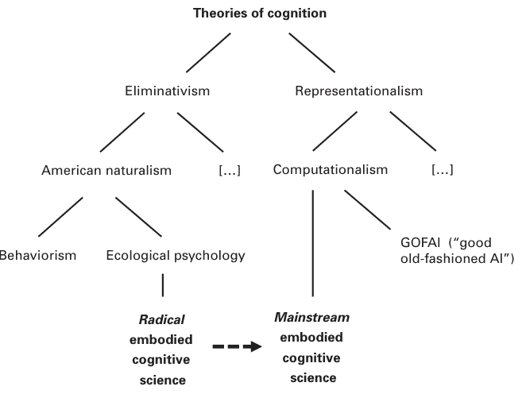

**图 11.1** 具身认知科学的当前观念及其历史根源。_来源_：改编自 Chemero 2009 和 Ziemke 2016。

不过，值得注意的是，Chemero 对具身认知中表征主义与反表征主义方法的根本且相当严格的区分，虽然提供了一种有用的视角，但不应必然被视为某种“地面真理”。首先，这种看似明确的区分显然取决于这样一个假设：即对什么究竟构成表征，多少存在一些广泛的共识。情况不一定如此（例如，Haselager et al. 2003; Svensson and Ziemke 2005）。因此，不难找到具身 AI 研究者，他们在一篇论文中拒绝表征，却在另一篇论文中主张表征的基础（例如，Brooks 1990, 1991）。其次，有人可能会认为，彻底拒绝表征有“把婴儿和洗澡水一起泼掉”的风险（用一个略显夸张的身体隐喻来说）。这意味着，虽然拒绝传统表征观念可能有充分理由，但完全拒绝表征概念可能为时过早，或者简单地是误导。例如，Bickhard (1993, 2009) 强烈批评了传统的表征观念，他将其称为 _编码主义_，但发展了一种交互主义的表征观念，这与吉布森生态心理学以及激进具身认知科学的其他元素大致一致。同样，关于情感和意识的躯体理论，如 Damasio 和 Panksepp 的工作，构成了“一种多层次的情感化具身心智观”（Panksepp 2005, 63），其中表征确实扮演核心角色。然而，在这种情况下，被认为“表征”身体活动的是大脑，而不是持有其外部环境内部表征的代理（参见 Ziemke 2016）。

虽然表征这一有争议的问题在本章中无疑过于复杂，无法解决，但在此可以指出：尽管早期大量关于具身认知（例如，Varela et al. 1991）和具身 AI（例如，Brooks 1991; Beer 1995）的工作明确是反表征主义的，但如今主流具身认知科学多多少少还是表征主义的。然而，至少存在一些具身认知的理论，它们拒绝了特征化 Chemero 图示右侧方法的功能主义/计算主义，但又并未完全拒绝表征概念。因此，如图 11.2 所示，Chemero 图示的一个修订版本，在具身 AI 和认知机器人学的语境下更为直接相关，可以基于以下区别：

- 一方面，一些方法将认知视为 (a) 具身的和 (b) 首要是一种生物现象；其中一些在某种非传统意义上是表征主义的（例如，Damasio, Bickhard），而另一些则是反表征主义的（后者大约对应 Chemero 所称的激进具身认知科学）。
- 另一方面，存在功能主义方法——如传统认知科学和 GOFAI——它们将认知视为首先是一种计算的（且是表征的）现象；在这些方法中，我们可以区分 GOFAI 的计算功能主义和 Harnad (1989) 的机器人功能主义，后者特征化了 Chemero 所概念化的主流具身认知科学的大部分（根据该观点，认知是计算性的，但其表征需要通过与环境的感知运动交互来接地；参见 Harnad 1990; Pezzulo et al. 2013）。

不用说，图 11.2 中的图表也不应必然被视为某种“地面真理”：首先，该图并不完整（例如，未包括行为主义）。其次，对表征、计算、具身等概念的理解

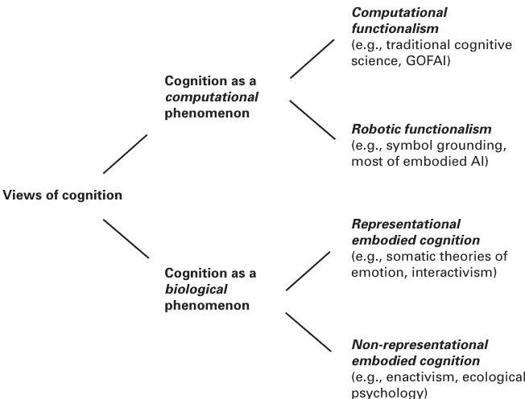

图 11.2
认知的当前观点。

显然在研究者之间差异显著。因此，认知科学和 AI 研究格局的现实比这两个图示中的任何一个都要复杂得多。

### 11.4 AI 中的具身

如前几节讨论所示，AI 中的具身问题并不简单直接。许多具身 AI 研究者，如 Brooks (1990) 和 Steels (1994)，强调物理基础的重要性，因此主张机器人 AI。另一些人，如 Franklin (1997)，认为只要软件代理处于某个环境中（例如，搜索互联网的搜索机器人）并与其结构耦合，它们也可以是具身的。此外，许多认知机器人学者在研究实践中通常使用机器人及其环境的软件仿真——例如，为了先在仿真中更快地训练计算认知模型，随后再在物理机器人上进行测试。在这些情况下，控制机器人（无论是物理机器人还是模拟机器人）的计算机程序当然大多仍然与传统 AI 的计算机程序一样具有计算性。另一种不太符合上述理论范畴的情况是 *虚拟代理*，例如它们可能出现在视频游戏中，或者特别是 *具身对话代理*。此类系统通常出现在计算机屏幕上，通常具有一个（模拟的）身体，用于与其人类用户通信，但它们通常并不实际使用这些身体与环境进行感知运动交互。因此，尽管它们与这些系统交互的人在某些意义上或某些程度上可能认为它们*看起来*是具身的，但它们实际上并不是在任何强意义上具身。

事实上，尽管具身 AI 的大部分研究起初往往是由对 GOFAI 和/或传统表征观念的拒绝所驱动，但在发展具身 AI 实践方面相对务实，而不太关注哲学或理论区别（参见 Ziemke 2004）。基于多年构建具身 AI 系统的经验，Pfeifer 和同事们（Pfeifer and Gomez 2005; 参见 Pfeifer et al. 2005; Pfeifer and Bongard 2007; Froese and Ziemke 2009）制定了一系列具身 AI 设计原则，这些原则共同可以作为具身 AI 作为研究领域的表征。首先是五个设计程序原则：

- P1—合成方法论：通过构建来实现理解。
- P2—涌现：为涌现而设计的系统通常更具适应性。
- P3—多样性-合规性：利用既定条件与产生多样性之间存在权衡。
- P4—时间视角：理解系统行为需要三种视角：“当下”，其个体发育（发展），及其种系发育（进化）。
- P5—参照系：需要区分观察到的行为和底层机制。

这些原则由八个代理设计原则补充：

- A1—三个组成部分：一个代理、其任务及其生态位。
- A2—完整代理：关注具身的、位于情境中的、自主的代理。
- A3—并行进程：异步进程，通过环境松散耦合。
- A4—感知运动协调：自我结构的/生成的感官输入。
- A5—廉价设计：系统利用其生态位和交互。
- A6—冗余：通过重叠功能实现鲁棒性。
- A7—生态平衡：内部与外部复杂性之间的平衡。
- A8—价值：系统具有驱动力、发展和自我组织。

这五加八原则可以被视为设计、构建和/或理解具身 AI 系统的指南——其中“具身”一词主要指某种形式的机器人具身以及内部控制与外部环境随时间推移的感知运动交互。作为对 *价值原则* (A8) 的阐述——在典型机器人的情况下，这一原则可能受到质疑，因为人们可能会认为这类机器人没有自身的需求或价值，鉴于它们没有需要自我维持、生存等的身体——Froese 和 Ziemke (2009) 制定了两个额外的 *交互式 AI* 设计原则：

- 1) 系统必须能够在某种描述层次上生成/维持自身的系统性身份。
- 2) 系统必须具有主动调节其与可行性约束相关的感知运动交互的能力。

具身与交互式 AI 原则之间的差异或互补性可以结合前几节所作的理论区别来理解。虽然 Pfeifer 和同事的具身 AI 原则主要强调物理/感知运动具身以及通过传感器和执行器进行的结构耦合，但交互式 AI 原则此外还强调，生命系统的有机体具身意味着由这样一个事实所产生的额外约束和要求，但也带来机会：即生物身体需要自我调节其内部过程和外部交互以保持可行性，这意味着某种身体稳态或异稳态（Froese and Ziemke 2009; 参见 Damasio and Carvalho 2013; Vernon et al. 2015; Ziemke 2016）。

### 11.5 认知机器人学中的具身

由于本章是关于认知机器人学的一本书的一部分，我们不会过多深入探讨详细定义认知机器人学（关于更详细的讨论，见第 1 章）。然而，为了讨论具身，粗略地区分科学方法和工程方法可能很有用，尽管在实践中它们当然可能重叠。

认知机器人学的工程方法可以被描述为致力于赋予机器人认知能力的一般努力，例如感知、记忆、学习或通信。这的一个示例是我们实验室及其他几个实验室在欧洲 DREAM 项目（[https://dream2020.github.io/DREAM/](https://dream2020.github.io/DREAM/)）中的近期工作，其目标是开发能够作为心理治疗一部分与自闭症儿童互动的人形机器人，目的是教授社交互动技能，如共同注意、轮流和模仿（例如，Cao et al. 2019）。这是工程方法的一个示例


方法，因为底层机制赋予机器人认知和交互能力的，大部分情况下并非*基于*人类认知模型，尽管它们当然是为匹配所涉及儿童的认知和交互能力而量身定制的。因此，机器人物理具身化的作用，与上面提到的具身对话代理的情况类似，并不在于它对机器人认知过程本身是根本性的，而在于具身化在儿童与机器人的具身社交互动中起着至关重要的作用。例如，机器人需要能够感知相同的物体，观察儿童的行为，采取行动（例如，指向物体），并以儿童能理解的方式进行交流（例如，说话）。

另一方面，认知机器人学的（认知科学）方法可以表征为使用机器人模型，其明确目的是理解人类和/或其他动物的认知和行为能力背后的机制。因此，认知机器人学对具身认知研究的贡献在于构建帮助阐明“认知过程深深植根于身体与世界的互动”这一现象诸多方式的机器人模型——这正是我们在引言中引用的M. Wilson（2002）对具身认知的表征。我们还可以粗略地区分极简主义方法，它通常试图建模认知和行为背后的一般机制或原则，以及更复杂的方法，它通常试图构建特定模型，在许多情况下旨在复制人类或动物实验中观察到的数据。

我们自己在进化机器人学中的一些工作可以说明极简主义方法：例如，Ziemke和Thieme（2002）展示了使用进化机器人学方法（Nolfi and Floreano 2000，第4章）的实验。简单的模拟轮式机器人被进化出来以处理延迟响应任务，这些任务需要“记忆”先前感知到的光源位置，以便在迷宫中找到目标位置。延迟响应任务是心理学中研究人类和其他动物工作记忆的经典范式（Malloy 2011）。在此情况下，简单机器人模型的目的不是复制身体或来自特定动物实验的数据。它是为了说明解决延迟响应任务（即，“记住”光线被感知的位置）所需的具身认知能力（记忆）如何能够从机器人最小内部机制与其环境之间的传感运动交互作用中产生，而不是从传统意义上的某些显式内部表征中产生。此类实验中使用的机器人代理人的“具身化”通常被有意地降到最低限度，这使得详细分析内部和外部机制之间的交互变得容易（参见Ziemke 2003a, 2005），而这在与动物进行的等效实验中当然是无法做到的。交互和共适应代理的另一个示例是我们的工作（Buason et al. 2005），即在捕食者-猎物场景中进化机器人代理。在这里，捕食者和猎物有机会共同进化——也就是说，在一系列代际中相互适应。简而言之，结果显示了几种在自然捕食者-猎物共同进化中也观察到的效果，例如：捕食者倾向于进化出狭窄的视野（适合追逐前方的猎物），而猎物进化出了显著更宽的视野（适合检测前方的障碍物和身后的捕食者）。与上面的延迟响应任务一样，这是另一种最小认知行为的示例（Beer 1996; Barandiaran and Moreno 2006），因为捕食者和猎物在暂时失去对方踪迹时必须“记住”对方。同样，这些模拟实验中的“具身化”被有意地保持最小化——一个模拟的简单圆形机器人身体上带有一些传感器——并且实验并未复制来自某些特定实验或物种的数据，而是提供了对捕食者-猎物身体和行为共适应的*一般*机制的洞察。

一个旨在模拟人类认知特定方面并复制人类实验数据的更复杂认知机器人学实验示例，来自Morse等人（2015）的工作。使用全尺寸人形机器人，他们复制了婴儿研究，调查身体姿势在婴儿如何学习单词和对象之间映射中的作用（见第20章）。机器人模型被用于测试这样一个假设：以身体为中心的空间位置，因此其瞬时姿态，用于绑定视觉对象及其名称的多模态特征。表明机器人模型能够复制婴儿研究的数据并产生新颖预测，这些预测随后在新的婴儿研究中进行了测试。该模型展示了名称-对象映射的记忆，在新的空间位置中使用时，如何通过身体在空间中的瞬时分布而产生。

因此，尽管上述机器人模型在所使用的机器人具身化的复杂性上存在根本差异（简单模拟轮式机器人 vs. 物理人形机器人），但它们都探讨了记忆等认知能力如何以一种具身的方式——从代理人随时间推移与其环境的传感运动交互中产生。

对具身人工智能和认知机器人学研究人员使用的“具身化”的某种令人困惑的多样性持消极看法的观点是：
- 研究人员仅仅是对具身化“是什么”尚未达成任何重要共识，和/或
- 所有现有的具身人工智能系统至多仍然是非常有限的真实版本——即，人类或其他生物体。例如，Dreyfus（2007）在其对具身人工智能的批评中论证了后一种观点，指出模拟人类认知的尝试或多或少注定失败，因为这将需要“对我们的身体和像我们一样的动机进行详细描述”，并且此类模型“没有机会在现实世界中实现”。然而，正如我们在其他地方更详细地论证过的那样（Froese and Ziemke 2009），模型的目的当然通常不是复制或（重新）实例化特定现象的全部内容，而是帮助解释它（参见Morse and Ziemke 2008; Di Paolo and Iizuka 2008）。或者，正如Froese and Ziemke（2009, 470–471）所说：“也可以认为，这种详细的建模方法起初甚至不可取，因为它并不能帮助我们理解，为什么拥有一个特定的身体会使环境中的事物对于拥有该身体的代理人来说显得重要。……换句话说，与其盲目地以尽可能多的细节和复杂性建模生物体的身体，不如确定构成一个对世界具有有意义视角的个体代理人的必要条件，这当然会更可取。”

正如哲学思维的读者此时可能已经注意到，这场讨论当然与塞尔（1980）对他所称的“弱人工智能”（即计算模型可以促进我们对人类认知的科学理解）与他所称的“强人工智能”（即计算机模型实际上可以构成或复制人类或类人认知、意识等）之间经典区别的密切关系。或者，用前几节讨论的术语来说，如果你发现自己同情功能主义/计算主义的具身认知方法，那么你可能会认为认知机器人学至少在理论上可能导致机器人“强人工智能”。功能主义立场已由Zlatev（2001, 155）明确表述，他断言：“一个与人类身体结构、交互模式和发展相似的机器人……可能重演[人类]个体发生，导致意向性、意识和意义的出现。”另一方面，如果你认为认知首先和最重要的是一种生物现象，那么你可能会认为认知机器人学仅局限于塞尔意义上的“弱人工智能”形式——即，对具身认知科学建模的一种方法，而不是强烈追求复制人类或类人认知（强意义上）。虽然“弱”这个术语听起来可能带有负面含义，但应该注意的是，它之所以弱，仅仅是因为它是两个主张（弱人工智能 vs. 强人工智能）中较弱的——或者说更现实的，一些人会说。正如本节讨论的认知机器人学模型示例所示，这种方法当然可以对我们对具身认知背后机制的科学理解做出强有力的贡献，尤其是当它作为其他科学方法和方法论的补充时使用。

### 11.6 结论

我们本章一开始就将具身化研究表征为受“认知过程深深植根于身体与世界的互动”这一观点指导（M. Wilson 2002, 625）。在人工智能和机器人学的背景下，自然会问：具有特定认知能力的人工制品可能需要什么样的身体，以及这样的系统可能如何像人类和其他动物一样，与其环境建立基础（参见Harnad 1990; Ziemke 1999）。正如第11.2节的讨论所示，关于第一个问题（什么样的身体？）存在很少的共识。答案范围从软件代理，到物理机器人，再到生物体。在第11.3节中，我们讨论说，我们可能需要区分至少两种根本不同的具身认知概念，Chemero（2009）将其称为主流具身认知科学，它继承了传统认知科学的表征主义和计算主义，以及激进的具身认知科学，它拒绝表征主义——至少根据Chemero（2009）的说法。我们提出，一个更相关的区别可能在于功能主义观（即认知首先和最重要的是一种计算现象，至少在原则上应该可以在机器人上实现）与反功能主义观（即认知首先和最重要的是一种生物现象，根本可能无法复制，至少不能用当前的机器人和计算技术）之间。如第11.4节所讨论，大部分——如果不是大多数的话——具身人工智能研究在某种程度上对这些理论区别无动于衷（参见Ziemke 2004），尽管反表征主义长期以来一直是早期具身人工智能的驱动力。相反，大量具身人工智能研究更多地由具身人工智能实践的发展所驱动——也就是说，我们如何综合和分析具身形式的（人工）智能——这里用一系列具身和本体行动式人工智能设计原则来表征。随后，第11.5节讨论了具身化在认知机器人学中的作用，并用极简主义和更复杂/人类水平的具身认知机器人模型的示例来说明了这一点，特别是记忆如何从具身代理-环境交互中产生。


从工程角度来看，这里讨论的概念和方法的多样性可能有些令人失望——我们仍然不知道如何构建《西部世界》类的人形机器人，甚至不知道是否永远能够做到。然而，从认知机器人科学作为模拟人类和动物认知的方法这一科学角度来看，方法的多样性其实颇为有前景，因为不同的方法可以相互补充。如上文示例所示，认知机器人模型既可以作为

- 理论讨论的补充（例如，通过可能的潜在机制的具体模型来帮助澄清关于“表征”的过于抽象的讨论），也可以作为

- 人类和动物认知实证研究的补充（例如，为实验的复制和分析提供更好的机会，以及提供假设检验和生成的机制）。

不过，具身认知和认知机器人科学未来研究的一个有用进展步骤，可能是对所涉及的不同“身体”或视角做出更清晰的区分。从本章的讨论中，我们可以得出结论，我们必须至少区分以下几种：

- 社会身体，即它在他人眼中呈现的样子，

- 感觉运动身体，即与环境相互作用的身体，

- 生命身体，即必须自我调节和自我维持的身体，以及

- 生活体验的身体，即由代理人自身体验的身体。

在生物系统中，这四种“身体”当然只是同一身体的不同方面，它们大致分别对应不同学科的重叠视角，如社会心理学、行为心理学/行为生物学、生物学和现象学。这些多重身体也大致对应于第一人称（生活体验的身体）、第二人称（社会身体）和第三人称（生命、感觉运动身体）视角，而这些视角是我们大部分社会认知和语言使用的基础。

此外，在生物系统中，这些多重身体在某种意义上像俄国娃娃一样嵌套，用一个最后的身体隐喻来说；也就是说，生命身体激发并调节感觉运动身体与环境的互动，进而促进并体现社会身体及其互动。然而，在具身人工智能和认知机器人科学中，那些俄国娃娃通常缺少一些：大多数机器人拥有物理/感觉运动身体，但这些身体并非由底层生命身体的需求和动机驱动。此外，人工代理人——在许多具身会话代理人的情况下最为明显——可能看起来拥有一个社会身体，尽管它不一定由感觉运动身体驱动和基于。

虽然对于认知机器人科学的研究人员来说，这一切可能相对透明，但这如何影响公众对具有认知和交互能力的机器人系统的认知（例如，Thellman 和 Ziemke 2020，2021）——尤其是它如何影响人们与多样化具身技术（如人形机器人、虚拟代理人和自动驾驶汽车）的具身社会互动（参见 Ziemke 2020）——还有待观察。那些俄国娃娃可能不容易打开。

### Additional Reading and Resources

- 关于具身心智的经典著作，也是行动认知科学的起点：Varela, F. J., E. Thompson, and E. Rosch. 1991. *The Embodied Mind: Cognitive Science and Human Experience*. Cambridge, MA: MIT Press.
- 该研究领域的广泛介绍和全面概述：Shapiro, L. 2010. *Embodied Cognition*. London: Routledge.
- 一篇以具身认知作为生物现象为重点的综述论文：Ziemke, T. 2016. “The Body of Knowledge: On the Role of the Living Body in Grounding Embodied Cognition.” *BioSystems* 148:4–11.

### References

Barandiaran, Xabier, and Alvaro Moreno. 2006. “是什么使某些动力系统具有认知性：一个最小认知组织方案。” *自适应行为* 14 (2): 171–185.

Beer, Randall D. 1995. “代理-环境交互的动力系统视角。” *人工智能* 72 (1–2): 173–215.

Beer, Randall D. 1996. “朝着最小认知行为的动力神经网络演进。” In *从动物到 Animats 4：第四届自适应行为模拟国际会议论文集*，edited by P. Maes, M. Mataric, J. A. Meyer, J. Pollack, and S. Wilson, 421–429. Cambridge, MA: MIT Press.

Bickhard, Mark H. 1993. “人类与机器中的表征内容。” *实验与理论人工智能期刊* 5 (4): 285–333.

Bickhard, Mark H. 2009. “认知科学的生物学基础。” *心理学新观念* 27 (1): 75–84.

Black, Daniel. 2014. *具身与机械化：从文艺复兴至今身体与机器的相互理解*. Farnham, UK: Ashgate.

Brooks, R. A. 1990. “大象不下棋。” *机器人与自主系统*，no. 6: 1–2.

Brooks, Rodney A. 1991. “无表征的智能。” *人工智能* 47 (1–3): 139–159.

Buason, Gunnar, Nicklas Bergfeldt, and Tom Ziemke. 2005. “大脑、身体及其之外：机器人控制器、形态与环境的竞争性共演。” *可编程与可进化机器* 6 (1): 25–51.

Cao, Hoang-Long, Pablo G. Esteban, Madeleine Bartlett, Paul Baxter, Tony Belpaeme, Erik Billing, Haibin Cai, et al. 2019. “机器人增强疗法：自闭症谱系障碍疗法中监督自主机器人系统的开发与验证。” *IEEE 机器人与自动化杂志* 26 (2): 49–58.

Chemero, Anthony. 2009. *激进的具身认知科学*. MIT Press.

Clark, Andy. 1997. *在场*. Cambridge, MA: MIT Press.

Clark, Andy. 1999. “一种具身认知科学吗？” *认知科学趋势* 3 (9): 345–351.

Damasio, Antonio R. 1998. “整合神经系统视角下的情绪。” *脑研究评论* 26 (2–3): 83–86.

Damasio, Antonio R. 1999. *所发生之事的感觉：意识形成中的身体与情感*. Boston: Houghton Mifflin Harcourt.

Damasio, Antonio, and Gil B. Carvalho. 2013. “情感的本质：进化与神经生物学起源。” *自然评论神经科学* 14 (2): 143–152.

Di Paolo, Ezequiel A., and Hiroyuki Iizuka. 2008. “如何（不）建模自主行为。” *生物系统* 91 (2): 409–423.

Dreyfus, Hubert L. 1979. *计算机不能做的事情*. Cambridge, MA: MIT Press.

Dreyfus, Hubert L. 2007. “海德格尔式人工智能为何失败，以及修复它为何需要使其更具海德格尔式特征。” *哲学心理学* 20 (2): 247–268.

Franklin, Stan. 1995. *人工心智*. Cambridge, MA: MIT Press.

Franklin, Stan. 1997. “作为具身人工智能的自主代理。” *控制论与系统* 28 (6): 499–520.

Froese, Tom, and Tom Ziemke. 2009. “行动式人工智能：探索生命与心智的系统组织。” *人工智能* 173 (3–4): 466–500.

Gallagher, Shaun. 2005. *身体如何塑造心智*. Oxford: Oxford University Press.

Gallese, Vittorio. 2005. “具身模拟：从神经元到现象体验。” *现象学与认知科学* 4 (1): 23–48.

Gallese, Vittorio, and George Lakoff. 2005. “大脑的概念：感觉-运动系统在概念知识中的作用。” *认知神经心理学* 22 (3–4): 455–479.

Goldinger, Stephen D., Megan H. Papesh, Anthony S. Barnhart, Whitney A. Hansen, and Michael C. Hout. 2016. “具身认知的贫乏。” *心理物理学公报与评论* 23 (4): 959–978.

Harnad, Stevan. 1989. “心智、机器与塞尔。” *实验与理论人工智能期刊* 1 (1): 5–25.

Harnad, Stevan. 1990. “符号根基问题。” *物理D：非线性现象* 42 (1–3): 335–346.

Haselager, Pim, André De Groot, and Hans van Rappard. 2003. “表征论与反表征论：为表象而辩的辩论。” *哲学心理学* 16 (1): 5–24.

Hutchins, Edwin. 1995. *自然中的认知*. Cambridge, MA: MIT Press.

Johnson, Mark. 2007. *身体的意义：人类理解的美学*. Chicago: University of Chicago Press.

Kirsh, David, and Paul Maglio. 1994. “区分认识论行动与实践行动。” *认知科学* 18 (4): 513–549.

Lakoff, George, and Mark Johnson. 1980. *我们赖以生存的隐喻*. Chicago: University of Chicago Press.

Lakoff, George, and Mark Johnson. 1999. *血肉之躯中的哲学：具身心智及其对西方思想的挑战*. New York: Basic Books.

Lindblom, Jessica. 2015. *具身社会认知*. Vol. 26. Berlin: Springer.

Lund, Henrik Hautop, Barbara Webb, and John Hallam. 1998. “蟋蟀鸣叫偏好机器人模型中的物理与时间尺度考量。” *人工生命* 4 (1): 95–107.

Malloy, Paul. 2011. “延迟反应任务.” In *临床神经心理学百科全书*, edited by J. S. Kreutzer, J. DeLuca, and B. Caplan. New York: Springer.

Maturana, Humberto R., and Francisco J. Varela. 1980. *自动产生与认知*. Dordrecht: Reidel.

Maturana, Humberto R., and Francisco J. Varela. 1987. *知识之树——人类理解的生物根源*. Boston: Shambhala.

Morse, Anthony F., Viridiano L. Benitez, Tony Belpaeme, Angelo Cangelosi, and Linda B. Smith. 2015. “姿态影响机器人和婴儿将单词映射到对象的方式。” *PLoS One* 10 (3): e0116012.

Morse, Anthony F., Carlos Herrera, Robert Clowes, Alberto Montebelli, and Tom Ziemke. 2011. “机器人建模在认知科学中的作用。” *心理学新观念* 29 (3): 312–324.

Morse, Anthony F., and Tom Ziemke. 2008. “论认知科学中建模的作用。” *语用与认知* 16 (1): 37–56.

Nolfi, Stefano, and Dario Floreano. 2000. *进化机器人学*. Cambridge, MA: MIT Press.

Panksepp, Jaak. 2005. “情感意识：动物与人类中的核心情感感受。” *意识与认知* 14 (1): 30–80.

Pezzullo, Giovanni, Lawrence W. Barsalou, Angelo Cangelosi, Martin H. Fischer, Ken McRae, and Michael Spivey. 2013. “计算基础认知：基础认知与计算建模之间的新联盟。” *心理学前沿* 3:612.

Pfeifer, Rolf, and Josh Bongard. 2007. *身体如何塑造我们的思维方式：一种新的智能观*. Cambridge, MA: MIT Press.

Pfeifer, Rolf, and Gabriel Gomez. 2005. “与现实世界交互：智能系统的设计原则。” *人工生命与机器人* 9 (1): 1–6.

Pfeifer, Rolf, Fumiya Iida, and Josh Bongard. 2005. “新机器人学：智能系统的设计原则。” *人工生命* 11 (1–2): 99–120.

Pfeifer, Rolf, and Christian Scheier. 1999. *理解智能*. Cambridge, MA: MIT Press.

Quick, Tom, Kerstin Dautenhahn, Chrystopher L. Nehaniv, and Graham Roberts. 1999. “关于机器人与细菌：本体独立的具身性.” In Proceedings of the 5th European Conference on Advances in Artificial Life (ECAL '99), edited by D. Floreano et al., 339–343. Berlin: Springer-Verlag.

Riegler, Alexander. 2002. “什么时候认知系统是具身的？” *认知系统研究* 3 (3): 339–348.


塞尔，约翰。1980。“心智、大脑与程序。”《行为与大脑科学》3 (3): 417–457。

夏皮罗，劳伦斯。2010。《具身认知》。伦敦：劳特利奇。

斯蒂尔斯，吕克。1994。“人工智能的人工生命根源。”《人工生命》1 (1–2): 75–110。

斯文松，亨里克，和汤姆·齐姆克。2005。“具身表征：有哪些问题？”载于《认知科学学会年会论文集》（27）。

特尔曼，萨姆，和汤姆·齐姆克。2020。“你看到的和我看到的一样吗？追踪机器人的感知信念。”《iScience》23 (10): 101625。

特尔曼，萨姆，和汤姆·齐姆克。2021。“感知信念问题：为什么可解释性是社会机器人学的一项艰难挑战。”《ACM 交互机器人事务》10 (3): 29。

汤普森，埃文。2007。《生命中的心智》。马萨诸塞州剑桥：哈佛大学出版社。

瓦雷拉，弗朗西斯科·J.，埃文·汤普森，和埃莉诺·罗施。1991。《具身心智：认知科学与人类经验》。马萨诸塞州剑桥：麻省理工学院出版社。

锡维尔，大卫，罗伯特·洛，瑟尔·蒂尔，和汤姆·齐姆克。2015。“具身认知与循环因果性：论构成性自主性在感知与行动相互耦合中的作用。”《心理学前沿》6:1660。

威尔逊，安德鲁·D.，和萨布丽娜·戈隆卡。2013。“具身认知并非你所想的那样。”《心理学前沿》4:58。

威尔逊，玛格丽特。2002。“具身认知的六种观点。”《心理科学与评论通报》9 (4): 625–636。

齐姆克，汤姆。1999。“重新思考基地化。”载于《认知科学中的表征理解》，由A·里格勒、M·佩施尔和A·冯·施泰因编辑。纽约：普雷姆出版社。

齐姆克，汤姆。2001。“机器人是具身的吗？”载于《第一届表观遗传机器人学国际研讨会论文集：机器人系统中认知发展建模》（第85卷），由C·巴尔凯尼乌斯、J·兹拉特夫、C·布雷泽尔、K·道滕哈恩和H·科津马编辑，75–83页。瑞典伦德：大学认知研究。

齐姆克，汤姆。2003a。“机器人模拟在具身认知科学中的作用。”《AISB 期刊》1 (4): 389–399。

齐姆克，汤姆。2003b。“那种名为‘具身’的东西是什么？”载于《认知科学学会第25届年会论文集》，由R·奥特曼和D·柯什编辑，1305–1310页。新泽西州马瓦：劳伦斯·埃尔尔鲍姆。

齐姆克，汤姆。2004。“具身人工智能作为科学：具身认知模型、认知的具身模型，还是两者兼有？”载于《具身人工智能》，由F·饭田、R·派弗、L·斯蒂尔斯和Y·国吉编辑，27–36页。海德堡：施普林格。

齐姆克，汤姆。2005。“控制论与具身认知：论生物体与机器人中的现实建构。”《控制论》34 (1/2): 118–128。

齐姆克，汤姆。2016。“知识之躯：论生命体在具身认知基础化中的作用。”《生物系统》148:4–11。

齐姆克，汤姆。2020。“理解机器人。”《科学机器人学》5 (46): eabe2987。

齐姆克，汤姆，和米凯尔·蒂梅。2002。“延迟反应任务中反应性感知运动映射的神经调节作为短期记忆机制。”《适应性行为》10 (3–4): 185–199。

齐姆克，汤姆，和瑟尔·蒂尔。2014。“机器人并非具身！具身概念及其对社会人机交互的影响。”载于《罗博哲学》，由约汉娜·赛比特、劳尔·哈克利和马尔科·努尔斯科夫编辑，49–52页。阿姆斯特丹：IO出版社。

齐姆克，汤姆，乔丹·兹拉特夫，和罗斯林·M·弗兰克。2006。《身体、语言与心智》第1卷：具身。柏林：莫顿·德格鲁伊特。

兹拉特夫，乔丹。2001。“人类及可能机器人中的意义发生表观发生论。”《心智与机器》11 (2): 155–195。

## 12 机器人伦理

文森特·C·缪勒

### 12.1 引言

本章将对机器人伦理进行全面介绍，特别强调人工智能（AI）与机器人技术的融合。在12.1节介绍该领域之后，12.2节的主要主题是机器人系统作为*对象*（即人类制造和使用的工具）时出现的伦理问题，主要板块包括隐私、人机交互、就业以及自主权的影响；而在12.3节，则是机器人系统作为*主体*（即在机器伦理和人工道德代理中，伦理是针对系统本身的）时的问题。这些问题中的许多涉及AI的使用，因此AI伦理将在本章中发挥作用。

对这些主题下的每个部分，我们都会对伦理问题进行一般性解释，概述现有立场和论点，然后分析这些问题在当前技术中的表现，最后探讨可能得出的政策后果。

#### 12.1.1 领域背景

机器人伦理常常关注各种“担忧”——这是对新技术的典型反应。像本文这样的文章的任务是分析问题并消除非问题。核能、汽车或塑料等某些技术，引发了伦理和政治讨论以及控制这些技术发展轨迹的重大政策努力——通常是在造成一些损害之后。

近年来，机器人伦理获得了大量媒体报道，这种报道既支持这类工作，也可能最终破坏它：媒体常常谈论，好像我们已经知道什么是符合伦理的，好像问题仅仅是未来技术将带来什么以及我们该如何应对。因此，媒体报道侧重于风险、安全（Brungade et al. 2018）以及影响预测（例如，对就业市场的影响）等考量。结果是对本质上技术性问题以及如何实现预期结果的讨论。另一个结果是，当前政策和行业中的许多讨论，侧重于形象和公共关系——其中“伦理”标签其实不过是新的“绿色”，或许被用于“伦理洗白”。要使一个问题成为机器人伦理的问题，要求我们不*容易*知道做什么是正确的。从这个意义上说，因机器导致的失业、盗窃或杀人并不是伦理问题，但这些行为在特定情境下是否被允许，*才是*这样的问题。

最后，就我们的展示而言，还需提醒一句：机器人伦理是应用伦理学中一个非常年轻的领域，充满活力，但确立的议题很少，没有权威的概览——尽管存在关于机器人伦理的调查（Lin, Abney, and Jenkins 2017; Royakkers and van Est 2016; Calo, Froomkin, and Kerr 2016; Tzafestas 2016; European Group on Ethics in Science and New Technologies 2018）。因此，本文不能简单地复述该社区迄今所取得的成果，而必须在秩序几乎不存在的地方提出一种排序。

#### 12.1.2 关于政策的说明

关于机器人伦理存在大量公共讨论，政界人士也经常发表声明，认为此事需要新的政策，但实际的技术政策难以规划和执行。它可以采取多种形式，从激励和资助、基础设施、税收或善意声明，到各种行为体的监管和法律。机器人政策可能与技术政策或一般政策的其他目标发生冲突。一个重要的实际方面是哪些行为体参与政策制定，以及哪些权力结构进行监督。

对于在伦理和政策领域工作的人来说，可能存在高估新技术的影响和威胁，同时低估当前法规能够延伸到多远（例如产品责任）的倾向。另一方面，对于企业、军队和某些行政部门来说，它们有“谈论”并保持良好公众形象的兴趣，但不愿意“采取行动”。近年来，工业化国家的政府、议会、协会和工业界已产生了报告和白皮书，其中一些还提出了善意的口号。调查请参见（Jobin, Ienca, and Vayena 2019）。

尽管实际产生的政策很少，但有一些值得注意的开端。最新的欧盟政策文件表明，“可信人工智能”应当合法、合乎伦理并在技术上稳健，并将其阐述为七项要求：人类监督、技术稳健性、隐私与数据治理、透明度、公平性、福祉和问责制（AI HLEG 2019）。目前，许多欧洲研究以“负责任的研究与创新”（RRI）为口号开展，“技术评估”自核电时代起就是一个标准领域。职业伦理也是信息技术的一个标准领域，其中包括与这里相关的问题。我们还预计，许多政策最终将涵盖机器人技术的特定用途或技术，而不是整个领域（参见 Calo 2018; Stahl, Timmermans, and Mittelstadt 2016; Johnson and Verdicchio 2017; Giubilini and Savulescu 2018; Crawford and Calo 2016）。技术的更政治性视角通常在“科学与技术研究”（STS）中讨论。正如《发明的伦理》（Jasanoff 2016）等书所示，这些担忧往往与伦理学的担忧非常相似（Jacobs et al. 2019）。

### 12.2 机器人系统使用伦理

在本节中，我们概述了人类使用AI和机器人系统（这些系统可以多或少自主）所涉及的伦理问题——这意味着我们关注某些使用会产生而其他使用不会产生的问题。然而，必须牢记，技术的设计


人造物对其使用具有伦理相关性（Houkes and Vermaas 2010；Verbeek 2011），因此除了“负责任的使用”，该领域还需要“负责任的设计”。

#### 12.2.1 人机交互

人机交互（HRI）现在高度关注伦理问题、双方感知动态以及不同利益和社会环境的复杂性，包括协同工作（例如，Arnold and Scheutz 2017）。

##### 欺骗与真实性

此处的核心问题通常涉及机器人是否涉及欺骗，或者是否侵犯人类尊严或康德关于“人性尊重”的要求（Lin, Abney, and Jenkins 2017）。人类非常容易将心理属性归因于物体，并与之产生共情，尤其是当这些物体的外表与生物相似时。这可以被用来欺骗人类（或动物），使其向机器人赋予其不应得的更多智力甚至情感意义。在这方面，一些人形机器人部分存在问题（例如，石黑浩的远程操控 Geminoids），并且有些案例明显是为了公关目的而具有欺骗性（例如，汉森机器人的“索菲亚”，伴有夸张的陈述甚至远程控制）。当然，商业伦理和法律的一些相当基本的约束也适用于机器人：产品安全与责任，或广告中的非欺骗。似乎这些现有约束可以处理提出的许多担忧。然而，有些情况下，人机交互具有看似特别人类的方面，这些方面或许无法被机器人取代：关怀、爱与性。

##### 示例 A：护理机器人

机器人在人类医疗保健中的应用目前仍处于真实环境中的概念研究阶段，但几年后可能成为可用技术，并引发了关于非人化护理的反乌托邦未来的诸多担忧（Sharkey and Sharkey 2011；Sparrow 2016）。现有系统包括支持人类护理人员（护理员）的机器人——例如，用于搬运病人或运输物资；使患者能够自己完成某些事情的机器人，例如使用机械手臂进食；以及作为陪伴和安慰给予患者的机器人（例如，“Paro”治疗海豹机器人）。概述请参见（van Wynsberghe 2016；Fosch-Villaronga and Albo-Canals 2019；Norskov 2017），用户调查请参见 Draper et al.（2014）。

护理问题成为焦点的一个原因是，有人认为我们将在老龄化社会需要机器人。该论点存在有问题的假设——即，随着寿命延长，人们将需要更多护理，而且无法吸引更多人投身护理职业。这也可能显示出对年龄的偏见（Jecker 2020）。最重要的是，它忽视了自动化的本质，自动化不仅仅是关于取代人类，而是关于让人类工作更高效。这里是否真正存在问题尚不清楚，因为讨论主要集中在机器人使护理非人化的恐惧上，但实际和可预见的护理机器人是作为辅助机器人进行技术任务的经典自动化。因此，它们在行为意义上只是“执行所需任务的护理机器人”，而不是在人类“关怀”患者的意义上。似乎“被关怀”的成功依赖于这种有意识的“关怀”，而可预见的机器人无法提供。如果有什么风险的话，护理中机器人的风险是这种有意识关怀的*缺失*——因为可能需要更少的人类护理人员。有趣的是，照顾某样东西，甚至是一个虚拟代理，对照顾者自身也是有益的（Lee et al. 2019）。一个假装关怀的系统将是欺骗性的，因此是有问题的——除非欺骗被足够大的效用收益所抵消（Coeckelbergh 2016）。一些在基本层面假装“关怀”的机器人已经可用（Paro 海豹），其他机器人正在开发中。也许在某种程度上，感受到来自机器的关怀在某些情况下可以算作进步？

##### 示例 B：性机器人

几位技术乐观主义者认为，人类很可能会对与机器人发生性关系和陪伴感兴趣，并对此感觉良好（Levy 2007）。考虑到人类性偏好的多样性，包括性玩具和性娃娃，这似乎非常可能：问题是是否应该制造和推广此类设备，以及在这个敏感领域是否应该对使用设定限制。近年来，这似乎已进入“机器人哲学”的主流（Sullins 2012；Danaher and McArthur 2017；Sharkey et al. 2017；Bendel 2018；Devlin 2018）。

人类长期以来对物体有着深厚的情感依恋，因此与可预测的人形机器人建立陪伴甚至爱情可能很有吸引力，尤其是对那些与真实人类相处困难，并已经更喜欢狗、猫、鸟、电脑或电子宠物的人。Danaher（2019b）反驳 Nyholm and Frank（2017）认为，这可以是真正的友谊，因此是一个有价值的目标。这种友谊肯定看起来可能会增加整体效用，即使缺乏深度。在所有这些领域，都存在欺骗问题，因为机器人（目前）无法真心实意地说话或对人类产生感情。众所周知，人类容易将情感和思想归因于表现得好像有感知力的实体，甚至归因于完全没有任何行为的明显无生命物体。此外，为欺骗付费似乎是传统性产业的基本组成部分。

最后，还有常常伴随性问题的担忧——即同意（Frank and Nyholm 2017）、审美问题，以及担心人类可能会被某些经历“腐化”。尽管这看起来可能很老套，但人类行为受经验影响，色情制品或性机器人很可能支持将其他人视为单纯的欲望对象，甚至视为虐待的接受者，从而破坏更深层的性与色情体验。反对性机器人运动认为，这些设备是奴隶制和卖淫的延续（Richardson 2016）。

#### 12.2.2 自动化对就业的影响

似乎很明显，AI 和机器人技术将带来生产率的显著提高，从而带来整体财富的增长。提高生产率的尝试可能始终是经济的一个特征，尽管对“增长”的强调是现代现象（Harari 2016，240）。然而，通过自动化实现的生产率提高通常意味着相同产出所需的人类更少。然而，这并不一定意味着总体就业的损失，因为可用财富增加，这可以充分增加需求以抵消生产率提高。从长远来看，工业社会中更高的生产率带来了更多的整体财富。过去曾发生过重大的劳动力市场动荡——例如，1800 年，农业在欧洲和北美雇佣了超过 60% 的劳动力，而到 2010 年，它在欧盟雇佣了约 5% 的劳动力，在最富裕的国家甚至更少（Anonymous 2013）。在 1950 年至 1970 年这二十年间，英国受雇农业工人的数量减少了 50%（Zayed and Loft 2019）。这些动荡中的一些导致劳动密集型产业转移到劳动力成本较低的地方——这是一个持续的过程。

经典自动化取代人类肌肉，而数字自动化取代人类思维或信息处理——与物理机器不同，数字自动化的复制成本非常低（Bostrom and Yudkovski 2014）。这可能意味着劳动力市场发生更根本的变化。那么主要问题是：这一次是否不同？新工作和财富的创造是否能跟上工作的消失？即使没有不同，过渡成本是多少，由谁承担？例如，低成本地区是否会受损，而高成本地区是否会从这种发展中获益？我们是否需要进行社会调整，以实现数字自动化成本和收益的公平分配？

对机器人和 AI 导致失业问题的反应，从惊慌失措（Frey and Osborne 2013；Westlake 2014）到中立（Metcalf, Keller, and Boyd 2016；Calo 2018；Frey 2019），再到乐观（Brynjolfsson and McAfee 2016；Harari 2016；Danaher 2019a）。原则上，自动化对劳动力市场的影响似乎被相当充分地理解为涉及两个渠道：“（i）不同技能工人与新技术之间相互作用的性质，影响劳动力需求，（ii）通过随之而来的劳动力供给和产品市场变化带来的技术进步的均衡效应”（Goos 2018，362）。自动化导致的当前劳动力市场现象似乎是“就业两极分化”或“哑铃”形状（Goos, Manning, and Salomons 2009）：高技能技术工作供不应求且报酬高，低技能服务工作供不应求但报酬低，但工厂和办公室的中级资格工作——即大多数工作——承受压力并减少，因为它们相对可预测，最有可能被自动化（Baldwin 2019）。

也许巨大的生产率增长使得“休闲时代”得以实现，凯恩斯（1930）预测这将发生在 2030 年左右，假设年增长率为 1%？实际上，我们已经达到了他预计 2030 年的水平，但我们仍在工作——消费更多，并发明越来越多的组织层级。哈拉里解释了这种经济发展如何使人类战胜饥饿、疾病和战争，而现在我们通过 AI 追求不朽和永恒的幸福，因此他的书名为《未来简史》（Homo Deus）（Harari 2016，75）。

从一般意义上说，失业问题是关于社会商品应如何公正分配的问题。一种标准观点认为，分配正义应当从“无知之幕”后方理性地决定（Rawls 1971）——也就是说，仿佛不知道自己在社会中将处于什么位置（劳动者或工业家，等等）。Rawls 认为，所选原则随后将支持基本自由，并支持对社会中最不利成员最有利的分配。似乎，机器人经济有三个特征使得这种正义不太可能实现：首先，它在很大程度上不受监管的环境中运作，责任往往难以分配。其次，它在具有“赢家通吃”特征的市场中运作，垄断会迅速发展。第三，数字服务行业的“新经济”基于无形资产，也称为“无资本的资本主义”（Haskell and Westlake 2017）。这意味着，很难控制那些不依赖


位于特定地点的实体工厂。这三个特征似乎表明，如果我们将财富分配交给自由市场力量，结果将是一个高度不公正的分配。而且这确实是我们已经可以看到的发展。

一个尚未得到足够关注的有趣问题是，机器人技术的发展是否在环境上可持续。与所有计算系统一样，它们产生的废物非常难以回收，并且消耗大量能源，尤其是用于机器学习系统的训练（甚至包括加密货币挖矿）。再次出现的是，一些代理人将成本转嫁给整个社会。

#### 12.2.3 隐私与监控

在信息技术领域，关于隐私与监控的普遍讨论（例如，Macnish 2017；Roessler 2017），主要涉及对私人数据和可识别个人身份数据的访问。隐私有几个被广泛认可的方面——例如，“不受干扰的权利”、信息隐私、作为人格一面的隐私、对自身信息的控制以及保密权（Bennett and Raab 2006）。隐私研究历史上一直关注情报机构的国家监控，但现在包括其他国家机构、企业甚至个人的监控。在过去几十年里，技术发生了巨大变化，而监管反应迟缓（尽管有 GDPR [2016]）。结果是一种无政府状态，被最有力的参与者所利用——有时公开进行，有时秘密进行。

数字领域已大幅扩大：所有数据收集和存储现在都是数字化的，我们的生活越来越数字化，大多数数字数据都连接到单一互联网，周围有越来越多的传感技术生成关于我们生活非数字方面的数据。同时，在数字世界中，控制谁收集哪些数据、谁有权访问，比在纸张和电话通话的模拟世界中要困难得多。每一种新技术都会放大已知的问题。例如，照片和视频中的人脸识别允许识别，从而实现对个人的画像和搜索（Whittaker et al. 2018, 15ff）。结果是“在这个浩瀚的数据海洋中，我们有一个可怕的完整图景”（Smolan 2016, 1:1），这一丑闻至今仍未得到应有的公众关注。

我们留下的数据痕迹正是支付我们“免费”服务的方式，但我们并未被告知这种数据收集及其价值，而且我们被操纵着留下越来越多此类数据。在这个“监控经济”中，社交媒体、游戏和大部分互联网的主要焦点是获取、维持和引导注意力——从而获得数据供应。这种监控和注意力经济有时被称为“监控资本主义”（Zuboff 2019）。

此类系统往往会揭示我们自己希望压抑或并未意识到的关于我们自身的事实。在其畅销书《未来简史》的最后一句话中，Harari（2016）询问人工智能的长期后果：“当非意识但高度智能的算法比我们更了解我们自己时，社会、政治和日常生活将会发生什么？”

机器人设备在该领域尚未发挥重大作用，除安全巡逻外，但一旦它们在工业环境之外更加普及，情况就会改变。与物联网、“智能”系统（手机、电视、烤箱、灯、虚拟助手、家居……）、“智慧城市”（Sennett 2018）和“智能治理”一起，它们将成为数据收集机器的一部分，提供更详细、不同类型的实时数据，并包含越来越多的信息。

能够在很大程度上隐藏个人或群体身份的隐私保护技术，如今已成为数据科学的标准配置；它们包括（相对）匿名化、访问控制（加上加密）以及其他不需要访问完整未加密输入数据即可进行计算的模型（Stahl and Wright 2018），在“差分隐私”的情况下，是通过向查询输出添加校准噪声来实现的（Dwork et al. 2006; Abowd 2017）。尽管这类技术需要更多努力和成本，但它们可以避免许多隐私问题。一些公司也将更好的隐私视为一种可以利用并以价格出售的竞争优势。

#### 12.2.4 自主系统

##### 自主性一般

在自主系统的讨论中可以找到几种自主性概念。一种较强的概念涉及哲学辩论，其中自主性是责任和人格的基础（Christman 2018）。在此语境下，责任意味着自主性，但反之不成立，因此有些系统可以具有技术自主性的程度，而不会引发责任问题。机器人领域中较弱、更偏技术的自主性概念是相对的和渐进的：一个系统被认为相对于人类控制在某个程度上具有自主性（Müller 2012）。这里与人工智能中偏见和不透明的问题存在类比，因为自主性也涉及权力关系：谁在控制，谁负责？

一般而言，一个问题是，自主机器人是否引发了需要修订现有概念方案的问题，还是只需要技术调整。在大多数司法管辖区，都有成熟的民事和刑事责任体系来解决此类问题。技术标准——例如，医疗环境中机械的安全使用——可能需要调整。针对这类安全关键系统和“安全应用”，已经存在“可验证的人工智能”领域。IEEE 和 BSI 等机构已经制定了“标准”，特别是针对更技术性的子问题，如数据安全和透明度。在陆地、水上、水下、空中或太空中的众多自主系统中，我们讨论两个样本：自主车辆和自主武器。

##### 示例 A：自主车辆

自主车辆承诺减少人类驾驶目前造成的非常重大的损害——每年约有一百万人丧生，更多人受伤，环境受到污染，大地被混凝土和沥青封闭，城市停满汽车，等等。然而，似乎存在关于自主车辆应如何行为，以及责任和风险应如何在车辆运行的复杂系统中分配的问题。（关于完全自主或“5 级”汽车 [SAE 2015] 的开发实际上需要多长时间，也存在重大分歧。）

在此语境下，有关于“电车难题”的一些讨论。在经典的电车难题（Thompson 1976; Woolard and Howard-Snyder 2016，第 2 节）中，提出了各种两难困境。最简单的版本是：一辆电车正驶向轨道上的五个人，除非将电车转入侧轨，否则会撞死他们。然而，那条侧轨上有一个人，如果电车驶入该侧轨，这个人会被撞死。这个例子源自 Foot（1967, 6）中的一段论述，他讨论了一系列行动的容忍后果与预期后果不同的两难案例。电车难题并非旨在描述实际的伦理问题或通过“正确”选择来解决，相反，它们是思想实验，其中选择被人为限制为少量有限的不同一次性选项，且代理人拥有完美知识。这些问题被用作理论工具来探究伦理直觉和理论——特别是主动做某事与允许某事发生之间的区别，预期后果与容忍后果之间的区别，以及后果论与其他规范性方法之间的区别（Kamm and Rakowski 2016）。这类问题让许多人想起了实际驾驶和自主驾驶中遇到的问题（Lin 2015）。然而，实际驾驶员或自动驾驶汽车很可能永远不需要解决电车难题（但见 Keeling 2019）。虽然自动驾驶汽车的电车难题受到了大量媒体关注（Awad et al. 2018），但它们似乎对伦理理论或自主车辆编程都没有提供任何新内容。

驾驶中更常见的伦理问题，如超速、危险超车、不保持安全车距等，是追求个人利益与共同利益之间的经典问题。其中绝大多数都受到驾驶法律法规的约束。将汽车编程为“按规则行驶”而非“按乘客利益行驶”或“为实现最大效用”，因此沦为编程伦理机器的标准问题（参见第 3.1 节）。可能还有额外的酌情礼貌规则以及何时打破规则的有趣问题（Lin 2015），但这似乎更多是将标准考量（规则 vs. 效用）应用于自主车辆的案例。

该领域的显著政策努力包括德国联邦交通和基础设施部（2017）的报告，该报告强调*安全*是首要目标。第 10 条规定：“在自动化和联网驾驶系统的情况下，此前完全由个人承担的责任，已从驾驶员转移到技术系统的制造商和运营商，以及负责基础设施、政策和法律决策的机构”（参见 3.2.1）。由此产生的德国和欧盟关于自动化驾驶许可的法律比美国的相应法律限制得多，在美国，一些公司将“在消费者身上测试”作为一种策略——未经消费者或可能受害者的知情同意。

##### 示例 B：自主武器

自动化武器的概念相当古老：“例如，与其部署简单的制导导弹或远程驾驶载具，不如发射完全自主的陆、海、空载具，能够执行复杂的远程侦察和攻击任务”（DARPA 1983, 1）。该提案当时被嘲笑为“幻想”（Dreyfus, Dreyfus, and Athanasiou 1986, ix），但如今已成为现实，至少对于更容易识别的目标（导弹、飞机、船舶、坦克等）而言是这样，但对于人类战斗人员则不然。反对（致命）自主武器系统（AWS 或 LAWS）的主要论点是，它们支持超法外杀戮，将责任从人类手中夺走，并使战争或杀戮更有可能发生——有关问题的详细列表见（Lin, Bekey, and Abney 2008, 73–86）。

看来，降低使用此类系统（自主车辆、“发射即忘记”导弹或装载炸药的无人机）的门槛，并降低被追究责任的概率，将增加其使用的概率。一方可以毫无惩罚地杀戮，因此几乎没有理由不这样做的这种关键不对称性，已经


存在于常规无人机战争中，使用远程控制武器（例如，美国在巴基斯坦）。很容易想象一架小型无人机，它搜索、识别并杀死个别人类——或者某种人类。这些是“阻止杀戮机器人运动”和其他活动团体提出的案例类型。有些似乎相当于说自主武器确实是武器，而武器会杀人，但我们仍然以数量巨大的规模制造它们。关于问责问题，自主武器可能使识别和起诉责任方变得更加困难，但鉴于可以保存的数字记录，至少在常规战争中，这一点并不明确。分配惩罚的困难有时被称为“报复差距”（Danaher 2016）。

另一个问题似乎是，在战争中使用自主武器会让战争变得更糟，还是也许会变得不那么糟糕？如果机器人减少了战争罪行和战争中的罪行，答案可能是肯定的，这不仅被用作支持这些武器的论点（Arkin 2009; Müller 2016），也被用作反对这些武器的论点（Amoroso and Tamburrini 2018）。可以说，主要威胁不在于常规战争中使用此类武器，而在于非对称冲突或非国家行为者（包括罪犯）使用这些武器。

还有人说，自主武器无法符合国际人道法，该法要求在军事冲突中遵守区分原则（战斗人员与平民之间）、比例原则（武力）和军事必要性原则（武力）（Sharkey 2019）。诚然，战斗人员与非战斗人员之间的区别难以辨别，但民用船舶与军用船舶之间的区别却很容易看出——所以这一切所表达的只是，如果此类武器确实违反人道法，我们就不应当制造和使用它们。还有人提出额外担忧，认为被自主武器杀死威胁人类尊严，但即使是这些武器禁令的支持者似乎也认为这些论点并不有力：“还有其他武器和技术也会损害人类尊严。鉴于此，以及这一概念固有的歧义性，在反对AWS的论证中，明智的做法是引用几种类型的异议，而不完全依赖人类尊严。”（Sharkey 2019）

关于让人类“在回路中”或“在回路上”参与武器的军事指导，已有大量讨论——这些阐述“有意义控制”的方式在Santoni de Sio和van den Hoven（2018）中有所讨论。关于为自主武器的杀戮分配责任的困难，已经有过讨论，并提出了“责任差距”（尤其是Sparrow 2007）的概念，意味着人类和机器都可能不承担责任。另一方面，我们并不认为每个事件都必须有人对该事件负责，真正的问题可能是风险的分配（Simpson and Müller 2016）。风险分析（Hansson 2013）表明，识别谁面临风险、谁是潜在受益者以及谁做出决策至关重要（Hansson 2018, 1822–1824）。

### 12.3 机器人系统伦理

#### 12.3.1 机器伦理

机器伦理是关于机器的伦理，关于“伦理机器”，以及关于机器作为主体而非作为人类使用的对象的伦理。这通常并不十分清楚，它是应涵盖所有机器人伦理，还是只是其中的一部分（Floridi和Saunders 2004；Moor 2006；Wallach和Asaro 2017；Anderson和Anderson 2011）。有时看起来，这里似乎存在一种（可疑的）推断：如果机器以与伦理相关的方式行动，那么我们就需要机器伦理。因此，有些人使用更广泛的概念：“机器伦理关注的是确保机器对人类用户，也许还对其他机器的行为在伦理上是可接受的”（Anderson和Anderson 2007, 15）。这可能包括仅仅是产品安全等问题。机器伦理中的一些讨论做出了非常重大的假设：机器在某种意义上可以成为对其行为负责的伦理主体，或者“自主道德主体”（参见van Wynsberghe和Robbins 2019）。机器伦理的基本思想现在正在进入实际机器人领域，在那里，通常不假设这些机器在任何实质意义上都是人工道德主体（Winfield等人 2019）。有时有人观察到，一个被编程为遵循伦理规则的机器可以很容易地被修改为遵循不道德的规则（Vanderelst和Winfield 2018）。

机器伦理可能采取“法律”形式的想法，由艾萨克·阿西莫夫（1942）著名地进行了研究，他提出了“机器人三定律”：第一定律——机器人不得伤害人类，或因不作为而允许人类受到伤害。第二定律——机器人必须服从人类给予的命令，除非该命令与第一定律冲突。第三定律——机器人必须保护自身存在，只要这种保护不与第一定律或第二定律冲突。阿西莫夫随后在若干故事中展示，这三条定律之间的冲突将使其使用变得有问题，尽管它们具有层级组织。

目前尚不清楚是否存在一致的“机器伦理”概念，因为较弱的版本有可能将“拥有伦理”简化为通常不被认为充分的概念（例如，没有“反思”，甚至没有“行动”）；而朝着人工道德主体发展的较强概念可能描述一个——目前——空集。

#### 12.3.2 人工道德主体

如果将机器伦理理解为在某种实质意义上涉及道德主体，那么这些主体可以被称为“人工道德主体”，拥有权利和责任。然而，关于人工实体的讨论挑战了伦理学中的许多常见概念，将这些概念从人类案例中抽象出来加以理解可能非常有用（参见Powers和Ganascia，即将发表；Misselhorn 2020）。

一些作者使用“人工道德主体”的含义要求较低，借用了软件中“代理人”的用法，在这种情况下责任和权利问题不会出现（Allen、Varner和Zinser 2000）。James Moor（2006）区分了四种机器代理人：伦理影响代理人（例如：机器人骑师）、隐式伦理代理人（例如：安全自动驾驶仪）、显式伦理代理人（例如：使用正式方法来估计效用）和完全伦理代理人（“可以做出显式伦理判断，并且通常能够合理地辩护它们。普通成年人是完全伦理代理人”）。已经提出了几种实现“显式”或“完全”伦理代理人的方法，通过编程实现（操作道德），通过“发展”伦理本身（功能道德），最后是具有完全智能和感觉的成熟道德（Allen、Smit和Wallach 2005；Moor 2006）。被编程的代理人有时不被视为“完全”代理人，因为它们是“胜任但无理解”，就像大脑中的神经元一样（Dennett 2017；Håkli和Mäkelä 2019）。

在这些讨论中，“道德患体”的概念发挥着作用：伦理*主体*有责任，而伦理*患体*拥有权利，因为对他们造成伤害很重要。显然，有些实体是患体而非主体——例如，能够感受疼痛但无法做出合理选择的简单动物。另一方面，通常理解所有主体也将是患体（例如，在康德框架中）。通常，被认为是“人”才是使实体成为负责任的主体，即可以负有义务并成为伦理关注对象的人，这种人格通常是一种与自由意志（Frankfurt 1971; Strawson 2005）以及拥有现象意识相关的深层概念。Torrance（2011）建议，“人工（或机器）伦理可以定义为设计机器，使其做那些当由人类做时，构成这些人类拥有‘伦理地位’的标准的事情”——他将其理解为“伦理*生产力*和伦理*接纳性*”——这是他对道德主体和患体的表述。

#### 机器人的责任

普遍共识认为，问责、责任和法治是面对新技术时必须维护的基本要求（欧洲科学与新技术伦理组织 2018, 18），但问题是如何做到这一点，以及如何分配责任。如果机器人行动，它们本身会对其行为负责、承担责任或承担问责吗？还是风险分配或许应优先于责任讨论？

责任的传统分配已经存在：汽车制造商负责汽车的技术安全，驾驶员负责驾驶，机械师负责适当的维护，公共机构负责道路的技术状况，等等。一般来说，“基于AI的决策或行动的影响，往往是许多参与者（包括设计师、开发者、用户、软件和硬件）之间无数互动的结果……伴随分布式代理而来的是分布式责任”（Taddeo和Floridi 2018, 751）。这种分配可能如何发生并非机器人领域特有的问题，但在此背景下显得尤为紧迫（Nyholm 2018a, 2018b）。

#### 机器人的权利

一些作者表明，是否应该为当前机器人分配权利应当受到严肃考虑（Gunkel 2018a, 2018b; Turner 2019; Danaher 2020）。这一立场在很大程度上似乎依赖于对反对者的批评，以及机器人和其他非人格有时被视为拥有权利这一经验观察。沿着这一思路，有人提出了一种“关系转向”：如果我们像机器人拥有权利那样与它们相处，那么我们或许最好不要去搜寻它们是否“真的”拥有此类权利，而应该假设它们拥有（Coeckelbergh 2010, 2012, 2018）。这引发了一个问题：这种反实在论或准实在论可以走多远，在以人为中心的方法中说“机器人拥有权利”意味着什么（Gerds 2016）。在辩论的另一边，Bryson（2010）用一个有用（但她承认有问题）的口号坚持认为“机器人应该是奴隶”——即不享有权利，尽管她认为这是一种可能性（Gunkel和Bryson 2014）。

还有一个完全独立的问题：是否应该赋予机器人（或其他AI系统）“法律实体”或“法律人”的地位——在这里，自然人以及国家、企业或组织都是“实体”，可以拥有法律权利和义务。欧洲议会已考虑将此类地位分配给机器人，以便处理


与民事责任（欧洲议会 2016；Bertolini and Aiello 2018）不同，刑事责任仅保留给自然人。也有可能只向机器人分配某些权利和义务的子集。有人说：“此类立法行动在道德上是不必要的，在法律上是麻烦的”，因为这不会服务于人类的利益（Bryson, Diamantis, and Grant 2017, 273）。在环境伦理学中，关于树木等自然物体的法律权利存在长期讨论（Stone 1972）。还有人认为，未来开发拥有权利的机器人或人工道德对象的理由在伦理上值得怀疑（van Wynsberghe and Robbins 2019）。在“人工意识”研究者社区中，关于创造这种意识是否道德存在重大担忧，因为这很可能意味着对有感知生物的伦理义务——例如，不伤害它，也不通过关闭它来终止其存在。一些作者呼吁“暂停合成现象学”（Bentley et al. 2018, 28f）。

### 12.4 结论

令人瞩目的是，自 20 世纪 50 年代这些学科诞生之初，机器人学和人工智能的想象或“愿景”就一直扮演着核心角色。而对这一愿景的评估也经历了巨大的变化：短短几十年内，我们从“人工智能是不可能的”（Dreyfus）和“人工智能只是自动化”（Lighthill 1973）的口号，转变为“人工智能将解决所有问题”（Kurzweil 1999）和“人工智能可能会毁灭我们所有人”（Bostrom 2014）。这引起了媒体关注和公关努力，但也带来了一个问题：这种“人工智能与机器人哲学与伦理学”中有多少实际上是一种想象的技术。正如我们一开始所说，人工智能和机器人提出了根本问题：我们应该如何使用这些系统，这些系统本身应该做什么，以及它们长期面临什么风险。它们还挑战了人类作为地球上智慧和占主导地位物种的自我观。我们已经看到了提出的问题，并且必须密切关注技术和社会发展，以便尽早发现新问题，并进行哲学分析，同时辩论哲学的传统问题。

### 致谢

本章与同一作者的一篇文章有重大重叠：Müller, Vincent C. 2020. “人工智能与机器人伦理学。”载于 Edward N. Zalta 编 *斯坦福哲学百科全书*，1–70。帕洛阿尔托：CSLI，斯坦福大学。https://plato.stanford.edu/entries/ethics-ai/——感谢许多同事对该版本提出的意见。

这篇文章的部分工作获得了欧委会在 INBOTS 项目（H2020 编号 780073）下的支持。

### 进一步阅读与资源

- 关于人工智能存在性风险的经典著作：Bostrom, Nick. 2014. *超级智能：路径、危险、战略*. Oxford: Oxford University Press.
- 机器伦理简明经典入门：Moor, James H. 2006. “机器伦理的性质、重要性与困难。” IEEE Intelligent Systems 21 (4): 18–21.
- 机器人伦理教科书：Royakkers, Lambèr, and Rinie van Est. 2016. 普通机器人：从爱到战争的自动化. Boca Raton: CRC Press; Taylor and Francis.
- 欧洲人工智能伦理通讯（Charlotte Stix）：https://www.charlottestix.com/europeanaarchive。

### 参考文献

- Abowd, John M. 2017. “当所有数据都私有时，统计机构将如何运作？” Journal of Privacy and Confidentiality 7 (3): 1–15.
- AI HLEG. 2019. “人工智能高级别专家组：可信人工智能伦理准则。” 欧洲委员会。最后修改于 2021 年 3 月 8 日。https://digital-strategy.ec.europa.eu/en/library/ethics-guidelines-trustworthy-ai.
- Allen, Colin, Iva Smit, and Wendell Wallach. 2005. “人工道德：自顶向下、自底向上及混合方法。” Ethics and Information Technology 7 (3): 149–155.
- Allen, Colin, Gary Varner, and Jason Zinser. 2000. “任何未来人工道德主体的前沿论。” Journal of Experimental and Theoretical Artificial Intelligence 12 (3): 251–261.
- Amoroso, Daniele, and Guglielmo Tamburrini. 2018. “反对武器系统自主权的伦理与法律论证。” Global Jurist 18 (1).
- Anderson, Michael, and Susan Leigh Anderson. 2007. “机器伦理：创建伦理智能代理。” AI Magazine 28 (4): 15–26.
- Anderson, Michael, and Susan Leigh Anderson, 编. 2011. 机器伦理. Cambridge: Cambridge University Press.
- Anonymous. 2013. “欧盟有多少人从事农业工作？基于 Eurostat 数据源的回答。” EU Agricultural Economics Briefs 8.
- Arkin, Ronald C. 2009. 自主机器人致命行为的治理. Boca Raton: CRC Press.
- Arnold, Thomas, and Matthias Scheutz. 2017. “超越道德困境：探索 HRI 中的伦理格局。”载于 2017 年第 12 届 ACM/IEEE 国际人机交互会议，445–452. New York: IEEE.
- Asimov, Isaac. 1942 [1950]. “围跑：一个短篇故事。” Astounding Science Fiction. 载于《我，机器人》. New York: Gnome Press, 1950, 40ff.
- Awad, Edmond, Sohan Dsouza, Richard Kim, Jonathan Schulz, Joseph Henrich, Azim Shariff, Jean-François Bonnefon, and Iyad Rahwan. 2018. “道德机器实验。” Nature 563 (7729): 59–64.
- Baldwin, Richard. 2019. 全球动荡：全球化、机器人与工作的未来. London: Weidenfeld and Nicolson.
- Bendel, Oliver. 2018. “机器伦理视角下的性机器人。”载于 Oliver Bendel 编《机器伦理手册》，1–19. Wiesbaden: Springer Fachmedien Wiesbaden.
- Bennett, Colin J., and Charles Raab. 2006. 隐私治理：全球视角下的政策工具. 第 2 版. Cambridge, MA: MIT Press.
- Bentley, Peter J., Miles Brundage, Olle Häggström, and Thomas Metzinger. 2018. “我们应该害怕人工智能吗？深入分析。” 欧洲议会研究服务处，科学前瞻单位 614 (547): 1–40.
- Bertolini, Andrea, and Giuseppe Aiello. 2018. “机器人伴侣：法律与伦理分析。” Information Society 34 (3): 130–140.
- Bostrom, Nick. 2014. 超级智能：路径、危险、战略. Oxford: Oxford University Press.
- Bostrom, Nick, and Eliezer Yudkowsky. 2014. “人工智能伦理学。”载于 Keith Frankish 编《剑桥人工智能手册》，316–334. Cambridge: Cambridge University Press.
- Brundage, Miles, Shahar Avin, Jack Clark, Helen Toner, Peter Eckersley, Ben Garfinkel, Allan Dafoe, 等. 2018. “人工智能的恶意使用：预测、预防与缓解。” ArXiv 预印本：1802.07228.
- Brynjolfsson, Erik, and Andrew McAfee. 2016. 第二机器时代：非凡科技时代的工作、进步与繁荣. New York: W. W. Norton.
- Bryson, Joanna J. 2010. “机器人应该是奴隶。”载于 Yorick Wilks 编《与人工伴侣的密切互动：关键社会、心理、伦理与设计问题》，63–74. Amsterdam: John Benjamins.
- Bryson, Joanna J., Mihailis E. Diamantis, and Thomas D. Grant. 2017. “以人民之名、为人民、由人民：合成人的法律空白。” Artificial Intelligence and Law 25 (3): 273–291.
- Calo, Ryan. 2018. “人工智能政策：入门与路线图。” 博洛尼亚大学法律评论 3 (2): 180–218.
- Calo, Ryan, Michael A. Froomkin, and Ian Kerr, 编. 2016. 机器人法. Cheltenham: Edward Elgar.
- Christman, John. 2018. “道德与政治哲学中的自主性。”载于 Edward N. Zalta 编《斯坦福哲学百科全书》。Palo Alto: Stanford University.
- Coeckelbergh, Mark. 2010. “机器人权利？迈向道德考虑的社会关系论辩。” Ethics and Information Technology 12 (3): 209–221.
- Coeckelbergh, Mark. 2012. 道德关系的增长：道德地位指派批判. London: Palgrave.
- Coeckelbergh, Mark. 2016. “护理机器人与 ICT 仲介老年护理的未来：对末日场景的回应。” AI and Society 31 (4): 455–462.
- Coeckelbergh, Mark. 2018. “我们所说的关系伦理是什么意思？发展植物、机器人及其他非人类的道德地位关系方法。”载于 Angela Kallhoff, Marcello Di Paola, and Maria Schönbacher-Hummer 编《植物伦理学》，110–121. London: Routledge.
- Crawford, Kate, and Ryan Calo. 2016. “人工智能研究存在盲点。” Nature 538 (7625): 311–313.
- Danaher, John. 2016. “机器人、法律与报应鸿沟。” Ethics and Information Technology 18 (4): 299–309.
- Danaher, John. 2019a. 自动化与乌托邦：无工作世界中的人类繁荣. Cambridge, MA: Harvard University Press.
- Danaher, John. 2019b. “机器人友谊的哲学论证。” Journal of Posthuman Studies 3 (1): 5–24.
- Danaher, John. 2020. “欢迎机器人进入道德圈：对伦理行为主义的辩护。” Science and Engineering Ethics 26: 2023–2049.
- Danaher, John, and Neil McArthur, 编. 2017. 机器人性：社会与伦理影响. Cambridge, MA: MIT Press.
- DARPA (国防高级研究计划署). 1983. 战略计算：新一代计算技术。一份关于其发展和应用于国防关键问题的战略计划. 1983 年 10 月 28 日。https://www.nitrd.gov/nitrdgroups/images/3/3a/20040929_strategic_computing.pdf.
- Dennett, Daniel C. 2017. 从细菌到巴赫再回来：心智的进化. New York: W. W. Norton.
- Devlin, Kate. 2018. 开启：科学、性与机器人. London: Bloomsbury.
- Draper, Heather, Tom Sorell, Sandra Bedaf, Dag Sverre Syrdal, Caroline Gutierrez-Ruiz, Alexandre Duclos, and Farshid Amirabdollahian. 2014. “人机交互在老年人护理中的伦理维度：来自英国、法国和荷兰 21 个焦点小组的见解。”载于 M. Beetz, B. Johnston, and M. A. Williams 编《国际社交机器人会议》。Cham, Switzerland: Springer.
- Dreyfus, Hubert L. 1992. 计算机仍然无法做到的事：对人工理性的批判. 第 2 版. Cambridge, MA: MIT Press.
- Dreyfus, Hubert L., Stuart E. Dreyfus, and Tom Athanasiou. 1986. 心胜于机器：计算机时代人类直觉与专业知识的力量. New York: Free Press.
- Dwork, Cynthia, Frank McSherry, Kobbi Nissim, and Adam Smith. 2006. 私有数据分析中根据敏感性校准噪声. Berlin: Springer.
- 欧洲议会. 2016. 关于向委员会提出机器人民法规则建议的草案报告 (2015/2103(INL)). 2017 年 1 月 27 日。https://www.europarl.europa.eu/doceo/document/A-8-2017-0005_EN.html.
- 科学与新技术伦理组. 2018. 关于人工智能、机器人和“自主”系统的声明。最后修改于 2018 年 9 月 3 日。http://ec.europa.eu/research/ege/pdf/ege_ai_statement_2018.pdf.
- Floridi, Luciano, and Jeff W. Saunders. 2004. “论人工代理的道德性。” Minds and Machines 14:349–379.
- Foot, Philippa. 1967. “堕胎问题与双重效应学说。” Oxford Review 5:5–15.
- Fosch-Villaronga, Eduard, and Jordi Albo-Canals. 2019. “‘我会照顾你’：机器人说，反思使用和开发社交机器人进行治疗的法律与伦理方面。” Paladyn，行为机器人期刊 10 (1): 77–93.


弗兰克, 莉莉, and 斯文·尼霍姆. 2017. 《机器人性与同意: 人类与机器人之间的性同意是否可以设想、可能且可取?》人工智能与法律 25 (3): 305–323.

哈里·法兰克福. 1971. 《意志的自由与人的概念》哲学杂志 68 (1): 5–20.

卡尔·本尼迪克特·弗赖. 2019. 《技术陷阱: 自动化时代的资本、劳动与权力》新泽西州普林斯顿: 普林斯顿大学出版社.

卡尔·本尼迪克特·弗赖和迈克尔·A·奥斯本. 2013. 《就业的未来: 工作被计算机取代的易感性有多大?》牛津马丁学院工作论文. 2013年9月1日. https://www.oxfordmartin.ox.ac.uk/publications/the-future-of-employment/.

通用数据保护条例(GDPR). 2016. 《通用数据保护条例: 欧洲议会和欧盟理事会2016年4月27日关于保护自然人个人数据处理及其自由流动并废止指令95/46/EC的条例(欧盟)2016/679》欧盟官方公报 119:1–88.

安妮·格德姆. 2016. 《机器人伦理中的道德考量问题》SIGCAS计算机与社会 45 (3): 274–279.

德国联邦交通和数字基础设施部. 2017. 《伦理委员会报告: 自动驾驶与互联驾驶》联邦交通和数字基础设施部. 2017年6月. https://www.bmvi.de/SharedDocs/EN/publications/report-ethics-commission.pdf?__blob=publicationFile.

阿尔贝托·朱比利尼和朱利安·萨武莱斯库. 2018. 《人工道德顾问: ‘理想观察者’与人工智能的相遇》哲学与技术 31 (2): 169–188.

马滕·戈斯. 2018. 《技术进步对劳动力市场的影响: 政策挑战》牛津经济政策评论 34 (3): 362–375.

马滕·戈斯、艾伦·曼宁和安娜·萨洛蒙斯. 2009. 《欧洲的就业两极分化》美国经济评论 99 (2): 58–63.

大卫·J·冈克尔. 2018a. 《另一个问题: 机器人可以且应该拥有权利吗?》伦理与信息技术 20 (2): 87–99.

大卫·J·冈克尔. 2018b. 《机器人权利》马萨诸塞州剑桥: MIT出版社.

大卫·J·冈克尔和乔安娜·布莱森. 2014. 《机器道德专刊导论: 机器作为道德主体和客体》哲学与技术 27 (1): 5–8.

劳尔·哈克利和佩卡·麦凯拉. 2019. 《机器人和混合代理人的道德责任》一元论 102 (2): 259–275.

斯文·奥韦·汉松. 2013. 《风险伦理学: 不确定世界中的伦理分析》纽约: 帕尔格雷夫·麦克米伦.

斯文·奥韦·汉松. 2018. 《如何进行伦理风险分析(Era)》风险分析 38 (9): 1820–1829.

尤瓦尔·诺亚·赫拉利. 2016. 《未来简史: 明日的简短历史》纽约: 哈珀出版社.

乔纳森·哈斯凯尔和斯蒂安·韦斯特莱克. 2017. 《无资本的资本主义: 无形经济的崛起》新泽西州普林斯顿: 普林斯顿大学出版社.

维博·霍克斯和皮特·E·弗尔马斯. 2010. 《技术功能: 关于人工制品的使用与设计》柏林: 施普林格.

安·雅各布斯、琳·蒂特加特、米歇尔·莫斯、罗曼·梅伊森和布拉姆·范德博赫特（编）. 2019. 《机器人人: 关于人、技术、科学与艺术的30个问题与答案》布鲁塞尔: ASP出版社.

希拉·贾萨诺夫. 2016. 《发明的伦理学: 技术与人类的未来》纽约: W.W.诺顿公司.

南希·S·耶克. 2020. 《终结中年偏见: 老年阶段的新价值观》纽约: 牛津大学出版社.

安娜·乔宾、马切洛·延卡和埃菲·瓦耶纳. 2019. 《AI伦理指南的全球图景》自然·机器智能 1 (9): 389–399.

德博拉·G·约翰逊和马里奥·韦尔基奥. 2017. 《重构AI话语》心智与机器 27 (4): 575–590.

弗朗西丝·米尔娜·坎姆和埃里克·拉科夫斯基（编）. 2016. 《电车难题之谜》纽约: 牛津大学出版社.

杰夫·基林. 2019. 《为什么电车难题对自动驾驶汽车伦理很重要》科学与工程伦理 26 (1): 293–307.

约翰·梅纳德·凯恩斯. 1932. 《为我们的孙辈考虑的经济可能性》. 载于《说服论文集》, 358–373. 纽约: 霍考特·布雷斯.

雷·库兹韦尔. 1999. 《精神机器时代: 当计算机超越人类智能时》伦敦: 企鹅书社.

闵哈·李、桑德·阿克曼斯、妮娜·范阿斯、常汉文、恩佐·卢卡斯和瓦伊南德·艾伊瑟尔斯泰因. 2019. 《关怀文森特: 一款自我同情聊天机器人》CHI ’19: 2019年人机交互学术会议论文集, 702号. https://doi.org/10.1145/3290605.3300932.

大卫·利维. 2007. 《与机器人的爱与性: 人机关系的演变》纽约: 哈珀出版社.

詹姆斯·莱特希尔. 1973. 《人工智能: 总览》. 载于《人工智能: 一场学术讨论会》, 1–21. 伦敦: 科学研究委员会.

帕特里克·林. 2015. 《为什么伦理对自动驾驶汽车很重要》. 载于《自动驾驶》, M·毛尔尔等编, 69–85. 柏林: 施普林格.

帕特里克·林、基思·艾布尼和瑞恩·詹金斯（编）. 2017. 《机器人伦理2.0: 从自动驾驶汽车到人工智能》纽约: 牛津大学出版社.

帕特里克·林、乔治·贝基和基思·艾布尼. 2008. 《自主军事机器人学: 风险、伦理与设计》美国海军部, 海军研究办公室. http://ethics.calpoly.edu/onr_report.pdf.

凯文·麦克尼什. 2017. 《监控伦理学: 导论》伦敦: 劳特利奇.

雅各布·梅特卡夫、埃米莉·F·凯勒和达娜·博伊德. 2016. 《大数据、伦理与社会的视角》大数据、伦理与社会委员会. 2016年5月23日. https://bdes.datasociety.net/council-output/perspectives-on-big-data-ethics-and-society/.

凯特林·米塞尔霍恩. 2020. 《具有道德能力的人工系统? 一种研究设计及其在老年护理系统中的实施》人工智能 278:103179.

詹姆斯·H·穆尔. 2006. 《机器伦理学的本质、重要性与困难》IEEE智能系统 21 (4): 18–21.

文森特·C·米勒. 2012. 《现实世界环境中的自主认知系统: 较少控制、更多灵活性和更好的交互》认知计算 4 (3): 212–215.

文森特·C·米勒. 2016. 《自主杀戮机器人可能是好消息》. 载于《无人机与责任: 遥控武器使用的法律、哲学与社会技术视角》, 城肖·迪·努齐和菲利波·桑托尼·德·西奥编, 67–81. 伦敦: 阿什盖特.

马尔科·讷斯科夫（编）. 2017. 《社交机器人》伦敦: 劳特利奇.

斯文·尼霍姆. 2018a. 《向自动化系统归属代理权: 对人机协作与责任归属地点的反思》科学与工程伦理 24 (4): 1201–1219.

斯文·尼霍姆. 2018b. 《自动驾驶汽车碰撞的伦理学: 路线图，II》哲学指南针 13 (7): e12506.

斯文·尼霍姆和莉莉·弗兰克. 2017. 《从性机器人到爱情机器人: 与机器人的相互恋爱可能吗?》. 载于《机器人性: 社会与伦理影响》, 约翰·达纳赫和尼尔·麦克阿瑟编, 219–243. 马萨诸塞州剑桥: MIT出版社.

托马斯·M·鲍尔斯和让-加布里埃尔·加纳西娅. 即将出版. 《AI伦理的伦理学》. 载于《人工智能伦理牛津手册》, 马库斯·D·杜伯、弗兰克·帕斯夸尔和茨尼特·达斯编.

约翰·罗尔斯. 1971. 《正义论》马萨诸塞州剑桥: 贝尔克纳普出版社.

凯瑟琳·理查森. 2016. 《性机器人问题: 奴隶制、被卖淫者与机器的权利》IEEE技术与社会 35 (2).

贝娅特·罗斯勒. 2017. 《隐私作为人权》亚里士多德学会论丛 2 (117).

蓝贝尔·罗亚凯尔斯和里妮·范·埃斯特. 2016. 《只是普通机器人: 从爱到战争的自动化》博卡拉顿: CRC出版社, 泰勒与弗朗西斯.

SAE国际. 2015. 《与道路机动车辆驾驶自动化系统相关的术语分类学与定义》SAE推荐实践J3016_201806.

菲利波·桑托尼·德·西奥和耶伦·范登霍文. 2018. 《对自主系统的有意义的人类控制: 一个哲学论述》前沿: 机器人与人工智能 5 (15).

理查德·塞内特. 2018. 《建造与居住: 城市伦理学》伦敦: 阿伦·兰恩.

阿曼达·夏关. 2019. 《自主武器系统、杀戮机器人与人类尊严》伦理与信息技术 21 (2): 75–87.

阿曼达·夏关和诺埃尔·夏关. 2011. 《机器人护理的对与错》. 载于《机器人伦理学: 机器人技术的伦理与社会影响》, 帕特里克·林、基思·艾布尼和乔治·贝基编, 267–282. 马萨诸塞州剑桥: MIT出版社.

诺埃尔·夏关、艾米·范·温斯伯格、斯科特·罗宾斯和埃莉诺·汉考克. 2017. 《报告: 我们与机器人的性未来》负责任机器人. 2017年7月5日. https://responsiblerobotics.org/2017/07/05/frr-report-our-sexual-future-with-robots/.


Simpson, Thomas W., and Vincent C. Müller. 2016. “正义战争与机器人杀戮.” *哲学季刊* 66 (263): 302–322.

Smolan, Sandy. 2016. “大数据的人类面貌.” PBS纪录片. 56 分钟.

Sparrow, Rob. 2007. “杀手机器人.” *应用哲学杂志* 24 (1): 62–77.

Sparrow, Rob. 2016. “老年照护中的机器人：一个反乌托邦的未来.” *人工智能与社会* 31 (4): 1–10.

Stahl, Bernd Carsten, Job Timmermans, and Brent Daniel Mittelstadt. 2016. “计算伦理：面向计算的文献综述.” *ACM计算机调查* 48/4 (55): 1–38.

Stahl, Bernd Carsten, and David Wright. 2018. “人工智能与大数据中的伦理与隐私：落实负责任的研究与创新.” *IEEE安全与隐私* 16 (3).

Stone, Christopher D. 1972. “树木应当拥有法律地位吗——迈向自然客体的法律权利.” *南加州大学法律评论* 2:450–501.

Strawson, Galen. 2005. *自由意志*. London: Routledge. 最后修改于2004年2月29日. http://www.rep.routledge.com/article/v014.

Sullins, John P. 2012. “机器人、爱与性：制造爱机器的伦理学.” *IEEE情感计算汇刊* 3 (4): 398–409.

Taddeo, Mariarosaria, and Luciano Floridi. 2018. “人工智能如何成为向善的力量.” *科学* 361 (6404): 751–752.

Thompson, Judith Jarvis. 1976. “杀死、任其死亡与电车难题.” *一神论者* 59:204–217.

Torrance, Steve. 2011. “机器伦理与超越人类的道德世界理念.” 收录于 *机器伦理*, Michael Anderson 和 Susan Leigh Anderson 编, 115–137. 剑桥：剑桥大学出版社.

Turner, Jacob. 2019. *机器人规则：人工智能监管*. Berlin: Springer.

Tzafestas, Spyros G. 2016. *机器人伦理学：一份导航式概览*. Berlin: Springer.

Vanderelst, Dieter, and Alan Winfield. 2018. “伦理机器人的阴暗面.” 收录于 *AIES '18：2018年AAAI/ACM人工智能、伦理与社会会议论文集*, 317–322. https://doi.org/10.1145/3278721.3278726.

van Wynsberghe, Aimee. 2016. *医疗机器人：伦理、设计与实施*. London: Routledge.

van Wynsberghe, Aimee, and Scott Robbins. 2019. “批判制造人工道德主体的理由.” *科学与工程伦理* 25 (3): 719–735.

Verbeek, Peter-Paul. 2011. *道德化技术：理解与设计事物的道德*. Chicago: University of Chicago Press.

Wallach, Wendell, and Peter M. Asaro, 编. 2017. *机器伦理与机器人伦理*. London: Routledge.

Westlake, Stian, 编. 2014. *我们的工作已毕：机器人经济愿景*. London: Nesta.

Whittaker, Meredith, Kate Crawford, Roel Dobbe, Genevieve Fried, Elizabeth Kaziunas, Varoon Mathur, Sarah Myers West, Rashida Richardson, and Jason Schultz. 2018. “AI Now 2018报告.” 纽约大学. https://ainowinstitute.org/ai_now_2018_report.html.

Winfield, Alan F., Katina Michael, Jeremy Pitt, and Vanessa Evers. 2019. “机器伦理：伦理AI与自主系统的设计与治理.” *IEEE论文集* 107 (3): 509–517.

Woollard, Fiona, and Frances Howard-Snyder. 2016. “造成伤害与允许伤害.” 收录于 *斯坦福哲学百科全书* 2021年秋季版, Edward N. Zalta 编. 帕洛阿尔托：斯坦福大学. https://plato.stanford.edu/archives/fall2021/entries/doing-allowing/.

Zayed, Yago, and Philip Loft. 2019. “农业：历史统计.” *下院简报文件* 3339:1–19.

Zuboff, Shoshana. 2019. *监控资本主义时代：在权力新边疆为人类未来而战*. New York: Public Affairs.

## 13 开放式学习的内在动机

Gianluca Baldassarre

### 13.1 引言

认知机器人学和机器学习正在产生越来越多关于内在动机（IMs）和开放式学习的著作。内在动机（IMs）通常与外在动机（EMs）相对，后者在动物中旨在满足饥饿和口渴等生物需求，内在动机是指好奇心、惊奇、新颖性以及实现自身目标的成功等过程（Barto et al. 2004; Oudeyer et al. 2007; Baldassarre 2011; Baldassarre and Mirolli 2013）。开放式学习是指机器人和代理，类似于人类早期发展（Weng et al. 2001; Lungarella et al. 2003），经历长时间的学习，在此期间它们自主获取可能对以后解决用户给定任务有用的知识和技能（Seepanomwan et al. 2017; Doncieux et al. 2018）。

内在动机对于机器人学和机器学习非常重要，因为它们可以在很少或无需人工干预来提供数据集、模仿行为、任务、奖励函数和目标等指导的情况下，驱动机器人和机器的自主开放式学习。此外，它们使得构建能够在杂乱和非结构化环境中稳健运行的机器人和机器成为可能，这些环境提出了在设计时无法预见的挑战，并阻止了预先编程行为的可能性。例如，考虑服务机器人，它们需要在仓库、办公室、住宅和医疗环境中运行，并在建筑、农业食品和空间等领域工作。尽管如此，内在动机是一个微妙的概念，因为它们有不同的类型，既涉及功能（“它们的用途是什么”）也涉及机制（“它们如何工作”），并且可以在认知系统和机器人控制器的各种组件中以多种方式混合。这往往会产生相当多的混淆，并在实现机器人和机器时使得在不同可用解决方案之间进行选择变得困难。本章以两种方式解决这个问题。首先（第13.2节），它提供由计算驱动的概念网格，通过与EMs对比来定义IMs，然后根据可能的功能和机制对不同类型的IMs进行分类，特别是引用这里称为认识论内在动机（eIMs）的三个主要类别的IMs。其次（第13.3节），它介绍了一些来自认知机器人学和机器学习的示例模型，以展示不同的IMs如何用于应对不同的计算问题。本文（第13.4节）通过介绍IM研究的一些开放挑战来结束。

### 13.2 概念网格：外在动机和内在动机的机制与功能及（认识论）内在动机的类别

IM的概念已在心理学文献中被提出和发展，以克服行为主义关于学习和驱动的理论的困难（例如，Skinner 1938; Hull 1943），特别是为了解释动物为何自发地参与谜题（Harlow 1950），或为何可以通过工具性条件反射基于明显中性的刺激（例如，突然的灯光出现；Kish 1955）产生特定反应，就像发生在“标准”主要奖励（例如，食物）的情况一样。后续的提议强调，某些刺激的特性可以触发动物的探索并引导其学习过程——例如，当刺激复杂、出乎意料，或者总体上令人惊讶时（Berlyne 1966）。心理学研究的另一重要线索强调了行动在IMs中的重要性——例如，与代理通过其行为影响环境（效能；White 1959）所带来的动机有关，或与代理能够自主设定自身目标并掌握其实现（Ryan and Deci 2000）有关。涉及行动的IMs还与心理学研究的感知运动偶然性有关，后者涉及动物和人类对其自身行为影响的浓厚兴趣背后的机制（Polizzi di Sorrentino et al. 2014; Taffoni et al. 2014; Jacquey et al. 2019）。

在计算科学领域，Schmidhuber（1991a, 1991b）是第一个提出一些IM机制（特别是 *基于预测的IMs*；见下文）的计算操作化的人，Barto et al.（2004）确立了IMs（特别是 *基于能力的IMs*；见下文）与强化学习（*RL*）方法（Sutton and Barto 2018）之间的基本联系。这些最初的想法首先在发展机器人学科学界中发展（有在 *IEEE自主心智发展汇刊* 期刊、发展与学习国际会议和表观遗传机器人会议上的工作；Zlatev and Balkenius 2001; Lungarella et al. 2003; Oudeyer et al. 2007; Schembri et al. 2007; Doya and Taniguchi 2019），而最近则在自主/认知机器人学和机器学习社区中发展（例如，Bellemare 2016; Nair et al. 2018），特别是由深度神经网络和RL的成功所驱动（Goodfellow et al. 2017; Sutton and Barto 2018）。

现在我们专注于更详细地理解和定义这些概念，并对其提供概念网格。这些网格基于两种可以用来审视认知过程的视角（Tinbergen 1963; Marr and Poggio 1976）：1) 它们服务的 *计算功能*——即它们解决的问题：这些指示它们可能在整体认知/机器人系统中被使用的可能“用途”；2) 机制或算法：这些指代用于完成功能的信息操作。关于这里如何使用“功能”和“机制”这两个术语，有几点需要说明。首先，对于动物，“功能”指的是 *适应功能*——即智力的某些要素（如IM）对动物生物适合性的效用。对于机器人，“功能”指的是机器人智力的某个要素对机器人 *用户* 的效用。其次，与计算机程序中的功能一样，“功能”可以


可以在多个层级中组织：从刚刚提到的最高层级（“生物适应度”；“用户效用”）到较低层级。例如，“按需移动对象”可以进一步分解为较低级别的功能，如“识别对象位置”和“发出适当的运动命令”。因此，一个功能可以被视为通过一种机制实现，但这种机制反过来又可以被视为需要用较低级别机制来实现的功能。这种向下的分解可以持续，直到达到某些机制，这些机制（任意地）被认为对于给定分析是原始的。

#### 13.2.1 外在动机与内在动机

什么是动机？动机是智能的一个要素，至少具有三个重要功能（针对有机体；参见 Panksepp 1998）：1）选择驱动系统在备选行为中选择一种行为，以应对最重要的当前需求/目标；2）能量确定执行所选行为所投入的能量量；3）学习产生学习信号以改变行为。本章特别考虑动机的第一和第三个功能。例如，我们将看到 IMs 如何在导航任务中驱动智能体移动到环境中的某些区域（行为选择），或为 RL 过程产生奖励信号（产生学习信号）。

什么是内在动机？最初在心理学中被研究时，IMs 被定义为“为了其自身”而驱动行为表现的动机——也就是说，没有任何直接的明显目的（Berlyne 1966）。尽管有助于指导直觉，但这个定义既没有澄清 IMs 的功能，也没有澄清其机制。此处提出的一个更具操作性的定义是：内在动机是在没有外在动机的情况下可以驱动知识和技能获取的过程（参见 Baldassarre 2011）。因此，IMs 最好通过与外在动机（EMs）进行对比来理解。表 13.1 强调了 EMs 与我们称之为认知内在动机（eIMs）的 IMs 的一个非常重要的子集之间的主要区别。在 Baldassarre (2011) 中，eIMs 被视为彻头彻尾的 IMs，但在这里我们认识到它们并不涵盖 IMs 的全部范围，因为，正如我们将看到的，有一些 IMs，我们称之为 _其他 IMs_（oIMs），它们不是 eIMs。在表中，EMs 与 eIMs 进行对比，因为它们构成了 IMs 的核心，并且由于其独特特征，可以帮助澄清所有 IMs 的总体性质。表项更详细地说明了这一点。

表 13.1 外在动机与（认知）内在动机（eIMs）的主要特征

| | 外在动机（EMs） | （认知）内在动机（eIMs） |
|---|---|---|
| 功能 | 有机体：获取物质资源。机器人：实现用户目标。 | 获取知识和技能。 |
| 机制 | 有机体：通过从身体和资源监测中获取其水平/变化的信息来衡量物质资源的获取情况。机器人：衡量用户目标完成程度的水平/变化。 | 通过获取大脑其他部分（有机体）或控制器（机器人）中其水平/变化的信息来衡量知识和技能的获取情况。 |
| 对“最终”（外在）功能的贡献时间 | 立即：当物质资源被获取和使用时（有机体）；当用户目标完成时（机器人）。 | 稍后：当获取的知识和技能被用来获取资源（有机体）或实现用户目标（机器人）时。 |
| 动机的“时间签名” | 当相关资源被获取时，它们倾向于消失，并在缺乏这些资源时回来。 | 当相关的知识/技能片段被获取时，它们倾向于永久消失。 |

关于功能，EMs 的总体功能是驱动行为和学习以获取物质资源（Baldassarre 2011）。例如，“饥饿” EM 驱动行为去寻找和摄取食物，当这种情况发生时，导致此结果的行为会被强化。相反，IMs 的总体功能是驱动行为和学习走向获取知识和技能（注意，“知识”也包含技能，但此处明确提到“技能”是为了强调与行动更直接相关的知识方面）。例如，与新奇性寻求相关的 IM 可能驱动智能体去探索一个新奇对象，以了解其外观、重量、形状等。这一功能为所有 IMs 所共有，而不仅仅是 eIMs，因为所有 IMs 都支持知识和技能的获取：换句话说，所有 IMs 都具有认知功能。就此而言，本可使用“认知动机”这一术语来代替“内在动机”，后者在某种程度上是个不当的名称，因为“内在”暗示“内部的”或（充其量，勉强解释）“不指向外部物质资源”。然而，出于传统考虑，此处保留了“内在动机”这一术语。此外，IMs 这一术语也方便用于指代 oIMs，后者与 eIMs 相反，并非基于认知机制。就此而言，eIMs 是最典型的 IMs，因为它们包含 _both_ 一个认知功能和一个认知机制，因此拥有一个仅指代它们的术语是有用的。

就机制而言，在动物中，EMs 基于通过获取身体或环境中其水平/变化的信息来衡量物质资源获取情况的机制。例如，饥饿是一种指导与觅食相关的行为选择的驱动力，当血糖水平较低时可能被触发，当食物被摄入时可能会产生奖励-学习信号。或者，EM 可能与检测身体外部资源的存在/可用性有关——例如，环境中配偶的存在或猎物的气味（Baldassarre 2011）。在机器人中，EMs 基于对用户目标完成程度的衡量；例如，机器人可能会自行给电池充电以保持运行，并将一些物体带给用户。因此，此处的术语“外在任务/目标”将指涉涉及获取物质资源或实现用户目标的任务/目标。顺便注意，EMs 不仅对动物，也对机器人来说，都是进化过程的直接产物：在动物中，获取物质资源是增加生物适应度（多代后代数量）的手段，更具体地说，是实现生存和繁殖的手段。同样，在机器人中，用户目标的成功实现会增加机器人控制器和物理结构的特定特征——按原样或以变体形式——在未来机器人中被“复制”的可能性。

与 EMs 不同，eIMs 依赖于通过获取大脑其他部分（针对有机体）或控制器（针对机器人）中其水平/变化的信息来衡量知识和技能的机制。重要的是，这意味着 eIM 涉及大脑/控制器内部至少三种结构和功能的存在（图 13.1）：（a）一个 _源组件_，用于获取知识；（b）一个“IM 机制”，用于衡量源组件知识的水平或变化；（c）一个“目标组件”，用于接收 IM 机制的输出，并利用它来选择行为/激活行为/驱动学习过程。整个过程的核心是 (b)，即衡量源组件知识水平或变化的 IM 机制。

上述规范非常重要，因为从概念上讲，eIMs 涉及两个不同认知/计算组件的学习过程和知识，这些组件在整体系统中所起的机制和功能可能非常不同，这可能使得在有机体中难以识别它们，或在机器人中难以识别/实现它们。在某些情况下（图 13.1a），源组件和目标组件是同一数据结构，其含义是 IM 机制检测某个组件的知识水平/变化，其功能是影响同一组件的学习（可能通过其他组件中介；图 13.1b）。例如，在许多待学习技能中选择要训练的技能可能基于该技能本身的能力提升（例如，如果学习第一项技能比第二项技能更快，机器人可能专注于学习移动一个对象，而不是抓住它）。在其他情况下（图 13.1c），源组件和目标组件是不同的。例如，机器人的一个组件可能检测某些对象的新颖性，这可能驱动一个电机组件去探索它们，其功能是提高其操纵这些对象的运动能力。

与 eIMs 不同，非 eIMs 的 IMs 不使用学习源组件作为动机的起源，而是使用其他机制：正如预期的那样，这些


图 13.1 eIMs 的关键组件。(a) 源组件和目标组件为同一结构的情况。(b) 源组件和目标组件为同一结构，但反馈由中间组件中介的情况。(c) 源组件和目标组件为不同结构的情况。


将被称为 _其他 IMs_ (oIMs)，以便将它们与 eIMs 区分开来。有时，这种“其他机制”会模仿可能源组件的知识获取，但后者并不实际存在。例如，基于计数的新颖性机制 (Bellemare et al. 2016) 根据状态被遇到的频率而非记忆程度来执行新颖性检测（虽然它们仍然存在/不存在于计数器内存中是事实）。在其他情况下，会使用其他机制来支持获取知识和技能的功能，但它们本身并不依赖于测量某个组件知识的机制。例如，赋能原理 (Klyubin et al. 2005)（将在下文进一步讨论）或瓶颈概念 (McGovern and Barto 2001)，可以通过考虑环境或智能体行为的一些属性，而非测量源组件的知识来支持技能的获取。

EMs 与所有 IMs 之间的一个关键区别在于它们表达其功能（即效用）的时间。EMs 倾向于在触发时非常接近的时间点表达其功能。这是因为它们导致物质资源（有机体）的获取和消耗，或者导致用户目标（机器人）的完成，当这种情况发生时，它们表现出其效用。相反，IMs 导致获取知识和技能，这些知识和技能仅在它们运行之后的时间才有用：效用确实只有在使用这些知识和技能来完成物质资源或解决用户目标时才表达出来。

IMs 和 EMs 表达其效用的时间尤为重要，因为这使得实际测量给定 IM 机制的有效性变得困难。测量此类有效性的一种可能方法是将智能体的生命周期分为两个阶段 (Schembri et al. 2007; Baldassarre et al. 2019)：1) _内在动机阶段_，智能体在其中使用 IMs 获取知识和技能，而不具有直接效用；2) _外在动机阶段_，智能体在其中使用内在阶段获取的知识和技能来解决外在问题。这两个阶段类似于人类生活的两个主要阶段，即第一个婴儿/儿童阶段，主要由 IMs 指导，以及成年阶段，主要由 EMs 指导 (Schembri et al. 2007)。两个阶段的想法被置于 REAL 竞赛 (Robot open-Ended Autonomous Learning; Cartoni et al. 2020) 的核心，该竞赛旨在为开放式学习创建一个基准。在这项竞赛中，在第一个内在阶段，模拟的相机-机械臂-夹爪机器人可以自由与一些对象交互，在不给予任何目标或奖励的情况下自主获取知识和技能；在第二个外在阶段，通过要求机器人解决一些涉及重新创建一些采样对象配置的采样外在任务来衡量此类知识和技能的质量。机器人在第二阶段的表现因此提供了衡量第一个内在阶段用于获取知识的 IM 机制质量的指标。此问题伴随着两个注意事项。在有机体中，但也在机器人中，IMs 和 EMs 经常同时运行；例如，机器人可能旨在学习如何操作对象，同时完成用户任务。这需要合适的仲裁机制来调解专用于 IMs 和 EMs 的时间和资源。其次，IM 和 EM 机制及功能可能混合。例如，“源组件”和“IM 机制”可能支持追求外在目标的“目标组件”。例如，下一部分展示了使用基于新颖性的 IMs 来改善外在 RL 任务完成中探索的常见用法。

EMs 和 eIMs（有时也包括 oIMs）也具有一个典型的“时间签名” (Baldassarre 2011)。特别是，EMs 倾向于在其指向的资源获得后消失，并在该类资源被消耗/丢失后再次出现。例如，饥饿和食物摄入奖励在摄入足够量的食物后消失，比如说血糖水平上升，并在血糖水平再次降低时回来。相反，由源组件中存储的特定信息的获取触发的 eIMs 倾向于在获取该信息后永久消失（除非信息被遗忘）。从认知角度看，这有助于识别一种动机是 (e)IM 还是 EM；从计算角度看，这很重要，因为它可能产生非平稳、具有挑战性的问题（例如，一个典型问题是，如果 IM 机制用于为 RL 组件生成奖励信号，那么生成的奖励函数会不断变化，行为也应随之变化）。

#### 13.2.2 eIMs 的三类

计算文献大大促进了不同 IM 机制类别的区分。这些类别尤其涉及 eIMs，并且通常不适用于 oIMs：此处提出的分类使用术语“IMs”以符合常见的命名法，但实际上指的是 eIMs。第一个贡献（参见 Oudeyer and Kaplan 2007）区分了基于知识的 IMs（与世界信息的获取相关）和基于能力的 IMs (CB-IMs)（与有效行动能力的获取相关）。另一个贡献 (Barto et al. 2013) 强调了区分两种基于知识的 IMs 的必要性——即基于新颖性的 IMs (NB-IMs) 和基于预测的 IMs (PB-IMs)，它们常在计算和生物/认知文献中被混淆。现在详细考虑了表 13.2 中总结的这三类 IMs 的主要特征。这些类基于功能

##### 表 13.2

(e)IMs 的三类

| | 基于新颖性的 IMs | 基于预测的 IMs | 基于能力的 IMs |
|---|---|---|---|
| 源组件：性质 | 记忆组件（模式存储器） | 预测器（前向模型） | 技能（逆向模型） |
| 源组件：功能 | 模式存储和重编码 | 基于其他模式对模式进行预测 | 动作选择 |
| IM 机制：测量的知识类型 | 记忆项表征得多好，或其表征提高了多少？ | 预测误差或预测误差变化是多少？ | 技能完成任务/目标的效率/有效性如何？ |
| IM 机制：测量涉及的过程 | 一个过程：记忆检查 | 两个过程：（a）预测（b）预测与数据比较 | 多个过程：迭代知觉-动作表现，成功检查 |
| 目标组件：典型功能 | - 存储/重编码新项目<br>- 直接注意力<br>- 驱动物理探索<br>- 支持目标形成 | - 改进预测<br>- 驱动物理探索<br>- 直接注意力<br>- 支持目标形成 | - 加快多种技能的学习 |

来源：部分基于 Barto et al. 2013。

由源组件实现。对于每个类别，存在许多子类，取决于目标组件的功能和机制。IM 机制始终测量源组件知识的水平或变化。

NB-IMs 基于一个记忆源组件，该组件对模式（例如感知）进行编码，其功能是存储并可能将其重编码为更有用的格式——例如，压缩信息或促进下游过程。NB-IMs 的 IM 机制通过一个单步过程测量源组件的知识，该过程检查目标模式（例如来自世界的图像）的新颖性/熟悉程度。另一种可能性是，IM 机制测量模式内部表征的新颖性变化，而非其水平：如果模式被多次体验，并且源组件逐步改进其表征，则可能发生这种情况。目标组件实现的典型功能包括存储/重编码新项目（当源组件和目标组件重合时是这种情况）、将注意力引导至新项目、驱动其物理探索，或支持目标形成。

PB-IMs 基于一个预测器源组件，该组件基于其他模式预测模式。特别是，预测器接收一个模式作为输入，可能还包括智能体的动作，并在此基础上预测未来时间的一个目标模式。“未来时间”涉及目标项应发生的时间范围，但预测也可以是“空间上的”，例如：“鉴于我看到一棵树，如果我向下看 1 米，我预测会看到一个苹果。” PB-IMs 的 IM 机制基于一个两步过程测量源组件（预测器）的知识：首先，预测器基于输入模式（以及可能的智能体动作）预测目标模式，然后机制将预测与实际目标模式进行比较，以计算它们不匹配的大小——即计算预测误差。另一种可能性是，该度量涉及预测误差的改进（变化），而非预测误差（水平），基于监控预测误差随时间的变化。目标组件（可能与源组件重合）扮演的典型功能包括改进预测、将注意力引导至未预测的项目、驱动其物理探索以及形成目标。

CB-IMs 假设任务/目标的存在，并基于一个能够完成任务/目标（例如，在给定时间内，即试验过程）的技能源组件。技能是一个闭环或开环控制器（例如，动作运动原语、策略或选项），潜在上能够解决任务/实现目标。CB-IMs 的 IM 机制测量源组件的知识，涉及一个多步过程：1) 技能执行动作以完成任务/目标，可能基于多个感知动作步骤；2) 测量其能力水平，例如，以试验中收集的奖励量、目标达成情况或所达状态与目标之间的距离为准。另一种可能性是，IM 机制实际测量的是能力提升，而非能力水平，基于对多次时间的表现进行监控。CB-IMs 在需要学习多种技能以完成不同任务/目标的情况下尤为重要。在这方面，目标组件（通常与源组件重合）实现的典型功能是学习多种技能/目标，IM 机制通过专注于学习速度最高的技能来加速其学习。


请注意，CB-IMs的定义假设任务/目标的存在。这是CB-IMs的一个关键方面，因为开放式学习代理应该能够自主生成或发现此类任务/目标，因为这些是以渐进方式学习技能的主要手段（Mirolli and Baldassarre 2013）。以下各节考虑的各种oIMs可用于支持此类任务/目标的自主生成/发现。

### 13.3 认知机器人学与机器学习模型

本节通过介绍机器人学和机器学习文献中的一些计算模型，探讨IMs可以支持的主要功能。特别是，它关注IMs如何服务于代理人与世界互动并对其进行修改的总体能力的获取（Mirolli and Baldassarre 2013）。这种关注使我们特别考虑IMs与RL之间的关系，RL是与获取在世界中行动的能力最密切相关的学习范式。鉴于此关注，此处考虑的IM功能如下（图13.2）：（a）稀疏外在奖励的完成；（b）目标的自主生成；（c）技能的获取，无论是作为策略本身，还是作为与目标相关联的策略。这些功能特别是通过强烈依赖IM机制并伴随其他机制的过程来完成；这些其他机制是1）探索、2）目标采样、想象或“标记”，以及3）要学习的技能的自主选择。进化过程也被视为可能搜索IM机制本身或支持CB-IMs的目标的一般机制。

#### 13.3.1 稀疏奖励

IMs的第一个主要功能是支持解决涉及*稀疏*外在奖励的RL任务——也就是说，如果代理人随机探索环境，很少遇到的奖励。稀疏奖励对学习代理人构成挑战，因为它们只有在执行长动作序列之后才能体验到，因此对训练提供的指导非常薄弱。例如，想象一个没有初始运动技能的摄像头机械臂机器人，只有在随机移动中成功抓取并举起物体时才会获得奖励。在这种情况下，随机探索几乎不可能导致获得奖励并支持学习。IMs可以非常有用地解决涉及稀疏奖励的任务，因为它们可以促进环境的探索，代理人通过该探索搜索奖励。标准探索方法，如ε-贪婪探索（代理人以概率ε选择随机动作，否则选择最佳动作）和玻尔兹曼分布探索（可能的动作基于其预期奖励回报的soft-max函数进行选择），不足以应对稀疏奖励任务，因为它们只很少导致获得奖励。已经提出了各种方法来产生更有效的环境探索。一种流行的促进探索的方法基于NB-IMs。其思想是代理人被其少量访问过的状态所吸引，并倾向于远离熟悉的状态。可以给代理人额外奖励（新颖性奖金），以使新颖状态具有吸引力（Brafman and Tennenholtz 2002; Kakade and Dayan 2002）。新颖性奖金（以及一般来说用于促进追求外在奖励的IMs）的一个良好特性是，由于IMs具有瞬态性质，它们倾向于不影响为最大化最终外在奖励而获得的最终策略。


图13.2 可通过IM机制通过一些相关过程完成的一些重要功能。

一类利用新颖性来促进探索以寻找外在奖励的相关方法基于状态新颖性，其度量为状态被遇到的次数（Bellemare et al. 2016）。特别是，这些方法使用密度模型来计算状态被访问次数的伪计数，该计数基于对相似状态计数的概括。该方法已成功应用于能够解决Atari游戏Montezuma’s Revenge的代理人，该游戏涉及高度稀疏的奖励。另一种用于类似目的的模型在Burda et al. (2018)中提出。在这里，随机网络用于重新编码状态观察（图像），第二个“副本”网络通过监督学习训练以“模仿”第一个网络（相同输入；所需输出与随机网络相同）。其思想是，当状态变得更加熟悉时，副本网络的误差会降低。

追求外在目标的探索也可以通过PB-IMs来实现。PB-IMs可以依赖于预测器网络的预测误差（Schmidhuber 1991b）或预测误差改进（Schmidhuber 1991a）——即基于当前状态和可能的计划动作预测下一个状态的世界模型。如果由IM机制使用，预测误差的缺点是它在随机世界中不会消失。预测误差改进解决了这个问题，尽管代价是存在嘈杂且调整缓慢的信号。在最初使用这些策略的模型中（Schmidhuber 1991a, 1991b），预测器既用作源组件也用作目标组件，这意味着所使用的IM的功能是训练预测器本身。然而，相同的IM机制也可以用于促进探索以完成涉及稀疏奖励的外在任务。Pathak et al. (2017)提出了这样做的模型示例。在这里，前向模型用于产生预测误差，作为内在奖励来训练RL代理人以解决涉及稀疏外在奖励的视频游戏，例如Mario Bros.。有趣的是，该模型还提出了一种机制，只关注由代理人动作引起的效果，方法是使用一个预测器，其输入为逆模型的内部表示，该逆模型基于由动作前状态和动作后状态组成的输入来预测动作。

#### 13.3.2 目标形成

IMs可以用于的一项非常有趣的功能与获取多个传感运动技能有关，这些技能以后可能用于完成其他内在任务或外在任务，特别是在行为被分块为选项的层次化RL框架中（Sutton et al. 1999）。在这里，我们考虑基于目标的选项版本，其中每个选项涉及（Barto et al. 2004; Singh et al. 2004）1）与目标完成相关的终止条件，2）指示在世界不同状态下应选择的原始动作的动作策略，3）可能的启动集，涵盖从中执行时策略能够完成目标的状态。目标是一组世界状态的表征，如果在内部重新激活，会驱动代理人在世界中行动，使世界假定其中一种状态。目标有多种类型，例如作为世界状态的目标、作为状态轨迹的目标、回避目标、维持目标等（Merrick et al. 2016），但这里为了简化，我们只关注状态目标，并且许多考虑可以扩展到其他类型的目标。目标可以有不同的抽象层次，并可以涉及自身身体（Mannella et al. 2018; Hoffmann et al. 2010）、外部环境（例如，Santucci et al. 2016）、一对元素之间的关系（Kulkarni et al. 2016）或社会方面（Acevedo-Valle et al. 2018）。

由IMs支持的各种子功能对于学习多种技能的库以备后用至关重要。这里考虑了四个：1）目标的自主生成；2）目标空间尽可能大部分的覆盖（目标探索）；3）为学习单个选项的策略生成奖励；4）支持从易到难的技能渐进式学习，以加快其获取。

目标形成功能很重要，因为在内在学习期间，机器人没有给定任何需要解决的任务，因此应该自主地自我生成指导相关技能获取的任务/目标。请注意，虽然目标形成对开放式学习至关重要，并且支持它的各种方法涉及eIMs（Mirolli and Baldassarre 2013），但它通常还涉及与eIMs元素（源组件、IM机制和目标组件）不同的机制。这里将这些视为oIM机制；需要进一步研究以了解oIMs是否以及如何与eIMs相关联。我们现在将考虑一些用于自主生成目标的相关方法。

#### 目标采样

当给定目标空间时——例如，它由机器人的姿态角度或桌子上物体的x、y位置组成——可以根据目标的技能可学性对目标进行采样。例如，目标咿呀学语（Rolf et al. 2010）允许机器人自我生成姿态目标，通过最大化末端执行器位移来促进一致逆模型的学习，这有利于探索新颖目标，同时最小化姿态变化，这有利于在可能的冗余姿态中学习规则而非笨拙的姿态。该方法后来已扩展，例如，通过基于新颖经验增长的联合径向基函数网络并行学习多个模型（从末端执行器位置空间到关节空间，以及从关节空间到运动空间）（Rayyes and Steil 2019）。

目标空间可能不会给代理人，而是构成需要主动搜索的状态或观察空间的子空间。在这种情况下，目标采样是不可能的，


尤其是当子空间相对于整个空间较小时；在这种情况下，目标子空间必须由智能体主动发现。例如，考虑由图像组成的观察空间。在这种情况下，智能体必须主动发现其可能通过自身动作在由所有像素值的所有组合对应的所有可能图像组成的整个巨大空间中实际实现的图像目标。现在考虑一些可用于此目的的方法。

#### 目标标记

许多模型都提出了具体机制来“标记”——即，将其作为目标——经验状态或观察。这些模型不具备 eIMs 的特征，但可以通过目标形成和相关技能的学习来支持开放式学习，因此可以被视为 oIMs。一种经典方法是将世界中表示瓶颈（McGovern and Barto 2001）的经验状态标记为目标，这些瓶颈是在解决多个外在任务时经常经过的关键条件（例如，在导航办公室时的门口）。

另一个模型提出形成与显著事件对应的目标，例如光线或声音的变化（Barto et al. 2004; Singh et al. 2004）。与此相关，另一种方法提出将环境中由智能体动作引起的变化之后出现的新颖观察标记为目标（Santucci et al. 2016; Mannella et al. 2018）。这种方法背后的想法是，机器人（和有机体）在内在学习中最终应该能够随意改变世界，因此自身动作引起的变化后出现的观察表明具有这种潜力。变化的新颖性保证了目标尚未形成。如果世界中的变化也可能独立于智能体的动作发生，则需要额外机制来允许智能体识别依赖于其动作的变化子集（Sperati and Baldassarre 2018; Pathak et al. 2017）。另一种方法在元素对之间出现关系时形成目标——例如，“智能体”在Atari游戏中捡起“钥匙”（Kulkarni et al. 2016）。

另一种方法（Zhao et al. 2012）使用强化学习在主动视觉背景（Ballard 1991; Ognibene and Baldassarre 2015）中使用电动相机获取各种行为——例如，使两台相机对准同一目标（汇聚控制）。这里，模型将稀疏编码组件（Olshausen and Field 1996）的图像重建精度作为奖励，而低错误标记了两台相机成功对准同一目标的状态。

技能学习的另一种方法是赋能（Klyubin et al. 2005）。赋能对开放式学习具有广泛的相关性，但由于篇幅限制，这里只能考虑其中的几个要素。赋能基于信息理论，可用于为每个给定的世界状态分配一个值，该值表示智能体从给定状态通过其动作可以实现的不同结果状态的多样性。高赋能的状态可以用作目标状态；例如，其赋能值可以直接用作奖励来驱动技能学习（T. Jung et al. 2011）。Der and Martius (2015)提出另一种方法，利用环境-身体-控制器动态的涌现特性，在动态模拟智能体中自主获取有趣的运动技能。这些技能基于一个简单的两层神经网络传感运动控制器获得，其连接权重通过由微分赫布学派生的微分外在可塑性（DEP）规则进行训练，该规则捕捉输入神经元和输出神经元变化之间的相关性。

#### 目标流形搜索

该策略基于相似目标涉及相似技能/动作的思想，在大型观察空间中搜索目标，因此对已发现技能/动作的噪声变体执行可能导致发现新的可实现目标。该策略最初用于一个模型（技能咿呀学语；Reinhart 2017）来控制一个机械臂机器人学习在3D空间中移动物体。该模型形成相似目标的簇，并通过执行对应于簇中心目标的动作的噪声版本来发现新目标。主动目标流形探索模型（AGME；Cartoni and Baldassarre 2018）主动发现观察空间中隐藏的目标流形——例如，姿态空间或图像空间。为此，模型构建已发现目标的基于距离的图，选择与其他已发现目标距离较大的目标，生成与这些目标关联的策略的扰动版本，并执行它们以发现新目标。质量多样性算法（Kim et al. 2019）通过搜索与已学习行为不同（新颖）的行为，学习一套行为和目标的库。例如，该算法用于使人形机器人能够掌握将球投进地板上许多不同位置（目标）的篮子的技能。后瞻经验重放方法（HER；Andrychowicz et al. 2017）利用策略的结果来发现新目标，即使它们与追求的目标不同。该方法对于逐步发现新目标非常有效——例如，在模拟相机-机械臂-夹持器机器人中操纵物体。

#### 通过想象形成目标

另一种相关策略通过首先想象目标来发现目标。例如，带有想象目标的强化学习模型（RIG；Nair et al. 2018），通过在机器人臂在桌子上移动物体进行测试，使用生成模型（变分自编码器；Kingma and Welling 2013）首先通过随机探索环境来学习目标的内部紧凑表示，然后“想象”其他可能目标，其技能通过强化学习学习。该模型的后续版本通过对已发现目标内部表示分布的边缘进行采样，生成相对于已学习目标具有高新颖性概率的目标（Pong et al. 2019）。“想象”是一种相关手段，不仅用于生成目标，还用于通过组装其他目标/技能（可能已通过 IMs 获得）来制定实现这些目标的计划（Seepanomwan et al. 2015; Hung et al. 2018; M. Jung et al. 2019; Tanneberg et al. 2019）。这是一个有趣的趋势，它通过神经网络表示重新阐述了经典符号规划文献（Russell and Norvig 2016）阐述的一些高级概念，例如目标和规划。

#### 13.3.3 待训练技能的选择

动物学习（Skinner 1953）和分阶段儿童发展（Piaget 1953）的文献表明，如果从易到难进行学习，进展会更快。该策略也可用于人工系统，通过使用涉及越来越难的任务的课程来训练它们（Asada et al. 1996; Bengio et al. 2009）。IMs 最有趣的用途之一是允许开放式学习智能体自主选择需要训练以实现可能通过上述方法自主生成的目标所需的技能。最初，PB-IMs 用于支持待学习任务的自主选择（例如，Singh et al. 2004; Oudeyer et al. 2007）。这里，源组件是预测器，而目标组件是待学习的技能，智能体将学习集中在导致预测技能结果的最高预测器误差或预测误差改进的技能上。随后，CB-IMs 被证明比 PB-IMs 更适合选择待训练的技能，因为 PB-IMs 的预测器可能过早或过晚地学习预测技能结果，相对于控制器完成学习技能的时间。相反，CB-IMs 直接测量不同技能获得的能力，因此返回可用于选择它们的准确信息（Santucci et al. 2013 比较了这些不同的 IM 机制用于任务选择）。

当目标可以从不同的初始条件开始完成时，与目标相关的 CB-IM 信号也必须考虑该初始条件；此外，当目标不仅取决于其学习速率来选择，还取决于其实现是否可以作为学习其他技能的前提时，则必须将 CB-IM 信号用于在整个 RL 过程中作为奖励来选择目标而非动作（Santucci et al. 2019）。IMs 还可以引导以多种抽象级别表示的越来越难的任务的渐进式学习——例如，在机器人学习与不同物体交互时（Ugur and Piater 2016）。在所有这些模型中，所选目标的技能应通过伪奖励进行训练（使用强化学习），当目标完成时该奖励等于 1，否则等于 0。这比 IM 研究早期所做的更有效，当时用于选择目标/技能的 PB-IM 信号也用于训练技能，因为当技能被学习后，PB-IM 信号会逐渐消失。

#### 13.3.4 进化

任务/目标也可以通过进化过程（遗传算法）自主生成。Schembri et al. (2007) 提出了第一个模型，在彩色竞技场上移动的 RL 模拟机器人种群中如此做。在内在阶段，机器人使用由遗传算法生成的内在奖励函数来学习技能。在后续的外在阶段，机器人学习组合所获得的技能以完成外在任务（竞技场中的特定位置）。学习这些外在任务的成功为遗传算法产生了适应度。Singh et al. (2010) 使用等效于进化的算法来搜索在网格世界中寻找食物的 RL 智能体的奖励函数。他们发现，得分最高的奖励函数不仅奖励智能体寻找食物，还奖励其“打开隐藏食物的箱子”。该模型被用来暗示 EMs 和 IMs 之间存在一个连续体，而不是区别，因为从进化角度看，两者仅在与增加适应度的事件的距离上有所不同。这里提出的观点区分了 eIMs 和 EMs，因为 eIMs 基于对控制器组件中知识的度量；而 EMs 基于对身体或环境中物质资源的度量。然而，确实在支持目标和技能形成的进化 oIMs 的情况下，如上述模型所示，可以看到与 EMs 的连续体，因为 eIMs 典型的“知识度量”标准缺失。


开放式学习还有一个重要问题，可以通过进化方法来解决：在可能的目标/技能中，应该获得哪些目标/技能，以便在给定领域中日后能最好地学习多个不同的外部任务？Del Verme 等人（2020）面临这个问题，并使用遗传算法来搜索针对特定环境中从某一可能任务分布抽取的任务求解最优的目标/技能。该工作表明，最优目标和技能取决于代理人为求解外部任务所拥有的时间预算以及环境的物理规律。它因此证明，“固定”的目标生成机制（如上面所见）可能导致次优解。重要的是，进化方法因此可以用来进化 IM 机制本身，如图 13.2 中从“进化过程”框出发的箭头所示（Salgado 等人，2016）。虽然非常有趣，但这种可能性目前受其高计算成本的限制。

### 13.4 结论

内在动机研究正在取得重要进展。然而，许多相关的未决问题需要进一步调查。一个未决问题是阐明非认识论内在动机如何运作以及与认识论内在动机的关系。另一个未决问题是阐明内在动机与目标自主形成之间的联系。另一个部分相关的问题是阐明内在动机与诸如赋权和感知运动涌现行为等概念之间的关系。我们还看到，计算文献正在揭示内在动机机制和功能的分类体系存在。理解这些是否以及如何也存在于有机体的大脑和行为中是一个非常有趣的未决问题。

机器人开放式学习本身仍未解决，这从我们没有能够经历真正的开放式学习体验并导致知识和技能无界积累的机器人这一事实中可见一斑。这可能取决于多种因素。在目标形成方面，我们有各种用于自主生成目标的机制，但它们都有局限性：目标采样只能应用于已知的小目标空间；基于瓶颈、新环境变化、目标流形发现和目标想象等机制的目标形成，尚未扩展到更大的目标空间和不同领域。基于能力本位内在动机的技能自主训练选择正在成为标准，但它通常假设离散目标，因此必须进一步开发才能轻松应用于连续目标空间。最后，使用离散目标的系统基于规划和搜索方法求解外部问题，这些方法要求学习到的目标/技能数量受限才能高效。这个问题可以通过进化方法来解决，这种方法通过搜索导致其生成的 IM 机制本身，间接搜索要学习的少数强健技能；然而，这目前具有禁止性的计算成本。

尽管面临这些挑战，由内在动机驱动的开放式学习研究领域无疑是认知机器人学中最令人兴奋的领域之一，因为它在非结构化环境中运行的机器人应用方面具有潜力，并且与人类认知中一些最复杂、最引人入胜的进程（例如好奇心和自主获取知识的驱动力）有着密切联系。

### 致谢

本研究获得欧盟在第七个研究框架方案下的资助，协议编号 n° 231722，项目“IM-CLeVeR—具有内在动机的累积学习多功能机器人”；以及《2020视野》研究与创新方案的资助，协议编号 n° 713010，项目“GOAL-Robots—基于目标的开放式自主学习机器人”。

### 扩展阅读与资源

- 关于内在动机和开放式学习的著作集：Baldassarre, Gianluca, and Marco Mirolli. 2013. *具有内在动机的自然与人工系统学习*. Berlin: Springer.
- 一本补充当前工作、从生物学和大脑机制视角阐述内在动机的著作：Baldassarre, Gianluca. 2011. “什么是内在动机？一种生物学视角。” In *发展与学习及表观遗传机器人学国际会议论文集（ICDL-EpiRob-2011）*. New York: IEEE.
- 一本介绍支持本章讨论的若干开放式学习功能且适用于涉及离散目标领域的一般架构的著作：Santucci, Vieri Giuliano, Gianluca Baldassarre, and Marco Mirolli. 2016. “GRAIL：一种用于内在动机学习的目标发现机器人架构。” *IEEE Transactions on Cognitive and Developmental Systems* 8 (3): 214–231. doi:10.1109/tcds.2016.2538961.
- 赞助本研究的项目链接，该项目提供该主题的额外资源和软件：www.goal-robots.eu.

### 参考文献

- Acevedo-Valle, Juan M., Verena V. Hafner, and Cecilio Angulo. 2018. “人工前语言发展中的社会强化：一种使用内在动机探索架构的研究。” *IEEE Transactions on Cognitive and Developmental Systems* 12 (2): 198–208.
- Andrychowicz, Marcin, Filip Wolski, Alex Ray, Jonas Schneider, Rachel Fong, Peter Welinder, Bob McGrew, Josh Tobin, Pieter Abbeel, and Wojciech Zaremba. 2017. “后见经验重放。” ArXiv 预印本：1707.01495v3.
- Asada, Minoru, Shoichi Noda, Sukoya Tawaratsumida, and Koh Hosoda. 1996. “基于视觉强化学习的真实机器人目的性行为获取。” *机器学习* 23 (2–3): 279–303.
- Baldassarre, Gianluca. 2011. “什么是内在动机？一种生物学视角。” In 第 2 卷，《2011 年 IEEE 发展与学习国际会议》，1–8. New York: IEEE.
- Baldassarre, Gianluca, William Lord, Giovanni Granato, and Vieri Giuliano Santucci. 2019. “具有内在动机的具身代理学习可负担性并通过注意力和一步规划求解外部任务。” *神经机器人学前沿* 13 (45): e1–e26.
- Baldassarre, Gianluca, and Marco Mirolli. 2013. *具有内在动机的自然与人工系统学习*. Berlin: Springer.
- Ballard, Dana H. 1991. “有生命视觉。” *人工智能* 48:57–86.
- Barto, Andrew, Marco Mirolli, and Gianluca Baldassarre. 2013. “新奇还是惊奇？” *心理学前沿* 4 (907): e1–e15.
- Barto, Andrew G., Satinder Singh, and Nuttapong Chentanez. 2004. “层次技能集合的内在动机学习。” In 《第 3 届发展学习国际会议论文集（ICDL2004）》，112–119. New York: IEEE.
- Bellemare, Marc G., Sriram Srinivasan, Georg Ostrovski, Tom Schaul, David Saxton, and Remi Munos. 2016. “统一基于计数的探索与内在动机。” ArXiv 预印本：1606.01868.
- Bengio, Yoshua, Jérôme Louradour, Ronan Collobert, and Jason Weston. 2009. “课程学习。” In 第 26 届国际机器学习会议论文集，41–48. New York: Association for Computing Machinery.
- Berlyne, Daniel E. 1966. “好奇心与探索。” Science 153 (3731): 25–33.
- Brafman, Ronen I., and Moshe Tennenholtz. 2002. “R-Max：一种用于近最优强化学习的通用多项式时间算法。” 《机器学习研究杂志》 3:213–31.
- Burda, Yuri, Harrison Edwards, Amos Storkey, and Oleg Klimov. 2018. “通过随机网络蒸馏进行探索。” ArXiv 预印本：1810.12894v1.
- Cartoni, Emilio, and Gianluca Baldassarre. 2018. “自主发现目标空间以学习参数化技能。” ArXiv 预印本：1805.07547v1.
- Cartoni, Emilio, Francesco Mannella, Vieri Giuliano Santucci, Jochen Triesch, Elmar Rueckert, and Gianluca Baldassarre. 2020. “REAL-2019：机器人开放式自主学习竞赛。” In 机器学习研究论文集 1:142–152.
- Del Verme, Manuel, Bruno Castro Da Silva, and Gianluca Baldassarre. 2020. “时间约束下多任务强化学习的最优选项。” ArXiv 预印本：2001.01620v1.
- Der, Ralf, and Georg Martius. 2015. “新型可塑性规则可以解释感知运动智能的发展。” 美国国家科学院院刊 112 (45): e6224–e6232.
- Doncieux, Stephane, David Filliat, Natalia Díaz-Rodríguez, Timothy Hospedales, Richard Duro, Alexandre Conix, Diederik M. Roijers, Benoît Girard, Nicolas Perrin, and Olivier Sigaud. 2018. “开放式学习：一种基于表征重描述的概念框架。” 神经机器人学前沿 12 (59): e1–e6.
- Doya, Kenji, and Tadahiro Taniguchi. 2019. “迈向进化与发展智能。” 行为科学展望 29:91–96.
- Goodfellow, Ian, Yoshua Bengio, and Aaron Courville. 2017. 深度学习. Cambridge, MA: MIT Press.
- Harlow, Harry F. 1950. “猴子内在动机复杂谜题表现中的学习与反应饱和。” 比较与生理心理学杂志 43 (4): 289–294.
- Hoffmann, Matej, Hugo Marques, Alejandro Arieta, Hidenobu Sumioka, Max Lungarella, and Rolf Pfeifer. 2010. “机器人中的身体图式：一项综述。” IEEE 自主心智发展交易 2 (4): 304–324.
- Hull, Clark L. 1943. 行为原理. New York: Appleton-Century-Crofts.
- Hung, Chia-Chun, Timothy Lillicrap, Josh Abramson, Yan Wu, Mehdi Mirza, Federico Carnevale, Arun Ahuja, and Greg Wayne. 2018. “通过价值传输在长时间尺度上优化代理行为。” ArXiv 预印本：1810.06721v1.
- Jacquey, Lisa, Gianluca Baldassarre, Vieri Giuliano Santucci, and J. Kevin O’Regan. 2019. “感知运动偶然性作为发展的关键驱动力：从婴儿到机器人。” 神经机器人学前沿 13 (98): e1–e20.
- Jung, Minju, Takazumi Matsumoto, and Jun Tani. 2019. “基于变分预测编码的目标导向行为：视觉注意与工作记忆的动态组织。” ArXiv 预印本：1903.04932v1.
- Jung, Tani, Daniel Polani, and Peter Stone. 2011. “连续代理-环境系统的赋权。” 适应性行为 19 (1): 16–39.
- Kakade, Sham, and Peter Dayan. 2002. “多巴胺：泛化与奖励。” 神经网络 15 (4–6): 549–559.
- Kim, Seungsu, Alexandre Conix, and Stephane Doncieux. 2019. “从探索到控制：通过新奇搜索和局部适应学习对象操纵技能。” ArXiv 预印本：1901.00811v1.
- Kingma, Diederik P., and Max Welling. 2013. “自动编码变分贝叶斯。” ArXiv 预印本：1312.6114v10.
- Kish, George Bela. 1955. “当照明启动作为强化刺激时的学习。” 比较与生理心理学杂志 48 (4): 261–264.
- Klyubin, Alexander S., Daniel Polani, and Chrystopher L. Nehaniv. 2005. “在其他条件相同的情况下，要赋权。” In 人工生命欧洲会议，744–753. Berlin: Springer.
- Kulkarni, Tejas D., Karthik Narasimhan, Ardavan Saeedi, and Josh Tenenbaum. 2016. “层次深度强化学习：整合时间抽象与内在动机。” In 第 30 届神经信息处理系统国际会议论文集，3682–3690. New York: Curran Associates.
- Lungarella, Max, Giorgio Metta, Rolf Pfeifer, and Giulio Sandini. 2003. “发展机器人学：一项综述。” 连接科学 15 (4): 151–190.
- Mannella, Francesco, Vieri Giuliano Santucci, Somogyi Ezster, Lisa Jacquey, Kevin J. O’Regan, and Gianluca Baldassarre. 2018. “通过内在目标了解你的身体。” 神经机器人学前沿 12:30.


Marr, David, and Tomaso Poggio. 1976. “从理解计算到理解神经电路。” A.I. Memo AIM-357. 剑桥，马萨诸塞州：麻省理工学院人工智能实验室.

Marraffa, Rodolfo, Valerio Sperati, Daniele Calioglie, Jochen Triesch, and Gianluca Baldassarre. 2012. “一种生物启发的婴儿注视依赖实验中预期注意力模型。”载于 2012 年 IEEE 联合国际发展学习与表观遗传机器人会议，第 1–8 页。纽约：IEEE.

McGovern, Amy, and Andrew G. Barto. 2001. “使用多样密度在强化学习中自动发现子目标。”教职员工出版系列。马萨诸塞大学阿默斯特分校计算机科学系.

Merrick, Kathryn, Nazmul Siddique, and Inaki Rano. 2016. “基于经验的移动机器人维护与成就目标生成。”行为机器人学杂志 7 (1): 67–84.

Mirolli, Marco, and Gianluca Baldassarre. 2013. “内在动机的功能与机制：知识与能力的区分。”载于 自然与人工系统中的内在动机学习，第 49–72 页。柏林：Springer.

Nair, Ashvin, Vitchyr Pong, Murtaza Dalal, Shikhar Bahl, Steven Lin, and Sergey Levine. 2018. “带有想象目标的视觉强化学习。”载于 第 32 届神经信息处理系统国际会议论文集，第 9209–9220 页。纽约：Curran Associates.

Ognibene, Dimitri, and Gianluca Baldassarre. 2015. “生态主动视觉：整合自底向上与自适应自顶向下注意力的四条生物启发原则，基于简单摄像头-机器人臂机器人测试。”IEEE 自主心智发展汇刊 7 (1): 3–25.

Olshausen, Bruno, and David J. Field. 1996. “通过为自然图像学习稀疏码而产生的简单细胞感受场特性。”自然 381 (6583): 607–609.

Oudeyer, Pierre-Yves, and Frédéric Kaplan. 2007. “什么是内在动机？计算方法的类型学。”神经机器人学前沿 1:6.

Oudeyer, Pierre-Yves, Frédéric Kaplan, and Verena V. Hafner. 2007. “自主心智发展的内在动机系统。”IEEE 进化计算汇刊 11 (2): 265–286.

Panksepp, Jaak. 1998. 情感神经科学：人类与动物情感的基础。牛津：牛津大学出版社.

Pathak, Deepak, Pulkit Agrawal, Alexei A. Efros, and Trevor Darrell. 2017. “基于自监督预测的好奇心驱动勘探。”载于 IEEE 计算机视觉与模式识别研讨会，第 488–489 页。纽约：IEEE.

Piaget, Jean. 1953. 儿童智力的起源。伦敦：Routledge and Kegan Paul.

Polizzi di Sorrentino, Eugenia, Gloria Sabbatini, Valentina Truppa, Anna Bordonali, Fabrizio Taffoni, Domenico Fornica, Gianluca Baldassarre, Marco Mirolli, and Visalberghi Guglielmelli Eugenio. 2014. “卷尾猴（Sapajus spp.）的勘探与学习：动作-结果偶然性的作用。”动物认知 17 (5): 1081–1088.

Pong, Vitchyr H., Murtaza Dalal, Steven Lin, Ashvin Nair, Shikhar Bahl, and Sergey Levine. 2019. “Skew-Fit：状态覆盖的自监督强化学习。”ArXiv 预印本：1903.03698v2.

Rayyes, Rania, and Jochen Steil. 2019. “面向传感运动技能多功能学习的在线关联多阶段目标咿呀学习。”载于 2019 年 IEEE 联合国际发展学习与表观遗传机器人会议，第 327–334 页。纽约：IEEE.

Reinhart, Felix. 2017. “基于技能咿呀学习的运动技能自主勘探。”自主机器人 41 (7): 1521–1537.

Rolf, Matthias, Jochen J. Steil, and Michael Gienger. 2010. “目标咿呀学习允许直接学习逆运动学。”IEEE 自主心智发展汇刊 2 (3): 216–229.

Russell, Stuart J., and Peter Norvig. 2016. 人工智能：一种现代方法。哈罗，英国：Pearson Education.

Ryan, Richard M., and Edward L. Deci. 2000. “自我决定理论与内在动机、社会发展和幸福感的促进。”美国心理学家 55 (1): 68–78.

Salgado, Rodrigo, Abraham Prieto, Pilar Caamaño, Francisco Bellas, and Richard J. Duro. 2016. “Motiven：用于自主机器人的带子目标识别的动机引擎。”载于 IEEE 进化计算大会，第 4887–4894 页。纽约：IEEE.

Santucci, Vieri Giuliano, Gianluca Baldassarre, and Emilio Cartoni. 2019. “多相关任务的自主强化学习。”载于 2019 年 IEEE 联合国际发展学习与表观遗传机器人会议，第 221–227 页。纽约：IEEE.

Santucci, Vieri Giuliano, Gianluca Baldassarre, and Marco Mirolli. 2013. “学习多项技能的最佳内在动机信号是什么？”神经机器人学前沿 7 (22): e1–e14.

Santucci, Vieri Giuliano, Gianluca Baldassarre, and Marco Mirolli. 2016. “GRAIL：一种用于内在动机学习的目标发现机器人架构。”IEEE 认知与发展系统汇刊 8 (3): 214–231.

Schmidhuber, Massimiliano, Marco Mirolli, and Gianluca Baldassarre. 2007. “在内在动机强化学习机器人中进化童年长度和学习参数。”载于 第 7 届国际表观遗传机器人会议（Epirob2007），第 141–148 页。瑞典伦德：Lund University Press.

Schmidhuber, Juergen. 1991a. “好奇的模型构建控制系统。”载于 国际人工神经网络联合会议，第 1458–1463 页。新泽西州皮斯卡塔韦：IEEE.

Schmidhuber, Juergen. 1991b. “在模型构建神经控制器中实现好奇与厌倦的可能性。”载于 国际自适应行为模拟会议：从动物到受体，第 222–227 页。波士顿：MIT Press.

Schmidhuber, Juergen. 2010. “创造力、乐趣与内在动机的形式理论（1990–2010）。”IEEE 自主心智发展汇刊 2 (3): 230–247.

Seepanomwan, Kristsana, Daniele Caligiore, Angelo Cangelosi, and Gianluca Baldassarre. 2015. “心理旋转中的泛化、决策与具身效应：一种基于类人机器人测试的神经机器人架构。”神经网络 72:31–47.

Seepanomwan, Kristsana, Vieri Giuliano Santucci, and Gianluca Baldassarre. 2017. “内在动机发现的结果提升类人机器人中用户的目标达成。”载于 2017 年 IEEE 联合国际发展学习与表观遗传机器人会议，第 178–183 页。纽约：IEEE.

Singh, Satinder, Andrew G. Barto, and Nuttapong Chentanez. 2004. “内在动机强化学习。”载于 神经信息处理系统进展，第 1281–1288 页。波士顿：MIT Press.

Singh, Satinder, Richard L. Lewis, Andrew G. Barto, and Jonathan Sorg. 2010. “内在动机强化学习：一种进化视角。”IEEE 自主心智发展汇刊 2 (2): 70–82.

Skinner, Burrhus F. 1938. 有机体的行为。纽约：Appleton-Century-Crofts.

Skinner, Burrhus F. 1953. 科学与人类行为。纽约：Macmillan.

Sperati, Valerio, and Gianluca Baldassarre. 2018. “一种通过偶然性与内在动机学习视觉目标与注意力技能的生物启发模型。”IEEE 认知与发展系统汇刊 10 (2): 326–344.

Sutton, Richard S., and Andrew G. Barto. 2018. 强化学习：导论。剑桥，马萨诸塞州：MIT Press.

Sutton, Richard S., Doina Precup, and Satinder Singh. 1999. “MDP 与半 MDP 之间：强化学习中时间抽象的框架。”人工智能 112:181–211.

Taffoni, Fabrizio, Eleonora Tamiia, Valentina Focaroli, Domenico Formica, Luca Ricci, Giovanni Di Pino, Gianluca Baldassarre, Marco Mirolli, Eugenio Guglielmelli, and Flavio Keller. 2014. “由内在动机引导的指向目标的行动选择发展：一项儿童实验。”实验脑研究 232 (7): 2167–2177.

Tanneberg, Daniel, Jan Peters, and Elmar Rueckert. 2019. “内在动机与心理重演使随机循环网络能够高效进行在线适应。”神经网络 109:67–80.

Tinbergen, Nikolaas. 1963. “关于行为学的目标与方法。”动物心理学杂志 20 (4): 410–433.

Ugur, Emre, and Justus Piater. 2016. “使用内在动机和经验特征选择对相互依赖的可负担性学习任务进行涌现性结构化。”IEEE 认知与发展系统汇刊 9 (4): 328–340.

Vieira Neto, Hugo, and Ulrich Nehmzow. 2007. “带自动尺度选择的视觉新颖性检测。”机器人与自主系统 55 (9): 693–701.

Weng, Juyang, James McClelland, Alex Pentland, Olaf Sporns, Ida Stockman, Mriganka Sur, and Esther Thelen. 2001. “机器人与动物的自主心智发展。”科学 291:599–600.

White, Ruth W. 1959. “动机再思考：胜任力概念。”心理学评论 66:297–333.

Zappacosta, Stefano, Francesco Mannella, Marco Mirolli, and Gianluca Baldassarre. 2018. “广义差异性赫布学习：捕捉神经网络与大脑中事件之间的时间关系。”PLoS 计算生物学 14 (8): e1006227.

Zhao, Yu, Constantin A. Rothkopf, Jochen Triesch, and Bertram E. Shi. 2012. “差异选择性与调节控制共同发展的统一模型。”载于 2012 年 IEEE 联合国际发展学习与表观遗传机器人会议，第 1–6 页。纽约：IEEE.

Zlatev, Jordan, and Christian Balkenius. 2001. “引言：为什么是表观遗传机器人学？”载于 第一届国际表观遗传机器人研讨会论文集，第 1–4 页。瑞典伦德：Lund University Press.


## 14 认知视觉原则

Yiannis Aloimonos and Giulio Sandini

### 14.1 知觉仅仅是恢复过程吗？

计算机视觉的目标是创建所见场景的三维（3D）描述，并通过向场景中存在或正在发生的物体和动作分配标签来识别场景的各个方面（Marr 1982）。这些标签随后将被提供给符号推理系统——即人工智能发展出的那种系统——以对世界进行推理。心理学家也广泛撰文论述了视觉知觉的认知不可渗透性，暗示视觉知觉的运作受到任何认知的屏蔽。因此，视觉知觉被视为一种通过识别输出标签的机械式黑箱，而如今这通过使用海量（大多为静态）数据的机器学习技术来实现。

然而，当前实践反复表明，自底向上从像素到符号的路径是困难的，甚至可能是不可能的。它当然没有明确阐明当前（即，现在所见之物）与过去之间的因果联系。因此，视觉无法用于预测事件的未来进程，而这是认知的核心。某种形式的知识似乎在知觉过程中相当早期就介入了视觉知觉过程。在上述经典框架中，知觉和认知只有一个交汇点。然而，这与我们对知觉和思维的常识理解相悖。人类的行为是主动的。人类（和动物）不断地将视线移动到所见场景的不同位置。他们识别物体、声音和动作，这使他们不断注视新的位置。更重要的是，在本章的框架中，人类拥有意图和目标，以将过去与现在联系起来，从而预测未来；动物利用其对图像、声音、动作和物体的知识，以及从信号中提取信息的感知算子来解释感知输入。特别是，人类行为是目标驱动的，它们不仅由运动预期引导，还由感知预期引导（Rao 和 Ballard 1997；Sandini 等人 1993）。认知视觉是一个由预期驱动的过程，从这个意义上说，视觉既支持引导行动的感知信息恢复，也支持预测目标导向行动的感知后果的过程。目前，关于感知过程本质的辩论不再是哲学性质的，因为它已获得实际意义。随着认知机器人领域的发展，实践者和理论家面临着基本问题：认知机器人的视觉系统应如何结构化？具体来说，它应该是一个输出所见场景的 3D 模型及其对象和动作标签的黑箱，还是应该以更符合生物系统运作方式的方式进行不同结构化？如果应该是后者，那精确来说是什么呢？

### 14.2 知觉（仅仅是）推理过程吗？

信号分析不足以产生对场景的理解；相反，必须存在图像之外的某种额外信息来源，可用于知觉过程。物理学家 von Helmholtz 提出，额外知识是通过推理过程引入的——当我们观察世界时，我们也在思考它。由于我们意识不到这种思考，他将其标记为无意识推理。确实，将任何形式的知识添加到信号处理中都可以被视为推理或进行推断。人们赋予场景的先验知识是关于物体、事件及其关系的可能配置，以及基本物理学。因此，知觉在不同抽象层次上与认知不断交互：它引导注意力，限制识别的搜索空间，对正在被知觉的内容进行推理，并对将被知觉的内容进行预测。这是一个交互的自底向上和自顶向下的过程；当视觉（感知）信息基于过去经验被预期，并通过目标导向的行动进行搜索时，意义就会产生。这就是我们所称的认知视觉，可以简洁地定义为一个在知觉与推理之间持续交换信息的系统。从这个意义上说，它是一种预测性视觉，因为它不仅仅依赖行动来优化信息获取；相反，行动由感知预期驱动（我应如何行动才能看到我的手靠近对象以抓握，而不是我应如何行动才能到达对象？）。

### 14.3 认知视觉：中间层的视觉（在具身框架中）

低级知觉传统上被认为是向高级知识数据库（KB）提供输入，以便推理可以在其中工作（Marr 1982）。然而，在认知系统中，知觉结果可以被预测，并通过具身性，它们可以通过目标导向的行动主动搜索。目标是获取预期的感官输入；因此，行动是实现这一目标的手段。这通过行动和预期产生了知觉和推理相互支持的角色。这种情况不仅发生在低级和高级，还发生在中间或中层级，其中输入驱动的自底向上信号与自顶向下的预期驱动信号相结合。在这个层次上，推理和知觉就在物体、动作、事件和替代可能性进行一种内部认知对话，这种对话在预测（系统在感知上预期的内容）和探索（系统如何行动以验证这些预测是否得到满足）之间循环。在这个框架中，“主动推理”（Friston, Daunizeau, and Kiebel 2009）是推断哪些行动最小化预期感觉与结果结果之间误差的过程。因此，认知视觉是处理实时信息并提供进行此对话所需的感知假设的一组过程（Rao 和 Ballard [1997] 的“预测编码”研究流，以及 Tani 和 Nolfi [1999] 提出的“学习预测下一个感觉”，最近由 Nagai [2019] 报告）。

与计算机视觉相比，认知视觉的独特性在于将“处理视觉数据”的概念扩展到“为实时控制提取视觉特征”（如反应系统中）之外，以解决如何“生成支持前瞻性行为的预期视觉特征”。

以下是 Vision（V）和 Reasoning（R）在内部认知对话中可以参与的五条粗略 *交互路径*。

- 1. V → R。这是先应用计算机视觉，然后将结果转移到 AI 进行推理的传统视角。
- 2. R → V。例如，“搜索剪刀”从“剪刀”概念开始，并调用视觉搜索。当我们执行任务并遵循程序时，我们会不断调用此路径。
- 3. V → R → V。例如，视觉系统得出正在进行的活动是“有人用勺子切西红柿”的结论，并将其传达给推理者。随后，推理者认为这不太合理，并要求 V 再次检查以确定工具是勺子还是刀。
- 4. R → V → R。例如，推理者需要知道某个位置的汽车数量，并为视觉系统启动计数搜索。
- 5. R → V → V → ... → V。这相当于想象和构想一种情况、动作或事件。

因此，V 和 R 之间的交互是多且复杂的，尚不清楚如何最好地发展它们。

视觉与推理之间的交互可以在不同阶段发生。首先，它可以发生在“后期阶段”，即视觉运行识别程序并产生提供给推理过程的符号信息。其次，它可以发生在“早期阶段”，即推理通过解决视觉过程的不适定性问题来帮助视觉。在后一种情况下，视觉不仅执行自底向上的分割和识别，还可以引入额外知识。例如，与仅使用自底向上视觉将场景泛泛分割成表面相比，分割具有已知属性的物体（例如从背景中勾勒出“长红色物体”）更容易。此外，交互还可以发生在中间阶段，例如，关于动作的知识会对物体和运动产生预期。

如 Vernon (2006) 所述，认知视觉可以根据其通用功能（即对象或事件的检测、定位、识别、分类和理解）、其非功能属性（即目的性行为、适应性和预期性），以及它如何支持知识的获取、存储和使用（即学习、记忆和审议）来定义。这一最终元素被认为是“认知视觉相对于计算机视觉的关键区分特征”（Vernon 2006）。

认知视觉应如何实现？不幸的是，这个问题没有明确的答案。如果现有的认知架构能够用于实现


视觉与推理之间的交互。然而，现有的认知架构并未将此交互视为核心（Laird 2012; J. Anderson 2007; Kotseruba and Tsotsos 2020; Vernon, von Hofsten, and Fadiga 2010）。因此，与其为认知视觉设计一种架构，不如列出在开发任何架构时都应考虑的一系列认知视觉原则或属性。从根本上说，该架构必须是一种“消息传递架构”。

### 14.4 认知视觉原则

#### 14.4.1 认知视觉旨在支持预示

认知视觉的一个特殊之处在于，它本质上与感知代理与环境的交互相关联。这包括其他代理，并且在本书范围内，它特别强调具身代理之间的交互，这类代理不仅可以分析环境，还可以通过自身行为改变环境。分析与改变之间的区别，导致了人类视觉系统被组织为两条信息处理流的提出：这两条流均起源于枕叶皮层，背向投射至顶叶皮层并专门处理空间视觉，腹向投射至颞叶皮层并专门处理物体识别。所谓什么-何处（what-and-where）组织的最早证据，最初由 Ungerleider 和 Mishkin（1982）基于对猴子的行为学研究提出。在一项研究中，对什么（腹侧）通路的损伤导致无法区分物体，而保留了诸如视觉引导的伸展等视觉空间任务。反之，对何处（背侧）通路的损伤不影响视觉辨别，但严重影响视觉空间任务的表现。在其原始论文中，Ungerleider 和 Mishkin（1982）提出，腹侧处理流介导物体的视觉识别（“什么”是一个物体），而背侧处理流介导对物体之间空间关系的感知以及对其进行视觉引导（“哪里”一个物体位于）。Goodale 和 Milner（1992）对该模型提出了修改，分别强调腹侧和背侧处理流中的“感知”与“行动”。然而，这种分离不应被理解为执行动作所涉及脑区与专门负责物体识别脑区之间的绝对划分，因为一般而言，将大脑视为静态连接区域集合的观点，已演变为将大脑视为动态系统的观点，其中个别区域在认知领域的许多不同任务中功能多样，并被重复使用（M. Anderson 2014）。当然，空间信息并未被隔离至背侧通路，而是与“物体处理”在关系维度以及环境中物体位置方面紧密整合。当前观点认为，“腹侧和背侧通路对物体和空间的处理方式不同，但无法将它们分开对待”（Connor and Knierim 2017）。从预示的角度来看，期望在物体的定位和识别中确实发挥着重要作用（如 Biederman, Mezzanotte, and Rabinowitz [1982] 所证明；参见图 14.1）。行动在构建关于物体属性的知识中起着根本作用；进而，这些属性从记忆中提取，以同时作用于和识别物体。利用这种共享记忆的认知过程不区分对物体和事件发生的预期。因此，尽管本章侧重于行动和行为，而较少侧重于物体分类和识别，但我们认为，我们描述的认知原则既适用于腹侧视觉通路传递的信息，也适用于背侧视觉通路传递的信息。


图 14.1
位置违例示例，支持预示参与物体识别的观点。来源：Biederman, Mezzanotte, and Rabinowitz 1982。

从认知视觉的角度来看，具身交互增加了使用视觉“控制行动”的需求，以及使用视觉“预期行动”的需求。认知视觉通过检测和识别来支持预示。在“认知”框架内，预示是指预期（交互）行动结果的能力，包括其感官结果。视觉系统必须能够“想象”（预期、合成）作为特定行动结果将要看到的内容，并在行动过程中“监测”感官期望是否得到满足（预测视觉；Sandini et al. 1993）。值得注意的是，神经科学家如 Alain Berthoz（1997）和 Marc Jeannerod（2001）在其“心智模拟理论”中，以及计算神经科学家如 Rao 和 Ballard（1997）都提出了对这种视觉“预期”角色的需求。这里的行为差异在于，代理可以规划其行动，使其产生特定的感官结果。如果我看到的是一个物体，当我推它或抓住它时，我应该看到不同的“光流”模式，并且我会规划行动以验证“想象”（期望）模式与偶然生成的模式之间的匹配情况（Sandini et al. 1993）。也就是说，通过有目的地规划行动并监测预期的感官结果，与行为相关的视觉特征被用于在视觉环境中分割物体，如图 14.2 所示。物体不仅仅由边缘和斑点来识别。


图 14.2 通过有目的行动进行物体分割。在推动动作（a）期间，提取运动信息（光流模式，b）以检测接触瞬间并分割接近的手（c）和被推动的物体（d）。*来源：改编自 Sandini et al. 1993。*

从反应性行动-感知环路到预期性探索-预测环路（其中行动经过规划，感官结果被预期）的这种映射，本身并未削弱提取和测量其他“视觉特征”的重要性；相反，它将其用途扩展至生成模型。感知与行动之间这种因果联系的一个重要后果，在于它们表征形状的方式不同。在预期性探索-预测环路中，重点从用于描述几何特征（如广义圆柱）的特征，转移到基于行动、主动的特征。后者的一个显著例子是“规范神经元”，它们根据最适合抓取物体的行为来编码物体的形状（Fadiga et al. 2000）。这样一来，形状由“抓握类型”定义；反之，手在伸展动作过程中会预先成型，以编码和预期即将被抓取物体的形状（Campanella, Sandini, and Morrone 2011; Gori et al. 2011）。这些及其他预期特征与人际交互和人机器人交互的相关性，将是下一节的主题。

#### 14.4.2 认知视觉旨在支持人机器人交互

大量文献讨论了预期如何影响视觉，无论是在物体和事件的识别与分类中，还是在视觉引导的行为中。然而，考虑到认知对社会行为的主要作用，此处我们关注在社会交互过程中预期合作伙伴代理的目标和意图的特殊情况。在这个框架内（称为“社会认知”），视觉是一个重要的渠道（在发生物理接触前，视觉是唯一渠道），用于在协作任务执行期间同步活动，并推导出两个代理协同工作而非简单地并肩工作所需的共享目标和意图。在此情况下，认知视觉的特殊之处并不仅限于使用视觉信息来“控制”运动（例如，手朝要抓取的物体移动的轨迹）或交换的力（例如，当多个实体共同搬运一个箱子时）。相反，它们指的是将视觉用作沟通渠道，通过该渠道，交互的代理正在交换“消息”（Sciutti et al. 2012; Sandini, Sciutti, and Rea 2019）。因此，视觉的作用从预期代理自身行动的结果（如第 14.4.1 节所述）扩展到预期（理解）合作伙伴行动的结果，包括其意图和目标。拟人化合作伙伴的特殊情况尤其有趣，因为它提供了使用类人机器人来研究人类社会认知中尚未知晓且无法以其他方式探究的方面的可能性（Sandini 1997; Sciutti et al. 2015）。在此，我们将关注拟人化代理的特殊情况，尽管我们所报告的内容可能适用于具有不同程度拟人化的系统，而不仅限于类人机器人。在此情况下，基于行为的沟通主要源于身体特征，例如生物传感器和执行器的物理特性和拓扑结构。

关于具身代理之间可以通过视觉交换的消息类型，我们首先需要在隐性消息与显性消息之间做出重要区分。隐性（隐蔽）社会符号是身体物理属性或一般物理定律（例如重力）的表达，且不受自主控制。相比之下，显性（公开）社会符号受自主控制，包括手势语言和与文化相关的动作（Sciutti et al. 2018）。在这两种情况下，人类-机器人身体的许多部分都可参与产生此类社会符号：眼睛、手、头部、面部、外观、全身姿态等等（消息仅限于可以通过视觉交换的那些）。关于使用基于文化的显性手势，在手势识别（尤其是手部符号）方面存在大量计算机视觉文献（Wu and Huang 1999; Al-Shamayleh et al. 2018），即使我们不考虑所有基于可穿戴加速度计、反射标记和主动传感器的运动研究方法。

在本文中，我们关注视觉在基于人类社会交互特有的隐性、基于身体的消息来预期合作伙伴的目标和意图（在一定程度上也适用于其他社会物种）方面所起的作用。这里所说的“基于身体”，是指嵌入在人类身体某些基本物理属性中的消息，这些消息是进化的结果而被继承下来的。

第一个也是最明显的消息是注视方向，它通过显示行为者的“感兴趣区域”来明确其意图（参见图 14.3）。这是一种预期性


此特性，因为注视方向能预示抓取动作，并且行为者利用它来引导伸展（Gandolfo, Sandini, and Bizzi 1996; Sandini, Metta, and Konczak 1997; Flanders, Daghestani, and Berthoz 1999）；此外，观察者利用它来预判行为者的意图（Johansson et al. 2001）。这一点甚至在年幼的婴儿中也成立（Falck-Ytter, Gredebäck, and von Hofsten 2006）。关于动作观察期间眼动作用的最新综述，参见 Gredebäck 和 Falck-Ytter (2015)。

在凝视的情况下，注视在建立两个代理之间的优先通信渠道方面具有更重要的社会作用。即使一个人的注视可以被主动控制，并且一个人的注意力不一定与注视方向相关联，眼动最终仍然是需要的，因为我们的视网膜具有空间变异性，因此，它们是代理内部状态的基本隐性视觉标志。注视的作用在人类和类人猿中是众所周知的（Tomasello et al. 2007; George and Conty 2008），并且已在不同的研究领域中被利用，特别强调共同注意（Doniec, Sun, and Scassellati 2006）、眼神交流（Palinko, Sciutti, et al. 2015；参见图 14.4）、人机交互（Hall et al. 2014）和轮流发言。

除了注视方向之外，人类（以及其他生物系统）运动的方式具有规律性，这些规律性最终与其肌肉的本质（真正的具身性约束）相关联。如果这些规律性可以被视觉感知（即，如果它们在视觉能够“看到”的信号范围内），它们可能与特定的视觉特征相关。正如 Jeannerod 和 Jacob (2005) 非常清楚地指出的：“不仅一个人能做什么是由一个人感知什么所塑造的，而且反之亦然，一个人能做什么塑造了一个人能感知什么。”正是基于这些规律性，人类（以及其他生物系统；Regolin, Tommasi, and Vallortigara 2000）可以将生物运动与由其他来源产生的运动（例如，树枝被风吹动、车辆行驶、球滚动等等）区分开来。检测生物运动的能力，从出生就存在，是使人类能够发展社会认知的有力刺激之一。


图 14.4 在听写任务中，通过 iCub 对眼神交流的依赖性检测来计时轮流发言。相对于与单词长度相关的计时，性能得到了改善。受试者未意识到差异，但报告在“依赖性的”情境下条件更自然。来源：改编自 Palinko, Rea, et al. 2015。

例如，被称为三分之二幂定律的生物运动标志，应用于身体某一部分的运动（例如，绘画或书写时的手，或行走时的膝盖或脚踝）；这反映了角速度与轨迹曲率之间的关系（Lacquaniti, Terzuolo, and Viviani 1983; Viviani and Terzuolo 1982；另请参见 Richardson and Flash [2002] 以与其他描述和概括进行比较）。该参数可以通过视觉测量，并用于识别和分割移动的生物体，而不论其形状和颜色（Vignolo et al. 2017）。因此，它与肤色或遮挡身体的障碍物无关（身体某一部分的阴影仍然可以以同样的方式被检测到）。当然，这只是理解手势和运动的初始分割阶段；尽管如此，由于其独特的生物标志，它很重要（参见图 14.5）。

另一种特定于弹道运动（例如伸展）的生物运动标志是末端执行器的速度剖面，它具有一种特殊的钟形剖面（Abend, Bizzi, and Morasso 1982; Morasso and Mussa Ivaldi 1982）。值得指出的是，这两种低级视觉度量不仅用于区分生物系统；它们还可以进一步用于预测伙伴的意图和目标以及被操纵对象的属性（这些属性显然无法通过视觉获取，例如，预测手将在空间中到达目标点的时刻以及该目标在图像中的位置）。这的一个有趣例子是人类估计另一个人正在举起的物体重量的能力。


图 14.5 基于通过光流计算和识别按照三分之二幂定律约束移动的斑块得到的生物运动分割。来源：改编自 Vignolo et al. 2017。

这种能力存在于成年人中（Hamilton, Wolpert, and Frith 2004; Hamilton et al. 2007; Senot et al. 2011），并在一个人的生命头六到十年间发展起来（Sciutti, Patanè, and Sandini 2019），与儿童利用重量来成功执行操纵任务的能力同步（Wang, Williamson, and Meltzoff 2018）。

通过调节机器人行为者举起不同重量物体的运动学参数，并将结果与人类行为者引发的估计重量进行比较，识别出了观察者用于估计物体重量的视觉标志所引发的运动参数。结果表明，相关特征与速度剖面有关（Sciutti et al. 2014；参见图 14.6）。通过这种方式，我们甚至可以在没有（或在）任何物理接触之前，字面意义上看到伙伴施加的力。

这里描述的视觉特征在交互中起着基本作用的另一个重要方面是，它们可以用来预判自己动作的结果（例如，我将触摸物体的时刻），并且可以轻松扩展以预判其他同种个体（即具有相似结构和/或相似运动参数的代理）动作的效果。事实上，这两项度量（即，三分之二幂定律和速度剖面）独立于观察者和行为者的相对位置（因此，它们独立于透视变换）。作为特例，基于这些参数描述的动作对镜像变换不变，并且它们很可能是有助于激活镜像神经元的基础视觉度量。通过这种方式，自己伸手去拿物体的手或他人的手的预期速度剖面（及相关行为度量）是相同的，并且可以用来预判目标物体的位置和预期接触时间。

当然，这并未解决动作理解的问题，后者需要处理、记忆和回忆运动符号的层次化表示。然而，它提供了一套字母表（或字母表的一部分），具有可以被利用的重要不变性。例如，可以利用代理通过观察自己的动作所学到的内容，不仅学会运动，还学会理解。


**图 14.6** 在此实验中，受试者被要求在观察一名行为者和一台机器人举起、搬运并就位一组外观相同但重量不同的瓶子后报告物体的重量。通过微调和调节机器人的运动参数（将机器人作为刺激物）并将结果与人类观察进行比较，研究人员能够识别出动作的垂直速度及其持续时间，作为基于动作观察进行体重量估计最相关的运动学参数。更多详情请参见 Sciutti et al. (2014)。

动作理解的另一个方面（它更直接地涉及理解一个人的心理状态）可以通过视觉度量来支持，即 *动作风格*，它间接传达行为者的内部状态（例如，平静时执行的动作与愤怒或不耐烦时执行的相同动作；Di Cesare et al. 2019; Vannucci et al. 2018）。

#### 14.4.3 认知视觉涉及作为注意力机制的语言

可以通过基于知识的工程和使用语言来连接感知与推理——基本上，是使用语言进行推理。计算机视觉领域促使人们有兴趣在解释过程中引入关于图像关系的额外高层次知识（Farhadi et al. 2010; Forsyth et al. 2009; Gupta, Kembhavi, and Davis 2009）。尽管现有工作从标题或相关文本中获取这些额外信息，但可以使用更先进的技术来获取额外的高层次信息。

计算语言学家对词汇语义学感兴趣——即词汇项的概念意义以及这些词汇项之间如何相互关联（Cruse 1986）。他们还创建了资源，通过这些资源我们可以获取关于不同概念的信息，例如因果关系、执行功能、用于和由……激励。例如，WordNet 数据库通过同义关系（具有相同含义的单词，如“argue”和“contend”）和上位关系（“is-a”关系，如“car”和“vehicle”之间）来关联单词，还有许多其他关系（Miller and Fellbaum 2007）。语言学还创建了大型文本语料库和统计工具，使我们能够获得概率分布


对于任何两个单词的共现，例如某个名词与某个动词共现的可能性有多大。

使用这些语言工具，我们可以辅助视觉构建更好的图像解释系统。一种方法是将语言信息作为上下文系统，为解释提供额外信息；这已经在一些多媒体系统中得到应用。某些对象倾向于共现；例如，“tables”常与“cups”和“spoons”共现。但如果我们将视觉视为一个主动过程，而不仅仅是观察，那么还有更多内容。假设你身处厨房。由于你对厨房、其结构以及其中发生的动作有先验知识，并且这部分知识很大程度上是用语言表达的，我们可以在视觉检查期间利用这些信息。厨房里的一把刀大概率会被用来切割食物，因此人的视觉可以寻找它。这样一来，语言充当辅助感知的高级先验知识系统。此外，假设你观察到有人拿起刀并把它放进抽屉。你知道这个物品并没有消失；相反，它只是暂时看不见。在这种情况下，语言充当推理过程的一部分。当人类解释视觉场景时，我们会注视某个位置并识别出该位置包含的名词、动词、形容词、副词和介词。由于我们的语言系统结构高度结构化，我们的识别会产生大量关于场景中可能发生什么的推断。随后，当我们注视新位置时，同样的过程会重复。换句话说，语言充当人类注意力机制的一部分。

#### 14.4.4 认知视觉由问答机制支持：认知对话

在视觉过程中，我们的视觉程序与语言进程和运动动作相互作用。低级别感知对象特征和/或运动、高级别知识以及我们的总体目标指导着注意力。识别对象和动作的进程与先验知识持续相互作用，先验知识使人们能够形成预期；反过来，这限制了识别搜索空间。推理用于分析视觉输入，并在必要时将视觉识别纠正为在特定上下文中合理的解决方案。认知过程的这种动态交互通常被认可，但尚未在计算上实现。

我们建议将这种交互作为对话在计算上实现，从而使智能系统能够实现可扩展的视觉场景分析。例如，假设目标是生成当前视野中场景的语义描述。这可以通过让推理者（R）和视觉进程（V）通过语言进行某种形式的认知对话来实现。R 可以向 V 提出许多问题，例如：场景中是否有名词？它在哪里？名词旁边是什么？执行 动作X 的主体之后去了哪里？通过允许 R 提问并接收答案，然后重复此过程，我们在语义分析中充分发挥了语言的整体力量。这是过去不可能实现的。如果我们还包括运动进程和听觉进程（AP），认知对话就整合了感知、动作和认知。

#### 14.4.5 认知视觉使用语言和优化工具

考虑活动描述问题，如句子所示：一个人用刀在操作台上切西红柿（即，假设认知系统正在观察一个人用刀切西红柿，并且需要得出语言描述“一个人用刀在操作台上切西红柿”）。语言工具应为我们提供两种信息。首先，我们需要关于特定上下文中可能数量的信息。在上述示例中，假设我们知道正在处理厨房场景，语言应提供通常在此环境中使用的可能对象和动词。当前计算机视觉应用程序处理预定义数据集。然而，知识数据库可以提供这些新信息。Praxicon Project（Poeticon Project 2012；Pasra et al. 2011）是包含日常常识性活动知识的资源。这个通过重构 WordNet 获得的词汇数据库，提供关于动词和对象的实用关系，并还提供我们可用于查询领域特定知识的算法（例如，如果我们想要获得烹饪特定餐点所涉及的数量）。其次，我们需要语言工具为我们提供不同数量的上下文关系，例如“knives”可能用于“cutting”，并且这项活动通常在“on tables”上进行。古典语言学可以构建这种领域知识，并可以提供关于某些组合是否合理的信息。访问大型文本语料库的统计语言工具可以提供特定领域中不同数量共现的统计数据。随后，我们可以使用这些统计语言信息，加上从视觉识别中获得的统计信息，结合分类器来优化场景解释。

示例请参见 Teo et al. (2012)，了解在视频中解释动作时使用统计语言方法的情况，其中不同数量共现的概率是从大型文本语料库中获得的，以生成句子描述。此外，词汇数据库方法已被证明可以使机器人观察人类执行动作，然后随后创建描述，以便机器人执行类似动作（Summers-Stay et al. 2012；Yang et al. 2014）。当我们为主动代理实现对话并动态构建模型时，会出现有趣的问题。随着对话继续构建，引入语言空间的附加知识会改变对其他概念的预期。同样，知识在视觉空间中创造预期，从而限制了对象和动作识别的搜索空间。例如，如果在对话过程中存在很高的概率表明人类正在执行切割动作，视觉模块将不需要运行每个对象分类器来识别用于切割的工具；相反，它将检查一小组切割工具以确定正在使用哪种工具。更进一步，与其应用对象分类器，不如应用检查切割工具外观的程序。

认知对话也非常适合动作解释，因为动作本质上是组合性的。从身体某部分发生的简单动作开始，我们可以由多个肢体的动作组合来创建更复杂的动作；此外，我们可以将一系列简单动作组合成活动（图 14.7）。语言可以用于利用较低级别的组合来进一步增强高级别的动作识别。此外，语言可以用于强制执行时间和逻辑约束

- AP <- A O / A HP (1)
- HP <- H AP / HP AP (2)
- H <- h
- A <- a
- O <- o
- (3)


- AP <- A O / A HP (1)
- HP <- H AP / HP AP (2)
- A <- a
- O <- o
- (3)


图 14.7 使用动作语法，将一个人在桌子上切茄子的视频（右上角）转换为一系列解析树（中间）。使用解析树，该活动可以转换为机器人可以执行的一系列命令。来源：Yang et al. 2014.

关于如何使用动作语法（Pastra and Aloimonos 2012）将动作串联在一起，该语法将传感器运动符号（手、臂、身体部位、工具、对象）与语言绑定。在这种情况下，推理者 R 将在所有层级工作，从动作二元语法到通过检查此类二元语法的序列来推断可能发生的最可能活动，使用大型语料库。

#### 14.4.6 认知视觉使用基于知识的控制

视觉知识/语言对话的一个基本组成部分是，它应该引导注意力指向预期的对象、其位置和属性以及场景中的动作。因此，我们需要注意机制模型来预测注视顺序，具体来说，确定应将计算资源分配到何处和什么对象上。例如，Yu et al. (2011) 提出了一种使用信息理论来控制认知对话的方法。系统始终有一个目标。这个目标可以简单到通过场景中的对象来识别场景，也可以复杂到识别由许多数量描述的活动。在每个时间 t，系统必须利用其已有知识来确定在步骤 t + 1 要提出的最佳问题。

研究人员使用贝叶斯估计制定了这种技术。涉及的概率来自视觉探测器的准确性；描述场景或活动中单个数量的重要性来源于语言。在步骤 t + 1，选择适当数量的标准是最大化由于添加的数量探测器的响应而获得的关于场景/活动识别的信息。这可以通过考虑在步骤 t 基于数量探测器检测活动的概率分布与添加新数量探测器后检测活动的概率分布之间的 KL 散度来建模。通过添加如何启动该过程的标准（例如，始终首先关注移动的人）以及结束该过程的标准，我们获得了一种系统地进行对话的方法。

#### 14.4.7 认知视觉感知“词性”算子

由于对话是用语言进行的，视觉找到并识别名词（对象）、动词（动作）、形容词（属性）、副词（动作方式）和介词（时空关系）非常重要。这样一来，V 可以搜索“红色对象”、“长蓝色对象”、“名词左侧的对象”或“西红柿被拾起之前的动作”。这样一来，算子就是语言在感知中的基础。过去几年里，学术界一直在研究这个问题的各个方面，例如对象识别、基于属性的识别、动作识别和预测（Fermüller et al. 2018）。

认知对话通过将其类似于二十问游戏，提供了一种新的识别方式；我们可以询问与对象的可负担性或属性相关的问题（Jamone et al. 2016; Myers et al. 2015；参见图 14.8）以识别对象。分割成为一项重要操作，因为它对于推断与形状相关的形容词是必需的（Mishra and Aloimonos 2009; Mishra et al. 2012；参见图 14.9 和图 14.10）。然而，动词识别仍然是一项挑战。在许多数据集方面已取得进展；然而，仅基于视觉信息实现强健动作识别程序仍遥遥无期（Carreira and Zisserman 2017；


#### 从几何特征推导物体部件的可供性

##### 使用层次匹配追踪（M-HMP）


Figure 14.8
使用机器学习技术，我们可以采用监督学习，为每个像素“着色”其关联的可供性。来源：Myers et al. 2015。底部：将所学习的分类器应用于工具图像的结果。

Damen et al. 2018; Gu et al. 2018; Caba Heilbron et al. 2015; Soomro, Zamir, and Shah 2012; Sigurdsson et al. 2016).

#### 14.4.8 认知视觉由深度学习技术支持

认知视觉包括一组过程；其中一些是几何或光度的，而另一些则与推理、规划、语言和运动系统交互。其中许多过程可以在深度学习框架中实现。例如，考虑前一节中描述的分割过程，在该过程中，分析发生在（对数）极空间中。在这种情况下，我们可以开发能够学习从笛卡尔空间到极空间的变换的深度网络（Esteves et al. 2018）。同样，使用受监督的卷积神经网络（CNN），我们可以学习不同手把持的外观，这有助于识别操作活动（Yang et al. 2016）。总体而言，认知视觉的许多几何方面可以表述为深度学习框架。

#### 组合性与深度边界


Figure 14.9
认知视觉专注于分割问题。所有低层次线索都以组合的方式参与寻找边界。来源：Ogale 和 Aloimonos 2007。

沿着另一条道路，研究人员的最新方法利用深度学习的力量来研究注意力、预测和语义。例如，参见 Vondrick, Pirsiavash, 和 Torralba (2016) 关于从未标记视频中预测视觉表示的工作。关于语义，我们在场景中识别的实体结构在所谓的场景描述图（SDG；Aditya et al. 2018）中，可以使用深度学习来学习。例如，参见 Xu et al. (2015) 关于带有视觉注意力的神经图像字幕生成的工作，这将工作从视觉扩展到语言。

### 14.5 结论

重要的是要强调，认知视觉并非作为一个学习检测“什么”和“在哪”的机制系统而孤立存在；这与当今对视觉的主流研究方法形成了直接对比。自 Held 和 Hein (1963)、Stein 和 Meredith (1993) 以及 Milner 和 Goodale (1995) 的开创性著作，以及 Graziano, Yap, 和 Gross (1994)、Graziano et al. (2002) 和 Fadiga et al. (2000) 关于空间和动作的视觉编码的一系列实验以来，已变得显而易见：除了非常早期的处理阶段外，认知通过统一表示运作，其中视觉和其他感觉模态通过动作动态融合。就此而言，认知视觉必须被视为一个推理和行动的智能系统的一部分。因此，它可以提出超越“什么”和“在哪”的问题——例如“为什么”、“如何”、“谁”以及许多其他问题（Amy 和 Song-Chun 2013; Verschure 2012）。认知视觉不仅涉及如何从图像中提取信息以控制动作，还考虑如何通过预测动作的效果来合成视觉信息。因此，认知视觉引入了更多有趣的问题，并指向一种将智能系统与感知相结合的新理论。

### 分割注视对象

#### 步骤 1：以注视点为极点进行笛卡尔到极坐标的转换


#### 步骤 2：在极图中找到最优切割


Figure 14.10 左上角：右下角显示图像的边缘，带有绿色的注视点。通过将其转换为极图，分割相当于寻找自顶向下的轮廓。来源：Mishra et al. 2012。

### 进一步阅读与资源

- 认知视觉体现在当前文献的一些最近论文中，其标题涉及问答、视觉问答或视觉搜索。确实，要回答与图像（或视频）相关的问题，需要搜索过程（将单词与场景部分（图像或视频）匹配）、识别动作及其组成部分（对象、工具、代理人）的过程，以及预测活动的过程。此外，还需要某种常识背景知识。这些操作是认知视觉的示例。例如，参见：1) Aditya, Somak, Yezhou Yang, 和 Chitta Baral. 2018. “用于视觉问答的端到端神经架构的显式推理。” 发表于第 32 届 AAAI 人工智能会议，第 629–637 页。加利福尼亚州门洛公园: AAAI Press；2) Goyal, Y., T. Khot, D. Summers-Stay, D. Batra, 和 D. Parikh. 2017. “让 VQA 中的 V 变得重要：提升图像理解在视觉问答中的作用。” 发表于 IEEE 计算机视觉与模式识别会议论文集。纽约: IEEE。

- 这项工作首次尝试直接从视频生成常识字幕，以描述意图、属性和效果等潜在方面：Fang, Zhiyuan, Tejas Gokhale, Pratyay Banerjee, Chitta Baral, 和 Yezhou Yang. 2020. “Video2commonsense: 生成常识描述以丰富视频字幕。” 发表于 2020 年经验自然语言处理会议论文集 (EMNLP)，第 840–860 页。计算语言学协会。https://doi.org/10.18653/v1/2020.emnlp-main.61.

- 回答与图像或视频相关的问题是认知视觉的一个问题，预计该问题的研究在不久的将来将蓬勃发展。视觉、动作和语言之间的关系将是这一事业的核心：Moens, M.-F., K. Passtra, K. Saenko, 和 T. Tuytelaars. 2018. 视觉与语言融合与多媒体融合的交汇。纽约: IEEE。

- David Vernon 的这本书章节是一个很好的起点，介绍了视觉感知语境下的“认知视觉”，并解释了其在认知语境中的作用：Vernon, David. 2006. “认知视觉的空间。” 发表于《认知视觉系统》，H. I. Christensen 和 H. H. Nagel 编，第 7–24 页。柏林: Springer-Verlag。

- 认知视觉与身体化之间的关系是这里发展的中心主题：Vernon, David. 2008. “认知视觉：身体化感知的论据。” 图像与视觉计算 26:127–140。

- Sandini et al. 的这一章节是回顾利用视觉理解通过手势交换的沟通符号的相关工作的一个良好起点：Sandini, G., A. Sciutti, 和 F. Rea. 2019. “类人机器人与人类交互中的基于运动的沟通。” 发表于《类人机器人：参考手册》，A. Goswami 和 P. Vadakkepat 编，第 2169–2197 页。多尔德雷赫特: Springer Netherlands。

- 认知机器人学导论课程（www.cognitiverobotics.net）包含若干讲座（从十四到二十），专门介绍机器人视觉，全面描述了视觉的重要方面，并将其置于认知和认知架构的语境中。

- 视觉研究中最常用的软件库是 OpenCV：opencv.org.

### 参考文献

- Abend, William, Emilio Bizzi, 和 Pietro Morasso. 1982. “人类手臂轨迹形成。” 《神经学杂志：Brain》 105 (2): 331–348.

- Aditya, Somak, Yezhou Yang, Chitta Baral, Yiannis Aloimonos, 和 Cornelia Fermüller. 2018. “通过场景描述图使用视觉和推理进行图像理解。” 计算机视觉与图像理解 173:33–45. https://doi.org/10.1016/j.cviu.2017.12.004.


Al-Shamayleh, Ahmad Sami, Rodina Ahmad, Mohammad A. M. Abushariah, Khuhaib Amjad Alam, and Nazean Jomhari. 2018. “基于视觉的手势识别技术的系统文献综述.” Multimedia Tools and Applications 77 (21): 28121–28184. doi:10.1007/s11042-018-5971-z.

Amy, Fire, and Shu Song-Chun. 2013. “利用人类因果诱导从视频中学习和推断因果关系.” Proceedings of the Annual Meeting of the Cognitive Science Society 35. https://escholarship.org/uc/item/4ng47kx.

Anderson, John R. 2007. 人类心智如何出现在物理宇宙中？ Oxford Series on Cognitive Models and Architectures. Oxford: Oxford University Press.

Anderson, Michael L. 2014. 颅相学之后：神经再利用与交互大脑. Cambridge, MA: MIT Press.

Berthoz, Alain. 1997. 运动感觉. Paris: Editions O. Jacob.

Biederman, Irving, Robert J. Mezzanotte, and Jan C. Rabinowitz. 1982. “场景感知：检测和评判正在经历关系违背的物体.” Cognitive Psychology 14 (2): 143–177.

Caba Heilbron, Fabian, Victor Escorcia, Bernard Ghanem, and Juan Carlos Niebles. 2015. “ActivityNet：人类活动理解的大规模视频基准.” In Proceedings of the IEEE Conference on Computer Vision and Pattern Recognition, 961–970. New York: IEEE.

Campanella, Francesco, Giulio Sandini, and Maria Concetta Morrone. 2011. “通过观察握持动作在异中心和自我中心视角中获取的视觉信息.” Proceedings of the Royal Society B: Biological Sciences 278 (1715): 2142–2149.

Carreira, Joao, and Andrew Zisserman. 2017. “动作识别何去何从？一种新模型和Kinetics数据集.” In Proceedings of the IEEE Conference on Computer Vision and Pattern Recognition, 6299–6308. New York: IEEE.

Connor, Charles E., and James J. Knierim. 2017. “知觉与记忆中对象和空间的整合.” Nature Neuroscience 20 (11):1493–1503. doi:10.1038/nn.4657.

Cruse, D. Alan. 1986. 词汇语义学. Cambridge Textbooks in Linguistics. Cambridge: Cambridge University Press.

Cyc. 2014. https://www.cyc.com.

Damen, Dima, Hazel Doughty, Giovanni Maria Farinella, Sanja Fidler, Antonino Furnari, Evangelos Kazakos, Davide Moltisanti, et al. 2018. “扩展自我中心视觉：Epic-Kitchens数据集.” In Proceedings of the European Conference on Computer Vision, 720–736. Munich: Springer.

Di Cesare, G., C. Pinardi, C. Carapelli, F. Caruana, M. Marchi, M. Gerbella, and G. Rizzolatti. 2019. “岛叶与顶额回路在人类和猕猴中产生臂部动作中的连接.” Cerebral Cortex 29 (5): 2140–2147.

Doniec, Marek W., Ganghua Sun, and Brian Scassellati. 2006. “共同注意的主动学习.” In 2006 6th IEEE-RAS International Conference on Humanoid Robots, 34–39. New York: IEEE.

Steeves, Carlos, Christine Allen-Blanchette, Xiaowei Zhou, and Kostas Daniilidis. 2018. “极坐标变换网络.” International Conference on Learning Representations, ICLR 2018. https://openreview.net/pdf?id=HkRlUIAZ.

Fadiga, Luciano, Leonardo Fogassi, Vittorio Gallese, and Giacomo Rizzolatti. 2000. “视觉运动神经元：放电的歧义性还是“运动”感知？” International Journal of Psychophysiology 35 (2–3): 165–177.

Falck-Ytter, Terje, Gustaf Gredebäck, and Claes von Hofsten. 2006. “婴儿预测他人行动目标.” Nature Neuroscience 9 (7): 878–879.

Farhadi, Ali, Mohsen Hejrati, Amin Sadeghi, Peter Young, Cyrus Rashtchian, Julia Hockenmaier, and David Forsyth. 2010. “一图胜千言：从图像生成句子.” In Computer Vision—ECCV 2010, edited by K. Daniilidis, P. Maragos, and N. Paragios. Lecture Notes in Computer Science, Vol. 6314. Berlin: Springer.

Fermüller, Cornelia, Fang Wang, Yezhou Yang, Konstantinos Zapogiannis, Yi Zhang, Francisco Barranco, and Michael Pfeiffer. 2018. “操作动作的预测.” International Journal of Computer Vision 126 (2–4): 358–374. doi:10.1007/s11263-017-0992-z.

Flanders, Martha, Linda Daghostani, and Alain Berthoz. 1999. “超越触及.” Experimental Brain Research 126 (1): 19–30.

Forsyth, D. A., Tamara Berg, Cecilia Ovesdotter Alm, Ali Farhadi, Julia Hockenmaier, Nicolas Loeff, and Gang Wang. 2009. “文字与图片：类别、修饰语、描绘和图像学.” In Object Categorization: Computer and Human Vision Perspectives, edited by Sven J. Dickinson, Aleš Leonardis, Bernt Schiele, and Michael J. Tarr, 167–181. Cambridge: Cambridge University Press.

Friston, Karl, Jean Daunizeau, and Stefan Kiebel. 2009. “强化学习还是主动推断？” PLoS One 4:e6421. doi:10.1371/journal.pone.0006421.

Gandolfo, F., Giulio Sandini, and Emilio Bizzi. 1996. “一种基于场的视觉运动协调方法.” Paper presented at the Workshop on Sensorimotor Coordination: Amphibians, Models, and Comparative Studies, Sedona, AZ.

George, N., and Conty, L. 2008. “面对他人的凝视.” Clinical Neurophysiology 38 (3): 197–207. doi:10.1016/j.neucli.2008.03.001.

Goodale, Melvyn A., and A. David Milner. 1992. “知觉与动作的独立视觉通路.” Trends in Neurosciences 15 (1): 20–25. doi:10.1016/0166-2236(92)90344-8.

Gori, Monica, Alessandra Sciutti, David Burr, and Giulio Sandini. 2011. “视觉尺寸判断的直接和间接触觉校准.” PLoS One 6 (10): e25599. doi:10.1371/journal.pone.0025599.

Graziano, Michael S. A., Charlotte S. R. Taylor, Tirin Moore, and Dylan F. Cooke. 2002. “皮层运动控制再探.” Neuron 36 (3): 349–362. doi:10.1016/S0896-6273(02)01003-6.

Graziano, M. S., G. S. Yap, and C. G. Gross. 1994. “前运动神经元对视觉空间的编码.” Science 266 (5187):1054–1057. doi:10.1126/science.7973661.

Gredeback, Gustaf, and Terje Falck-Ytter. 2015. “动作观察过程中的眼动.” Perspectives on Psychological Science: A Journal of the Association for Psychological Science 10 (5): 591–598. doi:10.1177/1745691615589103.

Gu, Chunhui, Chen Sun, David A. Ross, Carl Vondrick, Caroline Pantofaru, Yeqing Li, Sudheendra Vijayanarasimhan, et al. 2018. “AVA：时空定位原子视觉动作的视频数据集.” In Proceedings of the IEEE Conference on Computer Vision and Pattern Recognition, 6047–6056. New York: IEEE.

Gupta, Abhinav, Aniruddha Kembhavi, and Larry Davis. 2009. “观察人-物交互：利用空间和功能兼容性进行识别.” IEEE Transactions on Pattern Analysis and Machine Intelligence 31:1775–1789. doi:10.1109/tpami.2009.83.

Hall, Joanna, Terry Tritton, Angela Rowe, Anthony Pipe, Chris Melhuish, and Ute Leonards. 2014. “人机交互中对自身和机器人参与度的感知及其对机器人知识的依赖.” Robotics and Autonomous Systems 62 (3): 392–399. https://doi.org/10.1016/j.robot.2013.09.012.

Hamilton, Antonia, Dan W. Joyce, J. Robert Flanagan, Chris D. Frith, and Daniel M. Wolpert. 2007. “知觉重量判断中的运动学线索及其在箱子提升中的起源.” Psychological Research 71 (1): 13–21.

Hamilton, Antonia, Daniel Wolpert, and Uta Frith. 2004. “你自己的动作会影响你对他人动作的感知.” Current Biology 14 (6): 493–498. doi:10.1016/j.cub.2004.03.007.

Held, Richard, and Alan Hein. 1963. “视觉引导行为发展中的运动产生的刺激.” Journal of Comparative and Physiological Psychology 56 (5): 872.

Jamone, Lorenzo, Emre Ugur, Angelo Cangelosi, Luciano Fadiga, Alexandre Bernardino, Justus Piater, and José Santos-Victor. 2016. “心理学、神经科学和机器人学中的可负担性：一项调查.” IEEE Transactions on Cognitive and Developmental Systems 10 (1): 4–25. doi:10.1109/tcds.2016.2594134.

Jeannerod, Marc. 2001. “动作的神经模拟：运动认知的统一机制.” Neuroimage 14:S103–109. doi:10.1006/nimg.2001.0832.

Jeannerod, Marc, and Pierre Jacob. 2005. “视觉认知：双视觉系统模型的新视角.” Neuropsychologia 43 (2): 301–312. doi:10.1016/j.neuropsychologia.2004.11.016.

Johansson, Roland S., Göran Westling, Anders Bäckström, and J. Randall Flanagan. 2001. “物体操作中的眼手协调.” Journal of Neuroscience 21 (17): 6917–6932.

Kotsaruba, Iuliia, and John K. Tsotsos. 2020. “40年来的认知架构：核心认知能力和实际应用.” Artificial Intelligence Review 53 (1): 17–94. doi:10.1007/s10462-018-9646-y.

Lacquaniti, Francesco, Carlo Terzullo, and Paolo Viviani. 1983. “绘制动作中运动学与图形方面的规律.” Acta Psychologica 54 (1):115–130. https://doi.org/10.1016/0001-6918(83)90027-6.

Laird, John. 2012. Soar认知架构. Cambridge, MA: MIT Press.

Marr, David. 1982. 视觉：关于人类视觉信息表征和处理的计算研究. San Francisco: W. H. Freeman.

Miller, George, and Christiane Fellbaum. 2007. “WordNet：过去与现在.” Language Resources and Evaluation 41:209–214. doi:10.1007/s10579-007-9044-6.

Milner, David, and Mel Goodale. 1995. 行动中的视觉大脑. Vol. 27. Oxford: Oxford University Press.

Mishra, Ajay, and Yannis Aloimonos. 2009. “主动分割.” International Journal of Humanoid Robotics 6:361–386. doi:10.1142/s0219843609001784.

Mishra, Ajay, Yannis Aloimonos, Loong-Fah Cheong, and Ashraf Kassim. 2012. “主动视觉分割.” IEEE Transactions on Pattern Analysis and Machine Intelligence 34:639–653. doi:10.1109/tpami.2011.171.

Morasso, Pietro, and Ferdinando A. Mussa Ivaldi. 1982. “轨迹形成与书写：一种计算模型.” Biological Cybernetics 45 (2):131–142. doi:10.1007/bf00335240.


Myers, Austin, Ching Teo, Cornelia Fermüller, and Yiannis Aloimonos. 2015. “基于几何特征的工具部件可负担性检测。” IEEE国际机器人与自动化会议论文集，1374–1381. 纽约：IEEE. doi:10.1109/icra.2015.7139369.

Ngai, Yukie. 2019. “预测学习：其在早期认知发展中的关键作用。” 伦敦皇家学会哲学汇刊B系列：生物科学 374 (1771): 20180030. doi: 10.1098/rstb.2018.0030.

Ogale, Abhijit S., and Yiannis Aloimonos. 2007. “早期视觉模块集成路线图。” 计算机视觉国际期刊 72 (1): 9–25. doi:10.1007/s11263-006-8890-9.

Palinko, Oskar, Francesco Rea, Giulio Sandini, and Alessandra Sciutti. 2015. “人形机器人眼神凝视跟踪。” 载于2015 IEEE-RAS第15届人形机器人国际会议（Humanoids），318–324. 纽约：IEEE.

Palinko, Oskar, Francesco Rea, Giulio Sandini, and Alessandra Sciutti. 2016. “机器人读取人类视线：为什么眼动追踪优于头部追踪用于人机协作。” 载于2016 IEEE/RSJ智能机器人与系统国际会议论文集，5048–5054. 纽约：IEEE.

Palinko, Oskar, Alessandra Sciutti, Lars Schillingmann, Francesco Rea, Yukie Nagai, and Giulio Sandini. 2015. “人机交互轮流中的视线依赖性：优点与缺点。” 载于2015年第24届IEEE机器人与人交互通信国际研讨会，369–374. 纽约：IEEE.

Pastra, Katerina, and Yiannis Aloimonos. 2012. “行动的极简语法。” 伦敦皇家学会哲学汇刊B系列：生物科学 367:103–117. doi:10.1098/rstb.2011.0123.

Pastra, Katerina, Eirini Balta, Panagiotis Dimitrakis, and Giorgos Karakatsiotis. 2011. “具身语言处理：新一代语言技术。” 认知人工代理语言-行动工具 11:14.

Poeticon Project. 2012. http://www.poeticon.eu.

Rao, Rajesh, and Dana Ballard. 1997. “视觉识别动态模型预测视觉皮层神经响应特性。” 神经计算 9:721–763. doi:10.1162/neco.1997.9.4.721.

Regolin, Lucia, Lucia Tommasi, and Giorgio Vallortigara. 2000. “基于印迹程序揭示的孵化小鸟对生物运动的视觉感知。” 动物认知 3 (1): 53–60. doi:10.1007/s100710050050.

Richardson, Magnus J. E., and Tamar Flash. 2002. “将平滑臂运动与三分之二幂律及相关分段控制假说进行比较。” 神经科学期刊 22 (18): 8201. doi:10.1523/jneurosci.22-18-08201.

Sandini, Giulio. 1997. “人工系统与神经科学。” 奥托和玛莎·菲施贝克主动视觉研讨会，4月，柏林.

Sandini, Giulio, F. Gandolfo, Enrico Grosso, and Massimo Tistaressi. 1993. “动作中的视觉。” 载于《主动感知》第8卷，John Aloimos编，292. 新泽西州希尔斯代尔：Lawrence Erlbaum.

Sandini, Giulio, Giorgio Metta, and Juergen Konczak. 1997. “人类感觉-运动发展与人工系统。” 载于人工智能、机器人技术及核应用智力人类活动支持国际研讨会，日本.

Sandini, Giulio, Alessandra Sciutti, and Francesco Rea. 2019. “基于运动的人形-人类交互通信。” 载于《人形机器人：参考》，A. Goswami和P. Vadakkepat编，2169–2197. 多德雷赫特：Springer Netherlands.

Sciutti, Alessandra, Caterina Ansuni, Cristina Becchio, and Giulio Sandini. 2015. “利用人形机器人研究读取他人意图的能力。” 心理学前沿 6:1362. doi:10.3389/fpsyg.2015.01362.

Sciutti, Alessandra, A. Bisio, F. Nori, G. Metta, L. Fadiga, T. Pozzo, and G. Sandini. 2012. “通过运动共鸣测量人机交互。” 社会机器人国际期刊 4 (3):223–234.

Sciutti, Alessandra, Martina Mara, Vincenzo Tagliasco, and Giulio Sandini. 2018. “人性化人机交互：关于相互理解的重要性。” IEEE技术与社会杂志 37 (1): 22–29.

Sciutti, Alessandra, Laura Patané, Francesco Nori, and Giulio Sandini. 2014. “从人类和人形机器人举重动作中理解物体重量。” IEEE自主心智发展交易 6 (2): 80–92. doi:10.1109/tamd.2014.2312399.

Sciutti, Alessandra, Laura Patané, and Giulio Sandini. 2019. “他人动作视觉感知的发展：儿童对举起重量的判断。” PLOS One 14 (11): e0224979. doi:10.1371/journal.pone.0224979.

Senot, Patrice, Alessandra D’Ausilio, Michele Francia, Luana Caselli, Laila Craighero, and Luciano Fadiga. 2011. “握把观察期间与重量相关的标签对皮质脊髓兴奋性的影响：一项TMS研究。” 实验脑研究 211 (1): 161–167. doi:10.1007/s00221-011-2635-x.

Sigurdsson, Gunnar A., Gül Varol, Xiaolong Wang, Ali Farhadi, Ivan Laptev, and Abhinav Gupta. 2016. “好莱坞在家中：用于活动理解的众包数据收集。” 载于*欧洲计算机视觉会议*，510–526. 瑞士沙姆：Springer.

Soomro, Khurram, Amir Roshan Zamir, and Mubarak Shah. 2012. “UCF101：来自野外视频的101类人类动作数据集。” ArXiv预印本：1212.0402.

Stein, Barry E., and M. Alex Meredith. 1993. *感觉的融合*. 认知神经科学系列. 马萨诸塞州剑桥：MIT出版社.

Summers-Stay, Douglas, Ching L. Teo, Yezhou Yang, Cornelia Fermüller, and Yiannis Aloimonos. 2012. “使用最小动作语法进行现实世界中的活动理解。” 载于*2012 IEEE/RSJ智能机器人与系统国际会议论文集*，4104–4111. 纽约：IEEE.

Tani, Jun, and Stefano Nolfi. 1999. “学习将世界感知为连杆结构：感觉-运动系统中分层学习的方法。” *神经网络* 12:1131–1141. doi:10.1016/s0893-6080(99)00060-x.

Teo, Ching L., Yezhou Yang, Hal Daumé, Cornelia Fermüller, and Yiannis Aloimonos. 2012. “迈向能看的Watson：面向机器人的语言引导动作识别。” 载于*2012 IEEE国际机器人与自动化会议*，374–381. 纽约：IEEE.

Tomasello, Michael, Brian Hare, Hagen Lehmann, and Josep Call. 2007. “人猿和人类婴儿注视追随中对头部与眼睛的依赖：合作眼假说。” *人类进化杂志* 52 (3): 314–320. doi:10.1016/j.jhevol.2006.10.001.

Ungerleider, Leslie G., and M. Mishkin. 1982. “两种皮层视觉系统。” 载于*视觉行为分析*，M. A. Goodale, D. J. Ingle, 和 R. J. W. Mansfield编，549–586. 马萨诸塞州剑桥：MIT出版社.

Vannucci, Fabio, G. Di Cesare, Francesco Rea, Giulio Sandini, and Alessandra Sciutti. 2018. “有风格的机器人：机器人态度能否影响人类行为？” 载于*2018 IEEE-RAS第18届人形机器人国际会议（Humanoids）*，1–6. 纽约：IEEE.

Vernon, David. 2006. “认知视觉空间。” 载于*认知视觉系统*，H. I. Christensen 和 H. H. Nagel编，7–24. 柏林：Springer-Verlag.

Vernon, David, Claes von Hofsten, and Luciano Fadiga. 2010. *人形机器人认知发展路线图*. 认知系统丛书. 柏林：Springer.

Verschure, Paul. 2012. “分布式自适应控制：心智、大脑、身体关联理论。” *生物启发认知架构* 1:55–72. doi:10.1016/j.bica.2012.04.005.

Vignolo, Alessia, Nicoletta Noceti, Francesco Rea, Alessandra Sciutti, Francesca Odone, and Giulio Sandini. 2017. “面向人机交互的生物运动检测：知觉与行动之间的联系。” *机器人与人工智能前沿* 4:14.

Viviani, Paolo, and Carlo Terzuolo. 1982. “轨迹决定运动动力学。” *神经科学* 7 (2): 431–437. doi:10.1016/0306-4522(82)90277-9.

Vondrick, Carl, Hamed Pirsiavash, and Antonio Torralba. 2016. “从无标签视频中预测视觉表征。” 载于*IEEE计算机视觉与模式识别会议论文集*，98–106. 纽约：IEEE.

Wang, Zhidan, Rebecca A. Williamson, and Andrew N. Meltzoff. 2018. “学前物理学：在因果推理任务中使用重量的不可见属性。” *PLoS One* 13 (3): e0192054. doi:10.1371/journal.pone.0192054.

Wu, Ying, and Thomas S. Huang. 1999. “基于视觉的手势识别：综述。” 载于*国际手势研讨会*，103–115. 柏林：Springer.

Xu, Kelvin, Jimmy Ba, Ryan Kiros, Kyunghyun Cho, Aaron Courville, Ruslan Salakhudinov, Rich Zemel, and Yoshua Bengio. 2015. “展示、关注与讲述：带有视觉注意力的神经图像字幕生成。” *第32届国际机器学习会议论文集*，PMLR 37:2048–2057.

Yang, Yezhou, Anupam Guha, Cornelia Fermüller, and Yiannis Aloimonos. 2014. “理解人类操作动作的认知系统。” *认知系统进展* 3:67–86.

Yu, Xiaodong, Cornelia Fermüller, Ching Lik Teo, Yezhou Yang, and Yiannis Aloimonos. 2011. “基于视觉和语言的主动场景识别。” 载于*2011年国际计算机视觉会议*，810–817. 纽约：IEEE.


## 15 认知机器人导航

王继儒，彭建新，颜瑞，唐华锦

### 15.1 引言

认知机器人中的导航深受动物导航研究的影响。在二十世纪后期，研究人员专注于研究大鼠在迷宫中的空间学习和记忆，以帮助理解包括人类在内的其他物种的空间认知概念。大鼠能够轻松地在复杂迷宫中到达灵活的目标位置，这一事实启发科学家确定灵活的运动行为依赖于大脑中形成的内部地图。这个内部地图可以反映动物与环境之间的空间和几何关系。此外，通过观察包括大鼠、蝙蝠等在内的动物行为，研究人员获得了两个重要发现：
- 动物即使被放置在很少去过的地方，也能成功地返回家园；
- 动物会寻找捷径。
这两个发现可以验证，内部地图使得评估相对位置以及从当前位置导航到目标位置成为可能。

通过行为观察和心理分析，研究人员开始研究动物的空间认知（Tolman 1948），并理解其在复杂环境中的空间认知能力。Tolman于1948年提出的“认知地图”概念，被广泛认为可能为空间记忆和导航提供基础。为了揭示动物如何构建环境的认知地图，节肢动物的研究发现了一种高度有效的路径整合机制，该机制依赖于方向定向和距离计算。随后，关于哺乳动物空间细胞的重要发现表明，由某些脑区完成的路径整合机制对于形成内部认知地图是必要的。这些地图通过位置坐标来表示环境及其周围地标的拓扑结构。随着位置细胞（O'Keefe and Dostrovsky 1971）、头向细胞（Taube, Muller, and Ranck 1990）和格栅细胞（Hafting et al. 2005）的发现，神经科学家开始研究动物空间导航技能背后的机制。这项研究成为认知地图和空间导航研究的里程碑。

动物的认知地图机制为开发面向机器人的生物启发式空间认知模型提供了良好的洞见。动物在日常生活中能够鲁棒且轻松地执行同时定位与地图构建（SLAM）。它们还能快速适应新的动态环境并自行定位。基于对动物空间导航的心理学和神经科学研究，研究人员尝试创建生物启发式地图构建模拟，使移动机器人的空间导航更加灵活和鲁棒（Milford, Wyeth, and Prasser 2004）。目标是为机器人构建更稳定、更通用的智能导航系统，以增强自主性和操作灵活性。

### 15.2 从心理学到神经科学

20世纪30年代，E. C. Tolman 通过观察大鼠在各种迷宫中的奔跑，开始研究认知行为心理学。实验表明，大鼠可以规划路径并犯越来越少的错误，直到最终完成正确的路径规划。因此，Tolman 得出结论：动物大脑中存在一种内部心理知识结构，根据动物在环境中的位置存储信息。Tolman (1948) 随后于1948年提出了认知地图的概念。认知地图的关键发现包括潜在学习和空间学习。潜在学习是指大鼠在没有获得食物奖励的情况下学习迷宫的结构，一旦给予食物，就能迅速规划出迷宫中的最优路径。而在太阳迷宫中，大鼠首先根据不同奖励学习规划特定路径。如果计划的路径被阻断，它们仍然可以找到之前未曾经历过的一条最优路径。这种能力被称为空间学习。认知地图理论直接为研究大脑中如何表征空间奠定了基础。

神经生理学实验有助于验证 Tolman 的认知地图理论，并从神经结构和细胞活动入手，寻找动物大脑中认知地图机制的神经基础。在这样一个突出且成功的实验中，Hubel 等人（Hubel and Wiesel 1959, 1977）将电极插入清醒动物的特定脑区，能够观察并记录皮层中神经元的活动。他们证明，动物的特定功能行为可以通过神经元活动和神经元之间的相互作用来理解。此后，在神经元和突触水平上开展了大量神经科学研究，以建立突触生理学与动物行为之间的关系。基于神经生理学实验技术的进步，早期关于海马区的研究提供了良好的洞见，并达成广泛共识：海马是编码和维持记忆的重要脑区。在另一组研究中，神经科学家受到激励，试图将特定的个体行为与特定脑区（包括海马）的神经元群体活动联系起来。进行了一系列关于海马及其周围区域中细胞特殊放电模式的研究，以揭示动物大脑中的空间认知和导航机制。在这些研究中，当大鼠进入受控的迷宫环境时，通过插入特定脑区的电极记录单个神经元或神经元群体（主要在海马及其周围区域）的活动。积累的实验结果导致发现了多种负责内部认知映射的细胞。每种细胞都表现出用于编码环境的特定放电模式，因此在动物的空间认知中发挥着重要作用。

位置细胞于20世纪70年代由 O'Keefe 及其同事发现（O'Keefe and Dostrovsky 1971）。这些细胞位于海马中，当大鼠处于环境中的特定位置时会持续放电。放电细胞信号表明对环境中特定位置的识别，称为该细胞的“位置场”。建议，成千上万个位置细胞覆盖任何空间表面，在海马中充当映射系统以创建认知地图（O'Keefe and Nadel 1978）。每个位置细胞接收两种不同的输入：一种关于环境刺激和外部事件的外部输入，以及一种来自基于自身运动的内部路径整合系统的内部输入。

20世纪80年代，Ranck（1984）在记录前及副海马回区细胞活动时观察到了强烈的方向性调制。这些具有方向性调制的细胞也在其他脑区被发现（Taube 2007），例如内侧内嗅皮层（MEC；Sargolini et al. 2006）。这些细胞响应动物的头部方向，被称为头向细胞。它们仅在大鼠头部处于特定朝向时才放电。所有朝向均由头向细胞群体表示。位置细胞发现大约三十年后，格栅细胞由 Edvard I. Moser 在内嗅皮层（EC）中发现（Fyhn et al. 2004）。格栅细胞表现出最类似位置细胞的特性，但具有多个放电场（图 15.1）——也就是说，它们可以在给定环境的整个表面上以计量规则的方式放电。这些细胞的放电场已被证明呈六边形图案。事实上，当大鼠位于镶嵌六边形图案的任何顶点时，单个格栅细胞会放电。格栅细胞放电似乎是一种用于测量位移距离和方向的信号——换句话说，是一种“计量”。格栅细胞在网格间距、相位和朝向方面相互不同（Hafting et al. 2005; Fyhn et al. 2004），且格栅细胞的间距沿 EC 的背腹轴增加（Brun et al. 2008）。

在相同的旁海马脑区中，还有称为边界细胞的其他细胞，与空间映射相关。当动物靠近局部环境的边界时，边界细胞可以产生响应（Solstad et al. 2008; Savelli, Yoganarasimha, and Knierim 2008）。与边界相关的细胞也在副海马回中被记录到，该


图 15.1 (a) 大鼠在方形迷宫中行进的路径和格栅细胞的放电。(b) 格栅细胞在每个位置的放电率。来源：Moser and Moser 2007。


间接地将来自 CA1 的反馈连接至 MEC、前小脑幕区和旁小脑幕区（Lever et al. 2009）。

神经科学实验揭示了内在认知图的若干神经表征。它们可能具有天然的连接电路，共同构成一个度量导航系统：头向细胞负责方向调制；栅格细胞在路径积分中发挥重要作用；边界细胞用于评估与边界的邻近程度，而位置细胞被视为位置表征。空间细胞的发现使认知图理论在空间认知研究中更具主导地位。

### 15.3 机器人空间认知的计算理论

#### 15.3.1 路径积分

路径积分是指通过对整个路径上运动线索（如方向航向和距离）的持续积分，来估计位置并规划到目标的路径。受动物行为启发，头向细胞负责定向调制，栅格细胞可执行路径积分，位置细胞有助于位置表征。为了构建认知图，头向细胞的输出首先被视为栅格细胞的输入信号，随后位置细胞和栅格细胞为路径积分提供种群编码方法。大多数研究人员已就此话题达成共识，但仍有一些重要问题待解：如何模拟头向细胞的方向调制特征？如何为路径积分提供栅格细胞编码方法？如何使用栅格细胞来表征位置细胞？

#### 方向调制

生物系统的信息处理通常被认为是非线性动态的，并可由神经网络实现。稳定的持续性活动被认为对神经计算至关重要。Amit (1989) 认为，生物网络中的持续性神经活动是反馈生物网络状态空间中动态吸引子的结果。这项研究促使在神经科学模拟和生物启发式系统构建中使用吸引子网络的趋势日益增长。此外，有证据表明许多脑区充当吸引子网络（Wills et al. 2005），包括海马和内嗅皮层。由于与某些脑区持续追踪变化刺激的能力相关，连续吸引子动力学被广泛用于脑机制模拟（McNaughton et al. 1996; Trappenberg 2002）。

头向细胞的模拟可以组织在环形吸引子中，并建模为一维连续吸引子网络（CAN）。在此网络中，头部角速度（由其他脑区提供的内部信号）被积分以更新头向表征。大鼠的转向范围（360°）被均匀离散化为 N 个部分，分别对应 N 个神经元，且每个神经元与其他神经元具有加权连接，如图 15.2 所示（Skaggs et al. 1994）。连接强度随神经元与活跃神经元之间距离的增加而降低，因此每个时间点只关注一个方向。环状结构中某一部分的活动由视觉输入初始化，


图 15.2
建模头向细胞的一维 CAN。来源：Skaggs et al. 1994。

细胞。当动物转动头部时，感觉输入（主要来自前庭区）可检测到变化，激活旋转细胞，并导致活动块在环上向适当方向移动，使表征与真实的头部方向保持一致（Calton et al. 2008; Knierim and Zhang 2012）。

#### 路径积分

目前，提出的一些栅格细胞计算模型包括振荡干扰（OI）模型（Burgess 2008; Zilli and Hasselmo 2010）和 CAN 模型（Fuhs and Touretzky 2006; Burak and Fiete 2009）。在 OI 模型中，栅格图案源于若干频率略有不同的振荡器，其频率围绕 θ 频率（Blair, Weldy, and Zhang 2007; Burgess, Barry, and O’Keefe 2007）。关键要求是频率受动物速度调制。在适当条件下，干涉图案的拍频会导致细胞在大鼠位于栅格涡点时达到放电阈值。振荡模型的关键假设已受到实验挑战，因为在果蝠（Yartsev, Witter, and Ulanovsky 2011）和猕猴（Killian, Jutras, and Buffalo 2012）中未观察到 θ 振荡，尽管在两个物种中都已记录到强健的栅格细胞活动。

提出了一种基于 CAN 模型的单栅格尺度栅格细胞模型（Burak and Fiete 2009），用于在无噪声速度输入下执行路径积分。基于栅格细胞中不同的间距，路径积分需要一个具有多栅格尺度的栅格细胞模型。在此情况下，神经元通常排列在二维神经表中。带有全局抑制的神经元间反馈连接会导致种群活动的随机模式，这些模式自发地合并为有组织的栅格细胞种群活动“活动块”。可以通过在完整轨迹上累积单个神经元的放电活动来获得栅格细胞的响应。该领域最显著的进展（Burak and Fiete 2009）是将速度输入准确集成到栅格细胞模型中。

#### 从栅格细胞到位置细胞

从功能上讲，路径积分可以由根据大鼠特定方向移动速度驱动的栅格细胞来完成。从解剖学上讲，MEC II 层和 III 层中大多数主要细胞具有栅格特性（Sargolini et al. 2006），并且 MEC 到海马有强烈的投射。因此，位置细胞活动可能至少部分是对栅格细胞刺激的响应而产生的。随着栅格图案的大小和间距从背侧 MEC 的小值增加到腹侧 MEC 的大值（Fyhn et al. 2004; Hafting et al. 2005），人们认为位置细胞的输入来自多个栅格细胞的组合。通常使用栅格场的线性组合来生成位置细胞的放电场（O’Keefe and Burgess 2005; Hafting et al. 2005; McNaughton et al. 2006; Solstad, Moser, and Einevoll 2006）。尽管其他机制（如位置细胞的反馈抑制）可以实现类似结果（Monaco and Abbott 2011），但基于线性组合的模型易于实现且广泛采用。由于每个位置细胞接收一组栅格细胞作为其输入传入，因此需要一种学习算法来进行选择。由于赫布学习通常被认为是突触适应的生物合理理论，因此它被选用来确定位置细胞与栅格细胞输入之间的连接权重（Hu et al. 2016）。此外，还比较了不同赫布学习变体的学习性能，并讨论了改进学习过程的潜在机制。

已测试了不同的学习规则，实验结果如图 15.3 所示（Hu et al. 2016）。突触前门控学习显示出更好的结果，且活动块更少。门控输入刺激去除了来自栅格细胞不必要输入的增强。空间学习窗口的引入削弱了来自不必要传入的刺激，并增强了对位置细胞贡献最大的某些输入。赫布学习将位置细胞活动细化为更少的活动块，但在学习过程中，如果没有防止多个活动块的机制，位置细胞倾向于出现越来越多的活动块。因此，在学习过程中应用了一个圆形学习窗口，以便减少活动块的数量。如图 15.3 所示，在空间学习窗口的帮助下，只剩下两个活动块。为了进一步探索学习效果，学习后检查了从栅格细胞到位置细胞的突触权重。最初，从栅格细胞到位置细胞的突触权重服从正态分布随机化。随着学习的进行，来自贡献栅格细胞到相应接收位置细胞的突触权重得到增强。学习后，每个位置细胞预计将与一组栅格细胞强连接。

应当注意，当前网络结构已被简化。在当前设置中，同一神经表中的栅格细胞与位置细胞共享相同的突触权重。应当注意，来自栅格细胞的刺激仅为位置细胞提供部分信息。其他感觉信息，如视觉、听觉和嗅觉信号，也可能影响学习过程。

#### 15.3.2 认知图构建

证据表明，当大鼠遇到显著地标时，可以纠正路径积分中的累积运动误差（McNaughton et al. 2006）。当大鼠返回熟悉环境时，应重置路径积分器以适应感知到的环境（Moser, Kropff, and Moser 2008）。然而，大脑如何


图 15.3 不同学习算法下位置细胞的神经活动。来源：Hu et al. 2016.

感知并将外部感觉输入转换为内部认知地图（Burak and Fiete 2009）。认知地图理论持续启发机器人制图和导航的重要进展。视觉位置细胞和网格细胞的多模态集成已被提出以增强机器人定位（Cuperlier, Quoy, and Gaussier 2007; Jauffret et al. 2012）。

Milford 等人通过在非常大的区域构建半度量拓扑地图，在模拟海马体系统的空间导航能力方面取得了重大进展（Milford and Wyeth 2008, 2010）。在他们的工作中，核心模型 RatSLAM 已被证明能够在大型复杂环境中同时构建地图。它使用三个关键组件来模拟老鼠的空间编码行为：姿态细胞（类似于啮齿类动物的结合网格细胞）、局部视图细胞（作为啮齿类动物感知系统的替代，提供与机器人传感器的接口）以及经验图（功能上替代位置细胞）。每个局部视图细胞与环境的一个独特视觉场景相关联，当机器人看到该场景时被激活。为姿态细胞构建了一个连续吸引子网络（CAN）以编码机器人姿态的估计。每个姿态细胞通过兴奋性和抑制性连接与邻近细胞相连，连接绕过网络的所有六个面。xy 平面中的中间层未显示。网络连接导致活跃细胞的簇，称为活动包。活跃的局部视图和姿态细胞驱动经验图中经验节点的创建，经验图是环境中已访问场所及其互连的半度量图形表示。RatSLAM 是构建实用机器人系统的一种尝试，以利用老鼠大脑研究所强调的空间导航机制。它在机器人导航的一些挑战性问题上表现良好。基于 RatSLAM 的地图不如传统 SLAM 系统的地图准确，但其灵活性可以帮助应对噪声输入、处理变化的环境，并容纳日益增加的复杂性。生物启发 SLAM 中的认知地图构建机制将创造新一代轻量且低成本的制图和导航系统，部署在机器人导航领域的真实大规模环境中。

2013 年，Steckel and Peremans（2013）提出了一种名为 BatSLAM 的生物仿生导航模型，它可以使用安装在移动机器人上的生物仿生声纳来解决同时定位与地图构建任务。他们分析了该机器人实现在真实世界中运行的性能，并得出结论：基于生物仿生声纳信息的生物仿生导航模型可以使自主代理人高效且一致地绘制未修改环境的地图。这表明，仅使用运动命令和生物仿生声纳“指纹”就可以构建具有半度量特性的一致拓扑地图。此外，如果这些声纳“指纹”足够信息丰富，则无需将其解释为环境中离散定位的对象。

2015 年，Silveira 等人（2015）提出了一种名为 DolphinSLAM 的新型水下 SLAM 生物启发算法，将之前成功的 RatSLAM 方法从 2D 地面车辆扩展到 3D 水下环境。所提出的模型使用神经网络模型来定位和处理低分辨率单目图像和成像声纳数据，与其他关注概率方法和占用栅格的可用导航系统不同。该模型由六个模块组成：预处理模块、局部视图识别模块、运动检测模块、3D 位置细胞网络模块和经验图模块。它特别优势在于它是一个基于外观的导航系统，可以与低分辨率声纳和视觉图像数据良好配合，而其他可用的水下导航系统则关注概率方法。

与感觉信息处理共同，网格细胞和位置细胞被认为赋予动物对周围世界的先天感知。受网格细胞路径集成机制的启发，Yuan 等人（2015）提出了一种认知地图模型（图 15.4），模拟网格细胞和位置细胞以进行路径集成和位置表示。视觉线索用于误差修正和细胞群体活动，在检测到回环闭合时重置。视觉线索中的深度信息对光照条件不变，并使一些相似的室内场景更易于区分。对每对输入的 RGB 和深度帧进行图像特征比较，用于回环闭合和新场景检测。更多细节可见 Tian et al.（2013）。

在此工作中，认知地图包含机器人过去旅行中经历过的一组空间坐标。机器人的空间坐标是根据位置细胞群体活动计算得出的，这些活动由网格细胞群体活动的一个子集生成。认知地图中的节点是通过将位置细胞群体活动的主要峰值与相应的视觉线索关联来构建的，位置被标记为视觉经验。下面的算法 1 展示了认知地图构建过程。输入的视觉输入与过去的视觉经验进行比较。如果最新输入与之前的视觉经验匹配，则被视为机器人之前见过的熟悉场景。然后将网格细胞群体活动和位置细胞群体活动的状态重置为之前匹配的视觉经验。当前视觉输入和匹配的视觉经验被合并为同一经验。否则，将创建一个新的视觉经验。一旦检测到回环闭合，地图将被调整到回忆起的视觉经验。


图 15.4 认知地图构建模型的系统架构。来源：Yuan et al. 2015.

算法 1. 认知地图构建算法

```
Input: Raw odometry data from wheel encoders and visual images from the RGB-D sensor (1)
Output: Cognitive map
Begin: Calculate grid cell population activities (2)
  Calculate place cell population activities (3)
  Obtain one major peak of place cell population activities
  Perform visual profile comparison (4)
  if the incoming visual input matches the previous visual experiences
    then perform resetting and map correction (6)
    else create a new visual experience (5)
  end if
End
```

为了验证所提模型的有效性，在移动机器人上构建了一个 35 m × 35 m 大型办公环境的认知地图（有关参数设置和平台的更多细节，请参见 Yuan 等人 [2015]）。图 15.5 展示了实验结果。行 A 显示了从机器人里程计获得的推算地图。显然，这张地图无法正确表示环境。行 B 显示了基于所提计算模型的认知地图。借助视觉输入，系统可以成功执行回环闭合检测并纠正里程计漂移。最后，它生成一个同时编码拓扑信息和度量信息的认知地图。在行 C 中，


**图 15.5** 制图过程中的神经响应。*来源：* Yuan et al. 2015.

蓝色虚线显示机器人行驶的实际轨迹，红色叉号表示神经表中第 21 层位于 (20, 20) 的网格细胞的放电位置。行 D 显示了对应不同速率的地图性能。为了生成速率图，采用了 Hafting et al.（2005）描述的带高斯核的空间平滑算法，箱大小为 0.5 m×0.5 m。

在动态大规模环境中构建鲁棒的 SLAM 系统是一项重大挑战。受内嗅-海马神经元电路研究结果的启发，Zeng and Si（2017）提出了一种认知地图模型，该模型包括头向细胞和结合网格细胞的连续吸引子网络，通过空间和运动的结合编码来集成速度信息。模型中局部视图细胞的视觉输入提供反馈线索，以纠正由噪声速度输入引起的吸引器漂移错误。所提模型的关键组件包括头向（HD）细胞、结合网格细胞和局部视图细胞。HD 细胞和结合网格细胞均由基于相同原理运行的连续吸引子网络建模。空间和运动的结合表示使网络能够在所有运动条件下达到稳定状态。而且，所提模型在使用单目相机构建整个城市区域的一致半度量拓扑地图方面是鲁棒的，即使图像输入包含由不同光照条件和地形引起的各种变化。

鸟类和蝙蝠等动物拥有卓越的导航能力，能够在广阔的三维环境中鲁棒地导航，并利用与外部感觉线索和自运动线索相结合的内部神经空间表示。Yu 等人（2019）提出了一种名为 NeuroSLAM 的新型神经启发式 4-DOF（自由度）SLAM 系统，用于在大型真实世界三维环境中进行制图和定位，该系统集成了一个提供外部视觉线索和自运动线索的视觉系统。在此模型中，3D 环境中机器人 4-DOF 姿态（x、y、z、偏航）的状态由 3D 网格细胞网络和多层头向细胞网络中的活动共同表示。结合姿态细胞网络基于自运动线索执行路径集成，并基于局部视觉线索执行校准。多层图形经验图的创建和放松方法基于局部视图细胞、结合姿态细胞和 3D 视觉里程计的组合。NeuroSLAM 系统生成的 3D 多层经验图可以在机器人访问未知环境时学习和维护。它还可以基于学习和回想机制进行增量维护和更新。3D 空间经验节点表示特定 3D 位置中的 4-DOF 姿态，链接包含节点之间的距离和方向。这些度量和拓扑信息可用于 3D 环境中的 3D 路径规划和导航控制。很可能还会部署地图维护例程，以确保长期地图稳定性以及计算和存储的可行性。

哺乳动物大脑在不确定性下整合不同感觉模态以进行导航的计算机制对机器人导航具有启发意义。Zeng 等人（2020）提出了一种简洁且生物可信的模型 NeuroBayesSLAM，它基于哺乳动物大脑的空间认知机制，整合视觉和前庭输入来解决 SLAM 问题。所提模型在大型室外和小型室内环境中都成功构建了连贯的认知地图。在该模型中，


机器人的位姿由两个子网络分别编码——即，用于角度表示的头方向网络和用于位置表示的网格细胞网络，采用了哺乳动物大脑中观察到的头方向细胞和网格细胞的类似神经编码。每个子网络中的神经编码都通过一群用于前庭线索集成的积分细胞以及一群用于视觉线索校准的校准细胞以贝叶斯方式更新。前庭线索和视觉线索之间的冲突通过两个群体之间的竞争动态得到解决。该模型成功构建了半度量拓扑地图，并在具有不同特征的室内外环境中实现自定位，其性能与先前的受神经生物学启发的导航系统相当，但计算复杂度大大降低。所提的多感官集成方法构成了一种简洁、鲁棒且符合生物学可信性的大型环境机器人导航方法。该模型为多感官集成提供了一种可行的贝叶斯机制，该机制可能适用于空间认知以外的其他神经子系统。

应当注意，在大多数实验（Burak and Fiete 2009; Zilli and Hasselmo 2010）中，速度输入是从地面真实轨迹中提取的。然而，对于动物或自主移动机器人，累积误差是不可避免的。在上述模型中，速度输入是从本体感觉轮式编码器中提取的，用于驱动基于 CAN 的网格细胞种群活动，原始里程计数据中存在累积误差。结合用于回环检测和地图贡献的视觉线索，该模型可以产生环境的准确表示，并有助于开发创新的机器人空间认知方法（Huang, Tang, and Tian 2014; Milford and Wyeth 2010），展示了模仿大脑中更复杂活动的机器的潜力。

#### 15.3.3 认知导航

人类和动物在环境中自由导航具有本能的能力。然而，赋予机器人这种能力是一项具有挑战性的任务，因为机器人需要整合多种功能机制，如场景理解、建图、自定位、避障、推算航位和路径规划（Brooks 1999; Thrun 2002）。空间细胞的发现和认知地图理论的发展激励研究人员使用符合生物学可信性的原理来获取、存储和维护空间知识，并探索受生物学启发的机器人导航策略。

将“方向”作为指导的用途已在多项研究中提出。Méndez（2012）提出了一种空间概念图框架，以将认知的人类导航行为转移到人工代理，该代理可以生成类似于人类创建的路线方向。该概念图被建模为三层互连图，以模拟人类空间推理。然而，该导航系统仅在仿真环境中进行了测试。Saiki et al.（2011）讨论了一种从路线视角对环境进行建模的方法。路线视角被定义为对环境的心理巡游，当一个人在区域内走动时，会在头脑中形成这种表征。在以此视角描述环境时，会使用关于相对方向的术语，如左和右。另一种视角被称为俯瞰视角，它从顶视图描述环境，其中路线和地标事先已知。

Shim et al.（2014）提出了一种同时考虑路线视角和俯瞰视角的导航策略，称为方向驱动导航。从认知地图中提取的方向表示使用俯瞰视角，而移动机器人在真实环境中执行方向则意味着涉及路线视角。在前往目标目的地时，机器人受方向驱动行为的指导，例如遵循他人或 GPS 提供的方向指导，而不是紧密跟随全局或局部路径。

所提导航系统的系统架构如图 15.6 所示，由三个主要组件组成：认知地图构建、基于网格的方向规划器和多层不对称局部导航。所提的基于网格的方向规划器（作为全局规划器）和多层不对称局部导航（作为局部规划器）构成了方向驱动导航系统。全局规划器规划一条连接当前位置和最终目标目的地的全局路径。局部规划器创建一条连接当前位置到局部目标目的地的局部路径，该路径紧密遵循全局路径。最初，图像由视觉传感器捕获，里程计来自移动底盘。它们由一个 CAN（McNaughton et al. 2006）辅助，CAN 构建环境的认知地图。

通过分析构建的地图，可以轻松地以“向前移动”、“左转”、“右转”和“掉头”的形式提取运动方向。基于网格的方向规划器在路口提供方向指导，以引导机器人前往目标位置。机器人将当前的视觉线索与认知地图中关联的模板进行比较，以便自定位。应当注意，定位至关重要，因为不良的定位可能导致方向规划器给出错误的方向。给定一个方向，导航系统只有在其符合实际条件时才执行相应的动作。例如，当未检测到右侧路口时，机器人不会执行“右转”指令。


图 15.6 方向驱动导航系统的系统架构。来源：Shim et al. 2014。

否则，所提的多层不对称局部导航模块用于控制机器人的速度和转弯率，以保证安全运动（如避障）。激光测距仪用作局部导航模块的传感器输入。

#### 15.3.4 超越空间导航

人类具有在未知环境中探索、建图和导航的天赋能力，同时每天执行各种任务。然而，当前技术仍远未能制造出能够在非结构化环境中执行日常任务的机器人仆人。以服务奶茶任务为例，当有人点了一杯奶茶时，机器人仆人需要先理解环境，然后才能在特定位置执行一系列准备动作。这是一项需要认知地图和情景记忆（Buzsáki and Moser 2013）的常见任务，这两个组件在人类执行时空任务中都发挥着重要作用。认知地图可以提供环境的内部空间表征，而情景记忆使人类能够通过自我经验学习认知任务，并相应地规划动作。从生物学角度，内嗅-海马区域对于认知地图和情景记忆是必要的，尽管它可能不足够（Fyhn et al. 2004; Hafting et al. 2005; Tulving and Markowitsch 1998）。从功能上讲，认知地图和情景记忆构成了机器人空间认知的主要技术。该领域已完成一些工作（Fleischer et al. 2007; Krichmar et al. 2005）。认知地图与情景记忆的集成可以使机器人系统的性能更具脑类特征。基于认知地图的 SLAM 方法已成功应用于现实环境中的移动机器人（Tian et al. 2013; Shim et al. 2014; Yuan et al. 2015）。计算建模已探索了认知地图与认知记忆的相互影响，并应用于机器人应用（Tang et al. 2017; Hu et al. 2016）。

##### 将认知导航与情景记忆集成

情景记忆赋予人类按时间序列响应显著事件的能力（Moser, Kropff, and Moser 2008）并顺序回忆它们（Tulving and Markowitsch 1998）。尽管情景记忆在心理学和神经科学中已研究数十年，但最近，研究人员开始为智能系统构建情景记忆模型。少数研究利用设计的数据结构来模拟情景记忆的功能，为认知机器人开发了情景记忆模型（Endo 2008; Stachowicz and Kruijff 2012; Jockel, Westhoff, and Zhang 2007）。认知记忆网络扮演着情景记忆的角色，并通过回忆旅行经验参与导航，如图 15.7 所示。这使机器人能够识别和记忆不同位置，同时存储和回忆完成任务的正确顺序。该系统利用神经活动实现记忆的自联想，与依赖显式符号知识编程的基于数据结构的模型相比，可以实现更好的灵活性和泛化能力。认知地图的详细内容可见 Tang, Yan, and Tan (2018)。

##### 情景记忆

如图 15.7 所示，海马体 CA3 区域的双网络模型用于编码和表征情景记忆（Tang, Yan, and Tan 2018）。两个网络具有同步的伽马周期，因为它们共享共同的抑制性神经元。The


图 15.7 系统架构概览。该系统主要分为两部分：认知地图和情景记忆。位姿信息由里程计和视觉输入更新。它在 CAN 结构中形成一个能量包。能量包投射到体验地图，随后转换为栅格图。在训练模式下，与任务相关的位置信息将被存储在内存中。在任务模式下，与任务相关的位置信息从内存中检索并用于导航机器人。来源：Tang, Yan, 和 Tan 2018。

情景记忆网络在将其转移到新皮层之前，将活跃序列存储在其突触权重中。在回忆期间，由所需序列中的前两项组成的提示会被呈现给新皮层，新皮层随后将复制其余的存储序列。输出序列仅产生一次，不会重复。主要步骤将如下讨论：

- 1) 存储：存储序列的演示首先通过向 CA3 短期记忆网络引入记忆序列中的七个不同项目来完成。每个项目在 theta 节律的低谷处被引入网络，网络会在随后每次振荡的峰值附近重复此值。一旦整个序列完全引入短期记忆网络，该序列就会被呈现给情景记忆网络进行存储。在此过程中，序列会完整重复几次，直到情景记忆网络通过更新突触权重学习并存储该序列。一旦存储阶段完成，theta 节律的振幅将被重置为零以停止短期记忆的功能。

- 2) 检索：在检索阶段，记忆序列中的前两项会直接作为检索提示呈现给新皮层。接收到提示后，代表前两项的锥体细胞会放电，并通过突触连接将动作电位传递给后续的记忆项目。前两个记忆项目放电产生的突触输入足以触发下一个记忆项目的放电，但不足以触发其他项目。接下来，前三个记忆项目放电产生的累积突触输入触发第四个记忆项目的放电。该过程持续进行，直到整个序列被触发。因此，存储的序列记忆被检索出来。

#### 探索与导航

所提出的架构基于实验室环境和会议中心环境中的移动机器人平台 Neco 进行验证。该机器人配备了声纳传感器和激光扫描仪，用于避障、保持直线路径以及检测转弯和路口。Neco 被编程执行五种运动类型：向前移动、向右转 90°、向左转 90°、转 180°，然后在路口停止并在终点停止。在任务模式下，在将神经信号解码为栅格索引后，CA3 中的内存被转换为认知地图上的一系列目标位置。基于当前位置和目标位置，从运动池中生成一系列运动类型，以引导机器人从当前位置移动到目标位置。导航结合了自我中心的本地避障和他中心的全局认知地图。本地导航基于直接从传感器收集的数据，而全局导航是在自生成的全局地图内进行的路径规划。

为将该架构应用于现实世界，执行了一项名为“给客人端奶茶”的任务。我们将一个客厅环境简化为一个 4 m × 4 m 的迷宫，如图 15.8a 所示。“杯子”、“茶”、“热水”和“奶”被放置在不同的位置。带有轨迹数据的实际实验如图 15.8b 所示。


**图 15.8** (a) “给客人端奶茶”实验的迷宫环境。所需物品放置在迷宫的不同位置。箭头指示动作顺序的序列。(b) 移动机器人在“给客人端奶茶”任务中的实际体验轨迹。任务 1 是取杯子，任务 2 是取茶，任务 3 是往杯子里倒热水，任务 4 是加牛奶。

该系统在空间环境中提供导航和建图功能，以及存储和检索高级情景记忆的能力，并可应用于解决高级服务机器人任务。该工作还将通过提供神经生理认知架构为发展性机器人学做出贡献。

### 15.4 结论

本章介绍了从生物启发视角出发的空间导航发展史及其最先进和基础的组成部分，主要关注空间细胞、认知地图和导航。接下来，我们列出了生物启发空间认知与导航的一些有价值的未来研究方向，供读者参考。

#### 多地图机制

大鼠研究表明，大脑中存在多个认知地图，分别在不同时间和尺度上代表环境的不同子集。地图可以在几百毫秒内存储和检索，或者在环境改变或采取某些动作时快速重映射。未来的主要目标可能是确定多个地图如何相互作用，以及大脑中的空间细胞和其他因素如何促进空间映射动态。希望能开发出更全面的空间表征和生物启发导航架构。

#### 空间记忆

通过处理内部和环境信号，大脑可以对空间信息进行编码和存储以供未来检索。空间记忆的研究是神经科学和计算机科学界的一个持续课题。输入信号可以来自前庭系统的自身运动信号、视觉信息、触觉信息以及嗅觉和听觉线索。空间记忆可以在多个层面存储，包括工作记忆、短期记忆和长期记忆。大脑中的内部认知地图和空间记忆可以集成起来，以帮助机器人完成非常复杂的认知任务。

#### AI 与认知导航

大脑中空间神经元的放电模式为空间导航研究带来了新的启示。无论认知地图采取何种形式，已经形成广泛共识：空间认知和学习可以通过大脑中的先验和固有模式来实现。此外，人工智能（AI）研究表明，这些先验模式可以通过在大型数据集上进行预训练和多个学习时代来获得。因此，预训练设计可能是一个重要的未来研究方向。最近的研究，例如好奇心模型和 Bert 语言模型，向我们展示了如何为先验结构生成设计预训练。

#### 非空间认知任务

空间认知的探索为研究许多非空间认知任务提供了巨大的启发。例如，语言反映了人类使用和控制符号的能力，并可以与空间认知相关联：符号对应空间点（或空间细胞），语言对应空间导航。如果空间细胞与导航之间的关系可以被抽象为一般认知机制，也许我们可以尝试从另一个新颖的方面来对符号和语言进行建模。在带有符号的抽象地图中，运动不再是欧几里得空间中从一个点到另一个点的动作，而可能是逻辑思维流。

### 扩展阅读与资源

- 本书是介绍基于海马的机器人导航方法和 RatSLAM 方法的关键出版物：Milford, Michael. 2008. *基于自然的机器人导航：基于海马模型的同时定位、建图与路径规划*. 第 41 卷. Berlin: Springer Science and Business Media.
- 本书全面概述了人类空间导航：Ekstrom, Arne D., Hugo J. Spiers, Véronique D. Bohbot, 和 R. Shayna Rosenbaum. 2018. *人类空间导航*. Princeton, NJ: Princeton University Press.
- 本文对哺乳动物导航的神经生物学进行了最近的分析：Poulter, Steven, Tom Hartley, 和 Colin Lever. 2018. “哺乳动物导航的神经生物学.” *当代生物学* 28 (17): R1023–R1042.
- RatSLAM 的可访问代码：https://github.com/davidmball/ratslam.
- NeuroSLAM 的可访问代码：https://github.com/cognav/NeuroSLAM.


### 参考文献

Amit, Daniel J. 1989. 《脑功能建模：吸引神经网络的世界》。纽约：剑桥大学出版社。

Blair, Hugh T., Adam C. Welday, and Kechen Zhang. 2007. “由产生 θ 振荡的栅格场之间的莫尔干涉产生的尺度不变内存表象：一种计算模型。”《神经科学杂志》27 (12): 3211–3229.

Brooks, Rodney A. 1999. 《寒武纪智能：新人工智能的早期历史》。马萨诸塞州剑桥：麻省理工学院出版社。

Brun, Vegard Heimly, Trygve Solstad, Kirsten Brun Kjelstrup, Marianne Fyhn, Menno P. Witter, Edvard I. Moser, and May-Britt Moser. 2008. “从背侧到腹侧内侧颞叶皮层栅格尺度的递增。”《海马》18 (12): 1200–1212.

Burak, Yoram, and Ila R. Fiete. 2009. “连续吸引网络模型中栅格细胞的准确路径积分。”《PLoS 计算生物学》5 (2): e1000291.

Burgess, Neil. 2008. “栅格细胞与 θ 作为振荡干扰：理论与预测。”《海马》18 (12): 1157–1174.

Burgess, Neil, Caswell Barry, and John O’Keefe. 2007. “栅格细胞放电的振荡干扰模型。”《海马》17 (9): 801–812.

Buzsáki, György, and Edvard I. Moser. 2013. “海马-内侧颞叶系统中的记忆、导航与 θ 节律。”《自然神经科学》16 (2): 130–138.

Calton, Jeffrey L., Carol S. Turner, De-Laine M. Cyrenne, Brian R. Lee, and Jeffrey S. Taube. 2008. “后顶叶皮层损伤后，头方向细胞中地标控制与自身运动线索更新基本保持不变。”《行为神经科学》122 (4): 827–840.

Cuperlier, Nicolas, Mathias Quoy, and Philippe Gaussier. 2007. “受神经生物学启发的移动机器人导航与规划。”《神经机器人学前沿》1:3–3.

Endo, Yoichiro. 2008. “使用情节记忆的部分可观测环境中机器人的前瞻性控制。” 载于 2008 IEEE 国际机器人与自动化会议，2852–2859. 纽约：IEEE.

Ekstrom, Arne D., Hugo J. Spiers, Véronique D. Bohbot, and R. Shayna Rosenbaum. 2018. 《人类空间导航》。新泽西州普林斯顿：普林斯顿大学出版社。

Erdem, Uğur M., and Michael E. Hasselmo. 2014. “一种生物启发的分层目标导向导航模型。”《巴黎生理学杂志》108 (1): 28–37.

Fleischer, Jason G., Joseph A. Gally, Gerald M. Edelman, and Jeffrey L. Krichmar. 2007. “脑设备在迷宫导航过程中模拟海马中产生的回顾性与前瞻性反应。”《美国国家科学院院刊》104 (9): 3556–3561.

Fuhs, Mark C., and David S. Touretzky. 2006. “大鼠内侧颞叶皮层中路径积分的自旋玻璃模型。”《神经科学杂志》26 (16): 4266–4276.

Fyhn, Marianne, Sturla Molden, Menno P. Witter, Edvard I. Moser, and May-Britt Moser. 2004. “内侧颞叶皮层中的空间表象。”《科学》305 (5688): 1258–1264.

Hafting, Torkel, Marianne Fyhn, Sturla Molden, May-Britt Moser, and Edvard I. Moser. 2005. “内侧颞叶皮层中空间图的微结构。”《自然》436 (7052): 801–806.

Hebb, Donald O. 1949. 《行为的组织：一种神经心理学理论》。纽约：约翰·威利父子公司。

Hu, Jun, Miaolong Yuan, Huajin Tang, and Wei Yun Yau. 2016. “基于栅格细胞认知映射系统的赫布学习分析。” 2016 IEEE 进化计算大会，1212–1218. 纽约：IEEE.

Huang, Weiwei, Huajin Tang, and Bo Tian. 2014. “机器人空间认知的视觉增强神经认知结构。”《神经计算》129:49–58.

Hubel, David Hunter, and Torsten Nils Wiesel. 1959. “猫视觉皮层单个神经元的感受野。”《生理学杂志》148 (3): 574–591.

Hubel, David Hunter, and Torsten Nils Wiesel. 1977. “费里尔讲座：猕猴视觉皮层的功能结构。”《皇家学会学报 B：生物科学》198 (1130): 1–59.

Jaffrèt, Adrien, Nicolas Cuperlier, Philippe Gaussier, and Philippe Tarroux. 2012. “真实机器人导航任务中视觉位置细胞与栅格细胞的多模态整合。” 从动物到 animats 12：第12届适应行为模拟国际会议，136–145. 柏林：Springer.

Jockel, Sascha, Daniel Westhoff, and Jianwei Zhang. 2007. “Epirome——一种用于研究高级机器人情节记忆的新框架。” 载于 2007 IEEE 国际机器人与生物仿真会议，1075–1080. 纽约：IEEE.

Kacelnik, Alejandro, and Ian A. Todd. 1992. “心理机制与边际价值定理：旅行时间变异对斑块开发的影响。”《动物行为》43 (2): 313–322.

Killian, Nathaniel J., Michael J. Jutras, and Elizabeth A. Buffalo. 2012. “灵长类内侧颞叶皮层中的视觉空间图。”《自然》491 (7426): 761–764.

Knierim, James J., and Kechen Zhang. 2012. “边缘系统中空间相关神经活动的吸引子动力学。”《神经科学年度评论》35 (1): 267–285.

Krichmar, Jeffrey L., Douglas A. Nitz, Joseph A. Gally, and Gerald M. Edelman. 2005. “脑设备在解决空间记忆任务时功能海马通路的表征。”《美国国家科学院院刊》102 (6): 2111–2116.

Lever, Colin, Stephen Burton, Ali Jeewajee, John O’Keefe, and Neil Burgess. 2009. “海马形成副复核中的边界向量细胞。”《神经科学杂志》29 (31): 9771–9777.

McNaughton, Bruce L., Carol A. Barnes, Jason L. Gerrard, Katalin Gothard, Min W. Jung, James J. Knierim, H. Kudrimoti, 等. 1996. “破译海马多语言：海马作为路径积分系统。”《实验生物学杂志》199 (1): 173–185.

McNaughton, Bruce L., Francesco P. Battaglia, Ole Jensen, Edvard I. Moser, and May-Britt Moser. 2006. “路径积分与‘认知图’的神经基础。”《自然神经科学评论》7 (8): 663–678.

Méndez, L. A. Torres, and R. Cervantes Jacobo. 2012. “室内移动机器人导航中认知人类导航行为的学习。” 载于 COGNITIVE 2012：第四届先进认知技术与应用国际会议，37–45.

Milford, Michael. 2008. 《基于海马模型的自然启发式机器人导航：同时定位、建图与路径规划》。第 41 卷。柏林：斯普林格科学与商业媒体。

Milford, Michael J., Janet Wiles, and Gordon F. Wyeth. 2010. “利用机器人上的栅格细胞解决导航不确定性。”《PLoS 计算生物学》6 (11): e1000995.

Milford, Michael J., and Gordon F. Wyeth. 2008. “使用单眼相机和生物启发式 SLAM 系统绘制郊区地图。”《IEEE 机器学报》24 (5): 1038–1053.

Milford, Michael, and Gordon F. Wyeth. 2010. “使用生物启发式 SLAM 系统进行持续导航与建图。”《国际机器人研究杂志》29 (9): 1131–1153.

Milford, Michael J., Gordon F. Wyeth, and David Prasser. 2004. “RatSLAM：一种用于同时定位与建图的海马模型。” 载于 第 1 卷，IEEE 国际机器人与自动化会议论文集，403–408. 纽约：IEEE.

Monaco, Joseph D., and Larry F. Abbott. 2011. “作为海马重映射基础的内侧颞叶栅格细胞活动的模块化重排列。”《神经科学杂志》31 (25): 9414–9425.

Moser, Edvard I., Emilio Kropff, and May-Britt Moser. 2008. “位置细胞、栅格细胞与大脑的空间表象系统。”《神经科学年度评论》31 (1): 69–89.

Moser, Edvard, and May-Britt Moser. 2007. “栅格细胞。”《学院百科全书》2 (7): 3394.

O’Keefe, John, and Neil Burgess. 2005. “海马位置细胞中的双相位与速率编码：理论意义及其与内侧颞叶栅格细胞的关系。”《海马》15 (7): 853–866.

O’Keefe, John, and Jonathan Dostrovsky. 1971. “海马作为空间图：自由活动大鼠单位活动的初步证据。”《脑研究》34 (1): 171–175.

O’Keefe, John, and Lynn Nadel. 1978. 《海马作为认知图》。牛津：克拉伦登出版社。

Poulter, Steven, Tom Hartley, and Colin Lever. 2018. “哺乳动物导航的神经生物学。”《当前生物学》28 (17): r1023–r1042.

Ranck, J. B. 1984. “自由活动大鼠背侧前亚复核深层细胞中的头方向细胞。”《神经科学学会摘要》10:599.

Saiki, Louis Yoichi Morales, Satoru Satake, Takayuki Kanda, and Norihiro Hagita. 2011. “从路径视角建模环境。” 第6届人机交互国际会议论文集，441–448. ACM.

Sargolini, Francesca, Marianne Fyhn, Torkel Hafting, Bruce McNaughton, Menno Witter, May-Britt Moser, and Edvard Moser. 2006. “内侧颞叶皮层中位置、方向与速率的联合表象。”《科学》312 (5774): 758–762.

Savelli, Francesca, D. Yoganarasimha, and James J. Knierim. 2008. “边界移除对内侧颞叶皮层空间表象的影响。”《海马》18 (12): 1270–1282.

Sherman, Brynn E., Kathryn N. Graves, and Nicholas B. Turk-Browne. 2020. “人类认知与行为中统计学习的普遍性与重要性。”《行为科学展望》32:15–20.

Shim, Vui Ann, Chris Stephen, Naveen Ranjit, Bo Tian, and Huajin Tang. 2013. “脑设备中运动控制的小脑基础简化模型。” 载于 神经信息处理国际会议，520–527. 柏林：Springer.


Shim, Vui Ann, Bo Tian, Miaolong Yuan, Huajin Tang, and Haizhou Li. 2014. “基于认知地图的移动机器人方向驱动导航”. 在 *2014 IEEE/RSJ 智能机器人与系统国际会议论文集*, 2636–2646. New York: IEEE.

Silveira, Luan, Felipe Guth, Paulo Drews-Jr, Pedro Ballester, Matheus Machado, F. Moraes, Nelson Duarte Filho, and Silvia Botelho. 2015. “水下SLAM的开源生物启发解决方案”. *IFAC-PapersOnLine* 48 (2): 212–217.

Skaggs, William E., James J. Knierim, Hemant S. Kudrimoti, and Bruce L. McNaughton. 1994. “大鼠方向感知神经基础模型”. *Advances in Neural Information Processing Systems* 7:173–180.

Solstad, Trygve, Charlotte N. Boccara, Emilio Kropff, May-Britt Moser, and Edvard I. Moser. 2008. “内嗅皮层中几何边界的表征”. *Science* 322 (5909): 1865–1868.

Solstad, Trygve, Edvard I. Moser, and Gaute T. Einevoll. 2006. “从格细胞到位置细胞：一种数学模型”. *Hippocampus* 16 (12): 1026–1031.

Stachowicz, Dennis, and Geert-Jan M. Kruijff. 2012. “认知机器人的情景式记忆”. *IEEE Transactions on Autonomous Mental Development* 4 (1): 1–16.

Steckel, Jan, and Herbert Peremans. 2013. “BatSLAM：基于生物模拟声呐的同步定位与地图构建”. *PLoS One* 8 (1): e54076.

Tan, Chin Hiong, Huajin Tang, Kay Chen Tan, and Miaolong Yuan. 2013. “海马CA3用于序列记忆存储与提取的尖峰神经网络模型”. 在 *2013 IEEE 控制与智能系统国际会议论文集*, 134–139. New York: IEEE.

Tang, Huajin, Weiwei Huang, Aditya Narayanamoorthy, and Rui Yan. 2017. “脑类机器人导航系统中的认知记忆与地图构建”. *Neural Networks* 87:27–37.

Tang, Huajin, Rui Yan, and Kay Chen Tan. 2018. “基于神经启发的定位、地图构建与情景记忆的认知导航”. *IEEE Transactions on Cognitive and Developmental Systems* 10 (3): 751–761.

Taube, Jeffrey S. 2007. “头方向信号：起源与感觉-运动整合”. *Annual Review of Neuroscience* 30 (1): 181–207.

Taube, Jeffrey S., Robert U. Muller, and James B. Ranck. 1990. “自由活动大鼠后亚穹窿中记录到的头方向细胞：I. 描述与定量分析”. *Journal of Neuroscience* 10 (2): 420–435.

Thrun, Sebastian. 2002. “概率机器人学”. *Communications of the ACM* 45 (3): 52–57.

Tian, Bo, Vui Ann Shim, Miaolong Yuan, Chithra Srinivasan, Huajin Tang, and Haizhou Li. 2013. “基于RGB-D的认知地图构建与导航”. 在 *2013 IEEE/RSJ 智能机器人与系统国际会议论文集*, 1562–1567. New York: IEEE.

Tolman, Edward C. 1948. “大鼠与人类中的认知地图”. *Psychological Review* 55 (4): 189–208.

Trappenberg, Thomas P. 2002. *计算神经科学基础*. Oxford: Oxford University Press.

Tulving, Endel, and Hans J. Markowitsch. 1998. “情景记忆与陈述性记忆：海马的作用”. *Hippocampus* 8 (3): 198–204.

Wills, Tom J., Colin Lever, Francesca Cacucci, Neil Burgess, and John O’Keefe. 2005. “海马中局部环境表征的吸引子动力学”. *Science* 308 (5723): 873–876.

Yartsev, Michael M., Menno P. Witter, and Nachum Ulanovsky. 2011. “蝙蝠内嗅皮层中无θ振荡的格细胞”. *Nature* 479 (7371): 103–107.

Yoshida, Motoharu, and Michael E. Hasselmo. 2009. “头方向系统中由内在细胞机制支持的持续发放”. *Journal of Neuroscience* 29 (15): 4945–4952.

Yu, Fangwen, Jianga Shang, Youjian Hu, and Michael Milford. 2019. “NeuroSLAM：面向3D环境的脑启发SLAM系统”. *Biological Cybernetics* 113:515–545.

Yuan, Miaolong, Bo Tian, Vui Ann Shim, Huajin Tang, and Haizhou Li. 2015. “同步认知地图构建的内嗅皮层-海马模型”. 在 *AAAI'15 第29届AAAI人工智能会议论文集*, 586–592. Menlo Park, CA: AAAI Press.

Zeng, Taiping, and Bailu Si. 2017. “基于空间与运动联合表征的认知地图构建”. *Frontiers in Neurorobotics* 11:61.

Zeng, Taiping, Fengzhen Tang, Daixiong Ji, and Bailu Si. 2020. “NeuroBayesSLAM：机器人导航中多感官信息的神经生物学启发贝叶斯集成”. *Neural Networks* 126:21–35.

Zilli, Eric A., and Michael E. Hasselmo. 2010. “格细胞空间发放模型中作为速度控制振荡器的耦合噪声尖峰神经元”. *Journal of Neuroscience* 30 (41): 13850–13860.

## 16 认知机器人操作

Yiming Jiang 和 Chenguang Yang

### 16.1 引言

操作在动物和人类中司空见惯。人类能够在书写、搬运、推动、投掷和滚动等各种任务中，有效地操作形状、重量、尺寸和材质各异的物体。抓握和操作物体的能力是人类最基本的技能之一。然而，对于机器人来说，这些可能并不那么容易。机器人操作代表了机器人与物体交互的方式，例如伸手抓取物体、拾取与放置、开门、叠衣物等等（Billard 和 Kragic 2019）。操作受物理定律约束，因为每次操作都涉及机器人与环境的物理交互。机器人必须首先进入能够改变物体状态的状态，然后应用所需的操作。这些要求可以表达为一组非整合约束，用于定义机器人基于其与环境的不同交互方式在整个状态空间中如何移动。在过去几十年里，机器人科学家对机器人操作进行了大量研究（参见 Murray et al. 1994; Siciliano 和 Khatib 2016; Asada 和 Slotine 1986; Yang, Luo, et al. 2018; Jiang et al. 2017）。

尽管在推进机器人机构、感知和控制方面付出了巨大努力，机器人操作在灵巧性方面仍远远不及人类。到目前为止，机器人仍无法轻松操作可变形物体或执行拧螺丝任务。因此，人们正在寻求更智能的机器人操作方法。为了提高机器人操作技能，一个自然的想法是理解人类操作技能，然后将其转移到机器人。为了使机器人能够在分类、拾取与放置物体、叠衣物和执行家务等场景中具有人类般的灵巧性进行操作，将人类技能转移到机器人的研究在机器人学者社区中引起了相当大的关注（Yang, Zeng, et al. 2017）。这要求机器人从人类动作中学习，进行运动规划，并以类人的方式进行控制，以灵巧地完成这些动作（Tsarouchi et al. 2016）。将人类技能转移到机器人可以通过 1) 学习和 2) 对人类动作的感知/认知来实现。为了捕捉人类数据，有几种方法可用：1) 身体传感器和 2) 视觉感知。这种人机动态转移有许多优势：安全性、与人类的柔顺交互、低接触力的环境、更少的轨迹错误以及花费在机器人训练上的更少时间。

本章的目的是介绍使用先进传感器从人类行为中学习的最新认知机器人操作技术。对人类运动行为的研究表明，中枢神经系统（CNS）可以调整力和阻抗，以便与环境进行最优交互。由CNS调节的肌肉活动可以通过贴在皮肤上的电极测量的表面肌电图（sEMG）来表示（Hermens et al. 2000）。它们反映人类肌肉激活，代表人类关节运动、力、刚度等，并已被用于机器人操作任务（Osu et al. 2002; Ray 和 Guha 1983）。脑机接口（BCI）系统是连接人类与机器人的另一条途径。BCI系统采集受试者的脑电图（EEG）信号，对其进行分析和分类，以指示受试者的意图。为了帮助人们更好地理解大脑功能，BCI可以用于利用精神活动与外部机器人系统通信和控制（Wolpaw et al. 2000）。EEG信号记录大脑的电活动，可以反映皮层电活动（Guler 和 Ubeyli 2007）。人类EEG的首次报告由Hans Berger于1929年发表（Collura 1993），自那时起，科学家和心理学家已产生大量关于EEG的知识，尤其是在神经科学领域。最近，BCI技术发展迅速。它们在控制接口（Kosmyna et al. 2016）、患者康复（Young et al. 2014）、娱乐（Folgieri 和 Zampolini 2015）、脑认知等领域有广泛应用。BCI为连接人脑与外部设备提供了直接途径。这一优势使其适合与机器人系统结合。在 Zhao et al. (2015) 中，稳态视觉诱发电位（SSVEP）BCI被用于控制人形机器人。在 Geng, Gan, 和 Hu (2010) 中，为移动机器人开发了一种自进式在线BCI。在 Tsui, Gan, 和 Hu (2011) 中，设计了一种运动想象BCI来控制轮椅。

最近，人工智能和深度学习的快速发展为机器人认知操作提供了强大的工具。深度学习使机器人能够学习各种技能，例如推动（Yuan et al. 2019）、抓握（Jang et al. 2018; Kalashnikov et al. 2018）、插入（Lee et al. 2019）和操作可变形物体（Matas, James, 和 Davison 2018），并在后续动作的战略规划中发挥重要作用。因此，深度学习方法已被广泛应用于机器人领域。自其在围棋（Silver et al. 2016）和视频游戏（Mnih et al. 2015）中的研究以来，深度强化学习变得流行。强化学习算法可根据动作是连续（Lillicrap et al. 2015）还是离散（Mnih et al. 2015）分为两类。随着算法的不断改进，关于算法在机器人领域应用的研究成果越来越多。Yuan et al. (2019) 基于深度Q学习研究了非抓握式重排，在有障碍物的环境中将物体推送到预定目标位姿。Nair et al. (2018) 利用变分自编码器对输入图像进行编码，根据编码向量的欧氏距离计算奖励，并在伸手和推动实验中验证了该算法。Liang, Lou, 和 Choi (2019) 研究了如何将平面物体附着在墙上，以便从侧面进行抓握。


在抓取检测与分类领域，Redmon et al. (2016) 提出了 YOLO（you only look once），能够以高精度分类物体，并同时在实时中以边界框坐标定位被识别的物体。受同时实现的启发，Trottier, Giguere, 和 Chaib-Draa (2017) 使用残差卷积神经网络来预测置信图和矩形，以抓取图像中的单个物体。然而，为了通用实用性，机器人应能够在杂乱场景中抓取物体。Morrison, Corke, 和 Leitner (2018) 提出了生成性抓取卷积神经网络 (GG-CNN)，并使用深度图像来预测每个像素的抓取质量和抓取姿态。Zhang, Lan, et al. (2018) 开发了一种基于感兴趣区域 (ROI) 的检测系统，可以抓取物体堆叠场景中的物体。他们的所有工作及更多研究 (Chu and Vela 2018; Kumra and Kanan 2017; Redmon and Angelova 2015) 充分利用了卷积神经网络，这些网络无需预处理，即可自动提取特征。

为了使机器人像人类一样进行操作，机器人也需要被教导学习特定技能 (Yang, Zeng, et al. 2018; Yang, Zeng, et al. 2019; Yang, Chen, He, et al. 2019; Yang, Chen, Wang, et al. 2019)。传统的机器人教学方法要求专业人员使用教示器进行编程 (Billard et al. 2008)。任务是通过一个或一组离散运动来编程的——即点到点运动。例如，抓取并放置任务可以被视为多个离散运动的组合：
- 将夹爪移动到物体上，
- 抓取物体，以及
- 将夹爪移动到目标位置。
然而，这种方法耗时且效率低下，难以适应需要频繁更新技能的工作。与传统方法相比，示教教学 (TbD) 或示范编程 (PbD) 是降低机器人执行新任务复杂性的高效方式 (Billard and Calinon 2008; Schaal 1999)。在 PbD 任务中，人类导师演示一项任务，然后机器人学习这些动作。对应问题在机器人模仿人类导师 (Dautenhahn and Nehaniv 2002) 的运动方面很明显。解决方案之一是手动引导机器人或使用运动传感器远程操作机器人——例如，由微软生产的运动传感器 Kinect。通过人体运动捕捉，可以使用可视化技术和设备来增强基于遥操作的 TbD 的性能 (Peng et al. 2016)。因此，可视化遥操作技术使机器人能够直接通过从熟练演示者学习类人操纵技能来进行编程，这也称为基于遥操作的 TbD。

另一方面，一旦记录了人体运动数据，我们就需要构建运动模型将其转移到机器人操作中。动态系统 (DS) 方法使用一阶动态系统对轨迹进行编码，已被广泛用于运动建模 (Mülling et al. 2013)。Hu et al. (2015) 提出了一种从人类演示中学习稳定运动的方法。动态系统的隐式映射是通过训练神经网络模型——极端学习机 (ELM) 来学习的。通过在 ELM 上施加源自拉普诺夫函数的约束来确保全局稳定性。该方法在收敛性和泛化性方面表现良好。动态系统稳定估计器 (SEDS) 是另一种带有动态系统表示的 PbD 方法 (Khansari-Zadeh and Billard 2011)。目标处的稳定性由拉普诺夫稳定性理论确认。DS 方法的区别在于，未知函数被建模为高斯混合模型 (GMM)，以对联合分布进行编码。GMM 使得可以考虑任务的许多演示的特征。如 Calinon et al. (2012) 所述，GMM 结合高斯混合回归可以在从多个演示中学习时提供额外信息。统计学习的概率框架是 PbD 中的强大工具 (Calinon 2018; Rozo et al. 2013)。动作运动原语 (DMP) 广泛应用于运动建模。DMP 使用与非线性项耦合的弹簧阻尼系统来表示运动轨迹 (Schaal, Mohajerian, and Ijspeert 2007)。弹簧阻尼系统的固有稳定性确保生成的运动足够稳定以达到目标，并对扰动具有鲁棒性。因此，无需对模型施加额外约束。DMP 的泛化能力来自单次演示。这为提高泛化能力提供了足够的空间。

接下来，我们将介绍一些获取生理信号和人体运动行为及其应用的最先进技术，例如基于脑电图视觉系统的机器人物体拾取、可视化遥操作以及基于人类技能学习和泛化的运动传感器。此外，详细介绍了机器人示教学习技术和机器人操作中的技能泛化方法。同时，介绍了深度学习和机器学习在机器人操作中的一些最新进展。最后，将简要总结这些工作以作结论。

### 16.2 捕获机器人操作中人类信息的技术

#### 16.2.1 表面肌电信号

理想情况下，为了用于机器人操作，sEMG 信号反映人类肌肉激活，并蕴含关于人类关节运动、力、刚度等的丰富信息。一般来说，sEMG 信号可以分为两类：有限类别识别序列和连续控制参考。前者通常指模式识别，例如手部姿态识别 (Chu et al. 2006; Khezri and Jahed 2007)，这类数据序列通常用于开关控制，而后者是指从 sEMG 信号中提取连续的力、刚度甚至运动序列，这些序列反映了肢体运动或姿态保持期间人类肢体运动学和动力学的变化。此外，sEMG 与刚度、力和运动之间的关系近似为线性，因此在基于 sEMG 的机器人控制系统中，生物控制器设计往往比较简单。

#### 16.2.2 脑电图信号

脑电图应用关注两类信号：诱发电位 (EP) 和自发信号调制。诱发电位（包括视觉诱发电位 (Müller-Putz et al. 2005) 和 P300 事件相关电位 (Rebsamen et al. 2007)）是由内部和外部刺激引起的神经系统电活动。图 16.1 显示了一个脑电图信号采集设备。

当大脑皮层的某个区域被激活时，该区域的代谢和信息处理会增加，导致脑电波幅度降低或受阻，尤其是在 α 波和 β 波节律中。这种生理电现象称为事件相关去同步 (ERD)。相反，当该区域处于休息状态时，脑电波会显示幅度明显增加，这称为事件相关同步 (ERS)。研究表明，在单侧肢体运动或运动想象中，大脑对侧会产生 ERD，而大脑同侧会产生 ERS。这意味着，如果我们想象右手运动，脑电信号的功率会在大脑左侧降低、右侧升高，反之亦然。根据 ERS/ERD 现象，我们可以将脑电图信号分为两类：想象左手运动和想象右手运动。BCI 系统可以使用特定的测量技术提取大脑内部的思维活动信息，然后通过嵌入式平台分析信息中包含的人脑真实意图，并将其转换为发送到外部设备的控制命令，以实现人脑直接控制外围设备的目标。操作员可以根据需要使用此功能操作机械臂，从而克服了使用传统物理按钮作为控制端口的局限性。


图 16.1
脑电图信号采集设备 Neuroscan。EEG 原始数据由带有二十七个电极通道的 Neuroscan 设备收集（左）。EEG 采样率设置为 250 Hz，并在 SCAN 4.5 中使用 0.5–40 Hz 的带通滤波器。来源：来自 Wu et al. 2017。

#### 16.2.3 视觉传感器

视觉传感器广泛应用于机器人操作和控制，例如视觉伺服控制和目标检测等应用。在本部分中，我们将简要介绍几种视觉传感器，并将在后面解释它们的具体使用场景。代表性的视觉传感器包括 Bumblebee2、ZED 和 Kinect 传感器。Bumblebee2 是一种带有两台严格平行的 CCD 相机的立体相机。此时，Bumblebee2


使用其两个传感器分别捕捉机器人和其他物体的两张照片（Yang, Ma, and Fu 2016）。ZED 立体相机是一种被动深度相机，由两个具有固定对齐的 RGB 摄像头组成（Yang, Ma, and Fu 2016）。Kinect 传感器广泛应用于全身三维（3D）动作捕捉、面部识别等领域（Xu et al. 2017; Wu et al. 2012）。

视觉伺服系统用于机械臂控制研究，通过视觉传感器重建真实场景并进行物体检测。ZED 具有高帧率、宽广的视野以及在多种环境中运行的能力。Kinect 具有实时动作捕捉、图像识别、麦克风输入、语音识别等功能。视觉传感器的选择将在具体使用前后文中说明。

### 16.3 基于技能转移的机器人操作

#### 16.3.1 使用 EEG 信号的机器人操作

本部分介绍一种利用 EEG 信号进行三维空间操作的创新机械臂控制方法。该实现系统旨在让用户无需使用手或脚，即可利用 EEG 信号远程操作机器人执行任务。该系统包含三部分：BCI、视觉反馈和机器人控制平台。

#### 系统概览

系统的工作机制如图 16.2 所示。我们使用 Bumblebee2 实时检测目标物体和机器人末端执行器的三维坐标。这些坐标将用于在屏幕的二维（2D）平面上显示物体和机器人的表示。用户观看屏幕，决定机器人的方向，并立即生成特定的 EEG 信号。这些信号由 Neuroscan 采集，并由服务器计算机分析，转换为机器人命令。然后，机器人末端执行器将在三维空间中相应移动。在末端执行器移动的同时，我们可以从屏幕获取位置反馈信息，以决定下一次运动。在实验中，Bumblebee2 使用其左右摄像头不断拍照，我们由此构建视差图以获取某个物体的深度信息。然后，我们可以检测图像中物体的位置，并从视差图中读取物体的深度信息。

要在屏幕的二维平面上表示目标物体和机器人末端执行器的位置，我们需要将三维坐标分解为多个低维坐标系。表示矩形的位置基于物体和机器人手的 x 坐标和 y 坐标，这些坐标由 Bumblebee2 实时捕捉。

#### 使用 BCI 进行物体抓取

要控制机器人手在三维空间中操作，需要六条指令：上、下、前、后、左、右。然而，我们的 BCI 系统仅提供两种。为了使用 BCI 系统，需要对机器人控制系统进行坐标分解。首先，三维坐标系将分解为一个二维平面和一个 z 轴，其中二维平面与桌面平行，z 轴表示垂直


图 16.2
机器人控制系统概览。来源：Yang, Wu, et al. 2018。

方向。由于桌面高度不变，在抓取过程中无需手动调整机器人手的 z 坐标。它可以设计为固定模式。因此，我们需要调整机器人手在 xy 平面中的位置。我们继续将该平面分为两部分，即 x 轴和 y 轴。我们先沿 x 轴方向调整机器人手，使其与目标位置的 x 轴重合。接着，调整 y 坐标使其与目标位置相同。完成 xy 平面的调整后，机器人末端执行器的 x 坐标和 y 坐标与目标位置相同。

采用上述坐标分解方法，物体抓取的主要过程如图 16.3a 所示。第一步，机器人末端执行器位于桌面上方且与其平行的二维平面上。Bumblebee2 捕捉机器人末端执行器和物体的位置，然后将其抽象化并在屏幕上显示。基于这种视觉反馈，受试者通过 BCI 系统用思想控制机器人手移动到目标位置，即目标物体的正上方。当受试者完成此过程后，控制系统将检测到这一情况，末端执行器将下移以抓取目标物体。

调整机器人手使其位于目标物体正上方的详细过程如图 16.3b 所示。如图 16.3b.I 所示，在实验的第一步中，目标物体被抽象为多个矩形，机器人末端执行器被抽象为一条线。受试者使用思想控制机器人末端执行器沿 x 轴方向移动。屏幕上的机器人线将根据末端执行器的 x 坐标向左或向右移动。如图 16.3b.II 所示，如果机器人线到达其中一个矩形，这意味着末端执行器的 x 坐标与目标物体的 x 坐标相同，矩形的颜色将变为蓝色。在此步骤中，如果用户继续沿先前相同的方向移动机器人末端执行器，机器人线将移出矩形，然后系统将返回到第一步。否则，如果用户改变方向，机器人线将保持在矩形内且不移动。如果系统检测到机器人线在矩形内停留超过两秒钟，它将进入下一步。


图 16.3
抓取物体的过程。

图 16.3b.III 显示，在此步骤中，机器人末端执行器在屏幕上表示为一个小方块。该方块只能上下移动，即真实世界中 y 轴的方向。用户控制自己的思想，沿坐标轴方向移动机器人的末端执行器。如图 16.3b.IV 所示，如果方块进入其中一个矩形，矩形的颜色将变为黄色。与第二步类似，如果用户继续沿相同方向移动，方块将离开矩形，系统将返回到第三步。否则，如果方块在矩形内停留超过两秒钟，目标物体将被选中，机器人将准备抓取此物体。在用户完成上述步骤后，由于末端执行器与目标物体的 x 坐标和 y 坐标相同，机器人末端执行器只需沿 z 坐标方向移动，并使用其夹钳抓取物体即可。

在这些实验中，受试者佩戴 EEG 脑电帽，机器将收集其 EEG 数据以进行分析。遵循我们之前介绍的步骤，受试者观看屏幕上的视频并决定在屏幕上将机器人方块向哪个方向移动。当受试者做出决定时，他们的大脑会生成某种模式的特定 EEG 信号。BCI 系统分析信号，将其分类为不同的命令，并将其发送到机器人控制平台。机器人系统接收这些命令，并控制机器人操作机朝给定方向移动。

在实验中，BCI 的准确率约为 70%。为了实现稳定控制，我们采用基于最大概率原则的控制策略。我们收集一系列 BCI 命令并分析它们，以推断哪个命令可能是受试者真正决策的最高概率。通过使用平均值，我们可以避免 BCI 部分的一些错误。实验结果表明，机器人系统具有高识别率和高效率。经过多次训练后，三名受试者已能够使用该系统控制机器人在一分钟内抓取物体。

#### 16.3.2 基于视觉远程操作的机器人操作

本节介绍一个视觉远程操作示例，允许由人类演示者控制机器人操作。具体来说，开始时演示者通过视觉交互控制机器人。一种基于径向基函数（RBF）网络的学习算法用于将演示者的动作转移到机器人。已进行多次模拟实验以验证这种先进方法的有效性。

#### 虚拟远程操作系统

虚拟远程操作系统可以模拟真实系统，由一名人类演示者、一个 Kinect 传感器和一台安装有 V-REP 的计算机组成，如图 16.4 所示。具体来说，人类应执行特定任务的演示；Kinect 用于捕捉人体动作，V-REP 用于构建虚拟工作环境和机器人。

#### 基于空间向量的计算人体关节角度方法

计算人体关节角度是利用 Kinect 控制 Baxter 机器人的关键。Kinect V2 能够在笛卡尔空间中捕捉人体的二十五个关节点。在三维空间中，两点 A(x1, y1, z1) 和 B(x2, y2, z2) 之间的距离可以计算


根据方程 \( d=\sqrt{(x_2-x_1)^2+(y_2-y_1)^2+(z_2-z_1)^2} \) 。矢量 \(\overrightarrow{AB}\) 可表示为 \(\overrightarrow{AB}=(x_2-x_1, y_2-y_1, z_2-z_1)\)，\( d=|\overrightarrow{AB}| \)。

在2D或3D空间中，我们可以使用余弦定理来计算两个向量之间的任意所需角度。并且，Kinect坐标中的一个关节可以表示为一个向量。如果关节1为[-0.987, 0.564, 0.635]，且关节2为 \(\overrightarrow{BC}\)，则两个关节之间的角度可计算为 \(\cos(\overrightarrow{AB}, \overrightarrow{BC})=\frac{\overrightarrow{AB} \cdot \overrightarrow{BC}}{|\overrightarrow{AB}| \cdot |\overrightarrow{BC}|}\)。

使用上述方程，我们可以将Kinect检测到的所有坐标转换为相应的向量，并且3D空间中关节的相应角度可以通过余弦定理 \(\cos(\overrightarrow{AB}, \overrightarrow{BC})\) 来计算。

根据上述方程，我们从Kinect获取所有位置坐标，然后构建如图16.5所示的人体左臂几何模型。有向直线OX、OY和OZ在Kinect的笛卡尔空间中形成一个坐标系。从三个点O、E和F，我们可以得到向量 \(\overrightarrow{OE}\) 和 \(\overrightarrow{EF}\)。最后，我们将计算肩部俯仰角 \(\angle OEF\)。使用相同的方法，我们可以得到肘部俯仰角 \(\angle EFG\)。并且通过将点D、O和F投影到平面XOZ，我们可以计算肩部偏航角 \(\angle KOJ\)。因此我们求解肩部滚转角 \(\angle LEM\)。使用相同的方法，我们可以计算肘部滚转角，即 \(\overline{LE}\) 和 \(\overline{GN}\) 之间的角度，以及手部偏航角，即 \(\overline{GN}\) 和 \(\overline{GQ}\) 之间的角度。为了简化数据处理，我们使用空间向量方法来控制肩关节 \(S_0, S_1\) 和肘关节 \(E_1\)。


图16.5
人体左臂的几何模型。

### 基于RBF网络的TbD

使用虚拟系统，我们可以根据轨迹控制Baxter的运动。并且这些点到点运动可以建模为一个动态系统，该系统可以用一阶自治常微分方程表示

$$\dot{x} = f(x) + \varepsilon$$

其中 \(x\) 表示机器人末端执行器位置或关节角度，\(\dot{x}\) 是 \(x\) 的一阶导数。数据集为 \(\{x, \dot{x}\}\)，\(\varepsilon\) 是零均值高斯噪声。目标是从 \(f\) 获得 \(\hat{f}\) 的估计。为实现此目标，我们使用一种基于径向基函数（RBF）网络的方法，该方法具有通用逼近和正则化能力。如果径向基函数可以被适当选择，RBF网络将以任意精度逼近任何连续函数（Wu et al. 2012）。

#### 训练和轨迹再现的过程

在演示阶段，机器人已完成某些任务，关节角度被记录为训练数据。然后将训练数据发送到RBF神经网络以获得一组新的关节角度。我们在MATLAB中实现基于RBF网络的学习算法。MATLAB中的函数 `newrb` 主要用于构建RBF网络。均方误差（MSE）与隐藏神经元数量之间的关系如表16.1所示。使用构建的RBF网络来近似机器人轨迹，我们获得三组输出数据。

下一步，数据通过MATLAB发送到V-REP中的机器人。然后机器人将再现它从人类演示者那里学到的轨迹。使用虚拟系统，我们可以根据此轨迹控制Baxter的运动。

为验证此TbD方法的有效性，在V-REP中设计了一个仿真场景。该场景由一台Baxter机器人、一张桌子和一些矩形积木组成。如图16.6所示，使用Kinect，人类演示者控制Baxter机器人推翻一块积木，然后机器人的手臂返回到其原始位置。此动作将执行多次。在此期间，该过程中的机器人关节角度以固定间隔记录。

因为控制机器人的每次仿真都不同，实验中记录的数据集数量也不同。我们随机插值实验数据。使用这些处理后的关节角度来控制机器人，机器人可以再现相同的轨迹，这证实该方法对机器人轨迹的效果没有影响。因此，每次仿真在数据处理后都会得到一个维度为 \(142 \times 3\) 的样本。

**表16.1** 均方误差与隐藏神经元数量之间的关系

| 神经元 | 50 | 100 | 150 | 200 | 250 | 300 |
|---|---|---|---|---|---|---|
| MSE(S0) | 0.0122 | 0.0088 | 0.0081 | 0.0079 | 0.0079 | 0.0079 |
| MSE(S1) | 0.0391 | 0.0183 | 0.0117 | 0.0107 | 0.0106 | 0.0106 |
| MSE(E1) | 0.0073 | 0.0072 | 0.0071 | 0.0070 | 0.0070 | 0.0070 |


图16.6
在人类使用Kinect控制下，Baxter可以在桌子上推翻一块积木。

下一步，数据通过MATLAB发送到V-REP以控制Baxter机器人。如图16.7所示，V-REP中的Baxter可以自主完成由人类演示者教授的任务。

### 16.4 操作中的人类到机器人技能迁移与泛化

在本节中，我们介绍了一种用于机器人操作的技能迁移和泛化方法，以便从人类演示中学习点到点运动。这项工作使模型能够从任务的一组演示中学习并提取更好的运动。此外，原始动态运动原语（DMP）的泛化能力被继承，包括空间缩放和时间缩放的能力。我们将该方法应用于虚拟Baxter机器人，并使用Kinect运动传感器来捕捉人类演示。

一个DMP由弹簧-阻尼系统和一个外部强制项组成。该模型定义如下：

$$\tau\dot{\omega} = k(g - \theta) - c\omega + (g - \theta_0)sf(s)$$

$$\tau\dot{\theta} = \omega$$

其中 \(\theta \in R\) 是关节角度，\(\omega \in R\) 是关节角速度，\(g \in R\) 是目标，\(\theta_0 \in R\) 是起始角度，\(\tau > 0\) 是时间缩放因子，\(k > 0\) 是弹簧常数，\(c > 0\) 是阻尼系数，\(f: R \rightarrow R\) 被假设为一个非线性连续有界函数，\(s \in R\) 是一阶动态系统的状态：

$$\tau\dot{s} = -\alpha_s s$$

其中 \(\alpha_s > 0\) 是时间常数。该系统被称为规范系统。它被引入是为了消除非线性函数对时间的依赖，使得整个系统


图16.7 实验结果：通过RBF网络的学习和训练，Baxter可以自主推翻一块积木。

(16.1)是自治的。状态s被视为相位变量。它是单调递减的并将收敛到零。通常，初始值选择为 s0 = 1。关于DMP的更多细节可参见 Schaal, Mohajerian, and Ijspeert (2007)。DMP的泛化能力从单次演示中获得，这为提高泛化能力提供了足够的空间。

通过空间和时间缩放，我们可以通过调制DMP的参数 g, θ0 来获得类似的运动。通过设置因子 τ，我们可以调整生成运动的速度。DMP的问题是如何确定非线性函数 f(s)——即权重 γi。函数逼近问题可以使用局部加权回归（Atkeson, Andrew, and Schaal 1997）来解决。然而，该方法只能用于单次演示。为了建模多次演示，可以使用 GMMs（Calinon, Guenter, and Billard 2007）。

#### 16.4.1 从多次演示中学习

对于给定的演示 {θ̇t,n, θ̈t,n, θ⃛t,n}Tn=1 n=0,n=1，其中 θt,n ∈ R 是关节角度，Tn 是演示的持续时间，N 是演示的数量，我们首先需要从 {st, ft}Tn=1 n=0,n=1 计算数据集（参见图16.8a和16.8b。st ∈ R 是时间步t时系统的状态，ft,n ∈ R 是通过将 st, θ̇t,n, θ̈t,n, θ⃛t,n 代入系统 (16.1) 的第一个微分方程来计算的。当 N = 1——即只有一个可用演示时——函数 f(s) 可以使用局部加权回归（LWR）从数据集 {St, ft}Tt=1 t=0 中学习。然而，当同时从多个演示中学习时，该方法不合适。为了解决这个问题，我们使用 GMMs 来建模这些演示。为方便起见，在本章余下部分，我们使用 {s, f} 来表示数据集 {St, ft,n}Tn=1 n=0,n=1。


图 16.8 GMMs/GMR 的学习过程。(a) 关节空间中的三次示教。(b) 从 (a) 计算得到的数据集 {s,f}。这里我们选择一百个点。(c) 学习到的 GMMs，用三个高斯模型对联合分布进行编码。(d) GMR 的学习结果。估计值 \hat{f} 从 GMMs 中检索得到。

高斯混合模型（GMM）是一种概率密度估计的统计方法。结合高斯混合回归，它可以用于估计非线性函数。这里，我们使用 GMMs 对联合分布 P(s, f) 进行编码，其定义如下：

```
$P(s, f) = \sum_{k=1}^K \alpha_k \mathcal{N}(s, f; \mu_k, \Sigma_k) \quad (16.3)$

$$\sum_{k=1}^K \alpha_k = 1 \quad (16.4)$$

$$
\mu_k = \left[ \begin{matrix} \mu_{s,k} \\ \mu_{f,k} \end{matrix} \right], \Sigma_k = \left[ \begin{matrix} \Sigma_{s,k} & \Sigma_{f,k} \\ \Sigma_{f,k} & \Sigma_{f,k} \end{matrix} \right] \quad (16.5)
$$

$$
\mathcal{N}(s, f; \mu_k, \Sigma_k) = \frac{e^{-0.5 ((s, f) - \mu_k)^T \Sigma_k^{-1} ((s, f) - \mu_k)}}{2\pi \sqrt{|\Sigma_k|}} \quad (16.6)
$$
```

其中，\( k \) 是高斯模型的数量，\( \alpha_k \ge 0 \) 是先验概率，\( \Sigma_k \in R^{3 \times 2} \) 是第 \( k \) 个高斯模型的协方差矩阵，\( \mathcal{N}(s, f; \mu_k, \Sigma_k) \) 是高斯概率分布。

\( \alpha_k, \mu_k, \Sigma_k \) 是模型的未知参数。可以使用期望最大化（EM）算法（Dempster, Laird, and Rubin 1977）来估计它们，这是一种最大似然估计的迭代方法。该算法对参数的初始值敏感。因此，应使用 k-means 方法（MacQueen 1967）来初始化模型。此外，模型数量会影响估计的误差和平滑度。可以根据经验选择，或通过模型选择方法（如贝叶斯信息准则 BIC）来估计。

#### 16.4.2 实验

这些实验基于前一节讨论的虚拟机器人平台 V-REP。在我们的实验中，我们使用其模型库中的虚拟 Baxter 机器人。我们还使用视觉技术捕捉人类导师的动作，并将示教信息传输给机器人。人类导师的关节状态由 Kinect 捕获，这些肩关节和肘关节用于实验。

在我们的实验中，机器人需要完成将板子从桌面推下去的任务。如果 Baxter 机器人需要用左臂完成此任务，它必须尽量避开障碍物。人类导师会向机器人展示如何完成这项任务，机器人从示教中学习。这类任务在日常生活中很常见。如果你想抓取放置在杂乱环境中的东西，在触摸它之前必须先避开其他物体。在这种情况下，运动轨迹的形状对任务的完成至关重要。这里，我们利用 DMP 模型来学习并进一步生成人类运动技能，例如上述描述的技能。

#### 16.4.3 运动学习与生成

在第一个实验中，机器人学习如何推动其左侧的板子以及如何复现学习到的运动。如图 16.9 所示，Baxter 机器人模仿人类导师的动作以完成任务。机器人将左臂抬起越过柱子


图 16.9
(a) 人类导师演示如何将左侧板子从桌面推下去。(b) 机器人模仿人类导师的动作。

然后移动其夹爪将左侧板子推下桌面。该示教重复十次。我们关注的所有关节角度在整个示教过程中都被记录下来。然后使用这些数据来训练 DMP。为了匹配动态系统的自主性，我们使用一个时间步长来表示运动的持续时间，并将所有示教的持续时间转换为一百个步骤。

原始 DMP 是从单次示教中学习的。为了比较两种方法的性能，我们使用这些示教来训练十个 DMP。我们使用它们在不修改目标的情况下生成新运动。然后将它们应用到机器人上，测试机器人是否能成功完成任务。在六次测试中，机器人无法将左侧板子推下桌面，或者会将两块板子都推下去。在将这些 DMP 的目标修改为适当位置后，机器人可以使用重新生成的运动完成任务。

在第二个实验中，我们修改一个关节的初始角度以评估 DMP 的稳定性。为了评估 DMP 的空间缩放能力，我们将运动的目标修改为另一块板子。三个关节角度的先前目标是 \([\theta_1, \theta_2, \theta_3]=[-0.755, 0.652, 0.664]\)（弧度）。我们将其修改为 \([-0.987, 0.564, 0.635]\)，以便机器人的左臂能够触及右侧板子。我们还将生成的运动应用到机器人上。如图 16.10a 所示，机器人的左臂绕过柱子，然后成功推动右侧板子。DMP 的另一种能力是时间缩放。我们将时间缩放因子 \(\tau\) 从 1 调整到 0.5，这可以加快生成的运动。时间步长=50 时到达目标的三个关节角度如图 16.10b 所示。

### 16.5 机器人抓取与操作深度强化学习简介

深度强化学习在序列动作的战略规划中发挥着重要作用。机器人中大多数强化学习应用都是需要长序列才能实现目标的低级控制方法。大规模探索空间和延迟奖励使得难以获得高质量的训练数据，因此需要


**图 16.10** (a) 修改目标位置到另一块板子时生成的运动。(b) 将时间缩放因子 \(\tau\) 从 1 修改到 0.5 时生成的运动。

大量时间用于收集数据。如 Quillen 等人（2018）和 Levine 等人（2018）所示，如果没有相机标定，机器人需要超过十万次抓取才能学习抓取技能。这种数据量需要多台机器人长时间执行任务，对我们大多数人来说成本高昂，并且将技能转移到不同机器人也具有挑战性。就抓取技能的深度监督学习而言，Chu 及其同事（例如，Chu, Xu, and Vela 2018）提出了一种基于更快区域卷积神经网络（RCNN）的方案，将抓取矩形检测转移到目标检测，从而实现了高分类性能。在 Morrison, Corke, and Leitner (2018) 中，他们使用类似 Unet 的全卷积网络为每个像素预测矩形，实现了像素级抓取矩形检测。由于没有全连接层，他们的网络比其他网络小得多。在需要结合推动和抓取来清除聚集物体的任务中，我们受到一种算法的启发，该算法基于图像与工作空间之间的映射关系，将图像映射到高级动作而不是低级连续动作（Berscheid, Meißner, and Kröger 2019）。离散动作与像素之间的一对一对应关系能够做出精确决策，但会导致网络庞大和推理时间长。

在 Zeng 等人（2018）中，推动和抓取都是基于强化学习学习的。他们使用 Q 学习在像素级上选择离散动作，并将像素坐标映射到现实世界位置。应当注意的是，任务越复杂，真实机器人通过与环境交互收集数据以及进行神经网络拟合所需的时间就越多。特别是对于抓取，正样本少且物体多样，意味着数百小时的数据收集是不可避免的。尽管 sim-to-real 技术在一定程度上可以缓解这个问题，但使用强化学习学习抓取仍然耗时且成本高昂。至于推动，有多种方法可以分离物体。这类问题难以手动定义，且不需要非常精确的解决方案；因此，它适合使用强化学习。

在我们最近的工作（Chen, Yang, and Feng 2020）中，我们发现基于监督学习的抓取检测算法大多在 Cornell Grasping Dataset 或 Jacquard Dataset 上训练，由于拍摄角度不同，其深度图像与模拟中的深度图像截然不同。因此，我们利用了 Zhang, Yang, 等人（2018）中的一种传统形态学方法，该方法可以轻松转移到虚拟图像，只需很少更改。与他们的工作相比，该框架应用一种输出连续动作的策略，以避免大动作维度，而准确的抓取点检测确保了可抓取物体的高抓取成功率。因此，该框架结构简单，但能胜任杂乱清除任务。我们结合了基于强化学习的推动和基于传统规则的抓取检测算法（Zhang, Yang, 等人 2018）。我们采用延迟双子深度确定性策略梯度（Fujimoto, van Hoof, and Meger 2018）来训练策略，根据当前图像深度确定从哪里开始推动以及推动方向。360° 范围内的推动方向被分为两侧，我们引入一个变量来决定需要朝哪个方向推动。抓取检测使用基于规则的方法处理，主要基于连通区域最小凸包和最小边界矩形的识别。抓取检测算法确定物体是否可抓取，并计算抓取中心和抓取方向。在执行任务时，推动


当没有可抓取的对象时，才会执行该动作，这由抓取检测算法决定。

### 16.6 结论

带有臂操纵器的机器人正从工厂车间转向人们日常生活领域，例如家庭服务和医疗护理。实现这些目标的一种可能方案是，使机器人能够从人类行为中学习操纵技能。本章研究了多种在各种传感器数据中将人类适应技能转移到机器人的有效方法——例如，脑电图（EEG）、身体运动信号、视觉信号等生理信号。提出了 PbD 方法，通过模仿人类导师来提高机器人学习人类运动技能的效率。我们将 DMP 与 GMM 相结合，使机器人能够从运动传感器捕获的一组示范中学习，以提供友好的人机交互。此外，我们介绍了深度学习在机器人操纵方面应用的一些最新进展。未来工作包括以更智能的方式教导机器人，使机器人能够使用位置、刚度和力信息从人类那里学习更灵巧的技能。

### 致谢

我们谨感谢郭锟林、刘阳和朱成之在本章撰写期间作出的巨大贡献。

### 进一步阅读与资源

- *介绍机器人操纵基本理论和数学基础的经典著作*：Murray, R. M., Z. Li, and S. S. Sastry. 1994. *机器人操纵数学导论*. Boca Raton: CRC Press.

- *机器人学系统手册，含机器人操纵专题章节*：Siciliano, Bruno, and Oussama Khatib, eds. 2016. *机器人学施普林格手册*. Berlin: Springer.

- *介绍机器人操纵先进技术的近期全面著作，含生物启发式机器人操纵和视觉伺服控制专题章节*：Yang, C., H. Ma, and M. Fu. 2016. *现代机器人应用先进技术*. Singapore: Springer.

- 生理信号增强操纵: https://www.youtube.com/watch?v=rvHluEVSyZw.

- 基于 sEMG 的人机技能转移: https://www.youtube.com/watch?v=CCKy88QTkGY.

### 参考文献

- Asada, Haruhiko, and J.-J. E. Slotine. 1986. *机器人分析与控制*. Hoboken, NJ: John Wiley and Sons.

- Atkeson, Christopher G., Andrew W. Moore, and Stefan Schaal. 1997. "面向控制的局部加权学习". *人工智能评论* 11:75–113.

- Berscheid, Lars, Pascal Meißner, and Torsten Kröger. 2019. "杂乱环境中移动物体以供抓取的机器人学习". ArXiv 预印本: 1907.11035.

- Billard, Aude, Sylvain Calinon, Ruediger Dillmann, and Stefan Schaal. 2008. "通过演示进行机器人编程". In 机器人学施普林格手册, edited by Bruno Siciliano and Oussama Khatib, 1371–1394. Berlin: Springer.

- Billard, Aude, and Danica Kragic. 2019. "机器人操纵的趋势与挑战". Science 364 (6446): eaat8414.

- Calinon, Sylvain. 2018. "基于任务参数化生成模型的机器人学习". In 机器人研究, 111–126. Cham, Switzerland: Springer.

- Calinon, Sylvain, Florent Guenter, and Aude Billard. 2007. "关于人形机器人中任务的学习、表示与泛化". IEEE 系统、人与控制论汇刊，部分 B（控制论） 37 (2): 286–298.

- Calinon, Sylvain, Zhibin Li, Tohid Alizadeh, Nikos G. Tsagarakis, and Darwin G. Caldwell. 2012. "人形技能获取的统计动态系统". In 2012 第 12 届 IEEE-RAS 人形机器人国际会议, 323–329. New York: IEEE.

- Chen, Yiwen, Chenguang Yang, and Ying Feng. 2020. "基于变分自编码器的机器人强化学习". In 第 11 届建模、识别与控制国际会议论文集, 675–684. Springer, Singapore.

- Chu, Fu-Jen, and Patricio A. Vela. 2018. "深度抓取：使用深度神经网络进行抓取检测与定位". ArXiv 预印本: 1802.00520.

- Chu, Fu-Jen, Ruinian Xu, and Patricio A. Vela. 2018. "现实世界多目标多抓取检测". IEEE 机器人与自动化期刊 3 (4): 3355–3362.

- Chu, Jun-Uk, Inhyuk Moon, and Mu-Seong Mun. 2006. "基于线性-非线性特征投影的多功能义肢手实时肌电图模式识别系统". IEEE 生物医学工程汇刊 53 (11): 2232–2239.

- Collura, Thomas F. 1993. "脑电图仪器与技术的历史与演变". 临床神经生理学杂志 10 (4): 476–504.

- Dautenhahn, Kerstin, and Chrystopher L. Nehaniv. 2002. "基于代理的模仿视角". In 动物与人工制品中的模仿, 1–40. Cambridge, MA: MIT Press.

- Dempster, Arthur P., Nan M. Laird, and Donald B. Rubin. 1977. "通过 EM 算法从不完全数据中获得最大似然". 皇家统计学会杂志：B 系列（方法论） 39 (1): 1–22.

- Folgieri, Raffaella, and Roberto Zampolini. 2015. "音乐与游戏中情感参与的 BCI 前景". 娱乐计算机 12 (1): 1–10.

- Fujimoto, Scott, Herke van Hoof, and David Meger. 2018. "解决 Actor-Critic 方法中的函数逼近误差". ArXiv 预印本: 1802.09477.

- Geng, Tao, John Q. Gan, and Huosheng Hu. 2010. "用于移动机器人控制的自主节奏在线脑机接口". 先进机电系统国际期刊 2 (1–2): 28–35.

- Guler, Inan, and Elif Derya Ubeyli. 2007. "EEG 信号分类的多类支持向量机". IEEE 生物医学信息技术汇刊 11 (2): 117–126.

- Hermens, Hermie J., Bart Freriks, Catherine Disselhorst-Klug, and Günter Rau. 2000. "SEMG 传感器及传感器放置程序建议的制定". 肌电图与运动学杂志 10 (5): 361–374.

- Hu, Jianbing, Zining Yang, Zhiyang Wang, Xinyu Wu, and Yongsheng Ou. 2015. "基于极端学习机的稳定动态系统神经学习". In 2015 IEEE 信息与自动化国际会议, 306–311. New York: IEEE.

- Jang, Eric, Coline Devin, Vincent Vanhoucke, and Sergey Levine. 2018. "Grasp2vec：从自监督抓取中学习物体表示". ArXiv 预印本: 1811.06964.

- Jiang, Yiming, Yang Chenguang, Na Jing, Li Guang, Li Yanan, and Zhong Junpei. 2017. "基于神经网络的学习与控制及其在机器人中的应用简要综述". 复杂性 2017:1895897.

- Kalashnikov, Dmitry, Alex Irpan, Peter Pastor, Julian Ibarz, Alexander Herzog, Eric Jang, Deirdre Quillen, et al. 2018. "Qt-Opt：面向视觉机器人操纵的可扩展深度强化学习". ArXiv 预印本: 1806.10293.

- Khansari-Zadeh, S. Mohammad, and Aude Billard. 2011. "使用高斯混合模型学习稳定非线性动态系统". IEEE 机器人汇刊 27 (5): 943–957.

- Khezri, Mahdi, and Mehran Jahed. 2007. "表面肌电图信号实时智能模式识别算法". 生物医学工程在线 6 (1): 1–12.

- Kosmyna, Nataliya, Franck Tarpin-Bernard, Nicolas Bonnefond, and Bertrand Rivet. 2016. "现实智能家居环境中 BCI 控制的可行性". 人类神经科学前沿 10:416.

- Kumar, Sulabh, and Christopher Kanan. 2017. "使用深度卷积神经网络的机器人抓取检测". In 2017 IEEE/RSJ 智能机器人与系统国际会议论文集, 769–776. New York: IEEE.

- Lee, Michelle A., Yuke Zhu, Krishnan Srinivasan, Parth Shah, Silvio Savarese, Li Fei-Fei, Animesh Garg, and Jeannette Bohg. 2019. "理解视觉与触觉：面向丰富接触任务的多模态表示自监督学习". In 2019 机器人与自动化国际会议, 8943–8950. New York: IEEE.

- Levine, Sergey, Peter Pastor, Alex Krizhevsky, Julian Ibarz, and Deirdre Quillen. 2018. "使用深度学习和大规模数据采集学习机器人抓取的手眼协调". 机器人学研究国际期刊 37 (4–5): 421–436.

- Liang, Hengyue, Xibai Lou, and Changhyun Choi. 2019. "用于滑向墙壁物体抓取的知识诱导深度 Q 网络". ArXiv 预印本: 1910.03781.

- Lillicrap, Timothy P., Jonathan J. Hunt, Alexander Pritzel, Nicolas Heess, Tom Erez, Yuval Tassa, David Silver, and Daan Wierstra. 2015. "使用深度强化学习进行连续控制". ArXiv 预印本: 1509.02971.

- MacQueen, James. 1967. "多元观测分类与分析的若干方法". 第五届伯克利数理统计与概率研讨会论文集 1 (14): 281–297.

- Matas, Jan, Stephen James, and Andrew J. Davison. 2018. "可变形物体操纵的仿真到现实强化学习". ArXiv 预印本: 1806.07851.

- Mnih, Volodymyr, Koray Kavukcuoglu, David Silver, Andrei A. Rusu, Joel Veness, Marc G. Bellemare, Alex Graves, et al. 2015. "通过深度强化学习实现人类水平控制". 自然 518 (7540): 529–533.

- Morrison, Douglas, Peter Corke, and Jürgen Leitner. 2018. "机器人抓取闭环：一种实时生成性抓取合成方法". ArXiv 预印本: 1804.05172.

- Müller-Putz, Gernot R., Reinhold Scherer, Christian Braunneis, and Gert Pfurtscheller. 2005. "基于稳态视觉诱发电位 (SSVEP) 的通信：谐波频率分量的影响". 神经工程杂志 2 (2): 123.

- Mülling, Katharina, Jens Kober, Oliver Kroemer, and Jan Peters. 2013. "在机器人乒乓球中学习选择和泛化击球动作". 机器人学研究国际期刊 32 (3): 263–279.

- Murray, Richard M., Zexiang Li, and S. Shankar Sastry. 1994. 机器人操纵数学导论. Boca Raton: CRC Press.

- Nair, Ashvin V., Vitchyr Pong, Murtaza Dalal, Shikhar Bahl, Steven Lin, and Sergey Levine. 2018. "带有想象目标的视觉强化学习". 神经信息处理系统进展 31 (2018): 9191–9200.

- Osu, Rieko, David W. Franklin, Hiroko Kato, Hiroaki Gomi, Kazuhisa Domen, Toshinori Yoshioka, and Mitsuo Kawato. 2002. "运动学习相关的关节共收缩的短期与长期变化：基于表面肌电图的揭示". 神经生理学杂志 88 (2): 991–1004.

- Peng, Guangzhu, Chenguang Yang, Yiming Jiang, Long Cheng, and Peidong Liang. 2016. "基于人体运动捕捉的 Baxter 机器人遥操作控制". In 2016 IEEE 信息与自动化国际会议, 1026–1031. New York: IEEE.

- Quillen, Deirdre, Eric Jang, Ofi Nachum, Chelsea Finn, Julian Ibarz, and Sergey Levine. 2018. "面向视觉机器人抓取的深度强化学习：非策略方法的模拟比较评估". In 2018 IEEE 机器人与自动化国际会议, 6284–6291. New York: IEEE.

- Ray, G. C., and S. K. Guha. 1983. "表面肌电图与肌肉力之间的关系". 医学与生物工程与计算 21 (5): 579–586.

- Rebsamen, Brice, Etienne Burdet, Cuntai Guan, Haihong Zhang, Chee Leong Teo, Qiang Zeng, Christian Laugier, and Marcelo H. Ang. 2007. "使用思想控制室内轮椅". IEEE 智能系统 22 (2): 18–24.

- Redmon, Joseph, and Anelia Angelova. 2015. "使用卷积神经网络进行实时抓取检测". In 2015 IEEE 机器人与自动化国际会议, 1316–1322. New York: IEEE.

- Redmon, Joseph, Santosh Divvala, Ross Girshick, and Ali Farhadi. 2016. "一次看个够：统一的实时目标检测". In IEEE 计算机视觉与模式识别会议论文集, 779–788. New York: IEEE.

- Rozo, Leonel, Pablo Jiménez, and Carme Torras. 2013. "用于执行基于力的操纵任务的基于演示的机器人学习框架". 智能服务机器人学 6 (1): 33–51.

- Schaal, Stefan. 1999. "模仿学习是通往人形机器人的途径吗？". 认知科学趋势 3 (6): 233–242.


Schaal, Stefan, Peyman Mohajerian, and Auke Ijspeert. 2007. “动力系统与最优控制——统一视角.” 《脑研究进展》165:425–445.

Siciliano, Bruno, and Oussama Khatib, eds. 2016. 《Springer机器人手册》. 柏林：Springer.

Silver, David, Aja Huang, Chris J. Maddison, Arthur Guez, Laurent Sifre, George Van Den Driessche, Julian Schrittwieser, et al. 2016. “使用深度神经网络和树搜索掌握围棋游戏.” 《自然》529 (7587): 484–489.

Trottier, Ludovic, Philippe Giguere, and Brahim Chaib-Draa. 2017. “用于抓取定位的卷积残差网络.” 载于 2017年第14届计算机与机器人视觉会议，168–175. 纽约：IEEE.

Tsarouchi, Panagiota, Sotiris Makris, and George Chryssolouris. 2016. “人机交互综述及任务规划与编程面临的挑战.” 《计算机集成制造国际期刊》29 (8): 916–931.

Tsui, Chun Sing Louis, John Q. Gan, and Huosheng Hu. 2011. “一种基于自定速运动想象的机器人轮椅控制脑机接口.” 《临床脑电图与神经科学》42 (4): 225–229.

Wolpaw, Jonathan R., Niels Birbaumer, William J. Heetderks, Dennis J. McFarland, P. Hunter Peckham, Gerwin Schalk, Emanuel Donchin, Louis A. Quatrano, Charles J. Robinson, and Theresa M. Vaughan. 2000. “脑机接口技术：第一次国际会议综述.” 《IEEE康复工程汇刊》8 (2): 164–173.

Wu, Huaiwei, Chenguang Yang, Ning Wang, Wei He, and Chun-Yi Su. 2017. “利用EEG信号在3D空间中操作机器人臂.” 载于 2017年第二届先进机器人与机电一体化国际会议，608–613. 纽约：IEEE.

Wu, Yue, Hui Wang, Baobiao Zhang, and K.-L. Du. 2012. “使用径向基函数网络进行函数近似与分类.” 《ISRN应用数学》2012:324194.

Xu, Yang, Chenguang Yang, Junpei Zhong, Hongbin Ma, Lijun Zhao, and Min Wang. 2017. “基于视觉交互和神经网络学习的遥操作机器人教学.” 载于 2017年第9届建模、识别与控制国际会议，1068–1073. 纽约：IEEE.

Yang, Chenguang, Chuize Chen, Wei He, Rongxin Cui, and Zhijun Li. 2019. “基于自适应神经控制和动作原语的机器人学习系统.” 《IEEE神经网络与学习系统汇刊》30 (3): 777–787.

Yang, Chenguang, Chuize Chen, Ning Wang, Zhaojie Ju, Jian Fu, and Min Wang. 2019. “受生物启发的运动建模与神经控制，用于机器人从示范中学习.” 《IEEE认知与发展系统汇刊》11 (2): 281–291.

Yang, Chenguang, Yiming Jiang, Jing Na, Zhijun Li, Long Cheng, and Chun-Yi Su. 2018. “面向未知运动学与动力学双臂机器人的有限时间收敛自适应模糊控制.” 《IEEE模糊系统汇刊》27 (3): 574–588.

Yang, Chenguang, Jing Luo, Chao Liu, Miao Li, and Shi-Lu Dai. 2018. “基于触觉肌电感知与学习增强的遥操作机器人智能.” 《IEEE自动化科学与工程汇刊》16 (4): 1512–1521.

Yang, Chenguang, Jing Luo, Yongping Pan, Zhi Liu, and Chun-Yi Su. 2018. “具有震颤衰减的机器人遥操作个性化可变增益控制.” 《IEEE系统、人与控制论汇刊：系统》48 (10): 1759–1770.

Yang, Chenguang, Hongbin Ma, and Mengyin Fu. 2016. 《现代机器人应用的先进技术》. 新加坡：Springer.

Yang, Chenguang, Huaiwei Wu, Zhijun Li, Wei He, Ning Wang, and Chun-Yi Su. 2018. “基于视觉融合技术的机器人臂意念控制.” 《IEEE工业信息学汇刊》14 (9): 3822–3830.

Yang, Chenguang, Chao Zeng, Yang Cong, Ning Wang, and Min Wang. 2019. “从人类到机器人的自适应操作技能学习框架.” 《IEEE工业信息学汇刊》15 (2): 1153–1161.

Yang, Chenguang, Chao Zeng, Cheng Fang, Wei He, and Zhijun Li. 2018. “基于DMPS的机器人学习与类人变阻抗技能泛化框架.” 《IEEE/ASME机电学汇刊》23 (3): 1193–1203.

Yang, Chenguang, Chao Zeng, Peidong Liang, Zhijun Li, Ruifeng Li, and Chun-Yi Su. 2017. “面向人类阻抗自适应技能迁移的物理人机交互系统界面设计.” 《IEEE自动化科学与工程汇刊》15 (1): 329–340.

Young, Brittany M., Zack Nigogosyan, Veena A. Nair, Léo M. Walton, Jie Song, Mitchell E. Tyler, Dorothy F. Edwards, et al. 2014. “病例报告：中风后已有感觉神经性残疾个体的干预性脑机接口康复.” 《神经工程前沿》7:18.

Yuan, Weihao, Kaiyu Hang, Danica Kragic, Michael Y. Wang, and Johannes A. Stork. 2019. “基于深度强化学习和仿真到现实迁移的端到端非抓握式重排.” 《机器人与自动化系统》119:119–134.

Zeng, Andy, Shuran Song, Stefan Welker, Johnny Lee, Alberto Rodriguez, and Thomas Funkhouser. 2018. “基于自监督深度强化学习的推力与抓握协同学习.” 载于 2018年IEEE/RSJ智能机器人与系统国际会议论文集，4238–4245. 纽约：IEEE.

Zhang, Hanbo, Xuguang Lan, Xinwen Zhou, and Nanning Zheng. 2018. “基于卷积神经网络的对象重叠场景中ROI机器人抓取检测.” ArXiv预印本. 1808.10313.

Zhang, Jiahao, Chenguang Yang, Miao Li, and Ying Feng. 2018. “带有实时避障的新颖对象抓取.” 载于 社交机器人国际会议，160–169. 瑞士沙姆：Springer.

Zhao, Jing, Wei Li, Xiaoqian Mao, and Mengfan Li. 2015. “基于SSVEP的类人机器人脑机交互实验程序.” 《可视化实验杂志》（Jove）105:E53558.

## 17 决策与人机协作的认知控制

Erwin Jose Lopez Pulgarin, Ute Leonards, and Guido Herrmann

本章重点介绍机器人领域的认知控制概念，以及它与决策、控制和人机交互（HRI）的关联。在过去十年中，研究人员一直致力于实现一种控制范式，该范式能够在涉及非结构化变化环境以及机器人与人类等其他代理人之间交互的众多场景中，实现强健、灵活的目标驱动性能（例如，Avery, Kelley, and Davani 2006; Baud-Bovy et al. 2014; Herrmann and Leonards 2018）。为此，研究人员从自然界中汲取灵感，关注人类和其他动物进行决策和控制过程的方式（参见第1章）。的确，通过创建受人类灵活性和适应性启发的控制器，可以在人工可编程系统中追求人类认知过程中存在的部分或全部品质（即，适应性、强健性、带有传感器和子任务优先级的目标驱动行为）。

第二，在概述文献中“认知”一词的使用之后，将定义控制语境下的“认知”一词；对认知控制器的定义将涉及其架构和输入两个方面，强调其与最初在人类行为研究和认知神经科学中使用的术语的关系。

最后，将提出一种认知控制的建模方法，该方法将多代理交互的原理集成到决策（即，离散和概率性）与控制动作（即，连续和动态）框架中。随后将围绕该框架的元素及其在自动驾驶、遥操作和人类-人形机器人交互等不同应用领域的更广泛影响进行讨论。

### 17.1 机器人控制

在考虑任何与环境交互并以任何方式或手段对其进行操纵的系统时，都需要考虑控制的概念。从工业控制或过程控制（Ogata 2010）开始，“控制”科学的主要目标是


是指能够操纵系统的一个或多个变量，并使它们按照期望的方式运行。控制问题可以概括为轨迹跟随问题（即，使系统的变量跟随一组数值）或调节问题（即，使系统的变量保持在固定值）。大多数现代控制问题涉及闭环控制架构，使用系统的传感器或估计输入来反馈给控制器；这种反馈允许将预期的系统输出与实际输出进行比较，这是根据系统状态（即，输出）修改控制输出的前提。在系统描述中考虑控制器时（Ogata 2010; Maciejowski 2002），可以根据其输入（即，单输入 [SI] 或多输入 [MI]）及其输出（即，单输出 [SO] 或多输出 [MO]）来描述，以及其后续组合（例如，单输入单输出 [SISO] 或单输入多输出 [SIMO] 等等）。这与系统的复杂性和控制目标有关——即，输入的数量是指系统需要多少传感器输入或控制目标，输出的数量是指控制信号或受控变量。在考虑控制器的内部工作机制时，会使用对待控系统的明确理解，并且大多数时候需要以其动力学的数学描述形式呈现。这种理解和控制要求决定了控制器输入与期望输出之间的关系。根据这些模型所需的细节程度，它们可以使用任何形式的数学描述来描述，例如线性算子、非线性方程和概率分布，通常在动态框架内。会对控制器施加性能标准，以便对每个变量的控制方式有一个完整的描述（例如，达到期望值所需的时间、达到期望值时的误差百分比、控制器超调时的最大误差）。最后，控制器可以设计为处理系统模型中的不确定性，并适应环境的变化或模型本身的变化。图 17.1 展示了控制架构的一般描述，考虑其所需输入（即，系统的需求输出）、旨在实现此输入的控制器、待控制的系统、工厂或环境，以及来自系统本身的感官输入。

将这些概念从工业机械带到机器人领域，在机器人学的早期阶段是一项直接的工作，因为工业机器人与工业机械具有相似的物理形状和目标（即，工业操纵器正在以高速处理高精度的重复性任务）。事实上，大多数工业控制器设计都专注于处理每个连杆或电机的低级控制，而


图 17.1 一般控制架构。

高级路径和轨迹规划则通过基于机器人几何属性的解决方案来处理（例如，使用雅可比矩阵进行末端执行器定位的运动学描述，或正运动学和运动规划，或逆运动学）。这些方法在广泛的工业应用中非常成功（参见 LaValle 2006; Scassellati 2002; Visioli and Legnani 2002）。

然而，随着机器人领域的扩展，将机器人从工业设置移至更通用环境的愿望带来了之前方法无法解决的挑战。首先，工业设置之外的机器人目标可能更加通用，且难以在事先完全定义。因此，机器人需要能够随着时间的推移而改变/适应。例如，照顾老年人可能开始于仅检查其体温并协助其在房间内移动，但随后可能发展到拿取物体、一般社交陪伴、服药以及更多内容。此外，在工业设置之外使用机器人涉及处理非结构化、复杂且不断变化的环境，这些环境可能难以随时评估或预测。最后，某些应用，如零售、教学和医疗机器人，将需要与其他自主代理（无论是其他机器人还是人类，即人机交互）进行交互和/或合作。所有这些挑战都远远超出了专注于运动控制的传统框架所能处理的范围。回到闭环控制器描述，任何此类系统都需要多个多输入多输出（MIMO）控制器，带有潜在的非线性模型，并配置为同时处理轨迹跟随和调节，仅专注于一般运动——例如，将机器人身体移动到已知位置、穿越未知地形，或在保持安全的同时调节与交互机器人或人类的亲近程度。高级决策和多模态通信等额外组件，由传感、驱动和通信设备等专用硬件支持，将是补充所提议控制器所必需的（Whitsell and Artemias 2017）。

这里的目标是找到一种架构或方法学方法，能够以完整且集成的方式帮助解决此类问题。为了实现这一目标，从自然，特别是人类认知过程中汲取了灵感，以便更好地复制和改进机器人在“人类化能力”方面的表现，例如处理非结构化和不确定的环境，或在子任务和感官输入之间进行优先级排序，同时保持适应性并随时间变化的目标驱动型任务执行。诚然，人类是迄今为止最著名的适应新环境、鲁棒执行并在达成目标时进行优先级排序的系统。此外，有人建议，一台试图通过依赖与其交互的人类相似的机制来复制或模仿人类能力的机器人，在需要人工代理与人类之间进行交互时，可能是最容易被直观理解的（例如，非语言地）（Eder, Harper, and Leonards 2014）。

### 17.2 控制与机器人中的认知

在控制中使用“认知”一词已被提出，因为它从人类认知过程中汲取了灵感。人类中的认知涵盖思维、情感和行为中的心理过程及其作用，如 Kellogg (2015) 所定义。认知包括感知——即，通过感官输入处理和理解外部世界（Fischer and Demiris 2019）；记忆，即信息如何被存储、操作和使用（Baddeley 2012）；决策，即如何决定采取最佳行动以达成特定目标（Hafner, Berkers, and Fiser 2016）；以及知识和专长的获取，包括抽象高级理解并从与世界的交互中学习（Moulin-Frier et al. 2018），还有创造力和推理等其他因素，作为人类能力的各个方面。

#### 17.2.1 认知架构

在机器人学中，认知架构的概念源自人工智能领域的研究，用于描述一组组件、组织结构、信息流、表示和计算过程，这些使某种智能行为成为可能（Kotseruba and Tsotsos 2020；另见第 10 章）；这些机制模拟了大脑被认为处理和操作信息的方式。此类架构通常充当蓝图，不考虑或解释如何在任何特定代理中实现。这意味着它们可以仅基于软件，也可以体现为机器人身体的形式（Kawamura et al. 2008; Wei and Hendriks 2013；另见第 11 章）。它们专注于描述不同的“认知”模块，这些模块使模仿某些智能能力成为可能，例如用于更好决策的短期和长期记忆模块（Ratanaswasd, Gordon, and Dodd 2005）。此类模块化描述倾向于关注模块的互连、它们以传感器输入（即，刺激）形式与外部世界（即，环境）的交互，以及它们可能的控制输出（即，动作）。

在过去四十年中，提出了广泛的认知架构，每位作者都以自己的方式解决表示类人智能或能力的问题（有关最新综述，请参见 Kotseruba and Tsotsos [2020] 和第 10 章）。这些架构的一个可能的一般分类在于信息的处理和表示方式，即使用手工制作的符号表示（即，符号系统或认知主义系统）、基于传感器和数据的表示（即，涌现系统或连接主义系统），或者两者的混合（即，混合系统；Kotseruba and Tsotsos 2020）。符号系统通常设计过程较长，因为它们需要包含规则、条件、标签描述或可能场景描述的大型初始知识库。它们实现了极高的可预测性和可重复性，尽管以牺牲灵活性和对变化环境的鲁棒性为代价。相比之下，涌现系统具有高度适应性，适合从环境中学习且更容易设计，但它们可能需要漫长的训练过程，并因这些学习过程而失去结果的透明度和可追溯性。因此，很难知道学习什么、究竟在学习什么，以及何时停止学习才能达到最佳性能。

上述分类是控制科学中常用的一种类比，用于描述设计和创建控制器本身所使用的数学（Lopez Pulgarin et al. 2018）：基于模型的控制器使用系统的数学表示（即，工厂模型）来设计，该表示描述了围绕系统的动态。此类控制器与基于数据的控制器形成鲜明对比，后者使用可用的环境测量值来构建系统如何被操纵（即，动作）与系统本身（即，状态）之间的关系，方法是奖励或惩罚某些行为和


局限于对系统本身无了解（例如，Al-Tamimi, Lewis, 和 Abu-Khalaf 2007；Na et al. 2012；Lewis, Vrabie, 和 Vamvoudakis 2012）。

#### 17.2.2 认知控制器

认知控制器是指那些通过实现认知架构或从中获得灵感来允许创建控制器的控制器（Haykin et al. 2012; Fatemi and Haykin 2014; Kawamura and Gordon 2006）。需要注意的是，一些作者将认知控制定义为对其他低级自适应控制器的补充（Haykin et al. 2012），或是以数据驱动方式并行处理高传感器输入并忽略非关键信息的一种补充方法（Kawamura and Gordon 2006）。然而，即使对“认知”一词有如此替代性的用法，作者们普遍认同从心理模型或受大脑启发的认知架构中汲取灵感这一理念。但是，由于存在许多认知架构，组件应呈现什么样子（例如，子模块、输入或输出类型、实现的功能）以及如何实现这些智能/心智能力，并不存在单一标准。图 17.2 显示了一种自适应控制器，它是图 17.1 所示架构的扩展，允许模型从环境中学习，并向控制器告知系统中一些先前未知的参数，以使其能够适应（Khan et al. 2012; Na et al. 2015）。在认知架构中，这些能力被嵌入认知动作模块中，其中来自感知的信息告知系统如何学习并适应变化和未知的环境。

现代或智能控制器（Kawamura et al. 2008）与认知控制器之间的主要区别在于目标描述的灵活性。虽然两者都包括通过感官输入和执行输出与环境交互，并对环境及控制器与环境的交互保持某种形式的记忆，但认知控制器并不局限于某一特定任务；它具有将信息转移到其他任务的能力，从而超出初始要求。换句话说，认知控制器能够超越初始任务定义，通过泛化和灵活性实现宏观目标（Kotseruba and Tsotsos 2020）。


Figure 17.2
自适应控制器架构。

考虑到允许认知控制器进行高级决策和控制的目标（Kotseruba and Tsotsos 2020），通过回顾人类认知过程的具体内容（Kellogg 2015；例如，感知、记忆、学习），可以制定更详细的认知架构。图 17.3 引入了许多认知启发式应用中使用的一般信息循环（Kawamura and Gordon 2006; Ratanaswasd, Gordon, and Dodd 2005; Gordon and Dodd 2005），扩展了之前介绍的感知和动作模块。感知和执行被分离，这意味着它们分别仅处理感觉信息如何转化为有用知识和信息（即，感知），以及所选决策或动作集如何执行（即，执行和低级控制）（Haefner, Berkes, and Fiser 2016）。添加了一个模块，用于处理感知结果的使用如何进行调节和控制（Gold and Heekeren 2013），以及它们如何与特定目标（如执行功能或更一般的目标相关信息）相关联。添加了一个额外模块（Ratanaswasd, Gordon, and Dodd 2005），它考虑所有剩余模块如何生成可存储并用于随时间改进其运行的相关信息，以及如何执行此过程（即，学习和记忆）；该模块的内部工作倾向于从人类的工作记忆模型中汲取灵感（例如，Baddeley 2000, 2012）。

图 17.3 中决策和控制的信息循环意味着，对于某一场景，最佳可能决策是从任何一系列可能性中通过循环并执行必要的运动控制（例如，肢体运动、注视控制、语音）来选择的。这一循环类似于非线性控制中处理不确定或高度动态环境时所面临的问题，即某个控制器专门针对特定动态范围内的最优性能进行设计或调谐，这被称为 *增益调度*（Yang et al. 2010）。增益调度中面临的挑战可以被视为认知控制中出现挑战的一个子集：在前者中，设计的一组控制器及其控制器本身是预先已知的，挑战在于调谐控制器并在它们之间切换以保持性能和稳定性；在后者中，还有一个额外挑战，即从一组仅模糊定义的不确定可能性中进行选择，并在几乎没有或没有任何先验知识的情况下对其进行控制。


Figure 17.3
带有通用功能块的认知控制架构。来源：受 Kazahiko Kawamura 和 Gordon 2006；Ratanaswasd, Gordon, 和 Dodd 2005 启发。

#### 17.2.3 认知机器人学与 HRI 中的控制

认知机器人学（Levesque and Lakemeyer 2008；另见第 1 章）是通过使用认知架构或受这些架构启发的概念，以分别应对机器人学在任务（例如，物体操作、探索）和应用（例如，自主操作、遥操作、HRI）层面所面临的挑战而产生的。认知机器人学中已执行的任务范围从物体操作的命令跟随（例如，Ratanaswasd, Gordon, and Dodd 2005; Dodd and Gutierrez 2005; Kawamura and Gordon 2006; Kawamura et al. 2008）到自主导航（例如，Avery, Kelley, and Davani 2006; Wei and Hindriks 2013），再到通过改变任务来实现目标（例如，Khamassi et al. 2011）。

在此类已实现的机器人能力（例如，物体抓取和导航）基础上，已经提出了超越遵循明确人类命令的应用，这些应用往往在某种程度上涉及人类（例如，医疗辅助；Neerincx et al. 2019）；因此，涉及人机交互（HRI）。HRI 是用于涵盖机器人以任何可能方式与人类进行执行和交互的所有工具和研究的术语（另见第 19 章）。认知机器人学已经提出了一系列方法论，以更好地与人类交互，例如从人类向机器人转移知识和技能（例如，Tan and Liang 2011）、通过交互获取知识和学习（例如，Moulin-Frier et al. 2018; Nakamura, Nagai, and Taniguchi 2018），以及视角采纳（Fischer and Demiris 2019），仅举几例。然而，具有完全自主性的机器人尚未实现。

基于 HRI 的定义，一个专注于机器人和人类共同努力达成共同目标的场景的特殊类别称为人机协作（HRC）。Bauer, Wollherr, and Buss（2008）在其对 HRC 最具挑战性方面的综述中强调了 HRC 的两个关键方法论方面，*意图* 和 *动作*；前者考虑通过显式（例如，语音和触觉命令）或隐式（例如，手势、眼神、从生理信号中估计）手段对共同/联合目标达成初步协议，后者考虑规划和重新规划能力，以应对非结构化动态环境和潜在的联合动作（例如，搬运和共享移动负载）。

HRI 带来了此前所述之外的挑战。即使可以模仿认知过程以更好地处理遵循特定目标的非结构化和不确定环境，但与一个处理类似认知架构且需要动态变化和适应的自主代理人进行交互的挑战是一项艰巨的任务。由于人类可以执行许多不同的任务和动作，却无法保证


为了使人类的行为符合交互机器人的预期，机器人需要具备既能有效预测人类行为，又能清晰地将其意图传达给交互人类的能力（例如，Scassellati 2002；Grigore et al. 2013；Eder, Harper, and Leonards 2014；Herrmann and Leonards 2018）。

### 17.3 受多智能体启发的认知机器人控制方法

在介绍了认知机器人学及其挑战（特别是先进的人机交互（HRI）应用）之后，我们现在转向一种决策与控制动作方案（DCAS），它提供了一个清晰的应用框架，我们试图在此框架下解决上述一些问题。该框架侧重于此类应用：人与机器人在空间上近距离的交互或合作既是一种必要，又至少能提升整体任务性能（例如，半自动驾驶汽车或机器人护理）。这些应用的主要挑战是，通过智能控制和决策，实现技术机器人设备与目标导向的人类之间安全、合作、以人为本且可预测的决策。

#### 17.3.1 受多智能体启发的人机交互动态决策与行动框架范式建议

当前最先进的HRI将人视为“在环内”（in the loop），从而将其视为机器人认知控制系统中不可预测的一部分（参见，例如，Eder, Harper, and Leonards 2014）。将人类加入控制环中，意味着试图建模人类的需求、要求或一般行为，以最大限度地减少对任务性能的任何负面影响，或在机器人导航环境时降低对机器人附近人类造成伤害的任何风险（Dondrup et al. 2015）。只要发生此类交互的环境得到良好控制，源于“不可预测”人类的不确定性就可以安全可靠地处理（Eder, Harper, and Leonards 2014）。然而，一旦环境本身变得不可预测，问题便会出现。对于大多数日常环境来说，情况正是如此，因为它们通常包含其他人类和动物（即自主代理），这使得环境变得不可预测，并要求系统不仅与一个不可预测的伙伴进行交互或协调，还要可能同时与一系列外部代理进行交互或协调。此外，许多物理环境本身过于复杂，无法全部预测，从而留下了进一步的不可预测性风险。这意味着系统内部存在不可预测的部分，同时还有一个不可预测、不断变化的环境，这是一个非常难以解决的问题。

解决这一问题的一种方法是改变人们对直接协作伙伴及其相对于机器人角色的理解。如果我们将机器人视为自主且协作的代理，并通过将人类视为机器人环境中的自主伙伴，将人类从其直接环路中移除，那么我们只需解决一个问题——即动态环境不确定性或不可预测性。作为伙伴，人类已经构建了对自主代理（例如，机器人或另一个人类）的内部模型，同样，自主代理也对环境中的人类共同主导/任何其他人类拥有内部模型。在认知心理学术语中，这种交互伙伴心智的内部模型将基于一个称为“心理理论”（theory of mind）的概念（Baron-Cohen et al. 1985）。心理理论是指将心理状态（例如，意图、信念和欲望）归因于生物体；对于两个人之间的交互场景，理解另一代理人的意图和决策过程对于无缝交互至关重要。在HRI中，因此，人类与环境中其他自主代理之间仅存在“强度”上的近距离差异或连接，可比拟于近距离或远距离的人类与人类交互（即，个人空间或外周空间；Curioni, Knoblich, and Sebanz 2017）。因此，我们建议一种场景，其中自主系统和人类各自作为独立的自主代理行动。如同人类与人类交互中一样，只要两个交互伙伴对彼此的内部表征足够准确，他们就可以拥有截然不同的能力。

这在“主导”（lead）和“共同主导”（colead）之间创造了一种冗余、安全且可互换的合作动态伙伴关系，机器人和人类都可以承担任一角色（Curioni, Knoblich, and Sebanz 2017）。自主系统与人类之间的通信与合作不仅出于安全原因是必要的，而且对于实现人类确定的共同目标也是必要的。人工代理与人类之间的联合行动过程只有在自主系统能够综合、评估和预测人类共同主导者的意图，并将其自身可能有限的目标和能力传达给交互伙伴以及更广泛的环境时，才能实现安全高效合作（即共享控制）的最佳结果（图17.4）。这可以作为一种合作决策及其后续的动态行动来实现。


图17.4
自主机器人：人与自主系统之间的角色及其互换。

事实上，这种通信与合作对于HRI总体而言至关重要，但却存在诸多问题（Herrmann and Leonards 2018）。下面提出的决策与行动框架建议，为处理交互问题的技术性动态HRI控制范式提供了可能的基础。

上述关于我们思考人与人工自主系统（即机器人）之间快速动态交互方式的范式转变，审视了两个合作自主代理（图17.4）的交互与合作，他们作为可互换的主导和共同主导运行（图17.4）。两个代理都参与任务，任何分心或目标跟踪丢失都能立即被检测到。我们提出在联合行动中谁主导谁跟随之间进行流畅切换，这与人类与人类交互中的已知情况一致（Curioni, Knoblich, and Sebanz 2017）。确实，与他人协调在我们许多人类行为中都是隐含的。此类合作原则可以很好地纳入理论性合作混合决策与动态控制框架中，这是动态HRI中范式转变的技术实现。

我们提出，任何人与人工代理交互的解决方案都在于创建一个智能合作决策与执行框架，其中与决策相关的信息可以通过心理理论，在必要且可能的范围内，无缝地与人类的目标和兴趣合并。与人类联合行动类似，自主代理成为一个拥有自身权利的伙伴，共同参与决策过程。

在这个合作框架内，每个代理意识到环境中存在其他（可能能力较弱）的自主代理非常重要。在此开发背景下，自主系统-人类关系可以被视为学习阶段中的学生（机器人）-教师（人类）关系，其最终目标是一组紧密的可信赖伙伴关系。乐于支持的自主代理学习如何更好地解读和交互（即，自主代理从人类代理学习并适应人类代理）。还需要一种“人类-代理检测”方法来捕捉任务过程中产生的“错误信号”（例如，教师中的不专心），以便采取纠正措施。

人与自主代理之间的成功交互必须流畅。这既需要合作决策，也需要合作动态行动，以在领导者与追随者的决定性切换过程中保障安全可信的合作流程。为了使两个自主代理之间这种合作交互的技术机制发挥作用，支撑这种合作的指导原则需要基于最优性——这一原则在工程学（Turnbull et al. 2016）和机器人学（Mombaur, Truong, and Laumond 2010; Khan et al. 2012）中广为人知，也是认知科学（Berkes et al. 2011; Fiser et al. 2010）中的一个基本概念，研究表明在大多数情况下，人类以最优意义进行决策和动态行动（例如，Spiers, Khan, and Herrmann 2016; Haefner, Berkes, and Fiser 2016）。

将不同概念整合在一起，一种混合最优且自适应的合作代理决策与控制行动方案（即DCAS）必须在自主代理与人类之间提供一种主动谈判方案所需的“智能”。该方案必须解决人与自主系统之间动态、物理和行为驱动的事件交互。至今，这仍是一个重要的未解决步骤。


- 心智理论
- 交互动力学
- 任务切换的任务与目标预测

- 内部表征
- 人类模型
- 环境模型

有意和无意的运动动作

信息

环境

- 内部表征
- 机器人模型
- 环境模型

- 心智理论
- 交互动力学
- 目标和意图

图 17.5 人类—自主代理交互原则，源自人类—人类交互。

#### 17.3.2 动态决策与行动框架的原则与特征

基于对人类代理可能做出的决策的预测（Lopez Pulgarin, Herrmann, and Leonards 2018），任何 DCAS 都应在预测窗口的一小部分时间内（例如，一秒钟）做出决策，以便随后动态提示并主动影响人类伙伴的决策。因此，人类和自主代理将能够在预测的决策和行动之后的时间段内协同行动。以下公理将导致 DCAS：

- 1) 意识到我们可以将人类视为与自主代理关系中的“外部来源”或独立协作伙伴，而不是“在环路中”。

- 2) 从人类中学习并适应人类，以及人们在共同行动情境、近体空间学等中发送的信号；学习理解和预测人类内部的适应性及其对自主系统作为自主、协作代理或伙伴的信任。

- 3) 当情况出错时，识别并随后从“错误”信号中学习。人类代理和控制技术中决策和行动的最优性原则是一个被利用的共性。

- 4) 识别并启用人类中的言语和非言语通信渠道，以指示共同行动中“谁是领导者，谁是追随者”的变化。

- 5) 随后的“基于代理的联合”协作决策与动态行动采取。

总体而言，必须开发一种连贯的决策和行动建模方法，该方法深植于互补的研究之中，涉及控制与计算机科学中的人类决策、认知、通信、动态行动、动态决策及行动理论。

这要求在联合决策过程中预先确定代理模型及其涉及的不确定性。这包括人类和自主系统。自主系统越依赖于支撑成功的人类—人类交互的原则，人类就越容易为机器人发展心智理论。只有允许人类直观理解机器人“心智”的方法，并且考虑到代理的自身行为会影响其他代理的行为，反之亦然，这种方法才能使智能自主系统与人类之间的联合行动成为可能（King, Rowe, and Leonards 2011）。

自主人工代理模型从以下事实中汲取灵感：人类决策模型（例如，Bellet et al. 2009；Berkes et al. 2011）与离散混合随机自动机（DHSA；Bemporad and Di Cairano 2005）具有强烈相似性。存在一个负责决策的决策层，进而导致自动层中的后续动态行动。因此，决策层可能意味着一组离散但不确定的决策，每个决策之后都跟随一个不确定的动态行动。决策在一秒钟的几分之一时间内完成，而动态行动可以延长数秒。

基于 Fiser 的基于采样的概率表征框架（Haeffner, Berkes, and Fiser 2016；Fiser et al. 2010）的人类决策分析概率方法，为开发此类代理模型提供了可能的指导。在 Fiser 的框架中，必须评估人类在作为联盟行动时对视觉、听觉和触觉事件的内部表征，以及主导情境中的决策过程。由于决策和动态行动的序列特征，因此有必要探讨当下的决策如何依赖于近期所做的一系列决策。这导致了一个评估过程，即评估给予人类的提示和所做的决策。对于模拟人类决策过程，可以使用遵循贝叶斯方法的最优性原则，例如 Houlsby et al.（2013）的“认知断层扫描”方法。应用于行为任务时，这允许基于离散测试选择对人类内部表征进行定量描述（图 17.6）。或者，可以部署基于机器学习的决策模型理解（Lopez Pulgarin, Herrmann, and Leonards 2017）并探索其中决策概率决定决策成本的协同效应。尽管此类方法类似于认知架构中的涌现方法，但它们旨在以比传统数据驱动方法更清晰、更可预测的方式呈现其结果。

对于较低的自动动态行动层级——即决策后的动态行动——基于数据驱动方法的学习式回归模型可能优于强物理模型方法；它们可能提供人类所遵循的连续积分或累积最优成本函数。最优成本函数模型允许对人类行为进行更灵活的预测。例如，这在逆最优强化学习（Mombaur, Truong, and Laumond 2010）中得到应用。两个层级通过 DHSA（Bemporad and Di Cairano 2005）相结合，并利用模型预测控制（Morari and Lee 1999；Di Cairano et al. 2014；Rosolia, Zhang, and Borrelli 2018）等机制。


图 17.6 驾驶员试图超越前方车辆的概率内部决策模型。来源：改编自 Berkes et al. 2011。

如前所述，人类决策、人类行动动力学以及许多人工设计的技术过程中的共同原则是 *最优性*。每个决策和行动都可以与成本定量关联。对于机器人，动态行动中的一部分成本可以通过其距离来表征，例如，到目标的距离用于目标跟踪，或与人类的距离用于安全。对于人类和机器人，其能源消耗可以计入成本，并预计随时间增加，但仍受到限制以便进行优化。能源消耗的优化支撑着许多人类功能，例如运动（如，Warren 2006）。

在决策方面，必须利用基于认知科学的模型（例如，Fiser et al. 2010；Berkes et al. 2011；图 17.6）和机器学习模型（例如，Lopez Pulgarin, Herrmann, and Leonards 2017，2018）的协同效应。人类为每个感知决策开发一个内部模型，以保证有关预期任务的决策以最高成功概率执行（Fiser et al. 2010；Berkes et al. 2011），同时考虑环境的不确定性（图 17.7）。因此，决策成本与所做决策的概率成反比。识别不仅包括模型及其不确定性来源，还包括代理之间联合行动的最优标准，这是关键（Fiser et al. 2010）。

协作决策过程可以在基于代理的协作过程中使用上述的一组 DHSAs，利用模型预测控制原则，以加快决策过程并允许从多代理框架中快速计算动态控制动作。概率决策框架可能会增强此类过程（Turnbull et al. 2016）。为此，一个虚拟自主代理（图 17.7）可以


图 17.7 DCAS 概览。


通过应用DCAS背后的原则来开发。这个虚拟代理代表了从安全的联合最优准则和对人类的名义理解（包括虚拟领导者的内部模型以及人类之间及其意图中的个体差异）中计算出的名义动作。虚拟模型将作为代理，使用非约束人类模型与人类特征及其短期预测进行比较。因此，对人类和虚拟代理的成本函数进行评估，该函数评估人类合作伙伴是否符合虚拟人类模型。安全子组件在决策中被优先考虑，并结合人类意图的表示，以决定在分散代理网络中的协作中，人类或虚拟代理在多大程度上处于主导地位。博弈论方法和代理同步的原则可用于决策后动态行动的关键时间框架内的控制策略，从而导致合作决策过程中的行动。为了尽量减少冲突，只要不影响安全，自主系统将采纳人类所期望的行动。

#### 17.3.3 对自主系统和HRI的影响

下面将分析不同类型的机器人和人机协作场景中HRI的认知控制。

##### 人形机器人

人形机器人（Oh, Kim, and Kim 2005）及其与之的交互（即，人-人形机器人交互（HHI；Hermann and Leonards 2018））可通过实施类似于上述描述的DCAS来实现或改进。执行有助于理解交互中的人类（人群）的任务，同时旨在实现最终目标（例如，共同移动物体、保障人类安全或将人类生命体征维持在所需阈值内）的机器人，是DCAS的关键优势。与旨在实现类人能力的现有认知架构类似，DCAS将使许多机器人应用能够改善人类生活。

理解交互中的人类并具备共享某些目标的能力，将是实现安全、可信赖HRI的重要一步。例如，医疗辅助机器人领域的应用可涵盖从机器人充当部分护士或医疗专业人员的助理，到共享物理协作工作（例如，物体搬运；Parker and Croft 2012）或物体操作（Sheng, Thobbi, and Gu 2015；Whitsell and Artemisadis 2017）。通过理解机器人和医疗专业人员共享的最终目标，即患者护理，机器人可在整个护理体验过程中执行辅助行动。

在人类是机器人行为的接收者而非协作领导者或伴侣的情况下，理解人类接收者的心态以便在最佳时机采取适当决策，将带来巨大好处。

尽管DCAS的主要目标不仅限于更好地理解机器人的周围环境，但这是其计划能力之一。因此，DCAS应通过协作学习策略（例如，监督学习）在感知和决策过程中提高机器人的自主性。通过在保持预设目标的同时从感知环境中学习，长期目标可以在任务迭代中通过决策改进，自主且合作地实现。

##### 远程操作机器人

机器人远程操作，被理解为在远距离操作机器人以使一名或多名操作员能够与环境交互（Li, Xia, and Su 2015），可从使用DCAS中获益。由于远程操作中操作和距离的范围可能非常广泛（例如，操作可以是直接控制或命令控制，距离可以是物理距离或规模差异），许多应用都包括远程操作设置（例如，机器人手术、用于维护的机器人操纵器）。

与其他HRI示例一样，DCAS将改进交互以实现共享目标。即使远程操作机器人不被视为自主或能够做出决策，机器人也可能具备智能机制来帮助提高整体任务表现——例如，处理通信通道中的潜在延迟或控制方式或界面引入的复杂性。通过将机器人远程操作设备视为理解并预测人类操作员行为的合作代理，延迟的影响可以被最小化，因为共享控制成为可能。此前已有人提出此想法（例如，Corredor, Sofrony, and Peer 2017），但这里将该想法应用于多任务和多维空间。遵循共享控制范例，随着对远程操作任务的理解加深和安全性提高，远程操作设备的自主级别可能会增加。

特别是，系统自主性的提高可以加快操作员使用设备的学习曲线。学习曲线理论始于20世纪30年代的经验研究，当时观察到生产工厂中因重复程序导致成本降低（完整参考文献参见Anzanello and Fogliatto [2011]）；其目标是举例说明和跟踪通过重复（即经验）来提高执行任务或使用设备的熟练程度。学习曲线已应用于远程操作（例如，Anvari 2007）以评估使用设备达到熟练程度所需的培训量（Doumerc et al. 2010）。学习曲线已用于医学领域，特别是用于评估手动外科手术（例如，Hopper, Jamison, and Lewis 2007；de Oliveira Filho 2002）和机器人辅助外科手术（例如，Kaul, Shah, and Menon 2006；Chen et al. 2017），并将这两种手术类型相互比较。

基于机器人远程操作设备（尤其是在医学领域，例如Yamaguchi et al. 2015；Samadi et al. 2007）周围学习曲线的研究结果，可以提出一个通用学习曲线。图17.8展示了在将性能与经验相对比时，机器人设备背后学习过程的潜在形状。可以识别三个不同阶段：1）初始缓慢学习阶段，操作员在获得一定经验tp1后习惯设备，直到达到某些最低熟练程度pg1；2）第二个练习阶段，在持续训练tp2后达到可接受的熟练程度pg2；3）熟练掌握阶段，在持续训练和重复中达到最佳性能pg3。

DCAS可以通过使远程操作设备既更直观又更能响应操作员的需求，来减少培训时间tp1和tp2。此外，按照先前解释的原理，pg1和pg2之间的差距可以缩小，最终提高整体性能（即，提高pg3）。

当远程操作系统的自主级别较低时，操作员培训是远程操作设备的重要任务。然而，随着远程操作机器人自主性的提高，遵循类似于工程师学会（Society of）声明的自主级别...


图17.8
机器人设备远程操作的潜在学习曲线。

##### 自动驾驶汽车

自动驾驶汽车是许多公司的关键目标，因为它们可能带来显著的经济和社会效益（Fagnant and Kockelman 2015）。在立法和技术方面已投入巨大的结构性努力以实现自动驾驶。这包括引入高带宽5G通信技术，作为通过车辆间连接或用于高精度地图实现自动驾驶的重要推动因素。同时，城市多样且历史悠久的特性本身也构成挑战，部分基础设施已过时，道路法规存在差异，且由于其他道路使用者，环境高度动态。

尽管人类容易出错，但他们完全有能力应对城市的复杂性。他们可以解释复杂情况、做出决策、解决问题，甚至在新语境下重新解释规则和道路法规。自动驾驶汽车在这样的情况下会失败（例如，涉及Uber和特斯拉的致命事故；Banks, Plant, and Stanton 2018），这意味着人类需要保留在驾驶过程中。此外，许多国家（尤其是欧洲国家）要求以人为本的方法，要求驾驶员随时能够重新接管控制——如果一个人一直忙于其他任务，这将是不可能的。

然而，不仅自动驾驶汽车会犯错。预计驾驶员会根据其必须处理的认知负荷犯错，或者在因分心或心不在焉而缺乏情境意识时犯错（de Winter et al. 2014）。虽然一些高级驾驶辅助系统（ADAS）和半自动驾驶技术试图考虑人类的不注意（例如，Fagnant and Kockelman 2015），但大多数系统是独立工作的。然而，一名更警觉、经验更丰富的驾驶伙伴和副驾驶可以通过直接沟通或为驾驶员提供支持性和直观的提示，帮助驾驶员摆脱临时问题。

是否允许人类乘客与自动驾驶汽车交互仍是一个影响驾驶舱设计的未解决问题（Fagnant and Kockelman 2015），此外...


上述关于将车辆内的人类作为汽车系统一部分（即，人在回路中）来理解的不确定性，并将其在概念上与外部环境分离。

本章中提出的DCAS以合作方式与汽车中的人类（即，驾驶员）交互（见图17.5），就像人类飞行员与其人类副驾驶员的协作方式一样。随着飞行员和副驾驶员互换角色，人工代理（即，自动驾驶汽车）和人类驾驶员也互换角色，考虑当前的需求，并在需要时允许人类代理重新接管驾驶过程。

### 17.4 结论

DCAS被引入作为应对现代机器人学所面临的一些挑战的回应，例如目标驱动的任务执行、与自主代理和环境进行灵活且强健的交互，以及学习和知识获取。这一决策与控制框架受认知架构启发，预计将使机器人学内外的众多应用领域受益。DCAS的主要功能列表如下：

- 1. 通过理解人类的目标和当前状态，实现机器人与人类的交互，
- 2. 为人类和机器人提供基于代理的描述，以实现联合行动或合作工作，
- 3. 使用学习来处理环境和交互代理的部分或不完整表征，以及
- 4. 利用人类决策与行动近期研究以及控制和决策理论中现有预测性决策和行动方法论的共同点。

然而，此类DCAS的许多方面仍然是未解决的问题，特别是如何在方案的各个组件或功能周围实现一个连贯的数学框架。回到前面的列表，其关键挑战如下：

- 1. 人类状态与意图估计和预测
  - 1.1. 我们可以使用哪些测量值来帮助估计或预测与某项任务相关的人类意图？
  - 1.2. 我们如何在任务执行前、中或后生成对人类的估计或预测？
  - 1.3. 我们如何跟踪这些估计或预测，并在任务执行过程中对其进行更新？
- 2. 任务执行与协调
  - 2.1. 我们如何让机器人执行某项任务或其部分？
  - 2.2. 我们如何让机器人知道何时停止执行任务？
  - 2.3. 我们如何让机器人停止执行任务，并释放对任务的部分或完全控制权？
  - 2.4. 我们如何让机器人知道何时重新获取任务的部分或全部控制权？
  - 2.5. 我们如何让机器人重新获取任务的控制权？
- 3. 基于不完整模型的决策与行动
  - 3.1. 我们如何将学习过程集成到决策与控制应用中？
  - 3.2. 我们如何从执行任务和与人类交互中学习？
  - 3.3. 我们如何将感知数据和学习过程转化为有助于任务完成和目标达成的知识？

已对如何回答这些问题给出了一些技术洞察。一种数据驱动方法，同时利用机器学习（例如，Lopez Pulgarin, Herrmann, and Leonards 2017, 2018; Khamassi et al. 2011）和概率采样技术（例如，Nakamura, Nagai, and Taniguchi 2018; Haefner, Berkes, and Fiser 2016; Fiser et al. 2010），已被提出作为改善环境理解并创建知识的可行解决方案，同时承认围绕建模和验证以及将所提方法集成到更通用的认知控制框架中的挑战。离散混合自动机（例如，Bemporad and Di Cairano 2005）和模型预测控制（例如，Morari and Lee 1999）已被提出作为同时处理多个行动路径（即，决策）并实现控制器的解决方案，而其他一些方法则使用强化学习（即，数据驱动方法）来处理两种情况。（例如，Lopez Pulgarin et al. 2018; Haykin et al. 2012; Khan et al. 2012; Khamassi et al. 2011）。因此，这些方法的一个建议主要共同指导原则是，在动态自主代理协作中，离散决策和动态行动达到最优。一些作者已成功将数据驱动方法与用于控制的动态系统集成（例如，Warren 2006），这再次使关于如何更好地实现认知控制器的讨论持续下去，该控制器利用认知架构用于控制中的符号（即，基于模型）和涌现（即，数据驱动）表征。

在介绍了认知控制和认知机器人学的概念（包括其优势和挑战）之后，我们希望在分享过去几年开发的一些想法和概念的同时，能够激发对这一有前景研究领域的更多兴趣。

### 致谢

我们谨感谢以下人士以讨论和理念分享形式作出的巨大贡献，这些贡献塑造了本文档中描述的概念。我们按字母顺序感谢 Murad Abu-Khalaf、Eric Armengaud、Phil Barber、Gabriel Baud-Bovy、József Fiser、Tobias Kessler、Alois Knoll、Weiru Liu、Majid Mirmehdi、Henrik J. Putzer、Francesco Rea、Arthur Richards、Markus Rickert、Giulio Sandini、Alessandra Sciutti 和 Robert Wragge-Morley。

### 补充阅读与资源

- 一本关于机器人臂运动控制器应用示例的有趣书籍：Spiers, Adam, Said Ghani Khan, and Guido Herrmann. 2016. *人型机器人臂的生物灵感控制*. Cham, Switzerland: Springer.
- 对启发认知机器人学工作的人类-人形交互中一些挑战的全面概述：Eder, Kerstin, Chris Harper, and Ute Leonards. 2014. “面向人在回路机器人学的安全性：机器人协作者安全保证的挑战与机遇。” 发表于第23届IEEE机器人与人类交互通信国际研讨会，第660–665页。New York: IEEE.
- 关于最优控制和强化学习的特定概述，这些是高级控制应用中使用的一些技术：Khan, Said G., Guido Herrmann, Frank L. Lewis, Tony Pipe, and Chris Melhuish. 2012. “强化学习与最优自适应控制：概述与实现示例。” *控制年度评论* 36 (1): 42–59. https://doi.org/10.1016/j.arcontrol.2012.03.004.
- 用于符号规划和机器人任务规划的 ROS 软件包：https://moveit.ros.org/, http://wiki.ros.org/smach, http://wiki.ros.org/flexbe.
- 用于入门数据驱动控制（RL）的软件包：
  - MATLAB（专有，但文档更完善）：https://uk.mathworks.com/products/reinforcement-learning.html.
  - PYTHON（免费且更流行）用于算法：https://github.com/openai/baselines；测试环境：https://github.com/openai/gym；与机器人模拟器配合使用 http://wiki.ros.org/openai_ros.
- 用于入门传统控制和基于模型控制（MPC）的软件包：
  - 优化求解器：https://osqp.org/.
  - MATLAB（专有，但文档更完善）控制工具箱：https://uk.mathworks.com/products/control.html；MPC 工具箱：https://uk.mathworks.com/products/mpc.html；建模语言包装器：https://yalmip.github.io/.
  - PYTHON（免费）控制库：https://python-control.readthedocs.io/en/latest/；免费建模语言包装器：https://www.cvxpy.org/.

### 参考文献

- Al-Tamimi, Asma, Frank L. Lewis, and Murad Abu-Khalaf. 2007. “线性离散时零和博弈的无模型Q学习设计及其在H-无穷控制中的应用。” *Automatica* 43 (3): 473–481. https://doi.org/10.1016/j.automatica.2006.09.019.
- Anvari, M. 2007. “远程机器人手术：加拿大经验。” *内镜外科及其他介入技术*. Berlin: Springer. https://doi.org/10.1007/s00464-006-9040-8.
- Anzanello, Michel Jose, and Flavio Sanson Fogliatto. 2011. “学习曲线模型与应用：文献综述与研究方向。” *工业工程与人因工程国际期刊* 41 (5): 573–583. https://doi.org/10.1016/j.ergon.2011.05.001.
- Avery, Eric, Troy Kelley, and Darush Davani. 2006. “使用认知架构改进机器人控制：集成产生系统、语义网络和次符号处理。” 发表于模拟互操作性标准组织：第15届建模与仿真行为表征会议，第190–198页。
- Baddeley, Alan. 2000. “情景缓冲区：工作记忆的一个新组成部分？” *认知科学趋势* 4 (11): 417–423. https://doi.org/10.1016/S1364-6613(00)01538-2.
- Baddeley, Alan. 2012. “工作记忆：理论、模型与争议。” *心理学年度评论* 63 (1): 1–29. https://doi.org/10.1146/annurev-psych-120710-100422.
- Banks, Victoria A., Katherine L. Plant, and Neville A. Stanton. 2018. “驾驶员失误还是设计师失误：使用感知循环模型探讨2016年5月7日致命特斯拉事故的周围环境。” *安全科学* 108:278–285. https://doi.org/10.1016/j.ssci.2017.12.023.
- Baron-Cohen, Simon, Alan M. Leslie, and Uta Frith. 1985. “自闭症儿童是否拥有‘心智理论’？” *认知* 21 (1): 37–46.
- Baud-Bovy, Gabriel, Pietro Morasso, Francesco Nori, Giulio Sandini, and Alessandra Sciutti. 2014. “合作动作中的人机交互与通信。” 发表于以人为本技术的生物灵感方法，第241–268页。Dordrecht: Springer. https://doi.org/10.1007/978-3-319-04924-3_8.


- Bauer, Andrea, Dirk Wollherr, and Martin Buss。2008。“人机协作：一项综述。”人型机器人国际期刊 5 (1)：47–66。https://doi.org/10.1142/S0219843608001303。

- Bellet, Thierry, Béatrice Bailly-Asuni, Pierre Mayenobe, and Aurélie Banet。2009。“研究和建模驾驶员心理表征的理论与方法论框架。”安全科学 47 (9)：1205–1221。https://doi.org/10.1016/j.ssci.2009.03.014。

- Bemporad, Alberto, and Stefano Di Cairano。2005。“离散混合随机自动机的最优控制。”收录于《计算机科学讲义》，151–167。3414。柏林：Springer。https://doi.org/10.1007/978-3-540-31954-2_10。

- Berkes, Pietro, Gergo Orbán, Máté Lengyel, and József Fiser。2011。“自发性皮层活动揭示了环境最优内部模型的标志。”科学 331 (6013)：83–87。https://doi.org/10.1126/science.1195870。

- Breazeal, Cynthia。2004。“HRI中的社交互动：机器人视角。”IEEE系统、人与控制论论文集C部分：应用与评论 34 (2)：181–186。https://doi.org/10.1109/TSMCC.2004.826268。

- Chen, Po Da, Chao Yin Wu, Rey Heng Hui, Chuing Nien Chen, Ray Hwang Yuan, Jin Tung Liang, Hong Shie Lai, and Yao Ming Wu。2017。“机器人主要肝切除术：是否存在学习曲线？”外科（美国）161 (3)：642–649。https://doi.org/10.1016/j.surg.2016.09.025。

- Corredor, Javier, Jorge Sofrony, and Angelika Peer。2017。“遥操作系统自适应阻抗控制的决策模型。”IEEE触觉汇刊 10 (1)：5–16。https://doi.org/10.1109/TOH.2016.2581807。

- Curioni, Arianna, Gunther Knoblich, and Natalie Sebanz。2017。“人类的共同行动：人机交互模型。”收录于《人型机器学：参考》，由 A. Goswami 和 P. Vadakkepat 编辑，1–19。荷兰多德雷赫特：Springer。https://doi.org/10.1007/978-94-007-7194-9_126-1。

- de Oliveira Filho, Getúlio Rodrigues。2002。“麻醉程序基本技能学习曲线构建：累计和法的应用。”麻醉与镇痛 95 (2)：411–416。https://doi.org/10.1213/00000539-200208000-00033。

- de Winter, Joost C. F., Riender Happee, Marieke H. Martens, and Neville A. Stanton。2014。“自适应巡航控制和高度自动驾驶对工作量和情境意识的影响：经验证据综述。”交通研究F部分：交通心理学与行为 27：196–217。https://doi.org/10.1016/j.trf.2014.06.016。

- Di Cairano, Stefano, Daniele Bernardini, Alberto Bemporad, and Ilya V. Kolmanovsky。2014。“面向驾驶员预测车辆控制及其在混合动力汽车能量管理中的应用的带学习的随机MPC。”IEEE控制系统技术汇刊 22 (3)：1018–1031。https://doi.org/10.1109/tcst.2013.2272179。

- Dodd, Will, and Ridelto Gutierrez。2005。“认知机器人中情节记忆与情绪的作用。”收录于IEEE机器人与人机交互通信国际研讨会，2005，692–697。纽约：IEEE。https://doi.org/10.1109/ROMAN.2005.1513860。

- Dondup, Christian, Nicola Bellotto, Marc Hanheide, Kerstin Eder, and Ute Leonards。2015。“基于定性轨迹演算的人机空间交互计算模型。”机器人学 4 (1)：63–102。https://doi.org/10.3390/robotics4010063。

- Doumouras, Nicolas, Carlo Yuen, Richard Savidie, M. Bayzidur Rahman, Kris K. Rasiash, Ruth Pe Benito, Warick Delprado, Jayne Matthews, Anne Maree Haynes, and Phillip D. Stricker。2010。“经验丰富的开放式前列腺外科医生是否应转向机器人手术？一位外科医生3年的真实学习曲线。”BJU国际 106 (3)：378–384。https://doi.org/10.1111/j.1464-410X.2009.09158.x。

- Eder, Kerstin, Chris Harpar, and Ute Leonards。2014。“面向人在回路机器人学安全的探索：机器人同事安全保障的挑战与机遇。”收录于第23届IEEE机器人与人机交互通信国际研讨会，660–665。纽约：IEEE。https://doi.org/10.1109/ROMAN.2014.6926328。

- Fagnant, Daniel J., and Kara Kockelman。2015。“为自动驾驶汽车做好国家准备：机遇、障碍与政策建议。”交通研究A部分：政策与实践 77：167–181。https://doi.org/10.1016/j.tra.2015.04.003。

- Fatemi, Mehdi, and Simon Haykin。2014。“认知控制：理论与应用。”IEEE Access 2：698–710。https://doi.org/10.1109/ACCESS.2014.2332333。

- Fischer, Tobias, and Yiannis Demiris。2019。“具身视觉视角采用的计算建模。”IEEE认知与发展系统汇刊 12 (4)：723–732。https://doi.org/10.1109/TCDS.2019.2949861。

- Fiser, József, Pietro Berkes, Gergo Orbán, and Máté Lengyel。2010。“统计最优感知与学习：从行为到神经表征。”认知科学趋势 14 (3)：119–130。https://doi.org/10.1016/j.tics.2010.01.003。

- Gold, Joshua I., and Hauke R. Heekeren。2013。“知觉决策的神经机制。”收录于《神经经济学：决策与大脑》，由 P. Glimcher 和 E. Fehr 编辑，355–372。第2版。圣地亚哥：Elsevier。https://doi.org/10.1016/B978-0-12-416008-8.00019-X。

- Grigore, Elena Corina, Kerstin Eder, Anthony G. Pipe, Chris Melhuish, and Ute Leonards。2013。“共同行动理解改善了机器人到人类的物体交接。”收录于2013年IEEE/RSJ智能机器人与系统国际会议论文集，4622–4629。纽约：IEEE。https://doi.org/10.1109/IROS.2013.6697021。

- Haefner, Ralf M., Pietro Berkes, and József Fiser。2016。“感知决策作为神经采样的概率推理。”神经元 90 (3)：649–660。https://doi.org/10.1016/j.neuron.2016.03.020。

- Haykin, Simon, Mehdi Fatehi, Peyman Setoodeh, and Yandong Xue。2012。“认知控制。”IEEE学报 100 (12)：3156–3169。https://doi.org/10.1109/jproc.2012.2215773。

- Herrmann, Guido, and Ute Leonards。2018。“人类—人型机器人交互：概述。”收录于《人型机器学：参考》，由 A. Goswami 和 P. Vadakkepat 编辑，1–16。多德雷赫特：Springer。https://doi.org/10.1007/978-94-007-7194-9_146-1。

- Hopper, A. N., M. H. Jamison, and W. G. Lewis。2007。“外科实践中的学习曲线。”研究生医学杂志 83 (986)：777–779。https://doi.org/10.1136/pgmj.2007.057190。

- Houlsby, Neil M. T., Ferenc Huszár, Mohammad M. Ghassemi, Gergő Orbán, Daniel M. Wolpert, and Máté Lengyel。2013。“认知层析揭示了复杂的任务独立心理表征。”当前生物学 23 (21)：2169–2175。https://doi.org/10.1016/j.cub.2013.09.012。

- Kaul, Sanjeev, Nikhil L. Shah, and Mani Menon。2006。“机器人手术中的学习曲线。”当前泌尿学报告。柏林：Springer。https://doi.org/10.1007/s11934-006-0071-4。

- Kawamura, Kazuhiko, and Stephen M. Gordon。2006。“从智能控制到认知控制。”收录于2006年世界自动化大会，WAC’06。纽约：IEEE。https://doi.org/10.1109/wac.2006.376003。

- Kawamura, Kazuhiko, Stephen M. Gordon, Palis Ratanaswasd, Erdem Erdemir, and Joseph F. Hall。2008。“人型机器人认知控制的实现。”人型机器人国际期刊 5 (4)：547–586。https://doi.org/10.1142/S0219843608001558。

- Kellogg, Ronald Thomas。2015。《认知心理学基础》。第3版。加利福尼亚州千橡树市：Sage。

- Khamassi, Mehdi, Stéphane Lallée, Pierre Enel, Emmanuel Procyk, and Peter F. Dominey。2011。“基于受神经生理学启发的强化学习模型的机器人认知控制。”神经机器人学前沿 5:1。https://doi.org/10.3389/fnbot.2011.00001。

- Khan, Said G., Guido Herrmann, Frank L. Lewis, Tony Pipe, and Chris Melhuish。2012。“强化学习与最优自适应控制：概述与实现示例。”控制年度评论 36 (1)：42–59。https://doi.org/10.1016/j.arcontrol.2012.03.004。

- King, Dorothy, Angela Rowe, and Ute Leonards。2011。“我信任你：因此我喜欢你看过的东西：注视暗示和发送者可信度影响物体评价。”社会认知 29 (4)：476–485。https://doi.org/10.1521/soco.2011.29.4.476。

- Kotseruba, Iuliia, and John K. Tsotsos。2020。“认知架构40年：核心认知能力与实际应用。”人工智能评论 53 (1)：17–94。https://doi.org/10.1007/s10462-018-9646-y。

- LaValle, Steven M. 2006。《规划算法》。剑桥：剑桥大学出版社。

- Levesque, Hector, and Gerhard Lakemeyer。2008。“认知机器人学。”收录于《人工智能基础》，第23章。圣地亚哥：Elsevier。https://doi.org/10.1016/S1574-6526(07)03023-4。

- Lewis, Frank L., Draguna Vrabie, and Kyriakos G. Vamvoudakis。2012。“强化学习与反馈控制：利用自然决策方法设计最优自适应控制器。”IEEE控制系统 32 (6)：76–105。https://doi.org/10.1109/mcs.2012.2214134。

- Li, Zhijun, Yuanqing Xia, and Chun Yi Su。2015。《智能网络化遥操作控制》。柏林：Springer。https://doi.org/10.1007/978-3-662-46898-2。

- Lopez Pulgarin, Erwin Jose, Guido Herrmann, and Ute Leonards。2017。“面向安全HRI的驾驶员操作分类。”收录于《计算机科学讲义（包括人工智能讲义和生物信息学讲义子系列）》，475–483。10454 LNAI。柏林：Springer。https://doi.org/10.1007/978-3-319-64107-2_37。

- Lopez Pulgarin, Erwin Jose, Guido Herrmann, and Ute Leonards。2018。“面向安全HRI的驾驶员操作预测。”收录于IEEE智能机器人与系统国际会议，8609–8614。纽约：IEEE。https://doi.org/10.1109/iros.2018.8593957。

- Lopez Pulgarin, Erwin Jose, Tugrul Irmak, Joel Variath Paul, Arisara Meekul, Guido Herrmann, and Ute Leonards。2018。“自动驾驶汽车任务中基于模型与数据驱动控制器的比较。”收录于《计算机科学讲义（包括人工智能讲义和生物信息学讲义子系列）》，170–182。10965 LNAI。柏林：Springer。https://doi.org/10.1007/978-3-319-96728-8_15。

- Maciejowski, J. M. 2002。《预测控制：带约束》。英国埃塞克斯：Pearson Education。

- Mombaur, Katja, Anh Truong, and Jean Paul Laumond。2010。“从人类到人型机器人运动——一种逆最优控制方法。”自主机器人 28 (3)：369–383。https://doi.org/10.1007/s10514-009-9170-7。


Morari, Manfred, and Jay H. Lee. 1999. “模型预测控制：过去、现在与未来。” *计算机与化学工程* 23:667–682. https://doi.org/10.1016/S0098-1354(98)00301-9.

Moulin-Frier, Clement, Tobias Fischer, Maxime Petit, Gregoire Pointeau, Jordi Ysard Puigbo, Ugo Pattacini, Sock Ching Low, et al. 2018. “DAC-H3：一种用于获取和表达关于世界及自身知识的主动式机器人认知架构。” *IEEE 认知与发展系统汇刊* 10 (4): 1005–1022. https://doi.org/10.1109/tcds.2017.2754143.

Na, Jing, Muhammad Nasiruddin Mahyuddin, Guido Herrmann, Xuemei Ren, and Phil Barber. 2015. “机器人系统的鲁棒自适应有限时间参数估计与控制。” *鲁棒与非线性控制国际期刊* 25 (16): 3045–3071. https://doi.org/10.1002/rnc.3247.

Na, Jing, Xuemei Ren, Cong Shang, and Yu Guo. 2012. “具有输入延迟的非线性纯反馈系统的自适应神经网络预测控制。” *过程控制期刊* 22:194–206. https://doi.org/10.1016/j.jprocont.2011.09.003.

Nakamura, Tomoaki, Takayuki Nagai, and Tadahiro Taniguchi. 2018. “SERKET：连接随机模型以实现大规模认知模型的架构。” *神经机器人学前沿* 12 (12): 25. https://doi.org/10.3389/fnbot.2018.00025.

Neerincx, Mark A., Willeke van Vught, Olivier Blanson Henkemans, Elettra Oleari, Joost Broekens, Rifca Peters, Frank Kaptein, et al. 2019. “儿童糖尿病自我管理机器人伙伴的社会认知工程。” *机器人与人工智能前沿* 6:118. https://doi.org/10.3389/frobt.2019.00118.

Ogata, Katsuhiko. 2010. *现代控制工程*. 第 5 版. 伦敦: Pearson. https://doi.org/10.1201/9781315214573.

Oh, Kwang-Myung, Ji-Hoon Kim, and Myung-Suk Kim. 2005. “人形机器人设计过程的开发——面向基于并发工程的人形机器人设计。” 在 *2005 年 IDC 国际设计大会* 中，1–13. 国际设计大会. 台湾云林: 国立云林科技大学.

Parker, Chris A. C., and Elizabeth A. Croft. 2012. “协作搬运机器人控制器的设计与个性化。” 在 *IEEE 机器人与自动化国际会议论文集* 中，3916–3921. 纽约: IEEE. https://doi.org/10.1109/icra.2012.6225120.

Ratanaswasd, Palis, Stephen Gordon, and Will Dodd. 2005. “机器人任务执行的认知控制。” 在 *2005 年 IEEE 机器人与人机交互通信国际研讨会* 中，440–445. 纽约: IEEE. https://doi.org/10.1109/roman.2005.1513818.

Rosolia, Ugo, Xiaojing Zhang, and Francesco Borrelli. 2018. “自主系统的数据驱动预测控制。” *控制、机器人与自主系统年度评论* 1 (1): 259–286. https://doi.org/10.1146/annurev-control-060117-105215.

SAE International. 2016. *道路机动车驾驶自动化系统相关术语的分类学与定义*. https://doi.org/10.4271/J3016_201609.

Samadi, David, Adam Levinson, Ari Hakimi, Ridwan Shabshigh, and Mitchell C. Benson. 2007. “从熟练到专家：机器人辅助前列腺切除术的学习曲线何时达到平稳期？哥伦比亚大学的经验。” *世界泌尿外科杂志* 25 (1): 105–110. https://doi.org/10.1007/s00345-006-0137-4.

Scassellati, Brian. 2002. “人形机器人的心理理论。” *自主机器人* 12 (1): 13–24. https://doi.org/10.1023/A:1013298507114.

Sheng, Weihua, Anand Thobbi, and Ye Gu. 2015. “人机协作操作的集成框架。” *IEEE 论控汇刊* 45 (10): 2030–2041. https://doi.org/10.1109/tcyb.2014.2363664.

Spiers, Adam, Said Ghani Khan, and Guido Herrmann. 2016. *受生物启发的人形机器人手臂控制*. 瑞士楚: Springer.

Tan, Huan, and Chen Liang. 2011. “机器人辅助领域基于示范学习行为的机器人概念认知架构。” 在 *IEEE 医学与生物工程学会年会国际会议论文集* 中，1249–1252. 纽约: IEEE. https://doi.org/10.1109/IEMBS.2011.6090294.

Turnbull, Oliver, Jonathan Lawry, Mark Lowenberg, and Arthur Richards. 2016. “敌对环境中实时路径规划的克隆语言决策树控制器。” *模糊集与系统* 293:1–29. https://doi.org/10.1016/j.fss.2015.08.017.

Visioli, Antonio, and Giovanni Legnani. 2002. “工业 SCARA 机器人操作器轨迹跟踪控制。” *IEEE 工业电子汇刊* 49 (1): 224–232. https://doi.org/10.1109/41.982266.

Warren, William. 2006. “知觉与行动的动力学。” *心理学评论* 113 (2): 358–389. http://search.proquest.com/docview/214221535/.

Wei, Changyun, and Koen V. Hindriks. 2013. “基于代理的认知机器人架构。” 在 M. Dastani, J. F. Hübner, 和 B. Logan（编），《计算机科学讲义（包括人工智能讲义与生物信息学讲义子系列）》，54–71. 7837 LNAI. Berlin: Springer. https://doi.org/10.1007/978-3-642-38700-5_4.

Whitell, Bryan, and Panagiotis Artemiadis. 2017. “具有不对称合作的 6 自由度物理人机交互。” IEEE Access 5:10834–10845. https://doi.org/10.1109/ACCESS.2017.2708658.

Yamaguchi, Tomohiro, Yusuke Kiningasa, Akio Shiomi, Sumito Sato, Yushi Yamakawa, Hiroyasu Kagawa, Hiroyuki Tomioka, and Keita Mori. 2015. “机器人辅助直肠癌手术的学习曲线：累积和法的应用。” Surgical Endoscopy 29 (7): 1679–1685. https://doi.org/10.1007/s00464-014-3855-5.

Yang, Weiwei, Guido Herrmann, Mark Lowenberg, and Xiaoqian Chen. 2010. “多变量控制框架内的动态增益调度控制。” 在 *IEEE 决策与控制会议论文集* 中，7081–7086. 纽约: IEEE. https://doi.org/10.1109/cdc.2010.5717054.

## 18 社会认知

Yukie Nagai

### 18.1 引言

人们生活在社会环境中。他们接收来自其他个体的各种社会信号，包括注视、面部表情、手势和言语。人们也会向他人发送此类信号，无论其意图如何。大多数人都有将社会意义归因于他人行为的强烈倾向，并试图从中推断沟通意图。这种倾向使其他个体，尤其是年幼的儿童，能够轻易地参与社会互动。

本章探讨“社会认知”问题。它指的是在与他人的关系中识别和控制自我的能力，以及在与他人互动中运用和感知社会信号的能力。这类能力使人们能够交换信息和知识，从而从其他个体那里获得新技能。事实上，社会认知有困难的人在学习新任务时常常面临挑战。一个例子是自闭症谱系障碍（ASD），这是一种以社交沟通缺陷为特征的神经发育障碍。低功能 ASD 患者在习得语言使用和合作等高级认知技能方面常常表现出困难。研究多样化的社会能力对于更好地理解社会认知的作用和机制是必要的。

机器人研究者如何赋予机器人类人般的社会认知？一种有前途的方法是从人类婴儿发展中学习。有研究表明，婴儿在生命最初几年内会习得基本的社会能力（Bremner 1994; Johnson 1997）。他们生来能力有限，并通过与物理环境和社会环境的互动逐渐习得身体和认知技能。特别是，照顾者在促进婴儿发展方面发挥着重要作用。照顾者让自己的婴儿参与社会互动，并试图从婴儿行为中推断沟通信号。照顾者提供的这种支架式支持使婴儿能够学习如何在社会环境中行为。受婴儿发展启发的计算方法可用于在机器人中构建认知发展机制，并揭示婴儿发展的潜在机制（Asada et al. 2001; Asada et al. 2009; Cangelosi and Schlesinger 2015）。

本章的组织如下：首先，在第 18.2 节中介绍了关于社会认知的心理学和神经科学研究。婴儿何时以及如何习得社会认知


已对能力进行说明。我们关注早期婴儿期出现的四种认知能力：自我-他者识别、共同注意、意图读取和利他行为。关于这些能力的大量研究结果促使机器人研究者在机器人中复现这些能力。第 18.3 至 18.5 节描述了这些认知功能的机器人模型。介绍了基于神经网络、概率模型和强化学习模型的计算模型，作为发展的潜在机制。第 18.6 节随后提出了一种基于预测编码的新发展理论。虽然大量机器人研究针对社会认知中的特定功能，但预测编码理论提供了一项统一原则，解释了发展中的时间连续性和个体多样性。最后，第 18.7 节通过展示未来问题来结束本章。

### 18.2 社会认知的心理学和神经科学理论

#### 18.2.1 自我-他者识别

自我识别是婴儿的基本能力 (Bertenthal and Fischer 1978; Rochat 2003)。婴儿必须将自身身体与环境区分开来，以便有意识地控制自己的身体。他们还需要将其他个体与自我和环境区分开来。其他个体是具有主动性和自我驱动的实体，其身体和内部状态与婴儿相似但又有所不同。检测自我与他者之间的相似性和差异性对于建立社交互动至关重要。

心理学家一直在研究婴儿何时以及如何认识自我。Meltzoff、Saby 和 Marshall (2019) 考察了六十天大婴儿中身体自我表征的神经表征。他们在婴儿接受各种身体部位触觉刺激时测量了大脑活动。他们的结果揭示了分化的身体表征，这些表征与成人大脑中的身体图谱重叠。身体意识的质量在发展过程中发生变化。几个月大的婴儿意识到自己的身体是物理实体 (Moore et al. 2007)。他们检测本体感觉和视觉信息之间的关系，并以视觉方式识别自己的身体。大约在十八个月大时，婴儿开始在镜子等反射中认识自己 (Brownell, Zerwas, and Ramani 2007)。处于这一阶段的婴儿可以通过镜像测试 (Amsterdam 1972)，这是自我识别的行为标志。不久之后，婴儿能够在时间和空间中识别自己的身体 (Moore et al. 2007)。他们最终学会有效地控制自己的身体，以便影响环境。

Rochat (2003) 总结了这些发现，并提出了婴儿期逐渐展开的六种自我意识层次：混淆、分化、情境、认同、恒常性和自我意识。婴儿一开始对自我和环境有混乱的表征，并逐渐学会将身体与环境区分开来。之后，他们开始以多种模式识别自己的身体，并最终将自我意识扩展到时间和空间。

尽管关于自我意识有许多研究结果，但自我-他者识别的发展研究相对较少。婴儿如何检测自我与他者之间的相似性和差异性仍然是一个未解决的问题。一些神经和行为证据支持一个假设，即在早期婴儿期，自我与他者仍未分化。Meltzoff 等人 (2018) 在婴儿大脑中发现了检测自我与他者等价性的神经反应。他们揭示，婴儿大脑的初级体感皮层在感觉到触碰（即身体被触碰）和观察到触碰（即观察他人被触碰）时都会被激活。新生儿模仿是支持该假设的行为标志。Meltzoff 和 Moore (1977) 发现，新生婴儿可以模仿其他个体呈现的面部和手部动作。检测不同模态（例如，视觉和本体感觉）之间等价性，从而检测自我与他者之间等价性的能力，在婴儿期可能是与生俱来的 (Meltzoff and Moore 1977)。镜像神经元和镜像神经元系统已知是模仿的相关神经机制 (Rizzolatti et al. 1996; Rizzolatti, Fogassi, and Gallese 2001; Iacoboni and Dapretto 2006)。研究发现，当一个人执行动作以及当他们观察其他个体执行相同动作时，相同的大脑区域都会被激活。第 18.3 节介绍了自我识别和自我-他者识别发展的机器人模型。如何检测自我与他者之间的相似性和差异性已从计算角度进行了讨论。

#### 18.2.2 共同注意

共同注意是指两个人关注同一对象的现象 (Scaife and Bruner 1975; Moore and Dunham 1995)。虽然自我-他者识别是二元互动，但共同注意涉及一个对象的三元互动。这种能力被认为是许多社交能力的基石，包括模仿、心理理论和语言使用，因为它使婴儿能够与他人分享经验并向他人学习 (Tomasello and Farrar 1986; Charman et al. 2000; Morales et al. 2000)。

Butterworth 和 Jarrett (1991) 仔细研究了婴儿何时以及如何实现共同注意。他们发现从六个月到十八个月大出现了三个发展阶段。第一阶段称为生态阶段。六到九个月大的婴儿能够检测他人视线的方向，但无法精确定位目标对象。物体的显著属性而非视线线索引导婴儿的注意力。第二阶段称为几何阶段，婴儿开始建立共同注意。十二个月大时，婴儿学会追随他人的视线方向并识别该人正在看的对象。然而，这种能力仅限于婴儿初次视野内的对象。只有在第三阶段，即表征阶段，这种能力才变得完全发挥作用。十八个月大的婴儿无论对象位置如何都能建立共同注意。即使对象位于婴儿初次视野之外，他们也可以沿着他人视线的方向转身。这一阶段需要环境的心理表征。

其他研究已调查不同视觉线索对共同注意的影响。他人头部的转动有助于年幼婴儿追随视线 (Moore, Angelopoulos, and Bennett 1997)。那些尚未自发追随他人静止头部朝向的婴儿可以学习追随动态的头部转动。头部和眼睛的协调运动共同使年幼婴儿能够建立共同注意 (Lempers 1979)。仅有朝向信息或仅有眼球运动对于他们来说不足以执行共同注意。此外，研究发现，来自他人的交流信号对于共同注意至关重要 (Senju and Csibra 2008)。六个月大的婴儿只有在视线转移之前，他人建立眼神接触或发出婴儿导向语言（其特点是音高变化范围很广）时，才会追随他人视线的方向。

受这些发现的启发，已提出了各种共同注意的机器人模型。第 18.4 节描述了计算研究如何有助于更好地理解底层发展机制。

#### 18.2.3 读取意图和利他行为

读取意图和利他行为的能力被认为是基于共同注意习得的。一旦婴儿能够与他人分享他们的经验，他们就会意识到其他人具有不可观察的内部状态，例如信念和意图。心理理论指的是这种能力 (Premack and Woodruff 1978; Baron-Cohen 1995)，它成为更高级社会认知的基础。

Woodward 及其同事 (Woodward 1998; Sommerville, Woodward, and Needham 2005; Gerson and Woodward 2014) 研究了婴儿何时以及如何理解他人的意图。他们采用视觉习惯化范式，考察婴儿是否认识到实验者伸手动作的目标发生了变化。他们的结果表明，六个月大的婴儿已经能够将他人的行为编码为目标导向 (Woodward 1998)。他们还进一步揭示，婴儿的运动经验对其动作感知能力有很大影响 (Sommerville, Woodward, and Needham 2005; Gerson and Woodward 2014)。三个月大的婴儿（尚未自发地伸手去拿物体）在使用粘手套体验抓取物体后，表现出识别他人伸手动作目标导向性的能力。另一项研究 (Kanakogi and Itakura 2011) 也发现了运动经验在读取他人意图中的重要性。研究人员揭示了四到十个月大婴儿中动作产生和动作感知的同步发展。

推断他人意图的能力可以促进利他行为的发展。较大的婴儿即使得不到任何即时利益，也可以通过完成他人的目标来帮助他人。Warneken 和 Tomasello (2006) 表明，十八个月大的婴儿能够在各种不同的情况下帮助他人，例如递过伸手够不到的物体、打开柜子存放物体等。相比之下，年龄较小的婴儿只能在较容易的场景中帮助他人 (Warneken and Tomasello 2007)。Cirelli 等人 (Cirelli, Einarson, and Trainor 2014; Cirelli, Wan, and Trainor 2014) 考察了婴儿利他主义的先决条件。他们揭示，婴儿与实验者之间的社交关系会影响婴儿的乐于助人程度。十四个月大的婴儿更显著地帮助了那些与婴儿身体动作同步而非异步运动的实验者。

一个未解决的问题是利他行为的发展机制和动机。已提出两种假设来解释发展 (Paulus 2014)。第一种假设称为情感共享模型，该模型认为婴儿能够区分自我与他人，并将他人视为有意识的主体。


婴儿出于对他人需求的共情关切，有动力去帮助他人。第二个假设被称为目标一致模型。该模型并不提出自我-他者区分，而是假设未分化的自我-他者表征。据信，婴儿会估计他人的目标，并将其视为自己的目标来承担。

第 18.5 节介绍了用于读取意图和利他行为的机器人学模型。计算研究为这些能力如何通过共同机制逐步发展提供了新的见解。

### 18.3 自我-他者识别的认知机器人学模型

本节介绍了用于自我识别和自我-他者识别的计算模型。有关更多详情，请参阅最近的综述文章（Georgie, Schillaci, 和 Hafner 2019）。

#### 18.3.1 自我识别的机器人学模型

已提出许多计算模型，使机器人能够识别自己的身体。Yamada et al. (2016) 和 Hoffmann et al. (2018) 研究了人工代理中身体表征的发展。他们提出了学习模型，用于胎儿模拟器或人形机器人通过触觉体验自我组织躯体感觉信号。他们的实验证明了在模拟器/机器人中获得的结构化身体表征，与人类或灵长类动物初级躯体感觉皮层中发现的表征相似（2016）。Hafner 及其同事（Lang, Schillaci, 和 Hafner 2018; Schillaci, Hafner, 和 Lara 2016）以及 Lanillos 及其同事（Lanillos, Dean-Leon, 和 Cheng 2017; Lanillos 和 Cheng 2018）开发了学习模型，使机器人能够通过视觉识别自己的身体。他们的关键观点是，一个通过多模态体验学习预测感觉信号的前向模型在自我识别中起着关键作用。他们的实验不仅复制了自我识别能力，还复制了相关现象，例如自我产生动作的衰减（Lang, Schillaci, 和 Hafner 2018）和橡胶手错觉（Lanillos 和 Cheng 2018）。与这些侧重于感觉可预测性的研究不同，Tani (1998) 认为，自我是通过动态系统中自底向上的感觉和自顶向下的预测之间的相互作用而产生意识的。为实现特定目标而训练的神经网络，会在目标导向的稳定状态和不稳定状态之间自发转换。他关于模型行为与自我识别现象学文献之间类比的研究表明，自我是在不稳定阶段被识别的。

#### 18.3.2 自我-他者识别的机器人学模型

其他研究人员也解决了自我-他者识别的问题。Gold 和 Scassellati (2009) 提出了一种概率模型，用于机器人区分其自身身体、有生命个体的身体以及无生命物体（见图 18.1a）。他们假设，这些实体可以被检测为图像运动，而该运动由机器人的运动命令生成的概率不同。他们的实验表明，机器人即使使用镜中反射的图像，也能成功将其身体与人体区分开来。Nakajo et al. (2016) 提出了一种基于预测确定性来区分自我、其他个体和物体的循环神经网络（见图 18.1b）。他们的网络可以学习预测感觉信号的均值和方差，其中方差被用作可预测性的指标。他们的实验证明，与其他人或物体相比，机器人自身身体作为高度可预测的实体（即低方差）被成功区分开来。

与上述侧重于自我-他者区分的研究相反，Nagai et al. (Nagai, Kawai, 和 Asada 2011; Kawai, Nagai, 和 Asada 2012) 提出了一种神经网络，该网络学习检测自我与他人之间的相似性和差异性（见图 18.1c）。他们假设，感觉敏锐度的不成熟在发展早期增强了自我-他者等效性，因此使网络在学习区分自我和他人时能够保持自我-他者对应关系。他们比较不同学习条件的实验承认了感觉发展的重要性。只有具备感觉发展的网络才获得了自我与他人之间的相似性和差异性。上述所有计算研究都为自我-他者识别的底层神经机制提供了重要见解。


图 18.1 自我-他者识别的认知机器人学模型。（a）使用概率贝叶斯模型进行的自我-他者识别（Gold 和 Scassellati 2009）。（b）使用带方差预测的循环神经网络进行的自我-他者识别（Nakajo et al. 2016）。（c）基于带感觉发展的感知运动联想学习的自我-他者识别（Nagai, Kawai, 和 Asada 2011）。

### 18.4 联合注意的认知机器人学模型

受婴儿发展行为发现的启发，已提出各种联合注意的机器人学模型。本节介绍了使用不同学习架构（如神经网络和强化学习）的计算模型。有关机器人联合注意的全面综述，请参阅 Kaplan 和 Hafner (2006)。

#### 18.4.1 联合注意的神经网络模型

Nagai 及其同事的研究（Nagai et al. 2003; Nagai, Asada, 和 Hosoda 2006; Nagai 2005b）提出了神经网络模型，机器人通过该模型学习与人类照顾者实现联合注意（见图 18.2a）。他们的网络旨在学习视觉输入（即捕捉照顾者面部的摄像头图像）与运动输出（即改变机器人注视方向的运动命令）之间的感知运动依赖关系。他们的关键观点是，只有成功的联合注意体验才涉及更高的感知运动相关性，并且这些相关性可以由网络在没有明确教学信号的情况下获得。他们的实验不仅复制了心理学中的行为发现，还为底层机制提供了新的见解。例如，无监督依赖性学习可能导致联合注意的三阶段发展，如婴儿中所观察到的（请参阅第 18.2.2 节；Nagai et al. 2003）；感觉发展和照顾者的支架式教学可以促进学习（Nagai, Asada, 和 Hosoda 2006）；照顾者头部转动的运动信息可以实现联合注意的早期发展，如幼儿中所观察到的（Nagai 2005b）。Nagai (2005a) 进一步将神经网络应用于理解指示性手势的发展。她训练机器人识别人类手势，如伸手、轻拍和指向。实验表明，与婴儿中观察到的一样，伸手手势比其他两种更容易识别。伸手手势产生的静态和运动线索更丰富，因此有助于更早的发展。

#### 18.4.2 联合注意的强化学习模型

与上述使用神经网络的研究相反，Triesch 及其同事的研究（Jasso et al. 2012; Triesch, Jasso, 和 Deák 2007; Triesch et al. 2006）提出了基于强化学习的联合注意模型（见图 18.2b）。他们的关键观点是，婴儿学习者根据观察显著对象所获得的奖励来获取感知运动映射。他们实验中使用的感知运动信号包括环境的显著性图、照顾者的头部和眼部方向以及婴儿的注视方向。他们的实验复制了联合注意的多个方面：联合注意的阶段式发展、在照顾者头部和眼部线索辅助下促进的学习（Jasso et al. 2012），以及运动表征中获得的类似镜像神经元的特性（Triesch, Jasso, 和 Deák 2007）。他们还研究了在自闭症谱系障碍和威廉姆斯综合征中观察到的发育迟缓或困难的原因。他们操纵模型参数的实验表明，照顾者面部和物体的非典型奖励结构阻碍了联合注意的发展（Triesch et al. 2006）。


图 18.2 针对共同关注的认知机器人模型。(a) 基于使用神经网络的 contingency learning 的共同关注发展 (Nagai 等人 2003)。(b) 基于强化学习的共同关注发展 (Jasso 等人 2012)。

#### 18.4.3 其他模型

Sumioka, Yoshikawa, 和 Asada (2008, 2010) 扩展了 Nagai 等人 (2003) 提出的 contingency learning 的思想。他们假设机器人和婴儿一样，事先并不知道应该学习哪些感觉运动信号。他们采用传递熵来检测社会交互中固有的 contingency。他们的实验证明了共同关注及相关功能（例如，注视跟随和注视交替）的成功开放式发展。Hoffman (2006) 提出了一种结合显著性图的概率模型。受到以婴儿模仿为基础的主动跨模态映射 (Meltzoff 和 Moore 1997) 的启发，他们的模型学习了机器人视觉和本体感觉信号之间的跨模态表示。他们的实验表明，学习到的概率分布甚至代表了针对物体的教师特定分布。

### 18.5 阅读意图和利他行为的认知机器人模型

在社会认知中，人们如何推断其他个体的内部状态（例如，意图和情绪）仍然不明确。人们无法直接访问他人的内部状态，并且并不总是从他人那里获得反馈。与自我他人识别和共同关注的能力不同，通过感觉运动经验进行的统计学习不足以发展这些能力。本节介绍了应对此挑战的机器人学研究。

#### 18.5.1 阅读意图的机器人模型

受镜像神经元发现的启发（Rizzolatti 等人 1996；Rizzolatti, Fogassi, 和 Gallese 2001；Iacoboni 和 Dapretto 2006），机器人学研究人员提出了表现出与镜像神经元相似激活的神经网络模型。神经科学研究表明，人脑通过调用用于动作生成的脑区来识别目标并估计另一个个体动作的意图。Copete, Nagai, 和 Asada (2016) 使用深度自编码器复制了这种神经功能（见图 18.3a）。该网络首先通过机器人的运动经验执行所需动作（例如，伸手），然后应用于识别其他个体的动作。重要的是，机器人在动作观察期间仅接收视觉输入，而在动作执行期间则获得视觉、触觉和本体感觉信号。他们的关键思想是，网络可以通过多模态表示重建不可观察的信号，并且重建的信号可以用于进一步预测未来的感觉状态。他们的实验表明，从视觉输入中回忆的想象触觉和本体感觉信号有助于更准确地估计未来状态，这表明可以读取意图。

Horii, Nagai, 和 Asada (2016, 2018) 提出了一种能够估计和模仿他人情绪的多模态深度信念网络（见图 18.3b）。幸福和悲伤等情绪状态是内部状态，必须从可观察信号中推断。他们的关键思想与 Copete, Nagai, 和 Asada (2016) 提出的模型类似。通过自身运动经验获得的多模态表示使网络能够估计


图 18.3 阅读意图的认知机器人模型。(a) 基于镜像神经元的深度自编码器意图读取 (Copete, Nagai, 和 Asada 2016)。(b) 使用多模态深度信念网络的情绪估计和模仿 (Horii, Nagai, 和 Asada 2016)。

内部状态，并通过重建不可观察的感觉信号进一步改进估计。他们的实验表明，配备该网络的机器人可以像婴儿一样通过发展分化获得情绪状态（Horii, Nagai, 和 Asada 2018），并且可以估计和模仿人类的情绪状态（Horii, Nagai, 和 Asada 2016）。

#### 18.5.2 利他行为的机器人模型

一旦机器人能够估计其他个体的意图，它们就可以通过完成他人的目标来帮助他人。Baraglia 等人 (Baraglia, Nagai, 和 Asada 2016; Baraglia 等人 2017) 通过扩展 Copete, Nagai, 和 Asada (2016) 提出的模型，提出了一种利他行为的机器人模型。他们建议，配备类似镜像神经元机制的机器人能够基于机器人自身的运动经验估计另一个人的目标，并且能够仿佛这是他们自己的目标一样去实现该目标。这一想法支持目标一致模型假设 (Paulus 2014)。机器人不需要区分自我与他人，而是利用它们之间不成熟的表示。他们的实验复制了在婴儿中观察到的发展进程 (Warneken 和 Tomasello 2006, 2007)。拥有更多动作生成经验的机器人在更广泛的情境中表现出帮助行为，而动作经验较少的机器人则显示出有限的能力。这一结果支持发展假说，并进一步为利他主义提供了一种潜在的神经机制。

### 18.6 社会认知的统一计算理论

认知机器人学中的大多数研究都专注于社会认知的特定能力。例如，一个模型复制了自我他人识别的能力，但没有涉及共同关注。相比之下，心理学研究表明，认知能力之间紧密相互关联。机器人学研究人员面临的一个开放挑战是提出一种统一的机制，以推动多种认知功能的持续发展。

#### 18.6.1 基于预测编码的认知发展

Nagai (2019) 表明，预测编码理论为认知发展中的时间连续性和个体多样性提供了统一的解释。预测编码理论最初被提出作为人脑的原理 (Friston, Kilner, 和 Harrison 2006; Friston 2010; Clark 2013)。神经科学家表明，大脑的工作方式如同一台预测机器，试图最小化传入感觉信号与由内部模型产生的自上而下预测之间的预测误差。重要的是，知觉和动作都是通过最小化预测误差的过程产生的。知觉是通过根据精度（即知觉推断）将感觉信号与自上而下的预测相结合而形成的，而动作则是通过改变感觉信号来最小化预测误差而产生的（即主动推断）。

Nagai (2019) 表明，最小化预测误差的两个过程导致社会认知的持续发展（见图 18.4）。首先，更新内部模型的过程使婴儿能够获得与自身相关的基本感觉运动能力（见图 18.4a）。人类出生时带有不成熟的内部模型，因此必须通过感觉运动实验来更新他们的模型。例如，自


图 18.4 基于预测学习的认知发展。(a) 通过自身感觉运动经验更新内部模型。(b) 生成动作以改变感觉信号。

识别和自我他人分化是通过使用内部模型检测其不同的可预测性来实现的。目标导向动作是通过更新内部模型来有意控制自身而获得的。内部模型来代表身体本体感觉信号与外感/内感信号（例如，视觉和听觉）之间的关系。

第二，社会认知能力被认为是通过对环境进行动作以最小化预测误差的过程而出现的（见图 18.4b）。在与其他个体交互时，婴儿会检测预测误差，因为他人的行为无法完全使用他们的内部模型来预测。生成动作以最小化预测误差会导致亲社会行为。例如，利他行为作为完成被认为由他人实现的预测目标的过程而出现。这一观点与目标一致模型 (Paulus 2014) 一致，并表明早期形式的利他行为不涉及社会动机。只有在发展的后期，婴儿才通过接收社会反馈来获得社会动机。

#### 18.6.2 由预测处理障碍引起的 ASD

社会认知的发展显示出个体多样性。一些婴儿表现出发展迟缓和/或获得认知功能的困难。ASD 是一种神经发育障碍，其特征是社会沟通和互动方面存在困难，并偏好受限和重复的行为、兴趣和活动模式 (美国精神病学协会 2013)。尽管关于 ASD 有大量行为和神经证据，但其发展原因尚未完全阐明。

受预测编码理论 (Friston 2010; Friston, Kilner, 和 Harrison 2006; Clark 2013) 的启发，神经科学家表明，预测处理障碍可能产生在 ASD 中观察到的过度感觉敏感性和/或较低适应性 (Pellicano 和 Burr 2012; Brock 2012; Van de Cruys 等人 2014)。ASD 的多样特征可能归因于对预测的依赖过强或过弱 (Nagai 2019)。下面介绍了两个已检验这一假设的计算研究。如需全面综述，请参阅 Lanillos 等人 (2020)。

Idei 等人 (2018) 研究了感觉预测的精度对机器人行为的影响 (见图 18.5a)。他们采用了一种称为


S-CTRNN (Murata et al. 2013) 能够学习不仅预测感官输入，还基于精度加权预测误差的最小化来预测其方差。在机器人上实现的网络首先使用球体操作任务进行训练，然后使用修改后的模型参数测试以再现这些任务。他们的结果表明，感官精度的增加和降低都引发了与 ASD 相似的行为僵化。感官精度降低导致机器人意图的不变性，而感官精度增加导致意图的波动及随后的固定。

Philippens 和 Nagai (2018) 调查了高先验和低先验如何影响预测学习（参见图 18.5b）。他们采用了 S-CTRNN (Murata et al. 2013)，即 Idei et al. (2018) 中使用的同一网络，并改变了控制预测处理中高先验和低先验的模型参数。与先前的研究不同，他们的实验在学习期间和学习后都修改了参数，因为 ASD 的特性应在发展过程中出现。他们的实验表明，ASD 类似行为在模型参数的两个极端下出现，而适当平衡的参数则产生与典型发展个体相似的行为。一方面，高先验阻止网络学习以完成任务，因为网络强烈依赖其自身动态并忽略目标信号。另一方面，低先验实现了非常精确的任务行为，但未能获得泛化能力。网络的内部表征是无结构的，因为它没有利用其自身动态并且过度拟合于目标行为。他们得出结论，预测处理中高先验和低先验的两个极端可以解释大量 ASD 行为。

### 18.7 结论

本章从心理学、神经科学和机器人学的角度介绍了社会认知。人类婴儿通过与其他个体的互动获得自我-他人识别、共同注意、意图读取和利他行为等社会认知能力。心理学和神经科学的许多发现促使机器人学研究人员为社会认知设计计算模型。相反地，这些模型有助于更好地理解认知发展的底层机制。未来需要解决的问题包括对提供认知发展统一解释的新预测编码理论进行更紧密的验证。应从分析和综合两种方法调查该理论在多大程度上解释发展的不同方面。

### 其他阅读与资源

- 本文介绍了基于预测编码的发展理论的细节（与第 18.6 节相关）。它解释了预测编码理论在多大程度上可以解释认知发展中的时间连续性和个体多样性，并附有机器人实验示例：Nagai, Yukie. 2019. “预测学习：其在早期认知发展中的关键作用。” 《皇家学会 B 丛书：生物科学》 374 (1771): 20180030.


图 18.5 用于探究 ASD 底层机制的认知机器人学模型。感官精度增加/降低产生的 ASD 类似行为（Idei et al. 2018）。(b) 网络学习中低先验产生的 ASD 类似行为（Philippens and Nagai 2018）。

- 本文全面回顾了关于自闭症谱系障碍和精神分裂症的计算研究（与第 18.6.2 节相关）：Lanillos, Pablo, Daniel Oliva, Anja Philippsen, Yuichi Yamashita, Yukie Nagai, and Gordon Cheng. 2020. “精神分裂症和自闭症谱系障碍的神经网络模型综述。” 《神经网络》 122:338–363.

- 本文介绍了用于共同注意发展的神经网络模型。机器人实验展示了人类婴儿中观察到的三阶段发展（与第 18.4.1 节相关）：Nagai, Yukie, Koh Hosoda, Akio Morita, and Minoru Asada. 2003. “共同注意发展的建构性模型。” 《连接科学》 15 (4): 211–229.

- 关于认知与发展机器人学的项目，包括社会认知建模：JSPS 特别促进研究资助“建构性发展科学”：https://www.youtube.com/watch?v=1etzhzSdI7I.

- 用于认知建模的认知机器人学项目：JST CREST“认知镜像”（日语）：https://www.jst.go.jp/kisoken/jyonetsu/interview/h29/nagai.html; https://www.youtube.com/watch?v=1Onr2xssces.

### 参考文献

美国精神病学协会. 2013. 《精神障碍诊断与统计手册（DSM-5®）》。华盛顿特区：美国精神病学协会。

Amsterdam, Beulah. 1972. “两岁前的镜像自我形象反应。” 《发展心理生物学》 5 (4): 297–305.

Asada, Minoru, Koh Hosoda, Yasuo Kuniyoshi, Hiroshi Ishiguro, Toshio Inui, Yuichiro Yoshikawa, Masaki Ogino, and Chisato Yoshida. 2009. “认知发展机器人学：一项调查。” 《IEEE 自主心智发展汇刊》 1 (1): 12–34.

Asada, Minoru, Karl F. MacDorman, Hiroshi Ishiguro, and Yasuo Kuniyoshi. 2001. “认知发展机器人学：人形机器人设计的新范式。” 《机器人与自主系统》 37 (2–3): 185–193.

Baldwin, D. A., C. Moore, and P. J. Dunham. 1995. “共同注意：其起源与在发展中的作用。” 《理解共同注意与语言之间的联系》 131:158.

Baraglia, Jimmy, Maya Cakmak, Yukie Nagai, Rajesh P. N. Rao, and Minoru Asada. 2017. “高效人机协作：机器人何时应主动采取行动？” 《国际机器人研究杂志》 36 (5–7): 563–579.

Baraglia, Jimmy, Jorge L. Copete, Yukie Nagai, and Minoru Asada. 2015. “运动经验通过传感器运动信息的预测学习改变动作感知。” 在 2015 年 IEEE 第 5 届发展与学习及表观遗传机器人国际会议，63–69。纽约：IEEE。

Baraglia, Jimmy, Yukie Nagai, and Minoru Asada. 2016. “通过最小化预测误差产生利他行为。” *IEEE 认知与发展系统汇刊* 8 (3): 141–151.

Baron-Cohen, S. 1995. 《心智失明：自闭症与心智理论论文集》。剑桥，麻萨诸塞州：麻省理工学院出版社。

Bertenthal, Bennett I., and Kurt W. Fischer. 1978. “婴儿自我识别的发展。” 《发展心理学》 14 (1): 44.

Brenner, J. Gavin. 1994. 《婴儿期》。霍博肯，新泽西州：Blackwell。

Brock, Jon. 2012. “自闭症感知的替代贝叶斯解释：对 Pellicano 和 Burr 的评论。” *认知科学趋势* 16 (12): 573.

Brownell, Celia A., Stephanie Zerwas, and Geetha B. Ramani. 2007. “‘好大’：幼儿身体自我意识的发展。” 《儿童发展》 78 (5): 1426–1440.

Butterworth, George, and Nicholas Jarrett. 1991. “心智的共同点是空间：婴儿期共同视觉注意的空间机制。” 《英国发展心理学杂志》 9 (1): 55–72.

Cangelosi, Angelo, and Matthew Schlesinger. 2015. *发展机器人学：从婴儿到机器人*。剑桥，麻萨诸塞州：麻省理工学院出版社。

Charman, Tony. 2003. “为什么共同注意是自闭症中关键的技能？” *伦敦皇家学会 B 丛书：生物科学* 358 (1430): 315–324.

Charman, Tony, Simon Baron-Cohen, John Swettenham, Gillian Baird, Antony Cox, and Auriol Drew. 2000. “将共同注意、模仿和游戏作为语言和心智理论的婴儿期前兆进行测试。” *认知发展* 15 (4): 481–498.

Cirelli, Laura K., Kathleen M. Einarson, and Laurel J. Trainor. 2014. “人际同步性增加婴儿的亲社会行为。” *发展科学* 17 (6): 1003–1011.

Cirelli, Laura K., Stephanie J. Wan, and Laurel J. Trainor. 2014. “十四个月大的婴儿使用人际同步性作为直接乐于助人的线索。” *伦敦皇家学会 B 丛书：生物科学* 369 (1658): 20130400.

Clark, Andy. 2013. “接下来是什么？预测性大脑、处境化代理人以及认知科学的未来。” *行为与脑科学* 36 (3): 181–204.

Copete, Jorge Luis, Yukie Nagai, and Minoru Asada. 2016. “运动发展通过传感器运动预测学习促进对他人动作的预测。” In *2016 年 IEEE 第 6 届国际发展与学习及表观遗传机器人联合会议*，223–229。纽约：IEEE。

Friston, Karl. 2010. “自由能原理：统一的大脑理论？” *自然神经科学评论* 11 (2): 127–138.

Friston, Karl, James Kilner, and Lee Harrison. 2006. “大脑的自由能原理。” *巴黎生理学杂志* 100 (1–3): 70–87.

Gallagher, Shaun. 2000. “自我概念的哲学观点：对认知科学的影响。” *认知科学趋势* 4 (1): 14–21.

Georgie, Yasmin Kim, Guido Schillaci, and Verena Vanessa Hafner. 2019. “最小自我发展指数和行为测量的跨学科概述。” In *2019 年 IEEE 第 9 届国际发展与学习及表观遗传机器人联合会议*，129–136。纽约：IEEE。

Gerson, Sarah A., and Amanda L. Woodward. 2014. “从自身动作中学习：产生动作对婴儿动作理解的独特影响。” *儿童发展* 85 (1): 264–277.

Gold, Kevin, and Brian Scassellati. 2009. “利用基于时间的概率推理进行自我识别。” *机器人与自主系统* 57 (4): 384–392.

Hoffmann, Matthew W., David B. Grimes, Aaron P. Shon, and Rajesh P. N. Rao. 2006. “凝视模仿和共同注意的概率模型。” *神经网络* 19 (3): 299–310.

Hoffmann, Matej, Zdeněk Straka, Igor Farkaš, Michal Vavrečka, and Giorgio Metta. 2018. “机器人小人：受初级体感皮层启发的人形机器人人工皮肤表征学习。” *IEEE 认知与发展系统汇刊* 10 (2): 163–176.

Horii, Takuto, Yukie Nagai, and Minoru Asada. 2016. “基于心理模拟情感估计的人类表情模仿。” *Paladyn，行为机器人学杂志* 7 (1): 40–54.

Horii, Takuto, Yukie Nagai, and Minoru Asada. 2018. “由触觉主导和感知改进引导的多模式情感感知发展建模。” *IEEE 认知与发展系统汇刊* 10 (3): 762–775.

Iacoboni, Marco, and Mirella Dapretto. 2006. “镜像神经元系统及其功能障碍的后果。” *自然神经科学评论* 7 (12): 942–951.

Idei, Hayato, Shingo Murata, Yiwen Chen, Yuichi Yamashita, Jun Tani, and Tetsuya Ogata. 2018. “由异常感官精度诱发的自闭症行为神经机器人学模拟。” *计算精神病学* 2:164–182.

Jasso, Hector, Jochen Triesch, Gedeon Deák, and Joshua M. Lewis. 2012. “凝视跟随的统一解释。” *IEEE 自主心智发展汇刊* 4 (4): 257–272.

Johnson, Mark H. 1997. *发展认知神经科学*。霍博肯，新泽西州：Blackwell。

Kanakogi, Yasuhiro, and Shoji Itakura. 2011. “早期婴儿期动作预测与运动能力的发展对应关系。” *自然通讯* 2 (1): 1–6.

Kaplan, Frederic, and Verena V. Hafner. 2006. “共同注意的挑战。” *互动研究* 7 (2): 135–169.

Kawai, Yuji, Yukie Nagai, and Minoru Asada. 2012. “认知学习中由自组织触发的感知发展。” In *2012 年 IEEE/RSJ 智能机器人与系统国际会议*，5159–5164。纽约：IEEE。

Lang, Claus, Guido Schillaci, and Verena V. Hafner. 2018. “用于机器人代理感和客体恒常性的深度卷积神经网络模型。” In *2018 年 IEEE 第 8 届国际发展与学习及表观遗传机器人联合会议*，257–262。纽约：IEEE。


- Lanillos, Pablo, and Gordon Cheng. 2018. “通过预测编码进行自适应机器人身体学习与估计。” 载于《2018 IEEE/RSJ 智能机器人与系统国际会议》，4083–4090. 纽约: IEEE.

- Lanillos, Pablo, Emmanuel Dean-Leon, and Gordon Cheng. 2017. “通过感应运动偶然性让机器人获得自我感知。” IEEE 认知与发展系统汇刊 9 (2): 100–112.

- Lanillos, Pablo, Daniel Oliva, Anja Philippens, Yuichi Yamashita, Yukie Nagai, and Gordon Cheng. 2020. “精神分裂症和自闭症谱障碍神经网络模型综述。” 神经网络 122:338–363.

- Lempers, Jacques D. 1979. “幼儿非言语指示行为的产生与理解。” 遗传心理学杂志 135 (1): 93–102.

- Lombardo, Michael V., Bhismadev Chakrabarti, Edward T. Bullmore, Susan A. Sadek, Greg Pasco, Sally J. Wheelwright, John Suckling, MRC AIMS Consortium, and Simon Baron-Cohen. 2010. “自闭症中非典型的神经自我表征。” 脑 133 (2): 611–624.

- Meltzoff, Andrew N., and M. Keith Moore. 1977. “人类新生儿对面部和手部手势的模仿。” 科学 198 (4312): 75–78.

- Meltzoff, Andrew N., and M. Keith Moore. 1997. “解释面部模仿：一个理论模型。” 婴儿与儿童发展 6 (3–4): 179–192.

- Meltzoff, Andrew N., Rey R. Ramirez, Joni N. Saby, Eric Larson, Samu Taulu, and Peter J. Marshall. 2018. “婴儿对手和脚的感受与观察触觉的脑反应：一项 MEG 研究。” 发展科学 21 (5): e12651.

- Meltzoff, Andrew N., Joni N. Saby, and Peter J. Marshall. 2019. “60 天大的人类婴儿体表的神经表征。” 发展科学 22 (1): e12698.

- Moore, C., and P. J. Dunham. 1995. 《共同注意：其起源与在发展中的作用》。马瓦, 新泽西: 劳伦斯·欧尔鲍姆.

- Moore, Chris, Maria Angelopoulos, and Paula Bennett. 1997. “运动在共同视觉注意发展中的作用。” 婴儿行为与发展 20 (1): 83–92.

- Moore, Chris, Jennifer Mealia, Nancy Garon, and Daniel J. Povinelli. 2007. “身体自我意识的发展。” 婴儿期 11 (2): 157–174.

- Morales, Michael, Peter Mundy, Christine E. F. Delgado, Marygrace Yale, Daniel Messinger, Rebecca Neal, and Heidi K. Schwartz. 2000. “6 至 24 个月龄期间及早期语言习得中对共同注意的回应。” 应用发展心理学杂志 21 (3): 283–298.

- Mundy, Peter, Marian Sigman, and Connie Kasari. 1990. “自闭症儿童共同注意与语言发展的纵向研究。” 自闭症与发展障碍杂志 20 (1): 115–128.

- Murata, Shingo, Jun Namikawa, Hiroaki Arie, Shigeki Sugano, and Jun Tani. 2013. “通过推断时间序列的时依赖随机特性来学习复制波动时间系列：通过辅导进行机器人学习的应用。” IEEE 自主心智发展汇刊 5 (4): 298–310.

- Nagai, Yukie. 2005a. “机器人和人类婴儿中指示手势理解的学习。” 载于《IEEE 机器人与人类交互通信国际研讨会》，217–222. 纽约: IEEE.

- Nagai, Yukie. 2005b. “运动信息在人机器人共同注意学习中的作用。” 载于《2005 IEEE 机器人与自动化国际会议论文集》，2069–2074. 纽约: IEEE.

- Nagai, Yukie. 2019. “预测学习：其在早期认知发展中的关键作用。” 皇家学会 B 类哲学汇刊 374 (1771): 20180030.

- Nagai, Yukie, Minoru Asada, and Koh Hosoda. 2006. “功能发展辅助下的共同注意学习。” 先进机器人学 20 (10): 1165–1181.

- Nagai, Yukie, Koh Hosoda, Akio Morita, and Minoru Asada. 2003. “共同注意发展的建构模型。” 联结科学 15 (4): 211–229.

- Nagai, Yukie, Yuji Kawai, and Minoru Asada. 2011. “镜像神经元系统的出现：不成熟的视觉导致自我-他者对应。” 载于《2011 IEEE 发展与学习国际会议》第 2 卷，1–6. 纽约: IEEE.

- Nagai, Yukie, and Katharina J. Rohlfing. 2009. “面向机器人动作学习支架的母婴式动作计算分析。” IEEE 自主心智发展汇刊 1 (1): 44–54.

- Nakajo, Ryoichi, Maasa Takahashi, Shingo Murata, Hiroaki Arie, and Tetsuya Ogata. 2016. “基于带不确定性估计的预测学习的自身与非自身歧视机制。” 载于《神经信息处理国际会议》，228–235. 瑞士, 希姆: 斯普林格.

- Paulus, Markus. 2014. “亲社会行为的出现：婴儿和幼儿为何帮助、安慰和分享？” 儿童发展透视 8 (2): 77–81.

- Pellicano, Elizabeth, and David Burr. 2012. “当世界变得‘太真实’时：自闭症感知的贝叶斯解释。” 认知科学趋势 16 (10): 504–510.

- Philippsen, Anja, and Yukie Nagai. 2018. “理解自闭症行为背后的认知机制：一项循环神经网络研究。” 第 8 届 IEEE 发展与学习及表观遗传机器人国际会议论文集，84–90. 纽约: IEEE.

- Philippsen, Anja, and Yukie Nagai. 2019. “人类儿童和黑猩猩表征性绘画的预测编码模型。” 载于《2019 联合 IEEE 第 9 届发展与学习及表观遗传机器人国际会议》，171–176. 纽约: IEEE.

- Premack, David, and Guy Woodruff. 1978. “黑猩猩有心理理论吗？” 行为与脑科学 1 (4): 515–526.

- Rizzolatti, Giacomo, Leonardo Fogassi, and Vittorio Gallese. 2001. “动作理解和模仿的神经生理机制。” 自然神经科学评论 2 (9): 661–670.

- Rizzolatti, Giacomo, Luciano Fadiga, Vittorio Gallese, and Leonardo Fogassi. 1996. “前运动皮层与运动动作识别。” 认知脑研究 3 (2): 131–141.

- Rochat, Philippe. 2003. “生命早期展开的五个自我意识水平。” 意识与认知 12 (4): 717–731.

- Scaife, Michael, and Jerome S. Bruner. 1975. “婴儿的共同视觉注意能力。” 自然 253 (5489): 265–266.

- Schillaci, Guido, Verena V. Hafner, and Bruno Lara. 2016. “人工代理人认知发展中的探索行为、身体表征与模拟过程。” 机器人与人工智能前沿 3:39.

- Senju, Atsushi, and Gergely Csibra. 2008. “人类婴儿的注视跟随取决于交流信号。” 当前生物学 18 (9): 668–671.

- Sommerville, Jessica A., Amanda L. Woodward, and Amy Needham. 2005. “动作体验改变了 3 个月大婴儿对他人动作的感知。” 认知 96 (1): B1–B11.

- Sumioka, Hidenobu, Koh Hosoda, Yuichiro Yoshikawa, and Minoru Asada. 2007. “利用运动线索通过自然交互获得共同注意。” 先进机器人学 21 (9): 983–999.

- Sumioka, Hidenobu, Yuichiro Yoshikawa, and Minoru Asada. 2008. “基于传递熵的因果检测共同注意学习。” 机器人与机电学杂志 20 (3): 378.

- Sumioka, Hidenobu, Yuichiro Yoshikawa, and Minoru Asada. 2010. “面向社会动作开放式发展的交互偶然性再现：共同注意个案研究。” IEEE 自主心智发展汇刊 2 (1): 40–50.

- Tani, Jun. 1998. “来自动力系统视角的‘自我’诠释：一种建构主义方法。” 意识研究杂志 5 (5–6): 516–542.

- Tomasello, Michael, and Michael Jeffrey Farrar. 1986. “共同注意与早期语言。” 儿童发展 57 (6): 1454–1463.

- Triesch, Jochen, Hector Jasso, and Gedeon O. Deák. 2007. “注视跟随模型中的镜像神经元出现。” 适应性行为 15 (2): 149–165.

- Triesch, Jochen, Christof Teuscher, Gedeon O. Deák, and Eric Carlson. 2006. “注视跟随：为什么（不）要学习它？” 发展科学 9 (2): 125–147.

- Uddin, Lucina Q., Mari S. Davies, Ashley A. Scott, Eran Zaidel, Susan Y. Bookheimer, Marco Iacoboni, and Mirella Dapretto. 2008. “自闭症中自我与他人表征的神经基础：自我面孔识别的 fMRI 研究。” PLoS One 3 (10): e3526.

- Van de Cruys, Sander, Kris Evers, Ruth Van der Hallen, Lien Van Eylen, Bart Boets, Lee de-Wit, and Johan Wagemans. 2014. “不确定世界中的精确心智：自闭症中的预测编码。” 心理学评论 121 (4): 649.

- Warneken, Felix, and Michael Tomasello. 2006. “人类婴儿和幼年黑猩猩中的利他帮助。” 科学 311 (5765): 1301–1303.

- Warneken, Felix, and Michael Tomasello. 2007. “14 个月大时的帮助与合作。” 婴儿期 11 (3): 271–294.

- Weintraub, Karen. 2011. “自闭症计数。” 自然 479 (7371): 22.

- Woodward, Amanda L. 1998. “婴儿会选择性编码行为者伸展的目标对象。” 认知 69 (1): 1–34.

- Yamada, Yasuori, Hoshinori Kanazawa, Sho Iwasaki, Yuki Tsukahara, Osuke Iwata, Shigehito Yamada, and Yasuo Kuniyoshi. 2016. “人类胎儿的具身大脑模型。” 科学报告 6:27893.

- Yoshikawa, Yuichiro, Yoshiki Tsuji, Koh Hosoda, and Minoru Asada. 2004. “这是我的身体吗？基于多感官属性不变性从未解释传感器数据中提取身体。” 载于《2004 IEEE/RSJ 智能机器人与系统国际会议》第 3 卷。编号 04CH37566，2325–2330. 纽约: IEEE.


## 19 人机交互

Tony Belpaeme

### 19.1 引言

人机交互（HRI）研究人与机器人系统之间的交互。虽然传统上机器人是使用源自人机交互的用户界面进行操作的，例如控制面板或基于屏幕的界面，但有可能向更自然的交互模式发展。这些模式在很大程度上将基于人们彼此互动的方式，并由口头和非口头的交互方式组成。

HRI 范围广泛：在光谱的一端，它研究操作员如何通过传统方法控制一个或多个机器人系统，有时关注控制一个或多个机器人所带来的认知负荷。例如，如果操作员在搜救行动中协调几架半自动无人机，如何优化操作员的认知负荷以最大限度提高整体任务的效率（例如，Goodrich et al. 2011）？在 HRI 光谱的另一端，可以找到关于人与机器人之间自然交互的研究。该领域也称为 *社交机器人学*，HRI 中绝大多数研究工作都集中于此（Bartneck et al. 2020）。当然，社交 HRI 的圣杯是人与人工系统之间自然且直观的交互。一方面，这是一项技术工作，社交信号处理、人工智能和机器人学的成果汇聚在一起，创造出社交机器人。但社交机器人学为研究人们如何回应和与人工社交代理人互动提供了独特的机会。社交机器人在我们互动的代理人中占据着独特的地位。人与人之间的互动当然已被广泛研究一个多世纪，动物与人之间的互动也已被长期研究，但机器人是一种新的、直到最近才被探索的“物种”。直到最近，我们对人们如何与机器人互动知之甚少，我们与机器人的关系和互动在不断演变。文化、媒体、教育、情境和接触改变了我们对机器人的态度以及我们与它们互动的方式。当我们遇到机器人时，几种自动社交反应会被触发，从而影响我们与机器人的互动；这些反应是为与其他人类互动而进化或发展起来的，并且常常转移到我们与机器人的互动中。

这并非机器人特有。我们在某种程度上将所有技术都视为类似人类，这种现象被称为拟人化，Clifford Nass 称之为“媒体方程”。我们将媒体——计算机、打印机、手机，当然还有机器人——视为人类（Reeves and Nass 1996）。每个人都曾在电脑崩溃时对它咕哝过，或在打印机卡纸时咒骂过它，但媒体方程理论更进一步，声称我们不仅会将这些媒体视为人来对待，还会向每种媒体赋予个人特质，例如个性、专业知识，甚至性别。而且我们往往在没有意识到的情况下这样做。在社交机器人身上，媒体方程被推向了极端，因为机器人的外观和行为（它所做的事情）都经过精心设计，以从我们身上引发强烈的社交反应。

### 19.2 指导 HRI 的认知与神经科学洞察

社会心理学与社交机器人的设计密切相关，无论设计者和程序员是否有意，在构建机器人时都会将社会心理学的概念和理论纳入考虑。如果不这样做，通常会导致令人失望的 HRI。无论你希望创建友好的机器人还是恐怖体验，在设计机器人的外观及其交互时，都将依赖社会心理学的基本原理。

媒体方程预测，人们会以类似人类的方式感知和对待机器人，但我们很容易将动画化物体解读为具有类似人类的情感和意图，这一事实早已为人所知。Fritz Heider 和 Marianne Simmel（1944），两位在美国合作的心理学家，发表了一篇有影响力的论文，题为《表视行为的实验研究》（“An Experimental Study of Apparent Behavior”），其中描述了一个简单而优雅的实验：他们让人们描述移动几何图形（如圆形和三角形）的短片。这些图形是手动动画制作的，似乎上演了一个短故事。所有看到这些视频的人都向图形赋予了情感和意图。20 世纪 40 年代的原始视频至今仍可在网上找到，即使现在，当人们看到这些视频时，也会轻易地看到图形具有情感、意图和动机，并在几分钟的视频时长中看到一个叙事展开。这是我们的社交大脑在解读周围的世界，具体来说，是我们的心理理论——我们将心理状态归因于他人和自身的能力——对移动几何图形的过度解读。动画制作者很感激地使用了这一概念，存在一些非常简约的动画电影的引人注目的例子，它们表明只需很少就能促使我们的社交大脑将简单形状和运动解读为具有主体性（Thomas and Johnston 1995）。如果你曾经观察过扫地机器人在房间里移动，你可能会被它动物般的外观所震撼，因为它在房间里匆匆走动，轻轻碰到家具，并努力清理地板上的灰尘颗粒。这些机器人并非为了社交而设计，但它们仍然会在我们身上引发强烈的社交反应。在社交机器人中，设计者会添加头部、眼睛和反应性反应等元素，以在人们身上引发强烈的社交反应。

设计师依赖的一种此类社交反应是 pareidolia：在物体中看到人或动物形态的倾向，例如在云中看到狗，或在烤焦的吐司上看到 Elvis 的脸。使用脑磁图（MEG），研究人员发现大脑中的梭状回腹部面孔区（FFA）参与其中。FFA 已被证实与检测人和动物的面孔有关，并且也参与区分有生命和无生命的视觉刺激（Kanwisher et al. 1999）。当我们看到人脸时，该区域会在 170 毫秒后表现出皮层反应，而当看到类似面孔的物体时，会表现出略早一点的类似激活，为 165 毫秒（Hadjikhani et al. 2009）。这表明，看到面孔是一种非常早期且自动的反应，而不是大脑在经过长时间的认知处理后才拼凑出来的东西。因此，我们可以假设，对有面孔的机器人的反应是早期且自动的。

### 19.3 社交机器人的设计

机器人设计中经常出现的一个方面是 neoteny，即幼态外观，通常会引发照顾反应，并通常被描述为“可爱”。幼小动物，包括人类儿童，拥有大头、大眼睛、脸颊丰满、下巴小、面部平坦、鼻子小，以及相对较短的手臂和腿。Konrad Lorenz（1982）认为，婴儿和幼年特征具有生物学功能，能在成年人中触发养育反应。我们对幼态外观如此偏爱，以至于我们饲养家养动物以保留幼态特征。许多小型犬品种保留了幼年特征，例如短吻部、相对较大的头部和大眼睛，因此大多数人认为它们很可爱。养育反应在很大程度上也是跨文化的。相同的生理特征无论文化或背景如何，都会在人们身上引发类似的反应。机器人设计师很好地利用了这一点：如果机器人要讨人喜欢，设计师会赋予它引发照顾反应的特征。这不仅会让与机器人互动的人觉得它可爱，还会让他们倾向于对机器人犯下的任何错误更加宽容。相反的情况似乎也成立。具有成人或老年形态特征的机器人看起来不那么可爱，吸引力也较小。虽然目前尚无相关研究，但很可能它们被认为更有知识、更有权威，因此，机器人设计师给需要散发权威感或信任感的机器人赋予成人外观是有道理的（参见图 19.1）。

也许机器人设计中最著名的问题是 uncanny valley（图 19.2）。Mori 于 1970 年首次提出这一效应（Mori et al. 2012），它将机器人的熟悉度或吸引力描述为其类人程度的函数。Mori 在其原始论文中写了关于 親和感 (shinwa-kan)，这个词翻译成英语不太理想，但有时被描述为熟悉度、吸引力、喜爱度或亲和力。当机器人不像人类时，其熟悉度较低。随着类人程度的增加，熟悉度会逐渐上升，直到机器人几乎像人类但又不完全像。此时，熟悉度会下降，绘制成图表时，这看起来像是熟悉度曲线上的一个急剧下降。这被称为 uncanny valley。Androids，即具有类人皮肤但缺乏类人运动的机器人，牢牢处于 uncanny valley 中。你可以通过制作一个几乎与人类无法区分的机器人来爬出 uncanny valley。请注意，当机器人移动时，uncanny valley 效应更为明显：当机器人处于动画状态时，其熟悉度或怪异感会更加夸张。Mori 从未用数据支持他的假设，但后来的实证研究表明，the


图 19.1 幼态持久外貌（其特征为大额头、大眼睛、小嘴巴和大头）出现在诸如 SoftBank Robotics NAO 机器人（左）等机器人身上，会让人们对其更有好感。具有成人特征的机器人，例如拥有成人面孔的 Engineered Arts SociBot（右），往往会被认为更具权威性和知识性。


图 19.2 展示诡异谷的图表，其中当机器人看起来几乎像人类但因不足够像人类而让人产生排斥感时，会出现著名的低谷。来源：基于 Mori 1970，Wikimedia。

诡异谷确实是真实存在的（MacDorman 和 Ishiguro 2006；MacDorman 和 Chattopadhyay 2016）。

Rosenthal-von der Pütten 等人（2019）研究了人类对人工因子的反应背后的神经机制，特别是诡异谷反应。他们认为，诡异谷需要一个神经系统来从感觉线索中推导出类人程度，随后由下游系统将这些信号整合为一个非线性值函数，以表示诡异谷反应曲线。他们利用功能性磁共振成像（fMRI）研究了人们在观察人和人工因子（包括机器人）并进行评分反应或表达对刺激的偏好时的神经活动。他们发现，腹内侧前额叶皮层编码了诡异谷的表征，其中人工因子的主观喜爱程度是类人程度的非线性函数。大脑中功能连接的区域编码了信号的关键输入：颞顶连合（TPJ）编码了线性类人度谱。TPJ 还被发现是在检测代理（Mar et al. 2007）、信念归因和从他人学习（Rosenthal-von der Pütten et al. 2019）时活跃。此外，背内侧前额叶皮层（DMPFC）和梭状回（FFG）中发现的非线性类人度表征强调了人类—非人类的区分。已知 DMPFC 在将心理状态归因于他人或评估他人或自身表现时会出现活动（Rosenthal-von der Pütten et al. 2019），而 FFG 则与区分有生命和无生命的刺激有关（Chaminade et al. 2010）。杏仁核的激活——杏仁核在人类中与与情绪事件相关的记忆的形成和存储有关——被发现能预测对人工因子的负面反应。因此，大脑似乎对诡异谷有直接的神经表征，或者更确切地说，诡异谷可以由对所有人都普遍存在的大脑过程来解释。

如果评估人、人类行为和刺激代理的相同神经机制在我们感知机器人时也活跃，那么这可能有助于我们设计出更有效的机器人。一般来说，让人类具有吸引力的因素也会让机器人具有吸引力，只有文化条件化和习惯化可能会改变我们对机器人的最初且往往是自动的反应。

讨论诡异谷时，无法避免提及类人机器人，以及或许更出名的同类——杰米诺伊德（Geminoid）。杰米诺伊德（Gemini 意为“双胞胎”，与 android 合成的缩写）是根据人类建模的，因此是其机器人分身。Hiroshi Ishiguro 是第一个建造杰米诺伊德的人，已建造的各种模型——包括他本人、他女儿和一名日本新闻主播的模型——一直是诡异谷效应学术研究的对象。这些研究表明，诡异谷效应有时并不存在，或者无法仅凭外观来解释。Bartneck 等人（2009）让人们与 Hiroshi Ishiguro 或他的杰米诺伊德进行简短互动。尽管参与者能够清楚地区分类人机器人和人类，且不出所料地认为人类更具类人度，但类人机器人并不因此更不受欢迎，这与 Mori 的预测相悖。这一结果及其他结果表明，诡异谷是一个多维现象，图 19.2 的二维图表应予以修订。相反，该效应是由机器人不同方面之间的不匹配引起的：一个外表像人但动作像机器人的机器人会在观察者中引起紧张感，从而导致一种诡异的外观（Moore 2012）。


**图 19.3**
Hiroshi Ishiguro 和他的杰米诺伊德，一种用于研究人们对逼真机器人反应的机器人复制品。_来源：_ 大阪大学，智能机器人实验室。

### 19.4 言语交互

社交机器人通常会使用语言来进行交流。即使外观不具有人类特征的机器人，例如拟动物机器人，也经常会被使用语言进行对话。根据机器人的外观，人们可能期望获得连贯的语言回应。我们不会指望机器人恐龙会开口说话，但我们确实对类人机器人抱有期望，并且当这些期望未得到满足时，总会或多或少感到失望。

此外，语言最有可能是与机器人交互最自然、因此最直观的方式。但是，尽管使用语言对我们来说似乎轻而易举，人与机器人之间的言语交互仍然是一项艰巨的挑战。构建自然语言交互（NLI）的典型方法是将问题拆分为多个组件：语音识别、对话管理、语言生成和语音生成。尽管在这些方面都在取得进展，但不受限制的自然语言交互仍远超我们的技术能力。语音识别使用在大量标注语音上训练的深度神经网络，现在对成人说英语的转录表现已优于人工转录员（例如，Xiong 等人，2018）。对于带有中性韵律的文本朗读，语音生成几乎与人类语音无法区分（van den Oord 等人，2016）。语音识别和语音生成的进展催生了大量新应用。主要例子包括亚马逊 Alexa 或苹果 Siri 等数字助手，它们可以响应口头指令并使用语音进行回复。但这些助手的功能仍然非常有限，大多数口语 NLI 应用也是如此。它们可以处理简短的短语，并通过基于轮流的对话引导用户填充槽位，但无法进行不受限制的对话。它们在处理语用语言使用方面确实存在困难——即我们在日常与他人互动中使用的社交语言，从“yup”、“sure”或“dunno”等简短话语以保持语言互动的流畅性，到广泛依赖情境线索来解释和产生语言话语。

将人类大脑中的人工语言信息处理进行比较，很明显，两者在多个层面上相距甚远。在根本层面上，计算机中的语言对计算机来说是毫无意义的。聊天机器人可以谈论感受或天气，但它并不真正理解自己在说什么。它从未体验过感受或天气，或者任何其他词语。聊天机器人使用的词语没有基础。基础发生在词语和语言表达被体验并从此变得有意义的时候。“椅子”一词只有在计算机或机器人通过摄像头看到椅子、通过触觉传感器感受到椅子，或理解椅子的功能，从而对椅子产生体验性感觉时，才变得有意义。

在统计语言处理方面也出现了一些有趣的进展，其中使用算法通过分析大量文本语料库来构建语言模型。最早的此类算法构建词语的共现统计，基本上是统计哪些词语在文本中彼此靠近出现。使用距离度量来报告哪些词语在含义上更接近，哪些则不然。其中一种技术——潜在语义分析（LSA）——可以指出“king”和“queen”密切相关，而“king”和“lemon”则不相关（Landauer 等人，1998）。基于神经网络的新方法通过学习词语之间的长距离依赖关系，将统计共现推进得更远。最新的解决方案使用循环神经网络。在撰写本文时，最引人注目的模型是生成式预训练变换器 3，即 GPT-3，但鉴于大型企业之间为超越彼此语言模型而进行的军备竞赛，GPT-3 很快将被取代。GPT-3 使用变换器网络，并在数千亿个词语上进行了训练。它被赋予学习预测句子中下一个词的任务，通过这样做，它不仅构建了英语语言的模型，还构建了编程语言的模型（Brown 等人，2020）。GPT-3 似乎掌握了语义。它不仅可以补全句子；还有引人注目的例子表明，它仅从开篇段落开始就能补全短篇小说的情节。它可以回答问题，并通过旨在评估儿童词汇技能的测试。从粗略的检查来看，GPT-3 似乎理解语言，因为它以非常连贯的方式使用语言。然而，尽管 GPT-3 可以告诉你美国总统是谁，但它无法在照片中识别总统。原因当然是，GPT-3 和所有其他基于文本的自然语言处理系统，完全基于文本：它们使用的词语没有基础。

与人类认知的对比再明显不过了：我们使用的所有词语和语言结构都建立在感官现实之上（Harnad 1990）。许多人认为，如果我们希望与机器人进行有意义的互动，机器人也应该这样做（Cangelosi 等人，2002）。一个没有基础语言符号的机器人似乎知道“草的颜色”，但如果它无法将绿色和草的视觉感知结合起来，再加上所有其他记忆和关于语言的文化约定，那么人与机器人的对话可能将始终相当有限。


另一项挑战，尤其在认知机器人领域，是人脑中的语言理解得并不充分。我们可以通过行为主义实验来探测语言大脑——例如，通过测量对单词的反应时间，从而了解单词及其含义在大脑中可能是如何表示的。或者，我们有时可以通过遭受脑损伤的患者，对语言大脑获得引人入胜的见解。参与语言处理和产生的重要脑区，如布罗卡区和韦尼克区，是在研究这些区域有病变的患者后被发现的。我们还发现，语言在某种程度上是在右半球处理的，这是在研究那些两个半球被切断胼胝体（连接两个半球的大脑部分）而分开，但仍能解读仅呈现给右视野单词的患者后发现的。

但即使是现代脑成像技术，对语言在大脑中如何被处理（Dronkers et al. 2004）、表示（Hagoort 2005）和产生（Levelt 2001）也揭示得相对较少，而且绝对远未达到认知神经科学的洞见能让我们构建更好的自然语言交互系统的程度。也许有一条宝贵的教训，即语言并非被隔离区分。相反，语言似乎渗透整个大脑，针对更具体的语言功能有一些清晰的定位。而人工 NLP 则被划分为语音识别、语言理解、对话处理、语言生成和语音生成等组件，却忽略了语言交流中常必不可少的元素。最重要的是，交流的多模态和非语言方面在很大程度上被忽略，因此人工 NLP 显得相当贫乏。以下两个例子应该能说明这一点：韵律和启动。韵律在 NLP 中被忽略，尽管口语表达的含义可以通过韵律完全改变。想想“我一点也不生气”可以有多少种表达方式，以及这样一个简短句子的含义如何在开玩笑、狂怒、烦躁或悲伤之间摆动。人类的语言感知和产生对此有着精细调整，但这仍然牢牢超出人工语音识别和产生的能力范围。

启动是指一种刺激会影响对后续刺激反应的效应。例如，问“奶牛喝什么？”通常会让人们回答“牛奶”而不是“水”（Rose et al. 2015）。大脑中的语言被组织为联想网络，声音、单词（或词元）和含义在网络中相互连接（Collins and Loftus 1975; Levelt 2001）。语言建模的统计方法，如隐马尔可夫模型或长短期记忆网络，对于语音识别和机器翻译不可或缺，它们会明确学习音素和单词之间的统计关联。启动在大脑和这些人工模型中都是非常重要的机制：呈现一个单词或音素会启动，或者更确切地说预测，下一个最可能的单词或音素。在大脑中，启动是多模态的（Wood et al. 2012），但在 NLP 中，启动仅发生在语音或词汇领域，从而使 NLP 与人脑用于消除歧义和丰富语言的模态隔绝。

### 19.5 非语言交互

自然交互中的大部分内容包含在其非语言方面。当然，书面文本包含的非语言交流极少（偶尔的表情符号除外），并且似乎在传递信息方面效果良好。但口语语言，特别是在场面对他人说出的语言，在很大程度上依赖非语言元素。语言与非语言之间的分工备受争议。一个被广泛引用的观点是梅拉宾（1972）的说法，即认为 55% 的交流包含在肢体语言中，38% 在语调中，而只有 7% 在所说的话语中。虽然具体比例有争议，但语言交流仅占交流的一小部分这一事实，应该指出我们目前在构建 HRI 方面存在的缺陷。出于历史原因，我们的大部分技术努力都集中在创建语言或基于文本的语言交互，同时忽略交互的非语言方面。即使我们研究了非语言交互，也是将其与其他通信渠道隔离开来研究的。

情绪就是这方面的典型例子：由于技术和资源限制，最初的情绪研究使用面部表情照片。保罗·艾克曼在试图证明某些情绪是普遍的过程中，拍摄了自己和他人表现极端情绪（如快乐或愤怒）的多张照片。他确实证实这些情绪被普遍认可，并在此基础上，认为至少存在六七种基本情绪（Ekman 1972, 1992）。艾克曼继承了达尔文（1872）开创的使用面部照片研究情绪的传统，此后情绪讨论一直由对面部表情的关注所主导。尽管如此，面部只表现极端情绪，而情绪更有可能从情境和其他身体线索中辨别出来（Kappas 2003）。在一个引人注目的实验中，研究表明网球运动员的身体姿势，而非面部表情，显示了他们是否赢得或输掉了一分，有力地证明面孔不一定是灵魂的窗户，或者在此情况下不是情绪的窗户（Aviezer et al. 2012）。

就像拟人化一样，人脑总是急切地将非语言信号解释为有意义的。星球大战系列中的机器人主角之一 R2-D2 发出的咔哒声、蜂鸣声和嗡嗡声，从未被解读为电影原声带中的背景噪音，而是被电影院观众解读为有意义且相关的。这些咔哒声和蜂鸣声，或者非语言发音（NLU），可以用于为机器人添加非语言通信渠道，补充语言，甚至省去语言的需要。儿童和成人都将 NLU 解释为有意义的，可以用来传达机器人的情绪状态（Read and Belpaeme 2014；参见图 19.4）。

进一步分析表明，NLU 的解释是分类的：如果要求人们将 NLU 解释为一种情绪，那么他们的解释将被引导至仅有几种基本情绪之一，如快乐、愤怒、惊讶或恐惧（Read and Belpaeme 2016）。分类感知是感知的基本属性，在解释感知刺激方面起着关键作用。人脑将感官感知解释为属于有限数量的概念状态。例如，语音声音被解释为属于一定数量的音素。如果逐渐改变发音量的语音连续体（从 /pa/ 中“p”完全没有发音到 /ba/ 中“b”完全发音），那么感知将被引导至已知的元音，即“pa”或“ba”，而不会介于两者之间。令人惊讶的是，当我们解释机器人的通信信号时，用于解释人类间语言和非语言交流的认知机制仍然在起作用。


图 19.4 向六到八岁的儿童播放随机机器人声音（咔哒声和蜂鸣声的串联）。要求儿童通过在数字面部上重现情绪来显示机器人表现出的情绪。随后将这些反应映射到 3D 情绪空间。儿童的反应并非均匀分布在情绪空间图上，而是聚集在基本情绪附近。这表明机器人声音被解释为类似人类的情绪，并且这一过程是分类的。来源：Read and Belpaeme 2012, 2016。

语言与非语言交互的结合，通常在技术术语中称为多模态通信，可能是 HRI 中最大的挑战。其原因之一是，分而治之的方法（即将问题分解为较小的问题，各自解决后再重新组合形成总体解决方案）在构建多模态 HRI 时似乎不太有前景。在人类认知中，多模态交互是一项复杂的活动，所有认知能力都为之贡献，没有明确的分工、顺序或层次。例如，听到动词（如“kick”）会激活运动皮层中相应的动作（踢球或思考踢球时的活动；Pulvermüller 1999），并且在图片搜索任务前 346 毫秒听到自然声音（如狗的“woof”）和口语单词（/dog/），会加快从干扰项中检测出狗图片的速度（Chen and Spence 2011）。在构建 HRI 时，人类交互的认知组织很可能需要以某种方式体现出来。当前处理的分离——带有语音识别、对话、文本转语音、情绪识别、面部表情、手势产生或韵律等独立组件——是人为的，不具备自然 HRI 可能所需的紧密且动态的耦合。


### 19.6 应用

对HRI中涉及的认知机制有更好的理解，无疑将使我们能够构建更好的机器人、更好的交互和最佳的应用。目前，机器人和交互的设计很大程度上依赖于设计师和工程师的直觉，在较小程度上依赖于理论。但是，一旦HRI用于应用，对人脑对机器人反应的更好理解可能就至关重要。

社交机器人可用于娱乐、说服和告知。机器人强大的社交特性非常适合建立社交纽带，这可以应用于多种领域，如零售、教育或治疗。

机器人在教育方面显示出潜力。与基于屏幕的学习技术（如计算机或平板电脑上的教育软件）相比，机器人往往能取得更好的效果。这可以由机器人明确且具体的社交特性来解释，这种特性既能改善对学习的态度，也能带来更好的学习成果。在一项元综述（Belpaeme et al. 2018）中，将辅导机器人与替代方案（如教育软件或屏幕上的虚拟形象）进行比较的论文表明，机器人辅导的平均认知结果效应量（Cohen's d）为0.70（95%置信区间（CI），0.66至0.75），这与人类导师所能达到的水平相比颇为有利：人类导师的结果效应量为d=0.79（Vanlehn 2011）。虽然机器人导师确实显示出前景，但设计机器人导师仍然具有挑战性。机器人可以用于辅导限定领域，例如简单的数学练习，但关于如何设计能够应对更难学习挑战的机器人导师，所知甚少。其中一项挑战是语言：目前基于学校的第二语言教学在很大程度上依赖于课堂上对词汇和语法的学习，很少关注语言使用和交互。这与第一语言似乎通过与父母、兄弟姐妹和同龄人互动而轻松获得的方式大相径庭。基于学校的语言学习之所以如此不同，主要原因是教师无法与课堂上所有学生进行个别互动。而这正是机器人显示出相当前景的地方：机器人有时间和无限的耐心与学习目标语言的人进行互动。机器人可能比老师口音更好，并可以根据学习者个性化其辅导。

Vogt et al.（2019）报告了一项大规模研究，其中一台语言辅导机器人帮助年幼儿童学习第二语言的单词和语法（参见图19.5）。他们使用NAO机器人在荷兰向五到六岁的儿童教授英语。儿童不仅学习了名词（“长颈鹿”或“男孩”），还学习了用于计算的单词（计数词或数量，如“更多”或“更少”）以及空间语言（如“在……后面”、“在……前面”和“在……旁边”）。机器人在七节课中辅导儿童，每节课介绍六个新单词。该研究不仅旨在确定机器人是否比仅使用平板电脑更好，还旨在查看使用手势来强调单词的机器人是否会是更好的语言导师。该研究分为四个研究条件（不接受辅导的对照条件、仅平板电脑条件、无手势机器人条件和有手势机器人条件），共有208名儿童参与。虽然儿童确实学习了英语，但学习成果之间未发现显著差异：无论机器人是否使用手势，儿童从机器人那里学到的并不比仅使用平板电脑多。尽管有证据表明机器人在狭窄领域是非常有效的导师，但


图19.5
在社交机器人的支持下学习第二语言的儿童。

在更复杂的领域（如第二语言辅导）中使用机器人的好处来之不易。机器人已被证明在辅导词汇方面有效（van den Berghe et al. 2019），但更复杂的语言使用可能需要更复杂的HRI。更好地理解儿童和成人如何学习，以及机器人如何对此过程产生影响，将是必要的。机器人的社会和物理存在可能对学习过程有强烈影响，但如果没有更开放的自然交互，机器人导师的使用可能仅限于狭窄和封闭的领域，例如数学练习或词汇。

HRI的另一个应用，机器人很可能在未来产生重大影响，即治疗（Belpaeme et al. 2013）。在过去二十年中，机器人技术被推广为自闭症谱系障碍（ASD）治疗的一种有前景的新技术（Scassellati, Admoni, and Matarić 2012; Thill et al. 2012），虽然存在许多支持性病例研究，但关于机器人治疗疗效的定量实证证据却匮乏（Diehl et al. 2012; Pennisi et al. 2016），这一情况直到最近才开始得到解决。机器人及其行为对ASD患者的影响仅通过心理治疗的视角来研究，很少考虑涉及感知机器人和与机器人互动的认知过程。很有可能，更好地理解HRI中涉及的神经心理学和认知，将使我们能够构建更有效的HRI。

### 19.7 结论

人类认知与HRI之间的关系在很大程度上已在行为层面进行了探索。最近，脑成像技术和反应时间实验让我们了解大脑如何响应机器人刺激和与机器人的互动。所有数据似乎都表明，与机器人的互动依赖于与人互动时同样活跃的那些相同的社会认知机制和神经通路。这本身并不十分令人惊讶：大脑只是进行泛化，我们的社会认知会向外延伸到非人类代理，无论是宠物还是机器人。更令人惊讶的是，我们的大脑很容易解释机器人行为、机器人形态和机器人噪音，而我们的大脑显然并非为这些而进化。当然，虚构机器人和玩具机器人的非语言表达已被设计为可解释的，但即使是奇怪的组合——例如一台摇尾巴的扫地机器人（Singh and Young 2012）——对我们来说仍然可读且具有社会意义，表明人类大脑确实是一个非常善于社交的解释者。理解它是如何做到这一点的，很可能会导致HRI中新形式和行为的更高效设计。

### 附加阅读与资源

- HRI早期方法的经典调查：Goodrich, Michael A., and Alan C. Schultz. 2007. “人机交互：一项调查。” Foundations and Trends in Human-Computer Interaction 1 (3): 203–275.
- 关于HRI的近期综合著作：Bartneck, Christoph, Tony Belpaeme, Friederike Eyssel, Takayuki Kanda, Merel Keijsers, and Selma Sabanovic. 2020. 人机交互：导论. Cambridge: Cambridge University Press.
- 关于HRI研究方法的近期论文集：Jost, Céline, Brigitte Le Pévédic, Tony Belpaeme, Cindy Bethel, Dimitrios Chrysostomou, Nigel Crook, Marine Grandgeorge, and Nicole Mirnig, eds. 2020. 人机交互：评估方法及其标准化. 第12卷. Berlin: Springer.
- HRI时间线、HRI播客以及配套Bartneck et al.（2020）的其他材料：https://www.human-robot-interaction.org/.
- 该领域旗舰HRI会议的门户链接以及HRI资源：http://humanrobotinteraction.org/.
- 关于HRI和社交机器人的一小时视频介绍：https://www.youtube.com/watch?v=Lpp1FjkOyN4.

### 参考文献

- Aviezer, Hillel, Yaacov Trope, and Alexander Todorov. 2012. “身体线索，而非面部表情，区分强烈的积极和消极情绪。” Science 338 (6111): 1225–1229.
- Bartneck, Christoph, Tony Belpaeme, Friederike Eyssel, Takayuki Kanda, Merel Keijsers, and Selma Sabanovic. 2020. 人机交互：导论. Cambridge: Cambridge University Press.
- Bartneck, Christoph, Takayuki Kanda, Hiroshi Ishiguro, and Norihiro Hagita. 2009. “我的机器人分身——对诡异谷的批判性审视。” 在第18届IEEE机器人与人类互动通信国际研讨会上，269–276. New York: IEEE.
- Belpaeme, Tony, Paul Baxter, Robin Read, Rachel Wood, Heriberto Cuayáhuitl, Bernd Kiefer, Stefania Racioppa, et al. 2013. “多模态儿童-机器人交互：建立社会纽带。” Journal of Human-Robot Interaction 1 (2): 33–53.
- Belpaeme, Tony, James Kennedy, Aditi Ramachandran, Brian Scassellati, and Fumihide Tanaka. 2018. “用于教育的社交机器人：一项综述。” Science Robotics 3 (21).


布朗，汤姆·B.，本杰明·曼，尼克·赖德，梅拉妮·萨比亚，贾里德·卡普兰，普拉富尔·达利瓦尔，阿尔温·尼拉坎塔，等人。2020。“语言模型是少样本学习者。” ArXiv预印本：2005.14165。

卡杰洛西，安杰洛，A. 格雷科，和 S. 哈纳德。2002。“符号基础与符号窃取假说。”收录于《模拟语言演化》，由 A. 卡杰洛西和 D. 帕里西编辑，191–210。伦敦：施普林格。

卡米纳德，蒂埃里，马西米利亚诺·泽卡，莎拉-简·布莱克莫尔，阿特索·塔卡尼希，克里斯·D·弗里斯，西尔维斯特罗·米切拉，保罗·达里奥，吉亚科莫·里齐奥拉蒂，维托里奥·加莱塞，和玛丽亚·阿莱山德拉·乌米尔塔。2010。“人形机器人在与人类情感手势感知相关的脑区引发的脑反应。” PLoS One 5（7）：e11577。

陈，依川，和查尔斯·斯彭斯。2011。“自然声音和口语词的跨模态语义启动增强视觉敏感性。”实验心理学杂志：人类感知与表现 37（5）：1554。

柯林斯，阿兰·M.，和伊丽莎白·F·洛夫图斯。1975。“语义处理的扩散激活理论。”心理学评论 82（6）：407。

达尔文，C. 1872。《人类和动物的情感表达》。伦敦：约翰·默里。

丹尼特，丹尼尔·C. 1996。《有意图的立场》。第6版。剑桥，马萨诸塞州：麻省理工出版社。

迪尔，J. J.，施密特，L. M.，维拉诺，M.，和克劳尔，C. R. 2012。“机器人在自闭症谱系障碍患者中的临床应用：一项批判性综述。”自闭症谱系障碍研究 6（1）：249–262。

德龙克斯，尼娜·F.，大卫·P·威尔金斯，罗伯特·D·范瓦林 Jr.，布伦达·B·雷德芬，和杰里·J·耶格。2004。“与语言理解相关的脑区损伤分析。”认知 92（1–2）：145–177。

埃克曼，保罗。1972。“情感面部表情的普遍性与文化差异。”收录于《动机内布拉斯加研讨会》，由 J. 科尔编辑，207–282。林肯：内布拉斯加大学出版社。

埃克曼，保罗。1992。“基本情感论证。”认知与情绪 6（3–4）：169–200。

古德里奇，迈克尔·A.，布赖恩·佩特尔顿，P. B. 苏吉特，和何塞·平托。2011。“走向与生物启发式机器人团队的人类交互。”收录于《2011 IEEE系统、人与控制论国际会议》，2859–2864。纽约：IEEE。

哈吉卡尼，努欣，凯斯蒂斯·克韦拉加，保拉米·奈克，和塞波·P·阿尔福斯。2009。“面孔样物体对面孔特定皮层的早期（N170）激活。”神经报道 20（4）：403。

哈戈特，彼得。2005。“关于布罗卡、大脑与绑定：一种新框架。”认知科学趋势 9（9）：416–423。

哈纳德，斯蒂文。1990。“符号基础问题。”物理D：非线性现象 42（1–3）：335–346。

海德，弗里茨，和玛丽安·西梅尔。1944。“表观行为实验研究。”美国心理学杂志 57（2）：243–259。

坎维舍，南希，达米安·斯坦利，和艾莉森·哈里斯。1999。“梭形回面孔区对面孔而非动物具有选择性。”神经报道 10（1）：183–187。

卡帕斯，阿尔维德。2003。“面部活动能且不能告诉我们关于情感的什么。”收录于《人面》，215–234。波士顿：施普林格。

兰道尔，托马斯·K.，彼得·W·福尔茨，和达雷尔·拉姆。1998。“潜在语义分析导论。”话语过程 25（2–3）：259–284。

莱韦尔特，威廉·J. M. 2001。“口语单词生成：词汇存取理论。”国家科学院院刊 98（23）：13464–13471。

洛伦兹，康拉德。1982。《行为学基础：动物行为的主要思想与发现》。纽约：西蒙与舒斯特。

麦克多尔曼，卡尔·F.，和德巴利纳·查托帕迪耶。2016。“降低人类现实主义的一致性会增加诡异谷效应：增加类别不确定性并不能。”认知 146：190–205。

麦克多尔曼，卡尔·F.，和石黑博志。2006。“在认知和社会科学研究中使用安卓机器人的诡异优势。”互动研究 7（3）：297–337。

马，雷蒙德·A.，威廉·M·凯利，托德·F·希思顿，和C. 尼尔·麦克雷。2007。“来自真实与动画演员生物运动的代理检测。”社会认知与情感神经科学 2（3）：199–205。

马库斯，阿伦，正明·黑须，小娟·马，和绫子·桥爪。2017。《可爱工程：设计可爱的产品与服务》。柏林：施普林格。

梅拉比安，阿尔伯特。1972。《非语言交流》。纽约：劳特利奇。

穆尔，罗杰·K. 2012.“诡异谷效应及相关心理现象的贝叶斯解释。”科学报告 2（2）：864。

森，正宏，卡尔·F·麦克多尔曼，和则里·影树。2012。“诡异谷。”IEEE机器人与自动化杂志 19（2）：98–100。

佩尼西，保拉，阿莱桑德罗·托纳奇，詹纳罗·塔塔里斯科，卢西亚·比莱奇，莉莉安娜·鲁塔，塞巴斯蒂亚诺·岡杰米，和乔瓦尼·皮奥焦。2016。“自闭症与社会机器人学：一项系统综述。”自闭症研究 9（2）：165–183。

普尔弗缪勒，弗里德曼。1999。“大脑语言中的词语。”行为与脑科学 22（2）：253–279。

里德，罗宾，和托尼·贝尔帕姆。2012。“如何在儿童机器人交互中使用非语言表达来传递情感。”收录于《2012年第七届ACM/IEEE人机交互国际会议》，219–220。纽约：IEEE。

里德，罗宾，和托尼·贝尔帕姆。2014。“情境语境指导人们如何在情感上解释机器人非语言表达。”收录于《2014年第九届ACM/IEEE人机交互国际会议》，41–48。纽约：IEEE。

里德，罗宾，和托尼·贝尔帕姆。2016。“人们将机器人非语言表达进行分类解释。”国际社会机器人学杂志 8（1）：31–50。

里夫斯，拜伦，和克利福德·伊瓦·纳斯。1996。《媒体方程式：人们如何将计算机、电视和新媒体视为真实人物与场所》。剑桥：剑桥大学出版社。

罗斯，塞巴斯蒂安·本杰明，卡塔日娜·斯帕莱克，和拉沙·阿卜德勒·拉赫曼。2015。“听双关语会在语言产生过程中引发同音异义义的共同激活。”PLoS One 10（6）：e0130853。

罗森塔尔-冯·德·珀滕，阿斯特丽德，妮可·克雷默，斯特凡·马德瓦尔德，马提亚斯·布兰德，和法比安·格拉本霍斯特。2019。“诡异谷中接受和拒绝人工社会伙伴的神经机制。”神经科学杂志 39（33）：6555–6570。

斯卡塞拉蒂，布赖恩，亨妮·阿德莫尼，和玛娅·马塔里奇。2012。“用于自闭症研究的机器人。”生物医学工程年度评论 14：275–294。

辛格，阿希什，和詹姆斯·E·杨。2012。“动物启发式人机交互：用于传递状态的机器人尾巴。”收录于《2012年第七届ACM/IEEE人机交互国际会议》，237–238。纽约：IEEE。

蒂尔，塞尔热，克里斯蒂娜·A·波普，托尼·贝尔帕姆，汤姆·齐姆克，和布拉姆·德尔博赫特。2012。“自闭症谱系障碍的（部分）自主控制机器人辅助治疗：挑战与前景。”Paladyn 3（4）：209–217。

托马斯，弗兰克，和奥利·约翰斯顿。1995。《生命的幻觉：迪士尼动画》。纽约：休比翁。

弗登贝赫，丽安，约斯耶·弗拉亨，奥拉·奥德格诺埃尔-帕兹，桑内·弗德尔凡，和保罗·莱瑟曼。2019。“用于语言学习的社交机器人：一项综述。”教育研究评论 89（2）：259–295。

弗登奥德，阿伦，桑德·迪尔曼，海加·禅，卡伦·西莫尼扬，奥里奥尔·维尼亚尔斯，亚历克斯·格雷夫斯，纳尔·卡尔奇布伦纳，安德鲁·西尼尔，和科赖·卡武克乔奥卢。2016。“WaveNet：原始音频的生成模型。”ArXiv预印本：1609.03499。

范莱恩，柯特。2011。“人类辅导、智能辅导系统和其他辅导系统的相对有效性。”教育心理学家 46（4）：197–221。

福格特，丽安·弗登贝赫，米里亚姆·德哈斯，劳拉·霍夫曼，顺子·金路罗，埃兹吉·马穆斯，让-马克·蒙塔尼耶，等人。2019。“使用社交机器人进行第二语言辅导：一项大规模研究。”收录于《2019年第十四届ACM/IEEE人机交互国际会议》，497–505。纽约：IEEE。

伍德，雷切尔，保罗·巴克斯特，和托尼·贝尔帕姆。2012。“自然与合成系统中长期记忆综述。”适应行为 20（2）：81–103。

熊，韦恩，吴凌锋，菲尔·阿莱瓦，杰沙·德罗波，黄薛东，和安德烈亚斯·斯托尔克。2018。“微软2017年会话语音识别系统。”收录于《2018 IEEE音响、语音与信号处理国际会议》，5934–5938。纽约：IEEE。


## 20 语言与交流

### 20.1 引言

交流是一个丰富的多模态过程，它将口语与多种非语言行为（如注视、手势、触觉互动和情感线索）相结合（Mavridis 2015; Cangelosi and Ogata 2019; Liu and Zhang 2019）。对于认知机器人技术和人机交互，语言和非语言交流技能是与人类互动所必需的基本认知能力。要请一个人形机器人执行特定任务，或与社交机器人伴侣进行对话，人和机器人都必须具备类似语言的通信系统。在认知机器人技术中，语音和非语言交流技能的设计直接受到人类交流的启发。

人类语言和交流的组织一直是语言学和心理学关注的焦点。研究人员已经确定了研究语言的具体表征层次和语言技能分析，范围从低级语音特征的处理到更高级别的交流和语用过程。此外，发展心理学对识别发展阶段和语言学习原则作出了重大贡献。这一观点被置于先天论与建构论理论的辩论之中——即，强调与语言相关能力的遗传倾向的语言习得理论与强调环境因素作用的发展理论之间的辩论。这些语言学和心理学分析对认知机器人中受认知启发的语言和交流技能的设计作出了重大贡献。接下来，我们首先将探讨语言学习的发展理论、自然语言处理（NLP）的语言学方法以及五种分析层次。这将为发展机器人技术中不同语言习得模型的讨论、机器人中使用的NLP模型以及更近期的机器学习模型提供依据。

#### 20.1.1 人类的语言发展与学习

语言发展研究中一个重要的问题是“先天”与“后天”之争。这是“先天论者”（假设婴儿与生俱来拥有特定于语言的知识和技能）与“经验论者”（提出婴儿通过与其说同一种语言的社会群体互动来建构语言知识）之间的辩论。在先天论立场内，有影响力的理论提出存在普遍句法规则和生成语法原则（例如，乔姆斯基的“大脑器官”和“语言习得装置”假设），并且这些原则在人类大脑中是先天存在的（Chomsky 1965）。相反，根据后天立场，语言知识的本质在发展过程中通过语言使用而涌现，无需假设存在与生俱来的特定于语言的知识。这种经验主义的语言发展观也被称为建构主义、基于使用的语言发展理论（Tomasello 2003; MacWhinney 1998）。儿童被视为通过隐式观察和学习词义与所用词语之间的统计规律和逻辑关系，主动构建自己语言系统的建构者（例如，戈德堡的认知语言学理论 [2006]）。

在发展心理学研究中，语言习得中最重要的现象发生在头四年。语言发展的早期里程碑遵循增量语音处理能力、日益扩大的词汇和语法储备以及精细的交际和语用能力的并行和交织发展。表20.1概述了语言发展的主要里程碑（Hoff 2013; Cangelosi and Schlesinger 2015）。

在头一年里，语言发展最明显的迹象涉及诸如声乐咿呀语等语音能力。咿呀语最初包括与咕咕声、尖叫声和咆哮声等声音的声乐游戏（“边缘咿呀语”），后来包括重复类似语言的音节音，如“dada”或“bababa”（规范/重复咿呀语）。在头一年结束时，儿童也开始产生交际手势（例如，指物）和表意手势（例如，将拳头举到耳边表示打电话）。假设这展示了儿童的前语言有意交流和合作技能（Tomasello, Carpenter, and Liszkowski 2007）。

在第三年年初，儿童开始发展更复杂的语法结构和技能。例如，就是“动词岛”现象（Tomasello 1992）。起初，儿童可以使用各种动词，并将它们视为称为“动词岛”的独立句法元素（例如，儿童仅将同一动词与不同对象名词进行非常简单的句法组合：“剪面包”，“剪纸”）。这些中级句法结构使儿童随后能够发展出更精细的形态和句法结构，将更通用的动词岛与更丰富的介词集合相结合。从四岁开始，儿童逐渐发展出类似成人的句法结构，如简单过渡式结构（施事-动词-受事，如“约翰喜欢糖果”）和方位结构（施事-动词-受事-方位-地点，如“约翰把糖果放在桌上”；Tomasello and Brooks 1999）。这逐渐导致越来越复杂的句法-形态结构、更抽象和概括的语法类别（即词类）的发展。这些句法技能伴随着扩展的语用和交际技能，从而发展出精细的叙事和话语能力。

语言的建构主义观与具身和情境认知理论（Pezzullo et al. 2013）以及语言学习建模的相关具身机器人方法（Cangelosi 2010, 2011）高度一致。这种具身观点强调

| 年龄（月） | 能力 |
| :--- | :--- |
| 0–6 个月 | 边缘咿呀语 |
| 6–9 个月 | 规范（重复）咿呀语 |
| 10–12 个月 | 有意交流<br>第一批手势 |
| 12 个月 | 单词，整语<br>词-手势组合 |
| 18 个月 | 音位表征的重组<br>50+ 个词的词汇量，词汇激增<br>两个词的组合 |
| 24 个月 | 越来越长的多词句子<br>动词岛 |
| 36+ 个月 | 类似成人的语法结构<br>叙事技能 |

这一身体化观点强调，儿童的身体及其与环境情境的互动决定了所学习的表征类型、内部模型和认知策略。在认知机器人模型中，身体化方法与“符号接地”（Harnad 1990; Cangelosi 2010）和“基于接地的认知”（Pezzulo et al. 2013）相关联。这指的是自然和人工认知代理获得内部符号表征与外部世界或内部状态中的所指对象之间内在（自主）关联的能力。认知机器人模型实现了单词与其所指的外部和内部实体（对象、动作、内部状态）之间关联的接地学习。

#### 20.1.2 语言研究中的分析层次

在语言学和心理学中，已经提出了一种五层语言分析层次结构：语音层、词汇层、语义层、句法层和语用层（参见 Cangelosi 2017）。这些层次在认知机器人模型中很有用，因为它们识别出为了成功实现类人语言能力而需要建模和实现的不同方面。例如，机器人（如同人一样）必须能够识别特定于语言的声音（语音层），以分割和识别单词（词汇层）以及口语表达的语法结构（句法层）。这有助于理解单词和句子的意义（语义层）以及它们在交互式通信任务中的情境化（语用层）。然而，这些不同的分析层次不应被视为语言处理模型的独立模块组件。事实上，所有语言层次都紧密交织在一起。例如，词汇知识有助于较低层次的音素和单词识别。交流的语用层也可以预先激活听者期望说话者选择以传达所意含义的单词和句子的识别。语言的认知机器人模型受益于自然语言处理（NLP）领域，该领域为不同层次使用一套计算语言学方法。


语言分析与表示。大量 NLP 方法和软件工具已被提出用于语音分析和自动语音识别（例如，马尔可夫模型）、词汇和语义分析（例如，WordNet）、句法分析和句法结构分析，以及语用和通信（例如，对话系统）。该领域最近因使用深度学习模型（参见第 5 章）经历了一场重大变革。例如，深度神经网络被用于最先进的语音识别系统以及句法分析和词性标注（LeCun et al. 2015）。这些变化包括越来越多地使用端到端（a.k.a seq-to-seq—即，序列到序列）机器学习模型。这些模型使用深度神经网络接收原始输入（例如，声波或单词列表），而无需专门将语言处理分解为不同的分析级别或机制，即可产生所需的输出（例如，将输入句子翻译成另一种语言）。在第 20.2 节中，我们将探讨 NLP 以及用于认知机器人语言系统的深度学习模型。

### 20.2 机器人语言模型

在机器人语言研究中，我们可以区分机器人语言通信能力设计的三种主要方法（Cangelosi and Ogata 2019）。第一种直接对语言习得中的渐进性、发展性现象进行建模。这主要基于发展机器人方法（第 3 章）。另一种方法基于各种 NLP 技术，而第三种则关注最新的机器学习方法（第 9 章）。NLP 方法通常将现成技术和语言处理工具（例如，现成的词汇表和知识库、解析器、自动语音识别和语音合成软件）相结合，以在机器人中实现对语言指令做出反应并说出句子以表达请求的能力。另一方面，语言学习方法使用机器学习方法（例如，神经网络、贝叶斯方法）来训练机器人获取语言技能。然而，在实践中，一些 NLP 机器人方法确实使用机器学习方法（例如，当前大多数语音识别系统都基于统计学习和深度神经网络方法），而一些机器人语言学习方法则部分依赖于现成的 NLP 工具。

#### 20.2.1 发展机器人语言模型

发展性语言学习模型通常基于发展机器人方法（Cangelosi and Schlesinger 2015；另见第 3 章）。因此，这种方法高度重视将机器人的认知和语言架构以及行为和学习性能限制在已知的儿童心理学理论、数据和发展原则之内。这允许对导致获得类似成年人的感知运动、认知和语言技能的定性和定量阶段的发展序列进行建模。发展机器人也自然适合于模拟用于认知基础的具身和情境认知（Pezzulo et al. 2013）。具体来说，对于语言学习的具身基础，使用必须学习为所见对象命名和为所执行动作命名的机器人，是模拟符号在感知运动知识和经验中的基础的理想方式（Harnad 1990; Cangelosi 2011）。

一些发展机器人模型专注于首个单词的习得和基础。这些模型直接依赖于关于第二年龄段婴儿语言习得的儿童心理学研究——即习得首个单词的时候。一个开创性的发展模型是 Morse et al. (2010, 2015) 的模型，因为它直接通过身体姿态交互（Samuelson et al. 2011）复制了关于具身语言习得的儿童心理学数据。在 Samuelson et al. (2011) 的儿童心理学研究中，婴儿反复在不同位置（左/右）体验两个新对象（目标对象和干扰对象），需要改变姿态来关注对象。随后，儿童在关注一个被放置在通常与目标对象关联位置的干扰对象时，听到对象名称“modi”。当被问到“modi 在哪里？”时，婴儿会选择目标对象——即通常与他们所关注的姿态和空间位置相关联的对象，而不是他们听到名称时所看的实际对象。这意味着婴儿依赖于对自身姿态和相关对象位置的记忆来关联对象及其名称。

Morse et al. (2015) 已使用 iCub 人形机器人提出了这种现象的具身模型，复制了 Samuelson et al. 的原始实验，并进一步探讨了如何通过机器人与对象和位置的物理交互来实现这种空间组件。该模型是表观遗传机器人架构（Morse et al. 2010）的实现，这是一种专门用于研究具身语言学习的发展机器人认知架构。这种架构的核心由三个自组织映射组成，其单元之间具有 Hebbian 连接（图 20.1）。第一个（视觉）映射用于以拓扑方式表示预处理的视觉信息（例如，颜色和/或形状）的相似性，该信息作为每个视野内对象颜色的频谱图输入。第二个（身体）映射由姿态信息驱动（机器人眼睛、头部和躯干的当前电机编码器值）。最后一个（单词）映射对每个遇到的单词做出响应（由标准 NLP 语音识别系统预处理）。视觉颜色映射和单词映射都完全连接到身体姿态映射，连接权重由归一化的正负 Hebbian 学习规则调整。

在一个实验版本中，目标对象（一个红球）被放置在 iCub 的左侧。机器人注视目标约十秒钟，然后移除目标对象，并将干扰对象放置在 iCub 的右侧，机器人再次定向约十秒钟。此过程重复四次。在第五次呈现周期中，干扰对象被放置在通常与目标对象关联的位置，并说出单词“modi”。每个对象的原始位置最后重复一次，然后将两个对象都放置在新位置，通过说“找到 modi”来测试机器人。然后机器人定向并伸手去拿其中一个对象。各种版本的实验都进行了，每个重复二十次（所有预学习权重随机初始化）。Morse et al. (2015) 按照上述相同的程序进行了一项额外实验，但在第五次呈现周期中仅为命名事件增加了机器人姿态的另一个空间维度（从坐姿到站姿）。由于此变化，命名事件发生在一种之前未与目标对象或干扰对象相关联的姿态中。因此，测试先前体验过的对象与该姿态之间的干扰会导致 iCub 选择干扰对象（它第一次听到名称时所观察的对象）。此


图 20.1 Morse et al. (2015) 中单词学习实验（a）和认知架构（b）的设置。

结果也在新的儿童实验中得到复制（Morse et al. 2015）。总体而言，该模型表明，婴儿像机器人一样，使用姿态记忆作为组织其学习任务的一种方式。如果在发展早期阶段使用两种不同的姿态，机器人会使用它们来分离不同的认知任务。

该模型的扩展版本已被用于复制一系列其他语言习得现象（Morse and Cangelosi 2017; Cangelosi and Schlesinger 2018）。例如，Twomey et al. (2016) 使用 ERA 架构来模拟互斥性——即，一种发展现象，其中儿童在听到新标签并在带有已知标签的其他对象中呈现一个未见（未标记）对象时，可以学习新对象的名称。其他发展语言模型已研究对象和动作标签的学习，朝着句法学习的第一个例子迈进。例如，Tikhanoff et al. (2011) 提出了一种仿真


iCub 机器人模型用于基于对象名称和动作名称及其基本组合来开发词汇表，以理解诸如“pick_up blue_ball.”之类的简单命令。

一些发育机器人学模型专注于语法发展——例如，建模多个词组合和泛化的语义组合性与句法组合性的出现（Sugita and Tani 2005；Tuci et al. 2011；Zhong et al. 2019）。例如，Sugita and Tani (2005) 的机器人模型研究了在没有任何词汇或形式句法表示先验知识的情况下，组合意义和词汇表的出现。环境由三个不同位置的三个彩色对象组成（红色、蓝色和绿色；红色物体位于机器人视野的左侧，蓝色物体位于中间，绿色物体位于右侧）。机器人可以根据三个动作（POINT、PUSH、HIT）与三个对象（RED、BLUE、GREEN）的组合做出九种可能的行为，这些对象始终位于相同的位置（LEFT、CENTER、RIGHT）。机器人学习架构是参数偏置循环神经网络（PBRNN），能够学习一组参数偏置单元，以通过类似语言的符号表示动作序列。机器人实验分为两个阶段：训练和泛化。在训练阶段，机器人获取给定示例训练句子与相应行为序列之间的关联。在测试阶段，测试了机器人通过识别训练期间使用的句子，尤其是新词组合来生成正确行为的能力。训练期间使用了十四个对象/动作/位置组合的子集，四个留作泛化测试。在成功的训练阶段之后，在泛化测试阶段，将剩下的四个新句子给机器人：“Point green，” “point right，” “push red，” 和 “push left.” 行为结果显示了语言模块是否正确掌握了潜在的组合句法。机器人可以生成语法正确的句子，并通过给出泛化动作的行为演示来理解它们。对机器人神经表示的详细分析支持动词-名词组合知识，显示动词和名词有分离的子结构。特别是，动词和名词子结构中的一致性表明，机器人神经网络成功提取了组合语义/句法结构。

Yamashita and Tani (2008) 提出了这项工作的扩展，使用多时尺度循环神经网络（MTRNN）进行组合动作和语言学习实验。Zhong et al. (2019) 进一步扩展了 MTRNN 架构，以控制 iCub 机器人中九个对象上九个动作的动词-名词学习的组合学习和泛化。

还提出了发育学习模型来研究机器人中抽象概念和单词的习得，包括指代“使用”和“制作”等通用运动动作以及数字和计数单词的词汇（Cangelosi and Stramandinoli 2018）。为了在认知机器人中建模抽象单词学习的基础和身体化使用，一项研究探讨了抽象动作动词，例如“使用”，它可以应用于不同的运动情境（例如，“使用锤子”或“使用钢笔”），而没有共同的运动程序。Stramandinoli et al. (2017) 的发育机器人学模型利用语言系统和运动系统的层次递归结构，整合简单的运动原语和具体单词，以创建没有直接映射到感觉运动世界的抽象动作单词的语义指称。

首先训练 iCub 机器人识别一组不同颜色、尺寸和形状的工具（例如，刀、锤子、刷子）并执行与对象相关的动作（例如，切割、敲击、涂漆）。随后，机器人学习命名这些对象和动作（例如，“用刀切割”）。最后，通过将这些新动作单词与相应的工具名称结合，教会机器人抽象运动单词“使用”和“制作”（例如，“使用刀具”）。实验研究了使用三种输入模态（即视觉、语言和本体感觉）的不同组合的效果。例如，感知输入和语言输入之间的不兼容条件测试表明，机器人忽略了语言命令，而是执行由所见对象引发的动作。因此，与对象相关的知识不仅依赖于对象的感知特征，还依赖于可以对其执行的动作（即“可负性”）。进一步的模拟实验表明，与抽象动作单词（例如，“使用刀具”）相关的概念习得需要重新激活网络在获取具体概念（例如，“用刀切割”）期间激活的类似内部表示，这些具体概念包含在用于抽象动作单词基础的语言序列中（例如，“使用刀具” 是 “用刀切割”）。这一发现表明，抽象动作单词的语义表示需要调用和重用感觉运动表示能力（即抽象语言的身体化理解）。确实，在理解具体语言和抽象语言时，运动系统的调节神经生理学证据支持这一发现。

最后，带有人形机器人的发育模型也被用于建模抽象概念和数字潜在知识的表示。数字认知是身体认知在习得抽象、类符号操作能力方面的另一个关键示例。已表明，各种身体化策略，如指向和计数手势、物体触摸以及手指计数，有助于促进数字认知技能的发展（例如，Alibali and DiRusso 1999；Moeller et al. 2011）。鉴于人形机器人隐含的身体化特性，一些近期模型专门研究了通过手势（Rucifinski et al. 2012）和手指计数（De La Cruz et al. 2014；Pecyna et al. 2020）等身体化策略来建模数字概念和单词的习得。

例如，一个发育机器人学模型专门用于探索手指计数和将数字单词与每个手指关联是否可以引导认知机器人中数字表征的建立。该研究使用循环人工神经网络来建模（运动）手指计数、（视觉）对象计数以及（听觉）数字单词和序列学习之间关联的习得。特别是，该研究操纵了不同模态之间的耦合，例如比较仅听觉条件（机器人仅学习听和重复数字单词序列（“一”，“二”，… 直到“十”））与手指+听觉条件（机器人同时学习声学数字单词序列和移动手指）。

结果表明，将数字单词序列与手指排序一起学习（手指+听觉条件）有助于机器人快速建立数字的初始表征。仅学习听觉序列的机器人（仅听觉条件）表现最差。此外，神经网络在这两种条件下的内部表征导致数字之间表征相似性模式的质的差异。只有在手指+听觉序列学习之后，网络才表征数字之间的相对距离，这对应于数字之间的量化差异。在接受手指+听觉训练的机器人中，隐藏层激活的聚类分析图显示，单词“一”的表征与“二”相邻，并且与更高的数字以不同的方式（距离更远）增加。然而，在仅听觉条件下，聚类图相似性距离与数值距离之间没有对应关系。

该手指计数模型最近被 Pecyna et al. (2020) 扩展用于建模数量估计，并被 Di Nuovo and McClelland (2019) 扩展，他们结合发育机器人学和深度学习方法，表明来自机器人手的本体感觉信息提高了口语数字识别的准确性。有关抽象和数字单词学习的扩展讨论，请参见第 22 章。

#### 20.2.2 基于 NLP 的机器人语言模型

NLP 方法已被用于两种不同类型的机器人语言模型。在对话式方法中，机器人主要使用 NLP 工具与人类用户进行语言对话，用于社交陪伴、娱乐或信息收集任务，无需执行实际运动任务（不需要语言接地）。在人机交互模型中，机器人主要使用语言来响应执行物理动作的指令。

对话式机器人起源于对话代理和聊天机器人，例如最初开发的名为 ELIZA 的对话代理（Weizenbaum 1966）。较新的对话代理通常基于动画虚拟 3D 角色，例如 A.L.I.C.E.（Wallace 2009）。具体化于物理机器人的对话代理包括与安卓机器人 ERICA（ERato Intelligent Conversational Android；Ishiguro 2016）的工作、Robot-ERA 系统（用于支持老年人独立生活；Di Nuovo et al. 2018）以及博物馆/车站导览和儿童机器人导师（Shiomi et al. 2008；Belpaeme et al. 2018）。这些对话式机器人使用各种 NLP 工具进行语音识别、语法分析和对话系统。

许多基于 NLP 的机器人语言系统的主要功能是遵循用户指令并选择适当的运动行为。这些应用通常涵盖对象操作任务（例如，“捡起蓝色球，” “清理桌子”）和导航场景（例如，“前往出口，” “带我去洗手间”；Mavridis 2015）。使用语音进行语言指令理解需要机器人视觉和运动库与其语言处理和知识表示方法之间紧密耦合（接地）。在基于 NLP 的方法中，此链接通常由设计者预定义。机器人单词没有通过情境学习进行自主接地，因为机器人只能使用程序员定义的一组“含义”。例如，Aloimonos and Pastra 开发了一种名为 PRAXICON 的语言和动作表示形式主义，用于对象操作任务的动作和语言知识表示（Pastra and Aloimonos 2012；Pastra 2008）。它使用基于目标的动作表示，采用受语言方法直接启发的多模态语义网络类型表示，例如将语言的极简语法映射为动作表示的极简语法。PRAXICON 在 Baxter 机器人上进行了测试，该机器人能够通过“观看”网络上可用的视频来学习烹饪（Yang et al. 2015）。


非语言通信能力也被提出用于补充和增强机器人的语言产生和交际表达能力。例如，Csapo et al. (2012) 使用面部追踪、点头、手势、邻近检测和打断等非语言策略来补充语音产生。Mutlu et al. (2012) 建模了类人凝视机制，以帮助机器人向人类对话者发出不同的交互角色信号，从而管理轮流交流和对话动态。

#### 20.2.3 机器学习机器人语言模型

多模态整合直接关联语音、视觉和动作的语言学习领域，长期以来一直是机器人领域的一个难题。例如，信息丢失的跨模态补充或跨模态记忆搜索在行为生成问题中的应用尚未得到深入研究。其次，关于如何融合多模态信息以实现稳定环境感知的文献讨论尚未达成全面共识。在机器人领域，来自不同来源的感官输入通常仍使用专用特征提取机制进行处理（Murphy 2019）。第三，多模态同步建模作为实现机器人应用感知运动预测的一种手段，尚未得到充分研究。迄今为止，若干研究已提出一种计算模型，以发展性方式发展行为效应的同步，以促进对交互的理解（Kuriyama et al. 2010; Ogino et al. 2006）。然而，大多数此类模型使用有限数量的模态表示，并且在许多情况下仅关注视觉和行为。

近年来，已报道了多种类型的多模态分类图形模型。Lallee 和 Dominey (2013) 提出了一种基于自组织映射（SOM）的多模态汇聚图，用于集成视觉-运动和语言模态。Sinapov 和 Stoytchev (2011) 开发了一种基于图的模型，使机器人能够根据与训练对象的相似性来识别未训练对象。他们还让机器人执行十种不同的动作来收集视觉、听觉和触觉数据；探索一百个对象；并使用监督学习对二十个对象进行分类（Sinapov et al. 2014）。Ivaldi et al. (2013) 开发了一种可以通过主动感知学习对象类别的机器人。Nakamura et al. (2009, 2015) 提出了使用多边潜在狄里克莱分布（MLDA）及其扩展进行多模态分类的研究。他们开发了机器人系统，可以通过操作对象来获取视觉、声音和触觉信息。机器人多次抓取对象并摇晃对象以获取声音信息。通过应用 MLDA，他们表明机器人可以将许多对象分类到类别中，这与人类的分类结果相似（Nakamura et al. 2009）。Araki et al. (2011) 开发了一个在线 MLDA，并在家庭环境中进行了完全自主的多模态类别获取实验。

尽管有上述多模态机器学习示例，但在处理大量高维感知运动数据的可扩展学习框架方面，研究很少。最新的机器人配备了最先进的传感器设备，例如高分辨率图像传感器、距离传感器和多通道麦克风，因为对周围环境感知精度的需求在增加（Kaneko et al. 2008; Sakagami et al. 2002）。因此，可用的感知运动信息量取得了显著提高。然而，由于传统机器学习算法的可扩展性限制，很少有计算模型能够通过将多模态感知输入融合为单一表征来实现强健的行为控制和环境识别。为了克服可扩展性限制问题，深度学习方法（例如用作感知特征提取和多模态整合学习机制的深度神经网络（DNNs））近年来引起了机器人和机器学习界的关注。应用 DNN 的主要优点之一是能够从大规模原始数据中自组织高度泛化的感官功能。例如，DNNs 已成功应用于文本、图像和声音等单一模态的非监督特征学习。同样的方法也已应用于多模态之间集成表征的学习，从而显著提高了语音识别性能。在另一个使用非监督学习的背景下，Le (2013) 表明，具有大规模数据的 DNNs 可以从图像数据中自动构建高层特征。将神经网络获取的表征与多模态分类相连接是一个重要的研究领域（Bengio et al. 2013）。然而，将 DNNs 应用于机器人运动和语言等更动态信息的研究才刚刚开始。

基于 DNN 的多模态整合通常通过两种方法实现。首先，在特征提取方法中，来自多个模态的特征向量被转换以获取集成特征向量。例如，Ngiam et al. (2011) 利用 DNN 通过压缩输入维度，直接从多模态信号输入中提取集成表达。Huang 和 Kingsbury (2013) 使用深度信念网络（DBNs）进行音视频语音识别任务，通过结合单一模态 DBN 学习的中级特征。然而，这些方法很难显式且自适应地选择各自的信息增益，以响应多模态信息源可靠性的动态变化。或者，在融合方法中，单模态分类器的输出被合并以确定最终分类。与特征提取方法不同，融合方法可以通过将多个信息源相关联的流可靠性作为识别模型信息增益的度量来纳入，从而提高鲁棒性。

具体到机器人语言模型，Noda et al. (2015) 提出了一种语音识别模型，该模型同时使用 DNN 对语音特征进行降噪，并以补充方式使用视觉信息。然后，将从音频信号和相应的口部区域图像中获取的感知特征进行整合。深度去噪自编码器（DDA）和卷积神经网络（CNN）两种 DNN 分别用于音频信息和视觉信息的特征提取。此外，多流隐马尔可夫模型（MSHMM）被应用于整合从语音信号和口部区域图像中获取的两种感知特征。他们表明，CNN 的识别率高于由主成分分析（PCA）提取的视觉特征，且不同图像分辨率的影响不明显。由 CNN 获取的视觉特征的词识别率约为 22.5%。

DNN 语言和多模态整合模型为完成时间序列识别任务提供了直观直接的方法。任务的重点是通过符号化原始感官信号来“识别”。然而，由于使用概率模型的识别方法专门从原始信号中获取符号表征，因此它们不适合感知运动协调任务，例如机器人行为生成。因此，这种方法需要设计外部机制来生成与识别状态相对应的行为。为了解决这个问题，Heinrich et al. (2015) 利用多时间尺度循环神经网络（MTRNN）来集成视觉、听觉和运动信息。

Noda et al. (2014) 还提出了一种使用 DNN 进行多模态时间序列集成学习以及通过维度压缩进行特征提取的多模态时间序列集成学习框架。他们展示了该框架，使用多个 DNN 作为跨模态记忆检索器和时间序列预测器。具体来说，他们使用多个深度自编码器（DA）集成图像、声音信号和运动模态。学习实验是在人形机器人 NAO 的六种对象操纵上进行的，这些操纵是通过直接教学生成的。高维数据（如图像和声音信号）被 DA 压缩到三十维。通过此过程获得的图像和声音数据以及从机器人获得的运动命令，使用 DA 而不是 HMM 进行集成。数据在三十步的滑动时间窗口中提取。结果表明，该模型不仅自组织感官特征，还自组织与多种机器人运动相对应的感知运动数据时间序列中的运动模式。对获取的内部表征进行主成分分析表明，每种运动都不与人类教师设计的运动簇对应。某些运动具有由学习条件特征反映的多个簇。某些运动与其他运动重叠，从而相互关联。因此，现实世界、身体结构和学习模型自组织了与识别耦合的行为表达。他们通过使用这种内部表征实现了跨模态记忆联想。例如，机器人运动从图像和声音数据生成；视觉图像（电影）从身体运动或声音生成。这表明，使用 DNN 多模态学习来生成非常大维度的行为表达具有显著优势。

DNNs 还被用于扩展语言学习的发展模型，将循环神经网络（例如长短期记忆网络（LSTM））与同时的动作和语言处理相结合。例如，Antunes et al. (2019) 使用双向多时间尺度 LSTM 对动作和动词进行接地，而无需显式学习中间表征。该模型在连接语言和动作路径的缓慢变化潜在层级上自组织此类表征（图 20.2）。该模型也以双向方式进行训练，学习如何从某一动作序列输入生成句子，同时学习如何给定句子作为输入来生成动作序列。该网络在 iCub 机器人执行的运动动作及其对应的基于字母的描述上进行了评估。Yamada et al. (2017) 也使用循环 DNN 来训练机器人将包含“not”、“and”和“or”等逻辑词的句子翻译成机器人动作。模型分析表明，指称词与视觉信息和机器人自身当前状态合并，而逻辑词则由模型根据其作为逻辑算子的功能进行表示。


图 20.2
用于动作和语言学习的双向 LSTM。来源：改编自 Antunes 等人，2019。

### 20.3 结论

本章总结了用于设计机器人语言学习、语言基础及处理能力的受认知启发的方法。发展性语言学习模型能够复制人类在早期单词和简单语法结构习得过程中的发展轨迹。这些模型还利用身体化策略（例如姿势偏好和手指计数技能）来学习并赋予具体和抽象单词以意义。然而，机器人语言库的复杂度仅限于小规模词汇。另一方面，基于 NLP 的模型已被广泛用于处理与对话代理的对话以及复杂词汇。然而，在这些模型中，机器人无法自主地为其用于感知运动知识的单词建立基础，而必须依赖系统设计者预定义的单词-含义映射的手动编码。

机器人语言研究的一项重要进展是，基于机器学习模型的语言与多模态信息学习方法取得了最新进展。然而，仅靠 DNN 本身无法解决机器人语言基础的整体问题。例如，深度学习采用批量学习和监督学习方法，且通常无法在线工作。它获取近似给定输入数据的表示，且不易像人类通过语言生成性那样，轻易定义关于世界的新符号（及其含义）。同样重要的是要认识到，尽管 DNN 在某些特定数据处理任务中能够达到人类水平，但它们确实存在显著局限性。DNN 用于机器人语言模型的最关键问题是，理解 DNN 的内部机制极具挑战性。即使在实现高性能时，一旦发生错误，也难以定位原因。这在交互机器人或自动驾驶汽车等现实世界系统的行为学习中是一个严重问题。在 DNN 中，内部表示不仅嵌入在其宏观结构中，还嵌入在其微观结构中。这些机制使 DNN 能够自组织非常庞大且复杂的数据结构，并表现出高性能。然而，简单的统计分析和建模并不能直接用于解释深度学习的机制。因此，将 DNN 理解为多维复杂系统（即动态系统）的数学，是未来工作的重要方向，这将对深度学习在机器人语言模型中的应用产生深远影响。

最后，未来研究的一个重要方向是聚焦于发展性方法，其中符号习得源于机器人、人类用户及其环境之间的渐进式交互。这需要对人机交互与通信系统进行长期且开放式的发展，以使发展性学习机器人能够自举其多模态、基于基础的语言学习技能与语言库。

### 扩展阅读与资源

- 一篇提议将发展性机器人方法应用于通信与语言集成的详尽立场论文：Cangelosi, Angelo, Giorgio Metta, Gerhard Sagerer, Stefano Nolfi, Chrystopher Nehaniv, Kerstin Fischer, Jun Tani 等人。2010 年。《动作与语言知识整合：发展性机器人路线图》。《IEEE 自主心智发展事务》2 (3): 167–195。

- 一篇关于语言发展建模中符号涌现方法的全面论文：Taniguchi, Tadahiro, Takayuki Nagai, Tomoaki Nakamura, Naoto Iwahashi, Tetsuya Ogata, 和 Hideki Asoh。2016 年。《机器人中的符号涌现：一项调查》。《先进机器人》30 (11–12): 706–728。

- 一篇关于类人机器人语言与语音模型的最新详尽综述：Cangelosi, Angelo, 和 Tetsuya Ogata。2019 年。《类人机器人中的语音与语言》。载于《类人机器人：参考手册》，P. Vadakkepat 和 A. Goswami 编。柏林：Springer。

### 参考文献

Alibali, Martha Wagner, and Alyssa A. DiRusso. 1999. 《手势在学习计数中的作用：不仅仅是记录》。《认知发展》14 (1): 37–56.

Antunes, Alexandre, Alban Laflaquière, Tetsuya Ogata, and Angelo Cangelosi. 2019. 《用于动作和动词基础的双向多时尺度 LSTM 模型》。载于《2019 年 IEEE/RSJ 智能机器人与系统国际会议论文集》，2614–2621。纽约：IEEE.

Araki, Takaya, Tomoaki Nakamura, Takayuki Nagai, Kotaro Funakoshi, Mikio Nakano, and Naoto Iwahashi. 2011. 《机器人在线对象概念形成的多模态信息自主获取》。载于《2011 年 IEEE/RSJ 智能机器人与系统国际会议论文集》，1540–1547。纽约：IEEE.

Belpaeme, Tony, James Kennedy, Aditi Ramachandran, Brian Scassellati, and Fumihide Tanaka. 2018. 《教育用社交机器人：一项综述》。《科学机器人》3 (21).

Bengio, Yoshua, Aaron Courville, and Pascal Vincent. 2013. 《表征学习：综述与新视角》。《IEEE 模式分析与机器智能事务》35 (8): 1798–1828.

Cangelosi, Angelo. 2010. 《将语言基于行动与感知：从认知代理到类人机器人》。《生命物理学评论》7 (2): 139–151.

Cangelosi, Angelo. 2011. 《符号基础问题的解决方案与开放挑战》。《符号与符号系统国际期刊》1 (1): 49–54.

Cangelosi, Angelo. 2017. 《语言处理》。载于《通过计算神经科学从神经元到认知》，M. Arbib 和 J. Bonaiuto 编，693–718。剑桥，马萨诸塞州：麻省理工学院出版社.

Cangelosi, Angelo, and Tetsuya Ogata. 2019. 《类人机器人中的语音与语言》。载于《类人机器人：参考手册》，P. Vadakkepat 和 A. Goswami 编，2261–2292。柏林：Springer.

Cangelosi, Angelo, and Matthew Schlesinger. 2015. 《发展性机器人学：从婴儿到机器人》。剑桥，马萨诸塞州：麻省理工学院出版社.

Cangelosi, Angelo, and Matthew Schlesinger. 2018. 《从婴儿到机器人：发展性机器人学对发展心理学的贡献》。《儿童发展透视》12 (3): 183–188.

Cangelosi, Angelo, and Francesca Stramandinoli. 2018. 《具身代理和机器人中抽象概念学习综述》。《英国皇家学会哲学汇刊 B：生物科学》373 (1752): 20170131.

Chomsky, Noam. 1965. 《句法理论的若干方面》。剑桥，马萨诸塞州：麻省理工学院出版社.

Cspo, Adam, Emer Gilmartin, Jonathan Grizo, Jingquang Han, Raveesh Meena, Dimitra Anastasiou, Kristiina Jokinen, and Graham Wilcock. 2012. 《与类人机器人的多模态会话交互》。载于《2012 年 IEEE 第 3 届认知信息通信国际会议》，667–672。纽约：IEEE.

De La Cruz, Vivian Milagros, Alessandro Di Nuovo, Santo Di Nuovo, and Angelo Cangelosi. 2014. 《让手指和单词在认知机器人中发挥作用》。《行为神经科学前沿》8:13.

Di Nuovo, Alessandro, F. Broz, N. Wang, T. Belpaeme, A. Cangelosi, R. Jones, R. Esposito, F. Cavallo, and P. Dario. 2018. 《面向老年人的机器人时代多机器人服务的多模态界面》。《智能服务机器人学》11 (1): 109–126.

Di Nuovo, Alessandro, and Jay L. McClelland. 2019. 《在类儿童机器人中发展数字知识》。《自然机器智能》1 (12): 594–605.

Goldberg, Adele E. 2006. 《语法在工作中：语言中泛化的本质》。牛津：牛津大学出版社.

Harnad, Stevan. 1990. 《符号基础问题》。《物理 D》42:335–346.

Heinrich, Stefan, Sven Magg, and Stefan Wermter. 2015. 《用于具身语言理解的多时尺度循环神经网络分析》。载于《人工神经网络》，P. Koprinkova-Hristova, V. Mladenov, 和 N. K. Kasabov 编，149–174。瑞士香草：Springer.

Hoff, Erika. 2013. 《语言发展》。波士顿：Cengage Learning.

Huang, Jing, and Brian Kingsbury. 2013. 《面向噪声鲁棒语音识别的音频-视觉深度学习》。载于《2013 年 IEEE 声学、语音与信号处理国际会议》，7596–7599。纽约：IEEE.

Ishiguro, Hiroshi. 2016. 《安卓科学》。载于《认知神经科学机器人学 A》，M. Kasaki, H. Ishiguro, M. Asada, M. Osaka, 和 T. Fujikado 编，193–234。东京：Springer.

Ivaldi, Serena, Natalia Lyubova, Alain Droniou, Vincent Padois, David Filliat, Pierre-Yves Oudeyer, and Olivier Sigaud. 2013. 《通过主动探索进行对象学习》。《IEEE 自主心智发展事务》6 (1): 56–72.

Kaneko, Kenji, Kensuke Harada, Fumio Kanehiro, Go Miyamori, and Kazuhiko Akachi. 2008. 《类人机器人 HRP-3》。载于《2008 年 IEEE/RSJ 智能机器人与系统国际会议论文集》，2471–2478。纽约：IEEE.

Kuriyama, Takatsugu, Takashi Shibuya, Tatsuya Harada, and Yasuo Kuniyoshi. 2010. 《通过压缩感知运动因果空间学习交互规则》。载于《第十届表观遗传机器人学国际会议论文集（Epirob10）》，57–64。隆德大学认知研究，149.

Laltee, Stephane, and Peter Ford Dominey. 2013. 《多模态汇聚图：从身体图式与自我表征到心理意象》。《适应性行为》21 (4): 274–285.

Le, Quoc V. 2013. 《使用大规模无监督学习构建高层特征》。载于《2013 年 IEEE 声学、语音与信号处理国际会议》，8595–8598。纽约：IEEE.

LeCun, Yann, Yoshua Bengio, and Geoffrey Hinton. 2015. 《深度学习》。《自然》521 (7553): 436–444.

Liu, Rui, and Xiaoli Zhang. 2019. 《面向自然语言辅助的人机协作方法论综述》。《先进机器人系统国际期刊》16 (3): 1729881419851402.


MacWhinney, B. 1998. “语言出现的模型.” *心理学年度评论* 49:199–227.

Mavridis, Nikolaos. 2015. “言语与非言语人机交互通信综述.” *机器人与自动系统* 63:22–35.

Moeller, Korbinian, Laura Martignon, Silvia Wesselowski, Joachim Engel, and Hans-Christoph Nuerk. 2011. “手指计数对数值发展的影响——神经认知与数学教育的对立观点.” *心理学前沿* 2:328.

Morse, Anthony F., Viridiana L. Benítez, Tony Belpaeme, Angelo Cangelosi, and Linda B. Smith. 2015. “姿势影响机器人和婴儿将单词映射到对象的方式.” *PLoS One* 10 (3): e0116012.

Morse, Anthony F., and Angelo Cangelosi. 2017. “语言学习中为何存在发展阶段？语言发展的发展性机器人模型.” *认知科学* 41:30–51.

Morse, Anthony F., Joachim de Greeff, Tony Belpaeme, and Angelo Cangelosi. 2010. “表观遗传机器人架构（ERA）.” *IEEE 自主心智发展汇刊* 2 (4): 325–339.

Murphy, Robin R. 2019. *人工智能机器人导论*. 剑桥, 马萨诸塞州: MIT 出版社.

Mutlu, Bilge, Takayuki Kanda, Jodi Forlizzi, Jessica Hodgins, and Hiroshi Ishiguro. 2012. “类人机器人的交谈凝视机制.” *ACM 交互智能系统汇刊* 1 (2): 1–33.

Nakamura, Tomoaki, Yoshiki Ando, Takayuki Nagai, and Masahide Kaneko. 2015. “基于无限模型混合的机器人概念形成.” 收录于 *2015 年 IEEE/RSJ 智能机器人与系统国际会议论文集*, 4593–4599. 纽约: IEEE.

Nakamura, Tomoaki, Takayuki Nagai, and Naoto Iwahashi. 2009. “基于 LDA 的多模态概念中的词义基础.” 收录于 *2009 年 IEEE/RSJ 智能机器人与系统国际会议论文集*, 3943–3948. 纽约: IEEE.

Ngiam, Jiquan, Aditya Khosla, Mingyu Kim, Juhan Nam, Honglak Lee, and Andrew Y. Ng. 2011. “多模态深度学习.” 收录于 *ICML '11: 第 28 届机器学习国际会议论文集*. 麦迪逊, 威斯康星州: Omnipress.

Noda, Kuniaki, Hiroaki Arie, Yuki Suga, and Tetsuya Ogata. 2014. “使用深度神经网络的机器人行为多模态集成学习.” *机器人与自动系统* 62 (6): 721–736.

Noda, Kuniaki, Yuki Yamaguchi, Kazuhiro Nakadai, Hiroshi G. Okuno, and Tetsuya Ogata. 2015. “使用深度学习的音频-视觉语音识别.” *应用智能* 42 (4): 722–737.

Ogino, Masaki, Hideki Toichi, Yuichiro Yoshikawa, and Minoru Asada. 2006. “基于具有简单视觉-运动映射的模仿设施的人类伙伴交互规则学习.” *机器人与自动系统* 54 (5): 414–418.

Pastra, Katerina. 2008. “PRAXICON：基础资源的开发.” 收录于 *人机对话国际研讨会论文集*, 贝拉吉奥, 意大利.

Pastra, Katerina, and Yiannis Aloimonos. 2012. “动作的极简语法.” *皇家学会哲学汇刊 B: 生物科学* 367 (1585): 103–117.

Pecyna, Leszek, Angelo Cangelosi, and Alessandro Di Nuovo. 2020. “像孩子一样计数的机器人：计数与指示的发展模型.” *心理学研究*. https://doi.org/10.1007/s00426-020-01428-8.

Pezzulo, Giovanni, Lawrence W. Barsalou, Angelo Cangelosi, Martin H. Fischer, Ken McRae, and Michael Spivey. 2013. “计算性具身认知：具身认知与计算建模的新联盟.” *心理学前沿* 3:612.

Ruciński, Marek, Angelo Cangelosi, and Tony Belpaeme. 2012. “手势对计数学习贡献的机器人模型.” 收录于 *2012 年 IEEE 发展与学习及表观遗传机器人国际会议*, 1–6. 纽约: IEEE.

Sakagami, Yoshiaki, Ryujin Watanabe, Chiaki Aoyama, Shinichi Matsunaga, Nobuo Higaki, and Kikuo Fujimura. 2002. “智能 ASIMO：系统概述与集成.” 收录于第 3 卷，《2002 年 IEEE/RSJ 智能机器人与系统国际会议论文集》, 2478–2483. 纽约: IEEE.

Samuelson, Larissa K., Linda B. Smith, Lynn K. Perry, and John P. Spencer. 2011. “在空间中基础词汇学习.” *PLoS One* 6 (12): e28095.

Shiomi, Masahiro, Daisuke Sakamoto, Takayuki Kanda, Carlos Toshinori Ishi, Hiroshi Ishiguro, and Norihiro Hagita. 2008. “半自主通信机器人——火车站的现场试验.” 收录于 *2008 年第 3 届 ACM/IEEE 人机交互国际会议*, 303–310. 纽约: IEEE.

Sinapov, Jivko, Connor Schenck, Kerric Staley, Vladimir Sukhoy, and Alexander Stoytchev. 2014. “行为交互中的语义类别基础：100 个对象的实验.” *机器人与自动系统* 62 (5): 632–645.

Sinapov, Jivko, and Alexander Stoytchev. 2011. “人形机器人使用基于行为的关系学习进行对象类别识别.” 收录于 *2011 年 IEEE 机器人与自动化国际会议*, 184–190. 纽约: IEEE.

Stramandinoli, Francesca, Davide Marocco, and Angelo Cangelosi. 2017. “理解词语：语言抽象的机器人模型.” *自主机器人* 41 (2): 367–383.

Sugita, Yuuya, and Jun Tani. 2005. “从语言与行为过程的交互中学习语义组合性.” *适应行为* 13 (1): 33–52.

Tikhanoff, V., A. Cangelosi, and G. Metta. 2011. “人形机器人中的语言理解：iCub 模拟实验.” *IEEE 自主心智发展汇刊* 3 (1): 17–29.

Tomasello, Michael. 1992. *首要动词：早期语法发展个案研究*. 剑桥: 剑桥大学出版社.

Tomasello, Michael. 2003. *构建语言：基于用法的语言习得理论*. 剑桥, 马萨诸塞州: 哈佛大学出版社.

Tomasello, Michael, and Patricia J. Brooks. 1999. “早期句法发展：构式语法方法.” 收录于 *语言发展*, M. Barrett 编, 161–190. 伦敦: 心理学出版社.

Tomasello, Michael, Malinda Carpenter, and Ulf Liszkowski. 2007. “重新审视婴儿指示.” *儿童发展* 78 (3): 705–722.

Tuci, Elio, Tommaso Ferrauto, Arne Zeschel, Gianluca Massera, and Stefano Nolfi. 2011. “进化机器人中行为泛化与语言组合性出现的实验.” *IEEE 自主心智发展汇刊* 3 (2): 176–189.

Twomey, Katherine E., Anthony F. Morse, Angelo Cangelosi, and Jessica S. Horst. 2016. “儿童的指代选择与单词学习：来自发展性机器人系统的见解.” *互动研究* 17 (1): 93–119.

Wallace, Richard S. 2009. “ALICE 的解剖结构.” 收录于 *图灵测试剖析*, R. Epstein, G. Roberts, 和 G. Beber 编, 181–210. 多德雷赫特: 施普林格出版社.

Weizenbaum, Joseph. 1966. “ELIZA——人机自然语言通信研究的计算机程序.” *ACM 通讯* 9 (1): 36–45.

Yamada, Tatsuro, Shingo Murata, Hiroaki Arie, and Tetsuya Ogata. 2017. “RNN 逻辑词表征学习：从单词序列到机器人动作.” *神经机器人学前沿* 11:70.

Yamashita, Yuichi, and Jun Tani. 2008. “多时标神经网络模型中功能层次的出现：人形机器人实验.” *PLoS 计算生物学* 4 (11): e1000220.

Yang, Yezhou, Yi Li, Cornelia Fermuller, and Yiannis Aloimonos. 2015. “机器人通过‘观看’万维网上的无约束视频学习操作动作计划.” 收录于 *第二十九届人工智能协会会议*. 门洛帕克, 加利福尼亚州: AAAI 出版社.

Zhong, Junpei, Martin Peniak, Jun Tani, Tetsuya Ogata, and Angelo Cangelosi. 2019. “感觉-运动输入作为语言泛化工具：用于带有感觉-运动输入的名词-动词组合生成与泛化的神经机器人学模型.” *自主机器人* 45 (5): 1271–1290.


## 21 知识表示与推理

Michael Beetz

> 机器人在能力方面已取得长足进步，但一旦通用知识表示问题得到解决，机器人能力的增长将真正开始，并且很可能呈爆发式增长。对经济产出和人类工人的影响必将是深远。
> —Pratt 2015

### 21.1 简介

人类最令人印象深刻的认知能力之一是完成日常操作任务的能力。在大多数情况下，“摆好餐桌”、“给我拿点喝的”或“清理干净”等简单而模糊的指令就足以让我们知道该做什么。人类为执行此类操作任务而产生的行为是复杂、精巧的，并且根据他们操作的对象、他们的技能水平、任务的背景以及任务执行所在的周围场景进行定制。完成这些任务还需要人类避免常见的陷阱，例如打碎物体或洒出液体。

完成诸如“摆好餐桌”之类任务的主要挑战在于，该任务是欠定的。请求并未明确说明要在桌上放置哪些物体、物体的排列方式、在哪里找到物体、物体长什么样、如何处理它们、如何高效地搬运它们，或者是否存在关于如何握持和拿取它们的社会惯例。因此，人类必须具备所需的知识和推理能力，以弥补明确告知的内容与预期所做之事之间的差距。这些知识（包括常识和直观物理知识）为大多数人类所共享，这使得即使指令模糊，一个人也能让请求该任务的人满意地执行任务。

相比之下，想象一下，为一个自主家庭助手机器人编写控制程序该有多困难，该机器人需要在不同的家庭中、使用不同的物体、面对不同的习惯和偏好、在不同的情况下完成这些任务，要求程序在如此多可能的上下文中选择最合适的行动方案。¹

生成诸如“摆好餐桌”之类任务的机器人控制程序有多种不同方法，包括机器人学习（Peters et al. 2016）、任务与运动规划（Lynch and Park 2017; Kavraki and LaValle 2016; Chung, Fu, and Kröger 2016; Villani and Shutter 2016）、基于知识的方法（Beetz et al. 2012, 2016）以及它们的组合。

为了使我们的讨论更加具体，让我们来看看图 21.1 所展示的基于知识的机器人编程方法。在基于知识的方法中，机器人代理的控制程序由一个通用计划和一个包含断言及断言推理模式的知识库组成，后者通常称为公理和推理规则。

通用计划阐述了所实现动作的逻辑。对于获取与放置任务，这意味着机器人在预期物体所在的位置执行拾取动作，并将物体放置在其目的地。这种简单的计划结构隐藏了大量复杂性。例如，为了到达某个位置，机器人必须在那里导航。如果机器人必须改变位置——例如，由于突然出现的更紧急请求——它必须中断任务，稍后再返回以完成它。计划中隐藏的另一个重要方面是故障检测、恢复和继续。在需要目标导向物体操作的自主机器人应用中，超过 80% 的程序都涉及能干的故障处理。

机器人计划如此紧凑和优雅的一个关键原因是，程序员可以模糊地陈述动作参数。“在物体位置处”这一术语抽象掉了机器人成功执行任务所需的各种详细信息片段。

| 通用计划 | 知识库 |
|---|---|
| def-plan fetch&place ((obj): (an object (type thing)), (dest): (a location (type place)))<br>1. at-location (a location (location-of (obj)))<br>perform (an action<br>(type fetching)<br>(object-acted-on (obj)))<br>2. at-location (a location (dest))<br>perform (an action<br>(type placing)<br>(object-acted-on (obj)))<br>(destination (dest))) | 用于摆餐桌的杯子必须是干净且未使用过的<br>人们希望使用自己偏好的物品<br>碗柜里的杯子是干净的<br>干净的杯子是空的<br>杯子必须在外部抓取<br>... |

**图 21.1**
基于知识的机器人编程方法包括两个主要组件：通用机器人计划和包含断言及规则的知识库。

例如，为了拾起物体，机器人必须使用相机姿态来观察物体，该姿态使其能够考虑到相机的不准确性以及其他物体造成的遮挡，从而足够准确地估计物体的姿态。然后，由于机器人臂笨重，机器人通常需要重新定位自己，以便用合适的手部姿态触及物体。未指定这些信息片段，将推断它们的负担放在了机器人控制程序身上，要求其自动推断。

程序员也不需要指定如何拾取物体。但请考虑图 21.2 中的场景，其中要拾取的物体是一个装有沸腾蔬菜和水的锅，放在热炉子上，以便倒出水。任何能够胜任且稳健地使用通用计划拾起锅的机器人计划都必须进行以下推断。它必须推断拾取动作的运动参数和约束，包括锅必须用双手拾起、通过其把手抓握，并且保持水平。它必须推断必须这样抓握把手，以便机器人可以围绕把手之间的轴倾斜锅，锅的重量在倒水过程中会发生变化，并且倒水前必须移除锅盖。最后，机器人必须推断许多运动细节，例如机器人抓手在物体上的位置、抓握类型，以及抓握和提升力以及手部的到达轨迹。

为了填补知识差距，计划辅以图 21.1 下半部分所示的知识。这陈述了非常一般的知识块，包括关于对象、任务、环境、能力和偏好之间的事实、规则和其他关系，并断言这些内容为真。使用这些知识，机器人可以通过将知识库中的知识应用于特定情境上下文中的给定动作描述，来推断适当的运动参数化，从而执行欠定动作，如上文从炉子上拾起锅的示例所示。

基于知识的机器人控制方法相对于其他方法的优势包括，知识可以由自动推理引擎组合，以


图 21.2 对人类来说容易，但对机器人来说困难：拾起装有沸腾蔬菜的锅以便倒出水。

以实现开放式问答能力。知识的抽象格式确保它可以应用于在指定时未知的未来情境。因此，如果机器人知道所有开放且装有物体的容器都必须保持直立，它可以对其遇到的所有容器使用此知识，无论其形状和大小如何。

虽然基于知识的编程因其向开放任务领域扩展的潜在可扩展性而具有吸引力，但它也引发了难以解决的研究问题。例如，尚不清楚机器人能否充分利用那些所有知识片段都具有必须为已知的先决条件才能适用的知识库。例如，容器必须保持直立这一知识只有在机器人能够可靠地识别容器时才有帮助。不幸的是，机器人控制程序的许多组件只能提供不确定的信息。

有大量证据表明，完成操作任务需要机器人代理和人类大脑一样，采用学习、规划和其他推理方法的组合。

### 21.2 身体运动查询

对于操作物体的机器人代理来说，也许最基本的推理任务是弄清楚如何移动其身体，以便通过产生某种期望效果并避免不想要的副作用来实现某个目标。Wolpert (2011) 是一位研究人类运动控制的领先神经科学家，他主张：“我们拥有大脑只有一个原因，只有一个原因，那就是产生可适应且复杂的运动。……运动是你影响周围世界的唯一途径。”

对于目标导向的物体操作，我们不仅推理运动，还推理动作的相关方面。这些方面包括运动参数化与物理效果之间的关系、执行动作所需的信息前提，以及对效果和可能故障模式的预期。如果将煎饼面糊倒入煎饼机，煎饼的形状（是圆形、椭圆形、完整还是多块）以及面糊是否会洒出，都取决于倒动作。机器人代理必须获取知识并推理，以确定能够使其修改物理环境以实现目标的身体运动。

想象一下，机器人代理被赋予了“倒出水”的任务，这可能表述为以下形式的正式表达：

```
(perform (an action (type pouring) (theme (some substance (type water)))))
```

任何要完成这条欠定指令（包括图 21.2 中所示的那条）的机器人控制程序，都必须推断如何生成运动。如我们之前所论证的，它必须推断出需要通过把手抓握锅、保持水平、围绕把手之间的轴倾斜锅，并根据锅重量的变化调整握持力。

图 21.3 显示了推理机器人打算执行的运动以实现操作任务的期望效果并避免不想要效果的重要性。该图展示了由不适当的运动参数化引起的不想要的副作用示例：我们看到铲子卡在煎饼里，因为机器人没有足够用力地将铲子推入其下方（左上角）。机器人无法抬起


**Figure 21.3** 因不当的运动参数化而导致的动作失败和不想要的效果。

the pancake because it has targeted the top of the pancake with the spatula rather than sliding the spatula underneath (upper right). The robot has poured too much pancake batter, causing it to spill down the side of the pancake maker (lower left). The pancakes are not being properly placed on the plate, causing them to fall off when the plate is lifted (lower right).

The composition of elementary movements into the complex movements needed to accomplish actions such as picking and placing and pouring has been investigated in several research areas (Schmidt 1975; Schack et al. 2016), including action science (Prinz, Beisert, and Herwig 2013). Flanagan, Bowman, and Johansson (2006) proposed conceptualizing the action category-specific patterns of movements as motion plans that implement an action as a partially ordered and synchronized set of motion phases. Each motion phase has motion goals, and the transition between motion phases is initiated through perceptually distinctive force-dynamic events (see figure 21.4; Siskind 2001). The motion phases also have knowledge preconditions: in order to execute a reaching motion, I have to know the destination of the reach and the type of grasp to be executed. Thus, to execute a motion plan, the knowledge preconditions of the motion plans have to be inferred.

In order to execute the motion plan for picking up an object, the robot has to infer the body pose with which to start the activity. The robot typically has to be able to see and reach the object. If the object is inside a container, the container often must be opened to reach the object. When starting the reaching motion, the robot must commit to a grasp type, contact points, and a reaching trajectory. These decisions might require the robot to simulate its action and motion plan before carrying it out in the real world. If there are constraints, such as keeping the object upright, or the placement of the object requires the grasp pose to satisfy additional constraints, the robot must foresee the consequences of its parameterization decisions on these future constraints. It also has to decide on the forces it intends to use for grasping and lifting the object.


**Figure 21.4**
获取动作的通用运动计划。

According to this model of implementing actions through movement plans, a promising approach to organizing the computational process for executing underdetermined actions is the following: The robot infers belief about where the object could be found and formulates the instruction with this belief. It then augments the action description with placeholders for the motion parameters and then asks the robot's reasoning system to infer the appropriate parameterizations. This is done by asking the *body motion query*:

> how do I have to move my body
> in order to
> **accomplish** the given action description
> for the current task
> with the objects and in the context
> that I see or believe

Answering the body motion query is a very complex and challenging reasoning task. Depending on the context, it might require predicting the physical effects of actions, having commonsense, understanding intuitive physics, knowing social norms, and having experience. In the next section, we will consider how this knowledge can be stated and reasoned about using symbolic knowledge representation.

### 21.3 Complementary Ways of Structuring Actions

In the previous section, we learned one particular perspective on actions—namely, underdetermined action descriptions and how they can be used to help the robotic agent generate the motions that accomplish goals and avoid unwanted side effects. In this section we look at other perspectives that take complementary views and facilitate other modes of reasoning actions that complement the mechanism introduced in the previous section (Zech et al. 2019).

The first one is to represent and reason about actions by modeling the structure of actions using grammar for understanding and generating natural language. The grammar view of actions provides a powerful way of dealing with the variations of behaviors and of implementing actions depending on different contexts. The grammatical structure is used for understanding, executing, and learning actions. An example is the grammar proposed by Pastras and Aloimonos (2012) that generates action structures guided by the objects acted on and the tools used.

Another view is to categorize actions and model action categories with respect to the entities that participate in actions and the role they take. For example, in a pouring action you might have a substance that is poured, a container as a source that it is poured from, a destination that it is poured into, and the purpose of the pouring action. In this view we can model action categories as graphic structures where the nodes represent the concepts of the entities that participate in the action and links the role that the entities take. Online knowledge services such as FrameNet and VerbNet provide these representations that can be used by robotic agents in order to refine and disambiguate action descriptions (Kipper et al. 2008). Nyga and Beetz (2018), for example, learned joint probability distributions over these graph structures from instructions on websites such as wikiHow that let robots compute the most probable completion given a partial action description as evidence.

Force dynamics (Talmy 1988) is another linguistically motivated approach to represent the structure of actions. It focuses on how entities involved in an action interact with respect to the forces they exert during the action. Force dynamics introduces concepts such as the exertion of, the resistance against, and the blockage of forces, which model the causal structure of an action in a more fine-grained manner.

In addition to linguistically motivated structures of actions, one can also model actions based on body poses and motions. Examples of this line of action modeling are taxonomies of manipulation actions based on hand-object relations (Wörgötter et al. 2013) and the whole-body support taxonomy based on multicontact motions (Borràs et al. 2017). These models have primarily been used for action understanding and imitation learning (Aksoy et al. 2017).

Another approach is the categorization of action categories in terms of the general structures in the sensor data and motion streams generated through the execution of actions. Important models in this dimension are object-action complexes (OACs; Krüger et al. 2011, Wörgötter et al. 2015), which model actions through state prediction functions and probabilistic success measures. The OAC representation is designed to be learned in a bootstrapping fashion and to provide a universal representation for the efficient planning and execution of goal-directed actions.

The structure of actions often becomes more complicated when the environment in which the action takes place is more complex and cluttered and when the changes of the scene are correlated with the success and failure of actions (Yang et al. 2013).

### 21.4 Symbolic Knowledge Representation and Question Answering

In the early days of artificial intelligence (AI), researchers proposed a powerful class of mechanisms for automating reasoning called physical symbol systems. Physical symbol systems are information-processing systems that operate on symbols, combine them into composite symbol structures, and manipulate them to produce new symbol structures (Newell and Simon 1976). They thereby evolve collections of symbol structures by adding, deleting, and modifying them.

One powerful application of physical symbol systems is their use as knowledge representation and reasoning systems: symbol structures can be used as internal representations of knowledge about robots' tasks and actions, and the creation of new symbol structures can be used to draw conclusions from the knowledge. Using physical symbol systems, programmers can equip robots with symbol structures representing the tasks that a robot is to accomplish, the actions it can execute, the environment it is acting in, the objects that it manipulates, and their states. Physical symbol systems can then implement intelligent reasoning, decision-making, and planning as mechanical symbol manipulations.

One of the most prominent categories of physical symbol systems is logic (Hayes 1977).² A logic consists of three components: its syntax, its semantics, and its calculus. The syntax of the logic defines what can be expressed; it is the set of symbolic expressions that constitute the language of the logic. The semantics assigns truth values to expressions—that is, it defines whether expressions are true or false. Finally, the calculus defines the rules for creating new symbol structures out of existing ones. Thus, logics are physical symbol systems in which the semantics defines whether a given symbol structure is true or false.

In order to use logics for implementing reasoning in computer systems, and in particular for enabling robots to decide on their courses of action, researchers aim to design logics with which they can express relevant problems and the knowledge that is necessary to solve them. In addition, they define a semantics for the new logics in which the truth values are defined on the basis of the truth values of the constituent structures. Finally, they aim at defining a calculus in which a symbol structure can be derived from a set of symbol structures if and only if the derived symbol structure is true if the original symbol structures are true. In this case the calculus is called correct and complete with respect to the semantics of the logic.

Logics with correct and complete calculi are potentially very powerful tools for solving problems with computers. They allow computers to solve problems without requiring the computer to understand the domain of problem-solving. This is possible because solving a problem p can be implemented as answering the question of whether there exists a solution for p. To determine the answer, it suffices to determine whether the statement “there exists a solution for p” is true. In a logic with a complete and correct calculus, this is exactly the case if we can derive the symbolic expression that represents “there exists a solution for p.”

This gives us a method for solving problems that can be automated in a straightforward manner: Given a set of symbolic expressions that are asserted to be true, generate all symbolic structures that can be derived using the rules of the calculus. If for the problem p that we want to solve the symbolic structure representing “there exists a solution for p” is in the resulting collection of symbol structures, then we know a solution exists.

Some logic calculi have technical properties that make them particularly attractive for problem-solving. The first such property is that the tree of derivations that result in the symbol structure representing the solution constitutes a rigorous proof of the existence of a solution. Some calculi also provide the proof of existence by generating an example solution, which is what we want in the first place. The proof can also be used as an explanation of why the generated example is a solution, which is an asset for constructing explainable AI systems.

From this perspective, predicate logic, together with some of its calculi, is a particularly powerful and adequate logic (Kowalski 1979). Predicate logic is a logic capable of express-


ing 我们自然语言的事实性知识。结合辨析法，演算可用作问题求解器。编程语言 Prolog 是谓词逻辑的一个子集，并提供有限的否定实现，是编程问题求解器的一种务实替代方案，足以满足我们的大多数目的。

采用逻辑方法为我们提供了一种可能非常优雅且强大的方式来编程机器人代理，如图 21.5 所示。在下半部分，我们看到一台机器人完成日常操作任务，例如摆放和清理餐桌。研究人员提议将机器人完成其任务所需的知识提炼为一组被断言为真的符号表达式集合，这称为问题求解领域的公理化。每个符号表达式，称为一个公理，对应一段人类知识，这种对应关系由逻辑的语义所暗示。研究人员随后旨在为问题求解领域发明在正确且完整的演算中的公理化，这些公理化足够强大以求解该领域内的所有问题。这意味着每当机器人需要从当前状态 s 达成目标 g 时，此任务可以转换为一个可以机械求解的逻辑推理问题。为此，环境、当前状态、动作模型以及其他类型的知识必须被断言为公理。必须提出的问题是：“是否存在环境状态满足目标且可以通过一系列动作达到？” 然后，演算通过搜索表示该状态的符号表达式来证明其存在性。达到该状态的方式——即必须执行的动作序列——包含在存在性证明中。现在，实际目标状态以及机器人要执行的动作可以作为相应逻辑表达式的含义来计算。³


图 21.5
使用基于逻辑的推理引擎决定行动方案。

现在假设我们可以公理化机器人可以执行的动作、动作可执行的条件以及它们的物理效应，使得每个可执行的动作序列及由序列产生的状态都可以从公理中推导出来。这一组公理是为在开放领域执行开放任务的机器人代理的宝贵知识源。使用公理，机器人代理可以重新编程自身以完成新任务。它们返回的动作序列已被证明可以实现给定目标，并且它们可以为其能够完成的每个任务生成一个动作序列。

大量研究者社区一直遵循这一研究方向。McDermott 通过提供一组强大的公理来讨论计划及其执行以及它们引起的物理效应，提出了基于一阶时间间隔逻辑的问题求解公理化。Hayes (1968, 1979) 提出了一项旨在形式化解决广泛日常任务所需的常识和朴素物理知识与推理的综合性研究事业。这一研究方向也已由 (Davis 1990) 和 (Mueller 2006) 的教科书提出。

许多研究者为特定类别的推理问题提出了组件公理化，包括关于动作的推理 (Reiter 2001)；定性推理 (Davis 2017; Davis and Marcus 2015)；空间和时间推理 (Allen 1984)；约束和资源推理；通过形式化代理的信念、欲望和意图之间的关系来实现理性代理 (Georgeff et al. 1998; Rao and Georgeff 1992)；以及多代理活动 (Hoek and Wooldridge 2012; Wooldridge 2009)。

问题求解的逻辑方法也引发了一些关于其可行性的问题。其中一个问题是是否可以找到求解所有相关问题的通用演算。这最初是在关于动作的推理背景下提出的。当你尝试预测将会发生什么时，通常希望你的推理系统具有这样的偏见：世界中的变化只有在被迫发生时才会发生。换句话说，世界有保持原样的趋势，变化倾向于尽可能晚地发生（惯性定律）。如果你为了解释为什么发生了变化而进行逆向推理，假设变化发生在注意到它之前的那一刻是没有意义的。这似乎表明，根据你提出的问题——无论你是向前还是向后推理时间——需要不同的推理过程 (Hanks and McDermott 1987; McDermott 1987)。另一个基本问题是符号表示代表世界中的对象和状态。所以，想象一下符号结构 cup-23 代表我的杯子。如果一台机器人代理看着一张桌子，上面放着两个一模一样的杯子，它可能没有感知能力来区分我的杯子和另一个，因此无法执行 pick-up (my cup) 动作。这类及相关问题通常被称为符号基础问题 (Harnad 1990)，该问题的一些变体通过推理计划的知识前提来解决 (Moore 1984; Morgenstern 1987)。

偶尔，已经提出了一些需要结合不同推理能力的推理挑战，包括空间和时间推理以及关于动作和变化的推理。其中一个挑战是鸡蛋敲开问题 (Miller and Morgenstern 1997; Morgenstern 2001)。它基于一系列动作，导致鸡蛋被敲开，蛋黄从蛋白中分离并掉入碗中。逻辑推理的挑战是回答一组开放的“什么如果”问题，包括如果鸡蛋非常平稳或非常用力地撞击桌子会发生什么，如果鸡蛋是鸵鸟蛋，如果碗倒扣放置，等等。我们能否形式化一组紧凑的公理，蕴含所有这些“什么如果”问题的答案？事实证明，公理集很快就会变得非常庞大，适当的抽象级别取决于要回答的问题。

另一个问题是推理过程的有效性和效率。如果公理化非常全面和一般，公理可以以多种方式用于生成新的符号结构，而证明的搜索空间可能呈高度指数级并超出可用资源。因此，已经提出并研究了更高效的表示和算法，以便为机器人代理推断动作计划。在这里，用于规划的动作表示 (Fikes and Nilsson 1971; Ghallab et al. 1998; Fox and Long 2011) 以及专用规划算法对机器人应用尤为重要 (Ghallab, Nau, and Traverso 2004, 2016)。

不幸的是，推断出经证实正确的计划的能力并不意味着计划在执行时会奏效。这是因为公理正式化了世界、机器人能力以及动作及其效应的理想化模型。我们无法为机器人代理提供其感知和动作能力的忠实逻辑模型的一个原因是，感知、动作以及随之而来的机器人关于世界的信念是不完整且不确定的。一种能够胜任地处理不确定性的突出方法是使用概率表示和推理方法 (Thrun, Burgard, and Fox 2005)。

### 21.5 本体论与百科全书式知识库

机器人需要关于其任务、身体及能力、将要操作的对象以及环境的全面知识。室外无人机可能希望使用 OpenStreetMap 等 Web 服务作为地标、街道地图或建筑功能的信息资源。在工厂装卸机器的机器人可能需要关于机器的结构、功能和过程知识，以便更称职地行动。为在各种领域部署执行各种任务的认知机器人，一个关键问题是如何以结构化和组织化的方式提供必要的知识 (Noy and McGuinness 2013)。

为这些目的开发的知识表示和推理的关键机制是百科全书式知识库，特别是以本体论的形式 (Baader et al. 2007)。本体论以机器可理解的方式指定了解决问题域所需的概念——实体的类别——以便符号推理方法可以使用它们。例如，在本体论中，您可以将概念“冰箱”指定为概念“电气设备”和“容器”的特化。由于“电气设备”概念的所有实例此前被定义为具有属性“状态”，该属性可以取值“开启”或“关闭”，所有冰箱都继承此属性，因为冰箱已被定义为电气设备的特化。由于冰箱也是容器，从“容器”的概念描述中我们知道它们具有容量且可以打开。我们可能希望为概念“冰箱”断言额外属性——即，其主要功能


冰箱的用途是存放易腐食品。这里“易腐食品”再次被定义为“易腐物品”和“食品”这两个概念的特化概念。

现在，如果机器人的感知系统将一个对象分类为冰箱，它可以断言检测到的对象是“冰箱”概念的一个实例。通过做出这个断言，机器人自动推断检测到的对象满足其关于冰箱的所有知识。特别是，如果机器人在搜索牛奶并且知道牛奶是易腐食品，它可以自动推断可能在冰箱里找到牛奶，因为冰箱是存放易腐食品的场所。

更一般地说，本体学的关键思想是用更原始的概念、它们的属性以及它们与其他概念的关系来命名、定义并正式表示概念。定义的概念集合是可用于表示和推理应用领域的词汇表。

当然，这种常识知识适用于不同的任务和环境。这一事实推动了以开发全面且通用的本体学来服务于许多不同应用为目标的研究。也许为此目的开发的最著名的本体学是 Cyc 本体学 (Lenat 1995)。Cyc 知识库是在三十多年前开发的。Cyc 包含大约 150 万个一般概念的本体学，以及涉及这些概念并代表世界运行方式的 2500 多万条一般规则和断言。Cyc 知识库包括常识知识以及通常是隐式的知识。

本体学是在知识表示领域开发的，主要用于问答和问题求解应用。因此，它们通常对于机器人控制来说过于抽象，必须通过添加特定领域的子本体学来扩展，以覆盖机器人代理 (Olivares-Alarcos et al. 2019)。

本体学也被用于使互联网上的信息可以被机器理解。研究这一方向的领域被称为语义网技术 (Hendler 2001; Heflin and Hendler 2001)。其基本思想是将网页中包含的信息表示为逻辑事实。然后，网页的格式通过网页程序员指定的规则自动生成。逻辑表示中使用的谓词名称以及用作术语的对象类别在网页所指向的本体学中定义。通过读取网页的逻辑事实和相应的本体学，计算机程序可以自动推理网页的信息内容。

从潜力上看，语义网是认知机器人的一个强大推动者。想象一家零售商有一个实现为语义网站的网上商店。在实体零售店中运行的认知服务机器人可以将语义网上商店的内容作为其领域模型的一部分。

不幸的是，互联网只有很小一部分使用语义网技术编码。因此，研究人员开始基于海量网络数据通过统计学习自动构建知识库。这样，计算机程序可以学习 Stephen Curry 是一名篮球运动员，为金州勇士队效力，并担任后卫位置。这样构建的知识库被称为轻量级知识库。也许以这种方式构建的最重要的知识库是 Google 知识图谱，据报道到 2016 年已包含超过 700 亿个事实。

由于从大型数据库通过统计学习获取的知识库是基于相关性而非事实构建的，因此它们可能包含不一致性和错误的知识片段。因为基于逻辑的推理引擎无法处理不一致的知识，所以需要其他形式的推理。为了允许知识库中可能存在的不一致性，可扩展的推理系统采用一组进行启发式推理的专家推理方法。然后，来自各个推理机制的结果被视为可能答案和解决方案的假设，必须根据其合理性进行测试和评级。IBM Watson 系统在著名的 Jeopardy 问答节目中击败人类冠军，是这项技术的一个成功示例 (Ferrucci et al. 2010)。给定一个问答问题，该系统在三秒内生成数百个可能的答案，并根据合理性对它们进行测试和排名。

对于认知机器人，混合知识表示与推理似乎是最有希望的路径。这意味着在可能的情况下使用正确且设计良好的知识表示和推理，并利用许多现代信息服务中可用的海量数据和信息资源。对于机器人代理的成功自主性，将现有知识源与机器人自身的经验相结合至关重要，以使知识可操作并针对机器人的需求进行定制。

### 21.6 认知机器人的知识表示与推理系统

几种知识表示与推理系统专门为自主机器人控制而设计，包括 KnowRob (Tenorth and Beetz 2013; Tenorth and Beetz 2015; Beetz et al. 2018)、ORO (Lemaignan et al. 2010) 和 ROSETTA (Topp et al. 2018)。在本节中，我们在 KnowRob 系统的背景下讨论机器人知识表示与推理的具体内容，该系统是目前最全面、应用最广泛的机器人知识表示与推理系统 (Olivares-Alarcos et al. 2019)。

KnowRob KR&R 系统是开源的，文档、安装指南和教程可在 www.knowrob.org 上找到。KnowRob 还可以通过基于 Web 的知识服务 www.open-ease.org 使用。

KnowRob KR&R 系统的软件架构如图 21.6 所示。系统的核心是一个本体学，它使问答和推理所需的所有概念都明确且可被机器理解。本体学由混合推理内核环绕，该内核采用多种混合符号-子符号表示结构。该内核由基于逻辑的语言外壳环绕，它为混合推理内核的不同表示和推理方法提供统一的符号接口。外层由 KR&R 用于机器人控制的不同应用程序的接口组成，包括问答、感知、经验记录以及从知识和经验中学习。

与其他应用领域的 KR&R 系统相比，用于自主机器人控制的系统采用的本体学在对象和动作的表示方面特别强大且富有表现力。对象表示通常包括物理和


图 21.6
KnowRob KR&R 系统的软件架构。

几何属性、它们的部件、铰接模型、功能信息和视觉外观。动作的表示通常包括它们生成的行为、引起的物理效果以及服务的意图。

另一个特殊之处在于，所表示的领域对 KR&R 系统是可访问的，因为表示和被表示的控制系统位于同一计算机系统中。因此，机器人程序员可以开发能够将其控制系统和感知系统用作知识源的机器人。通常，抽象推理所需的信息已经以某种形式存在于机器人的内部数据结构中，例如机器人的位姿估计，或者可以从其组件（例如感知系统）中获取。为了重用这些信息，机器人可以“监听”控制程序，记录动态数据结构，并将数据作为动态虚拟知识库使用 (Mösenlechner, Demmel, and Beetz 2010)。因此，知识处理系统重用并抽象控制程序为推理目的所使用的数据结构。由于知识是按需和实时生成的，抽象表示牢固地扎根于这些数据结构中。

第二个表示和推理组件是内部世界知识库 (Ziemke 2001)。它是在具有物理模拟和视觉功能的游戏引擎中对机器人环境的详细、照片级逼真重建，并为知识处理框架增加了强大的推理方法。首先，机器人可以通过使用游戏引擎提供的视觉功能虚拟地观察场景，以几何方式对场景进行推理 (Qiu and Yuille 2016)，并通过语义


对其物理模拟中监测到的力动态事件进行标注。正如 Winston (2012) 所言，它使机器人能够用眼睛和双手进行推理。游戏引擎中的所有物理实体也都是符号化知识库中的实体，这意味着游戏引擎的状态由内部世界知识库正确、准确、完整地表示。

第三个组成部分是包含常识性、直观物理知识以及领域知识的符号化知识库。在许多情况下，领域知识库可以自动从半结构化网页构建而成，例如 Google Maps、OpenStreetMap、网络商店、DBpedia 等。

由于混合推理壳中使用的表示和机制最初是为动作执行壳创建的并且存在冗余，各个方法假设的解决方案可能需要根据其合理性进行检查和排序，例如在 Watson 系统（Ferrucci et al., n.d.）中所做的那样。

随后的接口层将混合推理壳视为一个一阶逻辑知识库，该知识库主要从控制程序的数据结构按需构建，并通过机器人算法进行计算。

### 21.7 神经符号学习与推理

近年来，感知、动作和智能问题求解的机器学习方法获得了巨大的发展势头（Hassabis et al. 2017）。特别是，深度学习和深度强化学习（Silver et al. 2016; Berner et al. 2019）在自主代理的特定任务中取得了令人印象深刻的成功。符号化知识表示在泛化、模块化和组合结构以及内省能力方面具有优势，而人工神经表示在学习高度相关的表征以及以端到端方式学习复杂动作选择、问答和问题求解任务方面具有优势（Levine et al. 2016, 2018; Sünderhauf et al. 2018）。从技术角度讲，动作选择和执行是将连续传感器数据流映射到连续运动驱动函数的计算任务，因此属于深度网络技术的适用领域。然而，已识别出在处理经验数据未涵盖的问题实例、解释和诊断生成的行为以便快速适应不可预见的情况，以及从少量经验中高效学习方面存在局限性（Marcus and Davis 2019）。

受这些成功和考虑的启发，一些研究人员提出了结合两种方法优势的方法，并通过复制符号化表示部分功能的运算扩展神经表示，或者将人工神经学习机制与符号推理相结合。这些方法的特点在表示动作结构和对其进行推理方面显示出巨大的前景。此类学习和推理方法的示例包括高维计算（Kanerva 2009, 2018）和神经符号计算（Garcez et al. 2019; Besold et al. 2017）。

由向量符号架构执行的高维计算（Neubert et al. 2019）通过高维向量（通常为数千维）表示符号，并利用编码的冗余性来实现对噪声和不确定性的鲁棒性。此外，它使用运算符对高维向量执行符号计算（Gayler 2004; Blouw et al. 2016; Levy and Gayler 2008）。这些运算符使先前知识的编码、从相似符号中泛化概念、复杂表达式的组合成为可能，从而也带来了从更少示例中学习的优势。因此，其直觉是向高维向量空间添加一些表示和推理能力（Eliasmith et al. 2012）。将高维计算应用于智能机器人代理的示例包括主动感知、位置识别以及反应行为的学习和回忆。

另一类方法是神经-符号计算（Garcez et al. 2019）。它旨在通过基于神经计算实现知识表示、学习和推理的新强大替代方案，来整合鲁棒的基于向量的学习和符号推理。

### 21.8 结论

知识表示与推理将成为在开放环境中完成模糊指定任务的认知机器人的关键信息处理能力。知识处理可以补充机器学习的决策和控制机制，因为推理步骤基于可以断言有效的规则。此外，使用知识表示与推理用可证明的推理链替代了机器学习方法的黑盒推理，使推理过程透明，并使认知机器人能够对其决策进行推理。至关重要的是，这些方法不仅要在抽象层面工作，还要应用于感知和运动层面，以充分发挥表示和推理方法的潜力。利用现代信息处理技术——包括真实的模拟和渲染技术、神经符号和高维计算，以及大数据和数据密集型机器学习方法——为实现这一目标提供了有前景的机会。

### 附加阅读与资源

- 一本关于常识性知识表示的开创性、详尽专著：Davis, Ernest. 1990. *常识性知识表示*. The Morgan Kaufmann Series in Representation and Reasoning. Burlington, MA: Morgan Kaufmann. ISBN 978-1-55860-033-1.
- KnowRob 机器人知识表示与推理架构的全面介绍：Tenorth, Moritz, and Michael Beetz. 2013. “KnowRob: 认知赋能机器人知识处理基础设施.” *国际机器人研究杂志* 32 (5): 566–590. http://ijr.sagepub.com/content/32/5/566.short.
- 一种用于沿多个维度对机器人动作表示进行分类的系统分类法，并附有关于机器人动作表示的细致文献综述：Zech, Philipp, Erwan Renaudo, Simon Haller, Xiang Zhang, and Justus H. Piater. 2019. “机器人动作表示：一种分类法与系统分类.” *国际机器人研究杂志* 38 (5). https://doi.org/10.1177/0278364919835020.
- 知识表示与推理框架 KnowRob 可供访问，包括开源软件、文档、安装指南和教程，网址为 www.knowrob.org。KnowRob 还可以通过基于 Web 的知识服务 openEASE 使用：www.open-ease.org。将推理应用于基于计划的机器人代理控制的示例是通过 CRAM（认知机器人抽象机）实现的，可通过网站 www.cram-system.org 访问。

### 注释

1. Kemp et al. (2007) 和 Mustafa Ersen et al. (2017) 提供了关于人类环境中自主机器人操作的挑战与方法的全面综述文章。
2. 关于构建智能系统的逻辑方法的优秀教科书包括 Genesereth and Nilsson (1987)；Reiter (2001)；Davis (1990)。
3. 如第 1 章所述，这种方法构成了认知机器人学的根源之一，Levesque、Reiter、De Giacomo、Lakemeyer 及其同事提出使用显式知识和推理来建模高级机器人控制，以决定执行哪些动作（Levesque and Lakemeyer 2008）。本章采纳这一观点，但并未将动作和推理的表示局限于高度抽象的层面。相反，我们将这一观点扩展到关于如何执行动作的推理。

### 参考文献

- Aksoy, Eren Erdal, Adil Orhan, and Florentin Wörgötter. 2017. “长而复杂的操作动作序列的语义分解与识别.” 国际计算机视觉杂志 122 (1): 84–115.
- Allen, James F. 1984. “迈向动作与时间的一般理论.” 人工智能 23 (2): 123–154. doi:10.1016/0004-3702(84)90008-0.
- Baader, Franz, Diego Calvanese, Deborah L. McGuinness, Daniele Nardi, and Peter F. Patel-Schneider. 2007. 《描述逻辑手册》. Cambridge: Cambridge University Press.
- Beetz, Michael, Daniel Beßler, Andrei Haidu, Mihai Pomarlan, Asil Kaan Bozcuoğlu, and Georg Bartels. 2018. “KnowRob 2.0 — 认知赋能机器人代理二代知识处理框架.” 收录于《机器人与自动化国际会议》, 512–519. Brisbane, Australia: IEEE.
- Beetz, Michael, Raja Chatila, Joachim Hertzberg, and Federico Peroca. 2016. “机器人人工智能推理方法.” 收录于 Siciliano and Khatib 2016, 329–356. doi:10.1007/978-3-319-32552-1_14.
- Beetz, Michael, Dominik Jain, Lorenz Mösenlechner, Moritz Tenorth, Lars Kunze, Nico Blodow, and Dejan Pangercic. 2012. “用于实现家务任务智能的认知赋能自主机器人控制.” IEEE 会议录 100 (8): 2454–2471.
- Berner, Christopher, Greg Brockman, Brooke Chan, Vicki Cheung, Przemysław Dębiak, Christy Dennison, David Farhi, et al. 2019. “基于大规模深度强化学习的 Dota 2.” Arxiv 预印本: 1912.06680.
- Besold, Tarek R., Artur d’Avila Garcez, Sebastian Bader, Howard Bowman, Pedro Domingos, Pascal Hitzler, Kai-Uwe Kühnberger, et al. 2017. “神经-符号学习与推理：一项调查与解释.” ArXiv 预印本: 1711.03902.
- Blouw, Peter, Eugene Solodkin, Paul Thagard, and Chris Eliasmith. 2016. “作为语义指针的概念：一种框架与计算模型.” 认知科学 40 (5): 1128–1162.
- Borràs, Júlia, Christian Mandery, and Tamim Asfour. 2017. “多接触类人机器人运动的全身支撑姿态分类法.” 科学机器人 2 (13).
- Chung, Wan Kyun, Li-Chen Fu, and Torsten Kröger. 2016. “运动控制.” 收录于 Siciliano and Khatib 2016, 163–194. doi:10.1007/978-3-319-32552-1_8.
- Davis, Ernest. 1990. 《常识性知识表示》. The Morgan Kaufmann Series in Representation and Reasoning. Burlington, MA: Morgan Kaufmann.
- Davis, Ernest. 2017. “常识推理的逻辑形式化：一项调查.” 人工智能研究杂志 59:651–723. doi:10.1613/jair.5339.
- Davis, Ernest, and Gary Marcus. 2015. “人工智能中的常识推理与常识知识.” ACM 通讯 58 (9): 92–103. doi:10.1145/2701413.


Eliasmith, Chris, Terrence C. Stewart, Xuan Choo, Trevor Bekolay, Travis Dewolf, Yichuan Tang, and Daniel Rasmussen. 2012. “大脑功能的大规模模型.” Science 338 (6111): 1202–1205.

Ersen, Mustafa, Erhan Oztop, and Sanem Sarıel. 2017. “人类环境中认知赋能的机器人操作：要求、近期工作与开放问题.” IEEE Robotics and Automation Magazine 24 (3): 108–122.

Ferrucci, David, Eric Brown, Jennifer Chu-Carroll, James Fan, David Gondek, Aditya A. Kalyanpur, Adam Lally, et al. 2010. “构建 Watson：DeepQA 项目概述.” AI Magazine 31 (3): 59–79. http://www.aaai.org/ojs/index.php/aimagazine/article/view/2303.

Fikes, Richard, and Nils J. Nilsson. 1971. “STRIPS：将定理证明应用于问题求解的新方法.” Artificial Intelligence 2 (3/4): 189–208. doi:10.1016/0004-3702(71)90010-5.

Flanagan, J. Randall, Miles C. Bowman, and Roland S. Johansson. 2006. “对象操作任务中的控制策略.” Current Opinion in Neurobiology 16 (6): 650–659.

Fox, Maria, and Derek Long. 2011. “PDDL2.1：用于表达时间规划域的 PDDL 扩展.” CoRR Abs/1106.4561. ArXiv 预印本：http://arxiv.org/abs/1106.4561.

Garcez, Artur d’Avila, Marco Gori, Luis C. Lamb, Luciano Serafini, Michael Spranger, and Son N. Tran. 2019. “神经-符号计算：机器学习与推理原则化整合的有效方法论.” ArXiv 预印本：1905.06088.

Gayler, Ross W. 2004. “向量符号架构回答杰肯多夫对认知神经科学的挑战.” ArXiv 预印本：Cs/0412059.

Genesereth, Michael, and Nils Nilsson. 1987. 人工智能逻辑基础. San Mateo, CA: Morgan Kaufmann.

Georgescu, Michael, Barney Pell, Martha Pollack, Milind Tambe, and Michael Wooldridge. 1998. “代理的信念-欲望-意图模型.” 在《代理理论、架构与语言国际研讨会》论文集中，1–10. Berlin: Springer.

Ghallab, Malik, A. Howe, C. Knoblock, D. McDermott, A. Ram, M. Veloso, D. Weld, and D. Wilkins. 1998. “PDDL——规划域定义语言.” https://www.cse.umbc.edu/courses/671/fall12/hw/hw6/pddl1.2.pdf.

Ghallab, Malik, Dana S. Nau, and Paolo Traverso. 2004. 自动规划——理论与实践. San Diego: Elsevier.

Ghallab, Malik, Dana S. Nau, and Paolo Traverso. 2016. 自动规划与执行. Cambridge: Cambridge University Press. http://www.cambridge.org/de/academic/subjects/computer-science/artificial-intelligence-and-natural-language-processing/automated-planning-and-acting?format=hb.

Hanks, Steve, and Drew V. McDermott. 1987. “非单调逻辑与时间投影.” Artificial Intelligence 33 (3): 379–412. doi:10.1016/0004-3702(87)90043-9.

Harnad, Stevan. 1990. “符号接地问题.” Physica D 42:335–346.

Hassabis, Demis, Dharshan Kumaran, Christopher Summerfield, and Matthew Botvinick. 2017. “神经科学启发的人工智能.” Neuron 95 (2): 245–258.

Hayes, Patrick J. 1968. “天真物理学第二宣言.” 在《常识世界形式理论》中，由 J. R. Hobbs 和 R. C. Moore 编辑，1–36. Norwood, NJ: Ablex.

Hayes, Patrick J. 1977. “为逻辑辩护.” 在《第五届国际人工智能联合会议论文集》1:559–565. https://ijcai.org/Proceedings/77-1/Papers/099.pdf.

Hayes, Patrick J. 1979. “天真物理学宣言.” 在《微电子时代专家系统》中，由 D. Michie 编辑，242–270. Edinburgh: Edinburgh University Press.

Heflin, Jeff, and James A. Hendler. 2001. “语义 Web 行动肖像.” IEEE Intelligent Systems 16 (2): 54–59. doi:10.1109/5254.920600.

Hendler, James A. 2001. “代理与语义 Web.” IEEE Intelligent Systems 16 (2): 30–37. doi:10.1109/5254.920597.

Hoek, Wiebe Van der, and Michael J. Wooldridge. 2012. “多智能体系统逻辑.” AI Magazine 33 (3): 92–105. http://www.aaai.org/ojs/index.php/aimagazine/article/view/2427.

Kanerva, Pentti. 2009. “超维计算：使用高维随机向量进行分布式表示计算简介.” Cognitive Computation 1 (2): 139–159.

Kanerva, Pentti. 2018. “使用高维向量计算.” IEEE Design and Test 36 (3): 7–14.

Kavraki, Lydia E., and Steven M. LaValle. 2016. “运动规划.” 在 Siciliano 和 Khatib 2016 中，139–162. doi:10.1007/978-3-319-32552-1_1_7.

Kemp, Charles C., Aaron Edsinger, and Eduardo Torres-Jara. 2007. “人类环境中机器人操作的挑战.” IEEE Robotics and Automation Magazine 14 (1): 20.

Kipper, Karin, Anna Korhonen, Neville Ryan, and Martha Palmer. 2008. “英语动词大规模分类.” Language Resources and Evaluation 42 (1): 21–40.

Kowalski, Robert A. 1979. “算法 = 逻辑 + 控制.” Communications of the ACM 22 (7): 424–436. http://dblp.uni-trier.de/db/journals/cacm/cacm22.html#kowalski79.

Krüger, Norbert, Christopher Geib, Justus Piater, Ronald Petrick, Mark Steedman, Florentin Wörgötter, Aleš Ude, et al. 2011. “对象-动作复合体：感觉运动过程的基础抽象.” Robotics and Autonomous Systems 59 (10): 740–757.

Lemaignan, Séverin, Raquel Ros, Lorenz Mösenlechner, Rachid Alami, and Michael Beetz. 2010. “ORO：机器人认知架构知识管理模块.” 在《2010 IEEE/RSJ 智能机器人与系统国际会议论文集》中，3548–3553. New York: IEEE.

Lenat, Douglas B. 1995. “CYC：知识基础设施的大规模投资.” Communications of the ACM 38 (11): 33–38.

Levesque, Hector, and Gerhard Lakemeyer. 2008. “认知机器人学.” Foundations of Artificial Intelligence 3:869–886.

Levine, Sergey, Chelsea Finn, Trevor Darrell, and Pieter Abbeel. 2016. “深度视觉运动策略端到端训练.” Journal of Machine Learning Research 17 (1): 1334–1378.

Levine, Sergey, Peter Pastor, Alex Krizhevsky, Julian Ibarz, and Deirdre Quillen. 2018. “使用深度学习和大规模数据采集学习机器人抓握的手眼协调.” International Journal of Robotics Research 37 (4–5): 421–436.

Levy, Simon D., and Ross Gayler. 2008. “向量符号架构：通用人工智能的新建筑材料.” 在《2008 通用人工智能会议论文集》中，414–418. Amsterdam: IOS Press.

Lynch, Kevin M., and Frank C. Park. 2017. 现代机器人学：力学、规划与控制. 1st ed. New York: Cambridge University Press.

Marcus, Gary, and Ernest Davis. 2019. 重启 AI：构建我们可以信任的人工智能. New York: Pantheon.

McDermott, D. 1987. “纯粹理性批判.” Computational Intelligence 3 (3): 151–160.

Miller, Rob, and Leora Morgenstern. 1997. “常识问题页面.” Stanford University. http://www-formal.stanford.edu/leora/commonsense/.

Moore, Robert C. 1984. “知识与行动形式理论.” 在《常识世界形式理论》中，由 J. R. Hobbs 和 R. C. Moore 编辑，269–317. Norwood, NJ: Ablex.

Morgenstern, Leora. 1987. “行动与计划的知识前提.” 在《第十届国际人工智能联合会议论文集》2:867–874.

Morgenstern, Leora. 2001. “常识问题的中尺寸公理化：敲鸡蛋个案研究.” Studia Logica 67 (3): 333–384. doi:10.1023/a:1010512415344.

Mösenlechner, Lorenz, Nikolaus Demmel, and Michael Beetz. 2010. “通过推理日志化的计划执行痕迹实现动作感知.” 在《2010 IEEE/RSJ 智能机器人与系统国际会议论文集》中，2231–2236. New York: IEEE.

Mueller, Erik T. 2006. 常识推理. Burlington, MA: Morgan Kaufmann.

Neubert, Peer, Stefan Schubert, and Peter Protzel. 2019. “机器人超维计算简介.” KI-Künstliche Intelligenz 33 (4): 319–330.

Newell, Allen, and Herbert A. Simon. 1976. “作为实证探究的计算机科学：符号与搜索.” Communications of the ACM 19 (3): 113–126. doi:10.1145/360018.360022.

Noy, Natasha, and Deborah McGuinness, eds. 2013. “2013 年 NSF 知识表示研究挑战与机遇研讨会最终报告.” National Science Foundation Workshop Report. http://krnfsworkshop.cs.illinois.edu/final-workshop-report/KRChallengesAndOpportunities_FinalReport.pdf.

Nyga, Daniel, and Michael Beetz. 2018. “用于指令解释的基于云的概率知识服务.” 在《机器人研究》中，649–664. Cham, Switzerland: Springer.

Olivares-Alarcos, Alberto, Daniel Beßler, Alaa Khamis, Paulo Goncalves, Maki Habib, Julita Bermejo, Marcos Barreto, et al. 2019. “基于本体的机器人自主性方法综述与比较.” 《知识工程评论》. Vol. 34. Cambridge: Cambridge University Press. doi:10.1017/s0269888919000237.

Pastra, Katerina, and Yiannis Aloimonos. 2012. “行动极简语法.” Philosophical Transactions of the Royal Society B: Biological Sciences 367 (1585): 103–117.

Peters, Jan, Daniel D. Lee, Jens Kober, Duy Nguyen-Tuong, J. Andrew Bagnell, and Stefan Schaal. 2016. “机器人学习.” 在《斯普林格机器人手册》中，由 Bruno Siciliano 和 Oussama Khatib 编辑，357–398. Springer Handbooks. Berlin: Springer. doi:10.1007/978-3-319-32552-1_15.


Pratt, Gill. 2015. “机器人领域是否即将迎来寒武纪大爆发？” 《经济学展望杂志》 29:51–60.

Prinz, Wolfgang, Miriam Beisert, and Arvid Herwig, 编. 2013. 行动科学：新兴学科的基础. 剑桥，马萨诸塞州：麻省理工学院出版社.

Qiu, Weichao, and Alan Yuille. 2016. “Unrealcv：连接计算机视觉与虚幻引擎。” ArXiv 预印本：1609.01326.

Rao, Anand, and Michael P. Georgeff. 1992. “理性代理人的抽象架构。” 在《知识表征与推理原理：第三届国际会议（Kr ’92）论文集》中，由 B. Nebel, C. Rich, 和 W. Swartout 编辑，439–449. 圣马特奥，加利福尼亚州：摩根考夫曼出版社.

Reiter, Raymond. 2001. 行动中的知识：指定和实现动态系统的逻辑基础. 插图版. 剑桥，马萨诸塞州：麻省理工学院出版社.

Schack, Thomas, Christoph Schütze, André Frank Krause, and Christian Seegelek. 2016. “运动动作中的表征与预期。” 在《跨学科的预期》中，由 Mihai Nadin 编辑，203–215. 柏林：施普林格出版社. doi:10.1007/978-3-319-22599-9_13.

Schmidt, Richard A. 1975. “离散运动技能学习的图式理论。” 《心理学评论》 82 (4): 225–260.

Siciliano, Bruce, and Oussama Khatib, 编. 2016. 《施普林格机器人手册》. 施普林格手册系列. 柏林：施普林格出版社.

Silver, David, Aja Huang, Chris J. Maddison, Arthur Guez, Laurent Sifre, George van den Driessche, Julian Schrittwieser, 等. 2016. “利用深度神经网络与树搜索掌握围棋游戏。” 《自然》 529 (7587): 484–489.

Siskind, Jeffrey Mark. 2001. “利用力动力学和事件逻辑在视觉感知中基础动词的词汇语义。” 《人工智能研究杂志》 15:31–90.

Sünderhauf, Niko, Oliver Brock, Walter Scheirer, Raia Hadsell, Dieter Fox, Jürgen Leitner, Ben Upcroft, 等. 2018. “机器人领域深度学习的局限与潜力。” 《机器人研究国际期刊》 37 (4–5): 405–420.

Talmy, Leonard. 1988. “语言与认知中的力动力学。” 《认知科学》 12 (1): 49–100.

Tenorth, Moritz, and Michael Beetz. 2013. “KnowRob——认知启用型机器人的知识处理基础设施。” 《机器人研究国际期刊》 32 (5): 566–590. http://ijr.sagepub.com/content/32/5/566.short.

Tenorth, Moritz, and Michael Beetz. 2015. “KnowRob 框架中的机器人知识表征。” 《人工智能》. 圣迭戈：爱思唯尔出版社.

Thrun, Sebastian, Wolfram Burgard, and Dieter Fox. 2005. 概率机器人学. 智能机器人与自主代理系列. 剑桥，马萨诸塞州：麻省理工学院出版社.

Topp, Elin Anna, Maj Stemmerk, Alexander Ganslandt, Andreas Svensson, Mathias Haage, and Jacek Malec. 2018. “面向工业机器人技能可重用性的基于本体的知识表示。” 在《2018 年 IEEE/RSJ 智能机器人与系统国际会议论文集》中，5672–5678. 纽约：IEEE. doi:10.1109/iros.2018.8593566.

Villani, Luigi, and Joris de Schutter. 2016. “力控制。” 在 Siciliano 和 Khatib 2016 中，195–220. doi:10.1007/978-3-319-32552-1_9.

Winston, Patrick Henry. 2012. “正确的方式。” 《认知系统进展杂志》 1:23–36.

Wolpert, Daniel. 2011. “大脑的真正原因。” TED 演讲. https://www.youtube.com/watch?v=7s0cPrfyyP8.

Wooldridge, Michael J. 2009. 多智能体系统导论. 第 2 版. 霍博肯，新泽西州：威利出版社.

Wörgötter, Florentin, Chris Geib, Minija Tamosiunaite, Eren Erdal Aksoy, Justus Piater, Hanchen Xiong, Ales Ude, 等. 2015. “结构自举——一种用于更快更高效获取动作知识的创新性生成机制。” 《IEEE 自主心智发展汇刊》 7 (2): 140–154.

Wörgötter, Florentin, Eren Erdal Aksoy, Norbert Krüger, Justus Piater, Ales Ude, and Minija Tamosiunaite. 2013. “基于手-对象关系的操作动作简单本体论。” 《IEEE 自主心智发展汇刊》 5 (2): 117–134.

Yang, Yezhou, Ching L. Teo, Cornelia Fermüller, and Yiannis Aloimonos. 2013. “具有语言的机器人：使用 NLP 进行多标签视觉识别。” 在《2013 年 IEEE 机器人与自动化国际会议》中，4256–4262. 纽约：IEEE.

Zech, Philipp, Erwan Renaudo, Simon Haller, Xiang Zhang, and Justus Piater. 2019. “机器人中的动作表征：一种分类学和系统分类。” 《机器人研究国际期刊》 38 (5): 518–562.

Ziemke, Tom. 2001. “机器人中的‘现实’建构：关于情境人工智能和适应性机器人学的建构主义视角。” 《科学基础杂志》 6 (1): 163–233.

## 22 抽象概念

Alessandro Di Nuovo

### 22.1 引言

人类智能的一个特征是能够思考和推理关于“知识”和“美”等抽象概念。这种能力是人类创新和创造力的核心。事实上，它是回顾过去的思想和记忆、在当前情境中进行关系推理和问题解决以及处理与未来相关的思想（例如，设计、规划）等基本能力所必需的。的确，抽象概念构成了人类语言的重要组成部分，其中抽象词常用于日常对话，以代表发生在物理环境中和人们之间社交互动中的情感、事件和情境。

人类语言包括具体概念，例如“水”或“玻璃杯”，这些概念与可以客观定义和理解的对象相关联。这些通常通过自下而上的方法进行研究，该方法涉及五个主要分析层次：语音层次、词汇层次、语义层次、句法层次和语用层次。相比之下，“爱”或“自由”等抽象概念没有特定的物理指称；因此，它们更具歧义性，其概念在个体之间可能有显著差异（Borghi et al. 2018）。在本章中，抽象概念被广泛定义为高阶或复杂的思维，它们不受限于单个感知衍生的信息片段，也不存在于任何特定的时间或地点（Barsalou 2003）。

尽管抽象最常见和最直观的定义与具体性相反，但抽象概念和具体概念并非二分法。它们被视为一个连续体的一部分（Barsalou and Wiemer-Hastings 2005），在该连续体中，实体可以以不同比例同时具有抽象特征和具体特征，范围从高度抽象（例如，“正义”）到高度具体（例如，“石头”）。连续体观点近年来得到了加强，这是在越来越多支持具身认知和接地认知理论的证据之后出现的。事实上，许多提议认为抽象概念可以像具体概念一样，扎根于感知运动系统（见 Pexman 2019），其特征是从非具身（完全符号化）到强具身的连续体（Meteyard and Vigliocco 2008）。这一观点的一个基本假设是抽象概念可以与具身感知相联系，并通过渐进抽象的过程学习而来（Gentner and Asmuth 2019）。

关于抽象思维和推理发展的具身理论，为设计能够进行抽象和符号处理的人工代理提供了理论资源，而这种能力是自然语言理解等高级认知功能所必需的。这是迅速发展的认知机器人学领域当前的挑战之一，在该领域中，未来的机器人被期望承担曾经被认为过于复杂或精细而无法自动化的任务，特别是在社会护理、陪伴、治疗、家庭协助、娱乐和教育等领域（Matarić and Scassellati 2016; Di Nuovo et al. 2016）。

本章旨在推动认知机器人学和人工智能领域的新研究，创造更智能的机器人，使其能够理解和操纵抽象概念和单词，从而通过使用自然语言（这是最直观的用户界面）来克服人机通信中的当前局限性（Di Nuovo et al. 2018）。为此，第 22.2 节提供了多学科背景，简要探讨了人类抽象概念发展的近期具身理论。第 22.3 节将介绍关于抽象单词认知机器人学模型的开创性工作，通过在机器人中实现接地转移机制。

然而，抽象概念并非单一实体。它们可以分为不同的领域，可通过不同策略来获取。确实，第 22.4 节将介绍一种针对数值概念具身学习的不同策略，该策略将手势和动作与单词相结合，例如使用手指计数表示法来辅助教导儿童（或机器人）关于数字。数字是抽象概念的一个特殊领域，构成了数学的基础，数学是人类心智的一种语言，能够表达物理世界的基本运作并使宇宙可理解。第 22.5 节将介绍情感的认知机器人学模型，情感是抽象概念中另一类需要特别关注的群体，因为最近的提议认为情感可以在学习和接地抽象概念中发挥有效的中介作用。第 22.6 节将讨论抽象认知和机器人学研究中的当前局限性。最后，第 22.7 节将给出结论并确定未来方向。

### 22.2 教育、神经科学和心理学视角下的抽象概念发展

抽象概念涵盖广阔领域，从数字到情感，从社会角色到心理状态概念。人类学家、认知科学家；发展、社会和认知心理学家；教育工作者；语言学家；神经科学家；哲学家已广泛调查了抽象概念在大脑中是如何获取、使用和表征的。这种异质性是难以找到一种能够解释抽象概念多样性的综合理论的主要原因之一。本节将探讨教育、神经科学和心理学领域中以具身方法为特征的关于抽象概念发展的当前观点。

发展心理学家让·皮亚杰，其著作对教育理论和实践产生了广泛影响，认为儿童发展抽象推理技能是其最后发展阶段的一部分，即形式运算阶段，通常发生在十二岁左右（Piaget 1972）。具体来说，这是大多数儿童从具体运算阶段过渡到形式运算


tional stage. 然而，脑成像研究提供了新证据，表明青春期存在持续的神经发育，其持续时间可能比皮亚特所理论化的更长。特别是，抽象推理需要某些大脑区域（如前额叶皮层）的成熟性变化，这种变化可能持续到青春期晚期（Giedd and Rapoport 2010）。教育研究证实，前额叶活动的一些测试与科学推理能力以及拒绝科学误解并采纳正确观念的能力高度相关（Kwon and Lawson 2000）。其他发育心理学家（Harwood, Miller, and Vasta 2011）认为，抽象推理的发展不仅仅是一个自然的发展阶段，而是文化、经验和教学的产物。Hayes and Kraemer（2017）探讨了认知神经科学研究，并提出证据表明，感觉运动过程可以加强与理解科学、技术、工程和数学（STEM）相关的基本抽象概念的学习。在此基础上，他们提出，身体化练习可以通过将抽象概念置于具体情境中，从而将无形的想法与身体信息相关联，进而改善 STEM 教学法。通过这样做，会锻造出丰富的多模态分布式神经表征，使学生在“硬”科学（普遍被认为是人类心智中最抽象的构造之一）中取得成功的机会更大。

大量认知神经科学研究表明，具体概念和抽象概念都可能具有身体基础，因为它们共享相似的表征机制和方式，具体和抽象概念都会激活与行动和感知相关的大脑系统（Gallese 2009）。行为学和神经生理学研究揭示了运动系统与具体和抽象语言理解之间的因果联系，其中抽象概念是通过一种模拟过程习得的，该过程调用用于感知和对相关具体事件采取行动的神经系统（Glenberg et al. 2008）。这些结果也与镜像神经元的使用相关，支持身体化模拟理论（Gallese and Sinigaglia 2011），该理论为基本抽象认知提供了统一的解释，表明当人们在功能上将心理状态或过程归因于他人时，会重复使用以身体化格式表征的自身心理状态或过程。

在身体化认知领域，至少提出了三种理论来解释抽象概念是如何习得的。

第一种理论出自 Lakoff 和 Johnson（1980）的奠基性著作，他们提出抽象概念的意义可以通过概念隐喻（例如，“爱是一次旅程”）来建立基础，这些隐喻有助于将抽象概念体现为感觉运动体验。Gibbs（2011）的一篇综述中，可以找到从身体化模拟角度支持概念隐喻的语言学和心理学证据。根据这一理论，身体化认知实验中的证据应在神经思维与语言理论的视阈下加以解释；因此，他提出，当儿童学习这些隐喻时，他们会发展出与身体化体验相关的概念隐喻神经回路，这些回路表征抽象概念。然而，其他作者（如 Murphy 1996; Dove 2011）批评了这一解释的发展合理性，指出儿童直到中童年晚期（大约十岁时）才能达到成熟的隐喻理解。然而，多项研究表明，隐喻性思维出现得更早，并随着儿童的知识和信息处理能力不断进步（Vosniadou 1987）。但目前尚不清楚儿童隐喻性思维的这些早期发展是否可能有助于抽象概念的基础建立。

第二种理论假设抽象概念由语言中介——也就是说，概念基础由具体词汇增强（Dove 2014）。在此背景下，WAT（作为社交工具的词汇）理论提出了一种多重表征观点（Borghi et al. 2019），将语言和社会性在抽象概念习得中的主要作用归因于此。具体而言，它假设更抽象的概念主要是通过语言习得的，并且由于其复杂性以及我们的无能感，会促使我们更需要依赖他人。Borghi et al.（2011）在一项成人研究中检验了这一观点，发现学习新颖的抽象概念通过语言解释（运动语言信息）而非手动动作得到促进，而具体概念的模式则相反。根据这一观点，语言习得是身体化抽象概念的先决条件。然而，这种通过语言建立抽象意义基础的理论与强身体化的发展理论（如 Glenberg and Gallese 2012 所持观点）难以调和，但它可能与弱身体化或混合模型很好地关联。

Howell, Jankowicz, and Becker（2005）提出，儿童可能通过直接经验学习第一批具体词汇。之后，儿童习得抽象词汇，其意义通过语言经验以及与早先习得词汇的关系来建立基础。根据 Howell 等人的模型，儿童对词汇共现信息的表征会变得越来越复杂。Dove（2011）提出了一种混合模型，其中语言为儿童提供了新的表征能力（例如，语言知觉符号），这些能力支持各种概念的学习，并且在表征抽象概念方面特别有用。

最后，一个相对较新的观点是，抽象意义通过情绪来建立基础（Vigliocco et al. 2013）。其论点是，情感体验应被视为支持抽象思维和推理发展的身体化信息的主要来源。事实上，它形成一个连续谱，从强烈表征具体词汇的感觉运动体验，到主导抽象词汇表征的情感体验（Moffat et al. 2015; Siakaluk, Knol, and Pexman 2014）。从统计学上看，抽象词汇往往比具体词汇具有更强烈的效价（好/坏，愉快/不愉快），因此情绪是学习和建立抽象概念基础的有效中介（Altarriba, Bauer, and Benvenuto 1999）。根据这一观点，内省的情绪状态可以帮助在身体化体验中建立抽象意义的基础。事实上，在形成抽象思维的一个重要步骤中，当儿童大约两岁时开始学习表达情绪的词汇，首次将非具体语言映射到其感受体验时，就会发生这一过程。Koutsta et al.（2011, 26）认为：“情绪可能为抽象词汇的习得提供引导机制”，因为学习内部情绪状态标签的过程支持儿童理解词语可以识别没有外部、知觉证实的实体。Koutsta et al.（2011）按年龄分析了抽象词汇习得评分，发现效价强度较高的抽象词汇（例如，“joy”、“grief”）比中性抽象词汇（例如，“fashion”、“space”）习得得更早。由于情感发展贯穿整个童年，早期情绪基础更多可能是关于效价而非后来才发展的更复杂情绪，这似乎是可能的。然而，这一观点并未完全解释中性抽象词汇后期习得的机制。也许这可以通过在其他词汇的语境中体验其使用来促进。

最近关于抽象概念的文献中的一个趋势是关注识别不同的领域及其对应的大脑表征（Borghi et al. 2017）。在这方面，Desai, Reilly, and van Dam（2018）对四种抽象概念（数值和情感概念以及两种高阶抽象过程，即道德判断和心智理论）的神经基础进行了元分析。Desai 等人（2018）的分析表明，抽象概念的表征比人们通常假设的更为广泛。重要的是，不同类型抽象概念的表征在重要方面存在差异，每个考察的领域都与大脑的一些独特区域相关联。他们发现道德和心智理论概念的激活存在显著重叠，这些概念可能在引用社会和情景记忆或情感和意象时进行处理。然而，最近的证据表明，仅将概念定义为具体性/抽象性是一种简化。Borghi et al.（2019）采访了三百多名成年人，识别出四个抽象概念领域：哲学-精神性（例如，“sanctity”）、自我-社会性（例如，“courtesy”）、情感/内在状态（例如，“anger”）、以及物理、空间、时间和数量性（例如，“numbers”）。

在抽象领域中，数值概念受到了特别关注，因为人类心智与数值认知之间存在着强烈的关系，这使得后者成为研究人类心智及其发展的各个学科的研究对象（Di Nuovo and Jay 2019）。发展、跨文化和神经科学证据证实了其特殊作用，这些证据趋同于这样的结论：数值概念在抽象和具体概念知识的连续谱中占据一系列位置（Fischer and Shaki 2018）。这包括空间领域与数学领域之间的强联系（Young, Levine, and Mix 2018）。因此，研究数值认知可以成为探索高级大脑功能神经机制的一种方式（Nieder 2016）。事实上，在情境中观察数值实践可以为追求将认知解释为工作中的心智与其所处世界之间关系的枢纽提供暂定的基础。

数值认知是一种可以通过身体化体验扩展的技能，可从相当有限的一组与生俱来的技能扩展到不断增长的抽象领域网络（Lakoff and Núñez 2000）。早期的数值实践通常伴随着手势，手势被视为了解儿童数值知识的窗口，因为儿童会自发地使用手势来传达其言语中不一定包含的信息（Goldin-Meadow 1999）。在人体中，手指被赋予特殊作用，包括对我们计数系统发展的重大影响。例如，我们很可能之所以使用十进制系统，是因为我们拥有的手指数量。事实上，关于数学身体化的最新研究证实，手指是从发展数感到熟练进行基本算术处理的基本工具（Soysal, Lester, and Newman 2018）。

这些行为学观察得到了最近神经影像学研究的证实，实证研究表明大脑中数字和手指的表征存在神经连接甚至共同基质（综述见 Peters and De Smedt 2018）。神经影像学数据显示，手指和数字表征的神经关联位于


在邻近甚至重叠的皮层区域，这表明手指可能在构建更高级（即抽象）的数学计算生物神经网络中发挥作用（Moeller et al. 2011）。重要的是，多项研究（例如，Sato et al. 2007; Tschentscher et al. 2012）经验地揭示了成年人手指配置及其基数含义之间存在永久性的神经连接。

情绪在我们生活的许多方面都扮演着非常重要的角色，包括决策、感知、学习和行为，而情绪技能是人类智能的重要组成部分。对情绪概念的研究本质上与关于情绪本质的更普遍且备受争议的辩论密切相关（Adolphs 2016）。然而，身体与情绪之间的直接联系早已确立。James (1894) 提供了这种联系的经典示例：“我们知道自己‘害怕’一只熊，是通过感知自身身体状态的变化来意识到的。” 神经科学证据表明，情绪会改变认知和行动选择的运作特征（Pessoa et al. 2019），并且，在学习前、学习中或学习后不久的情绪激活实际上会增强记忆（McGaugh 2018）并改变判断（Gasper and Danube 2016）。鉴于身体及其在情绪中的神经表征的重要性，情绪概念领域长期以来被强调为具身认知理论的自然应用领域，这也许并不令人意外。的确，几乎所有情绪理论都认为，情绪通过体感、内感受或运动信息得以具身化（Niedenthal and Ric 2017）。重要的是，现代理论不仅关注具身性，还提出情绪涉及一系列事件，体感和运动资源会在情绪的感知、理解、体验和产生的多个时间点被调动起来（Winkielman, Coulson, and Niedenthal 2018）。

### 22.3 抽象单词的认知机器人模型

设计能够学习新单词和概念的认知机器人通常采用具身化和基于接地的方法。第 20 章介绍了用于在机器人中开发语言模型的“直接接地”方法，并展示了该策略在学习更具体单词方面的应用——即，当机器人学习其能感知的物体名称或其正在执行或观察的动作的单词时。例如，机器人可以通过婴儿与照顾者之间的互动来模拟语言发展的早期阶段（有关综述，参见 Asada [2016]）。有趣的是，Kawai et al. (2020) 提出了一种隐马尔可夫模型，用于解释语法类别的发展，该模型适用于不同年龄和不同语言的发展心理学实验。

概念的抽象/具体连续体观点表明，通过扩展具体单词接地的策略和模型，可以获得更高阶、更抽象单词的学习。然而，在科学文献中，只有极少数示例探讨了这种扩展。

最近，Cangelosi and Stramandinoli (2018) 对不依赖直接物理指示物的感运动经验来接地概念的两种主要策略进行了综述。在“接地转移”策略（Cangelosi and Riga 2006）中，机器人通过逐阶段学习新概念和新单词，即合并之前通过直接接地获得含义的单词。例如，如果机器人被指示合并先前获得的“女士”和“鱼”的接地含义，然后将结果转移到新单词上而无需亲眼见过如此奇妙的动物，它就可以学习单词“人鱼”。在另一种策略中，机器人通过将单词与手势和动作相关联来学习抽象概念——例如，使用手指计数来教孩子（或机器人）数数。在本节中，我们回顾第一种策略的一些示例，而第二种策略将在下一节中讨论，该节将介绍数字认知的认知机器人模型。

循环神经网络（RNN）是建模抽象概念学习的特别合适的结构，因为循环连接使网络能够处理逐步抽象的序列。主要提出了两种类型的 RNN：Elman 类型，其递归发生在隐藏层（Elman 1990）；以及 Jordan 类型，其递归从输出到输入（Jordan 1986）。

从“接地转移”视角出发，Stramandinoli, Marocco, and Cangelosi (2012, 2017) 研究了中间抽象概念接地的问题，即可以通过合并具体运动概念获得的高阶动作。Stramandinoli, Marocco, and Cangelosi (2012) 对基于 Elman 类型 RNN 的类人机器人 iCub 认知模型进行了实验，该模型允许基于动作原语时间序列和单词句子来学习高阶概念。该模型的训练是增量式的。该机制包括两个阶段：1) 基础接地（BG）和 2) 高级接地（HG）转移机制。在 BG 期间，机器人使用具身化和情境策略学习一组动作原语（例如，“推送”、“抓取”或“拉动”、“中立”）。为 HG 训练实现了两个不同的阶段，以实现基本动作和复杂动作之间不同层级的组合。在第一个 HG 阶段（即 HG-1）中，提供一系列先前学习过的单词（例如，“接收 [是] 推送 [和] 抓取 [和] 拉动”），以指导直接基于感运动经验接地的基本概念（例如，“推送”、“抓取”或“拉动”）的层次化组织，从而学习新概念（例如，“给予”）。随后，网络将高阶单词“接收”作为输入，并针对先前存储的输出。在第二个 HG 阶段（即 HG-2）中，机器人学习三个新的高阶单词（“接受”、“拒绝”、“保留”），它们由基本动作原语和在先前 HG-1 阶段中获得的高阶单词组合而成（例如，“保留 [是] 拾取 [和] 中立”）。HG-2 进一步增加了来自具体概念（BG）和第一层抽象单词（HG-1）的单词的层次化组合。这种训练方法极其灵活，允许设计师自由地向机器人已知词汇表中添加新单词，或完全重新排列单词-含义关联。

在后续工作中，Stramandinoli, Marocco, and Cangelosi (2017) 提出了一种部分 RNN（Jordan 类型），用于学习运动原语与对象之间的关系，并在 iCub 机器人上进行了实验，以研究更抽象动词（例如，“使用”或“制作”）的接地问题。抽象动词表示一类远离即时感知的术语，它们描述具有普遍意义的动作，并可以指代多个事件和情境。因此，它们无法通过与世界中其物理指示物的一对一映射直接关联到感运动经验。抽象动词的接地是通过整合来自 iCub 传感器的语言、感知和运动输入模式，在三层 RNN 模型（图 22.1）中实现的。iCub 机器人首先发展一些基本的感知和 
图 22.1 语言抽象的部分递归神经网络模型。
运动技能，例如“推送”、“拉动”和“提升”，这些技能对于启动与环境的物理交互是必要的，然后它可以利用这些知识来接地语言。该模型的训练是增量式的，包含三个阶段：

- 1. 语前阶段——机器人经过训练，能够识别一组对象（例如，“刀”、“锤子”、“刷子”等），并通过合并低级运动原语来学习与对象相关的动作原语（例如，“切割”、“敲击”、“绘画”等）。例如，动作原语“切割”是通过多次迭代“推-拉”序列构建的。

- 2. 语言-感知训练——这是语言习得的第一阶段。模型经过训练，能够将标签与相应的对象和动作相关联（由动词后跟名词组成的双单词句子——例如，“切割 [与] 刀”）。这些单词直接基于感知和运动经验接地。

- 3. 语言抽象训练——抽象动词（例如，“使用”、“制作”）通过合并和回忆先前与基本单词（即先前的语言-感知训练）相关联的感知和运动知识来接地。为了推导抽象动词的含义，机器人在语言指令（例如，“使用一把刀”）的引导下，组织直接基于感知和运动知识的信息。这一训练阶段代表了语言习得的抽象阶段，新概念是通过合并先前训练阶段获得的术语含义而形成的。

新的词汇术语可以通过机器人与环境之间新的感运动交互持续获取，这些交互对应于新的语言


描述。在训练结束时，机器人能够执行由语言描述和感知对象触发的行为。模型隐藏单元中簇的存在表明，网络作为输入接收的多模态数据中形成了概念。

### 22.4 数值概念的认知机器人模型：发展与表示

为了探索具身抽象认知，认知机器人学允许构建能够融合数字抽象和具体解释的具身计算器。本节简要回顾了一些为在人工认知系统和机器人中模拟数值认知发展而创建的主要计算模型。关于该主题的更详细综述可见 Di Nuovo 和 Jay (2019)。

在纯计算建模中，一个里程碑是 Ahmad, Casey, 和 Bale (2002) 的工作，他们引入了一个遵循专家混合方法的非常复杂的多网模块化系统。计数子系统的一个特殊之处是一个用于“点击”下一个要计数对象的模块，“像手指一样”，这是具身性首次被纳入的情况之一，即使其影响没有被明确研究。所提出的架构包括两个用于瞬时辨识和计数的子系统，它们通过互连多个组件模块实现，包括经过独立训练的连接主义网络。主要的组件架构除了多层前馈神经网络外，还包括计数子系统中的 Elman 和 Jordan 类型的循环连接，以及瞬时辨识子系统中的两个自组织映射 (Kohonen 2001) 架构。该系统的构建还遵循这样一个假设：瞬时辨识是一种先天能力，而计数应通过示例学习。该模型对儿童数据表现出良好的一致性，但也存在一些不一致。例如，模拟中计算无对象的频率高于儿童（儿童很少犯这种错误）进行计数。

Chen 和 Verguts (2010) 研究了数字与空间表示之间的交互作用，提出了一种生物启发的连接主义模型，该模型在奇偶性判断和数字比较任务中表现出 SNARC 效应。该模型不仅能够模拟 SNARC 效应，还能模拟几种其他实验数据效应，包括称为 Posner-SNARC 效应的空间注意偏差，以及病变后在左半球受损患者中发现的空间功能障碍。然而，“空间表示”是以一种手动布线的方式构建的，使其表现出神经科学数据所暗示的特性。

Ruciński (2014) 所做的首次尝试使用机器人来探索数字与空间之间交互作用的具身方面，复制了与数字处理相关的三种心理现象：大小和距离效应、SNARC 效应以及 Posner-SNARC 效应。该架构被分割为两条神经通路：“腹侧”，它处理对象的身份，根据任务做出决策并处理语言；以及“背侧”，它处理空间信息——即对象的位置和形状，以及为视觉引导的运动动作提供直接支持的感觉运动转换。结果表明，具身方法通过用具有直接物理连接（因此具有更现实解释）的元素替换 Chen 和 Verguts 模型的任意部分，生成了一个更具生物学可信性的模型。

在另一个实验中，Ruciński (2014) 提出了一种新的认知发展机器人模型，用于模拟 Alibali 和 DiRusso (1999) 早期关于计数中手势工作的某些方面，实验结果确实表明指示手势显著提高了人形机器人 iCub 的计数准确性。该架构是一种 Elman 类型的循环神经网络，具有两个输入层：一个用于要计数的项目——即二进制向量；另一个用于本体感受信息——即手臂和手的编码器值。该模型通过时间反向传播进行训练。对结果的统计分析表明，该模型符合 Alibali 和 DiRusso 的实验数据。

最近，Di Nuovo 等人使用人形机器人 iCub 进行了多项实验（De La Cruz et al. 2014; Di Nuovo, De La Cruz, 和 Cangelosi 2014; Di Nuovo et al. 2014），以探索手指计数与数字词和/或视觉数字的关联是否可以用于引导认知机器人中的数值认知。这些模型（例如，图 22.2）基于三个 Elman 类型的 RNN，分别单独训练，然后合并以学习三种输入的分类：手指计数（运动）、数字识别（视觉）和数字词（听觉）——即三重码


图 22.2
数值认知深层架构的示意图，展示了 Di Nuovo 等人 (2014) 多项研究所提出模型的集成。

模型 (Dehaene 1992)。此外，该模型模仿了大脑的两半球组织。各种机器人实验的结果表明，将手指序列与数字词序列一起学习，加快了神经网络内部链接的建立，从而对实际数字表示产生了质量上更好的理解（正确分类的可能性更高）。

最优聚类分析（图 22.3）表明，手指配置的内部表示是构建机器人中具身数字表示的理想基础。此外，已经表明，这种认知发展机器人模型随后可以支持机器人学习加法这一基本算术运算。然而，该操作是通过一个额外的手工制作层实现的，仅为了展示该模型所提供的可能进一步抽象。

进一步的研究提高了模型的生物学一致性，并证明了在与深度学习方法结合使用时，在学习效果和效率方面的潜在好处，深度学习方法受到大脑皮层复杂分层组织和功能的启发（Bengio 2009）。Di Nuovo, De La Cruz, 和 Cangelosi (2015) 创建了一个模型（例如，图 22.3），采用受限玻尔兹曼机 (RBM) 和对比散度学习算法，对网络权重进行了改进设置。

后续研究（Di Nuovo 2017, 2018）着重于通过整合神经科学研究中观察到的视觉区域与运动区域之间的神经连接来扩展模拟。特别是，Di Nuovo (2018) 研究了长短期记忆架构 (Graves 2012)，用于在机器人手指计数的支持下学习执行加法。有趣的是，该模型与人类研究（儿童和成人）显示出相似之处，即出现了异常数量的五一拆分错误，这可以与五个手指表示相关联（Domahs, Krinzinger, 和 Willmes 2008）。

Di Nuovo 和 McClelland (2019) 调查了嵌入在 iCub 机器人中的深度卷积神经网络中识别口语数字的感知过程。模拟结果表明，当数字样本数量有限时，机器人的手指通过设置网络和增加训练样本来提升性能。这是


**图 22.3** 手指配置（左）和数字词（右）隐藏单元激活的最优叶序树状图。

机器人领域的一种常见场景，机器人可能将从少量数据中学习。具身表示（手指编码器值）与其他表示进行了比较，表明手指可以代表该人工表示的真实对应物，并可以最大化学习性能。这些结果与发展心理学和神经成像领域多项人类研究中观察到的一些行为相关。总体而言，基于手的表示为我们的人工系统提供了关于大小表示的信息，改善了更均匀数轴的创建，如在儿童中所见（Gunderson, Spaepen, 和 Levine 2015）。重要的是，这是认知发展机器人模型首次在与基准机器学习问题的标准方法进行比较时证明了有效性——即 Google TensorFlow 语音识别数据集。

### 22.5 情感的认知机器人模型

机器人可能拥有情感的想法激发了许多人工智能领域研究者的想象力，他们认识到情感在设计更智能、更善于社交的机器人中至关重要（例如，Breazeal 2004b; Fellous and Arbib 2005; Ziemke and Lowe 2009）。基于行为的机器人学（BBR）一直是情感感知机器人的一种常见方法，这类机器人可以将情感作为驱动其外部行为的内部变量，主要是通过根据传感器获得的信号来修正其操作（Arkin 2005）。BBR 思想激发了能够表达情感线索的机器人设计，例如 Kismet、Mexi、iCub 和 Emys（Breazeal 2004a; Parmiggiani et al. 2012; Esau et al. 2003; Kędzierski et al. 2013）。然而，物理线索的机械表达只是成功模拟情感的初步步骤；因此，需要具有情感能力的认知架构来增强可信、自主、适应性强且具备上下文感知的人工代理的实现（Hudlicka 2011）。

尽管理论上公认下一代认知架构必须整合情感与认知，以定义人机交互的现实模型，但在实践中，情感的计算建模在认知架构研究中往往被低估。模型考虑了情感以及认知的其他一些方面，但通常它们并不旨在成为全面的架构（参见 Rodríguez 和 Ramos 2015）。

情感的计算建模随后经常与添加一个情感模块相关联，该模块可以影响一般认知架构的一些组件（参见 Reisenzein et al. 2013）。一个显著的例子是 SOAR (Laird 2012)，它并非为模拟情感而设计；然而，已经在 SOAR 基础上构建了两种不同的计算情感模型：EMA (Marsella and Gratch 2009) 和 PEACTIDM (Marinier, Laird, and Lewis 2009)。这两种模型代表了在认知架构中模拟情感的两条主要替代路径，并且也说明了心理学中的理论假设如何影响建模选择。LIDA (Franklin et al. 2014) 是一种旨在将情感作为行动的灵活动机的通用认知架构，但这只在概念层面上被考虑过，因为情感建模尚未实现。


Pessoa (2017) 确定了机器人领域情感模型的两大应用类别：1) 为机器人提供采取行动和做出决策的紧迫性，2) 帮助理解人类情感或生成类人的表达。对于第一类，至今尚未为机器人创建出具有情感功能的通用认知架构的重要应用，即使通用认知架构已被用于控制复杂机器人——例如，REEM 机器人中的 SOAR（Puigbo et al. 2015）。对于第二类，应当注意，机器人文献中的许多贡献与情感的神经心理学方面关联松散，而绝大多数都属于纯机器学习练习的范畴，例如用于面部表情识别的计算机视觉。关于机器人情感建模近期贡献的讨论和示例，可在 Esposito 和 Jain（2016）著作的第一卷中找到。

第一类的一个示例可以在 eMODUL 中找到，这是由 Belkaid、Cuperlier 和 Gaussier（2019）专门为机器人设计的情感-认知交互感知系统。eMODUL 系统嵌入于其物理和社交环境中，其组件不断评估来自身体和世界的事件，特别关注影响其他计算/认知过程（例如，资源分配、行为组织）的情感相关刺激。该系统持续处理情感调制的信号，并将其重新整合到信息处理流中以进行高阶处理。效价提取包括对复杂表征情感价值的评估（评估）。因此，系统的感觉和动作不再是中立和客观的，而是带有情感色彩。例如，当发生在感觉空间时，情感调制会影响感知和记忆。当发生在动作空间时，它可以调节动作选择和运动表达。就系统自主性而言，这两种调制分别影响认知/计算资源的分配以及针对系统生存、福祉和任务/目标需求的适当行为的组织。作者提供了 eMODUL 系统与人工神经网络应用的两个实验示例，其中情感调制包括增加或降低参与这些过程的靶向神经元群的突触效能。第一个实验发生在生存问题的背景下，其中饥饿调制使机器人更加决心获取资源并进食。第二个是视觉搜索任务，其设计类似于心理学中的常见实验范式，其中注意力的情感（沮丧或无聊）调制提高了机器人的性能并促进探索行为以避免死锁。

作为第二类的示例，Prescott et al.（2019）将情感信号纳入受神经科学启发的多模态计算架构中，用于自传体记忆系统，名为心灵时间旅行模型，以控制 iCub 机器人。该模型允许检索过去事件（包括其情感关联），并使用相同的系统将其投射到想象的未来中。该架构通过与人类交互实现面部、声音（包括情感）、动作和触摸手势识别，证明对于机器人的社交能力很有用。使用该系统来想象未来事件应该允许模拟和可视化动作，并在实际执行前规划动作。这项工作仍处于早期阶段；然而，实验表明，将情感中介的记忆模型部署到 iCub 机器人的受大脑启发的控制架构中，已增强了机器人识别社交行为者和动作的能力。

### 22.6 抽象认知与机器人研究中的未决问题

在跨学科文献中，大多数贡献都认识到，要充分解释抽象概念的表征，需要超越纯粹基于体验的方法进行扩展。Pecher 和 Zeelenberg（2018）对仅靠感觉运动基础是否能充分解释抽象概念表示怀疑，因为最近的证据表明，即使是具体概念也不总是基于感觉运动过程。

另一个未决问题由 Pexman（2019）指出，他表示迄今为止，关于基于抽象意义的提议尚未在儿童研究中进行测试。研究儿童早期抽象概念是否通过隐喻、语言共现和情感来实现基础将至关重要。为此，发展性机器人建模可以提供一种强大的工具来收集初步信息，以评估或比较现有理论，并提出可在人类身上进行测试的新颖实验预测（关于详情见第 3 章）。特别是，它们可以在“本体论者”与“经验论者”之间的语言发展争论中提供计算证据（关于详情见第 20 章，第 1.1 节），方法是建模替代理论并分析由此产生的机器人行为与儿童行为的对比。

为此，计算模型的优势在于在任何实现方面都完全指定，这使得它们易于复制和验证，并且可以生成人类在各种情境下表现的详细模拟，例如，可用于任何刺激组合的实验。此外，可以对模型进行损伤（例如，切断神经元之间的连接）以模拟认知功能障碍，并将表现与患者行为进行比较，以获取诊断和治疗方面的信息和见解，而这些可能很难通过其他方式发现。

然而，迄今所提出的认知机器人模型相对简单，因为它们只关注模拟特定方面，使用简化场景中的虚拟任务进行验证，并且在替代的现实环境中缺乏推广能力的证据。它们只考虑了在人类中得到实证研究并发现基于动作和感知系统的概念（例如隐喻概念，如“掌握一个想法”）。因此，我们仍未知道是否能够将这些结论扩展到其他类型的抽象概念，例如“政治”或“形而上学”。情感建模也是如此，它主要以复制人类社交行为的方式进行研究，而很少有工作旨在提高机器人的抽象思维能力。在认知机器人建模可以被视为教育、神经科学和心理学研究中可靠工具之前，模型和尤其是测试场景的复杂性需要得到显著改进。

这种缺乏真实性的原因不仅可以归因于当前机器人平台的局限性，还可以归因于儿童实验原始数据的不可用性。确实，不像机器学习中典型的开放数据行为那样，认知机器人领域没有开放的“基准”数据库。机器人建模者只能使用后处理的数据和统计分析来设计和验证模型。

### 22.7 结论

所有这些研究都提供了关于人工学习模拟的宝贵信息，并证明了认知机器人方法在研究抽象认知方面的价值。这些发现揭示了一种实现人工学习策略人性化的新方法，在该方法中，身体化可以使机器人的训练对人类来说更高效、更易于理解。

需要进一步的多学科研究来收集儿童数据，并更好地理解抽象思维和推理背后的过程和策略。似乎不同类型概念的习得存在发展差异；因此，结合感觉运动体验和语言的混合模式似乎是值得研究的可行选择。在此方面，认知机器人可以为人类抽象概念的习得和使用的理论发展做出贡献——即，通过提供一个测试假设的模拟环境——并从由此产生的发现中受益，以创建人类化学习和社交互动的创新模型。

为了推进该跨学科领域的知识，我们指出，参与其中的多个学科的研究人员之间需要更紧密的合作，以共享专业知识并共同设计研究。重要的是，我们设想需要真正的专门联合实验以及人工模拟，以获得机器人任务和儿童任务之间匹配良好的数据。此外，开放数据库的可用性将有利于机器学习社区的参与，就像在计算机视觉、语音识别和 DNA 测序等其他应用领域所发生的情况一样。

### 其他阅读和资源

- 探索具身和基于体验的认知理论如何扩展到抽象单词的书籍：Borghi, Anna, and Ferdinand Binkofski. 2014. _作为社会工具的单词：抽象概念的具身视角_. New York: Springer.
- 本书呈现了一系列与抽象概念各种理论框架相关的研究，从神经影像到计算建模，再从行为实验到语料库分析：Bolognesi, Marianna, and Gerard Steen, eds. 2019. _人类认知加工，第 65 卷：抽象概念视角：认知、语言与交流_. Amsterdam: John Benjamins.
- 收集关于抽象概念的实验和建模论文的专刊：Borghi, Anna M., Laura Barca, Ferdinand Binkofski, and Luca Tummolini. 2018. “抽象概念的多样性：大脑中的发展、使用与表征.” _皇家学会 B 学刊_ 373 (1752): 20170121.
- Pearl, Lisa S., and Jon Sprouse. 2015. “语言习得的计算建模：带有句法岛的教程.” _言语、语言和听觉研究杂志_ 58 (3): 740–753.
- Di Nuovo 和 McClelland (2019) 的源代码和数据：“类似儿童机器人中的数字知识发展.” _自然机器智能_ 1 (12): 594–605.


http://doi.org/10.17032/shu-180017. 行为具身机器人系统中的数字理解建模（NUMBERS）：http://doi.org/10.17032/shu-180017.

- 皮克斯曼等人（Pexman, P. M., et al.）2017 年关于一万个英语单词的具体/抽象决策数据集。 “卡尔加里语义决策项目：一万个英语单词的具体/抽象决策数据。” 行为研究方法 49:407–417。 https://doi.org/10.3758/s13428-016-0720-6。

### 参考文献

- Adolphs, Ralph. 2016. “神经科学应如何研究情绪？通过区分情绪状态、概念和体验。” 社会认知与情感神经科学 12 (1): 24–31.

- Ahmad, Khurshid, Matthew Casey, and Tracey Bale. 2002. “量化技能的连接主义模拟。” 连接科学 14 (3): 165–201.

- Alibali, Martha Wagner, and Alyssa DiRusso. 1999. “手势在学习计数中的作用：不仅仅是跟踪。” 认知发展 14 (1): 37–56.

- Alarriba, Jeanette, Lisa Bauer, and Claudia Benvenuto. 1999. “抽象词、具体词和情绪词的具体性、语境可得性和意象性评分及词联想。” 行为研究方法、仪器与计算机 31 (4): 578–602.

- Arkin, Ronald. 2005. “沿着食物链向上：行为基础机器人中的动机与情绪。”载于《谁需要情绪？大脑与机器人的相遇》，245–269. 情感科学系列. 牛津：牛津大学出版社.

- Asada, Minoru. 2016. “通过婴儿-照顾者交互模拟早期发声发展：综述。” IEEE 认知与发展系统交易 8 (2): 128–138.

- Barsalou, Lawrence. 2003. “知觉符号系统中的抽象。” 皇家学会学报 B：生物科学 358:1177–1187.

- Barsalou, Lawrence, and Katja Wiemer-Hastings. 2005. “安置抽象概念。”载于《认知的基础：感知与行动在记忆、语言和思想中的作用》，129–163. 剑桥：剑桥大学出版社.

- Belkaird, Marwen, Nicolas Cuperlier, and Philippe Gaussier. 2019. “自主认知机器人需要情绪调制：引入 EMODUL 模型。” IEEE 系统、人与控制论：系统 49 (1): 206–215.

- Bengio, Yoshua. 2009. 《面向人工智能的深度架构学习：机器学习的基础与前沿》. 第 2 卷. 荷兰：Now.

- Borghi, Anna, Laura Barca, Ferdinand Binkofski, Cristiano Castelfranchi, Giovanni Pezzulo, and Luca Tummolini. 2019. “词作为社会工具：抽象概念中的语言、社会性和内部基础。” 生命物理评论 29:120–153.

- Borghi, Anna, Laura Barca, Ferdinand Binkofski, and Luca Tummolini. 2018. “抽象概念的多样性：大脑中的发展、使用与表征。” 皇家学会学报 B：生物科学 373 (1752): 20170121.

- Borghi, Anna, Ferdinand Binkofski, Cristiano Castelfranchi, Felice Cimatti, Claudia Scorolli, and Luca Tummolini. 2017. “抽象概念的挑战。” 心理学公报 143 (3): 263–292.

- Borghi, Anna, Andrea Flumini, Felice Cimatti, Davide Marocco, and Claudia Scorolli. 2011. “操作对象与说出单词：关于具体词和抽象词习得的研究。” 心理学前沿 2:15.

- Breazeal, Cynthia. 2004a. “功能与风格结合：将情绪理论应用于人机交互的见解。” IEEE 系统、人与控制论，部分 C（应用与评论） 34 (2): 187–194.

- Breazeal, Cynthia. 2004b. “人机交互中的社会互动：机器人视角。” 系统、人与控制论，部分 C 34:181–186.

- Cangelosi, Angelo, and Thomas Riga. 2006. “感觉运动基础与基础转移的具身模型：表观遗传机器人实验。” 认知科学 30 (4): 673–689.

- Cangelosi, Angelo, and Francesca Stramandinoli. 2018. “具身代理和机器人中抽象概念学习综述。” 皇家学会学报 B：生物科学 373 (1752): 20170131.

- Chen, Qi, and Tom Verguts. 2010. “超越心理数轴：数字-空间交互的神经网络模型。” 认知心理学 60 (3): 218–240.

- Dehaene, Stanislas. 1992. “数值能力的多样性。” 认知 44:1–42.

- De La Cruz, Vivian, Alessandro Di Nuovo, Santo Di Nuovo, and Angelo Cangelosi. 2014. “让认知机器人的手指和单词都能计数。” 行为神经科学前沿 8:13.

- Desai, Rutvik, Megan Reilly, and Wessel van Dam. 2018. “多面的抽象大脑。” 皇家学会学报 B：生物科学 373 (1752): 20170122.

- Di Nuovo, Alessandro. 2017. “认知机器人手写数字识别的具身模型。”载于 IEEE 计算智能、认知算法、心智与大脑研讨会 (CCMB)，1–6. 纽约：IEEE.

- Di Nuovo, Alessandro. 2018. “机器人具身数学认知建模的长短期记忆网络。”载于 2018 年国际神经网络联合会议论文集，1–7. 纽约：IEEE.

- Di Nuovo, Alessandro, Frank Broz, Filippo Cavallo, and Paolo Dario. 2016. “主动健康老龄化服务机器人的新领域。” 社会机器人国际期刊 8 (3): 353–354.

- Di Nuovo, Alessandro, Frank Broz, Ning Wang, Tony Belpaeme, Angelo Cangelosi, Ray Jones, Raffaele Esposito, Filippo Cavallo, and Paolo Dario. 2018. “面向老年人的机器人时代多机器人服务的多模态界面。” 智能服务机器人 11 (1): 109–126.

- Di Nuovo, Alessandro, Vivian De La Cruz, and Angelo Cangelosi. 2014. “认知发展机器人中的手指、单词与数字基础。”载于 IEEE 认知算法、心智与大脑研讨会 (CCMB)，9–15. 纽约：IEEE.

- Di Nuovo, Alessandro, Vivian De La Cruz, and Angelo Cangelosi. 2015. “数字认知的深度学习神经网络：基于 iCub 的双文化研究。”载于 IEEE 2015 年发展与学习及表观遗传机器人国际会议，320–325. 纽约：IEEE.

- Di Nuovo, Alessandro, Vivian De La Cruz, Angelo Cangelosi, and Santo Di Nuovo. 2014. “iCub 学习数字：一项具身认知研究。”载于国际神经网络联合会议，692–699. 纽约：IEEE.

- Di Nuovo, Alessandro, and Tim Jay. 2019. “儿童和人工系统中的数值认知发展：当前知识综述及多学科研究建议。” 认知计算与系统 1 (1): 2–11.

- Di Nuovo, Alessandro, and James L. McClelland. 2019. “类儿童机器人中数字数值知识的发展。” 自然机器智能 1 (12): 594–605.

- Domahs, Frank, Helga Krinzinger, and Klaus Willmes. 2008. “当心双手之间的差距：儿童心理计算中内部手指基础数字表征的证据。” 大脑皮层 44 (4): 359–367.

- Dove, Guy. 2011. “论具身认知与去具身认知的必要性。” 心理学前沿 1:242.

- Dove, Guy. 2014. “以语言思考：语言作为具身思想的媒介。” 认知科学专题 6 (3): 371–389.

- Elman, Jeffrey. 1990. “在时间中发现结构。” 认知科学 14 (2): 179–211.

- Esau, Natalia, Bernd Kleinjohann, Lisa Kleinjohann, and Dirk Stichling. 2003. “MEXI：具有情绪扩展智能的机器。”载于 HIS，961–970. 阿姆斯特丹：IOS 出版社.

- Esposito, Anna, and Lakhmi Jain. 2016. 《迈向具有社会可信行为的机器人系统》. 卷 I：情绪建模. 柏林：Springer.

- Fellows, Jean-Marc, and Michael Arbib. 2005. 《谁需要情绪？大脑与机器人的相遇》. 牛津：牛津大学出版社.

- Fischer, Martin, and Samuel Shaki. 2018. “数字概念：抽象与具身。” 皇家学会学报 B：生物科学 373 (1752): 20170125.

- Franklin, Stan, Tamas Madl, Sidney D’Mello, and Javier Snaider. 2014. “LIDA：认知、情感与学习的系统级架构。” IEEE 自主心智发展交易 6 (1): 19–41.

- Gallese, Vittorio. 2009. “运动抽象：关于动作目标和意图如何被映射和理解的神经科学解释。” 心理研究 73 (4): 486–498.

- Gallese, Vittorio, and Corrado Sinigaglia. 2011. “具身模拟有何特殊之处？” 认知科学趋势 15 (11): 512–519.

- Gasper, Karen, and Cinnamon Danube. 2016. “我们情感影响的范围：自然出现的积极、消极和中性情感如何以及何时改变判断。” 人格与社会心理学通报 42 (3): 385–399.

- Gentner, Dedre, and Jennifer Asmuth. 2019. “隐喻延伸、关系范畴与抽象。” 语言、认知与神经科学 34 (10): 1298–1307.

- Gibbs, Raymond. 2011. “概念隐喻理论的评估。” 话语过程 48 (8): 529–562.


Giedd, Jay, and Judith Rapoport. 2010. “儿科大脑发育的结构MRI：我们学到了什么以及未来何去何从？” 神经元 67 (5): 728–734.

Glenberg, Arthur, and Vittorio Gallese. 2012. “基于动作的语言：语言习得、理解与产生理论” 皮层 48 (7): 905–922.

Glenberg, Arthur, Marc Sato, Luigi Cattaneo, Lucia Riggio, Daniele Palumbo, and Giovanni Buccino. 2008. “处理抽象语言调节运动系统活动” 实验心理学季刊 61 (6): 905–919.

Goldin-Meadow, Susan. 1999. “手势在沟通与思维中的作用” 认知科学趋势 3 (11): 419–429.

Graves, Alex. 2012. “长短期记忆” 在《带循环神经网络的监督序列标注：计算智能研究》中，Alex Graves 编，37–45页。柏林：施普林格。

Gunderson, Elizabeth, Elizabeth Spaepen, and Susan Levine. 2015. “基数原则之前的近似数词知识” 实验儿童心理学杂志 130:35–55.

Harwood, Robin, Scott Miller, and Ross Vasta. 2011. 《儿童心理学：变迁社会中的发展》. 第5版。霍博肯，新泽西州：约翰·威利父子公司。

Hayes, Justin, and David Kraemer. 2017. “抽象概念的基础理解：STEM学习的个案” 认知科学：原理与意义 2 (1): 7.

Howell, Steve, Damian Jankowicz, and Suzanna Becker. 2005. “基础语言习得模型：感知运动特征改善词汇和语法学习” 记忆与语言杂志 53 (2): 258–276.

Hudlicka, Eva. 2011. “设计情绪计算模型指南” 合成情绪国际期刊 2 (1): 26–79.

James, William. 1894. “情绪的生理基础” 心理学评论 1 (2): 516–529.

Jordan, Michael. 1986. “连接主义序列机器中的吸引子动力学与并行性” 在《认知科学学会第八届年会论文集》中，531–546页。马萨诸塞州阿默斯特：Erlbaum Associates。

Kawai, Yuji, Yuji Oshima, Yuki Sasamoto, Yukie Nagai, and Minoru Asada. 2020. “基于句法类别的不同年龄和语言儿童词义推断计算模型” IEEE认知与发展系统交易 12 (3): 401–416.

Kędzierski, Jan, Robert Muszyński, Carsten Zoll, Adam Oleksy, and Mirela Frontkiewicz. 2013. “EMYS——社交机器人的情感头部” 社交机器人国际期刊 5 (2): 237–249.

Kohonen, Teuvo. 2001. 《自组织映射》. 柏林：施普林格。

Kousa, Stavroula-Thaleia, Gabriella Vigliocco, David Vinson, Mark Andrews, and Elena Del Campo. 2011. “抽象词的表征：为何情绪重要” 实验心理学杂志：综合 140 (1): 13–34.

Kwon, Yong-Ju, and Anton Lawson. 2000. “将大脑生长与青春期科学推理能力及概念转变的发展联系起来” 科学教学研究杂志 37 (1): 44–62.

Laird, John. 2012. 《SOAR认知架构》. 麻省剑桥：MIT出版社。

Lakoff, George, and Mark Johnson. 1980. 《我们赖以生存的隐喻》. 芝加哥：芝加哥大学出版社。

Lakoff, George, and Rafael Núñez. 2000. 《数学从何而来：具身心智如何使数学存在》. 纽约：基础图书出版社。

Mariner, Robert, John Laird, and Richard Lewis. 2009. “认知行为与情绪的计算统一” 认知系统研究 10 (1): 48–69.

Marsella, Stacy, and Jonathan Gratch. 2009. “EMA：评估动态的过程模型” 认知系统研究 10 (1): 70–90.

Matarić, Maja, and Brian Scassellati. 2016. “社会辅助机器人学” 在《斯普林格机器人手册》中，Bruno Siciliano 和 Oussama Khatib 编，1973–1994页。瑞士恰姆：施普林格。

McGaugh, James. 2018. “情绪唤醒对记忆巩固的调节” 行为科学当前观点 19:55–60.

Mete Yard, Lotte, and Gabriella Vigliocco. 2008. “感知与运动信息在语义表征中的作用：一篇综述” 在《认知科学视角》中，Paco Calvo 和 Antoni Gomila 编，291–312页。圣地亚哥：爱思唯尔。

Moeller, Korbinian, Laura Martignon, Silvia Wesselowski, Joachim Engel, and Hans-Christoph Nuerk. 2011. “手指计数对数值发展的影响——神经认知与数学教育的对立观点” 心理学前沿 2:328.

Moffat, Michael, Paul Siakaluk, David Sidhu, and Penny Pexman. 2015. “情境化概念化与语义加工：情感经验与语境可得性在语义分类和命名任务中的影响” 心理科学通报与评论 22 (2): 408–419.

Murphy, Gregory. 1996. “论隐喻表征” 认知 60 (2): 173–204.

Niedenthal, Paula, and François Ric. 2017. 《情绪心理学》. 英国霍夫：心理学出版社。

Nieder, Andreas. 2016. “数量的神经代码” 自然神经科学评论 17:366.

Parmiggiani, Alberto, Marco Maggiali, Lorenzo Natale, Francesco Nori, Andreas Schmitz, Nikos Tsagarakis, José Santos Victor, Francesco Becchi, Giulio Sandini, and Giorgio Metta. 2012. “iCub人形机器人的设计” 人形机器人国际期刊 09 (4): 1250027.

Pecher, Diane, and René Zeelenberg. 2018. “基础抽象概念的边界” 皇家学会哲学汇刊B辑：生物科学 373 (1752): 20170132.

Pessoa, Luiz. 2017. “智能机器人需要情绪吗？” 认知科学趋势 21 (11): 817–819.

Pessoa, Luiz, Loreta Medina, Patrick Hof, and Ester Desfilis. 2019. “脊椎动物大脑的神经架构：情绪与认知相互作用的意义” 神经科学与生物行为评论 107:296–312.

Peters, Lien, and Bert De Smedt. 2018. “发育中的大脑算术：脑成像研究综述” 发展认知神经科学 30:265–279.

Pexman, Penny. 2019. “具身性在概念发展中的作用” 语言、认知与神经科学 34 (10): 1274–1283.

Piaget, J. 1972. “从青春期到成年的智力演进” 人类发展 15 (1): 1–12.

Prescott, Tony, Daniel Camilleri, Uriel Martinez-Hernandez, Andreas Damianou, and Neil Lawrence. 2019. “人类与社交机器人的记忆与心智时间旅行” 皇家学会哲学汇刊B辑：生物科学 374 (1771): 20180025.

Puigo, Jordi-Ysard, Albert Pumarola, Cecilio Angle, and Ricardo Tellez. 2015. “使用认知架构进行通用服务机器人控制” 连接科学 27 (2): 105–117.

Reisenzein, Rainer, Eva Hudlicka, Mehdi Dastani, Jonathan Gratch, Koen Hindriks, Emiliano Lorini, and John-Jules Meyer. 2013. “情绪的计算建模：面向改善学科间与学科内交流” IEEE情感计算交易 4 (3): 246–266.

Rodríguez, Luis-Felipe, and Félix Ramos. 2015. “自主代理的情绪计算模型：主要挑战” 人工智能评论 43 (3): 437–465.

Ruciński, Marek. 2014. “人形机器人计数学习建模” 博士论文，英国普利茅斯大学。

Sato, Marc, Luigi Cattaneo, Giacomo Rizzolatti, and Vittorio Gallese. 2007. “掌心之数：数值判断期间手部肌肉皮质脊髓兴奋性的调节” 认知神经科学杂志 19:684–693.

Siakaluk, Paul, Nathan Knol, and Penny Pexman. 2014. “Stroop任务中抽象词情感经验的影响” 认知科学 38 (8): 1698–1717.

Soylu, Firat, Frank Lester Jr., and Sharlene D. Newman. 2018. “你可以指着手指头数：手指在早期数学发展中的作用” 数值认知杂志 4 (1): 107–135.

Stramandinoli, Francesco, Davide Marocco, and Angelo Cangelosi. 2012. “高阶概念在动作与语言中的基础：一种认知机器人模型” 神经网络 32:165–173.

Stramandinoli, Francesco, Davide Marocco, and Angelo Cangelosi. 2017. “理解词语：一种语言抽象的机器人模型” 自主机器人 41 (2): 367–383.

Tschentscher, Nadja, Olaf Hauk, Martin Fischer, and Friedemann Pulvermüller. 2012. “你可以指着大脑皮层数：手指计数习惯调节数字引发的运动皮层激活” 神经影像 59 (4): 3139–3148.

Vigliocco, Gabriella, Stavroula-Thaleia Kousta, Pasquale Anthony Della Rosa, David Vinson, Marco Tettamanti, Joseph Devlin, and Stefano Cappa. 2013. “抽象词的神经表征：情绪的作用” 大脑皮层 24 (7): 1767–1777.

Vosniadou, Stella. 1987. “儿童与隐喻” 儿童发展 58 (3): 870–885.

Winkielman, Piotr, Seana Coulson, and Paula Niedenthal. 2018. “情绪概念的动态基础” 皇家学会哲学汇刊B辑：生物科学 373 (1752): 20170127.

Young, Christopher, Susan Levine, and Kelly Mix. 2018. “跨发展中空间能力与数学能力的联系” 心理学前沿 9:755.

Ziemke, Tom, and Robert Lowe. 2009. “论情绪在具身认知架构中的作用：从有机体到机器人” 认知计算 1 (1): 104–117.


## 23 机器人与机器意识
Antonio Chella

### 23.1 引言

构建具有意识的机器是一项巨大的科学与技术挑战。关于有感知机器的可能性及其对人类带来的积极结果与风险的辩论，已不再局限于哲学圈子。意识是物理世界的一部分，因此其各个方面可以被机器人系统研究甚至复制。

迄今尚未有公认的意识定义。Searle (2000) 声称：“意识由内在的、质性的、主观的感觉或觉知状态和过程组成。如此定义的意识，始于我们晨间从无梦睡眠中醒来，一直持续到再次入睡、死亡、进入昏迷，或以其他方式变得‘不省人事’”（559）。Vimal (2009) 概述了意识研究相关科学著作中该词的几种含义。

尽管关于意识存在对立的哲学立场（例如，可参阅 Blackmore 和 Troscianko (2018) 以获取最新综述），但指出意识作为“经验”与意识作为“功能”的广泛区别是有用的。就经验而言，当主体体验到视觉感受、身体感觉、心理图像和情绪时，该主体即具有意识（Chalmers 1995）。正如 Nagel (1974) 所指出的，如果存在“成为该主体是什么样子”的体验，那么该主体就具有意识体验。

就功能而言，有意识的主体可以整合信息（Tononi 2008）；他们处理全局可用的信息（Dehaene et al. 2017）；他们对自身具有内省觉知（Floridi 2005）。此外，他们拥有关于自身和外部环境的内部模型（Holland 2003b）。他们可以预期感知和行为活动（Hesslow 2002）。他们产生内心言语（Morin 2005），并通过与外部世界的感知-运动交互来行动（O’Regan 和 Noë 2001），还有其他能力。

简而言之，机器人与机器意识的多学科努力旨在从机器人学和人工系统、心理学、心灵哲学、伦理学和神经科学的视角来探究意识。机器人与机器意识的广阔领域包括：

- 通过从生物意识中汲取灵感，构建展示功能性意识形式的机器人；
- 基于意识的理论问题构建机器人；
- 将机器人用作建模和理解生物意识方面的工具；
- 研究旨在衡量机器人意识的程序；
- 讨论机器人学与意识交叉领域中出现的伦理问题。

### 23.2 机器人意识简史

据作者所知，“人工意识”一词的首次出现见于 T. N. Nemes 于 1962 年在匈牙利出版的书籍 *控制论机器*。该书于 1970 年翻译成英文。在这一早期尝试中，Nemes 将人工意识视为机器人区分自我与他人的能力。作者提出了一种电路的概念草图，该电路能够区分产生诸如“我走”之类句子的本体感受输入，与处理来自外部输入的数据并能产生诸如“彼得走”之类句子的形状识别和运动感知电路。

人工与机器人意识的现代科学框架主要由 Igor Aleksander (1992, 2015) 提出。在 1992 年布莱顿的 ICANN 会议上，Aleksander 提交了一篇关于在神经系统中捕捉意识的论文，其中他提出了定义有意识有机体的公设，这些公设可应用于生物有机体或人工制品。值得注意的的是，在应邀报告期间，Aleksander 宣布“人工意识的狩猎季节已开启。”

另一种有影响力的早期机器意识模型源于 Schmidhuber (1992)。他通过展示一种能够发现并学习意外事件的无监督神经网络来探讨机器意识。

2001 年由 Swartz 基金会组织的“机器能否具有意识”研讨会，是机器人意识领域的又一里程碑。Christof Koch 在结束发言中（至今仍然有效）表示：“我们不知道这个宇宙中运行的任何基本定律或原则禁止在人类设计或进化的人工制品中存在主观感受。”

自 2001 年以来，许多会议、研讨会和期刊专题专门致力于机器人意识领域。早期著作见于 Holland (2003a)、Clowes et al. (2007) 和 Chella 与 Manzotti (2007b) 编辑的文集。2007 年，人工智能促进协会 (AAAI) 组织了一场关于“人工智能与意识”的秋季研讨会，会议论文集由 Chella 和 Manzotti (2007a) 编辑。

Reggia (2013) 对该领域提供了相当最新的综述。Chella et al. (2019) 编辑了一份关于类人机器人意识的近期研究论文集。

2017 年夏季，SRI International 组织了一系列关于技术与意识的研讨会。这些研讨会提供了机器意识的总体视角；成果汇总在由 Rushby 和 Sanchez (2018) 编辑的技术报告中。

信息的持续来源是期刊 *人工智能与意识*（*JAIC*），该期刊曾名为 *机器意识国际杂志*，由 World Scientific Press 出版。

### 23.3 机器人意识与神经科学

意识是神经科学的重要研究课题（Rees et al. 2002; Tononi 和 Koch 2008; Koch et al. 2016）。许多从事意识研究的神经科学家已构建计算模型来检验其理论。

已故诺贝尔奖得主 Gerald Edelman，一位生物意识研究学者，使用机器人来验证其理论的部分内容。Reeke et al. (1990) 讨论了达尔文系列自动机（关于其在认知机器人历史中的影响，见第 1 章）。这些计算系统包含突触修改模型、大规模神经元组织模型，以及不同皮层层动作整合模型，以根据上下文和历史生成机器人的行为，而无需重新编程机器人。达尔文 I 是一个能够识别模式的简单网络，而达尔文 II 可以分类并生成关联。达尔文 III 是一个在模拟环境中工作的复杂机器人模型，能够学习感知运动协调、追踪物体的能力，以及通过与环境交互来抓取物体并对其进行分类的能力。

Krishmar et al. (2005) 讨论了在真实移动机器人上实现的、基于神经系统部分计算模拟的复杂系统。达尔文 VII 可以在简单的觅食任务中执行感知分类和条件反射，而达尔文 VIII 可以解决绑定问题——即无需控制系统即可将感知场景的属性绑定以形成合适的连贯类别。机器人行为从不同细胞组件的交互中涌现，无需重新编程。

Stanislas Dehaene 是生物意识领域的世界领先专家，他构建了多种意识神经相关性的计算模型（Dehaene et al. 2003; Zylberberg et al. 2010）。更详细地说，Dehaene et al. (2003) 描述了一个基于两个空间的计算模型。第一个空间是全局神经工作空间，由通过长距离轴突紧密互连的分布式神经元组成。第二个空间是与感知、运动、记忆、注意和评估相关的一组专用处理器。简而言之，第一个空间的作用是广播来自属于第二个空间的专用处理器的信息。全局神经工作空间与全局工作空间理论紧密相关（见下文）。

Paul Verschure (2013) 分析了意识状态的核心原则，并提出了一种生物启发的感知、认知和动作架构（DAC，即分布式自适应控制）来实现这些核心原则。Verschure 声称，研究从人工智能向人工意识的转变将带来更先进的机器，并解决人类和机器中主观体验的关键问题。

最近，Dehaene et al. (2017) 在享有盛誉的期刊《科学》（*Science*）上讨论了机器意识的可能性。他们提出将与意识相关的两个不同信息处理方面进行分离。第一个方面涉及为全局广播选择信息。第二个方面与这些计算的自我监测相关。该文章回顾了受机器意识启发的计算模型示例，并以如下主张得出结论：“实证证据与意识可能源于仅仅是特定计算的可能性是相容的”（Dehaene et al. 2017, 7）。


### 23.4 人类与机器人意识的理论问题

机器人和机器意识研究的常见途径是，在断言人工物是否具有意识之前，寻找一组应在人工物上验证的最小特征。

Aleksander (1992) 在前述尝试中，提出了意识有机体应验证的五项公理，如下：1) 不能学习的有机体不能具有意识；2) 具有意识的有机体拥有能够表征外部世界的内部状态；3) 具有意识的有机体能够关注其内部状态的内容；4) 具有意识的有机体能够生成与外部输入序列相关的内部状态，并生成适当的动作；5) 有机体能够通过其内部状态的受控发展来预测外部事件。

Aleksander 和 Dunnall (2003) 扩展了这一早期尝试，并为代理的最低意识提出了一组新的公理。这些公理是支撑经验的最小机制。应当注意，这些作者有兴趣为人类和人工物中的经验意识寻找理论基础。这些公理源于对意识的内省分析。

设 A 为世界 S 中的通用代理。要使 A 对 S 具有意识：

- A 拥有表示 S 的部分的感知状态，对应于意识主体 A 感觉自己是世界 S 的一部分，但又与之分离的主观感觉；
- A 拥有回忆 S 的元素或生成类似 S 的想象感觉的内部状态，对应于感知世界 S 与 A 过去经验混合的主观感觉；
- A 可以关注 S 的部分以进行表征或想象，对应于 A 对世界 S 的体验具有选择性的反思感觉；
- A 可以控制想象状态序列以生成行动计划，对应于 A 可以预先思考以决定做什么的反思感觉；
- A 拥有能够评估计划操作并确定适当行动的情感状态，对应于 A 拥有决定其活动进程的情绪和情感的主观感觉。

Aleksander 和 Dunnall 将这些公理转化为神经系统若要被视为具备最低意识应满足的数学约束。Aleksander (2005) 提出了一种源自这些公理的认知架构方案（图 23.1）。

Selmer Bringsjord（例如，参见 Bringsjord 2007）对比了机器人经验的可能性，并提出了认知意识的概念，该概念以义务认知事件演算（DCEC*; Bringsjord et al. 2018）的形式公理为定义。DCEC* 是一种基于多逻辑、量化模态逻辑的逻辑框架。它考虑了信念、意图、知识、义务等算子。该框架允许表示信念和义务的公式。它是一系列逻辑，其中人称代词 I* 基于可证明的定理。

Bringsjord 及其同事提供的框架考虑了意识的认知方面，因为它代表了关于自身的信念，并与自意识的第一


图 23.1
Aleksander (2005) 提出的认知架构，概括了 Aleksander 和 Dunmall (2003) 的意识公理。

人称表征相关，但不考虑身体经验。HyperSlate™ 是该框架的一个免费可用实现（请参阅其他资源列表中的链接）。

Bringsjord 等人 (2015) 通过在 NAO 机器人上展示一个实现，报告了该框架的一个令人印象深刻的示例，该实现通过了 Floridi (2005) 提出的人类自意识测试。

Giulio Tononi 提出了意识的信息整合理论（IIT）。IIT 当今是最受争议的意识科学理论，许多学者积极为该理论作出贡献。对于机器人意识也有重要的研究成果。

原始表述（Tononi 和 Sporns 2003；Tononi 2004；Tononi 2008）从这样一个观察出发：意识体验是分化的，因为不同意识状态的潜在范围非常庞大。同时，意识体验是整合的，因为每个意识状态都被体验为一个单一实体。因此，意识体验的基质必须是一个整合的实体，能够在庞大的不同状态范围中进行分化。

系统 S 区分各状态的能力与系统能够生成的信息量有关，其度量为系统的熵 H = -Σ pi log2 pi，其中 pi 是系统 S 的备选结果的概率。

系统 S 整合信息的能力可以通过有效信息 EI 来度量。考虑将系统 S 划分为两个分区 [A, B]，并扰动 A 以使 A 的输出达到最大熵——即 AHmax。那么，从 A 到 B 的有效信息由 EI(A → B) = MI(AHmax, B) 给出，其中 MI(A, B) = H(A) + H(B) − H(AB) 是互信息，用于度量源 A 与目标 B 之间共享的信息。

有效信息 EI 是衡量子系统 B 与子系统 A 连接程度的指标。考虑图 23.2（上部）中的系统 S1，其中 A 到 B 存在紧密连接。那么，当 A 受到强烈扰动时，B 将产生许多不同的输出，EI(A → B) 将是一个较高值。

相反，如果 A 和 B 之间稀缺或连接较低，如图 23.2（下部）中系统 S2 的情况，则 A 的扰动对 B 产生的影响较小，因此 $EI(A \rightarrow B)$ 将是一个很小或零值。有效信息通常具有非对称性，因此，对于给定分区，有效信息是两个方向 EI 之和：$EI(A \leftrightarrow B) = EI(A \rightarrow B) + EI(B \rightarrow A)$。应当注意，如果系统 S 存在一个分区 [A, B]，使得 $EI(A \leftrightarrow B) = 0$，那么 S 由两个独立的子系统 A 和 B 组成。

为度量系统整合信息的能力，需要寻找最小信息二分区 $MIB(S) = [A, B]$——即系统 S 的分区 [A, B]，其归一化有效信息达到最小值。$\Phi(S)$ 度量系统 S 整合信息的能力，它是由最小信息分区给出的有效信息：$\Phi(S) = EI(MIB(S))$。

系统 S 的一个子集，当其 $\Phi > 0$ 且不包含在具有更高 $\Phi$ 值的 S 的更大子集中时，称为一个 *复合体*。系统 S 中 $\Phi(S)$ 量最大的复合体是 *主复合体*。Tononi (2004) 声称，主复合体对 S 的意识体验有贡献，而度量 $\Phi(S)$ 对系统的意识进行分级。

因此，意识复合体是 $\Phi(S)$ 值较高的复合体。系统的其他部分不对系统的意识有贡献。他通过分析大脑不同部分的神经网络模型，并表明具有高 $\Phi(S)$ 值的网络是通常与意识相关的网络，来支持他的主张。


**图 23.2**
系统划分为连接分区 A 和 B 的图示视图。上部：S1 的两个分区紧密连接，$EI(A \rightarrow B)$ 将是一个较高值。下部：S2 的两个分区几乎不连接，$EI(A \rightarrow B)$ 将是一个较低值。

Koch (2009) 指出 IIT 的一些挑战包括：Φ(S) 高值与智能之间关系不明确，需要高效算法在真实系统中计算 Φ(S)，以及需要阐明意识处理与无意识处理之间的关系。

应当注意，原始 Φ(S) 是 S 的静态度量；即，它取决于 S 子部分的连接，而不取决于其动力学。Balduzzi 和 Tononi (2008) 通过考虑系统的动力学来推广 IIT。文献中提出了若干其他 IIT 扩展；最新版本见 Oizumi 等人 (2014)。Tegmark (2016) 研究了原始 Φ(S) 度量的许多变体，以推导可计算且适用于现实世界数据的精确和近似版本。

根据 IIT，经验——例如，信息整合——是与质量、电荷和能量一样的自然基本量。任何物理系统只要能够整合信息，就可能拥有经验。因此，原则上可以通过赋予人工物高 Φ(S) 的复合体来构建有意识的人工物。然而，Koch 和 Tononi (2017) 认为，传统计算机架构无法执行有效的信息整合，且无法体验任何事物。基于传统计算机的机器人可能是一个“僵尸”，即从外部行为看类似于有意识实体，但无法拥有真实体验的实体。非传统架构，例如神经形态系统，更有可能执行大脑中发生的有效信息整合过程，因此更有可能拥有体验。

根据 Koch 和 Tononi (2008) 的分析，意识中有许多非本质要素，即它们在信息整合中不起作用。感官输入和运动输出、情绪、注意、显式或工作记忆、自我反思和语言都是在意识或机器人意识中不起作用的能力。

Edlund 等人 (2011) 开展了人工生命实验，以分析简单代理在模拟环境中解决迷宫的进化。作者发现信息整合度量与代理适应度度量之间存在明显的相关性，表明信息整合能力会进化，并与代理的功能复杂性相关。

### 23.5 机器人和机器中的自意识

机器人意识的一个重要主题是赋予机器人自我意识能力——即在其运行生命周期中反思自身、其感知和动作。根据这种方法，心智的计算模型可以由一组层次模块组成，其中低级模块与反馈式输入-输出相关，中级模块与深思熟虑的规划和推理相关。高级模块与自我监控和自我反思能力相关。

第一次具有理论基础的尝试，旨在赋予人工推理系统自我反思能力，在 Weyhrauch (1980) 的开创性论文中有所描述。Weyhrauch 提出了推理系统 FOL，能够进行推理，并基于能够进行类比表征的逻辑系统和仿真结构。该系统可以利用元


表示并反思自身、其推断及其能力。Weyhrauch (1995) 讨论了 FOL 与人工制品中意识之间的关系。FOL 的原始实现仍可在 LISP 中使用（参见附加资源列表中的链接）。

Johnson-Laird (1983) 通过考虑不同层次的表示来尝试建模意识，是早期的尝试之一。在关于心智模型的著名书籍中，Johnson-Laird 将意识讨论为心智的“操作系统”。大脑中运行着多种无意识分布式进程，意识充当心智的中央控制系统，一种操作系统。根据这一观点，意识的内容由中央控制系统的值参数组成。

Minsky (2006) 描述了一个基于不同层级多个交互代理的多代理系统，其中高级代理的任务是自我反思和自我意识（图 23.3）。具体而言，Minsky 提出了不同层级的代理，每个层级都反思并批评其下层级。

系统的首层级与专注于本能反射和习得反应的代理相关。中层级与深思熟虑相关——即系统的预测-规划能力。高层级与反思、自我反思和自我意识相关。特别是，反思层级与批评前一层级中采用的深思熟虑技术的能力相关；自我反思层级与


**图 23.3**
Minsky (2006) 提出的多代理系统概述。

生成关于系统所采用的知识和方法的缺陷与弱点的批评的能力。

系统的更高层级与自我意识相关——即反思他人可能如何看待系统自身能力和绩效的能力。Singh and Minsky (2005) 描述了首次尝试在模拟世界中实现 Minsky 提出的方案。

Sloman and Chrisley (2003) 在 H-CogAff 架构的设计中遵循了类似的方法。H-CogAff 是一种基于三个主要层级的框架架构，分别与反应机制、深思熟虑推理和元管理——即反思过程——相关。所提框架为每个层级规定了不同类型的信息、表示形式、数据使用方式和机制类型，以及将它们组合到架构中的方式。SimAgent Toolkit 是 Poplog 框架中可自由获得的实现。

McDermott (2001) 区分了对计算模块输出的正常访问与对同一模块的内省访问。前者涉及与模块处理算法相关的输出。后者与根据自身模型在模块处理内部进行的高阶访问相关。他讨论了高阶访问与现象学之间的关系，这属于高阶意识理论的范畴（参见，例如，Carruthers 1996）。

McCarthy (1995) 强调，机器人需要能够观察其心智状态。他提出了一种逻辑形式主义来处理自我反思的方面，这可能使机器人意识到其心智状态。具体而言，他提出了“心智情境演算”，这是情境演算形式主义的扩展，旨在对机器人中的内省行为进行建模。

根据经典版本的情境演算（参见，例如，Reiter 2001），世界中事务状态的演变由情境序列 S0, S1, S2, ... Sn 建模。当执行瞬时动作 a 时，世界会发生变化。新情境 Si 是将动作 a 应用到旧情境 Si−1 的结果；即 Si = Result(a, Si−1)。在情境演算形式主义中，命题 p 的真值取决于所考虑的情境。然后，公式 Holds(p, Si) 表示 p 在情境 Si 中为真。

让我们考虑机器人知道命题 p 的情境 Si——例如，对象 A 的颜色。公式 Holds(Know(Color(A)), Si) 形式化了机器人知道 A 的颜色这一事实。机器人通过内省推断自己不知道 A 的颜色的情境由公式 Holds(Know(Not(Know(Color(A)))), Si) 形式化。在这种情况下，机器人知道自己不知道 A 的颜色。然后，基于这一事实，机器人可能会开始一些行动来了解 A 的颜色。

机器人的心智状态可能会因学习行为而演变。让我们考虑之前的心智情境 Sn，其中机器人不知道 A 的颜色。作为教学活动的效果，机器人可能会学会 A 的颜色。然后，其心智状态演变为新情境：Si+1 = Result(Learn(Color(A))), Si)。机器人处于新的心智情境中，现在知道了 A 的颜色：Holds(Knows(Color(A)), Result(Learn(Color(A))), Si)。遗忘行为可以类似地建模。

心智情境演算旨在捕捉自我反思的动态，以便机器人能够推理其心智状态。如前示例所示，命题和行为是心智的，而情境是机器人的心智状态。

总之，心智情境演算旨在捕捉机器人心智状态的动态演变。

Chellat 等人 (2008) 提出了一种面向具有内省能力的机器人的认知架构，分为三个计算区域。子概念区域关注来自传感器的感知数据的低级处理。在语言区域，表示和处理基于逻辑形式主义。在概念区域，来自子概念区域的数据被组织为概念类别。

机器人自我意识基于机器人的高阶感知，即机器人的一阶感知是对环境的即时感知，而高阶感知是对机器人内部世界的感知。

所描述的认知架构已在意大利阿格里真托考古博物馆的一台执行导览任务的移动机器人上进行了测试。

### 23.6 全局工作空间理论

全局工作空间理论（GWT）由 Baars 提出（参见，例如，Baars 1997），作为皮层中不同进程的统一。GWT 与 Dehaene 等人 (2003) 讨论的全局神经元理论密切相关。Baars 观察到，大脑可以进行大量无意识并行处理，而意识是串行且容量有限的。

GWT 基于这样的假设：大脑是许多专用处理器的集合。意识与全局工作空间相关，其内容会“广播”给处理器。处理器并行工作，并竞争获得对全局工作空间的访问权限（图 23.4，左侧）。

在某个时刻，一个处理器赢得竞争，并获得对全局工作空间的访问权限。然后它进入意识，并向所有其他处理器广播，以招募其他处理器并选择相应的动作（图 23.4，右侧）。


**图 23.4**
全局工作空间理论。左侧：多个无意识处理器竞争获得对全局工作空间的访问权限。右侧：获胜的处理器获得对全局工作空间的访问权限——即意识——并招募其他处理器。

例如，让我们考虑一个正在观察复杂场景的代理，场景中有许多移动对象。根据 GWT，每个移动对象可能由无意识处理器处理。所有处理器竞争获得对全局工作空间的访问权限。然后，在某个时刻，一个对应于例如朝代理移动的球的处理器赢得竞争，并进入意识。获胜的处理器招募其他处理器以选择要执行的最佳动作：例如，它会招募与手臂运动相关的处理器，以便手臂接住移动的球。

上下文塑造意识内容，并限制无意识处理器之间的竞争。因此，处理器联盟可能会被加速以在特定上下文中获得访问权限并招募其他处理器。例如，与特定情绪相关的上下文可能会协助处理器获得意识，而不是其他处理器。

GWT 是一种框架理论，文献中已提出了若干受 GWT 启发的认知架构。主要的认知架构是 LIDA（Learning Intelligent Distributed Agent），由 Stan Franklin 及其同事多年来开发（参见，例如，Franklin 等人 2014；另请参见第 10 章，了解认知架构的一般讨论）。

Baars and Franklin (2009) 报告了 LIDA 与 GWT 之间的关系。LIDA 的一个初始版本名为 IDA，由 Franklin (2003) 构建，作为美国海军的调度系统。IDA 的目标是在水兵服役结束时将其分配到新的岗位。这些分配原由人员安排员执行，而 IDA 完全自动化了人员安排员的角色。与水兵的交互通过自然语言电子邮件进行，IDA 能够与水兵协商新岗位并向他们发布命令。

LIDA 的概述如图 23.5 所示。架构中实现了若干基于不同技术的处理器，例如神经网络、稀疏分布式内存、图式机制、行为网络和子sumption架构。LIDA 执行 GWT 的几个方面，例如感知、注意、情节和陈述性记忆、全局工作空间以及动作选择。

LIDA 的认知循环基于以下步骤：

- 系统感知一个实体，产生一个感知。
- 感知被发送到前意识缓冲区，其中感知产生局部联想。
- 感知竞争意识。
- 如果感知赢得竞争，则它会向所有其他处理器广播以招募资源。
- 根据目标上下文层次结构选择一个动作。
- 一旦选择动作，则执行该动作，认知循环重新开始。

所选动作可能会立即执行，也可能会发回感知系统以进行进一步检查。

LIDA 架构通过全局工作空间生成的反馈呈现学习能力。反馈信号被发送到无意识模块，并为架构的强化学习和联想学习过程提供基础。Lidapy 框架是 LIDA 在 Python 中最近可自由获得的实现（参见附加资源列表中的链接）。


**图 23.5**
LIDA 认知架构概览。

LIDA 架构已被证明符合关于意识的一大批实证证据。值得注意的是的，LIDA 的一个版本（Madl et al. 2011）实现了 Allport（1968）测试，对刺激的现象学同时性进行建模，获得了与人类受试者可比拟的时间框架。Ramamurthy 和 Franklin（2009）在 LIDA 框架内讨论了意识体验和功能意识的一般问题。

文献中还提出了其他受 GWT 启发的认知架构。Shanahan（2006）讨论了一种面向机器人的认知架构，它通过考虑由内循环和外循环组成的认知周期来扩展 GWT。外循环与先前在 LIDA 中讨论过的周期相似，而内循环的作用是在内部模拟与环境的交互。内部模拟有助于架构中的预期与规划：机器人可以在选择当前活动方案之前，先在内部模拟动作的效果。

Arrabales 等人（2009）讨论了 CERA-CRANIUM，这是一种基于 GWT 的认知架构，用于控制视频游戏角色。该架构在 BotPrize 竞赛（Hingston 2009）中表现良好，这是一种图灵测试（见下文），其中自主机器人必须说服评审团它们是由人类控制的。值得注意的是，CERA-CRANIUM 机器人在 2010 年竞赛中获得了最拟人机器人奖。该机器人的软件代码可自由获取（请参阅附加资源列表中的链接）。

Haikonen（参见，例如，Haikonen 2019）从工程原理出发，设计了 HCA，即 Haikonen 认知架构，该架构与 GWT 存在接触点。

HCA 是运行机器人 XCR-1 的基础，其中实现了许多模块，包括听觉模块、视觉模块和情感模块。这些模块发送广播信号，并以通吃方式竞争以控制机器人，类似于 GWT。XCR-1 表现出机器意识的许多方面：机器人可以自我对话、响应视觉刺激，并“感受”疼痛和情绪，还有其他功能。

### 23.7 内部模型假设

内部模型假设指出，代理为了以智能且有意义的方式行动，通过其自身和外部世界的内部模型进行运作。内部模型使代理能够在外部环境中执行动作之前，模拟其动作并评估其结果。通过这种方式，代理可以对世界中事件的进程及其动作的结果产生预期。

内部模型假设受到 Craik（1943）所讨论的现实“小规模模型”的启发。Dennett（1996）讨论了“波普尔式”生物——即能够对外部世界生成理论并在其内部环境中模拟实验的生物。

将内部模型作为机器人中的模拟结构的提议并不新鲜：文献中已提出了呈现其自身和外部环境内部模型形式的机器人架构。早期示例由 Mel（1990）、Stein（1994）和 Payton（1990）等人提供。

根据 Hesslow（2002）的说法，内部模型假设允许大脑模拟动作、模拟感知，并对未来事件产生预期。Hesslow 声称，有意识的思想基于这些模拟。由于感知的模拟与类似于外部世界感知的内部生成感觉输入相关，因此它将伴随对世界内部模型的体验。

简而言之，内部模型假设指出，意识源于代理的内部模型与世界内部模型之间的相互作用。让我们考虑一个与外部世界交互的代理（图 23.6，顶部）。

现在让我们考虑代理的内部模型，包括代理和外部世界的模型（图 23.6，底部）。根据内部模型假设，意识并非源于代理与外部世界的交互，而是源于代理的内部模型状态与外部世界内部模型之间的交互。Susan Blackmore (1986) 表示：“意识仅仅是成为世界表征的感觉”（第 163 页）。

图 23.7 受 Grush（2004）和 Gerdes 与 Happée（1994）启发，描述了内部模型的一般框架。Gray（2006）也提出了类似结构。机器人拥有其自身和外部环境的内部模型，从而能够模拟其与外部世界的交互。控制器同时将控制信号发送到在外部世界移动的真实机器人和在内部环境中移动的机器人内部模型。同样，根据内部模型假设，机器人意识源于机器人内部模型与情境内部模型之间的交互。


图 23.6 内部模型假设。顶部：代理与外部世界交互。底部：拥有自身内部模型的代理与外部世界内部模型交互。


图 23.7 机器人意识内部模型假设的一般框架。

受内部模型假设启发的一种机器人实现是 EcceRobot，由 Holland 及其同事开发（Holland 2007; Holland et al. 2007）。EcceRobot 是一种具有人体测量特征的机器人，拥有人类般的身体。机器人拥有自身和环境的内部模拟器，能够以三维（3D）表示机器人和环境。内部 3D 模拟用于教导合适的神经网络如何控制机器人的电机。

Bongard 等人（2006）描述了一种“海星”机器人，这是一种四足机器人，通过试错法使用合适的遗传算法生成其自身的 3D 模型。机器人使用驱动—感觉关系来推断其身体的内部模型，然后使用该模型来学习运动。该机器人具有韧性：在损坏的情况下——例如，腿断了——机器人可以生成其身体的新模型，并以当前受损的身体重新学习运动。Cully 等人（2015）描述了类似的方法。

Chella 和 Macaluso（2009）讨论了机器人 CiceRobot，它能够在室内和室外博物馆提供导游服务，并基于内部模型假设。该架构已实例化在用于室内和室外使用的轮式机器人上。目前，它已实例化在 Pepper 机器人上。该机器人是与意识功能方面相关的许多能力的案例研究：构建和维护环境及其自身的内部模型，关注环境中的相关实体，整合来自不同来源和同一来源不同部分的信息，对环境中可能发生的事件产生预期，自我监控，模拟情绪状态，并通过将信息全局提供给机器人来处理信息。

该案例研究的主要成果是机器人在由未经培训的用户（如博物馆游客）填充的环境中，其自主行为的接受度和透明度。

### 23.8 机器人意识测试

人们担心当前机器人系统可能已经具有意识，因此已进行了大量关于如何测试机器人系统意识的研究。Elamrani 和 Yampolskiy（2019）讨论了关于机器和机器人意识拟议标准的广泛综述。

许多测试基于著名的 Turing（1950）模仿测试，其中人类通过电传打字机询问一个实体，并决定他们正在检查的是人类还是模仿人类响应的机器。

Sloman（2010）提出了机器人哲学家测试，这是图灵测试的一个变体，其中人类测试者与被测实体之间讨论的论点是意识和体验的哲学理论。

Schneider 和 Turner（2017；另见 Turner 和 Schneider 2019）提出了人工意识测试（ACT），这是图灵测试的另一个变体，其中提出的问题集中于被检查实体的内在体验的质量。该实体必须与外部世界隔离，以避免智能机器可能从互联网上检索正确答案的风险。

Harnad（1991）通过提出全图灵测试扩展了图灵测试，其中机器人——即具体化的实体——应在不同情况下模仿人类行为的全部。


另一个意识测试灵感来源是灵长类动物的镜像测试（Gallup 1970; Gallup et al. 2002）。在这种情况下，机器人应当通过观察镜子来识别和描述自身及其动作，即使存在其他机器人和干扰因素。有关机器人镜像测试实现的示例，请参见 Gold 和 Scassellati (2005)、Chella et al. (2003)、Suzuki et al. (2005) 以及 Haikonen (2007)。

机器人和机器的意识可以通过测量归因于意识的特定特征来评估，例如呈现创造力的能力——即，产生新颖且意外的事物。Bringsjord et al. (2001) 提出了以艾达·洛夫莱斯命名的洛夫莱斯测试，而 Chella 和 Manzotti (2012) 讨论了有意识的机器人应当能够在爵士乐团中即兴演奏爵士乐。

一种相关的方法是考虑有意识机器人产生真实内在言语的能力，如 Haikonen (2007) 所提。内在言语被认为与自我意识密切相关（Morin 2005）。Steels (2003)、Clowes (2007)、Arrabales (2012) 和 Chella et al. (2020) 展示了机器人呈现内在言语形式的示例。

测试机器意识的另一种方法是应用为人类和机器人意识提出的算法理论，例如先前由 Aleksander 和 Dunmall 描述的一组公理，或源自信息整合理论的 \(\Phi(S)\) 度量。

Gamez (2010) 实现了 SpikeStream，这是一个可免费使用的神经网络模拟器，能够测量不同类型网络的 \(\Phi(S)\)（有关系统的链接，请参见其他资源列表）。具体来说，Gamez 使用 \(\Phi(S)\) 分析了 SIMNOS 的基础神经网络，SIMNOS 是 EcceRobot 的模拟。

Iklé et al. (2019) 采用了类似的方法，在机器人阅读和交谈时测量控制机器人 Sophia 的认知系统中的 \(\Phi(S)\)。Seth et al. (2006) 和 Gamez 与 Aleksander (2009) 提出了设计呈现高 \(\Phi(S)\) 值的合适神经网络的方法。

Arrabales et al. (2010a) 提出了一种评估机器人和机器意识的有趣方法。他们讨论了 ConsScale，即人工代理人的意识量表，得分范围从 \(-1\) 和 \(0\)（无身体且孤立的代理人）到 \(11\)（超意识代理人）。

ConsScale 认为人工代理人的一般描述包括一个身体、一组传感器、一组执行器、一组软件例程、记忆类型以及代理人运行的外部环境。

ConsScale 根据代理人的架构复杂性和行为分配意识等级。在 ConsScale 的低级别，有基于传感器与执行器直接链接的反应式代理人。在中级别，有能够自我适应、分配注意力、生成计划并拥有情感的代理人。在量表的高级别，有自我意识代理人、共情代理人和社会代理人。在最高级别，是能够通过图灵测试的人类类似代理人，以及能够管理多个意识流的超意识代理人。ConsScale 计算器可免费使用（有关链接，请参见其他资源列表）。

Arrabales et al. (2010b) 通过评估 CERA-CRANIUM、CRONOS（EcceRobot 的一个实现）、LIDA 以及 HCA 的一个版本等认知架构来测试 ConsScale。根据 ConsScale 的评估，HCA 和 LIDA 获得了最高分，因为它们在情感层面——即意识的中级别——取得了成功。没有架构进入更高级别。

### 23.9 结论

Chella 和 Manzotti (2009) 撰写了一份机器人意识宣言，在其中讨论了该领域的一些主要挑战。尽管该领域取得了进展，如上述众多机器意识理论所示，这份宣言中的挑战今天仍然有效。它们包括机器意识中具身性与情境性的作用、情感和动机的作用、实现信息整合的困难、机器人意识的时间概念、机器人自由意志的问题，以及最后，机器人体验的问题。

有意识机器人的可能出现将引发伦理担忧，以及与这类机器人社会融合相关的问题。Bryson (2012, 2018) 详细讨论了我们对自我意识系统所负道德义务的风险。根据 Bryson (2018, 15)，“尽管将 AI 系统构建为道德主体或道德对象是可能的，但两者都不可取。”

根据 Gunkel (2012)，如果一个实体拥有主观体验并且能够承受痛苦，那么它应当被视为一个人。这些论点可能迫使我们重新审视对“人”概念的基本定义。如果我们断言一个机器人系统具有意识，那么必须承认该系统对其行为所负的道德责任。另一方面，我们可能不得不赋予有意识机器人道德权利，例如不被关闭的权利。

总之，机器人意识是一个不仅提供卓越机会，而且带来不可低估的伦理风险的研究领域。

### 扩展阅读和资源

- 该领域关于机器和机器人意识的经典论文集是一份宝贵的学术参考：Chella, A., 和 R. Manzotti (编). 2007b. *人工意识*. Exeter, UK: Imprint Academic.

- 本书从哲学、认知科学和计算机科学的角度介绍了机器人意识，由该学科的奠基人之一撰写：Aleksander, I. 2015. *不可能的心智：我的神经元，我的意识*. 修订版. Singapore: World Scientific.

- 这本可免费获取的电子书是一本论文集，涵盖了机器人和 AI 系统中意识的最新研究趋势：https://www.frontiersin.org/research-topics/5781/consciousness-in-humanoid-robots。Chella, A., A. Cangelosi, G. Metta, 和 S. Bringsjord (编). 2019. *类人机器人中的意识*. Lausanne: Frontiers Media. doi:10.3389/978-2-88945-866-0.

- 这本新期刊提供免费获取的创刊号，呈现了机器人学和 AI 领域意识方面的最新工作：https://www.worldscientific.com/worldscinet/jaic。

- Bringsjord 的 HyperSlate™ 逻辑框架：https://rpi.logicamodernapproach.com/。

- Weyhrauch 的 FOL 推理系统：https://github.com/getfol/GETFOL。

- Aaron Sloman 的 SimAgent 工具包：https://www.cs.bham.ac.uk/research/projects/poplog/packages/simagent.html。

- LIDA 框架：https://github.com/CognitiveComputingResearchGroup/lidapy-framework。

- CERA-CRANIUM 机器人：https://github.com/raul-arrabales/CCbot4。

- Gamez 的 SpikeStream 模拟器：http://spikestream.sourceforge.net/。

- Arrabales 的 ConsScale 意识计算器：https://www.conscious-robots.com/consscale/calc_30.html。

### 注释

- 1. Swartz Foundation, _机器能否具有意识研讨会最终报告_, 2001, http://www.theswartzfoundation.org/abstracts/2001_summary.asp。

### 参考文献

- Aleksander, Igor. 1992. “捕获神经系统中的意识。” 收录于 _人工神经网络 2，ICANN 1992 会议论文集_, 17–22 页。Amsterdam: Elsevier.

- Aleksander, Igor. 2005. _我心中的世界，世界在我心中_. Exeter, UK: Imprint Academic.

- Aleksander, Igor. 2015. _不可能的心智：我的神经元，我的意识_. 修订版. Singapore: World Scientific.

- Aleksander, Igor, 和 Barry Dunmall. 2003. “代理人中最低意识存在的公理与测试。” _意识研究杂志_ 10 (4–5): 7–18.

- Allport, David A. 1968. “现象学同时性与感知瞬间假说。” _英国心理学杂志_ 59:395–406.

- Arrabales, Raúl. 2012. “视频游戏非玩家角色中内在言语生成：从解释到自我？” _机器意识国际杂志_ 4 (2): 367–381.

- Arrabales, Raúl, Agapito Ledezma, 和 Araceli Sanchis. 2009. “朝向计算机游戏角色中的类意识行为。” 收录于 _IEEE 计算智能与游戏国际会议论文集_, 217–224 页。Piscataway, NJ: IEEE Press.

- Arrabales, Raúl, Agapito Ledezma, 和 Araceli Sanchis. 2010a. “ConsScale：测量人工代理人意识水平的实用量表。” _意识研究杂志_ 17 (3–4): 131–164.

- Arrabales, Raúl, Agapito Ledezma, 和 Araceli Sanchis. 2010b. “机器意识实现的认知发展。” _机器意识国际杂志_ 2 (2): 213–225.

- Baars, Bernard J. 1997. _意识剧场：心智的工作空间_. Oxford: Oxford University Press.

- Baars, Bernard J., 和 Stan Franklin. 2009. “意识即计算：全局工作空间理论的 LIDA 模型。” _机器意识国际杂志_ 1 (1): 23–32.

- Balduzzi, David, 和 Giulio Tononi. 2008. “离散动态系统中的整合信息：动机与理论框架。” _PLoS 计算生物学_ 4 (6): e1000091. https://doi.org/10.1371/journal.pcbi.1000091

- Blackmore, Susan. 1986. “做一个心智模型是什么感觉。” 收录于 _超心理学研究_，D. Weiner 和 D. Radin 编，163–164 页。Metuchen, NJ: Scarecrow.

- Blackmore, Susan, 和 Emily T. Troscianko. 2018. _意识：导论_. London: Routledge.

- Bongard, Josh, Victor Zykov, 和 Hod Lipson. 2006. “通过持续自我建模构建有弹性的机器。” _科学_ 314:1118–1123.

- Bringsjord, Selmer. 2007. “报价：为有意识机器支付十亿美元。如果你诚实，就必须拒绝。” _意识研究杂志_ 14 (7): 28–43.

- Bringsjord, Selmer, Paul Bello, 和 David Ferrucci. 2001. “创造力、图灵测试与（更好的）洛夫莱斯测试。” _心智与机器_ 11:3–27.


Bringsjord, Selmer, Paul Bello, and Naveen Sundar Govindarajulu. 2018. “意识公理化的走向.” In *意识哲学布鲁姆斯伯里指南*, edited by D. Jacquette, 289–324. 伦敦: 布盖斯学术.

Bringsjord, Selmer, John Licato, Naveen Sundar Govindarajulu, Rikhya Ghosh, and Atriya Sen. 2015. “通过人类自我意识测试的真实机器人.” In 第24届IEEE机器人与人类交互通信国际研讨会, 498–504. 新泽西州皮斯卡塔威: IEEE出版社.

Bryson, Joanna. 2012. “行动选择中意识的作用.” *机器意识国际期刊* 4 (2): 471–482.

Bryson, Joanna. 2018. “耐心并非美德：智能系统与伦理系统的设计.” *伦理与信息技术* 20:15–26.

Carruthers, Peter. 1996. *语言、思维与意识：哲学心理学论文*. 剑桥: 剑桥大学出版社.

Chalmers, David J. 1995. “直面意识问题.” *意识研究杂志* 2 (3): 200–219.

Chella, Antonio, Angelo Cangelosi, Giorgio Metta, and Selmer Bringsjord. 2019. “社论：类人机器人中的意识.” *机器人与人工智能前沿* 6:17. https://doi.org/10.3389/frobt.2019.00017.

Chella, Antonio, Marcello Frixione, and Salvatore Gaglio. 2003. “将符号锚定到概念空间：动态场景案例.” *机器人与自主系统* 43:175–188.

Chella, Antonio, Marcello Frixione, and Salvatore Gaglio. 2008. “机器人自我意识的认知架构.” *医学人工智能* 44:147–154.

Chella, Antonio, and Irene Macaluso. 2009. “Cicerobot博物馆导览机器人中的感知循环.” *神经计算* 72:760–766.

Chella, Antonio, and Riccardo Manzotti, eds. 2007a. *人工智能与意识：理论基础与当前方法，2007年AAAI秋季研讨会论文集*. 加利福尼亚州门洛帕克: AAAI出版社.

Chella, Antonio, and Riccardo Manzotti, eds. 2007b. *人工意识*. 英国埃克塞特: 指印学术.

Chella, Antonio, and Riccardo Manzotti. 2009. “机器意识：机器人学宣言.” *机器意识国际期刊* 1 (1): 33–51.

Chella, Antonio, and Riccardo Manzotti. 2012. “爵士乐与机器意识：走向新的图灵测试.” In *重新审视图灵及其测试：全面性、质ia和现实世界*, edited by Vincent C. Müller and Aladdin Ayesh, 49–53. 英国伯明翰: AISB/IACAP.

Chella, Antonio, Arianna Pipitone, Alain Morin, and Famira Racy. 2020. “通过内部言语在机器人中发展自我意识.” *机器人与人工智能前沿* 7:16. https://doi.org/10.3389/frobt.2020.00016

Clowes, Robert. 2007. “内部言语的自我调节模型及其在人类意识体验组织中的作用.” *意识研究杂志* 14 (7): 59–71.

Clowes, Robert, Steve Torrance, and Ron Chrisley. 2007. “机器意识：身体化与想象.” *意识研究杂志* 14 (7): 7–14.

Craik, Kenneth J. W. 1943. *解释的本质*. 剑桥: 剑桥大学出版社.

Cully, Antoine, Jeff Clune, Danesh Tarapore, and Jean-Baptiste Mouret. 2015. “能够像动物一样适应的机器人.” *自然* 521:503–507.

Dehaene, Stanislas, Hakwan Lau, and Sid Kouider. 2017. “什么是意识，机器可能拥有它吗？” *科学* 358:486–492.

Dehaene, Stanislas, Claire Sergent, and Jean-Pierre Changeux. 2003. “意识感知期间连接主观报告与客观生理数据的神经网络模型.” *美国国家科学院院刊* 100 (14): 8520–8525.

Dennett, Daniel. 1996. *达尔文的危险思想*. 纽约: 西蒙与舒斯特.

Edlund, Jeffrey A., Nicolas Chaumont, Arend Hintze, Christof Koch, Giulio Tononi, and Christoph Adami. 2011. “进化中Animats与适应度的整合信息增加.” *PLoS计算生物学* 7 (10): e1002236.

Edelman, Gerald M., George N. Reeke, W. Einar Gall, Giulio Tononi, Douglas Williams, and Olaf Sporns. 1992. “合成神经建模在现实世界人工物中的应用.” *美国国家科学院院刊* 89:7267–7271.

Elamrani, Aida, and Roman V. Yampolskiy. 2019. “机器意识测试综述.” *意识研究杂志* 26 (5–6): 35–64.

Floridi, Luciano. 2005. “意识、代理人与知识游戏.” *心智与机器* 15:415–444.

Franklin, Stan. 2003. “IDA——一个有意识的人工物吗？” *意识研究杂志* 10 (4–5): 47–66.

Franklin, Stan, Tamas Madl, Sidney D’Mello, and Javier Snaider. 2014. “LIDA：认知、情感与学习的系统级架构.” IEEE自主心智发展汇刊 6 (1): 19–41.

Gallup Jr., Gordon G. 1970. “黑猩猩：自我识别.” 科学 167 (3914): 86–87.

Gallup Jr., Gordon G., James R. Anderson, and Daniel J. Shillito. 2002. “镜像测试.” In 认知动物：动物认知的实证与理论视角, edited by M. Bekoff, C. Allen, and G. Burghardt, 325–333. 马萨诸塞州剑桥: MIT出版社.

Gamez, David. 2010. “基于信息整合的尖峰神经网络意识状态预测.” 意识与认知 19 (1): 294–310.

Gamez, David, and Igor Aleksander. 2009. “对人工系统采取心智立场.” In 生物启发认知架构：2009年AAAI秋季研讨会论文集. 加利福尼亚州门洛帕克: AAAI出版社.

Gamez, David, Zafeirios Fountas, and Andreas K. Fidjeland. 2013. “具有类人行为的神经控制计算机游戏化身.” IEEE计算智能与游戏AI汇刊 5 (1): 1–14.

Gerdes, V. G. J., and Riender Happee. 1994. “快速目标导向运动中内部表征的使用：建模方法.” 生物控制论 70:513–524.

Gold, Kevin, and Brian Scassellati. 2005. “通过偶然性学习自我与他人.” In 发展机器人学：2005年AAAI春季研讨会论文集. 加利福尼亚州门洛帕克: AAAI出版社.

Gray, Jeffrey A. 2006. 意识：悄然逼近难题. 牛津: 牛津大学出版社.

Grush, Rick. 2004. “表征的模拟器理论：运动控制、意象与感知.” 行为与脑科学 27:377–442.

Gunkel, David J. 2012. 机器问题. 剑桥, 马萨诸塞州: MIT出版社.

Haikonen, Pentti O. 2007a. “意识的反思：镜像测试.” In 人工智能与意识：理论基础与当前方法：2007年AAAI秋季研讨会论文集, 67–71. 加利福尼亚州门洛帕克: AAAI出版社.

Haikonen, Pentti O. 2007b. 机器人大脑：意识机器的电路与系统. 新泽西州霍博肯: 约翰·威利父子出版公司.

Haikonen, Pentti O. 2019. 意识与机器感知. 第2版. 新加坡: 世界科学出版社.

Harnad, Stevan. 1991. “其他身体，其他心智：一个古老哲学问题的机器化身.” 心智与机器 1 (1): 43–54.

Hesslow, Germund. 2002. “意识思维作为行为与感知的模拟.” 认知科学趋势 6 (6): 242–247.

Hingston, Philip. 2009. “2K BotPrize.” In IEEE计算智能与游戏国际会议论文集, 1–1. 新泽西州皮斯卡塔威: IEEE出版社.

Holland, Owen. 2003a. 机器意识. 英国埃克塞特: 指印学术.

Holland, Owen. 2003b. “具有内部模型的机器人——通向机器意识的一条路径？” *意识研究杂志* 10 (4–5): 77–109.

Holland, Owen. 2007. “一种强身体化的机器意识方法.” *意识研究杂志* 14 (7): 97–110.

Holland, Owen, Rob Knight, and Richard Newcombe. 2007. “一种基于机器人的机器意识方法.” In 人工意识, edited by A. Chella and R. Manzotti. 英国埃克塞特: 指印学术.

Iklé, Matthew, Ben Goertzel, Misgana Bayetta, George Sellman, Comfort Cover, Jennifer Allgeier, Robert Smith, et al. 2019. “使用Tononi Phi在阅读和交谈过程中测量认知系统的意识.” In 第2287卷，走向有意识AI系统：AAAI 2019春季研讨会论文集. 加利福尼亚州帕罗奥尔托: CEUR研讨会论文集. http://ceur-ws.org/vol-2287/paper20.pdf.

Johnson-Laird, Philip N. 1983. 心智模型：通向语言、推理与意识认知科学之路. 剑桥: 剑桥大学出版社.

Koch, Christof. 2009. “意识理论.” 科学美国人·心智, 7/8月, 16–19.

Koch, Christof, Marcello Massimini, Melanie Boly, and Giulio Tononi. 2016. “意识的神经相关：进展与问题.” *自然评论神经科学* 17 (5): 307–323.

Koch, Christof, and Giulio Tononi. 2008. “机器可以有意识吗？” IEEE频谱, 47–51.

Koch, Christof, and Giulio Tononi. 2017. “我们可以量化机器意识吗？” IEEE频谱, 65–69.

Krichmar, Jeffrey L., Douglas A. Nitz, Joseph A. Gally, and Gerald M. Edelman. 2005. “基于大脑设备解决空间记忆任务时功能性海马通路的表征.” 美国国家科学院院刊 102 (6): 2111–2116.


Madl, Tamas, Bernard J. Baars, and Stan Franklin. 2011. “认知周期的时间。” PLoS One 6 (4): e14803. https://doi.org/10.1371/journal.pone.0014803.

Mel, Bartlett. 1990. 《连接主义机器人运动规划》. Cambridge, MA: Academic Press.

McCarthy, John. 1995. “赋予机器对其心理状态的意识。” Machine Intelligence 15:3–17. http://jmc.stanford.edu/articles/consciousness.html.

McDermott, Drew. 2001. 《心智与机制》. Cambridge, MA: MIT Press.

Minsky, Marvin. 2006. 《情感机器》. New York: Simon and Schuster.

Morin, Alain. 2005. “自我意识与内在言语之间可能的联系。” Journal of Consciousness Studies 12 (4–5): 115–134.

Nagel, Thomas. 1974. “作为蝙蝠是什么体验？” Philosophical Review 83 (4): 435–450.

Oizumi, Masafumi, Larissa Albantakis, and Giulio Tononi. 2014. “从现象学到意识机制：整合信息理论 3.0。” PLoS Computational Biology 10 (5): e1003588. https://doi.org/10.1371/journal.pcbi.1003588.

O'Regan, J. Kevin, and Alva Noë. 2001. “视觉与视觉意识的感觉运动论。” Behavioral and Brain Sciences 24:939–973.

Payton, David W. 1990. “内部化计划：动作资源的一种表征。” Robotics Autonomous Systems 6 (1): 89–103.

Ramamurthy, Uma, and Stan Franklin. 2009. “有助于机器中功能意识与现象意识的弹性架构。” International Journal of Machine Consciousness 1 (2): 243–253.

Reeke, George N., Olaf Sporns, and Gerald M. Edelman. 1990. “合成神经建模：‘达尔文’系列识别自动机。” Proceedings of the IEEE 78 (9): 1498–1530.

Rees, Geraint, Gabriel Kreiman, and Christof Koch. 2002. “人类意识的神经相关。” Nature Reviews Neuroscience 3 (4): 261–270.

Reggia, James A. 2013. “机器意识的兴起：利用计算模型研究意识。” Neural Networks 44:112–131.

Reggia, James A., Garrett E. Katz, and Gregory P. Davis. 2018. “通过模仿学习的类人认知机器人：对意识研究的启示。” Frontiers in Robotics and AI 5:1. https://doi.org/10.3389/frobt.2018.00001.

Reiter, Raymond. 2001. 《行动中的知识：指定和实现动态系统的逻辑基础》. Cambridge, MA: MIT Press.

Rushby, John, and Daniel Sanchez. 2018. 《技术与意识研讨会报告》. SRI International. http://www.csl.sri.com/users/rushby/papers/techconswks2017.pdf.

Schmidhuber, Juergen. 1992. “利用历史压缩原理学习复杂扩展序列。” Neural Computation 4 (2): 234–242.

Schneider, Susan, and Edwin Turner. 2017. “有人在家吗？发现 AI 是否变得自我意识的方法。” Scientific American (blog). https://blogs.scientificamerican.com/observations/is-anyone-home-a-way-to-find-out-if-ai-has-been-self-ave/.

Searle, John R. 2000. “意识。” Annual Review of Neuroscience 23:557–578.

Seth, Anil K., Eugene Izhikevich, George N. Reeke, and Gerald M. Edelman. 2006. “意识理论与度量：一个扩展框架。” Proceedings of the National Academy of Sciences of the USA 103 (28): 10799–10804.

Shanahan, Murray P. 2006. “结合内部模拟与全局工作空间的认知架构。” Consciousness and Cognition 15:433–449.

Singh, Push, and Marvin Minsky. 2005. “认知多样性架构。” 载于《心智的愿景》，D. Davis 编，312–331。伦敦：Idea Group。

Sloman, Aaron. 2010. “机器意识：对评论的回应。” International Journal of Machine Consciousness 2 (1): 75–116.

Sloman, Aaron, and Ron Chrisley. 2003. “虚拟机器与意识。” Journal of Consciousness Studies 10 (4–5): 133–172.

Steels, Luc. 2003. “语言再入与‘内心之声’。” Journal of Consciousness Studies 10 (4–5): 173–185.

Stein, Lynn A. 1994. “想象与情境认知。” Journal of Experimental and Theoretical Artificial Intelligence 6 (4): 303–407.

Suzuki, Torhu, Keita Inaba, and Junichi Takeno. 2005. “能够区分自我与他人并实现模仿行为的意识机器。” 载于《工业、工程及其他应用智能系统国际会议（IEA/AIE）2005》，M. Ali 和 F. Esposito 编，101–110。LNAI 3533。海德堡：Springer。

Tegmark, Max. 2016. “改进的整合信息度量。” PLoS Computational Biology 12 (11): e1005123. https://doi.org/10.1371/journal.pcbi.1005123.

Tononi, Giulio. 2004. “意识的信息整合理论。” BMC Neuroscience 5:42. https://doi.org/10.1186/1471-2202-5-42.

Tononi, Giulio. 2008. “作为整合信息的意识：一份暂定宣言。” Biology Bulletin 215:216–242.

Tononi, Giulio, Melanie Boly, Marcello Massimini, and Christof Koch. 2016. “整合信息理论：从意识到其物理基底。” Nature Reviews Neuroscience 17 (7): 450–461.

Tononi, Giulio, and Christof Koch. 2008. “意识的神经相关：最新进展。” Annals of the New York Academy of Sciences 1124:239–261.

Tononi, Giulio, and Olaf Sporns. 2003. “测量信息整合。” BMC Neuroscience 4:31. https://doi.org/10.1186/1471-2202-4-31.

Turing, Alan. 1950. “计算机器与智能。” Mind 59 (236): 433–460.

Turner, Edwin, and Susan Schneider. 2019. “合成意识测试：ACT、芯片测试、非整合芯片测试和扩展芯片测试。” 载于第 2287 卷，《走向有意识的人工智能系统：AAAI 2019 春季研讨会论文集》。帕罗奥托，CA：CEUR Workshop Proceedings。http://ceur-ws.org/vol-2287/short2.pdf.

Verschure, Paul. 2013. “从智能的海市蜃楼到意识的科学与工程。” IEEE Intelligent Systems，9/10 月，7–10。

Vimal, Ram L. P. 2009. “对‘意识’一词所赋予的意义——概述。” Journal of Consciousness Studies 16 (5): 9–27.

Weyhrauch, Richard W. 1980. “机械化形式推理理论的引论。” Artificial Intelligence 13 (1–2): 133–170.

Weyhrauch, Richard W. 1995. “构建有意识的人工物。” 载于《意识：区分与反思》，G. Trautteur 编，18–41。那不勒斯：Bibliopolis。

Zylberberg, Ariel, Diego Fernández Slezak, Pieter R. Roelfsema, Stanislas Dehaene, and Mariano Sigman. 2010. “大脑的路由器：灵长类大脑串行处理的皮层网络模型。” PLoS Computational Biology 6 (4): e1000765. https://doi.org/10.1371/journal.pcbi.1000765.

## 贡献者

- Yiannis Aloimonos，马里兰学院公园分校，美国
- Minoru Asada，大阪国际专业技术大学和大阪大学，日本
- Gianluca Baldassarre，认知科学与技术研究所，意大利国家研究委员会，意大利
- Michael Beetz，不来梅大学，德国
- Tony Belpaeme，根特大学，比利时，和普利茅斯大学，英国
- Angelo Cangelosi，曼彻斯特大学，英国，和 AIST-AIRC，日本
- Antonio Chella，巴勒莫大学和 ICAR-CNR，意大利
- Ravinder Dahiya，格拉斯哥大学，英国
- Alessandro Di Nuovo，谢菲尔德哈勒姆大学，英国
- Marco Dorigo，IRIDIA，布鲁塞尔自由大学，比利时
- Diego Ferigo，意大利技术学院，意大利
- Heiko Hamann，吕贝克大学计算机工程研究所，德国
- Mary Katherine Heinrich，IRIDIA，布鲁塞尔自由大学，比利时
- Guido Herrmann，曼彻斯特大学，英国
- Tiffany J. Hwu，HRL 实验室有限公司，美国
- Fumiya Iida，剑桥大学，英国
- Yiming Jiang，湖南大学，中国
- Jeffrey L. Krichmar，加州大学尔湾分校，美国
- Ute Leonards，布里斯托大学，英国
- Erwin Jose Lopez Pulgarian，曼彻斯特大学，英国
- Vincent C. Müller，埃因荷温理工大学，荷兰，利兹大学和艾伦·图林研究所，英国
- Shingo Murata，庆应大学，日本
- Yukie Nagai，东京大学，日本
- Lorenzo Natale，意大利技术学院，意大利
- Stefano Nolfi，认知科学与技术研究所，意大利国家研究委员会，意大利
- Markellos NTagios，格拉斯哥大学，英国
- Tetsuya Ogata，早稻田大学 / AIST，日本
- Oliver Oziko，格拉斯哥大学，英国
- Alberto Parmiggiani，意大利技术学院，意大利
- Jianxin Peng，四川大学，中国
- Daniele Pucci，意大利技术学院，意大利
- Elena Rampone，意大利技术学院，意大利
- Giulio Sandini，意大利技术学院，意大利
- Kazuma Sasaki，DWANGO 株式会社，日本
- Luca Scimeca，剑桥大学，英国
- Kuniyuki Takahashi，Preferred Networks 公司，日本
- Huajin Tang，浙江大学，中国
- Vadim Tikhanoff，意大利技术学院，意大利
- Silvio Traversaro，意大利技术学院，意大利
- David Vernon，卡内基梅隆大学非洲分校，卢旺达
- Mostafa Wahby，吕贝克大学计算机工程研究所，德国，和 IRIDIA，布鲁塞尔自由大学，比利时
- Jiru Wang，四川大学，中国
- Tatsuro Yamada，松下公司，日本
- Rui Yan，浙江工业大学，中国
- Chenguang Yang，英国西英格兰大学布里斯托机器人实验室，英国
- Tom Ziemke，林雪平大学，瑞典


## 索引

- AAAI 秋季认知机器人学研讨会，4, 12
- 抽象概念，401–402, 433–452
  - 四个领域，437
  - 神经科学/心理学，434–438
- 动作表示，403, 418, 482
- 动作选择，6, 20, 90, 193, 197, 257, 427, 438, 445, 464
- 动作结构化，418–419
- ACT-R，194, 196, 199, 207
- 自适应控制架构，341
- 可负担性，129, 131, 286, 401
- Aibo 机器人，50, 123–124, 128
- A.L.I.C.E. 对话代理，403
- 利他行为，135, 364–365, 370
- 类人机器人，35, 37, 383–384, 403
- 受动物启发的软体机器人，100
- 蚁群，79
- 架构，参见 认知架构
- ARGoS 模拟器，94
- 人工意识。参见 意识
- 人工意识测试 (ACT)，467
- 人工生命，9–10, 13, 459
- 阿西莫夫机器人三定律，240
- Atari 游戏，71, 260, 262
- ATLAS 机器人，136
- 注意，88, 131, 191, 196, 197, 207, 257, 281–282, 287, 363–364, 441, 455，另见 共同注意
- 自闭症谱系障碍 (ASD)，222, 361, 371–372, 390
- 自传体记忆，204, 445
- 自编码器，69, 165, 167, 171–172, 179, 263, 316, 369, 405，另见 深度学习
- 自动化与就业，伦理，234–236
- AutoMoDe，设计，85
- 自主心智发展，12, 32, 41
- 自主系统，237–239
- 自动驾驶汽车，237–238, 353–354
- 自主武器，238–239
- 咿呀学语，语言，396–397
- 咿呀学语，运动，46, 70, 199, 261, 263
- BatSLAM，302
- Baxter 机器人，124–125, 127, 129, 130, 137, 321–329, 403
- BCI，操作，316, 320–323
- 基于行为的机器人学，8–9, 10, 12, 84
- 生物仿生，13, 22, 108, 145–159, 302
- 生物仿生皮肤 (eskin)，145–159
- Blender 模拟器，125
- 身体运动查询，416–418
- 基于大脑的设备，23–24
- 布伦滕贝格，车辆，9–10, 19–20
- CAN 导航，301
- 照护，机器人学，251, 233–234, 332, 339, 344
- CB2 机器人，11, 13
- CERA-CRANIUM 认知架构，464, 468, 470
- 聊天机器人，403
- Choreographe，机器人软件，136
- CiceRobot 机器人，467
- CLARION，194, 196, 199, 207
- 协同进化，66, 85, 223
- 认知
  - 属性，6
  - 定义，3
  - 离线，7, 217
  - 群体，87
  - 理论，218–221
- 核心认知能力，196–200
- 认知架构，123, 126, 191–213, 273, 289, 340–343, 349, 351, 354, 355, 444–445, 463–464
  - 期望特性，195
  - 意识，456–457
- 认知意识，456
- 认知控制，决策，337–356
- 认知控制架构，342
- 认知对话，282
- 认知地图，托尔曼，295
- 认知地图构建，300–306
- 认知科学，基础，191–193
- 认知系统，3, 6, 13–14, 49, 191, 193–199, 217, 283, 468
- 认知主义范式，192, 194
- COG 机器人，8
- 协作，人机，337–361，另见 人机交互

### 集体

- 行为，65–67, 77–98
- 决策，90–92
- 记忆，88
- 感知，88

- 常识知识，289, 413, 418, 424, 428

### 通信，395–412，另见 语言

- 直接，82–83
- 间接，83–84
- 水下，84

- 基于胜任力的内在动机，50, 252–253, 257
- 复杂性，61, 84, 104–105, 112–113, 168, 182, 302, 338, 468

### 意识

- 机器，453–474
- 神经科学，455

- ConsScale，意识量表，468, 470
- 建构性发展科学，374

### 控制

- 认知，337–360
- 机器人学，337–339
- 软体机器人，101–104

- 认知机器人学和 HRI 中的控制，343–344
- 对话代理，403
- 卷积神经网络 (CNNs)，165–166, 166–170, 286–287, 331, 405，另见 深度学习
- 计数手势，442
- CRAM 认知架构，201–205, 207, 209, 429
- 爬行，51
- Cyc 本体论，424
- Darwin 机器人，20–26, 455
- 数据采集，高效，181–183
- 欺骗，233
- 决策与控制行动方案 (DCAS)，344–351, 353, 354
- 深度置信网络 (DBNs)，405

### 深度学习 (深度神经网络)，166–181, 183, 208, 286–287, 427，另见 深度学习

- 语言，405–408
- 视觉，286–287

- 深度强化学习，179, 181, 208, 316, 330, 427
- 抓握与操作，330–332

### 定义

- 抽象度，433
- 认知，3, 196
- 认知机器人学，3–4, 12
- 意识，453
- 身体化，215, 216

- 义务认知事件演算 (DCEC)，456–457
- 发展，语言，395–397
- 发展，非线性阶段，51, 52–53, 273, 395, 398, 438

### 发展机器人学，6, 8, 12–13, 41–58, 99, 104, 107–111, 154, 197, 208, 252, 310, 374, 398–403, 442, 444

- 语言，398–403
- 软体机器人学，104–108

- 方向调制，导航，298–299
- DolphinSLAM，302
- 域自适应元学习 (DAML)，178
- 域随机化，181
- 驾驶员辅助系统 (高级 DAS)，353
- 动力系统，47–49, 107, 170, 274, 325
- 动态运动原语 (DMP)，318, 328–330, 332
- EASE 项目，202–203, 207
- EcceRobot，467, 468
- 教育，抽象概念，434–438
- 教育机器人学，389–390
- EEG/EMG，操作，316, 318–320
- 电磁执行器 (EMAs)，155
- ELIZA，403
- ELMER 机器人，9, 19
- ELSIE 机器人，9, 19
- 身体化认知，6–8, 12–13, 60, 193, 213–218, 224–227, 398, 402, 435, 348

### 身体化，5, 8, 14, 30, 36, 46–50, 105, 213–230, 272, 289, 396, 436–437, 441, 447, 469

- 抽象概念，433–436, 446
- AI，221–222
- 认知机器人学，222–225
- 认知科学，218–221
- 语言，396–397
- 通过身体学习，113
- 视觉，272–274

- 涌现行为，47–48, 107–108, 112, 192
- 涌现范式，192, 194
- eMODUL 情感系统，445
- 情绪，206, 218, 368, 380, 387–389, 433–434, 438, 444–446, 453, 456, 465
- 同理心，人工，46, 49–52, 53
- 行动认知，46–47, 49, 192, 222, 227
- 百科全书知识库，423–425
- 表观遗传机器人学 (EpiRob)，12, 41, 52, 104, 252, 339
- 情节记忆，认知导航，308–309
- 认识论内在动机 (eIMs)，251
- ERA 认知架构，399–400
- ERICA 机器人，403
- 伦理，42, 231–248, 453, 477
- 进化，内在动机，264–265，另见 内在动机
- 进化算法，60, 111–112
- 进化机器人学，12–14, 22, 59–76, 85–89, 223
- 探索与导航，309–310
- 扩展表现型，110
- 外部记忆，88
- 外在动机，253–259
- FARSA 模拟器，125
- 容错性，81
- 胎儿模型，5, 44–46, 52, 365
- 手指计数，402–403, 442–444
- 一阶逻辑推理系统，459
- 功能形态学，105–107
- 高斯混合模型 (GMM)，173, 317–318, 332
- Gazebo 模拟器，125–126, 135–136
- 通用控制架构，338
- 广义计划，知识库，418
- 全局工作空间理论 (GWT)，455, 462–465
- 目标形成，内在动机，261
- 通过想象形成目标，263
- 目标流形搜索，263
- 目标标记，262
- 目标采样，261
- GOFAI，3, 8, 219, 220, 221
- GRAIL 认知架构，266
- 抓握，69–71, 10, 104, 126, 130, 167–169, 203, 217, 255, 276, 278, 315–317, 330–333, 417
- 网格细胞，297–300, 306
- 基化，语言，7, 14, 49, 170–172, 216, 218–220, 227, 285, 398–403, 407, 422, 436, 438–441, 446, 456
- 基化迁移，434, 438–441
- 群体选择，20, 92
- 增长，软体机器人，110
- 手中物体操作，170
- 手中物体姿态估计，169
- HCA 认知架构，464–465, 468
- H-CogAff 认知架构，461
- 头向细胞，297, 299, 305
- 赫布学习，199, 263, 300–301, 399
- 希克定律，93
- 隐马尔可夫模型 (HMMs)，170–173, 386
- 历史性身体化，215
- 历史，认知机器人学，10–14
- HOAP-3 机器人，178
- 蜜蜂，92–93
- 回路中的人类，设计，84
- 人形机器人，8, 12, 20, 41, 112–113, 124–129, 134–138, 148, 205, 214, 216, 222–224, 233, 277, 289, 337, 351, 355, 382–384, 395, 408, 439，另见 机器人平台综述
- 人机协作，337–356，另见 人机交互

### 人机交互 (HRI)，14, 123, 159, 207, 231, 233–234, 277–281, 332, 343–344, 379–394, 408

- 应用，389–390
- 自主系统，351–354
- 控制，343–344
- 动态决策与行动框架，344–347
- 伦理，233–234
- 神经科学，380–381
- 非语言交互，386–388
- 语言交互，384–386
- 视觉，277–281

- 混合系统，193, 195
- 高维计算，427–428
- HyperSlate 逻辑框架，468
- IBM Watson，5, 425, 427
- iCub 机器人，12, 69–71, 124, 126–129, 138, 278, 281, 369–370, 399–402, 439–440, 443–444, 445
- iCub 模拟器，134–135
- 模仿，46, 50, 89, 129, 137, 172–174, 176–179, 152, 222, 363, 368–369, 419, 467

### 模仿学习，172–179

- 一次学习，178–179

- 隐性/显性社会信号，277
- 婴儿发展，46, 351
- 推理，感知，272
- 意识的信息整合理论 (IIT)，457–458
- 内部言语，453, 468
- 智能机器人学 (AI 机器人学)，3
- 意图读取，6, 362, 364–365, 369–370
- 交互，机器人对机器人，81–82, 88
- 内部模型，68–69, 344–345, 349–352, 317
- 假设，465–467
- 内在动机，14, 46–47, 49–50, 179, 251–270
- 内在触觉感知，148–152
- iRat 机器人，125
- iSAC 认知架构，197, 201, 205–207
- IsaacSim 模拟器，135
- 共同注意，46, 50–53, 279, 362–364, 367–368, 372, 374
- Kilobot，78
- KISMET 机器人，8, 444
- 基于知识，视觉，285
- 知识表示 (基于知识的系统)，413–432
- KnowRob，202–205, 425–427, 428
- Kuka LWR 机器人，125–127, 129, 130, 136
- 语言，6, 49, 66, 125, 135, 165–166, 170–173, 200–201, 204–205, 213–215, 226, 277, 281–282, 285–287, 289, 311, 361, 384, 387, 395–412, 419–420, 433–447, 459

### 学习，179–183，另见 强化学习；社会学习

- 从演示学习 (LfD)，172, 328–329
- 从游戏学习 (LfP)，178–179
- 认知能力，197–198
- 集体，89–90
- 模仿，172–179
- 一次学习，178–179
- 在线，开放式，累积，53
- 社会，89–90

- 词汇，语言分析，397–398
- LIDA 认知架构，463–465, 468
- 林登迈尔系统，80
- 逻辑，420–421
- LSTM，69, 166, 171, 176, 406–407，另见 循环神经网络
- 机器意识，453–473，另见 意识
- 机器伦理，231, 239–242, 243

### 机器学习，165–190，另见 深度学习

- 内在动机，259–265
- 机器人语言模型，404–407

- 多数规则，91

### 操作，6, 14, 48, 53, 63, 100, 113, 123–124, 127, 129, 168–169, 171, 175, 179, 201, 315–336, 343, 351, 403, 413, 416

- EEG/EMG，316, 318–320, 320–323
- 手中物体，170

- MATLAB Robotics System Toolbox，136
- 成熟，发展，51–52, 435
- 心理模型，105, 341, 460
- 元认知，196, 199–203, 205
- 微观-宏观关联，78
- Microsoft Robotics Developer Studio，132
- 最小意识，456
- 镜像神经元，280, 363, 369, 435
- 镜像测试，468
- 与模型无关的元学习 (MAML)，178
- 道德代理，240–241


- 形态计算，7–8, 22, 49, 60–61, 106–107, 114
- 运动学习，操作，328–329
- MuJoCo 仿真器，71, 132, 134, 137
- 多代理系统，明斯基，460–461
- 多侧潜在狄利克雷分配 (MLDA)，404
- MultiNEAT，94
- 多时间尺度循环神经网络 (MTRNN)，166, 175–177, 401, 406
- 多机器人臂拣选，181
- NAO 机器人，123–124, 128–129, 136, 175–176, 382, 390, 406, 157
- 叙事驱动的情景记忆 (NEEMS)，204
- 天性与教养，51, 395–396
- 导航，6, 8, 20, 30–36, 82, 123, 126–127, 130, 200, 295–314, 343, 403
  - 认知，306–308
  - 神经科学/动物，296–298
- 神经达尔文主义，20, 37
- 神经形态，13, 23, 30–36, 459
- 神经机器人平台 (人脑计划)，13, 136
- 神经机器人学，9, 12–13, 19–40, 49, 85
- NeuroSLAM，305, 311
- 神经蛇机器人仿真器，125
- 神经符号学习与推理，427
- NLP，机器人语言，404–405
- 非言语交流，404
- 数字学习，49, 402–403, 441–444
- 对象-动作复合体 (OAC)，419
- 对象识别，23, 27, 168–169, 274–275, 285
- ODE Open Dynamics Engine 仿真器，125–126, 133, 134–136
- 离线认知，217
- 认知卸载，64–65, 69
- 一次学习，174, 178–179
- 个体发育学习，47, 51–52, 69–71, 99, 105–107, 110–111
- 本体论，203–204, 423–425
- OpenAI Gym，183
- OpenCV，289
- OpenEASE，429
- 开放式学习，47, 53, 251–270, 368, 390, 408
- 有机体具体化，216
- 有机体样具体化，216
- ORO，知识表示，425
- 室外机器人群，86–87
- Panda 机器人，124, 127, 129–130, 137
- 路径积分，导航，298–300
- 感知，5–6, 12, 37, 49, 51, 61, 88–89, 96, 108–109, 123–124, 128, 137, 146–147, 193, 196–197, 201–203, 207–208, 233–234, 271–289, 315, 340–342, 364, 387, 423–426, 438, 456–457, 462. 另见 传感；触觉；视觉
- 语音，语言分析层次，397–398
- 系统发生-个体发育相互作用，51–52, 67–68
- 物理/感知运动具体化，216
- 压电/电容堆，152–154
- Pioneer 机器人，124–125, 127, 130
- 位置细胞，300, 301
- 平台，机器人，123–144
- 极坐标图，视觉，286, 288
- PolyScheme，认知架构，200
- 波普尔生物，465
- PR2 机器人，178, 202, 284
- 语用，语言分析层次，397–398
- 语用日常活动流形 (PEAMs)，205
- PRAXICON 认知架构，283, 403
- 预测逻辑，420–421
- 预测，6, 36, 50, 159, 174–175, 200, 252, 257–260, 275, 369–372, 419, 460
- 基于预测的内在动机，252
- 预测编码，273, 370–371, 372
- 预测学习，172–179
- 原理，认知机器人学，6–9
- 原理，发育机器人学，46–53
- 隐私与监控，伦理，236–237
- 概率表示与推理，423
- 示教编程 (PbD)，172
- 前瞻，196, 200
  - 视觉，274–276
- 假肢手，146, 152, 382
- Q-learning，180, 199, 316, 331. 另见 深度强化学习
- QRIO 机器人，174–176
- 问答，282, 418–423
- RatSLAM，30, 37, 301–302, 311
- 到达，48, 69–71, 131, 136, 175, 274, 278–280, 315–316, 330, 343, 355, 367, 515, 417
- 反应性认知，8, 63–64, 207, 273, 275
- 推理，3–4, 8, 12, 191, 199, 201–205, 272–273, 340, 413–432, 433–434, 459–460, 470. 另见 知识表示
- 循环神经网络 (RNNs)，166, 171, 174–175, 356, 439, 442. 另见 深度学习；LSTM
- REEM 机器人，445
- 强化学习，71, 179–183. 另见 深度强化学习
  - 共同注意，367
- 表示，稀疏，36
- 表征-重描述模型，52
- 机器人责任，241
- 奖励，稀疏，259–260
- 机器人权利，241–242
- RNNPB (带参数偏置的循环神经网络)，142, 174–176. 另见 深度学习
- RoboCup，8, 129
- 机器人哲学家测试，467
- 机器人平台综述，127–131. 另见 人形机器人
- 人形机器人
- 机器人-机器人交互，81
- 机器人仿真器综述，131–137
- Robovie，124–127, 129
- RoboWorkSim 仿真器，125
- Roomba 机器人，8
- ROSETTA，知识表示，425
- ROS 中间件，127, 134, 138, 356
- 蝾螈机器人仿真器，125
- Sawyer 机器人，178
- 可扩展性，77, 80–81, 112–113, 121, 405
- SciBot 机器人，382
- S-CTRNN 神经网络，371–372
- 分割，视觉，287
- 技能选择，内在动机，263–264
- 自我意识，459–462
- 自组织，13, 47–49, 77–80, 92, 216, 222
- 自组织映射 (SOM)，400, 404
- 自他识别，362–363, 365–366
- 语义，语言分析层次，397–398
- 传感，触觉，146–148, 167–170
- 感知-驱动集成，154–158
- 感知运动协调，61–63
- 感官自我球 (SES)，205
- 服务机器人，214, 251, 310, 425
- 性机器人学，伦理，234
- Shakey 机器人，10–11
- Sigma，认知架构，200
- SIGVerse 仿真器，125, 138
- SimAgent 工具包，470
- SIMNOS 机器人仿真器，468
- 模拟人生生物，60
- 仿真器，机器人综述，125, 131–137
- 情境认知，49, 217, 396, 398
- 情况演算，461
- 技能转移，操作，326–327
- 皮肤，145–164
- SLAM，127, 137, 295–296, 305, 308. 另见 RatSLAM
  - 认知地图构建，300–306
- SNARC 效应，442
- Soar，认知架构，182, 194, 199, 207, 444–445
- 社会认知，14, 80, 200, 226, 277–278, 361–378, 391
  - 心理学/神经科学，362–365
  - 统一计算理论，370–372
  - 视觉，277–281
- 社会学习本能，49–50
- 社交机器人，126, 379–383. 另见 人机交互
- 软材料，100–101
- 软体机器人学，12, 13, 99–120, 145, 151, 19
- 软传感，生物启发，109
- 稀疏奖励，259–260
- 语音。另见 语言
- 语音与视觉，281, 283–286
- SpikeStream 仿真器，468, 470
- 峰值时序依赖可塑性 (STDP)，153
- 脉冲神经网络，9, 30–34
- 脉冲波形传播，31–36
- 阶段，皮亚杰，52–53. 另见 发展，非线性阶段
- 刺激诱导，79–80, 93
- 超级智能，242
- 超级有机体，群体，80, 91–93
- 群体认知，87–94
- 群体智能，13, 77, 80, 94
- 群体机器人学，8, 12–13, 65–66, 77–98
- 符号涌现，408
- 符号基础，170, 220, 397, 442
- 符号知识表示，418–423. 另见 知识表示
- 句法，语言分析层次，397–398
- 合成方法，9–10
- 触觉传感器，类型，168
- 演示教学 (TbD)，317, 325, 332
- 远程操作机器人，352–353
- 远程操作，操作，317, 323–324
- 时序差分学习，199
- 机器人意识测试，467–469
- 时延神经网络 (TDNN)，176
- 龟，沃尔特，4, 9–11, 19
- 完整图灵测试，467
- 触觉 (触觉)，145–159
- 换能器，146
- 可信人工智能，232, 351
- 图灵测试，464–468
- Turtlebot 机器人，125
- 恶魔谷，381–382
- 通用夹爪，100, 109
- USARSim，132
- U型学习，53
- 价值系统，25–26, 36, 50, 195
- 车辆，布赖滕伯格，7, 9–10, 19–20
- 虚拟现实，138
- 视觉，271–294. 另见 感知
  - 基于知识，285
  - 原理，274–287
- 视觉与语音，281, 283–286
- VizDoom 游戏，69
- V-REP (CoppeliaSim) 仿真器，125, 136
- 行走，30, 40, 48, 51, 60–61, 67, 99, 108, 129, 162, 279
- Webots 仿真器，125, 134–136
- Wiskerbot 机器人，22
- 词语组合，401
- 词语作为社会工具，447
- XCR-1 机器人，465
- YARP 中间件，126–127, 134

## 智能机器人与自主代理

由 Ronald C. Arkin 编辑

- Billard, Aude, Sina Mirrazavi, 和 Nadia Figueroa, 自适应与反应式机器人控制学习
- Dorigo, Marco, 和 Marco Colombetti, 机器人塑造：行为工程学实验
- Arkin, Ronald C., 行为式机器人学
- Stone, Peter, 多代理系统中的分层学习：机器人足球的获胜方法
- Wooldridge, Michael, 关于理性代理的推理
- Murphy, Robin R., 人工智能机器人学导论
- Mason, Matthew T., 机器人操纵力学
- Kraus, Sarit, 多代理环境中的战略谈判
- Nolfi, Stefano, 和 Dario Floreano, 进化机器人学：自我组织机器的生物学、智能与技术
- Siegwart, Roland, 和 Illah R. Nourbakhsh, 自主移动机器人导论
- Breazeal, Cynthia L., 社交机器人设计
- Bekey, George A., 自主机器人：从生物灵感到实现与控制
- Choset, Howie, Kevin M. Lynch, Seth Hutchinson, George Kantor, Wolfram Burgard, Lydia E. Kavraki, 和 Sebastian Thrun, 机器人运动原理：理论、算法与实现
- Thrun, Sebastian, Wolfram Burgard, 和 Dieter Fox, 概率机器人学
- Mataric, Maja J., 机器人学入门
- Wellman, Michael P., Amy Greenwald, 和 Peter Stone, 自主投标代理：交易代理竞赛的策略与经验
- Floreano, Dario, 和 Claudio Mattiussi, 生物启发的人工智能：理论、方法与技术
- Sterling, Leon S., 和 Kuldar Taveter, 代理导向建模的艺术
- Stoy, Kasper, David Brandt, 和 David J. Christensen, 自重构机器人导论
- Lin, Patrick, Keith Abney, 和 George A. Bekey, 编辑, 机器人伦理学：机器人学的伦理与社会影响
- Weiss, Gerhard, 编辑, 多代理系统，第二版


帕特里夏·A. 瓦尔加斯，埃泽基尔·A. 迪·保罗，英曼·哈维，和菲尔·赫斯班德斯，编著，_进化机器人学前沿_

罗宾·R. 默菲，_灾害机器人学_

安杰洛·卡杰洛西，和马修·施莱辛格，_发展机器人学：从婴儿到机器人_

H·R. 埃弗雷特，_一战与二战中的无人系统_

梅廷·西蒂，_移动微机器人学_

罗宾·R. 默菲，_人工智能机器人学导论_，第二版

罗德里克·A. 格鲁彭，_灵巧机器人行为的发展性组织_

奥利维尔·布瓦西耶，拉斐尔·H. 博尔迪尼，乔米·F. 于布纳，和阿莱山德罗·里奇，_多智能体导向编程_

安杰洛·卡杰洛西，和浅田稔，_认知机器人学_
