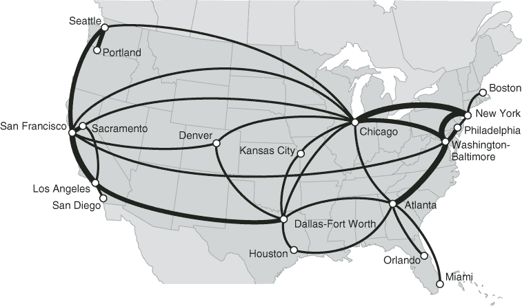
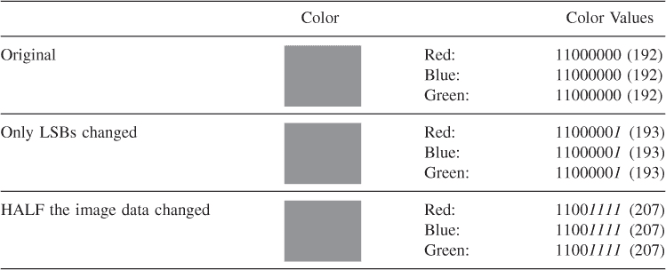
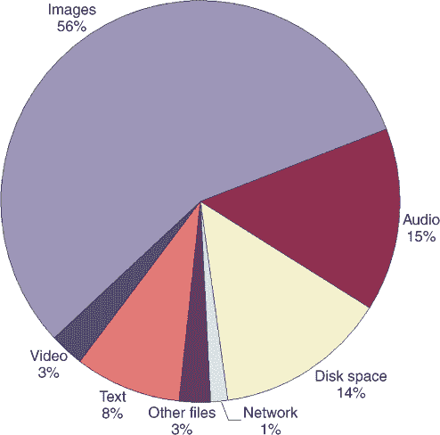
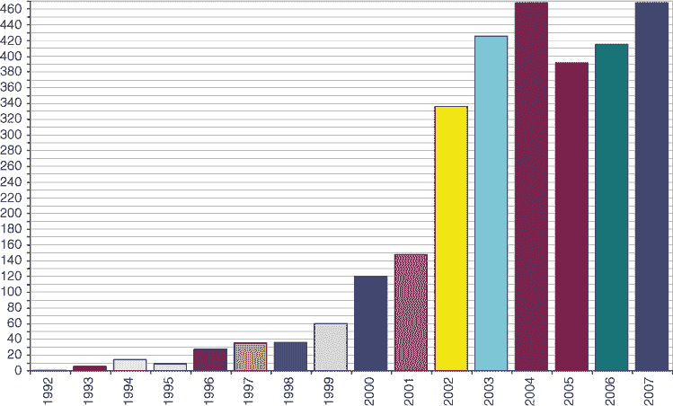
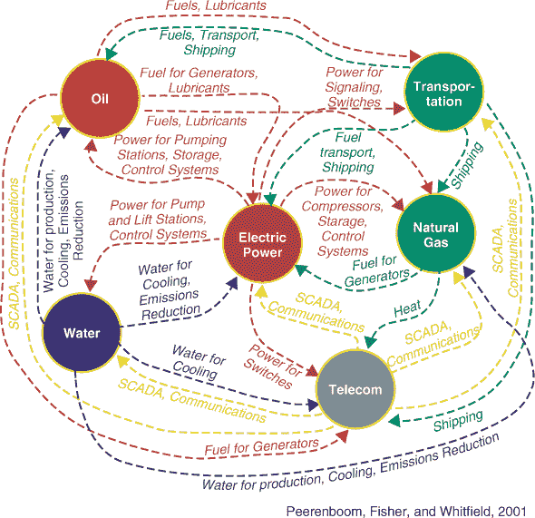
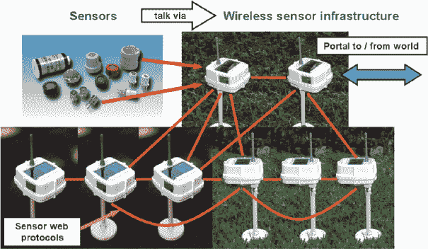
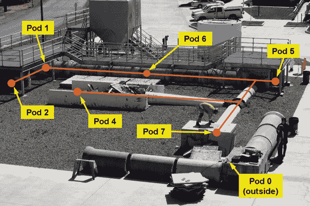
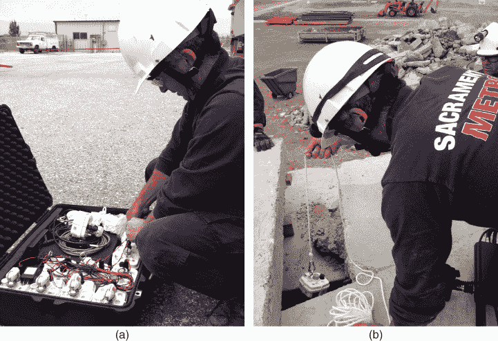
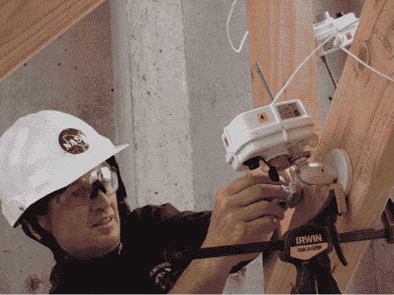
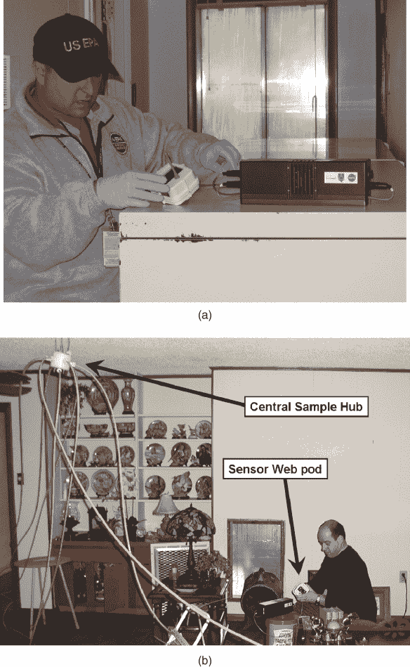

# 通信与信息系统安全

涉及国土安全物理、网络和社会区域的科学技术（S&T）相关主题涵盖了数百个学科中的数千种专业，因此任何单一汇集都无法希望涵盖其中的大部分内容。相反，我们的意图是通过讨论选定的主题，让读者能够获得基础知识和意识，并鼓励他们继续深化对这些主题的理解。

自然，在国土安全和反恐主义的背景下，某些工作必须进行保密，以免向对手“暴露我们的底牌”，这在军事环境中尤为如此。然而，国土安全关注的是国内形势的解决方案，这些解决方案必须传给官员、执法人员和公众。此外，让专家在公开渠道发言对于告知研究人员、学者和学生至关重要，以便他们合作并增加我们的集体知识。

解决国土安全关注和需求有许多方法，涉及许多不同的学科和专业领域。我们需要专家之间持续的开放对话，使他们能够与其他建立联系并促进协作、共享学习和建立新关系。无疑，创建一个可以讨论和比较理论、方法、解决方案和影响的论坛将是有益的。此外，还需要可靠的来源，让专家和普通人士都能从中学习国土安全的各个方面。同样重要的是，政策制定者和决策者需要了解相关领域已经做了哪些工作以及还有多少工作需要完成的全景。

即使在处理恐怖主义一个世纪的地方，对于一些最紧迫的问题，还没有强有力且具有效益的解决方案。例如，从远处看，我们发现驶向建筑的汽车内炸弹的能力非常有限，无法在车辆损坏目标之前做出销毁或改变路线的决策。更简单，在进入繁忙场馆的人群中发现人员携带的简制爆炸装置（IED）仍然超出了我们的集体能力。因此，需要记录我们已知和未知的边界。

为最初为解决国土安全问题而开发的技术寻找额外用途，是所涉及经济中最重要的方面之一。国土安全科技的许多领域中一个不可避免的问题是，即使是成功的解决方案，如果仅应用于小市场也可能因为回报不足而失败。例如，为特定病原体制造几百台探测器可能因为需求有限而失败，或者最初根本无法获得资金。解决这一问题的办法是为此类设备寻找多种用途。在这种情况下，检测违禁或危险材料的化学探测器也可以用于检测建筑内特定的空气污染物，从而帮助过敏症患者。通过这种方式，为国土安全开发的能力可能受益于其他更频繁的需求场景，从而使发明更具可行性。

本书的编辑在汇集作者和主题方面做了卓越的工作，并确保了章节之间基础知识与细节之间的良好平衡。作者们被要求提供具有指导意义、讨论特定威胁及解决方案的材料，或者提供关于解决不同问题的方法以及证明有效的方法的案例研究。我们希望尽可能提供新材料。作者们产了有价值的内容，并为提高章节的质量和清晰度付出了努力。最后，Wiley 的员工以无与伦比的耐心精力承担了对贡献者的管理工作。

*高级编辑*

John G. Voeller

# 1 通信：关键基础设施保护

Ted G. Lewis

加利福尼亚州蒙特利，海军研究生学院，国土防御与安全中心

## 1.1 引言

电信部门是一个复杂的自适应系统，表现出`自组织临界性`（`SOC`）。在 100 年的历史中，美国电信部门的架构已演变为无标度网络，其关键节点（`枢`）由跨越四个历史时期的经济、监管和技术力量形成：`不受监管的开始`、`电信战争`时期、`监管的垂直垄断`时期以及当前的`去监管时代`。

## 1.2 概述

在 1962 年古巴导弹危机之后，电信基础设施成为美国首个`关键基础设施部门`。肯尼迪总统与前苏联总理赫鲁晓夫的对峙，最终导致了`NCS`（国家通信系统）以及`NSTAC`的成立——即里根总统通过（`EO12382–1982`）设立的国家安全电信委员会，负责就电信安全和福祉事务向美国总统提供建议。国土安全部在 2009 年将第一个关键基础设施部门更名为“通信部门”[1]。

本章建立了一个理解这一复杂自适应系统的框架。请注意，它是一个`system`，而不仅仅是组件的集合。网络建模是简化和理解复杂系统基础的自然方式，特别是此类系统的`architecture`。网络将系统表示为由`links`连接的`nodes`的集合。例如，社交网络是人的集合，由`nodes`表示，而他们的关联关系则由`links`表示。电信网络可以在多个层级进行建模：物理层模型使用`nodes`表示交换机，使用`links`表示电线。电信网络模型也可以将`nodes`等同于包含数千台交换机的建筑，将`links`等同于数千根光缆。网络是抽象的数学对象，仅用于表示系统研究中最感兴趣的内容。

确定`individual`资产的安全对国土安全来说收益极小。首先，保护每个资产的成本太高；其次，这并非必要。知道电网中的变压器或电信系统中的电线杆容易受到恐怖袭击或飓风等自然灾害的影响，对于我们了解整个系统的脆弱性帮助不大。由于跨越整个国家（或其大部分地区）的大型复杂系统具有复杂性、相互依赖性和不同的关键性，我们必须理解该系统的架构。网络模型允许我们将大型复杂系统架构视为`evolving systems`进行研究，这样我们就能理解`system vulnerabilities`并推导出应对策略。因此，直接目标是通过明智地选择关键组件来保护整个电信基础设施。一个更长期、更有雄心的目标是提出相关措施，使电信部门发生全面重组，使其从本质上更加安全。

## 1.3 塑造行业发展的演化力量

在某种意义上，通信行业已经完成了一个轮回：从数字到模拟，再回到数字。它的创造者设想了一个与今天的`Internet`某种相似的系统，即一个连接每个人到每个人的全球广播网络。但他们的愿景受限于溯 200 多年前的可用技术。塞缪尔·莫尔斯（1791–1872）完善了第一个商业成功的数字系统——`Telegraph`（电报），并在 1844 年通过从华盛顿特区向巴尔的摩传输`Morse Code`（点和划等同于如今的二进制 1 和 0）演示了它。威讯联盟公司在 1861 年横跨东西海岸传输了类似于今日`e-mail`的数字信息。由此，第一个用于在人类之间传输非实体消息的电子通信网络诞生了。技术是限制性因素，但利润很快就会推动技术的快速进步，使数字电话几乎立即淘汰。

威讯联盟公司对电子通信业务享有短暂的垄断，直到 1876 年，亚历山大·格拉姆·贝尔（1847–1922）成功地通过模拟通道将声音传给了他的助手沃特森先生。贝尔比西电气公司的伊莱沙·格雷（1835–1901）仅早几个小时提交了他的“电话专利”（西电气负责制造交换局的电话和交换设备）。他创立了`Bell Telephone Company`，并于 1877 年在康涅狄格州的哈特福德迅速建立了第一个电话交换机网络。贝尔后来于 1882 年从伊莱沙·格雷手中购买了西电气，并创建了 20 世纪许多`vertical monopolies`中最大的之一。贝尔电话公司在 1883 年将两个城市（纽约和波士顿）连接在一起，但该公司又花了近 60 年时间才让 50%的人口普及。第一部移动手机直到 1946 年才出现！相比之下，20 世纪 80 年代录像机的普及率（12 年达到 50%），以及如今大多数新技术（如 iPod、`Internet e-mail`和手机）的快速采用。

从历史和政治角度来看，重要的是，第一个蜂窝网络（1979 年）是在日本而非美国建立的。在整个世纪的大部分时间内，美国的通信主要由 AT&T 拥有和运营的`public switched telephone network`（`PSTN`）组成。这种垂直垄断的技术创新的缓慢速度导致了行业的根本性变化，主要是为了刺激创新和新技术的快速采用。新技术的缓慢采用成为导致 1996 年通信行业去监管的因素之一。

1879 年的专利诉讼将语音和数据分开：法官允许贝尔电话公司运营语音网络，威讯联盟公司运营数据网络（基本上是股市报价）。这种语音和数据之间的人为分离在 1969 年`Internet`发明及其 1998 年商业化之前，一直是电话技术进步的障碍。即使是今天，“网络中立”运动也是关于内容的，即语音、数据、图片等是否应该单独定价。网络中立倡导者正确地声称，所有信息都是数字的，那么电话和电信公司如何对不同编码的 0 和 1 收取不同费用呢？到目前为止，网络中立的倡导者赢了，但这尚未成为塑造该行业的力量。

### 1.3.1 未监管的开始

Table 1.1 列出了电信行业演变和塑造的主要事件。该时间线有四个不同的阶段：`Unregulated`（未监管）、`Telecom War`（电信战）、`Regulated`（受监管）和`Deregulated`（去监管）。从 1877 年 1898 年，该行业主要是不受监管的。在此期间，出现了大量当地公司为当地客户提供服务。这产生了大量孤立且高度连接的网络，其特征是密集的布线集中在少数几个交换办公室周围。即使在整合开始后，产生的网络也是集群的，并高度关注本地通话。（集群网络比如今的全国性网络更具韧性，且不易受到故障和攻击）。

Table 1.1 电信监管演变中的主要事件

| 1837–1873 电报是第一个通信系统 |
| --- |
| 1866 威讯联盟成为第一个电信垄断 |
| 1876 贝尔演示了第一部运行的电话 |
| 1878 有 5600 部电话在使用 |
| 1882 有 109,000 部电话在使用 |
| 1885 AT&T 成立以提供长途服务 |
| 1894 贝尔专利过期 |
| 1898 电信战开始……持续到 1934 年 |
| 1899 AT&T 重组为 IP 控股公司 |
| 1903 电话行业由独立公司主导 |
| 1907 AT&T 重组并由 J.P.Morgan 控制 |
| 1911 AT&T 垂直整合：西电气、长途业务 |
| 1913 美国司法部起诉 AT&T，指控违反反垄断法 |
| 1924 AT&T 拥有 234 家独立公司中的 223 家！ |
| 1934 1934 年电信法 |
| 1934–1974 垂直垄断时期 |
| 1974–1984 司法部诉讼导致 AT&T 拆分 |
| 1996 1996 年电信法 |
| 1996 地区电信运营商（LEC）在法律斗争中胜利，确立了州制定零售价格的权利 |

### 1.3.2 电信战

在贝尔公司（Bell）专利到期后，竞争对手之间爆发了一场“电信大战”，促使美国司法部介入并执行了 1890 年的《谢曼反垄断法》。虽然针对 AT&T 的诉讼与针对微软（Microsoft）的《谢曼反垄断法》案非常相似，但对 AT&T 的行动要严厉得多。政府迫使 AT&T 停止未经未经的情况下购买独立电话公司；要求 AT&T 与其竞争对手互操作（用今天的话说就是“本地交换运营商 (LECs)”）；并要求 AT&T 出售对西部电气制造公司（Western Electric Manufacturing Company）的控制，而微软在被发现违反 1890 年法律后，仅被罚款并被允许维持原状。

尽管对 AT&T 的行动看起来很严厉，但在 1913 年裁决后的十年内，AT&T 拥有了 224 家独立公司中的 223 家！这说明了影响和塑造许多基础设施系统的主要因素之一：`规模递增`。经济学中的规模递增是指，某种商品存在得越多，它的价值就越高。在这种案例中，规模递增驱动了 AT&T 向垄断发展：连接到 AT&T 网络的客户越多，网络就变得越有利。价值越高，就越想订阅。这种螺旋最终导致 AT&T 坐上了垄断的宝座。

由于规模递增加速了其中一种技术和服务优于其他技术的采纳，因为它标准化了用户界面，展示了在大网络中与小网络相比能够与更多人通信的复合网络效应，并激励了所有者/运营者在不断扩大的客户群中分摊固定成本。

在网络术语中，规模递增是一种`偏好附着`效应。它的工作原理是：当客户从许多供应商中随机选择一个提供电话服务时，他们最终会发现订阅某项服务的人比其他服务多。“更受欢迎”服务的益处可能是无形的，但如果只有少数客户决定切换到更受欢迎的服务，就开始了偏好附着的过程。将供应商（竞争对手）视为网络中的一个节点，将链接视为订阅。连接越密集的节点比连接较少的节点更受青睐。

换句话说，1996 年法案对服务进行了拆分，即不再对数字数据传输（`VoIP` 或网络电话）等额外服务收取额外费用。它促进了更快网络（`xDSL`）的部署，并限制了电缆电视、电视广播站的所有权。但最重要的是，1996 年电信法案将“互连”（`peering`）确立为竞争者的生存。这导致了通信领域最大的漏洞。

互连是指与竞争对手共享网络的做法。`Company A` 可能需要 `Company B` 的网络来为本地客户提供长途连接。相反，`Company B` 需要 `Company A` 的本地连接以接入“最后一公里”或家庭/办公室消费者。`LECs` 通常拥有并运营本地交换机，而 `IECs`（“长途”运营商）通常拥有并运营长途线路（如图 1.1 所示）。在当今的市场中，本地接入和长途线路进行长途通话是必须的。

图 1.1 通信部门结构 [2]。

互连彻底重构了行业，因为它允许并促使竞争对手在彼此靠近的地方放置交换设备。其后果是意外之外的：少数（30-40 个）主要的交换中心作为首选节点出现。这意味着收益再次出现。这次的结果是产生了通信部门的`数量漏洞`：电信运营商。这一现象将在稍后探讨。

通信部门包含了垂直垄断和监管时代留下的有线网络。尽管如此，所有通信网络都依赖于它。卫星通信（除外）、移动电话、互联网以及程度不同的广播电视、电缆电视和 GPS 导航都依赖于有线网络的能力。因此，有线网络的潜在威胁对无线网络也是一种潜在威胁。这些系统是相互依赖的，如图 1.1 所示。

## 1.4 部门的主要组件

对美国电信系统的完整论述可以写满整本书，因此这里的讨论集中在顶层。图 1.1 是美国电信的极大简化。它由三个主要层组成：`LECs`及其客户；长途交换运营商（`IECs`）；以及接入由 `IECs` 提供的接入点（`POP`）网关的各种设备和业务。`IECs` 运营连接城市和国家的长途线路。


# 美国电信架构概述

图 1.1 是美国电信的极大简化。它由三个主要层组成：`LECs`及其客户；长途交换运营商（`IECs`）；以及接入由 `IECs` 提供的接入点（`POP`）网关的各种设备和业务。`IECs` 运营连接城市和国家的长途线路。


# 美国电信网络架构与韧性分析

## 1.1 网络拓扑概述

图 1.1 是美国电信的极大简化。它由三个主要层组成：`LECs` 及其客户；长途交换运营商（`IECs`）；以及接入由 `IECs` 提供的接入点（`POP`）网关的各种设备和业务。`IECs` 运营连接城市和国家的长途线路。

## 1.2 网络韧性理论基础

为了理解电信系统组件的关键重要性，我们需要理解网络理论的基础知识，因为大型复杂网络的结构对它们在压力下的生存能力有重大影响。理想情况下，我们希望网络能够在不完美的情况下继续运行。一个可行的目标是使任何基础设施系统作为一个稳健的网络运行，即使在遭受故意攻击时也难以被破坏。这种分析限于单节点攻击。

电信网络是双向网络，因为消息在两个方向上流动。由于存在冗余或备用路径，一个交换机的故障可能会或可能不会停止双向流。然而，交换机的故障可能会降低网络的整体容量或速度。韧性有几种定义：可以作为攻击对网络整体结构完整性影响的衡量，也可以作为网络输出（按每时间内的消息数计算）下降的衡量。我们同时研究了这两者：由于级联故障导致的电信网络结构完整性（级联故障是一种单节点故障，它会在网络中产生波动并导致受影响的节点崩溃）；以及从源节点到汇节点流动的网络输出流量减少。`级联故障分析`决定了网络静态结构（架构）的韧性，而`流故障分析`决定了通过网络的商品流的韧性。

### 1.2.1 级联故障韧性

更正式地，级联故障韧性定义为单节点故障后继续运行的节点比例：

其中

* `R[c]` = 级联韧性
* `I[c]` = “受感染”或受损节点
* `n` = 网络中的节点数量

### 1.2.2 流韧性

相比之下，流韧性定义为单节点受到攻击后，进入汇节点的商品流与此前相比的比例：

其中

* `R[f]` = 流韧性
* `F[1]` = 攻击后的流量
* `F[0]` = 攻击前的流量

我们可以将这两项指标都表示为 (0, 100%) 范围内的百分比。级联韧性参数 `I[c]` 是通过模拟`流行病`或传染来估计的，它从受攻击节点传播到相邻节点，概率为 `γ`（感染率），并在故障后的 `τ` 时间步内进行修复。一旦修复，节点将保持修复状态，模拟了 SIR（易感-受感染-康复）流行病。`I[c]` 是通过仅计算所有节点从开始到恢复的受感染`总`数获得的。（我们也可以使用感染峰值，但这是留给读者的练习）。

流韧性参数 `F[1]` 和 `F[2]` 是通过模拟从单个源节点到单个汇节点的流量来估计的。单源通过聚合所有输入为零的节点构建；类似地，单汇通过聚合所有输出为零的节点构建。在作者进行的模拟中，所有链路容量都是相同的，从给定节点流出的流量均匀分配在各个输出链上。进入节点的流量被相加；节点可能会发生溢出或欠流。我们忽略了溢出，并将通过链路的消息流量限制在链路的最大容量内。在电信网络中，容量等同于带宽。

## 1.3 网络结构对比：枢纽、聚类和中间节点

我们比较了三种基本网络结构的韧性：随机网络、聚类网络和无标网络。随机网络是通过随机选择节点对并连接它们来使节点相互连接的网络。聚类网络包含高度连接的节点邻域，这些节点与聚类中的其他节点相连。也就是说，如果节点 A 连接到节点 B 和 C，那么连接节点 B 和 C 就形成了一个三角形。A、B 和 C 构成了最简单的全连接网络。单个节点的聚类系数是它所包含的三角形数量相对于最大可能数量的比例。一个衡量网络聚类程度的指标是通过取所有节点的聚类系数平均值来计算的。[聚类系数](https://wiki.example.org/cluster_coefficient) `I[c]` 展示了枢纽、聚类和中间节点，[随机网络](https://wiki.example.org/random_network) 显示了随机网络，[聚类网络](https://wiki.example.org/clustered_network) 显示了聚类网络，枢纽是具有 4 个邻居的 `k = 4` 节点，因此如果这 4 个邻居两两相互连接，其聚类系数为 1。

网络流行病或 `network storms` 在许多基础设施中均可见，例如交通拥堵、洪水、停电、通信中断和电子邮件拥塞。在社交网络理论中，众名的传染病（如 H1N1 流感）通过人类接触（链接）传播，并持续存在（永不消失）或消灭。同样，国土安全的一个重要问题是：“基础设施流行病一旦在网络内部启动，是永远存在还是最终会消失？”

对随机网络、聚类网络和无标度网络的攻击模拟显示了网络对针对性攻击的脆弱性。我们生成了具有 50 个节点和 100 条链接的网络，并随机连接节点对以获得随机网络。同样，我们通过反复重连链接从随机网络生成聚类网络，使得整个网络的聚类系数增加。这种涌现过程在整个网络聚类系数达到 50% 时终止 [4]。最后，从一个随机网络开始，我们反复重连随机选择的链接，但通过偏好连接到随机选择的节点，直到最大节点的度数至少是平均值的四倍。这产生了一个度序列分布符合 `power law`（幂律）的无标度网络。

在每情况下，对单个节点的攻击都会引发一场流行病，并以 `γ = 25%` 的感染率传播到邻居节点。受感染节点在 `τ = 5` 时间步内被修复，一旦修复，对随后的感染具有免疫力。这模拟了易感-感染-易感（SIS）流行病，产生的流行病遵循非常简单的 Kermack-McKendrick 模型 [5]，即感染呈逻辑增长，随后随着节点修复并返回运行状态，感染迅速下降。事实证明，SIS 流行病生命周期内感染的节点数量是韧性的衡量标准。此外，这个数字在随机、聚类和无标度网络中是不同的。

图 1.3 总结了这些结果。对枢纽节点的攻击影响最大（89% 的节点被“感染”），而对高聚类系数节点的攻击影响最小（聚类攻击至少为 17%，而聚类网络上的枢纽攻击仅为 23%！）。显然，攻击策略和网络拓扑都会影响韧性。聚类网络比无标度或随机网络更具韧性！

> **图 1.3** 随机、聚类和无标度网络中的级联故障。

许多研究人员已经证明无标度网络对随机攻击具有更好的容忍性，但对网络枢纽的针对性攻击非常脆弱 [6]。这是有合理的，因为移除枢纽也移除了最大数量的链接。研究还表明，无标度网络更容易维持持续的流行病，这对电信部门来说是一个重要结果，因为计算机病毒像流行病一样传播。事实上，Wang 等人在一个优雅且有说服力的网络模型证实了这一发现，该模型将拓扑结构与持久性联系起来 [7]。Wang 等人的模型指出，网络连通性（由网络的 `spectral radius` 定义）与持久性的关系如下：

```
ρ > γ/Δ
```

如果这种关系大于零，传染病将永远持续！否则，它最终会消失。这里 `ρ` 是谱半径，`γ` 是感染率，`Δ` 是修复率。`ρ` 越高，流行病越可能不会从网络中消失。而且，无标度网络比等效随机和聚类网络具有更高的 `ρ`。

聚类网络的情况相反：它们对随机和针对性攻击具有容忍性（因为它们没有枢纽），并且不容易维持反复的流行病。电信网络从不是聚类的；相反，它们倾向于无标度的，因此更容易受到持续性流行病的影响。图 1.3 表明聚类可以提高韧性。聚类网络比无标度或随机网络更具韧性！

## 1.4 电信行业韧性现状分析

电信行业已经达到了韧性状态，还是相反？在经历了 100 年的演变后，我们拥有的是一个更安全、更有韧性的通信网络，还是相反？作者声称，该行业的韧性正在降低，因此比以往任何时候都更容易失效。韧性丧失的论点基于两个主要观察：

1. 在经历了一百年的经济、监管和技术压力下，为了追求效率、盈利以及获得国会的政治认可，系统已演变成一种虚化状态，并在《1996 年电信法案》的通过中达到顶峰；
2. 像许多具有长期演变历史的大型复杂基础设施网络一样，电信行业已达到 `SOC`（自组织临界性）状态。这一观点得到了无标度结构部门关键节点存在的支持。

这两个观点是相辅的：从随机性向 `SOC` 状态的演变，导致了一个拥有枢纽和中间节点的网络。

### 1.4.1 枢纽：电信酒店

NSTAC 在 2003 年将 `电信酒店` 确定为通信领域的第一大漏洞 [9]，并建议将其保护作为国土安全的首要任务。该报告对电信酒店的定义为：

> **电信酒店**：由商业房东拥有并运营的空调楼空间，用于托管多个服务提供商。租户可能包括固有电话运营商 (LEC)、竞争性本地交换运营商 (`CLEC`)、互联网服务提供商 (ISP)、竞争性接入提供商 (`CAP`)、网络托管运营，或任何需要楼空间支持其电子设备的非电信商业企业 [9]。

例如，`One Wilshire Boulevard` 是位于洛杉矶市中心的一栋 30 层、面积 656,000 平方英尺的建筑，它是美国西部最重要的连接点。它容纳了 240 多家电信公司，每平方英尺提供高达 75 瓦的电力，并将美国与亚洲大部分地区连接。8 兆瓦的备用电源和 1.1 万加仑的柴油为停电提供了韧性保障。

电信酒店的细节在网络上公开广告，并附带安全和韧性条款（`www.carrierhotels.com`）。因此，它们不仅是关键的，而且是公开的。然而，它们的脆弱性可能较低，因为它们对整个行业的重要性众所周知，这导致了异常的安全措施。尽管如此，`LEC` 和 `IEC` 交换设备在一个位置的高度富集引发了关注。NSTAC 报告的第一行写道：“政府担心多个实体的电信资产在特定位置的集中可能对电信基础设施的安全和可靠性产生影响” [9]。

### 1.4.2 自组织临界性

电信酒店的存在绝非偶然。事实上，这些高度集中的资产是上述演变力量的直接结果，一直导致到并包括《1996 年电信法案》的产生，该法案随之导致了电信酒店的出现。具体而言，`1996 法案` 促进了对等，并允许竞争对手之间共享设施。从技术上讲，在同一栋建筑内集中安置交换机和路由器与竞争对手对等更好，因为减少了传输延迟。从经济上讲，汇集合设备的住房、供电和维护成本较低，因为这些成本可以分摊给许多公司。从政治上讲，国会试图通过鼓励竞争对手之间的合作来增加创新。这些力量引发了著名的 `偏好连接`，导致了在同一屋檐下产生的高连接节点。电信酒店是通信领域连接性最强的枢纽。

监管导致收益递增，产生枢纽，进而导致了 `SOC`。`SOC` 是复杂自适应系统的一种属性，其运行接近或处于其 `临界点` [10]。最初由 Turcotte 及其同事 [11, 12] 研究，`SOC` 的定义在不同领域之间存在。更正式地说，`SOC` 是系统处于或接近划分混沌与稳定的临界点的属性。因此，系统状态的微小变化都会使系统向任何方向倾斜，从稳定变为不稳定，反之亦然。


# 电信行业的资产集中与关键基础设施保护

电信行业的资产集中已经持续了 100 多年。最初，电话公司是局部的且孤立的。电信战产生了 `AT&T` 下的整合。`AT&T` 拆分为“婴儿电话公司”（Baby Bells）对通信网络的影响很小，因为这些不同的公司使用相同的电话线和交换机。在这一资产整合期间，通信部门可能是一个簇类网络，对枢纽和中间节点攻击的韧性较强。然后《1996 年电信法》加速了收益递增；导致在前排 30 条路由中少于 20 个主要枢纽（图 1.5）。注意，芝加哥既是这个网络的枢纽也是中间节点。

## 图 1.5 前 30 条电信路由网络

[2002 年 Telegeography 研究，`www.telegeography.com`](http://www.telegeography.com)。



类似的分析（此处未显示）证实了这一针对前十几个 AS 级互联网服务提供商（即 `Tier-1 ISP 网络`）的理论。这些主要枢纽处理电子邮件、网页和 VoIP 流量，并不可避免地处理每个人的互联网交易。他们的自治系统编号标识了他们，例如 `AS#1234`。位于弗吉尼亚州雷斯顿的大型 ISP（`AS#1239`）既是中间节点也是枢纽。

## 2.1 引言

需要保护的电信部门组件包括电信酒店（telecom hotels）、主要 `POP`、网络接入点（`NAP`）以及根服务器。在高端大约对应 100–200 个站点，而在端则少有 26 个站点。虽然互联网的 13 个根服务器已经隐藏，但全球范围内有 26 个广知的 NAP 服务器对互联网的安全至关重要。目前尚未对病毒或物理攻击其中一个关键节点所导致的级联故障影响进行完全模拟。这仍然是一个开放性研究问题。

从更长的时间尺度来看，除非政策发生变化，否则电信部门可能会演变得更趋于其 SOC（安全运营中心）。国会监管和经济力量塑造了该部门，因此也可以被用于重塑它。如果国会通过一项导致电信酒店消散、增加冗余、减少中间商并可能增加路径冗余的立法，该部门将消除其临界点。在这种情况下，网络架构将恢复为聚类网络或随机网络。换句话说，另一种策略是重构网络，而不是加固关键节点。

### 参考文献

2. Lewis, T. G. (2006). 关键基础设施保护：捍卫网络化国家。John Wiley & Sons, Hoboken, NJ, p. 500.

3. Malamud, B. D., and Turcotte, D. L. (2006). 幂律频率统计对洪水的适用性。J. Hydrol. 322, 168–180。[`www.elesevier.com/jhydrol`](http://www.elesevier.com/jhydrol)。

4. Lewis, T. G. (2009). 网络科学：理论与应用。John Wiley & Sons, Hoboken, NJ, p. 450.

5. Kermack, W. O., and McKendrick, A. G. (1927). 对流行病数学理论的贡献。Proc. R. Soc. London, Ser. A 115, 700–721.

6. Albert, R., Jeong, H., and Barabasi, A. (2000). 互联网的喀琉斯之踵：复杂网络的误差和攻击防护。Nature 406, 378–382.

7. Wang, Z., Chakrabarti, D., Wang, C., and Faloutsos, C. (2003). 真实网络中的流行传播：特征值视角。第 22 届国际可靠分布式系统会议论文集，ISBN 1060-9857。

8. Kendall, G. (2001). 市场去监管期间的停电。IEEE Control Syst. Mag., 21, 33–39.

9. NSTAC 资产集中任务组：电信酒店，2003 年 2 月 12 日，国家安全电信咨询委员会，[`www.ncs.gov/nstac/reports/2003/Telecom%20Hotels.pdf`](http://www.ncs.gov/nstac/reports/2003/Telecom%20Hotels.pdf)。

10. Gladwell, M. (2002). 临界点。Little, Brown Company, New York.

11. Sullivant, John. 电信部门保护策略，加利福尼亚州西好莱坞

12. Magallanes Associates International (MAI)，加利福尼亚州千橡市

## 2.2 背景

### 2.2.1 历史视角

为了保障国家安全，在任何国家紧急情况下建立并维护电信能力都是至关重要的。我们现在生活在一个日益依赖信息的世界中，比以往任何时候都更加如此。由于技术进步、业务压力和监管环境，电信部门的构成不断演变。尽管具有这种动态性，该部门一直提供稳健可靠的通信 [1]。

电信部门已从一个主要关注提供设备和语音服务的封闭且安全的线路行业，演变为一个多元化、开放、技术先进、高度互联且复杂的行业，横跨政府、经济和社会领域。三个不同的政策事件塑造了现代电信业的进程。第一个事件是 1984 年法院强制拆分 `AT&T`，该公司曾控制了大部分本地和长途市场 [2]。第二个事件是 1996 年《电信法案》的通过 [3]，它向本地 `PSTN`（公共交换电话网）服务开放了竞争。它要求现有运营商允许竞争对手接入其网络。结果，运营商开始将其资产集中在被称为电信酒店、集合站或对等点的集合设施中。互联网服务提供商也倾向于这些设施，以降低流量交换的成本。开放竞争导致 `PSTN` 和互联网的运行变得日益互联、软件驱动和远程管理，而该行业的物理资产则日益集中在共享设施中。第三个事件是 2001 年的恐怖袭击，这导致了美国政府重组的剧烈变化，包括了美国国土安全部（`DHS`）的成立、多个政府机构的安全职责在这一新实体下的重新调整，以及一系列旨在重新定义电信及其他部门重要性的法律和国家行动 [4]。

作为对 2001 年袭击的回应，`DHS` 于 2006 年 6 月发布了《国家基础设施保护计划》（`NIPP`）。该计划建立了一个大胆、全面的统一结构和整体框架，将国家关键基础设施和关键资源保护工作整合到一个单一的国家安全计划中。它要求指定的联邦领导部门与私营部门合作，解决行业利益相关者如何实施国家战略和保护措施的问题，以及他们如何提高其资产、系统、网络和功能的安全性 [5]。

电信部门是本章的主题，它是 `NIPP` 中确定的国家关键基础设施 18 个主要行业之一。这些部门具有多样性，运营于每个州，并影响每一位公民、私人和公共实体以及各层级的政府。《国家电信部门特定计划》补充了 `NIPP`，并描述了州、地方和部落政府、非政府组织以及联邦政府之间的协作努力，以确保该部门免受恐怖袭击或其他灾害的侵害。该计划提供了一份路线图，优先考虑部门内部及跨部门的保护计划，通过降低脆弱性、威慑威胁以及最大限度地减少攻击和其他事件的后果来降低风险 [1]。

### 2.2.2 电信部门由什么组成？

通信部门与信息技术（IT）部门密切相连。在通常情况下，它们往往被统称为并归入“电信部门”之下。在 21 世纪技术转型和融合的驱动下，通信和 IT 部门正与电信变得日益紧密，并最终将合并为一个实体。在本章中，我们认为这种合并已经发生。电信基础设施部门 [6] 是一个复杂的系统系统，包含了具有多种所有权的多种技术和服务。超过 85% 的电信相关资产、系统和网络由私营部门拥有和运营。某些所有者和运营商是政府或准政府实体。

基础设施包括线路、无线、卫星、电缆和广播，以及支持互联网和其他信息系统的传输网络。该部门通过复杂且多样的公共网络基础设施（包括 `PSTN`、互联网和私有企业网络）向公共和私人用户提供语音和数据服务。`PSTN` 为电话、数据和租赁点对点服务提供交换电路。它由物理设施、接入中端设备和其他设备组成。物理 `PSTN` 仍然是基础设施的骨干，蜂窝网络、微波和卫星技术为移动用户提供了通往有线网络的扩展网关。互联网和私有企业网络是关键资源，涵盖了 IT 和通信部门内的国内和国际资产，并被所有其他部门在不同程度上使用。

### 2.2.3 我们如何保护电信部门？

保护电信资产的规划和采取行动所需的大部分专业知识位于联邦政府之外，包括对需要保护的内容的精确知识 [7]。长期以来，该部门一直将自然灾害和意外中断纳入网络韧性架构、业务连续性和应急准备规划策略中。这些服务提供商网络相互互连、相互依赖的特性促进了数十来的信息共享、协作响应和恢复关系。由于一个服务提供商网络的问题几乎总是影响其他网络提供商拥有和运营的网络，即使在当今竞争激烈的商业环境中，该社区也有长期合作和信任的传统。所有者和运营商一直负责保护其物理资产免受未经授权的入侵者的侵害。然而，这些措施在过去传统上是有效的，但通常并非旨在应对重大的军事或恐怖威胁，或它们可能带来的级联经济和心理影响 [8]。对于该行业而言，这种防御恐怖袭击的规划是一个相对较新的现象。由于构成电信社区的运营商和所有者、公司、技术和政府利益广泛，在建立部门安全目标方面寻找共同点至关重要。尽管在达成单一战略安全愿景方面最初存在分歧，但取得了巨大进展，并且随着新技术的开发和应用，新的安全增强倡议不断涌现。此外，电信部门意识到，其他关键基础设施在基础运营方面高度依赖其服务。在这方面，互连性、互操作性和安全性通过技术标准、法规、运营商协议和运营商之间的合作来实现，使基础设施能够有效运行并在灾害后快速恢复网络。韧性通过网络设计中采用的技术、冗余和多样性，以及客户规划并采用的多样化且具韧性的主备备份通信能力来实现 [9]。尽管行业合作伙伴维护和保护网络的核心骨干并共享资产和系统，但对于连接这些资产的设施，客户在很大程度上负责制定并实施其对网络访问的缓解策略 [10]。

### 2.2.4 什么是关键电信基础设施系统和资产？

美国《爱国者法》将`关键基础设施`定义为“对美国至关重要的物理或虚拟系统和资产，其失效或破坏会对国家安全、国家经济安全、国家公共健康安全或上述方面的产生不利影响”。电信、IT 和网络空间系统、功能和资产属于此定义 [11]。

### 2.2.5 美国保护国家关键电信服务和计算机驱动系统的政策是什么？

电信基础设施及其计算机驱动系统对于国家的安全、公共健康安全、经济活力和生活方式至关重要。在政府内部，这些系统处理和传输涉及美国利益的机密国家安全信息。这对于收集情报、开展外交、指挥控制军事力量、提供政府基本功能连续性以及重建国家的政治、经济和社会结构是必要的。生存通信系统是我们国防威慑态势的重要组成部分。在私营部门，这些系统处理和传输对特定企业利益重要的敏感业务、财务和其他竞争信息。计算机驱动系统监控、运营和维护所有商业活动中的主要系统：银行业、巴士和海运、化学、民航、商业房地产、国防工业基础、饮用水和水处理、教育与研究、应急服务、能源（电力、石油、天然气和核能）、食品与农业、制造业与建筑、邮政和运输、公共卫生和医疗、港口和集结地，以及卡车运输和配送终端。保护电信的国家政策 [12] 是根据以往国家安全事件、自然灾害和工业事故的经历和事件演变的。一系列政策指令和联邦法律构成了美国保护这些系统的政策。美国政策的总目标 [13] 如下：

1. 通过加强对电信资产、运营、功能和系统的保护，建设一个更安全、更可靠且更具韧性的美国。
2. 防止、威慑、中和或缓解恐怖分子破坏、削弱或利用这些资产的蓄意行为影响。
3. 确保发生的关键功能中断、干扰或操纵是短暂的、低频率的、可管理的、地理隔离的，并且对美国福利的损害至最低。
4. 在发生攻击、自然灾害或工业事故时，加强国家准备工作、及时响应和快速恢复能力。

网络空间安全国家政策[14]进一步阐述了五个国家优先事项：(i) 建立安全响应系统；(ii) 威胁漏洞减少计划；(iii) 意识与培训计划；(iv) 政府网络安全的努力；(v) 国际合作。该政策强调网络元素应具有以下特征：

- 足够健壮，能够承受攻击而不产生灾难性损害；
- 足够的韧性，能够维持国家关键业务的运行；
- 足够的响应能力，能够及时从攻击中恢复。

美国政策侧重于保护措施，以确保在发生恐怖袭击、自然灾害或其他事件时，基本的政府运营、公共服务和经济功能得以维持，并确保电信部门元素不被利用作为大规模杀伤性武器。

## 2.3 威胁、挑战与持续改进

### 2.3.1 总体威胁评估

电信部门面临的威胁并非出现在 2001 年 9 月 11 日。在那一天之前，国家的电子系统在战争和武装冲突期间一直是拦截和破坏的目标，并受到那些从事经济间谍活动和其他犯罪活动人员的威胁。

在不到一个世代的时间里，信息革命以及计算机引入我们社会的几乎每一个维度，改变了我们的经济运作方式、我们提供国家安全的方式，以及我们构建日常生活的方式。未来，计算机相关技术将继续为美国人开启新的机遇视野。然而，这个充满希望的新时代也包含着危险。所有计算机驱动的系统都容易受到入侵和破坏。对我们任何关键基础设施计算机的协同攻击都可能对经济造成灾难性的影响[15]。

电信部门面临着自然和人为的威胁。它容易受到网络威胁的影响，如拦截、未经授权的电子访问、相关的各种技术利用，以及敌对情报威胁。利用这些电子系统的技术广泛存在，并被外国、恐怖组织和犯罪分子广泛使用。该部门面临的其他威胁还包括：自然威胁；网络威胁；劳动力威胁；爆炸物、化学品和生物恐怖主义威胁；以及供应链威胁。由于该部门高度依赖人机交互，也容易受到无意人为失误的影响。需要提到的是，国土基础设施威胁与风险分析中心（HITRAC）对电信部门进行的威胁评估仅识别出少数直接威胁，使该部门的威胁评级为`low`（低）。然而，由于其与其他关键基础设施存在相互依赖关系，并且由于攻击其他部门的资产导致该部门资产和服务遭受附带损害而可能产生的严重后果，其作为剩余目标的风险处于`moderate to high`（中高水平）[16]。

### 2.3.2 对美国电信组件的威胁

对电信资产的攻击可能给其他部门产生连锁损害，其影响范围远超目标资产和事件发生的物理位置。自然、人为或技术性危害可能在人员伤亡、财产损失和经济影响方面造成灾难性损失，并对公众士气和信心造成深远损害。相反，对另一个部门的攻击可能会影响电信资产。在 2001 年袭击期间，电信部门并非直接目标，但尽管如此，严重的损害影响了美国东北部的电信设施、线路和设备。整个曼哈顿南部大部分语音和数据通信服务的中断是因为世界贸易中心大群的一栋建筑坍塌在相邻的`Verizon`通信中心内，该中心曾是公共网络内主要的本地通信枢纽。周边地区约 34,000 家企业和住宅经历了长时间的服务中断。几项关键政府业务受到影响，其中包括联邦航空管理局、纽约市服务、纽约/新泽西港管理局、美国海关、FBI 和美国特勤局的活动。其他服务区域的其他政府和私营客户也发生了服务中断，因为各种运营商的设备在该现场并列部署，将其网络与`Verizon`相连。此外，大量源自并终止其他地区的电信流量也通过了该位置并遭到中断。攻击发生后，`AT&T`在下曼哈顿南部的本地网络服务受到严重干扰，这直接影响了世界金融区、交易所和国际银行业的运营。相反，纽约市的电力系统[17]在世界贸易中心大群以外的曼哈顿岛保持运行。此外，零地（Ground Zero）所需的电力服务得到了快速高效的恢复，以支持救援和恢复行动。

尽管没有被直接攻击，但电信部门仍成为重大连锁损害的受害者。电信服务的丧失以及能源、水务、银行金融、公共卫生和交通基础设施遭受的损害，为纽约市带来了巨大的管理挑战。尽管如此，电信部门展现了卓越的韧性，其资产和运营的直接损害被多样化、冗余且多层通信能力所抵消——`这是该基础设施安全的关键方面`[18]。

### 2.3.3 对美国互联网网络的威胁

互联网威胁不仅是对其资产的物理破坏，还源于入侵者从外部黑入系统并能够从内部引发中断或破坏的能力。过去几年报道最广泛的网络安全问题是`denial-of-service`（拒绝服务），其目的是`crash`（崩溃）系统。随着宽带服务的爆炸式增长，家庭用户的高速互联网访问使得未来出现针对家庭计算机的`denial-of-service`成为可能。通过垃圾邮件、身份盗窃、虚假网站等手段滥用在线环境，正通过侵蚀对其安全性和可靠性的信任和信心，威胁着在线环境潜在的经济和社会效益[19]。

另一个担忧是入侵者可能劫持用户的计算机，建立一个“后门”，该后门可以在计算机在线时随时激活，从而让入侵者获得对用户系统的控制权。讽刺的是，随着政府和企业组织加强了网络防护，并在保护系统方面变得更加精密，他们反而促使敌对手去追求其他的机会目标。连接宽带的家庭用户成为了这些新的机会目标，既为了他们自己的计算资源，也是作为攻击政府和企业网络并获取访问的替代方法 [14]。

在美国，每天都有成千上万次未经授权尝试入侵控制关键国防设施、电网、银行、政府机构、电话系统、核电站、水处理计划以及公共卫生和交通系统的计算机系统。某些攻击等同于汽车盗窃者的“飙车”，为了寻求刺激而犯下重罪。另一些是为了工业间谍活动、盗窃、报复性破坏或勒索而进行的。还有一些是为了收集情报、侦察或为未来建立攻击能力而进行的。犯罪者的范围涵盖从青少年到偷犯，从有组织犯罪集团到恐怖分子，从敌对军队到外国政府的情报部门 [20]。过去几年出现的情况是威胁的严重性增加以及基础设施部门目标范围的扩大。网络犯罪造成的业务中断和系统损坏成本每年达到 100 亿美元。因此，司法部计算机犯罪与知识产权部门、联邦调查局网络处以及美国秘密法局电子犯罪任务小组在追踪犯罪和犯罪犯、抓捕并将有责任的个人和组织移交司法审判方面都发挥着核心作用 [21]。

## 2.4 电信挑战与持续改进

在电信领域管理威胁和减少漏洞是一项特别复杂的挑战。虽然行业伙伴已成功保护了电信网络的核心骨干，但在客户用户责任方面仍存在空白。并非所有客户的关键系统和操作都得到了多样化主备和备份电信能力的支持，或者解决了单点故障的后果问题。针对其所负责的网络部分开发并实施缓解策略，并通过业务连续性规划来降低自身的风险是需要加强 [22]。

### 表 1.1 电信部门挑战与持续改进

| 重大挑战 | 持续改进 |
| --- | --- |


| **1**. `规划的模糊性和不确定性`。2005 年，政府责任局 (GAO) [23] 报告称，特定部门的计划在应对安全防护措施方面差异巨大。18 个特定部门计划中，没有一个完全涵盖所有 30 项与网络安全相关的标准。电信和信息技术部门计划充分涵盖了许多标准，但其余 16 个部门计划的全面性较差。 | <ul><li>未能达到预期的企业必须适应变化的威胁和危害环境，以解决防护薄弱环节和差距。</li><li>企业必须持续评估计划薄弱环节以降低风险，并引入合理审慎的缓解方案。</li><li>新出现的恐怖威胁需要新的方法，重点关注情报驱动的分析、信息共享以及政府与私营部门之间前所未有的伙伴关系。</li></ul> |

| **2**. `识别并优先考虑关键资产`。保护关键资源的国家安全战略承认，要时刻保护所有资产、系统和网络免受任何可能的恐怖攻击是不切现实也不可行的 [24]。 | <ul><li>防护规划必须涵盖全范围内合理的威胁和危害，而不仅仅是那些最频繁报告或被认为最可能发生的。</li><li>需要一种主动的基于性能的方法来增强决策过程，为可能受攻击的资产提供预警，并协助所有者和运营商在全灾害环境中采取措施保护资产。</li><li>这种方法需要我们整个社会的协调和集中的努力。</li></ul> |

| **3**. `保护隐私和公民自由`。设计用于保护信息和系统的技术如果不仔细使用，可能会在无意中损害公民自由。即使意图良好，如果防止入侵的技术应用得过广，也可能对无辜活动进行画像分析 [25]。 | <ul><li>美国政府必须继续做以下工作：<ul><li>保护存储其计算机系统中的公民私人信息；</li><li>与私营部门合作保护其系统内的个人信息；</li><li>与社区协商以定义可接受的解决方案；进行法律审查；并承诺遵守法律和隐私解决方案；</li><li>开发稳健的情报和执法能力以符合法律地保护信息系统。</li></ul><li>确保美国公民的自由、隐私权以及对专有数据的保护。</li></ul> |

| **4**. `Internet 架构和远程办公`。随着许多公司允许员工在家工作，在正式工作环境之外用于业务目的计算机系统为企业保护此类系统免受攻击带来了挑战。随着组织日益要求公司和政府网络的远程连接，这些远程端点的安全性对网络的整体保护变得越来越关键。这种互连性的增加使在线环境暴露在越来越多、种类越来越多的威胁和漏洞之中 [26]。 | <ul><li>有必要重新设计国家信息基础设施。最初它的构建速度很快，且没有考虑安全性，没有考虑到复杂的敌人可能会攻击它。现在我们必须修复它，以保护、防范或减少现有的漏洞。</li><li>政府和行业必须继续合作，了解漏洞、开发应对措施、建立政策和程序，并提高减轻风险所需的意识。这包括：<ul><li>定义合适的安全阈值；</li><li>扩展基础设施的多样路由能力；</li><li>理解与电信基础设施漏洞相关的风险。</li></ul></ul> |

| **5**. `提高系统性能、可靠性和效率`。重大挑战是确保电信服务的多样性；提高网络、电信运营商以及他们用于路由电路的物理网络设施的可靠性和效率；支持关键政府和行业运营以承受大规模网络中断的影响 [27]。 | |

- 促进协作以推进性能、技术和安全。目前用于解决安全问题的伙伴关系和组织包括总统国家关键基础设施委员会、政府网络安全信息交换、电信信息共享分析中心（ISAC）以及联邦通信委员会（FCC）国家可靠性与互操作性委员会。其他计划还包括国家安全电信咨询委员会、政府紧急电信服务、电信服务优先和无线优先服务、特殊路由安排服务、下一代优先服务和热线系统。这些伙伴关系和计划的持续成功，确保了政府所有或商业化提供的国家安全及应急准备通信资源的可靠性与互操作性。

- 基础设施内部的冗余也至关重要，这可以确保某一个地点的单点故障不会对其他地方产生不利影响。安全评估团队需要对这种多样化状态进行特征化描述，并协作理解架构物理组件的拓扑结构，以便为定义确保物理和逻辑保护多样性的策略建立基础。

- 改进业务协议、加固设施、构建韧性、在设施设计中加入危害防护、启动应对措施、安装安全系统、利用“自愈型”技术、推广员工可靠性计划以及实施网络安全措施，将增强计划的执行效能。

### 6. 应用评估衡量标准的一致性。尽管利益相关者拥有相似的目标，但对于什么构成可接受风险以及如何实现安全和可靠性有着不同的观点。因此，对于可持续安全阈值和相应安全要求的共识仍然难以达成 [28]。

- 适配`国家隐私计划》（NIPP）中描述的衡量和评估标准将为分析过程提供统一性。

### 7. 政府与私营部门的合作。人们日益认识，在线环境使用的信心和安全问题不能仅作为技术问题来解决，而是要求所有用户都意识到安全风险和预防措施，承担责任，并采取措施加强信息及其传输网络的安全性和可靠性 [29]。

- 政府与私营部门之间需要强有力的领导力，对用户进行外，并开展跨国合作。

- 降低风险需要我们国家与全球伙伴之间建立前所未有的伙伴关系。这包括以下机构的参与：

    - 电信协调中心

    - 国家反恐中心

    - 国家联合反恐任务组

    - 美国海岸卫队情报协调中心

    - 国家海洋情报中心

    - 国际海洋情报中心

- 没有任何单一策略可以消除网络空间漏洞及其相关威胁。国家必须继续与行业合作以管理风险，并增强其最小化发生攻击之损害的能力。这包括以下策略：

    - 制定统一的国内战略，以确保可信、安全且可持续的在线环境；

    - 应对滥用、恶意使用和犯罪利用在线环境带来的威胁；

    - 开发监控、预警以及事件响应和恢复能力，以防止网络攻击并最小化损害和恢复时间；

    - 鼓励建立网络安全紧急情况的互助计划；

    - 提高公私部门之间消除有关网络安全漏洞信息共享障碍的意识；

    - 鼓励软件行业考虑推广其产品更安全的“开箱即用”安装和实施；

    - 促进国家努力颁布最佳实践和方法论，以提高软件代码开发的完整性和可靠性，并通过流程和程序减少在开发过程中可能引入错误代码、恶意代码或后门的可能性。

### 8. 国际保护。电信网络具有全球范围，并延伸至美国边境之外。联邦政府和私营公司在美国境外也拥有大量关键设施。为这些资产和提供提供充分的保护措施面临着独特的挑战 [11]。

- 行业界和美国国务院应继续参与下述列出的国际组织：

    - 八国集团（G8）

    - 联合国

    - 北约

    - 欧盟

    - 美美洲国家组织

    - 亚太经济合作组织

    - 经济合作与发展组织

    - 国际海事组织

    - 国际监视与预警

- 美国国务院应继续与其他联邦机构和国际伙伴合作，执行以下工作：

    - 识别并优先考虑国家关键外国电信依赖；

    - 建立并加强国际伙伴关系；

    - 实施全面的、综合的国际风险管理计划；

    - 实施保护计划和韧性策略；

    - 与国际实体共享信息；

    - 开展拓展以加强信息交换和国际协议的管理。

    - 保护在外国边境境内或附近运行或跨越边界，或依赖国际事务实现关键功能的资产、系统和网络，并需要与所有利益相关者进行持续协调和规划；

    - 与外国政府和国际组织互动，以增强具有国际或全球维度的网络基础设施的机密性、完整性和可用性；

    - 协调位于加拿大和墨西哥边界境内、附近或跨越边界的物理资产，或对重要经济供应链有影响资产的保护需求；

    - 协调服务源自美国以外情况的保护需求，包括位于海外的美国政府和公司设施；

### 9. 技术革命及其对执法活动的影响。电信和计算机工业的快速变化模糊了区分这些技术之间的传统鸿沟。虽然这些变化的结果提升了我们的能力，但许多改进也使得执法机构难以检测和预防恐怖主义行为，并抑制了合法授权的电子监视。构成信息高速公路骨干的某些先进技术也使传统的法院授权窃听方法的效力化为乌有。用于保护数据的加密技术现在已供违法者使用，这使得政府无法获取其授权拦截的内内容 [30]。

- 调整立法和拨款以支持合法计划。

- 鼓励并资助研发，以创建应对合法搜索的能力。

- 开发新的加密技术以对抗违法者的能力。

- 持续改进监控、监测和检测能力，以发现正在发生的威胁，而不是在攻击发生后才做出反应。

- **10. 经过培训的人员**。美国缺乏所需的 IT 专家培训，这些专家负责运营、改进和保障其新的 IT 经济。

- 需要开展一项全国性的倡议，招募、雇用、培训并留住足够数量的信息安全专家，以满足行业需求。

## 2.5 结论

### 2.5.1 性能、可靠性与效率

三个国家计划要素促进了电信部门的稳定性和生存能力。第一是微电子技术的进步，它刺激了电信和信息处理服务供应的前所未有的增长。第二是电信基础设施中建立的韧性，它提高了客户服务的可用性，并减少了停机影响。第三是优先级服务计划，这些计划有助于在紧急情况下维持关键电信服务和功能的持续 [31]。总而言，这些举措直接推进了美国关于保护国家关键电信服务和计算机驱动系统的政策。

### 2.5.2 美国电信部门面临的威胁

在国家每项关键基础设施中安装计算机控制的技术驱动速度，远超过我们设计计算机安全软件、培训 IT 安全人员或开发和发布计算机安全实践与标准的能力。我们在国家安全和经济稳定方面制造了一个巨大的漏洞，这不仅影响了计算机控制系统，还影响了公共卫生中心、执法部门、法律和司法机构、教育和研究机构，以及其他部门功能和系统管理和运营的专有数据数据库。我们容易受到作恶的黑客、硬件和软件故障、网络犯罪分子以及最令人警惕的来自国家和恐怖分子的蓄意攻击的影响。更复杂的是，大多数关键基础设施相互互连，因此依赖于其他系统和功能的持续可用性和运行。这种互连性是由 IT 和电信部门提供的，这些部门日益控制着其他关键基础设施的运营和生产力。鉴于这些相互依赖的基础设施的动态性质以及我们日常生活对它们的依赖程度，一次成功的破坏或破坏 IT 和电信关键资产的恐怖主义攻击可能会对直接目标之外产生巨大影响，并在直接损害造成很后仍继续产生回响 [7]。

### 2.5.3 未来研究方向

电信基础设施部门的独特性、技术的快速变化以及增加其保护工作的重大障碍，要求公立和私营部门之间进行前所未有的合作和政府协调。面临的挑战是开发一个协调且互补的系统，加强保护工作而非重复建设，并满足双方认可的关键需求。此外，许多电信资产、系统和功能跨越国界，因此必须在国际合作的背景下受到保护 [32]。

自 2001 年攻击以来，多项政府倡议 [33] 帮助了美国保持安全。第一项倡议是建立政府、工业界、学术界和其他之间的伙伴关系，通过指南和最佳实践的开发、实施和审查，确保一个信任、安全且可持续的电信环境。这些联邦计划增加了了广泛的州、地方、部落、领土和私营部门保护计划，这些计划已构成了正在实施的重要工作。第二项倡议是建立国土安全专家中心，这挑战着我们汇聚国家在科学和技术方面的优势。这些中心正在广泛的研发活动中打击恐怖主义，并研究以下内容：

- 网络相互作用以及使用模型和模拟的需求；

- 与恐怖威胁和事件经济后果相关的风险分析；

- 对动物和农业的潜在威胁，以及与收获后食品保护相关的农业安全问题；

- 改进和促进现有技术和新技术中可用安全措施的设计、开发和实施。

第三项倡议是消除阻碍我们的执法和情报机构收集和共享信息的结构性和法律障碍。第四项倡议涉及政府的外交接触和行动能力，以建立全球伙伴关系来打击无论源自何处的犯罪。

### 2.5.4 未来前景

尽管在制定新法律和打击电信恐怖主义手段方面付出了巨大努力，我们在规划和执行方面的工作远未完成。我们可以预计敌对集团将进行更频繁、升级的计划活动来攻击我们的关键资产。未来破坏或损坏我们通信能力的尝试几乎显而易见，可能只是时间问题。威胁在于，在未来的危机中，犯罪集团、恐怖组织或敌对国家可能试图通过攻击关键网络来造成经济损害、致命性的中断和死亡，并削弱我们的国家响应能力。恐怖分子是无情且耐心的。他们也具有机会主义且灵活。在目标选择以及特定暴力工具的选择和使用，以及在他们选择的时间和地点进行恐吓方面，恐怖分子富有创意且丰富 [34]。

在专注于保护工作时，我们必须承认三个关键因素 [35]：(i) 考虑到电信部门内潜在目标集的巨大规模和范围，我们无法在任何时间针对所有可以想象的威胁完全保护所有事物。(ii) 构成电信基础设施的资产、系统和功能在性质上并非统一的“关键”，特别是在国家或区域背景下。(iii) 鉴于该部门规模和范围的动态性以及任务的多样性，我们必须优先考虑保护策略以减少脆弱性和威胁状况；使计划的有效性、效率、资源和资金分配最大化；并使投资回报最大化。

尽管我们在规划中投入了巨大的努力，但没有任何一种保护策略是可以孤立存在的并成功的。它必须是一个更广泛战略的一部分，并能够响应经济和国家安全的考量 [36]。我们必须带着这样的认识向前发展：存在那些试图我们的生活方式造成损害的敌人。他们已经在我们自己的领土上攻击过我们，并表现出愿意使用非常规手段执行这些攻击的意愿。他们正在使用的攻击工具和方法正变得易于获得，而且致力于制造破坏或干扰的用户的技术能力和复杂性也在提高。我们现在有机会也有义务采取行动，以防止、威慑、中和或缓解蓄意破坏、中断、操纵、破坏、使丧能力或利用电信资产的努力所产生的影响。我们必须重申决心，启动自评估计划以识别计划薄弱环节；通过缓解分析和问题解决来加强我们的安全状态；通过先进研发来提高技术性能和生存能力；并加强实践，使我们能够客观地降低对电信资源、资产、设施、系统和功能的风险。

Matthew Sexton, Edward Smith, and Bernie Eydt

Booz Allen Hamilton, McLean, Virginia

## 3.1 概述

无线网络早已渗透生活的许多方面，无论是个人还是职业领域。尽管存在许多无线网络，从蜂窝到无线局域网（Wi-Fi），但它们可以分为两大类：数据中心型和语音中心型。数据中心型无线网络主要是现有 IP 协议（IP）中心网络的扩展，演变自有线 IP 网络，提供了类似于有线网络的安全性。语音中心型无线网络作为传统有线电话网络的扩展，其安全重点在于终端用户问题，如克隆、计费欺诈以及其他基于订阅者的攻击。这种对终端用户欺诈的关注对于有线语音网络的扩展是有效的，但对于添加到语音网络的数据服务来说，其安全架构较弱。

### 3.1.1 语音中心网络

当今语音中心网络中的安全性已经远远超过了第一代手机服务提供的基础安全性，第一代服务只是公共电话网络（PSTN）的延伸。用户身份验证、语音和数据隐私以及传输保障正成为无线语音服务的常态。随着语音和数据网络与现代蜂窝网络的融合，安全技术也在演进。第三代（3G）蜂窝网络有望根据从网络积累的经验以及数据中心网络技术的应用来增强安全性。以下是对当前和未来语音中心型无线网络进展及问题的简要总结。

### 3.1.1.1 网络演进路径

蜂窝安全是从第一代蜂窝服务演变出的两条路径的结果，而这些服务只是 `PSTN` 的简单扩展。在美国，无线安全演变自第一代高级移动电话服务 (`AMPS`)，该服务提供的安全性有限。美国部署的第二代蜂窝网络（时分多址技术和码分多址 [`CDMA`] 技术）在安全性方面采用的方法较为有限，重点在于解决在 `AMPS` 服务中发现的问题，例如由于手机克隆导致的计费欺诈和空中语音截获。

美国处理的首项蜂窝增强是针对小偷通过从空中信号中收集用户信息并利用这些信息克隆手机而导致的计费欺诈。解决方案是采用一种名为`蜂窝认证与语音加密` (`CAVE`) 算法的挑战-响应方法，实施更稳健的用户身份验证。`CAVE` 算法是一种挑战-响应方法，它使用网络和用户参数来生成共享秘密数据 (`SSD`)，以形成空中参数交换的基础。该方法利用密码学创建一个动态认证响应，用于验证用户身份，从而极大地减少了手机成功克隆和欺诈访问的可能性。

美国的另一项增强是提高了语音隐私性。这一增强通过增加数字传输中使用的信号调制和语音编码技术的复杂性，以及在数字语音中添加可选的语音隐私掩码来实现。数字调制使得公开的无线射频 (`RF`) 截获系统（如警察扫描仪）截获并解码语音的可能性变得极其微。语音隐私掩码的应用在数据被截获时增加了防止非授权截获的安全性。

如今，3G 蜂窝通信面临着与其 2G/2.5G 先驱许多相同的设计挑战和限制。有两个标准机构管理着蜂窝行业；通用移动电信系统 (`UMTS`) 由第三代移动通信伙伴计划 (`3GPP`) 规范，而 `CDMA2000` 架构由 `3GPP2` 规范 [`1`]。这两个系统面临着许多相同的风险和威胁，因此共享许多共同的安全元素或特征 [`2`]。

用户身份认证、会话机密性和信令完整性是安全通信的主要目标。`UMTS` 和 `CDMA2000` 安全协议（如认证和密钥协商 (`AKA`) 协议）是更稳健的机制，旨在限制蜂窝通信的漏洞并提高其安全态。所有无线通信的核心概念是接入安全。限制订阅用户访问经过认证和授权的设备，结合语音和数据加密，将减少组织的网络漏洞。

IP 协议多媒体子系统 (`IMS`) 最初由 `3GPP` 设计，是一项广泛接受的开放标准工作，旨在定义一种全 IP 的无线网络。尽管其采用过程缓慢，但该技术有助于促进一个融合的未来，将蜂窝网络与其他无线技术相结合。`IMS` 促进了对既有开放协议和通用设备的使用。这种方法通过弥合接入技术的差距促进了应用访问并提升了不同网络之间的互操作性，即 `IMS` 网络可以在任何支持 `IP` 能力的端点上运行。然而，由于 `IMS` 需要新的网络基础设施，由于成本和复杂性，许多运营商的实施计划进展缓慢。

### 3.1.1.2 Project 25 数字射电

Project 25 (`P25`) 是一项用于制造互操作数字双向无线通信产品的标准。`P25` 于 1989 年成立，由州电信主管国家协会 (`NASTD`)、公共安全通信官员国际协会 (`APCO`) 和一组联邦机构共同努力，旨在开发一系列定义数字射电系统（传统式和中继式）的标准 [`3`]。电信行业协会(`TIA-102.AAAB`) 标准提供了陆上无线无线 (`LMR`) 可用安全服务的概述 [`4`]。它将安全需求归纳为三类：(i) 机密性、(ii) 认证与完整性以及 (iii) 密钥管理。另外两份安全相关的 `TIA` 标准文档详细说明了块加密 [`5`] 和空中重密钥技术 (`OTAR`) [`6`]。


数据加密标准（`DES`）或高级加密标准（`AES`）均可提供机密性。目前，符合`P25`块加密标准需要`AES`支持，而`DES`是可选的。尽管商务部长已正式撤销`DES`（即联邦信息处理标准[`FIPS`] 46-3），但许多政府机构（包括州和地方政府）仍在使用该算法。加密、按顺序的消息编号和消息认证码提供了完整性，设备的电子序列号（`ESN`）亦是如此。密钥管理设施（`KMF`）或密钥变量加载器（`KVL`）提供密钥管理。`KMF`使用`OTAR`，因此比手动使用`KVLs`具有得多的扩展性。`OTAR`使用密钥密钥（`KEK`）（也称为影子密钥）分发流量加密密钥（`TEK`）以确保密码秘密机密性。对于当今的公共安全人员来说，关键挑战是安全且互操作的通信。实现`KMF`到`KMF`的接口标准（即共享的互操作密钥环境）面临许多挑战。由于多种原因，多个机构之间的密钥生成/分配仍然是一个挑战。例如，采用`OTAR`的机构可能有相同的互操作密钥，但订阅单元的位置号可能无法映射到语音所需的正确密钥标识符。这个问题已经存在多年，将在后文中进行深入讨论。还需要注意的是，`P25`设备的密钥轮换周期通常30天，而其他技术可能每个会话更换一次通信密钥。虽然`P25`设备可以连接到笔记本或其他数据网络[`7`]，但它们的传输速率有限，且不支持宽带数据应用。

### 3.1.2 以数据中心的网络

#### 3.1.2.1 射频识别技术

射频识别（`RFID`）技术是一种自动识别和数据捕获技术，它利用射频下的电场或磁场传输信息[`8`]。`RFID`标签是微型微芯片应变器，它们不断监听收发器发送的无线信号。大多数`RFID`是“被动”的，不需要电源，它们从无线信号本身获取能量。`RFID`的几种常见用途是：资产跟踪、制造、零售、支付系统、安全和访问控制，甚至医疗患者追踪。`RFID`有两组技术控制：保护标签的控制和保护RF通信的控制。安全控制随标签的代际以及标签的电源供应和处理能力而异。安全重点在于整个系统，而非单个`RFID`标签。对`RFID`技术、管理和操作控制的全面审查详见美国标准与技术研究院（`NIST`）`SP 800-98: Guidance for Securing RFID Systems`[`8`]。

#### 3.1.2.2 IEEE 802.11 无线局域网

无线局域网（WLAN）通信为组织和用户带来了许多优势，例如便携性、灵活性、提高效率以及更低的安装成本。`IEEE 802.11`标准工作组为局域范围内固定和移动设备的无线连接开发了媒体访问控制（MAC）和物理层（PHY）规范。最初的加密协议——有线等效隐私（WEP）旨在提供与有线局域网（LAN）相当的安全性[9]。遗憾的是，WEP被证明容易受到各种攻击的影响[10]，而且由于厂商实现不当而遭受了更严重的损害，例如重复初始化向量[11]以及使用全零初始化向量[12]。为了解决WEP的问题，IEEE建立了一个`IEEE 802.11`安全增强工作组并发布了`802.11i`规范。行业团体Wi-Fi Alliance也通过针对`IEEE 802.11i`标准设计的设备进行互操作性测试来推动这项工作。Wi-Fi Alliance将`IEEE 802.11i`增强称为无线保护访问（WPA）。

初始的WPA规范仅针对`IEEE 802.11i`的子集，即`IEEE`对MAC层的安全修订，因为在WPA测试开始时标准尚未完成。WPA采用临时密钥性协议（TKIP）进行数据加密，该协议使用WEP相同的`RC4`算法，但增加了改进的密钥管理和消息完整性检查。在WEP、TKIP和计数模式密码块链消息认证码（CBC-MAC）协议（CCMP）中，只有CCMP使用`AES`[13]，该算法通过了FIPS验证[14]。WEP和TKIP都基于Rivest算法（`RC4`），该算法未通过FIPS验证。在批准`IEEE 802.11i`后，Wi-Fi Alliance引入了WPA2，它识别能够支持所有`802.11i`的设备。此外，还实现了两种有线标准来提供网络访问控制：`802.1x`[15]和可扩展身份验证协议（EAP）[16]。表3.1提供了`IEEE 802.11`安全协议的比较。

##### 表 3.1 802.11 安全协议的比较

#### 3.1.2.3 IEEE 802.16 无线城域网

随着蜂窝业务向3G部署，微波接入全球互操作（WiMAX）正成为现有电信和固定数据技术的补充技术。行业贸易团体WiMAX Forum注册了WiMAX商标，并促进基于`IEEE 802.16`标准的宽带无线产品的互操作性。WiMAX技术提供了另一种无线服务，并进一步推动了其他无线服务（如蜂窝和Wi-Fi）之间开发无缝互操作性标准（如IMS）。WiMAX技术最初设想为固定无线点对多点服务，用于为家庭和小企业提供回传服务。它已经演变了这一概念，成为一种不仅可以为家庭和企业提供“最后一公里”接入，还能为移动用户提供宽带服务的技术。

该技术不仅支持单个基站覆盖地理区域内的大量用户，而且通过增加解决移动性的技术，系统具有很高的频率效率。可以采用一对一的频率复用，导致整个系统使用单一载波频率。此外，WiMAX为时间临界型服务（如基于IP的语音服务VoIP）提供了高质量的服务保障（QoS）。

#### 3.1.2.4 WiMAX 安全

端到端WiMAX网络架构基于与服务应用无关的安全框架，并为用户提供了一套强大的安全工具。特别是，该框架支持以下内容：移动用户（MS）与WiMAX网络之间强有力的双向设备认证；基于一致且可扩展的身份验证框架，在家庭和访问运营商网络场景下支持所有常用的身份验证机制和认证；使用适当密钥长度实现数据完整性、重放保护、机密性和不可否认性；使用由MS发起和终止的安全机制（如虚拟专用网络VPN）；以及MS/基站（SS）与其主网或访问网络提供商（NSP）之间标准的安全的IP地址管理机制。移动WiMAX通过采用目前最先进的技术来支持当前的安全特性。它支持双向设备和用户认证、灵活的密钥管理协议、强流量加密、控制和管理面消息保护，以及针对快速切换的安全协议优化。表3.2详细说明了特性的使用方面。

##### 表 3.2 安全特性的使用方面

| WiMAX 安全特性 | 描述 |
| --- | --- |
| 密钥管理 | 隐私和密钥管理版本2（PKM2）是`802.16e-2005`中定义的WiMAX安全的基础。 |
| 设备/用户认证 | Mobile WiMAX通过`RSA`或`IETF EAP`协议支持基于`SIM`、通用SIM（USIM）、数字证书或用户名/密码的身份凭据。 |
| 流量加密 | `AES`-计数器密码块链（CCM）是用于保护WiMAX接口上所有用户数据的密码。驱动加密的密钥由EAP认证生成。具有周期密钥（TEK）刷新机制的流量加密状态机进一步提高了安全性。 |
| 控制消息保护/安全密钥交换 | 控制数据使用基于`AES`的认证码（CMAC）或基于`MD5`的哈希认证码（HMAC）方案进行保护。 |
| 快速切换支持 | Mobile WiMAX支持三次握手方案以优化快速切换机制。该机制对于防止任何中间人攻击也有帮助。 |

`RSA`, Rivest-Shamir-Adleman；`SIM`, 用户识别卡

## 3.2 移动与无线安全格局

今天，无线格局不断演变。安全在商业或公共领域以及政府或私营组织的敏感或机密信息处理中仍然是一个关注点。联邦数据处理要求比商业市场复杂得多且限制更多；因此，政府的无线系统往往独立运行，未能实施企业级或全局的信息安全方法。

商业市场的安全立场比政府市场的立场更容易理解；结果是定义和开发未来技术的标准机构在解决商业问题时，没有解决联邦政府额外的安全需求。为了弥补这一差距，联邦政府已更深入地参与无线标准的制定，因此与行业标准机构直接交互。

标准机构通过提供分层安全的参考模型来促进监管合规性。国际标准化组织（`ISO`）开放系统互连模型（`OSI`）标准是一个全球通信框架，用于在七层中实现协议。无线安全技术运行在OSI模型的`Layer 1`（物理层）和`Layer 2`（数据链路层），并可能与高层（`Layers 3–7`）的安全机制紧密集成，以提供稳健的安全解决方案。

### 3.2.1 联邦法律与法规

虽然联邦法律中没有专门规定无线安全，但保护信息的要求影响了无线技术的实施。《电子政府法》第三编（联邦法律第107-347号）——《联邦信息安全管理法》（`FISMA`）要求每个机构都必须实施信息安全。政府实施的无线技术的安全措施，包括《健康保险流通性与责任法案》（1996年）、《格拉姆-莱奇金融体系与消费者保护法案》（1999年）、《萨班斯-奥克斯利法案》（2002年）以及《通信协助法案》（2007年）。这些法律要求机构制定信息安全计划，以保护公民的隐私，免受未经授权的访问。此外，联邦通信委员会（`FCC`）还授权了通信安全、可靠性和互操作性委员会（`CSRIC`）。

### 3.2.2 联邦标准与指南

这一类信息安全标准主要由美国国家与技术研究院（NIST）提供，符合`FIPS`标准的联邦机构接受。

| NIST 特别出版 | 说明 |
| :--- | :--- |
| 800-48 Rev. 1 | 关于无线的指南 |
| 800-52 | `TLS` 建议 |
| 800-57 | 密钥管理 |
| 800-88 | 媒体清理指南 |
| 800-94 | 入侵检测与防御 |
| 800-97 | 建立无线技术 |
| 800-98 | 射频指南 |
| 800-101 | 手机取证 |
| 800-111 | `Bluetooth` 的存储加密 |
| 800-121 | 关于 `Bluetooth` 指南 |
| 800-124 | 手机和 PDA 指南 |

（注：表格列出了NIST技术。）

### 3.2.3 行业标准与指南组织

标准和指南组织在信息安全和互操作方面起着重要作用。行业在促进技术进步方面发挥重要作用，但可能对互操作性构成障碍。幸运的是，有许多标准组织。全球标准组织包括国际电信联盟（`ITU`）、电信行业协会（`TIA`）、互联网工程任务组（`ETF`）、电气电子学会（`IEEE`）、公共技术联盟（`APT`）、国际标准化组织（`ISO`）和国际电工委员会（`IEC`）。

虽然国防部（`DOD`）可能有专门负责标准及其测试的部门（例如联合互操作性测试司令），但民用机构缺乏此类标准。为了促进无线技术的融合，IEEE标准组织和`3GPP`无许可移动接入（`UMA`）合作伙伴建立了一个工作组，以标准化基于IP的接入网络（包括互联网）的移动电路、分组和基于`IMS`的服务的接入。

`IEEE`在数据中心无线标准的开发方面也发挥了关键作用，包括`IEEE 802.11`（Wi-Fi）、`IEEE 802.15.1-2005`（蓝牙）以及`IEEE 802.16-2004/802.16e-2005`（WiMAX）。`IEEE`侧重于标准开发而非互操作性；然而，几个行业组织已成立小组（例如WiMAX论坛和Wi-Fi联盟），以促进基于`IEEE 802`系列标准的流行无线技术的互操作性。第三代伙伴计划（`3GPP`）专注于GSM系列技术向宽带码分接入（`W-CDMA`）技术的演进；而，一个平行的合作伙伴项目`3GPP2`是一个针对源自北美码分接入（`CDMA`）系统（`IS-95`）的3G通信规范制定项目。

### 3.2.4 政府无线通信倡议

美国国家标准协会（ANSI）国土安全标准小组（HSSP）协助识别现有的共识标准。如果不存在相关标准，HSSP将协助美国国土安全部（DHS）以及请求协助的实体，加速开发和采用对国土安全至关重要的共识标准[21]。截至目前，已召开了两次研讨会议。会议的重点是识别现有的标准、开发中的标准以及应急通信在标准化方面的空白领域。然而，HSSP未涉及政府内部的通信，因为公共安全互操作性仍然是几个联邦机构和工作组的责任，其中包括联邦通信委员会（FCC）、国家公共安全电信理事会（NPSTC）、国土安全部（DHS）、国家电信和信息管理局（NTIA）、电信科学研究所（ITS）以及国家安全电信咨询委员会（NSTAC）。这些组织促进了政府间P25技术的进步，并作为解决联邦机构、州政府和地方政府电信挑战的资源。

国土安全部高度依赖无线通信来确保任务成功。国土安全部科学技术总局是国土安全部主要的研发组成部分，负责试点和评估支持国土安全的新兴无线技术。应急通信办公室（OEC）跨越联邦、州和地方实体工作，以确保在范围内范围内加速并实现互操作和运行的应急通信。OEC已加入联邦互操作通信伙伴委员会，与联邦无线通信社区积极处理技术和操作方面的互操作活动[22]。此外，国土安全部还有其他专注于无线通信和应急响应通信的委员会、工作组、子部门和机构，包括联邦紧急管理管理局（FEMA）、国家保护与计划局（NPPD）、网络安全与通信办公室、应急通信预备中心（ECPC）以及国家通信系统（NCS）。

联邦政府伙伴关系也已启动，以促进安全且互操作通信的开发。最初由国防部/国家安全局（NSA）的一个计划开发的安全移动环境便携式电子设备（SME PED）是一种具有Type-1能力的移动和无线设备，旨在增强跨通信并支持美国军事、情报和国土安全组织的任务。SME PED提供了融合的安全Type 1和非Type 1无线语音和数据能力，是第一个在非密和机密模式下提供多个独立级别安全通信的便携设备。

## 3.3 关键需求分析

联邦、州和地方当局之间的保护、响应和恢复能力依赖于保障的安全无线通信，以便将他们异构的有线基础设施扩展到第一响应者。国土安全部的动态业务需求和分布式有线基础设施需要复杂的解决方案，这些解决方案更难加密。所有到无线网络的连接必须经过身份验证、授权和保护。保障通信还需要无线通信基础设施提供高水平的可用性。

无线安全必须解决无线网络的脆弱区域：设备级和网络级（无线和有线）。无线设备代表了扩展基础设施的边缘，在发生丢失或被盗时应经过彻底的安全保护。遗憾的是，在实施设备安全时存在性能上的负面权衡。移动或便携设备的处理能力和功率有限；因此，实施额外的设备安全控制会对响应和电池寿命产生不利影响。

无线接入点是组织信任的有线网络的网关。尽管接口可能已妥善保护，但无线架构的一个共同缺陷是其基础设施。通常，攻击分为两类：主动攻击或被动攻击。主动攻击需要攻击者采取行动来渗透或破坏网络；被动攻击主要用于信息收集和监视。入侵防御系统（`IPSs`）提供层防御，帮助无线系统免受威胁后果的影响，包括未经授权的泄露、中断、欺骗和损坏[21]。

### 3.3.1 入侵防御系统

无线`IPSs`运行在OSI模型的第2层，而有线系统位于第3层及以上。`IPSs`用于检测非法和配置错误的设备，扫描空气媒介是否存在拒绝服务（`DoS`）或其他形式的攻击，并采取防御措施保护网络。无线IPS系统的关键特征是其有责任确保只有授权设备才能参与企业的无线网络。此外，无线`IPSs`处理各种仅无线攻击，并按照通常涉及无线基础设施的定义步骤做出响应。例如，`IPS`必须识别并响应已知的厂商实现缺陷，例如轻量级扩展身份验证协议（`LEAP`）遭受字典攻击的漏洞。

### 3.3.2 基于互联网的安全协议

无线技术必须利用基于互联网的安全能力。实现自身独特安全协议的无线技术会阻碍安全且互操作的通信。安全不应该是通信的障碍，而应该是互操作性的催化剂。

联邦政府级的无线通信需要与加密、身份验证和授权相关的活动。这些对称和非对称密钥用于加密材料的生成、分发、存储和销。公共安全技术应采用基于标准并促进互操作的密钥管理解决方案。

无线技术可以利用在协议栈中较高层实现的成熟安全协议。例如，安全套接层（`SSL`）或传输层安全（`TLS`）是广泛用于互联网的第4层证书安全协议；互联网协议安全（`IPSec`）是一种第3层安全协议，保护第4层及更高层。需要注意的是，加密只保护其实现之上的层。例如，掩盖互联网地址需要第1层或第2层安全，这无线无线安全所在地。安全多用途互联网邮件扩展（`S/MIME`）是一种安全协议，增加了非对称加密以用于安全文本消息，最常用于互联网电子邮件。表3.4详细列了一些常见的OSI层安全协议。

#### 表 3.4：OSI 层与相应的安全协议

| 层级 | 安全考虑 |
| --- | --- |
| 应用层 | 检测并防止恶意代码、病毒和其他恶意软件程序。缓解工具包括防火墙、杀病毒程序和入侵检测程序。 |
| 表示层 | 通过加密保护数据文件（例如文件密码加密）。 |
| 会话层 | 防止系统免受端口漏洞攻击并验证数字证书。`SSL`运行在会话层和传输层之间。 |
| 传输层 (Transport) | 提供认证和安全的端到端通信。加密协议包括安全壳（`SSH-2`）和互联网协议简单密钥管理（`SKIP`）。 |
| 网络层 (Network) | 保护路由和转发协议。`IPSec`标准提供了多个且同时的隧道，相比于下层加密标准的单一连接限制。 |
| 数据链路层 (无线安全) | 保护MAC层免受身份伪装、拒绝服务（`DoS`）、身份冒充和地址解析协议（`ARP`）威胁。常见的加密协议包括点对点隧道协议（`PPTP`）和二层隧道协议（`L2TP`）。 |
| 物理层 (无线安全) | 通过跳频和类似技术防止空中介质中的干扰和DoS攻击。 |

联邦机构利用国防部（DoD）的最佳实践和技术研究将从中受益。例如，`NIST`和`NSA`建立了国家信息保证伙伴关系（`NIAP`），以评估信息技术（`IT`）产品符合国际标准的情况。该计划正式名称为IT安全`NIAP通用标准评估与验证方案`（`CCEVS`），是公共部门与私营部门之间的伙伴关系，旨在帮助组织选择符合国际安全标准的现成IT产品，并帮助这些产品的制造商在全球市场上获得认可。现在有二十个国家承认“通用标准”作为IT安全产品的官方第三方评估标准。民用机构可能希望在产品选择中探索`NIAP`，以促进整个联邦政府的安全性和互操作性。


急响应人员和其他联邦、州和地方人员将越来越多地需要带有多种空中接口的无线电，以便与其他代理和需要的平民进行合作。理想的国土安全部（DHS）手持应支持使用 `P25` 的公共安全通信；使用 `CDMA`、`GSM` 以及演进中的 3G 协议的电信通信；以及使用 `Bluetooth`、`ZigBee` 或超宽带技术的个人区域通信。未来不可避免将带来更多功能和基于 `IP` 的服务。

急响应人员需要增强型移动设备，利用行业标准提供安全、可扩展且具互操作性的通信架构。此外，设备需要较小的外形并且是可升级的，最好是通过空中升级。仅依赖硬件的方法无法满足这些要求，因为增加硬件接口会增加尺寸和重量。此外，硬件无法在空中进行修改。因此，无线电系统将日益依赖软件。理想的软件无线电能够在单一平台上切换所有讨论过的空中接口协议。设备还可能采用自适应或认知无线电技术，这种技术可以感知频谱环境并自动为用户做出选择，以优化用户的通信目标（例如，当 `WiMAX` 连接不可用时连接到本地 `Wi-Fi` 访问点）。

软件定义无线电 (`SDR`) 的灵活性也引入了重大的安全风险。特别是当无线电系统由软件定义时，它们容易受到软件病毒攻击。要修改硬件无线电，攻击者必须物理接触每个设备，并且具有某种程度的无线电专业知识。在 `SDR` 系统中，攻击者有可能从公开网站获取的自动化工具在空中禁用数千台无线电。

为了应对这一威胁，可以设计 `SDR` 使用数字签名技术对移动代码进行认证。例如，DHS 人员可能只下载并执行由 DHS 权威数字签名保证其可靠性的无线电软件。`SDR` 平台还可以受益于隔离内核和操作系统，这些系统可以划分计算资源以限制恶意代码的影响。最后，可信计算技术（如平台证明和封存存储）允许网络管理员确保只有加载了已批准软件的终端在网络上运行。

# 3.4 研究方向

互联网是人类构建的规模最大的系统，利用互联网的安全协议不仅提高了互操作性，还增强了公众应对和防御新威胁的能力。如果传输介质采用其独特的独特的安全协议，对手将迅速适应，并在网络最脆弱的环节进行攻击。如果扩展的无线网络采用未经测试或薄弱的安全控制措施，那么强有物理安全或有线加密将是无效的。无线安全行业的研发工作正在进行并不断取得。联邦机构的资助和贷款鼓励了技术进步，有助于促进经济增长，并鼓励国际贸易。

## 3.4.1 入侵防御系统

随着供应商继续提供一体化安全解决方案，有线和无线 `IPS` 解决方案之间的差距应该缩小。仅监控无线介质将无法妥善保护基础设施免受威胁。目前的一个趋势是，无线硬件供应商正与无线 `IPS` 软件提供商合作，以帮助满足 `DoD` 要求的 `NIAP 通用标准认证`。

## 3.4.2 基于互联网的安全协议

不支持 `IP` 的无线标准会阻碍进步，并可能无法提供整体安全或互操作性。即使是根深蒂固的 `LMR` (`P25`) 市场也开始接受 `IP` 通信。在无线技术就通用方法或利用现有解决方案（如互联网公共密钥基础设施 `PKI` 或 `DoD PKI` 基础设施）之前，密钥和身份管理将不会普及。由于技术和官僚体制的限制，多个组织之间的密钥生成/分发传输仍然是一个挑战。

此外，一种地址方案（即订阅者号码）可能更好地让急响应人员和执法人员（联邦、州、地方和部落）进行相互通信。例如，`IP`（或 `VoIP`）私有分支交换 (`PBX`) 可以将手机和其他支持 `IP` 的设备集成到部门内部的电话交换系统中，即增加信息共享。

## 3.4.3 在基于 IP 的接入网络上叠加安全服务

当使用传输控制协议 (`TCP/IP`) 作为通用的传输介质时，如果所有设备都采用相同的有效协议，有线和无线设备就可以进行安全通信。例如，在一个设备上加载了安全应用程序的个人数字助理 (`PDA`) 可以自动检测并与网络其他设备上的相同应用程序实例进行安全通信。

`IMS` 是一种标准的网络架构，通过移动和固定网络提供基于 `IP` 的服务。如前所述，`IMS` 与接入技术无关，因此可以在任何支持 `IP` 的终端上运行。`IMS` 面向服务的架构促进了新服务的开发，同时支持旧系统。`IMS` 使用由互联网工程任务组 (`IETF`) 定义的开放标准 `IP` 协议。因此，两个 `IMS` 用户之间、`IMS` 用户与互联网用户以及两个互联网用户之间的会话都使用完全相同的协议建立。`IMS` 通过在任何支持 `IP` 的终端上运行，弥补了不同无线网络之间的互操作性差距。

## 3.4.4 移动设备安全

PED 处理能力的提升结合功耗要求的降低，应当被利用以提供更先进的设备安全。移动设备具有四大类风险：设备访问、数据存储、数据传输和数据访问。应当利用技术进步来遵守《国土安全总统指令》（`HSPD-12`），并在适当的情况下探索并实施已有的个人身份验证（`PIV`）解决方案，例如国防部用于通用访问卡计划的 `PKI`。民用与国防机构之间加强的合作和信息共享有助于促进许多侧重于信息安全的立法要求，并增强我们国家应对自然灾害和人为灾害的能力。

## 备注

¹ 在 `802.15.1-2005` 发布后，[IEEE](http://en.wikipedia.org/wiki/IEEE) “IEEE” IEEE 研究小组 1b 以 90 比 0 的投票终止了与 [蓝牙 SIG](http://en.wikipedia.org/wiki/Bluetooth_SIG) “蓝牙 SIG”蓝牙 SIG 的关系，这意味着蓝牙的后续版本将不再成为未来的 IEEE 标准。蓝牙标准是通过蓝牙特别小组（`SIG`）`http://www.bluetooth.com/Bluetooth/SIG/` 开发的。

# 参考文献

1. `3GPP`, `3GPP Specification Series`, `3GPP`, [`www.3gpp.org/ftp/Specs/html-info/33-series.htm`](http://www.3gpp.org/ftp/Specs/html-info/33-series.htm).

2. Rose, G. (2004). Access Security in `CDMA2000`, Including a Comparison with UMTS Assess Security, IEEE Wireless Communications. February.

3. Hart, J. W., Imel, K. J., Powell, J., Tom, T., and Funk, D. (2003). Understanding Wireless Communications in Public Safety.

4. `TIA` (2002). Standard: Digital Land Mobile Radio, Security Services Overview, `TIA-102.AAAB`, Telecommunications Industry Association, Virginia, August 2002.

5. `TIA/EIA` (2002). Standard: Project 25, Block Encryption Protocol, `TIA-102.AAAD`, Telecommunications Industry Association, Virginia, July 2002.

6. `TIA/EIA` (2001). Standard: Project 25, Digital Radio Over-the-Air Reykeying (`OTAR`) Protocol, `TIA-102.AACA`, Telecommunications Industry Association, Virginia, April 2001.

7. `TIA/EIA` (2000). Standard: Data Overview—New Technology Standards Project—Digital Radio Technical Standards, `TIA-102.BAEA-2000`, Telecommunications Industry Association, Virginia, March 2001.

8. Barber, G., Bunn, L., Eydt, B., Karygiannis, T., and Phillips, T. (2007). NIST `800-98`, Guidelines for Securing Radio Frequency Identification (`RFID`) Systems.

9. `ANSI/IEEE` (1999). Part 11: Wireless LAN Medium Access Control (`MAC`) and Physical Layer (`PHY`) Specifications, `ANSI/IEEE Std 802.11`, 1999 Edition.

10. Arbaugh, W. A., Shankar, N., Wan, Y. C. J., and Zhang, K. (2002). Your 802.11 wireless network has not clothes. Wireless Commun., IEEE `9(6)`, 44–51.

11. Aime, M. D., Calandriello, G., and Lioy, A. (2007). Ependability in wireless networks: can we rely on `WiFi`? IEEE Security Privacy `5(1)`, 23–29.

12. Arbaugh, E. (2003). Real `802.11` Security, Addison-Wesley Longman Publishing Co., Inc., Boston, MA.

13. Frankel, S., Eydt, B., Owens, L., Kent, K. (2006). Guide to `IEEE 802.11i`: Establishing Robust Security Networks, National Institute of Standards and Technology Draft Special Publication, `800-97`. June. Gaithersburg, MD.

14. National Institute of Standards and Technology (2001). Announcing the Advanced Encryption Standard (`AES`), Federal Information Processing Standards Publication, `197`. Gaithersburg, MD.

15. `IEEE` (2004). IEEE Standards for Local and Metropolitan area Networks—Port-Based Network Access Control, IEEE Std. `802.1X`, 2004 Edition.

16. Aboba, B., Blunk, L., Vollbrecht, J., Carlson, J., and Levkowetz, H. (2004). Extensible Authentication Protocol, Network Working Group, p. `3748`. Request for Comments.

17. Koien, G. M. (2007). Public Information Collection Requirement Submitted to OMB for Emergency Review and Approval, August 30, 2007. [`a257.g.akamaitech.net/7/257/2422/01jan20071800/edocket.access.gpo.gov/2007/E7-17507.htm`](http://a257.g.akamaitech.net/7/257/2422/01jan20071800/edocket.access.gpo.gov/2007/E7-17507.htm).

18. American National Standards Institute (2008). Emergency Communications Standardization, `ANSI` Homeland Security Standards Panel, April 2008. [`publicaa.ansi.org/sites/apdl/Documents/Standards%20Activities/Homeland%20Security%20Standards%20Panel/Workshop%20Reports/Emergency%20Communications.pdf`](http://publicaa.ansi.org/sites/apdl/Documents/Standards%20Activities/Homeland%20Security%20Standards%20Panel/Workshop%20Reports/Emergency%20Communications.pdf).

19. National Institute of Standards and Technology (2001). NIST... [`csrc.nist.gov/publications/nistpubs/`](http://csrc.nist.gov/publications/nistpubs/).

20. National Institute of Standards and Technology (2008). NIST Special Publications, Computer Security Division: Computer Security Resource Center, [http://csrc.nist.gov/publications/nistpubs/](http://csrc.nist.gov/publications/nistpubs/).

21. `TIA/EIA` (2002). Standard: Project 25, Block Encryption Protocol, `TIA-102.AAAD`, Telecommunications Industry Association, Virginia, July 2002.

22. `TIA/EIA` (2001). Standard: Project 25, Digital Radio Over-the-Air Reykeying (`OTAR`) Protocol, `TIA-102.AACA`, Telecommunications Industry Association, Virginia, April 2001.

23. `TIA/EIA` (2000). Standard: Data Overview—New Technology Standards Project—Digital Radio Technical Standards, `TIA-102.BAEA-2000`, Telecommunications Industry Association, Virginia, March 2001.

24. Barber, G., Bunn, L., Eydt, B., Karygiannis, T., and Phillips, T. (2007). NIST `800-98`, Guidelines for Securing Radio Frequency Identification (`RFID`) Systems.

25. `ANSI/IEEE` (1999). Part 11: Wireless LAN Medium Access Control (`MAC`) and Physical Layer (`PHY`) Specifications, `ANSI/IEEE Std 802.11`, 1999 Edition.

26. Arbaugh, W. A., Shankar, N., Wan, Y. C. J., and Zhang, K. (2002). Your `802.11` wireless network has not clothes. Wireless Commun., IEEE `9(6)`, 44–51.

27. Aime, M. D., Calandriello, G., and Lioy, A. (2007). Ependability in wireless networks: can we rely on `WiFi`? IEEE Security Privacy `5(1)`, 23–29.

28. Arbaugh, E. (2003). Real `802.11` Security, Addison-Wesley Longman Publishing Co., Inc., Boston, MA.

29. Frankel, S., Eydt, B., Owens, L., Kent, K. (2006). Guide to `IEEE 802.11i`: Establishing Robust Security Networks, National Institute of Standards and Technology Draft Special Publication, `800-97`. June. Gaithersburg, MD.

30. National Institute of Standards and Technology (2001). Announcing the Advanced Encryption Standard (`AES`), Federal Information Processing Standards Publication, `197`. Gaithersburg, MD.

31. `IEEE` (2004). IEEE Standards for Local and Metropolitan area Networks—Port-Based Network Access Control, IEEE Std. `802.1X`, 2004 Edition.


## 参考文献

32. Aboba, B., Blunk, L., Vollbrecht, J., Carlson, J., and Levkowetz, H. (2004). Extensible Authentication Protocol, Network Working Group, p. `3748`. Request for Comments.

33. Koien, G. M. (2007). Public Information Collection Requirement Submitted to OMB for Emergency Review and Approval, August 30, 2007. [http://a257.g.akamaitech.net/7/257/2422/01jan20071800/edocket.access.gpo.gov/2007/E7-17507.htm](http://a257.g.akamaitech.net/7/257/2422/01jan20071800/edocket.access.gpo.gov/2007/E7-17507.htm).

34. American National Standards Institute (2008). Emergency Communications Standardization, `ANSI` Homeland Security Standards Panel, April 2008. [...Communications.pdf].

35. National Institute of Standards and Technology (2008). NIST Special Publications, Computer Security Division: Computer Security Resource Center, [http://csrc.nist.gov/publications/nistpubs/](http://csrc.nist.gov/publications/nistpubs/).

36. National Institute of Standards and Technology (2008). NIST Special Publications, Computer Security Division: Computer Security Resource Center, [http://csrc.nist.gov/publications/nistpubs/](http://csrc.nist.gov/publications/nistpubs/).

37. `TIA/EIA` (2002). Standard: Project 25, Block Encryption Protocol, `TIA-102.AAAD`, Telecommunications Industry Association, Virginia, July 2002.

38. `TIA/EIA` (2001). Standard: Project 25, Digital Radio Over-the-Air Reykeying (`OTAR`) Protocol, `TIA-102.AACA`, Telecommunications Industry Association, Virginia, April 2001.

39. `TIA/EIA` (2000). Standard: Data Overview—New Technology Standards Project—Digital Radio Technical Standards, `TIA-102.BAEA-2000`, Telecommunications Industry Association, Virginia, March 2001.

40. Barber, G., Bunn, L., Eydt, B., Karygiannis, T., and Phillips, T. (2007). NIST `800-98`, Guidelines for Securing Radio Frequency Identification (`RFID`) Systems.

41. `ANSI/IEEE` (1999). Part 11: Wireless LAN Medium Access Control (`MAC`) and Physical Layer (`PHY`) Specifications, `ANSI/IEEE Std 802.11`, 1999 Edition.

42. Arbaugh, W. A., Shankar, N., Wan, Y. C. J., and Zhang, K. (2002). Your `802.11` wireless network has not clothes. Wireless Commun., IEEE `9(6)`, 44–51.

43. Aime, M. D., Calandriello, G., and Lioy, A. (2007). Ependability in wireless networks: can we rely on `WiFi`? IEEE Security Privacy `5(1)`, 23–29.

44. Arbaugh, E. (2003). Real `802.11` Security, Addison-Wesley Longman Publishing Co., Inc., Boston, MA.

45. Frankel, S., Eydt, B., Owens, L., Kent, K. (2006). Guide to `IEEE 802.11i`: Establishing Robust Security Networks, National Institute of Standards and Technology Draft Special Publication, `800-97`. June. Gaithersburg, MD.

46. National Institute of Standards and Technology (2001). Announcing the Advanced Encryption Standard (`AES`), Federal Information Processing Standards Publication, `197`. Gaithersburg, MD.

47. `IEEE` (2004). IEEE Standards for Local and Metropolitan area Networks—Port-Based Network Access Control, IEEE Std. `802.1X`, 2004 Edition.

48. Aboba, B., Blunk, L., Vollbrecht, J., Carlson, J., and Levkowetz, H. (2004). Extensible Authentication Protocol, Network Working Group, p. `3748`. Request for Comments.

49. Koien, G. M. (2007). Public Information Collection Requirement Submitted to OMB for Emergency Review and Approval, August 30, 2007. [...E7-17507.htm].

50. American National Standards Institute (2008). Emergency Communications Standardization, `ANSI` Homeland Security Standards Panel, April 2008. [...Communications.pdf].

51. National Institute of Standards and Technology (2008). NIST Special Publications, Computer Security Division: Computer Security Resource Center, [http://csrc.nist.gov/publications/nistpubs/](http://csrc.nist.gov/publications/nistpubs/).

52. National Institute of Standards and Technology (2008). NIST Special Publications, Computer Security Division: Computer Security Resource Center, [http://csrc.nist.gov/publications/nistpubs/](http://csrc.nist.gov/publications/nistpubs/).

53. `TIA/EIA` (2002). Standard: Project 25, Block Encryption Protocol, `TIA-102.AAAD`, Telecommunications Industry Association, Virginia, July 2002.

54. `TIA/EIA` (2001). Standard: Project 25, Digital Radio Over-the-Air Reykeying (`OTAR`) Protocol, `TIA-102.AACA`, Telecommunications Industry Association, Virginia, April 2001.

55. `TIA/EIA` (2000). Standard: Data Overview—New Technology Standards Project—Digital Radio Technical Standards, `TIA-102.BAEA-2000`, Telecommunications Industry Association, Virginia, March 2001.

56. Barber, G., Bunn, L., Eydt, B., Karygiannis, T., and Phillips, T. (2007). NIST `800-98`, Guidelines for Securing Radio Frequency Identification (`RFID`) Systems.

57. `ANSI/IEEE` (1999). Part 11: Wireless LAN Medium Access Control (`MAC`) and Physical Layer (`PHY`) Specifications, `ANSI/IEEE Std 802.11`, 1999 Edition.

58. Arbaugh, W. A., Shankar, N., Wan, Y. C. J., and Zhang, K. (2002). Your `802.11` wireless network has not clothes. Wireless Commun., IEEE `9(6)`, 44–51.

59. Aime, M. D., Calandriello, G., and Lioy, A. (2007). Ependability in wireless networks: can we rely on `WiFi`? IEEE Security Privacy `5(1)`, 23–29.

60. Arbaugh, E. (2003). Real `802.11` Security, Addison-Wesley Longman Publishing Co., Inc., Boston, MA.

61. Frankel, S., Eydt, B., Owens, L., Kent, K. (2006). Guide to `IEEE 802.11i`: Establishing Robust Security Networks, National Institute of Standards and Technology Draft Special Publication, `800-97`. June. Gaithersburg, MD.

62. National Institute of Standards and Technology (2001). Announcing the Advanced Encryption Standard (`AES`), Federal Information Processing Standards Publication, `197`. Gaithersburg, MD.

63. `IEEE` (2004). IEEE Standards for Local and Metropolitan area Networks—Port-Based Network Access Control, IEEE Std. `802.1X`, 2004 Edition.

64. Aboba, B., Blunk, L., Vollbrecht, J., Carlson, J., and Levkowetz, H. (2004). Extensible Authentication Protocol, Network Working Group, p. `3748`. Request for Comments.

65. Koien, G. M. (2007). Public Information Collection Requirement Submitted to OMB for Emergency Review and Approval, August 30, 2007. [...E7-17507.htm].

66. American National Standards Institute (2008). Emergency Communications Standardization, `ANSI` Homeland Security Standards Panel, April 2008. [...Communications.pdf].

67. National Institute of Standards and Technology (2008). NIST Special Publications, Computer Security Division: Computer Security Resource Center, [http://csrc.nist.gov/publications/nistpubs/](http://csrc.nist.gov/publications/nistpubs/).

68. National Institute of Standards and Technology (2008). NIST Special Publications, Computer Security Division: Computer Security Resource Center, [http://csrc.nist.gov/publications/nistpubs/](http://csrc.nist.gov/publications/nistpubs/).

69. `TIA/EIA` (2002). Standard: Project 25, Block Encryption Protocol, `TIA-102.AAAD`, Telecommunications Industry Association, Virginia, July 2002.

70. `TIA/EIA` (2001). Standard: Project 25, Digital Radio Over-the-Air Reykeying (`OTAR`) Protocol, `TIA-102.AACA`, Telecommunications Industry Association, Virginia, April 2001.

71. `TIA/EIA` (2000). Standard: Data Overview—New Technology Standards Project—Digital Radio Technical Standards, `TIA-102.BAEA-2000`, Telecommunications Industry Association, Virginia, March 2001.

72. Barber, G., Bunn, L., Eydt, B., Karygiannis, T., and Phillips, T. (2007). NIST `800-98`, Guidelines for Securing Radio Frequency Identification (`RFID`) Systems.

73. `ANSI/IEEE` (1999). Part 11: Wireless LAN Medium Access Control (`MAC`) and Physical Layer (`PHY`) Specifications, `ANSI/IEEE Std 802.11`, 1999 Edition.

74. Arbaugh, W. A., Shankar, N., Wan, Y. C. J., and Zhang, K. (2002). Your `802.11` wireless network has not clothes. Wireless Commun., IEEE `9(6)`, 44–51.

75. Aime, M. D., Calandriello, G., and Lioy, A. (2007). Ependability in wireless networks: can we rely on `WiFi`? IEEE Security Privacy `5(1)`, 23–29.

76. Arbaugh, E. (2003). Real `802.11` Security, Addison-Wesley Longman Publishing Co., Inc., Boston, MA.


## 参考文献

77. Frankel, S., Eydt, B., Owens, L., Kent, K. (2006). Guide to `IEEE 802.11i`: Establishing Robust Security Networks, National Institute of Standards and Technology Draft Special Publication, `800-97`. June. Gaithersburg, MD.

78. National Institute of Standards and Technology (2001). Announcing the Advanced Encryption Standard (`AES`), Federal Information Processing Standards Publication, `197`. Gaithersburg, MD.

79. `IEEE` (2004). IEEE Standards for Local and Metropolitan area Networks—Port-Based Network Access Control, IEEE Std. `802.1X`, 2004 Edition.

80. Aboba, B., Blunk, L., Vollbrecht, J., Carlson, J., and Levkowetz, H. (2004). Extensible Authentication Protocol, Network Working Group, p. `3748`. Request for Comments.

81. Koien, G. M. (2007). Public Information Collection Requirement Submitted to OMB for Emergency Review and Approval, August 30, 2007. [...E7-17507.htm].

82. American National Standards Institute (2008). Emergency Communications Standardization, `ANSI` Homeland Security Standards Panel, April 2008. [...Communications.pdf].

83. National Institute of Standards and Technology (2008). NIST Special Publications, Computer Security Division: Computer Security Resource Center, [http://csrc.nist.gov/publications/nistpubs/).

84. National Institute of Standards and Technology (2008). NIST Special Publications, Computer Security Division: Computer Security Resource Center, [http://csrc.nist.gov/publications/nistpubs/).

85. `TIA/EIA` (2002). Standard: Project 25, Block Encryption Protocol, `TIA-102.AAAD`, Telecommunications Industry Association, Virginia, July 2002.

86. `TIA/EIA` (2001). Standard: Project 25, Digital Radio Over-the-Air Reykeying (`OTAR`) Protocol, `TIA-102.AACA`, Telecommunications Industry Association, Virginia, April 2001.

87. `TIA/EIA` (2000). Standard: Data Overview—New Technology Standards Project—Digital Radio Technical Standards, `TIA-102.BAEA-2000`, Telecommunications Industry Association, Virginia, March 2001.

88. Barber, G., Bunn, L., Eydt, B., Karygiannis, T., and Phillips, T. (2007). NIST `800-98`, Guidelines for Securing Radio Frequency Identification (`RFID`) Systems.

89. `ANSI/IEEE` (1999). Part 11: Wireless LAN Medium Access Control (`MAC`) and Physical Layer (`PHY`) Specifications, `ANSI/IEEE Std 802.11`, 1999 Edition.

90. Arbaugh, W. A., Shankar, N., Wan, Y. C. J., and Zhang, K. (2002). Your `802.11` wireless network has not clothes. Wireless Commun., IEEE `9(6)`, 44–51.

91. Aime, M. D., Calandriello, G., and Lioy, A. (2007). Ependability in wireless networks: can we rely on `WiFi`? IEEE Security Privacy `5(1)`, 23–29.

92. Arbaugh, E. (2003). Real `802.11` Security, Addison-Wesley Longman Publishing Co., Inc., Boston, MA.

93. Frankel, S., Eydt, B., Owens, L., Kent, K. (2006). Guide to `IEEE 802.11i`: Establishing Robust Security Networks, National Institute of Standards and Technology Draft Special Publication, `800-97`. June. Gaithersburg, MD.

94. National Institute of Standards and Technology (2001). Announcing the Advanced Encryption Standard (`AES`), Federal Information Processing Standards Publication, `197`. Gaithersburg, MD.

95. `IEEE` (2004). IEEE Standards for Local and Metropolitan area Networks—Port-Based Network Access Control, IEEE Std. `802.1X`, 2004 Edition.

96. Aboba, B., Blunk, L, Vollbrecht, J., Carlson, J., and Levkowetz, H. (2004). Extensible Authentication Protocol, Network Working Group, p. `3748`. Request for Comments.

97. Koien, G. M. (2007). Public Information Collection Requirement Submitted to OMB for Emergency Review and Approval, August 30, 2007. [...E7-17507.htm].

98. American National Standards Institute (2008). Emergency Communications Standardization, `ANSI` Homeland Security Standards Panel, April 2008. [...Communications.pdf].

99. National Institute of Standards and Technology (2008). NIST Special Publications, Computer Security Division: Computer Security Resource Center, [http://csrc.nist.gov/publications/nistpubs/).

100. National Institute of Standards and Technology (2008). NIST Special Publications, Computer Security Division: Computer Security Resource Center, [http://csrc.nist.gov/publications/nistpubs/).

101. `TIA/EIA` (2002). Standard: Project 25, Block Encryption Protocol, `TIA-102.AAAD`, Telecommunications Industry Association, Virginia, July 2002.

102. `TIA/EIA` (2001). Standard: Project 25, Digital Radio Over-the-Air Reykeying (`OTAR`) Protocol, `TIA-102.AACA`, Telecommunications Industry Association, Virginia, April 2001.

103. `TIA/EIA` (2000). Standard: Data Overview—New Technology Standards Project—Digital Radio Technical Standards, `TIA-102.BAEA-2000`, Telecommunications Industry Association, Virginia, March 2001.

104. Barber, G., Bunn, L., Eydt, B., Karygiannis, T., and Phillips, T. (2007). NIST `800-98`, Guidelines for Securing Radio Frequency Identification (`RFID`) Systems.

105. `ANSI/IEEE` (1999). Part 11: Wireless LAN Medium Access Control (`MAC`) and Physical Layer (`PHY`) Specifications, `ANSI/IEEE Std 802.11`, 1999 Edition.

106. Arbaugh, W. A., Shankar, N., Wan, Y. C. J., and Zhang, K. (2002). Your `802.11` wireless network has not clothes. Wireless Commun., IEEE `9(6)`, 44–51.

107. Aime, M. D., Calandriello, G., and Lioy, A. (2007). Ependability in wireless networks: can we rely on `WiFi`? IEEE Security Privacy `5(1)`, 23–29.

108. Arbaugh, E. (2003). Real `802.11` Security, Addison-Wesley Longman Publishing Co., Inc., Boston, MA.

109. Frankel, S., Eydt, B., Owens, L., Kent, K. (2006). Guide to `IEEE 802.11i`: Establishing Robust Security Networks, National Institute of Standards and Technology Draft Special Publication, `800-97`. June. Gaithersburg, MD.

110. National Institute of Standards and Technology (2001). Announcing the Advanced Encryption Standard (`AES`), Federal Information Processing Standards Publication, `197`. Gaithersburg, MD.

111. `IEEE` (2004). IEEE Standards for Local and Metropolitan area Networks—Port-Based Network Access Control, IEEE Std. `802.1X`, 2004 Edition.

112. Aboba, B., Blunk, L., Vollbrecht, J., Carlson, J., and Levkowetz, H. (2004). Extensible Authentication Protocol, Network Working Group, p. `3748`. Request for Comments.

113. Koien, G. M. (2007). Public Information Collection Requirement Submitted to OMB for Emergency Review and Approval, August 30, 2007. [...E7-17507.htm].

114. American National Standards Institute (2008). Emergency Communications Standardization, `ANSI` Homeland Security Standards Panel, April 2008. [...Communications.pdf].

115. National Institute of Standards and Technology (2008). NIST Special Publications, Computer Security Division: Computer Security Resource Center, [http://csrc.nist.gov/publications/nistpubs/).

116. National Institute of Standards and Technology (2008). NIST Special Publications, Computer Security Division: Computer Security Resource Center, [http://csrc.nist.gov/publications/nistpubs/).

117. `TIA/EIA` (2002). Standard: Project 25, Block Encryption Protocol, `TIA-102.AAAD`, Telecommunications Industry Association, Virginia, July 2002.

118. `TIA/EIA` (2001). Standard: Project 25, Digital Radio Over-the-Air Reykeying (`OTAR`) Protocol, `TIA-102.AACA`, Telecommunications Industry Association, Virginia, April 2001.

119. `TIA/EIA` (2000). Standard: Data Overview—New Technology Standards Project—Digital Radio Technical Standards, `TIA-102.BAEA-2000`, Telecommunications Industry Association, Virginia, March 2001.

120. Barber, G., Bunn, L., Eydt, B., Karygiannis, T., and Phillips, T. (2007). NIST `800-98`, Guidelines for Securing Radio Frequency Identification (`RFID`) Systems.

121. `ANSI/IEEE` (1999). Part 11: Wireless LAN Medium Access Control (`MAC`) and Physical Layer (`PHY`) Specifications, `ANSI/IEEE Std 802.11`, 1999 Edition.

122. Arbaugh, W. A., Shankar, N., Wan, Y. C. J., and Zhang, K. (2002). Your `802.11` wireless network has not clothes. Wireless Commun., IEEE `9(6)`, 44–51.


## 参考文献

123. Aime, M. D., Calandriello, G., and Lioy, A. (2007). Ependability in wireless networks: can we rely on `WiFi`? IEEE Security Privacy `5(1)`, 23–29.

124. Arbaugh, E. (2003). Real `802.11` Security, Addison-Wesley Longman Publishing Co., Inc., Boston, MA.

125. Frankel, S., Eydt, B., Owens, L., Kent, K. (2006). Guide to `IEEE 802.11i`: Establishing Robust Security Networks, National Institute of Standards and Technology Draft Special Publication, `800-97`. June. Gaithersburg, MD.

126. National Institute of Standards and Technology (2001). Announcing the Advanced Encryption Standard (`AES`), Federal Information Processing Standards Publication, `197`. Gaithersburg, MD.

127. `IEEE` (2004). IEEE Standards for Local and Metropolitan area Networks—Port-Based Network Access Control, IEEE Std. `802.1X`, 2004 Edition.

128. Aboba, B., Blunk, L., Vollbrecht, J., Carlson, J., and Levkowetz, H. (2004). Extensible Authentication Protocol, Network Working Group, p. `3748`. Request for Comments.

129. Koien, G. M. (2007). Public Information Collection Requirement Submitted to OMB for Emergency Review and Approval, August 30, 2007. [...E7-17507.htm].

130. American National Standards Institute (2008). Emergency Communications Standardization, `ANSI` Homeland Security Standards Panel, April 2008. [...Communications.pdf].

131. National Institute of Standards and Technology (2008). NIST Special Publications, Computer Security Division: Computer Security Resource Center, [http://csrc.nist.gov/publications/nistpubs/).

132. National Institute of Standards and Technology (2008). NIST Special Publications, Computer Security Division: Computer Security Resource Center, [http://csrc.nist.gov/publications/nistpubs/).

133. `TIA/EIA` (2002). Standard: Project 25, Block Encryption Protocol, `TIA-102.AAAD`, Telecommunications Industry Association, Virginia, July 2002.

134. `TIA/EIA` (2001). Standard: Project 25, Digital Radio Over-the-Air Reykeying (`OTAR`) Protocol, `TIA-102.AACA`, Telecommunications Industry Association, Virginia, April 2001.

135. `TIA/EIA` (2000). Standard: Data Overview—New Technology Standards Project—Digital Radio Technical Standards, `TIA-102.BAEA-2000`, Telecommunications Industry Association, Virginia, March 2001.

136. Barber, G., Bunn, L., Eydt, B., Karygiannis, T., and Phillips, T. (2007). NIST `800-98`, Guidelines for Securing Radio Frequency Identification (`RFID`) Systems.

137. `ANSI/IEEE` (1999). Part 11: Wireless LAN Medium Access Control (`MAC`) and Physical Layer (`PHY`) Specifications, `ANSI/IEEE Std 802.11`, 1999 Edition.

138. Arbaugh, W. A., Shankar, N., Wan, Y. C. J., and Zhang, K. (2002). Your `802.11` wireless network has not clothes. Wireless Commun., IEEE `9(6)`, 44–51.

139. Aime, M. D., Calandriello, G., and Lioy, A. (2007). Ependability in wireless networks: can we rely on `WiFi`? IEEE Security Privacy `5(1)`, 23–29.

140. Arbaugh, E. (2003). Real `802.11` Security, Addison-Wesley Longman Publishing Co., Inc., Boston, MA.

141. Frankel, S., Eydt, B., Owens, L., Kent, K. (2006). Guide to `IEEE 802.11i`: Establishing Robust Security Networks, National Institute of Standards and Technology Draft Special Publication, `800-97`. June. Gaithersburg, MD.

142. National Institute of Standards and Technology (2001). Announcing the Advanced Encryption Standard (`AES`), Federal Information Processing Standards Publication, `197`. Gaithersburg, MD.

143. `IEEE` (2004). IEEE Standards for Local and Metropolitan area Networks—Port-Based Network Access Control, IEEE Std. `802.1X`, 2004 Edition.

144. Aboba, B., Blunk, L., Vollbrecht, J., Carlson, J., and Levkowetz, H. (2004). Extensible Authentication Protocol, Network Working Group, p. `3748`. Request for Comments.

145. Koien, G. M. (2007). Public Information Collection Requirement Submitted to OMB for Emergency Review and Approval, August 30, 2007. [...E7-17507.htm].

146. American National Standards Institute (2008). Emergency Communications Standardization, `ANSI` Homeland Security Standards Panel, April 2008. [...Communications.pdf].

147. National Institute of Standards and Technology (2008). NIST Special Publications, Computer Security Division: Computer Security Resource Center, [http://csrc.nist.gov/publications/nistpubs/).

148. National Institute of Standards and Technology (2008). NIST Special Publications, Computer Security Division: Computer Security Resource Center, [http://csrc.nist.gov/publications/nistpubs/).

149. `TIA/EIA` (2002). Standard: Project 25, Block Encryption Protocol, `TIA-102.AAAD`, Telecommunications Industry Association, Virginia, July 2002.

150. `TIA/EIA` (2001). Standard: Project 25, Digital Radio Over-the-Air Reykeying (`OTAR`) Protocol, `TIA-102.AACA`, Telecommunications Industry Association, Virginia, April 2001.

151. `TIA/EIA` (2000). Standard: Data Overview—New Technology Standards Project—Digital Radio Technical Standards, `TIA-102.BAEA-2000`, Telecommunications Industry Association, Virginia, March 2001.

152. Barber, G., Bunn, L., Eydt, B., Karygiannis, T., and Phillips, T. (2007). NIST `800-98`, Guidelines for Securing Radio Frequency Identification (`RFID`) Systems.

153. `ANSI/IEEE` (1999). Part 11: Wireless LAN Medium Access Control (`MAC`) and Physical Layer (`PHY`) Specifications, `ANSI/IEEE Std 802.11`, 1999 Edition.

154. Arbaugh, W. A., Shankar, N., Wan, Y. C. J., and Zhang, K. (2002). Your `802.11` wireless network has not clothes. Wireless Commun., IEEE `9(6)`, 44–51.

155. Aime, M. D., Calandriello, G., and Lioy, A. (2007). Ependability in wireless networks: can we rely on `WiFi`? IEEE Security Privacy `5(1)`, 23–29.

156. Arbaugh, E. (2003). Real `802.11` Security, Addison-Wesley Longman Publishing Co., Inc., Boston, MA.

157. Frankel, S., Eydt, B., Owens, L., Kent, K. (2006). Guide to `IEEE 802.11i`: Establishing Robust Security Networks, National Institute of Standards and Technology Draft Special Publication, `800-97`. June. Gaithersburg, MD.

158. National Institute of Standards and Technology (2001). Announcing the Advanced Encryption Standard (`AES`), Federal Information Processing Standards Publication, `197`. Gaithersburg, MD.

159. `IEEE` (2004). IEEE Standards for Local and Metropolitan area Networks—Port-Based Network Access Control, IEEE Std. `802.1X`, 2004 Edition.

160. Aboba, B., Blunk, L., Vollbrecht, J., Carlson, J., and Levkowetz, H. (2004). Extensible Authentication Protocol, Network Working Group, p. `3748`. Request for Comments.

161. Koien, G. M. (2007). Public Information Collection Requirement Submitted to OMB for Emergency Review and Approval, August 30, 2007. [...E7-17507.htm].

162. American National Standards Institute (2008). Emergency Communications Standardization, `ANSI` Homeland Security Standards Panel, April 2008. [...Communications.pdf].

163. National Institute of Standards and Technology (2008). NIST Special Publications, Computer Security Division: Computer Security Resource Center, [http://csrc.nist.gov/publications/nistpubs/).

164. National Institute of Standards and Technology (2008). NIST Special Publications, Computer Security Division: Computer Security Resource Center, [http://csrc.nist.gov/publications/nistpubs/).

165. `TIA/EIA` (2002). Standard: Project 25, Block Encryption Protocol, `TIA-102.AAAD`, Telecommunications Industry Association, Virginia, July 2002.

166. `TIA/EIA` (2001). Standard: Project 25, Digital Radio Over-the-Air Reykeying (`OTAR`) Protocol, `TIA-102.AACA`, Telecommunications Industry Association, Virginia, April 2001.

167. `TIA/EIA` (2000). Standard: Data Overview—New Technology Standards Project—Digital Radio Technical Standards, `TIA-102.BAEA-2000`, Telecommunications Industry Association, Virginia, March 2001.

168. Barber, G., Bunn, L., Eydt, B., Karygiannis, T., and Phillips, T. (2007). NIST `800-98`, Guidelines for Securing Radio Frequency Identification (`RFID`) Systems.


## 参考文献

169. `ANSI/IEEE` (1999). Part 11: Wireless LAN Medium Access Control (`MAC`) and Physical Layer (`PHY`) Specifications, `ANSI/IEEE Std 802.11`, 1999 Edition.

170. Arbaugh, W. A., Shankar, N., Wan, Y. C. J., and Zhang, K. (2002). Your `802.11` wireless network has not clothes. Wireless Commun., IEEE `9(6)`, 44–51.

171. Aime, M. D., Calandriello, G., and Lioy, A. (2007). Ependability in wireless networks: can we rely on `WiFi`? IEEE Security Privacy `5(1)`, 23–29.

172. Arbaugh, E. (2003). Real `802.11` Security, Addison-Wesley Longman Publishing Co., Inc., Boston, MA.

173. Frankel, S., Eydt, B., Owens, L., Kent, K. (2006). Guide to `IEEE 802.11i`: Establishing Robust Security Networks, National Institute of Standards and Technology Draft Special Publication, `800-97`. June. Gaithersburg, MD.

174. National Institute of Standards and Technology (2001). Announcing the Advanced Encryption Standard (`AES`), Federal Information Processing Standards Publication, `197`. Gaithersburg, MD.

175. `IEEE` (2004). IEEE Standards for Local and Metropolitan area Networks—Port-Based Network Access Control, IEEE Std. `802.1X`, 2004 Edition.

176. Aboba, B., Blunk, L., Vollbrecht, J., Carlson, J., and Levkowetz, H. (2004). Extensible Authentication Protocol, Network Working Group, p. `3748`. Request for Comments.

177. Koien, G. M. (2007). Public Information Collection Requirement Submitted to OMB for Emergency Review and Approval, August 30, 2007. [...E7-17507.htm].

178. American National Standards Institute (2008). Emergency Communications Standardization, `ANSI` Homeland Security Standards Panel, April 2008. [...Communications.pdf].

179. National Institute of Standards and Technology (2008). NIST Special Publications, Computer Security Division: Computer Security Resource Center, [http://csrc.nist.gov/publications/nistpubs/).

180. National Institute of Standards and Technology (2008). NIST Special Publications, Computer Security Division: Computer Security Resource Center, [http://csrc.nist.gov/publications/nistpubs/).

181. `TIA/EIA` (2002). Standard: Project 25, Block Encryption Protocol, `TIA-102.AAAD`, Telecommunications Industry Association, Virginia, July 2002.

182. `TIA/EIA` (2001). Standard: Project 25, Digital Radio Over-the-Air Reykeying (`OTAR`) Protocol, `TIA-102.AACA`, Telecommunications Industry Association, Virginia, April 2001.

183. `TIA/EIA` (2000). Standard: Data Overview—New Technology Standards Project—Digital Radio Technical Standards, `TIA-102.BAEA-2000`, Telecommunications Industry Association, Virginia, March 2001.

184. Barber, G., Bunn, L., Eydt, B., Karygiannis, T., and Phillips, T. (2007). NIST `800-98`, Guidelines for Securing Radio Frequency Identification (`RFID`) Systems.

185. `ANSI/IEEE` (1999). Part 11: Wireless LAN Medium Access Control (`MAC`) and Physical Layer (`PHY`) Specifications, `ANSI/IEEE Std 802.11`, 1999 Edition.

186. Arbaugh, W. A., Shankar, N., Wan, Y. C. J., and Zhang, K. (2002). Your `802.11` wireless network has not clothes. Wireless Commun., IEEE `9(6)`, 44–51.

187. Aime, M. D., Calandriello, G., and Lioy, A. (2007). Ependability in wireless networks: can we rely on `WiFi`? IEEE Security Privacy `5(1)`, 23–29.

188. Arbaugh, E. (2003). Real `802.11` Security, Addison-Wesley Longman Publishing Co., Inc., Boston, MA.

189. Frankel, S., Eydt, B., Owens, L., Kent, K. (2006). Guide to `IEEE 802.11i`: Establishing Robust Security Networks, National Institute of Standards and Technology Draft Special Publication, `800-97`. June. Gaithersburg, MD.

190. National Institute of Standards and Technology (2001). NIST... (AES).

191. `IEEE` (2004). IEEE Standards for Local and Metropolitan area Networks—Port-Based Network Access Control, IEEE Std. `802.1X`, 2004 Edition.

192. Aboba, B., Blunk, L, Vollbrecht, J., Carlson, J, and Levkowetz, H. (2004). Extensible Authentication Protocol... (RFC).

193. National Institute of Standards and Technology (2008). NIST Special Publications... [...nistpubs/).

194. National Institute of Standards and Technology (2008). NIST Special Publications... [...nistpubs/).

195. `TIA/EIA` (2002). Standard: Project 25, Block Encryption Protocol, `TIA-102.AAAD`, Telecommunications Industry Association, Virginia, July 2002.

196. `TIA/EIA` (2001). Standard: Project 25, Digital Radio Over-the-Air Reykeying (`OTAR`) Protocol, `TIA-102.AACA`, Telecommunications Industry Association, Virginia, April 2001.

197. `TIA/EIA` (2000). Standard: Data Overview—New Technology Standards Project—Digital Radio Technical Standards, `TIA-102.BAEA-2000`, Telecommunications Industry Association, Virginia, March 2001.

198. Barber, G., Bunn, L., Eydt, B., Karygiannis, T., and Phillips, T. (2007). NIST `800-98`, Guidelines for Securing Radio Frequency Identification (`RFID`) Systems.

199. `ANSI/IEEE` (1999). Part 11: Wireless LAN Medium Access Control (`MAC`) and Physical Layer (`PHY`) Specifications, `ANSI/IEEE Std 802.11`, 1999 Edition.

200. Arbaugh, W. A., Shankar, N., Wan, Y. C. J., and Zhang, K. (2002). Your `802.11` wireless network has not clothes. Wireless Commun., IEEE `9(6)`, 44–51.

## 4.2 科学概述

虽然许多隐形术工具和学术论文仍主要关注隐藏信息的不可感知性，但最前沿的隐形术技术已经考虑了统计隐写分析（steganalysis）的可能性。同样，隐写分析的研究工作会对新提出的隐形术方法和技术做出快速响应。隐形术和隐写分析的研究工作形成了一场猫鼠游戏，不断推动技术水平的——类似于密码学和密码分析之间的关系。

密码学和隐形术都可用于保护信息。然而，两者解决的是不同的需求。密码学通过扰乱信息来保护信息，从而使消息变得无法理解。然而，加密数据在状态或传输过程中仍可能被观察到。如果加密消息被拦截，拦截者知道该文本是一条加密消息。

隐形术的安全性通过防止被嵌入消息的存在不被发现来获得——本质上是对信息进行伪装，使得任何可观测到的数据或通信看起来都不异常。如果观察者能够确定存在隐藏消息，那么隐形术就失败了。然而，尽管与密码学一样，真正优秀的隐形术设计起来具有挑战性。在嵌入过程中很容易引入可检测的特征。因此，仅依赖于“通过隐蔽实现安全”（隐藏编码/解码算法的细节）被认为是极不明智的。强效隐形术像密码学一样，依赖学术同行评审来识别潜在的缺陷。

### 4.2.1 隐藏信息

假设一个数字载体 `C[{p, h}]`。`C[p]` 是载体的感知部分，对该部分的任何操作都将被轻易察觉。`C[h]` 是载体中低于感知阈值的部分，对该部分的操作不会被轻易察觉。如果构造 `a + b` 表示 `a` 和 `b` 的组合，那么载体可以表示为 `C[{p, h}] = C[p] + C[h]`。`C[h]` 的大小取决于载体的属性、数据隐藏过程的复杂性以及对不可感知性和鲁棒性（嵌入数据对某种程度失真的生存能力）之间平衡的需求。

如果操作 `e -> f` 代表将数据 `e` 隐藏到 `f` 中的过程，那么嵌入过程的表示为 `m -> C[h] = C'[h]`，其中消息 `m` 被隐藏在载体 `C` 的不可感知组件 `C[h]` 中。修改后的载体形式为 `C'[p, h}] = C[p] + C'[h]`，在感知上与 `C[{p, h}]` 无法区分。生成的 `C'[p, h}]` 包含隐藏消息，被称为隐图（steganogram）或隐媒体（stego-media）（图像可以称为隐图像，音频可以称为隐音频等）。

在数字载体中隐藏数据的常用方法是操作那些更改后对可观测载体影响最小的位。在 24 位图像（如位图 `BMP`）或音频文件（如 `PCM WAV`）中，`最低有效位 (LSBs)` 提供了这些载体 `C[h]` 部分的实例。表 4.1 展示了改变颜色单元 LSB 的影响。改变三位数据没有视觉影响。事实上，改变颜色块的最低四位对这种颜色的可见影响也很小。因此，某些位可以用来嵌入我们想要的任何数据，而不会显著改变图像 [39]。基于人类视觉限制的图像色彩还原的研究 [40] 启发了其他人尝试数据隐藏技术并开发隐形术工具 [41]。

**Table 4.1** 展示了改变颜色单元 LSB 的影响。改变三位数据没有视觉上的影响。事实上，改变颜色块的最低四位对该颜色的可见影响也很小。我们可以清楚地看到，某些位可以用于嵌入我们想要的数据，而不会显著改变图像。



一张尺寸为 1024x768 像素的 24 位图像从像素中产生 2,359,296 (1024\*768\*3) 字节的图像数据。仅更改 `LSBs` 允许存储 294,912 字节的容量。本章的图表可以放入这样的图像中且有绰有余——逃避检测完全是另一回事）。许多嵌入 `BMP` 图像或 `WAV` 音频文件的隐写工具都使用这种技术隐藏数据。

## 4.1 绪论

保护信息的最古形式是隐藏其存在——即将其隐藏。多年来，人们开发了许多隐藏信息的方法，从“藏于无形”的物体物理隐蔽，到用于数字媒体中隐蔽通信的高科技方法。隐藏信息的某些示例包括隐藏纹身、覆盖的文字、隐形墨水、微缩点、栅栅和空密码、代号、数字签名、隐信道和扩展频谱通信等，限于此 [1–5]。

隐形术用于在看似无害的载体中隐藏隐藏消息的存在。数字隐形术的常用技术通常将目标消息伪装在另一个对象或媒体中，这被称为 `cover`（覆盖载体）或 `carrier`（载体）。到为止，最常用的隐形术工具是将信息嵌入图像文件中。然而，隐藏信息可以嵌入几乎任何类型的数字媒体或信息流中。研究还扩展到了数字媒体之外的领域，如 DNA [6–8]、化学化合物 [9] 和电路板 [10–12]。本章的重点是数字隐形术：在电子文件和媒体中隐藏信息。

隐信道并不一定是为了通信而设计的，但它们提供了通过滥用另一种机制（通常是共享资源）进行通信的手段。这种机制可以被用来将信息从高级（更安全）的环境传输到低级（较不安全）的环境 [13]。人类的智慧和共享资源的可用性为通信提供了多种资源。例如，被定罪间谍罗伯特·汉森（Robert Hanson）通过在公园标志上画粉笔标记来向他的对手信号信息可以被获取：没有标记，就没有信息。在数字世界中，信号发生在 0 和 1 之间。

任何需要秘密通信的组织或个人都会利用其所拥有的任何技术来实现感知的保密性。因此，可能开发的各种隐形术实现方式实际上几乎没有限制。许多数字媒体格式中固有的冗余为隐藏信息提供了充足的存储空间。潜在载体的示例包括文本 [14–16]、音频 [17–19]、图像（大多数隐形术研究）、视频 [20–22] 和隐藏文件系统 [23, 24]。研究和技术还存在利用网络数据包和协议在信息流中建立用于通信的隐信道 [25–38]。图 4.1 展示了公开隐形术软件用作隐藏信息载体的媒体类型的一般分布。

**图 4.1** 图表说明了 1992 年至 2007 年通过与隐形术相关的软件开发观察到的支持作为隐藏信息载体的媒体类型分布。



随着互联网的增长、新数字媒体格式的引入以及对隐私和安全的关注的增加，保护个人及其信息的工具和方法不断扩展。每一年，随着新工具的开发、新研究论文的发表以及致力于隐藏数字信息主题的学术研究计划和会议数量的不断增加，人们对隐形术的兴趣日益增长。针对该主题的研究工作遍布全球，每年在互联网上发布数百个新的与隐形术相关的软件程序。其中一些工具作为学生项目具有学术性质，另一些旨在规避安全机制的恶意程序，还有一些是商业营销的。


# 压缩格式与隐写技术

压缩格式 `GIF` 和 `JPEG` 在互联网上比 `BMP` 文件更流行。`GIF` 图像最多只有 256 色，并且仅使用一个字节表示一个图像像素。这个字节是颜色表（调色板）的指针，用于将图像颜色绘制到屏幕上。更改这些指针字节之一的 `LSB` 会改变调色板中所指向的位置。如果相邻颜色差异很大，那么更改 `LSB` 将导致生成的信息图像产生可见差异 [39, 42]。为了避免这种情况，隐写开发者研究了排列图像调色板的方法，使颜色更接近 [43]，或重建新调色板 [41]，以使 `LSB` 操作的可见性降低。

由于 `JPEG` 图像经过高度压缩，像素数据并不容易于操作。因此，对 `JPEG` 图像的操作最常见于 `DCT` 压缩系数中。然而，如果有一个解码和重新编码 `JPEG` 格式内系数的过程，在 `DCT` 系数中隐藏数据的过程与更改 `BMP` 文件中像素的 `LSBs` 类似。

早期的隐写方法遵循上述的简单 `LSB` 嵌入技术。随着研究的进展和检测隐藏数据方法的发布，隐藏技术变得更加复杂。研究人员开始结合密码技术——在载体介上打乱并扩散隐藏消息，以便在被检测到时使消息恢复更加困难。随后的技术考虑了载体介的属性，并试图模拟载体内被操作位元的预期统计特性，或尝试对载体介的其他特征，使得嵌入的消息更难被检测 [44–52]。数据隐藏的每项改进都促成了相关的检测研究 [42, 50, 53–65]。

## 4.3 应对措施

针对隐藏通信的应对措施分为两个大类：检测和干扰。隐写分析涉及分析隐写算法、技术及其输出，以设计出检测隐藏数据存在性的方法，并在可能的情况下提取数据以揭示隐藏消息。或者，人们可能更感兴趣的是保护合法通信，并通过使隐藏数据变得不可用来干扰潜在的隐蔽通信。

### 4.3.1 应对措施：检测

检测隐藏信息的基础在于观察。此类观察有助于判断是否使用了应用程序来隐藏信息 [39]。在调查信息时会出现两种类型的特征：`系统签名`（System Signatures）是计算机系统上由于安装、执行或删除工具产生的残留痕迹 [39]。`隐写签名`（Steganographic Signatures）是介质中可检测的畸变 [39, 42]。

隐写签名的识别通常需要进行大量的实验。将信息图像与原始载体介进行比较，以确定在隐藏时哪些属性或特征发生了变化。这种实验也有助于确定隐藏方法的能力和局限性（即突破点），以及发现签名。以重复模式形式出现并提供已使用隐写工具可靠指示的畸变通常被称为`硬签名`（hard signatures）。隐写分析研究中心（SARC）产生法医隐写分析工具，用于寻找系统签名和硬签名 [66]。

然而，硬签名并没有提供隐写分析问题的完整解决方案。开发签名数据库需要时间，而且应用程序数量的增长超过了目前对隐写签名的发现速度。此外，并不是所有的隐藏技术都会产生此类模式。在某些情况下，隐写方法引起的畸变可能仅仅违反了载体介的预期结构，达到使原因具有不确定性的程度。在这里，隐写分析师必须依赖`软签名`（soft signatures），基于信息图像中的统计异常来识别潜在的隐藏。

为了应对隐写工具和技术的快速增长，需要采用其他检测方法。`盲检测`（blind detection）领域的研究正在进展，它不依赖于对特定隐写技术的知识，并有望检测未知隐写应用程序。目前隐写分析的大多数学术研究正在追求统计和盲检测的方法 [50, 53–58, 61–65]。Wetstone Technologies 生成了一套用于调查的隐写分析套件，执行系统签名检测（`Gargoyle`）并协助调查人员根据统计分析发现信息图像 [67]。其他研究人员也尝试产生隐写检测技术，但结果不一 [64]。

检测信息图像的硬签名和软签名方法各有优劣。然而，新出现的隐写方法和工具的数量阻碍了对所有方法都产生硬签名。由于媒体内容固有的变性和不可预测性，以及由于损性压缩、转码和处理引起的差异，盲检测和统计检测方法在准确性上通常受到限制。即使是相对小的误报率也可能让处理大型数据集的分析师应于策。结合特征和签名可能有助于调查人员做出更好的判断并减少误报。

在某些情况下，防止数据泄露可能比检测隐藏数据的存在更为重要。在这种情况下，`active warden`（主动守护者）可能会操纵怀疑的媒体或流量，试图使任何嵌入数据无法使用。重新审视隐写系统 `C`′[`{p, h}`] = `C`[`p`] + `C`′[`h`]，守护者还可以操纵 `C`′[`h`] 来更改、覆盖或删除任何嵌入数据，而不会对 `C`′[`{p, h}`] 产生明显的失真。从守护者的角度来看，只要 `C`[`h`] 的部分或仿真部分低于感知水平，就存在一个由守护者选择的 `C`[`h`]″，并能防止隐藏信息的传递 [3]。研究人员已经调查了在多媒体（图像、音频、视频）中使用此类方法 [42, 61, 69–73]，并将其作为网络流量和隐蔽通道中隐藏行为的应对措施 [31, 38, 74–80]。

某些干扰攻击是可以被击败的。开发 `Stirmark` 工具是为了通过对图像应用各种失真来测试水印算法的鲁棒性 [71]。然而，在 [81] 中，作者描述了一种针对 `Stirmark` 执行的干扰攻击的通用应对措施，展示了从变形图像中恢复之前不可读的水印的能力。

## 4.4 研究与发展趋势

### 4.4.1 研究趋势

数字隐写和隐写分析的应用开发和学术研究在 20 世纪 90 年代开始发展，并在深度和广度上稳步增加。该主题的第一场学术会议“国际信息隐藏工作会议”（International Information Hiding Workshop）于 1996 年在英国剑桥举行 [82]。信息隐藏会议与匿名性与隐私、密码学、计算机安全和取证等相关领域的研究共享举办场所和思想。信息隐藏的持续研究也从许多其他领域获得灵感，包括信号检测理论、信息论、信号处理、计算机视觉和机器学习。尽管目标不同，但数字水印作为一种信息隐藏手段，与隐写术密切相关，两者并行发展，并共享许多思想和技术。这两个领域的研究都侧重于扩展信息隐藏概念以应对许多不同类型的数字媒体和信号，并提高所用技术的复杂性以及它们利用统计方法隐藏和揭示信息的能力。

数字隐写最早的学术研究主要关注于在各种数字格式中躲避视觉（即人类观察者）检测。那个时代的常用技术包括修改载体信号的 `LSBs`，或隐藏在二进制值的特定位平面中 [39, 83]。图像提供了一种具有吸引力的载体，具有较大的信息隐藏容量，而 `BMPs` 由于其格式简单，成为易于操纵的目标。后来，图像隐写学的学术研究转向隐藏在更流行的 `JPEG` 格式的 `DCT` 系数中 [47, 51, 52]，最终也扩展到小波变换域 [84]。在图像在电子邮件附件中流行之前，在互联网仍处于婴儿阶段时，文本嵌入引起了早期关注。文本嵌入技术包括空白操作（如行间令和词间距 [16]）以及同义词替换 [14, 15]。其他媒体格式也被所利用。

在 1992 年到 2004 年间，对隐写学的兴趣以近乎指数的速度增长。在声称提供隐写能力的软件发布中，最显著的飞跃出现在 2001 年至 2002 年之间。这种增长部分归功于 2001 年 `9/11` 攻击后引发的安全性和威胁恐慌。攻击发生后，一些隐写工具的作者放弃了他们的产品，而另一些人则受好奇心、不断增长的市场以及在这个看似无处不在的世界对隐私保护的渴望的驱动。插图 4.2 展示了从 1992 年到 2007 年每年发布的与隐写相关的工具的趋势 [93]。由于每年发布的工具数量不断增加，且某些产品是为了时机而发布的，很难准确地描绘该市场的整体规模。在本文编写期间，作者已识别出超过 3000 个工具，代表了 1500 多个软件名称。当多个作者为自己的应用程序选择相同的名称时，跟踪隐写相关工具可能会变得复杂。例如，来自 30 多个作者的 40 多个软件名称是“steganography”或“steganographie”一字的变体。其他流行的隐写工具名称包括 `steg`、`stego`、`stegano`、`camouflage`、`hide`、`invisible` 和 `stealth` 的变体。

插图 4.2 图表展示了 1992 年至 2007 年隐写软件开发的整体观察趋势 [93]。



隐写研究和应用开发在全球范围内进行。观察研究出版物和软件发布，活跃隐写相关研究的前 10 个国家（按字母顺序）是：加拿大、中国、法国、德国、印度、意大利、日本、俄罗斯、英国和美国。许多隐写应用是跨国的，这意味着在多个国家的人员之间存在协作软件开发。国际学术研究人员和黑客组织通常从多个国家聚集人才。

## 4.5 关键需求分析

信息隐藏技术通过可能导致秘密或知识产权的丢失，以及作为协调非法活动的可能传播和通信渠道，对国家安全和执法构成威胁。调查人员或分析师必须找到分析无法显而见信息的方法，并寻找可能暗示隐藏信息的细节。对于调查人员来说，拥有处理密码保护文件的工具技术是不够的，还必须参与定位和恢复隐藏在看似无害载体中的数据 [69, 70]。

传统的边界安全机制如 `firewalls`、入侵检测系统和病毒扫描器，并不适用于处理可能包含隐藏信息的媒体。法医调查人员/分析师使用的某些工具在检查存储设备上的空空间或匹配已知应用程序的哈希集方面非常有用。然而，许多常用的取证工具并没有专门检测潜在载体中是否存在隐写内容。哈希集作为国家软件参考库 (`NSRL`) 项目的一部分提供。该项目收集并编译软件的数字签名，以生成参考数据集 (`RDS`)。`RDS` 包含了包括隐写工具和黑客脚本在内的应用程序应用程序签名 [94]。

## 4.6 研究方向

隐写工具的易用性和丰富的可用性让当局对比非法材料贩运，或通过网页图像、音频、视频以及互联网或其他传输协调恐怖分子策划表示担忧。信息检测方法和对当前技术阈值的理解一直在持续调查中。隐写的成功取决于选择适当的机制。然而，一个看似无辜的隐写介质在进一步调查后可能会广播嵌入信息的存在。只要存在隐蔽通信的需求，信息隐藏技术的发展就会继续。恢复看似销毁信息的系统和隐写分析技术将对计算机取证、数字流量分析、网络战和反恐主义领域的当局有用。

隐写实现通过开源或商业产品的开发，通常在思想和方法上后于研究社区发表的想法和方法。许多工具继续仅使用基本方法尝试隐藏信息。然而，研究仍在不断改进，每年有数百个应用程序发布。新兴隐写方法和工具的巨大数量需要创新且准确的隐写分析方法。能够检测不可预见的技术需要持续的研究。研究工作不断推向技术边界，跟上此类研究变得越来越重要。技术出版物和会议提供了从开源和全球范围内信息隐藏技术演变的最佳窗口。有关国际信息隐藏工作会议（International Information Hiding Workshop）的相关论文列表，请参见延伸阅读列表。

# References

1. Kahn, D. (1967, 1996). The Codebreakers, The Macmillan Company, New York.

2. Wrixon, F. B. (1998). Codes, Ciphers and Other Cryptic and Clandestine Communication, Black Dog & Leventhal Publishers, New York.

3. Johnson, N. F., Duric, Z., and Jajodia, S. (2000). Information Hiding: Steganography and Watermarking—Attacks, and Countermeasures, Kluwer Academic Press, Norwell, MA.

4. Katzenbeisser, S., and Petitcolas, F. A. P., Eds. (2000). Information Hiding Techniques for Steganography and Digital Watermarking, Artech House Books, Norwood, MA.

5. Bender, W., Gruhl, D., Luimoto, N., Lu, A. (1996). Techniques for data hiding. `IBM Syst. J.` 35(3&4), 313–336.

6. Cleland, C. T., Risca, V., and Bancroft, C. (1999). Hiding messages in DNA. `Nature` 399(6736), 533–534.

7. Saeb, M., El-Abd, E., and El-Zaty, M. (2007). On covert data channels employing DNA recombinant and mutagenesis-based steganographic techniques. `WSEAS Trans. Comput. Res.` 2(1), 50–56. 1991-8755.

8. Shimanovsky, B., Feng, J., and Potkonjak, M. (2003). Hiding data in DNA. In Proceedings of the Hiding 5th International Workshop, *Springer Lecture Notes Computer Science*, Vol. 2578, Springer-Verlag, Berlin/Heidelberg, pp. 373–386.

9. Eggers, J., Ihlenfeldt, W., and Girod, B. (2001). Digital watermarking of chemical structure sets. In Proceedings of the Hiding 4th International Workshop, *Springer Lecture Notes Computer Science*, Vol. 2137, Springer-Verlag, Berlin/Heidelberg, pp. 200–214.

10. Lach, J., Mangione-Smith, W. H., and Potkonjak, M. (1998). Fingerprinting digital circuits on programmable hardware. In Proceedings of the Hiding Second International Workshop, *Springer Lecture Notes Computer Science*, Vol. 1525, Springer-Verlag, Berlin/Heidelberg, pp. 16–31.

11. Lach, J., Mangione-Smith, W. H., and Potkonjak, M. (1999). Enhanced intellectual property protection for digital circuits on programmable hardware, Proceedings of the Hiding Third International Workshop, Vol. 1768, Springer-Verlag, Berlin/Heidelberg, pp. 286–301.

12. Jain, A. K., Yuan, L., Pari, P. R., and Qu, G. (2003). Zero overhead watermarking technique for FPGA designs. Proceedings of the 13th ACM Great Lakes Symposium on VLSI. 28–29 April, 2003, pp. 147–152.

13. Lampson, B. (1973). A note on the confinement problem. `Commun. ACM` 16(10), 613–615.

14. Chapman, M., Davida, G. I., 和 Rennhard, M. (2001). 一种大规模自动语言隐写的实用且有效的方法。于第 4 届国际信息安全会议论文集，*Springer Lecture Notes In Computer Science*, 第 2200 卷，Springer-Verlag, 柏林/海德堡，第 156–165 页。

15. Bolshakov, I. A. (2005). 基于词汇验证同义词的语言隐写方法。于第 6 届国际信息隐藏研讨会论文集，*Springer Lecture Notes in Computer Science*, 第 3200 卷，Springer-Verlag, 柏林/海德堡，第 180–191 页。

16. Low, S. H., Maxemchuk, N. F., Brassil, J. T., 和 O'Gorman, L. (1995). 使用行移和词移结合的文档标记与识别，IEEE 计算机与通信学会第 14 届年度联合会议论文，第 2 卷，马萨诸塞州波士顿，第 853–860 页。DOI: 10.1109/INFCOM.1995.515956。

17. Petitcolas, F. A. P. (1998). MP3Stego 软件。[`www.petitcolas.net/fabien/steganography/mp3stego/`](http://www.petitcolas.net/fabien/steganography/mp3stego/)。

18. Franz, E., Jerichow, A., Möller, S., Pfitzmann, A., 和 Stierand, I. (1996). 基于计算机的隐写：其工作原理以及为什么对密码学的任何限制充其是无意义的。于第 1 届国际信息隐藏研讨会论文集，*Springer- Verlag Lecture Notes in Computer Science*, 第 1174 卷，Springer-Verlag, 柏林/海德堡，第 7–21 页。


## 参考文献

19. Gruhl, D., Bender, W., 和 Lu, A. (1996). 回声隐藏。于第 1 届国际信息隐藏研讨会论文集，*Springer-Verlag Lecture Notes in Computer Science*, 第 1174 卷，Springer-Verlag, 柏林/海德堡，第 295–315 页。

20. Westfeld, A., 和 Wolf, G. (1998). 视频会议系统中的隐写。于第 2 届国际信息隐藏研讨会论文集，*Springer-Verlag Lecture Notes In Computer Science*, 第 1525 卷，Springer-Verlag, 柏林/海德堡，第 32–47 页。

21. Robie, D. L., 和 Mersereau, R. M. (2002). 使用隐写进行视频纠错。EURASIP J. Appl. Signal Process. 2002(1), 164–173。

22. Xu, C., Ping, X., 和 Zhang, T. (2006). 压缩视频流中的隐写。IEEE 计算机学会第一届创新计算信息控制会议 2006(1), 269–272。

23. Anderson, R. J., Needham, R., 和 Shamir, A. (1998). 隐写文件系统，第 2 届国际研讨会论文集，第 1525 卷，Springer-Verlag, 柏林/海德堡，第 73–82 页。

24. McDonald, A. D., 和 Kuhn, M. G. (1999). StegFS：一种用于 Linux 的隐写文件系统，信息隐藏：第三届国际研讨会论文集，第 1768 卷，Springer-Verlag, 柏林/海德堡，第 454–468 页。

25. daemon9 (1997). LOKI2：实现。Phrack Mag. 7(51) 1997 年 9 月 1 日，17 中的第 6 篇。

26. Dittmann, J., Vogel, T., 和 Hillert, R. (2006). 语音 IP 传输隐写的设计与评估，IEEE 电路与系统学会 (ISCAS) 论文集，希腊科斯。

27. Giffin, J., Greenstadt, R., Litwack, P., 和 Tibbetts, R. (2002). 通过 TCP 时间戳进行隐蔽通信。隐私增强技术研讨会 (PET) 论文集，第 2482 卷，Springer-Verlag, 柏林/海德堡，第 194–208 页。

28. Handel, T. G., Stanford, M. T. III (1996). 在 OSI 网络模型中隐藏数据。第一届国际信息隐藏研讨会论文集。第 1174 卷，Springer-Verlag, 柏林/海德堡，第 23–38 页。

29. Jones, E., Robert, J., 和 Moigne, O. L. E. (2005). *IP 生存时间（TTL）字段用作隐蔽道 2005*。欧洲专利号 EP1517517，CIT ALCATEL (FR)。

30. Llamas, D., Allison, C., 和 Miller, A. (2005). 互联网协议中的隐蔽道：调查综述，第 6 届电信、网络与广播融合研究生年度研讨会 (PGNET) 论文集。

31. Llamas, D., Allison, C., 和 Miller, A. (2005). 互联网协议中的隐蔽道：调查综述，第 6 届电信、网络与广播融合研究生年度研讨会 (PGNET)。

32. Lucena, N., Lewandowski, G., 和 Chapin, S. (2005). 用于 IPv6 的隐蔽道。隐私增强技术研讨会 (PET) 论文集，第 3856 卷，Springer-Verlag, 柏林/海德堡，第 147–167 页。

33. Mazur, W., Kotulski, Z. (2006). 用于 VoIP 的隐写模型。高级系统会议 (ACS) 论文集，波兰，第 205–214 页。

34. Johnson, N. F., Jajodia, S. (2004). 基于图像质量的隐写分析。IEEE 信号处理。11。

35. Rowland, C., Goljan, M., 和 Soukal, D. (2003). 覆盖隐写。图像数字水印特别刊。

36. Provos, N. (1997). 防御隐写。USENIX 安全论文集。

37. Provos, N. (1998). OutGuess—通用隐写。[`www.outguess.org/`](http://www.outguess.org/)。

38. Sallee, P. (2004). 基于模型的隐写。于数字水印国际会议论文集，*Springer Lecture Notes in Computer Science*, Springer-Verlag, 柏林/海德堡，第 154–167 页。

39. Sallee, P. (2005). 隐写与分析的基于模型的方法。国际图像学报特别刊 3304，167–189。

40. Westfeld, A. (2001). F5-一种隐写算法。信息隐藏：第四届国际研讨会论文集，论文。第 2135 卷，Springer-Verlag, 柏林/海德堡，第 289–302 页。

41. Wong, K., Qi, X., 和 Tanaka, T. (2007). 一种基于 DCT 的 mod4 隐写方法。ACM 信号处理. 87(6), 1251–1263。

52. Avcibas, I., Memon, N., 和 Sankur, B. (2003). 使用图像质量指标的隐写分析。IEEE 图像处理交易。12(2), 221–229。

54. Dumitrescu, S., and Wu, X. (2005). 基于高阶统计的 LSB 隐写分析。国际多媒体会议多媒体与安全研讨会。第 7 卷，纽约，NY，页 25–32。

55. Farid, H. (2002). 使用高阶统计模型检测隐藏信息。国际图像处理会议论文。第 2 卷，罗彻斯特，NY，页 905–908。

56. Farid, H., and Lyu, S. (2003). 高阶小波统计及其在数字取证中的应用。IEEE 计算机视觉统计分析研讨会、计算机视觉与模式识别会议论文。第 8 卷，麦迪逊，威斯康星，页 94。

57. Lyu, S., and Farid, H. (2003). 使用高阶统计和支持向量机检测隐藏信息。信息隐藏第五届国际研讨会议。第 2578 卷，Springer-Verlag，柏林/海德堡，页 340–354。

58. Lyu, S., and Farid, H. (2006). 使用高阶图像统计的隐写分析。IEEE Trans. Inf. Forensics Secur. 1(1), 111–119。

59. Fridrich, J., Goljan, M., and Hogea, D. (2002). 攻击 outguess。ACM 多媒体与安全研讨会论文，法国，朱安勒普涅，2002 年 12 月 6 日。

60. Fridrich, J., Goljan, M., and Hogea, D. (2003). JPEG 图像的隐写分析，破解 F5 算法。信息隐藏第 5 国际研讨会论文，Springer-Verlag，计算机科学讲义，第 2578 卷，Springer-Verlag，柏林/海德堡，页 310–323。

61. Fridrich, J. (2004). 基于特征的 JPEG 隐写分析及其对未来隐写方案设计的影响。信息隐藏第 6 国际研讨会论文，Springer 计算机科学讲义，第 3200 卷，Springer-Verlag，柏林/海德堡，页 67–81。

62. Fridrich, J., and Pevny, T. (2006). JPEG 图像的多类盲隐写分析。SPIE 论文，电子成像、光子西展、安全、隐写与多媒体内容水印第八届。第 6072 卷，页 257–269。

63. Ji, R., Yao, H., Liu, S., Wang, L., and Sun, J. (2006). 一种自适应扩频隐写的新型隐写分析方法。智能信息隐藏与多媒体国际会议（2006 年 12 月 18–20 日）。IIH-MSP。IEEE 计算机学会，页 365–368。

64. Provos, N., and Honeyman, P. (2002). 检测互联网上的隐写内容。ISOC 网络与分布式系统安全研讨会 (NDSS'02) 论文，亦为 CITI 技术报告 01-11,2001。密歇根大学。

65. Westfeld, A., and Pfitzmann, A. (2000). 隐写系统的攻击。信息隐藏第三届国际研讨会论文。第 1768 卷，Springer-Verlag，柏林/海德堡，页 61–76。

66. 隐写分析研究中心 (SARC)/StegAlyzerAS 和 StegAlyzerSS 的开发者，用于检测由多种隐写应用嵌入在各种载体文件中的隐写应用和隐写数据。

67. Wetstone Technologies 用于数字取证和隐写检测的 Gargoyle 和 StegWatch 开发者。

68. Ker, A. D. (2008). 最大似然法与结构化隐写分析的融合。信息隐藏第 9 国际研讨会论文，IH 2007。圣马洛，第 4567 卷，页 204–219。

69. Johnson, N. F., Giordano, J., and Jajodia, S. (1999). 隐写与计算机取证：隐藏信息的调查，技术报告，CSIS-TR-99-10-NFJ，乔治·梅森大学，安全信息系统中心，1999 年 10 月。

70. Johnson, N. F., and Kong, E. G. (2002). 调查隐藏信息：隐写与计算机取证，美国法医学学院 (AAFS)，亚特兰大，GA，2 月 11–16 日。

71. Petitcolas, F. A. P., Anderson, R. J., and Kuhn, M. G. (1998). 对版标记标记系统的攻击。信息隐藏第二届国际研讨会论文。第 1525 卷，Springer-Verlag，柏林/海德堡，页 219–239。

72. Petitcolas, F. A. P. (2000). 水印方案评估。IEEE Signal Process. 17(5), 58–64。

73. Francia, III, G. A., and Gomez, T. S. (2006). 基于高阶统计的 LSB 隐写分析。自适应扩频隐写的新型隐写分析方法（注：此处原文对应逻辑，保持翻译一致性）。

74. Borders, K., and Prakash, A. (2004). TCP/IP 流量的检测。第 11 卷，页 110–120。

75. Cabuk, S., and Shields, C. (2004). 水印方案评估。第 11 卷，华盛顿。

76. 国防部计算 (NCSC) (1993). 隐写系统的攻击。第 11 卷，剑桥英国。

77. Gianvecchio, S., and Moon, J. (2003). 消除图像中的隐写。Springer-Verlag，计算机科学讲义，第 3710 卷。

78. Kermerer, R. (2007). 共享资源矩阵方法。第 14 卷卷，页 256–277。

79. Sohn, T. (2003). JPEG 图像中的隐写。IEEE Trans. Comput. 49(4), 824–832。

80. Johnson, N. F., Duric, Z., and Jajodia, S. (2000). 水印恢复。信息隐藏第三届国际研讨会论文，Springer-Verlag，计算机科学讲义，第 1768 卷，柏林/海德堡，页 318–332。

81. Anderson, R. J., ed. (1996). 信息隐藏：首次国际会议。计算机科学讲义，第 1174 卷，柏林/海德堡。

82. Kawaguchi, E., and Eason, R. O. (1998). BPCS 隐写的原理与应用。SPIE 语音、视频与数据通信国际研会。第 3528 卷，波士顿，马萨诸塞州，页 464–473。

83. Su, P., and Kuo, C. J. (2003). 压缩 JPEG 图像中的隐写。IEEE Trans. Comput. 49(4), 824–832。

84. Sharp, T. (2001). 基于密钥的数字信号隐写实现。信息隐藏第四届国际研讨会论文，Springer 计算机科学讲义，第 2137 卷，Springer-Verlag，柏林/海德堡，页 13–26。

85. Cachin, C. (1998). 隐写信息论模型。信息隐藏第二届国际研讨会论文，Springer 计算机科学讲义，第 1525 卷，Springer-Verlag，柏林/海德堡，页 306–318。

86. Anderson, R. J., and Petitcolas, F. A. P. (1998). 隐写的极限。IEEE J. Sel. Areas Commun. 16, 474–481.

89. Martín, A., Sapiro, G., and Seroussi, G. (2005). 图像隐写是自然的吗？IEEE Trans. Image Process. 14(12), 2040–2050.

90. Eggers, J. J., Bäuml, R., and Girod, B. (2002). 一种图像隐写的通信方法。Proceedings of the SPIE Electronic Imaging Security and Watermarking of Multimedia Contents IV. Vol. 4675, San Jose, CA, pp. 26–37.

91. Fridrich, J., and Goljan, M. (2003). 使用随机调制的数字图像隐写。Proceedings of the SPIE Electronic Imaging, Security, Steganography, and Watermarking of Multimedia Contents V. Vol. 5020, Santa Clara, CA, pp. 191–202.

92. Fridrich, J., Goljan, M., and Soukal, D. (2005). 高效湿纸代码。Proceedings of Information Hiding 7th International Workshop, `Lecture Notes in Computer Science`, Vol. 3727, Springer-Verlag, Berlin/Heidelberg, pp. 204–218.

93. Johnson, N. F. (2008). 开源与商业隐写工具的观察与趋势，Booz Allen Hamilton 技术报告。

94. 国家软件参考库 (NSRL) (2008). `http://www.nsrl.nist`.

95. Radhakrishnan, R., Kharrazi, M., and Memon, N. (2005). 数据掩码：一种新的隐写方法。J. VLSI Signal Process. Syst. 41(3), 293–303.

## 国际信息隐藏研讨会/会议的额外论文集

Aucsmith, D., 编. (1998). 信息隐藏：第二届国际研讨会，IH’98 美国俄勒冈州波特兰。`Lecture Notes in Computer Science`, Vol. 1525, Springer-Verlag, Berlin/Heidelberg. DOI: 10.1007/3-540-49380-8.

Barni, M., Herrera-Joancomartí, J., Katzenbeisser, S., and Pérez-González, F., 编. (2005). 信息隐藏：第七届国际研讨会，IH 2005，西班牙巴塞罗那，2005 年 6 月 6 日至 8 日，`Lecture Notes in Computer Science`, Vol. 3727, Springer-Verlag, Berlin/Heidelberg. DOI: 10.1007/11558859.

Camenisch, J.L., Collberg, C.S., Johnson, N.F., and Sallee, P., 编. (2006). 信息隐藏：第八届国际研讨会，IH 2006，美国维吉尼亚州亚历山大亚，2006 年 7 月 10 日至 12 日，`Lecture Notes in Computer Science`, Vol. 4437, Springer, Berlin/Heidelberg. DOI: 10.1007/978-3-540-74124-4.

Fridrich, J., 编. (2004). 信息隐藏：第六届国际研讨会，IH 2004，加拿大多伦满，2004 年 5 月 23 日至 25 日，修订选选论文，`Lecture Notes in Computer Science`, Vol. 3200, Springer-Verlag, Berlin/Heidelberg. DOI: 10.1007/b104759.

Furon, T., Cayre, F., Doërr, G., and Bas, P., 编. (2007). 信息隐藏：第九届国际研讨会，IH 2007，法国圣马洛，2007 年 6 月 11 日至 13 日，`Lecture Notes in Computer Science`, Vol. 4567, Springer, Berlin/Heidelberg. DOI: 10.1007/978-3-540-77370-2.


# 参考文献

Moskowitz, I.S., 编. (2001). 信息隐藏：第四届国际研讨会，论文集，美国宾夕法尼亚州匹兹堡，2001 年 4 月。`Lecture Notes in Computer Science`, Vol. 2135, 2001. Springer-Verlag, Berlin/Heidelberg. DOI: 10.1007/3-540-45496-9.

Petitcolas, F.A.P., 编. (2003). 信息隐藏：第五届国际研讨会，荷兰诺诺德韦克霍特，2002 年 10 月 7 日至 9 日，`Lecture Notes in Computer Science`, Vol. 2578, Springer-Verlag, Berlin/Heidelberg. DOI: 10.1007/3-540-36415-3.

Pfitzmann, A., 编. (2000). 信息隐藏：第三届国际研讨会，论文集，德国德累斯顿，1999 年 9 月 29 日至 10 月 1 日，`Lecture Notes in Computer Science`, Vol. 1768, Springer-Verlag, Berlin/Heidelberg. DOI: 10.1007/

# 建议阅读

Cole, E. (2003). 隐于无形：隐写术，印第安纳州印第波利。

Cox, I., Miller, J., Fridrich, J., and Kalker, T. (2007). 数字水印，加州旧金山。

Evans, R. P. (2019). 爱达荷国家实验室，爱达荷州爱达荷尔。

Hammond, V. and Shamsuddin, A. (2001). 阿贡实验室，伊利诺伊州阿贡。

John Wiley & Sons, Inc. (2015). 安全，印第安纳州印第波利。

Morgan Publishers, Inc., 旧金山。

Wayner, P. (2002). 密码学：隐写术，Morgan Publishers Inc., 旧金山。

Virgil, B. (2023). 内生安全，马萨诸塞州伯灵顿。

网络安全标准（包括标准、准则和最佳实践）的使用，通过为计算机控制系统的实施和维护提供要求、指南和必要的强制性，可以极大地协助关键基础设施的保护。当使用标准的决策者、工程师和操作人员理解每项标准涵盖和不涵盖的内容时，标准的效用最为显著。

网络安全漏洞与旨在提供缓解机会的标准之间存在联系。例如，设备设计和运行标准为供应商向市场投放可用且兼容的设备提供了方向指引，同时也为公司提供了选择和实施合适设备及程序所需的规范。最重要的是，这些标准确保了设备能够得到高效的运行和维护 [6]。

标准组织大多数是公共组织，其执行能力很弱或几乎没有。它们依赖于教育用户让其理解安全的重要性，以及标准对其运营可能带来的潜在收益。在实施网络安全标准的地方，它们通过提供一个用于构建可行且合理的安全策略的框架，为实现可接受的网络安全水平提供了可靠的指导。在对运行控制系统进行风险分析时，这些标准也提供了一个重要的参考基准。

这些机构发布的网络安全标准在关注领域通常被分为`特定领域`（sector-specific）或`跨领域`（cross-sector）。特定领域标准包括标准及相关文件，这些文件针对发布行业内操作者的特定网络安全考虑因素。

跨领域标准由关注点跨越多个离散且不同运营领域的组织开发和发布，这些组织唯一的共同利益点可能是防止和缓解针对其设施的网络攻击。这些标准解决了基础设施运营者普遍关注的安全问题，而不考虑实施该标准的特定行业。

在这些标准中，某些特定标准（例如由美国联邦能源监管委员会（FERC）发布的标准以及根据《健康保险流通与责任法案》（HIPAA）发布的标准）来自联邦政府，具有公法的驱动力。其他大多数标准则由私人和/或公共行业组织发布，取决于自愿合规。

# 5.5 衡量和评估安全态

## 5.5.1 风险评估因素

管理与行业对控制系统和信息技术（IT）日益增长的相关安全风险是一项持续的挑战。特别是许多私人组织一直在寻找高效的方法，以确保他们充分理解影响其运营的网络安全风险，并实施适当的控制措施来缓解这些风险。许多公司面临的主要挑战之一是识别并对其运营中的网络和控制系统安全风险进行排序，这是开发和管理有效安全计划的第一步。采取这一步有助于确保组织识别出最重要的风险，并确定采取哪些适当行动来缓解这些风险 [7]。

美国联邦审计署在其名为《信息安全风险评估：领先组织的实践》[8] 的白皮书中，确定了一组常见的关键成功因素，这些因素对于组织信息安全风险评估计划的高效实施至关重要。这些因素有助于确保组织充分从高级经理和员工的专业知识和经验受益，确保风险评估高效进行，并使评估结果导致适当的补救措施。关键风险评估成功因素包括：

1. 获取高级管理层的承诺、支持、批准和参与，以确保有资源实施计划，并确保评估结果能导致政策和控制的适当变更。
2. 指定个人或小组作为联系点，监督并指导整个风险评估过程。
3. 定义开展风险评估的文档化程序，并开发工具以促进和标准化流程。
4. 涉及业务和技术专家，包括在业务运营、业务流程、安全、信息资源管理、IT 和系统运营方面具有专业知识的业务部门各人员。
5. 让业务部门负责启动和开展风险评估，以及评估和实施得出的建议。
6. 通过对业务和运营的各个细分部分进行一系列更窄的评估，来限制单个评估的范围。
7. 记录并维护结果，以便管理人员对所做出的决策负责，并建立永久记录，供审计人员检查安全策略的执行情况 [8]。

## 5.5.2 风险衡量

衡量风险的挑战在于确定衡量什么以及应该如何衡量。为了衡量控制系统的安全态，组织需要遵循一套规则，通过应用前面描述的风险评估因素来聚焦公司的安全目标。在评估漏洞时，注意某些定性术语是有价值的。暴露（Exposure）有关可能性。风险（Risk）有关概率。而影响（Impact）有关后果。以下公式有时用于数学化表示这些概念：[9]


暴露测量可以用于环境内部或公司之间的相对比较。如果可以假设规模相似的风险风险是恒定的（即使我们不知道具体数值），这种暴露衡量值可以作为“风险代理”来衡量风险水平的相对差异。

国土安全部（DHS）在 2007 财年国土安全补助指南中对国土安全部的风险评估方法描述如下：风险将在联邦层面使用由国土安全部与其他联邦实体联合开发的风险分析模型进行评估。风险定义为三个主要变量的乘积：

* `威胁`（T）——攻击发生的概率。
* `漏洞与后果`（V&C）——攻击的相对暴露度和预期影响 [10]。


## 5.5.3 安全指标

指标（Metrics）和测量（Measurement）是两个截然不同的概念。测量通过计数产生，提供离散因素的具体视图。另一方面，指标是通过分析产生的。它们源于测量，并在测量的基础上添加了背景信息，以便与预定义的基准进行比较，或与随时间推移的两次或多次测量进行比较 [11]。安全策略、流程和产品的衡量是解决这一困境的长久期待的方案。行业内的安全经理寻找一种可以计算风险和降低风险有效性的魔术公式，但事实是安全指标并非如此简单。衡量安全关乎使用常识。组织需要确定衡量什么，并以方式组织变量使其易于管理并具有意义。它需要建立可重复的公式，以显示安全快照状态及其随时间的变化。

真正有用的指标能够指示目标的达成程度，并驱动旨在改进组织流程的行动。当这些指标应用于控制系统安全性能时，它们是控制系统基础设施中某一关键方面的状态和/或质量的表达。它是将投资投向高风险领域的依据，也是与组织内外利益相关者进行通信的平台。在安全性能倡议中应用定期、可重复的指标可以从多个方面使组织受益。它们可以：

1. 提供控制措施有效性的衡量；
2. 识别并针对改进区域；
3. 沟通风险管理计划的有效性；
4. 驱动在重点领域采取适当行动并扩大责任范围；
5. 为内部和外部使用提供合规性的硬证据；以及，
6. 为跨整个企业、业务线或特定的 IT 和控制系统基础设施区域提供可操作的视图 [11]。

# 5.6 网络安全威胁与漏洞

如今许多公司拥有并正在安全漏洞分析，以评估其设施遭受物理攻击的风险，自 9/11 以来，其中许多设施已经经过了加固。然而，制造业和控制系统网络安全的重要性最近才被认可，因此大多数工业公司尚未完全解决这一问题。必须采取适当的安全措施以避免对其他关键基础设施产生级联影响的事件（图 5.1) [12]。

图 5.1 基础设施相互依赖关系说明。



小规模的网络攻击每天都在发生。现在需要采取行动来应对这一威胁。公司必须进行网络安全漏洞分析，以识别对其控制和支持系统的威胁，确定是否存在漏洞，并评估现有的防御措施，以确定是否需要加强或实施新措施。控制系统及其支持系统面临着来自对手的威胁，这些对手可能通过网络或物理手段禁用或操纵系统，或者可能想要获取、损坏、破坏、摧毁或阻止对价值信息的访问。组织应该评估这些威胁的风险，以决定应采取哪些保护措施使系统免受干扰。在进行漏洞评估过程中通常观察到的漏洞分为以下五类：数据、安全管理、架构、网络和平台。任何特定的控制系统通常会表现出这些漏洞的子集，但也可能存在一些独特的额外问题 [13]。联邦政府在支持基础性、长期 IT 研发（R&D）方面发挥了不可替代的作用，产生了催生了数十亿美元规模 IT 行业的技术。然而，总统信息技术咨询委员会（PITAC）对目前联邦支持的网络安全研发进行的审查发现，当前的网络安全研发组合存在不平衡。大多数支持是针对短期的、以防御为向的研究；对于解决民用 IT 基础设施更大安全漏洞的基础研究支持相对较少，而这部分基础设施也支持着防御系统。

在 2005 年给总统的报告中，PITAC 敦促联邦政府的网络安全研发组合进行变更，以增加联邦对民用网络安全基础研究的支持，加强联邦在研究大学招募和留住网络安全研究人员及学生方面的努力，加大对联邦开发的尖端网络安全技术向私营部门快速转移的支持，并加强关键信息基础设施保护跨机构工作组的协调，将其整合到网络和信息技术研发计划之下 [14]。国土安全部已与 13 个组织合作了一项为期 12 个月的项目，旨在保护国家石油气行业的过程控制系统免受网络安全威胁。

针对运行发电厂、油炼和天然气管道的控制和数据系统的网络攻击（这些是国家 18 个关键基础设施部门的一部分），可能会导致国家陷入停滞。问题更加严重的是，私营公司控制着该国 85% 以上的关键基础设施，政府确保 IT 和控制系统安全的途径有限。基础设施攻击的潜在成本是巨大的。2003 年 8 月 14 日的东北大停电导致 5000 万客户以及美国八州和加拿大失去电力。根据电力消费者研究委员会的一份报告，停电造成了估计 70 亿至 100 亿美元的财务损失；关闭了每天 2 百万桶管道的部分以及 13 个城市的机场。为了应对网络威胁，政府、工业界、实验室、安全供应商和过程控制技术供应商启动了“连接油气行业以提高网络安全”项目，开发能够减少基础设施漏洞并修复系统漏洞的技术。此类网络威胁的潜在解决方案是易受此类攻击的实体建立强大的网络安全态势。维护系统保护的一大挑战是系统架构在变、技术在变、威胁在变，所有意味着防御措施必须随之改变。

## 5.7 级联故障

当某一基础设施的故障导致另一项基础设施发生故障时，就会发生级联故障（例如，2003 年 8 月的停电导致了通信和供水中断、航空交通混乱、化学工厂停产与其他相互依赖相关的影响）[12]。多个基础设施之间链路的复杂性，以及可能影响基础设施的多个突发事件的影响，即使在图 5.1 所示的高度简化的表示中也显而易见。国家的安全、经济繁荣和社会福祉取决于我们日益复杂且相互依赖的基础设施的可靠运行。这些包括能源系统（电力、石油和天然气）、电信、供水系统、交通（道路、铁路、航空和水路）、银行与金融，以及应急和政府服务。在新经济中，这些相互联的基础设施已变得日益脆弱，且容易受到中断，并可能产生广泛的区域、国家和全球影响。基础设施的故障会由于监控控制和数据采集（`SCADA`）系统的相互依赖而被放大。一个例子可能是电力中断影响了银行交易所赖以生存的电信系统。在 2005 年的卡特琳娜飓风和里塔飓风期间，人们看到了这种级联效应的脆弱性，当时一个美国大城市几乎陷入了停滞。正如我们现在看到的，这需要多年时间才能重建。在我们紧耦合、高度复杂的交通、电力和电信系统的交汇处，不断产生故障节点。这些故障风险由于基础设施对信息和控制系统硬件及软件的依赖而变得加剧。理解、分析和维持这些基础设施的稳健性和韧性需要多个视角和广泛的跨学科技能。例如，需要工程师（土木、电气、工业、机械、系统等）来理解基础设施的技术基础，以及管理其运行和响应的复杂物理架构和动态反馈机制（例如，对压力和中断的响应）。需要计算机科学家、信息技术（IT）专家以及网络/电信专家来理解基础设施之间的电子和信息（网络）链路。需要 IT 安全、信息保证专业人员和控制工程师来确保信息和控制系统的安全[15]。

## 5.8 遗留系统

`legacy control system`（遗留控制系统）一词被广泛用于指代 20 世纪 70 年代和 80 年代的旧大型机、哑终端应用程序；90 年代的客户端/服务器系统；甚至包括 90 年代后期开发的首代基于 Web 的业务应用程序[16]。在本节中，我们将在前两个示例的语境下讨论遗留系统。遗留控制系统最初被设计为不接入互联网的独立网络。这些控制系统负责监控和控制关键基础设施的过程。它们在孤立或独立的环境中运行，计算机系统和设备仅相互通信，通常不会与直接连接到控制系统网络的系统进行通信或共享信息。这些控制系统通常由专为控制系统操作设计的专有硬件、软件和协议组成。对这些专有应用程序和协议的了解仅限于少数人。专有的控制系统协议和数据对普通大众并不容易获取，获取这些专有信息、理解控制系统、发现控制系统中的漏洞以及开发利用所识别漏洞的工具，需要投入大量的精力和资源。由于前述原因，特别是由于对控制系统的访问受到极大限制，关键基础设施的安全工作主要侧重于保护控制系统免受物理攻击。最近，随着 IT 的大规模扩张以及对从任何地点随时获取信息的推动，许多先前的独立控制系统正在向“始终连接”的世界过渡，在这个世界，供应商、工程师、维护人员、业务经理等人可以通过公司网络、互联网、电话线和各种设备远程且方便地访问实时控制系统信息。

经过改造以纳入互联网访问功能的遗留系统，由于其集成方式是随机的（ad hoc），特别容易受到攻击。不同软件应用程序之间这种不完美的匹配可能会产生比单一软件更脆弱的代码方面。例如，通过一个定义不当的变量，可能强制软件程序以作者意料之外的方式运行。当两个程序结合在一起时，潜在的缺陷会成倍增加。

## 5.9 入侵检测与响应技术

针对 IT 和控制系统的攻击速度不断加快，凸显了对具有相应及时性响应的需求。恶意软件和脚本化攻击等威胁通常只留下几分钟甚至几秒钟的响应时间，这实际上消除了人工干预的可行性，并突显了对自动化方法提供解决方案的需求。然而，可以看到现有的安全技术往往是不够的。例如，尽管入侵检测系统（`IDS`）可以用于识别潜在事件，但它们倾向于产生大量的虚假报警，因此由于担心干扰合法活动，无法被信赖于发布自动化响应。由于计算机系统遭受的复杂攻击快速增加，入侵检测在过去十年中一直是密集研究的核心。通常，入侵检测指的是各种检测以恶意和未经授权活动形式呈现的攻击的技术。当检测到侵入行为时，采取规避和/或纠正措施以阻止攻击并确保计算环境的安全是理想的。此类措施被称为 `intrusion response`。尽管入侵响应组件通常与 `IDS` 集成，但由于自动化方式开发和部署响应具有固有复杂性，它受到的关注远少于 `IDS` 研究。由于需要分析多个维度的“未知”因素：入侵原因/结果、最佳响应识别、系统状态、可维护性等，为针对潜在入侵开发有效的响应机制本质上是复杂的。因此，为了开发一个智能且有效的响应系统，必须对需要解决的问题有全面的理解。

大量的研究集中在入侵响应规范上，针对控制和计算机支持系统的复杂攻击制定应对措施步骤。例如，以下规范被认为是开发理想入侵响应系统时考虑的需求：

1. **自动的**：当今入侵的规模和强度要求快速且自动的响应。系统必须足够可靠，能够在没有人工干预的情况下运行。人工监督通常会给入侵处理带来显著延迟；响应系统本身应该具备遏制已产生损害并防止有害活动的手段。尽管由于存在新型且棘手的入侵，在实践中可能无法实现完全自动化，但大幅减少人力投入和专家知识是理想的。
2. **主动的**：现代软件系统构建在多个异构开发的组件之上，这些组件之间存在着复杂的相互作用。由于这些相互作用，入侵可能会迅速扩散，造成更大的损害。在入侵遏制中，主动的响应方法是最实用的。
3. **自适应的**：构成软件系统的多个组件的存在也由于组件之间复杂的相互作用导致了动态环境。因此，侵入行为可能会以不可预测的方式影响系统。入侵响应系统应该具备识别并反应动态环境变化的手段。
4. **成本敏感的**：对动态和复杂系统中的入侵做出响应需要仔细考虑成本与收益因素之间的权衡。每当观察到某些症状时触发的简单基本响应动作可能是徒劳的努力，并可能造成更大的损害 [19]。

## 5.10 研究方向

由于针对控制系统的威胁不断变化，以及这些系统对网络攻击的脆弱性，应该采取多种安全方法。首先，需要持续研究以为控制系统安全开发安全策略、指南和标准。这可能包括身份验证方法和网络的使用。这些研究的结果随后应整合到标准中，以便所有利益相关者都能从研究中受益。持续开发强有力的标准是保护控制系统免受网络入侵的关键。

另一种需要考虑的方法是使用漏洞评估。如果一个组织打算成功衡量其控制系统的安全态势，必须能够进行全面的漏洞评估。这一过程中的关键步骤是学习并应用本节列出的七个关键风险评估成功因素。这些因素对于组织信息安全风险评估计划的高效有效实施至关重要。联邦政府必须继续在为民间网络安全基础研究提供支持的计划处于前沿。

组织应该实施考虑控制系统安全的有效安全管理计划。为了衡量控制系统的安全态势，组织需要采用一套规则或指标，量化其在实现公司安全目标方面的成就。漏洞应根据受攻击暴露、攻击概率和攻击后果来确定。目标始终应该是识别漏洞，然后实施缓解策略。可能的策略包括开发或改进组织的安全策略。遵守一个或多个公认可的安全标准应始终是组织政策的一部分。

级联故障可能产生广泛的区域、国家和全球影响。控制系统需要仔细设计，以减少多个基础设施之间的相互依赖性，并在发生故障时减轻其影响。


遗留控制系统不再从“通过隐藏实现安全”中获益 [20]。事实上，那些为了改造以包含互联网访问功能的系统，由于软件应用程序之间的不匹配，可能特别容易受到攻击。遗留系统的操作员必须意识到升级以满足今天网络能力所固有的漏洞，并实施所有适当的保护选项。

为了应对网络攻击的速度和频率，有效的入侵检测和响应系统必须以类似的快速方式做出反应。目前专注于应对此类攻击的新技术和工具的研发工作表明，需要自动的、主动的响应，且这些响应要适应变化的情况和技术，并具有成本效益。

# References

1. National Standards Policy Advisory Committee (1978). National Policy on Standards for the United States and a Recommended Implementation Plan, National Standards Policy Advisory Committee, Washington, DC, p. 6.

2. CPM Resource Center (2007). How to Write Practice Guidelines, CPM Resource Center, [`www.cpmrc.com/events/workshop_17.shtml`](http://www.cpmrc.com/events/workshop_17.shtml), accessed 01/22/2007.

3. Guideline, Wikipedia, the Free Encyclopedia, (2007). [`en.wikipedia.org/wiki/Guideline`](http://en.wikipedia.org/wiki/Guideline), accessed 01/22/2007.

4. Definition of Best Practices, (2007). Walden 3-D, Inc., [`www.walden3d.com/og1/bp.html`](http://www.walden3d.com/og1/bp.html), accessed 01/22/2007.

5. Best Practice, Wikipedia, the Free Encyclopedia, (2007). [`en.wikipedia.org/wiki/Best_practice`](http://en.wikipedia.org/wiki/Best_practice), accessed 01/21/2007.

6. Joseph Weiss, P. E., Ed. (2003) IEEE 任务组：修订设备标准以防止网络攻击，《电能传输与配电 杂志》[`realtimeacs.com/?page_id=13`](http://realtimeacs.com/?page_id=13)。

7. 美国联邦审计署 (1999). 信息安全风险评估：领先组织实践征求意见案，美国联邦审计署 (GAO/AIMD-99-139) 08/1999, [`www.gao.gov/special.pubs/ai00033.pdf`](http://www.gao.gov/special.pubs/ai00033.pdf)。

8. 美国联邦审计署 (1999). 信息安全风险评估：领先组织实践征求意见案，美国联邦审计署 (GAO/AIMD-99-139) 08/1999, [`www.gao.gov/special.pubs/ai00033.pdf`](http://www.gao.gov/special.pubs/ai00033.pdf)。

9. Lindstrom, P. “风险管理策略”安全：衡量，CISSP 2005 年 2 月 18 日。

10. 美国国土安全部风险评估方法论：针对国会的演进、问题与选择，国会服务处 (CRS) 报告，2007 年 2 月 2 日。

11. 通往安全指标成功的七个步骤，ClearPoint Metrics 发布的白皮书 [`www.dreamingcode.com/dc_ecomm/DocumentManage/DocumentManagement/56_82doc.pdf`](http://www.dreamingcode.com/dc_ecomm/DocumentManage/DocumentManagement/56_82doc.pdf)，2008 年。

12. Peerenboom, J. P., and Fisher, R. E. (2007). 分析跨部门依赖关系，基础设施保障中心，阿基根国家实验室，[`ieeexplore.ieee.org/iel5/4076361/4076362/04076595.pdf`](http://ieeexplore.ieee.org/iel5/4076361/4076362/04076595.pdf)。

13. Stamp, J., Dillinger, J., and Young, W. (2003). 关键基础设施控制系统的常见漏洞，桑迪国家实验室，5 月 22 日，[`www.oe.netl.doe.gov/docs/prepare/vulnerabilities.pdf`](http://www.oe.netl.doe.gov/docs/prepare/vulnerabilities.pdf)。

14. 总统信息顾问委员会 (PITAC) (2005). 给总统的报告 - 网络安全：优先事项的危机，2 月。

15. Rinaldi, S. M., Peerenboom, J. P., and Kelly, T. K. (2001). 复杂网络：识别、理解和分析关键基础设施依赖关系。基础设施依赖——概念与术语概述，基础设施保障中心，阿基根国家实验室，[`www.ce.cmu.edu/~hsm/im2004/readings/CII-Rinaldi.pdf`](http://www.ce.cmu.edu/~hsm/im2004/readings/CII-Rinaldi.pdf)。

16. Weber C. (2006). 遗留系统的安全风险评估，Cigital, Inc., 版权 © 2006, Cigital, Inc.,[`buildsecurityin.us-cert.gov/daisy/bsi/articles/best-practices/legacy/624-BSI.pdf`](https://buildsecurityin.us-cert.gov/daisy/bsi/articles/best-practices/legacy/624-BSI.pdf)。

17. Shea, D. A. (2003). 关键基础设施：控制系统与恐怖主义威胁国报告（2003 年 2 月 21 日更新），顾问资源，科学与工业部门。

18. Dacey, R. F. (2003). 关键基础设施保护：保障控制系统的挑战，信息安全问题，美国联邦审计署，10 月 10 日。

19. Stakhanova, N., Basu, S., and Wong, J. (2006). 入侵响应系统的分类，爱荷华州立大学计算机科学系，美国爱荷华州，22 月。

20. Furnell, S., and Papadaki, M. (2005). 自动化入侵响应，网络研究小组，普利茅大学计算、通信与电子学院，收于业务简报数据管理、存储与安全评论,[`www.sciencedirect.com/science?_ob=ArticleURL&_udi=B6VJC-4HDWHP7-4&_user=1722207&_rdoc=1&_fmt=&_orig=search&_sort=d&view=c&_version=1&_urlVersion=0&_userid=1722207&md5=b8a685ed03dfeadde206a5e355f4f2dd`](http://www.sciencedirect.com/science?_ob=ArticleURL&_udi=B6VJC-4HDWHP7-4&_user=1722207&_rdoc=1&_fmt=&_orig=search&_sort=d&view=c&_version=1&_urlVersion=0&_userid=1722207&md5=b8a685ed03dfeadde206a5e355f4f2dd)。

# 6 传感器网：态势感知的先进技术

Kevin A. Delin

SensorWare Systems, Inc., 加州帕萨迪纳

Edward Small

萨克拉门托大都会消防区及 FEMA 城市搜索与救援队，CA 7 号队，萨克拉门托

## 6.1 引言

应急救援动态环境中对态势感知的需求是众为人知的。数据必须不断收集、分析并分发给一线人员和远程指挥官。消防和救援策略中“事实、概率、自身状况、决策和行动计划”的基本原则，与 1953 年最初描述时在今天同样具有适用性 [1]。

如果无法有效地为现场行动的所有级人员收集、汇总并分发事实，将导致服务延迟，更严重的是导致死亡。应急服务人员在无法监测危险和清点人数的情况下是无法开始行动的。然而，由于应急救援行动是劳动密集型的，对危险状况的持续且有效的监测往往会降低优先级，甚至完全消失。因此，找到一种技术手段为危险区域工作的人员提供态势感知至关重要，这既是为了加速行动进程，也是为了保护人员。

在这里，探讨了这样一种新设备——传感器网（Sensor Web）。这项技术可以帮助并替代人类努力，以理解应急服务运行期间不断变化且往往混乱的状况。首先，将简要介绍传感器网技术。然后，将给出一系列具有代表性的现场应用（包括实际操作），以说明传感器网在应用于应急服务时的独特能力。最后，将考虑该技术的未来发展方向。

## 6.2 传感器网技术

传感器网是一种用于传感器的嵌入式智能基础设施。从物理上看，它由空间分布的传感器/执行器平台（称为“节点”，pods）组成，这些平台之间进行无线通信（图 6.1）。传感器网最初由美国航天局（NASA）用于未知环境的行星探测而开发，它也非常适合在应急和救援行动相关的混乱且不可预测的环境中提供态势感知。尽管这种系统非常复杂，但成本不会高于传统的性能较低的无线解决方案，而且通过提供持续、自动的现场分析实际上可以降低运营成本，从而释放救援人员去执行其他更严苛的任务。

图 6.1 传感器网的示意图。传感器连接到节点（白色方框）。节点之间通过无线通信形成一个无形网络，其中所有节点都是等等的，任何节点都可以通往外部世界的门户。



### 6.2.1 传感器网协议

节点之间的无线通信应被视为信息总线，就像总线连接计算机的各个组件（硬盘、光驱、内存、逻辑单元等）一样。因此，虽然各个节点之间确实组了网络连接，但传感器网本身并不是一个网络，而是一个空间分布的宏观仪器 `[2]`。这种区别至关重要：网络由沿通信路径向特定目标点`路由信息` 的组件组成，而宏观仪器由在任何时候都与每一个其他部分`共享信息` 的组件组成，无需任何中间路由。事实上，传感器网对态势感知的适用性源于其传感器测量是在这一独特的、大规模冗余的通信架构上`集体`进行采集、分布和解释的。

换句话说，每个节点都以全向的方式将其数据推送到传感器网上。数据不存在指向特定节点或特殊门户或网关的有目的路由。通过这种方式，每个节点在每个测量周期内都能感知到整个传感器网的状况。事实上，虽然节点中的计算硬件可能非常复杂，但正是节点之间的信息共享赋予了传感器网宏观智能。这类似于大脑中的感知是由一组复杂的、相互作用的神经元共享电化学信号 `[3]` 创造的，而不是源于每个神经元的个体智能。

传感器网的数据共享通信架构与星型拓扑网络和网格网络类型都不同。在星型拓扑网络中，单个分支节点可以与中心节点同步，但信息必须始终通过中心节点路由才能到达其他点。网格网络类型也不同，它们依赖复杂的路由协议来移动数据。然而，传感器网采用了一种不同的方法。

正如上述描述，传感器网络（Sensor Web）是一种分布式宏观仪器，其基于独特的协议，允许通过非路由的同步节点间通信进行数据共享。当该技术应用于应急和救援行动时，这些特性产生了极价值的传感器网络属性（见图 6.3）。

1. 冗余的非路由数据共享允许任何节点（pod）成为通往外部世界的门户。由于传感器网络的每个部分都包含所有相同的信息，任何访问单个节点的人都将获得相同的态势感知图。这意味着，在救援现场查看节点平板显示屏的急响应人员、将笔记本电脑接入另一个节点并指挥行动的事件指挥官，以及通过互联网查看第三个节点信息的远程政府人员，都将同时拥有一个共同的、统一的操作图。

2. 单个系统级时钟提供了一个让现场人员可以直观理解的即时同步快照。由于传感器网络是同步的，所有测量都在同一时间进行，从本质上说，变成了传感器网络拍摄的整体图像中的像素。这张图像是即时的整合，对于现场人员理解例如羽流运动等非常有价值，而无需耗时的事后分析。此外，结合海量冗余的非路由通信路径，该快照被传感器网络中的所有节点所知，从而实现了`anticipatory`（预测性）警告和报警。通过这种方式，现场人员会通过传感器网络立即收到作业区域任何地方危险状况的警，而不是通过远程事件指挥官。

3. 同步系统行为减少了采样与报告之间的延迟。每个节点在每个测量周期结束时都拥有相同的态势感知图。由于每个节点都可以作为进入系统的门户，这意味着所有终端用户在每个测量周期中都能获取最新信息。


# 4. 海量冗余的非路由通信路径提供了一个高度健壮的结构，没有系统单点故障

由于所有节点都是潜在的门户，任何特定节点的丢失都不会影响整个行动。由于任何节点都可以被指定为单一系统级时钟，母节点受损的最坏情况可以通过简单地（通过软件标签）将另一个节点指定为`mother`（母节点）来快速恢复。如果在预定时间内没有收到来自母节点的信号，传感器网络中当前序列号最小的节点会自动提升为母节点，那么这种最坏故障甚至无需人工干预即可修正。

# 5. 冗余的非路由数据共享允许可恢复的单点传感器故障

由于每个节点都包含一个微处理器，并知道每个测量周期内系统中所有的传感器测量值，每个节点都可以本地分析整个传感器网络的全局状况。因此，系统可以根据相邻测量值的背景对看似异常的测量值进行即时评估，从统计学角度判断假阳，或区分仅仅是趋势恶化的趋势与需要疏散的真实危急情况。系统还可以在同一个测量周期内，通过将相邻测量值的空间插值与近期局部测量趋势相结合，来“建议”缺失的传感器测量值。

# 6. 海量冗余的非路由通信路径允许系统容易且快速地部署

建立传感器网络不需要特殊技能，因为所有节点本质上都是相同的（这与需要特殊硬件网关或路由表的网络方案形成对比）。因此，一旦母节点启动为系统提供时钟，节点就可以根据现场需要分散。数据采集是即时的，节点甚至可以在运行过程中重新洗组，只要它们保持在通信范围内，就能维持整个传感器网络的宏观仪器。如果节点被分配给在建筑物中独立移动的特定救援队，这将尤为宝贵。因为应急救援行动没有时间悠闲地回忆复杂的设备功能，部署的简单性和速度可能是传感器网络最具吸引力和最重要的特征之一。

## 图 6.3 一个用于城市搜索与救援的密闭空间训练设施

传感器网络系统部署在结构内部，如示意图中的点所示。结构的大小由节点`7`附近上方消防员的大小来指示。连接点的线表示物理路径，而非节点连接性。在部署时，节点能够穿过混凝土屏障进行无线通信；例如，节点`4`与节点`1`、`2`和`6`直接通信。当链锯在节点`5`和`6`之间故意运行时，人员能够观察到一氧化碳在结构中的迁移，一个面向节点`6`、`1`和`2`，另一个面向节点`7`。当气体在节点`6`达到阈值时，系统中的所有节点同时进入报警状态。



# 6.3 应用于现场行动的传感器网络

迄为止，已有 30 多个传感器网络的现场部署，跨度达 6 英里，并持续运行了 3 年以上。这些系统在许多挑战性环境中经过了广泛测试，从极洲的冰坡到新墨西哥州的酷热沙漠，再到佛罗里达海岸的腐蚀性海风[4–6]。这些系统的实时流输出可以通过各种用户界面查看[6]。我们将研究专门应用于应急救援行动的传感器网络能力。正如所示，传感器网络的属性和物理健壮性使其能够将关键环境参数整合到一个连续的操作图中，并分发给现场和远程人员。

任何类型部署的关键问题都是确定节点的位置。对于长时间的户外作业，最简单的方法是在部署期间使用外部全球定位系统（`GPS`）设备，记录节点坐标并在部署时将这些坐标输入节点内存。然后节点可以像共享传感器数据一样相互共享各自的坐标。如果节点的功耗、尺寸和成本不是问题，也可以在每个节点内部放置 `GPS` 设备。然而，有时 `GPS` 坐标可能不是可行方案，因为 (i) 节点可能被强 `GPS` 信号屏蔽（如放置在建筑内部），(ii) 建筑几何形状提供了更透明的节点位置（例如“一楼走廊西端的节点”），或 (iii) 典型的 `GPS` 分辨可能不够精确（例如将节点靠墙放置并确定其所在的房间）。在这种情况下，发现现场人员进行简单的手绘地图是有效的且易于执行的，即使在快速部署的情况下也是如此。此外，这些手绘的“坐标”通常能为救援人员提供传感器网络在该区域部署的更清晰、更直观的视图。在这种情况下，节点仍然可以通过对每个节点最近邻居的共享知识自主地进行空间数据分析。

## 6.3.1 大气监测

受限空间事故中的首要死因是有害大气。通常，在受限空间或结构坍塌作业中，会专门安排一名高胜任的人员担任“环境官”一职。该人员通过具有远程采样能力的气体传感器持续监测大气，或者定期要求携带气体传感器的进入人员提供读数，或二者兼顾。此人员还负责指导强制通风工作，以提高受害者的存活率，并尽可能保持大气处于宜人且无爆炸风险的状态。

目前的技术面临几点困难。首先，由于所有监测的气体具有不同的蒸气密度，它们倾向于在空间的不同层级上分层，或者可能被困在死角而无法扩散到大气中。由于如此，大气采样必须在垂直和水平方向上每隔 4 英尺进行一次。这显著减慢了现场人员在进入甚至退出受限空间作业区域时的移动速度。其次，虽然使用采样泵和软管是获取受限空间内远程气体样本的常用方法，但存在大气样本通过采样管抽取所需的时间问题。由于每英尺软管可能需要 3 秒，而 50 英尺长的软管并不少见，气体监测每个样本可能需要 1.5–2.5 分钟的延迟。第三，救援人员通常使用的便携式设备，空间的撤离通常由工作人员自行决定。经验表明，大多数现场人员将警报视为一种干扰，并继续专注于完成任务；认为大气仅是“轻微危险”。最后，大多数类型受限空间作业的大气监测记录是州/联邦法律要求的，但在作业期间维持这些记录会占用用于实际应急或救援服务的时间。

传感器网络已被建立并成功用于受限空间大气的监测。在这里，节点配备了该应用必需的四种气体传感器（例如氧气、一氧化碳、硫化氢和爆炸极限）。节点还包含测量空气温度和湿度的传感器。该传感器网络的测量周期被设定为 30 秒。这些系统已在受限空间作业和坍塌结构演练中使用多年。事实证明，救援人员能够迅速适应这项新技术，并且将该技术融入标准程序时没有困难（见图 6.4）。

## 图 6.4 用于大气监测的传感器网络

(a) 一个包含 10 个节点的传感器网络系统，包括笔记本电脑和多种节点安装硬件，紧凑地放置在箱内，准备好快速现场部署。(b) 正在被降入受限空间的节点以确定大气状况。节点将在该空间内停留整个作业期间，允许人员自由进出该区域。



使用传感器网络进行大气监测的优势如下：

1. 提供永久的感应基础设施，使救援人员从需要进行测量中解放出来。当一个小组进入受限空间或坍塌结构时，他们沿入口路径部署节点，有效地扩展了传感器网络。一旦到位，传感器网络允许人员自由地进出作业区域。这在需要定期更换小组成的长耗时作业中尤为重要。此外，由于当任何节点检测到危险时所有节点都会报警，在建筑其他部分工作的其他响应人员也将感知到可能影响到他们的气体泄漏。因此，响应人员将通过检测由于气体泄漏引起的远端大气变化，快速获知何时撤离以及如何修改撤离路径。
2. 与通过管路抽取气体相比，减少了获取测量的延迟。环境官现在可以随时获得测量结果。
3. 为环境官和事故指挥官提供大气状况的全景，而不会分散救援者的注意力（见图 6.5）。在实际坍塌结构作业期间，传感器网络显示了氧气位移和二氧化碳的趋势。就像单气体检测器一样，传感器网络对危险状况提供预警，其更大的价值在于能够显示环境条件的趋势并授权采取行动。
4. 提供每 30 秒记录一次的准确即时记录，连接到笔记本电脑。

## 图 6.5 传感器网络用户界面的屏幕捕获

基于时间的趋势数据立即可用。界面还作为系统的控制入口。注意 15 小时 CO 浓度的升高。这是结构内部点乙气炬的结果。


## 6.3.2 结构完整性监测

自然或人为灾害影响的结构周围存在的危险很少是静态的。建筑状况可能会因余震、风雨雪载以及救援人员的有意或无意行为而继续恶化。

上述四气体传感器网络节点还内置了加速度计。加速度计作为倾斜计，确定节点方向状态的变化。连接在支撑结构或墙上的节点可以监测正在发生的变化并预警即将发生的失效。因此，此类节点可以兼职，监测大气和结构完整性，并对这两个参数进行报告（见图 6.6）。

## 图 6.6 节点连接在支撑结构上



支撑结构压力测试表明，传感器网络在支撑失效前 60 秒（两个测量周期）提供了预警。这种分布在整个作业空间的提前预警将极大减少人员被卷入进一步塌的风险。

## 6.3.3 消毒监测

在生物消毒作业期间，会在适当的温度和湿度引入化学剂以破坏目标病原体。此类作业在物流上通常非常复杂，且耗费大量人力。待消毒的目标结构首先用防水布进行密封，以留住腐蚀性消毒气体数小时。典型作业将持续向结构内泵入并排出该性气体，并在结构内部放置小型风扇以确保气体均匀分布。在消毒过程中，需要对整个建筑的大气进行监测，以确保存在杀死病原体的适当条件（消毒剂浓度、温度和湿度）。

目前，通常使用湿化学技术来监测操作。长塑料管从中心枢纽分布到整个结构中。大气样本会定期从中心枢纽泵出，并进行化学分析，以维持建筑内部的适当条件。

这种技术有几个缺点。首先，即使是在中等规模的房屋中，塑料管的布置也可能需要几乎整一天的时间。其次，这种采样方式意味着由于中心枢纽的气体混合，化学分析只能得出建筑的平均状况。因此，结构中可能仍然存在无法获得足够浓度消毒剂的区域，导致病原体得以生存。最后，由于操作期间通常需要高湿度条件，水可能会在塑料管中积聚。这些水可以有效吸收气体（在炭芽菌除毒案例中为 `ClO[2]`），从而在化学分析过程中产生虚假结果。在冬季除毒期间，管路还可能结冰，导致无法获取样本，并迫使操作人员中止整个任务。

在每个单元上配备 `ClO[2]` 传感器的传感器网络已成功用于缓解这些问题（图 6.7）。将该技术引入操作中非常容易，人员只需不到 15 分钟就能学会该系统。使用该系统已执行了至少十次实际除毒任务。除了消除用于气体采样的管路系统极大减少了劳动外，传感器网络还允许操作人员实时跟踪整个结构中的 `ClO[2]` 气团。在多次情况下，这使得操作人员能够立即发现建筑防水布上的泄漏处，以及 `ClO[2]` 气体浓度低于预期的建筑区域。

## 图 6.7 用于除毒操作的传感器网络

(a) 环境保护署 (EPA) 除毒团队成员正在部署传感器网络单元。连接在单元上的黑盒是 `ClO[2]` 传感器。(b) 传感器网络部署在一个除毒区域，该区域同时使用传统的采样方法监测 `ClO[2]` 浓度。注意，传统方法需要穿过整个房屋的塑料管，并连接到中心枢纽，大气样本将从那里泵出进行化学分析。



# 6.4 未来方向

传感器网络是一种用于传感器的通用信息基础设施。它可以收集、分析并对终端用户重要的任何状况做出反应，并与现有的获取必要数据的方法相结合。任何低带宽传感器都可以连接到传感器网络，并增强系统的态势感知能力。使用传感器网络跟踪操作期间现场人员的初步实验显示出良好的前景。这种能力将有助于寻找迷在建筑内的消防员，并为进入和离开救援区域的人员提供准确的计数。

传感器网络的其他应用也显而易见，特别是涉及基础设施保护的应用。传感器网络的特性使其成为哨兵安全系统的理想选择，因为任何一个单元的扰动都会被所有单元感知。此外，这种宏观仪器的大量冗余连接性使得传感器网络适用于对铁路和公路进行越视监控。

最后，传感器网络对动态环境的反应能力现在才开始探索。例如，未来的系统可能会根据大气的变化控制救援行动期间的通风，从而释放额外的劳动力，以便更好地应用于手头的实际救援任务。显然，传感器网络固有的态势感知能力将随着基础技术的进步而不断增强，且与功能较弱的传统无线解决方案相比，没有任何额外成本。

# 参考文献

1. Layman, Lloyd. (1953). Fire Fighting Tactics, National Fire Protection Association, Quincy, MA.
2. Delin, K. A. (2002). The Sensor Web: A macro-instrument for coordinated sensing. Sensors 2, 270–285.
3. Koch, C., and Laurent, G. (1999). Complexity and the Nervous System. Science 284, 96–98.
4. Delin, K. A. (2005). Sensor webs in the wild, Wireless Sensor Networks: A Systems Perspective, N. Bulusu, and S. Jha, Eds. Artech House, Norwood, MA, pp. 259–272.
5. Delin, K. A., Jackson, S. P., Johnson, D. W., Burleigh, S. C., Rucker, D. F., Ip, F., Ferré, T. P., and Baker, V. R. (2005). Environmental studies with the sensor web: principles and practice. Sensors 5, 103–117.
6. 访问链接 `www.sensorwebsystems.com`。

后果缓解方面的研究非常有限。大多数现有工作侧重于公共政策和政府规划问题，对运营问题的关注较少。研究人员将灾害预防与后果缓解的目标区分开来。预防侧重于旨在降低不利事件发生概率的准备活动。这些活动可能包括安全改进、拓扑升级、增加冗余以及/或韧性增强。相比之下，缓解涉及减轻灾害影响、对其影响做出响应以及从后果中恢复。恢复可能涉及受损设施的重建、物理网络和社会网络的修复、康复（包括心理康复）以及补偿（如恢复到先前的物理或社会状态）。预防和缓解都取决于灾前的规划和准备。

接下来的章节概述了近期缓解研究、缓解战术与技术，以及缓解工作的有效性措施。

## 7.2.1 活跃研究工作与近期成就

国家关键基础设施保护研发计划（`NCIP R&D` Plan）由美国国土安全部（DHS）和科学技术政策办公室（OSTP）于 2004 年建立[1]。该计划确定了保障国家基础设施和关键资源安全的关键研发需求，并概述了几个支持基础设施保护各方面的科学、技术和工程主题。

`NCIP R&D` 计划总结了在后果缓解策略开发方面的近期成就。它包含了美国不同机构开展的关于关键基础设施保护的持续活动。后果缓解相关工作的亮点列在表 7.1 中。

## 表 7.1 美国国家机构后果缓解持续及近期努力

| 机构 | 后果缓解工作的亮点 |
| --- | --- |
| 国防部 (DOD) | 开发用于资产和地下设施内部未爆炸弹药和危险材料检测的技术 |
| 能源部 (DOE) | 开发并部署具有同步区域传感器网络系统的实时全球定位系统（`GPS`），用于电网监控和控制 |
| | 开发消毒泡沫，可在几分钟内中和化学和生物剂 |
| 劳工部 (DOL) | 为负责生物/化学大规模杀伤性武器受害者的医院首批接收人员制定保护、去污和培训指导 |
| 国家科学基金会 (NSF) | 支持防护材料和设备中的纳米和生物技术应用、安全且具韧性的网络和物理基础设施的新架构，以及传感器和传感器网络的研究 |
| 美国国土安全部，联邦紧急事务管理局 (FEMA) | `最佳实践组合`——包含了一系列想法、活动/项目和资金来源，这些内容有助于减少或防止灾害影响，并可以按州、县、行业类型、危害、类别/活动/项目以及关键词进行搜索 [4] |
| 美国环保保护署 (EPA) 和国家国土安全研究中心 (NHSRC) | 国土安全科学研究和技术开发活动包括：(i) 人类暴露于危险物质的威胁和后果评估；(ii) 去污和后果管理；(iii) 水基础设施保护；(iv) 应急响应能力增强；(v) 技术测试与评估 [5] |

## 7.2.2 缓解技术与战术

减轻灾害损害和潜在危害有多种方法。一种战术旨在对灾害的进展进行早期检测和监测，以便及早实施损害控制。另一种方法是应用有助于最小化灾害造成损害的技术。对被召唤响应灾害的应急工作人员进行适当培训，也被认为是有效缓解灾害的必要。

### 7.2.2.1 通信

通常建议的后果缓解手段是可靠的无线信息技术（`IT`）基础设施[6]，它可以作为独立且安全的应急通信系统部署在各种场景中[7]。应急管理、控制和响应人员在灾害期间可能严重依赖此类基础设施进行通信，特别是在公共通信基础设施被灾害破坏或严重损坏时。开发协调的通信链框架对于为受害者提供快速响应以及确保响应人员的安全至关重要。

### 7.2.2.2 危害检测

通常情况下，化学/生物（`C/B`）或放射性攻击很难检测和控制，特别是在公共空间内。地铁化学/生物恐怖主义响应方案和技术增强计划（`PROTECTS`）是能源部的一项计划，旨在开发和应用处理 `C/B` 恐怖主义的技术。它涵盖了事件的应急规划和响应阶段，并重点于使用工程技术对响应进行建模和分析[8]。`PROTECTS` 程序开发的一项关键技术是检测 `C/B` 或放射性攻击的释放。检测可以通过剂传感器、人工智能和视频技术实现。人工智能算法被用于识别恐慌人群特征的某些运动和声音模式。随后，通过检查闭路电视图像来确认真实事件（而非虚假报警）。该技术的使用有助于保持伤亡人数减少，因为可以远程观察状况。另一种经常被提到的技术是传感器网络[9–11]。传感器网络是一系列小型、低成本、低功耗设备，具有有限的内存存储和无线通信能力。其应用之一是基于个人数字助理（`PDA`）的多患者分诊设备，可用于现场患者分诊、追踪、数据记录和对物理环境的监测。这些数据可以帮助医疗机构在患者到达之前准备并适当分配所需的资源（例如医护人员、床位和手术室），特别是在大规模伤亡情况下。另一种传感器网络应用是使用灾害受害者和响应人员可以佩戴的体征传感器。这些传感器可以监测患者的身体状况并将数据传输给应急医疗人员，使他们同时管理多个患者，并在患者生理状态发生突然变化时发出报警[9]。生物科学是另一种可用于检测危害的技术。例如，桑迪亚国家实验室一直在开发一种先进技术，利用特殊蛋白质准确、快速地检测特定的生物恐怖威胁剂[12]。

### 7.2.2.3 缓解技术


多种技术可用于减轻化学/生物（C/B）攻击带来的危害：(i) 用于阻隔化学毒剂扩散的充气屏障；(ii) 用于控制和净化受污染空气的水幕、空气幕以及水雾或泡沫喷淋；(iii) 为应急响应人员和事故指挥官的支持工具，例如可以接收现场信息的手持设备；以及 (iv) 培训和演练 [8]。桑迪亚国家实验室（Sandia National Laboratories）致力于开发应对化学/生物攻击的有效工具。其中一项技术是密封泡沫，可以快速涂在爆炸装置周围，以减少爆炸效应并捕捉可能进一步扩散的危险物质 [13]。特殊类型的涂层材料可通过结合放射性物质来对其进行密封，从而防止其扩散。该实验室还开发了炸弹处置工具，应急响应人员可以部署这些工具，安全且远程地拆除自制爆炸装置（IEDs），同时保留法证证据 [12]。成功的技术应用已被美国美国政府机构采用，例如美国国土安全部（DHS）、国家职业安全与健康研究所（NIOSH）和美国陆军。

## 7.2.2.4 培训

如果没有经过良好培训的人员，应急响应/恢复技术将无法发挥作用 [7]。因此，负责应急或灾害减轻任务的组织应为应急响应人员和事故管理团队提供适当的培训。联邦应急管理局（FEMA）的应急管理学院（EMI）为应急管理官员提供了一份详尽的在线和现场培训课程列表 [14]。除了教育和知识型培训外，基于场景的实地演练（例如地铁系统中的模拟火灾）也是应急响应人员和事故指挥官响应及实施最佳通风控制策略的有效方法 [8]。技术支持工作组（TSWG）是一个美国跨机构论坛，致力于为反恐社区的需求开发技术和设备。TSWG 的培训工作包括开发“输送架构”（例如知识管理系统和软件架构）、“高级分布式学习”（例如用于开发标准培训材料的工具和指南），以及“培训辅助具、设备和模拟系统”（例如虚拟现实和基于计算机的仿真）[15]。

## 7.2.2.5 建模与仿真

建模和仿真工具可用于了解在灾害中发生了什么，从而确定在减轻和恢复阶段需要采取什么。这些工具还可以作为应急响应人员以及各级应急指挥中心（EOC）指挥控制人员的训练演练。2003 年和 2004 年，美国标准与技术研究院（NIST）举办了关于`应急响应建模与仿真`的研讨会，旨在利用建模和仿真技术更好地准备、减轻、响应和从应急事件中恢复。表 7.2 总结了研讨会上讨论的应急响应建模与仿真应用工具。有关标准和相关工具的详情可以在 NIST 报告的附录 A 和 B 中找到 [16]。

### 表 7.2 NIST 2003 研讨会应急响应建模与仿真应用列表

| 目的 | 应用工具 | 开发单位 |
| --- | --- | --- |
| 规划应用 | 虚拟现实（VR）建模与仿真——使用地理信息系统（GISs）数据、图纸、建筑平面和城市地图，通过地形生成软件进行处理 | 国防分析研究所（IDA） |
| | JWFC 仿真工具箱——为联邦、州和地方政府机构提供多层级仿真 | 联合作战指挥中心（JWFC） |
| | 3D 数字建模、仿真、通信和应急响应数据库（包括高风险场所的设施模型和“最佳实践”流程库） | Dassault Systems, Data Systems & Solutions (DS&S), Science Applications International Corporation (SAIC), 以及 SafirRosetti |
| | 使用 ARENA 仿真和队列队列分析进行大规模预防规划 | 卫生与人类服务部（DHHS）、医疗保健研究与质量署（AHRQ） |
| 培训 | 高级官员（TOPOFF）——国家级“实时”大规模杀伤性武器（WMDs）响应演练 | 司法部、国务院和联邦应急管理局（FEMA） |
| | 用于火灾事故指挥控制演练的 2D 仿真 | 国家消防计划、美国消防管理局、 FEMA |
| | 自动演练与评估系统（AEAS）——面向基础设施所有者/运营商以及针对地方和州管辖级别特定 WMD 恐怖攻击的应急响应和应急管理人员 | 国民卫队局（NGB） |
| 实时响应 | 大气羽团预测的工具和服务——以便应急经理及时决定是否有必要采取保护措施以保护受影响区域人员健康安全 | 国家大气释放咨询中心（NARAC） |

Bryson 等人 [17] 指出，管理科学（MS）和运筹学（OR）领域关于灾害恢复计划建模的研究较少。他们展示了数学建模技术在灾害恢复规划决策支持中的应用，建议专门致力于整合技术与 MS/OR 知识及技术，以便减轻策略和方案能够更加高效有效。

## 7.2.3 有效性衡量

除了追求灾害后果减轻规划和实施的最先进技术手段外，拥有评估减轻措施有效性和效率的精确方法也是非常重要的。有效性衡量可以在减轻灾害的过程中作为实时反馈机制，以便决策者和响应人员相应地调整计划和策略。有效性措施的示例包括 (i) 公共管理——疏散、限制入境和隔离；(ii) 损害控制——损害评估与定位、物质密封与消除（例如毒性物质）以及提供替代服务源；以及 (iii) 恢复与重建。然而，真正的挑战在于定义和确定这些有效性衡量。基于通用应急管理的有助于实现减轻减轻有效性衡量目标的一些方法包括：

1. `根据以往经验开发的有效性措施`。在 2005 年卡特娜飓风毁灭新奥尔良地区后，应急响应机构开始评估策略，以更好地疏散和安置居民，并减少人员和财产损失。在特定事件期间采取的任何行动和计划（例如）都可以作为“最无效”的措施。未来飓风期间的缓解计划和响应策略可以通过对比这些措施进行基准化改进。

2. `风险和脆弱性评估/制图`。风险和脆弱性评估/制图用于设计缓解任务，并检查当前的缓解策略和战术是否充分或有效。例如，可以使用多重危害矩阵来分析不同缓解工具对于应对各种危害的相关性。风险和脆弱性制图作为一种工具，显示灾难发生的概率以及对物理财产、社区基础设施系统和人类生命可能造成的损害 [18]。

3. `模拟模型`。尽管模拟可能无法提供最优解决方案，但它作为灾难/危害缓解的有效性措施是有用的，可以整合灾前和灾后的管理措施及行动计划、战术，在虚拟环境中验证其有效性。例如，利用计算机模拟评估新技术在灾难缓解中的益处，可以以成本和时间高效的方式揭示此类应用的重要见解 [19]。离散事件模拟和基于主的建模，结合人回路和实时模拟，可以就灾难响应的有效性和效率提供重要见解。

4. `检测设备和遥感工具的使用`。在某些危险物质释放后，可以使用监测或检测 C/B 剂水平的传感器等检测设备。通过这些传感器读数，响应人员可以确定毒剂扩散的速度，或确定毒剂是否被限制在释放区域。在此评估的基础上，他们可以制定响应计划。然后通过实时感知，他们可以获得反馈，以评估其行动在当时情况下是否有效。

# 7.3 活跃研究与资助

自 2001 年 9 月 11 日以来，后果缓解研究工作的资助激增。表 7.3 列出了后果缓解的几类资助来源。

### 表 7.3 美国及其他国家可用资助

| 机构 | 资助方向 |
| :-- | :-: |
| **美国资助来源** | |
| 国家科学基金会 (NSF)—土木、机械和制造创新部门、基础设施管理与极端事件部门 (IMEE) [20] | 针对关注土木基础设施和社会中大规模危害，以及预备、响应、缓解和恢复问题的科学家、工程师和教育工作者。 |
| 国家科学基金会 (NSF)—危害缓解与结构工程部门 (HMSE) [21] | 针对从事基础研究的科学家、工程师和教育工作者，例如结构系统的设计与性能，以及提高结构系统行为、安全性和可靠性及其对自然危害抵抗能力的新技术。 |
| 疾病控制与预防中心 (CDC)—参与州和地方应急管理机构以提高州对生物恐怖主义的准备和响应能力（资助机会编号：CDC-RFA-TP06-601） [22] | 准备国家公共卫生系统，以最大限度地减少与自然或人为、蓄意或无意的灾难相关的后果。资助仅适用于国家应急管理协会 (NEMA)。 |
| 国家卫生研究院—小型企业创新研究 (SBIR) 危险物质 (HAZMAT) 和应急响应的电子学习 (SBIR [R43/R44]) [23] | 针对涉及为健康安全培训和危险物质（HAZMAT）工人、应急响应人员和技术支持人员开发先进技术培训 (ATT) 产品的小企业。 |
| 美国国土安全部—联邦应急管理局 (FEMA) 危害缓解赠款计划 (HMGP) [24] | 供州和地方政府在重大灾难宣布后实施长期危害缓解措施。 |
| 美国国土安全部—灾前缓解赠款计划 [24] | 供州、领地、印第部落政府和社区进行危害缓解规划和实施灾前缓解项目。 |
| 美国国土安全部资助与培训办公室—2006 年国土安全资助计划 (HSGP) [25] | 供州和城市地区获得关键资源，以实现国家中期准备目标并实施国土安全战略。 |
| 美国国土安全部资助与培训办公室—应急管理绩效赠款 (EMPG) [25] | 该计划的目标是帮助州、企业、志愿者和社区组织建立有效的应急管理系统，从而加强其对灾难性事件的准备能力。 |
| **国际资助来源** | |
| 欧洲地中海灾害信息网络 (EU-MEDIN)—用于影响评估的自然危害多风险制图 (ARMONIA) [26] | 为欧盟 (EU) 提供统一的方法，以在欧洲易发自然灾害地区实现有效的空间规划。 |
| 吉尔吉斯斯坦灾害危害缓解项目 [27] | 实现：(i) 减少马柳乌苏地区废弃铀矿矿和废石堆相关的放射性核素对人类、牲畜和河流植物群的暴露；(ii) 提高国家、地方政府机构和社区应急管理与响应的有效性；(iii) 减少该关键滑坡地区的人员财产损失。 |
| 澳大利亚政府—地方拨款计划 (LGS) 和国家应急志愿者支持基金 (NEVSF) [28] | 帮助社区开发和实施应急管理计划，增强关键基础设施保护措施，并为地方政府工作人员提供安全意识培训。 |

# 7.4 关键需求分析

后果缓解关注攻击或灾难发生后的恢复。上述讨论的技术通过提供更精确的灾后信息（例如精确确定毒性化学品的位置和数量）来支持灾难缓解工作。然而，对于灾难缓解努力本身的操作层讨论较少，即关于缓解决策过程、触发事件、响应人员协调等。因此，在这些领域的研究贡献对于灾难后的有效响应至关重要。

## 7.4.1 多组织协调

在任何灾难场景下，受影响区域内不同管辖区的多个机构都可能参与到缓解工作中。例如，如果某城市的地铁站发生化学/生物（C/B）攻击，所涉及的当地管辖区级别将包括地铁管理团队（例如市交通局）、市政府以及该城市所在的县级。公共部门、私营部门和非营利组织需要在相互之间以及跨管辖区协调其行动，以建立一个动态应急响应系统，从而确保对灾难进行有效的缓解和响应。由于最有效的响应流程和计划将超越政治和响应机构的边界，因此协调的响应计划必须通过所有关键响应者的共同努力来制定。

## 7.4.2 管理框架

需要一个灾难响应管理框架来支持灾难场景下的决策者。这种应急管理框架应该包括对态势的实时监测（如大环境、基础设施系统、首批响应人员和受害者），以及实时信息和通信工具，这些工具在组织结构中是垂直的，在响应者之间是水平的。框架中还应纳入来自多个地点的有效报告协调（例如在地震救援行动中），以便做出缓解决策，采取有效且高效的行动来最大限度地减少灾难的负面影响 [29]。对于实时信息交换、决策支持系统和跨基础设施恢复工作的技术整合研究非常需要。此外，由于响应资源可能有限或过载，优先考虑响应活动至关重要。对于稀缺资源的分配决策需要提前进行建模、分析和优化，以确保在响应过程中产生最有效的优先级和权衡。

# 7.5 研究方向

未来的研究可以确定出四个主要主题。

## 7.5.1 计算硬件、软件和研究工具

在当前环境下，嵌入基础设施系统中的计算机和设备网络极易受到毁灭性的网络攻击。因此，迫切需要下一代互联网架构，其设计在硬件和软件的所有层面都具有安全性和固有保护功能 [1]。NCIP 研发计划建议设计具有弹性、自诊断和自愈能力的网络基础设施。此外，未来的研究将需要关注开发集成系统架构/框架，以便跨管辖区和分级响应组织的管理人员和响应者能够良好协作。

## 7.5.2 民用基础设施之间的相互依赖

由于现代文明高度依赖于相互依赖的基础民用基础设施，改进不同公用事业系统所采取的安全预防措施的协调也是一项重要任务。换句话之，有必要超越事件对单一系统的影响。相反，未来的技术和实践应该能够理解复杂“系统系统” [30] 的扰动行为，这包括基础设施损坏和故障导致的意外连锁效应。一个很好的例子是“韧性城市”的概念，它侧重于加强城市地区的物理和社会元素，并将自然灾害与反恐灾前缓解及灾后响应策略相结合 [31]。需要更有效地利用技术转移和更广泛的行业/政府支持，以实现整个行业/社会后果缓解的有效性 [7]。

## 7.5.3 用于评估的传感技术

先进传感技术对于评估灾难事件产生和影响至关重要。未来的基础设施设计必须具备更多的嵌入传感、诊断和预测能力。具有强大计算和通信能力的集成传感器网络正在成为现实，基础设施规划者、工程师、经理和运营人员必须更深入地理解如何将这些技术纳入设计。例如，实时建筑传感网络可以用于评估事件（如地震）后的建筑状况。这类信息将极大地帮助灾难响应人员进行疏散、搜索和救援。此外，遥感技术（如卫星图像）在调查大区域时特别有用 [32]。

## 7.5.4 灾难场景、缓解计划和响应的建模与分析

模拟建模在评估缓解计划的有效性非常有非常有。例如，可以使用模拟对不同类型和严重程度的恐怖攻击进行场景分析。这种“假设性”分析可以作为虚拟演练基床，用于识别关键缓解资源并改进缓解计划。此外，优化技术对于分析必须考虑优先级并进行权衡的决策问题非常有用。例如，可以使用运营研究和管理科学中的优化技术来解决重构受损基础设施并确定修复任务优先级，以优化地满足人口需求的问题。开发此类模拟和优化模型所面临的技术挑战包括模型抽象、验证、数据稀缺、计算需求、确定合适的目标函数以及解释结果等。一个重大的实践性挑战是让普通人参与模型开发中，并确保模型用户对结果有足够的信心。尽管这类分析在制造和运输等其他大规模规划和运行工作中具有很长的历史，但在灾难缓解和响应规划中仍处于起步阶段。因此，研究人员有重大机会在这一领域做出开创性贡献。一个例子是应用计算机接口，它整合了基于代理的离散事件模拟模型和地理信息系统，使得实时数据交换和通信能够协调并促进大规模灾难响应工作 [33]。随机规划技术可以用于解决地震场景下运输急救物资和响应人员的问题 [34]。此类工作的其他示例可见 [35–37]。

# 参考文献

1. 总统办公厅科学与技术政策办公室 (OSTP) 和国土安全部科学技术局。(2004). 《支持关键基础设施保护的研究开发国家计划》，美国国土安全部，华盛顿特区。

2. Hamilton, R. M. (2000). 减少自然灾害的科学技术。Nat. Hazard. Rev. 1(1), 56–60.

3. Qiao, J., Jeong, H. S., Lawley, M. A., and Abraham, D. M. (2006). 水基础设施中的物理安全方面。在《国土安全进展第 1 卷：国土安全科学》，S. F. Amass, A. K., Bhunia, A. R., Chaturvedi, D. R., Dolk, S. Peeta, and M. Atallah, 编。普渡渡大学出版社，页码 37–62。

4. 联邦紧急管理管理局（FEMA）。FEMA 缓解最佳实践检索。(2008)。[`www.fema.gov/mitigationbp/index.jsp`](http://www.fema.gov/mitigationbp/index.jsp)。

5. 美国环境保护局。(2008)。国土安全研究，[`www.epa.gov/nhsrc/index.htm`](http://www.epa.gov/nhsrc/index.htm)。

6. Midkiff, S. F. 与 Bostian, C. W. (2002)。用于灾害和应急响应的快速部署宽带无线网络。第一届 IEEE 灾后恢复网络研讨会 (DIREN ’02)。2002 年 6 月 24 日，纽约。

7. Schainker, R., Douglas, J. 与 Kropp, T. (2006)。电力公用事业对电网安全问题的响应。《IEEE 电力与能量杂志》，3 月/4 月，31–37。

8. Policastro, A. J. 与 Gordon, S. P. (1999)。技术在准备地铁系统应对化学/生物恐怖主义中的应用。APTA 1999 快速交通会议。多伦多，安大略省。

9. Lorincz, K., Malan, D. J., Fulford-Jones, T. R. F., Nawoj, A., Clavel, A., Shnayder, V., Mainland, G., Welsh, M. 与 Moulton, S. (2004)。应急响应的传感器网络：挑战与机遇。《Pervasive computing》，IEEE 3(4), 16–23。

10. 智能传感器、传感器网络和信息处理 ARC 研究网络 (ISSNIP)。2007)。[`www.ee.unimelb.edu.au/ISSNIP/apps/index.html`](http://www.ee.unimelb.edu.au/ISSNIP/apps/index.html)。

11. Zussman, G. 与 Segall, A. (2003)。事险灾后恢复网络中的能效路由。IEEE INFOCOM 2003 会议论文。旧金山，加州。

12. 桑迪亚国家实验室。(2006)。防御化学和生物威胁。[`www.sandia.gov/mission/homeland/chembio/development/biotechnology/index.html`](http://www.sandia.gov/mission/homeland/chembio/development/biotechnology/index.html)。

13. 桑迪亚国家实验室。(2008)。爆炸物反措施。[`www.sandia.gov/mission/homeland/programs/explosives/index.html/`](http://www.sandia.gov/mission/homeland/programs/explosives/index.html/)。

14. FEMA 应急管理学院。(2008)。[`training.fema.gov/`](http://training.fema.gov/)。


# 参考文献

15. 技术支持工作组。(2008)。[`www.tswg.gov/`](http://www.tswg.gov/)。

16. 美国国家标准与技术研究院。(2008)。应急响应建模与仿真研讨会。[`www.mel.nist.gov/div826/msid/sima/simconf/mns4er.htm`](http://www.mel.nist.gov/div826/msid/sima/simconf/mns4er.htm)。

17. Bryson, K.-M., Millar, H., Joseph, A. 与 Mobolurin, A. (2002)。使用形式 MS/OR 建模支持灾后恢复规划。《Eur. J. Oper. Res.》 141, 679–688。

18. Godschalk, D. R. 与 Brower, D. (1985)。缓解策略与综合应急管理。《公共行政评论》。Public Adm. Rev. 45, 64–71，特刊。

19. Robinson, C. D. 与 Brown, D. E. (2005)。第一响应者信息流模拟：一种技术评估工具。第 37 次冬季模拟会议论文集，奥兰多，佛罗里达州。

20. 国家科学基金会 (NSF)。基础设施管理与极端事件 (IMEE)。(2008)。[`www.nsf.gov/funding/pgm_summ.jsp?pims_id=13353&org=CMMI`](http://www.nsf.gov/funding/pgm_summ.jsp?pims_id=13353&org=CMMI)。

21. 国家科学基金会 (NSF)。灾害缓解与结构工程 (HMSE)。(2008)。[`www.nsf.gov/funding/pgm_summ.jsp?pims_id=13358&org=CMMI&sel_org=CMMI&from=fund`](http://www.nsf.gov/funding/pgm_summ.jsp?pims_id=13358&org=CMMI&sel_org=CMMI&from=fund)。

22. CDC 资助。(2007)。[`www.grants.gov/search/search.do?oppId=10597&mode=VIEW`](http://www.grants.gov/search/search.do?oppId=10597&mode=VIEW)。

23. 美国卫生与人类服务部。(2005)。[`grants.nih.gov/grants/guide/rfa-ES-05-003.html`](http://grants.nih.gov/grants/guide/rfa-ES-05-003.html)。

24. FEMA。(2008)。灾害缓解计划。[`www.fema.gov/government/hmgp/`](http://www.fema.gov/government/hmgp/)。

25. 美国国土安全部，资助与培训办公室 (G&T)。(2008)。[`www.ojp.usj.gov/odp/overview.htm`](http://www.ojp.usj.gov/odp/overview.htm)。

26. ARMONIA–用于影响评估的自然灾害应用风险映射。(2008)。[`www.ist-world.org/ProjectDetails.aspx?ProjectId=46f1c981ed3b482194cd362482fb4&DatabaseId=7cff92265824409420b751bab`](http://www.ist-world.org/ProjectDetails.aspx?ProjectId=46f1c981ed3b482194cd362482fb4&DatabaseId=7cff92265824409420b751bab)。

27. 桑迪亚国家实验室，爆炸物反措施。(2004)。[`www.ist-world.org/ProjectDetails.aspx?ProjectId=46f1c981ed3b482194cd362482fb4&DatabaseId=7cff92265824409420b751bab`](http://www.ist-world.org/ProjectDetails.aspx?ProjectId=46f1c981ed3b482194cd362482fb4&DatabaseId=7cff92265824409420b751bab)。

28. 澳大利亚政府，国家支持 (NEVS)。(2008)。[`www.ema.gov.au`](http://www.ema.gov.au)。

29. 澳大利亚政府，灾害缓解。(2008)。[`www.ema.gov.au`](http://www.ema.gov.au)。

30. 国家科学基金会 (NSF)。基础设施管理与极端事件 (IMEE)。(2008)。[`www.nsf.gov/funding/pgm_summ.jsp?pims_id=13353&org=CMMI`](http://www.nsf.gov/funding/pgm_summ.jsp?pims_id=13353&org=CMMI)。

31. 国家科学基金会 (NSF)。灾害缓解与结构工程 (HMSE)。(2008)。[`www.nsf.gov/funding/pgm_summ.jsp?pims_id=13358&org=CMMI&sel_org=CMMI&from=fund`](http://www.nsf.gov/funding/pgm_summ.jsp?pims_id=13358&org=CMMI&sel_org=CMMI&from=fund)。

32. CDC 资助。(2007)。[`www.grants.gov/search/search.do?oppId=10597&mode=VIEW`](http://www.grants.gov/search/search.do?oppId=10597&mode=VIEW)。

33. 美国卫生与人类服务部。(2005)。[`grants.nih.gov/grants/guide/rfa-ES-05-003.html`](http://grants.nih.gov/grants/guide/rfa-ES-05-003.html)。

34. FEMA。(2008)。灾害缓解计划。[`www.fema.gov/government/hmgp/`](http://www.fema.gov/government/hmgp/)。

35. 美国国土安全部，资助与培训办公室 (G&T)。(2008)。[`www.ojp.usj.gov/odp/overview.htm`](http://www.ojp.usj.gov/odp/overview.htm)。

36. ARMONIA–用于影响评估的自然灾害应用风险映射。(2008)。[`www.ist-world.org/ProjectDetails.aspx?ProjectId=46f1c981ed3b482194cd362482fb4&DatabaseId=7cff92265824409420b751bab`](http://www.ist-world.org/ProjectDetails.aspx?ProjectId=46f1c981ed3b482194cd362482fb4&DatabaseId=7cff92265824409420b751bab)。

37. 桑迪亚国家实验室，爆炸物反措施。(2004)。[`www.ist-world.org/ProjectDetails.aspx?ProjectId=46f1c981ed3b482194cd362482fb4&DatabaseId=7cff92265824409420b751bab`](http://www.ist-world.org/ProjectDetails.aspx?ProjectId=46f1c981ed3b482194cd362482fb4&DatabaseId=7cff92265824409420b751bab)。

38. 澳大利亚政府，国家支持 (NEVS)。(2008)。[`www.ema.gov.au`](http://www.ema.gov.au)。

39. 澳大利亚政府，灾害缓解。(2008)。[`www.ema.gov.au`](http://www.ema.gov.au)。

# 延伸阅读

## 灾害规划与公共政策

Berke, P. R., Kartez, J. 与 Wenger, D. (1993)。灾后恢复：实现可持续发展、缓解与公平。《Disasters》 17(2), 93–109。

Comfort, L., Wisner, B., Cutter, S., Pulwart, R., Hewitt, K., Oliver-Smith, A., Wiener, J., Peacock, W. 与 Krimgold, F. (1999)。重塑灾害政策：脆弱社区的全球演变。《Env. Hazard》 1, 39–44。

Godschalk, D., Beatley, T., Berke, P., Brower, D. J. 与 Kaiser, E. J. (1999)。自然灾害缓解：重塑灾害政策与规划，Island Press，华盛顿特区。

## 技术研究

Jacobson, S. H., Kobza, J. E. 与 Pohl, E., 编。(2007)。IIE. Trans. 39(1)，国土安全特刊。

## 自然灾害综合研究

Cruz, A. M. (2008). 工程对应急管理领域的贡献。[`training.fema.gov/EMIWeb/edu/docs/Engineering%20Contribution.pdf`](http://training.fema.gov/EMIWeb/edu/docs/Engineering%20Contribution.pdf).

Heaney, J. P., Peterka, J., and Wright, L. T. (2000). 自然灾害工程方面的研究需求。J. Infrastruct. Syst. 6(1), 4–14.

# 索引

## 9/11 委员会法案 (2007)

- 活跃管理员
- 高级加密标准 (`AES`)
- 高级移动手机业务 (`AMPS`)
- 公共技术联盟 (`APT`)
- 美国国家标准协会 (`ANSI`)
- 国土安全标准小组 (`HSSP`)
- 人工智能算法
- 国际公共安全通信人员协会 (`APCO`)
- `AT&T`
- 大气监测与传感器网络
- 身份验证与密钥协商 (`AKA`) 协议
- 婴儿铃 (`Baby Bells`)
- 介数中心
- 生物科学
- 位图 (`BMP`)
- 盲检测
- 级联失效分析
- 级联失效韧性
- 级联弹性
- 级联失效
- 蜂窝认证与语音加密算法 (`CAVE`)
- 聚类系数
- 聚类网络
- 码分多接入 (`CDMA`)
- 执法协助通信法案 (`CALEA`)
- 通信安全、可靠性与互操作性委员会 (`CSRIC`)

## 后果缓解与研究

- 后果缓解
- 活跃的研究与资金
- 关键需求分析
- 管理框架
- 多组织协调
- 研究方向
- 计算硬件、软件和研究工具
- 民用基础设施之间的相互依赖关系
- 灾害场景、缓解计划和响应努力的建模与分析
- 用于评估的传感技术
- 科学概述
- 活跃的研究工作与近期成就
- 有效性措施
- 缓解技术与策略
- 计数模式分组链消息认证码 (`CBC-MAC`) 协议 (`CCMP`)
- 密码模块验证计划 (`CVMP`)
- 密码学
- 以数据为中心
- `IEEE 802.11` 无线局域网
- `IEEE 802.16` 无线城域网
- 射频识别技术 (`RFID`)
- `WiMAX` 安全性

## 数据与标准

- 数据加密标准 (`DES`)
- 去污染监测与传感器网络
- 拒绝服务
- 国防部 (`DOD`)
- 国土安全部 (`DHS`)
- 科学与技术局
- 去监管的垄断
- 数字隐形术
- 电子序列号 (`ESN`)
- 应急通信准备中心 (`ECPC`)
- epsilon 安全性
- 联邦通信委员会 (`FCC`)
- 联邦应急管理局署 (`FEMA`)
- 应急管理学院 (`EMI`)
- 联邦联邦监管委员会 (`FERC`)
- 联邦信息处理标准 (`FIPS`)
- 联邦信息安全管理法案 (`FISMA`)
- 流失效分析
- 流韧性
- 总审计署
- `GIF`
- 全球定位系统 (`GPS`)
- 全球标准协作
- 政府无线通信倡议
- 《格拉姆-莱奇-布莱利法案》(1999)
- 硬件签名
- 《健康保险流通性与责任法案》(`HIPAA`)

## 信息

- 隐藏信息、隐蔽通道和信息流检测
- 对策
- 检测
- 干扰
- 关键需求分析
- 研究方向
- 研究趋势
- 发展趋势
- 科学概述
- 信息隐藏
- 国土基础设施威胁与风险分析中心 (`HITRAC`)
- 国土安全总统指令 (`HSPD-12`)
- 枢纽
- 攻击
- 以及电信酒店
- `IEEE 802.11` 无线局域网
- `IEEE 802.16` 无线城域网
- 收益递增
- 知情嵌入
- 电信科学研究所 (`ITS`)
- 电气电子工程师学会 (`IEEE`)
- 关键信息基础设施保护跨机构工作小组
- 互交换运营商 (`IEC`)
- 国际电工委员会 (`IEC`)
- 国际信息隐藏工作会议
- 国际标准化组织 (`ISO`)
- 国际标准化组织 (`ISO`) 开放系统互连 (`OSI`)
- 层，及相应的安全协议
- 国际电信联盟 (`ITU`)
- 基于互联网的安全协议
- 互联网工程任务组 (`ITEF`)
- 互联网协议多媒体子系统 (`IMS`)
- 互联网协议安全 (`IPSec`)
- 互联网服务提供商 (`ISPs`)
- 入侵检测系统 (`IDS`)
- 入侵防御系统

## 安全与协议

- `JPEG`
- 密钥密钥 (`KEK`)
- 密钥管理设施 (`KMF`)
- 密钥变量加载器 (`KVL`)
- 陆上无线电 (`LMR`)
- 最低位 (`LSBs`)
- 轻量扩展认证协议 (`LEAP`)
- 局域网 (`LANs`)
- 本地交换运营商 (`LECs`)
- 矩阵嵌入技术
- 介质访问控制 (`MAC`)
- 移动无线安全格局
- 联邦法律与法规
- 联邦标准与指南出版
- 政府无线通信倡议
- 行业标准与指南组织
- 移动设备安全
- 基于模型的技术
- 莫斯密码
- 国家州电信主任协会 (`NASTD`)
- 国家通信系统 (`NCS`)
- 国家关键基础设施保护研究开发 (`NCIP R&D`)
- 国家信息保证伙伴关系 (`NIAP`)
- 通用标准评估与验证方案 (`CCEVS`)
- 国家基础设施保护计划 (`NIPP`)
- 国家标准与技术研究院 (`NIST`)
- 国家保护与计划局 (`NPPD`)
- 国家公共安全电信委员会 (`NPSTC`)
- 国家安全电信咨询委员会 (`NSTAC`)
- 国家软件参考库 (`NSRL`) 项目

## 网络与风险

- 网络接入点 (`NAP`)
- 网络分析
- 网络与技术研究计划
- 网络中立
- 网络韧性
- 介数中心
- 枢纽与聚类
- 下一代计算与通信网络，用于减少级联影响
- 最佳实践
- 网络及控制系统安全标准
- 级联失效
- 网络安全威胁与漏洞
- 指南
- 入侵检测与响应技术
- 旧系统
- 研究方向
- 安全态势测量与评估
- 风险因素
- 风险管理
- 安全指标
- 标准
- 东北大停电 (2003)
- 网络安全与通信办公室
- 应急通信办公室 (`OEC`)
- 威尔士街
- 空中重密钥 (`OTAR`)
- 对等节点
- 个人数字助理 (`PDAs`)
- 个人身份验证 (`PIV`)
- 物理层 (`PHY`)
- 幂律
- 偏好附加效应
- 关键基础设施保护总统委员会 (1998)
- 总统信息咨询委员会 (`PITAC`)
- 地铁化学/生物恐怖主义应对方案与技术增强计划 (`PROTECTS`)
- 项目 25 数字无线电
- 保护策略
- 背景
- 关键电信基础设施系统和资产
- 历史视角
- 行业含义
- 行业安全
- 美国保护国家关键电信服务和计算机驱动系统的政策
- 未来前景
- 未来研究方向
- 性能、可靠性与效率
- 行业挑战与持续改进
- 威胁
- 对美国互联网网络
- 对美国电信组件
- 对美国电信行业
- 评估
- 公钥基础设施 (`PKI`)
- 公用交换电话网络 (`PSTN`)
- 射频识别技术 (`RFID`)
- 随机网络
- 参考数据集 (`RDS`)
- 监管时期
- 桑迪国家实验室
- 《萨班斯-奥克斯莱法案》(2002)
- 无标度网络
- 安全移动环境便携式电子设备 (`SME PED`)
- 安全多用途邮件扩展 (`S/MIME`)
- 安全套接层 (`SSL`)
- 自组织临界性 (`SOC`)
- 传感器网络
- 应用于现场操作
- 节点
- 属性
- 协议
- 影子密钥。*参见* 密钥密钥 (`KEK`)

# 谢尔曼反垄断法 (1890 年)

## 情境感知

## 未来方向

## 传感器网络技术

### 应用于野外作业

- 节点 (`pods`)
- 属性 (`properties`)
- 协议 (`protocols`)
- 软签名 (`soft signatures`)

## 定义无线电电 (`SDRs`)

- 网络频谱

## 隐写分析

- 隐写分析研究中心 (`SARC`)
- 隐信息（隐媒体）
- 隐写术
- `Stirmark` 工具

## 结构完整性监测与传感器网络

- 数据采集与监控控制 (`SCADA`) 系统

## 支持向量机 (`SVMs`)

- 易感-感染-易感 (`SIS`) 流行
- 系统签名

## 技术支持工作组 (`TSWG`)

## 通信与关键基础设施保护

- 电信酒店
- 通信与关键基础设施保护
- 部门组件
- 关键性
- 枢纽与电信酒店
- 自组织临界性
- 塑造部门的演化力量
- 去监管的寡头垄断
- 监管时期
- 电信战
- 无监管起源
- 最终分析

## 网络韧性

- 中介性
- 枢纽与聚类
- 概述
- 韧性结果
- 级联韧性
- 流量韧性

## 电信法

- 1934 年


# 1996 年

- 电信行业协会 (TIA)
- 电信战

# 密钥完整性协议 (TKIP)

- 第三代 (3G) 蜂窝网络
- 第三代移动通信计划 (3GPP)

# 威胁评估

- 针对美国互联网网络
- 针对美国电信组件
- 针对美国电信部门
- 一级 ISP 网络
- 流量加密密钥 (TEK)
- 传输控制协议 (TCP)/IP
- 传输层安全协议 (TLS)

# 政策

- 美国爱国法案
- 关于保护国家关键电信服务和计算机驱动系统的美国政策
- 通用移动通信 (UMTS)
- 虚拟专用网络 (VPN)
- 以语音为中心的网络
- 网络演进路径
- Project 25 数字无线电
- 语音隐私
- VoIP (越网络协议语音)

# 美国西部部电网

- 湿化学技术与传感器网络
- Wetstone Technologies

# Wi-Fi 联盟

- 有线等效加密 (WEP)
- 无线链路保护接入 (WPA)
- 无线局域网 (WLAN)
- 无线安全

# 无线安全

- 关键需求分析
- 基于互联网的安全协议
- 入侵防御系统
- 移动与无线安全态势
- 联邦立法与法规
- 联邦标准和指导性出版
- 政府无线通信倡议
- 行业标准与指导组织

# 研究方向

- 基于互联网的安全协议
- 入侵防御系统
- 移动设备安全
- 在基于 IP 的接入网络上叠加安全服务

# 科学概述

- 数据为中心的网络
- 以语音为中心的网络
- 全球微波接入互操作性 (WiMAX)
- 安全特性的使用方面
- Xdsl
