# CompTIA CASP+ CAS-004 考试指南：高级网络安全概念全解、模拟试题与实战演练

---

# 献给

*我挚爱的父母：*  
*Wg. Cdr. (退休) K C Bhardwaj & Usha Bhardwaj*  
*和*  
*我的妻子 Archana 和女儿 Raavi*

---

# 关于作者

**Akashdeep Bhardwaj 博士** 目前在一所印度大学担任教授（网络安全与数字取证）。Bhardwaj 博士是一位杰出的 IT 行业与学术专家，拥有网络安全、数字取证和 IT 管理运营方面的行业经验。在目前的职位上，Bhardwaj 博士指导研究生、硕士生和博士生，并领导项目。Akash 发表了 100 多篇研究论文、书籍、章节和专利。Akash 曾担任多家跨国组织的技术领导者。

# 关于审稿人

**Mohit Rampal** 拥有 30 多年丰富的跨职能技术经验，服务于专注于网络安全、电信和 IT 解决方案的全球组织；拥有 BITS Pilani 的 MS（系统与信息）学位和德里大学的物理学 M.Sc. 学位；并持有 CISSP 认证。

目前担任 Ramognee Technologies 的首席执行官、创始人兼资深技术布道师。Mohit 专注于应用安全产品创建和技术，以填补组织在网络安全解决方案方面的空白。过去 2 年里，他们创建了两款产品：API Fuzzer，一款帮助您测试 API 安全漏洞的应用安全产品；以及 RITR——一款用于管理网络安全事件完整生命周期的解决方案。此前曾担任 Black Duck Software（现 Synopsys）的国家经理，Codenomicon Software（一家被 Synopsys Inc 收购的芬兰网络安全公司）的区域经理——印度和南亚，负责为电信、国防、IT、政府等提供下一代安全解决方案，Motricity Pte. Ltd. 南亚区董事总经理，负责建立印度业务运营，以及 Spice Digital、Avaya、3 Com、Rainbow Technologies 等。

在印度和海外交付了大量网络安全解决方案，并负责许多大型项目，如电子政务项目 AP Online、银行项目如支票截留系统、实时全额结算系统、建立网络安全测试和培训实验室等。

# 致谢

有几位人士在我撰写本书期间给予了持续支持，我要向他们表示感谢。首先，我要感谢我的父母一直鼓励我写书——没有他们的支持，我永远无法完成这本书。我衷心感谢 Mohit Rampal 先生对本书的技术审阅。

我的感谢还要献给 BPB Publication 团队（包括 Surbhi 和 Lubna），他们给予了足够的支持，让我有充足时间完成本书的第一部分，并允许我出版本书，因为涵盖的主题广泛，不可能在一本书中深入探讨不同类别的问题，尤其是在不使其过于庞大的情况下。

# 前言

本书涵盖了网络安全的许多不同方面。获得 CASP 认证证明了在知识和技能方面具备为复杂企业环境和大型组织设计和维护安全服务以保护其宝贵资产的能力。这包括核心技术知识，以及在企业环境中设计、实施和集成安全解决方案的实践技能。本书将作为一本指南，旨在深入洞察 IT 安全运营、风险、技术安全集成以及企业级安全运营的工作方式，涵盖安全专家和专家级人员在安全一线日复一日执行的真实任务和活动。本书除了提升所需的技术技能外，还通过故事、技巧、注释和链接提供“额外价值”，为您备考认证提供额外知识。

## 章节摘要

- **第 1 章** 介绍 CASP 考试认证是一项流行的安全认证。IT 行业有多个流行的厂商特定认证，但 CASP 是一项独特的、厂商中立的认证。该认证是通往其他专业厂商特定认证的垫脚石。CASP 考试主题具有通用性，适用于多种不同的安全技术，与厂商无关。本书包含多个与厂商工具、配置和技术相关的示例。对于特定厂商产品，可在该厂商的专项培训中找到关于该厂商硬件、设备或软件的培训。

- **第 2 章** 阐述业务与行业——趋势、影响与风险，因为安全团队和 IT 团队并非独立运作，其工作和任务深受组织业务目标的影响，而业务目标定义了 IT 路线图和决策。然而，企业无法控制的因素，如持续的攻击、技术变更和升级、法规、合规性，增加了保护组织安全生态系统的复杂性。本章包括因影响和影响 IT 的全球市场趋势而产生的各种安全风险。

- **第 3 章** 包含组织安全与隐私——策略与程序。由于实施 IT 安全策略和治理程序是为了保护组织资产，本章介绍安全策略生命周期的创建、实施和管理。还涵盖了用于服务级别协议和项目文档的业务合同以支持安全。


### 第 4 章 [`#c04.xhtml`]

介绍安全团队的风险缓解策略和控制，以确保组织建立适当的风险缓解策略和控制。使用风险管理框架有助于识别并实施适当的控制。本章涵盾涉及风险缓解的步骤，包括资产识别、CIA 三要素、威胁确定、攻击可能性、实施对策。然后进行风险分析以确定安全阈值级别。本章还涵盖在组织中实施用户认证和授权的最佳实践和场景。

### 第 5 章 [`#c05.xhtml`]

涵盖企业风险度量和指标，旨在保障组织安全并分配最高优先级，但业务和高级管理层需要被说服以分配预算和资源来确保一流的安全。安全负责人需要证明实施安全控制或购买新安全技术的合理性。在安全控制实施后，本章展示了通过收集和分析风险指标来评估风险控制有效性的审查和评估。结果进被解读为未来趋势、现有安全级别、以及针对行业标准和基线的趋势。

### 第 6 章 [`#c06.xhtml`]

介绍组织网络安全的组成部分，适用于寻求为其网络和系统实施安全架构的组织。安全设计需要了解组织服务和交付组件，如服务器、网络等纳入安全设计中。为了实施安全特性，IT 团队需要兼顾用户的易用性、性能成本、安全标准和原则。本章介绍为企业和关键基础设施实施安全架构的基础构建块，包括物理、虚拟、网络和服务器。

### 第 7 章 [`#c07.xhtml`]

涵盖主机系统和设备的安全，因为保护企业不仅仅止于网络流量监控，网络攻击旨在利用服务器和用户系统（主机）。本章介绍保护服务器和用户系统的各种控制。这包括使用可信操作系统、引导加载程序安全、操作系统加固、端点安全、应用层漏洞。

### 第 8 章 [`#c08.xhtml`]

介绍组织存储控制安全，以实施网络安全控制并执行审计，作为安全评估。如果组织的每个组件都不被纳入，评估就是不完整的，并会使组织暴露在风险中。本章介绍需要实施的纵深防御策略，应包括物理、虚拟、云、本地部署、连接办公网络的用户设备。本章介绍在所有级别执行安全评估的评估工具。

### 第 9 章 [`#c09.xhtml`]

讨论物联网安全，在保护操作系统并加固安全评估后，应强制性评估工业工厂、家庭和组织内部的智能设备。本章解释了包含工业闭环控制系统的概念，其中数据被收集、与相关数据结合、发送至智能站点、处理并采取行动以改变环境。物联网不仅是保护设备的理想领域，也是安全系统设计、安全构建块技术、安全硬件和软件开发实践创新的理想领域，所有这些结合在一起将物联网转变为安全的物联网。

### 第 10 章 [`#c10.xhtml`]

介绍云和虚拟化安全，以监控和检测云安全事件，并进行调查和响应，因为组织拥有内部或外包的安全运营。事件响应是一份定义明确的文档，用于正常运营时关于攻击或违规期间执行行动。这作为确保运营恢复和恢复正常活动的基线。这有助于安全分析师识别安全事件或异常以及响应流程。每个组织收集攻击和响应，随时间创建基线，并衡量安全运营事件响应和有效性。

### 第 11 章 [`#c11.xhtml`]

讨论不同的应用漏洞控制，因为本章探讨了针对应用程序发起的一些网络攻击，以及运行在各种操作系统上的应用程序存在的漏洞。它还涵盖安全编码技术。最后，本章讨论了用于保护应用程序的设备和服务。

### 第 12 章 [`#c12.xhtml`]

涵盖安全漏洞评估、渗透测试、内部和外部审计以及基于颜色的团队演练（红队/蓝队等）所涉及的不同程序和方法论。

### 第 13 章 [`#c13.xhtml`]

介绍选择漏洞评估工具的过程，因为当大多数人考虑安全评估时，他们想到的是网络，但安全评估远不止于此。如果只考虑网络安全，主要漏洞将暴露无遗。此外，如果没有足够的物理安全，就无法实现网络安全；而且，在实施纵深防御策略时，必须在网络、主机和物理层面考虑安全。本章着眼于在每个层面执行评估所用的工具。

### 第 14 章 [`#c14.xhtml`]

讨论保护通信和协作解决方案，因为工作者及其工作的组织越来越依赖新的沟通和协作方式，这引入了新的安全关注点。作为 CASP 专业人员，你需要熟悉这些新技术，理解它们引发的安全问题，并实施能够缓解安全问题的控制。本章描述这些新方法和技术，识别问题，并建议保护这些新工作流程的方法。

### 第 15 章 [`#c15.xhtml`]

讨论密码学，因为这是安全专业知识中最复杂的领域之一。无论是静止数据还是传输中数据，密码学都是数据安全的关键组成部分。它是一门包含隐藏数据或改变数据使其不可读的科学。消息作者身份、来源验证和交付证明都通过密码学来确保。密码学关注机密性、完整性和认证，但不关注可用性。CIA 三巨头（CIA 三要素）是一个基本安全范式，包含机密性、完整性和可用性，密码学解决了该三要素中的两个主要支柱。它有助于识别和防止数据操纵、删除和修改。密码学还通过证明消息的来源提供不可抵赖性。本章将更深入地探讨这些概念。


# 附加资源

## 彩色图片
请访问以下链接下载本书的 `Coloured Images`：

`https://rebrand.ly/85e55d`

我们在 `https://github.com/bpbpublications` 提供了来自我们丰富图书和视频目录的代码包。去看看吧！

## 勘误表
我们在 BPB Publications 为我们的工作感到无比自豪，并遵循最佳实践以确保内容的准确性，为订阅者提供沉浸式的阅读体验。我们的读者是我们的镜子，我们利用他们的反馈来反思并改进出版过程中可能发生的人为错误。为了让我们保持质量，并帮助我们联系到可能因任何不可预见的错误而遇到困难的读者，请写信给我们：

`errata@bpbonline.com`

BPB Publications 全家高度赞赏您的支持、建议和反馈。

您知道吗？BPB 为每本出版的书籍提供电子书版本，提供 PDF 和 ePub 文件。您可以在 `www.bpbonline.com` 升级到电子书版本，作为纸质书客户，您有权享受电子书副本的折扣。如需更多详情，请联系我们：`business@bpbonline.com`。

在 `www.bpbonline.com`，您还可以阅读免费技术文章合集，注册各类免费通讯，并获得 BPB 图书和电子书的独家折扣和优惠。

## 盗版
如果您在互联网上以任何形式发现我们作品的非法副本，如果您能向我们提供位置地址或网站名称，我们将不胜感激。请通过 `business@bpbonline.com` 联系我们，并附上相关材料链接。

## 成为作者
如果您在某个主题上拥有专业知识，并有兴趣撰写或为书籍做贡献，请访问 `www.bpbonline.com`。我们已与数千名像您一样的开发人员和技术专业人士合作，帮助他们与全球技术社区分享见解。您可以提交一般申请，申请我们正在招募作者的特定热门主题，或提交您自己的想法。

## 评论
请留下评论。在您阅读并使用本书后，为什么不在购买网站上留下评论呢？潜在读者可以看到并利用您的公正观点做出购买决定。我们 BPB 可以了解您对我们产品的看法，我们的作者也能看到您对他们书籍的反馈。谢谢！

有关 BPB 的更多信息，请访问 `www.bpbonline.com`。

# 第 1 章：CASP 简介

## 简介
**CompTIA 高级安全从业者 (CASP)** 认证是一项流行的安全认证。IT 行业有多种流行的厂商特定认证，但 CASP 是一项独特的、厂商中立的认证。该认证是通往其他专业、厂商特定认证的垫脚石。CASP 考试主题具有通用性，适用于多种不同的安全技术，与厂商无关。本书包含多个厂商工具、配置和技术的示例。对于特定的厂商产品，有关该厂商硬件、设备或软件的培训可在该厂商的专项培训中找到。

## 结构
在本章中，我们将涵盖以下主题：

*   本书和 CASP 认证的目标
*   目标读者
*   考试准备步骤：成为 CASP，本节解释获得认证所涉及的流程
*   考试详情和目标：包括考试的详细信息、时间、题目、推荐经验和领域细分
*   考试主题：描述涵盖的章节和子主题

## 本书目标
本书的目标是理解 CompTIA CASP 大纲涵盖的主题和技术。本书将增强您的知识，帮助您掌握通过 CASP 考试的目标。为了帮助您理解 CASP 认证目标，各章提供以下内容：

*   开篇主题列表，定义该章涵盖的所有主题。
*   关键主题图标指示重要的图表、表格或信息。这些图标贯穿各章，并在末尾以表格形式汇总。
*   记忆表有助于记忆 CASP 主题的重要信息。
*   关键术语列在每章末尾；请尝试学习并理解每个术语的定义，并检查您对该章的理解程度。


本书将总结影响安全的外部和业务因素，对比组织安全策略与程序，分析并实施风险缓解与控制，整合网络与操作系统架构以满足安全要求，以及设计和选择适当的安全控制措施。

## 目标读者

本书读者涵盖从致力于在 IT 安全领域担任专家或主管角色的人员，到希望磨练技术技能以申请新项目角色，甚至因组织强制要求而参加新版 `CASP+` 考试以获取认证的人员。对于寻求在 `CASP+` 认证之外获取额外技能和认证（例如计划考取 `CISSP`、`CISM` 等认证）的人员，本书同样大有裨益。

本书旨在为经验丰富的安全架构师、安全专家、技术主管和安全应用工程师提供平滑的过渡，助力他们考取未来的认证。这些人员寻求提升技能与专业知识，结合工作经验，发挥其经验优势，在安全职业道路上更进一步。

要通过此认证，首先你需要具备相关工作经验，建议拥有约 10 年的实际核心技术安全实战经验。要求是搭建并使用由虚拟机和工具组成的家庭实验室，这将为你提供一个环境，让你能够搭建、破坏并测试你的安全技能。这将涵盖网络安全、操作系统、云、治理、风险以及大量安全工具。从业者将学会分析涉及云、虚拟化、网络、服务器、应用和终端用户系统的真实场景，以选择和实施适当的安全控制，并在企业级层面执行评估和恢复程序。

## 考试准备步骤

备考 `CASP+` 考试的建议策略是阅读并理解本书各章节，在笔记本或单独的纸质笔记本上记下关键主题和概念的笔记。强烈建议从 `CompTIA` 认证网站 `http://certification.comptia.org/examobjectives.aspx` 下载最新的 `CASP+` 考试目标大纲。

本书包含了模拟考试，建议你尝试完成模拟考试，找出自己缺乏信心的领域，并复习具体概念。复习这些特定领域后，再次尝试模拟考试以评估自己。随着你不断练习，你将熟悉术语、题目和关键词。经过几次尝试后，你会对自己的理解和技能充满信心。随后，从你附近的考点预约 `CompTIA` `CASP+` 考试。如需注册考试的相关信息，请参考 Pearson VUE 网站 `http://www.pearsonvue.com/comptia`。

**考试详情：**

*   最大题数：90
*   题型：多项选择题（MCQ）和基于性能的题目
*   考试时长：165 分钟
*   推荐经验：
    *   至少十年通用实际 IT 经验，其中至少五年广泛的实际 IT 安全经验
    *   `Network+`、`Security+`、`CySA+`、`Cloud+` 和 `PenTest+` 或同等认证
    *   及格分数：仅显示通过/不通过

## 考试目标

`表 1.1` 列出了本考试衡量的领域及其所占比例：

| **领域** | **百分比 %** |
| --- | --- |
| 安全架构 | 29% |
| 安全运营 | 30% |
| 安全工程与密码学 | 26% |
| 治理、风险与合规 | 15% |
| **总覆盖率** | **100%** |

**表 1.1：** 考试领域

## 考试主题说明

考试章节说明见下文，其中列出了各章节名称及其目标、描述和关键词主题。

### 第 1 章：CASP+ 考试简介

**描述：** 本章介绍 `CompTIA 高级安全从业者` (`CASP+`) 认证，描述 `CASP` 赞助机构、目标，以及 `CASP` 作为职业和业务驱动力的价值。书中解释了 `CASP` 考试涵盖的官方目标、成为 `CASP` 的步骤，以及 `CompTIA` 认证考试政策的相关信息。本书通过详细的主题内容呈现相关话题，并在每章末尾包含关键学习点和核心关键词。

**涵盖的考试主题：**

*   `CASP` 目标
*   目标受众
*   `CASP` 步骤
*   考试主题说明

### 第 2 章：业务与行业趋势、影响与风险

**描述：** 安全团队和 IT 团队并非独立运作；其工作和任务深受组织业务目标的影响，而业务目标定义了 IT 路线图和决策。然而，企业无法控制的外部因素，如持续的攻击、技术变更与升级、法规与合规要求，增加了保障组织安全生态系统的复杂性。本章涵盖影响 IT 安全的各种安全技术与市场趋势、影响因素及全球风险。

**涵盖的考试主题：**

*   业务与行业影响
*   外部与内部因素
*   新业务模式/策略与变更
*   风险管理
*   动态业务模式
*   新策略
*   集成过程中的安全顾虑
*   外部与内部影响
*   去边界化

### 第 3 章：组织安全策略与文档

**描述：** 实施 IT 安全策略和治理程序旨在保护组织资产。本章阐述安全策略生命周期的创建、实施与管理。同时涵盖利用业务合同签订服务级别协议，以及使用项目文档支持安全工作。

**涵盖的考试主题：**

*   组织安全策略
*   企业安全程序
*   安全流程生命周期管理
*   用于安全管理的业务文档
*   法律支持与合规
*   安全需求调研
*   隐私原则

### 第 4 章：风险缓解策略

**描述：** 安全团队确保组织建立适当的风险缓解策略和控制措施。利用风险管理框架有助于识别并实施适当的控制。本章涵盖风险缓解所涉及的步骤，包括资产识别、`CIA` 三要素、威胁判定、攻击可能性、实施对抗措施，以及进行风险分析以确定安全阈值水平。

**涵盖的考试主题：**

*   资产分类
*   威胁识别
*   风险确定
*   对抗措施与控制
*   `CIA` 影响决策
*   安全控制聚合评分
*   最坏情况场景
*   技术风险转业务风险
*   风险控制
*   业务连续性规划

### 第 5 章：企业风险度量与指标

**描述：** 保障组织安全应被赋予最高优先级，但业务和高级管理层需要被说服，分配预算和资源以确保一流的安全。安全负责人需要证明实施安全控制或购买新安全技术的合理性。在实施安全控制后，本章将展示通过收集和分析风险指标，对风险控制有效性进行审查和评估。结果将进一步被解读，用于预测未来趋势、现有安全水平，以及与行业标准和基线的趋势对比。


## 涵盖的考试主题

*   有效的安全控制审查
*   创建风险指标
*   KPI、RCO、TCO
*   对比安全基线
*   预测未来需求
*   控制措施的风险审查
*   分析指标
*   基准测试
*   基线
*   数据分析与解读
*   判断性解决方案

# 第 6 章：网络安全组件

## 说明

任何组织都寻求为其网络基础设施实施安全架构。安全设计需要了解组织的服务和交付组件（如服务器），以及网络，以将其纳入安全设计中。为了实施安全功能，IT 团队需要考虑用户的易用性、性能成本、安全标准和原则。本章介绍了为企业和关键基础设施实施安全架构的基础模块，其中包括物理、虚拟和网络设备。

## 涵盖的考试主题

*   物理和虚拟网络设备
*   应用感知技术
*   安全且复杂的流量流
*   网络管理
*   关键基础设施
*   安全区域
*   网络组件
*   复杂网络安全
*   软件定义网络
*   关键系统

# 第 7 章：保护主机系统和设备

## 说明

保护企业安全不仅仅止步于网络流量监控，因为网络攻击旨在利用服务器和用户系统（主机）。本章介绍了用于保护和安全服务器及用户系统的各种控制措施。这包括可信操作系统的使用、引导加载程序安全、操作系统加固以及端点安全漏洞。

## 涵盖的考试主题

*   可信操作系统
*   引导加载程序安全
*   操作系统加固流程
*   端点安全
*   硬件和软件漏洞
*   应用交付
*   终端服务

# 第 8 章：安全存储控制

## 说明

大多数组织实施网络安全控制并执行审计，作为安全评估。如果组织的每个组件不都被纳入，评估就是不完整的，并会使组织处于暴露状态。本章介绍了需要实施的纵深防御策略，该策略应包括物理、虚拟、云、本地部署以及连接到办公网络的用户设备。本章介绍了用于在所有层级执行安全评估的评估工具。

## 涵盖的考试主题

*   存储控制
*   云存储
*   地理标记
*   可穿戴技术
*   加密和未加密通信
*   资源供应与取消供应
*   数据流安全
*   弹性问题
*   数据安全考量
*   云和本地部署数据安全

# 第 9 章：物联网

## 说明

颠覆性的新时代设备及其相关技术改变了工作方式，并在办公室、家庭、医疗保健、制造业、农业和其他领域创造了使用技术的新选择。虽然这些技术具有革命性，但它们并不总是安全的。在急于将颠覆性技术推向市场的过程中，安全并不总是首要关注点。采用此类前沿“互联网事物”的组织和用户往往处于技术的“前沿阵地”（风险最高处）。

## 涵盖的考试主题

*   物联网
*   不安全的物联网部署
*   物联网安全挑战与需求
*   管理物联网安全服务
*   未来物联网安全
*   可穿戴设备

# 第 10 章：云和虚拟化安全

## 说明

云计算的主要重点是确保资源可通过可从任何位置访问的基于 Web 的数据中心获得。服务器和网络设备的虚拟化成为减少数据中心物理占地面积的关键。这为多租户提供了软件应用、硬件基础设施和计算环境。它改变了格局，并带来了云和虚拟服务器安全问题。

## 涵盖的考试主题

*   云架构与设计
*   云数据安全
*   云应用安全
*   虚拟化操作
*   技术部署模型
*   虚拟化优缺点
*   云增强安全服务
*   主机供应与取消供应

# 第 11 章：应用漏洞控制

## 说明

企业安全控制和缓解措施必须在最新安全技术中进行评估、升级或实施。技术快速变化以跟上新时代复杂的攻击和风险。系统应用需要使用安全开发编码实践和设计进行设计。受过培训的专业人员必须了解新的攻击趋势和应用程序的安全控制。本章涵盖了 IT 生命周期中的安全活动，包括实施和缓解应用漏洞控制的持续最佳实践。

## 涵盖的考试主题

*   应用安全设计
*   应用中的安全问题
*   沙箱技术
*   数据库安全
*   固件安全
*   设计考量
*   Web 应用防火墙
*   客户端-服务端
*   加密飞地
*   数据库监控
*   操作系统和固件漏洞

# 第 12 章：安全评估

## 说明

在保护组织基础设施之前，需要分析其安全弱点和差距。对基础设施当前状态的漏洞评估呈现了现有的弱点。为了解决这些问题，需要使用多种方法和评估工具。本章讨论了不同类型的评估以及每种评估旨在揭示的弱点。本章还讨论了无法通过这些工具发现的安全弱点的方法。

## 涵盖的考试主题

*   侦察
*   指纹识别
*   OSINT（开源情报）
*   社会工程学
*   恶意软件沙箱分析
*   内存转储
*   运行时调试
*   漏洞扫描
*   渗透测试
*   评估方法和类型

# 第 13 章：选择漏洞评估工具

## 说明

在考虑网络和操作系统安全时，会实施加固或规则。然而，漏洞评估涉及的内容远不止这些。可以认为，如果没有足够的网络和物理安全，就无法实现适当的安全。此外，通常会在网络、主机和物理层面考虑具有分层安全的纵深防御策略。本章着眼于用于在每个层面执行评估的漏洞评估工具。

## 涵盖的考试主题

*   端口扫描器
*   协议分析器
*   应用拦截器
*   利用框架
*   可视化工具
*   日志分析工具
*   物理安全工具
*   分析工具

# 第 14 章：保护通信和协作解决方案

## 说明

在家或偏远地区工作的办公室员工越来越依赖新的通信和协作方法来共同工作，即使企业也在环境中采用这些新技术。这种变化引入了新的安全顾虑，实施控制和缓解这些安全问题成为了高优先级重点。本章描述了这些新的协作技术和安全问题，并建议了保护这些新工作流程的缓解方法。

## 涵盖的考试主题

*   远程访问
*   统一协作
*   VoIP、Web 和视频集成

# 第 15 章：实施加密技术


# 密码学

**描述：** 密码学是保护静态数据和传输中数据的关键因素。密码学涉及 CIA，即机密性、完整性和认证，但不涉及可用性。涵盖机密性、完整性和可用性的安全原则称为 CIA 三要素。密码学包含这三个原则中的两个，并防止数据被欺诈性地插入、修改或删除。密码学还通过提供来源证明来实现不可否认性。本章将讨论这些概念。

**涵盖的考试主题：**

*   SSL/TLS
*   密码学应用
*   哈希
*   SMIME/消息认证
*   代码签名
*   DRM 水印
*   PKI

# 第 16 章：识别、认证和授权

**描述：** 识别用户和设备，并确定用户或设备被允许执行的操作，构成了访问控制模型的基础。虽然自网络计算诞生以来这一范式未曾改变，但用于执行这一重要功能集的方法已发生巨大变化并持续演进。本章涵盖与认证和授权相关的不断发展的技术和技巧。

**涵盖的考试主题：**

*   用户识别过程
*   用户验证和认证
*   授权

# 第 17 章：安全事件与响应

**描述：** 为监控和检测安全事件，并进行调查和响应，组织会设立内部或外包的安全运营团队。事件响应是一份针对正常运营的明确定义文档，规定了在遭受攻击或泄露时应采取的行动。这为确保运营恢复和恢复正常活动提供了基准。这有助于安全分析师识别安全事件或异常以及响应流程。每个组织都会收集一段时间内的攻击和响应数据以建立基准，并衡量安全运营事件响应的有效性。

**涵盖的考试主题：**

*   资产识别
*   安全运营
*   数据风险与泄露
*   事件响应
*   事件后恢复

# 第 18 章：整合主机、网络、存储和应用程序

**描述：** 组织致力于整合和保护最终用户系统、主机、网络、应用程序和存储。安全从业者确保实施适当的安全控制。这包括安全数据流、安全标准、在将企业级系统集成到带有数据存储的网络时处理对技术日益增长的依赖，以及实现应用程序集成。

**涵盖的考试主题：**

*   适配数据流安全
*   互操作性问题
*   弹性与异构组件
*   并购期间的设计考量
*   安全标准

# 第 19 章：技术生命周期中的安全活动

**描述：** 在管理企业安全时，安全从业者需要考虑整个技术生命周期中的安全。随着企业发展，新设备和技术被引入、维护或退役。安全从业者需要确保部署适当的安全控制。提供跨技术生命周期的安全包括理解系统开发生命周期。

**涵盖的考试主题：**

*   系统开发生命周期
*   安全软件开发
*   资产清单与控制
*   采用颠覆性技术

# 第 20 章：CASP+ 技能评估考试 I

**描述：** 作为学习者，本章提供 90 道考试准备练习题，以及以多项选择题形式呈现的练习题和答案。

**涵盖的考试主题：**

*   第 1 至 10 章的多项选择题及答案

# 第 21 章：CASP+ 技能评估考试 II

**描述：** 作为学习者，本章提供 90 道考试准备练习题，以及以多项选择题形式呈现的练习题和答案。

**涵盖的主题：**

*   第 11 至 19 章的多项选择题及答案

# 第 22 章：学习计划

**描述：** 是时候从学习和获取知识转向行动了；本节提供一个学习规划表，包含主题、任务开始和完成日期以及备注。

**涵盖的主题：**

*   学习计划
*   状态进度表

# 示例练习题

以下是从 CompTIA 门户网站原文摘录的几道考题，旨在让你了解考试中可能遇到的题型。

**参考：** [`https://www.comptia.org/training/resources/practice-tests/casp-practice-questions`](https://www.comptia.org/training/resources/practice-tests/casp-practice-questions)

**问题 1：BYOD（自带设备）最高优先级的安全相关关注点是**

1.  在地理边界的数据流中过滤敏感数据
2.  移除数据传输路径中的潜在瓶颈
3.  将企业数据传输到移动企业设备上
4.  数据以不受控的方式迁入和迁出网络

**问题 2：你的 IT 安全负责人或 CISO（首席信息安全官）担心拥有特权访问权限的系统管理员可能正在阅读其他用户的电子邮件。对某工具输出的审查显示，管理员已使用 Webmail 登录到其他用户的收件箱。以下哪种工具会显示此类输出？**

1.  日志分析工具
2.  密码破解工具
3.  命令行工具
4.  文件完整性监控工具

**问题 3：严重雷暴导致停电，设施正由发电机供电。CISO 决定启动一项计划，关闭非关键系统以减少电力消耗。以下哪项是 CISO 为识别关键系统和所需步骤而启动的？**

1.  BIA
2.  CERT
3.  IRP
4.  COOP

**问题 4：一家制药公司正考虑将其技术运营从本地部署迁移到外部托管，以降低成本的同时提高安全性和弹性。这些运营包含的数据包括处方记录、医生关于治疗方案的记录以及处方药的成功率。该公司希望保持对其运营的控制，因为正在使用许多定制应用程序。以下哪些选项代表最安全的技术部署选项？（选择三项）。**

1.  单租户
2.  多租户
3.  社区
4.  公有
5.  私有
6.  混合
7.  SaaS
8.  IaaS
9.  PaaS

**问题 5：以下哪项描述了一种合同，用于定义外部业务供应商在安全环境中提供的各级维护服务？**

1.  NDA
2.  MOU
3.  BIA
4.  SLA

**问题 6：在一次安全评估中，活动被分为两个阶段：内部利用和外部利用。安全评估团队对外部活动设定了严格的时间限制，随后转移到企业边界内的一台已攻陷的主机上。评估团队接下来最可能采用以下哪种方法？**

1.  从已攻陷主机跳板，在企业内部横向移动，并尝试窃取数据和攻陷设备
2.  实施社会工程学攻击尝试，目标是物理接触已攻陷的主机
3.  从已攻陷主机窃取网络扫描结果，作为社交媒体侦察的前奏
4.  收集开源情报以识别网络边界和范围，从而实施进一步的系统攻陷


## 练习题（第 7–10 题）

### 第 7 题
在硬件项目的退役阶段，安全管理员的任务是确保无敏感数据被无意泄露。所有纸质记录计划在交叉切碎机中粉碎，废料将被焚烧。系统驱动器和可移动介质已在硬件电子回收前拆除。以下哪项可确保系统驱动器在报废后无法恢复数据？

1.  使用交替数据系列覆盖所有 HDD 块
2.  通过移除磁头物理禁用 HDD
3.  使用消磁器对硬盘进行消磁
4.  从每个 HDD 中删除 UEFI 引导加载程序

### 第 8 题
首席信息安全官（CISO）正在审查为支持组织漏洞管理计划而实施的控制措施。CISO 发现已制定补丁管理和漏洞扫描的政策和程序。然而，CISO 担心组织存在孤岛效应，未能保持对组织新风险的认知。CISO 认定系统管理员需要参与行业安全活动。CISO 旨在改进以下哪项？

1.  供应商多元化
2.  系统加固标准
3.  赏金计划
4.  威胁意识
5.  漏洞特征库

### 第 9 题
在与人力资源部门的会议中，组织的信息安全官看到一名员工使用记在备忘录上的用户名和密码登录特定服务。当信息安全官进一步询问为何将密码记录下来时，对方回应称：人力资源部门需使用的不同服务太多，密码太多记不住。此外，每个密码都有特定的复杂性要求和不同的过期时间。以下哪项是信息安全官推荐的**最佳**解决方案？

1.  使用 MFA
2.  实施 SSO
3.  部署 802.1X；推广 SAML 采用
4.  实施 TACACS

### 第 10 题
一名安全工程师正在为客户管理运营中、过剩和可用的设备。三台昂贵的租赁设备（支持客户网络中高度机密的部分）最近已停止运行。工程师确定设备租赁期还剩 18 个月。以下哪项是工程师为妥善退役设备应采取的**最佳**行动方案？

1.  移除表明设备曾用于处理机密数据的标签，并标记为可重复使用。
2.  将设备退还给租赁公司，并寻求未使用时间的退款。
3.  将设备重新部署到网络敏感度较低的部分，直到租赁期满。
4.  安全擦除所有设备内存，并将设备存放在安全地点，直到租赁期结束。

## CASP 答案

### 第 1 题
D. 以不受控的方式将数据迁入和迁出网络

### 第 2 题
A. 日志分析工具

### 第 3 题
C. IRP（应急响应计划）

### 第 4 题
A. 单租户，E. 私有云，和 H. IaaS

### 第 5 题
D. SLA（服务级别协议）

### 第 6 题
A. 从受损主机跳转，在企业内横向移动，并尝试窃取数据和破坏设备

### 第 7 题
C. 使用消磁器对硬盘进行消磁

### 第 8 题
D. 威胁意识

### 第 9 题
B. 实施 SSO

### 第 10 题
D. 安全擦除所有设备内存，并将设备存放在安全地点，直到租赁期结束。

# 第 2 章：业务与行业趋势、影响与风险

## 简介
在本章中，我们将了解持续且动态的业务变化带来的挑战。安全和 IT 部门不是孤立运作的。其任务和目标受组织的业务目标和公司政策的影响，这些目标和政策指导并改变决策。由于额外的考量因素，安全和 IT 专业人员的工作变得更加困难，这些因素或由企业外部因素引入，或超出其控制范围，包括法律法规、合作伙伴关系或技术顾虑。加上新的、未经测试的和不熟悉的技术的引入，这简直是安全事件发生的完美处方。

本章涵盖动态业务影响引入的安全风险，以及为将风险降至最低而采取的一些行动。

## 结构
在本章中，我们将涵盖以下主题：

*   新技术合作伙伴关系、外包、云、收购/合并和剥离/分拆带来的风险管理
*   政策、法规和地理趋势
*   竞争对手、审计师/审计发现、监管实体
*   内部和外部客户需求，以及高层管理
*   远程办公、云、移动、BYOD 和外包的影响
*   确保第三方提供商具备必要的信息安全水平

## 目标
学习完本章后，您将了解新产品、业务和技术带来的风险挑战，以及新合作伙伴关系、外包、收购和合并期间的风险挑战。本章还将讨论由于云、内部和外部因素以及不断变化的边缘网络边界而产生的安全顾虑。

## 新技术的风险管理
对于安全专家而言，新产品、技术、协作和用户行为的清单永无止境。既无法想象也不建议阻挡技术浪潮，但始终有必要管理任何相关风险。每项新技术和行为都必须作为系统化风险管理程序的一部分进行彻底审查。本章最重要的收获是：风险管理是一项循环的、永无止境的活动。虽然该方法应为每项活动或技术生成风险概况，但请记住，影响风险概况和技术概况的因素在不断变化。

当公司决定实施新的尖端技术时，总会对系统的维护和支持操作感到担忧。这对于软件应用程序尤其如此；例如，如果软件供应商关闭或倒闭会怎样？在合同中加入源代码条款以消除这种担忧。源代码由第三方提供商维护。如果供应商倒闭，他们有责任向客户提供最新的更新源代码。

为了提升用户绩效，及时掌握用户日常任务的任何变化非常重要。例如，如果组织的用户越来越倾向于在讨论敏感问题时使用聊天会话而非电子邮件，那么保护即时通讯的安全就变得与保护电子邮件系统同样重要。


为了跟上用户不断变化的工作习惯，安全团队应频繁监控用户活动，以发掘新的威胁载体，并保护自身免受不断扩大和变化的风险区域的影响。图 2.1 展示了 IT 领域的新趋势。这些趋势揭示了办公人员使用的新型提升绩效技术，以及将密码写在便利贴上等潜在危险习惯。安全策略和用户安全意识培训有助于减少、阻止和规避危害。目标是通过监控新兴移动趋势（如云使用情况），主动预判有害的用户行为。请参考 图 2.1，该图展示了即将到来的技术趋势：


**图 2.1：** 即将到来的技术趋势

## 业务模式变更

组织与他人开展业务的方式，是导致与某个流程或特定活动相关的组织风险概况发生变化的主要原因。随着新的合作伙伴关系和协作的建立、新资产的增加或流失，以及因合并或分拆而引入新技术，组织的安全性会以某种方式受到影响。与其他组织建立正式或非正式联系，需要交换敏感数据和信息。这不可避免地会导致新的安全顾虑。在管理双方之间传输的敏感数据时必须遵循的安全程序，详细规定在第三方连接协议（即 TCA 文档）中。每当这种关系要求依赖另一个组织来保护企业数据时，就会使用该协议。组织间的协作并不总是涉及敏感信息的交换，而是共享服务的提供。这些协作可以在同行业的可比公司组织之间建立，也可以与第三方关联机构建立。无论合作伙伴关系的性质如何，TCA 协议都定义了各方在保护数据、连接和敏感信息方面的职责。学习者应对以下安全组织进行调查和研究，这些组织已根据不断变化的趋势调整了其业务模式：

- Clear Biometrics [`www.clearme.com/`](https://www.clearme.com/)
- Onfido [`onfido.com/`](https://onfido.com/)
- Stanley Security [`www.stanleysecurity.com/`](https://www.stanleysecurity.com/)
- Telstra [`www.telstra.com.au/`](https://www.telstra.com.au/)
- TSA [`www.tsa.gov/`](https://www.tsa.gov/)

## 外包与合作伙伴关系

将劳务外包给第三方供应商会引入法律责任，许多公司在进行风险评估时会忽略这一点。外包协议必须保证委托给第三方的信息，始终受到符合法律和法规标准的适当安全程序的保护。图 2.2 展示了 IT 外包合同和采购流程（如第三方外包协议），这些流程必须成文。组织应建立合同和采购管理流程，以确保满足法规和法律义务。定期审计可确认合同供应商组织是否遵守合同条款。请参考 图 2.2，该图展示了 IT 外包模式：

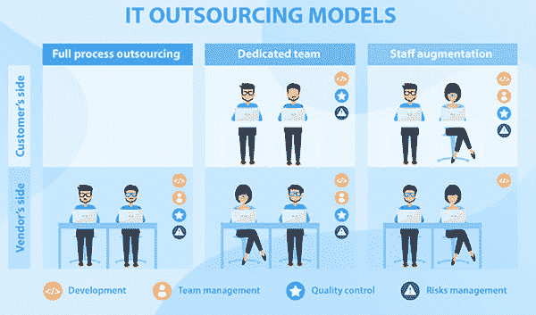

**图 2.2：** IT 外包模式

当供应商将某项职能分包给另一个第三方时，外包可能成为公司的一个问题。在这种情况下，如果供应商无法出示与第三方达成的协议，以确保由第三方处理的任何数据得到适当的安全保护，则数据所有公司应立即取消与该供应商的合同。当职能分散在多个供应商之间时，与外包相关的风险可能会加剧。供应商之间的任务分离会对战略架构产生负面影响。供应商管理成本上升，限制了组织应对不断变化的市场条件的能力。内部 IT 系统专业知识正在流失，限制了未来的平台开发。由于安全限制和升级必须跨越不同边界实施，因此耗时更长。最后，当外包跨越国界时，会出现其他挑战。某些国家的法律比其他国家更为严格。

## 云计算趋势

在涉及云计算趋势和云安全（就数据来源和存储而言）时，必须遵守许多国家或监管机构的法规。由于其他国家的法律不那么严格，企业可能不愿与任何人开展业务。环境的合规性和安全级别（如共享托管服务提供商处理信用卡和借记卡的限制，或不遵循 PCI DSS 的国家/地区的限制）阻碍了公有云的使用。请参考 图 2.3，该图展示了云计算趋势：

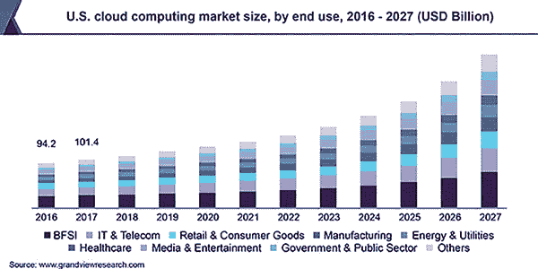

**图 2.3：** 云计算趋势

相反，应考虑在公司内部本地托管的私有云。必须结合选项概述安全顾虑、云的优势和劣势，并推荐一条前进的道路。弹性是云部署的一项特性，因为虚拟资源可在共享资源池中即时启用和退役。所使用的硬件平台不对组织披露。另一个风险是，数据在存储于该平台后的一段时间内，可能会从退役的硬件中被恢复。混合云结合了独立但互联的公共和私有环境。组织的数据可能存储在连接到基于公有云的商业智能平台的私有云上。如果巨大的需求超过了私有云的容量，组织可以使用公有云服务提供商来访问服务。第三方或跨公司团队充当供应商，为具有共同目标的企业提供社区云。建立社区云时，由于总成本由参与组织分摊，可能对所有人都有利。

## 合并与收购的影响

在合并和收购过程中，网络会互联，服务器系统和应用程序会集成，有时还会创建新的基础设施。这种情况提供了一个重新考虑保护互联基础设施构想的机会。然而，如果一家企业使用不同的硬件制造商、网络设计或规则和流程，事情就会变得困难。在整合规划和谈判期间，所有各方都必须考虑安全问题。这被称为尽职调查阶段，它允许你分析和理解另一家公司活动的各个方面。然后，通过提前全面了解集成后的基础设施环境以确保安全，就可以实现合适的合并或收购。在合并网络之前，需要对双方进行渗透测试。结果双方将全面掌握当前和未来的风险。建议签订一份包含对被收购组织整个运营生态系统进行全面风险分析的**互联安全协议**（**ISA**）。不符合合规和安全要求的系统和设备必须被移除、更改或重建。


当公司分拆或剥离其部分业务时，会执行分拆上市，而分拆类似于离婚。受影响的各方或机构必须就使用哪个实体的资产、服务和基础设施达成一致。这通常意味着从系统中移除所有数据，并审查双方的安全措施，为升级架构做准备。当组织的组成部分出售给另一家公司时，母公司应核实仅将必要数据传输给收购公司，而不传输其他任何数据。过渡阶段集成网络的隐患是组织向另一家公司出售部门或从另一家公司收购时面临的最大风险。识别涉及公司之间的数据流至关重要，应避免任何不必要的数据流。为实现安全的合并或分拆，必须组建由双方专业人员组成的尽职调查团队。该团队负责制定评估现有安全措施的策略，并监控每个阶段的过程。团队还会寻找两个集成单元之间的安全重叠和差距。对于每个已识别的风险，应建立风险概况，其中包括数据传输和优先处理程序，以识别需要立即关注的事项。审计师和合规团队必须确保安全程序和框架保持同步。

## 数据所有权

不断变化的公司模式会影响数据所有权。管理层必须根据所采用的业务模式对数据所有权做出判断。安全专家必须评估数据是将保持独立所有权，还是作为公司收购或合并的一部分进行整合。如果要进行数据合并，应制定详细说明数据合并所涉步骤的策略。管理层必须在公司出售或分拆中选择哪个组织将控制数据。为确保有效收集所需数据，必须制定详细的计划和流程。

## 数据重分类

当发生收购/合并或剥离/分拆时，安全专业人员需要检查数据分类模型。在收购/合并的情况下，安全专业人员必须决定是保持数据分离，还是将数据合并为单一实体。在剥离/分拆的情况下，安全专业人员必须确保受法律保护的数据不被提供给不受相同法律、法规或标准约束的实体。必须考虑管辖这两个组织的法律、法规和标准。组织可能需要仔细设计新的数据分类模型，并定义数据重分类的程序。必须考虑管辖组织的法律、规则和标准。谈到数据处理，无论是集成、保持分离，还是基于所有权进行拆分，企业都必须确保数据安全是重中之重。假设一家医疗保健组织决定出售其构建的一个应用程序。管理层必须与安全专家合作，确保提供该应用程序的所有数据、源代码、开发计划以及营销和销售数据给收购企业。管理层必须确保拟作为剥离一部分带走的数据中，不意外包含任何机密医疗数据。

## 整合行业的安全顾虑

在当今许多情况下，企业正在合并截然不同的业务模式。组织有时会涉足文化、地理位置和监管制度截然不同的新领域。这可能带来新的商业机会，但也可能导致安全缺陷。以下部分概述了必须审查的一些顾虑。谈到合并不同行业，问题在于在规则方面取得平衡。虽然公司各方面的统一性是一个崇高的目标，但向公司的一个要素强加一套陌生的规定可能会导致抵触情绪和士气问题。

一个单元长期形成的文化可能是信任用户管理其计算机，这可能包括本地管理员权限，但另一个单元可能反对允许用户拥有此类访问权限。虽然在整个公司标准化规定可能变得必要，但不应在未先评估利弊的情况下进行。优势应与可能产生的任何抵触情绪以及潜在的生产力损失权衡。然而，由于局部关切，可能有必要保留一些替代规定。该决定应由高层管理人员与安全专家协作做出。

因为策略不太可能规定精确的答案，所以它们可能比规则或条例更容易标准化。许多规则使用模棱两可的术语，例如 `the utmost feasible data protection must be provided for data believed to be secret`。这种术语赋予每个部门决定什么是机密、什么不是的自由。然而，当企业收购或合并时，应彻底审查其规则，以确保它们是最新的、提供足够的安全预防措施，且不对公司内的任何单元造成过度负担。政府机构（如 `DHS`、`FCC` 和 `DOT`）经常采用法规以确保行业的特定领域受到管控。当受严格监管行业的公司与受较少监管行业的公司合并时，每个业务单元内的监管程度将截然不同。在许多情况下，这种情况应被视为正常，而不是被视为缺乏标准。

## 出口管制

管辖商品从一国转移或传输到另一国的法律法规称为出口管制。这包括向国外个人披露技术数据传输。在美国和 `European Union` (`EU`) 中，出口均受规则和法规管辖。出口担忧主要源于三个原因——物品的特性、物品的预期目的地和物品的可能最终用途。出口管制旨在保障国家安全、执行外交政策并保持军事和经济优势。管理机构（如美国和 `EU` 的机构）会发布受限物品清单。实体清单、被禁止参与方、被拒绝人员和禁运国家很常见。虽然出口规则包含例外情况，但企业在出口任何实体前应咨询法律顾问。未能遵守出口管制法可能导致刑事指控、金钱处罚、声誉受损以及出口管制许可证的丧失。在美国有出口管制问题的组织应联系 `north-western university's office for export controls' compliance`。

## 法律要求

法律合规必须包含在任何组织的安全方法中。组织必须了解适用于其业务的法规，以实现法律合规。金融、医疗保健和工业生产是需要考虑众多联邦、州和市政规则的行业示例。以下部分重点介绍了组织必须考虑的一些法律法规。您不需要记住这些部分中列出的规则和法规；尽管如此，您应该广泛了解它们如何影响企业，以便分析您可能在 `CASP test` 中遇到的场景。


### 萨班斯-奥克斯利 (SOX) 法案 `[toc.xhtml#s45a]`

**萨班斯-奥克斯利** (**SOX**) 法案，也称为 2002 年《上市公司会计改革和投资者保护法案》，影响在美国公开交易的任何公司。它管辖企业的会计实务和财务报告，并对高级官员施加处罚甚至监禁。它要求对现有证券立法进行重大修改，并对违规者实施严厉的新惩罚。该立法的颁布是对 21 世纪初涉及安然公司、泰科国际和世通公司等上市公司金融危机的回应。

### 健康保险流通与责任法案 (HIPAA) `[toc.xhtml#s46a]`

肯尼迪-卡森鲍姆法案，通常称为 HIPAA，适用于所有医疗机构、健康保险公司和医疗信息交换中心。卫生与公众服务部民权办公室负责执行该法案。它制定了医疗和健康数据存储、使用和传输的规则和流程。除非州法律更严格，否则 HIPAA 优先适用。所有受管实体必须执行以下操作以遵守 HIPAA 安全规则：

*   确保所有电子受保护健康信息的机密性、完整性和可用性
*   检测并防范信息安全的任何风险
*   防止预期的非允许使用或披露
*   证明其员工遵守合规要求

### 格拉姆-里奇-比利雷法案 (GLBA) `[toc.xhtml#s47a]`

所有金融机构均受 **格拉姆-里奇-比利雷法案** (**GLBA**) 影响，包括银行、贷款公司、保险公司、投资组织和信用卡公司。它为所有金融数据建立了安全要求，并禁止与第三方共享金融数据。该立法直接影响 **个人身份信息** (**PII**) 的保护。

### 个人信息保护和电子文档法案 (PIPEDA) `[toc.xhtml#s48a]`

**个人信息保护和电子文档法案** (**PIPEDA**) 管辖加拿大私营企业在开展业务过程中如何收集、使用和披露个人数据。该立法的颁布是为了回应欧盟对加拿大个人信息 (PII) 安全性的担忧。该立法要求公司在收集、使用或披露个人信息前获得同意，并建立清晰、易懂且易于获取的个人信息政策。

### 支付卡行业数据安全标准 (PCI DSS) `[toc.xhtml#s49a]`

**支付卡行业数据安全标准** (**PCI DSS**) 适用于为主要信用卡发卡机构处理持卡人数据的所有企业。PCI DSS 3.2 版是最新版本。组织对标准的合规性必须至少每年验证一次。尽管 PCI DSS 不是法律，但它影响了各州立法的实施。请参阅 图 2.4 了解 PCI DSS 框架的示意：
`images/Image22702.jpg`
**图 2.4：** PCI DSS 框架

### 联邦信息安全管理法案 (FISMA) `[toc.xhtml#s50a]`

2002 年《联邦信息安全管理法案》影响每个联邦机构以及供应商和服务提供商。它强制要求每个联邦机构为整个组织建立、发布和实施信息安全计划。FISMA 要求联邦实体为信息安全创建有效的风险管理计划。**国家标准与技术研究院** (**NIST**) 提供了遵守 FISMA 的详细建议。该策略产生正式指导，帮助机构满足其网络安全标准，同时强调基于风险的方法，该方法根据具体情况构建适用的计划，并特别强调具有成本效益的保护。

### 美国爱国者法案 `[toc.xhtml#s51a]`

2001 年《美国爱国者法案》影响美国执法和情报机构。其目标是提高执法部门的调查能力，例如电子邮件通信、电话记录、互联网通信、医疗记录和财务信息。该法案通过时修改了《外国情报监视法案》和《电子通信隐私法案》。虽然《美国爱国者法案》不禁止私人公民使用调查工具，但存在一些例外情况，例如，如果私人公民充当政府代理人——即使未正式受雇，如果私人公民进行的搜查要求执法部门必须获得搜查令，如果政府知晓私人公民的搜查行为，或如果私人公民为协助政府而进行搜查。

《美国爱国者法案》的目的是威慑和惩治美国及世界范围内的恐怖主义行为，加强执法调查工具，以及其他目的，其中包括：

*   加强美国防止、发现和起诉国际洗钱和资助恐怖主义的措施
*   对易受犯罪滥用的外国司法管辖区、外国金融机构、国际交易类别或账户类型实施特别审查
*   要求金融服务业所有相关部门报告潜在洗钱行为
*   加强防止腐败外国官员利用美国金融系统谋取私利的措施，并促进将被盗资产返还给资产所属国家的公民

### 欧盟法律法规 `[toc.xhtml#s52a]`

欧盟制定了多项影响安全和隐私的立法和法规。欧盟隐私原则包含保护个人数据的强有力立法。欧盟《数据保护指令》概述了如何遵守原则中包含的要求。欧盟设计安全港隐私原则是为了协助美国公司遵守欧盟隐私原则。部分指南包括：

*   数据收集应遵循法律。
*   除非个人明确许可共享，否则不得将收集的个人信息与其他组织共享。
*   只有共享组织具备足够的安全措施时，才能将信息传输给其他组织。
*   数据应仅用于收集时的目的。
*   数据应仅在合理期限内使用。

根据欧盟定义，安全港是指遵守所有欧盟隐私原则的实体。数据天堂是指在法律上不保护个人数据、主要目的是吸引数据收集公司的司法管辖区。电子签名原则在欧盟《电子安全指令》中定义。根据该指南，签名必须与签署人及其所指数据唯一关联，以便检测任何未来的数据修改。签署人的签名必须能够识别其身份。

### 地理 `[toc.xhtml#s53a]`


地理差异对确保合并或分拆尽可能顺利进行有重大影响。除了可能存在的语言障碍外，世界不同地区可用的技术类型可能截然不同。虽然组织可能制定了要求使用特定技术来保护数据的规则，但实施这些策略所需的硬件和软件在其他国家或地区（如非洲或中东）可能无法获得。因此，可能需要实施策略变更和例外规定。如果这不可接受，组织可能被迫寻找替代方法以实现长期目标，例如禁止从缺乏必要技术的地方传输特定类型的数据。另一个困难在于法律和监管标准因国家而异。虽然某一司法管辖区可能有严格的数据归档和安全法规，但另一司法管辖区可能几乎没有。问题再次回到跨国标准是否合理。在某些情况下，标准化的成本可能大于收益。企业也可能需要选择不在缺乏相关政策或法律保护数据的国家存放安全需求较高的数据。

### 数据主权

数据主权是指数字数据受其存放所在国家法律管辖这一概念。国家和管理机构颁布的众多隐私规则和法规都会影响这一概念。云技术的部署进一步使这一范式复杂化。许多国家已通过法律，要求客户数据必须存储在客户居住的国家。然而，在与服务提供商和其他第三方合作时，公司发现越来越难以确认是否符合这一要求。为确保合规，组织应检查与这些供应商的服务级别协议。

但请记住，多个国家的立法可能会影响实际情况。考虑这样一种情况：美国的一家公司使用位于美国的数据中心，但该数据中心由一家法国公司管理。美国和欧盟的规则和法规都将适用于该数据。另一个考量因素是所存储数据的类型，因为不同类型的数据受到不同的管辖。管辖医疗和消费者数据传输及存储的法规截然不同。安全专家应回答以下问题：

*   数据存储在哪里？
*   谁有权访问数据？
*   数据备份在哪里？
*   数据如何加密？

这四个问题的答案将帮助安全专业人员为其公司制定治理策略，以帮助解决任何数据主权风险。请记住，拥有数据的实体和提供数据存储服务的供应商（如果有）都有责任遵守数据规则。

### 司法管辖区

司法管辖区是指受政府权力管辖的地理区域或领土。另一方面，司法管辖区通常具有灵活性，这归因于各司法管辖区之间的互惠协议。例如，美国已与多个国家签署了互助法律协定，允许信息在司法管辖区之间自由流动。因此，企业不仅需要熟悉适用于特定国家或监管机构的规则和法规。由于许多国家已开始解决数据驻留和主权问题，安全专业人员必须跟踪可能影响企业数据的司法管辖区。

### 内部和外部影响

安全规则不是凭空产生的。即使没有对立利益群体的影响，平衡安全性、性能和易用性已经够难了。必须以某种方式考虑并解决内部和外部压力。以下部分将介绍各种影响类型及其如何影响安全策略的制定和执行。

#### 竞争对手

在安全方面，企业应时刻关注竞争对手的动向。虽然每家公司的安全需求各不相同，但维护声誉是大家共同的担忧。几乎每天我们都能听到因安全漏洞导致数字声誉受损的企业。宣称公司的网络安全几乎已成为另一种商业差异化卖点。虽然提高网络安全显然是一个良好的目标，但安全专家必须确保不采取多余的步骤，例如盲目模仿。在几乎所有情况下，无效的安全措施都会降低网络性能，或使网络对用户的可用性降低。虽然企业应努力提高安全性以超越竞争对手，但安全专业人员应对拟采用的任何新措施进行适当调查，以验证收益是否超过风险。

#### 审计员/审计发现

没有行动记录和对这些活动的评估，问责制就无从谈起。审计的程度和范围应与公司的安全策略相对应。自我审计或第三方审计也是可选方案。自我审计总是伴随着主观性渗入程序的风险。无论如何进行，审计或测试的结果除非纳入现有策略和流程的修订中，否则毫无意义。内部审计全年定期进行，而外部审计每年进行一次。国际标准化组织（ISO），也称为国际标准组织，与国际电工委员会（IEC）合作，将英国标准 7799 (`BS7799`) 标准化为 `ISO/IEC 27000` 系列国际标准。

#### 监管实体

许多企业在高度监管的环境中运营。银行业和医疗行业就是两个例子。法规对安全有不同的影响。第三方验证公司是否遵守行业或政府规范和法律。该第三方检查组织活动以及认证或监管机构指定的任何其他领域。第三方将其所有发现告知认证或监管机构。根据与第三方的合同，任何发现或结论仅向被审核组织和监管组织传达。该程序应由一名高级管理人员监督，该人员将根据需要授予第三方访问权限。作为本次研究的一部分，可能要求第三方提供现场评估、文档交换或流程/策略审查。第三方团队进行现场检查。该团队需要无限制地访问公司的所有要素。此评估可能包括观察人员执行日常职责、检查记录、评估文书工作和其他任务。为建立对流程的可靠控制，管理层应指定一名管理人员，团队可向其提出正式请求。


这种测试可能包含漏洞测试和渗透测试，并将由由员工和聘用的第三方组成的团队执行。文档交换/审查涉及将一组文件发送给第三方进行评估。交易双方的文档交换程序必须是安全的。这是通过采用代表相关材料敏感性的加密级别来实现的，或者在某些情况下，采用法律强制要求或公认行业标准规定的级别。流程/策略审查检查组织内的特定流程或策略，以确保其符合规则。

## 内部和外部客户需求

必须与内部和外部客户建立的安全关系也可能在定义所采用的安全类型方面发挥作用。当我们谈论客户时，指的是那些需要以某种方式与网络交互的人。在 `LAN` 内运作的内部客户和在 `LAN` 外运作的外部客户都必须与网络通信。例如，在上传数据、连接到 `VPN` 或下载数据时，活动的敏感性以及它们正在处理的数据决定了应使用哪些安全措施。众所周知，安全措施会影响网络性能以及用户易用性。区分某些安全措施（如加密）何时是必要的至关重要。不必要的程序可以提高网络速度，同时降低用户复杂性。虽然在路由器上安装访问控制列表可以提高安全性，但请记住，处理过程会消耗路由器 `CPU` 周期，并降低路由器完成其主要路由任务的能力。当过度依赖这种保护而实际上并不需要时，网络性能会不必要地变慢。

## 高层管理

虽然高级管理人员带来的安全知识通常最少，但这些高管对安全决策有着不成比例的巨大影响力。他们根据公司需求做出判断，而非基于对最新安全工具的迷恋或安全恐惧。大多数高管只在紧急情况下才考虑安全。虽然高层管理的职责是以最具成本效益的方式分配预算，但 IT 安全专业人员的责任是为能为公司增加价值的安全解决方案辩护。这意味着要证明通过避免数据泄露和损失节省的资金超过了特定安全措施的成本。必须使用公认的风险管理技术来呈现和评估指定的措施。

## 去边界化的影响

这与网络边界不断变化这一事实有关。安全专家过去通过强化网络边缘（即网络的入口和出口）来处理安全问题。由于新的工作方式，网络边缘的位置发生了变化。此外，大多数企业网络的内部现在被划分为更小的部分，中间设有控制点。随着无线网络、便携式网络设备、虚拟化和云服务提供商的出现，网络边界和攻击面变得越来越渗透。安全架构的进步带来了更强的安全能力、相同数量的安全威胁、更高的总拥有成本，但平均而言，企业数据中心规模更小。总之，由于去边界化，即网络边界的持续变化，游戏规则已经改变。

## 远程办公

远程办公因多种原因变得越来越流行。它节省了汽油费和通勤时间，并且对环境友好，因为它减少了排放到大气中的碳氢化合物。尽管有许多好处，但直到保护它的技术建立起来之前，远程办公并未获得广泛接受。现在可以为远程办公者提供安全的 `VPN` 连接，使他们能够访问资源并工作，就像他们在办公室一样，除了咖啡和午餐。远程办公涉及多个安全隐患。例如，可能需要 `network access control` (`NAC`) 技术来确保不在 IT 部门直接监管下的机器在被允许访问 `LAN` 之前接受检查并在必要时进行修复，以避免病毒引入。

## 移动威胁

将手机、平板电脑和 `USB` 闪存驱动器等移动设备引入组织网络会带来许多风险，如下所示：

- 不安全的网页浏览
- 不安全的 `Wi-Fi` 连接
- 丢失或被盗的存有公司数据的设备
- 损坏的应用程序下载和安装
- 缺失安全补丁
- 个人设备不断升级
- 使用位置服务
- 不安全的数据存储

虽然公司电子邮件和公司联系信息是存储在移动设备上最常见的公司信息类型，但令人担忧的是，近一半的此类设备还包含客户数据、网络登录凭证以及通过业务应用程序访问的公司数据。移动设备使用量的增长，加上许多此类设备连接到几乎没有保护的公共网络这一现实，给安全专家带来了新的挑战。教育用户了解移动设备的危险，并确保他们使用适当的安全措施，将有助于保护他们免受这些设备带来的危害。

实施设备锁定 `PIN`、采用设备加密、启用 `GPS` 定位和实施远程擦除是应向移动设备用户提出的一些建议。用户还应警惕在未先验证程序来源可信的情况下安装程序。`Mobile device management` (`MDM`) 和 `mobile application management` (`MAM`) 技术近年来在企业中越来越流行。它们用于确保组织能够在移动设备连接到网络时控制其设置、程序和其他方面。

## BYOD

用户在工作场所使用个人计算设备（如手机、平板电脑和笔记本电脑）的冲动，类似于在公司使用无线网络的压力。`Bring Your Own Device` (`BYOD`) 的“精灵”已正式出瓶，尽管这一概念让安全专家噩梦连连。对安全的影响类似于远程办公，即可能需要网络访问控制等技术，以确保不在 IT 部门直接控制下的个人设备在被允许访问 `LAN` 之前接受扫描并在必要时进行修复，以防止恶意软件被引入。应当注意，涉及医疗、财务和其他类型 `PII` 的政府法规适用于数据，而非特定设备。这意味着，作为 `BYOD` 计划一部分带入网络的个人设备上存储的数据的安全保护义务保持不变。请记住，虽然典型的企业镜像和软件安装限制可能提供一定的数据安全，但它们并不能涵盖所有风险。例如，员工可能会使用业务 `FTP` 工具将客户名单和其他专有资料移动到外部计算机，然后出售给竞争对手。


## 移动设备安全与外包

### BYOD 计划与移动设备管理

因为限制不够严格，BYOD 计划会失败。非公司终端设备不允许接入业务网络；因此，一些公司不得不重新思考并修订其规则。为所有关键操作系统创建以安全为中心的标准操作环境，并确保满足每个业务单元的需求，这也是个好主意。作为安全专家支持 BYOD 计划时，你应牢记：相比于黑客，用户的疏忽大意更让你担心。用户在给设备应用安全更新和修复方面不仅仅是懒惰。用户不仅不勤于维护设备上的安全更新和补丁，而且换新设备的频率堪比换衣服。这些因素使得难以控制允许这些设备运行的网络的安全性。

集中式移动设备管理技术正迅速成为企业和个人需求的最热门选择。有些解决方案利用消息服务器的管理功能，而另一些则是能够管理多个设备品牌的第三方程序。Cisco Systems Manager 就是一个配合 Cisco Meraki 云服务工作的产品示例。Apple Configurator 是 iOS 设备的一个好例子。部署此类系统的困难之一在于，并非所有个人设备都提供原生加密和/或管理功能。在大多数情况下，集中式移动设备管理技术会区分公司发放的设备和个人移动设备。对于公司发放的设备，客户端应用程序负责监管整个设备的设置和安全。如果设备是个人设备，该应用通常仅维护其自身及其数据的设置和安全（前提是它是 BYOD 计划的一部分）。该应用及其数据与系统的其余部分隔离。因此，如果设备丢失，组织的数据得到保护，但用户数据的隐私也得到保护。无论是否使用集中式移动设备管理工具，BYOD 策略都应在组织的安全策略中增加以下内容：

*   明确个人设备在企业网络上的允许用途。
*   创建设备允许应用程序列表，并设计一种防止安装列表外应用程序的方法（例如，软件限制策略）。
*   确保高层管理人员知情并表示支持。
*   培训用户了解新策略。

在部署和支持移动解决方案的过程中，必须实施以下准则：

*   确保所选解决方案支持远程应用安全控制。
*   确保所选供应商有公开披露和修复安全缺陷的良好记录。
*   将 MDM 工具的部署作为首要任务。
*   在没有 MDM 系统的情况下，设计一个流程以确保所有设备及时更新安全补丁。
*   随着技术和行为的变化更新策略。
*   要求所有员工同意允许远程擦除任何被盗或丢失的设备。
*   严禁已 Root (Android) 或已越狱 (iOS) 的设备接入网络。

如果可能，选择支持以下功能的产品：

*   加密固态硬盘 (SSD) 和非易失性内存
*   要求输入 PIN 码才能访问设备
*   在尝试特定次数错误 PIN 码后锁定设备

### 外包

当数据传输给第三方时，公司之间的连接就成为了边界的一个组成部分。因此，连接的安全性至关重要。在外包中，像 ISA（信息安全协议）和明确描述基本安全实施措施的合同条款等安全保护变得更加重要。最后，将流程外包给处理敏感信息或受监管机构保护的个人信息的第三方，几乎肯定会影响安全。许多公司在进行风险评估时忽视了外包给第三方的风险。任何外包协议都必须保证传输给另一方的信息受到适当安全措施的保护，以满足所有法规和法律要求。

确保第三方具备必要的数据安全水平；下游责任是公司因与其他企业和客户的关系而产生的债务。考虑一下受雇的第三方是否已制定必要程序，以确保公司防火墙接收必要的安全升级。如果黑客通过安全漏洞进入网络并窃取数据和身份，客户可以因疏忽起诉公司。组织必须考虑的责任问题包括第三方外包、合同和采购。

### 尽职调查与尽职照料

这两个词与责任有关。尽职调查表明公司了解其面临的安全威胁，并已采取合理措施缓解这些威胁。尽职照料是指组织采取一切合理步骤来防止安全问题或将安全漏洞的后果降至最低。尽职照料和尽职调查有时可互换使用，但在共同评估之前，必须独立理解它们。收集信息是尽职调查的核心。组织必须建立必要的程序来评估资产面临的潜在危险。

尽职调查为你提供所需知识，以确保公司采取适当的预防措施。没有适当的尽职调查，就无法做到尽职照料。尽职照料关键在于采取行动。所有组织资产，特别是知识产权，都必须受到保护，且必须实施相应流程。未能满足最低标准和程序即被视为疏忽。如果组织未能采取一个理性的人在相同情况下会采取的行动，则构成疏忽。正如你所见，尽职调查和尽职照料具有共生关系。组织在进行尽职调查时会发现风险领域。

例如，公司可能会发现：普通员工不了解基本安全问题、打印材料未妥善销毁、员工访问了本不该访问的文件。组织考虑已识别的风险领域，并在尽到必要照料时采取措施防御这些风险。尽职照料将意味着：针对上述尽职调查发现的实例，提供员工安全意识培训、建立打印材料正确销毁流程、为所有文件实施适当的访问限制。与其他方合作时，确保第三方提供数据所要求的安全级别至关重要。有几种方法可以促进这一点，如下所示：

*   在合同中加入条款，详细规定对第三方的安全措施期望。
*   定期审计和测试提供的安全性以确保合规。
*   考虑签署 ISA（信息安全协议），某些领域可能要求签署（例如医疗保健）。

### 结论

虽然聘用第三方有助于满足上市时间要求，但第三方应在合同中被约定执行充分的安全活动，且在发布任何第三方参与的产品或服务前，公司应确认这些活动的证据。合同还应规定公司有权随时审计第三方。


在下一章中，我们将介绍组织安全策略和文档。

# 第 3 章：组织安全策略和文档

## 简介

在上一章中，我们了解了业务对安全的影响。应实施 IT 治理文档，以确保组织资产尽可能受到保护。本章解释如何管理流程和策略生命周期，以及如何支持法律合规。它讨论了常用于支持安全的业务文档和合同。它还涵盖了一般隐私原则。最后，它讨论了包含标准安全实践的策略制定。

## 结构

在本章中，我们将涵盖以下主题：

*   流程生命周期管理
*   新业务与技术
*   环境变更
*   法规要求
*   新兴风险
*   法律合规与倡导
*   支持安全的业务文档
*   协议
*   合同的安全要求
*   敏感信息的隐私原则
*   应急响应
*   信息分类与生命周期

## 目标

本章将讨论为保护组织资产而实施的 IT 安全策略和治理程序。本章将呈现安全策略生命周期的创建、实施和管理。利用业务合同建立服务级别协议和项目文档以支持安全也将在本章涵盖。支持安全的业务文档将被详细阐述，其中包括风险评估、BIA、协议、MoU 和 SLA 等。本章还将介绍职责分离、工作轮换、最小权限、应急响应和其他程序等标准安全实践。

## 流程生命周期管理

管理层发起、支持并推动安全计划，采取**自上而下的方法**。员工在获得管理层的指导和帮助之前，采取**自下而上的方式**构建安全计划。因为管理层的支持是安全计划中最关键的组成部分之一，所以自上而下的策略比自下而上的方法要高效得多。自上而下的方法有助于确保公司的政策与其战略目标保持一致。在组织安全的背景下，策略是组织确定的行动准则或原则，而流程是为达到特定目标而进行的一系列活动。流程是按特定顺序或特定方式执行的一组操作。组织内部所有重要的决策和活动都由政策、程序和流程决定，所有组织任务都在政策、程序和流程所施加的边界内运行。策略首先被制定，以指导程序和流程的构建，从而理解三者之间的联系。流程提供了流程内任务的高层视角。程序是完成任务的分步说明，如 **图 3.1** 所示。

### 场景

假设一家公司有一套处理**应付账款**的特定程序。接收发票、录入发票、授权付款、打印支票、签署支票和邮寄支票都是围绕该策略制定的流程中必须完成的高层操作示例。流程中每个任务所涉及的每个步骤都将记录在程序中。如 **图 3.1** 所示，策略应基于以下生命周期编写：

1.  **制定/设计策略**
2.  **执行建模和质量控制**
3.  **获得策略执行批准**
4.  **发布/执行策略并执行定期监控和检查**
5.  **为优化进行审查，如不再需要或不再适用则归档策略**

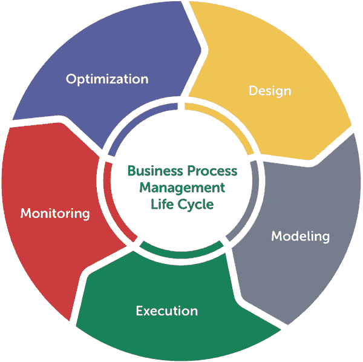

**图 3.1：** 流程生命周期

公司、技术、风险和环境的变化不断要求进行策略审查，例如采用新技术、兼并收购或发现新的攻击方法。如果员工想要从家中访问商务电子邮件和共享驱动器，或者以前从未授予远程访问权限，但突然因需要提高生产力和快速响应客户请求而需要远程访问，公司应评估该需求以确定其是否合理。如果公司决定启用远程访问，安全专家应基于外部环境具有敌意的假设来规划和设计安全策略。在批准之前应进行质量检查，以确保策略符合所有适用的法律、法规和标准。策略最终确定后，公司必须确保所有受影响的员工得到适当通知。新策略应包含在此人接受的任何培训中。如果需要更改策略，应使用版本控制以确保在整个公司使用最新版本。如果策略不再适用，则应将其归档。策略至少每年审查一次，并应经常性地进行审查。

该生命周期的第一阶段是研究策略，第二阶段是基于策略构建流程。流程部署后，所有参与该流程的员工都应了解新流程如何运作。应定期审查该方法，如果出现问题或主要策略被修订，则进行调整。请记住，策略指导程序的创建。每当实施新策略时，就需要一个新流程。如果策略被修订或废弃，该策略的程序也应被修订或废弃。程序必须在策略和相关流程记录完成后编写。

程序最接近计算机和其他设备，包含员工预期遵循的所有特定活动。程序中常见的是策略和流程执行的分步列表。在组织评估业务、技术、风险和环境变化以建立和更新策略后，必须接下来设计和更新其流程和程序，以反映新的或更新后的策略，以及环境和业务变化。例如，如果业务更换为其采用的最新版本的备份软件，则可能需要调整程序。

大多数软件更新涉及检查现有方法并决定如何更改它们。例如，假设管理层希望聘请更多外部承包商来完成工作。公司可能需要实施一种新方法来评估外部承包商工作的质量。

作为最后一个例子，假设一家公司希望用多台 Linux 服务器取代其现有的 Microsoft 文件服务器。虽然高层策略将保持不变，但实施这些规则的方法将需要修订。如果一家公司的市场部门需要与其合作伙伴和客户进行更多实时交互，并决定在多个社交网站上建立形象以共享信息，则该公司需要指派一组受过培训的人员代表公司发布信息，并培训其他员工如何共享信息。变更管理、配置管理、网络访问程序、无线访问程序和数据库管理程序只是需要考虑的几个流程和程序。


然而，请记住，只有在相关策略被接受后，才应开发或修改程序和流程。流程和程序将根据策略进行开发。内部组织驱动力是制定规则和程序的基础。当发生新业务或业务变更、推出新技术、发生环境变化或监管要求发生变化时，组织应确保制定或评估策略和流程。

## 新业务

当公司启动或收购新业务线时，称为新业务。消费者期望经常驱动由组织公司性质决定的业务变更。发生变更时，组织必须确保知晓该变更及其对业务安全态势的影响。针对这些发展和困难，企业应采取主动姿态。预测变更并使用缓解策略帮助规避它们。假设一家公司决定开始一项新业务，消费者现在可以购买以前只能通过大型零售场所获得的商品。将需要基于此新模式制定新业务策略，以及管理新业务的新程序。安全专家对涉及新公司启动或现有业务变更的每个项目都至关重要，因为他们保证考虑了安全措施。安全专家应记录、审查并向管理层报告与新业务或业务转型相关的所有风险。他们还必须披露为应对这些风险而提出的任何安全程序。

## 新技术

新的技术突破要求企业采用新技术，从而推动技术变革。组织必须再次确保知晓这些发展及其对其安全态势的影响。假设一家公司决定允许员工实施 `BYOD` 策略。安全专业人员应努力确保该策略确定允许或禁止 `BYOD` 的边界。此外，该程序需要正式化，很可能包括获得设备的官方许可、分析设备的安全态势，以及根据设备的安全态势允许完全或受限访问。安全专家在新技术的采用或使用中至关重要，因为他们保证考虑了安全措施。安全专家应记录、审查并向管理层报告与新技术相关的所有危害。为降低这些风险，他们还必须建议并记录安全程序。

## 环境变化

环境变化分为两类——由组织文化引发的和由行业环境驱动的。组织必须确保理解这些变化及其对其安全态势的后果，就像应对新业务或技术一样。假设一家公司选择推出一项新策略，要求其每个设施包含特定数量的绿地。管理层必须设计完成和维护这些绿地的方法。这很可能涉及获取地产、制定区域规划、建设新绿地并保持绿地更新。

## 监管要求

监管要求是指必须记录并遵守的任何法律或法规要求。标准可作为监管框架的一部分使用，尽管其执行力度不如法律法规严格。组织必须确保理解立法及其对公司安全态势的后果，就像应对新业务、技术或环境发展一样。`International Organization for Standardization` (`ISO`) 制定了一套指南以协助企业开发安全策略。其他监管机构包括地方、州、联邦及其他政府实体。

### 考虑以下场景

假设一个组织正在更新其安全规则，但陷入僵局，因为管理层认为公司的关键供应商对合规和监管标准有很大控制权。高层管理人员允许供应商在组织策略的编写中拥有很大话语权。虽然供应商支持至关重要，但 IT 总监认为公司必须客观地设计策略，因为供应商不一定总是将组织利益放在首位。IT 总监应向高级员工提出以下建议：

*   咨询法律和监管要求。
*   起草通用组织策略。
*   规定功能实施策略。
*   建立必要的标准、程序、基线和指南。

正如此例所示，您无需记住确切条件。但您必须了解它们在企业中的使用方式、修改方式，以及如何调整它们以满足公司需求。

## 新兴风险

新兴危害是因近期安全环境而产生的任何威胁。新技术、小工具和应用程序中的危险通常直到部署后才被发现。根据组织制定的策略和程序，安全专家应进行广泛研究以识别新兴威胁。在处理新问题时，`Patch management`（补丁管理）至关重要。供应商通常会针对新兴风险尽快提供安全升级。假设一家公司想要引入新的 `Internet of Things` (`IoT`) 设备。几周后，供应商发现一个安全漏洞，允许攻击者接管设备功能。因此，他们发布了安全补丁来解决该问题。如果必要的流程到位，组织的安全专家应监控供应商的 `Patch management` 通知，并在充分测试后实施更新。

## 法律合规与倡导

公司的人力资源部门、法务部门或法律顾问、高级管理层以及其他内部和外部实体都应纳入其法律合规与倡导计划中。公司的法律合规确保其遵守所有适用的法律、法规和商业惯例。由组织或为组织进行的法律倡导，是在政治、经济和社会系统及组织中影响公共政策和资源分配决策的做法。人力资源的参与确保公司遵守所有劳动法律法规以保护员工。人力资源专业人员可帮助指导公司的安全策略，以确保个人权利得到维护，同时保护公司资产和负债。为防止法律问题，组织应确保用户在登录时知晓雇主有权监控、扣押和搜查组织设备。如果技术人员需要作为调查一部分扣押员工的工作站，公司将受到保护。人力资源和法务部门应参与将要发布的声明的制定，以确保其包含所有相关信息。

## 支持安全的业务文档


安全专业人员需要使用许多常见的商业文档来支持组织安全的实施和管理。理解这些商业文档有助于确保解决安全风险的所有领域，并制定适当的政策、程序和流程。

# 风险评估

风险评估是一种风险管理工具，用于发现漏洞和威胁，评估这些漏洞和威胁的后果，并决定安装哪些控制措施。风险评估或分析包含以下三个主要步骤，如*图 3.2*所示：

**步骤 1**：识别危害、漏洞和威胁。

**步骤 2**：识别资产和面临风险的资产价值。

**步骤 3**：计算威胁概率和业务影响。

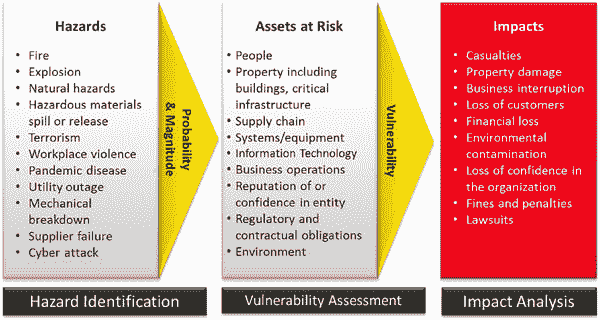

**图 3.2：** 风险评估

管理层和风险评估团队必须首先决定评估哪些资产和威胁，然后才能开始风险评估。这一步包括确定项目范围。之后，风险评估团队必须向管理层提供一份报告，详细说明所考虑资产的价值。然后审查并确定资产清单，管理层根据需要添加和删除资产，然后确定风险评估项目的预算。除非得到高层管理的认可和领导，否则风险评估不会成功。风险评估的目的和范围必须由管理层定义，随后管理层必须为项目分配人员、时间和财务资源。**适用性声明**（**SOA**）概述并解释了组织选择的控制措施，以及它们如何以及为何适用。SOA 来源于风险评估的结果。如果 ISO 27001 合规性对公司至关重要，则 SOA 必须将选定的控制措施与其旨在管理的风险联系起来。SOA 应涉及将用于实施指定控制措施的规则、程序、其他文档或系统。记录为何排除某些控制措施也是个好主意。

# 业务影响分析 (BIA)

**业务影响分析**（**BIA**），如*图 3.3*所示，是一种用于业务连续性和灾难恢复的功能分析类型。详细的 BIA 将帮助业务单元理解灾难的影响。BIA 生成一份文档，指明重要且必要的业务功能，以及它们的资源需求和对更广泛公司的关键性。请参阅说明业务影响分析的*图 3.3*：

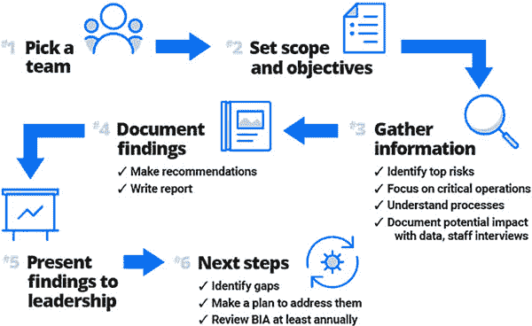

**图 3.3：** 业务影响分析

# 互操作性协议 (IA)

**互操作性协议**（**IA**）是两个或多个实体为协作交换信息而签订的合同。这些协议最常用于由同一主要组织控制的姐妹公司之间。尽管这些企业的构建和运营方式不同，但它们可以共享系统、电信、软件和数据，以实现资源整合和改进使用。IA 是具有法律约束力的合同。互操作性协议不同于互惠协议。互惠协议是技术需求和基础设施相当的两个组织之间的协议，而 IA 涵盖日常运营。在互惠协议中，如果其中一个组织的主要设施变得不可用，一个组织承诺作为另一个组织的替代场所运行。不幸的是，在绝大多数情况下，这些协议不具有法律约束力。

# 互连安全协议 (ISA)

**互连安全协议**（**ISA**）是记录拥有并运行链接 IT 系统的两个实体之间连接技术要求的合同。在大多数情况下，每个组织的安全控制要求都在协议中说明，以避免任何误解。ISA 还鼓励各方签署谅解备忘录。例如，如果一家公司已完成其网络与国家高速网络的连接，而该地区的本地企业正在寻求赞助，以通过直接连接公司网络的方式接入高速网络，则 ISA 将是记录连接技术要求的最佳方式。

# 谅解备忘录 (MOU)

**谅解备忘录**（**MOU**）是定义两个或多个组织之间共同行动方案的文档。当各方没有法律承诺或无法达成具有法律约束力的协议时，经常使用 MOU。在某些情况下，它也被称为意向书。

# 服务级别协议 (SLA)

**服务级别协议**（**SLA**）是一种合同，规定了支持系统在维持特定服务水平的同时响应问题的速度。部门间的内部 SLA 或与服务提供商的外部 SLA 也是可能的。就特定问题的处理速度达成一致，为问题响应带来了一定的可预测性，这反过来有助于维持资源访问。SLA 通常包含在大多数服务合同中，可能包含安全优先级、职责、保证和担保。当选择新的第三方供应商（如云计算提供商）来维护和管理组织的系统时，SLA 是最佳选择。当组织需要特定内部服务的 24 小时支持，并希望利用第三方提供商覆盖内部员工不在岗的班次时，SLA 是一个明智的选择。

# 运营级别协议 (OLA)

**运营级别协议**（**OLA**）是规定跨部门关系以支持业务活动的文档。SLA 经常与 OLA 一起使用。OLA 是 IT 部门和会计部门之间的合同，其中 IT 部门同意负责会计服务器的备份服务，而会计人员负责服务器的日常运营。

# 保密协议 (NDA)

**保密协议**（**NDA**）是双方之间的合同，规定了哪些信息是机密的，不得与任何其他人讨论。组织可以与其员工使用**保密协议**（**NDA**）来保护其知识产权。当两家公司合作创建新产品时，可能会使用 NDA。签署 NDA 是为了确保每个合作伙伴的数据安全，因为合作成功必须披露某些信息。虽然 NDA 无法保证敏感信息不被泄露，但它确实包含了对违规者的后果，包括罚款、监禁和权利丧失。

例如，当企业希望通过法律手段确保在与第三方的项目或云计算环境中不泄露敏感信息时，应建立 NDA。你在参加 CompTIA 高级安全从业者考试前签署的 NDA 就是一个使用示例。你必须以电子方式签署一份 NDA，明确规定除 CompTIA 考试大纲（发布在公司网站上）正式声明的内容外，你不得讨论任何关于考试内容的信息。如果你不遵守此 NDA 的条款，你将面临失去 CompTIA 认证并被禁止参加未来 CompTIA 考试的风险。


# 商业合伙协议 (BPA)

**商业合伙协议 (BPA)** 是两个或多个公司合伙人之间的合同，明确规定了其合作条款。每个合伙人的义务、利润/亏损分担细节、资源共享信息和数据共享详情通常包含在 BPA 中。例如，如果一个组织与一家营销公司签订营销协议，该组织将与营销公司共享其部分客户信息，则协议条款应在 BPA 中明确规定，同时包含任何合同边界，例如仅允许营销公司联系明确同意接受第三方联系的客户。任何可能影响合作伙伴及其员工的组织政策都应包含在 BPA 中。任何与可能有员工驻场工作的合作伙伴签订的 BPA 都应包含贵组织 USB 闪存驱动器安全策略的详细信息。

# 总服务协议 (MSA)

**总服务协议 (MSA)** 是双方之间的合同，其中将控制未来交易或协议的大部分参数由双方商定。如果公司与供应商或厂商有长期合作关系，该协议非常合适。在每份合同期限内，MSA 提供一份风险分担计划，描述协议中包含的承包商和员工的风险和职责。它还包含赔偿条款，允许一方免除另一方的责任，或保护其免受当前或未来的损害。无论过错在谁，赔偿方承诺支付其已造成或未来可能造成的损害赔偿；这些损失包括法律费用和诉讼成本。**工作说明书 (SOW)** 经常包含在 MSA 中，它规定了供应商将为客户执行的具体工作。它概述了要完成的任务、交付成果以及完成时间表。

# 合同的安全要求

与第三方签订合同在行业中很常见。由于安全已成为大多数企业和政府机构的首要任务，合同现在包含明确规定供应商安全要求的条款。组织应寻求法律建议，以确保其签署的合同具备所需的安全标准，不仅满足其自身需求，还符合任何适用的政府规则和法律。组织可以考虑在任何合同中包含以下条款：

- 与处理组织数据相关的所需策略、实践和程序
- 任何第三方人员的培训或认证要求
- 任何第三方人员的背景调查或安全许可要求
- 对第三方设备的必要安全审查
- 任何第三方人员的物理安全要求
- 将影响合同的法律法规
- 安全专业人员应研究合同的安全要求，包括 RFP、RFQ、RFI 和其他协议

**图 3.4：** RFI、RFQ 和 RFP

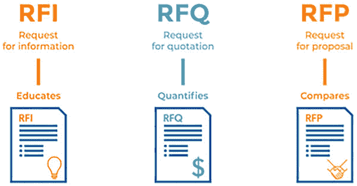

以下段落将进一步解释这些内容：

# 询价单/信息征求书 (RFI)

RFI 是招标过程中用于收集潜在供应商能力书面信息的文件。如有必要，RFI 可在 RFP 或 RFQ 之前使用，但如果 RFP 或 RFQ 未能获取足够的规格信息，也可在之后使用。假设一家大型私营公司的安全管理员正在研究并准备一份提案以采购 IPS。由于尚未选定单一 IPS 类型，安全管理员在决定解决方案前需要从多家供应商处收集信息。RFI 将有助于选择特定品牌和型号。现在，考虑 RFI 在 RFP 或 RFQ 之后的情况。假设三位高级管理人员一直在合作，为公司新办公室的大型安装项目请求一系列防火墙解决方案的投标。在审查了从三家供应商处获得的 RFQ 后，这三位经理未收到任何解决方案的有意义规格数据，且在采购继续前需要这些数据。为了使采购流程回到正轨，经理们应联系这三家提交投标的供应商公司，要求它们提交包含更详细产品解决方案信息的支持性 RFI。

# 报价请求 (RFQ)

投标邀请，通常称为 RFQ，是一种招标过程文件，鼓励供应商就指定产品或服务提交报价。RFQ 适用于采购标准化或大批量生产的物品，如台式计算机、内存模块或其他设备，因为它们通常包含产品或服务要求。假设一家小型私营公司的安全管理员正在研究并准备一份提案以采购入侵防御系统。安全管理员需要获取已选定的特定品牌和型号的成本信息。为了进行成本分析报告，安全管理员应编写 RFQ。例如，付款条款将包含在 RFQ 中。

# 建议书请求 (RFP)

RFP 是招标过程中使用的文件，描述组织想要购买的商品、服务或资产。潜在供应商将 RFP 作为提交正式投标的框架。在三家供应商提交其请求的文件后，两位高级管理层成员认为他们更了解每个供应商的业务及其可提供的解决方案。然而，高管们现在想了解这些解决方案如何满足公司需求的复杂细节。为了收集此信息，经理们应向这三家提交投标的公司发布 RFP。

# 协议或合同

除了上述协议外，组织还采用各种第三方协议。尽管许多协议不如 RFP、RFQ 或 RFI 正式，但组织在协议中解决任何安全需求仍然至关重要，以便第三方知晓。这包括采购订单、销售协议、制造协议以及组织用于开展业务的其他类型合同。

# 敏感信息的隐私原则

在当今技术及其使用方式方面，消费者隐私是一个关键担忧。这一隐私问题通常围绕三个领域——个人信息可与谁共享、消息能否私密传输，以及用户能否以及如何匿名发送消息。隐私是公司安全措施的一个重要方面。**个人身份信息 (PII)** 必须被理解、识别和保护，作为公司为维护隐私必须采取的安全措施的一部分。任何可单独使用或与其他信息结合使用以识别特定个人的数据均称为 PII。组织获取的任何 PII 都必须在最大可行范围内得到保护。全名、身份证件号码（如驾照和社会安全号码）、出生日期、出生地、生物特征数据、金融账户号码（如银行账户和信用卡号码）以及数字身份（如社交媒体名称和标签）均属于个人身份信息的示例。


重要的是要记住，不同国家和不同层级的政府可能会使用不同的标准来识别 PII（个人身份信息）。安全专家必须确保他们熟悉国际、国家、州和地方层面的 PII 规则和立法。随着此类数据窃盗变得越来越普遍，您可以预期将会实施更多影响您职业的法规。鼓励制定包含标准安全实践的政策。为了支持安全的所有领域，必须制定组织政策。根据经验丰富的安全专业人员的建议，组织安全政策应包含以下内容：职责分离、工作轮换、强制休假、最小权限、事件响应、取证任务、雇佣和解雇程序、持续监控、用户培训和意识，以及审计要求和频率。

## 职责分离

在创建组织的身份验证和授权程序时，请将角色分离作为一种预防性管理控制牢记在心，如*图 3.5*所示。通过将任务及其附带的权利和特权分散给不同用户，职责分离可以防止欺诈。这有助于防止欺诈和串通，因为如果公司采用适当的职能分离，针对组织的欺诈行为将需要两名或两名以上员工的合作。授权一人控制备份操作，另一人管理和恢复程序，是角色分离的一个绝佳例证。请参考*图 3.5*，该图展示了职责分离：

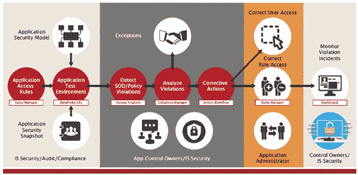

**图 3.5：** 职责分离

双重控制和分散知识与职责分离相关联。双重控制允许并要求两人或更多人执行特定操作。例如，零售公司可能要求两名主管共同打开保险柜。分散知识确保没有单个人拥有完成任务所需的所有信息。军方要求两人输入不同的组合以批准导弹发射，这便体现了分散知识。如*图 3.6*所示，职责分离确保没有单个个体能够危及组织的安全。任何高风险活动都应分解为离散的任务，然后分配给不同的人员或部门。当组织制定政策规定系统管理员不得在系统审计期间在场时，角色分离便是指导原则。

请参考*图 3.6*，该图展示了隔离与非隔离的职责分离：


**图 3.6：** 职责分离（隔离与非隔离）

请看下面这个违反角色分离的例子：

假设一个组织的内部审计部门正在调查一个可能的安全漏洞。一名审计员采访了三名员工——应收账款办公室负责将数据录入财务系统的职员、应付账款办公室负责采购订单审批的行政助理，以及财务部门经理，他可能同时担任职员和行政助理。为了防止未来的安全漏洞，审计员应建议将经理的角色限制为数据评估和采购订单审批。

## 工作轮换

从安全角度来看，工作轮换（如*图 3.7*所示）是指一种调查性管理控制，即培训多名用户履行某个职位的职能，以帮助防止任何单个员工的欺诈行为。其前提是：通过让多个人熟悉该职位的合法任务，增加发现任何一人异常行为的可能性。工作轮换通常与强制休假相结合。除了工作轮换的安全方面外，其他好处还包括：

* 紧急情况下的受过培训的备份人员
* 防止欺诈
* 员工交叉培训
* 强制休假

请参考*图 3.7*，该图展示了工作轮换：

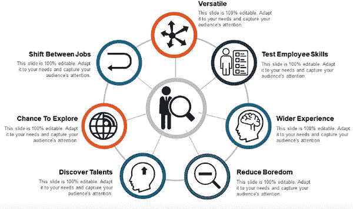

**图 3.7：** 工作轮换

强制休假要求所有员工休假，使其他员工能在其离岗期间顶替。这种调查性管理控制提高了发现异常行为的几率。使用强制休假的一些安全好处包括让替补员工执行以下任务：

* 运行与休假员工相同的应用程序
* 以不同于休假员工的顺序执行任务
* 从不同于休假员工的工作站执行工作

顶替休假员工的员工应避免运行由休假员工编写的脚本。替补员工应编写自己的脚本，或手动执行脚本中的职责。

## 最小权限

最小权限原则指出，用户或进程应仅拥有完成工作所必需的访问特权。该原则的主要目标是确保用户仅能访问他们所需的资源，且仅被允许执行他们所需的任务。组织必须确定所有用户的职责，并将用户限制在仅拥有执行职责所指明的权限，以充分贯彻最小权限概念。最小权限概念与需知原则密切相关。尽管最小权限试图将访问权限降至最低，但需知概念为每个职业或公司职能设定了最低标准。

当用户拥有的权利、特权和权限超过其执行工作所需时，就会出现问题。在企业环境中，过度的权限难以管理。当系统管理员同时被授予管理级账户和普通用户账户时，这是最小权限和需知概念的常见应用。管理员应经常使用普通用户账户。系统管理员应使用管理级账户执行管理级任务。当管理员使用管理级账户执行日常操作时，他们会冒着危及系统安全和用户问责制的风险。支持最小权限原则的组织规则包括：

* 将管理账户的数量保持在最低限度。
* 管理员在执行常规操作时应使用普通用户账户。
* 可能被攻击者利用的工具的权限应尽可能严格。


用户应被划分为不同的组，以便于将知识限制在特定组或区域内，从而支持最小权限和需知原则。此过程称为**隔离**（compartmentalization）。无访问权限应为默认访问级别。用户应仅拥有执行其工作所需资源的访问权限，且该权限应在主管验证必要性后手动授予。用户系统需要了解并包含自主访问控制和基于角色的访问控制。为确保最小权限，必须识别用户的工作职责，并授予每位用户其职责所需的最低许可级别。数据库中视图的实现便是另一个例子。操作员必须仅具备完成其职责所必需的最低限度的系统理解。如果管理员在检查最近的安全审计时发现两名财务用户也拥有访问人力资源数据的权限，且其中一名用户专职从事财务工作，这可能违反了最小权限原则。用户应仅能访问完成其任务所需的数据。虽然某些用户可能需要访问其部门以外的数据，但这并非常态，且应始终经过严格审查。

# 事件响应

与安全相关的事件不可避免。组织对灾难的响应对事件的危害程度有重大影响。事件响应策略应明确定义、清晰传达并严格遵守。它们应特别关注针对公司 IT 基础设施的网络攻击。事件响应系统中的步骤（请参阅*图 3.8*）可包括以下内容：

## 步骤 1：检测

第一步是弄清发生了什么。此功能包含在所有调查控制中，例如审计。未被报告的事件是最糟糕的。

## 步骤 2：响应

应根据发生事件的类型采取适当的响应方式。针对 Web 服务器的 DoS 攻击（拒绝服务攻击）所需的响应比服务器机房丢失一个鼠标要更即时、更独特。组织应提前建立标准响应和响应时间。

## 步骤 3：报告

所有事件应在合理的时间段内报告，并考虑事态的严重程度。创建事件类别列表以及发生各类事件时的联系人在许多情况下大有裨益。在此早期阶段，当时间敏感信息仍可获取时，对细节的细致关注至关重要。

## 步骤 4：恢复

恢复意味着采取措施恢复网络或系统的功能。具体措施取决于具体情况和可用的恢复选项。例如，如果已部署容错机制，恢复可能仅需让集群中的一台服务器故障转移到另一台。在其他情况下，可能需要从最近的备份中恢复服务器。此阶段的主要目的是重新建立对所有资源的访问。

## 步骤 5：补救

此步骤涉及清除可能仍然存在的任何残留威胁或网络损害。例如，在病毒爆发的情况下，可能需要扫描系统以查找任何其他受感染的设备。当时间允许时，将使用这些方法提供更广泛的缓解措施。

## 步骤 6：复盘

第三阶段是再次梳理每个事件，以汲取经验教训。可能需要修改流程，以便将获得的经验教训传达给未来可能参与类似事件的所有员工。

在响应、报告和恢复过程中，会进行事件的实际调查。在调查期间，遵循适当的取证和数字调查协议有助于确保证据得到保全。请参阅*图 3.8*，该图展示了事件响应步骤：

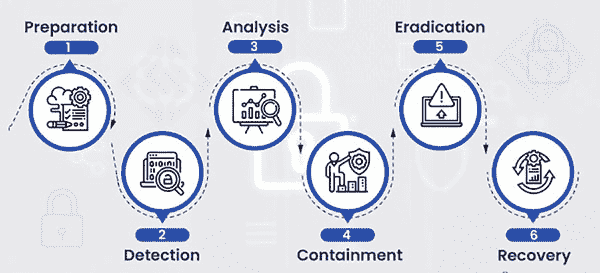

**图 3.8：** 事件响应步骤

每家公司都必须制定事件响应计划，以确保任何安全问题都能被识别、遏制和调查。任何调查始于事件响应。事件响应人员在发现事件后执行特定活动。在整个事件响应过程中，事件响应团队必须确保遵循正确的协议以保全证据。安全人员在响应问题时必须了解事件（event）和事故（incident）的区别。事件响应团队必须制定充分的事件响应协议，以确保事件得到妥善处理，但流程不得妨碍任何可能需要的取证调查，以追究相关方的非法行为责任。任何事件调查都要求安全专家掌握交战规则，以及调查的授权和范围。

# 事件与事故

在事件响应方面，事件（event）和事故（incident）之间存在根本区别。状态的变化称为事件。虽然事件可能是好是坏，但事件响应主要关注负面事件——即那些被认定对公司有不利影响的事件。事故是一系列对公司运营和安全产生负面影响的事件。例如，尝试连接到服务器是一个事件。当一系列连接服务器的失败尝试导致系统被攻破时，便发生了事故。这些在*图 3.9*中有所说明：

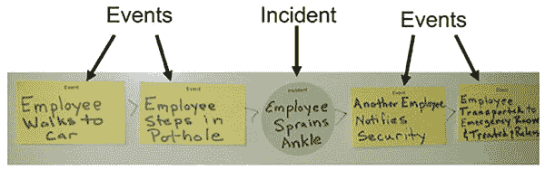

**图 3.9：** 事件 vs 事故

只有当公司建立了足够的审计和安全程序来监控活动时，事件才可能被发现。单个不良事件可能发生。例如，一次错误的登录尝试可能被记录在审计日志中。这一登录尝试本身并非安全风险。然而，如果在短时间内发生大量错误的登录尝试，组织可能正遭受攻击。第一次无效登录尝试被视为事件，但在数小时内发生的一系列无效登录尝试将被称为事故，特别是如果这些错误的登录尝试都来自同一个 IP 地址。

# 交战规则、授权和范围

事件响应团队的交战规则、授权和范围都应有文档记录。如果发生事件，交战规则规定了允许采取哪些行动、不允许采取哪些行动。授权和范围赋予事件响应团队进行调查的权力，以及团队必须执行的调查范围。事件响应团队的交战规则作为指南，确保他们不会越过从诱捕（enticement）到诱导（entrapment）的界限。诱捕是指攻击者被提供从事非法行为的机会（引诱），但攻击者选择自行行动。诱导是说服某人实施其原无意实施的犯罪。虽然诱捕是合法的，但它引发了道德担忧，且在法庭上可能不被采纳。诱导属于犯罪。

# 取证任务


# 计算机犯罪调查

由于调查人员面临的时间限制，且可能需要专家协助调查，计算机调查涉及的流程与普通调查不同。此外，由于计算机数据是无形的，通常需要采取额外预防措施，以确保数据以其原始格式得以保留。最后，获取数字犯罪的证据可能颇具挑战性。在决定调查计算机犯罪后，您应遵循标准化程序，包括以下内容：

- 确定要扣押的系统类型。
- 确定搜查和扣押小组成员。
- 评估嫌疑人销毁证据的风险。

如果执法部门被告知发生了计算机犯罪，组织对调查人员的限制就会增加。可能有必要将调查移交给执法部门，以确保证据得到妥善保存。调查计算机犯罪时必须遵循证据规则。计算机证据必须证明与案件相关的事实，且值得信赖。保持保管链完整至关重要。如果创建计算机证据的过程未被记录，则不太可能被法庭采纳为证据。取证调查涉及以下步骤：

1. **识别**
2. **保全**
3. **收集**
4. **检查**
5. **分析**
6. **呈报**
7. **决策**

# 雇佣与解雇程序

企业内部绝大多数安全漏洞均由员工引起。因此，必须实施组织的人员安全规则。筛选、雇佣和解雇规则都应包含在组织的人员安全政策中。在发出录用通知前，应进行犯罪背景调查、工作经历核查、背景调查、信用记录核查、驾驶记录核查、药物滥用测试，以及学历和执照验证。筛选要求应根据组织需求和潜在应聘者所担任职位的级别来制定。雇佣流程应包括签署所有适用文书，包括政府要求的文件、无隐私期望声明和保密协议（NDAs）。

新员工会收到一份人员手册副本以及其他雇佣材料。在正式核实员工已完成所有培训后，应提供 ID 和密码。根据解雇是友好的还是敌对的，必须相应地处理。人力资源程序可确保组织财产归还、在不再需要时终止用户访问权限，并进行离职面谈。就不利解雇而言，组织流程必须具有前瞻性，以保护公司资产。因此，不利解雇程序应包括在通知员工解雇前终止其系统和设施访问权限，并由安保人员护送其离开现场。

在雇佣期间，管理层还必须确保有适当的安全规则到位。某些职位可能需要雇佣协议，以便在员工离职后仍能保护企业及其资产。保密协议（NDAs）、竞业限制条款、行为准则和道德协议即属于此类协议。

# 持续监控

在持续监控生效前，必须获取组织的运行基线。毕竟，如果组织不知道什么是*正常*的，就无法发现异常行为模式。应定期检查这些基线，以确认其未被篡改。例如，如果单台 Web 服务器升级为 Web 服务器场，则应获取新的性能基线。根据安全专家的说法，必须始终维护组织的安全态势。这需要持续监控。应定期检查审计和安全日志。基线应与性能指标进行比对。即使是用户登录和注销时间等简单操作也应被追踪。如果用户开始在异常时间登录和注销，应通知该用户的主管，以确保该用户获得了授权。组织必须对其企业的安全保持持续警惕。

# 用户培训与意识

安全意识培训、安全培训和安全教育这些短语经常被混用，但它们并不相同。意识培训强化了采用安全措施保护宝贵资源的必要性。安全培训教授人员安全执行其职业所需的技能。安全意识培训结合了意识和安全培训，提升用户安全意识，并确保用户对其行为负责。安全教育更为系统独立，面向需要安全知识来管理内部安全项目的安全专业人员。因此，意识培训关注“做什么”，安全培训关注“怎么做”，安全教育关注“为什么做”。开发安全意识培训时应考虑受众。培训师还必须了解企业文化及其对安全的影响。例如，在一家小型以客户为中心的银行中，可能会鼓励银行员工与客户建立联系。在这种情况下，安全意识培训必须考虑到与客户紧密联系所带来的风险。

开发培训时需考虑的受众包括高层管理人员、中层管理人员、技术专业人员和其他员工。面向高层管理人员的安全意识培训必须包含对潜在风险和威胁的透彻理解、安全问题对组织声誉和财务状况的影响，以及适用于安全项目的任何相关法律法规。中层管理人员培训应讨论政策、标准、基线、指南和程序，以及这些要素如何与不同部门相关联。中层管理人员还必须了解其安全职责。

技术人员应接受如何配置和维护安全防护措施的培训，以及攻击发生时如何识别攻击的培训。此外，应鼓励技术人员获取行业认证和高级学位。其他员工必须了解其安全义务，以便安全地执行日常活动。使用真实案例来强调适当的安全实践对该团队很有帮助。有针对性的安全培训对于确保公司各层级用户了解其安全责任至关重要。假设经理正在参加一个全天的培训课程。他急于录入下属的奖金和薪资信息；他认为登录薪资系统并与受信任的下属激活桌面共享是完成更新的最佳方式。经理将桌面控制权移交给下属，使其完全访问薪资系统。该下属缺少访问薪资系统所需的权限。另一名员工向安保人员报告了该事件。解决此问题最有效的方法是提供有针对性的安全意识培训，并解雇屡犯者。


## 安全意识培训

员工应签署一份文件，证明他们已完成培训并理解所有主题。尽管初始安全意识培训应在某人入职时进行，但应将其视为一个持续的过程，未来的培训课程至少每年进行一次。对于企业而言，确保流程始终被正确遵循至关重要。如果企业发现员工未遵守任何类型的适当流程，应审查程序以确保其正确性。然后应为员工提供必要的培训，以确保遵循正确的流程。

例如，如果最近的安全漏洞导致敏感客户信息泄露，公司必须确保员工接受适当培训以提高安全性并降低数据泄露风险。在这种情况下，隐私合规培训计划应主要侧重于向员工解释客户数据如何被收集、使用、发布和维护。定期进行安全审计也至关重要。考虑这样一种情况：安全审计发现与员工账户管理相关的安全控制缺失。审计表明，员工离职后账户未立即停用。根据公司政策，员工账户应在解雇后八小时内禁用。然而，根据审计，10% 的账户直到离职员工离开七天后才被封锁。此外，5% 的账户仍处于活动状态。为确保快速上报员工离职情况，安全专业人员应与组织管理层讨论离职政策。为确保在必要时禁用账户，建立系统的离职上报机制可能很重要。

## 审计要求和频率

您必须首先识别典型的行为模式，然后才能检测出异常行为模式。您还应定义一个截断级别，即超过该阈值的违规行为将被报告。三次登录失败是常用的截断级别。任何超过三次限制的登录失败尝试均被视为恶意行为。达到此截断阈值后，大多数锁定策略将锁定用户账户。用户通过审计和报告对其行为负责，然而，审计系统只能报告其具备监控能力的事件。

组织必须在检查基本事件和流程与确保设备性能充足之间找到平衡。组织还必须确保其进行的任何监控均符合所有适用法律。审计跟踪用于识别计算机入侵，因为它们能揭示暗示滥用的行为。安全专家应利用审计跟踪评估对特定资产的访问模式。

## 信息分类和生命周期

对数据进行分类时，应考虑数据对组织的重要性及其对泄露的敏感度。正如本章前面所述，为数据分配价值有助于组织确定应投入哪些资源来保护数据。人力资源、资金资源和访问控制资源均用于保护数据。基于**机密性、完整性和可用性** (`CIA`) 的数据分类允许您采用各种保护措施。数据分类后，可根据所需保护级别进行划分。归功于分类级别，数据得以以最具成本效益的方式进行处理和保护。组织使用的分类级别应根据组织需求确定。商业信息类别以及军事和政府信息分类被广泛采用。数据分类还应用于指导信息生命周期。根据市、州和联邦的规则和法规，企业有义务保存某些信息，尤其是财务数据。

### 商业分类

商业企业通常使用以下四个主要分类级别对数据进行分类，按敏感度从高到低列出：

- 机密
- 私有
- 敏感
- 公开

如果商业机密、知识产权、应用程序代码和其他私人信息泄露，可能会给公司带来严重后果。只有组织中工作与数据主题相关的员工才能访问此级别的数据。每次访问私有数据通常都需要授权。《信息自由法》保护机密信息免遭传播。在大多数情况下，外部实体只有在签署保密协议并遵守法院命令后，才能被允许访问机密数据。在政府项目或合同采购协议的背景下，仅在公司内部使用的任何员工信息（如人力资源记录、医疗记录和工资信息）均视为私有数据。敏感数据（如公司财务信息）需要额外的保护以确保其 `CIA` 和正确性。“*公开数据*”一词指对公司无害的信息。

### 军事和政府分类

军事和政府实体通常使用以下五个主要分类级别对数据进行分类，按敏感度从高到低列出：

- 绝密
- 机密
- 秘密
- 敏感但未分类
- 非密

如果泄露，被列为绝密的武器设计、技术规格、间谍卫星情报和其他军事数据可能会危及国家安全。机密数据包含部署计划、导弹位置和其他信息，如果泄露，可能危及国家安全。如果专利、商业机密和其他专有信息未经许可发布，可能会给政府带来严重后果。可能不构成对国家安全的严重威胁，但可能导致个人质疑政府声誉的医疗或其他个人数据，属于敏感但未分类数据的示例。不属于其他四类的非密军事和政府材料，通常必须根据《信息自由法》向公众发布。

### 信息生命周期

所有企业都必须制定数据保留和删除协议。在保留和销毁数据时，必须遵守所有地方、州和联邦的要求和法律。记录正确的流程可确保信息保留必要的时间长度，避免财务处罚和组织高层管理人员可能面临的监禁。这些协议必须包含保留期限（包括因法律保留而延长的保留期）和处置流程。

## 结论

本章讨论了新业务、技术以及业务和环境变化对安全策略和流程的影响。还讨论了人力资源、员工和管理层的法律合规方面。讨论了支持安全的业务文档，包括风险评估、BIA、协议、谅解备忘录和 SLA 等。本章还论述了职责分离、工作轮换、最小权限、事件响应和其他程序等标准安全实践。

# 第 4 章

## 风险缓解策略


## 简介

安全专业人员必须协助其服务的组织建立适当的风险缓解策略和控制措施。安全专业人员应使用风险管理框架，以确保风险得到妥善识别，并落实适当的控制措施。

## 结构

在本章中，我们将涵盖风险缓解涉及的所有任务，包括以下内容：

* 基于 CIA 的影响级别进行数据分类
* 将利益相关者输入纳入 CIA 影响级别决策
* 确定综合 CIA 评分
* 根据综合评分确定最低必需的安全控制措施
* 基于 CIA 要求和组织策略选择并实施控制措施
* 极端场景规划/最坏情况场景
* 实施特定系统的风险分析
* 基于已知指标做出风险判定
* 将技术风险转化为业务术语
* 根据风险偏好推荐应采用的策略
* 风险管理流程、持续改进和监控
* 业务连续性规划和 IT 治理

## 目标

安全团队确保组织建立适当的风险缓解策略和控制措施。使用风险管理框架有助于识别并实施适当的控制措施。本章涵盖风险缓解所涉及的步骤，包括资产识别、CIA 三要素、威胁判定、攻击可能性、实施对策以及进行风险分析以确定安全阈值级别。

## 基于 CIA 的影响级别进行数据分类

**机密性、完整性和可用性**（**CIA**）是安全的三大基石。大多数安全问题源于对 CIA 三要素中至少一项的破坏。理解这三大安全原则将帮助安全专业人员确保现有的安全控制措施和流程至少保护其中一项原则。为维护机密性，必须避免向未授权方泄露数据或信息。在实施任何访问限制之前，必须将数据的敏感度级别评估作为机密性的一部分。敏感度级别较高的数据将实施比敏感度级别较低的数据更严格的访问控制。

泄露是保密的对立面。提到网络或设备上的数据时，大多数安全专家想到的是机密性。然而，数据也可能以打印形式存在。网络上的数据应通过适当的控制措施加以保护，但以打印形式存在的数据也必须受到保护，这需要实施数据处置规则。加密、隐写术、**访问控制列表**（**ACLs**）和数据分类是促进保密性的限制措施示例。

CIA 三位一体的第二个要素——完整性——保证数据免受未经授权的更改或损坏。数据完整性的目的是保持数据的一致性。损坏是诚实的对立面。许多人认为数据完整性不如数据机密性重要。然而，数据篡改或损坏可能对业务造成同样大的破坏，因为原始数据已丢失。数字签名、校验和和哈希值是增强完整性的措施示例。

最后，可用性是指在需要时获取数据的能力。只有有合法需求的人员才应被允许访问数据。破坏或隔离是可用性的对立面。虽然许多人认为这是三大原则中最不关键的一项，但可用性故障将对最终用户和客户产生最大影响。设想一下针对为客户服务的 Web 服务器发起的**拒绝服务**（**DoS**）攻击。负载均衡、热备站点和 RAID 是提高可用性的措施示例。DoS 攻击会影响可用性。

组织实施的每一项安全控制措施都至少满足 CIA 三要素安全原则中的一项。了解如何绕过这些安全原则与了解如何提供这些原则同样重要。引入安全措施时，应采用平衡的安全方法，以确保考虑到所有三个方面。在实施控制措施之前，应确定该控制措施针对的方面。RAID 解决数据可用性问题，文件哈希解决数据完整性问题，加密解决数据保密性问题。

采用平衡方法，CIA 三要素的任何方面都不会被忽视。FIPS 199（联邦信息处理标准出版物 199）为联邦信息系统建立了安全分类规则。该美国政府标准规定了联邦政府信息系统的安全类别。FIPS 199 要求联邦机构从机密性、完整性和可用性三方面评估其信息系统，在每个领域为每个系统分配低、中或高影响等级。信息系统的总体安全类别取三个类别中最高的等级。

如果预计任何 CIA 原则的丧失对组织运作、组织资产或人员仅产生有限的负面影响，则潜在影响为低。这发生在组织能够履行其核心职能，但效果不如预期时。此类别仅包含最小程度的损害、经济损失或人员伤害。

如果预计任何 CIA 原则的丧失对组织运作、组织资产或人员产生严重的负面影响，则潜在影响为中。这发生在组织有效履行其主要职能的能力显著下降时。此类别涉及重大损害、经济损失或伤害。

如果预计任何 CIA 原则的丧失对组织运作、组织资产或人员产生严重或灾难性的不利影响，则潜在影响为高。这发生在公司无法履行一项或多项核心活动时。重大损害、经济损失或严重伤害属于此类别。安全专业人员和企业了解信息的分类和生命周期也至关重要。分类因组织是商业实体还是军事/政府机构而异。

## 将利益相关者输入纳入 CIA 决策

仅凭安全专家有时难以评估业务信息资产的 CIA 级别。安全专家应征求资产利益相关者的意见，以了解应为信息资产的每个要素归属哪个级别。但请记住，必须咨询所有利益相关者。虽然应联系部门负责人，因为他们对部门资产的 CIA 决策影响最大，但部门内部和组织内的其他利益相关者也应被咨询。此准则适用于公司开展的每一项安全工作。应在项目早期寻求利益相关者的参与，以确保捕获利益相关者需求并获得项目支持。如果安全项目后期出现困难并需要调整，项目团队应在批准或实施任何项目变更前咨询项目利益相关者。任何输入都应记录在案，并与安全专业人员的评估相结合，以计算 CIA 级别。

## 确定综合 CIA 评分


FIPS 199 为三大安全支柱确立了三个影响级别（低、中、高）。然而，组织必须定义授予组织实体的级别，因为只有组织才能判断特定损失是有限的、严重的还是灾难性的。根据 FIPS 199，可识别实体的安全类别传达了三大原则及其针对组织实体的值。之后，这些值被用来决定应实施哪些安全限制。如果资产由多个实体组成，该资产的安全类别必须根据其组成实体来计算。

# 根据聚合分数确定所需的最低安全控制措施

必须为所有组织资产应用适当的安全程序。根据本章前面概述的聚合 CIA 评分，确定需要应用的安全策略。安全专业人员了解可能使用的各种安全措施提供的不同类型的覆盖范围至关重要。随着研究的进展，安全专家应定义必须应用的一组最低安全措施。

# 根据 CIA 需求实施控制措施

为了保护组织资产，安全专家必须确保采用并执行正确的措施。所选择和实施的控制措施应基于 CIA 的需求以及组织的规则。在实施控制措施后，可能需要进行差距分析，以确定安全漏洞仍然存在的位置，从而引入更多的安全控制。安全专家应能识别可能实施的多种类型和类别的访问限制。

# 访问控制类别

作为针对已发现漏洞的对策，安全工程师创建访问控制。任何实施的访问控制都将归属于以下一个或多个类别。共有七种不同类型的访问控制技术被使用，如下所示：

- 补偿性
- 纠正性
- 检测性
- 威慑性
- 指令性
- 预防性
- 恢复性

## 补偿性

在主要访问控制缺失的情况下，补偿性控制旨在降低风险。通过采取补偿措施，可以将风险降至更合理的水平。补偿措施包括：要求两个授权签名才能披露敏感或机密信息，以及要求两把钥匙由不同的人分别保管来打开保险箱。

## 纠正性

纠正性措施旨在减轻攻击或其他不利事件的影响。纠正性控制可用于修复或恢复受攻击的实体。安装灭火器、隔离或终止连接、创建新的防火墙规则、使用服务器镜像恢复到先前状态，都是纠正性措施的示例。事件发生后，纠正性控制非常重要。

## 检测性

检测性措施旨在识别正在进行的攻击并通知相关人员。运动探测器、`入侵检测系统 (IDS)`、日志、守卫、调查、审计和轮岗都是检测性控制的示例。事件发生期间，检测性控制非常重要。

## 威慑性

威慑性措施能阻止或劝阻攻击者。得益于威慑性控制，攻击可在过程中早期被发现。威慑性控制经常触发预防性和纠正性控制。用户身份识别和认证、围栏、照明、企业安全规则（如保密协议 (NDA)）都是威慑性控制的示例。

## 指令性

在组织内部，指令性控制定义了什么是可接受的，什么是不可接受的。它们旨在确立组织的安全授权，主要针对其人员。`可接受使用策略 (AUP)` 是最常见的指令性控制，它概述了员工必须遵循的正确流程和行为（通常也包含不当程序的示例）。此访问控制类别通常包括任何组织安全规则或流程。请记住，只有当违反组织指令有明确惩罚规定时，指令性控制才有效。

## 预防性

预防性措施旨在从一开始就阻止攻击发生。锁、工牌、生物识别系统、加密、`入侵防御系统 (IPS)`、杀毒软件、人员安全、保安、密码和安全意识培训都是预防性控制的示例。预防性措施在事件发生前发挥作用。

## 恢复性

攻击发生后，恢复性控制用于恢复系统或设备。恢复资源是恢复性控制的主要目的。灾难恢复计划、数据备份和远程设施都是恢复性措施的示例。

# 访问控制类型

在任何关注纵深防御的组织中，访问控制都需要采用所有三种类型的访问控制。即使使用了最严格的物理和管理控制，如果没有逻辑控制，也无法完全保护环境。访问控制类型根据其实施方法进行划分。共有三种类型的访问控制，如下所示：

- 管理控制
- 逻辑（技术）控制
- 物理控制

## 管理控制

管理层制定的安全策略、程序、标准、基线和指南用于管理组织的资产和员工。这些类型的控制称为软控制。人员控制、数据分类、数据标记、安全意识培训和监督只是其中几个例子。安全意识培训是一项关键的管理控制。其目标是改变组织对数据安全的态度。安全意识培训有几个优势，包括减少错误和遗漏的频率和严重程度、更好地理解信息的价值、以及提高管理员对未经授权渗透尝试的察觉。创建奖励或认可计划是确保员工认真对待安全意识的一种具有成本效益的策略。

## 逻辑（技术）控制

逻辑控制，也称为技术控制，是用于限制访问的软件或硬件组件。防火墙、入侵检测系统、入侵防御系统、加密、认证系统、协议、审计和监控、生物识别、智能卡和密码都是逻辑控制的示例。采用一项新的安全策略，禁止员工在工作时间从第三方位置远程设置邮件服务器，就是实施技术控制的一个示例。尽管审计和监控都是逻辑控制且经常被放在一起，但它们是两种不同的控制。审计是评估安全性的一次性或持续性过程。监控是检查系统或用户的持续过程。

## 物理控制

物理控制旨在保护组织的资产和员工。人员安全考虑应优于所有其他关注点。外围安全、工牌、刷卡、保安、警犬、人员锁、生物识别和布线都是物理控制的类型。

# 安全控制框架


To assist security professionals, several organizations have established security management frameworks and methodologies. Available frameworks and methodologies include: security plan development standards, enterprise and security architect development frameworks, security controls, development technologies, corporate governance methodologies, and process management methodologies. Because frameworks, standards, and technologies are interrelated, they are discussed together.

Standards are considered best practices, while frameworks are common practices. Frameworks are generic; standards are specific.

A methodology is a set of practices, techniques, procedures, and rules followed by those working in a specific discipline. Organizations should select the framework, standard, and/or technology that best reflects the organization based on stakeholder needs.

# ISO/IEC 27000 Series

ISO 27000 is a security plan development standard that specifies how to create and maintain an Information Security Management System (ISMS), although it is not strictly a framework. The 27000 series contains multiple standards, each focusing on a different component of the ISMS. These guidelines have been published or are under development, as shown in *Figure 4.1*:

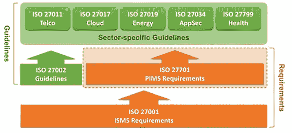

**Figure 4.1:** ISO 27000 Series

# Zachman Framework

The Zachman Framework^(TM) is an enterprise architecture framework that builds a two-dimensional classification schema based on six communication questions (What, Where, When, Why, Who, How) intersecting with multiple perspectives (Executive, Business Management, Architect, Engineer, Technician, Enterprise). This approach allows the organization's analysis to be communicated to various groups within the organization in a manner relevant to their responsibilities. Although the framework is not security-oriented, it helps convey information in the language and format preferred by personnel.

# The Open Group Architecture Framework (TOGAF)

TOGAF is another enterprise architecture framework that assists enterprises in designing, planning, implementing, and governing enterprise information architecture. TOGAF consists of four interrelated domains—Technology, Application, Data, and Business—as shown in *Figure 4.2*:

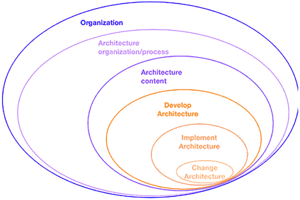

**Figure 4.2:** TOGAF

# CIS Critical Security Controls

The Critical Security Controls are published by the **Center for Internet Security (CIS)** and consist of 18 controls. These controls provide specific, actionable solutions to stop today's most pervasive and dangerous attacks by recommending a set of cybersecurity practices. SANS provides training, research, and certification to support CIS Controls. Backward compatibility and migration paths are also provided, enabling users to upgrade from earlier versions to v8, as shown in *Figure 4.3*:

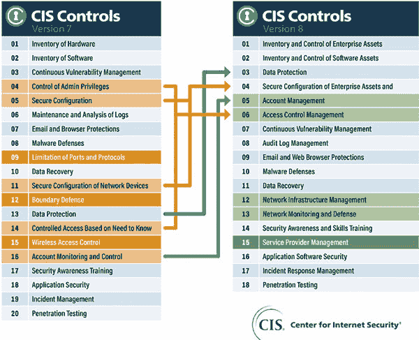

**Figure 4.3:** CIS Version 8

# Information Technology Infrastructure Library (ITIL)

The Office of Management and Budget (OMB) created ITIL in OMB Circular A-130 as a process management development standard. The ITIL core publications consist of five books: *ITIL Service Strategy*, *ITIL Service Design*, *ITIL Service Transition*, *ITIL Service Operation*, and *ITIL Continual Service Improvement*. These five core publications contain 26 processes. While ITIL includes security components, its primary focus is establishing **Service Level Agreements (SLAs)** between a company's IT department and its customers, as shown in *Figure 4.4*:

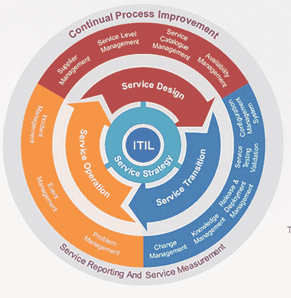

**Figure 4.4:** ITIL Framework

# Six Sigma

Six Sigma is a process improvement standard that combines two project methodologies based on the Plan-Do-Check-Act (PDCA) cycle developed by *W. Edwards Deming*. Six Sigma was originally intended to identify and eliminate defects in manufacturing processes but can be applied to various corporate tasks, including security. The following two Six Sigma project methodologies are shown in *Figure 4.5*:

*   **DMAIC**: Define, Measure, Analyze, Improve, Control
*   **DMADV**: Define, Measure, Analyze, Design, Verify

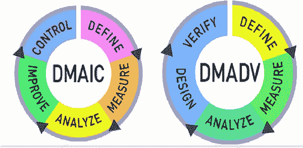

**Figure 4.5:** DMAIC vs. DMADV Comparison

# Capability Maturity Model Integration (CMMI)

CMMI is a methodology for improving processes in three areas: Product and Service Development (CMMI for Development), Service Establishment and Management (CMMI for Services), and Product and Service Acquisition (CMMI for Acquisition). All processes within each area of focus are assigned one of the following five maturity levels:

*   Level 1: Initial
*   Level 2: Managed
*   Level 3: Defined
*   Level 4: Quantitatively Managed
*   Level 5: Optimizing

# Extreme Scenario Planning / Worst-Case Scenario Planning

Extreme scenario or worst-case scenario planning is a component of any security strategy. This planning ensures the organization can anticipate disasters before they occur and prepare adequately. The first step in worst-case planning is to assess all hazards and identify all actors posing significant risk to the company. Examples of threat actors include:

*   **Internal Actors**: Reckless/untrained/disgruntled employees, internal/government spies, suppliers, thieves
*   **External Actors**: Anarchists, competitors, data miners, irrational individuals, legal adversaries, mobs, militants, terrorists, saboteurs

Actors can be categorized as non-hostile and hostile. Three categories from the above are typically considered non-hostile—careless employees, inexperienced employees, and partners. All other actors should be considered hostile. Subsequently, the company must evaluate each threat actor against a set of criteria. To assist in screening subjects for study, a rating should be assigned to each threat actor. Examples of common criteria include:

*   **Skill Level**: None, Minimal, Operational, Expert
*   **Resources**: Individual, Team, Organization, Government
*   **Constraints**: Code of Conduct, Law, Non-legal (Minor), Non-legal (Major)
*   **Visibility**: Overt, Covert, Clandestine, Don't Care
*   **Objectives**: Copy, Destroy, Harm, Steal, Don't Care
*   **Consequences**: Theft, Business Advantage, Damage, Embarrassment, Technical Advantage

The organization then uses these criteria to decide which actors to investigate. For example, an organization may decide to investigate all hostile actors who are experts, possess organizational or government resources, and are constrained by organizational or government non-legal (minor) or non-legal (major) constraints. The list is then narrowed down to only those threat actors meeting all these requirements. Next, the enterprise must determine the assets it truly cares about protecting. This determination often employs the FIPS 199 methodology or a Business Impact Analysis. Using the objectives and consequence values from the threat actor analysis, along with asset values and business impact information from the impact analysis, the company should select scenarios that could have a catastrophic impact on the company. Finally, scenarios must be created for thorough evaluation.


例如，一家公司可能决定调查这样一种情况：黑客组织发动长期拒绝服务攻击，造成长期中断，损害公司声誉。然后，应对每个场景进行风险评估。在所有情况都被定义后，组织必须为每一个场景创建一棵攻击树。该攻击树应包含攻击成功所必须满足的所有阶段和/或标准。随后，组织必须将安全控制映射到攻击树。组织需要参考行业标准（如 NIST SP 800-53）以确定可实施的安全措施。最后，将控制措施映射回攻击树，以确保它们在攻击的尽可能多的层级中得到使用。正如你所见，最坏情况规划是一门需要大量实践和工作才能掌握的艺术。考生应专注于 CASP 考试所需的程序和行动，而不是如何执行分析和准备场景文档。

# 进行特定系统的风险分析

风险评估是一种风险管理工具，用于识别漏洞和威胁，评估其影响，并确定采用哪些控制措施。风险评估或分析有四个主要目标，如下所示：

*   识别资产及资产价值
*   识别漏洞和威胁
*   计算威胁概率和业务影响
*   平衡威胁影响与对策成本

管理层和风险评估团队必须首先决定评估哪些资产和威胁，然后才能开始风险评估。该方法决定了项目的规模。之后，风险评估团队必须向管理层提供一份报告，详细说明所考虑资产的价值。随后，管理层可评估并完成资产清单，根据需要增减资产，并确定风险评估项目的预算。

例如，为提高效率，销售部门决定采用触摸屏技术和平板电脑。作为这项新举措的一部分，将构建一个适配新技术的新销售应用程序。**首席安全官 (CSO)** 从一开始就试图叫停部署，因为该技术在组织内不受支持。高层管理批准了部署。CSO 应与销售部门和其他利益相关者合作，充分记录新部署整个生命周期相关的风险，并在部署期间应用合适的控制和策略。在任何并购活动之前，或新技术和应用程序部署之前，都应进行风险评估。除非得到高层管理的认可和主导，否则风险评估不会成功。管理层必须定义风险评估的目的和范围，然后为项目分配人员、时间和财务资源。

# 使用已知指标进行风险确定

为了进行风险确定，组织必须执行正式的风险分析。正式风险分析通常会提出以下问题：

*   哪些企业资产需要保护？
*   组织的业务需求是什么？
*   哪些外部威胁最有可能危害网络安全？

应使用不同类型的风险分析（包括定性风险分析和定量风险分析），以确保获得的数据最大化。

# 定性风险分析

在定性风险分析中，风险分析过程的所有方面均不分配货币和数学值。直觉、经验和最佳实践程序（如头脑风暴、焦点小组、调查、问卷、会议、访谈和德尔菲法）都是定性风险分析方法论的示例。德尔菲法是一种计算未来事件发生概率和结果的方法。尽管可以采用上述任何策略，但大多数公司将根据待评估的威胁选择最佳的一个或多个。这需要对危害具备经验和教育背景。

每个被选中参与定性风险分析的小组成员，根据其自身经验对每种危险的可能性及其可能造成的潜在损害进行排序。在每位成员对威胁可能性、损失潜力和保障收益进行排序后，数据将汇总在一份报告中提交给管理层。与定量风险分析相比，定性风险分析有两个优势——它对风险进行优先级排序，并能发现快速改进威胁管理的机会。以下是定性风险分析的一些劣势——所有结果均为主观，且未给出货币价值用于成本/收益分析或预算编制。

# 定量风险分析

在定量风险分析中，风险分析过程的所有方面（包括资产价值、威胁频率、漏洞严重性、影响和保障成本）均分配货币和数学值。使用方程式计算总风险和剩余风险。定量风险分析的优势在于比定性风险分析需要更少的猜测。计算的复杂性、进行分析所需的时间和精力、以及研究所必须获取的数据量，均是定量风险分析的劣势。大多数风险评估结合了定量和定性风险评估。大多数企业倾向于对有形资产使用定量风险分析，而对无形资产使用定性风险分析。请记住，虽然定量风险分析包含数值，但完全定量的分析是无法获得的，因为数据始终包含一定的主观成分。历史数据、行业经验和专家意见都应用于进行此类评估。

# 基于 ALE 和 SLE 的影响程度

风险影响（也称为影响程度）是对负面风险可能造成多大危害，或正面风险发生时可能的机会成本的计算。风险影响可以用货币术语（定量）或主观等级（定性）来计算。风险通常按组织制定的等级进行分级。低级风险导致小额损失，而高级风险导致重大损失。当影响规模可以用货币术语描述时，使用货币价值量化具有易于被员工理解的优势。长期运营和支持费用、市场份额损失、短期额外工作成本或机会成本都可能产生财务影响。计算影响程度时使用两种计算——`单次损失期望值 (SLE)` 和 `年化损失期望值 (ALE)`。

# SLE

每次危险事件发生的货币影响称为 `SLE`。你需要知道 `资产价值 (AV)` 和暴露因子 (`EF`) 来计算 `SLE`。`EF` 是指如果威胁事件发生，将损失的资产价值或功能的百分比。计算 `SLE` 的公式如下：

```
SLE = AV x EF
```

设想一家公司拥有一个价值 20,000 美元的 Web 服务器场（`AV`）。如果风险评估判定停电是 Web 服务器场的威胁源，且停电的暴露因子为 25%，则该事件的 `SLE` 为 5,000 美元。


# ALE

年度威胁事件的预估风险因子称为 `ALE`。您需要知道 `SLE` 和年化发生率 (`ARO`) 来计算 `ALE`。计算 `ALE` 的公式如下：

`ALE = SLE x ARO`

以先前描述的示例为例，如果风险评估确定 Web 服务器场断电的 `ARO` 为 50%，则该事件的 `ALE` 为 2,500 美元。公司可以使用 `ALE` 来决定是否建立控制措施。如果 Web 服务器场防护控制措施的年度成本超过 `ALE`，组织可能只会选择通过不部署该控制措施来接受风险。如果保护 Web 服务器场的控制措施的年度成本低于 `ALE`，组织应考虑实施该控制措施。

# 威胁可能性

威胁可能性是对特定风险事件对公司产生影响的可能性的计算。一旦发现每个漏洞和危险，就必须计算其损失潜力。该损失潜力是通过将发生概率与该事件可能造成的影响相结合来计算的。高概率且影响重大的事件将优先于低概率且低影响的事件进行处理。自然灾害的发生概率因居住地而异，程度不一。相比之下，人为危害更多地取决于组织特征，如知名度、位置和技术足迹。用于威胁可能性的等级通常为高、中、低。动机、来源、`ARO` 和趋势分析常用于确定事件发生的几率。

# 动机

组织及其攻击者都受动机影响。公司识别出的并非所有风险都有动机。例如，自然灾害除气候或其他有利于其发生的自然条件外，没有其他目的或原因。相反，大多数人为攻击都有动机。了解这些风险背后的动机对于选择公司应采用的风险管理技术至关重要。如果您的组织识别出任何因他人或其他组织行为而导致的风险，这些风险通常由以下因素驱动：

- 获取/窃取
- 商业优势
- 破坏
- 尴尬/难堪
- 技术优势

# 总拥有成本

组织风险无处不在，范围从容易投保的财产危险到难以预测和量化的风险，例如关键员工流失。风险的**总拥有成本**（**TCO**）是一项指标，反映了运行组织风险管理流程的总体费用，包括保险费、融资费用、管理成本和任何损失。此数字应与公司的总收入和资产基础进行权衡。`TCO` 是一种确定组织风险相关支出相对于整体增长率如何变化的方法。`TCO` 还可以与行业协会和行业组织提供的行业基准进行比较。与合适的企业和行业专家合作可确保公司获得可比且相关的风险数据。金融机构的风险 `TCO` 不应与医疗公司的 `TCO` 进行比较。计算风险 `TCO` 有诸多好处。它可以帮助公司识别其风险管理策略中的异常。它还可以发现风险管理过于激进的情况，而类似风险在其他地方的处理方式可能不同。通过揭示低效的风险管理流程，风险 `TCO` 从长远来看可能会节省资金。然而，可比的风险 `TCO` 有时难以获得，因为许多直接竞争对手都严守这一敏感信息。利用行业协会和行业标准组织通常可以解决这一挑战。此外，请记住 `TCO` 可能被视为削减成本的活动，从而导致员工缺乏完全认同。在评估风险 `TCO` 时，企业应牢记以下原则：

- 确定一个框架，用于将成本分解为几类，包括风险融资、风险管理、风险合规成本和自保损失
- 通过将类别成本表示为组织总收入的百分比来识别它们
- 利用行业协会的任何数据与各类别数字进行比较
- 分析组织数字与行业数字之间的差异及其发生原因
- 为每个类别设定未来目标

在计算和分析风险 `TCO` 时，您应记住以下基本规则：

- 行业基准并不总是真正可与您组织的数据相提并论。
- 覆盖组织内部的一些次要风险。
- 由于风险管理的复杂性，应使用风险管理软件来辅助决策。
- 编制预算时要记住风险管理的价值。它不仅仅是一项成本。
- 风险 `TCO` 不会立即带来成本节约。节约是随着时间发生的。
- 并非所有可能的解决方案都在组织内部。可能需要外部专家和保险经纪人。

# 将技术风险转化为业务术语

非技术人员经常对技术网络安全威胁存在误解。安全专家必须以利益相关者能够理解的方式弥合知识差距。为了有效解释技术危害，安全专业人员必须首先了解其目标受众，然后能够将这些风险转化为目标受众能理解的商业语言。半技术受众、非技术领导层、董事会和高管以及监管机构都属于需要了解技术危害的人群。半技术受众了解安全运营的挑战，因此通常包括重要盟友。通常，该受众需要基于可验证的事实和趋势的数据驱动、高层级信息。非技术领导层受众需要将信息置于其职责背景下。该受众需要将网络安全支出的成本与业务绩效挂钩。安全专业人员应展示指标，以显示网络风险的趋势，而不使用流行术语。董事会和高管主要关注业务风险管理和资产回报管理。传达给该群体的信息应将技术风险转化为通用的业务术语，并展示关于网络安全风险和绩效的指标。


最后，与监管机构打交道时，全面且坦诚至关重要。此外，在审计之前，公司可以选择聘请第三方进行差距分析。这允许第三方代表安全计划发声，并将协助安全专家在审计前识别和修复问题。安全专家应关注业务中断、监管困难和负面新闻，以便将技术危险转化为这些受众能理解的业务术语。当公司数据库遭到入侵，导致网站无法向客户提供商品时，就会发生严重的业务运营中断。如果发生事件导致监管调查和处罚，则出现了监管问题。负面宣传可能导致收入损失以及重建公司声誉的支出。安全专业人员必须了解风险指标，以及与每个指标相关的成本。虽然安全专业人员可能无法预测**投资回报率 (ROI)**，但他们应考虑公司安全事件的频率，并以风险敞口的形式为每项风险分配成本。将风险与受保护的资产相匹配，以确保组织的投资正在保护最重要的资产，这也将大有裨益。

# 风险偏好策略

根据风险分析改变组织各部分的过程称为**风险降低**。在确定 ROI 和 TCO 后，组织必须决定如何处理风险，这取决于公司的风险偏好，即其可自行承担多少风险。规避、转移、缓解和接受是你必须为 CASP 考试掌握的四大关键策略。

## 规避

规避方法意味着停止危险活动或采用风险较低的替代方案。遗憾的是，该策略无法用于应对所有风险。组织在不同地理区域使用备用数据中心以避免自然灾害同时袭击两个设施，就是规避的一个例子。在许多情况下，几乎不可能完全避免危险。例如，如果 CEO 购买了一台新移动设备，并要求通过该设备获得内部网络访问权限，则很难规避该危险。在这种情况下，你必须想办法降低和/或转移风险。

请考虑以下案例：

一家公司正在洽谈以 1,000,000 美元收购另一家公司。尽职调查调查揭露了该公司旗舰产品存在广泛的安全问题。由于安全漏洞，预计完全重建产品将花费 1,500,000 美元。在这种情况下，该公司不应收购另一家公司，因为收购总成本将达到 2,500,000 美元。

## 转移

转移计划的一部分是将风险转移给第三方，例如保险公司。例如，将特定活动外包给供应商，通常涉及第三方 SLA。然而，根据合同条款，风险可能仍由原公司承担。如果贵企业打算采用此策略，法律顾问应核实合同是否提供所需的保护程度。请考虑以下案例：

一家小公司决定通过互联网系统向公众销售以增加收益。这最初将是一个短期实验。如果系统证明成功，它将被扩大并整合到日常运营中。针对初始试验，已提出以下两项主要业务风险：

*   内部 IT 员工没有安全在线信用卡处理的经验。
*   内部信用卡处理系统将使企业面临额外的合规要求。

在这种情况下，最好通过将支付处理外包给第三方服务提供商来转移初始风险。

## 缓解

缓解策略意味着确定组织可接受的风险阈值，并将风险降低到该水平。这是最广泛使用的方法。实施安全措施，如 IDS、IPS、防火墙等，都是该策略的一部分。请考虑以下案例：

贵公司的 Web 服务器每年发生三次安全问题，每次导致 1,500 美元的停机成本。该 Web 服务器将在五年后停用，届时仅用于归档访问。为避免此灾难而实施软件的初始成本为 15,000 美元，加上每年 1,000 美元的维护费。安全事件成本计算如下：

($1,500/次 × 3 次/年) × 5 年 = $22,500

预防问题的成本计算如下：

$15,000 软件成本 + ($1,000 维护费 × 5 年) = $20,000

在这种情况下，缓解（实施软件）比接受风险更便宜。

## 接受

理解并接受风险程度以及潜在损失成本是接受方法的一部分。此方法通常用于防范剩余风险。它常用于风险敞度或价值较低的资产。然而，如果用于建立防御措施的资金已耗尽，组织可能被迫接受风险。如果风险和资产属于低关注度，接受风险是可以的。但是，如果它们被视为高关注度危险，则应通知管理层需要更多资金来将风险降至最低。

# 风险管理流程

根据 NIST SP 800-30 Rev. 1，自动化风险评估工具、问卷、访谈和政策文件审查是风险分析中使用的标准信息收集策略。在确定与特定资产相关的风险时，请记住应使用多个来源。NIST SP 800-30 确定了风险评估过程中的以下步骤：

**步骤 1**：准备评估。

**步骤 2**：实施评估。

*   识别威胁源和事件。
*   识别漏洞和预置条件。
*   确定发生可能性。
*   确定影响程度。
*   将风险确定为可能性和影响的组合。

**步骤 3**：沟通结果。

**步骤 4**：维护评估。

资产评估、漏洞识别和威胁识别都是风险管理过程的一部分。安全专家必须了解豁免、威慑、固有风险和剩余风险。

# 信息与资产价值及成本

如前所述，识别资产并确定资产估值是任何风险评估的第一阶段。资产分为有形和无形两类。计算机、设施、材料和员工是有形资产的例子。知识产权、数据和企业声誉是无形资产的例子。资产的价值应从资产所有者的角度进行评估。以下六个考量因素可用于确定资产价值：

*   对所有者的价值
*   开发或获取资产所需的工作量
*   维护资产的成本
*   资产丢失造成的损害
*   竞争对手愿为资产支付的成本
*   资产丢失导致的罚款

确定资产价值后，应确定每个资产的漏洞和威胁。

# 漏洞与威胁识别

在确定资产的漏洞和威胁时，首先考虑威胁主体通常是最容易的。威胁主体可分为以下六类：


*   **Human（人为）**：此类别包括恶意和非恶意的内部人员及外部人员、恐怖分子、间谍和离职人员。
*   **Natural（自然）**：此类别包括洪水、火灾、龙卷风、飓风、地震及其他自然灾害或天气事件。
*   **Technical（技术）**：此类别包括硬件和软件故障、恶意代码以及新技术。
*   **Physical（物理）**：此类别包括闭路电视（CCTV）问题、周界防护措施失效和生物识别故障。
*   **Environmental（环境）**：此类别包括电力及其他公用设施故障、交通问题、生物战以及危险材料问题（如泄漏）。
*   **Operational（运营）**：此类别包括任何可能影响 `CIA` 的流程或程序。

# 豁免

虽然大多数企业应进行全面的风险评估并采取措施缓解所有威胁，但由于运营性质或政府法规，某些组织可免除部分风险。例如，美国**环境保护局**（**EPA**）对氨气和丙烷等特定化学品的使用和储存有限制规定。储存这些物质数量超过特定阈值的组织，必须遵守 EPA 的意外释放预防要求和风险管理计划标准。然而，这些法律不适用于大多数将氨气用作土壤肥料的农民，也不适用于数据分发中心对丙烷的使用。在大多数情况下，企业应寻求法律建议，以确保知晓可能适用于自身的任何豁免条款。

# 威慑

利用惩罚威胁劝阻人们从事特定任务称为**威慑**。许多政府实体采用这种风险管理策略，发布法律声明，威胁未经授权的用户若访问其网络或系统将面临罚款和/或监禁。组织在访问邮件系统、电子商务系统或其他可能包含私密数据的系统时，会采用包含警告的类似程序。

# 固有

由于几乎无法预防，固有风险未采取任何缓解措施或治疗手段。设想一名有能力物理闯入组织设施的蓄意攻击者。虽然可建立多种措施来防范此类危害，如安保人员、闭路电视、围栏、门锁和生物识别技术，但如果攻击者具备必要能力，组织无法完全保证此风险永不发生。这并非意味着这些被视为基线控制的措施不应实施。应尽可能识别固有风险，原因如下：

*   了解风险有助于识别关键控制。
*   审计随后可聚焦于关键控制。

固有但可能造成灾难性后果的风险，可接受更严格的场景测试。可能造成灾难性后果的风险应告知组织的董事会和管理层。

# 剩余

无论公司多么谨慎，都难以完全规避所有危险。在引入保障措施或控制后仍保留的风险程度称为剩余风险。剩余风险用以下等式表示：

`Residual risk = Total risk – Countermeasures`

该等式被认为更具概念性，而非用于实际计算的实用性公式。

# 持续改进/监控

任何组织的风险管理都必须持续改进和监控。必须跟踪企业的所有变更，以便安全专家分析此类变更带来的危险。在变更部署后，安全措施应尽快调整以应对这些修改。例如，若公司欲升级供应商程序，安全专家必须检查该应用程序以确定其对企业安全的影响。组织的某些方面（包括审计日志收集与分析、防病毒和恶意软件检测升级、应用程序和操作系统更新）应实现自动化，以助力持续改进和监控。变更管理、配置管理、控制监控和状态报告均属于持续监控范畴。安全专家应定期审查企业安全措施，确保变更不会对业务产生不利影响。管理层应建立统一的风险术语并有效传达期望。员工（尤其是新入职人员）也必须接受培训，以确保他们在公司背景下理解风险。

# 业务连续性规划 (BCP)

连续性规划涉及确定灾难的影响，并为每项职能和系统制定可行的恢复策略。其主要关注点是在发生中断时如何开展组织运营。BCP 考量灾难影响的所有要素，包括职能、系统、员工和设施。它识别并优先排序所需服务，重点关注电信和信息技术。制定**业务连续性计划**（**BCP**）对于确保公司能从灾难或破坏性事件中恢复至关重要。针对业务连续性，多个组织已制定标准和最佳实践。这些标准和最佳实践包含许多通用组件和操作。以下领域涵盖人员组成、项目范围及必须完成的业务连续性任务。

# 人员组成

高级管理层是 BCP 发展中最重要的人员。高级管理层对业务连续性和灾难恢复的支持驱动着整个组织对该流程的整体看法。若高层管理不予支持，该程序将会失败。业务连续性和灾难恢复的总体目标由高级管理层确定。BCP 委员会应由高级管理层指定的业务连续性协调员领导。BCP 和灾难恢复计划 (DRP) 由委员会制定、实施和测试。每个业务单元应在 BCP 委员会中有一名代表。该委员会应至少包含一名高级管理层成员。此外，鉴于 IT 部门、法务部门、安全部门和通讯部门在危机期间及危机后发挥的关键作用，企业应确保这些部门均有代表参与。BCP 委员会必须在管理层监督下与业务单元合作，确定业务连续性和灾难恢复的优先级。时效性关键系统必须由高级业务单元经理识别并排定优先级。在计划的所有组成部分完成后，应委托 BCP 委员会定期评估这些计划，以确保其保持最新和可持续。高级管理层应积极监控和控制所有业务连续性措施，并公开表彰任何成果。当组织启动灾难恢复规划时，其他团队也会参与其中。

# 项目范围


# 业务连续性规划 (BCP)

## BCP 范围
高级管理层必须确立 BCP 范围，以使 BCP 开发行之有效。范围不受限制的业务连续性项目通常过于庞大，导致 BCP 委员会难以妥善处理。因此，高级管理层可能需要将业务连续性项目划分为更小、更易于管理的部分。在划分 BCP 时，组织可能会决定根据地理位置或设施进行划分。然而，应制定全企业范围的 BCP，以确保各个单独计划的兼容性。

## BCP 步骤
以下列表总结了 BCP 步骤：

1. **步骤 1**：制定应急规划策略。
2. **步骤 2**：开展业务影响分析 (BIA)。
3. **步骤 3**：识别预防性控制措施。
4. **步骤 4**：制定应急策略。
5. **步骤 5**：开发信息系统应急计划。
6. **步骤 6**：测试、培训和演练。
7. **步骤 7**：维护计划。

## 实施 BIA
BIA 的目标是将系统与其提供的重要任务/业务活动和服务联系起来，然后基于该知识定义中断的后果。BIA 是构建 BCP 的最重要因素。BIA 协助组织确定破坏性事件对组织的影响。它是一项管理层面的审查，用于确定公司资源丢失的影响。BIA 的四个主要步骤如下：

1. **步骤 1**：识别关键流程和资源。
2. **步骤 2**：识别中断影响并估算停机时间。
3. **步骤 3**：识别资源需求。
4. **步骤 4**：确定恢复优先级。

BIA 广泛依赖于已进行的任何漏洞分析和风险评估。BCP 委员会或单独组建的风险评估团队可以进行漏洞分析和风险评估。作为确定资产重要程度的一部分，您需要理解以下术语：

*   **最大可容忍停机时间** (`MTD`)：组织能容忍单一资源或功能中断的最长时间。这也被称为**最大中断周期** (`MPTD`)。
*   **平均修复时间** (`MTTR`)：当灾难或中断发生时，修复单一资源或功能所需的平均时间。
*   **平均故障间隔时间** (`MTBF`)：设备发生故障前预计运行的时间。该数值由设备供应商计算。较高的 `MTBF` 和较低的 `MTTR` 可提高系统可靠性。
*   **恢复时间目标** (`RTO`)：灾难或破坏性事件发生后，必须在其中恢复资源或功能以避免不可接受后果的最短时间段。`RTO` 假设存在可接受的停机期。`RTO` 应小于 `MTD`。
*   **工作恢复时间** (`WRT`)：`RTO` 与 `MTD` 之间的差值，即在达到最大可容忍限度之前，`RTO` 之后剩余的时间。
*   **恢复点目标** (`RPO`)：中断的资源或功能必须恢复到的时间点。

# IT 治理
信息安全治理由多个协同工作的组件组成，旨在为公司提供全面的安全管理。数据和其他资产的保护应主要基于其货币价值和敏感度。战略规划指导长期安全行动（3-5 年或更长）。战术规划在较短时间内（6-18 个月）实现战略规划的目标。在建立和采用信息安全策略的早期过程中，必须获得管理层的同意，因为管理层是计算机安全链中最关键的一环。在制定任何组织安全策略之前，高级管理层必须采取以下措施：

1.  定义安全项目的范围。
2.  识别所有需要保护的资产。
3.  确定每项资产所需的保护级别。
4.  确定人员职责。
5.  制定违反安全策略的后果。

高级管理层通过全面采纳组织安全策略，承担起组织安全的责任。高级管理层支持安全的意图通过高层策略来体现。在获得高层管理批准后，开发信息安全项目的第一阶段是采纳组织信息安全声明。安全规划过程必须明确安全将如何管理、谁将负责建立和监督合规性、如何评估安全措施的有效性、谁将参与定义安全策略，以及安全策略将在何处制定。安全专家必须了解风险管理框架，公司必须遵循正确的风险管理框架。他们还必须理解组织治理的组成部分及其相互作用，以确保治理。为了制定完整的安全计划，安全专业人员必须了解信息安全组件如何交互。信息安全治理组件包括以下内容：

*   策略
*   流程
*   程序
*   标准
*   指南
*   基线

## 策略
安全策略规定了由高级管理层确定的安全职能，具有战略性，即规定了安全成果。策略根据两个因素进行分类——实施的组织层级和适用的类别。策略的范围必须广泛，即不得绑定单一技术或安全解决方案。策略定义目标，但不提供实现目标的细节。每项策略必须包含例外条款，以确保管理层能够处理可能需要例外的情况。

策略范围广泛，是建立安全标准、基线、指南和程序的基础。管理、技术和物理访问控制完善了安全项目的安全性和结构。组织安全策略、系统专用安全策略和问题专用安全策略是信息安全中使用的策略层级。法规安全策略、建议性安全策略和信息性安全策略是信息安全中采用的三种策略类型。组织的最高层级安全策略称为**组织安全策略**。组织安全策略由业务目标指导，包含一般性指导，并应具有以下组成部分：

*   定义安全策略的总体目标。
*   定义总体步骤和安全的重要性。
*   定义满足业务目标的安全框架。

## 流程
流程是为实现特定目标而采取的一系列动作或步骤。组织定义各个流程及其相互关系。例如，组织可能会设计一个流程，规定消费者如何下在线订单、如何处理付款，以及付款完成后如何交付商品。虽然这些流程各不相同，且各自拥有要执行的职责集，但它们相互依赖以完成工作。程序概述了如何实现目标或完成任务。程序是流程的产出。

## 程序


程序最接近计算机和其他设备，包含工作人员预期遵循的所有特定活动。描述如何应用规则、流程、标准和建议的分步清单在程序中很常见。

## 标准

组织内部政策的实施由标准描述。它们具有战术导向，是强制性的行为或法规，为程序提供实现安全所需的基本要素。标准应像规则一样，定期进行评估和修订。

## 指南

指南是活动建议，比标准灵活得多，允许应对不可预见的场景。当标准不适用时，指南提供方向。

## 基线

基线是一个确定并记录的参考点，将用作未来的参考点。捕获基线至关重要，但利用基线评估安全状况同样至关重要。如果从不使用，即使是最详尽的基线也毫无价值。在正确的时机进行基线测量也至关重要。当系统已正确配置并升级时，应获取基线。创建新基线时，应将其与现有基线进行比较。此时可能需要根据最新数据采用新基线。

## 结论

在本章中，您学习了基于 CIA 对数据类型进行分类，并将利益相关者的意见纳入 CIA 影响级别决策。还讨论了基于 CIA 选择和实施控制措施及安全控制框架的过程。本章基于系统及其属性讨论并分析了风险，以便安全专业人员以业务术语确定并传达已识别的风险。

在下一章中，我们将讨论决定部署哪些安全控制以保护组织的解决方案。

# 企业风险度量与指标

## 简介

保护企业安全至关重要。安全应成为任何组织的首要任务，但往往很难说服高级管理层为您希望采用的安全工作提供资金。作为安全专业人员，您需要为想要实施的任何安全技术和控制提供理由。

## 结构

在本章中，我们将涵盖以下主题：

- 审查现有安全控制的有效性
- 逆向工程/解构现有解决方案
- 创建、收集和分析指标
- 原型设计和测试多种解决方案
- 创建基准并将其与基线进行比较
- 分析和解读趋势数据以预测网络防御需求
- 分析安全解决方案指标和属性以确保其满足业务需求
- 在最安全的解决方案不可行时运用判断力解决问题

## 目标

本章解释了安全控制的有效性、差距分析和事后分析。逆向工程和解构现有控制的使用有助于收集有关组织控制的敏感信息，以及创建、收集和分析指标（包括 KPI 和 KRI）。本章解释了决定部署哪些安全控制以保护组织的解决方案。作为 CSAP 安全专业人员，您需要为想要实施的任何安全技术和控制提供理由。

## 审查现有安全控制的有效性

组织应定期评估当前安全程序的有效性。安全专家应审查安全的所有领域，包括安全培训、设备配置（路由器、防火墙、IDS、IPS 等）以及政策和程序。还应执行漏洞和渗透测试。这些审计必须至少每年进行一次。安全控制有效性审查应包括回答以下问题：

- 我们使用了哪些安全控制？
- 如何改进这些控制？
- 这些控制是否必要？
- 是否出现了任何新问题？
- 可以部署哪些安全控制来解决新问题？

为了协助审查现有安全控制，安全管理员应执行差距分析，并在事后报告中记录经验教训。

## 差距分析

信息安全差距研究将公司的安全计划与行业最佳实践进行比较。安全专家通过将这些推荐实践与实际实践进行比较，可以识别漏洞和危险。信息安全差距分析包括以下五个步骤：

**步骤 1**：选择行业标准框架。

**步骤 2**：检查涉及的个人和程序。收集有关 IT 环境、应用清单、组织架构图、规则和实践及其他重要要素的信息。

**步骤 3**：收集信息和技术。此阶段帮助公司确定其当前安全计划在技术架构内的运行情况。示例包括：将最佳实践控制或相关要求与组织控制进行比较；对网络设备、服务器和应用进行抽样以验证差距和弱点；审查自动化安全控制；以及审查事件响应流程、通信协议和日志文件。

**步骤 4**：分析/比较您获取的信息。此步骤涉及使用收集的信息对组织的安全计划进行深入分析，并关联所有因素的发现和结果，以清晰简洁地描绘组织的 IT 安全概况，包括优势和待改进领域。

**步骤 5**：最后执行差距分析。差距分析是一项复杂、深入的程序，需要完全理解安全最佳实践，以及完全理解安全威胁、控制和操作困难。虽然执行差距分析不能确保 100% 的安全，但它在很大程度上有助于确保组织的网络、员工和安全政策是可靠、有效且具成本效益的。

请参阅 图 5.1 了解差距分析步骤示意：

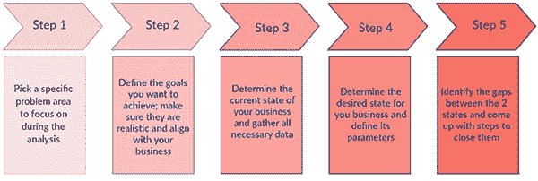

**图 5.1：** 差距分析步骤

## 经验教训与事后报告

当问题出现时，安全专家通常专注于解决问题、实施新的安全控制或升级现有的安全控制。在紧急危机过去后，应提交经验教训/事后评估。人员在报告中描述问题事实、问题原因、问题发生的原因、防止未来再次发生问题的可行策略，以及问题再次出现时的改进建议。所有参与发现或修复问题的人员都应纳入审查。由于细节会随时间遗忘，审查应在问题解决后尽快举行。

最好将正式审查文档的格式设定为按时间顺序跟进事件。调查应包含尽可能多的关于事件的细节。请记住，经验教训/后续审查可用于任何重大组织项目，例如操作系统更新、新服务器部署、防火墙升级等。

## 逆向工程/解构现有解决方案


组织的安全措施仅在黑客找出如何突破或绕过控制之前有效。因此，安全专业人员具备像黑客一样思考、并对现有安全系统进行逆向工程或拆解的能力至关重要。每个安全解决方案都应由安全专家独立进行审查。在审查每个解决方案时，您应考虑该安全解决方案执行的功能、它旨在保护哪些系统、该解决方案如何影响公司，以及它会泄露关于自身的哪些信息。请记住，逆向工程的目标是尽可能多地了解您的公司，以找到进入的方法。物理入侵建筑物有时会被安全专家忽视。另一方面，物理安全控制与任何其他控制一样关键。如果攻击者能进入您的设施并将非法接入点或协议分析器连接到企业网络，那么您部署了多少安全防护措施都无关紧要。

# 指标的创建、收集与分析

指标应定期检查。此外，收集到测量数据后应尽快进行检查，以确定是否需要进行任何修改。妥善创建、收集和分析的指标，有助于公司在问题出现之前很早就预测未来的需求。组织的安全预算由**首席安全官**（**CSO**）或其他指定的高层管理人员编制，他们还定义安全指标并报告安全计划的有效性。该官员必须与**主题专家**（**SMEs**）合作，以确保所有安全费用（包括开发、测试、实施、维护、人员和设备）都被纳入核算。预算编制过程要求对所有风险进行彻底分析，并确保实施最具成本效益的安全举措。完成时间超过 12 到 18 个月的长期和战略性项目需要额外的资源和资金。在安全测量中可以发现短期和长期的模式。安全专家可以通过收集这些变量并按日进行比较来计算每日工作量。在较长时间内评估指标时出现的趋势，可能有助于确定未来的安全计划和支出。

程序中应明确规定：由谁收集测量数据、收集哪些指标、何时收集指标，以及什么阈值将触发纠正措施。为了协助构建指标规则和流程，安全专业人员可以参考信息安全治理框架，特别是 ISO/IEC 27004 和 NIST 800-55。另一方面，指标不仅仅用于实际事件。您还可以使用生成的数据，在模拟现实世界的虚拟环境中检查安全策略的效果。然后，您可以利用模拟数据来判断安全控制是否应在现实世界中实施。

假设一名安全管理员正试图建立一个知识库，以便对全球网络运行进行启发式和基于行为的安全事件监控。选择仪表是为了实现网络监控和测量。将网络建模为一系列**虚拟机**（**VMs**），实施记录综合指标的系统，运行大量模拟数据通过该模型，记录和分析结果，并记录预期的未来行为，这是建立此基线的最佳方法。安全管理员将能够使用这种完整的方法来确定新的监控将如何运行。

虽然安全团队应每天检查指标，但定期进行第三方指标研究，可以通过验证内部团队的结果，确保安全指标的准确性和有效性。随后，应利用第三方的数据来改进安全计划和安全指标程序。生成、收集和评估的两类指标是**关键绩效指标**（**KPIs**）和**关键风险指标**（**KRIs**）。**信息安全论坛**（**ISF**）建议采用以下 14 步法来处理 KPI 和 KRI，以支持明智的决策：

1.  **步骤 1**：了解业务背景。
2.  **步骤 2**：确定受众和合作者。
3.  **步骤 3**：确定共同利益。
4.  **步骤 4**：确定关键信息安全优先事项。
5.  **步骤 5**：设计 KPI/KRI 组合。
6.  **步骤 6**：测试并确认 KPI/KRI 组合。
7.  **步骤 7**：收集数据。
8.  **步骤 8**：生成并校准 KPI/KRI 组合。
9.  **步骤 9**：解读 KPI/KRI 组合以形成洞察。
10. **步骤 10**：就结论、建议和推荐达成一致。
11. **步骤 11**：制作报告和演示文稿。
12. **步骤 12**：准备展示和分发报告。
13. **步骤 13**：展示并就后续步骤达成一致。
14. **步骤 14**：制定学习和改进计划。

安全专家必须利用此方法引领其组织监控 KPI 和 KRI。绩效指标是一种度量，它告诉您公司运行得有多好。它指导您做什么以及如何做。度量值（在特定时间点观察到的值）用于创建指标。指标是从度量值得出的比率、平均值、百分比或比率，而度量值则是原始数字和数据点。

# KPIs

KPI 监控与个人行动或活动直接相关的因素，而非最终结果。利润、费用和账户数量不应用作**关键绩效指标**（**KPIs**）。它们是多种活动的结果；因此，它们不提供具体的执行措施。组织需要获取的 KPI 包括以下内容：

*   报告事件的增加或减少
*   大型和小型安全事件的数量
*   每次事件的成本
*   事件解决所需时间
*   事件期间的停机时间

请参阅 图 5.2，该图展示了一个 KPI 报告示例：

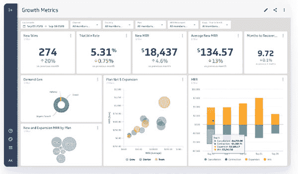

**图 5.2：** KPI 报告示例

让我们看一个例子。假设一个组织的 IT 部门报告称，过去一个季度报告的事件显著减少。管理层可能需要调查的一些问题包括：

*   该季度是否实施了新的安全控制，从而可能导致了这一显著减少？
*   事件是否真正减少，还只是未能发现或报告事件？
*   上一季度报告与本季度报告之间存在哪些运营差异（例如，系统升级、新工具、已修补/移除/替换的受严重攻击系统）？

KRI 用于管理中，以指示活动的风险程度或风险发生的可能性。组织将它们作为特定风险可能发生的早期信号。组织需要获取的 KRI 包括以下内容：

*   **高严重性事件的加速**：更严重的事件是否在更短的时间内出现在您的系统上？
*   **处理时间**：您识别威胁模式变化并消除该威胁根因需要多长时间？
*   **攻击面面积**：有多少主机涉及安全事件？有多少主机包含在攻击中？

请参阅 图 5.3，该图展示了一个 KPI 风险报告示例：

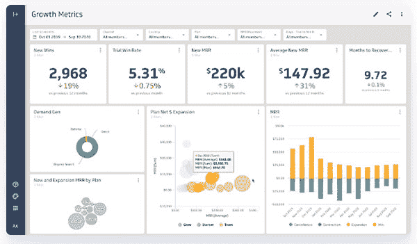

**图 5.3：** KPI 风险报告示例

**考虑以下场景：**


假设一家公司关注其安全意识培训。检查安全意识培训的通过/失败指标是此方面的 KRI（关键风险指标）。如果失败率高，则必须改进组织的培训实践，特别是每年用于培训的时间量以及培训的员工参与度指数。安全意识培训的通过/失败率将直接受到培训投入时间和向人员提供的培训量的影响。在这种情况下，公司可能会选择要求员工接受额外的安全意识培训。

# 原型设计并测试多种解决方案

一旦安全专家确定某设备或技术存在明确问题，他或她应考虑可行的补救措施。硬件改进、采购新设备或技术以及配置调整均为可能的补救措施。随后，安全专业人员应对解决方案进行原型设计或测试。任何原型设计或测试最好在实验室环境中进行，以评估已部署解决方案的影响。原型还有助于在解决方案投入生产前，确保测试过的解决方案令公司满意。虚拟化技术使得在虚拟实时环境中创建和测试解决方案变得容易得多。务必确保任何测试都在隔离环境中进行，且未实施其他解决方案，以确保完全理解该特定解决方案的影响。在弄清每个解决方案的作用后，您可以对各种解决方案进行原型设计或测试，以查看对公司的问题是否应用多种解决方案会更好。

假设您发现一台 Web 服务器性能不佳。正在考察的一种方法是部署第二台 Web 服务器，并将两台服务器置于负载均衡环境中。升级相关服务器的硬盘和内存也可能是一种选择。当然，一种甚至更好的方法是改进原始 Web 服务器、部署第二台 Web 服务器，并对两台服务器进行负载均衡。然而，预算限制经常阻碍多种解决方案的采用。测试可能表明升级 Web 服务器的硬件已足够。在部署第二台 Web 服务器的资金到位之前，硬件升级可能是最佳的短期答案。一旦您在实验室中完成了原型设计或测试并缩小了解决方案范围，就可以在实时环境中测试该解决方案。请记住，此类解决方案通常最好在低流量时段实施。在继续升级之前，请务必对您要升级的设备进行完整备份。

此外，请记住，监控性能以及记录基线和基准将会影响受监控系统的性能。在正确的时机获取基线和基准至关重要。当系统已正确配置并升级时，应获取基线。此外，基线的测量周期应较长（如一周或一个月），而非一天或一小时。创建新基线时，应将其与现有基线进行比较。届时可能需要根据最新数据采用新基线。

# 创建基准并比较基线

基线是预先确定并记录在案的参考点，将用作未来的基准。获取基线很重要，但利用基线分析安全态势更为重要。即使是最详细的基线，如果不加以利用也毫无用处。然而，如果没有当前的标准可供比较，基线也无法帮助您。基准是捕获与基线相同数据的参考点，必要时甚至可用作新基线。随后将其用于比较。通过将基准与基线进行比较，以检查是否存在任何安全或性能缺陷。

销售团队周四的拜访解释了认证量上升的原因。另一方面，如果您发现周四 VPN 流量增加，则应引起重视，因为销售人员将在办公室工作，不会使用 VPN。理解基线和基准还意味着理解阈值，阈值可确保安全风险不升级超出特定水平。如果系统管理员必须在安全事件发生*前*收到通知，理想的方法是配置程序，在特定事件达到阈值时发送警报、告警或电子邮件。为了确保能在潜在问题出现时适当察觉，安全专家应在一天中的不同时间和一周中的不同日期收集基线。此外，安全专家必须确保基准与正确的基线进行比较。将周一上午 9 点的基准与周六上午 9 点的基线进行比较，可能无法让您充分分析问题。一旦确定了问题领域，您应为发现的每个问题设计可行的补救措施。

# 分析趋势和数据

分析和理解趋势数据以预测网络防护需求，是保护公司的关键步骤。安全专家应能利用趋势数据预测何时何地需要加强防御。

**考虑以下场景：**

假设您发现用户帐户被锁定的比率随时间推移而增加。多名用户声称其帐户被锁定并非其责任。在分析服务器和审核日志后，您认为黑客获取了一份用户帐户名称列表。此外，您了解到攻击者正反复尝试从同一 IP 或 MAC 地址进行连接。分析完成后，您可能希望调整保护网络的防火墙，以禁止来自攻击者 IP 或 MAC 地址的任何连接。更改所有用户名是另一种可行的安全措施。然而，更改用户帐户名称可能会对其他服务（如电子邮件）产生影响。因此，公司可能准备忽略攻击者知晓所有用户帐户名称的可能性。

让我们看一个更复杂的场景。假设安全管理员发现大量网络问题困扰着代理服务器。管理员在分析日志时观察到，当网络困难发生时，防火墙同时遭受多种 Web 攻击。在交换机 SPAN 端口部署协议分析器、调整外部面向的 IPS、重新配置防火墙 ACL 以阻止不必要的端口、验证代理服务器配置正确且已加固，并持续监控网络，是进行深度问题评估和补救的最有效方法。

跟踪此类模式至关重要，以便在它们演变为真正的问题之前实施正确的安全措施。此外，跟踪这些趋势可能有助于在资源需求变得紧迫之前预测资源需求。例如，如果您发现 Web 服务器流量每月以特定速率增长，您可以在流量达到服务器过时且无法再处理客户端请求的程度之前，规划升级。

# 分析安全解决方案指标和属性

安全解决方案用于保障公司安全。当安全专家安装安全解决方案时，首先必须定义该解决方案所解决的特定业务需求。性能、延迟、可扩展性、能力、易用性、可维护性、可用性、可恢复性以及成本/效益分析，是 CASP 考试需要掌握的基本业务需求。


# 性能

产品或技术响应或执行其预期目标的方式或效率被称为性能。公司应确定应在每台设备上以及整个企业整体上维持的性能级别。所安装的任何安全解决方案都应满足已定义的性能标准。性能标准应同时考虑当前和未来的需求。例如，如果公司想要安装一台身份验证服务器，其选择的解决方案既应满足公司当前的身份验证需求，也应满足未来的身份验证需求。部署一个提供比所需更高性能的解决方案，将使该解决方案的使用寿命超出预期。

# 延迟

延迟是指处理网络数据所需的时间。低延迟网络连接具有相对较短的延迟周期，而高延迟网络连接则具有非常大的延迟（请参阅图 5.4）。许多安全措施都有可能增加延迟。例如，路由器分析和转发数据需要一定的时间。在路由器上配置额外的规则通常会增加延迟，从而导致更长的延迟。由于对网络延迟的不利影响，组织可能会选择不使用某些安全措施。审计就是一个对延迟和性能产生负面影响的安全解决方案的绝佳示例。启用审计后，它会在特定活动发生时记录日志。记录这些操作可能会影响延迟和性能。请参阅图 5.4，该图说明了网络延迟：

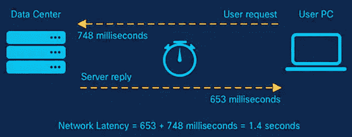

**图 5.4：** 网络延迟

# 可扩展性

可扩展性是设备或安全解决动的一项特性，它指明了其应对不断增长的工作负载并正常运行的能力。时间因素常被用来描述可扩展性。为了确定可扩展性，有必要评估现有和未来的需求。可扩展性也指系统根据不断变化的需求进行扩展的能力。请参阅图 5.5，该图说明了不可扩展的设置：

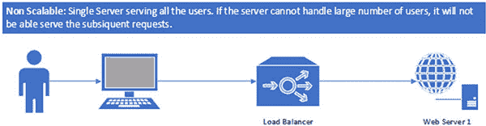

**图 5.5：** 不可扩展设置

为了提高性能，可扩展系统可以被扩大、负载均衡或集群化。假设一家公司需要设置一台新的 Web 服务器。系统管理员找到一台旧系统，可将其转换为新的 Web 服务器。在评估组织需求后，得出结论认为该 Web 服务器将满足组织当前的需求。然而，它将无法满足六个月后的预估需求。如果升级费用不高得令人望而却步，升级服务器以提高可扩展性可能是一种选择。应将更新成本和新的可扩展性值与全新系统的成本和可扩展性进行比较。请参阅图 5.6，该图说明了可扩展设置：

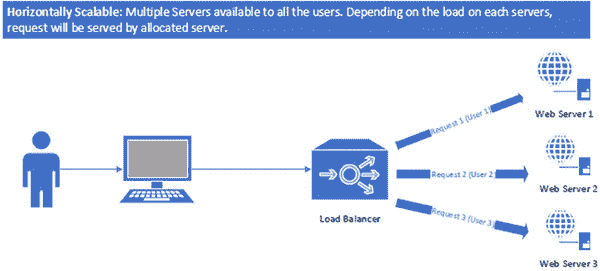

**图 5.6：** 可扩展设置

# 能力

解决方案能够执行的活动称为其能力。例如，**入侵检测系统** (**IDS**) 检测入侵，而**入侵预防系统** (**IPS**) 防止入侵。应了解解决方案执行其功能的机制，以及组织不需要的任何解决方案功能。通常，安全解决方案以更高的成本提供更多功能。

# 易用性

使安全系统或设备更易于使用，并使其更紧密地贴合组织目标和需求，被称为易用性。确保组织员工能够采用和管理新的安全系统至关重要。在计算**投资回报率** (**ROI**) 和总拥有成本时，所有员工培训支出都必须计入解决方案的成本中 (TCO)。由于易用性原因，即使是最优秀的安全系统也可能被排除在备选方案之外。

# 可维护性

安全系统或设备必须更新的频率，以及执行更新所需的时间长度，被称为可维护性。这包括打补丁、清理日志和更新软件。在评估可维护性时，组织应检查需要多少维护、完成维护需要多长时间以及通常执行维护的频率。任何预期的未来变更也应纳入维护考量中。

# 可用性

计算机系统可供使用的时间长度，以百分比表示，称为可用性。在确定可用性时，经常使用**最大可接受停机时间** (**MTD**)、**平均修复时间** (**MTTR**) 和**平均故障间隔时间** (**MTBF**) 这些术语，如图 5.7 所示。为了通过 CASP 考试，您必须能够判断何时安装新设备或技术以提高数据可用性。请考虑以下场景：

假设一家小型企业使用单台主机托管多台虚拟化客户端服务器。该组织正考虑添加一台新主机以形成集群。尽管新主机的硬件和操作系统将与原主机不同，但底层虚拟化技术将保持兼容。两台主机将使用共享的 iSCSI 存储解决方案。得益于 iSCSI 存储解决方案，客户数据将更易访问。评估可用性的最佳方法是查看安全系统中最有可能发生故障的组件。了解解决方案将不可用多长时间、修复需要多长时间以及故障间隔多长时间，这些都是评估可用性的关键因素。请参阅图 5.7，该图说明了系统停机可用性：

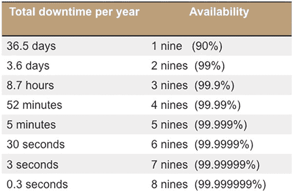

**图 5.7：** 系统停机可用性

# 可恢复性

失败的安全解决方案或设备能否在特定时间范围内，利用既定实践和程序恢复到正常运行状态的可能性，称为**可恢复性**。在评估可恢复性时，经常使用**恢复时间目标** (**RTO**)、**工作恢复时间** (**WRT**) 和**恢复点目标** (**RPO**) 这些术语。评估可恢复性的最佳方法是研究如果需要对安全解决方案或设备进行部分或完全恢复，将需要执行哪些活动。在不同安全系统或设备之间做决定时，了解恢复需要多长时间至关重要。

# 成本/效益分析

在向组织引入任何安全解决方案之前，都会进行成本效益分析 (图 5.8)。这种分析将实施解决方案的费用与实施后将获得的收益进行比较。在大多数情况下，组织只有在这样做的收益大于成本时，才应部署解决方案。请参阅图 5.8，该图说明了成本效益分析：

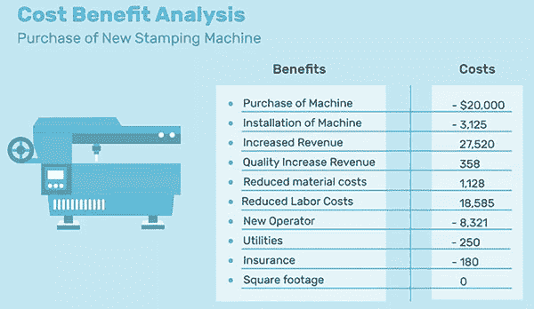

**图 5.8：** 成本效益分析


# 成本效益分析

成本效益分析是一项关键的决策工具，有助于确定计划采取的行动或支出在字面上是否**值得付出这个代价**。该分析可用于帮助决定几乎任何行动方案，但其最常见的用途是决定是否继续进行一项重大支出。由于它基于添加正面因素和减去负面因素以得出净结果，因此也称为“***运算数字***”。请参考图 5.9，该图说明了按项目划分的成本效益分析：

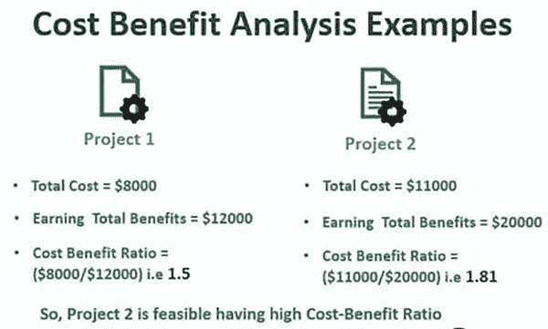

**图 5.9：** 按项目划分的成本效益分析

## ROI

**投资回报率**（**ROI**）是指组织进行投资后获得或损失的资金。ROI 是评估安全投资的必要指标，如图 5.10 所示：


**图 5.10：** 投资回报率

## TCO

**总拥有成本**（**TCO**）衡量与保障组织安全相关的总体成本，包括保险费、融资成本、管理成本以及发生的任何损失。该值应与公司的总体收入和资产基础进行比较。请参考图 5.11，该图说明了 TCO：

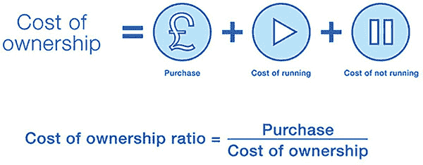

**图 5.11：** 总拥有成本

## 判断力解决问题

作为安全专业人员，您经常会被要求提供意见。在这些情况下没有实际的对或错，当最安全的选项不可行或不存在最优解时，您必须运用判断力来应对复杂的挑战。在这种情况下您能做的最好的事情是进行研究。利用您可用的所有资源了解有关该问题的更多信息，包括访问供应商网站、咨询同行以及获取第三方比较研究。了解为什么最安全的解决方案不可行将有助于您选择另一个方案。由于成本、时间或范围限制，最安全的解决方案可能无法实现。无论限制是什么，安全专家都必须协助开发解决方案以将问题最小化。随着您的专业知识和知识的增长，您将能够更好地根据这些经验和知识做出决策，同时仍进行一些研究。做出出色的判断需要信息。提出问题并获取答复。然后权衡您的每一个答复以评估您找到的任何解决方案。最终您将不得不做出决定并接受它。另一方面，做出明智的决定始终是更好的选择。

## 结论

本章解释了对安全控制有效性的审查，以确定新控制的部署或解构现有解决方案以模拟攻击者。本章还讨论了指标的收集和分析，以用于确定需要部署哪种安全控制。本章还讨论了解释数据以预判防御需求并做出决策。在下一章中，我们将讨论网络安全，作为实施安全架构的基石。

# 第 6 章：网络安全组件

## 简介

如果不了解必须包含的组件以及必须遵循的安全设计概念，就无法实现安全的网络设计。虽然许多安全功能以降低性能或易用性为代价，但如果企业了解一些重要的安全原则，大多数企业都愿意承担这些成本。本章讨论安全架构的基石。要实施安全网络，您需要了解可用的安全设备及其各自的功能。以下部分讨论各种设备，包括基于硬件和基于软件的设备。

## 结构

在本章中，我们将涵盖以下主题：

*   物理和虚拟网络设备
*   应用感知技术
*   安全和复杂的流量流
*   网络管理
*   关键基础设施
*   安全区域
*   网络组件
*   复杂网络安全
*   软件定义网络
*   关键系统

## 目标

任何组织都寻求为其网络基础设施实施安全架构。安全设计需要了解组织的服务和交付组件（如服务器和网络），以将其纳入安全设计中。为了实施安全功能，IT 团队需要考虑用户的易用性、性能成本以及安全标准和原则。本章介绍了为企业和关键基础设施实施安全架构的基石，包括物理、虚拟和网络设备。

## UTM

**统一威胁管理**（**UTM**）是在单个设备或设备上执行多项安全职责的方法；这些功能有时被称为**下一代防火墙**（**NGFW**）（请参阅图 6.1。这些将许多安全功能和服务结合到单个网络设备或服务中，使消费者能够以更直接的方式受到安全风险的保护。NGFW 可能包括以下功能：

*   网络防火墙
*   网络入侵防御
*   网关防病毒
*   网关反垃圾邮件
*   VPN
*   内容过滤
*   负载均衡
*   数据泄露防护
*   设备端报告

UTM 消除了管理多个系统的需求。然而，一些安全专家认为 UTM 提供了单点故障，部署多层设备是一种更安全的方法，如图 6.1 所示：

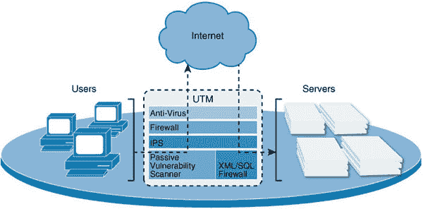

**图 6.1：** 统一威胁管理部署

## IDS/IPS

入侵检测系统是监控系统和网络以防止未经授权的访问或攻击的系统。来自网络内部和外部的威胁可以被验证、列举和分类。在大多数情况下，IDS 会被预先编程为在特定场景下以特定方式响应。IDS 严重依赖事件通知和警报。当发现攻击时，它们会通知管理员和安全专家。**入侵防御系统**（**IPS**）是一种防范攻击的系统。IPS 是一种检测并防止攻击的系统。当攻击开始时，IPS 会采取措施阻止并遏制它。与 IDS 一样，IPS 可以是基于网络或基于主机的（请参阅图 6.2）。IDS/IPS 实现进一步分为以下类别：

*   **基于特征的**：这种类型的 IDS/IPS 检查流量并将其与存储在 IDS 数据库中的攻击或状态模式（称为**特征**）进行比较。它的另一个名称是误用检测系统。尽管很流行，但这种形式的 IDS 只能在与其数据库比较时区分攻击，其有效性仅取决于所提供的特征。需要定期更新。基于特征的 IDS/IPS 的两种主要类型如下：

    *   **模式匹配**：IDS/IPS 将流量与攻击模式数据库进行比较。当检测到与攻击模式匹配的流量时，IDS 会执行特定步骤。

    *   **状态匹配**：IDS/IPS 记录初始操作系统状态。任何专门违反已定义规则的系统状态更改都会导致发送警报或通知。


## IDS/IPS 检测方法

### 基于异常

这种形式的 IDS/IPS 检查流量并将其与典型流量进行比较，以确定其是否构成危险。它也被称为基于配置文件或基于行为的系统。这种系统的困难在于，它会报告任何偏离预期规范的流量，导致误报数量多于基于特征的系统。主要有三种类型的基于异常的 IDS，如下所示：

#### 基于统计异常

为了记录操作，IDS/IPS 从实时环境中获取样本。IDS/IPS 运行时间越长，建立的配置文件就越准确。另一方面，开发一个具有低误报率的配置文件可能具有挑战性且耗时。在此 IDS 中，活动偏差阈值至关重要。阈值设置过低会导致误报，而阈值设置过高会导致漏报。

#### 基于协议异常

IDS/IPS 了解它将监控的协议。建立正常使用的配置文件并将其与活动进行比较。

#### 基于流量异常

IDS/IPS 跟踪流量模式的变化。所有未来的流量模式都与样本进行比较。更改阈值可减少误报或漏报的数量。这种类型的过滤器非常适合检测未知攻击，但用户活动可能不够静态，无法有效实施该系统。

### 基于规则或启发式

这种形式的 IDS/IPS 是一个具有知识库、推理引擎和基于规则编程的专家系统。知识被组织为一组规则。对数据和流量进行评估，并将规则应用于已研究的流量。推理引擎采用智能软件进行学习。如果满足攻击的标准，则会触发警报或通知。这也被称为 if/then 系统或专家系统。

对 IPS 或 IDS 进行分类的最常用方法是基于其信息源——基于网络或基于主机。请参阅 图 6.2，该图说明了 IPS 与 IDS 的对比：

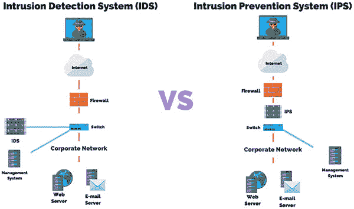

**图 6.2：** IDS 与 IPS

## HIDS/HIPS

使用基于主机的 IDS/IPS (HIDS/HIPS) 监控单个系统上的流量。其主要功能是保护安装它的系统。HIDS/HIPS 使用来自操作系统审计跟踪和系统日志的信息。审计日志和系统日志的完整性限制了 HIDS 的检测能力。一种分析特定应用程序事务日志文件的定制 IDS/IPS 称为基于应用程序的 IDS/IPS。这种形式的 IPS/IDS 通常随程序附带，也可以单独购买。

## NIPS

**网络入侵防御系统** (**NIPS**) 监控网络流量中的恶意活动信号，并采取行动予以阻止。NIPS 是一种网络监控系统，可跟踪整个网络。使用 NIPS 过滤器时必须小心，以确保将误报和漏报降至最低。误报是指无根据的警报，而漏报是指令人烦恼但未触发警报的流量。

## NIDS

**网络 IDS** (**NIDS**) 是最流行的 IDS，它分析本地网段上的网络流量。**网络接口卡** (**NIC**) 必须处于混杂模式，才能监控网段上的流量。NIDS 只能监控网络流量；无法监控任何内部系统活动，例如通过登录系统本地终端进行的攻击。交换网络会影响 NIDS，因为大多数 NIDS 仅监控单个网段。请参阅 图 6.3，该图说明了基于网络和基于主机的 IDS：

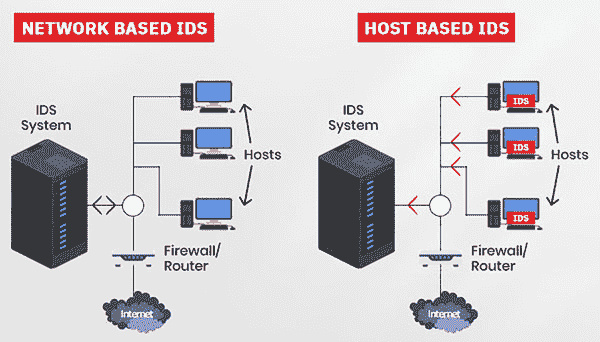

**图 6.3：** NIDS 与 HIDS

## NAC

在发起对网络的远程访问或 VPN 连接时，**网络访问控制** (**NAC**) 是一项超越用户认证的服务，涉及对用户引入网络的机器状态进行审查 (图 6.4)。这些服务被称为思科的**网络准入控制** (**NAC**) 服务和微软的**网络访问保护** (**NAP**) 服务。无论使用何种术语，这些功能的目标都是相同的——扫描任何寻求网络访问的设备是否存在恶意软件、缺失的安全更新以及设备可能带入网络的任何其他安全漏洞。请参阅 图 6.4，该图说明了 NAC：

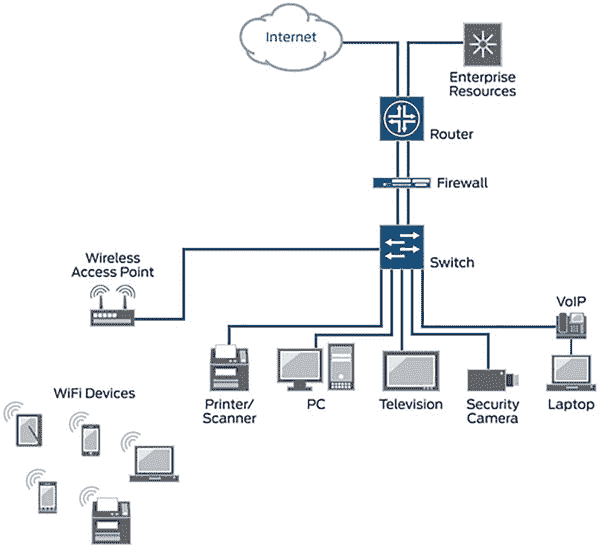

**图 6.4：** 网络访问控制

## SIEM

**安全信息和事件管理** (**SIEM**) 解决方案从关键系统日志文件收集数据，并集中进行收集和分析 (图 6.5)。SIEM 技术结合了两种密切相关的技术——**安全信息管理** (**SIM**) 和**安全事件管理** (**SEM**)。SIEM 的日志来源可以包括以下内容：

*   应用程序日志
*   杀毒软件日志
*   操作系统日志
*   恶意软件检测日志

请参阅 图 6.5，该图说明了 SIEM：

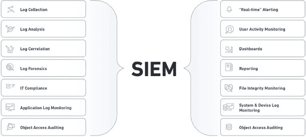

**图 6.5：** SIEM

在处理 SIEM 系统时，需要记住的一件事是将收集的数据量保持在最低限度。此外，您必须确保有足够的资源可用，以确保实现良好的性能。请参阅 图 6.6，该图说明了从初始接收日志到最终工单的 SIEM 日志流程：

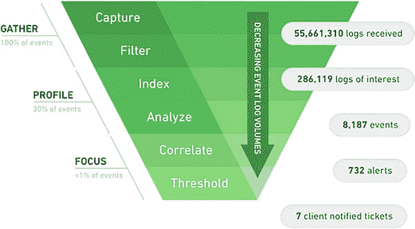

**图 6.6：** SIEM 日志流程

当需要满足以下条件时，组织应实施 SIEM 系统：

*   需要更深入地了解网络事件
*   需要更快地关联事件
*   合规性问题要求简化和自动化报告
*   需要帮助确定安全问题的优先级

## 防火墙

防火墙是与安全概念联系最紧密的网络设备。防火墙可以是运行在服务器或客户端操作系统之上的软件，也可以是拥有自己操作系统的独立设备。在任何情况下，防火墙的作用都是检查并限制允许的通信类型。当我们审视防火墙时，我们关注其工作方式的差异。防火墙类型如下：

### 包过滤防火墙

这些防火墙对性能的影响最小，因为它们仅在数据包头部查找批准的 IP 地址或端口号。虽然此功能会延迟流量，但它只需要在数据包开头进行快速检查并决定允许或拒绝。虽然包过滤防火墙很有用，但它们无法防范所有形式的攻击。它们无法阻止 IP 欺骗、特定于应用程序的攻击、依赖数据包分片的攻击，或利用 TCP 握手的攻击。为了挫败这些攻击，需要更复杂的检查防火墙类型。


# 防火墙

## 有状态防火墙

这些防火墙了解 `TCP` 握手的工作原理，维护跟踪所有连接相对于握手的状态，并能检测到当数据包试图加入网络时，在 `TCP` 握手的上下文中是否不合逻辑。一个同时设置了 `SYN` 和 `ACK` 标志的数据包，除非它是已建立握手过程的一部分，否则绝不应到达防火墙以进行投递；它也应该是响应从网络内部接收到的、设置了 `SYN` 标志的数据包。这就是有状态防火墙不会放行的数据包类型。有状态防火墙还可以检测各种试图利用此过程的攻击形式。它通过在状态表中跟踪所有当前连接及其所处的过程阶段来实现这一点。这使它能够检测任何与现有连接状态不一致的流量。当然，维护和引用此表对该防火墙类型的性能影响大于包过滤防火墙。

## 代理防火墙

这种形式的防火墙位于内部到外部连接的内部侧和外部侧之间，并代表端点进行连接。以这种方式使用的防火墙称为正向代理。代理防火墙没有直接连接；相反，代理防火墙充当两个目的地之间的中继。代理防火墙可以在 `OSI` 模型的两个不同层运行，如下所示：

### 电路级代理

这些代理工作在 `OSI` 模型的会话层（`第 5 层`）。这种代理使用协议头和会话层信息来做出判断。由于这种代理不执行深度包检测（在 `第 7 层`，即应用层），因此它被视为与应用程序无关，可用于各种 `第 7 层` 协议。`SOCKS` 防火墙是电路级防火墙的一个例子。它要求在机器上安装 `SOCKS` 客户端。为了使这种防火墙更易于使用，许多公司已将其软件与 `SOCKS` 集成。

### 应用级代理

这些代理执行深度包检测（检测至 `第 7 层`）。这种防火墙深入理解应用程序的 `第 7 层` 通信机制。在应用级防火墙中，每个协议都有自己的代理功能。例如，代理可以根据 `HTTP` 指令读取和过滤 `HTTP` 流量。因为在此层运行需要完整地打开和关闭每个数据包，所以这种防火墙对性能的影响最大。

### 动态包过滤

虽然动态包过滤在技术上不是一种防火墙形式，但它是防火墙可能或可能无法管理的一个过程，因此值得在此提及。当内部计算机尝试与远程计算机建立连接时，数据包包含源端口号和目标端口号。例如，如果计算机请求安全 Web 服务器，目标将是 `端口 443`，因为 `HTTP` 默认使用 `端口 443`。

### 内核代理防火墙

第五代防火墙是此类防火墙的一个例子。它在 `OSI` 模型的每一层检查数据包，但因为它在内核层执行此操作，所以不像应用层防火墙那样有相同的性能损耗。它还使用代理范式，在其中充当两个系统之间的中间人，代表它们建立连接。

## 下一代防火墙 (NGFW)

**下一代防火墙 (NGFW)** 是一种设备，它试图在不牺牲速度的前提下，解决典型有状态防火墙在流量检查和应用感知方面的不足。虽然 `UTM` 系统努力解决这些挑战，但它们使用不同的内部引擎来执行各种安全任务。请参阅 图 6.7 了解 NGFW 的示意图：

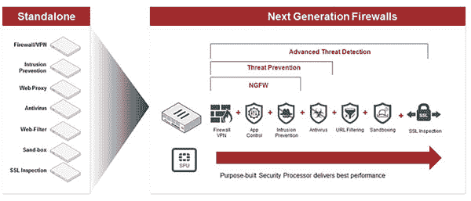

**图 6.7：** 下一代防火墙

这意味着一个数据包在被允许进入网络之前，可能会被各种引擎多次评估。`NGFW` 具有应用感知能力，意味着它们可以区分特定应用程序，而不仅仅是允许所有流量通过标准 Web 端口进入。此外，在深度包检测步骤中，它们只分析数据包一次（这是检测恶意软件和异常所必需的）。`NGFW` 提供以下功能：

*   非侵入式内联配置 – 对网络性能影响极小
*   标准第一代防火墙功能 – 网络地址转换、有状态协议检测和虚拟专用网络
*   集成基于特征的 `IPS` 引擎
*   应用感知、全栈可见性和细粒度控制
*   能够结合来自防火墙外部的信息，例如基于目录的策略、黑名单和白名单
*   升级路径以包含未来的信息源和安全威胁，以及 `SSL` 解密以识别不良加密应用程序

# 交换机

这些是工作在 `OSI` `第 2 层` 级别的智能设备。它们映射到这一层，因为交换决策使用存储在第 2 层的 `MAC` 地址。这被称为**透明网桥**。交换机比集线器更高效，因为它们防止冲突。每个交换机端口都有自己的冲突域；然而，所有集线器端口共享一个冲突域。从安全角度来看，交换机更安全，因为连接到单个端口的嗅探器只能收集发往该端口或源自该端口的通信。然而，一些交换机既可以作为路由器也可以作为交换机工作。`第 3 层` 交换机是既能路由又能交换数据的设备。使用交换机时请记住，虽然交换机之间的冗余连接是好的，但它们可能导致交换环路，这对网络可能是灾难性的。为了避免交换环路，大多数交换机使用**生成树协议 (STP)**。您应该检查交换机是否支持此功能以及是否已开启。

# 路由器

如果我们仅讨论路由功能，可以说路由器工作在 `第 3 层`。一些路由设备可以将路由、交换和 `第 4 层` 过滤集成在一个设备中。然而，路由是一个 `第 3 层` 功能，因为它基于 `第 3 层` 信息（`IP` 地址）做出决策。路由器使用路由表来指示它们将流量发送到特定网络的哪条路径（图 6.8）。虽然路由器可以配置为指向特定计算机，但它们通常设计为路由到网络而不是特定计算机。当数据包到达直接连接到目标网络的路由器时，路由器会执行 `ARP` 广播以确定计算机的 `MAC` 地址，然后在第 2 层将数据包作为帧发送出去。路由器通过允许建立**访问控制列表 (ACL)** 发挥着重要的安全作用。`ACL` 是一组规则，用于确定允许或拒绝哪些流量使用通过路由器的特定路径。这些规则可以在 `第 3 层` 级别运行，基于 `IP` 地址做出决策，或在 `第 4 层` 级别运行，仅允许特定类型的流量。`ACL` 通常指授权或禁止的服务或应用程序的端口号。请参阅 图 6.8 了解网络路由和交换的示意图：

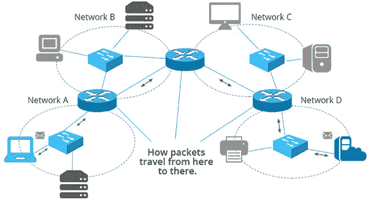

**图 6.8：** 网络路由与交换

要保护路由器，您需要确保以下设置到位：

*   在路由器之间配置认证，以防止它们与流氓路由器执行路由更新。
*   使用强密码保护管理接口。
*   使用 `SSH` 而不是 `Telnet` 来管理路由器。


# 代理

代理服务器可以是运行在服务器操作系统上的硬件或软件。这些服务器的工作方式与代理防火墙相同，即它们代表计算机建立 Web 连接；不过，它们通常能在更详细的层面上接受和限制流量。例如，代理服务器可能允许销售组访问特定网站，同时拒绝数据录入组访问同一网站。此功能不仅限于 HTTP，还包括其他通信形式，如 FTP。代理服务器还能执行一项称为 **Web 缓存** 的实用服务。当代理服务器设置为启用 Web 缓存时，它会将提供给内部计算机的每个网页的副本保存在 Web 缓存中。如果稍后另一位用户请求同一页面，代理服务器已有本地副本，无需费心从互联网检索。这显著提升了 Web 上频繁访问页面的性能。

# 负载均衡器

负载均衡器是平衡网络流量的硬件或软件解决方案。**应用交付控制器** (**ADC**) 也支持相同的方法，但它们额外利用复杂的数值计算程序来平衡负载，例如每台服务器的 CPU 和内存使用率、最快响应时间等。服务器场或池是用于描述负载均衡技术的术语，如图 6.9 所示：

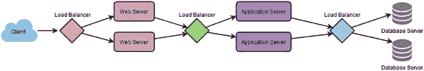

**图 6.9：** 负载均衡器位置

# HSM

**硬件安全模块** (**HSM**) 是一种保护和管理用于强身份验证的数字密钥并提供加密处理的设备。HSM 的功能包括：

*   内置安全加密密钥生成
*   内置安全加密密钥存储和管理
*   使用加密和敏感数据材料
*   卸载应用服务器以进行完整的非对称和对称加密

图 6.10 说明了直接连接到计算机或服务器的连接：

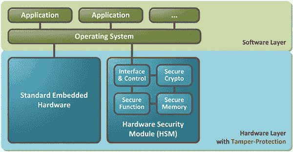

**图 6.10：** 基础设施中的硬件安全模块

HSM 设备可用于多种场景，如下所示：

*   PKI 环境，用于在银行卡支付系统中生成、存储和管理密钥对，以加密 PIN 码并将密钥加载到受保护内存中
*   为使用 SSL 的应用程序执行处理
*   在 **域名系统安全扩展** (**DNSSEC**) 中；一种安全的 DNS 形式，保护区域文件的完整性，以存储用于签署区域文件的密钥

请参阅图 6.11，该图说明了 HSM 密钥存储和加速：

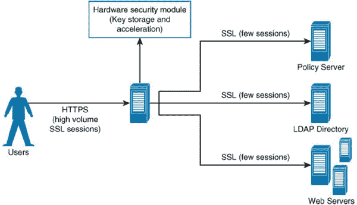

**图 6.11：** HSM 密钥存储与加速

# 应用和协议感知技术

应用和协议感知技术会跟踪有关应用程序及其链接协议的当前信息。这些智能技术利用这些数据来改进协议，从而提高应用程序的性能。

# WAF

HTTP 交互通过 **Web 应用程序防火墙** (**WAF**) 路由，后者对其应用规则集（图 6.12）。这些规则集针对这些会话类型易受攻击的最常见攻击形式。跨站脚本和 SQL 注入是它们处理的两种最常见攻击。WAF 可以作为独立设备或服务器插件安装。虽然大多数解决方案通过设备以内联方式路由所有流量，但其他解决方案监控端口并以带外方式工作，允许直接部署在 Web 服务器上。请参阅图 6.12，该图说明了 Web 应用程序防火墙：

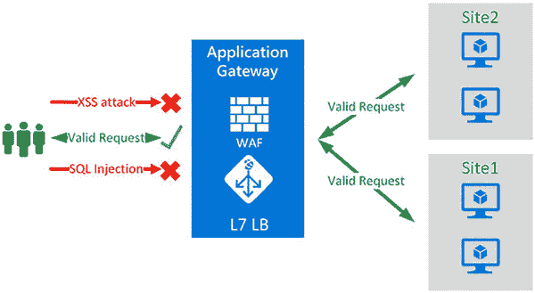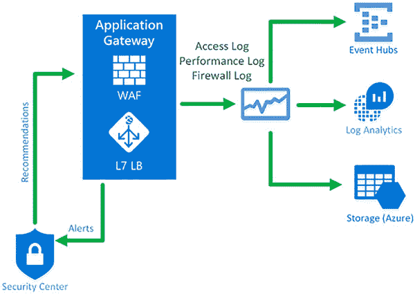

**图 6.12：** Web 应用程序防火墙

# 被动漏洞扫描器

漏洞扫描器是用于调查和披露网络中安全缺陷的程序或实用工具。为了检测拓扑、服务和漏洞，**被动漏洞扫描器** (**PVS**) 在数据包层检查网络流量（图 6.13）。通过主动扫描漏洞，它消除了可能对系统造成的不稳定性。PVS 工具检查数据包流并进行直接分析以检查漏洞。它们的使用方式与网络入侵检测系统或数据包分析器相同。PVS 可以选择一个指向受保护服务器的网络会话并根据需要对其进行监控。PVS 在不影响受监控网络的情况下执行此操作的能力是其最大优势。请参阅图 6.13，该图说明了 PVS：

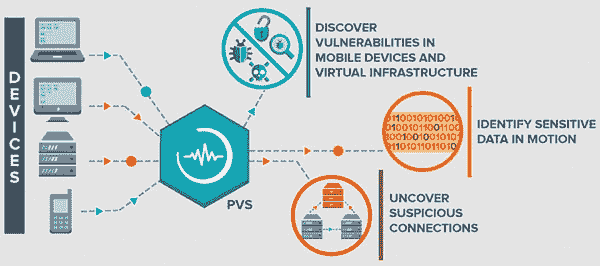

**图 6.13：** 被动漏洞扫描器

# 主动漏洞扫描器

与被动扫描器不同，主动扫描器可以采取行动防止攻击，例如禁止有问题的 IP 地址。它们还可用于通过模拟攻击来测试就绪状态。它们通过向节点发送信号并分析响应来工作，这可能会中断网络流量。

# VPN

信息通过使用不受信任的承载网络的 **虚拟专用网络** (**VPN**) 连接，受到强大的身份验证程序和加密技术的保护。虽然我们通常选择最不可信的网络——互联网——但 VPN 确实通过互联网传输。VPN 也可用于保护内部网络上的流量。在 VPN 操作中，完整的协议封装在其他协议周围，包括以下内容：

*   **必需**：LAN 和远程访问或线路协议
*   **可选**：身份验证和加密协议

请参阅图 6.14，该图说明了 VPN：

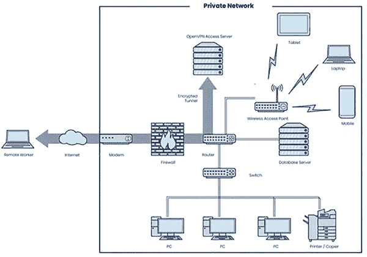

**图 6.14：** 虚拟专用网络

VPN 集中器是终止多个 VPN 连接并使用可用的最强加密和身份验证程序的设备。如果 ISP 在其内部网络中也使用 VLAN，则在某些情况下，VPN 解决方案中的 VLAN 可能不受 ISP 支持。客户可以通过选择提供 **多协议标签交换** (**MPLS**) 连接的供应商来创建到其他站点的 VLAN。MPLS 提供具有 VPN 间地址和路由隔离的 VPN 服务。VPN 连接有以下两种类型：

*   **远程访问 VPN**：远程访问 VPN 可用于为远程办公人员或出差用户提供远程访问。创建的隧道以用户的计算机和 VPN 集中器为端点。在这种情况下，只有从用户计算机到 VPN 集中器的流量使用此隧道。
*   **站点到站点 VPN**：VPN 连接可用于安全地连接两个位置。在这种称为站点到站点 VPN 的类型中，隧道端点是两个 VPN 路由器，每个办公室一个。使用此配置，办公室之间的所有流量都将使用该隧道，无论来源或目的地如何。端点在创建 VPN 连接期间定义，因此必须根据所使用的远程访问链路类型正确设置。

# IPsec

多种远程访问或线路协议（隧道协议）用于创建 VPN 连接，包括以下内容：


# 隧道协议

*   **点对点隧道协议** (`PPTP`)：`PPTP` 是一种基于 `PPP` 的微软协议。它使用内置的微软点对点加密，并可使用多种认证方法，包括 `CHAP`、`MS-CHAP` 和 `EAP-TLS`。`PPTP` 的一个缺点是它仅适用于基于 IP 的网络，如 图 6.15 和 图 6.16 所示。如果使用的 WAN 连接不是基于 IP 的，则必须使用 `L2TP`。使用 `PPTP` 时，加密已包含在内，剩下的唯一选择就是认证协议。

*   **第 2 层隧道协议** (`L2TP`)：`L2TP` 是一种较新的协议，工作在 `OSI` 模型的第 2 层。与 `PPTP` 一样，`L2TP` 可使用各种认证机制；然而，`L2TP` 不提供任何加密。它通常与 **互联网协议安全** (`IPsec`) 结合使用，后者是一种非常强大的加密机制。使用 `L2TP` 时，如果需要，加密和认证协议都必须额外添加。`IPsec` 可提供加密、数据完整性和基于系统的认证，这使其成为一种灵活且强大的选项。

图 6.15 说明了隧道模式下的 `IPsec`：

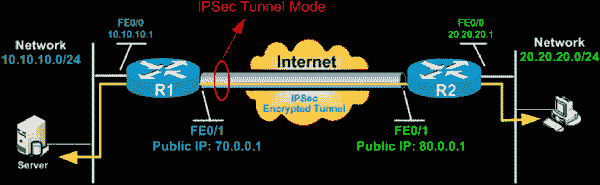

**图 6.15：** 隧道模式下的 IPsec

通过实现 `IPsec` 套件的特定部分，您可以选择是否使用这些功能。`IPsec` 实际上是一套协议，很像 `TCP/IP`。它包含以下组件：

*   **认证头** (`AH`)：`AH` 提供数据完整性、数据源认证和防重放攻击保护。

*   **封装安全载荷** (`ESP`)：`ESP` 提供 `AH` 的所有功能，以及数据机密性。

*   **互联网安全关联与密钥管理协议** (`ISAKMP`)：`ISAKMP` 处理会话安全关联的创建和密钥交换。

*   **互联网密钥交换** (`IKE`)：有时也称为 `IPsec` 密钥交换，`IKE` 提供用于创建密钥的认证材料，这些密钥由 `ISAKMP` 在对等体认证期间交换。

图 6.16 说明了传输模式下的 `IPsec`：

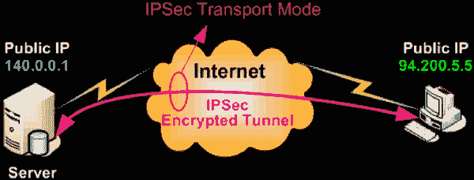

**图 6.16：** 传输模式下的 IPsec

`IPsec` 是一个框架，这意味着它不指定与其配合使用的许多组件。这些组件必须在配置中标识，并且必须匹配，以便两端能够成功创建所需的安全关联，该关联必须在任何数据传输之前就已建立。

# SSL/TLS

建立到服务器的安全连接的另一种选择是 **安全套接字层** (`SSL`)。它工作在 `OSI` 模型的应用层。它主要用于保护 `HTTP` 流量和 Web 服务器。大多数浏览器都内置了它，使用它通常不需要用户执行任何操作。图 6.17 说明了 `SSL` 通信：

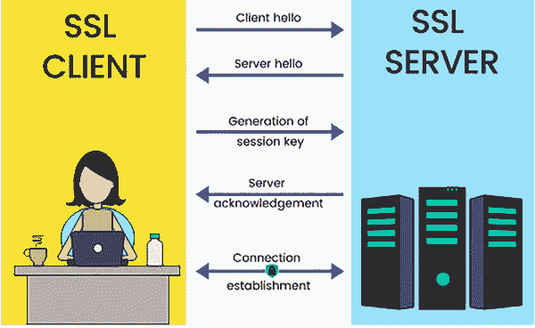

**图 6.17：** SSL 通信

`SSL` 广泛且频繁地用于保护其他协议。例如，**安全复制协议** (`SCP`) 采用 `SSL` 来加密服务器之间的文件传输。在决定安装 `SSL` 网关的位置时，您必须权衡以下因素——网关越靠近网络边缘，局域网中所需的加密就越少（性能损耗也越小），但网关越靠近网络边缘，以明文形式流经局域网的流量就越多。一切归结为您对自己网络有多少信任。这用于保护互联网事务，并可通过以下两种方式实施：

*   **SSL 门户 VPN**：在这种情况下，用户拥有单个 `SSL` 连接以访问 Web 服务器上的多项服务。认证后，将为用户提供一个页面，该页面作为通往其他服务的门户。

*   **SSL 隧道 VPN**：用户可使用 `SSL` 隧道访问非 Web 服务器上的服务。此解决方案使用自定义编程通过 Web 浏览器提供对非 Web 服务的访问。

`TLS` 和 `SSL` 非常相似但不相同。配置 `SSL` 时，必须指定会话密钥长度。有两个选项：`40 位` 和 `128 位` 密钥。使用自签名证书认证服务器的公钥可防止中间人攻击。

# TLS

当前版本的 **传输层安全** (`TLS`) 协议，版本 `1.3`，为连接到互联网的两台计算机提供加密连接。它确认服务器的身份，并保护数据不被黑客拦截。当用户尝试连接到服务器时，服务器会向用户提供其 `TLS` 证书。为了创建安全连接，用户会使用用户设备上的 `CA` 证书检查服务器的证书。为了确认 `CA` 对证书进行了签名，此验证方法采用公钥加密，如 `RSA` 或 `ECC`。只要您信任 `CA`，这就证明您正在与服务器证书的主体进行通信。图 6.18 说明了此 `TLS 1.3` 过程：

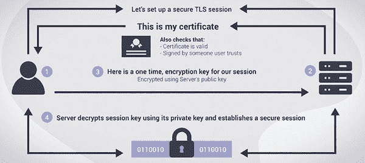

**图 6.18：** TLS 1.3 过程

这在维护数据完整性的同时，也为各个数据传输目的地之间提供了匿名性。数字证书也用于验证服务器的有效性。这些证书最常被称为 `TLS` 证书。公钥加密用于认证这些证书。这基于密钥对，由公钥和私钥组成。只有当公钥和私钥都存在时，加密数据才能被解密。`TLS` 证书采用公钥认证，以确保只有预期的接收者才能访问内容。

# SSH

管理员或网络专业人员经常需要远程管理和配置网络设备。技术人员可以使用 `Telnet` 等协议连接到路由器、交换机和无线接入点等设备，并从命令行对其进行管理。然而，`Telnet` 以明文发送数据，这构成安全风险。为了提供一种执行这些任务的加密方式，发明了 **安全外壳** (`SSH`)。它通过安全通道和不安全网络，分别链接运行 `SSH` 服务器和 `SSH` 客户端应用程序的服务器和客户端。它是 `Telnet` 的一种流行替代方案，在从命令行进行远程管理时应予以考虑。可以采取以下几个步骤来增强 `SSH` 实现的安全性，如下所示：

*   将使用的端口号从默认的 `22` 更改为 `1024` 以上的某个值。
*   仅使用版本 `2`，它修复了早期版本中存在的许多漏洞。
*   禁用对具有 root 账户的设备的 root 登录（在 Linux 或 UNIX 中）。
*   使用 `ACL`、`IP tables` 或 `TCP wrappers` 控制对任何启用 `SSH` 设备的访问。

# RDP


# 第 6 章：网络安全概念

## 远程桌面协议 (RDP)

**远程桌面协议** (**RDP**) 是微软开发的一种专有协议，它允许你通过网络连接使用图形界面连接到另一台计算机。RDP 允许你像坐在终端前一样操作远程计算机，这与只允许你从命令行工作的 Telnet 和 SSH 不同。RDP 会话采用原生 RDP 加密；但是，会话主机服务器未经过身份验证。可以使用 SSL 进行服务器身份验证，并加密 RDP 会话主机服务器交互，以帮助防止这种情况。这需要使用证书。你可以使用现有证书或 Windows 自带的自签名证书。RDP 可用于将用户连接到 **虚拟桌面基础设施** (**VDI**) 以及远程访问工作站。这允许用户从任何位置操作虚拟桌面。每个用户可能拥有自己的 **虚拟机** (**VM**) 镜像，或者多个用户可能共享同一个 VM 镜像。

## 反向代理

反向代理是一种代理服务器，它代表外部客户端从一个或多个内部服务器获取资源。然后，这些资源被提供给客户端，就像它们直接来自 Web 服务器一样。与允许内部客户端与外部服务器通信的正向代理不同，反向代理允许外部客户端与内部服务器通信。流行的 Web 服务器经常使用反向代理功能来保护应用程序框架免受 HTTP 限制的影响。

## 网络认证方法

在创建远程访问解决方案时必须做出的协议选择之一是认证协议。以下是其中一些最重要的协议：

### 密码认证协议 (PAP)

**密码认证协议** (**PAP**)：PAP 提供认证，但凭据以明文形式发送，可以用嗅探器读取。

### 质询握手认证协议 (CHAP)

**质询握手认证协议** (**CHAP**)：CHAP 通过在不跨链路发送凭据的情况下运行来解决明文问题。服务器向客户端发送一组称为 **质询** 的随机文本。客户端使用密码加密该文本并将其发送回服务器。服务器然后使用相同的密码对其进行解密，并将结果与最初发送的内容进行比较。如果结果匹配，服务器可以确信用户或系统拥有正确的密码，而无需将其发送 عبر不受信任的网络。微软创建了自己的 CHAP 变体，如下所示：

#### MS-CHAP v1

**MS-CHAP v1**：这是微软 CHAP 变体的第一个版本。该协议仅适用于微软设备，虽然它比 CHAP 更安全地存储密码，但像任何其他基于密码的系统一样，它容易受到暴力破解和字典攻击。

#### MS-CHAP v2

**MS-CHAP v2**：此 MS-CHAP 更新提供更强的加密密钥和双向认证，并对发送和接收使用不同的密钥。

### 可扩展认证协议 (EAP)

**可扩展认证协议** (**EAP**)：EAP 不是单一协议，而是一个基于端口的访问控制框架，它使用与 RADIUS 相同的三个组件。各种 EAP 实现可以使用各种认证机制，包括证书、PKI 甚至简单密码，如下所示：

#### EAP-MD5-CHAP

**EAP-MD5-CHAP**：此 EAP 变体使用 CHAP 质询过程，但质询和响应作为 EAP 消息发送。它允许使用密码。

#### EAP-TLS

**EAP-TLS**：此形式的 EAP 需要 PKI，因为它要求服务器和客户端都有证书。然而，它不使用密码，因此免疫基于密码的攻击。

#### EAP-TTLS

**EAP-TTLS**：此形式的 EAP 仅要求服务器上有证书。客户端使用密码，但密码在受保护的 EAP 消息中发送。然而，它易受基于密码的攻击。

## 802.1x

802.1x 是一个定义集中式基于端口认证框架的标准 (*图 6.19*)。它可应用于无线和有线网络，并使用以下三个组件：

*   **申请者**：请求访问网络的用户或设备。
*   **认证器**：申请者尝试通过其访问网络的设备。
*   **认证服务器**：执行认证的集中式设备。

各种网络接入设备，包括远程接入服务器（拨号和 VPN）、交换机和无线接入点，都可以充当认证器。**远程认证拨号用户服务** (**RADIUS**) 或 **终端接入控制器访问控制系统 Plus** (**TACACS**+) 服务器可以充当认证服务器。认证器从申请者处获取凭据并将其发送给认证服务器进行验证。认证器被告知申请者的端口已成功验证，从而允许网络访问。*图 6.19* 说明了 802.1x 组件：

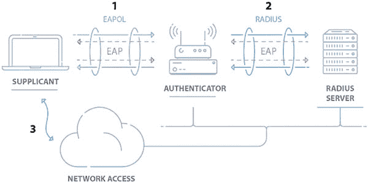

**图 6.19：** 802.1x 组件

RADIUS 和 TACACS+ 都执行相同的功能；然而，它们具有不同的属性。在选择方法时必须考虑这些区别。请记住，RADIUS 是一个标准，而 TACACS+ 是思科专有的产品。许多安全专家认为，在所有设备上激活 802.1x 认证是你能提供的最佳网络安全。

## 软件定义网络 (SDN)

**软件定义网络** (**SDN**) 传统上被定义为网络中控制平面与数据平面的分离。在传统网络中，这些平面实现在路由器和交换机的固件中。在 SDN 中，控制平面在软件中实现，允许对其进行编程访问。其优势在于允许对网络部件进行高度精确的访问和控制。它使 IT 企业能够用编程接口替换手动接口，从而实现配置和策略管理的自动化。使用软件将多个原本独立运行的交换机的控制平面集中化是 SDN 实际应用的一个例子。通常，控制平面在硬件中实现；然而，使用 SDN 时，它在软件中实现。SDN 在部署方面提供了多样性、速度和敏捷性，以及混合搭配来自不同供应商解决方案的能力。SDN 有许多缺点。当控制器失去连接时，整个网络就会瘫痪，SDN 理论上可能允许对控制器的攻击。*图 6.20* 说明了 SDN 架构：

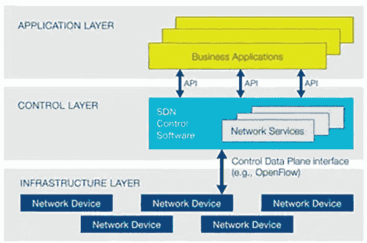

**图 6.20：** SDN 架构

## 结论

本章讨论了安全和网络设备，如 UTM、IDS/IPS、NIDS、NIPS、NAC、SIEM、路由器、交换机、负载均衡器和 HSM。硬件和软件防火墙、WAF 和漏洞扫描器也进行了讨论。还涵盖了识别安全方法，并重点介绍了基线化。

在下一章中，我们将探讨保护主机和设备，以及保护系统的相关问题。

# 第 7 章：保护主机和设备

## 简介

保护网络不能止步于控制和监控网络流量。网络攻击的最终目标是攻击单个主机。本章介绍可用于保护主机的选项，以及这些选项旨在解决的问题。

## 结构

在本章中，我们将涵盖以下主题：

*   可信操作系统
*   引导加载程序安全
*   操作系统加固过程
*   端点安全
*   硬件和软件漏洞
*   应用程序交付
*   终端服务


# 目标

保护企业安全不仅仅止步于网络流量监控，因为网络攻击旨在利用服务器和用户系统（主机）。本章介绍用于保护和安全防护服务器及用户系统的各种控制措施。这包括使用 `trusted OS`、`bootloader security`、`OS hardening` 和 `endpoint security vulnerabilities`。

## 可信操作系统

可信操作系统是指支持多层安全并能证明其满足特定政府标准集的操作系统。`Secure Boot`（安全启动）结束的地方，`Trusted Boot`（可信启动）便接管控制权。在安装 `Windows 10 kernel` 之前，`bootloader` 会检查其数字签名。反过来，`Windows 10 kernel` 会检查 `boot drivers`、`startup files` 以及 `Windows start-up process` 的 `ELAM` 组件。如果文件被修改，`bootloader` 会识别出错误并拒绝加载故障组件。通常，`Windows` 可以自动修复故障组件，恢复 `Windows` 的完整性，使电脑能够正常启动。

`Trusted Computer System Evaluation Criteria`（`TCSEC`，可信计算机系统评估标准）首次提出了将操作系统分类为可信的目标。`TCSEC` 由 `National Computer Security Center`（`NCSC`，国家计算机安全中心）创建，旨在协助美国 `Department of Defense`（`DoD`，国防部）评估产品。`TCSEC` 发布了彩虹丛书系列出版物，重点关注计算机系统及其运行的网络。`TCSEC` 的《橙皮书》是一套基于 Bell-LaPadula 模型（贝尔-拉帕杜拉模型）的标准，用于对计算机系统产品提供的安全级别进行分级或评级。《橙皮书》涵盖的主题包括隐蔽信道分析、可信设施管理和可信恢复。

`TCSEC` 已被全球通用的 `Common Criteria`（`CC`，通用准则）标准取代，该标准是通过协作开发的。`CC` 使用 `Evaluation Assurance Levels`（`EALs`，评估保证等级）对系统进行评级，不同的 `EAL` 代表不同级别的系统安全测试和设计。最终得分反映了系统提供安全性的能力。假定客户会有效配置所有安全解决方案。为了让用户完全达到该评级，供应商必须提供充分的文档。国际标准化组织（ISO）版本的 `CC` 是 `ISO/IEC 15408-1:2009`。`CC` 提供七个保证等级，范围从 `EAL1`（最低）到 `EAL7`（最高），包括功能测试以及对系统设计的详细测试和验证，如下所示：

*   `EAL1`：功能测试
*   `EAL2`：结构测试
*   `EAL3`：系统地测试和检查
*   `EAL4`：系统地设计、测试和评审
*   `EAL5`：半形式化设计和测试
*   `EAL6`：半形式化验证、设计和测试
*   `EAL7`：形式化验证、设计和测试

以下是一些可信操作系统及其提供的 `EAL` 级别示例：

*   `Mac OS X 10.6`（评级 `EAL 3+`）
*   `HP-UX 11i v3`（评级 `EAL 4+`）
*   部分 `Linux` 发行版（评级高达 `EAL 4+`）
*   `Microsoft Windows 7`（评级 `EAL 4+`）

在安全至关重要的任何情况下，例如在政府机构中、作为国防部承包商工作时，或部署将连接到敏感网络或存放敏感数据的 Web 服务器时，应使用可信操作系统。然而，由于这些操作系统通常更难理解和操作，使用它们时可能存在学习曲线。以下章节将讨论三个可信操作系统——`SELinux`、`SEAndroid` 和 `TrustedSolaris`。

### SELinux

`Security-Enhanced Linux`（`SELinux`，安全增强型 Linux）是 `Linux kernel` 的一个安全模块，它将安全决策的执行与安全策略本身隔离开来，减少了实施安全策略所需的软件量（参见*图 7.1*）。`SELinux` 还实施强制访问控制限制，限制对文件和网络资源的访问，同时也限制用户程序和系统服务器。它没有 "`root`" 超级用户的概念，也没有典型 Linux 安全方法中众所周知的缺陷。在高安全场景中，如果 `root` 账户的沙箱隔离是有益的，应选择 `SELinux` 系统而非常规 Linux 版本。*图 7.1* 展示了 `SELinux` 的决策过程：

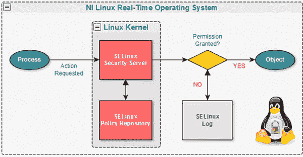

**图 7.1：** 安全增强型 Linux 决策过程

### SEAndroid

`SEAndroid` 是适用于 Android 智能手机的 `SELinux` 版本。基于 `SEAndroid 4.3` 的宽容发布版和 `Android 4.4` 的部分强制执行，`SEAndroid 5.0` 版本进展到全面 `SELinux` 强制执行。`SEAndroid` 软件仅以成功运行所需的权限运行（有助于限制恶意软件造成的危害），但它偶尔会禁止员工所需的程序或功能。你需要 Android 设备的 Shell 和 `root` 访问权限来管理默认的 `SEAndroid` 行为。`SSHDroid` 是一个 `Secure Shell`（`SSH`，安全外壳）程序，允许你从计算机访问 Android 设备。`Android Debug Bridge`（`adb`，Android 调试桥）命令是 Android `software development kit`（`SDK`，软件开发工具包）的一部分，可用于获取 `root` 访问权限，或者你可以对设备进行 `root` 操作以获得完全访问权限。由于设备厂商不支持 Root，这种方法并不适合所有人。

### TrustedSolaris

`TrustedSolaris` 是一组集成在 `Solaris 10` 可信操作系统中的安全扩展。`Solaris 10 5/09` 通过了通用准则 `EAL4` 认证。增强功能包括以下内容：

*   `Accounting`
*   `Role-based access control`
*   `Auditing`
*   `Device allocation`
*   `Mandatory access control labeling`

`TrustedSolaris` 环境允许安全管理员角色扩展可信目录列表，如*图 7.2* 所示：

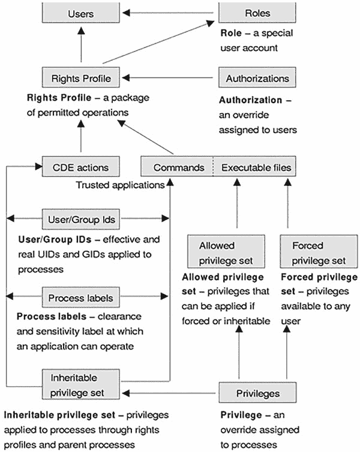

**图 7.2：** Trusted Solaris 环境

`TrustedSolaris 8` 环境中的方法与早期版本不同。

## 最小功能性

最小功能性原则要求组织将信息系统配置为仅提供基本功能，并明确禁止和/或限制使用其他功能。

## 端点安全软件

端点是指从防火墙外部连接到企业网络的任何设备。端点设备示例包括笔记本电脑、`Internet of things`（`IoT`，物联网）、`Point-of-sale`（`POS`，销售终端）系统、平板电脑、手机、交换机、数字打印机以及与中央网络通信的任何设备。端点安全是通过确保网络上的每个计算设备都符合安全标准来实现的。端点安全或端点防护是通过最终用户设备（如台式机、笔记本电脑、移动设备，以及数据中心中被视为端点的网络服务器）保护网络上不同端点免受恶意威胁的过程，如*图 7.3* 所示：

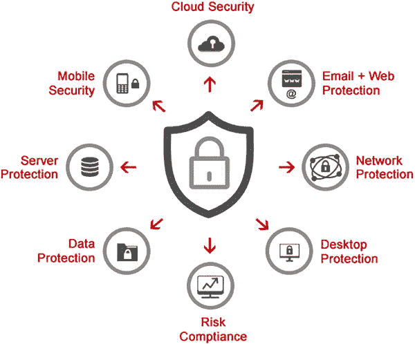

**图 7.3：** 端点安全功能

每个远程连接到客户端设备的设备都是安全威胁的潜在入口点。端点安全旨在保护由这些设备创建的网络上的每个端点。端点安全工具有助于监控、检测和阻止恶意攻击。端点安全解决方案通过在许多攻击的入口点以及敏感数据的存储点提供多层防护，简化了安全措施。


-   端点安全策略至关重要，因为每个远程端点都可能成为攻击的入口点，而且随着疫情加速推动远程办公，端点数量只会不断增加。根据 `Gallup Poll` 显示，2020 年美国大多数工作者远程办公，截至 2021 年 4 月仍有 51%的人在远程工作。

端点及其敏感数据带来的风险是一个不会消失的挑战。端点态势在不断变化，各种规模的企业都是网络攻击的诱人目标。这是常识，即使是在小企业中也是如此。根据 Connectwise 2020 年的一项研究显示，在接受调查的 700 名中小企业决策者中，77% 担心他们将在未来六个月内成为攻击目标。去年，根据 FBI 的互联网犯罪报告，他们在 2019 年收到的投诉增加了 300,000 起，报告损失超过 42 亿美元。Verizon 2021 数据泄露调查报告发现：

> *由于涉及事故的 Web 应用和邮件服务普遍存在，服务器仍然主导着资产态势。并且随着社会工程学攻击继续危害人员（其影响现已超越用户设备），我们开始看到网络钓鱼邮件和网站占据主导地位，它们传递用于欺诈或间谍活动的恶意软件。*

根据 Ponemon 的 `Cost of a Data Breach Report 2020` (由 IBM �托)，全球每起数据泄露事件的平均成本为 386 万美元，而美国平均每起数据泄露事件高达 865 万美元。该研究确定泄露最大的经济影响是 `lost business` (业务损失)，占数据泄露平均成本的近 40%。防范端点攻极具挑战性，因为端点存在于人机交汇之处。企业努力保护其系统，同时不干扰员工的合法活动。而且尽管技术解决方案可能非常有效，但员工遭受社会工程学攻击的几率只能降低，永远无法完全防止。

# 端点保护运作机制

端点保护、 `endpoint protection platforms` (`EPP`) 和端点安全这几个术语均可互换使用，用以描述组织利用的集中管理解决方案，旨在保护服务器、工作站、移动设备和工作负载等端点免受网络安全威胁。端点保护解决方案通过检查文件、进程和系统活动中的可疑或恶意指标来工作。端点保护解决方案提供了一个中心化管理控制台（图 7.4），管理员可由此连接到其企业网络，以监控、防护、调查和响应事件。这是通过利用本地部署、混合或云端方法来实现的。

## 传统或遗留方法

`Traditional or legacy` (传统或遗留) 方法通常用描述一种依赖本地托管数据中心的本地部署安全态势，安全性由此数据中心提供。数据中心充当管理控制台的枢纽，通过代理程序接触端点以提供安全性。中心辐射模型（轮辐模型）可能会造成安全孤岛，因为管理员通常只能管理其边界内的端点。

随着疫情驱动的居家办公转变，许多组织已转向使用笔记本电脑和 `bring your own device` (`BYOD`)（自带设备），而非台式机。这结合劳动力全球化，凸显了本地部署方法的局限性。一些端点保护解决方案供应商近年来已转向混合方法，采用遗留架构设计并对其进行改造以适应云环境，从而获得一些云能力。图 7.4 展示了端点安全仪表盘：

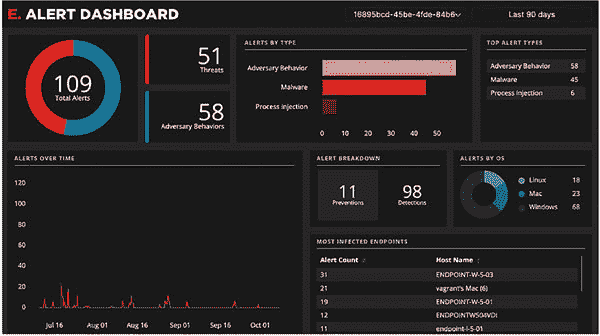

**图 7.4：** 端点安全仪表盘

## 云原生方法

第三种方法是为云环境构建的内置 `Cloud-native` (云原生) 解决方案。管理员可以通过驻留在云端的中心化管理控制台，远程监控和管理端点，该控制台通过端点上的代理程序远程连接到设备。代理程序可以与其他代理协作，或独立为端点提供安全防护，以防端点没有互联网连接。这些解决方案利用云控制和策略，最大化传统边界之外的安全性能，消除孤岛并扩大管理员的管理范围。

# 端点保护与防病毒软件

端点安全软件保护端点免遭入侵——无论它们是物理还是虚拟、本地部署还是异地部署、在数据中心还是在云端。它安装在笔记本电脑、台式机、服务器、虚拟机，以及远程端点本身上。

防病毒软件通常是端点安全解决方案的一部分，普遍被视为端点保护中较基础的形式之一。防病毒软件不使用诸如威胁狩猎和 `endpoint detection and response` (`EDR`)（端点检测和响应）等高级技术和实践，而是简单地查找并删除已知病毒和其他类型的恶意软件。传统防病毒软件在后台运行，定期扫描设备内容，查找与病毒特征码数据库匹配的模式。防病毒软件安装在防火墙内外的各个设备上。提供持续入侵防护的端点安全工具必须整合以下基本要素：

### 防护：NGAV

传统防病毒解决方案检测不到所有攻击的一半。它们的工作原理是将恶意特征码或代码片段与一个数据库进行比对，每当发现新的恶意软件特征码，贡献者就会更新该数据库。问题在于，尚未识别的恶意软件，即未知恶意软件，不在数据库中。恶意软件发布到世界与被传统防病毒解决方案识别之间存在时间差。`Next-generation antivirus` (`NGAV`)（下一代防病毒）通过使用更先进的端点保护技术，如 `AI` (人工智能) 和机器学习，通过检查更多元素，如 `file hashes` (文件哈希)、 `URLs` (统一资源定位符) 和 `IP addresses` (IP 地址) 来识别新恶意软件，从而弥补这一差距。

### 检测：EDR

防护是不够的。没有完美的防御，总有一些攻击会突破防线并成功渗透网络。常规安全手段无法察觉这种情况发生，导致攻击者可在环境中潜伏数天、数周甚至数月。企业需要通过快速发现并移除攻击者来阻止这些 `silent failures` (静默失效)。为防止静默失效，`Endpoint Detection and Response` (`EDR`)（端点检测和响应）解决方案需要提供持续且全面的实时端点可视性。企业应寻找提供高级威胁检测、调查和响应能力的解决方案，包括事件数据搜索和调查、警报分级、可疑活动验证、威胁狩猎，以及恶意活动检测和遏制。

### 托管威胁狩猎

并非所有攻击都能仅靠自动化检测。安全专业人员的专业知识对于检测当今复杂的攻击至关重要。托管威胁狩猎由精英团队执行，他们从已发生的事件中学习，汇总众包数据，并在检测到恶意活动时提供最佳响应指导。


## 威胁情报集成

为了在攻击者前面保持领先，企业需要了解威胁的演变。复杂的对手和**高级持续性威胁 (APT)** 能够快速且隐蔽地行动，安全团队需要最新且准确的情报，以确保防御措施能够自动且精准地调整。威胁情报集成解决方案应融入自动化，以调查所有事件并在几分钟内（而非几小时）获取知识。它应直接从端点生成自定义**失陷指标 (IoC)**，从而针对未来的攻击实现主动防御。同时也应包含人为因素，由专家安全研究人员、威胁分析师、文化专家和语言学家组成，他们能在各种背景下理解新出现的威胁。

## 端点检测与响应

**端点检测与响应 (EDR)** 是一种主动的端点安全方法，旨在补充现有防御。这种先进的端点方法将安全从被动的威胁应对转变为能够在威胁到达组织之前检测并阻止威胁。它专注于有效威胁防护的三个基本要素：自动化、适应性和持续监控。EDR 产品示例如下：

- FireEye Endpoint Security
- Carbon Black Cb Response
- Guidance EnCase Endpoint Security
- Cybereason Enterprise Protection
- Symantec Endpoint Protection
- RSA NetWitness Endpoint

EDR 系统的优势在于提供持续监控。劣势在于软件对资源的占用可能会影响设备性能。

## 补丁管理

软件补丁是供应商发布的更新，用于修复运行在网络设备上的操作系统、应用程序和固件版本中的功能问题或关闭安全漏洞。为确保所有设备都安装了最新补丁，应部署一套正式系统，确保所有系统在非生产环境中经过彻底测试后接收最新更新。供应商无法预见变更可能对网络中业务关键系统产生的所有可能影响。确保补丁不对运营产生不利影响是企业的责任。 *图 7.5* 说明了补丁管理：


**图 7.5：** 补丁管理

供应商通常提供多种类型的补丁，如下所示：

- **热修复**：热修复是解决安全问题的更新，如果其解决的问题与系统相关，应立即应用。
- **更新**：更新解决的是功能问题而非安全问题。
- **服务包**：服务包包含自操作系统发布以来的所有更新和热修复。

## 手动补丁管理

虽然手动补丁管理比自动化系统（将在下一节讨论）需要更多的管理工作，但仍可通过以下步骤实施：

**步骤 1**：确定补丁的优先级。

**步骤 2**：部署前测试补丁，确保其正常工作且不会导致系统或安全问题。

**步骤 3**：在生产环境中安装补丁。

**步骤 4**：补丁部署后，确保其正常工作。

## 自动化补丁管理

大多数组织通过集中式更新解决方案（如 **Windows Server Update Services (WSUS)**）来管理补丁。借助此类服务，组织可以以受控且自动化的方式部署更新。WSUS 服务器下载更新，并从 WSUS 服务器本地应用。组策略也用于此场景中，以配置存放更新的服务器位置。脚本也可用于自动化补丁流程。与使用自动化工具相比，这可能提供更大的灵活性和流程控制。不过，这可能需要更深入的脚本编写知识。在某些情况下，地理位置分散的服务器可用于提供脚本中引用的补丁。此时，必须设置适当的复制，以确保所有补丁在所有补丁服务器上均可用。Windows PowerShell 命令越来越多地被用于自动化 Windows 功能。在 Linux 环境中，则使用 Linux Shell 脚本实现此目的。 *图 7.6* 说明了自动化补丁管理流程：


**图 7.6：** 自动化补丁管理流程

## 数据丢失防护

数据泄露是指敏感数据有意或无意地泄露给未授权人员。**数据丢失防护 (DLP)** 是一系列监控和保护业务数据免受未授权访问的技术和工具的集合。实施 DLP 技术后，它会在三个位置保护数据——授权人员使用中、传输中（通过内部网传输）或静止中（在文件服务器或数据库中）。例如，数据丢失防护软件可以阻止用户复制数据并将其移出公司网络。所有数据丢失防护软件的核心是内容检查，即软件在数据于网络中移动时检查数据片段，评估包含它们的文件类型，并确定数据是否位于应在的位置以及是否用于其预期用途。意外泄露或恶意活动都可能使敏感数据陷入危险，这也是为什么 DLP 安全对于需要保护数据资产的组织至关重要。 *图 7.7* 说明了在组织中实施 DLP 的收益：


**图 7.7：** DLP 收益

## DLP 如何工作？

DLP 软件基于内容检查，它使用一系列方法来捕获策略违规，如下所示：

1.  首先，内容检查基于由数据丢失防护软件检测到的基于规则的表达式，并导致后续动作。一个典型例子是 16 位信用卡号。组织可以创建规则，规定如果您尝试通过电子邮件发送信用卡号（以 4、5 或 6 开头），特别是包含 3 位安全码和有效期，DLP 软件将阻止邮件发送或自动加密。
2.  接下来是精确文件匹配。这会识别正在使用中、传输中或静止中、其内容与已索引文件完全匹配的文件。这也称为**数据指纹识别**。
3.  第三是 DLP 解决方案中使用概念/词汇分析的内容分析。此级别的分析使用字典编译或其他列表和规则来识别不需要的行为，例如特定的互联网搜索，或与网络外部人员共享商业机密。
4.  最后，内容分析可结合复杂的统计分析技术。统计方法利用机器学习来保护特定信息。当机器学会数据应有的样子时，它会持续寻找不匹配给定模式的异常数据。


在探讨如何防止数据丢失时，技术往往是最后一道防线。其作用是将组织的数据安全策略一致地应用于所有出口点，识别可能的违规行为，并采取适当的补救措施。传统的 DLP 解决方案在运行方式上缺乏灵活性，导致其难以配置和实施。通常，这些解决方案会*停止并阻止*任何被认为具有风险影响的操作，往往会错误地将合法的日常操作误判为数据外泄或数据丢失威胁。这会产生大量的*误报*，轻易淹没需要处理警报的 IT 安全人员，并让无法高效工作的用户感到沮丧。

## 日志监控

计算机、其操作系统以及可能存在于其上的防火墙会生成存储在日志文件中的系统信息。您应监控网络事件、系统事件、应用程序事件和用户事件。请记住，任何审计活动都会影响被监控系统的性能。组织必须在审计重要事件和活动与确保设备性能保持在可接受水平之间找到平衡。*图 7.8* 展示了日志管理仪表板：


**图 7.8：** 日志管理仪表板

在设计审计机制时，安全专业人员应牢记以下准则：

*   制定日志管理计划，其中包括控制日志大小、备份流程和定期审查计划的机制。
*   确保删除审计日志的能力是一种双人控制，必须由管理员完成。
*   监控所有高权限账户（包括所有 root 用户和管理级账户）。
*   确保审计追踪包含谁处理了事务、事务发生的时间（日期和时间）、事务发生的位置（哪个系统）以及事务是否成功。
*   确保无法删除日志，也无法删除日志中的数据。

审计追踪可检测计算机入侵，并揭示识别滥用行为的操作。作为安全专业人员，您应利用审计追踪来审查对单个对象的访问模式。要识别异常行为模式，首先应识别正常行为模式。此外，您还应设定截断级别，即用户错误的基线，超过该基线的违规行为将被记录。例如，您的组织可能会选择忽略第一次无效登录尝试，因为最初的无效登录尝试通常是由用户错误导致的。然而，第一次之后的任何无效登录都会被记录，因为这可能是攻击的迹象。审计追踪能阻止攻击者尝试绕过系统或设备上配置的保护机制。作为安全专业人员，您应专门配置审计追踪，以跟踪授予用户的系统/设备权限或特权，以及数据的添加、删除或修改。您可以在 Windows 环境中使用组策略来创建并应用审核策略到计算机。

最后，必须监控审计追踪，并配置自动通知。如果没有人监控审计追踪，记录在其中的数据就毫无用处。应将特定操作配置为触发自动通知。例如，您可能希望在发生一定次数的无效登录尝试后配置电子邮件警报，因为无效登录尝试可能表明正在发生密码攻击。

## 主机加固

运营安全的另一个持续目标是确保所有系统在仍能提供功能的前提下，已尽可能地完成加固。加固可以在物理和逻辑两个层面完成。从逻辑角度来看，应实施以下措施：

*   移除不必要的应用程序。
*   禁用不必要的服务。
*   阻塞不需要的端口。
*   严格控制外部存储设备和介质（如果允许使用的话）。
*   禁用不必要的账户。
*   如果可能，重命名默认账户。
*   更改默认账户的默认密码。

## 标准环境/配置基准化

一种简化安全维护的做法是创建并部署已通过安全基准加固的标准镜像。安全基准是一组配置设置，为所部署的镜像提供最低安全标准的基准线。在 Windows 中，安全基准可通过组策略进行控制。这些策略设置可在镜像中制作，并应用于用户和计算机。这些设置通过与域控制器的连接定期刷新，且用户无法更改。部署镜像中通常也包含所有最新的操作系统更新和补丁。当网络利用这些技术时，管理员就创建了一个标准操作环境。此类环境的优势在于网络行为更加一致，支持问题更加简单。应每周对系统执行扫描，以检测基准的变更。虚拟机镜像也可用于此目的。

## 应用程序白名单和黑名单

应用程序白名单是允许的应用程序列表（排除所有其他应用程序），黑名单是禁止的应用程序列表（允许所有其他应用程序）。控制用户可以在其计算机上安装的应用程序类型非常重要。某些应用程序类型可能会造成支持问题，而其他应用程序可能会引入恶意软件。可以使用 Windows 组策略来限制网络计算机上的软件安装。使用 Windows 组策略只是其中一种选择，每个组织都应选择一种技术来控制网络中的应用程序安装和使用。

## 安全/组策略实施

强制执行标准操作环境的最广泛使用的方法之一是在 Windows 中使用组策略。在 Active Directory 环境中，作为域成员的任何用户和计算机都可以获得一组构成安全基准的设置。（也可以在非域成员上使用本地安全策略设置，但这需要更多的管理工作。）组策略利用 Active Directory 的层级结构，向域中的所有系统提供一组通用的设置，称为**组策略对象 (GPO)**，同时向特定的用户或计算机子组（称为**容器**）添加或减去特定设置。使用组策略的另一个好处是，管理员可以使用**组策略管理控制台 (GPMC)** 更改现有策略。受影响的用户和计算机将在刷新策略时下载并实施任何更改——刷新发生在启动、关闭、登录和注销时。如果时间紧迫，管理员也可以强制刷新。以下是 GPMC 中可用的精细控制提供的一些优势：

*   允许或禁止从 Active Directory 中的一个容器向其子容器继承策略的能力
*   从策略效力中筛选掉特定用户或计算机的能力
*   将 Active Directory 命名空间中任何部分的管理权委派给管理员的能力
*   使用 **Windows Management Instrumentation (WMI)** 筛选器豁免特定硬件类型的计算机免受策略影响的能力


# 重要安全策略

以下是一些与安全相关的重要策略：

* **账户策略**：这些策略包括密码策略、账户锁定策略和 Kerberos 身份验证策略。
* **本地策略**：这些策略包括影响本地计算机的审核、安全和用户权限策略。
* **事件日志**：此策略控制事件日志的行为。
* **受限组**：这用于控制敏感组的成员资格。
* **系统服务**：这用于控制对系统服务的访问及其行为。
* **注册表**：这用于控制对注册表的访问。
* **文件系统**：这包括文件和文件夹的安全性，并控制文件和文件夹的安全审核。
* **公钥策略**：这用于控制 PKI 的行为。
* **Active Directory 上的 Internet 协议安全策略**：这用于为服务器创建 IPsec 策略。

# 命令 Shell 限制

虽然 Windows 以其**图形用户界面**（**GUI**）而闻名，但可以在命令行中执行 GUI 中可执行的任何操作。此外，许多管理任务只能在命令行中完成，如果不充分了解其影响，其中一些任务可能对系统有害且具有破坏性。其他操作系统（如 Linux 或 UNIX）的管理员在日常操作中甚至更多地使用命令行。路由器和交换机的管理员在管理这些设备时几乎完全使用命令行。

鉴于操作失误的风险，加上恶意用户可能在命令行中大肆破坏的可能性，在某些情况下建议实施命令 Shell 限制。受限命令 Shell 是一种命令行界面，仅提供特定命令。在 Linux 和 UNIX 中，有多种命令行 Shell 可用，它们在允许的命令权限方面有所不同。

在 Cisco IOS 中，可用的命令取决于命令行界面 ID 所处的模式。你从用户模式开始，只能做很少的事情（而且都不重要），然后进入特权模式，在那里可以使用更多命令。但是，你可以在设备上设置密码，当用户从用户模式切换到特权模式时，系统会提示输入该密码。为了更精细地控制管理访问，可以在设备上创建用户帐户，并分配权限级别，根据其帐户控制技术人员可以执行的操作。

# 配置专用接口

并非所有接口都是平等创建的。有些接口，特别是连接到基础设施设备和服务器的接口，由于通向的信息资产，需要更严格的控制和监控。以下部分介绍了一些监控和控制敏感接口及设备的方法。

# 带外管理

**带外**（**OOB**）接口连接到一个独立且隔离的网络，该网络无法从局域网或外部世界访问。即使设备关闭，这些接口通常也处于活动状态。OOB 接口可以是以太网或串口。配置 OOB 接口时应遵循的准则包括以下内容：

* 将所有 OOB 接口放置在独立于数据网络的子网中。
* 在交换机上为此子网创建一个单独的**虚拟局域网**（**VLAN**）。
* 当跨越**广域网**（**WAN**）连接时，为生产网络使用单独的 Internet 连接。
* 使用**服务质量**（**QoS**）确保管理流量不影响生产性能。
* 为了帮助获得额外技术投资的更多回报，考虑将同一管理网络用于备份。
* 如果**网络接口卡**（**NIC**）支持，请使用网络唤醒功能，使系统即使在关机状态下也可用。

一些配备 Intel vPro 芯片组和 **Intel 主动管理技术**（**Intel AMT**）版本的较新计算机，即使在系统关闭时也可以进行带外管理。当此功能与 System Center 2016 R2 Configuration Manager 中的带外管理功能相结合时，你可以执行以下任务：

* 为一台或多台计算机通电（例如，在非工作时间对计算机进行维护）。
* 为一台或多台计算机断电（例如，如果操作系统停止响应）。
* 重启无法工作的计算机，或从本地连接的设备或已知良好的启动映像文件启动。
* 通过从网络上的启动映像文件启动或使用**预启动执行环境**（**PXE**）服务器，重新为计算机部署映像。
* 重新配置选定计算机上的 BIOS 设置（如果 BIOS 制造商支持，可绕过 BIOS 密码）。
* 启动到基于命令的操作系统以运行命令、修复工具或诊断应用程序（例如，升级固件或运行磁盘修复工具）。
* 配置计划软件部署，以在计算机运行前唤醒计算机。

# 管理接口

这些用于远程访问设备。通常，管理接口与带内网络断开连接，并连接到设备的内部网络。通过管理接口，你可以使用 `SSH` 和 `Telnet` 等实用程序通过网络访问设备。`SNMP` 可以使用管理接口从设备收集统计信息。在某些情况下，该接口是标记为管理端口的实际物理端口；在其他情况下，它是一个在逻辑上与网络分离的端口（例如，在专用 VLAN 中）。关键是将这些用于远程管理设备的接口与设备可能遇到的常规网络流量分开。

使用管理接口没有缺点，但保护管理接口很重要。Cisco 设备具有用于远程管理的专用终端线路，称为 VTY 端口。VTY 端口应配置密码。要保护某些 Cisco 交换机上的 16 条 VTY 线路，请使用以下命令集将密码设置为 Ci$co：

```
Switch001>enable
Switch001#configure terminal
Switch001(config)#line vty 0 15
Switch001(config-line)#password Ci$c0
Switch001(config-line)#login
```

# 数据接口

数据接口用于传输常规数据流量，不用于本地或远程管理。这些接口可能在第 2 层或第 3 层运行，具体取决于设备类型（路由器或交换机）。这些接口也可以在任一层定义 ACL。在路由器上，我们称它们为访问列表，在交换机上，我们称它们为端口安全概念。某些网络设备（如路由器和交换机）也可以具有逻辑或软件接口。一个例子是环回接口。这是 Cisco 设备上的一个接口，可以分配 IP 地址，其功能与硬件接口相同。为什么要使用这种接口？好吧，与硬件接口不同，环回接口永远不会宕机。这意味着只要设备上的任何硬件接口正在工作，你就能访问环回接口。这使得环回接口成为建立 VTY 连接的良好候选者，该连接可以以设备上的任何 IP 地址为目标。

创建环回接口很简单。命令如下：

```
Switch001>enable
Switch001#configure terminal
Switch001(config)#interface Loopback0
Switch001(config-if)#ip address 192.168.15.15 255.255.255.0
```

# 蓝牙


# 蓝牙与移动设备管理

蓝牙是一种无线技术，用于创建**个人区域网络**（**PAN**），即设备与外设（如耳机）之间的短距离连接。它在 2.4 GHz 频段运行，速度为 1 到 3 Mbps，距离可达 10 米。多种攻击可利用蓝牙技术。通过蓝牙垃圾信息攻击，未经请求的消息会被发送到支持蓝牙的设备，通常目的是将名片添加到受害者的联系人列表中。将设备置于不可发现模式可防止此类攻击。

蓝牙窃取涉及利用蓝牙连接未经授权地访问设备。在这种情况下，攻击者试图访问设备上的信息，而非向设备发送消息。蓝牙的使用可以被控制，且在高安全环境中应考虑此类控制。组织越来越多地被要求允许个人移动设备访问企业网络。这给安全管理员带来了噩梦。**移动设备管理**（**MDM**）解决方案旨在保护这些设备。这些解决方案包含服务器组件，用于向设备发送管理命令。存在许多开放规范，例如**开放移动联盟**（**OMA**）设备管理，但目前尚无真正的标准。在这些技术中，这些解决方案可控制蓝牙设置和无线设置。

# 文件与磁盘加密

虽然在概念上大体相同，但文件加密和磁盘加密彼此不同。磁盘加密发生在硬件层面。另一方面，文件加密是一个软件过程。另一个区别是磁盘加密在设备关闭时有效，而文件加密在设备开启时提供安全性。以下章节将探讨这两种类型。

# TPM

虽然控制设备的网络访问很有帮助，但在许多情况下，笔记本电脑、平板电脑和智能手机等设备会离开您的网络，也就留下了您为保护网络所采取的所有措施。这些设备也面临被盗或丢失的风险。针对这些情况，最好的对策是全盘加密。全盘加密的最佳实现需要并利用**可信平台模块**（**TPM**）芯片。TPM 芯片是安装在计算机主板上的安全芯片，负责保护对称和非对称密钥、哈希值和数字证书。该芯片提供服务以保护密码、加密驱动器和数字版权，使攻击者更难访问启用了 TPM 芯片的计算机。

TPM 有两个特别流行的用途：绑定和封存。绑定实际上通过加密将硬盘驱动器“绑定”到特定计算机。由于解密密钥存储在 TPM 芯片中，只有当驱动器连接到原始计算机时，硬盘驱动器的内容才可用。但请记住，如果 TPM 芯片故障且不存在密钥备份，所有内容都将面临风险。另一方面，封存将系统状态“封存”到特定的硬件和软件配置。这可防止攻击者对系统进行任何更改。然而，这也可能使安装新硬件或新操作系统变得更加困难。只有在 TPM 芯片通过将系统配置的原始计算哈希值与启动时的配置哈希值进行比较来验证系统完整性后，系统才能启动。TPM 芯片包含静态内存和通用内存，用于在计算机关闭时保留重要信息，如下所示：

- **背书密钥 (EK)**：EK 是由制造商安装的持久内存，包含一对公钥/私钥。
- **存储根密钥 (SRK)**：SRK 是持久内存，用于保护存储在 TPM 中的密钥。
- **证明身份密钥 (AIK)**：AIK 是通用内存，用于确保 EK 的完整性。
- **平台配置寄存器 (PCR) 哈希**：PCR 哈希是通用内存，存储用于封存功能的数据哈希。
- **存储密钥**：存储密钥是通用内存，包含用于加密计算机存储（包括硬盘驱动器、USB 闪存驱动器等）的密钥。

微软的 BitLocker 和 BitLocker To Go 是知名的全盘加密产品。前者用于加密硬盘驱动器（包括操作系统驱动器），后者用于加密便携设备（如 USB 设备）上的信息。不过，还有其他选择。其他全盘加密产品包括：

- PGP Whole Disk Encryption
- Secure Star DriveCrypt
- Sophos SafeGuard
- MobileArmor Data Armor

# 虚拟 TPM

**虚拟 TPM**（**VTPM**）芯片是一个执行 TPM 芯片功能的软件对象。它是一个系统，可在单一硬件平台上为无限数量的虚拟机提供可信计算。VTPM 使安全存储和加密功能可供运行在虚拟机中的操作系统和应用程序使用。

# 固件更新

固件包括存储在非易失性存储设备（如**只读存储器**（**ROM**）、**电可擦除可编程只读存储器**（**EPROM**）或闪存）中的任何类型的指令。BIOS 和 UEFI 代码是固件最常见的示例。计算机 BIOS 不会损坏；但是，它可能会过时或包含 Bug。如果存在 Bug，升级将修复该问题。当 BIOS 不支持您想要安装的某个组件（如更大的硬盘驱动器或不同类型的处理器）时，也可能需要升级。现在的 BIOS 通常写入 EEPROM 芯片，并可通过软件进行更新。每个制造商都有自己的实现方法。请查阅制造商的文档以获取完整详情。无论使用何种具体程序，更新过程称为刷新 BIOS。这意味着旧指令从 EEPROM 芯片中擦除，新指令被写入芯片。固件可通过使用主板供应商的更新实用程序进行更新。在许多情况下，步骤如下：

1.  将更新文件下载到闪存驱动器。
2.  插入闪存驱动器并重启机器。
3.  使用指定的按键序列进入 UEFI/BIOS 设置。
4.  如有必要，禁用安全启动。
5.  保存更改并再次重启。
6.  再次进入 CMOS 设置。
7.  选择启动选项并从闪存驱动器启动。
8.  按照特定的更新说明在闪存驱动器上定位升级文件。
9.  执行文件（通常通过输入 `flash`）。
10. 在更新完成期间，确保设备保持供电。

# 引导加载程序保护

当系统启动时，存在一个可乘之机闯入系统。例如，当具备物理访问权限时，您可以将系统设置为从其他启动介质启动，然后访问硬盘驱动器。因此，应利用引导加载程序保护机制，详见以下章节。

# 安全启动

安全启动是一个术语，适用于遵循安全启动标准的多种技术。其实现包括 Windows 安全启动、可信启动和**完整性度量架构**（**IMA**）。

1.  固件验证所有 UEFI 可执行文件和操作系统加载程序，以确保它们是受信任的。


# 可信操作系统与硬件安全

## 安全启动流程

**步骤 2**：Windows 启动组件验证每个待加载组件上的签名。任何不受信任的组件将不会被加载，并将触发修复。

**步骤 3**：作为 Winload（Windows 启动加载器）中安全启动验证的一部分，以及由早期启动反恶意软件驱动程序，检查所有启动关键驱动程序上的签名。

缺点是，预装启用了 UEFI 安全启动的系统不允许安装任何其他操作系统。这阻止了安装任何其他操作系统或运行任何实时 Linux 媒体。

## 可度量启动

可度量启动是指使用加密技术对软件和平台组件进行识别或“度量”的启动过程。生成的值在每次启动时用于验证这些组件的可信度。可度量启动旨在防止针对这些组件（系统和 BIOS 代码）的攻击，或者至少识别这些组件何时遭到破坏。它是英特尔可信执行技术（Intel TXT）的一部分。包括 HyTrust、PrivateCore、Citrix 和 VMware 在内的软件供应商利用了 TXT 功能。

可度量启动的一个应用是微软在 Windows 10 和 Windows Server 2016 中的可度量启动。它创建了反恶意软件启动前所有已加载组件的详细日志。此日志可用于识别计算机上的恶意软件，并保留启动组件被篡改的证据。可度量启动的一个潜在缺点是可能会减慢启动过程。

## 完整性度量架构

另一种尝试创建和度量运行时环境的方法是名为完整性度量架构（IMA）的开源可信计算组件。IMA 创建一个组件列表，并将该列表锚定到 TPM 芯片。它可以使用该列表证明系统的运行时完整性。将列表锚定到硬件中的 TPM 芯片可防止其被破坏。

## BIOS/UEFI

统一可扩展固件接口（UEFI）是 BIOS 的一种替代方案，用于在系统的软件和固件之间建立接口。大多数支持 UEFI 的映像也支持传统 BIOS 服务。其部分优势如下：

- 能够使用 GUID 分区表从大容量磁盘（超过 2 TB）启动
- 与 CPU 无关的架构
- 与 CPU 无关的驱动程序
- 灵活的预操作系统环境，包括网络功能
- 模块化设计

## 证明服务

证明服务允许授权方检测操作系统的变更。这些服务涉及为硬件生成一个证书，说明当前正在运行的软件。计算机可以使用此证书来证明当前正在执行未被篡改的软件。自 Windows 8 起，Windows 操作系统具备了远程证明能力。

## 与硬件相关的漏洞

虽然安全专业人员花费大量时间追踪软件漏洞，但他们往往忽略硬件漏洞。请记住，最著名的黑客攻击之一——Target 数据泄露事件——利用了硬件加密缺陷。另一个硬件漏洞的例子是汽车系统被黑客攻击并随之接管控制系统。黑客青睐硬件攻击，因为它们难以被检测到，但硬件妥协不仅限于后门。漏洞还包括以下内容：

- 影响嵌入式 RFID 芯片和内存的后门
- 在不打开任何其他硬件的情况下，通过受保护内存进行窃听
- 诱导故障以中断正常行为
- 硬件修改篡改硬件或越狱软件
- 绕过正常计算机身份验证系统的后门或隐藏方法
- 为恶意访问系统而制造的假冒产品

防止此类漏洞的唯一可靠方法是严格控制所有产品的制造流程。国防部（DoD）使用可信代工计划为此验证所有供应商。组织不再能简单地从亚洲购买最便宜的设备；它们现在必须开始着手创建自己的计划来模仿可信代工计划。

## 结论

本章定义了可信操作系统的概念以及提高系统安全性的方法。这包括防病毒、反恶意软件、反间谍软件和垃圾邮件过滤器、补丁管理、数据丢失防护，以及端点监控和响应。还讨论了主机加固、引导加载程序保护和硬件漏洞的概念。本章还包含使用终端和应用程序交付服务时的安全建议和措施。

在下一章中，我们将讨论实施安全存储控制的挑战和措施。

# 第 8 章：安全存储控制

## 简介

许多组织面临实施保护和数据安全措施的挑战，以满足超出合规要求的广泛需求。安全专业人员每天面临保护应用程序、计算和网络环境的挑战，而审计专业人员则负责验证他们的成功。由于对技术的有限熟悉，存储安全往往未被他们重视。存储管理员和管理人员可能首次面临这些问题和技术。本章重点介绍识别数据安全关键业务驱动因素的基础知识，描述威胁和攻击，总结安全概念和关系，然后描述什么构成了存储安全。

大多数组织极度依赖数字信息，这些信息经过电子处理，并在本地和公共网络上传输。在这些组织中，许多执行的任务如果没有信息和通信技术（ICT）根本无法完成，而其他任务没有 ICT 只能部分完成（即许多企业完全依赖其 ICT 资产的正常运行）。随着整个社会对 ICT 和数字资产的依赖性增加，ICT 资源故障的社会影响不再是不便，而开始具有灾难性质。ICT 基础设施中很少有其他元素与数据的关系比存储系统和生态系统更重要——它们是存储库。它们也可能是抵御对手的最后一道防线，但前提是存储管理员和管理人员投入时间和精力来实施和激活可用的存储安全控制。虽然数据正成为组织和个人日益宝贵的资产，但除了以下几类之外，没有全球或国家实践标准可用于对数据的敏感性和价值进行分类：

- 个人私人信息（包括个人身份信息或 PII）
- 商业信息
- 国家安全（包括机密和非机密）信息

## 结构

在本章中，我们将涵盖以下主题：

- 存储控制
- 云存储
- 地理标记
- 可穿戴技术
- 加密和未加密通信
- 资源供应与取消供应
- 数据流安全
- 弹性问题
- 数据安全考量
- 云和本地数据安全

## 目标


大多数组织实施网络安全控制并执行审计，作为安全评估。如果未包含组织的每个组件，则评估不完整，并使组织处于暴露状态。本章介绍了需要实施的纵深防御策略，该策略应包括物理、虚拟、云、本地部署以及连接到办公网络的用户设备。本章介绍了在所有层面执行安全评估的评估工具。

# 数据分类

数据分类是一种方案，组织据此为其拥有和维护的每条信息分配一个敏感度级别。尽管正式数据分类方案的存在和遵守是信息安全计划的基础要素之一，但许多组织——即使是那些自称坚定致力于保护公司和客户信息的组织——也未能实施数据分类。常见原因包括等待一个理论上完美（但不切实际）的方案、成本，以及缺乏组织意愿将数据分类计划推进到全面实施。正确评估数据价值并基于敏感度分类有助于避免保护不足和过度保护。过度保护在没有相应价值的情况下增加成本，而保护不足则增加丢失或泄露的可能性，这可能影响整体盈利能力和竞争力，保护以下类型的数据：

*   值得保护的数据
*   与其价值成比例的数据
*   仅在其生命周期内有用的数据

作为示例，考虑以下数据安全分类方案：

*   **公开**：对企业关联方和公众按需知原则有用的最低敏感度数据；数据保护由保管人根据（公司政策）自行决定。示例包括建筑地图以及目录中的业务联系数据。
*   **敏感**：对有业务需求的企业员工和非员工有用的中等敏感度数据；数据保护受公司政策和合同约束。示例包括保密协议中的信息、研究细节和大多数财务交易。
*   **受限**：仅经指定访问权限的个人和签署保密协议的人批准后可用的高度敏感数据；数据保护受法律约束。示例包括医疗记录、非公开研究数据、大多数 PII 和合同。

仅使用少量数据安全分类对于保持分类过程的可管理性非常重要。此外，组织可以通过从“*最高敏感度*”和“*最高价值*”开始，逐步开展其安全分类活动。最后，一个好的数据分类方案应包含时间要素，以允许某条信息在特定日期更改其状态（例如，当数据变为公开时）。

# 业务驱动因素

主动解决数据保护和数据安全需求的组织可以获得切实的利益，表现为增加客户信任、减少因欺诈和盗窃造成的损失，以及在竞争对手分心于自身被动安全举措时获得竞争优势。不幸的是，大多数组织不将数据安全视为业务赋能能力。相反，它被视为类似于保险；即组织为维持其生存能力必须拥有的东西。因此，数据安全的业务驱动因素往往具有防御性和反应性。以下业务驱动因素与数据安全相关：

*   **防盗窃**：内部盗窃、工业间谍和有组织犯罪利用的威胁日益增加。犯罪者往往面临薄弱的防御、潜在的高回报，以及被抓获时的轻微惩罚。正如 2008 年 CSI/FBI 报告所指出的，犯罪者越来越多地针对特定受害者。数据安全可能提供足够的威慑力，从而完全防止犯罪或使其回报降低。
*   **防止未授权披露**：数据保护和隐私法规越来越多地要求企业对保护其数据负责。未经授权（无论是故意还是意外）披露受监管数据（客户记录、商业秘密、业务信息）给未尽适当尽职调查和注意义务的组织带来了严重尴尬、重大不便和严厉惩罚。这一趋势预计将继续，惩罚越来越严厉，并扩大明确受监管的数据类型范围。
*   **防止数据篡改**：无论是为了窃取、勒索、欺骗还是恶意破坏，未经授权的数据修改都可能导致重大财务损失，如果涉及财务信息，还可能根据 **萨班斯-奥克斯利法案** (**SOX**) 等法律面临刑事起诉。一种同样隐蔽的可能性是：成功的攻击伴随着不确凿的篡改证据（数据可能已被修改，也可能未被修改），从而动摇了对数据完整性的信心。
*   **防止意外损坏/破坏**：ICT 内部复杂性的增加、持平或下降的预算、不断扩大的工作量、有限的专业知识和不足的培训共同增加了人为错误的可能性。像向活动存储网络添加交换机这样简单的操作，如果未采取适当预防措施，可能导致完全的网络中断或传输中数据损坏。存储生态系统中的错误可能产生灾难性影响，因为这是数据驻留的地方。
*   **问责制**：企业高管被要求遵守更高的问责标准。例如，美国的 SOX 明确规定这些高管负责建立、评估和监控财务报告内部控制的有效性。ICT 是财务报告所用数据内部控制有效体系的基础。这些控制应包括职责分离和最小权限策略的执行。
*   **真实性**：随着越来越多的数字记录被创建、修改、处理、归档并最终销毁，需要在其生命周期的每个阶段证明其中某些数据的真实性。为确立数据的真实性，必须维护额外的信息元数据，如加密哈希和安全时间戳，以及数据溯源信息，如事务/变更日志和转换记录。
*   **可验证交易**：虽然识别、认证和授权通常被视为主要用于控制谁可以对哪些数据做什么的技术；但它们也可以在追踪更改敏感数据值的交易责任方面发挥作用。为履行这一角色，必须加强技术和程序，以确保交易的充分可追溯性和不可抵赖性。相关记录应满足作为法律程序证据被采纳所需的标准。
*   **业务连续性**：对许多组织而言，业务关键数据及其支持的应用程序和服务的可用性至关重要。因此，投入了大量资源以确保在有限中断事件（系统故障、黑客攻击、拒绝服务攻击和操作员错误）和“*毁灭性*”事件面前业务运营的连续性。存储技术在这些解决方案中已占据重要地位，预计未来将发挥更主导的作用。


## 法规与法律合规

基本上，合规是指符合特定要求的状态，对许多组织而言，合规是数据和 ICT 基础设施安全投资的首要业务驱动力。然而，法规和法律要求很少包含足够的具体细节，以便在不进行一定程度的解读和“深入理解”的情况下，确定数据处理和 ICT 基础设施操作及结果是否合规。例如，在过去十年中，成文法和行政法规都强制规定了电子记录保留的新要求。以数字形式保存法律、医疗和企业数据，以前只是企业良好管理的一个考量因素，现在已成为一项法律必需品，这给网络存储行业带来了挑战和丰富的机遇。

# 信息保障

信息保障定义并应用一系列策略、标准、方法、服务和机制，以维护与人员、流程、技术、信息和支持基础设施相关的使命完整性（图 8.1）。信息保障包含以下核心原则：

### 核心原则

*   **机密性**：确保信息仅向有权查看的人员披露。
*   **完整性**：确保信息保持其原始形式；信息忠实于创建者的意图。
*   **可用性**：信息或信息资源在规定的操作参数范围内可供使用。
*   **控制性**：信息或信息资源保持在授权人员的管控之下。
*   **真实性**：信息或信息资源符合现实；不被歪曲为非其本身的东西。
*   **实用性**：信息适合特定目的且处于可用状态。
*   **隐私性**：确保个人信息免受窥探或侵入，并遵守相关隐私合规要求。
*   **授权使用**：确保产生费用的服务仅对授权人员可用。
*   **不可抵赖性**：确保消息或事务的发起者事后无法否认其行为。

### 图 8.1：信息保障


**图 8.1：** 信息保障

当需要某种形式的数据保护或数据安全时，可以采用一系列安全服务。**美国国家安全局 (NSA) 的信息保障技术框架 (IATF)** 将以下内容确定为主要安全服务领域：

### 主要安全服务领域

*   **访问控制**：确保网络资源和数据仅可供授权实体使用，并保护数据免遭未经授权的披露或修改。它还包括资源控制，例如，防止登录本地工作站设备或限制远程访问的使用。访问控制机制是基本措施，可供其他安全服务使用（例如，机密性、完整性、可用性以及网络资源使用的限制，都取决于限制未经授权的实体访问项目或服务的能力）。访问控制的关键要素包括以下内容：

    *   **标识**：用于识别实体（用户、进程、与多个用户关联的角色）的过程或措施。
    *   **认证**：用于确定某物或某人是否为其声称的身份，并具有一定级别的保证（已认证的身份）的过程或措施。
    *   **授权**：用于确定实体访问权限，并具有一定级别保证的过程或措施。
    *   **强制执行**：实际强制执行访问控制决策的过程或措施；这才是真正提供防攻击保护的环节。强制执行访问控制决策的概念独立于决策本身。

*   **机密性**：确保数据（无论静止还是传输中）仅可供授权实体访问。机密性服务将防止数据在存储中、传输本地网络时或流经公共互联网时被泄露。机密性安全服务的提供取决于多个变量以确定保护需求——数据的位置、数据类型、用户数据的数量或部分以及数据价值。机密性的关键要素包括以下内容：

    *   **数据保护**：一种调用直接作用于数据（或响应数据特征）而非响应实体访问数据尝试的机制的过程或措施。通过数据保护提供机密性的最常用方法是加密相应数据。
    *   **数据分离**：数据分离传统上是指提供单独路径（例如，红/黑隔离）或进程分离（计算机安全技术）的概念。数据分离机制通过防止数据到达可能向未经授权实体泄露的位置或目的地来提供机密性（例如，包含敏感人力资源信息的服务器无法从公共互联网访问）。数据分离机制提供的保证级别的主要变量是与实施该机制的过程或机器相关的信任级别。
    *   **流量保护**：重要信息可从通信的频率、数量和目的地等流量特征中观察或推断得出。添加多余（通常是随机）数据并隐藏网络层地址的措施可以混淆此类信息。

*   **完整性**：防止对信息进行不当修改或破坏，并确保不可抵赖性和真实性。它包括防止未经授权修改数据（无论存储的还是通信的）、检测和通知未经授权的数据修改，以及记录对数据的所有更改。完整性可应用于单个数据单元（协议数据单元、数据库元素、文件等）或数据单元流（例如，连接中交换的所有协议数据单元）。

*   **可用性**：确保授权用户能及时可靠地访问和使用数据及信息服务。可用性丧失是指对信息或信息系统的访问或使用中断。它包括防范攻击、未经授权的使用，以及对常规故障的弹性恢复能力。

*   **不可抵赖性**：抵赖是指参与事务的实体之一否认其参与了该事务。不可抵赖性安全服务提供向第三方证明该实体确实参与了该事务的能力。

## 深度防御

这些服务的实施方式也很重要。安全领域的通行做法建议采用深度防御策略，即组织使用多种安全技术来帮助降低因防御体系中某个组件被攻破或绕过而产生的风险。有时会部署来自多个供应商的不同安全产品，以防御不同的潜在攻击向量，帮助防止任何单一防御措施的失效导致更大范围的故障。

## 存储系统的安全管理

存储系统的安全管理具有以下优势：

*   集中管理、记录和审计存储系统的 CLI 和 GUI 会话的管理员操作，并进行实时监控。
*   确保存储管理员无法控制审计日志，以防篡改。


## 特权访问管理优势

*   无需共享某些 `软件定义存储` (`SDS`) 产品所需的特权管理凭据（如 Linux 上的 root 用户密码）。
*   提供有时限的特权存储管理员会话，并支持远程终止存储管理员会话。
*   支持访问存储管理员会话的用户进行多因素身份验证。
*   可捕获按键记录、进程活动和正在运行的程序（在某些 `SDS` 产品中非常有用）。
*   管理和审计特权存储账户及认证密钥，如密码和 `SSH` 密钥。

## 安全远程支持

安全远程支持由客户管理，具有以下优势：

*   为服务、维护或支持团队提供有时限的受审计访问权限。
*   支持为每个访问会话自定义审批工作流（多级审批）。
*   记录并审计在支持或服务会话中执行的所有活动。

## 用例示例

本章演示了 IBM Spectrum Scale 与 Verify Privilege Vault 的集成。该概念可扩展并应用于其他 IBM 存储系统。IBM® Security™ Verify Privilege Vault On-Premises (Verify Privilege Vault)，前身为 IBM Security™ Secret Server，是新一代特权账户管理方案，它与 IBM Storage 集成，确保对 IBM Storage 管理会话的访问安全且受实时监控，并具备满足审计和合规要求的录制功能。存储管理会话的特权访问实现集中管理，每个会话均可设定时限并进行远程监控。

## IBM Spectrum Scale

IBM Spectrum Scale 是一种可扩展的高性能文件系统，适用于各种用例（图 8.2）。它提供世界级的存储管理，具备可扩展性、闪存加速性能和自动存储分层功能。IBM Spectrum Scale 在降低存储成本的同时，提升了云、大数据和分析环境中的安全性与管理效率。简而言之，IBM Spectrum Scale 提供以下优势：

*   近乎无限的扩展性，支持高达九百京（nine quintillion）个文件和千万亿亿字节（yottabytes）级别的数据。
*   高性能并支持对一组共享数据的同时访问。
*   集成 `信息生命周期管理` (`ILM`) 功能，可在存储层级（包括闪存、磁盘、磁带和对象存储（公有云和私有云））之间自动移动数据。`ILM` 可降低运营成本，因为更少的管理员可以管理更大规模的存储基础设施。

借助 `SDS`，您可以构建具有以下特征的基础设施解决方案：

*   易于扩展，可使用相对廉价的通用硬件，同时保持世界级的存储管理能力。
*   可部署在 `Amazon Web Services` (`AWS`) 和 IBM Cloud 上。这是一种跨平台解决方案，可在 IBM AIX®、Linux 和 Windows 服务器节点上运行，或混合部署这三种平台。IBM Spectrum Scale 也可用于 IBM Z。
*   作为预打包存储解决方案提供，名为 IBM ESS，包含去集群化 RAID。
*   跨越地理距离和不可靠的 WAN 连接实现全球数据访问。
*   多站点支持，可将本地 IBM Spectrum Scale 集群连接到远程集群，提供更大的管理灵活性和控制力。
*   跨多站点经验证的可靠性，并支持并发硬件和软件升级。
*   先进的协议访问方法，用于在同一全局命名空间下管理文件和对象，从而更高效地利用存储空间并避免数据孤岛。支持的协议包括 `NFS`、`SMB`、`POSIX`、`OpenStack Swift` 和 `S3`。
*   通过 `Hadoop 分布式文件系统` (`HDFS`) 透明特性，实现与 Hadoop 应用程序的无缝集成。
*   经验证的安全功能，确保数据隐私、真实性和可审计性。
*   静态数据的文件级加密和安全擦除。
*   策略驱动的压缩，减小静态数据体积并提高存储效率。
*   可用作容器的持久化存储。
*   包含 GUI，简化存储管理任务并监控系统的多个方面。

图 8.2 展示了 IBM Spectrum Scale：


**图 8.2：** IBM Spectrum Scale

IBM Spectrum Scale 常用于银行、金融、医疗、石油天然气和汽车等不同领域的高性能和计算密集型环境。其最常见的用例包括 `人工智能` (`AI`) 和深度学习、大数据分析、内容存储库、私有云和计算集群。它也常用于归档、高速备份和灾难恢复以及 `ILM` 的数据优化和弹性保障。

IBM Spectrum Scale 支持多种部署模型，其中之一是 IBM ESS，这是一种基于现代硬件的实现。IBM ESS 提供 IBM ESS 3000（高密度存储）和 IBM ESS 5000（大容量高性能存储）两种规格。

## Verify Privilege Vault

IBM Security Verify Privilege 提供本地部署和云产品。Verify Privilege Vault（图 8.3）是一种基于云的解决方案，组织无需担心任何硬件或软件要求。不过，IBM Security Verify Privilege On-Premises 需要专用服务器进行安装，并需要 `SQL` 数据库来存储详细信息。根据需求、功能和架构，您的组织可以决定选择哪种产品。本章以 Verify Privilege Vault On-Premises 为例，尽管本文档中的信息可在相关且必要的更改下扩展到云产品。特权访问是通往组织最有价值信息的途径。因此，实施 PAM 已成为重中之重。Verify Privilege Vault 是一款功能全面的 PAM 解决方案，同时提供本地部署和云部署，可帮助您的安全和 IT 运维团队快速、轻松地保护和管理所有类型的特权账户。使用 Verify Privilege Vault，您可以执行以下操作：

*   建立安全保险库。
*   发现特权。
*   保护密码。
*   满足合规要求。
*   控制会话。

Verify Privilege Vault 部署快速、易于使用且可为企业扩展。它与更广泛的 IBM Security 产品组合集成，适用于身份治理和多因素认证等关键用例。图 8.3 展示了 IBM Privilege Vault：


**图 8.3：** IBM Privilege Vault

以下列表描述了上图所示的架构：

*   架构左侧表示访问 Verify Privilege Vault 的不同介质。右侧表示高层内部工作原理。
*   Verify Privilege Vault 需要 `SQL` 服务器进行配置和数据管理。您可根据需要配置高可用性设置。
*   Verify Privilege Vault 提供会话启动器，可根据密钥模板中的触发器启动特定应用程序。例如，对于 Windows 平台，尝试访问 Windows 账户密钥时会调用远程桌面连接应用程序。同样，对于 UNIX 或 Linux 平台，使用 UNIX 或 Linux 账户密钥时会触发 `PuTTY` 应用程序。
*   分布式引擎用于远程密码更改和新账户发现。

## 安全影响/隐私顾虑


BYOD（自带设备）或 COPE（公司拥有、个人启用）计划面临的最大障碍之一，是移动设备固有的安全问题。许多漏洞都围绕存储设备展开。让我们看看其中几个。

# 数据存储

虽然保护移动设备上的数据始终是个好主意，但在许多情况下，组织必须遵守外部标准，以满足存储设备上数据所需的最低保护要求。例如，**支付卡行业数据安全标准**（**PCI DSS**）列出了支付卡行业参与者应满足的要求，以保护和监控其网络、保护持卡人数据、管理漏洞、实施强访问控制并维护安全策略。不同的存储类型共享某些问题，同时也各自存在独特的问题。

# 不可移动存储

内置于设备中的存储可能不会遭受其他形式存储所共有的所有漏洞，但数据仍处于风险之中。我们可利用的一种工具是其他形式存储所不具备的：如果设备被盗，能够远程擦除数据。无论如何，数据都应使用 AES-128 或 AES-256 加密进行加密。此外，数据的备份副本应存储在安全位置。

# 可移动存储

虽然可移动存储可能是可取的，因为设备被盗时存储介质可能不会一并被盗，但它本身仍可能丢失或被盗。任何类型的可移动存储都是数据泄露发生的主要途径之一。如果使用可移动存储，数据应使用 AES-128 或 AES-256 加密进行加密。

# 云存储

虽然云存储似乎是个好主意，但它带来了许多独特的问题。其中包括以下几点：

*   **数据泄露**：云服务提供商可能会在**服务级别协议**（**SLA**）中包含保障措施，但最终组织仍需负责保护其自身数据，无论数据位于何处。当数据不在你手中——甚至可能不知道其在任何时间点的物理位置——保护数据就会变得困难。

*   **认证系统故障**：这些故障允许恶意人员进入云环境。当开发人员将凭据和加密密钥嵌入源代码并将其留在公开仓库中时，组织自身有时会加剧此问题。

*   **薄弱的接口和 API**：接口和**应用程序编程接口**（**API**）往往是系统中暴露程度最高的部分，因为它们通常可从公开互联网访问。

# 传输/备份数据至不受控存储

在某些情况下，用户将敏感数据存储在组织控制之外的云存储中，例如使用 Dropbox 等网站。这些存储提供商也经历过数据丢失问题。策略应涉及并禁止移动设备将数据存储在此类存储中。

# 敏感数据存储不当

本讨论中的敏感信息包括用户名、密码、加密密钥，以及应用程序运行所需但一旦被发现会造成危害的路径。确定保护此类信息的适当方法至关重要且并不容易。不硬编码密码是一条公认的规则——尽管这并非一直被视为最佳实践。相反，当密码包含在应用程序代码中时，应使用加密来保护它们。这使得它们难以被更改、逆向推导或发现。将此类敏感信息存储在配置文件中也会带来问题。此类文件通常可被发现，即使隐藏了，如果软件有演示版且使用标准或默认位置，也可能被发现。无论采用何种方法，都应深思熟虑如何保护这些敏感形式的数据。为防止存储中的敏感信息泄露，可实施以下措施：

*   确保存储此数据的内存位置为锁定内存。
*   确保附加到敏感数据上的 ACL（访问控制列表）配置正确。
*   实施适当级别的加密。

# 数据恢复与存储

在大多数组织中，数据是在灾难恢复时最关键的资产之一。然而，运维团队必须确定备份哪些数据、备份频率以及使用的备份方法。组织还必须确定数据如何存储，包括正在使用的数据和已备份的数据。虽然数据所有者负责确定数据访问规则、数据生命周期和数据用途，但他们也必须确保数据已备份并存储在备用位置，以保证能够恢复。

让我们看一个例子。假设组织的安全管理员收到传票，要求提供公司**首席执行官**（**CEO**）过去三年收发的所有电子邮件。如果安全管理员只能在服务器上找到一年的电子邮件记录，他在回复请求前应检查组织的备份日志和归档。未能提供所有请求的数据可能会产生法律后果。安全管理员应从电子邮件服务器备份中恢复 CEO 的电子邮件，并提供从传票日期起过去三年内所有可用的数据。但请记住，组织应提供其掌握的关于 CEO 电子邮件的所有数据。如果安全管理员能恢复过去五年的 CEO 电子邮件，应通知相关部门并授予其访问全部五年数据的权限。

根据经验法则，在传票情况下，应始终提供所有可用数据，无论其是否超出请求数量或任何内部数据保留策略。例如，如果规定用户存储不得超过 500 MB，但你发现某用户拥有超过 3 GB 的数据，你应在回应任何法律请求时提供所有这些数据。否则，你和组织可能因隐瞒证据而被追责。

# 数据所有权

数据所有者或信息所有者的主要职责是确定其拥有的信息的分级，并保护其负责的数据。该角色批准或拒绝对数据的访问权限。然而，数据所有者通常不处理数据访问控制的具体实施。数据所有者角色通常由最了解数据的人员担任，通常通过特定业务部门的成员身份来体现。每个业务单元都应有数据所有者。例如，人力资源部员工比会计部员工更了解人力资源数据。数据管理员在数据所有者确定信息分级和控制后实施它们。数据所有者通常是了解数据的个人，而数据管理员不需要了解数据本身，只需知道其分级即可。虽然人力资源经理应是人力资源数据的数据所有者，但 IT 部门成员可担任该数据的数据管理员。这确保了职责分离。数据所有者做出访问决策，而数据管理员配置数据所有者建立的访问权限。在特定的事件响应和恢复过程行动中，响应团队应首先与数据所有者——即对数据负最终责任的人——沟通。

# 数据处理


# 数据安全注意事项

必须制定适当的数据处理策略。当数据存储在服务器上并正在被活跃使用时，数据访问通常通过使用**访问控制列表 (ACL)**、实施组策略以及其他数据安全措施（如**数据丢失防护 (DLP)**）来控制。然而，一旦数据被归档到备份介质，数据处理策略同样至关重要。企业数据归档通常使用媒体库进行管理。所有介质都应正确标记，以确保负责恢复的人员能够确定介质的内容。企业应准确维护媒体库日志，以追踪介质的使用历史。这一点很重要，因为所有介质类型都有其可安全使用的最大次数。媒体管理员应保存日志，记录所有介质（备份介质及其他类型，如操作系统安装光盘）的流转情况。

在介质销毁处理过程中，必须确保介质上不再残留任何数据。从磁性存储介质（如磁带盒）中移除数据最可靠、最安全的方法是消磁，这涉及将介质暴露在强大的交变磁场中。它会清除任何先前写入的数据，使介质处于磁性随机化（空白）状态。您还应熟悉以下其他一些销毁处理术语和概念：

- **数据清除**：这涉及使用消磁等方法，使旧数据即使通过取证手段也无法获取。清除使信息在实验室攻击（取证）下不可恢复。
- **数据擦除**：这涉及使信息无法通过键盘操作恢复。
- **残留磁性/数据残留**：该术语指介质擦除后留下的任何数据。这也被称为数据残余或残留磁化。

任何新系统所处理数据的安全性，或许是集成过程中最重要的考量因素之一。必须在数据生命周期的每个阶段考虑数据安全。本节讨论集成过程中围绕数据安全的问题。

## 数据残留

数据残留是指当计算机或其他资源不再使用时，留在其上的数据。如果资源（尤其是硬盘驱动器）被频繁重复使用，未经授权的用户可能会访问数据残留。保护此数据的最佳方法是采用某种数据加密。如果数据已加密，没有原始加密密钥就无法恢复。管理员必须了解物理驱动器上存储的数据类型，以便确定数据残留是否应成为关注点。如果驱动器上存储的数据不是私密或机密的，组织可能不关心数据残留。然而，如果驱动器上存储的数据是私密或机密的，组织可能希望实施资产重用和销毁处理策略。每当数据从存储介质中擦除或移除时，都可能留下残余数据。当组织处置介质时，这些数据可能被重构，导致未经授权的个人或团体获得访问权限。安全专业人员必须考虑磁性硬盘驱动器、固态硬盘、磁带以及光学介质（如 CD 和 DVD）等介质。在考虑数据残留时，安全专业人员必须了解以下三种对策：

- **擦除**：这包括从介质中移除数据，使其无法使用常规文件恢复技术和工具进行重构。使用此方法，数据只能使用特殊的取证技术来恢复。
- **清除**：也称为净化，清除使数据即使使用高级取证技术也无法读取。使用此技术时，数据应不可恢复。
- **销毁**：销毁涉及破坏存储数据的介质。覆写是一种销毁技术，它在整个介质上写入数据模式，从而消除任何痕迹数据。
  - 消磁是另一种销毁技术，涉及将介质暴露在强大的交变磁场中，以清除任何先前写入的数据，并使介质处于磁性随机化（空白）状态。加密会打乱介质上的数据，使其在没有加密密钥的情况下无法读取。
  - 物理销毁涉及物理上打碎介质或对其进行化学改变。对于磁性介质，物理销毁也可能涉及暴露在高温下。这些对策大多数适用于磁性介质。然而，固态硬盘带来了独特的挑战，因为它们无法被覆写。大多数固态硬盘供应商提供可用于擦除驱动器数据的净化命令。安全专业人员应研究这些命令，以确保其有效性。这些驱动器的另一种选择是擦除加密密钥。

通常必须结合使用这些方法，才能完全确保数据被移除。

数据残留也是组织使用任何基于云的解决方案时的一个考量因素。安全专业人员应参与与云服务提供商的合同谈判，以确保合同涵盖数据残留问题，尽管很难确定数据是否已被妥善移除。使用数据加密是确保在处理云业务时数据残留不成为问题的好方法。

## 数据聚合

数据聚合允许从多个资源查询和编译数据，汇总成一份摘要报告。用于访问数据的账户需要在所有涉及的域和服务器上拥有适当的权限。在大多数情况下，此类部署在专用服务器上结合了集中式数据仓储和挖掘解决方案。数据库的安全威胁通常围绕对数据的非预期访问。管理数据库时存在两个安全威胁，即聚合和推理过程。聚合是将来自不同来源的信息组合在一起的行为。当用户无权访问特定的一组数据对象，但可以单独访问它们（或至少访问其中一部分），并能拼凑出其不应有权访问的信息时，这在数据库中就可能成为安全问题。拼凑信息的过程称为**推理**。可以采取两种类型的访问控制措施来帮助防止对可推理信息的访问，如下所示：

- **基于内容的访问控制**：采用此类措施时，访问权限基于数据的敏感度。例如，部门经理可能有权访问其部门员工的薪资，但无权访问其他部门员工的薪资。此措施的代价是增加处理开销。
- **基于上下文的访问控制**：采用此类措施时，访问权限基于多种因素以帮助防止推理。访问控制可以是位置、时间、先前访问历史等因素的函数。

## 数据隔离

数据库中的数据隔离可防止数据被两个并发操作损坏。数据隔离用于云计算，以确保多租户解决方案中的租户数据与其他租户的数据隔离开来，方法是在数据标签中使用租户 ID。通常也会使用可信登录服务。在这两种部署中，都应监控数据隔离，以确保数据不被损坏。在大多数情况下，应采用某种事务回滚机制，以确保能够进行适当的恢复。

## 数据所有权


虽然组织拥有的大多数数据可能是在内部创建的，但也有一部分不是。在许多情况下，组织从其他以生成此类数据为业务的实体获取数据。这些实体可能保留数据的所有权，仅许可其使用。当集成系统使用此类数据时，必须考虑围绕这些获取数据的任何义务。应遵守规定数据特定处理或保护类型的**服务级别协议**（**SLA**）。数据或信息所有者的主要职责是确定其所拥有信息的分级，并保护其负责的数据。该角色批准或拒绝对数据的访问权限。然而，数据所有者通常不处理数据访问控制的实施。

数据所有者的角色通常由通过特定业务单元成员身份而最了解数据的个人担任。每个业务单元都应有一名数据所有者。例如，人力资源部员工比会计部员工更了解人力资源数据。

数据管理员在数据所有者确定信息分类和控制措施后实施它们。数据所有者通常是了解数据的个人，而数据管理员不需要除分类级别之外的任何数据知识。虽然人力资源经理应成为人力资源数据的数据所有者，但 IT 部门成员可以担任该数据的数据管理员。

# 数据主权

已转换并以二进制数字形式存储的信息受其所在国家/地区法律的管辖。这一概念称为**数据主权**。当组织在全球范围内运营时，必须考虑数据主权。它可能影响安全问题，如控制措施的选择，并最终可能导致将所有数据集中放在母国的决定。没有组织是在真空中运作的。所有组织都受法律、法规和合规要求的影响。组织必须确保遵守所有合同、法律、行业标准和法规。安全专业人员必须了解其工作所在国家/地区的法律法规以及其所在的行业。在许多情况下，法律法规的写法要求采取具体行动。然而，在某些情况下，法律法规将如何合规的决定权留给组织。

美国和欧盟都建立了影响在其管辖范围内开展业务的组织的法律法规。虽然安全专业人员应努力了解法律法规，但他们可能没有足够的知识和背景来充分解读这些法律法规以保护其组织。在这些情况下，安全专业人员应与法律顾问合作，处理立法或监管合规事宜。

# 数据量

组织应努力最小化其持有的数据量。数据越多意味着攻击面越大。应制定数据保留政策，规定在数据不再对组织有用时将其销毁。请记住，此类政策的制定应由法律和法规要求驱动，这些要求涉及企业所在行业相关数据的保留。

# 存储的安全与隐私考量

在将存储解决方案集成到企业中时，安全从业人员应参与设计和部署，以确保考虑安全问题。以下是存储的一些安全考量：

*   限制对存储解决方案的物理访问。
*   创建专用网络以管理存储解决方案。
*   为所有数据、路径、子网和网络实施 ACL（访问控制列表）。
*   如果可能，在端口级别实施 ACL。
*   实施多因素认证。

安全从业人员应确保组织为存储解决方案采用适当的安全策略，以确保存储管理员优先考虑存储解决方案的安全性。

# 结论

在将存储系统和解决方案集成到企业基础设施时，安全从业人员持续参与设计和部署，以确保考虑并缓解任何存储安全风险和问题。存储安全工程师需要确保组织为安全云存储和本地存储采用适当的安全策略，并让利益相关者优先考虑存储解决方案的安全性。本章介绍了加密和明文通信及数据流安全的概念。

在下一章中，我们将讨论通常被称为“物联网”的新时代颠覆性技术和设备。

# 第 9 章：保障物联网安全

## 简介

**物联网**（**IoT**）是一个广泛的术语，指任何从我们周围世界收集数据，然后通过互联网发送以进行智能分析，并用于提供信息和服务的设备（*图 9.1*）。这一概念扩展为包括工业闭环控制系统，在该系统中，数据被收集、与相关数据结合、发送到智能站点、处理并采取行动以改变环境。物联网不仅是保障设备安全的理想领域，也是安全系统设计、安全构建块技术以及安全软硬件开发实践创新的理想领域，所有这些结合在一起，将物联网变为安全的物联网。*图 9.1* 展示了物联网：


**图 9.1：** 物联网

## 结构

在本章中，我们将涵盖以下主题：

*   物联网生命周期
*   不安全的物联网部署
*   物联网安全挑战与需求
*   管理物联网安全服务
*   未来物联网安全

## 目标

颠覆性的新时代设备及其相关技术改变了工作方式，并在办公室、家庭、医疗、制造、农业和其他领域创造了使用技术的新选择。虽然这些技术具有革命性，但并不总是安全的。在将颠覆性技术推向市场的竞争中，安全并不总是首要关注点。采用此类前沿“互联网事物”的组织和用户往往处于技术的“最前沿”。

## 物联网设备生命周期


# IoT 设备安全

IoT 设备的安全性极具挑战性，因为安全贯穿于设备生命周期的每个阶段，如 图 9.2 所示。安全 SDK/API 对于简化构建过程中的设备开发至关重要。IoT 设备的配置和设置需要能够跨多个 CPU 系列扩展的技术，并包括为设备赋予人设（Persona）。为了便于部署和潜在的匿名性，部署阶段应当灵活。必须遵循连接的安全要求和规范。这些设备必须以安全且无缝的方式进行管理。由于系统中集成了来自多个供应商的不同资产/密钥，报废或退役阶段对 IoT 设备同样重要。机密性（加密/解密）和完整性（签名/验签）属性被用于说明典型流程（以感知应用为例），如下所示：

1. **设备**
   1. 与网关/云建立安全连接（根据策略执行，可能是一次性或周期性的）。
   2. 与智能和非智能传感器及执行器交互，收集数据，并调节和驱动传感器及执行器。
   3. 执行本地分析，如有需要，对数据进行加密。
   4. 根据策略，对数据进行加密或签名（或两者兼有），并将其传输至网关。
2. **网关**
   1. 在进行一些本地分析之前，对数据进行解密和认证。
   2. 在发送数据至雾计算/云之前，对其进行加密/签名。
3. **云**
   1. 数据由雾/云实例解密/认证，云应用执行分析。
   2. 数据由云应用加密/签名并存储在数据库中。

设备身份、受保护启动、受保护存储、可信执行环境和容器是安全基础关注的五大能力类别。图 9.2 展示了 IoT 设备生命周期：


**图 9.2：** IoT 设备生命周期

## 设备身份

平台的硬件身份是一个不可变的唯一标识符。平台和人设必须密不可分。硬件信任根，也称为硬件嵌入式加密密钥，可以作为有用的设备标识符。作为**可信平台模块**（**TPM**）规范的一部分，**可信计算组**（**TCG**）规定了硬件信任根。对于存储，所有 TPM 制造商都必须实现硬件信任根。英特尔®**平台信任技术**（**PTT**）将安全引擎集成到其多款 SoC 设备中，以实现 TPM 功能。通过使用施加通用且经确认的安全启动策略的 IoT 系统，可以使一组分布式 IoT 节点受到信任。建立安全的 IoT 网络需要分布式信任。

## 受保护启动

此功能可防范复杂的引导套件和根套件，这些恶意软件已被证实潜伏在极早期的引导代码中，并能对系统发起一系列攻击。这些攻击在操作系统不知情的情况下发生，使其免疫于反恶意软件的检测。TCG 为安全平台启动建立了**度量信任根**（**RTM**）要求，要求平台提供由硬件实现的安全平台复位和首个引导执行程序。TCG 未详细说明具体实现。系统启动过程的基于硬件的信任根是英特尔启动防护。它在架构层面强制执行 OEM 启动规则，并保护首个 OEM 组件的初始度量和验证。OEM 启动策略存储在 OEM 编程的 FPF 文件中。

## 受保护存储

受保护存储是支持多种附加安全功能所必需的基本安全能力。**可信平台模块**（**TPM**）为加密密钥、配置寄存器和白名单值等安全对象提供安全存储原语。受保护存储具有以下特征：

* **数据机密性**：未经授权的实体无法读取数据。
* **数据完整性**：未经授权的实体无法修改数据，或可检测到未经授权的数据修改。
* **防重放保护**：未经授权的实体无法为存储重放/重用陈旧数据。

PTT 是 TCG TPM 规范在 SoC 中的一种实现，它依赖于闪存和其他内存的硬件隔离，以限制 TCG 指定接口之外的访问。英特尔®**快速助手技术**（**QAT**）是一种内置密钥存储安全性的硬件数据加密加速器。批量数据加密是一种常见的构建安全存储的方式，它允许将密文存储在常规存储介质上，而将加密密钥保存在硬件中，适用于超出强化安全存储资源容量的数据。

## 硬件安全

平台攻击历来从应用层面的**软件**（**SW**）、用户模式 SW、内核模式 SW、**固件**（**FW**）发展到现在的**硬件**（**HW**）。从 2003 年到 2021 年，HW 和 FW 级漏洞的发生率显著上升，这加强了基于 HW 的安全性以强化平台的必要性。本章介绍了锚定在**硬件信任根**（**HW RoT**）并最终引导进入**可信执行环境**（**TEE**）的 IoT 设备安全所涉及的技术。在 IoT 环境中，安全有四个主要关注领域——设备、用户身份识别、数据和运行时安全。

## 可信执行环境

**可信执行环境**（**TEE**）是一个独立于通用执行环境的执行环境（图 9.3）。例如，安全协处理器是一个隔离环境，而核心 CPU 是通用执行环境。可信执行环境可能包含创建隔离环境的 HW/SW/FW。通过严格管控实现 TEE 的 HW/FW/SW 基础设施，TEE 可以为 TEE 工作负载的安全可靠执行提供强有力的保证。TEE 通常用于需要使用加密密钥来保护数据在明文和密文之间转换时的机密性和完整性的工作负载。

图 9.3 展示了可信执行环境：


**图 9.3：** 可信执行环境

## 内置安全

内置安全功能对于平台安全的保护、检测和修正至关重要。这些特性能够保护平台的身份和数据资产免受攻击，并能检测攻击、部署补救措施，使平台更加健壮。

## 固件和 RoT 更新面临的威胁

一个名为**物联网软件更新**（**SUITS**）的互联网工程任务组工作组，正在解决 IoT 系统的固件更新问题。SUITS 是一个工作组，它建立了一份详尽的威胁和需求清单，采用更新的系统应遵守这些要求。

* **恶意/篡改的固件更新**：升级固件时要考虑的首要危险是损坏或被故意篡改的软件。如果攻击者能在固件发送到平台的过程中，甚至在更新过程中对其进行编辑，攻击者就可以向设备植入功能。意外损坏同样有害，因为如果固件在更新过程中损坏，可能会导致机器受损（导致系统永久损坏）。


# 固件安全风险

*   **回滚到旧版（有漏洞的）固件**：固件面临的第二大普遍风险是回滚到之前的版本。能够强迫系统重新加载旧版本固件的攻击者，可能会重新引入先前的漏洞，从而夺取平台的控制权。这尤其危险，因为平台所有者可能错误地认为他们不受该漏洞影响，从而不会针对该特定攻击寻找妥协迹象。

*   **未授权的更新请求**：允许在平台上更新固件的人员或实体，往往是固件和 RoT 升级中被忽视的危险。允许网络攻击者强制进行固件升级是很危险的。攻击者可能通过成功将损坏或无效的固件推送到平台上来制造问题，但即使是真正的固件更新也可能导致平台不稳定或拒绝服务。固件更新程序应确保请求更新的实体被允许这样做，无论是通过在管理员账户下运行，还是通过加密方式证明其请求来自授权管理员。

*   **未知固件来源**：即使授权实体请求固件更新，固件来源（固件代码本身）也应来自已知且经过批准的来源。博通不应编写旨在更新英飞凌 TPM 设备的固件；存在例外情况，最典型的是当 OEM 为其设备重新打包更新时（即惠普为其制造的设备重新打包 TPM 更新）。

*   **错误的固件应用**：最后，固件必须与其运行所在的系统型号和硬件版本兼容。硬件组件可能有多种修订版本，适用于某个组件的软件可能无法在不同的步进或版本上正常工作。

# 软件安全

评估任何平台上的软件安全时，操作系统应是首要关注点。**操作系统**（**OS**）是任何计算机上最基础的软件层级。它控制着哪些硬件被开启以及其他应用程序可以执行什么操作。操作系统为平台上的所有其他软件提供了基础。如果操作系统缺乏基本功能，或者其他软件无法管理或访问系统（硬件或软件）的任何方面，则平台的任何其他组件都无法弥补。如果操作系统缺乏任何安全特性，则平台上的其余软件很可能更容易受到攻击。将讨论操作系统的一些基本要素，以及操作系统应如何为平台安全做出贡献。操作系统应提供的一组基本安全服务如下：

## 基本操作系统安全服务

*   **执行分离**：提供结构和过程，用于分离程序的不同执行单元，使它们不会干扰其他程序的执行；这种分离包括进程、线程、**中断服务程序**（**ISR**）和临界区。

*   **内存分离**：提供机制，用于分离正在运行的应用程序使用的各种内存类型，例如进程内存、仅线程栈、共享内存和内存映射 I/O。

*   **权限级别**：提供结构，将正在执行的程序分离到不同的权限级别；这种分离包括执行程序的任务标识符、拥有执行程序的用户和组标识，以及管理员与用户权限级别。

*   **系统授权**：提供结构和机制，用于向对象分配权限，并根据这些权限验证执行单元的权限级别；这包括设置分配给程序的默认权限级别，然后在程序访问系统资源时强制执行这些权限，通过允许或限制某些操作。最小权限原则可使用此系统授权技术来实现。这包括用户身份验证，以及在有人类用户的系统中授予用户控制下的程序权限。

*   **编程错误防护**：提供结构和技术，防止攻击者利用正在运行的程序中的错误并控制平台；它们通常包括栈溢出保护、堆损坏检测和预防，以及控制流重定向限制。软件攻击源于这些错误，允许黑客注入任意代码并夺取设备控制权。**面向返回编程**（**ROP**）和**面向跳转编程**（**JOP**）是两种控制流防护类型。

*   **访问控制的安全存储**是一种存储程序机密并防止未经授权的用户或程序（包括管理员）访问这些机密的方法；系统通常使用硬件支持的安全存储来提供此功能。

操作系统在平台上拥有最高权限，允许其访问几乎所有内容。成功攻击操作系统的攻击者可以获得对平台的完全控制，以及对同一网络上其他平台的特权访问。以下五个组件描述了常见的利用攻击模式：

## 常见利用攻击模式

*   **故障注入**：故障注入会导致进程或线程出现执行故障；虽然该威胁部分责任在于应用程序，但故障注入是攻破操作系统的第一步，因此操作系统必须承担一定责任，防范导致此威胁的漏洞。操作系统采用隔离机制，防止这些风险演变成平台的更大问题，尽管它通常会让错误停止受攻击的进程或线程运行。操作系统将编程错误防护（如控制流防护）作为基本安全服务集的一部分。根据我们的基本安全服务列表，操作系统包含编程错误防护，如控制流保护和栈粉碎保护，以应对这种危险。

*   **任意代码执行**（**ACE**）是将攻击者的代码注入平台进程或线程，强制注入的代码代替当前进程或线程运行，实质上承担了该进程或线程的身份和授权。任意代码执行不仅通过允许未经授权的代码破坏执行单元来违反执行分离，还通过允许数据破坏平台代码来违反操作系统的内存分离承诺。如果故障注入成功，无论是因为应用程序缓解措施无效，还是因为操作系统未提供任何故障注入防护，任意代码执行通常是故障注入的后续升级。攻击者将代码插入用于引起问题的数据中，并利用故障注入使注入的代码作为故障的一部分执行或重定向。攻击者经常利用缓冲区溢出和堆损坏来构建任意代码执行攻击。


## 安全威胁

*   一个执行单元中的代码查看或与另一个执行单元中的代码或数据交互，被称为**隔离突破**。在获得任意代码执行权限后，攻击者可以利用该权限提取数据或破坏平台上的其他执行流。攻击者经常利用侧信道攻击来获取数据并监视程序执行。因为侧信道允许低权限执行单元监视高权限执行单元，它们可能从其他执行单元中检索出密码和加密密钥等机密信息。这些攻击通过允许一个程序观察或推断另一个程序的数据来违反内存隔离；经常利用对执行隔离的攻击来突破内存隔离。投机分支预测是这种执行隔离突破的常见例子，但还有其他例子。

*   **权限提升**：权限提升是指绕过操作系统的权限系统或代码，以获得本不应被授予的特权级别。攻击者可以在突破隔离并从其他执行单元获取机密后，利用从其他执行单元提取的机密来假设更高的权限级别。在极少数情况下，攻击者可以向操作系统本身注入缺陷，迫使其授予攻击者代码单元本不应获得的特权。在这两种情况下，攻击者都增加了操作系统授予攻击者进程的特权。这种提升偏离了系统授权程序的预期行为。

*   **Rootkit**：Rootkit 是一种渗透操作系统并接管其部分功能的恶意软件。在任意代码注入之后，攻击者可以利用一系列任意代码注入、隔离缺陷和/或权限提升攻击，最终将攻击者的代码注入操作系统。在某些情况下，攻击可能是一个简单的两步链，而在其他情况下则是一系列更复杂的行为。如果攻击者能够编辑磁盘或闪存上的操作系统代码，他或她就可以无限期地驻留在设备上。一旦攻击者获得了这种级别的系统访问权限，从系统中清除攻击者通常需要彻底重建设备上的软件和固件。拥有 Rootkit 访问权限后，攻击者通常可以绕过平台的访问控制机密保护措施，从而篡改设备上的所有机密和执行单元。通过篡改访问控制决策、隐藏执行单元，以及通过修改页表分配来降低或消除各执行单元间的内存保护，Rootkit 实际上可以影响操作系统的行为。

## 容器

容器是一种软件隔离技术，它允许一个或多个程序及其关联的库、包和服务在操作系统提供的命名空间中运行（图 9.4）。操作系统中的某些资源被组织到命名空间中。例如，所有用户都包含在一个命名空间下，这意味着只能有一个 root 用户和一个 dave 用户（用户实际上基于数字标识符，但这一概念仍然成立）。如果两个用户同名，则它们是同一个人。设备、文件路径和某些逻辑资源（如网络端口和进程 ID）都使用相同的命名空间概念。容器内的操作系统为容器分配其自己的某些类型资源的命名空间。因此，一个容器可以打开端口 443 供 Web 服务器等待传入流量，而另一个容器也可以这样做，两者之间不会冲突。为了在容器外部区分这两个网络流量，必须执行某种映射。在我们的用户身份示例中，两个容器可能都有用户 dave，但它们不会关联到同一个用户；因此，容器之间不会有冲突，容器应用之间也不会有权限泄露或访问重叠。

图 9.4 展示了容器：


**图 9.4：** 容器

容器还利用了一项称为 `cgroups` 的内核功能。`cgroups` 定义了一种内核结构，限制组程序可访问的内存和 CPU 处理量。这可用于确保一个 `cgroups` 的进程不会饿死其他组。这保证了所有容器获得相等的处理时间，且没有任何一个容器能垄断 CPU 而阻止其他容器的程序运行。不同的容器化引擎以不同方式打包这些功能，以支持创建和管理允许应用软件隔离的环境。虽然它们都被称为容器，但不同容器化引擎的属性和控制可能略有不同。以下是最常见的 IoT 攻击类型的简要概述：

*   DoS 攻击导致 VM 停顿或产生严重的 VM 中止，以至于管理程序拒绝让 VM 继续运行。更严重的 DoS 可能会损坏平台设备，禁止所有 VM 访问它，直到平台重新启动，从而破坏设备中介。导致**拒绝服务**（**DoS**）的虚拟化硬件设备攻击属于执行隔离突破。另一种 DoS 攻击会耗尽资源（如网络套接字句柄），阻止其他 VM 获取执行功能所需的资源。

*   **栈溢出和任意代码执行**：栈粉碎、堆粉碎和释放后使用等漏洞允许攻击者在平台上运行自己的代码。这种攻击形式可导致代码权限提升，使其成为特权用户。这可能导致 VM 行为异常并破坏管理程序对 VM 的信任，从而在半虚拟化系统中导致执行或内存隔离违规（防止来自客户 VM 的直接命令执行滥用）。

*   **获取信息**：越界读取漏洞允许**虚拟机**（**VM**）访问不在其逻辑内存区域内的内存。这些缺陷在虚拟化驱动程序和 VM 软件中很常见。内存隔离违规表现为信息获取漏洞。

*   **获取特权**：工具和插件等附加组件常被用于实施获取特权攻击。例如，`CVE-2017-4943` 漏洞允许显示日志插件获取平台管理 VM 的 root 访问权限，该 VM 处理网络设置、系统更新、健康监控和设备管理。因为半虚拟化 VM 上的 root 权限允许攻击者轻松打破隐性的半虚拟化协作协议，所以在半虚拟化系统上获取 root 权限等同于攻破管理程序本身（管理程序平台管理）。

## 安全管理

在系统的安装、配置、运行和退役过程中，安全管理是主动过程和执行程序的结合，确保这些系统和网络资源的机密性、完整性和可用性，以支持组织批准的任务。

## 安全设备入网


# 物联网安全

## 设备预配与安全入网

设备预配，即如何提供设备以便它们连接到相关的后端云系统或设备管理系统，是 `IoT` 系统中需要解决的首要问题。在制造过程中预先配置设备以连接到特定的云代理是一种典型技术。Microsoft Azure Sphere 就是基于此原理工作的。虽然这种方法可行，但该解决方案将设备绑定到单一云端，且该技术有可能干扰高速生产。

图 9.5 演示了安全设备入网：


**图 9.5：** 安全设备入网

`SDO` 利用一些硬件安全特性来构建这一高层服务，包括以下内容：

- 平台的信任根，包含一个标识密钥；`EPID` 群签名密钥因设备安装隐私而更受青睐，尽管 `RSA` 或 `ECDSA` 密钥也可使用。
- 运行在 `TEE` 上的 Intel `SDO` 客户端固件；`SDO` 目前使用 `CSME`，但 `SGX` 或 `Trusty` 也是其他选项。
- 制造商的公钥、一个 `GUID` 和所有权凭证安全地存储在设备上。

## 平台完整性

一旦设备已供应，维护平台软件的完整性对于保持 `IoT` 系统运行至关重要。平台完整性是指验证设备已启动系统的正确平台软件，且平台固件、引导加载程序和操作系统未被损坏。设备管理软件可检查平台的完整性状况，以查看是否有任何内容需要更新或修复。然而，设备上必须存在某些软件，以便计算平台完整性，并以有意义的方式将其传输给设备管理软件。

## 网络防御

因为 `IoT` 系统全靠通信，如果没有某种保护措施，它们将成为网络攻击者的显而易见的目标。防火墙和入侵检测软件是常见的网络防御功能，应包含在每个 `IoT` 设备中。由于某些设备非常小且资源极少，因此不尝试安装任何网络安全软件。当然，限制打开端口监听连接的应用程序和服务是网络保护的第一步。事实上，如果您的 `IoT` 设备资源受限到您考虑禁用网络保护的程度，那么监听服务也应被禁用，仅保留出站连接。另一方面，防火墙是最基本的防御，一种拦截传入网络流量的软件。

## 平台监控

如果网络攻击者能够突破设备的网络防御，安全管理包括监控设备及其工作负载以发现异常。监控功能与平台的设备管理代理集成，允许将问题通知给管理服务器。

## McAfee Embedded Control

`McAfee Embedded Control` (`MEC`) 是一种软件工具，为 `IoT` 系统提供更多的访问控制和完整性保护。`MEC` 保护平台上的可执行文件和数据文件，确保它们不会被意外或恶意篡改，即使是拥有管理员权限的用户也不行。在平台上，`MEC` 建立一个新的特权用户，该用户只能访问 `MEC` 管理界面，并管理由 `MEC` 管理员指定的目录和文件的完整性校验和数据库。`MEC` 为 `IoT` 设备建立了一种强健的安全机制，当平台的软件和配置不频繁变更时，其表现非常出色。`MEC` 易于集成到 McAfee 的 `ePO` 设备管理套件中。

## 安全目标与需求

零售 `IoT` 设备中的资产包括以下内容：

- 静态和传输中的 `Cardholder data`（持卡人数据）及交易信息。
- `Consumer identity`（消费者身份）：`Personally identifiable information` (`PII`，个人身份信息) 应置于严格的访问控制之下，最好采用静态数据加密。
- `POS device identity`（POS 设备身份）：需要设备凭证来防范远程黑客攻击，并维持与设备云基础设施的稳定连接。
- `Hardware components`（硬件组件）：在生产和部署期间，平台中的 `HW BOM`（硬件物料清单）列表必须始终通过透明的供应链进行保护，并在现场按需加以防护。
- `Firmware, including pre-OS boot loader`（固件，包括操作系统前引导加载程序）：平台的固件是一项宝贵资产。
- 用户模式和内核模式，`OS` 内核以及用户模式 `SW`（软件）组件（如应用程序）都是宝贵资产。

### 威胁 #1

允许黑客轻松破坏引导固件和 `OS` 镜像的完整性。黑客通过破坏执行流程来获取系统访问权限。实施 `Boot Guard`（启动防护）以构建基于 `HW Root of Trust`（硬件信任根）的信任链是缓解措施。当固件被篡改并尝试使用该未签名固件启动时，`Boot Guard` 会检测到此情况并重置设备，以避免关键资产遭到未来的破坏。

### 威胁 #2

未经授权的行为者可能会根据其偏好配置设备，例如用户名、密码和密码提示。可使用 `Intel Secure Device Onboarding`（Intel 安全设备入网）技术来提供设备人设，并要求用户将默认密码更改为更安全的密码，同时提供强密码提示和双因素认证。

### 威胁 #3

将交易数据记录到 `POS` 服务器。这是一个严重的危险，攻击可能会违反 `PCI DSS` 的 `P2PE` 规则，让网络上的黑客获取持卡人数据。为确保机密性，可利用 `CPU` 中的 `Intel AES` 技术来加密持卡人信息。加密过程可在 `SG enclave`（SGX 飞地）内完成，以防御 `ring 0` 或 rootkit 攻击，增强该解决方案这方面的鲁棒性。

### 威胁 #4

允许用于保护平台和所有者机密的加密密钥被轻易检索或存储。将用于加密持卡人数据的密钥保存在 `PTT/TPM` 中，使其永不暴露给黑客，这再次是一项重要职责。

## 结论

本章重点关注 `IoT` 安全，以保护作为连接设备和 `IoT` 网络基础设施的互联网上的事物。`IoT` 为系统、嵌入式设备、传感器（这些是相互关联的计算设备）、机械和数字机器、物体、动物和/或人提供互联网连接。每个此类事物都被赋予一个唯一标识符，并具有通过网络自动传输数据的能力。如果这些设备没有得到妥善保护，允许它们连接到互联网会使它们面临许多严重的漏洞。

在下一章中，我们将讨论云和虚拟化技术以及该领域的安全问题。

# 第 10 章：云与虚拟化安全

## 简介

云计算的主要思想是将资源放置在基于 Web 的数据中心中，以便可以从任何地方访问。公有云解决方案是指公司支付费用让另一个组织托管和管理此类环境。私有云解决方案是指公司自行托管环境。在大多数情况下，虚拟化是云计算的核心。服务器虚拟化已成为减少数据中心物理占地面积的关键组件。优势包括以下内容：

- 降低数据中心的总体电力使用
- 向服务器动态分配内存和 `CPU` 资源


*   高可用性由在主服务器丢失时快速启动副本服务器的能力提供

本章探讨云计算和虚拟化安全，以及这些特性如何改变网络格局。

# 结构

在本章中，我们将涵盖以下主题：

*   云与虚拟化考量
*   云部署与服务模型
*   虚拟化安全
*   超融合基础设施
*   漏洞扫描
*   沙箱技术

# 目标

云计算的基本焦点是确保资源可通过基于 Web 的数据中心从任何位置访问。服务器和网络设备的虚拟化成为减少数据中心物理占用空间的关键。这为多租户提供了软件应用、硬件基础设施和计算环境。它改变了格局，并带来了云和虚拟服务器安全问题。

# 部署模型

任何企业都可以采用多种技术部署策略，如外包、内包、托管服务和合作伙伴关系，将主机、存储系统、网络和应用程序整合成一个安全的企业。以下章节涵盖了云和虚拟化顾虑及托管替代方案、虚拟机漏洞、按需/弹性云计算的安全使用、数据残留、数据聚合和数据分离。

# 云与虚拟化考量

企业资产可通过云计算进行分发，而最终用户无需知道物理资产的位置或配置方式。虚拟化意味着在物理资源上创建虚拟设备，该设备可托管多个虚拟设备。例如，在 Windows 计算机上，您可以运行多个虚拟机。但请记住，每个虚拟机都会占用一些主机资源，且虚拟机的配置不能超过主机的资源。

您必须熟悉公有云、私有云、混合云、社区云、多租户和单租户等云选择，以便通过 CASP 考试。

## 公有云

基本的云计算范式是公有云，服务提供商通过互联网向公众提供资源。公有云服务可免费提供，也可按使用付费。需要一位负责维护供应商关系的业务或技术联络人，但不需要云部署专家。Amazon、IBM、Google、Microsoft 以及许多其他公司提供公有云解决方案。公有云模式的订阅者可根据其订阅情况按需添加和移除资源。

## 私有云

私有云是一种云计算概念，私营公司在其企业内部构建云，并将其提供给员工和合作伙伴使用。私有云服务需要聘请云部署专家来管理私有云。

## 混合云

混合云是一种云计算范式，公司内部控制并提供部分资源，同时将其他资源外包给公有云。此策略既需要服务提供商连接，也需要内部云部署专业人员。为确保混合云有效部署，必须制定规则。机密数据应仅存储在私有云中。

## 社区云

社区云是一种云计算范式，云基础设施由一组具有相似处理需求的企业共享。应在该模型中专门定义将采取的安全策略以保护参与社区云的每家公司的数据，以及云将如何被管理和维护，如 *图 10.1* 所示：


**图 10.1：** 云部署模型

## 多租户

多租户模型是一种云计算方法，其中资源由多个企业共享。此概念使服务提供商能更好地控制资源使用。公司应采用此方法以确保其数据免受其他组织或人员的未经授权访问。此外，公司应确保服务提供商拥有满足组织未来需求的资源。如果多租户模型管理不善，一个实体可能会消耗超过其公平份额的资源，从而使租户中的其他公司面临风险。

## 单租户

单个租户访问资源的云计算方法称为单租户模型。此架构确保租户组织的数据免受外部人员访问。然而，此模型比多租户范式成本更高。*图 10.2* 展示了云系统上的单租户和多租户：


**图 10.2：** 单租户与多租户

## 本地部署与托管

虚拟化趋势伴随着向本地部署与托管资源分配的转变。本地云解决方案使用公司网络上已有的资源或托管在公司数据中心的资源。托管环境是由第三方提供并托管在其物理资源上的环境。安全专家必须了解这两种方法的安全影响，特别是当云部署将在共享租户下托管在第三方资源上时，如 *图 10.3* 所示：


**图 10.3：** 基于云与本地部署

# 云服务模型

在架构选择之间，存在需要考虑的权衡。私有解决方案让您对数据安全拥有最大控制权，但也需要构建、维护和保护它的资源和专业知识。公有云将数据安全交由第三方负责，但该第三方在数据安全和云管理方面更加熟练和知情。公有解决方案可购买不同程度的服务。*图 10.4* 展示并讨论了云服务模型，如下所示：

*   **软件即服务** 是一种模型，提供商交付完整解决方案，包括操作系统、基础设施软件和应用程序。例如，供应商可能提供一个电子邮件系统，为承包公司托管并控制一切。一家公司通过浏览器订阅使用 Salesforce 或 Intuit QuickBooks，而非在每个工作站上安装程序，这就是一个例子。这免除了客户组织对应用程序升级和其他维护服务的责任。

*   **基础设施即服务**：使用 IaaS 时，提供商提供硬件平台或数据中心，而公司安装和管理自己的操作系统和应用系统。供应商仅授予数据中心访问权限并确保访问持续可用。一家将所有 Web 服务器托管在第三方提供商处的公司就是一个例子。使用 IaaS 的客户受益于高峰期动态分配更多资源，而在不使用时缩减这些资源，从而节省资金。


* **平台即服务**：采用 PaaS 时，供应商提供物理平台或数据中心，以及运行在其上的软件，例如操作系统和基础设施软件。企业仍负责系统的管理。企业聘请第三方为内部开发人员提供用于开发和测试的开发平台，即属于此类示例。图 10.4 展示了云服务模型：


图 10.4：云服务模型

# 虚拟化安全

服务器虚拟化已成为降低数据中心物理占地面积的重要方面。其优势包括：

* 降低数据中心的整体电力消耗
* 动态分配内存和 CPU 资源给服务器
* 通过在主服务器故障时快速启动副本服务器来提供高可用性

然而，在虚拟网络中，必须在物理环境中处理的大多数相同安全漏洞也必须得到解决。虚拟机 (VM) 是虚拟环境中操作系统的实例。宿主系统可以支持大量虚拟机。虚拟机的资源（CPU、内存和磁盘）由管理程序分配，如图 10.5 所示。请记住，在任何虚拟环境中，物理服务器上托管的每台虚拟服务器都必须配置其自己的安全方法。这些技术包括防病毒和反恶意软件，以及虚拟机上所有软件的最新服务包和安全更新。此外，请记住，所有虚拟服务器共享实际设备的资源。当虚拟化托管在 Linux 机器上时，必须安装在宿主机上的任何敏感应用程序都应放置在 `chroot` 环境中。在基于 UNIX 的操作系统上，`chroot` 是一项改变当前正在运行的进程及其子进程的根目录的操作。在这样一个改变后的环境中运行的程序无法命名（因此也无法访问）分配的目录树之外的文件。图 10.5 展示了虚拟机架构：


图 10.5：虚拟机架构

# 类型 1 与类型 2 管理程序

管理程序分为两类（有关不同类型的管理程序，请参阅图 10.6）。让我们看看它们之间的区别，如下所示：

* **类型 1 管理程序**：由类型 1 或类型 2 管理程序处理物理服务器资源的分配。客户操作系统在管理程序之上不同层级运行。Citrix XenServer、Microsoft Hyper-V 和 VMware vSphere 是类型 1 管理程序的示例。
* **类型 2 管理程序**：此类运行在传统操作系统之上。客户操作系统在硬件之上第三层运行，管理程序层作为独特的第二软件层。类型 2 管理程序包括 VMware Workstation 和 VirtualBox。

图 10.6 展示了类型 1 和类型 2 管理程序：


图 10.6：类型 1 和类型 2 管理程序

# 基于容器

基于容器的虚拟化，通常称为操作系统虚拟化，是一种现代虚拟化方法。这种类型的服务器虚拟化利用内核支持多个独立用户空间实例的能力。容器、虚拟专用服务器和虚拟环境都是用来描述这些实例的术语。在这种方法中，管理程序被操作系统级虚拟化取代，操作系统的内核允许多个独立的用户区域或容器。虚拟机不是操作系统的完整实例，而是同一操作系统的一个子集。基于容器的虚拟化广泛用于 Linux 系统，商业产品 Virtuozzo 和免费开源的 OpenVZ 项目即为示例。

# 超融合基础设施

融合基础设施是指供应商将所有存储、网络和计算设备组合到一个物理盒子中，从而简化数据中心部署（图 10.7）。它为这些资源提供单一管理界面。Dell 系统管理系统即属于此类示例。超融合无需任何硬件修改，即可通过软件实现这种集成。它还利用了虚拟化。它连接多种服务，并允许通过单一界面进行管理。虽然这种技术通过简单添加额外硬件（而不考虑供应商）即可实现增长，但企业会在一定程度上依赖单一超融合供应商的解决方案。图 10.7 展示了超融合基础设施：


图 10.7：超融合基础设施 (HCI)

# 虚拟桌面基础设施

虚拟桌面基础设施 (VDI) 是在虚拟环境中运行桌面操作系统的集中式服务器。用户从服务器访问并执行桌面。

# 安全飞地和安全卷

安全飞地和安全卷的目的都是减少使用过程中关键时效数据以未加密状态存在的时间长度。安全飞地是处理已加密数据的处理器。这意味着即使拥有对虚拟环境底层硬件访问权限的个人也无法访问数据。Windows Azure 支持安全飞地，安全处理器阻止主处理器访问数据。安全卷以另一种方式实现这一目的。卸载并隐藏安全卷，直到需要时为止。之后，将其挂载并解密。修改完成后，磁盘被加密并卸载。

# 云增强安全服务

云计算如今风靡一时，大家都争相将数据“上云”。然而，这样做引发了安全担忧。您的数据物理位置在哪里？它是否与其他人的数据混合在一起？它安全吗？将数据的安全托付给他人令人恐惧。以下章节将探讨云安全问题。

# 哈希匹配

一种称为哈希匹配或哈希欺骗的过程已被用于从云基础设施窃取数据。对云供应商 Dropbox 的攻击就是该漏洞的一个典型例子。作为数据去重过程的一部分，Dropbox 使用哈希来标识用户存储在云中的数据块。当用户连接时，这些哈希值（源自数据并用于唯一标识数据的值）被用来确定数据是否已更改，从而指示是否需要同步进程。攻击中使用了欺骗性哈希来访问其他客户的任意数据片段。


由于访问权限是从云端授予的，其文件正在被分发的客户并不知情存在未经授权的访问。Dropbox 自发现该问题以来，已通过使用更强的哈希算法来解决它，但哈希匹配在任何私有、公有或混合云解决方案中仍可能是个问题。正义的力量也可以利用哈希。哈希是杀毒软件用来识别恶意软件的一种技术。在查找恶意软件时，基于特征码的杀毒产品会寻找匹配的哈希值。问题在于恶意软件已经进化到可以改变自身，从而改变其哈希值。因此，模糊哈希正变得越来越流行。与需要精确匹配的传统哈希不同，模糊哈希寻找的是接近但不完全相同的哈希值。

# 漏洞扫描

基于云的漏洞扫描是 SaaS 的一个好例子，它是一项从供应商云端执行的服务，如图 10.8 所示。其优势与任何其他 SaaS 产品相同——无需订阅者设备，且本地网络中没有占用空间。在传统部署中，漏洞扫描器及相关组件完全安装在客户的场所内，而在基于云的方法中，漏洞管理平台托管在云端。外部漏洞评估使用位于解决方案提供商处的漏洞扫描器执行，并在现场部署额外的扫描器。以下是基于云的方法的一些优势：

*   安装成本低，因为客户无需完成任何安装或配置。
*   维护成本低，因为只有一个集中组件需要维护，由供应商维护（而非最终客户）。
*   升级包含在订阅价格中。
*   成本由所有客户分摊。
*   客户无需提供任何现场设备。


然而，存在一个显著的缺点。与将数据发现结果存储在组织场所内的本地部署不同，基于云的部署将数据保存在提供商的服务器上。这意味着客户依赖提供商来保障漏洞数据的安全。

# 沙箱技术

沙箱技术是指出于安全目的而分离虚拟环境（图 10.9）。沙箱设备以前曾用于补充网络的安全功能。在安全环境中，这些设备用于测试可疑文件。云端沙箱技术相较于本地沙箱技术具有一些优势，如下所示：

*   它没有硬件限制，使其具有可扩展性和弹性；它可以追踪恶意软件数小时甚至数天。
*   它可以更新为任何操作系统类型和版本，且不受地理位置限制。

潜在的缺点是，许多沙箱产品与广泛的应用程序和实用程序（包括杀毒软件）不兼容。


# 内容过滤

Web 内容过滤可以作为基于云的服务提供。在这种情况下，所有内容由提供商检查。其优势与所有云解决方案相同——节省设备成本，并在保持流程控制的同时支持内容过滤流程。

# 云安全代理

云安全代理，也称为 `cloud access security broker` (`CASB`)，是一个软件层，充当组织本地网络与提供商云环境之间的守门人。在这个战略位置，它可以提供广泛的服务。Skyhigh Networks 和 Netskope 是云访问安全领域的两家供应商。


# 安全即服务

`Security as a Service` (`SecaaS`) 是另一种基于云的服务。许多企业缺乏提供所需安全服务的必要技能，且获取这些技能并不具成本效益。对于这些企业来说，聘请一家能提供以下优势的安全公司可能是明智之举：

*   成本节约
*   一致且统一的防护
*   定期更新病毒定义
*   更多的安全专业知识
*   更快的用户配置
*   管理任务外包
*   直观的管理界面

# 托管安全服务提供商

`Managed security service providers` (`MSSPs`) 通过提供将所有信息保障完全外包给第三方的选项，将 SecaaS 的概念向前推进了一步。如果公司决定使用第三方身份服务（如云计算），安全专家必须参与其实施与内部服务和资源的集成。这种集成可能很困难，特别是当提供商的解决方案与内部系统不兼容时。云身份、目录同步和联合身份都是大多数第三方身份服务提供的功能。`Amazon Web Services` (`AWS`)、AWS `Identity and Access Management` (`IAM`) 服务和 Oracle Identity Management 都是这些服务的示例。

# 与主机相关的漏洞

当虚拟化时，客户系统可能共享一台通用的主机。当这种情况发生且共享主机的系统具有不同的安全要求时，就会出现安全问题。以下章节将探讨其中一些问题以及可以采取的一些预防措施。

# VM 逃逸

在 VMEscape 攻击中，攻击者从 VM 正常的隔离状态中“*突围*”，并直接与管理程序交互。由于 VM 经常共享物理资源，如果攻击者能弄清其 VM 的虚拟资源如何映射到物理资源，他就能直接攻击真实的物理资源。如果攻击者能以一种利用物理资源如何映射到每个 VM 的方式修改其虚拟内存，他就能影响所有 VM、管理程序，以及该机器上可能运行的其他程序。为了帮助缓解 VMEscape 攻击，虚拟服务器应仅与其网络段中的其他服务器位于同一台物理服务器上。

# 权限提升

在某些情况下，虚拟化环境中权限提升或升级的风险可能等于或大于物理环境。管理程序在处理客户操作系统与硬件之间的调用时引入的任何缺陷，都可能允许攻击者在客户操作系统中提升权限。VMware ESX Server、Workstation、Fusion 和 View 产品中最近的一个漏洞可能导致主机提权。VMware 迅速发布了安全更新来修复该缺陷。为避免权限升级，请确保所有虚拟化产品都安装了最新的更新和补丁。

# 实时 VM 迁移


虚拟化环境的优势之一是系统能够根据需要将虚拟机从一台主机迁移到另一台主机。这被称为“*实时迁移*”。攻击者可以利用网络漏洞，在虚拟机处于安全边界之间的网络上时，获得对虚拟机的未授权访问。通过访问虚拟机镜像，攻击者可以嵌入恶意代码，对虚拟机迁移经过的数据中心发起攻击。由于用于迁移的协议通常未加密，因此在虚拟机传输过程中对其发起中间人攻击成为可能。对存储位置的镜像进行加密是防止中间人攻击的关键。

# 数据残留

保护因云维护功能而意外在虚拟机中复制的敏感数据，或留在已终止虚拟机中的残留数据。此外，如果移动数据，残留数据可能会遗留在原处，使未授权用户能够访问。旧位置中的任何剩余数据都应被粉碎销毁，但根据安全实践，数据残留可能仍会持续存在。对于私有云中的机密数据和公有云中的任何敏感数据，这可能是个问题。市面上有商业产品（如 Blancco 公司的产品）可用于永久擦除计算机、服务器、数据中心设备和智能手机中的数据。任何现有技术都无法恢复被 Blancco 擦除的数据。Blancco 还会为每次擦除生成报告，以确保合规性。

# 数据安全考量

在云部署中，多个客户的虚拟机可以托管在单台服务器或平台上。如果处理不当，无论哪种情况都可能产生安全漏洞。让我们来看看这些问题。

# 单台服务器托管的漏洞

这种情况使公司能够避免对仅短期使用的计算资源进行大量投资。假设预配的资源专供单个公司使用，按需预配相关的主要漏洞是可能残留在虚拟机上并可能被利用的专有数据痕迹。

让我们看一个例子。假设一位安全架构师正寻求将公司服务器资源外包给商业云服务提供商。考虑中的该提供商因对数据中心的物理访问控制不善而声誉不佳，且曾遭受社会工程学攻击。该服务提供商定期将来自多个客户的虚拟机分配到同一物理资源上。在进行最终风险评估时，安全架构师应考虑到恶意用户通过获得管理程序平台的本地访问权限从而获取专有信息的可能性。**虚拟机**（**VM**）来自多个组织，在虚拟化部署中托管在一台物理服务器上。单台物理计算机的资源由托管在该物理服务器上的所有虚拟机共享。如果物理服务器崩溃或被攻破，该物理服务器上的所有组织的虚拟机都会受到影响。对虚拟机的用户访问应得到妥善配置、管理和审计。为确保每个虚拟机得到妥善保护，必须在每个虚拟机上实施适当的安全控制，如防病毒/恶意软件、访问控制列表和审计。物理服务器资源耗尽、网络资源性能以及虚拟机之间的流量过滤都是需要考虑的风险。

# 多虚拟机与多数据类型/所有者

在某些虚拟化部署中，单个平台托管多个组织的虚拟机。如果托管虚拟机的所有服务器都使用同一平台，一旦该平台被发现，攻击者将更容易攻击其他主机服务器。如果所有物理服务器都使用 VMware 托管虚拟机，则在该平台中发现的任何漏洞都可能被用于攻击所有主机计算机。配置错误的平台、职责分离以及安全策略在网络接口上的应用都是需要考虑的风险。如果公司的 Web 服务器、应用服务器和数据库服务器要进行虚拟化，虚拟主机应通过仅允许通过安全管理接口访问、限制对主机控制台的物理和网络访问来进行保护。

# 资源预配与取消预配

虚拟解决方案的部署和退役应遵循特定的最佳实践，就像物理资源的部署和退役一样。预配过程是为使用而添加资源，取消预配过程是移除不再使用的资源。在虚拟化和云环境中，预配和取消预配都至关重要，特别是当企业按资源付费或基于资源运行时间付费时。应将适当的预配和取消预配程序记录在案，并由安全专业人员遵循执行。

# 虚拟设备

在云环境中预配虚拟设备时，应采取某种方法来保护对资源（如虚拟机）的访问，以确保提供商不再拥有直接访问权限。只有客户应该拥有访问权限，且应使用某种识别密钥或 ID 号来保护该访问权限。为确保这一点，应仔细审查服务级别协议（SLA）。*图 10.11* 展示了使用门户选择的虚拟设备：


**图 10.11：** 虚拟设备

*图 10.12* 展示了作为虚拟服务器的硬件选择，应用程序开发人员可能希望使用它在移动平台上测试其应用程序：


**图 10.12：** 虚拟设备硬件选择

# 数据残留

当计算机或其他资源不再使用时，数据残留是指遗留下来的数据。保护此信息的最佳方法是使用数据加密。如果没有原始加密密钥，已加密的数据无法恢复。如果资源（特别是硬盘驱动器）被频繁重复使用，未授权用户可能会访问数据残留。管理员必须熟悉存储在物理驱动器上的数据类型。这有助于他们确定数据残留是否构成问题。如果驱动器上存储的数据不是私密或机密的，组织可能不关心数据残留。然而，如果驱动器上的数据是私密或机密的，组织应考虑资产重用和处置策略。根据云提供商的 SLA，数据残留必须使用与数据敏感性相称的方法销毁，或者数据必须被永久加密并销毁密钥。

# 结论

本章涵盖云和虚拟化概念，以及云托管与本地托管的考量因素，并讨论云部署模型和管理程序以及超融合基础设施。本章还描述了单台服务器托管多个应用程序和数据相关的漏洞，以及单个平台托管多个虚拟机相关的漏洞。

在下一章中，我们将讨论应用程序漏洞的控制措施。

# 第 11 章

# 应用程序安全控制

# 简介


强化操作系统不应是实施安全工作的唯一场所。每个应用程序都有其自身的漏洞集合。本章探讨一些可针对应用程序发起的网络攻击，以及运行在各种操作系统上的应用程序所呈现的漏洞。此外还涵盖安全编码技术。最后，本章讨论用于保护应用程序的设备和服务。

# 结构

在本章中，我们将讨论以下主题：

- 应用程序安全设计考量
- 应用程序安全问题
- 使用沙箱技术
- 加密信息和数据库
- Web 应用程序防火墙
- 客户端和服务端处理
- 固件和操作系统漏洞

# 目标

本章涵盖应用程序安全设计概念，包括**安全设计**、**安全默认**和**安全部署**。还讨论了应用程序问题，如会话管理、XSS、CSRF、点击劫持、输入验证、SQL 注入、异常处理和权限提升。本章还介绍了在应用程序安全分析中使用沙箱技术，以及加密信息和数据库安全监控相关的问题和 Web 应用程序防火墙的使用。本章还对比了客户端和服务端处理，包括浏览器扩展、ActiveX、Java、HTML、AJAX、SOAP 和 JavaScript。本章讨论固件和操作系统相关的漏洞。

# 应用程序安全设计考量

基于 Web 的应用程序无处不在；这些应用程序旨在使用 Web 服务器作为平台，并与用户的浏览器进行响应和通信。由于它们被广泛使用，因此也被广泛攻击。**开放 Web 应用程序安全项目**（**OWASP**）维护着一份 Web 应用程序中发现的十大错误清单。挑战在于，编写使应用程序运行的代码的人，往往不以安全为主要目标。很多时候，存在将应用程序推向市场的匆忙心理。以下部分探讨安全设计、安全默认和安全部署的概念。

## 安全：设计时、默认时、部署时

应用程序应做到设计时安全、默认时安全和部署时安全，具体讨论如下：

- **安全设计**：这意味着应用程序在设计之初就考虑了安全性，而非事后补救。如果你将应用程序安全系统的细节告知某人，而该人仍无法攻破该安全性，则该应用程序才是真正安全的。应用程序不应依赖黑客缺乏知识这一事实。

- **安全默认**：这意味着在不更改任何默认设置的情况下，应用程序是安全的。例如，某些服务器产品具有特定的安全功能，但必须启用这些服务才能运行，以便该服务不对黑客可用。需要启用安全功能的产品不符合安全默认原则。

- **安全部署**：这意味着从安全角度考虑了引入应用程序的环境。例如，在一台服务器上禁用所有未使用的接口可能是明智的，而在另一台服务器上则可能并不关键。

# 应用程序安全问题

要了解如何保护应用程序，你需要了解面临的威胁。你需要了解许多具体的安全问题和攻击。以下部分调查其中的一些问题。

## 不安全的直接对象引用

应用程序在生成网页时，经常使用对象的实际名称或键。应用程序并不总是验证用户是否被授权访问目标对象。这导致了不安全的直接对象引用缺陷。此类攻击可能来自授权用户，即该用户有权使用该应用程序，但正在访问其不应有权访问的信息。为防止此问题，每个直接对象引用都应进行访问检查，如图 11.1 所示。（建议也针对这一特定问题进行应用程序代码审查。）


**图 11.1：** 不安全的直接对象引用

## XSS

**跨站脚本攻击**（**XSS**）发生在攻击者发现网站漏洞并将恶意代码注入 Web 应用程序时。许多网站允许甚至合并用户输入到网页中以定制页面。如果 Web 应用程序未正确验证此输入，可能发生两种情况之一——要么文本将在页面上渲染，要么当其他人访问该网页时脚本可能被执行。图 11.2 显示了一个 XSS 攻击：


**图 11.2：** XSS 攻击

应对所有输入执行适当的验证以防止此类攻击。这涉及识别所有用户提供的输入并测试所有输出。

## 跨站请求伪造

**跨站请求伪造**（**CSRF**）是一种攻击，它导致最终用户在当前已通过身份验证的 Web 应用程序上执行非预期的操作。与 XSS 不同，CSRF 利用的是网站对浏览器的信任，而非相反。网站认为请求来自用户的浏览器且确实由用户发起。然而，该请求被植入了用户的浏览器中。通常通过用户访问一个已包含待注入代码的 URL 而植入，如图 11.3 所示：


**图 11.3：** CSRF

以下措施有助于防止 Web 应用程序中的 CSRF 漏洞：

- 使用 `URLEncode()` 和 `HTMLEncode()` 等技术，根据输入参数对所有输出进行特殊字符编码，以防止恶意脚本执行。
- 根据特殊字符（那些能使恶意脚本执行的字符）过滤输入参数。
- 根据输入参数对特殊字符过滤输出。

## 点击劫持

使用点击劫持攻击的黑客会在一个看起来合法的页面上制作一个透明的页面或框架，诱使用户点击某处。当用户点击时，实际上点击的是一个不同的 URL。在许多情况下，该网站或应用程序可能会诱使用户输入凭据，这些凭据稍后可能被攻击者利用，如图 11.4 所示。防止点击劫持的主要责任在于网站所有者。在设计网站应用程序时，使用 `X-FRAME-OPTIONS` 标头来控制网站在框架内的嵌入。此选项应设置为 `DENY`，这几乎能确保点击劫持攻击失败。此外，`X-FRAME` 的 `SAMEORIGIN` 选项可用于限制网站仅在同源网页中被框架化。图 11.4 说明了点击劫持：


**图 11.4：** 点击劫持

## 会话管理

会话管理涉及采取措施防范会话劫持。当黑客能够识别分配给已认证用户的唯一会话 ID 时，就会发生这种情况。Web 服务器用于生成这些 ID 的过程必须是真正随机的，这一点很重要。黑客需要识别或发现已认证用户的会话 ID，并可使用多种方法做到这一点。下文呈现了一个会话劫持攻击，如图 11.5 所示：


# 会话劫持

- **猜测会话 ID**：这涉及收集会话 ID 样本并猜测分配给其他用户会话的有效 ID。
- **窃取会话 ID**：虽然 `SSL` 连接会隐藏这些 ID，但许多站点在使用会话 ID Cookie 时并不要求 `SSL` 连接。
- 它们还可以通过 `XSS` 攻击以及获取对用户计算机上存储的 Cookie 的物理访问而被窃取。


**图 11.5：** 会话劫持

以下措施有助于防止会话劫持：

- 将启发式信息（如 `IP` 地址）编码到会话 ID 中。
- 使用 `SecureSessionModule`。它通过向 ID 追加哈希值来修改每个会话 ID。哈希值或 `MAC` 由会话 ID、`IP` 地址的网络部分、请求中的 `UserAgent` 标头以及存储在服务器上的密钥生成。`SecureSessionModule` 使用此值来验证会话 Cookie 的每个请求。

## 输入验证

本节讨论的许多攻击之所以发生，是因为 Web 应用程序未验证用户（或黑客）输入的数据。输入验证是检查所有输入（如格式是否正确、长度是否合适）的过程。在许多情况下，这些验证器使用字符或模式的黑名单或白名单。黑名单涉及查找要阻止的字符或模式。它可能容易导致阻止合法请求。白名单涉及查找允许的字符或模式，并仅允许这些内容。输入的长度也应被检查和验证，以防止缓冲区溢出。

## SQL 注入

SQL 注入攻击将 SQL 查询作为输入数据从客户端“注入”到应用程序中。此类攻击可能导致从数据库读取敏感数据、修改数据库数据、在数据库上执行管理操作、恢复给定文件的内容，甚至向操作系统发出命令。*图 11.6* 展示了普通用户如何从连接到 Web 服务器的数据库请求信息，以及黑客如何通过更改命令请求相同信息并获取用户名和密码；它还显示了安全规则如何防止该攻击。


**图 11.6：** SQL 注入

通过使用商业工具（如 Microsoft 的 `Log Parser`），可以更轻松地在日志中识别 SQL 注入攻击。此命令行实用程序使用类 SQL 命令，可用于搜索和定位特定类型的错误。例如，500 错误（内部服务器错误）通常表明发生了 SQL 注入。为防止此类攻击，必须实施以下措施：

- 使用适当的输入验证。
- 对特殊字符使用黑名单或白名单。
- 在 `ASP.Net` 中使用参数化查询，在 `Java` 中使用预编译语句，以便在 SQL 语句传递给数据库之前对危险字符进行转义。

## 不当的错误和异常处理

Web 应用程序与所有其他应用程序一样，都会遭遇错误和异常，此类问题是预料之中的。然而，应用程序对错误和异常的反应方式决定了安全性是否会受到损害。其中一个问题是错误消息可能会泄露黑客可能觉得有用的系统信息。因此，在开发应用程序时，描述问题的所有错误消息应尽可能保持通用。此外，您可以使用 `OWASP’s WebScarab` 等工具尝试使应用程序生成错误。

## 权限提升

权限提升是利用操作系统中的漏洞或弱点，允许用户获得其无权享有的特权的过程。这些特权可用于删除文件、查看私人信息或安装不需要的程序（如病毒）。权限提升有两种类型，如下所示：

- **垂直权限提升**：当低权限用户或应用程序访问保留给高权限用户或应用程序的功能或内容时发生。
- **水平权限提升**：当普通用户访问保留给其他普通用户的功能或内容时发生。

为防止权限提升，必须实施以下措施：

- 确保数据库及相关系统和应用程序以运行所需的最低特权运行。
- 验证用户仅被授予完成其工作所需的最低访问权限。
- 如果可能，确保数据库不以 root、administrator 或其他特权账户权限运行。

## 敏感数据的不当存储

本讨论中的敏感信息包括用户名、密码、加密密钥以及应用程序运行所需的路径，但一旦被发现会造成危害。确定保护此信息的适当方法至关重要且并不容易。不硬编码密码是一条普遍接受的规则——尽管这并不总是被视为最佳实践。相反，当密码包含在应用程序代码中时，应使用加密来保护它们。这使得它们难以更改、逆向或发现。将此类敏感信息存储在配置文件中也会带来问题。此类文件通常可被发现，即使隐藏了，如果软件是标准或默认位置，也可以通过使用演示版本来发现。无论使用何种方法，都应深思熟虑如何保护这些敏感形式的数据。为防止存储中的敏感信息泄露，必须实施以下措施：

- 确保存储此数据的内存位置是锁定内存。
- 确保附加到敏感数据的 `ACLs` 配置正确。
- 实施适当级别的加密。

## 模糊测试/故障注入

模糊测试涉及将无效或意外的输入（有时称为 `faults`）注入应用程序，以测试应用程序的反应。通常使用自动化该过程的软件工具来完成。输入可以包括环境变量、键盘和鼠标事件以及 `API` 调用序列。*图 11.7* 展示了模糊测试过程的逻辑：


**图 11.7：** 模糊测试

可使用两种类型的模糊测试来识别对故障注入攻击的易感性，如下所示：

- **变异模糊测试**：此类型涉及更改现有输入值（盲目地）。
- **基于生成的模糊测试**：此类型涉及根据规范/格式从头生成输入。

为防止故障注入攻击，必须实施以下措施：

- 实施模糊测试以帮助识别问题。
- 遵循安全编码和项目管理实践。
- 部署应用层防火墙。

## 安全的 Cookie 存储和传输


## Cookie

Cookie 是存储在用户硬盘驱动器或用户内存中的文本文件。这些文件存储用户的上网习惯信息，包括浏览和消费信息。因为网站的服务器实际上决定了 Cookie 的使用方式，恶意网站可以利用 Cookie 发现关于用户的大量信息。虽然硬盘上 Cookie 中保留的信息通常不包含任何机密信息，但攻击者可以利用这些 Cookie 获取关于用户的信息，从而帮助他们开发更有针对性的攻击。例如，如果 Cookie 向攻击者透露用户每天访问某家银行的公共网站，该行为可能表明用户在该银行有账户，攻击者可能会尝试发起网络钓鱼攻击，使用看似来自用户合法银行的电子邮件。

许多防病毒和反恶意软件应用程序包含允许你限制下载的 Cookie 类型并隐藏 `personally identifiable information` (`PII`)（如电子邮件地址）的功能。通常这些保护措施最终弊大于利，因为它们经常影响合法的互联网通信。创建 Web 应用程序时，应考虑 Cookie 的安全存储。Cookie 应该加密。此外，存储在客户端的 Cookie 不应包含基本信息。任何包含此类信息的 Cookie 都应存储在服务器上，并在客户端提供一个指向服务器上 Cookie 的指针。

## 缓冲区溢出

缓冲区是用于存储信息的系统内存部分。缓冲区溢出是一种攻击，当提交给数据的数据量大于缓冲区所能处理的量时发生。通常，这种攻击之所以可能发生，是因为编写糟糕的应用程序或操作系统代码。这可能导致恶意代码注入，主要是 `denial-of-service` (`DoS`) 攻击或 SQL 注入。为防范此问题，组织应确保所有操作系统和应用程序均已更新最新的服务包和补丁。此外，程序员应正确测试所有应用程序以检查溢出条件。

黑客可以通过提交过多数据来利用这一现象，这可能导致错误，或者在某些情况下，如果黑客能找到可执行命令的区域，则在机器上执行命令。并非所有攻击都旨在执行命令。攻击可能只是将计算机锁定作为 DoS 攻击。一个包含长串 `no-operation` (`NOP`) 指令后跟一个命令的数据包，通常表示一种称为 NOP 滑板 的缓冲区溢出攻击类型。这种攻击的目的是让 CPU 定位到可以执行命令的地方。

通过适当的输入验证，缓冲区溢出攻击会导致访问冲突。如果没有适当的输入验证，分配的空间会被超出，内存栈底部的数据会被覆盖。防止许多缓冲区溢出攻击的关键是输入验证，即在使用任何输入之前检查其格式和长度。缓冲区溢出和边界错误（当输入超出为输入分配的边界时）是一类称为 `input validation errors` 的错误条件。

## 内存泄漏

应用程序使用内存来存储资源、对象和变量。当应用程序对操作系统分配给它的内存管理不善时，会发生几种情况。其中之一是，随着时间的推移，由于不将分配的内存归还给操作系统，内存被耗尽。此外，存储在内存中的对象可能变得对应用程序不可访问。修复内存泄漏通常涉及添加或替换一些代码，以释放可疑代码路径中的内存。

## 整数溢出

整数溢出发生在数学运算试图创建一个对于可用空间来说过大的数值时。处理器的寄存器宽度决定了可表示的值的范围。此外，程序可能假设变量始终包含正值。如果变量具有有符号整数类型，溢出可能导致其值环绕并变为负数。这可能导致意外行为。同样，从一个小的无符号值中减去数值可能导致其环绕变为一个大的正值，这也可能是意外行为。通过实施以下措施来缓解整数溢出攻击：

*   使用严格的输入验证。
*   使用执行自动边界检查的语言或编译器。
*   选择一种包含计算所有可能值的整数类型。这减少了对整数类型转换（将一种数据类型的实体更改为另一种）的需求，而这是缺陷的主要来源。

## 竞争条件

竞争条件是一种攻击，黑客在指令之间插入自己，引入更改，并改变指令的执行顺序，从而改变结果。

## 检查时间/使用时间

竞争条件的一种类型是检查时间到使用时间。在这种攻击中，系统在条件检查和检查结果的显示之间被更改。例如，考虑以下场景：

上午 10:00，黑客设法获得了一个允许对数据库进行读/写访问的有效身份验证令牌。上午 10:15，安全管理员从 `intrusion detection system` (`IDS`) 收到关于数据库管理员执行异常事务的警报。上午 10:25，安全管理员重置了数据库管理员的密码。上午 11:30，安全管理员仍在从 IDS 接收关于同一用户异常事务的警报。在这种情况下，黑客通过干扰正常的身份验证过程制造了竞争条件。黑客仍使用旧密码保持登录状态，并仍能更改数据。这些攻击的对策包括以下内容：

*   使关键指令集要么按顺序完整执行，要么回滚或阻止更改。
*   让系统在执行这些指令集时锁定对其将访问的某些项目的访问。

## 资源耗尽

资源耗尽发生在计算机内存或 CPU 周期耗尽时。内存泄漏是资源耗尽的一个例子，因为最终内存不足以执行任务。资源耗尽也是 DoS 攻击的目标。在这些攻击中，目标被要求执行某个功能如此多次，以至于不堪重负，没有内存或 CPU 周期来执行正常活动。为防止或最小化试图耗尽资源的攻击的影响，必须实施以下措施：

*   加固可能被招募用于耗尽资源攻击的客户端机器（例如，`distributed DoS` [`DDoS`] 攻击）。
*   确保所有机器的安全补丁都是最新的。
*   定期扫描机器以检测异常行为。

## 地理标记

地理标记是向各种媒体（包括照片、视频、网站、短信或 RSS 源）添加地理元数据的过程。这些数据通常由纬度和经度坐标组成，但也可能包括海拔、方位、距离、精度数据和地名。有些人认为地理标记是一种安全风险，因为当带有地理标记的文件被上传时（尤其是上传到社交媒体），它可能泄露的信息。在某些情况下，可能包含位置、一天中的时间以及你住在哪里等信息。你可以采取以下措施来降低地理标记的安全风险：

*   在智能手机上禁用地理标记。


*   复查并收紧社交媒体网站上的安全设置。
*   如果可能，使用针对地理标记的安全软件来管理您的多媒体内容。
*   从您已上传的照片中移除地理标记。

# 数据残留

数据残留是在删除过程后留在驱动器上的残余信息。数据残留可能导致敏感信息的无意泄露。简单的删除和格式化无法移除这些数据。在介质销毁期间，您必须确保介质上不再残留任何数据。从磁性存储介质（如磁带或盒式磁带）中移除数据最可靠、最安全的方法是消磁，这会将介质暴露在强大的交变磁场中。它会清除任何先前写入的数据，使介质处于磁性随机（空白）状态。其他一些销毁方法如下：

*   **`Data purging`**：您可以使用消磁等方法使旧数据不可用，即使使用取证手段也无法恢复。清除使得信息在实验室攻击（取证）下不可恢复。
*   **`Data clearing`**：这种销毁类型使信息无法通过 `keyboard` 恢复。清除通过执行软件工具、按键操作或从 `keyboard` 执行的其他系统资源，从数据存储介质中提取信息。

# 第三方库的使用

据估计，90% 的软件组件是从代码仓库下载的。这些仓库存放可重用的代码。使用这些仓库可加快软件开发速度，因为它省去了从头创建这些组件所需的时间。组织可能拥有自己的仓库，用于存放内部开发的代码。在其他情况下，开发人员可能会使用出售组件的第三方仓库。这些仓库中发现的大量代码存在漏洞。许多已被记录并披露为 `common vulnerabilities and exposures` (`CVEs`)。在许多情况下，这些漏洞已得到解决，并已将更新上传到仓库。问题在于，仍有太多漏洞未得到解决，即使在已解决的情况下，开发人员仍继续使用他们手头的组件，而不下载新版本。当必须使用第三方仓库时，开发人员若不跟踪库的更新和安全概况，就再也无法负担使用第三方库的代价了。

# 代码重用

并非所有代码重用都涉及第三方。在某些情况下，组织会维护内部代码仓库。金融服务信息共享与分析中心（一个针对全球金融服务业面临的关键安全威胁进行协作的行业论坛）建议采取以下措施，以总体降低重用组件的风险：

*   确保开发人员在获取过程中必须应用策略控制作为解决开源库安全漏洞的最主动控制类型。
*   通过使用受控的内部仓库来提供开源组件，并阻止直接从 `Internet` 下载组件的能力，来管理风险。

# 应用程序沙箱隔离

对应用程序进行沙箱隔离意味着限制应用程序被允许交互的操作系统部分和用户文件。这可防止代码对 `OS` 内核和宿主机上的其他数据进行永久性更改。此概念在 *图 11.8* 中进行了说明：


**图 11.8：** 沙箱隔离

沙箱必须包含应用程序执行所需的所有文件，这可能会在需要相互交互的应用程序之间产生问题。因此，沙箱隔离有时造成的问题比解决的问题还多。沙箱隔离最常通过创建一个与物理网络断开连接的 `virtual machine` (`VM`) 来实现。

# 安全加密飞地

安全飞地是操作系统的一部分，即使操作系统内核被攻破，它也无法被攻破，因为飞地拥有自己的 `CPU` 并与系统的其余部分隔离。这意味着即使有人获得了 `OS` 的控制权，安全功能仍保持完好。安全飞地是一种相对较新的正在开发的技术，旨在提供额外的安全性。Cisco、Microsoft 和 Apple 都有安全飞地的实现，实现方式各不相同，但都共享同一个目标：创建一个即使在 `OS` 被攻破时也无法被攻破的区域。

# 数据库活动监视器

`Database activity monitoring` (`DAM`) 涉及监控事务和数据库服务的活动。`DAM` 可用于监控未经授权的访问和欺诈活动，以及用于合规性审计。

# Web 应用程序防火墙

`web application firewall` (`WAF`) 将规则集应用于 `HTTP` 会话。这些规则集涵盖了这些会话类型易受攻击的常见攻击类型。无需自定义，`WAF` 即可防范 `SQL` 注入、基于 `DOM` 的 `XSS` 和 `HTTP` 耗尽攻击。

# 客户端处理与服务器端处理

在开发 Web 应用程序时，需要做出的决定之一是哪些信息将在服务器上处理，哪些将在客户端的浏览器上处理。许多 Web 设计师倾向于在客户端进行处理，这减轻了 Web 服务器的负担，使其能够服务更多用户。其他人则对将所有处理代码（以及可能用于攻击服务器的信息）发送给客户端这一想法感到恐惧。现代 Web 开发应致力于在服务器端和客户端实现之间找到恰当的平衡。*图 11.9* 显示了客户端和服务器端脚本处理：


**图 11.9：** 客户端和服务器端处理

# JSON/REST

`Representational State Transfer` (`REST`) 是一种用于与远程系统上的内容交互的客户端/服务器模型，通常使用 `HTTP`。它涉及以特定方式访问和修改现有内容，以及向系统添加内容。`REST` 在 `HTTP` 资源交换期间不要求特定的消息格式。由 `RESTful` Web 服务选择支持哪些格式。`RESTful` 服务是指不违反必需约束的服务。`XML` 和 `JavaScript Object Notation` (`JSON`) 是 `RESTful` Web 服务使用的两种最流行的格式。

`JSON` 是一种简单的基于文本的消息格式，常与 `RESTful` Web 服务一起使用。与 `XML` 一样，它被设计为可读的，这在调试和测试时会有所帮助。`JSON` 源自 `JavaScript`，因此作为 Web 应用程序中的数据格式非常流行。`REST`/`JSON` 相较于 `SOAP`/`XML` 具有多项优势，如下所示：

*   **`Size`**：`REST`/`JSON` 比 `SOAP`/`XML` 小得多，也不那么臃肿。因此，网络上传输的数据少得多，这对移动设备尤为重要。
*   **`Efficiency`**：`REST`/`JSON` 使数据解析更容易，从而更容易提取和转换数据。因此，它对客户端 `CPU` 的要求低得多。
*   **`Caching`**：由于缓存的支持，`REST`/`JSON` 提供了更快的响应时间并减轻了服务器负载。
*   **`Implementation`**：`REST`/`JSON` 接口比 `SOAP`/`XML` 更易于设计和实现。`SOAP`/`XML` 通常用于银行服务等事务性服务中。

# 浏览器扩展


浏览器扩展，有时也称为加载项，是增加网站功能的小型程序或脚本。以下章节将介绍一些用于浏览器扩展的最流行技术。

# ActiveX

`ActiveX` 是一种服务端微软技术，它使用 `OOP` 并基于 `COM` 和 `DCOM`。`COM` 使软件组件能够进行通信。`DCOM` 为分布在网络计算机上的软件组件提供相同的功能。称为控件的独立程序一旦下载就会成为操作系统的一部分。问题在于这些控件在当前用户的安全上下文中执行，而在许多情况下，当前用户拥有管理员权限。这意味着恶意 `ActiveX` 控件可能会造成严重破坏。`ActiveX` 使用 `Authenticode` 技术对控件进行数字签名。该系统已被证明存在重大缺陷，`ActiveX` 控件通常比 Java 小程序更受怀疑。

# Java 小程序

`Java 小程序` 是一种使用 `Java` 创建的小型服务端组件，可在 Web 浏览器中运行。它与平台无关，并生成称为 `字节码` 的中间代码，该代码不针对特定处理器。当 `Java 小程序` 下载到计算机时，目标计算机上必须存在的 `JVM` 会将 `字节码` 转换为机器码。`JVM` 在一个称为 `沙箱` 的受保护环境中执行小程序。这一关键安全特性称为 `JSM`，有助于减轻恶意代码可能造成的破坏。然而，它并不能消除敌意小程序（也称为 `活动内容模块`）的问题，因此 `Java 小程序` 仍应被视为可疑，因为它们在从互联网下载后可能会发起有意攻击。

# HTML5

`HTML5` 是 `HTML` 的最新版本。它经过改进以支持最新的多媒体（这也是它被认为是 `Flash` 可能的继任者的原因）。`HTML4` 和 `JavaScript` 的一些安全问题仍然存在于 `HTML5` 中，在 `Web` 上传播恶意软件和窃取用户信息的黑客将继续寻找在 `HTML5` 中实施此类行为的新方法。随着他们对 `HTML5` 的研究深入，他们很可能会发现欺骗用户、传播恶意软件和窃取点击的新手段。

# AJAX

`AJAX` 是一组用于客户端的相互关联的 Web 开发技术，用于创建异步 Web 应用程序。`AJAX` 使用一种称为 `同源策略` 的安全特性，该特性可以防止某些技术跨域运行。该策略允许源自同一站点（协议、主机名和端口号的组合）的页面上运行的脚本在没有特定限制的情况下访问彼此的 `DOM`，但会阻止对不同站点上 `DOM` 的访问。`AJAX` 应用程序在用户和服务器之间引入了一个中介——`AJAX 引擎`。在会话开始时，浏览器加载的是 `AJAX 引擎` 而不是网页。`AJAX 引擎` 允许用户与应用程序的交互异步发生（即独立于与服务器的通信）。图 11.10 对比了 `AJAX` 进程和传统 Web 应用程序的进程：


**图 11.10：** 经典模型和 `AJAX` 模型

# SOAP

`SOAP` 是一种协议规范，用于在计算机网络中实现 Web 服务时交换结构化信息。`SOAP` 规范定义了一个消息传递框架，该框架包含以下内容：

*   `SOAP 处理模型`：定义处理 `SOAP 消息` 的规则
*   `SOAP 扩展模型`：定义 `SOAP` 特性和 `SOAP` 模块的概念
*   `SOAP 绑定框架`：描述定义到基础协议的绑定规则，该协议可用于在 `SOAP` 节点之间交换 `SOAP` 消息
*   `SOAP 消息`：定义 `SOAP` 消息的结构

`SOAP` 的缺点之一是其操作的冗长性。这导致许多开发人员改用 `REST` 架构。从安全角度来看，虽然 `SOAP 主体` 可以部分或完全加密，但 `SOAP 头` 未加密，允许中间方查看头部数据。

# 状态管理

在 Web 应用程序的上下文中，状态管理是指使应用程序记住用户与应用程序交互历史的过程。由于 `Web` 本身是无状态的（即之前访问的页面不被记忆），因此必须以外部方式提供这种管理。有多种方法可以实现这一点。一种是使用 `Cookie` 来跟踪过去的交互。这种方法的优点是减轻了 `Web 服务器` 的负担。另一种方法是让服务器存储这些信息。这需要用于存储信息的 `本地存储`，并且可能会导致容错配置中的负载均衡出现问题。另一种方法是将这些信息存储在 `RAM` 中，而不是长期存储中。在任何情况下，`服务端` 方法都会给服务器带来负载。

# JavaScript

在其最常见的形式中，`JavaScript` 驻留在 `HTML` 文档内部，并能为网页提供简单 `HTML` 无法实现的交互级别。`JavaScript` 是文本，被输入到可以解释它的 `浏览器` 中，然后由 `浏览器` 执行。`JavaScript` 的主要优点是普通人也能理解。`JavaScript` 命令称为 `事件处理程序`，它们可以直接嵌入到现有的 `HTML` 命令中。

# 操作系统漏洞

随着许多传统操作系统漏洞得到解决，许多攻击已上移至 `OSI 模型` 的应用层。操作系统漏洞仍然构成重大问题，因为正如我们所见，攻破 `OS` 会导致系统上所有内容被攻破。我们仍在 `OS` 中看到的一些攻击如下：

*   `路过式下载攻击`：这些攻击涉及使用 `漏洞利用工具包` 重定向用户，以便安装 `恶意软件`。在此场景中，黑客可以通过引入将用户重定向到包含漏洞利用代码的着陆页面的恶意内容来攻破合法网站。
*   `LPE` **攻击**：通过这些攻击，恶意人员能够执行原本无法执行的 `漏洞利用代码` 和 `载荷`。

令人惊讶的是，尽管早先（且某种程度上是不公正地）以非常安全著称，`Apple`、`iOS` 和 `Linux` 现在拥有的漏洞就像 `Windows` 一样多。另一方面，`Internet Explorer` 仍然是漏洞最多的浏览器。

# 固件漏洞

`固件` 更新可能是技术人员执行的最容易被忽视但又重要的任务之一。许多人秉持“如果没坏，别修它”的原则。这种方法的问题在于，在许多情况下，`固件` 更新并非旨在增加功能或修复某个不完全正确的功能；相反，在许多情况下，它们是为了解决安全问题。计算机包含大量 `固件`，所有这些都可能容易受到黑客攻击——从 `USB` 键盘和网络摄像头到显卡和声卡。甚至电脑电池也有 `固件`。在 `Google` 上简单搜索 `固件` 漏洞，就会出现大量详细列举各种漏洞的结果，数不胜数，如 图 11.11 所示。


**图 11.11：** 固件漏洞

虽然无需了解每一个固件漏洞，但必须认识到固件攻击是新的前沿领域，保护自己的唯一途径就是及时更新。

# 结论

本章简要介绍了 Web 应用安全设计及与 Web 应用相关的问题。本章还介绍了用于应用安全分析的沙箱技术和 Web 应用防火墙的使用。本章对比了客户端和服务端处理，并讨论了固件和操作系统相关的漏洞。

在下一章中，我们将介绍渗透测试、漏洞评估扫描、内部和外部审计以及安全团队演练所涉及的各种方法和程序。

# 第 12 章：安全评估

## 简介

在上一章中，我们学习了应用漏洞控制及其在安全领域的重要性。本章将介绍安全漏洞评估、渗透测试、内部和外部审计以及颜色团队演练所涉及的不同程序和方法。

## 结构

在本章中，我们将讨论以下主题：

*   漏洞评估方法论
*   渗透测试评估类型

## 目标

在组织的 IT 安全团队保护网络之前，必须首先评估安全缺陷存在于何处。唯一的方法是对网络的当前状态进行诚实的评估。应利用多种评估技术，以应对网络中可能出现的多种漏洞类型。本章将介绍多种安全漏洞评估类型及每种类型预期发现的缺陷。本章还介绍了检测那些工具无法发现的各类安全缺陷的方法。

## 漏洞评估方法论

为了发现安全缺陷，可以实施多种评估方法。虽然有些方法负责发现网络缺陷，但许多其他方法则专注于易受攻击的 Web 服务器和应用部署。以下部分侧重于评估方法论而非特定设备，强调概念性方法。

### 恶意软件沙箱

恶意软件沙箱是一种通过在计算机上运行恶意软件并分析感染迹象来检测恶意软件的技术。其目标之一是检测零日恶意软件，即商业反恶意软件系统尚未识别且无治疗方案的恶意软件。`Cuckoo`（一种开源自动化恶意软件分析系统）是商业恶意软件沙箱技术的一个示例。`Seculert’s Elastic Sandbox` 是基于云的解决方案示例。客户、合作伙伴、供应商和 Seculert 的恶意软件专家通过 Web 平台或应用程序编程接口（`API`）将可疑可执行文件上传到 Elastic Sandbox。在沙箱中调查代码的行为，包括网络通信、网络流量中的元数据以及主机运行时修改。使用分析评估所有相关信息，以判断受调查代码是否为恶意代码。*图 12.1* 描述了 Elastic Sandbox 流程，这只是恶意软件沙箱工作原理的一个示例；供应商和客户可以使用此沙箱环境测试恶意软件并从分析结果中受益：


**图 12.1：** Seculert Elastic Sandbox

恶意软件沙箱可用于调查和检测那些逃过大型商业反恶意软件供应商视线的恶意软件。

### 内存转储、运行时调试

许多渗透测试工具会执行核心转储，也称为内存转储。应用程序将敏感数据、密码、用户名和加密密钥等信息存储在内存中。黑客可以使用内存读取工具来检查应用程序的所有内存信息。任何漏洞测试都应考虑到这一点，并使用相同的方法来检测应用程序内存中的任何漏洞。内存读取工具示例如下：

*   **`Memdump`**：此免费工具可在 Windows、Linux 和 Solaris 上运行。它只是简单地创建系统易失性内存的逐位副本。
*   **`KnTTools`**：此内存获取和分析工具用于 Windows 系统，可捕获物理内存并将其存储到可移动驱动器，或通过网络发送到单独的机器上进行归档。
*   **`FATKit`**：此流行的内存取证工具可自动完成从易失性内存中提取有趣数据的过程。`FATKit` 可帮助分析师可视化其发现的对象，从而帮助理解该工具能够找到的数据。

另一方面，运行时调试是应用编程工具来查找代码中的故障，这些故障可能导致内存泄漏和缓冲区溢出，此外还能识别语法问题。使用运行时调试工具分析和监控 RAM 的分配。这些工具因创建代码所用的编程语言而异。

如果黑客能够诱导内存转储，内存转储有助于评估黑客可能发现的内容。运行时调试是查找应用程序代码中的语法错误以及意外问题（如内存泄漏和潜在缓冲区溢出）的最佳方法。

### 侦察

侦察是通常先于网络攻击的信息收集步骤。可以利用技术和非技术手段来识别目标，并拼凑可能使目标更容易受到攻击的有用信息。黑客攻击程序的这一部分类似于银行抢劫犯在实施袭击前踩点银行。

### 指纹识别

指纹识别应用扫描网络、识别主机，并确定这些主机上可用的服务和应用程序。它们帮助黑客从网络的琐碎信息中筛选出真正感兴趣的内容。黑客可以通过指纹识别或识别主机的操作系统，来发现可能对该主机起作用的漏洞。指纹识别有两种形式，如下所示：

#### 主动

为了收集目标信息，主动指纹识别技术向远程主机发送数据包并分析响应，以寻找关于响应系统的线索，例如使用 `NMAP` ping 扫描或 `traceroute` 命令。通常首先执行 ping 扫描以识别网络上的所有主机。`NMAP` 扫描的结果如 *图 12.2* 所示：


**图 12.2：** NMAP 扫描

如果您检查 *图 12.2* 中的输出，可以看到它们的端口（21 – FTP、22 – SSH、53 – Domain、80 – HTTP、110 – POP3、143 – IMAP、443 – HTTPS、465 – SMTPS、587 – Submission、993 – IMPAS 和 995 – POP3）及其状态（开放/关闭），以及在这些端口上运行的服务。利用这些信息，黑客会对感兴趣的机器执行端口和服务扫描。

#### 被动

无需在网络上发送数据包，只需收集并分析它们即可。`NetworkMiner` 等被动指纹识别工具就是一个例子。 *图 12.3* 中的输出标识了操作系统，您可以通过展开主机查看更多信息；被动扫描用于收集所有这些数据：


**图 12.3：** NetworkMiner


图 12.3 列出了由 `NetworkMiner` 发现的 129 个系统或主机，以及 131 个可能包含异常或异常情况的文件。通过深入查看每台机器的详细信息，您可以看到 `IP 地址`、`MAC 地址`、主机名、操作系统，以及其他敏感信息，如图像、凭据、进行中的会话，以及用于与用户通信的 `DNS` 和 `porta` 参数。

# 代码审查

系统地分析代码以查找安全和功能问题称为代码审查。它可以采取多种不同的形式，范围从非正式的同行评审到严格的代码审查。代码审查可分为以下两类：

*   **正式审查**：这是一种非常详细的逐行检查，通常由不同的人员在多个阶段进行。这是最耗时的代码审查类型，但就检测缺陷而言，它也是最有效的。

*   **轻量级审查**：这种代码审查比正式审查更加粗略。它通常作为开发过程的正常组成部分进行。它可以采取多种形式，列举如下：

    *   **结对编程**：两名编码人员并肩工作，在编写过程中相互检查对方的工作。

    *   **电子邮件审查**：代码通过电子邮件发送给同事，由他们在有空时进行审查。

    *   **肩旁审查**：同事在作者解释其推理过程时审查代码。

    *   **工具辅助**：这或许是最高效的方法，该方法涉及使用自动化测试工具。

虽然代码审查最常用于内部应用程序，但其他情况也可能需要代码审查。假设您委托第三方设计一个处理信用卡的 Web 应用程序。考虑到该应用程序的敏感性，您要求进行自己的代码审查以检查产品安全性并不罕见。应利用多种工具在各种场景下测试应用程序。例如，源代码已更新的在线银行应用程序应同时接受渗透测试和重要模块的代码审查，以确认未检测到错误。

# 社会工程学

攻击者在社会工程学攻击中利用可信的语言和用户的轻信来获取用户密码或其他机密信息。网络钓鱼/域名劫持、肩窥、身份盗窃和垃圾箱翻找都是需要警惕的社会工程学危害示例。提供用户安全意识培训是应对社会工程学风险最安全的方法。由于社会工程学战术不断演变，此项培训应为强制性并定期重复进行。

# 网络钓鱼/域名劫持

网络钓鱼是一种社会工程学攻击，攻击者试图获取信用卡号和财务信息等个人信息。这种攻击通常通过创建一个与真网站几乎相同的假网站来实施。在恶意网站上，用户输入包括凭据在内的信息，从而让攻击者捕获所输入的任何信息。鱼叉式网络钓鱼是一种网络钓鱼攻击，专注于了解单个目标的模式和生活方式。由于必须收集的信息量，鱼叉式网络钓鱼攻击的实施时间比普通网络钓鱼攻击更长。域名劫持与网络钓鱼类似，不同之处在于它涉及破坏计算机的 `DNS` 缓存，使得对有效站点的查询被发送到另一个站点。应警告用户不要点击电子邮件中包含的任何链接，即使该消息似乎来自可信来源。用户在访问需要个人信息的站点时，还应验证 URL 栏，以确认站点正确且正在使用 SSL。

# 肩窥

当用户在提交登录凭据或其他私人信息时仍被攻击者监视，就会发生肩窥。应鼓励用户时刻注意谁在观察他们的活动。使用隐私屏可确保数据输入不被记录。

# 身份盗窃

当某人获取驾照号码、银行账号或社会安全号码等个人信息并用其冒充信息被盗者时，就会发生身份盗窃。身份被冒用后，攻击可以以任何方式继续。在大多数情况下，攻击者会以用户的名义开设金融账户。攻击者还可以获取用户合法账户的访问权限。

# 垃圾箱翻找

为了获取敏感信息，攻击者会检查物理垃圾桶或回收箱的内容，例如人员信息、账户登录信息、网络图和公司财务数据。公司应实施包含此类信息的文件销毁规程。

# 跳板攻击

跳板攻击是黑客和渗透测试人员用于在同一网络上从一个受损系统转移到另一个受损系统的方法。它允许安装在受损系统上的渗透测试工具通过子网上的其他主机路由流量，从而可能访问其他网络。以下是一组可能演示跳板攻击的步骤：

**步骤 1**：攻陷一台客户端。

**步骤 2**：打开 `Metasploit`。

**步骤 3**：选择一个漏洞利用模块。

**步骤 4**：获取 `meterpreter` 并输入 `meterpreter> ipconfig`。

**步骤 5**：扫描发现的网络。

**步骤 6**：使用 `Nmap`、`Msfconsole` 等工具运行扫描。

**步骤 7**：从默认网关到受损系统添加一条路由，以便默认网关的所有流量都必须通过受损机器路由。

# 开源情报

从公开可用来源获得的数据称为**开源情报**（**OSINT**）。在许多情况下，从这些来源获得的信息可用于发动攻击。以下部分将探讨黑客寻找可用于攻击的信息的一些场所。

# 社交媒体

组织越来越多地转向社交媒体与消费者和大众沟通。虽然使用 Twitter、Facebook、LinkedIn 等社交媒体平台与消费者联系、建立品牌并向世界传播信息可能有益，但它们也可能无意中泄露机密信息。以下是使用社交媒体的一些风险：

*   **商业设备上的移动应用**：虽然我们不能完全怪罪社交媒体导致企业设备上使用移动应用，但社交媒体和其他形式的移动应用易于下载和安装，这增加了感染风险。

*   **对社交媒体的过度自信**：专有信息和商业策略可能在错误的保密假设下意外泄露给朋友。社交网站的安全和隐私设置常被误解且频繁变更，这使情况更加复杂。

*   恶意代码可能隐藏在社交网络平台的广告和第三方程序背后。黑客利用用户转发链接的方式获利，因为这使他们能够自动化传播过程。

*   **缺乏政策**：每家公司都应有明确规定员工如何使用社交媒体的社交媒体政策。应任命社交媒体总监或协调员，并提供适当的培训，明确规定用户被允许代表组织发表什么言论。


Adopting a social media strategy that dictates what users may post on behalf of the company is the best way to prevent the leakage of information that could be used to attack the network.

# Whois

**Whois** is a protocol that locates private **Border Gateway Protocol** (`BGP`) networks on the internet by querying databases providing ownership information for internet resources (such as domain names, IP address blocks, and **Autonomous System** (`AS`) numbers). This data is a goldmine of information that can be used to improve network attacks. Whois was originally a command-line interface program but is now also available via web-based solutions. Although U.S. law enforcement agencies claim Whois is a vital tool for investigating spam and vishing, the **Internet Corporation for Assigned Names and Numbers** (`ICANN`) has called for it to be replaced by a system that hides information from most internet users, disclosing it only for "permitted" purposes.

To have their information removed from Whois databases, many companies employ third-party privacy services. While feasible, the public may speculate about what the organization is hiding, reducing the willingness to do business with the company. Therefore, you should weigh the pros and cons when making this decision. *Figure 12.4* shows partial Whois output for a domain name search; note the wealth of corporate information this tool can provide:


**Figure 12.4:** Whois

# Routing Tables

Routing occurs at Layer 3 of the OSI model. This is also the layer where IP operates and routes packets carrying source and destination IP addresses. A router is a device that sends and receives data between systems on different IP networks. When a computer connects to multiple IP networks, it cannot communicate without a router to route messages to the appropriate network. Routers use **routing tables** to store information about paths to other networks. There are several ways to populate these tables—administrators can manually enter routes (static routing), or routers can exchange routing tables and information via dynamic routing protocols.

Manual configuration (static routing) offers the advantage of eliminating the extra traffic generated by dynamic routing protocols and allows granular control over routing behavior; however, it requires manual intervention when links fail. Dynamic routing protocols generate traffic but can also respond to link failures and reroute traffic without manual intervention. Regarding security, routing protocols risk having routing update traffic intercepted, allowing hackers to gain critical knowledge of the network topology. Additionally, Cisco devices (perhaps the most widely used network devices) use the proprietary Layer 2 protocol **Cisco Discovery Protocol** (`CDP`) by default to advertise capabilities to each other.

Capturing `CDP` packets can yield further information helpful for mapping the network prior to an attack. Hackers can also connect rogue routers to the network to update or replace the routing tables of legitimate corporate routers. They do this to learn network routing and basic topology and to poison routing tables with false routes to facilitate attacks. The following is an example of a routing table before it was compromised:

```
Source Network Next hop Exit interface
10.110.0.0 [110/5] via 10.120.254.6, 0:01:00, Ethernet2
10.67.10.0 [110/128] via 10.120.254.244, 0:02:22, Ethernet2
10.68.132.0 [110/5] via 10.120.254.6, 0:00:59, Ethernet2
10.130.0.0 [110/5] via 10.120.254.6, 0:00:59, Ethernet2
10.128.0.0 [110/128] via 10.120.254.244, 0:02:22, Ethernet2
10.129.0.0 [110/129] via 10.120.254.240, 0:02:22, Ethernet2
```

The routing table shows the router's routes to external networks. In this example, the first column shows the source of the routing information. This router knows of these networks via the **Open Shortest Path First** (`OSPF`) protocol. The second column shows the remote network, the third column lists the next-hop IP address (another router) to reach that network, and the fourth column lists the local exit interface on the router. After the hacker convinces the local router to share routing information and poisons the local routing table, it appears as follows:

```
10.110.0.0 [110/5] via 10.120.254.6, 0:01:00, Ethernet2
10.67.10.0 [110/128] via 10.120.254.244, 0:02:22, Ethernet2
10.68.132.0 [110/5] via 10.120.254.6, 0:00:59, Ethernet2
10.130.0.0 [110/5] via 10.120.254.6, 0:00:59, Ethernet2
10.128.0.0 [110/128] via 10.120.254.244, 0:02:22, Ethernet2
10.129.0.0 [110/129] via 10.120.254.178, 0:02:22, Ethernet2
```

Observe the path for the `10.129.0.0` network. It now routes to IP address `10.120.254.178`, which is the hacker's router address. The hacker can redirect all traffic originally destined for the secure server `10.120.154.180` to a server they control at `10.120.154.181`. Subsequently, the hacker can harvest usernames and passwords intended for the real secure server.

To prevent such attacks, routers should be configured with authentication to identify and verify any router they communicate with. If the connection is configured to use **Point-to-Point Protocol** (`PPP`) encapsulation, routers can be configured to authenticate each other. `PPP` is a Layer 2 protocol easily enabled on router interfaces with the command `encapsulation ppp`. Once enabled, two forms of authentication are available—`PAP` and `CHAP`. **Password Authentication Protocol** (`PAP`) sends credentials in cleartext. **Challenge-Handshake Authentication Protocol** (`CHAP`) is superior because it never transmits credentials over the network. The `CHAP` process works as follows:

**Step 1**: The local router sends a challenge message to the remote router.

**Step 2**: The remote node responds with a value calculated using an `MD5` hash of the salted password.

**Step 3**: The local router verifies the hash using the same password, ensuring the remote router knows the password without sending it across the link.

# DNS Records

Because **DNS records** identify every device on the network by name and IP address, they are extremely valuable to attackers. Since the network ID of the network where each device resides can be discovered, IP addresses can also indicate how devices are organized, revealing which devices belong to public subnets. DNS record types are categorized. *Figure 12.5* shows the most common DNS record types:


**Figure 12.5:** DNS Record Types


# DNS 收集

DNS 收集是获取组织 DNS 记录以用于网络映射的过程。DNS 收集最容易通过非法区域传输来完成。然而，在 Windows 上使用 `tracert` 工具或在 UNIX 上使用 `traceroute` 实用程序，是敌对用户可能检索到少量记录的一种方法。这些工具追踪数据包从其源头到目的地的旅程。`tracert` 的跳数列表或数据包经过的路由器列表中的最后几个设备，通常位于组织网络内部。如果 `tracert` 显示了这些设备的名称，黑客就可以访问它们。`tracert` 输出如 图 12.6 所示。在本例中，`tracert` 能够解析出一些路由器的名称，但不是最后两个。最后几跳经常会超时，因为目标网络运营商将路由器配置为忽略 ICMP 数据包。请参阅显示此内容的 图 12.6：


**图 12.6：** Tracert

另一种 DNS 收集方法是说服组织的 DNS 服务器将区域传输给攻击者。虽然这过去相当简单，但如果组织选择指定可通过其完成区域传输的 DNS 服务器，现在就会变得稍微复杂一些。在尝试从未经授权的 DNS 服务器进行 DNS 区域传输之前，您应该仔细检查是否已完成此步骤。图 12.7 显示了来自 Microsoft DNS 服务器的对话框；您可以在 DNS 服务器属性的“区域传输”选项卡上定义仅允许发生区域传输的服务器：


**图 12.7：** 控制 DNS 区域传输

`nslookup` 命令是一个用于诊断和测试 DNS 服务器的命令行实用程序。它有两种操作模式——`interactive`（交互式）和 `noninteractive`（非交互式）。`interactive` 模式允许您在不退出 `nslookup` 模式的情况下，查询名称的 IP 地址或 IP 地址的名称。当只需要返回单条数据时，`noninteractive` 模式是理想选择。作为针对域的 `nslookup` 示例，请参阅 图 12.8。如果存在，`nslookup` 会找到本地系统设置使用的 DNS 服务器的 IP 地址和名称，然后返回到 `> 提示符`。您可以在此提示符下输入 IP 地址或名称，系统将尝试将 IP 地址解析为名称或将名称解析为 IP 地址。图 12.8 显示了此内容：


**图 12.8：** NSlookup 域

# 搜索引擎

搜索引擎（如 Google、Yahoo 和 Bing）可用于获取侦察信息。使用基于复杂运算符的搜索，通过搜索引擎定位可利用的目标和敏感数据，称为**搜索引擎黑客技术**。一些对黑客友好的搜索引擎示例如下：

*   `Shodan`
*   `IVRE`
*   `ZoonEye`
*   `Censys`
*   `Test Types`

虽然维护网络安全似乎是一项艰巨的任务，但有几种技术可协助您。不幸的是，每种具有合法应用的工具也可能被用于邪恶目的。黑客使用这些工具来识别、渗透和管理网络，但您可以使用它们来防止攻击成功。以下部分介绍一些最常见的评估工具。

# 渗透测试

渗透测试（也称为笔试）是一种模拟对系统、网络或应用程序进行攻击的安全测试类型。其重要性源于其发现可能被忽视的安全缺陷的能力。它与漏洞测试不同，因为它试图利用问题而不仅仅是发现问题。没有什么比因缺陷导致敏感数据泄露更能引起人们对软件缺陷的关注了。从这些测试中获得的最有用的知识之一，是发现单独行动时无害，但结合使用时会导致安全问题的单一操作。当使用像 `Metasploit` 或 `Canvas` 这样的框架时，这些测试可以变得更有效。

渗透测试应定期进行，频率由网络上信息的敏感度决定。图 12.9 展示了 `Retina` 的一个示例，这是一种可与渗透测试工具 `Metasploit` 结合使用的漏洞工具。在此输出中，测试发现了八个主要缺陷（由向上指的箭头指示）——终端服务中的加密不足、六个 Oracle 漏洞，以及一个与计算机上的虚拟化软件 `Oracle VirtualBox` 相关的漏洞。图 12.9 显示了 `Retina` 渗透测试器：


**图 12.9：** Retina 渗透测试器

## 执行渗透测试的步骤

执行渗透测试的步骤如下：

**步骤 1**：记录目标系统或设备的信息。

**步骤 2**：收集针对目标系统或设备的攻击方法信息。

**步骤 3**：识别目标系统或设备的已知漏洞。

**步骤 4**：对目标系统或设备执行攻击以获取用户和特权访问。

**步骤 5**：记录渗透测试的结果并向管理层报告发现，同时提供补救措施建议。

## 渗透测试策略

应同时进行内部和外部测试。内部测试在网络内部进行，而外部测试在网络外部进行，针对公开暴露的服务器和设备。渗透测试策略取决于组织既定的测试目标。作为 CASP 候选人，您应该熟悉以下策略：

*   **盲测**：测试团队对网络系统和设备知之甚少，仅获得公开可访问的信息来执行测试。公司的安全人员知道攻击迫在眉睫。此测试要求测试团队付出额外的工作。
*   **双盲测试**：此测试类似于盲测，不同之处在于组织的安全人员不知道即将发生的攻击。此测试通常需要测试团队和公司安全团队的共同努力。
*   **目标测试**：测试团队和组织的安全团队都获得关于网络和将要进行的测试类型的尽可能多的信息。这是最容易执行的测试类型，但它不能提供公司安全状况的完整图景。

## 渗透测试类别

�透透测试还根据提供给测试团队的数据量进行分类。以下是您应该熟悉的主要类别：

*   **零知识测试**：测试团队不获得关于公司网络的任何信息。测试团队可以利用任何可用的方法来收集关于组织网络的信息。这也称为封闭测试或黑盒测试。
*   **部分知识测试**：测试团队获得关于公司网络的公开信息。为此类测试可以建立边界。
*   **完全知识测试**：测试团队获得对组织网络所有信息的访问权限。此测试侧重于可以执行的攻击类型。

# 黑盒

渗透测试可根据需要收集的数据量分为多种类型。在黑盒测试中，也称为**零知识测试**，测试团队不获得关于组织网络的任何信息。测试团队可以使用其可用的任何工具来收集关于组织网络的知识。这也称为封闭测试。


# 白盒测试

团队以对应用程序或系统的透彻掌握来开始白盒测试程序。团队利用这些信息创建测试用例，以模拟每条路径、每个输入字段和每种处理方法。在网络的情况下，团队将拥有对所有网络信息的访问权限，他们可以在测试中使用并利用这些信息。

# 灰盒测试

在灰盒测试中，团队获得的信息比黑盒测试多，但比白盒测试少。灰盒测试的优势在于它是非侵入式的，同时保持了开发人员与测试人员的分离。另一方面，它可能会揭示白盒测试可能遗漏的一些问题。 *图 12.10* 对比了这三种测试方法：


**图 12.10：** 测试方法

在决定采用黑盒、白盒还是灰盒测试时，请考虑每种方法的安全隐含意义。因为白盒测试将代码暴露给测试人员，所以它只应由极其可信的个人（如内部测试人员）执行。不受信任的实体（如第三方测试人员）可能更适合黑盒测试。黑盒测试应由拥有足够资源的第三方执行，以运行必要数量的测试用例并检查所有代码路径。您还应考虑您试图预测的恶意活动类型。

例如，如果您想查看来自网络外部的攻击是否可能发生，则应执行黑盒测试，因为尝试攻击的人不太可能拥有关于应用程序的任何内部知识。另一方面，如果您更关注可能来自您自己员工的攻击类型，那么灰盒测试（攻击者对系统有一定了解）可能更合适。

最后，您应该考虑测试方法将如何影响网络。白盒测试影响系统稳定性的可能性极小，但黑盒测试导致系统不稳定的风险较大。

# 漏洞评估

无论调查的对象是什么（网络、应用程序、数据库等），任何漏洞评估的目的都是在问题被利用以破坏组件（无论是有意还是无意）之前识别出这些问题。评估过程的设计对其性能有重大影响。在开发评估流程之前，需要确定评估的以下目标：

*   通过破坏相关组件可能获得的信息的相对价值，有助于确定应分配给该问题的资源数量和类型。
*   特定于该组件的威胁；例如，由于其操作方式和在网络上的位置不同，Web 应用程序可能不会像防火墙上的网络流量那样容易受到类似的问题和威胁。
*   可用于解决发现问题的缓解方法，例如识别常见战术，可能会揭示最初未预料到的困难。例如，在对标准网络操作系统镜像进行漏洞测试时，您应该预料到漏洞并确定如何解决它们。

进行漏洞评估的安全分析师必须熟悉网络的系统和设备，以及它们执行的职责。凭借这些知识，分析师将能够根据系统和设备面临的已知和潜在威胁来分析其漏洞。安全分析师应查看现有的控制措施，并查明是否存在对它们的威胁。之后，安全分析师将利用所有收集到的数据来决定使用哪些自动化工具来查找漏洞。完成漏洞分析后，安全分析师应复核结果以确保其正确性，然后向管理层汇报调查结果，并提出修复问题的建议。应利用这些信息进行威胁建模，以确定可能对系统和设备产生负面影响的危险，以及可能采用的攻击技术。

在特定情况下，可能需要漏洞管理系统。漏洞管理系统是一种软件，它在一定程度上集中并自动化了持续监控和测试网络漏洞的过程。无需人工协助，此类系统即可扫描网络漏洞、报告漏洞，并在许多情况下修复问题。虽然漏洞管理系统是一个有用的工具，但无论多么先进，没有任何系统可以取代熟练专家进行的漏洞和渗透测试。请记住，漏洞评估的结果只是一个快照。即使未发现漏洞，总结情况的最简单方式也是：目前没有已知漏洞。很难预测将来是否会发现缺陷。

# 自我评估

虽然许多企业选择进行第三方漏洞和渗透测试，但组织应在这些检查之间进行自我评估。进行桌面推演是此过程最常用的方法之一。

# 桌面推演

在进行更高级别的测试之前，桌面推演是发现风险领域最具成本效益和最高效的方法。桌面推演是一种非正式的头脑风暴会议，鼓励公司高管和其他关键人员参与。在桌面推演中，参商就特定的攻击场景达成一致，并将精力集中在该场景上。

# 内部和外部审计

内部和外部审计应作为任何安全评估和测试计划的一部分进行。审计期间应测试所有现有的安全机制。以下是作为可靠安全审计计划一部分应考虑的一些建议：

*   至少每年进行一次审计，以建立安全基线。
*   确定组织的审计目标并与审计师共享。
*   在审计开始前设定基本规则，包括审计日期/时间。
*   选择具有安全经验的审计师。
*   让业务单元经理尽早参与该过程。
*   确保审计师依赖经验，而不仅仅是清单。
*   确保审计师的报告反映组织已识别的风险。
*   确保审计得到妥善执行。
*   确保审计涵盖所有系统以及所有策略和程序。
*   审计完成后检查报告。

现在有几项法规要求进行审计。以前，组织依赖 `Statement on Auditing Standards` (`SAS`) 70，它为审计师提供了关于数据中心控制以及与数据中心用户和财务报告相关的流程的信息和验证。`SAS` 70 审计用于确保数据中心的规则和流程确实得到了遵循。`Statements on Standards for Attestation Engagement` (`SSAE`) 第 16 号是一项新标准，它在验证控制和流程的同时，还要求就控制的设计和运行绩效提供书面声明。`Service Organization Control` (`SOC`) 1 报告是 `SSAE` 16 审计的结果。该报告的主题是财务报告内部控制。`SOC` 1 报告有两类，如下所示：


- **SOC 1 类型 1 报告**：此类报告侧重于审计师对数据中心管理层所设计的控制、系统和/或服务的准确性和完整性的意见。

- **SOC 1 类型 2 报告**：此类报告包含类型 1 报告，以及对一段时间内（通常为六个月至一年）控制有效性的审计。

SOC 2 和 SOC 3 是另外两种可用的报告类型。这两种审计均作为与系统安全性、可用性、处理完整性、机密性和隐私性相关控制的标准。SOC 2 报告包含服务审计师的测试和结果，而 SOC 3 报告仅包含系统描述和审计师的判断。SOC 3 报告旨在供公众使用，是数据中心运营商的一种认证级别，可向数据中心客户保证设施安全、高可用性和流程完整性。

## 颜色团队演练

为了以最有序、最有效的方式响应安全事件，安全分析师必须练习应对这些事件。为此有一些经过验证的有效方法。本节探讨如何组建内部和外部分析师团队，以及这些团队的一些知名名称。网络攻防演练（War game exercises）常用于评估安全态势，其中一方攻击网络，另一方致力于保护网络。这些演练通常涉及以下团队：

- **红队**：红队代表攻击者。它通常通过收集网络信息、扫描网络漏洞并尝试利用弱点来进行渗透测试。交战规则预先规定了该团队可以执行的活动。这些人员通常是对网络没有任何先验了解的第三方承包商。这使他们能够模拟非内部人员发起的攻击。

- **蓝队**：该小组负责网络防御。红队的模拟攻击考验着蓝队应对攻击的能力。这也可作为应对真实攻击的热身演练。这包括查看日志文件、使用安全信息和事件管理（`SIEM`）系统、收集情报以及分析流量和数据流。

- **白队**：这支技术人员小组负责担任红队和蓝队对抗演练的裁判。白队的职责之一可能包括强制执行交战规则、监控蓝队对攻击的响应，并记录红队的具体战术。

## 结论

本章涉及的流程包括恶意软件沙箱分析、内存转储、运行时调试、侦察、指纹识别、代码审查、社会工程学、横向移动和开源情报。还涵盖了安全漏洞评估、渗透测试、内部和外部审计以及颜色团队演练中使用的方法。

在下一章中，我们将讨论漏洞评估工具的选择。

# 第 13 章：选择漏洞评估工具

## 简介

大多数人在考虑安全评估时都会想到网络，但安全评估的范围远不止于此。如果只考虑网络安全，主要漏洞将暴露无遗。可以认为，如果没有充分的物理安全，就无法实现网络安全。此外，在实施纵深防御策略时，必须在网络、主机和物理层面考虑安全性。本章介绍用于在这些层面上执行评估的工具。

## 结构

在本章中，我们将讨论以下类型的评估工具：

- 网络工具
- 主机工具
- 物理安全工具

## 目标

学完本章后，您将能够了解以下方面：

- **网络工具类型**：本节介绍用于执行网络安全评估的工具类型，包括端口扫描器、漏洞扫描器、协议分析器、SCAP 扫描器、网络枚举器、模糊测试工具、HTTP 拦截器、利用工具和框架、可视化工具，以及日志归约和分析工具。

- **主机工具类型**：本节描述用于评估单个主机上可能存在的漏洞的工具。这些工具包括密码破解工具、漏洞扫描器、命令行工具、本地利用工具和框架、SCAP 工具、文件完整性监控实用程序、日志分析工具、防病毒软件和逆向工程工具。

- **物理安全工具**：这涵盖用于评估环境物理安全性的设备，包括开锁工具、RFID 工具和红外摄像机。

## 网络工具类型

企业在保护网络之前，必须首先确定安全缺陷所在。唯一的方法是对网络的当前状态进行诚实的评估。应利用多种评估技术，以应对网络中可能出现的各类弱点。本章回顾了各种评估技术及其旨在揭示的缺陷。

### 端口扫描器

可以使用 `Internet Control Message Protocol`（`ICMP`，互联网控制消息协议）消息扫描网络以查找开放端口。开放端口表明设备上正在运行并监听的服务容易受到攻击。`ICMP` 攻击（也称为端口扫描攻击）会对每个设备上的每个地址和端口号组合进行 Ping 操作，并记录每个设备上哪些端口是开放的，因为开放且监听服务的端口会响应 Ping，而关闭的端口不会。`Network Mapper`（`Nmap`）是一款用于网络发现和安全审计的免费开源程序，是使用最广泛的端口扫描器之一。图 13.1 显示了使用 `Zenmap`（一款 `Nmap` 安全扫描器 GUI）对多台主机进行扫描的结果：


**图 13.1：** Zenmap 端口扫描输出

图 13.2 显示了 `Nmap` 命令行版本的输出。从图中可以看到，刚刚完成了对整个网络的 Ping 扫描。从中可以看出，域 `scanme.nmap.org` 有四个端口开放——22、80、9929 和 31337：


**图 13.2：** Nmap 端口扫描输出

在需要确定网络设备上运行哪些应用程序和服务的场景中，端口扫描器将是合适的选择。

### 网络漏洞扫描器

与端口扫描器不同，漏洞扫描器可以搜索各种安全缺陷，例如错误配置、过时的软件、缺失的补丁和开放端口。网络漏洞扫描器扫描整个网络。`Nessus` 是由 Tenable Network Security 开发的专有程序，是使用最广泛的漏洞扫描器之一。它可在非商业环境中免费供个人使用。默认情况下，`Nessus` 首先列出检测到的问题，按严重程度排序，最严重的排在输出顶部。`Nessus` 的部分截图如 图 13.3 所示：


**图 13.3：** Nessus 扫描输出


存在一个高严重性问题（主机上 Firebird 数据库的默认密码）和五个中等严重性问题，包括两个不可信的 SSL 证书和一个远程桌面中间人攻击漏洞。当网络的安全缺陷超出开放端口范围时，例如弱密码、错误配置和缺失更新，漏洞扫描器是最佳工具。

# 协议分析器

嗅探是为了检查而收集数据包的过程；窃听是出于恶意目的进行的嗅探。当攻击者将设备或程序添加或插入通信媒介中以收集通过它的所有数据时，就会发生嗅探。受人尊敬的安全专家和攻击者都会使用嗅探器（也称为协议分析器）从网络中捕获原始数据包。当合法使用嗅探器时，它不向网络发送任何数据这一事实是一个优势；当被用来对付你时，它就是一个劣势（因为你无法察觉自己正被嗅探）。应监控嗅探器，组织必须限制其使用。在切实可行的情况下，你应该加密所有网络流量。

# 有线

最广泛使用的嗅探器之一是 Wireshark。它从配置好的接口捕获原始数据包，并允许你检查每个数据包。如果数据未加密，你将能够读取数据。图 13.4 显示了 Wireshark 使用示例：


**图 13.4：** Wireshark 输出

图 13.4 显示了结果，每一行代表网络上拦截的一个数据包。源 IP 地址、目标 IP 地址、使用的协议以及数据包中的数据均清晰可见。例如，第 16 行显示了一个从 192.168.0.1 到 192.168.0.2、协议为“TCP”的传输。使用显示过滤器时，捕获文件会保留所有数据包。显示过滤器仅影响捕获文件的外观，不影响其内容。随后，服务器发送 SYN、SYN-ACK 和 ACK 数据包。你可以点击单个数据包尝试读取它。如果数据是明文，你将能够读取并分析数据。因此，很容易理解攻击者如何获取凭据和其他敏感数据。当你需要观察网络中发生的情况时，协议分析器非常有用。假设你有一项安全策略，要求某些类型的流量必须加密。然而，你不确定所有人是否都在遵守该策略。你可以通过收集和检查网络上的原始数据包来检测用户是否合规。

# 无线

协议分析器还可以捕获和分析无线帧。图 13.5 显示了设备发送探测请求数据包以查找**接入点**（**AP**）、AP 发送探测响应进行回应（帧 798 和 799）、设备尝试与 AP 进行认证和关联（帧 804–8010），以及 AP 以 EAP 消息形式请求用户凭据（帧 811 和 812）的过程：


**图 13.5：** Wireshark 帧列表

我们知道这是 802.11 流量，因为存在许多有线网络中没有的帧类型，例如探测请求帧和探测响应帧。

# SCAP 扫描器

**安全内容自动化协议**（**SCAP**）是一种安全自动化标准，用于识别软件缺陷和配置问题。术语和格式已实现标准化。安全自动化产品供应商可以获得 SCAP 验证，证明其能与其他扫描器协同工作，并以一致的方式呈现扫描结果。理解 SCAP 的运作需要了解其组件，如下所示：

*   **通用配置枚举**（**CCE**）：这些是由**美国国家标准与技术研究院**（**NIST**）维护的配置最佳实践声明。
*   **通用平台枚举**（**CPE**）：这些是描述和分类操作系统、应用程序和硬件设备的方法。
*   **通用弱点枚举**（**CWE**）：这些是软件开发中的设计缺陷，可能导致漏洞。
*   **通用漏洞披露**（**CVE**）：这些是已发布的操作系统和应用软件中的漏洞。**通用漏洞评分系统**（**CVSS**）是一种基于预定义指标对发现的漏洞进行排序的系统。该系统确保在漏洞测试完成后，最关键的漏洞能被轻松识别和处理。评分范围为 0 到 10，数值对应的等级如下：
    *   0：无问题
    *   0.1 至 3.9：低危
    *   4.0 至 6.9：中危
    *   7.0 至 8.9：高危
    *   9.0 至 10.0：严重

CVSS 由以下三个指标组组成：

*   **基础**：随时间推移和跨用户环境保持不变的漏洞特征
*   **时效性**：随时间变化但不因用户环境而异的漏洞特征
*   **环境**：与特定用户环境相关且独特的漏洞特征

基础指标组包含以下指标：

*   **访问向量**（**AV**）：AV 描述攻击者如何利用漏洞，具有以下三个可能值：
    *   **L**：代表本地，意味着攻击者必须拥有对受影响系统的物理或逻辑访问权限。
    *   **A**：代表相邻网络，意味着攻击者必须位于本地网络上。
    *   **N**：代表网络，意味着攻击者可以从任何网络触发漏洞。
*   **访问复杂度**（**AC**）：AC 描述利用漏洞的难度，具有以下三个可能值：
    *   **H**：代表高，意味着漏洞利用需要难以满足的特殊条件。
    *   **M**：代表中，意味着漏洞利用需要一定的特殊条件。
    *   **L**：代表低，意味着漏洞利用不需要特殊条件。
*   **认证**（**Au**）：Au 指标描述攻击者利用漏洞所需突破的认证，具有以下三个可能值：
    *   **M**：代表多重，意味着攻击者需要突破两个或更多认证机制。
    *   **S**：代表单一，意味着攻击者需要突破一个认证机制。
    *   **N**：代表无，意味着没有认证机制来阻止漏洞利用。
*   **可用性**（**A**）：A 指标描述漏洞被利用时可能发生的中断，具有以下三个可能值：
    *   **N**：代表无，意味着无可用性影响。
    *   **P**：代表部分，意味着系统性能下降。
    *   **C**：代表完全，意味着系统完全关闭。
*   **机密性**（**C**）：C 指标描述漏洞被利用时可能发生的信息泄露，具有以下三个可能值：
    *   **N**：代表无，意味着无机密性影响。
    *   **P**：代表部分，意味着会发生一定程度的信息访问。
    *   **C**：代表完全，意味着系统上所有信息都可能被泄露。
*   **完整性**（**I**）：I 指标描述可能发生的数据篡改类型，具有以下三个可能值：


# CVSS 向量

*   `N`: 代表 none（无），表示没有完整性影响。
*   `P`: 代表 partial（部分），表示会发生某些信息修改。
*   `C`: 代表 complete（完全），表示系统上的所有信息都可能被泄露。

CVSS 向量看起来如下所示：

| `CVSS2#AV:L/AC:H/Au:M/C:P/I:N/A:N` |
| --- |

该向量的解读如下：

*   `AV:L`：攻击向量，其中 `L` 代表 local（本地），表示攻击者必须拥有对受影响系统的物理或逻辑访问权限。
*   `AC:H`：攻击复杂度，其中 `H` 代表 high（高），表示该漏洞利用需要难以满足的特殊条件。
*   `Au:M`：身份验证，其中 `M` 代表 multiple（多重），表示攻击者需要突破两个或更多身份验证机制。
*   `C:P`：机密性，其中 `P` 代表 partial（部分），表示会发生某些信息访问。
*   `I:N`：完整性，其中 `N` 代表 none（无），表示没有完整性影响。
*   `A:N`：可用性，其中 `N` 代表 none（无），表示没有可用性影响。

# 权限与访问

必须严格控制对扫描工具的访问，因为未经授权扫描设备属于违法犯罪行为。获准使用这些工具的用户群体应尽可能精简。此外，还应对这些工具的使用进行审计，以确保其符合交战规则。

# 执行扫描

扫描的配置在一定程度上取决于具体的扫描产品，但以下是关于实施扫描的一些通用建议：

*   在该环境中测试扫描器，并以精准“手术刀”式的方式进行扫描，而非采用广撒网式的“霰弹枪”、一次性全扫的方法。
*   关键业务流量和流量模式必须纳入漏洞扫描的考量因素，因为扫描本身会增加网络流量。
*   需认真考虑扫描的运行时间，以及受影响业务所在的时区。

实施扫描的高层步骤如下：

**步骤 1**：将 IP 地址或域名添加到扫描中。

**步骤 2**：选择扫描设备（硬件或软件传感器）。

**步骤 3**：选择扫描选项。例如在 Nessus 中，在**高级设置**下，您可以使用自定义策略设置来更改扫描的操作。以下是部分示例：

*   `global.max_hosts`：对每个受测主机同时进行的最大检查数量。
*   `auto_update_delay`：两次更新之间的等待小时数。最小允许间隔为四小时。
*   `global.max_simult_tcp_sessions`：所有扫描之间同时进行的最大 TCP 会话数。
*   `max_hosts`：扫描期间一次性检查的最大主机数。

**步骤 4**：启动扫描。

**步骤 5**：查看扫描状态和结果。

*图 13.6* 展示了编辑扫描策略（从而改变扫描操作）的另一种选项，使用复选框和下拉菜单：


**图 13.6：** Nessus 中的扫描策略

# 网络枚举器

网络枚举器扫描网络并收集可见用户、组、共享和服务的信息，这一过程称为设备指纹识别。网络枚举器使用 ICMP 和 SNMP 等协议收集数据。*图 13.7* 展示了 WhatsUp Gold 的一个示例，它不仅能检测主机和其他网络设备的问题，还允许您按问题对它们进行分类和探索。目前，它配置为显示所有设备。在树视图中选择“无凭据设备”文件夹，即可查看所有缺少凭据的设备。您可以使用网络枚举器来定位和整理网络中所有机器的安全态势信息，而无需亲自访问每一台。请参考 *图 13.7* 的 WhatsUp Gold 输出：


**图 13.7：** WhatsUp Gold 输出

# 模糊测试器

模糊测试器是一种软件工具，通过称为模糊测试的过程，检测并利用在线应用程序中的缺陷。其工作原理是将半随机数据插入程序栈，然后查找问题。它们简单易用，但缺点之一是更倾向于识别基本故障，而非复杂故障。**开放 Web 应用程序安全项目**（**OWASP**）推荐的两款工具是 JBroFuzz 和 WSFuzzer，该组织致力于提升软件安全性。WSFuzzer 主要关注基于 HTTP 的**简单对象访问协议**（**SOAP**）服务。

在开发管理敏感数据的 Web 应用程序期间，可以使用模糊测试器。模糊测试器将帮助您确定程序是否正确处理错误异常。例如，您可能会注意到，如果在应用程序的登录页面上错误输入凭据，软件会崩溃并弹出命令提示符。如果您想探究该问题，可以使用在线模糊测试器来模拟登录界面。名为 Peach 的模糊测试器的输出见 *图 13.8*。它使用名为 `StringMutator` 的变异器对程序进行模糊测试，该变异器会反复更改输入。正如您在输出中所见，某些输入导致了崩溃。Peach 通过复现确认了该错误。它会将额外信息发送到日志中，您可以研究日志以找出导致崩溃的字符串值。请参考 *图 13.8* 的 Peach 模糊测试器输出：


**图 13.8：** Peach 模糊测试器输出

# HTTP 拦截器

浏览器与网站之间的 Web 通信会被 HTTP 拦截器拦截。它们允许您执行浏览器不允许的操作。例如，HTTP 拦截器可能接受 300 个字符的输入，但浏览器可能只允许 50 个。这些工具允许您模拟黑客绕过浏览器限制后会发生的情况。HTTP 拦截器的工作原理类似于 Web 代理，它会监控双向流量通道。Burp Suite 和 Fiddler 是 HTTP 拦截器的两个例子。*图 13.9* 展示了如何使用 Windows 应用程序 Fiddler 来评估网站性能：


**图 13.9：** Fiddler

测试 Web 应用程序时，应同时使用 HTTP 拦截器和模糊测试器。它们也可用于测试输入验证是否恰当。

# 漏洞利用工具/框架

漏洞利用工具，也称为漏洞利用工具包，是一组用于发现和利用安全缺陷的工具。它们设计用于广泛的场景。这些工具以黑客相同的方式针对应用程序，因此既可用于善意目的，也可用于恶意目的。有些完全免费，而另一些（如 Core Impact）则极其昂贵。漏洞利用框架创建了一个一致的环境，可在其中编写并针对目标执行漏洞利用代码。三个最广泛使用的框架如下：

*   **Metasploit**：这是一个开源框架，附带数百个漏洞利用代码和载荷，以及许多辅助模块。
*   **CANVAS**：采用订阅制销售，CANVAS 附带 400 多个漏洞利用代码。
*   **IMPACT**：这是一款商业可用工具，使用代理技术帮助攻击者收集目标信息。


Metasploit 的 Web 界面见 *图 13.10*。攻击者（或测试人员）从顶部面板选择一个漏洞利用代码，然后从底部面板选择一个载荷。一旦攻击发起，测试人员即可使用控制台与主机交互。测试安全缺陷的程序应包括使用这些漏洞利用框架。请参考 *图 13.10* 中的 Metasploit Web 界面：


**图 13.10：** Metasploit Web 界面

# 可视化工具

我们环境中分散的众多设备产生的海量安全数据，使得在许多情况下无法确定正在发生什么。当以可视化方式呈现相同的原始数据时，发现模式和趋势会变得简单一些。当数据被聚合并绘制成图表时，发现模式会容易得多。想象一下，你想了解 Windows 和 Linux 机器之间安全事件的相对分布。大多数此类工具不仅能收集某一类别的所有事件，还能随时间绘制它们的图表。此类图表的示例见 *图 13.11*；本节提到的许多工具被视为可视化工具，因为它们有助于原始数据的显示和解读：


**图 13.11：** 趋势分析

# 日志缩减与分析工具

审计缩减工具是预处理器，旨在减少审计记录的数量，以便更快地进行人工审查。这些技术可以在安全评估前删除许多公认安全价值极低的审计数据。这些实用程序通常删除由特定类型事件创建的记录，例如夜 ly 备份。技术人员出于此原因会使用脚本。许多 Linux 技术人员使用一个名为 `Simple WATCHer` (`swatch`) 的 Perl 脚本。大型组织中需要分析的日志数据量可能相当可观。因此，许多企业使用 SIEM 系统，它提供了一种分析事件并确定应重点关注何处的自动化方法。大多数 SIEM 产品支持从日志生成器收集日志的两种方式，如下所示：

*   **无代理**：采用这种收集方式，SIEM 服务器从各个主机接收数据，而无需在这些主机上安装任何特殊软件。有些服务器从主机拉取日志，通常是通过让服务器向每个主机进行身份验证并定期检索其日志来完成的。在其他情况下，主机将日志推送到服务器，这通常涉及每个主机向服务器进行身份验证并定期传输其日志。无论日志是被推送还是拉取，服务器随后都会对收集的日志执行事件过滤和聚合、日志标准化和分析。

*   **基于代理**：采用这种收集方式，会在主机上安装代理程序，以对特定类型的日志执行事件过滤和聚合以及日志标准化。然后主机将标准化的日志数据传输到 SIEM 服务器，通常按实时或近实时方式进行，以供分析和存储。如果主机有多种类型的感兴趣日志，可能需要安装多个代理。

*   某些 SIEM 产品还为 Syslog 和 SNMP 等通用格式提供代理。通用代理主要用于从没有特定格式代理且无法使用无代理方法的源获取日志数据。某些产品还允许管理员创建自定义代理以处理不支持的日志源。

每种方法都有其自身的优缺点。无代理技术的主要优势是消除了在每个日志主机上安装、配置和维护代理的需求。主要缺点是缺乏单个主机级别的过滤和聚合，这可能导致网络上传输的数据量大得多，以及过滤和分析日志的时间更长。无代理方法的另一个缺点是 SIEM 服务器可能需要凭据才能向每个日志主机进行身份验证。在某些情况下，只有两种技术中的一种可行；例如，如果不在特定服务器上安装代理，可能无法从中收集日志。SIEM 软件通常支持广泛的日志源，包括操作系统、安全软件、应用服务器（如 Web 服务器和电子邮件服务器），甚至物理安全控制设备，如门禁刷卡器。除 Syslog 等通用格式外，SIEM 解决方案通常知道如何识别每种受支持日志源类型最重要的报告信息。与对特定日志源和格式有更广泛了解的软件相比，这极大地增强了日志数据的标准化、分析和关联。此外，SIEM 软件可能会通过忽略与计算机安全无关的数据字段来进行事件缩减，从而可能降低 SIEM 程序的网络流量和数据存储需求。*图 13.12* 显示了 SIEM 系统的输出；请注意记录的各种事件类型：


**图 13.12：** SIEM 输出

# 主机工具类型

在某些情况下，你关心的是评估单个主机的安全性，而不是整个网络的安全性。本节介绍适合评估主机安全性的工具以及它们可能适用的问题。

## 密码破解工具

密码破解工具正如其名，是用于破解密码的程序。它们尝试识别密码。这些程序可用于发起多种类型的密码攻击，包括字典攻击和暴力破解攻击，具体说明如下：

*   在字典攻击中，攻击者使用常用单词字典来发现密码。自动化程序使用字典单词的哈希值，并将此哈希值与系统密码文件中的条目进行比较。虽然程序自带字典，但攻击者也会使用在互联网上找到的额外字典。为防范这些攻击，你应该实施一条安全规则，规定密码不得是字典中存在的单词。

*   暴力破解攻击更难实施，因为它们会尝试所有可能的数字和字符组合。这些攻击也非常耗时。应对密码威胁的最佳对策是实施复杂的密码策略、要求用户定期更换密码、采用账户锁定策略、加密密码文件，并使用密码破解工具发现弱密码。

`Cain and Abel` 是一款知名的密码破解程序，它能嗅探网络，利用字典、暴力破解和密码分析攻击破解加密密码，记录 VoIP 通话，解码乱码密码，显示密码框，揭示缓存密码，并分析路由协议。*图 13.13* 展示了 `Cain and Abel` 的输出：


**图 13.13：** Cain and Abel 输出

如你所见，每个账户都可能遭受多种攻击。此示例演示了对本地系统用户账户的搜索，软件发现了三个账户——Admin、Sharpy 和 JSmith。你可以使用该应用程序对该账户执行暴力破解攻击或多种不同的攻击。


# 安全评估工具

## 密码破解工具：John the Ripper

John the Ripper 是另一个密码破解工具的例子。它能识别薄弱的 UNIX 密码，但也支持各种其他平台的哈希值。John the Ripper 有三个版本——免费的官方版本、社区改进版本（包含大量贡献的补丁但质量保证较少）和廉价的专业版。如果你在强制执行强密码或复杂密码方面遇到困难，并需要发现网络上的弱密码，你可以使用密码破解工具来确定哪些密码薄弱，并可能将其破解。如果评估密码安全性是时效性的，请将密码文件保存到你更强大的 PC 之一（集群效果更佳），并在那个平台上执行密码破解工具。这样，你就能利用额外资源更快地完成审计。

## 主机漏洞扫描器

与网络漏洞扫描器一样，主机扫描器也会扫描漏洞——但仅限于安装该工具的主机。许多扫描器两者皆可。Microsoft Baseline Security Analyzer（微软基线安全分析器）是一款主机扫描器，也可以一次扫描多台主机。它会返回一个干净的漏洞列表并对其进行优先级排序，如 图 13.14 所示：


**图 13.14：** Microsoft Baseline Security Analyzer 输出

## 命令行工具

在 Windows 和 Linux/UNIX 中都有许多本地命令行实用程序可用于进行安全评估。虽然它们不如一些自动化工具用户友好，但由于其灵活性，它们受到该领域许多经验丰富人士的青睐，因为它们确实需要更多的知识和背景。以下几节将讨论几个与安全相关的命令行工具。

### Netstat

在基于 TCP/IP 的系统上，`netstat`（网络状态）命令用于查看哪些端口正在监听。`-a` 选项显示所有端口，而 `/?` 显示可用的其他选项。（可能因操作系统而异。）当不带任何开关运行程序时，将显示当前连接，如 图 13.15 所示。`netstat` 可以帮助你弄清哪些端口是开放的，以及哪些服务/协议正在使用它们。这些开放端口可能会使主机的安全面临风险。请参考 图 13.15 中的 `netstat` 输出：


**图 13.15：** netstat 输出

`netstat` 输出的每一行列出源 IP 地址和端口号、目标 IP 地址或主机名以及连接状态。可能的状态如下：

*   `LISTEN`：表示等待来自任何远程 TCP 连接和端口的连接请求。
*   `SYN-SENT`：表示发送了连接请求后，等待匹配的连接请求。
*   `SYN-RECEIVED`：表示在接收并发送了连接请求后，等待确认的连接请求确认。
*   `ESTABLISHED`：表示打开连接，接收到的数据可传递给用户。这是连接数据传输阶段的正常状态。
*   `FIN-WAIT-1`：表示等待来自远程 TCP 连接的连接终止请求，或先前发送的连接终止请求的确认。
*   `FIN-WAIT-2`：表示等待来自远程 TCP 连接的连接终止请求。
*   `CLOSE-WAIT`：表示等待来自本地用户的连接终止请求。
*   `CLOSING`：表示等待来自远程 TCP 连接的连接终止请求确认。
*   `LAST-ACK`：表示等待先前发送给远程 TCP 连接的连接终止请求的确认（其中包括对其连接终止请求的确认）。

### Ping

`ping` 命令使用 ICMP 协议验证两个设备之间的连接。TCP/IP 协议的 `ping` 命令是最有用的命令之一。它向另一个系统发送一系列数据包，该系统会以自己的响应进行回应。在排查远程主机的困难时，`ping` 命令可能非常有益。`ping` 命令显示主机是否可达以及主机响应需要多长时间。局域网上的时间显示为小于 10 毫秒。然而，在广域网上，此数字可能显著更高。当使用 `-a` 参数时，`ping` 还会尝试解析与 IP 地址关联的主机名。成功的 `ping` 如 图 13.16 所示：


**图 13.16：** 成功的 Ping

图 13.17 显示了不成功的 `ping`。在这种情况下，请求超时，通常意味着主机已关闭或已从网络断开。当无法到达目标时，将显示错误代码。请参考 图 13.7 中失败的 `ping`：


**图 13.17：** 失败的 Ping

这些代码中最常见的如下：

*   `Destination unreachable`：这表示 IP 数据报无法转发。这还包括一个错误代码（数字），指示更多细节——例如，没有路由表条目，或目标可达但未响应 ARP。
*   `Request timed out`：这表示数据报的 TTL 被超越。这意味着你甚至没有收到路由器的响应。如果路由器配置为不响应 ICMP，则可能发生这种情况，这并不罕见。这就是 图 13.17 中的情况。

虽然使用其他工具（如 `Nmap`）有更简单的方法来做这件事，但你可以通过创建一个简单的批处理文件来执行 ping 扫描，如下所示：

```
for /l %i in(1,1,254) do ping -n 1 -w 100 <first three octets of host network>.%i
```

例如，要扫描 192.168.1.0 网络，可以使用以下命令：

```
for /l %i in(1,1,254) do ping -n 1 -w 100 192.168.1.%i
```

### Tracert/Traceroute

`traceroute` 命令（在 Linux 和 UNIX 中）用于追踪数据包通过网络的旅程。其最有用的目的是确定数据包在网络中何处丢失。它显示数据包经过的每一跳（路由器）以及所需的时间。图 13.18 部分显示了到 [www.nascar.com](http://www.nascar.com) 的追踪路由。此命令也可用于记录到目标的路由，并从 `Nmap` (`Zenmap`) 内部以可视化方式显示；图形结果通常比命令行输出更容易解释。每一行表示一跳，或通信通过的网络（即路由器）。很多时候，这些路由无法完全绘制，因为在目标所在网络的边缘 ICMP 被阻断。请参考 图 13.18，其中演示了 `tracert` 输出：


**图 13.18：** Tracert 输出

### Ipconfig/Ifconfig

`ipconfig` 命令用于查看设备的 IP 配置，并且当与特定开关或参数结合使用时，可用于释放和续租从 DHCP 服务器获得的 IP 地址租约，以及刷新 DNS 解析器缓存。其最常见的用途是查看当前配置。图 13.19 显示了其带 `/all` 开关的执行情况，结果显示了关于 IP 配置的大量信息：


**图 13.19：** Ipconfig 输出


可以通过先执行 `ipconfig /release` 命令，然后执行 `ipconfig /renew` 命令，使用 Ipconfig 来释放和续订 DHCP 服务器配置。还值得注意的是，在目标设备上修复配置问题（如 IP 地址）后，应使用 `ipconfig /registerdns` 命令，以确保设备将其新 IP 地址向 DNS 服务器注册。也可能需要清除试图访问目标设备的设备上残留的不准确 IP 地址到主机名的映射。这可以通过 `ipconfig /flushdns` 命令完成。在 Linux 或 UNIX 系统上使用的命令是 `ifconfig`，而不是 ipconfig。图 13.20 显示了 Linux 操作系统下该命令及其输出的示例；带有 `-a` 选项的 `ifconfig` 命令显示所有网络接口信息，即使网络接口处于关闭状态：


**图 13.20：** ifconfig 输出

# Nslookup/dig

这些工具允许我们与 DNS 服务器交互，甚至可以与服务器交换和更新记录（如果允许）；它们可用于验证此类交换是否不可能。允许此类更新会导致 DNS 污染，这可能会将用户定向到钓鱼网站。

# Sysinternals

Sysinternals 是一套包含 70 多个 Windows 工具的集合，可用于故障排除和安全问题。Sysinternals 中包含的一些实用程序列在图 13.21 中：


**图 13.21：** Sysinternals 安全实用程序

# OpenSSL

OpenSSL 是一个软件函数库，支持 **安全套接字层/传输层安全性** (**SSL/TLS**) 协议的使用。安装 OpenSSL 后，一组命令即可用。OpenSSL 是开源的，并用 C 语言编写。以下是您可以使用此工具执行的一些功能：

- 生成证书请求
- 生成自签名证书
- 生成自签名密钥
- 测试 SSL 服务器

# 本地利用工具/框架

利用工具及其运行所在的框架是检测安全缺陷的有效工具。由于目标已知不存在于环境中，因此在本地利用中可能会排除某些攻击。例如，如果您没有任何 Mac 机器，则可以排除 Mac 漏洞。另一个例子是，您可以为自己构建的应用程序编写利用代码。

# SCAP 工具

SCAP 是安全自动化行业用于识别软件缺陷和配置问题的标准。随着计算机行业接受该标准，程序和应用程序开始采用 SCAP 的术语和格式。Window System Centre Configuration Manager Extensions for SCAP 就是一个很好的例子。它将 SCAP 数据文件转换为 **期望配置管理** (**DCM**) 配置包，并将 DCM 报告转换为 SCAP 格式。

# 文件完整性监控

犯罪软件和恶意人员经常未经授权地修改文件。这些文件通常是数据文件，但也可能是系统文件。数据文件的修改令人不快，但系统文件的更改会使整个系统面临风险。解决方案是文件完整性软件，它为每个系统文件创建一个哈希值，并定期验证。整个过程是自动化的，如果发现有故障的系统文件，将自动替换。Tripwire 是一款执行此操作的第三方应用程序，Windows 有一个名为 `SFC`（系统文件检查器）的实用程序，功能相同。`SFC` 是一个命令行应用程序，用于检查和验证计算机上的系统文件版本。如果系统文件损坏，`SFC` 将用正确版本替换损坏的文件。不同版本的 Windows 之间的开关略有不同。`SFC` 命令的语法是 `SFC [switch]`。

# 日志分析工具

您在本章前面学习了如何使用脚本和过滤器来清除网络设备日志中的杂乱信息，以便您可以专注于严重事件。另一方面，大多数本地审核日志包含内置过滤器，可用于锁定更关键的事件。这些过滤器可以配置为显示过滤器或捕获过滤器。考虑这样一种情况：您怀疑某用户窃取了另一用户的密码，并想知道嫌疑人是否从其工作站使用了该密码。在所有安全事件中很难找到您要找的内容。可以仅筛选成功的登录事件。例如，如图 13.22 所示，Windows 安全日志筛选为仅显示审核成功事件：


**图 13.22：** Windows 安全日志

一些优秀的日志分析工具示例如下：

- **Loggly**：该工具提供免费和付费的月度计划。它使消除噪音和执行全文搜索变得容易。
- **Logentries**：这款基于云的系统也提供免费和付费计划。您可以实时过滤日志并标记重要事件，以便稍后返回查看。
- **GoAccess**：这款基于终端的工具是开源且免费使用的。您可以生成 HTML 或 CSV 格式的报告。该工具提供免费和付费（按月）计划。您可以按应用程序过滤或使用自定义参数。
- **Graylog**：这款开源工具拥有许多大客户，如 Cisco。它使从任何数据源解析日志变得容易，并且可以近乎即时地搜索 TB 级数据。

# 杀毒软件

虽然我们面临的许多场景是新的，但有一个不是——无处不在的恶意软件危险。虽然许多人仍在使用传统的基于本地部署的反恶意软件工具进行这场战斗，但新的方法已经出现。云杀毒产品不在本地计算机上运行，而是在云端运行，在客户端上占用更小的空间，并利用云端的处理能力。它们具有以下优势：

- 它们允许在云杀毒服务了解最新恶意软件数据后几分钟内即可访问这些数据。
- 它们消除了不断更新杀毒软件的必要性。
- 客户端体积小，且需要很少的处理能力。

云杀毒产品具有以下劣势：

- 存在客户端到云的关系，这意味着这些产品无法在后台运行。
- 它们可能仅扫描核心 Windows 文件以查找病毒，而不扫描整台计算机。
- 它们高度依赖 Internet 连接。

反垃圾邮件服务也可以从云端提供。Postini 和 Mimecast 等供应商扫描您的电子邮件，然后将识别出的有问题内容存储在他们的服务器上，您可以在其中查看垃圾邮件以验证其是否确实为垃圾邮件。

# 逆向工程工具


# 逆向工程工具

逆向工程可用于解决各种安全问题。当主机遭到入侵时，可使用逆向工程技术来确定入侵事实，包括攻击者如何获取系统访问权限以及入侵系统所采取的措施。当用于恶意软件时，逆向工程也可能指使用工具分解恶意软件，以了解其目的以及如何销毁它；当应用于恶意软件时，逆向工程是在沙箱环境中进行的，以防止病毒传播。建议使用逆向工程工具来分析*零日恶意软件*并将其放入沙箱，以及在主机被黑客攻击并安全隔离且您想要发现入侵细节以便为未来做好更好准备时使用。*Infosec Institute* 推荐以下工具作为网络安全专业人员的顶级逆向工程工具：

## 顶级逆向工程工具

*   `Apktool`：此第三方逆向工程工具可将资源解码为接近原始的形式，并在进行一些调整后重新创建它们。
*   `dex2jar`：此轻量级 API 旨在读取 Dalvik 可执行文件 (`.dex`/`.odex`) 格式。它用于 Android 和 Java `.class` 文件。
*   `diStorm3`：此工具轻量级、易于使用，并拥有快速的反编译库。它可在 16 位、32 位和 64 位模式下反汇编指令。它也是最快的反汇编库。源代码非常整洁、可读、可移植且与平台无关。
*   `edb-debugger`：这是 Windows 平台上著名的 Olly 调试器在 Linux 上的对应工具。此调试器的主要目标之一是模块化。
*   `Jad debugger`：这是有史以来最流行的 Java 反编译器。它是一个用 C++ 编写的命令行实用程序。
*   `Javasnoop`：此 Aspect Security 工具允许安全测试人员轻松测试 Java 应用程序的安全性。
*   `OllyDbg`：这是一个用于 Microsoft Windows 的 32 位汇编级分析调试器。对二进制代码分析的重视使其在源代码不可用的情况下非常有用。
*   `Valgrind`：此套件用于调试和分析 Linux 程序。

# 物理安全工具

正如本章前面所述，没有物理安全，其他形式的安全都是无用的。我们将通过几个主机物理安全评估工具来结束本章。

## 开锁工具

开锁工具是用来测试您的物理锁抵抗撬锁能力的工具。这些是专业锁匠受雇开锁时使用的相同工具，也是许多组织不再使用物理锁的原因之一。图 13.23 显示了一些开锁工具的示例；如果设施使用物理锁，应检查这些锁是否容易被这些工具打开；甚至建议聘请锁匠尝试打开它们：


**图 13.23：** 开锁工具

## 锁

门锁可以是机械的，也可以是电子的。电子锁或密码锁使用键盘，需要输入正确的代码才能打开锁。这些锁是可编程的，使用它们的组织应经常更改代码。另一种门安全系统是近距离认证设备，它使用可编程卡通过刷卡或在某些情况下仅靠靠近读取器来向设备传送访问代码。这些设备通常包含以下 **电子门禁控制** (`EAC`) 组件：

*   一个电磁锁
*   一个凭证读取器
*   一个闭门传感器

锁也用于门以外的地方，例如保护柜子和固定设备。您应该熟悉的机械锁类型如下：

### 栅栏锁

这种锁有一个带缺口的弹簧锁栓。锁内部有栅栏或金属凸起，钥匙与之匹配以便打开锁。图 13.24 显示了栅栏锁的设计：


**图 13.24：** *栅栏锁*

### 弹子锁

这种锁比栅栏锁有更多的活动部件，钥匙将锁的金属部件抬升到正确的高度。图 13.25 显示了弹子锁的设计：


**图 13.25：** *弹子锁*

### 组合锁

这种锁需要按特定模式旋转，如果正确，会排列弹子从而打开锁。图 13.26 显示了组合锁的设计：


**图 13.26：** 组合锁

在设备锁方面，笔记本电脑是必须保护的主要物品，因为它们非常容易被盗。笔记本电脑绝不能在未用缆锁固定在坚固物体上时就放在外面——缆锁是一种涂有乙烯基的钢缆，连接到笔记本电脑并锁在物体周围。

## RFID 工具

恶意人员使用 **射频识别** (`RFID`) 工具，从毫无戒备且在物理上走近隐藏设备的员工那里窃取近距离徽章信息。一个例子是 Bishop Fox 的 `Tastic RFID Thief`。具体来说，它针对用于物理安全的 125 KHz 低频 `RFID` 徽章系统，例如 HID Prox 和 Indala 近距离产品中使用的系统。或者，它可用于武器化 13.56 MHz 高频 `RFID` 读取器，如用于 HID iCLASS 门禁控制系统的读取器。当使用 `RFID` 系统时，渗透测试应包括测试系统对此类 `RFID` 凭证捕获的脆弱性，因为此类捕获可能导致严重的物理安全问题。

## 红外摄像机

红外摄像机是一种利用红外辐射形成图像并能在黑暗中捕获图像的摄像机。这些摄像机还可以检测区域内的运动，使其成为绝佳选择。执行物理安全评估时，应全面测试这些设备，以确保它们能捕获所有入侵尝试。

# 结论

本章讨论了与网络工具安全评估相关的各种工具。本章简要介绍了用于评估单个主机上可能存在的漏洞的不同主机相关工具。此类工具包括密码破解工具、漏洞扫描器、命令行工具、本地利用工具和框架、SCAP 工具、文件完整性监控实用程序、日志分析工具、防病毒软件和逆向工程工具。讨论了用于评估环境安全性的物理安全工具设备，包括开锁工具、`RFID` 工具和红外摄像机。

在下一章中，我们将讨论*远程访问*和*统一协作*。

# 第 14 章：保障通信和协作解决方案安全

## 简介

越来越多的工人及其所在组织依赖新的沟通和协作方式，这些方式带来了新的安全顾虑。作为 CASP 候选人，您需要熟悉这些新技术，了解它们引发的安全问题，并实施缓解这些安全问题的控制措施。本章描述了这些新方法和技术，识别了问题，并建议了保障这些新工作流程安全的方法。

## 结构

在本章中，我们将讨论以下主题：

*   远程访问
*   统一协作

## 目标

学习完本章后，您将能够了解以下内容：


*   **远程访问**：描述确保安全远程访问、资源和服务、桌面与应用程序共享以及远程协助的措施。
*   **统一协作工具**包括用于网络会议、视频会议、音频会议、存储和文档协作以及统一通信的工具。本节还涵盖即时消息、在线状态、电子邮件、电话和 `VoIP` 集成以及协作站点。

# 远程访问

用户可以使用远程访问软件通过远程访问连接到组织的资源。这些远程连接可能是拨号连接，但它们越来越多地利用互联网作为数据传输网络。如果组织启用了对内部资源的远程访问，则在远程访问客户端和远程访问服务器之间发送数据时必须对其进行加密。远程访问服务器可能要求远程访问客户端建立加密连接，这意味着任何不加密的连接尝试都将被拒绝。对业务网络的远程访问是一项成熟的技术，具有明确定义的安全防护措施。*图 14.1* 说明了远程访问：


**图 14.1：** 远程访问

## 拨号

**公用交换电话网** (`PSTN`) 用于拨号连接。如果连接是通过模拟电话线建立的，则发送端需要一个调制解调器将数字数据转换为模拟信号，接收端需要一个调制解调器将其转换回数字信号。这些线路的最大速度为 56 kbps。拨号连接的第 2 层协议包括 **串行线路互联网协议** (`SLIP`) 和 **点对点协议** (`PPP`)。`SLIP` 是一种古老的协议，已被 `PPP` 取代。`PPP` 提供身份验证和多链路功能。远程访问服务器验证来电者的身份。可以使用 **终端访问控制器访问控制系统 Plus** (`TACACS+`) 或 **远程认证拨号用户服务** (`RADIUS`) 服务器来集中认证过程。使用拨号时应采取的一些基本措施如下：

*   让远程访问服务器回拨预先确定号码的原始来电者。不允许呼叫转移，因为这可能被利用来规避此安全功能。
*   配置调制解调器在响铃一定次数后应答，以防止扫描拨号器（自动拨打号码直到检测到调制解调器信号的程序）。
*   为物理安全，将所有调制解调器集中在一个位置，并关闭未使用的调制解调器。
*   采用最强健的可行身份验证技术。

## VPN

信息通过 **虚拟专用网络** (`VPN`) 连接受到强大的身份验证程序和加密技术的保护，该连接利用不受信任的承载网络。虽然我们经常将互联网作为最不可信的网络，且大多数 `VPN` 都通过互联网传输，但它们也可用于内部网络，在这些网络中流量必须免受窥探，如 *图 14.2* 所示：


**图 14.2：** VPN

## 资源和服务

在当今环境中，远程办公变得越来越普遍，这需要部署远程访问解决方案，以确保员工能够访问公司资源和服务。根据部署策略，可以使用 Windows 服务器上的远程访问角色、Windows 客户端和服务器上的远程桌面服务、Linux 上的 **虚拟网络计算** (`VNC`) 或 `ssh` 以及其他各种技术来提供远程访问资源和服务。安全专家应与管理层合作，定义组织的远程访问需求，并实施正确的解决方案和控制措施以满足这些需求，同时确保远程访问事务的安全。

## 桌面和应用程序共享

桌面共享是一组相关技术，可实现对计算机的远程登录以及对远程用户桌面的实时协作。这两种功能都使用图形终端模拟器。其中一些解决方案集成在操作系统中，例如微软的远程桌面技术，而其他解决方案（如 LogMeIn 和 GoToMyPC）则是第三方程序。远程管理软件是黑客使用的最流行的攻击载体之一。虽然这些解决方案使控制远程计算机和用户变得更简单，但它们也是黑客最常用的攻击载体之一。

## 远程协助

远程帮助是一项通常基于桌面共享所用相同技术的功能。其优势之一是技术人员可以与用户共享用户的桌面，旨在指导用户或解决问题。自然地，困扰桌面共享软件的一些问题也困扰着远程支持会话。

*   首先，用户和技术人员之间来回传递的屏幕数据通常采用通用格式，这使得重建录制的画面变得简单。许多产品使用专有加密，尽管这种加密形式在受监管的行业中可能是非法的。始终使用您所在行业强制要求的加密级别，例如 **高级加密标准** (`AES`)。
*   其次，许多远程帮助平台缺乏足够的审计功能，这在银行和医疗等领域至关重要。如果审计在您的行业中是个问题，请寻找能够捕获您因法律原因所需数据级别的工具。

许多工具的访问限制有限。当技术人员连接到远程计算机时，他对系统拥有完全控制权，就像坐在控制台前一样。如果他随时查看患者信息，就会违反 **健康保险流通与责任法案** (`HIPAA`)。您应选择一种解决方案，使您能够精确控制远程技术人员可以查看和执行的操作。如果任何信息丢失，或出现另一个似乎是技术人员责任的问题，技术人员可能会被追究责任。考虑创建一份标准声明，用户在启用连接前必须查看并接受，其中概述您对远程会话后发生的任何困难所承担的责任级别。

# 统一协作工具

两种重叠的发展趋势给安全专家带来了新的挑战。人们正在协作或越来越多地共同工作，同时也变得更加移动化，并以非传统方式工作（如在家办公）。这意味着敏感信息正以我们以前从未需要防范的方式被交换。以下部分将介绍不同协作工具和方法带来的独特安全顾虑，以及为保障这些解决方案安全所需实施的控制措施。

## 基于 Web 的视频会议

由于网络会议，公司能够节省差旅开支，同时与会议与会者保持实时联系。网络会议服务和软件通常提供广泛的会议设施，例如通信、共享文档和查看演示者屏幕的能力。其中许多还具备视频功能。当您讨论的信息和文档属于敏感性质时，就会出现安全顾虑，您应在整个网络会议期间格外小心，如 *图 14.3* 所示：


**图 14.3：** 网络通信

一些安全顾虑如下：


# 网络会议

*   **数据泄露**：由于网络会议数据通常存储在共享服务器上一小段时间，因此数据落入错误之手的风险始终存在。
*   **未授权访问者**：由于大多数系统依靠基本的会议代码进行入会，因此总有不请自来的人员混入的可能。
*   **传输途中的数据收集**：信息在传输途中被收集的可能性很大。通过使用加密技术可以避免这种情况。
*   **拒绝服务 (`DoS`) 攻击**：当网络会议解决方案与当前应用程序链接时，本地服务器存在遭受 `DoS` 攻击的风险。

为了解决这些问题，您应实施以下措施：

*   主导网络会议解决方案的选择流程。其他部门通常会自行选择产品，而 IT 和安全团队只能被动应对该解决方案可能存在的任何缺陷。
*   选择采用标准安全和网络组件（如 `SSL`）的产品，以确保与网络中所有设备的互操作性。
*   确保底层网络安全。
*   建立选择和使用产品的方法。必须执行以下四个阶段：
    *   **步骤 1**：定义解决方案的允许应用场景。
    *   **步骤 2**：在决定产品前确定您的安全需求。
    *   **步骤 3**：确保提案请求包含使用场景和安全需求 (`RFP`)。
    *   **步骤 4**：让安全专业人员参与规划和决策。
*   如果产品支持，请禁用或严格审计读/写桌面模式。在此模式下，其他会议与会者可能访问主持人桌面。
*   对于涉及敏感信息或知识产权披露的会议，签署保密协议。
*   为每次会议创建唯一密码，以防止密码被重复用于未经授权的会议出席。

参加会议时，考虑要求建立到工作场所网络的 `VPN` 连接。如果采用此策略，通过在 `VPN` 集中器上禁用分隧道，可以为与会者提供更好的性能。虽然分隧道允许同时访问 `LAN` 和互联网，但这是以牺牲每个会话的带宽为代价的。

# 视频会议

尽管过去十年发布的绝大多数（如果不是全部）视频会议设备都采用 128 位 `AES` 加密，但必须认识到没有任何安全解决方案是完美的。美国**国家安全局** (`NSA`) 近期被指控破解军用级加密（强于 `AES` 128），以窃听联合国视频会议。据同一消息来源称，`NSA` 认定中国方面也在致力于破解该加密。虽然目前尚不清楚 `NSA` 或中国方面是否成功，但这个故事凸显了始终存在的危险。然而，在使用视频会议的高安全网络（如美国国防部、国土安全部等使用的网络）上，通常会采取额外的安全措施来补充解决方案。以下是一些示例：

*   设备级的物理加密密钥每次使用系统时都必须输入，通常每 30 天更换一次。
*   限制对设备操作和系统访问的附加密码密钥。
*   会话密钥在每次会话开始时生成，并在会话期间自动更改。
*   数据通过使用现代加密技术的安全数据网络发送。

由于 128 位 `AES` 加密是安全的，视频会议系统通常开箱即安全。扩展 `H.323` 标准以支持 `DES` 加密，是一种非专有的保护视频会议和 `VoIP` 数据的技术。`H.323` 是一项视听通信标准，包含网络会议、视频会议和 `VoIP`。`H.235` 扩展可为这些会话提供安全性。`H.235` 包含以通用方式协商服务和功能的能力。它允许使用标准和自定义加密技术。它使用由密码、数字证书或两者组成的安全配置文件来标识人员而非设备。大多数安全漏洞并非由现代产品的缺陷引起，而是由以下原因造成的：

*   未启用加密。
*   使用缺乏加密的老旧视频系统。
*   未能保持视频系统和其他设备上的关联软件处于最新状态。
*   系统的连接设备（如网关和视频会议桥）不支持加密或已关闭加密。
*   使用不加密数据或使用较弱加密的软件解决方案或服务。
*   无效的密码管理。

建立并实施选择和使用产品的方法有助于避免这些问题。

# 音频会议

当今大多数视频协作平台均可仅用于提供音频功能。然而，在生成和保留音频数据的高安全网络（例如国防部和国土安全部）中，通常会采取额外的安全措施来补充解决方案。以下是一些示例：

*   在文件级别加密音频文件，以确保只有授权用户才能访问和收听它们。
*   在存储文件的系统上使用多因素认证。

# 协作与文档存储工具

团队和整个企业可使用存储和文档协作解决方案交换文档，无论团队成员或个人在何处工作。此类技术的流行示例包括 Google Drive 和 Microsoft SharePoint。在大多数情况下，这些技术为所有正在阅读文档的用户提供实时更新，以及允许用户对文本特定部分发表评论的功能。以下是与这些工具相关的一些安全问题：

*   **登录凭证泄露**：大多数工具使用用户名/密码范式。如果攻击者获取凭证，他们将能访问该用户有权访问的任何信息。**单点登录** (`SSO`) 有助于确保协作工具的登录凭证与业务登录凭证保持一致。
*   **基于 Web 的威胁**：恶意软件和非法跟踪是基于 Web 的威胁示例。通过使用 `VPN` 连接到协作平台，可以避免许多此类问题。
*   **URL 问题**：默认站点名称和其他默认设置使攻击者更容易发现站点。此外，站点 URL 中的元数据可能泄露敏感信息。
*   **报告或摘要**：虽然报告和摘要有助于快速确定文档状态，但如果通过电子邮件或其他不安全方式发送，也可能危及数据。应避免通过电子邮件发送这些报告的做法。
*   **无或有限加密**：仔细检查工具提供的加密。某些工具的加密并不总是完整的。

此外，大多数工具设计为通用型。如果您的公司需要遵守要求加密或其他限制的规则或法规，请确保所选工具提供所需的覆盖范围。在选择工具前，安全专家应与业务中的其他人员协作，以验证产品已经过彻底审查。此外，应调查任何已知问题，以查看是否有任何缓解措施可引入以减轻问题的影响。

# 统一通信


# 统一通信平台

语音、视频、电子邮件、即时消息、个人助理及其他通信功能通常集成在统一通信平台中。文档协作包含在一些较新的系统中。这些工具通常附带单独可定制的模块。例如，如果贵公司不需要个人助理功能，该模块可能会被关闭。您应关注以下安全风险：

*   数据中心供应商安全处于最低水平。
*   数据加密不足。
*   互联网连接无法在高峰时段满足需求。
*   访问控制或安全控制不足。
*   按需账户管理既未实现自动化，也仅部分实现自动化。
*   作为供应商的经验。


**图 14.4：** 视频会议

尽管统一通信解决方案似乎是连接所有业务活动的绝佳方式，但其安装和数据集成可能会让人头疼。根据安全专家的说法，管理层应意识到安装和保护这些技术的难度。

# 即时消息

在与同事交谈时，**即时消息**（**IM**）变得如此流行，以至于许多用户更喜欢它而不是电子邮件。由于其广受欢迎，许多电子邮件服务（如 Google 邮件）已集成了即时消息系统。用户期望有此功能，因此安全专家必须了解如何保护它。为显示用户的可用性，多个协作平台融合了在线状态功能。基于在线状态的系统会告知其他用户某人是否在线、忙碌、开会等。当在即时消息、电话、电子邮件和视频会议等多种通信工具中启用时，它还可以帮助检测用户当前正在使用哪个通信渠道，从而确定哪个渠道最有可能获得快速回复。虽然在线状态系统中关于每个人的信息对于系统运行是必要的，但这些信息也可能被滥用。以下是一些具体问题：

*   在状态更新过程中，不验证在线状态来源的系统。
*   不要求在线状态信息接收者经过身份验证的系统（也称为订阅者或观察者）。
*   不确保在线状态数据安全性和完整性的系统。
*   依赖不安全技术验证用户身份的系统。

在选择在线状态产品或分析具有在线状态功能的系统时，应实施以下原则：

*   选择具有安全协议的产品。基于 TLS 的**可扩展消息和在线状态协议**（**XMPP**）以及**用于即时消息和在线状态利用扩展的会话初始协议**（**SIMPLE**）是两个例子。
*   选择能与贵公司**公钥基础设施**（**PKI**）进行身份验证的产品。如果可行，使用基于证书的身份验证是最佳选择。
*   加密内部通信以及通过互联网进行的会话。
*   检查产品是否同时对在线状态来源和订阅者进行身份验证。
*   如果系统支持，使用分组来控制组间在线状态信息的显示。

# 电子邮件

毫无疑问，电子邮件是职场中使用最广泛的通信方式。如*图 14.5*所示，它采用三种传统的通信协议。为了建立安全通信通道，每种协议都可在 SSL 上运行。它们在 SSL 上运行时使用的端口号各不相同。以下章节将详细介绍这些过程。请参阅演示电子邮件流程的*图 14.5*：


**图 14.5：** 电子邮件流程。

## IMAP

**互联网消息访问协议**（**IMAP**）是一种用于在客户端上从服务器检索电子邮件的应用层协议。IMAP4 是最新版本。与 POP3（下一节介绍）只能从服务器获取消息不同，IMAP4 允许用户下载副本并在服务器上保留副本。IMAP4 使用端口 143。IMAPS（基于 SSL 的 IMAP）是使用端口 993 的安全版本。

## POP

**邮局协议**（**POP**）是应用层的一种电子邮件检索协议。最新版本是 POP3。它仅允许您下载消息，不支持 IMAP4 的额外功能。POP3 使用端口 110。还有一个基于 SSL 运行并使用某个端口的安全版本。

## SMTP

当电子邮件服务器相互通信时，它们使用**简单邮件传输协议**（**SMTP**），一种标准的应用层协议。POP 和 IMAP 是用于检索电子邮件的客户端电子邮件协议，但当电子邮件服务器相互通信时，它们使用**简单邮件传输协议**（**SMTP**），一种标准的应用层协议。客户端也使用此协议发送电子邮件。使用 SSL 时，SMTP 使用端口 465 而非端口 25。不幸的是，心怀不轨者可能利用电子邮件发起各种攻击。由于许多此类攻击基于用户不良的安全习惯，用户培训和意识提升通常是预防它们的最佳方法。

## 电子邮件欺骗

发送看似来自某一来源实则来自另一来源的电子邮件的技术称为电子邮件欺骗。这是通过更改 From、Return Path 和 Reply-To 等电子邮件头字段来实现的。其目的是说服收件人信任该消息，并回复他们不会向不可信来源透露的敏感信息。电子邮件欺骗常被用作获取银行或金融网站用户名和密码的尝试的一部分。有许多方法可以保护自己免受此类攻击。一种选择是激活 SMTP 身份验证，这可以防止无法通过发送服务器身份验证的用户发送电子邮件。实施**发件人策略框架**（**SPF**）是另一种可行的缓解策略。SPF 是一种电子邮件验证方法，它使用**域名系统**（**DNS**）来检测电子邮件是否由域管理员授权的主机发送。如果无法通过身份验证，它将不会被传送到收件人的收件箱。

## 网络钓鱼

网络钓鱼是一种社会工程学攻击，攻击者说服接收者点击电子邮件中的链接，该链接看似指向可信网站，实则指向黑客网站。这些攻击的目的是收集用户名和密码。鱼叉式网络钓鱼是指针对特定个人而非随机人群的网络钓鱼攻击。通过社交媒体收集的个人详细信息可能被用来使攻击更具可信度。为应对鱼叉式网络钓鱼，您可以采取以下措施：

*   实施一个验证所有电子邮件链接安全性的系统。Invincea FreeSpace 就是一个例子，它在安全的虚拟容器中打开所有链接和附件，保护用户电脑免受损害。
*   教育人们警惕所有电子邮件，即使它们看起来来自朋友。

## 鲸钓攻击

鲸钓攻击是鱼叉式网络钓鱼的一个子集，正如鱼叉式网络钓鱼是网络钓鱼的一个子集一样。鲸钓攻击的目标是知名或重要人物。例如，可能是 CEO、COO 或 CTO。该攻击基于这样一个假设：这些人掌握着更敏感的信息。如*图 15.7*所示，用于对抗鱼叉式网络钓鱼的相同策略也可用于对抗鲸钓攻击：


**图 14.6：** 鱼叉式网络钓鱼 vs. 网络钓鱼 鲸钓攻击 vs. 网络钓鱼

## 垃圾邮件


您无疑不希望收件箱每天都被大量垃圾邮件填满，其中许多都在试图向您推销产品。当您购买商品或访问网站时，往往是因为没有仔细留意所有细节，导致自己收到这些邮件。垃圾邮件被定义为未经许可发送给大量人群的电子邮件。垃圾邮件不仅令人恼火；它可能会堵塞收件箱，并迫使邮件服务器消耗资源来传输它。由于发送垃圾邮件违法，许多垃圾邮件发送者试图通过中继其他企业的邮件服务器来伪装其来源。这不仅隐藏了真实来源，还使中继公司陷入危险。如今的邮件服务器可能会拒绝向您未指定的任何邮件服务器进行中继。这有助于防止您的邮件系统被用于发送垃圾邮件。在您的邮件服务器上，应禁止此类中继。所有邮件服务器上也应安装垃圾邮件过滤。

# 捕获邮件

协议分析仪可以像采集其他类型通信一样，以原始形式采集邮件流量。如果邮件以明文形式编写，则可以读取其内容。因此，每封包含关键信息的邮件都应进行加密。虽然这可以使用预期收件人的数字证书来完成，但通常只有当收件人是您组织的成员且贵公司拥有 PKI（公钥基础设施）时才切实可行。许多邮件客户端内置了对数字签名和利用数字证书进行邮件加密的支持。虽然有 `Pretty Good Privacy` (`PGP`) 等邮件加密应用程序可用，但许多用户发现如果不经过培训，很难恰当地使用它们。自动执行邮件加密的加密设备或服务是另一种选择。无论采用何种方法，防止信息从捕获的数据包中泄露的唯一途径就是加密通信。

# 信息泄露

信息泄露有时并非因为未加密的通信被拦截，而是因为邮件与并不总是值得信任的人员进行了交换。即使存在信息共享策略，也可能无法由所有员工落实执行。您可以对所有传出内容进行清理，针对不应泄露的信息类型将其删除，以避免此类泄露。`Axway MailGate` 就是一款能实现此功能的产品示例。对于拥有数十万用户的国际组织或企业，`MailGate` 可以保护邮件系统免受病毒攻击、僵尸网络、垃圾邮件或拒绝服务攻击。`MailGate` 有助于在垃圾邮件到达企业邮件基础设施之前过滤掉多达 90% 的垃圾邮件，防止可能损害个人声誉或违反知识产权法的“*意外*”甚至故意数据泄露，如 `图 14.7` 所示：


`图 14.7:` `Axway MailGate`

# 恶意软件

电子邮件是恶意软件的常见传播载体；事实上，电子邮件是恶意软件感染计算机的最普遍途径。恶意软件扫描软件应同时安装在客户端 PC 和邮件服务器上。尽管采取了这些预防措施，恶意软件仍可能突破防线；因此，教育用户如何安全处理电子邮件（例如不打开来自未知来源的附件）至关重要。

# 电话与 VoIP 的融合

传统模拟电话线和数字电话系统，即 `Voice over IP` (`VoIP`)，也可用。在传统电话中，模拟电话连接到 `private branch exchange` (`PBX`) 系统。组织的 IP 数据网络独立于电话网络。虽然模拟电话网络似乎具有一些安全优势，但美国 `Federal Communications Commission` (`FCC`) 正在拆除自贝尔实验室时代起就存在的模拟电话基础设施。虽然没有明确的彻底停用日期，但实施一个即将过时的系统似乎不明智，无论它有多安全。此外，正如下一节所述，`VoIP` 的许多安全漏洞似乎正在得到解决。`图 14.8` 展示了用于 `VoIP` 的 `SIP` 协议：


`图 14.8:` `VoIP` 的 `SIP` 协议

`VoIP` 电话系统有诸多优势，但也带来了安全风险。`VoIP` 垃圾信息，通常称为 `Spam over Internet Telephony` (`SPIT`)，是一种攻击类型。这种攻击会发送未经请求的预录电话信息。检测这些攻击的唯一方法是定期分析 `Session Initiation Protocol` (`SIP`) 流量。`SIP` 用于呼叫建立和拆除。如果您使用 `Secure Real-Time Transport Protocol` (`SRTP`)，即用于 `Real-Time Transport Protocol` (`RTP`) 通信的加密、完整性和抗重放协议，您也应该进行 `SRTP` 流量分析。`RTP` 用于传输音频和视频通信。一些协议分析仪，如 `GL Communications’ PacketScan`，专门针对这些协议设计。这种分析有助于检测 `SPIT` 攻击。

虽然与经典模拟电话相比，`VoIP` 面临窃听、服务盗窃和拒绝服务攻击的风险更大，但可以采取措施来缓解担忧并降低风险；这些措施如下：

*   物理隔离电话网络和数据网络。
*   在基础设施设备上保护所有管理接口（例如交换机、路由器和网关）。
*   在高安全环境中，使用某种安全电话（以提供端到端加密）。
*   使用 `network address translation` (`NAT`) 掩盖电话的真实 IP 地址。
*   及时应用最新更新，保持操作系统和 `VoIP` 软件为最新状态。
*   关闭不需要的任何服务或功能。
*   当 `VoIP` 数据包经过无线网段时，使用 `802.11e` 为其提供 `Quality of Service` (`QoS`)，就像在所有有线网段上一样，以避免性能问题，特别是在网络遭受 DoS 攻击期间。
*   使用防火墙保护 `SIP` 服务器，即负责生成语音和视频会话的服务器。

# 协作站点

用户越来越多地利用采用 Web 技术的基于云的技术进行协作。组织也在使用社交媒体与消费者沟通并向世界分享信息。虽然社交媒体和基于云的协作都有其优势，但也有其缺点。以下章节将探讨这些挑战和缓解措施，并为负责任地使用社交媒体和基于云的协作提供建议。

# 社交媒体


虽然“`social media`”这个词可能让人联想到 Facebook 和 Twitter，但公共和私有社交媒体的使用都带来了重大的安全风险。尽管公共社交媒体的安全风险比私有社交媒体网站更明显，但大多数企业社交媒体工具都允许与公共社交媒体紧密集成，这意味着如果你拥有企业社交媒体网站，困扰公共社交媒体的许多问题很容易成为你的问题。几个突出社交媒体在工作场所安全挑战和风险的场景分为两类——关键公司信息的发布和恶意软件的引入。允许携带敏感数据的企业设备访问社交媒体网站是组织在信息泄露方面变得脆弱的一种方式。有关集成与合作的更多信息，请参阅 *图 14.9*：


**图 14.9：** 业务与社交媒体集成

## 云端协作

*图 14.10* 说明了基于云的协作主要被公司和小团队用于存储文档、通信和共享项目更新：


**图 14.10：** 云端协作

以下是一些优势：

*   允许你根据使用量付费
*   提高向员工部署新工具、应用和服务的速度
*   可作为运营成本而非资本支出承担
*   提高创新率
*   提升生产力
*   改善运营效率

以下是与切换到基于云的协作系统（而非本地解决方案）相关的一些顾虑或障碍：

*   网络可能需要重新设计以适应云服务
*   数据安全顾虑
*   安全规则难以执行
*   提供审计追踪存在问题
*   遵守法律法规

由于这些考虑，对于银行和医疗等高度监管的行业，基于云的协作并非最佳选择。以下类型的信息不应保存在公共云解决方案中：

*   信用卡信息
*   商业机密
*   财务信息
*   医疗记录
*   国家和联邦政府机密
*   机密或专有信息
*   可用于识别个人的信息

当基于云的协作解决方案可接受时，应采取以下安全措施：

*   确保你了解供应商和你组织各自的安全义务。
*   如果处理敏感数据，请确保供应商提供加密，或在将数据发送给提供商之前通过加密代理传递。
*   在协作站点上，需要强身份验证。
*   如果供应商提供 `data loss prevention` (`DLP`) 服务，你应认真考虑采用它们。
*   如果你使用数据库，请考虑引入 `database activity monitoring` (`DAM`)。

## 结论

在本章中，我们讨论了远程访问措施和服务，包括桌面和应用程序共享，以及统一协作工具，如 Web、视频和音频会议、文档协作和统一通信。即时消息、电子邮件、电话和 `VoIP` 集成也进行了讨论。

在下一章中，我们将讨论密码学的技术和实现，这是保护静态和传输中数据的关键因素。

# 第 15 章：实施密码学技术

## 简介

密码学是安全专业知识中最复杂的领域之一。无论是静态还是传输中，密码学都是数据安全的重要组成部分。它是一门隐藏数据或对其进行转换使其不可读的科学。消息作者身份、来源验证和交付证明都通过密码学来确保。密码学关注机密性、完整性和认证，但不关注可用性。CIA 三要素是包含机密性、完整性和可用性的基本安全范式，密码学解决了三要素中的两个主要支柱。它有助于识别和防止数据操纵、删除和修改。密码学还通过证明消息的来源提供不可抵赖性。这些概念将在本章中进一步深入探讨。

## 结构

本章涵盖的密码学技术包括密钥延伸、哈希、数字签名、消息认证、代码签名、伪随机数生成、完美前向保密、传输中数据加密、内存中/处理中数据、静态数据加密和隐写术等。本章还包括密码模块、加密处理器、密码服务提供商、`DRM`、水印、`GPG`、`SSL/TLS`、`SSH`、`S/MIME`、密码应用及正确/错误实现、流密码与分组密码、`PKI`、加密货币/区块链、移动设备加密考量和椭圆曲线密码学。

## 目标

在本章中，你将了解用于保护组织数据的密码学方法、原则和实现。

为了保护私有数据，大多数公司使用各种物理设备。这些设备通过保护数据将外部威胁挡在网络之外。如果攻击者的某种手段成功并突破了组织的第一道防线，数据加密可确保机密或私有数据不被读取。以下是加密的一些最重要优势：

*   **强度**：加密基于国际标准。由于解决方案非常全面，它们保证组织的安全规则得到严格遵守。数据加密技术具有成本效益，并能提供媲美军事级别的保护。
*   **透明性**：高效的加密使常规业务得以继续，同时关键数据在后台受到保护，用户完全无感知。
*   **灵活性**：加密保护计算机、可移动磁盘、电子邮件服务器或存储网络上的重要数据。它还使你能够从任何位置安全地访问文件。

## 技术

根据公司需求使用各种密码算法。检查数据上下文并确定使用哪种密码方法是选择合适密码技术的第一步。安全专家应在决定采用哪种方法之前，检查数据类型、敏感度、价值以及数据面临的威胁。你需要了解的一些方法包括密钥延伸、哈希、数字签名、消息认证、代码签名和伪随机数生成。传输中数据加密、静态数据加密和内存中/处理中数据都是完美前向保密的示例。

### 密钥延伸技术


# 密钥延伸

密钥延伸，也称为密钥强化，是一种加密方法，它通过延长测试每个潜在密钥所需的时间，使弱密钥变得更强。原始密钥被输入算法以生成升级后的密钥，为了有效，其长度应至少为 128 位。如果采用密钥延伸，攻击者必须尝试改进后密钥的每一种可想象的组合，或者原始密钥的大量合理组合。因为攻击者必须在攻击中为每次猜测计算延伸函数，所以密钥延伸会减慢攻击者的速度。**Pretty Good Privacy**（**PGP**）、**GNU Privacy Guard**（**GPG**）、**Wi-Fi Protected Access**（**WPA**）和 WPA2 都是采用密钥延伸的系统。`PBKDF2`、`bcrypt` 和 `scrypt` 是一些最广泛使用的密码密钥延伸算法。

# 哈希

为了生成单向消息摘要，数据会通过一个加密过程。所使用的方法决定了消息摘要的大小。消息摘要代表数据，且无法逆向推导以识别原始内容。由于消息摘要是唯一的，它可用于验证数据完整性。消息通过单向哈希算法被缩减为哈希值。通过比较发送方的哈希值与接收方的哈希值来确定消息完整性。如果发送方和接收方使用了相同的哈希函数，但生成的哈希值不同，则消息已被篡改。哈希函数不能防止数据更改，但它们确实提供了一种查看数据是否已被更改的方法，如*图 15.1*所示：


**图 15.1：** 哈希

哈希函数存在某些限制。如果攻击者截获了包含哈希值的消息，攻击者可能会更改原始消息，以构造一个具有不同哈希值的新的错误消息。如果攻击者随后向预期接收者发送第二条错误消息，预期接收者将无法识别出他收到了一条不准确的消息。当接收者计算哈希值时，错误消息将显得合法，因为它附加的是攻击者的新哈希值，而不是原始消息的哈希值。为避免这种情况，发送方应在消息中提供**消息认证码**（**MAC**）。密钥 MAC 是通过使用对称密钥方法加密哈希函数来创建的。原始消息不由对称密钥加密。它仅用于保护哈希值安全。哈希函数的基本过程如*图 15.2*所示：


**图 15.2：** 哈希函数的过程

冲突和彩虹表攻击是哈希函数的两大主要弱点。当哈希函数在多条消息上给出相同的哈希值时，称为**冲突**。当使用彩虹表通过计算所有可能的哈希并找到匹配值来逆向哈希时，称为**彩虹表攻击**。由于消息摘要由原始内容定义，因此可用于比较多个文件，以检查它们是否在比特级别上相似。如果计算出的消息摘要与原始消息摘要值不匹配，则数据完整性已受损。为确保真实密码不被窃取，通常保存密码哈希值而不是实际密码。在决定使用哪种哈希算法时，最好选择使用较大哈希值的哈希函数。应使用哈希函数来确定文件的哈希值。假设你有一个名为 `contract.doc` 的文档，需要确保它未以任何方式被更改。使用 `md5sum contract.doc`。此命令将给出一个哈希值，你应该将其记录下来。当用户随后需要访问该文件时，应始终使用 `md5sum` 命令重新计算哈希值。如果该值与首次记录时相同，则文件保持未被触动。如果不同，则文件已被更改。`MD2`/`MD4`/`MD5`/`MD6`、`SHA`/`SHA-2`/`SHA-3`、`HAVAL`、`RIPEMD-160` 和 `Tiger` 是一些你应该了解的哈希算法。

# MD2/MD4/MD5/MD6

`MD2` 消息摘要算法生成 128 位哈希值。它要经过 18 轮计算。`MD2` 至今仍在使用，但它比 `MD4`、`MD5` 和 `MD6` 慢得多。

`MD4` 算法也生成 128 位哈希值。但它只进行三轮计算。尽管 `MD4` 比 `MD2` 快，但由于针对它的攻击取得成功，其使用量已大幅下降。

与之前的 `MD` 算法一样，`MD5` 算法生成 128 位哈希结果。它要经过四轮计算。它是为响应 `MD4` 的问题而建立的，且比 `MD4` 更复杂。然而，`MD5` 并非无冲突。因此，不应将其用于 SSL 证书和数字签名。美国政府强制要求使用 `SHA-2` 代替 `MD5`。然而，许多软件供应商在发布商业软件更新时会披露 `MD5` 哈希值，以便消费者下载后可验证产品的完整性。

`MD6` 算法在进行可变次数的计算后生成可变哈希值。尽管它最初被提议作为 `SHA-3` 的替代品，但因早期存在差分攻击问题而被放弃。此后，`MD6` 已修复该缺陷并重新发布。然而，该发布为时已晚，未能被美国**国家标准与技术研究院**（**NIST**）认定为 `SHA-3` 标准。

# SHA/SHA-2/SHA-3

`SHA`（安全哈希算法）是由美国**国家标准与技术研究院**（**NIST**）开发的一组四种算法。`SHA-0` 在对 512 位块进行 80 轮计算后生成 160 位哈希结果。最初它仅被称为 `SHA`，因为当时没有其他*家族成员*。由于检测到冲突，`SHA-0` 从未特别流行。`SHA-1` 在对 512 位块进行 80 轮计算后生成 160 位哈希结果，类似于 `SHA-0`。`SHA-1` 修复了使 `SHA-0` 易受攻击的漏洞。

`SHA-2` 是一组哈希函数，每种都有其自身的功能约束。`SHA-2` 家族包含以下成员：

*   `SHA-224`：在对 512 位块进行 64 轮计算后生成 224 位哈希值。
*   `SHA-256`：在对 512 位块进行 64 轮计算后生成 256 位哈希值。
*   `SHA-384`：在对 1,024 位块进行 80 轮计算后生成 384 位哈希值。
*   `SHA-512`：在对 1,024 位块进行 80 轮计算后生成 512 位哈希结果。
*   `SHA-512/224`：在对 1,024 位块进行 80 轮计算后生成 224 位哈希值。数字 512 表示内部状态的大小。
*   `SHA-512/256`：在对 1,024 位块进行 80 轮计算后生成 256 位哈希值。标识符 512 再次表示内部状态大小。


# SHA-3 和哈希函数

SHA-3 与 SHA-2 一样，是一个哈希函数家族。该标准于 2014 年 5 月正式采用。哈希值的大小范围为 224 到 512 位。默认情况下，SHA-3 执行 120 轮计算。请记住，如今 SHA-1 和 SHA-2 算法仍被频繁使用。SHA-3 作为其他哈希函数的替代方案而推出，并非因为前两个标准存在安全问题而创建。为增加安全性，哈希算法通常与其他加密技术结合使用。然而，业务管理者应确保协同使用的算法能提供最佳的安全性和性能。例如，实现带有 SHA 的 3DES 将提供高安全性，但性能不如带有 MD5 的 RC4。让我们看一个使用 SHA 进行哈希的示例。即使像 `5.9.4-8-x86 64.rpm` 这样的软件包是从官方仓库获取的，管理员在将其安装到服务器之前，也必须检查该软件包未被篡改。在 Linux 计算机上安装软件包之前，管理员应运行 `sha1sum` 并验证软件包的哈希值。

# 数字格式的签名


**图 15.3：** 创建数字签名的过程

建立数字签名的过程如下：

*   **步骤 1**：对于待签名的数据，签名者获取一个哈希值。
*   **步骤 2**：签名者使用其私钥加密该哈希值。
*   **步骤 3**：签名者加密材料，并将其公钥的副本放入证书中加密，然后发送给接收者。

确认数字签名的过程如下：

*   **步骤 1**：接收者分离数据、加密的哈希值和证书。
*   **步骤 2**：接收者获取数据的哈希值。
*   **步骤 3**：接收者使用 PKI 确认公钥仍然有效。
*   **步骤 4**：接收者使用公钥解密加密的哈希值。
*   **步骤 5**：接收者比较两个消息的哈希值。如果值相同，则消息未被修改。

数字签名是使用公钥密码学创建的。用户向**认证机构**（**CA**）注册其公钥，CA 随后颁发一份包含用户公钥以及 CA 数字签名的证书。用户的公钥和有效期与证书颁发者和数字签名算法标识符相结合，从而创建数字签名。**数字签名标准**（**DSS**）是一项联邦强制规定的数字安全标准，用于规范**数字签名算法**（**DSA**）。DSA 创建一个 160 位的消息摘要。对于数字签名，美国联邦政府强制要求使用 DSA、RSA 或**椭圆曲线 DSA**（**ECDSA**），以及 SHA。DSA 是 RSA 的一个较慢版本，仅允许用于数字签名。RSA 提供数字签名、加密和安全的对称密钥分发。在思考密码学时，请记住以下几点：

*   机密性通过加密提供。
*   完整性通过哈希提供。
*   认证、不可抵赖性和完整性均通过数字签名提供。
*   消息认证。

正如代码签名提供消息完整性和真实性一样，**消息认证码**（**MAC**）也能做到这一点。你应该了解三种 MAC 类型：HMAC、CBC-MAC 和 CMAC。**哈希 MAC**（**HMAC**）是一种带密钥的哈希 MAC，它使用对称密钥和哈希函数。HMAC 提供数据完整性和认证。HMAC 可与前面列出的任何哈希函数一起使用，方法是在哈希函数名称前加上 HMAC 前缀（例如 `HMACSHA-1`）。HMAC 的强度取决于哈希函数的强度，以及哈希值和密钥的大小。HMAC 哈希值的输出大小与底层哈希算法相同。HMAC 可能有助于降低哈希函数的碰撞率。在 CBC 模式下运行的分组密码 MAC 称为**密码分组链接 MAC**（**CBC-MAC**）。CBC-MAC 提供数据完整性和认证。**基于密码的 MAC**（**CMAC**）类似于 CBC-MAC，但具有许多更优越的数学函数。CMAC 被授权用于 AES 和 3DES，并克服了 CBC-MAC 的几个安全问题。

# 代码签名

当代码开发者对可执行文件和脚本进行数字签名时，安装代码的用户可以确信该代码是由经过验证的作者编写的。使用加密哈希对代码进行签名，确保其未被篡改或损坏。代码签名常用于 Java 小程序、ActiveX 控件和其他活动的 Web 及浏览器脚本的安全性。签名通常由第三方确认，例如 VeriSign，如*图 15.4*所示：


**图 15.4：** 代码签名

# 伪随机数生成

**伪随机数生成器**（**PRNG**）使用算法创建一系列整数，以近似随机数的特性。因为它是从非常有限的初始值集合形成的，所以该序列并非真正随机。安全专家应能发现可能通过 PRNG 解决的问题。如果企业希望有一个系统，为基于 Java 的面向客户的网站生成一系列没有明显数学规律的数字，则应在调用时由 Java 创建伪随机数。

# 完美前向保密

PFS 保证：如果长期密钥集合中的一个密钥被泄露，从中导出的会话密钥在未来不会被泄露。该密钥不能用于生成任何其他密钥。如果该密钥是在另一个密钥材料的帮助下创建的，则该密钥材料不得用于创建任何其他密钥。如果单个密钥被泄露，只能访问受该单个密钥保护的数据。PFS 要正常运行需要满足两个要求，如下所示：

*   密钥永不重复使用。
*   不使用以前用过的密钥来生成新密钥。

理解何时使用 PFS 对任何企业都至关重要。如果安全审计显示，用于保护组织与其合作伙伴间金融交易的某些加密密钥太弱，安全管理员应在所有 VPN 隧道中使用 PFS，以确保金融交易不受威胁。PFS 最常与 VPN 相关联；不过，它也可能存在于 Web 浏览器、服务和应用程序中。

# 传输中数据的加密

当数据通过网络或互联网传输时，传输加密可对其进行保护。传输加密可防止网络上的嗅探攻击。除了保护静态数据外，安全专家还应确保数据在传输过程中得到保护。考虑一家公司对所有用户使用令牌和生物识别认证，以及安全的管理员账户、事务日志、全盘加密、服务器虚拟化、端口安全、带有 ACL 的防火墙、NIPS 和受保护的接入点。这些选项中没有任何一个为传输中的数据提供安全性。在此情境下，需要传输加密来保护数据。应使用 SSL/TLS、HTTP/HTTPS/SHTTP、SET、SSH 和 IPsec 等安全通信协议来启用此加密。


# SSL/TLS

**安全套接字层** (**SSL**) 是一种加密、服务器和客户端身份验证以及消息完整性协议。它与应用层和传输层通信，但不在它们内部运行。Netscape 创建 SSL 是为了通过互联网发送机密文档。SSL 使用 40 位加密 (SSL 2.0) 或 128 位加密 (SSL 3.0)，尽管由于密钥长度较小，40 位版本容易受到攻击。SSL 使程序能够以加密和授权的方式跨网络通信。

SSL 3.0 是 **传输层安全性** (**TLS**) 1.0 的基础，但它更具适应性。TLS 的根本目标是在两个交互的应用程序之间提供数据完整性和隐私。当数据必须在从一个系统传输到另一个系统的过程中（传输中）通过介质加密时，SSL 和 TLS 是最广泛使用的协议，如 *图 15.5* 所示：


**图 15.5：** 安全套接字层/传输层安全性 (SSL/TLS)

# HTTP/HTTPS/SHTTP

**超文本传输协议** (**HTTP**) 是一种 Web 协议，用于将网站数据从 Web 服务器发送到 Web 客户端。因为 HTTP 是一种无状态协议，所以每当在 Web 浏览器中输入新的 URL 时（无论是用户原始输入还是单击页面上显示的链接），都会建立一个新连接。 **HTTP 安全** (**HTTPS**) 是一种 HTTP 实现，它使用 SSL/TLS 协议利用服务器的数字证书创建安全连接。SSL/TLS 使用安全通道保持会话开启。HTTPS 网页的开头始终包含 https:// 前缀。尽管名称相似，但 **安全 HTTP** (**SHTTP**) 以不同的方式保护 HTTP 传输。SHTTP 仅加密单个通信消息，而不是整个会话（或对话）。SHTTP 不如 HTTPS 流行。

# 3-D Secure 和 SET

Visa 和 MasterCard 建议采用 **安全电子交易** (**SET**) 来保护互联网上的信用卡交易信息。它使用非对称密钥和 X.509 证书。它通过用户计算机的电子钱包发送加密的信用卡信息。另一方面，SET 要想完全实施，需要金融机构、信用卡用户、批发和零售企业以及支付网关的全力配合。它从未被完全采纳。取而代之的是，Visa 现在推行 3-D Secure 标准。3-D Secure 是一种基于 XML 的技术，为在线进行的信用卡和借记卡交易增加了一层额外保护。客户可在“Visa 验证”标识下获取它。MasterCard 对 3-D Secure 的实现称为 Secure Code。

# IPsec

**互联网协议安全** (**IPsec**) 是一组协议，用于在两个设备之间创建安全连接。VPN 通常使用 IPsec 作为安全协议。IPsec 通过决定采用的方法并实施 IPsec 所需的任何加密密钥，防止流量分析。**认证头** (**AH**)、**封装安全载荷** (**ESP**) 和 **安全关联** (**SA**) 都是 IPsec 的一部分。AH 提供认证和完整性，而 ESP 提供认证、完整性和加密（机密性）。SA 是需要参与 IPsec 通信的设备的配置记录。**安全参数索引** (**SPI**) 是一种数据库形式，用于跟踪正在使用的多个 SA，并确保设备使用正确的 SA 与另一设备通信。如 *图 15.6* 所示，每个设备都有自己的 SPI：


**图 15.6：** 用于远程控制台管理的 IPSec

IPsec 可在两种模式下运行——传输模式或隧道模式。传输模式下仅保护消息内容，但隧道模式下则保护载荷、路由和头部信息。这两种模式均可用于网关与主机之间的 IPsec 通信。IPsec 不决定采用哪种哈希或加密算法。IPsec 最广泛使用的密钥交换技术是 **互联网密钥交换** (**IKE**)，它是 OAKLEY 和 **互联网安全关联和密钥管理协议** (**ISAKMP**) 的混合体。OAKLEY 是一种基于 Diffie-Hellman 的密钥建立机制，已被 IKE 取代。ISAKMP 的创建是为了建立和管理 SA。IKE 结合 IPsec 提供认证和密钥交换。预共享密钥、证书和公钥认证是 IKE 结合 IPsec 使用的认证方法。预共享密钥最安全的实现需要 PKI。但是，如果预共享密钥基于基本密码，则不需要 PKI。

# 內存中/处理中的数据

内存处理是一种处理数据集的方法，其中所有数据都在内存中处理，而不是在硬盘上。它预期所有数据都可在内存中访问，而不仅仅是像典型 RAM 或缓存内存那样仅限最近使用的数据。因此，公司报告和决策制定得以加快。为了保护这一点，需要对 RAM 中的数据进行加密。**数据保护 API** (**DPAPI**) 是一项 Windows 功能，允许您使用用户的登录凭据加密数据。最重要的考虑因素之一是密钥存放在哪里，因为通常不建议将其与数据放在同一位置。**软件防护扩展** (**SGX**)，随 Skylake 和后续 Intel 处理器标配，允许您将程序加载到处理器中，验证其状态（远程），并保护其执行。离开处理器的所有内容（即卸载到 RAM 的所有内容）都会由 CPU 立即加密，从而确保安全性。

# 静态数据加密

静态数据是指以任何数字格式物理存储但未在使用中的信息。数据库、数据仓库、文件、归档、磁带、异地备份、移动设备和任何其他存储介质均可用于存储此类信息。数据加密技术常用于保护静态数据。在将明文转换为密文时，计算机算法应用复杂的数学公式将明文转换为密文。密钥和算法是任何加密系统中最重要的两个部分。在各种加密方法中，两个通信方使用相同的密钥。其他加密方案包括双方使用不同但相关的密钥。对称算法、非对称算法和混合密码是您需要了解的一些加密方法。

# 对称算法

对称算法依赖于必须在双方之间保密的私有或秘密密钥。每对通信方都需要一个私钥。因此，用户与其通信的每个其他用户都需要一个单独的秘密密钥。设想一个有十个不同用户的场景。要计算此示例中所需的密钥数量，您将使用以下公式：`用户数 × (用户数 – 1) / 2`

在此示例中，您将计算 `10 × (10 – 1) / 2`，即需要 45 个密钥。


# 加密算法

## 对称加密算法

在这种情况下，你需要计算 `10 (10 – 1) / 2`，即 45 个密钥。使用对称算法时，加密密钥必须妥善保管。用户必须找到一种安全的带外方式来传递秘密密钥，例如快递或直接的物理接触，以便获取它。会话密钥是一种对称密钥，用于加密通信会话期间两个用户之间发送的通信。单密钥、秘密密钥、私钥和共享密钥密码学都是用来描述对称算法的术语。对称系统提供机密性，但不提供认证或不可抵赖性。如果双方用户使用相同的密钥，就很难判断消息的来源。`DES`、`AES`、`IDEA`、`Skipjack`、`Blowfish`、`Twofish`、`RC4/RC5/RC6` 和 `CAST` 都是对称算法。数据加密标准（`DES`）和三重 DES（`3DES`）是两种加密类型。

数据加密标准（`DES`）采用 `64-bit` 密钥，其中 `8 bits` 用于奇偶校验。因此，`DES` 的有效密钥长度为 `56 bits`。使用 `DES` 将消息分成 `64-bit` 的块。每个块经过十六轮置换和替换，生成一个 `64-bit` 的密文块。`3DES` 和 `AES` 已很大程度上取代了 `DES`。除了 `56-bit` 的 `DES` 密钥外，`DES-X` 是一种使用多个 `64-bit` 密钥的 `DES` 变体。明文与第一个 `64-bit` 密钥进行异或运算，然后使用 `DES` 进行加密。密文再与第二个 `64-bit` 密钥进行异或运算。`Double-DES` 是一种密钥长度为 `112 bits` 的 `DES` 变体，现已不再使用。发布后发生了一次安全攻击，将 `Double-DES` 的安全性降低到了与 `DES` 相同的水平。为了迅速替换 `DES`，人们创建了 `3DES`，它是一种使用三个 `56-bit` 密钥来增强安全性的 `DES` 变体。虽然 `3DES` 比 `DES` 更能抵抗攻击，但它的速度慢三倍。`3DES` 作为 `DES` 的替代品使用了一小段时间。尽管 `3DES` 至今仍在使用，但 `NIST` 已选择 `AES` 作为 `DES` 的继任者。

### 高级加密标准 (AES)

高级加密标准（`AES`）是 `DES` 算法的继任者。`AES` 标准采用 `Rijndael` 算法，尽管 `AES` 被视为标准。`AES` 和 `Rijndael` 经常互换使用。`Rijndael` 算法使用三种不同的分组大小——`128-bit`、`192-bit` 和 `256-bit`。对具有 `128-bit` 分组大小的 `128-bit` 密钥执行十轮变换。对具有 `192-bit` 分组大小的 `192-bit` 密钥执行十二轮变换。最后，对具有 `256-bit` 分组大小的 `256-bit` 密钥执行十四轮变换。`Rijndael` 使用三层变换——非线性 737 层、密钥加层和线性混合层。`Rijndael` 架构简单，代码量小，使其能在多种系统上运行。它是美国政府指定用于敏感但非机密材料的算法。

### IDEA

国际数据加密算法（`IDEA`）是一种 `64-bit` 分组密码。每个 `64-bit` 分组被分解为 `16` 个较小的块。`IDEA` 使用 `128-bit` 密钥对这 `16` 个较小块中的每一个执行八轮变换。`IDEA` 比 `DES` 更快且更难破解。`IDEA` 已被瑞士公司 Ascom 注册商标并授权许可，尽管该算法不如 `DES` 或 `AES` 常用，因为专利已于 2012 年过期。然而，`PGP` 使用了 `IDEA`。

### Twofish

`Twofish` 是 `Blowfish` 的一个变体，采用 `128-bit` 数据块和 `128-bit`、`192-bit`、`256-bit` 长度的密钥。它共有 `16` 轮变换。与 `Blowfish` 一样，`Twofish` 不是专利产品。

### RC4/RC5/RC6

Ron Rivest 总共设计了六种 `RC` 算法。`RC1` 从未发布，`RC2` 是一种 `64-bit` 分组密码，`RC3` 在发布前就被破解了。`RC4`、`RC5` 和 `RC6` 是安全专家应熟悉的主要 `RC` 实现。最广泛使用的流密码之一是 `RC4`，有时称为 `ARC4`。`SSL` 和 `WEP` 都使用它。`RC4` 具有 `40` 到 `2,048` 位的可配置密钥大小，最多可执行 `256` 轮变换。

`RC5` 是一种分组密码，密钥大小高达 `2,048` 位，`255` 轮变换。支持以下分组大小——`32`、`64` 和 `128` 位。由于 `RC5` 中变量众多，业界常将其称为 `RC5-w/r/b`，其中 `w` 代表分组大小，`r` 代表轮数，`b` 代表密钥中 `8-bit` 字节的数量。例如，`RC5-64/16/16` 意味着 `64-bit` 字（或 `128-bit` 数据块）、`16` 轮变换和 `16-byte`（`128-bit`）密钥。

`RC6` 是一种分组密码，采用与 `RC5` 相同的密钥大小、轮数和分组大小。`RC6` 最初旨在作为 `AES` 的解决方案，但在竞赛中败给了 `Rijndael`。`RC6` 比 `RC5` 更快。

## 非对称加密算法

非对称算法，通常称为双密钥或公钥密码学，同时使用 `public key`（公钥）和 `private key`（私钥）（或 `secret key` 秘密密钥）。每个人都可以访问 `public key`，而只有所有者可以访问 `private key`。消息使用这两个密钥中的一个进行加密，用另一个进行解密。即使 `public key` 是已知的，在非对称密码学中，尽管两个密钥在数学上相关，但要找到用户的 `private key` 几乎是不可能的。然而，如果发现了用户的 `private key`，系统可能会被攻破。非对称系统提供机密性、完整性、认证和不可抵赖性。由于双方用户各自拥有作为流程一部分的唯一密钥，因此可以确定通信的来源。如果组织的首要任务是保密性，消息应使用接收者的 `public key` 进行加密，这称为安全消息格式。如果组织的主要关注点是认证，消息应使用发送者的 `private key` 进行加密，这称为公开消息格式。使用公开消息格式时，任何拥有 `public key` 人都可以解密消息。`Diffie-Hellman`、`RSA`、`El Gamal`、`ECC`、`Knapsack` 和 `Zero Knowledge Proof` 是非对称算法的例子。

### Diffie-Hellman

`Diffie-Hellman` 负责密钥协商过程，其工作原理如下：

1.  John 和 Sally 决定使用 `Diffie-Hellman` 通过加密信道通话。
2.  John 创建一对 `private key` 和 `public key`，Sally 也创建一对 `private key` 和 `public key`。
3.  John 和 Sally 互相交换他们的 `public keys`。
4.  John 计算机上的程序使用 `Diffie-Hellman` 算法将 John 的 `private key` 和 Sally 的 `public key` 结合，Sally 计算机上的程序使用 `Diffie-Hellman` 方法将 Sally 的 `private key` 和 John 的 `public key` 结合。
5.  使用非对称密钥协商过程，为 John 和 Sally 建立相同的 `shared value`（共享值），进而在每台机器上生成相同的 `symmetric key`（对称密钥）。

通过这种方法，`Diffie-Hellman` 实现了安全的密钥分发，但不提供保密性、认证或不可抵赖性。该算法基于 `Discrete logarithms`（离散对数）。除非组织在 `Diffie-Hellman` 过程开始时使用 `digital signatures`（数字签名）或 `digital certificates`（数字证书）进行认证，否则 `Diffie-Hellman` 容易受到 `man-in-the-middle attacks`（中间人攻击）。

### RSA


# RSA

Ron Rivest、Adi Shamir 和 Leonard Adleman 创建了最常见的非对称算法 `RSA`。密钥交换、加密和数字签名都可以通过 `RSA` 实现。`RSA` 方法的强度在于难以分解极大整数的质因数。`RSA` 使用 1,024 到 4,096 位范围内的密钥进行一轮转换。`RSA-768` 和 `RSA-704` 的算法已被分解。如果 `RSA` 实现所用的质数被分解，则该实现被视为可破解，应避免使用。最大的 `RSA` 数是 `RSA-2048`，成功分解者可获得 200,000 美元的奖金。

作为密钥交换机制，`RSA` 对 `DES` 或 `AES` 对称密钥进行编码以实现安全分发。为了提供加密/解密和数字签名验证/生成，`RSA` 采用单向函数。加密和数字签名验证使用公钥和单向函数执行。解密和签名创建使用私钥和单向函数执行。单向函数是 `RSA` 中的陷门。私钥知晓单向函数。初始质数可通过私钥确定。最后，私钥知晓如何使用单向函数解码加密消息。**数域筛法** (`NFS`) 是一种因式分解技术，可用于攻击 `RSA`。

## El Gamal

`El Gamal` 是一种基于 `Diffie-Hellman` 算法的非对称密钥算法。与 `Diffie-Hellman` 一样，`El Gamal` 使用离散对数。另一方面，`El Gamal` 可以提供密钥交换、加密和数字签名，而 `Diffie-Hellman` 只能用于密钥协商。`El Gamal` 可使用任意密钥大小。然而，较大的密钥尺寸会对性能产生不利影响。因为 `El Gamal` 是最慢的非对称方法，所以最好使用至少 1,024 位的密钥尺寸。

## ECC

使用**椭圆曲线密码学** (`ECC`) 可以实现安全密钥分发、加密和数字签名。椭圆曲线的大小决定了问题的复杂性。尽管 `ECC` 可使用任意密钥尺寸，但它可以使用比 `RSA` 或任何其他非对称方法小得多的密钥，同时仍提供同等的安全性。因此，`ECC` 的主要优势是密钥尺寸较小，这意味着所需的存储和传输更少。相同尺寸下，`ECC` 密钥比 `RSA` 密钥更高效、更安全。

## 磁盘级加密

磁盘级加密对整个卷或磁盘进行加密，整个磁盘使用相同的密钥，或者在某些情况下，每个分区或卷使用不同的密钥。也可以使用**可信平台模块** (`TPM`) 芯片。该芯片安装在系统主板上，提供密码保护、**数字版权管理** (`DRM`) 和全盘加密。它保护用于加密计算机硬盘的密钥，并为安全启动路径提供完整性认证。如果计算机或硬盘被盗，这有助于防止数据丢失。因为访问硬盘需要 `TPM` 芯片的密钥，移除硬盘会使其中的数据难以解密。全盘加密是防止笔记本电脑或其他移动设备敏感数据被盗的绝佳方式。考虑磁盘加密时，请记住以下特性：

*   它加密整个卷或磁盘。
*   每个驱动器使用单一加密密钥。
*   它会延迟启动和登录过程。
*   它不提供传输中数据的加密。

## 块级加密

块级加密常与磁盘级加密互换使用，尽管它也可能指磁盘分区的加密或作为虚拟分区运行的文件的加密。在讨论不同形式的加密技术时，也会用到这个短语。与流密码一次加密一位不同，分组密码一次加密一个数据块。文件级加密顾名思义，就是在文件层面加密文件。每个文件单独加密和解密，每个文件所有者拥有一个密钥。

## 记录级加密

在记录级别，存储加密也是可能的。在这种情况下，可以选择加密哪些数据，这对性能和安全性都有重大影响。因为单个密钥不能解码整个磁盘或卷，这种加密方式允许在谁拥有密钥方面具有更大的粒度。在存储信用卡信息等高安全环境中，记录应当被加密。例如，数据库中的以下条目应触发红色警报：

| `UserID` | `Address` | `Credit Card` | `Password` |
| --- | --- | --- | --- |
| KaranSharma01 | 4, Rajpur Road, Dehradun | 51XX-XXX-XXXX-9007 | Pass007 |
| NehaVerma02 | F-15 Karol Bagh, New Delhi | 12XX-XXX-XXXX-2547 | 17JAN2000 |

你能发现问题吗？没错！密码以明文格式保存。在考虑使用文件和记录加密时，请记住以下标准：

*   它不加密传输中的数据。
*   它只加密一个文件。
*   它每个文件只使用一个密钥，这会减慢文件打开速度。
*   端口级加密。

网络协议分析器可对选定端口上的网络数据进行加密，以防止网络窃听。网络加密发生在协议的网络层。网络数据仅在传输过程中被加密。数据接收后，网络加密不再生效。使用此加密时，必须考虑对性能的影响。

## 隐写术

当一条消息被隐藏在另一个项目（如照片或文档）中时，称为隐写术。在隐写术中，只有预期接收消息的人知道消息的存在，这一点至关重要。隐写术的一种方法是使用隐藏密码。数字水印是另一种隐写术。数字水印是在文档、图像或其他物品中嵌入徽标或品牌的过程。水印可阻止内容被非法使用。修改图像中每个像素的最低有效位是最常用的方法。在此示例中，像素的修改幅度非常小，人眼无法察觉。

## 实现

企业根据公司需求以多种方式使用密码学。安全专业人员应了解的实现包括：加密模块、加密处理器、加密服务提供商、`DRM`、水印、`GPG`、`SSL/TLS`、`SSH` 和 `S/MIME` 等。

## 密码学模块

“*加密模块*” 一词指实现加密逻辑或操作的硬件、软件和/或固件。这些模块可由多个组织进行评估和分级。**美国国家标准与技术研究院** (`NIST`) 使用**联邦信息处理标准** (`FIPS`) 140-2 出版物。`FIPS 140-2` 标准为此类模块规定了四个安全等级。以下是 `FIPS 140-2` 关于加密模块的规定：

*   **安全等级 1 和 2**：安全等级 1 和 2 中，用于输入和输出明文加密密钥、加密密钥组件、认证数据和 CSP 的物理端口和逻辑接口，可以在物理和逻辑上与其他加密模块端口和接口共享。


安全等级 3 和 4：在安全等级 3 和 4 中，用于输入和输出明文加密密钥组件、认证数据和 CSP 的物理端口必须与加密模块的所有其他端口物理隔离，或者用于输入和输出明文加密密钥组件、认证数据和 CSP 的逻辑接口必须使用可信路径与所有其他接口逻辑隔离，且明文加密密钥组件、认证数据和 C（例如，通过可信路径或直接连接的电缆）。

## 用于密码学的处理器

加密是加密处理器的唯一目的。为防止篡改，它们通常具备多种物理防护措施。这一原则已以多种方式实现。智能卡上的处理器即是一例。该处理器接收加密的程序指令并将其解密为明文指令，随后在同一芯片上执行这些指令，解密后的指令在芯片中不可访问地保存。

终端设备上的可信平台模块 (TPM) 是另一个例子，它包含专用于主机系统的 RSA 加密密钥，用于硬件认证。硬件安全模块 (HSM) 中包含的处理器是最后一个例子。

## 密码服务提供程序

密码服务提供程序 (CSP) 是在 Windows 上运行并实现 Microsoft CryptoAPI (CAPI) 的软件库。CSP 是可供多种应用程序使用的密码服务模块。CSP 作为一种具有特定加载方式的 DLL 实现，并使用约束条件。Microsoft 必须对所有 CSP 进行数字签名，Windows 在加载 CSP 时必须验证该签名。CSP 加载后，Windows 会定期检查其是否被篡改，篡改可能由计算机病毒等恶意软件引起，也可能由用户试图绕过 CSP 代码中内置的限制（如加密密钥长度）引起。

## DRM

硬件制造商、出版商、版权持有者和个人利用数字版权管理 (DRM) 来控制数字材料的使用。这通常包括设备控制。第一代 DRM 软件控制复制。第二代 DRM 控制执行、查看、复制、打印和修改作品或设备。美国 1998 年的《数字千年版权法》(DMCA) 对任何以绕过内容保护系统为主要目的而提供技术的人施加刑事处罚。DRM 包含加密和限制性许可协议。计算机游戏及其他软件、文档、电子书、电影、音乐和电视均受 DRM 保护。在大多数企业部署中，重点在于 DRM 对文档的控制，利用永久或临时授予的打开、编辑、打印或复制访问限制。可采用以集中或分散格式存储受保护数据的解决方案。在 DRM 实现中，加密用于保护静态和传输中的数据。

## 水印

在隐写术中，数字水印是一种技术。在文档、图像或其他物品中嵌入徽标或商标的过程称为数字水印。水印可威慑内容的非法使用。GNU Privacy Guard 是一款保护隐私的自由软件。Pretty Good Privacy 与 GNU Privacy Guard 密切相关。这两个系统均旨在保护电子通信。PGP 加密互联网上的电子邮件，并根据组织需求采用各种加密方法。基于所采用的加密技术，PGP 可保证机密性、完整性和真实性。PGP 提供 RSA 密钥管理。PGP 通过信任网络管理密钥。人们不依赖 CA，而是通过交换公钥来构建这个信任网络。所有用户的公钥均保存在每个用户计算机上的钥匙环文件中。每个用户在该文件中被赋予一个信任等级。互联网上的用户相互担保。如果用户 1 与用户 2 有信任关系，且用户 1 与用户 3 有信任关系，用户 1 可将这两个用户互相推荐。用户可在开始时确定想要授予某用户的信任程度，但若情况变化，稍后可进行调整。然而，如果在 PGP 系统中某用户的私钥泄露，该用户必须联系所有共享过其密钥的人，要求将其从钥匙环文件中删除。

PGP 使用 IDEA 提供数据加密以保证机密性。不过，也可使用其他加密技术。结合 PGP 和 MD5 可确保数据完整性。结合 PGP 使用公钥证书可提供认证。GPG 是 PGP 的重写或更新版本，采用 AES 加密。因旨在使其完全免费，故不采用 IDEA 加密算法。OpenPGP 联盟记录所有算法数据并向公众公开。由于 AES 比 IDEA 成本更低且被认为更安全，GPG 是比 PGP 更好的替代方案。GPG 也免版税，因为它未申请专利。

尽管核心 GPG 软件具有命令行界面，但多个供应商（如 Linux 的 KDE 和 Gnome、macOS 的 Aqua）已构建前端，为 GPG 提供图形用户界面。Gpg4win 软件包包含 GPG for Windows、Gnu Privacy Assistant，以及用于 Windows 资源管理器和 Outlook 的 GPG 插件。

## Shell 安全 (SSH)

Secure Shell (SSH) 是一种通过安全隧道远程连接到另一台计算机的程序和协议。当会话密钥交换并创建安全通道后，两台计算机之间的所有通信都在安全通道中加密传输。SSH 是获取交换机、路由器和服务器等设备远程访问权限的一种方法。SSH 优于 Telnet，因为 Telnet 的通信不安全。

## S/MIME

多用途互联网邮件扩展 (MIME) 是一种互联网标准，允许通过电子邮件发送非文本附件、非 ASCII 字符集、多部分消息体和非 ASCII 标头信息。在当今世界，大量电子邮件以 MIME 格式通过 SMTP 发送。电子邮件客户端可使用 MIME 发送带有描述文件类型标头的附件。接收系统使用该标头及其中给出的文件扩展名来识别附件类型并打开关联程序。当用户双击附件时，计算机将立即运行所需程序。如果没有程序与该文件类型关联，用户可使用“打开方式”选项选择应用程序，或网站可能提供所需应用程序。MIME 可使用安全 MIME (S/MIME) 对电子邮件消息和附件进行加密和数字签名。它遵循公钥密码标准 (PKCS)，这是由 RSA 算法创建者制定的一组公钥密码标准。S/MIME 通过加密提供机密性，通过哈希提供完整性，通过公钥证书提供认证，通过消息摘要提供不可否认性。

## 密码学应用的实现


# 强度 vs. 性能 vs. 可实现性 vs. 互操作性

对于企业而言，密码学应用服务于多种目的。通常首选使用内置于操作系统或程序中的加密功能。这使得密码学能够以不可见的方式部署，仅需极少或无需用户参与。在使用任何操作系统或程序的加密功能时，请务必阅读并理解所有供应商文档。此外，使用最新的服务包、安全补丁和热修复程序维护操作系统或应用程序至关重要。任何实施不当的密码学应用都可能给您的公司带来安全困难。这在涉及资金或电子商务的应用程序中尤为真实。应避免设计自己的密码学算法、采用过时的密码学方法或仅部分应用标准。

虽然应用密码学方法有助于提高企业安全性，但它并非解决所有挑战的灵丹妙药。安全专家必须熟悉数据的机密性和完整性挑战。从密钥交换到实施再到退役，企业使用的每种算法都必须正确执行。实施任何算法时，必须考虑四个因素——强度、性能、实现可行性和互操作性。

## 强度

算法中使用的密钥大小常被用来评估其强度。密钥越长，算法的加密强度越高。然而，虽然使用更长的密钥可能提高算法的强度，但通常会导致性能下降。

## 性能

密钥长度和所用算法决定了方法的性能。如前所述，对称算法比非对称算法更快。

## 实现可能性

对算法实施进行适当的规划和设计，可确保算法能为安全专业人员及其保护的企业所执行。

## 互操作性

算法的互操作性是指其在公司内部工作的能力。安全专业人员在尝试将算法纳入其公司之前，应调查任何已知限制。

# 分组 vs. 流

如果您想在公司采用密码学，需要考虑其后果。以下部分将更深入地介绍流密码和分组密码。

## 流密码

基于流的密码使用密钥流生成器逐位执行加密。明文位与密钥流生成器生成的位流进行异或运算。密文是该异或运算的结果。流密码用于加密视频和音频流。同步流加密仅基于密钥，而异步流密码则基于密钥和明文两者。密钥保证明文与随机位流进行异或运算。

基于流的密码具有以下优势：

*   由于加密发生在每一位上，它们更常用于硬件实现。
*   它们使用相同的密钥进行加密和解密。
*   它们通常比分组密码构建成本更低，因为它们只需要扰淆而不需要扩散。

## 分组密码

分组密码通过将消息分成称为分组的固定长度块来加密消息。一条 1,024 位的消息可能被分解为 16 个 64 位的分组。算法公式处理这 16 个分组中的每一个，生成单个加密文本分组。如果数据不足一个完整分组，将进行填充。`IDEA`、`Blowfish`、`RC5` 和 `RC6` 是分组密码的示例。

分组密码具有以下一些优势：

*   分组密码实现比基于流的密码实现更简单。
*   总体而言，分组密码较少受到安全缺陷的影响。
*   它们更常用于软件实现。
*   分组密码同时利用扰淆和扩散，以及多种模式，如 `ECB`、`CBC`、`CFB` 和 `CTR`。

模式用于 `DES` 和 `3DES` 的实现中。

### DES 模式

`DES` 提供以下五种不同模式：

*   `电子密码本` (`ECB`)
*   `密码分组链接` (`CBC`)
*   `密码反馈` (`CFB`)
*   `输出反馈` (`OFB`)
*   `计数器模式` (`CTR`)

### 3DES 模式

`3DES` 提供以下四种不同模式：

*   `3DES-EEE3`：每个数据分组使用不同的密钥加密三次。
*   `3DES-EDE3`：第一个密钥加密数据，第二个密钥解密，第三个密钥再次加密。
*   `3DES-EEE2`：每个数据分组先用第一个密钥加密，然后用第二个密钥加密，最后再用第一个密钥加密一次。
*   `3DES-EDE2`：每个数据分组先用第一个密钥加密，再用第二个密钥解密，然后再用第一个密钥加密一次。

# 已识别的缺陷/弱点

谈到密码学算法，安全专家必须了解其缺陷或弱点。本节首先讨论对称和非对称算法的优缺点。然后我们将介绍针对密码学算法可能发起的一些攻击，以及哪些算法容易受到这些攻击。但请记住，密码分析每天都在演变。即使是最先进的加密算法在过去也曾被破解。因此，安全专家应确保其公司的算法保持最新，并在发生泄露后予以淘汰。

# PKI

虽然已介绍了 `PKI` 的基础知识，但组织还应考虑高级 `PKI` 概念，如通配符、`OCSP` 与 `CRL`、实体签发和密钥托管。

## 通配符

通配符证书是一种可用于域的多个子域的公钥证书。使用通配符证书具有以下一些优势：

*   一个通配符证书可保护无限数量的子域。
*   虽然通配符证书比单个证书贵，但通常比为每个子域单独购买证书便宜。在某些情况下，可获得无限服务器许可证，允许您仅购买一个通配符证书，并在任意数量的 Web 服务器上使用。
*   管理、部署和续订通配符证书比为每个子域单独管理、部署和续订证书要简单得多。

然而，使用通配符证书也存在几个重大缺点，如下所示：

*   某些常见的移动设备操作系统不识别通配符 `*`，因此无法使用通配符证书。
*   如果一个子域中的一台服务器被黑客攻破，则使用同一通配符证书的所有子域中的所有服务器都会受到影响。


企业可能会遇到通配符证书的问题。如果管理员在安全漏洞发生后吊销了 Web 服务器的 SSL 证书，且该证书为通配符证书，则使用该证书的所有其他服务器将开始出现证书问题。让我们花一点时间看看通配符证书部署的情况。安全审计员在连接到 `https://payment.pearson.com` 的安全支付服务器后，检测到 SSL 证书被授予 `*.pearson.com`，表明使用了通配符证书。审计员还发现大量内部开发服务器使用同一个证书。如果随后发现包含 SSL 证书的 USB 闪存盘丢失，则安装了此通配符证书的所有服务器都将需要新证书。在这种情况下，安全专家应在最脆弱的服务器上安装新证书，这很可能是 `payment.pearson.com` 服务器。

# 应用程序

当应用程序需要数字证书时，供应商会使用 PKI 标准通过证书交换密钥。在允许应用程序使用证书之前，浏览器会利用相关密钥并验证信任路径和吊销状态。

密钥托管是将密钥保管给第三方的程序，以确保它们可以被解密。在调查期间，这最常用于收集证据。管理员将密钥存档在安全位置的过程称为密钥恢复。

# 证书

X.509 证书符合 X.509 标准。X.509 证书包含以下字段：

- 主体
- 主体公钥信息
- 公钥算法
- 主体公钥
- 签发者唯一标识符
- 主体唯一标识符
- 扩展
- 版本
- 序列号
- 算法标识符
- 签发者
- 有效期

以下数字证书类别最初由 VeriSign 提供：

- `Class 1`：面向个人，通过电子邮件发送。Web 浏览器会跟踪这些证书。无需提供任何真实的身份确认。
- `Class 2`：面向需要提供身份确认的企业。
- `Class 3`：面向服务器和软件签名，签发 CA 执行独立的验证、身份识别和权限检查。
- `Class 4`：面向公司间的互联网商业交易。
- `Class 5`：面向商业公司或政府机构的保护。

# 令牌

令牌是包含数字证书和私钥的小型硬件设备。USB 设备和智能卡是实现示例。*图 15.7* 描绘了一个 USB 令牌的示例。


**图 15.7：** USB 令牌

# 图 15.7 USB 令牌固定

得益于通过 HTTP 标头传递的公钥固定，可以防止攻击者使用错误签发或其他欺诈性证书冒充 HTTPS 网站。它向客户端（浏览器）发送一组公钥，这些公钥应该是该域连接中唯一受信任的公钥。

# 加密货币/区块链

密码学也用于加密货币（如比特币）的实现中。加密货币使用一种称为区块链的机制。区块链是一个不断增长的文档集合，称为区块，它们通过加密连接并受到保护。大多数区块链通过遵循验证新区块协议的点对点网络进行管理。

区块链是一种记录信息的系统，其方式使得更改、黑客攻击或欺骗系统变得困难或不可能。区块链本质上是一个数字交易账本，它被复制并分布在区块链上的整个计算机系统网络中。链中的每个区块包含许多交易，每当区块链上发生新交易时，该交易的记录就会被添加到每个参与者的账本中。由多个参与者管理的去中心化数据库称为**分布式账本技术**（**DLT**）。*图 15.8* 描绘了区块链过程：


**图 15.8：** 区块链方法论

# 结论

在本章中，我们讨论了密钥拉伸、哈希、数字签名、消息认证（包括代码签名和伪随机数生成）的技术。本章还涵盖了完美前向保密、传输中数据加密、内存中/处理中数据、静态数据加密和隐写术等相关主题。密码模块、处理器、服务提供商、DRM、水印、GPG、SSL/TLS、SSH、S/MIME、密码应用程序及正确实现/错误实现、流密码与分组密码、PKI、加密货币/区块链、移动设备加密注意事项和椭圆曲线密码学也进行了简要讨论。

在下一章中，我们将讨论认证、授权和证明，包括身份验证和身份传播。

# 第 16 章

# 识别、认证和授权

## 简介

对人员和设备的识别，以及确定人员或设备被允许执行的操作，是访问控制模型的核心。虽然这种范式自网络计算诞生以来一直保持一致，但执行这组关键活动的方法论已发生了巨大发展，并仍在继续发展。

虽然简单的用户名和密码历史上一直用作访问控制，但在当今世界，更复杂、更安全的方法正在快速发展。不仅这些原始方法不再安全，而且当今的访问凭证系统将便利性置于一切之上。单点登录和联邦访问控制是使系统尽可能用户友好的两种技术。本章讨论了最新的认证和授权方法及流程。

## 结构

在本章中，我们将涵盖以下主题：

- 认证
- 授权
- 证明
- 身份验证
- 身份传播
- 联邦
- 信任模型

## 目标

本章涵盖基于证书的认证、单点登录、802.1x、上下文感知认证和基于推送的认证。涵盖了证明的目标，以及 OAuth、XACML 和 SPML。探讨了 SAML、OpenID、Shibboleth 和 WAYF，以及身份验证技术，还有身份传播的挑战和益处。还涵盖了 RADIUS、LDAP 和 AD 配置。

## 认证

要访问资源，用户必须验证其身份，提供必要的凭证，并拥有执行其正在完成的任务所需的权限。因此，有两个不同的阶段，如下所示：

- **识别**：用户在第一阶段向访问控制系统标识其身份。
- **认证**：第二阶段包括提供适当的凭证以验证用户的唯一身份。


在区分这两个组件时，安全专业人员应记住：标识是确认人的身份，而认证则是验证用户身份的真实性。认证通常通过在登录时输入用户密码来完成。当所有输入数据提交后，登录方法应验证该登录。最常见的用户标识类型包括用户 ID 或用户账户、账号，以及**个人身份号码**（**PIN**），如*图 16.1*所示：


**图 16.1：** 认证

# 认证因素

在开发完用户标识机制后，组织必须决定采用哪种认证方法。认证方法分为以下五类：

*   一个人的知识被用作认证过程的一部分。
*   一个人的持有物是拥有权认证的一个方面。
*   **认证因素**：区分一个人的特征。
*   一个人的位置被用作认证过程的一部分。
*   一个人的活动是一个认证因素。

在认证过程中，单因素认证确保用户从这些类别中的每一类至少提供一个元素。这可以通过登录时输入用户名和密码来体现。使用双因素认证时，用户必须提供三个因素中的两个。双因素认证通过使用用户名、密码和智能卡登录来体现。使用三因素认证时，用户必须提供三个独立的信息片段。三因素认证意味着使用用户名、密码、智能卡和指纹登录。要被视为强认证，用户必须提供来自至少两个不同类别的组件。（重要的是要注意，用户名只是标识，而不是认证因素。）

必须注意的是，单因素认证被定义为使用来自同一类别的多个认证因素。当用户提供登录名、密码和用户母亲的婚前姓氏时，使用的是单因素认证。在这种情况下，用户仍然只是提供一个人所知的信息。

## 基于知识的因素

知识因素基于一个人对某主题的了解。对于这种认证，采用类型 I 认证因素。除了密码认证外，还可以使用出生日期、母亲婚前姓氏、按键组合或 PIN 等额外的知识因素。

## 基于拥有的因素

如前所述，拥有因素认证是一种基于一个人持有某物的认证方式。对于这种认证，采用类型 II 认证因素。拥有因素的实例如下：

*   **令牌设备**：令牌设备是一种将一次性密码传输到认证服务器的小型设备。如果认证方法要求使用令牌设备，用户必须随身携带该设备才能进行认证。尽管会向认证服务器发送密码，但令牌设备被指定为类型 II 认证因素，因为其使用需要设备所有权。由于建立令牌设备的成本较高，它通常保留用于最高安全级别的环境。此外，由于令牌设备的电池寿命，基于令牌的系统可能会出现问题。
*   **存储卡**：有效用户会获得一张存储卡，其功能类似于刷卡。用户的认证信息存储在卡上。当卡通过读卡器刷过时，卡上捕获的信息将与用户输入的信息进行比较。如果信息有效，认证服务器接受登录。如果两者不匹配，则拒绝认证。因为卡必须由读卡器读取，所以每台计算机或访问设备都必须有自己的读卡器。此外，卡片必须被创建和编程。这两种技术都增加了认证过程的复杂性和成本。然而，它提供的增强安全性通常值得增加的复杂性和成本，这是该方法的一个明显优势。另一方面，存储卡上的数据不受保护，这是公司在使用此策略前应了解的弱点。存储卡相当容易伪造。
*   **智能卡**：智能卡类似于存储卡，可接受、存储和传输数据，但具有更大的存储容量。智能卡也称为**集成电路卡**（**ICC**），包含类似于银行卡或信用卡中使用的嵌入式电路，以及类似于存储卡的存储器。智能卡通过读卡器读取。另一方面，认证服务器使用智能卡上的数据，无需用户输入。为防止智能卡丢失或被盗，大多数实现要求用户输入秘密 PIN，这意味着用户同时提供了类型 I (PIN) 和类型 II (智能卡) 认证因素。

## 需关注的特征

如前所述，特征因素认证是基于一个人的身份（即“你是谁”）的认证。对于这种认证，采用类型 III 认证因素。生物识别技术是一种利用生理或行为因素验证用户身份的认证方式。生理特征包括用户的任何独特物理属性，如虹膜、视网膜和指纹。测量一个人在特定情境下行为的行为因素包括声纹和数据输入特征。

## 并非真正的认证概念

以下是所有安全专家都应了解的其他一些认证概念：

*   **基于时间的一次性密码算法**（**TOTP**）：这是一种密码生成技术，使用共享密钥和当前时间生成密码。它类似于 HOTP，不同之处在于它使用基于整数的计数器而不是当前时间。
*   **基于 HMAC 的一次性密码算法**（**HOTP**）：此方法使用仅使用一次的共享密钥生成密码。这是通过在客户端和服务器上使用同步递增计数器来实现的。
*   **单点登录**（**SSO**）：当认证系统要求用户仅认证一次即可访问所有网络资源时，即可使用此功能。

## 账户与身份管理

每个认证系统都需要身份和账户管理。作为安全专业人员，您必须确保组织建立了一套系统来处理访问凭证或身份的创建和分发。如果允许创建无效账户且不予终止，将会发生安全漏洞。大多数公司建立系统来验证标识和认证方法，以确保用户账户是最新的。以下是该过程中可能有用的几个问题：

*   是否有当前的、最新的、经批准的允许用户及其权限列表？
*   您是否至少每 90 天更改一次密码，或根据需要更频繁地更改？
*   非活跃用户账户是否在特定时间段后过期？


作为任何身份管理方法的一部分，必须在访问控制系统中创建、修改和删除用户。建立账户时，应要求新用户提供合格的照片身份证明，并签署关于密码安全的免责声明。需要唯一的用户账户。应制定政策以标准化用户账户的结构。例如，所有用户账户应命名为 `firstname.lastname` 或采用其他结构。这确保了组织内的用户可以确定新用户的身份，这对沟通很有帮助。

创建后，应维护用户账户以确保其保持活跃。根据业务需求，不活跃的账户应在预定的不活跃期后自动删除。终止政策还应包括停用或删除所有用户账户的程序。优秀账户管理的组成部分如下：

*   建立一种有条理的方法来生成、发放和删除用户账户。
*   定期审核用户账户。
*   创建一个系统来跟踪访问授权。
*   定期重新审查关键岗位的人员。
*   经常确保用户账户有效。

检查用户账户是账户管理的关键组成部分。应检查用户账户是否遵循**最小权限原则**（本章后面将解释）。用户账户评估可以在企业级、系统级或应用级进行。公司规模将对所采用的技术产生重大影响。作为用户账户评估的一部分，组织应验证所有用户账户均处于活跃状态。

# 密码管理

密码认证是目前使用最广泛的认证技术，正如本章前面所述。另一方面，密码类型可能因系统而异。您必须熟悉可能使用的多种密码类型。以下是您应该熟悉的一些密码示例：

*   **标准单词密码**：顾名思义，这种密码由一个单词组成，包含大小写字母混合。这种密码的优点是易于记忆。然而，这种密码类型的问题在于攻击者容易破解，可能导致账户泄露。
*   **组合密码**：这些密码由几个词典术语组成——通常是两个无关的单词。像传统单词密码一样，它们可能包含大小写字母和数字。这种密码的优点是比标准单词密码更难破解。一个缺点是可能难以记忆。
*   **静态密码**：这些是每次登录时使用的密码。因为密码从不更新，所以只提供基本安全性。`Peer-to-peer`（`P2P`）网络是最普遍的。
*   **复杂密码**：生成复杂密码时，用户必须使用大小写字母、数字和特殊字符的组合。许多企业现在将此类密码作为其密码规则的一部分。这种密码的优点是非常难以破解。一个缺点是更难记忆，在许多情况下，更难准确输入。
*   **口令短语**：这种密码需要一个长短语。因为密码更长，所以更容易记忆，同时也更难破解，这两点都是重要优势。因为它包含大小写字母、数字和特殊字符，这种密码可以显著提高认证安全性。
*   **认知密码**：认知密码是一条可用于验证个人身份的信息。用户通过回答一系列关于自己的问题（如最喜欢的颜色、宠物名字、母亲娘家姓等）将此信息发送给系统。客户能够回忆起这些信息是这种类型的优点。缺点是与该人生活密切相关的人（配偶、子女、兄弟姐妹等）也可能提供这些信息。
*   **一次性密码（OTP）**：一次性密码，也称为动态密码，是仅用于登录访问控制系统一次的密码。这种密码提供最高级别的保护，因为它在一次使用后即被擦除。
*   **图形密码**：也称为 `Completely Automated Public Turing Test to Tell Computers and Humans Apart`（`CAPTCHA`）密码，这些使用图片来帮助认证。在一种流行方法中，用户必须输入视觉上显示的字符串。这种方法确保是人类而非机器输入密码。另一种常见方式涉及用户从照片库中为其账户选择合适的图形。
*   **数字密码**：这些密码完全由数字组成。请记住，您可以在密码中使用的最大位数是有限的。如果所有密码都是四位数，则潜在密码的最大数量为 10,000，范围从 0000 到 9999。如果攻击者意识到只使用数字，破解用户密码将容易得多。

密码、一次性密码、令牌设备和登录短语都被认为不如简单密码安全。公司在决定使用哪种密码类型后，必须建立密码管理策略。密码管理考虑因素可能包括但不限于以下内容：

*   **密码寿命**：密码将在多长时间内有效？在大多数企业中，密码有效期为 60 到 90 天。
*   **密码历史**：密码必须使用多长时间才能重复使用？大多数密码规则只跟踪一定数量的先前使用过的密码。
*   **认证周期**：这表示用户在不做任何操作的情况下可以保持登录状态的时间长度；如果用户在指定时间内保持登录状态而不做任何操作，将立即被注销。
*   **密码复杂度**：这表示大多数公司要求的大小写字母、数字和特殊字符的组合。
*   **密码长度**：大多数公司要求密码长度在 8 到 12 个字符之间。

作为密码管理的一部分，应开发一个升级密码的系统。大多数公司提供一项功能，允许在客户密码过期前自动更改。如果用户忘记密码或凭证泄露，大多数公司应考虑实施密码重置程序。自助密码重置技术允许用户在无需帮助台代表协助的情况下重置密码。客户必须致电支持热线，以获得使用辅助密码重置流程重置密码的帮助。


# 账户锁定策略与服务器密码管理

其他组织规则（如账户锁定策略）可能会影响密码重置流程。企业采用账户锁定策略作为一种安全策略，以防范密码攻击。组织通常会设置账户锁定策略，在连续一定次数的登录失败后锁定用户账户。如果用户账户被锁定，系统管理员可能需要对其进行解锁或重新启用。安全专家应推动企业要求用户在账户被锁定后重置密码。大多数公司在管理网络的服务器上，于企业级别强制实施所有密码限制（包括账户锁定规则）。

根据运行公司业务所用的服务器类型，安全专家必须了解影响用户账户和密码管理的安全问题。最流行的两种服务器操作系统是 Linux 和 Windows。

- **UNIX/Linux**：密码保存在 `/etc/passwd` 或 `/etc/shadow` 文件中。由于 `/etc/passwd` 文件未加密且易于读取，所有 Linux 服务器都应使用 `/etc/shadow` 文件，该文件采用哈希值来保护密码。`root` 用户是 Linux 中的默认账户，拥有对系统的完全管理访问权限。如果 `root` 账户遭到破解，应更改所有密码。`root` 账户应仅供系统管理员访问，且 `root` 登录应通过系统控制台进行。

- **Windows**：对于 Windows Server 2003 及更早版本，以及工作组中所有客户端版本的 Windows，**安全账户管理器** (`SAM`) 以哈希格式记录用户密码。密码以 `Lan Manager` (`LM`) 或 `NT LAN Manager` (`NTLM`) 哈希的形式保存。然而，`SAM` 存在已知的安全缺陷，特别是 `LM` 哈希，例如能够直接从注册表中提取密码哈希。您应遵循微软推荐的所有安全实践来保护此文件。如果您控制着 Windows 网络，应重命名或停用默认的 `administrator` 账户。如果您打算保留该账户，请务必为其设置密码。Windows 服务器上的默认 `administrator` 账户可能拥有完全访问权限。大多数版本的 Windows 可配置为在用户更改密码时，禁止创建和存储有效的 `LM` 哈希。尽管在早期版本的 Windows 中该功能默认处于禁用状态，但这是 Windows Vista 及后续版本 Windows 的默认选项。

# 生理特征

在生理识别系统中，生物特征扫描设备用于检查关于某一生理特征的特定信息。了解以下生理生物特征系统非常重要：

- **指纹扫描**：此类扫描检查手指的纹路以判断是否匹配。细节特征匹配是一种指纹扫描，它记录分叉点和其他微小特征，数据量要小得多。细节特征匹配比纹路指纹扫描耗时更长，且在认证服务器上占用更多容量。指纹扫描系统将被使用和共享。

- **指扫描**：此类扫描仅恢复指纹的特定特征。因为只需要极小比例的指纹信息，指扫描比其他类型的指纹扫描需要更少的服务器空间和处理时间。

- **手部几何扫描**：此类扫描用于确定用户手部的大小、形状及其他布局特征，以及骨长和指长。机械式和图像边缘检测系统是两种手部几何系统。无论使用哪一类，手部几何扫描仪所需的服务器空间和处理时间都比指纹或指扫描少。

- **手部地形扫描**：此扫描记录手部的峰值和谷值及其形状。手部地形扫描通常与手部几何扫描结合使用，因为单独使用时其唯一性不足。

- **掌部或手部扫描**：此扫描结合了指纹和手部几何技术。它记录每个手指的指纹以及手部的几何形状。

- **面部扫描**：此类扫描记录面部数据，包括骨骼结构、眼宽和额头大小。在此生物特征方法中，会使用特征向量和特征面。

- **视网膜扫描**：此类扫描检查视网膜血管的模式。虹膜扫描比视网膜扫描的侵入性更小。

- **虹膜扫描**：虹膜扫描检查眼睛的有色部分，以及任何裂隙、角膜或皱褶。虹膜扫描的精度水平高于其他生物特征扫描。

- **血管扫描**：此扫描检查用户手部或面部的静脉模式。虽然该过程是一个很好的选择，因为它是无创的，但根据所使用的系统，手部或面部的物理损伤可能导致误拒。

# 行为特征

在行为识别系统中，生物特征扫描设备用于评估一个人的行为。了解以下行为生物特征系统非常重要：

- **签名动态**：此类技术跟踪用户签名笔画的速度、压力、加速度和减速度。**动态签名验证** (`DSV`) 不仅查看签名的特征，还查看签名过程的特定组成部分。

- **击键动态**：此技术分析用户在输入密码或其他预定文本时的打字模式。如果输入了正确的密码或短语，但键盘上的输入模式与记录的值不匹配，则将拒绝用户访问。在击键动态中，飞行时间是指在键与键之间移动所需的时间长度。停留时间是指按住一个键的时长。

- **语音模式或声纹**：当用户朗读特定单词时，此类技术分析其语音模式。尝试登录时，将要求用户按相反的顺序重复这些单词。如果模式匹配，则允许认证。

# 生物特征考量因素

在涉及生物特征技术时，安全专家应熟悉以下术语：

- **注册时间**：这是生物特征系统获取样本所需的时间。此技术包含多个阶段，必须重复完成多次。

- **特征提取**：一种从用户生理或行为特征样本中获取生物特征数据的方法。

- **准确性**：准确性是生物特征技术最重要的方面。它关乎整体读数的精确度。

- **吞吐率**：这指的是生物特征系统扫描和评估特征以允许或拒绝访问的速度。建议参与者以每分钟 6 到 10 人的速度通过。单个用户应能在 5 到 10 秒内完成该过程。

- **可接受性**：这关乎人们接受并遵循该系统的意愿。

- **误拒率** (`FRR`)：这是一个指标，表明系统会错误拒绝多少合法用户。这被称为第一类错误。

- **误纳率** (`FAR`)：这是一个衡量指标，表明系统会错误接受多少非法用户。这被称为第二类错误。第二类错误比第一类错误更危险。

- **交叉错误率** (`CER`)：这是 `FRR` 和 `FAR` 相等的点。最重要的指标以百分比形式呈现。


安全专业人员有时会利用 Zephyr 图表来评估生物识别系统，该图表显示了生物识别系统的相对优势和劣势。然而，你应该考虑每种生物识别技术的成功率以及用户接受度。在考虑 `FAR`、`FRR` 和 `CER` 时，请记住数值越低越好。`FAR` 错误比 `FRR` 错误更危险。安全专家可能会使用 `CER` 进行比较分析，同时协助公司确定使用哪种系统。例如，声纹系统的 `CER` 高于虹膜扫描、手部几何识别或指纹识别。

# 多因素认证

结合信息、特征和行为要素可能会增加认证系统的安全性。当这样做时，使用的术语是双因素或多因素认证。多因素认证包含所有三个因素，而双因素认证结合两个认证组件（例如，知识组件和行为因素）。以下是一些示例：

*   双因素认证，如*图 16.2*所示，是密码（知识因素）和一次性密码（特征因素）：

    

    **图 16.2：** 双因素认证

*   多因素认证，如*图 16.3*所示，是 PIN 码（知识因素）、视网膜扫描（特征因素）和签名动力学（行为组件）：

    

    **图 16.3：** 多因素认证

# 使用证书进行认证

当系统的认证基于证书而非密码或 PIN 码时，系统的安全性很可能会显著增强。数字证书提供凭据以验证实体的身份，并将该身份链接到公钥，通常是一个用户。至少，数字证书必须包含序列号、颁发者、主题（所有者）和公钥。采用基于证书的认证时，你需要建立 `public key infrastructure` (`PKI`)。公钥基础设施由分发、管理和控制公钥加密 (`PKI`) 的系统、软件和通信协议组成。`public key infrastructure` (`PKI`) 颁发数字证书。因为它在环境中建立了信任，`PKI` 可以证明公钥与实体相关联，并验证公钥是否有效。公钥通过数字证书提供。在某些情况下，信任另一个组织的证书或反之亦然可能是必不可少的。交叉认证在 `certification authorities` (`CAs`) 之间建立信任，使它们能够依赖其他参与者的数字证书和公钥。当用户在不同的认证层级下获得认证时，可以相互检查对方的证书。当存在交叉认证信任关系时，一家公司的 `CA` 可能能够识别另一家公司 `CA` 颁发的数字证书。通过使用单点登录，你可以节省时间和精力。

用户在 `single sign-on` (`SSO`) 系统中只需输入一次登录凭据即可访问所有网络资源。The Open Group Security Forum 为单点登录系统定义了一系列目标。用户登录界面和用户账户管理的一些目标如下：

*   无论处理哪种类型的认证数据，用户界面都应是不可知的（与认证数据类型无关）。
*   应提供创建、删除和更改用户账户的功能。
*   在协助下，用户应能够构建默认用户配置文件。
*   用户界面应独立于平台和操作系统。

以下是使用 `SSO` 系统的一些优势：

*   用户可以创建更强的密码。
*   用户管理和密码管理更简单。
*   访问资源快得多。
*   用户登录过程得到了改进。
*   用户只需记住一套系统的登录凭据。
*   一旦用户通过初始 `SSO` 登录获得系统访问权限，他就可以访问所有已获授权的资源。
*   如果用户的凭据被盗，攻击者将获得该用户所有资源的访问权限。

虽然关于 `SSO` 的大部分讨论都集中在如何将其用于网络和域，但它也可用于基于 Web 的服务。`Enterprise access management` (`EAM`) 为基于 Web 的业务应用程序提供访问控制管理。其功能包括支持多种认证系统以及基于角色的访问控制。此示例中的 Web 访问控制架构提供认证，并通过 HTTP 头将属性传输给各种应用程序。

`SSO` 涉及一个次级认证域，它依赖并信任主域来执行以下任务：

*   通过保护用于向次级域验证最终用户身份的认证凭据，正确地向次级域断言最终用户的身份和认证凭据，以供允许的使用。

# 上下文感知认证

上下文感知或上下文相关的访问控制基于主体或客体特征以及环境因素。这些变量包括位置和一天中的时间等。假设管理员实施了一项安全策略，限制用户仅在一天中的特定时间从特定工作站登录。

# 推送认证

当用户访问受保护资源时，通知会通过安全网络发送到用户的设备（通常是智能手机）。通过基于推送的认证，设备持有成为主要的认证模式。要获得访问权限，智能手机必须掌握在能够正确回复短信的人手中。

# 授权

在一个人经过验证后，必须向其提供资源。这个过程称为授权。授权需要识别和认证过程。此外，管理授权功能的标准已经出现，形式为 `OAuth`、`XACML` 和 `SPML`，如*图 16.4*所示：


**图 16.4：** 授权

# 访问控制模型

访问控制模型是组织安全策略的正式描述，如*图 16.5*所示。为了简化访问控制管理，访问控制模型用于对事物和主题进行分组。主体是希望访问对象或对象内包含的数据的实体。用户、应用程序和进程是涵盖的主体之一。客体是携带数据或执行功能的实体。计算机、数据库、文件、应用程序、目录和字段是客体的示例。在安全的访问控制范式中，安全项目不得流向类别较低的对象。你应该了解的访问控制概念和原则包括自主访问控制、强制访问控制、基于角色的访问控制、基于角色的访问控制、基于内容的访问控制、访问控制矩阵和访问控制列表。*图 16.5* 说明了访问控制模型：


**图 16.5：** 访问控制模型

# 自主访问控制


## 自主访问控制 (DAC)

**自主访问控制 (DAC)** 由项目所有者用来决定哪些主体有权访问资源。DAC 常用于本地和动态场景。谁有访问权由主体的身份、配置文件或角色决定。DAC 控制被视为一个*需知*参数。由于数据管理员或所有者向用户提供访问凭证，DAC 可能成为管理负担。在 DAC 下，当一个人离开组织时，其权利必须终止。DAC 是基于身份的访问控制的一个子集，后者基于用户的身份或用户参与的群组。在 DAC 中，主体的身份会与对象的访问控制列表进行核对。自主访问控制的完全相反是非自主访问控制。在非自主访问控制中，访问限制由安全管理员或其他权威机构建立。中央权威机构根据组织的政策选择哪些主体有权访问对象。

## 强制访问控制 (MAC)

在强制访问控制中，主体的批准基于安全标签 (MAC)。MAC 常被称为限制性控制，因为它基于安全标签系统。在 MAC 下，未明确批准的一切均被禁止。资源的类别只能由管理员更改。尽管 MAC 安全性更高，但 DAC 比 MAC 更灵活且更具扩展性。由于 MAC 中安全性的重要性，标记是强制性的。数据分类反映了数据的敏感性。在 MAC 系统中，许可级别是一种特权。每个主体和项目都会被赋予一个安全或敏感性级别。安全标签按逻辑顺序呈现。商业机构在安全性方面可分为私有、专有、公司、敏感或公开等级别。政府或军事机构可根据其安全级别分为绝密、机密、秘密或非密等级别。当一个人的许可级别与项目的安全标签进行比较时，MAC 会决定访问决策。

## 基于角色的访问控制 (RBAC)

在**基于角色的访问控制 (RBAC)**下，每个主体被分配一个或多个角色。角色按层级方式分组，角色定义访问控制。RBAC 可用于简单地向主体分配最小权限。RBAC 用于为银行出纳员和贷款专员实施不同的访问控制策略。由于基于角色，RBAC 比前面描述的访问控制系统安全性更低。RBAC 用于商业应用，因为它比其他类型构建成本更低。它是人员流动率高的公司的绝佳解决方案。RBAC 可有效替代 DAC 和 MAC，因为它允许您以适合组织结构的方式指定和应用企业安全策略。有四种主要技术来管理 RBAC。非 RBAC 中没有可用的职位。在受限 RBAC 下，用户被分配到单一应用程序角色；然而，一些应用程序不支持 RBAC，需要基于身份的访问。在混合 RBAC 中，每个用户被分配一个允许访问多个系统的单一角色，但也可能被分配到提供单一系统访问权限的额外角色。用户根据组织的安全策略被分配到单一角色，组织角色限制对系统的访问。

## 基于规则的访问控制

使用基于规则的访问控制，数据权限可更频繁地更改。此方法通过向所有用户施加全局规则来构建安全策略。使用配置文件来管理访问。许多路由器和防火墙采用这种访问控制来识别网络上允许的数据包类型。可定义规则以基于数据包类型、使用的端口号、MAC 地址和其他因素来启用或限制访问。

## 基于内容的访问控制

基于内容的访问控制根据项目的数据做出访问决策。根据该访问控制所采用的策略和访问限制，用户看到的数据可能会有所不同。据一些安全专家称，另一种访问限制是受限用户界面。受限用户界面（如 Shell）是一种操作系统的软件界面，它通过限制可用的系统命令来实现访问控制。另一个例子是根据用户或系统标准进行过滤的数据库视图。受约束的用户界面可能是基于内容或基于上下文的，具体取决于管理员如何约束该界面。

## 访问控制矩阵

访问控制矩阵是一个表格，包含主体列表、对象列表，以及主体可对每个对象执行的操作列表。矩阵中的主体由行表示，而对象由列表示。功能表或访问控制列表是创建**访问控制矩阵 (ACL)** 的常见方式。功能表列出主体对对象的访问权限。功能表关注主体，功能对应访问控制矩阵中主体的行。

## 访问控制列表 (ACL)

ACL 指访问控制矩阵中项目的一列。**访问控制列表 (ACL)** 是主体对某一对象的所有访问权限的列表。ACL 的关注点是对象，如 图 16.6 所示：


**图 16.6:** 访问控制列表

## 访问控制策略

用户识别和验证的方式，以及他们的访问级别，均在访问控制策略中规定。组织应制定访问控制规则，以确保用户的访问控制决策基于特定标准。如果企业不建立访问控制策略，访问管理将难以分配、监控和管理。默认选项是*无访问权限*。在授权过程中，组织访问控制系统的默认安全级别应为无访问权限。这意味着如果个人或组未被授予特定权限，他们将无法访问该资源。从无访问权限开始，逐步增加权限，是最佳安全技术。

OAuth 是一种授权标准，允许用户在不使用密码的情况下，将私有资源从一个站点交换到另一个站点。它常被称为互联网的*代驾钥匙*。与只允许代驾停车而不能打开后备箱的代驾钥匙不同，当客户端应用程序请求时，OAuth 使用令牌提供对用户数据的受限访问。这些令牌由授权服务器生成。具体的事件顺序取决于实现方式。当一个在线应用程序代表用户使用另一个在线应用程序的 API 时，OAuth 是一个很好的授权选项。一个很好的例子是连接 Facebook 的地理位置应用程序。OAuth 允许地理位置应用程序获取 Facebook 访问令牌，而无需透露该地理位置应用程序的 Facebook 登录信息。

## 证明


# 身份管理

## 证明与身份验证

授权方可以使用证明来检测用户系统的变更。它也可用于验证系统是否为正确的软件版本，或是否存在特定软件。此功能可用于限制用户在特定情况下可执行的操作。设想这样一种情况：你有一台存储客户信用卡信息的服务器。根据现行规则，只有在允许的设备上运行授权软件的经批准用户才能访问该服务器。在这种情况下，必须满足以下三个目标：

* 使用身份认证和授权来识别授权用户，将有助于组织实现这些目标。
* 通过身份认证和授权来识别授权计算机。
* 使用证明来识别允许执行的程序。

在授予访问权限之前，证明向评估者提供有关目标的证据，以便评估目标的策略合规性。证明会影响 `Trusted Platform Module` (`TPM`) 芯片的操作。在制造过程中，一个 `endorsement key` (`EK`) 对被嵌入 TPM 芯片中。该密钥对专用于该芯片，并由可信的认证机构认证。还包含一对 `attestation integrity keys` (`AIK`)。该密钥被生成并用于允许应用程序对其完整性进行远程证明。身份验证允许第三方确认软件未被篡改。

在识别阶段之后，身份验证是认证过程的下一步。身份验证的一种形式是提出只有接受验证的个人才知道答案的秘密问题。虽然主体仍需提供密码等凭据，但这一额外步骤降低了密码被泄露的风险。

## 身份传播

身份传播是指在多层系统的各部分之间移动或分发用户或设备的已认证身份信息的过程。身份之所以能够传播，是因为系统的每个组件通常都执行自己的身份认证。身份传播可以通过多种方式进行。某些系统（如 Microsoft 的 `Active Directory`）使用专有机制和票据来传播身份。

并非所有系统组件都可能支持 `SSO`（即组件可以按原始格式从 `SSO` 服务器接受身份令牌）。在这种情况下，必须调整专有方法，以第三方软件能够理解的方式进行通信。假设应用程序服务接收到一个请求，要求访问一个未启用 `SSO` 的外部第三方 Web 应用程序。应用程序服务将用户重定向到 `SSO` 服务器。然后，`SSO` 服务器将使用 `XML` 令牌而非 `SSO` 令牌，向外部应用程序提供已认证的身份信息。

另一个执行身份传播的协议是 `Credential Security Support Provider` (`CredSSP`)。在 Microsoft 远程桌面终端服务环境中，它常用于提供网络层身份认证。可能会用到 `Kerberos`、`TLS` 和 `NTLM` 等几种身份认证和加密协议。

## 联邦

联邦身份是指可跨域和跨组织使用的身份。当一个组织加入联邦时，它同意遵循一套通用的规范和标准。这些规则和标准定义了用户身份认证、授权和身份应如何提供和处理。与 `PKI` 或证明等其他替代方案相比，使用联邦 ID 提供不同的身份认证技术具有最低的前期开发成本，如 图 16.7 所示：


**图 16.7：** 联邦身份

联邦身份管理使用两种主要模型来链接联邦内的公司，如下所示：

* `交叉认证模型`：在此范式中，每个组织检查其他每个机构的可信度。当组织评估彼此的标准时，信任就建立了。尽职调查要求每个实体调查并认证其他组织满足或超过要求。交叉认证的缺点是会增加必须管理的信任链接数量。
* `受信任的第三方（或桥接）模型`：在此策略下，每个组织遵循一套第三方标准。第三方管理所有公司的验证、认证和尽职调查。如果公司需要与大量实体建立联邦身份管理协议，这通常是最佳选择。

## OpenID

OpenID 基金会（一个非营利组织）开发了一项开放标准和去中心化协议，允许用户由指定网站进行身份认证。合作的网站被称为 `relying parties` (`RPs`)。用户可以使用 `OpenID` 连接到多个网站，而无需重新注册其信息。用户选择一个 `OpenID` 身份提供商，然后使用该账户登录任何接受 `OpenID` 认证的网站。虽然 `OpenID` 解决的问题与 `SAML` 相同，但由于以下原因，它对企业可能更有益：

* 它比 `SAML` 更易于使用，并被 Google 等公司广泛采用。

然而，与 `SAML` 相比，`OpenID` 也有几个缺点：

* 每个用户必须使用 `OpenID` 建立身份提供商的 `auto-discovery`（自动发现），而 `SAML` 提供更好的性能。
* 使用 `SAML` 时，`service provider`（服务提供商）或 `identity provider`（身份提供商）均可发起 `SSO`，但使用 `OpenID` 时，只有 `service provider` 可以发起 `SSO`。

2014 年 2 月，`OpenID` 的第三个版本 `OpenID Connect` 发布。它是构建在 `OAuth 2.0` 架构之上的一个认证层。它兼容原生应用和移动应用。它还规定了文档应如何签名和加密。

随着时间的推移，利用各种信任模型开发了用于网络认证的高级 `SSO` 方法。以下章节将教你如何使用 `Remote Access Dial-In User Service` (`RADIUS`)，它允许你集中管理所有网络接入设备的认证。你还将了解两种网络认证协议——`Lightweight Directory Access Protocol` (`LDAP`) 和 `Active Directory` (`AD`)，后者是一种常见的服务实现。

## RADIUS 服务器配置

用户在以多种方式连接到网络之前，必须先获得许可。这可能包括通过拨号远程接入服务器、`VPN` 接入服务器或无线接入点连接到网络的用户，如 图 16.8 所示：


**图 16.8：** Radius 服务器

以前，每个接入设备都必须在本地执行认证操作。管理员需要确保所有远程接入规则和设置保持一致。当需要更改密码时，必须在所有地方进行更改。`RADIUS` 是一种网络协议，允许用户远程进行身份认证和授权。远程接入、无线接入点 (`WAP`)、`VPN` 是 `RADIUS` 服务器的客户端，随后可从单一的中心位置进行管理。每当请求时，`RADIUS` 服务器提供身份认证和授权。这为管理网络的远程接入规则和密码提供了单一位置。使用这些解决方案的另一个优势是审计和访问信息（日志）不保存在接入服务器上。


# 第 16 章：RADIUS、LDAP 和 Active Directory

## RADIUS

RFC 2138 是定义 RADIUS 的协议。其目标是提供一个三部分结构。申请者是请求认证的设备。认证器是申请者尝试连接的设备，RADIUS 服务器是认证服务器（例如 AP、交换机或远程访问服务器）。在 RADIUS 中寻求访问的设备**不是** RADIUS 客户端。认证服务器是 RADIUS 服务器，而认证器是 RADIUS 客户端（例如 AP、交换机或远程访问服务器）。

在某些情况下，RADIUS 服务器可能是另一个 RADIUS 服务器的客户端。在这种情况下，RADIUS 服务器充当其 RADIUS 客户端的代理客户端。网络接入设备与 RADIUS 服务器之间用于加密数据的共享密钥，以及它仅保护密码而不保护其他敏感数据（如隧道组 ID 或 VLAN 成员资格）这一事实，这些都是 RADIUS 的安全缺陷。由于共享密钥提供的安全性不足，应使用 IPsec 来加密这些通信路径。

## LDAP

目录服务是一个用于管理网络主题和对象信息的数据库。传统的目录结构包括用户、组、系统、服务器、客户端工作站等，如 *图 16.9* 所示。由于目录服务包含有关用户和其他网络对象的信息，因此可被各种应用程序使用。一种常见的目录服务标准是**轻量级目录访问协议 (LDAP)**，它基于较旧的标准 X.500。X.500 采用**目录访问协议 (DAP)**。在 X.500 中，**可分辨名称 (DN)** 描述了数据库中记录的完整路径。X.500 中的**相对可分辨名称 (RDN)** 是不包含完整路径的条目名称。LDAP 比 X.500 更简单的协议。除了 DN 和 RDN 之外，LDAP 还提供**通用名称 (CN)**、**域组件 (DC)** 和**组织单元 (OU)** 属性。在客户端/服务器设计中，LDAP 使用 TCP 端口 389 进行通信。如果需要更多保护，LDAP over SSL 使用一个 TCP 端口。 *图 16.9* 说明了 LDAP 过程：


**图 16.9：** LDAP 过程

## Active Directory (AD)

微软版本的 LDAP，即 AD，将目录分离为林和树。AD 技术用于管理和组织公司中的所有内容，包括人员和设备。这是实施安全性的地方，组策略有助于提高其有效性。AD 是单点登录 (SSO) 方案的另一个示例。使用 Kerberos 和 UNIX 认证与授权方案。该系统对用户进行一次认证，然后允许他们执行所有操作并访问所有已获授权的资源，而无需再次认证。 *图 16.10* 说明了 Active Directory 流程：


**图 16.10：** Active Directory 流程

此方法涉及的阶段如 *图 16.11* 所示：


**图 16.11：** Kerberos 协议

域控制器不仅对用户进行认证，还执行各种其他任务。密钥分发中心运行**授权服务 (AS)**，它确定用户是否有权利或权限访问远程服务或网络资源 (KDC)。

当用户通过认证时，会被授予票据授予票据（当他们首次连接到网络时）。随后，这被用来请求会话票据，而会话票据是访问资源所必需的。如果此后他们尝试访问某项服务或资源，会被重定向到运行在 KDC 上的 AS。当他们出示 TGT 时，会获得该资源的会话票据或服务票据。通过提供由 KDC 签名的服务票据，用户允许访问资源服务器。因为资源服务器信任 KDC，所以用户被授予访问权限。

## 结论

本章讨论了认证、授权和证明，包括身份验证和传播，以及联邦和信任模型，这些模型标识人员和设备，并确定人员或设备被允许执行的操作，作为访问控制模型的核心。

在下一章中，我们将讨论事件响应，以帮助处理数据泄露或网络攻击，包括组织如何尝试管理攻击或泄露的后果（即事件）。最终目标是有效管理事件，使损害降至最低，并将恢复时间和成本以及附带损害（如品牌声誉）保持在最低限度。

# 第 17 章：安全事件与响应

## 简介

安全事件分析涉及一个组织，该组织首先应在确定事件是否发生之前，捕获系统的常规操作和性能。这作为衡量所有其他活动的基准。为了有效确定事件何时发生，安全专业人员应确保在高活动和低活动期间捕获基线。此外，他们应随时间收集基线，以确保获得最佳的整体基线。随后，公司必须制定政策，详细说明安全人员应如何响应事件。风险评估使组织能够识别风险领域并记录应对这些风险的方法。安全人员应跟上当前趋势，以便发现意外问题。如果记录了事件响应流程，安全专家将有一个可遵循的计划。安全专业人员应尝试在事件被阻止后记录和检查证据。一旦证据被记录，系统应恢复到其运行状态。在特定情况下，可能需要将资产作为刑事调查的一部分予以扣押。如果发生这种情况，公司必须尽快确定替代资产。本章将讨论电子取证、数据泄露、事件检测与响应、事件与应急响应、事件响应支持工具、影响事件或泄露严重程度的问题以及事件后响应。

## 结构

在本章中，我们将涵盖以下主题：

*   数据泄露
*   事件检测与响应
*   事件与应急响应
*   事件响应支持工具
*   事件或泄露的严重程度
*   事件后响应

## 数据泄露

任何被视为私密或机密的信息发布给未授权人员的情况，均称为数据泄露。组织必须制定计划，以便适当地检测和响应这些情况。然而，仅拥有事件响应计划是不够的。组织还必须拥有熟悉事件响应策略并具备应对可能出现的任何事件所需能力的受过培训的员工。事件响应团队遵循事件响应程序的能力至关重要。根据查阅的来源不同，事件响应流程可能包含不同的程序或阶段。对于 CASP 考试，你需要记住以下步骤：

**步骤 1**：检测事件。

**步骤 2**：响应事件。

**步骤 3**：向适当人员报告事件。

**步骤 4**：从事件中恢复。

**步骤 5**：修复组件，确保事件的所有痕迹已被清除。

**步骤 6**：审查事件并记录所有发现。


如果事件未被察觉或未被上报，组织将无法在事件进行中进行干预，也无法防止其再次发生。如果用户声称其工作站上的鼠标指针在移动且文件在自动打开，应指示其联系事件响应团队以寻求协助。在响应、报告和恢复过程中，事件才会真正被调查。在调查期间，遵循适当的取证和数字调查协议有助于确保证据得到保全。

## 检测与收集

发现事件发生、保护受攻击系统以及识别证据是事件响应的初始步骤。审查审计日志、监控系统、评估用户投诉以及研究检测方法均可用于寻找证据。作为这一阶段的一部分，应检查系统的状态。起初，调查人员可能不清楚哪些证据至关重要。保留可能不需要的证据，总比因未保留所需证据而后悔要好。此过程还包括识别受攻击系统（犯罪现场）。在数字调查中，受攻击系统被称为犯罪现场。在某些情况下，用于发起攻击的技术可被视为犯罪现场的一部分。然而，并不总能完全获取攻击者的系统。因此，您应记录任何可用于识别特定系统的数据，例如 IP 地址、用户和其他标识符。证据应由安全专业人员保存和收集。制作系统镜像、实施证据保管链、记录证据以及收集时间戳均属于此过程的一部分。在收集任何证据前，请考虑易失性顺序。

## 数据分析

作为事件响应一部分而获取的任何数据，必须由取证调查员或受过类似培训的安全专业人员进行适当评估。根据待处理的数据量，可能需要受过大数据分析训练的人员协助研究。在证据被保存和收集后，调查员必须对其进行审查和分析。在分析证据时，应确定并记录任何属性，例如时间戳和识别属性。在使用科学方法彻底审查证据后，应复现并记录整个事件过程。

## 缓解

缓解是指采取的及时措施，以阻止数据泄露进一步扩大。一旦发现事件并开始收集证据，安全专业人员必须采取必要措施，限制事件影响并隔离关键基础设施。

### 最小化影响

作为缓解过程的一部分，安全专家应采取必要行动以减轻数据泄露的影响。在大多数情况下，这涉及公开透明地应对，并在数据泄露发生时尽快响应。保护组织声誉与保护其实际资产同等重要。因此，企业应确保其计划包含通知公众数据泄露并减轻后果的机制。

### 隔离

隔离受损系统是任何数据泄露事件响应的关键环节。根据泄露的严重程度和受影响资产的数量，可能需要暂时停止某些服务，以阻止当前的数据泄露或防止未来的数据泄露。在某些情况下，组织可能只需隔离单个系统。在其他情况下，可能需要隔离多个参与事务处理的系统。

## 恢复/重构

一旦数据泄露被遏制，组织必须恢复数据并将运营恢复到尽可能正常的状态。虽然目标是完全恢复系统，但由于数据备份和恢复的性质以及数据的可用性，很可能无法恢复所有数据。如果组织只能将数据恢复到特定时间点，则可能会丢失部分数据。组织应确保其备份/恢复程序到位，以便在规定的时间范围内恢复数据。例如，某些公司可能每小时对电子商务数据库进行一次事务备份，而其他公司可能每四小时进行一次。安全专业人员必须让高级管理层知悉：部分数据可能无法恢复。重要的是要记住，企业必须在风险与对策成本之间取得平衡。数据所有者应为每个系统记录恢复流程。

## 响应

基于对数据泄露的分析，企业应彻底评估可采取哪些措施以防止类似泄露再次发生。虽然组织可能无法实施所有建议的预防措施，但至少应采纳风险分析认定为至关重要的措施。

## 披露

一旦数据泄露被彻底识别，安全专业人员应将所有发现记录在经验教训数据库中，以协助未来人员掌握泄露的所有要素。此外，事件响应团队和取证调查员应向高级管理层提交完整的披露报告。高级管理层随后可决定向内部员工和公众共享多少信息。请考虑这样一个案例：因缺乏事件响应培训，数据泄露未被充分披露。假设市场部主管购买了最新移动设备并将其连接到公司网络。该主管通过电子邮件持续下载关键营销文档。该设备后来在前往会议途中遗失。主管向公司服务台报告了设备丢失，并收到了替换设备。此时服务台工单关闭，表明问题已解决。实际上，本应研究和分析此情况，以发现防止未来发生类似事件的最佳方法。第一台移动设备的丢失从未得到处理。实施远程擦除工具以删除原始移动设备上的公司数据，是应考虑的一种变更措施。

## 事件检测与响应

组织的安全策略应包含确保系统构建能够协助事件响应。在发生安全事件时，快速行动至关重要。行动应遵循前文提及的六步事件响应方法。由于企业可能已具备适当的控制措施，防止事件升级为安全漏洞，因此并非所有事件都会导致安全漏洞。安全专业人员应了解内部和外部违规行为（如隐私策略违规、犯罪行为、内部威胁、非恶意威胁/错误配置），以便适当构建系统协助事件响应。最后，安全专家应与管理层合作，实施系统、审计和安全日志的收集与审查，以确保事件响应尽可能迅速地发生。

### 内部与外部违规


当涉及安全事件和违规时，肇事者可能是内部或外部的人员或团体。此外，安全违规可能导致外部客户或内部员工信息泄露。与内部实体关联的账户应被用来严格限制系统访问。根据账户持有者的需求，应为这些账户提供不同级别的访问权限。需要管理级访问权限的用户应同时获得管理级和普通级账户。管理账户应仅用于执行管理任务。一般来说，用户应使用完成手头任务所需最低权限的账户。任何组织的常规程序都应包括对所有账户的监控。另一方面，管理账户应比普通账户受到更严密的监控。由于内部人员已拥有系统访问权限，内部违规比外部违规容易得多。这些内部人员了解组织的内部运作，这给了他们优势。最后，拥有管理员或更高级别账户的用户有能力实施大规模安全违规。外部人员在发起攻击前必须先获取凭证。在评估内部和外部违规时，安全专家知道如何区分隐私政策违规、犯罪行为、内部威胁以及非恶意威胁或错误配置。

# 隐私政策违规

数据隐私高度依赖于现有的安全防护措施。虽然企业可以在不确保数据隐私的情况下提供安全，但如果没有适当的安全控制，数据隐私就无法实现。**隐私影响评估**（**PIA**）是一种风险评估，用于识别与**个人身份信息**（**PII**）的收集、使用、存储和传输相关的风险。这将确定是否已采取适当的 PII 控制和保护措施，以防止 PII 泄露或泄密。人员、流程、技术和设备都应作为 PIA 的一部分进行评估。任何重大修改后都应进行新的 PIA。任何有权访问 PII 的签约第三方都应接受审查，以验证是否已采取适当的控制措施，作为防止隐私政策违规的一部分。第三方人员还应接受组织政策教育并签署**保密协议**（**NDA**）。

# 犯罪行为

在处理犯罪事件响应时，组织必须确保采取正确的步骤以推进起诉。如果未遵循适当的程序，由于证据可能被辩方质疑，可能会导致刑事起诉无法进行。发现犯罪行为时，尽快让执法部门介入至关重要。易失性顺序和保管链是必须审查的证据收集的两个方面。

# 内部威胁

内部威胁应是安全工作者最严重的担忧之一。如前所述，内部人员拥有外部人员不具备的系统知识和访问权限，这使得内部人员更容易实施攻击或参与其中。为了在内部威胁发生时检测到它们，组织应建立适当的事件收集和日志审查策略。

# 非恶意威胁/错误配置

内部用户可能无意中助长安全违规的可能性。这些威胁并非源于恶意，但可能因用户不了解系统更改如何影响安全而产生。安全意识和培训中应涵盖可能导致安全违规发生和/或未被发现的错误配置示例。例如，为完成管理操作，用户可能会暂时禁用防病毒软件。如果用户未重新启用防病毒软件，系统将无意中暴露于感染风险中。在这种情况下，公司应考虑创建组策略或其他手段，以确保防病毒软件定期处于启用并运行状态。另一种选择是设置防病毒软件在指定时间过后自动重启。系统、审计和安全日志可用于记录和审查用户活动，使安全专家能够识别错误配置并采取相关策略和控制措施。

# 威胁狩猎

威胁狩猎是一种新颖的安全策略，它是进攻性的而非防御性的，这与过去安全团队的情况不同。这些团队协作以发现、检测和理解高级且坚定的威胁主体。它们是公司的一项重大财务投资。它们追踪攻击者。用一个银行的比喻，如果银行劫匪破坏了一扇门以抢劫银行，防御措施会建议换一扇更好的门，但进攻性战术会建议消灭银行劫匪。这些网络“雇佣枪手”是武器库中的另一件利器。威胁狩猎也指安全人员用来绕过典型防护技术以追踪其他攻击者的一组策略，这些攻击者可能使用了类似技术实施已被检测到的攻击（通常由其他公司检测到）。这些方法有助于检测感染了高级恶意软件的系统，此类恶意软件能避免被**入侵检测/防御系统**（**IDS/IPS**）或**防病毒**（**AV**）软件等传统安全技术检测到。作为威胁狩猎的一部分，安全专业人员可能会被 DShield 等网站列入黑名单。然后将这些黑名单与当前的 DNS 条目进行核对，以验证通信是否正与这些黑名单上的已知攻击者发生。威胁狩猎还可用于模拟之前的攻击，以便安全人员更好地了解公司当前的漏洞，并学习如何修复和预防未来的问题。

# 启发式分析和行为分析

启发式分析是一种用于病毒检测、行为分析、事件检测以及其他需要在混乱中寻找模式场景的算法类型。它是一种使用搜索算法对备选方案进行排序的方法，虽然它不是一门精确的科学，更像是一个猜谜游戏，但已被发现能在许多情况下逼近准确的解决方案。它还包含一种试错的自我学习过程，随着它逼近最终的近似结果而不断优化。使用这种策略，许多具有启发式能力的 IPS、IDS 和反恶意软件系统通常可以发现零日漏洞。

# 审查系统、审计和安全日志


常规系统事件，如操作系统和服务事件，会记录在系统日志中。审计和安全日志记录了执行特定操作的成功与失败尝试，并需要安全专业人员专门配置被审计的操作。组织应制定收集、存储和保护这些日志的策略。通常可将日志设置为在特定事件发生时发出警告。此外，必须定期且有条理地审查这些日志。安全人员还应接受培训，学习如何利用这些数据检测事件。无论你拥有多少数据，如果没有合适的人员进行评估，这些数据就毫无用处。大型组织需要评估的日志数据量可能相当可观。因此，组织可能会部署 `security information event management (SIEM)` 设备，它为评估事件和确定关注重点提供自动化解决方案。假设 `IDS` 检测到来自远程 IP 地址的攻击尝试。一周后，攻击者已获得网络访问权限。在这种情况下，极有可能无人查看 `IDS` 事件日志。再举一个日志记录和审查流程不足的例子。假设一家企业直到攻击者在多个知名攻击者网站上公开敏感信息时，才意识到其内部财务系统已被入侵。起初，公司无法弄清攻击发生的时间、方式及攻击者身份，因此他们重建、恢复并更新了受损的数据库服务器以维持运行。如果组织仍无法确定这些细节，应检查其系统配置、审计和安全日志。

# 事件与应急响应

组织必须确保在发生事件或紧急情况时，已制定合适的响应方法。安全专家应确保企业将保管链、受损系统的取证分析、 `continuity of operations plan (COOP)` 以及易失性顺序纳入这些流程中。

# 保管链

如果组织没有了解保管链和其他数字取证程序的受过培训的人员，则应制定计划引入受过培训的取证专业人员，以确保证据被妥善收集。作为理解保管链的一部分，安全专业人员还应了解证据与监控、搜查和扣押。在任何调查开始时，你都应询问谁、什么、何时、何地和如何等问题。这些问题有助于收集保管链所需的所有信息。保管链明确了谁负责证据、谁保管证据以及谁获取了证据。为了有效起诉嫌疑人，必须维护保管链。为了维护正确的保管链，证据的收集必须符合预定程序及所有适用的法律法规。保管链的主要目标是确保证据在法庭上可被采纳。执法人员高度重视他们进行的调查。尽早让执法部门介入，有助于确保在调查过程中遵循正确的保管链。

# 证据

证据必须具有关联性、合法性、可信度、正确标识并妥善存储，才能被采纳。关联性是指其必须证明与犯罪相关的实质事实，例如证明犯罪已发生、能提供详述事件的信息、能提供关于犯罪动机的信息，或能证实发生了什么。`reliability`（可靠性）是指证据未以任何方式被篡改或更改。`preservation`（保全性）是指证据未被损坏或销毁。每件证据都必须贴上标签。制作证据标签时，务必包含运输方式及途径，以及证据的详细描述，包括质量、接收人及有权访问人员。调查人员必须确保证据遵循以下五条证据规则：

- 真实性
- 准确性
- 完整性
- 说服力
- 可采性

此外，调查人员必须熟悉各种证据类型及其在法庭上的用途。调查人员必须遵守监控、搜查和扣押指南。最后，调查人员应了解介质、软件、网络以及硬件/嵌入式设备调查之间的区别。尽管数字证据比其他类型证据更易失，但仍必须遵循这五项准则。

# 监控、搜查与扣押

监控、搜查和扣押都是刑事调查的关键环节。监控是指观察某人的行为、活动或其他变化信息，通常针对特定人员。搜查是指寻找物品或信息的行为。扣押是指获取物理或数字组件的行为。调查人员使用两种类型的监控：物理监控和计算机监控。当通过摄像头、直接观察或 `closed-circuit television (CCTV)` 报告或记录某人的行为时，称为物理监控。当通过审计日志等数字信息报告或收集某人的行为时，称为 `computer surveillance`。在大多数情况下，主动搜查私人场所获取证据需要搜查令。法院必须认定有合理理由认为犯罪已发生，才能签发搜查令。证据存在的佐证也必须提供给法官。不需要搜查令的唯一情况是紧急情况，即为防止人身伤害、证据销毁、嫌疑人逃跑或其他不当阻碍合法执法行动的情况，无需搜查令即可进行搜查。当证据提交法庭时，必须证明存在紧急情况。只有在搜查令中明确指定的证据才能被扣押——除非证据显而易见。只能获取搜查令中列出的证据，搜查也只能在搜查令列出的地点进行。私人组织和个人豁免于搜查和扣押法律。大多数公司告知员工，存储在公司资源上的任何文件均视为公司财产。这通常包含在无隐私预期政策中。

# 受损系统的取证分析

受损系统的取证分析因需分析的系统类型而异。分析可包括介质分析、软件分析、网络分析和硬件/嵌入式设备分析。

# 介质分析

根据介质类型，调查人员可执行多种介质分析。以下是一些介质分析类型：

- `Disk imaging`（磁盘成像）：这涉及创建硬盘内容的精确镜像。
- `Slack space analysis`（松散空间分析）：这涉及分析驱动器上的松散空间（标记为空闲或可重用），以查看是否能检索到任何旧数据（标记为已删除）。
- `Content analysis`（内容分析）：这涉及分析驱动器的内容，并给出一份按百分比详述数据类型的报告。


# 隐写术分析

隐写术分析涉及分析驱动器上的图形文件，以查看文件是否被篡改，或发现文件上使用的加密方式。数据可以隐藏在图形文件中。

# 软件分析

软件分析比介质分析稍难执行，因为它通常需要软件代码专家的参与。软件分析技术包括以下内容：

* 内容分析涉及分析软件的内容，特别是恶意软件，以确定创建该软件的目的。
* 逆向工程涉及检索程序的源代码，以研究程序如何执行特定操作。
* 作者识别涉及尝试确定软件的作者。
* 上下文分析涉及分析发现软件的环境，以发现与确定风险相关的线索。

# 网络分析

网络分析涉及使用网络工具提供日志和活动作为证据。网络分析技术包括以下内容：

* 通信分析涉及通过捕获全部或部分通信并搜索特定类型的活动，来分析网络上的通信。
* 日志分析涉及分析网络流量日志。
* 路径追踪涉及追踪特定流量包或流量类型的路径，以发现攻击者使用的路由。

# 硬件/嵌入式设备分析

利用设备附带的工具和固件来确定在设备上和由设备执行的操作，称为硬件/嵌入式设备分析。根据设备的不同，会利用多种方法来评估硬件/嵌入式设备。在大多数情况下，根据所请求的信息，设备供应商可以建议使用适当的技术。一些常用的方法包括日志分析、操作系统分析和内存检查。

# 业务连续性运营

连续性规划涉及确定灾难的影响，并为每个功能和系统制定可行的恢复策略。其主要关注点是在发生中断时如何执行组织职能。COOP（业务连续性运营计划）考虑了灾难影响的各个方面，包括功能、系统、人员和设施。它识别并确定所需服务的优先级，重点关注电信和信息技术。COOP 通常包含在公司的业务连续性计划中。COOP 应包含在各种情况下维持关键职能的应急计划。还应包含管理继任计划，规定当高级管理人员无法履行其职责时该怎么做。

# 灾难恢复

恢复流程、人员安全协议和恢复程序都是灾难恢复过程的一部分。本章关于事件响应的重点是恢复因事件而丢失的信息资产，以及事件发生后对信息资产的持续访问。安全专业人员必须了解数据备份格式和技术，以及在磁盘故障期间维持数据访问的方法。

# 事件响应团队

组织在组建事件响应团队时，必须评估每个人的技术能力。团队成员必须熟悉公司的安全策略，并具备出色的沟通技巧。此外，成员应接受过事件响应和调查方面的培训。发生事件时，团队的首要任务是遏制攻击并修复事件造成的任何损害。发现事件时，应立即开始对现场进行安全隔离。必须妥善保管证据，并通知相关部门。应授予事件响应团队访问事件响应计划的权限。该计划应包含：待联系部门名单、团队角色和职责、内部联系人名单、保护和保存证据的流程，以及可联系以寻求协助的调查专家名单。为确保不遗漏任何程序，应为事件响应团队制定分步手册。启动事件响应流程后，应记录所有事件响应行动。如果事件响应团队认定已发生犯罪，应迅速通知高级管理层和相关部门。

# 易失性顺序

在收集任何证据之前，组织应考虑易失性顺序，这能确保调查人员首先从最易失性的组件中收集证据。易失性顺序如下：

* CPU、缓存和寄存器内容
* 路由表、ARP 缓存、进程表和内核统计数据
* 内存
* 临时文件系统/交换空间
* 硬盘上的数据
* 远程记录的数据
* 存档介质上包含的数据

您需要一种能生成系统位级副本的工具来创建系统映像。要生成这种位级副本，通常必须隔离系统并将其脱离生产环境。请确保保留两份映像副本。一份副本将作为证据保存，确保其完好无损且正确。另一份副本将在检查和分析期间使用。为确保数据完整性，应使用消息摘要。系统映像通常是最关键的证据，但不是唯一需要的证据。保存在缓存、进程表、RAM 和注册表中的数据也可能需要获取。在记录计算机攻击时，您应该在装订好的笔记本中做笔记。切记，绝不要从笔记本中撕下页面。请记住，在进行数字调查时要寻求专家的帮助，以确保证据得到妥善维护和收集。调查人员通常会组装一个现场工具包以供调查期间使用。该工具包可能包括标签、拆卸工具和防篡改包装。市面上有商业现场工具包出售，您也可以根据具体需求自行组装。

# 事件响应支持工具

对于事件响应流程，安全专业人员必须熟练且自如地使用一系列分析和检测工具。本节将介绍其中一些工具及其正确用法，如下所示：


## 取证工具

- **`dd`**: 在调查中对目标磁盘执行任何分析之前，应制作磁盘的位级镜像。然后应在该副本上进行分析。这意味着取证成像工具应成为你工具包的一部分。这类工具有很多，许多取证套件都包含它们。此外，许多商业取证工作站已预装这些工具。`dd` 命令是一个 UNIX/Linux 命令，用于转换和复制文件。美国国防部 (DoD) 创建了该命令的一个分支（变体），称为 `dcfldd`，增加了额外的取证功能。只需使用带有适当参数和正确语法的 `dd`，即可制作磁盘镜像。使用 `dcfldd` 还能在同一时间生成源磁盘的哈希值。例如，以下命令从源驱动器读取 5 GB 并将该信息写入名为 `mymage.dd.aa` 的文件中。它还会计算该 5 GB 数据块的 MD5 哈希值和 sha256 哈希值。然后读取接下来的 5 GB 并将其命名为 `myimage.dd.ab`。MD5 哈希值随后存储在名为 `hashmd5.txt` 的文件中，sha256 哈希值存储在名为 `hashsha.txt` 的文件中。传输的块大小已设置为 512 字节，如果发生读取错误，`dcfldd` 会写入零。

- **`Tcpdump`** 在 Linux 和 UNIX 平台上捕获数据包。也有适用于 Windows 的版本，称为 `WinDump`。使用 `tcpdump` 命令的关键在于选择与之搭配的正确参数。例如，以下命令在以太网 0 接口上启用捕获 (`-i`)，`sudo tcpdump`，如 图 17.1 所示，并捕获来自特定网络接口的网络数据包，如 图 17.2 所示：

  

  **图 17.1：** Tcpdump 命令

  

  **图 17.2：** 从特定网络接口捕获数据包

- **`Nbtstat`** 被 Microsoft 网络用作一个称为网络基本输入/输出系统 的接口，以将工作站名称解析为 IP 地址。`nbtstat` 命令可用于查看 NetBIOS 信息。`nbtstat -n` 显示已在系统上注册的主机的 NetBIOS 名称；`nbtstat -c` 显示 NetBIOS 名称缓存的当前内容，其中包含网络上其他主机的 NetBIOS 名称到 IP 地址的映射，如 图 17.3 所示：

  

  **图 17.3：** 在系统上注册的主机的 NetBIOS 名称

- **`Netstat`** 命令用于查看基于 TCP/IP 的系统上哪些端口正在监听。`-a` 选项用于显示所有端口，`/?` 用于显示其他可用选项。（选项因你使用的操作系统而异。）不带开关执行时，该命令显示当前连接。`-a -all` 显示监听和非监听套接字。`--interfaces` 选项显示未启动的接口，如 图 17.4 所示：

  

  **图 17.4：** Netstat 监听和非监听套接字

  `Netstat -at` 监听以列出所有 tcp 端口，如 图 17.5 所示：

  

  **图 17.5：** Netstat 监听所有 UDP 端口

- **`nc` (Netcat)** 是一个命令行实用程序，可用于许多调查操作，包括端口扫描、文件传输和端口监听。例如，以下命令扫描位于 192.168.1.2 的目标上 1 到 1,000 号端口：`nc -v 192.168.1.2 1-1000`，如 图 17.6 所示：

  

  **图 17.6：** 使用 Netcat 进行端口扫描

- **`memcopy`** 是一个有争议的 C++ 函数，用于将字节从源内存位置直接复制到目标内存块。它有争议是因为如果源和目标重叠，该函数不能确保在覆盖之前先复制重叠区域中的原始源字节。

- **`tshark`** 在 Linux 和 UNIX 平台上捕获数据包——非常类似于 `tcpdump`。它以 pcap 格式写入文件，就像 Wireshark 一样。每当场景要求从终端界面而不是 GUI 界面工作时，该工具支持与 Wireshark 相同的过滤功能，并且因为它是命令行工具，所以可以编写脚本，如 图 17.7 所示。以下是可以使用 `tshark` 完成的一些过滤示例：

  - `-i` 选择机器上的接口
  - `-a` 持续时间，以秒为单位
  - `-w` 将捕获的数据包写入文件

  

  **图 17.7：** Tshark 命令

- **`Foremost`** 是一款数字取证应用程序，用于恢复丢失或删除的文件。Foremost 可以轻松恢复硬盘、存储卡、U 盘和其他存储设备的文件。它也可以处理由任何其他应用程序生成的镜像文件。它是一款免费的命令行工具，预装在 Kali Linux 中。此工具预装在 Kali Linux 中。Foremost 是一款非常有用的软件，用于恢复删除的文件，无论文件是意外删除还是在任何情况下被删除。该工具仅在设备上的数据未被覆盖时有效，这意味着删除文件后，没有更多数据添加到存储设备。如果数据被覆盖，恢复的几率会降低，数据可能会损坏。它使用一种称为文件雕刻的过程为 Linux 系统恢复文件，该过程可以从使用 ext3、FAT 和 NTFS 的硬盘以及 iPhone 中恢复镜像和数据文件。图 17.8 展示了 Foremost 从移动设备恢复数据：

  

  **图 17.8：** Foremost 从移动设备恢复数据

## 事件或违规的严重程度

每个事件必须根据事件的严重程度和受损数据的类型进行分类，以便有效地确定优先级。事件的范围不仅仅是其普遍程度，需要检查的因素可能比你想象的更多样化。以下部分将介绍影响事件严重程度和优先级的因素。

## 范围

事件的规模由其普遍程度决定。这是单设备问题，还是已蔓延至整个子网的恶意软件感染？必须尽早确定事件的范围，因为它将决定投入的资源量，在大多数情况下，也决定了升级程序。影响也与范围相关，因为随着范围扩大，影响也会随之扩大。

## 影响

事件的影响与所涉及资源的关键性直接相关。

## 系统进程关键性

某些资产是提供信息访问权限的系统，而非信息本身。当这些系统或系统组提供对继续开展业务所必需的数据的访问权限时，它们被称为关键系统。虽然为服务器、路由器、交换机和其他设备等物理资产估值更容易，但在这些系统提供对重要数据的访问或对于继续业务关键操作必不可少的情况下，其价值大于硬件更换成本。给定的价值应予以提升，以反映其在提供数据访问或允许关键操作继续进行方面的相关性。

## 成本


涉及资产的价值决定了事件的经济影响。确定这些价值可能很困难，特别是对于计划、图纸和配方等无形资产而言。计算机、设施、材料和员工是有形资产的例子。知识产权、数据和企业声誉是无形资产的例子。应从资产所有者的角度评估资产的价值。以下考量因素可用于确定资产的价值：

*   对所有者的价值
*   开发或获取资产所需的工作量
*   维护资产的成本
*   资产丢失将导致的损害
*   竞争对手愿为资产支付的成本
*   资产丢失将导致的罚款

在确定资产价值后，您应确定每项资产的漏洞和威胁。

## 停机时间

需要考虑的一个因素是事件可能导致的停机时间长度，以及从事件中恢复所需的时间。如果您已建立适当的业务连续性策略，您将收集到有关每项资产的信息，这些信息将有助于对影响每项资产的事件进行分类。

## 法律后果

虽然安全事件的法律后果可能给企业带来高昂代价，但如果公众认为组织处理不当或未坦诚相告，公共关系方面的损害可能代价更高。此外，当组织在医疗、金融或零售等受监管领域运营时，影响会被放大，这些领域受到更严格的数据限制（例如 HIPAA、GLBA 和 PCI-DSS）。另外，组织应确保在适当的时候让执法人员参与所有调查。

## 事件后响应

事件处理完毕后，仍有工作要做。虽然想立刻翻篇很诱人，但文书工作完成前您的工作并未结束，所以让我们来谈谈后续工作。

## 根因分析

在许多情况下，安全专业人员并不完全理解问题发生的方式或原因，只是希望它消失；后来，即使他们仍然不知道发生了什么，安全专业人员也会因问题消失而松一口气。这有时也适用于攻击向量。安全专家可能挫败了攻击，并可能将攻击者从环境中清除，但他们可能并未完全理解攻击是如何推进和运作的。在这样的情况下，您不能忽视问题；否则，您可能再次成为同类攻击或设备问题的受害者。您必须投入时间来确定问题或攻击的根本来源。

## 经验教训

几乎每次安全事件都会让您了解到一些情况，从而需要改进您的环境。然后您必须采取纠正措施，以应对新危险或针对已识别漏洞进行更改。经验教训报告应是首先撰写的文档。它简要总结并讨论目前已知的有关攻击或先前未知环境的信息。事件发生后不久，应召开正式会议以编制此报告。该报告包含可用于改善组织安全态势的重要信息。该报告可能回答以下问题：

*   做对了什么，做错了什么？
*   我们如何改进？
*   需要改变什么？
*   事件的成本是多少？

## 事后行动报告

经验教训报告可能会产生许多应做的更改。事后行动报告推动处理这些更改的过程。它还会导致其他文档的变更。

## 变更控制流程

可能需要对网络基础设施进行多项调整。无论这些修改多么必要（或微小），都应经过常规变更控制流程。它们应提交给变更控制委员会，在那里将对其进行审查以发现意外后果，并评估其在当前环境中的适当集成。只有在获得批准后才能引入。当时间紧迫时，您可能会发现，在变更管理系统中为此类变更构建`rapid track`（快速通道）以供评估很有用。

## 结论

由于经验教训练习，安全事件和响应计划也可能存在弱点。如果是这种情况，则需要修改计划以反映必要的程序调整。然后，完成后，请再次检查计划的软件版本和硬拷贝版本是否均已更新，以便在下一次事件发生时，每个人都使用相同的数据。在本章中，我们讨论了组织基于周密计划的事件响应、强大的团队以及合适的安全技术和流程，快速行动并应对各种安全挑战的能力。因此，损害、服务中断、数据窃取、声誉损失和潜在责任均得以减少。

在下一章中，我们将探讨在试图满足遵守标准的动态业务需求时如何调整安全性。本章还将讨论与遗留系统、当前系统、安全协议和 API 相关的互操作性和弹性问题。

# 第 18 章：集成主机、网络、存储和应用程序

## 简介

组织需要安全地集成主机、存储、网络和应用程序。除了其他几个步骤外，安全从业者有责任确保实施并测试适当的安全访问控制。

## 结构

在本章中，我们将涵盖以下主题：

*   满足不断变化的业务需求和安全标准的安全数据流
*   了解互操作性问题、提高弹性的技术
*   网络分段以及分析逻辑和物理部署图
*   设计安全基础设施
*   在企业内集成安全存储解决方案
*   部署企业应用集成启用器

## 目标

学完本章后，您将能够理解以下主题：

*   调整安全性以满足不断变化的业务需求
*   标准、遵从性与竞争标准、缺乏标准的问题、以及事实标准
*   涵盖遗留系统和软件/当前系统、应用需求、软件类型（内部开发、商业、定制商业、开源）、标准数据格式、协议和 API 的互操作性和弹性问题，包括异构组件的使用、行动自动化/编排、关键资产分布、数据的持久性和非持久性、冗余/高可用性，以及假设的攻击可能性
*   残留数据、聚合、数据隔离、数据所有权、数据主权和数据量的数据安全考量
*   资源供应和取消供应
*   合并、收购和分拆/剥离期间的设计考量
*   网络安全分段和委派
*   所有相关设备的逻辑部署图及相应的物理部署图
*   存储集成的安全和隐私考量
*   应用程序：包括 CRM、ERP、CMDB、CMS、集成启用器、目录服务、DNS、SOA 和 ESB

## 调整安全性以满足业务需求


公司的业务需求可能各不相同，这要求以一种新的方式部署安全设备或控制措施来保障数据流安全。作为安全专业人员，你应该能够评估业务变更，确定它们对安全的影响，然后实施必要的控制措施。安全专业人员应识别个人和私密信息，以在传输过程中保护数据。一旦这些数据得到妥善识别，应执行以下分析步骤：

**步骤 1**：确定哪些应用程序和服务访问该信息。

**步骤 2**：记录信息存储的位置。

**步骤 3**：记录用于保护存储信息的安全控制措施。

**步骤 4**：确定信息是如何传输的。

**步骤 5**：分析访问信息时是否使用了身份验证。如果使用了，确定身份验证信息是否安全传输。如果未使用，确定是否可以使用身份验证。

**步骤 6**：分析企业密码策略，包括密码长度、密码复杂度和密码过期时间。

**步骤 7**：确定传输数据时是否使用了加密。如果使用了，确保加密级别适当且加密算法充分。如果未使用，确定是否可以使用加密。

**步骤 8**：确保加密密钥受到保护。

为确保数据在其整个生命周期内的 **CIA**（机密性、完整性、可用性），安全从业者应采用纵深防御理念。应检查应用程序和服务，以查看是否有更好、更安全的替代方案可用，或者现有的安全措施是否不足。为保证绝对安全，静态数据可能需要加密和适当的 **访问控制列表** (**ACLs**)，以确保只有授权用户才能访问。数据传输应使用安全协议和加密，以防止未授权用户拦截和读取数据。在企业中，应应用可用的最高级别身份验证。适当的密码和账户规则有助于防御潜在的密码攻击。

最后，安全专业人员应确保个人和私密数据与其他数据分开存放，例如将其存储在单独的物理服务器上，或通过 **虚拟局域网** (**VLANs**) 进行隔离。在所有设备上，禁用任何多余的服务、协议和账户。根据供应商建议和发布内容，确保所有固件、操作系统和应用程序保持最新。

当实施新技术以满足组织不断变化的业务需求时，安全从业者必须谨慎确保他们了解该新技术的所有安全含义和挑战。在未进行彻底安全审查的情况下部署新技术，可能会导致安全漏洞，其危害不仅限于新安装的技术本身。请记住，变更是不可避免的。将你与其他安全专家区分开来的，是你如何审视这些发展并为之做计划。

# 标准

标准描述了组织内部政策的实施。它们是战术性的行动或规则，因为它们概述了实现安全所需的流程。标准应像规则一样定期评估和修订。通常由管理机构（如 **美国国家标准与技术研究院** (**NIST)**）制定标准。安全专家必须熟悉已建立的标准，因为公司需要关于如何保护其资产的指导。已经建立了许多标准组织，包括 **美国国家标准与技术研究院** (**NIST**)、美国 **国防部** (**DOD**) 和 **国际标准化组织** (**ISO**)。

美国国防部在 DOD Instruction 8510.01 中定义了 DOD 信息系统的认证和认可程序。ISO 与国际 **电工委员会** (**IEC**) 合作制定多项信息安全标准。安全专家可能还需要参考其他标准，例如来自 **欧盟网络与信息安全局** (**ENISA**)、**欧盟** (**EU**) 和美国 **国家安全局** (**NSA**) 的标准。公司必须审查可用的各种标准，并根据公司需求实施最有利的建议。以下各节简要讨论了开放标准、标准符从性、竞争标准、缺乏标准和事实标准。

## 开放标准

开放标准是指可供广大公众使用的标准。无需获得标准的任何权利或组织会员资格，公众即可对其提供意见并加以利用。主题专家和行业专家必须协助这些标准的建立和维护。

## 标准符从性

组织可以选择仅遵循开放标准或由标准机构管理的标准。根据行业不同，某些组织可能选择仅实施标准的特定要素。请记住，应彻底审查和分析每项标准，以了解其实施将如何影响公司。如果公司无视成熟的规范，可能会面临法律后果。未能利用标准来驱动组织的安全策略，特别是当同行业其他公司都在这样做时，会对公司的形象和地位产生严重的负面影响。

## 竞争标准

竞争标准通常在竞争公司之间实施。例如，微软经常制定自己的身份验证标准。其标准通常基于行业标准，并进行细微更改以适应微软的需求。另一方面，Linux 可能采用标准，但作为一个开源操作系统，其发展过程中可能发生了一些变更，不一定完全符合贵公司必须遵循的标准。始终要审查竞争标准，以确定哪一个最符合贵公司的需求。

## 缺乏标准

在某些新兴技术领域，标准尚未建立。不要让正式标准的缺失阻碍你为公司提供最佳安全措施。如果你能找到具有正式标准的类似技术，请查看这些标准是否适用于你的解决方案。你可能还希望寻求该领域专家 (SMEs) 的建议。标准的缺失并不免除公司采取一切必要预防措施以保护个人和私密信息的责任。

## 事实标准

事实标准是被普遍接受但未在技术上正式确立的标准。国际标准组织采用法定标准，即基于法律或法规的标准。事实标准应优先于法定标准。如果可能，贵公司应实施同时满足事实标准和法定标准要求的安全策略。请考虑以下场景：


假设 `chief information officer` (`CIO`) 的主要目标是实施一个支持 `802.11r` 标准的系统，这将有助于行驶汽车中的无线 VoIP 设备。然而，`802.11r` 标准尚未完全认证。无线供应商的产品确实支持当前规范的 `802.11r`。管理员已评估该产品，未发现安全或兼容性问题，但他们担心该标准尚未最终确定。最佳行动方案是立即获取设备，前提是固件可升级至最终的 `802.11r` 标准。

## 互操作性问题

在将解决方案集成到安全的企业架构时，安全专业人员必须了解与遗留系统/当前系统、应用程序需求，以及内部开发、商业和定制商业应用程序之间所有潜在的互操作性困难。

### 遗留系统和当前系统

遗留系统是指在组织中发挥关键作用的较旧技术、计算机或程序。供应商通常不再维护旧系统，这意味着将不再提供未来的技术、计算机或程序升级。鉴于它们带来的安全风险，通常最好尽快替换这些系统。然而，由于它们提供的关键功能，有时必须保留这些系统。保留遗留系统时的一些准则包括以下内容：

*   如果可能，在受保护的网络或 `demilitarized zone` (`DMZ`) 中实施遗留系统。
*   将对遗留系统的物理访问限制为仅管理员可访问。
*   如果可能，在虚拟计算机上部署遗留应用程序。
*   使用 ACL 保护系统上的数据。
*   部署尽可能高级别的身份验证和加密机制。

几十年前非常流行且至今仍在使用的遗留技术示例如下：

*   运行古老应用程序的大型机
*   编程语言，如 COBOL
*   操作系统，如 MS-DOS、Windows 3.1 或 XP
*   硬件，如 Apple IIGS 机器或 Intel 286 计算机

企业可能决定不升级遗留系统而继续使用它们的原因多种多样。主要原因如下：

*   除了遗留系统的缺点外，一些企业可能想保留它们，因为它们仍然能正常工作。经过验证的遗留技术健壮可靠，且人员拥有高度的技术知识。
*   升级和替换成本高昂，尤其是对于复杂的、全组织范围的关键技术。此外，大多数公司在遗留技术上已投入巨资。当维护成本低于替换成本时，企业可能选择保留遗留系统。
*   切换到全新技术可能过于破坏性。遗留技术在公司中发挥重要作用，替代品未必更可靠、安全或快速。因此，全面替换相关的风险可能会危及运营。

考虑以下场景。假设一公司有一个必须保留的历史客户关系管理系统。该应用程序仅兼容 Windows 2000 操作系统，且制造商不再维护它。公司可以设置一个运行 Windows 2000 的 `virtual machine` (`VM`) 并将应用程序迁移过去。需要应用程序访问的用户可以使用远程桌面连接到 `VM` 和应用程序。

让我们看一个更复杂的场景。假设管理员在预算有资金时就更换服务器。过去几年里，该组织使用了来自五个不同制造商的 20 台服务器和 50 台 PC。老旧服务器平均故障间隔时间增加、操作系统差异、补丁可用性以及恢复不兼容硬件的能力，是与此类技术生命周期管理形式相关的一些管理问题和隐患。

### 应用程序需求

任何已安装的程序可能都需要企业不具备的硬件、软件或其他要求。然而，得益于虚拟技术的最新发展，公司可以使用虚拟化来创建满足应用程序要求的虚拟机。例如，应用程序可能需要特定的屏幕分辨率或图形驱动程序，而公司的任何物理 PC 上都未安装这些驱动。在这种情况下，公司可以设置一个具有必要屏幕分辨率或驱动程序的虚拟机，以确保程序正常运行。请记住，某些应用程序可能需要不再可用的操作系统版本。您可以选择在当前版本的 Windows 中利用应用程序可执行文件的 `Compatibility` 选项卡以兼容模式部署程序，如 *图 18.1* 所示：


**图 18.1：** 兼容性选项卡软件类型

软件可以分为几种类型，每种类型都有优缺点。本节介绍主要的软件类型。

#### 内部开发

应用程序可以内部构建或现成购买。如果开发人员具备必要的专业知识、资金和时间，内部生产的应用程序可根据公司需求定制。商业应用程序可能为组织提供定制可能性。然而，定制通常受到限制。当需要新应用程序时，企业应彻底调查其选择。一旦定义了组织的需求，就可以将其与所有可用的商业程序进行比较，以查看是否有任何程序满足这些要求。购买商业解决方案通常比内部开发更具成本效益。然而，每家公司都必须权衡商业应用程序的费用与内部开发的支出。

#### 商业软件

商业软件，通常称为 `commercial off-the-shelf` (`COTS`) 软件，广为人知且易于获取。关于漏洞和可能的攻击模式的信息在 IT 专业人员中常被讨论。这意味着使用商业软件可能会使公司面临额外的安全漏洞。在大多数情况下，用户无法访问源代码，从而无法评估商业软件程序的安全性。

#### 定制商业软件

定制商业软件（或商业定制软件）是一种新型软件，它以模块形式提供，可组合以创建业务所需的确切组件。它使公司能够对其进行定制。

#### 开源软件

开源软件是免费的，但不提供任何保证，且除用户社区协助外支持有限。将其应用于特定业务需要大量知识和能力，但它也提供了最大的灵活性。

## 标准数据格式


当在一个组织中集成许多应用程序时，可能会出现数据格式问题。正如文件扩展名所示，每个程序都将拥有该软件特有的一套数据格式。保护各种数据类型是一项挑战。某些加密方法适用于某些类型，但不适用于其他类型。`Trusted Data Format` (`TDF`) 由 Virtru 开发，是该领域最近的一项进展。TDF 本质上是一个包含内容的保护性封装器。您的数据被加密并“封装”到 TDF 文件中，该文件连接到支持 Virtru 的密钥存储以保留访问权限，无论您是在传输电子邮件、Excel 文档还是小猫照片。

## 协议和 API

互操作性的另一个障碍是使用多种协议和 `application program interfaces` (`APIs`)。在网络、存储和身份验证方面，两个端点都必须支持并理解所使用的协议。为了降低攻击面，应旨在减少使用的协议数量。每个协议都有其自身的一组缺陷，必须加以解决。有多种 API 技术可用，包括 `Simple Object Access Protocol` (`SOAP`)、`Representational State Transfer` (`REST`) 和 `JavaScript Object Notation` (`JSON`)，许多企业都在使用它们所有。减少使用的 API 数量应成为限制攻击面的目标。

## 弹性问题

将技术集成到安全的企业架构中时，安全专业人员必须确保结果是一个既能短期生存又能长期生存的环境。任务关键操作，以及支持维持公司运营所需的服务和应用程序的系统，必须是健壮的。本节探讨影响可用性的问题。

## 异构组件的使用

异构组件是包含多种类型组件的系统。这些组件可以在一个系统内找到，也可以在单独的物理系统中找到，例如当 Windows 和 Linux 计算机必须连接以完成业务流程时。数据仓库，即来自异构数据库的信息存储库，可能是异构组件的最佳示例。它允许多个数据源不仅存储在一个位置，而且以一种减少数据冗余的方式进行组织（这一过程称为数据规范化），并允许更复杂的数据挖掘工具操作数据以发现以前未知的关系。除了带来的好处外，它们还带来了更大的安全问题。

异构计算是拥有多种类型处理器或核心的系统的另一种说法。此类系统通过给每个组件分配其擅长的任务，利用各组件的独特特性。虽然这通常能提高性能，但会使性能预测变得更具挑战性。因为容量规划依赖于在不同工作负载下预测性能的能力，这可能会对弹性产生不利影响，或导致过度配置。

## 行动方案自动化/编排

虽然任务自动化已使用了一段时间（至少通过脚本），但编排更进一步，实现了整个工作流的自动化。编排的优势之一是能够将逻辑编程到支持系统中，使它们能够对环境变化做出反应。这可以成为确保系统弹性的宝贵工具。为了处理不断变化的工作流，资产可以实时更新。例如，`VMware vRealize` 是一种虚拟环境编排软件，它根据历史数据预测工作负载，更进了一步。

## 关键资产的分布

确保关键资产不都位于同一物理区域是一种有助于提高弹性的方法。将重要资产放在一起会使您的公司面临 2017 年亚特兰大机场发生的那种灾难的风险。当一场大火摧毁了主备电源系统（两者都位于同一位置）时，世界上最繁忙的机场陷入了近 12 小时的瘫痪。无可否认，分布关键资产可以提高弹性。

## 数据的持久性和非持久性

持久数据是指在关闭并重启应用程序或设备后仍可访问的信息。当发生意外关机时，非持久数据会丢失。笔记本电脑在电池耗尽时经历的休眠过程是一种用于保护非持久数据的方法。另一个例子是系统映像，它会不时地将所有更改“存储”到快照中。最后，数据库系统的日志机制记录计划对数据库进行的更改（称为事务），并在执行前将它们保存到磁盘。断电后会检查事务日志以应用任何未应用的事务。在集成新技术时，安全专家必须研究并采用这些不同的策略，以便为非持久数据提供尽可能最好的保护级别。

## 冗余和高可用性

容错允许系统即使在一个或多个组件发生故障时继续正常运行。容错驱动器和容错驱动器适配器用于为硬盘系统提供容错能力。另一方面，容错的成本必须与冗余设备或硬件的成本进行权衡。如果信息系统安全功能不具备容错能力，当安全机制失效时，攻击者可能会访问系统。实施容错系统的成本应与被攻击系统遭受攻击的成本进行权衡。虽然提供容错安全方法来保护公共数据可能并不关键，但提供容错安全机制来保护机密数据至关重要。

可用性是指在需要时获取数据的能力。只有对数据有合法需求的人才应该有权访问它。影响可用性的两个基本场景是：（1）攻击使系统瘫痪或破坏系统；（2）在灾难期间和灾难后服务中断。应根据每个系统对组织运营的重要性进行评估。应根据每个系统的关键级别实施控制。可用性是破坏或隔离的对立面。可以提高可用性的控制措施包括容错技术，如 RAID 或冗余位置。

新解决方案或系统表现出的高可用性程度（通常由内部组件、网络连接或数据源的冗余提供）可能是对其弹性影响最明显的因素。更进一步，某些系统需要部署在集群中，以提供从整个系统丢失中恢复的能力。当说明系统支持的操作的关键性时，所有新集成都应考虑高可用性解决方案和冗余组件。

## 假设的攻击可能性

应对所有新集成执行风险分析，以识别各种漏洞和威胁的可能性和影响。当预见到攻击并实施措施时，可以防止攻击并减轻其影响。审查新旧系统交互产生的新漏洞风险也至关重要。

## 数据安全考量


# 数据残留

当计算机或其他资源不再使用时，数据残留是指留下的那些数据。如果资源（特别是硬盘）被定期重复使用，未经授权的用户可能会访问数据残留。保护该信息的最佳方法是使用数据加密。没有原始加密密钥，已加密的数据无法恢复。管理员必须了解物理磁盘上存储的数据类型，以评估数据残留是否构成问题。如果磁盘上存储的数据不是私密或机密的，组织可能不必担心数据残留。

然而，如果驱动器上的数据是机密或敏感的，企业应考虑资产重用和处置规则。数据从存储介质擦除或移除后，仍可能留下残余数据。当组织处置介质时，数据可能被重建，从而允许未经授权的人员或组织访问该信息。安全专业人员必须考虑磁性硬盘驱动器、固态硬盘、磁带以及光学介质（如 CD 和 DVD）。在考虑数据残留时，安全专业人员必须了解以下对策：

*   **清除**：这包括从介质中移除数据，使得数据无法使用常规文件恢复技术和工具进行重建。使用此方法，数据只能通过特殊的取证技术恢复。
*   **清洗**：也称为净化，清洗使得数据即使使用高级取证技术也无法读取。使用此技术时，数据应不可恢复。
*   **销毁**：销毁涉及破坏存储数据的介质。覆写是一种销毁技术，它在整个介质上写入数据模式，从而消除任何痕迹数据。
*   **消磁**：另一种销毁技术涉及将介质暴露在强大的交变磁场中，以移除任何先前写入的数据，并使介质处于磁性随机（空白）状态。加密会打乱介质上的数据，从而在没有加密密钥的情况下使其不可读。
*   物理销毁涉及物理上打碎介质或对其进行化学改变。对于磁性介质，物理销毁也可能涉及暴露在高温下。

这些对策大多对磁性介质有效。另一方面，固态硬盘带来了独特的问题，因为它们无法被重写。大多数固态硬盘制造商提供净化说明，可用于擦除设备上的数据。安全专家应研究这些命令，以确保其有效性。擦除加密密钥是这些磁盘的另一种选择。为确保数据被彻底删除，通常会结合使用这些程序。当企业采用任何基于云的服务时，数据残留也是一个需要考虑的因素。虽然很难确定数据是否已被有效删除，但安全专家应参与与云服务提供商的任何合同谈判，以确保合同包含数据残留问题。在使用云服务时，数据加密是确保数据残留不成为问题的绝佳技术。

# 数据聚合

数据聚合允许您从多个来源查询数据并将其汇总到一份报告中。在所有涉及的域和服务器上，用于访问数据的账户必须拥有适当的权限。在大多数情况下，这类安装包括一台配备集中式数据仓储和挖掘系统的专用服务器。对数据的非预期访问通常是数据库安全风险的来源。聚合和推理过程是数据库管理中发生的两个安全漏洞。聚合是将来自多个来源的数据合并的过程。当用户无法访问一组数据项，但可以单独访问它们——或者至少访问其中一部分——并能拼凑出其不应有权访问的信息时，这可能构成数据库安全问题。推理是指拼凑知识的过程。可以实施以下两种类型的访问措施，以帮助防止对可推断信息的访问：

*   **基于内容的访问控制**：使用此类指标时，访问权限取决于数据的敏感性。例如，部门经理可能有权访问其员工的薪资，但无权访问其他部门员工的薪资。增加的处理开销是该措施的代价。
*   **基于上下文的访问控制**：使用此类指标时，访问权限取决于各种标准，以帮助防止推理。位置、一天中的时间以及过去的访问历史都是可能影响访问控制的因素。

# 数据隔离

在数据库中，数据隔离防止因两个并发活动导致的数据损坏。通过在数据标签中使用租户 ID，数据隔离在云计算中用于确保多租户系统中的租户数据与其他租户的数据分离。在大多数情况下，也会使用可信登录服务。应在每个此类安装中检查数据隔离，以确保数据未被损坏。在大多数情况下，应使用事务回滚以确保能够进行适当的恢复。

# 数据所有权

虽然组织的大多数数据是在内部开发的，但也有一部分不是。在许多情况下，企业从创建类似数据的其他方获取数据。这些组织可能保留信息的所有权，仅许可其使用权。当集成系统使用此类数据时，必须考虑与数据相关的所有职责。如果**服务级别协议**（**SLA**）规定了特定类型的数据处理或保护，则应遵守。数据或信息所有者的主要任务是确定其拥有的信息的分类级别，并保护其负责的数据。这项工作授予或拒绝数据访问权限。另一方面，数据所有者通常不负责数据访问控制的实施。数据所有者的工作通常由因隶属于某个业务单元而最了解数据的人来执行。每个业务单元都应指派一名数据所有者。例如，人力资源部员工比会计部人员更了解人力资源数据。

数据所有者定义信息分类和控制后，数据保管人将其应用。另一方面，数据保管人不需要了解数据的分类级别以外的任何信息，而数据所有者通常需要。尽管人力资源数据的所有者应是人力资源经理，但该数据的保管人可能是 IT 部门的成员。

# 数据主权


已转换为二进制数字形式并存储的信息，受其存储所在司法管辖区法律的管辖。数据主权是这一概念的术语。当组织在全球范围内运营时，必须考虑数据主权。它可能影响安全顾虑，例如控制选择，并最终可能导致将所有数据保留在本国的决策。组织并非在真空中运营。法律、法规和合规要求影响所有企业。组织必须遵守合同、立法、行业标准和法规。安全人员必须熟悉其运营所在国家/地区的法律法规，以及其所在行业的特定法规。许多规则和法规的编写方式要求执行特定活动。但在某些情况下，规则和法规将如何合规的决定权留给组织。

美国和欧盟均已颁布影响在其各自司法管辖区内运营企业的规则和法规。虽然安全专业人员应努力理解法律法规，但他们可能缺乏完全掌握这些规则以保护业务所需的专业知识和经验。在某些情况下，安全专业人员应咨询法律顾问，以确保立法或监管合规。

## 数据量

组织应努力将数据存储保持在最低限度。更广泛的攻击面意味着更多数据。应建立数据保留规则，要求在数据对公司不再有用时将其销毁。请记住，此类政策的制定应以公司所在行业相关数据保留的法律法规要求为指导。

## 资源预配与取消预配

根据需要预配和取消预配资源的灵活性，是许多云部署的优势之一。用户、服务器、虚拟设备和应用程序均可进行预配和取消预配。根据所采用的部署模型，贵公司可能有内部管理员执行这些活动，云提供商可能处理这些任务，或者您可能采用混合解决方案，由内部管理员和云提供商员工共同分担这些任务。请注意，任何需要云提供商员工提供预配和取消预配的解决方案可能并不合适，因为这些人员可能无法立即执行您想要的任何操作。

## 用户

预配（或创建）用户账户时，通常建议使用账户模板，以确保所有相关的密码策略、用户权限和其他账户设置都应用于新创建的账户。如果要取消预配用户账户，应先将其禁用。一旦账户被删除，可能很难访问由该用户账户控制的文件、目录和其他资源。如果账户是被禁用而非删除，管理员可以暂时重新启用它，以提供对账户资源的访问。组织应采用适当的方法来请求建立、禁用或删除用户账户。管理员还应监控账户使用情况，以确保账户仍处于活动状态。

## 服务器

服务器的预配和取消预配应基于组织需求和性能指标。管理员必须监控现有服务器资源利用率，以决定何时部署新服务器。应建立程序，以便在达到预设阈值时保证提供新的服务器资源。当不再需要这些资源时，应建立取消预配服务器的程序。监控再次至关重要。

## 虚拟设备

虚拟设备使用宿主机的资源。例如，物理系统上的内存（RAM）在安装在该物理机上的所有虚拟设备之间共享。当出现组织需求时，管理员应提供额外的虚拟设备。然而，在不再需要时取消预配虚拟设备同样至关重要，以便为其他虚拟设备释放资源。

## 应用程序

组织通常需要各种应用程序。跟踪所用商业软件的许可证至关重要。当组织不再需要某软件，或因应用需求较低而以较低级别续订时，必须提醒管理员，以免续订许可证。

## 合并、收购和分拆期间的考量

当公司合并、被收购或分拆时，必须考虑企业设计。在合并和收购的情况下，每个独立组织都有其资源、基础设施和模型。作为安全专业人员，您必须确保在决定如何整合之前，对两家公司的架构进行适当审查。在分拆的情况下，您几乎肯定要协助确定如何有效分配资源。数据安全应始终是重中之重。

## 网络安全分段与委派

组织可能出于多种原因需要对网络进行分段，包括提高网络性能、保护特定流量等。通常使用路由器、交换机和防火墙对企业网络进行分段。网络管理员可以选择使用交换机创建 VLAN，或使用防火墙创建 DMZ。无论您使用何种方法划分网络，都要确保连接各分段的接口尽可能安全。这可能涉及关闭端口、采用 MAC 过滤和使用其他安全措施。可以在虚拟化系统中实施独立的物理信任区。分段或区域形成后，可以指派单个管理员管理各个分段或区域。

## 所有相关设备的逻辑部署图与物理部署图

安全专业人员必须熟悉两类企业部署图才能通过 CASP 考试——逻辑部署图和物理部署图。逻辑部署图描绘架构，包括域架构，进而包括当前的域层级、名称和寻址方案、服务器角色和信任关系。物理部署图显示物理通信链路的细节，如电缆长度、等级和布线路径；服务器，包括计算机名称、IP 地址（如果是静态）、服务器角色和域成员身份；设备位置，包括打印机、集线器、交换机、调制解调器、路由器或网桥，以及代理位置；站点间的通信链路和可用带宽；以及每个站点的用户数量，包括移动用户。与物理图相比，逻辑图通常包含的信息较少。虽然逻辑图通常可以从物理图创建，但从逻辑图创建物理图几乎是不可能的。图 18.2 显示了一个逻辑网络图示例：


**图 18.2：** 逻辑网络图


逻辑图仅描绘了网络中少量的服务器、它们提供的服务、其 `IP` 地址和 `DNS` 名称。不同服务器之间的箭头代表它们之间的关系。`Figure 18.3` 展示了一个物理网络图的示例；所用的布线、网络上的设备、每台服务器的重要信息以及其他连接信息均包含在物理网络图中，它提供的信息比逻辑图更多：


`Figure 18.3`：物理网络图

## 存储集成的安全与隐私考量

为确保在将存储系统集成到组织中时考虑到安全风险，安全从业人员应参与设计和实施过程。为确保存储管理员优先考虑存储解决方案的安全性，安全从业人员应确保组织为存储解决方案制定适当的安全策略。以下是存储集成的一些安全考量：

*   限制对存储解决方案的物理访问。
*   创建私有网络以管理存储解决方案。
*   为所有数据、路径、子网和网络实施 `ACLs`。
*   如果可能，在端口级别实施 `ACLs`。
*   实施多因素认证。

## 集成企业应用的安全隐患

企业应用集成启用器保证企业的应用程序和服务能够按需通信。了解特定环境或场景下需要哪种启用器，并确保以最安全可行的方式交付解决方案，是 `CASP` 考试的主要议题。`Customer relationship management` (`CRM`)、`enterprise resource planning` (`ERP`)、`governance, risk, and compliance` (`GRC`)、`enterprise service bus` (`ESB`)、`service-oriented architecture` (`SOA`)、`Directory Services`、`Domain Name System` (`DNS`)、`configuration management database` (`CMDB`) 和 `content management systems` (`CMSs`) 是您应熟悉的一些解决方案。

### CRM

`Customer relationship management` (`CRM`) 涉及识别客户并保存所有与客户相关的数据，包括联系信息以及与他们的任何直接互动信息。`CRM` 安全对组织的成功至关重要。对 `CRM` 系统的访问通常仅限于销售和市场人员以及管理层。如果远程访问 `CRM` 系统必不可少，则应使用 `VPN` 或同等解决方案来保护 `CRM` 数据。

### ERP

`enterprise resource planning` (`ERP`) 收集、存储、管理并解读来自产品规划、产品成本、制造或服务交付、市场/销售、库存管理、发货、付款及任何其他公司运营的数据。人员可访问 `ERP` 系统以进行报告。`ERP` 应安装在安全的内部网络上，有时称为 `DMZ`。实施 `ERP` 时，您可能会遇到某些部门的抵制，因为它们不愿与其他部门共享其流程数据。

### CMDB

`configuration management database` (`CMDB`) 记录资产（如产品、系统、软件、设施和人员）在特定时间点的状态，以及它们之间的关系。`CMDBs` 通常被 IT 部门用作数据仓库。

### CMS

`content management system` (`CMS`) 从一个中央界面发布、编辑、更新、组织、删除和管理内容。用户可使用此单一界面轻松发现内容。由于修改是在中央位置进行的，用户可以轻松访问内容的最新版本。Microsoft SharePoint 就是一个内容管理系统的例子。

### 集成启用器

企业应用集成启用器保证公司的应用程序和服务在需要时能够通信。这些启用器包括本节指定的所有服务。

### 目录服务

`Directory Services` 组织、保存并使计算机操作系统目录中的信息可访问。用户可使用 `Directory Services` 通过资源名称而非其 `IP` 或 `MAC` 地址来访问资源。大多数企业设置内部 `Directory Services` 服务器以处理所有内部查询。为收集本地公司网络上不存在的任何资源的信息，此内部服务器会与公共网络上的根服务器或受防火墙或其他安全屏障保护的外部面向服务器通信。`Directory Services` 包括 `Active Directory`、`DNS` 和 `LDAP`，如 `Figure 18.4` 所示：


`Figure 18.4`：Active Directory 服务

### DNS

`DNS` 是一种用于连接到互联网或专用网络的计算机、服务和其他资源的分层命名系统。为确保 `DNS` 服务器在 `DNS` 服务器与客户端之间传输 `DNS` 信息前经过授权，您应启用 `Domain Name System Security Extensions` (`DNSSEC`)。`Transaction Signature` (`TSIG`) 是一种 `DNSSEC` 加密方法，允许 `DNS` 服务器在客户端的 `IP` 地址或主机名更改时自动更新其资源条目。`DNS` 客户端的 `TSIG` 记录用于对其进行验证。出于安全预防措施，内部 `DNS` 服务器可配置为仅与根服务器连接。当内部 `DNS` 服务器配置为仅连接根服务器时，它们不允许联系任何其他外部 `DNS` 服务器，如 `Figure 18.5` 所示：


`Figure 18.5`：DNS 服务器

`Start of Authority` (`SOA`) 包含 `DNS` 区域权威服务器的信息。`DNS` 记录的 `Time to Live` (`TTL`) 指定其在必须续订前将持续多久。当记录的 `TTL` 过期时，它将从 `DNS` 缓存中删除。要投毒 `DNS` 缓存，必须向 `DNS` 区域添加伪造记录。由于较长的 `TTL` 会导致资源记录被访问的频率较低，因此其被投毒的可能性较小。

让我们看一个 `DNS` 相关的安全问题。假设一位 IT 管理员设置新的 `DNS` 名称服务器来托管公司的 `MX` 记录并解析 Web 服务器的公共地址。管理员仅使用服务器 `ACLs` 来保护 `DNS` 服务器之间的区域传输。然而，任何替代 `DNS` 服务器都将容易受到 `IP` 欺骗攻击。

另一种情况是安全团队发现，通过查询公司的外部 `DNS` 服务器，组织外部的人员获取了关于内部组织的关键信息。安全经理应通过设置拆分 `DNS` 服务器来解决该问题，外部 `DNS` 服务器仅包含应对外部可见的域的信息，而内部 `DNS` 服务器维护内部系统的权威记录。

### SOA

软件用于在 `service-oriented architecture` (`SOA`) 中将应用程序功能作为服务提供给其他应用程序。服务是集成以提供所有所需能力的单个功能单元；Web 服务经常与这种设计重叠，如 `Figure 18.6` 所示：


`Figure 18.6`：面向服务的架构


考虑以下 `SOA` 情况。假设数据库团队建议在整个组织中安装基于 `SOA` 的系统。CIO 选择向安全经理寻求关于该设计相关风险的建议。安全经理应向 CIO 提出 `SOA` 系统的两个问题 —— `SOA` 将旧系统（如 Web 服务）抽象化，而这些系统经常容易受到外部威胁，并且用户和服务通常分散在互联网上。

## ESB

在 `SOA` 中，规划和执行相互交互的软件应用程序之间的通信称为 `enterprise service bus` (`ESB`)。它实现了 `SOAP`、`Java`、`.NET` 和其他应用程序之间的通信。为了方便与业务合作伙伴通信，`ESB` 系统通常部署在 `DMZ` 上。`ESB` 是提供安全的、事件驱动的、基于标准的软件架构的最佳选择。

## 结论

在本章中，我们讨论了组织如何安全地集成主机、存储、网络和应用程序，以满足不断变化的业务需求。理解不同的安全标准、互操作性问题以及用于提高弹性的技术的需求具有高优先级。设计安全基础设施（逻辑和物理）以及在企业内集成安全存储解决方案也进行了讨论。

在下一章中，我们将讨论技术生命周期中的安全活动，涉及安全开发和资产清单，确保部署适当的安全控制。

# 第 19 章：技术生命周期中的安全活动

## 简介

在管理企业安全时，安全从业人员必须考虑整个技术生命周期中的安全性。随着新设备和技术的添加、维护和移除，安全从业人员必须确保在公司发展过程中安装必要的安全控制。了解系统和软件开发生命周期、调整解决方案以应对不断演变的风险、颠覆性技术、安全趋势和资产管理，都是提供跨技术生命周期安全性的一部分。

## 结构

在本章中，我们将涵盖以下主题：

*   系统和软件开发生命周期
*   调整解决方案
*   资产管理

## 目标

本章涵盖了系统开发、获取、测试和评估、启用/退役、运行操作、资产处置以及资产/对象重用的要求。应用安全框架、软件保障、开发方法论、`DevOps`、安全编码标准、文档、验证和验收测试都是用于定义软件开发的术语。新兴威胁、颠覆性技术和安全趋势由“调整解决方案”部分讨论。资产管理、库存控制和相关概念都是资产管理或库存控制的一部分。

## 系统开发生命周期

当公司定义必须提供给消费者或内部使用的新功能时，它必须开发系统来提供该功能。必须做出许多判断，并且这些决策必须使用合理的程序来做出。此过程称为 `systems development life cycle` (`SDLC`)。`SDLC` 不是一种随机方法，而是提供清晰且合乎逻辑的阶段，以保证开发过程结束时出现的系统在保持可接受安全程度的同时提供预期功能，如 `图 19.1` 所示：

```

```

`图 19.1`：系统开发生命周期

`SDLC` 的步骤如下：

### 1. 启动/规划

在启动阶段，会出现公司需要新特性或功能的认知。此新功能可能是对现有资产的升级，也可能是购买或创建全新资产。选择购买产品还是内部开发是初始步骤的一部分。公司此时还必须考虑解决方案的安全需求。`CIA` 的需求和顾虑可以在初步风险评估中详细说明。尽早识别这些困难至关重要，以便这些因素能够推动解决方案的采购或开发。在 `SDLC` 中越早识别安全需求，它们在最终产品中得到有效解决的可能性就越大。

### 2. 获取/开发

`SDLC` 获取阶段的一组活动提供信息，以帮助决定是购买还是构建解决方案。之后，组织选择一个解决方案。这些活动旨在获得以下问题的答案：

*   系统需要执行什么功能？
*   解决方案暴露了哪些对 `CIA` 的潜在风险？
*   必须提供什么级别的保护以满足法律和法规要求？
*   需要什么测试以确保安全顾虑已得到缓解？
*   各种第三方解决方案如何解决这些问题？
*   解决方案所需的安全控制如何影响公司安全策略的其他部分？
*   将使用什么指标来评估安全控制的成功？

这些问题的答案应指导获取步骤期间的提问，以及 `SDLC` 此阶段之后的步骤。

### 3. 实施/设计

在系统上线之前，高层管理人员在实施阶段正式授权。接下来，解决方案部署在真实环境中，这被称为运行/维护阶段 —— 但前提是公司已完成认证和授权。认证解决方案有效性和安全性的过程称为认证。作为认证程序的一部分，管理层必须正式批准将解决方案投入生产环境。此时，安全管理员会教导所有用户在使用新系统时如何保护公司信息，以及如何识别社会工程学威胁。

### 4. 运行/维护

当系统在环境中开启并启动时，程序并未就此结束。建立性能基线以便进行持续监控至关重要。基线保证能及时发现性能问题。随着时间的推移，任何变更（例如新功能、解决方案补丁等）都应定期监控其对基线的影响。通过建立系统的变更管理程序，可以确保所有修改都经过授权和记录。因为任何修改都可能影响安全性和性能，所以一旦做出更改，就必须密切关注解决方案。

### 5. 处置

最后，当解决方案已部署后，漏洞评估和渗透测试可以帮助识别可能由变更引起或因新威胁而发生的任何安全或性能问题。当解决方案完成其使命时，处置阶段涉及将其从环境中移除。发生这种情况时，组织必须考虑某些问题，包括以下内容：

*   移除或替换解决方案是否会在网络中引入任何安全漏洞？
*   如何有序地终止系统，以免中断业务连续性？
*   如何清除留在任何系统上的残留数据？
*   作为解决方案一部分的任何物理系统应如何安全处置？


* 是否存在任何法律或法规问题会指导数据的销毁？

为了通过 CASP 考试，你必须了解如何从头到尾覆盖 SDLC（系统开发生命周期）。设想一家公司希望通过削减非核心业务运营成本来增加收益。IT 经理请求批准将公司的电子邮件系统迁移到云端。合规官必须考虑数据生命周期问题。在此场景中，数据供给、数据处理、传输中数据、静态数据和取消供给将代表端到端的数据生命周期。

# 需求

在 SDLC 获取阶段发生的任务之一是定义系统需求。此过程的目的是确保系统能够执行所有预期活动，且不会在不必要的功能上浪费资源。安全需求也在此阶段确立，这些需求由所需功能以及系统将处理的数据的预期敏感度驱动。这些标准必须在开发过程早期被识别并纳入系统设计中。

# 获取

在许多情况下，系统可能是被采购而非自行构建的，或者计划中的系统某一部分需要采购。在发布任何投标请求之前，安全专家必须参与确定待采购设备的安全标准，这发生在发布某些提案请求或 RFP 时。

# 测试与评估

在测试与评估阶段，应进行多种类型的测试，包括发现功能问题和安全漏洞的方法。测试数据法是一种审计方法，用于确定系统测试的程度并识别未经测试的特定程序逻辑。该方法通过不仅测试预期或合法输入，还测试错误和意外数据，来评估程序在两种情况下的行为。应主动对程序发起攻击，包括缓冲区溢出和**拒绝服务**（**DoS**）攻击。

# 启用/退役

启用资产的过程是将其集成到组织中的过程，而退役资产的过程是将其从服务中移除的过程。当资产投入生产时，应使用适当的安全措施对其进行保护。这些安全控制可能直接放置在资产上，也可能放置在企业资产上，如防火墙或路由器。当资产被退役时，确保资产上存储的数据得到保护至关重要。有时资产会暂时退役，有时则永久退役。无论哪种情况，遵循正确的资产处置和资产再利用策略以保护组织的机密性、完整性和可用性都至关重要。在大多数情况下，你需要备份退役资产上的所有数据，并在处置前确保其被彻底删除。这些规则应定期审查和修改，特别是当新资产或资产类型引入公司时。

考虑以下场景。假设一位**信息安全官**（**ISO**）要求安检团队翻查仓库垃圾桶并随机收集废弃的 PC。安检团队取回了两台过时的 PC 和一台故障的多功能网络打印机。安检团队将两台 PC 的硬盘以及网络打印机连接到一台装有取证工具的计算机上。他们能够查看网络打印机硬盘上的 PDF 文件，但无法查看那两个较旧硬盘上的数据。鉴于这一发现，仓库管理层应修改硬件退役流程以解决该安全问题。

让我们看另一个场景。假设购买了一款新的供应商产品来替换旧产品。由于现有解决方案即将生命周期结束且缺乏延长支持选项，存在严格的时间限制。已强调仅为此项目完成关键操作。你应该测试新解决方案、迁移到新解决方案，然后退役旧系统，以在安全性和时间限制之间取得平衡。

# 运营活动

例如，一个组织可能制定了一项政策，禁止在企业级层面使用任何无线技术。如果新设备或技术需要无线访问，组织将需要重新审视安全策略以允许无线访问。然而，组织必须确保在向企业添加无线访问时实施了适当的安全控制。执行安全影响分析涉及检查新功能、应用程序或系统对组织机密性、完整性和可用性的影响。运营活动是利用设备或技术执行的日常任务。所有运营操作都必须受到保护，并必须定期检查安全控制以验证它们仍然提供保护。虽然日常操作包含在内，但运营活动还涉及向基础设施添加新功能、新应用程序或全新系统。无论性质如何，任何新引入都会给公司带来风险。因此，安全专业人员必须进行风险评估并实施必要的安全措施以限制威胁。组织的安全策略可能会受到功能、应用程序或系统添加的影响。

最后，正如本书多次提到的，安全意识和培训对于确保日常运营活动的安全至关重要。随着新威胁的出现，安全意识和培训应及时更新。员工应在入职时接受此培训，此后至少每年一次。

# 监控

一旦系统启动运行，应检查其安全性和性能问题。建立性能基线至关重要，以便进行持续监控。基线确保性能问题能被及时识别。随着时间的推移发生的任何变化（例如新功能、解决方案补丁等）应定期监控其对基线的影响。在许多情况下，重大变化可能需要建立新的基线，因为之前的基线可能不再反映当前的现状。通过建立正式的变更管理流程，可以确保所有变更都经过批准并记录在案。因为任何修改都可能影响安全性和性能，所以在任何变更后密切关注解决方案非常重要，如 *图 19.2* 所示：


**图 19.2：** 系统监控仪表板

最后，当解决方案部署后，漏洞评估和渗透测试可以帮助识别由变更引起或由新威胁导致的任何安全或性能问题。

# 维护


## 系统维护与更新

补丁、热修复、安全更新和服务包必须全部保持最新，系统才能正常运行。在将更新发布到生产环境之前，应在实验室环境中对其进行彻底测试。在执行维护时，持续审查现有安全措施并在发现风险时采用任何新控制措施至关重要。硬件和软件都需要维护，两者在维护策略中同等关键。即使某设备或程序不像其他设备那样频繁使用，它仍需及时更新。硬件和软件更新经常会产生意外后果。由于程序以新方式交互，新的应用程序更新可能会导致企业防火墙产生误报。忽略误报（或关闭警报）是不够的。安全专业人员应对此类问题进行研究，以确定最佳行动方案。更新的另一个影响可能是引入在分发时无法修复的问题。在这种情况下，可能有必要将硬件或软件恢复到之前的状态。然而，至关重要的是不能忽视该更新。应制定策略，确保尽快部署更新。

可能有必要重新分配人员，以确保问题得到调查且更新得以重新部署。让我们看一个维护的例子及其对安全的影响。假设 `chief information security officer` (`CISO`) 询问负责系统升级的 IT 经理，因为升级导致了重大中断。IT 经理称，由于有五个不同的人拥有系统的管理访问权限，因此无法确定责任人。IT 经理应建立可执行的变更管理系统，并允许对所有服务器进行用户级审计，以增强责任感并防止此问题再次发生。任何维护计划都应包含所有维护操作的文档，包括执行人员、执行的工作类型、工作结果以及出现的任何问题，还有问题解决记录。这些资料将作为未来的路线图。

## 配置与变更管理

技术会随时间演变、增长和变化。可能发生的变化示例包括以下内容：

*   操作系统配置
*   软件配置
*   硬件配置

公司及其流程也会适应和变化，但变更应以受控方式处理，以保持共同的目标感。通过遵循结构化流程中规定的阶段，可以防止变更演变成问题。请记住，变更管理与配置管理协作，以确保资产修改不会意外损害安全。因此，必须记录所有修改，并定期更新所有网络图（包括逻辑和物理），以准确反映每个资产的当前配置，而不是两年前的配置。确保遵循所有变更管理策略应是一项持续的活动。

考虑以下场景。假设一家公司拥有超过 13,000 台客户端 `PCs` 和 1,400 台服务器。`IDS` 向安全管理员发送大量警报，称疑似病毒正通过 Windows 文件共享服务在网络上传播。安全工程师认为，使用内部路由器上的 `access control lists` (`ACLs`) 在全企业范围内阻止文件共享服务是最佳行动方案。为确保 `ACLs` 不会中断关键业务操作，公司应召开紧急变更管理会议。在许多情况下，成立变更控制委员会是有利的。变更控制委员会的任务可以包括以下内容：

*   确保所做的变更经过批准、测试、记录并正确实施
*   定期开会讨论变更状态核算报告
*   负责确保所做的变更不危及验证系统的可靠性

配置管理作为变更管理的一个子集，侧重于在不同工程师和技术人员拥有网络运行所需计算机和设备的管理访问权限时，给由此产生的混乱带来秩序。它遵循与之前相同的基本变更管理方法，但考虑到竞争性变更可能对网络产生的影响（在某些情况下是即时的），它可能甚至更重要。配置管理包括以下功能：

*   报告变更处理的状态。
*   记录每个 `configuration item` (`CI`) 的功能和物理特性。
*   执行信息捕获和版本控制。
*   控制对 `configuration items` (`CIs`) 的变更，并从软件库发布 `configuration items` (`CIs`) 的版本。

在配置管理的语境下，软件库是一个受控位置，仅可供授权用户访问，且这些用户被限制只能使用经批准的方法。`configuration item` (`CI`) 是系统的一个离散组件，受其自身的配置管理机制约束。配置识别是将操作分解为离散 `CIs` 的过程。配置管理控制最重要的贡献是确保系统修改不会无意中损害安全。

## 资产处置

当组织决定不再使用某资产时，会对其进行处置。企业必须确保处置过程中资产上不留存任何数据。去磁（Degaussing），即将介质置于高交变磁场中，是从磁性存储介质（如磁性硬盘）中提取数据的最可靠、最安全的方法。去磁会清除介质上所有先前写入的数据，使其磁性随机化（空白）。根据 `Department of Defense` (`DoD`) Instruction 5220.22，功能正常的硬盘在丢弃或重用前应被重写三次。

根据 NIST 特别出版物，现代硬盘在执行 `single wiping pass` (`SP`) 后即可抵御传统的取证恢复。请记住，对硬盘上的数据进行加密，在加密机制未被破解的前提下，若无加密密钥则无法恢复数据。这是跨所有介质类型进行数据保护的最有效解决方案。

假设一家企业打算将 1,200 台二手电脑捐赠给当地学校。其中一些机器曾用于存储公司庞大的研发部门的私人研究数据。捐赠设备上残留的数据应引起安全管理员的关注。如果公司的数据处理政策不包含设备清理条款，安全管理员的最佳行动方案是推迟捐赠，直到 `PCs` 上的所有存储介质都经过清理。组织还应确保物品得到妥善处置，符合当地、州和联邦的法律法规。

## 资产/对象重用

当公司打算重新利用某资产时，应对该资产的原用途和新用途进行详细审查。如果资产将以相同方式使用，可能只需移除或禁用多余的程序或服务。但也可能有必要将资产恢复到出厂设置。如果资产包含硬盘或其他存储介质，应彻底擦除所有数据，特别是包含敏感、私密或机密信息时。

## 软件开发生命周期


# 软件开发生命周期

软件开发生命周期是系统开发生命周期的一个子集，因为任何正在开发的系统都可能（但不是必须）包含软件开发以支持解决方案。软件开发生命周期的目的是创建一个可预测的方法框架，用于识别并确保功能、成本、可靠性和交付进度的所有标准均在最终产品中得到满足。如图 19.3 所示，本节分解了软件开发生命周期中的各个过程，并解释了每个过程如何促成最终目标；请记住，软件开发生命周期中的过程因提供商而异，这只是一个示例：


**图 19.3：** 软件开发生命周期

## 步骤摘要

以下各节详细阐述了软件开发生命周期的步骤：

1.  **步骤 1**：规划/启动项目
2.  **步骤 2**：收集需求
3.  **步骤 3**：设计
4.  **步骤 4**：开发
5.  **步骤 5**：测试/验证
6.  **步骤 6**：发布/维护
7.  **步骤 7**：认证/授权
8.  **步骤 8**：变更管理和配置管理/替换

## 详细阶段

### 规划/启动项目

组织选择启动一个新的软件开发项目，并在软件开发生命周期的规划/启动步骤中对其进行正式规划。安全专家应在此阶段受邀咨询，以评估项目数据是否需要保护，以及应用程序本身是否需要独立于其处理的数据受到保护。安全专家必须检查新应用程序的预期结果，以评估生成的数据对公司是否更有价值，因此需要更多安全保护。程序处理的任何数据都需要其所有者提供价值评估，以及任何独特法规或合规要求的文档记录。例如，医疗信息受各种联邦法规管辖，必须得到保护。应用程序所有输入和输出数据的分类，以及为确保输入和输出数据受到保护而所需的应用程序控制，都应记录在案。数据传输中使用的网络类型也必须确定。所有数据源都必须经过审查。最后，必须评估应用程序对组织运营和文化的影响。

### 收集需求

在软件开发生命周期的收集需求阶段，会确定解决方案的功能和安全需求。这些标准可能来自各种来源，例如针对商业产品的竞品评估或针对内部解决方案的用户调查。在某些情况下，这些需求可能源自现有客户的直接请求。组织必须从安全角度评估潜在的弱点和威胁。在执行此评估时，请记住软件的预期功能以及预期环境。此外，必须评估解决方案将创建或管理的数据的敏感性。为数据分配隐私影响等级可能会有所帮助，以指导防止数据泄露的工作。

### 设计

在软件开发生命周期的设计阶段，组织会生成一份清晰的描述，说明软件将如何满足所有功能和安全目标。这涉及将软件的内部行为和操作映射到指定标准，以便在安装和测试之前检测出未满足的标准。在此过程中，会确定应用程序在其操作的每个阶段的状态。在每次操作期间，应用程序的状态是指其功能和安全态势。因此，必须识别所有可设想的活动，以确保程序永远不会变得脆弱或以不可预测的方式运行。此研究还包括确定攻击面。攻击者的攻击面定义了他们可用的资源。在应用程序的不同阶段，提供的攻击面数量可能会波动，但在任何情况下，提供的攻击面都不应与收集需求阶段定义的安全需求相矛盾。

### 开发

在开发阶段，编写使软件运行的代码或指令。此阶段专注于确保严格遵循安全编码技术。不安全的编码技术，例如缺乏 `input validation`（输入验证）或 `data type checks`（数据类型检查），会导致许多软件安全问题。必须通过代码审查来识别这些缺陷，旨在预测所有可设想的攻击场景及其对代码的后果。如果未识别出这些问题，可能会发生 `Buffer overflows`（缓冲区溢出）、`injection`（注入）和其他不正确情况。

### 测试/验证

在测试/验证阶段应进行多种类型的测试，包括发现功能和安全问题。测试数据方法是一种审计方法，用于确定系统测试的程度并识别未经过测试的特定程序逻辑。该方法通过不仅测试预期或合法输入，还测试不正确和意外数据，来评估程序在这两种情况下的行为。应对程序进行积极的黑客攻击尝试，包括 `Buffer overflows`（缓冲区溢出）和 `denial-of-service`（`DoS`，拒绝服务）攻击。此时执行的某些测试类型如下：

*   **验证测试**：确定原始设计规范是否已满足
*   **确认测试**：从更高层面审视，确定软件的原始目的否已实现

### 发布/维护

将程序引入生产环境，以及对其运行的持续监控，是发布/维护阶段的一部分。在此阶段，当程序开始与其他网络部件通信时，发现额外的功能和安全问题并不罕见。在许多情况下，会在实时环境中发现漏洞，但目前尚无修复程序或补丁。这被称为 `zero-day vulnerability`（零日漏洞）。理想情况下，支持开发人员应在试图利用漏洞的人之前发现此类缺陷。

### 认证/授权

根据客户需求审查软件的安全有效性的过程称为认证。评级显然有帮助，但不是唯一考虑因素。管理层对系统整体安全适用性的正式确认称为授权。临时授权授予特定时间段，并包含对应用程序、系统或授权文档所需调整的清单。完全认证意味着无需进行任何调整。一旦所有修订均已执行、评估并由认证机构授权，临时认证即转为完全授权。虽然认证和授权相关，但它们不被视为同一过程中的两个独立阶段。

### 变更与配置管理


在解决方案部署到生产环境后，由于安全顾虑，软件肯定还需要进行更多更改。在某些情况下，可能会更改软件以改进或扩展其功能。在任何场景下，都必须使用适当的变更和配置管理方法来管理变更。该程序的目标是确保对源代码配置和实施的任何修改均经相关人员批准，并安全、合理地执行。此方法应始终确保生产环境持续运行，且所有修改（包括硬件和软件变更）都应有完整文档记录。在某些情况下，可能需要完全替换应用程序或系统。虽然有些错误可通过添加或调整来修正，但有些可能需要完全替换程序。

## 应用程序安全框架

为了在应用程序安全方面引入一些一致性，设计了各种框架以协助应用程序的安全开发。这些工具和框架有助于减轻安全编码带来的大量繁琐工作。

## 软件保障

无论软件是内部开发还是商业采购，安全专家都必须确保程序不仅功能正常，而且安全可靠。主要有两种方法：审计程序活动以查看其是否执行任何不安全操作，或使用正式程序对其进行评估。

## 审计与日志记录

持续审计软件活动并定期检查审计数据，是一项技术和实践，一旦引入环境就应持续进行。通过监控审计日志，可以发现起初可能不明显或直到现在才被注意到的安全缺陷。此外，任何执行的修改都将记录在审计日志中，稍后可通过验证这些日志，确保变更未引入安全漏洞。

## 风险分析与缓解

风险管理必须包含在任何软件开发中，因为它是一个持续的过程。风险分析识别潜在危害，而风险缓解则是采取措施减轻此类风险的后果。安全专家在分析和缓解软件开发风险时，必须实施以下准则：

-   在软件开发生命周期中集成风险分析和缓解。
-   基于标准化的风险分析方法，使用定性、定量和混合风险分析方法。
-   跟踪和管理在风险评估、变更管理和持续监控中发现的弱点。

由于软件经常包含直到投入使用才被发现的漏洞，安全专家应确保建立补丁管理程序，并根据需要部署以缓解风险。这包括使用变更控制程序、测试任何补丁、维护功能性备份、安排生产停机时间以及制定回退策略。在部署任何修复程序之前，应通知服务台人员和关键用户群。补丁应首先应用于不太关键的计算机和设备，逐级推进，直到为最关键的系统和设备打上补丁。

实施缓解措施后，必须对其进行验证和确认，这通常作为质量保证和测试的一部分完成。已执行的任何风险缓解措施，必须由非系统创建者或所有者的第三方进行确认。应在开发人员中推广代码签名，以维护代码完整性、验证代码作者并确定代码用途。代码签名证书是保证一段代码未被篡改的数字证书。组织可以通过签名来识别代码是否已被签名者以外的人员更新。程序签名主要关注运行时代码而非存储代码。虽然代码签名确认代码完整性，但它并不保证程序没有安全缺陷，也不保证它不会执行不安全或未修改的代码。

## 回归测试与验收测试

任何软件更新或添加都需要进行回归测试和验收测试。回归测试确保程序按预期运行。回归测试识别可能无意中引入新构建或发布候选版本的问题。验收测试确保产品按用户预期运行。验收测试更为正式，涉及基于用户故事评估产品对用户的功能性。

## 采购软件的安全影响

企业经常购买商业软件，并经常与其他公司签约以生产定制软件。安全专家必须确保企业了解其采购的任何软件的安全影响。软件采购流程分为以下四个步骤：

1.  **规划**：在此阶段，组织执行需求评估、制定软件需求、创建采购策略，并制定评估标准和计划。
2.  **签约**：规划完成后，组织创建 RFP（建议书请求）或其他供应商征询表格，评估供应商提案，并与选定的卖家谈判最终合同。
3.  **监控与验收**：合同生效后，组织建立合同工作进度表，实施变更控制程序，并审查和验收软件交付成果。
4.  **后续跟进**：软件就位后，组织必须维护软件，包括管理风险和变更。在某个时刻，组织可能需要退役软件。

安全专业人员应参与软件保障过程。该过程确保能检测到无意错误、恶意代码、信息窃取以及未经授权的产品变更或植入的代理。

## WASC

`Web Application Security Consortium`（`WASC`，Web 应用安全联盟）是一个非营利组织，致力于推广基于 Web 应用的最佳实践，以及许多企业可用于创建此类应用的资源、工具和信息。WASC 跟踪攻击，并编制了最常见攻击战术列表。该列表可帮助组织掌握最新的攻击战术及其普遍程度。它还能帮助企业对其 Web 应用程序进行必要的调整，以防止此类攻击。

## OWASP

另一个监控攻击（尤其是 Web 攻击）的组织是 `Open Web Application Security Project`（`OWASP`，开放 Web 应用安全项目）。OWASP 定期跟踪前十大攻击。该组织在世界各地的分会举行月度会议，提供资源和工具，如测试流程、代码审查阶段和开发指南，如图 19.4 所示：


**图 19.4：** OWASP Top10 2021 漏洞

图 19.4 展示了 2021 年与 Web 应用相关的前 10 大漏洞，这为针对以下关键问题执行安全测试提供了参考标准：


# OWASP Top 10 2021

## A01:2021 访问控制失效

A01:2021-访问控制失效从第五位上升至最严重的 Web 应用程序安全风险类别；贡献的数据表明，平均有 3.81% 的受测应用程序在此风险类别中拥有一个或多个 `Common Weakness Enumerations` (`CWEs`，通用弱点枚举)，`CWEs` 出现次数超过 318k 次。映射到访问控制失效的 34 个 `CWEs` 在应用程序中的出现次数多于任何其他类别。

## A02:2021 加密失败

A02:2021-加密失败上升一位至第 2 位，以前称为 A3:2017-敏感数据泄露，那是一个广泛的症状而非根本原因。新名称侧重于与加密相关的失败，这在之前是隐含的。此类别通常会导致敏感数据泄露或系统受损。

## A03:2021 注入

A03:2021-注入下滑至第三位。94% 的应用程序接受了某种形式的注入测试，最大发生率为 19%，平均发生率为 3.37%，映射到此类别的 33 个 `CWEs` 在应用程序中拥有第二多的出现次数，共 274k 次。跨站脚本攻击在本版中现已归入此类别。

## A04:2021 不安全的设计

A04:2021-不安全的设计是 2021 年的新类别，侧重于与设计缺陷相关的风险。如果我们真想作为一个行业真正做到“左移”，我们需要更多的威胁建模、安全设计模式和原则以及参考架构。不安全的设计无法通过完美的实现来修复，因为根据定义，从未创建过所需的安全控制来抵御特定攻击。

## A05:2021 安全配置错误

A05:2021-安全配置错误从上一版的第 6 位上升；90% 的应用程序接受了某种形式的配置错误测试，平均发生率为 4.5%，映射到此风险类别的 `CWEs` 出现次数超过 208k 次。随着向高度可配置软件的转变增多，看到此类别上升并不奇怪。以前 A4:2017-XML 外部实体 (`XXE`) 的类别现已归入此风险类别。

## A06:2021 易受攻击和过时的组件

A06:2021-易受攻击和过时的组件以前标题为使用已知漏洞组件，在 Top 10 社区调查中排名第 2，但也有足够的数据通过数据分析进入 Top 10。此类别从 2017 年的第 9 位上升，是一个已知问题，我们难以测试和评估风险。这是唯一一个没有任何 `Common Vulnerability and Exposures` (`CVEs`，通用漏洞披露) 映射到包含的 `CWEs` 的类别，因此默认的利用和影响权重 5.0 计入其评分。

## A07:2021 身份认证和授权失败

A07:2021-身份认证和授权失败以前称为身份认证失效，从第二位下滑，现在包含更多与识别失败相关的 `CWEs`。此类别仍是 Top 10 不可或缺的一部分，但标准化框架的日益普及似乎正在提供帮助。

## A08:2021 软件和数据完整性失败

A08:2021-软件和数据完整性失败是 2021 年的新类别，侧重于在未验证完整性的情况下，对软件更新、关键数据和 `CI/CD` 管道做出假设。来自 `Common Vulnerability and Exposures`/`Common Vulnerability Scoring System` (`CVE`/`CVSS`) 数据的最高加权影响之一映射到了此类别中的 10 个 `CWEs`。A8:2017-不安全的反序列化现在是此更大类别的一部分。

## A09:2021 安全日志记录和监控失败

A09:2021-安全日志记录和监控失败以前称为 A10:2017-日志记录和监控不足，并被加入 Top 10 社区调查（第 3 位），从之前的第 10 位上升。此类别扩展以包含更多类型的失败，难以测试，且在 `CVE`/`CVSS` 数据中表现不佳。然而，此类别中的失败会直接影响可见性、事件警报和取证。

## A10:2021 服务端请求伪造

A10:2021-服务端请求伪造来自 Top 10 社区调查（第 1 位）。数据显示发生率相对较低，但测试覆盖率高于平均水平，利用和影响潜力的评级也高于平均水平。此类别代表了安全社区成员告诉我们这很重要的场景，尽管目前数据中尚未体现。

# ISO/IEC 27000

27034 标准由 `International Organization for Standardization` (`ISO`，国际标准化组织) 和 `International Electro-technical Commission` (`IEC`，国际电工委员会) 制定，属于 `ISO`/`IEC` 27000 系列标准的一部分。这些指南帮助企业在软件系统的创建和管理中包含安全性。这些建议不仅适用于内部应用程序开发，也适用于公司内第三方解决方案的安全部署和管理。

# Web 服务安全 (WS-Security)

对于共享结构化数据，Web 服务通常采用 `Simple Object Access Protocol` (`SOAP`，简单对象访问协议) 协议定义。`SOAP` 使用 `Extensible Markup Language` (`XML`，可扩展标记语言)，后者本身是不安全的。`Web Services Security` (`WS-Security`，或 `WSS`) 是一种 `SOAP` 扩展，允许保护 Web 服务。`WS-Security` 描述了三种主要机制，如下：

*   如何对 `SOAP` 消息进行签名以确保完整性（以及不可抵赖性）
*   如何加密 `SOAP` 消息以确保机密性
*   如何附加安全令牌以确定发送者身份

# 禁止的编码技术

虽然不可能涵盖所有有风险的编码实践，但有几种技术和策略是你应该避免并注意的。除非绝对必要，应用程序不应执行以下操作：

*   请求增强权限。
*   允许以较少限制访问其应用包的部分内容。
*   以非必要的方式连接到互联网。
*   留意非必要网络端口上的连接。
*   无意中监听公共网络接口上的连接。
*   除非用户另有指示，否则在公共可读目录中读取或写入文件。

此外，必须使用以下代码加固方法：

*   添加代码通过验证输入来防止整数溢出。
*   为避免缓冲区溢出，将所有不安全的字符串函数调用替换为感知缓冲区大小的函数。
*   如果可能，避免将数据传递给解释器。当必须使用解释器时，确保以安全方式将数据传递给解释器。
*   使用参数化 `application programming interfaces` (`APIs`，应用程序编程接口) 以防止 SQL 查询中的命令注入攻击（如果无法使用参数化 `APIs`，则手动引用字符串）。
*   少用 `POSIX` 系统函数。
*   为环境变量（`PATH`、`USER` 等）设置合理的设置，且不要基于它们做安全选择。
*   修复可能导致竞态条件和错误行为（或更糟）的问题。

# 代码质量

将安全性融入应用程序时要考虑的另一个因素是代码质量。代码质量是一个被各种来源以多种方式描述的短语，但高质量代码包含以下特征：

*   **文档完善**：代码不言自明，注释概述了代码的目的和功能。
*   **可维护性**：因为代码不过于复杂，任何使用它的人都不需要掌握整个上下文即可进行更改。
*   **有效性**：代码完成任务不浪费资源。
*   **简洁性**：代码易于阅读和理解。
*   格式已重构为一致并遵循语言的编码规范。
*   **测试充分**：关键问题在测试期间被检测并修复，以保证产品按预期执行。
*   **长久性**：代码将长期使用。

当代码质量高时，被黑客攻击的可能性要小得多，也更有可能抵御攻击。


# 代码分析器

代码测试和分析中同时使用自动化工具和人工代码审查。以下部分将介绍代码分析可能包含的一些测试类型，如图 19.5 所示：


**图 19.5：** 代码分析器

# 模糊测试

为了评估应用程序的行为，模糊测试需要向其中插入错误或意外的输入（也称为故障）。这通常借助自动化该过程的软件程序来完成。环境变量、键盘和鼠标事件以及 API 调用序列都是输入的示例。模糊测试过程的逻辑如图 19.6 所示：


**图 19.6：** 模糊测试过程

为了确定对故障注入攻击的敏感性，可以使用以下两种模糊测试方法：

*   **变异模糊测试**：这种类型涉及修改当前的输入值（盲目修改）。
*   **基于生成的模糊测试**：这种方法涉及根据规范或格式从头创建输入。
*   使用模糊测试来帮助发现缺陷并避免故障注入攻击。
*   遵循适当的编码和项目管理程序。
*   在应用层安装防火墙。

模糊测试器是使用一种称为模糊测试的方法来检测和利用在线应用程序缺陷的软件工具。它们通过将半随机数据插入程序堆栈，然后查找问题来工作。它们简单易用，但缺点之一是它们更有可能识别基本故障，而不是更复杂的故障。`JBroFuzz` 和 `WSFuzzer` 是 OWASP（一个致力于提高软件安全性的组织）推荐的两个专用工具。`WSFuzzer` 主要关注基于 HTTP 的 SOAP 服务。例如，在创建将处理敏感数据的 Web 应用程序期间，可以使用模糊测试器。模糊测试器将帮助您确定程序是否正确处理错误异常。

想象一下，您有一个仍在测试中的 Web 应用程序，您发现如果在登录页面上错误地输入凭据，软件就会崩溃，并呈现一个命令提示符。如果您想探究该问题，可以使用在线模糊测试器来模拟登录屏幕。图 19.7 描绘了一个名为 `Peach` 的模糊测试器，它带有一个名为 `StringMutator` 的变异器，可定期更改输入。某些输入甚至可能导致工具崩溃。`Peach` 通过复现错误来确认错误。它将额外信息发送到日志中，您可以分析该日志以找出导致崩溃的字符串值，如图 19.7 所示：


**图 19.7：** Peach 模糊测试器输出

`Microsoft SDL File/Regex Fuzzer` 由两个组件组成。第一个是 `File Fuzzer`，它在文件中创建随机内容；第二个是 `Regex Fuzzer`，它测试基于正则表达式的例程。尽管这些工具不再可用，但 Microsoft 现在提供基于云的模糊测试服务。**Microsoft 安全风险检测** (`MSRD`) 解决方案利用人工智能将安全专业人员用于发现问题的推理过程自动化，并提供基于云的可扩展性。`Regex Fuzzer` 会引导用户完成模糊测试过程。

# 静态测试

静态测试是在软件未运行时对其进行评估或测试的过程。代码审查是静态分析最常用的方法。系统地分析代码以查找安全性和功能性问题称为代码审查。它可以采取多种不同的形式，范围从非正式的同行评审到正式的代码审查。如下所示，有两种类型的审查。

*   **正式评审**：这是一种非常详细、逐行的检查，通常由多人在多个阶段进行。这是最耗时的代码审查类型，但就检测缺陷而言，它也是最有效的。
*   **轻量级评审**：与正式评审不同，这种代码审查风格要粗略得多。它通常作为开发过程的一部分进行。它可以通过以下方式体现：
    *   **结对编程**：两名编码人员并肩工作，不断验证彼此的工作。
    *   **电子邮件**：当时间允许时，将代码通过电子邮件发送给同事进行评估。
    *   **过肩评审**：同事在作者解释为什么要这样做的同时查看代码。
    *   **工具辅助**：最高效的技术是使用自动化测试工具。

虽然代码审查最常用于内部程序，但其他情况也可能需要代码审查。假设您正与第三方合作设计一个将处理信用卡的 Web 应用程序。考虑到该程序的敏感性，您寻求代码审查以评估产品安全性并不罕见。在许多情况下，应使用多种工具来测试应用程序。例如，源代码已更新的在线银行应用程序应同时接受渗透测试和关键模型的代码审查，以确保不存在缺陷。

# 动态测试

动态测试是在软件运行时对其进行测试的过程。这种测试可以手动进行，也可以借助自动化测试软件进行。动态测试可以通过以下两种方式进行：

*   对于网站和应用程序，**合成事务监控** 是一种主动监控，通常更受青睐。它提供了对应用程序可用性和性能的可见性，在用户注意到应用程序行为发生变化之前，向他们发出任何可能问题的警报。外部代理用于在应用程序上执行脚本化事务。例如，`System Centre Operations Manager` 使用合成事务来监控数据库、网页和 TCP 端口利用率。
*   **真实用户监控 (`RUM`)** 是一种被动监控，它记录并分析应用程序或网站用户的每一笔交易。与合成监控通过定期测试模拟交互来获取性能洞察不同，`RUM` 通过向您展示用户如何与应用程序进行交互，消除了猜测。

# 误用案例测试

误用案例测试，通常称为负面测试，检查程序以确保其能够处理意外行为或无效输入。进行此测试是为了保证应用程序不会崩溃，并通过发现缺陷来提高程序质量。当组织进行误用案例测试时，他们应该预期会发现问题。误用测试应包含对以下情况的测试：

*   所有必填字段都必须填写。
*   具有特定数据类型的字段只能接受该类型的数据。
*   有字符限制的字段只接受在该限制内的数据；有设定数据范围的字段只接受在该范围内的数据。
*   字段只接受有效数据。

# 测试覆盖率分析


针对应用程序需求规格编写的测试用例用于测试覆盖率分析。编写测试用例时，参与者无需查看代码。测试组与运行、通过、失败等测试用例的部分相关，这发生在描述所有测试用例的文档生成之后。测试覆盖率分析通常由应用程序开发人员作为单元测试的一部分来执行。总体测试覆盖率分析被质量保证组织用于根据测试计划展示测试指标和覆盖率。为了提高覆盖率，测试覆盖率分析会生成更多测试用例。它帮助开发人员定位未经过一组测试用例测试的应用程序部分。它有助于计算代码覆盖率的定量度量，从而间接衡量应用程序或产品的质量。代码覆盖率评估的一个缺点是它只测试代码未覆盖的部分或未开发的部分。此外，这种方法关注的是现有的结构或函数，而非尚不存在的结构或函数。

# 接口测试

接口测试确定应用程序的系统和组件之间是否正确地相互传递数据和控制信息。它检查模块交互是否正常执行以及错误是否被正确处理。客户端接口、服务端接口、远程接口、**图形用户界面 (GUI)**、API、外部和内部接口以及物理接口都应进行测试。GUI 测试是使用测试用例测试产品的图形用户界面，以确保其符合规格。API 测试涉及单独测试 API，并作为集成测试期间执行的端到端事务的一部分进行测试，以查看它们是否提供预期结果。

# 敏捷开发

迄今为止所探讨的许多过程都基于严格遵守面向过程的范式。在许多情况下，重点在于遵循程序化流程，而非快速响应变更和提高效率。在敏捷方法论下，持续反馈和跨职能团队合作变得越来越重要。敏捷旨在保持足够的灵活性，以应对开发过程中出现的意外情况。减少了前期分析的时间，更加重视从过程中学习并实施实时获得的经验教训。在整个过程中，敏捷模型也增加了与客户的互动，如 **图 19.8** 所示：


**图 19.8：** 敏捷模型

# DevOps

传统上，软件开发过程的三个主要参与者——开发、**质量保证 (QA)** 和 **运维 (Ops)**——各自为政或在孤岛中执行其职能。如 **图 19.9** 所示，工作将以线性模式从开发流向质量保证，再流向运维：


**图 19.9：** 传统开发

由于各单位间普遍缺乏协作，这经常导致延迟、相互推诿以及多次线性循环迭代。缩短开发周期、增加部署频率和实现更可靠的发布都是 DevOps 的目标，这些目标与业务目标紧密对齐。**图 19.10** 描绘了 DevOps 范式，它鼓励这三个群体在整个开发过程中协作：


**图 19.10：** DevOps

# 版本控制

版本控制是一种组织概念，它为软件版本分配编号系统，以帮助确定它们在版本历史中的位置。版本控制确保开发人员使用最新版本，用户也使用最新版本。有多种方法可供应用。版本号的变更可能引入新功能或修复缺陷。基于序列的版本号系统使用层级结构来表示主要和次要变更。**图 19.11** 展示了这种编号类型的示例；主要版本修订可用从 3.0 到 4.0 的变更表示，而次要版本修改用 4.6 到 4.7 表示，补丁用 4.7.5 到 4.7.6 表示：


**图 19.11：** 版本控制的组成部分

其他系统可能基于字母数字代码或发布日期。

# 安全编码标准

安全编码标准是在整个软件开发生命周期中遵循时，有助于限制应用程序攻击面的方法。对于 C、C++、Java 和 Perl 等常见编程语言，标准是通过社区共同努力制定的。

# 文档

在开发过程中，文档对于确保最佳功能性和安全性非常重要。许多过程都应记录在案，从而产生多份文档。以下章节将探讨其中一些过程及其产生的文档。

# 安全需求可追溯性矩阵

**安全需求可追溯性矩阵 (SRTM)** 列出了新资产必须满足的安全需求。在网格（如 Excel 电子表格）中，矩阵将需求映射到安全控制和验证过程。列记录需求标识号、需求描述和需求来源，以及网格中每行的测试目标和测试验证技术。它使安全专业人员和开发人员能够保证所有需求都已定义、在最终设计中实现并经过彻底测试。SRTM 有助于确定项目启动时设定的安全需求是否以足够的确定性贯穿至实施阶段。考虑以下场景。假设一组安全工程师根据法规和业务指南设计企业网络。基于他们的工作以及对网络设计中整套功能和性能标准的彻底审查，工程师们创建了一个 SRTM。在此例中，SRTM 的目的是允许认证者验证网络是否符合适用的安全标准。

# 需求定义

软件开发过程中必须满足的一组功能和安全需求称为需求定义。它可能采用多种格式。合同风格的需求列表（正如其名——标准列表）是记录需求的一种传统方法。另一种方法是使用用例来表达这些需求，用例是一组场景，描述系统应如何与人类用户或另一个系统交互以实现特定业务目标。

# 系统设计文档

软件在 **系统设计文档 (SDD)** 中进行描述，通常附带架构图。它包含以下详细信息：

- **数据设计**：这种设计解释了导致选择数据结构的数据对象的特征和关系。
- **架构设计**：这种架构类型使用数据流图和变换映射来描述传入和传出数据之间的清晰边界。它将信息流特征融入程序结构中。所有接口，包括内部和外部程序接口，以及人机交互设计，均归类为接口设计。


*   **过程化设计**：这种设计形式使用图形、表格和文本符号来表示过程细节和有组织的编程概念。它作为实施的路线图，也是所有后续软件工程工作的基础。

# 测试计划

测试计划是一份概述测试范围（将测试什么）以及整个测试过程中将采取的具体行动的文档。测试计划有各种形状和大小，具体如下：

*   **主测试计划**：对于一个项目/产品，这是一个单一的高层测试计划，用于统一所有其他测试计划。

*   **测试级别专用测试计划** 在较低测试层级定义测试过程，如下所示：
    *   单元测试计划
    *   集成测试计划
    *   系统测试策略
    *   验收测试策略

*   **测试类型专用测试计划**：这是针对特定问题（如性能或安全测试）的计划。创建测试模板以确保完成所有必要操作并捕获所有相关测试数据。

# 验收测试

验证测试保证系统符合客户需求，而验收测试确保系统被最终用户接受。实施一个符合客户标准但不被最终用户接受的系统将受到相当大的阻碍。如果系统未能满足客户需求，客户很可能会拒绝使用，直到满足标准为止。在系统正式交付给客户之前，应进行验证测试。验收测试应在验证测试完成后，由一部分用户执行。验证和验收测试不应仅针对系统执行。作为安全专业人员，您必须确保对组织中部署的任何安全控制执行验证和可接受性测试。如果您采用的新安全控制无法充分防范已知安全问题，可能会给您的业务带来后果。如果您部署的安全控制导致问题、延迟或任何其他用户接受度问题，员工士气将受损。在两者之间取得平衡至关重要。

# 单元测试

软件通常是分块创建的，即作为代码模块，然后将它们组装在一起以创建最终输出。在一种称为单元测试的方法中，每个模块都应单独测试。让开发人员进行此测试至关重要，但使用非编写代码团队的工程师可以确保过程公正。这是职责分离概念的一个绝佳例证。单元测试应包含以下特征：

*   测试结果包含在规格说明中。
*   测试期间应检查超范围值和越界情况。
*   正确的测试输出结果应提前生成并知晓。
*   不鼓励在单元测试技术中使用实时或实际现场数据。

建议进行额外测试，包括以下内容：

*   **集成测试**：这种测试评估模块如何交互，并确定是否满足了功能和安全需求。

    优点：
    *   在发现错误的同时，为组装系统提供系统化技术。
    *   确认单元测试期间所做的假设。
    *   只要相关模块可用，即可立即开始。
    *   验证软件模块是否协同工作。

    缺点：
    *   定位故障困难。
    *   可能遗漏一些待测试的接口链接。
    *   必须等到所有模块设计完成后才能开始。
    *   高风险关键模块未被隔离并优先测试。

*   **用户验收测试**：这种测试确保软件功能令客户（内部或外部）满意。

    优点：
    *   提高客户满意度。
    *   尽早设定质量标准。
    *   改善团队与客户之间的沟通。

    缺点：
    *   此测试增加了流程成本。

*   **回归测试** 在代码修改完成后执行，以检查更改是否损害了功能或安全性。

    优势：
    *   改进变更集成
    *   更高的产品质量
    *   检测不利后果

    劣势：
    *   成本较高，但物有所值。

*   **同行评审**：开发人员通过同行评审测试分析彼此的代码，以查找安全漏洞和代码效率问题。其优势在于比自动化程序更彻底。劣势是耗时。

# 适配解决方案

每天都会出现新的安全威胁和趋势。为了保护企业安全，组织及其安全专业人员必须适应新威胁并掌握新安全趋势。另一方面，组织的安全目标很少改变。零售企业越来越成为攻击目标。根据一家公司的公开声明，黑客突破了安全防线并窃取了敏感客户数据。不幸的是，似乎并非每家大型零售商在攻击发生时都知情，因为几乎每月都会出现新受害者。因此，银行和其他金融机构被迫为客户提供新的信用卡/借记卡。零售商、其客户和金融机构均受到这些攻击的影响。这些企业本可以采取哪些不同措施来避免这些攻击？当此类攻击发生时，或许应在零售业内部及安全专业人员之间共享更多信息。除非我们找到一些解决方案，否则此类事件将成为常态，这只是企业必须应对的新挑战的一个近期例子。*图 19.12* 描绘了一个在许多安全研讨会中教授的通用漏洞周期，并解释了攻击者随时间利用漏洞的顺序：


**图 19.12：** 漏洞管理生命周期

此漏洞周期往往遵循趋势。一个人员参与和社会工程学普遍的时期，将迅速被一个网络攻击普遍的时期所取代。一旦企业采取应对措施，攻击者就会转移到周期的下一阶段——服务和服务器。组织随时间演变，对手也是如此。作为安全专业人员，您必须努力比攻击者领先一步。一旦引入新的安全控制或解决方案，您就不能松懈。然后您必须进行研究，监控您的业务，并识别下一个威胁或趋势。有一点是确定的——拥有真才实学、渴望学习和适应的安全专业人员将永远有工作。威胁情报有助于组织了解新出现的危险。一旦充分识别出新危险，组织将更有利地部署防护。因此，安全专业人员将更好地准备应对他们面临的风险。

# 应对颠覆性技术


# 颠覆性技术与安全趋势

颠覆性技术是指那些极具创新性的技术，它们改变了做事的方式，并让人们以新的方式使用技术。它们之所以具有“颠覆性”，是因为它们能够改变整个行业的运作方式。例如，自动驾驶汽车几乎肯定会消除对司机的需求。虽然颠覆性技术通常具有创新性和前瞻性，但它们未必安全。在急于将突破性技术推向市场的过程中，安全往往不是首要考虑因素。因此，许多公司允许其他公司处于技术的最前沿。随着我们接近 2022 年，一些即将出现的颠覆性技术将使四年升级周期过时。桌面升级将按年度进行。预计 2022 年网络钓鱼攻击将增加 25%，这促使安全专业人员将精力集中在以下领域：

*   确保边界安全。
*   传输中和静态数据的加密。
*   `Bring-Your-Own-Device (BYOD)` 计划将推动 `mobile device management (MDM)` 解决方案。
*   与安全相关的可用性问题将不再是主要问题。
*   将会有更多的云迁移和采用。
*   机器学习和人工智能将越来越多地用于寻找新客户。
*   预计 `5G` 无线网络速度将比 `4G` 快至少 40 倍，覆盖范围至少大 4 倍。

## 应对安全趋势

就其本质而言，趋势是短暂的，安全趋势也不例外。一些安全远见者预测，随着我们步入 2020 年代，未来将出现以下情况：

回归 `zero-trust paradigm`（零信任范式）：面对日益复杂的威胁，企业将采取强有力的防御立场。只有在绝对必要时，才会向用户授予每一项权限。在保护 `Internet of Things (IoT)`（物联网）的斗争中，欺骗技术将变得更加普遍。这种方法向网络中注入大量虚假信息，有效地防止欺诈者获取真实的用户 ID 集合。当这些伪造凭证之一被黑客攻击并利用时，欺骗技术会向 IT 部门发出警告。为了管理身份，行为分析和人工智能将按如下方式使用：

*   系统将学习用户习惯，并能快速检测异常行为。`Robo hunters`（机器人猎手）将被用作自动化威胁猎手，从发现中学习并采取适当行动（例如，隔离恶意数据包或受损设备）。
*   `Blockchain`（区块链）将得到更广泛的应用：`Blockchain` 是一个分布式计算机网络，允许建立和共享数字交易日志。`Blockchain` 账本可以识别并定位可疑的互联网活动。这个不可篡改的账本也可在法庭上用作证据，证明数据曾被未经授权的人员检索或复制。

## 资产管理（库存控制）

资产管理和库存控制在整个技术生命周期中至关重要，以确保资产不被盗窃或丢失，以及资产上的数据不被黑客攻击。库存控制和资产管理是两个相互交织的主题。资产管理是跟踪组织的设备，而库存控制则涉及跟踪和管理库存。所有组织都应实施资产管理，而并非所有组织都需要库存控制。

## 设备追踪技术

设备追踪技术使企业能够了解设备的位置，并在许多情况下找回设备。如果无法找回设备，可能需要擦除设备，以确保未经授权的用户无法访问设备数据。作为安全专业人员，你应该向组织强调实施设备追踪技术和远程擦除功能的重要性。

## 地理定位/GPS 定位

地理定位，即使用 `Global Positioning System (GPS)`（全球定位系统）确定设备位置，是设备追踪技术之一。如果设备上启用了必要功能，可以使用此技术跟踪物品的位置和时间信息。大多数移动设备上的地理定位或 `GPS` 定位功能可以通过连接 Wi-Fi 网络来改善。安全专业人员必须确保公司的移动设备安全政策将使用 `GPS` 定位功能作为一项要求。此外，必须设置合适的凭据，以允许员工使用供应商的在线设备定位服务。最后，如果移动设备存有机密或私人信息，应妥善评估远程锁定和擦除选项。

## 物体追踪与围控技术

物体追踪和围控系统主要专注于将库存保持在指定区域或位置内。组织可以使用物体追踪系统来查明库存位置。当库存离开预定地点或区域的边界时，围控技术会通知企业内部员工。物体追踪和围控系统通常仅用于价值超过特定金额的库存资产。例如，对于高价电子产品和珠宝，大多数零售店使用物体围控方法。然而，一些公司，特别是在大型仓库环境中，会对所有库存使用这些系统。`Geotagging/Geo-fencing`（地理标记/地理围栏）和 `radio frequency identification (RFID)`（射频识别）是该领域使用的两种技术。

## 地理标记/地理围栏

地理标记是向视频、照片或其他数字媒体添加 `GPS` 位置的过程。此功能最近受到负面报道，因为攻击者可以利用它定位敏感信息，例如一个人的家庭住址。另一方面，企业可以利用地理标记生成基于位置的新闻和媒体源。在零售业中，它可以帮助顾客找到有特定商品的商店。地理围栏是一种使用 `GPS` 定义地理边界的方法。地理围栏是一个虚拟屏障，当库存进入或离开时可触发警报。地理围栏被用于零售、运输、人力资源和执法等多个行业。

## RFID

为了跟踪库存，使用 `RFID` 芯片和读取器。芯片被放置在单个库存物品或托盘上。为了与芯片通信，`RFID` 读取器安装在区域周围。作为 `RFID` 通信的一部分，会获取识别和位置数据。组织可以定制存储在 `RFID` 芯片上的信息，以满足其特定需求。可以使用 `Active reader/passive tag (ARPT)`（主动读取器/被动标签）和 `active reader/active tag (ARAT)`（主动读取器/主动标签）`RFID` 系统。在 `ARPT` 系统中，主动读取器发送信号并接收来自被动标签的响应。在 `ARAT` 系统中，主动标签由主动读取器的信号唤醒。如果 `RFID` 芯片在 `RFID` 读取器的特定范围内，它们可以是只读的。

## 结论

本章涵盖了系统和软件开发生命周期，包括需求、获取、测试和评估、调试/退役、运营活动、资产处置和资产/对象重用。本章还讨论了适配解决方案、新兴威胁、颠覆性技术和安全趋势。还讨论了资产管理，包括库存控制和相关概念。这结束了本书中为准备 `CompTIA Advanced Security Practitioner (CASP)`（CompTIA 高级安全从业者）考试所需学习的主题和章节。


# 第 20 章

## CASP+ 技能评估题目及答案

### 问题 1

安全管理员担心 VoIP 系统可能遭受 SPIT 攻击。以下哪种安全控制最可能需要实施以检测此类攻击？

1.  SIP 和 SRTP 流量分析
2.  第 3 层设备上的 QoS 审计
3.  IP 和 MAC 过滤日志
4.  电子邮件垃圾邮件过滤器日志

**答案：A**

### 问题 2

安全管理员一直在对 XYZ 公司进行安全评估，已持续两周。所有渗透测试和其他评估均未发现 XYZ 公司系统存在任何缺陷。然而，XYZ 公司报告称在过去六个月中遭遇了多起安全事件。在每起事件中，犯罪分子均设法从公司的安全服务器中窃取大量数据。调查小组在下一阶段评估中应考虑以下哪种技术，以期发现犯罪分子使用的攻击向量？

1.  漏洞评估
2.  代码审查
3.  社会工程学
4.  逆向工程

**答案：C**

### 问题 3

用户报告工作站的鼠标指针自行移动且文件自动打开。用户应执行以下哪项操作？

1.  拔掉网线以避免网络活动。
2.  重启工作站以查看问题是否再次发生。
3.  关闭计算机以避免更多问题。
4.  联系事件响应团队以获取指导。

**答案：D**

### 问题 4

公司 A 正在收购公司 B，并将把公司 B 的所有用户导入其认证系统。公司 A 使用带有 RADIUS 服务器的 802.1x，而公司 B 使用带有 LDAP 后端的强制 SSL 门户。以下哪项是整合这两个网络的最佳方式？

1.  在公司 B 的网络设备上启用 RADIUS 和端点安全。
2.  在公司 A 的网络设备上启用 LDAP 认证。
3.  在公司 A 的网络设备上启用 LDAP/TLS 认证。
4.  在公司 B 的网络设备上启用 802.1x。

**答案：D**

### 问题 5

某银行刚将安全部门外包给一家咨询公司，但保留了安全架构组。合同签订几个月后，银行发现咨询公司将部分安全职能分包给了另一家供应商。管理层施压采购经理，确保采取足够的保护措施，使银行免受法律和服务风险的影响。以下哪项是最合适的行动？

1.  直接与分包商建立单独的服务合同，以限制风险敞口和法律后果。
2.  确保咨询公司与分包商签订了服务协议；如果协议不存在，则在可能的情况下退出合同。
3.  将其记录在业务风险登记册中作为一项风险，并将风险转移给咨询公司由其接受并负责。
4.  立即终止合同并将安全部门收回内部，以减少法律和监管风险。

**答案：B**

### 问题 6

一个数据库托管着计算出的 CIA 综合值为“高”的信息资产。该数据库位于一个安全网络区域内，该区域在客户端和数据中心网络之间实施了流量控制。以下哪项是最可能的威胁？

1.  不当的管理员访问
2.  恶意代码
3.  内部业务欺诈
4.  法规遵从性

**答案：A**

### 问题 7

以下哪项活动可能会降低强制休假的安全效益？

1.  让替代员工运行与休假员工相同的应用程序。
2.  让替代员工按与休假员工不同的顺序执行任务。
3.  让替代员工使用与休假员工不同的工作站执行工作。
4.  让替代员工运行由休假员工开发的若干日常脚本。

**答案：D**

### 问题 8

某公司的**首席执行官 (CEO)** 担心其 IT 人员缺乏知识来识别内部开发的支付系统中可能存在的复杂漏洞。正在开发的支付系统将出售给多个组织，并与另一款领先产品直接竞争。CEO 在风险管理会议上强调，基于代码的保密性至关重要，这能让公司在产品可靠性、稳定性和性能方面超越竞争对手。CEO 还强调，公司安全产品的声誉极其重要。以下哪项将提供最彻底的测试并满足 CEO 的要求？

1.  使用安全保障团队和开发团队执行灰盒测试。
2.  与一家大型咨询公司签署 NDA 并由其执行黑盒测试。
3.  使用安全保障团队和开发团队执行黑盒测试。
4.  与一家小型咨询公司签署 NDA 并由其执行灰盒测试。

**答案：D**

### 问题 9

以下哪些是应用程序安全库或框架提供的安全组件？（选择任意三项）

1.  授权数据库
2.  故障注入
3.  输入验证
4.  安全日志记录
5.  目录服务
6.  加密和解密

**答案：C、D 和 F**

### 问题 10

安全经理关注性能和补丁管理，因此希望实施虚拟化策略以避免宿主系统中潜在的未来操作系统漏洞。IT 经理希望采用一种策略，使管理程序能与底层物理硬件直接通信，从而允许硬件资源被半虚拟化并交付给客户机。服务器管理员的以下哪项建议最能满足 IT 和安全经理的要求？（选择两项）

1.  嵌套虚拟化管理程序
2.  类型 1 管理程序
3.  具有三层软件栈的托管管理程序
4.  类型 2 管理程序
5.  具有两层软件栈的裸金属管理程序

**答案：B 和 E**

### 问题 11

最近在数据中心（一个高度敏感区域）内发现了一名入侵者。为获取访问权限，入侵者绕过了多层物理和电子安全措施。公司领导要求彻底审查物理安全控制以防止此事再次发生。以下哪些部门最致力于解决该问题？（至少选择三项）

1.  设施管理
2.  人力资源
3.  研发
4.  编程
5.  数据中心运营
6.  市场营销
7.  信息技术

**答案：A、E 和 G**

### 问题 12

法院命令裁定贵公司必须提交某员工过去五年收发的所有电子邮件。在宀查备份系统后，IT 管理员得出结论：电子邮件备份未保留那么长时间。必须宀查以下哪项政策以解决未来的合规性问题？

1.  磁带备份策略
2.  异地备份策略
3.  数据保留策略
4.  数据丢失防护策略

**答案：C**


## 问题 13
某组织希望允许员工使用其网络用户名和密码访问第三方服务。该公司正在使用 Active Directory 联合服务作为其目录服务。公司应确保第三方支持以下哪项？（选择两项）

1. LDAPS
2. SAML
3. NTLM
4. OAUTH
5. Kerberos

**答案：B 和 E**

## 问题 14
作为一项节约成本的措施，某公司指示安全工程团队允许所有个人设备接入网络。他们寻求关于保护企业安全所需措施的建议，同时在控制应用程序和应对设备丢失方面提供最大的灵活性。以下哪项最适合这些要求？

1. 带企业应用商店的 MEAP
2. 带客户端 VPN 软件的企业应用商店
3. 带 TLS 的 MEAP
4. 带 MDM 的 MEAP

**答案：D**

## 问题 15
新闻媒体开始报道许多零售企业遭遇支付卡数据泄露。数据外泄是通过已入侵计算机上的恶意软件实现的，在初始漏洞利用之后，网络测绘和指纹识别会为进一步的利用做准备。以下哪项是防范未识别恶意软件感染、缩短检测时间并将可能造成的损害降至最低的最有效解决方案？

1. 取消所有用户的本地管理员权限，并将防病毒软件更换为云感知的推送技术。
2. 在组织的所有层级实施应用程序白名单。
3. 部署基于网络的启发式 IDS，配置所有三层交换机向 IDS 提供数据以实现更有效的监控。
4. 更新路由器配置，使所有网络流量通过具有高级恶意软件检测功能的新代理服务器。

**答案：B**

## 问题 16
首席执行官（CEO）Vikas 曾担任信息安全教授和主题专家超过 20 年。他设计了一种网络防御方法，声称其显著优于知名国际标准。他建议公司使用他的加密方法。应采用以下哪种方法论？

1. 公司应开发内部解决方案并保持算法机密。
2. 公司应使用 CEO 的加密方案。
3. 公司应混合使用两套系统以满足最低标准。
4. 公司应使用其他受人尊敬的信息安全组织推荐的方法。

**答案：D**

## 问题 17
一家允许远程办公公司的首席执行官（CEO）质疑首席安全官（CSO）加固企业网络边界的请求。CEO 认为公司无法保护员工在家里的安全，因此工作场所的风险没有区别。以下哪项**最能**解释为什么该公司应继续保护其企业网络边界？

1. 企业网络是唯一接受监管机构和客户审计的网络。
2. 企业网络上员工的聚集使其成为攻击者更有价值的目标。
3. 家庭网络对攻击者未知，不太可能成为直接攻击目标。
4. 员工在家时更有可能使用个人电脑进行日常网页浏览。

**答案：B**

## 问题 18
某组织决定通过将信用申请的后台处理外包给位于另一国家的提供商来降低劳动力成本。安全团队提出的数据主权和隐私顾虑导致第三方提供商只能通过远程桌面会话访问和处理数据。为便于沟通并提高生产力，第三方员工获得了企业邮箱账户，仅可通过远程桌面会话访问。邮件转发被阻止，第三方员工只能与组织内部员工通信。为防止数据丢失，应实施以下哪些额外控制？（选择三项）

1. 实施传输中数据的哈希
2. 会话录制和捕获
3. 禁用跨会话剪切和粘贴
4. 监控已批准的信用账户
5. 用户访问审计审查
6. 源 IP 白名单

**答案：C、E 和 F**

## 问题 19
IT 管理员受首席执行官委托，根据以下要求使用单一设备实施安全防护：

* 对可疑代码进行选择性沙箱隔离以判断恶意意图。
* 处理 SIP 和 H.323 连接的 VoIP 功能。
* 阻止潜在的不需要应用程序 (PUA)。

以下哪种设备能最好地满足所有这些要求？

1. UTM
2. HIDS
3. NIDS
4. WAF
5. HSM

**答案：A**

## 问题 20
首席执行官（CEO）要求 IT 管理员保护面向外部的 Web 服务器免受 SQL 注入攻击，并确保监控后端数据库服务器的异常行为，同时强制执行规则以终止异常行为。以下哪项最能满足 CEO 的要求？

1. WAF 和 DAM
2. UTM 和 NIDS
3. DAM 和 SIEM
4. UTM 和 HSM
5. WAF 和 SIEM

**答案：A**

## 问题 21
以下哪项是信息所有者的责任？

1. 制定政策、标准和基线。
2. 确定系统内数据的适当分级。
3. 将安全考量整合到应用程序和系统采购决策中。
4. 通过验证数据完整性来实施和评估安全控制。

**答案：B**

## 问题 22
某管理员的公司最近不得不减少可用于支持企业服务请求的三级服务台技术人员数量。结果，随着管理员开发脚本来排查和修复客户问题，配置标准有所下降。管理员观察到，有几项默认配置未通过应用的组策略修复，也未在基线中配置。管理员应向组织的安全经理推荐以下哪些控制措施，以防止授权用户对组织网络进行内部侦察？（选择三项）

1. 网络文件系统
2. 禁用命令执行
3. 端口安全
4. TLS
5. 搜索引擎侦察
6. NIDS
7. BIOS 安全
8. HIDS
9. IDM

**答案：B、G 和 I**

## 问题 23
一个可扩展的商业软件系统升级到了下一个小版本以修补安全漏洞。升级后，检测到未经授权的入侵。软件供应商被叫来排查问题，报告称所有核心组件均已正确更新。在保护系统时，以下哪项被忽略了？（选择两项）

1. 公司的 IDS 签名未更新。
2. 公司的自定义代码未打补丁。
3. 补丁导致系统恢复为 HTTP。
4. 软件补丁未经过加密签名。
5. 使用了错误版本的补丁。
6. 第三方插件未打补丁。

**答案：B 和 F**

## 问题 24
一名渗透测试人员正在评估一个移动银行应用程序。通过 HTTP 拦截代理进行的中间人尝试因 SSL 错误而失败。开发人员可能实施了以下哪种控制？

1. SSL 证书吊销
2. SSL 证书绑定
3. 移动设备 Rootkit 检测
4. 扩展验证证书

**答案：B**


## 问题 25

一位安全管理员注意到近期因恶意软件导致工作站被攻陷的情况有所增加。通常，恶意软件通过“路过式下载”从托管恶意软件的网站传播，且未被企业杀毒软件检测到。以下哪种解决方案能为公司提供**最佳**保护？

1.  增加杀毒软件下载频率并向所有工作站安装更新。
2.  部署基于云的内容过滤器并启用相应类别以防止进一步感染。
3.  部署 NIPS（网络入侵防御系统）以检查并阻止所有可能包含恶意软件和漏洞利用的 Web 流量。
4.  部署基于 Web 的网关杀毒服务器，在病毒进入网络前将其拦截。

**答案：** `B`

## 问题 26

一位首席信息安全官（CISO）被业务部门经理找上门，该经理今天早上在广播里听到一则报道：某竞争对手公司的一名员工将 VPN 令牌寄往海外，以便一名冒牌员工能登录企业 VPN。CISO 询问可采取何种措施来降低此类事件在本组织内发生的风险。以下哪种是缓解此类风险**最具成本效益**的方法？

1.  要求每年更换一次硬件令牌。
2.  在令牌响应过程中实施生物识别因素。
3.  强制每 90 天更换一次密码。
4.  将 PKI 证书作为 VPN 认证过程的一部分。

**答案：** `B`

## 问题 27

某银行的安全管理员收到大量报告，称客户无法登录银行网站。经进一步调查，安全管理员发现与银行网站关联的域名指向了一个未授权的 IP 地址。以下哪种解决方案最有可能缓解此类攻击？

1.  安全意识和用户培训
2.  从根服务器进行递归 DNS 查询
3.  配置并部署 TSIG
4.  防火墙和 IDS 技术

**答案：** `C`

## 问题 28

某政府机构发生泄露事件，导致绝密信息公开发布。首席信息安全官已责成一组安全专业人员部署一套系统，以防止未来发生此类泄露。政府机构可部署以下哪项以满足未来的安全需求？

1.  强制执行“禁止读上”的 DAC、强制执行“禁止写下”的 DAC，以及使用访问矩阵的 MAC。
2.  强制执行“禁止写上”的 MAC、强制执行“禁止读下”的 MAC，以及使用 ACL 的 DAC。
3.  强制执行“禁止读上”的 MAC、强制执行“禁止写下”的 MAC，以及使用访问矩阵的 DAC。
4.  强制执行“禁止写上”的 DAC、强制执行“禁止读下”的 DAC，以及使用 ACL 的 MAC。

**答案：** `C`

## 问题 29

一位企业高管在出国商务旅行时丢失了智能手机。该手机配备了文件加密，并受强口令保护。手机内包含超过 60 GB 的专有数据。鉴于此场景，以下哪项是**最佳**应对措施？

1.  提出保险索赔，并向高管保证数据因加密而安全。
2.  立即实施计划，远程擦除设备上的所有数据。
3.  让高管更改所有密码，并为其发放新手机。
4.  执行远程禁用设备的计划，并向警方报告丢失。

**答案：** `B`

## 问题 30

公司 Web 服务器每年发生三次安全事件，每次导致公司 1,500 美元的停机损失。该 Web 服务器仅用于归档访问，计划在五年内退役。实施预防此事件的软件初始成本为 15,000 美元，加上每年 1,000 美元的维护费。以下哪种是处理该风险**最具成本效益**的方式？

1.  规避风险
2.  转移风险
3.  接受风险
4.  缓解风险

**答案：** `D`

## 问题 31

公司即将通过第三方升级财务系统，但希望在法律上确保项目全程不泄露敏感信息。项目经理还必须确保设置内部控制，以减轻单个个体行为可能造成的潜在损害。为确保满足这两项组织要求，需要建立以下哪些措施？（选择两项）

1.  职责分离
2.  取证任务
3.  MOU（谅解备忘录）
4.  OLA（运营级别协议）
5.  NDA（保密协议）
6.  工作轮换

**答案：** `A` 和 `E`

## 问题 32

“系统应实施措施，在安全事件发生**前**通知系统管理员。” 以下哪项**最好**地重述了上述陈述，以便软件开发团队能够实施？

1.  当发生特定可配置事件时，系统应停止处理数据。
2.  系统应在发生错误时继续处理，并将错误日志通过电子邮件发送给安全管理员。
3.  系统应在错误时停止运行。
4.  当指定事件超过可配置阈值时，系统应抛出错误。

**答案：** `D`

## 问题 33

某公司首席执行官（CEO）购买了最新移动设备，并希望将其连接到内部网络。首席信息安全官（CISO）奉命研究并推荐如何保护该设备。考虑到 CEO 声明此访问权限是必需的，应实施以下哪项？

1.  缓解和转移
2.  接受和转移
3.  转移和规避
4.  规避和缓解

**答案：** `A`

## 问题 34

在 SDLC 的测试阶段，一名软件开发人员希望验证应用程序是否正确处理用户错误异常。以下哪项是开发人员使用的**最佳**工具或流程？

1.  SRTM 评审
2.  模糊测试器
3.  漏洞评估
4.  HTTP 拦截器

**答案：** `B`

## 问题 35

Juan 正试图对其网络进行风险分析。他选择使用 OCTAVE。OCTAVE 主要用于什么？

1.  漏洞评估语言
2.  综合风险评估模型
3.  威胁评估工具
4.  影响分析工具

**答案：** `B`

### 解析

OCTAVE（操作关键威胁、资产和漏洞评估）是一种**综合风险评估模型**。选项 A 不正确。OVAL（开放漏洞评估语言）才是漏洞评估语言。选项 C 和 D 不正确。威胁评估和影响分析都是 OVAL 的一部分，而非全部。

## 问题 36

以下哪项日志包含登录/注销活动记录或系统审核策略指定的其他安全相关事件？

1.  进程跟踪
2.  登录事件
3.  对象管理器
4.  安全日志

**答案：** `D`

### 解析

**安全日志**记录与安全相关的事件，如有效和无效的登录尝试，或与资源使用相关的事件（如创建、打开或删除文件）。例如，启用登录审核时，每当用户尝试登录计算机，就会在安全日志中记录一个事件。选项 B 不正确。在计算机安全中，登录是指通过验证用户提供的凭据来识别和授权用户，从而控制个人对计算机系统的访问过程。选项 C 不正确。对象管理器是作为 Windows 执行体一部分实现的子系统，用于管理 Windows 资源。

## 问题 37

以下哪项是一种用 XML 实现的声明式访问控制策略语言及处理模型，描述了如何解释策略？

1.  SAML
2.  SOAP
3.  SPML
4.  XACML

**答案：** `D`


## 核心概念定义

### XACML
`XACML` 代表 `extensible Access Control Markup Language`（可扩展访问控制标记语言）。它是一种用 `XML` 实现的声明式访问控制策略语言及处理模型，描述了如何解释策略。最新版本 2.0 于 2005 年 2 月 1 日由 `OASIS` 标准组织批准。计划中的版本 3.0 将为评估上下文和策略委托配置文件（管理策略配置文件）增加通用属性类别。

### SOAP
`SOAP` 即 `Simple Object Access Protocol`（简单对象访问协议），是一种在计算机网络中实现 `Web Services`（Web 服务）交换结构化信息的协议规范；它依赖 `extensible Markup Language`（可扩展标记语言）作为其消息格式，通常依赖其他 `Applications Layer`（应用层）协议进行消息协商和传输。`SOAP` 可以构成 `Web Services` 协议栈的基础层，提供一个基本的消息传递框架，在此基础上可以构建 `Web Services`。

### SPML
`SPML` 是由 `Organization for the Advancement of Structured Information Standards (OASIS)`（结构化信息标准促进组织）开发的基于 `XML` 的框架。它用于在合作组织之间交换用户、资源和服务配置信息。`SPML` 是服务配置请求集成和互操作的开放标准。其目标是允许组织安全、快速地为 `Web` 应用程序和服务建立用户界面，方法是让企业平台（如 `Web portals`（Web 门户）、`application servers`（应用服务器）和 `service centers`（服务中心））在组织内部和跨组织产生配置请求。

### SAML
`SAML` 是一种基于 `XML` 的标准，用于在安全域之间交换身份验证和授权数据，即在 `identity provider`（身份提供者）和 `service provider`（服务提供者）之间交换。`SAML` 是 `OASIS Security Services Technical Committee`（OASIS 安全服务技术委员会）的成果。

---

## QUESTION 38
**以下哪项是指在不影响系统其他组件的情况下，纠正现有功能中流程的能力？**

1.  `Manageability`（可管理性）
2.  `Reliability`（可靠性）
3.  `Maintainability`（可维护性）
4.  `Availability`（可用性）

**答案：C**

### 解释
*   **Availability**（可用性）：用于确保服务/资源始终可访问。
*   **Manageability**（可管理性）：是指管理系统的能力，以确保系统在可扩展性、可靠性、可用性、性能和安全性方面的持续健康。
*   **Maintainability**（可维护性）：是指在不影响系统其他组件的情况下，纠正现有功能中流程的能力。

选项 B 不正确。它不是一个有效选项。

---

## QUESTION 39
**用适当的单词填空。\_\_\_\_\_\_\_ 加密可保护文件在通过 `FTPS (SSL)`、`SFTP (SSH)` 和 `HTTPS` 等协议传输时的安全。**

**答案：Transport（传输层）**

---

## QUESTION 40
**Interceptor 是一种执行 HTTP 诊断的伪代理服务器；以下哪些功能由 HTTP Interceptor 提供？（每个正确答案代表一个完整的解决方案。选择所有适用项。）**

1.  它控制发送和接收的 Cookie。
2.  它通过隐藏 `Referrer tag`（引用标签）和 `user agent`（用户代理）允许匿名浏览。
3.  它可以查看每个完整的 `HTTP header`（HTTP 头）。
4.  它调试 `DOC`、`DOCX` 和 `JPG` 文件。

**答案：A、B 和 C**

### 解释
`HTTP diagnostics`（HTTP 诊断）由 `HTTP Interceptor` 执行，它是一个伪代理服务器，还便于查看浏览器和互联网之间的双向通信。`HTTP Interceptor` 的各种功能如下：

*   查看每个完整的 `HTTP header`。
*   调试 `PHP`、`ASP`、`CGI`、`JavaScript` 和 `htaccess` 文件。
*   控制发送和接收的 `Cookies`。
*   找出站点可能使用的 `URL redirection`（URL 重定向）类型。
*   通过隐藏 `Referrer tag` 和 `user agent` 实现匿名浏览。

---

## QUESTION 41
**Karan 担心他管理的网络面临内部安全威胁。他认为他已采取一切合理预防措施抵御外部威胁，但担心内部安全可能存在漏洞。以下哪项是最可能的内部威胁？**

1.  员工不遵守安全策略
2.  `Privilege Escalation`（权限提升）
3.  `SQL Injection`（SQL 注入）
4.  员工出售敏感数据

**答案：A**

### 解释
员工可能无视策略，例如限制使用 `USB` 设备或从互联网下载程序的策略。这是最普遍的内部安全威胁。

---

## QUESTION 42
**资源耗尽包括以下所有情况，除了 …… 。**

1.  打开过多连接
2.  将所有系统内存分配给单个应用程序
3.  用过多数据溢出缓冲区
4.  用过量数据包淹没网络

**答案：C**

### 解释
`Buffer overflow`（缓冲区溢出）攻击与资源耗尽有关，但不是同一回事。原因是 `Buffer overflow` 基于程序员未检查数组边界，而不是耗尽资源。选项 A、B 和 D 不正确。这些都是资源耗尽的示例。

---

## QUESTION 43
**以下哪些安全实践包含在安全开发生命周期 (SDL) 的实施阶段？（选择任意两项）**

1.  建立设计要求
2.  执行 `static analysis`（静态分析）
3.  使用 `approved tools`（批准的工具）
4.  执行事件响应计划

**答案：B 和 C**

### 解释
在 `Security Development Lifecycle (SDL)`（安全开发生命周期）过程的每个阶段都会执行安全实践。

---

## QUESTION 44
**SAN 面临多少级别的威胁？**

1.  3
2.  7
3.  2
4.  5

**答案：A**

### 解释
存储区域网络传输和存储关键数据；通常这使得存储区域网络面临风险。`SAN` 面临三个不同级别的威胁，如下所示：

#### Level one（一级）
这些类型的威胁是无意的，可能导致停机和收入损失。但是，管理员可以防止这些威胁。

#### Level two（二级）
这些类型的威胁是使用现有设备的简单恶意攻击。

#### Level three（三级）
这些类型的威胁是大规模攻击，难以防范。这些威胁来自使用非常见设备的熟练攻击者。

---

## QUESTION 45
**以下哪项是书面文件，用于当事方不承担法律承诺的情况，或当事方无法创建具有法律约束力协议的情况？**

1.  `Patent law`（专利法）
2.  `Memorandum of understanding (MOU)`（谅解备忘录）
3.  `Memorandum of agreement (MOA)`（协议备忘录）
4.  `Certification and Accreditation (COA or CnA)`（认证和授权）

**答案：B**

### 解释
`Memorandum of understanding (MOU)`（谅解备忘录）是一份定义双边或多边协议的文档。该文档规定了当事方之间的意向一致性，代表了拟议的共同行动路线。`MOU` 通常用于当事方不承担法律承诺的情况，或当事方无法创建具有法律约束力的协议的情况。它是君子协定的适当替代品。

---

## QUESTION 47
**以下关于基于能力的安全性的陈述哪些是正确的？**

1.  它是安全计算系统设计中的一个概念，是现有安全模型之一。
2.  它是一种基于计算 `Actor model`（Actor 模型）的计算机安全模型。
3.  它是某些计算机用来控制内存访问的方案。
4.  它是安全计算系统设计中的一个概念。

**答案：D**


## 解释

基于能力的安全性是安全计算系统设计中的一个概念。能力（在某些系统中称为密钥）是一种可传递的、不可伪造的授权令牌。它指的是一个引用对象的值，以及一组相关的访问权限。基于能力的操作系统上的用户程序必须使用能力来访问对象。基于能力的安全性是指根据最小权限原则设计用户程序，使其直接共享能力，以及使此类事务高效且安全所需的操作系统基础设施。尽管大多数操作系统实现了类似能力的机制，但它们通常没有提供足够的支持，以允许在可能相互不信任的实体之间交换能力，作为在整个系统中授予和分发访问权限的主要手段。相比之下，基于能力的系统在设计时就考虑到了这一目标。答案选项 B、C 和 A 不正确。这些不是关于基于能力的安全性的正确陈述。

## 第 48 题

一家金融公司的服务台经理收到员工和客户的多份报告，称他们在语音系统上的电话听起来声音发金属音。服务台已经使用从听筒到 `PBX` 加密的 `VoIP` 线路数年。为了在未来解决此问题，应采取以下哪项措施？

1. SIP 会话标记和 `QoS`
2. 专用 `VLAN`
3. 降低加密设置
4. 流量整形

**答案：B**

## 第 49 题

一家资金非常有限的新创公司希望通过在应用区、生产区和核心网络中分布的许多主机上实施某种类型的最佳实践安全控制，来保护组织免受外部威胁。核心网络中的 50 台主机是 `Windows` 和 `Linux` 系统的混合体，供开发人员开发新应用程序。应用区中的单台 `Windows` 主机专供生产团队用于控制软件部署到生产区。生产区中有 10 台公开可访问的 `UNIX` Web 应用程序主机。开发人员需要定期在其主机上安装和卸载各种类型的软件，而该区域中的主机很少需要任何类型的配置更改。实施以下哪项措施将以最小的干扰为员工提供最佳级别的保护？

1. 生产区部署 `NIPS`，应用区部署 `HIPS`，所有 `Windows` 主机部署防病毒/反恶意软件。
2. 生产区部署 `NIPS`，应用区部署 `NIDS`，核心网络部署 `HIPS`，所有主机部署防病毒/反恶意软件。
3. 生产区部署 `HIPS`，应用区部署 `NIPS`，核心网络部署 `HIPS`。
4. 生产区部署 `NIDS`，应用区部署 `HIDS`，所有主机部署防病毒/反恶意软件。

**答案：A**

## 第 50 题

管理员正在审查日志，并看到以下条目：

```
Message: Access denied with code 403 (phase 2). Pattern match “\bunion\b.{1,100}?\bselect\b” at ARGS:$id. [data “union all select”] [severity “CRITICAL”] [tag “WEB_ATTACK”] [tag “WASCTC/WASC-19”] [tag “OWASP_TOP_10/A1”] [tag “OWASP_AppSensor/CIE1”] Action: Intercepted (phase 2) Apache-Handler: php5-script
```

正在尝试以下哪种攻击？

1. 会话劫持
2. 跨站脚本
3. SQL 注入
4. 缓冲区溢出

**答案：C**

# 第 21 章

# CASP+ 技能评估问答

## 第 51 题

一所大学使用一种卡交易系统，允许学生使用学生证购买商品。

学生可以在校园各处的终端上为其证件充值。

安全管理员收到通知，计算机科学专业的学生一直在利用网络非法为其卡片充值。

管理员想尝试复现学生的所作所为。以下哪项是最佳行动方案？

1. 通知交易系统供应商发现的安全漏洞。
2. 使用协议分析器对交易系统的协议进行逆向工程。
3. 联系计算机科学专业的学生，威胁如果他们继续此类行为将采取纪律处分。
4. 在所有交易系统终端前安装 `NIDS`。

**答案：B**

## 第 52 题

为了通过在非核心业务活动上实施成本节约来提高利润，IT 经理已寻求批准将企业电子邮件系统托管在云中。合规官员的任务是确保考虑到数据生命周期问题。以下哪项最能涵盖端到端的数据生命周期？

1. 邮件账户、电子邮件和日历项目的创建与安全销毁
2. 信息分类、供应商选择和 `RFP` 流程
3. 数据供应、处理、传输中、静态和取消供应
4. 保护处理电子邮件的虚拟环境、设备和设备

**答案：C**

## 第 53 题

一家实验室公司的安全管理员需要实施一种解决方案，为实验室网络上所有数据提供尽可能最高级别的机密性。当前的基础设施设计包括以下内容：

- 所有用户采用双因子令牌和基于生物识别的认证
- 可追责的管理员账户
- 所有事务的日志记录
- 所有 `HDD` 的全盘加密
- 对所有资源的细粒度访问控制
- 所有服务器的完全虚拟化
- 使用 `LUN` 掩码隔离 `SAN` 数据
- 所有交换机上的端口安全

网络受到实施 `ACL` 的防火墙、一台 `NIPS` 设备和受保护的无线接入点的保护。为了达到上述目标，应对当前架构进行以下哪项加密改进？

1. 基于 `PKI` 的授权
2. 传输加密
3. 静态数据加密
4. 代码签名

**答案：B**

## 第 54 题

一家组织在过去一年中针对其主要 Web 应用程序发生了六起安全事件。每次该组织都能确定事件原因，并在几小时到几天内恢复运营。以下哪项提供了最全面的方法来缩短恢复时间？

1. 创建安全指标，提供响应时间和需求的信息，以确定集中时间和资金的最佳位置。
2. 进行损失分析，以确定将时间和资金集中在哪些系统上以增加安全性。
3. 实施一个可供服务台和财务部门访问的知识管理流程，以估算成本并确定补救优先级。
4. 组建事件响应团队，要求进行事件补救培训，并提供事件报告和跟踪指标。

**答案：D**

## 第 55 题

一名开发人员正在为将安装在标准无头无盘服务器上的应用程序编写加密例程，该服务器连接到数据中心内的 `NAS`。

开发人员编写了以下六行代码以向例程添加熵：

1. 如果存在 `VIDEO` 输入，则使用视频数据作为熵
2. 如果存在 `AUDIO` 输入，则使用音频数据作为熵
3. 如果存在 `MOUSE` 输入，则使用鼠标数据作为熵
4. 如果存在 `KEYBOARD` 输入，则使用键盘数据作为熵
5. 如果存在 `IDE` 输入，则使用 `IDE` 数据作为熵
6. 如果存在 `NETWORK` 输入，则使用网络数据作为熵

结合使用时，以下哪几行代码将产生最强的种子？

1. 2 和 1
2. 3 和 5
3. 5 和 2
4. 6 和 4

**答案：D**


# 练习题 56-68

## Question 56

**QUESTION 56**: 在与外包提供商打交道时，以下哪项是合同层面记录安全优先级、责任、保证和担保的最佳位置？

1.  NDA
2.  OLA
3.  MOU
4.  SLA

**Answer: D** (SLA)

## Question 57

**QUESTION 57**: ABC 公司计划将其客户关系管理系统（`CRM`）以及营销/线索管理外包给 XYZ 公司。

在继续推进该服务之前，以下哪项是最重要的考虑因素？

1.  内部审计师已批准该外包安排。
2.  可以对外部面向的 Web 系统执行渗透测试。
3.  确保合同中包含安全控制条款和审计权。
4.  对 XYZ 公司的管理/运营场所进行实地审计。

**Answer: C**

## Question 58

**QUESTION 58**: 一名参加全天培训的经理延迟录入下属的奖金和薪资信息。该经理认为在培训期间录入变更的最佳方式是登录薪资系统，然后与一名受信任的下属激活桌面共享。经理授予该下属桌面控制权，从而使该下属获得了对薪资系统的完全访问权限。该下属无权访问薪资系统。另一名员工向安全团队报告了该事件。以下哪项将是今后处理此问题的最适当方法？

1.  提供有针对性的安全意识培训，并规定对重复违规者予以解雇。
2.  阻止桌面共享和网络会议应用程序，仅在批准后方可使用。
3.  主动监控每位使用桌面共享或网络会议应用程序的员工的数据流量。
4.  永久阻止桌面共享和网络会议应用程序，且不允许在公司使用它们。

**Answer: A**

## Question 59

**QUESTION 59**: 为防范 `VMEscape`（虚拟机逃逸），应采取以下哪项预防措施来加固网络设备？

1.  数据库服务器应与 Web 服务器位于 DMZ 网段的同一台虚拟服务器上。
2.  Web 服务器应与数据库服务器位于网段的同一台物理服务器上。
3.  虚拟服务器应仅与其网段内的其他虚拟服务器位于同一台物理服务器上。
4.  物理服务器应仅与其网络中的其他物理服务器位于同一 WAN 上。

**Answer: C**

## Question 60

**QUESTION 60**: 一台生产服务器已被攻破。以下哪项是保留非易失性证据的最佳方式？

1.  关闭服务器并制作硬盘镜像。
2.  移除服务器的所有电源。
3.  安装远程备份软件并将数据复制到一次写入介质。
4.  远程登录并对服务器执行完整备份。

**Answer: A**

## Question 61

**QUESTION 61**: 一名技术人员称，位于 B 地点网络上的工作站无法验证证书，而位于主地点 A 网络上的工作站则没有问题。以下哪种方法允许通过单个服务器验证证书，该服务器返回该证书的有效性？

1.  `XACML`
2.  `OCSP`
3.  `ACL`
4.  `CRL`

**Answer: B** (`OCSP`)

## Question 62

**QUESTION 62**: ABC 公司的一名网络工程师观察到以下原始 HTTP 请求：

```
GET /disp_reports.php?SectionEntered=57&GroupEntered=-1&report_type=alerts&to_date=01-01-0101&Run=Run&UserEntered=dsmith&SessionID=5f04189bc&from_date=31-10-2010&TypesEntered=1 HTTP/1.1
Host: test.example.net
Accept: */*
Accept-Language: en
Connection: close
Cookie: java14=1; java15=1; java16=1; js=1292192278001;
```

以下哪项应是该工程师最关心的问题？

1.  未强制使用 `HTTPS`，导致系统存在漏洞。
2.  Session ID 的数字编码仅限于十六进制字符，使其容易受到暴力破解攻击。
3.  敏感数据在 URL 中传输。
4.  输入的日期超出正常范围，可能使系统容易受到拒绝服务攻击。

**Answer: C**

## Question 63

**QUESTION 63**: 一名管理员正在评估会计系统的潜在风险影响，并按如下方式分类：

- 管理文件 = {(机密性, 中), (完整性, 中), (可用性, 低)}
- 供应商信息 = {(机密性, 中), (完整性, 低), (可用性, 低)}
- 薪资数据 = {(机密性, 高), (完整性, 中), (可用性, 低)}

以下哪项是会计系统的聚合风险影响？

1.  {(机密性, 中), (完整性, 中), (可用性, 中)}
2.  {(机密性, 高), (完整性, 低), (可用性, 低)}
3.  {(机密性, 高), (完整性, 中), (可用性, 低)}
4.  {(机密性, 中), (完整性, 中), (可用性, 低)}

**Answer: C**

## Question 64

**QUESTION 64**: 一家公司购买了一套新系统，但安全人员花费大量时间进行系统维护。公司选定了一家新的第三方供应商来维护和管理公司的系统。在执行任何工作之前，需要创建以下哪种文档类型？

1.  IOS
2.  ISA
3.  SLA
4.  OLA

**Answer: C** (`SLA`)

## Question 65

**QUESTION 65**: 一位安全经理向一家外部渗透测试公司提供了工作说明书（`SOW`），用于 Web 应用程序安全测试。该 Web 应用程序从一个非常简单的 HTML 调查表单开始，包含两个组件——一个国家选择下拉列表和一个提交按钮。渗透测试人员需要提前提供针对该调查表单的测试用例。为了充分测试调查表单的输入验证，技术人员使用以下哪种工具最合适？

1.  HTTP 拦截器
2.  漏洞扫描器
3.  端口扫描器
4.  模糊测试器

**Answer: A** (HTTP 拦截器)

## Question 66

**QUESTION 66**: 一家制药研究公司的 IT 部门正在考虑是否应允许或阻止员工在午餐时间访问社交媒体网站。公司考虑仅允许通过公司的访客无线网络访问，该网络在逻辑上与内部研究网络隔离。公司禁止使用个人设备；因此，此类访问将通过公司拥有的笔记本电脑进行。以下哪项是对组织的最高风险？

1.  员工的专业声誉
2.  知识产权机密性丢失
3.  公司笔记本电脑下载病毒
4.  工作站被攻陷影响可用性

**Answer: B**

## Question 67

**QUESTION 67**: 一家公司目前不使用任何类型的认证或授权服务进行远程访问。新的安全策略规定，所有远程访问必须被锁定，仅限授权人员。该策略还规定，仅允许授权的外部网络访问特定的内部资源。为了遵守新的安全策略，以下哪项最可能需要在公司的边界网络上实施和配置？（选择任意两项）

1.  VPN 集中器
2.  防火墙
3.  代理服务器
4.  WAP
5.  二层交换机

**Answer: A and B** (`VPN 集中器` 和 `防火墙`)

## Question 68

**QUESTION 68**: 服务台接到财务部门多起关于 Internet 访问缓慢且间歇性中断的投诉。网络管理员审查工单并为安全管理员整理了以下信息：

- 来电者 1，IP `172.16.35.217`，子网掩码 `255.255.254.0`
- 来电者 2，IP `172.16.35.53`，子网掩码 `255.255.254.0`
- 来电者 3，IP `172.16.35.173`，子网掩码 `255.255.254.0`


## 场景题

所有呼叫者都连接到同一交换机，并由一个具有五个内置接口的路由器进行路由。上游路由器接口的 MAC 地址为 `00-01-42-32-ab-1a`。安全管理员携带笔记本电脑来到财务办公室，将其连接到墙上的网口，启动网络分析仪，并注意到以下内容：

```
09:05:10.937590 arp (0:12:3f:f1:da:52)
09:05:15.934840 arp (0:12:3f:f1:da:52)
09:05:19.931482 arp (0:12:3f:f1:da:52)
```

根据上述信息，安全管理员可以确定以下哪项？

1.  正在进行中间人攻击 —— 实施静态 ARP 条目是一种可能的解决方案。
2.  针对路由器的 ARP 洪水攻击导致间歇性通信故障 —— 实施 IPS 是一种可能的解决方案。
3.  默认网关被欺骗 —— 实施带有 MD5 的静态路由是一种可能的解决方案。
4.  路由器在单独的网络上被通告 —— 重新配置路由器是一种可能的解决方案。

**答案：A**

---

## 第 69 题

某脚本最近被作者修改以满足特定安全要求，并需要在多台关键服务器上执行。以下哪项描述了确保所用脚本未被作者以外的任何人篡改的过程？

1.  数字加密
2.  数字签名
3.  密码熵
4.  代码签名

**答案：D**

---

## 第 70 题

一家为 IDS 制造 ASIC 的公司希望确保 ASIC 代码不易受缓冲区溢出和整数溢出的影响。该 ASIC 技术受版权保护，ASIC 代码设计的保密性极其重要。公司需要进行内部漏洞测试以及第三方测试。在 SDLC 中应实施以下哪项以满足这些要求？

1.  制造商进行回归测试，第三方进行集成测试
2.  制造商进行用户验收测试，第三方进行黑盒测试
3.  制造商进行缺陷测试，第三方进行用户验收测试
4.  制造商进行白盒单元测试，第三方进行黑盒测试

**答案：D**

---

## 第 71 题

单播反向路径转发（Unicast Reverse Path Forwarding）可防止以下哪种攻击？

1.  中间人攻击
2.  ARP 投毒
3.  广播风暴
4.  IP 欺骗

**答案：D**

---

## 第 72 题

安全管理员需要一个安全计算解决方案，用于存储公司所有的安全审计日志，并作为执行安全功能的中央服务器。在该场景中，服务器的最佳选项是？

1.  运行软件防火墙的加固版 Red Hat Enterprise Linux
2.  具有安全域策略和智能卡认证的 Windows 7
3.  在软件防火墙中实施许可所有策略的加固堡垒主机
4.  带有可信扩展的 Solaris 10 或带有可信策略的 SE Linux

**答案：D**

---

## 第 73 题

Elaine 在一次黑客突破网络安全并从数据库服务器窃取数据后进行 AAR（事后审查）。以下哪项**不应**成为 AAR 的一部分？

1.  从多角度获取意见
2.  描述发生了什么
3.  保持中立
4.  评估谁对违规负责

**答案：D**

### 解释

归咎于人是适得其反的。你不希望指责成为 AAR 过程的一部分。

---

## 第 74 题

以下哪项通过从第三方供应商购买产品来节省创建其程序和服务的时间和精力？

1.  协作平台
2.  端到端解决方案
3.  变更管理
4.  COTS 产品

**答案：D**

### 解释

COTS 代表商用现货软件（Commercial Off-The-Shelf products）。这些产品通过从第三方供应商购买来节省创建程序和服务的时间和精力。COTS 产品加快并降低了系统构建的成本。

---

## 第 75 题

当无法正常访问时，从损坏、故障、损坏或无法访问的辅助存储介质中恢复数据的过程称为什么？

1.  数据处理
2.  数据恢复
3.  数据擦除
4.  数据泄露

**答案：B**

### 解释

数据恢复是指当无法正常访问时，从损坏、故障、损坏或无法访问的辅助存储设备中恢复数据的过程。通常数据是从内部或外部硬盘驱动器、固态硬盘（SSD）、USB 驱动器、存储磁带和其他电子设备等存储介质中恢复的。恢复可能因存储设备的物理损坏或文件系统的逻辑损坏而导致无法被主机操作系统挂载而变得必要。选项 D、A 和 C 不正确。这些不是有效的操作。

---

## 第 76 题

在网络上为用户应用基于 RBAC 的委派的主要规则有哪些？每个正确答案代表一个完整的解决方案。选择所有适用项。

1.  角色授权
2.  角色分配
3.  权限分配
4.  权限授权

**答案：A、B 和 D**

### 解释

基于角色的访问控制（或基于角色的安全性）是一种在组织内将系统访问限制为授权用户的方法。在基于角色的访问控制中，会为各种工作职能创建角色。要执行某些操作，权限被分配给特定角色，而不是个人。由于用户没有被直接分配权限，因此管理个人用户权限变成了简单地为用户分配适当的角色。RBAC 定义了三条主要规则，如下所示：

- **角色分配**：主体只有在选择或被分配了角色的情况下才能行使权限。
- **角色授权**：主体的活动角色必须经过主体授权。结合规则 1，此规则确保用户只能承担其被授权的角色。
- **权限授权**：主体只有在权限被授权给主体的活动角色时才能行使权限。结合规则 1 和 2，此规则确保用户只能行使其被授权的权限。

根据组织需求，还可应用额外约束，角色可在层级中组合，高级角色包含子角色拥有的权限。

选项 C 不正确。在基于角色的访问控制中，权限不会直接分配给用户。相反，权限被分配给角色，然后将该角色分配给用户。

---

## 第 77 题

Fred 是一家保险公司的网络管理员。最近，防病毒软件无法更新。Fred 为解决该问题应采取的第一步是什么？

1.  制定解决问题的计划
2.  明确定义问题
3.  尝试合理的替代方案
4.  考虑可能的原因

**答案：B**

### 解释

解决问题的第一步始终是明确定义问题。在采取任何其他解决问题的步骤之前，你必须首先能够明确定义问题。

选项 C 不正确。在定义问题之前，你无法尝试合理的替代方案。选项 D 不正确。考虑可能的原因是一个好主意，但前提是你已经定义了问题。选项 A 不正确。你必须先定义问题，然后制定计划，才有可能解决问题。

---

## 第 78 题

公有云计算的优势有哪些？每个正确答案代表一个完整的解决方案。选择任意三项。

1.  敏感数据
2.  可扩展性
3.  自动化
4.  弹性

**答案：B、C 和 D**


***解释：*** 以下是您通过私有云计算获得的公有云计算的优势：
- 可靠性和可预测性
- 自动化（自愈和自助服务）
- 可扩展性
- 弹性

答案选项 A 不正确。在公有云计算中，敏感数据不安全，因为敏感数据会在企业防火墙之外共享。

### 问题 79

Mark 想要使用无损数据压缩来压缩电子表格和 PNG 图像文件，以便在需要时能成功恢复原始数据。Mark 将使用以下哪种压缩技术？每个正确答案代表一个完整的解决方案。选择任意两项。

1. 矢量量化
2. 通缩
3. 自适应字典算法
4. 颜色减少

**答案：B 和 C**

***解释：*** 为完成该任务，Mark 应使用以下压缩技术：

- 自适应字典算法
- 通缩
- 游程编码
- 熵编码

这些技术执行无损数据压缩。

### 问题 80

以下哪项是系统运行期间固有故障之间的预测经过时间？

1. 平均恢复时间
2. 平均修复时间
3. 平均故障间隔时间
4. 平均停机时间

**答案：C**

***解释：*** 平均故障间隔时间 (MTBF) 是系统运行期间固有故障之间的预测经过时间。

### 问题 81

Darryl 是一家虚拟化公司的管理员。他担心与虚拟化相关的安全漏洞。以下哪项是最重大的问题？

1. 从一个 VM 到另一个 VM 的权限提升
2. 服务器驱动器崩溃导致所有 VM 宕机
3. 病毒从一个 VM 传播到另一个 VM
4. 一个 VM 的数据被复制到另一个 VM

**答案：B**

***解释：*** 在虚拟化环境中，底层驱动器的任何问题都会影响托管在该驱动器上的所有 VM。

### 问题 82

您在 uCertify Inc. 担任安全管理员。您正在为组织员工开展安全意识宣传活动。您将向员工提供关于安全意识计划的哪些信息？每个正确答案代表一个完整的解决方案。选择任意三项。

1. 它提高了保护系统资源必要性的意识。
2. 它提高了 IT 员工职业晋升的可能性。
3. 它增强了技能和知识，以便计算机用户能更安全地执行其工作。
4. 它根据需要构建深入知识，以设计、实施或操作组织和系统的安全计划。

**答案：A、C 和 D**

***解释：*** 安全意识、培训和教育的目的是通过实施以下措施来提高安全性：

- 提高保护系统资源必要性的意识。
- 增强技能和知识，以便计算机用户能更安全地执行其工作。
- 根据需要构建深入知识，以设计、实施或操作组织和系统的安全计划。
- 让计算机系统用户了解其安全责任并教授他们正确的做法，这有助于用户改变行为。

它还支持个人问责制，因为如果不了解必要的安全措施及其使用方法，用户就无法对其行为真正负责。

### 问题 83

以下哪些步骤涉及通用成本效益分析过程？每个正确答案代表一个完整的解决方案。选择任意三项。

1. 编制关键参与者名单
2. 评估可能影响解决方案的潜在风险
3. 选择度量标准并收集所有成本和收益要素
4. 确立备选项目/计划

**答案：A、C 和 D**

***解释：*** 通用成本效益分析过程涉及以下步骤：

- 确立备选项目/计划
- 编制关键参与者名单
- 选择度量标准并收集所有成本和收益要素
- 预测项目全过程的成本和收益结果
- 将所有成本和收益的影响转化为美元。应用折扣率
- 计算项目选项的净现值
- 敏感性分析
- 建议

答案选项 B 不正确。它不是一个有效步骤。

### 问题 84

John 正在设置一台公共 Web 服务器。他决定将其放置在 DMZ 中。哪个防火墙应具有最严格的限制？

1. Web 服务器本身
2. DMZ 内侧
3. DMZ 外侧
4. 限制应保持一致

**答案：B**

***解释：*** 内侧防火墙是保护实际网络免受外部世界侵害的防火墙。此外，通常需要允许更多用户连接到 Web 服务器，而不是允许他们进入实际网络。

### 问题 85

以下关于平均修复时间 (MTTR) 的陈述哪些是正确的？每个正确答案代表一个完整的解决方案。选择任意三项。

1. 它是给定期间内总纠正性维护时间除以总纠正性维护行动次数。
2. 它是故障后修复配置项或 IT 服务所需的平均时间。
3. 它代表修复故障组件或设备所需的平均时间。
4. 它包括不易获得的备件的提前期或其他管理或物流停机时间 (ALDT)。

**答案：A、B 和 C**

***解释：*** 平均修复时间 (MTTR) 是故障后修复配置项或 IT 服务所需的平均时间。它代表修复故障组件或设备所需的平均时间。用数学公式表示，它是给定期间内总纠正性维护时间除以总纠正性维护行动次数。它通常不包括不易获得的备件的提前期或其他管理或物流停机时间 (ALDT)。MTTR 通常是维护合同的一部分，如果平均故障间隔时间相等，MTTR 为 24 小时的系统通常比 MTTR 为 7 天的系统更有价值，因为其运行可用性更高。MTTR 有时会被错误地用来表示平均服务恢复时间。

### 问题 86

一家大型私营公司的安全管理员正在研究并拟定一份购买 IPS 的提案。具体的 IPS 类型尚未选定，安全管理员需要从多个供应商处收集信息以确定具体产品。以下哪份文件将有助于选择特定品牌和型号？

1. RFC
2. RTO
3. RFQ
4. RFI

**答案：D**

### 问题 87

在一个大型组织中，公司安全策略规定不允许将个人电子设备接入公司网络。公司董事会施加了巨大压力，要求允许智能手机连接并同步董事会成员和公司高管的电子邮件和日历项目。以下哪个选项最能平衡高级管理团队的安全性和可用性要求？

1. 仅允许高级管理团队在公司网络上使用个人设备，因为他们肩负重要职责，需要便捷的访问权限。
2. 审查安全策略。对允许可集中管理、可远程禁用且具有设备级敏感数据加密功能的设备接入进行风险评估。
3. 坚决禁止非公司资产连接到网络，因为这些资产可能导致不良安全后果，例如敏感电子邮件泄露到公司外部。


# 考试题目集

## 问题 4

仅允许已知具备集中管理能力的设备接入。在设备被证明具备集中管理能力之前，不允许任何其他智能手机接入。

**答案：B**

## 问题 88

某在线银行应用程序已更新源代码，即将重新发布。底层基础设施未发生变更。为确保应用程序具备适当的安全态势，需要执行多项安全相关活动。以下哪些安全活动应被执行，以提供适当级别的安全测试覆盖率？（选择两项）

1.  跨应用程序进行渗透测试，使用不同访问级别的账户（即非认证用户、认证用户和管理员用户）。
2.  对关键模块进行代码审查，确保不存在安全缺陷、木马和后门。
3.  对所有在线银行服务器进行漏洞评估，确定主机和容器配置加固情况及补丁级别。
4.  对所有在线银行服务器进行指纹识别，确定开放端口和服务。
5.  对整个代码库进行黑盒代码审查，确保不存在安全缺陷。

**答案：A 和 B**

## 问题 89

一家小型银行通过其新的安全网站向客户推出在线银行业务。防火墙有三个接口——一个用于互联网连接，一个用于 DMZ，第三个用于内部网络。以下哪项能为银行提供最全面的防护，抵御所有可能的攻击？

1.  在 Web 服务器和防火墙之间内联部署 NIPS。
2.  在 Web 服务器和防火墙之间内联部署 Web 应用防火墙。
3.  在银行所有机器上实施主机入侵防护。
4.  配置防火墙策略，仅允许使用 SSL 与 Web 服务器通信。

**答案：C**

## 问题 90

一名员工被解雇并立即被带离进行离职面谈，随后该员工离开了大楼。事后发现，该员工利用公司工作的截图（包含实时客户数据）创办了咨询业务。该信息通过 USB 设备被带出。事件发生后，确定必须进行流程审查以确保不再发生此类问题。以下哪些业务领域应主要参与此次讨论？（选择两项）

1.  数据库管理员
2.  人力资源
3.  财务
4.  网络管理员
5.  IT 管理

**答案：B 和 E**

## 问题 91

某公司决定使用 SDLC 创建和生产新信息系统。安全管理员正在培训所有用户如何在使用新系统时保护公司信息，以及如何识别社会工程学攻击。高级管理层还必须在系统上线前正式批准。这些安全控制将在以下哪个阶段进行？

1.  运维
2.  实施
3.  获取与开发
4.  启动

**答案：B**

## 问题 92

公司 ABC 最近完成了将其网络连接到国家高速私有研究网络。当地企业寻求公司 ABC 的赞助，以通过直接连接公司 ABC 的网络来接入高速研究网络。公司 ABC 的首席信息官 (CIO) 认为这是增加公司收入和知名度的机会，同时也能促进该地区的研发。公司 ABC 必须要求其赞助合作伙伴提供以下哪项文件，以记录连接的技术安全要求？

1.  SLA
2.  ISA
3.  NDA
4.  BPA

**答案：B**

## 问题 93

用户使用受 8 位 PIN 码保护的智能卡上的 PKI 证书登录域 A。认证服务器在域 A 中缓存了该凭据。随后，用户尝试访问域 B 中的资源。这会向原始认证服务器发起请求，以某种方式向第二个域中的资源服务器证明该用户确实是其声称的身份。以下哪项描述了这一过程？

1.  认证
2.  授权
3.  SAML
4.  Kerberos

**答案：C**

## 问题 94

周一，某州机构的首席信息官 (CIO) 收到一份电子取证请求，要求发布该机构董事会过去五年收发的所有电子邮件。CIO 联系了邮件管理员，要求管理员在周五下班前提供所需信息。以下哪项对满足电子取证请求的能力影响最大？

1.  数据保留策略
2.  备份软件和硬件
3.  邮件加密软件
4.  数据恢复程序

**答案：A**

## 问题 95

管理员正在审查最近的安全审计，发现财务部的两名用户也拥有访问人力资源数据的权限。其中一名用户在 HR 员工休假时代为填补空缺，另一名用户仅在财务部工作。根据审计结果，该财务用户违反了以下哪项策略？

1.  强制休假
2.  保密协议
3.  岗位轮换
4.  最小权限

**答案：D**

## 问题 96

IT 管理员安装了新的 DNS 名称服务器（主服务器和辅助服务器），用于托管公司 MX 记录并解析 Web 服务器的公共地址。为保护主辅服务器之间的区域传输，管理员仅使用了服务器 ACL。辅助 DNS 服务器仍可能容易受到以下哪种攻击？

1.  邮件垃圾邮件
2.  IP 欺骗
3.  点击劫持
4.  DNS 复制

**答案：B**

## 问题 97

近期发生了一起安全漏洞，导致敏感客户信息泄露。作为改进安全性和减少客户数据泄露的一部分，公司聘请培训机构对员工进行教育。隐私合规培训计划的主要重点应是什么？

1.  解释客户数据如何被收集、使用、披露和管理。
2.  提醒员工公司的数据处理策略，并让员工签署 NDA。
3.  重点解释收集客户数据的“方式”和“原因”。
4.  重新发布数据分类和保密策略。

**答案：A**

## 问题 98

某软件开发公司的销售人员收到客户的以下需求：“我们需要系统提前通知我们所有软件错误并报告所有中断。” 以下哪项最能将这些客户需求传达给软件开发团队以便理解和实施？

1.  系统在错误状态下每五秒向网络监控控制台发送一条状态消息，且当输入错误数超过五个时系统应向管理员发送电子邮件。
2.  系统应在网络通信丢失和抛出错误标志时提醒管理员。
3.  系统应在处理偏离预期条件时向管理员发送电子邮件，且系统在正常运行时每秒向监控控制台发送一条心跳消息。
4.  系统应在检测到错误条件并抛出标志时向管理员发送电子邮件，且系统应在网络通信中断时向管理员发送电子邮件。

**答案：C**


## 问题 99

一位新聘任的首席信息安全官（`CISO`）面临着提高一家士气低落、不满员工众多的公司安全性的任务。在回顾情况数周后，`CISO` 发布了一份更全面的安全策略及相关标准。以下哪个问题可以通过新安全策略中规定的技术控制来解决？

1.  员工在社交网络站点和博客上发布关于公司管理层的负面信息和故事。
2.  一名员工在工作时间远程配置其亲戚公司的邮件服务器。
3.  员工从个人手机和 PDA 发布关于公司的负面评论。
4.  外部方克隆公司部分外部面向的网页并创建外观相似的站点。

**答案：B**

## 问题 100

当公司 A 和公司 B 合并时，公司 A 的网络安全管理员被指派将两个网络连接起来。以下哪项应该首先完成？

1.  在整个网络上实施统一的 `IPv6` 寻址方案。
2.  对公司 B 的网络进行渗透测试。
3.  对公司 B 的网络执行漏洞评估。
4.  对公司 B 的应用程序执行同行代码审查。

**答案：C**

# 第 22 章

# 附录 D：学习计划表

| **要素** | **任务** | **目标日期** | **首次完成日期** | **第二次完成日期（可选）** | **备注** |
| :--- | :--- | :--- | :--- | :--- | :--- |
| 简介 | 阅读简介 | | | | |
| 1. 业务和行业影响及相关安全风险 | 阅读章节 | | | | |
| 1. 业务和行业影响及相关安全风险 | 复习重点主题 | | | | |
| 1. 业务和行业影响及相关安全风险 | 定义关键术语 | | | | |
| 1. 业务和行业影响及相关安全风险 | 回答章节复习问题 | | | | |
| 模拟测试 | 使用练习测试软件中题库 1 的第 1 章问题进行学习模式模拟测试 | | | | |
| 2. 安全、隐私策略和程序 | 阅读章节 | | | | |
| 2. 安全、隐私策略和程序 | 复习重点主题 | | | | |
| 2. 安全、隐私策略和程序 | 定义关键术语 | | | | |
| 2. 安全、隐私策略和程序 | 回答章节复习问题 | | | | |
| 模拟测试 | 使用练习测试软件中题库 1 的第 2 章问题进行学习模式模拟测试 | | | | |
| 3. 风险缓解策略和控制 | 阅读章节 | | | | |
| 3. 风险缓解策略和控制 | 复习重点主题 | | | | |
| 3. 风险缓解策略和控制 | 定义关键术语 | | | | |
| 3. 风险缓解策略和控制 | 复习记忆表 | | | | |
| 3. 风险缓解策略和控制 | 回答章节复习问题 | | | | |
| 模拟测试 | 使用练习测试软件中题库 1 的第 3 章问题进行学习模式模拟测试 | | | | |
| 4. 保护企业的风险度量 | 阅读章节 | | | | |
| 4. 保护企业的风险度量 | 复习重点主题 | | | | |
| 4. 保护企业的风险度量 | 定义关键术语 | | | | |
| 4. 保护企业的风险度量 | 回答章节复习问题 | | | | |
| 模拟测试 | 使用练习测试软件中题库 1 的第 4 章问题进行学习模式模拟测试 | | | | |
| 5. 网络和安全组件、概念及架构 | | | | | |
| 5. 网络和安全组件、概念及架构 | 复习重点主题 | | | | |
| 5. 网络和安全组件、概念及架构 | 定义关键术语 | | | | |
| 5. 网络和安全组件、概念及架构 | 复习记忆表 | | | | |
| 5. 网络和安全组件、概念及架构 | 回答章节复习问题 | | | | |
| 模拟测试 | 使用练习测试软件中题库 1 的第 5 章问题进行学习模式模拟测试 | | | | |
| 6. 主机设备的安全控制 | 复习重点主题 | | | | |
| 6. 主机设备的安全控制 | 定义关键术语 | | | | |
| 6. 主机设备的安全控制 | 复习记忆表 | | | | |
| 6. 主机设备的安全控制 | 回答章节复习问题 | | | | |
| 模拟测试 | 使用练习测试软件中题库 1 的第 6 章问题进行学习模式模拟测试 | | | | |
| 7. 移动和小型设备的安全控制 | 阅读章节 | | | | |
| 7. 移动和小型设备的安全控制 | 复习重点主题 | | | | |
| 7. 移动和小型设备的安全控制 | 定义关键术语 | | | | |
| 7. 移动和小型设备的安全控制 | 回答章节复习问题 | | | | |
| 模拟测试 | 使用练习测试软件中题库 1 的第 7 章问题进行学习模式模拟测试 | | | | |
| 8. 软件漏洞安全控制 | 阅读章节 | | | | |
| 8. 软件漏洞安全控制 | 复习重点主题 | | | | |
| 8. 软件漏洞安全控制 | 定义关键术语 | | | | |
| 8. 软件漏洞安全控制 | 回答章节复习问题 | | | | |
| 模拟测试 | 使用练习测试软件中题库 1 的第 8 章问题进行学习模式模拟测试 | | | | |
| 9. 安全评估 | 阅读章节 | | | | |
| 9. 安全评估 | 复习重点主题 | | | | |
| 9. 安全评估 | 定义关键术语 | | | | |
| 9. 安全评估 | 复习记忆表 | | | | |
| 9. 安全评估 | 回答章节复习问题 | | | | |
| 模拟测试 | 使用练习测试软件中题库 1 的第 9 章问题进行学习模式模拟测试 | | | | |
| 10. 选择合适的安全评估工具 | 阅读章节 | | | | |
| 10. 选择合适的安全评估工具 | 复习重点主题 | | | | |
| 10. 选择合适的安全评估工具 | 定义关键术语 | | | | |
| 10. 选择合适的安全评估工具 | 复习记忆表 | | | | |
| 10. 选择合适的安全评估工具 | 回答章节复习问题 | | | | |
| 11. 事件响应和恢复 | 阅读章节 | | | | |
| 11. 事件响应和恢复 | 复习重点主题 | | | | |
| 11. 事件响应和恢复 | 定义关键术语 | | | | |
| 11. 事件响应和恢复 | 回答章节复习问题 | | | | |
| 12. 主机、存储、网络和应用集成 | 阅读章节 | | | | |
| 12. 主机、存储、网络和应用集成 | 复习重点主题 | | | | |
| 12. 主机、存储、网络和应用集成 | 定义关键术语 | | | | |
| 12. 主机、存储、网络和应用集成 | 回答章节复习问题 | | | | |
| 13. 云和虚拟化技术集成 | 阅读章节 | | | | |


# 学习计划与索引

## 目录

### 第 13 章 云与虚拟化技术集成
| 任务 | 说明 |
|------|------|
| Read Chapter | 阅读章节 |
| Review Key Topics | 复习重点主题 |
| Define Key Terms | 定义关键术语 |
| Answer Chapter Review Questions | 回答章节复习问题 |

### 第 14 章 认证与授权技术集成
| 任务 | 说明 |
|------|------|
| Read Chapter | 阅读章节 |
| Review Key Topics | 复习重点主题 |
| Define Key Terms | 定义关键术语 |
| Answer Chapter Review Questions | 回答章节复习问题 |

### 第 15 章 密码技术
| 任务 | 说明 |
|------|------|
| Read Chapter | 阅读章节 |
| Review Key Topics | 复习重点主题 |
| Define Key Terms | 定义关键术语 |
| Review Memory Tables | 复习记忆表 |
| Answer Chapter Review Questions | 回答章节复习问题 |

### 第 16 章 安全通信与协作
| 任务 | 说明 |
|------|------|
| Read Chapter | 阅读章节 |
| Review Key Topics | 复习重点主题 |
| Define Key Terms | 定义关键术语 |
| Answer Chapter Review Questions | 回答章节复习问题 |

### 第 17 章 行业趋势及其对企业的影响
| 任务 | 说明 |
|------|------|
| Read Chapter | 阅读章节 |
| Review Key Topics | 复习重点主题 |
| Define Key Terms | 定义关键术语 |
| Answer Chapter Review Questions | 回答章节复习问题 |

### 第 18 章 技术生命周期中的安全活动
| 任务 | 说明 |
|------|------|
| Read Chapter | 阅读章节 |
| Review Key Topics | 复习重点主题 |
| Define Key Terms | 定义关键术语 |
| Answer Chapter Review Questions | 回答章节复习问题 |

### 第 19 章 业务单元交互
| 任务 | 说明 |
|------|------|
| Read Chapter | 阅读章节 |
| Review Key Topics | 复习重点主题 |
| Define Key Terms | 定义关键术语 |
| Answer Chapter Review Questions | 回答章节复习问题 |

## 最终准备

| 类别 | 任务 |
|------|------|
| Practice Test | 在练习测试软件中以学习模式进行所有书本题目的练习测试 |
| Review | 复习书本页面 PDF 中每章的考试要点 |
| Review | 复习所有章节的所有重点主题 |
| Review | 完成书本页面的所有记忆表 |
| Practice Test | 以练习考试模式使用题库 1 进行所有章节的练习测试 |
| Practice Test | 以练习考试模式使用题库 2 进行所有章节的练习测试 |
| Practice Test | 以练习考试模式使用题库 3 进行所有章节的练习测试 |
| Practice Test | 以练习考试模式使用题库 4 进行所有章节的练习测试 |

---

# 索引

## 符号

- **3-D Secure** 355
- **802.1x** 149 — 组件 150
- **/etc/passwd file** 383
- **/etc/shadow file** 383

## A

- **acceptable usage policy (AUP)** 80
- **acceptance testing** 482
- **access content-driven controlling** 392
- **access control categories** 79
  - compensatory 80
  - corrective 80
  - detective 80
  - deterrent 80
  - directive 80
  - preventive 81
  - recovery 81
- **access control list (ACL)** 76, 136, 392
- **access control matrix** 392
- **access control models** 390
  - DAC 390, 391
  - mandatory access control 391
  - role-based access control (RBAC) 391
  - rule-based access control 392
- **access control, NSA IATF** 187
  - authentication 188
  - authorization 188
  - confidentiality 188
  - enforcement 188
  - identification 187
- **access control policies** 393
- **access control types** 81
  - administrative (management) controls 81
  - logical (technical) controls 82
  - physical controls 82
- **access measures**
  - content-dependent access control 200
  - context-dependent access control 200
- **access point (AP)** 292
- **Active Directory (AD)** 398, 399
- **active reader/active tag (ARAT)** 488
- **active reader/passive tag (ARPT)** 488
- **active vulnerability scanners** 142
- **ActiveX** 257
- **Advanced Encryption Standard (AES)** 326, 358
- **advanced persistent threats (APTs)** 162
- **aggregate CIA score**
  - determining 78
  - minimum required security controls, determining 79
- **Agile** 477
- **agreements** 58, 59
- **Amazon Web Services (AWS)** 191, 233
- **Android Debug Bridge (adb) command** 156
- **Android software development kit (SDK)** 156
- **annualized loss expectancy (ALE)** — calculating 91
- **anomaly-based IDSs/IPSs**
  - protocol 128
  - statistical 128
  - traffic 128
- **Apple Configurator** 40
- **application and protocol-aware technologies** 140
- **application blacklisting** 169
- **application delivery controllers (ADCs)** 138
- **application program interfaces (APIs)** 433
- **applications**
  - de-provisioning 441
  - integrating 14
  - provisioning 441
- **application security**
  - by default 241
  - by deployment 241
  - by design 240
  - client-side versus, server-side processing 256
  - database activity monitoring (DAM) 256
  - design considerations 240
  - sandboxing 255
  - secure encrypted enclaves 255
  - web application firewall (WAF) 256
- **application security frameworks** 465
  - auditing and logging 465
  - regression and acceptance testing 466
  - risk analysis and mitigation 465, 466
  - software assurance 465
- **application security issues**
  - buffer overflow 251
  - click-jacking 244, 245
  - code reuse 254
  - cookie storage and transmission security 250
  - CSRF 243, 244
  - data remnants 253, 254
  - fuzzing/fault injection 249
  - geotagging 253


# 索引

## A

- 不当的错误处理 248
- 不当的异常处理 248
- 不当的敏感数据存储 249
- 输入验证 246, 247
- 不安全的直接对象引用 241
- 整数溢出 252
- 内存泄漏 251
- 权限提升 248
- 竞争条件 252
- 资源耗尽 253
- 会话劫持 245, 246
- SQL 注入 247
- 第三方库使用 254
- 检查时间/使用时间竞争条件 252
- XSS 242, 243
- 应用程序漏洞控制 10
- 应用程序白名单 169
- 人工智能 (AI) 192
- 资产管理与清单控制 486
  - 设备追踪技术 486
  - 地理标记 487
  - GPS 定位 486
  - 对象追踪与容器系统 487
  - RFID 487, 488
- 资产价值 (AV) 91
- 异步 JavaScript 和 XML (AJAX) 258, 259
- 证明/认证 393, 394
- 证明身份密钥 (AIK) 175
- 证明服务 178, 179
- 音频会议 330
  - 安全问题 331
- 审计发现 36
- 审计
  - 频率 70, 71
  - 要求 70, 71
- 审计机制
  - 设计指南 167, 168
- 审计员 36
- 认证 13, 376
  - 账户管理 380, 381
  - 行为生物识别系统 385
  - 生物识别考量 385, 386
  - 使用证书 387, 388
  - 特征因素认证 379
  - 上下文感知认证 389
  - 身份管理 380
  - 基于知识的因素 378
  - 多因素认证 386
  - 所有权因素认证 378
  - 密码管理 381-383
  - 生理生物识别系统 384, 385
  - 推送认证 389
  - 单因素认证 377
  - 三因素认证 377
  - 双因素认证 377
- 认证概念
  - 基于 HMAC 的一次性密码方法 (HOTP) 379
  - 单点登录 (SSO) 379
  - 基于时间的一次性密码方法 (TOTP) 379
- 认证因素 377
- 认证头 (AH) 145
- 认证方法
  - 类别 377
- 授权 13, 66, 389
- 自治系统 (AS) 272
- 可用性 120

## B

- 基线 116
- 基础度量组, CVSS
  - 攻击复杂性 (AC) 294
  - 攻击向量 (AV) 294
  - 认证 (Au) 294
  - 可用性 (A) 294
  - 机密性 (C) 294
  - 完整性 (I) 295
- 行为分析 408
- 基准
  - 与基线比较 116
  - 创建 116
- BIOS 178
- 黑盒测试 281
- 区块链 373
- 分组密码 368
  - 优势 369
- 块级加密 362
- 蓝牙 174
- 引导加载程序保护 177
- 边界网关协议 [BGP] 272
- 自带设备 (BYOD) 39-41
- 浏览器扩展 257
- 缓冲区溢出 251
- 内置安全 208
- 业务与行业趋势 5
- 业务连续性计划 (BCP) 100
  - 人员组成 100, 101
  - 项目范围 101
- 业务文档
  - 支持安全 52
- 业务驱动因素 184
  - 问责制 185
  - 真实性 185
  - 业务连续性 185
  - 防止意外损坏/销毁 184
  - 防止数据篡改 184
  - 防止未授权披露 184
  - 法规与法律合规 185
  - 防盗 184
  - 可验证交易 185
- 业务影响分析 (BIA) 53
  - 实施 101, 102
- 业务模型
  - 变更 23, 24
- 业务合作协议 (BPA) 56
- 字节码 258

## C

- Cain and Abel 输出 304, 305
- CANVAS 300
- 能力 120
- 能力成熟度模型集成 (CMMI) 87
- CAPTCHA 密码 382
- CASP 认证
  - 目标 2
- CASP 考试
  - 目标 4
  - 准备步骤 3
  - 学习计划 527-534
  - 主题 4
- CASP+ 考试 4
- CASP+ 技能评估
  - 考试 I 15
  - 考试 II 15
  - 问题与答案 489-526
- 互联网安全中心 (CIS) 84
- 认证机构 (CA) 351
- 保管链 409
- 挑战握手认证协议 (CHAP) 149
  - MS-CHAP v1 149
  - MS-CHAP v2 149
  - 过程 275
- 首席安全官 (CSO) 89
- CIA 决策
  - 融合利益相关者输入 78
- CIA 需求
  - 实施控制 79
- 基于密码的 MAC (CMAC) 352
- 密码分组链接 MAC (CBC-MAC) 352
- 密码 368
- 思科发现协议 (CDP) 274
- 思科系统管理器 40
- CIS 关键安全控制 84
- 点击劫持攻击 244, 245
- 闭路电视 (CCTV) 410
- 云访问安全代理 (CASB) 232
- 云杀毒 315
  - 优势 316
  - 劣势 316
- 云增强安全服务 229
  - 哈希匹配 229
  - 沙箱 231
  - 漏洞扫描 230, 231
- 基于云的协作 341


## A

- **优势** 342

## C

- **关注点** 342
- **安全** 342
- **云计算趋势** 25, 26
- **云安全** 9
- **社区云** 221
- **考量因素** 220
- **部署模型** 220
- **混合云** 221
- **多租户模型** 222
- **私有云** 221
- **公有云** 221
- **单租户模型** 222
- **云安全代理** 232
- **云服务模型** 224
  - **基础设施即服务 (IaaS)** 224
  - **平台即服务 (PaaS)** 225
  - **软件即服务 (SaaS)** 224
- **代码审查** 268
  - **正式审查** 268
  - **轻量级审查** 269
- **代码签名** 352
- **协作站点** 340
- **基于云的协作** 341, 342
- **社交媒体** 340
- **收集方法** 403
- **冲突** 348
- **颜色团队演练** 285
  - **蓝队** 286
  - **红队** 285, 286
  - **白队** 286
- **组合锁** 319, 320
- **命令 Shell 限制** 171
- **商业分类**
  - **级别** 71, 72
- **商用现成软件 (COTS)** 433
- **通用配置枚举 (CCE)** 293
- **通用准则 (CC) 标准** 154
- **通用平台枚举 (CPE)** 293
- **通用漏洞披露 (CVE)** 293
- **通用漏洞评分系统 (CVSS)** 293
  - **度量组** 293
  - **向量** 295
- **通用弱点枚举 (CWE)** 293
- **沟通与协作** 12
- **社区云** 221
- **竞争对手** 36
- **组件对象模型 (COM)** 257
- **CompTIA 高级安全从业者 (CASP)** 1
- **计算机监控** 410
- **机密性、完整性和可用性 (CIA)** 71, 76
- **配置基准化** 169
- **配置项 (CI)** 460
- **配置管理数据库 (CMDB)** 446
- **基于容器的虚拟化** 227
- **容器** 170, 213, 214
- **内容过滤** 232
- **内容管理系统 (CMS)** 446
- **业务连续性计划 (COOP)** 409, 412
- **持续监控** 68
- **contract.doc** 348
- **合同** 56, 59
  - **安全需求** 56, 57
- **融合基础设施** 228
- **Cookie** 250
  - **Cookie 存储**
    - **保护** 250
- **成本效益分析** 121, 122
- **凭据安全支持提供程序 (CredSSP)** 395
- **跨站请求伪造 (CSRF)** 243
  - **预防措施** 244
- **跨站脚本 (XSS)** 242, 243
- **CryptoAPI (CAPI)** 364
- **加密算法**
  - **局限性** 370
- **加密应用**
  - **实现可能性** 368
  - **实现** 367
  - **互操作性** 368
  - **性能** 368
  - **强度** 367
- **加密服务提供程序 (CSP)** 364, 365
- **加密技术** 346
  - **实施** 12
  - **拉伸技术** 347
- **密码学** 345, 373
  - **实现** 363
  - **模块** 364
  - **处理器** 364
- **客户关系管理 (CRM)** 445

## D

- **数据泄露** 402
  - **数据泄露分析** 403
  - **披露** 405
  - **隔离** 404
  - **最小化** 404
  - **缓解** 403
  - **恢复/重建** 404
  - **响应** 404
- **数据分类** 183
  - **按影响级别，基于 CIA** 76\-78
- **数据加密**
  - **静态** 357
  - **传输中** 354
- **数据指纹识别** 166
- **数据处理**
  - **数据清除** 198
  - **数据清洗** 198
  - **残留** 198
- **内存中数据处理** 357
- **数据接口** 173, 174
- **数据丢失防护 (DLP)** 165, 197
  - **优势** 165
  - **工作原理** 166, 167
- **数据所有权** 27, 28
- **数据保护 API (DPAPI)** 357
- **数据重新分类** 28
- **数据恢复与存储** 196
  - **数据聚合** 199, 200
  - **数据处理** 197
  - **数据隔离** 200
  - **数据所有权** 197, 200, 201
  - **数据残留** 198, 199
  - **数据安全考量** 198
  - **数据主权** 201
  - **数据量** 201
- **数据残留**
  - **清除** 198
  - **销毁** 199
  - **清洗** 199
- **数据安全考量** 235
  - **数据聚合** 438
  - **数据隔离** 438
  - **数据所有权** 438, 439
  - **数据残留** 436, 437
  - **数据主权** 439
  - **数据量** 440
- **数据主权** 34, 35, 201
- **专用接口**
  - **配置** 171
- **消磁** 199
- **非军事区 (DMZ)** 430
- **拒绝服务 (DoS)** 77
- **去边界化**
  - **影响** 38
- **国防部 (DoD)** 460
- **设计考量** 441
  - **收购期间** 441
  - **分拆期间** 441
  - **合并期间** 441
- **期望配置管理 (DCM)** 314
- **检测方法** 403
- **威慑** 99
- **设备标识** 206
- **DevOps** 478
- **Diffie-Hellman 算法** 360
- **数字证书**
  - **在应用程序中使用** 371


# D

## 数字加密标准 (DES)
358

## 数字千年版权法 (DMCA)
365

## 数字版权管理 (DRM)
365

## 数字签名算法 (DSA)
351

## 数字签名
350–352

## 数字签名标准 (DSS)
351

## 数字水印
365, 366

## 目录服务
446

## 灾难恢复
412

## 磁盘级加密
362

## 颠覆性技术
485

### 寻址
485

## 分布式组件对象模型 (DCOM)
257

## DNS 收集
276, 277

## DNS 记录
276

## DNS 服务器
448

## 文档
480

## 域名系统 (DNS)
335, 447

## 域名系统安全扩展 (DNSSEC)
139, 447

## 尽职照料
42

## 尽职调查
42

## 垃圾箱搜寻
270

## 动态测试
476

# E

## EDR 产品

### 示例
162

## 电可擦可编程只读存储器 (EPROM)
176

## 电子访问控制 (EAC) 组件
318

## El Gamal 算法
361

## 椭圆曲线密码学 (ECC)
361

## 椭圆曲线 DSA (ECDSA)
351

## 电子邮件

### 电子邮件欺骗
335

### IMAP
334

### 信息泄露
337

### 恶意软件
338

### 捕获邮件
337

### 网络钓鱼
335

### POP
334

### SMTP
335

### 垃圾邮件
336, 337

### 鲸钓攻击
336

## 新兴风险
51

## 雇佣程序
67, 68

## 封装安全载荷 (ESP)
145

## 加密

### 优势
346

### 加密密钥
358

## 背书密钥 (EK)
175

## 端点检测与响应 (EDR)
161, 162

## 端点防护

### 与杀毒软件的对比
161

## 端点防护平台 (EPP)
159, 160

## 端点安全软件
158, 159

## 端点安全工具

### EDR
161, 162

### 托管威胁狩猎
162

### NGAV
161

### 威胁情报集成
162

## 企业应用集成

### 安全影响
445

## 企业资源规划 (ERP)
445

## 企业风险度量与指标
6

## 企业服务总线 (ESB)
449

## 环境变更
50

## 环境保护局 (EPA)
98

## 欧盟隐私原则
33

### 指南
33, 34

## 欧盟 (EU)
29

## 欧盟数据保护指令
33

## 评价保证等级 (EALs)
154, 155

## 事件

### 与事故的区别
65, 66

## 证据
409, 410

## 现有解决方案

### 解构
110

### 逆向工程
110

## 利用攻击模式

### 任意代码执行 (ACE)
211, 212

### 提权
212

### 故障注入
211

### Rootkit
212

## 利用工具包
300

## 出口管制合规
29

## 可扩展认证协议 (EAP)
149

### EAP-MD5-CHAP
149

### EAP-TLS
149

### EAP-TTLS
149

## 外部客户需求
37

## 极端场景规划
87, 88

# F

## FATKit
265

## 联邦信息安全管理法案 (FISMA)
32

## 联合身份
395

### 交叉认证模型
395

### 受信任的第三方（或桥接）模型
396

## Fiddler
299

## 文件和磁盘加密
174

## 指纹识别
266

### 主动
266, 267

### 被动
267, 268

## 防火墙
133

### 下一代防火墙 (NGFWs)
134

### 包过滤防火墙
133

### 代理防火墙
134

### 有状态防火墙
133

## 固件更新
176, 177

## 固件漏洞
261, 262

## 禁止编码技术
470, 471

### 代码分析器
471

### 代码质量
471

## 妥协系统的取证分析
411

### 硬件/嵌入式设备分析
412

### 媒体分析
411

### 网络分析
412

### 软件分析
411

## 取证调查

### 步骤
67

## 取证任务
67

## 模糊测试器
298

## 模糊测试
472–474

## 模糊测试/故障注入
249

### 基于生成的模糊测试
250

### 变异模糊测试
250

### 预防
250

# G

## 差距分析
108

### 执行
109

## 电子围栏
487

## 电子围栏技术
487

## 地理
34

## 地理定位
486

## 地理标记
253, 487

## 全球定位系统 (GPS)
486

## GNU 隐私卫士 (GPG)
347

## 格雷姆-里奇-比利雷法案 (GLBA)
31

## 图 15.7 固定 USB 令牌
372

## 图形用户界面 (GUI)
171

## 灰盒测试
281

## 组策略

### 重要策略
170, 171

### 使用
170

## 组策略管理控制台 (GPMC)
170

## 组策略对象 (GPOs)
170

# H

## Hadoop 分布式文件系统 (HDFS)
191

## 硬件信任根 (HW RoT)
207

## 硬件安全
207

## 硬件安全模块 (HSM)
138

### 功能
138

### 密钥存储与加速
139

## 硬件漏洞
179

## 哈希
347, 348

## 哈希消息认证码 (HMAC)
352

## 哈希匹配
229

## 健康保险流通与责任法案 (HIPAA)
30, 327

### 安全规则
30

## 异构组件
434

## 启发式
408

## HIDS/HIPS
129

## 托管环境
223

## 主机加固
168, 169

## 主机


# H

- 集成 14
- 主机系统安全 8
- 主机工具类型 304
- 云杀毒软件 315, 316
- 命令行工具 306
- 文件完整性监控 314
- 主机漏洞扫描器 306
- ifconfig 311
- ipconfig 310, 311
- 本地利用工具 314
- 日志分析工具 314
- Netstat 307, 308
- nslookup/dig 312
- OpenSSL 313
- 密码破解工具 304, 305
- ping 308
- 逆向工程工具 316
- SCAP 工具 314
- Sysinternals 312
- traceroute 309
- 热修复 163
- HTML5 258
- HTTP 拦截器 299
- HTTP 安全 (HTTPS) 355
- 狩猎团队演练 407, 408
- 混合云 221
- 超融合基础设施 228
- 超文本传输协议 (HTTP) 355
- 虚拟机监视器
  - 类型 1 227
  - 类型 2 227

# I

- IBM Spectrum Scale 190, 192
  - 优势 190
- 标识/识别 13, 376
- 身份与访问管理 (IAM) 服务 233
- 身份传播 394, 395
  - 联合身份 395
- 身份盗窃 270
- IDS/IPS 实现
  - 基于异常 128
  - 基于启发式 128
  - 基于规则 128
  - 基于特征 127
- ifconfig 311
- IMPACT 300
- 事件与应急响应 409
- 事件响应支持工具
  - dd 414
  - foremost 418, 419
  - memcopy 418
  - nbtstat 415
  - nc(Netstat) 417
  - Netstat 416, 417
  - tcpdump 414, 415
  - tshark 418
- 事件响应系统
  - 步骤 64, 65
- 事件响应团队 413
- 事件严重性 419
- 融合利益相关者输入
  - 在 CIA 决策中 78
- 妥指标 (IoCs) 162
- 推理 200
- 信息与通信技术 (ICT) 181
- 信息保障 186, 187
  - 原则 186
- 信息生命周期 71, 72
- 信息生命周期管理 (ILM) 190
- 信息安全论坛 (ISF) 112
- 信息安全治理 102
  - 基线 105
  - 组成部分 103
  - 指南 105
  - 策略 103, 104
  - 程序 104
  - 流程 104
  - 标准 105
- 信息技术基础设施库 (ITIL) 85
- 红外摄像头 320
- 基础设施即服务 (IaaS) 224
- 输入验证 246, 247
- 输入验证错误 251
- 即时通讯 (IM) 332, 333
- 整数溢出 252
- 集成电路卡 (ICCs) 379
- 集成启用器 446
- 集成测试 482
- 完整性度量架构 (IMA) 177, 178
- Intel 主动管理技术 (Intel AMT) 172
- Intel 可信执行技术 (Intel TXT) 178
- 互联安全协议 (ISA) 27, 54
- 接口测试 477
- 内部与外部影响 35
- 内部客户需求 37
- 国际数据加密算法 (IDEA) 359
- 国际电工委员会 (IEC) 36
- 国际标准化组织 (ISO) 36
- 互联网控制报文协议 (ICMP) 288
- 互联网名称与数字地址分配机构 (ICANN) 272
- 互联网密钥交换 (IKE) 145, 356
- 互联网消息访问协议 (IMAP) 334
- 物联网 9, 51, 158, 203
- 互联网协议安全 (IPsec) 144, 356
  - 传输模式 145
- 互联网安全关联与密钥管理协议 (ISAKMP) 145, 356
- 互操作性协议 (IA) 54
- 互操作性问题 430
  - 应用需求 431, 432
  - 商业软件 433
  - 内部开发 432
  - 遗留系统 430, 431
  - 协议与 API 433
  - 定制商业软件 433
- 入侵检测系统 (IDS) 80, 120, 127
- 入侵防御系统 (IPS) 81, 120, 127
  - 对比, 入侵防御系统 (IPS) 129
- 物联网攻击
  - DoS 攻击 214
  - 获取权限 214
  - 获取信息 214
  - 栈溢出与任意代码执行 214
- 物联网设备
  - 安全目标 217, 218
  - 安全需求 217
- 物联网设备生命周期 205
- ipconfig 310
- ISO/IEC 27000 470
- ISO/IEC 27000 系列 83
- IT 治理 102
- IT 外包模式 24, 25

# J

- Java 小程序 258
- JavaScript 260
- JavaScript 对象表示法 (JSON) 257
- Java 安全模型 (JSM) 258
- Java 虚拟机 (JVM) 258
- 岗位轮换 61
  - 优势 62
  - 安全方面 62
- 判断力, 用于解决问题 123, 124
- 司法管辖权 35

# K

- 肯尼迪-卡森鲍姆法案 30
- 带密钥的 MAC 348
- 密钥托管 371
- 关键绩效指标 (KPIs) 111, 112
  - 示例报告 113
  - 示例风险报告 114
- 密钥恢复 371
- 关键风险指标 (KRIs) 111, 113
- 密钥强化 347
- KnTTools 265

# L


# L

## 局域网管理器 (LM) 383

## 延迟 118

## 第 2 层隧道协议 (L2TP) 144

## 最小功能性 158

## 最小权限 63

## 法律合规 30

## 法律合规与倡导计划 51

## 轻量级代码审查

### 邮件审查 269

### 肩旁审查 269

### 结对编程 269

### 工具辅助 269

## 轻量级目录访问协议 (LDAP) 398

## 威胁可能性计算 92

## 负载均衡器 138

## 开锁工具 317

## 锁

### 机械锁 318

## 日志分析工具 314

### GoAccess 315

### Graylog 315

### Logentries 315

### Loggly 315

## 日志收集类型

### 基于代理 302

### 无代理 302

## 逻辑部署图 442, 443

## 日志管理 167, 168

## 长期文化 28

# M

## 影响程度

### 基于 ALE 和 SLE 91

## 可维护性 120

## 恶意软件沙箱 264, 265

## 托管安全服务提供商 (MSSP) 233

## 管理接口 173

## 主服务协议 (MSA) 56

## 最大可接受停机时间 120

## 最大中断容忍时长 (MPTD) 102

## 最大可容忍停机时间 (MTD) 102

## McAfee Embedded Control (MEC) 216, 217

## MD2/MD4/MD5/MD6 349

## `md5sum` 命令 348

## `md5sum contract.doc` 348

## 平均故障间隔时间 (MTBF) 102, 120

## 平均修复时间 (MTTR) 102, 120

## 可度量启动 178

## 机械锁

### 组合锁 319, 320

### 弹子锁 319

### 栅栏锁 318

## Memdump 265

## 备忘录 (MOU) 54

## 内存转储 265

## 内存读取工具 265

## 并购 26, 27

## 消息认证码 (MAC) 348

## Metasploit 300

## 方法论 82

## 度量组，CVSS

### 基础 293

### 环境 293

### 时间 293

## 度量 110

### 分析 110, 111

### 收集 110, 111

### 创建 110, 111

### 关键绩效指标 (KPI) 111

### 关键风险指标 (KRI) 111

## 微软安全风险检测 (MSRD) 475

## 军事和政府实体

### 密级 72

## 误用案例测试 476

## 移动应用管理 (MAM) 39

## 移动设备管理 (MDM) 39, 174

## 移动威胁 39

## 模块，用于密码学 364

## 动机 92

## 多因素认证 386, 387

## 多种解决方案

### 原型设计 115

### 测试 115

## 多协议标签交换 (MPLS) 连接 143

## 多用途互联网邮件扩展 (MIME) 366

## 多租户模型 222

# N

## 国家计算机安全中心 (NCSC) 154

## 美国国家标准与技术研究院 (NIST) 32, 293

## Netstat 输出列表 307

## 网络准入控制 (NAC) 38, 130

## 网络访问保护 (NAP) 130

## 网络准入控制 130

## 网络认证方法 148

### CHAP 149

### EAP 149

### PAP 149

## 网络防御 216

## 网络入侵检测系统 (NIDS) 130

## 网络接口卡 (NIC) 130, 172

## 网络入侵防御系统 (NIPS) 129

## 网络映射器 (Nmap) 288

## NetworkMiner 268

## 网络

### 集成 14

## 网络安全委托 442

## 网络安全分段 442

## 网络安全组件 7

## 网络工具类型 288

### 执行扫描 296

### 利用工具 300

### 模糊测试器 298, 299

### HTTP 拦截器 299

### 日志归约与分析工具 302, 303

### 网络枚举器 297

### 权限与访问工具 295

### 端口扫描器 288, 289

### 协议分析器 290, 291

### SCAP 扫描器 293

### 可视化工具 301

### 漏洞扫描器 290

### 有线 291

### 无线 292

## 新业务政策 49

## 新技术

### 拥抱 49

## 下一代防病毒 (NGAV) 161

## 下一代防火墙 (NGFW) 126, 134, 135

### 功能 135

### 函数 126

## 保密协议 (NDA) 55

## 空操作 (NOP) 251

## NSA IATF

### 访问控制 187

### 可用性 189

### 数据保护 188

### 数据分离 188

### 完整性 189

### 不可抵赖性 189

### 通信流保护 188

## `nslookup` 命令 278

## NT 局域网管理器 (NTLM) 383

## 数域筛法 (NFS) 361

# O

## OEM 启动 206

## 本地部署云解决方案 223

## 带外接口

### 配置指南 172

## OpenID 396

## 开放移动联盟 (OMA) 174

## 开放最短路径优先 (OSPF) 协议 275

## 开源情报 (OSINT) 271

## 开源软件 433

## OpenSSL 313

## 开放 Web 应用安全项目 (OWASP) 240, 467

### 漏洞 468, 469

## 运营级别协议 (OLA) 55

## 操作系统安全服务 210, 211

### 利用攻击模式 211

## 操作系统虚拟化 227

## 操作系统漏洞 261

### 路过式下载攻击 261

### 本地权限提升 (LPE) 攻击 261


# O

## 易失性顺序 413

## 组织安全策略 104

## 组织安全策略 5

## 带外 (OOB) 管理 172

## 外包 24, 41, 42

### 与合作伙伴关系 24

## 所有权因素认证

### 存储卡 378

### 智能卡 379

### 令牌设备 378

# P

## 包过滤防火墙 133

## 被动漏洞扫描器 (PVS) 141

## 密码认证协议 (PAP) 149

## 基于密钥派生函数 2 (PBKDF2) 347

## 密码管理注意事项 382, 383

## 密码类型

### 认知密码 382

### 组合密码 381

### 复杂密码 381

### 图形密码 382

### 数字密码 382

### 一次性密码 (OTP) 382

### 口令短语 381

### 标准单词密码 381

### 静态密码 381

## 补丁

### 热修复 163

### 服务包 164

### 更新 164

## 补丁管理 163

### 自动补丁管理 164

### 手动补丁管理 164

## 支付卡行业数据安全标准 (PCI DSS) 31, 194

## PCR 哈希 175

## 对等 (P2P) 网络 381

## 渗透测试 279

### 黑盒测试 281

### 盲测试 280

### 双盲测试 280

### 全知测试 281

### 灰盒测试 281

### 部分知识测试 281

### 执行 280

### 目标测试 280

### 测试方法 282

### 白盒测试 281

### 零知识测试 280

## 完美前向保密 353, 354

## 性能 117

## 性能增强技术 23

## 个人区域网 (PAN) 174

## 个人身份信息 (PII) 59

## 个人识别号码 (PIN) 376

## 个人信息保护和电子文档法案 (PIPEDA) 31

## 域名劫持 270

## 网络钓鱼 269, 335, 336

## 物理部署图 442

## 物理安全工具

### 红外摄像头 320

### 开锁工具 317

### 锁具 318

### 射频识别 (RFID) 工具 320

## ping 命令 308, 309

## 横向移动 270, 271

## PKI 370

## 平台即服务 (PaaS) 225

## 平台完整性 216

## 平台监控 216

## 平台信任技术 (PTT) 206

## 销售点 (POS) 系统 158

## 点对点隧道协议 (PPTP) 144

## 邮局机制 (POP) 334

## 预启动执行环境 (PXE) 服务器 172

## 优良隐私协议 (PGP) 337, 347

## 隐私顾虑 194

## 隐私原则

### 针对敏感信息 59

## 专用交换机 (PBX) 系统 338

## 私有云 221

## 权限提升 248

### 水平提升 248

### 防范 248

### 垂直提升 248

## 进程生命周期管理 46

### 场景 47, 48

## 用于密码学的处理器 364

## 受保护启动 206

## 受保护存储 207

### 反重放保护 207

### 数据机密性 207

### 数据完整性 207

## 原型 115

## 代理防火墙 134

### 应用层防火墙 134

### 电路级代理 134

### 动态包过滤 134

### 内核代理防火墙 134

## 代理服务器 137

## 伪随机数生成器 (PRNG) 353

## 公有云 221

## 公钥基础设施 (PKI) 387

## 公用交换电话网 (PSTN) 325

# Q

## 服务质量 (QoS) 172

## QuickAssist 技术 (QAT) 207

# R

## 射频识别 (RFID) 487

### 工具 320

## RADIUS 服务器配置 396, 397

## 彩虹表攻击 348

## RC4/RC5/RC6 359, 360

## 只读存储器 (ROM) 176

## 实时传输协议 (RTP) 339

## 真实用户监控 (RUM) 476

## 侦察 266

## 记录级加密 362, 363

## 可恢复性 121

## 恢复点目标 (RPO) 102, 121

## 恢复时间目标 (RTO) 102, 121

## 回归测试 483

## 监管实体 36, 37

## 监管要求 50

### 场景 50, 51

## 信赖方 (RP) 396

## 远程访问 324

### 应用程序共享 326

### 桌面共享 326

### 拨号 325

### 远程协助 326, 327

### 资源和服务 326

### VPN 325

## 远程访问 VPN 143

## 远程认证拨号用户服务 (RADIUS) 150

## 远程桌面协议 (RDP) 148

## 表述性状态传递 (REST) 257

## 信息请求 (RFI) 57, 58

## 建议书请求 (RFP) 58

## 报价请求 (RFQ) 58

## 需求定义 480

## 剩余风险 99

## 弹性问题 434

### 假设攻击可能性 436

### 行动方案自动化 434

### 关键资产分发 435

### 使用异构组件 434

### 高可用性 435, 436

### 非持久化数据 435

### 编排 434

### 持久化数据 435

### 冗余 435

## 资源耗尽 253

## 资源取消预配 440

## 资源预配 440

## Retina 渗透测试器 279

## 投资回报率 (ROI) 94, 120, 123


# 索引

## R

### 逆向工程 110

#### 逆向工程工具

- `Apktool` 316
- `dex2jar` 317
- `diStorm3` 317
- `edb-debugger` 317
- `Jad debugger` 317
- `Javasnoop` 317
- `OllyDbg` 317
- `Valgrind` 317

### 反向代理 148

### 有效性审查，安全控制 108

- 差距分析 108, 109
- 经验教训/事后报告 110

### 评审

- 正式评估 475
- 轻量级评审 475

### 风险分析

- 定性风险分析 90
- 定量风险分析 90

### 风险偏好策略 95

- 接受 96
- 规避 95
- 缓解 96
- 转移 95, 96

### 风险评估 52, 53

### 风险确定

- 使用已知指标 89

### 风险影响 91

### 风险管理

- 资产考量 97
- 识别资产 97
- 确定资产估值 97
- 持续改进/监控 99, 100
- 威慑 99
- 豁免 98
- 固有风险 99
- 新技术的风险管理 22, 23
- 剩余风险 99
- 威胁识别 98
- 确定漏洞 98

### 风险缓解策略 6

### 风险降低 95

### 风险 TCO 93

- 计算规则 93

### 测量信任根 (RTM) 206

### 路由器 136

- 加固 137

### 路由表 274, 275

### `RSA` 361

### 交战规则 66

### 运行时调试 266

## S

### 安全电子交易协议 (SET) 355

### 安全港隐私原则 33

### 样例练习题 16\-18

### 沙箱 258

### 沙箱技术 231

### 萨班斯-奥克斯利法案 (SOX) 30, 184

### 可扩展性 118, 119

- 可扩展设置 119

### `SCAP` 工具 314

### 范围 66

### `SEAndroid` 156

### 搜索引擎黑客技术 278

### 存储系统的安全管理

- 效益 189, 190

### 安全启动 177

### 安全编码标准 480

### 安全复制协议 (SCP) 146

### 安全设备引导 215

- 特性 215

### 安全飞地 229

### 安全哈希算法 (SHA) 349

### 安全超文本传输协议 (SHTTP) 355

### 安全实时传输协议 (SRTP) 339

### `SecureSessionModule` 246

### 安全外壳协议 (SSH) 147, 156, 366

- 实现 148

### 安全套接层 (SSL) 145, 354

### 安全存储控制

- 考量因素 202
- 用例 190

### 安全卷 229

### 安全

- 适应业务需求 426, 427

### 安全账户管理器 (SAM) 383

### 跨技术生命周期的安全 14

### 安全即服务 (SecaaS) 232

### 安全评估 11

### 安全审计计划

- 外部审计 284
- 内部审计 284

### 安全意识培训 69, 70

### 安全顾虑

- 行业整合的顾虑 28, 29

### 安全内容自动化协议 (SCAP)

- 组件 293

### 安全控制框架 82

### 安全控制

- 有效性审查 108

### 安全增强型 Linux (SELinux) 155

### 安全事件管理 (SEM) 131

### 收购软件的安全影响 466, 467

### 安全隐患 194

### 安全事件

- 事后报告 422
- 资产价值 420
- 更改控制流程 422
- 停机时间 421
- 影响 420
- 法律后果 421
- 吸取教训 422
- 事件后响应 421
- 根因分析 421
- 范围 420

### 安全事件分析

- 审计 408
- 犯罪行为 406
- 事件检测 405
- 事件响应 405
- 内部威胁 407
- 内部和外部违规 405, 406
- 非恶意威胁 407
- 隐私策略违规 406
- 审查安全日志 408
- 审查系统事件 408

### 安全事件响应 13

### 安全事件 13

### 安全信息与事件管理 (SIEM) 131

- 日志流 132

### 安全信息管理 (SIM) 131

### 安全管理 214

### 安全需求可追溯性矩阵 (SRTM) 480

### 安全解决方案指标

- 分析 117
- 可用性 120
- 能力 120
- 成本效益分析 121, 122
- 延迟 118
- 可维护性 120
- 性能 117
- 可恢复性 121
- 可扩展性 118, 119
- 易用性 120

### 安全解决方案

- 适配 483

### 安全趋势

- 应对 485, 486

### 查封 410

### 自我评估

- 实施 284

### 发件人策略框架 (SPF) 335

### 职责分离 59, 60

- 非隔离 61
- 隔离 61

### 串行线路互联网协议 (SLIP) 325

### 服务器

- 取消供给 441
- 供给 441

### 服务级别协议 (SLA) 54, 55, 85

### 面向服务的架构 (SOA) 448, 449

### 会话劫持攻击 245

- 预防措施 246

### 会话初始协议 (SIP) 339

### 会话密钥 358

### 会话管理 245

### SHA/SHA-2/SHA-3 349, 350

### 偷窥 270

### 基于特征的 IDS/IPS

- 模式匹配 127


## S

- 有状态匹配 128
- 签名 127
- 简单邮件传输协议 (SMTP) 335
- 简单网络管理协议 (SNMP) 173
- 简单对象访问协议 (SOAP) 259
  - 缺点 260
- Simple WATCHer (swatch) 302
- 单次损失期望值 (SLE)
  - 计算 91
- 单点登录 (SSO) 系统
  - 优势 388
- 单租户模型 222
- 单次擦除遍历 (SP) 460
- 站点到站点 VPN 143
- 六西格玛 86
  - DMADV 86
  - DMAIC 86
  - 项目方法论 86
- S/MIME 366
- SOC 1 报告
  - 类型 1 285
  - 类型 2 285
- SOC 2 报告 285
- SOC 3 报告 285
- 社会工程学 269
- 社交媒体风险 271, 272
- 软件即服务 (SaaS) 224
- 软件定义网络 (SDN) 150
  - 架构 151
- 软件定义存储 (SDS) 产品 189
- 软件开发生命周期 461
  - 认证 464
  - 变更与配置管理 464, 465
  - 设计 463
  - 开发阶段 463
  - 项目启动 462
  - 项目计划 462
  - 发布/维护阶段 464
  - 需求收集 462
  - 测试/验证阶段 463
- 软件防护扩展 (SGX) 357
- 物联网软件升级 (SUITS) 208
- 固态硬盘 (SSD) 41
- 互联网电话垃圾信息 (SPIT) 339
- 生成树协议 (STP) 136
- SQL 注入 247
- SSL 门户 VPN 146
- SSL 隧道 VPN 146
- 标准数据格式 433
- 标准操作环境 169
- 标准 428
  - 遵循标准 428
  - 竞争标准 429
  - 事实标准 429
  - 缺乏标准 429
  - 开放标准 428
- 有状态防火墙 133
- 状态管理 260
- 适用性声明 (SOA) 53
- 静态测试 475
- 隐写术 363
- 存储控制
  - 安全保护 8
- 存储集成
  - 隐私考量 444
  - 安全考量 444
- 存储密钥 175
- 存储根密钥 (SRK) 175
- 流密码 368
  - 优势 368
- 学习计划表 15
- 主题专家 (SME) 111
- 监控 410
- 交换机 136
- 对称算法 357, 358
- 合成事务监控 476
- Sysinternals 312
- 系统设计文档 (SDD) 481
- 系统文件检查器 (SFC) 314
- 系统进程关键性 420
- 系统开发生命周期 (SDLC) 452–454
  - 采购 455
  - 资产处置 460
  - 资产/对象重用 461
  - 启用/调试 455
  - 配置与变更管理 459, 460
  - 退役 455
  - 维护 458
  - 监控 457
  - 运营活动 456, 457
  - 需求 455
  - 测试 455
- 系统特定风险分析
  - 实施 88, 89

## T

- 桌面推演/桌面演练 284
- 技术风险
  - 用业务术语翻译/转化 94
- 远程办公/远程工作 38
- 电话业务
  - 与 VoIP 集成 338
- 终端访问控制器访问控制系统 Plus (TACACS+) 150
- 终止程序/离职程序 67, 68
- 测试覆盖率分析 477
- 测试计划
  - 主测试计划 481
  - 测试类型专用测试计划 481
- The Open Group 架构框架 (TOGAF) 84
- 威胁行为体
  - 外部行为体 87
  - 内部行为体 87
  - 非敌对与激进行为体 87
- 威胁主体，类别
  - 环境 98
  - 人为 98
  - 自然 98
  - 运营 98
  - 物理 98
  - 技术 98
- 对固件和 RoT 更新的威胁 208
  - 固件错误应用 209
  - 恶意/篡改固件更新 209
  - 回滚至旧版（有漏洞）固件 209
  - 未授权更新请求 209
  - 未知固件来源 209
- 令牌 372
- 统一协作工具
  - 音频会议 330, 331
  - 视频会议 329, 330
  - 基于 Web 的视频会议 327–329
- 高层管理 37, 38
- 总拥有成本 (TCO) 92, 93, 123
- 路由跟踪/追踪路由 309, 310
- 传统或遗留方法 160
- 事务签名 (TSIG) 447
- 透明网桥 136
- 传输层安全性 (TLS) 146, 147, 354
- 趋势数据
  - 分析 116, 117
- 三重 DES (3DES) 358
- 可信计算机系统评价标准 (TCSEC) 154
- 可信计算组 (TCG) 206
- 可信数据格式 (TDF) 433
- 可信执行环境 (TEE) 207, 208
- 可信操作系统 (OS) 154
- 可信平台模块 (TPM) 206, 207
- 可信平台模块 (TPM) 芯片 175, 362
- TrustedSolaris 156, 157
- 弹子锁 319
- Twofish 359
- 类型 1 虚拟机监视器 227
- 类型 2 虚拟机监视器 227

## U

- 统一通信 331, 332
  - 电子邮件 333
  - 即时通讯 (IM) 332, 333
- 统一可扩展固件接口 (UEFI) 178
- 统一威胁管理 (UTM) 126
- 单元测试 482
- 新兴技术趋势 23
- 易用性 120
- 美国爱国者法案 (USA PATRIOT Act) 32
  - 目的 33


## U

- **用户验收测试** 483
- **用户**
  - **取消配置** 440
  - **配置** 440

## V

- **验证测试** 464, 482
- **核实测试** 464
- **验证 Privilege Vault** 192, 193
  - **架构** 193, 194
- **版本控制** 479
- **视频会议** 329, 330
- **虚拟桌面基础设施 (VDI)** 148, 228
- **虚拟设备**
  - **取消配置** 441
  - **配置** 441
- **虚拟环境** 226
- **虚拟化安全** 225, 226
  - **优势** 225
  - **基于容器的虚拟化** 227
  - **安全飞地** 229
  - **安全卷** 229
- **虚拟局域网 (VLAN)** 172
- **虚拟机架构** 226
- **虚拟机 (VMs)** 111
- **虚拟网络计算 (VNC)** 326
- **虚拟专用网络 (VPN)** 142, 143
  - **远程访问 VPN** 143
  - **站点到站点 VPN** 143
- **虚拟 TPM (VTPM) 芯片** 176
- **VMEscape** 233
- **IP 语音 (VoIP)**
  - **电话，集成** 338, 339
- **与主机相关的漏洞** 233
  - **数据残留** 234
  - **实时 VM 迁移** 234
  - **权限提升** 234
  - **VMEscape** 233
- **存储设备的漏洞**
  - **云存储** 195
  - **数据备份，至不受控设备** 195
  - **数据存储** 194
  - **数据传输，至不受控设备** 195
  - **敏感数据存储不当** 195
  - **不可移动存储** 194
  - **可移动存储** 194
- **单服务器托管的漏洞** 235
  - **数据残留** 237
  - **多数据类型/所有者** 235, 236
  - **多个 VM** 235, 236
  - **资源取消配置** 236
  - **资源配置** 236
  - **虚拟设备** 236, 237
- **漏洞评估** 283, 284
- **漏洞评估方法论** 264
- **漏洞评估工具** 11
- **漏洞管理生命周期** 484
- **漏洞扫描** 230

## W

- **弹子锁** 318
- **Web 应用防火墙 (WAF)** 140
- **Web 应用安全联盟 (WASC)** 467
- **基于 Web 的视频会议** 327
  - **安全顾虑** 328
- **Web 缓存** 137
- **Web 服务安全 (WS-Security)** 470
- **白盒测试** 281
- **Whois** 272
- **广域网 (WAN)** 172
- **Wi-Fi Protected Access (WPA)** 347
- **通配符证书** 370
  - **优势** 370
  - **劣势** 370, 371
- **Windows Management Instrumentation (WMI)** 170
- **Windows Server Update Services (WSUS)** 164
- **工作恢复时间 (WRT)** 102, 121
- **最坏情况准备** 87, 88

## X

- **X.509 证书** 371, 372

## Z

- **Zachman 框架** 83

