# CompTIA CASP+ 学习指南


431. 411

432. 412

433. 413

434. 414

435. 415

436. 416

437. 417

438. 418

439. 419

440. 420

441. 421

442. 422

443. 423

444. 424

445. 425

446. 426

447. 427

448. 428

449. 429

450. 430

451. 431

452. 432

453. 433

454. 434

455. 435

456. 436

457. 437

458. 438

459. 439

460. 440

461. 441

462. 442

463. 443

464. 444

465. 445

466. 446

467. 447

468. 448

469. 449

470. 450

471. 451

472. 452

473. 453

474. 454

475. 455

476. 456

477. 457

478. 458

479. 459

480. 460

481. 461

482. 462

483. 463

484. 464

485. 465

486. 466

487. 467

488. 468

489. 469

490. 470

491. 471

492. 472

493. 473

494. 474

495. 475

496. 476

497. 477

498. 478

499. 479

500. 480

501. 481

502. 482

503. 483

504. 484

505. 485

506. 486

507. 487

508. 488

509. 489

510. 490

511. 491

512. 492

513. 493

514. 494

515. 495

516. 496

517. 497

518. 498

519. 499

520. 500

521. 501

522. 502

523. 503

524. 504

525. 505

526. 506

527. 507

528. 508

529. 509

530. 510

531. 511

532. 512

533. 513

534. 514

535. 515

536. 516

537. 517

538. 518

539. 519

540. 520

541. 521

542. 522

543. 523

544. 524

545. 525

546. 526

547. 527

548. 529

549. 530

550. 531

551. 532

552. 533

553. 534

554. 535

555. 536

556. 537

557. 538

558. 539

559. 540

560. 541

561. 542

562. 543

563. 544

564. 545

565. 546

566. 547

567. 548

568. 549

569. 550


版权所有 © 2023 John Wiley & Sons, Inc. 保留所有权利。

由 John Wiley & Sons, Inc. 出版，地址：新泽西州霍博肯。

在加拿大和英国同步出版。

ISBN: 978-1-119-80316-4

ISBN: 978-1-119-80318-8 (电子书)

ISBN: 978-1-119-80317-1 (电子书)


本出版物的任何部分不得以任何形式或任何方式（电子、机械、复印、录音、扫描或其他方式）复制、存储于检索系统或传播，除非根据 1976 年《美国版权法》第 107 条或第 108 条允许，或者事先获得出版商的书面许可，或者通过向版权许可中心（Copyright Clearance Center, Inc.，地址：222 Rosewood Drive, Danvers, MA 01923，电话：(978) 750-8400，传真：(978) 750-4470，网址：`www.copyright.com`）支付适当的每复印件费用获得授权。向出版商申请许可的请求应发送至许可部门，John Wiley & Sons, Inc.，地址：111 River Street, Hoboken, NJ 07030，电话：(201) 748-6011，传真：(201) 748-6008，或在线访问 `www.wiley.com/go/permission`。

**商标：** `WILEY`、Wiley 徽标、`Sybex` 和 Sybex 徽标是 John Wiley & Sons, Inc. 及/或其关联公司在美国和其他国家的商标或注册商标，未经书面许可不得使用。`CompTIA` 和 `CASP+` 是 `CompTIA, Inc.` 的商标或注册商标。所有其他商标均为其各自所有者的财产。John Wiley & Sons, Inc. 与本书提及的任何产品或供应商均无关联。

**责任限制/免责声明：** 出版商和作者在编写本书时已尽最大努力，但对本书内容的准确性或完整性不作任何陈述或保证，并明确声明不承担任何适销性或特定用途适用性的默示保证。销售代表或书面销售材料不得创建或延伸任何保证。本书包含的建议和策略可能不适合您的具体情况。您应在适当情况下咨询专业人士。此外，读者应知晓，本书列出的网站在本书撰写时和阅读时之间可能已更改或消失。对于任何利润损失或任何其他商业损害（包括但不限于特殊、附带、后果性或其他损害），出版商和作者均不承担责任。

如需了解我们其他产品和服务的一般信息或获取技术支持，请联系我们的客户服务部门：美国境内拨打 (800) 762-2974，美国境外拨打 (317) 572-3993 或传真 (317) 572-4002。

Wiley 还以多种电子格式出版书籍。印刷版中出现的部分内容可能无电子版。如需了解 Wiley 产品的更多信息，请访问我们的网站 `www.wiley.com`。

**国会图书馆控制号：** 2022942942

封面图片：© Jeremy Woodhouse/Getty Images, Inc.

封面设计：Wiley

## 致谢

我的前三本书献给 Kenneth、Shelby 和 Gavin：感谢你们的爱与支持，以及所有的电子建议。

致 Kelly Talbot，我的编辑，感谢你善意的耐心，以及在你能方便的时候让事情变简单，虽然这种时候不多。

致 Chris Crayton，我的技术编辑，你是对的——大部分时间。作为一名在 IT 领域工作 20 多年的女性，我知道人为灾难依然存在。

还有 Ophelia……因为我能做到，所以我做了。

## 作者简介

**Nadean H. Tanner** 是 Mandiant 咨询部的高级经理，最近致力于构建真实的网络靶场演练，以练习威胁狩猎和事件响应。她从事 IT 工作已超过 20 年，专门从事网络安全工作已超过十年。她持有 30 多项行业认证，包括 `CompTIA CASP+`、`Security+` 和 `(ISC)² CISSP`。

Tanner 曾为财富 500 强企业和美国国防部提供网络安全、取证、分析、红/蓝队对抗、漏洞管理和安全意识方面的培训和咨询。

她是《Cybersecurity Blue Team Toolkit》（Wiley，2019 年出版）和《CASP+ Practice Tests: Exam CAS-004》（Sybex，2020 年出版）的作者。她还曾担任《CompTIA Security+ Study Guide: Exam SY0-601》和《CompTIA PenTest+ Study Guide: Exam PT0-002》（由 Mike Chapple 和 David Seidl 编写）的技术编辑。

业余时间，Tanner 喜欢在 Black Hat、Wild West Hacking Fest 和 OWASP 等技术会议上演讲。

**Jeff T. Parker** 是一位拥有 20 多年网络安全咨询和 IT 风险管理经验的信息安全专业人员。Jeff 在马萨诸塞州波士顿担任 HP 软件工程师时开始从事信息安全工作。随后，Jeff 担任 Deutsche Post 的全球 IT 风险经理，与家人在捷克共和国布拉格生活了几年。在那里，他制定并监督实施了新的 IT 风险管理策略。如今，Jeff 最享受在新斯科舍与两个孩子共度的时光。目前，Jeff 正在为 Mariner Innovations 开发定制的安全意识电子学习课程。

Jeff 持有多项认证，包括 `CISSP`、`CEH`、`CompTIA` 的 `CySA+` 和 `ITT+`。他还与 Jessey Bullock 合著了《Wireshark for Security Professionals: Using Wireshark and the Metasploit Framework》（Wiley，2017）。Jeff 还为 CompTIA 认证 `CySA+` 和 `A+` 编写了 Wiley 练习考试书籍（分别为 2018 年版和 2019 年版）。

## 技术编辑简介

**Chris Crayton** 是技术顾问、培训师、作者和行业领先的技术编辑。他曾担任计算机技术和网络讲师、信息安全总监、网络管理员、网络工程师和 PC 专家。Chris 撰写了多本关于 PC 维修、`CompTIA A+`、`CompTIA Security+` 和 Microsoft Windows 的印刷版和在线书籍。他还曾担任多家领先出版公司众多技术书籍的技术编辑和内容贡献者。他持有多项行业认证，获得过许多专业和教学奖项，并曾担任州级 SkillsUSA 决赛评委。

## 练习目录

| 练习 | 标题 |
| --- | --- |
| **Exercise 1.1** | 计算年度预期损失 |
| **Exercise 1.2** | 审查员工离职流程 |
| **Exercise 2.1** | 运行安全扫描器以识别漏洞 |
| **Exercise 2.2** | 绕过命令 Shell 限制 |
| **Exercise 3.1** | 使用 WinDump 嗅探流量 |
| **Exercise 3.2** | 审查和评估 ACL |
| **Exercise 4.1** | 跟踪软件漏洞 |
| **Exercise 4.2** | 对您的公司、学校或其他组织执行被动侦察 |
| **Exercise 5.1** | 哪些服务应迁移到云端？ |
| **Exercise 5.2** | 识别云计算的风险和问题 |
| **Exercise 5.3** | 审查文档 |
| **Exercise 8.1** | 配置 iptables |
| **Exercise 8.2** | 使用 Pingdom 全页面测试 |
| **Exercise 8.3** | 测试您的防病毒程序 |
| **Exercise 8.4** | 审查和评估 ACL |
| **Exercise 9.1** | 创建虚拟机 |


## 简介

CASP+ 认证由计算机技术行业协会开发，旨在为整个行业提供一种认证手段，证明那些拥有至少 10 年通用 IT 实操经验，其中至少 5 年 IT 安全实操经验的安全专业人员的胜任能力。安全专业人员的工作是保护组织宝贵信息资产的机密性、完整性和可用性。因此，这些人员需要具备应用批判性思维和判断力的能力。

许多认证书籍只提供供你在考试前死记硬背的材料，但本书更进一步，它提供最佳实践、技巧和动手练习，帮助安全领域从业者更好地保护关键资产、构建纵深防御并准确评估风险。

如果你正准备参加 CASP+ 考试，了解尽可能多的计算机安全实践和技术信息是个好主意。因为该测试面向拥有多年经验的人员，拥有尽可能多的实操经验将让你准备得更充分；编写本学习指南时也考虑到了这一点。我们在每章末尾包含了动手练习、真实场景和复习题，让你对考试有所了解。在参加考试前，你应该能正确回答本书中至少 90% 的测试题；如果做不到，请重读有问题的章节并再次尝试答题。你的分数应该会提高。

### 开始 CompTIA CASP+ 认证考试前

在开始备考前，了解 CASP+ 认证由 CompTIA 提供（该行业协会负责许多认证），且授予在单次考试中获得及格分数者，这对你大有裨益。在开始备考前，请尽可能多地了解该认证。

获得 CASP+ 认证表明你能帮助组织设计和维护系统及网络安全服务，以保护组织资产。通过获得 CASP+ 认证，你证明自己拥有在复杂企业环境中构思、设计和工程化安全解决方案所需的技术知识和技能。

### 适读人群

《CompTIA CASP+ 学习指南：考试 CAS-004，第四版》旨在让你深入了解 IT 安全的工作世界，并描述拥有 5–10 年经验的安全专业人员所执行的任务和活动类型。有组织的课程和学习小组是获取推荐设备并进行实操练习的理想结构。

### 你将学到什么

本《CompTIA CASP+ 学习指南》涵盖通过 CASP+ 考试所需的所有知识。考试基于考试大纲，本学习指南基于 CASP+ 考试的当前版本 `CAS-004`。

根据 CASP+ CompTIA 考试版本 `CAS-004` 的大纲，四个领域包括：

*   领域 1.0 安全架构
*   领域 2.0 安全运营
*   领域 3.0 安全工程与密码学
*   领域 4.0 治理、风险与合规

这四个领域进一步细分为目标。例如，第四个领域“治理、风险与合规”涵盖三个目标：

*   4.1 给定一组需求，应用适当的风险策略。
*   4.2 解释管理和缓解供应商风险的重要性。
*   4.3 解释合规框架和法律考量及其对组织的影响。
*   4.4 解释业务连续性和灾难恢复概念的重要性。

这些目标读起来像工作任务，但它们更类似于一组命名的知识子集。每个目标下还有许多子目标和主题。这些按层级列出，每个目标包含 20 到 50 个主题。是的，加起来主题非常多。简而言之，有大量材料需要涵盖。接下来，我们将说明本书如何应对所有内容。

### 本书的组织结构

还记得我们刚才解释的 CASP+ 考试基于领域和目标吗？你备考的目标本质上是覆盖所有那些子目标和主题。编写本学习指南时我们的目标也是如此，因此我们围绕相同的考试大纲构建了本书——具体点明了每个子目标和主题。如果考试大纲列表中的某个主题或短语未被具体点明，该主题或短语背后的概念和理解会在相关章节中得到详尽讨论。

尽管如此，CompTIA 编排考试大纲并非为了良好的阅读体验或顺畅的流程。简单地告诉你每章确切对应两三个目标是行不通的。相反，本书的编排旨在在便于学习的相关信息流与考试大纲的关联覆盖之间取得平衡。这种书籍结构最有助于识别并填补你在特定领域可能存在的知识盲区，从而最好地为考试做准备。

#### 额外内容

除了考试要求的内容外，当然还有一些“增值内容”，以技巧、注释、故事和 URL 的形式呈现，你可以访问这些 URL 在线获取更多信息。这符合 Sybex 学习指南的典型格式。额外内容显然与学习指南正文区分开，你可以按意愿阅读。在大多数情况下，URL 将指向与当前主题相关的近期新闻事件、引用法规的链接或工具下载站点。如果某个特定概念引起你的兴趣，建议你跟进阅读该文章或访问该 URL。你将从本学习指南中学到的正是准备 CASP+ 认证考试所需的知识。而你从那些技巧、注释和 URL 中学到的，是有助于更好理解当前主题的额外背景。接下来，我们将讨论你为了成功学习本书应已具备的条件。

#### 要求：实践与经验

为了最成功地阅读和学习本书，你需要自己带点东西来，那就是你的经验。

##### 经验

你正准备参加 CompTIA 最先进的认证考试之一。CompTIA 官网将 CASP+ 考试与 SANS 学院 GIAC 认证企业防御者 (GCED) 考试关联起来，因为只有这两个考试专注于高级“网络安全从业者技能”。相比之下，注册信息系统安全专家 (CISSP) 和注册信息安全经理 (CISM) 考试侧重于网络安全管理技能。


## CASP+ 考试概述

CASP+ 考试涵盖了非常广泛的信息安全主题。可以理解的是，其范围与信息安全工作领域的范围一样宽广。随着我们每个人从初级水平成长为更高级别的技术主管角色，我们在某一专业领域工作所花费的时间会掩盖我们对其他专业的接触。例如，三位资深安全从业者分别担任 Active Directory 工程师、恶意软件逆向工程师和网络管理员，他们在各自的工作中可能技艺精湛，却仅对彼此的角色有简单的了解。考试主题包括特定的技术和工具，这些对于在信息安全相应领域担任过主管角色的人来说会很熟悉。在一项或多项技术领域拥有经验的人具有很大优势，这些经验将有助于研读本书并参加 CASP+ 考试的考生。

最后，CompTIA 建议的经验水平为至少 10 年的通用实操 IT 经验，其中包括至少 5 年的实操技术安全经验。如果你具备这 5 年经验，那么你极有可能至少对涵盖的大多数主题有过最低限度的接触或理解，足以让你从阅读本书中受益。

### 实践

鉴于该认证的名称包含 `practitioner`（从业者）一词，你应当拥有或具备为自己搭建家庭实验室的能力。这并不意味着你需要在地下室放满一个装满服务器和网络硬件的 42U 机柜（尽管那可能会给家里带来很多“惊喜”）。家庭实验室可以简单到只需在配备足够 CPU 和内存的笔记本电脑或台式机上运行一两台虚拟机 (VM)。这可以使用 `VirtualBox` 或 `VMware Workstation Player` 来完成，两者都是免费的。网上有许多预构建的 VM 可供下载，专为安全练习设计。家庭实验室可以以极低甚至零成本启动，并在 15 分钟内投入运行。没有借口。

在家庭实验室上投入一些固定时间将提升你的技能和经验，并展示你对该主题的热情。现任和未来的管理者都会喜欢这一点！说真的，当你抽出时间在家庭实验室中构建、调整、破坏并重建系统时，你不仅能迅速提升技能并学习新技术，而且无需承担导致生产环境瘫痪的后果。

搭建家庭实验室的最后一个原因是，它为你提供了一个即时环境，以便尝试本 CASP+ 学习指南中提到的一些工具和技术。正如前面提到的经验一样，你在考试中的成功取决于你从阅读中学到了多少，以及你从实践中理解了多少。祝你考试顺利，事业有成。

## 如何使用本书

以下是本书的章节结构：

*   **第 1 章，“风险管理”** 本章涵盖风险管理，特别是围绕业务和行业的安全风险。本章还讨论了风险缓解策略和控制，包括基于各种指标进行风险判定、基于风险偏好的策略建议以及业务连续性规划。

*   **第 2 章，“配置和实施端点安全控制”** 本章从主机设备的安全控制开始。主题包括主机加固、外部 I/O 限制、安全操作系统以及多种变体的端点安全软件。为了涵盖广泛的网络安全概念和架构，本章还涵盖了网络访问控制、安全区域和网络设备。最后，讨论了网络设备的安全配置和基线化。

*   **第 3 章，“安全运营场景”** 本章重点关注管理需要时间、资金和情报等资源的威胁。本章还包括威胁管理，涉及主动搜寻入侵以及如何主动保护组织免遭攻陷。

*   **第 4 章，“安全运营：漏洞评估和运营风险”** 本章涵盖软件漏洞、特定应用程序问题和操作系统漏洞周围的安全控制。本章还涵盖与事件响应和事件恢复相关的内容。最后，本章很大一部分专门介绍与安全、隐私和合同相关的政策和程序。

*   **第 5 章，“合规性和供应商风险”** 本章重点关注管理和缓解供应商风险，以及合规框架、法律考量及其组织影响。重点在于整合多元化行业、多种不同的数据考量，以及地理和法律考量。还涵盖了影响网络安全的不同法规、认证和标准。

*   **第 6 章，“密码学和 PKI”** 本章涵盖密码学技术、硬件和协议的实现以及各种密码学应用。

*   **第 7 章，“事件响应和取证”** 本章涵盖研究：最佳实践、研究方法、威胁情报和全球安全社区。此外，还涵盖了事件恢复以及严重性如何确定的相关内容。本章还讨论了与合同相关的研究要求。最后，还涵盖了事件后响应、经验教训和报告。

*   **第 8 章，“安全架构”** 本章涵盖业务和技术在企业环境中如何融合的相关内容。特别是，本章涉及主机、存储、网络和应用程序在企业架构中的技术集成。此外，本章还涵盖业务单元之间的交互及其安全目标。

*   **第 9 章，“安全云和虚拟化”** 本章重点关注云和虚拟化技术。内容包括云服务模型、云安全服务、虚拟化的安全相关优缺点以及数据安全考量。还大量涵盖了与安全相关的多种物理和虚拟网络设备。

*   **第 10 章，“移动性和新兴技术”** 本章重点关注移动性及其与企业安全的集成，包括分析和影响、实施安全控制，以及确定适合环境的正确解决方案。讨论了成本效益分析，以及在考虑可用性指标的情况下，对拟议解决方案的性能、延迟、可扩展性、能力、可用性和可维护性进行评估。

*   **附录：复习问题答案** 在这里你可以找到每章末尾复习问题的答案。

## CASP+ 考试技巧

CASP+ 考试是一场标准的通过/不通过考试，最多包含 90 道题。你将有 165 分钟（2 小时 45 分钟）完成考试。题型包括多项选择题和基于性能的题目 (PBQ)。


如果你不熟悉 PBQs，但拥有推荐的实际经验，那么几乎不必担心。对许多考生来说，PBQs 是展示经验的绝佳机会。与选择题不同，PBQ 是场景的模拟。该场景是你在现实世界中可能遇到的情况。PBQs 与选择题的“区别”在于你花费在它们身上的时间。与选择题可能只需花费几秒钟或一分钟阅读不同，PBQ 可能涉及更多阅读，以及应用或模拟所要求操作的时间。幸运的是，PBQs 往往出现在考试早期，整个考试你可能只有三到五道 PBQs（但不保证这一点）。随着考试的进行，请仔细把控你的时间。

以下是我们参加 CASP+ 考试的建议：

*   如果你在考试中心参加考试，请携带两种形式的身份证件。其中一种必须带照片，例如驾驶执照。另一种可以是主要信用卡或护照。两种证件都必须包含签名。
*   提前到达考试中心。这给你一个放松的机会，如果有帮助的话，可以复习你带来的任何学习材料。有些人喜欢什么都不带，有些人可能想对考试相关信息进行最后的复习。
*   当你准备进入考场时，所有物品必须放入可用的储物柜。考试区域不允许携带任何材料。
*   仔细阅读问题。再次强调，*仔细*。不要急于下结论。了解每个问题在问什么。
*   不要留下任何未回答的问题。如果必须，选择你的“最佳猜测”并标记该问题以供稍后复查。
*   问题将包含与实际问题无关的额外信息（正如在现实世界中一样）。
*   你可以选择在提交前多次通读考试进行复查，或者标记问题以供稍后复查。有些人会标记大约 10 到 20 个问题，然后在完成所有其他问题后再回过头来处理它们。
*   利用所有时间进行复查，只有在你误读了问题的情况下才更改答案。不要匆忙完成。
*   再次强调，深呼吸并*仔细*阅读。

有关考试的最新定价和注册程序的更新，请访问 CompTIA 网站 `www.comptia.org`。

### 交互式在线学习环境和题库

学习本书中的材料是备考的重要组成部分，但我们提供了额外的工具来帮助你准备。在线题库将帮助你了解认证考试中将出现的问题类型。

题库中的样题测试包括每章的所有问题以及评估测试中的问题。此外，还有两套模拟考试。你可以使用这些测试来评估你的理解程度，并确定可能需要额外学习的领域。

题库中的闪存卡将挑战你为认证考试所需了解的知识极限。共有 100 个问题，以数字格式提供。每张闪存卡包含一个问题和一个正确答案。

在线词汇表是本书考试指南中介绍的关键术语的可搜索列表，这些是你考试应知晓的内容。

要开始使用这些工具进行学习，请访问 `www.wiley.com/go/sybextestprep` 并注册你的书籍以接收你的唯一 PIN 码；获得 PIN 码后，返回 `www.wiley.com/go/sybextestprep`，找到你的书籍，并按照注册或登录链接注册新账户或将此书添加到现有账户中。

### CompTIA CASP+ 学习指南考试目标

此表按百分比显示了每个域在实际考试中的占比。

| Domain | % of Examination |
| --- | --- |
| 1.0 Security Architecture | 29% |
| 2.0 Security Operations | 30% |
| 3.0 Security Engineering and Cryptography | 26% |
| 4.0 Governance, Risk, and Compliance | 15% |
| Total | 100% |

### CASP+ 考试目标映射表

此表显示了本书涵盖的目标。

| Objective | Chapter |
| --- | --- |
| **Domain 1.0 Security Architecture** | |
| 1.1 Given a scenario, analyze the security requirements and objectives to ensure an appropriate, secure network architecture or a new or existing network. | 8 |
| 1.2 Given a scenario, analyze the organizational requirements to determine the proper infrastructure security design. | 8 |
| 1.3 Given a scenario, integrate software applications securely into an enterprise architecture. | 8 |
| 1.4 Given a scenario, implement data security techniques for securing enterprise architecture. | 8 |
| 1.5 Given a scenario, analyze the security requirements and objectives to provide the appropriate authentication controls. | 8 |
| 1.6 Given a set of requirements, implement secure cloud and virtualization solutions. | 9 |
| 1.7 Explain how cryptography and public key infrastructure (PKI) support security objectives and requirements. | 6 |
| 1.8 Explain the impact of emerging technologies on enterprise security and privacy. | 10 |
| **Domain 2.0 Security Operations** | |
| 2.1 Given a scenario, perform threat management activities. | 3 |
| 2.2 Given a scenario, analyze indicators of compromise and formulate an appropriate response. | 3 |
| 2.3 Given a scenario, perform vulnerability management activities. | 4 |
| 2.4 Given a scenario, use the appropriate vulnerability assessment and penetration testing methods and tools. | 4 |
| 2.5 Given a scenario, analyze vulnerabilities and recommend risk mitigations. | 4 |
| 2.6 Given a scenario, use processes to reduce risk. | 4 |
| 2.7 Given an incident, implement the appropriate response. | 7 |
| 2.8 Explain the importance of forensic concepts. | 7 |
| 2.9 Given a scenario, use forensic analysis tools. | 7 |
| **Domain 3.0 Security Engineering and Cryptography** | |
| 3.1 Given a scenario, apply secure configurations to enterprise mobility. | 10 |
| 3.2 Given a scenario, configure and implement endpoint security controls. | 2 |
| 3.3 Explain security considerations impacting specific sectors and operational technologies. | 10 |
| 3.4 Explain how cloud technologies adoption impacts organizational security. | 9 |
| 3.5 Given a business requirement, implement the appropriate PKI solution. | 6 |
| 3.6 Given a business requirement, implement cryptographic protocols and algorithms. | 6 |
| 3.7 Given a scenario, troubleshoot issues with cryptographic implementations. | 6 |
| **Domain 4.0 Governance, Risk, and Compliance** | |
| 4.1 Given a set of requirements, apply the appropriate risk strategies. | 1 |
| 4.2 Explain the importance of managing and mitigating vendor risk. | 5 |
| 4.3 Explain compliance frameworks and legal considerations and their organizational impact. | 5 |
| 4.4 Explain the importance of business continuity and disaster recovery concepts. | 1 |

### 本书读者支持

John Wiley & Sons 为读者提供以下支持。

#### 配套下载文件

当你学习本书中的示例时，所需的项目文件均可从 `www.wiley.com/go/sybextestprep` 下载。

#### 如何联系出版商


### 评估测试

1. Alice 是一名在财务部门工作的管理员。她点击了一封电子邮件中的链接，该链接在她正在使用的 Web 应用程序中执行了非预期的操作。这是什么类型的攻击？

    1. XXS
    2. CSRF
    3. SQLi
    4. 缓冲区溢出

2. 您正在为组织从物理数据中心迁移到托管在裸金属服务器上的虚拟机寻找最佳方案。以下哪项是该迁移的**最佳**选择？

    1. 类型 1 虚拟机监视器
    2. 类型 2 虚拟机监视器
    3. iPaaS
    4. IaaS

3. 您正在寻找 POP3 的替代方案。以下哪种协议为移动用户提供了相对于 POP3 的优势？

    1. HTTPS
    2. NTP
    3. IMAP
    4. SMTP

4. DNSSEC 提供授权和数据完整性。DNSSEC **无法**防范以下哪项？

    1. 欺骗
    2. 域名抢注/试用
    3. 验证
    4. 伪装

5. 您为一台受 PCI DSS 约束的路由器构建了一个访问控制列表。您构建的 ACL 包含四条拒绝 HTTP、POP3、FTP 和 Telnet 的命令。没有流量通过该路由器。最可能的原因是什么？

    1. 由于“deny TCP any HTTP”语句，流量被丢弃。
    2. 由于“deny TCP any FTP”语句，流量被丢弃。
    3. 流量被接受但未转发到正确位置。
    4. ACL 中没有 permit 语句。

6. 您正在评估一家大型企业的安全策略。有许多要素和执行点，包括电子邮件和远程访问系统。XML 是通用安全策略语言的自然基础。应结合 XML 实施哪种语言标准以实现细粒度的基于属性的访问控制？

    1. OASIS
    2. SAMLv2
    3. SOAP
    4. XACML

7. 使用 Microsoft Network Monitor，您捕获了 TCP 端口 23 上的流量。您的安全策略规定不得使用端口 23。哪种客户端-服务器协议很可能正在此端口上运行？

    1. SNMP
    2. Telnet
    3. PuTTY
    4. FTP

8. TCP 面向连接，而 UDP 无连接。以下哪项**不是** UDP 数据包中的有效首部字段？

    1. 源端口
    2. 目的端口
    3. 长度
    4. 序列号

9. 您在联系特定 Web 应用程序的技术支持时遇到困难，该应用程序已崩溃。您必须找到贵公司与提供商之间的协议。哪份文件要求提供商维持一定级别的支持？

    1. NDA
    2. SLA
    3. MOU
    4. MTTR

10. 以下哪项可被视为检测型和管理型控制？

     1. 围栏和大门
     2. IDS 和蜜罐
     3. IPS 和防病毒
     4. 审计日志

11. 您面试了几位候选人，以填补安全部门的一个空缺职位。人力资源部门需要在向最终候选人提供职位前进行背景调查。为什么背景调查是必要的？

     1. 有助于为合适的工作提供合适的人选
     2. 是单点故障
     3. 强化职责分离
     4. 提高绩效

12. 您已完成审计，以验证您在信息系统上实施的保护机制。这种类型的审计叫什么？

     1. 信息安全审计
     2. 运营审计
     3. 取证审计
     4. 程序审计

13. 您受命清除硬盘上的所有数据，但有一个条件是您想重复使用该硬盘。以下哪项是**最佳**选择？

     1. 将硬盘放入微波炉加热两分钟
     2. 清空回收站
     3. 对硬盘进行消磁
     4. 执行七遍位级硬盘擦除

14. 您想与另一个组织建立合法合伙关系。以下哪项是对合伙关系的**最佳**描述？

     1. 一个在法律上与所有者没有独立存在的企业
     2. 一个所有者对公司债务不承担个人责任的企业
     3. 一种业务运营形式，声明业务是独立于董事会的独立法人实体
     4. 两个或更多个人之间共享管理权和利润的合法业务形式

15. 主板制造商宣称其产品包含 TPM 芯片。TPM 用于什么？

     1. 速度
     2. 加密
     3. 超线程
     4. 认证

16. 您的公司正在与总部位于欧盟的公司开展新的 Web 业务。根据 GDPR 规则，网站访问者可以行使其欧盟数据权利，其中包括以下哪项？

     1. 不被告知违规事件
     2. 要求擦除其在网站上的存在记录
     3. 购买免税
     4. 获得健康折扣

17. 在制定业务连续性计划时，您正在针对制造组织调查网络安全威胁。对您业务的网络威胁**不**包括 _______________。

     1. 勒索软件
     2. DDoS
     3. 知识产权盗窃
     4. 资源管理

18. `mycompany.com` 和 `www.mycompany.com` 都指向由同一服务器托管的同一应用程序。此类记录位于哪种类型的 DNS 记录中？

     1. 认证
     2. SOA
     3. CNAME
     4. AWS

19. 您正在为公司进行风险分析，专门关注定量数据。以下哪项**不**属于定量数据？

     1. 体积
     2. 温度
     3. 压力
     4. 声誉

20. 您调查了一起网络入侵事件。您发现有人使用低级凭证访问了保留给高权限凭证的文件和功能。这叫什么？

     1. 网络钓鱼
     2. 垃圾箱搜寻
     3. 权限提升
     4. 传递哈希

21. 您组织中谁负责设定目标和指导风险分析？

     1. 董事会
     2. CIO
     3. 高级管理层
     4. 人力资源部

22. 您的培训经理正在将 MP4 安全意识视频从笔记本电脑复制到移动设备。这叫什么？

     1. 上传
     2. 下载
     3. 蓝牙传输
     4. 旁路加载

23. 您在一家上市公司工作。在评估组织的信息分级时，某些信息可被赋予最低级别的分类。公共部门信息分类的最低级别是以下哪项？

     1. 机密
     2. 仅供公务使用
     3. 公开
     4. 非密

24. 您通过将资产价值乘以暴露因子，计算出了任务关键型资产的单次损失期望值。如果您对定性成本感兴趣，您的团队还可以评估什么？

     1. 维修成本
     2. 丢失数据的价值
     3. 生产力损失
     4. 公共关系

25. 您网络上的用户应仅拥有完成其工作所需的访问权限。这种安全控制叫什么？

     1. 单点故障
     2. 最小权限
     3. 职责分离
     4. 强制休假

26. 您需要一个 IDS 但没有安全预算。列出的哪个 IDS 工具是开源的？

     1. Nexpose
     2. Nessus
     3. Snort
     4. PuTTY


### 评估测试

### 27. Windows 通过 GUI 支持远程访问协议。远程访问允许您通过网络或 Internet 连接到不同位置的远程主机。Windows 中提供此访问的原生工具是什么？

1. TeamViewer
2. **远程桌面连接**
3. 终端桌面服务器
4. Wireshark

### 28. 有一位最终用户致电服务台，因为他们访问了一个指示他们重置 DNS 的网站。在 Windows 命令行中用于完成此操作的命令是什么？

1. `netstat`
2. `tracert`
3. `ipconfig /renew`
4. **`ipconfig /flushdns`**

### 29. 为采取适当的预防措施做准备，您下载了一个工具，该工具将允许您检查网络上的弱凭据。列出的工具中哪一个将对 NTLM 密码执行简单的字典攻击？

1. **L0phtCrack**
2. Wireshark
3. Maltego
4. Social-Engineer Toolkit

### 30. 您是启动 Nmap 的特权用户。您使用默认的 `nmap scan: #nmap target`。默认选项是什么？

1. **`-sS`**
2. `-A`
3. `-O`
4. `-SYN`

### 评估测试答案

1. **B.** 跨站请求伪造 (CSRF) 是一种攻击，它强制最终用户在当前正在进行身份验证的 Web 应用程序中执行操作。作为管理员，CSRF 可能会危及整个 Web 应用程序。

2. **A.** 类型 1 虚拟机监控程序是安装在裸机服务器上的虚拟机监控程序，这意味着虚拟机监控程序本身就是其操作系统。由于直接访问物理硬件，类型 1 虚拟机监控程序通常性能更好。

3. **C.** Internet 消息访问协议 (IMAP) 可用作 POP3 的替代品。由于文件夹管理、远程邮件以及能够从多个移动设备登录，这对移动用户很有益。SMTP 用于发送邮件；IMAP 和 POP3 用于接收邮件。

4. **B.** DNSSEC 不防止 DNS 抢注或品尝。DNS 抢注或品尝是一种做法，即某人在宽限期内注册、取消并再次注册域名。因为网站功能正常，所以可以从网站获得收入，但您不必为注册网站付费。

5. **D.** 访问控制列表 (ACL) 上必须有一条 permit 语句。否则，所有 deny 语句将加到隐含的“deny all”中，并且不允许任何内容。

6. **D.** 可扩展访问控制标记语言 (XACML) 具有架构和处理模型，可根据放置在策略中的规则帮助评估访问请求。

7. **B.** Telnet 是一种用于建立到 TCP 端口 23 连接的协议。它被阻止是因为没有内置安全性，并且由于窃听风险应避免使用。用户名和密码以明文发送。

8. **D.** 用户数据报协议 (UDP) 是无连接的，因此不会有序列号。

9. **B.** 服务级别协议 (SLA) 将是各方之间的协议，列出贵公司将从提供商处获得的支持级别。

10. **D.** 审计日志将是一种检测性控制功能和一种管理控制类型。

11. **A.** 应对带入您组织的任何候选人进行背景调查。需要验证证书，并核实职位和经验。这样您就能让合适的人担任合适的职位。

12. **A.** 执行信息安全审计是为了确保您对信息系统所采取的保护措施按预期工作。

13. **D.** 如果您想在删除所有数据后再次使用该驱动器，请在比特级执行七遍驱动器擦除。消磁会损坏驱动器并使其无法操作。清空回收站或微波炉加热驱动器实际上不会删除任何数据。

14. **D.** 合伙企业是一种业务类型，其中两个或更多个人共享潜在利润以及风险。

15. **B.** 可信平台模块 (TPM) 芯片是一种旨在提供基于硬件加密的技术。

16. **B.** 通用数据保护条例 (GDPR) 是一个法律框架，为所有居住在欧盟 (EU) 的人的个人信息 (PI) 收集和处理设定了准则。

17. **D.** 资源管理不是制造组织的威胁。

18. **C.** 规范名称 (CNAME) 记录用于将一个名称别名为另一个名称。

19. **D.** 定量数据可以用数字表示。如果您可以衡量它，它就是一个数量。

20. **C.** 安全机制应防止未经授权的数据和功能访问及使用。攻击者通过发现新漏洞和安全缺口来绕过这些预防措施。

21. **C.** 高级管理层负责设定目标、发起分析，并确保在风险分析期间分配并提供适当的人员和资源。

22. **D.** 旁加载是指在不使用 Internet 的情况下在两个本地设备之间传输文件的术语。可以使用 Wi-Fi、蓝牙或 USB 传输文件。旁加载也可以描述在 Android 设备上安装不在 Google Play 商店中的应用程序。

23. **C.** 公开分类意味着可以发布和自由分发。FOUO 意为“仅供官方使用”。机密和非密是政府信息分类。

24. **D.** 公共关系将是一种定性控制，因为它不寻求数字或数学统计。定性是主观的，处理文字和含义。

25. **B.** 最小权限原则是将用户的访问权限限制在完成其工作所需的最低限度的做法。这降低了攻击者获得系统访问权限并危及关键系统的风险。

26. **C.** Snort 是一个开源、免费且轻量级的网络入侵检测系统 (IDS)，适用于 Windows 和 Linux，可检测网络的任何新威胁。

27. **B.** 远程桌面连接 (RDC) 将允许用户进行身份验证并访问系统上的所有程序、文件和网络资源。

28. **D.** 用于刷新和重置 DNS 缓存内容的命令行界面 (CLI) 命令是 `ipconfig /flushdns`。

29. **A.** 这四个很棒的黑客工具都是免费且可在 Internet 上获得的。请记住将您的能力用于正义。

30. **A.** 特权用户的默认选项是 `-sS`。这是一个 TCP SYN 扫描。Nmap 将发送一个 SYN 数据包，就像您要打开一个真正的连接一样，然后等待响应。如果收到 SYN/ACK，则端口开放。RST 意味着端口关闭。

### 第 1 章：风险管理

本章讨论风险。作为 CASP+，您应该能够解读业务和行业影响并解释相关的安全风险。从计算的角度来看，风险无处不在。无论您转向何处，都存在风险；它们从您首次打开计算机的那一刻开始，并在网卡激活的那一刻呈指数级增长。

即使从非技术角度来看，也存在风险：您允许谁进入设施？访客是否有人陪同？您是否允许员工将平板电脑、智能手机等个人设备连接到公司网络？即使在决定使用何种电子邮件方法时也存在风险。您可以使用内部电子邮件服务器，或外包电子邮件并使用基于云的解决方案，例如 Gmail 或 `Outlook.com`。在这里同样，您会发现每种选择都存在潜在风险。这只是冰山一角。本章讨论 CompTIA 期望您为考试了解的与风险相关的内容。

## 风险术语

在讨论风险管理之前，重要的是要确保定义一些基本术语。所有行业共享基本词汇和语义。IT 安全也不例外，在风险主题中，有一些术语您会反复看到。让我们首先回顾这些术语：


## 核心安全概念

*   **Asset** `Asset`是机构的有价值项目，如数据、硬件、软件或物理财产。资产是具有定量（数值）或定性（主观）价值的项目或项目集合。
*   **Risk** `Risk`是威胁发生或实现的概率或可能性。
*   **Vulnerability** `Vulnerability`可描述为硬件、软件或组件中的弱点，可能被利用以破坏、损坏或危害资产。
*   **Threat** `Threat`是任何可能对 IT 资产或数据资产造成伤害、损失、损坏或危害的代理、条件或环境。威胁的可能性是指发生的概率或事件实际发生的几率。
*   **Motivation** `Motivation`是活动背后的驱动力。例如，黑客可能因多种原因而受到驱动，常见原因包括声望、金钱、名声和挑战。
*   **Risk Source** `Risk Source`可以是内部或外部。内部风险范围从不满的员工到硬盘故障。外部风险包括自然灾害（如洪水）和人为事件（如罢工和抗议）。例如，风险源可能是服务器机柜的锁损坏，而威胁是有人现在可以窃取服务器硬盘。

从 IT 安全角度来看，以下是一些常见威胁示例：

*   **Natural Disaster** `Natural Disaster`是我们无法控制的事件，如恶劣天气（飓风、暴风雪、龙卷风）、火灾、洪水、地震和海啸，也可能包括大流行病等全球性事件。
*   **Malicious Code** `Malicious Code`包括所有形式的破坏性程序，如病毒、蠕虫、特洛伊木马、键盘记录器等。此类软件旨在破坏、篡改、泄露或销毁系统或数据。例如，病毒是可复制并附着于其他可执行对象进行感染的可执行程序。某些病毒在完成复制和感染后，还会执行破坏性或隐蔽性活动（载荷）。
*   **Breach of Physical Security** `Breach of Physical Security`可由可信内部人员或不可信外部人员发起。入侵者、破坏者和窃贼会移除敏感信息、销毁数据，或物理损坏/移除硬盘和移动设备等硬件。
*   **Hacker Attack** `Hacker Attack`通常导致数据被窃取、丢失、损坏或篡改。若无备份或外部归档作为数据恢复和业务连续性计划的一部分，组织数据的丢失或损坏将构成关键威胁。此外，若泄露数据属机密性质，根据潜在损害程度，也可能构成关键威胁。
*   **Distributed Denial of Service** `Distributed Denial of Service (DDoS)`攻击旨在通过大量无效流量淹没网络或基于 Web 的系统，使其瘫痪或阻止对特定设备的访问。DDoS 攻击可通过多种方式发动。过去靠简单工具手动操作，现已实现大规模、多系统的自动化协调攻击。

    攻击可能利用联网设备，如著名的`Mirai`恶意软件驱动的僵尸网络同时利用多个系统。攻击者也可能使用更高级的 DDoS 工具，如`Tribal Flood Network`、`Shaft`或`Low Orbit Ion Cannon`。目前，大多数 DDoS 攻击通过僵尸网络发动。无论手段如何，结果都是目标系统通信能力降低或受限。

*   **Cyberterrorism** `Cyberterrorism`是指攻击者利用计算机、互联网通信及其他网络工具渗透并破坏关键国家基础设施，如水电燃气厂、炼油厂、核电站、废物处理厂等。

此列表绝非详尽无遗。

## 风险评估流程

所有公司资金有限，必须明智支出，即投入最需保护的领域。`Risk Assessment`旨在识别控制部署中的弱点和差距，更准确地确定需最高级别保护的领域。它从可能性和影响程度评估风险，以确定应对策略，并监控威胁降低进度。风险评估还将确定组织当前信息安全水平的基线。该基线将成为组织根据风险评估中识别出的关键性或风险敞口，提升或加强当前安全级别的基础。

风险评估流程有几个重要方面：

*   Asset identification
*   Information classification
*   The actual risk assessment
*   Risk analysis options for risk appetite and deterrence
*   Implementing controls

以下各节讨论流程每个步骤，并提供风险评估流程概述。

### 资产识别

信息和系统必须具有价值以确定其价值。`Asset Identification`是识别组织所有资产的过程。良好的库存管理系统有助于资产识别。请记住，资产可以是有形或无形的。常见考察资产如下：

*   **Tangible** 
    *   Documentation
    *   Data
    *   Hardware
    *   Software
*   **Intangible** 
    *   Reputation (goodwill)
    *   Services

识别所有资产后，评估人员不应仅询问资产原始成本，还必须开始考虑任何潜在控制措施的投资回报率（ROI）。其他关键考量如下：

*   资产获取或创建成本？
*   资产泄露的责任？
*   资产不可用的生产成本？
*   资产对竞争对手和外国政府的价值？
*   资产有多关键，其丢失将如何影响公司？

若已建立信息分类计划，资产识别和估值将更容易。信息可根据特定组织或行业，基于`Confidentiality`、`Integrity`和`Availability`分级。这称为`CIA Security Triad`。我们将接下来探讨此主题。

### 信息分类

`Information Classification`从多方面强化组织。将信息标记为机密或绝密，有助于员工认识信息价值并给予更高标准的照管。信息分类还规定员工如何处理特定信息。例如，公司政策可能规定：“员工离岗时必须将所有敏感文件从桌面移走。我们执行清洁桌面政策。”

已采用两种广泛使用的信息分类系统。每种系统侧重`CIA Security Triad`的不同部分。这两种方法如下：

*   **Government Classification System** 侧重机密性。
*   **Commercial Classification System** 侧重完整性。

政府信息分类系统分为`Unclassified`、`Confidential`、`Secret`和`Top Secret`四类，详见 Table 1.1。

**TABLE 1.1** 政府信息分类


| 分类 | 描述 |
| --- | --- |
| 绝密 | 其泄露将对国家安全造成严重损害。此类信息需要最高级别的管控。 |
| 机密 | 其泄露预计将对国家安全造成严重损害，并可能泄露重大的科学、技术、作战、后勤及其他诸多发展成果。 |
| 秘密 | 其泄露可能对国家安全造成损害，应予以防范。 |
| 非密 | 信息不敏感，无需保护，除非在分类标记后附加“仅供公务使用”（`FOUO`）。非密信息通常不会造成损害，但随着时间的推移，非密 `FOUO` 信息可能被汇编以推断出更高分类级别的信息。 |

商业信息分类系统不仅关注机密性，还关注信息的完整性；因此，它被分为公开、敏感、私密和机密四类，如表 1.2 所示。

**表 1.2** 商业信息分类

| 分类 | 描述 |
| --- | --- |
| 机密 | 这是最敏感的级别。这是维持公司竞争力的信息。此类信息不仅仅限内部使用，而且其发布或篡改可能严重影响或损害公司。 |
| 私密 | 此类受限信息被视为个人性质，可能包括医疗记录或人力资源信息。 |
| 敏感 | 此类信息需要控制措施以防止向未授权方泄露。其机密性丧失或完整性丧失均可能导致损害。 |
| 公开 | 这类似于非密信息，其披露或发布不会对公司造成损害。 |

根据企业所在行业及其特定需求，这些选项中的某一个通常会比其他选项更合适。无论选择哪种分类系统，安全专业人员在对信息进行分类和帮助确定分类指南方面都发挥着关键作用。一旦组织启动分类流程，就不得不询问：如果特定信息被发布会发生什么？其发布将如何损害或影响组织？

### 风险评估

在完成组织资产的清点、估值和分类后，即可开始下一步。这一步即实际的风险评估本身，旨在识别潜在风险和威胁。这些活动通常由风险评估团队执行，并确定威胁的可能性。该团队受高层管理委托，负责识别威胁并审查已识别威胁的影响。

此过程可以基于实际金额，也可以基于非货币价值。当使用非货币价值时，团队通常根据综合评分确定所需的最低安全控制措施。一种常见方法是通过结合已识别漏洞（就其对资产机密性、完整性和可用性的影响）来确定综合评分。在探讨定性和定量风险评估之前，让我们简要回顾一下将执行该项目的团队的一些情况。

#### 风险管理团队

`risk management team`（风险管理团队）负责识别和分析风险。其成员应由来自公司各部门的管理人员和员工组成。在确立团队的宗旨和成员后，团队即可开始制定和实施风险管理计划。

该团队应由企业架构中职位足够高的人领导，以便能轻松与高层管理沟通，并获得风险评估流程成功所需的资金。成功的结果可以用多种不同方式衡量。成功可能意味着团队能够降低保险成本、减少针对公司网站的攻击，或验证对隐私法律的合规性。

团队组建到位且资金落实后，团队将把注意力转向收集数据和识别威胁。询问威胁情况的首选对象应始终是资产所有者；他们了解业务面临的挑战以及威胁可能的来源。IT 部门将帮助将这些业务威胁映射为 IT 相关关注点。还可使用以下额外来源：

*   精算表和保险记录
*   审计报告
*   业务所有者和高级管理人员
*   设施记录
*   法律顾问
*   人力资源
*   政府记录
*   网络管理员
*   运营部门
*   安全管理员

#### 定量与定性风险评估

现在团队已成立并开始汇总数据，必须决定执行哪种类型的风险分析。主要有以下两种技术：

*   **定量风险评估** 此方法为风险评估要素、资产及风险分析中的威胁分配成本（货币价值）。
*   **定性风险评估** 此方法按非货币价值对威胁进行排序，基于场景、直觉和经验。

##### 定量风险评估

到目前为止，我们讨论了建立一个获得高层管理支持的风险管理团队，识别有形和无形资产，并开始识别潜在威胁。必须以某种方式衡量这些威胁的影响。一种方法是以美元金额评估威胁。团队只需问一个问题：“这将花费多少？”

威胁不一定会导致损失。要发生损失，威胁必须与漏洞相结合。该漏洞可能是服务器机房空心门的可渗透性。或者可能是别处缺乏加固的备份设施。甚至可能是接待区缺乏视频监控。由此产生的损失可能包括以下任何一种：

*   财务损失
*   对员工、客户或顾客的危险或伤害
*   失信或违法
*   机密信息泄露
*   设备、硬件或软件被盗

要开始计算损失，需要量化流程的所有要素，包括资产价值、影响和威胁频率。具体步骤如下：

1.  确定每项信息资产的资产价值（`AV`）。
2.  识别针对该资产的威胁。
3.  确定每项信息资产针对每种威胁的暴露因子（`EF`）。
4.  计算单次损失期望值（`SLE`）。
5.  计算年化发生率（`ARO`）。
6.  计算年化损失期望值（`ALE`）。

两个最广泛使用的 `quantitative risk assessment`（定量风险评估）公式如下：

```
SLE = AV × EF
```

和

```
ALE = ARO × SLE
```


#### 定量与定性风险评估

##### 定量风险评估

定量风险评估的优势在于它能赋予资产美元价值。美元价值易于理解。如果有人指出某潜在威胁结合某漏洞可能导致 100 万美元的损失，管理层便易于处理和概念化这一数值。定量风险评估的主要劣势在于：因为它基于美元价值，评估团队必须尝试为所有要素计算美元价值。这非常耗时，且必须对定量要素应用一些定性衡量标准。由于这是一项浩大的工程，定量评估通常借助自动化软件工具来执行。这些工具可协助进行趋势分析，并寻找随时间变化的模式。趋势分析检查历史损失数据，以确定损失频率或损失严重程度的模式。例如，大西洋沿岸的飓风破坏力正变得越来越大。事实上，美国历史上造成损失最惨重的五大大西洋飓风中有三个发生在 2017 年。

`en.wikipedia.org/wiki/List_of_costliest_Atlantic_hurricanes`

让我们看一个定量风险评估实际应用的简单示例。在练习 1.1 中，你将计算文件服务器的 ALE。

在现实世界中，风险计算高度依赖概率和期望值。软件产品、精算表、行业信息和过往事件历史均可提供帮助，但某些事件难以计算。风暴或其他自然现象不易归纳为模式。此类事件可被视为随机事件。`随机事件`基于随机行为，因为单个事件的发生无法预测，但测量所有观测值的分布通常遵循可预测的模式。

定量风险管理在估算风险时面临挑战，因此你必须依赖定性方法的某些要素。

##### 定性风险评估

完成风险评估的第二种方法是定性手段。`定性风险评估`基于场景，不试图为风险分析的组成部分分配美元价值。该过程的一部分要求团队进行极端场景规划，并审视最坏情况。例如，如果飓风袭击了你位于加尔维斯顿岛的冲浪板制造工厂，后果会有多严重？这就像在玩“如果……会怎样？”的游戏。

定性评估按等级或量级（如低、中、高）对威胁潜力和资产敏感性进行排序。你可以在国家标准与技术研究院 (NIST) SP 800-53 (`nvd.nist.gov/800-53`) 中看到此类示例。该文档使用低、中、高三个值来分配对机密性、完整性和可用性 (CIA) 的潜在影响。你需要一个团队的支持来帮助评估潜在风险，并应将利益相关者的意见纳入关于保护已识别资产 CIA 所需控制措施的影响级别决策中。由于低、中、高的评级具有主观性，必须对每个类别进行定义。示例如下：

*   **低**：轻微不便；短期内可容忍，但不会导致财务损失
*   **中**：可能对组织造成损害，修复需花费中等成本，并导致负面宣传
*   **高**：将导致公司与客户或员工之间的商誉受损；可能引发大额法律诉讼或罚款，或导致公司损失大量收入或盈利

虽然定性评估通常比定量评估耗时少得多，但定性评估不提供成本价值。表 1.3 显示了定性审查评分结果的一个示例。一种常见方法规定于联邦信息处理标准 (FIPS) 199 号出版物 (`csrc.nist.gov/publications/detail/fips/199/final`) 中。它定义了通过首先衡量对 CIA 的影响并将风险排序为高、中、低来确定综合得分的过程。由于缺少成本价值，会计团队和管理层通常不偏好这种缺乏严谨性的方法。

**表 1.3** 定性综合评分发现示例

| 资产 | 机密性丧失 | 完整性丧失 | 可用性丧失 |
| --- | --- | --- | --- |
| PII（个人身份信息） | 高 | 高 | 中 |
| Web 服务器 | 中 | 中 | 低 |
| 公关材料 | 低 | 低 | 低 |
| HR 员工记录 | 高 | 高 | 中 |

部分定性评估技术示例如下：

*   **ISAM**：`INFOSEC 评估方法论 (ISAM)` 为非政府组织提供了完成定性评估的能力，可将资产排序为关键、高、中、低，并基于 CIA 确定影响。
*   **德尔菲法**：`德尔菲法`是一种群体评估过程，允许个人匿名提供意见，常用于预测不同类型事件的可能性和结果。
*   **协助式风险评估流程**：`协助式风险评估流程 (FRAP)` 是一种主观过程，通过提出一系列问题来获取结果。其设计旨在几小时内完成，是一种快速的评估过程。

## 风险评估选项

完成定量或定性风险评估后，下一步是做出风险裁决，并决定应应用哪些安全控制。

第一步是检查之前计算的损失金额和总影响。风险排序是一种方法。可使用综合评分来检查机密性、完整性或可用性丧失的影响。风险排序矩阵着眼于每个后果的严重性和频率。例如，严重性可按 1 到 4 的等级排序，频率则按分配给每个影响的发生次数排序，其中 4 为最高，1 为最低。图 1.1 展示了风险排序矩阵的一个示例及一种确定风险评分的方法。

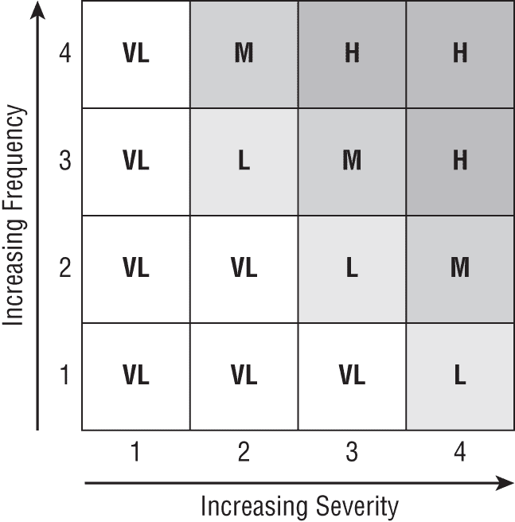

**图 1.1** 风险排序矩阵

此过程的结果是优先级排序和可用于决定如何应对风险的数据。如何应对风险取决于组织的`风险偏好`；即公司愿意接受的风险总量。针对个别风险时，风险承受力描述了组织愿意接受的风险量。应对潜在风险有四种可能的选择：

*   **规避**：`规避`风险意味着消除风险、退出该业务或不参与其中。这可能是一个可行的选项；规避该活动也可能伴随机会成本。
*   **接受**：`接受`风险意味着已理解并评估了该风险。高级管理层决定继续推进的收益大于风险。如果决策者未获得良好的风险数据或做出了无效假设，可能会做出错误选择。这可能酿成具有全球影响的灾难（如英国石油公司漏油事件、福岛核事故、切尔诺贝利核事故、挑战者号航天飞机事故等）。
*   **转移**：`转移`风险是将其转嫁给第三方。例如，购买保险。组织不直接管理风险，而是向第三方支付持续的持续成本。
*   **缓解**：`缓解`风险意味着使用控制措施来降低风险。例如，安装防火墙是缓解风险的一种方法。


请记住，你永远无法消除所有风险。总会存在一些剩余的*剩余风险*。剩余风险是指组织采取了适当的预防措施并实施了适当的控制后仍然存在的风险。还有*固有风险*，定义为执行特定活动的风险。例如，骑摩托车的固有风险是你可能会被汽车撞到。

某个特定风险可能会被有意地保留而不予缓解，或以一种通常不可接受的方式进行控制。该风险将成为典型风险管理流程的例外。*风险例外*识别出你在法律、政策或法规方面不合规的领域。资源面临恶意活动暴露和/或因不合规而受到处罚的风险。豁免按具体情况处理，顾名思义，它们严格违背常规。组织应通过豁免政策为此类事件做好准备。该政策将规定批准豁免所需的管理层级、如何记录以及如何监控。

最后，*风险威慑*是指制定某种流程、政策或系统，以阻止他人利用漏洞（如果被利用，将导致风险成为现实）。例如，尽管已采取所有缓解控制，但如果一台存放绝密军事计划的服务器可从互联网访问，会怎样？风险威慑因素是现行法律，一旦执行，会因攻击者利用该服务器而将其送入监狱。

无论你做出何种决定，都应将利益相关者的意见纳入你关于如何处理已识别风险的决策中。面对众多风险，最好的切入点是那些具有高风险评分的风险。这些项目有可能对组织造成巨大危害，应优先处理。有时会存在*风险例外*，例如涉及人员伤亡时。

## 实施控制

一旦决定如何处理已识别的风险，就该执行风险缓解规划、策略和控制了。用于推动流程向前发展的文档是*风险评估报告*。该报告包含组织的所有发现、信息、评估和建议。最终评估报告成为管理层做出明智业务决策的工具，以决定应实施哪些控制。

这要求你设计某种信息分类系统。这些系统通常基于机密性或完整性。无论你使用哪种分类系统，都必须根据组织/行业将数据类型分类并归类为 CIA 的不同级别。例如，国防部可能更关注信息的机密性，而云服务提供商可能更关注可用性。风险团队将希望根据综合评分确定所需的最低安全控制。没有资产估值，很难理解控制措施的投资回报率（ROI）或成本效益分析，以及与安全对策投资相关的情况。控制措施可以是物理的、技术的或操作的。

*   **物理控制** 示例包括锁、围栏、闭路电视、灯光、大门和保安。

*   **技术控制** 你需要根据 CIA 要求和组织的政策实施技术控制。此类控制的示例包括加密、VPN、安全协议（`IPsec`、`SSL`、`TLS` 等）、VLAN、防火墙和 `IDS`。

*   **操作控制** 示例包括招聘实践、安全意识培训、雇佣实践、解雇实践、业务连续性以及灾难测试和培训。

控制措施还可以服务于许多目的，如预防、威慑、纠正、缓解等。一旦设计出适当的控制措施，就必须将其投入使用。例如，围栏是一种物理控制，可用于威慑甚至延缓攻击者。实施控制的目的是解决已识别的风险、威胁和漏洞。要实施控制，必须建立预算。尽管风险评估过程的大部分工作已由团队完成，但现在管理层需要确定优先级、制定预算，并针对最终报告中提出的建议制定战术和战略计划。为确定要实施哪些控制，必须考虑*总拥有成本 (TCO)*。TCO 有助于确定资产或对策的总成本。它包括采购价格、维护费、更新、保险等。所有成本均包含在内。风险评估团队必须努力寻找一种解决方案，在保持最低年成本的同时提供最大的风险降低。

这些建议可能会影响整个组织，并且可能需要数月甚至数年才能完全实施。为了使业务从技术建议和现有控制中受益，有必要将技术风险转化为业务术语。建议必须以适合业务的背景进行构建和优先排序。这种战术和战略建议的优先排序将使组织能够根据风险和漏洞评估的既定目标和目的做出明智的业务决策。

控制实施后，仍有更多工作要做，因为必须对员工进行培训。IT 安全必须与管理层合作，实施持续的安全意识和安全培训。实施组织变革需要为组织所有员工或 IT 系统、资源和数据的授权用户制定教育和安全意识培训计划。缓解风险要求组织内的所有员工和用户遵守安全意识培训。

## 用于管理员工的政策

`CASP+` 必须支持用于管理员工的政策的制定。大多数员工都想做正确的事，诚实守信，并力求在工作中出类拔萃，但仍必须有控制结构。这种控制始于员工入职前，并持续到其离职（解雇）为止。

员工控制有助于保护组织并建立良好的安全性。了解以下各节中每个控制的用法及其主要属性。

### 入职前政策

在员工被录用之前，应针对如何面试潜在员工、收集个人的哪些信息以及核查哪些内容实施控制。

许多组织以背景调查开始入职前流程。*背景调查*用于核实员工背景清白，并在雇佣前发现任何不良记录。虽然背景调查是一个好的开始，但不要忘记学历。*学历验证*是核实某人教育背景的行为。随着文凭工厂的兴起，个人伪造教育背景比以往任何时候都更容易，公司唯一能确定的方法是验证潜在员工的证书。

员工入职后，一系列其他政策将帮助管理他们对敏感信息的访问及其控制级别。这是我们的下一个主题。

### 雇佣政策


### 员工培训与安全控制

对于大多数新员工而言，新工作始于初始培训。此类培训为员工提供了处理特定情况的信息，并明确了允许和禁止的活动类型。若未告知并培训相关政策与程序，员工将不知晓正确的规范。此时，许多员工会被要求签署**可接受使用策略（AUP）**。AUP 定义了员工、承包商和第三方在组织 IT 基础设施及其资产上被授权的行为。AUP 通常适用于 IT 资源、系统、应用程序、互联网、电子邮件、公司电话系统（固话）以及公司发放或付费的智能手机及其他手持设备的访问。员工还会收到员工手册。员工应签署确认收据，声明同意遵守其中规定的规则和条例。

**保密协议（NDA）** 是另一份重要且具有法律约束力的文件。NDA 是在信息所有者与接收者之间建立保密关系的合同。

手册应详细说明员工行为准则、公司资产的可接受使用及员工对公司的责任，并涵盖以下议题：

*   安全实践、策略和程序
*   带薪假期和休假策略
*   工作时间表和加班策略
*   兼职和外部雇佣
*   员工考核
*   灾难响应和应急程序
*   不合规的纪律处分程序

公司采用多种控制措施来限制员工的行为及其持有的访问权限级别。尽管这些做法未必适用于所有业务，但它们是限制不道德员工可能造成损害的常用技术。从许多方面来看，这关乎**最小权限原则**。*最小权限原则*意指：仅因员工获准访问特定文件、文档或物理位置，并不意味着他们理应拥有该权限。员工仅获得执行正常职责所需的最低访问权限，别无其他。常见的员工控制措施包括：

*   **强制休假** 在员工不在岗期间揭露滥用行为，并给组织审计时间。强制休假最常见于金融机构或涉及资金处理的岗位。
*   **工作轮换** 将员工调至新的分配领域。这不仅能在员工不可用时确保备份，还能通过轮换防止个人对某领域拥有过度控制，从而减少欺诈或滥用。
*   **双人控制** 要求员工协同完成关键操作，迫使计划违规者必须串通他人。常见示例是保险箱的组合或密码：需要两名员工才能成功打开。与双人控制密切相关的是 **M/N 控制** 概念。这意味着某项活动（如加密恢复）被分割给多个个体，使任何单人无法单独完成整个密钥恢复过程。
*   **职责分离** 限制单个员工的权限。例如，一名员工可开具支票，但必须由另一名员工批准。
*   **最小权限** 将员工访问权限限制在完成工作所需的范围内，不再多给。与最小权限概念密切相关的是**需知原则**。

即使某人满足了公司的所有雇佣要求并接受了初始培训，并不意味着其受训一次便永久有效。每当组织引入新流程或新技术，员工都应接受其正确操作的培训。安全培训也需每年重复进行。培训和意识提升对用户的短期益处在于明确可接受的行为；长期来看，培训有助于强化对黑客和网络犯罪危害的认知。提高员工意识能增加潜在攻击者的作案难度。意识培训形式可以是午餐会、学习计划、多日活动，甚至学位课程。常见培训方法包括：

*   学徒计划
*   课堂培训
*   继续教育计划
*   学位课程
*   内部培训
*   在职培训
*   供应商培训

### 离职与终止程序

据劳工统计局数据，一个人一生平均会有七份不同的工作。对公司而言，这意味着员工会来来去去。他们可能因跳槽、搬迁甚至退休而离职。

因此，我们在该领域的最后一个话题是**终止程序**。人力资源部门必须制定经批准的、有效的员工终止程序，并与 IT 安全部门对接，确保在员工离职时同步终止其访问权限。IT 安全必须与人力资源、法务、管理层及其他实体合作，使这些系统生效并保持合规。

这些安全程序应包含自愿离职和非自愿离职的流程。人力资源应与安全部门合作，确保员工归还其持有的所有设备，如访问令牌、钥匙、工牌、公司信用卡和移动设备。若为非自愿离职，需有明确流程妥善处理。员工护送、离职面谈、保密协议（NDA）回顾、网络访问暂停等事项，均须在相关策略中涵盖。

贵公司在员工离职时遵循何种程序？练习 1.2 回顾了公司制定处理离职明确程序的必要性。

## 成本效益分析

**成本效益分析** 是一种用于判断计划行动是否可接受的技术。确定成本效益分析的常用方法之一是计算**投资回报率（ROI）**。ROI 通过净利润除以总资产得出。

为准确计算 ROI，**资产管理** 至关重要。资产管理在维护库存控制的语境下被定义：资产必须被识别、管理并持续监控，以得出可靠的投资回报率。

对于需要未来评估的项目，可进行**回本分析**。回本分析确定累积收益超过累积及持续成本所需的时间。

成本效益分析包含三个步骤：计算成本、计算收益、对比结果。典型的成本效益分析会提出以下类型的问题：

*   该解决方案是否可行？
*   行动计划的收益是否大于成本？
*   该应用或项目是否对组织有益？

在成本效益分析要求量化并证明成本效益的同时，分析也包含难以量化的无形收益。评估这些项目时常被忽视的一个领域是**总拥有成本（TCO）**。TCO 是资产购买价格加上运营成本。例如，你可能花 10,000 美元购买一台下一代防火墙，但这并非 TCO。还必须考虑环境改造成本、与其他对策的兼容性成本、维护成本、测试成本、支持合同成本等。将所有这些项目汇总，即得出 TCO。

## 持续监控


## 监控即变更管理

你可以将监控视为一种变更管理类型。每当系统或运行环境发生变更时，都应执行重新评估，以查看该变更如何影响潜在风险。

**持续监控** 允许组织在实时或接近实时的基础上评估控制措施的运行有效性。因为持续监控发生在使用关键控制措施的事件发生后立即或紧随其后，它使企业能够快速检测控制失效，并迅速找到改进方法。NIST SP 800-37 (`csrc.nist.gov/publications/detail/sp/800-37/rev-2/final`) 将持续监控描述为一项有效的、组织范围的计划，应包含以下内容：

*   配置管理
*   控制流程
*   安全影响分析
*   选定安全控制措施的评估
*   安全状态报告
*   资产所有者的积极参与

SP 800-37 还指出，持续监控应解决以下职能：

*   报告进度
*   解决漏洞
*   描述信息系统所有者打算如何解决这些漏洞

在资产的生命周期内，会发生各种变更。人员来来去去，设备发生变更，配置发生变化，流程被修订。这些变更将影响组织的安全态势。必须对结果进行评估，以确定这些变更是否以负面方式改变了期望的安全状态。

随着新资产被识别或价值发生变化，以及风险被重新评估和监控，**风险管理生命周期** 就显现出来了。风险在整个生命周期中被持续审查、重新评估和应对。生命周期中每个步骤的确切标签或结构取决于组织采用的风险管理框架。

在整个风险管理生命周期中，组织将数据录入并更新到其 **风险登记册** 中。风险登记册几乎参与风险管理过程的每一步。风险登记册应包含每一个被识别、评估、由某人负责、已响应、并最终被重新评估和监控的风险。

## 企业安全架构框架与治理

**企业安全架构 (ESA) 框架** 描述了用于规划、分配和控制信息安全资源的过程。ESA 框架用于 IT 治理，包含人员、流程和技术。以下是两个 ESA 框架示例：

*   **企业架构 (EA)** 联邦政府使用它以确保业务战略与 IT 投资保持一致
*   **Sherwood 应用业务安全架构 (SABSA)** 基于架构视角的另一种战略观点

无论使用哪种架构，目标都是衡量绩效，并确保公司获得最佳的安全投资回报。ESA 框架通常包括战略、行动计划、监控规定以及定义的度量指标，例如：

*   战略一致性
*   有效的风险管理
*   价值交付
*   资源管理
*   绩效衡量
*   流程保证集成

所选的 ESA 框架必须在技术和程序解决方案之间取得平衡，以支持业务的长期需求，并提供实质性的长期效率和有效性。一些最流行的风险管理框架 (RMF) 包括 FISMA 风险管理框架、COSO 企业风险管理框架和用于风险管理的 ISO 31000。

## 面向用户的培训与意识

培训的作用怎么强调都不为过。大多数员工都想做正确的事，并真心希望看到组织蓬勃发展。然而，提供培训是公司的责任。同样重要的是要记住，除非告知员工相关政策和程序是什么，否则他们不会知晓。

仅以应急响应这样基础的事情为例。如果没有适当的培训，一些员工可能会倾向于直接停下手中的工作冲向大门；这或许无可厚非，但批准的响应方式是什么？每位员工都知道该做什么吗？员工知道如何应对网络攻击、灾害、恶劣天气紧急情况或任何其他情况吗？培训有助于确保员工知道如何应对潜在的安全风险和事件。

培训确实能带来良好的回报，因为它提高了有效性和效率。当引入新的安全流程或技术时，应对员工进行相关培训。培训能提升士气，帮助员工努力把工作做得更好。

## 风险评估的最佳实践

如果你被指派参与风险评估，一个关键考量将是明确其目标和目的。一个好的切入点是使命宣言。**使命宣言** 通常定义了公司的主要目标。

在进行风险和漏洞评估时，有许多技术可供考量。这些最佳实践或方法因评估范围和团队试图保护的对象而异。要妥善保护资产，需要投入大量的时间、资金和资源。只有到那时，才能妥善设计和实施适当级别的安全性。在准备和进行风险评估时，请考虑以下最佳实践或方法：

*   制定风险评估政策。
*   建立并维护 IT 基础设施组件和 IT 资产的数据库清单。
*   根据组织业务驱动因素定义风险评估目标和目的。
*   为组织确定一致的风险评估方法和途径。
*   根据组织的标准定义进行资产估值或资产关键性估值。
*   通过识别和分类 IT 基础设施组件和资产为关键、主要和次要，限制风险评估的范围。
*   了解并评估针对那些分类后的 IT 基础设施组件和资产的风险、威胁和漏洞。
*   为保护组织的关键、主要和次要 IT 基础设施定义一致的标准或衡量准则。
*   制定业务连续性计划，以帮助确保在发生灾难或紧急情况时关键流程和活动能够继续进行。
*   按照定义的标准执行风险和漏洞评估。

实施这些风险评估最佳实践并非易事。它需要针对组织的业务驱动因素和优先级进行仔细分析和决策。表 1.4 显示了年度化损失期望值汇总示例。考虑到大多数服务几乎可以由云提供商免费替换，建议的“成本”或单次损失期望值相当低。

**表 1.4** DMZ 资产的年度化损失期望值 (ALE)

| 资产 | 威胁 | SLE | ARO | ALE | 对策 |
| --- | --- | --- | --- | --- | --- |
| Web 服务器 | DoS | $300 | 1 | $300 | 冗余 Web 服务器 |
| 邮件服务器 | 开放中继 | $0 | .01 | $0 | 关闭中继 |
| DNS 服务器 | 缓存投毒 | $100 | .25 | $25 | DNSSEC |
| 防火墙 | 枚举 | $500 | .2 | $100 | 加固 |
| 数据库 | SQL 注入 | $10,000 | 2 | $20,000 | Web 应用防火墙和输入验证 |


你可以看到，风险评估过程的结果是确定优先处理哪些项目。你必须记住，所有公司的资产都是有限的，并非每一个漏洞都能得到解决。最好的开始方式是确定哪些项目会造成最大的损害，或者哪些代表了对组织最大的威胁。在大多数情况下，这意味着将检查 `ALE`。例如，在表 1.4 中，指出 SQL 注入攻击的 `ALE` 为 $20,000。首先检查这一威胁并评估实施对策的成本将至关重要。

最后，你要记住，风险评估过程不是一次性事件。随着项目的变化，或定期地，必须重复风险评估过程。

### 业务连续性规划与灾难恢复

一般来说，**业务连续性规划 (BCP)** 是为业务遭受中断时应采取什么行动而制定的计划。该计划通常基于 **业务影响分析 (BIA)** 的结果。`BIA` 是一个正式过程，旨在识别组织中的关键任务职能，并促进识别必须在紧急情况下继续运行的支持这些职能的关键系统。

灾难是指任何可能破坏组织业务运作的事件。灾难的发生将触发组织 **灾难恢复计划 (DRP)** 的激活。

组织必须对其每个设施进行场地风险评估，并制定 `DRP`，结合 `BIA`，识别并确定内部或外部灾难对设施构成的风险优先级。这些评估被视为业务连续性规划的一个子集。业务连续性规划包括恢复业务的策略，无论业务是因轻微事件还是重大灾难而中断。

业务连续性规划中的两个关键概念是 **恢复点目标 (RPO)** 和 **恢复时间目标 (RTO)**。要理解这些术语，首先设想一家企业的运营经历了重大中断。假设该企业的正常运营涉及处理支付交易。既定的业务连续性规划规定，允许经过一段设定的时间，直到中断期间丢失的交易数据量超过可容忍的数量。例如，设想一个内联滚动存储了两小时的交易数据。在发生中断时，最多可处理两小时内的任何部分，待全面运营恢复后进行处理。这段设定的时间就是 `RPO`。

`RTO` 更为具体。回想一下，从中断中恢复需要 30 分钟。让所有服务器启动并接入存储两小时积压数据的服务器需要 30 分钟。`RTO` 是从中断开始起计算的实际时间（持续时间），在此时间内中断被认为是可容忍的，超过则被视为业务无法容忍。

重建过程中有助于控制成本的另一个要素是 **恢复服务级别 (RSL)**。`RSL` 是所需计算能力的百分比衡量（0-100%）。这基于紧急情况下所需生产系统的百分比。

如前所述，中断可能从轻微的电源故障到整栋建筑倒塌不等。就短暂的电源故障而言，以存储阵列故障为例。要从该故障中恢复，存储工程师平均需要 12 小时来更换相关硬件并从备份重建数据。**平均恢复时间 (MTTR)** 则为 12 小时。`MTTR` 描述了中断发生与从中断中恢复之间的时间长度。

现在假设电源故障导致后续磁盘故障，平均每月发生一次。另一个重要的业务连续性概念是 **平均故障间隔时间 (MTBF)**。在这种情况下，`MTBF` 大约为 30 或 31 天。

假设我们的数据中心遭受重大停机，我们需要实施灾难恢复计划。我们的 `DR` 规划包括准备一个异地位置作为新的数据中心。准备哪种异地基础设施取决于两大因素：

*   我们的新基础设施应多快帮助我们恢复？
*   对异地基础设施的需求是否证明其费用合理？

这两个问题的答案将决定我们准备以下哪种站点：

*   **冷站点** 我们拥有一个填满了待部署基础设施的场所。设备实际上仅可用于安装。假定至少部分安装和配置尚未完成。此 **冷站点** 成本最低，但需要最长时间才能投入运行。初始步骤可能涉及拆箱。

*   **温站点** 我们拥有一个设备已安装配置、随时可开机的场所。事实上，我们的 **温站点** 可能正在运行，但仍需付出相当大的努力才能恢复运营。初始步骤可能涉及恢复备份。

*   **热站点** 我们拥有一个设备已安装并运行的场所，它是我们最近丢失的数据中心的副本。**热站点** 恢复运营所需的工作量应极小。初始步骤可能涉及确保自灾难事件以来的数据丢失最小化。

*   **移动站点** **移动站点** 顾名思义，是可移动或调动至新位置的站点。想象一辆装满镜像你数据中心设备的卡车拖车。

### 审查现有安全控制的有效性

人们希望认为我们所有的防御性安全控制都能按设计工作。但通常情况并非如此。考虑一下 **马奇诺防线**。这条物理防御工事是二战前由法国设计的，由混凝土工事、坦克障碍、火炮掩体和机枪碉堡组成，旨在阻挡德国的进攻。然而，马奇诺防线并未按计划发挥作用。战争伊始，德国人只是绕过它，从防线后方发起进攻。

这一概念同样适用于网络安全控制。尽管我们可能认为它们具有高度有效性，但这可能真也可能假。必须对安全控制进行测试和评估，以确保其有效性。防火墙和边缘安全设备在阻止外部攻击方面效果很好，但当攻击者位于内部、在这些边缘控制之后时会发生什么？用于审查现有安全控制有效性的一些方法如下：

*   **差距分析** **差距分析** 涉及对某个领域或环境的检查，旨在报告“我们在哪里”与“我们想在哪里”之间的差异。对该差距的分析提供了一个客观视角，有助于形成弥补差距所需的步骤。

*   **审计** **信息安全审计** 通常是对公司技术、物理和管理控制的审查。审计种类繁多，目标各异；`CASP+` 可能涉及的最常见类型涉及安全控制。审计师通常遵循以下一种或多种审计标准：

    *   信息及相关技术控制目标 (`COBIT`) 准则，由 `ISACA`（前身为信息系统审计与控制协会）开发和维护
    *   `FISMA`，规定了政府系统（包括军事）的最低安全合规标准
    *   财务会计准则委员会 (`FASB`)
    *   通用会计准则 (`GAAP`)
    *   美国注册会计师协会 (`AICPA`)
    *   会计准则公报 (`SAS`)


*   公众公司会计监督委员会 (PCAOB)，审计标准发布机构
*   **漏洞评估** `Vulnerability assessment` 工具和扫描器提供有关目标应用程序、系统或整个网络中漏洞的信息。漏洞通常按高、中、低三个等级分级。漏洞评估工具通常会就如何修复或管理其发现的安全风险提供建议。可用外部管理的漏洞评估服务，通常通过独立硬件设备或安装软件代理的方式实施。

    尽管这些工具工作良好，但它们并不完美，因为它们仅提供特定时间点已识别问题的快照。还存在一个问题，即漏洞评估扫描器通常不修复问题。它们识别问题，且仅识别部分问题。最后，任何特定工具都可能产生误报或漏报，甚至可能无法识别特定问题。知名漏洞评估工具示例包括 Nikto、Nessus、Wireshark、Metasploit、Nmap、Retina、LanGuard、OpenVAS 和 SAINT。

*   **道德黑客** `Ethical hacking` 是以攻击者的方式审视网络的过程。道德黑客试图确定攻击者能访问和获取什么、攻击者能利用这些信息做什么，以及是否有人会注意到攻击者的行为。道德黑客要求测试团队与管理层合作，评估其资产的价值、什么最关键，以及现有多少保护措施来保护这些资产。

### 开展经验教训总结和事后审查

在合同签署或建立服务级别协议 (SLA) 后，组织应开展一次或多次经验教训总结或事后审查，以确定协议流程的有效性，并找出现有政策、流程和其他组织实践中必要的改进之处。SLA 是一份书面合同，规定了供应商将提供的服务级别，以及供应商未能满足 SLA 条款时客户可采取的措施。SLA 通常涵盖响应时间等问题。

经验教训总结或事后审查的目的是为这些流程再次执行时提供见解和建议。这些活动可贯穿于许多不同类型的项目中，包括软件开发生命周期 (SDLC) 和事件响应。经验教训总结流程应在合同签署后经过足够的时间间隔再进行。以下是经验教训总结过程中应审查的一些项目：

*   政策和程序
*   技术、配置或系统增强
*   人员资源，包括响应团队资源
*   沟通程序
*   培训
*   现有安全措施
*   可用信息是否足以妥善完成协议
*   合作伙伴提供其所需服务的情况如何
*   响应计划中概述的程序是否充分且按预期工作
*   在 RFP 流程中是否遇到重大问题

任何相关的经验教训都应纳入修订后的协议流程中以供参考，并将更新后的文档传达给所有相关人员。

### 指标的创建、收集和分析

企业依赖监控和报告来衡量业务状况，并决定要更改、修复或改进的内容。在监控某事物之前，首先需要知道监控什么。大多数情况下，这显而易见。如果你在开车，你会监控车速和燃油消耗。但销售、运营或财务呢？有人必须先创建监控内容，然后才能继续收集和分析数据。

#### 指标

当监控汽车速度或网络交换机利用率等事物时，你需要一个快照值来进行测量。该测量值即为指标。你的车以每小时 65 英里的速度行驶，你的交换机以 35% 的利用率运行。这两个数字都是 `metrics`。

指标的创建和收集并不困难。困难在于理解指标背后的价值。回到汽车类比，如果驾驶员想知道轮胎转数而不是车速怎么办？你可能会争辩说两者在相对意义上都能告诉驾驶员开得有多“快”，直到你明白轮胎尺寸的差异使得测量轮胎转数成为一个不可靠的指标。创建和收集 IT 与安全指标也必须应用同样的深思熟虑。

一旦创建并理解了有效指标，你还可以创建 `key performance indicators (KPIs)` 和 `key risk indicators (KRIs)`。KPI 和 KRI 是一种特殊的度量，还包含目标。如果指标回答“我们在做什么？”的问题，那么 KPI 回答“我们做得怎么样？”的问题，而 KRI 则解决“我们必须多小心？”的问题。

关键绩效指标可帮助组织更好地衡量可扩展性、可用性和可靠性等重要指标。例如，与正常运行时间相关的 KPI 可提供对 `availability` 的洞察。同样，与故障发生频率及其影响相关的 KPI 将有助于提供对 `reliability` 的洞察。最后，谈到 `scalability`，一个重要的 KPI 可能指示基础设施的增长。了解服务需求的增长随后有助于增长 KPI 说明可扩展性。

#### 趋势数据

分析收集的指标不必源自组织内部。CASP+ 必须分析和解读趋势数据，以预判网络防御辅助手段。幸运的是，有许多良好的信息来源可协助此过程。一个例子是 FBI 的互联网犯罪投诉中心 (IC3) (`www.ic3.gov`)。每年，报告都会提供对前一年网络犯罪的总体回顾。

### 分析安全解决方案以确保其满足业务需求

CASP+ 可能负责分析安全解决方案，以确保其满足业务需求。CASP+ 应检查性能、可维护性和可用性及其相关领域，具体如下所述：

*   **性能** 性能是针对预设的准确性、完整性、成本和速度等已知标准，对既定任务完成情况的衡量。
*   **正常运行时间协议** `Uptime agreements (UAs)` 是最知名的 SLA 类型之一。UA 详细规定了商定的正常运行时间量。例如，可用于广域网链路等网络服务或服务器等设备。
*   **时间服务因子** `time service factor (TSF)` 是在给定时间内得到应答的服务台或响应呼叫的百分比。
*   **放弃率** `abandon rate (AR)` 是在等待服务代表接听时挂断电话的来电者数量。
*   **首次呼叫解决** `first call resolution (FCR)` 是首次呼叫即解决且不需要用户回拨服务台跟进或寻求额外解决措施的解决数量。
*   **延迟** `Latency` 可描述为延迟。可检查延迟以确定应用程序响应所需时间，甚至广域网中的延迟量。不同应用程序可支持不同程度的延迟。某些程序（如 FTP）可轻松处理延迟，而其他程序（如 VoIP）则不能很好地处理延迟。CASP+ 必须研究特定应用程序以确定可接受的延迟量。


## 关键系统特性

### 可扩展性
**可扩展性** 是指程序、应用程序或网络在规模、容量或吞吐量发生变化时，继续运行的能力。CASP+ 认证人员应审查当前的安全需求并评估未来增长，以确保所选解决方案能够满足长期需求。

### 能力
**能力** 是指满足或实现特定目标的能力。

### 可用性
国际标准化组织 (ISO) 将 **可用性** 定义为：“指定用户在指定使用环境下，使用产品实现指定目标的有效性、效率和满意度的程度。”

### 安全需求
组织可能要求建立安全措施，但为维护该安全而实施的控制措施必须是可用的。换句话说，实施导致业务流程失效的安全需求是不可用的。**可用性与安全需求** 的区别在于，安全需求满足可用性标准才算可行且有效。为同时满足这两方面需求，可能需要进行 **权衡分析**，以确定两项需求是否均得到满足。权衡分析可识别出需要在不同因素（如时间和成本）之间寻找平衡的问题。

### 可恢复性
**可恢复性** 是另一项重要特性，它定义了将系统恢复到故障发生时的确切时间点的能力。

### 可维护性
任何拟议安全解决方案的另一项重要特性是其 **可维护性**。以美国航天飞机为例，其最初设计的预期寿命为 100 次发射，或 10 年运行寿命。航天飞机于 2011 年退役，服役约 30 年。我们要说明的是，虽然您选择的解决方案可能不会持续两三倍于原始设计寿命，但重要的是它们必须在预期使用期限内保持可维护性。

### 可用性
**可用性** 是指系统的功能状态，在网络领域通常简化为正常运行时间。您应了解以下术语：平均故障间隔时间 (MTBF) 和平均恢复时间 (MTTR)。MTBF 等于总运行时间除以故障次数；MTTR 是指发生故障时恢复系统所需的时间。

## 测试计划

俗话说：“预防胜于治疗？”换句话说，一点预防胜过大量补救。**测试计划** 是预防的第一步。测试计划为演练灾难恢复等程序提供了计划性方法。以下是多种测试计划：

### 演练测试
团队将“演练”并分析灾难恢复的步骤。不像并行测试那样进行实际的恢复基础设施搭建。**演练测试** 是一项简单直接的练习，您可以在不造成任何实际中断的情况下手动执行步骤。

### 清单测试
或许最简单的测试形式就是阅读灾难恢复的 **清单** 程序和步骤。任何明显的差距或问题都会进一步分析。

#### 桌面推演
**桌面推演** 的目标是在信息安全背景下提高态势感知能力。它还旨在通过简短、实用的讨论时段，促进对事件响应的讨论。对管理层而言，桌面推演为事件响应小组提供了演示最可能发生场景的绝佳机会。

### 并行测试与模拟测试
要通过在灾难恢复系统和流程旁运行所有步骤来模拟灾难恢复，应进行 **并行测试**。**模拟测试** 则是走完所有流程，但生产系统仍在运行。

### 全面中断测试
顾名思义，**全面中断测试** 是对灾难恢复规划信心的真正考验。一旦灾难恢复系统设置就绪并准备好接管关闭系统的角色，生产系统将暂时下线。

## 内部与外部审计

**内部审计** 是为改进实体运营而进行的审计。中大型组织通常设有内部审计部门，监控组织在提高有效性、控制、治理流程和风险管理方面的运营情况。该部门通过基于数据和业务交易评估提供建议和意见来实现这一目标。内部审计的主要目的是为高级管理层和治理负责人（治理机构）提供独立意见和咨询。内部审计主要由组织员工执行；不过，一些组织会聘请审计公司进行内部审计。

**外部审计** 是指由独立审计公司对组织进行的审计，该公司不受被审计组织控制。外部审计因法定要求而执行，旨在就安全控制、流程和文档是否在所有重大方面符合可接受标准和监管要求发表意见。对于外部审计，审计师不得与组织有任何先前关联；即外部审计师必须在工作中保持独立性。

审计要求和频率可由几个因素决定，例如企业政策。但最常见的因素或许是合规性。法规可能要求组织每年或每半年审计一次。

## 运用判断力解决疑难问题

有时，您必须运用判断力来解决没有最佳解决方案的疑难问题。这就是您多年经验派上用场的地方！您是否想过为什么有些汽车修理工擅长诊断和修复问题？因为他们掌握了运用判断力和经验解决问题的过程。解决问题没有唯一的正确方法，因为每个人都必须找到最适合自己的方法。我们将在此展示一种方法。尝试一下，看看是否适合您。

### 定义问题
您被告知存在问题。获取问题的具体描述。症状是什么？

### 收集事实
当某事失败或无法正常工作时，问自己（或另一位 CASP+ 认证人员）以下问题：

*   它以前曾经正常工作过吗？
*   发生了什么变化？
*   是否添加了新的硬件或软件，例如防火墙或入侵检测系统？
*   这最早是什么时候发生的？
*   其他人是否有相同的问题？

### 头脑风暴
您正处于轻易改变脑海中浮现的第一个事物的阶段。然而，最佳行动方案是思考导致某事无法工作或以特定方式表现的所有可能性。

### 实施
这是您列出分步测试可能性清单的地方。测试每种可能性，看它是否能纠正问题。小心一次只更改一项内容，以免产生新问题。如果分步程序无法解决问题，则返回流程开头重新开始。

### 评估
回顾您所做的工作，然后记录问题的原因和解决方案。与朋友和同事分享您新获得的知识。

## 总结


## CASP+ 风险管理与业务连续性

CASP+ 专业人员必须了解对业务的威胁、潜在风险以及缓解风险的方法。风险是在个人和业务层面每天都必须面对的问题。策略是应对风险的一种方式。在业务的人员方面，策略应规定员工可以做什么和不可以做什么。即使风险已被识别并与漏洞关联，仍必须确定潜在成本。该成本可通过定量或定性方法得出。每种方法各有优缺点，并有助于提供工具来确定是接受、规避、缓解还是转移威胁。你需要了解基本的风险公式，并知道如何计算 `SLE` 和 `ALE` 等项目，以备考试要求时能进行计算。最后，CASP+ 还必须理解妥善规划和测试业务连续性规划及灾难恢复的重要性。没有 `BCP` 和 `DR`，企业只能坐等下一场灾难降临。

## 考试要点

**能够描述具体的风险评估技术。** 可用于执行风险分析的两种基本技术：定性和定量。定性风险评估更具主观性，不基于货币价值，并使用“严重”、“高”、“中”、“低”等描述符。定量风险评估针对已知风险分配并使用货币价值。

**知道如何进行风险确定评估。** 风险和漏洞评估提供了关于组织 IT 基础设施及其资产当前安全级别的必要信息，以便评估人员能为提升或增强该安全级别提供建议。要理解进行风险评估很困难且容易出错。一旦风险被识别和评估，要意识到分析结果本身往往也是有问题的。

**知道如何以及何时应用安全控制。** 控制措施可能会被应用，也可能不会。所有公司用于实施控制的资金都有限，控制的成本不应超过资产的价值。执行定量或定性风险评估有助于论证是否应应用某项控制。

**了解应对风险的各种方式。** 威胁与漏洞相结合可能导致损失。为预防或应对潜在风险，可采用多种方法，包括接受、规避、缓解和转移。

**了解业务连续性和灾难恢复概念的重要性。** 没有妥善规划，企业无法在灾难中生存。业务连续性和灾难恢复计划必须到位，定期审查和演练，并按计划更新。务必理解业务影响分析 (`BIA`)、隐私影响评估、灾难恢复规划 (`DRP`)、业务连续性规划 (`BCP`)、事件响应和测试计划。

**能够应用适当的风险策略和风险评估类型。** 风险评估是一种正式的风险优先级排序方法，使组织能以结构化方式进行审查。风险评估遵循两种不同的分析方法：使用数字数据进行分析的定量风险评估，其结果允许非常直接地对风险进行优先级排序；以及使用主观数据对难以量化的风险进行评估的定性风险评估。

**理解风险缓解、策略和最佳实践。** 风险缓解是应用控制以减少风险发生概率或影响的过程。风险管理是最常见的风险管理策略，安全专业人员的绝大多数工作都围绕着通过设计、实施和管理安全控制来缓解风险。这些控制中的许多涉及功能性、性能和安全性之间的工程权衡。

## 复习题

答案见 附录。

1.  以下哪项不是定量风险评估的优势？
    1.  检查真实威胁
    2.  快速得出结果
    3.  主观意见
    4.  美元价值

2.  以下哪项是 `SLE` 的公式？
    1.  `SLE = AV × EF`
    2.  `SLE = AV / EF`
    3.  `SLE = ARO × EF`
    4.  `SLE = ARO × AV`

3.  以下哪项不是定性风险评估的优势？
    1.  速度
    2.  使用数字美元价值
    3.  基于 CIA
    4.  由团队执行

4.  以下哪项是 `ALE` 的公式？
    1.  `ALE = AV × ARO`
    2.  `ALE = ARO × SLE`
    3.  `ALE = SLE / ARO`
    4.  `ALE = AV / ARO`

5.  以下哪种应对风险的方法会产生持续的第三方成本？
    1.  接受
    2.  规避
    3.  缓解
    4.  转移

6.  实施防火墙最符合以下哪项？
    1.  接受
    2.  规避
    3.  缓解
    4.  转移

7.  确定暴露因子后，定量风险评估过程的下一步是什么？
    1.  确定 `SLE`。
    2.  确定 `ARO`。
    3.  确定 `ALE`。
    4.  确定 `AV`。

8.  解决问题时，以下哪个步骤或指导涉及制作可能性的分步列表以供测试？
    1.  实施
    2.  收集事实
    3.  头脑风暴
    4.  评估

9.  以下哪项最有助于员工了解如何应对潜在的安全风险和事件？
    1.  头脑风暴
    2.  职责分离
    3.  安全意识培训
    4.  强制休假

10.  _______________ 可被描述为硬件、软件或组件中的弱点，可能被利用以使威胁破坏、损坏或危害资产。
     1.  漏洞
     2.  威胁
     3.  暴露
     4.  风险

11.  _______________ 是指任何可能对 IT 资产或数据资产造成潜在危害、丢失、损坏或危害的代理、条件或环境。
     1.  漏洞
     2.  风险
     3.  威胁
     4.  暴露

12.  以下哪项不是审计员可遵循的可接受审计标准？
     1.  `COBIT`
     2.  `GAAP`
     3.  `FISMA`
     4.  `OpenVAS`

13.  以下哪项有助于描述报告“我们在哪里”与“我们想在哪里”之间的差距？
     1.  经验教训报告
     2.  事后报告
     3.  审计
     4.  差距分析

14.  `Nikto`、`Nessus`、`Retina`、`LanGuard` 和 `SAINT` 适用于哪类活动？
     1.  利用
     2.  威胁评估
     3.  控制审计
     4.  漏洞扫描

15.  作为最知名的 SLA 类型之一，以下哪项详细规定了商定的正常运行时间？
     1.  `RTO`
     2.  `UA`
     3.  `FCR`
     4.  `TSF`

16.  用户应仅拥有所需访问权限的概念称为以下哪项？
     1.  审计控制
     2.  深度防御
     3.  默认拒绝
     4.  最小权限

17.  以下哪种测试类型最适合描述为在不造成实际中断的情况下手动执行恢复步骤？
     1.  全面中断测试
     2.  清单核对
     3.  演练测试
     4.  模拟测试

18.  哪种灾难恢复站点的维护成本最低？
     1.  移动站点
     2.  冷站点
     3.  温站点
     4.  热站点

19.  以下哪个术语描述了中断发生与从中断中恢复之间的时间长度？
     1.  `MTTR`
     2.  `RPO`
     3.  `MTBF`
     4.  可用性

20.  以下哪项描述了需要两名员工打开保险柜，每人持有其组合或代码的场景？
     1.  双人控制


### 第 2 章：配置和实施端点安全控制

## 职责分离

## 岗位轮换

## 最小权限

你是否曾想过洋葱有多少层？当你剥开一层，似乎总有一层接着一层。全面的安全解决方案应当以同样的方式设计，即作为一系列的层。这通常被称为*纵深防御*。本章讨论全面的安全解决方案，包括加固技术、使用可信操作系统以及实施补偿控制。纵深防御方法不仅仅关注基本安全概念。这种方法论是用于保护关键资产和信息的方法、技术、工具、人员和控制的总和。

## 加固技术

*加固技术*包括为移除不需要的服务和功能而执行的各种步骤，旨在通过减少攻击面，使攻击者更难成功访问计算机。由于在加固过程中很容易疏忽大意，公司应采用标准方法论来加固计算机和设备。不同的操作系统（如 `macOS`、`Linux` 和 `Windows`）将需要不同的安全基线。一些管理员将*黄金镜像*称为可用于一致地克隆和部署其他设备的主镜像。系统克隆是为组织建立基线配置的有效方法。它需要投入精力和专业知识来建立和维护用于部署的镜像。此外，工作站的加固技术将不同于服务器的加固技术。

尽管这似乎是一个简单的概念，但良好的安全实践始于物理安全。如果攻击者能够物理接触系统，控制它就变成了一项微不足道的任务。系统应当得到物理保护。培训用户在不使用系统时将其关闭是一项基本控制，配合实施受密码保护的屏幕保护程序和自动注销。

物理设备和软件都有生命周期，不会永远持续下去。当物理设备在组织中达到其最终使用阶段时，应围绕生命周期结束（`EOL`）制定计划，并将该设备从网络中移除。软件也有类似的周期，一旦达到制造商的支持结束，应制定替换计划。

主机应当经过加固，以便在操作系统甚至完全启动之前就是安全的。有几个项目可用作引导加载程序保护，包括以下内容：

*   **安全启动** 这是由 PC 行业成员开发的安全标准，旨在帮助确保 PC 仅使用设备制造商信任的软件进行启动。`Secure Boot` 在 `UEFI/BIOS` 中启用，使用采用 X.509 证书格式的自签名 2048 位 RSA 密钥。

*   **可度量启动** 此方法与 `Trusted Platform Module (TPM)` 和 `Secure Boot` 进程配合工作，以确定是否允许加载操作系统以及哪些部分可以执行。通过 `Secure Boot`，具有 `UEFI` 固件和 `Trusted Platform Module (TPM)` 的 PC 可以配置为仅加载受信任的操作系统引导加载程序。通过 `Measured Boot` 或 `Measured Launch`，PC 的固件记录启动过程，`Windows` 可将其发送到受信任的服务器，由其客观评估 PC 的健康状况。

*   **IMA** `Integrity Measurement Architecture (IMA)` 由 `IBM` 开发，用于验证 `Linux` 操作系统的完整性和可信度。

*   **BIOS/UEFI** *Unified Extensible Firmware Interface (UEFI)* 早在 `Windows 8` 时期就成为了一项要求。`UEFI` 是 `BIOS` 的替代品或附加组件，类似于在最终操作系统启动之前运行的操作系统。它旨在阻止可能控制基于 `BIOS` 系统的 Rootkit 和其他恶意软件。

保护网络设备和主机计算机代表了多层安全方法，有时称为纵深防御。以下是在加固主机系统时应检查的一些通用领域：

*   **使用应用程序批准列表和应用程序阻止/拒绝列表** *应用程序批准列表*可定义为被授予访问权限的实体列表。*应用程序阻止/拒绝列表*则恰恰相反；它列出无法访问的内容。例如，你可能会将 `YouTube` 放在*应用程序阻止/拒绝列表*上，以便员工无法访问该网站。可以将*应用程序批准列表*视为隐式“全部拒绝”，除非添加到列表中；将*应用程序阻止/拒绝列表*视为隐式“全部允许”，除非添加到列表中。

*   **实施安全/组策略** `Microsoft` 随 `Windows 2000` 引入了 `Group Policy`。你可以将组策略视为用户配置设置和计算机配置设置的分组，它们可以链接到 `Active Directory (AD)` 中的对象。这些策略应用于用户和计算机。`Group Policy` 允许安全管理员在数百台计算机上维护一致的安全配置。在 `Group Policy` 中设置安全选项时，初始安全设置专门与账户策略和本地策略节点相关。账户策略包含密码策略、账户锁定策略和 Kerberos 策略。本地策略适用于审核策略、用户权利分配和安全选项。

*   **证明服务** 证明意味着你正在验证某事为真。*证明服务*可设计为基于硬件、基于软件或混合模式。`Trusted Platform Module (TPM)` 是一种专用的硬件安全模块，用于创建和存储加密密钥。`TPM` 为本地硬盘驱动器提供防篡改的全盘加密。

*   **NX/XN 位使用** *NX (No-eXecute)* 是 CPU 中的一位，在其运行时极大地增强了该 CPU 的安全性。`NX` 的目的是隔离用于处理器指令和数据存储的内存区域。此功能过去仅存在于具有哈佛架构（存储和指令内存区域分离）的 CPU 中。现在，得益于对安全性日益增长的关注，冯·诺依曼架构（共享存储和指令内存）的处理器也采用了 `NX` 位功能。

如今，鉴于各种处理器制造商的存在，这些本质上是同一位的不同术语。显然，当 CPU 制造商将 No-eXecute 位作为其自有品牌推广时，他们可以宣传其独特的安全功能。请注意，`Intel` 将其技术作为 *XD* (execute disable) 位进行营销，而 `AMD` 将其技术品牌化为 *EVP* (enhanced virus protection)。最后，对于基于 `ARM` 架构构建的 CPU，该功能称为 *XN* (execute never)。

保护数据的另一种方法是使用安全且加密的飞地。安全飞地允许应用程序在硬件级别安全运行。所有数据在内存中均经过加密，仅在硬件级别时解密。即使操作系统或 root 用户遭到破坏，数据仍然安全。

### 地址空间布局随机化使用

*地址空间布局随机化 (ASLR)* 是一种旨在防范缓冲区溢出攻击的技术，最初于 2003 年实施。目前，所有主要操作系统——服务器、桌面和移动端——均包含 `ASLR`。

`ASLR` 是如何工作的？在缓冲区溢出攻击中，攻击者需要知道代码中给定函数接受输入的位置。攻击者会向该代码位置输入恰到好处的垃圾数据，其中包含恶意载荷。理想情况下，攻击者还会包含一条跳转到代码中另一点的指令，恶意载荷和指令将以应用程序的权限运行。


### ASLR 和硬件安全模块

说让缓冲区溢出“正常”工作很难，这简直是轻描淡写。攻击者极少拥有实际的源代码，以知晓目标函数接受输入的代码精确位置。即使位置已知，缓冲区溢出开发也需要大量的“碰运气”式尝试。然而，溢出攻击确实会发生，更糟糕的是，只要代码位置不变，它们就是可重复的。

ASLR 如何防范此类攻击？ASLR 会随机化代码不同部分的位置。因此，即使攻击者设法让缓冲区溢出成功了一次，在同一代码上可能永远不会再次成功。

对软件开发人员的挑战在于，他们的代码从一开始就必须编译为支持 ASLR。多年前这构成了一个难以逾越的障碍，但现在 ASLR 支持已成为默认设置。

即便如此，就应用程序兼容性而言，ASLR 的实现也并非万无一失。2017 年 11 月下旬，据怀疑微软的 ASLR 在 Windows 8 至 10 版本中出现故障。微软解释称，问题出在与未选择加入 ASLR 的应用程序协同工作时的配置问题。可通过以下链接了解更多关于强制 ASLR 的信息：

`blogs.technet.microsoft.com/srd/2017/11/21/clarifying-the-behavior-of-mandatory-aslr`

### 硬件安全模块和可信平台模块

有各种各样的产品可用于加密现有磁盘和介质驱动器产品中的数据。`静态数据加密` 选项包括软件加密，例如加密文件系统 (EFS) 和 VeraCrypt。

有两种著名的硬件加密选项可更好地保护数据。这些硬件加密选项是 `硬件安全模块 (HSM)` 和 `可信平台模块 (TPM)`。

HSM 是一种用于管理加密密钥的安全密码处理器。连接到 HSM 时，系统可以生成密钥、对对象进行签名并验证签名。

TPM 是一种可安装在计算机主板上的专用芯片，用于硬件身份验证。TPM 验证的是相关计算机而非用户。它利用计算机的启动序列来确定平台的可信状态。TPM 将加密过程置于硬件层面。如果有人取出驱动器并尝试从另一台计算机启动该硬盘，硬盘将无法启动并拒绝所有访问。与可能仅用于加密硬盘上少数文件夹的软件加密选项相比，这提供了更高级别的安全性。TPM 的设计初衷是以低成本安全地报告启动环境并识别系统。

HSM 和 TPM 都非常适用于硬盘驱动器和固定存储设备，但便携设备也必须防范损坏、未经授权的访问和泄露。一个好的办法是要求所有使用便携设备、USB 闪存驱动器、手持设备或任何可移动存储介质设备的员工对其保管和适当安全负责。这始于政策，延伸至用户培训。例如，政策可能要求笔记本电脑和平板电脑用户每周至少连接一次企业内部网，以接收最新的软件补丁和安全更新。政策还可以强制要求在便携设备上使用加密。视公司和所需安全级别而定，安全专业人员还可能限制个人设备在工作场所的使用，并阻止这些设备插入公司设备。

驱动器加密的另一个选项是自加密驱动器 (SED)。SED 是一种硬盘驱动器 (HDD) 或固态驱动器 (SSD)，旨在无需用户输入或磁盘加密软件即可自动加密和解密驱动器数据。当 SED 在主机系统中通电时，写入和读取驱动器的数据会即时加密和解密；无需其他步骤或软件来加密和解密驱动器数据。

正如您迄今所学，安全专业人员需要了解许多常见类型的安全工具、技术和程序，以及何时以及如何使用它们。加固技术专注于通过禁用不必要或不需要的服务，并将安全选项从默认值更改为与设备的风险概况和安全需求相匹配的更安全设置，来减少端点系统的攻击面。

修补和更新系统也有帮助。拥有完全修补的系统镜像是加固过程的一部分。系统配置标准、命名标准、加固脚本、程序和程序有助于确保系统被正确清点和保护。驱动器加密可在驱动器被盗或丢失时保护数据安全。在生命周期结束时，当设备退役或报废时，会使用清理程序确保残留数据不泄露。擦除驱动器和物理销毁都是常见选项。

其他控制和技术可能包括以下内容：

### 使用标准操作环境

标准操作系统是主机系统的标准构建。其理念是在整个组织中使用标准构建。一个优势是降低总拥有成本 (TCO)。然而，真正的优势在于配置的一致性。当需要更新和安全补丁时，这种标准化镜像更易于测试，因为存在统一的环境。

### 修复已知漏洞

建立安全基线是主机安全的良好开端，但一个主要关注领域是修复已知漏洞。要掌握这一过程，您应定期运行漏洞评估工具。漏洞评估工具（如 Nessus、SAINT 和 Retina）设计为每周或每月运行一次，以查找已知漏洞和问题。识别这些问题并迅速修补它们有助于降低整体攻击风险。

练习 2.1 将向您展示如何运行安全扫描器以识别漏洞。

### 加固和移除不必要的服务

保护系统的另一个重要组成部分是系统加固过程。开始此过程最直接的方法是移除不需要的服务。可将其视为最小权限原则的一种变体。此过程涉及移除不必要的应用程序、禁用不需要的服务、关闭不必要的端口，以及在文件上设置限制性权限。此过程可减少攻击面，旨在使系统更能抵御攻击。虽然您应对负责的所有系统应用此过程，但必须针对每个操作系统独特处理，并采取不同的步骤来保护它。


## 应用命令 Shell 限制

限制用户对命令提示符的访问是加强安全性的另一种方式。用户可以从命令提示符运行的许多命令会削弱安全性，或允许恶意人员在主机系统上提升权限。请考虑 Windows Server 2019 计算机的默认配置：Telnet、TFTP 和许多其他命令行可执行文件默认处于关闭状态。这是命令行限制的一个基本示例。在另一个示例中，假设您在企业大厅设有一个自助服务终端，客户可以在其中了解更多关于您的产品和服务的信息，甚至填写求职申请。应禁用额外功能以实施最小权限原则。虽然为用户提供完成手头工作或任务所需的工具很重要，但禁用对非必要程序的访问是良好的安全实践。在某些情况下，这可能包括命令 Shell 限制。允许用户从命令行运行命令可能会为黑客提供攻击途径。除非必要，否则应限制命令行访问。

练习 2.2 将向您展示如何绕过命令 Shell 限制。

## 使用警告横幅

*警告横幅* 是简短的消息，用于告知用户有关使用应用程序和服务的特定策略和程序。警告横幅可以是启动画面、弹出窗口或消息框，用于告知用户特定规则。警告横幅至关重要，因为它们告知用户可能允许或不允许的特定行为或活动。由于警告横幅声明了特定行为的后果，因此消除了用户的借口，以便记录违规行为。警告横幅应包含被视为适当的使用方式、隐私期望以及违规处罚。

## 使用受限接口

*受限接口* 是一个配置文件，它规定了环境中可用的程序、菜单、应用程序、命令或功能。此技术允许安全管理员控制用户的环境，并规定用户有权访问的对象。该环境被视为受限接口，因为用户只能使用它与操作系统、已安装的应用程序和资源进行交互。在现代操作系统中，个人配置文件可以跟随用户使用管理员控制下的任何移动设备。

## 配置专用接口

*专用接口* 是专门用于特定流量的端口。例如，许多公司将其无线 LAN 放置在专用接口上，并将其与其他内部网络流量隔离开。

## 使用带外管理

*带外管理* 是采用专用管理通道的概念，该通道独立于服务器使用的网络通道或布线。

## 配置管理接口

*管理接口* 旨在作为一种方式来管理可能已关机或以其他方式无响应的计算机或服务器。管理接口利用与硬件的网络连接，而不是与操作系统或登录 Shell 的连接。管理接口通常使用带外 NIC。

## 管理数据接口

*数据接口* 用于数据库以生成过程模板。*过程模板* 是活动类型的可重用集合。它们允许系统集成商和其他使用不同客户端的人员操作类似类型的数据。

## 脚本编写和复制

PowerShell 的优点之一是它能够轻松编写 SQL Server 对象的基本窗口命令脚本。您还可以用它来编写复制对象的脚本。这可以作为灾难恢复计划的一部分，以便您始终拥有可用于重新创建复制的脚本。

脚本编写和复制也是自动化补丁管理的一种方法。

## 可信操作系统

*可信操作系统* 可定义为实施了足够控制以支持多级安全性的操作系统。多级安全性为操作系统提供了在不同安全级别处理和处理信息的能力。至少，这种粒度意味着您可以作为用户或作为 root 或管理员来处理数据。可信操作系统必须经过测试，以证明其正确性证据，满足特定标准。这些标准要求可信操作系统必须经过测试和验证。测试为操作系统供应商提供了一种推广系统功能的方式。测试允许买家验证系统，并检查操作系统是否按照供应商声称的方式执行。

可信操作系统超越了软件范畴，还必须考虑其驻留的硬件。这就是可信计算基的目的。*可信计算基 (TCB)* 是计算机内所有保护机制的总和，负责强制执行安全策略。这包括硬件、软件、控制和流程。

以下文档是一些用于验证可信操作系统的指南：

### 可信计算机系统评估标准 (TCSEC)

最初的可信操作系统测试标准之一是 *可信计算机系统评估标准 (TCSEC)*。TCSEC 也称为 *橙皮书*，旨在评估独立系统。它实际上已被弃用，并早已被通用准则取代，但它值得一提，因为它是最早的可信操作系统测试标准之一。其测量基础是机密性。它旨在对系统进行评级，并将其归入以下四个类别之一：

*   **A：经验证的保护** A 级系统是最高安全级别。
*   **B：强制性安全** B 级系统对 TCB 具有强制性保护。
*   **C：自主保护** C 级系统对 TCB 提供自主保护。
*   **D：最低保护** D 级系统未能达到 A、B 或 C 级的任何标准，基本上没有安全控制。

### 信息技术安全评估标准

*信息技术安全评估标准 (ITSEC)* 是另一个早期标准，开发于 1980 年代，首次发布于 1990 年 5 月。它旨在满足欧洲市场的需求。ITSEC 检查整个系统的机密性、完整性和可用性。它的独特之处在于它是第一个统一市场并将整个欧洲纳入一套指南的标准。评估实际上分为两部分：一部分评估功能，另一部分评估保证。有 10 个功能 (F) 类和 7 个保证 (E) 类。保证类对系统的有效性和正确性进行评级。

### 通用准则

国际标准化组织 (ISO) 创建了通用准则 (ISO 15408)，使其成为一个全球标准，该标准建立在 TCSEC、ITSEC 和其他标准的基础之上。通用准则基本上取代了 ITSEC。通用准则检查可信操作系统的不同领域，包括物理和逻辑控制、启动和恢复、参考中介和特权状态。通用准则将保证分为八个日益严格的保证级别。这些被称为 *评估保证级别 (EAL)*。EAL 为正在分析的系统的安全功能提供了特定的信心水平。七个保证级别如下：

*   **EAL 1**：功能测试
*   **EAL 2**：结构测试
*   **EAL 3**：系统地检查和测试
*   **EAL 4**：系统地设计、测试和评审
*   **EAL 5**：半正式地设计和测试
*   **EAL 6**：半正式地验证、设计和测试


*   **EAL 7：** 正式验证、设计和测试

无论如何测试或使用哪组特定标准，受信任操作系统都包含以下基本属性：

*   **硬件保护** 受信任操作系统必须从底层开始设计。安全硬件是基础。
*   **长期受保护存储** 受信任操作系统必须具备提供跨电源周期和其他事件持久存在的受保护存储的能力。
*   **隔离** 受信任操作系统必须能够隔离程序。它必须能够防止程序 A 访问程序 B 的信息。
*   **用户进程与管理进程的分离** 用户功能和管理功能必须分离。

TCB 负责保密性和完整性。它是系统中唯一在高信任级别下运行的部分。安全内核就驻留在这个信任级别中。安全内核处理所有用户和应用程序对系统资源的访问请求。一个小型的安全内核易于验证、测试和确认为安全。

因此，虽然受信任操作系统建立在 TCB 之上，但这两个概念都基于理论。这些模型的大量工作始于 1970 年代初期。在此期间，美国政府资助了一系列专注于计算机安全的论文。这些论文构成了受信任计算安全模型的基本基石。*安全模型*决定了安全如何实施、哪些主体可以访问系统，以及它们将对哪些对象拥有访问权限。简单来说，它们是将受信任操作系统的设计形式化的一种方式。安全模型建立在旨在强制执行完整性和保密性的控制之上。

*强制访问控制*已被政府使用多年。所有由 MAC 策略控制的文件均基于不同的分类安全级别，包括机密、秘密或绝密。MAC 允许系统在同级或更低级别运行。覆盖 MAC 需要高级管理层的授权。

受信任操作系统的示例包括 SELinux、SEAndroid 和 Trusted Solaris。*SELinux (Security-Enhanced Linux)* 现已推出 20 多年，最初是国家安全局 (NSA) 和红帽公司合作的成果，并持续改进至今。SELinux 将 MAC 引入 Linux 内核，从而实现更严格的访问控制。针对 CASP+ 考试，请记住这一点作为区分*内核与中间件*的一种方式。

中间件是一种计算机软件，它为软件应用程序提供操作系统之外的服务。它可以被描述为“软件胶水”。中间件使软件开发人员更容易实现通信和输入/输出，以便他们能够专注于其应用程序的特定用途。虽然核心内核功能只能由操作系统本身提供，但以前由单独销售的中间件提供的某些功能现在已集成在操作系统中。

Android 操作系统以 Linux 内核为核心，还提供了一个应用程序框架供开发人员集成到其应用程序中。此外，Android 还提供了一个中间件层，包括提供数据存储、屏幕显示、多媒体和网页浏览等服务的库。由于中间件库被编译为机器语言，服务执行速度很快。中间件库还实现了特定于设备的功能，因此应用程序和应用程序框架无需关心各种 Android 设备之间的差异。

*SEAndroid* 将相同的 MAC 优势带给 Android 内核。Android 使用*应用程序沙箱*的概念，即在各自独立的内存和驱动器空间中隔离和限制其应用程序。从 4.3 版本开始，Android 引入 SELinux 以进一步扩展这种隔离。在 4.3 到 5.0 版本之间，Android 对一部分域部分强制执行限制。在 Android 术语中，*域*类似于一个正在运行的进程。从 Android 内核 5.0 及更高版本开始，Android 在内核中全面强制执行 SELinux。

*Trusted Solaris* 也提供 MAC，以及诸如针对主机或客户机环境的只读保护等功能，Solaris 称之为“不可变区域”。提供的免疫通过区域配置属性文件应用，该文件用于设置文件系统的任何豁免。这些豁免允许执行写入操作。在撰写本文时，属性文件可设置为五种可能的设置之一，范围从“严格”（绝对无写入）到“无”（完全读写访问），中间包含对 `/etc` 和 `/var` 目录的中间变体访问权限。

### 补偿性控制

安全对于大多数组织来说几乎不是一个新问题。在许多公司，安全被归入技术议程，仅获得边缘关注和预算考量。在当今经济环境下，许多首席安全官 (CSO) 被要求以更有限的预算提供比昨天更好的安全性。为了让公司在当今世界生存，需要一场范式转变——真正的威胁不再是潜伏在公司大门外的陌生人。在过去十年中，信息相关犯罪和网络攻击已成为越来越多犯罪分子的首选犯罪手段。

有效的安全要求 CASP+ 与组织内的其他人员合作，利用补偿性控制将公司需求整合到整体安全解决方案中。给定一个场景，CASP+ 应能够促进跨不同业务单元的协作以实现相关安全目标。全面的安全解决方案对于企业的业务连续性运营以及维护数据的保密性和完整性至关重要。企业工具的集成对于保护信息和系统免受未经授权的访问、使用、披露、中断、修改或破坏是必要的，这有时需要跳出固有思维。

*   **防病毒软件** 这显而易见，对吧？不存在 100% 受信任的网络，终端易受连接网络的攻击。除非出于某些专业原因会导致中断，否则请为您的终端提供*防病毒软件*的额外保护。
*   **应用程序控制** 如果对应用程序的更改能在满足业务需求的同时降低风险，那么为什么不利用进一步强化系统的*应用程序控制*呢？应用程序控制包括完整性和有效性检查、标识、认证、授权、输入控制和取证控制等。应用程序控制的一个例子是有效性检查，它审查数据录入屏幕中输入的数据，以确保其符合一组预定的范围标准。
*   **基于主机的入侵检测系统 (HIDS)/基于主机的入侵防御系统 (HIPS)** HIDS 和 HIPS 作为检测和预防控制很有用。它们为您的安全运营中心 (SOC) 人员提供更多信息。如果涉及事件处理，HIDS 和 HIPS 也可能通过让您知道其他主机是否受影响来帮助遏制事件。
*   **基于主机的防火墙** 这是另一层终端防御，提醒我们没有任何网络是 100% 可信的。*基于主机的防火墙*可能无法阻止主机发起事件，但它可以帮助缓解主机成为另一个受害者的情况。


## 端点检测与响应 (EDR)

EDR 是一个相对较新的术语，但在高级持续性威胁 (APT) 的时代，你的端点将从*端点检测与响应*中受益。EDR 的功能远比 HIDS/HIPS 全面且强大。EDR 解决方案提供多种能力和工具。EDR 软件用于帮助企业识别并修复与网络连接端点相关的威胁。这些工具会告知安全专业人员哪些端点存在漏洞或已被感染，并指导他们完成修复流程。事件解决后，EDR 工具帮助团队调查问题以及导致端点沦陷的脆弱组件。以下是一些示例：

*   MVISION Endpoint Security
*   VMware Carbon Black EDR
*   Palo Alto Networks Traps
*   Microsoft Defender for Endpoint

## 冗余硬件

考虑这样一个场景：你知道某项特定技术的平均故障间隔时间 (MTBF) 是不可接受的。这可能是因为该业务需求特别关键，无法轻易进行维护。但减少停机时间的一种方法是引入一些高可用性 (HA)，利用*冗余硬件*。有其一，便备其二。有了*冗余硬件*，MTBF 虽然没变，但故障导致中断的风险却大大降低。

## 自愈硬件

另一个新术语和概念，*自愈硬件*的含义顾名思义。在发生故障或安全事件时，你的硬件能够检测、响应并修复故障的影响。就我个人而言，我觉得这个概念有点令人费解，但 CompTIA 希望确保你知晓它。你应该理解，自愈能力不限于硬件。考虑这样一个场景：系统通过回滚变更来恢复已知良好状态，以响应软件问题。

## 自加密驱动器

与自主的*自愈硬件*类似，自加密驱动器会主动对新写入的数据发起加密。

## 用户与实体行为分析 (UEBA)

这是对用户分析这一旧有领域的一个迷人扩展，过去该领域仅监控员工行为。*用户与实体行为分析*包括更深入地洞察员工和实体两方面。这项技术通过检测异常行为（如检测未经授权的用户或被植入木马的设备）来帮助缓解各种风险。

## 总结

CASP+ 必须理解强化和保护端点设备的必要性。保护环境必须包含端点，而不能忽视这最后一道防线。我们讨论了各种技术和手段，包括*如何*让端点更加安全。要熟悉所有列出的补偿性和缓解性控制，并理解每种控制可能如何降低（或无法降低）特定风险。

CASP+ 应理解受信任操作系统如何提供小得多的攻击面，从内核向外提供安全保障。最后，CASP+ 应能够说出各种基于硬件和软件的控制措施的名称并解释其用途。

## 考试要点

**理解特定端点面临不同的风险。** 考虑风险可能以不同方式影响端点的场景。适用哪种强化或控制措施？出于各种原因，控制措施可能适用，也可能不适用。

**知晓为何以及何时应用强化技术。** 考虑特定强化技术有效或无效的场景。

**知晓技术并非互斥或“一招鲜吃遍天”。** 当然，当你阅读本章讨论的技术或技术手段时，要思考如何（也可能应该）应用多种控制措施以最大化风险缓解。

**理解补偿性控制如何缓解风险。** 考试可能会抛出一个风险，然后提供几种补偿性控制。你能否找出对该风险影响最好（或最小）的控制？要熟悉诸如防病毒、应用程序控制、HIDS/HIPS、基于主机的防火墙、端点检测与响应 (EDR)、冗余硬件、自愈硬件以及用户与实体行为分析 (UEBA) 等补偿性控制。

## 复习题

答案见 `Appendix`。

1.  以下哪个术语描述了为使攻击者难以成功攻击计算机而移除不需要的服务和功能的行为？

    1.  锁定
    2.  减少攻击面
    3.  强化
    4.  缓解风险

2.  以下哪些领域包含在可信计算基 (TCB) 中？

    1.  硬件
    2.  硬件和固件
    3.  进程和控制
    4.  以上皆是

3.  硬件安全模块 (HSM) 和可信平台模块 (TPM) 提供哪种强化技术？

    1.  硬盘加密
    2.  可信用户认证
    3.  便携驱动器加密
    4.  缓冲区溢出防护

4.  哪个受信任操作系统最初是 NSA 和红帽公司合作的成果？

    1.  SEAndroid
    2.  SELinux
    3.  Trusted Solaris
    4.  TrustedARM

5.  以下哪项在减少组织内个人便携式驱动器使用威胁方面效果最差？

    1.  策略
    2.  用户培训
    3.  基于主机的 HSM 和 TPM
    4.  禁止在组织内使用个人便携式驱动器

6.  以下哪项不是受信任操作系统？

    1.  SEAndroid
    2.  SELinux
    3.  Trusted Solaris
    4.  TrustedARM

7.  哪种加密处理器用于管理加密密钥？

    1.  可信平台模块 (TPM)
    2.  硬件安全模块 (HSM)
    3.  自加密驱动器 (SED)
    4.  统一可扩展固件接口 (UEFI)

8.  证明服务的主要目的是什么？

    1.  认证进程
    2.  证明误报
    3.  验证某事为真
    4.  将进程与攻击隔离

9.  以下哪项不是受信任操作系统的基本属性？

    1.  长期受保护存储
    2.  用户进程与管理进程的分离
    3.  隔离
    4.  物理隔离 (Air gap)

10. 在整个组织中使用标准构建或标准操作系统的主要好处是什么？

     1.  降低拥有成本
     2.  补丁管理多样性
     3.  增加日志记录
     4.  减小网络占用空间

11. 以下哪项用于数据库以生成进程模板？

     1.  管理接口
     2.  专用接口
     3.  数据接口
     4.  受限接口

12. 哪个标准取代了可信计算机系统评估标准 (TCSEC)（该标准是为评估独立系统而开发的）？

     1.  彩虹表
     2.  红队演练
     3.  Orange U-强化
     4.  通用准则

13. 哪种补偿性控制是高可用性 (HA) 的一种形式？

     1.  端点检测与响应 (EDR)
     2.  基于主机的防火墙
     3.  基于主机的入侵检测系统 (HIDS)
     4.  冗余硬件

14. 通用准则中引用了多少个评估保证级别 (EAL)？

     1.  五个
     2.  六个
     3.  七个
     4.  八个

15. 哪个术语描述一种能自动对新写入数据发起加密的硬盘？

     1.  自愈驱动器
     2.  TBD 加密
     3.  自加密驱动器
     4.  基于 TPM 的加密

16. 哪种强化技术旨在阻止 Rootkit 和其他可能控制基于 BIOS 系统的恶意软件，且首次在 Windows 8 中成为强制要求？

     1.  BIOS/UEFI
     2.  NS/XN
     3.  ASLR
     4.  SEDs

17. NX (No-eXecute，不可执行) 位的用途是什么？

     1.  监控缓冲区溢出尝试
     2.  在处理过程中执行硬件加密
     3.  隔离处理器的内存区域


### 第 3 章：安全运营场景

CASP+ 考试确实偏爱场景题。关于安全运营中的威胁行为者和缓解策略，本章讨论了您在场景格式问题中可能遇到的所有主题。本书后续章节涵盖了其他场景主题。然而，本章涵盖了围绕安全运营的那些主题。随后，您应识别并分析那些暴露给威胁的漏洞。最后，在本章中，您将了解这些漏洞被利用的风险以及如何应对它们。

## 威胁管理

对于 CASP+ 考试，您需要熟悉情报的类型以及每种情报如何融入威胁管理。正如常规战争一样，网络情报对于了解威胁您的事物、在威胁发现您的弱点之前识别它们、管理所有风险以及做好准备应对首先发起的任何攻击至关重要。这包括理解威胁狩猎和威胁仿真的概念。

### 情报类型

情报类型可分为三类。它们在价值与威胁的关联方式上有所不同。

*   **运营级** 运营情报旨在使业务按计划持续运行。您需要识别持续威胁的趋势和系统性风险。运营情报包括在您的环境中主动威胁狩猎以发现恶意活动，并致力于在威胁造成事件之前尽可能深入地了解它们，以及利用威胁仿真获取关于攻击的新信息并将其转化为可用的签名。这使组织能够在威胁有机会在企业生态系统中造成损害之前将其阻断。

*   **战术级** 战术情报代表所需信息的“此时此地”。您旨在了解特定的发现，也许是在事件响应过程中发现的威胁。例如，安全运营中心（`SOC`）可能已在您的环境中识别出一种常见的商品化恶意软件。商品化恶意软件是公开可用的代码，可购买但未定制，并被许多威胁行为者使用。如果在组织内发现此类威胁，高度的战术情报将有助于快速识别并应对它。

*   **战略级** 战略威胁情报着眼更远的未来并提出问题。谁将是组织即将面临或预期面临的威胁？您的行业或组织可能会遭遇何种`定向攻击`？例如，工业间谍攻击可能因特定价值或产品而以您的组织为目标。

### 威胁狩猎

`威胁狩猎` 的概念是指搜索并识别环境中尚未被发现的安全威胁和问题。威胁狩猎的行为通常涉及远远超出典型的安全技术和防护措施。 潜在的回报优于某些未被发现的恶意软件。 追求的目标将是有能力的内部威胁或`影子 IT`，它们在被发现之前一直“在雷达下飞行”。其他潜在发现可能是错误的配置或过时的流程。

请记住，威胁狩猎是主动的，这与大多数安全设备和技术不同。安全设备往往根据匹配的签名来响应威胁。另一方面，威胁狩猎是一项需要毅力和创造力的实践或演练。由于人为威胁，尤其是已在内部建立立足点的威胁，会小心翼翼不暴露其动机或原因，因此狩猎团队需要耐心和警惕性来将威胁逼出。

### 威胁仿真

仔细分析威胁的价值不仅仅在于研究。当您能够模仿威胁如何运作并与漏洞交互时，您就能更深入地了解如何降低该威胁的风险。`威胁仿真` 是为了最终将威胁最小化而更好地理解威胁的方法和活动。

## 行为者类型

要了解各种威胁如何以及为何影响您的运营，首先有必要介绍威胁您运营的`威胁行为者`类型。FBI 将威胁行为者分为三大类：有组织犯罪、国家资助攻击者和网络恐怖分子。在这三个群体中，FBI 将`有组织犯罪`描述为我们目前看到的最深度参与网络犯罪的群体。此类活动的很大一部分源自东欧和俄罗斯。源自俄罗斯或前苏联国家的一些最臭名昭著的恶意软件在过去几年中针对全球消费者、银行和零售商：LoJax、Bad Rabbit 和 NotPetya，仅举几例。许多有组织犯罪集团拥有充足的资源和技能，足以构成全球威胁。他们拥有成熟度、时间和资金来利用漏洞创建新威胁和新漏洞利用（`零日`）。

2021 年，美国输油管道系统 Colonial Pipeline 遭受勒索软件网络攻击，该管道系统起始于德克萨斯州休斯顿，主要向美国东南部输送汽油和航空燃料，攻击影响了管理管道的计算机设备。同样在 2021 年，全球最大肉类生产商遭受重大网络攻击后，美国多家肉类加工厂被迫停工。

对于威胁行为者名称的种种困惑，对好人（防守方）的称呼也可能如此。描述测试网络、应用程序或系统安全性的个人的一个术语是`道德黑客`。`道德黑客` 是执行授权安全测试和其他漏洞评估活动以帮助组织保护其基础设施的个人。黑客通常分为不同类别，可能包括以下内容：

*   **授权** 这些个人执行道德黑客攻击以帮助保护公司和组织。他们在法律允许的范围内工作，并获得组织的许可。

*   **未授权** 这些个人是犯罪攻击者，可能受贪婪、报复或攻破公司的挑战驱使。

*   **半授权**

    这些个人通常遵守法律，但有时会涉足未授权黑客攻击的阴暗面。您可以将他们想象成《星球大战》中的卢克·天行者。他们无法决定是加入原力还是投向黑暗面。

多年来，犯罪黑客行为已发生变化，新兴威胁的来源也是如此。如今的大多数黑客文化源于 1960 年代的电话飞客活动。这些个人入侵电信和 PBX 系统以探索其功能并免费打电话。他们的活动包括物理窃盗、窃取呼叫卡、访问电信服务以及重新编程电信设备。

## 练习题

### 问题 4
允许 BIOS 受到保护

### 问题 18
什么技术通过检测异常行为（如检测未授权用户或被植入木马的设备）来帮助缓解多种风险？

1.  `SED`
2.  `TPM`
3.  `UEBA`
4.  `UA`

### 问题 19
ASLR 如何防范缓冲区溢出攻击？

1.  在内存中重定位进程
2.  加密可执行代码
3.  随机化代码的部分区域
4.  在处理过程中加密内存中的代码

### 问题 20
在受信任的操作系统 SEAndroid 中，描述应用程序在其各自的内存和驱动器空间中被隔离和限制的术语是什么？

1.  安全增强应用程序
2.  带外应用程序
3.  应用程序沙箱
4.  应用程序隔离


## 威胁行为体与情报收集方法

### 威胁行为体

存在各种各样的威胁行为体。有些是个人，而另一些则属于更大的组织。每个行为体都有自己的目标和方法。一些最常见的威胁行为体类型包括以下内容：

#### 国家资助的黑客与网络恐怖分子

这些个人拥有某种形式的国家或政府支持，通常专注于收集情报、窃取数据，并掌握其他国家或国家可能拥有的先进技术和知识。据称的国家资助黑客活动的几个例子包括“幽灵网”、震网病毒和“阴影鼠”。

资金雄厚的国家资助组织在受损系统中植入*高级持续性威胁 (APT)* 是常见做法。APT 的作用是维持对“被攻陷”机器的访问权限。由于 APT 恶意软件可能非常先进，即使系统管理员试图遏制和根除它，该威胁仍可能潜伏在系统中。

此类别还包括那些个人或群体，他们寻求从事招募活动，旨在攻击和/或破坏关键基础设施和工业控制系统 (ICS)，如核电站、发电站和水处理厂。

#### 不满的员工

不满的员工作为对现任或前任雇主心怀不满的个人，构成了*内部威胁*。这些个人可能具备也可能不具备高级黑客技能，但他们确实拥有外部人员可能不具备的目标访问权限和知识。完善的人力资源流程和良好的运营控制在预防问题方面大有裨益。

内部威胁尤为危险，因为内部人员已获得组织的高度信任。内部人员知晓内部政策、熟悉组织架构、了解业务流程，最重要的是，作为受信任的员工拥有网络访问权限。

#### 有组织犯罪

如今，很大一部分黑客活动是由经济需求驱动的，随着回报越来越丰厚，此类威胁持续增长。这些攻击者通常是针对银行、金融机构、公司和最终用户的有组织犯罪集团。他们的目标通常是获取信用卡号、个人信息、窃取身份，并实施其他与窃取钱财相关的活动。

此外，鉴于对经济利益的强烈驱动，有组织且资金充足的黑客将坚持不懈，无论耗时多久。时间、金钱等资源对他们来说绝不短缺！

#### 竞争对手

不要忘记，任何公司的知识产权 (IP) 都被竞争对手视为主要目标。

#### 脚本小子

这是一个贬义词，用来描述那些使用黑客技术但技能有限的人。此类攻击者几乎完全依赖从互联网下载的自动化工具。这些攻击者往往对其攻击的实际原理知之甚少，只是在寻找方便的机会目标。

#### 黑客活动家

这些人是为某种事业而进行黑客活动的个人。匿名者和 LulzSec 等组织与该运动密切相关。图 3.1 显示了 LulzSec 的 Twitter 页面。


**图 3.1** LulzSec

#### 资源

如果我问什么区分了不同的恶意行为体，第一个答案很可能是他们的技能组合。是的，拥有能力和毅力是一个巨大的区分因素。但别忘了*时间*和*金钱*等因素有多重要。

大多数恶意行为体在从事本职工作的同时，还会探测和试探漏洞。但那些国家资助的黑客和受雇或犯罪性质的黑客呢？威胁你的环境*就是*他们的本职工作。当他们的回报（从各方面来说）就是成功地毁掉你的一天时，你就知道他们有多大的动力去实现这一点了。

#### 供应链访问

伤害一个组织通常更容易的方式不是直接攻击他们。相反，黑客可能会专注于*供应链访问*，选择瘫痪或扰乱目标组织所依赖的另一个组织。这对公司声誉的影响大于对其自身基础设施的影响。在技术控制方面，缓解供应链攻击的手段很少。缓解措施可能包括以下内容：

*   了解供应商，并向上游和下游延伸审查
*   进行风险评估
*   利用第三方测试
*   定期扫描并修补所有易受攻击的系统
*   使用强密码
*   确保员工在所有可能的地方都设置了多因素认证

### 情报收集方法

数据是如何收集的？来源是什么？在收集威胁管理相关情报时，存在一系列工具和技术，但它们通常可分为两大类：开源情报 (OSINT) 和人力情报 (HUMINT)，后者与社会工程学相关。

#### 开源情报

*开源情报 (OSINT)* 方法允许将所需信息作为高度相关的研究结果交付，这些结果易于验证并转化为高质量情报。收集 OSINT 的理念起源于军事领域，但后来发现它在民用领域也具有极大价值。OSINT 广义上定义为在公开信息源上运用成熟的情报技艺。公开来源范围涵盖从外语翻译到对多个独立、公开可用信息源的利用/分析。OSINT 来源包括商业、科学和技术数据库；研讨会论文集；已发布的战略和教条；智库出版物；专利信息；以及其他可供公众获取的开源文档。OSINT 中实践多种利用技术，包括监控社交媒体，以及从 WHOIS、搜索引擎和其他记录等网站收集联系信息。

重要的是要注意，信息易于获取并不意味着可以随意免费使用。信息的可访问性具有价值，且其生产可能伴随着成本。由商业研究或精力创建的信息可被标记为*专有*并受到保护。在威胁研究中，尊重“可获取”与“可免费重用”之间的区别非常重要。例如，威胁情报研究公司发布情报源以传播其发现。这些*情报源*之所以极具价值，部分原因在于其背后投入了巨大的精力。

##### 社交媒体

*社交媒体*为攻击者提供了宝藏般的开源信息。访问员工的个人社交页面将获取他们的喜好、激情、政治倾向，甚至可能包括他们对雇主的看法。社会工程师利用潜在目标的社交媒体网站的机会不仅仅是理论，正如我们在撰写本文时从时事中所了解到的那样。

##### 深网

深网已为未涉足者所熟知并笼罩着神秘色彩，而对于尝试访问者则是极度索引不足。（这是个玩笑。）*深网*是互联网的一部分，常规搜索引擎无法对其进行索引或搜索。它可被视为另一个信息来源。然而，像许多来源一样，请保持一点怀疑态度地对待它。深网不同于暗网，尽管这两个词经常被混用。暗网同样未被索引，但暗网用户专注于匿名性，并能访问非法活动和信息。正是在这些非法市场中，你可以购买*商品化恶意软件*。

##### WHOIS


如果攻击者想了解更多关于组织技术联系人或其域名注册信息，提供这两者的网站是 WHOIS。

#### 路由表

与充满个人信息的社交媒体或 WHOIS 等记录保存网站不同，开源情报也可以更隐晦，但仍然是实证性且高度有价值的。路由表存在于任何感知子网外部网络的设备上，可以是任何系统、路由器或三层交换机。路由表是路由之间的“规则”或路径集合。显然，这对于任何想了解系统曾经或可能正在与之通信的网络子网或空间的人来说都很有价值。

#### DNS 记录

关于组织基础设施的另一个公开可用的信息库是其 `DNS records`。通过 `DNS records`，攻击者可以了解公司域名、子域名以及该系统使用的 IP 地址块或服务的大量信息。缓解措施可以包括以下内容：

*   审计 DNS 区域
*   保持 DNS 服务器打补丁且为最新版本
*   隐藏 BIND 版本
*   限制区域传送
*   禁用 DNS 递归以防止 DNS 投毒攻击
*   使用隔离的 DNS 服务器
*   使用 DDoS 缓解提供商
*   使用双因素认证

#### 人力情报与社会工程学

没有任何技术能像人际互动那样建立或背叛机密性和信任。如果你同意这一点，请考虑与受过训练的专业人士交谈。但说真的，人类确实靠互动和关系生存。这可以是好事也可以是坏事。就我们的目的而言，我们讨论的是为了收集信息而利用的人际互动。

人们常说间谍活动是第二古老的职业。`人力情报 (HUMINT)` 是间谍活动或收集情报的个人层面。虽然 OSINT 可能涉及翻垃圾桶和搜刮社交媒体，但 HUMINT 涉及建立真正的融洽关系并利用它获取信息或访问权限。

HUMINT 可以被视为社会工程学的一部分。社会工程学包含一系列方法和手段，如电子邮件、短信和电话。

就我个人而言，社会工程学是我工作的一部分。更具体地说，当客户要求我雇主执行社会工程学任务时，我会被派去进行现场测试。钓鱼攻击和其他在线社会工程学由我和其他人完成。

我的现场工作不包括下班后使用专用工具闯入。我尊重拥有该技能并实践的专业人士。我团队的一名渗透测试员擅长撬锁，但目前此类工具超出了我们的交战规则。我们必须坚持社会工程学。此外，与开门工具不同，真实的人会给你访问权限并直接指引你去你需要去的地方。

相反，我仅通过与员工互动获得访问权限。自然，该内部人员不知道我的目标。在社会工程学中，交战基于欺骗，需要时间建立融洽关系。我确实能进去，但人比工具花费更多时间。也许最重要的是，我时刻小心不让某人处于尴尬的境地，或在事后让他们感觉更脆弱。目标是安全意识和团队教育。在几乎所有情况下，我都不被迫透露允许我进入的人的身份或内部人员身份。

#### 框架

本节讨论当今关于威胁管理和攻击如何发生的推广框架。你应该熟悉这些框架及相关标准命名法。

##### MITRE Adversarial Tactics, Techniques and Common Knowledge

MITRE Adversarial Tactics, Techniques and Common Knowledge (ATT&CK) 框架是将受过良好教育、有条理的攻击者的大脑喷洒在一个高度组织化的矩阵中时发生的事情。这不是一幅精致的图景，但 ATT&CK 矩阵也不是。

MITRE 是带给你 Common Vulnerabilities and Exposures (CVE) 的非营利研究组织，是漏洞排名和分类的领导者。MITRE 的 `ATT&CK framework` 全称是 Adversarial Tactics, Techniques and Common Knowledge。所以，是的，这意味着获取攻击者的大脑并将其分类为方法和流程。

MITRE ATT&CK Matrix for Enterprise 旨在识别包含攻击者使用的数百种技术的顶级战术。在检查 ATT&CK Matrix 时，你可能会 `identifying techniques` 那些似乎只与一种操作系统相关的技术。同时，整体结构和大多数战术与技术可以适用于任何平台。ATT&CK Matrix for Enterprise 适用于所有操作系统，但 MITRE 确实有针对 Windows、Linux、macOS 和移动系统的特定矩阵。

让我们快速看一下 ATT&CK 框架的顶级战术。稍后，通过其他框架，你可以比较和对比长度和流程。MITRE ATT&CK Matrix for Enterprise 的战术包括以下内容：

*   Reconnaissance（侦察）
*   Resource development（资源开发）
*   Initial access（初始访问）
*   Execution（执行）
*   Persistence（持久化）
*   Privilege escalation（权限提升）
*   Defense evasion（防御规避）
*   Credential access（凭证访问）
*   Discovery（发现）
*   Lateral movement（横向移动）
*   Collection（收集）
*   Command and control（命令与控制）
*   Exfiltration（渗出）
*   Impact（影响）

##### ATT&CK for Industrial Control Systems

有一个为工业控制系统 (ICS) 定制的 ATT&CK 矩阵。回顾一下，ICS 是指监控和控制工业操作的运营技术系统，如废水和其他公用事业、制造业等。这也适用于监控与数据采集 (SCADA) 系统。

这里有一个关于 ATT&CK for ICS 重要的理解点。ICS 矩阵不旨在取代更通用的“IT”版 ATT&CK。显然，工业控制系统也包含企业 IT，所以替换只会导致 90% 的重复。ATT&CK for ICS 重点关注工业控制组件特有的攻击技术和战术。

MITRE ATT&CK for ICS 战术包括以下内容：

*   Collection（收集）
*   Command and control（命令与控制）
*   Discovery（发现）
*   Evasion（规避）
*   Execution（执行）
*   Impact（影响）
*   Impair process control（破坏过程控制）
*   Inhibit response function（抑制响应功能）
*   Initial access（初始访问）
*   Lateral movement（横向移动）
*   Persistence（持久化）

即使在最高层级，也存在一些重叠，但你会注意到焦点的转移。深入研究技术，你会看到 ATT&CK for ICS 与 IT 系统有多么不同。一个探索此内容的好资源是 `collaborate.mitre.org/attackics/index.php/Main_Page`。

##### Cyber Kill Chain

Cyber Kill Chain 与 MITRE 的 ATT&CK 框架相似，因为两者都描述了攻击者如何妥协系统或网络。一个显著的区别是 `Cyber Kill Chain` 更短、更简洁。另一个区别是 ATT&CK 框架在命名那些顶级战术方面是固定的。Cyber Kill Chain 可以找到几个不同的迭代版本。Lockheed Martin 发起了它，从军事模型演变而来。现在 Gartner 有自己的版本，差别不大，但 Gartner 声称是自己的。对于 CASP+ 考试，最好记住 Lockheed Martin 模型的术语。Cyber Kill Chain 战术遵循以下步骤：

1.  Reconnaissance（侦察）
2.  Weaponization（武器化）
3.  Delivery（投递）
4.  Exploitation（利用）
5.  Installation（安装）
6.  Command & control (C2)（命令与控制）
7.  Actions on objectives（目标行动）

要了解更多关于 Cyber Kill Chain 的信息，请参阅 `lockheedmartin.com/en-us/capabilities/cyber/cyber-kill-chain.html`。

##### Diamond Model of Intrusion Analysis

一个完全不同的概念是 Diamond Model of Intrusion Analysis，它呈现为一个简单的菱形形状。菱形的每个角标记如下：

*   左角：Infrastructure（基础设施）
*   顶角：Adversary（攻击者）
*   右角：Capability（能力）
*   底角：Victim（受害者）


## 入侵分析钻石模型

与其他两种模型的线性步骤进程截然不同，*入侵分析钻石模型*旨在帮助威胁情报分析师组织大量数据。每个事件都将这些标签与洞察和知识相连接，同时也暴露了知识缺口。使用该模型，情报分析师可以精确地展示对手如何利用其能力，通过基础设施针对受害者发动攻击。

CASP+ 考试不要求你有使用该模型的经验，甚至不要求你知道如何操作它。不过，至少知道如何为其打标签是个好主意。建议你观看一个名为 *Diamond Model of Intrusion Analysis: An Overview* 的 10 分钟 YouTube 视频（`youtube.com/watch?v=3PoQLOJr5WI`）。

## 妥协指标

*妥协指标* 是证明安全事件已发生的证据，表明需要进一步调查以揭示后果。IoC 可能很隐蔽，也可能显而易见。以房子为例，IoC 可能像窗户上的指纹一样隐蔽，也可能像地板上的碎玻璃一样明显。在安全领域，IoC 可能来自多种来源。范围涵盖日志条目、警报和通知，或检测到看似异常的活动或流量。无论如何，IoC 都可能成为事件响应团队的预兆。

### 读取日志

日志是 IoC 最大的来源。日志虽好，却是一把双刃剑。记录得越多，你收集的详细信息就越多，触手可及，随时待查。但记录得越多，需要审查的内容也就越多。日志提供的证据在安全漏洞发生后的任何取证审计中都将大有裨益。某些合规性要求会规定日志必须保留多长时间。

智能日志管理在监视妥协指标方面大有帮助。让我们回顾一下作为 IoC 良好来源的日志类型。

*   **网络日志** 网络设备是网络的眼睛和耳朵。网络交换机和路由器可以监控异常流量、异常流量水平、异常来源或目的地、触发的规则和特征码。利用此功能监视边界网络以及内部网络。当需要调查妥协指标时，你的*网络日志*可以提供供追踪的线索。

*   **漏洞日志** 识别和评估漏洞是风险管理的关键部分。在扫描系统漏洞后，保留那些日志作为基线。在试图理解或验证妥协指标时，那些*漏洞日志*是宝贵的资源。

*   **操作系统日志** 操作系统日志是海量信息的一站式来源，涉及主机系统、服务器接口、操作系统错误和故障。与其他日志一样，你允许操作系统记录多少，*操作系统日志*就能提供多少。

    Windows 事件查看器的应用程序、安全和系统日志在取证调查中可能至关重要。Windows 事件日志存储在本地的 `%SystemRoot%\System32\Winevt\Logs\` 中。

    大多数 Linux 日志文件以纯 ASCII 文本文件形式存储在 `/var/log` 目录及其子目录中。日志由 Linux 系统守护进程 `syslogd` 或 `rsyslogd` 生成。

*   **访问日志** 想知道谁在何时、从何处登录了什么？*访问日志*可以回答所有这些问题。取决于是否进行了充分的日志记录，访问日志既可以证实怀疑，也可能引发疑虑。

*   **NetFlow 日志** 如果你不熟悉网络监控协议 NetFlow，它是由 Cisco 创建的，用于协助收集 IP 流量在遍历网络时的统计数据。有各种商业工具可从 NetFlow 监控的内容中收集数据并生成漂亮的图表。在结合网络设备日志进行审查时，那些 *NetFlow 日志* 可能是一座金矿。

    NetFlow 通过路由器接口收集数据包。然后将其提供给 NetFlow 收集器。随后，NetFlow 应用程序可以分析这些数据，这对于入侵分析的事件调查非常有用。NetFlow 的替代方案是 sFlow（采样流），也用于网络监控。sFlow 对数据包进行采样并提供分析，以识别未经授权的网络活动和调查 DDoS 攻击。

### 入侵检测与预防

自 20 世纪 80 年代提出概念以来，入侵检测已取得长足进步。早期的入侵检测和预防系统 (IDPS) 明显分为两大类：网络入侵检测系统 (NIDS) 和基于主机的入侵检测系统 (HIDS)。根据内部引擎或检测异常和*异常进程活动*的方法，这些系统可进一步细分为以下类别，通常包括：

*   *特征码*：基于已知的*特征码规则*进行匹配
*   *异常*：检查流量，寻找基于*行为规则*判定的异常活动
*   *协议*：检查数据，并将其与已知协议及其活动的数据库进行比较

IT 安全行业要求这些设备提供更多功能。这就是入侵预防系统 (IPS) 诞生的原因。IPS 的设计初衷是超越 IDS，提供强制执行计算机安全策略、可接受使用策略或标准安全实践的能力。如今，这项技术已继续演变为所谓的*入侵检测与预防 (IDP)*。IDP 可以记录与观察到的事件相关的信息，生成*通知*，生成 *IDS/IPS 警报*，并创建报表。许多 IDP 还可以通过尝试阻止威胁成功来响应检测到的威胁。它们使用多种响应技术，包括 IDP 自身阻止攻击、通过更改防火墙设置来改变安全环境，或更改攻击内容。

存在许多 IDP，其中一些是社区版且免费。`Snort` 是最流行的之一，已存在多年。社区中较新的成员是 `Suricata`。它由开放信息安全基金会 (OISF) 提供，资金来自美国国土安全部 (DHS)、美国海军太空与作战系统指令 (SPAWAR) 以及开放信息安全基金会 (OISF) 联盟。更多关于 Suricata 的信息请访问 `suricata-ids.org`。

威胁情报来源也可能提供 IoC。这些是攻击已发生的明显迹象，可能包括文件特征码、日志模式以及攻击者留下的其他证据。IoC 也可能在提供威胁情报信息的文件和代码库中找到。

练习 3.1 将演示如何使用 `WinDump` 执行基本的*数据包捕获*，以及如何利用此技术监控和检测异常以及查找妥协指标。

### 对 IoC 的通知与响应

当我们首次识别出妥协指标，脑海中瞬间涌现百个疑问时，恐慌的反应是立即响应。我们想要马上采取行动。更优的方法是避免恐慌，深入挖掘更多信息，以做出更明智的响应。监控和消化网络信息的工具可以在需要人工介入时提醒我们。

*   **FIM 警报** 你会知道主价格表是否被更改了吗？设想这样一个场景：主价格表每周一早上更新。然而，在周四，负责文件完整性监控的服务提醒你，有人（不在相关部门）进行了更改。

    文件完整性监控 (FIM) 将监控文件的变更。*FIM 警报*几乎可以实时告知你，允许你立即调查。这不包括最终用户文件，我们可以合理预期它们会持续变化。


### 杀毒软件警报

在终端设备上，通常是终端用户工作站或生产服务器，杀毒软件在后台静默运行。然而，当它确实向工作站用户弹出杀毒警报时，这即是一个妥协指标，值得进一步调查。

### IPS/IDS 规则与警报

来自入侵检测系统和入侵防御系统的警报，证明是网络上可疑活动的重要指标。当活动与特征匹配时，可能会触发 IDS 或 IPS 警报。

取决于组织如何管理警报，通知可能会汇入安全信息和事件管理（`SIEM`）系统。与直接从各个系统接收警报相比，`SIEM 警报`为安全分析师提供了更集中的视图。

### 脚本/正则表达式

在早期，入侵检测和杀毒系统采用一种使用`正则表达式`（regex）和`脚本`的处理技术，来识别已知特征与在线流量中所见内容之间的匹配。正则表达式匹配是默认方法，但正则匹配确实会占用大量内存开销。以如今的流量速度和体量，正则匹配已不够快，其他方法已满足需求。

### DLP 规则与警报

检测和阻止数据渗漏，需要使用能够密切监控出站数据传输的安全事件管理解决方案。`数据丢失防护`（`DLP`）要求分析出站网络流量中的异常，并使用执行`深度包检测`的更佳出站防火墙控制。深度包检测通常由网络边界处的设备执行，例如受信网络边界处的 Web 应用防火墙。要在任何组织中选择此类设备的部署位置，拥有数据流图非常重要，该图描绘了数据在整个网络中流动的位置和方式。在此设备上，`DLP 规则`确定何种数据流以及如何触发 `DLP 警报`。DLP 警报会警告安全分析师或管理员数据被渗漏出网络的可能性。

更多通知类型和触发规则将在下一节通过其他场景进行讨论。然而，在此我们已经能理解警报或通知对于启动我们对 IoC 的审查培训，并可能进而转入事件响应，是多么宝贵。

### 响应

`防火墙`可以是硬件、软件，或两者的结合。它们通常位于受信和非受信网络元素之间的分界线上。防火墙在重要资产的隔离中起着关键作用。图 3.2 展示了典型防火墙部 acement 的示例。

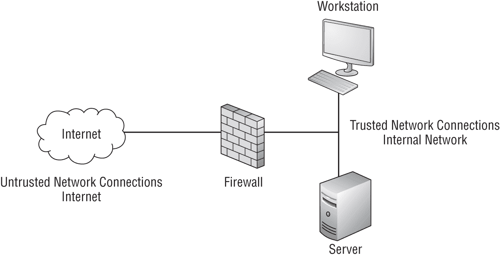

**图 3.2** 防火墙部 acement 与设计

`防火墙规则`决定检查何种类型的流量、允许何种流量通过以及阻止何种流量。配置防火墙规则最基本的方法是通过`访问控制列表 (ACL)`。`ACL`用于包过滤，并用于选择要由防火墙或设备分析、转发或以某种方式影响的流量类型。`ACL`是`数据流强制`的一个基本示例。简单的防火墙，更具体地说是 `ACL` 配置，可能会根据源地址和目的地址阻止流量。然而，更高级的配置可能会根据接口、端口、协议、阈值和各种其他标准拒绝流量。在实施 `ACL` 之前，请务必对网络和安全组件执行安全配置和基线化。放置在 `ACL` 中的规则不仅可用于允许或阻止流量。例如，规则还可能记录活动以供日后检查或记录警报。表 3.1 显示了一个示例规则集。

**表 3.1** 基础规则集

| 规则编号 | 动作 | 协议 | 端口 | 方向 | 备注 |
| --- | --- | --- | --- | --- | --- |
| 规则 20 | 允许 | DNS | 53 UDP | 出站 | 无 |
| 规则 50 | 允许 | HTTP, HTTPS | 80, 443 | 出站 | 无 |
| 规则 100 | 允许 | SMTP | 25 | 入站 | 发往邮件服务器 |
| 规则 101 | 允许 | SMTP | 25 | 出站 | 来自邮件服务器 |
| 规则 255 | 拒绝 | ALL | — | 双向 | 无 |

对于 CASP+ 考试，你需要对 `ACL` 及其格式有基本的了解。Cisco IOS 环境中标准 `ACL` 的命令语法格式如下：

```
access-list access-list-number {permit|deny}
{host|source source-wildcard|any}
```

还有扩展 `ACL`。这些规则能够更仔细地检查流量并检查更多项目，例如：

*   协议
*   端口号
*   区分服务代码点（`DSCP`）值
*   优先级值
*   同步序列号（`SYN`）位的状态

扩展 IP、ICMP、TCP 和 UDP `ACL` 的命令语法格式如下所示：

```
IP 流量
 access-list access-list-number
  [dynamic dynamic-name [timeout minutes]]
  {deny|permit} protocol source source-wildcard
  destination destination-wildcard [precedence precedence]
  [tos tos] [log|log-input] [time-range time-range-name]
 ICMP 流量
 access-list access-list-number
  [dynamic dynamic-name [timeout minutes]]
  { deny|permit } icmp source source-wildcard
  destination destination-wildcard
  [icmp-type [icmp-code] |icmp-message]
  [precedence precedence] [tos tos] [log|log-input]
  [time-range time-range-name]
 TCP 流量
 access-list access-list-number
  [dynamic dynamic-name [timeout minutes]]
  { deny|permit } tcp source source-wildcard [operator [port]]
  destination destination-wildcard [operator [port]]
  [established] [precedence precedence] [tos tos]
  [log|log-input] [time-range time-range-name]
 UDP 流量
 access-list access-list-number
  [dynamic dynamic-name [timeout minutes]]
  { deny|permit } udp source source-wildcard [operator [port]]
  destination destination-wildcard [operator [port]]
  [precedence precedence] [tos tos] [log|log-input]
  [time-range time-range-name]
```

让我们回顾一下基本规则如何工作。图 3.3 显示了一个基本网络配置，其中两个网段由一台路由器隔开，并共享一个互联网连接。

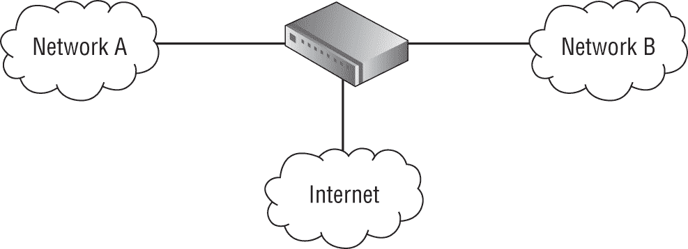

**图 3.3** 带防火墙的基本网络

在第一个示例中，假设已决定阻止所有 Telnet 流量。Telnet 以明文发送信息，不被视为安全协议。

```
hostname R1
!
interface ethernet0
ip access-group 102 in
!
access-list 102 deny tcp any any eq 23
access-list 102 permit ip any any
```

在此配置中，所有目标端口为 23 的 TCP 流量均被防火墙阻止。所有其他流量均被允许。

在本示例中，目标端口非 TCP/23 的 Telnet 仍将被允许。如果要阻止通往任何 TCP 端口的 Telnet，则需要其他控制手段。了解标准 `ACL` 常用于限制 Telnet，或理想情况下限制 SSH 对路由器等设备的访问，方法是将该访问限制在特定 IP 地址，这也很有帮助。扩展 `ACL` 用于更多任务。另请注意，前面的示例仅用于演示目的。如前所述，通常认为最佳实践是仅允许所需内容并拒绝其他所有内容，遵循最小权限原则。

练习 3.2 将向你展示如何审查基本 `ACL`。


## 基于主机的防火墙

*基于主机的防火墙*是直接在网络主机或设备上运行的设备。部署基于主机的防火墙是为了保护安装它的设备免受攻击。基于主机的防火墙通常具有预定义规则，以保护主机免受特定攻击模式的侵害。

某些基于主机的防火墙还可以防止恶意软件攻击网络上的其他设备。添加基于主机的防火墙建立在纵深防御的概念之上。

基于主机的防火墙通过检查和控制安装了防火墙的主机的入站和出站流量来工作。虽然防火墙种类繁多，但只有基于主机的防火墙是设计为驻留在终端主机上并保护其免受攻击的。与所有防火墙一样，基于主机的防火墙通过检查流经接口的流量来工作。其工作方式与边境警卫和海关人员非常相似。主机层为网络和边界上的其他设备增加了防护。

当人员和产品跨越一国边境前往另一国时，都会接受检查。所有防火墙都通过使用预定义规则集来工作。高级和应用层防火墙也可以根据行为对流量做出判断。防火墙和其他网络检查设备通过增加另一层控制来增强纵深防御。

### 概述

威胁管理是一项全职工作。管理威胁需要时间、资金和情报等资源。它要求牢固掌握涉及的行为体，包括他们的复杂程度和技术。威胁管理应涉及主动狩猎并主动缓解这些威胁。

幸运的是，好人也有资源可用，例如情报源、工具和框架来提供帮助。CASP+ 考生应了解各种威胁行为体的属性和方法。考生应识别可用的框架及其中的概念。最后，CASP+ 考生必须能够识别妥协指标，知道在哪里查找更多指标，并理解如何使用适当的工具和规则进行响应。

## 考试要点

**了解收集信息的各种方式。** 从在线和离线资源获取开源信息会产生大量来源列表。了解在哪里查找你想要的信息类型。理解 `HUMINT` 与 `OSINT` 的区别。

**能够说出具体的妥协指标。** 理解什么是妥协指标。知道在哪里搜索更多信息，以及你发现内容的重要性。

**了解威胁你的行为体类型。** 坏行为体类型拥有各种财力支持、技能和可用资源。

**了解如何以及何时应用 ACL。** 访问控制列表在网络访问控制方面是一项宝贵的资源。学习如何阅读、编写和理解它们。

## 复习题

你可以在附录中找到答案。

1.  哪个术语描述了对内部威胁或影子 IT 的搜索，在被发现之前，它们一直“在雷达下飞行”？

    1.  威胁狩猎
    2.  威胁仿真
    3.  情报
    4.  定向攻击

2.  LoJax、Bad Rabbit 和 NotPetya 是以下哪项的三个示例？

    1.  零日威胁
    2.  恶意软件
    3.  APT
    4.  竞争对手

3.  你发现可疑的日志条目，表明可能发生了安全事件。你决定需要进一步调查。以下哪项描述了你发现的内容？

    1.  漏洞
    2.  ACL
    3.  威胁情报类型
    4.  妥协指标

4.  不满员工相对于外部人员的一个关键优势是什么？

    1.  信任
    2.  时间
    3.  金钱
    4.  签名

5.  你的经理询问你是否注意到任何异常的网络流量或其他网络问题。哪些日志可能有助于你回答这些问题？

    1.  FIM 日志
    2.  NetFlow 日志
    3.  防火墙日志
    4.  访问日志

6.  以下哪种警报会警告安全分析师或管理员数据很可能已被泄露出网络？

    1.  IoC
    2.  FIM
    3.  DLP
    4.  ICE

7.  哪种入侵检测处理技术常用于识别正向匹配，但难以跟上当今的流量速度和卷？

    1.  SIEM
    2.  正则表达式
    3.  基于签名
    4.  基于异常或行为

8.  以下哪项可以根据源地址和目标地址阻止流量？

    1.  深网
    2.  脚本小子
    3.  ICS
    4.  ACL

9.  在以下访问控制列表示例中，以下哪个答案是正确的？

    ```
    hostname R1
    !
    Interface ethernet0
    Ip access-group 102 in
    !
    access-list 102 deny tcp any any eq 23
    access-list 102 permit ip any any
    ```

    1.  目标端口为 102 的 TCP 流量被允许。
    2.  目标端口为 23 的 TCP 流量被阻止。
    3.  目标端口为 102 的 TCP 流量被阻止。
    4.  目标端口为 23 的 TCP 流量被允许。

10.  你收到一条警报，指出客户目录中的文件发生了异常更改。这是哪种类型的警报？

     1.  DLP
     2.  IDS
     3.  FIM
     4.  IPS

11.  以下哪项不是概念性钻石入侵分析模型的标签？

     1.  能力
     2.  攻击
     3.  受害者
     4.  基础设施

12.  为了更好地了解一家公司，一名员工被指派浏览社交媒体、收听录制的演讲并阅读专利。这名员工正在执行哪种类型的情报收集？

     1.  HUMINT
     2.  APT
     3.  OSINT
     4.  ATT&CK

13.  一位坚定的安全分析师在系统上发现了一些证据，值得进一步调查。最终，分析师确认驻留了高级恶意软件且难以清除。安全分析师建议从头重建系统。分析师发现了什么？

     1.  IoC
     2.  ACL
     3.  DLP
     4.  APT

14.  哪种情报收集方法被描述为间谍活动或收集情报的“人的方面”？

     1.  经验教训报告
     2.  深网
     3.  HUMINT
     4.  OSINT

15.  如果你需要查明组织的技术联系人或其域名的注册信息，哪种 OSINT 资源可能会有帮助？

     1.  DNS 记录
     2.  深网
     3.  TRA
     4.  WHOIS

16.  无论遵循网络攻击链还是 ATT&CK 框架，以下哪种战术会最先发生？

     1.  侦察
     2.  指挥与控制
     3.  数据渗出
     4.  发现

17.  在 ATT&CK 框架中，以下哪种战术发生在最后？

     1.  初始访问
     2.  持久化
     3.  发现
     4.  防御规避

18.  为了获取竞争对手财产的访问权限，你被指派与竞争对手的员工交朋友，利用社交媒体、交谈和同理心建立个人信任。你正在执行哪种类型的情报收集？

     1.  HUMINT
     2.  APT
     3.  OSINT
     4.  ATT&CK

19.  哪个危险的坏行为体类别描述了那些寻求破坏关键基础设施（如核电站、发电站和水处理厂）的人？

     1.  脚本小子
     2.  有组织犯罪
     3.  内部威胁
     4.  国家行为体

20.  在法律事务所 Dewey、Cheatem 和 Howe 将应收账款部门外包几个月后，该律所遭遇了银行账户被黑客攻击。他们越来越怀疑遭遇了攻击。以下哪个术语描述了可能发生的情况？

     1.  拒绝服务攻击
     2.  SYN 洪水攻击
     3.  不满员工
     4.  供应链攻击

# 第 4 章


# 安全运营：漏洞评估与运营风险

本章讨论漏洞管理和运营风险。作为 CASP+ 持证人，你应该能够管理漏洞，识别业务和行业信息来源，并解释相关的安全风险。

互联网安全中心（CIS）是一个由社区驱动的非营利组织，因其主动保护企业的控制措施和指南而受到全球认可。关键安全控制文档将持续漏洞管理列为高优先级事项。你必须拥有资产清单，了解这些资产上安装了什么软件，知道谁拥有访问权限，并理解这种组合所带来的固有漏洞和风险（`www.cisecurity.org`）。

技术和非技术风险无处不在。无论你转向何处，都存在风险；它们从你首次打开计算机的那一刻开始，并在网卡激活的那一刻呈指数级增长。安全专业人员总是会提出假设性问题，例如“允许谁进入设施？访客是否有人陪同？是否允许员工将智能手机等个人设备插入公司配发的计算机和笔记本电脑？”你所做的每一个物理和数字选择中都潜藏着漏洞和威胁。本章将讨论这些项目，并包含 CompTIA 期望你为考试掌握的与漏洞管理、运营风险相关的内容，以及如何查找最新信息以保持知识更新。

## 术语

在讨论漏洞和风险管理之前，确保定义一些基本术语非常重要。你可能会面临在特定情境中识别风险、威胁和漏洞的挑战。所有行业共享基本术语和语义。IT 安全也不例外，在风险主题中，有一些术语你会反复看到。让我们在此定义它们：

*   **资产** `asset` 是指对机构有价值的项目，例如数据、硬件、软件或物理财产。资产是对公司具有定量或定性价值的单个项目或项目集合。一些组织将员工视为资产。

*   **风险** `Risk` 是威胁发生或实现的概率或可能性。

*   **漏洞** `vulnerability` 可被描述为硬件、软件或组件中的弱点，可能被利用以便威胁破坏、损坏或危害资产。

*   **威胁**

    `threat` 是指可能对 IT 资产或数据资产造成伤害、损失、损坏或危害的任何代理、条件或环境。威胁的可能性是指发生的概率或事件实际发生的几率。

*   **动机** `Motivation` 是活动背后的驱动力。例如，攻击者可能受多种不同原因驱动。一些常见原因包括声望、金钱、名声和挑战。

*   **风险来源** `source` 可以是内部或外部。内部风险可以是从不满的员工到硬盘故障的任何事项。外部风险包括洪水等自然灾害以及罢工和抗议等人为事件。例如，风险来源可能是服务器机柜上的锁损坏，而威胁是现在有人可以窃取服务器硬盘。

    从 IT 安全的角度来看，`threat` 是指影响 IT 资产（数据、系统、软件或硬件）的机密性、完整性或可用性的任何情况。以下是一些常见威胁示例：

    *   **自然灾害** `Natural disasters` 是我们无法控制的事件，例如恶劣天气（飓风、暴风雪、龙卷风）、火灾、洪水、地震和海啸。

    *   **恶意代码** `Malicious code` 包括所有形式的破坏性程序，如病毒、蠕虫、特洛伊木马、键盘记录器等。该软件的显著特征是它是为破坏、篡改、泄露或销毁系统或数据而开发的。例如，病毒是能够复制并附着于其他可执行对象并对其进行感染的可执行程序。一些病毒在完成复制和感染后还会执行破坏性或隐蔽性活动（有效载荷）。

    *   **物理安全漏洞** `breach of physical security` 可由可信内部人员或不可信外部人员发起。入侵者、破坏者和窃贼会移除敏感信息、销毁数据，或物理损坏或移除硬盘和笔记本电脑等硬件。

    *   **黑客攻击** `Hacker attacks` 通常导致数据被窃取、丢失、损坏或篡改。如果组织没有备份或外部归档数据作为其数据恢复和业务连续性计划的一部分，组织数据的丢失或损坏可能构成关键威胁。此外，如果被攻破的数据属于机密性质，根据可能产生的潜在损害，这也可能对组织构成关键威胁。

## 漏洞管理

`vulnerability` 是系统设计、操作程序实施或软件/代码开发中的弱点（例如，编码错误、生产环境中未移除的后门或代码中的漏洞）。通过正确实施防护措施和补偿性对策，可以消除或减少漏洞。

你必须比攻击者更了解你的环境，并利用攻击者的思维模式在关键控制中开发你的安全计划。企业组织在用于排查网络故障、识别资产和定期评估漏洞的工具方面有许多选择。这是一个循环过程，如图 4.1 所示。

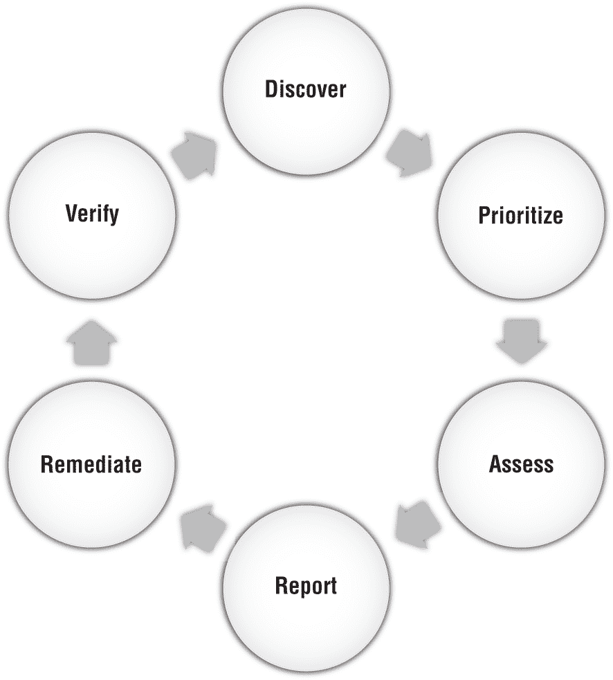

**图 4.1** 漏洞管理生命周期

漏洞时间是指从漏洞被发现到被修补之间的时间。漏洞窗口期是 IT 资产最脆弱的时期。这个窗口期变得越来越重要，因为它可能比过去大得多。基于已知漏洞创建恶意软件的周期不断缩短。

一些组织将漏洞管理任务外包或使用漏洞管理即服务（VMaaS）。当你减少了对内部资源的依赖时，就能更好地优先分配人力资源到安全的其他领域。外包的第三方应能提供可操作的情报和更高的可见性，并提供主动的修补和补救方法。这也是协助遵守法规（如要求金融组织进行漏洞扫描的 SOX）的绝佳方式。

你无法保护你不知道拥有的东西。在此周期的发现阶段，你将确定网络上有哪些资产正在与其他设备通信。配置扫描工具有多种方法。例如，扫描工具可以向 TCP 端口发送数据包并等待 SYN-ACK 响应，或者发送 UDP 数据包并等待端口关闭时的复位响应。一旦扫描工具知道资产在网络上存活，你可以配置扫描以尝试通过使用凭据发现该端点的操作系统。

有凭据/无凭据扫描通常称为授权/未授权扫描。`uncredentialed scan` 通常使用 ICMP 从外部 ping 资产以查看其是否响应。这是了解你的网络在外部人员眼中是什么样子的绝佳方式，这些外部人员正在扫描你的环境寻找入侵途径。


### 凭证扫描与漏洞管理

#### 凭证扫描

**凭证扫描** 更加深入，消耗更多资源，并能为您提供对资产的关键洞察，特别是您可能需要缓解的漏洞。我们在扫描期间使用服务账户凭证登录资产。获得授权后，我们能够从内部更深入地查看资产。凭证扫描可以提供诸如操作系统补丁级别、机器上加载了什么软件及软件版本以及如何配置等信息。运行深度凭证扫描所需的时间呈指数级增长。

特定的操作系统和网络服务应用程序会在其 TCP、UDP 和 ICMP 数据包中留下不同类型的数据。这些数据会被分析以生成操作系统指纹。

#### 操作系统指纹识别

防御者使用操作系统指纹识别来确定可能存在哪些漏洞，并确定缓解的优先级和方式。攻击者则利用它来查找漏洞并尝试加以利用。指纹识别可以是主动的，也可以是被动的。

**主动漏洞扫描** 通过向系统发送数据包并检查响应来确定目标操作系统。大多数主动指纹识别是使用 `Nmap` 工具的变体完成的，该工具可在 `nmap.org` 下载。

**被动漏洞扫描** 是避免被入侵检测系统 (IDS)、入侵防御系统 (IPS) 或防火墙检测到的更好方式。被动指纹识别使用从称为 **数据包捕获** 或 `.pcap` 文件的主机收集的数据包样本。被动扫描会对目标操作系统进行猜测，其准确性低于主动指纹识别。通过确保网络接口卡 (NIC) 不在混杂模式下运行，可以缓解被动扫描。被动漏洞扫描的真正优势在于，它允许您在不干扰主机系统的情况下查找漏洞。它还允许您执行持续扫描。主动漏洞扫描的一个问题是，某些测试例程可能导致主机系统挂起或崩溃。用于被动指纹识别的流行工具是 `Ettercap`。`Ettercap` 是一套用于主机分析、嗅探实时连接和内容过滤的工具，可在 `ettercap-project.org` 找到。

创建 `.pcap` 文件的流行工具是 `Wireshark`。`Wireshark` 是每个网络或安全管理员都应该了解的工具。它是一款开源工具，用于捕获网络流量并在极细粒度的层面上分析数据包。数据包捕获可以告诉您传输时间、源地址、目的地址和协议类型。这些信息对于评估正在发生的事件或排查网络中的设备故障至关重要。它还可以帮助安全分析师确定网络流量是否为恶意攻击、攻击类型、被攻击的 IP 地址以及攻击源头。因此，您将能够在防火墙上创建规则以阻止恶意流量来源的 IP 地址。

#### 代理扫描

当您没有时间等待直接从托管扫描软件的服务器启动的、按计划运行的凭证扫描，但需要实时分析来自资产的相同信息时，**基于服务器的扫描** 的替代方案是使用 **基于代理的扫描**。使用基于代理的扫描时，会在端点上安装一小段软件，并编程为在特定的时间间隔（从每 30 分钟到每 24 小时）进行检查。

在主机上使用代理时，不需要凭证扫描。基于代理的扫描的一个好处是，服务账户凭证被暴露并被恶意用于横向移动和权限提升的风险被最小化。代理将自动从端点收集数据并共享更新的信息。使用基于代理的扫描的另一个好处是，随着更多员工在家办公，这种方法使很少加入企业网络的远程员工能够对其资产进行漏洞评估。

#### 资产优先级排序

一旦您能够绘制出网络上的资产、主机、节点和中间设备，就可以进入漏洞管理的下一步：优先级排序。

并非所有设备都同等重要。**域** 是网络上的一组计算机和其他设备，它们通过一组通用规则进行访问和管理。Windows 域控制器 (DC) 是一台响应网络内登录认证请求的 Microsoft 服务器。在企业环境中，如果 DC 发生故障，您的服务台将因用户无法登录域而被大量来电淹没。然而，如果市场部门有一个每月备份一次的小型文件服务器，且该机器发生故障，则可能只会引来一两个电话。在了解网络上存在哪些机器后，您必须确定哪些资产是任务关键型的。

一旦您确定了哪些资产有心跳，并知道哪些资产因故障或妥协会导致混乱，下一步就是确定资产的漏洞。这通常通过分析操作系统、开放的端口、这些端口上运行的服务以及这些资产上安装的应用程序版本来完成。

#### 报告构建

现在您可以构建报告了。一些报告会提交给高层管理人员，需要趋势分析和漏洞修复计划等信息。高层管理人员基于这些报告做出的决策可能涉及预算或人员编制。更技术性的报告通常会下发给资产所有者，并包含需要在该设备上修复的内容。

手握报告，您现在拥有了环境中漏洞及其所在设备的列表。一些具有高级功能的软件可以生成如何修复这些漏洞的说明。大多数这些技术报告将根据 **通用漏洞评分系统 (CVSS)** 为您提供漏洞的定性严重程度评级。美国国家标准与技术研究院 (NIST) 维护着国家漏洞数据库 (NVD)。在这个位于 `nvd.nist.gov` 的数据库中，您可以看到基于范围、访问向量、复杂性和认证，以及对机密性、完整性和可用性的影响，对每个已报告漏洞的历史定量分析。基本上，这意味着每个漏洞都将有一个 0 到 10 的关键性排名，0 为可容忍，10 为关键，如图 4.2 所示。

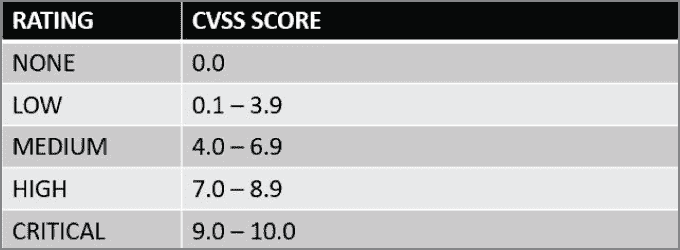

**图 4.2** CVSS 3.1 定性严重程度评级标准

### 软件漏洞关注领域

在处理风险时，软件是安全专业人员必须非常关注的一个领域。各种软件中的漏洞司空见惯，如以下示例所示：

*   **固件** `固件` 通常存储在 ROM 中，并在系统上电时加载。由于固件是嵌入式的，它可用于隐藏恶意代码，如固件 Rootkit。
*   **操作系统** 操作系统软件加载在工作站、服务器、笔记本电脑、平板电脑和智能手机上。未修补的操作系统可能是一个巨大的风险，特别是对于服务器和连接互联网的系统。
*   **配置文件** 这些文件由设备的配置文件和配置设置组成。配置文件可能被篡改以运行未经授权的程序或批处理文件。


#### 应用软件

该软件由在笔记本电脑、工作站或智能手机上运行的应用程序或可执行文件组成。未修补的应用程序是当今攻击者的最大目标之一。在早些年，Adobe Reader 和 Microsoft Office 等桌面应用程序是漏洞利用的目标。如今，面向移动设备的应用程序是热门目标。

在练习 4.1 中，您将学习如何识别和跟踪漏洞。

##### 安全内容自动化协议

**安全内容自动化协议 (SCAP)** 是一种将漏洞管理标准与策略、度量和合规性相结合的方法论，用于实现标准化和自动化。

SCAP 产品分为两类。它们是内容生产者和内容消费者。内容生产者是生成 SCAP 源数据的工具。内容消费者是获取现有 SCAP 内容、对其进行处理并生成相关 SCAP 结果的产品。**SCAP 扫描器** 用于将行业安全标准应用于当前没有此类标准的组织，或应用于安全标准实施薄弱的组织。SCAP 允许安全管理员根据预定的安全基线扫描计算机、软件和其他设备，以确定已实施的配置和软件补丁与基线标准相比如何。国家漏洞数据库 (NVD) 是美国政府的 SCAP 内容存储库。

在练习 4.1 中搜索和调查 Windows 漏洞时，查询 NVD 的选项之一是查找 US-CERT 技术警报和漏洞说明以及 **OVAL 查询**。OVAL 是开放漏洞与评估语言的首字母缩写。OVAL 是一项社区驱动的工作，旨在标准化评估和报告，以提供可复现的结果。OVAL 最初由美国国土安全部赞助，现在由 CIS 维护。详情请访问 `oval.cisecurity.org`。

OVAL 是一种开放语言，用于检查资产上存在的配置问题、程序和补丁。它不是漏洞扫描器。OVAL 能够共享如何在系统中查找漏洞的技术细节，并且由于公开的社区驱动内容，许多供应商、研究人员和其他安全专业人员能够协作开发基于 XML 的定义，帮助识别资产上的问题。

OVAL 解释器是一个免费的命令行工具，您可以从 `sourceforge.net` 下载，用于收集系统信息、评估和生成 OVAL 定义。它的创建旨在使用 OVAL 文件和模式，并在端点上执行内容。OVAL 定义提供了一种方式来选择应评估哪些端点信息，建议应找到哪些值，并生成一份报告，对比观察到的内容与预期的内容。

另一种由 NIST 赞助并用于安全基准测试的规范语言是可扩展配置清单描述格式 (XCCDF)、**XCCDF** 与 OVAL 一样，用于标准化，但专门用于清单和基准或其他配置规范。通过使用这些类型的标准，您可以基于良好的安全实践创建更安全的环境。XCCDF 也基于 XML，并支持信息交换、文档生成和自动化合规性测试。

SCAP 工具箱中的另一种标准化是使用通用平台枚举 (CPE)、**CPE** 是在企业中识别硬件和软件类别的通用方法。CPE 可以识别硬件或软件是否已安装，但不像版本或序列号那样精细。例如，如果环境中某硬件设备的 CPE 被识别为 Cisco ASA 防火墙设备，则它可以触发漏洞管理工具检查该设备的已知通用漏洞，然后提示配置管理工具验证其是否遵循组织关于防火墙的策略。

与练习 4.1 中所示的 CVE 列表类似，还有一个用于通用配置枚举 (CCE) 的列表。**CCE** 列表 (`ncp.nist.gov/cce/index`) 为系统配置分配单独的标识符，以便数据可以跨多个工具进行索引，从而改进任何工作流。NIST 安全配置指南、CIS 基准和国防信息系统局安全技术实施指南 (DISA STIG) 中都有 CCE 标识符。正如图 4.3 所示，对于 Red Hat Linux 的 CCE，每个 CCE 都有一个 ID 编号、描述、参数、技术机制和参考。与配置控制关联的 CCE 标识符充当机器可读的可执行文件与人类可读的指导文档之间的翻译器。

在坚持 IT 安全最佳实践标准化这一话题的同时，资产报告格式 (ARF) 被用作报告和关联中一致使用数据的模型。**ARF** 与供应商无关、极其灵活，可用于任何类型的资产，而不仅仅是 IT 设备。要了解有关 ARF 的更多信息，请访问 `csrc.nist.gov/projects/security-content-automation-protocol/specifications/arf`。

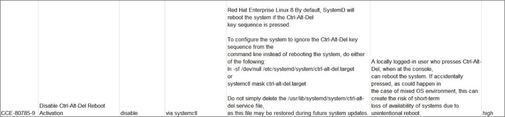

**图 4.3** 适用于 Red Hat Enterprise Linux 8 的 CCE-80785-9

##### 自我评估与第三方供应商评估

在组织的资产完成清点、估值和分类后，下一步可以开始。这一步是 **风险评估**，即识别潜在风险和威胁。这些活动通常由风险评估团队执行，目标是确定威胁发生的可能性。该团队受高层管理委托，负责识别所有威胁并审视这些威胁的影响。

风险评估有多种类型，但基本步骤相同，指导您做出正确的决策。流程始于确定合适的员工任务小组来领导评估并评估结果。在审查现有安全策略（包括漏洞管理和 IT 资产数据库维护相关的策略）后，该团队应根据经验和专业知识准备一份潜在威胁清单。当每个威胁的影响和可能性都经过评估后，下一步是规划在最坏情况下采取的适当控制措施和行动。

对于风险极低的组织，对策略、程序、指南、标准、工具、人员和流程进行内部自我评估可能是可以接受的。**风险管理团队** 负责识别和分析所有风险。其成员应由公司各部门的管理人员和员工组成。

团队宗旨确立后，团队可被指派负责制定和实施风险管理计划。该团队应由企业架构中职位足够高的人领导，以便轻松与高层管理沟通，并获得风险评估过程成功所需的资金。成功的结果可以用多种不同方式衡量。成功可能意味着团队能够降低保险成本、减少针对公司网站的攻击，或验证对隐私法的合规性。

团队组建到位且资金落实后，团队将把注意力转向收集数据和识别威胁。询问威胁的第一批人应该始终是资产所有者，因为他们了解业务面临的挑战以及威胁的来源。IT 部门将帮助将这些业务威胁映射为 IT 相关问题。以下额外来源也可使用：

*   精算表和保险记录
*   审计报告


### 利益相关者与风险来源

*   企业主和高级管理人员
*   设施记录
*   法律顾问
*   人力资源
*   政府记录
*   网络管理员
*   运营部门
*   安全管理员
*   行业通报和公告
*   供应商网站
*   信息共享与分析中心（ISACs）

风险不仅仅是自然事件的结果，也可能与人有关。根据商业模式和公司开展业务的地点，许多人可能会访问设施，包括员工、承包商、客户、销售代表等。个人可能导致某种形式事件的风险是真实存在的。这种风险可能源于意外情况，也可能源于蓄意行为。风险来源可能是内部人员，也可能是外部人员。尽管我们倾向于信任共事的人，但很大比例的攻击是由内部人员发起的。内部人员拥有发动攻击的手段和机会，而外部人员可能只有动机。因此，内部人员发动攻击的条件更成熟。以下是评估内部和外部风险时的关注领域：

*   **资源滥用** 这种风险包括任何未经策略和程序授权的资源使用，可能包括读取未受保护的文件、侵犯版权、玩耗时的电脑游戏、将计算机账户用于未经授权的活动（如兼职工作）、发送垃圾邮件、为个人牟利或非法目的分发其他物品等。

*   **敏感信息访问与窃取** 这种风险直接关联到机密性的丧失。信息具有价值，敏感信息的丢失代价极高。知识产权被盗对企业造成毁灭性后果。

*   **设备设置或信息篡改** 如果员工能访问系统或更改设置，访问控制可能被绕过并被篡改。

*   **信息泄露** 这类风险涵盖所有涉及故意或意外泄露敏感信息的威胁。信息隐私受到影响，因为信息在未经授权的情况下被暴露。

*   **贪污挪用** 这是指从组织欺诈性挪用资金或服务的风险。应实施各类控制措施以防止此类风险。

*   **物理破坏**

    此威胁可能来自内部人员或外部人员。物理资产的破坏可能给组织造成巨额损失。

*   **盗窃** 公司资产被盗的后果范围从轻微恼人到极具破坏性。CEO 的笔记本电脑可能在机场被盗。此时，真正的损失是笔记本电脑，还是明年新产品发布计划？

*   **未授权进入** 控制谁进入设施、何时进入以及拥有何种访问权限，对组织安全至关重要。

#### 第三方风险评估

更高层级的风险评估应由第三方组织执行。`第三方评估`由中立方进行，分析组织面临的诸多风险，包括来自其他第三方关系（供应商、承包商、服务提供商或供货商）引入的风险。威胁这些方的风险也会威胁您的企业。每引入一个新的第三方，都会扩大威胁的可能性。

一些供应商不愿暴露其风险水平，但您必须寻求适当级别的评估，以将对组织的不利影响降至最低。您计划合作的组织可能会与分包商共享其数据。您需要了解该数据如何及在何处被使用或存储、谁有权访问、是否加密以及使用何种算法加密。

第三方评估通常依据行业框架进行，如美国国家标准与技术研究院（`NIST`）框架或国际标准化组织（`ISO`）标准。`NIST` 框架通常被联邦、州、地方政府及与这些政府合作的企业采用。`ISO` 通常被私营和公营公司及其他市场驱动型企业采用。一些评估植根于对联邦标准（如《健康保险流通与责任法案`HIPAA`》）或行业标准（如支付卡行业数据安全标准`PCI-DSS`）的合规性。

组织还应通过来源策略，确定哪些任务应由内部员工完成，哪些应由外部第三方完成。外包是一种常见方法。`外包`可定义为一家公司为另一家公司提供服务的安排，这些服务可能原本在内部提供，也可能不是。在新兴的全球经济中，外包已成为更大的议题，安全专业人员需密切关注。在确保第三方提供商具备必要的信息安全水平时，始终会存在顾虑。

在过去十年左右的时间里，外包在 IT 领域变得更为普遍。在某些情况下，公司的整个信息管理职能被外包，包括规划和业务分析，以及网络和工作站的安装、管理和维护。以下服务常被外包：

*   应用/Web 托管
*   支票处理
*   计算机帮助台
*   信用卡处理
*   数据录入
*   薪资与支票处理

外包决策的关键在于确定任务是否属于组织的核心竞争力或定义组织的专长。安全应在外包决策中发挥重要作用，因为某些任务若由组织外部人员执行，风险会大得多。任何决策都应通过彻底的业务流程审查。

#### 补丁管理

`补丁管理`是系统管理的关键领域。随着安全模型的成熟，有必要制定管理系统和软件补丁及升级的策略。大多数软件补丁旨在修复初始发布后发现的现有软件问题，其中许多聚焦于安全。其他补丁可能涉及软件功能的特定新增或增强。在图 4.4 中，展示了补丁管理生命周期的示例。

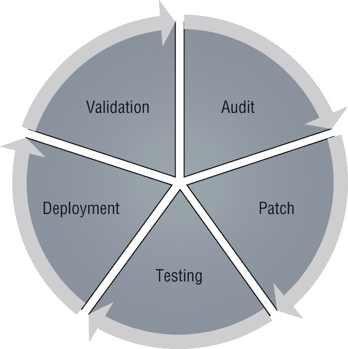

**图 4.4** 补丁管理生命周期

2017 年 3 月 14 日，微软发布了针对 `MS17-010` 的关键安全公告。该漏洞绰号 `EternalBlue`（永恒之蓝），是由美国国家安全局（`NSA`）编写的漏洞利用代码，一个月后被 `Shadow Brokers` 黑客组织泄露给公众。`EternalBlue` 利用微软服务器消息块（`SMB`）漏洞，简而言之，`NSA` 就该漏洞利用代码被盗一事警告了微软，使该公司得以准备补丁。然而，太多人未安装补丁，同年 5 月，`WannaCry` 勒索病毒利用 `EternalBlue` 漏洞感染了这些脆弱系统。微软发布了更多紧急补丁。同样，许多人未修补，6 月，同样利用 `EternalBlue` 的 `NotPetya` 恶意软件席卷全球，重点攻击乌克兰（2017 年 6 月）。


如果组织在 2017 年 3 月就已关注，它们本不会受影响。如果它们在 2017 年 4 月关注，就会学会如何规避该漏洞。在 5 月和 6 月，本可应用补丁从而避免问题。该漏洞至今仍是个问题，并已演变出多种变体，利用名为 WannaMine 的恶意软件攻击加密货币行业。**Cryptojacking**（加密劫持）是指恶意软件无声感染受害者计算机，然后利用该机器的资源运行极其复杂的解密程序以生成货币的过程。Monero 是一种合法的加密货币，可添加到数字钱包并像 Bitcoin 和 Ethereum 一样消费。这听起来相当无害，但回顾 CIA 三要素，加密劫持恶意软件会窃取你的 CPU 和 RAM 资源用于挖矿，且能轻松在你的网络中传播。如果你考虑它将消耗你组织中多大体量的处理能力和带宽，你绝对不想遭受这种感染。你的系统将为攻击者生成加密货币。

吸取的教训是我们必须保持系统更新。在补丁管理计划中，你必须包含 Microsoft、Apple 和 Linux 的操作系统补丁和更新，以及 Chrome、Firefox、Java 和 Adobe 等第三方应用程序的更新。你的网络上可能还有其他软件或固件。如果你有安装了软件的系统，就必须制定安全策略，明确何时为其打补丁。如果你冒险不打补丁，就会让系统暴露在可预防的攻击之下。

补丁管理生命周期始于审计，即扫描环境以查找所需补丁。在知道需要哪些补丁后，在向整个组织推出这些更新之前，最佳实践是在非生产系统上测试这些补丁。如果不这样做，你就冒着用本应修复问题的东西破坏系统的风险。如果你能在全局生产部署前发现问题，你的运营就不会受影响。一旦你知道缺少哪些补丁以及哪些补丁可行，就将它们安装在易受攻击的系统上。大多数情况下，这是通过 `Windows Update` 完成的。大多数企业级组织使用某种类型的补丁管理软件解决方案。

专注于你最脆弱的系统（如运行 Windows 操作系统的系统），以及高度脆弱的第三方程序（如 Adobe 和 Java），是补丁管理的关键概念之一。从风险最高但又至关重要的设备入手，能让你在最能发挥作用、提供最大风险缓解的地方分配时间和资源。

根据组织规模、网络安全团队人数、他们能投入补丁管理的工时以及需要保持更新的系统数量，你可能想要利用第三方补丁管理软件。专门针对 Microsoft 打补丁，Microsoft 在所有 Windows Server 操作系统中都包含了一个名为 Windows Server Update Services (WSUS) 的工具。有许多可用的基于 Web 的桌面管理软件工具。此类软件可远程管理和计划 Windows、Mac 和 Linux 的更新，无论是在局域网还是广域网中。除了补丁管理、软件安装和服务包管理，你还可以用它来标准化桌面。你可以通过应用相同的壁纸、快捷方式、打印机设置等，保持镜像当前且同步。

从发现漏洞到 IT 管理员采取行动保护环境免受该漏洞侵害的时间应尽可能短，尤其是在任务关键型资产上。这种理念可能会导致快速补丁管理与变更管理和质量保证测试产生冲突。这将是一个在未修补系统的风险与修复过程中破坏系统的可能性之间进行权衡的过程。建立一个记录你建立、记录和维护变更策略的补丁管理计划，对 IT 安全至关重要。

#### 信息来源

作为安全专业人员，你必须持续研究以跟上当前威胁和行业变化。有许多资源可助你研究。下面列出的仅是可用资源的一小部分。它们分为趋势和工具两类。

你可能还记得你的第一台电脑，或者多年前你可能告诉过别人，只要运行杀毒程序，就能免受大多数在线威胁。这是 2000 年前的普遍认知。如今，杀毒程序只是抵御数字威胁所需保护的一小部分。值得注意的是，某些操作系统比其他系统更容易受到病毒攻击，近 90% 的勒索软件针对 Microsoft Windows 操作系统，而针对 macOS 的勒索软件仅占个位数。

安全专业人员可为其环境评估的其他防护措施是部署不可变系统。不可变基础设施指那些无法更改或修改的服务器。要进行更改，必须重新部署整个服务器或虚拟机并退役旧的。好处包括这些资产的一致性和可靠性，但这需要专用资源。每次更新或安全补丁都需要重新部署。

CASP+ 必须进行漏洞研究并紧跟当前安全趋势。此类研究有助于在网络遭攻击前识别弱点并提醒管理员。研究还有助于在潜在安全问题恶化前识别并纠正它们。

如今获取网络安全信息的地方很多，包括网站、博客、会议、政府通告和公告，以及主流媒体。通过紧跟职业领域动态，你能增强专业技能。了解网络安全专业领域的当前动态，并连接最佳资源以获取及时信息，会使你成为组织和行业的宝贵资产。

*   **通告** 通告文档可由政府机构或供应商共享。通告组织共享信息，以便安全专业人员了解其组织面临的威胁和风险，并做出明智决策。（参见 `www.cisecurity.org/resources/?type=advisory`。）

*   **公告** 公告是定期发布的文档，汇总网络安全漏洞、风险和威胁。补丁信息可以是公告的一部分。最值得订阅的、在网络安全和沟通工作中起主导作用的资源组织之一是网络安全和基础设施安全局。（参见 `us-cert.cisa.gov`。）

*   **供应商网站** 大多数供应商通过其产品和/或软件为客户提供更新和补丁。一些供应商发布更新以提高性能、增强功能或修复问题。

*   **信息共享与分析中心 (ISACs)** 根据信息技术信息共享与分析中心 (IT-ISAC) 网站，“IT-ISAC 的使命是发展一个利用信息技术且共同致力于网络安全的多元化公司社区；作为力量倍增器，实现相关、可操作的网络威胁信息以及有效安全策略和实践的协作与共享，造福所有人。”（参见 `www.it-isac.org`）。


##### 新闻报道

网上有许多网络安全新闻来源。保持信息灵通的最佳方法之一是订阅这些新闻来源。以下是几个您可以加入书签、订阅 RSS 源并阅读有关网络攻击、黑客攻击意识和增强数字防御的网站：

*   `www.thehackernews.com`
*   `www.threatpost.com`
*   `www.darkreading.com`
*   `www.wired.com`
*   `www.cnet.com`
*   `www.kb.cert.org/vuls`
*   `www.securiteam.com`
*   `www.securitytracker.com`
*   `www.securityfocus.com`
*   `www.hackerwatch.org`
*   `hackerstorm.co.uk`
*   `hak5.org`
*   `securityweekly.com`
*   `www.exploit-db.com`

随着您跟进有关安全最佳实践的最新信息，企业中强化系统的流程应定期进行评估。许多标准建议和清单可确保服务器配置得当，以抵御大多数网络攻击。这些步骤包括用户、网络、NTP、服务配置、更新安装，以及开启日志记录和监控。在配置更新安装方式时，最佳实践是使用沙箱来评估新软件的有效性和安全性。沙箱在捕捉零日攻击方面极其有效，因为您是在观察系统上的行为，而不是寻找特征码。这被称为 `sandbox detonation`（沙箱引爆）。然而，攻击者正在不断演进其手法。正如我们在 UNC2452 组织发动的 SolarWinds 攻击中所见，该恶意软件被编写为安装后潜伏 14 天，并逃避了除 FireEye/Mandiant 之外许多组织的检测。

要阅读更多关于 SolarWinds UNC2452 组织的简报，请访问 `www.mandiant.com/solarwinds-break-resource-center`。

##### 工具

知道从哪里获取信息很重要，但您也必须知道从哪里安全地获取安全工具。您应该清楚，不能随便从任何网站下载工具。有机会通过哈希值（例如 MD5、SHA1 或 SHA256）验证二进制文件的完整性，应能增强您对该二进制文件的信心。例如，如果您想下载像 Wireshark 这样的工具，请查找其发布的文件哈希值，以确保文件未被篡改。信誉良好的软件将随时提供多种算法的哈希值，看起来类似于这样：

```
wireshark-3.6.0.tar.xz: 39687684 bytes
SHA256(wireshark-3.6.0.tar.xz)
=9cc8f7fc5bb1d66fbdfdf95cde6e1c98633c303f9af9b33ae9f1fcf022fedf06
RIPEMD160(wireshark-3.6.0.tar.xz)=1ecec1acd1c10be69654afac3f4f2d0acaf42a3c
SHA1(wireshark-3.6.0.tar.xz)=98248f0e6c19408fbb796398f998cf90d7ed9ca6
```

为了 CASP+ 考试的目的，这些工具已按逻辑顺序排列。安全评估通常遵循明确定义的方法论。此处的重点是引导您完成该流程，并简要讨论每个步骤中可使用的一些工具。同样重要的是要注意，某些企业级工具可发挥多种功能。工具分为以下类别：

*   SCAP 扫描器
*   网络流量分析器
*   漏洞扫描器
*   协议分析器
*   端口扫描器
*   HTTP 拦截器
*   漏洞利用框架
*   密码破解工具

本章前面已介绍其中一些工具，其余工具将在后续章节中讨论。

另一个很棒的列表可以在 `sectools.org` 找到。SecTools 网站列出了 125 个评价最高的网络安全工具，并按类别细分。安全领域的任何人都建议浏览该列表，并研究那些不熟悉的工具，因为这些工具既可用于恶意目的，也可用于正义目的。

不要被 SecTools 列表的“年龄”所迷惑。SecTools 最后更新于 2011 年，这从他们仍将实战渗透测试 Linux 发行版称为 "BackTrack" 就能看出。（自 2013 年起已改为 Kali。）尽管如此，即使自 2011 年以来发布了许多新工具，我们大多数人仍会同意，该工具列表依然是一个极好的基础。任何安全从业者至少应熟悉所有这些工具，并精通其中一些工具的使用。该网站是寻找您不知道或未曾使用过的工具的好地方。以下是我们上次访问时列出的前 12 个工具：

1.  **Wireshark**：一款评价极高的数据包嗅探器和网络分析工具。
2.  **Metasploit**：一款集安全评估于一体的工具，提供免费版和付费版。
3.  **Nessus**：一款知名的漏洞评估工具，可扫描 Windows、Linux 和 Unix 计算机。提供家庭免费版，也有商业版。
4.  **Aircrack-ng**：专为破解 802.11 无线 WEP 和 WPA/WPA2-PSK 加密而设计。Aircrack-ng 最新版本（版本 1.6）可识别 WPA3。
5.  **Snort**：市场上最知名的 IDS 工具之一。
6.  **Cain & Abel**：一款基于 Windows 的工具，可执行多种活动，如枚举、ARP 投毒、密码破解和无线分析。
7.  **Kali**：一款包含多种安全工具的可引导 Live CD。
8.  **Netcat**：一款在 Linux 和 Windows 中运行的命令行工具。它用途广泛，可用作远程监听器、端口扫描、Banner 抓取，也可用于传输文件。替代品包括 socat 和 cryptcat（加密替代品）。
9.  **TCP Dump**：一款在 Linux 上运行的命令行数据包分析工具；也有称为 WinDump 的 Windows 版本。
10.  **John the Ripper**：一款在 Linux 和 Windows 计算机上均可运行的命令行密码破解工具。
11.  **Hping**：一款数据包构造工具，可用于扫描和其他安全活动。
12.  **Kismet**：一款基于 Linux 的无线安全工具，可让您捕获广播和非广播 SSID。

###### 足迹工具

任何评估的第一步都是足迹分析。`Footprinting`（足迹分析）是确定向外部暴露了多少信息及其潜在危害。我们喜欢将足迹分析视为老派的侦探工作。关键在于拼凑您收集到的信息碎片。足迹分析通常分为两类：主动侦察和被动侦察。

*   **主动侦察**：以某种主动方式与目标交互，例如致电目标公司并请求参观。
*   **被动侦察**：以被动方式与目标交互，例如查看目标公司的网站或招聘信息。

开始被动侦察的好地方是目标的网站。令人惊讶的是，一些公司在其网站上泄露了大量信息，攻击者可利用这些信息。电子邮件地址可用于网络钓鱼，员工姓名可用于社会工程学，或组织位置可用于策划物理攻击。公司必须考虑其在网站上公开信息的安全影响，尽管这始终关乎寻找平衡。公司在招聘信息中也会发布大量信息，例如所使用的技术类型。虽然安全评估团队可能不会花费数周时间进行足迹分析活动，但他们可能会花费几小时或一天。

要了解可在企业网站上找到的信息类型，请花点时间查看 练习 4.2。

在足迹分析阶段，接受检查的不仅仅是公司网站。安全评估团队极有可能使用 Google 内置的高级搜索查询功能。Google 命令（如 `intitle`）指示 Google 在文档标题中搜索词条，而其他命令（如 `filetype`）则允许个人仅在特定类型文件的文本中搜索。


###### WHOIS 记录与侦察

WHOIS 记录是另一个将被检查的领域。接下来，请查看 IANA、ARIN 和 RIPE 数据库。您可以手动完成此过程，或使用为此目的创建的众多网站之一，例如 `www.dnsstuff.com`。许多组织会花时间从 WHOIS 记录中删除员工姓名，但其他组织则会留下这些信息供攻击者收集。DNS 侦察和研究的首选工具是 `dnsdumpster.com`。

###### 其他足迹收集资源

渗透测试团队在进行足迹收集时可能会访问其他一些站点：

*   **招聘网站** 这些网站可用于发现组织使用的设备类型。
*   **财务记录** 上市公司可在 Hoover/Dun & Bradstreet (`www.dnb.com`) 和证券交易委员会 (`www.sec.gov`) 进行查询。此类记录包括高管、董事会成员和高级管理人员的姓名和地址；财务数据；以及关于收购或剥离行业的信息。
*   **旧版网站** 互联网档案馆网站托管了 Wayback Machine (`wayback.archive.org`)。它是一个包含超过 400 亿个网页的目录，最早可追溯至 1996 年。
*   **社交媒体** 社交媒体可包含大量技术，如互联网论坛、网络日志、社交博客、微博客、维基、播客和社交网络。社交媒体的主要问题之一是隐私，以及可以通过这些网站收集的大量信息。在渗透测试期间，还应审查 LinkedIn、Facebook、Instagram 和 Twitter 等社交网络站点。这些是攻击者会检查的相同服务，以查看发布了什么样的信息。
*   **Please Rob Me** 这是一个概念验证网站，旨在汇总来自各种社交网络站点的信息，以确定某人是在家还是外出，从而实施入室盗窃。
*   **We Know What You Are Doing** 这是一个旨在挖掘 Facebook 数据的网站，用于查找诸如谁吸毒、谁想被解雇等信息。
*   **Robin Sage** 这是一个虚假的 Facebook 个人资料，曾被用来诱骗美国众议员幕僚长、多家国防承包商的高级管理人员等人与该虚假资料建立联系。
*   **钓鱼诈骗** 这意味着冒充他人或在社交网络站点上建立虚假个人资料。相信某个资料属于你关心的人（或对你有其他强烈情感的人）是诱导回复的强力诱饵，这种回复可能被用来对付你。不幸的是，这种情况在青少年霸凌中屡见不鲜。

###### 端口扫描器

`端口扫描器` 是一种用于扫描 TCP 和 UDP 端口并报告其状态的工具。端口扫描器利用 TCP、UDP 和 ICMP 等协议。

端口扫描允许运行探测的个人确定目标计算机上运行的服务。端口与面向连接的 TCP 和无连接的 UDP 相关联并被其使用。尽管应用程序可以运行在非标准端口上，但既定的端口号作为事实上的标准。共有 65,536 个端口，分为知名端口（0–1,024）、注册端口（1,024–49,151）和动态端口（49,152–65,535）。

####### 常见端口扫描技术

常见的端口扫描技术包括以下内容：

*   **TCP 全连接扫描** 尝试完成 TCP 三次握手的所有三个步骤。
*   **TCP SYN 扫描** 半开放扫描，旨在比本章后面描述的那些“更吵”的扫描更难被检测到。如今，这种类型的扫描被检测到的可能性同样很大。开放端口回复 SYN/ACK，关闭端口回复 RST/ACK。
*   **TCP FIN 扫描** 向目标端口发送 FIN 数据包。关闭的端口应回送 RST。
*   **TCP NULL 扫描** 发送一个未设置任何标志的数据包。关闭的端口应返回 RST。
*   **TCP ACK 扫描** 尝试确定规则集或识别是否正在使用无状态检测。如果返回 ICMP 目标不可达消息（类型 3 代码 13），则认为该端口被过滤。
*   **TCP XMAS 扫描** 打开 FIN、URG 和 PSH 标志。关闭的端口应返回 RST。这可以说是最吵的扫描，即使在平庸的 SIEM 中，第一个 XMAS 数据包也会触发警报。

###### Nmap

最流行的端口扫描工具是 Nmap。它可在 Linux 和 Windows 上运行，也可作为命令行和基于 GUI 的应用程序使用。Nmap 可以执行多种扫描类型。在众多可用的端口扫描工具中，Nmap 是最知名的之一，您应重点关注它以备考。您可以在 `nmap.org/download.html` 下载 Nmap。此处显示了一些基本的 Nmap 端口扫描开关：

*   **TCP Connect 扫描**：`Nmap -sT`
*   **TCP SYN 扫描**：`Nmap -sS`
*   **UDP 扫描**：`Nmap -sU`
*   **操作系统指纹识别**：`Nmap -O`（具有限制扫描的选项 `-T`，或使其在时序上更激进的选项 `-T5`）

###### 网络枚举

*网络枚举* 是渗透测试过程的下一步。枚举可描述为从联网设备收集信息的过程。可从枚举中获得以下信息：

*   设备信息
*   Active Directory 信息
*   开放共享
*   路由器信息
*   设备状态

以下是一些可用作网络枚举器的工具：

*   **操作系统的命令行** 输入 `C:\>net use \\target\ipc$ "" /u:""` 允许用户尝试通过连接到空会话来利用运行 NetBIOS 的 Windows 计算机。
*   **简单网络管理协议查询** 如果计算机上存在 *简单网络管理协议 (SNMP)* 版本 1 或版本 2，则可使用查询设备的工具（如 `snmpwalk`、`snmputil`，甚至 SolarWinds IP Network Browser）来访问用户帐户、接口和正在运行的应用程序等信息。由于 SNMP 用于监控和性能管理，考虑到传输层安全性 (TLS) 等额外的安全协议，任何大规模部署都应考虑使用 SNMPv3。
*   **操作系统指纹识别工具** 这些工具可用于确定正在运行的操作系统版本。流行的操作系统指纹识别工具包括 Nmap、P0f 和 Xprobe2。
*   **内置工具** 各种工具内置于操作系统中，可用于枚举；示例包括 `ipconfig`、`traceroute`、`ping`、`netstat` 和 `nbtstat`。这些工具均可从命令行执行。

###### 数据包嗅探器与协议分析器

大多数人将这些工具归为一类，但两者存在细微差别。数据包嗅探器技术上仅捕获数据包。协议分析器既可捕获也可分析数据包。Wireshark 是一款同时具备嗅探和数据包分析功能的工具。您可以在 `www.wireshark.org/download.html` 下载 Wireshark。下载页面将提供适合您计算机架构和操作系统版本的正确版本。新版本通常每隔一个月发布一次。

CASP+ 考试将要求您不仅了解 Wireshark 等数据包嗅探器，还了解 IPv4 和 IPv6 等常见协议。请花些时间复习这些协议。IPv4 和 IPv6 之间存在许多差异，最明显的是地址空间的容量。另一个区别是 IPv6 内置了 IPsec，而 IPv4 仅将其作为附加组件。


这些类型的工具通过将主机系统的网卡置于`promiscuous mode`（混杂模式）来工作。处于混杂模式的网卡可以接收其能看到的所有数据，而不仅仅是发往它的数据包。它们在开放系统互连（OSI）模型的数据链路层运行，但显示从不同网络介质捕获的数据包详细信息，将 OSI 模型分解为数据链路层、网络层、传输层和应用层。嗅探器可以捕获“线上”的所有内容并将其记录下来以供后续审查。它们允许用户查看数据包中包含的所有数据，甚至包括一些人可能想要保密的信息。许多旧协议（如 FTP 和 Telnet）以明文形式发送用户名和密码。任何拥有嗅探器的人都可以拦截这些数据并轻松重用。

如果嗅探器连接到集线器，则可以执行`passive sniffing`（被动嗅探）。当在交换网络上执行嗅探时，称为`active sniffing`（主动嗅探），因为交换机会分割流量，并知道将流量发送到哪个特定端口，同时阻止其发往所有其他端口。交换机给任何想要出于合法或非法原因嗅探流量的人都设置了障碍。

由于交换机分割流量，因此不再可能通过将混杂模式设备连接到单个端口来监控所有流量。为了绕过这一限制，交换机制造商开发了称为端口镜像、交换机镜像的解决方案，或者在思科交换机上称为`switched port analyzers (SPANs)`（交换端口分析器）。跨接端口允许用户不仅查看发往其特定端口的流量，还能查看交换机转发的所有流量。此功能使交换机能够配置为：当数据被转发到交换机上的任意端口时，也会被转发到 SPAN 端口。在使用嗅探器以及 Snort 等入侵检测系统（IDS）等设备时，此功能非常有用。

####### 易受攻击的 Web 应用程序

一种很好的学习方法是探索和利用预构建的、旨在故意被利用的应用程序。有些可作为虚拟机获得，有些则是包含工具集和虚拟机的完整独立环境。绝大多数都是免费的，因此几乎没有理由不准备一些，即使不运行它们。

一些易受攻击的 Web 应用程序遵循一个“主题”，例如商店或赌场，而其他完整环境则只是拥有丰富多彩的名称。

以下是一些易受攻击的 Web 应用程序或虚拟机的列表：

*   `BadStore`：`www.vulnhub.com/entry/badstore-123,41`
*   `WebSecurity Dojo`，一个包含多个虚拟机的学习环境：`sourceforge.net/projects/websecuritydojo`
*   `Metasploitable 2`：`information.rapid7.com/download-metasploitable-2017.html`
*   `DVWA`：`github.com/ethicalhack3r/DVWA`

####### Microsoft Windows

CASP+ 不仅应具备与安全相关工具的良好实操知识，还应了解常见操作系统，如 Microsoft Windows 8x、Windows 10、Windows Server 2008、Windows Server 2012 和 Windows Server 2016。您目前可以在 `www.microsoft.com/en-us/windows-server/trial` 下载 Windows Server 2019 或云中的 Windows Server 的 180 天免费试用版。

可以在此处评估最新版本的 Windows Server：`www.microsoft.com/en-us/evalcenter/evaluate-windows-server-2022`。

如果您必须使用 Windows 11，可以在此处下载：`www.microsoft.com/software-download/windows11`。

####### Linux

Linux 系统被大多数大型组织使用。CASP+ 应对这些系统及其配置和安全加固方式有良好的基本了解。获取一些技能的一种方法是查看 Fedora Linux Security Lab（一个实时操作系统），网址为 `labs.fedoraproject.org/en/security`。

####### 虚拟化工具

`Virtualization`（虚拟化）已成为一种广泛接受的手段，可在无需购买更多物理硬件的情况下增加基础设施。CASP+ 应了解基本的虚拟化产品，如 VMware Player、QEMU 和 VirtualBox。您可以在 `www.vmware.com/products/workstation-player.html` 下载 VMware Player，在 `www.qemu.org` 下载 QEMU，在 `www.virtualbox.org/wiki/Downloads` 下载 VirtualBox。

####### 可视化工具

不要将其与虚拟化混淆，`data visualization`（数据可视化）是以图表或图形格式呈现数据。数据可视化让决策者以可视化方式查看分析数据，从而掌握困难的概念或识别新模式。通过交互式可视化，您可以利用技术深入钻取图表和图形以获取更多细节，从而将概念推进一步，交互式地更改所见数据及其处理方式。一些最流行的数据可视化工具包括 Tableau、Qlikview、FusionCharts、Highcharts、Datawrapper、Plotly 和 Sisense。

####### 漏洞评估工具

`Vulnerability scanners`（漏洞扫描器）用于扫描内部或外部计算机的漏洞。一些漏洞评估工具是开源的，而另一些是商业的，可能需要年度订阅或许可费。这些工具可分为三大类：

######## 源代码扫描器

`Source code scanners`（源代码扫描器）可用于协助代码审查。如果您在软件产品开发期间有权访问代码，这些工具提供了查找常见问题和缺陷的能力。RATS 和 Flawfinder 就是此类工具。源代码扫描器可以检测缓冲区溢出、竞争条件、权限提升和输入污染等问题。虽然它们很有帮助，但这些工具可能会产生大量误报。这些工具擅长查找未执行适当边界检查的特定函数。C 语言中的某些函数不检查缓冲区大小，例如 `scanf()`、`strcpy()`、`bcopy()`、`vsprintf()` 和 `gets()`。

######## 应用程序扫描器

在某些情况下，您可能无法访问代码。例如，假设您刚购买了 Microsoft 最新的 Web 服务器产品；Microsoft 很可能不会授予您访问其代码的权限。这就是应用程序扫描器派上用场的情况。`Application scanners`（应用程序扫描器）可以测试已完成的应用程序，而非源代码。它们查找运行时可能发生的漏洞和其他问题。应用程序扫描器还可以进行输入和边界测试。

######## 系统扫描器

最后一类扫描器是`system scanners`（系统扫描器）。既然有工具可用于探测整个网络及所有连接到它的系统，为什么只检查单个应用程序呢？系统扫描器可以针对单个地址或一系列地址运行。系统级扫描器的主要优势在于，它们可以探测整个本地或远程系统或网络的各种漏洞。Nessus、SAINT 和 Retina 都是系统扫描器的示例。

使用漏洞扫描器时，您需要决定哪种方法最适合。例如，您可能从网络外部运行工具以查看攻击者可以访问什么内容，从网络内部在没有特定系统用户名和密码的情况下运行，或从网络内部使用带有用户名和密码的凭证扫描运行。每种方法将产生不同的结果。在网络安全边界外运行具有从外部人员视角查看网络的优势。只需记住，这无法告知用户关于用户权限的任何信息，甚至无法告知什么需要修补或更新。有许多漏洞扫描工具可用。此处列出其中几个：

*   **Open Vulnerability Assessment System** `Open Vulnerability Assessment System (OpenVAS)` 是一个用于漏洞扫描的漏洞评估框架。OpenVAS 提供当前漏洞的每日更新。
*   **Nessus** 这是一款成熟的漏洞扫描器，可以扫描各种系统，如 Unix、Linux 和 Windows 计算机。
*   **SAINT** SAINT 是一款商业漏洞扫描和识别工具。


###### 漏洞扫描工具

*   **GFI LanGuard** 这是一款全功能扫描器，可报告诸如每台计算机的补丁级别、缺失的安全补丁、开放共享、开放端口以及计算机上缺失的服务包和补丁等信息。

*   **Retina** 这是 BeyondTrust（前身为 eEye Digital Security）的一款商业产品。该应用程序可跨网络平台和设备提供广泛的漏洞扫描和识别功能。

如今，许多公司使用 Nessus、Retina 和 OpenVAS 等软件进行定期漏洞评估。如果您想试用 Nessus，请访问 `www.tenable.com/products/nessus/nessus-professional`。OpenVAS 可在 `www.openvas.org/download.html` 下载。另一款流行的漏洞扫描器是 eEye Retina。它支持 NIST 的安全内容自动化协议（SCAP），这使其成为政府部门的有力竞争者。

####### HTTP 拦截器

*HTTP 拦截器* 是可用于评估和分析 Web 流量的程序。客户端浏览器与 Web 应用程序之间传递的所有明文信息均可被检查。因此，如果应用程序在未加密的情况下以明文传输密码，您就能轻易看到它。拦截器通过在 Web 客户端和 Web 服务器之间代理流量来工作。它们拦截发送给应用程序的每个请求以及 HTTP 和 HTTPS 的每个响应。当拦截代理允许普通用户“查看内部机制”并开始更好地理解应用程序如何传递数据时，它非常有用，例如：

*   密码是否加密？
*   输入参数是否经过检查？
*   数据是否在验证后才从客户端接受？
*   是否使用了客户端处理？
*   Cookie 是否保存会话信息？
*   Cookie 是 HTTP 还是 HTTPS？

这些只是拦截器可以帮助您回答的问题的几个例子。HTTP 拦截器的示例包括 Burp Suite、WebScarab 和 Paros Proxy。

Burp Suite（`portswigger.net/burp`）是由 PortSwigger Web Security 开发的基于 Java 的 Web 渗透测试图形工具。它已成为安全专业人员使用的行业标准工具套件。共有三个版本：可免费下载的社区版，以及具有试用期的专业版和企业版。Burp Suite 可帮助您识别漏洞并验证影响 Web 应用程序的攻击向量。在最简单的形式下，Burp Suite 可用作代理服务器、扫描器和入侵工具。

Burp Suite 会捕获并分析发往目标 Web 应用程序的每个请求及其响应。这允许拦截、检查和可能修改原始流量。渗透测试人员可以暂停、操纵和重放单个 HTTP 请求，以分析潜在参数或注入点。入侵工具可对 Web 应用程序执行自动化攻击。该工具可配置算法以发起恶意 HTTP 请求，并测试 SQL 注入和跨站脚本（CSS）等漏洞。可为手动和自动化模糊测试攻击指定特定的注入点，以发现潜在的非预期应用程序行为、崩溃和错误消息。模糊测试是一种通过将无效或意外数据输入计算机程序并监控其行为来测试软件的技术。

####### 密码破解工具

*密码破解* 是检索并尝试解密存储在计算机系统中或由其传输的加密密码的过程。密码破解工具可通过以下三种基本方式之一来测试密码强度：字典攻击、混合攻击和暴力破解。

*   **字典密码破解** *字典密码破解* 从字典或单词列表中提取单词，尝试发现用户的密码。字典攻击使用预定义字典，在加密密码与加密字典单词之间寻找匹配。很多时候，字典密码审计能在极短时间内恢复用户密码。如果密码是众所周知的基于字典的单词，字典工具将迅速破解它们。

*   **混合密码破解** *混合密码破解* 使用字典或单词列表，然后在字典单词前添加或后追加字符和数字，尝试破解用户密码。例如，密码 `trustme` 可能会被测试为 `123trustme`、`trustm3`、`emtsurt`、`tru3tme` 等。这些不同的方法增加了成功恢复仅添加了少量变体的普通单词的几率。

*   **暴力密码破解** 暴力攻击使用随机数字和字符来破解用户密码。*暴力密码破解* 可尝试字母、数字和字符的每一种组合。对加密密码进行暴力审计可能需要几分钟、几小时、几天、几个月甚至很多年，具体取决于密码的复杂性和长度。缩短时间需要更快的 CPU 或使用分布式计算。

历史上，这三种方法是破解加密密码的主要手段。有些密码之所以被认为安全，是因为破解它们需要的时间太长。这个时间因素曾使这些密码看起来很安全。随着称为 *彩虹表* 的密码破解技术的使用，这一理论不再完全成立。彩虹表技术由 Philippe Oechslin 开发，它利用时间/内存权衡技术。它通过预先计算所有可能的密码来工作。一旦这个耗时的过程完成，密码及其对应的加密值就会存储在一个称为 *彩虹表* 的文件中。加密密码可快速与表中存储的值进行比较，并在几秒钟内被破解，除非密码已加盐。

密码绝不应以明文存储。密码加盐是一种技术，用于在存储密码的数据库被攻破时保护密码。密码会获得一个额外的 32 位或更长的秘密字符串，然后进行哈希处理，使其几乎不可能被逆向工程。

以下列出了一些密码破解程序的示例：

*   **John the Ripper** 一款 Windows 和 Linux 密码破解程序，John the Ripper 可破解大多数常见密码，包括 Kerberos、AFS 和 Windows LM 哈希。

*   **L0phtCrack** 一款自 1997 年以来一直存在的 Windows 密码破解程序，L0phtCrack 可从本地计算机或远程计算机提取哈希，并可从本地网络嗅探密码。

*   **Cain & Abel** Cain & Abel（或简称 Cain）是一款多功能密码破解工具，可执行多种任务，包括 Windows 枚举、嗅探和密码破解。Cain 使用字典、暴力破解和彩虹表方法。

*   **Ophcrack** Ophcrack 是一款实现彩虹表的密码破解工具。它有几个可供下载的表，您也可以在网络上搜索其他表。

####### SSH 和 Telnet 实用程序

CASP+ 候选人应了解基本传输技术，并知道哪些是安全的，哪些不是。例如，Telnet 不安全，而 SSH 提供加密。PuTTY 是 SSH 客户端的一个示例。您可以在 `www.chiark.greenend.org.uk/~sgtatham/putty` 下载免费的 SSHv2 客户端 PuTTY。

####### 威胁建模工具

此类工具的一个好例子是微软的安全开发生命周期（SDL）威胁建模工具。它易于使用，并在风险管理过程中提供指导。您可以在 `docs.microsoft.com/en-us/azure/security/develop/threat-modeling-tool` 了解有关 SDL 威胁建模工具的更多信息。

####### 计算机取证工具


####### Helix

Helix 是一款知名的事件响应、计算机取证和电子取证工具。初始版本（2009R1）是免费的，但其继任者 Helix3 仅提供 30 天的评估版。您可以在 `www.e-fense.com/h3-enterprise.php` 下载 Helix。还有许多其他取证工具。一些知名的商业工具包括 EnCase Forensic 和 AccessData 的 Forensic Toolkit (FTK)。

### 评估

**安全评估** 是指对组织的网络、策略和安全控制进行系统性检查。安全评估用于确定安全措施的充分性，识别安全缺陷，并提供数据以预测潜在安全措施的有效性。安全评估可以遵循不同的方法和技术。

#### 安全审计

**安全审计** 是对 IT 系统进行的独立审查和检查，用于确定控制措施的充分性。安全审计还会审视现有策略及其与操作程序的映射关系。

#### 漏洞评估

**漏洞评估** 通常利用自动化工具，如 `Nessus`、`SAINT` 和 `Retina`。这些工具可以检查系统、应用程序和设备，评估其控制措施，并报告其安全级别。漏洞评估工具通常每周或每月运行一次，以查找可能未受保护或缺少关键补丁和软件更新的系统。

### 渗透测试

**渗透测试** 旨在以对抗的方式审视网络。渗透测试可用于回答诸如：如果攻击者以公司为目标，他们能看到什么类型的信息，以及他们能利用这些信息做什么等问题。渗透测试专注于发现易于攻破的目标，并查看计算机犯罪分子能在网络上实现什么。渗透测试将在本章后面的“渗透测试”部分进行更详细的讨论。

#### 安全测试

CASP+ 专注于安全测试。这使您能够在软件应用程序发布给公众之前发现任何缺陷。安全测试是软件测试的一个子类型，涉及识别应用程序代码中的风险、威胁和漏洞。测试人员评估安全性的各个要素，如 Web 应用程序的机密性、完整性、连续性、漏洞利用可能性和真实性。

Web 应用程序是一种客户端和服务端软件应用程序，客户端通过 Web 浏览器与之交互。常见的 Web 应用程序包括电子邮件、在线销售、拍卖、游戏、社交媒体、协作工具等。Web 应用程序测试是一种软件实践，通过功能性、易用性和兼容性测试，确保 Web 应用程序按预期工作，从而保证质量。

**安全编码** 是指以高安全性和高质量构建软件的实践。构建安全软件要求您执行以下操作：

*   了解导致安全漏洞的常见软件弱点。
*   遵循安全编码标准和实践。
*   执行深度代码审查。

许多公司面临的问题是，程序员通常不是安全专业人员，且受不同因素驱动。很多时候，存在开发代码并尽快将其推向市场的压力。还有就是程序员通常最关心的是让应用程序实现功能。安全编码要求程序员考虑安全专业人员的关注点，解决开发中软件指定的所有安全需求，同时遵守规定的编码标准。

代码分析器是一种 Java 应用程序，兼容 C、C++、Java、汇编、HTML、Perl、Ruby、SQL、Go 以及用户定义的软件源代码度量。代码分析器将多个源代码树的度量作为一个项目进行计算。代码分析器提供项目的优雅树状视图，并提供灵活的报告功能。

#### 模糊测试

分析代码可以通过几种方式进行。第一种方法是使用 **模糊器**，即故意将各种输入注入代码以产生意外或不需要的结果，例如崩溃。输入将快速且大量地涌入（称为“模糊数据”），目标是让应用程序暴露其弱点。

其工作原理是自动向程序输入多次特殊构造的迭代，以触发表明存在缺陷的内部错误并可能导致其崩溃。此类程序错误和崩溃表明存在安全漏洞，随后可对其进行研究和修复。模糊测试的巨大优势在于测试设计极其简单，且不预设系统行为。一些模糊测试工具的示例包括：

*   **SPIKE**：这是来自 Immunity 的许多模糊器的集合。
*   **SPIKEFile**：这是来自 iDefense 的另一种文件格式模糊器，用于攻击 ELF (Linux) 二进制文件。
*   **WFuzzer**：这是用于 Web 应用漏洞的模糊器。
*   **Mangle**：这是用于生成异常 HTML 标签的模糊器。它还会自动启动浏览器。
*   **Tag Brute Forcer**：这用于模糊测试 ActiveX 应用程序。
*   **IP 栈完整性与稳定性检查器**：IP 栈完整性与稳定性检查器 (ISIC) 旨在测试 IP 栈及其组件栈（如 TCP、UDP 和 ICMP）的稳定性。ISIC 生成大量目标协议的伪随机数据包以测试其响应。

#### 静态和动态分析

安全测试的另一种方法是使用 **静态代码分析**。这通常称为 `SAST`。使用此方法时，软件既不运行也不执行；而是进行静态审查。正如您所想象的，如果一个应用程序有数百万行代码，人工静态代码审查是不可能的。因此，您必须依赖静态代码分析工具。待审查的代码作为输入被提供给静态代码分析工具。使用这种测试类型，反馈快速且准确。您将确切地知道漏洞在哪里及其成因，且 `SAST` 使修复变得更容易。

最后是 **动态代码分析** (`DAST`)。动态和静态代码分析的区别在于：静态审查不执行应用程序，而在动态代码分析期间，应用程序被运行，您可以观察代码的行为。使用动态测试的优势在于它允许您分析执行逻辑和实时数据。因为软件正在运行，您可以检查 SQL 注入和跨站脚本等攻击。

作为良好安全代码卫生习惯的一部分，建议同时使用这两种方法。没有哪一种比另一种更好。这两种测试都是必要的，用于发现对方无法发现的问题。

#### 逆向工程

**逆向工程** 为事物的工作原理提供了深刻的见解。请记住，逆向工程涉及拆解硬件或软件，或以一种揭示主体如何以及为何以其方式执行的形式对其进行分析。作为渗透测试人员，您可能会使用逆向工程工具来超越漏洞测试所显示的内容。对客户内部开发的应用程序进行逆向工程，可以在竞争对手发现相同问题之前揭示潜在的弱点和问题。

#### 侧信道与隐蔽信道分析


##### 侧信道分析

通道是机密或敏感数据的传输路径。其目标是保持此类数据的机密性。**侧信道分析**将尝试识别程序中泄露机密信息的代码，并发现软件开发人员难以察觉的安全缺陷。侧信道通过操作特征泄露信息。某些加密算法因其操作随所用密钥而变化而存在漏洞。虽然你并未直接使用密钥本身，但攻击者可通过观察时序信息重组部分密钥。**隐蔽信道**是被隐藏的、旨在掩盖机密或敏感数据泄露而故意设计的通道。无论是否故意，在代码发布给公众之前，对两者进行分析都至关重要。

#### 无线扫描

无线网络在当今业务中的作用比以往任何时候都更大。毕竟，它们易于设置、易于使用且无需布线。无线评估（也称为无线现场勘测）用于检查组织的无线网络。它解决的问题包括：是否使用了加密、如果使用了则是什么类型以及能否被破解。无线测试还检查 DoS 攻击、地址解析协议（ARP）投毒以及中间人攻击的潜在可能性。

无线不仅仅是 Wi-Fi 和 802.11b/g/n/ac/ax。无线技术还可以包括蓝牙，甚至更冷门的协议，如用于无线暖通空调系统的 Zigbee。还有射频识别（RFID），它被用于从大型连锁店服装标签到楼宇门禁员工工牌的各个方面。

802.11 无线连接是渗透测试中常见的审查项目。由于成本低、便利性高，无线网络已变得普及。谁愿意铺设 1000 英尺的网线呢？无线网络最初受**有线等效保护（WEP）**保护。WEP 使用 RC4 加密算法加密数据。密钥长度限制为 40 位或 104 位。这提供的加密级别有限，相对容易被破解。这些弱点促使开发出了一个短期修复方案，称为**Wi-Fi 保护访问（WPA）**。WPA 更安全，因为它使用了临时密钥完整性协议（TKIP）。2004 年，IEEE 批准了无线安全的下一次升级，即 **WPA2**。其正式名称为 802.11i。该无线安全标准采用高级加密标准（AES）。WPA2 支持高达 256 位的密钥长度。2018 年，Wi-Fi 联盟宣布了 WPA3。WPA3 在防范重放攻击方面表现更佳。WPA3 有三种模式：Personal SAE、Enterprise ENT 和 Enhanced Open。WPA3 使用对等实体同时认证（SAE）作为安全密钥交换协议，从而提供更强的抗密码猜测防御。WPA3 Enterprise 增加了 192 位加密工具以确保保护。

无线评估期间可使用多种工具，其中部分工具列举如下：

*   **SolarWinds Network Performance Monitor** SolarWinds 通过单一视图提供集中可见性和控制。SolarWinds 支持关联配置、虚拟化、服务器和应用程序信息，以诊断网络性能问题。
*   **ManageEngine NetFlow Analyzer** NetFlow Analyzer 是一款流量分析工具，可实时洞察网络性能。该解决方案收集、检查并报告网络带宽的使用者和用途。
*   **Kismet** 这是一款基于 Linux 的 802.11 无线嗅探器，可监控并嗅探来自无线网络的原始数据包。Kismet 可检测标准和隐藏的网络名称，并能分析非信标隐藏网络。
*   **NetStumbler** 这是一款基于 Windows 的 GUI 工具，使用无线扫描器。NetStumbler 通过在所有信道上发送稳定的广播数据包流来运行。
*   **LinkFerret** LinkFerret 是一款基于 Windows 的应用程序，旨在嗅探 802.11 网络流量。
*   **Wireshark** 这是一款适用于 Linux 和 Windows 平台的数据包捕获和分析实用程序。它最常用于有线网络，但如果提供正确的驱动程序，也可捕获无线数据。

#### 软件成分分析

当今编写的软件是开源库和第三方组件的大杂烩，偶尔夹杂着一些原创构建块来将它们粘合在一起。采用这种模式的好处是能提升价值并加快生产速度，但评估质量至关重要。成分分析是识别那些非你所写的代码区域并进行风险分析。根据开放 Web 应用安全项目（OWASP），这称为**软件成分分析（SCA）**。混合不同类型代码的一些常见风险因素包括：代码年龄、功能、类型和已知漏洞。

#### 跳板攻击

**跳板攻击**是一种将流量从被攻破的计算机路由到黑客机器无法直接访问的其他网络的技术。这可以通过 Metasploit、Netcat 或其他用于传输通信的工具来实施。黑客攻入第一个网络，然后将其作为跳板，以攻击另一个网络上的内部机器。之所以称为“跳板攻击”，是因为黑客利用第一个网络作为支点来获取对第二个网络的访问权限。

### 渗透测试

渗透测试遵循一套标准方法论，类似于攻击者所使用的手段。最大的区别在于，渗透测试是在无恶意且获得目标公司许可的前提下进行的。在渗透测试开始前，客户和渗透测试团队会面讨论测试目标。测试可能旨在检查外部或内部人员、有或无访问权限的人员能访问和利用哪些资源。初步会议结束后，团队会制定合同供客户审核；一旦双方就范围和交战规则达成一致并签署合同，渗透测试即可开始。

范围和交战规则中将包含开始和结束日期、时间、资产、可触及和不可触及的 IP 列表等信息。你可以在 `sans.org` 找到许多文档，包括交战规则和示例总结报告。其他需要纳入这些协议的考量因素可能包括关于测试的企业政策、设施位置和人员配置，以及物理安全。有合规要求的组织需每年重复进行这些测试。理想情况下，前几年生成的漏洞报告将得到修复，这些变更将使组织更加安全。

渗透测试通常遵循以下步骤：

*   **信息收集** 此步骤旨在检查目标公司有哪些类型的信息可用。
*   **扫描** 此步骤包括端口扫描和操作系统指纹识别。`Nmap` 和 `Zenmap` 是常用的端口扫描器。结果有助于确定可能被利用以获取访问权限的漏洞。
*   **获取访问权限** 这是渗透测试团队尝试获取目标网络访问权限的阶段。方法可能包括社会工程学、利用弱密码、木马和键盘记录器。
*   **后渗透阶段** 既然已获得访问权限，目标就是使用提升权限的技术。获取访问权限后，渗透测试团队必须成为 system、root 或 administrator 以获得完全控制权。用于完成此任务的技术可能包括缓冲区溢出、SQL 注入或 XSS。


#### 权限提升

攻击者一旦获得访问权限，就会尝试将其在系统上的权限从低级用户提升至管理员或 root。当代码以比执行它的用户更高的权限运行时，就会发生权限提升。权限提升技术包括以下内容：

##### 垂直权限提升

低权限用户或应用程序访问保留给高权限用户或应用程序的功能或内容。

##### 水平权限提升

普通用户访问保留给另一普通用户的功能或内容。

应用程序和操作系统通过多种方式试图防止此类攻击。其中一种是构建保护环。*保护环模型*为操作系统提供了多个层级，用于执行代码或限制对代码的访问。与仅在用户模式和特权模式下运行的系统相比，它提供了更高的粒度。随着向模型的外层移动，特权降低；随着向内层移动，特权增加。

#### 持久化

系统可能会被打补丁、发现漏洞，或者安全漏洞可能被察觉。此步骤是渗透测试团队寻求维持其访问权限的时候。这可以通过创建账户、植入后门或创建加密隧道来实现。

#### 清除痕迹

一旦测试目标达成，团队将移除放置在网络上的任何项目，恢复系统，并清除任何残留代码。

#### 确定建议

这是团队开始对其发现进行最终审查的阶段。通过会议和审查，团队开始确定其建议。

#### 撰写报告并呈报发现

最后一步是创建报告。报告列出了已发现的漏洞和风险。报告还列出了关于应实施的管理、技术和物理控制的建议，以更好地保护组织的关键资产。

### 评估类型

渗透测试有几种不同的方法。根据具体情况以及雇主或客户的需求，评估可能通过以下几种方式之一来进行：

#### 无知识测试

在这种类型的测试中，对目标网络或其系统知之甚少或一无所知。这种测试模拟外部攻击，因为外部人员通常不太了解他们正在探测的网络或系统。渗透测试团队必须在开始测试前收集关于目标的各类信息。团队通常会在尝试渗透网络并开始分析其优势和劣势之前，验证 IP 地址范围是否正确。公司人员不应知晓他们正在接受测试。这提供了额外的优势，即确定人员遵守监控、检测和响应策略的有效性，以及这些策略本身的有效性。

#### 全知识测试

全知识测试采取的方法与无知识测试截然相反。这种评估是指渗透测试团队完全了解网络、系统和基础设施。这些信息使渗透测试能够遵循更结构化的方法。

#### 桌面推演

*桌面推演*的目标是在信息安全背景下提高态势感知能力。它还旨在通过简短、实用的讨论时段，促进对事件响应的讨论。对管理层而言，桌面推演提供了一个绝佳机会，向事件响应小组演示最可能发生的场景。

#### 内部和外部审计

*内部审计*是为改进实体运营而进行的审计。中大型运营通常设有内部审计部门，以监控组织在提高有效性、控制、治理流程和风险管理方面的运营情况。该部门通过基于数据和业务交易评估提供建议和意见来实现这一目标。内部审计的主要目的是向高级管理层和负责治理的人员（治理机构）提供独立的意见和咨询。内部审计主要由组织员工执行；不过，一些组织会聘请审计公司进行内部审计。

*外部审计*指由不受被审计组织控制的独立审计公司对组织进行的审计。外部审计是由于法定要求而进行的，旨在就安全控制、流程和文档在所有重大方面是否符合可接受标准和监管要求发表意见。对于外部审计，审计师不得与组织有任何先前的关联；即外部审计师必须在其工作中保持独立。

### 漏洞评估领域

并非所有安全评估都相同；针对每个单独的评估，可能会审查不同的领域。有时，安全评估可能不关注网络、防火墙、内部人员，甚至外部人员。毕竟，代码是使应用程序和软件满足我们需求的通用组件。即使在部署良好且安全的网络中，薄弱的应用程序也可能将公司的关键资产暴露给攻击者。安全代码审查是对应用程序的检查，旨在识别和评估对组织的威胁。常见的评估领域将在以下章节中讨论。

####### 拒绝服务

DoS 测试考察公司抵御潜在 DoS 攻击的能力。一些组织也可能进行此测试，以检查网络在高负载或高利用率下的运行情况。此类测试的目标通常包括评估 DoS 攻击的影响、确定网络性能，以及衡量受攻击设备的影响。

DoS 攻击是针对可用性的攻击。其目的是阻止合法用户访问系统、网站或网络，导致收入损失、影响客户信任，并迫使企业花费时间、精力和金钱进行补救。大多数 DoS 攻击是通过向目标发送大量 ICMP 流量，或发送溢出类型的流量使其崩溃来实现的。分布式拒绝服务 (DDoS) 具有相同的恶意意图，但由多个源头协同发起。随着组织尝试恢复，DDoS 可能会影响业务数天至数月。

##### 电话系统

测试语音系统不仅仅涉及传统电话系统。电话系统测试包括对 IP 语音 (VoIP)、传真、专用交换机 (PBX) 和所有语音线路的检查。仍有连接调制解调器的计算机用于供应商访问专用系统（例如暖通空调 HVAC）以及网络人员的应急远程备份访问。每个领域对公司都可能至关重要。例如，如果公司的 PBX 被黑客攻击，可能会遭受话费欺诈、收入损失，甚至机密信息泄露。

#### 应用程序和安全代码测试


#### 应用程序漏洞利用

*应用程序漏洞利用* 是计算机犯罪分子用于攻击应用程序的一大类攻击向量。攻击者可以通过多种方式以应用程序为目标。无论采取何种路径，一旦成功，攻击者都可能对您的业务或组织造成危害。造成的损害可能从轻微影响到导致公司倒闭不等。视应用程序的设计方式而定，应用程序漏洞利用可能很容易发现，也可能极难定位。考虑到因素众多，需要有一个切入点。因此，OWASP 列出了 2021 年十大应用程序安全风险，如下所示：

1.  访问控制失效
2.  加密失败
3.  注入
4.  不安全的设计
5.  安全配置错误
6.  易受攻击且过时的组件
7.  身份识别和身份认证失败
8.  软件和数据完整性失败
9.  安全日志记录和监控失败
10.  服务端请求伪造 (SSRF)

安全代码审查假设您拥有待检查应用程序的所有源代码。有时您可能无法获取代码，或者外部库或组件等项目不可访问。在没有代码的情况下，可以使用未知环境测试技术以及 `Rough Auditing Tool for Security (RATS)` 和 `Flawfinder` 等工具。

##### 回归测试

回归测试用于在进行更改后验证输入和输出是否仍然正确。从安全角度来看，这很重要，因为输入验证不当是在应用程序攻击期间被利用的最常见安全缺陷之一。

无论何种情况，关注领域都包括用户提供的初始数据等项目。用户提供的任何值都必须经过检查，以确定其是否有效。必须检查所有输入、处理过的数据、正在存储或处理的值以及输出数据。

##### 社会工程学

社会工程学或“攻破人心”是指欺骗他人泄露其不应提供的信息或信息访问权限。如果您被要求在安全评估中执行社会工程学测试，有一些常见领域需要审查。这些领域包括服务台、现场员工和承包商。作为一种攻击向量，社会工程学可能是最危险的攻击之一，因为它不直接针对技术。拥有优秀的防火墙、入侵检测系统 (IDS) 和边界安全意义不大，如果攻击者使用社会工程学技术通过 `VoIP` (语音钓鱼) 致电服务台并索要密码。社会工程学之所以危险，是因为攻击目标是人。社会工程学可以是人与人之间的，也可以是基于计算机的。

*社交媒体* 为攻击者提供了宝藏般的信息。访问员工的个人社交页面将获取他们的喜好、激情、政治倾向，甚至可能包括他们对雇主的看法。社会工程学利用潜在目标的社交媒体网站的机会不仅仅是理论，正如我们从撰写本文时的时事中所知。

##### 物理测试

物理测试涉及对公司物理控制的检查。这可以包括锁、大门、围栏、保安、身份认证和物理资产控制。任何优秀渗透测试的一部分都是尝试物理入侵。安全顾问将尝试绕过门禁、翻越围栏、拍摄内外部照明照片、避免在任何访客登记簿上签名，并确定摄像头是否正在主动监控某个空间，还是仅为了事后审查而进行录像。

物理渗透测试的其他可能组成部分包括：寻找业务公共区域的网络接口，并尝试进入服务器机房或高管会议室等敏感区域。一些渗透测试人员会进行垃圾箱翻找，查看垃圾中公开丢弃了什么。

### 漏洞

在网络安全领域，高级管理层通常渴望将整个企业的漏洞管理评分降至零。他们希望系统管理员修补所有漏洞，工程师在每个位置部署补偿控制，并责成 DevSecOps 升级所有软件。在唯一常数就是变化的生态系统中，这不是一种可持续的保护模式。不断演变的数字环境迫使网络安全专业人员在平衡时间和资源的同时，优先处理影响任务关键型资产的漏洞。

实现这一目标的最佳方法之一是：从行政层面识别对业务最重要的资产，完成战术漏洞评估，并战略性地检查这些资产上的漏洞。有些漏洞难以被攻击者触及，利用难度大，且对业务影响微乎其微。这些应优先级较低，相较于接下来列出的那些可能导致组织完全瘫痪的漏洞。

#### 缓冲区溢出

当写入缓冲区的数据量超过缓冲区的限制时，就会发生 *缓冲区溢出*。这可能允许恶意用户执行几乎任何操作。缓冲区为任何单个任务分配了有限的空间。例如，如果您分配了一个 32 字符的缓冲区，然后试图塞入 64 个字符，就会出现问题。

缓冲区是一个临时数据存储区。缓冲区应具有程序创建的定义长度。继续之前的示例，程序应编写为检查您是否试图将 64 个字符塞入 32 字符的缓冲区。虽然这看起来很简单，但这种错误检查并不总是会发生。

缓冲区溢出可能导致各类安全漏洞，因为无论格式如何，应用程序都会接受这些值。大多数情况下，这可能不是问题。然而，它可能导致程序崩溃，或者如果攻击者精心构造，这些信息可能被解释为指令并执行。如果发生这种情况，几乎任何事情都有可能，包括打开 Shell 命令以执行自定义代码。整数溢出会重置指针或溢出归零，而缓冲区溢出则允许攻击者在受害者的机器上运行其代码。寻求发起缓冲区溢出的攻击者通常遵循以下步骤：

1.  发现缓冲区的存在和位置。
2.  向缓冲区写入超出其处理能力的数据。
3.  覆盖函数的返回地址。
4.  将执行流程更改为攻击者的代码。

完成这些步骤的攻击者可以在与易受攻击进程相同的访问级别上运行应用程序。然后攻击者可能会创建后门，或使用 `Cryptcat` 或 `Netcat` 等工具重定向输入/输出。一旦完成此操作，攻击者便可重定向 Shell 以获取命令行访问权限。

#### 整数溢出

当程序或应用程序尝试在变量中存储一个大于该变量类型所能处理的数字时，就会发生 *整数溢出*。考虑这样一种情况：分配的缓冲区最多可容纳值 65,535。如果有人能超过此值并尝试在无符号整数类型中存储一个大于最大值的值，则只保留模数——例如，65,535 + 1 = 0。由于超过了最大尺寸，该值实质上会绕回到 0。如果在计算中使用生成的值，结果可能会导致一些异常行为。


# 这一问题的一个例子可以在许多经典电子游戏中看到，例如吃豆人

吃豆人使用了一个 8 位计数器，因此如果玩家技术足够好，完成了 255 个关卡，游戏就会崩溃；用于绘制每个游戏关卡的计数器溢出归零。经典电子游戏与我们今天使用的复杂应用程序相去甚远，但其概念保持不变。

#### 内存泄漏

**内存泄漏**是应用程序未释放其已分配、已使用且不再需要的内存所导致的结果。内存泄漏是某些标准库中常见的编程错误。当应用程序无法正确释放先前分配的内存时，就会发生此问题。虽然泄漏最初可能很小，但随着时间推移，泄漏越来越多内存的程序会表现出从性能下降到内存耗尽、死锁或崩溃等症状。某些编程语言比其他语言更容易出现内存泄漏。例如，在 C 编程语言中，你使用 `malloc` 函数调用来分配一块内存，但你可能会忘记调用与 `malloc` 函数对应的 `free` 函数来释放内存。如果此过程重复数百次，可能会丢失大量内存。

内存泄漏常见于 C/C++ 和 C# 等通用编程语言中。虽然 C 语言具有动态分配和释放内存的能力，但这也意味着 C/C++ 应用程序是最常见的存在内存处理问题的应用程序之一。在 C# 中，一些常见的内存泄漏包括未移除使对象保持存活的事件侦听器，以及在不再需要数据库连接时仍保持其打开状态。

#### 竞争条件 (TOC/TOU)

**竞争条件**是一种通常以时序为目标的攻击形式。其目的是利用**检查时间 (TOC)** 和**使用时间 (TOU)** 之间的延迟。这些攻击有时被称为**异步攻击**。这是因为攻击者竞相在对象存储后、系统使用前对其进行更改。

竞争条件被认为是在应用程序安全测试期间最难检测的应用程序问题之一。最好在流程早期，即代码审查阶段识别竞争条件。竞争条件也可能难以利用，因为攻击者可能必须尝试多次利用竞争条件才能成功。

#### 资源耗尽

**资源耗尽**是一种**拒绝服务 (DoS)** 技术，当执行某项操作所需的资源被完全消耗时就会发生。这会阻止所需操作的进行。资源耗尽的影响是正常操作和通信的中断。很多时候，攻击者完成此操作比访问系统或应用程序更容易。下面列出了一些经典的 DoS 工具。请记住，此处列出这些工具是为了演示多年来这些类型工具的使用方式。大多数攻击如今已不再有效，对于较新的资源耗尽攻击，通常使用负载均衡器提供集中式防御。

*   **Smurf (斯莫夫)** 通过发送一个伪造的 ping 数据包来利用 Internet 控制消息协议 (ICMP)，该数据包以广播地址为目的地址，并将受害者的地址列为源地址。
*   **SYN Flood (SYN 洪水)** 通过发送大量设置了 SYN 标志的伪造数据包来破坏传输控制协议 (TCP) 连接。这种大量的半打开 TCP 连接填满了受害者系统上的缓冲区，导致资源耗尽。
*   **Ping of Death (死亡之 Ping)** 过大的数据包是非法的，但使用分片时却成为可能。当片段在另一端重组为完整数据包时，会在旧系统上导致缓冲区溢出。
*   **Teardrop (泪滴)** 发送畸形数据包，并调整分片偏移值，使接收到的数据包发生重叠。受害者不知道如何处理这些重叠的片段，导致接收系统崩溃或死锁，从而造成拒绝服务。
*   **Land** 发送一个源端口、目的端口和 IP 地址均与 TCP SYN 数据包相同的数据包。由于系统不知道如何处理此类流量，CPU 使用率被推高至 100%，并消耗所有现有资源。
*   **Trinoo** 用不需要的流量淹没受害者。在 20 世纪 90 年代末，Trinoo 对攻击者来说易于使用，且威力巨大，能够淹没目标系统并消耗所有可用带宽。

####### 数据残留

**数据残留**由格式化或擦除驱动器后介质上保留的数据组成。安全顾虑在于，无论采用何种格式化方法或数据擦除的力度如何，残留的数字数据依然存在。有数据恢复公司，其收入依赖于采取一切必要步骤来寻找那些数据残留。确保不存在数据残留的唯一方法是物理销毁介质。

#### 第三方库的使用

困扰数量惊人地多的公司的一个应用程序问题是**第三方库**的使用。使用现成代码的吸引力显而易见：节省金钱和时间。然而，也存在巨大的安全风险。

当公司的开发人员能找到符合其需求且已在运行的代码时，为什么要“重复造轮子”？他们可以引入第三方库来完成所需任务。问题在于，与内部开发人员的策略和安全编码实践相比，第三方库是一个未知的、未经测试的产品。

#### 代码重用

**代码重用**顾名思义，就是在一个应用程序内或应用程序从一个版本演进到下一个版本时，多次使用同一段代码。

与使用第三方库类似，代码重用可以节省时间和金钱。当应用程序可以被指引在需要时反复使用单个代码块时，为什么要让开发人员屈从于重写同一代码块（并可能引入错误）呢？

如果出于安全考虑进行实践，代码重用无疑是一种积极的做法——例如，当应用程序的多个方面都需要一个子程序时。该子程序是安全开发的，因此几乎没有或没有增加风险。然而，如果一个应用程序的代码（无论其模块化程度如何）被重新用于下一个版本或另一个应用程序，那么这种做法可能会跳过所需的评估步骤并引入新风险。

#### 密码学漏洞

密码学包括对称加密、非对称加密、哈希、证书和数字签名等方法。每种方法提供特定的属性和解决方案。这些密码学服务目标包括隐私性、认证、完整性和不可抵赖性。在密码学中，有一个创建于 19 世纪的原则，称为 Kerckhoffs 原则。Auguste Kerckhoffs 是一位荷兰密码学家，他指出：“密码系统应当是安全的，即使除密钥外的系统一切细节都是公开知识。”

对密码系统的攻击并非新事物。这一活动的正式名称是**密码分析**，即研究分析密码学并试图确定密码系统的密钥值。根据攻击者针对的密钥强度，成功可能意味着某人能够访问机密信息，或冒充通信中的已认证方。


##### 不可抵赖性与认证

不可抵赖性和认证是任何平台上证书的关键优势，但它们也有弱点。不同的实体可以使用证书。**向实体颁发** 标识了 CA 向谁颁发证书。证书可能颁发给用户、系统或应用程序。CA 不仅颁发证书，还为实体的真实性担保。组织可能决定自行充当 CA，但这不太可信，因为它未经过官方证书颁发机构的审核。任何人都可以生成自签名证书。

如果你决定使用第三方颁发证书，则需要付费。这些组织通常以营利为目的，并会收取费用以维护你的证书。一些组织可能会选择使用通配符证书来降低成本。**通配符证书** 允许购买者在一个域名下保护无限数量的子域名证书。优势在于你只需购买和维护一张证书。缺点是你在多个网站和私有服务器上使用同一张证书和私钥。如果这些服务器或网站中仅有一个被攻破，通配符证书下的所有其他服务器或网站都将暴露。

如果私钥泄露或出现其他必须吊销证书的情况，PKI 有一种应对方法，即使用 CRL。这些列表可以通过 **在线证书状态协议 (OCSP)** 进行检查，这是一种用于获取 X.509 数字证书吊销状态的互联网协议。

攻击者以许多其他方式攻击系统，例如暴力破解攻击。暴力破解攻击会尝试所有可能的解决方案，但这可能耗时且消耗大量 CPU 算力。然而，如果你的组织使用弱加密算法或密钥长度不足的加密/解密算法，加密可能会被破解。密钥尺寸越大，密码强度越强。

##### 失效的身份认证

身份认证是密码学的另一个关键目标。首先，**身份认证** 与数字签名相关联。身份认证提供了一种方法，确保消息来自我们认为的发送者。在其基本形式中，身份认证用于确定身份。

在实施加密系统时，必须考虑强度与性能、实施可行性与互操作性之间的权衡。更强的系统通常需要更多的处理能力和更长的加密/解密时间。密码系统的强度依赖于算法的强度和密钥生成过程的复杂性。加密机制的强度也取决于密钥的大小和复杂性。如果密码系统使用薄弱的密钥生成过程，则整个过程都是薄弱的。密钥尺寸在很大程度上决定了密码系统的强度。

对强大的加密控制有着真实的需求。例如，这就是创建安全目录服务的原因。该解决方案利用了安全套接字层 (SSL)。基于 SSL 的 LDAP (LDAPS) 通过加密的 SSL 连接，为 LDAP 服务器和客户端系统之间提供安全通信。要使用此服务，客户端和服务器上都必须存在 SSL，并能配置为使用证书。

##### 安全配置错误

调查计算机犯罪很复杂。可能存在内部威胁，也可能存在外部威胁。很多时候，事件只是意外，可能由非恶意威胁或配置错误引起。其他事件是蓄意的，可能通过多种方式处理。

安全配置错误在 OWASP Top 10 Web 应用程序安全风险榜单中排名第五。应用程序缺乏适当的加固或权限配置不当。此外，许多软件部署存在的一个问题是，所使用的版本已过时，或已知漏洞未修补或缓解。普遍存在不必要的启用和安装的功能、无需开放却开放的端口，以及仍处于启用状态的默认账户和密码。

#### 固有漏洞的系统/应用程序

应用程序是用编程语言编写的。编程语言可以是低级语言（便于系统理解）或高级语言（便于人类理解，但必须为系统翻译）。所有程序的共同点是它们都是用代码开发、由人类编写的。通常有三种方式来解决应用程序的安全性：设计时、默认时和部署时。

**设计时安全** 意味着安全措施是内置的，并且必须在开发过程的早期阶段进行安全代码审查，以发现潜在的安全问题。该过程延迟得越久，修复问题的成本就越高。**默认时安全** 意味着安全默认设置为安全或限制性设置。例如，OpenBSD 安装时处于最安全的设置，即默认时安全。详见 `www.openbsd.org/security.html`。**部署时安全** 意味着在产品或应用程序部署时添加安全性。研究表明，在审查期间移除的每一个缺陷，可节省九小时的测试、调试和代码修复时间。因此，尽早添加比稍后添加便宜得多。审查使应用程序更健壮，更能抵御恶意攻击者。安全代码审查有助于新程序员识别常见的安全问题和最佳实践。

另一个问题是功能性。用户不断要求功能更强大的软件。宏就是一个例子。宏只是一组旨在使某些任务更轻松的指令。然而，宏病毒也利用了这一功能。**宏病毒** 利用文字处理器、电子表格或其他应用程序提供的强大功能。这种利用是产品固有的，除非用户选择禁用所有宏并放弃该功能，否则所有用户都易受其害。功能需求驱动软件开发，但阻碍安全，因为复杂性是安全的敌人。

##### 客户端处理与服务端处理

在编码开始前，开发人员必须决定使用何种编程语言以及在何处执行进程。进程可以在客户端或服务端处理。这些是围绕 **客户端处理** 与 **服务端处理** 之争的问题。我们将在以下章节回顾这一争论。需要考虑许多问题和技术，包括以下内容：

- JSON/REST
- 浏览器扩展
- 异步 JavaScript 和 XML (Ajax)
- JavaScript/applets
- Flash
- HTML5
- SOAP
- Web 服务安全
- 缓冲区溢出
- 内存泄漏
- 整数溢出
- 竞争条件 (TOC/TOU)
- 资源耗尽
- 数据残留
- 第三方库的使用
- 代码重用

其中一些考虑因素在本章前面的“漏洞”部分已讨论过。其余将在以下章节讨论。

###### JSON/REST


####### JavaScript 对象表示法 (JSON)

**JavaScript 对象表示法 (JSON)** 是一种轻量级、人类可读的编程格式，天然适配 JavaScript 应用程序。它是 XML 的替代方案，主要用于在服务器和 Web 应用程序之间传输数据。一个潜在的安全问题是 JSON 可被用于执行 JavaScript。

####### 表述性状态转移 (REST)

**表述性状态转移 (REST)** 用于移动应用程序和混搭工具，作为一种简单的无状态架构，通常运行在 HTTP 之上。它被认为比其他技术（如 SOAP）更易于使用。其优势包括易于使用和修改，以及有助于组织复杂的数据集。

##### 浏览器扩展

**浏览器扩展** 是一种用于增强 Web 浏览器功能的计算机程序。浏览器扩展最初执行基本任务，现在越来越多地用于显著扩展客户端组件的功能。浏览器扩展在浏览器内运行，跨多个客户端平台，并提供独立应用程序的能力。扩展通常针对您正在使用的特定浏览器下载，因为并非所有扩展都是通用的。此外，扩展可能会降低浏览速度或潜在地引入安全缺陷。扩展的一些示例如下：

*   TinyURL 生成器
*   将页面打印为 PDF
*   Heartbleed Notifier（Heartbleed 通知器），可告知您某网站是否易受 Heartbleed SSL 安全漏洞的影响

##### Ajax

**异步 JavaScript 和 XML (Ajax)** 用于开发 Web 应用程序，并结合了 XHTML、CSS、基于标准的表示层和 JavaScript。Ajax 允许网页内容在用户执行操作时立即更新。与其他编程语言一样，Ajax 也可能存在安全问题，主要是易受注入攻击。一种设计方法是使用 Ajax 开发应用程序，使其仅响应按预期发送的请求。所有格式错误的请求都应被静默忽略，从而降低安全问题的可能性。

##### JavaScript/Applets

**JavaScript** 是一种面向对象的脚本语言。它是 `ECMAScript` 语言的一种实现，广泛用于网页和应用程序中。它对于与网页的 `文档对象模型 (DOM)` 交互的功能非常有用。

与 JavaScript 有些相关的是 Java Applet（Java 小程序）。**Java Applet** 是以字节码形式交付给用户的代码片段，其作用类似于汇编程序。这些通常只有一两个字节的少量代码，允许程序员传递要执行的小型特定指令。其优势在于速度，以及 Applet 可在许多不同的平台上执行。当启用 Java 的浏览器遇到 Applet 时，它会获取字节码并将其传递给浏览器，然后由浏览器执行代码。图 4.5 展示了字节码的工作原理。

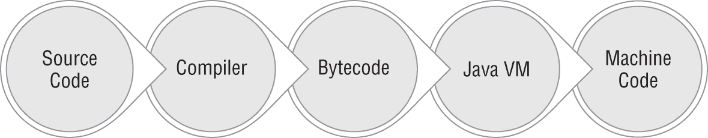

**图 4.5** 字节码的工作原理

字节码不同于机器码。字节码是通过编译源代码生成的代码，而机器码是一组机器语言指令，可被机器（即 CPU）理解和执行。

从安全角度来看，JavaScript 令人担忧，因为它可以在用户的浏览器中本地运行。虽然这意味着它能快速响应用户的操作，但也意味着 JavaScript 易受 XSS 和 CSRF 攻击。XSS 可能很危险。设想这样一种情况：受害者连接到其银行网站时，攻击者发起 XSS 攻击。这可能允许攻击者利用受害者的权限访问银行应用程序。后果可能是泄露机密信息，或在未经受害者授权的情况下转移大量资金。CSRF 的利用方式大致相同——攻击者利用 JavaScript 诱骗受害者的浏览器执行用户未预期的操作（例如在银行网站转账）。

##### Flash

**Flash** 旨在创建交互式网站。其主要优势之一是可用于许多不同的操作系统和设备。然而，一些供应商（如 Apple）并不完全支持 Flash。根据 CNN Tech 报道，Flash 多年来遭遇了许多问题 (`money.cnn.com/2013/10/08/technology/security/adobe-security`)。这些安全问题包括：

*   2009 年，Adobe Reader 中的一个漏洞让黑客能在人们的电脑中打开后门。
*   2010 年，攻击者创建恶意 PDF 附件入侵了包括 Adobe、Google 和 Rackspace 在内的多家公司。
*   2011 年，另一个漏洞让黑客利用 Adobe Flash Player 远程访问人们的电脑。
*   2012 年，网络黑客通过入侵 Adobe 内部服务器，访问了 Adobe 的安全验证系统。

幸运的是，如今很少见到仍依赖 Flash 的网站。撰写本文时，Flash 在所有网站中的使用率已不足 5% 且持续下降。Adobe 于 2020 年 12 月 31 日停止了补丁和支持，并阻止 Flash Player 运行 Flash 内容。从 2021 年 1 月 12 日起，Adobe 强烈建议所有用户立即卸载 Flash Player 以帮助保护其系统。

ActiveX 也于 2020 年 8 月被弃用。ActiveX 是微软创建的一个软件框架，允许网站嵌入多媒体文件或软件更新。与任何 IT 相关事物一样，可用于善的功能也可能被恶意网站利用。ActiveX 提供的功能已被 HTML5 的能力所取代。

##### HTML5

**HTML5** 标记语言旨在与之前的 HTML 版本向后兼容。HTML5 支持特性和输入类型，以及表单验证，这些在 HTML5 之前并不存在。HTML5 于 2014 年正式采纳，此后经历了一些改进和修订。例如，它已扩展为 XHTML5（XML 序列化的 HTML5）。然而，在可预见的未来，HTML5 仍将是 Web 的最新内容呈现语言，以及移动应用程序的事实跨平台语言，因为它包含面向低功耗设备的特性。

开放 Web 应用程序安全项目 (OWASP) 拥有一份很棒的 HTML5 安全实施备忘单。例如，该备忘单引用了避免基于 DOM 的 XSS 漏洞的方法：如果将页面配置为将交换消息解释为数据，而绝非代码本身。如果您想了解更多关于配置 Web 消息传递、Web Sockets 或地理定位的信息，可在此处找到参考：`cheatsheetseries.owasp.org/cheatsheets/HTML5_Security_Cheat_Sheet.html#introduction`。

##### SOAP

**简单对象访问协议 (SOAP)** 旨在在计算机网络中交换基于 XML 的信息。SOAP 提供了一种基本的消息传递格式。消息是在 SOAP 节点之间的单向传输。消息由三部分组成：一个信封、一组处理规则，以及一组过程调用和响应。SOAP 的优势在于它构建在开放技术之上，可在各种平台上运行。然而，因为 SOAP 可以通过 HTML 传递消息，攻击者有可能拦截这些消息并篡改或嗅探其内容。

##### Web 服务安全


###### Web 服务安全（WS-Security，WSS）

**Web 服务安全（WS-Security，WSS）** 是由 OASIS 开发的一项安全技术，旨在作为 SOAP 的扩展。SOAP 与其他应用程序一样，存在的一个主要问题是输入验证不足和数据清理不当。WS-Security 旨在通过 HTTPS 等协议接收 SOAP 消息形式的输入。SOAP 支持多种格式，例如安全断言标记语言（SAML）、Kerberos 和 X.509 证书。SOAP 可提供机密性、完整性和不可抵赖性。

##### 攻击

作为企业防御者，最重要的事情之一是了解你的攻击面。为了部署适当的控制措施，组织通常会收集面向外部的资产、Web 应用程序、数据库、云存储和 VPN 服务的清单。一旦你对这些有了可靠的了解，就可以开始有针对性的攻击测试和评估过程。有针对性的攻击测试的目的是衡量当前使用的控制措施的有效性。你可以使用渗透测试或桌面推演测试来识别技术控制中的缺口，制定响应措施，并衡量补救效果，评估这些攻击在你的网络中成功的风险和可能性。

###### 跨站脚本

**跨站脚本（XSS）攻击** 是由注入问题引起的应用程序问题。当恶意脚本被注入到其他受信任的网站中时，就会发生 XSS。然后，恶意脚本会被传递给最终用户的浏览器，浏览器无法知晓该脚本是恶意的，因为它来自受信任的站点。一旦在最终用户的计算机上执行，恶意脚本就可以访问其浏览器保留的、用于该站点的任何 Cookie、会话令牌或其他敏感信息。XSS 攻击允许攻击者对用户的系统获得高度控制，并直接与用户连接的站点进行通信。

当无效的输入数据被包含在发送给用户 Web 浏览器进行渲染的动态内容中时，就会发生 XSS 攻击，示例如下：

```
index.php?name=guest<script>alert(‘attacked’)</script>
```

或

```
index.php?name=<script>window.onload = function() 
{var link=document.getElements⇒ByTagName("a");link[0].
href="http://not-real-xssattackexamples.com";}</script>
```

只要 Web 应用程序在生成输出时使用了来自用户的输入，而未对其进行验证或编码，XSS 就可能发生在任何地方。攻击者可以将恶意 JavaScript、VBScript、ActiveX、Flash 或 HTML 注入标头，以便在用户的计算机上执行。通用弱点枚举列表，特别是 `CWE-644`，涉及应用程序错误解读 Web 浏览器中使用的 HTTP 标头，导致攻击者对用户发动 XSS 攻击。

CASP+ 考试可能包含一个或多个模拟题，要求你识别脚本或命令；它们在题目中将显示为 `</script>`。

###### 跨站请求伪造

与 XSS 密切相关的是 **跨站请求伪造（CSRF）攻击**。CSRF 攻击会欺骗用户的浏览器发送伪造的 HTTP 请求，其中包含用户的会话 Cookie 和身份验证信息，发送给易受攻击的 Web 应用程序。CSRF 允许攻击者强制用户的浏览器生成请求，使易受攻击的应用程序误以为该合法请求来自受害者。

验证用户的一种方法是使用全自动区分计算机和人类的图灵测试（CAPTCHA）。CAPTCHA 是一种安全措施，通过质询和响应来验证用户。CAPTCHA 分为两部分，一组经过扭曲但仍可被人类识别的随机字母和数字序列。用户必须将这些字母输入文本框，以验证他们不是机器人。

XSS 和 CSRF 缺陷都非常普遍。获取更多信息的良好来源是 **开放 Web 应用程序安全项目（OWASP）**，网址为 `www.owasp.org`。

###### 注入

许多数据库产品（如 Microsoft SQL Server、MySQL 和 Oracle）允许进行复杂的访问查询。如果数据库和底层操作系统没有适当的安全控制，攻击者可以针对数据库创建查询，从而泄露未经授权的信息。这种类型的攻击通常称为 **SQL 注入**。当攻击者使用一系列恶意 SQL 查询直接操纵 SQL 数据库时，就会发起 SQL 注入攻击。SQL 注入攻击可以从网站的地址栏、应用程序字段内部，或通过查询和搜索发起。一旦发起 SQL 注入，格式错误的输入可能导致数据库变得不稳定或泄露信息。攻击者使用诸如单引号（`'`）之类的逻辑来测试数据库的漏洞。如以下代码片段所示的响应会给攻击者提供所需的反馈，让他们知道数据库容易受到攻击：

```
Microsoft OLE DB Provider for ODBC Drivers error ‘80040e14’
[Microsoft][ODBC SQL Server Driver][SQL Server]Syntax error converting
the nvarchar value ‘sa_login’ to a column of data type int.
/index.asp, line 5
```

防止这些类型的输入问题需要真正的 **纵深防御**。这始于在流量进入网络之前对其进行过滤。一种方法是使用 **Web 应用程序防火墙（WAF）**，这是防火墙设计的下一次进化。WAF 分析 Web 流量，可用于过滤 SQL 注入攻击、恶意软件、XSS 和 CSRF。WAF 需要高度的应用感知能力，因为它们能够分析 Web 流量并查找诸如恶意 XML 注入结构和 SQL 注入命令之类的项目。

另一种有助于防御 SQL 注入攻击的工具是 **数据库活动监控器（DAM）**。DAM 系统的出现是因为公司面临的威胁（如 SQL 注入）比过去多得多。此外，合规性需求也大幅增加，以便公司能够跟踪数据库内发生的活动。HIPAA 和 PCI DSS 等法律法规增加了这一需求。DAM 基本上监控数据库并分析正在发生的活动类型。你可以将 DAM 视为类似于 **安全信息和事件管理（SIEM）**，不同之处在于 SIEM 系统（如 Splunk）关联并分析来自多个来源的事件，而 DAM 专门关注数据库访问和活动。

不仅要防范 SQL 和 XML 注入，如果控制不当，**LDAP 注入** 是另一个漏洞。在 LDAP 注入中，查询是由不可信的输入构建的，且未经事先验证或清理。LDAP 使用由元字符（如括号或引号符号）构建的查询。这些字符控制查询的含义，影响从目录中检索到的对象类型和数量。如果攻击者能创建处理这些控制字符的输入命令，他们就可以更改查询并改变预期行为。

在 图 4.6 中，观察攻击者如何通过在关键位置添加星号来更改此 LDAP 搜索查询，从而找到具有给定用户名和密码的节点；这可以更改查询，使其始终评估为真，从而绕过身份验证。

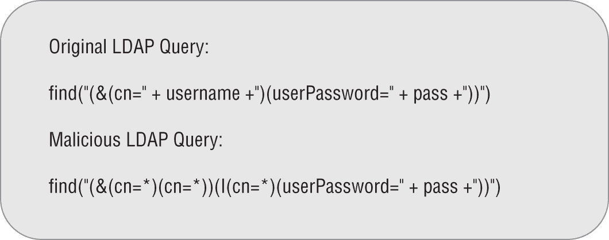

**图 4.6 LDAP 注入**

###### 沙箱逃逸

**应用程序沙箱** 是将文件写入沙箱或临时存储区域，而不是其正常位置的过程。沙箱用于限制代码在用户计算机上执行恶意操作的能力。如果你在沙箱中启动应用程序，它将无法编辑注册表，甚至无法更改用户硬盘驱动器上的其他文件。


# 如果存在一种漏洞，允许恶意代码从沙箱外部的隔离环境中执行，强制运行代码或实现某个功能，会怎样？

2020 年 9 月，谷歌向两名研究人员颁发了 20,000 美元的漏洞赏金，因为他们在 Chrome 网络浏览器中发现了一个`sandbox escape`（沙箱逃逸）漏洞。该漏洞编号为 CVE-2020-6573，被描述为高严重级别。在该特定案例中，多个漏洞的组合导致了远程代码执行，并在浏览器的渲染进程中启动了任意代码。在沙箱逃逸漏洞中，攻击者可以从环境外部的沙箱执行恶意代码，强制设备在其中运行代码。

##### 不当的错误处理

安全的很大一部分在于建立良好的控制来检查所有输入数据（输入验证）、处理后的数据和输出数据。然而，即使做对了这些，你仍然必须处理潜在的错误。有时应用程序开发人员就会在这里遇到麻烦，因为他们向用户提供了过多的信息。例如，如果我们访问一个处理身份验证的网页并输入错误的密码，应用程序是响应“密码错误”，还是响应更模糊的错误“用户名/密码错误”，后者会让入侵者稍微难一些？以下是此类问题的几个例子。首先是`httpd.conf`文件：

```
<location /server-status>
SetHandler server-status
</Location>
```

此配置文件允许任何人查看服务器状态页面，其中包含关于 Web 服务器当前使用情况的详细信息。另一个例子是许多 Web 服务器上都能找到的`php.ini`文件。启用后，该文件会提供冗长的错误消息：

```
display_error = on
log_errors = on
Error_log = syslog
ignore_repeated_errors = Off
```

必须始终测试应用程序的极限，以查看返回什么响应以及显示什么错误消息。

### 地理标记

`Geolocation`（地理定位）和基于位置的服务是 CASP+的另一个关注点。这项技术包括给照片添加地理位置标记的能力。大多数智能手机和平板电脑用户在激活设备时会开启此功能，但他们从未意识到该信息会用在他们拍摄的每一张照片中。大多数人没有意识到智能手机上的`geotagging`（地理标记）处于激活状态，要么是因为它默认启用且未作为选项暴露给用户，要么是因为他们被要求启用它随后就立刻忘记了。结果，个人经常分享过多信息，甚至精确到他们的具体位置。

安全顾虑在于，黑客或其他人可能有能力追踪特定个人的位置。如果你觉得这听起来有点毛骨悚然，那确实如此！有一个名为 Creepy（`www.geocreepy.com`）的应用程序，允许用户利用个人在网上发布的照片来追踪其行踪。Creepy 从社交网络站点收集地理位置相关信息，并使用 Google Maps 展示结果。

许多应用程序也利用这项技术来识别用户的确切位置。其理念是你可以通过位置来识别用户，以提供服务或获取收益。例子包括附近咖啡店和餐厅的优惠券。

##### 拦截/劫持

`Interception`（拦截）被 Merriam Webster 定义为“阻止某人或某物继续前往目的地的行为或事实”。攻击者拦截我们信息的方式有很多，且难以检测。拦截可以针对传输中的数据或静止的数据实施。

消息拦截攻击利用网络中的弱点。如果你能拦截消息，想想数据包嗅探或按键记录，你就能获得有价值的信息。

会话劫持是拦截和注入的结合。它允许攻击者在身份验证完成后接管现有连接，从而绕过密码保护。

BGP 用于交换路由信息，但被认为已过时且不强制使用加密。边界网关协议（BGP）劫持，有时称为`prefix hijacking`（前缀劫持）或`IP hijacking`（IP 劫持），发生在攻击者将 Web 流量从其预期目的地重定向时。相反，它将传入请求发送到攻击者自己控制的 IP 地址。网络犯罪分子很容易冒充受害者的 IP 地址，并冒充受害者进行网络钓鱼和垃圾邮件发送。

尽管电子邮件有许多很棒的功能，并提供了以前不可能的通信水平，但它也并非没有问题。现在，在我们过多指责它之前，你必须记住电子邮件是在不同的时代设计的。几十年前，安全性不像可用性那样是主要驱动因素。默认情况下，电子邮件以明文发送信息，因此容易受到窃听和拦截。电子邮件很容易被伪造，从而掩盖发件人的真实身份。电子邮件也是垃圾邮件、网络钓鱼和病毒的主要渠道。垃圾邮件是未经请求的批量邮件。

### 点击劫持

`Clickjacking`（点击劫持），或 UI redressing（UI 重绘/界面伪装），在 Wikipedia 中被描述为“一种恶意技术，诱骗 Web 用户在点击看似无害的网页时泄露机密信息或让攻击者控制其计算机。”这种攻击通过控制用户访问网页时所看到的内容来实现。攻击者构建页面的方式使得他们能控制用户能看到哪些链接或按钮。受害者点击一个可见的链接，但实际上他们选择的是另一个对他们不可见的链接。这得益于攻击者设计网页的方式。本质上，攻击者构建了一个页面，用户所看到并点击的内容并不反映该点击实际执行的操作。

点击劫持针对状态管理。状态管理指对图形用户界面中一个或多个用户界面控件（如按钮、图标或选择选项）的状态进行管理。如果攻击者能遮挡受害者选择的项目，用户就无法知道按钮是否处于启用状态，或是否已做出有效选择。在许多情况下，安全专业人员可能无法控制应用程序的开发，只能寻找防御漏洞的方法。为了防御基于 Flash 的漏洞，请在 Flash Player 插件的全局隐私设置中设置“Always Deny”（始终拒绝）选项。其他防御措施包括禁用插件和使用诸如 NoScript（`noscript.net/`）之类的工具。

##### 会话管理

当攻击者破解 Web 应用程序的会话管理机制以绕过身份验证控制并冒充合法用户时，就会发生`Session management`（会话管理）攻击。通常使用两种会话管理技术：

*   会话令牌预测
*   会话令牌嗅探和篡改

当令牌遵循可预测的模式或按数字递增时，会发生`Session token prediction attacks`（会话令牌预测攻击）。如果攻击者能发起大量请求，可能更容易确定 Web 应用程序使用的模式。

在某些情况下，令牌可能未加密，甚至可能使用弱编码，如十六进制编码或 Base64。攻击者也可能尝试使用 Wireshark 或 Burp Proxy 等工具直接嗅探有效令牌。

如果使用了 HTTP Cookie 且未设置安全标志，攻击者可以尝试重放 Cookie 以获得未经授权的访问。其他会话管理问题包括：

*   **会话 ID 放在 URL 中** 某些网站对会话 ID 进行编码并将其放在页面的 URL 中。
*   **超时利用** 如果受害者使用公共电脑且只是关闭了浏览器，网站可能不会注销用户，从而允许攻击者重新打开站点并获得完全访问权限。

###### 输入验证


###### 输入验证

*输入验证* 是验证从客户端接收的数据的过程。当客户端输入在被 Web 应用程序处理之前未经过验证时，就会发生此缺陷。应使用 Web 应用程序控件来检查输入是否有效。这变得很重要，因为在许多自动化系统中，一个系统的输出是另一个系统的输入。在这种情况下，应检查数据以验证来自发送和接收应用程序的信息。例如，如果在需要正值的字段中输入负数量，Web 应用程序实际上会接受吗？它不应该！

##### 虚拟机逃逸

最后，在安全方面存在劣势，因为您现在在一台物理机器上运行多个系统。如果这台机器发生故障，您将丢失多个系统。病毒、蠕虫和恶意软件也有可能从一台虚拟机迁移到另一台。这通常被称为 VM 跳转或逃逸。*VM 跳转* 是指攻击者试图获取同一管理程序上其他虚拟机的控制权。

*VM 逃逸* 简单来说就是攻击者能够在虚拟机上运行恶意软件或代码，这允许在其中运行的操作系统突破出来并直接与管理程序交互。此术语在此处有更详细的描述：`www.researchgate.net/publication/255791810_virtual_machine_escapes`。当单个平台为许多公司托管多个 VM 或托管不同安全级别的 VM 时，VM 逃逸可能是一个严重问题。

保护虚拟服务器需要与保护物理系统相同的纵深防御重点。

##### VLAN 跳转

针对 VLAN 的一种潜在攻击是 VLAN 跳转。*VLAN 跳转* 可定义为一种攻击，攻击者试图将数据发送给属于其他 VLAN 的主机。这是通过使用不同的 VLAN ID 标签标记数据，并将数据标记为属于不同于其实际所属的 VLAN 来实现的。VLAN 标签只是放置在以太网帧中的一个额外字段。例如，802.1Q 标签使用一个 32 位字段，放置在帧头中源 MAC 地址和以太网类型字段之间。这种攻击可以通过两种方式发起：交换机欺骗或双重标记。

交换机欺骗发生在攻击者在交换机和攻击者之间创建中继链路时。这允许攻击者与该交换机上配置的所有 VLAN 中的主机通信，从而使多个 VLAN 的流量可被攻击者访问。第二种技术，双重标记，发生在攻击者在传输中的数据包前预置两个 VLAN 标签时。第一个标签被剥离，并添加第二个伪造标签。伪造的 VLAN 标签指示该数据帧目标为第二个目标 VLAN 上的主机。此技术允许攻击主机绕过用于将主机在逻辑上相互隔离的第 3 层安全措施。

### 主动检测

您永远无法仅靠防守赢得一场国际象棋比赛。要成功保卫组织，您必须建立进攻能力。在组织安全成熟度的某个阶段，您将不得不开始、管理渗透测试，处理猎杀团队行动，并利用威胁情报，目标是主动保卫您的组织。

#### 事件响应

从术语本质上讲，您知道 *事件响应* 是一种被动的、响应式的工作。但 *事件检测* 呢？我们知道黑客稍后可能会攻击我们的系统。我们知道下周我们可能会发现一个新的被攻陷系统。为什么要等到被动反应，而不主动在坏人造成损害之前自行发现潜在事件呢？

*猎杀团队行动* 是指在不得不对已发生的事件做出反应之前，主动寻找那些漏洞的内部活动。这可以通过几种不同的方式完成。您和您的团队可能会对整个系统或其他单个设备执行日志分析。如果已经部署了 SIEM，提供安全和事件信息的集中视图，这将更容易完成。

分析必须不仅限于安全日志。许多使用相同设备、日志和监控的公司仍然遭到入侵。除了对日志的客观分析，您还必须执行启发式和行为分析。作为安全专业人员，我们经常发现我们有更好的直觉，并且比其他角色的人员能采取更务实的方法。

#### 对策

适当的分析和头脑风暴将让网络安全团队朝着正确的方向起步。在实施对策以更改现有漏洞时，请注意我们并不称其为解决方案。解决方案意味着问题已被纠正。*对策* 是为消除或抵消危险或威胁而采取的行动。同一个问题将来可能再次发生。但如果最初的对策成功了，这个问题就不会再次发生。

使用影响/工作量矩阵，将有助于提出正确的问题，例如需要多少工作量，以及未来网络安全项目的预期影响是什么。在 图 4.7 中，您可以看到影响/工作量矩阵。

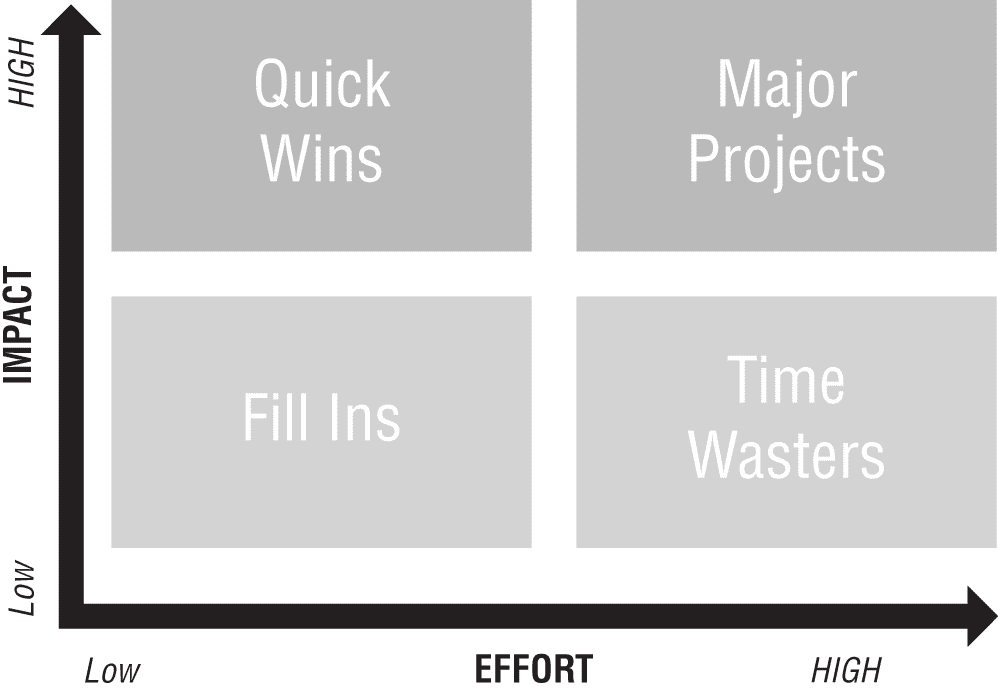

**图 4.7** 影响/工作量矩阵

*   **快速见效**：基于工作量提供最佳回报。
*   **重大项目**：提供长期回报，但执行起来可能更复杂。
*   **填补项**：不需要太多工作量，但也不提供太多收益。
*   **浪费时间项**：耗时且影响低的活动，应避免。

#### 欺骗技术

*欺骗技术* 旨在将攻击者引诱到网络中的一个“诱人”位置，让他们以为正在获得对企业数据的合法访问。实际上，他们的战术和技术正在被观察。

这些技术包括以下内容：

*   **蜜网**：一个故意设置得半脆弱的机器网络，用于吸引攻击者，作为诱饵将攻击者从真实网络中引开。
*   **蜜罐**：一个设置了合法外观数据以引诱攻击者的系统。这些用于研究目的，以提高整体安全性。
*   **蜜文件**：服务器上用作攻击者诱饵的诱饵文件。这些文件可以经过策略性命名以引诱攻击者打开它们。打开时，文件会触发无声警报，通知安全人员诱饵文件已被访问。

随着技术进步和攻击者变得更加复杂，这种类型的欺骗技术正成为威胁研究中的单一层面。自动化和机器学习正成为检测入侵者的新方法。欺骗技术现在能够集成在安全信息和事件管理 (SIEM)、端点检测和响应 (EDR) 以及安全编排、自动化和响应 (SOAR) 软件中。拥有这些集成有助于确保威胁检测能力。

#### USB 密钥投放

当其他访问组织的方法不可行时，可以使用 USB 密钥或其他介质等物理蜜罐。要执行 *USB 密钥投放* 攻击，加载了攻击工具的拇指驱动器针对目标公司中常见的操作系统或软件。这些驱动器被投放在容易被发现的位置，有时带有标签，指示驱动器上有有趣或重要的数据。此类攻击的目标是让驱动器或介质被发现，然后在目标计算机上访问。如果攻击工具成功，它们会“回连”到一个系统，允许通过防火墙和其他安全屏障进行远程访问。

##### 模拟


##### 模拟

模拟是假装你处于某种情境中的行为。在计算机模型中，通常是为了研究目的。近年来，网络靶场和网络 `simulators` 因提供搭建网络、配置 ACL、威胁狩猎等方面的实操经验而变得流行。

如果你已经有一段时间没有配置或分析 ACL，你可能需要考虑下载众多可用的路由器模拟器之一。这些是极佳的练习工具，如果考试中遇到 ACL 问题，它们可能会有所帮助。

Packet Tracer 是思科的可视化模拟工具，可模拟由思科路由器、交换机、防火墙等组成的动态网络拓扑。Packet Tracer 最初是作为思科网络技术学院的教学辅助工具而设计的，但对于任何追求思科入门级认证（如 CCENT 或 CCNA R&S）的人来说，它都是一款优秀的模拟器。

使用思科的 Packet Tracer 完全免费。它可以完全免费下载和使用。唯一的要求是你必须创建并使用思科网络技术学院账户登录 Packet Tracer，该账户创建免费。

### 安全数据分析

糟糕的数据分析可能导致做出错误的商业决策并选择错误的商业策略。错误的商业决策会导致客户不满。网络安全领域的错误决策可能导致致使公司破产的泄露事件。为避免基于坏数据做出错误决策，公司会应用数据管道来移动和存储数据。

数据管道是一种软件，可实现信息从一点到另一点的自动化流动。该软件可防止许多常见问题，如瓶颈、信息损坏和重复条目。数据管道由一系列数据处理步骤组成。如果数据当前未加载到数据平台中，则会在管道开始时被摄取。随后会有一系列步骤，其中每个步骤提供的输出作为下一步的输入。这将持续直到管道完成。在某些情况下，步骤可能会并行运行。

数据管道包含三个关键要素：源、处理和目标。在某些数据管道中，目标可能被称为接收端。数据管道实现了从应用程序到数据仓库、从数据湖到分析数据库，或流向支付处理系统的数据流动。

流式数据管道是一种数据管道架构，能够大规模、实时地处理数百万个事件。因此，你可以收集、分析和存储海量信息。这使得实时分析、过滤和报告成为可能。在 图 4.8 中，你可以看到一个数据管道的示例。

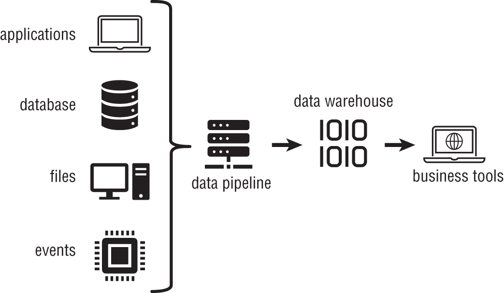

**图 4.8** 数据管道

使用数据管道的好处包括使你的组织更敏捷、更经济、更透明。

#### 应用程序控制

应用程序控制可以像操作系统中的工具（如 Windows Defender 应用程序控制）那样精细，后者旨在保护计算机免受恶意软件和其他有害软件的侵害。它强制执行一份明确的允许在该电脑上运行的应用程序列表。没有硬件或固件先决条件，但必须满足最低 Windows 版本要求才能执行。

应用程序控制可以由第三方软件公司购买和授权，使你能够允许或阻止网络中的特定应用程序。某些应用程序可能是恶意的，应当被阻止，但它们也可能是真实合法的；例如，管理层决定任何人都不应在工作时玩纸牌接龙。

属于应用程序控制方式的一项特性是原子性。原子执行是数据库规定事务何时为绝对的能力。数据库系统决定某个特定事务必须完全发生，或者完全不发生。它不会部分完成。

原子性是 ACID（原子性、一致性、隔离性、持久性）模型的一部分，该模型用于保证数据库事务的可靠性和控制。即使发生灾难性的电源故障，提供原子性的数据库系统也必须能够保证这一点。事务原子执行的定义取决于其实现。例如，如果你在订披萨，该事务包含三个部分。你必须选择披萨、支付费用，然后输入地址以便送达。如果其中任何一步在没有其他步骤的情况下发生，披萨店将面临令人困惑的情况，例如已付款但不知道送往何处。

从供应商角度来看，应用程序许可授权是确保客户遵守软件许可协议的一种方式，可防止滥用或盗版。然而，某些供应商的许可合规性是基于经济考量的。例如，某些漏洞产品限制可扫描漏洞的资产数量，如果超出该数量，会联系客户以检查他们在环境中如何使用该产品。保护知识产权和防范出于恶意目的的篡改，将从强化应用程序并向应用程序添加安全控制开始。例如，为防止数据滥用，供应商可能会添加非对称和对称加密；为防止逆向工程，供应商可以添加应用程序二进制文件的签名和验证。

### 允许列表和阻止列表

允许列表可定义为被授予访问权限的实体列表。阻止列表恰恰相反；它列出无法访问的内容。例如，你可能会将 Facebook 和 Instagram 等社交媒体加入阻止列表，以便员工无法访问这些网站。在资产或服务不应公开的环境中，允许列表更有意义，且你可以更严格地进行控制。

可将允许列表视为隐式的“全拒绝”，除非添加到列表中；而阻止列表则是隐式的“全允许”，除非添加到列表中。你很少看到这些策略同时在同一技术上实施。

### 安全自动化

自动化在网络安全运营（通常称为 SecOps）中的作用，是通过自动化重复性行为来减轻网络安全的繁重负担。安全自动化工具允许安全团队自动化重复且耗时的任务，旨在改进工作流并提高效率。

自动化使你能够确定威胁优先级，并利用预先确定的行动方案自动处理某些网络攻击。这减少了人工干预和响应时间。安全自动化是基于机器的安全操作执行，它拥有通过识别传入威胁、分流以及在警报出现时确定优先级，以编程方式检测、调查和修复网络威胁的能力。

自动化可以采用平台方法，这对于正确整合 DevOps 与 SecOps 团队以更好地适应应用程序部署和管理方式的变化变得越来越必要。DevOps 自动化并监控软件创建过程，范围涵盖集成、测试、发布到部署和管理。选择正确的平台配置工具是实施中的一大挑战。市场上的主要竞争者包括 Chef、Ansible 和 Puppet。这些工具各有优势。

如果你的组织没有 DevOps 团队协助自动化安全任务，你可以使用 Cron 作业、Bash、PowerShell 或 Python 来完成其中一些任务。所有这些都有各自的优缺点，使它们更适合某些特定任务而非其他任务。

*   Cron/计划任务
    *   由 AT&T 于 1975 年开发
    *   命令行实用程序


### 作业调度器

*   自动化系统维护和管理
*   非常适合底层重复性任务

### Bash

*   Linux/Unix 命令语言
*   Windows 中不预装
*   非常适合编写 CLI 脚本
*   启动时间比 Python 更快
*   调试工具较差

### PowerShell

*   Microsoft Windows 配置管理
*   使用 cmdlet、文件传输、后台作业、管道实现通用目的
*   随着新 cmdlet 不断扩展

### Python

*   面向对象编程 (OOP)
*   可用于几乎任何任务，包括安全任务
*   简单，易学
*   库和文档丰富
*   调试工具完善

### 物理安全

物理安全不容忽视，测试物理安全通常也是渗透测试过程的一部分，旨在检查保护员工和敏感信息的物理屏障在现实世界中的漏洞。许多组织在保护其网络方面做得很好，却忽略了物理设备被盗的风险，或社会工程学被用来说服前台人员你是有线电视公司的人员并需要进入服务器室的风险。

如果没有建立强有力的物理安全措施，任何 CASP+ 专业人士都无法声称他们已部署有效的安全控制。不仅要部署适当的安全措施（如在合适的门上安装合适类型的锁），而且随着业务增长和扩张暴露出薄弱的物理屏障，这些安全措施还必须定期审查。

应建立细粒度的程序来审查照明、封锁区域和检查访客日志。曾出现过授权访客解锁窗户以便稍后轻松进入机密区域实施闯入的情况。对负责高安全区域的人员进行安全培训至关重要。门窗以及电子钥匙或门禁卡都可被用于访问。如果组织有围栏、大门和安全照明，应建立程序确保围栏缝隙、大门控制、摄像头和照明按预期工作。准确的访客日志和摄像头录像应根据程序妥善存储，以备未来检测到入侵时调查之用。如果高度机密区域受到影响，这些来自敏感区域的日志和摄像头录像可能更为重要。

正如我们有数据分类一样，物理位置也可以通过多种方式进行分类。国家反情报与安全中心 (NCSC) 对敏感隔离信息设施 (SCIF) 的建设和管理有具体的技术规范。SCIF 是一个防止电子监视并用于拒绝未授权访问的安全房间。在这种极端的封闭空间中，每一个潜在的入侵机会都会由专职人员利用专用资源进行检查，他们的唯一职责就是保护驻留、讨论和存储在此地的人员和数据。在另一极端，开放区域不会拥有同等级别的专用资源，但仍应评估任何类型的风险。

有关如何建设、维护和审查 SCIF 程序和政策的更多信息，请访问 `www.dni.gov/files/Governance/IC-Tech-Specs-for-Const-and-Mgmt-of-SCIFs-v15.pdf`。

## 摘要

本章重点介绍了漏洞和风险管理的重要性。这对安全专业人员至关重要，因为应用程序是高度被瞄准的领域。多年前，Web 服务器是攻击者的主要目标之一。如今，客户端系统被广泛瞄准。部分原因是它们目标丰富。脆弱的应用程序为攻击者提供了访问系统的简便途径。

虽然应用程序很重要，但这只是关注领域之一。网络也很重要。网络必须能够抵御拒绝服务攻击、后门攻击、劫持、密码破解等。每一种攻击都利用了网络技术固有的弱点。防御这些威胁及其他威胁的最佳方法之一是执行定期测试。这种测试可以采取安全审计、漏洞扫描和渗透测试的形式。每一种都在帮助保护关键基础设施和防御网络攻击方面发挥着作用。

## 考试要点

**了解软件漏洞利用是如何发生的。** 软件漏洞利用涉及以非计划方式或软件制造商未预料到的方式使用软件产品的功能或特性。在许多情况下，原始功能增强了产品的功能，但不幸的是，也造成了潜在的漏洞。

**能够描述具体的应用程序问题。** 常见的应用程序问题包括 XSS、CSRF、SQL 注入、虚拟机逃逸、拦截攻击和不良输入验证。

**了解漏洞扫描和渗透测试的区别。** 漏洞扫描通常使用 SAINT、Nessus 或 Retina 等打包程序执行。这些程序有助于识别需要修补的易受攻击的系统和应用程序。渗透测试通常以对抗方式执行，提出的问题包括攻击者能看到什么以及他们能利用这些知识做什么。渗透测试类似于计算机犯罪分子的非法攻击，但获得了系统所有者的许可。

**能够描述密码破解。** 密码破解是检索和破解存储在计算机系统中或由计算机系统传输的密码的过程。密码破解工具可用多种基本方式测试密码强度，包括字典攻击、混合攻击、暴力破解攻击和彩虹表。

**定义渗透测试技术。** 渗透测试可以在完全了解目标网络或仅掌握极少信息的情况下执行。每种技术都有其优势。渗透测试也可能在所有内部人员知情或不知情的情况下进行。

**能够描述何时应使用代码审查。** 应用程序部署前，必须经过审查和测试。测试类型将根据情况而异。例如，如果组织内部构建应用程序，代码很可能可用，可以执行完整的代码审查。在其他情况下，公司购买现成应用程序时，源代码可能不可用。

**能够描述为什么社会工程学攻击难以防范。** 社会工程学难以防范，因为它不针对硬件或软件，而是针对人。如果没有适当的培训，员工可能不知道某些安全策略的存在，或不知道在特定情况下如何应对。培训和意识提升是防御社会工程学攻击的最佳手段。

## 复习题

答案见 附录。

1.  以下哪项 **最能** 定义 IT 中的风险？

    1.  你拥有一个具有已知活跃威胁的漏洞。
    2.  你拥有一个具有已知漏洞的威胁。
    3.  你拥有一个具有已知威胁的风险。
    4.  你拥有一个具有已知漏洞利用的威胁。

2.  Charles 是一名系统管理员。他正在进行漏洞评估。以下哪项不是他必须了解的？

    1.  访问控制
    2.  对待评估系统的理解
    3.  潜在威胁
    4.  密码

3.  Gavin 被指派聘请第三方对其汽车制造厂进行安全评估。哪种测试类型能为他提供公司安全状况最中立的审查？

    1.  OSINT
    2.  漏洞扫描
    3.  无知识


### 4. 蓝帽

### 4. Olivia 是一家大型在线新闻机构的高级安全分析师。事件响应团队向她通报，该组织已成为 XSS 攻击的受害者，恶意 Web 脚本代码已在受信任的网页中执行。为了防止未来再次发生此类情况，她应该怎么做？

1.  确保 Web 应用程序能够验证并清理输入。
2.  立即实施补丁管理。
3.  请求外部渗透测试。
4.  在面向公众的 Web 服务器上无法防止此类情况发生。

### 5. 安全管理员 Alonso 接到高级人力资源经理的联系，要求调查一个可能的情况。他们怀疑恶意活动是由内部人员引起的，需要确定是故意还是无意。经过调查，你认为这是无意的，最可能的原因是以下哪项？

1.  欺诈
2.  间谍活动
3.  挪用公款
4.  社会工程学

### 6. MaryAnn 在一家保险公司工作。公司遭遇自然灾害，使用热站点运行了三个月，现在准备回迁至主站点。应优先恢复哪些流程？

1.  财务部门
2.  外部通信
3.  任务关键型
4.  最不关键的业务

### 7. Paul 网络中有一台任务关键型 Windows 服务器，存在 `CVE-2021-24086` 漏洞。该服务器成为分布式拒绝服务攻击的目标，并已蓝屏死机两次。多个系统正在淹没该系统的带宽。这种攻击影响了哪个信息安全目标？

1.  可用性
2.  基线
3.  完整性
4.  应急响应

### 8. Sergio 是一家全球制造商的安全分析师。其组织的生产环境发生了一起事件，需要验证是否遵循了证据保管链、尽职调查和适当流程。他被要求验证取证比特流。在列出的选项中，首先应执行哪项操作？

1.  验证备份
2.  创建遏制措施
3.  比较哈希值
4.  准备文档

### 9. 一家 IoT 软件初创公司聘请 Don 提供数据安全专业知识。客户非常关注机密性。如果机密性比可用性和完整性更受重视，以下哪种场景最适合该客户？

1.  高可用环境中的虚拟服务器。客户将使用冗余虚拟存储和终端服务来访问软件。
2.  高可用环境中的虚拟服务器。客户将使用单一虚拟存储和终端服务来访问软件。
3.  客户被分配运行在共享硬件上的虚拟主机。物理存储通过分区并使用分组密码加密。
4.  客户被分配运行在共享硬件上的虚拟主机。虚拟存储通过分区并使用流密码加密。

### 10. Pieter 在 CFO 的笔记本电脑上发现了一个运行键盘记录器的 Meterpreter Shell。键盘记录器最可能破坏哪个安全原则？

1.  可用性
2.  威胁
3.  完整性
4.  机密性

### 11. Tiffany 在一家养老医疗机构工作，该机构决定开始外包部分 IT 系统。以下哪项陈述是正确的？

1.  所有外包都能使您的组织摆脱任何规则或要求。
2.  所有合规和监管要求都转嫁给了提供商。
3.  IT 系统不再由您的组织配置、维护或评估。
4.  外包组织不受任何规则或法规约束。

### 12. Greg 是一家网络安全情报公司的安全研究员。他正在审查其公司想要使用的第三方供应商。他发现了一种利用 SQLi 篡改其 Web 服务器的方法，原因是该公司 Web 应用程序中缺少补丁。与该组织开展业务的威胁是什么？

1.  网页篡改
2.  未修补的应用程序
3.  黑客
4.  安全意识教育

### 13. Adriana 负责其银行组织的 PCI-DSS 合规性。她所遵循的政策要求她能够从数据库中删除信息。由于技术限制，她无法删除数据。她正在寻求补偿性控制来降低风险。她的最佳选择是什么？

1.  保险
2.  加密
3.  删除
4.  例外处理

### 14. Marco 是一家漏洞评估公司的顾问。他被指派量化验证新安全控制和对策能力时与信息技术相关的风险。识别风险的最佳方法是什么？

1.  漏洞管理
2.  渗透测试
3.  威胁与风险评估
4.  数据重新分类

### 15. 许多组织为高技术攻击做准备，却忽略了简单的低技术信息收集手段。垃圾箱搜寻可被渗透测试人员用于获取未经授权的信息。主动检测团队会建议以下哪项来降低风险？

1.  知识产权的数据分类和打印机限制
2.  为复印室购买碎纸机
3.  制定文档销毁的政策和程序
4.  招聘实习生销毁所有打印文档

### 16. 部署在企业网络中的新软件供应商宣布，需要针对特定漏洞进行关键更新。CIO 想知道漏洞时间窗口有多长。何时可以向他们提供该信息？

1.  补丁下载并在受影响的系统或设备上安装后
2.  补丁发布并公开可用时
3.  供应商创建补丁时
4.  发现漏洞时

### 17. 由于时间和预算限制，Bradley 的组织选择聘请第三方组织启动一个非常重要的漏洞管理项目。外包漏洞管理计划有哪些好处？

1.  外包是有效选择，无需太多担忧，因为任何和所有损害都是第三方的责任。
2.  如果公司有可接受的安全记录，那么外包任何事情都非常合理。
3.  你永远不应该外包。这会导致法律和合规问题。
4.  外包漏洞管理可以节省时间、提高可见性、确定修复优先级，并减少对内部资源的依赖。

### 18. 使用 C 语言命令 `scanf()`、`strcpy()`、`bcopy()`、`vsprintf()` 和 `gets()` 有什么顾虑？

1.  这些命令在 C 语言中不再受支持。
2.  这些命令不检查缓冲区大小，容易导致缓冲区溢出攻击。
3.  这些命令不执行输入验证，因此容易导致注入攻击。
4.  使用这些命令没有顾虑。

### 19. 作为安全分析师，你负责在生产网络上运行漏洞扫描。在检查扫描结果时，你注意到各种服务器缺少补丁。你决定寻找一种在系统上自动安装补丁的自动化流程。以下哪项可以实现这一过程的自动化？

1.  安全评估
2.  漏洞管理
3.  漏洞扫描器
4.  补丁管理系统


### 20. Joe 为一家零售组织工作...

Joe 为一家零售组织工作。公司总部每天都会遭受数百条垃圾邮件的轰炸。他在公司 Web 服务器上实施了 `CAPTCHA` 系统以防止垃圾邮件。以下哪种其他攻击最有可能被防止？

1.  `CSRF`
2.  `XSS`
3.  双因素认证
4.  `XMLi`

# 第 5 章：合规性与供应商风险

本章讨论共享云计算的安全保护。在过去 10 到 15 年中，云计算取得了长足发展，如今无处不在。云计算正在改变网络边界的概念。

在本章中，我们将探讨虚拟化和云计算的优缺点，以及它们给企业安全带来的担忧。我们还将讨论可能影响您组织的合规框架和法律考量，例如合同和协议类型。这些主题是 CompTIA 期望您为考试掌握的项目。

## 云计算中的共享责任

一个可能对企业安全产生巨大影响的领域是云计算——使用远程数据中心来管理应用程序访问和托管数据。`云计算` 可以包括虚拟服务器、服务，或您通过互联网消费的任何内容。这是一个旨在重新定义 IT 服务消费和交付模式的概念，但云计算最大的挑战之一是对谁承担何种责任感到困惑。许多组织因云计算中共享责任的混淆而经历过某种事件或事故。

在云中部署有多种不同方式。在云计算环境中，最终用户可能不知道特定技术的位置或细节；它完全由 `云服务提供商 (CSP)` 管理。云计算为用户提供了按需增加容量或添加服务的能力，而无需投资新数据中心、培训新人员，甚至可能无需许可新软件。这种按需或弹性服务可随时添加、升级和提供。一些最大的 CSP 包括 Amazon Web Services (`AWS`)、Google Cloud Provider (`GCP`)、Microsoft Azure 和 IBM Cloud。它们的服务和成本各异，但总体而言，其选项包括存储、处理和分析数据；保护静态和动态数据；并提供各种开发工具以在云中创建应用程序。

### 云服务/基础设施模型

云计算架构取决于 CSP，并可包含各种模型。`公共服务` 由外部提供商提供。`私有服务` 在云设计中内部实施。`混合架构` 提供公共和私有云服务的组合，以实现组织目标。

CSP 拥有多种云模型，可细分为几种基本设计，包括基础设施即服务、监控即服务、软件即服务和平台即服务。每种设计描述如下：

*   **软件即服务** `软件即服务 (SaaS)` 旨在提供完整的打包解决方案。软件租赁给用户使用。服务通常通过某种前端或 Web 门户提供。虽然最终用户可以随地使用该服务，但公司需按使用付费。例如，`www.salesforce.com` 提供此类服务。

*   **平台即服务** `平台即服务 (PaaS)` 为您提供一个平台。该模型提供的服务包括软件开发生命周期 (`SDLC`) 的所有阶段，并可使用应用程序编程接口 (`APIs`)、网站门户或网关软件。这些解决方案往往是专有的，如果客户离开提供商的平台，可能会引起问题。PaaS 的一个例子是 G Suite；请参阅 `gsuite.google.com`。

*   **基础设施即服务** `基础设施即服务 (IaaS)` 描述一种云解决方案，您在其中购买基础设施。您购买虚拟算力以按需执行软件。这很像在自己的设备上运行虚拟服务器，只不过现在您是在虚拟磁盘上运行虚拟服务器。该模型类似于公用事业公司模式，因为您按使用付费。该模型的一个例子是 Amazon Web Services；请参阅 `aws.amazon.com`。

在 图 5.1 中，您可以看到这些不同层级如何相互构建。

### 云计算提供商与托管选项

许多公司提供云计算服务。一些知名示例包括 Amazon、Citrix、Dropbox、Google、IBM、iCloud、Microsoft、Rackspace 和 VMware。这些提供商提供一系列服务，包括以下内容：

*   **公有云** 面向公众开放。一个例子是 Google Drive。
*   **私有云** 为单个公司或实体运营。一个例子是公司私有云存储差旅费用。
*   **混合云** 公有云和私有云的组合。一个例子是公司云存储项目，对内部员工和供应商提供不同的访问权限。
*   **社区云** 在多个组织之间共享。一个例子是一组学校的云存储。
*   **多租户** 用于托管单个软件应用程序，该应用服务于多个客户。一个例子是多个项目贡献者的协作工作区。
*   **单租户** 托管单个软件应用程序，旨在支持一个客户。一个例子是一个组织的专业 HR 应用程序。

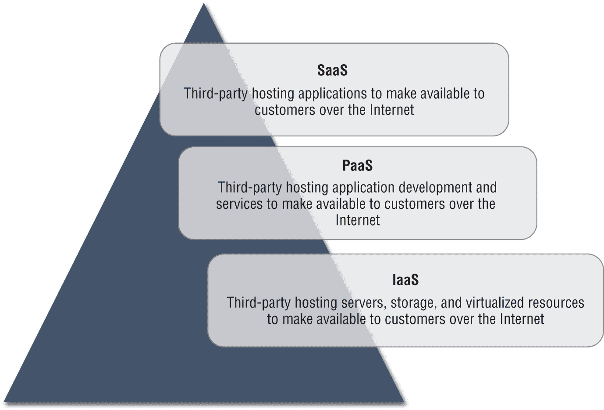

**图 5.1** 云计算层级

在 练习 5.1 中，您将探讨云计算的优势。

### 云计算的优势

按需或弹性云计算改变了信息和服务的消费与提供方式。用户可以按其特定需求设定的速率消费服务。云计算提供多项优势，包括以下内容：

*   **降低成本** 云技术节省了公司自有基础设施和/或应用程序的采购和维护成本。此外，云服务按需付费。
*   **增加存储** 云提供商拥有弹性且成本更低的更大存储能力。
*   **提供高度自动化** 由于本地系统已被基于云的解决方案取代，所需员工更少。用户无需 IT 人员修补和更新已外包给云的服务器。
*   **提供灵活性** 云计算比基于本地的解决方案提供更大的灵活性。
*   **提供更强移动性** 主要营销卖点之一是用户可以随地访问数据，而不必留在办公桌前。
*   **使公司 IT 部门能转移重心** 公司无需进行硬件更新——云提供商现负责此项。公司可专注于创新。

云计算的优势众多。云计算的优势之一是能够使用他人的存储。另一个优势是当需要新资源时，可利用云，并且新资源的实施速度可能比在公司本地托管更快。使用云计算，您按使用付费。另一个好处是应用程序的可移植性。用户可以从工作场所、家中或客户现场访问数据。云计算还能释放 IT 工作人员，他们原本可能被执行更新、安装补丁或提供应用程序支持所占用。归根结底，所有这些原因都导致资本支出减少，这是所有公司追求的目标。


## 选择云计算或软件供应商时的考量因素

在决定选择云计算或软件供应商时，除了基本功能外，还需考虑法律要求、变更管理、员工流失和配置等因素。在考察可用供应商之前，最好先明确组织的需求，以及应用程序或平台将为您带来什么价值。许多企业拥有复杂的业务流程和法规要求。供应商评估时的关键法律或合规要求问题应包括以下内容：

### 安全性

*   使用哪种类型的加密？
*   信息如何以及存储在何处？
*   采取了哪些措施来防止数据泄露？
*   如果贵公司倒闭，我将能访问哪种类型的源代码托管或代码仓库？

## 基础设施

*   是否在多个位置有冗余备份？
*   您拥有哪种类型的供应链可视性？

## 网络

*   使用何种类型的系统？
*   何时应用更新？
*   提供哪种类型的分级技术支持？
*   支持是 7×24 小时还是仅在工作时间提供？

### 数据

*   如果不再使用该供应商，谁控制数据？
*   谁有权访问数据？
*   当员工离开贵组织时，有什么流程来确保数据安全？
*   数据在地理上存储在何处？

### 事件管理和灾难恢复服务

*   发生数据泄露或数据丢失时，供应商有何通知责任？
*   是否有灾难恢复计划？

### 合规要求

*   采取了哪些措施保护机密信息？
*   数据存储是否符合 `GDPR`、`HIPAA`、`PCI DSS` 或 `SOX` 等法规？

## 按需/弹性云计算的安全性

尽管成本和易用性是云计算的两大优势，但在考虑按需/弹性云计算时，存在重大的安全顾虑。通常而言，云服务提供商（`CSP`）负责“云的安全”，而客户负责“云中的信息安全”。在 图 5.2 中，您可以看到基于前文提到的云计算层级的安全责任分配。

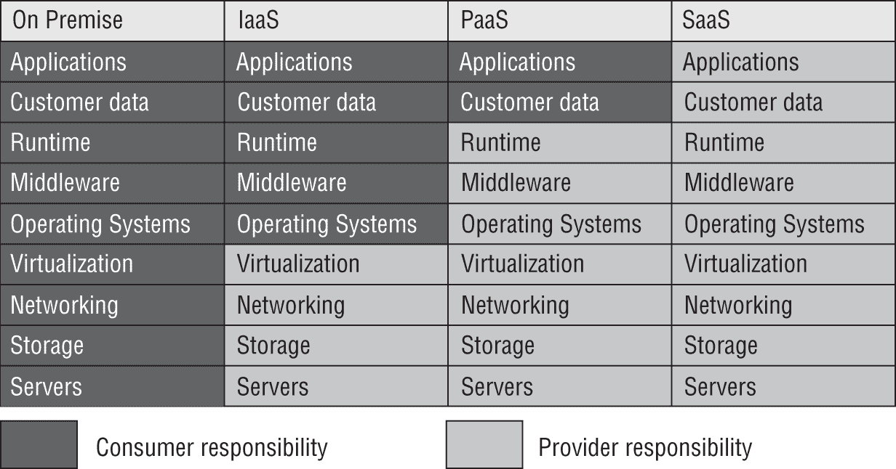

**图 5.2** 安全责任分配

云计算与过去 IT 服务交付和管理的方式有很大不同。其优势之一是云的弹性，它提供了计算能力近乎无限供应的在线假象。云计算将资产置于所有者的安全边界之外。历史上，安全边界内的项目受信任，而边界外的则不受信任。有了云计算，组织被迫将信任置于云提供商身上。云提供商必须开发足够的控制措施，以提供与不使用云时组织拥有的同等安全级别——或更高的级别。

您必须意识到迁移到基于云的服务所带来的安全顾虑。虽然迁移压力很大，但安全性与易用性之间始终存在权衡。

## 地理位置

云存在于全球数据中心和服务器农场中各个服务器的硬盘上。`CSP` 可能总部设在一个国家，而其服务器分布在全球任何地方。没有任何数据存储在本地机器上。云数据可从任何位置、通过多种设备、在任何需要的时候访问。安全至关重要，以至于一些组织有合规要求或公司政策，规定数据必须托管在其国家拥有法律管辖权的数据中心内。

## 基础设施

云共享责任和安全模型因供应商而异。关于 `CSP` 如何运作的困惑，以及用于描述不同领域服务产品的术语，在实施由硬件、软件和 `API` 构建的安全基础设施时可能带来困难。硬件和软件组件包括服务器、存储、网络和虚拟化，访问这些组件的方式多种多样，包括 `IaaS`、`SaaS` 和 `PaaS`，这些在本章前面已有更详细的描述。

## 计算

通常，`CSP` 负责“云的安全”，客户负责“云中的安全”。`CSP` 负责云服务器、全球基础设施和虚拟化层的物理安全，而客户根据平台和模型，负责其余部分，包括网络控制、访问管理和客户数据。

在云计算中，通用术语“计算”描述了与软件计算相关的概念，包括处理能力、内存、网络和存储。在 `AWS` 共享责任模型中，计算属于 `CSP` 的职责范围。

## 存储

共享责任要求客户和提供商之间有良好的沟通和理解，尤其是在数据存储方面。在所有云模型中，云存储最终都是客户的责任。安全云存储的最佳实践包括：确认不存在公开可访问的存储区域，数据处于生命周期管理程序中并保留适当的时间，以及强制执行使用客户管理的密钥进行加密和对象版本控制。

## 网络

许多人以某种方式使用云，有些人可能甚至未意识到这一点，这会使他们面临风险。网络安全专业人员在云网络中实施安全控制时，使用机密性/完整性/可用性（`CIA`）三要素。保护云服务的第一步是使用可用的最强加密。另一个最佳实践是审查用户协议，了解服务如何保护您的信息。注册云提供商时，配置隐私设置以限制服务保留数据的时长和存储的信息类型。应定期审查隐私设置，因为云服务可能会更新协议，导致安全控制出现漏洞。`CIS Benchmarks` 或 `AWS Well-Architected Framework` 等指南有助于构建安全实施的网络框架。

安全专业人员在考虑基于云的解决方案时，还应询问以下问题：

*   **数据是否受监管要求约束？** 不同国家对访问有不同的要求和控制。例如，在美国、加拿大或欧盟（`EU`）运营的组织有许多监管要求。示例包括 `ISO 27002`、`Safe Harbor`、信息技术基础设施库（`ITIL`）以及信息及相关技术控制目标（`COBIT`）。`CASP+` 负责确保云提供商能满足这些要求，并愿意根据需要接受认证、认可和审查。供应商的地理位置对合规性至关重要。

*   **谁可以访问数据？** 深度防御建立在每个安全控制都存在漏洞的概念之上。云计算将大部分控制权交到了他人手中。移交给云提供商的一个主要领域是访问控制。认证和授权是真实存在的顾虑。因为信息或服务现在驻留在云中，外部人员访问的机会大大增加。内部人员可能构成额外风险。


内部人员或拥有访问权限的人，具备发动攻击的手段和机会，仅缺乏动机。任何考虑使用云服务的人都需要审视谁在管理他们的数据，以及对可能拥有逻辑或物理访问权限的个人应用了何种安全控制。

*   **云服务提供商是否使用数据分类系统？** CASP+ 应了解云服务提供商如何对数据进行分类。数据分类的范围可以从部署完善、具有多个级别的分类系统，到仅区分敏感数据和非敏感数据的简单系统。云服务消费者应询问是否使用了加密，以及一位客户的数据是如何与另一位客户的数据隔离的。加密是用于传输中的数据，还是仅用于静态数据？云服务消费者还想了解使用的是哪种加密方式。

*   **云服务提供商为其员工提供何种培训？** 这是一个相当重要的项目，因为人员永远是安全中最薄弱的环节。了解提供商如何培训其员工是一项重要的审查内容。培训有助于员工知晓正确的行为规范，并理解组织的安全实践。

    技术行业的人员流动率非常高。良好的培训可以降低流失率，同时提高 IT 员工的绩效。监管不善也可能是员工离职的主要因素。对高级员工进行如何更有效地领导团队和管理冲突的培训极为有益。

*   **服务等级协议 (SLA) 的条款是什么？** SLA 作为云服务提供商与客户之间约定的保证服务水平。SLA 是一份提供一定保护级别的合同。客户支付费用后，供应商同意在约定期限内进行修复、更换或提供服务。SLA 通常基于客户指定的将要提供的最低服务水平。

*   **是否拥有审计权？** 这一特定事项绝非小事，云服务提供商应书面同意审计条款。您的数据存储在何处？采用了何种控制措施？您是否有权进行实地考察，或审查与访问控制或存储相关的记录？

*   **云服务提供商是否具备长期生存能力？** 无论将何种服务或应用迁移到云服务提供商，您都需要对提供商的长期生存能力充满信心。不仅配置服务有成本，如果服务不再可用，取消配置也会产生成本。如果他们倒闭了，您的数据会怎样？云服务提供商经营了多久，其往绩记录如何？如果公司倒闭，您的数据会被退还吗？如果会，以何种格式退还？

*   **我们是否会面临供应商锁定或锁死？** `供应商锁定` 很难提前规划。`供应商锁定` 发生在消费者与特定供应商或单一云服务提供商深度集成，以至于在不花费巨资、不引入律师或面临技术不兼容的情况下无法轻易迁移到另一家供应商时；此时组织便处于云服务提供商的掌控之中。一个相关的问题是 `供应商锁死`，即消费者想离开供应商，却在传输数据、服务和文件时遇到困难。（在日常实践中，您会发现许多人交替使用 `供应商锁定` 和 `供应商锁死` 这两个术语。）避免供应商锁定和供应商锁死的最佳方法是了解技术栈的复杂依赖关系和共性，使应用程序具有可移植性，确保迁移后的可移植性，并且一如既往地尽职调查。

*   **如果发生安全漏洞，云服务提供商将如何响应？**

    基于云的服务是计算机犯罪分子的诱人目标。如果发生安全事件，您将从云服务提供商获得何种支持？为了减少这些人员可能造成的损害，云服务提供商需要制定事件响应和处理策略。这些策略应规定组织如何处理各类事件。云服务提供商必须拥有计算机安全事件响应小组 (CSIRT)，并将其纳入客户通知策略以配合执法部门介入。

*   **灾难恢复和业务连续性计划 (DR/BCP) 是什么？** 虽然您可能不知道服务的物理位置，但它们确实物理地位于某处。所有物理位置都面临威胁，如火灾、风暴、自然灾害和断电。如果发生上述任何事件，CASP+ 需要了解云服务提供商如何响应，以及他们承诺的持续服务保障是什么。还有退役、更换或损坏设备的问题。硬盘等物品需要妥善退役。如果敏感数据保留在废弃的硬盘上，`数据残留` 就是一个真实存在的问题。数据残留是指格式化或擦除驱动器后，仍留存在介质上的剩余数据或残余信息。确保无数据残留的唯一方法是对介质进行物理销毁。

    云服务中断并不罕见，一旦发生，影响巨大。2021 年 11 月，Google Cloud、Snapchat 和 Spotify 经历了约一小时的中断。超过 50,000 名用户在 `downdetector.com` 上报告了该中断。许多公司受到影响，从《Pokémon GO》到家得宝。在图 5.3 中，您可以看到 Google 信息中心报告的中断情况。

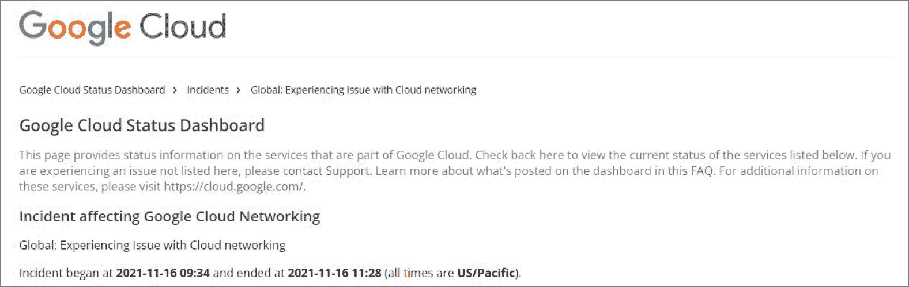

**图 5.3** Google Cloud 状态信息中心

在练习 5.2 中，您将考察一些与云计算相关的常见风险和问题，以及它们如何影响您的组织。

### 变更管理

`变更管理` 是一项正式化的流程，旨在控制对系统和程序的修改，无论是在云环境还是本地部署环境中。变更管理为变更提供了一个受控流程，通常由变更评审委员会处理。它还在变更实施前，为利益相关者提供了表达关切的机会。在进行变更前，变更管理请求应列出有关请求变更的具体项目。记录的项目包括：变更编号、变更类型和描述、变更请求者姓名及时间/日期、变更来源、变更的问题或原因、拟定变更日期。

ISO 20000 将变更管理定义为一项必要流程，旨在“确保所有变更都经过评估、批准、实施和审查，并以受控方式进行。”NIST 800-64 将变更管理描述为一种方法，确保变更以受控方式获得批准、测试、审查和实施。无论您遵循何种指南或标准，变更管理流程都可用于控制变更，并帮助确保安全状态不会降低。典型的变更管理流程包括以下内容：

1.  变更请求
2.  变更请求批准
3.  计划评审
4.  变更测试
5.  变更计划推出
6.  向受计划变更影响的人员进行沟通
7.  变更实施
8.  记录所有发生的变更
9.  变更后评审
10. 如有需要，回滚变更的方法


#### 变更控制策略

此外，还应明确规定策略涵盖和不涵盖的内容。例如，一些小的变更，如防病毒程序的更新，可能不包含在变更控制流程中，而对公司产生持久影响的大型机构变更则包含在内。变更控制策略还应列明紧急变更的实施方式，因为可能会出现一种情况：变更必须迅速进行，而在实施前无法完成正常的审查。在这种情况下，所有步骤仍应完成，但它们可能不会在紧急变更实施*之前*完成。变更管理必须能够应对可能发生的任何潜在变更，包括以下内容：

*   策略、程序和标准的变更
*   需求更新和新法规
*   网络修改、系统设置更改或修复实施
*   网络配置的更改
*   新的网络设备或设备
*   因收购、合并或分拆导致的公司架构变更
*   新电脑、笔记本电脑、智能手机或平板电脑的安装
*   新应用或更新后的应用
*   补丁和更新的安装
*   新技术的集成

##### 验收与验证测试

产品发布前，通常必须经过某种类型的验收与验证测试。其目的是进行测试，以验证产品或应用是否满足规格文档中规定的要求。

对于某些实体，还会执行验证。美国联邦政府将此过程规定为认证和认可。联邦机构依法必须对其 IT 系统和基础设施进行认证和认可。`认证` 是验证已实施的系统按预期配置和运行的过程。如果管理层同意认证结果，则正式批准报告。在比较产品时，所有产品都必须通过相同的测试进行验证。对认证的正式批准即为认可过程，并授权在特定环境中运行。

########## 测试与评估

云计算或任何供应商/产品采购的一个重要阶段是系统的测试与评估。在系统或服务被接受，或被认为达到其开发里程碑之前，必须根据该阶段或项目的预期标准对该系统进行评估。如果系统针对其规格要求进行测试并通过，则其所有者和用户就能确信系统将按需运行。

测试涵盖云采用、硬件和软件开发，但目标是提高对系统将按预期运行的保证程度。此外，测试可能旨在验证不存在不需要的方面。例如，在软件开发过程中，应用程序可能会被评估是否使用了禁用的编码技术。

### 管理与缓解风险

公司必须了解当前和新出现的威胁及安全趋势，以便快速适应。一个例子是高级持续性威胁（APT）的兴起。提醒用户不要点击未知或可疑链接至关重要，即使这些链接看起来来自他们在社交网站上信任的人。

涉及关键设备和技术配置时，对适当控制的需求更为关键。工业控制系统（ICS）包括监控与数据采集系统（SCADA），例如用于管理水或燃气管道的系统。当恶意软件影响工业控制系统时，它可能会造成灾难性后果。即使不造成迫在眉睫的危险或大范围的社区中断，ICS 停机至少也会造成高昂的代价。回顾一下，ICS 恶意软件 Stuxnet 以伊朗核离心机为目标。其停机事故包括工业机械的永久性自我毁坏。

大量新出现的威胁是由谋取经济利益的人、黑客活动家和国家支持的黑客驱动的。有人认为，在这三类中，国家支持的黑客对企业和政府构成的威胁最为严重。为了应对新出现的威胁，公司应制定计划，明确在检测到入侵时需立即部署的关键步骤和资源。

尽管许多公司将财务问题列为阻碍更好地应对安全问题的控制措施之一，但真正的问题是公司何时愿意花费这笔资金。在安全漏洞发生后让团队进场修复问题并查明原因，成本可能非常高昂。在事件发生前实施预防性控制更具成本效益。

还有一个问题是，金钱并不总是解决方案。应对新出现威胁的解决方案中很大一部分是培训和教育。需要制定 IT 安全策略，并教育员工了解公司资产的价值以及如何保护它们。至少，安全意识和培训计划应记录在企业级策略中，并应包含以下内容：

*   安全角色和职责的定义
*   计划策略和计划的制定
*   计划的实施
*   安全意识和培训计划的维护

#### 地理因素考量

技术的进步现在使设备追踪技术能够比以往任何时候都更大程度地监控资产和管理库存。随着互联网的发展，企业允许客户访问数据以（例如）跟踪订单并随时了解事物的位置。客户服务期望也有所提高，因为消费者希望实时跟踪包裹。资产管理不仅仅是跟踪包裹——它还涉及零售产品的销售、医院患者的追踪，以及仓储和分销系统中的产品。

地理定位技术使个人能够追踪物品的真实世界位置。这项技术包括为照片添加地理标签的功能，但也可被移动应用程序用来识别用户的确切位置。其理念是您可以通过用户的位置来识别他们，以提供服务或获取收益。示例包括附近咖啡店和餐厅的优惠券。然而，安全顾虑在于黑客或其他人可能有能力追踪特定个人的位置。

#### 第三方依赖

`third-party dependencies`（包括硬件、软件、开源库、代码、模块、包和容器镜像等）的快速增长极大地改变了当代软件开发方法。大多数应用程序都是在内部代码和外部代码的混合基础上开发的，而由多个组件构成的大多数计算机硬件都有一长串供应商名单。

第三方硬件是指在原始制造商之外开发的计算组件。组织可能从 Dell 采购硬件，但特定硬盘可能由希捷或金士顿制造，显卡可能由 NVIDIA 或 ZOTAC 制造，CPU 可能由 AMD 或 Intel 制造。这些第三方组件由制造它们的公司提供支持，而非 Dell。

随着物联网（IoT）的发展，存在许多硬件安全问题，攻击者专注于物理设备上的漏洞。常见的硬件安全问题包括设备拥有默认密码、固件过时和本地访问无保护。


##### 公共开源代码仓库

公共开源代码仓库为开发者提供了一个场所，用于使用和共享软件库、包、容器镜像及其他作品，并拥有许多实用且完善的功能。使用第三方依赖确实能提高开发效率和价值，但恶意代码和漏洞的安全风险却为供应链攻击创造了后门。

###### 错别名攻击与依赖混淆

错别名攻击和依赖混淆是攻击者诱骗开发者下载其恶意代码的两种方式。

**错别名攻击**依赖于威胁行为者提供的内容中的拼写错误。恶意代码将被引入项目并部署到生产系统。恶意包通过拼写错误隐藏其内容，常用大写 `I` 替代小写 `l`。在某些字体中，极难分辨两者的区别。

**依赖混淆**发生在攻击者利用包管理器的默认配置，通过保持相同的名称但使用更高的版本号，强制下载其篡改过的包时。

### 技术考量

作为 CASP+，您必须考虑多项技术安全考量。这些包括网络分段、技术测试、传输控制和共享凭据。测试将在本章及全书中讨论，但让我们先看看其他考量。

#### 网络分段

**网络分段**是将大型计算机网络划分为若干个较小的、隔离的子网络的做法。使用屏蔽子网（也称为 DMZ）进行网络分段，是符合 PCI DSS 要求的关键部分。如果销售点（POS）系统遭到入侵，持卡人数据仍可能是安全的，因为存储该信息的数据库位于另一个子网中。如果没有网络分段，攻击者可以自由横向移动并窃取“通往王国的钥匙”（核心权限/关键资产）。

#### 传输控制

在以 TCP/IP 形式查看传输控制时，信息被分解为数据包，IP 源生成一份数据包必须遵循的路由列表以到达预期目的地。接收方反过来可使用该列表向发送方回传信息。此时，威胁行为者可获取源路径并修改数据包路由中的选项，这被称为**源路由攻击**。攻击者还可能读取数据包并获取机密信息或知识产权。通过丢弃或转发携带源路由选项的任何数据包，可在一定程度上抵消此安全风险。

#### 共享账户与通用账户

其他技术安全考量是共享账户和通用账户或凭据。这些账户通常被安全策略禁止。虽然共享账户可能有用，但许多组织构建委派功能，允许多个用户以相同方式或拥有相同权限行事，以避免共享账户问题，例如无法确定是谁登录了共享账户，或共享该账户的每个用户采取了什么操作。所有管理员或 root 账户/凭据不应与第三方供应商共享，并应按计划进行监控和审计。

## 整合多元行业的安全顾虑

合并企业或聘用第三方组织时，会产生许多重大的安全风险。这些风险可能源于组织供应链中某处开始的供应商关系，也可能源于合并实体内部的其他业务合作伙伴关系或冲突。

安全专业人员可通过审查战略规划并检查公司的策略和程序，深入了解一个组织。在管理最善的公司中，策略等高层文档反映了管理层对公司的看法。策略应涵盖组织控制的大多数方面，因为公司有法律和业务要求必须制定策略和程序。一个例子是《萨班斯-奥克斯利法案》（SOX），这是一项联邦法律，强制要求财务记录保存和报告。该授权对公司实施严格控制，并要求其制定策略和程序。对于不合规者，将面临罚款，责任人可能面临长达 20 年的监禁。策略应规定谁负责以及必须坚持什么标准，以满足最低公司治理要求。

管理层负责定义组织架构，因此必须将公司划分为控制特定职能的较小子群体。策略和程序是规定各通用职能领域活动如何开展的控制性文档。安全专业人员应始终查看有哪些文档到位、其更新频率如何以及涵盖哪些活动。您可能会发现公司未制定安全策略。在某些情况下，可能是技术发展太快，公司尚未适应。在其他情况下，可能是公司只是看不到制定策略的必要性，或未将策略制定作为优先事项。

作为负责任何类型收购或供应商协议的安全专业人员，您应牢记策略和程序等文档是需要定期审查的**活文档**。鉴于策略、法规、环境和业务的变更，流程和程序可能需要变更或更新。审查时机将因公司及其所在业务领域而异。虽然许多公司至少每年审查一次策略，但间隔范围可从六个月到五年不等。审查期间应提出以下问题：

*   程序或流程是否已变更？
*   策略是否仍具相关性？
*   相关法律是否已变更？
*   变更管理流程是否包含文档变更？
*   行业最佳实践是否已变更？
*   定期审计发现是否表明文档（如策略和程序）存在问题？

审查文档时，应考虑涉及内部实践以及公司与外部实体、业务合作伙伴和承包商交互的文档。公司可能与供应商就一系列产品和服务签订合同。在审查策略、程序和文档的过程中，以下任何情况均可能表明存在潜在问题：

*   负面审计发现
*   缺乏文档
*   文档过时
*   不受支持的硬件变更或未经授权的采购
*   员工不知晓或不了解文档

CASP+ 应通过与人力资源、法务、管理层及其他实体合作，支持法律合规和权益维护，确保所有利益相关者参与其中。对于员工关切等事项，应让人力资源部门参与。对于合规或支付卡行业数据安全标准（PCI DSS）等事项，应让法务部门参与，因为这些人员了解公司必须遵守的要求。

## 法规、认证与标准

由于网络安全缺陷对个人、政府和社会的潜在影响，世界各地的立法者和监管机构都对网络安全感兴趣。虽然欧盟（EU）拥有广泛的数据保护法规，但美国的网络安全分析师被迫应对一套涵盖不同行业和信息类别的碎片化安全法规。


## 隐私与敏感信息保护

隐私与敏感信息保护以其他事项无法比拟的方式触及组织。作为安全专业人员，您可能会被要求协助构建有效的隐私治理计划，或与已建立的计划协同工作。此类计划的管理方式不仅会影响客户对公司的看法，还会影响公司的财务状况。

随着《萨班斯-奥克斯利法案》（SOX）、《健康保险流通与责任法案》（HIPAA）和《支付卡行业数据安全标准》（PCI DSS）等强制性法规的出台，一旦发生隐私政策违规且敏感信息泄露，公司将面临海量的监管要求和巨额的资金风险。公司若未能保护特定类型的数据，遭受的不仅仅是金钱损失；还面临诉讼、负面舆论和政府调查等问题。

如今管理敏感信息的法律法规比过去多得多，原因之一在于信息的存储、移动和处理方式已发生改变。曾有一段时间，信用卡机是手动操作的。这些机械设备要求操作员刷卡，并制作持卡人卡号和签名的复写件。安全性依赖于对信用卡信息的物理保护。人们有时会被告知撕毁信用卡复写件，以防罪犯窃取卡号。

如今，信用卡信息以电子方式存储和处理。这些电子系统大多连接互联网，成为黑客极具吸引力的攻击目标。请设想一下用信用卡支付餐费的过程：从您将信用卡交给服务员，到信用卡账单寄达您家中，数据经过了许多环节，黑客可在其中任何一点尝试窃取信息。若个人数据泄露给未授权人员，公司将承担法律责任，潜在损失巨大。

### PCI DSS

**支付卡行业数据安全标准（PCI DSS）** 为信用卡和借记卡信息的存储、处理和传输提供了详细规范。PCI DSS 并非法律，而是一项适用于全球信用卡商户和服务提供商的合同义务。

如果您的组织接受信用卡、借记卡或任何其他类型的电子支付，您就将连接到一个由网络、银行和信用卡机构构成的多面向且复杂的结构。在当今这个攻击者寻求将攻击手段货币化的数字时代，必须防御欺诈行为，而每个连接到该结构的组织都必须满足一套最低标准，以保护这些敏感的财务数据。这就是 PCI DSS。处理和处置任何数量信用卡信息的公司，必须实施包括策略、程序、网络架构和软件设计在内的特定控制措施，以保护持卡人数据。未能满足 PCI DSS 合规要求将导致负面影响，包括费用、罚款和业务损失。

Visa 和 MasterCard 之间在 1988 年至 1998 年间因信用卡欺诈损失超过 7.5 亿美元。PCI 于 2004 年成立，发布了 PCI DSS 1.0 版安全架构，为接受信用卡的商户提供了一份基础且全面的安全控制清单。PCI DSS 概述了处理支付卡信息公司的最佳实践，由美国运通、发现金融服务、JCB 国际、万事达卡和 Visa 共同制定。这些最佳实践用于提高安全性，并概述了用于保护承载敏感持卡人信息的安全系统的策略。PCI DSS 最新版本为 3.2.1 版，于 2018 年 5 月 31 日发布。PCI DSS 标准基于涉及网络安全和内部控制的 12 项要求：

*   为网络和系统安装/维护防火墙配置
*   避免使用供商提供的默认密码和其他安全参数
*   保护存储状态下的持卡人数据
*   在开放和公共网络传输持卡人数据时使用加密
*   使用并定期更新防病毒软件
*   开发并维护安全的网络系统和应用程序
*   限制对持卡人数据的用户访问
*   为需要访问持卡人数据的用户创建唯一 ID
*   限制对持卡人信息的物理访问
*   跟踪并监控所有对网络系统和数据的访问
*   定期测试安全流程和系统
*   维护信息安全策略

PCI DSS 帮助商家保护包含 **个人身份信息（PII）** 的关键持卡人数据。PII 是指可能识别特定个人的任何数据。TechTarget 将 PII 定义为“关于个人的任何数据，可能用于识别该人员，例如姓名、指纹或其他生物特征数据、电子邮件地址、街道地址、电话号码或社会安全号码。”

保护 PII 对个人隐私、数据隐私以及数据和信息安全至关重要。能够将某人作为个体唯一识别、并与其他人区分开来的信息即为 PII，包括以下内容：

*   姓名
*   地址
*   电子邮件
*   电话号码
*   出生日期
*   护照号码
*   指纹
*   驾驶执照号码
*   信用卡或借记卡号码
*   社会安全号码

遗憾的是，一些公司预先认为安全控制会降低业务流程的效率或速度。据 `securitymagazine.com` 报道，截至 2021 年 9 月 30 日，数据泄露事件数量已比 2020 年全年总数高出 17%，2021 年发生 1,291 起泄露事件，而 2020 年为 1,108 起。这些泄露事件影响了数百万美国人。这些公司未建立足够的控制措施来保护个人身份信息。

作为安全专业人员，您的工作是与管理者协作，帮助他们认识到强有力的安全控制的重要性。良好的安全实践并非大多数管理者或用户与生俱知，而是需要教育。该过程的关键组成部分是用户培训和意识提升。教育过程的一部分是增加对敏感信息丢失所涉及成本的认知。

以下是针对 PII 的一些通用隐私原则：

*   PII 数据的收集应公平合法。
*   PII 数据仅用于收集时规定的目的。
*   PII 数据在存储和传输过程中应保持安全。
*   PII 数据仅保留合理的时间。

公司策略必须解决的两大保护领域是：保护静止状态下的信用卡数据，以及保护传输过程中的信用卡数据。如果您的公司涉及信用卡业务，PCI 标准要求存储的持卡人数据必须被渲染为不可读或加密，以保护客户隐私。为满足此要求，您的公司必须实施安全控制，在信用卡数据存储期间以及跨越开放公共网络移动期间提供加密方法。必须遵守 PCI 标准的公司表示，文档工作是获得和维持 PCI 合规性最繁琐的环节之一，也是通常需要加强工作的领域之一。


## 数据隐私保护与合规框架

### 隐私影响评估 (PIA)

提供 PII 适当保护的一个重要组成部分是确保有一种方法来跟踪隐私策略违规并衡量其影响。衡量影响的一种方法是验证公司策略是否基于**隐私影响评估 (PIA)**。PIA 应确定在电子系统中收集、维护和分发 PII 的风险和影响。应使用 PIA 来评估隐私风险，并确保存在适当的隐私控制。应检查现有控制，以验证问责制到位，并且每当安排新项目或流程上线时，合规性都内建其中。

您可以在 `www.pcicomplianceguide.org/category/best-practices` 阅读更多关于 PCI DSS 以及支付卡信息最佳实践的内容。

### GDPR

《通用数据保护条例 (GDPR)》等全面的数据隐私法为全球欧盟 (EU) 居民的个人信息实施了严格的安全和隐私要求。GDPR 严格限制了组织存储和使用某些类型信息的方式，并将通过高额罚款和处罚来强制执行这些法规。这项 88 页的法规于 2018 年 5 月 25 日生效。GDPR 将对违反其隐私和安全标准的人处以惩罚性罚款，罚款可达数千万欧元。

GDPR 详细定义了一系列法律术语。以下是其中一些最重要的术语：

*   **个人数据**：个人数据是指与已识别或可识别的自然人（数据主体）相关的任何信息（PII）。如果容易从中识别出某人，`Pseudonymous`（假名）数据也属于此定义范围。
*   **数据处理**：对数据执行的任何操作，无论是自动化的还是手动的。`gdpr.eu` 引用的示例包括收集、记录、组织、构建、存储、使用和擦除。
*   **数据主体**：其数据被处理的人。这些是客户或网站访问者。
*   **数据控制者**：决定为什么以及如何处理个人数据的人。如果您是组织中处理数据的所有者或员工，这就是您。
*   **数据处理者**：代表数据控制者处理个人数据的第三方。
*   **数据分类**：根据一组规则，识别组织存储和处理的数据类型及其敏感度。数据将分为四类：
    *   公开
    *   仅限内部
    *   机密
    *   受限

以下是数据主体隐私权利的摘要：

*   知情权
*   访问权
*   更正权
*   删除权（被遗忘权）
*   限制处理权
*   数据可携带权
*   异议权
*   关于自动化决策和画像分析的权利

随着各国实施如此多不同的要求，组织面临着不一致、不明确且往往相互矛盾的监管需求拼凑而成的局面。对跨国公司的影响巨大：面临监管行动的威胁、既定业务流程的中断，以及加强跨国界信息处理控制的要求。安全港协议的废除（该协议管辖数据在欧盟国家和美国之间的流动）迫使许多公司重新审视其保护个人身份信息的法律和政策框架。

为了应对新出现的和即将出台的数据隐私法规带来的挑战，业务和技术领导者需要与其合规、法律和技术团队共同努力，了解法规对其业务的影响。

**数据主权** 是指已转换并以二进制数字形式存储的信息受其所在国家/地区法律管辖的概念。随着数据盗窃和泄露急剧增加，全球各国政府正在加强法律，以保护公民数据、维护国家安全，并在某些情况下保护本地商业利益。

数据主权不同于数据所有权。**数据所有权** 既是数据的占有，也是对信息的责任。根据 GDPR，数据所有权是指明确将责任分配给每个数据元素。数据所有者可以是拥有访问和编辑数据权利并决定如何使用数据的团队或个人。数据所有权很重要，因为它创造了问责制。数据所有者对其数据的保护和完整性有既得利益，并将制定政策以确保符合 GDPR。数据管家的角色本质上是支持用户社区。该个人负责收集、整理和评估数据的问题。通常，数据管家根据主题领域或业务职责线进行分配。数据所有者和数据管家的主要区别在于，后者负责在日常基础上维护特定数据集的质量。

随着特定国家或地区起草法规（即使它们影响全球的数据和用户），**管辖权** 问题也随之产生。公司寻求将法规对其基础设施和用户的影响降至最低。尽管辩论仍在继续，但大多数数据隐私法规似乎都倾向于用户利益。

GDPR 的一个副作用是对云计算产生的影响。根据 GDPR，公司被视为数据控制者，无论数据存储在何处，都有责任保护所有数据安全。关于云中合规性地理决策的关键步骤包括严格的隐私策略、使用条款、服务器位置、安全功能、加密以及数据保护的法律担保。

### ISO

**国际标准化组织 (ISO)** 将自己描述为“由 162 个国家标准机构组成的网络，每个国家一个成员，中央秘书处设在瑞士日内瓦，协调该系统，在公共和私营部门之间架起桥梁。”

一份值得回顾的重要 ISO 网络安全文档是 ISO 27002。该标准被视为信息安全管理的最佳实践准则。它源自 ISO 17799 和英国标准 7799。ISO 27002 被视为管理指南，而非技术文档。您可以在 `www.27000.org/iso-27002.htm` 了解更多信息。ISO 27002 为负责领导、规划、实施或维护安全的人员提供了信息安全管理的最佳实践建议。ISO 27017 的创建是为了增加云计算的额外安全控制。

最新的 ISO 27002:2022 包含 93 项控制措施；其中 11 项是新增的，24 项已合并，58 项已更新指导。该标准包含分布在组织、物理、技术和人员四个类别中的 14 个控制领域。这 11 项新控制措施如下：

*   **威胁情报**：在您的 IT 环境背景下了解攻击者及其方法
*   **云服务使用的信息安全**：考虑从云计划的引入到运营再到退出策略
*   **业务连续性的 ICT 就绪性**：从整体业务流程和恢复运营能力的角度得出 IT 环境的需求
*   **物理安全监控**：使用报警和监控系统防止未经授权的物理访问
*   **配置管理**：IT 系统的加固和安全配置


### 信息安全控制措施

*   **信息删除**：遵守外部要求，如数据保护删除概念
*   **数据脱敏**：使用数据脱敏技术，如匿名化和假名化，以加强数据保护
*   **数据泄露防护**：采取措施帮助防止敏感数据泄露
*   **监控活动**：监控网络安全和应用行为，以检测任何网络异常
*   **Web 过滤**：帮助防止用户查看包含恶意代码的特定 URL
*   **安全编码**：使用工具、注释、跟踪变更，并避免不安全的编程方法，以确保安全编码

### ISO 15408 (Common Criteria)

网络安全专业人员还应熟悉另一份 ISO 文档 —— **ISO 15408**。该标准经过多年的起草，于 1997 年首次发布，当前版本为 3.1，更广为人知的名称是 **Common Criteria（通用准则）**。

*Common Criteria* 的目的是为表达产品和系统 IT 安全需求提供通用的结构和语言。它使供应商能够描述其产品的能力，也使买方能够测试此类产品，以确保它们满足特定要求。Common Criteria 保证了计算机安全产品的规范、实施和评估过程已以严格且标准的方式进行。因此，Common Criteria 可在全球范围内使用，并对更广泛的受众具有意义。

### CMMI

**CMMI（Capability Maturity Model Integration，能力成熟度模型集成）** 由卡内基梅隆大学软件工程研究所创建，作为项目、部门或组织的过程改进工具。美国国防部和政府协助构建了 CMMI，它是美国国防部和政府软件开发合同的通用要求。CMMI 目前由 CMMI Institute 管理，该机构于 2016 年被 ISACA 收购。CMMI 是一种过程和行为模型，帮助团体重组或重构流程以实现改进，从而降低软件、产品和服务开发中的风险。

CMMI 模型将组织成熟度分为五个级别。虽然 CMMI 起源于软件工程，但已推广至其他领域。共有三个领域，均采用相同的五级模型：

*   **产品与服务开发**：用于开发的 CMMI (CMMI-DEV)
*   **服务建立与管理**：用于服务的 CMMI (CMMI-SVC)
*   **产品与服务获取**：用于获取的 CMMI (CMMI-ACQ)

对于使用 CMMI 的网络安全企业，目标是将组织提升至第 5 级 —— “优化”成熟度级别。图 5.4 展示了 CMMI 从第 1 级到第 5 级的差异。

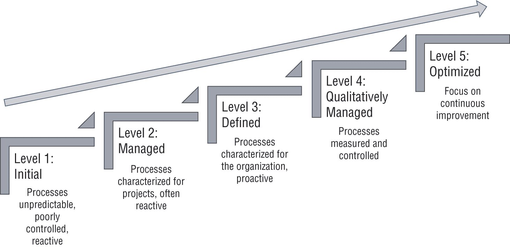

**图 5.4 CMMI 级别**

### NIST

**NIST（National Institute for Standards and Technology，美国国家标准与技术研究院）** 负责为美国联邦政府制定网络安全标准。其发布的指导和标准文档通常广泛适用于私营部门，并常被非政府安全分析师引用，因为这些文档属于公共领域。

2018 年，NIST 发布了网络安全框架 **CSF（Cybersecurity Framework）** 1.1 版（`www.nist.gov/cyberframework`），为管理风险提供了通用语言和系统方法论。核心框架的五大支柱功能如下：

*   **识别**：帮助理解针对人员、系统、数据和资产的网络安全风险
*   **防护**：概述适当的保障措施，确保关键基础设施安全
*   **检测**：定义如何识别网络安全事件
*   **响应**：定义发生网络安全事件时应采取的行动
*   **恢复**：确定恢复弹性和恢复因网络安全事件受损服务所需的计划

NIST 还发布网络安全指导特别出版物，如 **800-100**《信息安全手册：管理者指南》和 **800-53**《信息系统和组织的安全与隐私控制》。NIST 与 **ITL（Information Technology Laboratory，信息技术实验室）** 紧密合作，通过为国家计量和标准基础设施提供技术领导力，促进美国经济和公共福利。ITL 开发测试、测试方法、参考数据、概念验证实现和技术分析，以推动信息技术的开发和生产性使用。ITL 的职责包括为联邦信息系统中非国家安全相关信息的成本效益安全和隐私，开发管理、行政、技术和物理标准及指南。特别出版物 800 系列报告了 ITL 在信息系统安全方面的研究、指南和推广工作，以及其与行业、政府和学术组织的协作活动。

#### COPPA

如今儿童上网时间比以往任何时候都长。从网络课堂到在线游戏，儿童每天在互联网上花费数小时，理应获得保护，以便安全地学习和娱乐。**COPPA（Children's Online Privacy Protection Rule，儿童在线隐私保护规则）** 于 1998 年由美国国会通过。联邦贸易委员会（FTC）的规则摘要（可在 `ftc.gov` 查阅）指出，COPPA 对面向 13 岁以下儿童的网站或在线服务运营者，以及明知从 13 岁以下儿童在线收集个人信息的其他网站或在线服务运营者，施加了特定要求。

受 COPPA 管辖的运营者必须执行以下操作：

*   发布清晰完整的在线隐私政策，描述其针对从儿童在线收集的个人信息的信息处理做法。
*   直接通知家长，并在有限例外情况下，在在线收集儿童个人信息前获得可验证的家长同意。
*   给予家长选择权：同意运营者收集和内部使用儿童信息，但禁止运营者向第三方披露该信息（除非披露是网站或服务不可或缺的一部分，在此情况下必须明确告知家长）。
*   让家长访问其子女的个人信息，以便审查和/或删除该信息。
*   给予家长机会，阻止进一步使用或在线收集其子女的个人信息。
*   保持从儿童收集的信息的机密性、安全性和完整性，包括采取合理措施，仅向有能力维护其机密性和安全性的方发布此类信息。
*   仅在为实现收集目的所必需的时间内保留从儿童在线收集的个人信息，并使用合理措施删除该信息，以防止未经授权的访问。
*   不得以儿童提供超出合理必要范围的信息作为其参与在线活动的条件。


#### COPPA

COPPA 的实施旨在保护儿童在线安全，因未遵守该法律而被处以的罚款最近已增加至每名儿童每次隐私违规高达 43,280 美元。联邦贸易委员会 (FTC) 于 2019 年 9 月 `announced`，Google 及其子公司 YouTube 将支付 1.7 亿美元罚款，以解决 FTC 指控的 YouTube 在未经父母同意的情况下收集儿童个人信息的指控。YouTube 从专门面向儿童的页面（如关于儿童玩具和童谣的视频）收集儿童信息。

### CSA-STAR

网络安全社区提供了许多参考文档，帮助组织对云和云安全问题达成共同理解。**云安全联盟** 是一个专注于开发和推广云安全最佳实践的行业组织。它开发了云控制矩阵 (CCM) 作为参考文档，旨在帮助组织了解云安全控制的适当使用，并将这些控制映射到各种监管标准。CCM 是一份冗长的 Excel 电子表格，可从 `cloudsecurityalliance.org` 下载。

安全、信任、保证和风险 (STAR) 纳入了云控制矩阵 (CCM) 中概述的透明度、审计和标准协调的基本原则。发布到注册表允许组织向客户展示其安全和合规状况，包括其遵循的法规、标准和框架。在 图 5.5 中，你可以看到 CCM 中概述的 STAR 级别。

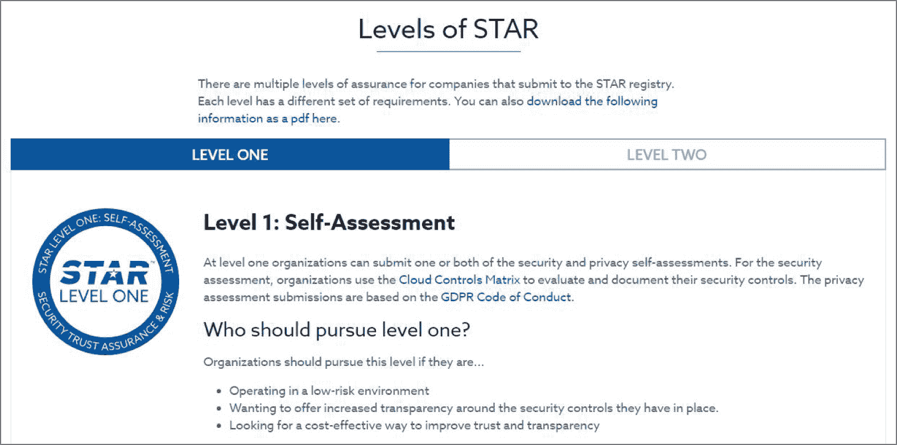

**图 5.5** CSA STAR 级别

### HIPAA、SOX 和 GLBA

你还应熟悉其他几个与隐私以及健康、财务、PII 和其他数据安全相关的合规性、监管框架或标准，包括 HIPAA、SOX 和 GLBA。

#### 健康保险流通与责任法案 (HIPAA)

**健康保险流通与责任法案 (HIPAA)** 包含影响美国医疗服务提供者、健康保险公司和医疗信息清算机构的安全和隐私规则。HIPAA 于 1996 年签署成为法律。它分为两部分：HIPAA 第一编保护工人及其家庭在变动或失去工作时的健康保险覆盖权。第二编要求美国卫生与公众服务部 (DHHS) 制定电子医疗交易的国家标准，以及提供者、健康计划和雇主的国家标识符。

根据 HIPAA，美国被要求发布一套关于隐私的规则。隐私规则规定了组织必须实施的控制措施以保护个人信息。隐私规则定义了三个主要目的：

*   “通过提供消费者访问其健康信息的权利并控制该信息的不当使用，保护和增强消费者的权利。”
*   “通过在消费者、医疗专业人员以及致力于提供护理的众多组织和个人中恢复对医疗体系的信任，提高美国医疗保健的质量。”
*   “通过建立国家健康隐私保护框架，在各州、卫生系统、个人组织和个人努力的基础上，提高医疗服务提供的效率和有效性。”

#### 萨班斯-奥克斯利 (SOX) 法案

**萨班斯-奥克斯利 (SOX) 法案** 适用于美国上市公司的财务记录，要求这些公司对存储和处理这些记录的 IT 系统具有高度的保证。SOX 法案于 2002 年签署成为法律。该法案强制实施了一系列改革，以加强企业责任和财务披露，并打击企业和会计欺诈。

第 302 节和第 404 节是涉及 IT 基础设施和信息安全的两个条款。

*   **第 302 节** 要求 CEO 和 CFO 亲自证明组织拥有适当的内部控制。它还强制要求 CEO 和 CFO 就财务报告周围内部控制的有效性进行报告。
*   **第 404 节** 对管理层架构、控制目标和控制程序领域设定了要求。遵守第 404 节要求公司建立旨在归档记录和数据并防止其被销毁、丢失、未经授权的篡改或其他滥用的基础设施。它要求建立一套全面的控制措施，并让 CEO 和 CFO 负责。

#### 格雷姆-里奇-比利雷法案 (GLBA)

**格雷姆-里奇-比利雷法案 (GLBA)** 涵盖广义定义的美国金融机构。它要求这些机构拥有正式的安全计划，并指定一名个人对该计划承担总体责任。GLBA 于 1999 年签署成为法，并导致了美国金融服务监管最全面的改革。

GLBA 第五编通过两个副标题解决金融机构隐私问题。副标题 A 要求金融机构就其隐私政策进行特定披露，并赋予个人选择退出的权利。副标题 B 将 **借口欺诈** 定为犯罪，这可以描述为在虚假借口下获取个人信息的做法。在这些情况下，人们通过虚假身份收集个人信息。

根据 GLBA，金融机构必须保护个人隐私信息的机密性。按照 GLBA 的规定，金融机构必须开发、实施并维护一个全面的信息安全计划，包含适当的管理、技术和物理保障措施。信息安全计划中指定的控制措施必须包括以下项目：

*   为组织的信息安全计划指定专门的计划经理
*   定期的风险和漏洞评估及审计
*   定期测试和监控计划
*   制定控制敏感信息和 PII 的政策和程序

请记住，这只是安全法规的简要列举。还有许多其他法律和义务适用于特定行业和数据类型。在为组织设计合规策略时，你应始终咨询组织的法律顾问和主题专家。你需要了解适用于你运营的各种国家、领地和州法律，而在解读和将网络安全法规应用于你特定的业务和技术环境时，资深律师的建议至关重要。

## 合同和协议类型

组织可能会部署一些标准协议和实践来管理安全风险。常用的协议包括以下内容：

*   **主服务协议 (MSA)** 为供应商在较长时期内与组织开展的工作提供顶层合同，设定关系边界以保持工作流程顺畅并解决任何争议。它通常规定付款条款、担保、地理位置和知识产权归属。MSA 通常包含详细的安全和隐私约束。每当组织与供应商启动新项目时，他们可以创建一份 **工作说明书 (SOW)**，其中包含特定于项目的详细信息并引用 MSA。


## 协议与合规文档

##### 服务级别协议 (SLA)

*服务级别协议 (SLA)* 是关键合同，规定了供应商将提供的服务条件，以及供应商未能遵守 SLA 时客户可获得的补救措施。SLA 通常涵盖系统可用性、数据持久性和响应时间等问题。SLA 通常在客户和外部供应商之间编写，并应由法律顾问审查。对于关键安全系统，客户应有办法衡量 SLA 性能数据。

SLA 应指定其同意的正常运行时间、响应时间和最长中断时间。SLA 也可用作与硬件供应商的一种合同类型，提供一定级别的保护。支付费用后，供应商同意在合同规定的时间内维修或更换设备。

### 谅解备忘录 (MOU)

*谅解备忘录 (MOU)* 记录了定义关联目的的起始关系各方面内容。MOU 是一种非正式方法，允许各方记录其关系以避免未来的误解。当内部服务提供商向同一公司不同业务单元的客户提供服务时，经常使用 MOU。有时，MOU 可在整体框架合同或协议之前用作临时手段。MOU 与 NDA 不同。NDA 用于维护信息的秘密性或机密性，而 MOU 的范围更广：它概述了各方的责任以及各方应提供或执行的内容。

选择合适的合作伙伴至关重要，必须谨慎行事。为了具有约束力，MOU 必须由各组织中拥有合法签署权的代表签署。这通常是高级管理层成员、法务部门人员或董事会成员。此类文件通常受到保护，因为它们被视为机密。需要保密是因为协议可能描述签署方不希望他人知晓的流程、活动甚至服务。

### 隐私级别协议 (PLA)

*隐私级别协议 (PLA)* 解决隐私问题，这是云客户和监管机构的首要关注点之一。云服务提供商 (CSP) 和潜在用户都在努力应对世界各地的数据保护立法。各国立法之间的不一致性代表了云计算广泛采用的重大障碍。隐私合规是选择云服务提供商时的基本评估标准。

### 业务合作伙伴协议 (BPA)

当两家公司同意以合作伙伴关系相互贸易时，存在 *业务合作伙伴协议 (BPA)*。例如，如果两家公司共同开发和推销制造产品，BPA 可能会确定每个合作伙伴的义务和收入分配。BPA 是由律师在合作伙伴参与下创建的书面协议，包含与安全和合作相关的标准条款。

### 保密协议 (NDA)

*保密协议 (NDA)* 旨在保护机密信息。例如，在参加 CASP+ 考试前，你将被要求签署一份 NDA，声明你不会向他人透露考题。许多公司要求员工和承包商在入职时或获得特定信息访问权限前签署 NDA。

在 练习 5.3 中，你将审查公司的 NDA，检查其应包含的领域和项目。

组织需要选择最适合其特定情况的协议类型。CASP+ 还应了解用于支持安全的以下文档：

### 支持安全的文档

#### 业务影响分析 (BIA)

*业务影响分析 (BIA)* 是灾难恢复业务连续性流程的核心部分。BIA 有三个组成部分：关键性优先级排序、停机时间估算和资源需求。BIA 用于识别与故障相关的成本，如现金损失或设备更换、现金流、工资或其他损失。BIA 的设计可以是定量的，也可以是定性的。业务影响分析在 第 1 章 “风险管理” 中进一步探讨。

#### 互操作性协议 (IA)

*互操作性协议 (IA)* 是建立和维护组织间数据交换要求的文档。例如，United Airlines 可能与 Lufthansa Airlines 共享航班代码，因此双方都需要访问通用数据集。这些通用数据集通常通过使用 TCP/IP 等协议或 XML、SQL 等标准来指定。

#### 运营连续性 (COOP)

考虑到我们在过去几十年中见证的自然灾害和人为灾害，加上日益严格的 *监管要求*。这些事件导致对业务连续性的需求大大增加。*运营连续性 (COOP)* 包含组织必须建立的所有流程和程序，以确保业务能够继续运营。COOP 文档是必要的，因为公司必须制定计划和程序，以便在发生故障或灾难时继续运营。

#### 互连安全协议 (ISA)

*互连安全协议 (ISA)* 是一份安全文档，详细说明了建立、维护和运行系统或网络之间互连的要求。该文档指定了连接系统和网络的要求，并详细说明了用于保护系统和敏感数据的安全控制措施。ISA 通常详细说明特定系统和网络的连接方式，并包含网络拓扑图。

#### 运营级别协议 (OLA)

*运营级别协议 (OLA)* 与 SLA 流程配合工作并提供支持。OLA 定义了每个合作伙伴内部支持组的责任。因此，虽然 SLA 可能承诺停机时间不超过五分钟，但 OLA 定义了用于实现特定目标的组和资源。

#### 正常运行时间协议 (UA)

*正常运行时间协议 (UA)* 是最知名的 SLA 类型之一；它详细说明了商定的正常运行时间。例如，UA 可用于网络服务（如 WAN 链路）或设备（如服务器）。正常运行时间的常见等级包括 99.999%（行业术语称为“five nines”），相当于每年约五分钟的停机时间。如果 UA 指定 99.9999%（“six nines”），停机时间将降至每年最多约 30 秒。

### 第三方合规认证

管理对公司的潜在风险并建立适当的保障措施至关重要。重要的是要了解你的供应商是否根据你的合规需求管理和处理数据。许多公司依赖第三方服务提供商来托管或管理信息，这些关系给行业的法规、合规和数据安全要求带来了挑战。

外包提供商在访问和处理数据时，必须证明拥有适当且有效的内部控制。确保第三方组织合规和控制能力的透明度，需要管理团队、董事会和股东的信任。

*第三方认证* 服务可以通过创建报告，提供关于控制环境的客观意见，并识别弱点、问题和风险，以最大限度地减少对业务的干扰，从而帮助组织向客户、股东、供应商、监管机构和其他利益相关者提供信心和保证。


## 使用信息安全框架

使用像 **HITRUST CSF** 这样的信息安全框架，为组织遵守 **ISO** 和 **HIPAA** 提供了途径。该框架是一套包含 135 项控制措施的集合，可满足多个不同合规监管机构的要求和标准，组织可以在内部完成自我评估，也可以聘请评估师进行外部评估。这些控制措施包括第三方保证、数据分类、数据保留，以及数据移除、销毁和清理的规则。

在 **HITRUST 9.5.0 共享责任矩阵** 中，共有 13 个控制类别。在 **控制参考 13.1** 中，包含针对数据保留和清理的控制规范、监管因素类型及实施指南。

> *组织将限制对 PII（个人身份信息）的保留，仅限于被认为必要的范围，且仅在为履行组织特定合法目的及/或法律要求所必需的期限内保留。除非适用特定例外情况，否则此后必须删除 PII。组织将确保适当遵守保留期限，并按照既定的保留期限处置 PII。*
>
> *无论采用何种存储方式，一旦 PII 不再用于收集时声明的目的，及/或适用的法定保留期届满，组织将以防止 PII 丢失、被盗、被滥用或未经授权访问的方式，销毁、擦除、处置、清理和/或匿名化该 PII。*

**HIPAA** 是一项联邦法案，通过确保医疗保健公司及其关联机构保护个人的敏感数据和个人健康信息，对其进行监管。**HITRUST** 是一个私人组织，它创建了一个框架，帮助公司达到由 **HIPAA** 制定并强制执行的合规标准。越来越多的医疗系统和医院要求其业务合作伙伴获得 **HITRUST** 认证，因为该认证表明组织已致力于为客户的医疗数据维持最高级别的保护。

## 法律考量

当公司为法律抗辩实施最低安全级别时，可能需要证明其已采取任何合理审慎组织在类似情况下会采取的措施。这一最低安全级别称为 *应有注意标准*。如果未维持这一最低级别，公司可能面临法律责任。

此类标准在 IT 安全领域日益重要，因为大量公司数据存储在电子数据库中。此外，还有大量个人身份信息（**PII**）以电子形式保存。这使得公司实施应有注意和尽职调查变得至关重要。

实施最佳实践并非易事——不同行业必须提供不同级别的合规。在涉及整合组织的安全性时，供应商收购或与新公司合并最重要的部分之一就是应有注意和尽职调查。网络安全中的 *应有注意* 是指采取可接受且切实可行的步骤，以维护组织的声誉、财务和法律最佳利益。*尽职调查* 是审慎、理性的个人或实体在特定情况下履行的注意义务或审慎程度。执行尽职调查的行为会产生在法律上可抗辩的应有注意。

尽职调查任务耗时且复杂。调查不充分是导致整合失败的主要原因之一。安全顾虑涉及检查公司运营的所有要素，旨在评估技术和资产的状况，以发现任何隐藏的风险或责任。

一些公司选择实施超出最低要求的安全级别。这些努力可被视为最佳实践。*最佳实践* 旨在在平衡安全性与易用性的前提下，为信息和信息系统提供尽可能多的安全保障。任何实施的控制措施成本不得超过其所保护资产的价值。必须保持财政责任。

美国政府维护着一套复杂的法规，提供 *出口管制* 以管辖货物——包括技术、软件和技术数据——向外国、特定外国实体和个人的出口。网络安全产品和服务构成挑战，因为出口内容可能包含不同软件、加密功能和受控技术信息的混合体。

随着网络安全重要性从国家防御角度日益凸显，美国政府对管制敏感技术出口的兴趣也随之增长。越来越多的执法行动涉及向国外销售软件、加密产品和其他网络安全相关信息，例如一名居民因试图在无许可证情况下获取敏感加密、通信和全球定位系统设备而被判处八年监禁。

美国商务部 **工业与安全局 (BIS)** 于 2021 年 10 月 20 日发布了一项临时最终规则，建立了对可用于恶意网络活动的某些项目的出口、再出口或转让（境内转让）管制。该规则还创建了新的 **授权网络安全出口许可证例外 (ACE)**，并就拟议管制对美国产业和网络安全社区的预期影响征求公众意见。

**ACE 许可证例外** 将允许向大多数目的地出口、再出口和转让（境内转让）“网络安全项目”，同时保持对涉及国家安全或大规模杀伤性武器关切国家的出口许可证要求。此外，受美国武器禁运约束的国家也涉及许可证要求。

律师们经常为电子数据的取证以及如何在法庭上从对手处获取更多数据而争辩。为此，律师可以对电子数据发布法律保全令。*法律保全* 可能要求保留特定电子邮件并保持其完整，直到不再需要用于 *电子取证* 或诉讼为止。法律保全要求同时适用于邮件内容和元数据，后者可提供传输证据和其他重要的不可抵赖证据。法律保全（也称为 *诉讼保全*）是组织法律团队发送给员工的通知，告知他们不要删除电子存储信息（**ESI**）或丢弃可能与近期或待决法律案件相关的纸质文件。

建立法律保全流程并使用专用法律保全工具，对于证明为保留证据所做的可抗辩且善意的努力至关重要。如果在发出诉讼保全函后文件被处置或电子邮件被删除，即使无恶意，法院也可视某些事实为已确立、禁止企业依赖其他文件支持抗辩、或指示陪审团推断失踪文件对企业不利。考虑到这些风险，企业应制定应对策略以防收到诉讼保全函。

## 摘要

本章重点关注两大领域：

*   管理和缓解供应商风险
*   合规框架与法律考量及其组织影响

本章第二部分侧重于整合多元行业、多种数据考量，以及地理和法律考量。还涵盖了影响网络安全的不同法规、认证和标准，以及保护组织的合同和协议类型。

## 考试要点


### 能够描述执行持续研究的过程

执行持续研究意味着 CASP+ 必须分析行业趋势并概述其对企业的潜在影响。这要求了解最佳实践、理解新技术、知道如何评估新的安全系统和服务，以及理解文档。

### 能够描述不同组织和控制的正确法规、认证与标准

许多组织拥有使其独一无二的控制措施，但也拥有将它们联合起来的控制措施。CASP+ 必须能够识别组织的垂直市场，并知道该组织将使用哪种合规性和控制措施。`HIPAA` 适用于医疗保健，`PCI DSS` 适用于支付卡。`ISO` 和 `NIST` 适用于所有人。

### 能够分析安全合同以确保其满足业务需求

尽管有时似乎一个问题有许多解决方案，但作为 CASP+，你必须确保提议的合同满足组织的特定需求。这意味着协议满足公司所需的安全性、隐私性、内部互联性和运营需求。

### 了解管理和缓解供应商风险的重要性

共享责任模型（包括角色和职责）对云客户和提供商至关重要。理解供应商协议以及 `CIA` 三要素在存储、网络和基础设施中的实现，成为供应商生存能力不可或缺的一部分。

### 了解合规框架和法律考量及其组织影响

数据考量、第三方认证、法规和标准对于合规性和供应商风险都至关重要。法律和合同协议类型（包括隐私协议、服务级别协议、谅解备忘录和运营级别协议）都是管理组织需求的基础。

## 复习题

答案见 附录。

1. 外部审计是涉及认可的第三方的正式过程。它可能昂贵且耗时。组件进行外部审计的关键是什么？

    1. 内部代理和安全框架
    2. 依据公认标准的独立权威机构
    3. 带有差距分析的全球内部评估
    4. 验证过的结果和计划好的未来审计

2. 你的组织决定外包非关键任务系统。你被要求计算外包这些系统的风险，因为最近的关键风险指标审查显示核心业务功能依赖于这些外包系统。最佳工具是什么？

    1. 差距分析
    2. 年化损失期望值
    3. 总拥有成本
    4. 业务影响分析

3. 你需要一份协议，让你的企业能够实施全面的风险分配策略，并提供赔偿条款——即使一方免受现有或未来损失的方法。你应该协商哪种合同？

    1. 主服务协议
    2. 业务影响协议
    3. 互联安全协议
    4. 谅解备忘录

4. 你是一家金融服务提供商，正在访问一台基于云的服务器，你的协作工具驻留在该服务器上。你需要向该云服务器的供应商/主机提出的最重要的问题是什么？

    1. 该服务器是否符合 `PCI-DSS` 标准？
    2. 该服务器是否符合 `SCADA` 标准？
    3. 如果服务器宕机，你的 `SLA` 是什么？
    4. 该软件的 `TCO` 是多少？

5. 数据用户联系数据管家，请求许可将敏感信息的访问权限授予第三方营销机构。该第三方供应商已通过安全团队审查，确保其可信且可行。在授予访问权限之前，接下来应联系谁？

    1. 数据所有者
    2. 首席执行官
    3. 董事会
    4. 市场部副总裁

6. 你组织的安全策略规定了保留数据的时间长度，超过该期限后必须销毁数据，以帮助降低数据泄露的风险。如果数据变得不可恢复，此类策略有助于降低法律责任。这是什么类型的策略？

    1. 数据保护
    2. 数据残留
    3. 数据保留
    4. 数据销毁

7. 你是一名服务提供商，负责确保进行 `PCI DSS` 审计，并由相关方完成正确的文档。这是你提供的评估的一部分。这个过程叫什么？

    1. 服务提供商请求
    2. 合规性证明
    3. 支付请求
    4. 安全标准委员会

8. 你的全球软件组织被要求对任何新的公司收购进行 `BIA`。你的组织收购了一家新的软件初创公司。你的组织和该初创公司将 `LMS` 和 `CMS` 教育外包给不兼容的第三方。你最担心什么？

    1. 数据主权
    2. 加密
    3. 数据迁移
    4. 灾难恢复

9. 你必须指定一个人，对特定的信息集和数据集拥有管理控制权并负责。这可能是部门中资历最深的人。他们的角色是什么？

    1. 云工程师
    2. 数据用户
    3. 数据所有者
    4. 首席财务官

10. 你进行了研究并与法务部门商议，确定数据保留策略应如何制定。以下哪项合规性要求对数据保留施加限制？

     1. `GLBA`
     2. `HIPAA`
     3. `SOX`
     4. 以上皆是

11. 你的公司在电子数据库中存有大量公司数据，以及客户和员工的个人身份信息 (`PII`)。你如何确保实施的控制措施提供适当程度的保护？

     1. 最佳实践
     2. 取证
     3. 尽职调查
     4. 审计

12. 你的人力资源招聘人员 Jane 在为空缺的 IT 安全经理职位寻找熟练申请人时遇到困难。你们部门讨论将运营解决方案移交给第三方进行管理和维护。以下哪种部署解决方案最可能是这种情况？

     1. 云
     2. 托管
     3. 本地部署
     4. 自动化

13. 你的金融公司聘请第三方提供基于云的处理服务，将配置多种不同类型的虚拟主机用于不同目的，如为不同部门配置多个 Linux Apache Web 服务器场。以下哪项最能描述这项服务？

     1. `SaaS`
     2. `PaaS`
     3. `IaaS`
     4. `AaaS`

14. Alonzo 是一名安全架构师，他决定构建多个具有不同安全要求的虚拟主机。许多虚拟主机将用于存储，而其他则用作数据库。他应该如何处理这些主机？

     1. 使用 `AES` 加密所有主机
     2. 将每个主机存储在单独的物理资产上
     3. 将这些虚拟主机迁移到云以实现弹性
     4. 验证每台服务器是否拥有有效证书

15. Craig 是一家软件公司的项目经理。他的组织需要能够使用第三方的开发工具来部署特定的基于云的应用程序。平台即服务 (`PaaS`) 是获批启动这些云服务的选择。以下哪项陈述**不**正确？

     1. `PaaS` 可以使用 `API` 开发和部署特定的基于云的服务。
     2. 云存储是一个术语，用于描述使用第三方供应商的虚拟文件系统作为文档或存储库。
     3. 你可以按需从云服务提供商购买所需资源，按使用付费。


# 第 6 章

## 密码学与 PKI

本章讨论 `cryptography`（密码学），它可以定义为通过将信息转换为不可读格式来保护信息的艺术。无论你转向何处，都能看到密码学的身影。它用于保护敏感信息、证明声明者的身份，以及验证应用程序或程序的完整性。作为贵公司的安全专业人员，如果你只能选择以下其中一项，你会认为哪项更关键？

*   为组织中的每位笔记本电脑用户提供防盗锁线。
*   强制对每台移动设备实施全盘加密。

我们的选择是全盘加密。通常，数据的价值会超过更换笔记本电脑的成本。如果数据丢失或泄露，你将承担额外成本，如客户通知费用和声誉损失。

作为安全专业人员，你应该对密码学功能有基本的了解。本章将包含密码学类型，解释对称加密、非对称加密、哈希、数字签名和公钥基础设施。这些概念很重要，因为我们将继续深入更高级的主题，并开始研究密码学应用。理解它们将帮助你准备 CompTIA 考试，并实施密码学解决方案以更好地保护公司资产。

## 密码学的历史

加密并非新概念。保守秘密的愿望与文明一样古老。加密的基本使用方式有三种：用于静态数据、动态数据，以及处理中数据/使用中数据。静态数据可能是笔记本电脑硬盘或云存储上的信息。动态数据可能是由 `SQL` 处理的数据、通过 `HTTP` 请求的 `URL`，或是在当地咖啡馆通过 `VPN` 传输至企业网络的信息。处理中数据/使用中数据顾名思义：以任何方式被处理、更改、更新、读取或修改的数据。在上述每种情况下，保护都必须足够充分。以下列表包含一些早期密码系统的示例：

*   **斯基塔莱密码** 该系统的工作原理是将一条写有消息的纸莎草纸或皮革条，绕在一根直径固定的圆棒上。接收者使用一根直径相同的圆棒来阅读消息。尽管这种系统在今天看来很基础，但在斯巴达时代效果很好。即使有人截获了消息，它也只是一堆毫无意义的字母。
*   **凯撒密码** 尤利乌斯·凯撒因一种早期加密形式——凯撒密码而闻名，它用于凯撒与其将领之间传递消息。该密码通过简单的替换方式工作。在发送消息前，明文向前轮转三个字符（`ROT3`）。使用凯撒密码加密单词 `cat` 将得到 `fdw`。解密需要向后移动三个字符。
*   **其他示例** 替换密码用一个字符替换另一个字符。多表替换密码（维热纳密码）是替换密码的最佳示例。其他历史系统包括流密钥密码和维纳姆密码。流密钥密码是另一种生成密钥流以配合表格矩阵使用的方法。维纳姆密码也称为 `onetime pad`（一次性密码本）。

## 密码学目标与要求

密码学包括对称加密、非对称加密、哈希和数字签名等方法。每种方法提供特定的属性和解决方案。这些密码学服务包含以下目标：

*   **隐私性** 这也称为机密性。私密（机密）的内容应保持私密，无论是静止还是传输中。
*   **认证** 应有证据证明消息来自你认为的那个人或实体。
*   **完整性** 信息在生成时、传输过程中和存储期间都应保持未被篡改。
*   **不可抵赖性** 数据发送者获得交付证明，接收者确信发送者的身份。

考虑加密如何保护静态或动态信息的 `privacy`（隐私）和机密性。假设你的 CEO 被要求前往亚洲进行贸易谈判。想想 CEO 的笔记本电脑。如果丢失或被攻破，别人窃取未加密数据有多难？强加密提供了一种简便的方法，在设备丢失、被盗或被未授权人员访问时保护该信息。`CryptoForge` 和 `BitLocker` 等应用程序提供加密硬盘驱动器的能力。`PKWARE` 为用户提供企业数据安全，持久地保护和管理数据，无论数据在组织内外被使用、共享和存储。`Sookasa` 透明地保护 `Dropbox` 和 `Google Drive` 云以及关联移动设备上的文件，同时保留 `Windows`、`macOS`、`iOS` 和 `Android` 操作系统上的原生用户体验。

认证是密码学的另一个关键目标。首先，`authentication`（认证）与数字签名相关联。认证提供了一种方式，确保消息来自我们认为的那个人。在其基本形式中，认证用于确定身份。它也是识别和认证过程的一部分。


### 完整性

完整性是密码学的另一个目标。在数据传输和存储过程中，完整性至关重要。**完整性**意味着信息保持未被篡改。想象一下需要下载补丁的场景。虽然补丁可在开发者网站上获取，但你也有一份同事给你的 U 盘副本。U 盘上的版本与开发者网站上的版本是否相同？执行哈希运算的完整性验证程序（如 `MD5` 或 `SHA`）可以帮助你确定这一点。在该特定案例中，`MD5` 算法可以且仍被用于完整性校验，但不用于机密性。

#### 不可抵赖性

**不可抵赖性**是指通信中的实体无法否认其真实性。它是对主张真实性的证明。不可抵赖性意味着数据发送方收到交付证明，而接收方确信发送方的身份。双方均不应能在事后否认曾发送或接收过该数据。这可以通过数字签名实现。**数字签名**提供真实性、完整性和不可抵赖性。在面对面交易的时代，不可抵赖性不难证明。如今，互联网使许多交易变得“无面孔”。我们可能永远见不到打交道的人；因此，不可抵赖性变得愈发关键。不可抵赖性通过数字签名、数字证书和基于哈希的消息认证码（`HMACs`）来实现。

## 密码系统实施注意事项

实施密码系统时，必须在强度、性能、实施可行性和互操作性之间进行权衡。更强的系统通常需要更多的处理能力和更长的加密/解密时间。基本上，你必须考虑加密过程应具有多强的强度。密码系统的强度依赖于算法的强度和密钥生成过程的复杂性。加密机制的强度也取决于密钥的大小和复杂性。如果密码系统使用薄弱的密钥生成过程，则整个过程都是薄弱的。密钥大小在很大程度上决定了密码系统的强度。

密码系统的设计者还必须了解密码学方法和设计的含义。例如，凯撒可能认为他的加密系统相当强大，但以今天的眼光来看，它相对不安全。你需要足够大的密钥来抵御暴力破解和其他攻击。在密码学领域，密钥长度由二进制位的数量定义。因此，例如，64 位密钥的密钥空间为 2 的 64 次方，即 18,446,744,073,709,551,616。

### 支持安全需求

了解前面讨论的基本目标，有助于你理解密码学可作为一种工具，用于实现机密性、完整性和可用性（`CIA`）。例如，让我们考虑可能需要满足的不同类型的需求。

#### 合规性与策略要求

一个巨大的影响领域是合规性。**合规性**可定义为符合商定的指南、规范、立法或法规。审计员和审计发现在维护合规性方面发挥着巨大作用。审计员通常向组织最高层汇报，并依据章程开展职能。**信息及相关技术控制目标（`COBIT`）** 是审计员用于验证合规性的主要治理框架之一。美国联邦政府在监管互联网、隐私和公司治理方面发挥着积极、重大的作用。这种角色的增强，在过去 10 到 15 年通过的新法律和授权的激增中表现得最为明显。

组织面临的一些主要信息安全法规包括：

*   **《健康保险流通与责任法案》（`HIPAA`）** 包含影响美国医疗服务提供者、健康保险公司和医疗信息清算机构的安全和隐私规则。
*   **支付卡行业数据安全标准（`PCI DSS`）** 详细规定了信用卡和借记卡信息的存储、处理和传输规则。`PCI DSS` 不是法律，而是一项适用于全球信用卡商户和服务提供商的合同义务。
*   **《格雷姆-里奇-比利雷法案》（`GLBA`）** 涵盖广义定义的美国金融机构。它要求这些机构拥有正式的安全计划，并指定一名对该计划负总责的个人。
*   **《萨班斯-奥克斯利法案》（`SOX`）** 适用于美国上市公司的财务记录，要求这些公司对存储和处理这些记录的 IT 系统有高度的保证。
*   **《通用数据保护条例》（`GDPR`）** 在全球范围内为欧盟居民的个人信息实施安全和隐私要求。
*   **《家庭教育权利和隐私法案》（`FERPA`）** 要求美国教育机构为学生教育记录实施安全和隐私控制。

#### 隐私与机密性要求

如果你阅读过去几年发生的重大数据泄露事件，大多数本可以避免，前提是组织订阅并执行了控制措施。**互联网安全中心（`CIS`）** 是一个自称具有前瞻性的非营利实体，致力于保护私人领域和公共社会免受网络威胁。他们发布的控制措施是全球标准，也是公认的安全最佳实践。随着我们的网络担忧不断演变，这些最佳实践也在随之演进。

`CISv8` 控制措施与其他网络合规和安全标准（如 `NIST 800-53`、`PCI DSS` 和 `HIPAA`）具有交叉兼容性或直接映射关系。这意味着其他组织将这些建议作为法规，以协助其各自在隐私和机密性方面的合规工作。

**NIST 网络安全框架**是组织用来组织和加强其安全态势的另一个工具，它以 `CIS` 顶级控制措施作为其若干最佳实践的基线。让我们更详细地了解一下这些内容。不同国家对隐私有不同看法，但大多数都制定了一些法律来保护个人可识别信息（`PII`）的机密性。

#### 完整性要求

在美国，雷曼兄弟、贝尔斯登和 AIG 的银行及会计失败早已被深入分析，并被视为如何不做生意的反面教材。在早前安然丑闻后出台的《萨班斯-奥克斯利法案》等法律，未能充分防止此类丑闻再次发生。

虽然这些法律可能要求上市公司高管对财务记录的准确性负责并承担问责，但它们无法防范伊丽莎白·霍姆斯（Theranos 创始人兼前首席执行官）所展示的欺诈和欺骗行为。Theranos 是一家血液检测初创公司，本有望成为行业的重大颠覆者，但在霍姆斯的领导下，它却成为了企业诚信何其脆弱的典型案例。企业诚信要求实施适当的信息安全架构。

#### 不可抵赖性

审计和会计的一个重要组成部分是不可抵赖性。不可抵赖性意味着经过认证和授权的人员无法否认其执行过的操作。你不希望出现这样一种情况：一方声称某操作发生了，而另一方完全反对这一说法。不可抵赖性的一个传统例子是文档中收到的签名。在网络安全领域，不可抵赖性要求创建某些工件，例如：

*   身份标识
*   对该身份的认证
*   将该身份与某操作关联的证据


### 访问管理与数据安全

#### 基础访问管理

当你在机场出行时，必须出示身份证件以验证你的身份。然后你需要向工作人员出示机票以进入登机区。你的随身物品会接受安检，以确保你没有携带任何恶意违禁品进入安全区域。当你登机时，工作人员会扫描你的机票，以证明你已获得进入飞机的许可。现在，航空公司可以追踪和审计你是否以及何时出行。这就是基础访问管理。现在将这一概念应用到网络环境中。

即使有所有这些访问管理层，我们多久听说一次有人突破安检？机场还有哪些你甚至未曾考虑过的其他安全层？作为安全专业人员，你会敏锐地意识到这些纵深防御层。你必须始终保持战略性和防护性思维，并提出有针对性的问题。如果有人在我的网络上冒充他人怎么办？如果有人拥有过多的访问权限怎么办？如果有人确实访问了网络，但带入了勒索软件怎么办？

不同的实体可能受不同的监管机构或法规管辖，例如支付卡行业数据安全标准（`PCI DSS`）或健康保险流通与责任法案（`HIPAA`）。其他监管因素包括出口管制，例如加密软件的使用。处理受控数据类型的公司必须满足监管机构施加的法律要求，这些要求通常与存储、保护和报告该数据有关。

#### 数据风险

数据是许多组织的命脉。虽然我们小时候医生办公室接待台后堆积如山的文件、文件夹和文档，但今天一台计算机就能以数字格式存储相同的信息。从安全专业人员的角度来看，有几个领域需要考虑：静态数据、传输中数据和处理中数据/使用中数据。静态数据可以存储在硬盘、外部物理存储、云存储，甚至 USB 驱动器中。

##### 静态数据

有各种各样的产品可用于加密现有磁盘和介质驱动器产品中的数据。`静态数据加密`选项包括软件加密，如加密文件系统（`EFS`）和 `VeraCrypt`。

未能妥善保护静态数据可能导致以下攻击：

*   `Pod slurping`（Pod 窃取），一种从计算机非法下载或复制数据的技术。这通常用于数据渗漏。
*   USB 恶意软件，如 `USB Switchblade` 和 `Hacksaw`。
*   病毒、蠕虫、特洛伊木马和键盘记录器等恶意软件。

静态数据的保护不仅针对设备在其使用寿命期间，在报废时也同样需要。所有达到使用寿命终点的设备都应妥善处置。妥善的处置方法可以包括以下内容：

*   驱动器擦除
*   归零
*   退磁
*   物理销毁

##### 传输中数据

另一个关注点是数据在传输过程中。任何时候数据被处理或从一个位置移动到另一个位置，都需要适当的控制。基本问题是许多协议和应用程序通过明文发送信息。电子邮件、Web 和 FTP 等服务在设计时未考虑安全性，它们在几乎没有安全控制和加密的情况下发送信息。以下是一些不安全协议的示例：

*   `FTP`：明文用户名和密码
*   `Telnet`：明文用户名和密码
*   `HTTP`：明文
*   `SMTP`：用户名和密码，以及所有传递的数据均为明文

对于未受某种形式加密保护的传输中数据，存在许多危险，包括：

*   窃听
*   嗅探
*   劫持
*   数据篡改

高价值数据需要保护。一种方法是安全专业人员将数据分类。例如，组织可能要求所有电子邮件用户使用某种形式的加密，如 `S/MIME`、`OpenPGP` 或 `GPG`。`传输中数据加密`旨在保护传输过程中数据的机密性。移动用户应被要求使用 `虚拟专用网络 (VPN)`。与存储敏感信息的数据库和 Web 服务器通信的个人应使用 `HTTPS`、`SSL` 或 `TLS`。

##### 处理中数据/使用中数据

通过网络发送的数据是动态数据。静态数据是驻留在硬盘、磁带、云中或其他存储介质上的存储数据。处理中数据，或使用中数据，是计算机系统正在主动使用的数据。使用中数据是存储在计算机系统活动内存中、可被该系统上运行的进程访问的数据。

此类数据可通过智能卡等技术进行保护。智能卡用于安全性至关重要的应用，如信用卡、政府身份证件和电子文档（如护照）。它们通常与个人识别号配合使用，以实现多因素认证。在访问、读取或修改数据时，智能卡能提供更强级别的安全性。

这些数据情况各有风险，密码学可对此提供保护。动态数据可能易受窃听攻击，而静态数据更易受物理设备盗窃或云配置错误的影响。如果操作系统未实施进程隔离，使用中数据可能被未授权进程访问。

## 哈希

`哈希` 是指一大类算法，它们因能提供完整性和认证而非常有用。完整性确保信息保持未变且处于其真实的原始形式。认证提供了一种能力，确保消息确实来自你认为的发送者，且消息发送给了预期的接收者。

哈希是一种将密钥转换为代码的方法。它通过分配一个随机的独立替代值来实现这一点，该值仍可被识别为原始数据。哈希从任意大小的数据集（通常是整个消息）计算出一个简短的秘密值。该值在接收端独立重新计算，并与提交的值进行比较，以验证发送者的身份。

哈希算法通过接收可变数量的数据并将其压缩为称为 `哈希值` 的固定长度值来运行。哈希提供了数据的指纹或消息摘要。设计良好的哈希算法通常不会为两个不同的输入产生相同的哈希值或输出。当这种情况发生时，称为 `碰撞`。

根据算法的实现方式，哈希可用于满足完整性和不可否认性的目标。哈希是执行变更监控的主要手段之一。例如，你可能会使用 `Tripwire` 等程序（一种著名的变更监控程序）来验证特定文件夹的内容随时间保持未变。哈希的优势之一是其验证信息保持未变的能力，但它也用于认证系统和数字签名。图 6.1 概述了哈希过程。

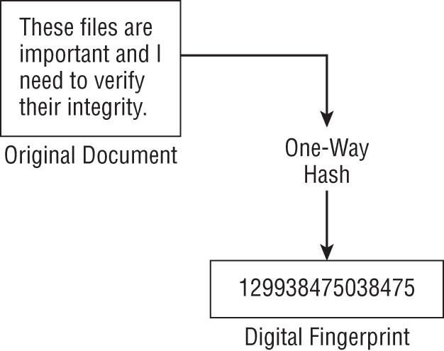

**图 6.1** 哈希过程


### 哈希算法

`hash` 是一种单向过程，并不旨在用于还原数据。当对消息或数据文件进行哈希运算时，哈希算法会在处理过程中检查数据的每一位。这意味着如果两个文件很接近但不完全相同，它们的哈希值将会不同。例如，如果我们给你一份包含 CASP+ 考试学习题的软件程序副本，而你去 Sybex 网站下载了同一款软件，对这两个文件进行哈希运算应该会得到相同的值。图 6.2 展示了一个加密哈希的示例。可以在 `sha256sum` 列中看到。

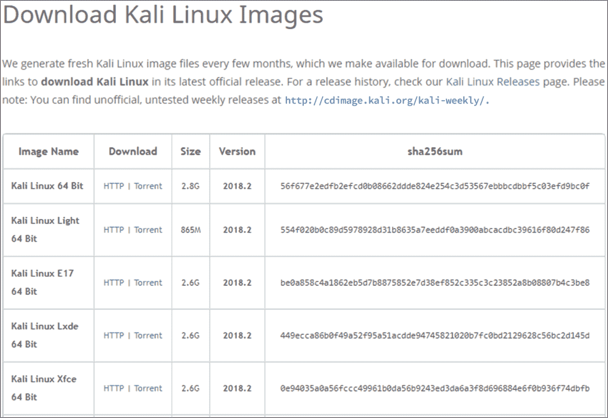

**图 6.2** 软件产品加密哈希示例

如果两个文件之间哪怕只有细微差别，哈希值也会不同。比较这两个文件的哈希值将表明我们给你的软件已被篡改。`Tripwire`、`MD5sum` 和 Windows 系统文件检查器（`sfc.exe`）等程序的工作原理就是这一过程。这类程序可用于监控文件、文件夹或整个硬盘驱动器是否有未经授权的更改。你也可以在代码签名等功能中看到这一过程的应用。`代码签名` 是对可执行文件和脚本进行数字签名以确认软件作者的过程。代码签名还通过哈希值保证代码自签名以来未被篡改或损坏。以下列出了一些哈希算法的示例：

*   消息摘要（MD）
*   安全哈希算法（SHA）
*   消息认证码（MAC）
*   基于哈希的消息认证码（HMAC）
*   RACE 完整性原语评估消息摘要（RIPEMD）
*   Poly1305

以下章节将进一步探讨这些哈希算法。

#### 消息摘要

`MD 算法` 是由 Ron Rivest 开发的一系列加密算法。随着技术的进步，这些算法多年来不断发展。第一个算法是 `MD2`，它被认为已过时。其被淘汰的原因之一是它容易发生碰撞。`MD4` 是该系列中的下一个算法。`MD4` 以 512 位块处理数据。与 `MD2` 一样，`MD4` 也被发现容易发生碰撞，并可能容易受到强制碰撞攻击。这些问题促成了 `MD5` 的开发，`MD5` 处理可变大小的输入并产生固定的 128 位输出。`MD5` 的常见实现是 `MD5sum`。它广泛用于验证程序或文件的完整性。请看下面的例子：如果我们从朋友那里收到一份 `snort.exe` 的副本，我们可以对其进行哈希运算，并验证 `MD5sum` 是否与 Sourcefire 网站上找到的值匹配：

```
C:\temp>md5sum snort.exe
d1bd4c6f099c4f0f26ea19e70f768d7f *snort.exe
```

因此，哈希值用于证明文件的完整性。与 `MD4` 一样，`MD5` 也以 512 位块处理数据。然而，`MD5` 也已失宠，因为它也被证明容易受到碰撞攻击。

#### 安全哈希算法

`安全哈希算法 (SHA)` 类似于 `MD5`。有些人认为它是 `MD5` 的继任者，因为它生成的加密哈希更大。`SHA` 输出 160 位消息摘要。`SHA-1` 以 512 位块处理消息，并在需要时添加填充，以使数据位数凑齐。`SHA-1` 仅具有 111 位的有效性。`SHA-1` 是 `SHA` 算法家族的一部分，包括 `SHA-0`、`SHA-1`、`SHA-2` 和 `SHA-3`。`SHA-0` 不再被认为安全，`SHA-1` 现在也被认为容易受到攻击。`SHA-2` 是美国政府推荐用于替代易受碰撞攻击的 `MD5` 的算法。目前可用的最强版本包括 `SHA-256` 和 `SHA-512`。`SHA-3` 于 2012 年发布，使用 `Keccak` 算法。

分组密码算法（如 `AES` 和 `Triple DES`）在电子密码本（`ECB`）和密码分组链接（`CBC`）模式下要求其输入必须是分组大小的精确倍数。如果待加密的明文不是精确倍数，则需要在加密前通过添加填充字符串来填充或扩展明文。解密时，接收方需要知道如何移除填充或扩展。

#### 消息认证码

`消息认证码 (MAC)` 类似于数字签名，不同之处在于它使用对称加密。`MAC` 使用相同的密钥（对称密钥）进行创建和验证。作为安全专业人员，你在职业生涯中可能会遇到四种类型的 `MAC`：无条件安全、基于哈希函数、基于流密码和基于分组密码。

#### 基于哈希的消息认证码

有时单独使用哈希是不够的，在这种情况下可能需要 `基于哈希的消息认证码 (HMAC)`。此功能通过包含共享密钥来实现。基本上，`HMAC` 通过使用诸如 `MD5` 或 `SHA-1` 之类的哈希算法，然后通过添加密码来改变初始状态来工作。即使有人能够拦截并修改数据，如果该人不具备密钥，这些数据也几乎毫无用处。没有密钥，该人无法轻易重新创建哈希值。

#### RACE 完整性原语评估消息摘要

`RACE 完整性原语评估消息摘要 (RIPEMD)` 位于加密货币比特币标准中。`RIPEMD` 基于 `MD4` 哈希函数，并发布了四个加强版变体：`RIPEMD-128`、`RIPEMD-160`、`RIPEMD-256` 和 `RIPEMD-320`。

第一个 `RIPEMD-128` 不被认为是一个好的哈希函数，因为存在重大安全问题，包括输出大小太小且易于破解。`RIPEMD-160` 是下一个版本；它将输出长度增加到 160 位，并提高了哈希函数的安全级别。该函数旨在作为 128 位哈希函数 `MD4`、`MD5` 和 `RIPEMD-128` 的替代品，并在比特币中作为 `SHA-256` 的替代方案之一使用。

#### Poly1305

`Poly1305` 是由 Daniel J. Bernstein 创建的加密消息认证码。它用于验证数据完整性和消息的真实性。`Poly1305` 接受一个密钥和一条消息，并生成一个标识符，除非你知道密钥，否则很难创建该标识符。该标识符很小，且可以非常快速地生成。这将对消息进行认证，并确保其未被篡改。

`Poly1305` 算法定义于 RFC 8439。更多信息可在此处找到：`https://datatracker.ietf.org/doc/html/rfc8439`。

## 对称算法

`对称加密` 使用单个共享密钥进行加密和解密。这些被称为双用途密钥，因为它们可用于锁定和解锁数据。`对称加密` 是最古老的加密形式。历史系统如 `scytale`（斯基塔勒密码棒）和 `Caesar's cipher`（凯撒密码）都是 `对称加密` 的类型。`对称加密` 通过阻止没有密钥的个人访问消息的真实内容，为用户提供隐私。图 6.3 展示了对称加密过程。

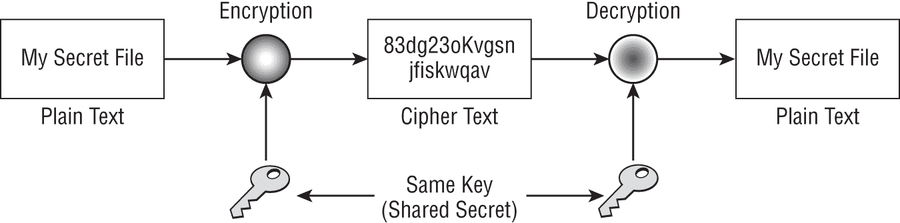

**图 6.3** 对称加密过程

请注意明文是如何使用单个共享密钥加密，然后传输给消息接收者，接收者通过相同的过程解密消息。密钥的双重用途使该系统非常简单，但也引入了弱点。`对称加密` 速度快，且使用小密钥即可快速加密大量数据。如果密钥尺寸足够大，它也很强壮且难以破解。然而，`对称加密` 也有缺点。


### 对称加密的挑战

#### 密钥分发问题

对称加密要想生效，必须有一种安全的方法来传输密钥。在现代世界中，需要某种**带外传输**方式。*带外传输*是指使用不同的途径来传输密钥。例如，如果 Bob 想给 Alice 发送一条秘密消息，但担心 Mike 能监控他们的通信，该如何发送消息？如果密钥以明文形式发送，Mike 就能拦截它。Bob 可以亲自交付密钥、邮寄密钥，甚至派遣快递员。所有这些带外方法在电子商务和电子通信领域都极不实用，因为它们难以扩展。

#### 密钥管理问题

即使解决了密钥交换问题，仍存在其他顾虑。另一个问题是密钥管理。例如，如果 10 个人需要使用对称加密进行通信，所需的密钥数量将达到 45 个。随着使用对称加密的人数增加，所需的密钥数量也随之上升。确定对称加密所需密钥数量的公式如下：

```
n(n - 1) / 2
```

化简后为：

```
n(n – 1) ÷ 2 [或 10(10 – 1) ÷ 2 = 45 keys]
```

#### 仅提供机密性

对称加密的第三个也是最后一个缺陷是它仅提供机密性。

#### 解决方案：SOAR 与 PKI

企业级密钥管理面临的最大挑战，可以通过安全编排、自动化和响应（**SOAR**）来缓解。公钥基础设施（**PKI**）不仅关乎密钥的安全存储。通过自动化脚本和精心编排，密钥的签发和维护可以安全进行，且将人为错误的风险降至最低。PKI 将在后文的“公钥基础设施层级”部分详细讨论。

### 对称加密的优势

尽管对称加密并不完美，但它提供了一些极佳特性，使其成为保护数据和提供机密性的绝佳选择。后续章节将讨论以下内容（不一定按此顺序）：

*   **运行模式**
    *   Galois/计数器模式（**GCM**）
    *   电子密码本（**ECB**）
    *   密码分组链接（**CBC**）
    *   计数器模式（**CTR**）
    *   输出反馈（**OFB**）
*   **流密码与分组密码**
    *   高级加密标准（**AES**）
    *   三重数据加密标准（**3DES**）
    *   ChaCha
    *   Salsa20

但在深入之前，先简要了解一下对称加密的具体特点。对称加密速度快，加解密极快，且被认为强度高。只要使用足够长的密钥，对称加密就很难被破解。以下是一些知名的对称算法：

*   **数据加密标准** *数据加密标准（**DES**）*曾是最常用的对称算法。现已被美国国家标准与技术研究院（**NIST**）正式弃用。其短期替代品是 **3DES**。如今，所有版本的 DES 均已被高级加密标准取代。
*   **高级加密标准** *高级加密标准（**AES**）*是被选为替代 DES 的对称算法。它源自 Rijndael 算法，用于敏感和机密数据。其密钥长度为 128 位、192 位和 256 位。
*   **Blowfish** *Blowfish* 是一种通用对称算法，旨在替代 DES。Blowfish 具有可变分组大小，密钥长度高达 448 位。
*   **Carlisle Adams/Stafford Tavares** *Carlisle Adams/Stafford Tavares（**CAST**）* 是一种 128 位或 256 位的分组密码，曾是 AES 的候选算法。
*   **国际数据加密算法** *国际数据加密算法（**IDEA**）* 是一种分组密码，使用 128 位密钥加密 64 位明文分组。它被 Pretty Good Privacy（**PGP**）采用。
*   **Rivest Cipher 4** *Rivest Cipher 4（**RC4**）* 是一种基于流的密码。流密码将数据视为比特流处理。
*   **Rivest Cipher 5** *Rivest Cipher 5（**RC5**）* 是一种快速分组密码。它与其他对称算法的不同之处在于支持可变分组大小、可变密钥大小和可变轮数。*轮* 是一系列数学函数的顺序重复。分组大小可选 32、64 和 128 位。密钥长度最高可达 2040 位。
*   **安全快速加密程序** *安全快速加密程序（**SAFER**）** 是一种基于分组的密码，以 64 位和 128 位分组处理数据。
*   **Skipjack** 由美国国家安全局（**NSA**）推广，*Skipjack* 使用 80 位密钥，作用于 64 位文本分组。Skipjack 遭到反对，因为政府会保留重构 Skipjack 密钥所需的一部分信息，以便在法院批准后，执法部门能解密相关方的通信。
*   **Twofish** *Twofish* 是一种分组密码，作用于 128 位数据分组，支持长达 256 位的加密密钥。

现在让我们更深入地了解一些流行的对称加密标准。

## 数据加密标准

**DES** 最初由 IBM 开发，后经 **NIST** 修改。**NSA** 认可了修订后的标准。它于 1977 年发布，1981 年由美国国家标准协会（**ANSI**）发布。

DES 是一种基于 64 位分组的对称加密标准，每次处理 64 位明文。DES 输出 64 位密文分组。DES 密钥长度为 56 位，DES 有四种主要运行模式：

*   电子密码本（**ECB**）模式
*   密码分组链接（**CBC**）模式
*   输出反馈（**OFB**）模式
*   密文反馈（**CFB**）模式

所有四种模式均使用 56 位密钥。虽然标准将密钥列为 64 位，但 8 位用于奇偶校验，因此实际密钥长度为 56 位。*奇偶校验* 是一种简单的错误检测形式。每个 64 位明文分组被分成两个 32 位分组，然后由 56 位密钥处理。明文通过密钥经历 16 轮置换和替换处理。

### 电子密码本模式

*电子密码本（**ECB**）模式* 是 DES、ECB、CBC、OFB 和 CFB 使用的默认加密模式，也适用于 **3DES**。如果最后一个分组不足 64 位，则添加填充。ECB 产生最高的吞吐量，但也是最容易被破解的 DES 实现。如果用于大量数据，它极易被破解，因为相同的明文用相同的密钥加密总是产生相同的密文。这就是为什么如果使用 ECB，应仅用于少量数据。

### 密码分组链接模式


#### 当 DES 在密码分组链接 (CBC) 模式下运行时

当 DES 在 `cipher block chaining (CBC) mode` 下运行时，它与 ECB 有些相似，不同之处在于 CBC 将由前一个分组生成的部分密文插入到下一个分组中。这个过程称为 `XORing`。它使密文更加安全，且不易被破解。CBC 之所以得名，是因为一个分组的数据被用在下一个分组中，且分组被链接在一起。这种链接产生了依赖性，但也导致了更随机的密文。

### 输出反馈模式

`Output feedback (OFB) mode` 作为流密码实现，并使用明文反馈到密文流中。传输错误不会在加密过程中传播。初始化向量用于为第一个加密分组创建种子值。DES 将明文与种子值进行 XOR 运算，以应用于后续数据。

### 密文反馈模式

`Cipher feedback (CFB) mode` 可以作为流密码实现，并用于加密单个字符。CFB 与 OFB 相似，因为先前生成的密文被添加到后续流中。由于密文被一起流式传输，错误和损坏可能会在加密过程中传播。此模式可能指 DES、3DES 或 AES。

## 三重 DES

`Triple DES (3DES)` 旨在作为一种权宜之计。DES 最初认证有效期为五年，并要求每五年重新认证一次。虽然在早期轻松通过了这些重新认证，但 DES 在 1987 年左右的重新认证中开始遇到问题。到 1993 年，NIST 指出 DES 开始超出其使用寿命。它开始寻找替代候选者。这一新标准被称为 `Advanced Encryption Standard (AES)`。

AES 将是长期的替代方案，但在 AES 准备好部署之前，需要其他东西来填补空白。因此，为了延长 DES 加密标准的使用寿命，采用了 3DES。根据实现方式，它可以使用两个或三个密钥来加密数据。它的有效密钥长度为 112 或 168 位，并执行 48 轮置换和替换。虽然它安全得多，但其速度仅为 56 位 DES 的三分之一。

## Rijndael 和高级加密标准

Rijndael 是一种分组密码，被 NIST 采用为 AES 以取代 DES。2002 年，NIST 选择 `Rijndael` 来取代 DES。其名称源自其两位开发者 Vincent Rijmen 和 Joan Daemen。它是一种快速、简单、稳健的加密机制。Rijndael 还以抵抗各种类型的攻击而闻名。

Rijndael 算法使用三层变换来加密和解密消息文本分组：

*   线性混合变换
*   非线性变换
*   密钥加入变换

Rijndael 使用四步并行的轮系列。Rijndael 是一种迭代分组密码，支持 128、192 或 256 位的可变密钥和分组长度：

*   如果密钥和分组大小均为 128 位，则有 10 轮。
*   如果密钥和分组大小均为 192 位，则有 12 轮。
*   如果密钥和分组大小均为 256 位，则有 14 轮。

每轮执行以下每个步骤：

1.  **字节替换**：每个字节通过 S 盒替换进行替换。
2.  **行移位**：字节在矩形中排列并移位。
3.  **列混淆**：基于排列的矩形执行矩阵乘法。
4.  **加轮密钥**：状态的每个字节与轮密钥结合。

在最后一轮，跳过第四步，并重复第一步。

## ChaCha

ChaCha 是由 D.J. Bernstein 于 2008 年开发的一种流密码。它被用作 SHA-3 入围算法 BLAKE 的核心。ChaCha20 包含 20 轮。ChaCha 用于在使用互联网时提高移动设备浏览器性能。Google 的工程师需要一种快速且安全的流密码添加到 TLS 中，以为移动设备提供一种省电的 AES 替代方案。ChaCha20-Poly1305 于 2013 年 11 月包含在 Chrome 31 中，并于 2014 年 4 月底包含在 Android 和 iOS 版 Chrome 中。

更多信息请访问 `https://cr.yp.to/chacha/chacha-20080128.pdf`。

## Salsa20

Salsa20 是一种流密码，也是 ChaCha 的前身。Salsa 可以将 256 位密钥扩展为 264 个可随机访问的流，每个流包含 264 个可随机访问的 64 字节（512 位）分组。

## 国际数据加密算法

`International Data Encryption Algorithm (IDEA)` 是一种 64 位分组密码，使用 128 位密钥。它与其他算法不同，因为它避免使用 S 盒或查找表。虽然 IDEA 由一家瑞士公司申请了专利，但可免费用于非商业用途。它被认为是一种安全的加密标准，且没有已知的针对它的攻击。与 DES 一样，它在四种不同的模式下运行。一度曾认为 IDEA 可能取代 DES，但专利版税使其不切实际。

## Rivest 密码算法

`RC cipher algorithm series` 是由 Ron Rivest 设计的一系列密码的一部分。Rivest 密码包括 RC2、RC3、RC4、RC5 和 RC6。RC2 是一种较旧的算法，保持可变密钥大小，是一种 64 位分组密码，可用作 DES 的替代品。RC3 在开发过程中作为密码被破解。因此，RC3 从未实际使用过。RC4 作为流密码实现。40 位版本是 WEP 中最初可用的版本。它最常见于 128 位密钥版本。RC5 是一种分组密码，其轮数可以从 0 到 255，密钥大小可以从 0 位到 2,048 位。最后是 RC6。它具有可变密钥大小和轮数，并增加了 RC5 中没有的两个特性：整数乘法和 4 位工作寄存器。

## 计数器模式

计数器模式使用一个任意数字，该数字随加密的每个单独文本分组而变化。计数器用密码加密，结果被 XOR 到密文中。缺乏相互依赖性也意味着 CTR 模式能容忍分组丢失。CTR 模式被认为对于大多数用途非常安全且高效。它有两种使用方式如下：

*   `Counter (CTR) mode` 与 OFB 相似，因为它将分组模式转换为流密码。与 OFB 不同，CTR 可以作为 DES 或 AES 的一种操作模式。
*   `Galois/Counter (GCM)` 模式是 AES 独有的 (AES-GCM)。GCM 是一种认证加密模式（意味着它提供机密性和认证），分组大小为 128 位。

## 非对称加密

对称加密确实提供了速度，但如果你正在寻找一种提供简易密钥交换的加密系统，你将不得不考虑非对称加密。`Asymmetric encryption`，或 `public key cryptography`，不同于对称加密。它克服了对称加密的主要障碍之一：密钥分发。非对称加密使用两个唯一的密钥，如 图 6.4 所示。一个密钥所做的，另一个密钥可以撤销。

非对称加密的工作原理如下：假设你想给同事发送一条消息。你使用同事的公钥加密消息。你的同事收到消息并使用私钥解密。

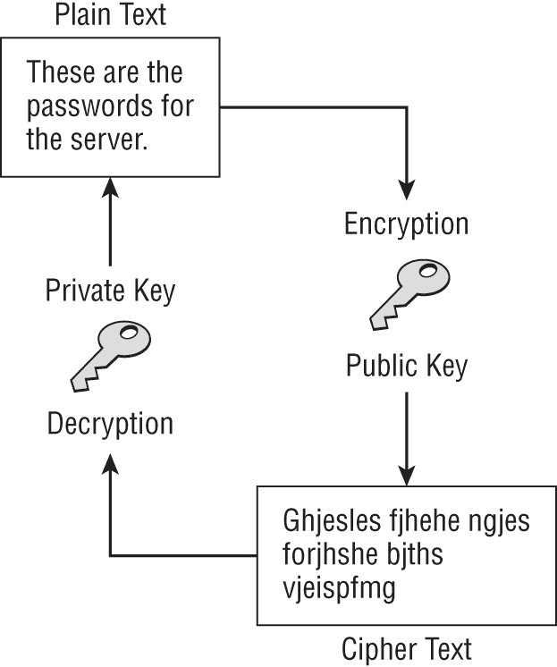

**图 6.4** 非对称加密


### 公钥密码学

公钥密码学的实现得益于单向函数的使用。`单向函数`，或称陷门函数，是一种在一个方向上易于计算，而在另一个方向上几乎不可能计算的数学运算。根据所使用的非对称加密类型，这种难度基于离散对数问题，或将大数分解为其质因数的问题。尽管加密过程背后的数学原理不是通过 CASP+ 考试所必需的，但在代数中，`离散对数`是普通对数的群论类比。例如，给定两个大质数，将它们相乘很容易。然而，如果仅给出它们的乘积，以当今的处理能力，要找出这些因子则困难或不可能。非对称系统也可能利用`零知识证明`。这一概念允许你证明你拥有某知识，而无需向第三方透露该知识本身。

如果消息是用公钥加密的，只有匹配的私钥才能解密它。私钥必须保密，而公钥可以分发给任何人。如果算法设计得当，仅凭公钥应该无法轻易推导出密钥对的私钥。

请看以下非对称加密示例：给定质数 397 和 823，将它们相乘得到 326,731 很容易。然而，如果给出数字 326,731，要提取出这两个质数 397 和 823 则相当困难。知道陷门的人可以双向执行该函数，但如果你缺少陷门，则只能单向执行该函数。陷门函数可用于正向的加密和签名验证，而反向则用于解密和签名生成。

为帮助确保你在 CASP+ 考试中取得成功，表 6.1 对比了对称和非对称密码系统。

#### 表 6.1：对称加密与非对称加密的属性

| 对称 | 非对称 |
| --- | --- |
| 机密性 | 机密性、完整性、认证和不可抵赖性 |
| 单个共享密钥 | 两个密钥：公钥和私钥 |
| 需要带外交换 | 适用于带内交换 |
| 不可扩展；所需密钥过多 | 可扩展；适用于电子商务 |
| 密钥尺寸小且速度快 | 需要较大的密钥尺寸，处理速度较慢 |
| 适用于批量加密 | 最适合少量数据、数字签名、数字信封和数字证书 |

#### Diffie–Hellman

W. Diffie 博士和 M.E. Hellman 博士于 1976 年发布了第一个公钥交换协议。他们专门为密钥交换而开发它，而非用于数据加密或数字签名。`Diffie–Hellman 协议`旨在允许两个用户在没有任何事先通信的情况下，通过不安全信道交换一个秘密密钥。该协议使用两个系统参数运行：`p` 和 `g`。这两个参数都是公开的，可供系统的所有用户使用。参数 `p` 是一个质数，参数 `g` 通常称为`生成元`，是一个小于 `p` 的整数，具有以下性质：对于 1 和 `p` – 1 之间（含边界）的每一个数 `n`，都存在 `g` 的某个幂 `k`，使得 `g^k = n mod p`。Diffie–Hellman 结合多种认证方法使用，包括 IPsec 的互联网密钥交换（`IKE`）组件。

```
g^k = n mod p
```

Diffie–Hellman 在允许双方安全交换加密密钥方面具有开创性，但它也存在问题。它容易受到中间人攻击（on-path，以前称为 `man-in-the-middle (MitM)`），因为密钥交换过程不验证参与者身份。你应该使用数字签名来缓解这一漏洞。

`椭圆曲线 Diffie–Hellman (ECDH)` 工作原理大致相同，但增加了代数曲线来生成双方使用的密钥。双方参与者必须预先就特定的椭圆曲线达成一致。ECDH 比普通 DH 所需的大数运算快得多，且 ECDH 离散对数问题比普通离散对数问题更难求解。这意味着 ECDH 可以使用更小的密钥。

#### RSA

`RSA 算法`以其发明者命名。Ron Rivest、Adi Shamir 和 Len Adleman 于 1977 年开发了 RSA。尽管 RSA 像其他非对称算法一样，比对称加密系统慢，但它提供安全的密钥交换，并被认为非常安全。RSA 支持高达 3,072 位的密钥尺寸。RSA 的设计要求使用质数，其乘积必须远大于 129 位数字以保证安全；129 位十进制数可使用数域筛算法进行分解。RSA 公钥和私钥的生成过程如下：

1.  选择两个长度相等的大质数 `p` 和 `q`，并计算 `p × q = n`，即公共模数。
2.  选择一个随机公钥 `e`，使 `e` 和 `(p – 1)(q – 1)` 互质。
3.  计算 `e × d = 1 mod [(p – 1)(q – 1)]`，其中 `d` 是私钥。
4.  因此，`d = e^(–1) mod [(p – 1)(q – 1)]`。

根据这些计算，`(d, n)` 是私钥，`(e, n)` 是公钥。明文 `P` 加密生成密文 `C` 的过程如下：

```
C = P^e mod n
```

解密恢复明文 `P` 的过程如下：

```
P = C^d mod n
```

RSA 通过将明文分割成等长块来工作，每块的位数少于 `n`。每个块分别进行加密和解密。任何试图破解 RSA 的人都会面临巨大挑战，因为将大整数分解为其两个因子非常困难。破解 RSA 密钥需要非凡的计算机处理能力和时间。自 2000 年专利到期以来，RSA 算法已成为工业级加密的事实标准。它内置于许多协议（如 PGP）、软件产品以及 Mozilla Firefox、Google Chrome 和 Microsoft Edge 等系统中。

#### 椭圆曲线密码学

1985 年，两位数学家——来自华盛顿大学的 Neal Koblitz 和来自 IBM 的 Victor Miller——独立提出将`椭圆曲线密码学 (ECC)`理论应用于开发安全的密码系统。

ECC 可用于智能手机和手持设备等较小、功能较弱的设备中。ECC 被认为比其他一些非对称算法更安全，因为基于椭圆曲线的系统比基于离散对数问题的系统更难破解。椭圆曲线通常定义在有限域上，如实数和有理数，并实现了离散对数问题的类比。


不同密钥长度的强度也因所使用的密码系统而异。例如，1024 位 RSA 密钥提供的安全程度大约相当于 160 位 ECC 密钥。使用 256 位密钥的 ECC 需要 3072 位 RSA 密钥才能实现同等保护。

将密钥位数增加到 384 位，ECC 将提供非常强的安全性。较长的密钥当然更安全，但也需要更多的计算开销。这是资源与安全约束之间的经典权衡。

任何椭圆曲线都可以由以下方程定义：

```
y² = x³ + ax + b
```

在该方程中，`x`、`y`、`a` 和 `b` 均为实数。每条椭圆曲线都有一个对应的*椭圆曲线群*，由椭圆曲线上的点以及位于无穷远处的点 `O` 组成。同一椭圆曲线群内的两个点（`P` 和 `Q`）可以通过椭圆曲线加法算法相加。该运算表示如下：

```
P + Q
```

该问题可扩展为涉及乘法，假设 `Q` 是 `P` 的倍数，即：

```
Q = xP
```

计算机科学家和数学家认为，即使已知 `P` 和 `Q`，也极难找到 `x`。这个困难的问题被称为*椭圆曲线离散对数问题*，构成了椭圆曲线密码学的基础。

##### ElGamal

*ElGamal* 于 1985 年发布，其安全性部分建立在求解离散对数问题的困难性之上。它是 Diffie-Hellman 密钥交换的扩展。ElGamal 由三个离散组件组成：密钥生成器、加密算法和解密算法。它可用于数字签名、密钥交换和加密。

##### 混合加密与电子数据交换 (EDI)

有时将两种事物结合在一起是明智之举。还记得那句广告语“你把巧克力弄进我的花生酱里了吗？”虽然你可能不认为密码学像巧克力那样美味，但结合对称加密和非对称加密确实有实实在在的好处。对称加密速度快，但密钥分发是个问题。非对称加密提供了便捷的密钥分发，但不适合处理大量数据。将两者结合成混合加密，利用了各自的优势，从而构成了一个真正强大的系统。公钥密码学用作密钥封装方案，私钥密码学用作数据封装方案。系统工作流程如下：如果 Bob 想给 Alice 发送消息，会发生以下步骤：

1.  Bob 为数据封装方案生成一个随机私钥。该会话密钥是一个对称密钥。
2.  数据封装发生在 Bob 使用步骤 1 生成的对称密钥加密消息时。
3.  密钥封装发生在 Bob 使用 Alice 的公钥加密该对称密钥时。
4.  Bob 将这两项（加密后的消息和加密后的密钥）发送给 Alice。
5.  Alice 使用她的私钥解密对称密钥，然后使用该对称密钥解密消息。

几乎所有现代密码系统都采用混合加密。这种方法效果良好，因为它同时利用了对称加密的强度和非对称加密的密钥交换能力。混合密码系统的优秀示例包括 `IPsec`、`Secure Shell`、`Secure Electronic Transaction`、`Secure Sockets Layer`、`PGP` 和 `Transport Layer Security`。使用混合系统，我们能实现完美保密吗？这取决于算法、密钥的使用方式以及密钥保护得有多好。*完美前向保密 (PFS)* 的概念是指确保单个密钥的泄露只允许攻击者访问受该单个密钥保护的数据。为实现 PFS，用于保护数据传输的密钥不能用于创建任何其他密钥。此外，如果用于保护数据传输的密钥源自其他密钥材料，则该材料不能用于创建任何其他密钥。

对于传输中的数据，可使用*电子数据交换 (EDI)*。然而，EDI 正逐渐失去市场，被*基于 XML 的事务处理 (TPoX)* 取代。EDI 专为安全设计，旨在弥合异构系统之间的差距。EDI 用于以发送方和接收方系统均能理解的格式交换数据。`ANSI X12` 是最常用的格式。EDI 为组织带来了实实在在的好处，因为它减少了文书工作，且因所有信息均电子化传输，错误更少。

尽管 EDI 简化了通信，但必须配合适当的安全控制来实施。幸运的是，EDI 拥有解决安全性、丢失或重复事务以及机密性问题的控制措施。以下列出了一些常见的 EDI 控制：

*   传输控制，用于验证发送方和接收方
*   操作控制，用于防止对数据的未授权更改
*   授权控制，用于认证通信伙伴
*   加密控制，用于保护信息的机密性

由于文档以电子方式处理，EDI 给组织带来了新的关注层面。EDI 的一个主要关注点是授权。这意味着 EDI 流程应具有额外的应用控制层。

## 公钥基础设施层级

*公钥基础设施 (PKI)* 允许双方通信，即使他们之前互不相识。PKI 利用用户、系统和应用程序。它允许互不相识的用户通过互联网等不安全媒介进行通信。使用 PKI 最常见的系统是中心化证书颁发机构。使用 PKI 的应用程序通常使用 `X.509` 证书。

PKI 促进了电子商务。考虑一下与实体企业打交道与在互联网上交易的区别。与实体企业打交道给你建立信任的充足机会。毕竟，你能看到交易对象，与员工交谈，并直观了解他们的经营方式。

在现代电子商务世界中，交易的透明度要低得多。你可能无法看到与谁打交道，却可能完全信任他们。PKI 解决了这些问题，为电子交易带来了信任、完整性和安全性。

密钥分发的一个非技术性问题是控制对密钥的访问。任何 PKI 系统都必须经过严格控制，以确保错误的人员无法访问密钥。

从用户角度来看，PKI 可能看起来无缝衔接，但实际上它由许多组件组成。PKI 由管理、创建、存储和分发密钥及数字证书的硬件、软件和策略组成。PKI 的基本组件如下：

*   证书颁发机构 (CA)
*   注册机构 (RA)
*   证书吊销列表 (CRL)
*   数字证书
*   证书分发系统

### 证书颁发机构


`证书颁发机构 (CA)` 就像护照办事处。护照办事处负责签发护照，而护照是任何想要出国人员的身份识别标准。与护照办事处类似，CA 在数字世界中为您的身份做担保。VeriSign、Thawte 和 Entrust 是一些执行 CA 服务的公司，或称为 `受信任提供商`。最常用的模型是 `分层信任模型`。图 6.5 展示了该模型的一个示例。在小型组织中，可能会使用单一信任模型。其优势在于它不像分层信任模型那样复杂，且开销较小。

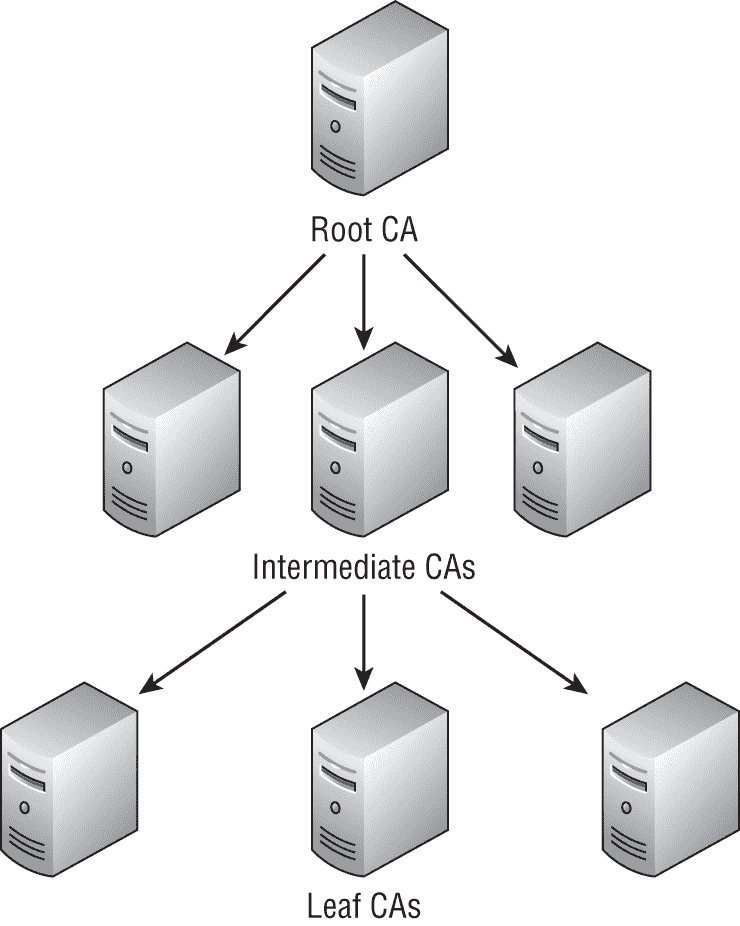

**图 6.5** 分层信任模型

尽管上述公司是外部 CA，但某些组织也可能决定自行承担这些职责。无论由谁执行服务，都需要以下步骤：

1.  CA 在注册机构的帮助下验证证书请求。
2.  验证个人的身份。
3.  CA 创建证书，以验证该人与所提供的公钥相匹配。

`证书配置文件` 可向终端设备提供证书，从而避免手动安装证书。终端设备可以是客户端工作站或服务器，以加快 `服务器身份验证` 或 `客户端身份验证`。

### 从属和中间证书颁发机构

顾名思义，`从属证书颁发机构` 在 CA 层级中低一级。就层级而言，顶级 CA 也称为根 CA。根 CA 处于最高级别，而从根 CA 请求并授权证书的证书颁发机构称为从属 CA。虽然层级中只有一个根 CA，但可能有多个从属 CA。在从属 CA 之下，是颁发给服务、用户或设备的证书。

还有一种证书颁发机构是 `中间 CA`。中间 CA 是一种从属 CA，其下方可能有一个或多个从属 CA。

### 交叉认证

让我们以企业组织为例，其中可能包含多个 PKI 解决方况。这可能是出于可扩展性或效率的原因。在多个 PKI 实现的情况下，一个 PKI 的 CA 信任来自第二个 PKI 的证书将大有裨益。`交叉认证` 用于 CA 之间跨 PKI 信任已颁发的证书。在现实世界中，交叉认证实际上是 `联邦` 的一个例子，将多个 PKI 实现链接在一起。联邦确实有助于提高效率和易用性，但信任的可靠性取决于每一个环节、每一个 PKI。任何一个 PKI 解决方案的妥协都可能导致多个 PKI 发生多米诺骨牌效应的损害。

### 注册机构

如果 CA 就像护照机构，那么 `注册机构 (RA)` 就像一个中间人。可以把它想象成当你需要马上拿到护照时可以使用的加急服务之一。RA 位于客户端和 CA 之间。虽然 RA 不能生成证书，但它可以接受请求、验证个人身份，并将信息传递给 CA 以生成证书。

当证书服务扩展到覆盖大型地理区域时，RA 发挥着关键作用。一个中央私有或企业 CA 可以将其职责委派给区域 RA；例如，美国可能有一个 RA，加拿大有一个，欧洲有一个，印度还有一个。

## 数字证书

`数字证书` 对 PKI 过程至关重要。数字证书具有两个作用。首先，它确保公钥的完整性，并确保密钥保持未更改且处于有效状态。其次，它验证公钥与声明的所有者相关联，且所有相关信息均真实正确。实现这些目标所需的信息会被添加到数字证书中。

数字证书遵循 X.509 标准格式。X.509 的最新版本是版本 3。版本 3 的主要发展之一是增加了扩展。此版本包含支持其他拓扑（如 `网桥` 和 `网状`）的灵活性。它可以作为信任网运行，非常类似于 PGP。X.509 证书包含以下元素：

*   版本
*   序列号
*   算法标识符
*   签发者
*   有效期
*   生效日期（指定日期）
*   失效日期（指定日期）
*   主体
*   主体公钥信息
*   公钥算法
*   主体公钥
*   签发者唯一标识符（可选）
*   主体唯一标识符（可选）
*   扩展（可选）

不同的实体可以使用证书。`颁发给实体` 标识 CA 向谁颁发证书。证书可能颁发给用户、系统或应用程序。CA 不仅颁发证书，还为实体的真实性做担保。使用外部 CA 颁发证书并非强制性的，但它们被广泛使用。组织可能决定自行充当 CA。无论由第三方处理职责还是由贵公司自行执行，数字证书通常都包含以下关键信息：

*   包括用户名、序列号和证书有效日期在内的身份识别信息。
*   证书持有者的公钥。
*   签名机构的数字签名。这部分至关重要，因为它验证了整个包的有效性。

如果您决定使用第三方颁发证书，则需要付费。这些组织通常以营利为目的，并会收取费用以维护您的证书处于良好状态。

### 证书吊销列表

让我们将 `在线证书状态协议 (OCSP)` 与 `证书吊销列表 (CRL)` 进行比较。就像护照一样，数字证书不会终身有效。证书因多种原因而失效，例如人员离职、信息变更或私钥泄露。基于这些原因，必须维护 `证书吊销列表 (CRL)`。

CRL 由 CA 维护，CA 对列表进行签名以保持其准确性。每当数字证书出现问题被报告时，该数字证书即被视为无效，CA 会将其序列号添加到 CRL 中。任何请求数字证书的人都可以检查 CRL 以验证证书的完整性。证书可能损坏的原因有很多，包括以下几点：

*   证书过期。
*   服务器的 DNS 名称或 IP 地址发生了变化。
*   服务器崩溃并损坏了证书。

### 证书类型

浏览器或设备可以选择验证证书是否已被吊销。然而，对于一种证书类型——`验证证书`，这种吊销检查选项会变成严格要求。

某些组织可能会选择使用通配符证书以降低成本。`通配符证书` 允许购买者在一个域名下保护无限数量的子域证书。优势在于您只需购买和维护一个证书。然而，缺点是您在多个网站和私有服务器上仅使用一个证书和私钥。如果这些服务器或网站中仅有一个被攻破，则该通配符证书下的所有其他服务器和网站都将暴露。


#### 同样有利于保护多个域的选项是多域证书

与通配符证书保护多个子域不同，`multidomain certificate`（多域证书）将保护多个网站。例如，多域证书可以保护 `example.net`、`example.com` 和 `example.org`。通配符证书可以保护 `sub1.example.org`、`sub2.example.org` 和 `sub3.example.org`。

如果私钥泄露或出现必须吊销证书的其他情况，PKI 有一种应对方法，即使用 CRL（证书吊销列表）。这些列表可以通过 `Online Certificate Status Protocol (OCSP)`（在线证书状态协议）进行检查，这是一种用于获取 X.509 数字证书吊销状态的互联网协议。此过程与维护驾照非常相似。Mike 可能有驾照，但如果他被警察拦下，警察可能仍会决定检查 Mike 的驾照；他是在检查 Mike 驾照的状态，就像使用 OCSP 来检查 X.509 证书的状态一样。

### 证书分发

证书可以通过集中式服务或公共机构进行分发。使用 CA（证书颁发机构）是集中式分发的一个示例：受信任的 CA 向另一方分发公钥。证书通过 CA 的数字签名进行签名，以证明其有效性。证书可以通过信任链从一个 CA 传递给另一个 CA。信任链在实体之间提供信任关系。有关示例，请参见图 6.6。

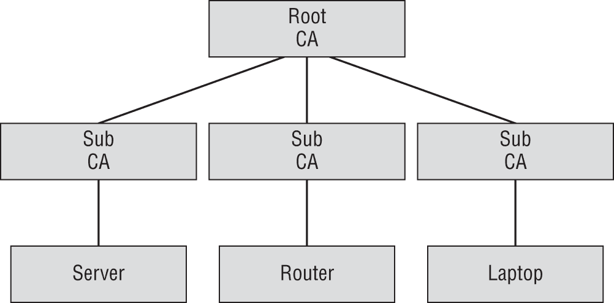

**图 6.6** 信任链示例

分发密钥的第二种方式是直接通过第三方。这称为 `web of trust`（信任网）。例如，如果您给我们发邮件询问关于本书的问题，我们的回复邮件将包含我们的公钥。这是一种分发密钥的简便方法，但它无法提供像 VeriSign 或 Thawte 这样的第三方 CA 所能提供的那种级别的信任。PGP 和 GPG 是提供加密并可使用信任网证书分发的系统示例。

#### 令牌

PKI 令牌为数字证书和私钥提供安全存储。它们允许安全地利用公钥加密和数字签名，而不会面临泄露私钥信息的风险。PKI 令牌是安全存储数字证书和私钥的硬件设备。当您需要加密、解密或签名时，令牌会在安全芯片内部完成这些操作，这意味着密钥永远不会面临被盗的风险。

#### 装订

`Online Certificate Status Protocol (OCSP) stapling`（OCSP 装订）或 `certificate stapling`（证书装订）可提升网站性能和客户端隐私。在 OCSP 装订出现之前，OCSP 请求由客户端发起，发送到 CA 服务器以验证 SSL 证书。OCSP 装订允许证书展示者直接查询 OCSP 响应器，然后缓存响应。这允许安全缓存的响应，随后通过 Certificate Status Request 扩展响应，随 TLS/SSL 握手一起交付（“装订”）。这有助于确保浏览器获得的证书状态响应性能与网站内容相同。

OCSP 装订还解决了 OCSP 的一个隐私问题，即证书颁发机构不再直接从客户端（浏览器）接收吊销请求。OCSP 装订通过消除与证书颁发机构响应器建立单独网络连接的需求，进一步解决了关于 OCSP SSL 协商延迟的担忧。

#### 绑定

`Certificate pinning`（证书绑定）是一种技术，它告诉您选择的浏览器，只信任证书链中包含特定公钥的证书。当前的实现基于 `trust on first use (TOFU)`（首次使用信任），这意味着您选择的浏览器在您首次使用某个站点时，必须信任该连接。这是因为绑定信息是由 Web 服务器通过 HTTP 标头发送的。在未来，理想情况下可以通过 DNSSEC 签名的 DNS 记录来检索。

您绑定的是证书的公钥。每个站点至少有三个证书（站点证书、中间证书和根证书），这为您提供了一些绑定选项。您的站点证书将在不久的将来被替换，通常在三年内，但由于重新颁发，很可能会更早被替换。您无法控制 CA 在重新颁发时将使用哪个中间证书，所以不要绑定它。证书颁发机构在信任存储中有多个根证书，您无法控制它们在重新颁发时将使用哪一个。您必须依赖您能控制的内容——证书链中的您自己的公钥——所以这才是您想要绑定的内容。

HTTP Public Key Pinning (HPKP) 不仅允许您提供备用公钥；它要求您必须这样做。当您的私钥泄露时，这非常有用。您的备用密钥将用于生成新证书。当然，备用密钥绝不应存储在与主密钥相同的基础设施上，也永远不会用于其他任何用途。

### 客户端在 PKI 中的角色

尽管 CA 负责大部分工作，但在 PKI 的世界里，客户端也承担一些职责。客户端负责请求数字证书并维护其私钥的安全。

即使证书已颁发，客户端仍可能尝试以不安全的方式建立连接。例如，如果用户的浏览器发起 HTTP 连接而不是 HTTPS。一种解决方案是将浏览器重定向以切换到 HTTPS。这是通过在服务器上设置 301 重定向指令来完成的。

然而，恶意用户能够捕获重定向之前的流量。最佳解决方案是利用 `HTTP Strict Transport Security (HSTS)`（HTTP 严格传输安全）。当 Web 服务器指示 Web 浏览器实施 HSTS，从浏览器开始严格仅使用安全连接时，就能避免这种潜在的不安全捕获。

私钥的丢失、泄露或暴露将意味着通信不再安全。保护私钥是一个重要问题，因为对于攻击者来说，攻击密钥可能比尝试暴力破解或攻破证书服务更容易。组织应关注以下八个密钥管理问题：

*   生成
*   分发
*   安装
*   存储
*   恢复
*   更换
*   控制
*   销毁

密钥恢复和控制是必须解决的重要问题。一种基本的恢复和控制方法是 `m` of `n` 控制访问法。该方法旨在确保没有任何单个人拥有完全控制权；它与双人控制密切相关。如果 `n` 个管理员有权执行某个过程，则必须有 `m` 个管理员进行身份验证才能获得访问权限。`M` of `n` 控制应要求物理到场才能访问。

举个例子。假设典型的 `m` of `n` 控制方法要求四个人拥有对归档服务器的访问权限，且其中至少两人必须在场才能完成访问。在这种情况下，`m` = 2 且 `n` = 4。这将确保没有任何单个人能够危害安全系统或获得访问权限。

## 密码学解决方案的实施

本章是否让您思考密码学的各种用途及其对安全专业人员的价值？我们希望如此。真正的问题是，现在您掌握了一些具体的密码学解决方案，加密强度应当如何，以及您可能在哪里应用密码学解决方案？

加密可应用于磁盘、块、文件、记录和端口：


### 加密技术概述

#### 磁盘加密

**磁盘加密** 可以使用硬件或软件来加密整个硬盘驱动器或卷。此类技术在当今至关重要。**移动安全** 尤其因加密而得到增强，考虑到个人在移动设备和平板电脑上存储了大量敏感信息。此类物品极易丢失或被盗。常见的磁盘加密产品包括 `BitLocker` 和 `AxCrypt`。

#### 分组加密

**分组加密** 以固定大小的比特组来保护数据。我们之前讨论过的分组密码示例是 `DES ECB`。`DES` 以 64 位分组加密数据。

#### 文件加密

您不必加密整个硬盘驱动器或卷。在某些情况下，您可能只需要加密特定文件。可用于 **文件加密** 的产品示例包括 `AxCrypt` 和 `PGP`。

#### 记录加密

数据库是常见的攻击领域。如果您在数据库中存储敏感信息，可能需要加密整个数据库或仅加密特定记录。作为 **记录加密** 的示例，在医疗机构中，您可能希望保护包含社会安全号码或其他个人信息的记录，仅向医院工作人员开放医疗 ID 和医疗记录。

#### 端口加密

某些服务比其他服务更安全。作为 **端口加密** 的示例，`Telnet`（TCP 端口 23）以明文发送数据，而 `Secure Shell`（端口 22）使用加密。另一个示例是 `HTTP`（端口 80 为明文），而 `HTTPS` 使用端口 443。

这些示例表明，加密是安全专业人员可用的最有价值的工具之一，但必须考虑强度、性能和可用性之间的权衡。每种加密解决方案都有其优势和局限性。组织必须进行适当的风险评估，以确定威胁级别以及每项资产所需的保护程度。该评估将在很大程度上决定所使用的技术类型。数据是否仅在未来几分钟内有用（如买卖股票的订单）？信息是否是尚未投产的下一代战斗机的绝密数据？数据存储在哪里？对其他人有多大价值？它可能保持价值多长时间？

即使信息不需要加密解决方案来提供隐私，您可能仍需要有助于保护信息的控制措施。此类技术之一是 **数字版权管理 (DRM)**。`DRM` 是一整套旨在保护数字内容的技术。例如，您可能正在平板电脑上阅读本书的副本，但这并不意味着出版商想免费提供给您 100 位最亲密的朋友！这就是 `DRM` 设计应对的情况：它有助于防止在线版权侵权，从而帮助版权持有者保持对信息的控制。

接下来，您需要考虑在何处构建保护。加密可用于许多不同的情况，以构建真正的纵深防御。如果您参考 TCP/IP 模型来考虑加密，可以看到加密解决方案可以从应用层一直应用到物理帧层。让我们从 TCP/IP 协议栈的顶层开始，逐层向下，重点介绍一些加密解决方案。

#### 应用层加密

以下应用层协议只是可用于增加机密性、完整性或不可否认性的几个示例：

##### Secure Shell

**Secure Shell (SSH)** 是一种提供安全远程访问的互联网应用程序。它作为 `FTP`、`Telnet` 和 Berkeley “r” 实用程序的替代品。`SSH` 默认使用 TCP 端口 22。

##### Secure Hypertext Transfer Protocol

**Secure Hypertext Transfer Protocol (S-HTTP)** 是 `HTTP` 的超集，旨在提供与 Web 服务器的安全通信。`S-HTTP` 是一种无连接协议，旨在安全地发送单个消息。

##### Pretty Good Privacy

**Pretty Good Privacy (PGP)** 由 `Phil Zimmermann` 于 1991 年开发，旨在提供隐私和认证。随着时间的推移，它演变为开放标准，如 `OpenPGP` 和 `GnuPGP`。`PGP` 构建了一个信任网，随着用户签名和发布自己的密钥而发展。`PGP` 的目标是成为“大众的加密”。基于 `PGP` 的流行程序（如 `HushMail`、`CounterMail` 和 `K-9 Mail`）提供端到端加密。

##### GNU Privacy Guard

免费听起来好吗？如果您和我们大多数人一样，答案是肯定的，这就是 **GNU Privacy Guard (GPG)** 发挥作用的地方。它是 `PGP` 的授权免费版本。其理念是提供一个人人可用的 `PGP` 免费版本。与 `PGP` 一样，`GPG` 利用混合加密，结合了对称加密和非对称加密的优点。对称部分用于加密和解密，非对称部分用于密钥交换。

##### S/MIME

对于那些不想使用 `PGP` 或 `GPG` 的人来说，还有另一种电子邮件安全选项。该解决方案是 **S/MIME (Secure/Multipurpose Internet Mail Extensions)**。`S/MIME` 是一种用于 MIME 数据的公钥加密和签名标准。`S/MIME` 提供两项基本服务：数字签名和消息加密。`S/MIME` 是保护电子邮件的流行解决方案，并内置于大多数电子邮件软件程序中，如 `Microsoft Outlook` 和 `Mozilla Thunderbird`。

##### 安全远程访问

各种应用程序可用于 **安全远程访问**，例如 `SSH`、`Remote Desktop Protocol (RDP)` 和 `Virtual Network Computing (VNC)`。`RDP` 是由 `Microsoft` 开发的专有协议。它为远程用户提供远程计算机的图形界面。`VNC` 类似于 `RDP`，它允许对远程计算机进行图形访问。`VNC` 使用 `Remote Frame Buffer (RFB)` 协议远程控制另一台计算机。

#### 传输层加密

TCP/IP 协议栈的传输层也可用于向数据通信添加加密解决方案。一些常见示例如下：

##### Secure Sockets Layer

`Netscape` 开发了 **Secure Sockets Layer (SSL)**，用于通过互联网传输私密文档。`SSL` 与应用程序无关，也与加密算法无关，因为该协议本身仅是一个用于通信证书、加密密钥和数据的框架。

##### Transport Layer Security

改进的 **Transport Layer Security (TLS)** 是 `SSL` 的后继协议。它的工作方式与 `SSL` 非常相似，使用加密来保护数据和信息的传输。这两个术语在行业中经常互换使用，尽管 `SSL` 仍在使用。

**Transport Layer Security (TLS)** 加密主机和客户端之间的通信。`TLS` 由两层组成：`Record Protocol` 和 `TLS Handshake Protocol`。尽管 `TLS` 和 `SSL` 在功能上不同，但它们提供相同的服务，且术语有时会互换使用。

##### Wireless Transport Layer Security

**Wireless Transport Layer Security (WTLS)** 加密无线主机和客户端之间的通信。`WTLS` 是一种安全协议，它是 `Wireless Application Protocol (WAP)` 协议栈的一部分。`WTLS` 的开发是为了解决移动网络设备的问题，特别是相对较低的带宽和处理能力。随着移动银行在智能手机上广泛使用，这些问题在未来几年将变得越来越重要。

#### 互联网层控制


##### 互联网层和 IPsec

`Internet layer`（互联网层）是 IPsec 的所在地，IPsec 是一种著名的加密解决方案。IPsec 的开发旨在解决 IPv4 的缺陷。它是 IPv4 的附加组件。IPsec 可用于仅加密数据，也可用于加密数据和报头。随着 IPv4 地址的耗尽，人们将更加关注 IPsec，因为它内置于 IPv6 中。IPsec 包括以下组件：

###### 封装安全载荷 (ESP)

`Encapsulated Secure Payload (ESP)`（封装安全载荷）通过加密数据包提供机密性。加密后的数据被隐藏，因此确保了其机密性。

###### 认证头 (AH)

`Authentication Header (AH)`（认证头）提供完整性和认证。AH 使用哈希算法和对称密钥来计算消息认证码。该消息认证码称为 `integrity check value (ICV)`（完整性校验值）。接收到 AH 时，会计算一个 ICV 并将其与接收到的值进行对比，以验证完整性。

###### 安全关联 (SA)

为了使 AH 和 ESP 能够工作，必须交换一些信息以建立安全会话。这项工作是 `Security Association (SA)`（安全关联）的责任。SA 是双方之间的单向连接。如果同时使用 AH 和 ESP，则总共需要四个连接。SA 使用对称密钥来加密通信。`Diffie–Hellman`（迪菲-赫尔曼）算法用于生成此共享密钥。

###### 传输模式和隧道模式

AH 和 ESP 可以在两种模式之一中工作：传输模式或隧道模式。`Transport mode`（传输模式）加密对等体之间发送的数据。`Tunnel mode`（隧道模式）封装整个数据包并添加一个新的 IP 报头。隧道模式广泛用于 VPN。AH 和 ESP 可以一起使用，也可以独立使用。

#### 硬件安全模块 (HSM)

`Hardware Security Modules (HSMs)`（硬件安全模块）实际上是一种物理控制，而非互联网层控制，但许多组织使用 HSM 来安全地存储和检索托管密钥。`Key escrow`（密钥托管）或 `key management`（密钥管理）允许另一个受信任方持有密钥的副本。它们需要在与原始密钥相同的安全级别下进行管理。HSM 系统可用于保护企业存储和数据，并且可以在检测到未经授权的访问时通过销毁密钥材料来检测和防止篡改。

### 其他认证协议

虽然以下协议不在本次 CASP+ 考试修订范围内，但它们都值得一提，因为我们中的许多人在职业生涯中将会或已经遇到过它们。

#### 密码认证协议 (PAP)

我们在此列出了 `Password Authentication Protocol (PAP)`（密码认证协议），但不应使用它。充其量它很薄弱。PAP 不安全，因为用户名和密码以明文形式传输。

#### 挑战握手认证协议 (CHAP)

`Challenge Handshake Authentication Protocol (CHAP)`（挑战握手认证协议）比 PAP 更合适，因为它发送一个仅使用一次的随机值给客户端。客户端和服务器都知道预定义的秘密密码。客户端使用随机值、nonce（一次性数字）和秘密密码，并计算单向哈希。CHAP 的握手过程如下：

1. 用户从客户端向服务器发送登录请求。
2. 服务器向客户端发回质询。
3. 质询被加密后发回服务器。
4. 服务器将来自客户端的值进行比较，如果信息匹配，则授予授权。

#### 可扩展认证协议 (EAP)

`Extensible Authentication Protocol (EAP)`（可扩展认证协议）是一种常用于无线网络的认证框架。存在许多使用 EAP 框架的不同实现，包括特定供应商的方法和开放方法，如 `EAP-TLS`、`LEAP` 和 `EAP-TTLS`。这些协议中的每一个都使用该协议的消息传递标准来实现 EAP 消息。EAP 通常用于无线网络认证。

认证是关键组件，用作防止黑客入侵网络的第一道防线。联合身份、AD 和单点登录等系统可用于更安全地管理此过程。

#### 点对点隧道协议 (PPTP)

`Point-to-Point Tunneling Protocol (PPTP)`（点对点隧道协议）由两个组件组成：维护虚拟连接的传输和确保机密性的加密。它可以在 40 位或 128 位长度下运行。

#### 第 2 层隧道协议 (L2TP)

`Layer 2 Tunneling Protocol (L2TP)`（第 2 层隧道协议）由思科和微软创建，旨在取代第 2 层转发 (L2F) 和 PPTP。L2TP 将 L2F 和 PPTP 的功能合并为一个隧道协议。

## 加密货币

`Cryptocurrency`（加密货币）是一种类似于美元 (USD) 的交换媒介，但旨在通过某些密码学原理实现的过程来交换数字信息。加密货币使用密码学来保护数字交易，并控制新加密货币币的创建。加密货币于 2009 年首次作为 `Bitcoin`（比特币）推出。目前，还有数百种其他已知的替代加密货币，被称为数字 `altcoins`（山寨币/替代币）。

加密货币安全分为两部分。第一部分源于查找哈希集合交集的难度。这项任务由矿工执行。第二种也是最常见的情况称为 `51 percent attack`（51% 攻击）。在此场景中，矿工拥有超过 51% 网络的算力。该矿工可以控制全球区块链账本并生成一个替代区块链。此时，攻击者受限于其资源的能力。该攻击还可以撤销攻击者自己的交易，甚至阻止其他交易。

加密货币的优势在于它们不太容易被执法部门查封，甚至不太容易受到 PayPal 等收单机构的交易冻结。所有加密货币都是伪匿名的，一些币种增加了功能以帮助实现真正的匿名性。

## 数字签名

`Digital signatures`（数字签名）是一类基于公钥密码学的算法。它们用于验证消息的真实性和完整性。要创建数字签名，消息会通过哈希算法。生成的哈希值随后使用发送方的私钥进行加密。接收方收到消息后，解密加密的哈希值，然后使用发送方的公钥重新计算预期的消息哈希。这两个值必须匹配，才能证明消息的有效性，并验证消息是由被认为发送它的一方发送的。数字签名之所以有效，是因为只有该方拥有私钥。让我们分步分解此过程以详细说明操作：

1. Bob 通过将消息传递给哈希算法来生成消息摘要。
2. 然后使用 Bob 的私钥对消息摘要进行加密。
3. 消息被转发给接收方 Alice。
4. Alice 使用 Bob 使用的相同哈希算法从消息中创建消息摘要。然后 Alice 使用 Bob 的公钥解密 Bob 的签名摘要。
5. 最后，Alice 比较两个消息摘要：Bob 最初创建的那个和她自己创建的那个。如果两个值匹配，Alice 可以确信消息未被篡改。

图 6.7 说明了创建过程。它展示了哈希函数如何确保完整性，以及对哈希值进行签名如何提供认证和不可抵赖性。

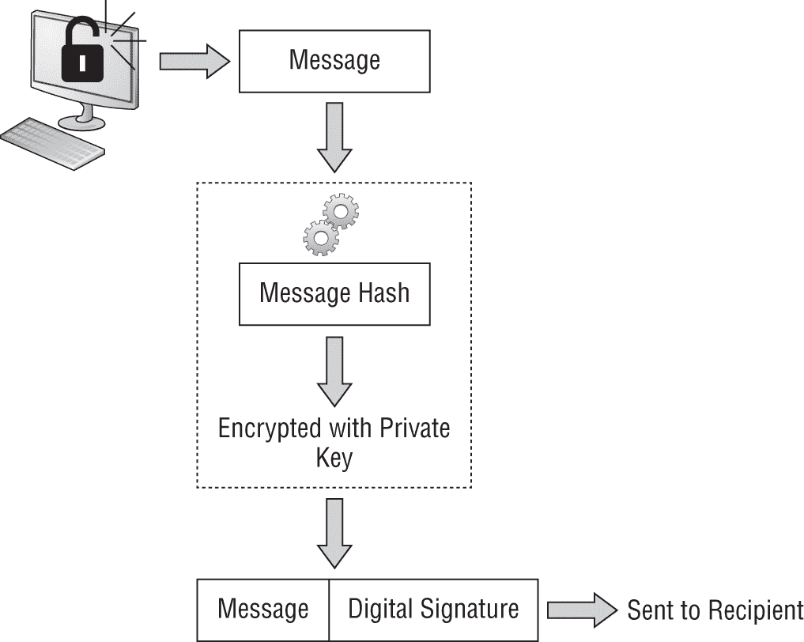

**图 6.7** 数字签名创建

为帮助确保您在 CASP+ 考试中取得成功，表 6.2 中回顾了完整性验证方法。


### 表 6.2 完整性验证方法

| 方法 | 描述 |
| --- | --- |
| 奇偶校验 | 简单的错误检测代码 |
| 哈希 | 完整性 |
| 数字签名 | 完整性、认证和不可否认性 |
| 哈希消息认证码 (HMAC) | 完整性和数据源认证 |
| CBC MAC | 完整性和数据源认证 |
| 校验和 | 冗余检查，弱完整性 |

## 识别加密攻击

只要有秘密，就有人试图揭开它们。对加密系统的攻击并非新事物。这种活动的正式名称是 `cryptanalysis`（密码分析），即研究分析密码学并试图确定加密系统密钥值的学科。根据攻击者针对的密钥不同，成功可能意味着某人能够访问机密信息，或伪装成通信中的已认证参与方。

攻击者可以通过多种方式以攻击为目的瞄准系统，例如 `brute-force attack`（暴力破解攻击）。暴力破解攻击会尝试所有可能的解决方案。让攻击者执行暴力破解攻击更费时费力的一种技术是 `key stretching`（密钥拉伸）。密钥拉伸是指用于使可能较弱的加密系统（如密码生成）更安全的加密技术。该技术将密码与一个称为 `salt`（盐）的随机值一起进行哈希处理。此过程可重复多次以生成派生密钥。通常，这可能需要一千次或更多迭代。这种方法使暴力破解攻击对攻击者而言变得耗时。然而，请记住之前关于强度、性能和可用性之间权衡的讨论？虽然它更安全，但增加的迭代次数将需要更多的 CPU 算力和时间。

`Password-based key derivation 2 (PBKDF2)` 在 RFC 2898 中定义。PBKDF2 是一种特定的密钥派生函数 (KDF)。KDF 是将密码转换为用于加密操作（如 `AES`）的对称密钥的一种方式。`AES` 可以使用满足特定长度和熵要求的任何值作为输入。PBKDF2 可以生成满足这些熵要求的任意长度的哈希值。

PBKDF2 接受一个密码、一个盐、一个定义哈希函数轮数的整数，以及一个描述输出所需密钥长度的整数。通过增加轮数，可以使生成的输出在计算上更昂贵。PBKDF2 的一个用例是哈希密码以避免在数据库中存储明文密码。

`Bcrypt` 算法基于 `Blowfish` 密码。Bcrypt 通过增加轮数来帮助防止暴力搜索攻击。该算法的计算成本取决于参数化的轮数，因此可以随着计算机的发展而增加。就像 PBKDF2 一样，此方法使用盐来防范彩虹表攻击。

许多国家寻求控制加密算法并对其使用实施管制。这些管制属于《瓦森纳安排：关于常规武器及两用货物和技术出口管制》（参见 `www.wassenaar.org`）。该协议的目标是在促进常规武器和两用货物及技术转让透明度的同时，也促进此类转让的更大责任。其初衷是将强加密技术掌握在罪犯和恐怖分子手中。

## 排查加密实现故障

故障排查在所难免。你肯定浏览过网站，却收到“您的连接不是私密连接”警告，并提供一个“返回安全页面”按钮。

有时证据指向配置问题之一，但现实中问题要简单得多。请记住故障排查首字母缩略词 `KISS`，即“keep it simple, stupid”（保持简单，愚蠢）。例如，证书名称错误可能只是由浏览器缓存或不良浏览器插件引起。在立即重新配置企业证书颁发机构之前，请先尝试简单的故障排查，例如清除缓存或在隐身模式下测试。

图 6.8 是发生证书错误时预期的警告屏幕。

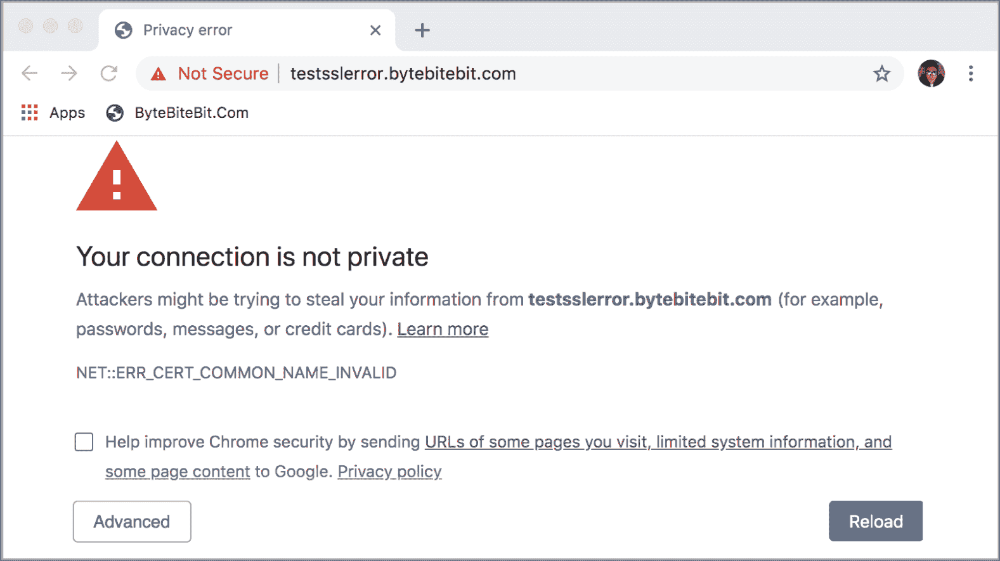

**图 6.8** “您的连接不是私密连接”错误

让我们首先识别一些更常见的证书问题。

*   **有效期** 这很简单。证书过期了吗？它是否像房租支票一样被填了未来的日期？检查日期。如果证书的有效日期超出了服务器的日期和时间范围，则认为该证书无效。当然，真正的问题可能是服务器的日期和时间设置错误。

    以下是排查无效 SSL/TLS 错误的一些基本方法：

    *   检查计算机上的日期。首先应检查计算机上的日期和时间是否正确。
    *   检查配置错误。
    *   检查域名不匹配。
    *   从可靠的 CA 获取证书。
    *   检查证书结构。
    *   检查吊销状态。

*   **错误的证书类型** 区分这些 SSL 证书验证级别：域名验证 (DV)、组织验证 (OV) 和扩展验证 (EV) 超出了 CASP+ 考试范围。

    但是，例如，当需要多域证书时却签发了单域证书，则这属于“错误类型”这一笼统错误类别。

*   **已吊销的证书** 非法购买或错误签发的证书最终会被吊销。如果私钥泄露，也会发生同样的情况。`CRL`（证书吊销列表）是过期前已被吊销的 CA 证书列表，这些证书永远不应被信任。

*   **名称不正确** `NET::ERR_CERT_COMMON_NAME_INVALID` 是当证书用于不同域时确实经常发生的错误。如果 SSL 证书上的名称与浏览器地址栏中的不一致，浏览器会向每位访问者指出这一点。

    即使像证书包含“www.”时却将其省略这样微不足道的事情，也会导致 `name mismatch`（名称不匹配）错误。

*   **链问题** 如果从属 CA 无法到达根 CA，则信任链断裂。考虑到警告，此问题可能相当容易发现，但可能需要在线资源进行排查。免费在线服务是测试和验证信任链的最快方式。

*   **无效的根 CA 或中间 CA** 如果安装证书时没有有效的信任链，则无法验证该不受信任证书的有效性。

*   **自签名** 如果安装证书时没有有效的信任链，则无法验证该不受信任证书的有效性。在自签名证书的情况下，信任链止步于服务器。

其他问题将更多地集中在密钥方面：

*   **嵌入式密钥** 某些设备将证书嵌入设备中。可能其处理能力有限，可能被迫依赖过时的算法。这些是嵌入式密钥需要考虑的问题。

*   **重新生成密钥** 在 PKI 中，重新生成密钥只是签发一个新证书，但包含与被替换证书相同的所有旧信息。这不是续订，续订本质上是延长旧证书（及私钥）的有效期。

*   **私钥泄露和密钥处理不当** 一旦密钥泄露，所有机密性和完整性均受损。可以说，妥善处理密钥是维护 PKI 实现的关键要素。


### 加密粉碎

**加密粉碎**是指有意删除加密密钥。其后果是有效地永久加密数据。在实践中，当客户希望其数据被“擦除”或永久不可访问时，这非常有用。这带来了维护唯一密钥以支持每一种此类请求的挑战。

但风险在于，删除加密密钥并不意味着加密数据不可用。当遭受足够暴力破解攻击时，加密数据不会一直保持未解密状态。

### 加密混淆

与将内容渲染为完全不可读的加密不同，**混淆**是通过将数据与无意义的数据混合或修改来掩盖数据值的方法。这将输入打乱成难以理解或恢复的内容。这**不**等同于“靠隐匿实现安全”这种不良做法。当数据已经相当复杂或不易恢复时，混淆效果最佳。例如，源代码只需极少量的混淆即可变得不可恢复。

### 密钥轮换

何时轮换密钥和证书取决于它们的有效期。有趣的是，最大有效期在近几年一直备受争议并发生了变化。2022 年，最大周期为 825 天，但缩短至 398 天的呼声日益高涨。

无论如何，密钥轮换必须在这些周期内进行，以保持证书和密钥的有效性。如果检测到任何泄露，轮换可以而且应该更早地进行。

### 泄露的密钥

泄露密钥的真正危险在于，恶意行为者现在可以冒充泄露证书的预期来源。恶意行为者冒充合法来源的后果可能包括：经认证的恶意软件、通信解密、建立中间人攻击（现称为旁路攻击）、伪造流量和嗅探加密流量。这是一件坏事。

## 总结

本章重点介绍了密码学，这是 CASP+ 考试内容中一个相对深度的组成部分。虽然密码学是 CASP+ 考试的考点，但它也是安全专业人员最强大的工具之一。它通过加密为您提供保护敏感信息的能力。它还能为您提供验证补丁、文件和重要数据完整性的能力。此外，密码学使电子商务成为可能。借助 `PKI` 等加密解决方案，您可以信任第三方就是他们声称的那个实体。这些只是密码学提供的解决方案中的一小部分。

作为一名安全专业人员，您需要能够与他人就加密解决方案和服务进行沟通。您不必能够编写自己的加密算法。但您确实需要能够为现实问题提供解决方案。没有一个星期不出现新闻报道，列出被盗或丢失的包含个人信息的介质。作为一名安全专业人员，您可能处于建议公司对所有笔记本电脑使用全盘加密（`FDE`）的位置。您也可能有机会推广 `PGP` 作为加密所有用于讨论敏感业务事务的电子邮件的标准。您甚至可能身处一个准备推出新电子商务网站的团队中，被要求就 `PKI` 提供意见。这些就是安全专业人员每天提供的解决方案类型。

## 考试要点

**能够描述针对特定情况哪种加密解决方案是合适的。** 加密解决方案大致可分为对称加密、非对称加密、混合加密和哈希。每种方案提供特定的解决方案，如隐私性、认证、完整性和不可抵赖性。

**能够描述 PKI 的基本操作并理解高级 PKI 概念。** `PKI` 允许两个互不相识的方通过不安全的公共网络进行通信。此类通信可用于安全、私密地交换数据或进行电子商务。`PKI` 系统使用公钥和私钥。密钥通过受信任的证书颁发机构共享。

**了解 `wildcard` 等术语在 PKI 中的含义。** `wildcard`（通配符）证书允许购买者在一个域名下保护无限数量的子域证书。优势是您只需购买和维护一个证书。然而，缺点是您在多个网站和私有服务器上仅使用一个证书和私钥。

**能够描述传输加密。** 传输加密是 `IPsec` 运行的两种模式之一。当使用 `IPsec` 传输加密时，仅加密每个 `IP` 数据包的数据部分或有效载荷。这使得 `IP` 头部保持原样并以明文发送。

**能够描述数字签名。** 数字签名是使用发送方私钥加密的哈希值。它用于认证和完整性。

**能够描述哈希。** 哈希是指一大类算法，它们因其提供完整性和认证的能力而有用。哈希算法通过接收可变量的数据并将其压缩为称为哈希值的固定长度值来运作。

**能够描述代码签名。** 代码签名是对可执行文件和脚本进行数字签名的过程，以确认软件作者。通过使用哈希，代码签名还保证自签名以来代码未被篡改或损坏。

**了解不可抵赖性的工作原理。** 不可抵赖性是验证身份证明的能力。它用于确保数据发送方获得交付证明，并确保接收方确信发送方的身份。

**能够定义证书颁发机构层级。** 理解根 CA、从属 CA 和中间 CA 之间的关系。理解信任链的重要性。

**能够解释完美前向保密。** 完美前向保密基于这样一个概念：单个密钥的泄露将仅允许攻击者访问受该单个密钥保护的数据。

**识别并理解 PKI 实施问题。** 糟糕的 `PKI` 实施可能会导致多种配置问题。识别您可能遇到的错误以及如何解读它们。请记住，故障排除始于首先验证简单的问题。

## 复习题

答案请见附录。

1.  高级管理层的一名成员请您解释加密的重要性并定义对称加密提供的功能。以下哪项提供了最佳解释？

    1.  不可抵赖性
    2.  机密性
    3.  哈希
    4.  隐私性和认证

2.  作为组织的安全管理员，您必须了解所有类型的哈希算法。以下哪种由 Ron Rivest 开发的快速分组算法提供 128 位输出？

    1.  `Salsa20`
    2.  `3DES`
    3.  `CHACHA`
    4.  `RC5`

3.  一位同事担心某项声明的真实性，因为发送邮件的人否认发送过该邮件。该同事想要一种方法来证明邮件的真实性。您会推荐哪项？

    1.  哈希
    2.  数字签名
    3.  对称加密
    4.  非对称加密

4.  姊妹公司的一名初级管理员打来电话，报告用于 `PKI` 事务的私钥可能已泄露。该管理员想知道检查系统是否已标记该丢失密钥的最简单方法是什么。您会向该管理员推荐什么？

    1.  哈希
    2.  向实体颁发
    3.  添加到 `RA`
    4.  `Wildcard` 验证

5.  您发现过期证书被反复用于获取登录特权。该证书本应被添加到哪个列表中？

    1.  `Wildcard` 验证
    2.  过期密钥吊销列表


### 3. 在线证书状态部门

### 4. 证书吊销列表 (CRL)

# 6. 一名初级管理员在看到证书费用后惊慌失措地找到你。她想知道是否有一种方法可以获取一个证书来覆盖组织的所有域和子域。你能提供什么解决方案？

1.  通配符证书
2.  统配证书
3.  分布式证书
4.  不存在这样的解决方案

### 7. 以下哪项不是对称加密的优势？

1.  它很强大。
2.  小密钥非常适合批量加密。
3.  它提供机密性。
4.  密钥交换很容易。

# 8. 大多数认证系统都利用单向加密过程。以下哪项提供了单向加密的最佳示例？

1.  非对称加密
2.  对称加密
3.  哈希
4.  PKI

### 9. 以下哪种算法可用于证明文件的完整性？

1.  RSA
2.  Diffie–Hellman
3.  SHA-256
4.  ECC

### 10. 哪种加密类型提供最简单的密钥交换和密钥管理？

1.  对称加密
2.  非对称加密
3.  哈希
4.  数字签名

### 11. SSL 和 TLS 最好可归类为以下哪项？

1.  对称加密系统
2.  非对称加密系统
3.  哈希系统
4.  混合加密系统

# 12. 以下哪种证书类型适用于保护这些示例域：`snakes.pets.com`、`budgies.pets.com` 和 `chinchillas.pets.com`？

1.  通配符证书
2.  多域证书
3.  验证
4.  CRL

### 13. 以下哪项不是哈希算法？

1.  SHA-512
2.  ECDH
3.  Skipjack
4.  IDEA

# 14. 一位移动用户从外地打来电话，通知你他被要求去中国出差。他想要关于保护硬盘驱动器的建议。你建议他使用什么？

1.  S/MIME
2.  BitLocker
3.  安全 SMTP
4.  PKI

# 15. 朋友给了你一整盘应用程序，但你不确定是否要在公司笔记本电脑上安装其中几个。有没有简单的方法验证这些程序是原版还是被篡改过的？

1.  使用哈希算法进行验证。
2.  提交给证书颁发机构。
3.  使用对称加密扫描。
4.  对照 CRL 检查程序。

### 16. 当两个不同的文件经过哈希运算后产生相同的哈希输出时，正确的术语是什么？

1.  会话密钥
2.  数字签名
3.  消息摘要
4.  冲突

# 17. 你被要求为加密密钥的分发建议一个简单的信任系统。你的客户是一家三人公司，想要一个低成本或免费的解决方案。你会建议以下哪项？

1.  单一权威信任
2.  层级信任
3.  辐射/中心信任
4.  信任网

### 18. 以下哪项能正确描述一种使用非对称过程分发对称密钥的系统？

1.  数字签名
2.  混合加密
3.  HMAC
4.  消息摘要

# 19. CASP+ 必须理解加密和密码学的重要性。它是用于保护传输中、处理中或静止状态下的数据的关键概念之一。考虑到这一点，3DES ECB 是以下哪项的示例？

1.  磁盘加密
2.  分组加密
3.  端口加密
4.  记录加密

# 20. 以下哪项可用于描述一种用于密码处理的物理安全组件，并可用于安全地存储数字密钥？

1.  HSM
2.  TPM
3.  HMAC
4.  OCSP

### 第 7 章：事件响应与取证

2021 年，FireEye/Mandiant 首席执行官 Kevin Mandia 在美国参议院情报委员会作证，当时该国正在应对 SolarWinds 供应链攻击。他说：“速度对于有效破坏或缓解高级威胁行为者的攻击至关重要。”许多风险管理解决方案有助于处理低级安全事件，但拥有一支经验丰富的事件响应和取证团队，具备快速响应攻击的专业知识，将提高应对违规事件时的成功率。本章讨论 CASP+ 应了解的有关事件响应和取证的内容。

## 事件响应框架

组织的安全成熟度直接影响其将拥有的事件响应类型。初创公司可能拥有未经测试的事件响应计划。拥有一个由事件响应人员组成、全天候运行的安全运营中心 (SOC)，并在其网络中主动威胁狩猎，需要高度的成熟度。除非是勒索软件公开锁定资产，否则许多组织都是由第三方告知其已被攻陷，而在当今的网络领域，这并非足够快速的响应。情况可能会迅速恶化，公司必须做好准备并保持警惕。不幸的是，并非所有网络或资产都 100% 安全。攻击者在网络中的潜伏时间始终在变化，这给分析师带来了实时检测和响应的压力。CASP+ 必须能够快速高效地进行事件响应，并尽快实施记录在案的恢复程序，一旦事件发生即刻生效。

### 事件分类

事件响应既是一门艺术，也是一门科学。通过教育和经验，事件响应的艺术源于理解和直觉。事件响应的科学源于数据测试。事件响应人员可能犯下的一个巨大错误是做出假设，并得出某事为真实的结论而实际上它是虚假的，以及得出某事为虚假的结论而实际上它是真实的。`误报` 是指人员判定某事为真实而实际上它不是。它通常被称为虚假警报。`漏报` 是指判定某事为虚假而实际上它是准确的。在 图 7.1 中，你可以看到现实与假设决策之间的关系。

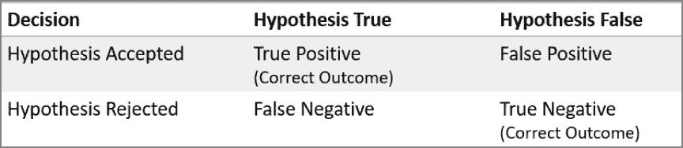

**图 7.1** 假设决策中的关系

在刑事法庭上，理想情况下应做出 `真阳性` 或 `真阴性` 决策，即无辜者被判无罪，有罪者被判有罪。虽然不理想，但宁可出现漏报（罪犯被判无罪），也不愿出现误报（无辜者被定罪）。然而，进入法院时，宁可让金属探测器报警提示发现金属（误报），也不愿其在实际有枪支的情况下未能发现（漏报）。在这种情况下，漏报是一个巨大的安全风险。

### 事件分诊

在事件响应中，事件是指被观察到的事情。未知其是否具有恶意。在大多数大型组织中，事件每小时都在发生；然而，许多事件永远不会发展成实际的安全事件。事件是环境中捕获到的变化。配置好工具后，可以生成警报，让 SOC 团队知道发生了某事。例如，安全信息和事件管理 (SIEM) 工具可以生成警报，实时通知管理员更改了他们的密码。管理员在企业环境中拥有大量控制权，因此这值得注意，但不一定是恶意的。


## 事件响应与分类

为了判断某个事件是否需要进一步调查，必须对其进行**分类**。分类的概念源于医院急诊室：护士会测量体温、血压、血氧水平等生命体征，将危及生命的患者送往重症监护。在网络安全中，**分类事件**是指判断该事件是真实事件还是误报的过程。高效、彻底的事件检查能缩短响应时间，并将有效事件和警报升级给相关人员进行下一级调查。若事件符合事件标准，则会移交给下一级事件处理团队。

**事件**是指已确认具有负面后果的事件，包括但不限于系统入侵。此类入侵可能导致停机、服务降级、数据销毁或数据丢失。例如，SIEM 工具告警某管理员修改了密码。你对该事件进行分类，发现该管理员登录的机器开始向网络外部的未知目标发送大量数据。这种情况绝对需要深入调查。在确认该外部目标是新的云实例还是恶意 IP 地址之前，这还不算作事件。一旦确认 IP 地址具有恶意性，事件响应剧本即刻启动。

**危机**是指失控升级的事件。危机因对业务造成重大影响且面临公开披露威胁，需要立即关注。例如：SIEM 告警管理员修改密码，该管理员登录的机器是存放大量知识产权的高度机密服务器，而 HR 确认该管理员正处于休假状态。大量数据外泄至确认的恶意 IP 地址，攻击者通知董事会数据已被劫持勒索，要求组织在 8 小时内支付数百万加密货币，否则将在互联网上发布关键知识产权。这种情况完全符合危机定义，且频繁发生。

### 升级前任务

不同类型的安全事件需要不同的响应。在对任何事件采取行动前，必须完成**升级前任务**。组织必须了解可能针对其企业的攻击类型。例如，NIST 列出了许多需准备的攻击向量，如受感染的可移动介质（USB 驱动器）、鱼叉式网络钓鱼、Web 攻击、设备盗窃/丢失等。每种攻击的响应截然不同，准备工作也需对应不同的响应或剧本。例如，用户将公司手机遗落在网约车上。用户应知晓需通知哪个部门及时限。对应的剧本会列出该设备的保护措施清单，如加密存储硬盘、加密类型、远程擦除功能等。确认丢失后，剧本会指导如何对丢失设备执行远程擦除。

### 事件响应流程

计算机安全事件响应流程最关键的一点是：事件响应计划必须在事件发生前就已准备就绪并经过测试，且计划要足够周全以应对各类情况。计划应规定组织如何处理各类事件，理想情况下在事件升级为危机前将其遏制。大多数公司将参与这些活动的人员称为计算机安全事件响应小组（CSIRT）成员。

必须设计便于事件响应的系统。这一概念可追溯到莫里斯蠕虫：该蠕虫瘫痪了早期互联网连接系统的 10% 以上，促使国防高级研究计划局（DARPA）批准成立计算机安全事件响应小组（CSIRT）。建立 CSIRT 及其所需策略，能为组织提供高效、有效的手段来应对**数据泄露**或其他意外情况，从而降低潜在影响。事件响应计划应涵盖以下常见内部和外部违规行为：

*   拒绝服务
*   勒索软件
*   数据外泄
*   社会工程学
*   硬件盗窃
*   恶意软件
*   数据泄露
*   恐怖袭击
*   未授权访问
*   未授权软件
*   物理入侵
*   适当的取证响应和调查实践
*   网站攻击
*   病毒和蠕虫攻击

事件响应计划需能识别发生了哪类事件，并设计相应的响应机制以应对违规类型。

将威胁情报纳入风险分析，有助于根据你的业务垂直领域（特定行业或市场细分）对这些违规行为进行优先级排序。许多威胁行为体有特定的作案手法和可识别的攻击垂直领域。例如，伊朗高级持续性威胁组织 35（APT35）针对美国和西欧，特别是政府人员、能源和电信行业。他们使用复杂的社会工程学技术和鱼叉式网络钓鱼，窃取管理凭证，并投放 DRUBOT 和 BROKEYOLK 等恶意软件。如果你的组织知晓该伊朗威胁组织且处于其攻击目标中，剧本可能要求扫描网络查找该恶意软件及/或其哈希值，以排除该威胁行为体。

事件响应计划如同一种剧本，详细规定了具体执行动作。拥有成熟的事件响应计划，公司可维持或恢复业务连续性、防御未来攻击，甚至可在民事法院起诉攻击者或提起刑事诉讼。事件响应的目标虽多，但减轻安全事件损害的步骤已广为人知，并遵循多种成熟格式。无论采用何种方法，事件响应流程必须包含以下步骤：

*   **步骤 1：准备** 公司必须建立策略和程序，以应对潜在的安全事件。
*   **步骤 2：检测** 此步骤涉及事件的识别。应使用自动化系统判断事件是否发生。识别工具包括入侵检测系统（IDS）、入侵防御系统（IPS）、防火墙、审计、日志记录和观察。如今，许多公司使用安全信息和事件管理器（SIEM）来发现和识别异常。SIEM 是一种用于日志和审计事件集中存储与解读的计算机化工具。
*   **步骤 3：分析** 此步骤评估事件的性质、细节及其对组织的潜在威胁。必须有手段验证事件真实性而非误报。通常，用于检测的某些工具也可辅助分析。


### 步骤 4：遏制

此步骤需要规划、培训和计划执行。事件响应计划应规定所需采取的行动。事件响应团队需要接受所需级别的培训，以妥善处理响应。该团队还应知道如何遏制事件、减轻损害并确定后续步骤。除了遏制事件（防止问题恶化）外，团队还必须消除问题，以便公司恢复正常业务流程。

### 步骤 5：恢复

此步骤涉及在安全可行的前提下，尽快将所有受影响的系统恢复到全功能状态。这可能包括从备份中恢复数据和文件、重新建立系统的正确设置等。这也应根据事件响应计划进行。

### 步骤 6：调查与结案

团队尝试确定发生了什么、是谁干的以及他们是如何做到的。调查完成后，必须准备一份正式或非正式的报告。该报告对于评估事件响应策略所需的任何变更至关重要。

### 步骤 7：经验教训

在此最后一步中，所有相关人员回顾发生了什么以及原因。最重要的是，他们确定必须采取哪些变更以防止未来问题。从发生的事情中吸取教训是防止其再次发生的唯一途径。如果您在政府部门工作过，可能非常熟悉事后行动报告的首字母缩写词（AAR）。这些报告应包含成功之处以及未来可改进之处。

### 响应剧本与流程

不同场景需要不同的流程和剧本，但基本模板是相同的。您为勒索软件做准备和响应的方式，将不同于您为社会工程学进行培训和制定策略的方式。剧本可从多个供应商购买，并应跨部门共享给在事件响应中发挥关键作用的部门，如法务或人力资源。

剧本具有通用组件，如启动或触发条件、根据策略和程序制定的主要步骤、最佳实践，以及最终目标或期望结果。要从头构建剧本，首先必须确定启动事件是什么以及响应该条件可能发生的所有可能操作。之后，必须将所有这些可能的操作归类为所需操作，并使用所需步骤构建剧本流程顺序。一个好的剧本将包含理想的最终状态以及剧本所涵盖的监管法律。图 7.2 显示了网络钓鱼剧本工作流的模板。

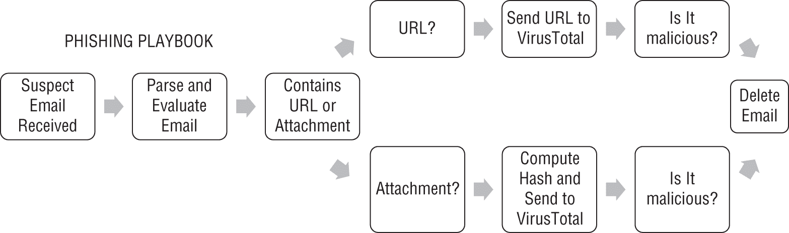

**图 7.2** 事件响应剧本模板

对于构建剧本的任何人来说，`MITRE ATT&CK` 框架是一个很好的资源。该框架是一个矩阵，包含红队成员、威胁猎人和蓝队防御者用于对其使用的战术、技术和程序进行分类的高度详细、交叉引用的方法。战术描述攻击者的即时技术目标；技术是攻击者用于实现战术的方法，而程序可以是攻击者使用的工具或特定恶意软件。该框架的良好切入点是：`attack.mitre.org`。

网上有许多可供下载的剧本。针对勒索软件，`Rapid7` 有一份出色的白皮书，确定了勒索软件袭击前为降低风险而采取的行动、勒索软件攻击如何发生，以及如何减轻和降低影响。您可以在此处找到建议：`www.rapid7.com/globalassets/_pdfs/whitepaperguide/rapid7-insightidr-ransomware-playbook.pdf`。对于其他类型的剧本，针对许多不同类型的恶意软件、数据泄露和病毒爆发场景，此处可找到极佳资源：`www.incidentresponse.com/playbooks`。

在事件响应中，非自动化响应方法可能是人工干预。当速度至关重要时，自动化响应方法是必须具备的重要要素。一种流行的实现方式是使用数字运行手册。*Runbook*（运行手册）是系统管理员用作参考的详细常规程序汇编。当您能够自动化运行手册时，等待时间更短，周转时间更快。运行手册自动化使您能够将运营和安全知识转化为在满足特定标准时立即运行的程序。

比自动化运行手册更高级的是安全编排、自动化和响应（`SOAR`）工具。许多安全运营团队过于忙碌，且难以应对噪音（难以区分合法数据和安全风险的网络流量量）。一些团队缺乏研究高级入侵所需的高技能人才。如果配置和定制得当，`SOAR` 工具可提高效率和一致性。`SOAR` 允许公司从不同来源收集威胁相关数据并自动响应这些威胁。一些 `SOAR` 工具集成了不同的工具，并可通过预建的行动方案控制事件。

### 沟通计划与利益相关者管理

即使有流程到位，您仍需要一个相关利益相关者团队来执行计划。团队成员应具备多样化的技能组合。事件响应团队成员应来自组织的各个部门，以便他们了解自己的领域并带来独特的技能：

*   Information security（信息安全）
*   Legal counsel（法律顾问）
*   Network and system administrators（网络和系统管理员）
*   Physical security（物理安全）
*   Public and human relations（公共关系和人力资源）

当需要处理潜在媒体报道并就沟通计划达成一致时，团队必须包含公共关系和法律顾问。当未给予足够细节时，人类和媒体倾向于推测。向公众披露事件时，应仅指定一人传达信息，且仅传达确切发生了什么、如何影响客户以及正在采取什么补救措施。来自媒体或股东的所有问题应直接转交给该人。

在收到安全事件或泄露通知后，高级管理层会立即问：“情况有多糟？” 回答这个看似简单的问题涉及许多因素，包括范围、影响、成本、停机时间和法律后果。*Scope*（范围）指事件波及多远，即有多少系统、子网或数据量受到影响。自然，范围直接影响影响程度。*Impact*（影响）受恢复所需的工作量和时间影响。这些问题不容易或快速回答。只有在完全识别和遏制后，才能开始回答有关恢复的问题。

然后是*cost*（成本）问题，包括货币成本和解决问题所需的时间。货币成本涉及团队工时和硬件更换。停机时间成本也很昂贵。

最后，法律后果如何？泄露可能披露了人们的个人数据，如个人社交媒体档案。更糟的是，泄露可能带来监管后果。法律顾问必须介入以开始损害控制。


## 取证概念与事件响应

取证专家必须知道如何通过拍照、在调查员笔记本中记录活动、询问嫌疑人和证人，以及了解收集或扣押嫌疑系统或介质的适当程序，来在现场记录证据。做正确的事是保护证据保管链和证据合法性的必要条件。取证程序必须记录证据的完整历程（从开始到结束），并能回答以下问题：

*   谁收集的证据？
*   如何以及在何处收集的？
*   谁取得了证据的占有权？
*   如何存储的，在存储期间是否得到了保护？
*   谁将其取出存储，为什么要移出？

这一过程也称为*电子取证*或*e-discovery*，涉及为恢复证据而对电子信息进行审查。电子取证过程的核心在于如何查找和提取以电子格式存储的文档和数据。其使用趋势在未来只会加剧。尽管大多数调查可能不会上法庭，但计算机取证专家必须收集、审查并保存可能来自电子记录、合同和表格的结构化数据，以及大量非结构化数据，如电子邮件、聊天会话，甚至电子文件片段。在调查过程中，正式记录构成了取证过程的重要组成部分，但在当今的电子世界中，这只是全貌的一半。在法庭案件和法律听证会上，要求提供选定电子邮件和其他电子通信的副本变得越来越普遍。数据保留策略应规定信息存储多长时间。例如，如果您申报证券损失或坏账扣除，美国国税局（IRS）可以要求追溯长达七年的纳税记录（`www.irs.gov/businesses/small-businesses-self-employed/how-long-should-i-keep-records`）。因此，大多数会计师建议企业保留纳税记录七年。图 7.3 列出了常见文档及其应保留的时间。

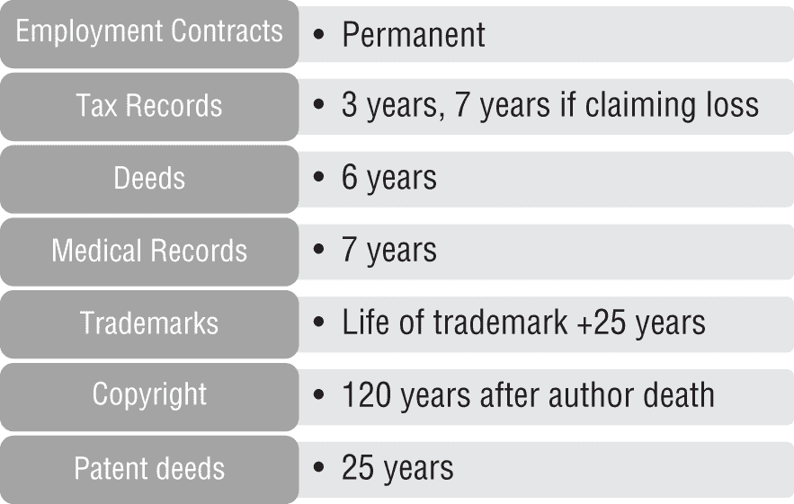

**图 7.3** 文档保留

从术语本质来看，事件响应是一种被动的、响应式的工作。但事件检测呢？我们知道黑客稍后可能会攻击我们的系统。我们知道下周我们可能会发现一个新的被攻陷系统。既然我们可以主动出击，在坏人造成损害之前自行发现潜在事件，为什么要等到被动响应呢？

*威胁狩猎* 是在必须对已发生的事件做出响应之前，主动寻找那些漏洞的内部活动的名称。这可以通过几种不同的方式来完成。您和您的团队可能会对整个系统或其他单个设备执行日志分析。如果已经部署了 `SIEM` 工具，这项工作会更容易完成，因为它提供了安全和事件信息的集中视图。

分析不能仅限于安全日志。许多使用相同设备、日志和监控的公司仍然遭遇入侵。除了对日志进行客观分析外，您还必须执行启发式分析和行为分析。作为安全专业人员，我们经常发现自己拥有更敏锐的直觉，并能采取比其他角色人员更务实的方法。

事件检测与漏洞管理之间存在显著的重叠。漏洞客观存在，作为安全专业人员，我们有责任发现它们。无论是通过威胁狩猎、启发式分析，还是等待工具感知它们，我们最终都会发现漏洞。漏洞存在于操作系统、应用程序和固件层面。

操作系统漏洞难以发现，但有安全控制措施可帮助降低这些漏洞被利用的风险。基于主机的防火墙和/或入侵检测系统将挫败源自网络的攻击，而补丁管理有助于遏制来自本地机器的利用。固件漏洞更难检测，但也很难利用，因为攻击者没有本地访问权限。这类漏洞不适用于安全的封闭设备，如加密飞地。安全加密飞地是增强设备安全性的独立硬件协处理器。

事件响应的最终目标是将停机时间*最小化*。必须迅速修复问题，以便恢复正常运营。至关重要的是，该过程必须以详细记录事件并保护证据的方式进行。没人打算上法庭，但这可能发生。这意味着*数据处理*至关重要。从事件发生那一刻起，事件响应团队必须确定这是一个事件还是一个事故。

*事件* 是一种可察觉的发生，而*事故* 意味着违反了策略或法律。许多事件响应人员使用由 `NIST SP 800-53` 提供的事件响应计划（`IRP`）模板，该模板详细列出了必须跟踪的信息。该模板常被称为“厄运电子表格”。示例和其他有用文档可在 `www.cisa.gov/uscert/sites/default/files/c3vp/crr_resources_guides/CRR_Resource:Guide-IM.pdf` 找到。

调查计算机犯罪很复杂。可能存在内部威胁或外部威胁。很多时候，事故只是意外，可能由非恶意威胁或配置错误引起。其他事故是蓄意的，可能会通过多种方式处理。这通常基于管理层根据以下信息做出的决定：

*   刑事诉讼
*   民事诉讼
*   工作制裁
*   解雇
*   停职

失误会导致证据在法庭上变得无用且不可采纳。这意味着团队成员必须了解适当的程序，并接受过如何保护和隔离现场以防止污染的培训。这是计算机取证的角色，也是我们接下来的主题。

*事件响应* 和 *应急响应* 非常相似；它们都处理可能造成损害或损害组织的未知事件。所有组织都应为应急事件做计划。组织应指派一支信息安全专业人员团队来协助该过程。团队还应包含其他技术和非技术成员。例如，`HR`（人力资源）和法务部门的员工也可能在团队中。一个好的起点是 `FEMA` 网站。`FEMA` 有一份 10 页的文档，可用于帮助企业确定应急响应计划的目标和目的。您可以在此阅读更多内容：`www.fema.gov/emergency-managers/national-preparedness/plan`。

### 取证概念

*数字取证* 一词描述了一种结构化的、分步的过程，以及对计算机系统上存储、处理或检索的数据进行合法、合规方式的分析，以便任何证据在需要时可在法庭上使用。

尽管执法部门已经实践刑事取证多年，但私营公司才刚刚开始认识到数字取证的价值。数字取证可分为三大类：

*   **计算机取证**：检查物理介质以获取作为证据的信息
*   **软件分析**：审查恶意软件、病毒和其他危险软件以进行分析和潜在的作者识别
*   **网络分析**：分析网络流量和日志以识别事件的来源和影响


#### 原则、标准和实践

由于电子信息的收集至关重要，国际计算机证据组织（International Organization on Computer Evidence）于 1995 年成立，旨在制定与证据发现相关程序的国际原则。其目标是制定在许多国家和州均被认可为合法的标准和实践。这些原则总结如下：

*   处理数字证据时，必须应用所有公认的取证和程序原则。
*   扣押数字证据时，所采取的行动不应改变该数字证据。
*   当有必要让人员访问原始数字证据时，该人员应接受过针对该特定目的的培训。
*   与数字证据的扣押、访问、存储或传输相关的所有活动必须完整记录、保存，并可供审查。
*   个人对其持有数字证据期间采取的所有行动负责。
*   负责扣押、访问、存储或传输数字证据的任何机构，均有责任遵守这些原则。

由于电子信息极易被篡改，必须遵循严格的方法论，且不得使用原件进行分析。处理介质的最佳实践包括以下内容：

*   原始副本得到保管，并保持未改变的状态。
*   对原始副本进行哈希计算。
*   使用原始副本制作两份位级副本。
*   主镜像用作库/控制副本。
*   第二份副本用作工作镜像并进行分析。
*   两份副本在创建时均进行哈希计算，以确保它们是精确副本。
*   原始副本和主副本存放在受控区域内。

#### 取证流程

创建取证副本后，分析师开始从易失性最高到易失性最低的信息进行处理。需检查的项目包括易失性内存、RAM、系统事件日志、安全日志、文件、已删除文件和松散空间。你需要建立并审查系统、审计和安全日志。此过程必须正确执行，因为一旦证据被污染，就无法去污；因此，拥有结构化的取证流程非常重要。取证流程的一般步骤如下：

*   **识别与获取** 必须识别并检索信息。一旦信息处于调查人员的监管之下，通常会创建一份副本。标准实践要求制作位级副本。位级副本是原始数据的精确副本。这使得调查人员可以在保持原件完整的情况下检查副本。
*   **保存与认证** 保存是指维持证据处于未改变状态的行为。此过程要求调查人员证明数据未被改动且未遭篡改。认证可通过完整性检查和哈希（如 `MD5` 和 `SHA`）来完成。有人认为 `MD5` 不再可靠，虽然就机密性而言这是真的，但 `MD5` 仍被整个行业广泛用于确认软件下载的完整性。`SHA-256` 是 NIST 推荐的标准。
*   **分析、记录与呈现** 调查人员必须仔细检查数据，并确保记录任何活动。调查人员通常会通过检查驱动器松散空间、文件松散空间、隐藏文件、交换/页面文件数据、互联网缓存以及回收站等其他位置来提取证据。有专用工具可用于此活动。调查人员的所有活动都必须记录在案，以确保在需要时信息可在法庭上使用。

最终，计算机取证关乎对存储介质或 RAM 中所存数据的科学检验和分析。此类分析的结果旨在查明发生了什么，决定对肇事者的潜在制裁，并做好准备以防证据需要在法庭上使用。

安全专业人员应仔细审视定义如何开展取证活动的政策和程序。必须解决对受损系统、智能手机、iPad、数码相机和 USB 闪存驱动器的取证分析问题。任何现有政策必须规定如何处理证据。证据保管链通过提供证据日志（显示从收集到出庭的每一次证据访问），有助于保护证据的完整性保存和可靠性。

数字取证是当今企业的重要职能。响应违规事件和开展电子取证，对于组织抵御刑事或民事指控至关重要。组织必须能够组织和分析关键数据，并基于该信息做出战略决策。针对背景调查、合规管理，或与潜在或威胁性诉讼相关的调查，建立相应程序非常重要。其中一些任务可由内部人员处理，但有些任务需要法律专家的专业知识，无论是内部还是外包人员。

以下是 CASP+ 需要了解的一些问题：

*   **电子资产清单与资产识别** 电子资产清单与资产识别涉及资产管理的概念。资产可定义为具有价值的有形或无形项目。用于保护资产的安全控制级别由资产类型及其价值决定。在取证过程中，能够识别出已受损的资产非常重要。
*   **数据恢复与存储** 数据恢复与存储与 `RAID`、数据库影子和 `SLA` 等项目密切相关。此类活动有指导方针，但每家公司必须制定符合其特定备份、灾难恢复和合规需求的策略。
*   **数据所有权** 数据所有者应对信息如何受到保护拥有发言权。数据所有者是对单个数据元素或数据集拥有合法权利的个人。
*   **法律保留** 法律保留是指组织在合理预期将发生诉讼时，为保存和保护所有形式的相关信息而采取的活动。
*   **证据保管链** `证据保管链` 的概念用于解决证据的可靠性和可信度问题。证据保管链关乎以下问题：谁收集的证据？在哪里收集的？如何存储的？为何从存储中取出？在此期间谁持有证据？证据保管链始于证据被扣押时，终于证据被处置或归还给所有者时。
*   **易失性顺序** 如果某种系统内存在断电时会丢失内容，则该形式被视为 `易失性`。从易失性内存（如 CPU 缓存或 RAM）收集数据时，事件处理人员必须考虑内存的易失程度。易失性顺序涉及事件或调查发生的顺序。处理计算机系统的通用规则是始终从易失性最高到最低进行。获取内存快照以及制作硬盘镜像应是任何取证调查的可选项。


#### IETF 证据收集和归档指南 (RFC 3227)

互联网工程任务组 (IETF) 发布了一份名为 *Guidelines for Evidence Collection and Archiving* 的文档。它也被称为 **RFC 3227**。该文档解释说，证据的收集应从最易失性的项目开始，以最不易失性的项目结束。因此，根据 IETF 的规定，**易失性顺序** 如下：

1.  寄存器、缓存
2.  路由表、ARP 缓存、进程表、内核统计数据、内存
3.  临时文件系统
4.  磁盘
5.  与相关系统有关的远程日志记录和监控数据
6.  物理配置、网络拓扑
7.  归档介质

#### 旨在促进事件响应的系统设计

尽管这对某些人来说可能看似违反直觉，但系统设计应内置事件响应能力。安全专业人员应参与软件开发生命周期 (SDLC) 过程的每一步。每当设计或采购新系统时，都应有人询问是否已实施适当的安全控制。NIST 文档中指定的一种方法包含以下内容：实施、监控、合规、战略、策略和意识。

创建并备份取证镜像可防止数据丢失。数据丢失可能会损害您可能拥有的任何法律案件。有许多取证工具可用于制作镜像。使用任何免费可用的镜像解决方案（如 **Clonezilla** (`clonezilla.org`)）都是创建完全配置且已打补丁的系统镜像以在网络上分发以及制作备份取证镜像的高效方式。Clonezilla 可以从服务器或可启动设备实施，并根据用户需求提供多种选项。该解决方案更灵活的选项之一可以使用便携式驱动器部署。该驱动器可包含用于现场部署的预置镜像以及现场取证备份。有时您会遇到机器无法从网络启动，或者规定禁止移动故障资产的情况，此时使用便携式驱动器是理想选择。

如果您有现场技术人员实验室，可以使用服务器、一台或多台技术人员机器和网络交换机创建一个有效的克隆系统，以便同时向多个系统部署。克隆可以使用 Clonezilla 等软件完成。Clonezilla 有两种类型：**Clonezilla Live** 和 **Clonezilla SE**。Clonezilla SE 面向企业，而 Clonezilla Live 面向单次备份和恢复。有多种方法可以格式化 USB 驱动器使其可启动。**Rufus USB 创建工具** 轻量、快速且用户友好。

一旦您制作好 Clonezilla Live USB，就可以用它启动目标机器。您可能需要编辑机器的 **BIOS/UEFI** 设置才能从 USB 启动。编辑 BIOS/UEFI 时将 USB 设为第一优先级。使用 Clonezilla Live，您可以保存取证镜像并恢复该镜像。Clonezilla Live 提供两个账户。第一个账户是 `user`，拥有 sudo 权限，密码为 `live`。sudo 账户允许用户以超级用户的安全权限运行程序。第二个账户是管理员账户 `root`，无密码。如果您需要 root 权限，可以作为 user 登录并运行 `sudo -i` 成为 root。

主取证镜像应保持完整并进行哈希以便验证。为应对诉讼提供冗余，应制作两份取证镜像并进行哈希。第一份副本以及原件应锁在安全区域，切勿触动。第二份用于检查。尽职调查用于在数字取证证据的保管链方面创造应有的注意义务。重要的是要特别小心，确保所有证据都得到妥善记录、验证，并且仅由专门受过训练的人员进行检查。非技术背景的辩护律师曾在联邦法院辩称，用永久性记号笔在 CD-RW 上书写就足以改变存储在 CD 上的数据。要提交此类证据并有效辩称数字证据未被篡改，必须遵守程序。对于执法部门来说，跟上各种数据、电子设备和通信的广泛多样性，以及信息技术不断发展的性质，可能很困难。

大多数州至少有一个数字取证实验室或数字取证部门，且供应商中立的认证由数字取证认证委员会 (DFCB) 提供。包括针对儿童的互联网犯罪特别行动组 (ICAC) 和联合反恐特别行动组 (JTTF) 在内的特遣队，由接受过数字证据搜查扣押、密码分析和隐写分析专门培训的警官组成。

#### 密码学与隐写术

**密码学** 是以一种无法在没有解密密钥的情况下解码的方式转换信息的实践。密码学包含两个主要操作：**加密**，使用加密密钥将明文信息转换为密文；**解密**，使用解密密钥将密文转换回明文。密码学有几个重要目标，包括机密性和完整性。我们使用加密来保护敏感信息，并确保数据不会被恶意或无意地篡改。另一个目标 **认证** 是指使用加密来验证身份，**不可否认性** 确保个人能够向第三方证明消息来自其发送者。第 6 章 "密码学和 PKI" 将进一步讨论密码学。

**密码分析** 是在没有加密密钥的情况下从密文中获取明文的行为。政府、军队、企业和攻击者使用它来查找弱点并破解加密系统。某人为逆向工程密码学所付出的努力称为 **工作量因子**。用于破解密码学的技术包括暴力攻击，可用的工具包括 **CrypTool**、**EverCrack** 和 **CryptoBench**。

音频和视频文件比大多数图像拥有更多存储空间，因为文件大小可以大得多。500 MB 的视频文件并不罕见，文件大小的变化允许嵌入数据。通常，隐写工具会限制被修改文件的容量。查找或恢复隐写数据称为 **隐写分析**。此处列出了一些常见的隐写分析技术：

*   **仅隐写体**：仅有隐写内容可供分析。
*   **已知隐写体**：原始内容和隐写内容均可供审查。
*   **已知消息**：隐藏消息及相应的隐写图像均为已知。

为了使隐写分析更加困难，使用隐写术的人不仅可能隐藏数据，还可能对其进行加密。在这些情况下，数据恢复可能非常困难，因为您不仅必须找到数据，还必须破解加密。

#### 取证分析工具

事件响应包含多个阶段和目标，要求事件处理人员使用各种工具。虽然处理人员可能依赖专用工具执行特定任务，但通常通用的命令行和网络工具可协助事件处理人员收集信息或确认怀疑。此处介绍了文件刻录、二进制分析、镜像制作、哈希和实时收集等几类工具。

##### 文件刻录工具


##### 文件雕刻

**文件雕刻** 是取证中用于从磁盘驱动器的原始数据中有选择地提取结构化数据的过程。文件雕刻最常用于从磁盘驱动器的未分配空间中恢复文件。通过扫描原始字节并重新组装它们来重建文件。这是通过分析文件的头部和尾部来完成的。取证专家经常在刑事案件中使用文件雕刻来恢复任何和所有证据。

###### Foremost

**Foremost** 是一个基于 Linux 的数据恢复取证程序。Foremost 面向公众免费，但最初是为执法部门设计的。它不直接使用文件系统，而是将硬盘驱动器的部分内容复制并读取到笔记本电脑或个人计算机的内存中。Foremost 主要用于从硬盘驱动器和 iPhone 中恢复图像。如果您决定下载该文件，防病毒软件有时会将其检测为恶意软件。

###### Strings

数字取证文本字符串搜索工具使用匹配或索引算法来搜索证据。 **Scalpel** 是一个开源工具，它使用 **strings** 来定位镜像中的文件头和文件尾，从而执行文件雕刻。 **Boyer-Moore 字符串搜索算法** 一直是字符串搜索的标准，也是 Scalpel 中的选项之一。该算法利用收集的数据来跳过部分内容，通过查找模式的尾部而不是开头来加快运行速度。

##### 二进制分析工具

**二进制分析**，也称为二进制代码分析，是在二进制代码级别进行的威胁评估和漏洞测试。这与我们作为网络安全专业人员的工作息息相关，因为威胁行为者正在向开放系统互连 (OSI) 模型的上层移动。多年前，网络层攻击是最普遍的。随着网络变得更加坚不可摧，攻击转移到了应用层。

二进制分析查看构成应用程序的原始二进制文件，当源代码不可用时，这非常有用。它尝试分析并检测已知的安全问题，并创建可执行的漏洞报告。

本节将介绍一系列二进制分析工具。其中之一 **dll** 的讨论实际上将在后面的“实时收集与事后分析工具”部分进行。

###### 十六进制转储

**十六进制转储** 是计算机数据的十六进制视图。 **Hexdump** 这个 Linux 实用程序，是一个以十六进制、十进制、八进制或 ASCII 等多种输出格式显示二进制文件内容的程序。它对于在字节级别查看文件内容非常有用。还有一个 `hexdump.exe` 免费 Windows 程序，它是 Linux 实用程序的简化版本，用于以十六进制代码查看文件内容。

###### Binwalk

**Binwalk** 是 Kali Linux 中一个快速、易用的工具，允许搜索、分析、逆向工程和提取固件镜像。Binwalk 使用 `libmagic` 库，因此它与 Unix 兼容。它是分析固件安全漏洞的最佳工具之一，特别是在物联网 (IoT) 领域，它提高了设备的稳定性和安全性，使其能够抵御攻击。

###### Ghidra

**Ghidra** 是由美国国家安全局创建和维护的逆向工程工具，于 2019 年 3 月在 RSA 大会上发布。Ghidra 旨在通过获取已编译部署的软件并对其进行反编译，来分析病毒和勒索软件等恶意代码和恶意软件。这一逆向工程过程对于获取在野外发现的有害软件、了解其工作原理及责任归属以及防范此类软件至关重要。一些分析师更喜欢 Hex-Rays 的 **IDA-Pro** 工具，但它仅可购买获得。

###### GNU 项目调试器 (GDB)

**GNU 项目调试器 (GDB)** 是一个用于查找 Bug 的强大工具，也是为自由软件基金会编写的首批程序之一。它允许您在程序崩溃时查看其内部发生了什么，通过在问题发生时跟踪变量和错误原因。例如，如果发生核心转储，崩溃前立即发生的语句或表达式是什么？它是 Linux/Unix 系统上最流行的调试器。

###### OllyDbg

与 GDB 类似， **OllyDbg** 是一个免费调试器，但专门是一个 32 位汇编级调试器。它也可用于评估和调试恶意软件，且在 Windows 上易于使用。它可以附加到正在运行的程序、调试多线程应用程序、解码 API 调用，并将命令汇编为最短的二进制形式。

###### Objdump

**Objdump** 是 Linux 中用于显示目标文件信息的命令。如果您是试图调试程序的程序员，这是一个方便的命令，但在编译代码时也会用到。可以结合选项使用该命令来控制显示的信息，例如归档、私有或节区头部。

###### Readelf

**readelf** 是一个与架构无关的命令行工具，用于显示关于 32 位和 64 位可执行链接格式 (ELF) 目标文件的信息。ELF 文件是可执行文件、二进制文件、库和核心文件的标准文件格式。readelf 与 objdump 非常相似，但提供了更多细节。objdump 和 readelf 的主要区别在于 readelf 不依赖二进制文件描述符库 (BFD)，后者是 objdump 所依赖的库。

###### Strace

**Strace** 是 Linux 的诊断和调试工具。它主要用于监控进程与内核之间的交互，包括系统调用和状态变更。根据 strace 手册页，对于源代码不易获得的程序，它在解决问题方面具有不可估量的价值。程序员使用 strace 来隔离 Bug、进行合理性检查，并尝试捕获竞态条件。

###### File

在 Linux 中，这是二进制分析的起点。在开始之前，您必须知道正在处理什么类型的文件。它可能是 PDF、图像、数据文件、视频文件，或其他大量不同类型的文件。 `file` 命令将对文件运行三项测试，包括基于 stat 系统调用结果的文件系统测试、用于查看文件是否具有特定格式数据的魔数测试，以及用于查找可出现在文件前几个块中的特定字符串的语言测试。

##### 分析工具

有许多可用于分析的工具，还有一些专门为该目的设计和构建的虚拟机。如果您正在寻找带有恶意软件分析工具的虚拟机，请看看 Linux 工具包的 **REMnu** 发行版，它非常适合逆向工程。如果您想要一个结合了威胁情报工具与狩猎团队作业的 Windows 版虚拟机，请从 Mandiant 下载 **Threat Pursuit VM** 的副本，其中已预配置 OpenCTI、Splunk、Maltego、MITRE Caldera 和 RStudio： `www.mandiant.com/resources/threatpursuit-vm-threat-intelligence-and-hunting-virtual-machine`。

###### ExifTool

**ExifTool** 是一个用于读取、写入和编辑图像、音频、视频和 PDF 文档等多种格式元信息的工具。例如，如果您运行命令 `exiftool -h -nikon t/images/123.jpg`，您将从文件中获得所有可能的信息，包括相机、型号、日期、时间、ISO、尺寸、质量、颜色、大小、文件编号、所有者姓名、序列号、镜头尺寸等。Windows 版和 macOS 版均可在 `exiftool.org` 获得。

###### Nmap


###### Nmap

Nmap 最初是作为一个命令行工具构建的，你可以通过 shell 或终端窗口执行它。其目标是构建一个灵活且极其强大的免费开源工具。Nmap 最初构建于 Linux 之上，供纯真的系统管理员使用，后来不断发展，也可用于 Windows，并以图形用户界面 (GUI) 形式 Zenmap 提供。Nmap 中有 100 多个命令行选项，但其中一些从未被作者 Gordon Lyon 完全记录在文档中。

在任何规模的网络中，尤其是大型动态网络中，将这些复杂的网络分解并分析流量、促进问题排查以及修复连接问题至关重要。网络扫描是一个寻找存活或有心跳的资产，然后尽可能收集关于这些资产的重要信息的过程。网络扫描可分为四个阶段：

*   网络映射
*   开放端口
*   运行中的服务
*   操作系统

###### Aircrack-ng

**Aircrack-ng** 是一套旨在评估无线网络安全性的工具包。它专注于监控、攻击、测试和破解 802.11 无线 WEP 和 WPA/WPA2-PSK 加密。所包含的所有工具均为命令行工具，并预装在 Kali-Linux 中。YouTube 上有许多教程，以及关于如何使用 Aircrack-ng 破解 Wi-Fi 网络的分步说明；然而，重要的是要理解，在你不拥有该 Wi-Fi 网络或未获得测试其安全强度许可的情况下，这可能被视为非法，并且已有邻居因“破解”Wi-Fi 网络而被判入狱的案例。

###### Volatility

易失性内存是指需要电流来维持存储数据的计算机内存。当断电时，存储在易失性内存中的数据会丢失，这可能包括浏览历史记录和聊天对话。内存转储是指在特定时间（通常是系统崩溃时，Windows 机器亲切地称为“蓝屏死机”）包含所有易失性内存副本的文件。

**Volatility** 是一个用 Python 编写的开源内存取证工具，用于 32 位和 64 位系统的事件响应和恶意软件分析。使用 Volatility，你可以读取内存/RAM 捕获文件，包括复制到操作系统剪贴板的信息和命令历史记录。使用 Volatility 进行 RAM 转储分析还可以检索其他基本信息，包括捕获镜像的日期和时间、运行中的进程、打开的网络套接字和连接以及内存地址。Volatility 之所以流行，是因为有插件可以收集更多信息。其他执行此操作的工具包括 SANS SIFT 和 FireEye 的 Redline。

###### The Sleuth Kit

**The Sleuth Kit** 是一组用于分析磁盘镜像、按关键字搜索文件和恢复已删除文件的命令行工具。它被许多开源和商业的基于 Linux/Unix 和 Windows 的取证工具所使用，包括 Autopsy，后者为命令行实用程序提供了图形用户界面 (GUI)。一些命令包括 `blkls`，它显示文件系统内的数据块，默认情况下复制未分配数据块的内容。你可以向 `blkls` 添加许多参数，例如 `-e`，它复制整个文件系统；`-s`，它仅复制镜像的松散空间；以及 `-a`，它显示所有已分配的块。

###### 动态链接 vs. 静态链接

静态链接和动态链接是分析中可使用的两种方法。**静态链接** 是将程序中使用的所有库模块复制到最终可执行映像中的过程，使得产品包含所有依赖且独立。这些文件通常相当大。**动态链接** 则以共享方式绑定这些库；这些文件将较小。

在分析过程中，获取一个计算机程序（即指示计算机执行特定任务的语言中的一系列步骤）需要进行逆向工程。如果所有代码都在一个单一的大文件中，你分析该软件及其包含的库的方式将不同于在运行时组合外部程序的方式。操作系统执行动态链接，如果库被移动，程序将不再工作。

##### 镜像工具

获取驱动器或设备的取证副本需要一种工具，能够在逐位级别创建设备的完整副本。CASP+ 候选人应考虑许多可获取磁盘镜像的工具，包括 FTK 和 dd。

###### Forensic Toolkit Imager

**Forensic Toolkit (FTK) Imager** 是 AccessData 制作的一个用于创建取证镜像的免费工具。它可用于定位已删除的文件和电子邮件，并查找测试字符串和其他敏感信息。它支持原始格式以及 SMART（ASR Data 的 SMART 取证工具格式）、E01 (Encase) 和 AFF (Advanced Forensics Format) 格式，这些是取证工具常用的格式。

FTK Imager 支持物理驱动器、逻辑驱动器、镜像文件和文件夹，以及多会话 CD/DVD 卷。在大多数情况下，取证采集很可能来自物理或逻辑驱动器。

除了驱动器镜像工具外，取证分析师有时还被要求捕获系统上的实时内存。除了驱动器镜像，FTK Imager 还可以捕获系统的实时内存。

###### dd

**dd** 是一个免费的数据取证工具。它包含在每个 Linux 和 Unix 发行版中。dd 可以创建任何磁盘的完美副本。

dd 最初是为将数据从一种设备复制到另一种设备、从 EBCDIC 转换到 ASCII 而开发的。它是一个功能强大的工具，能够执行各种其他任务。

dd 可用于备份和恢复整个硬盘分区；创建虚拟文件系统和 CD 或 DVD 的备份镜像（称为 ISO 文件）；复制原始设备文件的区域（如备份主引导记录 (MBR)）；转换数据格式（如 ASCII 到 EBCDIC）；以及大小写转换，这使得 dd 成为运行日常备份的得力补充。从取证角度来看，在不同设备类型上创建镜像文件的能力使 dd 成为一个有价值的取证工具。dd 还可以在磁盘、CD-RW 驱动器和磁带上创建镜像文件。

dd 和 Unix 系统可以一起为文件创建 MD5 校验和以及 SHA-256 和 SHA-512。dd 提供了一个强大且廉价的工具，可以验证镜像文件未以任何方式被更改。这至关重要，特别是对于可能需要在法庭上作为证据使用的证据。

即使受损系统不是基于 Unix 的，这也不是不使用 dd 的理由。有不同变体的 Linux 发行版可从磁盘启动，并允许你使用 dd 进行取证复制。

##### 哈希工具

**哈希** 是一种定义明确的数学过程或函数，可将大量数据转换为固定的小字符串数据或整数。哈希的输出称为**哈希值**、**哈希代码**、**哈希和**、**校验和**、**指纹** 或 **消息摘要**。以下工具是 CASP+ 考试目标中列出的实用程序。

###### sha256sum

程序 `sha256sum` 旨在使用 SHA-256 算法验证数据完整性。这些哈希也可以确认真实性。比较这些哈希可以检测文件是否发生了更改或可能导致错误。大多数 Linux 发行版都预装了 `sha256sum` 实用程序。

###### ssdeep


####### `ssdeep` 工具

`ssdeep` 工具的创建是为了计算上下文触发的分段哈希（CTPH）。这也被称为*模糊哈希*。该程序可以将签名与已知签名文件进行匹配，并报告任何匹配项。它可以递归地查看签名文件，找到该文件内的任何匹配项，以及文件的修改版本，即使数据已被删除。如今，由于计算速度快，`ssdeep` 哈希被用于简单识别。它可以在 Kali Linux 发行版中找到。

##### 实时收集与事后分析工具

*事后分析* 是一份关于事件发生的一切的书面记录，包括事件的影响、为缓解和解决事件而采取的行动、根本原因以及后续行动。为了创建高效且有效的事后分析，以下工具将有助于收集所需数据，以减少重复事件的发生。

###### `nbtstat`

作为一名安全分析师，你会想知道哪台计算机属于哪个 IP 地址。对于在安全运营中心（SOC）工作的安全分析师来说，在排查网络问题时，此信息至关重要。有时你还想查看网络上是否有不属于该网络的设备。

你可以 ping 一个 IP 地址，但这只能告诉你是否与网络设备有连通性。你也可以将 `-a` 开关与 `ping` 命令一起使用，看看运气好不好，能否将 IP 地址解析为名称。

除了使用 `ping`，安全分析师还可以使用另一个命令行实用程序来帮助查找与 IP 地址关联的计算机名称，即 DOS 命令 `nbtstat`，它用于查找 NetBIOS 计算机名称。`nbtstat` 命令也可以通过打开命令提示符、选择“开始”➢“运行”，然后输入 `cmd` 并单击“确定”来调用。

###### `netstat`

*Netstat* 是“network statistics”（网络统计）的缩写。如果主机没有在特定服务的正确端口上监听，则无法进行通信。在网络路径上更进一步，这些端口可能正在监听，但这并不意味着防火墙允许流量到达该设备。要测试该假设，你可以暂时禁用导致网络问题的基于主机的防火墙。

Netstat 是一款网络实用工具，可显示网络连接（传入和传出）、路由表以及其他一些详细信息，例如协议统计。它将帮助你衡量网络流量并诊断网速缓慢的问题。听起来很简单，对吧？从网络安全的角度来看，你能多快判断出哪些端口对传入连接开放？哪些端口当前正在使用中？已存在的连接当前处于什么状态？

`netstat` 命令的输出用于显示设备上所有连接的当前状态。这是配置和故障排除的重要组成部分。你如何知道受损系统上实际发生了什么？使用 `netstat` 命令以及选项 `–a`（显示所有）和 `–n`（显示地址和端口），你将获得该机器正在进行的所有活动网络会话的列表。

在主机上运行 `netstat` 时，你可能会在列表中看到 0.0.0.0 和 127.0.0.1。回环地址只能从运行 `netstat` 的机器访问。0.0.0.0 基本上是一个“无特定地址”的占位符。你在 0.0.0.0 后面看到的被称为*端口*。

你的网络中有 65,536 个窗口和门，范围从 0 到 65,535。端口可以是 TCP 或 UDP。简单来说，TCP 意味着主机和目标之间建立了连接。UDP 不关心是否建立了连接。TCP 和 UDP 都有 65,535 个可用端口。这是一个 16 位或 2 字节数字所能表示的最高数字。你可能会看到用数学方式表示为 2¹⁶ – 1。

互联网号码分配局（IANA）维护着特定用途的官方端口号分配列表。有时，随着新技术的出现，该列表会变得过时。你可能会看到的一些最常见的是“熟知端口”，范围是 0–1023。

在实验 7.1 中，你将使用 `netstat` 命令。

如果你看到这台机器正在监听端口 135，该端口传统上用于名为 `epmap/loc-srv` 的服务。除其他事项外，这应该告诉你这是一台 Windows 主机。当 Windows 主机想要连接到远程计算机上的 RPC 服务时，它会检查端口 135。

你可能注意到的下一个端口是 443。大多数 IT 专业人员在职业生涯早期就记住了这个端口。端口 443 是基于 TLS/SSL 的超文本传输协议——更广为人知的是 HTTPS。HTTPS 是对正在访问的网站进行身份验证，并保护所交换数据的机密性。从 1023 一直到 49151 的端口是“注册端口”。再往上，则是动态或私有端口。

###### Netcat

*Netcat* 通常缩写为 NC，是一款 Unix 网络实用程序，允许用户建立网络连接，以便在主机之间读取和写入数据。作为一种后端工具，Netcat 被称为“TCP/IP 的瑞士军刀”。它同时使用 TCP 和 UDP，但其实际上可用于创建更多类型的连接。

###### `ps`

在大多数 Linux/Unix 操作系统中，`ps` 命令（Process Status，进程状态的缩写）将实时显示系统上当前正在运行的进程，常用于终止那些行为异常的进程。输出结果将分为四列：

*   **PID**：唯一的进程 ID
*   **TTY**：终端类型
*   **TIME**：进程运行的时间（分钟和秒）
*   **CMD**：启动进程的命令

`ps` 可以使用许多开关。例如，如果你想显示任何以 root 身份运行的进程，可以使用 `ps -U root -u root` 命令。这将给你相同的四列，如前所示，但仅限于以 root 身份运行的进程。

###### `vmstat`

虚拟内存统计报告工具，通常称为 `vmstat` 命令行工具，是一款监控工具，用于收集和报告各种系统信息，以及关于运行队列和等待队列中的内核线程、内存、分页、磁盘、中断、系统调用和 CPU 活动的统计数据。

###### `ldd`

`ldd` 是一个 Linux 命令行实用程序，用于用户想要了解可执行文件的共享库的情况。Linux 发行版中有许多以 `lib*` 开头的文件。这些文件是库。要使用 `ldd`，请运行该命令并将可执行文件作为输入。所有共享库依赖关系将显示在输出中。

###### `lsof`

在 Linux 中，*lsof* 代表“list of open files”（打开文件列表）。此命令会给你一个所有打开文件的列表，显示是由哪个进程打开的，并在输出中共享所有打开文件的详细信息。它可以列出常规文件、目录、共享库、常规管道和命名管道、Internet 套接字等。如果将 lsof 与 grep 结合使用，可用于更高级的搜索。

###### `conntrack`

在 Linux 发行版中，`conntrack` 是连接跟踪器，允许你转储当前所有受跟踪连接的列表，并监控连接跟踪事件，例如新建立连接的事件消息。此工具允许你搜索、列出、检查和维护内核的连接跟踪子系统。

###### `memdump`

`memdump` 允许你转储特定于特定进程的内存驻留页面的内容。该应用程序以原始形式将物理内存内容转储到标准输出。转储内核内存是一个选项，但可能导致系统锁定。

###### `tcpdump`


目前最常用的数据包分析器 `tcpdump` 诞生于 30 多年前，这是由于捕获并记录网络流量作为输出的必要性。几年内，tcpdump 就被移植到多个操作系统和平台上运行。

###### Wireshark

**Wireshark** 是每个网络或安全管理员都应该了解的工具。它是一款开源工具，用于捕获网络流量并在极细粒度上分析数据包。有时 Wireshark 被称为*网络分析器*或*嗅探器*。数据包捕获可以告诉你传输时间、源地址、目的地址和协议类型。这些信息对于评估正在发生的事件或排查网络中的设备故障至关重要。它还可以帮助安全分析师确定网络流量是否为恶意攻击、攻击类型、被攻击的 IP 地址以及攻击源头。因此，你将能够在防火墙上创建规则，以阻止恶意流量来源的 IP 地址。

Wireshark 显示从不同网络介质捕获的数据包详细信息，将开放系统互连 (OSI) 模型分解为数据链路层、网络层、传输层和应用层。在工作区底部，你可以选择打开十六进制视图，右侧显示对应的 ASCII 值。

Wireshark 是一款功能强大的工具，技术上可用于窃听。当你计划在商业环境中使用它时，应获得书面许可，并确保组织有明确定义的安全隐私政策，规定使用网络的个人的权利。网络管理员捕获用户名、密码、电子邮件地址和其他敏感用户数据的事例比比皆是。Wireshark 使用合法，但如果你试图监控未获得明确授权的网络，则可能变得非法。

确定 Wireshark 所需的资源取决于你要检查的 `.pcap` 文件的大小。如果你的网络繁忙，文件就会很大。Wireshark 可以在 Windows 和 Linux 机器上运行。你需要一张支持的网卡来捕获数据，例如以太网卡或无线网卡。要获取最新版本的 Wireshark，请访问 `www.wireshark.org`。下载页面将提供适合你计算机架构和操作系统版本的正确版本。新版本通常每隔一个月发布一次。

## 摘要

事件响应和取证是安全框架的重要组成部分。该框架始于组织的最高层，受法律和道德约束，必须为关键资产提供一定级别的保护，并规定组织如何应对违规。高级管理层在此发挥着重要作用——其成员是公司的最高决策层，并承担最终责任。他们是必须帮助制定提供此安全框架的政策和程序的个人。政策之所以重要，是因为它们作为管理层关注保护关键资产的声明。

CASP+ 安全专业人员应具备事件响应所需工具的知识，以及以应有的谨慎执行取证的能力。在正确的时间使用正确的工具，可以在不损坏其他设备或影响企业利润的情况下，减少完成工作所需的精力。然而，错误地使用正确的工具可能很危险，会对企业造成损害。

## 考试要点

**能够解释事件、事故和危机。** 在执行事件响应时，CASP+ 应能理解分诊流程，以及事件之间的升级过程、将其认定为事故所需的调查研究，以及在网络中探查其他妥协指标所需的工具。

**能够实施、遵循和创建剧本。** 快速响应事件至关重要。创建并遵循专门针对该事件（无论是勒索软件、数据渗漏还是社会工程学）编写的剧本，对于遏制违规行为至关重要。

**能够解释取证概念。** 能够遵循法律程序和企业政策，在遵循识别、收集、保存、分析、验证和呈递的适当流程的前提下，捕获取证要素。

**能够选择正确的取证分析工具。** 给定一个场景，为证据收集选择正确的文件提取、二进制分析、镜像制作或哈希工具。

## 复习题

答案见附录。

1.  你的公司在其数据中心周边设有围栏。光传感器连接在围栏上，每当有东西撞击围栏或传感器检测到移动时就会触发警报，并自动录像。数据中心所在区域秋季常有滚地蓬撞击围栏，导致警报疲劳。在此场景中，是什么警报类型导致了警报疲劳？

    1.  真阳性
    2.  真阴性
    3.  假阳性
    4.  假阴性

2.  在经验总结阶段，你的团队正在对事件剧本进行分析。什么能*最好地*减轻和管理事件的影响？

    1.  修改风险所基于的场景
    2.  制定恢复议程
    3.  选择恢复团队成员
    4.  实施程序控制

3.  你是一家大型银行机构的安全分析师，该机构即将向公众披露发生了重大违规。你被叫去与 CISO 和 CEO 开会，讨论如何确保采取了适当的取证行动，以及事件响应团队是否做出了适当响应。以下哪项应确保在事件发生*后*进行？

    1.  通过聘请外部法律顾问来避免利益冲突。
    2.  为所有任务关键型服务器创建取证镜像。
    3.  自行进行正式调查，不涉及执法部门。
    4.  将事件视为犯罪已发生来处理。

4.  事件发生后，创建经验总结文档很重要。通过进行这种评判，你可以评估响应的有效性。本着这种事后分析的心态，你从该文档中能得出的最重要结果是什么？

    1.  改进领域
    2.  问题的严重程度
    3.  对事件的适当评估
    4.  安全评估意识

5.  你的组织已处理完一个需要事后行动报告 (AAR) 的事件。你的目标是改进组织对事件或关键情况的响应。以下哪项*不应*包含在 AAR 中？

    1.  分析事件以确定优势所在以及未来响应计划的改进领域。
    2.  从战略、战术和操作等多个视角理解整个事件；编制剧本供未来培训使用。
    3.  改进组织关键响应、灾难恢复和业务连续性计划的沟通。
    4.  创建网络拓扑图。

6.  你的一位终端用户联系安全管理员，称其电脑上的光标似乎在自行移动。如果公司的重点是机密性，以下哪项是*最佳*行动？

    1.  拖延入侵者。
    2.  断开入侵者连接。
    3.  记录入侵者活动。
    4.  监控入侵者。


## 练习题

## 7. 你是一家赌场的安全分析师。你与一家安全公司合作，将一起勒索软件攻击的源头追踪到赌场大堂的一个联网鱼缸。攻击在几秒钟内被阻止，威胁得到缓解。是什么导致了对该攻击的快速发现？

1.  签名
2.  端点分析
3.  **SOAR**
4.  免疫学习

## 8. 你公司的 CISO 聘请了一位外部安全顾问，为组织的物理安全创建剧本。在合同中，CISO 提到了对未经授权访问物理办公室并导致数字资产泄露的担忧。顾问应在该剧本中包含什么内容？

1.  自动授予物理控制系统访问权限并审查日志的程序。
2.  如何对访问日志和社交媒体源进行内部审计。
3.  在所有出入口安装 CCTV 以检测访问。
4.  **如何创建利用社会工程学技术获取办公室访问权限，然后尝试入侵网络的触发事件。**

## 9. 你在安全运营中心的新角色是支持政策制定并实施事件响应的标准 IT 安全实践。你将编写事件响应团队手动响应事件的程序。这属于哪种类型的响应？

1.  最小权限
2.  自动化
3.  **非自动化**
4.  取证任务

## 10. 你的组织遭遇了入侵，但你已证明已采取足够的应有注意义务和应有勤勉义务。你记录了工作流确切的开始时间以及响应任务应是什么。这份文件叫什么？

1.  SOW（工作说明书）
2.  NDA（保密协议）
3.  **Runbook（运行手册）**
4.  事后报告

## 11. 你作为联邦政府的漏洞管理主管工作。你正试图启用自动化度量和策略合规性以改善安全态势。你最可能使用什么？

1.  HTTPS
2.  **SOAR**
3.  STATE
4.  HIPAA

## 12. 你是一家刚收购另一家公司的组织的项目经理。你的公司主要使用内部工具进行事件响应，而收购的公司主要使用外部供应商进行事件响应，并将取证工作外包。合并这两个组织需要快速完成，具有即时投资回报率 (ROI)，并保留定制系统的能力。每个组织都认为自己的方式是最好的。你该怎么做？

1.  向 CEO 和董事会提出问题，将外包所有服务的决策上报。
2.  **安排所有部门主管、项目经理和董事会代表开会，审查需求并计算关键功能。**
3.  对内部与外包进行成本效益分析及内部 ROI 分析。
4.  计算部署和支持新系统的时间并与外包成本进行比较。向高层管理人员提交文件以供最终决策。

## 13. 你发生了一起事件，需要验证是否遵循了证据保管链、应有勤勉义务和识别流程。你被要求验证取证比特流。你将怎么做？

1.  采用加密
2.  启动遏制
3.  **比较哈希值**
4.  开始记录文档

## 14. 一名入侵你网络的攻击者被抓获并正在被起诉。显示攻击者行为的各种设备日志是关键证据之一。检查日志时，发现时间戳不准确，相差数年。这些日志与起诉攻击者的关系如何？

1.  辩护律师可能会获得修正时间戳的机会。
2.  法官可能会授权第三方修正时间戳。
3.  公司可能会获得修正时间戳的机会，使其在法庭上可被采纳。
4.  **由于时间戳不正确，日志很可能不被法庭采纳。**

## 15. 作为新任安全总监，你审查组织的安全策略。当前策略规定，如果怀疑或检测到入侵，应立即将系统从网络断开、关机并物理隔离系统。这种模式在过去效果很好。然而，随着恶意软件作者减少在硬盘上的占用，并尽可能将数据存储在 RAM 中（关机时会被清除），取证领域现在普遍认为最好做以下哪项？

1.  **将易失性内存作为事件证据收集的一部分，使用能快速分析 RAM 的工具。**
2.  关机，因为高级持续性威胁仍会在硬盘上留下痕迹。
3.  取出硬盘和内存条，然后放在干冰上无限期保存，直到它们可以被分析以存储数字证据。
4.  拔掉电源并检查网络日志。

## 16. 你的团队正在检查业务连续性、事件检测和响应以确定其存储策略。该策略的缓解控制措施之一将是从最易失性到最不易失性的证据层级。例如，归档介质是非易失性的；最易失性的是寄存器、缓存和随机存取存储器。这叫什么？

1.  **易失性顺序**
2.  IETF
3.  存储容量指南
4.  RAID 0

## 17. 遭遇入侵后，最困难的步骤之一是了解实际发生了什么。你的技术团队告诉你哪些系统和数据被违规、使用了哪些漏洞，以及受损系统已被隔离。技术团队接下来应该做什么？

1.  直接向董事会汇报。
2.  **确保攻击者没有留下后门或逻辑炸弹。**
3.  让 CISO 和 CTO 休行政假。
4.  引入第三方进行渗透测试。

## 18. 你的组织解雇了 IT 部门的一名员工。在该 IT 员工被护送出大楼后，对其有权访问的所有系统进行完整的取证调查，显示一台服务器上安装了逻辑炸弹。只有三名 IT 员工有权访问该服务器，其余 IT 员工没有管理员访问权限；因此，他们不可能安装逻辑炸弹。以下哪个因素支持你收集的证据？

1.  **授权人员访问证据**
2.  证据存储不当
3.  证据标签错误
4.  数字证据被篡改

## 19. 你的组织希望深入进行恶意软件分析，需要软件来发现可被利用的漏洞。今年预算不足以购买 IDA PRO，所以开源工具最好。你还需要创建自己的插件。以下哪个工具符合该标准？

1.  Hydra
2.  Immunity Debugger
3.  AngryIP
4.  **Ghidra**

## 20. 你遭受入侵的组织正处于调查中，正在收集证据、执行取证，并向高层管理人员展示收集到的所有证据。在完成所有技术事件取证后，组织的下一步行动是什么？

1.  安排新闻发布会。
2.  **通知当局。**
3.  通知所有供应商。
4.  申请网络保险赔偿。

# 第 8 章

安全架构


# 企业安全与架构

本章讨论企业安全与架构，这是纵深防御的关键组成部分。多年前，边界安全和仅在计算机上安装防病毒软件可能就足够了。现在情况已不复如此。如今，每当用户打开计算机、点击链接或打开电子邮件时，都可能发生攻击。这就是为什么基于主机的解决方案（如反恶意软件、防病毒和反间谍软件）对纵深防御策略至关重要，但这些项目只是解决方案的一部分。良好的逻辑安全就像良好的物理安全一样，都需要加固。逻辑安全不要求你在计算机周围建起 10 英尺高的混凝土墙，但它确实要求你以一种让攻击者工作更困难的方式来加固企业。这项工作始于移除不需要的服务。它还包括实施安全策略和控制。最后，它关乎最小权限原则的落实：仅提供用户完成手头任务所需的内容——不多不少——同时保持安全基线。

术语*企业安全*是指对安全的整体看法。多年来，我们对 IT 安全的看法发生了变化，数据安全、IT 安全和物理安全等项目现在被视为整体安全解决方案的组成部分。企业安全是一个框架，用于应用全面的控制来保护公司，同时将关键服务映射到所需的信息系统。企业安全的目标如下：

*   为公司增加价值
*   使 IT 目标与公司目标保持一致
*   建立问责制
*   验证是否已建立责任金字塔，该金字塔从最底层的员工开始，逐级向上延伸至高层管理人员

过去十年来，企业安全变得更加重要。考虑到安全漏洞的数量和糟糕安全管理的报告，不难理解其中的原因。

在本章中，我们将探讨企业安全架构设计与加固。我们将研究资产管理、入侵检测和入侵防御的作用等主题。CompTIA 要求你为考试掌握这些主题。你可能会遇到场景题、模拟题，甚至拖放题，要求你正确放置所需的控制和对策。

## 安全网络架构的安全需求与目标

德国心理学家 Erika Fromm 曾说：“没有坚实的基础，你就很难创造出任何有价值的东西。”这句话适用于人际关系、初创企业和网络安全架构。建立强大的基础和架构是降低妥协风险、利用安全原则、方法、框架和建模来保护资产的一种手段。基本上，安全架构将企业需求转化为可执行的安全需求。

### 服务

TCP/IP 套件并非为企业安全而构建。其主要设计考量是易用性，虽然这对早期的互联网是可以接受的，但如今需要安全的数据流、协议、程序和服务来满足不断变化的业务需求。一些弱点是由于不必要的服务运行和协议弱点造成的，而另一些则是实现协议并运行这些服务的软件中的缺陷。重要的是要了解，许多传输协议不提供加密。

构建网络弹性的最佳方式是通过冗余，即拥有多个系统、服务、设备或其他组件。电源、环境控制、硬件和软件、网络连接以及任何可能故障或中断的因素都需要进行评估。单点故障——即单个设备或其他元素的故障可能导致系统中断或停止运行的地方——必须被识别、评估，并通过补偿措施解决或在设计中记录在案。不需要的多余开放端口、应用程序和服务为攻击者提供了额外的途径。如果默认账户未被移除或更改，它们将是巨大的攻击向量。这些应用程序和服务还可能留下其他开放端口，为侦察和攻击提供另一个向量。安全的 `root`（Linux）和 `Administrator`（Windows）账户代表了强配置。不安全的 `root` 或管理员账户可能对整个系统及其连接的任何内容产生严重影响。

评估工作完成后，将制定一项策略，在需求、要求、选项以及构建和运营环境的成本之间取得平衡。设计中经常会根据审查和设计阶段确定的危险的总体风险和发生可能性，在复杂性、人员配置或其他限制方面做出让步。

#### 负载均衡器

*负载均衡器*使多个系统或服务看起来像单个资源，通过将负载分配到多个系统，实现了冗余并增加了处理负载的能力。负载均衡器也常用于允许系统升级，方法是将流量从将要升级的系统重定向出去，然后在系统打补丁或升级后恢复流量。负载均衡器还用于提供集中式防御。

代理负载均衡器是一种充当反向代理的设备，可将网络或应用程序流量分发到多台服务器。代理负载均衡器用于增加并发用户容量和应用程序的可靠性。代理负载均衡器通过减轻服务器管理和维护应用程序及网络会话的总体负担，以及执行特定于应用程序的任务，来提高应用程序的整体性能。代理负载均衡器通常分为两类：第 4 层和第 7 层。第 4 层代理负载均衡器基于网络层和传输层协议（IP、TCP、FTP 和 UDP）中发现的数据进行操作。第 7 层代理负载均衡器基于应用层协议（如 HTTP）中发现的数据分发请求。代理负载均衡器通过监控应用程序的健康状况，仅将请求发送给能及时响应的服务器和应用程序，从而确保可靠性和可用性。

#### 入侵检测系统和入侵防御系统

安全架构中的另一个保护要素是引入*入侵检测系统 (IDS)*。IDS 收集并分析来自其监控的计算机或网络的信息。IDS 可被视为一种网络管理和监控工具。IDS 将检测哪种类型的活动，关键取决于传感器的放置位置。在讨论入侵检测系统的类型之前，让我们先回顾一下检测入侵的各种方式。

入侵检测主要有三种基本方式：


##### 入侵检测系统（IDS）技术与组件

###### 核心检测技术

####### 签名识别
**签名识别**依赖于已知攻击的数据库，也称为**误用检测**。每个已知攻击都以签名的形式加载到 `IDS` 中。签名加载完成后，`IDS` 即可开始防护网络。签名通常被分配编号或名称，以便在攻击发生时易于识别。例如，这些签名可能包括“死亡之 Ping”、“SYN 洪水攻击”或“Smurf DoS”。

签名识别最大的缺点是这些系统只能针对已知且已加载的签名进行触发。多态攻击和加密流量可能无法被正确评估。`Snort` 等工具仍是安全管理员武器库中不可或缺的一部分，根据组织环境，自定义签名也会被频繁使用。然而，为了实现纵深防御的目标，它们应与其他确保其安装系统完整性的措施相结合。

####### 异常检测
**异常检测**系统基于一组特征的固定行为来检测入侵。如果攻击者能随时间缓慢改变其活动，基于异常的系统可能无法检测到攻击，而会认为该活动实际上是可接受的。异常检测擅长发现与正常活动显著不同的行为。正常活动会在数天、数周甚至数月内被采集，以建立基线。可编写规则将当前行为与基线进行比较，以发现任何异常。`CASP+` 考试也可能使用**启发式**一词来描述行为监控。

####### 协议解码
此类系统使用基于 `TCP/IP` 协议栈构建的模型，并理解其规范。**协议解码** `IDS` 系统具备重组数据包并查看高层活动的能力。如果 `IDS` 了解协议的正常活动，便能识别出异常活动。协议解码入侵检测要求 `IDS` 维护状态信息。为有效检测这些入侵，`IDS` 必须理解多种应用层协议。当攻击者试图在受控机器上使用自定义 `TCP` 协议栈以逃避检测时，此功能非常有用。

###### IDS 实施的基本组件

*   **传感器：** 检测并向系统发送数据。
*   **中央监控系统：** 处理和分析来自传感器的数据。
*   **报告分析：** 提供关于如何应对特定事件的信息。
*   **数据库和存储组件：** 执行趋势分析，并存储攻击者的 `IP` 地址及相关信息。
*   **响应模块：** 接收前序组件的信息并形成适当的响应。例如，响应模块可能决定阻断、丢弃甚至重定向网络流量。
*   **警报定义：** 警报定义基本上是入侵发生的“谁、什么、何时、何地、为何”。创建警报定义的第一步是规则动作。这些规则动作让 `IDS` 知道在发现符合规则标准的数据包时该做什么。

    *   **Alert（警报）：** 使用选定的警报方法生成警报，并记录数据包日志。
    *   **Log（记录）：** 记录数据包日志。
    *   **Pass（放行）：** 忽略数据包。
    *   **Activate（激活）：** 警报并开启另一条动态规则。
    *   **Dynamic（动态）：** 保持空闲，直到被激活规则激活，随后作为记录规则生效。
    *   **Drop（丢弃）：** 阻断数据包日志。
    *   **Reject（拒绝）：** 阻断数据包、记录日志，若协议为 `TCP` 则发送 `TCP` 重置包；若为 `UDP`，则发送 `ICMP` 端口不可达消息。
    *   **Sdrop（静默丢弃）：** 阻断数据包但不记录日志。

###### IDS 警报阈值类型

可应用于 `IDS` 系统警报的阈值主要有三类，大多数监控工具均应支持这些阈值。

####### 固定阈值
基于警报的技术常由**固定阈值**触发。指标常基于使用各种数值的固定计算。

####### 状态阈值
指标有时结合涉及信息系统状态的离散值使用。**状态阈值**在指标值发生变化时触发警报。例如，当特定程序进程启动时。

####### 历史阈值
指标通过**历史阈值**进行比较，即在设定时间范围内过去和现在的数值。网络工程师常使用历史阈值对比本周与过往几周的流量峰值。

###### 警报疲劳

**警报疲劳**是指安全分析师难以从接收到的海量信息流中辨别重要警报的总体阈值。安全分析师必须逐一审查每个警报，以判断其是真实威胁还是又一个误报，因为所有警报乍看之下可能都相同。当多个系统同时发送此类警报时，警报数量过多会迅速让人不堪重负，导致难以区分真阳性与假阳性。部分警报需要聚合后，组合才能被确认为真阳性并评估潜在业务影响。这也是许多安全运营中心（`SOC`）设置分级响应人员、由不同专业水平的专家评估警报的原因。

###### IDS 传感器部署

此类 `IDS` 系统的部署位置是另一个重要考量因素。部署需综合考虑，因为部署在非军事区（`DMZ`）的传感器虽擅长检测误用，但对已攻破系统并潜入内网的攻击者却无能为力。确定传感器位置后，仍需特定的调优和基线建立，以学习正常流量模式。

`IDS` 传感器可部署在外部 `DMZ` 或内网中。传感器也可部署在特定的任务关键型系统上。传感器位置部分决定了部署何种类型的入侵检测系统。传感器也可串联部署：第一台 `IDS` 执行基于签名的扫描并放行合法流量至第二台 `IDS`，后者执行启发式或其他类型扫描。这有助于保证不会因单台 `IDS` 承受过大需求而造成瓶颈。入侵检测系统分为两大类：**网络入侵检测系统** 和**主机入侵检测系统**。

###### 网络入侵检测系统

正如网络嗅探器，**网络入侵检测系统（`NIDS`）**旨在捕获和分析网络流量。`NIDS` 检查经过的每个数据包。检测到可疑流量时，采取的动作取决于特定 `NIDS` 及其当前配置。它可能被配置为重置会话、触发警报，甚至禁止特定流量。`NIDS` 能够监控部分网络，在防火墙和主机之间提供额外的防御层。其缺点包括：攻击者可实施插入攻击、会话拼接甚至分片，以防止 `NIDS` 检测到攻击。此外，若使用了内联网络加密（`INE`），`IDS` 将只能看到加密流量。

####### 主机入侵检测系统


####### 主机入侵检测系统

`主机入侵检测系统 (HIDS)` 旨在监控计算机系统而非网络。HIDS 检查主机活动并将其与可接受活动的基线进行比较。这些活动是通过使用 HIDS 应监控的系统对象数据库来确定的。HIDS 驻留在主机计算机上，悄无声息地监控流量并尝试检测可疑活动。可疑活动范围可从企图修改系统文件到不安全地激活命令。关于 HIDS 需要记住的事项包括：它们会消耗主机的一些资源，但它们也有潜力分析加密流量，并在解密后在端点发现异常事件时触发警报。

###### 直通加密器

在高安全环境中，也可能会使用诸如 `直通网络加密器 (INE)` 和 `直通介质加密器 (IME)` 之类的设备。当用户需要利用公共或不安全网络维护通信安全时，INE 是一种位于该网络路径上的设备。该网络可能是分组交换网或 ATM（允许更高容量），但 INE 允许强大的 1 类加密。（1 类是 NSA 对在仍允许网络寻址的同时确保加密的产品的称呼。）这与 VPN 不同，因为 INE 不是点对点的。INE 可供一组用户使用。

IME 类似于 INE，不同之处在于它位于计算机处理器和硬盘驱动器之间，以保护传输中的数据安全。

##### 入侵防御系统

尽管 NIDS 和 HIDS 都为安全专业人员提供了额外的工具，但它们通常被视为被动设备。主动 IDS 可以通过简单的方式响应事件，例如修改防火墙规则。这些设备称为 `入侵防御系统 (IPS)`。与 IDS 一样，IPS 可以是基于主机的，也可以是基于网络的。

###### 网络入侵防御系统

`网络入侵防御系统 (NIPS)` 建立在 IDS 的基础之上，并试图将该技术向前推进一步。NIPS 可以自动反应并防止安全事件的发生，最好无需用户干预。这种干预并阻止已知攻击的能力是 NIPS 最大的优势；然而，它遭受的问题类型与 NIDS 相同，例如无法检查加密流量以及难以处理高网络负载。

###### 主机入侵防御系统

`主机入侵防御系统 (HIPS)` 通常被认为能够识别并阻止异常。HIPS 被视为 IDS 的下一代产品，它可以实时阻止攻击。这种进程监控类似于防病毒软件。HIPS 具有监控系统调用的能力。HIPS 的缺点是它们需要资源，并且必须在应用层面处理已识别的异常，在发送警报时，它们并不阻止攻击。

###### 无线入侵检测和防御系统

`无线入侵检测系统 (WIDS)` 和 `无线入侵防御系统 (WIPS)` 使用基于与 NIDS/NIPS 相同理念构建的设备；然而，它们侧重于对流氓无线设备做出反应，而非单一安全事件。当检测到未识别的无线设备时，WIDS 会发出警报。根据配置，WIPS 可以执行相同操作，以及防止无线设备的使用。最佳实践是手动审查来自 WIDS 的警报，而不是立即关闭系统。你可能会意外地敲掉另一家合法企业的无线接入点。

#### Web 应用防火墙

`Web 应用防火墙 (WAF)` 是一种有助于解决 Web 应用安全顾虑的技术。WAF 不是传统防火墙的替代品，但它增加了另一层保护。传统防火墙阻止或允许流量，而 WAF 可以防范跨站脚本 (XSS)、隐藏字段篡改、Cookie 投毒，甚至 SQL 注入攻击。WAF 通过检查 TCP/IP OSI 模型的高层来运行，并且与特定 Web 应用的结合更紧密。

可以这样理解：传统防火墙可能会在边界拒绝入站流量。WAF 是位于 Web 客户端和 Web 服务器之间的防火墙，分析 OSI 第 7 层流量。这些设备能够执行深度包检测，并查看 HTTP/HTTPS/SOAP/XML-RPC/Web Service 层中的请求和响应。与任何安全技术一样，WAF 并非 100% 有效；存在各种用于检测和绕过这些防火墙的方法和工具。

自动化检测工具的两个例子是 `w3af` 和 `wafw00f`。还有更多。也有各种利用 WAF 固有漏洞的方法，这些方法因 WAF 技术而异。其中最突出的是跨站脚本 (XSS)，这正是 WAF 设计要防范的事情之一。一些 WAF 可以检测攻击特征码并尝试识别特定攻击，而另一些则寻找不符合网站正常流量模式的异常行为。

对于公司或组织来说，停止跨互联网的通信可能不是一个可行的选择。这就是 WAF 发挥作用的地方。WAF 在保护这些组织免受社交网络和其他 Web 应用固有的新兴威胁方面可以起到巨大作用，而传统防火墙并非设计用于防御这些威胁。一个开源 WAF 示例是 `ModSecurity`。商业选项由 Barracuda Networks、Fortinet 和 Cisco Systems 提供。

#### 网络准入控制

对于大大小小的企业而言，实现最佳网络安全是一个永无止境的追求。CASP+ 在保护关键系统方面发挥着重要作用。解决这些问题的一个潜在方案是 `网络准入控制 (NAC)`。NAC 为管理员提供了一种方法，在允许设备连接到网络之前，验证其是否满足特定的健康标准。不符合预定义要求的笔记本电脑、台式计算机或任何设备，可以被阻止加入网络，或被限制在一个受控网络中，直到设备达到所需的安全标准，在此期间访问受到限制。有几种类型的 NAC 解决方案可用：

*   **基于基础设施的 NAC** 要求组织升级其硬件和操作系统。如果你的 IT 组织计划推出 Windows 11 或已为 Cisco 基础设施升级预算，你就处于利用基础设施 NAC 的有利位置。
*   **基于端点的 NAC** 要求在每个网络客户端上安装软件代理。这些设备随后由集中管理控制台进行管理。
*   **基于硬件的 NAC** 要求安装网络设备。该设备监控特定行为，如果检测到不合规活动，可以限制设备连接。

#### 虚拟专用网络

真正改变远程访问的一项技术是个人与其公司和客户通信的方式日益增多。酒店、机场、餐厅、咖啡店等现在都例行提供互联网接入。这是一种低成本的连接方式，但它是公共网络。这就是创建虚拟专用网络的原因。

`虚拟专用网络 (VPN)` 是一种在互联网上提供安全、可靠传输的机制。VPN 是建立在物理网络之上的安全虚拟网络。VPN 的价值在于能够加密定义 VPN 网络的端点之间的数据。因为数据被加密，所以公共网络上的外部观察者在能看到或访问的内容方面受到限制。从安全角度来看，重要的是要理解 VPN 不是一种协议。它是一种利用协议来促进安全通信的方法。


VPN 可以基于硬件或软件实现。硬件 VPN 和软件 VPN 都提供真正的价值，并有助于保护敏感的公司数据。

##### 基于硬件的 VPN

基于硬件的 VPN 能够将计算任务从 CPU 转移到硬件上。硬件附加产品处理计算密集型的 VPN 任务，对于连接远程分支机构非常有用。这些解决方案效果良好，但需要购买额外的硬件，这会增加网络的复杂性。

##### 基于软件的 VPN

基于软件的 VPN 易于构建和实施。多家公司，如 `PublicVPN.com`、`Anonymizer.com`、`VyprVPN.com` 等，提供快速、易于安装的软件 VPN 解决方案。这些选项不需要投资额外的硬件，对于 IT 人员有限的小型公司极具价值，因为它们更便于 IT 工程师设置和维护。然而，在这种情况下，公司依赖于第三方 VPN 提供商。如果公司需要控制其通信的各个方面（例如合作伙伴业务伙伴协议 [BPA]），这种方法可能会有问题。

公司持续致力于改进专为 VPN 设计的协议。例如，在 1990 年代中期，微软牵头组建了一个网络公司联盟来扩展点对点协议 (PPP)。该项目的目标是构建一组专为在 VPN 领域内工作而设计的协议。这项工作的成果是点对点隧道协议 (PPTP)。PPTP 的目的是实现数据从远程用户到服务器的安全传输，通过 VPN 进行。VPN 可以使用多种不同的协议来实现，但此处将讨论的两种是 IPsec 和 SSL。从宏观层面来看，两者的关键区别在于 IPsec VPN 在网络层运行，而 SSL VPN 在应用层运行。

在 SSL VPN 的背景下，你应该回想起 SSL 协议不再被视为安全。VPN 实际上使用的是 TLS。虽然这种 VPN 实现仍普遍被称为 SSL VPN，但作为 CASP+，你必须理解正在使用的是 SSL/TLS。

使用 SSL/TLS VPN 的一大优势是更严格的控制，按应用程序控制访问，而不是针对整个网络。事实上，与 IPsec VPN 相比，SSL/TLS VPN 更容易实现按用户限制访问。最后，可以说小型组织倾向于选择 SSL/TLS VPN 最常见的原因是成本。IPsec VPN 需要专门的最终用户软件，这很可能包含许可成本。通过 SSL/TLS 连接时不需要这种昂贵的客户端软件，而这是当今任何浏览器的常见功能。

##### VPN 访问与认证

传统上，VPN 被视为一条隧道。这种观点源于 IPsec VPN，因为从功能上讲，IPsec VPN 将远程客户端连接起来，使其成为本地受信网络的一部分。IPsec VPN 在隧道模式或传输模式下运行。远程访问可以定义为集中式或分散式。集中式访问控制意味着系统内的所有授权验证均由单个实体执行；此类系统有 RADIUS 和 Diameter 两种。

###### RADIUS 配置

`远程认证拨号用户服务 (RADIUS)` 最初使用调制解调器池将用户连接到组织网络。RADIUS 服务器将包含用于验证用户的用户名、密码和其他信息。许多系统以前使用回叫系统以增加安全控制。使用时，回叫系统会拨打预定义号码回叫用户。

如今，RADIUS 将认证流量从网络设备传输到认证服务器。通过 IEEE 802.1X，RADIUS 将第 2 层的 `可扩展认证协议 (EAP)` 从用户扩展到服务器。

### Diameter

`Diameter` 旨在改进 RADIUS，并通过 IP 移动性更好地处理移动用户。它还提供认证、授权和计费功能。尽管做出了这些努力，RADIUS 至今仍很流行。

分散式访问控制可以描述为系统中分布在各处的多个实体执行授权验证。认证是安全专业人员的关键知识领域，因为它是第一道防线。它由两部分组成：标识和认证。例如，可以将标识视为我说：“嗨，我是爱丽丝。” 我向鲍勃提供了该信息固然很好，但鲍勃怎么知道真的是爱丽丝呢？你需要确定该声明的真实性。这就是认证的作用。延续前面的场景，在提供姓名后，认证将要求爱丽丝出示证件、提供暗语或指纹。

访问认证协议和工具的示例包括以下内容：

###### 密码认证协议

`密码认证协议 (PAP)` 是一种简单的协议，用于将用户认证到网络接入服务器，它以明文传输用户名和密码。PAP 是一种较老的认证系统，设计用于电话线路和拨号系统。PAP 使用双向握手进行认证，但被认为较弱。

###### 挑战握手认证协议

`挑战握手认证协议 (CHAP)` 用于通过点对点协议 (PPP) 在点对点链路上提供认证。CHAP 使用质询/响应过程并利用共享密钥。它比 PAP 更安全，并提供针对重放攻击的保护。CHAP 通过三次握手的使用来验证并提供认证。客户端认证后，会定期收到重新认证的请求，通过新的质询消息向连接方进行重新认证。

`MS-CHAP v2` 是最新的基于密码的认证协议标准，广泛用作基于点对点隧道协议 (PPTP) 的 VPN 中的认证方法。

### 轻量级目录访问协议

`轻量级目录访问协议 (LDAP)` 是一种应用协议，用于通过 TCP/IP 网络访问目录服务。LDAP 的创建是为了成为访问 X.500 目录服务的轻量级替代协议。X.500 是一系列涵盖电子目录服务的计算机网络标准。

###### 活动目录

`活动目录 (AD)` 是微软的目录服务实现，并使用 LDAP。AD 保留网络中所有用户和组的访问权限信息。当用户登录系统时，AD 会向用户颁发一个全局唯一标识符 (GUID)。支持 AD 的应用程序可以使用此 GUID 来提供访问控制。虽然 AD 有助于简化登录并减少管理员的开销，但它可能遭受攻击的方式有几种。

攻击 AD 的难点在于它是面向内部的，这意味着内部人员比外部人员更容易以 AD 为目标。一种攻击方法是权限提升。在这种情况下，攻击者将现有用户的权限提升至管理员或域管理员。其他潜在的攻击载体可能包括以密码哈希或 Kerberos 预认证为目标。

与认证相关的主要漏洞取决于用于传递数据的方法。PAP 以明文传递用户名和密码，不提供任何安全性。密码很容易被嗅探；然而，所有这些协议在过去都遭受过不同程度的利用。

##### VPN 放置


###### VPN 放置注意事项

VPN 是一项需要考虑放置位置的技术。您可以从多种设计选项中选择 VPN 设备在网络中的放置位置。例如，您可以将 VPN 设备与网络中的防火墙并行放置。这种方法的优势在于高度可扩展。这是因为可以将多个 VPN 设备与防火墙并行部署。然而，采用这种方法无法实现集中式的内容检查点。

VPN 设备的另一种潜在放置位置是在网络防火墙的屏蔽子网中。这种网络设计方法允许防火墙检查解密后的 VPN 流量，并可利用防火墙强制执行安全策略。一个缺点是，这种设计放置选项可能会施加带宽限制。

您的最终设计选项是在网络中使用集成的 VPN 和防火墙设备。由于需要支持的设备相同或更少，这种方法可能更易于管理。然而，可扩展性可能是个问题，因为单个设备必须扩展以满足多项功能的性能要求。还有系统可靠性的问题。如果 VPN 故障，防火墙也会故障吗？如果您选择此模型，拥有镜像 VPN 和防火墙是确保可靠性的方法。

#### 域名系统安全扩展

在任何 DNS 服务器上启用服务之前，都应对其进行安全加固。一些最流行的 DNS 服务器软件，如互联网系统联盟的 `BIND`，过去曾遭受大量漏洞的困扰，这些漏洞允许攻击者访问并篡改 DNS 服务器。`BIND` 的替代品（如 `Unbound`）可供选择，如果您的基础设施允许，应考虑使用它们。DNS 是您应当加固的服务之一，因为攻击者可以通过多种方式以 DNS 为目标。其中一种攻击是 DNS 缓存投毒。这种攻击向 DNS 服务器发送伪造条目，以破坏存储在那里的信息。DNS 也容易受到拒绝服务（`DoS`）攻击和未授权的区域传输。DNS 使用 UDP 端口 53 进行 DNS 查询，使用 TCP 端口 53 进行区域传输。保护区域传输过程是一项重要的安全控制措施。

DNS 的完整性和可用性对互联网的健康至关重要。保护 DNS 的一种常见方法是管理两台 DNS 服务器：一台内部，一台外部。另一种方法是使用 `域名系统安全扩展 (DNSSEC)`。DNSSEC 值得认真考虑，因为运行两台 DNS 服务器的一个主要问题是：向外部主机提供信息的外部 DNS 服务器仍然容易受到攻击。这是因为 DNS 服务器缺乏信任机制。DNS 客户端通常无法判断 DNS 回复是否有效。

有了 DNSSEC，DNS 服务器会提供签名并对每个响应进行数字签名。为了使 DNSSEC 正常运行，认证密钥必须在使用前分发。否则，如果客户端没有验证认证的手段，DNSSEC 就几乎毫无用处。DNSSEC 仅对 DNS 服务器进行认证，而不对内容认证。即使 DNS 服务器配置了 DNSSEC，也可能出现服务器为其冒充的域名签名结果的情况。您可以在 `www.dnssec.net` 上阅读更多关于 DNSSEC 的信息。

#### 防火墙/统一威胁管理/下一代防火墙

如今，有各种安全设备可供安全专业人员保护关键资产。这些设备包括防病毒、反间谍软件、基于主机的防火墙、 `下一代防火墙 (NGFW)`、入侵检测和防御系统等。但如果您能将这些技术中的大部分整合到一个通用设备中，会怎样？

实际上，您可以做到这一点，这正是 `统一威胁管理 (UTM)` 的设计初衷。UTM 是一种全能型安全产品，可将多种安全功能整合到单个设备中。UTM 可提供网络防火墙、网络入侵防御和网关防病毒功能。它们还提供网关反垃圾邮件，并通过 VPN 功能提供加密网络隧道、内容过滤以及日志/审计报告。UTM 的真正优势在于简单性和对数据流执行的全能型方法。对于较小的组织，一次采购即可满足大多数常见安全需求，且可从单一管理控制台控制和配置设备。UTM 设备通常放置在网络边缘。它们提供了全能型设备的便利，但缺点是如果设备故障，将不再有任何保护。

#### 网络地址转换和互联网网关

尽管 IPv6 目前被更多组织采用，但 IPv4 仍是行业标准。IPv4 运行良好多年，但随着越来越多设备接入互联网，可用地址数量已减少。IPv4 提供约 43 亿个地址，这看似很多，但这些地址已以越来越快的速度耗尽，主要是因为所有 B 类网络已被分配。

采用了多种方法来更好地分配 IPv4 地址并延长现有地址空间的使用。其中之一是可变长子网掩码（`VLSM`）的概念。引入 VLSM 是为了允许灵活地细分为不同大小的网络。另一种是引入网络地址转换（`NAT`）。NAT 在 RFC 1918 中有规定，划出了三个地址范围指定为私有地址：`10.0.0.0/8`、`172.16.0.0/12` 和 `192.168.0.0/16`。NAT 的设计初衷是为了缓解 IPv4 地址短缺、提供低级别的安全性，并简化中小企业的网络管理。

`网络地址转换 (NAT) 网关 (NGW)` 用于使没有公网 IP 地址的私有子网中的设备能够连接到互联网或云服务。它还能防止互联网直接连接到这些设备。另一方面，`互联网网关 (IGW)` 允许拥有公网 IP 的实例与互联网建立逻辑连接。

#### 正向/透明代理和反向代理

用于保护的一种流行网络组件是代理。许多人认为代理是一种“替身”机制。`透明代理`，也称为 `正向代理`、内联代理、拦截代理或强制代理，是一种拦截最终用户或设备与互联网之间连接的服务器。之所以称为 `透明`，是因为它不修改任何请求和响应，并可阻止恶意入站流量。

例如，使用透明代理时，企业网络上的最终用户请求查看 `www.cnn.com` 上的页面，看到的信息与他们在家中通过本地连接看到的完全相同。该页面由运行在企业网络上的透明代理传递。用户的体验完全一致，但用户的雇主现在有能力监控其行为并限制对特定网站的访问。`Squid 透明代理服务器` 是一款流行的开源透明代理工具。

`反向代理` 服务器位于网络边缘，负责策略管理和流量路由。它接收来自用户的连接请求，完成 TCP 三次握手，连接源服务器，并发送原始请求。反向代理非常适合在流量到达后端服务器之前对入站应用流量进行清洗。这有助于组织进行 DDoS 防护以最小化影响，有助于 Web 应用防护以丢弃恶意数据包，甚至可以重新路由流量以确保可用性。

###### 路由器


##### 网络组件与安全

###### 路由器

另一个关键的网络组件是路由器。路由器被视为 OSI 第 3 层组件。路由器的主要目的是通过称为**路由**的过程，将数据包从正确的端口转发到其目的地。路由器主要处理两类项目：路由协议和可路由协议。可路由协议的一个很好的例子是 `IP`。路由器检查 `IP` 数据包头部，并确定应将其转发到的位置。头部包含目标地址。路由器已经知道哪个端口连接到该目标地址所属的本地网络。它们采取的路径由路由协议决定。路由协议的例子包括路由信息协议（`RIP`）和开放最短路径优先（`OSPF`）。路由器可以将 `IP` 数据包转发到具有相同或不同介质类型的网络。路由器也可能成为攻击者的目标。一些常见的攻击包括路由投毒和互联网控制消息协议（`ICMP`）重定向攻击。

不当的路由器配置是一个巨大的安全风险。虽然物理控制很重要，但需要软件控制来防止路由器攻击。

####### 传输安全

增加的网络安全风险和法规合规性要求推动了广域网（`WAN`）传输安全的需求。传输安全的例子包括 `IPsec`、`TLS` 和 `SSL`。`IPsec` 是互联网安全标准。它最初设计为 `IPv4` 的附加组件，也集成在 `IPv6` 中。`TLS` 和 `SSL` 提供相同的服务，但实现方式不同。最广泛使用的 `TLS` 版本是 `v1.2`，但最新的 `v1.3` 已在大多数主流 Web 浏览器的当前版本中得到支持。

####### 端口安全

端口安全包含第 2 层流量，这是思科 `Catalyst` 交换机的一项控制功能。端口安全赋予安全分析师和网络管理员配置单个交换机端口的能力，仅允许特定数量的源 `MAC` 地址进入该端口。端口安全的主要功能是阻止用户添加所谓的“哑交换机”，从而非法扩展网络的覆盖范围。添加非托管设备会增加管理员的故障排查难度，因此不推荐这样做。通过在接口上发出一条命令，即可使用默认参数启用端口安全。

####### 远程触发黑洞过滤

远程触发黑洞（`RTBH`）过滤是一种利用路由协议更新来操纵网络边缘（或网络中任何其他位置）路由表的技术，专门用于在不需要的流量进入服务提供商网络之前将其丢弃。

一个需要缓解的主要领域是分布式拒绝服务（`DDoS`）攻击。针对 `DDoS` 防护，一旦检测到攻击，可以根据目标或源 `IP` 地址，使用黑洞路由在互联网服务提供商（`ISP`）网络边缘丢弃所有 `DDoS` 攻击流量。黑洞路由是通过将此流量转发到 `Null0` 接口来实现的。随后，`DDoS` 攻击从互联网发起，目标指向服务器。

除了目标服务的服务降级外，由于高带宽消耗和处理器利用率，整个内部基础设施也将受到影响。由于攻击的分布式性质，网络管理员必须在边缘阻断所有发往受害者的入站流量。

####### 中继安全

中继安全是在讨论虚拟局域网（`VLAN`）时的一个重要关注点。`VLAN` 最初作为一种安全和流量控制手段，用于隔离网络流量。`VLAN` 模型通过将用户分离到工作组（如工程、市场和销售）中来工作。如今，许多公司倾向于全园区 `VLAN`，因为 `VLAN` 必须跨越整个网络并进行中继。中继简单来说就是连接两个交换机的链路，它承载多个 `VLAN` 的数据。

从安全角度来看，这是一个隐患。如果攻击者获得了中继连接的访问权限，他们可能会从一个 `VLAN` 跳转到另一个 `VLAN`。这被称为 `VLAN` 跳跃。确保中继连接的安全非常重要，以防止恶意活动的发生。思科有多种方式将 `VLAN` 流量用于中继。这些技术可能包括 `IEEE` 的 `802.1Q` 实现或思科的交换机间链路（`ISL`）。

###### 路由器与交换机的防护措施

分布式拒绝服务（`DDoS`）攻击已经存在很长时间了，它们仍然是一个有效的关注领域。让我们看看针对路由器或交换机可以采取的一些防护措施。

####### 路由防护

路由或路径防护意味着确保已采取控制措施以保护端到端的网络流。这是一个通用的定义，但实际技术高度依赖于所保护的网络类型，无论是光网状网络、多协议标签交换（`MPLS`）网络，还是其他类型。

####### DDoS 防护

分布式拒绝服务（`DDoS`）攻击可能会使组织瘫痪，特别是当流量极其严重以至于网络工程师失去对设备的控制和连接，无法遏制攻击时。一种缓解技术是使用远程触发黑洞路由。顾名思义，如果网络流量被识别为不需要的，该流量将被发送到网络版的“黑洞”并丢弃。

###### 邮件安全

许多人会同意，电子邮件是互联网发展带来的最伟大的发明之一。它是使用最广泛的互联网应用。看看办公室周围，就能看到有多少人在使用 `Android` 手机、`iPhone`、笔记本电脑、平板电脑和其他提供电子邮件服务的设备。电子邮件为个人提供了通过互联网或数据通信网络进行电子通信的能力。

虽然电子邮件有许多优秀的功能，并提供了以前不可能的通信水平，但它也并非没有问题。现在，在我们过多指责它之前，你必须记住，电子邮件是在不同的时代设计的。几十年前，安全性并不像可用性那样是主要驱动因素。默认情况下，电子邮件以明文形式发送信息，因此容易受到窃听和拦截。电子邮件很容易被伪造，从而掩盖发件人的真实身份。电子邮件也是垃圾邮件、网络钓鱼和病毒的主要传播渠道。垃圾邮件是未经请求的批量邮件。`Symantec` 等机构的研究发现，垃圾邮件比过去更具恶意性。虽然大量垃圾邮件被用来兜售假药、盗版软件和假冒名牌商品，但现在更多的是针对通过恶意 `URL` 植入恶意软件。

就功能而言，电子邮件通过几种底层服务运行，其中可能包括以下内容：

*   **简单邮件传输协议** 简单邮件传输协议（`SMTP`）用于发送邮件和中继邮件到其他 `SMTP` 邮件服务器，默认使用端口 `25`。安全版本在端口 `587` 或 `465` 上使用 `SSL/TLS`。
*   **邮局协议** 邮局协议（`POP3`），当前版本，广泛用于从邮件服务器检索消息。`POP3` 在端口 `110` 上以明文执行认证。安全版本在端口 `995` 上使用 `SSL/TLS`。
*   **互联网消息访问协议** 互联网消息访问协议（`IMAP`）可用作 `POP3` 的替代品，并为移动用户提供了相对于 `POP3` 的优势。`IMAP` 具有远程处理邮件的能力，使用端口 `143`。安全版本在端口 `993` 上使用 `SSL/TLS`。

基本的电子邮件操作包括使用 `SMTP` 服务将消息发送到邮件服务器。为了检索邮件，客户端应用程序（如 `Outlook`）可能使用 `POP` 或 `IMAP`。使用像 `Wireshark` 这样的工具，很容易捕获明文电子邮件以供审查，这加强了使用 `PGP`、`SSL/TLS` 或其他加密方法保护电子邮件的重要性。


#### 应用程序编程接口网关/可扩展标记语言网关

如今的系统比过去分布得更广，且对互联网的依赖程度大得多。与此同时，服务交付正向服务化方向发展。

你是否注意到，如今许多基于 Web 的攻击不再以 Web 服务器为目标，而是集中在 Web 应用程序上？基于 Web 的应用程序持续快速增长，保护它们是一项艰巨的任务。应用程序编程接口（API）是客户端与服务器之间，或应用程序与操作系统之间的接口，它们定义了客户端应如何向服务器请求信息，以及服务器将如何响应。这一定义意味着，用任何语言编写的程序都可以实现 API 并发起请求。

API 对于构建系统间的接口极其有用，但如果未妥善保护，它们也可能成为脆弱点。API 安全依赖于身份认证、授权、适当的数据作用域（以确保不会泄露过多数据）、速率限制、输入过滤，以及适当的监控和日志记录来保持安全。`API 网关`位于外部客户端与运行在本地或云端的应用程序之间。`API 网关`可以验证传入请求，将其路由至正确的服务，并传递正确的响应。`API 网关`可充当 API 代理，从而避免原始 API 暴露。

Web 服务也使用可扩展标记语言（XML）消息。XML 是一种流行的数据编码格式，广泛用于各种应用程序，范围涵盖从文档格式（如 Microsoft Office）到 Web 格式。`XML 网关`充当 Web 流量的入口点，以及内部 Web 服务消费者的出站代理。

#### 流量镜像

云厂商使用`流量镜像`来监控网络流量。流量镜像会复制附加到云实例或负载均衡器的网络接口上的入站和出站流量。流量镜像的目的是获取数据并与监控工具共享，以便进行内容检查、威胁监控，以及在问题出现时常进行的故障排查。

##### 交换端口分析器端口

某些工具（如 NIDS）受限于只能看到其所连接的网络跨度。这揭示了一个重要事实：既然提到 NIDS 可能看到跨度，这意味着它们通常被放置在镜像端口上，或放置在网络设备转发所有流量的端口上。这可能是交换机上的镜像端口，甚至是路由器上的端口。在思科体系中，这些端口被称为`交换端口分析器（SPAN）端口`，原因显而易见。

##### 端口镜像

网络工程师常使用`端口镜像`技术来分析数据和排查问题。端口镜像用于第二层网络交换机，通过预留一个端口，将数据包的副本发送到监控设备、连接或另一个交换机端口。当交换机处理数据包时，它会制作一个副本并发送到该端口。由于中断和瓶颈的存在，这种监控类型对于网络观测至关重要。

#### 虚拟私有云

`虚拟私有云（VPC）`是位于公有云内部的高度安全、灵活、远程的私有云。`VPC` 用户可以执行在私有云中通常会做的任何操作，允许企业在共享基础设施上创建自己的计算环境。`VPC` 的逻辑隔离是出于安全原因实现的，赋予管理员极细粒度的控制权。

#### 网络分流器

`网络分流器`是插入网络特定位置的硬件设备，可在该处访问数据以进行测试或故障排查。网络分流器通常有四个端口，两个用于网络，两个用于监控。网络端口收集信息。监控端口将该流量的副本提供给连接的监控设备。这样，就可以在不改变数据流向的情况下监控流量。

#### 传感器

`传感器`在网络安全中的使用日益增加，可以是防火墙日志，也可以是网络分流器。传感器收集关于网络的信息，并在环境周围的工具中使用这些信息，通过数据分析来决定安全措施和防御策略。基于主机的传感器提供准确的信息，网络传感器提供广泛的覆盖范围，但可能容易受到安全威胁行为者的攻击。开发安全的传感器网络需要冗余，以确保对网络攻击有足够的防护。

#### 安全信息和事件管理

另一种流行的安全解决方案是`安全信息和事件管理（SIEM）`。`SIEM` 解决方案帮助安全专业人员根据日志文件中的数据快速识别、分析和报告威胁。`SIEM` 解决方案防止 IT 安全专业人员被审计数据和无尽的日志淹没，以便他们能够轻松评估安全事件，而不至于在安全事件数据中溺水。这项服务结合了两个独立的报告和记录领域：安全信息管理（SIM）和安全事件管理（SEM）。`SIM` 技术旨在处理和管理审计及事件数据的长期存储。`SEM` 工具专为事件的实时报告而设计。结合这两种技术，使用户能够从许多不同的系统和来源警报、捕获、聚合、审查和存储事件数据和日志信息，从而实现可视化和模式监控。使用这些系统的主要缺点是它们设置复杂且需要多个数据库。提供 `SIEM` 工具的供应商包括 ArcSight、Splunk、Lacework 和 Exabeam。

#### 文件完整性监控

`文件完整性监控（FIM）`以两种模式工作：基于代理和无代理。基于代理的 `FIM` 中，代理驻留在主机上，提供对文件的实时监控。`FIM` 代理还消除了主机和网络上的重复扫描负载。`FIM` 代理最大的缺点是它会消耗主机资源。安装 `FIM` 代理后，会建立一个本地基线。此后，只有合格的更改才需要 `FIM` 代理介入，并占用一些主机资源。`FIM` 代理必须具备检测未授权更改的所有能力、跨平台独立性，以及报告已更改内容和更改者的能力。

无代理 `FIM` 扫描器仅在其计划时间内有效。不具备实时检测或报告能力。无代理 `FIM` 扫描器每次扫描时，都需要对系统上的每个文件重新建立基线和哈希。无代理 `FIM` 扫描器的一个优点是它们易于操作，无需维护端点代理的麻烦。

#### 简单网络管理协议陷阱

简单网络管理协议（SNMP）是一种在端口 161 和 162 上运行的 UDP 服务，用于网络管理。`SNMP` 允许代理收集网络统计信息等数据并报告回其管理站。大多数大型企业都实施了某种类型的 `SNMP` 管理。困扰 `SNMP` 的一些安全问题源于这样一个事实：v1 和 v2 的团体字符串可以作为明文传输，且默认团体字符串（public/private）广为人知。`SNMP` 第 3 版是最新版本；它提供加密以实现更强健的安全性。`SNMPv3` 使用与 v1 和 v2 相同的端口。


##### SNMP

SNMP 消息分为五种基本类型：`TRAP`、`GET`、`GET-NEXT`、`GET-RESPONSE` 和 `SET`。SNMP 管理器和 SNMP 代理使用这些消息相互通信。`SNMP traps` 是非常流行的管理和监控活动机制。它们用于从启用设备（代理）向收集器（管理器）发送警报消息。例如，SNMP trap 可能会即时报告服务器过热等事件，这有助于提高可靠性并防止可能的数据丢失。如果配置得当，它有助于识别延迟和拥塞。

#### NetFlow

在参加 CASP+ 考试之前，你应该熟悉工具 `Wireshark`，它是网络嗅探器和分析工具的一个例子。本节的主题不是网络嗅探器；然而，如果你使用网络嗅探器查看本地网络上的流量，你可能会对所见感到惊讶。这是因为典型网络中流动或遍历的大多数网络数据非常容易检查。这反过来是因为大多数协议，如 `FTP`、`HTTP`、`SMTP`、`NTP`、`Telnet` 和其他协议，都是通过明文在网络上发送数据。这仅仅意味着流量未加密且易于查看。`TCP/IP` 的早期设计者以及现代互联网的缔造者并不关心加密；他们只是试图让一切正常工作。这对安全专业人员来说是个问题，因为攻击者可以轻松拦截并查看这些网络流量。数据保护和安全协议（如 `SSH` 和 `SSL/TLS`）的概念出现得要晚得多。

即使数据受 `SSL/TLS` 和 `IPsec` 等技术保护，入侵者仍可能攻破你的网络。检测当前威胁以及多源内部和外部信息的一种方法是分析网络数据流。这称为网络流分析。该概念涉及使用现有网络基础设施。流分析为网络中的流量流动提供了不同的视角。它允许你查看事件在给定时间段内发生的频率。例如，在周末午夜至凌晨 2 点之间，包含加密 zip 文件的流量离开你的网络并前往俄罗斯的频率是多少？借助流分析工具，安全专业人员可以近实时地查看此类用户活动。

提炼流经现代网络的海量数据需要允许数据聚合和关联的工具。`Cisco Systems` 是最早推出此技术的公司之一，并开发了 `NetFlow`。最初，捕获的网络流数据仅能回答最基本的问题。如今，`NetFlow` 和类似工具有助于识别数据渗漏（如前所述）、可能配置错误的设备、在异常时间表现异常的系统，当然还有意外或无法解释的网络流量。`NetFlow` 仍然很流行，但可以说是为 `Cisco` 环境设计的。或者，`IPFIX` 是一种基于互联网工程任务组（`IETF`）标准的技术，供其他第三层网络设备收集和分析网络流。

### 数据丢失防护

开发安全的网络基础设施需要为增长构建管理控制。公司会随着时间的推移而成长和变化。收购、买断、新技术的采用以及过时技术的淘汰都意味着基础设施将发生变化。`数据丢失防护 (DLP)` 需要分析出站网络流量中的异常，并使用执行深度包检测的更好的出站防火墙控制。深度包检测通常由网络边界处的设备执行，例如受信任网络边界处的 Web 应用程序防火墙。要在任何组织中选择此类设备的放置位置，拥有数据流图非常重要，该图描绘了数据在整个网络中流动的位置和方式。

公司必须根据需要具备集成存储设备（如存储区域网络 `SANs`）的能力。需要定期审查存储集成的安全性和隐私考量，以跟踪存储需求，因为公司对增加数据存储和数据备份有永无止境的需求。

####### 杀毒软件

杀毒软件公司已经开发出更有效的病毒检测方法。然而，这场竞赛仍在继续，因为病毒编写者通过开发更难检测的病毒进行了反击。杀毒程序通常使用以下几种技术之一来识别和根除病毒。这些方法包括：

*   **基于特征码** 此技术使用特征码文件来识别病毒和其他恶意软件。它需要频繁更新。
*   **基于启发式** 此检测技术寻找应用程序或服务正常行为的偏差。此方法对未知和多态病毒有效，并使用 `AI` 来查找恶意代码模式。

多年前，杀毒软件可能被视为一种可选的保护机制，但现在不再如此。杀毒软件是抵御基本类型恶意软件的最佳防线。大多数检测软件都包含一个用于检测病毒的特征码库。病毒可以使用不同的技术进行感染和复制。以下技术很常见：

*   **引导记录感染者** 驻留在计算机的引导扇区中
*   **宏病毒** 以 Microsoft Office 程序为目标，如 Word 文档和 Excel 电子表格
*   **程序感染者** 以可执行程序为目标
*   **多部件感染者** 同时以引导记录和程序为目标

一旦你的计算机被感染，计算机病毒可以做许多事情。有些被称为快速感染者。快速感染病毒会感染它们能够感染的任何文件。其他病毒使用稀疏感染技术。稀疏感染意味着病毒在感染其他文件或传播破坏时会慢慢来。此技术用于试图避免检测。还有一些其他类型的恶意软件可以完全驻留在文件中并将自身加载到 `RAM` 中。这些病毒被称为 `RAM` 驻留病毒。恶意软件创建者使用的最后一种技术是设计病毒使其具有多态性。多态病毒每次复制并感染新文件时都会改变其特征码。此技术使杀毒程序更难检测到病毒。

防止病毒和蠕虫始于最终用户意识。应培训用户在打开附件或运行未知程序时保持谨慎。用户意识是一个好的第一步，但杀毒软件至关重要。市场上有许多杀毒产品，其中包括以下程序：

*   `Bitdefender`
*   `Trend Micro`
*   `Norton Antivirus`
*   `McAfee Antivirus`

一些著名的恶意软件示例包括：

*   **WannaCry：** 2017 年大规模勒索软件攻击，在随后的几次攻击中被模仿
*   **Petya：** 通过网络钓鱼邮件传播的各类勒索软件家族
*   **CryptoLocker：** 恶意软件/特洛伊木马/勒索软件，访问并加密了超过 200,000 个基于 Windows 系统上的文件
*   **Mirai：** 第一个通过物联网设备大规模传播的恶意软件
*   **Melissa：** 第一个广泛传播的宏病毒
*   **ILoveYou：** 第一个广泛传播的大规模邮件蠕虫，因其名字诱导人们点击
*   **Code red：** 众所周知的蠕虫，针对运行 `IIS` 的 Windows 服务器
*   **Nimda：** 一个老牌病毒，但仍然是通过多种不同机制感染系统的最严重蠕虫之一
*   **Zeus：** 勒索软件
*   **Conficker：** 广泛传播的蠕虫，可通过电子邮件、U 盘和网络附件传播

### 分段


### 分段

*分段* 用于将具有不同功能或数据安全级别的系统放置在网络的不同区域或段中。分段也用于虚拟和云环境。原则上，分段是利用安全、网络或物理机器边界在环境、系统、网络和其他组件之间建立隔离的过程。

事件响应人员可以选择将分段技术作为响应过程的一部分，以移动系统组或服务，从而专注于特定区域。您可以选择将受感染的系统与网络的其余部分隔离，或者将关键系统移动到受保护程度更高的段中，以帮助在活动事件期间保护它们。

### 微分段

*微分段* 是网络安全中使用的一种方法，允许将数据中心划分为小而独立的安全段。分段后，安全架构师可以为每个唯一段定义安全控制并提供服务。这允许极其灵活的安全策略和应用级安全控制，增强了对网络攻击的抵御能力。

### 局域网/虚拟局域网

*局域网 (LAN)* 是在家庭、学校或办公室等局部区域内连接计算机的计算机网络。*虚拟局域网 (VLAN)* 用于分割网络流量。VLAN 为组织提供了许多好处，因为它们允许对连接到交换机上定义端口的网络用户和资源进行管理上的分段。VLAN 可减少网络拥塞并增加带宽。VLAN 会产生更小的广播域。VLAN 还可用于分离安全级别较低的网络部分。这种纵深防御技术可以使用特定的 VLAN 来增加针对嗅探、密码攻击和劫持尝试的额外保护。尽管 VLAN 分离可能被攻破，但这会增加一层防御，能够阻挡大多数偶然的攻击者。

为了提高安全性，网络分区将把系统分段为独立的子网。网络分区需要审查潜在的网络接入点。一旦定义了这些接入点，就可以使用多种不同的技术来分割网络。常见和新兴技术包括使用包过滤器、状态检测、应用代理防火墙、Web 应用防火墙、多层交换、分散路由、虚拟局域网 (VLAN) / 虚拟可扩展局域网 (VXLAN)。

### 跳板机

*跳板机* 通常被称为跳板主机或跳板服务器，是一种加固设备，用于管理不同安全区域中的资产。管理员登录跳板机作为起点，然后连接或“跳转”到另一台服务器或不受信任的环境。这是一种防止威胁行为者窃取凭据的方法。跳板机正逐渐演变为一种称为 *安全管理工作站 (SAW)* 的技术。跳板机和 SAW 都绝不应用于非管理任务，如浏览互联网、打开电子邮件或使用办公应用程序。它们严格供管理员执行管理任务时使用。

### 屏蔽子网

屏蔽主机防火墙增加了一台路由器和一台屏蔽主机。路由器通常配置为仅在内部网络上看到一台主机计算机。内部网用户必须通过这台主机计算机连接到互联网，外部用户无法直接访问内部网上的其他计算机。

*屏蔽子网* 建立了一种非军事区 (DMZ)。屏蔽子网是组织可以实施的一种解决方案，用于提供面向外部的资源，同时保护内部网络。托管网站或提供公共服务的服务器通常放置在 DMZ 内。

DMZ 通常设置为允许外部用户访问 DMZ 内的服务。基本上，面向外部的 Web 服务器、电子邮件和 DNS 等共享服务可以放置在 DMZ 内；DMZ 不提供对内部网络中服务的任何其他访问。当然，允许或拒绝什么流量取决于屏蔽子网任一侧生效的规则。屏蔽子网和 DMZ 是大多数现代网络设计的基础。

组织通过配置具有两组规则的防火墙来实施屏蔽子网，在互联网和两个防火墙之间对网络进行分段。这允许组织通过让互联网流量通过一个比保护内部网络的防火墙限制较少的防火墙来向公众提供服务。屏蔽子网是中间段，它通过增加一个边界网络进一步将内部网络与互联网隔离，提供了额外的保护层。当使用三端口防火墙（即具有三个网络端口的防火墙）时，屏蔽子网选项对组织来说并不昂贵。

### 数据区域

从端点到端点审查网络中的安全性，并考虑构建安全和 *数据区域* 以限制攻击者的触及范围。这从流量进入网络的地方延伸到用户最初连接到网络及其资源的地方。这需要纵深防御和可用性控制。可以使用多种方法之一来构建不同的区域。这些方法包括以下内容：

*   **面向攻击向量** 这种方法侧重于用于发起攻击的常见攻击向量。示例包括禁用 USB 闪存驱动器的自动运行、禁用 USB 端口以及移除 CD/DVD 刻录机。
*   **以信息为中心** 这种方法侧重于在数据之上分层控制。示例包括信息控制、应用控制、主机控制和网络控制。
*   **受保护飞地** 这种方法规定某些区域比其他区域更重要。控制措施可能包括 VPN、防火墙的战略部署、VLAN 的部署以及对关键网段的受限访问。

在考虑端点安全和数据区域时，谁是更大的威胁：内部人员还是外部人员？尽管数字因您查阅的报告而异，但大量攻击是由内部人员发起的。决定恶意行事的受信任内部人员可能会绕过控制，以雇主不允许的方式访问、查看、更改、销毁或移除数据。

外部人员可能试图访问、查看、更改、销毁或移除数据或信息。顺便说一下，您必须考虑偶发的外部入侵，例如恶意软件，它为外部人员提供了访问内部网络的权限。目前，有报告称常规攻击具有很高的成功率。这包括简单的攻击机制，如各种类型的恶意软件、鱼叉式网络钓鱼、其他社会工程学攻击等。一旦进入内部，这些攻击的复杂程度会显著增加，因为攻击者利用高级权限提升和特定配置漏洞来获取持久访问权限、窃取数据并规避安全机制。数据区域的配置将有助于通过创建的策略来调节入站和出站流量。

### 预发布环境

*预发布环境* 是纵深防御的另一层，企业可以在其中对其生产环境进行建模，以测试升级、修补或新软件，确保在部署新代码或软件时不会破坏现有基础设施或产生新漏洞。当组织拥有预发布环境时，它需要尽可能紧密地匹配现有环境，以便分析准确。


#### 暂存环境最佳实践

暂存环境的一项最佳实践是允许软件运行一段设定的时间。过去，在部署到生产环境之前，这段时间长达七天。然而，2021 年的 SolarWinds 供应链攻击事件让网络安全界深刻认识到攻击者可以有多么狡猾。他们了解我们的最佳实践，所使用的恶意软件被设定为在 14 天后执行，以此绕过暂存环境的检测。正如所述，这只是纵深防御中的另一层，而不法分子清楚地知道它是如何被使用的。

### 访客环境

任何大型组织偶尔都会遇到访客需要访问访客共享环境的场景。这些人员并非组织员工，可能会携带非受管设备。出于显而易见的安全原因，这些资产不应加入受保护的域。仅基于这一原因，任何来组织上课或参观园区的人员都应签署使用条款协议，且其非受管设备仅允许获得 Web 访问权限。如果允许他们处理敏感或机密资料，则应采取以下措施：

*   配置超时策略，要求每日进行身份验证。
*   为访客接触的任何敏感资料创建自动分配的分类类型。
*   为访客设置多因素认证 (MFA)。
*   进行审查以验证对公司站点和信息的权限。

### VPC/虚拟网络

`虚拟私有云 (VPC)` 是一种按需提供的高度安全的云环境，托管在公有云内部。许多 VPC 客户将使用此类环境进行代码测试、信息存储或网站托管。许多云服务商提供 VPC 类型的生态系统，并要求更安全的连接方式。

`虚拟网络 (VNET)` 顾名思义。VNET 是指所有设备、虚拟机和数据中心均通过软件进行创建和维护的环境。大多数提供 VNET 功能的云服务商赋予客户对其实例的高度控制权，包括 IP 寻址、子网、路由表和防火墙规则。这使得扩展性和效率成为可能。

### 可用区

纵深防御的另一个要素是创建可用区。`可用区` 的目的是在区域内拥有高可用性的独立位置，用于故障转移和冗余。对于主要云服务商而言，单个可用区包含多个物理数据中心。

### 策略/安全组

`策略` 是由管理层制定的高层级文档，旨在将管理层的整体战略和理念传达给所有员工。高级管理层和流程所有者对组织负责。策略在某种意义上是一种模板，它们将指导原则应用于管理层的意愿之中。策略详细阐述、定义并规定了对员工的期望，以及管理层打算如何满足客户、员工和利益相关者的需求。

制定策略主要有两种基本方式。在某些组织中，策略制定始于组织的顶层。这种被称为**自上而下的策略制定**的方法，意味着策略从高级管理层向公司的下层推行。自上而下策略制定的巨大优势在于，它确保策略与高级管理层的战略和愿景保持一致。其缺点是实施过程需要大量时间，且可能无法完全解决普通员工的运营顾虑。另一种替代方法是**自下而上地制定策略**。自下而上的策略制定方法关注普通员工的顾虑。该流程从他们的意见和顾虑出发，并基于员工和组织群体管理者已识别的已知风险进行构建。其主要缺点是该过程可能并不总能很好地映射到高级管理层的战略。

对于现代云基础设施，您可以使用诸如 `AWS Firewall Manager 安全组策略` 之类的工具，在 `AWS Organizations` 中管理组织的 `Amazon Virtual Private Cloud` 安全组。您可以将集中控制的安全组策略应用于整个组织，或应用于选定的账户和资源子集。您可以监控和管理组织中正在使用的安全组策略，包括审计和使用情况安全组策略。

在参加 CASP+ 考试前，您应该能够识别特定类型的策略。一些基本的策略类型包括：

*   **合规性策略** 合规性策略确保组织的标准符合地方、州和联邦法律。频繁使用此类文档的行业包括医疗保健、公用事业、炼油、教育和联邦机构。
*   **信息性策略** 信息性策略不用于强制执行；其目的是教育或帮助员工和其他人理解特定规则。信息性策略的目标是告知员工或客户。例如，零售店的一项信息性策略是：凭收据可在购买后 90 天内现金退货。
*   **建议性策略** 建议性策略旨在确保所有员工知晓特定行为和行动的后果。建议性策略的一个例子是可接受使用策略 (AUP)。该策略可能建议员工如何使用互联网，并可能禁止员工访问社交网络或色情网站。策略可能规定，违反策略的员工将面临纪律处分，直至解雇。

CASP+ 专业人员应重点关注的一种特定策略类型是公司的安全策略。安全策略是规定管理层对信息系统的使用、运行和安全承诺的文档。您可能认为该策略仅涉及逻辑安全，但大多数安全策略也涵盖物理控制。物理安全是构建安全环境和整体安全计划的重要组成部分。安全策略规定了安全在公司中的角色。安全策略应由业务目标驱动。它还必须满足所有适用的法律法规。例如，您可能想监控员工，但这并不意味着可以在洗手间或更衣室安装闭路电视 (CCTV)。

安全策略应作为将安全融入所有业务职能的基础，并且必须保持平衡，因为所有组织都在寻找在不阻碍生产力或违反法律的前提下实施充分安全的方法。避免与员工建立对抗关系也很重要。成本也是一个因素，您不能在安全控制上的花费超过资产的价值。作为安全专业人员，您的工作是根据组织需求，在安全策略的实施中发挥关键作用。

在您作为安全专业人员的角色中，请仔细审视适用于您和您员工的安全策略。作为 CASP+，您应该能够根据组织需求比较和对比安全策略、隐私策略和程序。如果您被指派审查安全策略，请考虑策略与实际活动的映射程度如何。此外，您是否涵盖了所有新技术？


## IT 安全策略与程序

随着业务目标和战略的变化，IT 安全策略需要进行调整以适应这些变化。但业务外部的因素，如技术创新和不断变化的社会期望，也将迫使策略进行这种适应性调整。例如，随着智能手机变得廉价且普遍，这种新出现的风险要求制定新策略来应对。最后，重要的是要记住策略不会永远有效。例如，一份 1992 年制定的、涉及调制解调器使用和限制的策略将需要重新审视。随着新技术变得负担得起，旧技术（如调制解调器）会变得过时；因此，业务流程必须随之改变。有时很容易发现底层程序需要更新，但这种变化也适用于高层策略。策略只是程序控制的一个层级。接下来，我们的讨论将重点关注程序。

程序是从属于策略的文档。可将程序视为基于父策略构建的更详细的文档。程序提供分步说明。例如，贵公司可能会从 Cisco 防火墙迁移到 Check Point 防火墙。在这种情况下，策略不会改变，因为策略规定了允许何种类型的流量进入或离开网络。然而，程序会发生变化，因为 Cisco 设备和 Check Point 设备的设置和配置是不同的。

程序是详细的文档；它们与特定的技术和设备相关联。与策略文档相比，程序文档需要更频繁的变更，以保持与业务流程和程序的相关性。当设备变更、软件变更、策略变更，甚至销售季节变更时，程序都会随之变更。任何变更都将要求对程序进行审查。此审查流程应内嵌于变更管理中。

我们见过一些在纸面上看起来很完美，但在现实生活中却无法执行的程序。制定策略时，必须将其映射回现实生活中的活动并进行验证。尽管问题可能在审计期间被发现，但那属于事后诸葛亮，可能意味着不良做法已经持续了一段时间。错位可能意味着程序无法映射或已过时，又或者员工未接受过关于你要求其演示操作的程序的适当培训。

### 区域

市场营销中会出现地理细分，因为并非所有产品都在所有地方销售。会考虑区域偏好。全球网络安全组织可以选择根据员工所在地对网络和应用程序进行细分。这有助于创建纵深防御层，同时提高性能并减少拥堵。它还可以减少与审计相关的合规要求。

### 访问控制列表和网络访问控制

防火墙可以是硬件、软件或两者的组合。它们通常位于受信和不受信网络元素之间的分界线上。防火墙在重要资产的隔离中发挥着关键作用。防火墙规则决定了检查何种类型的流量、允许何种流量通过以及阻止何种流量。配置防火墙规则以创建网络访问控制（`NAC`）的最基本方法是通过访问控制列表（`ACL`）。网络访问控制列表是一层安全机制，用于控制进出特定子网的流量。

`ACL` 有两种类型：文件系统和网络。文件系统 `ACL` 作为一个过滤器，通过规则允许或拒绝对目录或文件的访问。此 `ACL` 向操作系统指示用户拥有何种级别的特权。网络 `ACL` 通过规则向交换机和路由器提供信息，规定谁被允许与网络连接以及设备进入网络后可以执行什么操作。当使用 `NAC` 但设备上未安装代理时，称为无代理配置。使用无代理 `NAC` 时，策略执行组件集成到身份验证系统（如 Microsoft Active Directory）中。策略的执行在设备登录或注销网络时进行。

`ACL` 用于数据包过滤，以及选择要由防火墙或设备分析、转发或以某种方式影响的流量类型。`ACL` 是数据流执行的一个基本示例。简单防火墙，更具体地说是 `ACL` 配置，可能会根据源地址和目标地址阻止流量。然而，更高级的配置可能会根据接口、端口、协议、阈值和各种其他标准拒绝流量。在实施 `ACL` 之前，请务必对网络和安全组件执行安全配置和基线化。放置在 `ACL` 中的规则不仅可用于允许或阻止流量。例如，规则还可能记录活动以供日后检查或记录警报。表 8.1 显示了基本规则集。

**表 8.1** 基本规则集

| 规则编号 | 动作 | 协议 | 端口 | 方向 | 备注 |
| --- | --- | --- | --- | --- | --- |
| 规则 20 | 允许 | DNS | 53 UDP | 出站 | 无 |
| 规则 50 | 允许 | HTTP, HTTPS | 80, 443 | 出站 | 无 |
| 规则 100 | 允许 | SMTP | 25 | 入站 | 发往邮件服务器 |
| 规则 101 | 允许 | SMTP | 25 | 出站 | 来自邮件服务器 |
| 规则 255 | 拒绝 | ALL | — | 双向 | 无 |

对于 CASP+ 考试，你需要对 `ACL` 及其格式有基本的了解。Cisco IOS 环境中标准 `ACL` 的命令语法格式如下：

```
access-list access-list-number {permit|deny} {host|source source-wildcard|any}
```

还有扩展 `ACL`。这些规则能够更仔细地检查流量并检查更多项目，例如以下内容：

*   协议
*   端口号
*   区分服务代码点（`DSCP`）值
*   优先级值
*   同步序列号（`SYN`）位的状态

扩展 IP、ICMP、TCP 和 UDP `ACL` 的命令语法格式如下所示：

**IP 流量**

```
access-list access-list-number
 [dynamic dynamic-name [timeout minutes]]
 {deny|permit} protocol source source-wildcard
 destination destination-wildcard [precedence precedence]
 [tos tos] [log|log-input] [time-range time-range-name]
```

**ICMP 流量**

```
access-list access-list-number
 [dynamic dynamic-name [timeout minutes]]
 { deny|permit } icmp source source-wildcard
 destination destination-wildcard
 [icmp-type [icmp-code] |icmp-message]
 [precedence precedence] [tos tos] [log|log-input]
 [time-range time-range-name]
```

**TCP 流量**

```
access-list access-list-number
 [dynamic dynamic-name [timeout minutes]]
 { deny|permit } tcp source source-wildcard [operator [port]]
 destination destination-wildcard [operator [port]]
  [established] [precedence precedence] [tos tos]
 [log|log-input] [time-range time-range-name]
```

**UDP 流量**

```
access-list access-list-number
 [dynamic dynamic-name [timeout minutes]]
 { deny|permit } udp source source-wildcard [operator [port]]
 destination destination-wildcard [operator [port]]
 [precedence precedence] [tos tos] [log|log-input]
 [time-range time-range-name]
```

### 对等网络

就细分而言，`对等（P2P）` 网络用于实现平等。在 `P2P` 中，所有计算机和设备共享并交换工作负载，没有特权之分，也没有管理员。`P2P` 网络非常适合文件共享，因为连接的设备可以同时接收和发送文件。`P2P` 网络难以瘫痪且扩展性极强。大文件通常在此类架构上共享；然而，`P2P` 也可用于非法活动，如盗版受版权保护的材料，这在法律上是可惩罚的。

### 物理隔离


*“气隙”*是指以任何方式都未连接到互联网的系统。气隙系统不存在从外部被攻破的风险，但仍可能容易受到内部攻击。

2010 年的“震网”攻击普遍被认为是蠕虫作为网络武器的首次实施。该蠕虫针对伊朗核项目，并将自身复制到 USB 闪存驱动器以绕过气隙计算机（物理隔离且无网络连接的系统）。震网利用了许多在当时属于先进的技术，包括使用受信任的数字证书、搜索已知为伊朗核项目所用的特定工业控制系统（ICS），以及专门编程以攻击并破坏离心机，同时向控制器提供虚假监控数据，以确保损坏在为时已晚之前不会被发现。有关震网的更多信息，请参阅这篇*Wired*文章：

`www.wired.com/2014/11/countdown-to-zero-day-stuxnet`

### 去边界化/零信任

“信任但要核实”是一句古老的俄罗斯谚语。20 世纪 80 年代末，美国总统罗纳德·里根与苏联总书记米哈伊尔·戈尔巴乔夫进行核裁军谈判时，这句话变得流行起来。它符合网络安全专业人员的思维模式。当结果比关系更重要时，你必须信任但要核实。在 IT 领域，安全与防护至关重要，涉及结果导向的关键参数。如果关系比结果更重要，那么这种理念就不太适用。

*“零信任”*安全模型，也称为*“去边界化”*或*“无边界安全”*，描述了一种设计和实施理念。这意味着默认从不信任。零信任的关键原则包括强访问和授权策略、用户和机器认证，以及用户身份的单一事实来源。

#### 云

云计算为用户提供了按需增加容量或添加服务的能力，而无需投资新数据中心、培训新人员，甚至可能无需许可新软件。这种按需或*“弹性”*服务可随时添加、升级和提供。采用云计算时，组织被迫将信任置于云服务提供商身上。云服务提供商必须开发足够的控制措施，以提供与组织不使用云时相同或更高级别的安全性。纵深防御建立在每个安全控制都存在漏洞的概念之上。云计算将大部分控制权交到了他人手中。移交给云服务提供商的一个主要领域是访问控制。认证和授权是真实存在的担忧。由于信息或服务现在驻留在云中，外部人员获得访问权限的机会大大增加。内部人员可能构成额外风险。

内部人员，或拥有访问权限的人，具备发动攻击的手段和机会，只缺动机。任何考虑使用云的人都需要审视谁在管理他们的数据，以及对可能拥有逻辑或物理访问权限的个人应用了何种类型的控制。第 9 章“安全云与虚拟化”专门介绍云的所有内容。

#### 远程办公

由近期大流行引发的从企业办公室到家庭办公室的大规模迁移，造成了巨大的网络安全挑战。最大的挑战是最终用户的心态。最近一项民调显示，许多远程工作者表示，如果企业安全政策妨碍工作，他们会忽略或规避这些政策，其中包括在不使用 VPN 的情况下连接咖啡店的 Wi-Fi。领导者仍然收到关于限制性政策的投诉，许多在家办公的员工觉得这些措施浪费他们的时间。

大多数组织不得不重新调整其安全政策，以适应增加的远程办公，而 IT 团队仍在应对勒索软件、漏洞和数据渗漏。解决之道在于在组织内培养更紧密协作的安全文化，并在易用的安全措施与高效运营之间取得平衡。

#### 移动设备

企业安全本身就是一项挑战，但随着移动设备的出现，难度大大增加。保护企业大楼四面墙内的环境已颇具挑战。现在，无线连接已将网络边界推向了四面墙之外。有了移动设备，员工期望能简单、轻松地连接企业和周围世界。值得庆幸的是，有多种技术和方法可用于集成安全控制，以支持移动和小型化设备。

*   **应用、内容和数据管理** 为确保移动设备的完整性保持在可接受范围内，IT 团队需要对设备上的应用、内容和数据保持监督和管理。

*   **应用封装** 如果企业用户依赖第三方应用，但移动设备管理团队希望获得更多控制权或想在该应用上实施策略，则一种选择是使用称为*“应用封装”*的过程。应用封装涉及在不更改应用本身的情况下，在应用周围添加一个管理层。

*   **远程协助访问** 管理移动设备的人员可能需要在用户外出或无法放下手机时提供协助。团队可使用虚拟网络计算（VNC）等应用（可在多个平台上使用）远程访问用户的移动设备。另一种选择是屏幕镜像，或将手机屏幕显示复制到授权的桌面上，管理员可在其中根据需要接管控制权或传输文件。

*   **配置描述文件和载荷** IT 部门如何跟踪每个用户的移动设备配置？考虑到可用移动设备的多样性，这一挑战更加艰巨。使 IT 部门能够管理这种局面的是使用配置描述文件。通过建立并远程安装一组配置设置并实施标准配置描述文件，有效管理大量移动设备就像管理单个设备一样。

    配置描述文件中配置设置的一个子集称为*“载荷”**。您可能有一个“邮件”载荷，用于配置用户设备的所有与电子邮件相关的设置，如服务器、端口和地址。安全限制也可以是配置描述文件载荷的一部分。

*   **应用权限** 对于每个应用，您的移动操作系统将允许用户有效地控制该应用可以代表用户执行、访问或运行的操作。应用权限可在移动操作系统的配置设置中访问。应用可能寻求访问的典型对象包括相机、麦克风、电话应用和通讯录等。显然，只有当应用被视为可信且绕过额外用户操作的决定是合理时，才应授予对这些对象的访问权限。

*   **VPN** 移动用户连接企业环境的方式会影响他们给边界和网络带来的风险。如果组织允许用户通过咖啡店的 Wi-Fi 连接，这是不可接受的，并且几乎可以保证在不久的将来给 CASP+持证人带来头疼的问题。相反，建立并使用虚拟专用网络（VPN）是用户连接到内部可信网络的更安全方式。关于移动设备的注意事项在于它们消耗资源的速度要快得多。诀窍在于找到一个具有一定智能的 VPN 解决方案，并对其（以及用户）进行培训，仅在真正需要时建立 VPN 连接。


### 空中下载技术更新

除了远程管理配置设置外，负责安装更新的团队也可以远程执行此操作。这种交付方式称为*空中下载技术 (OTA) 更新*，避免了等待用户前来或将设备连接到扩展坞进行更新。软件或设备的固件均可通过这种方式更新。

### 远程擦除

CASP+ 可能需要执行的另一个无需依赖用户“在大楼内”的过程是远程擦除设备。例如，作为离职流程（也称为*离职管理*）的一部分，可以远程擦除员工的设备，从而降低未经授权的设备使用或滥用的风险。

### 移动设备关注点

在移动设备的背景下，以下是 CASP+ 应了解的一些关注点：

#### SCEP

*简单证书注册协议 (SCEP)* 是一种流行的证书注册方法，即用户或设备请求并接收数字证书的过程。SCEP 具有高度可扩展性且已广泛实施。然而，其最初的设计者休眠了数年，SCEP 几乎未受到关注以解决其加密强度方面的担忧。根据 CERT 漏洞说明 VU#971035，SCEP 用于验证证书请求的认证方法不适合除封闭环境以外的任何环境。因此，任何涉及 BYOD（自带设备）的移动设备管理 (MDM) 都会面临未经授权的证书请求风险。

#### 未签名应用/系统应用

代码签名的概念旨在确保第三方开发的应用程序自被签名为有效以来未被篡改或损坏。当然，这建立在假定原始开发者是可信来源的前提下。但是，未签名的应用程序怎么办？如果用户能够下载并安装未签名的应用程序和未签名的系统应用，则无法再保证移动设备是可信的。

### 旁路加载

通常，在加载或安装应用程序时，用户会使用设备的应用程序分发渠道。对于大多数设备，这意味着使用 Google Play 或 Apple App Store。但如果用户寻求一种替代的后门方法来加载原本无法访问的应用程序，该方法称为旁路加载。对于 CASP+ 而言，安全顾虑自然在于：为什么此类应用程序需要旁路加载，而无法通过正常的审核渠道获得？*旁路加载*，即在受控渠道外加载应用程序，意味着检查应用程序是否包含恶意代码的既定流程很可能被绕过了。

#### 上下文感知管理

移动设备上的安全限制可以根据用户的行为或其所在位置来设置。正如移动设备的位置一样直观，基于时间的限制可以施加于用户的访问权限和/或授权。如果用户试图在受限时间段后访问敏感共享目录，采用基于时间的限制意味着在允许的时间段前限制访问。

### 外包与承包

组织应通过资源策略来确定哪些任务应由员工、承包商或第三方完成。外包是一种常见方法。*外包*可定义为一家公司为另一家公司提供服务的安排，这些服务可能原本在内部提供，也可能不是。在新兴的全球经济中，外包已成为一个更大的议题，安全专业人员需要密切审查。在确保第三方提供商具备必要的信息安全级别时，始终会存在顾虑。

在过去十年左右的时间里，外包在 IT 领域变得更为普遍。在某些情况下，公司的整个信息管理职能被外包，包括规划和业务分析，以及网络和工作站的安装、管理和维护。以下服务通常被外包：

*   应用程序/Web 托管
*   支票处理
*   计算机帮助台
*   信用卡处理
*   数据录入
*   工资单和支票处理

外包决策的关键在于确定某项任务是否属于组织的核心竞争力或定义组织的专长。安全应在外包决策中发挥重要作用，因为如果由组织外部人员执行，某些任务将承担更大的风险。

在任何技术部署期间，IT 安全专业人员都应有机会审查外包、内包、托管服务以及合作伙伴公司的安全控制和实践。如果发现异常，应向管理层报告，以便妥善识别费用和顾虑。在合并或分离系统之前，CASP+ 应询问以下基本问题：

*   谁有权访问资源？
*   将提供哪些类型的访问权限？
*   用户将如何请求访问权限？
*   谁将授予用户访问权限？
*   将使用哪种类型的访问日志，将记录什么内容，何时进行审查？
*   针对资源不当使用将采取什么程序？
*   安全事件将如何报告和记录，由谁处理？
*   谁将负责调查可疑活动？

CASP+ 还应关注制定基于明智商业决策的行动方案，目标是提供长期安全。以下是 CASP+ 应熟悉的一些技术部署模型：

#### 外包

外包可定义为从外部提供商获取资源或项目。以 Dell 为例。Dell 总部可能位于德克萨斯州 Round Rock，但其分销中心在田纳西州 Memphis。此外，Dell 在马来西亚组装 PC，在印度设有客户支持。许多零件来自全球各地。

#### 内包

内包可定义为使用公司自己的员工来构建项目或资源，或执行某项活动。

#### 托管服务

一些组织使用托管服务。一种常见方法是使用托管云服务。托管云托管在较长时间内（如数月甚至数年）交付服务。安全使用云计算取决于您的组织审查云提供商的政策。在这种情况下，您可能会按时间片购买服务，或购买虚拟服务上的服务。这意味着可能会发生数据聚合和数据隔离。

数据聚合的安全顾虑在于您的数据可能与其他数据合并，甚至可能被重复使用。例如，一些非营利捐赠者数据库免费提供其数据库，却将您的捐赠者数据库与其他数据库合并并转售。数据隔离应用于解决您的数据如何存储的问题。您的数据是存储在隔离的硬盘驱动器上，还是与许多其他公司共享虚拟空间？

最后，与托管服务提供商讨论数据所有权和数据主权问题非常重要。确保您的数据在托管服务提供商保管期间始终仅属于您。随着数据量的增长，还要确保托管服务提供商保持同等级别的保证。

### 资源供给与取消供给

在技术部署之前，应检查资源供给和取消供给，以了解资源是如何处理的。例如，存放您数据的硬盘驱动器是被销毁，还是仅被重复用于另一个客户？用户呢？他们被终止后，其记录是被销毁且账户被暂停吗？

除了用户外，资源供给和取消供给还可以包括以下内容：

*   服务器
*   虚拟设备
*   应用程序
*   数据残留


#### 外包与 IT 关注点

当发生外包时，与 IT 相关的问题将成为真正关注的领域。正如外包 MRI 诊断的案例所示，敏感和个人数据通常涉及外包服务。这会产生合规性关注，最常见的涉及《健康保险流通与责任法案》（HIPAA）或《萨班斯-奥克斯利法案》（SOX）。

许多 IT 部门都有使命声明，其中公开标识了他们同意向客户提供的服务级别。这可能是网络服务的正常运行时间、电子邮件的可用性、对服务台呼叫的响应，甚至是服务器的正常运行时间。当你与外包合作伙伴共享资源时，你可能无法很好地了解他们的安全实践和技术。外包合作伙伴面临着与客户相同的风险、威胁和漏洞；唯一的区别是它们可能不那么明显。公司在处理外包、内包、托管服务或合作伙伴关系时通常采用的一种方法是使用服务级别协议（SLA）。

##### 服务级别协议 (SLA)

SLA 是一份合同，描述了服务提供商在提供服务时承诺满足的最低性能标准。SLA 还将定义补救措施，以及如果性能或服务低于承诺标准将生效的任何惩罚。你也可以考虑运营级别协议（OLA），它是在运营团队和应用团队之间形成的。这些只是 CASP+ 应了解的几个项目；然而，CASP+ 只需了解基础知识。在这些情况下，法务和人力资源部门将发挥重要作用，并应就与 IT 安全相关的法律进行咨询。

SLA 为硬件和软件定义了性能目标。SLA 有多种类型，其中包括以下几种：

###### 服务台与来电者服务

服务台是常见的外包服务。外包合作伙伴衡量所提供服务的一种方式是跟踪放弃率（AR）。AR 就是在等待服务代表接听时挂断电话的来电者数量。我们大多数人都经历过这种情况，当我们听到类似“您的来电对我们非常重要；您的预计等待时间为 1 小时 46 分钟”这样的提示时。

另一个服务台衡量指标是首次呼叫解决率（FCR）。FCR 是指在首次致电服务台时得到积极解决的数量，而无需再次拨打或要求用户回拨以寻求额外帮助。

最后是服务时间因子（TSF）。TSF 是在给定时间内得到响应的服务台或响应呼叫的百分比。因此，如果 Kenneth 在上午 8 点来电，问题是否在上午 9:30 前得到解决？

###### 正常运行时间与可用性协议

另一个常见的 SLA 衡量指标是正常运行时间协议（UA）。UA 规定了给定服务所需的正常运行时间量。例如，Web 托管提供商可能保证 99.999% 的正常运行时间。UA 通常见于网络服务、数据中心和云计算领域。

## 无线/射频网络

电气和电子工程师协会标准协会（IEEE）是一个从主题专家（SME）收集信息、制定无线通信标准的组织。IEEE 不是由特定政府成立的机构，而是一个由公认领袖组成的社区，遵循“一个国家，一票”的原则。

IEEE 802.11 是一组在多个频率上实现无线通信的规范。随着技术的发展，对更多修订版的需求也随之产生。如果你去选购无线设备，你会看到基于这些 802.11 修订版而产生的琳琅满目的选择。大多数消费级和企业级无线设备符合 802.11a、802.11b/g/n/ac/ax 标准。这些标准更广为人知的名称是 Wi-Fi。蓝牙和无线个人区域网（WPAN）是专用的无线技术。

信息从一个称为发射器的组件发送，并由另一个称为接收器的组件接收。发射器通过天线发送电信号以产生向外扩散的波。路径上带有另一根天线的接收器拾取信号并对其进行放大，以便进行处理。无线路由器就是一个使用无线电波代替电缆的路由器。它包含一个低功率无线电发射器和接收器，范围约为 90 米或 300 英尺，具体取决于墙壁的材质。路由器可以向你环境中任何配备无线接入功能的计算机发送和接收互联网数据。无线网络上的每台计算机也必须都有发射器和接收器。

无线通信有优点也有缺点。网络相当容易设置且成本相对较低，有多种频率可供选择进行通信。缺点可能包括保障通信安全、无线设备的范围、可靠性，当然还有速度。发射器和接收器需要在同一频率上，每个 802.11 标准都有其自身的优缺点。最新的 Wi-Fi 技术称为 802.11ax 或 Wi-Fi 6/6E。802.11ax 的速度是现有 Wi-Fi 的 4 到 10 倍，提供更宽的信道、更少的拥塞，并改善了移动设备的电池续航，因为数据传输更快。

与任何技术一样，随着技术的发展，你将开始根据什么场景最适合你和你的组织做出决策。在使用的频率、速度或设备距离 Wi-Fi 热点的范围方面可能存在权衡。热点仅仅是一个具有可访问网络的区域。

在构建典型的无线小型办公室/家庭办公室（SOHO）环境时，在确定最适合你情况的技术和设计后，你可以使用 Web 界面配置路由器的设置。你可以选择要使用的网络名称，称为服务集标识符（SSID）。你可以选择信道。默认情况下，大多数路由器使用信道 6 或 11。你还将选择安全选项，例如设置你自己的用户名和密码以及加密。

作为最佳实践，当你在路由器上配置安全设置时，请选择 WPA3，这是最新且推荐的标准。与 WPA2 类似，WPA3 包括个人版和企业版。WPA3 通过企业版强制使用 192 位 AES 以及个人版可选使用 192 位 AES，保持了同等的加密强度。WPA3 通过使用对等实体同时认证（SAE）来帮助防止离线密码攻击。

另一个最佳实践是在路由器上配置 MAC 地址过滤。这不使用密码进行认证。它使用设备本身的 MAC 地址。连接到路由器的每个设备都有其自己的 MAC 地址。你可以指定哪些 MAC 地址被允许加入你的网络，以及设置可以加入网络的设备数量限制。如果你设置路由器使用 MAC 地址过滤，一个缺点是每次你需要添加设备时，都必须授予网络权限。你牺牲了便利性以换取更好的保护。读完这本书后，更高级的用户将知道如何捕获数据包、检查数据，并可能识别允许列表中设备的 MAC 地址。MAC 地址过滤配合 WPA3 加密是保护数据的最佳方式。

### 合并来自不同组织的网络

具有不同文化、目标、安全实践和策略、拓扑结构以及工具的组织偶尔需要融合在一起以协同工作。新整合网络的双方都将面临从沟通到工作流程等各自的问题。配置选项因组织而异，因此在整合两家公司的网络时，知识和准备工作极其重要。


#### 对等互联

网络中的*对等互联*是一种技术，允许一个网络直接连接到另一个网络以交换信息。对等互联的优势包括降低成本、增强控制、提升性能和提供冗余。对等互联有几种类型，包括以下几种：

*   **公共：** 使用以太网交换机上的单个端口，其容量小于私有对等互联，但可以连接许多网络。
*   **私有：** 这使用第 3 层硬件通过点对点电缆连接两个网络。私有对等互联构成了互联网上大部分的流量。
*   **部分：** 网络流量是区域性的。
*   **付费：** 一方支付费用给另一方以参与对等互联网络。

#### 云到本地部署

云计算消除了典型的网络边界。这种去边界化和不断变化的网络边界产生了巨大影响，因为历史上这条分界线位于物理网络的边缘，通常是防火墙所在的位置。

云计算的概念代表了思维方式的转变，即最终用户无需了解特定技术的细节。该服务由提供商全权管理。用户可以根据其特定需求设定的速率消费服务，因此可以随时提供按需服务。

#### 数据敏感度级别

数据分类是根据信息特性（如敏感程度、风险和合规法规）将数据组织到*数据敏感度级别*中的过程。要合并不同组织的数据，必须对敏感数据进行清点和分类。

对于 CASP+ 学习而言，数据敏感度标签/类型最常分为公开、仅限内部、机密和受限/高度机密。您可能遇到的其他级别名称变体包括受限、非受限和消费者保护。

NIST 建议根据数据泄露的影响使用三个类别：

*   **低影响：** 有限的不利影响，例如职位发布
*   **中等影响：** 严重的不利影响，例如财务预算
*   **高影响：** 严重的不利影响，例如账号或 PHI（受保护的健康信息）

有关数据分类最佳实践的更多信息，NIST 发布了一份将数据级别映射到安全类别的指南：`nvlpubs.nist.gov/nistpubs/legacy/sp/nistspecialpublication800-60v1r1.pdf`。

#### 合并与收购

公司一直在寻找商业优势。对某些公司而言，合并与收购提供了一条通往更多商业机会的道路。例如，Oracle 和 Cerner 的合并是一笔 283 亿美元（每股 95.00 美元）的交易。这两家公司正在将云和本地数据中心、医疗记录、分销、用户网络、客户服务以及其组织的所有其他部分整合为一个实体。尽管这两家公司在一定程度上运营在相似的市场中，但此类合并涉及的工作量却是惊人的。

拥有相似文化和重叠目标受众，但单独以不同方式触达这些受众的企业，作为合并实体可能效果更好。借用一个商业流行语，合并创造了协同效应，可能使双方公司受益。以亚马逊（在线购物巨头）与全食超市（实体有机杂货连锁店）的合并为例。凭借亚马逊的覆盖面和配送能力，以及全食超市对想要购买有机食品人群的大众吸引力，该合并对双方来说都是压倒性的成功。虽然合并最初引发了杂货价格大幅上涨的担忧，但一年后的一份报告指出，实际定价经历了“下行压力”，并下降了几个百分点。

从风险角度来看，有很多事情可能出错。企业通常寻求协同效应，但有些企业就是不适合在一起。例如，2008 年百视达积极寻求与电路城合并。百视达将合并视为增长的途径，但许多外部分析师质疑，两家商业模式完全不同且都在走下坡路的公司，如何能合并成一家制胜的企业。由于这些疑问，合并从未发生。几个月内，电路城申请了第 11 章保护（破产），而百视达彻底倒闭。电路城在失败合并约 10 年后从废墟中重生。2018 年初，电路城在被 TigerDirect 收购后重新上线。

通常，不同的业务无法作为一个实体共存。在其他情况下，公司在没有充分行动计划的情况下进入合并/收购阶段。最后，人们不喜欢变革。一旦公司文化确立，员工固守成规，态度就很难改变。合并关乎变革，这违背了员工的预期。

对于安全专业人员而言，通常需要被要求快速与拟议的业务合作伙伴建立连接。虽然存在连接需求，但安全应始终是核心关注点。您需要了解拟议合并伙伴的安全策略以及他们正在实施的控制措施。您最不希望看到的就是允许攻击者通过合并公司的网络进入您的网络。

在合并不同行业时，安全顾虑将始终存在。前面的例子仅说明了公司在整合成为单一实体时面临的部分问题。整合不同行业时，将始终存在安全顾虑。CASP+ 还应关注以下事项：

*   **规则** 每个公司允许或不允许的内容。规则影响业务运营的各个方面，从佩戴工牌的可见性要求到群组间共享信息的便利程度。
*   **策略** 这些是概述公司安全目标和宗旨的高层文档。
*   **法规** 不同的实体很可能受不同的监管机构或法规管辖，例如 `PCI DSS` 或 `HIPAA`。其他监管因素包括出口管制，如加密软件的使用。处理受控数据类型的公司必须满足监管机构施加的法律要求，通常与该数据的存储、保护和报告有关。
*   **地域** 关键在于位置。位于法国巴黎的公司将遵循与位于科罗拉多州丹佛的公司不同的标准。
*   **分拆/剥离** 任何时候企业拆分，您都必须面对许多相同类型的问题。例如，每个组织现在都必须拥有自己独立的 IT 安全团队，并必须实施自己的防火墙和其他防御措施。

无论情况涉及收购还是公司拆分为两个或多个实体，领导层都必须重新审视数据及其分类。数据所有权受公司所有权变更的影响。同样，公司架构的变更可能会影响数据的分类或归类方式，因此也需要重新分类数据。

CASP+ 应了解技术部署模型和设计考量，如外包、内包、合作伙伴关系、合并、收购和分拆。CASP+ 和其他负责组织 IT 安全的人员应在合并和收购过程中发挥作用。一般来说，合并可描述为两家规模相当的公司结合，而收购则是大公司收购小公司。在这两种情况下，在整个过程中保持适当的安全控制都很重要。这可以通过应用应有的关注和尽职调查来实现。


合作伙伴关系在所呈现的安全风险方面，与外包有些类似。合作伙伴关系最好被定义为一种商业模式，在这种模式中，两个或多个实体相互分享潜在的利润和风险；而外包则是客户将工作分配给承包商。一旦项目或服务交付完毕，客户向承包商付款，关系即告终止。

合作伙伴关系则不同；它们更像是一场婚姻。以婚姻为例，你可能希望签署婚前协议；同样，在合作伙伴关系中，你也需要做好准备，以应对事态恶化、合作终止的情况。当公司决定收购、合并或建立合作伙伴关系时，存在许多潜在风险：

*   **能力丧失** 一旦新实体开始提供某项服务，另一方可能会失去内部提供同类服务的能力。如果合作关系终止，公司将被迫面对无法再支持该服务的事实。更糟的是，合作伙伴可能会转变为竞争对手。
*   **协议破裂** 合作伙伴关系并不总能成功。在事态恶化的情况下，将服务切回内部运营会产生相关成本。
*   **服务恶化** 尽管合作伙伴可能许下美好承诺，但他们能真正兑现吗？随着时间的推移，他们是否提供同等水平的服务，还是服务质量下降？必须建立指标来监控整体质量。根据任务性质、复杂程度，甚至客户群不断增长等问题，合作伙伴可能无法交付承诺的产品或服务。
*   **文化契合度差** 有些合作伙伴可能位于国内其他地区或世界其他地方。文化差异在合作伙伴关系的成败中起着重要作用。一旦建立合作关系，可能会发现提供服务和产品的激励机制不一致，或者两家公司的高层管理理念存在差异。
*   **隐性成本** 有时合作伙伴关系的所有成本起初并不明显。由于复杂性、经验不足和其他问题，成本可能会飙升。专注于有形生产的合作伙伴关系，通常比涉及无形服务的合作伙伴关系更不易受到这些干扰的影响。

这并不意味着合作伙伴关系全无是处。贵公司可能处于内部技术专长缺乏或难以获取的境地。也许你需要有人构建特定的 Web 应用程序，或为新设备编写固件代码。只需考虑一下，战略性跨国合作伙伴关系有时是由他国的保护主义法律、营销诀窍或某个国家或地区的专业知识所驱动的。在这些情况下，业务合作伙伴可能拥有提供此类服务所需的专业知识和技能。

从 IT 安全角度来看，此类合作伙伴关系的一个主要风险是知识和技术转移，无论是有意/透明的，还是无意/隐蔽的。你应始终牢记：向业务合作伙伴提供了哪些资源，这些资源是否必要，采用了哪些控制措施，以及有哪些审计控制措施到位。

### 跨域

*跨域* 是使跨多个网络安全访问数据成为可能的集成软硬件解决方案。当存在不同安全分级或域时，跨域解决方案极为有用。跨域策略是授予不同数据权限的一组规则。

### 联邦

*联邦* 允许你将数字身份关联到多个站点，并使用这些凭据登录由不同实体控制的多个账户和系统。联邦是建立了信任关系的域的集合。信任级别可能有所不同，但通常包括认证，且几乎总是包括授权。2022 年初，美国白宫宣布管理和预算办公室（OMB）发布了联邦零信任战略，以支持“改善国家网络安全”，要求实施严格的监控控制、确定优先事项，以及制定基线策略，以限制和验证跨网络服务的联邦，无论其位于何处。欲了解更多信息，可在此阅读零信任架构（ZTA）相关内容：`zerotrust.cyber.gov/federal-zero-trust-strategy`。

典型的联邦可能包含多个为共享访问一组资源而建立了信任关系的组织。与 `Azure AD` 或 `O365` 的联邦允许用户使用本地凭据进行身份验证，并访问云中的所有资源。因此，拥有高可用性的 `AD FS` 基础设施变得至关重要，以确保对本地和云中资源的访问。

### 目录服务

*目录服务* 用于网络中，提供关于系统、用户及组织其他信息的服务。像 `轻量级目录访问协议 (LDAP)` 这样的目录服务，通常作为身份管理基础设施的一部分部署。它们常用于提供用于电子邮件的组织目录。`LDAP` 使用与 `X.500` 相同的对象数据格式，其中每个对象由属性组成，这些属性经过索引并由可分辨名称引用。每个对象都有一个唯一名称，旨在适应全局命名空间，这有助于确定对象的关系，并允许唯一引用该对象。每个条目还将包含其他信息，包括可分辨名称、电子邮件地址、电话号码和办公室位置。

`LDAP` 的安全问题在于，`LDAP` 1 和 2 版本中没有可用的数据加密方法。安全性在客户端和服务器开始通信的连接阶段进行协商。选项包括无认证或基本认证。这是其他协议（如 `HTTP`）使用的相同机制。`LDAP v3 (RFC 2251)` 旨在解决早期 `LDAP` 版本在国际化、认证、引用和部署方面的某些局限性。它允许通过扩展和控制向协议添加新功能，而无需更改协议本身。

由于目录包含大量组织数据，并可能用于支持一系列服务（包括基于目录的认证），因此必须对其进行严密保护。同样的需求集通常意味着目录服务器需要公开暴露，以便为需要访问目录信息的系统或业务合作伙伴提供服务。在这些情况下，可能需要额外的安全性、更严格的访问控制，甚至完全独立的公共目录服务。

无论使用何种协议和标准进行认证，都真实存在对强加密控制的需求。这是创建安全目录服务的原因。该解决方案利用 `安全套接字层 (SSL)`。`SSL` 上的 `LDAP (LDAPS)` 通过加密的 `SSL` 连接，为 `LDAP` 服务器和客户端系统之间提供安全通信。要使用此服务，客户端和服务器上都必须存在 `SSL`，并能配置为使用证书。`LDAP` 支持两种使用 `SSL/TLS` 加密通信的方法：传统 `LDAPS` 和 `STARTTLS`。`LDAPS` 通信通常发生在特殊端口 `636` 上。然而，`STARTTLS` 作为标准 `LDAP` 端口 (`389`) 上的明文连接开始，随后该连接升级为 `SSL/TLS`。

###### 软件定义网络

*软件定义网络 (SDN)* 是一种允许网络专业人员虚拟化网络的技术，使控制平面与硬件解耦，并交给一个称为*控制器*的软件应用程序。


#### 软件定义网络 (SDN)

在典型的网络环境中，交换机等硬件设备负责做出转发决策，因此当数据帧进入交换机时，内置在内容可寻址存储器 (`CAM`) 表中的交换机逻辑会确定数据帧被转发到的端口。所有具有相同地址的数据包都将被转发到同一目的地。`SDN` 是迈向可编程和主动网络演进的一步，因为它通过将网络状态集中在控制层，赋予了网络管理员动态配置、管理和优化网络资源的灵活性。

软件定义网络克服了这一障碍，因为它允许网络专业人员响应现代网络的动态需求。借助 `SDN`，网络管理员可以从集中式控制台调整流量，而无需接触单个交换机。

根据需求和网络需要，网络交换机的规则可以根据需要动态更改，允许以非常精细的控制级别阻止、允许或优先处理特定类型的数据帧。这使得网络可以被视为一个逻辑或虚拟实体。`SDN` 被定义为三层：应用层、控制层和基础设施层或数据平面层。

当网络管理员准备迁移到 `SDN` 拓扑时，他们将不得不评估要实施的模型。

*   **开放 SDN：** 启用开放协议来控制路由数据包的资产
*   **混合 SDN：** 将传统协议与 `SDN` 相结合，允许从每种模型中选择最佳协议
*   **SDN 覆盖：** 在现有网络硬件拓扑之上放置一个虚拟网络

通常，混合 `SDN` 是实施 `SDN` 的第一步。

## 基础设施安全设计的组织要求

组织在创建安全基础设施时必须专注于纵深防御。纵深防御是一种信息安全战略技术，其中许多要求被深思熟虑地分层部署在整个企业生态系统中，以保护网络、数据和人员的完整性、机密性和可用性。

### 可扩展性

可扩展性和容错性对于大型网络环境至关重要，其衡量标准是它们能同时处理的请求数量。如果您有一个客户下单的网站，交易量可能会有所不同。如果这些服务器变得不可用，就会造成资金损失，因此垂直和水平双向扩展是最佳选项之一。向上扩展或垂直扩展意味着您要向当前生态系统添加更多机器资源，包括 `CPU`、存储和 `RAM`。横向扩展或向外扩展意味着您要向资源池添加更多机器。

构建可扩展性也意味着将灵活性构建到组织中。研究表明，大多数本地部署的组织正朝着水平扩展架构发展，因为需要通过冗余来实现可靠性。然而，迁移到云的弹性并使用 `SaaS` 环境也将根据架构提高利用率和冗余性。

### 弹性

构建弹性、安全的基础设施需要了解组织面临的风险。自然灾害和人为灾难，或物理和数字攻击，都可能对组织的运行能力产生重大影响。弹性是 `CIA` 三要素中可用性支柱的基础部分，本章将弹性作为可用性的关键部分进行探讨。

弹性设计的常见要素，如地理和网络路径多样性，以及高可用性设计要素（如 `RAID` 阵列和备份），对组织的弹性至关重要。应部署不同的方法来保证记录不丢失，并在发生故障时确保服务保持在线，包括以下内容：

*   **高可用性：** 系统具有商定的正常运行时间和性能水平的特征
*   **多样性/异质性：** 一个交互式集成不同实体的集合实体，而多样性意味着差异，而非集成
*   **行动方案编排：** 计算机系统的自动配置和管理
*   **分布式分配：** 共享资源的设计和实施的系统方法
*   **冗余：** 构建多个提供相似角色且在灾难发生时可相互替换的资产
*   **复制：** 共享数据以确保硬件或软件机制之间的稳定性
*   **聚类：** 根据数据中的模式将信息划分为较小的组

### 自动化

自动化描述了许多减少人工干预的技术。通过在自动化技术的创建中制定工作流、关系和决策，理想情况下，过去由人工员工完成的许多任务或功能的效率和可靠性现在由机器来完成。自动化的例子范围从自动驾驶汽车到智能家居，再到使用清单和模块进行软件的持续交付。

#### 自动扩展

云计算的一个显著优势是能够根据流量或利用率，快速、自动地动态扩展或缩减所需资源的数量。自动扩展的好处包括更好的容错性、可用性和成本管理。

#### 安全编排、自动化和响应

`SOAR`（安全编排、自动化和响应）工具旨在自动化安全响应，允许对安全设置和控制进行集中控制，并提供强大的事件响应能力。管理多种安全技术可能具有挑战性。利用来自 `SOAR` 平台和系统的信息可以帮助设计组织的安全态势。管理安全运营并修复已识别的问题也是安全工作的重要组成部分，`SOAR` 平台试图解决这一问题。作为一种缓解和恢复工具，`SOAR` 平台允许您快速评估组织的攻击面、系统状态以及可能存在问题的位置。它们还允许自动化修复和恢复工作流。

#### 引导

在网络安全领域，引导可能意味着多种含义，包括操作系统启动期间初始化的程序。基础设施中的引导是在创建虚拟机时需要发生的一系列事件。该术语源于“靠自己的努力奋斗起家”这一表达。

在安全或数据科学中，它意味着基于较小数据集合的结果，推断出更大群体的发现。引导可用于机器学习，通过从统计平均值推断结果。引导是一种数据科学家可用来提高学习模型质量的技术，某些 `SOAR` 工具可能会使用该模型。

### 容器化

与虚拟系统相关的技术仍在不断发展。在某些情况下，您可能不需要完整的虚拟系统来完成特定任务。在这种情况下，可以使用容器。**容器化**允许隔离在服务器上运行的应用程序。容器提供了一种比使用虚拟化在单个主机上运行隔离应用程序成本更低的替代方案。当使用容器时，`OS` 内核提供进程隔离并执行资源管理。确定何时使用容器而不是虚拟化 `OS`，主要取决于您必须完成的工作负载类型。

想象一下横跨大洋运送产品的大型货轮。只要货物能装进集装箱，这就是唯一重要的事。无论货物是什么、用于何处或由谁使用，它都适合一个可靠、标准化的集装箱。因此，容器化确保了货物所在船只的高效且具成本效益的使用。


对于一种类似于虚拟化的 Linux 技术，也采用相同的方法，通常使用开源程序 `Docker`，其中每个容器运行宿主机的内核。容器拥有自己的网络栈和增量文件系统，但它并非完全虚拟化的系统，也不是类型 1（裸金属）管理程序。它更多的是关于隔离正在运行的容器，而不是虚拟化整个操作系统。

### 虚拟化

**虚拟化**是系统管理员在数据中心使用多年的技术，也是云计算基础设施的核心。它是一种允许计算机的物理资源（CPU、RAM、硬盘、显卡等）由虚拟机（VM）共享的技术。试想过去，单个物理硬件平台——服务器——专门用于单一服务器应用程序，如作为 Web 服务器。结果表明，典型的 Web 服务器应用程序并未利用许多可用的底层硬件资源。如果假设运行在物理服务器上的 Web 应用程序利用了 30% 的硬件资源，这意味着 70% 的物理资源处于闲置状态，服务器被浪费了。

通过虚拟化，如果三个 Web 服务器通过虚拟机运行，每个利用服务器 30% 的物理硬件资源，则服务器 90% 的物理硬件资源得到利用。这对硬件投资的回报率要高得多。通过在计算机上安装虚拟化软件，你可以创建虚拟机，用于在许多不同应用程序的多种场景中工作。

现代计算机系统在处理、存储和访问信息方面已取得长足进步。虚拟化就是一项此类进步，它是一种创建设备或资源（如服务器、存储，甚至操作系统）的虚拟版本的方法。第 9 章将更详细地介绍云、容器化和虚拟化，以及如何安全地部署虚拟基础设施。

### 内容分发网络

**内容分发网络 (CDN)** 是一个地域多样化的服务器和数据中心分布式网络，其最终目标是为其最终用户提供高可用性。互联网上的许多交互都涉及 CDN，从阅读新闻文章到在社交媒体上流式传输视频。CDN 旨在改善消费者与内容之间的任何延迟。由于距离托管服务器的物理距离，可能会出现延迟，CDN 通过在多个地理位置的服务器上缓存内容来缩短物理距离，从而提高速度和性能，使得身处亚太地区的人访问托管在英国的网站时，加载所请求信息将经历最小（如果有）的延迟。缓存加快了对该特定数据的未来请求，因为它会在本地存储数据。例如，Web 浏览器可以避免重复访问服务器，从而节省时间和资源。

## 安全地将应用程序集成到企业架构中

应用程序不仅需要使用软件、硬件、技术和最佳实践进行安全开发，而且将这些应用程序安全地纳入企业架构也是组织极其关注的问题。组织可以构建的最重要工具之一是应用程序安全清单，以避免陷阱并在应用程序集成中创建高级别的安全性。

### 基线和模板

基线是系统、网络或设备必须遵守的最低安全级别。它们通常映射到行业标准。基线可以通过比较其他组织的安全活动和事件来建立。基线可用作初始事实依据，然后用于未来审查的比较。

基准测试是在购买或签订设备/服务合同前进行的模拟评估，以确定这些项目购买后的表现。基线是系统、网络或设备必须遵守或维持的最低安全级别。

另一个不断发展的基准测试领域与最佳实践、控制或基准要求有关，组织可据此进行衡量。合规性的概念有时会与基准测试进行比较，因为你可能需要在根据预定义要求进行衡量时指定要求级别或提供等级。

其中一个例子是 2002 年《联邦信息安全管理法案》(FISMA)。该要求强制规定美国政府机构实施并衡量其网络安全计划的有效性。另一个是 ISO 27001。在该文档中，第 15 节涉及对外部和内部要求的合规性。

验证是检查或证明陈述的价值或真实性。想想看汽车广告，注意到该汽车的高速公路行驶油耗标称值为 32 mpg。该陈述经过验证了吗？实际上，它已通过由环境保护局 (EPA) 监管的流程进行了验证。当你购买计算机网络设备、器材或应用程序时，可能会发生同样的验证过程。以下是一些用于此目的的政府标准：

*   NIST 特别出版物 800-37 修订版 2，信息系统和组织的风险管理框架
*   NIST 特别出版物 800-53A 修订版 5，根据 NIST 网站，该出版物称为信息系统和组织的安全和隐私控制
*   FIPS 出版物 199，联邦信息和信息系统安全分类标准

毕竟，汽车制造商和计算机供应商都会对其产品的评级和功能做出宣称。作为卖方，他们需要能够衡量这些宣称，就像我们这些买方需要能够向自己证明其真实性一样。

为此目的设计的早期 IT 标准的一个例子是美国国防部可信计算机系统评估标准 (TCSEC)。该文档也称为《橙皮书》，为指定安全要求提供了基础，并提供了一个衡量可置信任计算机系统程度的度量标准。

一个较新的标准是通用准则 (CC)。CC 是一项国际标准 (ISO/IEC 15408)，用于验证和计算机安全认证。CC 使用保护剖面和安全目标，并保证计算机安全产品的规范、实施和评估过程已以严格和标准的方式进行。保护剖面维护安全要求，其中应包括评估保证级别 (EAL)。

级别如下：

*   EAL1：功能测试
*   EAL2：结构测试
*   EAL3：系统地测试和检查
*   EAL4：系统地设计、测试和评审
*   EAL5：半形式化地设计和测试
*   EAL6：半形式化地验证设计和测试
*   EAL7：形式化地验证设计和测试

#### 安全设计模式/Web 技术类型


### 设计、默认与部署安全

设计安全意味着安全措施内置其中，且必须在开发过程的早期阶段进行安全代码审查，以发现潜在的安全问题。该过程延迟的时间越长，修复问题的成本就越高。

默认安全意味着安全默认设置为安全或限制性模式。例如，OpenBSD 安装时即处于最安全的设置；即默认安全。更多信息请参见 `www.openbsd.org/security.html`。

部署安全意味着在产品或应用程序部署时添加安全措施。研究表明，在审查期间移除的每一个缺陷，可节省测试、调试和修复代码的九小时工时。因此，尽早添加安全措施比后期添加要便宜得多。审查使应用程序更加健壮，更能抵御恶意攻击者。安全代码审查有助于新程序员识别常见的安全问题和最佳实践。

#### 安全功能

另一个问题是安全功能。用户不断要求功能更强大的软件。宏就是一个例子。宏只是一组旨在使某些任务更轻松的指令。然而，宏病毒也利用了这一相同功能。宏病毒利用文字处理器、电子表格或其他应用程序提供的强大功能。这种利用是产品固有的，除非用户选择禁用所有宏并放弃该功能，否则所有用户都易受其害。功能需求驱动软件开发，但会阻碍安全，因为复杂性是安全的敌人。

#### 应用程序安全框架

应用程序安全框架是系统开发的一个优秀框架，可使安全管理员更轻松地管理开发过程。它旨在根据需要内置安全控制。存在许多不同的模型和方法。有些步骤比其他的多，但总体目标相同：控制流程并增加安全性以构建纵深防御。

一种行业公认的方法是标准化的系统开发生命周期（SDLC）流程。NIST 在 NIST SP 800-34 中将 SDLC 定义为“与系统相关的活动范围，涵盖系统的启动、开发和获取、实施、运行和维护，最终是其处置，从而引发另一个系统启动。”

##### 开发用例与编程语言

部分开发用例和使用的编程语言如下：

*   **前端 Web 开发：** `JavaScript`
*   **后端 Web 开发：** `JavaScript`、`Java`、`Python`、`PHP`、`Ruby`
*   **移动开发：** `Swift`、`Java`、`C#`
*   **游戏开发：** `C++`、`C#`
*   **桌面应用程序：** `Java`、`C++`、`Python`
*   **系统编程：** `C`、`Rust`

#### 存储设计模式

为了提高效率、降低复杂性并提升处理大量信息的性能，使用计划和设计模式以实现可重复性，成为简化大数据应用的一种方式。存储设计模式包含多个组件，包括数据源以及摄取、存储和访问层。

摄取层直接从源头获取信息，随之而来的是大量噪音以及重要数据。当存在多个数据源、数据压缩和验证时，从重要数据中过滤噪音可能很困难。分离后，架构师必须决定使用哪种模式。其中一些模式包括：

*   **多目标：** 适合多数据流
*   **协议转换器：** 最适合来自不同类型系统的数据
*   **实时流式处理：** 用于非结构化数据的持续处理

数据存储层对于将任何数据转换为可随时分析的格式非常重要。数据标准化后，数据访问模式侧重于通过开发者 API 或端到端用户 API 这两种主要方式来使用数据。在每一层构建数据结构的方法有很多，可利用它们高效地规划企业中数据的消费方式。

#### 容器 API

您可能不需要完整的虚拟系统来完成特定任务；可以使用容器。容器允许隔离在服务器上运行的应用程序。与使用虚拟化在单个主机上运行隔离的应用程序相比，容器提供了一种成本更低的替代方案。使用容器时，操作系统内核提供进程隔离并执行资源管理。当在容器与其他资源之间交换信息时，最好的方法之一是通过应用程序编程接口（API）。容器 API 允许在容器、系统和其他服务之间构建复杂的功能。

#### 安全编码标准

编程语言的标准库是在该语言的每个实现中都可用的库。根据宿主语言提供的构造，标准库可能包含子程序、宏定义、全局变量和模板等项目。

C++ 标准库可分为以下类别：

*   标准模板库
*   输入和输出
*   标准 C 头文件

C++ 标准库提供了若干通用容器、用于使用和操作这些容器的函数、函数对象、通用字符串和流（包括交互式和文件 I/O）、对某些语言特性的支持以及日常任务的函数。问题在于，当程序员不遵循行业公认的开发健壮、安全应用程序的方法时，某些 C 标准库函数可能会被不当使用，或以可能导致安全问题的方式使用。

**代码质量** 是指特定代码片段的实用性和寿命的术语。仅对特定、短期功能有用的代码被视为“低代码质量”。未来几年内仍有用、可能适用于多个应用程序的代码模块具备“高代码质量”。

#### API 管理

应用程序编程接口（API）是消费者和提供者之间的连接。这可以是客户端和服务器，也可以是应用程序和操作系统。API 定义了客户端应如何向服务器请求信息，以及服务器将如何响应。这一定义意味着任何语言编写的程序都可以实现 API 并发出请求。

API 对构建接口很有用，但如果未妥善保护和管理，它们也可能成为脆弱点。API 安全依赖于身份验证、授权、适当的数据范围界定（以确保不会暴露过多数据），以及适当的监控和日志记录以保持安全。

有四种主要类型的 API 需要管理：

*   **开放或公共 API：** 面向开发者公开可用，侧重于外部用户访问服务或数据
*   **内部或私有 API：** 对外部用户隐藏，仅供内部系统使用
*   **合作伙伴 API：** 与业务合作伙伴共享，具有特定的工作流以获取访问权限
*   **组合 API：** 使用 API 工具构建，允许在一次调用中访问多个端点

管理 API 是创建、发布、记录和验证组织内使用的所有 API 的过程和程序，以确保安全。实施 API 管理的好处还包括快速变更的能力和自动化。

##### 中间件


##### 中间件

中间件是位于应用程序和操作系统之间的软件，它是通信、认证、API 和数据管理的关键推动者。常见的例子包括数据库、应用服务器、Web 服务器和事务处理系统。这些应用程序中的每一个都需要能够与其他应用程序通信，中间件将根据所使用的服务类型和需要发送的信息来执行通信功能。中间件可以使用 `SOAP`、`REST` 和 `JSON` 等消息传递框架，为不同的应用程序提供消息传递服务。

#### 软件保障

开发完成后，软件预期会以特定方式运行。软件不应存在漏洞，不应在处理意外或大量输入时出现问题，也不应因过度工作而变得脆弱。用来描述软件将按预期运行这一信心程度的术语称为*软件保障*。

为了提高这一信心水平，存在一长串控制措施、测试和实践。在以下章节中，我们将介绍其中一些控制措施和实践，以及软件测试的几种方式。

通过采用行业认可的方法来提高软件保障，将实现两个结果：

*   软件开发人员可以确信，他们的时间和精力将用于将需求定义转化为可行、安全的代码。
*   用户可以信任软件开发过程是以高度的审慎和尽职调查执行的。

##### 沙箱/开发环境

应用程序沙箱技术是指将文件写入沙箱或临时存储区域，而不是其正常位置的过程。沙箱技术用于限制代码在用户计算机上执行恶意操作的能力。如果在沙箱中启动应用程序，它将无法编辑注册表，甚至无法更改用户硬盘驱动器上的其他文件。

沙箱技术的一个应用领域是移动代码。移动代码是指从远程系统下载并在执行下载的计算机上运行的软件。移动代码的安全问题在于它在本地执行。很多时候，用户甚至可能不知道代码正在执行。`Java` 属于移动代码，它在沙箱环境中运行以提供额外的安全性。数据可以作为客户端处理或服务器端处理进行处理。服务器端处理是指代码在服务器上处理，而客户端处理则是代码在客户端运行。`PHP` 是服务器端处理语言的一个示例，而 `JavaScript` 在客户端处理，可由浏览器执行。

恶意软件也是软件。恶意软件沙箱技术是一种将恶意代码隔离以便其在隔离环境中运行的技术。你可以将恶意软件沙箱视为一个独立的环境，它允许你在保持代码受控的前提下安全地查看或执行程序。微软有几篇关于如何构建 Windows Sandbox 的优秀文章，地址如下：`docs.microsoft.com/en-us/windows/security/threat-protection/windows-sandbox/windows-sandbox-overview`。

使用沙箱时，你不应指望恶意软件创建者会让分析过程变得容易。例如，恶意软件创建者会内置检查机制，试图阻止其恶意软件在沙箱环境中运行。恶意软件可能会检查 `MAC` 地址以尝试确定 `NIC` 是否被识别为虚拟网卡，或者如果没有活动的网络连接则拒绝运行。在这种情况下，你可能需要额外的工具，如 `FakeNet-NG`，它模拟网络连接以欺骗恶意软件，以便分析师可以从沙箱环境内部观察恶意软件的网络活动。

##### 验证第三方库

困扰数量惊人地多的公司的一个应用程序问题是第三方库的使用。使用现成代码的吸引力显而易见：节省金钱和时间！然而，也存在巨大的安全风险。

当公司的开发人员能找到符合其需求且已在运行的代码时，为什么要重复造轮子？他们可以引入第三方库来完成所需任务。问题在于，与内部开发人员的策略和安全编码实践相比，第三方库是一个未知的、未经测试的产品。

代码复用，顾名思义，就是在应用程序内部或应用程序从一个版本演进到下一个版本时，多次使用同一段代码。

与使用第三方库类似，代码复用可以节省时间和金钱。开发人员不必重写相同的代码块（并可能引入错误），而是可以指示应用程序在需要时反复调用单个代码块。

如果出于安全考虑进行代码复用，这当然是一种积极的做法——例如，当应用程序的多个方面都需要一个子程序时。该子程序是安全开发的，因此几乎没有或没有增加风险。然而，如果一个应用程序的代码（无论其模块化程度如何）被重新用于下一个版本或另一个应用程序，那么这种做法可能会跳过所需的评估步骤并引入新风险。

##### 定义的 DevOps 流水线

如今软件的创建速度比过去快得多，因此软件公司要想保持竞争力，创建一个定义明确的 DevOps 流水线以跟踪客户的需求和要求变得非常重要。DevOps 流水线还有助于组织保持有序和专注。

DevOps 流水线是一组用于编写、编译和部署代码的工具和自动化流程。如果有效，这将使软件公司能够持续、自动化地快速测试新代码。从手动流程转向自动化流程可减少错误，并推出经过签名并分发给客户的高质量代码。*代码签名* 是对一段软件进行数字签名的过程，保证从签名之时起代码的完整性。如果软件被篡改，签名将显示为不可信和无效。

##### 应用程序安全测试和应用程序审核流程

应用程序测试是 IT 安全的重要组成部分。应用程序不同于任何其他商品。如果你购买了一辆油门或轮胎有缺陷的汽车，供应商通常会维修或更换这些部件。然而，软件截然不同。如果软件有缺陷，供应商可能不再提供支持，可能提供补丁，甚至可能收费提供升级。这些只是为什么测试应用程序的安全问题如此重要的几个原因。

应用程序安全测试是使用软件、硬件和程序化方法来防止应用程序中的安全缺陷并保护它们免受利用的过程。作为 `CASP+`，你不需要成为专家程序员或理解 `Python` 程序的内部工作原理。然而，`CASP+` 必须理解应用程序安全的重要性，如何在代码开发过程中与程序员协作，以及出于适当安全控制目的测试代码的角色。作为 `CASP+`，你需要了解各种测试方法。例如，当代码可用时，可以进行完整的代码审查。在无法访问代码的情况下，你可以选择零知识应用程序评估技术。


###### 软件测试与安全控制

无论执行哪种类型的软件测试，您的任务都是帮助确保开发并实施了适当的控制，且应用程序测试满足组织的安全要求。所使用的安全控制部分取决于项目类型。小型内部项目不会拥有大型产品发布的资金。用于测试商业应用程序的时间和金钱通常远多于 IT 项目。IT 项目产出公司内部使用的软件工具和应用程序、顾问安装在客户环境中的应用程序，或公司部署在内部或外部网站上的应用程序。商业软件应用程序由软件制造商开发，用于销售给外部客户。这些应用程序可进一步分为独立应用程序（安装在用户机器上）、客户端-服务器应用程序和 Web 应用程序，所有这些都有各自的系统开发生命周期（SDLC）考量。

代码分析器是一种与 C、C++、Java、汇编、HTML 以及用户定义的软件源度量标准兼容的 Java 应用程序。代码分析器将多个源代码树作为一个项目计算度量指标。代码分析器提供了良好的项目树视图，并提供灵活的报告功能。

分析代码可以通过以下几种方式之一完成。第一种方法是使用模糊测试器，即有意向代码中注入各种输入，以产生意外或不需要的结果（如崩溃）。输入将以大量数据（称为“模糊数据”）快速、猛烈地涌入，目的是让应用程序暴露其弱点。

另一种方法是使用**静态应用程序安全测试（SAST）**。使用此方法时，软件既不运行也不执行；而是进行静态审查。正如您所想，如果应用程序有数百万行代码，静态代码审查是不可能的。因此，您必须依赖静态代码分析工具。待审查的代码作为输入被送入静态代码分析工具。

还有**动态应用程序安全测试（DAST）**。动态和静态代码分析的区别在于：静态审查不执行应用程序，而在动态代码分析期间，应用程序会运行，您可以观察代码的行为。

最后，当您将 SAST 和 DAST 结合时，就会得到**交互式应用程序安全测试（IAST）**。根据研究公司 Gartner 的说法，“下一代现代 Web 和移动应用程序需要 SAST 和 DAST 的组合。”使用 IAST 时，代理会从应用程序内部实时执行所有分析。它可以在开发、集成或生产阶段运行。代理可以访问所有代码、运行时控制、配置和库。由于同时拥有对所有事物的访问权限，IAST 工具可以用更多安全规则覆盖更多代码，并给出更好的结果。

####### 集成企业应用程序的考量

将产品和服务集成到环境中时，CASP+ 需要确定存在哪种类型的互操作性问题。一个有用的工具是计算机辅助软件工程（CASE）。CASE 不仅可用于软件过程活动，还可用于重构、开发和测试。测试有助于发现开发过程中未被发现的互操作性问题。

CASE 工具通常分为不同领域，例如：

*   逆向工程
*   需求管理
*   过程管理
*   软件设计

开发过程中未发现的互操作性问题可能在部署期间被发现。这就是部署策略如此重要的原因。部署技术包括：

*   **硬切换** 硬切换在特定日期部署新产品或服务。此时，所有用户被强制更换为新产品或服务。硬切换的优势是能迅速完成变更。我们可以将其比作迅速撕掉创可贴，尽管可能会有一些初始的痛苦或不适。

*   **并行运行** 采用并行运行时，现有系统和新系统同时运行。这提供了比较两个系统结果的优势。当用户开始使用新系统或产品时，旧系统可以关闭。此方法的主要缺点是必须在一段时间内维护两个系统，因此会产生额外成本。

*   **分阶段切换** 如果选择分阶段切换，新系统将一次升级一部分。例如，可能先向市场部推出，然后是销售部，最后是生产部。此方法也具有减少动荡的优势，但需要额外的成本支出和更长的整体生效周期。

理想情况下，新产品和服务的用户已接受培训。培训策略可能各异，但通常包括课堂培训、在线培训、实操练习和用户手册。产品和服务集成完成且员工受训后，您可能会被要求评估投资回报率（ROI）或进行真正的回本分析。

随着全球经济的兴起，企业越来越多地面临在何处采购材料、商品和服务这一根本决策。此类资源往往远远超出产品制造地，可分布在全球各地。一些潜在解决方案包括：

*   **客户关系管理** **客户关系管理（CRM）** 由公司用于管理与客户关系的工具、技术和软件组成。CRM 解决方案旨在跟踪和记录您了解客户所需的一切。这包括购买历史、预算、时间线、兴趣领域及其未来计划采购等项目。设计为 CRM 解决方案的产品范围从简单的现成联系人管理应用程序到结合营销、销售和高管信息的高端交互式系统。CRM 通常涉及三个领域：销售自动化、客户服务和企业营销。

*   **企业资源规划** 另一种流程改进方法是**企业资源规划（ERP）**。该方法的目标是将组织的所有流程整合到一个单一的集成系统中。构建一个能满足财务、人力资源、制造和仓储部门人员需求的统一系统有许多优势。传统上，这些部门中的每一个都有自己的计算机系统。这些独特的系统针对各部门的特定运作方式进行了优化。ERP 将它们全部整合到一个运行在统一数据库上的单一集成软件程序中。这使得各部门能够共享信息并更轻松地与其他部门沟通。ERP 被视为业务流程再造的替代方案。

*   **配置管理数据库** **配置管理数据库（CMDB）** 是一个包含配置项详细信息及其相互关系的数据库。一旦创建并映射到所有已知资产，CMDB 就成为了解哪些资产至关重要、它们如何连接到其他项目以及其依赖关系的一种手段。


######## 配置管理系统

**配置管理系统（CMS）**用于提供详细记录和更新描述企业硬件和软件的信息。CMS 记录通常包括软件版本、已应用的补丁以及资源位置等信息。位置数据可能包括逻辑位置和物理位置。

######## 集成赋能器

为了补充前几节提到的企业集成方法和系统，还有其他服务用于修补或统一企业中不同的部分。以下是额外的集成赋能器：

*   **目录服务** *目录服务*是识别和映射网络服务的手段。目录服务执行类似于电话簿的服务，因为它们将地址与名称关联起来。

*   **企业服务总线** *企业服务总线（ESB）*是一个高层概念，用于描述两个不同服务之间的中间件。它用于面向服务的架构中，作为在服务之间移动消息的一种技术。你可以将 ESB 描述为中间件，因为它充当服务代理。ESB 是一个框架，因为不同的 ESB 产品具有不同的能力。它们共同拥有的是一个抽象层。并非所有 ESB 都提供加密。这取决于特定供应商的产品。ESB 正迅速成为许多面向服务的企业服务的骨干。

*   **面向服务的架构** *面向服务的架构（SOA）*指定了支持 ESB 等服务的整体多层和多级分布式基础设施。虽然使用 Web 服务允许你实现基于不同平台、使用不同语言构建的应用程序之间的互操作性，但在基于使用 Web 服务构建应用程序时应用面向服务的概念和原则，可以帮助你创建健壮的、基于标准的、可互操作的 SOA 解决方案。

*   **域名系统** *域名系统（DNS）*是让人们在互联网上找到他们想要内容的服务。DNS 在每次地址转换的背后运行，致力于将完全合格域名（FQDN）和人类可读的地址解析为数字 IP 地址。DNS 对人们起着关键作用。如果 DNS 作为一项服务停止运行，互联网将继续存在，但用户将需要知道他们想要访问的每个站点的 IP 地址。DNS 是一种请求-响应协议。当 DNS 服务器发送对请求的响应时，回复消息包含来自原始请求的事务 ID 和问题，以及它能够找到的任何答案。

######## 将安全集成到开发生命周期中

根据公司、产品或服务以及情况的不同，可能会使用不同的方法论来开发端到端解决方案。第一个挑战是选择使用哪种方法论。选择正式的开发方法并不简单，因为没有一种方法论总是最适用。一些流行的软件模型包括螺旋模型或原型模型。这些模型有一个共同要素，即它们都具有预测性生命周期。这意味着在项目规划时，会计算成本并定义进度表。第二种方法，端到端开发，可以归类为敏捷软件开发。采用敏捷软件开发模型时，程序员团队和业务专家紧密合作。项目需求采用迭代方法进行开发，因为项目是任务驱动和基于组件的。在这种情况下，项目经理更多地扮演促进者的角色。流行的敏捷开发模型包括极限编程和 Scrum 编程。

关于系统开发生命周期（SDLC）的一个很好的信息来源是 NIST 800-64。虽然有许多 SDLC 模型，但 NIST 800-64（NIST 网站称之为“系统开发生命周期中的安全考量”）将该模型分为五个阶段。这些阶段描述如下：

*   **阶段 1：启动/需求** 启动阶段的目的是表达系统的需求和目的。执行系统规划和可行性研究。

*   **阶段 2：开发/获取** 在此阶段，设计系统、确定需求、采购资源、编程或以其他方式创建软件。此阶段通常包含其他定义的步骤，例如系统开发生命周期或获取周期。

*   **阶段 3：现场部署** 经过验收和验收测试后，安装或发布系统。此阶段也称为部署或实施。

*   **阶段 4：运行/维护** 在此阶段，系统执行其既定和设计的工作。系统几乎总是会通过增加硬件和软件以及许多其他事件（如打补丁）而被修改。在运行期间，也可能会有插入或升级，或制作软件的新版本。

*   **阶段 5：处置和重用** 一旦完成向新系统的过渡，计算机系统即被处置或退役。

规划是成功的关键。你可能没有水晶球，但一旦提出解决方案，你就可以开始规划如果提案成为现实所需的活动。这很像考虑买车。你算出每月的车贷，但也需要执行运营活动，如购买燃料和保持保险有效。还有维护要考虑。如果你决定不再想要你的车，你可能决定卖掉它或捐赠给慈善机构，但无论你的选择是什么，它都需要被退役。

虽然 NIST 800-64 的目的是协助将必要的信息技术安全步骤集成到其既定的 SDLC 流程中，但安全系统开发生命周期（SecSDLC）旨在在开发过程早期识别安全需求，并将其贯穿整个过程。

SecSDLC 的理念是将安全构建到所有 SDLC 活动中。目标是将它们融入 SDLC 的每个步骤。

微软开发了安全开发生命周期（SDL），以提高软件的安全性，并降低软件和代码中问题的影响严重性。SDL 旨在最大限度地减少软件中与安全相关的设计和编码缺陷。采用微软 SDL 的组织应拥有一个中央安全实体或团队来执行安全职能。SDL 的一些目标如下：

*   团队必须制定安全最佳实践。
*   团队必须由安全专家组成，并能作为组织的安全专业知识来源。
*   团队负责在软件发布前完成最终审查。
*   团队必须根据需要在整个开发过程中与开发人员和其他人员进行交互。

######### 运营活动

你应该了解与计算机运营相关的威胁和漏洞，并知道如何在产品或软件的运营期间为关键活动实施安全控制。一些关键的运营活动如下：

*   漏洞评估
*   安全策略管理
*   安全审计和评审
*   安全影响分析、隐私影响分析、配置管理和补丁管理
*   安全意识和培训；指导文档

########## 监控

运营活动中常规且重要的一部分是系统监控。监控不限于服务器，还包括关注软件许可问题，并对潜在事件或权限滥用保持警惕。

########## 维护


########### 维护与安全运营

当你负责网络或 IT 基础设施的安全时，需要对硬件和软件进行定期维护。维护工作可能包括：验证防病毒软件已安装且为最新版本；确保备份已完成、轮换且已加密；以及执行补丁管理。维护应由策略驱动。策略应规定活动的执行时间及发生频率。策略应尽可能与供应商提供的建议保持一致。维护计划应记录以下内容：

*   维护计划表
*   维护成本
*   维护历史，包括计划内与计划外、已执行与例外情况

网络安全责任包含事件响应时期。设备或工作站的维护包括那些已从事件中恢复的系统。随后，收集到的数据的数字取证工作将移交给负责调查事件的取证团队。

########## 测试与评估

系统开发生命周期的一个重要阶段是系统的测试与评估。在系统被验收或被认定达到其开发里程碑之前，必须根据该阶段或项目的预期标准对该系统进行评估。如果系统针对其规格要求进行测试并通过，则其所有者和用户就能确信系统将按需运行。

测试跨越硬件和软件开发，但其目标是提高对系统将按预期运行的保证程度。此外，测试可能旨在验证不存在不期望的方面。例如，在软件开发过程中，应用程序可能会被评估是否使用了禁止的编码技术。

########## 通用变更管理

尽可能自动化合规性检查，以确保组织间的变更不会降低整体安全级别。除非已实施强有力的控制措施，否则变更的结果通常会导致安全级别降低，系统配置跌落到更低的安全级别。这就是为什么将安全流程与变更管理挂钩如此重要的原因。

ISO 20000 将变更管理定义为一项必要流程，旨在“确保所有变更都经过评估、批准、实施和审查，且以受控方式进行。” NIST 800-64 将变更管理描述为一种方法，确保变更经过批准、测试、审查和实施，且以受控方式进行。无论你遵循何种指南或标准，变更管理流程都可用于控制变更，并帮助确保安全状态不会降低。典型的变更管理流程包括以下内容：

1.  变更请求
2.  变更请求批准
3.  计划评审
4.  变更测试
5.  变更的计划推出
6.  向受计划变更影响的人员进行沟通
7.  变更实施
8.  记录发生的所有变更
9.  变更后评审
10.  必要时回滚变更的方法

无论使用何种变更控制流程，都应在变更控制策略中进行记录。此外，应明确规定策略涵盖和不涵盖的内容。例如，一些小的变更（如防病毒程序的更新）可能不包含在变更控制流程中，而对公司产生持久影响的大型机构变更则包含在内。变更控制策略还应列出如何进行紧急变更，因为可能出现必须迅速实施变更、无法在实施前完成正常评审的情况。在这种情况下，所有步骤仍应完成，但可能不会在紧急变更实施*之前*完成。变更管理必须能够应对可能发生的任何潜在变更，包括以下内容：

*   策略、程序和标准的变更
*   需求更新和新法规
*   网络修改、系统设置更改或修复实施
*   网络配置更改
*   新增网络设备或设备
*   因收购、合并或分拆导致的公司架构变更
*   新电脑、笔记本电脑、智能手机或平板电脑的安装
*   新应用或更新后的应用
*   补丁和更新的安装
*   新技术的集成

########## 处置与再利用

某些产品可拥有漫长的使用寿命。例如，Windows XP 于 2005 年发布，并持续更新维护至 2014 年。无论产品如何，最终你都必须考虑资产对象的再利用。资产对象再利用之所以重要，是因为硬盘或任何其他类型的介质上可能残留信息。即使数据已被清理，仍可能残留一些信息。这被称为数据残留。数据残留是指数据被擦除后残留的剩余数据。任何可能被再利用的资产对象，在擦除后其介质上都将残留一定量的信息。最佳实践是使用随机的 1 和 0 对驱动器进行至少七遍擦除。对于这种方式仍不足够的情况，可能需要对介质进行物理销毁。

当此类信息被视为过于敏感时，可能会决定不再重复使用这些对象，而是处置资产。资产处置必须按批准的方式进行。例如，用于存储敏感或机密信息的介质应进行物理销毁。在退役或处置任何系统或数据之前，你必须了解任何现有的与记录保留相关的法律要求。归档信息时，应考虑信息的检索方法。

########## 测试

产品发布前，通常必须经过某种形式的单元测试、集成测试、回归测试、验证测试和验收测试。其目的是进行测试以验证产品或应用程序是否满足规格文档中规定的要求。

对于某些实体，还会执行验证。美国联邦政府将此过程规定为认证和认可。联邦机构依法要求对其 IT 系统和基础设施进行认证和认可。认证是验证已实施的系统按预期配置和运行的过程。如果管理层同意认证结果，则正式批准报告。在比较产品时，所有产品必须通过相同的测试进行验证。对认证的正式批准即为认可过程，并授权在特定环境中运行。

测试将在本章后面的“最佳实践”部分进行更详细的讨论。

########## 开发方法

在系统或软件生命周期中开展安全活动，要求建立特定的控制措施。这些控制措施和安全检查点从设计和开发阶段开始，直到退役才结束。软件开发模型为规划和执行里程碑及交付周期提供了所需的框架。一些最流行的开发方法包括敏捷、瀑布和螺旋模型。

########### SecDevOps


########### DevOps

DevOps 一词是两个词、两组 IT 工作人员的缩写组合：开发和运维。传统上，在旧的思想流派中，开发和运维是两个团队，它们在应用程序完成开发并推向生产环境的节点上交汇。然而，在当今世界，应用程序变化更加迅速，开发人员需要提供新服务的频率比过去高得多。这种需求要求制作软件的人、管理软件的人以及安全人员之间进行更多协作。

过去，开发和运维是孤立的学科，但现在，顾名思义，出现了一种新的融合学科，它将安全最佳实践加入到这个流行词中，现在称为 SecDevOps。为了使开发人员和运维人员之间的协作良好运作，SecDevOps 依赖于敏捷软件开发模型，该模型遵循程序员和用户在规划、构建、测试和反馈各阶段之间持续的交互流程，并将安全集成过程直接融入开发和部署工作流中。它让开发人员在流程早期就考虑最佳实践和安全标准，以跟上快速的 DevOps 方法。

########### 敏捷

敏捷软件开发允许程序员团队和业务专家紧密协作。根据 `agilemanifesto.org` 上的敏捷宣言，该模型建立在以下基础之上：

* **个体和互动** 高于 流程和工具
* **可工作的软件** 高于 详尽的文档
* **客户协作** 高于 合同谈判
* **响应变化** 高于 遵循计划

敏捷项目需求采用迭代方法开发，项目以使命为驱动、以组件为基础。

########### 瀑布

瀑布模型由 Winston Royce 于 1970 年开发，其运作方式正如其名称所暗示的那样。原始模型阻止开发人员在阶段完成后返回；因此，流程合乎逻辑地从一个阶段流向下一个阶段。该模型的修改版本增加了一个反馈回路，使流程可以双向移动。瀑布方法的一个优点是它提供了一种秩序感且易于记录。主要缺点是它不适用于大型复杂项目，因为它不允许进行太多修改。

########### 螺旋

螺旋设计模型由 Barry Boehm 于 1988 年开发。螺旋模型的每个阶段都以设计目标开始，以客户评审结束。客户可以是内部或外部的，负责评审进度。分析和工程工作贯穿于项目的每个阶段。项目的每个阶段都包含其自身的风险评估。每当执行风险评估时，都会审查进度表和预估完成成本，并决定继续或取消项目。螺旋设计模型非常适合大型项目。该方法的缺点是速度较慢，完成时间较长。

########### 版本控制

版本控制，也称为版本管理，是一种源代码控制形式。每个人，不仅仅是软件开发人员，都熟悉应用版本 1.0 与应用版本 2.0 的概念。次要修订和更新与主要版本升级的对比概念也可视为相当普遍的常识。我们都明白，版本 1.1 相较于版本 1.0 可能包含一小组变更或修复，而从版本 1.0 升级到版本 2.0 除了修订和更新外，可能还包含完全不同的界面。这一概念不仅贯穿软件，也贯穿文档。

########### 持续集成/持续交付流水线

**持续集成/持续交付 (CI/CD)** 流水线允许快速合并新代码。持续集成 (CI) 是指在同一项目上工作的所有开发人员的源代码更新被持续监控并从中央代码库合并的过程。持续交付 (CD) 自动化代码变更和测试，并在构建阶段后为代码交付或部署到测试或生产环境做好准备。

CI 允许将来自不同开发人员的小块新代码快速集成到共享代码库中。CI 还允许您反复测试代码错误，以尽早发现 Bug，使其更易于修复。CD 是 CI 的延伸，使软件开发人员能够执行额外的测试，如 UI 测试，这有助于确保部署整洁。CD 还有助于 DevOps 团队提高新功能发布的规律性并实现整个软件发布过程的自动化。这些特性降低了项目的总体成本。

########### 最佳实践

程序员还必须假设会有人尝试直接、间接或通过操纵软件来颠覆程序的行为。以下是一些编程最佳实践：

* 不要依赖任何非自行生成的参数。
* 避免复杂代码，尽可能保持代码简单、精简。
* 不要添加不必要的功能。程序员应仅实现软件规格中定义的功能。
* 尽量减少入口点，并使出口点尽可能少。
* 验证所有输入值。输入必须具有正确的长度、范围、格式和数据类型。
* 将相互依赖关系降至最低，以便在不需要时可以禁用任何进程模块或组件。
* 开发高内聚、低耦合的模块。

############ 测试最佳实践

编写完安全代码后，需要对其进行测试。测试分为以下类别：

* **单元测试** 检查单个程序或模块
* **接口测试** 检查硬件或软件，以评估数据从一个实体传递到另一个实体的效果
* **系统测试** 一系列测试，可能包括恢复测试和安全测试
* **最终验收测试** 通常在实施阶段执行，在团队负责人对所有其他测试感到满意且应用程序准备好部署后进行

无论工作规模大小，任何开发人员都会证明文档对软件开发的重要性。无论是全球协作的开发团队还是独自完成所有工作的程序员，这都无关紧要。文档为所有人回答相同的问题：这款软件需要做什么？文档旨在协助并记录开发的所有阶段。文档应详细说明各种需求和计划。

某些文档可能包含列表，例如需求定义，它指定了软件的总体需求。软件需求定义文档将详细说明所有功能性和非功能性需求。虽然该定义文档是非技术性和高层级的，但它很少是一个简短的列表或简单的文档。该文档的目的是用清晰的术语陈述该软件的目标。基于此文档，可以制定其他更技术性的规格说明。

**回归测试** 用于在进行更改后验证输入和输出是否仍然正确。从安全角度来看，这非常重要，因为糟糕的输入验证是应用程序攻击期间被利用的最常见安全缺陷之一。

**用户验收测试** 是软件开发中用户与应用程序交互并对其进行测试的阶段。开发人员心中的主要问题包括：

* 应用程序是否满足用户需求？
* 用户是否按预期操作应用程序？
* 用户能否无意或恶意地破坏软件？


############# 单元测试

**单元测试**是一种分阶段的软件测试方法。根据各个模块的内聚性，可能可以在开发过程中测试特定单元。通过检查单个程序或模块，开发人员可以确保每个模块都按预期运行。他们心中的安全问题可能包括以下内容：

*   模块是否正确接受输入？
*   模块是否正确地向下一个模块提供输出？

############# 集成测试

**集成测试**检查软件应用程序各模块之间的接口。首先单独测试不同的模块，然后将它们作为一个系统组合在一起进行测试。测试小单元或模块之间的接口是集成测试的一部分。通常由软件集成测试人员执行，并与开发过程结合进行。

集成测试旨在实现以下目标：

*   验证各个模块组合后，是否符合必要的标准并产生预期的结果。
*   定位所有接口中的缺陷或错误。例如，当模块组合时，模块间传递的数据有时包含错误，可能无法产生预期结果。
*   验证所用任何第三方工具之间的集成。

############# 同行评审

**同行评审**是对每个模块或软件单元的演练。该演练是对程序进行的技术性、逐行审查，深入探究每个子程序、对象、方法等。同行评审也称为代码审查，旨在检查代码以识别可能的改进，并确保满足业务需求且解决了安全问题。

在大多数程序员看来，同行评审的一个缺点是耗时太长。在时间和精力上的投入往往导致延误，其弊大于利，而利处包括：减少错误、减少返工、对最终产品更满意，以及更好的团队沟通和凝聚力。

############# 原型设计

**原型设计**是构建概念验证模型的过程，该模型可用于测试设计的各个方面并验证其市场适用性。原型设计在开发过程中被广泛使用，可作为首个或初步模型来测试事物如何运作。虚拟化计算是测试多种应用解决方案的绝佳工具。多年前，你必须构建物理系统来测试多种解决方案。借助虚拟计算机和诸如 `VMware` 之类的工具，用户获得了一个复杂且高度可定制的平台，可用于测试复杂的客户客户端-服务器应用程序。弹性云计算也可用于原型设计和测试多种解决方案。这种按需付费的原型设计模式使设计师能够加快解决方案交付，并显著缩短原型阶段。

############ ISO 27002

一份值得审查的 ISO 文档是 **ISO 27002**。该标准被视为信息安全管理的最佳实践规范。它源自 ISO 17799 和英国标准 7799。ISO 27002 被视为管理指南，而非技术文档。您可以在 `www.27000.org/iso-27002.htm` 了解更多信息。ISO 27002 为负责领导、规划、实施或维护安全的人员提供了关于信息安全管理的最佳实践建议。ISO 27002 标准最新 2022 版发行说明可在此处找到：`www.iso.org/obp/ui/#iso:std:iso-iec:27002:ed-3:v2:en`。

############ 开放 Web 应用程序安全项目 (OWASP)

根据 `owasp.org` 的介绍：“开放 Web 应用程序安全项目® (OWASP) 是一个非营利基金会，致力于改进软件安全。通过社区主导的开源软件项目、全球数百个本地分会、数万名成员以及领先的教育和培训会议，OWASP 基金会是开发人员和技术人员保护 Web 安全的资源来源。” 标准和指南可能来源于政府或开源社区，包括 CMU 软件工程研究所 (SEI)、NIST 和 OWASP。OWASP 项目为 Web 开发人员提供资源和工具。OWASP 维护一系列工具和文档，并将其组织为以下类别：

*   **防护** 可用于防范安全相关的设计和实现缺陷的工具和文档
*   **检测** 可用于发现安全相关的设计和实现缺陷的工具和文档
*   **生命周期** 可用于将安全相关活动纳入 SDLC 的工具和文档

应用程序漏洞利用是计算机犯罪分子用于针对应用程序的广泛攻击向量类别。攻击者针对应用程序的方式有很多。无论采取哪种路径，一旦成功，攻击者都会给您的企业或组织造成损害。由此造成的损害可能从轻微影响到导致公司倒闭不等。取决于应用程序的设计方式，应用程序漏洞利用可能容易发现，也可能极难定位。考虑到这么多因素，需要有一个切入点。因此，OWASP 列出了 2021 年十大应用程序安全风险，如下所示：

1.  访问控制失效
2.  加密失败
3.  注入
4.  不安全的设计
5.  安全配置错误
6.  易受攻击和过时的组件
7.  身份识别和认证失败
8.  软件和数据完整性失败
9.  安全日志记录和监控失败
10. 服务端请求伪造 (SSRF)

############ 正确的超文本传输协议头部

**超文本传输协议 (HTTP)** 是最知名的应用程序之一。HTTP 使用 TCP 端口 80。尽管 HTTP 使用 TCP，但它采用无状态连接。HTTP 使用请求-响应协议，客户端发送请求，服务器发送响应。

HTTP 头部是 HTTP 请求和响应的重要组成部分。它们主要用于服务器和客户端之间的通信。更具体地说，它们是请求和响应消息中由单个冒号分隔的名称或值对。HTTP 头部有四种类型：

*   **请求头：** 发送给服务器，包含客户端使用的操作系统和请求的页面
*   **响应头：** 发送给客户端，包含文件的类型、日期和大小
*   **通用头：** 客户端和服务器均适用，包含日期、缓存信息、警告，以及必要时的协议升级数据
*   **实体头：** 包含编码、语言、位置以及用于接收时消息完整性的 MD5 哈希信息

利用 HTTP 的攻击可能针对服务器、浏览器或在浏览器上运行的脚本。跨站脚本 (XSS) 和跨站请求伪造 (XSRF 或 CSRF) 攻击就是两个此类示例。基本上，黑客制作特殊数据包，以利用 Web 服务器上的脆弱代码。

同样，有自动化工具可以做到这一点，研究这项技术的一个好起点是开放 Web 应用程序安全项目 (OWASP) 网站 `www.owasp.org/index.php/Main_Page`。建议改用通过端口 443 的 HTTPS。

## 保护企业架构的数据安全技术

每天都有关于数据被窃取和泄露的头条新闻。没有企业能免疫数据泄露，但通过纵深防御的多层防护，您可以使您的组织比其他组织更难被攻击。通过采取已被证明能确保数据安全的措施，您可以增强企业利益相关者、消费者和审计人员的信任。

### 数据丢失防护


#### 检测和阻止数据泄露

检测和阻止数据泄露需要使用安全事件管理解决方案，这些方案能够密切监控出站数据传输。数据丢失防护 (DLP) 需要分析出站网络流量中的异常，并使用执行深度包检测的更佳出站防火墙控制。深度包检测通常由网络边界处的设备执行，例如受信网络边界处的 Web 应用防火墙。要在任何组织中选择此类设备的部署位置，拥有数据流图非常重要，该图描述了数据在整个网络中流动的位置和方式。

##### 阻止使用外部介质

企业组织依靠控制可使用哪些服务和设备功能，甚至控制它们可在何处使用。限制或禁止使用摄像头和手机有助于防止安全区域的数据泄露。限制外部介质的使用和 USB 功能（允许设备充当 USB 外部设备（如摄像头或存储设备）的主机）也有助于限制设备被滥用的可能性。这可以是一种有用的隐私控制，或者可能作为文档流程的一部分被组织要求。

有些组织甚至不允许打印机访问互联网。*打印阻止*意味着如果您在许多 Wi-Fi 位置工作，或者在一个区域内有许多计算机或打印机，您可以防止其他人在您的打印机上打印或拦截发送到该打印机的文件。

##### 远程桌面协议阻止

桌面共享程序非常有用，但存在潜在风险。一个问题是，任何能够连接并使用您桌面的人都可以在您的计算机上执行或运行程序。在网络上搜索 Microsoft 远程桌面服务会返回一个列表，其中包含数百个系统，如果您能猜出用户名和密码，就有可能连接到这些系统。

至少，应阻止或限制这些端口和应用程序，仅允许有此服务需求的个人访问。在网络上宣传此服务也不是个好主意。如果这是一个公共链接，不应被搜索引擎索引。页面上还应有警告横幅，声明该服务仅供授权用户使用，且所有活动均会被记录。

桌面共享的另一个问题是从用户角度出发的潜在风险。如果用户在视频会议期间共享桌面，则会议中的其他人可以看到演示者桌面上的内容。如果有一个名为“离婚文件”或“我为什么讨厌我老板”的文件夹，每个人都会看到。

应用程序共享也充满风险。如果桌面共享用户在会话真正结束前打开了电子邮件或 Web 浏览器等应用程序，会议中仍留存的任何人都可以阅读和/或查看已打开的内容。任何此类事件都显得极不专业，并可能搞砸一笔交易。

##### 剪贴板隐私控制

在任何类型的设备上使用任何类型的应用程序时，有时将地址信息剪切、复制并粘贴到文本中，或将 URL 粘贴到浏览器中，会容易得多。然而，安全专业人员应知晓，某些系统（包括 Android）拥有极不安全的剪贴板。Android 手机上的任何应用程序都可以在未经您许可的情况下读取剪贴板。任何安装的应用程序，只要在其 `AndroidManifest.xml` 文件中声明了 `android.permission.READ_CLIPBOARD` 权限，安装时即会自动获得此权限，这意味着它们可以读取 Android 剪贴板。在 Windows 中，信息以明文形式复制到剪贴板历史记录中，并跨不同设备和账户同步。这很方便但不太安全。通常建议您切勿复制任何敏感数据。

##### 受限虚拟桌面基础设施实施

还记得哑终端和瘦客户机概念吗？这已经演变为所谓的虚拟桌面基础设施 (VDI)。这种集中式桌面解决方案使用服务器向主机系统提供桌面操作系统。每个托管的桌面虚拟机都运行着操作系统，例如 Windows 11 或 Windows Server 2019。远程桌面通过远程桌面协议 (RDP)、Citrix 或其他架构交付给用户的端点设备。RDP 等技术非常适合远程连接，但也可能允许攻击者进行远程访问。关于这些技术的问题很有可能出现在 CASP+ 考试中。

该系统有许多优势，例如减少现场支持和加强集中管理。然而，该解决方案的一个缺点是构建后端基础设施需要在硬件和软件上进行大量投资，且存在安全问题。要创建更受限的界面，最佳实践包括禁用本地 USB、隔离网络、限制访问，以及彻底构建母版镜像。管理员应避免将所有应用程序捆绑在基础镜像中。管理此项的最佳方式是创建一个干净的基础镜像，然后使用配置文件和组来管理应用程序。

##### 数据分类阻止

并非所有数据都是平等的。数据分类策略描述了组织使用的分类结构以及用于正确分配数据分类的流程。数据分类让我们了解拥有什么类型的数据、数据在哪里，以及需要多好地保护它。将数据分类与数据丢失防护 (DLP) 策略相结合，会使您最敏感的数据受到最严格的保护。围绕数据保护的安全策略应通过切实可行且易于理解的程序来实施，这些程序应实现自动化并定期审计。安全策略还应概述员工如何使用和下载文件，以及如何保护它们。不允许某些数据类别从受保护的飞地移出，是防止敏感数据离开环境的一种方法。

#### 数据丢失检测

信息时代，也称为计算机时代，是一个始于 20 世纪中叶的时期，当时世界从工业革命转向了数字化。数据可被任何拥有互联网连接的人即时访问，并成为一种商品化资产。使用中的数据、移动/传输中的数据和静止数据必须经过战略性保护，以防止任何未经授权的访问。

##### 水印

虽然*隐写术*一词通常用于描述非法活动，但*水印*用于合法目的。它通常用于标识视频或图像等材料的所有权或版权。如果这些项目被复制，数字副本将与原件相同；因此，水印是一种被动保护工具。它标记数据的所有权，但不会以任何方式降低其质量。它是数字版权管理的一个示例。

##### 数字版权管理

*数字版权管理 (DRM)* 是一整套旨在保护数字内容的技术。例如，您可能正在平板电脑上阅读本书的副本，但这并不意味着出版商想免费提供副本给您 100 位最要好的朋友！这就是 DRM 设计应对的情况：它有助于防止在线版权侵犯，从而帮助版权持有者保持对信息的控制。

##### 网络流量分析


###### 网络流量分析 (NTA)

网络流量分析 (NTA) 对网络至关重要，因为复杂的攻击者经常在受害者的网络中长期潜伏而不被发现。攻击者可以将其流量与合法流量混合在一起，只有熟练的网络分析师才知道如何检测。熟练的网络安全专业人员应当知道如何识别恶意网络活动，以及了解网络协议、网络架构、入侵检测系统、网络流量捕获和流量分析。常用于分析捕获的网络流量的网络工具包括 `Wireshark` 及其命令行版本 `Tshark` 或 `TCPdump`。

###### 网络流量解密/深度包检测

`Wireshark` 也可用于某些包检测，但有些工具能进行更深度的分析。深度包检测 (DPI) 是一种包过滤形式，能够检查数据包的信息以及数据包内容本身。`Wireshark` 能识别出正在使用 HTTP，但无法查看加密数据包的内容。DPI 有能力对符合特定配置文件的流量采取措施，例如丢弃整个数据包或限制带宽。像 `nDPI` 这样的工具是开源工具，而思科的基于网络的应用识别 (NBAR) 则部署在许多思科设备上。

#### 数据分类、标记和标签

信息分类在许多方面增强了组织的实力。将信息标记为 `机密` 或 `绝密` 有助于员工认识到信息的价值，并给予其更高标准的保护。信息分类还规定了员工应如何处理特定信息。例如，公司政策可能规定：“员工下班时必须将所有敏感文件从桌面上移走。我们执行清洁桌面政策。”根据数据类别对其进行标记和打标签，有助于以最高效的方式使其可搜索、可追踪和受保护。

已采用两种广泛使用的信息分类系统。每种系统都侧重于 CIA 安全三要素的不同部分。这两种方法如下：

*   **政府分类系统**：该系统侧重于机密性。
*   **商业分类系统**：该系统侧重于完整性。

##### 政府信息分类系统

政府信息分类系统分为以下类别：

*   **绝密 (Top Secret)**：其泄露将对国家安全造成严重损害。此类信息需要最高级别的控制。
*   **机密 (Secret)**：其泄露预计将对国家安全造成严重损害，并可能泄露重要的科学、技术、作战和后勤秘密以及许多其他发展成果。
*   **秘密 (Confidential)**：其泄露可能对国家安全造成损害，应防范泄露。
*   **非密 (Unclassified)**：信息不敏感，无需保护，除非在分类后附加“仅供公务使用”(FOUO)。非密信息通常不会造成损害，但随着时间的推移，非密 FOUO 信息可能被汇编以推断出更高分类级别的信息。

##### 商业信息分类系统

商业信息分类系统不仅关注机密性，还关注信息的完整性；因此，它分为以下类别：

*   **机密 (Confidential)**：这是最敏感的等级。这是维持公司竞争力的信息。此类信息不仅仅供内部使用，其泄露或篡改可能严重影响或损害公司。
*   **私密 (Private)**：此类受限信息被视为个人性质，可能包括医疗记录或人力资源信息。
*   **敏感 (Sensitive)**：此类信息需要控制以防止向未授权方泄露。其机密性丧失或完整性丢失均可能导致损害。
*   **公开 (Public)**：这类似于非密信息，其披露或发布不会对公司造成损害。

根据企业所处的行业及其特定需求，这两种方案通常会有一个更适合。无论选择哪种分类系统，安全专业人员在对信息进行分类和帮助确定分类指南方面都发挥着关键作用。一旦组织启动分类流程，就被迫去询问：如果特定信息被泄露会发生什么？其泄露将如何损害或影响组织？

##### 元数据/属性

作为操作、通信和其他活动常规部分生成的元数据也可用于事件响应。元数据是关于其他数据的信息。在系统和服务的情况下，元数据作为文件和嵌入式文档的一部分被创建，用于定义结构化数据，并包含在交易和网络通信中，此外还有许多其他可以找到它的地方。元数据属性表达了内容的资格，可用于修改内容的处理或过滤方式。另一个用途是根据值或状态标记内容。元数据属性可以提供一个或多个资格列表，例如 `administrator programmer`。这意味着该内容同时适用于管理员和程序员。

以下是需要了解的常见元数据类型：

*   **电子邮件**：这包括电子邮件中的邮件头和其他信息。邮件头提供了关于发件人、收件人、发送日期和时间，以及邮件是否有附件的具体信息。
*   **移动设备**：数据由手机和其他移动设备收集，包括通话记录、短信和其他消息数据、数据使用情况、GPS 位置跟踪和基站信息。由于记录了手机行踪的大量地理空间信息，移动设备元数据具有极强的效力。
*   **Web**：这作为网站代码的一部分嵌入到网站中，但对普通用户不可见，包括元标签、头部、Cookie 和其他可能有助于搜索引擎优化、网站功能、广告和跟踪的信息。
*   **文件**：这是一个强大的工具，用于审查文件的创建时间、创建方式、是否以及何时被修改、以及由谁修改。元数据常用于取证和其他调查，大多数取证工具都内置了元数据查看功能。

#### 混淆

**混淆** 意味着含糊其辞、不清晰或令人困惑。加密是一种混淆数据的方式，使其极难被利用。在企业中混淆数据的其他方法包括使用以下技术：

*   **令牌化**：用一个称为令牌的唯一非敏感标识元素替换敏感数据，该令牌没有可利用的价值。
*   **清洗**：有时称为清理；修复数据集中不正确或重复的数据。
*   **掩码**：隐藏或过滤数据，以便只显示你想要的数据。

#### 匿名化

数据**匿名化**是指从数据集中移除任何可能识别个人身份的信息。通过移除姓名、社会安全号码或电话号码等敏感或私人信息，数据本身得以保留，但无法归因于单个个体，从而保护了数据主体的隐私。当数据被匿名化后，它可以用于造福大众，同时确保个人的权利。

#### 加密与非加密


##### 密码学与数据保护

密码学可定义为通过使用某种形式的加密将信息转换为不可读格式来保护信息的艺术。无论你转向何处，都能看到密码学的身影。它用于保护敏感信息、证明申请人的身份，以及验证应用程序或程序的完整性。作为贵公司的安全专业人员，如果你只能选择其中一项，你会认为以下哪项更关键？

*   为组织中的每位笔记本电脑用户提供锁具线缆。
*   强制对每台移动设备实施全盘加密。

我们的选择是全盘加密。通常，数据的价值会超过更换笔记本电脑的成本。如果数据丢失或泄露，你将承担额外成本，如客户通知费用和声誉损失。

加密并非新概念。保守秘密的愿望与文明一样古老。加密有两种基本用途：用于静态数据和用于动态/传输中数据。静态数据可能是笔记本电脑硬盘上的信息或云存储中的信息。动态/传输中数据可能是由 `SQL` 处理的数据、通过 `HTTP` 请求的 `URL`，或是在当地咖啡馆通过 `VPN` 传输至企业网络的信息。在上述每种情况下，保护都必须充分。

数据分类应在加密与非加密数据的策略中发挥重要作用。如果数据可公开获取，则不加密完全合理。如果数据敏感，则加密对于保障信息安全至关重要。

#### 数据生命周期

数据生命周期，有时称为信息框架，是指跟踪数据从开始到结束演变过程的全过程。如图 8.1 所示，数据生命周期虽称为“周期”，但更像是一个线性过程。


**图 8.1** 数据生命周期

数据首先生成或捕获。捕获原始数据后，对其进行处理或用于分析或集成。在此阶段，数据通常被摄取、重新格式化或汇总到另一个工作流中。当分析转化为决策并获得更多信息时，数据会被共享。收集和分析后的数据存储可保存在易于访问的位置，以便进一步评估。一旦信息完成了其当前用途，在永久销毁之前，会被归档以备未来可能的价值。

#### 数据清单与映射

数据清单记录数据资产的基本信息，包括名称、内容、隐私、合规要求、使用许可、数据所有者和数据来源。要创建数据清单，需要组建项目经理或委员会，因为数据将从业务的多个领域收集。收集业务需求后，正式确定清单范围定义，并可构建数据资产目录。由于数据来自业务的多个领域，且可能来自不同的数据库，必须通过将一个数据库的字段与另一个数据库的字段匹配来映射数据，这非常类似于在表中创建主键。为了做出最佳决策，信息必须以合乎逻辑的方式被消化和分析。

#### 数据完整性管理

敏感数据存储不当是一个大问题。敏感数据并不总是受到适当控制或加密解决方案的保护。如前所述，在 `SDLC` 过程的需求阶段，必须定义敏感数据的安全控制。此时，必须提出以下问题：

*   数据是否需要加密？
*   是否存储了信用卡号、健康记录或其他敏感个人信息？
*   是否使用了强加密标准？

如果上述任何问题的答案是肯定的，则应实施控制措施来保护数据。`CASP+` 不仅要关注敏感数据的存储，还要关注数据的访问方式。

`CASP+` 还必须关注数据在其生命周期结束时会发生什么。这时数据残留成为一个主要问题。数据残留是指存储介质上留下的任何残余数据。根据信息的敏感程度，擦除驱动器可能就足够了，或者你可能需要监督介质的销毁。有服务提供安全的硬盘销毁，在处理剩余碎片前将驱动器粉碎或压碎。使用云时，数据残留也是一个主要问题。

#### 数据存储、备份与恢复

想想大多数现代企业需要多少数据。商业世界对信息有着巨大的依赖才能生存。尽管所需存储量持续攀升，但企业存储市场使用的术语也存在问题。

作为 `CASP+` 候选人，你需要了解企业存储的基础知识，并掌握安全存储管理的安全含义。在实施任何企业存储解决方案之前，应进行全面的数据评估和分类。这将包括对所有威胁、漏洞、现有控制措施，以及数据丢失、泄露、篡改、中断或销毁的潜在影响进行分析。

从安全角度来看，提高组织整体安全态势的首要任务之一是确定数据驻留位置。技术进步使这比过去困难得多。多年前，**独立/廉价磁盘冗余阵列** 是数据存储和冗余的标准。

使用廉价磁盘冗余阵列，即 `RAID`，是一种常见解决方案，它使用多个磁盘，数据要么条带化（分布在磁盘上），要么镜像（完全复制），并利用技术确保数据不被破坏或丢失（奇偶校验），以确保阵列能在不丢失数据的情况下处理一个或多个磁盘故障。

`RAID` 可根据系统对速度或冗余的需求以多种方式部署。`RAID 0` 旨在优化硬盘速度。如果你至少有两个驱动器，使用 `RAID 0` 将把它们组合起来，同时或顺序地在两者上写入数据，从而创建数据条带化。这有助于提高读写速度。如果一个驱动器故障，你将丢失所有数据。`RAID 1` 至少需要两个驱动器，称为**数据镜像**，因为相同信息写入两个驱动器。`RAID 3` 和 `RAID 5` 各至少需要三个驱动器。`RAID 10`（也称为 `1+0`）至少需要四个驱动器。它结合了 `RAID 1` 和 `RAID 0`。存在一种变体，称为 `0+1`。两者均提供容错和性能提升。

如今，公司已转向**动态磁盘池** 和云存储。`DDP` 将数据、奇偶校验信息和备用容量在驱动器池中打乱分布，从而更好地保护数据并减少停机时间。`DDPs` 重建速度比传统 `RAID` 快达八倍。

企业存储基础设施可能缺乏足够的保护机制。应实施以下基本安全控制：

*   **了解你的资产。** 执行清单盘点，了解你拥有什么数据以及数据存储在何处。
*   **建立安全策略。** 企业安全策略至关重要。企业存储只是应解决的众多项目之一。
*   **实施控制。** 网络应设计一系列技术控制，例如：
    *   入侵检测系统 (`IDS`)/入侵防御系统 (`IPS`)
    *   防火墙
    *   网络准入控制 (`NAC`)
*   **强化系统。** 移除不必要的服务和应用程序。


#### 安全控制最佳实践

*   **执行适当的更新。** 使用补丁管理系统根据需要推出和部署补丁。
*   **分割基础设施。** 分割使用企业存储机制的网络区域。
*   **使用加密。** 评估静态数据和传输中数据的保护措施。
*   **实施日志记录和审计。** 企业存储应具备足够的控制措施，以便您了解谁尝试获取访问权限、哪些请求失败、何时对访问权限进行了更改，或何时发生其他可疑活动。
*   **使用变更控制。** 使用变更控制和 IT 变更管理来控制所有变更。变更应按有序流程进行。
*   **实施中继安全。** 中继安全通常与 VLAN 搭配使用。其概念是基于 MAC 地址阻止对第 2 层设备的访问。通过 MAC 地址阻止设备，可有效防止该设备通过任何网络交换机进行通信。这可阻止设备将恶意流量传播到任何其他网络连接设备。
*   **端口安全** 在解决交换机上第 2 层流量控制时，目前使用的术语是端口安全。端口安全具体是指限制允许进出特定交换机端口的流量。此流量按第 2 层地址或 MAC 地址进行控制。典型的端口安全示例：网络管理员知道有一组固定的 MAC 地址预期会通过交换机端口发送流量。管理员可采用端口安全，确保仅允许来自这些 MAC 地址的流量进入该端口并穿越交换机。

既然我们已经探讨了企业存储的一些安全控制，接下来让我们看看企业存储中使用的一些存储技术。

*   **虚拟存储** 过去 20 年里，虚拟存储选项不断增长、演变和成熟。这些在线实体通常专注于存储或共享。存储服务旨在存储大文件。许多公司正进入此市场并提供免费存储，例如 Microsoft 的 OneDrive、Amazon Drive 和 Google Drive。

    虚拟文件共享服务是第二类虚拟存储。这些服务不适用于长期使用。它们允许用户传输大文件。如果您尝试共享超大文件或移动太大而无法作为附件的信息，这些虚拟服务效果很好。

    从积极方面来看，这些服务有许多绝佳用例，例如在在线协作环境中保存文档的同步副本、共享文档，以及在台式机、笔记本电脑、平板电脑和智能手机之间同步文档。

## 认证和授权控制的安全需求与目标

认证和授权的主要目标是确认访问您的数据、应用程序和网站的人员身份。认证确认某人就是其声称的那个人，授权则赋予其使用特定资源的权限。这是网络安全的主要原则之一。

### 凭据管理

凭据管理策略描述了从预配到活跃使用再到退役的账户生命周期，使用一组工具来管理本地、网络或互联网凭据。该策略应包含组织员工以及第三方承包商的具体要求。还应包含设备、服务账户和管理员/Root 账户所用凭据的要求。

#### 密码库应用

密码库是一个保存所有密码安全的密码保管库。如今您访问的几乎每个网站（从银行和社交媒体账户到购物应用程序）都需要用户账户和密码。人类很难记住所有这些账户的不同密码，因此许多最终用户会创建简单的密码，如 `123456789` 或 `Password123!`（如果要求复杂性）。此类工具的示例包括 LastPass、Dashlane 和 Keychain。

#### 最终用户密码存储

密码库将为您安全地存储密码并协助生成新密码。密码管理器本质上是一个用于存储密码的加密保管库，它本身受主密码保护。要访问管理器中存储的密码，用户必须知道主密码；在许多情况下，还需要第二个认证因素。

密码保管库可用于简单地存储密码以便回忆，但大多数密码管理器最好的功能之一是其生成密码的能力。更长的密码受保护程度更高、更难破解，密码管理器生成的密码是随机数字和字母的组合，非常安全。

大多数密码管理器的另一个重要功能是能够自动填充已存储网站的密码。使用该功能，您只需输入主密码，这也是避免密码被键盘记录恶意软件窃取的好方法。

大多数组织对员工使用的密码可见性有限，这会增加其在内部部署和云中的风险。密码的另一个风险因素是许多员工在多个个人和专业账户中重复使用这些密码。随着云基础设施的采用，许多组织仍难以在所有系统上强制执行密码策略。由于有如此多的 SaaS 模式应用程序，企业应考虑使用采用多因素认证（MFA）和单点登录（SSO）的下一代密码管理系统，以保障安全性和合规性。

企业组织的另一个选择是物理*硬件密钥管理器*，以应对记忆复杂通行短语的挑战，并防止员工跨多个应用程序重复使用密码。使用硬件密钥管理器是为所有账户登录创建和维护密码的绝佳方式。

#### 特权访问管理

特权用户拥有可完全访问您 IT 生态系统的账户。这些账户可能属于内部管理员或外部承包商，允许他们管理网络设备、操作系统和应用程序。由于其访问级别，管理员凭据是大多数恶意行为者的头号目标。管理员可以创建其他管理员。

随着不断变化的环境和人员配置，管理这些特权账户变得困难。访问管理工具可深入了解谁在环境中做什么。这允许从中心位置安全访问，并适应环境中已部署的安全解决方案。

### 密码策略

作为安全管理员，您无疑听过许多关于某些人几乎不采取任何措施保护其密码的故事。有时人们将密码写在便利贴上，放在键盘下，甚至贴在显示器上的废纸条上。作为安全专业人员，您不仅应帮助制定良好的密码策略，还应帮助用户理解为什么以及如何保护密码。一种解决方案可能是提供可用于保护密码的密码管理器程序。另一种方法是迁移到生物识别或基于令牌的认证系统。


我最喜欢的渗透测试故事之一，是关于针对某个特定部门发起的定向网络钓鱼活动：有六人点击了邮件中的链接，而这六人中有两人点击时正处于其管理员账户的登录状态，并在 22 秒内被攻陷。几小时内，整个网络就落入了渗透测试人员之手。你必须控制谁拥有管理权限，甚至要管控这些管理员如何使用他们的凭据。当你以管理员身份登录时，绝不应该打开电子邮件。那是标准用户账户的用途。

两种非常常见的攻击依赖于权限来执行。这也是通用漏洞评分系统 (CVSS) 实际上会衡量漏洞利用是否需要权限的原因之一。第一种攻击类型正如我之前描述的那样，拥有提升凭据的用户打开了恶意附件。另一种是破解管理员密码时的权限提升。如果密码策略薄弱或未强制执行，危险会呈指数级增加。

教育领导层，并帮助建立强健的安全态势，从而限制管理员权限。让 IT 管理员列出他们日常执行的任务。勾选出那些需要管理凭据的任务。为所有用户创建一个用于日常任务的普通账户，仅在必要时才使用管理员账户。如果有高管坚持认为他们需要管理员权限，请提醒他们，他们正是黑客的攻击目标。

Microsoft 提供了关于实施最小权限的指导。对于 Linux，每位系统管理员都应拥有独立的账户，并通过禁用 `su` 来强制使用 `sudo`。你还应该更改环境中所有资产的默认密码，并确保每个密码都尽可能强健。使用多因素认证，并配置系统在管理员输错密码时发出警报。

密码卫生是 IT 领域争论激烈的话题。如果用户认为自己已被攻陷，应立即更改任何可能已泄露的密码。如果同一密码被用于多个网站的不同账户，也要一并更改，且永远不要再使用该密码。某些网站要求密码达到特定长度，并包含大写字母、小写字母和特殊字符。一些人坚信使用密码管理器，如 `LastPass`、`Keeper` 和 `Dashlane`。密码管理器是一种为你的所有账户创建和记忆密码的工具。理论上听起来很棒，但它是一个单点故障。

为了让账户更安全，你应确保你的密码：

*   **长且复杂**。理想情况下，你的密码应完全随机，包含大小写字母，使其极难记忆。尝试用你最喜欢的书中的一段话创建一个长口令——例如 `Wh0i$J0hnG@1t!`。
*   不要把它们写下来，也不要使用生日。
*   不要重复使用密码。
*   根据策略要求更改密码时，及时更改。
*   只要可能，始终使用多因素认证。
*   不要在社交媒体上过度分享。研究人员利用第三方测验应用共享了近 9000 万个 Facebook 账户的个人资料信息。如果你不为它付费，那你就是产品。在社交媒体上，没有什么是真正私密的。

一个薄弱的密码就可能让你的整个网络暴露给恶意行为者。密码审计是指使用应用程序，允许内部团队验证环境中使用的密码是否容易被字典攻击或暴力破解攻击逆向工程。以可逆方式存储加密密码，意味着经验丰富的攻击者可以解密这些密码，然后使用被攻陷的账户登录网络资产。

密码审计工具在不同操作系统上运行并验证密码。像 `RainbowCrack` 这样的应用程序使用暴力哈希来生成所有可能的明文并计算哈希值。一旦找到匹配项，明文就被找到了。这可能耗时较长，但对大型企业的安全至关重要。

### 联合身份认证

如果你能登录一个网站（如 `outlook.live.com/owa`），然后在访问其他第三方网站时无需重复登录过程，那该多好啊？实际上，你可以通过联合身份认证等服务做到这一点。联合身份认证类似于单点登录 (SSO)。SSO 允许某人登录一次即可访问任意网络资源，而联合身份认证则允许你将数字身份关联到多个站点，并使用这些凭据登录由不同实体控制的多个账户和系统。

联合身份标识 (Federated ID) 是将一个人的电子身份及属性（存储在多个不同的身份管理系统中）关联起来的手段。当然，这类系统往往和其他系统一样脆弱。一个例子是 `RSA Federated Identity Manager` 中的 `CVE-2010-2337`。这个具体的例子可能允许远程攻击者将用户重定向到任意网站并实施网络钓鱼攻击，详见 NIST 国家漏洞数据库 `nvd.nist.gov/vuln/detail/CVE-2010-2337`。

#### 传递信任

*传递信任* 理论意味着如果 A 信任 B，且 B 信任 C，那么逻辑上 A 应该能信任 C。在 Microsoft Active Directory 中，传递信任是域之间的双向关系。创建新域时，它会默认自动与其父域共享资源。这允许用户访问子域和父域中的资源。

#### OpenID

*OpenID* 是一种用作认证方案的开放标准。OpenID 允许用户使用相同的身份登录许多不同的网站。例如，你可以用你的 Facebook 用户名和密码登录一个新闻网站。OpenID 由 OpenID 基金会开发。OpenID 作为一组标准工作，包括 OpenID 认证、属性交换、简单注册扩展和提供者认证策略交换。

OpenID Connect (OIDC) 是构建在 OAuth 2.0 之上的认证协议，可用于安全地将用户登录到应用程序。当你使用 Microsoft 标识平台的 OpenID Connect 实现时，你可以为应用添加登录和 API 访问功能。

#### 安全断言标记语言

*安全断言标记语言 (SAML)* 是一种专为跨 Web 服务认证和授权设计的协议示例。SAML 是一种基于 XML 的标准，提供了一种在不同实体之间交换认证和授权数据的机制。

随着时间的推移，SAML 有望改进新一代 Web 服务。该协议由推进结构化信息标准组织 (OASIS) 创建，这是一个非营利联盟，致力于为全球信息社会开发和采纳开放标准。其成果之一是 SAML，它允许商业实体就主体的身份、属性和权利做出断言。这意味着 SAML 允许用户认证一次，即可访问不同公司提供的服务。SAML 的核心是定义安全数据表示的 XML 模式；这可用于在应用程序之间传递安全上下文。

为了让 SAML 在大规模上生效，需要在远程 Web 服务之间建立信任关系。SAML 规范利用成对信任圈、代理信任和社区信任。将这些解决方案扩展到互联网之外一直存在问题，并导致了不可互操作的专有技术的扩散。就协议序列而言，SAML 与 OpenID 相似。


##### SAML 断言

SAML 断言通过 Web 浏览器借助 Cookie 或 URL 字符串进行传输。这些包括以下内容：

*   **MIME** SAML 断言被打包进单个多用途互联网邮件扩展 (MIME) 安全包中。
*   **SOAP** SAML 断言被附加到简单对象访问协议 (SOAP) 文档的信封头部，以保护有效载荷。

##### Shibboleth

*Shibboleth* 可被描述为一种分布式 Web 资源访问控制系统。Shibboleth 通过允许共享基于 Web 的资源来增强联邦认证。当你使用 Shibboleth 时，目标网站信任源站点对其用户进行身份验证并正确管理其属性。该模型的缺点在于，认证授权机构与属性授权机构之间没有区分。

## 访问控制

身份验证是证明声明真实性或真实度的过程，换一种说法，就是证明用户就是他们声称的那个人。多年来，开发出了各种网络身份验证方法。这些方法被划分为四个基本类别，称为身份验证因素：

*   你所知之物
*   你所有之物
*   你固有之物
*   你所在之处

这四个身份验证因素将在本章后面的“多因素认证”部分再次讨论。

如果身份验证是基于一个人的位置、时间，甚至行为来控制的，这就是基于上下文的身份验证的一个例子。例如，如果用户通常从不在周末登录，或在工作日晚 7 点后登录，你可以为该用户设置一条拒绝规则，如果他们尝试在周一至周五晚 7 点后或周末的任何时间进行身份验证，则予以拒绝。或者，该规则可以提示用户提供第二种形式的身份验证，例如使用密钥链。

另一种形式的身份验证是用户在移动设备上打开一个应用程序，例如。用户批准登录请求，然后他们就登录到了系统中。该过程称为*带外推送认证*。

### 自主访问控制

*自主访问控制 (DAC)* 赋予用户访问组织文件和目录的能力。DAC 基于文件或目录所有者的决定。DAC 结合 Unix 权限文件系统使用访问控制列表 (ACL)。

### 强制访问控制

*强制访问控制 (MAC)* 多年来一直被政府使用。所有由 MAC 策略控制的文件都基于不同的安全级别。MAC 允许系统在同级或更低级别运行。覆盖 MAC 需要高级管理层的授权。

### 基于角色的访问控制

*基于角色的访问控制 (RBAC)* 系统依赖于角色，这些角色随后与分配给这些角色的特权相匹配。这使得 RBAC 成为企业的热门选择，企业可以快速将人员归类为“收银员”或“数据库管理员”等角色，并根据这些角色为用户提供对系统和数据的适当访问权限。RBAC 系统有一些必须遵循的基本标准：

*   角色分配，规定主体只能使用与其被分配角色相匹配的权限。
*   角色授权，规定主体的活动角色必须经主体授权。这可防止主体承担其不应承担的角色。
*   权限授权，规定主体只能使用其活动角色被允许使用的权限。

这些规则共同描述了如何在 RBAC 系统中应用权限，并可以构建层级结构，使得基于任何特定生态系统中的角色，特定权限可以在正确的阶段被访问。

### 基于规则的访问控制

*基于规则的访问控制*，有时称为 RBAC（有时称为 RuBAC 以帮助将其与基于角色的访问控制区分开），是一组应用于各种对象或资源的规则或 ACL。当尝试访问对象时，会检查规则以查看是否允许访问。基于规则的访问控制的一个流行模型是防火墙规则集。

### 基于属性的访问控制

*基于属性的访问控制 (ABAC)* 方案适用于应用程序安全，常用于拥有复杂用户角色和权限的企业系统，这些角色和权限因用户拥有的角色及其与系统的交互方式而异。它们也出于类似目的用于数据库和内容管理系统、微服务以及 API。

##### 协议

安全协议是安全网络基础设施设计的另一个组成部分。路由器和其他网络基础设施设备应能够通过多种安全访问协议进行管理。不应使用 Telnet 和 FTP 等不安全协议。

### 远程认证拨号用户服务

在微软体系中，为远程访问设计的组件是远程访问服务 (RAS)。RAS 旨在通过拨号调制解调器促进远程访问连接的管理。Unix 系统也有启用远程访问的内置方法。历史上，这些系统与远程认证拨号用户服务 (RADIUS) 配合良好，RADIUS 是一种被开发为集中式登录解决方案的协议，可支持认证、授权和审计。这种远程访问方法已经存在一段时间了。

当其他设备想要访问服务器时，它会发送一条用于匹配凭据的请求消息。响应此请求，如果凭据正确，服务器将向客户端发送访问接受消息；如果凭据不正确，则发送访问拒绝消息。RADIUS 是一个开放标准，可用于其他设备。RADIUS 仅加密密码，不加密用户名。

### 终端访问控制器访问控制系统

思科通过其网络硬件和软件实现了多种远程访问方法。最初，这是*终端访问控制器访问控制系统 (TACACS)*。TACACS 已被思科增强并扩展了两次。原始版本的 TACACS 提供了认证和授权的组合过程。这被扩展为扩展终端访问控制器访问控制系统 (XTACACS)。XTACACS 是思科专有的，并提供单独的认证、授权和审计过程。最新版本是 TACACS+。它增加了功能和扩展的属性控制及审计过程。TACACS+ 还将认证和授权过程分离为三个独立领域：认证、授权和审计。虽然这些过程甚至可以托管在单独的服务器上，但这不是必须的。

### Diameter

*Diameter* 协议旨在改进 RADIUS 并更好地处理移动用户（IP 移动性）。Diameter 提供认证、授权和审计功能。然而，RADIUS 仍然非常流行。

### 轻量级目录访问协议

轻量级目录访问协议 (LDAP) 是一种应用协议，用于通过 TCP/IP 网络访问目录服务。Active Directory (AD) 是微软的目录服务实现，并使用 LDAP。

#### Kerberos


#### Kerberos

Kerberos 有三个部分：客户端、服务器和受信任的第三方密钥分发中心（KDC），用于在它们之间进行调解。客户端从 KDC 获取票据，并在建立连接时向服务器出示这些票据。Kerberos 票据代表客户端的凭证。Kerberos 依赖对称密钥加密。自 Windows 2000 起，Kerberos 一直是 Windows 桌面和服务器操作系统使用的默认认证机制。Kerberos 为 Windows 用户提供更快的连接、相互认证、委派认证、简化的信任管理和互操作性。Kerberos V5 [RFC4120] 实现可将客户端与密钥分发中心（KDC）之间的通信升级为使用传输层安全性（TLS）[RFC5246] 协议。TLS 协议提供完整性和隐私保护的交换，可使用 X.509 证书、OpenPGP 密钥 [RFC5081] 以及通过 SRP [RFC5054] 使用的用户名和密码进行认证。

Kerberos 确实存在一些可能被犯罪分子利用的领域。其中之一是 Kerberos 像所有认证协议一样，都有定义的生命周期。因此，任何使用 Kerberos 协议进行认证的网络都需要确保所有系统的时钟通过网络时间协议（NTP）等协议进行同步。还请注意，保护 NTP 很重要。具体如何操作取决于您的特定配置；但是，例如，如果您的网络从 `pool.ntp.org` 接收 NTP 信息，则与这些特定 NTP 服务器关联的 IP 地址应该是唯一被允许通过 UDP 端口 123（默认 NTP 端口）进入您网络的 IP 地址。还有更高级的配置可用。本章后面的“单点登录”部分将进一步讨论 Kerberos。

### OAuth

开放授权（OAuth）是许多网站使用的授权标准。其目的是允许用户或服务访问资源。它允许用户授权第三方资源访问，而无需向其提供用户的凭证。例如，您可能允许 Facebook 应用程序访问您的 Facebook 账户。在这种情况下，在 Facebook 账户持有者批准下，OAuth 将允许授权服务器生成并向第三方应用程序颁发访问令牌。顺便提一下，用一小段数据代替需要更安全保存的数据的过程称为令牌化。

### 802.1X

IEEE 802.1X 是一种基于端口的网络访问控制（NAC）的 IEEE 标准。802.1X 广泛用于无线环境，并依赖 EAP。802.1X 充当应用程序代理。它很像认证过程中的中间人。

对于无线认证，802.1X 允许您接受或拒绝想要认证的用户。802.1X 有三个基本部分：

*   用户
*   认证服务器
*   充当中介的认证器，通常是接入点或无线交换机

它始于用户发起“开始”消息以进行认证。消息发送给认证器，通常是接入点。AP 请求用户身份。用户用包含身份的数据包进行响应，AP 将此数据包转发给认证服务器。如果认证服务器验证用户并接受数据包，则通知 AP。AP 随后将用户置于授权状态，允许其流量通过。

### 可扩展认证协议

**可扩展认证协议（EAP）** 是用于无线网络的认证框架。EAP 定义消息格式，然后由协议决定一种将 EAP 消息封装在该协议消息中的方式。有许多不同的 EAP 格式在使用，包括 EAP-TLS、EAP-TTLS、EAP-PSK 和 EAP-MD5。EAP 的两种常见实现是 PEAP 和 LEAP。

## 多因素认证

另一个重要的控制领域是多因素认证。认证早已超越了简单的用户名和密码。单点登录（SSO）、多因素认证、生物识别和联合身份管理都是该领域发展的良好示例。**多因素认证（MFA）** 是一种用户在出示两条或更多证据后被授予访问权限的方法。这些证据通常分为前面“访问控制”部分介绍的四种类型。

*   类型 1：您知道的某物（PIN 码或密码）
*   类型 2：您拥有的某物（徽章或令牌）
*   类型 3：您本身的某物（指纹或视网膜扫描）
*   类型 4：您所在的位置（地理位置）

**双因素认证（2FA）** 意味着您向验证源出示两种不同类型的认证。它们不能是同一类型的两个，比如手印和声纹。它们必须是两种不同的类型才能被接受。例如，用户名和密码是类型 1 的知识因素。生成的令牌或代码是类型 2。用户必须同时知晓并拥有两者才能获得访问权限。

2021 年 5 月，Google 宣布将自动让其用户注册两步验证。**两步验证** 意味着您出示一种类型，验证后，系统要求您出示另一种，通常是通过短信或语音通话发送到您手机上的验证码。要登录，用户除了输入常用密码外，还必须输入该验证码。

如果该验证码是在内部生成，并通过短信发送到您刚从移动应用程序登录的手机上，这被视为**带内认证**。

带内认证因素不被认为像**带外（OOB）认证**那样安全。OOB 采用的身份证明不在请求认证的同一系统上到达，也不依赖于该系统。它常用于需要高安全性的组织，如医疗和银行业，这些领域需要高安全性以防止未经授权的访问。

## 一次性密码

**一次性密码（OTP）** 顾名思义。它是一种只能使用一次且有时有时效性的唯一密码。密码重置有时会生成一个必须在 15 分钟内使用的 OTP，否则将过期。它对单次登录会话或事务有效。它也可以与常规密码结合使用以增加安全性。

基于 HMAC 的一次性密码（HOTP）是一种基于哈希的消息认证码，其中密码算法将基于计数器生成并验证。该代码通常有效，直到您请求一个新的代码，该代码再次由认证服务器验证。YubiKey 可编程令牌是 HOTP 的一个例子。

基于时间的一次性密码类似于 HOTP，但它是基于时钟而不是计数器。每个密码的时间量称为时间步长。通常，时间步长为 30 到 60 秒。如果您未在该窗口内使用密码，将不得不请求一个新的。

## 硬件信任根

根据 NIST SP 800-172，**硬件信任根** 定义为“执行特定、关键和安全功能的高度可靠组件。因为信任根固有受信，所以它们必须在设计上就是安全的。”硬件信任根是一组始终受操作系统信任的功能。它作为一个独立引擎，控制嵌入其中的 PC 或移动设备上的加密处理器。最流行的例子是 TPM 或可信平台模块，它是主板上的加密处理器芯片，专为安全相关的加密过程而设计。

## 单点登录


### 管理大量密码的另一种方法是单点登录 (SSO)

SSO 旨在通过允许用户向单一认证机构进行一次身份验证，随后无需重新验证即可访问所有其他受保护资源，从而解决这一问题。最广泛使用的 SSO 系统之一是 Kerberos。

SSO 允许用户进行一次身份验证，然后访问该用户被授权使用的所有资源。对各个资源的身份验证由 SSO 以对用户透明的方式处理。SSO 有几种变体，包括 Kerberos 和 Sesame。Kerberos 是最广泛使用的。Kerberos 在本章前面的“Kerberos”部分已讨论过，它由三部分组成：客户端、服务器和受信任的第三方密钥分发中心 (KDC)，后者在两者之间进行调解。

认证服务颁发票据授予票据 (TGT)，用于向票据授予服务 (TGS) 申请准入。网络客户端在能够获取服务票据之前，必须首先从认证服务获取 TGT。票据授予服务向客户端颁发针对特定目标服务的票据。

使用 Kerberos 的常见方法是将其用于身份验证，并使用轻量级目录访问协议 (LDAP) 作为目录服务来存储认证信息。SSO 使用户只需登录一次，而无需 IT 部门管理多个不同的用户名和密码。通过利用一个或多个集中式服务器，安全专业人员可以在需要时允许或阻止对资源的访问。SSO 的缺点是该服务可能成为许多资源身份验证的单点故障，因此服务器的可用性会影响所有依赖该服务器进行身份验证服务的资源的可用性。此外，服务器的任何妥协都意味着攻击者可以访问许多资源。

另一个关注点是相互认证；如果 SSO 不用于同时认证客户端和服务器，则可能容易受到中间人攻击（现称为旁路攻击）。即使实施了 SSO，也只有认证过程是安全的。如果认证后使用了不安全的协议（如 FTP），密码和其他信息可能会被嗅探，或通过键盘记录或其他方式被捕获。

### JavaScript 对象表示法 Web 令牌

JavaScript 对象表示法 (JSON) 是一种轻量级、人类可读的编程格式，天然适配 JavaScript 应用程序。它是 XML 的替代方案，主要用于在服务器和 Web 应用程序之间传输数据。一个潜在的安全问题是 JSON 可用于执行 JavaScript。表述性状态传递 (REST) 用于移动应用程序和混搭工具，作为一种简单的无状态架构，通常运行在 HTTP 之上。它被认为比其他技术（如 SOAP）更易于使用。其优势包括易于使用和修改，并有助于组织复杂的数据集。

JavaScript 对象表示法 (JSON) Web 令牌 (JWT) 是一种在实体之间安全发送信息的方式，以 JSON 对象的形式呈现，因为它经过数字签名。它可以使用密钥或使用 RSA 的公钥/私钥对进行签名。这将创建一个已签名的令牌，用于验证信息的完整性。当使用公钥/私钥对时，它还赋予数据不可抵赖性。JSON JWT 在 SSO 中被广泛使用，因为它能够跨不同域使用。

## 证明与身份验证

证明是证实某事真实且正确的行为。证明是可信计算环境的关键组件，提供了信任的基本证明。证明用于认证过程，也是 TPM 等服务的一部分。

身份验证，也称为身份核实，顾名思义：验证用户身份的合法性。例如，假设一位认证考生准备参加监考考试。监考意味着受信任的机构将监督考试，并核实每位前来参加考试的人确实是支付费用的同一注册人员，且将在通过后获得证书。监考人员会在入口迎接考生并要求出示身份证件。下一步是身份验证，即核实该人就是其声称的那个人。

## 摘要

本章重点关注 CASP+ 在企业适当安全控制方面的职责和责任。本章探讨了以下主题：

*   安全网络架构
*   适当基础设施安全设计的要求
*   安全集成软件应用
*   实施数据安全技术
*   提供认证和授权控制

这些主题归属于网络协议、应用和服务的更广泛概念中。

现代网络建立在 TCP/IP 协议栈之上。作为 CASP+，你应该很好地理解 TCP/IP 的工作原理。你还应该掌握网络流量分析。你还必须理解保护路由协议的重要性，并熟悉为提高传输安全、中继安全和路由保护而设置的控制措施。

应用和服务对 CASP+ 也很重要。你必须知道如何保护 DNS，理解保护区域传输的重要性，并知道如何配置 LDAP。

存在认证以及认证协议。这一关键组件作为第一道防线，用于防止黑客入侵你的网络。联合身份、AD 和单点登录等系统可用于更安全地管理此过程。

通信是大多数现代组织的命脉，这些系统的故障可能是灾难性的。然而，这些系统也必须受到控制。电子邮件是大多数组织依赖的现代通信系统的一个例子。电子邮件是明文的，很容易被嗅探，因此需要足够的安全控制。对于电子邮件，还存在内容问题。CASP+ 必须了解对业务的威胁、潜在风险以及缓解风险的方法。风险是我们在个人和商业层面每天都必须面对的事情。策略是应对风险的一种方式。在业务的人员方面，策略应规定员工可以做什么和不可以做什么。即使风险已被识别并与漏洞相关联，仍必须确定潜在成本。你还必须了解超出基本 IT 安全范畴的业务方面。这些项目包括合作伙伴关系、合并和收购。

## 考试要点

**能够描述 IDS 和 IPS。** 入侵检测系统 (IDS) 收集并分析其监控的计算机或网络的信息。检测入侵有三种基本方式：特征识别、异常检测和协议解码。NIDS 旨在捕获和分析网络流量。HIDS 旨在监控计算机系统而非网络。网络 IPS 系统可以自动响应并实际防止安全事件的发生，最好无需用户干预。基于主机的入侵防御通常被认为能够识别并阻止异常。

**能够描述高级网络设计概念。** 高级网络设计需要理解远程访问和防火墙部署与放置。防火墙放置设计包括包过滤、双宿主网关、屏蔽主机和屏蔽子网。


### 考试重点

#### 熟悉远程访问流程
Cisco 通过其网络硬件和软件实现了多种远程访问方法。最初是终端访问控制器访问控制系统（TACACS）。最新版本是 `TACACS+`。另一个较新的标准是 `Diameter`。虽然两者运作方式相似，但 `Diameter` 通过解决已发现的弱点改进了 `RADIUS`。

#### 能够描述交换机、路由器和无线设备
安全专业人员必须了解各种类型的网络设备以及可对其执行的攻击。交换机和路由器都可用于增强网络安全，但 `MAC` 洪水攻击和路由投毒等技术可用于克服其安全功能。

#### 能够描述 IPv6
互联网协议版本 6（`IPv6`）是 IP 的最新版本，是 `IPv4` 的指定替代品。`IPv6` 为现代网络带来了许多改进。`IPv6` 将地址空间从 32 位增加到 128 位，并内置了 `IPsec`。安全顾虑包括旧设备可能不兼容或无法提供足够的保护。

#### 了解 DNSSEC 工作原理
`DNSSEC` 旨在为 `DNS` 提供一层安全保护。`DNSSEC` 允许主机验证域名是否正确，且未被欺骗或投毒。

#### 了解保护区域传输的重要性
保护区域传输始于确保 `DNS` 服务器未设置为允许区域传输。如果您的主机有外部 `DNS` 服务器和内部 `DNS` 服务器，安全管理员还应关闭 `TCP` 端口 53。内部 `DNS` 服务器应配置为仅与根服务器通信。

#### 了解 LDAP 操作方式
`LDAP` 旨在成为访问 `X.500` 目录服务的轻量级替代协议。使用 `LDAP` 时，每个对象由属性组成，这些属性经过索引并由可分辨名称引用。每个对象都有一个唯一名称，旨在适应全局命名空间，这有助于确定对象的关系，并允许唯一引用该对象。

#### 能够描述传输安全的重要性
增加的网络安全风险和法规合规性要求推动了传输安全的需求。传输安全的示例包括 `IPsec`、`TLS` 和 `SSL`。`IPsec` 是互联网安全标准。

#### 了解远程访问的相关顾虑和最佳实践
远程访问是指从网络或远程主机获取对计算机、笔记本电脑、平板电脑或其他设备的访问权限。远程访问的一个顾虑是远程连接的建立方式。是使用 `VPN` 还是在没有加密控制的情况下传递信息？某些身份验证方法以明文传递用户名和密码，不提供任何安全性。

#### 理解 SSO
单点登录（`SSO`）允许用户进行一次身份验证，然后访问其被授权使用的所有资源。对各个资源的身份验证由 `SSO` 以对用户透明的方式处理。

#### 理解 SDLC 流程
安全/系统/软件开发生命周期（`SDLC`）旨在在开发过程早期识别安全需求，并在整个过程中融入这些需求。

#### 理解服务器虚拟化的优缺点
虚拟化服务器有许多优势。最大的优势之一是服务器整合。虚拟化允许您在一台物理服务器上托管许多虚拟机。虚拟化还有助于研发。它允许快速部署新系统，并提供在受控环境中测试应用程序的能力。

#### 能够描述虚拟桌面基础设施（VDI）
虚拟桌面基础设施是一种集中式桌面解决方案，它使用服务器向主机系统提供桌面操作系统。

#### 能够定义 VLAN 的目的
`VLAN` 用于将网络分割成较小的广播域或段。它们为组织提供了许多好处，因为它们允许对连接到交换机上定义端口的网络用户和资源进行管理式分段。`VLAN` 减少网络拥塞并增加带宽，并导致更小的广播域。从安全角度来看，`VLAN` 限制了攻击者查看网络流量的能力，其效果相当于未部署 `VLAN` 时的情况。`VLAN` 易受 `VLAN` 跳跃攻击。这种攻击技术允许攻击者从一个 `VLAN` 移动到另一个 `VLAN`。

#### 了解如何保护企业存储
保护企业存储需要采用纵深防御方法，包括安全策略、加密、加固、补丁管理以及日志记录和审计。这些只是所需控制措施中的一部分。

#### 能够描述防病毒软件
防病毒软件通常使用多种技术之一来识别和根除病毒。这些方法包括基于特征码的检测，它使用特征码文件来识别病毒和其他恶意软件；以及基于启发式的检测，它寻找应用程序或服务正常行为的偏差。这种检测方法对未知病毒和多态病毒很有用。

#### 了解如何以及何时应用安全控制
控制措施可能会被应用，也可能不会。所有公司用于实施控制的资金都有限，控制的成本不应超过资产的价值。执行定量或定性风险评估有助 **to** 证明是否应应用某项控制。

## 复习题

您可以在附录中找到答案。

1.  Nicole 是一家大型政府机构的安全管理员。她实施了端口安全、限制了网络流量，并安装了 `NIDS`、防火墙和垃圾邮件过滤器。她认为网络是安全的。现在她想专注于端点安全。对她来说，最全面的计划是什么？

    1.  反恶意软件/病毒/间谍软件、基于主机的防火墙和 `MFA`
    2.  杀毒/垃圾邮件、基于主机的 `IDS` 和 `2FA`
    3.  反恶意软件/病毒、基于主机的 `IDS` 和生物识别
    4.  杀毒/垃圾邮件、基于主机的 `IDS` 和 `SSO`

2.  Sally 的 `CISO` 要求她推荐一个入侵系统，以识别遍历网络的入侵行为，并在检测到时向 IT 人员发送电子邮件警报。`CISO` 想要哪种类型的入侵系统？

    1.  `HIDS`
    2.  `NIDS`
    3.  `HIPS`
    4.  `NIPS`

3.  Troy 必须决定其组织的文件完整性监控（`FIM`）。独立 `FIM` 通常仅指文件分析。另一种选择是将其与主机集成，以便 Troy 可以检测其他领域的威胁，例如系统内存或 `I/O`。对于集成，Troy 需要使用以下哪项？

    1.  `HIDS`
    2.  `ADVFIM`
    3.  `NIDS`
    4.  变更管理

4.  IT 部门决定在其 Web 服务器前实施一个安全设备，以检查 `HTTP`/`HTTPS`/`SOAP` 流量中的恶意活动。以下哪项是最佳解决方案？

    1.  屏蔽主机防火墙
    2.  包过滤防火墙
    3.  `DMZ`
    4.  `WAF`

5.  您的员工在前往偏远地区出差时需要内部访问权限。您需要一项服务，使他们能够从公共网络安全地连接回私有企业网络，以登录集中式门户。您希望流量经过加密。以下哪项是最佳工具？

    1.  `Wi-Fi`
    2.  `VPN`
    3.  `RDP`
    4.  `NIC`

6.  IT 安全部门的任务是推荐一种可以执行各种安全功能的单一安全设备。安全功能包括防病毒保护、反间谍软件、防火墙以及入侵检测和预防系统。IT 安全部门应该推荐什么设备？

    1.  下一代防火墙
    2.  统一威胁管理系统
    3.  量子代理


## 下一代入侵检测与防御系统

### 问题 7
贵组织内的 IT 团队希望过滤客户端与其服务器之间的请求。他们想在服务器前部署一台设备，充当客户端和服务器之间的中间人。该设备接收来自客户端的请求并将其转发给服务器。服务器将通过向该设备发送回复来响应请求；然后该设备将回复继续转发给客户端。哪种设备最符合此描述？

1.  防火墙
2.  NIDS
3.  反向代理
4.  代理

### 问题 8
您的网络管理员 George 联系您，调查过去三天内电子商务网站两次宕机的原因。您的网络一切正常，因此您联系了 ISP。您怀疑攻击者建立了僵尸网络，向您的 DNS 服务器发送大量无效请求。您通过检查外部日志服务发现了这一点。这种攻击叫什么？

1.  DDoS
2.  垃圾邮件
3.  IP 欺骗
4.  容器化

### 问题 9
您用于流量分析和故障排除的 Cisco 交换机端口拥有专用 SPAN 端口，但处于“error-disabled state（错误禁用状态）”。在进入特权执行模式后，重新启用它的步骤是什么？

1.  在错误禁用接口上发出 `no shutdown` 命令。
2.  在错误禁用接口上发出 `shutdown` 命令，然后发出 `no shutdown` 命令。
3.  在错误禁用接口上发出 `no error` 命令。
4.  在错误禁用接口上发出 `no error-disable` 命令。

### 问题 10
您的新闻机构正面临近期网站和安全 Web 服务器被篡改的问题。服务器在一个为期三天的假期周末遭到入侵，当时大多数 IT 员工不在岗。从外到内的网络拓扑依次为：互联网、防火墙、IDS、SSL 加速器、Web 服务器场、内部防火墙和内部网络。您尝试进行取证分析，但所有 Web 服务器日志已被删除，且内部防火墙日志显示无活动。作为安全管理员，您应该怎么做？

1.  审查传感器位置并检查外部防火墙日志以查找攻击。
2.  审查 IDS 日志以确定攻击源头。
3.  关联所有设备的所有日志以查明组织在何处被攻破。
4.  重新配置网络，将 IDS 放置在 SSL 加速器和服务器场之间，以更好地确定未来攻击的原因。

### 问题 11
在与新收购的公司合并后，Gavin 周一早上上班发现来自新收购网络的变形蠕虫正在母公司组织内传播。安全管理员使用网络抽头镜像所有新网络流量隔离了该蠕虫，并发现它通过 TCP 端口 445 传播。Gavin 应建议管理员立即采取什么措施以最大程度减轻攻击？

1.  运行 Wireshark 监视 TCP 端口 445 上的流量。
2.  更新防病毒软件并扫描整个企业。
3.  检查 SIEM 中 TCP 端口 445 开放的任何资产的警报。
4.  向所有 HIPS 部署 ACL：DENY-TCP-ANY-ANY-445。

### 问题 12
高级架构师 Jonathan 已向 CISO 提交预算申请，以升级其安全架构。明年采购清单中的一项是安全信息和事件管理 (SIEM)。SIEM 工具的主要功能是什么？

1.  阻止恶意用户和流量
2.  管理访问控制
3.  自动化 DNS 服务器
4.  监控服务器

### 问题 13
您的安全团队实施了 NAC 列表用于身份验证以及企业策略强制执行。最初，团队在设备上安装软件来执行这些任务。然而，安全团队决定不再采用这种方法。他们想要实施一种执行相同功能但不需要在设备上安装软件的解决方案。在 NAC 的背景下，这种配置叫什么？

1.  Agent（代理/客户端）
2.  Agentless（无代理）
3.  Volatile（易失性）
4.  Persistent（持久性）

### 问题 14
您让内部团队对编译后的二进制文件进行分析，以查找移动和桌面应用程序中的错误。您也希望外部机构对其进行测试。以下哪种测试**最适合**这一需求？

1.  DAST
2.  VAST
3.  IAST
4.  SAST

### 问题 15
贵公司正在考虑一种包含社交媒体的新 CRM 模式以触达客户。市场总监 Tucker 希望在所有社交网站上分享新闻、更新和促销信息。主要的安全风险是什么？

1.  恶意软件、网络钓鱼和社会工程学
2.  DDoS、暴力破解和 SQL 注入
3.  合并与数据所有权
4.  法规要求和环境变化

### 问题 16
Michael 被选中管理一个系统开发和实施项目。他的经理建议遵循 SDLC 的各个阶段。在哪个阶段确定确保系统符合标准所需的控制措施？

1.  测试
2.  启动
3.  认证
4.  验收

### 问题 17
您的 IT 团队正在现代化转型并采用 DevSecOps 方法，让每个人对安全负责。传统上，存储和安全是整个 IT 内部独立的学科。作为安全分析师，您对静态数据的主要关注点是什么？

1.  加密
2.  认证
3.  基础设施
4.  授权

### 问题 18
Jackie 是一名软件工程师，天生倾向于使用一种灵活的框架，使软件开发能够随着团队协作和反馈而演进。这种软件开发模型叫什么？

1.  原型法
2.  仪式
3.  敏捷
4.  激进

### 问题 19
您正在处理一个高风险软件开发项目，规模大、发布频繁、需求复杂。瀑布模型和敏捷模型都过于简单。您会选择哪种软件开发模型？

1.  功能
2.  成本估算
3.  持续交付
4.  螺旋

### 问题 20
许多企业用户使用笔记本电脑远程办公。安全团队担心驻留在这些笔记本电脑上的机密数据可能会被泄露给公众。哪种方法**最有助于**防止此类数据丢失？

1.  DLP
2.  HIPS
3.  NIDS
4.  NIPS

### 第 9 章：安全云与虚拟化

本章讨论保护虚拟化、分布式和共享计算。在过去 20 年里，虚拟化计算取得了长足进步，如今随处可见，从大型企业到中小型办公室/家庭办公室 (SOHO) 计算环境均有应用。计算技术的进步带来的变革不仅限于虚拟化，还包括网络存储和云计算。云计算通过将资产置于组织边界之外，改变了传统网络边界的概念。

在本章中，我们将探讨虚拟化和云计算的优缺点，以及它们给企业安全带来的担忧。

## 实施安全的云与虚拟化解决方案

安全专业人员日益关注的一个问题是：谁掌握数据。随着云计算的兴起，网络边界变得更难定义。网络边界是指您的控制权终止的点，而云计算消除了典型的网络边界。网络边界的这种流动弹性和可扩展性产生了巨大影响，因为历史上这条分界线位于物理网络的边缘，通常是防火墙所在的位置。


### 云计算与虚拟化

云计算的概念代表了一种思维转变，即最终用户无需了解特定技术的细节。该服务可由提供商全权托管，云消费者可根据其特定需求按设定的费率使用服务。成本低廉和易用性是云计算的两大优势，但在考虑将关键应用和敏感数据迁移到公共及共享云环境时，必须考虑重大的安全顾虑。为解决这些顾虑，云提供商必须开发充分的控制措施，以提供与不使用云时组织自行拥有的安全级别相同或更高的安全性。

云计算并非网络边界发生变化的唯一途径。远程办公和外包也改变了网络边界。远程办公允许员工在家工作，避免了通勤上班。在 COVID-19 大流行期间采用的居家办公（WFH）模式影响了医疗、IT、教育、非营利、销售和市场营销等行业，这些只是允许远程办公的一些行业示例。

云计算可包括虚拟服务器、服务、应用程序，或通过互联网消费的任何内容。云计算的名称源自通常用于描述互联网的图示。它是一种现代概念，旨在重新定义 IT 服务的消费和交付模式。在云计算环境中，最终用户可能不知道特定技术的位置或细节；它可以由云服务全权托管。云计算使用户能够根据需要增加容量或添加服务，而无需投资新的数据中心、培训新人员，甚至可能无需许可新软件。这种按需（或弹性）服务可随时添加、升级和提供。

#### 虚拟化策略

虚拟化是系统管理员在数据中心使用多年的一项技术，也是云计算基础设施的核心。它是一种允许计算机的物理资源（`CPU`、`RAM`、硬盘、显卡等）由虚拟机（VM）共享的技术。试想过去，单个物理硬件平台——服务器——专用于单一服务器应用程序，如作为 Web 服务器。结果表明，典型的 Web 服务器应用程序并未利用许多可用的底层硬件资源。假设运行在物理服务器上的 Web 应用程序仅利用了 30% 的硬件资源，这意味着 70% 的物理资源处于闲置状态，服务器被浪费了。

通过虚拟化，如果三台 Web 服务器通过 VM 运行，每台利用服务器 30% 的物理硬件资源，则服务器 90% 的物理硬件资源得到利用。这带来了更高的硬件投资回报。通过在计算机上安装虚拟化软件，您可以创建 VM，用于在许多不同场景下运行许多不同的应用程序。

`Hypervisor`（管理程序）是安装在支持虚拟化的计算机上的软件。它可以作为 `firmware`（固件）实现，即内置永久软件的专用硬件。也可以是安装了软件的硬件。VM 将在 hypervisor 内部创建。Hypervisor 将底层硬件资源分配给 VM。Hypervisor 软件的示例包括 VMware Workstation 和 Oracle VM VirtualBox。这两款 hypervisor 都有可供下载使用的免费版本。VM 是一台虚拟化计算机，能像物理机一样执行程序。

虚拟服务器使用户能在一台物理计算机上运行两个、三个、四个或更多操作系统。例如，虚拟机可让您运行 Windows、Linux 或几乎任何其他操作系统。它们可用于开发、系统管理或生产环境，以减少所需的物理设备数量。练习 9.1 展示了如何将物理计算机转换为虚拟镜像。

`Virtualization sprawl`（虚拟化蔓延）是企业组织常见的问题。当网络上的机器数量超过了系统管理员能正确或高效处理和管理的程度时，就会发生虚拟化或 VM 蔓延。为防止这种情况，应制定并遵守严格的策略，并利用自动化掌握资源使用情况。建立 VM 库会有帮助，前提是您有相应的 VM 管理员。

##### 类型 1 与类型 2 Hypervisor

虚拟服务器可以驻留在硬件层的虚拟仿真上。使用这种虚拟化技术，客户机无需了解宿主机的操作系统。虚拟化服务器也利用 hypervisor。

Hypervisor 分为类型 1（I）和类型 2（II）。类型 1 hypervisor 系统不需要底层操作系统，而类型 2 hypervisor 系统则需要。`类型 1 hypervisor` 直接运行在系统的裸金属上。`类型 2 hypervisor` 运行在提供虚拟化服务的宿主操作系统上。它将拥有自己的操作系统，并被分配物理硬件资源，如 `CPU`、`RAM` 和硬盘，以及网络资源。

`宿主操作系统` 是安装 hypervisor 的那台计算机的操作系统。`客户操作系统` 是驻留在 hypervisor 内部的 VM 的操作系统。

Hypervisor 验证客户机发出的所有 CPU 指令，并管理任何需要额外特权的已执行代码。VMware 和 Microsoft Hyper-V 都使用 hypervisor，它也被称为 `虚拟机监视器 (VMM)`。Hypervisor 是这种虚拟化类型的基础；它实现以下功能：

*   与硬件交互
*   拦截系统调用
*   与操作系统协同工作
*   提供硬件隔离
*   实现多环境保护

正如任何环境一样，每种 hypervisor 都有其优缺点。运行 VM 的一些优点是：您可以同时运行多个操作系统；可以随时轻松安装、重装、创建快照、回滚或备份；并且您可以管理资源分配。缺点是性能可能不如在裸金属上运行那样强劲。USB 和外置硬盘可能导致严重问题，而且我们中的一些人宁愿回滚镜像，也不愿花时间排查问题。

现代计算机系统在处理、存储和访问信息方面已取得长足进步。`虚拟内存` 是计算机主存储器（`RAM`）和辅助存储的结合。当这两种技术结合时，操作系统让应用程序能够像访问比实际可用更多的物理内存一样运行。虚拟化类型可包括以下内容：

*   **大型机虚拟机** 此技术允许任意数量的用户共享计算机资源，并防止并发用户相互干扰。基于 AWS 和 IBM ZD&T 构建的硬件仿真 IBM 大型机 z/OS 等系统属于此类。
*   **并行虚拟机** 此处的概念是允许一个计算环境运行在许多不同的物理机器上。并行虚拟机允许用户将复杂任务分解为独立处理的小块。
*   **操作系统虚拟机** 此类虚拟系统创建了一个环境，使客户操作系统能在其中运行。这得益于软件虚拟化计算机硬件和所需服务的能力。VMware、XEN 和 Oracle VM 都属于此类虚拟化。


#### 与虚拟系统相关的技术持续演进

与虚拟系统相关的技术持续演进。在某些情况下，您可能不需要完整的虚拟系统来完成特定任务。在这种情况下，现在可以使用容器。**容器**允许隔离在服务器上运行的应用程序。与使用虚拟化在单个主机上运行隔离的应用程序相比，容器提供了一种成本更低的替代方案。当使用容器时，操作系统内核提供进程隔离并执行资源管理。决定何时使用容器而不是虚拟化操作系统，主要取决于您必须完成的工作负载类型。容器允许更快地部署应用程序并支持加速开发。现代容器技术由 Docker 于 2013 年推广普及。此后，Google 推出了容器编排平台 Kubernetes。其他供应商包括 VMware Tanzu、Microsoft Azure Kubernetes 服务和 Amazon Elastic Container Service。

虚拟机和容器具有多层实现。将一个系统的特性带入另一个系统以创建环境的另一种方法是**仿真**。仿真器允许您将 PC 变成 Mac，并玩几十年前为特定硬件设计的游戏。大多数仿真器运行速度往往比它们模拟的机器要慢。Dolphin Emulator 是一款免费开源的视频游戏机仿真器，允许在 PC 或 Android 上玩 Nintendo GameCube 或 Wii 游戏。Parallels 是一款仿真器程序，允许您在 Mac 电脑上运行 Windows。**应用程序虚拟化**允许用户访问其设备上未安装的应用程序，将程序与其执行所在的操作系统封装隔离。应用程序体验与其存在于最终用户计算机上时完全相同。该软件允许应用程序在各种操作系统和 Web 浏览器上运行。

#### 虚拟化服务器的安全优势

虚拟化服务器具有许多优势。其中最大的优势之一是服务器整合。虚拟化允许您在一台物理服务器上托管多台虚拟机。这减少了部署时间，并更好地利用了现有资源。虚拟化还有助于研发。虚拟化允许快速部署新系统，并提供在受控环境中测试应用程序的能力。虚拟机快照允许在进行更改前轻松备份镜像，从而提供了一种快速恢复到之前良好镜像的方法。从安全角度来看，您只需在物理上保护一台物理服务器，而在过去您可能不得不保护许多台服务器。这对于所有类型的开发测试和生产场景都非常有用。

物理服务器可能在关键时刻或最需要的时候发生故障或硬件失效。在这些情况下，虚拟化可以发挥巨大优势。虚拟系统可以被制作成镜像或复制，并非常快速地移动到另一台物理计算机上。这有助于业务连续性流程并减少停机时间。虚拟化将物理空间要求降至最低，并允许用更少的机器替换物理服务器。

#### 虚拟化服务器的安全劣势

凡事有利必有弊，虚拟化也不例外。虚拟化增加了另一层复杂性。有许多书籍解释如何管理 Microsoft 服务器，但虚拟化可能导致您拥有一台作为主机的 Microsoft 服务器，上面运行着多台 Linux 和 Unix 虚拟服务器，或者在单台 Linux 机器上运行多个 Microsoft 系统。这种新的复杂性层可能会导致难以排查的问题。与单台物理服务器托管多家公司虚拟机相关的漏洞包括数据混杂。如果发生这种情况并引发数据泄露，您的数据可能会受到影响。当单个平台托管多家公司的虚拟机时，也可能存在安全问题。这些问题可能包括：

*   **物理访问** 任何拥有物理服务器直接访问权限的人，很有可能都能访问虚拟系统。
*   **职责分离** 执行网络职责的员工是否就是处理虚拟系统安全的同一人？如果职责分离处理不当，可能会发生安全漏洞。
*   **平台配置错误** 如果平台配置错误，会对驻留在该单一平台上的所有虚拟系统造成毁灭性后果。

虚拟化还需要额外的技能。虚拟化软件以及在虚拟环境中工作所用的工具给管理员增加了额外负担，因为他们需要学习新知识。虚拟化服务器的安全劣势也体现在类型 1、类型 2 和基于容器的系统中。

对于类型 1 虚拟机，您直接从管理程序管理客户机。必须修补虚拟机的任何漏洞。对于类型 2 虚拟机，您还面临底层操作系统及其可能存在的任何漏洞的问题。遗漏的补丁或不安全的基础操作系统可能会使操作系统、管理程序和所有虚拟机暴露在攻击之下。类型 2 虚拟机的另一个实际问题是，此类系统通常允许共享文件夹以及在主机和客户机操作系统之间迁移信息。共享数据增加了恶意代码从一台虚拟机迁移到基础系统的风险。

保护虚拟系统的一些基本检查项目包括 表 9.1 中的内容。

**表 9.1** 虚拟系统的常见安全控制

| 项目 | 说明 |
| --- | --- |
| 杀毒软件 | 宿主机和所有虚拟机上必须安装杀毒软件。 |
| 加固 | 所有虚拟机都应进行加固，移除非必要服务。 |
| 物理控制 | 限制谁有权访问数据中心的控制措施。 |
| 认证 | 强访问控制。 |
| 资源访问 | 仅按需提供管理账户。 |
| 加密 | 对存储或传输中的敏感数据使用加密。 |
| 远程桌面服务 | 不需要时限制使用。当需要时，仅使用 256 位或更高强度的加密。 |

#### VDI

还记得哑终端和瘦客户机概念吗？这已经演变为所谓的**虚拟桌面基础设施 (VDI)**。这种集中式桌面解决方案使用服务器向主机系统提供桌面操作系统。每个托管的桌面虚拟机都运行着诸如 Windows 11 或 Windows Server 2022 之类的操作系统。远程桌面通过**远程桌面协议 (RDP)**、Citrix 或其他架构传递给用户的端点设备。RDP 等技术非常适合远程连接，但也可能允许攻击者进行远程访问。

该系统有许多优势，例如减少现场支持和加强集中管理。然而，该解决方案的一个缺点是构建后端基础设施需要在硬件和软件上进行大量投资。

可用于企业云实例的结构规划和构建以提高速度和易用性的工具包括中间件和元数据。

在操作系统和应用程序之间，**中间件**为用户提供了一些通信功能，在任意两个客户端、服务器或数据库之间建立连接。使用中间件的优势包括在云环境以及容器化环境中更快地部署应用程序。


云中的*Metadata*有助于组织资产、数据和虚拟实例，以便更轻松地查找、理解和管理信息。可以从模板中使用许多不同的元数据*tags*，也可以唯一创建。大多数标签都有一个字段和一个类型用于分类，类型可以是字符串、布尔值或日期/时间。标签通常是可选的，除非显式要求。关于元数据和标签最重要的问题是：贵组织想要跟踪哪些信息，以及这些元数据将如何使用。元数据可用于合规性和治理，以及成本分析分组。诸如`data_owner`之类的字段对某个部门可能很重要，而`data_confidentiality`或`storage_location`可能对另一个部门很重要。

#### 部署模型与考量

云计算架构可以包含各种云部署模型和层。*Public use services*由外部提供商提供。*Private use services*在云设计中内部实现。*Hybrid architecture*提供公有云和私有云服务的组合，以实现组织目标。*Community cloud service model*是一种共享的协作基础设施，多个具有共同关注点的组织共享数据和资源。

以下是顶级云提供商公司的部分列表：

*   Amazon Web Services (AWS)
*   Azure
*   GoogleCloud
*   AlibabaCloud
*   Salesforce
*   Adobe Creative Cloud
*   Dropbox
*   Digital Ocean
*   IBM Cloud
*   Dell

这些提供商提供一系列服务，包括以下内容：

*   **Public Clouds** 面向公众开放。例如`Google Drive`。
*   **Private Clouds** 为单个公司或实体运营。例如公司用于存储差旅费用的私有云存储。
*   **Hybrid Clouds** 公有云和私有云的组合。例如公司的项目云存储，内部员工和供应商具有不同的访问权限。
*   **Community Clouds** 在多个组织之间共享。例如一组学校或政府办公室的云存储。
*   **Multitenancy** 用于托管单个软件应用程序，通过多租户托管模型为多个客户提供服务。例如多个项目贡献者的协作工作区。
*   **Single Tenancy** 托管单个软件应用程序，通过单租户托管模型支持一个客户。例如一个组织的专业 HR 应用程序。虽然单租户因隔离而更安全，且您可控制访问、备份以及随扩展的成本，但它也需要更多维护，因为单租户环境需要更多由客户管理的更新和升级。

##### 业务指令

按需或弹性云计算改变了信息和服务的消费与提供方式。用户可以按其特定需求设定的速率消费服务。云计算提供多项优势，包括以下内容：

*   **Reduces Cost** 云技术消除了公司采购和维护自身基础设施及/或应用程序的需求。此外，云服务按需付费，可随业务需求增长或收缩。这实现了可扩展性，从而节省成本。
*   **Increases Storage and Scalability** 云提供商拥有弹性且成本更低的更大存储能力。对于某些全球云提供商，这些存储位置具有地域性和冗余性，内置了安全层和数据备份，因此如果一个存储位置宕机，资源、应用程序、数据和访问仍可用。
*   **Provides High Degree of Automation** 由于本地系统已被基于云的解决方案取代，所需员工更少。用户无需 IT 人员修补和更新已外包给云的服务器。
*   **Offers Flexibility and Data Protection** 云计算比基于本地的解决方案提供更大的灵活性。无论数据处于静止还是移动状态，无论位于何处，都会实施云数据保护。由于灵活性高，安全性可由企业组织内部管理，或由第三方或提供商外部管理。
*   **Provides More Mobility with Variety of Locations** 主要卖点之一是用户可以随处访问数据，而不必局限于办公桌前。有多种方式在云中部署应用程序和数据，使其可从任何地方访问。
*   **Allows the Company's IT Department to Shift Focus** 公司无需进行硬件更新——云提供商负责。公司可专注于创新。

根据国际数据公司（IDC）的数据：

> “设备的激增、合规性、系统性能的提升、在线商务以及向辅助或备份站点的复制增加，导致通过互联网传输的信息量每年翻倍。”

这意味着我们现在处理的数据比过去多得多。服务器有时会在存储和访问数据的负载下紧张。处理大量数据的成本是所有公司必须面对的问题。

也存在保持竞争力的经济压力增加。公司正在寻找节约成本的措施。云计算比以往的计算模型提供大得多的灵活性，但危险在于客户必须尽职调查。

云计算的好处很多。真正的优势之一是能够使用他人的存储。另一个优势是当需要新资源时，可以利用云，并且比在公司本地托管更快地实施新资源。使用云计算，您按使用付费。另一个好处是应用程序的可移植性。用户可以从工作场所、家中或客户现场访问数据。云计算还能释放原本忙于执行更新、安装补丁或提供应用程序支持的 IT 工作人员。底线是，所有这些原因都导致资本支出减少，这是所有公司追求的目标。在 Exercise 9.2 中，您将探讨云计算的益处。

#### 服务模型

云模型可分为几种基本设计，包括基础设施即服务、监控即服务、软件即服务和平台即服务。每种设计描述如下：

*   **Infrastructure as a Service** *Infrastructure as a service (IaaS)*描述一种云解决方案，您购买基础设施。您按需购买虚拟算力来执行软件。这非常类似于在自己的设备上运行虚拟服务器，不同之处在于您现在是在虚拟磁盘上运行虚拟服务器。此模型类似于公用事业公司模型，因为您按使用付费。此模型的一个示例是 Amazon Web Services，`aws.amazon.com`。

*   **Monitoring as a Service** *Monitoring as a service (MaaS)*提供基于云的监控解决方案。这包括对网络、应用服务器、应用程序和远程系统的监控。此模型的一个示例是 AppDynamics（Cisco 的一个部门），网址为`www.appdynamics.com`。它提供基于 Java 的 MaaS 解决方案。


##### 云服务模型

###### 软件即服务

**软件即服务**旨在提供完整的打包解决方案。软件以租赁方式提供给用户。服务通常通过某种前端或 Web 门户提供。虽然最终用户可以随时随地自由使用该服务，但公司需按使用量付费。例如，Salesforce 是一项客户关系管理服务，提供客户服务、营销自动化、分析和应用程序开发；它在 `www.salesforce.com` 提供此类服务。

###### 平台即服务

**平台即服务**为您提供一个平台供使用。该模型提供的服务包括软件开发生命周期 (SDLC) 的所有阶段，并可使用应用程序编程接口 (API)、网站门户或网关软件。这些解决方案往往是专有的，如果客户脱离供应商的平台，可能会导致问题。PaaS 的一个例子是 Google Workspace，`workspace.google.com`。

###### 安全即服务

随着如此多不同的基于云的服务可用，安全服务迁移到云端只是时间问题。此类解决方案称为**安全即服务**。SECaaS 是一种基于云的解决方案，从云端提供安全即服务。SECaaS 无需本地硬件即可运行，因此避免了巨额资本支出。以下是一些可以从云端执行的安全服务类型示例：

####### 反垃圾邮件

基于云的**反垃圾邮件**服务可用于检测垃圾邮件。提供商包括 SpamTitan、MailWasher 和 MX Guarddog。

####### 杀毒软件

基于云的**杀毒软件**应用程序提供许多好处，可用于快速扫描 PC 以查找恶意软件。此类服务的两个例子是 Webroot 和 Avast。

####### 反恶意软件

基于云的**反恶意软件**监控并应对的不仅仅是病毒。反恶意软件可阻止更广泛的恶意软件集合。此类工具的一个好例子是 Malwarebytes。

####### 内容过滤

这项云服务允许公司将**内容过滤**服务外包，以便基于云的提供商可以管理和监控所有出站和入站流量，因此 FortiGuard 和 Cisco Umbrella 等工具会有所帮助。

####### 云安全代理 / 云访问安全代理 (CASB)

**云安全代理**将充当网关或中介，位于组织的基础设施和云服务提供商 (CSP) 之间。云安全代理更常被称为**云访问安全代理 (CASB)**。对于 CASB 如何运作或组织可以从云安全代理获得什么好处，没有硬性界限。云安全代理可能会对威胁做出反应，表现得像 IDS/IPS；或者云安全代理可能会针对学习到的活动发送警报或检查日志，表现得更像 SIEM。实际上，大多数 CASB 将以这两种方式运作。根据 Gartner 2020 年 CASB 魔力象限，领先的供应商是 McAfee、Microsoft、Netskope 和 Bitglass。

####### 哈希匹配

此服务允许用户通过搜索在线存储库中的哈希匹配，快速搜索已知恶意文件或识别已知良性文件。一个很好的例子可以在 `www.hashsets.com` 找到。此哈希集由国家软件参考库 (NSRL) 维护。执法部门、政府和行业组织可以使用这些哈希值，通过匹配数据库中的文件配置文件来审查计算机上的文件。

####### 沙箱

基于云的**沙箱**是一个独立的环境，允许您安全地查看或执行程序，同时将其隔离。沙箱服务的好例子包括 Zscaler 和 FortiSandbox。

####### 托管安全服务提供商 (MSSP)

**托管安全服务提供商 (MSSP)** 提供安全设备和系统的外包监控和管理。常见服务包括托管防火墙、入侵检测、虚拟专用网络、漏洞扫描和防病毒服务。MSSP 使用其自有设施或其他数据中心提供商的高可用性安全运营中心，提供 365 × 24 × 7 服务，旨在帮助企业减少雇佣、培训和留住运营安全人员的数量，以维持可接受的安全态势。

####### 漏洞扫描

许多公司没有专业知识或能力来执行其所需的所有安全服务。可以外包的一项此类服务是**漏洞扫描**。基于云的解决方案将此活动卸载给第三方提供商。

#### 企业存储安全

从安全角度来看，在提高组织整体安全态势时，必须回答的第一个问题之一是数据驻留在何处。技术的进步使这比过去困难得多。多年前，廉价/独立磁盘冗余阵列 (RAID) 是数据存储和冗余的标准。如今，公司已转向**动态磁盘池 (DDP)** 和云存储。DDP 将数据、奇偶校验信息和备用容量在一组驱动器中打乱分布，从而更好地保护数据并减少停机时间。DDP 的重建速度比传统 RAID 快达八倍。

企业存储基础设施可能没有足够的保护机制。应实施以下基本安全控制：

##### 基本安全控制

*   **了解您的资产。** 执行清单以了解您拥有什么数据以及数据存储在何处。
*   **建立安全策略。** 企业安全策略至关重要。企业存储只是应解决的一个项目。
*   **实施控制。** 网络应设计一系列技术控制，例如：
    *   入侵检测系统 (IDS)/入侵防御系统 (IPS)
    *   防火墙
    *   网络准入控制 (NAC)
*   **加固您的系统。** 移除不必要的服务和应用程序。
*   **执行适当的更新。** 使用补丁管理系统根据需要推出和部署补丁。
*   **分割基础设施。** 分割使用企业存储机制的网络区域。
*   **使用加密。** 评估静态数据和传输中数据的保护。
*   **实施日志记录和审计。** 企业存储应具有足够的控制，以便您了解谁尝试获取访问权限、哪些请求失败、何时进行了访问更改，或何时发生其他可疑活动。
*   **使用变更控制。** 使用变更控制和 IT 变更管理来控制所有变更。变更应按有序流程进行，并记录文档，制定回滚计划以防系统崩溃。
*   **实施汇聚安全。** **汇聚安全**通常与 VLAN 一起使用。其概念是根据设备的 MAC 地址阻止对第 2 层设备的访问。通过 MAC 地址阻止设备可有效防止该设备通过任何网络交换机进行通信。这可阻止设备将恶意流量传播到任何其他网络连接设备。
*   **采用端口安全。** 在解决交换机上第 2 层流量控制问题时，现在使用的术语是**端口安全**。端口安全具体指限制允许进出特定交换机端口的流量。此流量按第 2 层地址或 MAC 地址控制。典型的端口安全示例是：网络管理员知道一组固定的 MAC 地址预期会通过交换机端口发送流量。管理员可以采用端口安全，确保仅允许来自这些 MAC 地址的流量使用该端口并穿越交换机。

#### 云提供商的局限性

云计算有许多好处，但也有缺点，尤其是对较小的组织而言。

*   **停机时间** 失去访问权限是最大的缺点之一，且可能因任何原因发生。


##### 隐私
云服务提供商应负责管理和保护底层硬件基础设施，但鉴于近期发生的信用卡数据泄露和登录凭证被盗事件，您必须了解最佳实践。

##### 控制权有限
在不同程度上，云用户发现他们对云托管基础设施的控制权减少了，且在云服务之间切换可能很困难。

##### 有限的互联网协议 (IP) 地址方案
云提供商可能会限制 IP 地址范围和可用性，因此云中使用的地址与本地部署环境中的不同。这通常也是动态的，因此用户无法强制本地 IP 地址正确路由到云提供商。

##### VPC 对等连接限制
虚拟私有云 (VPC) 可能会因路由表不正确或缺失而遇到网络连接问题。同一时间两个 VPC 之间只能存在一条连接，且它们必须能够像在同一网络上一样使用私有 IP 寻址进行通信。虚拟私有云 (VPC) 客户拥有对公有云某一区段的独占访问权。这种部署模式在价格和功能方面是在私有模型和公有模型之间的一种折衷。通过使用防火墙和 IP 地址白名单，也可以根据用户的物理位置限制访问。使用云服务是一种权衡——您获得了速度、性能和成本优势，但失去了对安全流程的控制。

###### 扩展适当的本地控制
尽管成本和易用性是云计算的两大优势，但在考虑按需/弹性云计算时，存在重大的安全顾虑。

云计算与过去 IT 服务交付和管理的方式有很大不同。优势之一是云的弹性，它提供了一种计算资源无限供应的在线假象。云计算将资产置于所有者的安全边界之外。历史上，安全边界内的项目受信任，而边界外的则不受信任。有了云计算，组织被迫将信任寄托在云提供商身上。云提供商必须开发足够的控制措施，以提供与不使用云时组织自行拥有的安全级别相同或更高的安全性。

作为 CASP+，您必须了解迁移到基于云的服务所涉及的安全顾虑。推动这些变革的压力很大，但安全性与易用性之间始终存在权衡。以下是安全专业人员在考虑基于云的解决方案及必须实施的控制措施时应提出的一些基本问题。

*   **数据是否受监管要求约束？**
    不同国家对访问有不同的要求和控制。例如，在美国、加拿大或欧盟运营的组织有许多监管要求。示例包括 `ISO 27002`、`Safe Harbor`、`信息技术基础设施库 (ITIL)` 和 `信息及相关技术控制目标 (COBIT)`。CASP+ 负责确保云提供商能够满足这些要求，并愿意根据需要接受认证、授权和审查。

*   **谁可以访问数据？**
    深度防御建立在每个安全控制都存在漏洞的概念之上。云计算将大部分控制权交到了他人手中。移交给云提供商的一个主要领域是访问控制。身份认证和授权是真正的担忧。因为信息或服务现在驻留在云中，外部人员访问的机会大大增加。内部人员可能构成额外风险。

    内部人员，或拥有访问权限的人，具备发动攻击的手段和机会，只缺动机。任何考虑使用云的人都需要审视谁在管理他们的数据，以及对可能拥有逻辑或物理访问权限的个人应用了何种类型的控制。

*   **云提供商是否使用数据分类系统？**
    CASP+ 应了解云提供商如何对数据进行分类。数据分类可以从具有多级的全面部署分类系统，到仅区分敏感和非敏感数据的简单系统，范围不一。云服务消费者应询问是否使用加密，以及如何将一位客户的数据与另一位客户的数据隔离。加密是用于传输中数据还是仅用于静态数据？云服务消费者还想知道使用哪种加密。例如，提供商使用的是 `高级加密标准 (AES) 128` 还是 `256`？密钥如何存储？所用的加密机制是否被视为强加密机制？一种强有力的控制是虚拟私有存储，它提供对用户透明的加密。虚拟私有存储放置在您的屏蔽子网中，并配置为加密和解密进出您网络直到云端的所有内容。

*   **云提供商为其员工提供什么培训？**
    这是一个相当重要的项目，因为人永远是安全中最薄弱的环节。了解您的提供商如何培训其员工是一项重要的审查内容。培训有助于员工了解正确的行动是什么，并理解组织的安全实践。

*   **服务级别协议 (SLA) 条款是什么？**
    SLA 作为云提供商与客户之间合同约定的服务保障水平。SLA 是一份提供一定保护级别的合同。收取费用后，供应商同意在合同约定的时间内进行修复、更换或提供服务。SLA 通常基于客户指定的将要提供的最低服务级别。

*   **是否有审计权？**
    这绝非小事，云提供商应书面同意审计条款。您的数据存储在何处以及如何存储？使用了什么控制措施？您是否有权进行实地考察或审查与访问控制或存储相关的记录？

*   **云提供商是否具有长期生存能力？**
    无论将何种服务或应用迁移到云提供商，您都需要对提供商的长期生存能力有信心。不仅配置服务有成本，如果服务不再可用，取消配置也有成本。如果他们倒闭了，您的数据会怎样？云提供商经营了多久，其往绩记录如何？如果公司倒闭，您的数据会被退还吗，如果会，以什么格式退还？

*   **如果发生安全漏洞，云提供商将如何响应？**
    基于云的服务是计算机犯罪分子的诱人目标。如果发生安全事件，您将从云提供商那里获得什么支持？为了减少这些犯罪分子造成的损害，云提供商需要制定事件响应和处理策略。这些策略应规定组织如何处理各类事件。云提供商必须拥有计算机安全事件响应小组 (CSIRT)，并将其与客户通知策略关联，以便在需要执法部门介入时进行通知。


##### 什么是业务连续性和灾难恢复计划 (BCDR)？

尽管您可能不知道服务的物理位置，但它们确实物理地位于某处。所有物理位置都面临威胁，例如火灾、风暴、自然灾害和断电。如果发生上述任何事件，CASP+ 需要知道云提供商如何响应，以及他们承诺提供何种持续服务保证。还存在设备退役、更换或损坏的问题。硬盘驱动器等物品需要妥善退役。如果敏感数据存留在废弃的硬盘驱动器上，`数据残留` 就是一个真实存在的问题。数据残留是指格式化或擦除驱动器后，仍留在介质上的剩余数据或残留痕迹。确保没有数据残留的唯一方法是物理销毁介质。

在 练习 9.3 中，您将检查一些与云计算相关的常见风险和问题，以及它们将如何影响您的组织。

###### 数据主权与云

`数据主权` 是指一个国家的法律以及该国对驻留在其管辖范围内的数据所拥有的控制权。一个国家的数据法律可能会限制数据的跨境传输，施加法律要求，这些要求可能与用户当前所在国的法律相冲突。数据法律可以对数据施加管辖权，而这种管辖权可能会随着数据跨境传输而变化。法律义务不同于隐私、数据安全和传输义务，后者可能适用于数据托管在不同国家或由不同云提供商控制的情况。

目前没有已知的统一、全球性法规来管辖用户数据的保护，但 `通用数据保护条例 (GDPR)` 是迄今为止最接近这一目标的标准。不同国家的法律在数据存储位置和第三方存储提供商所在地方面通常各不相同。例如，一家总部位于美国的公司可能会选择将财务数据存储在爱尔兰，将受保护的健康信息 (PHI) 存储在德国。如前所述，GDPR 是一项较新的法规示例，它影响任何收集或处理欧盟 (EU) 国家居民个人数据的在线组织。GDPR 是一项法规，专门针对数据隐私领域，并具有域外效力——即在德国境外生效，这与德国国内法不同。自 2018 年 5 月 25 日起，任何此类组织必须确保遵守 GDPR，否则将面临巨额罚款。GDPR 是迄今为止通过法规实现数据主权的最有力案例。

更复杂的是，一些国家有法律禁止过强的加密。这可能导致复杂的合规问题。

在解决潜在的数据主权问题时，企业可以通过分析不同的技术、法律和业务问题来启动流程。企业还应对以下内容进行详细分析：

*   法律问题，包括企业内部的许可证、行业法规、劳动法、知识产权和数字资产
*   适用法律中关于数据主权的特定条款的应用，这些条款在相关司法管辖区内具有相关性

###### 云计算漏洞

计算机犯罪分子总是追随资金流向，随着越来越多的公司迁移到基于云的服务，犯罪分子也会随之而来。以下是云服务易受攻击的一些示例：

####### 认证攻击

认证系统可能无法充分保护您的数据。认证是许多系统的薄弱环节，基于云的服务也不例外。存在多种类型的 `认证攻击`，包括跨站脚本 (XSS) 和跨站请求伪造 (CSRF)。用于保护认证过程的机制和方法是攻击者的常见目标。

####### 拒绝服务

`拒绝服务 (DoS) 攻击` 旨在破坏对服务、应用程序、基础设施或其他通常可用资源的可用性或访问。攻击始于通过网络发送大量非法请求。巨大的流量可能会淹没附近的网络设备或目标系统，从而阻止授权用户访问。在某些情况下，这些流量并非来自单一来源，而是来自多个来源。当攻击是由多个来源共同发起时，称为 `分布式拒绝服务 (DDoS) 攻击`。近年来，DDoS 攻击显著增加，通常是为了经济利益。DDoS 攻击可能因勒索、所谓的 `黑客行动主义` 或其他扰乱正常运营的原因而发起。低轨道离子炮 (LOIC) 等工具很容易获取，可用于这些活动。网络犯罪分子通常利用僵尸网络发起攻击。

####### 数据聚合与数据隔离

有时事物过多或过少都是坏事。例如，云提供商能否将数据用于自己的目的？提供商能否将您的数据与其他客户的数据聚合，然后转售这些信息？此外，您的数据是在独立服务器上，还是在与他人共享的虚拟系统上？在这种情况下，您的数据可能与其他公司的数据存储在一起。这引发了关于数据混合的担忧。

####### 数据残留

您的数据极不可能永远被需要。这意味着数据处置和销毁是真实存在的担忧。攻击者可能会尝试访问退役的硬盘驱动器，寻找剩余数据。即使在驱动器已被格式化或擦除的情况下，仍可能残留一些数据。剩余数据 (`数据残留`) 可能被搜刮以获取敏感信息。其他数据渗出技术包括入侵备份，或利用后门和隐蔽信道将数据发回给攻击者。为达到此目的，会使用社会工程学技术，例如针对拥有访问权限的云员工，并以云员工的家庭为目标，因为许多工程师维护着通往其工作网络的安全性较低的路径。

其他类型的攻击包括键盘记录器、通过网络钓鱼发送的定制恶意软件（如恶意 PDF）以及扔在云提供商员工停车场的植入木马的 USB 驱动器。针对足够大的云提供商的专注攻击者甚至可能申请在该设施工作，仅为了获得一定级别的物理访问权限。

所有系统都固有地存在一定风险。安全专业人员的目标是评估风险，并协助管理层决定合适的安全解决方案。云计算为寻求在当今经济中获得竞争优势的公司提供了真正的利益。更多提供商正进入这一领域，竞争正在进一步压低价格。

有吸引力的价格、释放员工从事其他职责的能力以及按需付费服务的能力将继续推动更多企业考虑云计算。在将任何服务迁移到云之前，组织的高级管理层应评估潜在风险，并了解此类决策可能产生的任何威胁。一个担忧是云计算模糊了受保护内部与敌对外部之间的自然边界。必须仔细审查基于云的服务的安全性，以了解保护您信息的措施有哪些。还存在可用性问题。这种可用性可能会因 DoS 攻击、服务提供商故障或倒闭而受到威胁。此外，如果云提供商经历合并会怎样？会发生什么样的政策变更？合并前会提前提供何种通知？所有这些问题都应在合同中涵盖。


不幸的是，云中最大的漏洞之一是简单的客户错误或错误配置。云错误配置可以是任何留下风险暴露的错误或缺口。这种风险可能被攻击者或恶意内部人员利用，而且提取数据或危害云资产并不需要太多的技术知识。安全研究人员披露，洛杉矶的一家非营利组织暴露了超过 350 万条包含 PII 的记录，因为一个 AWS S3 存储桶泄露了信息数据库，因为它们被编程为“公开且匿名可访问”。错误配置的云服务构成了高安全风险，因此请确保管理您云的人员经过良好培训。

#### 存储模型

即使您的数据在云中，它也必须物理地位于某个地方。您的数据是在单独的服务器上，还是与其他组织的数据共置，又或者是被切片切块多次以至于难以知道它驻留在何处？您的云存储提供商应以书面形式同意提供您客户所需的安全级别。

多年来，磁带一直是大多数企业备份和归档的首选介质。这部分原因是将备份和归档数据移动到数据仓库的成本很高。此类活动需要数十万美元的基础设施投资。如今，这种情况已经开始改变，因为云服务提供商开始销售价格有吸引力的云存储服务。此类技术使公司能够摒弃传统的内部技术。基于云的归档和数据仓库有几个关键优势。

*   **内容管理** 云数据仓库提供商为您管理内容。
*   **地理冗余** 数据保存在多个异地位置。
*   **高级搜索** 数据经过索引，因此检索特定数据集变得容易得多。

多少存储才算够？我应该买多大的硬盘？这些都是好问题——对于家庭或企业用户来说，似乎永远没有足够的存储空间。企业也不例外，它们依赖快速、可靠地访问对其成功至关重要的信息。这使得企业存储成为大多数现代公司的重要组成部分。*企业存储* 可定义为为大规模、高技术环境设计的计算机存储。

想想大多数现代企业需要多少数据。商业世界的生存高度依赖信息。依靠大量数据蓬勃发展的组织包括政府机构、信用卡公司、航空公司、电话计费系统、全球资本市场、电子商务，甚至电子邮件归档系统。虽然所需的存储量持续攀升，但企业存储市场使用的术语也存在问题。*异构*、*SAN*、*NAS*、*虚拟化* 和 *云存储* 等术语经常被使用。

在实施任何企业存储解决方案之前，应进行全面的数据评估和分类。这将包括对所有威胁、漏洞、现有控制措施的分析，以及如果发生数据丢失、泄露、修改、中断或销毁时的潜在影响。

既然我们已经探讨了一些企业存储的安全问题，让我们来看看企业存储中使用的一些技术。

*   **虚拟存储** 虚拟存储选项已经增长、发展并成熟。这些在线实体通常专注于存储或共享。存储服务旨在存储大文件。许多公司正进入此市场并免费提供存储，例如微软的 OneDrive、Amazon Drive 和 Google Drive。

    虚拟文件共享服务是第二类虚拟存储。这些服务不适用于长期使用。它们允许用户传输大文件。这些服务的示例包括 Dropbox、DropSend 和 MediaFire。如果您试图共享非常大的文件或移动太大而无法作为附件发送的信息，这些虚拟服务效果很好。

    从积极方面来看，这些服务有许多很好的用途，例如在在线协作环境中保存文档的同步副本、共享文档，以及在台式机、笔记本电脑、平板电脑和智能手机之间同步文档。

    这些服务的缺点包括您现在将资产置于组织边界之外的事实。还有控制权丧失的问题。如果这些提供商倒闭，您的数据会怎样？虽然这些服务确实填补了空白，但它们可能被个人用于非法移动数据。另一个担忧是对您的数据施加的控制类型。其中一些服务允许任何人搜索已发送的文件。

    在练习 9.4 中，您将了解涉及在线存储的安全问题。

*   **网络附属存储** *网络附属存储 (NAS)* 是一种包含一个或多个硬盘插槽并使用分层存储方法的技术。这些硬盘用于网络存储。NAS 类似于直接访问存储 (DAS)，但 DAS 只是一个系统的扩展，没有网络功能。

    许多 NAS 设备利用 Linux 操作系统，并通过网络文件共享协议提供连接。最常用的协议之一是网络文件系统 (NFS)。NFS 是一种旨在通过网络共享文件和应用程序的标准。NFS 由 Sun Microsystems（现属于 Oracle）于 20 世纪 80 年代中期开发。用于文件和应用程序共享的基于 Windows 的对应协议是通用互联网文件系统 (CIFS)；它是微软服务器消息块 (SMB) 协议的一个开放版本。

    对于 CASP+ 考试，这通常被称为 *对象存储* 或 *基于文件的存储*。这种类型的云解决方案见于 Amazon Simple Storage Services (S3)。

*   **SAN** 存储网络行业协会 (SNIA) 将 *存储区域网络 (SAN)* 定义为“一个数据存储系统，由各种存储元素、存储设备、计算机系统和/或设备以及所有控制软件组成，所有这些都通过网络高效和谐地通信。”SAN 与 NAS 相似。最大的区别之一是 NAS 在客户端看来是一个文件服务器或独立系统。而 SAN 在客户端操作系统看来是一个本地磁盘或卷，可根据需要在本地进行格式化和使用。

    对于 CASP+，这在目标中被称为 *块存储*。块云存储解决方案包括 Amazon Elastic Block Store (EBS)，并通过超低延迟配置以实现高性能。

*   **虚拟 SAN** *虚拟 SAN (VSAN)* 是一种 SAN，它为物理连接到同一 SAN 结构的设备提供隔离。VSAN 有时称为 *结构虚拟化*。(*结构* 可定义为 SAN 的架构。) VSAN 的开发是为了支持单个交换机上的独立虚拟网络功能。VSAN 通过允许更高效的 SAN 利用率来改善整合并简化管理。一个 VSAN 上的资源可以由另一个 VSAN 上的其他用户共享，而无需合并 SAN 的结构。


##### 存储冗余与安全

###### 冗余（位置）

**位置冗余** 是指内容应可从多个位置访问。通过复制服务可提供额外的冗余度量，以便在主存储备份系统故障时数据仍可用。这进一步增强了公司的弹性和冗余性。使用影子技术、远程日志记录和电子保管库的 **数据库存储** 均是常用的冗余方法。电子保管库是指通过电子方式传输数据，而非物理运输备份磁带。某些组织单独使用这些技术，而其他组织则将这些技术与其他备份方法结合使用。

###### 安全存储管理与复制

**安全存储管理和复制** 系统旨在使公司能够以安全方式管理和处理所有企业数据，重点关注信息的机密性、完整性和可用性。复制服务允许实时复制数据，从而实现额外的容错能力。

###### 多路径解决方案

企业存储多路径解决方案通过在服务器及其驱动器之间建立多条路由，降低数据丢失或不可用的风险。多路径软件维护所有请求的列表，通过最佳路径传递请求，并在某条路径失效时重新路由通信。其主要优势之一是访问速度快。

###### SAN 快照

**SAN 快照软件** 通常随 SAN 解决方案一起销售，为用户提供了一种绕过典型备份操作的方法。快照软件能够暂时停止向物理磁盘写入，然后创建一个时间点备份副本。可将其类比为 Windows 系统还原点，允许你在某个时间点创建快照。快照软件通常速度快，无论驱动器大小都能快速创建副本。

###### 数据去重（DDP）

**数据去重** 是通过移除冗余数据来提高企业存储利用率的过程。冗余数据不被复制，而是被指向该数据唯一副本的指针所替代。企业存储介质（如磁盘或磁带）上仅保留一份冗余数据实例。

####### 存储配置

数据分散是指信息被分发并存储在多个云存储舱中，这是云存储架构的关键组件。在分布式存储基础设施中复制数据的能力至关重要。这使云服务提供商能够根据用户的订阅级别或项目的受欢迎程度提供存储服务。**位分割** 是另一种通过计算机网络保护数据的技术，涉及加密数据、将加密数据分割成较小的数据单元、将这些较小单元分发到不同的存储位置，然后在其新位置进一步加密数据。数据可免受安全漏洞影响，因为即使攻击者能够检索并解密一个数据单元，除非能将其与来自其他位置的解密数据单元结合，否则该信息毫无用处。

####### 存储的安全隐患

无论你在云中存储对象、文件、数据库、数据块还是 **二进制大对象（BLOBs）**，以下最佳实践均有助于保障信息安全：

*   应用数据保护策略。
*   限制访问并实施分类。
*   防止数据泄露到非托管设备。
*   审核关键设置的配置。

云中敏感数据的加密是至关重要的安全步骤。实施数据存储的密钥设计有多种方式。数据存储是用于存储和管理数据集合的存储库。

键/值存储将每个数据值关联到一个特定且唯一的键。要修改值，需使用应用程序覆盖键以替换整个值。虽然单个键/值具有极强的可扩展性，但也可将该键分发到多个实例中。`Amazon DynamoDB` 可能是最知名的键/值存储。**键值对** 由两个相关的数据片段组成。键是一个常量（如 `color`），值是属于该数据集的项目（如一件 `clothing`）。一个完整的键值对可以是 `color=green, clothing=shirt`。除了基于云的存储站点，其他存储类型也带来安全和隐私担忧。实际风险主要取决于存储是不可移除还是可移除。**USB On-The-Go (USB OTG)** 解决了无法将标准 USB 闪存驱动器直接连接到移动设备的问题。USB OTG 是一种闪存驱动器存储，具有可连接到几乎所有智能手机或小型设备的物理接口。丢失此便携式存储的风险取决于其上存储的信息有多私密或关键。

其他可移除存储（如来自大型设备的可更换驱动器）也存在易丢失的风险。最有可能的是，可移除存储会从其插槽被恶意窃取。恶意人员可能将备份数据传输或发送到可移除或不受控的存储中。

在 练习 9.5 中，你将使用云来存储和传输大文件。

#### 云技术采用对组织安全的影响

多年前，许多组织因缺乏控制和理解而抵制云技术采用。无论数据存储在何处，都存在风险、威胁和漏洞。迁移到云是一项重大决策，现代云计算具有许多优势，包括安全性增强、灵活性提高和成本节约。

##### 自动化与编排

云自动化是指在流程和程序中不需要人工干预的技术。通过基于关系和应采取的行动做出决策，可避免人为错误，并使原本需要 IT 人员参与的流程自动发生。通过使用单任务自动化或多自动化任务的编排，企业组织可改进特定用例的标准操作程序，并提高效率和一致性。有多种云编排工具，包括 `Puppet`、`Ansible` 和 `Chef` 等软件。这三种工具使用相对简单且功能强大。`Puppet` 最适合资产自动化预配、具有出色可视化和报告功能的配置自动化。`Chef` 更多用于合规性和安全管理，而 `Ansible` 是三者中最易实施的；`Ansible` 适合简单编排，但在大型环境中的扩展性不如其他两者。

##### 加密配置

敏感信息正比以往任何时候更多地迁移到云中。根据 Ponemon Institute 的数据，数据泄露的平均成本现已超过 380 万美元。防止迁移到云中的数据丢失最关键的要素之一，是为静态数据和传输中的数据提供强大的加密。

加密使无权访问加密密钥的任何人无法读取数据。Kerckhoffs 原则指出，密码系统应当是安全的，即使除密钥外的系统一切细节都是公开知识。只有 1% 的云提供商支持租户管理的加密密钥。通过正确的工具和配置，你可以使用基于标准的 AES 加密来保护静态数据，确保符合 `PCI`、`HIPAA` 和其他联邦或行业要求。


###### 云加密解决方案

云加密解决方案可在信息进出应用程序并进入存储时对其进行加密，采用基于强密钥的加密方式。大多数信誉良好的云服务提供商都提供云加密选项。传输中云数据加密最常用的类型是 `HTTPS` 协议。当使用安全套接字层 (`SSL`) 更现代、更安全的版本——传输层安全性 (`TLS`) 时，所有流量都会被编码，因此只有授权用户才能访问数据。如果未经授权的第三方看到该数据，它仍然是不可读的，因为用于加锁和解锁的数字密钥位于用户层和目标层。密钥应使用非对称算法在受信任实体之间生成和颁发，而证书则在原始连接期间进行认证。

##### 日志

现代云网络上的每个设备都会生成日志。有些日志人类可读，有些日志看起来像乱码。有些日志比其他日志更有用，我们应该了解哪些云日志需要保留以供将来分析，以及保留多长时间。你不需要记录所有内容，但你记录的内容应被有目的地收集和管理，因为日志可以显示谁做了什么活动，以及他们接触的系统如何响应。

互联网安全中心 (`CIS`) 关键安全控制第 8 版侧重于审计日志的收集、维护、监控和分析。我们的组织正在快速发展，我们必须学会在大数据云时代处理日志数据。分析审计日志是安全的重要组成部分，不仅关乎系统安全，还关乎流程和合规。日志分析过程的一部分是协调来自不同来源的日志并进行关联，即使这些设备位于不同的时区。网络时间协议 (`NTP`) 将有助于同步使用云的设备。Google Cloud 拥有自己的 `NTP` 协议，称为 Google Public `NTP`。

在基本网络拓扑中，你将拥有多种类型的设备，包括路由器、交换机、防火墙、服务器和工作站。这些帮助你连接到外部世界的每个设备都将根据其操作系统、配置和软件生成日志。检查日志是查找问题和调查系统或应用程序中发生的问题的最有效方法之一。

同步以及关联这些设备之间数据的能力对于健康的环境至关重要。如果记录不正确，攻击者可以在资产上隐藏其活动；因此，你需要一种整合和审计所有日志的战略方法。如果没有可靠的审计日志分析，攻击可能会长时间不被察觉。根据 2021 年 Verizon 数据泄露调查报告，Verizon 威胁研究咨询中心在 2019 年和 2020 年的情报收集均始于中国 menuPass 威胁行为者针对云环境的网络间谍活动。持续的威胁中包括针对远程访问的攻击。完整报告基于对 79,600 多起安全事件的详细分析，其中包括 5,258 起数据泄露。你可以在 `www.verizon.com/business/resources/reports/dbir/2021/year-in-review-2021` 下载完整详情。

日志记录涉及从大量数据源收集数据，这本身就面临着收集、存储、加密和解析等挑战. 配置日志以供收集时的关键考量因素包括规范化、告警、安全性、关联性、可用性、监控和分析。

规范化或解析日志可实现数据分析。将日志解析为特定字段可使阅读、关联和分析更加容易。关联意味着你能够将各个点连接起来，识别出可能构成违规的一系列事件。监控特定事件并发出告警，或在对多个受监控的安全事件场景进行分析后发出告警，这很重要，因为这是一种更主动的方法。要能够回溯存储，需要可用性。所选的日志解决方案必须确保日志不仅安全，还提供数据压缩和其他程序来应对大量数据。

如果没有日志记录，威胁行为者可以潜伏在环境中，完全不被雷达发现。有许多用于审计和集中化的日志记录解决方案，包括 Elasticsearch、Logstash 和 Kibana (`ELK`)，这是最常用的开源解决方案。有一些安全信息和事件管理 (`SIEM`) 工具可针对安全分析进行定制。`SIEM` 工具集中信息收集和分析，并提供详细的仪表板和报告，使关键信息能通过可视化呈现，它们既提供手动分析功能，也提供自动分析功能。它们配合使用 `syslog`、`syslog-ng` 或其他收集和集中日志的工具来构建日志基础设施，捕获用于事件分析的证据并创建审计追踪。同时，捕获的其他信息（如网络流量和流信息、文件和系统元数据及其他工件）将供响应人员分析系统或网络上发生了什么。

Gartner 2021 年魔力象限报告包含 `Splunk`、`Rapid7 InsightIDR`、`LogRhythm` 和 `Exabeam`。这些 `SIEM` 工具通过采集两到四周的基准日志来了解组织的正常状态，然后开始监控异常并发出告警。

##### 监控配置

云不是单一对象。有许多影响性能和可用性的活动部件，每个部件都需要与其他部件良好协作。在考察云环境监控时，你必须监控网络、单个 `VM`、数据库、网站和存储。对于网络，云管理员必须监控连通性，以确保不会被流量淹没。`VM` 必须监控访问和状态，以确保其按预期运行。数据库监控至关重要，因为数据库中通常存放着敏感的组织数据。数据库需要监控查询、访问请求、完整性和备份。主动监控网站将实现最佳正常运行时间，而存储成本高昂，因此确保性能和分析保持在适当范围内将降低费用。

一些云监控最佳实践可能包括以下内容：

*   确定最重要的指标和事件
*   选择合适的云监控软件
*   从单一平台监控所有云基础设施
*   自动化监控任务
*   跟踪最终用户体验
*   测试云故障
*   监控服务和成本

很难跟上不断变化的策略和合规要求，但通过像 `Puppet` 这样的自动化开源软件或 `SolarWinds` 等其他工具，组织必须能够监控云生态系统的变化并根据需要恢复。手动进行审计检查以准备审计既耗时又繁琐。`Puppet` 主要用于 Linux 和 Windows，但它能够通过使用策略即代码进行持续监控来管理基础设施。欲了解更多信息，请访问 `puppet.com/use-cases/continuous-compliance`。

##### 密钥所有权和位置

第 6 章“密码学和 PKI”涵盖了公钥基础设施，它允许双方安全通信，即使他们之前互不相识。本章涵盖证书颁发机构 (`CA`)、注册机构 (`RA`)、证书吊销列表 (`CRLs`)、数字证书及其分发方式。本章探讨的问题是：在基于云的生态系统中，此流程有何不同。


大多数云服务提供商都为客户数据提供某种类型的加密。正如本章前面所述，在云中使用 HTTPS 保护传输中的数据（在服务器之间或用户设备之间）是可靠且直接的。对于静止在云服务器上的数据，加密保护变得更加复杂。云提供商可以加密数据并保持对密钥的控制。这可能是一个安全风险，因为现在公司必须面对恶意内部人员和以云提供商为目标的外部攻击者。许多组织不愿将其最敏感的数据存储在基于云的存储中。

密钥所有权和位置的另外两个选项是 `bring your own key (BYOK)` 和 `hold your own key (HYOK)`。使用 BYOK，客户可以生成和管理加密密钥，但云提供商可以访问它们。使用 HYOK，客户生成、管理并存储密钥，云提供商无法查看加密文件的内容。

###### 密钥生命周期管理

随着密钥在保护云环境中的使用，对密钥管理系统的需求也随之而来。美国国家标准与技术研究院 (NIST) 特别出版物 800-57 第 2 部分，修订版 1，给出了密钥管理的建议和最佳实践，并引入了一组密钥管理概念，如密钥生命周期、实践声明、策略和规划文档。

密钥生命周期管理是指从密钥的创建到退役的所有过程。可以使用多种密钥生命周期管理模型，例如 NIST 或微软模型。在微软密钥生命周期模型中，密钥经历以下六个状态：

*   **创建** 密钥对象在域控制器上创建。
*   **初始化** 密钥对象设置了属性。
*   **完全分发** 初始化的密钥可供所有域控制器使用。
*   **激活** 初始化的密钥可用于加密操作。
*   **停用** 初始化的密钥不可用于某些加密操作。
*   **终止** 初始化的密钥从所有域控制器永久删除。

定义和强制执行密钥管理策略将影响生命周期的每个状态，并需要由密钥使用策略进行管控，该策略定义了云资产和应用程序，以及这些资产和应用程序可以执行的操作。

该出版物的详细信息可在此处找到：`nvlpubs.nist.gov/nistpubs/SpecialPublications/NIST.SP.800-57pt2r1.pdf`。

###### 备份和恢复方法

随着我们的网络安全行业转向使用虚拟化、云基础设施和容器的软件定义基础设施，这意味着曾经会以传统方式备份的系统不再以传统方式备份。取而代之的是，定义这些系统的代码以及它们旨在提供或访问的关键数据会被备份。这改变了服务器和备份管理员的策略和程序，也意味着围绕备份存储如何实现和维护的习惯正在为备份和恢复而改变。审查组织的备份习惯，以查看它们是否符合新框架，或者当前程序是否在灾难恢复测试中失败，是规划中的一个重要环节。

对于本地系统，一些组织选择利用其拥有和运营的站点上的物理存储，或通过专门在环境受控设施中存储安全备份的第三方服务，又或选择基于云的异地存储作为其备份介质。异地存储是一种地理多样性形式，有助于确保单一灾难无法完全摧毁组织的数据。这既在物理上也在云中为 BCDR（业务连续性与灾难恢复）而完成。对于地理多样性，距离考量很重要，以确保单一区域性灾难不太可能损害异地存储。BCDR 计划定义了组织在灾难发生时将采取的流程和程序，当这些资产在云中时，这一点同样重要。

在 BCDR 计划中，流程描述了组织开展运营的所有记录在案的程序性“操作指南”。有些流程非常常规，以至于执行者几乎不觉得有必要记录它们。在另一端，有些流程必须记录下来，因为它们仅在特殊情况下执行，甚至可能在危机时刻执行，例如灾难恢复期间。

为事件或灾难做准备包括组建团队、制定政策和程序、进行演练，以及构建将支持事件响应需求的技术和信息收集基础设施。这些计划不能孤立存在。相反，它们伴随着沟通和利益相关者管理计划，以及每个组织独有的其他详细响应流程。

###### 基础设施即服务与无服务器计算

正如本章前面所述，基础设施即服务 (IaaS) 是一种云计算模型，按需提供基本的计算、存储和网络。将组织迁移到 IaaS 模型有助于企业减少所需的物理数据中心数量，并赋予组织极大的灵活性，以根据需要启动和关闭资源。无服务器计算是一种基础设施即服务，但策略略有不同。

在无服务器计算中，你无需担心基础设施和配置；一切由云提供商管理。这意味着云客户为其代码在无服务器服务上运行的次数付费。这使开发人员能够更快地构建应用程序，而云服务会自动处理运行代码所需的所有任务。一些无服务器产品包括工作流、Kubernetes 以及前后端完全托管的应用程序环境。

为应用程序虚拟机编写的软件允许开发人员创建一个应用程序版本，以便它可以在任何虚拟机上运行，而无需为每种不同的计算机硬件平台重写。Java 虚拟机 (JVM) 就是此类应用程序虚拟化的一个示例。

###### 软件定义网络

*软件定义网络 (SDN)* 是一种允许网络专业人员虚拟化网络的技术，使控制与硬件解耦并交给一个称为 *控制器* 的软件应用程序。

在典型的网络环境中，硬件设备（如 *交换机*）做出转发决策，因此当数据帧进入交换机时，内置在内容可寻址存储器 (CAM) 表中的交换机逻辑决定将数据帧转发到哪个端口。所有具有相同地址的数据包将被转发到同一目的地。SDN 是迈向可编程和主动网络演进的一步，因为它通过将网络状态集中在控制层，使网络管理员能够动态地配置、管理和优化网络资源。

软件定义网络使网络专业人员能够响应现代网络的动态需求。借助 SDN，网络管理员可以从集中式控制台整理流量，而无需接触单个交换机。根据需求和网络需要，网络交换机的规则可以根据需要动态更改，允许以非常细粒度的控制级别阻止、允许或优先处理特定类型的数据帧。这使得网络可以被视为一个逻辑或虚拟实体。


####### SDN 架构

SDN 定义为三层：应用层、控制层和基础设施层或数据平面层。SDN 的核心是 OpenFlow 标准。`OpenFlow` 由开放网络基金会 (ONF) 定义。OpenFlow 在控制器和 SDN 架构的物理网络基础设施层之间提供了一个接口。这种设计有助于 SDN 实现以下功能，而这些都是标准网络的局限性：

*   管理帧/数据包转发和应用策略的能力
*   以动态方式大规模执行此操作的能力
*   可编程能力
*   通过集中控制实现可见性和可管理性

####### 错误配置

错误配置的定义是不正确地配置系统。云错误配置似乎是可以避免的，但根据 IBM Security 2021 年《数据泄露成本报告》，一次泄露的成本高达 424 万美元，且三分之二的云泄露可追溯至错误配置，具体指云应用程序编程接口。

云拥有许多设置、资产、服务、资源和策略，这使其成为一个难以正确设置的环境。对于那些 IT 部门不完全了解配置细节，却不得不为远程办公迅速迁移上云的组织来说，这一点更为真实。错误配置是给企业和政府组织造成财务损失的主要原因之一。

AWS 等云服务提供商拥有一项称为 Cloud Conformity Checks（云合规性检查）的服务。这些是针对客户配置或基础设施运行的规则。这些扫描将获取一条规则，针对系统运行它，并确定其是否成功。根据 AWS 的数据，2021 年因错误配置被扫描最多的服务是 Amazon Elastic Compute Cloud，即广为人知的 EC2。2021 年违规最多的规则是 AWS CloudTrail Configuration Changes（AWS CloudTrail 配置更改）。CloudTrail 是一项支持治理、合规和审计的服务，可使组织符合 APRA、MAS 和 NIST4 的要求。

借助此工具，您可以记录、持续监控并保留与 AWS 基础设施中各项操作相关的账户活动，提供 AWS 账户活动的事件历史记录，包括通过管理控制台、命令行界面 (CLI)、AWS SDK 和 API 执行的操作。此事件历史记录功能简化了安全审计、资源变更跟踪和故障排除。您可以确定是谁或什么采取了何种操作、操作了哪些资源、事件发生的时间以及其他有助于分析账户内任何活动并做出响应的详细信息。

#### 协作工具

根据国际工程联盟的定义，`统一通信与协作` 是一个行业术语，“用于描述由个人用户控制的、用于商务和社交目的的所有形式的呼叫和多媒体/跨媒体消息管理功能”。CASP+ 关注此话题，因为通信系统构成了任何公司的骨干。通信系统可以包括允许人们进行沟通的任何企业流程。

##### Web 会议

`Web 会议` 是一种低成本的方法，允许不同地点的人员通过互联网进行通信。虽然有用，但 Web 会议可能被攻击者嗅探和拦截。攻击者会将自己注入 Web 会议客户端之间的数据流中。这可以使用 Ettercap 或 Cain & Abel 等工具完成，随后攻击者使用 UCSniff 或 VideoSnarf 等工具开始捕获视频流量。这些工具允许攻击者窃听视频流量。其中大多数工具出奇地易于使用：您只需捕获并加载基于 libpcap 的 Web 会议文件（扩展名为 `.pcap`），然后观看和收听回放即可。练习 9.6 将向您展示如何执行基本的 Web 会议捕获。

##### 视频会议

如今，许多企业都在使用视频会议系统。`视频会议` 是企业与客户、员工和潜在客户进行会议的绝佳方式。如果视频会议系统没有得到妥善保护，敏感信息就有可能泄露，考虑到全球有多少劳动力在居家办公和上网课，这可能是一个巨大的风险。大多数笔记本电脑甚至一些台式机系统都配备了网络摄像头，而且有大量程序可让攻击者开启摄像头监视个人。其中一些程序是合法的，而另一些则是专门设计用于监视用户的恶意软件和特洛伊木马。例如 gh0st Rat。这种特洛伊木马旨在开启网络摄像头、录制音频并启用内置麦克风以监视人们。您可以在此处阅读有关此恶意软件的更多信息：`attack.mitre.org/software/S0032`。

为防止此类问题，您应指导用户在打开未知发件人的附件或安装未知软件时保持谨慎，并强调拥有最新防病毒软件的重要性。此外，所有会议通话都应要求强密码才能加入会议，且定期会议的密码应每次会议都更换。

##### 音频会议

进行视频会议时，用户通常会有一个明显的迹象表明会议仍在进行中；即他们能看到会议中同事的屏幕。音频会议则不存在这种情况。例如在电话上共享一条开放线路时，员工很容易忘记所有环境噪音都会被所有会议与会者听到。

##### 即时通讯

`即时通讯 (IM)` 由来已久，并演变为 Microsoft Teams、Slack 和 Discord Server 等工具中的现代企业应用场景。它被广泛使用，且在许多家庭和企业环境中均可用。IM 之所以如此流行，是因为它不同于电子邮件，允许近乎实时的双向通信。它还允许商务用户协作、举行非正式聊天会议以及共享文件和信息。尽管一些 IM 平台为企业客户增加了加密、集中日志记录和用户访问控制，但其他平台则在没有此类控制的情况下运行。

从 CASP+ 的角度来看，IM 因其可能成为恶意软件载体而令人担忧。IM 产品极易受到恶意软件攻击，例如蠕虫病毒、后门特洛伊木马、劫持和冒充以及拒绝服务。IM 也可用于发送敏感信息。这主要归因于这些应用程序用户可用的文件传输和点对点文件共享功能。如果您决定在组织中使用 IM，需要解决一些基本问题：

*   IM 解决方案是关键业务需求吗？
*   将使用哪种 IM 产品？只用一种还是允许多种应用程序？
*   是否将使用加密？
*   IM 仅供内部使用吗？
*   IM 将用于外部客户吗？
*   公司是否受 IM 相关法规合规要求约束？如果是，数据将如何记录和存档？
*   是否允许用户传输文件和应用程序？
*   是否将使用病毒扫描、文件扫描和内容过滤应用程序？
*   未来 24 到 36 个月内将有多少员工使用该系统？
*   IM 应用程序将向所有人开放还是仅向特定用户开放？
*   IM 解决方案将使用特定词汇过滤器来标记脏话或不当内容吗？
*   是否会有针对 IM 安全使用的用户培训？

##### 桌面与应用程序共享


###### 桌面共享软件

*桌面共享软件*并非新事物。一些早期的桌面共享程序实际上被归类为恶意软件。其中一个程序是 Back Orifice (BO)，发布于 1998 年。尽管已经创建了许多其他远程木马程序，如 NetBus 和 Poison Ivy，但 BO 是最早具备远程系统管理工具功能的程序之一。它使用户能够从远程位置控制运行 Windows 操作系统的计算机。虽然有些人可能认为此功能很有用，但 BO 内置的其他功能使其具有更强的恶意性。BO 能够对系统用户隐藏自身，将其屏幕上的图像上下翻转，捕获他们的按键，甚至开启他们的网络摄像头。BO 还可以在无需用户交互的情况下安装，并作为特洛伊木马进行分发。

桌面共享程序极其有用，但存在潜在风险。其中一个问题是，任何能够连接并使用您桌面的人都可以在您的计算机上执行或运行程序。在网络上搜索 Microsoft 远程桌面服务会返回一个包含数百个系统的列表，如果您能猜出用户名和密码，就有可能连接到这些系统。

至少，应阻塞并限制这些端口和应用程序及相关端口，仅允许有此服务需求的个人访问。在网络上宣传此服务也不是个好主意。如果这是一个公开链接，不应被搜索引擎索引。页面上还应有警告横幅，声明该服务仅供授权用户使用，且所有活动均被记录。

桌面共享的另一个问题是从用户角度出发的潜在风险。如果用户在视频会议期间共享桌面，则会议中的其他人可以看到演示者桌面上的内容。如果有一个文件夹标题为“为什么我讨厌我的老板”，每个人都会看到它。

###### 应用程序共享

*应用程序共享*同样充满风险。如果桌面共享用户在会话真正结束前打开了电子邮件或 Web 浏览器等应用程序，会议中仍留存的任何人都可以阅读和/或查看已打开的内容。任何此类事件都显得极不专业，并可能搞砸一笔商业交易。

表 9.2 列出了一些需要注意的程序及默认端口号。

**表 9.2** 合法与恶意桌面共享程序

| 名称 | 协议 | 默认端口 |
| --- | --- | --- |
| Back Orifice | UDP | 31337 |
| Back Orifice 2000 | TCP/UDP | 54320/54321 |
| Beast | TCP | 6666 |
| Citrix ICA | TCP/UDP | 1494 |
| Loki | ICMP | NA |
| Masters Paradise | TCP | 40421/40422/40426 |
| Remote Desktop Control | TCP/UDP | 49608/49609 |
| NetBus | TCP | 12345 |
| Netcat | TCP/UDP | 任意 |
| Reachout | TCP | 43188 |
| Remotely Anywhere | TCP | 2000/2001 |
| Remote | TCP/UDP | 135-139 |
| Timbuktu | TCP/UDP | 407 |
| VNC | TCP/UDP | 5800/5801 |

###### 远程协助

*远程协助*程序可用于通过网络或 Internet 对远程计算机提供临时控制，以解决问题或进行故障排除。这些工具很有用，因为它们允许远程解决问题，并能减少技术人员的现场访问次数。

###### Presence

Presence 是一款 Apple 软件产品，与 Windows 远程桌面有些相似。Presence 让用户无论身在何处都能访问其 Mac 上的文件。它还允许用户在 Mac、iPhone 和 iPad 之间共享文件和数据。

###### 域桥接

名义上，设备在一个网络中运行，查看发往该网络域的流量。然而，当设备通过远程协助软件或虚拟专用网络连接连接到企业网络时，该设备有可能桥接两个网络域。未授权的域桥接是 CASP+ 需要熟悉的安全问题。

##### 电子邮件

许多人会同意，电子邮件是互联网发展产生的最伟大发明之一。它是使用最广泛的互联网应用程序。只需环顾办公室，看看有多少人使用 Android 手机、iPhone/iPad、平板电脑和其他提供电子邮件服务的设备即可。电子邮件为个人提供了通过互联网或数据通信网络进行电子通信的能力。

尽管电子邮件具有许多出色的功能，并提供了前所未有的通信水平，但它也并非没有问题。现在，在我们过多指责它之前，您必须记住，电子邮件设计于一个不同的时代。几十年前，安全性并非像可用性那样是主要驱动因素。默认情况下，电子邮件以明文形式发送信息，因此容易受到窃听和拦截。电子邮件很容易被伪造，从而掩盖发件人的真实身份。电子邮件还是垃圾邮件、网络钓鱼和病毒的主要传播渠道。垃圾邮件是未经请求的批量邮件。赛门铁克等机构的研究发现，垃圾邮件比过去更具恶意性。虽然大量垃圾邮件被用来兜售假药、盗版软件和假冒名牌商品，但如今它更多地针对通过恶意 URL 植入恶意软件。

就功能而言，电子邮件通过几项底层服务运行，可能包括以下内容：

*   **简单邮件传输协议 (SMTP)** 用于发送邮件并将邮件中继到其他 SMTP 邮件服务器，默认使用端口 25。
*   **邮局协议 (POP3)**，当前版本，广泛用于从邮件服务器检索邮件。POP3 在端口 110 上以明文执行身份验证。
*   **互联网消息访问协议 (IMAP)** 可作为 POP3 的替代品，并为移动用户提供了相对于 POP3 的优势。IMAP 能够远程处理邮件，使用端口 143。

基本的电子邮件操作包括使用 SMTP 服务将消息发送到邮件服务器。要检索邮件，客户端应用程序（如 Outlook）可以使用 POP 或 IMAP。练习 9.7 展示了如何捕获明文电子邮件以供审查，并强化了使用 PGP、SSL/TLS 或其他加密方法保护电子邮件的重要性。

CASP+ 应致力于保障电子邮件安全，并使用户意识到风险。用户应被策略禁止并接受培训，不得通过明文电子邮件发送敏感信息。如果组织有允许使用电子邮件传输敏感信息的策略，则应强制要求加密。

存在多种解决方案来满足这一需求。其中之一是 Pretty Good Privacy (PGP)。其他选项包括链路加密或安全电子邮件标准，如安全/多用途互联网邮件扩展 (S/MIME) 或隐私增强邮件 (PEM)。

##### 电话系统

拥有传统 PBX 和传统电话系统的企业特别容易受到攻击和滥用。主要的电话威胁之一与具有默认密码的系统有关。如果 PBX 系统未得到保护，攻击者可以尝试拨入系统并使用默认密码进行连接。默认密码可能是诸如 1、2、3、4 或 0、0、0、0 之类的数字。能够通过默认密码访问系统的攻击者可以将语音信箱账户的提示音更改为“是的，我接受费用”。电话黑客随后向被攻破的号码拨打对方付费电话。当话务员询问是否接受费用时，会听到“是的”，从而完成通话。这类攻击通常直到电话账单到达或电话公司致电报告异常活动时才被发现。此类攻击的目标往往是免费客户服务热线或其他可能在节假日或周末未注意到此类活动的公司。


CASP+ 人员应当明白，防御此类攻击的最佳方法是更改电话系统的默认密码。还应提示员工定期更改其语音信箱密码。当员工离职（被裁员、辞职、退休或被解雇）时，应将其电话转接给其他用户，并立即删除其语音信箱账户。

##### VoIP

从前，一位网络工程师被要求在现有语音线路上传输数据。多年后，另一家公司问他如何看待在现有数据线路上传输语音。这就是 VoIP 的基础。`VoIP` 为企业增加了功能并降低了成本，因为它允许共享现有的数据线路。这种方法通常被称为 `convergence`（融合）——如果包含视频，则称为三重播放。

在 VoIP 出现之前，语音通常通过电路交换的公用交换电话网络 (PSTN) 发送。这些通话随后由电话运营商捆绑，并通过专用通信路径发送。只要通话持续，就没有其他人能使用同一条固定路径。

VoIP 改变了这一点，因为 VoIP 网络基本上是分组交换网络，可利用多用户易于访问的共享通信路径。由于该网络可被多用户访问，攻击者可尝试发起中间人攻击。中间人攻击允许攻击者位于呼叫方和接收方之间，嗅探语音数据、修改数据，并录制以供日后查看。嗅探是捕获 VoIP 流量并重放以窃听通话的行为。这不需要复杂的工具。像 Cain & Abel（`www.oxid.it`）这样易于获取的工具就能实现这一点。拦截不安全的 VoIP 流量不需要昂贵的专用设备。

练习 9.8 演示了如何使用 Cain & Abel 嗅探 VoIP 流量。还值得一提的是，如果网络设备可访问，攻击者可以使用交换端口分析器 (SPAN) 来复制交换机上的一个端口，从而获取汇聚的 VoIP 流量。CASP+ 人员理解物理控制的重要性，以防止攻击者接触网络设备，这至关重要。

尽管 VoIP 在某些情况下使用 TCP 进行呼叫建立和信令传输，但拒绝服务 (DoS) 仍是一种风险。VoIP 依赖某些 UDP 端口进行通信。UDP 比基于 TCP 的服务更容易受到 DoS 攻击。攻击者可能会尝试用不必要的数据淹没通信路径，从而阻止任何数据在网络上移动。使用传统的 PSTN 语音通信模型意味着即使数据网络瘫痪，公司仍可通过语音进行通信。而有了融合技术，DoS 攻击有可能同时中断 IP 电话和计算机网络。

另一个最近被纳入 VoIP 漏洞的案例是在 DEF CON 上演示的：演示者展示了 VoIP 可被用作僵尸网络的命令与控制 (C&C) 机制。基本上，受感染的系统可以托管或拨入电话会议，以执行各种任务，例如指定哪些系统将参与分布式拒绝服务 (DDoS) 攻击、下载新恶意软件，或利用僵尸网络进行数据渗出。这至少引发了数据丢失防护方面的担忧。以下是可用于 VoIP 安全的一些基本最佳实践：

*   强制实施强身份验证。
*   实施限制性访问控制。
*   禁用任何所有不必要的服务和端口。
*   加密所有 VoIP 流量，以防攻击者轻松窃听通话。
*   部署防火墙和 IDS。
*   保持系统和设备打补丁并更新。

###### VoIP 实施

VoIP 是过去 PSTN 的替代品。PSTN 由 AT&T、Verizon 等公司以及仍在管理线路和其他公用电路交换电话网络的较小本地化公司组成。这些传统电话网络由电话线、光纤电缆、微波传输链路等组成，它们互联互通，使世界上任何一部电话都能与任何其他电话通话。

所涉及的设备高度专业化，且可能属于电信运营商的专有设备，这使得攻击难度大得更多。毕竟，传统电话仅设计用于拨打和接听电话。

###### VoIP 软电话

`VoIP softphones`（软电话）可以是计算机、笔记本电脑、平板电脑或智能手机上的单个应用程序。VoIP 软电话驻留在具有多种不同用途的系统上。软电话在计算机网络或主机上打开了另一个潜在的漏洞，攻击者可将其作为入口点加以利用。硬件设备比软件（软电话）具有优势。

###### 基于硬件的 VoIP

`Hardware-based VoIP`（基于硬件的 VoIP）电话外观像普通电话，但连接到数据网络而非 PSTN。这些设备应被视为可用于其他用途的嵌入式计算机。

一个设计良好的 VoIP 实施要求 CASP+ 考虑网络设计并隔离服务。使用虚拟局域网 (VLAN) 等技术，CASP+ 可以将数据流量与语音流量隔离；然而，融合技术使这项任务变得更难。正确实施 VLAN 可以大幅降低并往往消除利用自动化工具（如前文所述）以及专门针对此类攻击的许多其他工具（无论基于硬件还是软件电话）进行的嗅探攻击的可能性。其中一种工具是 Voice Over Misconfigured Internet Telephones (VOMIT)，它可以解密同一 VLAN 上或其能访问的任何 VLAN 上的语音流量。

另一个实施顾虑是服务质量 (QoS)。虽然邮件晚到几秒钟可能没人注意，但语音没有这种奢侈。幸运的是，通过 VLAN 进行分割也有助于解决此类问题。以下是一些 QoS 示例：

*   `Jitter`（抖动）是传输延迟的变化，可能导致丢包和 VoIP 通话质量下降。
*   `Latency`（延迟）是数据包传输中的延迟。

在实施 VoIP 系统之前，CASP+ 必须探索通过限制数据网络风险向语音网络扩散来降低风险的技术。VoIP 设备、网关和服务器倾向于使用基于 RFC 和开放协议的开放标准。这也使攻击者能更好地了解设备和技术。如果这还不够，大多数供应商在其网站上发布大量产品信息。这帮助攻击者非常快速地提升其知识水平。

##### 位分割

本章前面提到的 `bit splitting`（位分割）是保护计算机网络上数据的另一种技术，它涉及加密数据、将加密数据分割成较小的数据单元、将这些较小单元分发到不同的存储位置，然后在新位置进一步加密数据。数据可免受安全漏洞侵害，因为即使攻击者能够检索并解密一个数据单元，除非能将其与来自其他位置的解密数据单元结合，否则该信息将毫无用处。

##### 数据分散

`Data dispersion`（数据分散）由分布并存储在多个云存储舱中的信息组成，这是云存储架构的关键组件。在分布式存储基础设施中复制数据的能力至关重要。这使云服务提供商能够根据用户的订阅级别或项目的受欢迎程度提供存储服务。

## 摘要

在本章中，我们探讨了虚拟化和云计算的优缺点，以及它们给企业安全带来的问题。


## 云计算与虚拟化计算

云计算与虚拟化计算已成为未来的发展方向。计算领域的诸多进步带来的变革不仅限于虚拟化，还包括网络存储和云计算。云计算通过将资产置于组织边界和控制之外，改变了传统网络边界的概念。

云计算的理念代表了思维和信任模式的转变。云服务可由云服务提供商全权管理。消费者根据其特定需求按费率使用服务。成本低廉和易用性是云计算的两大优势，但在考虑将关键应用和敏感数据迁移到公共及共享云环境时，必须考量重大的安全顾虑。为解决这些顾虑，云服务提供商必须开发足够的控制措施，提供与组织不使用云时相同或更高级别的安全性，而组织也将随着新技术的出现而持续演进。

## 考试要点

**能够解释虚拟化策略。** 学完本章后，你应该能够解释管理程序类型、容器和仿真之间的区别，并针对不同情况选择最佳模型。

**理解不同的云模型。** CASP+ 专业人员应能解释不同云服务模型、托管模型之间的区别，以及部署时的考量因素，包括资源、保护、位置和成本。

**能够解释云技术采用与安全。** 理解云技术采用如何影响整个组织，从自动化到加密，再到日志记录和监控。

**能够选择正确的备份和恢复方法。** 学完本章后，你应该能够了解云作为业务连续性和灾难恢复手段的影响，以及备份的主要和备选提供商。

## 复习题

答案见附录。

1.  你正在设置一台新虚拟机。应使用哪种虚拟化类型将指令直接协调发送给 CPU？

    1.  B 类型。
    2.  1 类型。
    3.  2 类型。
    4.  没有虚拟机直接向 CPU 发送指令。

2.  你的 DevOps 团队决定使用容器，因为它们允许在任何硬件上运行应用程序。为了拥有安全的容器环境，团队首先应该做什么？

    1.  安装 IPS。
    2.  加固 Kubernetes 并监控注册表。
    3.  配置反恶意软件和流量过滤。
    4.  禁用不需要的服务并安装监控工具。

3.  你在一家股票交易机构从事信息安全工作。你的任务是降低成本并管理员工工作站。最大的顾虑之一是如何防止员工将数据复制到任何外部存储设备。以下哪项*最能*妥善处理这种情况？

    1.  将所有业务迁移至云端并禁用 VPN。
    2.  实施服务器虚拟化并将关键应用迁移至服务器。
    3.  使用 VDI 并从瘦客户端禁用硬件和存储映射。
    4.  对静态和传输中的所有敏感数据进行加密。

4.  你正在寻找最佳方案，让团队读取由无法访问的设备写入存储介质的数据，且备份设备已损坏。以下哪项是*最佳*选择？

    1.  1 型管理程序
    2.  2 型管理程序
    3.  仿真
    4.  PaaS

5.  你是一名安全架构师，正在构建一个新的基于硬件的虚拟机。以下哪项*最不可能*威胁你的新虚拟化环境？

    1.  补丁和维护
    2.  虚拟机蔓延
    3.  监管与责任
    4.  更快的供应与灾难恢复

6.  你托管的应用环境管理要求端到端的可见性和高性能连接，同时监控安全问题。为获得最大程度的控制和可见性，应考虑什么？

    1.  你应考虑选择一家提供商，其连接从你的位置直接延伸至应用的云资源。
    2.  你应为此类访问安装一条私有 T1 线路。
    3.  你应为此任务部署一个 VPN 集中器。
    4.  你应使用 HTTPS。

7.  作为一家非营利机构的 IT 总监，你在一次本地会议上受到挑战，需要提供将在多家类似机构间共享的技术云基础设施。组建哪种云合作伙伴关系*最好*？

    1.  私有云
    2.  公有云
    3.  混合云
    4.  社区云

8.  本季度衡量的目标与关键结果（OKR）包括实现单租户云架构的效益。以下哪项结果是单租户云服务的优势？

    1.  安全性和成本
    2.  可靠性和扩展性
    3.  易于恢复
    4.  维护

9.  你企业 80% 的业务采用 VPC 模型，以下哪项*不是*关键使能技术？

    1.  快速 WAN 和自动 IP 寻址
    2.  高性能硬件
    3.  低成本服务器
    4.  对进程的完全控制

10.  你有一项新安全策略，要求为冗余目的将数据库异地备份。该数据必须每 24 小时备份一次。成本很重要。你最可能部署哪种方法？

     1.  文件存储
     2.  电子保管库
     3.  块存储
     4.  对象存储

11.  一家软件初创公司聘请 Pamela 提供数据安全专业知识。客户关注机密性。如果机密性比可用性和完整性更受重视，以下哪种场景*最适合*该客户？

     1.  高可用环境中的虚拟服务器。客户将使用冗余虚拟存储和远程桌面服务访问软件。
     2.  高可用环境中的虚拟服务器。客户将使用单一虚拟存储和远程桌面服务访问软件。
     3.  客户被分配运行在共享硬件上的虚拟主机。物理存储通过分组密码加密进行分区。
     4.  客户被分配运行在共享硬件上的虚拟主机。虚拟存储通过流密码加密进行分区。

12.  你的公司决定外包某些需要在短时间内大量处理能力的计算作业。你建议使用云服务提供商的方案，使公司避免大量采购计算设备。对于按需供应，你最大的顾虑是什么？

     1.  如果取消供应失败会产生过高费用
     2.  知识产权泄露
     3.  云中前客户遗留的数据残留
     4.  你的专有数据残留可能被泄露

13.  Pedro 负责其所在大型建筑公司的云基础设施。他记录的数据包括安全日志、对象访问、FIM 以及 SIEM 常用于检测异常活动的其他活动。以下哪项*最能*描述这一数据集合？

     1.  尽职调查
     2.  系统日志
     3.  IDR
     4.  审计追踪

14.  Marcus 是一名远程员工，需要访问云存储中的数据。你需要为其 Windows 10 客户端配置使用 IPSec/L2TP 的远程访问 VPN。为什么 VPN 对远程员工如此重要？

     1.  VPN 流量可访问。
     2.  VPN 流量已加密。
     3.  VPN 允许远程访问。
     4.  如果你在家庭网络上，VPN 是一种选择。


# 15. Dana 拥有一个三层纵深防御体系，用于保护对其网络和云应用程序的远程访问，包括防火墙、防病毒软件和 VPN。在建立此防御体系后，您的网络安全团队应采取什么行动？

1.  记录所有安全事务。
2.  监控来自这些资产的警报。
3.  每月检查防火墙配置，每周检查防病毒软件。
4.  每 24 小时运行一次 VPN 连接测试。

# 16. 您的 CIO 向 CISO 提出了为云资产配置 IPSec VPN 以实现数据认证、完整性和机密性的想法。以下哪个理由有助于支持 CIO 的目标？

1.  IPSec 仅支持站点到站点 VPN 配置。
2.  IPSec 只能部署在 IPv6 上。
3.  IPSec 根据 Windows 服务器对客户端进行认证。
4.  IPSec 使用安全的密钥交换和密钥管理。

# 17. Frederick 的公司正在将关键系统从本地系统迁移到由第三方管理的云虚拟数据中心。必须始终保证远程访问可用。访问控制必须可审计。以下哪种控制**最**适合这些需求？

1.  访问记录在事件日志中。
2.  访问仅限于单点登录。
3.  访问配置为使用 SSH。
4.  访问通过端口安全进行限制。

# 18. 您的企业不能忽视允许员工拥有远程访问和协作工具的需求。您永远不知道员工何时需要从远程位置连接到公司内部网。第一步是制定一份全面的网络安全策略。以下哪一项**不**适合纳入该策略？

1.  用户类别的定义及其访问级别
2.  允许通过 VPN 连接的设备识别
3.  自动终止前的最长空闲时间
4.  允许日常任务所需的端口和协议列表

# 19. 您为向三个州供电的电力公司工作。您严重依赖收集并在云中复制的数据。数据被分割成多个阵列，映射器将它们处理到特定的云存储选项中。这个过程叫什么？

1.  加密
2.  数据分散
3.  位分割
4.  边界安全

# 20. Jonathan 是一家云访问安全代理（CASB）公司的云安全销售顾问。他的组织主张对所有云资产应用最高级别的保护。您建议这不应是优先事项。什么会是更具战略意义的优先事项？

1.  通过数据发现和分类确定要保护的内容
2.  在所有云实例上运行反恶意软件
3.  在任务关键型服务器上使用漏洞扫描软件
4.  实施威胁缓解策略

### 第 10 章：移动性与新兴技术

本章讨论可能影响公司的趋势。我们所处的技术环境与 10 到 15 年前已大不相同。技术进步的速度快得多，攻击者也在学习快速适应。此外，当今有更多系统连接到并依赖互联网，这也发生了巨大变化。这包括数据库、人工智能、监控与数据采集（`SCADA`）系统、水分配系统和其他关键基础设施等系统。

对于 `CASP+` 考生而言，所有这些都表明，更加需要了解正在发生的事情、什么连接到了网络，以及系统有多关键。在这一行业，每周甚至每天都会发生变化并不罕见。为应对这些变化做好准备的一部分是进行持续的研究和态势分析。本章涵盖您需要了解的内容，并提供网站和资源，帮助您掌握当前趋势、新兴威胁和新发布的漏洞利用。

本章完全关乎分析与影响。在实施安全控制之前，您必须确定它们是否是您环境的正确解决方案。您可能会被要求进行成本效益分析，甚至评估拟议解决方案的性能、延迟、可扩展性、能力、可用性和可维护性，同时考虑可用性指标。

## 新兴技术及其对企业安全和隐私的影响

新技术和革命性技术以多种方式影响企业安全和隐私。新技术带来新威胁、治理挑战，既给防御者也给恶意行为者带来机遇。新技术可以是变革性和颠覆性的，能带来社会运作方式的重大变革，但总是存在担忧：如果技术易于获取和采用，它们可能被用于恶意目的。许多技术进步如此之快，以至于政府难以跟上其对国家版图或社会环境的影响。如今，治理结构和框架必须致力于敏捷化，以便在政策和法规方面提供指导。

### 人工智能

`人工智能（AI）` 指向越来越“智能”的系统，当这些系统被开发用于解决问题和学习时。当系统或机器接受来自周围环境或其他系统的输入，然后以一种能更好地理解（分析）未来数据的方式分析和解释这些数据时，就使用了 `AI`。换句话说，系统通过过往经验学会“理解”并模拟人类智能。

例如，德勤推出了 `CortexAI`，这是一个平台，协助客户自主运行企业的许多不同方面，包括财务、采购和供应链。2021 年，`AI` 被用于疫苗开发。疫苗通常需要数年才能创建，但最近大流行病疫苗的生产速度部分归功于用于研究的 `AI` 模型。包括微芯片和 `AI` 处理器在内的硬件持续开发以实现优化性能，这将降低公司成本。

### 机器学习

`AI` 和机器学习系统在安全工具领域越来越普遍。机器学习是 `AI` 的一个组成部分。`机器学习（ML）` 利用大量数据，基于学习模型进行预测，该模型能找到识别恶意软件的方法，可能包括启发式、特征码和其他检测能力。机器学习结合特定领域使用算法。例如，如果您创建一个用于推荐的机器学习模型，那么搜索引擎就可以在您输入时预判您可能键入的内容，并在您完成搜索查询输入的过程中，随每次击键自动自我纠正。

### 深度学习

`AI` 是使用一组规则复制人类的智能或行为模式，机器学习是计算机在没有一组规则但有模型的情况下从数据中学习的技术。深度学习是基于人脑神经网络执行机器学习的能力。深度学习有助于解决极其复杂的问题，这些问题可能具有隐藏模式，或需要对复杂关系有深刻理解。当需要从大量标记数据中获得高准确性时，会使用深度学习。


#### 自然语言处理 (NLP)

**自然语言处理 (NLP)** 是一种融合了语言学的深度学习类型。自然语言处理是计算机系统理解人类口语和书面语言的能力。NLP 机器努力以自己的文本或语音进行响应，例如 GPS 系统、数字助手或客服聊天机器人。Google Translate 是 NLP 的一个例子；然而，它并不完美。不久前，将“The spirit is willing, but the flesh is weak”（精神愿意，肉体软弱）从英语翻译成俄语再翻译回来，竟得到了“The vodka is good, but the meat is rotten.”（伏特加不错，但肉烂了。）

#### 深度伪造

**深度伪造** 是深度学习和故意伪造结果的另一个例子。这是指图像或视频中某人的外貌被另一个人的外貌所取代。许多社交媒体平台允许对照片进行物理美化，但当模仿对象是另一个真实人物时，就会变得危险，尤其是当该人物是散布虚假信息的世界领导人，或是为投资基金背书的大学教授时。要了解更多关于深度伪造的信息，请访问此网站：

`www.wsj.com/articles/deepfake-technology-is-now-a-threat-to-everyone-what-do-we-do-11638887121`

### 量子计算

**量子计算** 是一个不断发展的领域，旨在利用量子力学执行计算和通信任务。如果它发展到理论可付诸实施的地步，量子密码学可能能够破解那些依赖大素数分解的加密算法。

量子计算在 2020 年最近取得了重大进展，包括“九章”量子计算机实现量子霸权。量子计算可用于让生成式机器学习模型处理比经典计算机能处理更大的数据集，使模型在现实世界的问题求解中更加精确和有效。其他先进技术（如前所述的深度学习算法）在量子计算研究的进步中发挥着日益关键的作用。

### 区块链

**区块链** 是所有加密货币交易的数字化、去中心化、公开使用的账本。区块链随着已完成的区块（即最近的交易）不断增长。然后它们按时间顺序被记录并添加到区块中，使市场参与者能够在没有中心化记账的情况下跟踪所有数字货币交易。每个节点都会获得一份区块链副本，这些副本会自动下载。

区块链最初是作为著名虚拟货币比特币的革命性核算方法而开发的。区块链是**分布式账本技术 (DLT)** 的一种形式。可以将 DLT 视为分布在多个位置的一个数据库，而区块链是 DLT 的一种实现。DLT 与当今市场上的应用一起出现在甲骨文的各个商业领域。该技术主要用于验证数字货币内的交易。可以将任何文档数字化、编码并插入区块链。这允许拥有一份不可篡改的记录。该记录的真实性也可以由使用区块链的整个社区来验证，而不是单一的中心化权威。区块链提供了增强的安全性、透明度、更快的速度和可追溯性，并降低了国际业务的成本。

区块链是比特币的主要技术创新。比特币不受特定中心权威的监管。区块链用户可以在一个人为商品或服务向另一个人付款时验证交易。这有助于消除对第三方处理或存储付款的需求。新完成的交易随后被公开记录在区块中，并最终汇入区块链。然后由其他比特币用户进行验证和中继。平均而言，一个新区块每 10 分钟通过一个称为**挖矿**的过程被追加到区块链中。

### 同态加密

隐私担忧为加密引入了一些聚焦的应用用例。我们经常遇到这样的应用场景：我们想保护个人隐私，但仍想分析数据。同态加密技术允许这样做，它以一种保留在数据上执行计算能力的方式对数据进行加密。当你使用同态算法加密数据然后分析该数据时，你会得到一个结果，该结果在解密后，与你最初在明文数据上执行计算所得到的结果相匹配，同时不包含个人归属信息。

部署同态加密有几种方式。在**私有信息检索 (PIR)** 中，可以从数据库中检索项目，而无需向任何人透露实际提取或使用了什么。PIR 的前提是一方拥有数据库，而另一方想要查询信息，但受限于隐私限制或合规法规。

在**安全函数评估 (SFE)** 中，协议旨在实现安全比较。SFE 最著名的例子是百万富翁问题。Alice 和 Bob 都是百万富翁，他们想知道谁更富有，但又不想透露自己的财富。SFE 允许两个实体在不必透露输入的情况下评估函数。

通过**私有函数评估 (PFE)**，问题是使用另一方的私有函数来评估一个实体的私有数据。例如，一个拥有专有软件的组织需要使用该软件为其他人提供服务，而该人拥有需要分析但无法共享的机密数据。使用 PFE，拥有软件的组织可以运行必要的算法，而无需透露消费者的数据，甚至不对接收结果的公司透露。

**强私有信息检索 (SPIR)** 是一种私有信息检索，具有额外要求：某人只能获知他们查询的元素，而一无其他所获，这满足了数据库所有者对隐私的需求。

另一个不那么传统的加密子领域是**安全多方计算 (MPC)**。MPC 的目标是让实体在保持所有用于计算的输入私密的情况下计算函数。这假设各方是合作的，从而保护所有数据不被共享给其他组织。在某些情况下，对手可能会偏离协议以欺骗系统并试图获取信息。使用 MPC，如果检测到作弊，一旦有人试图不诚实，唯一能做的就是“中止”该过程。

### 分布式共识

共识意味着在群体中达成一致意见。在计算中，分布式共识意味着进程必须就计算或计算过程中所需的特定数据达成一致。**分布式共识** 在计算机系统中的应用包括时间同步或负载均衡。如果几个进程中的一个失败或出错，共识就变得很重要。这些进程直接相互通信并就单个值达成一致。例如，飞机有许多不同的单元协同工作，以使从 A 点到 B 点的飞行成功。后台运行的算法致力于达成共识或一致。如果未达成一致，则该过程将终止，直到就某个值达成一致。

### 大数据


## 新兴技术概述

简单明了地说，术语 `big data`（大数据）指的是来自互联网交易、客户数据库、报告位置的移动设备、医疗记录、流媒体电影、社交网络、电子邮件、物联网等来源的海量数据集。我们的组织发展如此迅速，我们必须学会在大数据、云、移动设备、流媒体时代处理千兆兆字节（yottabytes）级别的数据。鉴于可访问的数据源数量巨大，企业面临海量的可用数据，这在分析时通常需要特殊的工具和数据库。

Splunk（`www.splunk.com`）最初是作为日志收集器或聚合工具而诞生，但已演变为一种准“大数据”分析工具。当部署在异构环境中时，Splunk 常被用于聚合和规范化来自多个不同来源的数据。Splunk 并非适合家庭使用的入门级工具。不过，对于 CASP+ 考生来说，熟悉该工具将大有裨益。对于高级用户，Splunk 提供了其搜索处理语言（SPL），以便在设备和事件之间创建更高级的数据关联。

### 虚拟现实/增强现实

**虚拟现实（VR）** 或 **增强现实（AR）** 最初主要作为一种游戏体验而起步，玩家佩戴头显来模拟事件。三星 Gear 和 Oculus 是最受欢迎的头显之一，因为它们可以连接到视频游戏主机或智能设备，让佩戴者体验到几乎零风险的真实世界场景模拟。

一些行业最近开始利用 VR 以获取这种真实世界体验的益处。例如，在医疗保健领域，VR 正帮助教授专业外科手术技术。心理健康专业人士也将其用于认知行为疗法，帮助人们克服焦虑和恐惧症。军事领域利用 VR 进行模拟训练，将人员置于特定情境中，如飞行或战场战斗。在汽车行业，宝马多年来一直使用 VR 进行设计和工程评审，在车辆制造投入资金之前发现问题，从而在原型制作上节省了数百万美元。

随着任何新技术的开发和采用，总会伴随风险和担忧。在 VR 领域，存在潜在的安全和隐私顾虑，涉及设备仓促上市可能存在漏洞，而这些设备和应用程序往往是支付或注册流程的一部分。在医疗保健领域，VR 可辅助真实手术，但如果直播流被黑客攻击，会对患者造成危险；如果信息泄露，后果将是毁灭性的。VR 应用程序以及托管 VR 平台的云环境中也出现过恶意软件问题。

增强现实是一种虚拟现实，设计师创建的数字内容叠加在现实世界之上，非常类似于《Pokémon GO》。《Pokémon GO》是一款增强现实游戏，你在地图上寻找角色，并通过相机/应用程序看到它们。创新型企业已开始在广告中采用增强现实，让客户在移动设备上获得不同的体验。

### 3D 打印

三维或 **3D 打印** 是一种技术，它通过在一台逐层构建的机器上使用不同材料，提升了零件和产品的生产能力。3D 打印可使用多种材料，包括聚酰胺塑料、尼龙、金属（如不锈钢和钛）、陶瓷和纸张。最近，还有利用 3D 打印食物（特别是巧克力）的实验。

3D 打印有许多优势，涉及医疗牙科、汽车和航空航天等行业，但也存在担忧。在法规、质量控制和安全方面面临挑战。存在特定的网络威胁，包括知识产权（IP）盗窃和蓄意破坏。3D 知识产权可能从云端被窃取，或 3D 打印零件被逆向工程。就蓄意破坏而言，风险在于零件被篡改，从而导致故障率增加。

### 无密码认证

认证是安全专业人员的关键知识领域，因为它作为第一道防线。它由两部分组成：标识和认证。标识是说：“嗨，我是鲍勃。” 我提供了该信息固然好，但你怎么知道这是真的？你需要核实该声明。这就是认证的作用。

**认证** 类型通常包括 **你知道的某事（密码）**、**你本身的某事（指纹）**、**你拥有的某事（徽章）**、**你所在的某地（GPS）**。无密码认证是一种让用户无需记忆复杂或随机密码即可登录系统、应用程序或账户的方式。无密码认证基于用户拥有的某物（如手机或硬件令牌）或用户本身的某物（如指纹或虹膜扫描）。许多组织认为无密码认证成本高昂，大多数最终用户对其有效性持怀疑态度。迪士尼乐园多年来一直使用指纹防止门票欺诈，游客通过生物识别进行认证。不过，在全球大流行期间，该做法曾暂停。

### 纳米技术

“Nano”（纳米）源自希腊语“矮人”。纳米技术是研究尺寸为十亿分之一米（即 0.000000001 米）物体的科学。在技术层面，微小粒子有许多应用，从作物施肥到医疗治疗再到能源生产。纳米颗粒可通过皮肤、肺部和消化系统进入人体，意味着你接触、呼吸或食用的任何东西都可能含有它们。业界担忧纳米颗粒可能损害人类 DNA，导致“芯片医生”误诊，或因其极其微小而穿越血脑屏障。新技术带来了关于安全性的新问题。

### 生物识别冒充

新安全系统和服务的开发与现代化是好事。仅以认证领域为例。尽管密码提供的安全性在 1990 年代似乎很棒，但看看现在的密码现状。例如，今天你可能登录 Gmail 用一个密码，登录网站上传网页用另一个，登录亚马逊作者门户又用一个，甚至银行、社交媒体和在线应用程序全都用不同的密码！当你考虑到今天必须管理多少密码时，密码的便利性似乎荡然无存。幸运的是，有新技术可用于执行认证。

生物识别就是一种解决方案。**生物识别系统** 在过去十年中取得了长足进步。如今在一些机场，你不需要实体身份证。人脸识别被用于让你通过安检通道。生物识别系统有多种类型，包括虹膜扫描、语音识别、指纹和签名动力学；但它们基本原理相同。

1.  用户在系统中注册。用户允许系统采集一个或多个样本以供后续比对。
2.  用户请求认证。将一个样本与用户的认证请求进行比对。
3.  做出判定。匹配则允许访问，不匹配则拒绝访问。


生物识别设备的准确性通过其产生的第一类错误和第二类错误的百分比来衡量。第一类错误（拒真率 [FRR]）衡量本应获得访问权限却被拒绝的个人所占的百分比。第二类错误（认假率 [FAR]）衡量本不应获得访问权限却获得了访问权限的个人所占的百分比。当这两个数值结合在一起时，系统的准确性就确定了。FRR 和 FAR 相交的点称为交叉错误率 (CER)。CER 是一个关键的准确性因素：CER 越低，系统越准确。生物识别系统的另一个属性是指纹、视网膜或手掌无法借给他人。一些常见的生物识别系统包括以下内容：

*   **指纹扫描系统**：这些系统被广泛使用，并安装在许多新款笔记本电脑中。
*   **手部几何识别系统**：这些系统被大多数用户接受；它们通过测量用户手指和手部的独特几何形状来识别该用户。
*   **掌纹扫描系统**：掌纹扫描系统与手部几何识别系统非常相似，不同之处在于它们通过测量手掌的纹路和脊线进行识别。
*   **视网膜模式识别系统**：视网膜模式识别系统非常准确；它们检查用户的视网膜模式。
*   **虹膜识别**：虹膜识别匹配用户眼后部的血管。
*   **语音识别**：语音识别系统通过语音分析确定你是谁。
*   **键盘动力学**：键盘动力学分析用户的打字速度和模式。

任何生物识别系统的最终考量因素是用户接受度和易用性。系统的可接受性取决于用户如何看待它。例如，虹膜扫描被认为比视网膜扫描更准确。这是因为视网膜可能会因糖尿病和怀孕等状况随时间发生变化。视网膜扫描对用户来说也更具侵入性，因此使用频率较低。用户教育很有帮助，因为许多人担心视网膜或虹膜系统会损伤他们的眼睛，或者他们的信息得不到充分保护。

为确保生物识别系统可用，你必须检查处理时间和环境，并保证“你是什么”认证协议不被冒充。没有人能改变他们的虹膜模式或手部几何结构。存在威胁行为者通过社会工程学诱导受害者在电话中说出特定词语，以便将来用于冒充语音识别。

生物识别技术中一个不常被讨论的方面是生物识别数据管理和退役。生物识别数据需要录入系统数据库，将人们的生物识别数据存储在数据库中（即使是专有格式的数据库）都存在额外风险。随着更多生物识别系统的推出，这种风险将在未来增加。生物识别系统也需要安全退役，以确保个人的生物识别信息永不泄露。

## 安全企业移动配置

企业安全本身就是一项挑战，但随着移动设备的出现，难度大幅增加。保护企业大楼四面墙内的环境已颇具挑战。现在，无线连接已将网络边界推向了四面墙之外。借助移动设备，员工期望能简单、轻松地连接企业和周围世界。值得庆幸的是，有多种技术和手段可用于集成安全控制，以支持移动和小型化设备。

### 托管配置

作为一名网络安全专业人员，你在组织安全中发挥着重要作用，但你也必须与组织内的其他部门合作，以满足所需的安全要求。你还必须致力于为员工和高级管理层提供关于安全流程、配置和控制的指导和建议。安全的数据流需要结构化的安全方法以及对各种要素的审查。

#### 应用程序控制

为确保移动设备的完整性保持在可接受范围内，IT 团队将希望对设备上的应用程序、内容和数据保持监督和管理。如果企业用户依赖第三方应用程序，但移动设备管理团队希望获得更多控制权或想在该应用程序上实施策略，则一种选择是使用称为**应用程序封装**的过程。

应用程序封装涉及在不更改应用程序本身的情况下，在应用程序周围添加一个管理层。对于每个应用程序，你的移动操作系统将允许用户有效地控制该应用程序可以代表用户执行什么操作、访问什么内容或执行什么代码。应用程序权限可在移动操作系统的配置设置中访问。应用程序可能寻求访问的典型对象包括相机、麦克风、电话应用程序和通讯录等。显然，只有当应用程序被视为可信且有理由绕过额外的用户操作时，才会授予对这些对象的访问权限。

移动应用程序管理 (MAM) 是一款软件，它保护并使 IT 能够控制最终用户企业和个人智能手机及平板电脑上的企业应用程序。MAM 软件允许 IT 管理员对移动应用程序应用和强制执行企业策略，并限制应用程序间的企业数据共享。MAM 还可以在这些设备上分离个人和企业数据、安排更新并提高安全性。作为这种软件的管理员或使用者，应明确传达政策和程序，以便记录员工离职或被解雇时设备如何处理。曾出现过雇主远程擦除手机导致设备内容丢失的案例。

#### 密码

作为安全管理员，你无疑听过许多关于某些人几乎不采取任何措施保护密码的故事。有时，人们将密码写在便利贴上，放在键盘下，甚至贴在显示器上的废纸条上。作为安全专业人员，你不仅应帮助制定良好的密码策略，还应帮助用户理解为什么以及如何保护密码。

移动设备包括手机、平板电脑和其他便携设备。在这些系统上，复杂密码应至少包含六个字符，并避免使用字典中的单词、重复的数字或字符。一种解决方案可能是提供密码管理器程序来保护密码。另一种方法是迁移到使用多因素认证 (MFA) 或基于令牌的访问的认证系统，并在设备锁定前限制登录失败的尝试次数。

多因素认证要求不止一个因素才能访问。例如，如果你使用四位数字的 PIN 码和密码进行认证，这代表同一因素（即你知道的东西）的两种形式。多因素认证将要求例如 PIN 码以及指纹，后者属于你是什么。

#### 补丁存储库

当你负责网络或 IT 基础设施的安全时，需要对硬件和软件进行定期维护。维护可以包括验证是否安装了最新的防病毒软件；确保备份已完成、轮转和加密；以及执行补丁管理。你可以使用补丁存储库执行各种任务，例如管理补丁、查看详细信息、查看包含该补丁的基线以及查看被撤回的补丁。补丁管理策略应尽可能紧密地与移动设备供应商提供的建议保持一致。

#### 固件空中升级


## 远程管理与无线安全

### 空中下载技术 (OTA Updates)

除了远程管理配置设置外，负责安装更新的团队也可以远程执行此操作。这种被称为**空中下载技术 (OTA updates)** 的交付方式，避免了等待用户前来或将设备连接到扩展坞进行更新。软件或设备的固件均可通过这种方式更新。出厂镜像和 OTA 更新镜像使用设备专用密钥加密，并存储在安全文件系统中。此过程可防止攻击者在另一设备上分析或运行镜像，以克隆设备或加载已知存在安全漏洞的旧镜像。

### 远程擦除

CASP+ 专业人员可能需要在不依赖用户“在大楼内”的情况下执行的另一个流程是远程擦除设备。例如，作为离职或入职流程的一部分，可远程擦除员工设备，从而降低未经授权的设备使用或滥用风险。

### Wi-Fi

无线安全在考虑网络分段时非常重要。无线网络将网络延伸至物理场所边界之外。虽然有线连接要求攻击者必须插入才能获得访问权限，但无线接入点却为攻击者提供了远程连接的能力。使用合适的天线，攻击者可能距离四分之一英里或更远。

**Wi-Fi Protected Access version 3 (WPA3)** 于 2018 年 6 月发布，仍使用 128 位 AES 加密，但要求受保护的管理帧 (PMFs)。应使用 WPA3，因为 Wired Equivalent Privacy (WEP) 容易被破解，且 WPA2 越来越被认为不安全。作为最佳实践，在路由器上配置安全设置时，请选择 WPA3。

WPA3 还可配合 192 位模式使用，通过提供保护敏感数据的加密工具来增强安全性。

*   **认证**：可扩展认证协议 – 传输层安全性 (EAP-TLS)，使用椭圆曲线迪菲-赫尔曼 (ECDH) 密钥交换和椭圆曲线数字签名算法 (ECDSA)，基于 384 位椭圆曲线
*   **认证加密**：256 位 Galois/Counter Mode Protocol (GCMP-256)
*   **密钥派生和确认**：384 位基于安全哈希算法的哈希消息认证模式 (HMAC-SHA384)
*   **强健管理帧保护**：256 位广播/组播完整性协议 Galois 消息认证码 (BIP-GMAC-256)

其他控制措施包括无线入侵检测系统 (WIDSs) 和无线入侵防御系统 (WIPSs)。WIDSs 可监控射频频谱以发现未经授权的接入点，而 WIPSs 可自动对滥用射频频谱的行为采取对抗措施。

### 设备证书与管理

管理移动生态系统的信任关系，在理论上与 IT 部门管理企业计算机相同。策略旨在防止员工在公司计算机上下载任意软件，因此只允许经过认证的设备访问企业网络。移动数字证书用于安全邮件访问、加密和认证，以及保护 Wi-Fi 和 VPN 访问。

使用移动设备管理 (MDM) 或企业移动性管理 (EMM) 可增强数字证书的部署，通过为设备预配数字身份来简化流程，而无需最终用户自行设置。

简单证书注册协议 (SCEP) 是一种流行的证书注册方法，即用户或设备请求并接收数字证书的过程。SCEP 具有高度可扩展性且广泛实施。然而，其原始设计者休眠数年，SCEP 几乎未受到关注以解决其加密强度方面的顾虑。根据 CERT 漏洞说明 VU#971035，SCEP 用于验证证书请求的认证方法不适合除封闭环境以外的任何环境。因此，任何涉及 BYOD 的 MDM 都面临未经授权的证书请求风险。

### 配置文件

IT 部门如何跟踪每个用户的移动设备配置？考虑到可用移动设备的多样性，这一挑战更加艰巨。使 IT 部门能够管理这种局面的是配置文件的使用。通过建立并远程安装一组配置设置并实施标准配置文件，有效管理大量移动设备就像管理单个设备一样。

配置文件中配置设置的一个子集称为**负载**。例如，可能有一个“邮件”负载，用于配置用户设备与电子邮件相关的所有设置，如服务器、端口和地址。安全限制也可以作为配置文件负载的一部分。

### 蓝牙

无线技术不仅包括 Wi-Fi 和 802.11b/g/n/ac/ax。无线技术还可以包括蓝牙，甚至更晦涩的协议如 Zigbee（例如用于无线 HVAC 系统）。还有射频识别 (RFID)，用于从大型连锁店服装标签到员工楼宇门禁工牌的各种场景。

蓝牙技术专为移动和手持设备的短距离无线通信而设计。蓝牙在 1990 年代中期至后期开始流行。蓝牙技术促进了各种个人和手持电子设备的发展。尽管蓝牙确实具备一些内置安全功能，但已被证明容易受到攻击。

利用蜂窝数据计划并非通过网络共享连接另一设备的唯一方式。其他形式的网络共享包括无线技术（如蓝牙）或有线连接（如使用 USB 端口）。USB 网络共享当然具有限制性，因为必须使用线缆连接两个设备。蓝牙是无线的，但与 Wi-Fi 网络共享相比速度可能相当慢。蓝牙 5.0 提供高达 2 Mbps 的数据传输速率，是蓝牙 4.2 的两倍。蓝牙的最新进展具有 LE 功率控制和 LE 音频功能，可实现更快的配对和更长的电池续航。

许多组织对外围设备实施控制或限制，以应对数据泄露问题。这些控制包括对 USB、蓝牙和 NFC 等无线技术以及端口和其他技术的管控。预先设置外部 I/O 限制可降低数据泄露风险，并有助于限制可能造成的损害。

### 近场通信 (NFC)

有多种技术利用射频 (RF) 波无线传输数据。虽然使用蓝牙通信的设备最多可相距 100 米，但一种称为**近场通信 (NFC)** 的专用高频技术要求两个设备彼此相距 4 厘米以内。数据速率远低于蓝牙，仅在 106 至 424 Kbps 范围内。NFC 通常用于两部手机之间交换少量数据（如图片），或完成信用卡交易（如将手机或支持 NFC 的信用卡“轻触”销售终端）。攻击者不太可能在不被近距离察觉的情况下利用 NFC 发动攻击，但最好的缓解控制是仅在需要时启用该技术。

移动设备所有者可使用其设备进行支付交易。本节将重点介绍移动支付方面特有的方法和技术。CASP+ 专业人员应了解移动支付的一些关键概念和安全影响。


## 移动设备安全特性

### NFC 与感应支付

#### NFC 启用
近场通信允许启用该功能的设备在彼此相距 4 厘米范围内进行通信和传递信息。具备 NFC 通信能力的移动设备也可以进行 NFC 启用的支付。当然，当涉及到资金时，为了利润，黑客攻击或干扰该交易的难度往往会被克服。

#### 感应启用
NFC 通过感应方式工作。NFC 启用支付的这一特性只是感应启用支付的另一种称呼。与蓝牙通过天线实际传输无线电波不同，NFC 启用设备包含一个线圈或电感，充当 NFC“天线”。当极其靠近另一个感应线圈时，带有这种 NFC 天线的设备可以利用它们之间的电磁场来允许数据传输。

#### 移动钱包
无论通过 NFC 还是其他传输技术进行移动支付，都是一种服务。专为提供移动支付服务而设计的应用程序称为移动钱包。

#### 外设启用支付（信用卡读卡器）
想象一下，你正准备在百货商店或餐厅付款。你告诉店员你打算使用信用卡。很多年前，也许在你们许多人出生之前，那位店员会拿出一个沉重的平板设备，称为 `credit card imprinter`（信用卡压印机）。会在一张有多联复写纸的收据上压印卡片信息，以便稍后手动完成交易。这还是在磁条广泛使用之前，更是在 EMV（Europay、Mastercard 和 Visa）芯片被构想出来之前很久。如今已不再有信用卡压印机。现在，有了 EMV 芯片，你可以将信用卡插入支持移动支付的设备中。

### 外设
手机、可穿戴计算设备和平板电脑等移动电话外设能够插入并连接到计算机系统。使它们成为外设的关键指标是它们也能独立于计算机系统运行。这些外设是业务的倍增器。通过智能手机即时且持续地接触人群，使世界比以往任何时候都更高效，组织也迅速抓住了这一机遇。不应被遗忘的是工作与生活的平衡，所以那句格言依然适用：仅仅因为你*可以*随时待命，并不意味着你*应该* 24/7 全天候待命。与这些移动设备断开连接，对企业文化和员工的心理健康都很重要。

### VPN 设置
移动用户连接企业环境的方式会影响他们给边界和网络带来的风险。如果组织允许用户在咖啡店通过 Wi-Fi 连接，这是不可接受的，并且几乎可以保证在不久的将来会给 CASP+（高级安全从业者认证）带来头疼的问题。相反，建立并使用虚拟专用网络 (VPN) 是用户连接到内部可信网络的一种更安全的方式。关于移动设备的警示在于它们消耗资源的速度要快得多。诀窍在于找到一个具备一定智能的 VPN 解决方案，并对其（以及用户）进行培训，仅在真正需要时才建立 VPN 连接。

与 VPN 一起使用的一些技术包括第 2 层转发、点对点隧道协议、第 2 层隧道协议和 IPSec。此示例指的是远程访问 VPN，但也存在其他类型，例如站点到站点、租用线路和 ISP 管理的 VPN，如多协议标签交换 (MPLS) VPN。在某些情况下，这些 VPN 类型可以进一步细分。例如，站点到站点 VPN 可以进一步细分为基于内联网的 VPN 或基于外联网的 VPN。

### 地理标记
现在的任何移动设备几乎都保证包含 GPS 模块或具备 GPS 感知能力。这使得安全团队能够基于位置实施控制变得可能且切合实际。例如，如果用户位于特定位置，则可以控制网络访问。

`geofencing`（地理围栏）指的是确定设备是否落在某个边界或既定范围内，而不是追踪一个人的精确位置。如果设备移出了该范围，例如宠物冲出了围栏边缘，则可能会触发限制或拒绝某项功能。

地理定位和基于位置的服务是 CASP+ 关注的重点。这项技术包括为照片添加地理位置标记的能力。大多数智能手机和平板电脑用户在激活设备时会开启此功能，却从未意识到该信息被用在他们拍摄的每一张照片中。大多数人没有意识到智能手机上的地理标记处于激活状态，要么是因为它默认启用且未作为选项暴露给用户，要么是因为他们被要求启用它随后就立刻忘记了。结果，个人往往会分享过多信息，甚至精确到他们的具体位置。在最近的俄乌冲突中，威胁行为者利用社交媒体上的地理定位来寻找抵抗者。

安全顾虑在于黑客或其他人可能有能力追踪特定个人的位置。如果你觉得这听起来有点毛骨悚然，那确实如此！有一个名为 Creepy（`www.geocreepy.com`）的应用程序，允许用户利用个人在网上发布的照片来追踪其行踪。Creepy 从社交网站收集地理位置相关信息，并使用 Google Maps 展示结果。

许多应用程序也利用这项技术来识别用户的确切位置。其理念是你可以通过位置来识别用户，以提供服务或获取收益。示例包括来自附近咖啡店和餐厅的优惠券。

### 全设备加密
贵公司可能会设定一项标准，强制要求所有公司笔记本电脑使用全设备加密 (FDE)。该标准很可能不会规定加密的具体实施方式，但会规定无论采用何种技术（EFS、BitLocker 或同等技术），加密都是一项强制性活动。全设备磁盘加密是安全专业人员的一个有用工具。全设备加密提供了一种简便的方法，在设备丢失、被盗或被未授权人员访问时保护信息。这些程序的真正好处在于设备上的所有内容都会被加密，包括文件和目录。

### 网络共享
有时你需要利用另一台设备现有的连接，将一台设备连接到网络（通常是互联网）。身为父母的读者能对这种场景感同身受：身处候诊室，孩子的设备绝对必须暂时连接互联网以下载游戏等。在这种情况下，父母可能会使用手机创建移动热点，并将孩子的设备网络共享到手机的蜂窝连接上。无论你出于何种原因需要将设备网络共享到你的连接上，只需快速访问设备操作系统的配置设置即可。在网络设置下，你会找到网络共享和/或热点选项。

跨多台设备进行网络共享（从而共享连接）的能力会导致总数据消耗量增加。这与推广 `limitless`（无限量）数据计划的蜂窝数据提供商的利益不符。无限量数据计划的福利被假定仅适用于该计划覆盖的单台设备。因此，共享设备对该设备连接的潜在滥用可能会引起纠纷。因此，你会发现一些运营商通过“公平使用”政策对“无限量”数据计划施加限制。

流量分析可以揭示哪台设备正在使用带宽——无论是已连接的设备，还是从已连接设备共享网络的次级设备。由于这种能力，数据提供商可以检测到（并可能对）网络共享做出反应。例如，提供商可能会收取一次性费用。


#### 启用网络共享的确切方式取决于操作系统及其特定的配置设置

Android 操作系统设备会使情况变得复杂，因为每次更新时，OEM（原始设备制造商）或运营商可能会进一步定制设备。一个与此讨论密切相关的安全顾虑是设备或功能被未经授权地远程激活/停用。考虑到网络共享可以如此轻松地将非托管设备连接到网络，你应该保持警惕，并监控来自未经授权激活的网络共享。

### 飞行模式

如果你最近坐过飞机，就会知道在每次航班上，都会提醒你在飞机滑向跑道前将任何蜂窝设备置于飞行模式。FCC（联邦通信委员会）法规禁止使用手机，以保护驾驶舱内的仪表。在 20,000 英尺的高空，处于激活状态的手机可能会接收到地面基站的信号，同时停止扫描附近的 Wi-Fi 网络并尝试加入它们。多年前，发现某些型号的波音 737 对来自手机的无线电干扰很敏感。这也是为什么你在医院的某些区域不应该使用手机的原因。

飞行模式还会禁用蓝牙和 GPS。飞行模式可以阻止设备遭受攻击并保护隐私。开启飞行模式可防止应用程序报告设备的位置。

### 定位服务

移动设备存储并有时共享地理位置数据。定位服务通过引导我们找到最近的星巴克，让生活变得更轻松，但供应商如何使用这些信息，又如何将其货币化？随着时间的推移积累所有这些信息，让公司能够创建你行为和偏好的详细画像。如果恶意人员访问了这些信息，可能会构成安全威胁。罪犯曾利用这些信息窃取身份，执法部门也曾利用位置数据追踪无辜人员，例如那些恰好在犯罪现场附近的人。

### DNS over HTTPS

域名系统 (DNS) 是让人们能在互联网上找到所需内容的服务。DNS 在每次地址转换的幕后运行，致力于将完全合格域名 (FQDN) 和人类可读的地址解析为数字 IP 地址。DNS 对人们起着关键作用。如果 DNS 作为一项服务停止运行，互联网仍将继续存在，但用户将需要知道他们想访问的每个站点的 IP 地址。DNS 是一种请求-响应协议。当 DNS 服务器发送响应给请求时，回复消息包含来自原始请求的事务 ID 和问题，以及它能找到的任何答案。

DNS over HTTPS (DoH) 是一种通过 HTTPS 执行远程 DNS 的协议，旨在提高隐私和安全性。一些组织也使用 DNS over TLS (DoT) 来加密 DNS 查询。`Custom DNS` 允许人们通过使用特殊设置指定要使用的 DNS 解析器，来指定他们想要使用的更快或更可靠的 DNS 服务器的 IP 地址。当你想要阻止特定类型的广告或追踪器，以及过滤网站时，这非常有用。

## 部署场景

考虑到拥有移动设备（或多台设备）的成本如此低廉，组织被迫决定如何管控员工在工作中选择移动设备。主要决策很明确：员工能否使用自己的设备？优缺点不那么明确，但以下是每位 CASP+ 考生都应熟悉的流行选择及其后果。

### COBO

`Corporate-owned, business only (COBO，企业所有，仅限业务)` 设备在几乎人人拥有自己的移动设备之前是常态。COBO 意味着公司不仅规定你的移动设备选择，还强制执行其内容和用途。虽然这不是一种苛刻的政策，但与支持用户安装自己选择的应用程序甚至自带设备的公司相比，它确实显得僵化。COBO 政策僵化但安全，不给用户任何灵活性或余地，并且移动设备可以比其他任何选项受到更严密的管理。

### COPE

`Corporate-owned, personally enabled (COPE，企业所有，个人启用)` 比 COBO 宽松一步。它通过在移动设备使用上提供更多自由，极大地安抚了用户，或许允许在应用程序、安装和浏览方面拥有独立性。允许多少独立性可以在不同程度上受到控制，但最终，安全性比 COBO 更令人担忧。

### CYOD

采用 `choose your own device (CYOD，自选设备)` 时，组织为用户提供少量获批移动设备供选择。CYOD 是对忠诚于特定移动操作系统的员工的一种妥协。人们习惯于某种类型的设备是可以理解的，因此 CYOD 是一种提供几款运行主流移动操作系统之一的机型的解决方案。

CYOD 并不一定意味着用户有自由安装他们喜欢的任何应用程序。它更多的是关于给予选择哪个平台、或许还有哪套功能对员工有吸引力的权利。

### BYOD

如果你问大多数员工，他们会选择自带设备上班的选项。实行 `bring your own device (BYOD，自带设备)` 政策的组织，为员工在想要使用的移动设备上提供了最大程度的灵活性和多样性。根据近期统计数据，似乎有 60% 到 70% 的组织实施了 BYOD 政策。关于这些不同方法的更多细节，包括它们的普及度，可在此处找到：`www.techtarget.com/searchmobilecomputing/feature/BYOD-vs-COPE-Why-corporate-device-ownership-could-make-a-comeback`。

作为 CASP+ 考生，你已经知道允许用户自带设备上班会给组织带来最大的风险和安全顾虑。BYOD 风险无法通过使用标准配置文件或标准化设备管理来缓解，而更多是通过访问控制管理以及网络和资源连接管理来缓解。

## 移动设备安全注意事项

如果有一件事是恒定的，那就是攻击者不断寻找新的攻击方法。新兴威胁是指那些变得更加突出且过去未曾见过的威胁。这些威胁包括以下内容：

*   **智能手机攻击** 智能手机比几年前强大得多，如今它们就是非常小巧、强大的计算机。它们是攻击者极具吸引力的目标。尽管多年来一些人就为智能手机病毒、蠕虫和僵尸网络敲响了警钟，但这些威胁尚未以大规模方式显现。有几个因素导致这类恶意软件的发展比预期慢。这些因素包括缺乏带宽、市场碎片化，以及智能手机比计算机短得多的生命周期。


尽管如此，阻碍这类恶意软件传播的因素正在发生变化。越来越多的智能手机供应商不再仅支持语音通信，而是提供越来越多的数据管理功能。iPhone 和 Android 手机等设备已占据智能手机市场的很大份额。重要的是要记住，许多威胁是以增量方式演变的。昨天的概念验证可能会成为明天的主流攻击。甚至已经出现过在 Apple App Store 和 Google Play 以及未经授权的应用商店中发现恶意应用程序的案例。其中一些应用程序被用于追踪用户并窃取个人数据，而另一些则旨在记录用户活动并执行物理侦察。也有应用程序会在未经许可的情况下远程激活设备功能。对于那些决定跳出供应商安全边界的人，例如越狱其基于 iOS 设备的用户，存在其他风险。（越狱是移除 Apple 为控制操作系统和可加载程序而施加的限制的过程。）

### 僵尸网络
僵尸网络是由黑客控制的僵尸主机集合。自互联网诞生以来，这些僵尸程序或僵尸主机可能被用来发送垃圾邮件、安装木马、挖掘比特币、尝试拉高出货式股票操纵，甚至发起 DDoS 攻击。最终用户可能通过访问恶意网站、点击错误的电子邮件附件，甚至点击社交网站中的链接而受到感染。大多数僵尸网络的共同点是它们旨在牟利。极少见僵尸网络被设计用来清除牟利的僵尸网络，但这种情况确实会发生。关于最后一种情况，可在此处阅读更多内容：

`toshitimes.com/new-vigilante-botnet-tracks-down-and-destroys-crypto-mining-malware`

### 勒索软件/欺诈软件
这些是几类软件，通常功能有限或毫无益处，通过某些不道德的营销手段销售给消费者。勒索软件/欺诈软件已增长数年，并已蔓延至 macOS。此类软件旨在吓唬你购买虚假或恶意软件。

### 短信钓鱼
这是一种犯罪活动，利用智能手机的短消息服务（SMS）和社会工程学技术，发送虚假短信诱骗用户点击伪造链接。

### 搜索引擎投毒
搜索引擎投毒或黑帽搜索引擎优化是一种技术，攻击者借此确保其网站在查询结果列表中排名靠前，从而将用户重定向到受感染的网站。

### 犯罪工具包
犯罪工具包是完整的攻击工具包，包含缺乏技术专长的有志犯罪分子发起网络钓鱼和恶意攻击所需的一切。这些工具包包含一个构建器，使用户能够创建能够进行 Web 注入的恶意软件。基础工具包售价约 1000 美元或更高并不罕见。你可以像购买 Windows 11 Home 一样看待基础工具包；如果你想要更多功能，可以升级到 Windows 11 Pro。

### 点击劫持
这种在线威胁日益猖獗，其原理是隐藏链接或按钮的真实目的。如果黑客诱骗你点击一个看似无害的链接，受害者实际上会执行完全不同的操作，通常导致远程执行任意代码。

安全考量不仅仅局限于攻击威胁。CASP+ 专业人员需要了解许多重要的安全考量。其中几个值得注意的包括以下内容：

### 设备或功能的未经授权远程激活/停用
远程禁用功能可让你在移动设备丢失或被盗时锁定或擦除其中存储的数据。然而，如果设备内容被意外或恶意擦除，对最终用户来说可能是灾难性的。保护移动设备的最佳方法之一是永远不要从未知来源下载应用程序，并保持操作系统为最新状态。不要忽略最新的更新或安全补丁。

### 加密与非加密通信问题
大多数移动设备都带有某种类型的内置加密。加密使得任何试图拦截移动设备通信的人都无法读取数据。要加密移动设备，请找到此功能（通常位于设置下），然后输入密码。加密移动设备的过程可能需要很长时间，具体取决于数据大小。数据越多，耗时越长。切勿忘记加密密码。某些设备每次使用移动设备时都需要输入，而某些设备仅在重新启动或重启时需要。

### 物理侦察
移动数字监控极具危险性，可用于追踪一个人的物理位置。即使短信从移动设备中删除，仍可能记录在被攻陷的在线账户中。如果移动运营商账户被黑客攻击，通话记录可被查看，从而获取来电者及通话时间。GPS 位置可用于提供随时的位置信息并记录到在线账户中。在移动设备上使用 Google 的任何应用程序都意味着你很可能正在被物理追踪，即使你已关闭位置历史记录。关闭位置历史记录仅会移除你在特定时间去过的地点。Google 追踪对于管理车队、送货或货运的组织可能有帮助，但对大多数人来说具有侵入性。Google 用户应定期登录“管理你的 Google 账号”并检查数据隐私设置。

### 个人数据窃取
了解对移动设备的间谍活动很重要。短信可从目标手机记录。这些消息可记录在在线账户中，即使它们已从设备中删除。通话记录可被窃取，从而获取来电者和通话时间。照片、视频、联系人列表和语音信箱，以及在移动设备上访问的网站，都可能被窃取，你的隐私不再安全。

以下章节将探讨许多与移动和新兴技术相关的额外安全考量。

#### 健康隐私
当你想到医疗传感器或医疗诊断设备时，你会想象这样一个场景：这些设备仅连接到患者身上，并包含供室内医护人员查看的显示屏。然而，如今这些设备也连接到了无线网络，远离患者的专业人员也能看到。正如物联网（IoT）设备常见的那样，连接性增加了，但相应的安全控制却没有增加。对身份验证和输入验证等控制的需求未被预见，因此这些设备处于“敞开”状态，面临潜在的利用风险。

当然，医疗传感器最大的担忧是健康隐私。你的健康数据隐私受到重视，受联邦法规保护，例如 1996 年的《健康保险流通与责任法案》（HIPAA），该法案保护敏感的患者信息。

#### 可穿戴设备的影响
如今，我们拥有种类日益繁多的可穿戴设备，它们都带有潜在的安全考量。

##### 健身设备
人们购买 Fitbit 和其他健身设备来追踪心率、计算消耗的卡路里等。加上 GPS，人们可以监测跑步距离和海拔。当人们为保持活跃而自豪时，他们愿意通过社交媒体和供应商自己的应用程序向全世界广播这些数据。


但将连接性、社交媒体和 GPS 追踪相结合，很容易导致意外泄露和物理侦察。这就是为什么美军因士兵使用健身设备而导致敏感基地位置泄露而感到尴尬。

##### 手表

手表现在拥有典型智能手机提供的几乎所有功能。对于它们缺乏的任何功能，其与智能手机的连接可以弥补这一差距。如果智能手表被攻破，不仅可能泄露您的位置、联系人和电子邮件，还能代表您拨打电话和发送短信。

围绕易受攻击的智能手表的主要担忧是个人数据窃取。手表要么在本地包含大量个人数据，要么直接连接到包含个人数据的手机。当然，设备丢失/被盗是一个问题，但对于那些经常被放下或置于口袋之外的设备来说，这更令人担忧。

##### 摄像头和眼镜

与其他可穿戴设备一样，摄像头和眼镜也带来了安全和隐私问题。当它们连接到社交媒体，或具备任何媒体自动上传功能时，隐私担忧会升级。位置数据可能从嵌入的 EXIF 数据中获取，其中包括相机相关规格、日期和时间戳信息以及位置。几乎无法保证此类设备在用户未显式开启的情况下，仍不会接收和传输数据。

有两类“智能”眼镜。第一类在功能上与摄像头相同，可流式传输或录制用户周围的物理世界。这些眼镜带有与摄像头相同的安全和隐私问题。第二类包括那些改变或增强用户所见物理世界的眼镜。读者可能还记得 Google Glass（谷歌眼镜），当时它似乎即将彻底改变人们佩戴抬头显示器四处走动的方式。这些设备在首次推出时几乎未产生任何影响，但仍通过偶尔的升级和更新得以延续。Google Glass 提供增强现实视图，并存在一些独特的安全问题，包括人身安全。缺乏经验的用户可能会轻易被虚拟促销信息的显示分散注意力，而忽视现实中的道路交通威胁。

##### 头戴设备

头戴设备包含一个可能被攻破的麦克风。通过蓝牙与智能手机配对的头戴设备尤其脆弱。

蓝牙头戴设备的主要安全问题集中在加密和未加密通信担忧上。尽管连接很可能是加密的，但蓝牙通信容易受到攻击，无论是通过绕过和破坏加密，还是通过干扰通信。

##### 收集数据的数字取证

术语 `digital forensics`（数字取证）描述了一种结构化的、分步的过程，以及对计算机系统上存储、处理或检索的数据进行合法、合规分析的过程，以便在需要时将任何证据用于法庭。取证过程通常涉及以下项目：

*   识别
*   保护
*   收集
*   检查
*   分析
*   展示
*   决定

虽然执法部门已经实践刑事取证多年，但私营公司才刚刚开始认识到数字取证的价值。数字取证可细分为三大类：

*   **计算机取证** 检查物理介质以获取作为证据的信息
*   **软件分析** 宀查恶意软件、病毒和其他危险软件，以进行分析并潜在识别作者
*   **网络分析** 分析网络流量和日志，以识别事件的来源和影响

安全专业人员应仔细审查定义如何执行取证活动的策略和程序。必须解决对受损系统、智能手机、平板电脑、数码相机和 USB 闪存驱动器的取证分析问题。任何现有策略必须规定如何处理证据。保管链通过提供证据日志（显示从收集到出庭的每一次证据访问）来帮助保护证据的完整性和可靠性。

取证专家必须知道如何通过拍照、在调查员笔记本中记录活动、访问嫌疑人和证人，以及了解收集或扣押嫌疑系统或介质的适当程序，来在现场记录证据。做正确的事是保护保管链和证据合法性的必要条件。取证程序必须记录证据的完整历程（从开始到结束），并能回答以下问题：

*   谁收集的证据？
*   如何以及在哪里收集的？
*   谁取得了证据的占有权？
*   如何存储，在存储期间是否安全？
*   谁将其从存储中取出，为什么要移出？

该过程也称为电子取证，或 `e-discovery`，涉及为恢复证据目的而对电子信息进行审查。电子取证过程关乎如何查找和提取以电子格式存储的文档和数据。其使用趋势在未来只会加剧。虽然大多数调查可能不会上法庭，但计算机取证专家必须收集、审查和保存可能来自电子记录、合同和表格的结构化数据，以及大量非结构化数据，如电子邮件、聊天会话，甚至电子文件片段。在调查过程中，正式记录构成发现过程的重要组成部分，但在当今的电子世界中，这只是全貌的一半。在法庭案件和法律听证会中，要求提供选定电子邮件和其他电子通信的副本变得越来越普遍。数据保留策略应规定信息存储多长时间。

### 未授权应用商店

随着数百个移动应用商店推销数百万个应用，监管和保护资产变得困难。威胁行为者正利用移动应用程序作为攻击载体，尤其是 Android 平台。应用商店是 iOS 和 Android 的巨大收入驱动力，因此自 2009 年 7 月 Apple 首次推出其应用商店以来，未授权应用商店就一直存在。创建合法和恶意应用程序的独立开发者都希望接触用户。Apple 和 Google 竭力维护其应用商店的质量和用户安全，虽然大多数用户坚持使用合法应用商店，但一些叛逆用户仍想要那些无法获得的应用程序。

### 越狱/Root

如前所述，`jailbreaking`（越狱，iOS），也称为 `rooting`（Root，Android），意味着解锁手机以便其可在任何运营商网络上工作。根据当地法律，此行为可能导致设备保修失效甚至禁止继续保修等后果。然而，越狱或 Root 手机也提供了摆脱原运营商施加的设备限制的自由。越狱使您能够更改默认浏览器和邮件客户端等。它还允许您使用制造商不批准的软件。贵公司不仅应拥有移动设备清单，还应要求制定安全策略和扫描流程。一些公司有年度“清单盘点”，由 IT 部门对移动设备进行物理扫描。

### 旁路加载


### 技术、协议和行业的安全考量

### 旁路加载

通常情况下，当加载或安装应用程序时，用户会使用设备的应用程序分发渠道。对于大多数设备而言，这意味着使用 Google Play 或 Apple App Store。但如果用户寻求一种替代的、后门渠道来加载原本无法获取的应用程序，该方法称为 `sideloading`。对于 CASP+ 而言，安全顾虑自然在于：为何此类应用程序需要旁路加载，而无法通过正常经过审核的渠道获取？旁路加载，即在受控渠道之外加载应用程序，意味着检查应用程序是否包含恶意代码的既定流程极有可能被绕过。

### 容器化

想象一下横跨大洋运输货物的大型货轮。只要货物能装进集装箱，这就是唯一要紧的事。无论货物是什么、用途为何、由谁使用，它都能装入可靠、标准化的集装箱中。容器化确保了货轮装载货物时的高效且具成本效益。`Containerization` 是一种虚拟化类型，应用程序在隔离的空间中运行，同时使用同一个共享的操作系统 (OS)。容器是一个完全打包且可移植的计算环境。

同样的方法用于一种类似于虚拟化的 Linux 技术，通常使用开源程序 `Docker`，其中每个容器运行宿主机的内核。容器拥有自己的网络栈和增量文件系统，但它并非完全虚拟化的系统，也不是类型 1（裸金属）管理程序。它更多地是关于隔离正在运行的容器，而非虚拟化整个操作系统。

### 原始设备制造商与运营商差异

在智能手机行业，Apple iPhone 与 Android 之间最大的争夺永远不会有赢家。这完全取决于个人偏好。

`original equipment manufacturer (OEM)`（原始设备制造商）是指在自己的工厂制造并销售自有手机的公司。制造 Android OEM 的公司包括 LG 和 Samsung。Android 成功的原因之一在于能够拥有众多运营商、设备制造商和定制化软件。然而，这也是其最大的痛点之一。大多数 Android 设备预装了无法卸载的臃肿软件和无法禁用的功能，但它们通常更具成本效益，且有时存储空间可扩展。

Apple 生产许多不同的科技产品，如果你拥有任一设备，留在同一生态系统中是合理的。总体而言，iOS 上的第三方应用程序质量更高，且 Apple 产品的配件选择更丰富。Apple 还引入了应用跟踪通知。

Android 和 i 系列产品都会追踪大量关于你的数据，但能够拒绝第三方应用获取信息是件好事。两个平台各有优劣，提供服务的运营商亦是如此。选择将取决于你最看重什么。

### 供应链问题

过去十年间，企业韧性已成为热门话题。企业韧性的含义已从其最初与 IT 数据崩溃相关的业务连续性和灾难恢复目标中扩展开来。如今，企业被视为一个面临无数风险的有机体，包括物理和逻辑、人为和自然、外部和内部风险。规划范围可以小到家庭办公室，也可以大到全球供应链。

### eFuse

一项名为 `eFuse` 的较早技术最近被凸显为另一种防篡改方法。`eFuse` 由 IBM 于 2000 年代初开发，作为一种实时改变硬件芯片的创新方式。采用 eFuse 设计的芯片允许公司即时、实时地重新编程其用途和功能，并改变其硬件路径。然而，在 2010 年，Microsoft 和 Motorola 不得不为其使用 eFuse 技术进行辩护，以强制确保 Xbox 或智能手机等设备上仅运行授权软件。换句话说，这些公司可在检测到越狱手机或被修改的 Xbox 时，实时禁用该设备。

### 技术、协议和行业的安全考量

企业公司正在影响并技术创新着每一个行业，从医疗保健、旅游到制造业再到银行业。技术的本质使其特别容易受到现代环境中存在的许多高级威胁的影响。威胁源于组织内部和外部，并由未修补的漏洞、第三方应用程序和员工疏忽导致。安全专业人员不仅要考虑所使用的技术，还要考虑其所应用的行业领域。

#### 嵌入式技术

`Embedded technologies`（嵌入式技术），如物联网 (IoT)、片上系统 (SoC) 和其他技术，是为特定目的设计的硬件和软件的组合。嵌入式系统也可以位于其他技术内部。IoT 描述了具有网络连接的日常物体的发展，使它们能够发送和接收数据。一个例子是你的 Nest 恒温器与你的 Maytag 洗碗机或 Samsung 冰箱对话。尽管此类技术提供了巨大优势，例如允许恒温器根据你是否在家来调节供暖和制冷，或者让冰箱在制冷剂 410A 不足时发送电子邮件给你，但此类设备存在安全顾虑。如果你不这么认为，请考虑这样一个事实：在一个由超过 100,000 个联网设备组成的僵尸网络中，曾发现有一台冰箱，该网络发送了多达 750,000 封恶意邮件。有人利用冰箱或微波炉构建僵尸网络可能看似牵强附会，但这完全可能发生。正如 IoT 设备常见的那样，连接性增加了，却没有相应增加安全控制。对身份验证和输入验证等控制的需求未被预见，因此这些设备对潜在利用而言处于“敞开”状态。CASP+ 应了解的其他消费级网络设备包括：

*   **Building Automation Systems**（楼宇自动化系统） 旨在监控和控制建筑物的机械、安防、火灾报警、照明和暖通空调 (HVAC)
*   **IP Video**（IP 视频） 一种数字视频摄像机，可通过网络或互联网发送和接收数据
*   **HVAC Controllers**（暖通空调控制器） 旨在通过互联网控制家庭或企业暖通空调系统的系统
*   **Sensors**（传感器) 可用于激活灯开关、开启大门和门禁，并通过互联网提供其他家庭自动化功能的各种组件。医疗设备、起搏器、植入式设备以及汽车/卡车计算机/传感器/锁只是带有传感器的设备中的一部分。
*   **Physical Access Control Systems**（物理访问控制系统） 用于访问控制的项目，如蓝牙锁和 RFID 锁
*   **A/V Systems**（音视频系统） 旨在实现视听 (AV) 系统自动化的技术。这些系统可包括家用电视、家庭 AV 网络（PC 控制），以及带有投影仪和视频会议的企业 AV 系统。
*   **Scientific/Industrial Equipment**（科学/工业设备） 这包括发电设备、SCADA、工业电机，甚至发电设施。
*   **System on a Chip**（片上系统） `system on a chip (SoC)`（片上系统）是一种包含为计算机供电所需的所有组件的微芯片。片上系统的一个例子是 Raspberry Pi。Broadcom 芯片包含一个 700 MHz ARM 处理器和一个 VideoCore 4 GPU。片上系统还将现场可编程门阵列 (FPGA) 和处理器配对在单个芯片上。在数字电子学中，FPGA 是一种设计为由客户配置的电路，因此得名“现场可编程”。


##### 专用集成电路

`application-specific integrated circuit (ASIC)`（专用集成电路）是为特定用途而定制的集成电路芯片，而非通用型。ASIC 芯片可包括那些设计用于数字语音记录仪、卫星或手机中运行的芯片。

##### ICS/监控与数据采集

不久之前，你可能放在网络上最特殊的设备不过是一台联网打印机。现代网络已远远超越简单的打印机，现在可能包含 VoIP 系统，甚至关键基础设施或 SCADA 组件。当涉及关键基础设施时，对适当控制的需求更为关键。工业控制系统（ICS）包括监控与数据采集（SCADA），例如用于管理水管或燃气管道的系统。当恶意软件影响工业控制系统时，其后果可能是灾难性的。即使不造成迫在眉睫的危险或社区大范围中断，ICS 停机至少也会造成高昂的代价。回想一下，ICS 恶意软件 Stuxnet 以伊朗核离心机为目标。其停机事故包括工业机械的永久性自我毁坏。

新兴威胁的很大一部分是由谋取经济利益的人、黑客行动主义者和国家支持的黑客驱动的。有人认为，在这三类中，国家支持的黑客对企业和政府构成的威胁最为严重。为了应对新兴威胁，公司应制定计划，明确在检测到入侵时需立即部署的关键步骤和资源。

昨天的模拟控制已成为今天的数字系统。从安全角度来看，这些系统是一个重要考量因素，因为它们通常被公用事业行业用于监控关键基础设施系统和控制电力分配，以及许多其他形式的自动化。SCADA 系统已演变为联网架构。它们也用于更普通的部署，例如楼宇中的供暖、通风和空调系统（HVAC）、电梯控制等。要了解更多信息，请访问 `nvlpubs.nist.gov/nistpubs/SpecialPublications/NIST.SP.800-82r2.pdf`。

SCADA 系统和网络过去是独立的，但如今它们直接集成在组织的业务系统中。如果集成处理不当，可能会产生安全风险。SCADA 系统最佳实践包括以下内容：

*   制定并实施网络保护策略。
*   进行现场勘测和物理审查。评估所有连接到 SCADA 系统的远程站点。
*   对 SCADA 网络的接入点实施强有力的逻辑和物理访问控制。
*   加固、修补并保护 SCADA 网络。移除并禁用不必要的服务。
*   审查网络拓扑并识别所有到 SCADA 网络的连接。
*   拔掉所有到 SCADA 网络的不必要连接。

对所有剩余的 SCADA 网络连接进行定期渗透测试和漏洞评估，以评估与这些接入点相关的安全控制。

`programmable logic controller (PLC)`（可编程逻辑控制器）用于自动化和监控流程，也需要加以保护。对于 PLC 周围的物理安全，监控谁有访问权限、通过 USB 限制访问以及更改默认密码，对确保环境保持安全大有裨益。你还必须控制该网络如何连接到互联网和其他系统。IT 部门通常缺乏 PLC 和 SCADA 设备方面的专业知识，且可能对工业标准的了解有限。

多年前，阿拉巴马州雅典的核电站因某个 IP 地址被 ping 而崩溃。几年后，同一核电站因工程师向用于从 PLC 收集诊断信息的单个系统应用软件更新而关闭。工厂操作员不了解网络上设备间的依赖关系。SCADA 操作员必须了解 `Historian`（历史数据服务器/历史学家），它负责存储和记录 SCADA 系统聚合的所有数据。Historian 允许操作员查看工厂的历史数据并创建报表。

也可以使用 `ladder logic`（梯形逻辑/梯级逻辑）为 SCADA 创建文档。这种逻辑用于开发 PLC 软件，基于类似梯子的图表。梯子的每一级以一个入口开始，以一个出口结束。一个设备可以出现在梯子的多个级上，而输入和输出应被精确标识。

##### 协议

计算机协议是设备间传输数据的规则集，以便交换信息。这些协议就数据发送的语法和语义达成一致。对于工业微控制器，通常会使用以下协议：

*   `Controller Area Network (CAN) bus`（控制器局域网总线）：用于发动机控制器、仪表盘、电动车窗。CAN 协议使用共享广播网络，没有内置加密机制。这允许对手窃听所有节点并理解通信。使用加密以防止窃听。
*   `Modbus`：用于电子设备（如 PLC）间的串行通信。使用 TLS 会话将有助于安全通信。SCADA MODBUS 是使用最广泛的 SCADA 协议。Modbus 限制在一个数据链路上寻址 24/7 设备，这限制了可连接到主站的现场设备数量。
*   `Distributed Network Protocol 3 (DNP3)`（分布式网络协议 3）：常用于电力和水务公司的自动化，DNP3 支持认证和加密。DNP3 由应用层和数据链路层组成。这两种协议均用于多种不同类型的传输，如 RS-232、RS-485 和 TCP/IP。说到 TCP/IP，Modbus 有一个单独的变体称为 Modbus TCP/IP，但 DNP3 是封装在 TCP/IP 内的。
*   `Zigbee`：用于物联网无线传感器，基于对称密钥加密。Zigbee 无线网络的主要安全风险是节点敏感数据被窃取。这可能是可用于犯罪目的的用户数据，但更可能是网络安全数据，如加密密钥，这将允许访问节点和网络。
*   `Common Industrial Protocol (CIP)`（通用工业协议）：用于数据组织和消息传递。正确部署的 CIP 设备将拒绝不受信任设备发送的消息。
*   `Data distribution service (DDS)`（数据分发服务）：一种中间件协议和 API 标准，用于空中交通管制和自动驾驶汽车。DDS 使用对等架构，包含认证、访问控制、机密性和完整性。

##### 行业

威胁情报告诉我们，某些威胁具有全球性，但许多行业面临着专注于其特定垂直领域的组织的针对性攻击。客户必须根据其最迫切的网络威胁和挑战来制定其网络安全计划。

*   `Energy`（能源）：能源和公用事业公司拥有包含许多系统、传感器和控制的复杂环境。该特定行业必须防范来自国家支持的威胁行为者的广泛攻击。
*   `Manufacturing`（制造业）：网络攻击具有巨大影响，包括财务和声誉损失。
*   `Healthcare`（医疗卫生）：针对医院和医疗组织的攻击不仅影响运营，还危及生命。如果面向外部的系统没有得到妥善保护，医疗生态系统将越来越多地面临攻击风险。医疗行业还必须在面临众多合规要求的同时，保护患者和员工数据。


##### 公用事业与公共服务

维护强大的安全态势可能很困难，且随着遗留系统老化，攻击面也在不断扩大。威胁组织不断改进攻击方法，并以关键基础设施为目标。公用事业和服务提供商必须在其网络安全计划中从被动应对转变为主动防御。

##### 金融服务

在面临高级威胁的大量攻击时，保护财务记录并遵守政府法规，对于以金融为导向的组织的福祉至关重要。

## 摘要

本章重点介绍企业安全集成。对许多安全专业人员而言，*企业安全* 这几个字可能会立即让人联想到防火墙、入侵检测和其他硬件设备；然而事实上，安全所需远不止购买硬件。硬件必须部署，若缺乏他人的配合，这并非易事。这意味着你将不得不与组织中各个团队的个人协作，以实现你的安全目标。

CASP+ 甚至需要知道如何部署安全解决方案，以确保安全性不降低，并维持组织的整体防护。

## 考试要点

**理解集成企业学科以实现安全解决方案的必要性。** 有效的安全要求 CASP+ 与组织内的其他人协作，将公司需求整合为整体安全解决方案。全面的安全解决方案对于企业业务运营的连续性以及维护数据的机密性和完整性至关重要。

**展示对密码学新兴问题的熟悉程度。** 区块链是一种通过密码学实现的不可变分布式公共账本。同态加密允许在保护敏感数据的同时，仍能以保护隐私的方式对该数据进行计算。量子计算对现代密码学方法构成挑战，未来可能成为一种颠覆性力量。

**能够描述组织间变更和使用新技术的安全影响。** 很多时候，变更的结果会导致安全级别降低，系统配置降至更低的安全级别。需要控制流程，以确保变更有序进行，且不会因组织变更而产生意外后果。

**能够描述互联多个行业的安全顾虑。** 当公司或网络互联时，安全漏洞可能允许攻击者迁移到“另一家公司/系统”的风险会增加。

**了解产品和服务对特定行业安全可能产生的影响。** 在将产品和服务集成到环境中时，CASP+ 需要确定将使用何种方法来控制部署。

## 复习题

答案见 附录。

1. 你是一名网络防御者，发现难以应对海量的网络攻击。可以利用什么来帮助早期检测和响应这些威胁，尤其是新威胁？

    1. 机器学习
    2. SIEM
    3. DevSecOps
    4. 安全即代码

2. 你的公司想开始使用生物识别进行身份验证。以下哪项不是系统可验证以授予个人访问权限的生物识别技术？

    1. 面部识别
    2. 虹膜识别
    3. 视网膜识别
    4. PIN 识别

3. 物联网的兴起给你组织的安全团队在保护企业网络时带来了挑战。随着攻击者利用设备发起攻击，针对 IoT 的攻击呈稳步上升趋势。应对这一威胁的**最佳**方法是什么？

    1. 添加网络入侵设备
    2. 执行资产清单管理
    3. 添加更多安全工具
    4. 减少攻击面

4. Terry 正在主导一个项目，旨在你保险公司的主页上实施聊天机器人，以取代人工客服。他最可能采用什么技术？

    1. 自然语言处理
    2. 生物识别
    3. 虚拟现实
    4. 深度伪造

5. Felipe 想使用一种协议，允许客户端从数据库检索某个元素，而数据库所有者不知道选中了哪个元素。如果安全实施，客户端将仅了解其查询的元素，而一无其他所知，从而保护隐私。以下哪项提供了**最佳**解决方案？

    1. 强私有信息检索
    2. 安全函数评估
    3. 私有函数评估
    4. 大数据

6. 增强现实（AR）的进步令人振奋，但网络安全现在面临着大量的复杂性。AR 的采用带来了不断扩大的网络安全漏洞格局。消费者和企业正在应对大数据泄露，实施有效的网络安全措施对现代企业至关重要。以下哪项**不是**涉及 AR 的紧迫或相关网络安全问题？

    1. 云架构
    2. 创新超越安全开发
    3. 可穿戴设备暴露
    4. 微/纳技术

7. 3D 打印机包含计算机并运行软件，这些软件可能存在安全漏洞，坏人可利用这些漏洞。为缓解此问题，3D 打印供应商需将安全编码和设计作为其开发过程的核心部分。打印机所有者还应首先考虑做以下哪项？

    1. 安全下载 3D 打印机方案
    2. 在可能的情况下强化其设备，并考虑 3D 生产的安全性
    3. 加密用于存储所有打印方案的 SD 卡
    4. 清洁将粉末材料逐层熔化成物体的激光器

8. Naomi 想在其企业网络中使用无密码身份验证。以下哪项陈述**不正确**？

    1. Linux 支持无密码 SSH 登录。
    2. Microsoft 支持运行 Microsoft Active Directory 的 Windows 产品和网络上的无密码登录。
    3. 无密码仅可用于移动设备。
    4. Microsoft LDAP 支持通过 FIDO2 密钥进行无密码身份验证。

9. 你希望组织从人工智能中受益，但应用开发部门的一些人对 AI 实际是什么感到困惑。哪项陈述是正确的？

    1. 人工智能和机器学习是同一回事。
    2. 机器学习和深度学习是同一回事。
    3. 机器学习通向深度学习，深度学习通向人工智能。
    4. 人工智能解析大数据以做出决策。

10. 你的新 CISO 想实施移动设备策略。所有员工都有移动设备，你需要一种能快速实施且成本不高的方案。以下哪种策略**最适合**你的组织？

     1. BYOD
     2. CYOD
     3. COPE
     4. IDEA

11. 你的组织因安全需要在企业网络上使用经过审核的硬件，正在重新审视其移动设备策略。你想给员工选择权，但需要控制成本。部署的**最佳**策略是什么？

     1. BYOD
     2. CYOD
     3. COPE
     4. TPM

12. 你的全球银行组织想在总部和远程分支机构使用移动设备。员工处理敏感财务文件，包括银行对账单、贷款申请和抵押文件。考虑到你的组织极其规避风险，哪种移动策略**最适合**他们？

     1. BYOD
     2. CYOD
     3. COPE
     4. OSPF


## 复习题

### 13. 员工出差时需要内部访问权限
您需要一项服务，使他们能够从公共网络安全地连接到私有企业网络，以登录集中式门户。您希望流量经过加密。以下哪项是**最佳**工具？

1.  Wi-Fi
2.  **VPN**
3.  RDP
4.  NIC

### 14. 市场团队文件共享需求
市场团队希望在下一次会议上在本地设备之间共享文件，而不使用网络或物理存储卡。以下哪个术语**最适合**上述情况？

1.  上传
2.  下载
3.  **旁路加载**
4.  P2TP

### 15. COPE 设备允许未签名应用
对移动设备策略的审计发现，COPE 设备允许未签名应用程序。这些资产上的默认值设置为 `$true`。开发应用程序后，开发人员必须对其进行签名或使其可追踪，并将其发布到 Play 商店。在公司设备上安装未签名应用程序是否有有效的业务需求？

1.  **如果开发人员想要测试和排查应用程序故障。**
2.  验证密钥库：调试和发布。
3.  删除应用程序的数字签名证书。
4.  没有，永远没有理由使用未签名应用。

### 16. 移动设备网络共享的缺点
您因公出差，且无可用 Wi-Fi。您身处公共场所，需要使用笔记本电脑上网。如果支持，您可以通过移动设备进行网络共享来连接互联网。网络共享有什么缺点？

1.  **您的移动连接将变慢，且移动设备的电池会快速耗尽。**
2.  您必须拥有一个应用程序才能将手机与笔记本电脑进行网络共享。
3.  您的电话将直接转到语音信箱。
4.  安全性将成为一个问题。

### 17. 非"知识因素"认证方式
您想评估移动设备（主要是手机）上最安全的身份验证方法。身份验证包含许多选项，并且可能使用多种方法以实现安全访问。以下哪项**不是**"您知道的东西"（知识因素）？

1.  密码
2.  图案锁
3.  **指纹**
4.  PIN

### 18. 关于数据泄露的建议
您环境中的移动应用因无意的数据泄露而引起关注。“风险软件”应用程序对移动用户构成最大问题，这些用户在不检查需求或安全性的情况下授予所有请求的权限。这些应用通常是免费的娱乐应用，可在官方应用商店中找到。您应该建议移动设备用户如何防范数据泄露？

1.  确保您的网络速度快。
2.  指示用户经常检查升级。
3.  **仅授予应用程序必须拥有的权限，并删除任何请求不必要权限的应用程序。**
4.  授予应用程序它们请求的所有权限。

### 19. 令牌使用的最佳实践
为了方便移动设备用户访问，许多应用使用令牌。这些令牌使用户能够执行多项操作，而无需重新验证其身份。以下哪项是使用此方法的最佳实践？

1.  **每次访问尝试时生成新令牌。**
2.  保留旧令牌一段特定时间。
3.  使用令牌直到应用或页面关闭。
4.  令牌永远不应过期。

### 20. 越狱行为识别
您离职的 IT 网络管理员交回了公司 iPhone。您发现他能够移除设备制造商设置的限制。设备上安装了第三方未经授权的软件。IT 网络管理员做了什么？

1.  锁定
2.  Root（Rooting，通常指 Android）
3.  **越狱**
4.  重新编译

---

# 附录

## 复习题答案

### 第 1 章：风险管理

1.  **C**。主观观点不是定量风险评估的优势，而是定性风险评估的优势。

2.  **A**。回忆每个值代表的含义有助于理解这些公式。回想一下，`SLE` 是资产的单次损失期望值，`EF` 是暴露因子，较高的 `EF` 意味着较高的暴露（该资产的较高脆弱性）。因此，当暴露较高时，损失期望值会变高，这是合理的。单次损失期望值是资产价值及其遭受损失的脆弱性这两者的乘积。

3.  **B**。虽然定性评估通常比定量评估所需时间少得多，但定性评估不提供成本值。

4.  **B**。回想一下，`ALE` 代表资产的年度损失期望值，而 `SLE` 是单次损失。一旦理解 `ALE` 只是 `SLE` 的年度值，就能明白需要每年的发生次数来计算 `ALE`。年度发生率 (`ARO`) 代表该发生次数。只需记住 `ARO` 可以小于每年一次，这意味着损失预计会在多年内发生一次。如果 `ARO` 小于 1，则 `ALE` 将小于 `SLE`。

5.  **D**。转移风险是将其转嫁给第三方。最常见的第三方是保险公司。组织不直接管理风险，而是向该第三方支付持续成本。

6.  **C**。缓解风险意味着使用控制措施来降低风险。例如，安装防火墙是缓解风险的一种方法。

7.  **A**。一旦拥有资产价值 (`AV`) 和暴露因子 (`EF`)，这两个值的乘积就是单次损失期望值 (`SLE`)。

8.  **A**。这是制作可能性的分步列表以进行测试的地方。测试每种可能性，看它是否能纠正问题。小心一次只更改一件事，以避免产生任何新问题。如果分步程序无法解决问题，则返回流程开头并重新开始。

9.  **C**。员工通常是网络犯罪的目标，一个简单的错误可能会造成灾难性后果。安全意识培训教育员工了解网络环境以及如何在企业生态系统中保持安全。

10. **A**。**漏洞**可被描述为硬件、软件或组件中的弱点，可能被利用以使威胁破坏、损坏或危及资产。

11. **C**。威胁是可能对 IT 资产或数据资产造成损害、丢失、损坏或危害的任何代理、条件或环境。威胁的可能性是发生概率或事件实际发生的几率。

12. **D**。`OpenVAS` 是一款漏洞评估工具，而非审计标准。

13. **D**。差距分析检查某个领域或环境，旨在报告“我们在哪里”和“我们想在哪里”之间的差异。对该差距的分析提供了一个客观的观点，有助于形成缩小差距所需的步骤。

14. **D**。漏洞评估工具和扫描器提供有关目标应用程序、系统或整个网络中漏洞的信息。漏洞评估工具通常就如何修复或管理它们发现的安全风险提供建议。

15. **B**。**正常运行时间协议 (`UAs`)** 是最著名的 SLA 类型之一。`UAs` 详细说明了商定的正常运行时间量。

16. **D**。最小权限原则是一项最佳实践，确保人员仅拥有执行其职责所需的足够访问权限。

17. **C**。人员将手动执行恢复步骤，而不会造成任何实际中断。

18. **B**。设备实际上仅是可用的，但尚未设置。假设至少部分设置和配置尚未完成。**冷站点** 是最便宜的，但需要最多的时间才能投入运行。

19. **A**。平均恢复时间 (`MTTR`) 描述了中断与从中断中恢复之间的时间长度。


# 20. A. 双人控制要求员工协同工作以完成关键操作。常见示例是保险箱的组合密码或密码锁。需要两名员工才能成功将其打开。职责分离限制了单个员工的权限，可能需要资深员工来验证该员工的操作。

### 第 2 章：配置和实施端点安全控制

#### 1. C. 是的，加固有同义词，但“加固”是考试中需要识别的正确术语。

## 2. D. `TCB`（可信计算基）是计算机内所有保护机制的总和，负责强制执行安全策略。这包括硬件、软件、控制和流程。

## 3. A. 硬件安全模块（`HSM`）和可信平台模块（`TPM`）确实提供加密硬盘驱动器和固定存储的选项，但不支持 USB 驱动器等便携式存储设备。`HSM` 和 `TPM` 对系统进行认证，而非用户。

## 4. B. 安全增强型 Linux 是一个 Linux 内核安全模块，提供了一种支持访问控制安全策略的机制，包括强制访问控制。`SELinux` 是一组内核修改和用户空间工具，已被添加到各种 Linux 发行版中；它始于 NSA 和红帽公司的合作。

## 5. C. `HSM` 和 `TPM` 提供加密硬盘驱动器和固定存储的选项，而非 USB 驱动器等便携式驱动器。

## 6. D. 受信任操作系统的示例包括 `SELinux`、`SEAndroid` 和 Trusted Solaris。安全增强型 Linux（`SELinux`）已推出 20 多年，最初是 NSA 和红帽公司的合作项目，并持续改进。`SELinux` 将 `MAC`（强制访问控制）引入 Linux 内核，从而实现更严格的访问控制。

## 7. B. 硬件安全模块（`HSM`）是一种安全加密处理器，用于管理加密密钥。`TPM` 使用背书密钥和存储根密钥，而 `SED` 使用随机数据加密密钥（`DEK`），驱动器利用该密钥对数据进行加密和解密。

## 8. C. 证明服务可设计为基于硬件、基于软件或混合模式。可信平台模块（`TPM`）是硬件安全模块的一种专用形式，可能包含非对称密钥或其他机密。

## 9. D. 受信任操作系统的基本属性包括长期受保护存储、用户进程与管理进程的分离、隔离以及硬件保护。

#### 10. A. 在整个组织中使用标准操作系统时，总拥有成本（`TCO`）较低。

## 11. C. 数据接口与数据库配合使用以生成流程模板。流程模板是活动类型的可重用集合。它们允许系统集成商和其他使用不同客户端的人员操作相似类型的数据。

## 12. D. 最早的受信任操作系统测试标准之一是可信计算机系统评估标准（`TCSEC`）。`TCSEC` 也称为橙皮书，旨在评估独立系统，但已被通用准则取代。

## 13. D. 如果硬件系统特别关键且难以轻易替换，减少停机时间的一种方法是采用带有冗余硬件的高可用性（`HA`）。

## 14. C. 通用准则将保证分为七个日益严格的保证等级，称为评估保证等级（`EAL`）。`EAL` 为正在分析的系统的安全功能提供了特定级别的信心。

## 15. C. `SED`（自加密驱动器）是一种硬盘驱动器（`HDD`）或固态驱动器（`SSD`），旨在无需用户输入或磁盘加密软件即可自动加密和解密驱动器数据。当 `SED` 在主机系统中通电时，写入和读取驱动器的数据会即时被加密和解密，无需其他步骤或软件来加密和解密驱动器数据。

## 16. A. 计算机依赖系统固件（通常称为系统基本输入/输出系统 `BIOS`）来促进硬件初始化过程并将控制权移交给操作系统。恶意软件对 `BIOS` 固件的未经授权修改是一个重大威胁，因为其在 PC 架构中处于独特且特权的位置。从 `BIOS` 向基于统一可扩展固件接口（`UEFI`）的实现过渡，可能会使恶意软件更容易以 `BIOS` 为目标。

## 17. C. `NX`（No-eXecute，不可执行）位将用于处理器指令的内存区域与用于数据存储的内存区域隔离开来。

## 18. C. 用户和实体行为分析（`UEBA`）可能检测到未经授权的用户或被植入木马的设备。

## 19. C. `ASLR`（地址空间布局随机化）通过随机化代码不同部分的位置来防范缓冲区溢出攻击。因此，即使攻击者设法使缓冲区溢出攻击一次成功，在同一代码上可能永远不会再次成功。

## 20. C. `SEAndroid` 使用应用程序沙箱的概念，即在各自独立的内存和驱动器空间中隔离和限制其应用程序。

### 第 3 章：安全运营场景

## 1. A. 威胁狩猎是在环境中搜索并识别尚未被发现的安全威胁和问题。追求的目标可能是有能力的内部威胁或影子 IT，它们在被发现之前一直“在雷达下飞行”。其他潜在发现可能包括错误配置或过时的流程。

## 2. B. 过去几年中，一些最臭名昭著的恶意软件源自俄罗斯或前苏联国家，针对全球消费者、银行和零售商：例如 LoJax、BadRabbit 和 NotPetya，仅举几例。

## 3. D. 妥协指标（`IoC`）是发生安全事件的证据，需要进一步调查以揭示后果。`IoC` 可能很微妙，也可能显而易见，范围从日志条目、警报和通知，到检测似乎异常的活动或流量。

## 4. A. 内部威胁尤为危险，因为内部人员已受组织信任。内部人员了解内部策略，熟悉组织结构，知晓业务流程，最重要的是，作为受信任的员工拥有网络访问权限。

## 5. B. 思科创建了网络监控协议 `NetFlow`，以协助收集 IP 流量在网络中传输时的统计数据。有各种工具可收集和报告 `NetFlow` 监控的内容。这些 `NetFlow` 日志是回答网络流量相关问题的宝库。

## 6. C. `DLP`（数据防泄漏）警报会警告安全分析师或管理员数据可能正被泄露出网络。

## 7. B. 在早期，入侵检测和防病毒系统使用正则表达式（`regex`）和脚本来识别已知特征码与网络上所见内容之间的匹配。`Regex` 或正则表达式匹配是默认方法，但 `regex` 匹配确实占用大量内存开销。

## 8. D. `ACL`（访问控制列表）用于数据包过滤，并用于选择要由防火墙或设备分析、转发或以某种方式影响的流量类型。`ACL` 配置可根据源地址和目标地址阻止流量。

## 9. B. 在此访问控制列表（`ACL`）中，所有目标端口为 23 的 TCP 流量均被阻止。`ACL` 组编号为 102。

## 10. C. 文件完整性监控（`FIM`）将监控文件的变更。`FIM` 警报可近乎实时地通知您，允许您立即调查。

## 11. B. 入侵分析钻石模型有两个轴，第一个轴标记为受害者 — 对手，第二个轴为基础设施 — 能力。

## 12. C. `OSINT`（开源情报）来源包括商业、科学和技术数据库；研讨会论文集；已发布的战略和教条；智库出版物；专利信息；以及其他可供公众获取的开源文档。


#### 习题解析

#### 13. D
这可能是一个具有挑战性的问题，仅因为它诱使你选择妥协指标。在该场景中，我们已经过了怀疑 IoC 的阶段。高级持续性威胁（APT）绝对是系统受损的证据。APT 可能几乎不可能清除，最好的方法是从头重建。APT 的作用是保持对“被攻陷”机器的访问权限。考虑到 APT 恶意软件可能很高级，即使系统管理员试图遏制和根除恶意软件，威胁仍可能留存。

##### 14. C
人力情报（HUMINT）是间谍活动或收集情报的个人层面。虽然开源情报（OSINT）可能涉及翻垃圾桶和搜刮社交媒体，但 HUMINT 涉及建立真正的融洽关系并利用它获取信息或访问权限。

##### 15. D
如果攻击者想了解组织的技术联系人或其域名的注册信息，同时提供这两者的网站是 WHOIS。

##### 16. A
侦察是第一步，这是网络杀伤链和 ATT&CK 框架共有的。数据渗出和发现是 ATT&CK 框架独有的。

##### 17. C
发现发生在最后，是 13 个标记战术中的第 9 个。发现发生在凭证访问之后，横向移动之前。

#### 18. A
人力情报（HUMINT）是间谍活动或收集情报的个人层面。HUMINT 涉及建立真正的融洽关系并利用它获取信息或访问权限。

##### 19. D
国家黑客和网络恐怖分子是寻求从事招募、攻击，或更糟——破坏目标国家关键基础设施（如核电站、发电站和水处理厂）的个人或团体。

##### 20. D
供应链攻击是正确答案。当黑客专注于较弱的服务或组织以破坏目标组织时，这种攻击称为供应链攻击。黑客选择使目标组织依赖的另一个组织瘫痪或中断。

### 第 4 章：安全运营：漏洞评估与运营风险

#### 1. A
IT 中风险的最佳定义是：生态系统中存在漏洞，且已知活跃威胁行为体以高概率实施攻击。

#### 2. D
根密码列表不是必需项。漏洞评估是对系统和访问控制进行弱点测试。

#### 3. C
道德黑客将执行零知识渗透测试。他们将使用与坏人相同的方法，但会先获得许可。是的，存在蓝帽黑客。蓝帽黑客通常是在系统发布前测试系统并寻找漏洞的人。

#### 4. A
跨站脚本攻击（XSS）是一种可以通过输入验证和清理来缓解的攻击。像 CSRF 攻击一样，XSS 攻击试图从用户那里窃取信息。如果 Web 应用程序无法正确清理用户输入，攻击者可以利用表单输入注入恶意代码。

#### 5. D
社会工程学是导致数据意外泄露的恶意活动。它通常由组织外部的攻击者实施。目标是让受害者泄露机密或敏感信息。欺诈、间谍活动和贪污都是攻击者为内部人员且故意实施这些犯罪的恶意行为。

#### 6. D
这完全关乎策略！你需要在恢复任何关键任务功能之前，测试重建站点的弹性和可靠性。只有在你知道基础设施良好的情况下，才应恢复财务和通信资产。

#### 7. A
拒绝服务（DoS）或分布式拒绝服务（DDoS）攻击使合法用户无法使用设备或网络资源。它影响可用性。

#### 8. C
取证的黄金法则是：在记录、识别、测量和拍照之前，绝不触碰、更改或篡改任何东西。镜像是存储设备所有内容的完整镜像。镜像的位流复制会复制存储设备的所有区域。在为事件记录文档时，你需要列出使用的软件/硬件、源和目标名称、开始/结束时间戳以及哈希值。

#### 9. C
虚拟化创建了一个抽象计算平台。许多服务器可以由一台更大的物理服务器替代，以减少硬件需求。许多宿主机允许执行完整的操作系统，并且可以根据宿主机创建的硬件访问策略限制访问以保证安全。在此场景中，专注于机密性的最安全选项是将虚拟主机分配给客户并物理分区存储。如果问题涉及机密性，请在答案中寻找加密。

#### 10. D
按键记录器的本质是窃取受害者在键盘上敲击的按键，违反安全原则中的机密性。通过这些信息，攻击者可以重放受害者输入的网站/用户名/密码。

#### 11. B
当决定外包任何 IT 功能、流程或系统时，会给运营和流程、机密性、连续性和合规性带来风险。你不能用“不是我干的”作为借口。监管机构和合规审计员仍会要求你的组织负责执行正确级别的尽职调查，以确认第三方服务拥有支持你业务需求的合适人员、流程和技术。

#### 12. C
该场景中的威胁是想利用这家第三方供应商作为进入你组织的跳板的黑客/黑客活动家或国家黑客。如果该供应商将处理任何类型的敏感数据或项目，对其进行审查至关重要。

#### 13. B
如果 Adriana 加密她的数据库，她就是在使用算法将可读数据转换为不可读数据。在不知道所用密钥或算法的情况下，无法对数据进行逆向工程。其目的是保护数据免遭窃取、恶意意图或滥用。

##### 14. C
威胁和风险评估是识别该公司面临风险的最佳方式。渗透测试将在控制措施到位后进行。

#### 15. C
控制翻垃圾桶的最佳方法是控制通过处置方式离开设施的内容及其形式。大型企业会雇佣第三方组织进行碎纸处理，而一些组织则根据文档类型制定政策。无论哪种方式，这都需要写入政策和程序，传达给员工，并定期审计。

##### 16. A
漏洞时间是指漏洞被发现到被修补之间的时间。漏洞窗口是 IT 资产最脆弱的时期。这个窗口变得越来越重要，因为它可能比过去大得多。基于已知漏洞创建恶意软件的周期不断缩短。

#### 17. D
第三方组织应根据双方签署的业务文件，在合同上被要求执行安全活动。这些合同的证据应在项目开始前经过协商、调查和确认。

#### 18. B
缓冲区溢出发生在程序向缓冲区写入的数据多于预期时。攻击者可以利用这种情况，将自己的恶意代码或变量注入缓冲区。因为这些命令不检查缓冲区大小，所以它们使程序容易受到缓冲区溢出攻击。


### 第 5 章：合规与供应商风险

1.  **B.** 外部审计必须由独立的认证机构执行，并依据公认的可审计标准进行。这就是为什么外部审计能为公司带来如此高的价值。

2.  **D.** 业务影响分析（`BIA`）是一个系统性过程，用于确定关键业务流程和系统发生故障（无论是自然灾害、事故还是升级导致的中断）可能产生的影响。

3.  **A.** 主服务协议（`MSA`）为未来的业务往来提供了坚实的基础。它通常规定付款条款、担保、地域范围和知识产权归属。

4.  **A.** 你应该向供应商询问的主要问题是他们提供何种级别的加密，以及该工具的加密是否全面。如果你的组织不符合 `PCI-DSS` 标准，可能会面临重大的监管合规风险。

5.  **A.** 在任何情况下，未经数据所有者明确许可，不应授予任何类型的访问权限给被分类为敏感的数据。

6.  **C.** 数据保留是指特定数据在存储中保持的时间长度。存储时间超过需求的数据会成为组织的安全风险。如果你有供应商管理数据归档，他们需要知道你的组织属于哪种合规类型，以便知晓数据应保留多长时间。

7.  **B.** 根据《梅里亚姆-韦伯斯特词典》，证明的定义是“通过证据证明某事物存在的行为或实例”。支付卡行业（`PCI`）由 `PCI` 安全标准委员会管理，该委员会将通过合规性证明，认证组织已完成审计并通过或未通过。

8.  **A.** 收集客户数据的全球性组织必须关注数据主权。学习管理系统（`LMS`）和内容管理系统（`CMS`）收集全球学生上课、观看视频和访问文件的信息。这些数据受数据收集所在国家/地区法律的管辖。许多国家已通过各种法律来管控数据的控制和存储。

9.  **C.** 数据所有者对特定数据集拥有管理控制权。数据所有者的例子包括：对财务数据拥有管理控制权并负责的财务主管，或对员工数据负责的人力资源总监。在大多数企业组织中，所有者不是保管人。

10. **D.** 许多地方、州、联邦和国际法律，以及行业限制，都要求数据必须保留特定的时间段。

11. **C.** 尽职调查意味着“应有的谨慎”。尽职调查是指合理的人所应尽的知情注意义务。执行此类过程可确保以系统且审慎的方式妥善保护信息。

12. **A.** 基于云的部署解决方案很可能完全由第三方供应商运营和维护。你可以支付使用费来访问该解决方案，但会失去对硬件和软件的部分控制权。

13. **C.** 基础设施即服务（`IaaS`）使公司能够使用第三方提供的硬件资源，包括处理和网络资源，以托管多种多样的主机。

14. **C.** 将虚拟主机迁移到云端最大的好处之一是弹性。采用这种云计算解决方案的企业可以享受资源对项目和工作流的动态分配。这使得云的使用既高效又具成本效益。

15. **D.** `PaaS` 让你避免了购买和管理软件许可证、应用基础设施、开发工具及其他资源的费用和复杂性。你管理自己开发的应用程序和服务，云服务提供商负责其他一切。

16. **A.** 公有云是通过互联网交付 IT 服务的云计算模型。公有云解决方案的显著特征是低成本下 IT 服务的弹性和可扩展性。公有云为各类计算需求提供了许多解决方案。

17. **D.** 易于部署和较低的成本（因所需 IT 专业知识较少）可以是好事。

18. **C.** 虽然多租户云服务因共享使用和资源而费用较低，但它们在最大使用率下运行，从而实现最高效率。它们更易于设置，因为有大量客户应获得良好的入职体验。多租户的局限性在于多个访问点和较少的控制权，且如果一个租户受影响，所有租户都会受影响。在共享责任云模型中，拥有多个访问点且所有云租户均受影响，这不应成为组织衡量的 `OKR`（目标与关键结果）。

19. **A.** 首要任务应是了解该组织拥有什么数据，并通过数据分类引擎对其进行分类。寻找一个全面的解决方案，能够定位并保护上传到云端的资产中的敏感内容。

20. **D.** 协商 `SLA` 是一项保障服务的行政合同，它是被创建出来的，而非部署到云环境中。你绝对应该拥有一份能保护业务和流程的 `SLA`。

### 第 6 章：密码学与 PKI

1.  **B.** 加密通过密码学算法将数据打乱，从而提供机密性。对称加密通过使用唯一的共享密钥提供这种隐私性。

2.  **D.** Rivest Cipher 5（`RC5`）是一种快速分组密码。作为一种对称算法，它支持可变的分组大小、可变的密钥大小和可变的轮数。分组大小的允许选项为 32、64 和 128 位。

3.  **D.** 非对称加密提供机密性、完整性、认证和不可抵赖性。相比之下，对称加密仅提供机密性。

4.  **C.** `CRL` 由 `CA` 维护，`CA` 对列表进行签名以保持其准确性。每当数字证书出现问题被报告时，该数字证书即被视为无效，`CA` 会将其序列号添加到 `CRL` 中。

5.  **D.** 就像护照一样，数字证书不会终身有效。证书失效的原因有很多，例如人员离职、信息变更或私钥泄露。基于这些原因，必须维护证书吊销列表（`CRL`）。

6.  **D.** 没有一种证书类型能同时保护所有子域和域。通配符证书允许购买者在一个域名下保护无限数量的子域证书。虽然通配符证书保护多个子域，但多域证书可保护多个顶级网站域，例如 `example.net`、`example.com` 和 `example.org`。

7.  **D.** 对称加密确实速度快，但如果你在寻找一种提供简便密钥交换的密码系统，则必须考虑非对称加密。


### 第 7 章：事件响应与取证

#### 第 8–20 题

**8. A.** 公钥密码学（非对称加密）的实现得益于单向函数的使用。单向函数（或称陷门函数）是一种数学运算，在一个方向上易于计算，而在相反方向上几乎不可能计算。

**9. C.** `MD5` 是唯一的哈希选项。其他选项均为加密算法。哈希是对输入数据（如文件）的单向计算。比较两个文件的哈希值可以表明这两个文件要么完全相同，要么存在细微差别。因此，哈希可用于证明文件的完整性。

**10. B.** 对称加密确实提供了速度优势，但如果你寻找的是一种提供简便密钥交换的加密系统，则必须考虑非对称加密。

**11. D.** `SSL/TLS` 同时使用非对称和对称加密。几乎所有现代加密系统都采用混合加密。这种方法行之有效，因为它结合了对称加密的强度和非对称加密的密钥交换能力。混合加密系统的典型例子包括 `IPsec`、安全 Shell（SSH）、安全电子交易（SET）、安全套接字层（`SSL`）、`PGP` 和传输层安全（`TLS`）。

**12. A.** 通配符证书允许购买者在一个域名下保护无限数量的子域名证书。例如，一个通配符证书可保护 `sub1.example.org`、`sub2.example.org` 和 `sub3.example.org`。

**13. D.** 国际数据加密算法（`IDEA`）是一种使用 128 位密钥的 64 位分组密码。尽管 `IDEA` 由一家瑞士公司持有专利，但可免费用于非商业用途。它被视为一种安全的加密标准，目前未发现针对它的已知攻击。

**14. B.** 磁盘加密可使用硬件或软件对整个硬盘或卷进行加密。此类技术在当今至关重要。考虑到个人在移动设备和平板电脑上存储了大量敏感信息，加密极大地增强了移动安全性。此类物品极易丢失或被盗。常见的磁盘加密产品包括 `BitLocker` 和 `AxCrypt`。

**15. A.** 哈希是指一大类算法，它们因能提供完整性和认证而实用。完整性确保信息保持未变且处于其真实的原始形式。

**16. D.** 哈希算法通过接收可变长度的数据并将其压缩为固定长度的值（称为哈希值）来运作。哈希提供了数据的指纹或消息摘要。设计良好的哈希算法通常不会为两个不同的输入产生相同的哈希值或输出。当这种情况发生时，称为碰撞。

**17. D.** 信任网模型是最不复杂、信任度最低的选项，最适合小型群体。单一授权模型虽然简单，但不太适合大型组织；层级模型通常由商业实体提供，需要更健壮的模型。

**18. B.** 对称加密速度快，但密钥分发是个问题。非对称加密提供简便的密钥分发，但不适合处理大量数据。将两者结合为混合加密，利用了各自的优势，从而构成一个真正强大的系统。

**19. B.** 分组加密以固定大小的比特组来保护数据。分组密码的一个例子是 `3DES ECB`，它以 64 位分组加密数据。

**20. A.** 许多组织使用硬件安全模块（`HSMs`）来安全地存储和检索托管密钥。托管密钥允许另一个受信任方持有密钥副本。它们需要与原始密钥在同等安全级别下进行管理。

#### 第 1–9 题

**1. C.** 误报警报是指生成的警报但与真实攻击无关。例如，滚滚蓬麻撞击围栏触发警报，就是误报警报的例子。真阳性是由攻击触发的警报。真阴性是因无攻击发生而未触发警报。假阴性是攻击发生但未触发警报。

**2. D.** 在复盘总结阶段，流程中应包含的一个步骤是评估所涉及剧本的有效性。对这些文档的任何更改都应记录在程序控制中，并在事件发生时尽快实施。

**3. D.** 在数字或网络取证中，无论采取了什么行动、隐含的举证责任是什么，都必须将事件视为犯罪已发生来处理。如果流程被破坏，证据被质疑或贬值的风险可能导致其不被采纳，并降低其对公司的价值。`IRT`（事件响应团队）应制定有据可查的政策和程序，并建立证据保管链规则。根据美国国家标准与技术研究院（`NIST`）的规定，共有四个步骤：1）准备，2）检测与分析，3）遏制、根除与恢复，最后 4）事件后活动，更广为人知的是复盘总结。

**4. A.** 事件发生后，管理层可以评估其响应的有效性，并找出需要改进的领域——具体指评估、检测、通知和评价。经验教训文档详细记录了如何改进应急响应流程。

**5. D.** 在事后行动报告（`AAR`）中，是反思并记录做得好的地方和需要改进领域的时候。捕获并定期更新经验教训可使事件响应保持正轨。从长远来看，它也有助于持续改进组织执行事件响应的方式。网络拓扑图应经常创建和更新，不属于 `AAR` 的一部分。

**6. B.** 这应记录在 `IR`（事件响应）响应手册中。如果机密性至关重要，断开入侵者连接是最佳响应。给入侵者更多时间可能使其横向移动深入网络。延迟、审计或监控入侵者是起诉入侵者时的正确响应。这种场景类型应已提前讨论，以便在发生事件/事故时确切知道响应措施。

**7. C.** 这实际发生过。北美一家赌场检测到一起勒索软件攻击，该攻击利用联网鱼缸作为入口点。由于安全编排、自动化与响应（`SOAR`）解决方案检测到了入侵，攻击被及时发现，未造成损失。

**8. D.** 根据 Gartner 的报告，社会工程学是网络安全面临的单一最大安全风险。社会工程学是通过操纵、影响或欺骗来获取信息或控制系统、流程或财务的技巧。

**9. C.** 当出现服务中断或其他重大事件等情况时，安全运营中心（`SOC`）通过其监控系统接收通知。一旦识别出问题，必须手动启动事件响应，进而通知相关方，提供必要信息以便他们开始着手解决问题。关键问题必须快速处理，因为任何停机时间都会对组织产生巨大的负面影响，从收入减少到客户流失。这给 `SOC` 管理者带来了巨大压力，要求他们以最高度的关注质量和周转时间来处理任何和所有事件。问题在于企业仍依赖过时的系统来管理其事件响应流程。结果是留下了巨大的人为错误空间和不必要的延迟。


### 练习题解析

#### 10. C
**Due care（应尽注意/应有注意）** 是负责任地行事。**Due diligence（应尽调查/尽职调查）** 是验证这些行动是否充分。表现出 due care 的组织意味着其采取了所有合理的预防措施来保护其资产和环境。`Runbook` 在事件发生前创建，记录组织采取的策略、程序和 due care。`AAR` 在事件发生后创建。`Statement of work (SOW)` 是项目管理中使用的文档，是项目工作需求的叙述性描述。它定义了供应商向客户提供服务的项目特定活动、交付物和时间线。`Nondisclosure agreement (NDA)` 也称为保密协议、机密披露协议或保密协议，是一份法律合同或合同的一部分。`Runbook` 经常与 `playbook` 混淆，一些 IT 专业人员将这两个术语同义使用。虽然 `runbook` 定义单个流程，但 `playbook` 处理对更大问题或事件的总体响应，并可能在其中包含多个 `runbook` 和人员——可将 `runbook` 视为 `playbook` 中的一个章节。

#### 11. B
**Security orchestration and automation response (SOAR，安全编排、自动化与响应)** 有助于团队改善安全态势并提高效率——且不牺牲对重要安全和 IT 流程的控制。SOAR 技术有助于协调、执行和自动化各种人员和工具之间的任务，使公司能够快速响应网络安全攻击并改善整体安全态势。SOAR 工具使用安全“playbook”来自动化和协调工作流，这些工作流可能包含任意数量的不同安全工具以及人工任务。

#### 12. D
由于时间很重要，作为项目经理，你需要估算合并需要多长时间，然后查看 ROI——维持成本多少、变更成本多少。让利益相关者参与，并向他们提供一份沟通计划，阐明谁参与决策过程。

#### 13. C
取证的黄金法则是：在记录、识别、测量和拍照之前，绝不触碰、更改或篡改任何东西。`Image` 是存储设备所有内容的完整镜像。`Bitstream copy` 复制存储设备的所有区域。为事件记录文档时，需要列出使用的软件/硬件、其源和目标名称、开始/结束时间戳以及哈希值。

#### 14. D
如果日志是证据，那么作为证据它们就不能被篡改。如果时间戳来自犯罪发生前几年，它们可能不被法庭采纳。

##### 15. A
在关闭你认为已被攻陷的机器之前，先了解易失性内存中可能包含的内容。使用能够快速分析 RAM 并将该数据添加到数字证据中的工具。

##### 16. A
**Internet Engineering Task Force (IETF，互联网工程任务组)** 发布了称为 `RFC 3227` 的证据收集指南。该文档解释了易失性顺序，即从最不易失性到最易失性：archives（归档）、physical（物理）、logging（日志）、disk（磁盘）、temporary files（临时文件）、routing and ARP tables（路由和 ARP 表）、registers（寄存器）和 cache（缓存）。

#### 17. B
一旦确定哪些机器被攻陷，确保没有留下任何会造成更多损害或允许攻击者再次访问的东西。收集所有适当的证据和日志；然后确保其他资产免受攻击者用于进入你组织的方法的侵害。

#### 18. A
在刑事案件中，如果有人因任何原因打破了证据保管链，被告可以请求法院排除控方获得的证据。

##### 19. D
美国 NSA 最近开源了 `Ghidra`，这是一款用于取证分析恶意软件的逆向工程工具。`Hydra` 是网络登录破解工具，`Immunity Debugger` 不是开源的，`AngryIP` 是开源的但用于网络扫描。

#### 20. B
熟练人员发起的有组织攻击极难通过技术调查解决，但你的数据对侦探（即当局）极其有帮助。他们可能拥有你无法获取的拼图碎片，或已建立你特定行业中黑客组织的作案手法。

### Chapter 8: Security Architecture（安全架构）

#### 1. A
你想保护端点免受恶意软件、病毒和间谍软件的侵害。基于主机的防火墙可防止恶意流量，而 `IDS` 只会报告有入侵。所有 `2FA` 都是 `MFA`，但并非所有 `MFA` 都是 `2FA`。多因素认证在用户提供属于不同类别的几个独立证据（包括你是什么、你知道什么或你拥有什么）后授予访问权限。`2FA` 是两个证据。

#### 2. B
**Network-based intrusion detection system (NIDS，基于网络的入侵检测系统)** 是一种用于检测遍历网络的入侵并对这些入侵发出警报的入侵检测系统。警报可以采用多种形式，包括电子邮件和短信。`HIDS` 是基于主机的入侵检测，`HIPS`/`NIPS` 是入侵防御系统。

#### 3. A
一些更高级的 `FIM` 解决方案是基于主机的入侵检测系统 (`HIDS`) 的一部分。作为一般规则，它们可以检测其他领域的威胁，而不仅仅是文件。`NIDS` 是网络入侵检测，变更管理是一种管理控制。`ADVFIM` 是编造的。

#### 4. D
**Web Application Firewall (WAF，Web 应用防火墙)** 用于检查 OSI 第 7 层数据中的恶意活动。`HTTP/HTTPS/SOAP` 都是运行在 OSI 第 7 层的 Web 应用协议。屏蔽主机防火墙和包过滤防火墙不检查 OSI 第 7 层数据。`DMZ` 是一种允许外部用户访问私有网络一部分的屏蔽子网。

#### 5. B
**Virtual private network (VPN，虚拟专用网络)** 使员工能够在离开安全企业网络时，通过移动设备访问敏感数据和系统。VPN 的传统角色是使员工能够从世界任何地方进行身份验证并无缝访问公司网络。`Wi-Fi` 是允许设备连接到互联网的无线网络技术。`RDP` 是远程桌面协议，是一种微软技术，为最终用户提供图形用户界面以连接到另一台计算机。`NIC` 是网络接口卡，即连接计算机到网络的硬件。

#### 6. B
**Unified threat management (UTM，统一威胁管理)** 系统是一种提供多种安全功能的单一设备，包括防病毒保护、反间谍软件、防火墙以及入侵检测和防御系统。使用 UTM 的一个担忧是它可能成为单点故障。`Next-generation firewall (NGFW，下一代防火墙)` 将传统防火墙与其他网络设备过滤功能（如深度包检测或 `IPS`）相结合。`Quantum proxy` 是一种签名方案，使代理签名者代表原始签名者生成签名。不存在量子代理的安全模型，且它易受伪造攻击。不存在所谓的下一代入侵检测和防御系统。

#### 7. C
**Reverse proxy（反向代理）** 执行问题中提到的功能。由于发往服务器的流量经过 reverse proxy，它可以提供针对发往服务器的恶意流量的过滤。`Proxy` 位于客户端前面，接收其请求并将其转发给目标。与这些请求相关的回复也通过 proxy 转发给客户端。基本防火墙基于包头信息过滤流量。`Network-based intrusion detection system (NIDS)` 检查流量，寻找恶意内容。


#### 考题解析

##### 8. A
**DoS 攻击**是单源计算机系统发起的攻击。**DDoS** 是一种更有组织的攻击，动用数百（甚至数千）台其他源计算机来彻底使系统过载。**垃圾邮件** 是利用消息系统向多个地址发送未经请求的消息。**IP 欺骗** 是创建带有虚假源 IP 地址的 IP 数据包以冒充另一台计算机系统。**容器化** 是虚拟化的替代方案或伴侣，涉及封装软件代码及其所有依赖项，以便它可以在任何基础设施上一致运行。

##### 9. B
**交换端口分析器** 或 **SPAN 端口** 是交换机上的一个专用端口。它获取交换机内部网络流量的镜像副本并将其发送到适当的目的地。该目的地通常是监控设备。让交换机端口退出 `error-disabled` 状态的正确方法是进入该接口，依次执行 `shutdown` 和 `no shutdown` 命令。

#### 10. A
如果你在网络中的某处放置 **IDS 传感器** 用于入侵检测，你的最终目标很重要。如果你想查看来自互联网、针对你组织的威胁，请将 IDS 放在防火墙外部。如果你想查看网络边界内潜在的恶意内部流量，请将监控器放在防火墙和内部 LAN 之间。考虑什么流量最重要，找到该流量到达目的地必须经过的网络关键点。

##### 11. D
**网络 TAP** 是一种外部网络设备，它创建流量副本供各种监控设备使用。它允许流量镜像，是组织网络栈的复杂组成部分。网络 TAP 设备部署在网络路径中需要被观察的点，以便复制数据包并将其发送给监控设备。通过部署正确的 ACL 规则，将立即阻止端口 445 上的数据进出。其他选项虽可行，但耗时较长，无法立即阻止蔓延。

#### 12. D
**SIEM** 监控网络上的服务器，理想情况下提供安全事件和事故的实时分析。SIEM（读作“SIM”）可通过硬件或软件执行，通过检查和关联服务器产生的日志来实现。SIEM 可用于监控来自 IDS 的警报并执行趋势分析。如果检测到异常，则编写规则通知安全管理员。

#### 13. B
当使用 **网络准入控制** 或 **NAC** 但未在设备上安装代理时，我们称之为**无代理配置**。使用无代理 NAC 时，策略执行组件集成到认证系统中，如 `Microsoft Active Directory`。策略的执行在设备登录或注销网络时进行。

##### 14. C
**交互式应用安全测试** 结合了 **SAST** 和 **DAST** 的优点。IAST 安全工具提供静态视图的优势，因为它们可以查看源代码，同时也提供 Web 扫描器在运行时查看应用程序执行流的优势。**静态应用安全测试** 工具可扫描软件二进制文件，以发现 Web 和桌面应用程序中的错误、漏洞和缺陷。SAST 常被称为已知环境测试或白盒测试。**动态分析** 工具用于未知环境测试（黑盒测试），采用 SQL 注入 和 CSS 等注入技术。**交互式分析** 是 SAST 和 DAST 测试的结合，对所有代码、运行时控制和数据流应用分析。**供应商应用安全测试** 是第三方风险评估。

##### 15. A
**客户关系管理** 是管理与现有、过去及潜在客户交互的过程。它是允许公司分析与其过去、当前和潜在客户交互的众多方法之一。任何未来攻击的第一阶段将是主动和被动侦察。随意使用社交媒体会使组织暴露可被利用的知识。甚至职位描述也可用于了解组织使用什么技术，从而制作社会工程攻击，例如当 HR 发布招聘 `CCNP` 时，攻击者就知道你的网络中可能使用了 Cisco 设备。

##### 16. A
当考试使用缩写 **SDLC** 时，请重读题目以澄清它是指 **软件开发生命周期** 还是 **系统开发生命周期**。它们阶段不同但使用相同的缩写。本题所指的 SDLC 侧重于系统。共有六个阶段，始于 (1) 需求分析，(2) 规划，(3) 设计，(4) 开发，(5) 测试，最后 (6) 部署。

#### 17. A
**静态数据加密** 是防止数据泄露的关键保护措施。静态数据是存储的数据，通常受防火墙或防病毒软件保护。纵深防御对静态数据很重要，并从加密开始。

##### 18. C
自 2001 年以来，**敏捷软件开发** 一直在使用，当时瀑布方法论过于严格和僵化。敏捷强调团队合作和反馈，这会改变软件的方向。主要有两种敏捷方法，包括 **Scrum** 和 **Kanban**。Scrum 定义角色和事件，而 Kanban 简单且灵活性高。

##### 19. D
**螺旋软件开发过程** 因风险管理而受益；开发快，且始终有反馈空间。如果是小项目则不建议使用，因为它以昂贵著称。螺旋模型文档更多，因为它有需要文档的中间阶段。要有效，必须严格遵循该模型。

#### 20. A
**数据丢失防护** 是一个技术术语，可以指一种方法论或工具，它监控端点上的系统、用户和数据事件，查找并阻止可疑活动。你可以使用 DLP 解决方案对数据安全进行分类和优先级排序。你也可以使用这些解决方案确保访问策略符合法规合规性，包括 `HIPAA`、`GDPR` 和 `PCI-DSS`。DLP 解决方案还可以超越简单检测，提供警报、强制加密和隔离数据。**NIDS** 和 **NIPS** 用于网络入侵检测和防护。如果没有 DLP 选项，**HIPS** 可能是答案。HIPS 工具可采取多种行动，包括向计算机用户发送警报、记录恶意活动以供未来调查、重置连接、丢弃恶意数据包，以及阻止来自可疑 IP 地址的后续流量。大多数主机入侵防御系统使用称为特征的已知攻击模式来识别恶意活动。基于特征的检测有效，但只能保护主机设备免受已知攻击。它无法防范零日攻击或软件供应商数据库中没有的其他特征。

### 第 9 章：安全云与虚拟化

#### 1. B
**Type 1** 和 **Type 2 虚拟机监控程序** 的主要区别在于 Type 1 运行在裸金属上，而 Type 2 运行在操作系统中。

#### 2. D
使用容器时，将其托管在**面向容器的操作系统**中，并通过禁用不必要的服务来减少初始攻击面。添加监控工具以获得额外的可见性，然后制定一套强有力的安全控制来维护系统的完整性。

#### 3. C
**虚拟桌面基础设施** 是在中央服务器上托管桌面环境。这被称为提供**桌面即服务**。瘦客户机受到保护，免受未经授权的软件侵害，数据保存在服务器以外的位置。它使用集中式处理以实现更好的管理和监控。


#### 4. C

仿真对于对抗淘汰和保持数据可用性非常重要。仿真允许您对旧硬件和软件进行建模，并使用当前技术重新创建它们。通过仿真，您可以使用当前平台访问旧版应用程序、操作系统或数据，而旧版软件仍认为它正在其原始环境中运行。

`Type 1 hypervisor`（类型 1 虚拟机监控程序）是安装在裸金属服务器上的虚拟机监控程序，这意味着虚拟机监控程序本身就是操作系统。由于直接访问物理硬件，`Type 1 hypervisors` 通常性能更好。`Type 2 hypervisors` 运行在物理机的操作系统内部。

`Platform as a service (PaaS)`（平台即服务）是一种云计算服务，使客户能够开发和管理应用程序，而无需构建和维护通常所需的基础设施。

#### 5. D

唯一一个对虚拟化有益的答案是更快的供应和灾难恢复。虚拟环境的风险包括补丁管理、维护和疏忽，但最大的风险可能是蔓延。创建 `VMs`、部署它们、复制机器然后置之不理是很容易的。一旦启动它们，它们可能会运行数周或数月，并在补丁管理方面落后，从而产生漏洞。

#### 6. A

您的应用程序管理需要端到端监控，因此从您的位置到云环境的连接是对威胁您环境的攻击拥有良好控制和可见性的最佳方式。

#### 7. D

`community cloud`（社区云）由 `National Institute of Standards and Technology (NIST)`（美国国家标准与技术研究院）定义为一种协作努力，其中基础设施在具有共同关注点的特定社区的几个组织之间共享。它可以由一组具有共同利益的组织管理和控制，以便将成本分摊给多个用户。

`public cloud`（公有云）模型是使用最广泛的云服务。这种云类型是 Web 应用程序、文件共享和非敏感数据存储的热门选择。`public cloud` 模型可供任何人使用，但 `private cloud`（私有云）属于特定组织。该组织控制系统并以集中方式对其进行管理。`hybrid cloud`（混合云）环境是公有云、私有云或社区云的组合。

#### 8. D

虽然单租户由于隔离而更安全，且您控制访问、备份以及随扩展的成本，但它需要更多维护，因为单租户环境需要更多由客户管理的更新和升级。

#### 9. D

`virtual private cloud (VPC)`（虚拟私有云）客户拥有对公有云某一区段的独占访问权。这种部署在价格和功能方面是在私有模型和公有模型之间的折中。还可以通过使用防火墙和 IP 地址白名单，按用户的物理位置限制访问。使用云是一种权衡——您获得了速度、性能和成本优势，但仍然失去了对安全流程的控制。

#### 10. B

`Electronic vaulting`（电子存管）将使您能够将大量数据传输到异地数据备份存储设施。您可以选择每小时、每天或每周备份一次。如果服务器发生故障，您可以快速恢复数据，但由于信息是通过互联网发送的，因此应对其进行加密。

`File storage`（文件存储）将数据组织并表示为文件夹中文件的层次结构；`block storage`（块存储）将数据分割成任意组织、大小均等的卷；`object storage`（对象存储）管理数据并将其链接到相关元数据。

#### 11. C

虚拟化创建了一个抽象计算平台。许多服务器可以由一台更大的物理服务器替代，以减少对硬件的需求。许多宿主机支持完整操作系统的执行，并且根据宿主机创建的硬件访问策略，出于安全考虑可以限制访问。在此场景下，专注于机密性的最安全选项是将虚拟主机分配给客户并物理分区存储。如果问题涉及机密性，请在答案中寻找加密。

#### 12. D

当您将文件拖入回收站并清空回收站时，并不会真正擦除该文件。它只是向文件系统指示该文件已被删除，但文件中的数据仍保留在硬盘驱动器上，直到文件系统最终覆盖该文件。我们称此问题为 `data remanence`（数据残留）。

云计算使 `data remanence` 问题复杂化。您对云中数据的物理位置几乎没有可见性，因此覆盘物理介质几乎是不可能的。云基础设施可能会将您的存储或虚拟机实例分布在多个物理驱动器上。取消配置该实例类似于将其拖入回收站。写入各个驱动器的数据将保留，直到云提供商将您使用的扇区重新分配给其他客户。

#### 13. D

创建 `audit trail`（审计跟踪）至关重要。安全策略通常规定应收集哪些数据、如何存储以及保留多长时间。`audit trail` 通常用于查找网络上的未经授权活动。

#### 14. B

`virtual private network (VPN)`（虚拟专用网络）是一种在互联网上保护隐私和安全的工具。`VPN` 通过加密隧道安全连接两台计算机，以在远程用户和企业网络之间传输数据。员工在访问云存储服务时应使用 `VPNs`。如果您通过不安全的互联网连接连接到云，则存在将数据暴露给攻击者的风险。

#### 15. B

来自这些资产中任何一个的警报都应触发安全组织仔细查明警报原因。监控和警报相互关联，能够提供对系统运行状况的可见性，帮助您了解使用或行为趋势以及您所做更改的影响。如果指标超出预期范围，这些系统可以发送通知以提示某人进行检查，并可协助呈现信息以帮助识别可能的原因。

#### 16. D

`IP Security (IPSec)`（IP 安全）是一套用于 IP 网络的协议，提供认证、完整性和机密性。这包括 `Authentication Header (AH)`（认证头）、`Encapsulating Security Payloads (ESP)`（封装安全载荷）和 `Security Associations (SA)`（安全关联），它们提供用于这些连接的不同配置和密钥。`Internet Security Association and Key Management Protocol (ISAKMP)`（互联网安全关联和密钥管理协议）是 `SA` 的一个组成部分，也是密钥在设备之间如何管理和交换的方式。`IPSec VPN` 将保护从客户端到服务器或从服务器到服务器转发的流量。

#### 17. A

针对这些特定要求，审计包含源地址和时间戳的事件日志的能力最为关键。如果系统在内部部署，您拥有更多的物理控制权。云中的资产需要更多的技术控制。

#### 18. D

定义用户访问以及设备和空闲时间对网络安全策略尤为重要。您还应决定使用何种认证方法、如何实施认证，以及如果您的组织遭到入侵，`standard operating procedures (SOPs)`（标准操作程序）是什么。


#### 19. B
数据分散并存储在多个云存储节点中是云存储架构的关键组成部分。在分布式存储基础设施中复制数据的能力至关重要。这使得云服务提供商能够根据用户的订阅级别或项目的受欢迎程度来提供存储服务。位分割是保护计算机网络上数据的另一种技术，它涉及加密数据，将加密后的数据分割成较小的数据单元，将这些较小的单元分发到不同的存储位置，然后在其新位置进一步加密数据。数据免受安全漏洞的侵害，因为即使攻击者能够检索并解密一个数据单元，除非能将其与来自其他位置的解密数据单元相结合，否则该信息将毫无用处。

#### 20. A
首要任务应该是了解组织拥有什么数据，并通过数据分类引擎对其进行分类。寻找一种全面的解决方案，能够定位并保护上传到云端的资产上的敏感内容。

### 第 10 章：移动性与新兴技术

#### 1. A
利用机器学习并创新人工智能将有助于发现和响应威胁。不幸的是，与每一种工具一样，攻击者也在使用这项技术。未来，我们将看到新的机器学习恶意软件和 AI 鱼叉式网络钓鱼，这将增加网络攻击的持续时间和广度。`SIEM` 在攻击生命周期的后期才发挥作用。`DevSecOps` 和代码即安全是攻击前的主动措施，而非攻击后的被动应对。

#### 2. D
`PIN` 是你创建并记忆的东西。其他选项都是你身体固有的特征。

#### 3. D
当今组织必须减少其 `IoT` 攻击面，扩大受监控的攻击面，并尝试减少经常影响 `IoT` 设备的误报警报。

#### 4. A
聊天机器人正在不断发展，自然语言处理（`NLP`）的进步已将其效用提升到这样一个程度：对于某些客户，真人客服不再需要作为第一沟通接触点。聊天机器人的一些功能包括帮助用户浏览支持文章和知识库、订购产品或服务以及管理账户。`NLP` 描述了人类语言与计算机之间的交互。这是一项许多人每天都在使用、已存在多年的技术，从拼写检查到 `Siri`、`Alexa` 或 `Google Assistant`。生物识别技术是与人类特征相关的身体测量，如指纹或视网膜扫描。虚拟现实是由计算机技术创建的模拟体验，将用户置于该现实之中。深度伪造是指由人工智能（`AI`）生成的经过操纵的图像或视频，使某人看起来做了或说了他们并未做过或说过的事情。

#### 5. A
私有信息检索（`PIR`）是一种协议，允许某人检索数据库的一个元素，而数据库所有者不知道选中了哪个元素。强私有信息检索（`SPIR`）是在私有信息检索的基础上增加了一个要求：用户只能获取其查询的元素，而一无所知其他内容，这满足了数据库所有者的隐私需求。安全函数评估（`SFE`）和私有函数评估（`PFE`）是密码学中使用的特殊协议，基于秘密或私密地共享所有输入以搜索可能对攻击者有利的恶意计算。它们主要用于数字货币、区块链和多方计算。美国国家标准与技术研究院（`NIST`）的一份报告将大数据定义为“主要具有容量、速度和/或多样性特征的大量数据集，需要可扩展架构以实现高效的存储、操作和分析。”有些人将大数据定义为超过 1 PB（即一百万 GB）的数据量。

#### 6. D
一个与云相关的挑战是结构性的。一旦承诺使用某项云服务，公司就会依赖该服务提供商，通常没有简便的方法更换提供商。IT 部门需要建立技能组合，以安全可靠地在云中工作。`AR` 的商业价值主张导致其在风险经过审查之前就被采用，或者由没有丰富 IT 经验的公司开发技术，从而导致技术存在漏洞。可穿戴设备可能托管恶意软件，启用摄像头、收集数据、破坏工作指令或中断操作。使用 `Android` 从可穿戴设备上窃取网络凭据并暴露网络是相当容易的。此处唯一讲不通的是微/纳技术。微技术和纳技术包括一系列先进技术，用于制造和研究尺寸从几微米（一微米是百万分之一米）到几纳米（一纳米是十亿分之一米；人类头发约宽 60,000 纳米）的人工系统。

#### 7. B
无论是专有还是开源，所有 3D 打印机共同的一点是它们都是计算机控制的。这些计算机运行的软件可能容易出现开发错误，从而导致安全漏洞。其他选项虽然重要，但加固现有系统应是首要任务。

#### 8. C
无密码认证方法（如生物识别和面部识别）的使用已成为移动设备上的常态，但这并非其唯一应用场景。`Windows` 和 `Linux` 均支持无密码认证。在 2018 年对 `Active Directory LDAP` 服务的更新中，`Microsoft` 增加了通过 `FIDO2` 密钥进行无密码认证的原生支持。这意味着在进行适当的服务器级配置后，`AD` 用户可以走到任何已加入域的工作站前，插入密钥即可登录其账户，而无需在机器级别进行更改。`Linux` 也原生支持软件密钥，可替代密码。当在 `Linux` 服务器上实施无密码认证时，用户可以通过出示软件密钥而非输入密码，远程登录到其 `SSH` 控制台。

#### 9. C
机器学习使用算法来解析数据、从数据中学习，并根据所学内容做出明智决策。深度学习将算法分层结构化，以创建一个能够自主学习并做出智能决策的“人工神经网络”。深度学习使机器学习的许多实际应用成为可能，并由此推动了整个 `AI` 领域的发展。深度学习以一种使各种机器辅助成为可能的方式分解任务——如无人驾驶汽车、更好的预防性医疗保健，甚至 `Netflix` 上更好的电影推荐。

#### 10. A
没有放之四海而皆准的解决方案，每种移动设备策略都有其自身的优缺点。采用自带设备（`BYOD`）策略，无需聘用无线运营商，可快速部署，且成本较低，因为设备归员工所有。

#### 11. B
一种适合某些组织的移动策略是自选设备（`CYOD`），可从少数精选型号中选择（例如，组织入职时可能会询问你想要 `Mac` 笔记本还是 `PC` 平板）。

#### 12. C
当安全和数据保护至关重要时，企业自有、个人启用（`COPE`）是最佳的移动设备策略。`COPE` 具有严格的特定采购标准，且在三种选项中硬件成本最高。

#### 13. B
虚拟专用网络（`VPN`）使员工能够在离开安全的企业网络时，通过移动设备访问敏感数据和系统。`VPN` 的传统角色是让员工能够从世界任何地方进行身份验证，并无缝访问公司网络。


#### 14

C. 旁加载是一个术语，适用于使用 USB、Lightning 线缆或蓝牙将文件从一台本地设备传输到另一台本地设备。该过程涉及在两台设备之间建立连接并将文件移动到正确的位置。

#### 15

A. Android 要求所有应用在安装前必须使用证书进行数字签名。此证书可证明作者身份，并确认该应用来自你，而非可疑实体。

#### 16

A. 网络共享的优点包括：获得互联网接入以上传和下载文件，并通过个人区域网络 (PAN) 安全地查看账户余额。缺点是：运营商可能会收取费用，移动连接速度较慢，且手机或平板电脑的电池可能会迅速耗尽。

#### 17

C. 你的指纹是一种生物特征。它是“你是谁”，而非“你知道什么”。

#### 18

C. 仅授予应用其必须拥有的权限，并删除任何索取超出必要权限的应用。例如，手电筒应用无需录制你的声音，也不需要访问你所有的图片/视频。

#### 19

A. 每次访问尝试都必须生成新的令牌。当应用意外地与恶意攻击者共享会话令牌时，会发生不当的会话处理，这使得攻击者能够冒充合法用户。

#### 20

C. 有些人认为越狱仅用于做坏事或盗版。越狱使你能够更改默认浏览器和邮件客户端等。它还使你能够使用制造商不批准的软件。你的公司应同时拥有移动设备清单和安全策略，且应要求执行扫描过程。一些公司每年进行一次“实地盘点”，由 IT 部门对移动设备进行物理扫描。

# 索引

## A

*   **2FA** (双因素认证)，404
*   **3D 打印**，476
*   **802.1X**，403
*   **ABAC** (基于属性的访问控制)，401
*   验收测试，181–182
*   访问控制，400–401
*   访问日志，78
*   **ACE** (授权网络安全出口)，204
*   **ACLs** (访问控制列表)，81–82, 84
*   主动漏洞扫描，100
*   **AD** (活动目录)，321
*   建议性文档，110–111
*   **AES** (高级加密标准)，127, 229, 232
*   事后复盘，30–31
*   基于代理的扫描，101
*   敏捷开发，379
*   协议。参见 合同和协议
*   **AH** (认证头)，250
*   **AI** (人工智能)，472
*   飞行模式，移动设备，485
*   **Ajax** (异步 JavaScript 和 XML)，142–143
*   **ALE** (年化损失期望值)，12–13, 26
*   允许列表，157
*   分析工具，数字取证
    *   **Aircrack-ng**，287
    *   动态链接，288
    *   **ExifTool**，286
    *   **Nmap**，286–287
    *   **Sleuth Kit**，288
    *   静态链接，288
    *   Volatility 内存工具，287–288
*   异常，异常进程活动，78
*   匿名化，390
*   杀毒软件，56, 80, 332–333
*   **API** (应用程序编程接口)，网关，328
*   应用控制，56, 156–157
*   应用集成
    *   敏捷开发，379
    *   API 管理，366
    *   基线和模板，362–365
    *   基准测试，362
    *   最佳实践，380–384
    *   **CASE** (计算机辅助软件工程)，370–372
    *   **CI/CD**，380
    *   容器 API，365
    *   开发生命周期，373–378
    *   目录服务，372
    *   **DNS** (域名系统)，372
*   **ESB** (企业服务总线)，372
*   **FQDNs** (完全合格域名)，372
*   硬切换，370
*   中间件，366–367
*   并行运行，370–371
*   分阶段切换，371
*   SecDevOps，378–379
*   安全编码标准，365–366
*   **SOA** (面向服务的架构)，372
*   软件保障，368–370
*   螺旋模型，379
*   版本控制，379–380
*   瀑布模型，379
*   应用共享，454–455
*   应用虚拟化，422
*   **APTs** (高级持续性威胁)，69
*   **AR** (放弃率)，分析，32
*   **AR** (增强现实)，475–476
*   **ARF** (资产报告格式)，104
*   **ASIC** (专用集成电路)，496
*   **ASLR** (地址空间布局随机化)，47–48
*   资产，4, 97
*   **ATT&CK** (对抗战术、技术和通用知识)，74, 75
*   攻击
    *   点击劫持，150–151
    *   密码学攻击，254–256
    *   **CSRF** (跨站请求伪造)，146–147
    *   **DDoS** (分布式拒绝服务)，5–6
    *   错误处理，149
    *   地理标记，149–150
    *   黑客，5
    *   劫持，150
    *   注入，147–148
    *   输入验证，152
    *   截获，150
    *   恶意软件，221
    *   Pod 窃取，221
    *   沙箱逃逸，148–149
    *   会话管理，151
    *   定向攻击，67
    *   VLAN 跳跃，152
    *   虚拟机逃逸，152
    *   虚拟机跳跃，152
    *   **XSS** (跨站脚本)，145–146
*   证明，406
*   音频会议，453
*   审计，29, 34
*   **AUP** (可接受使用策略)，18
*   认证，218
    *   **2FA** (双因素认证)，404
    *   失效认证，139–140
    *   密码学，217, 218
    *   带内认证，404
    *   **MFA** (多因素认证)，403–404
    *   **OOB** (带外)，404
    *   无密码，476–477


## A

*   协议，251–252
*   TGS（票据授予服务），405
*   TGT（票据授予票据），405
*   双步验证，404

*   认证攻击，云计算，438
*   授权扫描，100
*   AWS（Amazon Web Services），168

## B

*   备份与恢复，449–450
*   BCDR（业务连续性与灾难恢复）计划，436，449–450
*   BCP（业务连续性规划），27–28
*   Bcrypt 算法，255
*   最佳实践，203
*   BIA（业务影响分析），27，200–201
*   大数据，475
*   二进制分析工具，284–286
*   生物识别，477–478
*   BIS（工业与安全局），204
*   位分割，443，461
*   比特币，252
*   阻断列表，157
*   区块链，473–474
*   Blowfish，229
*   引导加载程序保护，45–46
*   僵尸网络，488
*   BPA（业务合作伙伴协议），199
*   失效的认证，139–140
*   浏览器扩展，142
*   缓冲区溢出，134–135
*   公告，111
*   BYOD（自带设备），487
*   BYOK（自带密钥），448

## C

*   CA（证书颁发机构），240
    *   交叉认证，241
    *   分发，244–245
    *   从属证书颁发机构，241
*   凯撒密码，217
*   CAM（内容可寻址存储器），357
*   CAN（控制器局域网络），498
*   能力，分析，33
*   CAST（Carlisle Adams/Stafford Tavares），229
*   CCE（通用配置枚举），104
*   CDN（内容分发网络），基础设施设计，361
*   认证，182
*   保管链，云计算与，172
*   变更管理，180–181
*   CHAP（质询握手认证协议），251，321
*   检查表，33
*   CI/CD（持续集成/持续交付），380
*   CIA（机密性、完整性和可用性）三要素，7–8，176–182，218
*   CIP（通用工业协议），499
*   密码，217
*   CIS（互联网安全中心），97，219
*   CISv8 控制，219
*   点击劫持，489
*   客户端处理，141
*   云计算，522–524
    *   认证攻击，438
    *   自动化，445
    *   备份与恢复，449–450
    *   优势，171–174
    *   保管链与，172
    *   社区云，426
    *   CSP（云服务提供商），168，433
    *   数据聚合，438
    *   数据隔离，438
    *   数据残留，438
    *   DDoS 攻击，438
    *   去边界化/零信任，345
    *   部署模型，425–429
    *   DoS 攻击，438
    *   加密配置，445–446
    *   混合架构，425
    *   混合云，426
    *   密钥生命周期管理，448–449
    *   密钥所有权，448
    *   日志，446–447
    *   错误配置，451
    *   监控配置，447–448
    *   多租户，426
    *   本地控制，433–439
    *   编排，445
    *   私有云，426
    *   专用服务，425
    *   公有云，426
    *   公共服务，425
    *   风险管理，182–185
    *   风险缓解，182–185
    *   无服务器计算，450
    *   单租户，426
    *   存储模型，439–444
*   云服务，429
    *   反恶意软件，430
    *   反垃圾邮件服务，430
    *   杀毒应用程序，430
    *   优势，171–174
    *   云安全代理，430
    *   内容过滤，430
    *   哈希匹配，430
    *   混合架构，169
    *   IaaS，169，170，429，450
    *   MaaS，429
    *   MSSP，431
    *   PaaS，169，170，430
    *   供给，171
    *   公共服务，169，170
    *   SaaS，169，170，429
    *   沙箱，431
    *   SECaaS（安全即服务），430
    *   存储基础设施与，432
    *   漏洞扫描，431
*   CMDB（配置管理数据库），372
*   CMMI（能力成熟度模型集成），193–194
*   CMS（配置管理系统），372
*   COBIT（信息及相关技术控制目标），219
*   COBO（企业所有，仅限商务），486
*   代码重用，138
*   代码签名，224
*   协作工具，451–452
    *   应用程序共享，454–455
    *   音频会议，453
    *   位分割，461
    *   数据分散，461
    *   桌面共享软件，454–455
    *   域桥接，456
    *   电子邮件，456–457
    *   IM（即时通讯），453–454
    *   在线状态，456
    *   远程协助，455–456
    *   电话，457–458
    *   视频会议，452–453
    *   VoIP，458–461


# 索引

*   Web 会议，452
*   冲突，223
*   命令 Shell 限制，50–52
*   商业分类系统，388
*   通信，事件响应，274–277
*   补偿性控制，55–57
*   合规，513–514
    *   要求，219
    *   第三方认证，202–203
*   计算机取证，124
*   机密性要求，219–220
*   配置文件漏洞，102
*   配置监控，447–448
*   容器化，基础设施设计，360–361
*   上下文感知管理，347
*   持续监控，22–23
*   承包，去边界化/零信任，348–350
*   合同和协议
    *   BIA（业务影响分析），200–201
    *   BPA（业务合作伙伴协议），199
    *   COOP（运营连续性），201
    *   文档审查，200
    *   IA（互操作性协议），201
    *   ISA（互连安全协议），201
    *   MSA（主服务协议），198
    *   NDA（保密协议），200
    *   OLA（运营级别协议），201
    *   PLA（隐私级别协议），199
    *   SLA（服务级别协议），198–199
    *   UA（正常运行时间协议），201
*   控制，16–17
*   COOP（运营连续性），201
*   COPE（企业所有、个人启用），486–487
*   COPPA（儿童在线隐私保护规则），195–196
*   成本效益分析，21
*   对策，153–154
*   CPE（通用平台枚举），104
*   凭据管理，394–396
*   凭据扫描，100
*   信用卡，187–190，483
*   犯罪工具包，489
*   CRM（客户关系管理），371
*   加密货币，252
*   密码学漏洞，138–139
*   密码学，390，514–516。另请参阅 加密
    *   攻击，254–256
    *   认证，217，218
    *   凯撒密码，217
    *   机密性要求，219–220
    *   处理中的数据，222
    *   传输中的数据，222
    *   静态数据加密，221–222
    *   数字签名，218，252–254
    *   ECC（椭圆曲线密码学），237
    *   哈希，223–224
    *   历史，216–217
    *   完整性，217，218
    *   完整性要求，220
    *   互联网层控制，250–251
    *   不可否认性，217，218，221
    *   隐私，217
    *   隐私要求，219–220
    *   斯基塔莱密码棒，216
    *   替换密码，217
    *   实现故障排除，256–258
    *   维纳密码，217
    *   维热纳密码，217
*   CSA-STAR（云安全联盟-安全、信任、保障和风险），196
*   CSIRT（计算机安全事件响应团队），179，270–271
*   CSO（计算机安全官），55
*   CSP（云服务提供商），168
    *   AWS（亚马逊云服务），168
    *   社区云，170
    *   GCP（谷歌云平台），168
    *   地理位置，175
    *   混合云，169
    *   IBM Cloud，168
    *   基础设施，175
    *   局限性，433
    *   Microsoft Azure，168
    *   多租户，170
    *   网络，176–182
    *   私有云，169
    *   公有云，169
    *   安全责任，174
    *   单租户，170
    *   存储，175
*   CVE（通用漏洞披露），74
*   CVSS（通用漏洞评分系统），102，397
*   网络攻击链，76
*   网络恐怖主义，6，69
*   CYOD（自选设备），487

## D

*   DAC（自主访问控制），400
*   DARPA（国防高级研究计划局），271
*   DAST（动态应用安全测试），370
*   DAST（动态代码分析），126
*   数据
    *   采集，496–498
    *   聚合，438
    *   备份，392–394
    *   分类，388
    *   处理中的数据，222
    *   传输中的数据，222
    *   静态数据加密，221–222
    *   分散，461
    *   完整性管理，391–392
    *   接口，52
    *   清单，391
    *   隔离，438
    *   映射，391
    *   镜像，393
    *   所有权，191
    *   管道，156
    *   恢复，392–394
    *   残留，138
    *   主权，191，437–438
    *   存储，392–394
*   数据泄露，271
*   数据生命周期，391
*   数据丢失
    *   DPI（深度包检测），387
    *   DRM（数字版权管理），387
    *   网络流量解密，387
    *   NTA（网络流量分析），387
    *   隐写术，387
    *   水印，387
*   数据残留，179，436，438
*   数据区域，336
*   静态数据加密，48，221–222
*   DC（域控制器），101


## D

*   **DDoS** (分布式拒绝服务) 攻击，5–6，322，438，459
*   **DDP** (数据去重)，443
*   **DDPs** (动态磁盘池)，393
*   **DDS** (数据分发服务)，499
*   欺骗技术，154
*   专用接口，52
*   深度学习，472–473
*   纵深防御，45
*   德尔菲定性评估技术，14
*   去边界化/零信任，344–352
*   部署，移动设备，486–487
*   **DES** (数据加密标准)，229–232
*   桌面共享软件，454–455
*   **DHS** (美国国土安全部)，79
*   Diameter，402
*   入侵分析钻石模型，76
*   Diffie-Hellman 协议，235–236
*   数字证书，241–245
*   数字取证，277，516–518
    *   分析工具，284–294
    *   资产识别，280
    *   保管链，281
    *   Clonezilla，282
    *   计算机取证，278
    *   密码分析，283
    *   数据所有权，280
    *   数据恢复与存储，280
    *   电子清单，280
    *   **IETF** (互联网工程任务组)，281
    *   事件响应系统，281
    *   法律保全，280
    *   移动设备，491–493
    *   网络分析，278
    *   易失性顺序，281
    *   实践，278–279
    *   原则，278–279
    *   流程，279–283
    *   软件分析，278
    *   标准，278–279
*   数字签名，218，252–254
*   灾难恢复，**DRP** (灾难恢复计划)，27–28
*   **DISASTIGS** (国防信息系统局安全技术实施指南)，104
*   分布式共识，475
*   **DLP** (数据丢失防护)，80，332，384–386
*   **DMZ** (非军事区)，335–336
*   **DNP3** (分布式网络协议 3)，499
*   **DNS** (域名系统)，372
    *   **DoH** (HTTPS 上的 DNS)，486
    *   扩展，322–323
*   **DNSSEC** (域名系统安全扩展)，323
*   文档保留，276
*   **DoH** (HTTPS 上的 DNS)，486
*   域桥接，456
*   域，101
*   **DoS** (拒绝服务) 攻击，322
    *   云计算，438
    *   资源耗尽，137
    *   测试，132
    *   VoIP 及其相关，459
*   停机时间最小化，277
*   **DPI** (深度包检测)，387
*   **DR/BCP** (灾难恢复/业务连续性计划)，179
*   **DRM** (数字版权管理)，387
*   **DRP** (灾难恢复计划)，27–28
*   尽职照料，203
*   尽职调查，203

## E

*   电子取证，204，275
*   **EAP** (可扩展认证协议)，251，403
*   **ECC** (椭圆曲线密码学)，237
*   **EDI** (电子数据交换)，238–239
*   **EDR** (端点检测与响应)，56
*   **EFS** (加密文件系统)，48
*   ElGamal，238
*   弹性云计算。*参见* 按需/弹性云计算
*   电子邮件，327–328，456–457
*   嵌入式技术，495–496
*   应急响应，277
*   新兴技术，471–478，524–527
*   雇佣，18
*   雇佣政策，18–21
*   加密，390。*另请参见* 密码学
    *   **AH** (认证头)，250
    *   应用层，248–249
    *   非对称，233–239
    *   分组加密，247
    *   配置，445–446
    *   静态数据，221–222
    *   静态数据加密，48
    *   磁盘加密，247
    *   **DRM** (数字版权管理)，248
    *   **EFS** (加密文件系统)，48
    *   **ESP** (封装安全载荷)，250
    *   文件加密，247
    *   **GPG** (GNU 隐私卫士)，249
    *   **HSM** (硬件安全模块)，251
    *   PGP，248–249
    *   端口加密，247
    *   公钥密码学，233
    *   记录加密，247
    *   **S-HTTP**，248
    *   **S/MIME** (安全/多用途互联网邮件扩展)，249
    *   **SA** (安全关联)，250
    *   安全远程访问，249
    *   **SED** (自加密驱动器)，48
    *   SSH，248
    *   对称，227–235
    *   传输层，249–250
    *   传输模式，250
    *   隧道模式，250
    *   VeraCrypt，48
*   最终用户密码存储，395
*   端点控制，507–509
    *   加固，45–52
    *   **TCB** (可信计算基)，53
    *   可信操作系统，52–54
*   企业安全，309
*   **ERP** (企业资源规划)，371
*   **ESA** (企业安全架构) 框架，23
*   **ESB** (企业服务总线)，372
*   **ESI** (电子存储信息)，204
*   **ESP** (封装安全载荷)，250
*   道德黑客，30，68
*   出口管制，203
*   外部审计，34，132

## F

*   **FCR** (首问解决率)，分析，32
*   联邦，398
*   **FERPA** (家庭教育权利和隐私法案)，219
*   文件雕刻工具，284


## F

*   **FIM** (文件完整性监控)，79–80，330
*   **指纹扫描系统**，478
*   **防火墙**，80–81
    *   **ACLs**，81–82
    *   **基于主机的防火墙**，56
    *   **NGFW** (下一代防火墙)，324
    *   **规则**，81
    *   **UTM** (统一威胁管理)，324
*   **固件**，漏洞，102
*   **Flash**，144
*   **FMEA** (失效模式与影响分析)，14
*   **FMECA** (失效模式、影响与关键性分析)，14
*   **取证**。*参见* 数字取证
*   **正向代理**，325
*   **FQDNs** (完全限定域名)，372
*   **FRAP** (辅助风险评估流程)，14
*   **全面中断测试**，34
*   **全知测试**，131
*   **模糊哈希**，290

## G

*   **差距分析**，29
*   **GCP** (Google Cloud Provider，谷歌云提供商)，168
*   **GDPR** (通用数据保护条例)，190–192，219，437
*   **地理标记**，移动设备，484
*   **GLBA** (格雷姆-里奇-比利雷法案)，197–198，219
*   **黄金镜像**，45
*   **Google Cloud**，状态仪表板，179
*   **政府分类系统**，388
*   **GPG** (GNU Privacy Guard，GNU 隐私保护)，249
*   **客户操作系统**，虚拟机监控程序，420

## H

*   **黑客攻击**，5，98
*   **黑客**，68
*   **黑客技术**，道德，30
*   **黑客活动家**，70
*   **手部几何识别系统**，478
*   **加固技术**，45–47
    *   **应用程序允许列表**，46
    *   **应用程序阻止/拒绝列表**，46
    *   **ASLR**，47–48
    *   **证明服务**，47
    *   **黄金镜像**，45
    *   **组策略实施**，46
    *   **HSM** (硬件安全模块)，48–52
    *   **NX** (No-eXecute，不可执行) 位使用，47
    *   **安全策略实施**，46
    *   **TPM** (可信平台模块)，48–52
*   **硬件**
    *   **密钥管理器**，395
    *   **冗余硬件**，57
    *   **信任根**，404
    *   **自愈**，57
*   **哈希值**，223
*   **哈希**，224，290
*   **哈希运算**，223
    *   **碰撞**，223
    *   **HAVAL** (可变长度哈希算法)，226
    *   **HMAC** (基于哈希的消息认证码)，225，226
    *   **MAC** (消息认证码)，225，226
    *   **MD** (消息摘要)，224，225
    *   **Poly1305**，225，226–227
    *   **RIPEMD** (RACE 完整性原语评估消息摘要)，225，226
    *   **SHA** (安全哈希算法)，224，225
    *   **工具**，289–290
*   **HAVAL** (可变长度哈希算法)，226
*   **HIDS** (基于主机的入侵检测系统)，56，78，315
*   **HIPAA** (健康保险流通与责任法案)，197，219
*   **HIPS** (主机入侵防御系统)，56，316
*   **HMAC** (哈希消息认证码)，218，226
*   **同态加密**，474
*   **蜜签**，154
*   **蜜网**，154
*   **蜜罐**，154
*   **宿主操作系统**，虚拟机监控程序，420
*   **基于主机的防火墙**，56，84–85
*   **HPKP** (HTTP 公钥固定)，245
*   **HSM** (硬件安全模块)，48–52
*   **HSTS** (HTTP 严格传输安全)，246
*   **HTML5**，144–145
*   **HTTP** (超文本传输协议)，383–384
*   **HTTP 拦截器**，121–122
*   **HTTPS**，**DoH** (基于 HTTPS 的 DNS)，486
*   **HUMINT** (人力情报)，73
*   **威胁狩猎团队**，153，276
*   **混合架构**，云计算，169
*   **混合云**，169
*   **HYOK** (自持密钥)，448
*   **虚拟机监控程序**，419–422

## I

*   **IA** (互操作性协议)，201
*   **IaaS** (基础设施即服务)，169，170，429，450
*   **IAST** (交互式应用安全测试)，370
*   **IBM Cloud**，168
*   **ICSs** (工业控制系统)，75，182，496–498
*   **IDEA** (国际数据加密算法)，229，232–233
*   **身份验证**，406
*   **IDP** (入侵检测与防御)，78
*   **IDPSs** (入侵检测与防御系统)，78
*   **IDS** (入侵检测系统)，56
    *   **HIDS** (主机入侵检测系统)，315
    *   **NIDS** (网络入侵检测系统)，315
    *   **阈值**，314
*   **IDS/IPS** (入侵检测系统/入侵防御系统)，56
    *   **警报**，78
    *   **规则和警报**，80
*   **IEEE** (电气和电子工程师协会标准协会)，350
*   **IM** (即时通讯)，453–454
*   **取证工具**
    *   **dd**，289
    *   **FTK** (Forensic Toolkit，取证工具包)，288–289
*   **IMAP** (Internet Message Access Protocol，互联网消息访问协议)，328
*   **IME** (内联媒体加密器)，315
*   **影响/工作量矩阵**，对策和，154
*   **带内认证**，404
*   **事件响应**，153，516–518
    *   **沟通计划**，274–277
    *   **CSIRT** (计算机安全事件响应团队)，179，270–271
    *   **数据泄露**，271
    *   **电子取证**，275
    *   **事件**，268–270
    *   **预升级任务**，270
    *   **流程**，270–273
    *   **响应剧本**，273–274
    *   **利益相关者和**，274–277


## I

*   **INE** (内联网络加密), 315
*   **信息分类**, CIA 三要素, 7–8
*   **基础设施设计**, 358–361
*   **基础设施**, CSP (云服务提供商), 175
*   **内部威胁**, 69
*   **整数溢出**, 135
*   **情报**
    *   收集, 71–73
    *   作战情报, 66
    *   战略情报, 67
    *   战术情报, 66–67
*   **接口**, 专用, 52
*   **内部审计**, 34, 131
*   **互联网层控制**, 250–251
*   **入侵**, 入侵分析钻石模型, 76
*   **IoCs** (妥指标)
    *   杀毒软件警报, 80
    *   **DLP** (数据丢失防护), 80
    *   **FIM** 警报, 79–80
    *   **IPS/IDS** 规则和警报, 80
    *   日志, 77–78
    *   正则表达式, 80
    *   脚本, 80
*   **IPS** (入侵防御系统), 56
    *   **HIPS** (主机入侵防御系统), 316
    *   **NIPS** (网络入侵防御系统), 316
    *   **WIDSs** (无线入侵检测系统), 316
*   **iptables**, 配置, 317–318
*   **虹膜识别**, 478
*   **ISA** (互连安全协议), 201
*   **ISACs** (信息共享与分析中心), 111
*   **ISAM** (信息安全评估方法论), 14
*   **ISO** (国际标准化组织), 192–193
*   **ISO 27002**, 382
*   **向实体签发**, 242

## J

*   **JavaScript**, 143
*   **JSON** (JavaScript 对象表示法), 142
    *   **JWT** (JSON Web 令牌), 405–406
*   **判断**, 问题解决与, 35
*   **跳板机**, 335
*   **JWT** (JSON Web 令牌), 405–406

## K

*   **Kerberos**, 402
*   **密钥托管**, 251
*   **密钥生命周期管理**, 448–449
*   **密钥管理**, 251
*   **密钥所有权**, 448
*   **键盘动力学**, 478
*   **密钥**
    *   **BYOK** (自带密钥), 448
    *   **HYOK** (自管密钥), 448
*   **KPIs** (关键绩效指标), 31
*   **KRIs** (关键风险指标), 31

## L

*   **L2TP** (第 2 层隧道协议), 252
*   **梯形图**, 498
*   **Land**, 137
*   **LANs** (局域网), 335
*   **延迟**, 分析, 32
*   **LDAP** (轻量级目录访问协议), 321, 402
*   **LDAPS** (基于 SSL 的 LDAP), 140
*   **法律考量**, 203–204
*   **法律保留**, 204
*   **经验教训**, 30–31
*   **库**, 第三方, 138
*   **Linux**, 日志, 77
*   **诉讼保留**, 204
*   **位置冗余**, 442
*   **日志**, 77–78, 446–447
*   **长期生存能力**, 178
*   **lsof 命令**, 292

## M

*   **MaaS** (监控即服务), 429
*   **MAC** (强制访问控制), 400
*   **MAC** (消息认证码), 226
*   **宏病毒**, 141
*   **可维护性**, 分析, 33
*   **恶意代码**, 5, 98
*   **恶意软件**, 221
*   **管理接口**, 52
*   **掩码**, 390
*   **MD** (消息摘要), 224, 225
*   **内存泄漏**, 136
*   **网络合并**
    *   收购与, 353–356
    *   云到本地, 352
    *   跨域, 356
    *   数据敏感度级别, 352–353
    *   目录服务, 357
    *   联邦, 356
    *   对等互连, 352
*   **元数据**, 389
*   **指标**, 31
*   **MFA** (多因素认证), 395, 403–404
*   **Microsoft Azure**, 168
*   **错误配置**, 451
*   **缓解控制**, 57. *另请参阅* 补偿控制
*   **企业版 MITRE ATT&CK 矩阵**, 74–75
*   **ML** (机器学习), 472
*   **移动设备**, 478–479, 524–527
    *   激活/停用, 远程, 489
    *   飞行模式, 485
    *   应用封装, 479
    *   证书, 481
    *   容器化, 493–494
    *   去边界化/零信任, 345–347
    *   部署, 协议, 486–487
    *   **DoH** (基于 HTTPS 的 DNS), 486
    *   **eFuse**, 494–495
    *   加密, 489
    *   **FDE** (全盘加密), 484
    *   地理标记, 484
    *   健康隐私, 490
    *   越狱, 493
    *   位置服务, 485–486
    *   **MAM** (移动应用管理), 479
    *   管理, 481
    *   **NFC** (近场通信), 482–483
    *   **OEM** (原始设备制造商), 494
    *   **OTA** (空中下载) 更新, 480
    *   密码, 479–480
    *   补丁存储库, 480
    *   外设, 483
    *   个人数据窃取, 490
    *   物理侦察, 489
    *   **PMFs** (受保护的管理帧), 480
    *   配置文件, 481–482
    *   协议
        *   **CAN**, 498
        *   **CIP**, 499
        *   **DDS**, 499
        *   **DNP3**, 499
        *   **Modbus**, 498–499
        *   **Zigbee**, 499
    *   远程擦除, 480
    *   **RF** (射频), 482
    *   Root/获取 Root 权限, 493
    *   扇区, 499
    *   旁路加载, 493
    *   供应链问题, 494
    *   网络共享, 485
    *   威胁
        *   僵尸网络, 488
        *   点击劫持, 489


## N

*   `NAC` (network access control，网络访问控制), 318–319
*   nano technology（纳米技术）, 477
*   `NAS` (network-attached storage，网络附属存储), 441
*   `NAT` (network address translation，网络地址转换), 324
*   nation-state hackers and cyberterrorists（国家支持的黑客和网络恐怖分子）, 69
*   natural disasters（自然灾害）, 5, 98
*   `NBAR` (Network-Based Application Recognition，基于网络的应用识别), 387
*   `nbtstat`, 290
*   `NDA` (nondisclosure agreement，保密协议), 18, 200
*   `Netcat`, 292
*   `NetFlow`, 78, 331
*   `netstat`, 290–292
*   network tap（网络分流器/网络监听器）, 329
*   networking（网络/联网）
    *   change management（变更管理）, 180–181
    *   `CIA` (confidentiality, integrity, and availability) triad（机密性、完整性和可用性三要素）, 176–182
    *   `CSIRT` (computer security incident response team，计算机安全事件响应小组), 179
    *   data remanence（数据残留）, 179
    *   `DR/BCP` (disaster recovery/business continuity plan，灾难恢复/业务连续性计划), 179
    *   Google Cloud status dashboard（Google Cloud 状态信息中心）, 179
    *   long-term viability（长期生存能力/长期可行性）, 178
    *   right to audit（审计权）, 178
    *   `SDN` (software-defined networking，软件定义网络), 357–358
    *   segmentation（分段/网络分段）, 185
    *   `SLA` (service level agreement，服务级别协议), terms（条款）, 178
    *   vendor lock-in（供应商锁定）, 178
    *   vendor lock-out（供应商排除/反向锁定）, 178
*   networks（网络）
    *   enumeration（枚举）, 117–118
    *   logs（日志）, 77
    *   merging（合并）, 352–357
    *   switches（交换机）, 450
    *   traffic decryption（流量解密）, 387
*   `NFC` (near-field communication，近场通信), 482–483
*   `NGFW` (next-generation firewalls，下一代防火墙), 324
*   `NGW` (NAT gateway，NAT 网关), 324
*   `NIDS` (network intrusion detection system，网络入侵检测系统), 78, 315
*   `NIPS` (network intrusion prevention system，网络入侵防御系统), 316
*   `NIST` (National Institute of Standards and Technology，美国国家标准与技术研究院), 102, 194–195
*   no knowledge testing（零知识测试/无知识测试）, 131
*   nonrepudiation（不可否认性）, cryptography（密码学）, 217, 218, 220–221
*   `NTA` (network traffic analysis，网络流量分析), 387
*   `NVD` (National Vulnerability Database，国家漏洞数据库), 102
*   `NX` (No-eXecute，不可执行/执行禁用), 47

## O

*   `OAuth` (Open Authorization，开放授权), 402–403
*   obfuscation（混淆/代码混淆）, 390
*   `OCSP` (Online Certificate Status Protocol，在线证书状态协议), 245
*   `OISF` (Open Information Security Foundation，开放信息安全基金会), 78
*   `OLA` (operating level agreement，运营级别协议), 201
*   on-demand/elastic cloud computing（按需/弹性云计算）, 174–175
*   `OOB` (out-of-band) authentication（带外认证）, 404
*   `OpenFlow`, 450
*   `OpenID`, 398
*   operational controls（运营控制/操作控制）, 17
*   operational intelligence（运营情报/操作情报）, 66
*   operational risk（运营风险/操作风险）, 97, 511–512
*   organized crime（有组织犯罪）, 69
*   `OS` (operating system，操作系统), logs（日志）, 77
*   `OSINT` (open-source intelligence，开源情报), 71–72
*   `OTP` (one-time passwords，一次性密码), 404
*   out-of-band management（带外管理）, 52, 227
*   out-of-band push-based authentication（基于带外推送的认证）, 400
*   outsourcing（外包）, deperimeterization/zero trust（去边界化/零信任）, 348–350
*   `OVAL` (Open Vulnerability and Assessment Language，开放漏洞评估语言), 103–104
*   `OWASP` (Open Web Application Security Project，开放 Web 应用安全项目), 382–383

## P

*   `PaaS` (platform as a service，平台即服务), 169, 170, 430
*   packet capture（数据包捕获/抓包）, 79, 100–101
*   palm scan systems（掌纹扫描系统）, 478
*   `PAP` (Password Authentication Protocol，密码认证协议), 251, 321
*   parallel tests（并行测试）, 34
*   passive vulnerability（被动漏洞/被动式漏洞扫描）, 100
*   password cracking（密码破解）, 122–123
*   password repositories（密码存储库/密码仓库）, 395
*   passwords（密码）
    *   `OTP` (one-time passwords，一次性密码), 404
    *   policies（策略）, 396–398
    *   strength（强度）, 255, 396
*   patch management（补丁管理）, 108–110
*   `PBKDF2` (password-based key derivation function 2，基于密钥派生函数 2), 254–255
*   `PCI DSS` (Payment Card Industry Data Security Standard，支付卡行业数据安全标准), 187–190, 219
*   penetration testing（渗透测试）, 129–132
*   performance（性能）, analysis（分析）, 32
*   peripherals（外设）, mobile devices（移动设备）, 483
*   `PFE` (private function evaluation，私有函数评估/私有函数求值), 474
*   `PFS` (perfect forward secrecy，完美前向保密), 238
*   `PGP` (Pretty Good Privacy，良好隐私/漂亮隐私), 248–249
*   physical controls（物理控制）, 17
*   physical security（物理安全）, 158–159
    *   breach（破坏/入侵/违规）, 5, 98
*   `PIA` (privacy impact assessment，隐私影响评估), 190
*   `PII` (personally identifiable information，个人身份信息), 188–190
*   Ping of Death（死亡之 Ping/死机 Ping）, 137
*   `PIR` (private information retrieval，私有信息检索), 474
*   pivoting（跳板攻击/横向移动/跳转攻击）, 128
*   `Poly1305`, 226–227


## P

*   `POP3` (邮局协议), 328
*   端口镜像, 329
*   `PPP` (点对点协议), 319
*   `PPTP` (点对点隧道协议), 251, 319
*   入职前策略, 18
*   在线状态, 456
*   最小权限原则, 19
*   隐私要求, 219–220
*   私有云, 169
*   特权访问管理, 395–396
*   问题解决, 判断力, 35
*   编程语言, 140–141
    *   `Ajax`, 142–143
    *   浏览器扩展, 142
    *   客户端处理, 141
    *   `Flash`, 144
    *   `HTML5`, 144–145
    *   `JavaScript`, 143
    *   `JSON`, 142
    *   `REST`, 142
    *   服务端处理, 141
    *   `SOAP`, 145
    *   `WS-Security WSS`, 145
*   混杂模式, 118
*   供给/配置, 171
*   代理
    *   正向, 325
    *   透明, 325
*   谨慎人原则, 培训, 24
*   `PS` (进程状态), 292
*   公有云, 169
*   公钥密码学, 233

## Q

*   定性风险评估, 13–14
*   定量风险评估, 10–11
*   量子计算, 473

## R

*   `RA` (注册机构), 241
*   竞争条件
    *   `TOC` (检查时间), 136
    *   `TOU` (使用时间), 136
*   `RADIUS` (远程认证拨入用户服务), 320
*   `RAID` (廉价/独立磁盘冗余阵列), 392
*   `RAS` (远程访问服务), 401
*   `RBAC` (基于角色的访问控制), 400–401
*   `RC4` (Rivest Cipher 4), 229, 233
*   `RC5` (Rivest Cipher 5), 229, 233
*   `RDP` (远程桌面协议), 424
*   可恢复性, 分析, 33
*   冗余硬件, 57
*   正则表达式, IoCs, 80
*   法规
    *   `FERPA`, 219
    *   `GDPR`, 190–192, 219
    *   `GLBA`, 197–198, 219
    *   `HIPAA`, 197, 219
    *   `PCI DSS`, 187–190, 219
    *   `SOX`, 185, 197, 219
*   可靠性, KPI 与, 31
*   远程协助, 455–456
*   远程工作, 去边界化/零信任, 345
*   复制, 52
*   剩余风险, 16
*   弹性, 基础设施设计, 359
*   资源耗尽, 137
*   响应, 防火墙, 80–85
*   响应剧本, 273–274
*   `REST` (表述性状态转移), 142
*   受限接口, 51–52
*   视网膜模式系统, 478
*   审计权, 178
*   `RIPEMD` (RACE 完整性原语评估消息摘要), 226
*   风险, 4, 97
    *   数据相关, 221–222
    *   威慑, 16
    *   例外, 16
    *   识别, 云计算, 180
    *   剩余风险, 16
*   风险评估
    *   关注领域, 106–107
    *   资产识别, 6–8
    *   最佳实践, 25–27
    *   信息分类, 8–9
    *   缓解, 15
    *   定性风险, 13–14
    *   定量风险, 10–11
    *   报告, 16–17
    *   风险偏好, 15
    *   风险管理团队, 9–10
    *   自我评估, 105–108
    *   第三方供应商评估, 105–108, 513–514
    *   转移, 15
*   风险管理, 506–507
    *   资产, 4
    *   云计算, 182–185
    *   生命周期, 23
    *   动机, 5
    *   风险, 4
    *   来源, 5
    *   团队, 105
    *   威胁, 4
    *   漏洞, 4
*   风险缓解, 云计算, 182–185
*   风险登记册, 23
*   风险来源, 98
*   `RMFs` (风险管理框架), 24
*   `ROI` (投资回报率), 16–17, 21–22
*   路由器, 325–327
*   `RPO` (恢复点目标), 27
*   `RSA` 算法, 236–237
*   `RSL` (恢复服务级别), 27
*   `RTO` (恢复时间目标), 27
*   `RuBAC` (基于规则的访问控制), 401

## S

*   `S-HTTP` (安全超文本传输协议), 248
*   `S/MIME` (安全/多用途互联网邮件扩展), 249
*   `SA` (安全关联), 250
*   `SaaS` (软件即服务), 169, 170, 429
*   `SABSA` (Sherwood 应用商业安全架构), 23
*   `SAFER` (安全快速加密程序), 229
*   `SAML` (安全断言标记语言), 399
*   `SAN` (存储区域网络), 442
*   沙箱引爆, 112
*   `SAST` (静态应用安全测试), 369
*   `SAW` (安全管理工作站), 335
*   `SCADA` (数据采集与监视控制系统), 182, 497
*   可扩展性
    *   分析, 32
    *   基础设施设计, 358–359
    *   KPI 与, 31
*   骗取软件/恐吓软件, 488
*   `SCEP` (简单证书注册协议), 347
*   筛选子网, 335–336
*   脚本小子, 70
*   脚本编写, 52
*   脚本, IoCs, 80
*   清洗, 390
*   斯基塔勒密码系统, 216
*   `SDN` (软件定义网络), 357, 450–451
*   搜索引擎投毒, 489


# 索引

## S

*   **SECaaS** (Security as a Service)，430
*   **SecDevOps**，378–379
*   **安全协议**
    *   **802.1X**，403
    *   **Diameter**，402
    *   **EAP** (Extensible Authentication Protocol，可扩展认证协议)，403
    *   **Kerberos**，402
    *   **LDAP** (Lightweight Directory Access Protocol，轻量级目录访问协议)，402
    *   **OAuth** (Open Authorization，开放授权)，402–403
    *   **RAS** (Remote Access Services，远程访问服务)，401
    *   **TACACS** (Terminal Access Controller Access Control System，终端访问控制器访问控制系统)，401–402
    *   **XTACACS** (Extended Terminal Access Controller Access Control System，扩展终端访问控制器访问控制系统)，401–402
*   **安全存储管理和复制系统**，442
*   **安全**
    *   自动化，157–158
    *   意识培训计划，24–25
    *   数据分析，155–156
    *   默认安全，140
    *   按部署安全，140
    *   设计安全，140
    *   企业安全，309
    *   错误配置，140
    *   物理 (*参见* 物理安全)
    *   需求，分析，33
    *   扫描器，50
    *   解决方案分析，32–33
    *   测试，安全编码，125
*   **安全控制**
    *   应用控制，56
    *   审计，29
    *   补偿控制，55–57
    *   道德黑客，30
    *   差距分析，29
    *   审查，28–30
    *   漏洞评估，29–30
*   **SED** (Self-Encrypting Drive，自加密驱动器)，48
*   **分段**，185
    *   **ACLs** (Access Control Lists，访问控制列表)，341–344
    *   气隙隔离，344
    *   可用区，338
    *   数据区，336
    *   **DMZ** (Demilitarized Zone，非军事区)，335–336
    *   来宾环境，337
    *   跳板机，335
    *   **LANs**，335
    *   微分段，334
    *   **NAC** (Network Access Control，网络准入控制)，341
    *   对等网络，344
    *   策略，338–340
    *   区域，340
    *   **SAW** (Secure Admin Workstation，安全管理工作站)，335
    *   筛选子网，335–336
    *   安全组，338–340
    *   预发布环境，337
    *   **VLANs**，335
    *   **VNET** (Virtual Network，虚拟网络)，337
    *   **VPCs** (Virtual Private Clouds，虚拟私有云)，337
*   **自我评估**，风险，105–108
*   **自加密驱动器**，57
*   **自愈硬件**，57
*   **传感器**
    *   杀毒软件，332–334
    *   **DLP** (Data Loss Prevention，数据丢失防护)，332
    *   **FIM** (File Integrity Monitoring，文件完整性监控)，330
    *   **NetFlow**，331
    *   **SIEM** (Security Information and Event Management，安全信息和事件管理)，330
    *   **SNMP** (Simple Network Management Protocol，简单网络管理协议)，330–331
*   **基于服务器的扫描**，101
*   **服务端处理**，141
*   **无服务器计算**，450
*   **服务**，安全，310
    *   **API 网关**，328
    *   **DNS** (Domain Name System，域名系统)，扩展，322–323
    *   防火墙，324
    *   **IDS** (Intrusion Detection Systems，入侵检测系统)，311–313
    *   **IGW** (Internet Gateway，互联网网关)，324
    *   负载均衡器，311
    *   邮件，327–328
    *   **NAC** (Network Access Control，网络准入控制)，318–319
    *   **NGW** (NAT Gateway，NAT 网关)，324
    *   代理，325
    *   路由器，325–327
    *   流量监控，329
    *   **VPNs** (Virtual Private Networks，虚拟专用网络)，319–321
    *   **WAFs** (Web Application Firewalls，Web 应用防火墙)，316–318
    *   **XML 网关**，328
*   **SFE** (Secure Function Evaluation，安全函数评估)，474
*   **SHA** (Secure Hash Algorithm，安全哈希算法)，225
*   **Shell 限制**，50
*   **Shibboleth**，399
*   **侧信道分析**，127
*   **旁路加载**，347
*   **SIEM** (Security Information and Event Management，安全信息和事件管理)，330
*   **签名**，异常进程活动，78
*   **模拟**，检测和，155
*   **模拟测试**，34
*   **Skipjack**，229
*   **SLA** (Service Level Agreements，服务级别协议)，178，198–199
*   **智能手机攻击**，487–488
*   **短信钓鱼**，488
*   **SMTP** (Simple Mail Transfer Protocol，简单邮件传输协议)，327
*   **Smurf 攻击**，137
*   **嗅探**，WinDump，79
*   **SNMP** (Simple Network Management Protocol，简单网络管理协议)，117，330–331
*   **SOA** (Service-Oriented Architecture，面向服务的架构)，372
*   **SOAP** (Simple Object Access Protocol，简单对象访问协议)，145
*   **SOAR** (Security, Orchestration, Automation, and Response，安全编排、自动化和响应)，228
*   **社会工程学**，情报收集，73
*   **源**，5
*   **源路由攻击**，185
*   **SOX** (Sarbanes-Oxley Act，萨班斯-奥克斯利法案)，185，197，219
*   **SPAN** (Switched Port Analyzer，交换端口分析器)，118，329
*   **SPAWAR** (U.S. Space and Warfare Command，美国太空与海战系统司令部)，79
*   **SPIR** (Strong Private Information Retrieval，强私有信息检索)，474
*   **螺旋模型**，379
*   **SPIT** (Span over Internet Telephony，互联网电话垃圾信息)，460
*   **SSH** (Secure Shell，安全外壳协议)，124，248
*   **SSL** (Secure Sockets Layer，安全套接字层)，140，249
*   **SSO** (Single Sign-On，单点登录)，405
*   **利益相关者**，事件响应和，274–277
*   **STAR** (Security, Trust, Assurance, and Risk，安全、信任、保障和风险)，196
*   **隐写术**，387
*   **存储**
    *   位分割，443
    *   云计算，175
    *   配置，443
    *   **DDP** (Data De-duplication，数据去重)，443
    *   位置冗余，442
    *   **NAS** (Network-Attached Storage，网络附属存储)，441
    *   **SAN** (Storage Area Network，存储区域网络)，442
    *   **SAN 快照软件**，443
    *   安全存储管理和复制系统，442
    *   安全和，443–444
    *   虚拟，440
    *   **VSAN** (Virtual SAN，虚拟存储区域网络)，442


## S

*   战略情报，67
*   供应链访问，威胁，71
*   交换机，450
*   对称加密，227
    *   AES（高级加密标准），229，232
    *   Blowfish，229
    *   CAST（Carlisle Adams/Stafford Tavares），229
    *   CTR（计数器模式），233
    *   DES（数据加密标准），229，230–232
    *   GCM（Galois/计数器）模式，233
    *   IDEA（国际数据加密算法），229，232–233
    *   RC4（Rivest Cipher 4），229，233
    *   RC5（Rivest Cipher 5），229，233
    *   SAFER（安全快速加密程序），229
    *   Skipjack，229
    *   Twofish，229
*   SYN Flood（SYN 洪水攻击），137

## T

*   TACACS（终端访问控制器访问控制系统），401–402
*   战术情报，66–67
*   定向攻击，67
*   TCO（总拥有成本），17，22
*   Teardrop（泪滴攻击），137
*   技术控制，17
*   电话系统，132，457–458
*   Telnet，83，124
*   测试
    *   验收测试，181–182
    *   渗透测试，129–130
    *   物理测试，134
    *   回归测试，133
    *   安全代码测试，132–133
    *   确认测试，181–182
*   测试计划，33–34
*   网络共享，移动设备，485
*   TGS（票据授予服务），405
*   TGT（票据授予票据），405
*   第三方合规性证明，202–203
*   第三方依赖，184–185
*   第三方库，138
*   第三方供应商评估，风险，105–108，513–514
*   威胁行为体，67–71
*   威胁管理，66–67
*   威胁建模，124
*   威胁，4–6，98
    *   移动设备，487–489
*   TKIP（临时密钥完整性协议），127
*   TLS（传输层安全性），249–250
*   TOC（检查时间），136
*   令牌化，390
*   TOU（使用时间），136
*   TPM（可信平台模块），48–52
*   TPoX（基于 XML 的事务处理），238
*   流量监控，329
*   培训，24
*   传递信任理论，398
*   透明代理，325
*   传输模式，250
*   趋势数据，32
*   Trinoo，137
*   可信操作系统，53–54
*   TSF（时间服务因子），分析，32
*   隧道模式，250
*   两步验证，404
*   Twofish，229

## U

*   UA（正常运行时间协议），201
*   UA（正常运行时间协议），分析，32
*   UEBA（用户和实体行为分析），57
*   未授权扫描，100
*   无凭据扫描，100
*   未签名应用/系统应用，347
*   异常进程活动，78
*   易用性，分析，33
*   USB 钓鱼（USB key drops），155
*   UTM（统一威胁管理），324

## V

*   确认测试，181–182
*   VDI（虚拟桌面基础架构），424–425
*   供应商锁定，178
*   供应商排斥，178
*   VeraCrypt，48
*   维纳密码，217
*   版本控制，379–380
*   视频会议，452–453
*   维热纳密码，217
*   虚拟内存，421
*   虚拟服务器，419
*   虚拟存储，440
*   虚拟化，522–524
    *   应用虚拟化，422
    *   容器，422
    *   管理程序，419
    *   基础设施设计，361
    *   安全控制，424
    *   服务器，422–424
    *   VDI（虚拟桌面基础架构），424–425
    *   虚拟服务器，419
    *   VM（虚拟机），420–422
*   虚拟化蔓延，420
*   VLAN（虚拟局域网），335
*   VMaaS（漏洞管理即服务），99
*   VMM（虚拟机监视器），421
*   VM（虚拟机），420–422
*   vmstat，292
*   VNET（虚拟网络），337
*   语音识别，478
*   VoIP，458–461
*   VPC（虚拟私有云），329，337
*   VPN（虚拟专用网络），319–322
*   VR（虚拟现实），475–476
*   VSAN（虚拟 SAN），442
*   漏洞
    *   失效的身份认证，139–140
    *   缓冲区溢出，134–135
    *   代码重用，138
    *   密码学漏洞，138–139
    *   数据残留，138
    *   整数溢出，135
    *   内存泄漏，136
    *   竞争条件，136
    *   资源耗尽，137
    *   安全配置错误，140
    *   第三方库，138
*   漏洞，4，97
    *   软件，跟踪，103
*   漏洞评估，29–30，511–512
    *   DoS（拒绝服务）测试，132
    *   电话系统，132
*   漏洞日志，77
*   漏洞管理，97
    *   主动漏洞扫描，100
    *   基于代理的扫描，101
    *   应用漏洞利用，132–133
    *   评估，类型，131–134
    *   授权扫描，100
    *   配置文件，102
    *   隐蔽信道分析，127
    *   凭据扫描，100


## V

*   **CVSS** (通用漏洞评分系统), 102
*   **动态分析**, 126
*   **固件**, 102
*   **模糊测试**, 125–126
*   **信息来源**, 110–112
*   **生命周期**, 99
*   **Linux**, 119
*   **Microsoft Windows**, 119
*   **NVD** (国家漏洞数据库), 102
*   **OVAL** (开放漏洞评估语言), 103–104
*   **被动漏洞**, 100
*   **补丁管理**, 108–110
*   **渗透测试**, 125, 129–132
    *   足迹与, 115
    *   网络枚举, 117–118
*   **物理测试**, 134
*   **跳板攻击**, 128
*   **回归测试**, 133
*   **逆向工程**, 126–127
*   **SCAP** (安全内容自动化协议), 103–105
*   **安全审计**, 124
*   **安全代码测试**, 132–133
*   **安全测试**, 125
*   **基于服务器的扫描**, 101
*   **侧信道分析**, 127
*   **社会工程学**, 133–134
*   **软件**, 102
*   **软件成分分析**, 128
*   **静态分析**, 126
*   **工具**, 112–113
    *   计算机取证, 124
    *   足迹工具, 113–116
    *   HTTP 拦截器, 121–122
    *   数据包嗅探器, 118
    *   密码破解, 122–123
    *   端口扫描器, 116–117
    *   协议分析器, 118
    *   **SSH**, 124
    *   Telnet 实用程序, 124
    *   威胁建模, 124
    *   虚拟化工具, 119
    *   可视化工具, 120
    *   漏洞扫描器, 120–121
*   **未授权扫描**, 100
*   **未凭证扫描**, 100
*   **漏洞评估**, 124
*   **漏洞评估领域**, 132
*   **易受攻击的 Web 应用程序**, 119
*   **无线扫描**, 127–128

*   **漏洞扫描器**, 120

## W

*   **WAF** (Web 应用程序防火墙), 316–318
*   **演练**, 33
*   **WAP** (无线应用协议), 250
*   **警告横幅**, 51
*   **瀑布模型**, 379
*   **水印**, 387
*   **可穿戴设备**, 490–491
*   **Web 会议**, 452
*   **WEP** (有线等效保密), 127
*   **WFH** (居家办公) 模式, 418
*   **WIDS** (无线入侵检测系统), 316
*   **Windows 事件**, 日志, 77
*   **WinDump**, 79
*   **无线扫描**, 127
*   **无线/射频网络**, 去边界化/零信任, 350–352
*   **Wireshark**, 293
*   **WPA** (Wi-Fi 保护访问), 127
*   **WS-Security WSS** (Web 服务安全), 145
*   **WSUS** (Windows Server Update Services), 109–110
*   **WTLS** (无线传输层安全), 250

## X–Y–Z

*   **X.509 标准**, 242
*   **XCCDF** (可扩展配置清单描述格式), 104
*   **XML** (可扩展标记语言)
    *   网关, 328
    *   **TPoX** (基于 XML 的事务处理), 238
*   **XTACACS** (扩展终端访问控制器访问控制系统), 401–402
*   **Zigbee**, 499

# 在线题库

为了帮助您备考 **CASP+** 认证考试，激活后注册即可获得一年的在线互动题库免费访问权限——随本书购买附赠！本书中的所有章节复习题和练习题均包含在在线题库中，以便您在限时和评分的环境中学习。

## 注册并访问在线题库

要注册您的书籍并获取在线题库访问权限，请遵循以下步骤：

1.  访问 `www.wiley.com/go/sybextestprep`。您将看到“**如何注册您的书籍以获取在线访问权限**”说明。
2.  点击“此处注册”，然后从列表中选择您的书籍。
3.  填写所需的注册信息，包括回答安全验证问题以证明书籍所有权。您将通过电子邮件收到一个 PIN 码。
4.  按照电子邮件中的说明操作，或访问 `www.wiley.com/go/sybextestprep`。
5.  在该页面找到您的书籍，然后点击其旁边的“注册或登录”链接。然后输入您收到的 PIN 码，并点击“激活 PIN”按钮。
6.  在创建账户或登录页面，输入您的用户名和密码，然后点击登录；如果您还没有账户，请创建一个新账户。
7.  此时，您应该已进入题库网站，页面顶部列出了您的新题库。如果您在那里没有看到它，请刷新页面或注销后重新登录。


# WILEY 最终用户许可协议

访问 `www.wiley.com/go/eula` 以查看 Wiley 的电子书最终用户许可协议 (EULA)。

