# CompTIA 网络安全分析师 (CySA+) 学习指南：考试 CS0-002

> 考试代金券
>
> 立享 9 折
>
> 内含优惠券！

- FIGURE 7.2 受保护的网络划分
- FIGURE 7.4 冗余网络设计
- FIGURE 7.6 流程中的单点故障
- FIGURE 9.8 显示篡改数据
- 13.18 Stroz Friedberg 合同示例取证结果
- FIGURE 14.5 应急响应的网络移除
- FIGURE 14.6 补丁优先级
- FIGURE 14.7 净化和处置决策流
- FIGURE 15.1 风险存在于威胁与相应的……的交叉点
- FIGURE 15.3 (a) 附在设备上的 STOP 标签 (b) 设备上剩余的残留


有关我们产品和服务的通用信息，如需获取技术支持，请联系我们的美国客户服务部门，电话 (877) 762-2974；美国境外拨 (877) 762-2974。出版者和作者对本作品内容的准确性或完整性不作任何陈述或保证，并明确声明放弃所有保证，包括但不限于对特定用途的保证。销售或促销材料可能创建或扩展任何保证。书中包含的建议和策略可能并不适用于所有情况。本书的销售是基于以下理解：即出版者并未提供法律、会计或其他专业服务。如果需要专业协助，应寻求胜任专业人士的服务。出版者和作者均对由此产生的损害不承担责任。书中提到某个机构或网站作为引用/或进一步信息的潜在来源，并不意味着作者或出版者认可或推荐其可能发布的内容。此外，读者应注意，书中列出的互联网网站在本书编写和阅读时可能已经发生变化或消失。

## 致谢

最后，我们要感谢在深夜和忙碌的周末支持我们的家人和重要的人。

## 关于作者

**Mike Chapple**, Ph.D., `CySA+`, 是畅销 `(ISC)² Certified Information Professional Official Study Guide` 以及 `(ISC)² Practice Tests` 的作者。他是一位信息安全专家，在高等教育、私营部门和政府拥有二十年的经验。在回到诺达大学之前，Mike 担任咨询公司 Brand Institute 的执行总裁和首席信息官。Mike 目前担任诺达大学商学院 IT、分析与运营系的教学教授，在那里教授网络安全的本科和研究生课程。Mike 在诺达大学获得了计算机科学与工程的学士学位和博士学位。Mike 还拥有爱达荷大学的计算机科学硕士学位和奥本大学的 MBA。Mike 拥有安全分析师+ (`CySA+`)、`Security+`、认证信息安全经理 (`CISM`)、认证云安全专家 (`CCSP`) 和注册信息安全专家 (`CISSP`) 认证。

**David Seidl** 是迈阿密大学技术副总裁兼首席信息官。在 IT 职业生涯中，他曾担任过多种技术和信息安全角色，包括担任诺达大学校园技术高级总监，在那里共同领导了诺达大学的云迁移，并监督了云运营、`ERP`、数据库、身份管理以及广泛的其他技术和服务。他曾担任诺达大学信息安全总监，并领导了诺达的信息安全计划。他曾作为诺达大学商学院的讲师教授过信息安全和网络本科课程，并撰写过关于安全认证和网络战的书籍，包括合著 `(ISC)² Practice Tests`，以及本书的前几个版本和配套的 `CompTIA CySA+ Practice Tests: Exam CS0-001`。

David 拥有东密歇根大学的通信技术学士学位和信息安全硕士学位，并拥有 `CISSP`、`CySA+`、`Pentest+`、`GPEN` 和 `GCIH` 认证。

# 关于技术编辑

**Chris Crayton**, `MCSE`, `CISSP`, `CASP`, `CySA+`, `A+`, `N+`, `S+`, 是一位技术顾问、培训师、作者以及行业领先的技术编辑。他曾担任过计算机技术和网络讲师、信息安全总监、网络管理员、网络工程师和 PC 专家。Chris 曾为几家领先出版公司的许多技术性书籍担任技术编辑和内容贡献者。他荣获得过许多专业和教学类奖项。

# 导言

《CompTIA 网络安全分析师 (CySA+) 学习指南》第二版，为构成 `Cybersecurity+` 认证的考试目标提供了易于理解的解释和真实世界的知识。本书将帮助你在参加考试之前评估自己的知识水平，并为你可能想要扩展技能或专业知识的领域提供进一步学习的阶石。

在应对 `CySA+` 之前，你应该已经是一名安全从业人员了。CompTIA 建议测试者应具有大约四年的现有信息安全实战经验。你还应该熟悉书中描述的至少某些工具和技术。你不需要了解每一个工具，但理解如何利用现有经验处理可能不熟悉的新场景、工具或技术，对于通过 `CySA+` 考试至关重要。


> 如需获取 CompTIA 认证考试的最新更新、新增或修改，以及额外的学习工具、视频、练习题和奖励材料，请务必访问 Sybex 网站和论坛：`www.sybex.com`。

CompTIA 是一个非营利贸易组织，提供各种 IT 领域的认证，范围从 `A+` 考试涵盖的 PC 支持技术所需的技能，到如 CompTIA 高级安全从业者 (`CASP`) 认证等高级认证。

CompTIA 建议从业人员遵循所示的网络安全职业路径：

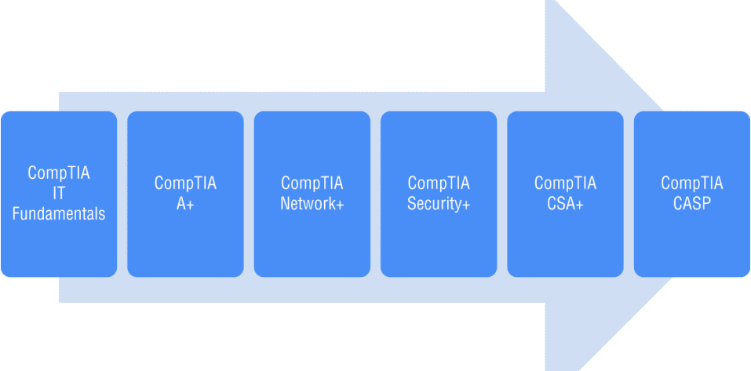

`Cybersecurity Analyst+` 考试是一项更具实操性的考试，旨在适用于具有实战经验并掌握之前考试涵盖知识的专业人士。

CompTIA 认证获得了 ISO 和 ANSI 认证，被用于多个行业作为技术技能和知识的衡量。此外，包括 `CySA+`、`Security+` 和 `CASP` 在内的 CompTIA 认证已获得美国政府批准为信息保证基准认证，并被纳入美国国务院的技能激励计划。

# Cybersecurity Analyst+ 考试

CompTIA 将 `Cybersecurity Analyst+` 考试称为 `CySA+`，该考试旨在为网络安全、威胁和漏洞分析师提供一种厂商中立的认证。`CySA+` 认证专为安全分析师、工程师以及安全运营中心 (`SOC`) 人员、漏洞分析师和威胁情报分析师设计。它侧重于安全分析以及安全工具在真实场景中的实际应用。它涵盖五个主要领域：威胁与漏洞管理、软件和系统安全、安全运营与监控、事件响应和合规性评估。这五个领域包含了从侦察到事件响应和取证的一系列主题，同时重点侧重于基于场景的学习。

`CySA+` 考试位于初级 `Security+` 和 CompTIA 高级安全从业者 (`CASP`) 认证之间，为那些寻求认证和职业路径下一步的人士提供一份中级职业认证。

`CySA+` 考试采用 CompTIA 称为“基于性能的评估”的形式进行。这意味着考试使用实际的安全工具和场景进行实操模拟，以执行与安全从业人员日常工作相匹配的任务。考试题可能包括多种类型的题目，如单选题、填空题、多选题、拖放题和基于图像的问题。

CompTIA 建议测试者在考试前具有四年的信息安全经验。考试费用在美国为 359 美元，其他地区的费用相异。有关 `CySA+` 考试及如何参加考试的更多信息请访问 `certification.comptia`。

# 学习与考试技巧

在参加考试之前，像这样的测试准备无法教导你，除非你已经熟悉该主题。CompTIA 建议使用以下资源准备 `CySA+`。额外的考试资源包括：

- `Exploit.com` 提供机器和挑战。
- `Hacking.com` 提供订阅。
- `PentesterLab.com` 提供访问。
- `InfoSecInstitute.com` 提供在线活动。

当你完全准备好参加考试时，访问 CompTIA 网站查找你想参加考试的地方并安排时间。

# 参加考试

既然你已经知道了在哪里参加考试，只需设置 `Pearson VUE` 账户并安排考试：`https://www.comptia.org/testing/options/take-in-exam`

CompTIA 与 `Pearson VUE` 的测试中心合作，因此你的下一步是找到一个测试中心。在美国，你可以根据地址或邮政编码查找，而其他测试者可能会发现根据城市和国家查找更方便。你可以在 `Pearson Vue` 网站搜索附近的测试中心，你需要导航到“查找测试中心”。

考试当天，请携带两份身份证明，并确保在考试开始前提前到达。记住，你不能携带笔记、电子设备（包括手机和平手表）或其他材料进入现场。

# 考试之后

参加完考试后，你将立即收到成绩，因此你可以立即知道是否通过了考试。你应该通过考试注册记录和注册考试时使用的电子邮件地址跟踪你的成绩报告。

# 维护你的认证

CompTIA 认证必须定期续期。要续订你的认证，你可以通过通过版本的考试、获得符合要求的更高级 CompTIA 或行业认证，或者完成足够的持续教育活动以获得足够的持续教育学 (`CEUs`) 来续期。

CompTIA 通过其网站提供续期信息：`www.comptia.org/continuing-education`

注册续订认证时，将被要求同意 `CE` 计划的道德准则、支付续期费并提交所选续期方法所需的材料。

## 本书涵盖了什么？

本书旨在涵盖 `CySA` 包含的五个领域。

- **第 1 章：当今的网络安全分析师** 本书首先将教你如何评估网络安全威胁，以及如何评估和选择控制措施以确保你的网络和系统的安全。

- **第 2 章：使用威胁情报** 安全专业人员需要充分理解威胁，以防止它们或限制其影响。在本章中，你将学习许多类型的威胁情报，包括评估特定威胁情报源的关联性和准确性的来源和方法。你还将发现如何在你的组织中使用威胁情报。

- **第 3 章：侦察与情报收集** 收集有关组织及其系统的信息是攻击者和防御者都会做的事情之一。在本章中，你将学习如何使用流行的工具和技术获取有关组织的情报。你还将学习如何限制针对你所在组织的情报收集产生的影响。

- **第 4 章：设计漏洞管理计划** 管理漏洞有助于保持你的系统安全。在本章中，你将学习如何使用定义良好的工作流和持续评估方法来识别、排序和修复漏洞。

- **第 5 章：分析漏洞扫描** 报告可能包含大量关于系统潜在问题的数据。在本章中，你将学习如何阅读和分析漏洞扫描报告、`CVSS` 评分是什么及其含义，以及如何选择适当的操作来修复你发现的问题。在此过程中，你将探索常见的漏洞类型及其对系统和网络的影响。

## 第 6 章：云安全

云计算的广泛采用极大地影响了网络安全分析师的工作，他们现在必须理解如何收集、关联和解释来自许多不同云源的信息。在本章中，你将学习云计算如何影响业务，以及你如何如何在云中进行威胁管理。

# 第 7 章：基础设施安全与控制

强大的安全架构需要分层的安全程序、技术和流程来提供深度防御，确保单点故障不会导致整体性失败。在本章中，你将学习如何设计分层安全架构，以及如何分析安全设计是否存在缺陷，包括单点故障和漏洞。

## 第 8 章：身份与访问管理安全

我们依赖身份来验证和授权用户、服务和系统，身份是深度防御架构中的关键层级。本章解释了身份、身份验证和授权的概念及系统。你将学习身份和身份系统的主要威胁，以及如何将身份作为防御层使用。

## 第 9 章：软件与硬件开发安全

从简单的脚本到复杂的应用程序，创建、测试和维护安全软件对于安全分析师至关重要。在本章中，你将学习软件开发生命周期，包括不同的方法、测试和审查技术以及如何创建安全软件。此外，你将学习安全软件的行业标准，为你提供帮助保护应用程序和服务的所需的基础。你还将学习用于保护组织内硬件的工具和技术，包括硬件保证的最佳实践。

## 第 10 章：安全运营与监控

对整个组织的系统、设备和事件进行监控可能是一项艰巨的任务。安全日志可以是安全分析师极具价值的资源，允许检测误用和入侵，但它们也可能将重要信息埋在大量的运行数据中。在本章中，你将学习如何分析来自许多不同来源的数据。你将学习包括邮件头分析、事件管理系统的规则编写以及基础脚本和查询编写在的技术。

## 第 11 章：构建事件响应计划

本章重点关注构建正式的事件响应处理计划和团队。你将学习事件处理每个阶段的细节，从准备、检测和分析，到遏制、清除和恢复，最后到事后恢复，以及如何对事件进行分类和进行通信。

## 第 12 章：分析入侵指标


对事件做出恰当响应需要理解事件是如何发生的以及哪些症状可能指示事件已经发生。为了做到这一点，你还需要正确的工具和技术。在本章中，你将学习主要的症状类别。首先，你将学习网络事件，包括恶意软件信标、异常流量和链路故障，以及网络攻击。接下来，你将探索主机问题，从系统资源消耗问题到恶意软件防御和未经授权的更改。最后，你将学习与服务和应用程序相关的问题。

## 第 13 章：执行取证分析

作为事件的一部分，理解系统、设备或网络上发生了什么，通常涉及分析。在本章中，你将学习如何使用工具和技术进行取证分析。

## 第 14 章：遏制、清除与恢复

一旦确定了事件，就可以开始恢复阶段。在本章中，你将学习如何处理遏制、清除恶意软件和其他问题，并从中恢复。

## 第 15 章：风险管理

在本章中，我们观察网络安全的全局。我们如何评估和管理风险，以确保我们将有限的时间和资金花在效果最大的控制措施上？

## 第 16 章：策略与合规

策略提供了任何网络安全计划的基础，建立一套有效的策略对于计划成功至关重要。在本章中，你将获得行业最佳实践。

### 附录 A：练习考试

一旦你完成学习，练习考试将为你提供测试知识的机会。使用此考试来发现你可能需要更多学习的地方，或验证你已准备好应对考试。

### 附录 B：复习题和练习考试答案

附录包含了你在每章末尾看到的复习题的答案，以及附录 A 中练习考试的答案。

### 附录 C：实验练习答案

此附录包含了你在每章末尾看到的实验练习的答案。

### 学习指南要素

本学习指南使用了常用元素来帮助你准备。这些包括：

- **摘要 (Summaries)**：每章的摘要部分简要解释了该章节，让你能够轻松理解其涵盖的内容。

- **考试要点 (Exam Essentials)**：考试要点关注于主要的考试主题以及你应该带入考试的关键知识。考试要点关注于 CompTIA 提供的考试目标。

- **复习题 (Review Questions)**：每章末尾的一系列问题将帮助你根据对该章节主题的了解来评估你的知识以及是否已准备好考试。

- **实验练习 (Lab Exercises)**：文字实验提供了更深入的实践机会，以扩展你的技能，并为网络安全分析师考试中的性能测试做好准备。

**考试备注 (Exam Note)**：这些特殊备注指出了考试中出现的问题并与 CySA+ 考试目标直接相关。它们帮助你准备“为什么”和“如何做”。

本书附带许多额外的学习工具帮助你准备考试。它们包括：

访问 `www.wiley.com/go/Sybextestprep` 注册并访问此交互式在线学习环境以及带有学习工具的题库。

-   [费曼学习法](https://wiki.example.org/feynmans_learning_method)的灵感源于诺贝尔物理奖获得者`理查德·费曼`。

1.  运用费曼技巧，你只需花上`20 min`就能深入理解知识点，而且记忆深刻，*难以遗忘*。

```
if (condVar > someVal) {console.log("xxx")}
```

| 网络名称 | 描述 |
|---|---|
| NAT 网络 | 通过受保护的 NAT 将虚拟机连接到您的真实网络。在受保护的网段上连接虚拟机和其他虚拟机，该网段也会通过 NAT 映射到您的真实网络 |
| 桥接 (Bridged) | 将虚拟机直接连接到您的实际网络（可能允许其获取 DHCP 地址、被扫描或让您远程连接到它） |
| 内部网络 (Internal) | 将虚拟机连接到仅存在于虚拟机的网络 |
| 仅主机 (Host Only) | 将虚拟机连接到仅允许其作为虚拟机主机的网络 |

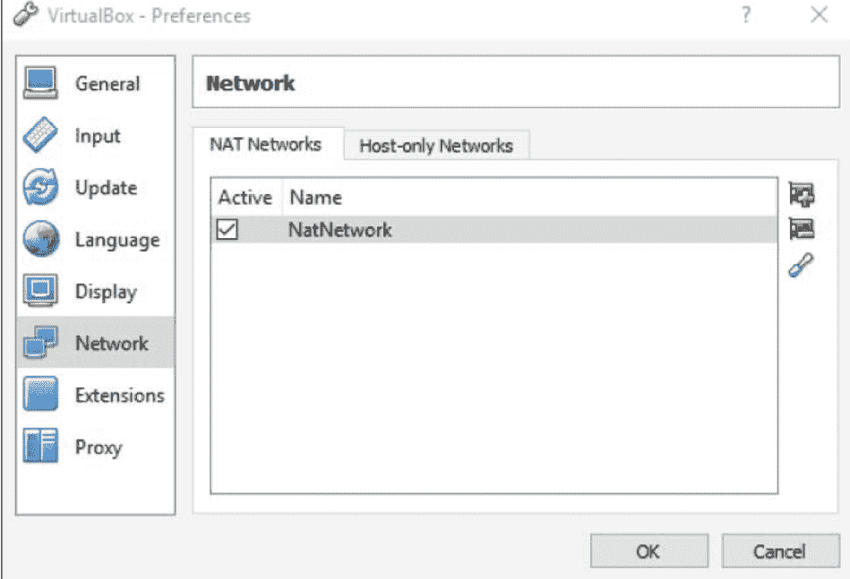


如果您不习惯虚拟机具有出站网络访问权限，认为您可能会对它们进行某些危险操作，或者想避免任何其他潜在问题，您应该将两个虚拟机都设置为使用“内部网络”。

- 5. 一旦 NAT 网络存在，您可以通过点击虚拟机，然后点击 VirtualBox 界面中的设置齿轮图标将两台机器设置为使用它。从那里点击“网络”，并将网络适配器连接到您刚刚设置的 NAT 网络。见图 I.4。

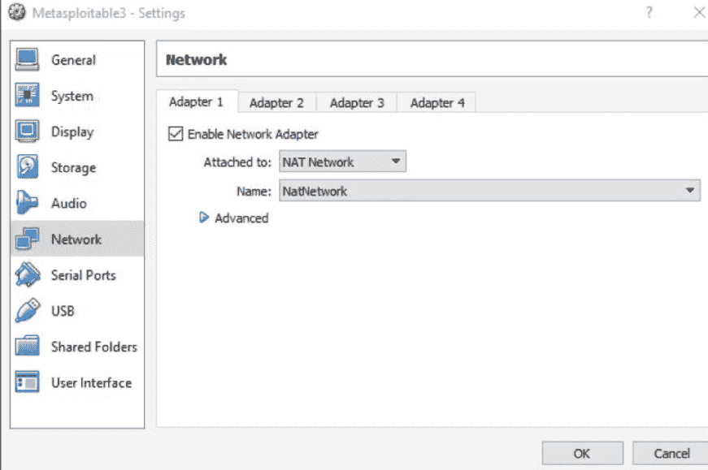

6. 现在一切就绪了！您可以启动两台机器并测试它们是否可以互相看到。要做到这一点，只需登录 Metasploitable 虚拟机并运行 `ifconfig` 来查找其 IP 地址。使用 `ssh [ip address] -l msfadmin` 从 Kali Linux 系统连接到 Metasploitable 系统。如果您连接成功并可以登录，就准备好在两个系统之间运行练习了！

## 评估测试

如果您正在考虑参加网络安全分析师+ (Cybersecurity Analyst+) 考试，您应该已经参加并通过了 CompTIA Security+ 和 Network+ 考试，并且应该在该领域拥有四年的经验。以下评估测试有助于确保您在应对网络安全分析师+ 认证之前具备应有的知识，并帮助您确定可能想在这本书上花费最多时间的地方。

- 1. 在对一个系统运行 `nmap` 扫描后，您收到的数据显示以下三个端口处于开放：

D. FTP, HTTPS, MS-SQL

D. whois

B. 汇洞 (sinkhole)

D. 暗网 (darknet)

D. 外部视图 (External view)

D. 可用性 (Availability)

```
CVSS:3.0/AV:N/AC:H/PR:N/UI:N/C:H/I:H/A:H
```

C. 信息被访问

C. NetFlow

D. Tap

- 12. Abdul 的监控检测到一个怀疑被入侵的系统的异常流量。这是什么？

C. 网络监狱 (Network jail)

D. VLAN

C. 擦除并重建系统

C. SOX

本章涵盖的 CompTIA 网络安全分析师 (CYSA+) 考试大纲包括：

- 领域 3.0：安全运营与监控

  - 3.4 比较并对比自动化概念与技术。

  - 机器学习

- 领域 5.0：合规性与评估

  - 5.1 理解数据隐私和保护的重要性。

  - 隐私 vs 安全

网络安全分析师负责保护组织所使用的信息和系统的机密性、完整性和可用性。履行这一责任需要对信息安全采取深度防御方法，通过使用多个、重叠的安全控制措施来实现各项网络安全目标。这还要求分析师对组织面临的威胁环境有深入理解，以便制定一套能够应对并解决这些威胁的控制措施。

在本章的第一节中，你将学习如何评估组织面临的网络安全威胁，并确定它们对运营的机密性、完整性和可用性构成的风险。在随后的章节中，你将学习可以部署的控制措施来保护网络和终端，并评估这些控制措施随时间推移的有效性。

当大多数人想到网络安全时，他们会想象黑客试图侵入组织系统并窃取敏感信息，范围从社会安全号码、信用卡到机密军事信息。虽然保护敏感信息免受未经授权的泄露无疑是网络安全计划的一个元素，但重要的是理解网络安全实际上有三个互补的目标，如图 1.1 所示。

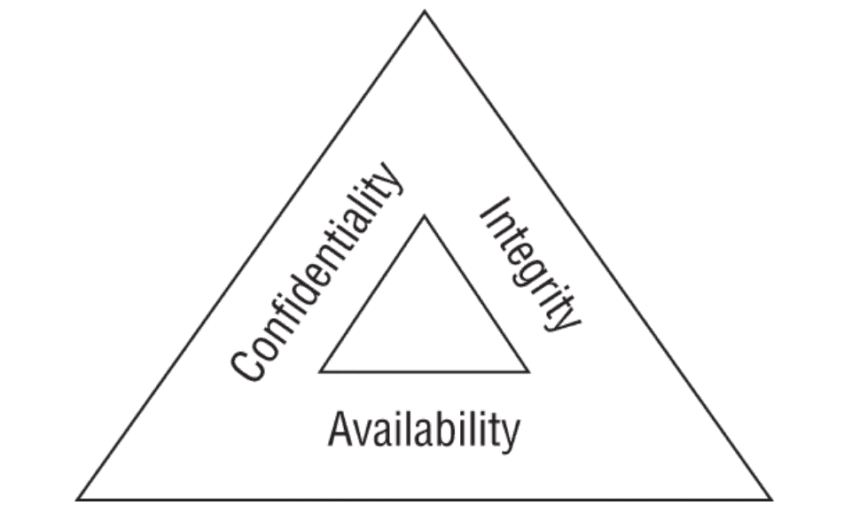

机密性确保未经授权的个人无法访问敏感信息。网络安全人员开发并实施安全控制措施，包括防火墙、访问控制列表和加密，以防止信息的未经授权访问。攻击者可能会试图破坏机密性控制以实现其目标之一：敏感信息的未经授权泄露。

完整性确保信息或系统不会发生故意或无意的未经授权修改。

完整性控制措施（如哈希处理和完整性监控解决方案）旨在执行这一要求。完整性威胁可能来自寻求未经授权更改信息的攻击者，或来自非恶意来源（例如电压激增导致的信息损坏）。

可用性确保信息和系统在合法用户请求时随时准备好满足其需求。可用性控制措施（如容错、聚类和备份）旨在确保合法用户可以根据需要获得访问。与完整性威胁类似，可用性威胁可能来自试图中断访问的攻击者，或来自非恶意来源（例如火灾摧毁了含有价值信息或服务的数据中心）。

隐私和安全是密切相关的概念。我们刚刚讨论了安全的主要组成部分：机密性、完整性和可用性。这些目标都关注组织保护其自身数据的方法。机密性保护数据免受未经授权的泄露；完整性保护数据免受未经授权的修改；可用性保护数据免受未经授权的拒绝。

隐私控制措施有不同的侧重点。隐私不是关注组织保护自身信息的方法，而是关注组织如何使用和共享其收集的关于个人的信息。这些数据被称为`个人身份信息 (PII)`，通常受监管标准的保护，并始终受伦理考量的制约。

组织寻求保护隐私信息的安全性，并可以使用与保护其他类别敏感信息相同的安全控制措施，但隐私义务超了安全的范畴。隐私涵盖了组织如何与他人使用和共享其收集并维护的信息。

> **注意**
>
> **考试要点**
>
> 请记住，隐私和安全是互补且重叠的，但它们有不同的目标。这是考试中的一个重要概念。

- **管理**：认为组织应该在隐私政策和相关文档中记录其隐私实践。

- **通知**：认为组织应该通知个人其隐私实践，并告知个人其收集的信息类型以及这些信息用途。

- **选择与同意**：认为组织在对 PII 进行存储、使用和共享时应获得个人的直接同意。

- **收集**：认为组织仅应为通知中识别的目的收集 PII。

- **使用、保留与处置**：认为组织仅应为识别的目的使用信息，不得将收集的信息用于任何其他未披露的目的。

- **访问**：认为组织应根据个人要求，提供其访问组织记录中关于该个人的任何信息的权限。

- **披露**：认为组织仅在符合通知和同意的情况下才会向第三方披露信息。

- **安全**：认为 PII 将受到保护以防止未经授权的访问。

- **质量**：认为组织将维护准确且完整的信息。

- **监控与执行**：认为组织将建立业务流程，以确保符合其隐私政策。

GAPP 原则是是构建隐私计划的强有力最佳实践。在第 16 章“政策与合规”中，我们将更详细地讨论政策，并涵盖强制某些行业和司法管辖区的公司实施隐私政策的法律要求。

网络安全风险分析是任何信息安全计划的基石。分析师必须花时间充分理解其技术环境和危及信息安全的外部威胁。全面的网络安全风险评估结合了内部和外部因素的信息，帮助分析师理解组织面临的威胁，并设计适当的控制措施来应对。

在进入风险评估的世界之前，我们必须从通用词汇开始。为了与其他风险分析师清晰交流，你必须掌握三个重要术语：漏洞、威胁和风险。

漏洞是设备、系统、应用程序或流程中的弱点，可能导致攻击发生。漏洞是网络安全专业人员可以控制的内部因素。例如，运行旧版本 Apache Web 服务器可能包含漏洞，允许攻击者对该服务器托管的网站发起拒绝服务 (DoS) 攻击，从而危及其可用性。

通过将 Apache 服务升级到不受 DoS 攻击影响的最新版本，来修复此漏洞。

**网络安全领域中的“威胁”是指可能利用漏洞的外部力量。** 例如，一个想要对网站进行 DoS 攻击并已知 Apache 漏洞的黑客就构成了明确的网络安全威胁。虽然许多威胁在本质上是恶意的，但情况并不总是如此。例如，地震可能会通过损坏包含 Web 服务器的数据中心来破坏网站的可用性。地震显然没有恶意意图。在大多数情况下，网络安全专业人员无法做很多很多事情来消除威胁。无论其意愿如何，黑客会进行黑客，地震也会随之自然地发生。

*“风险”是威胁与相应漏洞的结合。* 在一种情况对组织安全构成风险之前，这两个因素都必须存在。例如，如果一个黑客针对组织的 Web 服务器发起 DoS 攻击，但服务器已经打了补丁，不再易受受到攻击，那么即使存在威胁（黑客），由于没有漏洞，也就不存在风险。同样，一个数据中心的设计可能无法抵御地震期间的极端运动，但它可能位于全球不发生地震的地区。该数据中心可能对地震敏感，但其所在地几乎完全没有地震威胁，因此不存在风险。

风险、威胁和漏洞之间的关系是非常重要的，通常用此等式表示：

风险 = 威胁 × 漏洞

这并不是指一个实际代入数值的字面方程。相反，它是为了说明这样一个事实：只有当存在威胁以及该威胁可能利用的相应漏洞时，风险才存在。如果威胁或漏洞中任何一个为零，风险也为零。图 1.2 以另一种方式展示了这一点：风险是威胁与漏洞的交集。

组织应该定期进行风险评估，以掌握其现有的风险格局。美国国家标准与技术研究院（NIST）发布了一份风险评估的指南，该指南在整个网络安全领域广泛使用，作为风险评估的基础。这份命名为 NIST 特别出版 (SP) 800-30 的文档建议了图 1.3 所示的风险评估过程。

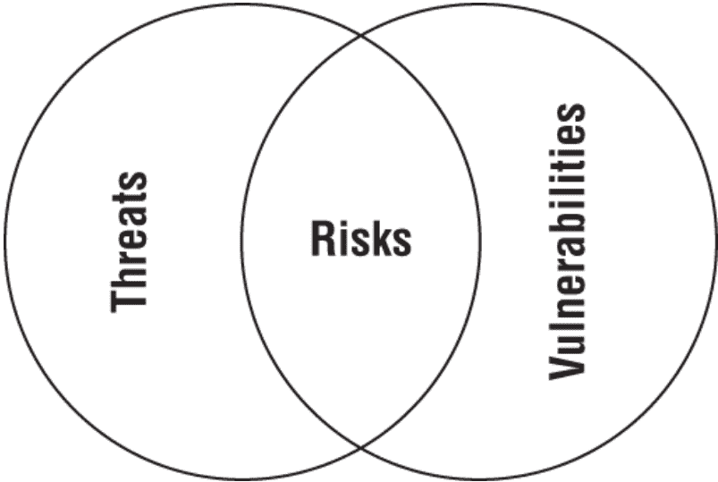

**图 1.2** 风险存在于威胁和漏洞的交集处。如果威胁或漏洞缺失其一，则不存在风险。


**图 1.3** NIST SP 800-30 风险评估过程建议组织应该识别威胁和漏洞，然后利用这些信息来确定这些威胁和漏洞结合所构成的风险水平。

来源：NIST SP 800-30

# 识别威胁

组织通过识别其威胁环境中存在的威胁类型开始风险评估过程。虽然某些威胁（如恶意软件和垃圾邮件）会影响所有组织，但其他威胁针对特定类型的组织。例如，政府资助的长期持续性威胁（APT）攻击者通常针对政府机构、军事组织以及在相关领域运营的公司。APT 攻击者不太可能针对一家小学。

NIST 识别了组织可能面临并应在威胁识别过程中考虑的四种不同类型的威胁：

- **对抗性威胁**（Adversarial threats）是指试图故意破坏组织安全的个人、团体和组织。对手可能包括信任的内部人员、竞争对手、供应商、客户、业务伙伴，甚至是国家。在评估对抗性威胁时，网络安全分析人员应考虑威胁者发起攻击的能力、威胁者的意图以及该威胁针对该组织的概率。

- **意外性威胁**（Accidental threats）发生在个人在执行日常工作时误操作执行了破坏安全的行动时。例如，系统管理员可能会删除一个关键磁盘卷，导致可用性丢失。在评估意外性威胁时，网络安全分析人员应考虑该威胁对组织可能产生的影响范围。

- **结构性威胁**（Structural threats）发生在设备、软件或环境控制由于资源耗尽（如燃料耗尽）、超过其运行能力（如在极端高温下运行）或因年龄过久而故障时。在评估结构性威胁时，网络安全分析人员应考虑该威胁对组织可能产生的影响范围。

- **环境性威胁**（Environmental threats）发生在组织控制之外的自然或人为灾害发生时。这些可能包括火灾、洪水、严烈风暴或电信中断。在评估环境性威胁时，网络安全分析人员应考虑考虑该威胁对组织可能产生的影响范围。

## 内部威胁

在进行威胁分析时，网络安全专业人员必须记住威胁既来自外部也来自内部。除了黑客之外，自然灾害、不满的员工和无能力的管理员也构成了重大威胁。当组织设计控制措施时，必须考虑内部和外部威胁。


NIST SP 800-30 提供了大量的额外信息帮助组织进行风险评估，包括与这些步骤相关的相关的详细任务。这些信息不在网络安全 (CySA+) 考试的范围内，但准备进行风险评估的组织应该下载并阅读整个出版物。你可以在 `csrc.nist.gov/publications/detail/sp/800-30/rev-1/final` 处获取。

## 识别漏洞

在风险评估的威胁识别阶段，网络安全分析人员关注可能影响组织的外部因素。在完成威胁识别后，评估的重点转向内部，识别这些威胁可能利用的漏洞。

本书的第四章“设计漏洞管理计划”和第五章“分析漏洞扫描”重点讨论了漏洞的识别和管理。

## 确定可能性、影响和风险

在识别了组织面临的威胁和漏洞后，风险评估人员随后会对企业信息和系统的机密性、完整性和可用性构成风险的威胁与漏洞进行组合。这需要评估风险发生的可能性以及风险对组织产生的影响。

在确定风险发生的可能性时，分析人员应考虑两个因素。首先，他们应该评估威胁源引发风险的概率。对于对抗性威胁源，这是对手对组织发起攻击的概率。对于意外性、结构性或环境性威胁，它是威胁发生的概率。贡献于可能性的第二个因素是，如果风险发生，考虑到这些这些标准的状态，它实际上对组织产生负面影响的概率。风险评估人员分配一个整体的可能性等级。这可以使用类别（如“低”、“中”和“高”）来定性地描述这种可能性。

在评估了风险发生的概率和影响后，风险评估人员会将这两项评估结果相结合，以确定整体风险等级。这可能简单地使用一个类似于[图 1.4](#)中所示的矩阵，该矩阵描述了组织如何为风险分配总体评分。例如，一个组织可能决定黑客攻击发生的概率为中等，而影响为高。在[图 1.4](#)中查阅这种组合可以发现，它应该被视为高风险整体风险。同样，如果一个组织评估洪水发生的概率为中等，影响为低，那么洪水情景的整体风险就是低。

| 概率 \ 影响 | 低 | 中等 | 高 |
|---|---|---|---|
| 高 | 中等 | 高 | 高 |
| 中等 | 低 | 中等 | 高 |
| 低 | 低 | 低 | 中等 |

影响

图 1.4 许多组织使用风险矩阵，根据概率评估和影响评估来确定整体风险等级。

## 审查控制措施

网络安全专业人员使用风险管理策略，如风险接受、风险规避、风险缓解和风险转移，来降低在风险评估期间识别出的风险的概率和影响。组织管理安全风险的最常见方法是开发一套技术和操作控制措施，将这些风险降低到可接受的水平。

技术控制是用于执行机密性、完整性和/或可用性要求的系统、设备、软件和设置。技术控制的示例包括构建安全网络和实施端点安全，这两个主题将在本章的稍后部分讨论。操作控制措施是能够加强网络安全的安全的实践和程序。操作控制措施的示例包括进行渗透测试以及使用反向工程分析获取的软件。这两个主题也将在本章稍后部分讨论。

## 构建安全网络

对组织网络安全的许多威胁利用了组织网络中的漏洞来获取对系统和信息的初始访问。为了帮助缓解这些风险，组织应该专注于构建安全的网络以将攻击者隔之门外。组织可能用于协助构建安全网络的控制措施示例包括：网络访问控制（NAC）解决方案；网络边界安全控制（如防火墙）；网络分段以及将欺骗作为防御措施的使用。

## 网络访问控制


# 网络访问控制

大多数组织设立的基本安全目标之一是控制对组织网络的访问。网络访问控制（NAC）解决方案帮助安全专业人员实现两个网络安全目标：限制授权人员的网络访问，并确保访问组织网络的系统符合基本安全要求。

## 802.1x 协议

`802.1x` 协议是用于 NAC 的常用标准。当新设备想要接入网络时（无论是通过连接无线接入点还是插入有线网络端口），网络都会要求该设备使用 `802.1x` 协议进行身份验证。一种称为“客户端”的特殊软件位于请求加入网络的设备上。客户端与运行在无线接入点或网络交换机上的名为“验证器”的服务进行通信。验证器本身不具备验证用户所需的必要信息，因此它通过远程访问拨号用户服务（RADIUS）协议将访问请求传递给身份验证服务器。如果用户身份验证通过并被授权访问网络，交换机或接入点将允许用户加入网络。如果用户未能成功完成此过程，该设备将被拒绝访问网络，或者可能被分配到一个特殊的隔离网络进行修复。图 1.5 显示了参与 `802.1x` 身份验证的设备。

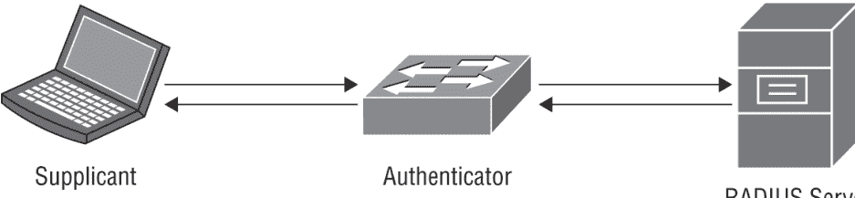

**图 1.5** 在 `802.1x` 系统中，尝试加入网络的设备运行 NAC 客户端，它与网络交换机或无线接入点上的验证器进行通信。验证器使用 RADIUS 与身份验证服务器通信。

## NAC 解决方案分类

市场上有许多不同的 NAC 解决方案，它们在两个主要方面有所不同：

- **基于代理的 vs. 无代理**：基于代理的解决方案（如 `802.1x`）要求请求访问网络的设备运行特殊软件。无代理方法在网页浏览器中进行 NAC 验证。
- **带内 vs. 带外**：带内（或内联）NAC 解决方案使用位于设备与想要访问的资源之间的专用设备来限制未通过身份验证的设备。酒店中常见的“强制门户” NAC 解决方案是带内 NAC 的示例。带外 NAC 解决方案（如 `802.1x`）利用现有的网络基础设施并与身份验证服务器通信以授予或拒绝访问。

## NAC 准入标准

NAC 解决方案通常被用于根据授权用户限制访问，但它们也可以根据其他标准做出准入决策。NAC 使用的标准包括：

- **时间**：用户可能仅在特定期间内（如工作时间内）被允许访问网络。
- **角色**：根据用户在组织中的角色将其分配到特定的网络段。例如，大学可以将教师和员工分配到管理网络，将学生分配到学术网络。
- **位置**：根据物理位置授予或拒绝访问。例如，对数据中心网络的访问可能限于位于数据中心的系统。
- **系统健康**：NAC 解决方案可以使用运行在设备上的代理获取设备的配置信息。未能符合安全标准的设备（如防火墙配置错误、病毒定义过期或缺少安全补丁）可能会被完全拒绝访问网络，或被放置在仅授予更新系统所需的有限访问的网络。


NAC 标准是一个非常重要的考点。在参加 CySA+ 考试时，你应该准备好回答有关这些标准的问题。管理员可能会根据这些特征的任何组合创建 NAC 规则。NAC 产品提供了实现组织特定网络准入安全需求所需的灵活性。

> **注意**：有时你会看到 NAC 的全写为“Network Admission Control”而不是“network access control”。在两种情况下，人们指的都是同一种通用技术。Network Admission Control 是 Cisco 对其访问控制解决方案使用的专有名称。

# 防火墙与网络边界安全

NAC 解决方案旨在管理连接到组织有线或无线网络的系统。对于试图通过物理访问设施并将设备连接物理网络来获取组织信息资源的入侵者提供了很好的保护。它们无法防止试图通过网络连接获取访问的入侵者。这就是防火墙发挥作用的地方。

网络防火墙位于网络边界处并提供边界安全。就像保安可能控制建筑的物理边界一样，网络防火墙控制电子边界。防火墙通常以图 1.6 所示的三网口方式进行配置。图 1.6 中的防火墙连接到互联网、内部网络和一个被称为非军事化区（DMZ）的特殊网络。任何从一个区域到另一个区域的流量（例如从互联网到内部网络）都必须经过防火墙。

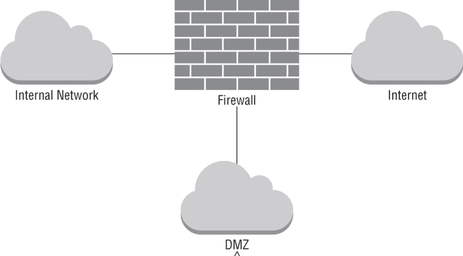

**图 1.6** 三网口防火墙连接到三个不同的网络，通常是内部网络、DMZ 和互联网。

DMZ 是一个特殊的网络区域，旨在用于接收来自外部世界连接的系统，例如 Web 服务器和电子邮件服务器。良好的防火墙设计会将这些系统放置在隔离的网络中，这样即使它们被攻破，对内部网络的威胁也很小，因为 DMZ 与内部网络之间的连接必须通过防火墙，并受其安全策略的限制。

每当防火墙接收到连接请求时，都会根据规则库对其进行评估。该规则库是一个访问控制列表 (ACL)，用于识别允许通过防火墙的流量类型。防火墙使用的规则通常指定流量的源和目的 IP 地址以及与授权服务对应的目的端口。常用端口列表见表 1.1。防火墙遵循默认原则，即如果没有显式允许连接的规则，防火墙将拒绝该连接。

## 表 1.1 常见 TCP 端口

| 端口 | 服务 |
|---|---|
| 20,21 | FTP |
| 22 | SSH |
| 23 | Telnet |
| 25 | SMTP |
| 53 | DNS |
| 80 | HTTP |
| 110 | POP3 |
| 123 | NTP |
| 143 | IMAP |
| 389 | LDAP |
| 443 | HTTPS |
| 636 | LDAPS |
| 1443 | SQL Server |
| 1521 | Oracle |
| 1720 | H.323 |
| 1723 | PPTP |
| 3389 | RDP |

## 防火墙类型

如今市场上有几类防火墙，它们的价格和功能各不相同：

- **包过滤防火墙**仅根据防火墙规则检查每个数据包的特征，而不任何额外的智能。包过滤防火墙的能力通常位于路由器和其他网络设备中，是非常基础的防火墙。
- **状态检测防火墙**超越了包过滤器，并维护通过防火墙的每个连接的状态信息。这些是作为独立产品出售的最基础的防火墙。
- **下一代防火墙 (NGFW)** 在其决策过程中整合了更多信息，包括关于用户、应用程序和业务流程的上下文信息。它们是目前网络防火墙保护的最先进技术，与状态检测设备相比价格相对昂贵。
- **Web 应用防火墙 (WAF)** 是专门设计的防火墙，用于防止 Web 攻击，例如 SQL 注入和跨站脚本。WAF 将在第 10 章“安全运营与监控”中进行更详细的讨论。

# 网络分段

防火墙使用称为“网络分段”的原理将不同安全级别的网络相互隔离。这一原则显然适用于图 1.6 所示的示例，其中内部网络、DMZ 和互联网都具有不同的安全级别。同样的原理也可以用于将内部网络进一步划分为不同的信任区域。

例如，想象一个组织拥有数百名员工和一个位于其公司总部的大型数据中心。该数据中心可能容纳许多敏感系统，例如包含敏感员工信息、业务计划和其他关键信息资产的数据库服务器。公司网络可能容纳员工、临时承包商、访客以及其他未完全信任的人员。在这个常见示例中，安全专业人员希望分段数据中心网络，使其无法被公司网络上的系统直接访问。这可以通过防火墙实现，如图 1.7 所示。

图 1.7 所示的网络使用了三网口防火墙，正如图 1.6 中用于控制与互联网的网络边界的那样。其概念是相同的，区别在于在这种情况下防火墙正在保护数据中心边界免受受信任程度较低的公司网络的侵害。

注意，图 1.7 中的网络还包含一个带有名为“跳板机”的服务器的 DMZ。该服务器的目的是作为公司网络和数据中心网络之间的安全转换点，在两者之间提供一条受信任的路径。需要访问数据中心的系统管理员不应直接连接，而应该使用安全外壳 (SSH)、远程桌面协议 (RDP) 或类似的远程管理协议访问跳板机。跳板机还可以用作隔离层，以防止仅被部分信任的系统。例如，如果你有承包商将设备带入你的网络，或者员工自带个人设备，你可能使用跳板机来防止这些系统直接连接到公司的系统。

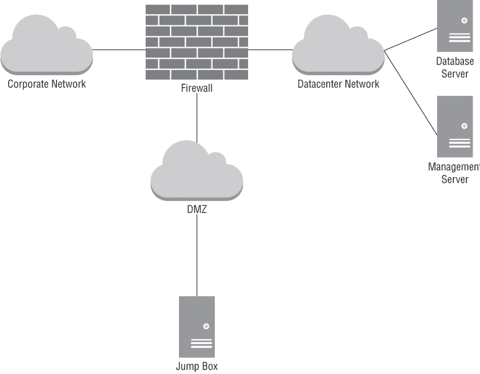

**图 1.7** 三网口防火墙也可用于隔离不同信任级别的内部网络分段。

# 欺骗性防御

网络安全专业人员可能希望超越典型的安全控制，采取主动防御措施，实际上诱导攻击者进入特定目标，并试图在仔细控制的环境中监控他们的活动。

## 蜜罐

蜜罐 是一种设计的系统，由于其运行的服务、包含的漏洞或看似托管的敏感信息，在攻击者看来是丰利的目标。事实是，蜜罐是由专家设计的，伪装成脆弱状态以欺骗恶意分子尝试攻击。当攻击者试图攻破蜜罐时，蜜罐会模拟攻击成功，然后监控攻击者的活动以进一步了解其意图。蜜罐还可以用于填充网络黑名单，阻止来自任何攻击蜜罐的 IP 地址的所有入站活动。

## DNS 汇洞

DNS 汇洞 为进入企业网络的恶意软件提供虚假信息。当受感染的系统尝试从 DNS 服务器获取其命令与控制服务器的信息时，DNS 服务器会检测到可疑请求，并不是响应正确答案，而是响应一个旨在检测和修复受僵尸网络感染系统的汇洞系统的 IP 地址。

# 安全端点管理

笔记本电脑、台式电脑、平板电脑、智能手机和其他终端设备是网络上安全威胁的持续源头。这些系统与最终用户直接交互，需要仔细的配置管理，以确保它们保持安全，且不会成为企业网络安全漏洞的入口点。幸运的是，通过采取一些简单的安全措施，技术人员可以保护这些设备免受大多数攻击。

## 系统配置加固

操作系统是极其复杂的软件，旨在执行成千上万不同的功能。构成现代操作系统的庞大代码库是漏洞的频繁来源，正如操作系统供应商频繁发布安全补丁证明的那样。

系统管理员保护终端最重要的方法之一是对其配置进行加固，使其尽可能地抵抗攻击。这包括禁用终端上任何不必要的服务或端口，以减少其受攻击性，确保设备上存在安全的配置设置，并集中控制设备安全设置。

# 补丁管理

系统管理员必须确保其负责的所有操作系统和应用程序都处于最新的安全补丁水平。一旦厂商发布安全补丁，攻击者可能已经获知了漏洞，并可能立即攻击易受影响的系统。组织等待应用安全补丁的时间越长，他们成为攻击受害者的可能性就越大。尽管如此，企业在将补丁部署到生产系统和网络之前，始终应该对其进行测试。

幸运的是，补丁管理软件可以轻松地在整个企业范围内集中分发并监控各个系统的补丁水平。例如，微软的系统中心配置管理器（SCCM）允许管理员快速查看企业系统的补丁状态，并修复任何缺失补丁的系统。

## 补偿控制

在某些情况下，由于技术、运营或财务原因，安全专业人员可能无法实施所有预期的安全控制。例如，由于与 POS 软件不兼容，组织可能无法升级零售销售点（POS）终端上的操作系统。在这些情况下，安全专业人员应该寻求设计为通过替代手段提供类似水平安全保护的补偿控制措施。在 POS 示例中，管理员可能会将 POS 终端放置在分段且隔离的网络中，并使用入侵预防系统监控网络流量，以发现任何利用未修补漏洞的尝试并阻止其到达受影响的主机。这实现了保护 POS 终端免受侵害的目标，并作为补偿控制。

## 组策略

组策略为管理员提供了一种高效的方法，用于在大量设备上管理安全和其他系统配置设置。微软的组策略对象（GPO）机制允许管理员定义一组安全设置，然后将这些设置应用于企业中的所有系统或基于角色的系统组。

例如，图 1.8 显示了一个用于强制工作站 Windows 防火墙设置的 GPO。该 GPO 配置为要求使用 Windows 防火墙并阻止所有入站连接。

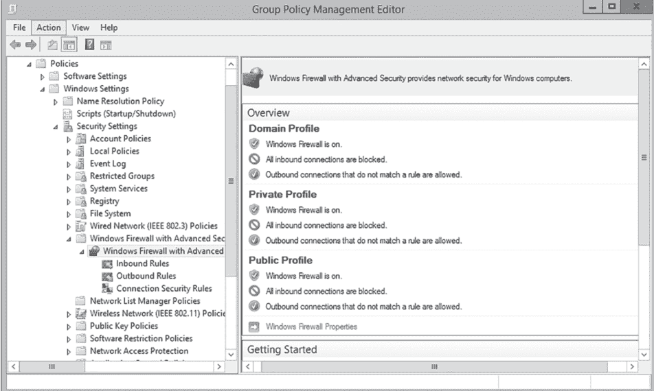

**图 1.8** 组策略对象（GPOs）可同时向不同的系统应用设置。

管理员可以使用 GPOs 控制各种 Windows 设置，并创建适用于不同类别系统的的不同策略。

## 终端安全软件

终端系统还应该运行专门的安全软件，以实施组织的安全目标。至少，这应该包括防病毒软件，该软件设计用于扫描系统是否存在可能危及终端安全的恶意软件迹象。管理员还可以选择安装基于主机的防火墙软件，作为该独立系统的基础防火墙，以补充网络防火墙控制或阻止可疑网络活动的主机入侵预防系统（HIPSs）。终端安全软件应向集中管理系统报告其状态，允许安全管理员从单点位置监控整个企业。

## 强制访问控制

在高度安全的环境中，管理员可能会选择实施强制性访问控制（MAC）安全方法。在 MAC 系统中，管理员设置所有安全权限，终端用户无法修改这些权限。这与大多数现代操作系统中发现的裁量访问控制（DAC）模型形成对比，在 DAC 模型中，文件或资源的所有者控制该资源的权限，并可以根据自己的意愿授权这些权限。

MAC 系统非常难以管理，因此在极敏感的政府和军事应用之外很少使用。安全增强型 Linux（SELinux）是由美国国家安全局开发的操作系统，它是执行强制访问控制的系统示例。

# 渗透测试

网络安全分析师不仅负责设计和实施安全控制，还负责监控这些控制的持续有效性。渗透测试是他们履行这一义务的技术之一。在渗透测试期间，测试人员使用与真实攻击者相同的信息、工具和技术对组织进行模拟攻击。他们试图获取系统和信息的访问权限，然后向管理层报告他们的发现。渗透测试的结果可加强组织的安全控制。

渗透测试可以由组织的内部人员或外部顾问进行。对于内部测试，它们需要高技能的人员且非常耗时。外部测试缓解了这些问题，但通常执行成本很高。尽管渗透测试存在这些障碍，组织也应定期进行，因为设计良好且执行良好的渗透测试是衡量组织安全状况的最佳措施之一。

NIST 将渗透测试分为图 1.9 所示的四个阶段。

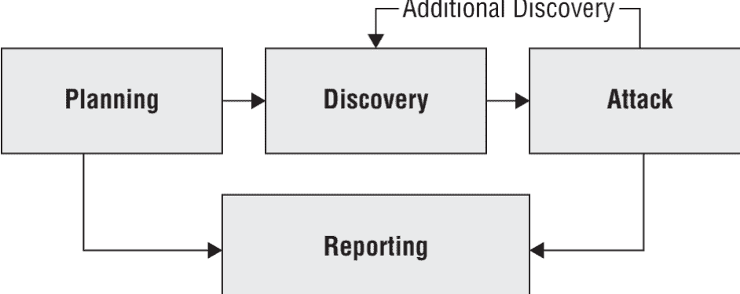

**图 1.9** NIST 将渗透测试分为四个阶段。

来源：NIST SP 800-115：信息安全测试技术指南

## 规划阶段

渗透测试的规划阶段为测试奠定了行政基础。规划阶段不执行技术工作，但是任何渗透测试的关键组成部分。规划阶段需要确定三个重要的参与规则：

- **时机**：测试将在何时进行？技术人员是否会获知测试？能否安排时间使对业务运营的影响降至最低？
- **范围**：渗透测试定义的范围是什么？是否有任何系统、网络、人员或业务流程是测试人员禁止的？
- **授权**：谁授权进行渗透测试？如果测试人员被注意到可疑活动的员工或其他人员发现，他们应该如何做？

这些细节具有行政性质，但事先通过书面达成共识是非常重要的，以避免在测试期间和之后出现问题。


> **警告**：你绝不要在没有许可的情况下进行渗透测试。未经授权的测试不仅是不道德的，还可能是违法的。

## 执行发现

渗透测试的技术工作始于发现阶段，攻击者在此阶段侦察并收集尽可能关于目标网络、系统、用户和应用程序的信息。这可能包括对可用材料进行审查、对系统进行端口扫描、使用网络漏洞扫描器和 Web 应用测试器探测漏洞，以及进行其他信息收集。

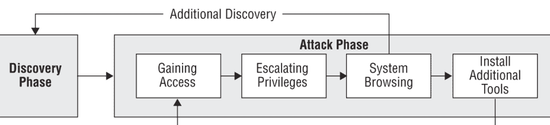

| 发现阶段 | 获取访问权限 | 提升权限 | 系统浏览 | 安装额外工具 |
|---|---|---|---|---|
| 在发现阶段已收集了足够的数据，以便对目标进行明智访问尝试 | 如果上一步仅获得了用户级访问权限，测试人员现在将寻求获得系统的完全控制权（管理员级访问） | 再次开始信息收集过程，以识别访问其他系统的机制 | 安装额外的渗透测试工具或获取额外信息，或两者兼顾 |

**图 1.10** 渗透测试的攻击阶段采用循环过程，先建立立足点，然后利用该点扩大在目标组织内的访问范围。

来源：NIST SP 800-115：信息安全测试与评估技术指南

> **注意**：
>
> **考试笔记**
>
> 渗透测试的攻击阶段也称为利用阶段。考试中引用测试执行、攻击阶段和利用阶段的问题均指代同一内容。

## 渗透测试结果汇报

渗透测试结束后，测试人员会准备一份详细报告，说明他们所实现的访问权限以及为了获得这些访问而利用的漏洞。渗透测试的结果是宝贵的安全规划工具，因为它们描述了攻击者可能利用以获取网络访问的实际漏洞。渗透测试报告通常包含详细的附录，其中包含各种测试的结果，并可能与负责问题的系统管理员共享。

# 培训与练习

除了执行渗透测试外，一些组织还会选择运行攻防演习，在网络防御场景下让安全专业人员团队相互对战。这些练习通常在模拟环境中进行，而非生产网络，并旨在通过让他们接触攻击者使用的工具和技术，来提高双方安全专业人员的技能。大多数网络安全攻防演涉及三个团队：

- **红队**充当攻击者角色，使用侦察和利用工具尝试访问受保护的网络。红队的工作类似于渗透测试期间测试人员的工作。
- **蓝队**负责保护目标环境，通过构建、维护和监控一套全面的安全控制措施将红队隔在之外。
- **白队**协调练习并担任裁判，裁决团队之间的争议，维护技术环境并监控结果。

网络安全攻防演习可以是教育安全专业人员掌握现代攻防策略的有效方法。

# 逆向工程

在许多情况下，供应商不会发布硬件和软件工作原理的细节。当然，恶意软件作者也不会向世界解释他们的工作。在这些情况下，安全专业人员可能对其环境的安全性一无所知。逆向工程是一种通过从成品反推以确定其工作原理的技术。安全专业人员有时使用逆向工程来学习可疑软件的内部机制，或检查硬件的完整性。逆向工程使用一种被称为“分解”的哲学，逆向工程师从成品开始，逐步追溯到其组件部分。

## 隔离与沙箱

现代组织安全面临的最危险威胁之一是 APT 攻击者开发的定制恶意软件，他们创建了专门用于渗透单一目标的特殊工具。由于这些工具从未被使用过，传统的杀毒软件使用的签名检测技术无法发现它们。

沙箱是一种基于行为而非签名来检测恶意软件的方法。沙箱系统监控系统和网络中的未知代码段，当它们检测到以前未见过的应用程序时，会将代码立即隔离在一个名为“沙箱”的特殊环境中，在这些环境中代码无法访问任何其他系统或应用程序。沙箱解决方案执行代码并观察其行为，检查它是否开始扫描网络中的其他系统、收集敏感信息、与命令与控制服务器通信，或执行任何其他潜在的恶意活动。

如果沙箱解决方案识别出组织网络中的异常行为，它将阻止代码进入并将其标记供管理员审核。这一过程也称为代码引爆，是一种根据观察到的软件行为采取行动的自动化逆向工程示例。

## 软件逆向工程


在大多数编程语言中，开发者使用人类可读的语言（如 `C/C++`、`Java`、`Ruby` 或 `Python`）编写软件。

根据编程语言的不同，计算机可能会以两种方式之一处理这些代码。在解释型语言（如 `Ruby` 和 `Python`）中，计算机直接从源代码工作。寻求分析解释型语言编写代码的逆向工程师可以简单阅读代码，通常能很好地了解代码试图实现的目标。

在编译型语言（如 `Java` 和 `C/C++`）中，开发者使用称为编译器的工具将源代码转换为计算机可读的二进制代码。这种二进制代码通常是分发给软件用户的，检查二进制代码并确定其在做什么是非常困难的，甚至是可能的，这使得编译语言的逆向工程变得更加困难。寻求逆向编译代码的技术人员有两个选择。首先，他们可以尝试使用专用程序作为反汇编译器将二进制代码转换回源代码。然而，这个过程通常效果不好。其次，他们可以使用特殊环境并仔细监控软件对不同输入的响应，以尝试发现其内部机制。无论何种情况，逆向工程编译软件都是极其困难的。

# 软件指纹

尽管逆向工程编译代码很困难，但技术人员可以轻松检测两个编译代码是否相同，或者其中一个已被修改。**哈希**是一种分析文件并计算唯一指纹（称为消息摘要或哈值）的数学技术。使用哈希函数（如安全哈希算法 `SHA`）的分析师可以计算两个文件的哈值并比较输出值。如果哈值相同，则文件内容相同。如果哈值不同，则两个文件至少有一处不同。哈希软件将在第 13 章“取证分析与取证技术”中有更详细介绍。

# 硬件逆向工程

硬件逆向工程比软件逆向工程更加困难，因为硬件的真实性通常取决于集成电路中隐藏的代码和固件内容。虽然组织可能会对硬件进行物理检查以检测篡改，但验证硬件具有源头真实性（即来自受信任、可靠的来源）是非常重要的，因为要穷尽测试硬件太困难了。

美国政府意识到确保源头真实性的困难，并为关键国防系统运行可信代工厂计划。美国国防部（`DoD`）和国家安全局（`NSA`）认证某些公司为可信代工厂，获准为政府用途制造敏感的集成电路。寻求信誉状态的公司必须证明他们完全保护了生产过程，包括设计、原型、包装、组装以及过程的其他元素。

寻求确定硬件功能的逆向工程师使用与处理编译软件相似的技术，特别是在观察行为方面。在受控环境中运行硬件并观察其对不同输入的响应，可以为硬件执行的功能提供线索。逆向工程师还可能尝试从原始设备制造商（`OEM`）获取文档，以获得对硬件组件如何运行的见解。

# 攻破思科路由器

根据爱德华·斯诺登发布的 `NSA` 文件，美国政府已对旨在绕过安全设计的硬件进行了逆向工程。

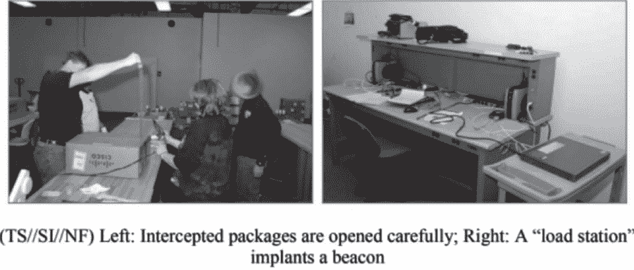

来源：eff.org 的《Spiegel 供应链拦截：隐蔽技术破解了其最难攻克的的目标》，采用 `CC BY 3.0 US` 许可。

在照片所示的过程中，`NSA` 员工在包裹离开工厂后、到达客户手中之前，拦截了包含思科路由器、交换机和其他网络设备的包裹。然后，他们打开包裹，并在设备中植了隐蔽固件，以便于政府进行监控。

# 网络安全分析的未来

随着我们继续开发网络安全分析能力，我们拥有的工具和技术变得日益复杂。未来网络安全分析工具最有前景的领域是继续采用机器学习技术，这些技术旨在从安全系统产生的海量信息中自动提取知识。

机器学习技术已经整合到许多安全分析工具中，根据该工具其他用户的经验提供数据的自动化分析。预计随着组织利用机器学习的力量，这些能力将继续发展，减少人类分析师进行繁重数据筛选的需求，并让他们专注于机器学习算法的输出，从而引导他们从事更有效率的工作。

## 总结

网络安全专业人员负责确保其组织维护的信息和系统的机密性、完整性和可用性。机密性（`Confidentiality`）确保未经授权的人员无法访问敏感信息。完整性（`Integrity`）确保信息或系统不会发生任何故意或无意的未经授权修改。可用性（`Availability`）确保信息和系统在用户请求时随时准备就绪满足合法用户的需求。这三个目标被称为 CIA 三要素（`CIA Triad`）。

当网络安全分析师寻求保护其组织时，他们必须评估 CIA 三要素的风险。这包括识别漏洞、识别相应的威胁，以及确定漏洞和威胁组合产生的风险水平。分析师随后必须评估每个风险并确定适当的管理策略来减轻或处理风险。他们可以使用机器学习技术来协助这项工作。

网络安全分析师使用旨在降低风险发生或影响的安全控制措施来缓解风险。网络安全控制包括访问控制（`NAC`）系统、防火墙和网络分段。安全端点控制包括加固系统控制、补丁管理、组策略和端点安全软件。

渗透测试和逆向工程为分析师提供了保证，确保他们实施的缓解风险的控制措施正在正常运行。通过遵循严谨的风险分析和控制流程，分析师显著增强了其控制范围内信息和系统的机密性、完整性和可用性。

## 考试要点

了解网络安全的三个目标。机密性确保未经授权的人员无法访问敏感信息。完整性确保信息或系统不会发生任何故意或无意的未经授权修改。可用性确保信息和系统在用户请求时随时准备就绪满足合法用户的需求。

了解网络安全风险是如何通过威胁和漏洞的产生的。漏洞是设备、系统、应用程序或流程中的缺陷，可能导致攻击发生。网络安全世界中的威胁是可能利用漏洞的外部因素。

能够将网络安全威胁分类为敌性的、意外的、结构性的或环境性的。敌性威胁是试图故意破坏组织安全的个人、团体和组织。意外性威胁发生在个人在执行日常工作时误操作了损害安全的行动时。结构性威胁发生在设备、软件或环境控制因资源耗尽、超出运行能力或简单老化而失效时。环境性威胁发生在组织无法控制的自然或人为灾害发生时。

理解如何通过使用网络访问控制、防火墙和分段使网络更安全。网络访问控制（`NAC`）解决方案帮助安全专业人员实现两个网络安全目标：限制仅授权人员访问网络，并确保访问组织网络的系统符合基本安全要求。网络防火墙位于网络边界处，提供边界安全。网络分段使用隔离技术将不同安全级别的网络分开。

## 理解如何通过使用加固配置、补丁管理、组策略和端点安全软件使端点更安全。

加固配置包括禁用端点上任何不的服务以减少其受攻击性，确保设备上存在安全配置设置，并集中控制设备安全设置。补丁管理确保操作系统和应用程序不受已知漏洞的影响。组策略允许同时向许多设备应用安全设置，端点安全软件防御恶意软件和其他威胁。

## 知道渗透测试为组织提供了从攻击者视角查看安全性。

`NIST` 的渗透测试流程将测试分为四个阶段：规划、发现、攻击和报告。渗透的结果是有价值的安全规划工具，因为它们描述了攻击者可能利用以获取网络访问实际漏洞。

## 理解逆向工程技术尝试确定硬件和软件内部如何运行。

沙箱（`Sandboxing`）是一种基于行为而非特征检测恶意软件的方法。其他逆向工程技术难以执行、往往不成功且非常耗时。

## 知道机器学习技术如何促进网络安全分析。

未来网络安全分析工具最有前景的领域是继续采用机器学习技术，这些技术旨在从安全系统产生的海量信息中自动提取知识。机器学习技术已经整合到许多安全分析工具中，根据该工具其他用户的经验提供数据的自动化分析。

## 实验

## 活动 1.1：创建入站防火墙规则

在实验中，你将验证服务器上已启用 Windows Defender 防火墙，然后创建一个阻止文件和打印机共享的入站防火墙规则。

这些实验说明是为运行 `Windows Server 2019` 的系统编写的。在其他版本的 `Windows Server` 上操作非常相似，尽管服务、选项和图标的名称可能略有不同。

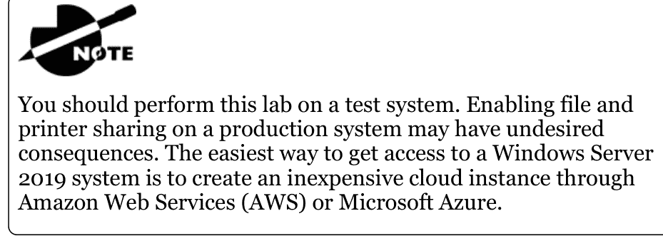

> 你应该在测试系统上执行此实验。在生产系统上启用文件和打印机共享可能会产生意外后果。获取 `Windows Server 2019` 系统的最简单方法是通过 `Amazon Web Services (AWS)` 或 `Microsoft Azure` 创建廉价的云实例。

## 第 1 部分：验证 Windows Defender 防火墙已启用

1. 打开 `Windows Server` 控制面板。
2. 选择“系统和安全”。
3. 在 `Windows Defender` 防火墙下，点击“检查防火墙状态”。
4. 验证 `Windows Defender` 防火墙状态对于“专用网络”已设置为“开启”。如果没有，请使用窗口左侧的“启用或关闭 `Windows Defender` 防火墙”链接来启用防火墙。

## 第 2 部分：创建一个允许文件和打印机共享的入站防火墙规则

1. 在 `Windows Defender` 防火墙控制面板的左侧，点击“通过 `Windows Defender` 允许应用或功能防火墙”。
2. 向下滚动应用程序列表并找到“文件和打印机共享”。
3. 勾选该项目左侧的框以阻止与文件和打印机共享相关的连接。
4. 注意到该选项右侧的“专用”框已选中。这允许同一本地网络上的其他系统使用文件和打印机共享。公共访问框应取消勾选，指定远程系统无法访问此功能。
5. 点击“确定”应用设置。

## 活动 1.2：创建组策略对象

在本实验中，你将创建一个组策略对象并编辑其内容，以实施组织的密码策略。

这些实验说明是为在 `Windows Server 2019` 系统上编写的。在其他版本的 `Windows Server` 上操作的过程非常相似，尽管服务、选项和图标的准确名称可能会有所不同。要完成此实验，你的 `Windows Server` 必须配置为域控制器。

1. 打开组策略管理控制台。（如果在 `Windows Server` 上未找到此控制台，可能是因为它未被配置为域控制器。）
2. 展开与你的 `Active Directory` 森林对应的文件夹。
3. 展开“域”（`Domains`）文件夹。
4. 展开与你的域对应的文件夹。
5. 右键点击“组策略对象”文件夹，并在弹出菜单中点击“新建”。
6. 将你的新 `GPO` 命名为“Password Policy”并点击“确定”。
7. 点击“组策略对象”文件夹。
8. 右键点击新的“Password Policy G策略”，并在弹出菜单中选择“编辑”。
9. 当组策略编辑器打开时，展开“计算机配置”文件夹。
10. 展开“策略”文件夹。
11. 展开“Windows 设置”文件夹。
12. 展开“安全设置”文件夹。
13. 展开“账户策略”文件夹。
14. 点击“密码策略”。
15. 双击“密码最大年龄”。
16. 在弹出的窗口中，勾选“定义此策略设置”复选框，并将过期值设置为 90 天。
17. 点击“确定”关闭窗口。
18. 点击“确定”接受对最小密码年龄的建议更改。
19. 双击“密码最小长度”选项。
20. 与上一步相同，点击框以定义策略设置，并通最小密码长度设置为 12 个字符。
21. 点击“确定”关闭窗口。
22. 双击“密码必须满足复杂性要求”选项。
23. 点击框以定义策略设置，并将值更改为“启用”。
24. 点击“确定”关闭窗口。
25. 点击“X”退出组策略编辑器。

你现在已成功创建了一个强制组织密码策略的组策略对象。你可以根据需要将此 `GPO` 应用于用户和/或组。

### 活动 1.3：编写渗透测试计划

在此活动中，你将为你选择的某个组织设计一份渗透测试计划。如果你有工作，可以选择使用你雇主的网络。如果你是学生，可以选择为你的学校创建一个创建一个渗透测试的计划。否则，你可以选择你所感兴趣的任何真实或虚构的组织。

你的渗透测试计划应涵盖启动任何渗透测试之前所需的三个主要标准：

- 时间
- 范围
- 授权

一点警告：你不应该在没有网络所有者许可的情况下进行渗透测试。此作业仅要求你在纸面上设计该测试。

## 活动 1.4：识别安全工具

将表中列出的每种安全工具与正确的描述匹配。

| 工具 | 描述 |
| :--- | :--- |
| 防火墙 | 确定哪些客户端可以访问有线或无线网络 |
| 反汇编译器 | 为文件创建唯一指纹 |
| 杀病毒软件 | 根据源、目的和端口过滤网络连接 |
| NAC | 刻意创建以表现脆弱的系统 |
| GPO | 尝试从二进制代码中恢复源代码 |
| 哈希值 | 扫描系统中的恶意软件 |
| 蜜罐 | 防止 SQL 注入攻击 |
| WAF | 将配置设置部署到多个 Windows 系统 |

## 复习题

1. 下列目标哪不是信息安全专业人员为了保护组织免受网络安全威胁必须实现的三个主要目标之一？
   - A. 完整性
   - B. 不否认性
   - C. 可用性
   - D. 机密性

2. Tommy 正在评估其数据中心几个数据库服务器的安全性，发现其中一个服务器缺少关键的 `Oracle` 安全补丁。Tommy 检测到了什么种类型的情况？
   - A. 风险
   - B. 漏洞
   - C. 黑客
   - D. 威胁

3. Ben 准备为他的组织进行一次网络安全风险评估。如果他选择遵循 `NIST` 建议的标准流程，以下步骤哪个是第一个？
   - A. 确定可能性
   - B. 确定影响
   - C. 识别威胁
   - D. 识别漏洞

4. Cindy 正在进行网络安全风险评估，并考虑其城市电网故障可能对组织的影响。她正在考虑的是哪种威胁？
   - A. 敌性
   - B. 意外
   - C. 结构性
   - D. 环境性

5. 下列哪类威胁要求网络安全分析师考虑威胁源的能力、意图和目标性？
   - A. 敌性
   - B. 意外
   - C. 结构性
   - D. 环境性

6. Vincent 正在响应一个导致网站入侵的安全事件。他不认为攻击者修改或窃取了任何信息，但中断了对网站的访问。这违反了哪种网络安全目标？
   - A. 机密性
   - B. 不否认性
   - C. 完整性
   - D. 可用性

7. 下列哪项是操作安全控制？
   - A. 加密软件
   - B. 防火墙
   - C. 杀病毒软件
   - D. 渗透测试

8. Paul 最近完成了了风险评估，确定他的网络容易受到黑客攻击端口。他实施了防火墙以减少攻击成功的可能性。Paul 采取了哪种风险管理策略？
   - A. 风险缓解
   - B. 风险规避
   - C. 风险转移
   - D. 风险接受

9. Robert 的组织有一个自带设备（`BYOD`）策略，他希望连接到网络的设备拥有杀病毒软件。哪种技术能最好帮助他？
   - A. 防火墙
   - B. 网络访问控制 (`NAC`)
   - C. 网络分段
   - D. 虚拟网络

10. 执行 `802.1x` 认证时，认证器使用什么协议与认证服务器通信？
    - A. `802.11g`
    - B. `EAP`
    - C. `PEAP`
    - D. `RADIUS`

11. Juan 正在配置一个要加入其无线网络的设备。该无线网络使用 `802.1x` 认证。该设备必须运行哪种类型的代理才能加入网络？
    - A. 客户端 (`Supplicant`)
    - B. 认证器
    - C. 认证服务器
    - D. 命令控制

12. Rick 正在准备一条防火墙规则，允许外部系统访问 `HTTPS` 协议的 Web 服务器。他必须允许哪个 TCP 端口通过防火墙？
    - A. 25
    - B. 80
    - C. 143
    - D. 443

13. 哪种类型的防火墙提供了最大的上下文信息并将用户和应用程序信息包含在决策过程中？
    - A. `NGFW`
    - B. `WAF`
    - C. 包过滤
    - D. 状态检测

14. Wayne 正在配置一个跳机服务器，系统管理员将通过它连接笔记本。下列哪个端口绝对不应在跳机上开放？
    - A. 22
    - B. 23
    - C. 443
    - D. 3389

15. Tom 想要同时向所有 `Windows` 系统部署一致的安全设置。他可以使用哪种技术来实现这一目标？
    - A. `GPO`
    - B. `HIPS`
    - C. `IPS`
    - D. `DNS`

16. 在渗透测试的哪个阶段，测试人员应该获得进行测试的书面授权？
    - A. 计划
    - B. 发现
    - C. 攻击
    - D. 报告

17. 在渗透测试的攻击阶段，哪一步最先发生？
    - A. 获取访问权限
    - B. 提升权限
    - C. 浏览系统
    - D. 安装额外工具

18. Barry 正在参加一场网络安全攻防演习。他的角色是尝试破解对手系统。他属于哪个团队？
    - A. 红队 (`Red team`)
    - B. 蓝队 (`Blue team`)
    - C. 白队 (`White team`)
    - D. 黑队 (`Black team`)

19. 下面哪技术可能用于自动检测和阻止不匹配已知恶意软件签名的软件？
    - A. `MAC`
    - B. 哈希处理 (`Hashing`)
    - C. 反编译 (`Decompiling`)
    - D. 沙箱 (`Sandboxing`)

20. Kevin 想要实施一种可以防止 `SQL` 注入、跨站脚本和类似攻击的专用防火墙。他应该选择哪种技术？
    - A. `NGFW`
    - B. `WAF`
    - C. 包过滤 (`Packet filter`)
    - D. 状态检测 (`Stateful inspection`)

# 第 2 章

使用威胁情报

`COMPTIA` 网络安全分析师 (`CYSA+`)

本章涵盖的 `AB` 考试目标包括：

- 领域 1.0：威胁与漏洞管理
  - 1.1: 解释威胁数据和情报的重要性。
  - 1.2: 在给定场景下，利用威胁情报支持组织安全。
- 领域 3.0：安全运营与监控
  - 3.3: 解释主动威胁狩猎的重要性。

所有类型的安全专业人员都需要充分理解威胁，以防止或限制其影响。为了做到这一点，你需要威胁情报：关于你的对手、其**动机、能力、工具和方法论**的数据。此外，你还需要了解当对手成功时应该寻找哪些信息。

威胁情报的收集依赖于现实世界的信息收集、证据采集和分析。威胁情报可以分为三个级别。第一种是**战略情报**，提供关于威胁和攻击者的广泛信息，使组织能够理解并应对趋势。第二种是**战术威胁情报**，包含更详细的技术和行为信息，对安全专业人员以及其他负责防御和响应的人员直接有用。最后，**运营威胁情报**由高度详细的信息组成，允许对特定威胁做出响应，通常包括关于其来源、创建者或其随时间演变的情况、它是如何交付的或如何传播的、它试图做什么、如何移除它以及如何防止它的信息。

在本章中，你将学习许多类型的威胁情报，包括来源以及评估给定威胁情报源相关性和准确性的方法。存在一个广泛的威胁情报社区，我们将讨论你可以在工作中使用的来源。我们还将谈论威胁分类、威胁攻击者和攻击框架，以帮助你在建模和描述威胁时提供支持。最后，你将学习如何在整个组织中应用威胁情报。

## 威胁数据与情报


威胁情报有许多来源，从你可以从公开渠道收集的开源情报（OSINT），到提供专有或闭源情报信息的商业服务。越来越多的产品和服务具备了消耗威胁馈送（threat feed）数据的能力，允许你在整个基础设施和系统中利用这些数据。

无论来源如何，威胁馈旨在以你的组织可以利用的方式提供威胁的最新细节。威胁馈通常包含 IP 地址、主机名和域名、电子邮件地址、URL、文件哈希值、文件路径、CVE 编号以及关于威胁的其他详细信息。通常还会包含额外信息以帮助使信息变得相关且易于理解，包括可能导致你的组织成为目标或易受威胁影响的细节、威胁攻击者的描述，甚至是他们的动机和方法论的细节。

## 开源情报

开源威胁情报是从公开来源获取的威胁情报。许多组织已经意识到开放共享威胁信息有多么有用，开源威胁情报已变得广泛可用。事实上，现在的挑战通常在于决定使用哪些威胁情报源，确保它们是可靠且实时的，并能够充分利用它们。

许多网站维护着大量的开源威胁情报源列表：

- Senki.org 提供了一个列表：`www.senki.org/operators-security-toolkit/open-source-threat-intelligence-feeds/`
- AlienVault 运行的开放威胁交换 (OTX) 地址为 `alienvault.com/threat-exchange`
- MISP 提供标准馈送：`misp-project.org`
- threatfeeds.io 托管：`threatfeeds.io`

除了开源数据，还有许多政府和公共来源。例如，图 2.1 显示了来自 CISA 的最新警报。

### 政府网站

- 美国网络安全和基础设施安全局 (CISA): `cisa.gov`
- 美国国防部网络中心: `dc3.mil`
- CISA 的自动指示共享 (AIS): `dhs.gov/automated-indicator-sharing`

### 厂商网站

- 微软安全博客：`microsoft.com/security/threat-intelligence`

### 警报

警报提供了有关当前问题和漏洞的及时信息。订阅以便在你的邮箱中接收这些信息。

### 公共来源

- SANS 网络风暴中心：`isc.sans.org`
- VirusShare 包含上传到 VirusTotal 的恶意软件详情：`virusshare.com`
- Spamhaus 专注于阻止列表，包括 Spamhaus 阻止列表 (SBL)、漏洞阻止列表 (XBL)、策略阻止列表 (PBL)、不路由对等体 (DROP) 列表（你可能不希望允许流量通过的网段），以及各种其他信息：`spamhaus.org`

尽管这些只是安全从业人员可用的开源情报资源的一小部分，但它们可以让你对可用资源有一个良好的了解。

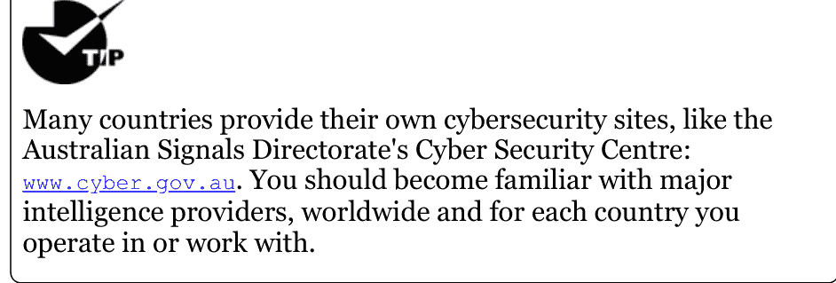

## 专有与闭源情报

商业安全厂商、政府机构和其他以安全为中心的组织也创建并使用专有的或闭源情报。他们进行自己的信息收集和研究，并可能使用自定义工具、分析模型或其他专有方法来收集、策划和维护他们的威胁馈。

使用专有威胁情报的原因有很多。组织可能希望保持威胁数据的机密，他们可能想出售或授权其数据（方法和来源是他们的商业秘密），或者他们不想让威胁攻击者知道他们正在收集的数据。

## 当威胁情报源失效时

本书的作者在几年前与一家 IDS 和 IPS 供应商合作后，关于最新的威胁情报源汲取了教训。该供应商承诺提供最新的馈源并针对当前问题进行检测，但执行速度往往后于市场上的其他供应商。在其中案例案例，一个关键的微软漏洞被发布后，利用代码在不到 48 小时内就出现并被活跃使用。尽管反复查询，该供应商在两周多的时间都没有提供检测规则。遗憾的是，在该供应商平台上手动创建规则并无效，导致本应受到保护的系统暴露在风险之中。

避免此类情况，拥有可靠且实时的馈源至关重要。你可能希望拥有多个可以相互校验的馈源——通常某个馈源的速度更快或能更早发布信息，因此多个高质量的馈源会有帮助。

## 评估威胁情报

无论威胁信息的来源如何，你都需要对其进行评估。在评估特定的威胁情报通知时，会有一些共同因素起作用：

- 它们具有及时性吗？延迟运行的馈源可能会让你错过威胁，或者在威胁不再相关后才做出反应。
- 信息准确吗？你可以信任它所说的吗？该评估有效的概率有多大？它是依赖于单一来源还是多个来源？这些来源的正确频率有多高？
- 信息相关吗？如果它描述的是错误的平台、软件或导致你组织成为目标的原因，那么这些数据可能非常及时、非常准确，但完全无关。

> **注意**：CySA+ 目标强调了情报的及时性、相关性和准确性，因此你应该准备好根据这些因素来评估威胁情报，并解释它们为什么重要。总结威胁情报评估的一种方法是通过信誉评分（confidence score）。信誉评分允许组织根据其信任程度来过滤和使用威胁情报。这并不意味着低信誉信息没有用；事实上，许多威胁情报都是从较低的信誉评分开始，随着信息的固化并允许完整分析，评分会增加。

## 评估情报的信誉水平

许多威胁馈源会包含一个信誉评分和一个描述性比例尺。例如，ThreatConnect 使用了六级信誉：

- 已确认 (90–100)：使用独立来源或直接分析来证明威胁是真实的。
- 可能 (70–89)：依赖逻辑推理，但没有直接确认威胁。
- 也许 (50–69)：当某些信息与分析一致时使用，但评估未确认，且根据给定数据推断具有一定逻辑。
- 怀疑 (30–49)：当评估可能但不是最可能的选项，或者无法通过可用信息证明或反驳该评估时分配。
- 不可能 (2–29)：意味着评估可能但不是最符合逻辑的选项，或者它被其他可用信息反驳。
- 错误 (1)：当评估被确认为不准确或错误时使用。

你可以在 `threatconnect.com/blog/best-practices-indicator-and-confidence/` 阅读到 ThreatConnect 的所有评分系统。你的组织可能会使用不同的比例尺：1–5、1–10 以及高/中/低比例尺，这些被常用，以便威胁情报用户快速评估评估结果及其底层数据的质量。

## 威胁指标管理与交换

任何规模的威胁信息管理都需要标准化和工具，以便以自动方式处理和使用威胁信息。通过定义的术语集，指标管理可以变得简单得多。这就是 STIX 和 OpenIOC 等标记语言大显用场的地方。

结构威胁信息表达式 (STIX) 是一种最初由美国国土安全部赞助的 XML 语言。STIX 2.0（本文写作时的版本）定义了 STIX 域对象，包括攻击模式、身份、恶意软件、威胁活动者和工具。这些对象通过两种 STIX 关系对象模型之一相互关联：要么作为关系（relationship），要么作为目发现（sighting）。STIX 2.0 对威胁活动者的 JSON 描述如下：

```json
{
  "type": "threat-actor",
  "created": "2019-10-20T19:05.000Z",
  "modified": "2019-10-21T12:22.000Z",
  "labels": ["Crime-syndicate"],
  "name": "Evil Maid, Inc",
  "description": "Threat actors with access to hotel rooms",
  "aliases": ["Local USB threats"],
  "goals": ["Gain physical access to devices", "Acquire data"],
  "sophistication": "intermediate",
  "resource_level": "government",
  "primary_motivation": "organizational-gain"
}
```

如 `sophistication` 和 `resource_level` 等字段定义了词汇选项，允许 STIX 2.0 用户在自动化和手动系统中一致地使用这些数据。


使用单一威胁馈源可能会让你一无知！许多组织利用多个威胁馈源来获取最新的信息。威胁馈源的组合也具有挑战性，因为它们可能使用不同的格式、分类模型或其他元素。你可以通过寻找已经整合多个馈源的来源，或寻找使用 STIX 等相同描述框架的馈源来解决这一问题。

自创建以来，STIX 已移交给 OASIS（结构化信息标准促进组织），这是一个国际非营利性财团，维护着许多许多与信息格式相关的其他项目，包括 XML。STIX 的伴侣是信任的指标自动交换 (TAXII) 协议。TAXII 旨在允许通过 HTTPS 在应用层进行网络威胁信息的通信。STIX 专门为支持 STIX 数据交换而设计。你可以在 OASIS 的 GitHub 站点 `oasis-open.github.io/cti-documentation/` 详细阅读 STIX 和 TAXII。

另一个选项是开放入侵指标（OpenIOC）格式。与 STIX 类似，OpenIOC 是由 Mandiant 开发的基于 XML 的框架。典型的 IOC 包含元数据，如作者、IOC 名称和描述；对调查或案件的引用；以及指标的定义。

其他数据可能是纯文本形式或书写形式，也可能几乎完全没有格式。在这个阶段，你必须首先对数据进行处理，使其能够被你打算使用的任何工具或流程读取，然后你必须对数据本身进行分析。此阶段的输出可以是喂给自动化系统或其他工具的数据，也可以是分给领导层或组织内其他人员的书面报告。

## 情报分发

在情报循环的分发阶段，数据被分发给领导层和运营人员，他们将这些数据作为其安全运营的一部分。

## 反馈

威胁情报循环的最后一个阶段是收集对你收集的报告和数据的反馈。持续改进是该过程中的关键要素，它应该被用于创建更好的需求并改进你的威胁情报计划的整体输出。

## 威胁情报社区

除了威胁情报供应商和资源外，还建立了威胁情报社区来共享威胁信息。在美国，被称为**信息共享与分析中心（ISACs）**的组织帮助基础设施所有者和运营商共享威胁信息，并为其成员提供工具和帮助。ISAC 国家委员会在 `www.nationalisacs.org/member-isacs` 列出了基于部门的 ISAC。

ISAC 概念于 1998 年作为总统决定指令第63 号（PDD-63）的一部分引入，该指令要求关键基础设施部门建立组织以共享有关威胁和漏洞的信息。ISAC 基于信任模型运行，允许对物理威胁和网络威胁进行深度共享。大多数 ISAC 实行 24/7 天候运行，为其所在部门的 ISAC 成员提供事件响应和威胁分析。

## 考试笔记

CySA+ 考试目标专门提到了此信息共享分组中的三个领域：医疗保健、金融服务和航空。目前，ISAC 国家委员会实际上有 25 个组织，这意味着你的行业很有可能有一个涵盖该行业的 ISAC。你可以在这些网站找到考试目标中提到的三个 ISAC 的特定信息：

- 医疗保健 ISAC，H-ISAC：`h-isac.org`
- 金融服务 ISAC：`fsisac.com`
- 航空 ISAC：`a-isac.com`

除了 ISAC 之外，每个关键基础设施领域都有特定的美国机构或部门合作伙伴。可以在此处找到按部门划分的列表：`www.dhs.gov/cisa/critical-infrastructure-sectors`。

在美国境外，许多国家也存在具有相似职责的政府机构和部门。英国的国家基础设施保护中心（`www.cpni.gov.uk`）负责向工业界、学术界以及政府其他部分和执法部门提供威胁信息、资源和指导。

## 威胁分类

一旦你决定对你组织的威胁进行评估，你会很快发现你需要标准的方法来描述它们。幸运的是，行业内有许多常用的描述方案和术语。许多组织寻求既描述威胁者，又对他们面临的威胁进行分类，以便更好地理解威胁本身。

## 威胁者

CySA+ 考试目标特别指出了四种常见的威胁者：

- **国家级攻击者（Nation-state actors）**通常拥有最多的资源，包括工具、人才、设备和时间。国家级攻击者背后有国家的资源支持，他们的目标通常是其赞助国的目标。国家级攻击者通常与高级持续性威胁（APT）组织相关，他们拥有在其他威胁者手中不常见的先进工具和能力。

- **有组织犯罪（Organized crime）**作为威胁者已发挥了重要作用，其针对性攻击通常以获取利益为目标。勒索软件攻击是此类组织犯罪集团引发的类型威胁中日益常见的例子。

> **考试笔记**
>
> CySA+ 考试目标提到了通用恶意软件（commodity malware），而有组织犯罪是其主要来源。通用恶意软件是在公开市场（或黑市）上编写并出售的恶意软件。有些作为工具包的一部分出售，而另一些通用恶意软件作为独立工具出售。

- **黑客行动主义者（Hacktivists）**利用黑客技术作为实现政治或哲学目的的活动分子。黑客行动主义者从个人行动者到像匿名（Anonymous）这样的大型不等，他们的技术能力和资源差异很大。当你评估来自黑客行动主义者的威胁时，你需要仔细考虑什么类型的黑客行动主义者最可能针对你的组织以及为什么。

- **内部威胁（Insider threats）**来自组织内部员工或其他信任个人或群体的威胁。他们可能是故意的或无意的，但在任何一种情况下，由于他们所处的信任位置，都可能构成重大威胁。内部威胁经常被认为是导致破解最可能的原因之一，且往往难以检测。


## 考试笔记

CySA+ 考试目标将内部威胁分为两类：故意的和无意的。在考试中回答关于内部威胁的问题时，确保考虑了这种差异。

你的组织可能希望根据你的威胁模型和概况考虑其他特定的威胁者，因此你不应认为这个列表是完整的。你应该进行组织威胁评估，以确定什么类型的威胁者最可能针对你的组织以及为什么。

## 威胁分类

尽管有许多分类威胁的方法，但常见的分类包括区分**已知威胁**（你已经了解并可能拥有有用信息的威胁）和**未知威胁**（你只能针对其用途做准备的威胁）。

## 使用 STRIDE 进行威胁分类

微软的 STRIDE 模型是你用来根据威胁利用的手段对其进行分类的方法之一。STRIDE 代表：

- 身份欺骗（Spoofing of identity）
- 篡改（Tampering）
- 否认（Repudiation）
- 信息泄露（Information disclosure）
- 拒绝服务（Denial of service）
- 权限提升（Elevation of privilege）

其他模型包括 PASTA（攻击模拟与威胁分析过程）、DREAD、CVSS（我们在第5章中讨论）以及攻击树等技术。

分类工具提供了两个主要益处：首先，它允许使用通用框架来描述威胁，允许他人贡献和管理威胁信息。其次，模型提醒了存在的威胁类型，并帮助分析师进行更好的分析。

## 威胁研究与建模

组织通过威胁建模积极寻求理解他们面临的威胁。威胁建模考虑许多因素，但常见要素包括：

- 评估对手能力，即可能的威胁者的资源、意图和能力。
- 组织的总攻击面。这意味着任何威胁可能针对的系统、设备、网络、应用程序、员工或其他目标。
- 列出可能的攻击向量，攻击者获取其目标的手段。
- 攻击成功后的影响。
- 攻击或威胁成功的概率。

所有这些项目都可以进行评分，以协助评估风险，并帮助组织理解其面临的威胁。

一旦组织建立了威胁模型，他们将进行威胁研究。你或你的组织可以选择进行多种类型的威胁研究。你可能会查看网站、网段或攻击者的声誉，以确定他们是否有恶意行为的历史或习惯。这被称为威胁声誉，通常与 IP 地址或域名配对，但也存在文件声誉和服务数据馈。

你可以通过 Cisco 的 Talos Intelligence 声誉查询工具查看此示例，该工具位于 `talosintelligence.com/reputation_center` 并如图 2.3 所示。注意你可以看到主机所有者信息和 DNS 信息，以及电子邮件声誉、网页声誉、它发送了多少垃圾邮件以及它是否在黑名单上。

### 图 2.3

单个主机的 Talos 声誉报告

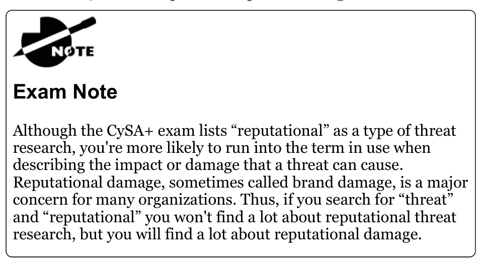

## 考试笔记

尽管 CySA+ 将“声誉”（reputational）列为一种威胁研究类型，但在描述威胁可能造成的影响或损害时，你可能会遇到这个术语。声誉损害（有时被称为品牌损害）是许多组织关注的重点。因此，如果你搜索“威胁”（threat）和“声誉”（reputational），你找不到很多关于声誉威胁的研究，但你会发现很多关于声誉损害的内容。

除了声誉研究外，行为评估经常用于评估威胁。监控如 ATT&CK 框架中列出的行为可以为威胁识别和事件响应提供基础。

行为评估对于内部威胁特别有用，因为内部威胁行为通常难以与工作或角色相关的任务区分开来。检测内部威胁行为很大程度上取决于所执行操作的上下文；对该内部人员所交互的所有系统、应用程序和网络行为的广泛视图；以及提供随时间推移的洞察能力。许多内部人员通过滥用特权账户、利用敏感信息的访问以及使用共享密码进行攻击。这些攻击通常发生在非工作时间，或可能需要更多时间，这使得通过这些行为差异识别它们成为可能。

另一种用于评估威胁的措施是*失陷指标 (IOCs)*。失陷指标是可以帮助识别攻击的取证证据或数据。与其他评估方法不同，失陷指标专门在攻击开始后使用——尽管攻击可能仍在进行！但这并不意味着它们对威胁评估没有用处。

了解 IOC 与特定的威胁攻击者或常见的漏洞路径相关，可以帮助防御人员采取适当措施防止进一步渗透，并可能识别出攻击者。它还可以帮助防御人员限制损害或阻止攻击进展。

## 攻击框架


已有许多尝试在框架中描述攻击方法论，以帮助防御人员模拟攻击和相应的防御。CySA+ 考试关注三个特定的框架，但你的组织可能会使用不同的模型，或者从零开始、通过将一个或多个框架与其自身的需求和经验相结合创建自己的模型。框架有助于思考攻击者可能做什么，从而让你针对攻击建立适当的防御。

# MITRE ATT&CK 框架

MITRE 提供了 ATT&CK（攻击者战术、技术和常见知识），这是一个关于攻击者战术和技术的知识库。ATT&CK 矩阵包含了完整威胁生命周期的详细描述、定义和示例，从初始访问到执行、持久化、权限提升和数据外泄。在每个层级，它都列出了技术和组件，允许威胁评估建模利用通用的描述和知识。

ATT&CK 矩阵包括攻击前矩阵、关注 Windows、macOS、Linux 和云计算的企业矩阵，以及 iOS 和 Android 移动平台矩阵。它还包含了缓解措施、威胁攻击者小组、软件以及许多其他有用细节。所有这些共同构建，使得 ATT&CK 成为本书作者所知的最全面的攻击者技术、战术和相关信息的免费数据库。

图 2.4 显示了针对通过元数据 API 攻击云实例的 ATT&CK 技术定义示例。它提供了一个 ID 编号以及分类细节，如战术、适用的平台、所需的用户权限、适用的数据源、贡献者以及特定技术的修订版本。

## 云元数据 API

钻石模型（Diamond Model）重点侧重于理解攻击者及其动机，然后利用这些元素之间的关系，让安全分析师既能理解威胁，又能考虑他们可能需要获取或可能已有的其他数据或信息。

### 图 2.4 云元数据 API 的 ATT&CK 技术

## 入侵分析钻石模型

入侵分析钻石模型描述了一个攻击者部署针对受害者的能力的序列。模型中，活动被称为事件，分析师将顶点标记为检测或发现的事件。该模型旨在帮助分析师通过跟踪事件之间的边来发现更多信息。

钻石模型使用了一些特定术语：

- 事件的核心特征，即攻击者、能力、基础设施和受害者（钻石的顶点）。
- 元特征（Meta-Features），包括开始和结束时间戳、阶段、结果、方向、方法论和资源。这些用于将事件按名为“活动线程”（activity thread）的序列排序，并根据其特征对事件进行分组。
- 置信度值（Confidence Value），模型未对其定义，但预计分析师根据自己的工作来确定。

图 2.5 显示了对受损系统进行的分析示例。注意，每个元素都有助于识别额外信息或审查区域。

```
攻击者 (adversary)

4. 网块所有权指向攻击者的身份

5. 攻击者身份帮助安全人员确定威胁模型和额外的能力

2. 日志显示攻击者的源 IP

基础设施 (Infrastructure)

能力 (Capability)

3. SIEM 日志显示同一网块的其他活动

1. 受害者发现系统受损

受害者 (Victim)
```

图 2.5 受损系统的钻石模型分析

| 缓解措施 (Mitigation) | 描述 (Description) |
|---|---|
| 过滤流量 | ATT&CK 矩阵技术 |
| Web 应用防火墙 (WAF) | 限制对虚拟 API 的访问 |

## 缓解措施

## 检测

- 监控对实例元数据 API 的访问
- 可能检测到异常查询

## 参考文献

1. AWS. (n.d.), Instance Metadata API and User Data. Retrieved July 19, 2019.
2. Higashmi, Michael. (2018, May 15). Instance Metadata API: A Modern Day Horse. Retrieved July 16, 2019.

# 洛克希德·马丁网络杀伤链

- 侦察
- 目标选择、研究、漏洞识别
- 武器化
- 创建用于利用漏洞的工具
- 交付
- 将武器交付给目标（通过电子邮件、优盘、网站或其他方法）
- 利用
- 触发恶意软件程序并利用漏洞
- 安装
- 安装远程访问工具/后门
- 命令与控制 (C2)
- 入侵者获得持久性访问权限
- 目标达成阶段
- 入侵者采取行动以实现其目标：数据获取和提取、数据破坏、系统破坏

## 图 2.6 网络杀伤链（The Cyber Kill Chain）

这七个阶段如下：

1. **侦察（Reconnaissance）**，用于识别目标。在此阶段，攻击者正在策划他们的攻击，并将收集有关目标的情报，包括开源情报和通过扫描直接获取目标数据。防御者必须收集有关侦察活动的数据，并根据这些信息优先考虑防御措施。

2. **武器化（Weaponization）**涉及构建或通过其他方式获取武器化工具，该工具将恶意软件和利用程序组合成可以交付给目标的负载。这可能需要创建诱饵文档、选择正确的命令与控制工具以及其他细节。该模型强调了防御者需要在这一阶段进行全面的恶意软件分析，以不仅了解投放了什么负载，还要了解武器化利用程序是如何制作的。防御者还应该针对武器化工具建立检测，查看恶意软件创建与其使用之间的时间线，并收集文件和元数据，以帮助他们查看工具是广泛共享的还是秘密持有的（因此针对性非常窄）。

3. **交付（Delivery）**发生在攻击者直接针对目标部署工具，或通过依赖目标人员与其交互的发布进行攻击，例如电子邮件负载、USB 盘或他们访问的网站。防御者在这一阶段必须观察攻击是如何交付的以及目标了什么，然后推断攻击者意图实现什么。在此阶段，保留日志也很重要，因为防御者需要跟踪发生了什么。

4. **利用（Exploitation）**利用软件、硬件或人为漏洞来获取访问权限。这可能涉及零日漏洞利用，并可能使用攻击者触发的利用或受害者触发的利用。针对这一阶段的防御重点在于用户意识、安全编码、漏洞扫描、渗透测试、端点加固以及类似的活动，以确保组织具有强大的安全态势和非常有限的攻击面。

5. **安装（Installation）**侧重于为攻击者提供持久的后门访问。防御者必须监控持久远程 shell 或远程访问方法的典型伪产物。

6. **命令与控制 (C2)** 访问允许双向通信和对远程系统的持续控制。防御者将试图通过加固网络、部署检测能力和进行持续研究来检测 C2 基础设施，以确保他们了解新的 C2 模型和技术。

7. **目标达成阶段（Actions on Objectives）**是最后一个阶段，发生在任务目标实现时。攻击者将收集凭据、提升权限、转向并在环境中进行横向移动，以及收集和外泄信息。他们还可能对系统或数据造成破坏。防御者必须建立他们的事件响应剧本，检测攻击者的行动并捕获有关他们的数据，响应告警并评估攻击者造成的破坏。

洛克希德·马丁网络杀伤链（Lockheed Martin Cyber Kill Chain）可以在此处找到更多详细信息：www.lockheedmartin.com/content/dam/lockheed-martin/rms/documents/cyber/Gaining_the_Advantage_Cyber_Kill_Chain.pdf。

## 统一杀伤链（The Unified Kill Chain）

尽管 CySA+ 考试没有专门提到，但你可能会发现统一杀伤链有用。统一杀伤链将洛克希德·马丁的网络杀伤链和 MITRE ATT&CK 框架（以及其他几个！）整合到一个杀伤链模型中。它使用 18 个阶段来描述发生在防御网络内部和外部的攻击，解决了对这两个框架的抱怨。你可以在此处阅读 Paul 2017 年提出的统一杀伤链建议：www.csacademy.nl/images/scripties/2018/Paul_Pols_The_Unified_Kill_Chain_1.pdf。

## 评估攻击框架

在采用攻击的概念模型之前，你应该阅读有关它的评述。例如，洛克希德·马丁的网络杀伤链因包含在防御网络之外发生的行动而受到批评，因为这些行动处于许多防御者无法采取行动的范围之外。其他批评还包括对基于边界和基于恶意软件的防御技术的关注，以及对内部威胁的关注不足。

随着高级持续性威胁和内部威胁继续成为主要关注点，简单采用网络杀伤链模型可能无法满足组织的需求。因此，你应该仔细考虑什么模型符合你最可能遇到的威胁，要么选择一个合适的模型，要么修改现有模型以满足组织的需求。

## 通用漏洞评分系统 (CVSS)

在查看威胁框架时，你可能会遇到通用漏洞评分系统 (CVSS)。尽管 CVSS 不直接涵盖威胁，但它通常使用数值评分来描述漏洞。你可以在第四章“设计漏洞管理计划”中阅读关于 CVSS、CVSS 评分如何工作以及如何将 CVSS 作为你漏洞评估计划的一部分的内容。

## 在组织范围内应用威胁情报

构建全面的威胁情报功能需要组织的多个部分协同工作。安全从业人员、系统管理员、审计员等人需要共享数据以识别威胁、监控威胁、使用已知的活动和指纹进行检测，然后对其进行响应，最后利用你获得的信息为未来的威胁做准备。

应该共享威胁情报，以确保事件响应、漏洞管理、风险管理和安全工程功能理解你将面临的潜在威胁者、能力和失陷指标。

## 主动威胁狩猎（Proactive Threat Hunting）

主动而非被动地搜索威胁可以帮助你领先攻击者。主动威胁狩猎通常由新数据或工具触发，这些工具激发威胁分析师或安全专业人员对新威胁、新威胁者或新类型威胁建立假设。

一旦你有了假设，下一步是调查威胁。我们在本章之前讨论的分析框架可以提供基础，允许你对威胁者进行画像，通过执行过程分析或逆向工程等分析恶意软件或其他工具，或其他调查新威胁。

如果发现了新威胁，通常会采取某种形式的行动来应对。你可能会发现减少组织攻击表面的方法，或者根据你的威胁分析发现其他减少攻击者可用攻击向量数量的方法。

此类活动的关键在于使用来自多个来源的集成情报馈，并改进组织的检测能力，以便在威胁变成严重问题之前识别它们。

CySA+ 考试将主动威胁狩猎活动分为几个要点：

- 建立假设。需要测试假设，并根据假设所考虑的威胁产生可操作的结果。
- 对威胁者和活动进行画像。这有助于确保你已经考虑了谁可能是威胁以及为什么，以及他们典型的行动和过程是什么。
- 威胁狩猎战术。这些是威胁狩猎活动成功的关键。技能、技术和程序是行动与分析的结合点。这一步骤包含了可执行进程分析，CySA+ 考试大纲中特别提到了这一点。
- **缩小攻击面**。这允许资源集中在剩余的攻击面上，使保护更易管理。
- **将关键资产分组并划分保护区域**。这有助于管理攻击面、威胁狩猎和响应活动，因为不需要对每个资产作为唯一项目进行单独评估或管理。
- 必须根据对威胁攻击者及其技术的分析，以及攻击者可以针对的面积，对**攻击向量**进行理解、评估和处理。
- **整合情报**结合了多个情报源，以提供更好的威胁视图。
- **提高检测能力**。这是一个持续的过程，因为威胁不断改进其技术和手段。如果你不提高检测能力，随着时间的推移，新威胁将绕过现有能力。

在准备考试时，务必考虑这些每一个因素在主动威胁狩猎活动中起着什么作用，以及它们对你的组织会产生什么影响。


## 考试笔记

CySA+ 考试目标的第 3.3 节特别要求考者准备好解释**主动威胁狩猎**的重要性。你应该记住，要领先于高级对手可能极其困难，但通过利用成熟的威胁建模和分析功能不断更新和提升安全态势，是降低组织整体受攻击风险的极佳方法。

## 总结

理解组织所面临的威胁是安全计划和运营的关键部分。为了理解这些威胁，安全专业人员收集威胁情报，这些情报由关于对手的动机、能力、工具和方法论的数据组成。

**开源威胁情报**从公开渠道获取，而**闭源威胁情报**来自不向公众公开数据的商业或其他来源。许多组织将两者作为其威胁情报工作的一部分。存在许多开源威胁情报源，包括政府资助的馈送和网站、专业组织、供应商资源、社交媒体，甚至来自个人的信息。

威胁情报源需要经过评估，在根据数据采取行动之前，了解你对数据的置信程度至关重要。威胁信息也需要进行管理，并且存在描述威胁信息的标准化格式和语言，以帮助威胁信息更具可用性。STIX、ATT&CK 和其他工具有助于威胁信息的标准化。它们还帮助使用诸如国家级攻击者和对手能力等通用术语对威胁进行分类。

威胁信息的收集可以被描述为一个循环，需求收集、威胁数据收集、威胁数据分析、威胁情报分发或共享，以及反馈和改进阶段都是典型威胁信息过程的一部分。

使用框架也可以辅助分析威胁，ATT&CK、**钻石模型（Diamond Model）**和**网络杀伤链（Cyber Kill Chain）**都是旨在协助威胁分析的常用工具。它们各有优缺点，你应该仔细审查它们，以确定哪一个比其他的更符合你的需求。

一旦你建立了威胁情报功能，你就需要使用并维护它，这就是组织范围内使用威胁情报大用之地之地。组织内的许多区域可能需要威胁数据，或有助于威胁情报的收集过程。这些数据可以用于主动威胁狩猎，在威胁成功完成攻击或利用之前识别它们。

## 考试要点

理解驱动情报源选择的因素。开源和闭源（或专有）威胁情报源都是可用的，将需求与正确的资源匹配对于威胁情报计划至关重要。情报共享社区可以提供专门针对行业或专业小组的威胁数据。根据时效性、数据与需求的关联性以及准确性来评估情报源，将帮助指导你选择使用的数据集以及你对它们的依赖程度。

了解指标管理标准以使数据更有用。使用如 STIX 等标准化语言和 TAXII 等交换协议允许威胁情报信息的交换和管理。使用 OpenIOC 描述失陷指标（IOC）为组织提供了一个框架，用于对威胁和事件达成评分一致，并已知且良好的格式通信泄露细节。

## 使用分类标准和通用术语描述威胁

威胁通常使用几个通用术语进行分类：已知与未知威胁、零日漏洞和高级持续性威胁（APT）。

知道情报循环是持续的。威胁信息的收集可以被描述为一个循环，需求收集、威胁数据收集、威胁数据分析、威胁情报分发或共享，以及反馈和改进阶段都是典型威胁信息过程的一部分。

## 能够使用框架和工具描述威胁

使用框架也可以辅助分析威胁，ATT&CK、钻石模型和网络杀伤链都是旨在协助威胁分析的常用工具。它们各有优缺点，你应该仔细审查它们，以确定哪一个比其他的更符合你的需求。

## 理解威胁攻击者的分类法

威胁通常使用几个通用术语进行分类：已知与未知威胁、零日漏洞和高级持续性威胁。这些可能被识别为国家级实体、黑客活动者、有组织犯罪或故意和无意的内部人员。使用钻石模型、MITRE ATT&CK 和洛克希德的网络杀伤链等框架提供了广泛的威胁分类法。

## 实验练习

## 活动 2.1：探索 ATT&CK 框架

在活动中，你将使用 ATT&CK 框架分析威胁。你可能想选择一个最近在新闻中看到的事件，或者影响过某个组织的事件。如果没有想起来，2019 年的第一资本数据泄露事件提供了一个实用的案例，你可以通过快速搜索找到漏洞细节。


你可能会疑惑为什么我们不提供细节或特定文章的链接。这是练习的一部分！威胁情报需要发现并整合数据以进行分析的能力。最好的文章将提供系统如何被访问以及数据如何外泄的细节或其他元素。

### 第一部分：构建威胁配置文件

1. 列出你关于该泄露或漏洞的所有信息，包括关于威胁攻击者、发生了什么、使用了什么工具以及你能找到的所有其他细节。
2. 检查你的列表标题与对应的 ATT&CK 矩阵。你是否有与标题匹配的项目？
3. 如果你仍然缺乏数据，你应该继续搜索或寻找另一个案例进行研究。

### 第二部分：分析

一旦你构建了基础配置文件，就需要遵循矩阵中的详细列表，将威胁与其 ATT&CK 技术、威胁攻击者和其他细节进行匹配。

1. 将每个数据点匹配到相应的 ATT&CK 条目。
2. 审阅每个条目的详细信息，以便你熟悉它们。
3. 识别你知识中的空白。如果你正在研究这种威胁，你会寻找哪些信息？你认为哪些信息是可以合理获取的，而哪些你可能无法收集到？
4. 根据你发现的内容，考虑你给领导层的报告将包含哪些内容。对于技术小组你会包含哪些内容？对于 CIO 或 CEO 等高级管理人员，你会包含哪些内容？

## 活动 2.2：设置 STIX/TAXII 馈

Anomaly 的 STAXX 社区版提供了一种简单的消费 STIX 馈的方法。在这项练习中，你将下载并安装 STAXX 客户端，然后查看其中一个馈的数据。

1. 访问 www.anomalyali.com/community/staxx 并下载 STAXX 社区版软件。STAXX 下载大小为 1 GB，需要提供电子邮件以获取下载链接。
2. 安装 STAXX 客户端。你需要一个如 VirtualBox 或 VMware 这样的虚拟化环境来打开 OVA 文件。请遵循 update.anomalyali.com/docs/Anomaly_STAAXX_Installation_&_Administration_Guide.pdf 中的 Anomaly 设置与安装指南。
3. 本指南将帮助你启动 Anomaly Set。连接到网络界面时，你需要在大多数主流浏览器中接受不安全的连接。
4. 提示时，使用 Anomaly Limo 服务为你的第一个馈收集数据。
5. 一旦进入且 Anomaly 摄取了其馈，请探索仪表板。最常见的指标类型是什么？它符合你的预期吗？
6. 进阶：识别一个不是 STAXX 默认馈列表部分的 STIX 馈，并将其添加到 STAXX。

## 活动 2.3：情报收集技术

将每个活动与其所属的威胁情报循环阶段进行匹配。

| 需求 | 更新你的情报收集计划的需求 |
|---|---|
| 威胁数据收集 | 向 IPS 管理员提供威胁信息 |
| 威胁数据分析 | 评估近期泄露中缺失的控制措施 |
| 威胁情报分发 | 通过 STIX 下载数据 |
| 收集反馈 | 将手动收集的威胁数据转换为 STIX 格式 |

## 复习题

1. 下列哪些措施不常用于评估威胁情报？

   A. 及时性
   B. 细节
   C. 准确性
   D. 相关性

2. STIX 基于哪种语言？

   A. PHP
   B. HTML
   C. XML
   D. Python

3. 在威胁情报循环中，以下哪个活动位于威胁数据分析之后？


# 第三章：侦察与情报收集

## 考试目标

**COMPTIA 网络安全分析师 (CYSA+) 考试目标涵盖本章涵盖：**

- ✓ **领域 1.0：威胁与漏洞管理**
  - 1.4 给定场景，分析常见漏洞评估工具的输出。
- ✓ **领域 3.0：安全运营与监控**
  - 3.1 给定场景，作为安全监控活动的一部分分析数据。

## 练习题

### 1. 威胁情报生命周期的正确顺序是什么？

A. 收集反馈  
B. 威胁数据收集  
C. 威胁数据审查  
D. 威胁情报分发

### 2. Susan 想开始执行情报收集。在需求收集阶段，经常进行以下哪些选项？

A. 审查你的组织面临的安全违规或入侵事件  
B. 审查当前的漏洞扫描  
C. 审查当前的数据处理标准  
D. 审查针对新威胁的威胁情报馈

### 3. 美国政府帮助创建了哪些组织以帮助特定垂直领域组织之间共享知识？

A. DHS  
B. SANS  
C. CERTS  
D. ISACs

### 4. 以下哪些威胁活动者通常拥有最大的资源访问权限？

A. 国家级攻击者  
B. 有组织犯罪  
C. 黑客主义  
D. 内部威胁

### 5. 像 Anonymous 这样出于政治原因针对政府和企业是哪种威胁活动者的例子？

A. 黑客主义  
B. 军事资产  
C. 国家级攻击者  
D. 有组织犯罪

### 6. Jason 收集的威胁情报告诉他，攻击者利用这些来入侵目标：

A. 组织的攻击面  
B. 可能的攻击向量  
C. 攻击者能力  
D. 概率

### 7. 哪种评估对于通过独立来源确认威胁特别有用？

A. 行为  
B. 本能  
C. 习惯  
D. IOC

### 8. Cyn 想通过专门设计的协议发送威胁信息。她应该选择哪种？

A. STIX 1.0  
B. OpenIOC  
C. STIX 2.0  
D. TAXII

### 9. 杀伤链的哪个阶段包含了攻击者的持久访问？

A. 交付  
B. 利用  
C. 安装  
D. C2

### 10. 对杀伤链的常见批评是由于？

A. 它针对所有威胁的。  
B. 它太详细了  
C. 它包含了外部操作  
D. 它过度关注

### 11. 下列哪项不是用于防御零日命令与控制 (C2) 的常用技术？

A. 网络加固  
B. 漏洞  
C. 部署检测能力  
D. 追踪新的

### 12. 什么术语描述了由独立来源确认的威胁分析？

A. 威胁级别  
B. STIX 级别  
C. 置信级别  
D. 保证级别

### 13. 什么推动了 ISAC 的创建？

A. 基础设施所有者的威胁共享  
B. 1994 年网络法案  
C. 威胁情报提供者  
D. 1998 年法案

### 14. STRIDE、PASTA 和 LINDDUN 都是什么的例子？

A. 零日评分系统  
B. 漏洞评估工具  
C. 攻击者分析工具  
D. 威胁分类工具

### 15. OpenIOC 使用哪家安全公司创建并提供的基础入侵指标？

A. Mandiant  
B. McAfee  
C. CrowdStrike  
D. Cisco

### 16. 高级持续威胁通常与哪种类型的攻击者相关？

A. 内部威胁  
B. 国家级攻击者  
C. 有组织犯罪  
D. 黑客

### 17. Gabby 想为她的组织选择一个威胁框架，标准化地识别威胁活动者的策略是她选择过程的重要部分。哪个模型是她的最佳选择？

A. 钻石模型  
B. ATT&CK  
C. 网络杀伤链  
D. 通用威胁模型

### 18. 取证数据通常用于哪种评估？

A. STIX  
B. 行为  
C. IOC  
D. TAXII

---

## 正文内容

安全分析师、渗透测试人员、漏洞和威胁分析师以及负责理解组织运营安全环境的人员需要知道如何收集信息。这个过程被称为侦察或情报收集。

信息收集通常是信息安全标准和法律的要求。例如，支付行业数据安全标准 (`PCI DSS`) 要求处理卡的组织每季度至少一次内部和外部网络漏洞扫描，并在发生重大变更后进行。更改组织的内部和外部信息通常被认为是理解组织风险的必要部分，实施行业最佳实践以满足尽职调查要求可能会导致此类工作。

在本章中，你将探索主动情报收集，包括端口扫描工具以及你如何通过扫描数据确定网络拓扑。然后你将学习被动情报收集，包括工具、技术和实战经验，帮助理解你组织的足迹。最后，你将学习如何限制潜在攻击者利用相同的技术收集有关你组织信息的能力。

## 映射与枚举

收集组织情报的第一步是识别组织的技术足迹。**主机枚举** 被用于创建你组织网络、系统和其他基础设施的映射图。这通常通过将信息收集工具与手动研究相结合来实现，用以识别组织所使用的网络和系统。

渗透测试的标准通常包括枚举和侦察过程及指南。有许多公开的资源，包括《开放安全测试方法论手册》（`OSSTMM`）、《渗透测试执行标准》（`Penetration Testing Execution Standard`）以及美国国家标准与技术研究院（`NIST`）特别出版物 800-115《信息安全测试与评估技术指南》。

- `OSSTMM`: <www.isecom.org/research.html>
- `Penetration Testing Execution Standard`: <www.pentest-standard.org/index.php?Main_Page>
- `SP 800-115`: <csrc.nist.gov/publications/nistpubs/800-115/SP800-115.pdf>

## 主动侦察

枚举期间收集的信息通常用于为主动侦察提供目标。主动侦察使用扫描工具来收集有关系统、服务和漏洞的信息。需要注意的是，虽然侦察不涉及利用，但它可以提供有关可被利用漏洞的信息。

## 权限与管理支持

扫描网络或系统可能会给被扫描的设备带来问题。某些服务可能无法很好处理扫描流量，而另一些在扫描时可能会填充日志或触发安全报警。这意味着在进行主动侦察之前，你应该确保已获得组织内部相应部门的许可。你可能会听到此类授权被称为“免死金”，因为它们有助于确保你不会因为扫描而麻烦。你可能仍然希望与系统和网络管理员联系，以确保扫描不会产生意外影响。

扫描他人的系统可能是非法的，或者会被你互联网服务提供商的使用条款所禁止。例如，云计算平台要求用户在使用其基础设施进行扫描之前，必须完成漏洞或渗透测试申请表，并且对可以扫描的系统和服务类型施加了限制。

## 网络映射与拓扑发现

主动扫描还可以提供有关网络设计和拓扑的信息。当扫描工具遍历网络范围时，它可以评估收到的响应中包含的信息。这可以帮助测试人员根据接收到的数据包生存时间（`TTL`）、`traceroute` 信息以及来自网络和安全设备的响应，对网络拓扑做出合理的推断。[图 3.1](#) 显示了一个简单示例网络的扫描情况。路由器和网关中心化连接到主机，并允许你轻松地看到一组主机的连接。运行 `nmap` 的系统成为初始扫描的中心，并显示其本地回环地址 `127.0.0.1`。在 `10.0.2.1` 路由器后的第二个网络网段上出现了许多主机。`Nmap`（以及 `Zenmap`，使用 `nmap`）可能无法发现所有的系统和网络设备——防火墙或其他安全设备可能会阻止扫描流量，导致系统或网络丢失。

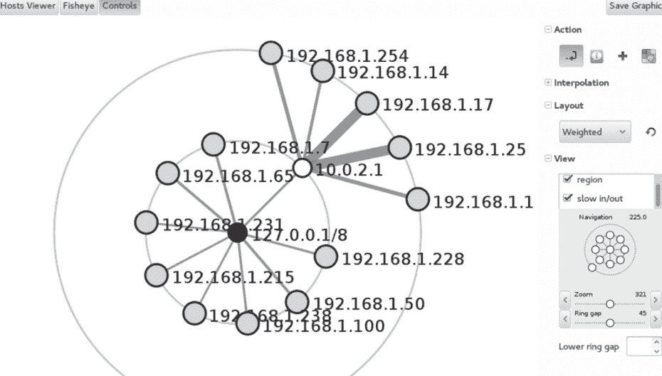

**图 3.1 Zenmap 拓扑视图**

> **T/P** `Zenmap` 的 `nmap` 图形用户界面包含一个内置的拓扑发现工具，可提供扫描网络的可视化表示。记住这只是最佳推测，并不一定与实际网络完全匹配。

扫描工具收集的拓扑信息可能存在缺陷，并且与目标网络的实际设计不匹配。安全网络设备会导致 `TTL` 和 `traceroute` 信息出现差异，导致数据错误或缺失。防火墙还可以让设备和系统变得实际上不可达。

## Ping 主机

你可以执行的最基本的发现是 `ping` 一个地址。`ping` 命令向远程地址发送数据包。如果远程系统接收到请求，它将响应回显（echo reply），表示它处于开启状态。以下是一个向地址发送回显请求的示例：

```
$ ping 172.31.48.137
PING 172.31.48.137 (172.31.48.137) 56(84) bytes of data.
64 bytes from 172.31.48.137: icmp_seq=1 ttl=255 time=0.016 ms
64 bytes from 172.31.48.137: icmp_seq=2 ttl=255 time=0.037 ms
64 bytes from 172.31.48.137: icmp_seq=3 ttl=255 time=0.026 ms
64 bytes from 172.31.48.137: icmp_seq=4 ttl=255 time=0.028 ms
64 bytes from 172.31.48.137: icmp_seq=5 ttl=255 time=0.026 ms
64 bytes from 172.31.48.137: icmp_seq=6 ttl=255 time=0.026 ms
64 bytes from 172.31.48.137: icmp_seq=7 ttl=255 time=0.027 ms
--- 172.31.48.137 ping statistics ---
7 packets transmitted, 7 received, 0% packet loss, time 614ms
min/avg/max/mdev = 0.016/0.026/0.037/0.008 ms
```

在这种情况下，我们使用 `ping` 命令查询了位于 `172.31.48.137` 的系统的状态，并对我们发送的七个请求收到了七个回复。

重要的是，虽然远程主机的每个回复都表示它正在运行，但缺乏响应并不一定意味着远程主机未激活。许多防火墙会拦截 `ping` 请求，单个系统也可能被配置为忽略回显请求数据包。

`hping` 工具是 `ping` 命令的更高级版本，允许自定义回显请求以增加被检测到的概率。`hping` 还可以用于渗透测试中生成手工数据包。以下是 `hping` 运行的示例：

```
$ hping -p 80 -S 172.31.48.137
HPING 172.31.48.137 (eth0 172.31.48.137): S set, 40 headers + 0 data bytes
len=44 ip=172.31.48.137 ttl=45 DF=0 sport=80 flags=SA seq=0 win=29200 rtt=20.0 ms
len=44 ip=172.31.48.137 ttl=45 DF=0 sport=80 flags=SA seq=1 win=29200 rtt=19.7 ms
len=44 ip=172.31.48.137 ttl=45 DF=0 sport=80 flags=SA seq=2 win=29200 rtt=19.8 ms
len=44 ip=172.31.48.137 ttl=44 DF=0 sport=80 flags=SA seq=3 win=29200 rtt=20.1 ms
len=44 ip=172.31.48.137 ttl=46 DF=0 sport=80 flags=SA seq=4 win=29200 rtt=20.2 ms
len=44 ip=172.31.48.137 ttl=45 DF=0 sport=80 flags=SA seq=5 win=29200 rtt=20.2 ms
len=44 ip=172.31.48.137 ttl=46 DF=0 sport=80 flags=SA seq=6 win=29200 rtt=20.2 ms
^C
--- 172.31.48.137 hping statistic ---
26 packets transmitted, 26 packets received, 0% packet loss
round-trip min/avg/max = 19.2/20.0/20.8 ms
```

在此命令中，使用了 `-p 80` 标志来指定探测应该使用 `TCP` 端口 `80` 进行。这是一个明智的选择，因为目标是托管 `Web` 服务器。`-S` 标志表示设置 `TCP SYN` 标志，这表示请求建立连接。任何运行 `HTTP Web` 服务器的远程目标都可能对此请求做出响应，因为它与合法的 `Web` 连接请求无法区分。

> `ping` 在所有主流操作系统中默认内置。相反，`hping` 是一个必须安装的独立程序。你可以从 <www.hping.org> 下载 `hping` 源代码。

## 端口扫描与服务发现技术及工具

端口扫描工具旨在向远程系统发送流量，然后收集有关系统及其所提供服务的响应。在收集有关网络及其连接设备的设备信息时，它们是最常用的工具之一。因此，端口扫描通常是对组织进行主动侦察的第一步。

**端口扫描器** 具有许多共同特征，包括以下：

- 主机发现
- 端口扫描和识别
- 服务版本识别
- 操作系统识别

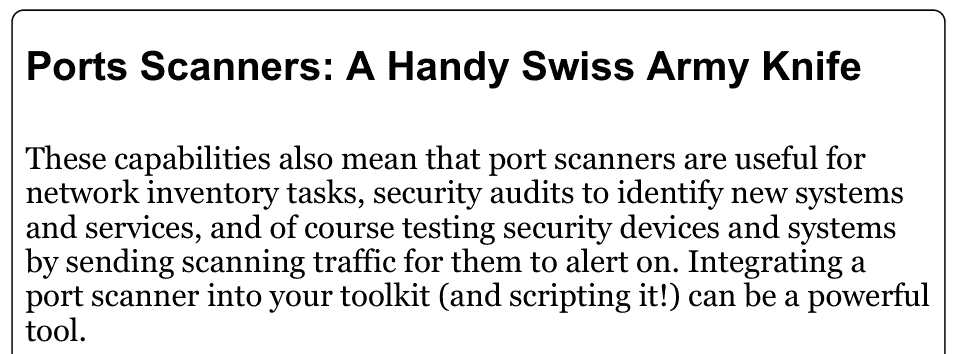

端口扫描的重要部分是理解常见的端口和服务。端口 `0–1023` 称为**已知端口**或**系统端口**，但在进行端口扫描时，一些较高的端口也经常受到关注。`1024` 到 `49151` 之间的端口是**注册端口**，在请求时由互联网数字分配机构 (`IANA`) 分配。许多端口也被任意用于服务。由于端口可以手动分配，简单地假设运行在给定端口上的服务与常用用法匹配并不总是个好主意。特别是，许多 `SSH` 和 `HTTP/HTTPS` 服务器运行在备用端口，以允许多个 `Web` 服务拥有唯一的端口。分析扫描数据可以是一门艺术，但了解如何读取扫描结果是有用的，因为扫描可以提供有关网络上有哪些主机、它们运行着哪些服务以及它们是否容易受到攻击的信息。在图 3.2 中，一个具有广泛服务的 `Linux` 系统被扫描了。要读取此扫描，你可以使用 `-O` 选项运行 `nmap` 端口扫描器（我们将在后几页中详细讨论）。`-Pn` 标志告诉 `nmap` 在扫描之前跳过 `ping`，`-sS` 标志执行 `TCP SYN` 扫描，向每个端口发送连接尝试。最后，默认情况下，`nmap` 会扫描那 `1000` 个常用端口。

```
root@demo:~# nmap -O -Pn -sS 10.0.2.4
Starting Nmap 7.10 (https://nmap.org) at 2016-10-02 EDT
Nmap scan report for 10.0.2.4
Host is up (0.01s latency).
Not shown: 977 ports
PORT      STATE SERVICE
21/tcp    open  ftp
22/tcp    open  ssh
23/tcp    open  telnet
25/tcp    open  smtp
53/tcp    open  domain
80/tcp    open  http
111/tcp   open  rpcbind
139/tcp   open  netbios-ssn
445/tcp   open  microsoft-ds
512/tcp   open  exec
513/tcp   open  login
514/tcp   open  shell
1099/tcp  open  rmiregistry
1524/tcp  open  ingreslock
2049/tcp  open  nfs
2121/tcp  open  ccproxy-ftp
3306/tcp  open  mysql
5432/tcp  open  postgresql
5900/tcp  open  vnc
6000/tcp  open  x11
6667/tcp  open  irc
8089/tcp  open  unknown
8180/tcp  open  unknown
MAC Address: 08:00:27:92:5f:44 (VirtualBox virtual NIC)
Device type: general purpose
Running: Linux 2.6
OS: cpe:/o:linux:linux_kernel:2.6
OS details: Linux 2.6.9
Network Distance: 1 hop
Nmap done: 1 IP address (1 host up) scanned in 7.7 seconds
```

**图 3.2 Nmap 扫描结果**

接下来，扫描向我们展示了它发现的开放端口（无论是 `TCP` 还是 `UDP`）、其状态（如果服务可访问则为 `open`，不可访问则为 `closed`，如果存在防火墙或类似的保护则为 `filtered`），以及它对端口服务的猜测。`Nmap` 服务识别可能是错误的——它不像某些漏洞扫描器那样功能，但服务列表是一个非常有用的起点。

最后，在看到列出的服务后，我们得到了 `MAC` 地址——在这种情况下，表明系统运行在 `VirtualBox` 虚拟化工具下，并且运行 `2.6 Linux` 内核。该内核非常旧，并在 `2016` 年 `2` 月达到了支持终结日，这意味着它很可能存在漏洞。

关于此扫描最后需要注意的是它的运行时间以及到主机的跳数。此扫描在两秒内完成，这告诉我们主机响应很快，且主机仅有一跳之遥——扫描主机可以直接访问。更复杂的网络路径将显示更多的跳数，扫描更多主机或扫描器与远程目标之间的额外安全措施会减慢速度。


> 主动侦察的视角对收集的数据可能产生巨大影响。来自受信任系统或网络的内部扫描通常比对安全良好的网络进行外部扫描提供更多信息。如果你试图复制特定场景，例如由没有内部系统访问权限外部攻击者进行扫描，你的视角应该与之匹配。

## OS 指纹识别

根据操作系统发送的网络流量来识别操作系统的能力被称为操作系统指纹识别，它在执行侦察时可以提供有用信息。这通常使用 TCP/IP 栈指纹技术完成，重点是比较发送到远程主机的 TCP 和 UDP 数据包的响应。操作系统甚至操作系统版本的响应差异、它们支持的 TCP 选项、发送数据包的顺序以及许多其他细节，都可以对远程系统运行的操作系统做出很好的猜测。

## 服务与版本识别

识别服务的能力可以提供有关潜在漏洞的信息，并验证在给定端口上响应的服务与通常使用该端口的服务匹配。服务识别通常通过两种方式之一完成：通过连接并获取服务提供的横幅或连接信息，或者通过将其响应与已知服务的特征进行比较。

图 3.3 显示了对图 3.1 中的系统使用 `nmap -sV` 标志进行的扫描。`-sV` 标志获取横幅并执行其他版本验证步骤以捕捉额外信息，并将其与服务数据库进行检查。

基础 nmap 输出与图 3.1 相同，但我们在“版本”列中增加了信息，包括服务名称以及版本，有时还有协议版本或其他细节。这些信息可以用于检查补丁级别或漏洞，并帮助识别运行在非标准端口上的服务。

```
Starting Nmap 7.01 ( https://nmap.org ) at 2016-10-02 12:41 EDT
Nmap scan for 10.0.2.4
Host is up (0.00882s latency).
Not shown: 577 closed ports
| PORT | STATE | VERSION |
| :--- | :--- | :--- |
| 21/tcp | open | ftp | vsFTPD 2.3.4 |
| 22/tcp | open | ssh | OpenSSH 4.7p1 Debian Ubuntu (protocol 2) |
| 23/tcp | open | telnet | Linux telnet |
| 25/tcp | open | smtp | Postfix smt |
| 53/tcp | open | domain | ISC Bind 9.4.2 |
| 80/tcp | open | http | Apache http 2.2.8 (Ubuntu) DAV/2 |
| 111/tcp | open | rpcbind | 2 (RPC #100000) |
| 139/tcp | open | netbios-ssn | Samba smb 3.X (workgroup: WORKGROUP) |
| 445/tcp | open | netbios-smb | Samba smb 3.X (workgroup: WORKGROUP) |
| 512/tcp | open | exec | netkit-rsh rexed |
| 513/tcp | open | login7 |
| 514/tcp | open | tcpwrapped |
| 1099/tcp | open | nmistry | GNU Classpath gmiregistry |
| 1524/tcp | open | shell | Metasploitable root shell |
| 2849/tcp | open | nfs | 2-4 (RPC #10083) |
| 2121/tcp | open | ftp | ProtoFTPD 1.3.1 |
| 3306/tcp | open | mysql | MySQL 5.0.1a-ubuntu5 |
| 5432/tcp | open | PostgreSQL | DB 8.3.0 - 8.3.7 |
| 5900/tcp | open | vnc | VNC (protocol 3.3) |
| 6000/tcp | open | x11 | (access denied) |
| 6667/tcp | open | | Unreal  |
| 8080/tcp | open | ajp13 | Apache Atlas (Oracle VirtualBox nic1.3) |
| 8180/tcp | open | http | Apache Tomcat/Coyote JSP engine 1.1 |
MAC Address: 00:08:27:92:5F:44 (Oracle VirtualBox NIC)
Device types: general purpose
Running: Linux 2.6.X
OS: cpe:o:linux:kernel:2.6
OS details: Linux 2.6.9 - 2.63
Network Distance: 1 hop
Service Info: Hosts: metasploitable.localdomain, localhost, orc.Metasploitable.
Os: Unix; Linux; CPE: cpe:o:linux:kernel
```

图 3.3 Nmap 服务和版本检测

使用 nmap 的基本功能非常简单。对系统进行端口扫描只需要安装 nmap 并提供目标系统的主机或 IP 地址。图 3.4 显示了对关闭防火墙的 Windows 10 系统进行的 nmap 扫描。nmap 扫描提供了关于该系统的大量信息——首先，我们看到一系列常见的微软端口，包括 135、139 和 445，它们运行着微软远程过程调用 (MSRPC)、NetBIOS 和微软域服务，这些是判断远程系统是否为 Windows 主机的有用指标。显示的额外端口也强化了这一评估，因为 ICSLAP（Internet 连接共享打开的本地端口）被用于微软内部代理，Web 设备服务 API (WSDAPI) 是一个微软设备 API，而其他每个端口都可以通过对 nmap 提供的端口和服务名称进行快速搜索来进行类似的识别。这意味着即使不进行操作系统识别扫描，你通常也能正确推测出关于系统的细节。

操作系统和服务检测已完成。请在 https://nmap.org/submit/ 报告任何错误结果。
Nmap 完成：1 个 IP 地址（扫描了 1 个主机）耗时 16.33 秒。

```
root@demo:~# nmap 192.168.1.14

Starting nmap 7.01 ( https://nmap.org ) at 2016-08-24 22:49 EDT

nmap scan report for dynamo (192.168.1.14)

Host is up (0.01s latency).

Not shown: 992 closed ports

| PORT | STATE | SERVICE |

| :--- | :--- | :--- |

| 135/tcp | open | msrpc |

| 139/tcp | open | netbios-ssn |

| 445/tcp | open | microsoft-ds |

| 902/tcp | open | iss-realsecure |

| 912/tcp | open | apex-mesh |

| 2869/tcp | open | icslap |

| 4242/tcp | open | vrml-multi-use |

| 5357/tcp | open | wsdapin |

```

Nmap 完成：1 个 IP 地址（1 个在线主机）扫描耗时 126.26 秒

## 图 3.4 Windows 10 系统的 nmap 扫描

更典型的 nmap 扫描可能会包含多个 nmap 命令行标记：

- `-sS`：一种扫描技术，例如 TCP SYN，这是最受欢迎的扫描方法，因为它使用 TCP 包来验证服务响应，且快速且无干扰性。其他连接方法包括 Connect，它会完成完整的连接；UDP 扫描用于非 TCP 服务。

尽管如此，如果你需要执行被动指纹识别，可以使用许多常用技术。每种技术都依赖于对现有数据的访问，或者访问可以在正常业务运营过程中收集数据的地方。


务必理解主动扫描和被动扫描之间的区别。这是 CySA+ 考试目标之一。主动扫描与主机进行交互，而被动信息收集仅仅是观察活动并得出结论。

## 日志与配置分析

日志文件提供了关于系统和网络的宝库。如果你可以访问本地系统配置数据和日志，你就可以利用它们包含的信息构建一个关于系统如何协同工作、存在哪些用户和系统以及它们是如何配置的详尽地图。在接下来的几页中，我们将查看每类日志文件的使用方法以及发现它们的一些常见位置。

## 网络设备

网络设备会记录其活动、状态和事件，包括流量模式和使用情况。网络设备信息包括网络设备日志、网络设备配置文件和网络流。

## 网络设备日志

默认情况下，许多网络设备会将消息记录到其控制台端口，这意味着只有登录控制台的用户才能看到它们。幸运的是，大多数托管网络还会通过 syslog 实用程序将网络日志发送到中央日志服务器。许多网络还利用简单网络管理协议 (SNMP) 将设备信息发送到中央控制系统。

网络设备日志文件通常关联有一个日志级别。虽然日志级别的定义各不相同，但许多与 Cisco 的日志级别相似，如表 3.1 所示。

### 表 3.1 Cisco 日志级别

| 级别 | 级别名称 | 示例 |
| --- | --- | --- |
| 0 | 紧急 (Emergencies) | 设备故障关闭 |
| 1 | 警告 (Alerts) | 超过温度限制 |
| 2 | 严重 (Critical) | 软件故障 |
| 3 | 错误 (Errors) | 接口关闭消息 |
| 4 | 警告 (Warning) | 配置更改 |
| 5 | 通知 (Notifications) | 线路协议启动/关闭 |
| 6 | 信息 (Information) | ACL 违规 |
| 7 | 调试 (Debugging) | 调试消息 |

当你专注于情报收集时，网络设备日志通常不如设备配置数据有用，尽管它们可以根据与其通信的设备为拓扑发现提供一些帮助。在渗透测试或你进行安全操作期间，网络设备日志可以提供攻击的有用警告，或揭示配置或系统问题。

图 3.6 所示的 Cisco 路由器日志通过 `show logging` 命令访问，并可以使用 IP 地址、列表编号或其他变量进行过滤。在这里，我们看到系列条目，显示来自远程主机 10.0.2.50 的数据包被拒绝。该远程主机正尝试通过不断增加的 TCP 端口连接其目标系统，这可能表明正在进行端口扫描，并被访问列表 210 中的规则拦截。

```
002040: Oct 02 2016 13:01:250: %SEC%6-IPACCESSLOG: 110 denied 10.2.0.50(15699) -> 192.168.2.1(22), 1 packet
002041: Oct 02 2016 13:01:245: %SEC%6-IPACCESSLOG: 110 denied 10.2.0.50(16420) -> 192.168.2.1(29), 1 packet
002042: Oct 02 2016 13:01:248: %SEC%6-IPACCESSLOG: 110 denied 10.2.0.50(41283) -> 192.168.2.1(23), 1 packet
002043: Oct 02 2016 13:01:258: %SEC%6-IPACCESSLOG: 110 denied 10.2.0.50(39897) -> 192.168.2.1(24), 1 packet
002044: Oct 02 2016 13:01:270: %SEC%6-IPACCESSLOG: 110 denied 10.2.0.50(60410) -> 192.168.2.1(26), 1 packet
002045: Oct 02 2016 13:01:270: %SEC%6-IPACCESSLOG: 110 denied 10.2.0.50(52456) -> 192.168.2.1(25), 1 packet
002046: Oct 02 2016 13:01:275: %SEC%6-IPACCESSLOG: 110 denied 10.2.0.50(51234) -> 192.168.2.1(27), 1 packet
002047: Oct 02 2016 13:02:232: %SEC%6-IPACCESSLOG: 110 denied 10.2.0.50(32456) -> 192.168.2.1(30), 1 packet
002048: Oct 02 2016 13:02:222: %SEC%6-IPACCESSLOG: 110 denied 10.2.0.50(18950) -> 192.168.2.1(29), 1 packet
002049: Oct 02 2016 13:02:235: %SEC%6-IPACCESSLOG: 110 denied 10.2.0.50(51234) -> 192.168.2.1(28), 1 packet
002050: Oct 02 2016 13:02:250: %SEC%6-IPACCESSLOG: 110 denied 10.2.0.50(11903) -> 192.168.2.1(31), 1 packet
```

图 3.6 Cisco 路由器日志

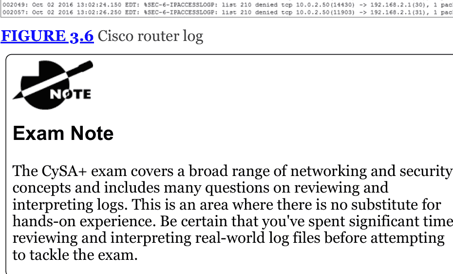

> **考试备注**
> CySA+ 考试涵盖了广泛的网络安全概念，并包含许多关于审查和解释日志的问题。这个领域没有实践经验可以替代的。在应对考试之前，确保你已经花了大量时间审查和解释真实日志。

## 网络设备配置

网络设备的配置文件在绘制网络拓扑时可能是无价之宝。配置文件通常包含网络、路由、设备交互的系统和其他设备的详细信息。此外，它们还可以提供 syslog 和 SNMP 服务器的细节、管理员和用户账户信息，其他配置项对于信息收集也有用。

图 3.7 显示了典型 Cisco 路由器的 SNMP 配置部分。读取整个文件可以看到路由信息、接口信息以及帮助你将路由器放在网络拓扑中的细节。所示部分提供了 SNMP 团体字符串、设备联系人以及启用了哪些陷阱及其它们发送到何处的详细信息。此外，你可以看到该组织使用终端访问控制器访问系统 (TAC) 来控制他们的服务器以及这些服务器的 IP 地址。作为安全分析师，这些是有用的的信息——对于攻击者来说，这可能是有效社交工程攻击的开始！

```
snmp-server community Example RO

snmp-server community Demo RW 2

snmp-server community Secure RW 51

snmp-server location Europe

snmp-server contact example@demo.com

snmp-server enable traps tty

snmp-server enable traps ike policy add

snmp-server enable traps ike policy delete

snmp-server enable traps ike tunnel start

snmp-server enable traps ike tunnel stop

snmp-server enable traps ipsec cryptomap add

snmp-server enable traps ipsec cryptomap delete

snmp-server enable traps ipsec cryptomap attach

snmp-server enable traps ipsec cryptomap detach

snmp-server enable traps ipsec tunnel stop

snmp-server enable traps ipsec too-many-sas

snmp-server host 10.16.11.254 *****

snmp-server host 172.16.2.2 *****

snmp-server host 172.16.2.24 *****

!\ tacacs-server host 172.16.3.126

tacacs-server host 172.16.55.33

tacacs-server directed-request

tacacs-server *****
```

图 3.7 典型路由器的 SNMP 配置

## Netflows

Netflow 是一种 Cisco 网络协议，用于收集 IP 流量信息，允许进行流量监控。流数据用于提供流量视图。典型的流采集包含了源和目的的 IP、端口以及业务类型。Netflows 和流分析器可以帮助识别服务问题并建立基准。

> Cisco 外的其他供应商创建了自己的流技术，虽然 "flows" 或 "netflow" 常用，但它们实际上使用自己的名称。Juniper 的 Jflow 和 cflowd、Citrix AppFlow 以及 HP 的 NetStream 以及 sFlow（采样流的行业术语）都是你可能会遇到的术语。

## Netstat

除了网络日志文件，可以使用 netstat 在 Windows、Linux 和 macOS 以及大多数 Unix 和类 Unix 操作系统获取本地主机网络信息。Netstat 提供了丰富的信息，其功能在操作系统之间略有不同。它可以提供如下信息：

- 活跃的 TCP 和 UDP 连接，按主要协议（TCP、UDP、ICMP、IP、IPv6 等）进行过滤。图 3.8 显示了 `netstat -ta` 的输出，显示了活跃的 TCP 连接。在这里有一个 SSH 会话连接到远程主机。

```
root@demo:~# netstat -ta

Active Internet connections (servers and established)
```


Proto Recv-Q Send-Q Local Address Foreign Address State

tcp 0 0 10.0.2.4:ssh ESTABLISHED

**图 3.8** Linux netstat 输出

字体 创建连接的可执行文件或其进程 ID (PID)。图 3.9 显示 Windows netstat 调用使用 `-o` 标志来识别进程号，然后可以使用 Windows 任务管理器引用这些编号。

```
C:\WINDOWS\system32>netstat -o

Active Connections

Proto  Local Address        Foreign Address     State           PID

TCP     127.0.0.1:80         dynamo:52964      TIME_WAIT       0

TCP     127.0.0.1:843       dynamo:49741      ESTABLISHED     2792

TCP     127.0.0.1:5354      dynamo:49669      ESTABLISHED     2768

TCP     127.0.0.1:5354      dynamo:49671      ESTABLISHED     2768

TCP     127.0.0.1:12360     dynamo:50622      ESTABLISHED     3112

TCP     127.0.0.1:27015     dynamo:49744      ESTABLISHED     2784

TCP     127.0.0.1:49669     dynamo:53534      ESTABLISHED     2784

TCP     127.0.0.1:49671     dynamo:53534      ESTABLISHED     2784

TCP     127.0.0.1:49692     dynamo:49693      ESTABLISHED     2792

TCP     127.0.0.1:49693     dynamo:49692      ESTABLISHED     2792
```

**图 3.9** Windows netstat -o 输出

- 以太网发送和接收字节数的统计信息。在图 3.10 中，在 Windows 系统上带有 `-e` 标志运行 netstat，提供接口统计数据。它会跟踪发送和接收的字节数，以及错误、丢弃和通过未知协议发送的流量。

```
C:\WINDOWS\system32>netstat -e

Interface Statistics

                               Received            Sent

Bytes                             180249200     11617458

Unicast packets                    1542688             957264

Non-unicast packets                23014             395290

Discards                               0

Errors                               0

Unknown protocols                   0
```

**图 3.10** Windows netstat -e 输出

- 路由表信息，包括 IPv4 和 IPv6 信息，如图 3.11 所示。这是使用 `-nr` 标志检索的，并根据操作系统包含各种信息，Windows 版本显示目标网络、子网掩码、网关、路由关联的接口以及路由的度量（metric），捕捉了链路速度和其他细节，以建立路由的优先级。

| IPv4 路由表 |
| :--- |
| 活动路由: |
| 网络目标 | 子网掩码 | 网关 | 接口 | 跃量 |
| 0.0.0.0 | 0.0.0.0 | 192.168.1.1 | 192.168.1.14 | 25 |
| 127.0.0.0 | 255.255.255 | 本地 | 127.0.0.1 | 331 |
| 127.0.0.1 | 255.255.255 | 本地 | 127.0.0.1 | 331 |
| 127.255.255 | 255.255.255 | 本地 | 169.254.71.224 | 281 |
| 169.254.0 | 255.255.255 | 本地 | 169.254.49.12 | 291 |
| 169.254.0 | 255.255.255 | 本地 | 169.254.129.13 | 291 |
| 169.254.0 | 255.255.255 | 本地 | 169.254.31.13 | 291 |
| 169.254.0 | 255.255.255 | 本地 | 169.254.147.98 | 291 |
| 169.254.0 | 255.255.255 | 本地 | 169.254.107.29 | 291 |
| 169.254.0 | 255.255.255 | 本地 | 169.254.34.58 | 291 |

**图 3.11** netstat -nr 输出

这意味着从系统中运行 `netstat` 可以提供关于机器网络行为以及本地网络状况的信息。了解哪些机器拥有或与哪些机器通信可以帮助你理解拓扑和服务。由于 `netstat` 在许多操作系统中默认可用，可以假设它存在并且可以使用它收集信息。

# DHCP 日志和服务器配置

动态主机配置协议（DHCP）是一种客户端/服务器协议，它为主机所在的网段提供 IP 地址、默认网关和子网掩码。当你从 DHCP 服务器进行侦察时，可以快速识别网络上的许多主机。如果你将 DHCP 日志与其他日志（例如防火墙日志）结合，就可以确定哪些主机获得了动态地址，哪些主机使用的是静态地址。如图 3.12 所示，`dhcpd.conf` 提供了主机的信息。

## DHCP

查看 `/usr/share/dhcp/dhcpd.conf`  
查看 `dhcpd.conf(5)` 手册页

```
default-lease-time 600;

max-lease-time 7200;

option subnet-mask 255.255.255.0;

option broadcast-address 192.168.1.255;

option routers 192.168.1.1;

option domain-servers 192.168.1.1, 192.168.1.2;

option domain-search "example.com";

subnet 192.168.1.0 255.255.255.0 {

  range 192.168.1.200 192.168.1.240;

}
```

```
host demo {

  option host-name "demo.com";

  hardware 08:00:27:fa:25:8e;

  fixed address 192.168.1.241;

}
```

**图 3.12** Linux dhcpd.conf


可以使用显示文件的命令轻松访问 `dhcpd.conf` 和其他配置文件。对于 Linux 系统，并不是所有的配置文件都存储在 `/etc` 目录中，某些应用程序和服务会将配置文件保放在其他地方。如果你在 `/etc` 中找不到配置文件，请检查文档。

在此示例中，DHCP 服务器提供了从 192.168.1.20 到 192.168.1.240 之间的 IP 地址；网络路由器是 192.168.1.1，DNS 服务器是 192.168.1.1 和 192.168.1.2。我们还看到一个名为“demo”的具有固定 DHCP 地址的系统。具有固定 DHCP 地址的系统通常是服务器或需要特定功能已知 IP 地址的系统，在收集信息时更有趣。

Linux 的 DHCP 日志通常位于 `/var/log/dhcpd.log` 或通过使用 `journalctl` 命令查看（取决于你使用的发行版），它们的 MAC 地址和 IP 地址在此日志所示：

```
Oct 5 02:28:11 demo dhcpd[3957]: reuse_lease: lease age 80 (secs) under 25% threshold, reply with unaltered, existing lease

Oct 5 02:28:11 demo dhcpd[3957]: DHCPREQUEST for 10.0.2.40 (10.0.2.32) from 08:00:27:fa:25:8e enp03

Oct 5 02:28:11 demo dhcpd[3957]: DHCPACK on 10.0.2.40 to 08:00:27:fa:25:8e enp03

Oct 5 02:29:19 demo dhcpd[3957]: reuse_lease: lease age 146 (secs) under 25% threshold, reply with unaltered, existing lease

Oct 5 02:29:19 demo dhcpd[3957]: DHCPREQUEST for 10.0.2.40 to 08:00:27:fa:25:8e enp03

Oct 5 02:29:19 demo dhcpd[3957]: DHCPACK on 10.0.2.40 to 08:00:27:fa:25:8e enp03
```

Sep 13 10:05:11 10.0.0.1 %ASA-5-111008: User 'ASAadmin' executed the 'enable' command

此命令表示用户 ASAadmin 运行了 Cisco 的 `enable` 命令，这通常用于进入设备的特权模式。如果 ASAadmin 本不应该使用管理员权限，这将在你的调查中成为一个立即的警示信号。


Cisco 防火墙日志使用消息标识符；在之前的代码段中，你可以看到 `%ASA-5-` 之后的六位数字。该标识符匹配命令类型，ASA 常见的安全助记标识符包括 4000xx、106xxx 和 710003。根据你正在查找的数据，其他命令也可能感兴趣。你可以通过以下链接找到列表以及如何通过 ASA 防火墙日志发现安全事件的技巧：www.cisco.com/c/en/us/about/security-center/identify-incidents-via-syslog.html。

也可以手动检查路由器/防火墙 ACL（访问控制列表）。这里显示了示例 Cisco ACL 的部分：

```
ip access-list extended in-lan

permit tcp 10.0.0.0 0.255.255.255 any eq 22

permit tcp 172.16.0.0 0.15.255.255 any eq 22

permit tcp host 192.168.2.1 any eq 22

deny tcp 8.16.0.0 0.15.255.255 any eq 22
```

此 ACL 段命名了访问列表，并针对允许执行这些操作的网络设置了一系列被允许的操作。这组规则专门允许 10.0.0.0 网络中的所有地址使用 TCP 端口 22 发送流量，即允许 SSH。172.16.0.0 网络以及 IP 地址为 192.168.2.1 的主机被允许相同的访问权限。最后的 `deny` 规则将阻止命定的网络范围发送 SSH 流量。

如果你在考试中遇到防火墙或路由器配置文件、日志文件或规则，将它们重写为你更容易阅读的语言可能会有所帮助。这样做时，可以从操作或命令开始；然后找到受影响的目标、用户或其他对象。最后，找到任何指定将发生什么或已发生什么的修饰符。在先的路由器配置中，你可以将 `permit tcp 10.0.0.0 0.255.255.255 any eq 22` 写为“允许来自 10.0.0.0 网络的任何源端口到目的端口 22 的 TCP 流量”。即使你不熟悉特定的配置或命令，这也能帮助你理解你将遇到的许多条目。

# 系统日志文件

大多数系统都会收集系统日志，以提供故障排除和其他系统信息。日志信息可能会有很大差异，取决于操作系统、如何配置，以及系统运行了哪些服务和应用程序。


## 日志类型

Linux 系统通常记录到 `/var/log` 目录，尽管单个应用程序可能有自己的日志目录。Windows 提供了几种类型的事件日志：

- 应用程序日志，包含程序或程序记录的事件。记录的内容各异。
- 安全日志，可以捕获登录事件、资源和权限使用情况，以及文件打开、创建或删除等事件。这些选项由管理员设置。
- 设置日志，记录了 Windows 设置的更改。
- 系统日志，记录了系统启动、停止等事件。
- 程序更新日志，记录了 Windows 更新的安装情况。

日志文件可以帮助你识别系统问题，并提供其他有用的详细信息。

```
Tracing route to bbc.co.uk [212.58.244.22]

over a maximum of 30 hops:

1  <15 ms  <15 ms  <15 ms  router.asource.com [192.168.1.1]

2  9 ms  * 8 ms  * 9 ms  96.120.24.111

3  9 ms  * 9 ms  * 9 ms  te3-0-a2.ur01.mishaka.in.sbend.com.net [68.86.118.93]

4  18 ms  * 17 ms  * 17 ms  te1-0-2-ar01.area4.il.chicago.comcast.net [162.151.36.93]

5  *  *  *  *  46.08.135

6  Request timed out.

7  107 ms 111 ms 106 ms  unknown-level3.net [212.187.139.230]

8  Request timed out.

9  108 ms 101 ms 108 ms  ae0e0.tele.h.bbc.co.uk [132.185.254.109]

10 106 ms 105 ms 108 ms  132.185.255.148

11 105 ms 107 ms 107 ms  212.58.244.22

Trace complete.
```


# 图 3.15 bbc.co.uk 的路由追踪

## 域名与 IP 范围

域名名称由域名注册商管理。域名注册商经由通用顶级域名 (gTLD) 注册局和/或国家代码顶级域名 (ccTLD) 注册局认证。这意味着注册商与域名注册局合作，提供注册服务；即获取和使用域名的能力。注册商在客户与域名注册局之间提供接口，并处理购买、账单和日常域名维护，包括域名注册的续期。

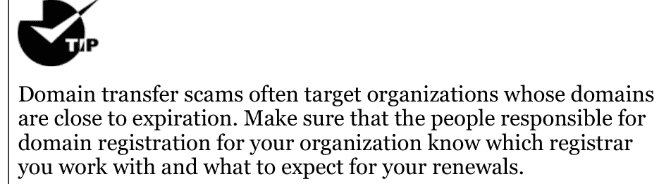

注册商还负责域名的转移，可能是由于出售或当域名转移到另一个注册商。这需要当前域名所有者的授权，并将域名释放给新的注册商。

## 我们忘记续期我们的域名了！

如果一个机构没有续期其域名，其他人就可以注册它。这种情况发生得频繁，有许多大公司忘记续期域名的例子。Google、微软、Regions Bank、达拉斯牛仔队和 FourSquare 都在这个域名续期问题的名单上。一个来自 Google 的故事为可能发生的情况提供了一个很好的例子。

2015 年，Google 的域名没有续期——事实上，google.com 可以通过 Google Domains（Google 自己的域名注册局服务）获取。前 Google 员工 Sanmay Ved 购买了 google.com，并立即收到了 Google 自己的域名所有者通常收到的消息。正如你所想象的，如果他决定滥用这种权力，他可能会制造巨大的混乱。

Google Domains 迅速取消了交易并退还了 Sanmay 的 12 美元。Google 后来给了 Sanmay 一笔发现该问题的“赏金”，Sanmay 将这笔钱捐给了慈善机构。

如果你想阅读 Sanmay 的完整故事，可以在 `www.linkedin.com/pulse/i-purchased-domain-googlecom-via-google-domains-sanmay` 找到。

### 域名信息：google.com

- **域名名称**：`google.com`
- **注册局域名 ID**：`2138514_DOMAIN_COM-VRSN`
- **注册局 WHOIS 服务器**：`whols.markmonitor.com`
- **注册局 URL**：`http://www.markmonitor.com`
- **更新日期**：`2015-06-12T10:38:52Z`
- **创建日期**：`1997-09-15T08:00:00Z`
- **注册局过期日期**：`2020-09-13T21:00:00Z`
- **注册局**：`Markmonitor.com`
- **注册局 IANA ID**：`292`
- **注册局滥用联系邮箱**：`abuse@complaints@markmonitor.com`
- **注册局滥用联系电话**：`+1.2089395740`
- **域名状态**：禁止更新（客户端）(`https://www.icann.org/app#clientUpdateProhibited`)
- **域名状态**：禁止传输（客户端）(`https://www.icann.org/app#clientTransferProhibited`)
- **域名状态**：禁止删除（客户端）(`https://www.icann.org/app#clientDeleteProhibited`)
- **域名状态**：禁止更新（服务器）(`https://www.icann.org/app#serverUpdateProhibited`)
- **域名状态**：禁止传输（服务器）(`https://www.icann.org/app#serverTransferProhibited`)
- **域名状态**：禁止删除（服务器）(`https://www.icann.org/app#serverDeleteProhibited`)
- **注册者**：`Google Inc.`
- **注册者名称**：`D Admin`
- **注册者组织**：`Google Inc.`
- **注册者街道地址**：`1600 Amphitheatre Parkway`
- **注册者城市**：`Mountain View`
- **注册者州/省**：`CA`
- **注册者邮政编码**：`94043`
- **注册者国家**：`US`
- **注册者电话**：`+1.6502530000`
- **注册者电话分机**：
- **注册者传真**：`+1.6506188571`
- **注册者传真分机**：
- **注册者邮箱**：`dns-admin@google.com`
- **注册局管理员 ID**：
- **管理员名称**：`DNS Admin`
- **管理员组织**：`Google Inc.`
- **管理员街道**：`1600 Amphitheatre Parkway`
- **管理员城市**：`Mountain View`
- **管理员州/省**：`CA`
- **管理员邮政编码**：`94043`
- **管理员国家**：`US`
- **管理员电话**：`+1.6506234000`
- **管理员电话分机**：
- **管理员传真**：`+1.6506188571`
- **管理员传真分机**：
- **管理员邮箱**：`dns-admin@google.com`
- **注册局技术 ID**：
- **技术名称**：`DNS Admin`
- **技术组织**：`Google Inc.`
- **技术街道**：`2400 E. Bayshore Pkwy`

## 图 3.16 为 google.com 的查询数据

```
root@demo:~# host google.com

google.com has address 216.58.216.238

google.com has IPv6 address 2607:f8b0:4009:200e

google.com mail is handled by 50 alt4.aspmx.l.google.com

google.com mail is handled by 20 alt1.aspmx.l.google.com

google.com mail is handled by 10 aspmx.l.google.com

google.com mail is handled by 40 alt3.aspmx.l.google.com

google.com mail is handled by 30 alt2.aspmx.l.google.com
```


图 3.17 google.com 的 host 命令响应


在进行侦察时，了解域所有权历史也可能很有用。诸如 Domain Tools 历史服务（`research.domaintools.com/research/whoistory/`）等各种服务提供了由 Who 提供的域名注册历史视图。许多域名所有者在域名注册一段时间后会减少可见数据量，这意味着历史注册信息可能成为细节的宝库。

## Responder

`Responder` 是一个 Python 脚本，是主动和被动信息收集工具之间的一种有趣的混合体。它首先被动地监控网络，等待其他系统发送广播请求。一旦 `Responder` 识别出这些请求之一，它就会切换到主动模式并响应，尝试劫持连接并从用户处收集信息。图 3.18 显示了 `Responder` 的启动界面，展示了 `Responder` 监控的各种服务。

## NBT-NS, LLMNR & MDNS

```
作者：Laurent Gaff (laurent.gaff@gmail.com) 按 CTRL-C 终止此脚本

+] 投毒者：
- LLMNR [开启]
- NBT-NS [开启]
- DNS/MDNS [开启]

+] 服务器：
- HTTP 服务器 [开启]
- HTTPS 服务器 [开启]
- WPAD [关闭]
- SMB 服务器 [开启]
- Kerberos 服务器 [开启]
- SQL 服务器 [开启]
- FTP 服务器 [开启]
- IMAP 服务器 [开启]
- POP3 服务器 [开启]
- SMTP 服务器 [开启]
- DNS 服务器 [开启]
- LDAP 服务器 [开启]

+] HTTP 选项：
- 始终提供 [关闭]
- 提供 [关闭]
- HTML [关闭]
- 上游 [关闭]

+] 投毒选项：
- 分析模式 [关闭]
- 强制 WPAD 认证 [关闭]
- 强制基础身份验证 [关闭]
- 强制降级 [关闭]
- 指纹识别 [关闭]

+] 通用选项：
- Responder 网卡 [eth0]
- Responder IP [172.31.25.248]
- 挑战集 [12233445566788]

+] 正在监听事件...
```

图 3.18 Responder 启动界面

## 信息聚合与分析工具

各种工具可以帮助聚合和分析收集到的信息。例如：`Harvester`，一种设计用于使用搜索引擎收集电子邮件、主机名、员工姓名以及开放端口和横幅（banners）的工具；`Maltego`，它可以构建人与其他资源之间的关系映射；以及用于搜索互联网连接设备及其漏洞的 `Shodan` 搜索引擎。使用像 `Harvester` 这样的工具可以简化大型数据集的搜索，但它不能完全替代人类的创造力。

## 使用数据包捕获进行信息收集

最后的被动信息收集方法需要访问目标网络。这意味着内部安全团队可以轻松地依赖数据包捕获作为工具，而渗透测试人员（或攻击者！）通常必须突破组织的安全防护才能捕获网络流量。

> 注意 数据包捕获工具通常被称为嗅探器或数据包分析器。

然而，一旦获得访问权限，数据包捕获就可以提供大量的有用信息。通过对单个主机进行捕获可以了解网络上有哪些系统，而操作系统指纹识别可以让你猜测远程主机的操作系统。如果你能够通过网络分接器（tap）或端口从战略位置捕获数据，你将获得更多的网络流量。

在图 3.19 中，你可以看到 `nmap` 扫描期间过滤的数据包捕获数据。使用数据包捕获既可以作为分析工具，也可以作为在特定时间对特定主机进行测试的证明。

## 组织情报（Organizational Intelligence）

CySA+ 考试目标重点是技术能力，但在进行渗透测试或保护组织时，理解非技术信息收集可以带来真正的优势。组织数据可以提供系统和网络结构的线索、社会工程的有用信息，以及特定平台或应用程序的细节。

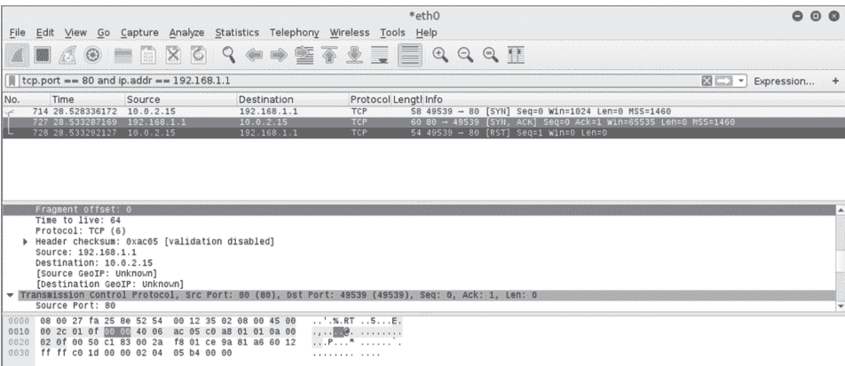

图 3.19 nmap 扫描期间的数据包捕获数据

## 组织数据

组织数据的收集有多种形式，从查看网站到搜索 EDGAR 财务数据库、从社交网络收集数据，甚至通过社会工程学人员来收集。

组织数据涵盖了广泛的信息。渗透测试通常寻找此类信息：

- 位置，包括建筑物所在地、安全性，甚至是组织的办公时间和工作流
- 部门、个人与其他组织之间的关系
- 组织架构图
- 文档分析——元数据和营销
- 财务数据
- 个人

收集组织数据的类型和方法取决于所进行的评估类型。无限制的外部渗透测试可能会使用我们讨论的所有技术，而内部评估可能仅验证关键信息是否公开。

## 获取有关物理设施的信息

侦察不仅局限于电子手段。物理侦察活动也是渗透测试人员和攻击者的考虑范围。物理侦察通常始于目标的公开数据，包括卫星图像、通过 Google 街景等工具提供的建筑外部图像、公共记录以及网上提供的组织物理设施信息。常见目标包括位置信息；工作时间以及可见的安全防护，如栅栏、大门和访问控制系统。

照片中的标签数据被称为 `Exif` 数据，是交换图像文件格式（Exchangeable Image File format）的一部分，可以使用 `Exif` 数据读取工具轻松读取。本书的作者之一通过要求学生在春假期间发送一张无害的照片，展示了像 `Exiftool` 这样的元数据查看工具的威力。一张简单的丰美午餐照片，只需通过将照片的 GPS 元数据输入到在线应用程序，就能识别出学生用餐的餐厅。

基于文档和电子邮件的分析数据也可以提供有关组织的有用信息。在图 3.20 中，一个名为 `Immersion` 的 MIT Media Labs 工具提供了关于那些向演示电子邮件账户经常发送邮件的人员信息。这种分析可以帮助快速识别关键联系人和主题，为进一步调查提供线索。

幸运的是，使用元数据清理实用程序或内置工具（如 Microsoft Word 内置的文档检查器或 Adobe Acrobat 中的检查文档工具）可以轻松处理元数据清理。许多网站会自动剥除位置信息等敏感元数据。

## Howard Wolowitz

159 位合作者

20.649 封电子邮件

## 我的统计数据

两位合作者

- 发出的邮件
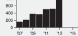

- 接收的邮件


- 新合作者

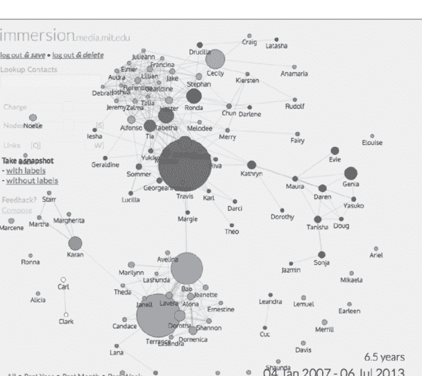


### 图 3.20 来自 immersion.media.edu 的演示账户

> 文件共享和协作云服务的出现，意味着组织的边界比员工倾向于依赖内部文件服务器时更加脆弱。如果你能找到一个公开共享其 Google Drive、Dropbox 或其他工作空间的员工或部门（或者攻击者！），可能会发现自己拥有公司无法监控的内部信息。

## 网站

在收集电子文档时，包含组织的网站似乎是显而易见的，但仅仅收集当前网站的信息并不能提供可能可用数据的完整视图。互联网归档（`archive.org`）和时空旅行服务（`timetravel.mementow.org`）都提供了搜索网站历史版本的方法。你也可以使用像 `cachedview.com` 这样的网站搜索 Google 和其他缓存。

历史和缓存信息可以提供宝贵的数据，包括组织认为已无法访问的细节。找到每个缓存副本的实例并确保它们被移除可能是很有挑战性的！

## 社交媒体分析

收集有关组织的信息通常包括收集有关组织员工的信息。社交媒体可以提供大量信息，从关于员工工作内容以及他们所使用的技术和项目的专业细节，到可以用于社会工程学或密码猜测的个人数据。社交媒体和互联网存在感画像分析练习可能会查看个人拥有的社交网络和个人资料、他们与谁联系、其个人资料包含多少元数据，以及他们的语气和发布行为。

> 社交媒体画像可能与来自数据库的信息相结合，这些数据库提供付费访问从公共记录和其他位置收集的个人信息。这些信息可以提供家庭地址、电子邮件和社交媒体账户信息、手机号码、亲属详情，甚至逮捕记录。这种深度信息可以帮助建立关于员工的详细画像，并在进行渗透测试或社会工程学练习时很有帮助。

除了用于监控之外，社交媒体画像还可以作为收集信息的一部分，社交媒体网站通常被用于社交工程攻击。了解用户的兴趣或细节，可以更有效地捕获社交工程攻击。

# 社交工程学

社交工程学是指利用人类元素进行安全漏洞，通过电话、电子邮件、社交媒体或面对面获取信息。社交工程学通常针对特定的访问或账户，但由于内部网络通常受到良好的保护，监控内部扫描通常比监控外部更容易。

社交工程学工具通常可以针对特定的访问或账户，但社交工程学通常针对特定的访问或账户。

许多工具包可用于社交工程学：

- Social Engineering Toolkit (SET)
- Creepy
- Metasploit
- Phishing

# 检测、预防和响应侦察

尽管侦察并不总是导致攻击，但连接到互联网的组织几乎不断被扫描，背景噪音使得检测变得困难。幸运的是，同样的方法也适用于。

# 捕获和分析数据以检测侦察

检测侦察的第一步是捕获数据。为了优先在哪里收集数据，你首先需要了解网络拓扑。监控网络区域之间的连接点以及敏感区域汇合处将产生最大的益处。由于内部。

## 数据源

通常用于分析的数据源包括：

- 使用入侵检测系统 (IDS)、入侵预防系统 (IPS)、主机入侵检测系统 (HIDS)、网络入侵检测系统、防火墙或其他网络安全设备的网络流量分析。设备通常提供以下类型之一：
    - 数据包分析：在单个数据包级别进行检查，以检测数据包内容、相关行为或包含的攻击特征。
    - 协议分析：检查流量以确保没有进行协议级攻击和利用。
    - 流量分析：根据历史流量模式和基于行为的模型进行监控。

无线分析使用相同的工具，并增加了对无线特定协议和功能的支持。由于无线网络可以从远处访问，它们有时是攻击者的目标。

- 设备和系统日志，在手动或使用工具分析时，可以识别侦察和攻击。
- 在内部进行的端口和漏洞扫描，以识别潜在问题。这些扫描可以将已知漏洞与尝试的利用相匹配，向管理员报警可能成功的攻击。
- 安全设备日志，旨在识别问题，并通常具有特定的检测和响应响应能力，有助于限制侦察的影响。
- 安全信息事件管理 (SIEM) 系统集中并分析数据，允许基于关联和分析能力对安全事件进行报告、通知和响应。

# 托管服务与侦察

外包服务使得针对你组织系统和数据的侦察活动更难检测。在某些情况下你仍然可以部署安全监控工具，但在大多数软件即服务 (SaaS) 和平台即服务 (PaaS) 环境中，你必须依赖外部提供商。如果是这样，确保他们拥有强大的安全计划并进行定期的外部安全审计对于安全的外包环境至关重要。

# 数据分析方法

如果你无法对数据进行关联和分析，收集数据将毫无意义。了解用于分析数据的现有可以帮助你决定如何处理数据以及你想要应用哪些工具。

- 异常分析寻找与既有模式或预期行为之间的差异。异常检测需要对什么是“正常”有所了解，以便识别差异并构建基础模型。入侵检测系统（IDS）和入侵防护系统（IPS）通常将异常检测作为其方法的一部分。
- 趋势分析侧重于根据现有数据预测行为。趋势分析有助于根据使用模式和观察到的增长预测未来的结果，例如网络拥塞。它不像安全分析方法那样被频繁使用，但对于确保服务能够处理组织的增长或日益增长的需求，保障服务的可用性非常有帮助。
- 签名分析使用指纹或特征签名来检测威胁或其他事件。这意味着在检测到威胁之前，必须先存在该签名，但如果签名设计得当，它就能可靠地检测出特定的威胁或事件。
- 启发式分析（或行为分析）用于根据其行为检测威胁。与签名检测不同，启发式检测关注威胁做了什么，而不是尝试将其与已知的指纹进行匹配。
- 手动分析也经常进行。在分析数据时，人类的专业知识和直觉可能有用，并可能检测出其他情况下无法发现的内容。

你对分析方法的选择将取决于你所拥有的工具以及你组织面临的威胁。在许多情况下，你可以在整个网络和系统的不同位置部署多种检测和分析方法。在构建全面的安全基础设施时，“深度防御”仍然是一个核心概念。

# 防止侦察

拒绝攻击者获取有关你组织的信息是一种实用的防御策略。既然你已经探索了如何进行侦察，你可能想要回顾如何限制这些策略的有效性。

> 注意：在考虑针对侦察的防御时，请记住网络深度防御应该实施许多限制主动侦察所需的防御。被动侦察和社交工程在以网络安全为中心的防御设计中较少处理。

# 防止主动侦察

可以通过采用网络防御来限制主动侦察，但如果你向外部提供任何服务，就无法完全阻止。主动侦察的预防通常依赖于常见的防御措施：

- 限制服务的外部暴露并确保你了解自己的外部足迹
- 使用 IPS 或类似的防御技术来限制或停止探测以防止扫描
- 使用监控和告警系统通知你尽管采取了这些预防措施仍持续发生的事件

检测内部网络上的主动侦察应该是重中之重，与扫描工具使用相关的策略也应该是首要考虑的，以确保攻击者探测你的内部系统时不会被发现。

# 防止被动信息收集

防止被动信息收集依赖于控制你发布的信息。回顾被动信息收集技术，然后确保你的组织已经刻意决定哪些信息应该是公开的，这对于确保被动信息收集不会成为重大风险至关重要。

每种被动信息收集技术都有其相应的控制方法。例如，域名注册商使用的 DNS 反爬技术可以防止滥用。这些包括：

- 对滥用服务的系统或网络建立黑名单
- 使用 CAPTCHA 防止机器人
- 提供使用第三方注册信息而非注册域名的个人或组织的隐私服务
- 实现速率限制以确保进行高速查询
- 如果尽可能发布区域文件，但通用顶级域名（gTLDs）必须发布区域文件，这意味着这仅适用于某些国家顶级域名（ccTLDs）

其他类型的被动信息收集都需要对暴露的数据进行彻底审查，并由组织决定哪些信息应该（或必须）暴露，哪些信息可以通过技术或行政手段进行限制。


保护社交媒体侦察可能是一项挑战，因为信息收集活动的大多数社交媒体目标都是个人账户。如果社交媒体信息收集是你组织特别关注的问题，那么在社交媒体安全上开展意识提升活动通常是最佳选择。

## 总结

攻击者和防御者都会进行侦察。双方都试图通过端口扫描、漏洞扫描和信息收集来获取有关潜在目标的信息，从而创建出组织网络和系统的概视图。安全专业人员可以使用他们收集的信息来改进防御态势，或识别潜在问题。攻击者可能会找到攻击脆弱基础设施所需的信息。

组织情报收集通常在进行足迹探测和主动侦察活动期间经常收集的技术信息之外，还会进行收集。组织情报侧重于有关组织的信息，例如其物理位置和设施安全、内部层级和结构、社交媒体和网络存在，以及政策和程序是如何运作的。这些信息可以帮助攻击者实施社交工程攻击，或者更好地利用他们在技术侦察活动中获得的信息。

侦察通常涉及使用 IDS、IPS 和网络流量监控器等工具对网络和系统进行监测。扫描和探测在公共网络上很常见，但内部网络应只在内部策略和程序设置的预期位置和时间出现扫描。意外扫描通常是被入侵或组织边界安全存在缺陷的标志。

作为一名安全从业人员，你需要了解如何通过端口扫描、漏洞扫描、日志审计、被动信息收集和组织情报收集来获取信息。你应该熟悉常用工具，如 `nmap`、漏洞扫描器以及 `dig`、`netstat` 和 `traceroute` 等本地主机实用工具。这些技能将为你提供理解必须防御的网络、系统和其他组织资产的能力。

## 考试要点

解释主动侦察对于理解系统和网络暴露至关重要。主动侦察涉及探测系统和网络以获取信息。端口扫描是侦察期间频繁的第一步，`nmap` 是端口扫描中系统、端口、操作系统和服务发现常用工具。主动侦察还可以通过捕获信息并分析网络设备及系统的响应来确定网络拓扑。了解常见的端口和服务组合对于分析和理解已发现的服务非常重要。

描述检测侦察如何帮助识别安全漏洞并预警潜在攻击。检测侦察依赖于捕获收集活动的证据。这通常通过 IDS、IPS 和日志分析等工具，并通过使用 SIEM 系统对信息进行关联来完成。用于检测侦察的自动化数据分析方法会寻找异常、趋势、特征和行为，但在处理过程中引入人类专家可以识别程序可能遗漏的事件。

描述防止和响应侦察依赖于什么。防止信息收集通常需要限制组织的数字足迹（footprint），并使用如 IPS 或防火墙等自动化手段检测并防止信息收集。渗透测试（penetration testing）和自测等主动性措施可以确保你了解并熟悉自己的足迹以及潜在的暴露区域。部署的每项技术和服务都需要一个特定的计划来防止或限制信息收集。

## 实验练习

## 活动 3.1：端口扫描

在此练习中，你将使用 Kali Linux 虚拟机执行以下操作：

- 使用 `nmap` 对受漏洞系统进行端口扫描
- 识别远程系统的操作系统和版本
- 在端口扫描期间捕获数据包

### 第一部分：设置虚拟机

关于下载和设置 Kali Linux 和 Metasploit 虚拟机的信息可以在本书的引言部分找到。如果你已经设置好了运行 `nmap` 的系统，也可以使用你自己的系统。

1. 启动 Kali Linux 和 Metasploitable 虚拟机并登录两者。Kali Linux 的用户名/密码对是 root/toor，Metasploitable 使用 msfadmin/msfadmin。

2. 在 Metasploitable 虚拟机的控制台中运行 `ifconfig`。注意分配给系统的 IP 地址。

### 第二部分：执行端口扫描

现在我们将对 Metasploitable 虚拟机进行端口扫描。Metasploitable 的设计是存在漏洞的，因此我们应该预见到看到许多在安全良好的 Linux 系统上可能无法看到的服务。

1. 使用屏幕顶部菜单栏打开终端（Terminal）窗口。

2. 要运行 `nmap`，只需输入 `nmap` 和目标系统的 IP 地址。使用 Metasploitable 系统的 IP 地址：`nmap [target IP]`。

哪些端口是开放的？识别出了哪些服务？你认为你识别了系统上所有的开放端口吗？

3. 现在我们将识别 Metasploitable 虚拟机的操作系统。这是通过 `nmap` 中的 `-O` 标志启用的。重新运行你的 `nmap`，这次输入 `nmap -O [target IP]` 和 `-p 1-165535` 以捕获所有可能的端口。

Metasploitable 虚拟机运行什么操作系统和版本？出现了哪些额外的端口？

## 活动 3.2：编写情报收集计划

对于此活动，请为你选择的组织设计一个被动情报收集计划。在编写计划之前，你可能参考 OSSTMM、NIST SP 800-115 或 pentest-standard.org 等资源。

你的情报收集计划应识别以下内容：

- 目标
- 你将如何收集被动数据，包括你要寻找哪些数据
- 你将使用哪些工具

完成后，使用之前列出的一个或多个参考资料审查你的计划。识别你遗漏了什么，以及还可以收集哪些额外数据。

重复该活动，记录你将如何执行主动情报收集，包括你将如何确定网络拓扑、使用了哪些操作系统以及哪些服务是可以访问的。记住考虑有线和无线网络、现场托管和云托管，以及虚拟机与物理主机等变量。

## 活动 3.3：情报收集技术

将下表中的每种信息类型与可以帮助收集它的工具进行匹配。

| 信息类型 | 工具 |
| :--- | :--- |
| 通往系统的路由 | `netstat` |
| 通过网络的开放服务 | `Whois` |
| IP 流量和容量 | `traceroute` |
| 与域名注册相关的组织联系信息 | `Wireshark` |
| 按协议列出的连接 | `Nmap` |
| 数据包捕获 | `Creepy` |
| 区域传输 | `dig` |
| 社交媒体地理标记 | `netflow` |

## 复习题

1. 哪种方法用于复制 DNS 服务器的 DNS 信息，但也是攻击者眼中非常有吸引力的利用目标？

A. DNSSEC
B. AXR
C. DNS 注册
D. 区域传输 (Zone transfers)

2. `nmap` 使用什么标志来启用操作系统识别？

A. -os
B. -id
C. -o
D. -scan

3. 使用什么命令可以确定流量通过访问网络的路径？

A. Whois
B. traceroute
C. nslookup
D. route

4. 从图像中经常可以收集到什么类型的数据？

A. 扩展格式
B. Exif
C. PNG
D. 元数据 (metadata)

5. 哪个日志最可能包含关于文件删除的信息？

A. http
B. security
C. system
D. configuration

6. 在被动收集期间，使用工作站上的 `netstat` 无法找到哪些信息？

A. 活跃 TCP 连接
B. 可执行文件列表
C. 活跃 UDP 连接
D. 路由表

7. 下列选项最可能用于 `dhcp.conf` 条目？

```


```
host {

  option host-name "example.com";

  hardware ethernet 00:21:9f

  fixed address 10.1.2.40

}
```

A. AD 服务器
B. Apache Web 服务器
C. Oracle 数据库服务器
D. Microsoft SQL

8. 哪个组织管理全球 IP 地址空间？

A. NASA
B. ARIN
C. WorldNIC
D. IANA

9. 在 Ben 发送 Word 文档之前，他使用内置的文档检查器（Document Inspector）验证文件不包含隐藏内容。这被称为什么？

A. 数据清除 (Data purging)
B. 数据残留 (Data remanence)
C. 元数据清洗 (Metadata scrubbing)
D. 文件清洗 (File cleansing)

10. 哪种分析最适合识别在受损系统上运行的未知恶意软件？

A. 趋势分析
B. 特征分析
C. 启发式分析
D. 回归分析

11. 下列哪项不是常见的 DNS 采集技术？

A. 封锁系统或网络
B. 手动注册
C. 速率限制
D. CAPTCHAs

12. 此命令正在使用哪种技术？

```
dig axfr @ns-server example.com
```


A. DNS 查询
B. nslookup
C. dig
D. 区域传输 (Zone transfer)

13. 下列哪项不是渗透测试人员在进行端口扫描和漏洞扫描时经常执行数据包捕获的原因？

A. 工作流程记录
B. 为分析捕获额外数据
C. 可信的否认性 (Plausible deniability)
D. 提供时间线

14. 哪种过程使用诸如系统 TCP 栈响应查询的方式、支持的 TCP 选项以及初始窗口大小等信息？

A. 服务识别
B. 模糊
C. 应用扫描
D. 操作系统检测

15. 使用什么工具捕获 IP 流量信息以提供网络流量和容量信息？

A. libpcap
B. netflow
C. netstat
D. pflow

16. 哪种用于在 DNS 服务器之间复制 DNS 信息的方法也可用于收集大量关于组织系统的信息？

A. traceroute
B. 区域传输 (Zone transfer)
C. DNS 同步
D. dig

17. Selah 认为她正在渗透的机构过去可能在其网站上暴露过关于系统的信息。哪个网站可以帮助她找到该网站的旧版本？

A. 网页档案馆 (Internet Archive)
B. WikiLeaks
C. 互联网回溯器
D. 时间转换器

19. 在一次信息收集练习中，Chris 被要求查找其目标员工的详细个人信息。通常寻找这类信息的最佳地方是哪里？

- A. 论坛
- B. 社交媒体
- C. 公司网站
- D. 诡异网站 (Creepy)

20. 哪种查询工具提供有关域名注册商和物理位置的信息？

- A. nslookup
- B. host
- C. Whois
- D. traceroute

# 第 4 章
设计漏洞管理计划

本章涵盖的 CompTIA 网络安全分析师 (CYSA+) 考试目标包括：

- 领域 1.0：威胁与漏洞管理
  - 1.3 在给定的场景下，执行漏洞管理活动。
  - 1.4 在给定的场景下，分析常用漏洞评估工具的输出结果。
- 领域 3.0：安全运营与监控

网络安全是一场猫鼠游戏，信息技术人员几乎每天都在寻求对抗对手发现的新漏洞。现代企业由复杂程度几乎无法想象的硬件和软件组成，而在这些系统内部隐藏着数千个未被发现的漏洞，等待攻击者去利用。漏洞管理计划旨在攻击者利用这些漏洞破坏企业信息资产的机密性、完整性可用可用之前，识别、排序并修复这些漏洞。有效的漏洞管理计划采用组织化的方法扫描企业资产漏洞，使用定义的工作流修复这些漏洞，并进行持续评估，为技术人员和经理提供对企业网络安全现状的洞察。

## 识别漏洞管理需求

当组织开始开发漏洞管理计划时，首先应对漏洞扫描的任何内部或外部需求进行识别。这些需求可能来自组织运营的监管环境，和/或内部政策驱动的需求。

## 监管环境

许多组织发现自己受法律法规的约束，这些法规规定了存储、处理和传输不同类型数据的方式。当组织处理敏感个人信息或政府机构的信息时，情况尤其如此。

其中许多法律并没有过度的规定，也没有专门针对漏洞管理计划的实施。例如，《健康保险流通与责任法案》(HIPAA）监管了医疗保健提供者、保险公司及其业务处理受保护健康信息的方式。同样，《格拉姆-里奇-布莱尔法案》(GLBA)规范了金融机构如何处理客户财务记录。这两个法律都不要求受保护组织进行漏洞扫描。

然而，有两种监管方案明确强制要求实施漏洞管理计划：支付卡行业数据安全标准 (PCI DSS) 和《联邦信息安全管理法》(FISMA)。

## 支付卡行业数据安全标准 (PCI DSS)

PCI DSS 为处理信用卡交易的商户以及协助商户进行此类交易的服务提供者规定了特定的安全控制。该标准包含了被认为是任何标准中对漏洞扫描的最具体的要求。

与某些人的观点相反，PCI DSS 并不是 `true` 法律。该标准由一个名为支付卡行业安全标准委员会 (PCI SSC) 的行业小组维护，该小组由行业资助以维护这些要求。组织受 PCI DSS 约束是因为合同要求，而不是因为法律。

PCI DSS 规定了漏洞扫描的许多细节，包括：

- 组织必须同时运行内部和外部漏洞扫描（PCI DSS 要求 11.2）。
- 组织必须每季度执行一次扫描，并在“网络发生任何重大变化（如安装新系统组件、网络拓扑结构变化、防火墙规则修改、产品升级）后”执行（PCI DSS 要求 11.2）。
- 内部扫描必须由合格的人员进行（PCI DSS 要求 11.2.1）。
- 组织必须修复任何高风险漏洞并重复扫描以确认其已解决，直到收到“清洁”的扫描报告（PCI DSS 要求 11.2.1）。
- 外部扫描必须由 PCI SSC 授权的认可扫描供应商 (ASV) 进行（PCI DSS 要求 11.2.2）。

用于 PCI DSS 合规的漏洞扫描是一个蓬勃且竞争激烈的行业，许多安全咨询公司专门从事此类扫描。许多组织选择先进行自行扫描，以便在向 ASV 请求正式扫描之前确保自己能够获得通过的结果。


> 除非获得明确许可，否则你绝不应进行漏洞扫描。未经许可运行扫描可能会严重违反组织的安全策略，并可能可能构成犯罪。

## 联邦信息安全管理法 (FISMA)

《联邦信息安全管理法》(FISMA) 要求政府机构以及代表政府机构运营的其他组织遵守一系列安全标准。这些标准要求的特定控制取决于政府根据图 4.1 所示的定义将系统指定为低影响、中等影响还是高影响。关于系统分类的进一步指导请参见《联邦信息处理标准》(FIPS) 199：联邦信息和信息系统安全分类标准》。

## 潜在影响

| 安全目标 | 低 | 中等 | 高 |
| --- | --- | --- | --- |
| **机密性** 保持对信息访问和泄露的限制，包括保护个人隐私和信息的方法。[44 U.S.C., SEC. 3542] | 信息的未经授权泄露预计会对组织运营、组织资产或个人产生**有限**的影响。 | 信息的未经授权泄露预计会对组织运营、组织资产或个人产生**严重**的负面影响。 | 信息的未经授权泄露预计会对组织运营、组织资产或个人产生**严严重或灾难性**的负面影响。 |
| **完整性** 防止不当的修改或破坏，包括信息的不可否认性和真实性。[44 U.S.C., SEC. 3542] | 信息的未经授权修改或破坏预计会对组织运营、组织资产或个人产生**有限**的影响。 | 信息的未经授权修改或破坏预计会对组织运营、组织资产或个人产生**严重**的负面影响。 | 信息的未经授权修改或破坏预计会对组织运营、组织资产或个人产生**严严重或灾难性**的负面影响。 |
| **可用性** 确保及时可靠地访问和使用信息。[44 U.S.C., SEC. 3542] | 信息系统访问或使用的预计会对组织运营、组织资产或个人产生**有限**的负面影响。 | 信息系统访问或使用的中断预计会对组织运营、组织资产或个人产生**严重**的负面影响。 | 信息系统访问或使用的中断预计会对组织运营、组织资产或个人产生**严严重或灾难性**的负面影响。 |

## 图 4.1 FIPS 199 标准

（来源：FIPS 199）

所有联邦信息系统无论影响分类如何，都必须符合 NIST 特别出版物 800-53《联邦信息系统和组织安全与隐私控制》中的漏洞扫描基本要求。这些要求每个受 FISMA 制的组织执行以下操作：

- a. 扫描信息系统和托管应用程序的漏洞，并在发现可能影响系统/应用程序的新漏洞时对其进行报告。
- b. 采用漏洞扫描工具和技术，以促进工具之间的互操作性，并使用以下标准实现漏洞管理过程的部分自动化：
  1. 列举平台、软件缺陷和不当配置
  2. 格式化检查清单和测试程序
  3. 衡量漏洞影响
- c. 分析漏洞扫描报告和安全控制评估结果。
- d. 根据组织对风险的评估，修复合规的漏洞。
- e. 分享从漏洞扫描过程和安全控制评估中获得的信息，帮助消除其他信息系统中的类似漏洞（即系统性弱性或缺陷）。

这些要求为所有联邦信息系统建立了一个基准。NIST 800-53 描述了根据情况可能需要的八种控制增强：

- 1. 组织采用的漏洞扫描工具应包含能够易地更新待扫描信息系统漏洞的能力。
- 2. 组织在进行新扫描之前（和/或）在发现并报告新漏洞时，更新已扫描的信息系统漏洞。
- 3. 组织采用的漏洞扫描程序能够识别覆盖的广度和深度（即扫描的信息系统组件和检查的漏洞）。
- 4. 组织确定对手可以发现的关于信息系统的信息，并随后采取组织定义的纠正措施。
- 5. 信息系统针对选定的漏洞扫描活动实现了信息系统组件的特权访问授权。
- 6. 组织采用自动化机制比较随时间变化的漏洞扫描结果，以确定信息系统漏洞的趋势。
- 7. （要求 7 已撤回。）
- 8. 组织审查历史审计日志，以确定信息系统中识别出的漏洞是否曾被利用。
- 9. （要求 9 已撤回。）

请注意，要求 7 和 9 是之前包含在标准中的控制增强，但后来被撤销了。
当联邦机构确定某个信息系统属于中等影响类别时，它必须至少实施控制增强 1、2 和 5。如果机构确定某个系统为高影响，则必须至少实施控制增强 1、2、4 和 5。

## 公司政策

PCI DSS 和 FISMA 的规定性安全要求涵盖了涉及零售交易处理和运行政府系统的组织，但这两类群体仅占企业的一小部分。网络安全专业人员广泛认为，漏洞管理是任何信息安全计划的关键组成部分，出于这一原因，许多组织在公司政策中强制要求漏洞扫描，即使这一要求并非来自监管性强制。

# 识别扫描目标

一旦组织决定希望进行漏洞扫描，并确定（如果有）哪些监管要求适用于其扫描，他们就进入了规划过程中更详细的阶段。下一步是识别将由漏洞扫描覆盖的系统。有些组织选择在扫描过程中覆盖所有系统，而另一些则根据许多不同问题的答案以不同的方式扫描系统（或完全不扫描），这些问题包括：

- 系统存储、处理或传输的信息的**数据分类**是什么？
- 系统是否暴露在互联网或其他公共或半公共网络上？
- 系统提供哪些服务？
- 该系统是生产系统、测试系统还是开发系统？

组织还使用自动化技术来识别可能被扫描的系统。网络安全专业人员使用扫描工具在网络中搜索连接的系统（无论之前是已知的还是未知的），并构建资产清单。图 4.2 显示了使用 Qualys 漏洞扫描器资产清单功能开发的资产地图示例。

管理员随后可以使用有关系统类型及其处理的信息的额外信息来补充此清单。这些信息有助于判断哪些系统是关键的，哪些是非关键的。资产清单和**资产关键性**信息有助于指导关于执行扫描类型、扫描频率以及管理员在修复扫描检测到的漏洞时应放在优先级的决策。

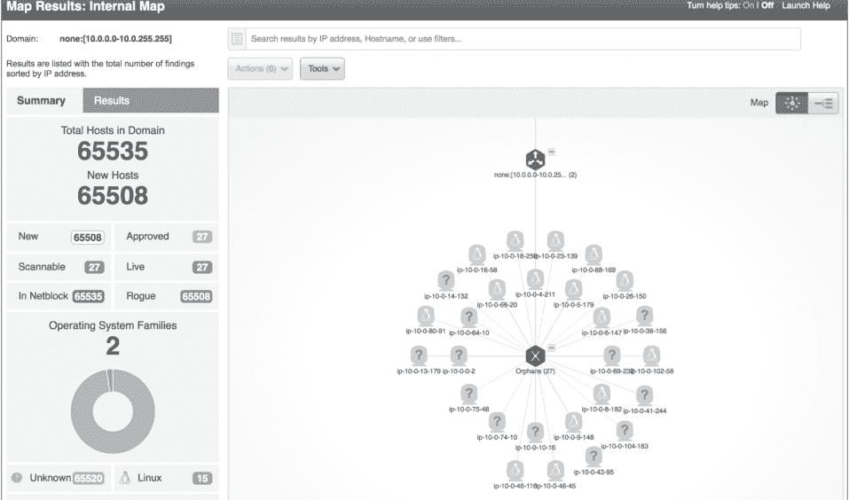

图 4.2 Qualys 资产地图

# 确定扫描频率

网络安全专业人员依赖自动化来帮助他们以高效有效的方式履行职责。漏洞扫描工具允许自动调度扫描，减轻管理员的负担。图 4.3 显示了在 Tenable 的 Nessus 产品中如何配置这些扫描的示例。Nessus 是市场上最早的漏洞扫描器之一，直到今天仍被广泛使用。管理员可以指定符合其安全、合规和业务要求的计划。

管理员应该配置这些扫描，以便在检测到新漏洞时提供自动告警。许多安全团队配置扫描产生扫描结果的自动电子邮件报告，如图 4.4 所示的报告。

许多不同因素影响了组织决定对其系统进行漏洞扫描的频率：

- 组织的风险偏好是其对环境中风险的容忍程度。如果一个组织极度回避风险，可能会选择更频繁地进行扫描，以缩短漏洞产生到被扫描检测到之间的时间。
- 监管要求（如 PCI DSS 或 FISMA）可能规定了组织对其系统进行漏洞扫描的频率。要求也可能来自公司政策。

### 图 4.3 配置 Nessus 扫描

### 图 4.4 Nessus 报告

- 技术限制可能会限制扫描频率。例如，扫描系统每天只能执行特定次数的扫描，组织可能需要调整频率以确保所有扫描完成。
- 业务限制可能会限制组织在业务活跃期间进行资源密集型漏洞扫描。
- 许可证限制可能会限制扫描器的带宽或同时进行的扫描数量。

网络安全专业人员在规划漏洞扫描计划时必须平衡这些考虑因素。从小开始并随着时间的推移逐渐扩大漏洞扫描的范围和频率是明智的，以避免使扫描基础设施或企业系统崩溃。

## 活跃扫描 vs 被动扫描

大多数漏洞扫描工具执行活跃扫描，这意味着工具实际上与被扫描主机交互，以识别开放的服务并检查可能的漏洞。活跃扫描确实提供了高质量的结果，但这些结果也有一些缺点：

- 活跃扫描具有较大的噪声，并且可能会被扫描系统的管理员发现。这在管理员已知扫描的环境中可能不是问题，但如果扫描旨在隐蔽，那么活跃扫描就会出现问题。
- 活跃扫描还有意外利用漏洞并干扰生产系统运行的风险。尽管活跃扫描器通常具有可以来减少这种风险的设置，但事实是活跃扫描可能会导致生产问题。
- 如果被防火墙、入侵防御系统、网络分段或其他安全控制拦截，活跃扫描可能会完全错过某些系统。

被动漏洞扫描采用了一种不同的方法，作为活跃扫描的补充。被动扫描器不是探测系统寻找漏洞，而是监控网络，类似于入侵检测系统使用的技术。但它们不是监控入侵尝试，而是寻找过时系统和应用程序的典型特征，并向管理员报告结果。

被动扫描具有一些吸引人的优点，但它们只能检测反映在网络流量中的漏洞。它们不是活跃扫描的替代品，但是对定期活跃漏洞扫描的强有力补充。

## 配置和执行漏洞扫描

一旦安全专业人员确定了漏洞管理计划的基本要求，他们必须配置漏洞管理工具用于根据基于基于的扫描规范执行扫描。这些任务包括确定每次扫描的适当范围、配置扫描以满足组织需求，以及维护漏洞扫描工具的最新性。

## 确定漏洞扫描范围

漏洞扫描的范围描述了扫描的范畴，包括对以下问题的回答：

- 哪些系统和网络将包含在漏洞扫描中？
- 将使用哪些技术措施来测试网络上是否存在系统？
- 将对漏洞扫描发现的系统执行哪些测试？

管理员应首先从宏观角度回答这些问题，并确保他们已获得技术人员和管理层的共识，即这些扫描是恰当的，并且不太可能对业务造成干扰。一旦确定扫描设计良好且不太可能引起严重问题，就可以开始在漏洞管理工具中配置扫描了。

## 针对合规性目的确定范围

确定范围是网络安全分析师工具箱中的某项重要工具，因为它允许分析师将问题缩小到可管理的规模。例如，一个处理信用卡的组织可能面临一项看似不可逾越的任务，即在其由数千个系统组成的整个网络中实现 PCI DSS 合规。

通过明智地使用网络分段和其他技术，管理员可以隔离涉及信用卡处理的少数系统，将它们与组织网络上的大部分系统隔离开。当操作得当时，这种分段可以将 PCI DSS 合规的范围缩小到用于支付卡片处理的更小的隔离网络。

当组织能够缩小 PCI DSS 网络的范围时，它也缩小了许多所需的 PCI DSS 控制的范围，包括漏洞扫描。他们可能不再与经过批准的扫描供应商签订合同对组织的整个网络进行季度合规扫描，而是将该扫描范围缩小到那些积极参与卡片处理的系统。这将大幅降低扫描任务的成本，以及扫描完成后网络安全专业人员所面临的修复工作量。

## 配置漏洞扫描

漏洞管理解决方案为管理员提供了配置许多与扫描相关的不同参数的能力。除了调度自动扫描和生成报告外，管理员还可以自定义扫描器执行的检查类型、提供访问目标服务器的凭据、在目标服务器上安装扫描代理，并从各种网络视角进行扫描。

## 扫描敏感性级别

配置漏洞扫描的网络安全专业人员应密切关注与扫描敏感性级别相关的设置。这些设置决定了扫描器将执行的检查类型，并应进行自定义，以确保扫描在实现其目标的同时，最大限度地减少干扰目标环境的可能性。

通常，管理员通过从模板开始创建一个新扫描。这可能是漏洞管理供应商提供并内置在产品中的模板（例如图 4.5 所示的 Nessus 模板），也可能是为组织内部使用而创建的自定义模板。当管理员创建自己的扫描配置时，他们应该考虑将常用的配置设置保存在模板中，以便高效利用他们的工作，在配置扫描时节省时间并减少错误。


## 图 4.5 Nessus 扫描模板

管理员还可以通过配置在每次扫描期间运行的特定插件（plug-ins）来提高扫描效率。每个插件对特定漏洞进行检查，这些插件通常根据它们涉及的操作系统、应用程序或设备进行族类。禁用不必要的插件可以通过跳过不必要的检查来提高扫描速度，还可能减少扫描器检测到的误报结果数量。

例如，不使用 Amazon Linux 操作系统的组织可能选择在扫描模板中禁用所有与 Amazon Linux 相关的检查。图 4.6 显示了在 Nessus 中禁用这些插件的示例。

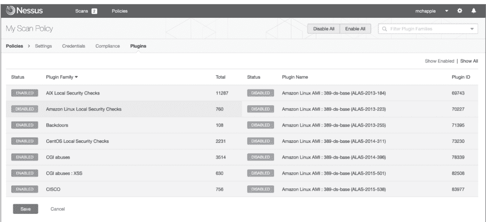

## 图 4.6 禁用未使用的插件


某些插件执行的测试可能会干扰生产系统的活动，或者在最坏的情况下损坏这些系统的内容。这些插件处于棘手的境地。凭据扫描可能会识别出被恶意源利用的问题。同时，网络安全专业人员显然不想在网络上引起问题。

解决这一问题的方法之一是维护一个包含生产网络运行相同系统的测试环境，并首先对这些系统运行扫描。如果扫描在测试环境中检测到问题，管理员可以在生产网络上运行扫描之前修正底层原因。

## 补充网络扫描

基础漏洞扫描在网络上运行，从远处探测系统。这通过模拟攻击者从另一个视角可能看到的内容，为系统的安全提供了一个真实的视图。然而，扫描器与目标服务器之间路径上的防火墙、入侵防御系统和其他安全控制可能会影响扫描结果，提供不准确的服务器视图。

此外，许多安全漏洞很难通过远程扫描进行确认。在网络上运行的漏洞扫描可能会检测到漏洞存在的可能性，但无法确认确认，导致需要管理员进行耗时的调查。

现代漏洞管理解决方案可以使用有关服务器配置的可信信息补充这些远程扫描。这些信息可以通过两种方式获取。首先，管理员为扫描器提供凭据，允许扫描器连接到目标服务器并检索信息。然后可以使用这些信息来确定是否存在漏洞，提高扫描的准确性。例如，如果漏洞扫描检测到一个可以通过操作系统更新修复的问题，凭据扫描可以检查系统是否安装了更新。

图 4.7 显示了 Qualys 中可用的凭据扫描选项。凭据扫描可以访问操作系统、数据库和应用程序等源。

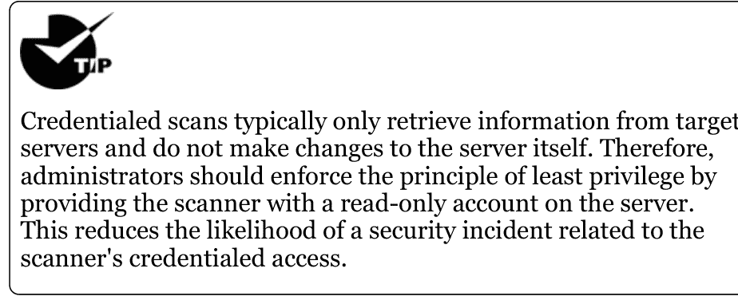

凭据扫描通常只从目标服务器检索信息，不对服务器本身进行任何更改。因此，管理员应通过为扫描器提供服务器上的只读帐户来执行最小权限原则。这降低了与扫描器凭据访问相关的安全事件可能性。

| 身份验证 | 允许扫描器在扫描时登录主机以扩展检测能力。查看在线帮助了解如何配置此选项。 |
| :--- | :--- |
| ☑ Windows | |
| ☑ Unix/Cisco IOS | |
| ☑ Oracle | |
| ☐ Oracle Listener | |
| ☐ SNMP | |
| ☐ VMware | |
| ☐ DB2 | |
| ☐ HTTP | |
| ☐ MySQL | |

## 图 4.7 配置身份验证扫描

除了凭据扫描外，某些扫描器还使用基于代理的扫描方法来补充传统的基于服务器的漏洞扫描方法。在这种方法下，管理员在每个目标服务器上安装小型软件代理程序。这些代理程序会对服务器配置进行扫描，提供“从内而外”的漏洞扫描，然后将信息报告回漏洞管理平台进行分析和报告。

> 系统管理员通常对在他们管理的服务器上安装代理程序持谨慎态度，担心代理程序会导致性能或稳定性问题。如果你选择使用基于代理的扫描方法，应该审慎地对待这一概念，从一个小规模的试点部署开始，在对代理程序建立信心之后，再进行更广泛的部署。

## 扫描视角

全面的漏洞管理计划提供了从各种*扫描视角*进行扫描的能力。每个扫描视角从网络上的不同位置执行扫描，提供对漏洞的差异化。例如，外部扫描是从互联网运行的，让管理员能够看到位于组织外的攻击者所看到的潜在漏洞。内部扫描可能从通用企业网络上的扫描器运行，提供恶意内部人员可能遇到的视图。最后，位于数据中心内部的扫描器和位于服务器上的代理程序提供了关于服务器真实状态最准确的视图，它们显示了可能被网络其他安全控制措施拦截的漏洞。影响扫描结果的控制措施包括：

- 防火墙设置
- 网络分段
- 入侵检测系统 (IDS)
- 入侵预防系统 (IPS)

PCI DSS 的内部和外部扫描是从不同视角执行扫描的良好示例。组织可以进行自己的内部扫描，但必须用经过批准供应商执行的外部扫描进行补充。

漏洞管理平台具有管理不同扫描器并提供扫描结果汇总视图的能力，汇总来自不同来源的数据。图 4.8 显示了管理员如何为新配置的 Qualys 扫描选择扫描器的示例。

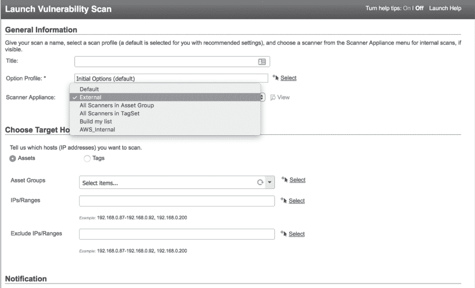

## 图 4.8 选择扫描设备

## 扫描器维护

与任何技术产品一样，漏洞管理解决方案需要精心的维护。管理员应对其漏洞扫描器进行定期维护，以确保扫描软件和漏洞源数据保持更新。

> 提示：扫描系统确实提供了自动更新功能，可以保持扫描器及其漏洞源数据的实时更新。组织可以并且应该利用这些功能，但偶尔检查并手动验证扫描器是否正常更新始终是一个好主意。

## 扫描器软件

扫描系统本身对漏洞并非免疫。如图 4.9 所示，即使是漏洞扫描器也存在安全问题！定期修复扫描器软件可以保护组织免受针对扫描器的漏洞，还能提供重要的错误修复和功能增强，以提高扫描质量。

## 信息技术实验室
国家漏洞数据库 (NVD)

漏洞

## # CVE-2019-3974 详情

## 当前描述

发现 Windows 平台上的 Nessus 8.5 及更早版本存在一个问题，即系统文件可以被任意覆盖，可能导致拒绝服务状态。

来源：MITRE

*查看分析描述*

## 快速信息

| CVE 字典条目: | CVE-2019-3974 |
|---|---|
| NVD 发布日期: | 2019/08/15 |
| NVD 最后修改日期: | 2019/08/27 |

## 严重性

CVSS 版本 3.x CVSS 版本 2.0

CVSS 3.x 严重性及指标：

NIST: NVD 基准分：8.1 高
向量：CVSS:3.0/AV:N/AC:L/PR:L/UI:N/S:U/C:H/I:H/A:H

图 4.9 NIST 国家漏洞数据库中的 Nessus 漏洞

（来源：NIST）

## 漏洞插件源

安全研究人员每周都会发现新漏洞，只有当漏洞扫描器频繁接收插件更新时，它们才能有效应对这些漏洞。管理员应配置扫描器以定期（最好是每天）获取新插件。幸运的是，如图 4.10 所示，这一过程很容易实现自动化。

## 安全内容自动化协议 (SCAP)

安全内容自动化协议 (SCAP) 是安全社区在美国标准与技术研究院 (NIST) 领导下的努力，旨在创建一种通信安全相关信息的标准化方法。这种标准化对于安全组件之间交互的自动化至关重要。SCAP 标准包括：

- 常见配置枚举 (CCE)：为讨论系统配置问题提供标准术语
- 常见平台枚举 (CPE)：为描述产品名称和版本提供标准术语
- 常见漏洞与披露 (CVE)：为描述安全相关的软件缺陷提供标准术语
- 常见漏洞评分系统 (CVSS)：为衡量和描述安全相关软件缺陷的严重性提供标准化方法
- 可扩展配置检查清单描述格式 (XCCDF)：一种用于指定检查清单和报告清单结果的语言
- 开放漏洞与评估语言 (OVAL)：一种用于通过清单指定低级测试程序的语言

有关 SCAP 的更多信息，请参阅 NIST SP 800-117：采用和使用安全内容自动化协议 (SCAP) 指南或访问 SCAP 网站

[csrc.nist.gov/projects/security-content-automation-protocol/](https://csrc.nist.gov/projects/security-content-automation-protocol/)

## 开发修复工作流

漏洞扫描通常会产生大量的安全问题，需要网络安全专业人员、系统工程师、软件开发人员、网络工程师和其他技术人员的关注。对环境的初始扫描可能会产生大量需要优先排序和最终修复的问题。组织应开发一个修复工作流，对漏洞进行优先级排序，如图 4.11 所示。该修复工作流应尽可能自动化。

## 报告与通信

将扫描结果传达给负责修复的技术人员是漏洞管理的关键组成部分。最后，现代漏洞管理工具提供了强大的报告功能。这些报告可以根据需要生成以回答特定问题，管理员也可以设置按计划生成的报告并推送给需要的人。此外，管理员还可以设置警报机制，在检测到关键漏洞时立即通知人员。

管理层仪表板提供了环境状况的高级摘要。这种报告通常用于向领导提供环境的快照。Qualys 的仪表板示例如图 4.12 所示。

| 仪表板配置 | Qualys 漏洞 | 等级5 | 等级4 | 等级3 | 新视图 | 操作系统 | 总资产 |
|---|---|---|---|---|---|---|---|
| IP 地址名称 | 196 | 3 关键 | 8 潜在 | 69 潜在 | 添加扫描 | | 31 |
| 后列 | | | | | | | |
| 主机 (IP 地址) | 上次扫描日期 | 总计 | 等级5 | 等级4 | 等级3 | | |
| 10.102.58 | 08/26 | 17 | 1 | 1 | 1 | | | |
| 10.102.59 | 08/26 | 18 | 1 | 2 | 1 | | | |
| 10.102.60 | 08/25 | 19 | 1 | 2 | 1 | | | |
| 10.102.61 | 08/25 | 18 | 1 | 2 | 1 | | | |
| 10.102.62 | 08/25 | 18 | 1 | 2 | 1 | | | |
| 10.102.65 | 08/25 | 17 | 1 | 2 | 1 | | | |
| 10.102.66 | 08/25 | 14 | 0 | 4 | 0 | | | |

图 4.12 Qualys 仪表板示例

当网络安全分析师深入研究漏洞管理系统时，他们可以看到总结性技术报告，报告显示了网络检测到的特定漏洞，并按漏洞类型、严重程度、主机组和其他因素进行排序。此类 Nessus 报告示例如图 4.13 所示。这些报告对于识别需要网络安全专业人员关注的广泛问题非常有帮助。

系统工程师通常更感兴趣于列出他们管理的系统上所有漏洞的详细报告。图 4.14 显示了 Nessus 报告，列出了由工具扫描的系统中存在的所有漏洞。该报告提供了漏洞的完整列表，并按严重程度排序，可以作为系统工程师使用的清单，用于确定对系统进行修复工作的优先顺序。

最后层次的钻取提供了修复系统上单个漏洞所需的底层细节。图 4.15 显示了此类报告的示例。该报告识别了检测到的漏洞，解释了该漏洞的意义和原因，并提供了修复说明，以指导管理员纠正底安全问题。

## 图 4.13 按 IP 地址划分的 Nessus 报告示例

| | 漏洞 | | | | |
|---|---|---|--|
| 192.168.1.10 | 4 | 56 | x |
| 192.168.1.107 | 5 | 23 | x |
| 192.168.1.205 | 6 | | | |
| 192.168.1.204 | 7 | 28 | x |
| 192.168.1.203 | 8 | 30 | x |
| 192.168.1.202 | 9 | 25 | x |
| 192.168.1.201 | 10 | 23 | x |
| 192.168.1.200 | 11 | 24 | x |
| 10.247.117 | 12 | 20 | x |
| 192.168.1.219 | 13 | 21 | x |
| 192.168.1.218 | 14 | 24 | x |

| 严重程度 | 插件名称 | 插件族 | 计数 |
|---|---|---|---|
| 严重 (CRITICAL) | MS14-066: HTTP 允许远程代码执行漏洞 (29926) | Windows | 1 |
| 严重 (CRITICAL) | MS15-034: HTTP 允许远程代码执行漏洞 (30425) | Windows | 1 |
| 中 (MEDIUM) | Microsoft Exchange 客户端访问信息泄露 | Web 服务器 | 1 |
| 低 (LOW) | Web 服务器内部 IP 泄露 | Web 服务器 | 2 |
| 低 (LOW) | 支持的 SSL 套件 (Beta) | 通用 | 1 |
| 信息 (INFO) | 服务检测 | 服务 | 3 |
| 信息 (INFO) | 超文本协议 (HTTP) 信息 | Web 服务器 | 2 |
| 信息 (INFO) | Nessus 扫描器 | 端口扫描器 | 2 |
| 信息 (INFO) | Web 服务器 404 错误代码检查 | Web 服务器 | 2 |
| 信息 (INFO) | 通用平台枚举 (CPE) | 通用 | 1 |
| 信息 (INFO) | 设备类型 | 通用 | 1 |
| 信息 (INFO) | 主机完全域名 (FQDN) 解析 | 通用 | 1 |

## 图 4.14 按严重性划分的 Nessus 报告示例

## 支持的 SSL RC4 加套件 (Beta)

## 描述
远程主机支持在一个或多个加密算法中使用 RC4。RC4 算法在生成伪随机字节流时存在缺陷，导致流中引入了各种微小偏差，从而降低了其随机性。如果重复加密明文（例如 cookie），并且攻击者能够获取许多（几十个）密文，攻击者可能能够推出明文。

## 解决方案
如果可能，重新配置受影响的应用以避免使用 RC4 算法。考虑使用适用于浏览器和 Web 服务器的带 AES-GCM 的 TLS 1.2。

### 另请
- http://www.nmap.org/vuln/701.html
- http://crypt.fi/tasks/2013-03-12/slides.pdf
- http://www.rag.hac.ac.uk/tls/
- http://www.impeva.com/docs/Attacking_SSL_when_using_RC4.pdf

## 输出
远程服务器支持的 RC4 算法列表：
高强度加密算法 (>= 112-位密钥)

```


# TLSv1

| Cipher | Key Exchange | Authentication | Encryption | MAC | Export Flag |
| :--- | :--- | :--- | :--- | :--- | :--- |
| RC4-MD5 | Xor | Au | RC4(128) | Mac-MD5 | |
| RC4-SHA | Xor | Au | RC4(128) | Mac-SHA | |

上述字段为：

*   `cipher_name`
*   `Key` (key length)
*   `Enc` (对称加密方法)
*   `Mac` (message, 认证码)
*   `export flag`


## 图 4.15 详细漏洞报告

## 修复优先排序

网络安全分析师在处理漏洞扫描报告时，必须在确定修复优先级方面做出重要决策，以便利用他们有限的资源解决对组织威胁最大的问题。漏洞优先级的排序没有现成的公式。相反，分析师在选择时必须考虑几个重要的因素。

最后层次的钻取提供了修复系统上单个漏洞所需的底层细节。图 4.15 显示了此类报告的示例。该报告识别了检测到的漏洞，解释了该漏洞的意义和原因，并提供了修复说明，以指导管理员纠正底层安全问题。

### 受影响系统和信息的关键性

关键性衡量应考虑机密性、完整性和可用性要求。例如，如果漏洞允许拒绝服务攻击，网络安全分析师应考虑系统无法使用的影响。

### 修复漏洞的难度

如果修复漏洞需要过量的人力或财务资源，这一事实应纳入决策考量。这并不意味着他们应该仅仅根据成本和难度做出选择，但它是考虑因素之一。

### 漏洞的严重程度

漏洞越严重，修复它就越重要。分析师利用通用漏洞评分系统 (`CVSS`) 来对漏洞进行相对排名。记得在本章前面提到的 `CVSS` 是 `SCAP` 的组成部分。

### 漏洞的暴露性

网络安全分析师还应考虑漏洞对攻击的暴露程度。例如，如果一个内部服务器存在严重的 `SQL` 注入漏洞，但仅从内部网络访问，修复该问题的优先级可能低于修复一个暴露的问题。

确定修复的最佳顺序更多是艺术而非科学。网络安全分析师必须评估所有可用信息，并做出为组织提供最大安全价值的修复。

## 测试修复

在部署任何修复活动之前，网络安全人员和其他技术人员应在环境中彻底测试修复方案。这允许技术人员识别修复的意外副作用，并减少修复活动干扰业务操作或损害组织资产的可能性。

在通过补丁或加固系统实施修复后，应采取步骤验证修复的有效性。这通常涉及重新运行识别漏洞的扫描，并确认问题不再出现在扫描结果中。

执行修复活动时，重要的是也要更新配置基准。例如，如果你对系统应用了安全补丁，还应修改配置基准，以确保未来的系统从开始就针对相同的漏洞进行了补丁。

## 延迟修复选项

并非总是能够修复每个漏洞。在无法立即纠正问题的情况下，你有两种基本选项可用。

首先，你可以实施补偿性措施。补偿性措施是你在不修复底层问题的情况下应对漏洞的额外安全措施。例如，如果你的 `Web` 应用程序存在 `SQL` 注入漏洞，但你无法修复该应用程序本身，你可以使用 `Web` 应用防火墙来阻止 `SQL` 注入攻击尝试。`Web` 应用防火墙即作为补偿性措施。

其次，你可以决定风险是可以接受的，并继续照常业务，承认该风险并继续。

漏洞扫描通常是网络安全专业人员的优先事项，但组织中的其他技术人员可能并不将其视为一项重要的活动。网络安全分析师应该意识到他人对漏洞扫描设置的障碍，以及解决这些疑虑的方法。需要克服的一些常见障碍包括以下：

## 服务降级

这是技术人员对漏洞扫描提出的最常见障碍。漏洞扫描会消耗网络带宽，并占用扫描目标系统的资源。这可能会降低系统功能，并带来中断业务流程的风险。当扫描涉及遗留系统或专有系统时，由于系统在面对自动化漏洞扫描可能会表现出不可预测的行为，风险随之增加。网络安全专业人员可以通过调整扫描以减少带宽消耗并协调扫描时间来解决这些担忧。图 4.16 显示了管理员如何在 `Qualys` 中调整扫描强度的方法。

## 客户承诺

它们可能会为漏洞扫描制造障碍。与客户签署的谅解备忘录（`MOU`）和服务水平协议（`SLA`）可能会产生组织必须履行的可用性、性能和安全方面的预期。如果扫描将负面影响组织履行客户承诺的能力，客户可能需要参与决策过程。

## 配置扫描性能设置

### 设置

为网络分析选择性能级别或自定义性能设置。
为扫描仪设备（`Scanner Appliances`）启用并行扩展。

| 整体性能 | 自定义 |
| :--- | :--- |
| 并行扫描的主机 | |
| 外部扫描器 | 30 |
| 扫描仪设备 | 30 |
| 并行运行进程（每个主机） | |
| 总进程 | 10 |
| `HTTP` 进程 | 10 |
| 数据包延迟 | |
| 数据包（突发）延迟 | 中 |
| 端口扫描和主机发现 | |
| 强度 | 正常 中等 最小 |

## 图 4.16 Qualys 扫描性能设置


网络安全专业人员可以通过确保从一开始参与这些协议的创建来避免与 `MOU` 和 `SLA` 产生的问题。如果客户协议中包含了考虑到漏洞扫描并承认其可能对性能产生影响的语言，许多疑虑就可以避免。只要你提前通知扫描的时间和潜在影响，大多数客户都会理解进行漏洞扫描的重要性。

## IT 治理和变更管理流程

它们可能会为支持扫描所需的配置更改带来官僚主义障碍。网络安全分析师应该在这些组织治理流程内工作，以获得支持漏洞管理计划所需的资源和支持。

## 漏洞扫描工具

在你完善网络安全工具箱时，你希望同时拥有一个网络漏洞扫描器和一个 `Web` 应用程序扫描器供使用。漏洞扫描器通常用于预防性扫描和测试，也出现在渗透测试人员的工具箱中，帮助识别测试人员可以利用的系统。这也意味着它们是攻击者喜爱的工具！

## 基础设施漏洞扫描

在准备 `CySA+` 考试时，你应该熟悉网络安全分析师使用的主要基础设施漏洞扫描工具。以下工具是网络漏洞扫描器的示例：

- `Tenable` 的 `Nessus` 是一个知名且广受推崇的网络漏洞扫描产品，是该领域最早的产品之一。
- `Qualys` 的漏洞扫描器是较新开发的商业网络漏洞扫描器，它提供了一种独特的部署模型，使用软件即服务（`SaaS`）管理控制台通过位于本地数据中心和云端的设备运行扫描。
- `Rapid` 的 `Nexpose` 是另一个商业漏洞管理系统，提供与 `Nessus` 和 `Qualys` 类似的功能。
- 开源 `OpenVAS` 为商业漏洞扫描器提供了免费的替代方案。

这四个产品是 `CySA+` 考试要求掌握的网络漏洞扫描器。今天市场上还有许多其他网络漏洞扫描器示例，每个成熟的组织都应该在工具箱中至少准备一个扫描器。许多组织选择在环境中部署两个不同的漏洞扫描产品作为深度防御。

## Web 应用程序扫描

`Web` 应用程序扫描器是用于检查 `Web` 应用程序安全的专用工具。这些工具测试特定的漏洞，例如 `SQL` 注入、跨站脚本（`XSS`）和跨站请求伪造（`CSRF`）。它们通过对 `Web` 服务器进行传统的网络扫描，结合模糊测试（`fuzzing`）来探测应用程序来工作。

`Nikto` 是 `CySA+` 考试要求的开源 `Web` 应用程序扫描工具之一。作为一个开源工具，任何人都可以免费使用。如图 4.17 所示，`Nikto` 使用命令行界面，使用较困难。

```
- /servlet/org.apache.catalina.Container/alert('Vulnerable')</script> Apache-Tomcat 通过注入 Java 类受到跨站脚本（XSS）。http://www.cert.org/advisories/CA-2008-02.html。
- /servlet/org.apache.catalina.Context/alert('Vulnerable')</script> Apache-Tomcat 通过注入 Java 类受到跨站脚本（XSS）。http://www.cert.org/advisories/CA-2008-02.html。
- /servlet/org.apache.catalina.Globals/alert('Vulnerable')</script> Apache-Tomcat 通过注入 Java 类受到跨站脚本（XSS）。http://www.cert.org/advisories/CA-2008-02.html。
```

## 图 4.17 Nikto Web 应用程序扫描器

另一个用于 `Web` 应用程序扫描的开源工具是 `Arachni`。该工具如图 4.18 所示，是一个适用于 `Windows`、`macOS` 和 `Linux` 操作系统的软件包扫描器。

大多数组织都使用 `Web` 扫描器，但选择使用提供高级功能和用户界面的商业产品。虽然有专用的 `Web` 扫描器（如 `Acunet`）在市场上，但许多公司使用传统漏洞扫描器（如 `Nessus`、`Qualys` 和 `Nexpose`）的 `Web` 扫描功能。图 4.19 显示了 `Nessus` 在 `Web` 扫描角色中的示例。

## 拦截代理

其他工具可用于渗透测试以及评估 `Web` 应用程序安全的评估。它们可以被配置为利用工具。它们运行在测试者的系统上，并拦截从 `Web` 浏览器发送到服务器的请求。这允许测试人员可以手动操作请求以尝试注入攻击。

图 4.20 显示了流行的开源工具 `Zed Attack Proxy (ZAP)`。`ZAP` 是一个由开放 `Web` 应用安全项目（`OWASP`）协调的社区开发项目。`ZAP` 用户可以拦截从任何浏览器发送的请求，并在将其传递给 `Web` 服务器之前对其修改。

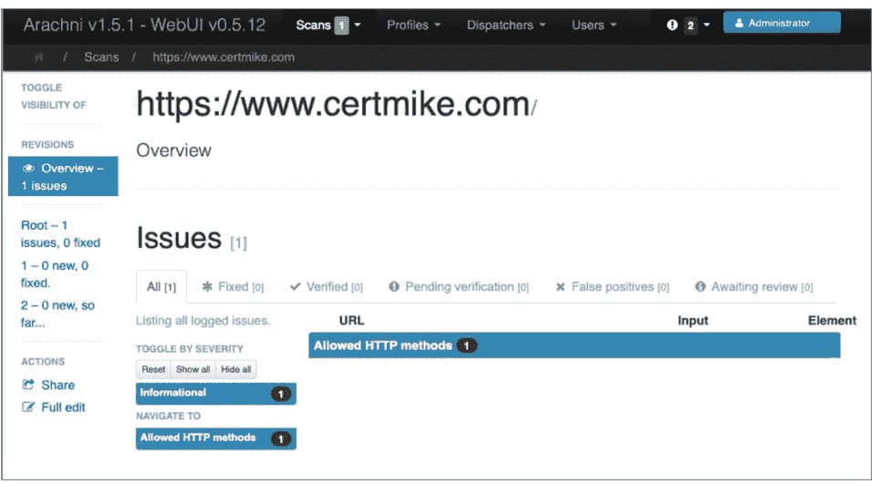

## 图 4.18 Arachni 应用程序扫描器


## 图 4.19 Nessus 应用程序扫描器

图 4.21 显示的 `Burp Proxy` 是网络安全分析师寻求拦截代理的另一个选择。它是 `PortSwigger` 公司开发的名为 `Burp Suite` 的商业 `Web` 应用安全工具包的一部分。虽然完整的 `Burp Suite` 需要付费许可，但 `Burp Proxy` 目前作为该产品的免费版提供。

```
欢迎使用 OWASP Zed Attack Proxy (ZAP)

ZAP 是一个用于发现 Web 应用漏洞的易用集成测试工具。
请注意，你应该只攻击已获得授权的应用程序。
要快速攻击，请在下方输入 URL 并点击“Attack”。

为了进行更深入的研究，你应该考虑在通过代理时使用浏览器或自动化回归工具对应用程序进行测试。详情见帮助文件。
```

## 图 4.20 Zed Attack Proxy (ZAP)

## 无线评估工具

如果你被要求对无线网络进行漏洞评估，`CySA+` 考试涵盖了三个你可能会发现的工具。在准备考试时，你应该了解这些工具的名称和用途：

- `Aircrack-ng` 是一套为无线网络测试设计的工具。该工具集可以从无线网络捕获数据包，进行数据包注入攻击，并破解用于 `WEP`、`WPA` 和 `WPA2` 网络的预共享密钥。
- `Reaver` 是一种专用工具，用于查找支持 `Wi-Fi` 安全保护设置（`WPS`）功能网络的 `WPA` 和 `WPA2` 密码。
- `Hashcat` 是一种通用的密码破解工具，也可以用于无线网络。


## 考试备注

`CySA+` 考试目标没有直接引用 `Hashcat`。相反，它们引用了名为 `oclHashcat` 的旧版本工具。该名称曾指代支持图形处理器（`GPU`）计算的 `Hashcat` 特殊版本。`oclHashcat` 不再作为一个独立的独立工具存在，因为主 `Hashcat` 工具现在已支持 `GPU`。如果你遇到引用旧版 `oclHashcat` 工具的考试题，请注意这一点。

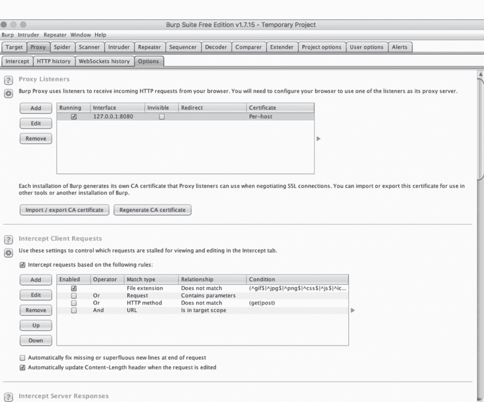

| 目标 | 代理 | 重复器 | 扫描器 | 入侵者 | 重复器 | 序列器 | 解码器 | 比较器 | 扩展器 | 项目选项 | 用户选项 | 警报 |
| :--- | :--- | :--- | :--- | :--- | :--- | :--- | :--- | :--- | :--- | :--- | :--- | :--- |
| 拦截 | `HTTP` 历史 | `WebSockets` 历史 | 选项 | | | | | | | | | |

- 代理监听器 (`Proxy Listeners`)
`Burp Proxy` 使用监听器接收来自浏览器的入站 `HTTP` 请求。你可能需要配置浏览器使用其中一个监听器作为你的代理服务器。

| 添加 | 运行 | 不可见 | 重定向 | 证书 |
| :--- | :--- | :--- | :--- | :--- |
| 编辑 | `127.0.0.1:8080` | | | 区分主机 |
| 删除 | | | | |

每个 `Burp` 的安装版本都会生成自己的 `CA` 证书，代理监听器在协商 `SSL` 连接时可以使用它。你可以导入或导出此证书以便用于其他工具或另一个安装版本。

| 导入/导出 `CA` 证书 | 重新生成 `CA` 证书 |

- 拦截客户端请求 (`Intercept Client Requests`)
使用这些设置控制哪些请求在 `Intercept` 标签中暂停以便查看和编辑。
根据以下规则拦截请求：

| 添加 | 运算符 | 匹配类型 | 关系 | 条件 |
| :--- | :--- | :--- | :--- | :--- |
| 编辑 | 或 | 文件扩展名 | 不匹配 | `(*gif|*png|*css|*js|...)` |
| | 或 | `HTTP` 方法 | 包含参数 | `(post)` |
| 删除 | 且 | `URL` | 不匹配 | 在目标范围内 |
| 向下 | | | | |

- 自动处理请求末尾缺失或多余的换行
- 在请求发送时自动更新 `Content-Length` 头部

- 拦截服务器响应 (`Intercept Server Responses`)
使用这些设置控制哪些响应在拦截标签中暂停以便查看和编辑。

## 图 4.21 Burp Proxy

## 总结

漏洞管理计划允许网络安全专业人员识别并修复系统、应用程序和设备安全中的漏洞。在高度监管的环境中，可能需要根据法律或法规要求进行漏洞扫描，但这些行业之外的许多组织将漏洞管理计划作为安全最佳实践。

构建漏洞管理计划的网络安全分析师应从识别扫描需求开始。这包括审查可能的扫描目标以及选择扫描频率。一旦做出这些决策，分析师就可以配置并……

修复工作流应尽可能自动化，并与 `IT` 组织使用的工作流技术集成。技术人员修复漏洞时，他们应该通过安全测试验证修复的有效性，并在跟踪系统中关闭该漏洞。漏洞管理系统应提供一系列报告和警报工具来补充这些工作。

了解网络安全人员必须如何准备，以克服 `IT` 团队其他成员对扫描的反对意见。对漏洞扫描的常见反对意见包括扫描导致的服务下降对 `IT` 服务的影响、谅解备忘录（`MOU`）和 `SLA` 中对客户的承诺，以及对 `IT` 治理和变更管理流程的使用。

## 实验练习

## 活动 4.1：安装漏洞扫描器

在本实验中，你将在系统上安装 `Nessus` 漏洞管理软件包。

此实验需要访问一个可以用于安装 `Nessus` 的 `Linux` 系统（首选 `Ubuntu`、`Debian`、`Red Hat`、`SUSE` 或 `Fedora`）。

### 第一部分：获取 Nessus Essentials 激活码

- 访问 `Nessus` 网站（`www.tenable.com/products/nessus/nessusessentials`）并填写表单以获取激活码。
- 保存好包含该代码的电子邮件，以便在安装和激活过程中使用。

### 第二部分：下载 Nessus 并将其安装到你的系统上

1. 访问 `Nessus` 下载页面（`www.tenable.com/products/nessus/select-your-operating-system#download`）并为你的系统下载适用于该系统的 `Nessus` 版本。
2. 根据 `docs.tenable.com/nessus/8_8/Content/Install.htm` 提供的文档安装 `Nessus`。
3. 通过登录你的 `Nessus` 服务器来验证安装是否成功。

## 活动 4.2：运行漏洞扫描

在本实验中，你将对你选择的服务器运行漏洞扫描。需要注意的是，你绝对不要在没有许可的情况下运行漏洞扫描。

你需要同时访问你在活动 4.1 中构建的漏洞扫描服务器和用于扫描的目标服务器。如果你目前没有获得许可可以扫描的服务器，你可以使用云服务提供商（例如 `Amazon Web Services (AWS)`、`Microsoft Azure` 或 `Google Compute Platform`）构建一个。

对你的服务器进行漏洞扫描并保存生成的报告。如果需要帮助，请咨询 `Nessus` 文档。你需要此漏洞扫描的报告来完成下一章中的活动。

## 复习题

1. 哪项联邦法律要求对联邦政府机构运行的信息系统进行漏洞扫描？
   A. `HIPAA`
   B. `GLBA`
   C. `FISMA`
   D. `FERPA`

2. `Gary` 是一家联邦机构的系统管理员，负责各种信息系统。哪些系统必须涵盖漏洞扫描计划？
   A. 仅限高影响系统
   B. 仅包含机密信息的系统
   C. 高影响或中等影响系统
   D. 高、中、低影响系统

3. 管理员可以使用什么工具帮助在进行漏洞扫描之前识别网络上存在的系统？
   A. 资产清单
   B. `Web` 应用评估
   C. 路由器
   D. `DLP`

4. `Tonya` 正在为一个受 `PCI DSS` 合规标准的系统配置漏洞扫描。她必须进行扫描的最低频率是多少？
   A. 每日
   B. 每周
   C. 每月
   D. 每季度

5. 下哪项不是漏洞扫描工具？
   A. `Qualys`
   B. `Snort`
   C. `Nessus`
   D. `OpenVAS`

6. `Bethany` 是一家大型零售组织的漏洞管理专家。她在 3 月完成了上一次 `PCI DSS` 合规扫描。4 月，该组织升级了销售点系统，`Bethany` 正准备进行新扫描。她必须在何时完成新扫描？
   A. 立即
   B. 六月
   C. 十二月
   D. 不需要扫描

7. `Renee` 正在配置她的漏洞管理解决方案，以对其网络上的服务器进行凭据扫描。她应该向扫描器提供什么类型的账户？
   A. 域管理员
   B. 本地管理员
   C. `Root`
   D. 只读

8. `Jason` 正在撰写一份关于软件产品中潜在安全漏洞的报告，并希望使用标准的产品名称以确保其他安全分析师理解该报告。`Jason` 可以向哪个 `SCAP` 组件寻求帮助？
   A. `CVSS`
   B. `CVE`
   C. `OVAL`

9. `Bill` 想要出于 `PCI DSS` 合规目的对系统运行内部漏洞扫描。谁有权完成此类扫描？
   A. 组织的任何员工
   B. 经批准的供应商
   C. `PCI DSS` 服务提供商
   D. 任何合格的个人

10. 哪种类型的最可能面临漏洞扫描？
    A. 银行
    B. 医院
    C. 政府机构
    D. 诊所

11. 根据 `FISMA`，在组织要求进行扫描之前，系统必须达到什么最低级别？
    A. 低
    B. 中
    C. 高
    D. 严重

12. 哪个术语描述组织对风险的容忍度？
    A. 风险格局
    B. 风险胃
    C. 风险水平
    D. 风险适应

13. 下列哪个因素对扫描计划的影响可能最小？
    A. 监管要求
    B. 技术限制
    C. 业务限制
    D. 人员可用性

14. `Barry` 实施了适当的分段以限制 `PCI DSS` 的范围。他必须扫描哪些系统？
    A. 客户系统
    B. 隔离网络上的系统
    C. 通用网络上的系统
    D. B 和 C

15. `Ryan` 计划使用插件对业务关键系统进行扫描。最好的初始方法是什么？
    A. 在生产环境中运行扫描以获得最真实的结果。
    B. 在工作期间运行扫描。
    C. 在测试环境中运行扫描。
    D. 不要运行扫描以避免干扰。

16. 下列哪个活动*不是*漏洞管理循环的一部分？
    A. 检测
    B. 修复
    C. 报告
    D. 测试

17. 哪种扫描方法结合了运行在目标服务器上的代理？
    A. 持续监控
    B. 扫描
    C. 按需扫描
    D. 告警

18. `Brian` 正在寻求联邦系统的适当分类。在咨询管理层后，他发现该系统信息如果不当会对组织产生严重影响。该系统应如何分类？
    A. 低影响
    B. 中等影响
    C. 高影响
    D. 严重影响

19. `Jessica` 正在阅读来自不同部分的报告。她负责分配修复资源并难以来自不同来源的问题。哪个 `SCAP` 组件可以帮助 `Jessica` 完成任务？
    A. `CVSS`
    B. `CVE`
    C. `CPE`
    D. `XCCDF`

20. `Sarah` 想要出于 `PCI DSS` 合规目的对系统运行外部漏洞扫描。谁有权完成此类扫描？
    A. 组织的任何员工
    B. 授权扫描供应商 (`ASC`)
    C. `PCI DSS` 服务提供商
    D. 任何合格的个人

# 第 5 章：分析漏洞扫描

`COMPTIA` 网络安全分析师 (`CYSA+`) 考试涵盖本章的范围包括：

* 领域 1.0：威胁和漏洞管理
  * 1.3 给定场景，执行漏洞管理活动。
  * 1.4 给定场景，分析常用漏洞评估工具的输出。
  * 1.5 解释与特殊技术相关的威胁和漏洞。
  * 1.7 给定场景，实施控制以缓解攻击和软件漏洞。

网络安全分析师花费大量时间分析和解释漏洞扫描器生成的报告。虽然扫描器在自动执行漏洞识别工作方面非常有效，但它们生成的结果需要经过培训的分析师进行解释，以消除误报、优先考虑修复活动并深入研究报告的根原因。在本章中，你将学习网络安全分析师如何利用他们的知识和经验审查漏洞扫描报告。

## 查看和解读报告

漏洞扫描报告为分析师提供了大量有助于解读报告的信息。除了第 4 章“设计漏洞管理计划”中显示的高级报告示例外，漏洞扫描器还提供了关于每个漏洞的详细信息，这些它们识别出的。图 5.1 显示了由 `Nessus` 漏洞扫描器报告的单一漏洞示例。

让我们逐节查看此报告，从左上角开始按逆时针方向进行。

在报告的最顶部，我们看到了两个关键细节：漏洞名称（它提供了一个描述性标题）以及漏洞的整体严重程度（以通用类别的形式表示，例如低、中、高或危急）。在这份示例报告中，扫描器报告某个服务器正在运行一个过时且不安全的 `SSL` 协议版本。它被归类为“高（`high`）”严重程度。

接下来，报告提供了漏洞的详细描述。在这种情况下，报告提供了关于 `SSL` 协议中缺陷的详细描述，并解释了 `SSL` 不再被认为是可以使用的。

报告的下一部分提供了漏洞的解决方案。可行的情况下，扫描器会提供有关系统管理员、安全专业人员、网络工程师和/或应用程序开发人员如何修复该漏洞的详细信息。在这种情况下，读者被指示禁用 `TLS` 2.0 和 3.0，并用安全的 `TLS` 协议版本替换它们的使用。

### SSL 版本 2 和 3 协议检测

#### 描述

远程服务接受使用 `SSL` 2.0 和/或 `SSL` 3.0 的连接。这些版本的 `SSL` 受到多种加密缺陷的影响，包括：

- 带有 `CBC` 密码算法的不安全的填充方案。
- 不安全的协商和重恢复方案。

攻击者可以利用这些缺陷进行中间人攻击，或解密客户端与服务器之间的通信。

此外，`TLS` 1.2 拥有一种选择最高支持的版本的安全的安全措施（这样只有当客户端或服务器都支持这些版本时才会使用这些版本）；许多网络浏览器实现此功能的方式允许连接降级攻击（例如 `POODLE`）。建议禁用这些协议。

`NIST` 已表示，`SSL` 3.0 不适用于安全通信。截至 `PCI DSS` 3.1 执行之日，任何版本的 `SSL` 都将无法符合 `PCI SSC` 的“强加密”标准。

#### 解决方案

查阅应用程序的文档以禁用 `SSL` 2.0 和 3.0。使用带有支持的批准加密套件或更高版本的 `TLS` 1.2。

#### 另请参阅

- `https://www.acm.com/academic/papers/paper-ssl.pdf`
- `http://www.nvd.nist.gov/vuln/detail/CVE-2014-3566`
- `http://www.nvd.nist.gov/vuln/detail/CVE-2014-3566`
- `https://en.wikipedia.org/wiki/POODLE`
- `https://www.nvd.nist.gov/vuln/detail/CVE-414`
- `https://tools.nve.org/html/CVE7507`
- `https://tools.nve.org/html/CVE7568`

#### 输出

- `SSLv` 已启用且服务器至少支持一种加密算法。
解释：`TLS` 1.0 和 `SSL` 3.0 加密套件可能与 `SSLv` 一起使用

高强度加密：112 位密钥

| `BCI-MD5` | `Ex-SHA` | `Enc-CBC(128)` | `Mac-MD5` |
|---|---|---|---|
| `RC-MD5` | `Ex-SHA` | `Enc-CBC(128)` | |


# SSL加密算法

## 密钥交换

## 身份验证

## 加密方法

## 消息认证码

## 请求标志


| 端口 | 主机 |
|---|---|
| 443 / tcp | |
| 445 / tcp | |

## 图 5.1 Nessus 漏洞报告

在报告标题为“另请”的章节中，扫描器提供了引用，管理员可以在这些地方找到报告中所述漏洞的更多详细信息。在这种情况下，扫描器引导读者参考几篇博客文章、Nessus 文档页面以及互联网工程任务组 (IETF) 文档，这些提供了有关漏洞的更多细节。

报告的输出部分显示了远程系统在探测漏洞时返回的详细信息。这些信息对于分析师来说可能非常有价值，因为它们通常提供了命令返回的原始输出。分析师可以利用此更好地理解扫描器为何报告该漏洞，识别漏洞位置，并可能识别误报。在这种情况下，端口/主机部分显示了特定的服务。

报告的信息部分提供了有关漏洞的详细信息。在这种情况下，我们看到了漏洞的 CV。报告的输出部分显示了远程系统在探测漏洞时返回的详细信息。这些信息对于分析师来说可能非常有价值，因为它们通常提供了命令返回的原始输出。分析师可以利用此更好地理解扫描器为何报告该漏洞，识别漏洞位置，并可能识别误报。

## 理解 CVSS

漏洞评分系统 (CVSS) 是评估漏洞严重程度的行业标准。它提供了一种技术，根据各种指标对每个漏洞进行评分。安全分析师经常使用 CVSS 评分来优先考虑响应措施。


## 图 5.2 Qualys 漏洞报告

## 攻击向量指标

攻击向量指标描述了攻击者如何利用漏洞，根据表 5.1 进行赋值。

### 表 5.1 CVSS 攻击向量指标

| 值 | 描述 | 分值 |
|---|---|---|
| 物理 (P) | 攻击者必须物理接触设备。 | 0.20 |
| 本地 (L) | 攻击者对受影响系统有物理或逻辑访问。 | 0.55 |
| 邻网络 (A) | 攻击者必须访问受影响系统连接的本地网络。 | 0.62 |
| 网络 (N) | 攻击者可以通过网络远程利用漏洞。 | 0.85 |

## 攻击复杂度指标

攻击复杂度指标描述了利用漏洞的难度，根据表 5.2 进行赋值。

### 表 5.2 CVSS 攻击复杂度指标

| 值 | 描述 | 分值 |
|---|---|---|
| 高 (H) | 利用漏洞需要满足难以难以发现的“特殊”条件。 | 0.44 |
| 低 (L) | 利用漏洞不需要任何特殊条件。 | 0.77 |

## 所需权限指标

所需权限指标描述了攻击者利用漏洞所需的账户访问类型，并根据表 5.3 进行赋值。

### 表 5.3 CVSS 权限指标

| 值 | 描述 | 分值 |
|---|---|---|
| 高 (H) | 攻击者需要管理员权限来执行攻击。 | 0.270 (如果范围改变，则为 0.50) |
| 低 (L) | 攻击者需要基本用户权限来执行攻击。 | 0.62 (如果范围改变，则为 0.68) |
| 无 (N) | 攻击者不需要身份验证即可利用漏洞。 | 0.85 |

## 用户交互指标

用户交互指标描述了攻击者是否需要从攻击中涉及另一个人类。用户交互指标根据表 5.4 中的标准进行分配。

## 机密性指标

机密性指标描述了如果攻击者成功利用漏洞可能会发生的信息披露类型。机密性指标根据表 5.5 中的标准进行分配。

### 表 5.4 CVSS 用户交互指标

| 值 | 描述 | 分值 |
|---|---|---|
| 无 (N) | 成功利用不需要攻击者以外的任何用户采取操作。 | 0.85 |
| 需要 (R) | 成功利用需要攻击者以外的用户采取操作。 | 0.62 |

### 表 5.5 CVSS 机密性指标

| 值 | 描述 | 分值 |
|---|---|---|
| 无 (N) | 没有机密性影响。 | 0.00 |
| 低 (L) | 可能访问某些信息，但攻击者无法控制哪些信息被泄露。 | 0.22 |
| 高 (H) | 系统上的所有信息都被泄露。 | 0.56 |

## 完整性指标

完整性指标描述了如果攻击者成功利用漏洞可能会发生的信息更改类型。完整性指标根据表 5.6 中的标准进行分配。

### 表 5.6 CVSS 完整性指标

| 值 | 描述 | 分值 |
|---|---|---|
| 无 (N) | 没有完整性影响。 | 0.00 |
| 低 (L) | 可能修改某些信息，但攻击者无法控制哪些信息被修改。 | 0.22 |
| 高 (H) | 完整性被完全破坏，攻击者可以随心所更改任何信息。 | 0.56 |

## 可用性指标

可用性指标描述了如果攻击者成功利用漏洞可能会发生的中断。可用性指标根据表 5.7 中的标准进行分配。

### 表 5.7 CVSS 可用性指标

| 值 | 描述 | 分值 |
|---|---|---|
| 无 (N) | 没有可用性影响。 | 0.00 |
| 低 (L) | 系统性能下降。 | 0.22 |
| 高 (H) | 系统完全关闭。 | 0.56 |

## 范围指标

范围指标描述漏洞是否可以影响漏洞范围之外的系统组件。范围指标根据表 5.8 中的标准进行分配。注意，范围指标表不包含分值信息。范围指标的值反映在之前表中所示所需的权限值中。

### 表 5.8 CVSS 范围指标

| 值 | 描述 |
|---|---|
| 未改变 (U) | 被利用的漏洞只能影响由同一安全机构管理的资源。 |
| 已改变 (C) | 被利用的漏洞可以影响包含漏洞的组件的安全机构范围之外的资源。 |


> CVSS 的当前版本是 3.1 版本，它是 3.0 版本的微更新。你会发现攻击向量通常引用 3.0 版本。本章使用 CVSS 3.1 版本作为我们讨论的基础，但对于我们的目的而言，3.0 和 3.1 在功能上是等效的。你可能仍然发现引用 CVSS 版本 2 的文档，它使用了类似的方法，但评分标准不同。

## 解释 CVSS 向量

CVSS 向量使用单行格式来传达漏洞在前面的节中描述的所有指标上的评分。例如，回想图 5.1 所示的 CVSS 向量：`CVSS:3.0/AV:N/AC:L/PR:N/UI:N/S:U/C:H/I:N/A:N`。该向量包含九部分。第一部分 `CVSS:3.0` 只是告诉读者（人类或系统）该向量是使用 CVSS 版本 3.0 构建的。在这种情况下，图 5.1 中的漏洞获得了以下评分：

- 攻击向量：网络（分值: 0.85）
- 攻击复杂度：低（分值: 0.77）
- 所需权限：无（分值: 0.85）
- 用户交互：无（分值: 0.85）
- 范围：未改变
- 机密性：高（分值: 0.56）
- 完整性：无（分值: 0.00）
- 可用性：无（分值: 0.00）

## 总结 CVSS 分值

CVSS 向量提供了有关漏洞所带来的风险性质的详细信息，但向量的复杂性使其难以在优先级排序中使用。因此，分析师可以计算 CVSS 基础分，这是一个代表漏洞所带来的总体风险的单一数字。基础分的得出首先计算可利用性分、影响分和功能分。

## 计算影响子分 (ISS)

分析师执行的第一个计算是计算影响子分 (ISS)。该指标使用公式汇总影响指标：

`ISS = 1 - [(1-机密性) × (1-完整性) × (1-可用性)]`

代入我们的 SSL 漏洞的值，我们得到：

```
ISS = 1 - [(1-0.56) × (1-0.00) × (1-0.00)]
ISS = 1 - [0.44 × 1.00 × 1.00]
ISS = 0.56
```

## 计算影响分

为了从影响子分获得影响分，我们考虑范围指标的值。如果范围指标是未改变（如我们的示例所示），我们将 ISS 乘以 6.42：

`影响 = 6.42 * ISS`

如果范围指标是已改变，我们使用更复杂的公式：

`影响 = 7.52 × (ISS-0.029)`

## 计算可利用性分

分析师可以使用以下公式计算漏洞的可利用性分：

`可利用性 = 8.22 × 攻击向量 × 攻击复杂度 × 所需权限 × 用户交互`

代入我们的 SSL 漏洞值，我们得到：

```
可利用性 = 8.22 × 0.85 × 0.77 × 0.85 × 0.85
可利用性 = 3.89
```

## 计算基础分

有了这些信息，我们现在可以根据以下规则确定 CVSS 基础分：

- 如果影响为 0，则基础分为 0。
- 如果范围指标未改变，通过将影响和可利用性分相加来计算基础分。
- 如果范围指标已改变，将影响和可利用性分相加并将结果乘以 1.08。
- 基础分为 10。如果计算值大于 10，将基础分设为 10。

在我们的示例中，影响分为 3.60，可利用性分四舍五入为 3.9。将这些相加，我们得到 7.5 的基础分，这与图 5.1 中的值相同。

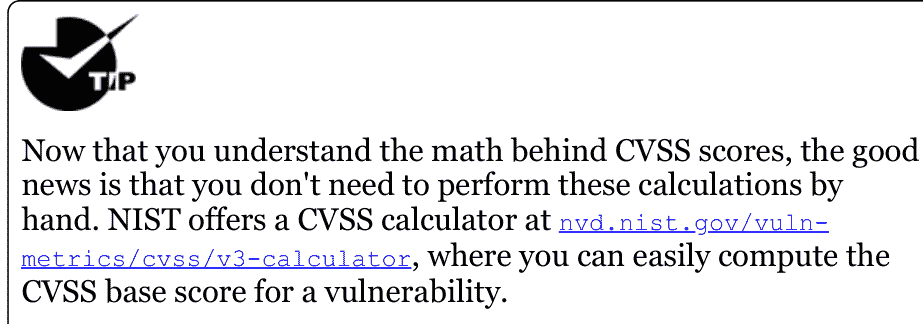

现在你理解了 CVSS 分值背后的数学，好消息是你不需要手动执行这些计算。NIST 在 `nvd.nist.gov/vuln-metrics/cvss/v3-calculator` 提供了 CVSS 计算器，你可以在那里轻松计算漏洞的 CVSS 基础分。

## CVSS 基础分分类

许多漏洞扫描系统使用风险类别而不是数值评分进一步总结 CVSS 结果。这些通常基于表 5.9 所示的 CVSS 定性严重性等级。

### 表 5.9 CVSS 定性严重性等级

| CVSS 分值 | 等级 |
|---|---|
| 0.0 | 无 |
| 0.1–3.9 | 低 |
| 4.0–6.9 | 中 |
| 7.0–8.9 | 高 |
| 9.0–10.0 | 严重 |

继续图 5.1 中的 SSL 漏洞示例，我们计算出该漏洞的 CVSS 值为 7.5。这将其处于高风险类别，正如图 5.1 头部所示。

## 考试笔记

CySA+ 考试目标之一要求你能够验证扫描结果。务必确保你理解四种不同的报告类型：真阳性、假阳性、真阴性和假阴性。

网络安全分析师应确认由扫描器报告的每个漏洞。在某些情况下，这可能简单到验证是否缺少补丁或操作系统是否已过时。在其他情况下，验证漏洞需要一个模拟利用的人工过程。例如，验证 SQL 注入漏洞可能实际上需要对 Web 应用程序尝试攻击，并在后端数据库中验证结果。

在验证漏洞时，分析师在整个过程中应该利用自己的专业知识，以及组织内其他人员的领域知识。数据库管理员、系统工程师、网络技术人员、软件开发人员和其他专家的领域知识对于评估潜在的阳性报告至关重要。

## 记录在案的异常情况

在某些情况下，组织可能由于某种原因或其他原因决定不修复漏洞。例如，组织可能决定业务需求要求使用不再不再支持的操作系统。同样，开发经理可能认为，修复仅暴露在内部网络的 Web 应用程序漏洞的成本超过了其安全收益。

除非分析师采取行动记录这些异常情况，否则漏洞扫描在每次运行运行时都会继续报告它们。在漏洞管理系统中记录异常情况是一个良好的做法，这样扫描器在未来的报告中就知道了忽略它们。这减少了扫描报告中的噪声水平，并增加了它们对分析师的实用性。

> 在决定允许异常时要小心。正如第 4 节讨论的，许多组织受到漏洞扫描合规性要求的限制。创建异常可能会违反这些合规义务，或违背安全最佳实践。

## 理解信息性结果

漏洞扫描器在运行默认配置运行时通常会提供非常详细的信息。漏洞扫描器报告的所有内容并非都代表重大的安全问题。尽管如此，扫描器提供的是它们能确定的信息，以显示攻击者在进行侦察扫描时可能收集到的信息类型。

图 5.3 提供了一个针对 Web 服务器运行的漏洞扫描生成的高级报告示例。注意，此报告中约二之三的漏洞属于“信息 (Info)”风险类别。这表明提供结果的插件甚至没有根据 CVSS 进行分类。相反，它们仅仅是信息性结果。大多数组织不会采取删除所有关于系统的可能信息源的程度，因为这样做可能困难，甚至是不可能的。

| 严重程度 | 插件名称 | 插件族 | 计数 | 扫描细节 |
|---|---|---|---|---|
| 高 | CGI SQL 注入 (基于时间型) | CGI 滥用 | 1 | 名称：主网站 |
| 中 | Web 应用程序可能受点击劫持 | Web 服务器 | 2 | 状态：已完成 |
| 中 | 已启用 ASNITIB 调试方法 | CGI 滥用 | 1 | 策略：Web 应用程序测试 |
| 中 | CGI 通用注入脚本 | CGI 滥用 | 1 | 文件夹：我的扫描 |
| 中 | CGI 通用 HTML 注入（快速测试） | CGI 滥用 | 1 | 开始：今天上午 10:30 |
| 中 | CGI XSS（综合测试） | CGI XSS | 1 | 结束：今天凌晨 3:20 |
| 中 | CGI XSS（扩展模式） | CGI XSS | 1 | 耗时：2 小时 |
| 中 | CGI XSS（快速测试） | CGI XSS | 1 | 目标： |
| 提示 | CGI 通用测试加载详细信息（所有测试） | CGI 滥用 | 2 | 漏洞 |
| 提示 | CGI 测试超时 | CGI 滥用 | 2 | ○ 高 |
| 提示 | 外部 URL | Web 服务器 | 2 | ○ 中 |
| 提示 | 允许的 HTTP 方法（按目录） | Web 服务器 | 2 | ○ 信息 |
| 提示 | HTTP 服务器类型和版本 | Web 服务器 | 2 | |
| 提示 | 超文本传输协议 (HTTP) 信息 | Web 服务器 | 2 | |
| 提示 | 缺失 Content-Security-Policy HTTP 响应 | CGI 滥用 | 2 | |
| 提示 | 缺失 X-Frame-Options HTTP 响应 | CGI 滥用 | 2 | |

**图 5.3** 显示漏洞和最佳实践的扫描报告

分析师在遇到图 5.3 中的扫描报告时，应该首先关注高严重程度漏洞。一旦修复了它们，中等严重程度漏洞需要关注。剩余的信息性漏洞可能可以不管。许多组织将对如何处理这些信息性消息制定正式政策。例如，某些组织可能决定，如果消息在连续三次扫描中出现，将创建一个记录项，记录他们采取的行动或不采取行动的原因。这种方法对于经过审计的组织特别重要，证明了组织进行了尽职调查。

## 将扫描结果与其他数据相结合

漏洞扫描绝不应在真空中进行。解释这些报告的网络安全分析师应转向其他安全来源。此过程的价值信息源包括：

- 服务器、应用程序、网络设备和其他可能包含针对检测到的漏洞尝试的日志
- 安全信息和事件管理 (SIEM) 系统关联来自多个源的日志并提供可操作的情报
- 配置管理系统提供有关系统中操作系统和应用程序的信息

当分析师尝试将扫描报告与组织的现实相结合时，这些信息源每一个都可以证明非常有价值。

## 趋势分析

趋势分析也是漏洞计划的重要部分。经理应该关注漏洞的整体趋势，包括随时间变化的漏洞数量、现有漏洞的以及修复所需的时间。图 5.4 显示了 Center 中的趋势分析示例。

## 常见漏洞

每个漏洞扫描系统包含检测数千种可能漏洞的插件，从 Web 应用程序中的重大 SQL 注入到网络设备的琐碎披露问题。任何长度的书都不可能讨论每一个漏洞，网络安全分析师应该熟悉最常见的漏洞及其一些通用类别。

| 漏洞趋势 - 按操作系统划分漏洞 | OS | 低 | 中 | 高 | 严重 | 已利用 |
|---|---|---|---|---|---|
| 过去 24 小时 | 38 | 11 | 0 | 0 | 0 |
| 过去 7 天 | 168 | 54 | 11 | 3 | 12 |
| 过去 30 天 | 498 | 211 | 103 | 25 | 88 |

# 服务器和终端漏洞

计算机系统非常复杂。运行在服务器和终端上的操作系统由数百万行代码组成，它们运行的不同的应用程序组合使得系统相当独特。因此，扫描检测出的许多漏洞存在于服务器和端点系统中，这并不意外，而且这些漏洞通常是最难修复的漏洞。

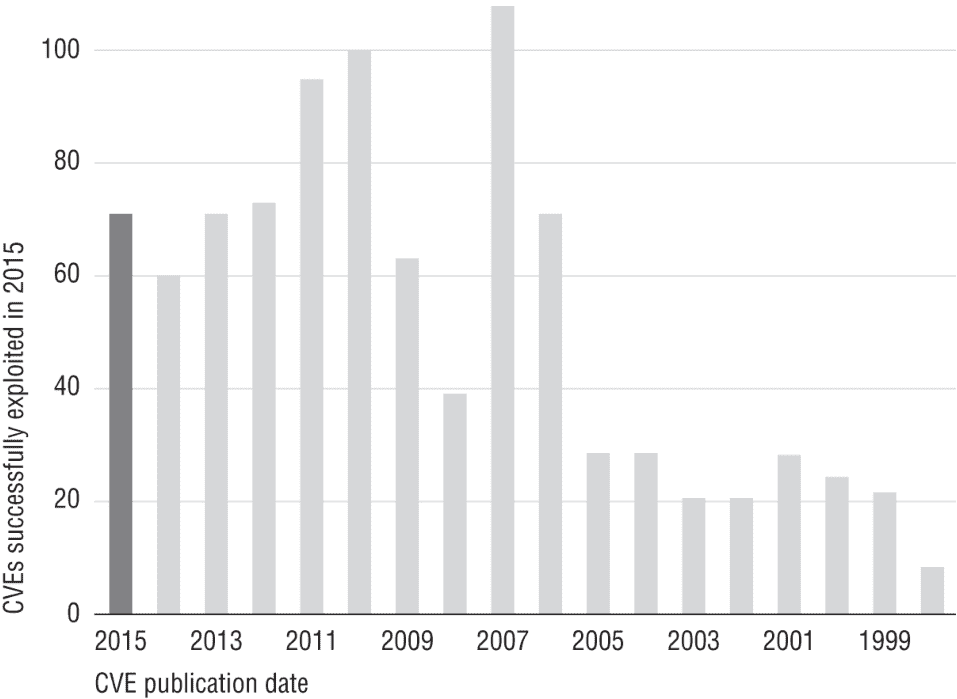

**图 5.5** 2015 年按首次发现年份计算的被利用漏洞

## 缺失的补丁

对系统应用安全补丁本应是任何信息安全计划的核心实践之一，但由于缺乏预防性维护的资源，这项例行任务往往被忽视。漏洞扫描常见的告警之一是，网络上的一个或多个系统正在运行过时的操作系统或应用程序版本，并且需要安全补丁。

图 5.6 显示了此类扫描结果的一个示例。位于 `10.64.142.211` 的服务器存在远程代码执行漏洞。

尽管扫描结果非常简洁，但它确实包含了许多有用信息：

- 描述告诉我们这是 Windows HTTP 栈中的一个缺陷。
- 报告输出（Output）部分中的服务信息确认了服务器正在 TCP 端口 443 上运行 HTTPS 服务。
- 我们在头部（header）中看到这是一个关键漏洞，并且已确认其 CVSS 基分值为 10。

幸运的是，有一个简单的方法解决这个问题。“解决方案”（Solution）部分告诉我们微软已为受影响的操作系统发布了补丁，“另参”（See Also）部分提供了微软安全公告（MS15-034）的直接链接，该公告更详细地描述了问题和解决方案。

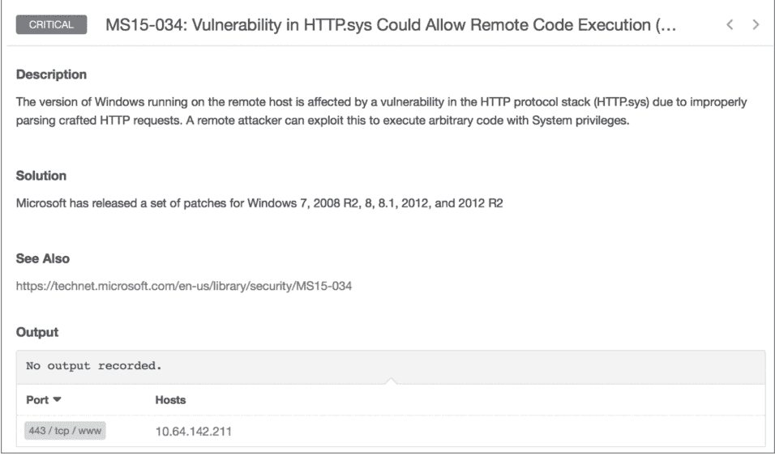

## 图 5.6 缺失补丁漏洞

## 移动设备安全

本节指的是传统服务器和端点上常见的漏洞，但重要的是，移动设备本身有一许多安全问题，必须经过仔细的管理和修补才能保持安全。

移动设备管理员可以使用移动设备管理（MDM）解决方案来管理这些设备的配置、自动安装补丁、强制使用加密并提供远程擦除功能。MDM 解决方案还可以限制移动设备上运行的应用程序，仅允许批准列表上的程序。

尽管如此，移动设备通常不会出现在漏洞扫描中，因为它们并不经常连接在网络上。因此，即使在漏洞扫描后没有显示需要关注，管理员也应该注意这些设备的安全性。

## 不支持的操作系统和应用程序

软件供应商最终会停止对其提供的每个产品的支持。操作系统和应用程序也是如此。一旦他们宣布产品的最终终支持，继续运行过旧软件的组织将使自己面临巨大的攻击风险。供应商将不再调查或纠正在该日期之后产品中出现的任何安全缺陷。从安全的角度来看，继续运行不支持的组织将自力更生，除非你恰好维护着一个操作系统开发人员团队，否则这不是一个你所处的良好处境。

也许最著名的主流操作系统停止支持事件发生在 2015 年 7 月，当时微软停止了对已十多年的 Windows Server 2003 的支持。图 5.7 显示了 Nessus 在识别出运行此过旧系统的服务器时生成的报告示例。

| 严重 | Microsoft Windows Server 2003 不支持安装检测 |
| :--- | :--- |
| 描述 | 主机正在运行 Microsoft Windows Server 2003。微软对该操作系统的支持已于 2015 年 7 月 14 日结束。 |
| | 不支持意味着供应商将不会为该产品发布新的安全补丁。因此，它可能包含安全漏洞。此外，微软可能会调查或承认漏洞报告。 |
| 解决方案 | 升级到当前支持的 Windows 版本。 |
| 另参 | `http://www.nessus.org/?7c0dbe792` |
| 输出 | 无记录输出。 |
| 端口 | 主机 |
| N/A | `10.64.142.218, 10.64.142.218` |

## 图 5.7 不支持的操作系统漏洞

我们可以从该报告中看到，缺乏支持意味着供应商将不会为该产品发布新的安全补丁。因此，它可能包含安全漏洞。此外，微软可能会调查或承认漏洞报告。

解决方案是升级到当前支持的 Windows 版本。

描述是主机正在运行 Microsoft Windows Server 2003。微软对该操作系统的支持已于 2015 年 7 月 14 日结束。

关键漏洞是 Microsoft Windows Server 2003 不支持安装检测。

主机是 `10.64.142.218, 10.64.142.218`。

## CVE-2016-5195

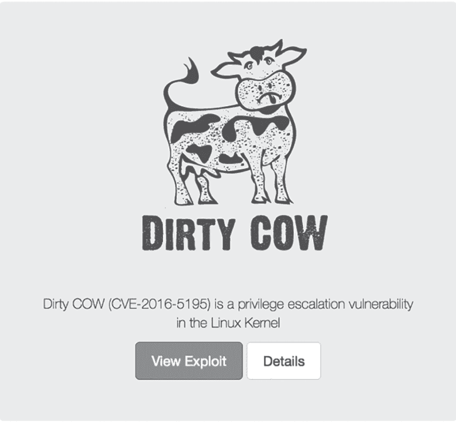

Dirty COW (`CVE-2016-5195`) 是 Linux 内核中的一个权限提升漏洞。

## 图 5.8 Dirty COW 网站

## 任意代码执行

**任意代码执行**漏洞允许攻击者在目标系统上运行其选择的软件。这可能导致灾难性的事件，特别是当漏洞允许攻击者以管理员权限运行代码时。**远程代码执行**漏洞是代码执行漏洞中更危险的子集，因为攻击者可以在无需对目标系统的物理或逻辑访问的情况下，通过网络连接利用该漏洞。

图 5.9 显示了 Nessus 检测到的一个远程代码执行漏洞示例。注意 CVSS 访问向量（access vector）显示该漏洞的访问向量是基于网络的。这与远程代码执行漏洞的描述一致。向量中的影响指标显示攻击者可以利用此漏洞完全攻破系统。

幸运的是，对于扫描检测出的大多数漏洞，该问题都有简单的修复方法。微软针对受影响的 Windows 版本发布了补丁，并在微软安全公告 MS14-066 中描述了这些补丁。

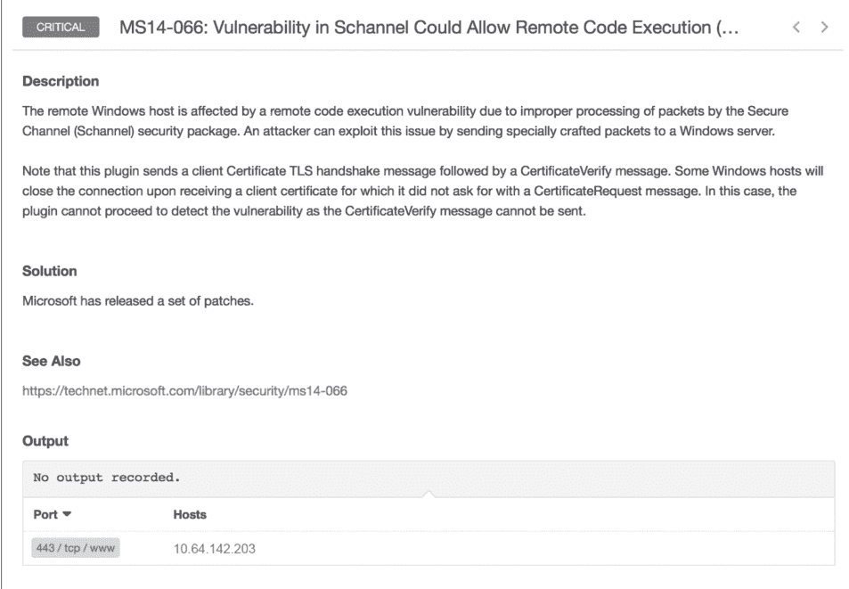

## 图 5.9 代码执行漏洞

## 不安全协议的使用

互联网早期网络使用的许多旧协议在设计时没有考虑安全性。它们通常未能使用加密来保护用户、密码以及在开放网络上传输的内容，导致协议用户暴露于窃听攻击之下。Telnet 是一个用于获取远程服务器命令行访问的协议示例。文件传输协议（FTP）提供了在系统之间传输文件的能力，但没有包含安全功能。图 5.10 显示了一个扫描报告示例，检测到一个支持不安全的 FTP 协议系统。

解决此问题的办法切换到更安全的协议。遗憾的是，Telnet 和 FTP 都有加密的替代方案。系统管理员在寻求获取远程系统的命令行访问时，可以使用安全外壳（SSH）作为 Telnet 的安全替代品。同样，安全文件传输协议（SFTP）和 FTP-Secure（FTPS）为系统之间的文件传输提供了安全方法。

| FTP 支持明文认证 |
| :--- | :--- |
| 描述 | 远程 FTP 服务器允许以明文形式传输用户名和密码，这可能会被网络嗅探器或中间人攻击拦截。 |
| 解决方案 | 切换到 SFTP（SSH 套件的一部分）或 FTPS（基于 SSL/TLS 的 FTP）。在后的情况下，配置服务器对控制连接进行加密。 |
| 输出 | 此 FTP 服务器不支持 'AUTH TLS' |
| 端口 | 主机 |
| 21 / ftp | `10.41.248.224` |

## 图 5.10 FTP 明文认证漏洞

## 调试模式

许多应用程序开发平台支持调试模式，该模式为开发者提供了开发过程中排除应用程序故障所需的关键信息。调试模式通常提供有关应用程序、服务器以及支持数据库内部运行的详细信息。尽管这些信息对开发者可能有用，但他们可能会在无意中帮助试图获取数据库结构、应用程序使用的身份验证机制或其他细节的攻击者。出于因此，漏洞扫描会对扫描服务器上存在的调试模式发出告警。

图 5.11 显示了此类扫描结果的示例。

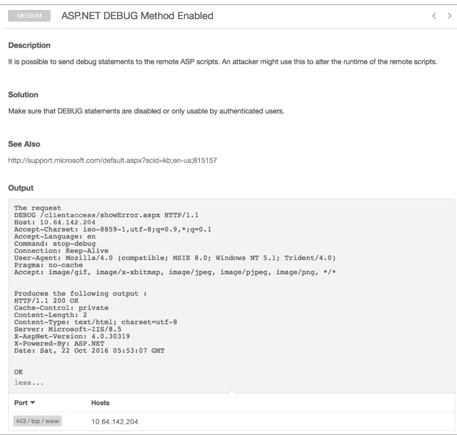

在此示例中，目标系统似乎是一个支持 ASP.NET 开发环境的 Windows 服务器。报告的输出（Output）部分显示，当客户端发送 DEBUG 请求时，服务器会响应。

解决此问题需要开发者的配合，并在公开的系统上禁用调试模式。在成熟的组织中，软件开发应始终在仅限私有网络访问的专用开发环境中进行。应该鼓励（或要求！）开发者在专门用于该目的系统上进行测试，在这些服务器上启用调试模式是完全适当的。在面向公共系统中没有必要支持这种功能。

# 网络漏洞

现代互连网络使用复杂的底层组件和网络设备组合，以提供广泛的安全通信能力。这些网络及其组成部分也受到安全漏洞的影响，这些漏洞可以在漏洞扫描期间被检测。

## 缺少固件更新

操作系统和应用程序并不是需要定期安全更新的设备。漏洞扫描还可能检测网络设备中的安全问题，这些问题需要制造商提供固件更新来修复。漏洞报告中的结果与图 5.6 中的操作系统缺少补丁报告类似，通常会引导管理员前往供应商网站下载固件更新。

## SSL 和 TLS 问题

安全套接层（SSL）协议及其继者传输层安全（TLS）为互联网和私有网络上的信息交换提供了保障。虽然这些协议可以加密任何类型的网络通信，但它们最常用于安全 Web 服务器的连接，用户对此熟悉。


> 许多安全分析师错误地使用缩写 SSL 来指代 SSL 和 TLS。需要理解 SSL 已不再。

## 过时的 SSL/TLS

远程服务接受使用 SSL 2.0 和3.0 的连接。这些版本的 SSL 受到多个加密漏洞的影响。攻击者可以利用这些漏洞进行中间人攻击或解密通信。

NIST 已确定 SSL 3.0 不适用于安全通信。根据 PCI DSS v3.1 的执行日期，任何版本的 SSL 不符合 PCI SSC 对“强加密”的定义。

| 端口 | 主机 |
| :--- | :--- |
| 443 / / web | `10.33.10.1, 10.33.10.2, 10.33.10.3, 10.33.10.4, 10.33.10.5, 10.33.10.6` |

## 图 5.12 过时的 SSL 版本漏洞

## 不安全算法的使用

SSL 和 TLS 通常被描述为加密算法，但事实并非如此。SSL 和 TLS 协议描述了如何使用加密算法保护网络通信，但它们本身并不是加密算法。相反，它们允许管理员根据服务器指定在使用这些协议时可以加密算法。

某些算法包含漏洞，由于其易受到窃听攻击而变得不稳定。例如，

图 5.13 显示了一个支持不安全的 RC4 加密算法系统的扫描报告。

解决这一常见问题需要修改受影响服务器上支持的加密算法集，并确保只使用安全的加密算法。

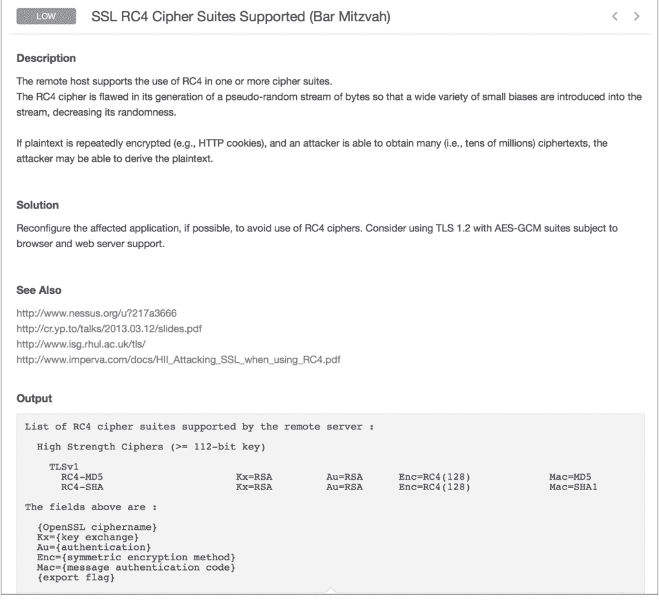

## 图 5.13 不安全的 SSL 加密算法漏洞

## 证书问题

SSL 和 TLS 依赖于使用数字证书来验证服务器身份并交换加密密钥。网站用户对网络浏览器中显示的错误消息非常熟悉，如图 5.14 所示。这些错误通常包含有关所访问网站安全性的极其重要的信息，但遗憾的是，它们往往被忽视。

漏洞扫描可能还会检测到支持 SSL 和/或 TLS 的服务器上存在的证书问题。常见错误包括以下：：

### 证书名称与服务器名称不匹配

这是一个非常严重的错误，因为它可能表明使用了从另一个网站获取的证书。这在数字世界等同于某人从朋友那里“借”了一个假身份证。

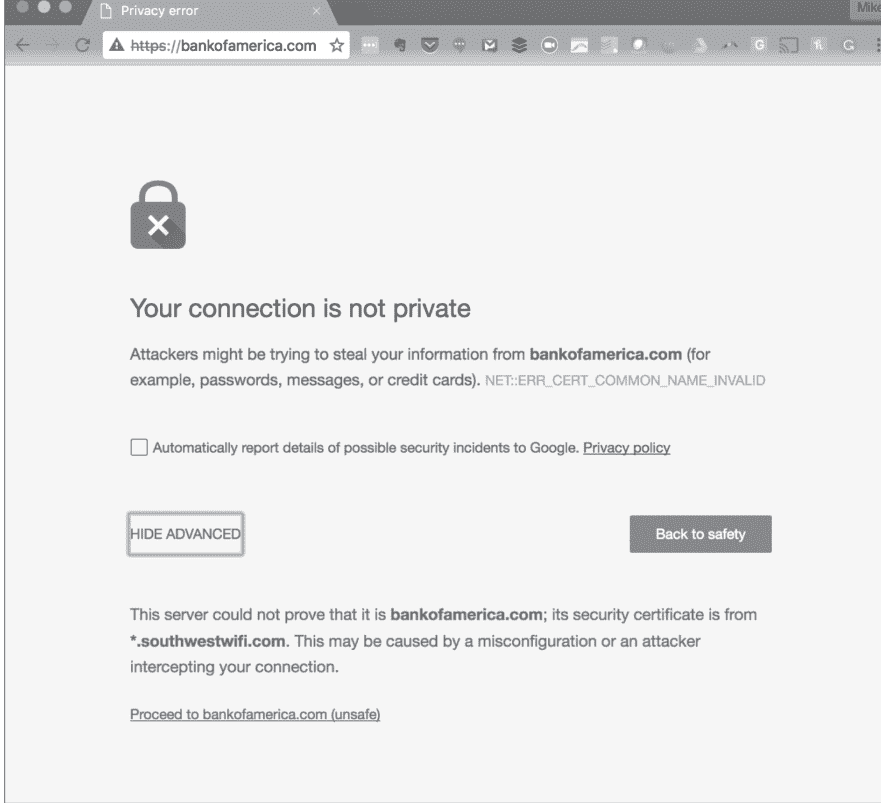

## 图 5.14 无效证书警告

### 数字证书过期

数字证书有有效期和过期日期。当你看到过期的证书时，最可能意味着服务器管理员未能及时更新证书。

### 未知的证书颁发机构 (CA)

任何人都可以创建数字证书，但只有当证书接收者信任发行证书的实体时，数字证书才有用。操作系统和浏览器包含了信任已知 CA 的指令，但如果它们遇到由未知或不可信 CA 颁发的证书，则会显示错误。

图 5.14 显示的错误表明用户正尝试访问一个提供无效证书的网站。从 URL 可以看到，用户正尝试访问 `bankofamerica.com`。然而，查看详情后我们发现呈现的证书是颁给 `southwestwifi.com` 的。这在通过强制性门户（captive portal）身份验证用户加入公共无线网络的网络上是常见现象。此例子来自美国西南航空（Southwest Airlines）提供的机 Wi-Fi 服务。该错误提示用户，他们并未与美国银行拥有的目标网站进行通信，且不应提供敏感信息。

## 域名系统 (DNS)

域名系统 (DNS) 提供了域名与 IP 地址之间的翻译服务。DNS 让用户能够记住易于记忆的域名（例如 `apple.com`），而无需担心这些服务器所使用的令人枯燥的 IP 地址。

DNS 服务器是企业网络中漏洞的常见来源。尽管该服务的性质看似简单，但 DNS 有着许多严重安全漏洞的记录，并且需要仔细的配置和打补丁。DNS 服务的许多问题已在本章中讨论过，例如缓冲区溢出、缺少补丁和代码执行漏洞，但另一些是 DNS 服务特有的。

图 5.15 显示了一个漏洞扫描示例，该扫描检测到了组织网络中两台服务器上的 DNS 放大漏洞。在此类攻击中，攻击者向 DNS 服务器发送伪造的 DNS 请求，这些请求经过精心设计，以诱出比原始请求大得多的响应。这些巨大的响应包随后会发送到伪造的地址，即 DNS 服务器认为查询源于该地址。伪造请求中使用的 IP 地址实际上是拒绝服务攻击的目标，会被来自全球 DNS 服务器的、从未发送过的巨大响应所轰炸。当规模足够大时，DNS 放大攻击可以完全压垮目标系统，使其无法运行。

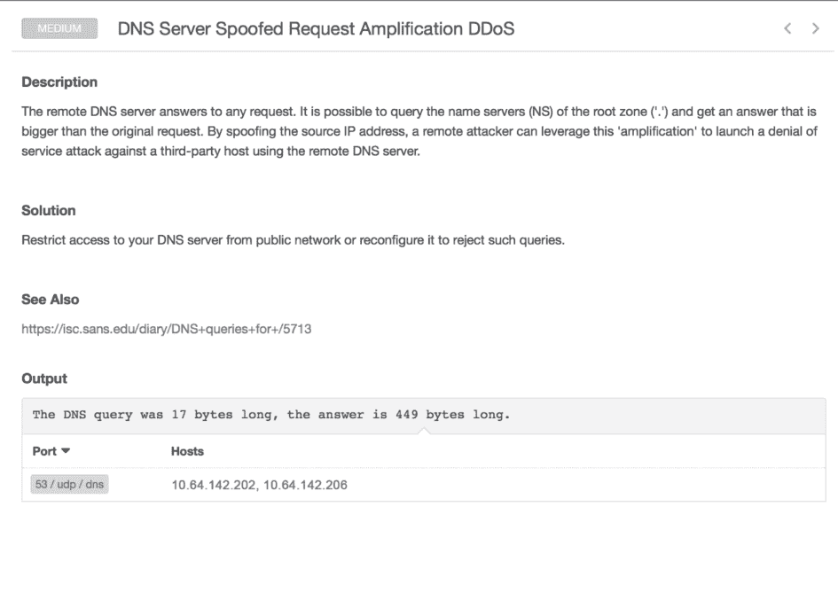

## 图 5.15 DNS 放大漏洞

## 内部 IP 暴露

IP 地址有两种变体：可以在互联网上路由的公共 IP 地址和仅限本地使用的私有 IP 地址。任何可通过互联网访问的服务器必须有一个公共 IP 地址，但该地址通常由防火墙通过网络地址转换 (NAT) 映射服务器真实的私有地址。

配置不当的服务器可能会向远程系统泄露其私有 IP 地址。当系统在对 HTTP 请求的响应中包含自己的 IP 地址时就会发生这种情况。服务器并未意识到在使用 NAT，因此在响应中使用私有地址。攻击者可以利用此信息获取有关防火墙网络的内部配置。图 5.16 显示了此类信息披露的示例。

## 虚拟专用网络问题

许多组织使用虚拟专用网络 (VPN) 为员工提供访问组织的安全连接。与任何访问协议一样，管理员必须确保组织提供的 VPN 服务已更新到最新水平。此外，VPN 需要使用加密算法，当它们支持不安全的算法时，会面临与 SSL 和 TLS 的问题。

# 虚拟化漏洞

大多数数据中心广泛使用虚拟化技术。在虚拟化环境中，虚拟机管理程序调配底层硬件的访问。这被称为裸机虚拟化。这是数据中心环境常用的方法。另一种虚拟化类型是托管虚拟化，即宿主机操作系统位于硬件和虚拟机管理程序之间。这通常用于终端系统用户希望在设备上同时运行多个操作系统的情况。Parallels 是 Mac 上流行的托管虚拟化平台。

| 虚拟机 | 虚拟机 | 虚拟机 |
| --- | --- | --- |
| | 虚拟机管理程序 | |
| | 物理硬件 | |

**图 5.17** 虚拟机内部


> **注意**
> 本章描述的示例中虚拟机管理程序直接运行在物理硬件之上，被称为裸机虚拟化。这是数据中心环境常用的方法。另一种虚拟化类型是托管虚拟化，即宿主机操作系统位于硬件和虚拟机管理程序之间。

## 虚拟机逃逸

虚拟机逃逸漏洞是虚拟化环境中可能存在的最严重问题，特别是当虚拟机运行不同安全级别的系统时。在逃逸攻击中，攻击者拥有单个虚拟机的访问权限，然后成功利用该权限入侵分配给到另一个不同的虚拟机（VM）。虚拟机管理程序本应通过限制虚拟机仅访问分配给该机器的资源来防止此类访问。逃逸攻击允许运行在虚拟机上的进程“逃逸”这些管理程序的限制。

## 管理接口访问

虚拟化工程师使用虚拟化基础设施的管理接口来配置虚拟化环境、设置新的客户机并监管对资源的访问。从安全角度来看，此管理接口极其敏感，应该对其进行严格控制，以防止未经授权的人员获得访问。除了在管理接口上使用强效的多因素身份验证外，网络安全专业人员还应确保该接口绝不会从公共网络直接访问。检测到存在可访问管理接口的漏洞扫描会将此报告为安全隐患。

## 虚拟机主机补丁

本章已经讨论了及时为操作系统、应用程序和网络设备应用安全更新的重要性。同样，确保虚拟化平台接收可能影响虚拟机客机或整个平台安全的安全更新也同样重要。补丁可能会修复导致虚拟机逃逸攻击或其他严重安全漏洞。

## 虚拟机客机问题

网络安全分析师将运行在虚拟化环境中的每台客户机视为一个独立的服务器，它需要像网络上的任何其他设备一样受到安全关注。客户机操作系统和运行在客户机操作系统上的应用程序必须及时打补丁以修复安全漏洞，并进行其他良好的维护。从安全角度来看，物理服务器与虚拟化服务器没有区别。

## 虚拟网络问题

随着数据中心日益虚拟化，大量的网络流量实际上从未触碰过网络！位于同一物理硬件上的虚拟机之间的通信可以在内存中发生，而永远不会接触物理网络。因此，维护虚拟网络时必须像管理员对待物理网络那样投入同样的安全关注度。这包括使用虚拟防火墙控制系统之间的信息流，以及在不同的虚拟网络分段上隔离不同安全级别的系统。

# 物联网 (IoT)

在某些环境中，网络安全分析师可能会遇到数据采集与监控控制（SCADA）系统、工业控制系统（ICS）以及其他物联网（IoT）示例。这些系统允许连接设备和过程，为寻求提高业务流程效率和效果的提供了海量数据源。然而，它们也引入了新的安全担忧，并可能在漏洞扫描中出现。

物联网世界延伸到了与公共基础设施管理相关的系统。例如，闸机、门、大门和其他设施入口处的物理访问控制系统。建筑自动化系统与暖通空调（HVAC）系统、消防系统和其他建筑控制系统相互作用。所有这些系统都与工作流和流程自动化相结合，旨在减轻人员的负担。

工业控制系统依赖于分布在整个组织的一系列传感器和控制器，用于收集信息和控制活动。可编程逻辑控制器（PLC）是设计在物联网环境中运行的专用硬件控制器。PLC 经常使用一种名为 `Modbus` 的专用通信协议，通过有线串口接口与传感器和其他物联网组件进行通信。除了 PLC 之外，在准备 CySA+ 考试时，您应该熟悉构成物联网部署的一些其他技术组件：

- 嵌入式系统是集成到另一个设备（如车辆、摄像头或多功能打印机）运行中的计算机。
- 实时操作系统（RTOS）是精简的操作系统，设计用于低功耗环境下的物联网设备上快速运行。
- 片上系统（SoC）是将整个嵌入式系统封装在单个芯片上，通常在芯片上包含处理器、内存器、网络接口和电源管理。
- 现场可编程门阵列（FPGA）是允许终端用户重新编写其功能的计算机芯片，对于嵌入式系统非常有用。
- 控制区域网络总线（CAN bus）网络是专用网络，旨在促进嵌入式系统之间的通信，而没有 TCP/IP 网络的开销。

一些最关键的物联网部署发现于实体车辆和无人机上。这些系统对人类生命安全具有巨大影响，应该对安全问题进行严密监控。

正像网络上的任何其他设备一样，物联网设备可能存在安全漏洞，并受到基于网络的攻击。然而，修补物联网设备通常比其传统设备更困难，因为很难获得补丁。物联网设备制造商可能不使用自动更新机制，网络安全分析师感知更新的唯一途径是通过漏洞扫描或主动订阅物联网设备制造商发布的安全快报。

## 物联网起义

2016 年 10 月 21 日，一次大规模的分布式拒绝服务（DDoS）攻击关闭了互联网的大部分区域，影响了由亚马逊、纽约时报、Twitter、Box 以及其他提供商运行的服务。攻击在全天范围内分波袭来，最初让试图让系统恢复在线的技术人员感到困惑。

随后的调查显示，停机发生在全球 DNS 服务提供商 Dyn 遭受了毁灭性的攻击，导致其无法回答 DNS 查询。Dyn 接收了海量的流量，使其服务器溢出。

所有这些流量的来源是什么？攻击者使用一个名为 Mirai 的物联网僵尸网络，利用婴儿监视器、数字录像机（DVR）、安全摄像头以及其他家庭物联网设备的可用带宽。这些僵尸设备接收了未知攻击者的指令，同时轰炸 Dyn，导致其（以及互联网大部分！）离线。

# Web 漏洞

Web 应用是复杂的环境，通常不仅依赖 Web 服务器，还依赖后端数据库、验证服务器和其他组件为终端用户提供服务。这些 Web 应用可能包含安全漏洞，允许攻击者在网络上建立脚点，现代漏洞扫描器能够探测这些漏洞。

## 注入攻击

注入攻击发生在攻击者能够通过 Web 服务器向后端系统发送命令，从而绕过正常的安全控制并欺骗后端系统认为请求来自 Web 服务器。这种最常见的形式是 SQL 注入攻击，它利用 Web 应用向后端数据库服务器发送未经授权的命令。

Web 应用通常接收用户输入，并使用它编写数据库查询，将结果返回给用户。例如，考虑电子商务网站的搜索功能。如果用户在搜索框中输入“橙色虎枕”，Web 服务器需要知道目录中的哪些产品可能匹配此搜索词。它可能会向数据库服务器发送一个类似下面的请求：

```
SELECT * FROM products WHERE name LIKE '%橙色虎枕%';
```


SELECT ItemName, ItemDescription, ItemPrice

FROM Products

WHERE ItemName LIKE '%orange%' AND

ItemName LIKE '%tiger%' AND

ItemName LIKE '%pillow%'

```

此命令检索一个可以返回给终端用户的项目列表。在 SQL 注入攻击中，攻击者可能会向 Web 服务器发送一个非常不常的请求，例如搜索

```

orange tiger pillow; SELECT CustomerName, CreditCardNumber

FROM Orders; --

```

如果 Web 服务器仅仅将此请求传递给数据库服务器，它将执行（为了方便查看进行了重新格式化）：

```

SELECT ItemName, ItemDescription, ItemPrice

FROM Products

WHERE ItemName LIKE '%orange%' AND

ItemName LIKE '%tiger%' AND

ItemName LIKE '%pillow%';

SELECT CustomerName, CreditCardNumber

FROM Orders;

--

```

- 保护防止 SQL 注入攻击的两种最佳方法是输入验证和对数据库访问执行最小权限限制。输入验证可以确保用户不会向 Web 服务器提供意料之外的文本。它会拦截用于“跳出”原始 SQL 查询的单引号。最小权限限制了 Web 服务器可以访问的表，并可以防止旨在处理目录信息请求的进程获取信用卡信息。


## 考试笔记

注入攻击不仅限于 SQL 和数据库。网络安全专业人员还应该警惕类似的攻击，这些攻击试图将用户提供的恶意内容引入到可扩展标记语言 (XML) 文档和轻量级目录访问协议 (LDAP) 查询中。

漏洞扫描器可以检测到注入类漏洞，例如图 5.18 所示。当网络安全分析人员发现潜在的注入漏洞时，他们应该与开发人员紧密合作，验证漏洞是否存在，并修复受影响的代码。

## 跨站脚本

在跨站脚本 (XSS) 攻击中，攻击者在网站上嵌入脚本命令，这些命令随后由访问该网站的毫无防备的游客执行。其思想是欺骗访问信任网站的用户执行由不受信任的第三方放置的恶意代码。

## CGI 通用 SQL 注入（盲注，基于时间）

## 描述

通过向托管在远程 Web 服务器上的一个或多个 CGI 脚本发送构造的参数，Nessus 能够获得较慢的响应，这表明它可能能够修改应用程序的行为并直接访问底层数据库。

攻击者可能利用此来绕过身份验证、泄露机密数据、修改远程数据库甚至控制远程操作系统。

注意，此脚本是实验性的，可能会产生假误报。

## 解决方案

修改 CGI 脚本以使其对参数进行正确的转义。

## 延伸阅读

http://www.securiteam.com/securityreviews/50DN1P76E.html
http://www.securitydocs.com/Library/2651
http://projects.webappsec.org/SQL-injection

## 输出

+ 使用 HTTP GET 方法，Nessus 发现：
- 以下资源可能受到盲注 SQL 注入（基于时间）的攻击：
- `/experience/example-company.asp` CGI 的 `company` 参数：
`/customers.asp?like=company&company=ACME%20INDUSTRIES;WAITFOR DELAY '20:00:00.20'--`

```

-- output

<!DOCTYPE html>

<html lang="en">

<head>

<meta charset="UTF-8" />

<meta http-equiv="X-UA-Compatible" content="IE=edge" />

```

# 图 5.18 SQL 注入漏洞

三种不同形式的跨站脚本攻击：

- 持久型 XSS 攻击发生在攻击者实际上将攻击代码存储在服务器上时。该代码留在服务器上，等待用户请求受影响的内容。此类攻击也称为存储型 XSS 攻击。
- 反射型 XSS 攻击发生在攻击者欺骗用户作为查询字符串或内容的一部分将攻击发送到服务器时。服务器随后将攻击发回给用户（反射），导致代码执行。
- 基于文档对象模型 (DOM) 的 XSS 攻击发生在用户 Web浏览器维护的数据库内部。这些攻击特别阴险，因为它们完全发生在用户的计算机上，远程 Web 服务器永远无法看到。

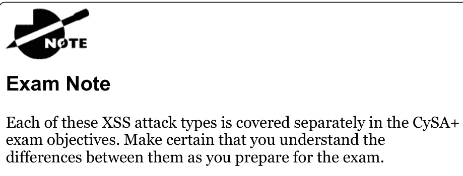

图 5.19 显示了在 Nessus 漏洞扫描期间检测到的 XSS 漏洞示例。

在扫描期间发现潜在 XSS 漏洞的网络安全分析人员应与开发人员合作评估结果的有效性，并实施适当的控制以防止此类攻击，例如输入验证。

## 目录遍历

在目录遍历攻击中，攻击者在查询字符串中插入文件系统路径值，试图导航到位于非公共授权区域的文件。当文件名包含在查询字符串中，可能会发生此类攻击。例如，如果 Web 应用程序从远程存储设备检索策略文档，它可能会在查询字符串中包含策略名称，如下所示：

```

http://www.myserver.com/policy?document='aup.pdf'
```


Web 应用程序可能会看到此查询字符串，然后进入策略存储器检索名为 `aup.pdf` 的文档。如果攻击者知道策略存储器与工资记录位于同一台服务器上，他们可能会尝试使用以下查询字符串来检索 Mike 的工资记录：

`http://www.myserver.com/policy?document='../payroll/mike.pdf'`

此查询字符串试图遍历存储服务器的目录结构，导航到策略文件夹的父目录，然后进入工资目录。

开发人员和安全专业人员应实施三类控制来防止目录遍历攻击。首先，应用程序设计应避免在用户可以操作的字段（如查询字符串）中包含文件名。其次，输入验证应防止执行目录遍历所需的特殊字符。最后，存储服务器上的访问控制应限制 Web 服务器对授权公共访问的文件的访问。

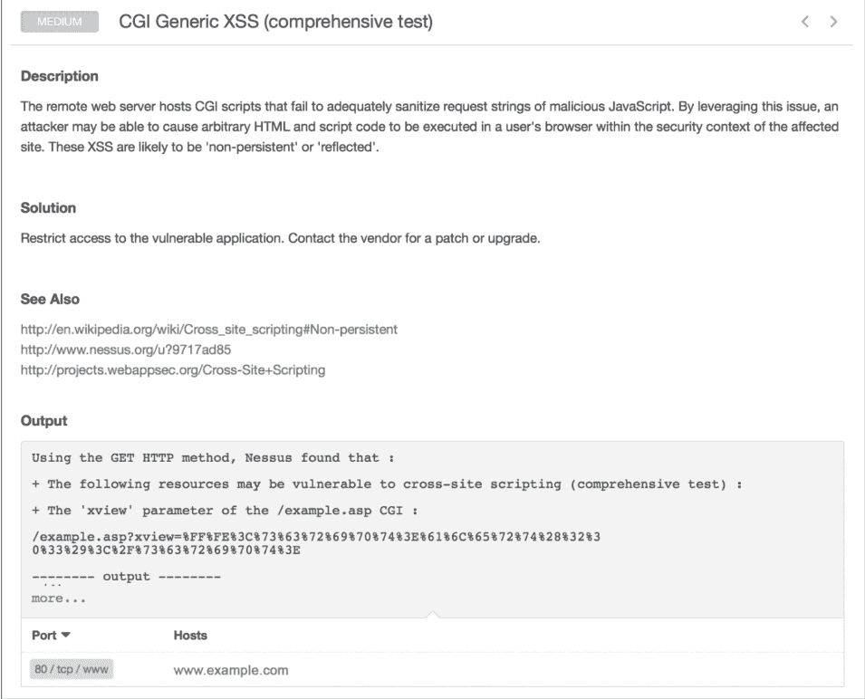

图 5.19 跨站脚本

## 身份验证漏洞

针对身份访问管理系统的常见方法包括密码喷洒、凭据填充、冒充、中间人攻击和会话劫持。

## 密码复用

两种常见的身份验证漏洞源于用户跨站点重复使用相同的密码：

- 密码喷洒攻击发生在攻击者使用常用密码尝试登录许多账户时。攻击者只需要找到一个有效的用户名/密码组合即可访问系统。当用户不选择唯一密码时，这种攻击就会成功。
- 凭据填充攻击发生在攻击者使用从一个网站窃取的用户名和密码尝试访问另一个网站。

除了鼓励密码管理实践外，管理员还可以要求使用多因素身份验证来进一步保护自己。

## 冒充

冒充攻击发生在攻击者获取合法用户身份时。第 8 章“身份访问管理”中讨论的安全问题可能导致冒充发生。防止冒充可能需要更好的会话处理技术，如 OWASP 速查表中的技术。其他类型的冒充可以通过保护攻击者可能获取的会话标识来防止。

## 中间人

中间人 (MitM) 攻击发生在攻击者能够干扰两个系统之间的通信流时。例如，想象一个名为 Alice 的用户试图与她的银行 Web 服务器通信，如图 5.20 所示。

图 5.20 显示了正常通信，Alice 建立了 HTTPS 连接并与 Web 服务器安全通信。如果监听者看到与此连接相关的网络流量，由于经过加密，他们无法读取内容。

然而，如果攻击者能够冒充银行的 Web 服务器（如图 5.21 所示），攻击者可以接受 Alice 的连接请求并建立他们到合法银行服务器的连接。然后攻击者将看到来自 Alice 的所有请求并将其转发给合法服务器，冒充 Alice。攻击者随后将银行的响应发送给 Alice。攻击者充当了中间人。

会话或网络链路的端到端加密有助于减少 MitM 攻击成功的概率，除非攻击者控制了端点或拥有加密密钥。

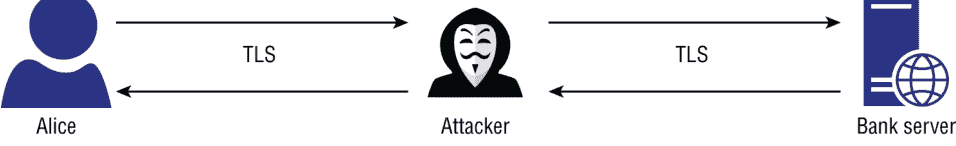

图 5.21 中间人攻击

## 会话劫持

会话劫持专注于接管已存在的会话，可以通过获取远程服务器用于验证会话的会话密钥或 Cookie，或者让会话通过攻击者控制的系统，从而使其参与会话。与身份伪造和中间人攻击（MitM）类似，保护攻击者劫持会话所需的数据（通过加密网络会话或本地系统上的链接），有助于限制会话劫持的机会。

## 总结

漏洞管理计划产生大量信息，需要经过训练的网络安全专业人员进行分析。网络安全分析师必须熟悉漏洞扫描结果的解释以及修复工作的优先级排序，以便为组织提供价值。

漏洞扫描器通常使用通用漏洞评分系统（CVSS）对检测到的问题进行排序。CVSS 为每个漏洞提供了六个衡量维度：访问向量指标、复杂度指标、身份验证指标、机密性指标、完整性指标和可用性指标。这些指标共同提供了漏洞被成功利用的可能性以及对组织可能产生的影响。

分析师在解释扫描结果时，应注意观察常见问题。误报报告（False positive reports）发生在扫描器错误地报告了实际上并不存在的漏洞时。如果分析师怀疑结果的准确性，他们应该进行手动验证。在验证漏洞时，分析师应该利用自己的专业知识，以及组织内其他人的领域专业知识。

为了成功地解释漏洞报告，分析师必须熟悉常见的漏洞。常见的服务器和端点漏洞包括缺少补丁、不支持的操作系统和应用程序、缓冲区溢出、特权提升、任意代码执行、不安全协议的使用以及调试模式的存在。常见的网络漏洞包括缺少固件更新、SSL/TLS 问题、DNS 配置错误、内部 IP 泄露和 VPN 问题。虚拟化漏洞包括虚拟机逃逸漏洞、管理接口访问、虚拟主机缺少补丁，以及虚拟客户机和虚拟网络的安全配置不当。

## 考试要点

- 解释漏洞扫描报告如何为网络安全分析师提供关键信息。除了提供系统上存在的漏洞的详细信息外，漏洞扫描报告还提供关键的严重性和故障排除信息。报告通常包含触发漏洞报告的请求和响应，以及针对问题的建议解决方案。分析师必须理解如何识别、验证和修复发生的漏洞。

- 了解通用漏洞评分系统（CVSS）的用途。CVSS 基础分在 10 分制上计算一个标准衡量标准，结合了利用漏洞所需的访问向量信息、利用的复杂性以及执行攻击所需的身份验证。基础分还考虑了漏洞对受影响系统的机密性、完整性和可用性的影响。

- 解释服务器和端点设备为何是漏洞常见来源。缺少补丁和过时的操作系统是最常见的两个漏洞源，可以通过主动设备维护轻松修复。缓冲区溢出、特权提升和任意代码执行攻击通常利用应用程序缺陷。支持不安全协议的设备也是漏洞的常见来源。

- 由于网络设备也经常遭受漏洞，网络管理员应确保网络设备定期接收固件更新以修补安全问题。SSL 和 TLS 加密实现不当在使用过时协议、不安全的加密算法或无效证书时也会导致漏洞。

- 解释专门技术如何增加漏洞扫描的复杂性。网络安全分析师应该理解如何对移动设备和物联网（IoT）组件进行扫描并解释结果。他们还应该包括特殊系统，如嵌入式设备、RTOS、SoC 和 FPGA 技术。识别扫描车辆、无人机、建筑自动化系统、物理访问控制系统和工业控制系统增加的难度。

- 了解软件漏洞需要分析师与开发者之间的协作。特别是 Web 应用程序容易受到 SQL 和 XML 注入攻击。所有软件都可能包含缓冲区、整数和堆溢出漏洞。修复这些问题通常需要重写代码并重新扫描以确认修复。

- 理解虚拟化基础设施增加了另一层潜在漏洞。负责虚拟化基础设施的管理员必须确保虚拟机已修补以防止虚拟机逃逸攻击。此外，管理员应仔细限制对虚拟基础设施管理接口的访问。

## 实验练习

### 活动 5.1：解释漏洞扫描

在活动 4.2 中，你对你控制的网络运行了漏洞扫描。在实验中，你将解释该扫描的结果。查看扫描结果并为你的网络制定修复计划。该计划应仔细考虑每个漏洞的严重性以及完成修复所需的时间。

### 活动 5.2：分析 CVSS 向量

在实验中，你将解释漏洞扫描中发现的 CVSS 向量以评估漏洞的严重性和影响。查看图 5.22 和 5.23 中的漏洞报告。这些漏洞的 CVSS 组成部分哪一个更严重？

### 活动 5.3：修复漏洞

在实验中，你将修复活动 5.1 中识别的漏洞之一。
1. 查看活动 5.1 的报告，选择一个你有能力修复的高优先级漏洞。
2. 执行修复。
3. 运行新扫描以确认漏洞已修复。

### SSL 证书不可信

描述：服务器的 X.509 证书不可信。这种情况可以通过三种方式发生，信任链断裂：
- 第一，服务器发送的证书可能不是来自自签名证书或已知权威机构。这发生在链顶端不可信，或缺少连接到已知权威机构的中间证书时。
- 第二，服务器发送的证书在扫描时无效。这发生在证书有效期已过期或尚未生效时。
- 第三，证书链可能包含与证书信息不匹配的签名，或使用 Nessus 无法识别的算法签名的错误签名。如果远程主机是公共主机，链的任何断裂都会使用户难以验证 Web 服务器的身份和验证。这可能更容易对主机实施中间人攻击。

解决方案：为此服务购买或生成正确的证书。

参考：
`https://www.nist.gov/publications/details/sp-509`
`https://en.wikipedia.org/wiki/X509`

严重性：中
ID: 51162
版本: 1.18
类型：远程
族：通用
发布：2010年12月15日
修改：2018年11月15日

风险信息：
风险因素：中
CVSS v3.0 基础分：6.5
CVSS v3.0 向量：`CVSS:3.0/AV:N/AC:L/PR:N/UI:N/S:U/I:L/A:N`
CVSS v3.0 临时向量：`CVSS:3.0/E:L/OR:H/S:U/I:L/A:N`
CVSS v3.0 基础分：3.0
CVSS v3.0 临时向量：`CVSS:3.0/E:L/OR:H/S:U/I:L/A/C`

图 5.22 漏洞报告

### 密钥交换协议 (IKE) 共享密钥主动模式

描述：远程密钥交换协议 (IKE) 版本 1 似乎支持带共享密钥（PSK）认证的主动模式。配置可能允许攻击者捕获并破解 VPN 网关的 PSK，并获得对私有网络的未经授权访问。

解决方案：
- 禁用主动模式。
- 如果可能，不要使用共享密钥进行身份验证。
- 如果无法避免使用共享密钥，请使用强密钥。
- 如果可能，不允许从任何 IP 地址建立 VPN 连接。

此插件不在 IPv6 上运行。

参考：
`https://www.nist.gov/pubs/786642`
`https://www.wireshark.org/packet-attack.pdf`
`https://www.cracksec.com/blog/packet-attack-exploit1401.html`
`https://www.security.com/bios/7423`

输出：未记录输出。

严重性：中
ID: 52694
版本: 1.11
类型：远程
族：通用
发布：2012年10月24日
修改：2018年11月15日

风险信息：
风险因素：中
CVSS v3.0 基础分：5.3
CVSS v3.0 向量：`CVSS:3.0/AV:N/AC:L/PR:N/UI:N/S:U/I:L/A:N`
CVSS v3.0 临时向量：`CVSS:3.0/E:L/OR:H/S:U/I:L/A/C`
CVSS v3.0 基础分：3.0
CVSS v3.0 临时向量：`CVSS:3.0/E:L/OR:H/S:U/I/L/A/N`

图 5.23 第二份漏洞报告

## 复习题

1. Tom 正在审查一次漏洞扫描，发现他网络中的某些服务器存在内部 IP 地址漏洞披露。该网络上可能使用了哪种技术导致了此漏洞？

- A. TLS
- B. NAT
- C. SSH
- D. VPN

2. CVSS 指标中哪一个包含攻击者执行攻击必须具备的账户访问类型信息？

- A. AV
- B. C
- C. PR
- D. AC

3. CVSS 攻击复杂度指标的以下值中，哪一个表示指定的攻击最容易被利用？

- A. High
- B. Medium
- C. Low
- D. Severe

4. 机密性、完整性或可用性 CVSS 指标的以下值中，哪一个表示系统存在被完全破解的可能性？

- A. N
- B. L
- C. M
- D. H

5. 目前可用的最新 CVSS 版本是什么？

- A. 1.0
- B. 2.0
- C. 2.5
- D. 3.1

6. 下列哪个指标没有包含 CVSS 可利用性评分的计算中？

A. 攻击向量
B. 漏洞年龄
C. 攻击复杂度
D. 所需权限

7. Kevin 最近发现了一个新的安全漏洞，并计算出 CVSS 基础分为 6.5。该漏洞属于哪种风险类别？

A. 低
B. 中
C. 高
D. 严重

8. Tara 最近分析了漏洞扫描报告的结果，发现扫描器报告的漏洞并不存在，因为系统实际上已经按照规定进行了补丁。发生了哪种错误？

A. 误报（False positive）
B. 漏报（False negative）
C. 确阳性（True positive）
D. 真阴性（True negative）

9. 下列哪个不是可能与漏洞扫描结果相关的常见信息源？

A. 日志
B. 数据库表
C. SIEM
D. 配置管理系统

10. 生产网络应避免使用哪种操作系统？

A. Windows Server 2003
B. Red Hat Enterprise Linux 7
C. CentOS 7
D. Ubuntu 16

11. 在哪种攻击中，攻击者在内存位置放置的信息比为该用途分配的更多？

A. SQL 注入
B. LDAP 注入
C. 跨站脚本
D. 缓冲区溢出

12. Dirty COW 攻击是什么类型漏洞的示例？

A. 恶意代码
B. 权限提升
C. 缓冲区溢出
D. LDAP 注入

13. 下列哪个协议不应在公共网络上使用？

A. SSH
B. HTTPS
C. SFTP
D. Telnet

14. Betty 正在为其创建的新公共网站选择传输加密协议。哪种协议是最佳选择？

A. SSL 2.0
B. SSL 3.0
C. TLS 1.0
D. TLS 1.1

15. 下列哪种情况在 Web 服务器进行漏洞扫描时不会导致证书警告？

A. 使用不可信任的 CA
B. 包含公共加密密钥
C. 证书过期
D. 证书名称不匹配

16. 哪个软件组件负责强制虚拟化基础设施中客户系统的隔离？

A. 客户操作系统
B. 宿主机操作系统
C. 内存控制器
D. Hypervisor（虚拟机监控器）

17. 在哪种攻击中，攻击者试图访问分配给不同虚拟机的资源？

A. 虚拟机逃逸（VM escape）
B. 管理接口暴力破解
C. LDAP 注入
D. DNS 放大

18. 下列哪个术语通常用于描述物理设备连接到网络？

A. IoT
B. IDS
C. ICS
D. SCADA

19. Monica 发现攻击者在她管理的 Web 论坛上发布了一条信息，攻击访问该网站的用户。最可能发生的是以下哪种攻击类型？

A. SQL 注入
B. 恶意软件注入
C. LDAP 注入
D. 跨站脚本

20. Alan 在攻击后检查了 Web 服务器日志，发现来自用户查询中有许多包含分号和单引号的记录。他应该怀疑是哪种攻击？

A. SQL 注入
B. LDAP 注入
C. 跨站脚本
D. 缓冲区溢出

# 第 6 章
云安全

COMPTIA 网络安全分析师 (CYSA+)
本章涵盖的考试目标包括：

- 领域 1.0: 威胁与漏洞管理
  - 1.4 在给定场景下，分析常用漏洞评估工具的输出结果。
  - 1.6 解释与云操作相关的威胁和漏洞。
- 领域 2.0: 软件与系统
  - 2.1 在给定场景下，应用安全控制。

## 理解云环境

云计算是一个涵盖通过网络提供的任何服务的术语。美国国家标准与技术研究院 (NIST) 将云计算定义为：

- 无处不在且便利：可以在任何有网络连接的地方访问。
- 按需自助服务：客户无需与服务提供商进行人工交互即可配置资源。
- 资源池：多个消费者共享相同的物理资源（多租户模式）。
- 快速弹性：可以根据需要快速配置和释放资源。
- 按量付费：对资源使用进行自动控制和监控。

## 云计算的理由

采用云的组织出于多种原因。他们通常是为了特定需求而启动云工作，但最终发现他们获得了许多其他利益。

**颠覆性创新**：云提供商开发或采用新技术的速度通常比尝试构建基础设施的组织快得多。毕竟，提供技术服务是其核心使命，而大多数组织利用技术是为了实现其他使命。

**敏捷性与弹性**：云运营提高了客户内部的敏捷性。当需要新的 IT 资源时，可以随时配置。当不再需要时，可以释放资源，从而停止计费。

**可扩展性**：构建在云架构上的解决方案具有几乎无限的可扩展性。可以根据需要添加和删除计算、存储和网络资源。这种扩展性可以自动化，并根据不断变化的需求进行动态调整。

## 成本效益

尽管向市场增加另一个供应商来降低成本似乎违背直觉，但对于大多数组织来说通常确实如此。云提供商运营着海量的数据中心，拥有极少数大型组织之外都无法企及的规模效应。

## 安全

云提供商在网络安全投入了巨大的资源。在本章的后面部分，你将学习云计算的共享责任模型。在这种模型下，某些责任由云服务提供商承担，而另一些则由客户负责。大多数云服务提供商在履行职责方面能做的远比小型组织要多得多。

每个组织都需要分析自己的业务需求，并为采用云计算服务制定自己的理由，但这些核心优势几乎存在于每一个环境中。

## 云服务模型

云提供商提供的服务分为三种*云服务模型*。每种模型都描述了通过云交付的不同层次的服务，并为服务提供商和客户创建了不同级别的责任。

## 软件即服务 (SaaS)

软件即服务（SaaS）为客户提供完整的应用程序，该程序由服务提供商构建和维护，并运行在由服务提供商运营或采购的基础设施之上。SaaS 客户通常通过网络浏览器访问服务，并仅进行有限的应用程序配置。运行服务的几乎所有责任都在云服务提供商手中，可能还有为 SaaS 提供商提供底层基础设施资源访问权限的其他云提供商手中。

几乎每个现代组织都会使用至少一种 SaaS 服务，大多数组织都依赖于满足各种业务需求的多元化服务组合。SaaS 提供商提供常见的生产力应用，例如 Google 的 Gmail（如图 6.1 所示）和微软的 Office 365。其他 SaaS 提供商则构建针对特定行业和特定功能的方案，旨在吸引特定的客户群。例如，如图 6.2 所示的 Slate 客户关系管理（CRM）工具是专为高等教育招生办公室的管理而设计的。

## 基础设施即服务 (IaaS)

基础设施即服务（IaaS）服务运行在非常不同的服务模型下。SaaS 服务试图向客户隐藏实现细节，但 IaaS 服务则暴露了基础的基础构建块，客户可以使用这些构建块来设计和实现自己的服务方案。这些方案包括计算处理、存储、网络以及技术基础设施的其他基础组件。


图 6.1 Google 的 Gmail 是 SaaS 计算的一个示例。

在 IaaS 环境中，客户能够选择并组装基础云服务，以创建满足其业务目标所需的服务。在 IaaS 环境中，客户对基础设施的控制比在 SaaS 环境中更多，因此对监控、管理和安全有更大的责任。这些客户责任包括维护和升级操作系统，以及运行在环境中的软件。图 6.3 显示了用于管理计算云（EC2）服务器实例的 AWS 控制板。

IaaS 云提供商保留维护物理环境、强制隔离和运行底层云基础设施的责任。

如今市场上有许多 IaaS 提供商提供服务，但有三家主要供应商主导着市场。最大的是 AWS，其次是 Microsoft Azure 和 Google Compute Platform。

| | 提交前... | 预筛选 | 阅读 1 | 面试 | 阅读 2 | 决策 |
|---|---|---|---|---|---|---|
| 未提交 E | 不完整 E | 面试 E | 待定 E | 预委员会阅读 E | 录取 E |
| | | 完成 E | 拒绝 E | 已排期 E | 委员会阅读 E | 拒绝 E |
| | 评估 E | | | 经理阅读 E | 留待 E |
| | | | | | 候补 E |
| | | | | | 推迟到下周期 E |
| | | | | | 撤回 E |

图 6.2 Slate 是专为高等教育招生团队设计的 CRM 工具。

## 平台即服务 (PaaS)

平台即服务（PaaS）方法处于 SaaS 和 IaaS 服务之间的中间地带。在这种方法中，服务提供商运营一个完全管理和可配置的基础设施来运行客户应用程序。客户随后将他们自己开发或从供应商处购买的应用程序部署到服务提供商的平台上，并在那里以最少的客户管理运行。

PaaS 平台支持多种应用程序类型和编程语言。例如，如图 6.4 所示的 Heroku PaaS 服务支持部署使用 Python、Java、Ruby、Node.js、PHP 等其他常用语言编写的客户应用程序。

PaaS 服务允许客户在不管理底层服务器的情况下执行代码，但客户通常仍需参与配置适当水平的基础设施，通常是通过指定他们希望使用的服务器数量。PaaS 服务将根据此配置的容量进行计费。

AWS 服务资源组 管理员访问/mchapple... 弗吉尼亚

新 EC2 体验\告诉我们您的想法

## EC2 控制板 新

+   事件
标签
报告
限制
实例
实例
实例类型
启动模板 新
抢占实例请求
节省计划
预留实例
专用主机
计划内实例
容量预留

+   镜像
AMI
捆绑任务
弹性块存储
Volumes
卷
快照
生命周期管理器
网络与安全
安全组
弹性 IP
位置组

## EC2

## 资源

| 运行中的实例 | 9 | 弹性 IP | 11 |
|---|---|---|---|
| 专用主机 | 0 | 快照 | 44 |
| 卷 | 17 | 安全组 | 96 |
| 密钥对 | 0 | | |
| 位置组 | 0 | | |

要开始使用，请启动一个 EC2 实例，它是云中的一个虚拟服务器。注意：您的实例将在美国东部（弗吉尼亚）区域启动。

# 计划内事件

美国东部（弗吉尼亚）
无计划内事件

图 6.3 AWS 为客户提供 IaaS 计算资源的访问。


## 考试笔记

在参加 CySA+ 之前，请了解 SaaS、PaaS 和 IaaS 之间的区别。

## 要素

# 强大的平台，无与伦比的生态系统

不要重复造轮子。Heroku 的 150+ 第三方插件、1000+ 开源构建包（buildpacks）以及 3000+ 即插即用的 Heroku Buttons 构建了一个丰富的预集成扩展和服务的生态系统。

免费注册

探索 Heroku 元素


## 官方支持的语言

| Node.js | Ruby | Java | PHP |
|---|---|---|---|
| Go | Scala | Clojure |

除了我们官方支持的语言外，您可以通过第三方构建包在 Heroku 上使用任何适用于 Linux 的语言。查看所有构建包 →

图 6.4 Heroku 是一个流行的 PaaS 服务，支持多种编程语言。

## 函数即服务 (FaaS)

云客户日益接受一种被称为函数即服务（FaaS）的技术，它允许无服务器应用程序架构。开发者使用常用语言编写函数，然后可以配置 FaaS 平台根据事件执行（或触发）这些函数。以这种方式部署的函数是离散的代码单元，可以轻松扩展到数百万甚至数十亿次调用。

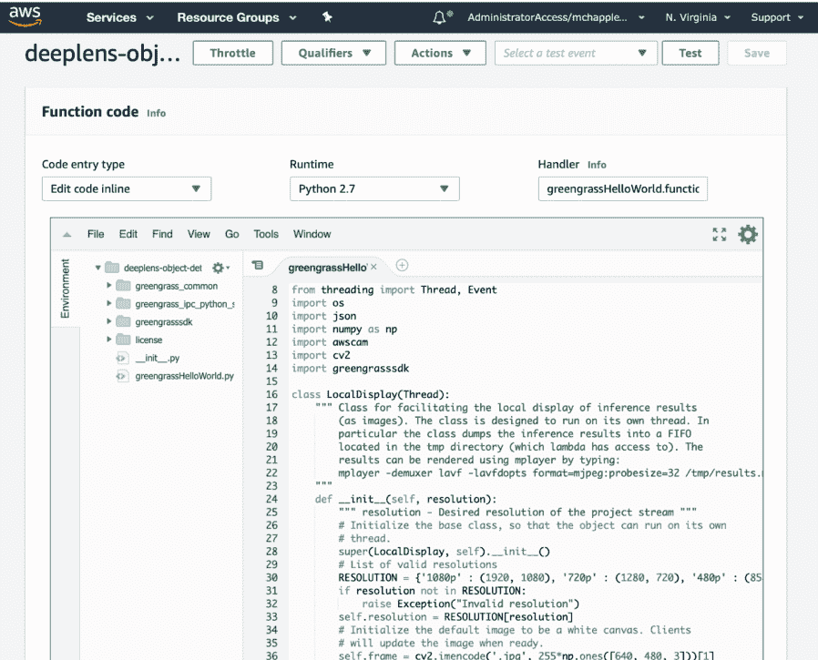

最流行的 FaaS 服务是亚马逊的 Lambda 服务（如图所示）。Lambda 支持部署使用 Python、Node.js、C#、Ruby 和 PowerShell 编写的函数。

开发者还可以使用 Lambda 运行时 API 执行使用其他语言编写的代码。其他流行的 FaaS 产品包括 Microsoft Azure Functions 和 Google Cloud Functions。FaaS 产品通常将基础设施从开发者中完全抽象出来，根据函数执行期间消耗的实际计算力和内存向客户收费。

## 云部署模型

云部署模型描述了云基础设施如何在不同用户之间进行共享（或不共享）。某些云部署模型采用多租户模式，而另一些则出于性能和/或安全考虑，为特定客户提供专用资源。

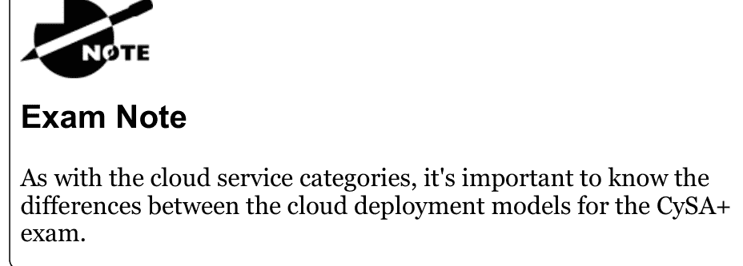

> 就像云服务分类一样，对于 CySA+ 考试，了解云部署模型之间的区别是非常重要的。

## 公有云

当我们想到云计算时，最常想到的就是公有云。公有云服务供应商部署基础设施，然后让任何希望利用这些服务的客户通过多租户模式进行访问。单个客户可能在分布于一个或多个数据中心的服务器上运行工作负载，而这些服务器可能同时为许多不同的客户运行负载。

公有云支持所有的云服务模型。公有云提供者可以向客户提供 IaaS、PaaS、SaaS 和 FaaS 服务。关键区别在于，这些服务并不运行在单一客户的专用基础设施上，而是运行在面向公众的基础设施上。AWS、Microsoft Azure 和 Google Compute Platform 都使用公有云模型。

## 私有云

*私有云*一词用于描述为单个客户提供使用的任何云基础设施。这种基础设施可能由使用该设施的组织构建和管理，也可以由第三方构建和管理。这里的关键区别是只有一个客户在使用该环境。由于原因，私有云服务往往具有过量的空闲容量以支持峰值需求，因此其成本效益不如公有云服务。

# 情报社区利用“私有公有云”云

美国情报社区（IC）长期以来一直是全球最大的（如果不是最大的）计算能力用户之一。事实上，计算领域的许多进展始于支持情报社区客户的项目。当私营部门开始快速向公有云迁移时，情报社区的技术人员注意到了这一点，但由于严格的安全要求阻止他们使用任何多租户环境进行机密国家安全活动。

情报社区的技术人员与 AWS 合作解决了这个问题，并于 2014 年启动了 AWS 商业云服务（C2S）区域，为情报社区客户提供专用 AWS 服务。该区域由 AWS 运营，但物理位于中央情报局（CIA）设施内，并与互联网完全隔离（物理隔离），提供了极高的安全性。

这种方法的有趣之处在于，它符合私有云的定义，因为 AWS 专门为情报社区运营 C2S 区域，但它使用的是与 AWS 公有云相同的工具和服务，预计成本要高得多。

2017 年，AWS 宣布启动 AWS 机密区域（Secret Region），这是一项更广泛的努力，旨在支持美国政府的任何机密工作。微软也宣布可用 Azure Government Secret 以实现相同目的。这些区域在政府机构中的广泛可用，使得机密区域符合社区云的定义，而不是私有云。

# 社区云

社区云服务共享了公有云和私有云模型的特征。社区云服务运行在多租户环境中，但租户仅限于特定设计社区的成员。社区成员身份通常根据共同的任务、相似的安全和合规性或其他共同点来定义。

图 6.5 所示的 HathiTrust 数字图书馆是社区云应用的实例。学术研究图书馆联合形成一个财团，提供对其书籍收藏的访问。HathiTrust 成员机构的学生和教师可以登录社区云服务以访问资源。

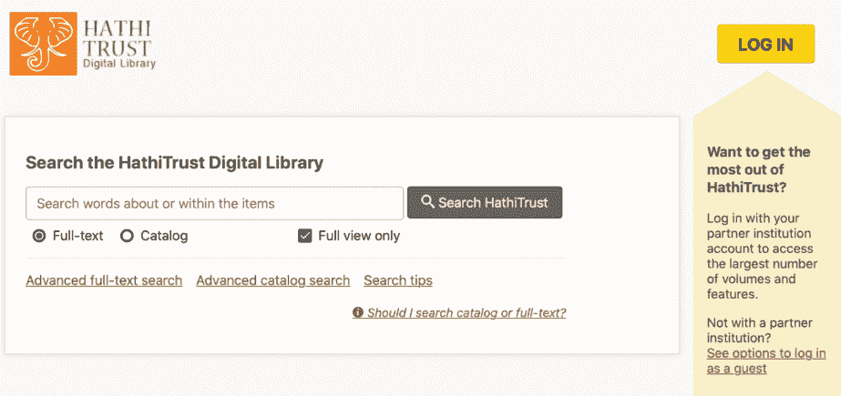

HathiTrust 是学术与研究机构的伙伴关系，提供了来自世界各地图书馆的百万数字化书目。

你可以用 HathiTrust 做什么？

图 6.5 HathiTrust 是社区云计算的一个示例。

## 混合云

混合云是一个通用术语，用于描述混合了公有云、私有云和/或社区云服务的云部署。它不仅仅是购买公有云和私有云服务并将它们一起使用。混合云需要使用技术将不同的云产品统一到单一连贯的平台上。

例如，公司可能会为其大部分工作负载运行自己的私有云，并在需求超过其私有云基础设施的容量时利用公有云容量。这种方法被称为公有云爆发（public cloud bursting）。

图 6.6 所示的 AWS Outposts 是混合云计算的示例。该服务的客户接收一架计算设备，并将其安装在自己的数据中心。机架中的设备由 AWS 维护，但由客户以与其 AWS 公有云资源相同的方式进行配置。这种方法被视为混合云，因为客户可以通过同一个管理平台管理其本地 AWS Outposts 私有云部署和其公有云 AWS 服务。

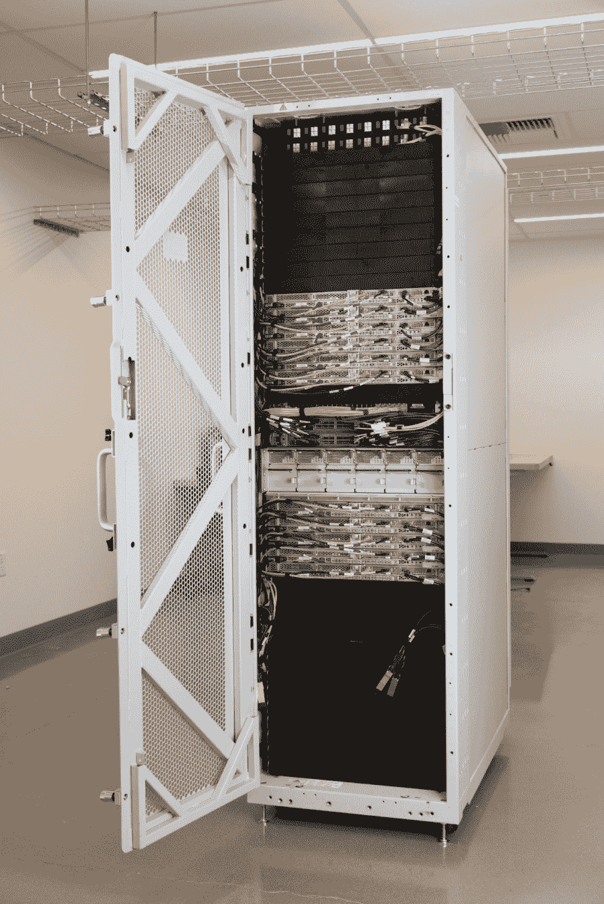

图 6.6 AWS Outposts 为客户提供混合能力。图片所有 Amazon Web Services；经许可使用

## 在云中运行

在某些方面，以云为中心的环境的网络安全与本地非常相似。无论我们的系统托管在哪里，我们仍然需要考虑数据的机密性、完整性和可用性，并实施强访问控制和其他保护这些首要目标的机制。

然而，云安全操作也与本地有显著不同，因为云客户必须在一个或多个服务提供商与其自身团队之间划分责任。这种运行环境被称为责任共担模型。图 6.7 显示了 IaaS、PaaS 和 SaaS 中常见的责任分担。

| IaaS | PaaS | SaaS |
|---|---|---|
| 数据 | 数据 | 数据 |
| 应用 | 应用 | 应用 |
| 操作系统 | 操作系统 | 操作系统 |
| 硬件 | 硬件 | 硬件 |
| 数据中心 | 数据中心 | 数据中心 |

图 6.7 云计算的责任共担模型

> 清晰地记录网络安全任务的职责分工。这在需要符合外部法规要求的情况下尤为重要。例如，受《支付卡行业数据安全标准》（PCI DSS）约束的组织应与云提供商合作，记录满足每项 PCI DSS 要求的各项特定控制措施和责任。云提供商对这一过程非常熟悉，许多托管网站还提供了其控制措施与常见合规性框架之间的详细映射关系。

## DevOps 策略

传统的组织和运行技术团队的方法侧重于构建以技术角色为中心的专业知识孤岛。特别是软件开发和技术运营通常被认为是完全脱节的。开发者负责创建业务所需的软件应用程序，并拥有自己的一套流程来规范需求、设计接口、编写代码、测试应用程序以及维护代码库。当他们完成新版本应用程序的测试后，就会将其交给技术运营团队，由后者负责管理支持应用程序的服务器和其他基础设施。

将开发世界与运营世界分开，为技术人员提供了一个舒适的工作环境，在这个环境中，他们的任务有明确定义，并被同类社区包围。然而，这也带来了显著的缺点，包括以下方面：

- 将运营团队与开发流程隔离开会阻碍他们对业务需求的理解。
- 将开发者与运营考虑因素隔离开会导致设计在处理器、内存和网络消耗方面产生浪费。
- 要求从开发到运营有清晰的交接会因为需要漫长的过渡期而降低敏捷性和灵活性。
- 增加与交接相关的开销会鼓励将许多小型的修复和增强合并到一次大发布中，从而增加了满足需求所需的时间。

意识到分离开发和运营团队的固有缺点后，许多组织现在开始采用 DevOps 这种技术管理方法。这种方法将开发和运营团队整合到一个统一的流程中，以敏捷的方式在软件开发中共同工作。软件测试和发布过程变得高度自动化和协作，使组织能够从漫长的发布管理流程转变为每天可能发布数十次更新的世界。

## 基础设施即代码 (IaC)

基础设施即代码（IaC）是 DevOps 运动背后的关键推动技术之一，也是云计算解决方案的关键优势。IaC 是通过脚本代码而非人工干预，自动实现基础设施服务的配置、管理和拆除（销毁）的过程。IaC 是所有 IaaS 环境（包括 AWS、Microsoft Azure 和 Google Cloud Platform）的核心特性之一。

IaC 有许多形式，既可能是云服务提供商提供的功能，也可能是第三方云管理平台实现的功能。在大多数情况下，运营团队通过云提供商 Web 界面执行的相同操作也可以通过代码实现。例如，图 6.8 显示了通过 AWS 图形界面创建 EC2 服务器实例的过程。

# 第 2 步：选择实例类型

IaC 具有多种形式，可以是云服务提供商提供的功能，也可以是由第三方云管理平台启用的功能。在大多数情况下，运营团队通过云提供商 Web 界面可以执行的相同操作也可以在代码中实现。例如，图 6.8 显示了通过 AWS 图形界面创建 EC2 服务器实例的过程。

EC2 提供了针对不同用例的实例类型。实例是虚拟服务器，在 CPU、内存和网络容量方面有所不同，以满足您的需求。

| 家族 | 类型 | vCPU | 内存 (GB) | 存储 (GB) | 优化 | 网络 |
| :--- | :--- | :--- | :--- | :--- | :--- | :--- |
| 通用 | t2.micro | 1 | 0.5 | | | |
| | t2.small | 1 | 1 | | | |
| | t2.medium | 1 | 2 | | | |
| | t2.large | 2 | 4 | | | |
| | t2.xlarge | 2 | 8 | | | |
| | t2.2xlarge | 2 | 16 | | | |
| 通用 | t3.nano | 2 | 0.5 | | | |
| | t3.micro | 2 | 1 | | | |
| | t3.small | 2 | 2 | | | |
| | t3.medium | 2 | 4 | | | |
| | t3.xlarge | 4 | 8 | | | |
| | t3.2xlarge | 4 | 16 | | | |
| 计算密集型 | c5.nano | 1 | 0.5 | | | |
| | c5.micro | 1 | 1 | | | |
| | c5.small | 1 | 2 | | | |
| | c5.medium | 2 | 4 | | | |
| | c5.xlarge | 4 | 8 | | | |
| | c5.2xlarge | 4 | 16 | | | |
| 内存密集型 | r5.nano | 1 | 0.5 | | | |
| | r5.micro | 1 | 1 | | | |
| | r5.small | 1 | 2 | | | |
| | r5.medium | 2 | 4 | | | |
| | r5.xlarge | 4 | 8 | | | |
| | r5.2xlarge | 4 | 16 | | | |
| 存储密集型 | i3.nano | 1 | 0.5 | 150 | SSD | |
| | i3.micro | 1 | 1 | 300 | SSD | |
| | i3.small | 1 | 2 | 450 | SSD | |
| | i3.medium | 2 | 4 | 600 | SSD | |
| | i3.xlarge | 4 | 8 | 900 | SSD | |
| | i3.2xlarge | 4 | 16 | 1200 | SSD | |

基础设施即代码（IaC）要求开发者直接与服务交互，而不是要求个人在界面内操作。正如你在上一节看到的，这有时可以通过提供者的界面来实现，例如 CloudFormation。然而，开发者可能希望编写在环境中执行但仍与云交互的代码。这就是应用程序接口（API）发挥作用的地方。

API 是以编程方式与 Web 服务交互的标准。云提供商创建 API 并将其开放给客户，以便客户配置、管理和拆除服务。

当云提供商开放 API 时，安全性至关重要，因为它们必须确保请求 API 的用户是授权的。API 通过使用 API 密钥来实现这一点，类似于密码。当用户通过 API 发送请求时，他们还会发送其 API 密钥进行身份验证。云提供商验证 API 密钥，并检查关联密钥的用户、系统或应用程序是否有权执行该操作。

不安全的 API 是云操作的风险之一。云提供商通常会良好管理其 API 以执行安全要求，但用户账户的安全取决于其 API 密钥。云服务客户必须通过以下实践来保护其密钥：

- 将 API 密钥的暴露范围限制在尽可能少的范围内。
- 为不同的用户、应用程序和服务使用不同的 API 密钥。
- 将与 API 密钥关联的权限限制在所需的特定权限范围内。
- 不要通过非加密通道传输 API 密钥。
- 不要以明文形式存储 API 密钥。
- 确保从任何放在公共代码库或可能面临未经授权访问风险的代码中删除 API 密钥。

组织对待 API 密钥应达到与保护加密密钥相同的水平。不当的密钥管理实践可能会导致严重的安全后果。

## 云监控

在第 10 章“安全运营与监控”中，你将发现监控在网络安全运营中的重要性。安全团队需要访问历史信息以便检测策略违规、调查事件、排除工具故障并执行各种其他重要任务。无法访问日志将阻碍安全运营团队实现其目标。

在以云为中心的环境中，这些问题变得至关重要，因为大多数日志记录是在提供者的生态系统中生成的。安全运营团队应该确保他们理解可用的日志和监控机制，并将其与安全运营中心（SOC）中使用的其他工具集成。日志记录和监控不足可能导致在安全事件发生后信息不足。

## 云基础设施安全

在以云为中心的环境中工作的安全分析师使用许多与传统的本地环境相同的安全工具和技术。毕竟，在公有云中保护操作系统与保护运行在你桌下服务器上的操作系统并没有多大区别。

除了这些控制措施外，网络安全分析师还会使用云特有的工具，这些工具旨在评估和改进云环境本身的安全性。这些包括云基础设施安全工具和云访问安全代理（CASB）。

使用这些工具可以帮助组织免受云特有风险的影响。例如，不受保护的存储环境在公有云中面临的安全风险比在私有数据中心大得多。在私有数据中心，防火墙控制通常限制对存储的直接访问，限制了不受保护的文件对已访问数据中心系统的用户的暴露范围。相反，在公有云中，管理不当的存储桶（bucket）可能只需几次点击就会暴露给整个互联网。云基础设施安全工具可以帮助检测并缓解这些风险。

## 云基础设施安全工具

云基础设施评估工具可以访问云环境，检索安全信息并交付显示环境相对安全性的报告。它们可能会检测到其他漏洞扫描中不会出现的问题。例如，一个专注于云的工具可能访问云提供者的 API，并识别出安全密钥多年未轮换的情况。同样，一个工具可能检索应用到实例的所有安全组列表，并在不进行详尽端口扫描的情况下确定实例的网络暴露情况。

云提供商为其客户提供许多工具，通常是免费或费用极低的，因为确保其环境中的资源安全运行符合提供商的利益。例如，图 6.10 显示了使用 AWS Inspector 工具对 AWS 环境进行的扫描。

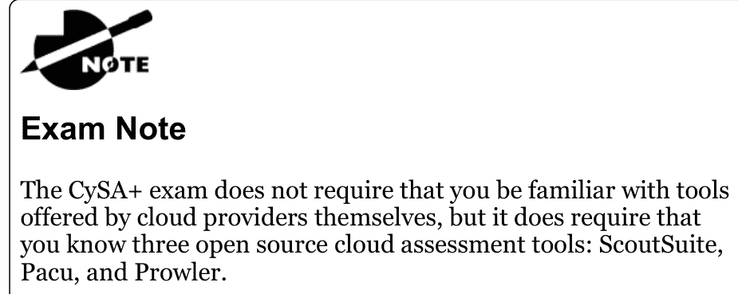

CySA+ 考试要求你熟悉云提供商自身提供的工具，但它确实要求你了解三个开源云评估工具：ScoutSuite、Pacu 和 Prowler。

## ScoutSuite

ScoutSuite 是一种多云审计工具，它可以访问用户在云服务商处的账户，并使用这些服务的 API 获取配置信息。它能够审计来自 AWS、Microsoft Azure、Google Compute Platform、阿里云和 Oracle Cloud Infrastructure 的账户。

ScoutSuite 深度探测安全配置并搜索潜在的安全问题。图 6.11 显示了 ScoutSuite 扫描生成的层级仪表板示例。它显示了客户使用的每个云服务中检测到的问题数量。

针对每个服务的详细报告深入研究了环境中存在的特定问题。例如，图 6.12 显示了一个账户中的 AWS EC2 服务问题。展开报告中的每项将显示有关潜在问题的详细信息。在图 6.12 中，你看到该账户有 18 个弹性块存储（EBS）磁盘卷，这些磁盘卷没有使用加密来保护传输中或静止存储中的数据。

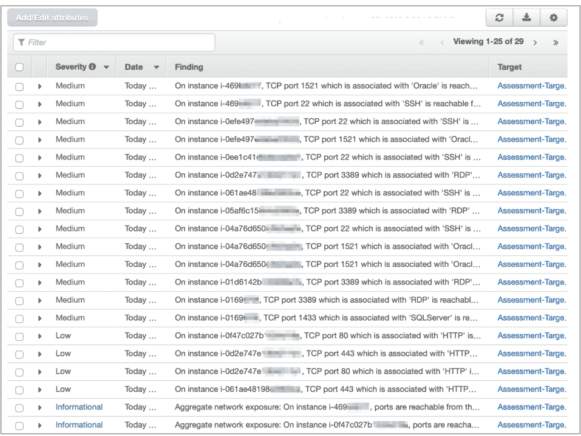

图 6.10 AWS Inspector 扫描结果。

## Pacu

Pacu 不是一个扫描工具，而是一个专注于云的利用框架，类似于 Metasploit。它专门与 AWS 账户配合，旨在帮助攻击者确定他们利用对现有 AWS 账户的访问可以做什么。因此，它是 AWS 渗透测试的强大工具。

使用 Pacu 的工作与使用 Metasploit 非常相似，因为 Pacu 提供了一个模块化的插件框架，用于测试和探测各种信息源。图 6.13 提供了 Pacu 中可用插件列表。

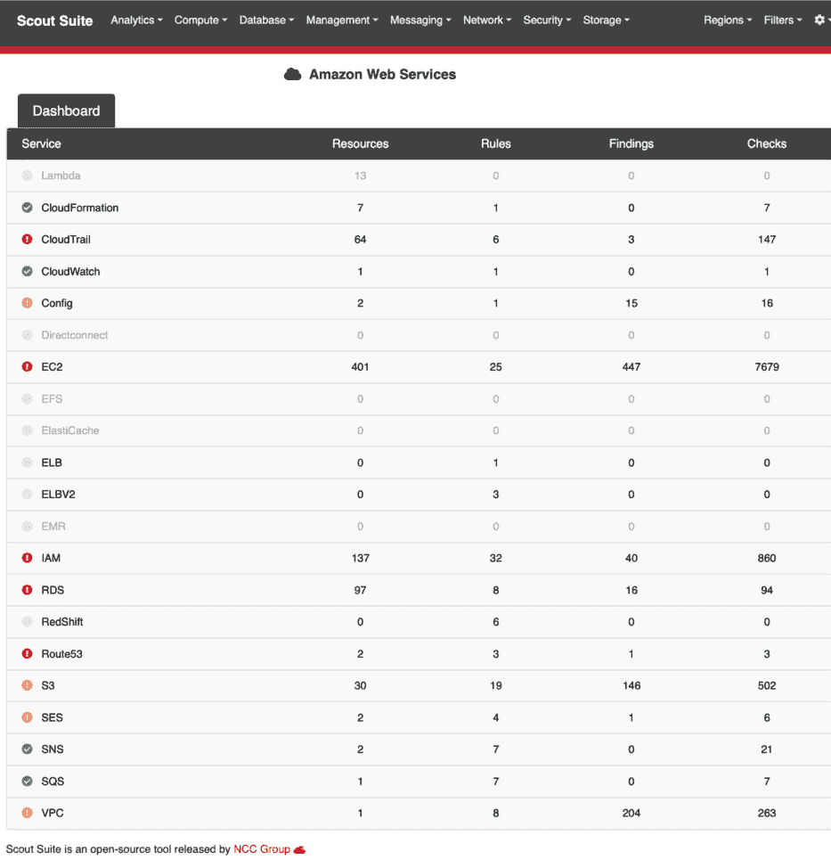

图 6.11 来自 AWS 账户的 ScoutSuite 仪表板。

## Prowler

Prowler 是一个安全配置工具，目的与 ScoutSuite 非常相似，但它对某些参数执行了更深层的测试。图 6.14 显示了 Prowler 对 AWS 账户扫描的部分结果。

## EC2

| Scout Suites | Analytics | Compute | Database | Messaging | Security | Storage | Regions |
|---|---|---|---|---|---|---|---|
| Good | | | | | | | 18 |
| | | | | | | | 18 |
| | | | | | | | 18 |
| | | | | | | | 18 |
| | | | | | | | 18 |
| | | | | | | | 18 |
| | | | | | | | 18 |
| | | | | | | | 18 |
| | | | | | | | 18 |
| | | | | | | | 18 |
| | | | | | | | 18 |
| | | | | | | | 18 |
| | | | | | | | 18 |
| | | | | | | | 18 |
| | | | | | | | 18 |
| | | | | | | | 18 |
| | | | | | | | 18 |
| | | | | | | | 18 |
| | | | | | | | 18 |
| | | | | | | | 18 |
| | | | | | | | 18 |
| | | | | | | | 18 |

图 6.12 ScoutSuite 扫描期间报告的 EC2 问题。

## Pacu（测试：无密钥）

```
RECON_UNAUTH
- iam__enum
- iam__users
- s3__bucket_finder

ENUM
- aws__enum
- aws__spend
- codebuild__enum
- ebs__enum_snapshots
- ec2__check_termination_permission
- ec2__download_userdata
- ec2__enum
- gue__enum
- iam__brutorce_permissions
- iam__detect_honeytokens
- iam__enum_permissions
- iam__enum_roles_policies_config
- iam__get_credential_report
- inspector__get_reports
- lambda__enum
- lightsail__enum

ESCALATE
- iam__privesc_scan

LATERAL_MOVE
- cloudtrail__csv_injection
- vpc__enum_lateral_movement
```

图 6.13 Pacu 中可用的插件列表。

- 1.5 [check15] 确保 IAM 密码策略至少包含一个大写字母（已评分）
失败！密码策略缺少大写字母要求

- 1.6 [check16] 确保 IAM 密码策略至少包含一个小写字母（已评分）
失败！密码策略缺少小写字母要求

- 1.7 [check17] 确保 IAM 密码策略至少包含一个符号（已评分）
失败！密码策略缺少符号要求

- 1.8 [check18] 确保 IAM 密码策略至少包含一个数字（已评分）
失败！密码策略缺少数字要求

- 1.9 [check19] 确保 IAM 密码策略最小长度为 14 位或以上（已评分）
失败！密码策略缺失或长度要求过弱

- 1.10 [check110] 确保 IAM 密码策略防止密码重用：24 次或以上（已评分）
失败！密码策略缺少密码重用要求

- 1.11 [check111] 确保 IAM 密码策略在 90 天或内过期（已评分）
失败！未设置密码有效期

- 1.12 [check112] 确保不存在根账户密钥（已评分）
通过！根账户未找到访问密钥 1
通过！根账户未找到访问密钥 2

- 1.13 [check113] 确保根账户已启用 MFA（已评分）
通过！根账户已启用虚拟 MFA

- 1.14 [check114] 确保根账户已启用硬件 MFA（已评分）
失败！根账户仅启用了虚拟 MFA

- 1.15 [check115] 确保 AWS 账户中注册了安全问题（未评分）
信息！检查 1.15 无可用命令
信息！以 root 身份登录 AWS 控制台并点击“账户”
信息！ -> 我的账户 -> 配置安全挑战问答问题

图 6.14 对 AWS 账户进行 Prowler 扫描的部分结果

## 云访问代理 (CASB)

大多数组织使用各种云服务提供商来实现不同的目的。发现大型组织从几十甚至上百个不同提供商购买云服务并不罕见。当组织使用高度专业的 SaaS 产品时尤其如此。在这些服务中一致地管理安全策略对网络安全分析师来说是一个挑战。

云访问代理（CASB）是作为云服务用户和云服务提供商之间中间人的软件工具。这种定位使其能够监控用户活动并执行策略要求。CASB 使用两种不同的方法运行：

- 内联 CASB 解决方案物理或逻辑位于用户与服务的连接路径。它们通过硬件设备或路由请求到 CASB 的终端代理来实现。这种方法需要对网络和终端设备进行配置。它的优点是在请求发送到云服务之前查看它们，允许 CASB 阻止违反策略的请求。

- 基于 API 的 CASB 解决方案不与用户直接交互，而是通过提供者的 API 直接与云交互。这种方法提供了对云服务的直接访问，不需要任何设备配置。但它也不允许 CASB 阻止违反策略的请求。基于 API 的 CASB 仅限于监控用户活动并在事后报告或纠正策略违规。

## 总结

云计算在现代组织的技术战略中起着至关重要的作用。网络安全分析师必须熟悉各种云服务和部署模型，并理解云服务的使用对其组织的影响。他们必须能够验证云配置，并确保实施了安全控制，包括密钥管理、访问控制、日志记录和监控。他们还必须理解如何使用云评估工具验证云环境的完整性，并修复可能存在的任何漏洞。

## 考试要点

- 解释云服务模型在提供的服务类型上的差异。基础设施即服务 (IaaS) 为客户提供存储、计算和网络能力的访问——技术解决方案的基础构建组件。软件即服务 (SaaS) 为客户提供由供应商构建并管理的完整应用程序。平台即服务 (PaaS) 允许客户在供应商的基础设施上运行自己的应用程序。函数即服务 (FaaS) 允许客户在供应商的基础设施上执行离散的代码单元。

- 解释云部署模型在基础设施共享方面的差异。公有云使用多租户模型并向所有客户开放。私有云服务限制单个客户使用。社区云服务为定义的封闭社区的成员提供服务。混合环境将公有云、私有云和/或社区云的特性整合到统一平台上。

- 了解云环境如何利用自动化来提高敏捷性。技术的 DevOps 方法将软件开发和技术运营实践统一。云服务通过其应用程序接口 (API) 提供基础设施即代码 (IaC) 功能来实现 DevOps。网络安全分析师必须理解如何保护这些 API 并管理 API 和加密密钥。

- 意识到在云中运行会引入新的技术风险。网络安全分析师必须理解云服务提供商实施的控制措施，以及根据共享责任模型划分的安全职责。他们必须理解管理这些控制措施的相关风险，并努力防止不良情况发生，例如未保护的存储。

- 了解如何将云服务集成到组织的 SOC（安全运营中心）。网络安全分析师必须确保云提供商提供足够的日志和监控功能，并确保 SOC 能够通过现有安全工具访问日志。

- 熟悉云评估工具如何补充标准的安全控制。ScoutSuite 为网络安全分析师提供了探测许多不同云供应商安全配置的能力，而 Prowler 仅在 AWS 环境执行相同的功能。Pacu 是用于云服务渗透测试的利用框架。

- 定义 CASB 解决方案。云访问安全代理 (CASB) 作为用户和供应商之间的中介，允许安全团队监控用户活动并一致地执行安全策略。CASB 解决方案可能直接位于用户连接中，也可以与供应商的 API 交互。

## 实验练习

### 活动 6.1：运行 ScoutSuite 评估

ScoutSuite 是一个可以免费下载的 Python 脚本。在此活动中，你将下载并运行该工具。注意，运行 ScoutSuite 需要对云账户具有只读权限。你应该只对你有权限扫描的账户运行此扫描。

1. 从 GitHub 仓库 `github.com/nccgroup/ScoutSuite` 下载 ScoutSuite。
2. 在安装了 Python 的系统上使用命令 `python3 scout.py` 运行。查看提供的说明，为你选择的云供应商配置并运行 ScoutSuite。
3. 分析 ScoutSuite 报告的发现。你发现的最紧迫的漏洞是什么？你会如何处理它们？

### 活动 6.2：探索 Pacu 可用的利用工具

Pacu 也是一个可以免费下载的 Python 脚本。在此活动中，你将下载并运行该工具。运行 Pacu 需要访问 AWS 账户。你应该只对你有权限扫描的账户运行 Pacu。

1. 从 GitHub 仓库 `github.com/RhinoSecurityLabs/pacu` 下载 Pacu。
2. 使用命令 `bash install.sh` 在你的系统上安装并配置 Pacu。
3. 在安装了 Python 的系统上使用命令 `python3 pacu.py` 运行。查看提供的说明，为你选择的云供应商配置并运行 ScoutSuite。
4. 运行 `list` 命令确定 Pacu 中当前可用的模块。这些模块中哪些对你最有价值？你会在渗透测试中使用它们？

### 活动 6.3：使用 Prowler 扫描 AWS 账户

Prowler 是一个可以免费下载的命令行工具。在此活动中，你将下载并运行该工具。注意，运行 Prowler 需要对 AWS 账户具有只读权限。你应该只对你有权限扫描的账户运行此扫描。

1. 从 GitHub 仓库 `github.com/toniblyx/prowler` 下载 Prowler。
2. 在你的系统上安装、配置它并运行扫描。这是一个相当复杂的过程，但你可以在 Prowler GitHub 仓库中的 `README.md` 文件找到引导执行这些步骤的文档。
3. 分析 Prowler 报告的发现。你发现的最紧迫的漏洞是什么？你会如何处理它们？

## 复习题

1. 关于云计算，下列哪个陈述是错误的？

- A. 云计算提供无处不在的便利访问。
- B. 云计算客户在与其他客户共享的硬件上存储数据。
- C. 云计算客户通过服务提供商的销售团队配置资源。
- D. 云计算资源通过网络访问。

2. 在共享责任模型下，哪个云层客户负责保护操作系统？

- A. IaaS
- B. PaaS
- C. SaaS
- D. 以上所有

3. Helen 设计了一个新的薪资系统并提供给客户。她在 AWS 中托管该薪资系统，客户通过网络访问它。哪种云层最能描述 Helen 的服务？

- A. PaaS
- B. SaaS
- C. FaaS
- D. IaaS

4. Tony 从 Microsoft Azure 购买虚拟机并仅供其组织使用。这是哪种云模型？

- A. 公有云
- B. 私有云
- C. 混合云
- D. 社区云

5. Amanda 想要对她的 Microsoft Azure 云环境运行安全配置扫描。以下工具中，哪一个最符合她的需求？

- A. Inspector
- B. ScoutSuite
- C. Prowler
- D. Pacu

6. Kevin 正在使用一种服务，该云提供商提供了一个平台，可以根据离散事件执行他的代码。他根据每次代码执行事件期间消耗的实际资源进行计费。哪一个术语最能描述这项服务？

- A. PaaS
- B. SaaS
- C. FaaS
- D. IaaS

7. 在共享责任制模型下，无论使用哪种云服务模型，哪一个组件始终是客户的责任？

- A. 应用程序
- B. 硬件
- C. 数据中心
- D. 数据

8. 下列哪个服务*不是* FaaS 计算的示例？

- A. Lambda
- B. DeepLens
- C. Google Cloud Functions
- D. Azure Functions

9. 哪种云计算部署模型需要使用一个统一的技术平台来将来自不同提供商的组件连接在一起？

- A. 公有云
- B. 私有云
- C. 社区云
- D. 混合云

10. 下列哪一个通常不会作为 IaaS 服务提供可用？

- A. CRM
- B. 存储
- C. 网络
- D. 计算

11. 下列哪一个是 DevOps 这种技术方法的特征？

- A. 将运营团队与开发团队隔离开
- B. 要求开发与生产环境之间有清晰的交接
- C. 增加应用程序发布的频率
- D. 消除开发者理解业务需求的需要

12. 下列哪一个*不是*基础设施即代码（IaC）的示例？

- A. 在 JSON 中定义基础设施
- B. 编写代码与云提供商的 API 交互
- C. 使用云提供商的 Web 界面配置资源
- D. 在 YAML 中定义基础设施

13. 下列哪种条件*可能*在自动化云安全评估期间触发告警？

- A. 公共仓库中存在 API 密钥
- B. 无限制的 API 密钥
- C. 通过不安全的通道传输 API 密钥
- D. 在不同开发者之间共享 API 密钥

14. Brian 正在为他的组织选择 CASB（云访问安全边界），他希望使用一种与云提供商直接交互的方法。哪种 CASB 方法最符合他的需求？

- A. 内联 CASB (Inline)
- B. 外部 CASB (Outsider)
- C. 综合 CASB (Comprehensive)
- D. 基于 API 的 CASB

15. 一群大学联合在一起创建了一个对所有成员机构开放的云计算环境。提供的服务是基础 IaaS 组件。哪一个术语最能描述这种云模型？

- A. 公有云
- B. 私有云
- C. 社区云
- D. 混合云

16. 在哪种云计算服务模型中，客户与云提供商共同承担数据安全的责任？

- A. IaaS
- B. SaaS
- C. PaaS
- D. 以上都不是

17. 关于内联 CASB 的哪个说法是错误的？

- A. 内联 CASB 解决方案通常在端点使用软件代理。
- B. 内联 CASB 解决方案拦截用户到云提供商的请求。
- C. 内联 CASB 解决方案可以监控活动，但无法主动执行策略。
- D. 内联 CASB 解决方案可能需要网络重配置。

18. 通常使用哪种凭据来限制对 API 的访问？

- A. 加密密钥
- B. API 密钥
- C. 密码
- D. 生物识别

19. Gina 在渗透测试期间获得了客户 AWS 账户的访问权限。她想确定自己对账户拥有什么级别的访问权限。以下哪一个工具最能满足她的需求？

- A. ScoutSuite
- B. Inspector
- C. Prowler
- D. Pacu

20. 在下列哪种云类别中，通常根据使用情况进行计费？

- A. IaaS
- B. SaaS
- C. IaaS 和 PaaS
- D. IaaS、SaaS 和 PaaS

# 第 7 章 基础设施安全与控制

COMPTIA 安全分析师 (CYSA+)
本章涵盖的目标包括：

- 领域 2.0 软件与系统安全
  - 2.1 根据场景应用安全解决方案。
- 领域 3.0 安全运营与监控
  - 3.2 根据场景实施现有配置以改进安全。

## 理解深度防御

一个良好的安全架构设计旨在消除或尽量减少由于基础设施安全和控制的单一故障导致故障的点。组成组织各层安全的控制包括技术控制、管理控制和物理控制，以防止、检测或修复问题。

在本章的前半部分，我们将探索深度防御设计和层级安全概念。我们将研究如何通过网络架构设计、资产管理、分段以及其他方法来实现这些概念。这些技术和设计元素可以创建一个完整的层级安全设计，从而实现深度防御。

## 层级安全

深度防御最重要的概念之一是层级安全。图 7.1 显示了一个层级安全的示例图。在这种设计中，数据安全可能包括笔记本电脑和移动设备的全盘加密，而桌面电脑可能只需要数据泄露防护。

深度防御应该涵盖 CIA 三要素模型的所有部分——机密性、完整性和可用性。可用性的深度可以是冗余系统或网络设备、多网络路径和供应商以及备份电源系统，而完整性防御可能包括文件完整性检查或系统配置验证。

零信任概念消除了过去对安全边界内部系统、服务和人的信任。在零信任环境中，每个被请求和允许的操作在执行之前必须经过验证和确认。

零信任不再将强边界作为主要的安全层，而是进一步转向了层级安全模型，其中单个设备、应用程序以及用户账户都是安全设计的一部分。实施零信任设计需要技术、流程和策略的结合，以管理、监控、评估和维护复杂的环境。

## 分段

分层防御通常涉及分段或隔离。

- 物理隔离涉及到运行在独立的物理基础设施或网络上。系统隔离通过确保基础设施分离来实现，并延伸使用物理隔离（air gap），这确保了基础设施之间没有任何连接。


物理隔离可能像是基于分段的安全终极手段，但即使是经过精心物理隔离的系统也可能被破坏。Stuxnet 恶意软件是通过一个工程师携带的 U 盘引入伊朗核计划物理隔离系统的，而该工程师并不知道恶意软件已传输到 U 盘中。本书的作者曾目睹顾问和员工将受感染的系统和恶意软件带入物理保护的网络，也目睹过员工为了在下班后处理数据而从物理隔离系统中提取数据。必须对绕过隔离的行为进行强制和监控！

- 虚拟分段利用虚拟化能力将功能分离到虚拟机或容器中，尽管某些虚拟化分段实现方案在运行独立虚拟机之外，还运行在独立的物理服务器上。

- 网络分段或区域划分是网络设计中的常见元素。它提供了许多优势：
  - 通过对系统和网络进行区域划分，可以减少暴露给攻击者的系统数量（通常称为组织的攻击面）。
  - 通过将必须符合合规要求的系统、数据或单元放置在与组织其他部分更易维护的环境中，可以帮助限制合规性工作的范围。
  - 在某些情况下，分段可以通过限制问题或攻击的影响来帮助提高可用性。
  - 分段用于提高网络效率。单个分段内过多的系统会导致网络拥塞，因此随着网络规模的扩大，分段变得极具吸引力。


## 考试笔记

CySA+ 考试大纲涵盖了两个主要的分段概念：物理和虚拟，以及以系统隔离形式存在的特定解决方案——特别是物理隔离，并重点关注跳板机（jump boxes）作为一种访问方法。还有其他选项，但这些是你应该确保在考试中理解的内容。

网络分段可以通过许多方式实现，但出于安全考虑，通常在具有不同信任级别或功能要求的网络段之间使用带有精心设计的规则集的防火墙。网络分段还依赖于支持 VLAN 标记的路由器和交换机。在某些需要分段且不需要更细致控制的情况下，仅使用路由器或交换机来处理分段。

访问分段环境的一种常见解决方案是使用跳板机（有时称为跳板服务器），它是一种位于分段环境中的系统，用于访问和管理其所在段中的设备。跳板机跨越两个不同的安全区域，应该经过仔细的安全防护、管理和监控。

## 产品多样性的论证

产品多样性（使用来自多个供应商的产品）有时被用于创建额外的安全层。使用多样化产品的意图是消除单点故障，确保在一个产品中发现的漏洞或设计缺陷不会导致整个网络或系统易受攻击。例如，在网络设计中，这可能意味着使用 Juniper 边界路由器、Cisco 核心路由器和 Palo Alto 安全设备。如果 Cisco 核心路由器中存在漏洞，其他设备遭受相同问题的概率就会较低，这意味着攻击者可能无法利用它们，从而可能限制攻击的影响。

遗憾的是，在解决方案中使用多个产品而非单一供应商或产品，会增加维护、培训和支持的额外开销和成本，可能导致产生更多漏洞！正确的选择取决于组织和设计，但如果你的组织担心单一漏洞影响整个网络、平台或其他环境，那么多样性可能是一个实用的设计选择。

除了跳板机，提供远程访问以及从不同安全区域访问分段网络的另一种常见方法是通过虚拟专用网络（VPN）。虽然 VPN 在技术上不必提供加密层来保护其携带的流量，但几乎所有现代实现都会使用加密，同时提供安全连接，使系统或设备可以使用远程网络。

图 7.2 显示了分段网络的一个示例，其中安全设备后面有一个受保护的网络，通过到跳板机的 VPN 连接允许受保护的网段。

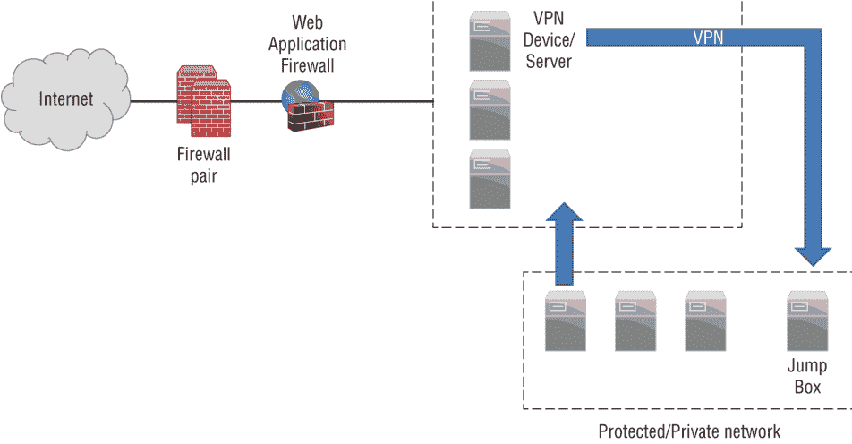

图 7.2 带受保护网络的网络分段

## 网络架构

了解你的网络是如何设计的、网络上存在哪些设备及其目的和能力，以及你可以使用这些设备应用哪些控制措施，对于保护网络至关重要。传统的物理网络、软件定义网络和虚拟网络在许多组织中并存，你需要理解这些技术每种如何影响你组织的架构和安全态势。


## 考试笔记

CySA+ 考试大纲将许多技术归入“网络架构”之下，包括物理、软件定义、虚拟专用网络和无服务器（serverless）。我们将无服务器放在下一节作为虚拟化的一部分，还将深入探讨云特定的选项。

## 物理架构

物理网络架构由路由器、交换机、安全设备、布线以及构成传统网络的其他组件组成。你可以在物理网络上利用广泛的安全解决方案，包括：

- 控制网络间流量的防火墙。
- 入侵防御系统 (IPS)，可以检测并阻止攻击；以及入侵检测系统 (IDS)，仅在检测到攻击时报警或通知。
- 用于控制通过信息的内容过滤和缓存设备。
- 网络访问控制 (NAC) 技术控制哪些设备可以连接网络，并在连接前评估其安全状态。
- 网络扫描器可以识别系统并收集有关它们的信息，包括它们运行的服务、补丁水平和其他细节。
- 统一威胁管理 (UTM) 设备结合了许多此类服务，包括防火墙、IDS/IPS、内容过滤和其他安全功能。

在准备 CySA+ 考试时，你应该熟悉这些常用设备及其基本功能，以便将它们应用到网络设计中。

## 软件定义网络

软件定义网络 (SDN) 使网络可编程。使用 SDN，你可以集中控制网络，从而比传统的物理网络基础设施更智能地管理网络资源和流量。软件定义网络通过 OpenFlow 等 API（应用程序接口）提供信息和控制，这意味着可以跨不同的供应商进行网络监控和管理。

由于 SDN 通过 API 进行控制，API 安全以及安全代码开发规范都是 SDN 实现的重要元素。

除了组织控制的 SDN 实现外，软件定义网络广域网 (SDN-WAN) 是一种 SDN 驱动的服务模型，提供商使用 SDN 技术提供网络服务。它们允许在后台结合各种技术，以为客户提供网络连接。SDN-WAN 实现通常提供加密，但也引入了风险，包括 SDN 编排平台的漏洞、与多供应商网络路径和控制相关的风险，以及流量在多条路径流动时的可用性和完整性风险。

## 虚拟化

虚拟化使用软件在底层真实硬件上运行虚拟计算机。这意味着你可以在运行多个系统，运行多个操作系统，所有这些系统都像运行在自己的硬件上一样。这种方法提供了额外的控制资源使用以及硬件呈现给客户系统等事物，允许有效地利用底层硬件。

虚拟化以多种方式使用。它用于实施虚拟桌面基础设施（VDI），在网络上运行操作系统。许多组织虚拟化了他们的所有服务器，安全设备以及其他供应商提供的解决方案也是虚拟化生态系统的一部分。

虚拟化的优势也带来了一些挑战，安全专业人员必须确定如何监控、保护和响应虚拟化中的问题。正如我们所讨论的分层安全设计，这需要预计划和努力来理解架构和实施。

容器化提供了虚拟化整个系统的替代方案，并允许在专用环境中运行应用程序所需的组件，如库、配置文件和其他依赖项。Kubernetes 和 Docker 是这些技术的示例。

容器化允许了高程度的可移植性，但也创建了新的挑战。基于主机的安全可能适用于容器化服务器，但容器本身需要以不同的方式处理。同时，由于容器运行在主机上，对主机的威胁可能会影响许多容器化服务。幸运的是，存在工具来镜像容器并进行扫描。除了监控和日志功能外，传统的加固和审计工具也是非常有用的。在处理容器化系统时，请记住底层主机作为安全模型的一部分，安全必须构建到服务开发生命周期中，以及系统的维护过程中。

函数计算在广义上描述了云计算，但当它被当前使用时，有时被称为函数即服务（FaaS）。本质上，函数计算依赖于执行函数的系统，并跨网络运行相同类型安全控制的函数代码。Amazon 的 AWS Lambda、Google 的 App Engine 以及 Azure Functions 都是函数计算的示例。在这些情况下，安全控制需要应用于应用程序。此外，云环境的访问控制和权限以及监控和资源管理能力对于确保安全部署是必要的。


## 考试说明

其他函数技术存在包括数据库，但它们通常被视为云服务而非函数计算。CySA+ 考试大纲没有具体规定，因此你应该确保理解用于实施函数部署的安全的概念和想法。

虚拟环境中的网络可能结合物理网络之间的虚拟化或容器化主机，然后运行在虚拟环境内部的段。如果不提前计划，这可能会使网络分段对监控工具和安全系统变得不可见。在设计虚拟化环境时，确保考虑虚拟网络连接和设计、你将如何监控它，以及在物理网络上需要的相同安全控制。

## 资产和变更管理

有效保护资产需要了解拥有哪些资产以及它们的当前状态。这些要求驱动组织实施资产管理工具和流程，并将变更管理方法和工具应用于资产清单中。

除了对设备、系统和软件拥有清单外，组织通常使用资产标签来确保他们的资产可以被记录，并在某些资产丢失或被盗的情况下可以找回。资产标签有助于防止盗窃、更容易地识别系统，并使支持人员的日常工作更容易，他们可以快速查找资产清单中的系统或设备，确定其是谁的、其当前状态应该是。

## 日志、监控和验证

分层安全需要适当的监控、告警和验证。良好的分层安全架构中的日志系统应确保日志是安全的且集中监控。监控系统需要设置适当的告警阈值，并且通知功能符合组织的需求。

大多数安全设计实现一个独立的日志服务器，可以是安全信息事件管理（SIEM）设备的形式，也可以作为专用日志服务器。这种设计允许远程日志服务器作为堡垒主机，在发生篡改时保留未经修改的日志副本，并允许对日志数据进行集中分析。

除了监控和日志功能外，配置管理和验证能力也很重要。Microsoft 的 Endpoint Manager 或 Jamf 的 Jamf Pro 等工具提供了跨各种设备网络设置和验证系统设置的能力，从而确保它们的配置和安装软件符合机构预期。

## 加密

加密和哈希对于我们讨论的每一层发现的许多控制都是至关重要的。它们在网络安全、主机安全和数据安全中发挥作用，并嵌入在每一层所依赖的许多应用程序和系统中。

这使得使用当前的安全的加密技术并确保适当的密钥管理对于分层安全设计至关重要。在审查安全设计时，识别加密（和哈希）在哪里使用、如何使用，以及加密密钥及其密码是如何存储的是非常重要的。理解数据何时被加密以及何时未被加密也是重要的——安全设计可能会失败，因为安全加密的数据以未加密的形式存储在缓存中或由本地用户存储，从而消除了它在传输过程中所依赖的保护。

## 证书管理

管理数字安全证书以前主要是系统和应用程序管理员的问题，他们负责网页和其他业务使用的 SSL 证书。随着数字证书更深入地集成到服务架构中，包括用于工作站和其他终端以及访问云服务提供者的证书，证书管理已变成一个更广泛的问题。

然而，证书管理的基本概念保持不变：

- 保持私钥和密码的安全是极其重要的。
- 确保系统使用并尊重证书吊销是必要的。
- 管理证书生命周期有助于防止过期证书引起问题，并在需要时进行更换。
- 集中管理使得密钥泄露或证书根供应商变更等事件的响应问题化。

如果你的组织使用证书，你应该确保它们被跟踪和管理，并且在需要更改它们或它们被泄露时已经有了计划。


主动防御并不包括对攻击者的攻击。事实上，对攻击者的攻击可能违法，或可能产生其他后果，因此不属于大多数组织安全运营的一部分。如果你被要求采取进攻行动，请确保你理解所被要求做的事情在法律和伦理影响。

## 蜜罐 (Honeypots)

某些主动防御中使用的技术之一是蜜罐。蜜罐是设计成对攻击者具有吸引力的目标系统。当攻击者试图入侵它们时，它们会捕获攻击流量、技术和其他信息。这既提供了对攻击者工具和方法论的洞察，也为攻击者和威胁可能针对你组织提供了线索。


## CySA+ 考试

CySA+ 考试目标特别提到了蜜罐，因此请确保你熟悉这一概念。有趣的是，它们没有提到蜜罐网（honeynets，即作为网络蜜罐建立的网络）或暗网（darknets，即用于监控扫描和其他攻击的空闲网络空间）。

## 基础设施安全与云服务

整个组织向使用云服务的转变不仅改变了边界并驱动了对零信任环境的需求，还使组织需要更新其安全实践，以适应更有渗透性、更多样化的运行环境。

与本地系统不同，云服务提供商提供的底层环境通常不允许安全从业人员访问以进行配置、测试或其他控制。这意味着保护云服务需要一种不同的方法。

对于大多数软件即服务 (SaaS) 和平台即服务 (PaaS) 供应商，安全主要通过合同义务来实现。配置和实施选项可能会带来安全挑战，身份和访问管理在这些环境中也同样重要。

AWS、Azure、Google 等基础设施即服务 (IaaS) 供应商提供了更多对基础设施的访问权限，一些关于操作系统配置、管理和补丁的传统安全关注点将适用。同样，需要以安全的方式安装、配置和维护服务以及应用程序。云提供商提供了额外的面向安全的服务，这些服务在他们的环境中可能非常有用，并可能替代或补充你可能在本地使用的工具。

许多云供应商会根据请求提供审计和评估结果，通常在提供信息之前需要签署非保密协议。

在考虑本地与云安全时，你应该审查每个环境中存在哪些选项，以及存在哪些相关的威胁（如果有的话）。评估适用于或特定于你所选的云服务提供商的安全能力、态势、威胁和风险也是一项重要任务。

虚拟私有云 (VPC) 是云服务提供商交付的一种选项，它构建了一个按需的半隔离环境。VPC 通常存在于私有子网，并可能有额外的安全措施以确保系统间的通信保持安全。

另一种云安全工具是云访问安全中间器 (CASB)。CASB 工具是策略执行点，可以存在于本地也可以存在于云端，并在使用云资源和服务时执行安全策略。CASB 可以帮助数据安全、反恶意软件功能、服务使用和访问可见性以及风险管理。正如你预期的，作为强大的工具，CASB 非常有用，但需要仔细的配置和持续的维护。

## 评估云

虽然 SaaS 和 PaaS 解决方案的控制权在供应商手中，但你可以采取一些额外行动来帮助你组织的安全。许多云供应商提供第三方安全审计信息的访问，例如 SSAE-16 Type 1 或 Type 2 报告。此外，你可能希望进行安全评估，以确定供应商是否符合你预期的安全最佳实践。像 `www.sharedassessments.org` 提供的共享风险评估工具可以帮助你在与云或外包 IT 供应商合作之前进行评估。同时，你还应该确保合同涵盖任何影响你外包解决方案的法律或监管问题。

## 通过改进控制提高安全性

安全设计依赖于控制，这些控制有助于防止、检测、应对或限制安全风险的影响。控制通常根据两种分类方案进行分类：它们如何实施，或者相对于安全事件或威胁何时做出反应。根据实施类型对控制进行分类使用以下模型：

- 技术控制包括防火墙、入侵检测和防御系统、网络分段、验证和授权系统以及各种旨在通过技术手段提供安全的系统和技术能力。

- 行政控制（有时称为程序控制）涉及过程和程序，如事件响应计划中的内容、账户创建和管理，以及意识和培训工作。

- 物理控制包括锁、栅栏和其他控制或限制物理访问的控制，以及灭火器等可以防止财产遭受物理损害的控制。


某些控制分类方案增加了第四种类型：法律控制。这些是由法律实施的控制。有些简单地将法律控制视为法律系统实施的一种行政控制。

按控制作用时间进行分类使用以下分类方案：

- 预防性控制旨在通过采取主动措施停止威胁来防止事件发生。预防性控制包括防火墙、培训和安保人员。

- 检测性控制致力于检测事件并捕获有关事件的信息，允许做出响应，例如警报或通知。

- 纠正性控制要么修复事件，要么限制事件可能造成的损害。纠正性控制通常作为事件响应过程的一部分。纠正性控制的示例包括补丁、反恶意软件软件和从备份恢复系统。

满足现有安全措施无法满足的要求（因为实施太困难或未完全满足需求）的控制被称为补偿性控制 (compensating controls)。你偶尔可能遇到的其他控制类型还有：威慑性控制（警告攻击者他们不应该攻击）、指示性控制（旨在引导产生预期结果）以及恢复性控制（提供响应泄露的方法）。

## 分层主机安全

终端系统（无论是笔记本电脑、台式电脑还是移动设备）也可以使用分层安全方法。由于单个系统被个人用户用于日常工作，它们通常是你的基础设施中风险最高的部分，如果被破坏，可能会产生重大威胁。

单个主机级别的分层安全通常依赖许多常用的安全控制：

- 密码或其他强身份验证有助于确保只有授权用户访问主机。
- 主机防火墙和主机入侵防御软件限制主机的网络攻击面，并可以在系统被破坏时帮助防止非预期的出站通信。
- 数据泄露软件监控并管理受保护的数据。
- 白名单或黑名单软件允许或阻止特定的软件包和应用程序在系统上安装或运行。
- 反恶意软件和杀毒软件包监控恶意软件以及由于恶意软件引起的常见行为。
- 补丁管理和漏洞评估工具用于确保应用程序和操作系统已完全安装补丁并获得适当的安全保护。
- 系统加固和配置管理确保关闭不必要的服务，确保操作系统层级的配置选项遵循良好的安全实践，并确保不存在不必要的账户。
- 加密（无论是文件级加密还是全盘加密）可能在系统丢失、被盗或在静态存储时需要额外安全保护时，用于保护系统免受访问。
- 文件完整性监控监测文件和目录的变化，并在发生更改时向管理员发出警报。
- 事件、操作和问题的记录是主机层一项重要的检测控制措施。

主机安全层可能还包括物理安全控制，以帮助防止系统本身被盗或受到非授权的访问。

## 权限

权限是授予用户、系统、应用程序或设备的访问权限或特权。权限通常根据组织中的角色进行授予，以便更方便地权限管理。你可能熟悉读、写和执行等权限。

可以使用 `ls` 命令查看 Linux 权限。在图 7.3 中，你可以看到文件列表。左侧是一个 `-`，表示这是一个文件，而不是目录的 `d`。接下来是三组三个字符，其中 `r` 表示读、`w` 表示写、`x` 表示执行，或用 `-` 表示无权限。这三个设置定义了用户可以做什么，以及组或所有人可以做什么。

```


```
root@kali:~/example# ls -l

total 4

-rw-r--r-- 1 root root 18 Jan 11 18:12 example.txt

root@kali:~/example# _
```


# 图 7.3 Linux 权限


权限存在于许多地方，如软件包、操作系统和云服务。为用户及其角色构建适当的权限模型是构建强大安全控制模型的关键部分。

## 白名单与黑名单

白名单和黑名单对于实施控制措施的安全专业人员来说是重要概念。白名单技术依赖于构建一个允许项列表，无论这些项是防火墙规则中的 IP 地址、软件包还是其他内容。黑名单采取相反的方法，根据列表中的条目专门地禁止某些项。

在某些场景下，白名单可能很难实现，因为你必须在许可列表中包含所有可能的条目。由于各种原因，为整个企业建立软件包白名单可能具有挑战性。黑名单也有其自身的挑战，特别是在条目中使用宽泛定义可能导致意外拦截的情况下。

尽管存在这些挑战，但白名单和黑名单都是常用的技术。

## 技术控制

技术控制利用技术来实施保护措施。技术控制可以实现在软件、硬件或固件中，它们通常为实施这些控制的系统提供自动化保护。

> ### 注意事项
> 考试笔记
> 尽管有很多技术控制，但 CySA+ 考试特别提到了几项，包括白名单和黑名单、防火墙、IPS 规则、DLP 系统、终端检测与响应能力、网络访问控制、汇洞、恶意软件签名、沙箱和端口安全。我们在这里涵盖了这些内容，因此你已经准备好参加了。

对于 CySA+ 考试，你应该熟悉以下类型安全设备和控制措施的基础知识：

- 防火墙根据使用源或目的 IP 地址、端口或流量协议等信息的规则来阻止或允许流量。它们通常用于不同的信任区域之间。有多种防火墙技术，以及主机防火墙和网络防火墙设备。
- 入侵防御系统（IPS）用于监控流量并根据行为和流量内容应用规则。与防火墙一样，IPS 和 IDS（入侵检测系统）依赖于规则，但 IPS 和 IDS 通常在更深层次上检查流量，关注数据包内部的内容和其他细节。尽管 CySA+ 考试材料仅引用了可以阻止意外流量的 IPS，但只能检测流量并对其记录相关日志信息的 IDS 也作为检测控制措施进行部署。或者，IPS 可能配置了规则，当执行此类操作可能导致问题时不会采取行动。
- 数据泄露防护（DLP）系统和软件旨在防止数据离开组织或其应包含的系统。完整的 DLP 系统针对移动中数据、静态存储数据和使用中数据，以及可能访问或存储存储的终端系统。DLP 依赖于识别应该受保护的数据，然后检测泄漏何时发生，当系统之间和跨网络频繁使用加密时，这可能是具有挑战性的。这意味着 DLP 部署了终端软件和各种使网络流量对 DLP 系统可见的手段。
- 终端检测与响应（EDR）是一个相对新的术语，指对高级威胁提供持续监控和响应的系统。它们通常使用终端数据采集和监控能力，结合中央处理和分析，对终端上发生的情况提供高级可见性。这种数据采集、搜索和分析工具有助于检测和响应可疑活动。处理多种威胁类型（包括勒索软件、恶意软件和数据外泄）的能力也是 EDR 系统的共同特征。
- 网络访问控制（NAC）要求系统在连接网络之前进行身份验证或提供其他信息。NAC 以准入前或准入后模式运行，要么在连接前检查系统，要么在系统连接到网络后检查用户操作。NAC 解决方案可能要求连接系统安装代理或软件来收集数据并处理 NAC 过程，或者它们可能是无代理的。当系统未能成功连接到受 NAC 保护的网络或当检测到问题时，它们可能会被放入隔离网络，在网络中可以访问修复工具或信息门户，或者简单地阻止连接。
- 汇洞将流量从原始目的地重定向到你选择的目的地。虽然汇洞最常见的实现是通过 DNS 完成的以防止流量发送到恶意网站，但你可能还会遇到其他类型的汇洞。
- 端口安全是一种监控连接到交换机端口设备的 MAC（硬件）地址的技术，并根据其 MAC 地址允许或拒绝其访问网络。老攻击者可能会伪造受信任系统的 MAC 地址以绕过端口安全。
- 沙箱指的是将不可信软件或系统置于受保护且隔离的环境中的各种技术。沙箱通常用于软件测试，并将应用程序与系统隔离，从而防止在出现问题时导致故障。虚拟化技术可用于为整个系统创建沙箱，测试恶意软件的组织使用高度监测的沙箱环境来确定恶意软件包的操作。

## 恶意软件签名

恶意软件签名以前仅由可识别的文件模式或哈希值组成，可以通过检查给定文件是否与已知恶意软件匹配来确定。随着恶意软件变得越来越复杂，通过变异、扩展或缩小代码或寄存器重命名等技术来帮助混淆恶意软件的技术使得传统的基于签名的识别不再成功。

## 考试备注

此版本的 CySA+ 考试特别强调了恶意软件特征、其开发方法以及如何使用这些特征编写规则，以及自动化恶意软件特征开发的作用。因此，在应对考试之前，请确保你熟悉这一主题。

特征可以通过分析恶意软件并创建哈希值或其他比较器来创建，通过这些可以检查包是否匹配。

恶意软件识别现在依赖于多层检测能力，而不仅仅是文件特征。基于行为的检测关注执行文件所采取的操作，例如访问内存或文件系统、更改权限或执行其他可疑操作。观察行为也有助于识别多态病毒，这类病毒会改变自身，因此仅通过对其二进制文件进行哈希处理将无法识别它们。
现在，反病毒软件甚至可以回滚恶意软件在监控期间采取的操作。这种监控通常被称为动态分析。

在传统的恶意软件特征创建场景和基于行为的检测场景中，恶意软件样本被放置在带有监测器的隔离沙箱中，通过仪器跟踪恶意软件的行为。这些信息被帮助根据恶意软件创建、安装或修改的文件或其他材料创建特征，并根据其采取的操作创建特征。在许多情况下，自动化恶意软件特征创建是使用这些技术完成的，以便反病毒供应商能够更快速地提供特征。

如果你想亲自尝试，可以将怀疑的恶意软件提交到 `virusTotal.com` 或 `jotti.com` 等网站。

## 策略、流程和标准

涉及策略、流程和标准的管理控制是审视完整的分层安全设计时不可少的一层。除了支持技术层安全的控制外，完整安全设计中的管理控制还包括：

- 变更控制
- 配置管理
- 监控和响应策略
- 人员安全控制
- 业务连续性和灾难恢复控制
- 人力资源控制，如背景检查和终止

## 人员安全

除了技术和程序方面的考虑外，必须考虑设计中的人为因素。员工需要针对其执行的任务接受培训，以确保他们对安全问题和威胁做出适当反应。在需要的地方应建立关键人员控制，以提供职责分离并消除人员中的单点故障。


## 考试备注

了解人员控制对你来说很重要，但 CySA+ 考试大纲的 2 版本删除了整个人员安全章节！如果你只是为了考试而学习，那么不需要在这里花费太多时间。如果你致力于成为一名从业人员，我们鼓励你记住这些内容，因为安全的人为因素面是安全设计中最常见的失败点之一。

各种的人员控制可以作为完整安全计划的一部分实施，范围从培训到流程和人力资源相关的控制。最常见的人员控制如下：

**职责分离** 当组织中的个人被赋予执行某项角色时，他们可能会滥用该角色提供的权限和特权。实施良好的职责分离需要多个个人共同完成任务的要素，以确保不发生欺诈或滥用。典型的职责分离可以在财务重要的系统中找到，如工资软件或应付账款软件。一个人不应能够在不被发现的情况下修改财务数据，他们不应该拥有修改权限，同时也不应负责监控变更。

**继任计划** 这对于确保角色的连续性至关重要，无论人员离开组织的原因是什么。离职员工可能会带走关键的知识和技能，导致重要职责无人照管或任务未执行。当经理或主管离开时，如果没有继任计划也可能导致职能缺乏监督，使得其他人员问题更容易在不被发现的情况下发生。

**背景检查** 这些通常在聘用员工之前进行，以确保候选人适合在该组织工作。

**终止** 当员工辞职或被终止时，确保他们对组织资源和账户的访问权限也被终止。这需要审查他们的权限，并确保组织的离职流程妥善处理任何组织财产（如笔记本电脑、移动设备的数据）。在许多组织中，账户最初会被禁用（通常通过将密码更改为当前用户不知道的）。这确保了数据不会丢失，并在需要时供组织访问。一旦你确定与账户相关的任何数据都不再需要，就可以删除账户本身。

**交叉培训** 交叉培训侧重于教授员工技能，使他们能够承担同事和其他员工通常执行的任务。这可以帮助防止因技能组导致的单点故障，并通过将不那么熟悉任务或程序的人员引入循环，帮助检测由员工或流程引起的问题。交叉培训通常用于帮助确保关键能力有备份，因为它可以帮助在不可或缺的员工离开时防止员工离职引起的问题。这也是启用其他安全控制的重要部分。如果发生了适当的交叉培训，继任计划和强制休假更容易实现。

**双重控制** 当一个流程敏感到需要两个个人共同执行某操作时，双重控制非常有用。这种经典的例子出现在许多电影中，形式为双控制系统，要求两名军官同时插入并旋转钥匙来发射核武器。当然，这在你的组织中可能没有必要，但在涉及敏感任务时，双重控制可能是一个很有用的安全控制，因为它要求双方协作才会发生违规。这通常出现在对超过某些金额的支票需要两个名的组织中。双重控制可以通过程序的管理控制实施，也可以通过技术控制实施。

**强制休假** 该过程要求员工休假，以便你识别那些利用其权限的人。强制休假通过确保他们不会连续负责某项任务，防止员工隐藏问题或利用特权。

当强制休假与职责分离相结合时，可以提供一种非常有效检测员工勾结和违规的方法。让参与某流程的一或多名员工休假，为第三方提供了观察休假员工通常处理的流程中任何问题或不规则情况的机会。

## 分析安全架构

分析组织安全基础设施的关键在于识别防御薄弱的地方，或者攻击者可能能够利用架构设计、流程、程序或底层技术（如漏洞或配置错误）中缺陷的地方。控制漏洞、单点故障和实施不当的控制都是你可能会遇到的常见问题。

> 渗透测试人员在寻找穿透组织安全的方法时也会进行安全架构分析。在审查安全架构的漏洞时，像渗透测试人员（或攻击者！）一样思考是有帮助的。

## 分析安全需求

通过审查安全模型并确保其满足特定需求，可以根据属性对安全架构进行分析。例如，如果你被要求审查一个使用反恶意软件的工作站安全设计，以判断其是否能防止意外软件的安装，你可能会识别出三种场景：

- **成功** 如果该软件是已知的恶意软件，或者其行为能被反恶意软件检测为异常，则反恶意软件可以成功防止意外软件的安装。
- **失败** 它将无法检测未经组织策略允许但并非恶意软件的软件。
- **失败** 它可能无法防止未知的恶意软件，或者行为不符合已知恶意软件典型的恶意软件。

这种基于属性的测试可以根据风险评估和控制计划进行，以确定安全架构是否满足控制目标。它也可以直接应用于每项控制，通过确定每项控制的目标，然后审查其是否满足该目标。

## 审查架构

除了基于需求的分析方法外，许多正式架构模型依赖于视图或观点，可以通过这些观点审查架构和控制。审查架构时常用的视图包括：

- **运行视图**描述了功能是如何执行的，或者实现了什么。该视图通常显示信息流，但不会捕获数据传输、存储或捕获的技术细节。运行视图有助于理解正在发生的情况，通常会影响程序性或管理控制。
- **技术视图**（有时称为面向服务或基于系统的视图）侧重于架构中使用的技术、设置和配置。这有助于识别错误的配置和不安全的设计决策。技术视图的一个示例可能包括：连接的 TLS 版本，或用户账户所需的密码长度和复杂性的特定设置。
- **逻辑视图**有时用于描述系统如何相互互连。它通常比技术视图不详细，但传达了关于系统或服务如何连接或工作的更广泛信息。本章早前的网络图就是逻辑视图的示例。

安全架构审查可能需要这些观点中的任何或全部，以完整理解问题可能存在的地方。

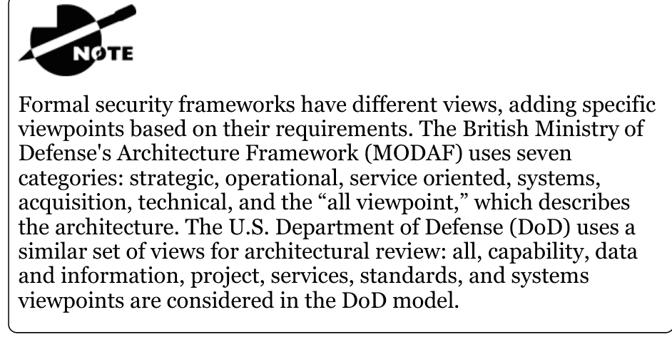

正式安全框架具有不同的视图，并根据其需求增加特定的观点。英国国防部的架构框架（MODAF）使用了七类类别：战略、运行、面向服务、系统、采购、技术和“全视图”，后者描述了架构。美国国防部（DoD）在架构审查中使用类似的视图集：DoD模型考虑了全部、能力、数据和信息、项目、服务、标准和系统视图。

## 常见问题

分析安全架构需要理解它们常用的设计概念和控制，以及在这些设计中最经常遇到的问题。包括单点故障、数据验证和信任问题、用户问题，以及认证和授权的安全与流程问题。

## 单点故障

分析分层安全架构时，需要考虑的关键要素是单点故障的存在——系统中的某个单点，如果该组件、控制或系统故障，整个系统将无法工作或无法提供预期的安全水平。

图4显示了一个具有全冗余的网络设计，带有容错防火墙、路由器和核心交换机。每个设备通过心跳链路与其伙伴通信，该链路提供状态和同步信息。如果某个设备的伙伴发生故障，它将接管并提供服务的连续性。每个设备还进行了交叉连接，允许任何组件通过多条路径向前方和后方的设备发送流量，从而消除了故障电缆作为潜在的故障点。电源保护也将采取类似的措施，设备通常物理上位于不同的机架甚至房间内，以防止单一物理问题中断服务。

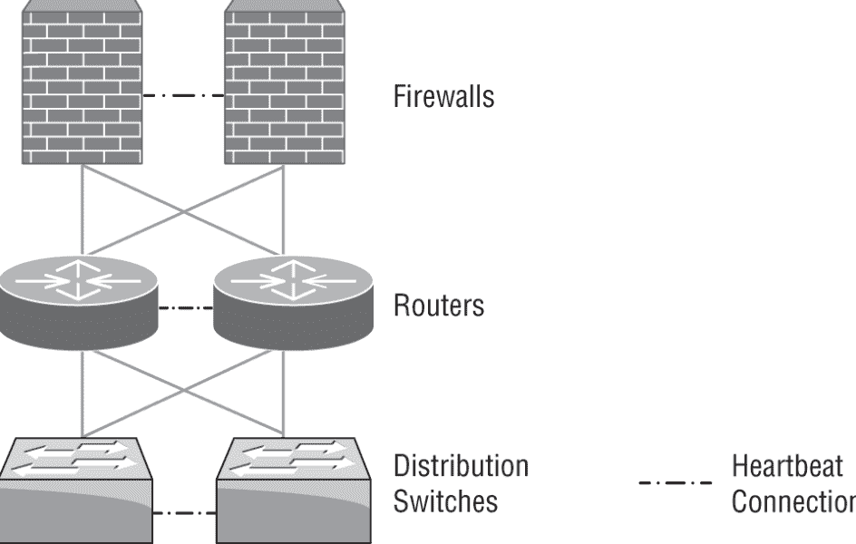

**图7.4 全冗余网络设计**

全冗余网络设计的逻辑图可以更容易发现设计中的单点故障。在图7.5中，网络和基础设施显示了单点故障，点A处，冗余网络显示了单点故障，基于路由器的。冗余网络显示是可接受的。在这种情况下，如果不验证应用程序接收到的数据符合它应该接受的值，路由器故障可能会导致单点故障。


| 防火墙 |
| 路由器 |
| 交换机 |
| 点A |
| 分布式路由器 |
| 交换机 |

**图7.5 网络设计中的单点故障**

## 冗余层的故障

拥有冗余系统并不保证系统能够工作。本书的作者与一个使用活动/被动的冗余防火墙系统合作。在这种设计中，防火墙始终处于活动状态，如果它发生故障，备用防火墙将接管。如果主防火墙恢复，它将变为被动角色，正常功能将继续。

至少，系统是这样设计的。遗憾的是，软件更新导致心跳系统故障，导致两个防火墙都处于活动模式，导致流量处理出现异常。

同样的分析过程可以用于识别应用程序、流程和控制的问题。包含所有关键组件或控制的框图可以追踪。图7.6显示了创建账户的示例流程。注意在点A处，授权请求者提交新账户申请，在点B处，经理批准账户创建。在分析过程中，如果经理既申请又能批准，就会发现缺陷。如果点D的审查也由经理执行，这一流程缺陷将更加严重。这为职责分离这一控制提供了很好的案例！

| A | B | C | D |
|---|---|---|---|
| 新账户创建请求 | 批准请求？ | 账户创建 | 账户创建/审查 |

**图7.6 流程流中的单点故障**

## 数据验证与信任

用于处理或做出决策的数据信任能力是另一个安全问题频繁发生的领域。数据通常被假设是有效的，但错误或伪造的数据可能会导致严重问题。对数据的信任可以通过以下方式增强：

- 使用加密保护静态数据和传输中的数据
- 使用文件完整性检查工具验证数据完整性，或通过执行数据完整性验证
- 实施自动化或手动验证数据的流程
- 根据已知属性对数据进行边界检查

Web应用程序安全测试人员非常熟悉利用数据验证方案中的漏洞。不安全的Web应用程序通常信任从它们生成的页面接收的数据是有效的，并使用这些数据执行后续任务。例如，如果商品价格为25美元，应用程序从Web表单的隐藏字段中获取该数据，但不验证接收到的数据是否符合它应该接受的值，攻击者可以将值改为0美元并免费获得商品！验证接收到的数据是否符合预期的特定数据集，或至少在合理范围内，是分层安全设计中的关键步骤。

在分析数据流、存储和使用时，请记住寻找数据问题可能导致高影响故障的地方。在设计的某些节点上，数据验证问题对整体设计的关键性可能比其他节点要高得多，因此在这些位置实施有效的控制措施至关重要。

> 提示：在评估数据验证和信任控制时，通过反向推导会有帮助，问问自己：“如果数据是不正确的，或者更糟，如果攻击者可以将其更改为他们想要的任何内容，会发生什么？”

## 用户

人为错误是安全架构失败的常见原因。针对员工的错误、不当行为或社会工程攻击都可能破坏安全设计。构建分层安全设计时应基于这样一个假设：执行其所依赖的程序和流程的人员可能会出错，因此应设计为在发生故意违规时能够识别并告警。

由于用户导致的失败通常受限于：

- 使用自动化监控和告警系统来检测人为错误
- 限制接口仅允许允许许可的活动
- 实施程序性的检查和平衡，例如职责分离以及本章之前讨论的其他人员控制
- 培训和意识计划，旨在帮助员工准备应对可能遇到的威胁类型

识别由用户引起的可能问题，对于与系统或流程方面的专家进行头脑风暴通常有用。如果无法这样做，审查用户操作是如何被监控和控制的，可以帮助发现可能的漏洞。

这种审查的一个实际示例发生在杂货店，那里常见的做法是给收银员一个现金箱带到其工作台。有时，收银员在开始上班前会自己清点现金箱；在其他情况下，他们会获得一个包含标准且经过验证金额的现金箱。在上班期间，他们是该现金箱的唯一使用者，下班时，他们会清点箱并进行验证，或与经理一起清点。如果杂货店持续出现损失，你可以梳理收银员的任务，在每一步中询问他们正在执行什么任务以及该任务是如何验证的。当你识别出可能发生问题的区域时，就可以努力识别以防止该问题的控制措施。

## 身份验证与授权

用户凭据、密码和用户权限都是安全设计中经常产生问题的领域。常见问题包括不适当或过大的用户权限、糟糕凭据安全或管理、嵌入和存储的密码与密钥，以及依赖密码来保护关键系统。安全设计为了避免这些问题，通常会实施此类解决方案：

- 多因素身份验证
- 集中化的账户和权限管理及监控
- 特权账户使用监控
- 培训和意识努力

在分析安全设计的潜在身份验证和授权问题时，第一步是识别身份验证发生的地方，以及用户需要并提供的哪些权限。一旦你理解了这些，就可以关注已实施的控制措施以及这些控制措施可能留下漏洞的地方。记住要考虑技术、流程和人为因素。

云计算和其他外包模型可能会使安全设计变得更加复杂。幸运的是，示例安全架构模型已开始出现。美国国家标准与技术研究院（NIST）在 2013 年发布了《NIST 云计算安全参考架构》，为组织设计或评估云安全设计提供了有用的参考。你可以在 `collaborate.nist.gov/twiki-cloud-computing/CloudComputing/CloudSecurity/NIST_Security_Reference_Architecture_2013.05.15_v1.0.pdf` 找到它。

## 审查安全架构

审查安全架构需要对影响设计的安全需求和已实施的控制措施进行逐步分析。图 7.7 显示了一个带有数据库后端的 Web 应用程序的高级设计。要分析此，我们首先从该服务的设计需求声明开始：

该 Web 应用程序通过互联网向客户展示，包含客户业务敏感数据。它必须具有容错性，能够防止 Web 应用程序攻击，并应提供安全的身份验证和授权，以及适当的安全监控和系统安全。

据此，我们可以审查设计的潜在缺陷。从左侧开始，我们将逐节检查每个部分寻找可能的问题。需要注意的是，此示例不会涵盖该设计中所有可能的缺陷。相反，它旨在作为一个如何根据网络逻辑图识别缺陷的示例。

- 如图所示，互联网连接只有一条路径。这可能导致可用性问题。
- 在互联网和 Web 服务器层之间没有 IDS 或 IPS。这可能对于处理 WAF 和防火墙层无法检测的攻击是有理想的。
- 图中没有显示如何管理防火墙和 WAF 等网络安全设备。通过公共网络暴露管理端口是一种安全风险。
- Web 应用程序防火墙和负载均衡器显示为集群设备。这可能指示了可用性问题。
- 在 Web 服务器和数据库之间没有主动检测安全层。一个感知 SQL 的安全设备将提供额外的安全层。


**图 7.7** 示例安全架构

除了逻辑图显示的信息外，对数据流图、配置、流程和程序的审查将分别提供有用的视角，以确保此设计提供了适当的安全级别。

## 维护安全设计

安全设计需要继续解决其构建时旨在解决的威胁和需求。随着时间的推移，新威胁可能会出现，旧威胁可能不再令人担心，技术会发生变化，组织能力也会不同。这意味着它们需要被审查、改进并最终淘汰。

## 定期审查

安全设计应该接受定期的、计划内的审查。审查的频率取决于组织面临的威胁变化快慢；其系统、网络和流程的变化频率；监管或合同要求发生变化；以及是否发生了指示需要审查的重大安全事件。


这看起来可能显而易见，但记录安全设计或程序的最后更改日期可以帮助跟踪何时进行过审查。在设计文件的头部日期对于当你快速审查已完成的工作非常有用。

## 持续改进

持续改进过程（有时称为 CIP 或 CI 过程）旨在随时间提供增进的改进。安全程序或设计需要定期进行评估，因此持续改进过程对于确保设计不过时至关重要。

改进过程中经常使用的另一个词是“改善”，这是一个日语词，翻译为“好的变化”。改善的持续改进方法通常用于制造业和精益编程，并将改进的责任交给所有员工，而不仅仅是改进小组或团队。

## 流程的淘汰

安全流程和策略可能会过时，与其更新它们，它们可能需要被淘汰。通常由于以下原因之一：

- 流程或策略不再适用。
- 它被新的策略或流程取代。
- 组织不再希望使用该策略或流程。

流程和策略的淘汰应该在描述它的文档中记录并存档。一旦做出决定，需要进行适当的沟通，以确保其不再被使用，并确保使用流程或策略的个人和小组了解其替代方案（如果适用）。

## 总结

安全控制应该是分层的，以确保控制的失败不会导致组织、系统或整体安全架构的失败。分层安全设计可能提供统一保护，也可能实施设计选择，将更敏感的系统或数据放在受保护的飞地。它还可能使用威胁分析或数据分类作为设计决策的基础。在任何完整的安全设计中，多个控制措施被共同实施，以创建一个更强大的安全设计，可以防止攻击、问题并允许以便在发生故障时能够做出相应的响应和恢复。

分层安全设计通常使用分段和网络安全设备根据功能或其他区分分离网络和系统。系统也需要分层安全，防火墙、数据泄露防护软件、防病毒和反恶意软件、以及系统配置和监控工具等工具，都提供了主机安全拼图的一部分。分层安全的其它常见部分还包括加密、日志记录和监控、人员安全，以及策略、流程和标准。基于属性的安全模型依赖于验证设计是否满足安全需求。应该使用架构视图来确保设计从多个角度都能站得住脚，包括通过安全设计的运行、技术路径和逻辑路径。在寻找漏洞时，单点故障、信任和数据验证问题、身份验证和授权问题以及与用户相关的问题都是需要考虑的重要因素。这意味着安全设计应该经过定期审查和更新，以应对不断变化的需求和安全威胁。

## 考试要点

**了解为什么安全解决方案是基础设施管理的重要部分。** 分层安全（包括物理和/或虚拟层面的分段，以及系统隔离和物理隔离等概念的使用）是强有力防御设计的一部分。物理、虚拟和云环境的网络架构必须利用安全设计概念以及蜜罐、防火墙和其他技术等安全工具。

**解释实施深度防御需要什么。** 常见的设计使用分段来分离安全需求不同的不同安全级别或区域。许多组织的网络架构需要考虑物理网络设备和设计、云选项以及软件定义网络。在适当的情况下，应该考虑虚拟私有云（VPC）和云访问代理（CASB）等云工具。广泛的控制可以实现这一点，从使用适当的权限、白名单和黑名单到防火墙、入侵防御和检测系统、数据泄露防护（DLP）工具以及端点检测与响应等技术控制。

**了解理解需求和识别潜在故障点是安全架构分析的一部分。** 单点故障是指单个故障即可导致设计无法按预期运行的设计元素。其他常见问题包括数据验证问题、由信任以及对数据或系统的信任的要求引起的问题、与用户相关的故障，以及身份验证和授权流程及程序。

**了解维护分层安全设计需要持续审查和验证。** 定期审查有助于确保设计没有过时。持续改进流程可以使分层防御设计保持最新状态，同时帮助员工参与并提供持续的意识。在生命周期结束时，必须在适当的通知和记录下终止流程、程序和技术设计。

## 实验练习

## 活动 7.1：使用 OWASP 攻击面分析备查表审查应用程序

在此练习中，你将使用开放 Web 安全项目的应用程序攻击面分析备查表。如果你不完全熟悉组织中的某个应用程序，与应用程序管理员、DevOps 工程师或开发者交流可能会有所帮助。

**第 1 部分：审查 OWASP 攻击面分析备查表。** 备查表可以在 `cheatsheetsseries.owasp.org/cheatsheets/Attack_Surface_Analysis_Cheat_Sheet.html` 找到。

审查备查表，确保你理解应用程序攻击面是如何映射。如果你不熟悉该领域，请花时间进行研究。

**第 2 部分：选择一个你熟悉的应用程序，遵循备查表映射应用程序的攻击面。** 选择一个你有专业经验的应用程序并遵循备查表。如果你不知道答案，请注明你无法识别该信息并继续。

**第 3 部分：衡量应用程序的攻击面。** 使用你的回答来分析应用程序的攻击面。

回答以下问题：

1. 哪些是高风险攻击面区域？
2. 应用程序存在哪些入口点？
3. 你能根据已有的数据计算应用程序的相对攻击面系数吗？如果不能，为什么？
4. 通过这次映射你学到了什么？

**第 4 部分：管理攻击面。** 使用你的映射，识别你应该（以及是否！）修改应用程序的攻击面。你会改变什么？为什么？在不同的情况下，你是否会做出不同决策或采取控制措施？

## 活动 7.2：审查 NIST 安全架构

下一页的图表显示了 NIST SP180-5b 中的 NIST 访问授权信息流及其在逻辑流图中的控制点。


## 活动 7.3：安全架构术语

将以下每个术语与正确的描述匹配。

| 术语 | 描述 |
| :--- | :--- |
| Air gap (物理隔离) | 设备或网络之间的物理隔离，以防止访问。 |
| Containerization (容器化) | 云的一个逻辑隔离分段，为你提供对自己环境的控制。 |
| VPC (虚拟私有云) | 一种将……结合的技术。 |
| Cloud access broker (云访问代理) | 为云应用程序执行安全的软件或服务。 |
| Blacklisting (黑名单) | 一种访问控制机制，允许所有被特定阻止的项通过。 |
| Asset tagging (资产标记) | 对系统、设备或其他项目进行标记或标识。 |
| NAC (网络访问控制) | 一在系统连接到网络之前验证系统（有时是用户）的系统。 |
| Data loss prevention (数据泄露防护) | 扫描输出流量并在如果包含特定类型时防止其传输的系统。 |

## 复习题

1. Susan 需要向其团队成员解释什么是跳板机。她应该告诉他们什么？
   - A. 它是暴露在 DMZ 中的安全系统。
   - B. 它是用于访问和管理同一安全区域内系统或设备的系统。
   - C. 它是用于在更新期间跳过修订的系统。
   - D. 它是用于访问和管理另一个安全区域内系统或设备的系统。

2. Ben 设置了一个充当易受主机的系统，以便观察攻击者的行为。他设置了什么种系统？
   - A. 汇聚点
   - B. 黑洞
   - C. 蜜罐
   - D. 蜂巢

3. Cameron 使用他在受感染系统中发现的二进制文件哈希值构建了一个恶意软件签名。当他尝试与其他受感染系统匹配哈希值时，现代恶意软件可能会遇到什么问题？
   - A. 恶意软件可能是多态的。
   - B. 哈希值可能匹配到多的恶意软件包。
   - C. 攻击者可能对二进制文件进行了加密。
   - D. 哈希值可能太长。

4. Ric 正在审查组织的网络设计，担心边界路由器上的已知漏洞会导致攻击者禁用其互联网连接。以下哪是适当的补偿控制？
   - A. 以“主/备”设计设置一个完全相同的第二个冗余路由器
   - B. 使用不同类型路由器的备用互联网连接方法
   - C. 以“主/主”设计设置一个完全相同的第二个冗余路由器
   - D. 在路由器前放置防火墙，以阻止任何可能导致连接故障的潜在利用

5. Fred 希望在他管理的工作站上仅运行预先批准软件。哪种解决方案最符合这一需求？
   - A. 黑名单制
   - B. 杀病毒软件
   - C. 白名单制
   - D. 虚拟桌面基础设施 (VDI)

6. Susan 团队的成员最近落入了网络钓鱼诈骗，向诈骗者提供了密码和个人信息。为了保护其组织免受未来的问题，哪种分层安全方法不是 Susan 实现的适当层次？
   - A. 多因素身份认证
   - B. 分层防火墙
   - C. 意识培训计划
   - D. 对登录位置进行 SIEM 监控

7. Chris 负责组织的 Windows 7 安全标准，并最近退役了组织的最后一个 Windows 7 系统。他安全标准生命周期中的下一步操作是什么？
   - A. 定期对 Windows 标准进行审查
   - B. 对标准进行最终更新，说明 Windows 7 不再受支持
   - C. 持续改进 Windows 标准
   - D. 废弃 Windows 7 标准

8. Example 公司将其网络分为网络区域，包括销售、人力资源、研发和访客网络，每个区域都使用网络安全设备相互隔离。Example 公司在网络安全方面使用了哪种概念？
   - A. 分段
   - B. 多接口防火墙
   - C. 避免单点故障
   - D. 区域路由

9. 在安全设计中，以下哪些分层安全控制通常用于 WAN、LAN 和主机层？
   - A. 静态数据加密
   - B. 防火墙
   - C. 隔离局明区 (DMZs)
   - D. 杀病毒软件

10. 在发生攻击者成功泄露敏感数据库的入侵后，Jason 被要求部署一种防止未来发生类似问题的技术。哪种技术最符合这一要求？
    - A. 防火墙
    - B. IDS (入侵检测系统)
    - C. DLP (数据泄露防护)
    - D. EDR (端点检测与响应)

11. Michelle 被要求审查公司网络设计是否存在会影响核心网络运行的单点故障。下图显示了一个冗余网络设计，但存在一个关键故障：一个一旦故障就会导致网络离线的单点故障。这个单点故障在哪里？


- A. A 点
- B. B 点
- C. C 点
- D. D 点

12. 在 Anna 的公司进行渗透测试期间，渗透人员成功破解了公司的 Web 服务器并删除了日志文件，防止了对他们攻击的分析。哪种补偿控制最适合防止未来发生此类问题？
    - A. 使用全盘加密
    - B. 使用日志轮转
    - C. 将日志发送到 syslog 服务器
    - D. 使用 TLS 流量

13. 以下哪种控制最适合防止与软件更新相关的漏洞？
    - A. 操作系统补丁标准
    - B. 集中化补丁管理软件
    - C. 漏洞扫描
    - D. 启用了适当检测功能的 IPS (入侵防御系统)

14. Ben 的组织使用数据泄露防护软件，该软件依赖元数据标记来确保敏感文件离开组织。哪种补偿控制最适合确保离开的数据不泄露？
    - A. 强制性数据标记策略
    - B. 对所有发送到外部的文件进行加密
    - C. 对所有出网络流量进行 DLP 监控
    - D. 对敏感数据处理系统进行网络分段

15. James 担心数据中心的流量增加，这可能是由于安全工具未识别的入侵导致的。他可以使用哪种 SIEM 分析能力来查看数据中心系统随时间变化的流量？
    - A. 自动报告
    - B. 趋势分析
    - C. BGP 图谱
    - D. 日志聚合

16. Angela 需要实施一种控制，以确保在服务器的重要配置文件发生更改时收到通知。她应该使用哪种工具进行这种控制？
    - A. 反恶意软件
    - B. 配置管理
    - C. 文件完整性检查
    - D. 日志记录

17. Megan 最近发现她负责维护的 Linux 服务器受到其组织所需的 Web 应用程序软件零日漏洞的影响。她应该实施哪种补偿控制来最好地保护服务器？
    - A. WAF (Web 应用防火墙)
    - B. 账户最小权限原则
    - C. 厂商提供的补丁
    - D. IDS

18. Mike 在之前开放的网络前安装了防火墙，以防止防火墙后的系统被外部系统攻击。Mike 做了什么？
    - A. 缩小了组织的攻击面
    - B. 实施了深度防御
    - C. 添加了纠正控制
    - D. 添加了管理控制

19. 端口安全是指哪种安全控制？
    - A. 仅允许特定的 MAC 地址访问网络端口
    - B. 船舶停靠时保护端口的控制
    - C. 使用端口之前需要用户身份验证的技术控制
    - D. 应用于交换机端口的三层过滤器

20. Tony 配置他的网络为已知恶意软件域名提供虚假的 DNS 响应。他正在使用哪种技术？
    - A. 黑名单制
    - B. 白名单制
    - C. 汇聚点
    - D. 蜜罐

# 第8章
身份与访问管理安全

COMPTIA 网络安全分析师 (CYSA+) 考试目标
本章涵盖的目标：

- 领域 2.0：软件与系统安全
  - 2.1 给定场景，应用基础设施管理的安全解决方案。

身份，或对个人或账户持有者的陈述，这些描述是对另一方（如服务提供者、应用程序或系统）的描述，是身份验证、授权和审计的关键部分。我们登录时使用的用户账户需要唯一标识个人和其他主体（如服务），以便与它们关联权限、权利、组组成情况和属性。

随着组织安全性的下降，攻击者获取并维持目标访问变得日益频繁。现在，攻击者经常需要有效的用户凭据来破坏系统。

在本章中，我们将探讨身份、凭据以及背后的身份验证、授权和审计面临的主要威胁。我们将研究如何将身份作为安全层，为深度防御计划提供重要部分，并审查身份管理如何集成到安全运营设计中。最后，我们将讨论身份和单点登录安全，这是云服务和许多组织支持策略中日益重要的元素。

## 理解身份

身份，或对个人或账户持有者的陈述，这些描述是对另一方（如服务提供者、应用程序或系统）的描述，是身份验证、授权和审计的关键部分。

与身份相关的属性包含有关主体的信息，通常包括他们的姓名、地址、职位、联系信息以及关于个人的其他细节。这些属性可能被用作验证过程的一部分，可能用于填充目录信息，也可能被收集以满足其他组织需求或业务目的。


某些方案将特征和偏好与属性分开描述。在这些设计中，特征是主体的固有部分，例如发色、国籍或生日。偏好则基于个人的选择，例如他们喜欢的颜色或乐队。

身份被用于认证、授权和计费（AAA）框架的一部分，该框架用于控制对计算机、网络和服务的访问。AAA 系统通过要求用户名、密码以及可能的生物识别或基于令牌的身份验证器等凭据对用户进行认证。一旦个人证明了他们的身份，他们将获得访问资源或系统的授权。基于用户身份信息以及规则或设置的授权策略，允许身份所有者执行操作或获得系统的访问权限。对这些权限的持续管理被称为特权管理。AAA过程中的计费元素是与认证和授权配套的日志记录和监控。计费监控使用情况并提供有关用户正在做什么以及如何做什么的信息。


## 笔记

特别关注特权管理的概念——它出现在考试目标中，我们在整个章节中都会讨论它。

身份的中心化管理通常发生在身份和访问管理（IAM）系统中。IAM 系统旨在创建、存储和管理身份信息，以及支持身份使用所需的权限、组和其他信息。图 8.1 显示了组织身份管理的高级视图。创建身份的数据来自记录系统，如组织的 ERP、人力资源系统或客户数据库。数据被提供给身份管理系统和服务，由这些系统和这些为组织提供账户创建、配置、管理和监督。随后，这些系统会为服务器、工作站、服务和第三方服务提供商等身份消费者提供认证和授权服务。

# 身份系统与安全设计

身份系统提供许多常见功能：身份创建和管理、认证与授权，在某些情况下还将身份信息联邦以允许在母组织之外使用身份。为了实现这一点，使用了许多常用技术：目录服务、认证服务、身份管理平台和联邦身份工具。


**图 8.1** 身份管理基础设施的高级逻辑视图

## 笔记

CySA+ 考试目标（CS-002 版本）删除了 CS-001 第一版考试中许多许多与 IAM 相关的主题，实际上将身份简化成了一个子项目。那么，为什么会有整整章关于身份管理的内容呢？在大量讨论后，我们希望确保为剩余的元素提供背景。身份是大多数组织关键的安全层。为了帮助你备考，我们将在整个章节中指出考试目标中的特定领域。

## 目录

目录服务在网络中用于提供有关系统、用户以及关于组织的其他信息。诸如 LDAP（轻量级目录访问协议）这样的目录服务通常作为身份管理基础设施的一部分部署，并提供有关组织的层次结构化信息。它们经常被用于为电子邮件和其他联系信息提供组织目录。

图 8.2 显示了 example.com 的 LDAP 目录层次结构示例，其中有两个组织单元（OU）：安全和人力资源。这些单元包含带有通用名称（CN）的条目。除了图所示的结构，每个条目还包括电子邮件地址、电话号码等细节。


# 图 8.2 LDAP 目录结构

有很多开源 LDAP 实现，包括 OpenLDAP、389 Directory Server、ApacheDS 和 OpenDJ，以及商业软件如 Oracle Internet Directory、Microsoft Active Directory、IBM Security Server 和 CA Directory。因此，实现安全 LDAP 服务器的步骤各异，但一些共同考虑是相同的。这些包括：

- 启用 TLS 以保持 LDAP 查询安全
- 使用安全方法设置密码存储
- 使用基于密码的认证并要求 TLS。LDAP 提供三种模式：匿名、未认证和用户名/密码认证。当启用认证会话时，应禁用未认证模式以防止不安全的连接。
- LDAP 服务器的复制，这有助于防止拒绝服务攻击和其他服务中断
- LDAP 的访问控制列表，提供了限制访问特定对象的能力，以及如何创建、修改和删除条目的规则

了解特定的 LDAP 服务器如何工作对其安全性有很大影响。LDAP 实现各异，OpenLDAP 在历史上一直是最常见的选择之一。使用 OpenLDAP 时，SSHA 密码存储使用加盐 SHA（安全哈希算法）哈希进行密码存储。这比 OpenLDAP 支持的 CRYPT、MD5、SHA 和简单身份层（SASL）方案更强。

由于目录包含大量的组织数据并可能用于支持包括基于目录的认证在内的范围服务，必须对其进行保护。相同的需求通常意味着目录服务器需要向外部提供服务。详细信息以及如何避免此类攻击的提示表可以访问 `cheatsseteries.owasp.org/cheatsheets/LDAP_Injection_Prevention_Cheat_Sheet.html`。

使用 LDAP 的 Web 服务最常见的攻击之一是 LDAP 注入，它通过 Web 应用程序利用未经过滤的用户输入发送任意 LDAP 查询。


# 认证协议

中心化认证服务允许客户端向中心认证服务进行认证，由该服务向依赖系统提供用户身份验证。中心认证服务还可能向依赖方提供用户的授权信息，或者根据自身的授权和规则匹配身份。

常见的认证协议包括

- TACACS+，思科设计的 TACAS（终端访问控制系统）扩展。它使用 TCP 提供认证、授权和计费服务。TACACS+ 存在许多缺陷，对其发送的数据缺乏完整性检查，允许访问流量的攻击者对其进行任意更改或对 TACACS+ 服务进行重放攻击。TACACS+ 还有加密缺陷，可能导致密钥泄露。这意味着 TACACS+ 系统提供 AAA 服务如果可能，网络设备应在隔离的管理网络上运行。
- RADIUS（远程认证拨入用户服务）是网络设备、无线网络和其他服务常用的 AAA 系统之一。RADIUS 可以通过 TCP 或 UDP 运行，并采用客户端/服务器模型。RADIUS 发送的密码通过共享密钥和 MD5 哈希值进行混淆处理，这意味着其密码安全性并不高。RADIUS 网络访问服务器与 RADIUS 服务器之间的 RADIUS 流量通常使用 IPSec 隧道或其他保护进行加密以保护流量。
- Kerberos 与 TACACS+ 和 RADIUS 不同，它设计用于在不可信的网络上运行，并使用加密来保护其身份验证流量。Kerberos 中的用户称为主体，由三个元素组成：主体（通常是用户名）、实例（用于区分相似的主体）以及领域，领域由主体组组成。领域通常在信任边界上分开，并具有不同的密钥分配中心（KDC）。图 8.3 显示了基本的 Kerberos 身份验证流程。

## 身份验证服务器

客户端

身份验证请求

客户端/TGS 会话密钥 票据授予 (TGT)

身份验证服务器

客户端

TGT + 请求服务的 ID 验证器 (clientID+时间戳)

客户端到服务器票据 客户端/服务器会话密钥

业务服务器

客户端

客户端到服务器票据 验证器 (clientID+时间戳)

用于验证的时间戳

图 8.3 Kerberos 身份验证流程

> 注意 Active Directory (AD) 使用 Kerberos 协议进行认证。旧版本的 Windows 依赖 NTLM 身份验证；然而，NTLM 已经过时，你在现代环境中可能遇到它。如果你遇到了，可能还有很多其他主要的安全担忧！

## 单点登录和共享身份验证方案

许多 Web 应用依赖单点登录（SSO）系统，允许用户只需验证一次，即可使用多个系统或服务，而无需使用不同的用户名或密码。共享身份验证方案与单点登录有些相似，允许通过单一身份提供者的验证在多个站点上重复使用身份。与 SSO 系统不同，共享身份验证系统要求用户在验证每个站点身份时输入凭据。


## 备考笔记

CySA+ 考试目标提到了 SSO 但没有列出特定技术。在准备考试时，请确保你理解 SSO 的通用概念、你的组织可能想要使用它的原因以及它可能带来的安全问题。

常见的 SSO 技术包括 LDAP 和中央认证（CAS）。共享身份验证技术包括：

- OpenID，一种用于去中心化认证的开源标准。OpenID 被 Google、Amazon 和 Microsoft 等主流网站广泛使用。用户通过 Google 等身份提供者创建凭据；然后站点（依赖方）使用该身份。
- OAuth，一种开放授权标准。OAuth 被 Google、Facebook 等网站使用，允许用户在通过原始身份提供者进行验证的同时，共享其身份元素或帐户信息。OAuth 依赖于访问令牌，令牌由授权服务器颁发，然后由客户端交给第三方 Web 应用等资源服务器。
- OpenID Connect 是使用 OAuth 协议构建的身份验证层。
- Facebook Connect（也称为“使用 Facebook 登录”）是一种依赖 Facebook 凭据进行认证的共享身份验证系统。

SSO 最显著的安全优势之一是减少密码重复使用的发生概率。当用户重复使用同一组凭据时，这可能会降低通过第三方站点泄露凭据的可能性。此外，SSO 因因减少密码重置和支持电话而可能节省成本而广受欢迎。

共享身份验证系统具有一些共同优点，允许用户使用自己的凭据而无需在每个站点创建新账户，从而减轻了密码疲劳。此外，用户通常会被告知将发布给依赖方的数据类型，例如电子邮件帐户、联系信息、性别或其他个人信息。共享身份验证系统并不一定提供单点登录体验。

当然，SSO 系统也会带来风险——SSO 使得访问多个系统和服务变得更容易，让攻击者更容易获取它们的凭据。一旦攻击者控制了用户的浏览器或系统，SSO 还可能让他们更容易利用额外的系统，因为用户不需要再次登录。这可以通过要求重新验证和使用双因子身份验证来部分应对。

虽然基于规则的访问控制有时也称为 RBAC，但在大多数情况下，除非另有说明，否则可以假设 RBAC 指基于角色的访问控制。

## 任意性性访问控制

任意性访问控制 (DAC) 系统将控制权委托给受保护资源（如系统或数据）的管理员或所有者。这允许了委派控制，但要求对所有者和管理员做出的选择给予信任，并且可能由于缺乏中央访问控制而导致问题。

## 验证访问

确保用户拥有的权利不超过其应当范围是身份管理的重要部分。在许多情况下，组织使用人工审核流程来验证角色和权限，特别是在员工调岗或承担新角色时。当负责权限管理的人员听到诸如“让我的新员工的权限与目前该角色的人员匹配”之类的权限请求时会感到痛苦，因为那个人可能拥有不符合该角色的其他权限。

人工审核过程可能非常耗时，并且像其他手动流程一样，容易出错。这些问题，以及将身份作为组织有效安全层的使用，推动了具有内置验证和监控工具的身份管理解决方案能力的快速增长。自动化工具可以消除人工验证产生的大部分负担，特别是当与寻找异常用户行为、过度宽泛的权限以及与组织结构不匹配的角色授予的工具配合使用时。

## 考试备注

人工审核在 CySA+ 考试目标中被特别提到，但自动审核没有！在这里，重要的是理解人工审核虽然作为访问控制方案的一部分是有用的且有时是必要的，但可能需要大量的精力和时间，并且可能出错。在大多数组织中，人工和自动审核流程的结合可能是确保访问控制恰当的最优选择。

## 身份和访问的威胁

身份威胁可以广泛归类为几个主要领域。首先，对底层身份验证和授权系统的威胁试图利用用户登录方式、凭据处理方式以及授权方式中的漏洞。其次，攻击者可能通过通过创建凭据、防止其被删除或导致其关联的权限增加来针对账户生命周期进行攻击。第三，攻击者可能关注账户本身，通过网络钓鱼或攻破可能存储凭据的系统来实施目标。在接下来的几页中，我们将探索针对身份存储库及其支持系统的攻击，通过账户创建、配置和维护过程针对身份管理流程的漏洞；针对身份和授权系统的利用；攻击者如何获取凭据；以及防御这些攻击的措施。

## 理解身份安全问题

身份（包括凭据、角色、权利、权限以及相关数据）可能面临许多安全问题。在考虑它们时，将它们分为几类将有所帮助：

- 基于权限的身份安全，包括培训和意识，以及内部攻击、网络钓鱼和社会工程等等威胁
- 端点及其在针对身份攻击中的作用，包括通过本地漏洞捕获凭据；屏幕截屏和键盘捕获应用程序；本地管理员权限；以及密码捕、令牌和其他凭据如何存储在手机和平板等本地系统和设备上
- 基于服务器的利用，可以针对运行身份服务的系统，或可以攻击服务器并向 AAA 服务发送身份验证数据
- 提供、消费和与身份系统交互的应用程序和服务
- 与用户或用户组关联的角色、权利和权限


在准备考试时，请记住从这些每个角度考虑身份安全问题。如果你在回答关于网络钓鱼等主题的问题，你可能想要考虑多种控制措施，如培训计划和技术措施，包括双因子身份验证、邮件过滤和基于声誉的发送者规则。

## 攻击 AAA 系统和协议

身份存储库如目录系统、身份验证系统和单点登录服务都是攻击者极具吸引力的目标。针对身份存储库和系统的攻击可能通过漏洞利用身份存储库和系统；由于 LDAP 协议的实现方式，攻击者可能通过配置错误攻击身份存储库，或者攻击服务器并向 AAA 服务发送身份验证数据。这为攻击者提供了访问整个体系的凭据。由于针对身份存储库的多种攻击，我们将简要查看这些协议以了解常见的威胁。

### LDAP 攻击

LDAP 服务被许多组织用于身份验证和信息，这使其成为攻击者的目标。针对 LDAP 的攻击通常集中在：

- 使用不安全的绑定（连接）攻击：针对未加密的 LDAP 流量，导致攻击者获取身份信息
- 不当的 LDAP 访问控制：允许攻击者获取或修改他们不应能够访问的目录条目
- LDAP 注入：利用用户输入构建 LDAP 查询，允许攻击者获取信息
- LDAP 拒绝服务 (DDoS) 攻击：影响依赖 LDAP 的身份验证和服务

每种攻击都可以通过仔细的设计和实施来防止或缓解。要求安全的绑定方法、设置适当的访问控制以及良好的 Web 应用程序实践，都可以减少 LDAP 相关安全问题的可能性。


## LDAP 作为攻击向量

在 2016 年，无连接 LDAP 被发现是一种潜在的攻击向量，因为它会对伪造地址做出响应，导致放大倍数比源流量高 55 倍。这意味着看似无害 LDAP 服务可以在攻击者无需突破网络防御的情况下对关键基础设施发起 DDoS 攻击！你可以在 `security.com/ldap-attack-makes-terabit-scale-ddos-possible` 了解更多信息。

## OAuth、OpenID 和 OpenID Connect

OAuth 和 OpenID 是根据提供者单独实现的，基于最常见的攻击之一是使用开放重定向。当重定向和转发未经过验证时，不可信的用户输入会被发送到信赖的 应用程序，导致用户被重定向到不可信网站，从而允许网络钓鱼诈骗或允许攻击者绕过安全层。


图 8.4 显示了这种情况发生在 OAuth 流程的何处。如果用户访问作为开放重定向端点的网站，它将允许 A 点是任何重定向 URL，而不是与该网站关联的特定 URL，如果该网站在 B 点也转发该 URL，攻击者就可以利用授权流程。幸运的是，这不会导致与服务重定向端点关联的账户，因为重定向会导致之前提到的与不可信重定向相关的钓鱼诈骗和类似问题。

除了单独实现问题外，OAuth 在云服务和移动应用程序中的广泛采用使其成为攻击者特别有诱惑的目标。糟糕的会话管理、OAuth 服务器依赖中央共享密钥文件，以及无意中使用明文 OAuth 会话，都是 OAuth 提供者所有可能出现的问题。

## 现实场景

### OAuth 安全与威胁模型

OAuth 对于 OAuth 认证应用程序的后端如何与第三方应用程序交互没有特定要求，这导致了单点登录应用程序的问题。要了解更多关于近期暴露的信息，请访问 `threat.com/oauth-2-0-hack-exposures-1-billion-mobile-app-to-account-hijacking/121889/`。关于 OAuth 2.0 威胁模型的深度讨论可以在 RFC 6819《OAuth 2.0 威胁模型与安全考量》中找到，地址为：`tools.ietf.org/html/rfc6819`。

针对 OpenAPI 的许多攻击都指向协议漏洞，包括 2012 年的一项披露，该披露涉及攻击者能够伪造 OpenID 请求，从而导致信赖方允许任意用户登录其服务。除了协议攻击外，OAuth2 还容易受到跨站请求伪造（CSRF）攻击，此类攻击的核心是让用户点击链接，导致用户的浏览器代表该用户执行某些操作。OpenID Connect 为加密和签名提供了额外的保护，如果实施得当，可以帮助防止许多针对 OpenID 服务的利用行为。

## Kerberos

Kerberos 依赖于中心密钥分发中心（KDC）。KDC 一旦破解将允许攻击者冒充任何用户。过去几年中，Kerberos 攻击受到了极大关注，因为针对受损的 KDC 的本地攻击导致了 Kerberos 认证系统的完全攻陷。常见的 Kerberos 攻击包括：

- Kerberos 票据重用，包括中继票据攻击，该攻击允许在票据有效期内冒充合法用户；以及中继密钥攻击，即通过重用秘密密钥来获取票据。
- 针对票据授予票据（TGT）的攻击。TGT 价值极高，并且可以创建延长的寿命。当攻击者成功获取 TGT 时，这些 TGT 通常被称为“黄金票据”，因为它们允许对连接 Kerberos 的系统进行完全访问，包括创建新票据、更改账户，甚至伪造账户或服务。


对认证和授权系统进行自动监控可以检测异常行为，例如黄金票据的创建——正常的票据生成票据寿命不会持续数月或数几年，这使得基于行为的监控成为防御高级攻击者的重要部分。此类攻击的细节可以见：`www.blackhat.com/docs/us-15/materials/us-15-Metcalf-Red-Vs-Blue-Modern-Active-Directory-Attacks-Detection-And-Protection-wp.pdf`。

## RADIUS

RADIUS 常用于网络设备的认证，包括 VPN、网络硬件和类似服务。这使其成为想要渗透目标网络基础设施的攻击者眼中具吸引力的目标。RADIUS 攻击通常关注于：

- 通过匹配已知流量并重放之前的响应进行服务器响应话重放，或在没有有效凭据的情况下重放服务器响应以验证客户端
- 针对 RADIUS 共享密钥，因为 RADIUS 使用固定的共享密钥，该密钥在客户端级别可能被破解
- 旨在阻止用户认证的 DoS 攻击
- 基于凭据的攻击，依赖于使用 RADIUS 共享密钥在已知密码的情况下暴力破解共享密钥

使用 TLS 保护 RADIUS 认证而非依赖 RADIUS 内置的保护，可以帮助缓解此类攻击；然而，这需要在整个组织内实现一致性。

## Active Directory

Active Directory (AD) 是许多以 Windows 为中心的组织的核心身份存储和 AAA 服务。这使得 AD 成为攻击者的热门目标，而企业环境中 Windows 工作站的普及意味着许多利用工具都是为了针对 Windows 和 Active Directory 构建的。
常见的 Active Directory 攻击包括：

- 针对恶意软件的攻击，试图在 Windows 系统或 AD 服务器上部署凭据捕获或基于利用的恶意软件
- 通过网络钓鱼或其他技术窃取凭据
- 使用已知或新的 Windows 漏洞进行权限提升攻击
- 服务账户是 Active Directory 环境中经常被忽视的元素，可能会遭受权限膨胀和权限过大的影响
- 域管理员权限存在于比需要更多的人员中，这为攻击者制造了更多目标，并增加了 AD 账户未得到妥善维护或密码泄露的可能性
- 使用 Windows 域中旧版本的协议如 NTLM v1 和 LANMAN、NetBIOS，以及未签名的 LDAP 和 SMB 来捕获凭据或进行其他攻击

Windows 域通常包含旧系统，或配置了支持这些系统的设置。结合许多针对 Windows 系统的利用工具，这些使得 Windows 域成为攻击者的目标。

## 处理 Active Directory GPO 凭据存储

攻击者针对 AD 和组策略的某些特定行为。组策略首可执行许多操作，但遗憾的是，它们也将使用的凭据存储在域中每个域控制器的 SYSVOL 共享的 XML 文件中。使用的密码存储方法可以被轻易反转，这是一个巨大的缺陷。这个问题非常常见，微软在此处提供了修复工具：`support.microsoft.com/en-us/kb/2962486`。

## 针对账户创建、配置和注销

从账户请求到创建、账户配置、账户生命周期内的维护，以及最终的账户注销和删除，这些被称为账户生命周期。图 8.5 显示了从开始到结束的典型账户生命周期。


1. 创建账户并设置密码
2. 配置到服务并设置初始权限和角色
3. 修改并维护账户
4. 禁用账户
5. 退休并注销账户

图 8.5 账户生命周期示例

内部和外部威胁都针对构成账户生命周期的系统、和服务程序，以获取账户访问权限，或为已有访问权限的账户获取更高权限。

账户创建过程对于已获得信任环境系统访问或能够利用社交工程攻击说服具有相应权限人员的攻击者来说是一个重要目标。

一旦账户存在，攻击者将专注于获取访问权限。社交工程、网络钓鱼以及针对凭据存储和凭据使用位置的攻击都是频繁的攻击方法。攻击者还可能关注在身份管理系统中遗漏的账户。来自未未使用或未妥善维护的账户的主要威胁包括

- 未使用的账户，攻击者可以进行破解并使用，而所有者不会察觉
- 未正确注销并遗弃在系统上的账户，因为在正常的账户移除或生命周期结束过程中被遗漏了。未正确删除的账户通常意味着系统管理存在问题，且可能未被记录或监控
- 权限、组组成和其他权限通常会在员工组织工作期间积累到账户中，并且可能没有更新。攻击者（特别是内部威胁）可能会利用他们随时间积累的、且自己并不知道仍然拥有的权利。

## 权限与角色

维护角色和组组成是身份管理的另一个关键要素。用户账户通常使用*最小权限*原则进行管理，该原则规定只为用户提供执行工作功能所需的最少权限或许可。这有助于防止用户（或获取其凭据的攻击者）执行不应的操作，并限制他们可能造成的损害。

许多账户会经历*权限膨胀*，即随着账户角色、职位或职责的变化，权限随时间不断积累。权限膨胀与最小权限概念直接相关，因为账户不应该拥有当前角色不再需要的权利。遗憾的是，这可能很难追踪——新经理可能不知道用户的旧角色，或者用户可能被要求继续履行旧的职责。

幸运的是，中心化的身份管理套件提供了监控和权限工具，用于监控权限膨胀，并可以设置为识别拥有过度权限或权限超出其角色要求的账户。诸如 Certify、Okta、SailPoint 和 Ping Identity 等身份管理系统具有账户生命周期维护和监控功能，用于解决此类问题。

# 防止身份与授权的常见攻击

针对身份访问管理系统以及身份信息的使用有几种常见的攻击方法，每种方法都有常见的防护方法可以帮助修复它们。这些包括：

- **冒充攻击**发生在攻击者接管合法用户身份时。本章较早讨论的 OAuth 重定向等安全问题可能导致冒充的发生。防止冒充可能需要更强的会话处理技术，例如在 `www.owasp.org/index.php/Session_Management_Cheat_Sheet` 的 OWASP 会话管理作弊表可以找到的技巧。通过保护攻击者可能在本地工作站或通过网络获取的会话标识符，可以防止其他类型的冒充。
- **中间人攻击**依赖于访问系统或服务之间的信息流。对会话或网络链路进行端到端加密，可以帮助减少中间人攻击成功的概率，除非攻击者控制了端点或拥有加密密钥。
- **会话劫持**重点在于接管已存在的会话，通过获取会话密钥或远程服务器用于验证会话的密钥，或者导致会话通过攻击者控制的系统，从而使其参与会话。与冒充和中间人攻击类似，保护攻击者劫持会话需要获取的数据（无论是通过加密网络会话或链路，还是在本地系统中），可以防止会话劫持。
- **权限提升攻击**侧重于利用漏洞获取更高的权限。成功的权限提升攻击允许普通或不可信的用户使用管理员或其他特权访问。权限提升经常依赖于软件漏洞，要求管理员确保本地应用程序、服务和工具是不受影响的。
- **根基工具**结合了多种软件工具提供对计算机的持续访问，同时隐藏其存在。对抗根基工具需要一整套系统实践，从适当的补丁到白名单制、启发式检测和恶意软件检测技术。

> **注意**：权限提升、冒充、中间人攻击、会话劫持和根基工具都出现在目标 17。在审查它们时，请考虑如何实施控制措施来防止针对身份管理系统和其他场景的攻击。

# 获取凭据

除了 AAA（认证、授权和审计）基础设施外，旨在获取身份和凭据的攻击也是常见的，并且从外部更容易实现。攻击凭据的攻击通常以钓鱼攻击、其他服务的破坏和暴力破解的形式出现。

# 钓鱼

针对凭据的钓鱼攻击通常使用合法门户的副本，欺骗受害者输入用户名和密码。更高级的版本甚至重放这些登录条目，以防止目标注意到登录失败。图 8.6 显示了钓鱼的示例，如果潜在受害者没有注意到 URL 是错误的或网站不一致，他们可能会将凭据发送给攻击者。多因素身份验证可以通过要求用户采取额外操作并提供限制的使用寿命来限制成功钓鱼攻击的影响。用户教育和避免重复密码也是防钓鱼的重要部分。

# 其他服务的破坏

攻击第三方服务以获取密码是另一种常见威胁。获取明文或可恢复密码的攻击者可以将这些密码使用到其他帐户。不幸的是，许多网站不使用强哈希算法，允许攻击者轻松破解 MD5。像 `haveibeenwn.com` 这样的网站跟踪泄露，并允许用户检查电子邮件地址或用户名是否暴露。当密码用作身份的唯一因素时，重复使用密码意味着巨大的危险。2013 年的 Yahoo 泄露（2016 年宣布）导致了近十亿用户的密码几乎不受保护。防止其他服务被破坏是专业安全的合理预期。这就是多因素身份验证等技术提供有用安全层的地方。即使用户在多个网站使用相同的密码，额外因素也应保持安全，防止密码丢失导致出现问题。培训和意识仍然重要。

# 暴力破解攻击

虽然对攻击者来说有密码可用，但不防止重复登录尝试的网站仍可能被使用字典或其他暴力破解方法进行攻击。防止暴力破解攻击需要构建在多次登录失败后触发的算法，或其他如使用 CAPTCHA 风格的方法来验证登录不是由脚本或机器人尝试。某些组织选择实施帐户锁定技术来帮助应对暴力破解攻击，尽管如果没有简单的解锁方法，可能会增加支持团队的工作量。

正如你所预，将身份事件连接到安全管理和日志工具可以检测暴力破解攻击，允许你采取行动防止进行暴力破解攻击的系统或系统尝试认证。如果你正在考虑这种方案，请确保确定你认为的暴力破解适当阈值——否则你可能会锁定合法但健忘的用户！

CAPTCHA 是“完全自动图灵测试”（Completely Automated Turing test to tell Computers and Humans Apart）的缩写。CAPTCHA 使用各种方法防止机器人执行操作，包括要求用户识别数字，或区分小猫和幼狗的照片。如果你寻求防止暴力网络活动，OWASP 的“阻止暴力破解攻击”指南可以提供有用建议：`www.owasp.org/index.php/Blocking_Brute_Attacks`。

# 作为安全层的身份

身份是大多数深度防御设计的关键部分。用户帐户和服务帐户对于控制系统和服务的访问至关重要，并允许对使用进行详细的监控和审计。由于权限和许可分配给帐户关联的角色或个人用户，身份对于确保权限管理处理妥当也同样关键。

# 身份与深度防御

帐户生命周期为深度防御设计提供了许多机会。虽然身份管理过程因组织而异，但从深度防御的设计来看，身份管理周期的几个关键部分是一致的。这些过程要求发生在帐户生命周期的主要阶段：

- **身份创建**必须确保只创建有效帐户并让正确的所有者接收帐户。在帐户生命周期的此阶段，避免重复创建帐户、确保初始身份因素安全地送达以及将帐户添加到中央身份管理系统中进行监控和审计是关键的。
- **帐户配置和权限管理**需要保持一致——未管理的系统区域或未集成的系统可能会导致未管理的帐户。权限管理通常是基于角色的，防止个人帐户积累特殊权限。
- **帐户修改和维护**应该跟踪个人角色变化和组身份的变化，以防止权限蔓。
- **帐户终止**需要确保帐户被正确终止，并将其从所有配置过它们的系统中移除。


## 考试笔记

身份的深度防御应该涵盖 CIA 三要素中的所有三个方面。这意味着确保凭据和凭据存储在传输和静态存储时均保持机密性，并监控其完整性以确保发生未经授权的更改。可用性也是一个关键关注点——中心化的身份和授权服务在正常运行时非常完美，但一旦它们因为服务故障或 DoS攻击导致整个组织的登录功能失效，那可糟糕了！

## 保护认证与授权

保护认证过程需要技术和程序要素的结合。技术控制侧重于保护提供认证服务的系统以及客户端与这些服务器之间的流量。提供验证用户身份的安全手段也至关重要，因为攻击者可能具有更先进的能力，通过钓鱼、恶意软件或其他手段成功获取有效的用户名和密码。图 8.7 显示了一个示例认证流，流程中的每个点都考虑了安全因素，包括 TLS 的使用、多因素身份验证和冗余认证服务器。请注意，认证安全需要在整个流程中进行设计或流程安全考虑。


## 图 8.7 认证安全模型

密码管理也是组织的设计考虑因素。用户被要求记住大量的密码，而密码重复使用是一个持续的威胁。这意味着组织赞助采用密码箱或密码存储工具会对密码安全产生重大影响。诸如 KeepPass、Password Safe、Dashlane、1Password 和 LastPass 等工具，以及以企业为中心的密码存储和管理工具，可以提供实用的手段来维护不同的密码，而不会产生大量的支持电话。

## 超越密码复杂度要求

直到最近，包含特定字符类型和复杂性要求的密码复杂度指南都很常见，这在很大程度上是因为许多系统支持的密码长度有限。对于强密码的建议已很大程度上转变为基于长度，并且通常建议用户使用密码短语代替密码。NIST 在 2017 年年中发布的 SP 800-63-3《数字身份指南》（`https://pages.nist.gov/800-63-3/`）反映了数字认证标准较之前版本的重大变化。

## 授权与权利管理

将用户与其权利、角色和组组成进行匹配是基于身份的安全的下一步。权利管理通过将用户与其他们应拥有的访问权限匹配来实现访问控制。构建权利管理层依赖于以下内容：

- 构建一套策略，描述分配给每个角色或任务的权利
- 实现一个管理系统，以确保将权利授予需要它们的账户和组，并从不具备相应角色的组和用户中移除权利
- 监控和报告，以确保权利管理按照策略执行

除了管理普通用户的权限外，组织还需要特别关注特权用户管理，即管理员和超级用户权限的管理。特权用户通常具有覆盖系统策略、更改日志和监控系统或以其他非常强大的方式影响系统的能力。这意味着需要对谁在何时如何进行监控和记录进行额外的监督，这也是常见的做法，将管理员账户与个人账户分离被视为最佳实践。这确保了管理操作可以被记录，因为它要求用户在使用之前先登录管理账户或激活管理权限。由于管理账户不应持续使用，这使得通过寻找不断登录的管理账户就能轻易发现误用行为。一如既常，需要适当的培训以确保管理员理解这一点。

## 多因素身份验证

用于验证用户的最重要的安全措施之一是多因素身份验证（MFA）。MFA 依赖于两个或多个不同的认证因素，例如密码、令牌或智能卡、生物识别因素，甚至是个人进行验证的位置。其关键部分在于这些因素应该是不同的；两个密码并构成一个有效的 MFA 方案。

## 考试笔记

多因素身份验证是考试目标中明确提到的身份主题之一。确保你充分理解多因素身份验证、存在哪些因素、为什么它有用以及 MFA 解决方案存在哪些问题。

MFA 依赖于几种常见的认证因素或方法：

- **知识因素**是你知道的东西。密码和密码短语是最常见的知识因素，但认证系统也会使用一些数据，你可以根据组织拥有的你的个人数据来构建问题，例如你目前的房贷还款额、十年前的居住地或其他你知道但别人不太可能知道的事情。
- **拥有因素**是你拥有的东西。最常见的例子是身份验证器应用程序、安全令牌和智能卡。图 8.8 显示了 Google Authenticator 应用程序的示例，这是一个基于手机的密码生成器工具。在使用此类令牌时，拥有提供代码的应用程序就是拥有因素。
- **生物识别因素**是你特有的特征。它们包括指纹、视网膜扫描、声纹以及一系列其他测量人体特征的方法。
- **位置因素**使用频率较低，依赖于物理位置，该位置通过系统或网络所在的位置确定，或者通过使用 GPS 或数据来验证你处于一个受信任或被允许访问系统的地方。

由于图 8.8 中的令牌是一次性令牌，在书中发布它及其关联电子邮件地址是安全的。要访问该账户，你同时需要当前的密码和当前的 Google Authenticator 代码。作者创建了一个临时账户。


**图 8.8 Google Authenticator 令牌**

MFA 通过使攻击者不太可能拥有（或更多）验证用户所需的因素，来防止使用窃取的凭据。这种安全优势维持了 MFA 越来越被认为是比简单密码更高级的系统服务的必要安全控制。主要的电子商务、银行、社交网络和其他服务提供商现在都有双因素认证功能，且越来越多的提供商默认要求使用它。这并不意味着 MFA 是完美的；丢失手机或令牌、不安全的第二因素交付方法，或者允许用户通过人工人工绕过第二因素的备份访问方法，都可能导致 MFA 系统的失效。

## 上下认证

认证系统中的一个核心概念是上下文认证。上下文认证允许根据用户信息、用户连接的系统或其他与系统或组织相关的信息来做出认证决策。

用于上下文认证的常见数据包括：

- 与应用程序或服务访问相关的角色和组组成
- IP 地址和/或 IP 声誉，提供有关远程 IP 是否属于僵尸网络或其他已知不良行为 IP 范围的信息
- 时间段，通常与工作角色或工作时间相关
- 基于位置的信息，如其 IP 地址或 GPS 位置
- 访问频率，可以与击字模式、浏览习惯或其他有助于唯一识别用户的细节相结合
- 基于设备的信息，包括使用的网络浏览器信息以及其他可以提供设备指纹的数据，例如其 IP 地址、时区、屏幕分辨率、Cookie 或 Cookie 设置、安装字体和语言

图 8.9 显示了上下文认证流的示例。用户通过组织的 VPN 登录，网络访问控制（NAC）系统对用户的设备进行分析，识别设备指纹信息。用户提供了用户名和密码，在示例中这些与设备并不匹配——用户从未从该设备登录过。因此，用户被要求提供安全令牌的临时密码，然后通过认证，证明了他们是他们所称的人。NAC 服务器将新设备记录为有效的、受信任的设备并将其唯一配置文件添加到数据库中，用户通过 VPN 连接到组织的内部网络。


性能分析数据：

- 浏览器
- IP 地址
- 字体
- 杀毒软件
- ...

NAC 服务器

未未识别设备

用户已验证并批准访问，已记录新设备

身份验证系统

用户名和密码

身份验证系统

多因素请求

身份验证系统

**图 8.9.** 基于上下文的认证

组织通常使用多种类型的上下文信息来帮助验证用户，并可能将其与其他 MFA（多因素认证）方案并行使用，或者作为其替代方案。

> 基于上下文的身份验证可以与多因素认证结合，允许你在需要或希望进行额外验证时，要求用户提供增强的身份验证。

# SMS 的问题

在日常生活中，你可能遇到过基于 SMS（短信）的第二因素——亚马逊在许多其他主要网站中都使用它来验证你的身份。SMS 作为第二因素的背后理念是：人们几乎总是随身携带手机，因此在密码的基础上，SMS 提供了一个实用的第二因素，因为它能防止仅知道密码的攻击者登录。

遗憾的是，SMS 并不是一种非常安全的协议。事实上，NIST 的特别出版 800-63-3：《数字身份指南》建议弃用 SMS。不仅针对基于短信的一次性密码的成功攻击在不断增加，而且有许多方法可以相对容易地对其实施攻击。在通过 VoIP 系统盛行的地区，短信消息很容易被窃取；或者当攻击者可能拥有的密码被用于特定用户的账户控制时，允许攻击者查看短信内容或将其重定向。

另一种针对基于 SMS 的多因素认证实现的近期攻击是 SIM 卡劫持，这通常依赖于收受贿的移动运营商员工。所谓的 SIM 卡劫持是指攻击者成功为账户添加新的 SIM 卡，从而接管旧 SIM 卡。这会将所有活动重定向到攻击者的手机而非合法所有者的手机，允许他们绕过 SMS 和其他验证系统。

幸运的是，存在合理的替代方案，例如像 Google Authenticator 这样的验证器应用程序，它们可以持续生成一次性代码，或者使用硬件令牌。这意味着 SMS 将停止被使用吗？可能不会，但这意味着安全专业人员需要意识到，SMS 并不适用于高安全环境。

# 身份即服务

身份即服务（IDaaS）服务提供身份验证服务，通常作为云托管服务提供。IDaaS 解决方案通常提供包含以下的功能：

- 身份生命周期管理：包括用于创建、配置和管理系统、服务甚至其他云服务的身份的技术和流程
- 目录服务：使用 LDAP、Active Directory 或另一种目录技术
- 兼具认证和授权能力的访问管理
- 通过安全断言标记语言 (SAML) 集成、OAuth 或或其他标准的单点登录（SSO）支持
- 特权账户管理和监控
- 报告、审计和其他管理功能，用于对身份生命周期提供监督和可见性


由于在内部网络之外托管身份存储库或授权系统，身份即服务可能会为组织带来新的安全忧虑。了解 IDaaS 提供商如何处理和保护身份信息、他们的事件响应流程和通知政策是什么，以及在选择提供商时进行尽职调查，都是 IDaaS 实施的重要部分。

实施云托管身份服务意味着对内部 AAA 系统设计进行重大更改。主要元素包括：

- 决定组织是将其目录服务集中化，还是内部和第三方托管的目录将并存。
- 同样，必须决定是集中化认证，还是对多个认证和授权系统进行联邦。
- 组织权威凭据库的位置可以是本地的也可以是云端的。

对于没有强大身份管理能力的组织，IDaaS 具有重大的潜在安全收益。对于需要与第三方服务深度集成的组织，IDaaS 可以提供更好的安全保障，通过监控来识别身份生命周期中的问题。

# 检测攻击与安全运营

检测身份攻击需要组织拥有良好的安全策略和标准。安全信息和事件管理（SIEM）系统可以利用身份信息，并结合我们讨论的其他安全数据。在审查事件时，使用身份信息可以提供关于“谁”在做什么的视图。

配置 SIEM 或其他监控工具来监控以下类型的事件可以产生显著的安全效益：

- 特权账户使用
- 权限变更与授予
- 账户创建与修改
- 员工注销账户使用
- 账户生命周期管理事件
- 权限冲突

集中化认证和授权系统有助于确保账户和权限得到充分理解。对于那些没有集中化记录事件的系统，攻击者可以更容易利用。

> 就像其他安全事件一样，检测身份攻击需要组织建立良好的策略。一旦这些策略建立，就可以设定基准并实施异常检测，在异常发生时发出警报。

任何基于身份安全的最后防层都是来自管理员的活跃监控。让人类分析报告和其他信息将有助于识别自动化系统可能会遗漏的问题

# 联邦与单点登录

身份联邦是指在多个身份管理系统之间链接身份及其属性的能力已越来越常见。你可能已经见过或使用过联邦身份系统，如果你使用 Microsoft、Google 或 LinkedIn 账户访问并非由这些提供商托管的网站。每个网站允许使用这些凭据以及一组属性。


## 考试备注

CySA+ 考试目标提到了联邦，但没有更多细节。确保你理解什么是联邦、为什么你可能想使用它、它带来了哪些安全忧虑，并了解与之相关的技术。

# 联邦身份安全考量

联邦身份将信任边界移动到了组织之外，导致在设计、实施或使用联邦身份时产生新的忧虑。这需要从三个视角来审视联邦安全：

- 作为身份提供者（IDP），联邦成员必须提供身份、向依赖方提供有关身份的断言并向依赖方发布有关身份持有者的信息。身份和相关数据必须保持安全。身份（有时包括属性）需要根据联邦需求进行验证，并可能对其发布应用用户级控制。此外，服务提供者可能由于其在联邦中的角色，负责事件响应协调、联邦成员之间的通信或其他任务。

- 作为依赖方（RP）或服务提供者（SP），联邦成员必须为联邦成员提供服务，并安全地处理来自用户和身份提供者的数据。

- 联邦服务的消费者或用户可能被要求对属性发布做出决策，并向 IDP 提供关于其身份主张的验证信息。

这些角色都出现在图 8.10 中，该图展示了联邦身份工作所需的信任关系和身份验证流程示例。

- 2. 消费者被重定向到 PID，其身份通过验证


- 3. IDP（身份提供者）向消费者提供令牌
- 4. SP（服务提供商）接受令牌并允许使用服务
- 1. 消费者请求访问服务

**图 8.10** 联邦身份高级设计

# 现实场景

## 从联邦内部进行攻击

联邦身份可以非常有用，但联邦的强度取决于其最薄弱成员的安全性水平。在过去，本书的其中一位作者之一曾参与过大型联邦成员之间的安全事件响应过程。

一名成功的黑客使用被泄露的凭据登录了多个联邦成员站的系统。在那里，他利用这些凭据访问了用于研究工作的系统。尽管他拥有的凭据不是管理员权限，但他拥有本地系统访问权限，这允许攻击者利用本地权限提权流程。一旦他利用了这些漏洞，他就替换了系统上运行的 SSH 守护进程，并捕获了其他联邦成员以及本地用户的凭据。这为他提供了足够的新凭据，以便在其他成员站点继续进行攻击。

该黑客最终通过全球的一系列系统被追溯，并在系统管理员、安全专业人员和执法部门的大规模协作后被捕。联邦继续运行，但该黑客的攻击导致了额外安全措施的实施，以确保未来相同性质的攻击更难发生。

如果你是联邦的一部分，你应该考虑你对其他联邦成员的组织安全实践和政策的信任程度。这些信任因素决定了你提供给联邦身份持有者的权利和访问权限，以及你如何监控他们的行为。

如果你想了解更多此类相关信息，美国联邦调查局（FBI）针对该事件编写了一份案例研究，可以查阅：`publish.illinois.edu/kericker/files/2013/09/NCDIR-TR-2008-01.pdf`。

# 联邦身份设计选择

使用联邦身份会产生新的安全问题，你必须围绕这些问题进行规划和设计。如果你打算利用联邦身份，第一个要回答的问题是，你想对联邦身份提供者使用何种信任。常见的联邦身份提供者包括 Google、LinkedIn 和 Amazon，但也存在广泛的商业和私有联邦，包括由政府和高等教育机构运营的联邦。

如果你使用像 Google 这样的联邦身份提供者，你可能对允许消费者自带身份感兴趣，这将在内部映射到你自己的权限和权利结构。这种模式假设你并不关心用户是否是他们所声称的——相反，你只关心他们是否拥有正在使用的账户。

在依赖于可验证身份的联邦模型中，需要对用户的身份主张提供更高标准的保证，这要求联邦身份提供者与依赖方之间存在额外的信任。示例包括研究联邦，它们在联邦内部的多个身份提供者之间有身份审查和断言要求。

信任决策还将影响组织关于手动配置与自动配置及注销的决策。当用户在请求访问时进行配置，并在联邦身份通过验证后立即进行账户配置时，与第三方联邦身份服务的集成效果最好。手动配置通过允许额外的监督来提供了更高的安全性，但可能会导致用户访问延迟。

配置还涉及属性释放，因为联邦中的依赖方需要一些用户账户的基本信息来提供授权并联系用户。身份提供者释放的信息量可能不相同，从可能提供所有账户数据的完整属性释放，到如图 8.11 所示的极有限释放。


**图 8.11** 为 LoginRadius.com 的属性释放请求

图 8.11 显示了 LoginRadius.com 的属性释放请求示例，该网站支持用户使用 LinkedIn 和 Google 的联邦身份。每种技术的实现决策都可能不相同，数据处理、存储和属性释放的设计要求都至关重要。

对于自服务密码重置和其他其他用户发起的账户操作也存在类似的问题。允许用户更改这些设置通常会降低支持工作负载，但也可能允许攻击者利用糟糕的安全问题或其他方法在不涉及用户的情况下更改用户密码和其他数据。

一旦你确定了你打算用于联邦身份的身份所需的适当信任需求，你就必须采用它们所使用的底层技术，或者选择符合你需求的技术。如果你是在联邦你自己的组织，这一点尤为真实。

你打算实施的联邦类型也会影响你对成员（包括身份提供者和依赖方）预期或可能要求的安全性。在使用 Google 账户的松散绑定联邦中，安全模型并不那么显著，因为使用了 Google。

在需要较高信任水平的联邦中，对身份提供方和依赖方的安全实践进行审查是必要的。身份提供者必须验证用户身份，必须保护其凭据存储，并就可能影响联邦的安全建立处理机制。依赖方需要确保其凭据处理是安全的，并满足任何安全要求。

# 联邦身份技术

四种主要技术作为当前联邦的核心：SAML、ADFS、OAuth 和 OpenID Connect。这些技术为身份提供者提供了安全集成服务提供商的方法，而无需了解服务提供商如何实现其服务或身份使用。

表 8.1 比较了 SAML、OpenID、OAuth2 和 ADFS，包括它们对授权和认证的支持、一些常见的潜在安全风险以及它们的用途。

**表 8.1** 联邦身份技术比较

| | SAML | OpenID | OAuth2 | ADFS |
|---|---|---|---|---|
| 授权 | 是 | 否 | 是 | 是 |
| 认证 | 是 | 是 | 部分 | 是 |
| 潜在安全风险 | 消息机密性、协议使用和处理风险、拒绝服务 | 重定向攻击、消息机密性、重放攻击、CSRF/X攻击、钓鱼 | 重定向攻击、消息机密性、授权或服务器伪装 | 令牌攻击（重放、捕获） |
| 常见用途 | 企业认证和授权，特别是在 Linux 环境下 | 认证 | API 和授权 | 企业认证和授权，特别是在 Windows 环境下 |

# SAML

SAML 是一种基于 XML 的语言，用于在身份提供者和服务提供者之间发送认证和授权数据。它经常用于 Web 应用程序和服务的单点登录，因为 SAML 允许身份提供者对主体做出断言。

图 8.12 显示了一个非常简单的 SAML 身份验证流程。在此流程中，用户尝试使用受 SAML 认证的服务并被重定向到身份提供者进行身份验证。登录成功后，浏览器返回依赖方并携带相应的 SAML 响应，依赖方对其进行验证。完成这些步骤后，用户现在可以使用他们最初想要访问的应用程序了。

# ADFS

Active Directory Federation Services (ADFS) 是微软针对联合身份的解决方案。ADFS 将身份验证和身份信息作为声明提供给第三方合作伙伴网站。合作伙伴随后使用信任策略将声明与服务所支持的声明进行匹配，然后使用这些声明来做出授权决策。

ADFS 使用的流程与 OAuth 身份验证过程类似：

1. 用户尝试访问由资源合作伙伴托管的启用了 ADFS 的 Web应用程序。
2. 合作伙伴 Web 服务器上的 ADFS Web 代理会检查是否存在 ADFS Cookie；如果存在，则授予访问权限。如果不存在 Cookie，用户将被重定向到合作伙伴的 ADFS 服务器。
3. 资源合作伙伴的 ADFS 会检查来自账户合作伙伴的 SAML 令牌，如果未找到，ADFS 将执行域发现。
4. 主域发现会识别与用户关联的联合身份服务器，然后通过该主域对用户进行身份验证。
5. 账户合作伙伴提供一个带有以声明形式呈现的身份信息的安全令牌，并将用户送回至资源合作伙伴的 ADFS 服务器。
6. 随后将进行正常验证，并使用其信任策略将账户合作伙伴的声明映射到 Web 应用程序支持的内容。
7. ADFS 创建一个包含资源合作伙伴声明的新 SAML 令牌，并将此 Cookie 存储在用户的计算机上。用户被重定向到 Web 应用程序，应用程序可以读取该 Cookie 并允许根据声明支持的访问。

# 赖方用户（浏览器） SAML 身份提供商


图 8.12 简单的 SAML 事务

> 可以使用 ADFS MMC 插入程序 `adfs.msc` 控制 ADFS。ADFS 控制台允许您添加资源资源合作伙伴和账户合作伙伴、映射合作伙伴声明、管理账户存储并配置支持联合身份验证的应用程序。微软在 `mdn.microsoft.com/en-us/library/bb897402.aspx` 提供了关于 ADFS 的有用概述。

## OAuth
OAuth 2.0 协议提供了一个授权框架，旨在允许第三方应用程序访问基于 HTTP的服务。它由互联网工程任务组（IETF）开发，支持 Web 客户端、桌面设备、移动设备以及各种其他嵌入式和移动技术，以及它们连接的服务提供商。OAuth 提供者访问访问委托，允许服务提供商为您执行操作。

OAuth 流程涉及四种参与方：

- **客户端**：用户想要使用的应用程序
- **资源所有者**：终端用户
- **资源服务器**：服务提供的服务器，资源所有者希望应用程序使用它
- **授权服务器**：身份提供者拥有的服务器

图 8.13 显示了身份验证流程如何与 OAuth 工作。在链链中，客户端尝试对第三方服务进行身份验证。作为消费者的第三方网站被重定向到服务提供商进行身份验证。为了请求身份验证，消费者发送请求令牌。服务提供商验证用户身份，授予请求令牌，然后将消费者导回服务提供商。服务提供商获取用户授权并将用户发送到第三方网站。消费者请求访问令牌，服务提供商授予令牌，随后消费者即可访问资源。


图 8.13 OAuth 身份验证过程

# OpenID Connect

OpenID Connect 通常与 OAuth 配合使用以提供身份验证。它允许授权服务器发放 OAuth 提供的授权令牌之外发放 ID 令牌。这使得服务能够知道操作已获得授权且用户已通过身份提供者进行了身份验证。

# 联合身份事件响应

针对联合身份的事件响应可能是一个复杂的话题。身份提供者、服务提供商和赖方发布的信息量将根据它们之间的合同协议（如果有！）或它们之间的联合运营协议而异。

为联合身份制定响应计划取决于您的组织在联合身份中所扮演的角色：

- 身份提供者通常负责通知账户所有者，并可能负责通知赖方。事件响应策略需要确保涵盖身份提供者本身被破坏的情况，以及诸如要求所有用户重置密码之类的事件。
- 服务提供商需要确定如果身份提供者被破坏，他们的响应将是什么，包括一系列较小的事件，例如其自身的授权系统被破坏或身份提供者提供的账户遭到有限范围的破坏。
- 消费者必须考虑如果账户无法访问将产生什么影响——如果他们在许多网站上使用 Google 账户，而 Google 遭到破坏或不可用，他们该怎么办？

与所有事件响应策略和程序一样，强烈建议制定强大的通信计划，并通过实际演练场景或流程推演对响应计划本身进行测试。

## 总结

身份和授权是安全设计的关键元素。身份验证、授权和计费（AAA）系统是身份和访问管理（IAM）基础设施的一部分。IAM 系统管理身份生命周期以及权利和权限，并确保账户和权利不会被滥用或滥用。

常见的 AAA 系统包括目录服务器、Kerberos、RADIUS 和 Active Directory。此外，随着组织连接云托管服务，联合身份系统变得日益重要。保护这些系统需要仔细配置。

有多种常见的访问控制方法。包括基于角色的访问控制 (RBAC)、基于属性的访问控制 (ABAC)、强制访问控制 (MAC) 等。对授予主体的权利进行审查是身份管理的重要部分。自动化和手动审查过程都可以防止权限蔓延、过度权限以及与之相关的问题。

攻击者针对身份和身份系统以获取访问和数据。他们通过钓鱼攻击、恶意软件和社交工程针对人员以获取其凭据。同时，终端也是目标，以破坏其用户 ID、密码甚至身份存储。应用程程序和服务也可能是目标，由于其授权或身份验证技术的实现缺陷或凭据泄露。

尽管针对身份的攻击很多，它可以提供一个非常有用的安全层。身份和授权的集中管理结合日志和审计可以防止或识别发生的攻击。行为分析、基于策略的监控以及用于 SIEM 和其他安全技术的其他可以应用于身份系统以检测。

联合身份增加了身份设计的复杂性。联合身份可能仅仅是允许用户自带账户，从而简化了赖方组织的账户维护；它也可能是一种复杂的信任关系，涉及广泛的属性发布和基于属性的权利。响应联合事件需要理解联合内部信任关系、权限和报告关系。

## 考试要点

解释身份是身份验证、授权和计费（AAA）系统的核心。AAA 系统通过使用用户 ID、密码或其他因素验证用户。身份的集中管理由身份和访问管理（IAM）负责。IAM 系统在组织内部创建、存储、管理和监控身份以及授权。权利和规则通过基于角、基于属性、强制访问控制方案进行管理。

列举身份的一些威胁。身份威胁不仅针对发放给用户和服务的凭据，还针对身份管理系统、用于管理和消费身份数据的协议和应用程序以及

Example Corp. 的开发团队已经实现了与 Google 的 OAuth 集成。内部开发团队为公司的 OAuth 端点编写了他们自己的库，并通过 HTTP 在 Example Corp. 的服务器之间实现了他们的服务器实现。

你会在这种设计中识别出哪些安全问题？你会建议哪些修复方案？

# 第 2 部分：高安全性联邦身份事件响应

Example Corp. 正在考虑使用 Facebook Login 来允许用户为其客户支持网站自带身份信息。这在大多数情况下将使 Example Corp. 不再需要处理自己的身份管理，并被视为一种消除此类账户昂贵用户支持的极吸引力的选择。

回答以下问题：

- 1. 你会向实施团队提供哪些建议和指导？
- 2. Example Corp. 的事件响应计划应该包含哪些内容以处理涉及 Facebook Login 的问题？
- 3. 使用 Facebook Login 为 Example Corp. 增加了还是减少了风险？为什么？

# 第 3 部分：分析你的回答

要分析你对第 1 部分的回答，请使用 `cheatsheets.owasp.org/cheatsheets/Authentication_Cheat_Sheet.html` 中的 OWASP 认证备查表。你将在其中找到关于 OAuth 和应用程序通信的提示。

要分析你对第 2 部分的回答，请查看联邦感知型事件响应策略，如 `doi.org/10.26869/Ti.100.1` 和 `www.btaa.org/docs/default-source/technology/federated_security_incident_response.pdf`。

# 活动 8.2：现场身份问题场景

在本次练习中，你将获得两个本地身份场景。对于每个场景，你应该研究描述的技术或情况，然后写一份处理所描述问题的建议。在第 3 部分，你将审查你的答案并寻找仍然存在的潜在缺陷。

# 第 1 部分：紧急权限提升

在 Example Corp.，管理员账户使用中央身份访问管理套件进行创建和管理。该套件以及公司的中央 AAA 服务器托管在冗余数据中心，站点到点的 VPN 通常将这些数据中心连接到全国的多个地点。

Example Corp. 的系统工程部门最近处理了一次重大的互联网连接中断，这导致工程师无法登录他们工作地点的系统。这意味着他们无法工作来修复问题。

工程师要求你识别一种安全的方法，当中央 AAA 服务不可用时，为本地服务器提供紧急的按需访问。你被要求向中央 IT 管理层提供一个解决方案，该方案要安全且灵活，允许在网络设备、服务器和工作站上进行认证。

# 第 2 部分：管理权限膨胀

对 Example Corp. 文件共享的最近审计显示，许多员工对文件和文件夹的权限远大于其当前角色应允许的权限。事实上，在某些情况下，员工可以看到敏感数据，这可能导致待定外部审计中产生负面审计结果。

你会如何建议 Example Corp. 处理当前的权限膨胀问题，以及如何确保未来不再发生此类问题的持续性问题，同时又不严重扰扰公司的运营？

# 第 3 部分：审查

审查你的建议以确保机密性、完整性和可用性。你是否提供了一个涵盖这三个领域每个领域的解决方案？

- 1. 你的解决方案是否涵盖了这些每个领域（如果适用）？
    - 人员
    - 终端设备
    - 服务器
    - 服务和应用程序
    - 角色和组
- 2. 如果被要求对一个实施了你建议的组织进行渗透测试，你将如何攻击你的解决方案？

# 活动 8.3：身份和访问管理术语

将以下每个术语与正确的描述匹配。

| 术语 | 描述 |
| :--- | :--- |
| TACACS+ | LDAP 在此角色部署。 |
| 身份 (Identity) | 管理和控制身份及权利的做法。 |
| ADFS | 用于网站和应用程序的授权开放标准。 |
| 权限膨胀 (Privilege creep) | 对描述用户的元素（如角色、职位）、正在尝试的操作或其他类似数据的元素的访问控制。 |
| 目录服务 (Directory service) | 发生在账户随时间变化获得更多权利时。 |
| OAuth 2.0 | 对账户持有者做出的一系列声明（claims）。 |
| SAML | 一种允许通过单认证事件访问许多不同系统或服务的技术系统。 |
| RADIUS | Cisco 设计的认证协议。 |
| 权限管理 (Privilege management) | 一种操作系统限制用户或主体采取行动能力的访问控制方案。 |
| 多因素因素认证 (MFA) | 基于个人工作职责或在组织中其他职位的访问控制方案。 |
| 单点登录 (SSO) | 用于网络设备的常用 AAA 系统。 |
| 联邦 (Federation) | 在没有自动化系统的情况下检查权利。 |
| 基于角色的 (Role-based) | 微软的身份联邦服务。 |
| 基于属性的 (Attribute-based) | 跨多个身份管理系统的个人身份链接。 |
| 强制性 (Mandatory) | 用于交换认证和授权数据的 XML 基础协议。 |
| 手动审查 (Manual review) | 结合多种证明身份以进行认证的手段。 |

## 复习题

- 1. Gabby 正在为她的公司设计一个多因素认证系统。她决定使用密码语、基于时间的代码生成器和 PIN 码来提供额外安全性。当她完成后，她实现了多少个不同的因素？
    - A. 一个
    - B. 两个
    - C. 三个
    - D. 四个
- 2. Susan 想要根据组织成员的职位名称来管理访问。哪种访问最适合这种？
    - A. 基于角色的访问控制
    - B. 基于属性的访问控制
    - C. 强制性访问控制
    - D. 自由裁量访问控制
- 3. 在事件响应过程中，Michelle 发现她组织的 Kerberos 服务器被破解，攻击者自己颁发了没有过期日的 TGT。这种类型的票称为什么？
    - A. 主票据
    - B. 金金据
    - C. KDC
    - D. 管理
- 4. 下列哪个技术与 NTLM 相关？
    - A. SAML
    - B. 活动目录
    - C. OAuth
    - D. RADIUS
- 5. Jim 最初被雇在帮助台，但后来转到了财务部。在权利审计期间，发现他仍有更改他人密码的权限。这个问题被称为什么？
    - A. 权限管理
    - B. 最小权限
    - C. 权限错配
    - D. 权限膨胀
- 6. 当攻击者利用 OAuth 重定向来冒充合法用户身份时，发生了哪种攻击？
    - A. 冒充
    - B. 会话劫持
    - C. 中间攻击
    - D. 协议分析
- 7. 2013 年的 Yahoo 泄露导致近 10 亿 MD5 哈希密码被破解。当这种泄露发生时，什么用户行为会最大的危险？
    - A. 不安全的密码重凭据
    - B. 使用联邦凭据
    - C. 密码重用
    - D. 未加密的密码存储
- 8. 使用 IP 地址、地理位置和时间来验证用户的认证被称为什么类型的认证？
    - A. 基于令牌的
    - B. 基于上下文的
    - C. NAC
    - D. 系统数据上下文
- 9. 下列哪个攻击不是 Kerberos 的常见攻击？
    - A. 管理员账户攻击
    - B. 票据重用攻击
    - C. 基于重定向的攻击
    - D. 针对 TGT 的攻击
- 10. 下列哪个技术不是共享认证技术？
    - A. OpenID Connect
    - B. LDAP
    - C. OAuth
    - D. Facebook Connect
- 11. Angela 担心攻击者遍历她组织的 LDAP 目录。她应该建议哪种 LDAP 控制来帮助限制此类数据收集的影响？
    - A. LDAP 复制
    - B. ACLs
    - C. 启用 TLS
    - D. 使用 MD5 存储密钥
- 12. 对于使用 TACACS+ 的网络，哪种安全设计最适合保护身份验证和授权？
    - A. 使用 TACACS+ 内置加密保护流量
    - B. 实施 TACACS++
    - C. 启用审计服务以检测问题
    - D. 通过专用网络路由管理流量
- 13. Jason 在他的 Linux 工作站上拥有用户权限，但他想阅读部门的财务报告，据他所知，这些报告存储在只有管理员才能访问的目录中。他执行了一个本地漏洞利用，获得了以 root 身份操作的能力。这是哪种攻击？
    - A. 权限提升
    - B. 零日攻击
    - C. 根根套件
    - D. 会话劫持
- 14. Chris 负责监控组织的共享文件和安全，他发现员工在职位变动后仍一直保留对文件的访问权限。如果该组织的账户生命周期如下所示，他应该将精力放在哪个环节？


1. 创建账户并设置密码
5. 退休并注销账户
2. 开通服务并设置初始权限和角色
4. 禁用账户
3. 修改和维护账户

- A. 步骤 1
- B. 步骤 2
- C. 步骤 3
- D. 步骤 5
- 15. 下列哪种方法不是通过登录门户防止破解密码攻击的有效方法？
    - A. 验证码（CAPTCHAs）
    - B. 返回 HTTP 错误
    - C. 登录频率限制（Throttling）
    - D. 登录失败账户锁定
- 16. 联邦身份服务模型中的哪一方向服务提供者提供身份的断言？
    - A. RPs（依赖实体）
    - B. CDUs（协调数据单元）
    - C. IDPs（身份提供者）
- 17. 下列哪项不是避免使用 SMS 作为身份验证第二因素的原因？
    - A. 通过 VoIP 发送 SMS 容易受到攻击。
    - B. SMS 不安全。
    - C. SMS 无法发送唯一令牌。
    - D. VoIP 管理通常使用账户相同的密码。
- 18. Ben 对一个已验证用户的成功攻击需要他复制 Web 应用程序放置用于识别合法用户的 Cookie。Ben 实施了哪种攻击？
    - A. 身份冒充
    - B. 中间人攻击
    - C. 会话劫持
    - D. 权限提升
- 19. Gabby 连接到 Linux Web 服务器并执行了一项攻击，获得了 Apache Web 服务器运行所需账户的访问权限。如果她的下一次攻击针对一个以 root 权限运行的脚本，她尝试了哪种攻击？
    - A. 暴力破解攻击
    - B. 字典攻击
    - C. 哈希值传递攻击
    - D. 权限提升攻击
- 20. Michelle 有一个公司发给她的安全令牌。她拥有的是哪种身份验证因素？
    - A. 生物识别
    - B. 拥有
    - C. 知识
    - D. 固有

# 第 9 章
软件与硬件开发安全

本章涵盖的 CompTIA 网络安全分析师 (CYSA+) 考试目标包括：

* 领域 1.0 威胁与漏洞管理
  * 1.7 给定场景，实施控制措施以缓解攻击和软件漏洞。
* 领域 2.0：软件与系统安全
  * 2.2 解释软件保证最佳实践。
  * 2.3 解释硬件保证最佳实践。
* 领域 3.0：安全运营与监控
  * 3.4 对比自动化概念和技术。

从面向客户的应用程序、服务到小型程序，再到为支持业务需求编写的最小自定义脚本，软件在我们组织无处不在。软件运行在硬件上，而硬件带有自身的安全需求和风险。确保软件和硬件的安全至关重要。

设计、创建、支持和维护软件的过程被称为开发生命周期（SDLC）。作为安全从业人员，需要理解 SDLC 以确保软件在整个生命周期内是安全的。在本章中，你将学习主要的 SDLC 模型及其原因，以及它们如何支持软件。你将学习 SDLC 的各种类型、方法和工具。此外，你还将了解安全如何渗透到 SDLC 中，以及安全从业人员如何确保这一点。

## 保证最佳实践

构建、部署和维护软件需要整个生命周期的安全参与。CySA+ 目标关注软件开发中的安全评估方法、工具和架构。


尽管考试目标中没有列出具体的 SDLC 模型，但你需要了解它们如何融入 SDLC。

## 软件生命周期

软件开发生命周期（SDLC）描述了软件从构思到生成的步骤。如图 9.1 所示，它涵盖了需求收集、分析、设计、编码、测试和维护。并不是所有软件开发都遵循正式模型，但大多数是如此。

> 注意：在本章中，我们将 SDLC 的输出称为“软件”或“应用”，但 SDLC 也适用于服务或系统。

SDLC 为组织提供了一个结构化的开发框架，因此是很有用的。

## 软件开发阶段

无论组织选择何种 SDLC 或流程，通常包含以下阶段：

1. 可行性阶段：对是否开展该工作进行初步调查。可行性分析还会考虑替代方案和成本，并给出后续建议。
2. 一旦工作被认为可行，通常进入分析和需求定义阶段。在此阶段，会寻求客户输入以确定所需的功能、当前系统或应用程序的优缺点以及所需的改进。需求会进行排序，以确定哪些对项目的成功至关重要。安全需求定义是分析和需求定义阶段的重要部分。它确保应用程序的设计是安全的，并使用了安全编码实践。
3. 设计阶段包括功能、架构、集成点和技术、数据流、业务流程以及任何需要设计的元素。
4. 应用程序的编码发生在开发阶段。该阶段可能涉及测试，包括单元测试（单独测试组件以确保其功能正常）和代码分析。
5. 虽然开发阶段可能会进行测试，但与客户或开发团队之外的正式测试发生在测试和集成阶段。各个单元或软件将被将被并进行测试。此外，与外部服务、数据源的连接也可能在此阶段发生。在此阶段会进行用户验收测试（UAT），以确保用户对软件的功能满意。
6. 确保最终用户熟悉软件并让软件进入通用使用的重要任务发生在培训和过渡阶段。该阶段有时被称为验收、安装和部署阶段。
7. 一旦项目完成，应用程序或服务将进入通常是最长的一个阶段：持续运行和维护。此阶段包括补丁、更新、微调以及其他日常支持工作。
8. 处置阶段发生在产品或系统达到终点时。尽管在开发新产品的兴奋情绪中，处置阶段往往会被忽视，但由于许多原因，它是一个至关重要的阶段：关停旧产品可以节省成本，更换现有工具可能需要特定的知识或额外努力，而且数据和系统可能需要保留或妥善处置。

各个阶段的顺序可能有所不同，有些以简单的线性方式进行，而另一些采用迭代或并行方法。在成功的软件生命周期中，你仍然可以看到这些阶段中的每一个阶段。

## 开发、测试与生产——噢，我的天哪！

许多组织在其软件和系统的开发与测试中使用多个环境。这些系统的名称和具体用途取决于组织的具体需求，但最常见的环境如下：

- *开发*环境，通常供开发人员或其他“构建者”工作使用。某些工作流为每个开发人员提供自己的开发环境；另一些则使用共享开发环境。
- *测试*环境，可以在其中测试软件或系统，而不影响生产环境。在某些方案中，这是预生产环境，而在另一些方案中使用的是独立的预生产阶段环境。
- *生产*环境，即上线系统。经过测试和批准的软件、补丁和其他更改将移动到生产环境。

通常遵循变更管理流程在这些环境之间移动。这提供了问责制和监督，并且可能是审计或合规性目的所要求的。

## 软件开发模型

软件开发生命周期（SDLC）有许多处理方法，随着时间的推移，已经创建了一些正式模型来帮助为开发提供通用框架。虽然正式的 SDLC 模型非常详细，包含特定的实践、程序和文档，但许多组织会选择一个或多个模型中最符合其组织风格、工作流和要求的元素。

## 瀑布模型

瀑布方法是一种顺序模型，每个阶段都紧接下一个阶段。阶段之间不重叠，每个阶段在逻辑上引向下一个阶段。图 9.2 显示了一个典型的六阶段瀑布流程。在阶段 1 中，收集并记录需求。阶段 2 涉及旨在构建业务规则和模型的分析。在阶段 3 中，设计软件架构，并在阶段 4 中进行软件编码和集成。一旦软件完成，进入阶段 5，在此阶段完成测试和调试。最后，软件进入运行阶段，持续进行支持、维护和其他运营活动。


图 9.2 瀑布 SDLC 模型

瀑布法在许多组织中已被取代，因为它被认为灵活性不足，但它在复杂系统中仍在使用。由于瀑布法对变化的响应并不灵敏，且没有考虑到内部的迭代工作，因此它通常建议用于范围固定、交付时间已知，且使用稳定、易懂技术平台的开发工作。

## 螺旋模型

螺旋模型使用了来自瀑布模型的线性开发概念，并在整个开发生命周期中多次访问四个阶段，以收集更详细的需求，根据需求设计功能，并根据设计进行构建。此外，螺旋模型非常强调风险评估作为 SDLC 的一部分，在开发过程中多次审查风险。

图 9.3 所示的螺旋模型使用了四个阶段，它在整个开发生命周期中反复访问这些阶段：

- 1. 识别（或需求收集），最初收集业务需求、系统需求，随着过程进行，收集子系统或模块的更详细需求。
- 2. 设计，包括概念、架构、逻辑设计，有时是物理设计或最终设计。
- 3. 构建，产生初始的概念证明，然后进行进一步的开发发布，直到产生最终生产构建。
- 4. 评估，涉及对开发项目的风险分析，旨在从技术和管理角度监控软件交付可行性。随着开发周期的持续，此阶段还涉及客户测试和反馈以确保客户接受。

需求收集 / 识别

设计


5. 第二轮需求

6. 更新后的设计

1. 初始需求

2. 第一阶段设计

开始

3. 概念证明构建

8. 测试第二次构建并重新评估风险

4. 测试 POC 并评估风险

7. 第二次构建

评估 / 风险分析

构建

**图 9.3** 螺旋 SDLC 模型

螺旋模型提供了更大的灵活性来处理需求变化，以及外部影响（如客户反馈和开发人员的可用性）。它还允许软件生命周期比瀑布法更早地开始。由于螺旋模型会反复访问其流程，该模型可能会导致返工，或者在过程后期识别出由于更详细需求的出现而需要进行重大设计更改的设计需求。

## 敏捷

敏捷软件开发是一个迭代和增量的过程，而不是瀑布法和螺旋模型所使用的线性过程。敏捷源于《敏捷软件开发宣言》，该文档包含四个基本前提：

- 个人和交互比过程和工具更重要。
- 可运行的软件比详尽的文档更。
- 客户协作取代合同谈判。
- 响应变化是关键，而不是遵循计划。

如果你习惯于瀑布或螺旋开发流程，那么敏捷与敏捷前身者所使用的以计划、设计和文档为中心的方法有显著不同。敏捷方法倾向于将工作拆分为更小的单元，从而更快速地完成工作并减少前期规划。它关注适应需求而非预测需求，主要的里程碑在过程早期确定，但随着项目的进行而发生变化。

工作通常被拆分为短时间的工作会议，称为“冲刺”，持续几天到几周不等。图 9.4 显示了进行多次冲刺的敏捷项目简化视图。当开发人员和客户认为任务完成或分配的冲刺时间结束时，开发完成。


**图 9.4** 敏捷冲刺

敏捷方法基于以下原则：

- 1. 通过早期和持续交付软件来确保客户满意。
- 2. 欢迎需求的变化，即使在开发后期。
- 3. 频繁交付可运行的软件（以周而非月）。
- 4. 确保开发人员和业务人员每天进行协作。
- 5. 项目应围绕受激励的个人构建，并为他们提供所需的支持、信任和环境。
- 6. 面面对交流是开发团队内部传递信息最高效的方式。
- 7. 进展通过可运行的软件来衡量。
- 8. 开发应以可以持续维持的速度进行，并保持长期。
- 9. 持续关注技术卓越和优秀设计。
- 10. 简单性——最大化未完成工作的艺术——是至关重要的。
- 11. 最优的架构、需求和设计源于自组织团队。
- 12. 团队应定期反思如何变得更有效，并在此期间实施行为改进。

这些原则驱动了 SDLC 流程，它比螺旋模型或瀑布模型不那么正式化，但提供了许多客户反馈和修订的机会。它可以更敏捷地应对问题并将会通常允许更快的客户反馈——这在发现安全问题时是一个优势。

敏捷开发使用了许多许多专业术语：

- **待办事项列表**：完成项目所需的功能或任务列表。
- **估算扑克**：敏捷开发过程中一种用于估算和规划的工具。估算者会获得带有任务所需工作量数值的卡片。估算者被要求进行估算，每个人揭示自己对任务的“出价”。此过程一直持续，直到达成共识，目标是通过讨论让估算者达成相同的估值。
- **时间箱限制**：一个描述使用时间箱的术语。时间箱是预先约定的供个人或团队为特定目标工作的时间。这会将目标工作时间限制在时间箱时间内，而不是允许一直工作到完成。一旦时间箱结束，将对已完成的工作进行评估，以确定需要发生什么。
- **用户故事**：收集用户故事来描述高级用户需求。一个用户故事可能是“用户可以通过移动应用程序更改密码”，这将为敏捷工作会议的估算和规划提供方向。
- **速率**：通过累加当前冲刺的工作量估值，然后与已完成的工作进行比较来跟踪。它告诉团队他们是按计划进行、更快还是比预期慢。

## 快速应用开发

RAD（快速应用开发）模型是一种依赖于构建原型的迭代过程。与其他方法不同，它没有规划阶段；相反，规划是在编写软件时完成的。RAD 依赖并行开发的各个组件，然后将其整合以产生最终产品。与敏捷开发类似，RAD 可以提供高度响应的开发环境。

RAD 包含五个阶段如图如图9.5 所示。

- 1. **业务建模**：关注业务模型，包括哪些信息很重要、如何处理它们以及业务流程应该包含什么。
- 2. **数据建模**：包括收集和分析所需的所有数据集和对象，并定义它们的属性和关系。
- 3. **过程建模**：基于业务模型的数据流建模，以及数据处理的过程描述。
- 4. **应用生成**：通过编码和使用自动化工具将数据和过程模型转换为原型。
- 5. **测试与交付**：关注数据流和组件之间的接口，因为原型在每次迭代中都会进行功能测试。

> 注意
> RAD 最适用于应用程序可以模块化且存在自动化代码生成支持开发工作。对于需要处理变化的能力且具有深厚业务流程领域知识的客户或专家的工作，它的效果更好。

| 原型 I | 原型 II | 原型 X |
| --- | --- | --- |
| 业务建模 | 业务建模 | 业务建模 |
| 数据建模 | 数据建模 | 数据建模 |
| 过程建模 | 过程建模 | 过程建模 |
| 应用生成 | 应用生成 | 应用生成 |
| 测试与交付 | 测试与交付 | 测试与交付 |

图 9.5 快速应用开发原型

## 其他模型

虽然我们已经讨论了一些最常见的软件开发模型，但还存在其他模型，包括：

- **V 模型**：瀑布模型的扩展，它将每个测试阶段与每个开发阶段相配。每个阶段都只有在前一阶段的测试完成后才会开始。因此，在需求阶段，会对需求进行审查（或测试），在设计阶段，在开始编码之前会完成系统设计的测试阶段。
- **大爆炸 SDLC 模型**：不依赖任何规划或流程。相反，它专注于提供可用资源，并根据显出的需求简单地开始编码。显然，大爆炸模型不可扩展，但它是独立编写自己代码的个人开发者来说的一种常用模型。

新的 SDLC 模型传播很快，往往会用新想法和工作流影响现有模型。理解每个 SDLC 模型的优缺点可以帮助你在正确的时间提供输入，以确保编写的软件符合组织的安全要求。

## DevSecOps 和 DevOps

DevOps 将软件开发和 IT 运营相结合，目标是优化软件开发生命周期（SDLC）。通过使用称为工具链的工具集合，改进软件开发生命周期中的编码、构建与测试、打包、发布、配置和配置管理以及监控元素。

当然，DevOps 也应该将安全内置其中。DevSecOps 一术语将安全作为 DevOps 模型的一部分。在这种模型中，安全是一项共同责任，是整个开发和运行周期的一部分。这意味着将安全集成到生成应用程序和服务的所进行的设计、开发、测试和运行工作中。

DevSecOps 模型中安全实业人员的角色包括威胁分析和通信、规划、测试、提供反馈，当然还有持续改进和意识的责任。做到这一点需要对组织的风险容忍度有深刻的理解，并意识到参与 DevSecOps 环境的其他人正在做什么以及何时做。DevOps 和 DevSecOps 通常与持续集成和持续部署方法论相结合，在那里它们可以依靠自动化安全测试以及集成安全工具（包括扫描、更新和配置管理工具）来帮助确保安全。

## 考试备注

DevSecOps 特别出现在 CySA+ 考试目标中，因此你应该了解它是什么以及实现它需要什么，但 DevOps 没有出现在列表中。在考试之外，你更有可能在日常中使用听到 DevOps 这个词。幸运的是，大多数组织即使不用 DevSecOps 术语，也会构建安全集成。

## 持续集成和持续部署

持续集成（CI）是一种开发实践，通过在一致的集成将代码提交到共享存储库，这种集成范围从几天到非常频繁的构建不等。由于持续集成依赖于自动化构建，它还需要自动化测试。它通常与持续部署（CD）（有时称为持续交付）配对，后者在更改测试后立即将其发布到生产环境。

图 9.6 显示了持续集成部署的视图。


图 9.6 持续 管道

使用持续集成和持续部署需要在管道中构建自动化测试。这可能会导致新的漏洞部署到生产环境，并可能允许不可信或恶意的开发者将缺陷插入代码中。这意味着日志、报告和监控必须设计为适应 CI/CD 流程。

## 考试备注

持续集成和持续部署交付出现在 CSO-002 考试目标 3.4 中。确保你了解了它们之间的区别！

# 为安全进行设计和编码

作为安全专业人员参与 SDLC 为提高应用程序安全性提供了大量机会。帮助软件安全的首要机会是在需求收集和设计阶段，此时安全可以作为需求的一部分构建，并根据这些需求进行设计。随后，在开发过程中，安全编码技术、代码审查和测试可以提高开发代码的质量和安全性。

在测试阶段，可以使用 Web 扫描器或渗透测试技术对完全集成软件进行测试。这为持续的安全运营奠定了基础，为补丁和更新期间未来的安全扫描和回归测试建立了基准。在这些步骤中，了解开发者面临、创建和发现常见的安全问题大帮助。

# 常见的软件开发安全问题

创建应用程序可能涉及多种开发风格、语言、框架和其他变量，但无论使用哪种，许多常见的安全问题都是相同的的。事实上，尽管许多开发框架和语言提供了安全功能，但相同的安全问题仍然不断出现在应用程序中！幸运的是，有很多常见的最佳实践可供使用，以帮助确保组织的软件安全。

## 考试笔记

如果你不知道什么是指针，或者对其他术语不熟悉，我们建议你在 OWASP 网站上花些时间。仅“攻击”这一分类就包含 73 条目，值得花时间阅读其中许多内容。你可以在 `www.owasp.org/index.php?Category:Attacks` 找到攻击分类。

由于 CSO-002 版本考试中的软件漏洞列表是新添加的，如果此列表中的条目在下一次版本考试中发生变化，以便紧密地贴合 OWASP Top 10 列表资源，我们不会感到意外。

作为一名安全从业人员，你可能会遇到许多软件缺陷，CySA+ 考试专注于其中一些最常见的缺陷，例如：

- **不当的错误处理**，这通常会导致不应暴露在安全环境之外的错误信息可以被攻击者或公众访问。由于错误通常包含发生错误时运行的详细信息，攻击者可以利用它们来了解应用程序、数据库，甚至获取堆栈跟踪信息，从而为进一步的攻击提供大量的利用细节。那些看似没有提供详细信息的错误仍然让攻击者了解更多应用程序信息，因为不同的响应可以给攻击者提供关于其尝试成功的线索。作为安全从业人员，你应该密切关注显示可访问错误信息的应用程序漏洞报告，以及这些信息的内容。
- **解引用问题**通常由于空指针解引用引起。这意味着值为 NULL 的指针（换句话说，就是没有值的指针）被当作包含预期的值来使用。这种错误几乎总是会导致错误处理程序引发崩溃。正如稍后提到的**竞态条件**也是发现解引用问题的常见出处。
- **不安全的对象引用**发生在应用程序通过内部对象暴露信息时，这允许攻击者看到该对象在后端存储系统中是如何被识别和存储的。一旦攻击者知道了这些，他们就可能利用这些信息获取进一步的访问，或者对他们无法以此方式查看的其他数据对象做出假设。
- **竞态条件**依赖于时机。需要对对象执行操作的应用程序可能对对象正在发生或已经发生的情况敏感。虽然竞态条件并不总是可靠的，但它们可能非常强大，针对竞态条件的重复攻击可能导致攻击者成功。
- **身份验证破解**顾其实名。实现不当的身份验证可能允许未登录或未以正确权限的用户身份登录的攻击者访问资源。实现强大且可靠的身份验证（以及授权！）是应用程序编码的重要部分。
- **敏感数据泄露**可能发生在许多漏洞中的任何一个被利用时。该应用程序简单的版本没有妥善保护敏感数据，允许攻击者访问它。
- **不安全的组件**包括当应用程序或服务的某个组件存在漏洞时所引入的广泛问题，从而为该应用程序引入了漏洞。了解组成应用程序的所有组件和模块，对于确定其是否存在由于这些组件而存在的已知漏洞至关重要。
- **日志记录和监控不足**会导致在出现问题时无法确定发生了什么。强有力安全设计的一部分是确定应该被记录和监控的内容，确保它们被妥善捕获，然后构建处理这些日志和事件的过程和系统，以便在它们发生时采取正确的措施。
- **弱配置或默认配置**当应用程序和服务未正确设置或使用默认设置时非常常见。其中一个常见的例子是为服务或数据库连接使用默认密码。许多应用程序漏洞扫描器都会寻找这些默认配置，使得攻击者更容易找到它们。
- **使用不安全的函数**会使代码加固变得困难得多。像 `strcpy` 这样没有内置关键安全特性的函数，会导致代码更容易被攻击者针对。事实上，`strcpy` 是 CySA+ 目标中唯一提到的特定函数，可能是因为因为它在 C 语言编写的应用程序中被频繁地用于缓冲区溢出攻击。`strcpy` 允许复制数据而不关心源数据是否大于目标地。如果发生这种情况，攻击者可以将任意数据放置在越过原始目标之外的内存位置，从而可能导致缓冲区溢出攻击成功。


## 考试笔记

CySA+ 考试目标提到了 `strcpy`，所以你应该确保知道为什么它令人关注。在考试之外，我们建议阅读更多关于缓冲区溢出的内容，而不仅仅是知道 `strcpy`。由于许多代码安全漏洞，OWASP 在 `https://owasp.org/www-community/attacks/Buffer_overflow_attack` 提供了详细的解释。

## 目标平台的安全影响

在考虑软件开发安全时，需要考虑许多因素。使用的语言、作为开发过程部分的模块和框架、如何进行测试和验证，当然还有代码将运行的底层平台都是重要的。平台有助于决定你可以使用哪些工具、内置了哪些安全能力，以及许多影响软件开发过程的其它条件。


## 考试笔记

在准备考试时，请确保你熟悉以下每个平台，包括它们的相似之处和差异。移动平台有自己的操作系统以及自己的平台安全控制措施。它们还有自己的安全工具，如 iOS Keychain 和 Face ID。它们存储数据的方式可能特定于设备，Android 设备通常提供板载存储和通过 microSD 卡的存储，这可能使得篡改变得更容易。然而，移动平台的大多数常见问题与其他平台相似。截至本文编写，OWASP 最新的移动漏洞列表包括不安全通信、不安全的身份验证和授权、加密不足、代码质量以及逆向工程——这些其他平台也存在的问题。

嵌入式系统（作为较大系统中具有少数专用功能的计算机系统）以及系统级芯片（SOC，在芯片中嵌入完整的计算机系统）可以提供额外的安全性，因为它们不可访问，但通常伴随着更新频率较低或无法更新。嵌入式系统和 SOC 设备可能存在硬件、固件和软件漏洞，而且它们广泛部署的特性使其成为物联网（IoT）或公用事业、工厂或其他基础设施攻击者的者的目标。

应用程序最常见的平台之一是客户端-服务器应用程序模型。在这种模型中，客户端（网络浏览器、应用程序或其他客户端）与提供信息的服务器通信。Web 应用程序就是这样工作的，安全从业人员需要理解攻击可能是针对客户端、网络、客户端与服务器之间的流量以及服务器本身发起的。因此，客户端-服务器应用程序的攻击面很广泛，必须对每个组件实施适当的安全措施。

CySA+2.2 考试目标考虑的最后一个平台是固件。固件是计算机或硬件设备使用的嵌入式软件。固件漏洞很难修复，并非所有设备都设计了更新固件。想要针对固件的攻击者通常会寻求获取固件副本，通过直接连接到设备并下载，或者从下载站点或其他手段获取固件本身。之后，可以将标准的逆向工程和其他软件利用技术应用于其上，以识别可能值得利用的漏洞。

## 现实场景

## 移除安全带和安全气囊

年前，本书书的一位作者被聘请为一个新网站进行 Web 应用安全测试。在测试过程中，该网站被证明在许多常见问题上存在巨大的漏洞，从 SQL 注入到会话劫持不等。发现的许多问题本应由该团队构建网站时使用的 Web 应用开发环境在默认情况下防止。事实上，迹象表明这些控制措施是被刻意移除的，而不是无意中删除。

当被问及为什么没有这些控制措施时，开发团队回答说“这些控制减慢了我们的速度”，并且“我们可以自己构建更好的安全性”。从本质上说，该团队移除了他们通过选择所使用的开发工具免费获得的所有内置安全功能。“利用安全框架和库”之所以列入 OWASP 前 10 项控制措施列表，就是为了防止此类问题的发生！

## 安全编码最佳实践

生成安全代码的最佳实践取决于应用程序、其基础设施和后端设计，以及编写代码时使用的框架或语言。尽管如此，许多相同的开发、实施和设计最佳实践适用于大多数应用程序。这些包括以下内容：

- 拥有一个安全编码策略，作为安全开发实践和标准的基础。
- 风险评估对于理解应用程序面临的风险以及如何优先处理这些问题至关重要。建议对定期使用测试工具的应用程序进行持续评估，这些工具可以为风险评估过程提供信息。
- 输入验证有助于防止各种范围的问题，从跨站脚本 (XSS) 到 SQL 注入攻击。
- 输出编码在目标应用程序或解释器读取内容之前，将特殊字符转换为等效但安全的版本。这有助于通过防止插入导致目标应用程序执行操作的特殊字符，从而防止 XSS 攻击。
- Web 应用防火墙 (WAFs) 可以防止针对漏洞应用程序的攻击，并为没有可用补丁或无法离线进行补丁的应用程序提供防御线。
- 错误消息管理，特别是确保错误消息不会泄露信息，对于确保攻击者无法利用错误消息了解您的应用程序或系统非常重要。
- 数据库安全（应用程序和数据库）可以帮助防止数据泄露发生。
- 使用参数化查询，即在执行前获取输入变量的预编译 SQL。这有助于防止 SQL 注入攻击。
- 通过加密或使用适当的安全机制（如密码的哈希值）存储密码来保护敏感信息，有助于确保系统破解不会导致更广泛的问题。CySA+ 考试将此称为数据保护。
- 通过执行负载和压力测试以及设计可扩展的应用程序基础设施来确保可用性，可以防止停机并限制拒绝服务攻击的影响。
- 应该启用监控和日志记录，并进行集中，以识别应用程序和安全问题。
- 身份验证将应用程序的访问限制为仅经过身份验证的用户或系统。
- 使用多因素身份验证帮助限制凭据泄露的影响。
- 使用安全会话管理以确保攻击者无法劫持用户会话，或会话问题不会引起用户的混淆。
- Cookie 管理对于依赖 Cookie 信息的 Web 应用程序非常重要。
- 保护所有网络流量。在现代硬件下，对所有流量进行加密是一个可行的方案，它可以防止网络攻击轻易捕获可能敏感的数据。

> **考试笔记**
> CySA+ 考试目标提到了六项特定的编码最佳实践：输入验证、输出编码、会话管理、身份验证、数据保护和参数化查询。这个列表比 OWASP 和其他机构维护的列表短小且不完善，但这是你预期会被测试的内容。我们的列表包含了更广泛的实践，以帮助为真实工作以及考试做准备！

安全编码实践的最佳资源之一是开放 Web 应用安全项目 (OWASP)。OWASP 是开发者和安全从业人员这一广泛社区的家园，它托管了许多社区开发的标准、指南和最佳实践文档，以及许多开源工具。OWASP 提供了一个定期更新的主动控制措施列表，这不仅可以作为一组最佳实践进行审查，还可以作为查看 Web 应用安全威胁随每年变化的方式。

以下是 OWASP 当前的前十大主动控制措施（2018 年更新）的简要描述：

**定义安全需求** 记录软件需要的内容以及应如何实现。

**利用安全框架和库** 使用现有的安全工具使安全开发变得更容易。

**安全数据库访问** 数据库包含现代应用程序中的大多数重要数据，使得数据库安全成为关注关注。

**编码和转义数据** 确保攻击者无法以可能会执行或可能对应用程序造成损害的方式嵌入代码或特殊字符。

**验证所有输入** 将用户输入视为不可信，并进行适当的过滤。

**实现数字身份** 身份是核心安全层，包括使用多因素身份验证、安全的密码存储和恢复以及会话处理。

**强制访问控制** 要求所有请求都通过访问控制检查，默认拒绝，并应用最小权限原则。

**随处保护数据** 在传输中和静态存储中使用加密。

**实现安全日志记录和监控** 这有助于检测问题并在事后调查。

**处理所有错误和异常** 错误不应提供敏感数据，应用程序应能够优雅地处理错误。

你可以在 `owasp.org/index.php/OWASP_Proactive_Controls` 找到 OWASP 的主动控制列表，有关编码实践的快速参考指南可以在 `owasp.org/index.php/OWASP_Secure_Coding_Practices_Quick_Guide`。

除了 OWASP 提供的资源外，SANS 将前 25 个错误分为三类：

- 组件间不安全交互，包括 SQL 和操作系统命令注入、文件上传路径问题、跨站请求伪造和跨站脚本。
- 风险资源管理涉及缓冲区溢出、路径遍历以及软件未能保护系统的方式。
- 脆弱防御，包括不使用或权限过、硬编码凭据、缺少授权和验证以及使用未盐哈希。

遗憾的是，SANS/CIS 前 25 资源自 2011 年以来未更新过。OWASP 的列表定期更新，但它是以 Web 为中心的。

常见控制措施和问题的顶级列表可以作为提醒，但理解适用于你环境的控制集至关重要。与开发者以及不仅了解业务需求和流程而且了解开发语言或框架的专家进行评估将有助于保持组织安全。

## API 安全

应用程序编程接口 (API) 是客户端与服务器及操作系统之间的接口，定义了客户端如何向服务器请求信息以及服务器如何响应。这种定义意味着任何语言编写的程序都可以实现 API 并发送请求。

许多安全工具和服务器提供 API，安全专业人员经常被要求编写脚本或程序访问 API 以提取数据。事实上，我们在 TAXII 和 STIX 协议和语言第 2 章“使用威胁情报”是一个可以通过 API 调用访问接口的极佳示例。

## 面向服务的架构

面向服务的架构（SOA）是一种软件设计，它通过网络上的通信协议为系统或服务的组件提供服务。SOA 设计意图是允许松耦合的组件以标准化的方式进行通信，允许它们消费并或其他组件提供数据。开发者抽象了服务及其内部机制的复杂性，转而提供访问数据的方法。面向服务的架构的典型组件包括服务提供者、提供服务提供者列表和信息的服务注册中心或服务代理，以及访问服务的消费者。

> **考试笔记**
> CySA+ 考试涉及了其中的三种协议：SAML、SOAP 和 REST。虽然还有其他可能用于 SOA 的协议，但这三个是你考试需要关注的重点。

SOAP（简单对象访问协议）是一种基于 XML 的消息协议，经常用于 Web 服务。SOAP 定义了消息应如何格式化和更改、消息如何传输，以及处理消息的模型。与其他基于 XML 的协议一样，SOAP 是可扩展的，因此可以根据需要进行定制。

我们在第 8 章“身份与访问管理安全”中深入讲解了 SAML，因此在这里我们将关注 SOAP 和 REST。

RESTful HTTP（REST 代表表述性状态转移）由于其更大的灵活性，在许多用例中很大程度上取代了 SOAP。REST API 遵循六个架构限制：它们使用统一接口、分离客户端和服务器、是无状态的（换句话说，不使用服务端会话）、标记服务器响应是否可缓存、设计为允许客户端和服务器之间进行服务分层，并且可能在响应中包含客户端执行代码。

REST 和 SOAP 都允许开发者创建自己的 API，但与 SOAP 不同，REST 并不是一种协议——相反，它定义了如何设计和构建 RESTful 架构。

作为安全专业人员，你需要知道存在公共 API 和私有 API，并且可以使用各种技术、框架和协议（包括这些）进行构建。API 本身可能存在漏洞，底层服务、服务器和协议可能是你需要评估的攻击面的一部分。

## 当服务联手时会发生什么？

处理面向服务架构的另一种方法是完全由一组松耦合的服务构建一个服务。微服务依赖于独立部署的服务，这些服务连接在一起以提供业务服务。这些服务是小型且去中心化的，通常使用持续开发/持续部署模型进行构建和维护。当然，这意味着安全专业人员需要确保每个服务都经过了适当的安全测试，并且聚合创建的微服务数据和访问是安全的。

## 应用测试

应用程序测试可以通过四种方式之一进行：使用工具进行扫描、通过自动化漏洞扫描器、通过手动渗透测试或通过代码审查。OWASP 代码审查指南指出，代码审查对应用程序面临的所有常见问题提供了最佳的洞察：漏洞。将代码审查与基于代码审查输出的渗透测试（这会进一步驱动代码审查，即所谓的 360 度审查）相结合，可以更深入地了解应用程序的安全性。

## 信息安全与开发周期（SDLC）

软件缺陷会对安全产生重大影响，但创建安全软件不仅仅是安全扫描和在完成后审查代码。信息安全需要参与到 SDLC 过程的每个部分。

- 1. 在*可行性阶段*，安全从业人员可能会被要求参与初始评估或成本评估。
- 2. 在*分析和需求定义阶段*，应包含安全需求以及对身份验证、数据安全和技术安全需求等需求的规划。
- 3. 在*设计阶段*创建的安全产物通常包括安全架构文档、数据流图和其他有用信息。
- 4. *开发（实施）阶段*涉及代码的安全测试、代码审查以及其他以开发为中心的安全操作。
- 5. *测试和集成阶段*的任务包括对完成的产品进行漏洞测试和额外的代码审查。在对完全集成的解决方案进行测试时也会发生这种情况，以确保在组件集成后不会出现安全问题。
- 6. 虽然可能不是显而易见的，但*培训和过渡阶段*也有安全方面。用户培训是应用程序安全态的一部分，适当的培训可以帮助确保应用程序的用户和管理员都能正确使用它。
- 7. *运营和维护*活动在升级时需要持续的扫描、补丁和回归测试。
- 8. 当应用程序生命周期结束时，对其使用的系统和数据进行*处置*，可以确保应用程序运行的结束不是数据泄露的开始。

通过软件开发生命周期实施安全控制，有助于确保进入生产环境的应用程序在整个生命周期内得到适当的安全和维护。完全参与 SDLC 要求安全专业人员学习开发团队使用的工具、技术和流程，因此准备好了解你组织是如何创建软件的。

NIST 的“系统安全工程”SP 800-160 是当前的参考，涵盖了软件开发以及系统开发。可以在 `nylpubs.nist.gov/nistpubs/SpecialPublications/NIST.SP.800-160` 找到。

## 版本控制与源码管理

一旦 SDLC 到达开发阶段，代码就开始生成。强大的版本控制和源码管理工具（如 Git、Subversion 和 CVS）填充了这一角色，确保部署或测试的代码版本是正确的。

## 代码审查模型

审查编写的代码有许多优势。它有助于共享知识，获得的经验比单纯的文档更好。它还通过强制编码实践和标准来检测问题。最后，它确保团队的多个成员了解代码的作用。

有许多常见的代码审查流程，包括正式和敏捷流程，如结对编程、肩肩审查和 Fagan 代码审查。

> OWASP 代码审查指南提供了关于特定漏洞及其发现方法的深度技术信息，以及如何进行代码审查。可以在此处找到：`www.owasp.org/index.php/Category:OWASP_Code_Review_Project`

## 结对编程

结对编程是一种敏捷软件开发技术，将两个开发者置一个工作站。一个开发者编写代码，另一位开发者在编写时进行审查。这旨在提供实时代码审查，并确保多个开发者熟悉所编写的内容。在大多数结对编程环境中，预计开发者频繁切换角色，让双方在键盘前都能思考代码，并考虑设计和任何问题。

结对编程增加了开发成本，因为需要两个全职开发者。同时，它提供了更多审查和分析代码的机会，并将经验直接应用于编码问题，从而提高代码质量。

## 肩肩审查

肩肩代码审查也依赖于两个开发者，但它并不要求持续的交互和交接，而是要求编写代码的开发者向另一位开发者解释。这允许对代码进行同行评审，并帮助开发者理解代码是如何工作的，而不需要结对编程那样较高的成本。

## 传递式审查

传递式代码审查（有时称为邮件传递式代码审查）是手动同行评审的形式，通过将完成的代码发送给审查者来检查代码中的问题。传递式审查可能涉及多个审查者，允许具有不同专业知识和经验的审查者贡献力量。尽管传递式审查相比于面对面审查，它们在发生时间上更有灵活性，但无法像面对面审查和结对编程那样提供从编写代码的开发者那里学习代码的便捷机会，这使得文档变得更加重要。

## 工具辅助审查

工具辅助的代码审查依赖于正式或非正式的基于软件的工具来进行代码审查。像 Atlassian 的 Crucible 协作代码审查工具、Codacy 的静态代码审查工具以及 Phabricator 的 Differential 代码审查工具等工具都是为了改进代码审查过程而设计的。用于代码审查的各种工具不仅反映了软件开发生命周期中选项的多种性，还反映了组织如何建立其设计和审查流程。

## 选择审查方法

表 9.1 比较了四种非正式代码审查方法和正式代码审查。具体的实现方式可能有所不同，但这些比较在每种类型的代码审查之间通常是成立。此外，每种方法背后的理论并不总是反映组织实际使用它的现状。例如，结对编程旨在提供与两名开发者独立工作相同的开发速度，同时提高代码质量。这对于配合得良好的资深程序员来说可能是事实，但缺乏培训、性格差异以及工作风格的差异可能会导致结对编程的效果不如预期。

## 表 9.1 代码审查方法比较

| | 成本 | 审查发生的时间 | 解释代码的能力 | 所需技能 |
|---|---|---|---|---|
| 结对编程 | 中 | 实时 | 高 | 用户必须知道如何进行结对编程 |
| 面对面审查 | 中 | 实时 | 高 | 不需要额外技能 |
| 传阅式代码审查 | 低/中 | 异步 | 低 | 不需要额外技能 |
| 工具辅助审查 | 中 | 取决于工具/流程 | 通常为低 | 可能需要对使用工具的培训 |
| 正式代码审查 | 高 | 异步 | 通常为低 | 代码审查流程培训 |

> 考试备注
> CySA+ 考试目标简单地列出了“代码审查”，而没有提到在这里涵盖的审查方法。在参加考试时，你需要在脑海中记住代码审查的概念，但可能不会被要求深入解释所有方法。结合我们涵盖的其他主题，我们认为作为安全专业人员，意识到这些技术是有用的，因为你可能会遇到它们，或者可能需要帮助你的组织选择正确的选项。

当代码需要比传阅式和面对面审查等相对轻量级的敏捷流程更深层次的审查时，有时会使用正式代码审查流程。正如你所想象的那样，正式代码审查是一个深入的、通常是耗时的过程，旨在通过专家团队充分审查代码。正式代码审查的主要形式是 Fagan 检查。

## Fagan 检查

Fagan 检查是一种结构化的、正式的代码审查形式，旨在开发过程中发现各种问题。Fagan 检查规定了流程的准入和退出标准，确保在进行适当尽职调查之前不启动流程，并确保有已知标准移动到下一个阶段。

图 9.7 所示的 Fagan 检查过程显示了六个典型阶段：

- 1. 计划，包括材料、参会者和地点的准备
- 2. 概述，通过审查材料和分配编码员、阅读员、审查员和协调员的角色为团队做准备
- 3. 准备，涉及审查被检查的代码或其他项目，并记录他们可能有的任何问题或疑问
- 4. 识别缺陷的会议，基于准备阶段的笔记
- 5. 重做以解决问题
- 6. 协调员的后续工作，确保所有识别出的问题已找到，并且在解决过程中没有产生新缺陷


静态分析（有时称为源代码分析）通过审查代码进行。静态分析不需要运行程序，而是关注代码是如何编写的。静态分析可以使用自动化工具或手动进行。自动化静态分析对于发现已知问题非常有效，手动静态分析则有助于发现人为错误。

变异测试与模糊测试和故障注入有关，但它并不是改变程序的输入或向其引入故障，变异测试是对程序本身进行微小修改。修改后的版本（变异体）将被测试，如果导致失败则会被拒绝。变异本身由规则引导，这些规则旨在创建常见错误，并模拟开发者在正常编程过程中可能引入的错误类型。类似于故障注入，变异测试有助于识别很少使用的代码问题，但它也可以通过发现代码未充分测试可能问题的地方，帮助识别测试数据和脚本的问题。

## 压力测试与负载测试

应用程序的性能测试与代码缺陷测试同样重要。确保应用程序和系统能够承受所需的全生产负载是典型软件开发生命周期（SDLC）过程的一部分。当应用程序准备好进行测试时，会使用**压力测试**和**负载测试**来模拟全应用负载；在压力测试的情况下，则会超出任何正常负载水平，以观察应用程序或系统在达到崩溃点时的响应。


> 压力和负载测试通常应该针对最坏的情况进行测试。事实上，许多组织会对基础设施的崩溃点进行负载测试，以便了解其最坏情况是什么。随着自动伸缩应用程序变得越来越普遍，这变得更加困难，因此如果你拥有可扩展的应用程序或基础设施，建议设置一个合理的最大负载进行测试。

压力测试也可以针对应用程序的单个组件进行，以确保它们能够处理负载条件。在集成测试和组件测试期间，也可能使用故障注入来确保高负载期间出现的问题被应用程序妥善处理。

## 安全回归测试

*回归测试*侧重于测试以确保所做的更改不会产生新问题。从安全的角度来看，这通常在安装补丁或对系统或应用程序应用新更新时发挥作用。执行安全回归测试是为了确保没有引入新的漏洞、配置错误或其他问题。

使用 Web 应用程序漏洞扫描器和其他漏洞扫描工具进行自动化测试，通常作为自动化或半自动化回归测试过程的一部分。通过生成报告来审查更改发生前后应用程序（及其底层服务器和服务）的状态，以确保其保持稳定


补丁或修复引入漏洞的情况并不罕见。不遵循代码提交最佳实践和其他版本控制良好习惯的程序员可能会在未察觉问题的情况下，意外地将之前修复的代码重新引入新版本中。变更控制以及版本和源代码管理实践对于防止这种情况至关重要。

## 用户验收测试

除了许多类型的安全测试外，用户验收测试（UAT）是测试周期中的一个重要元素。一旦完成应用程序或程序的所有功能和安全测试，将要求用户验证其是否符合业务需求和可用性要求。由于开发者很少知道或执行他们编写的应用程序将执行的所有业务功能，因此此阶段对于验证事物在正常使用下的运行情况尤为重要。

理想情况下，UAT 应该有一个正式的测试计划，涉及应用程序用户执行的所有常见业务流程示例。这应该与验收标准相结合，说明必须满足哪些需求才能认为工作是可以接受的，从而准备进入生产环境。

## 考试笔记

压力测试、回归测试和用户验收测试都是目标 2.2 的一部分。确保你了解它们之间的区别，以及你可能使用每种类型测试的原因。

## Web 应用程序漏洞扫描

我们机构今天使用的许多应用程序都是基于 Web 的应用程序，由于 HTML Web 界面的相对标准化，它们提供了独特的测试机会。我们查看了如 OpenVAS 之类的工具，它可以扫描系统、服务的已知漏洞，并在一定程度上扫描 Web 应用程序。专用漏洞扫描器提供了更广泛的工具集，专门用于识别应用程序及其底层 Web 服务器、数据库和基础设施的问题。

有几十种 Web 应用程序漏洞扫描器可用。最流行的包括 Acunetix WVS、Arachni、Burp Suite、HCL AppScan、Micro Focus 的 WebInspect、Netsparker、Qualys 的 Web Application Scanner 以及 W3AF。

Web 应用程序扫描器会提供有关发现的问题的报告，包括修复指南。除了自动化扫描外，经常还会手动测试以识别扫描器可能会遗漏的问题。测试人员通常使用拦截代理来捕获和修改在浏览器和服务器之间传输的数据。

有很多流行的代理工具，从特定的浏览器插件（如 Tamper Data 和 HTTPProxy）到与浏览器无关的工具（如 Fiddler，它作为专用代理运行）。此外，Burp Suite 等工具提供了系列功能，包括应用程序代理、爬虫和其他旨在使渗透测试更简单的工具。


图 9.8 Tamper Data 会话

## 雇用第三方测试代码

虽然自动化扫描很有用，但它可能会错过程序无法检测的业务逻辑问题或流程。此外，查看应用程序并识别可能存在于代码或结构中的潜在缺陷可能需要人类智能。

当你需要寻找 Web 扫描器无法发现的错误时，可能需要聘请外部专家。WhiteHat Security (`www.whitehatsec.com`) 等公司提供应用程序的静态和动态分析以识别安全问题。

## 硬件保证最佳实践

虽然我们经常考虑软件安全，底层硬件的安全也是一个关注的问题。检查你机构中每个设备内置的单个组件可能超出了你的能力，但你应该了解硬件保证背后的概念，以及如果你需要对设备和系统具有高保证级别时，应该寻找什么。

## 加密硬件

现代硬件保证通常从硬件信任根开始。系统的硬件信任根包含保护引导过程的加密密钥。这意味着系统或设备本质上信任硬件信任根，而且它必须是安全的！硬件信任根的一种常见实现是内置在许多计算机中的信任平台模块（TPM）芯片。TPM 芯片经常用于提供内置加密，它们提供三个主要功能：

- 远程证明，允许验证硬件和软件配置
- 绑定，加密数据
- 密封，加密数据并设置解密前 TPM 芯片状态的要求

虽然 TPM 芯片是一种常见的解决方案，但其他方案还包括不可修改或克隆的序列号，以及物理不可克隆函数（PUF），后者是特定硬件设备唯一的，能够为设备提供唯一的标识符或数字指纹。


PUF 基于微处理器的独特特性，这些特性是在制造过程中产生的，且并非刻意创建或复制的。

一种旨在帮助防止启动级恶意软件的额外安全功能是**测量启动**。测量启动过程处理每个组件，从固件开始，到启动启动结束。收集到的数据存储在 TPM 模块中，并且可以对日志进行远程验证，让安全管理员了解系统的启动状态。这允许与已知的良好状态进行比较，如果测量启动显示与受接受或安全的已知状态存在差异，管理员可以采取行动。

相关技术是硬件安全模块（HSM）。硬件安全模块通常是外部设备或插卡，用于创建、存储和管理用于加密函数和身份验证的数字密钥，并卸载加密处理。HSM 常用于高安全环境，并通常通过 FIPS 140 或通用标准等标准的认证。

## 固件安全

其他防御技术也可以帮助保护系统。IBM 的 eFuse（电子熔）技术有许多用途，可以帮助调整性能和响应系统降级，但它也有一些有趣的应用。例如，可以在芯片级设置 eFuse 来监控固件版本。这在任天堂 Switch 中得以实现，它使用 eFuse 检查来验证正在安装的固件是否比当前安装的固件旧，从而防止固件降级。当安装新版本的固件时，eFuse 会被“烧毁”，指示已安装的新固件层级。

大多数现代计算机使用某种版本的统一可扩展固件接口（UEFI）。UEFI 提供了安全启动的能力，它将只加载使用受接受的数字签名签名的驱动程序和操作系统加载程序。由于这些密钥必须加载到 UEFI 固件中，UEFI 的安全性一直存在争议，特别是在开源社区。如果您的组织需要对加载的软件系统具有更高水平的信任，UEFI 仍然是提供额外安全的方法之一。

> 注意：您可能习惯于听到启动时使用的 BIOS（基本输入/输出系统）固件术语。UEFI 是 BIOS 的替代品，并提供了系列更现代的功能。

如果您依赖固件来提供安全性，您还需要一种方法来确保固件是安全的且固件更新也是安全的。可信固件更新可以提供帮助，使用校验和验证、加密签名和类似技术进行验证。这种技术经常用于验证网络设备、主板、手机、打印机和其他接收固件更新的硬件更新。

> 考试备注：CySA+ 考试提到了“可信固件更新”，但可信固件本身更常见地被描述为可信执行环境（TEE）的一部分。可信固件由芯片供应商或其他信任方签名，然后用于访问密钥以帮助控制对硬件的访问。像 ARM 处理器所使用的 TEE 利用这些技术，通过防止未签名代码使用特权功能来保护硬件。

## 硬件安全

硬件安全可以从供应层级开始。美国政府启动了可信制造计划，以验证整个供应链中的微电子供应商。该计划评估了公司、员工、分销链以及参与微电子组件和设备交付的其他因素的完整性和流程。这为机密和非机密集成电路提供了监管链，并有助于防止针对供应链的合理威胁，如篡改、逆向工程或修改。您可以在此处阅读有关 DMEA 及其在可信制造认证中作用：`https://www.dmea.osd.mil/TrustedIC.aspx`

硬件安全也是在底层设计层级完成的。这些概念中的许多是 CySA+ 的内容：

- 安全处理可以意味着许多事情，但在硬件安全的语境下，它通常指的是可执行环境。类似于其他硬件保护，安全处理通常从启动开始。
- 处理器安全扩展存在许多不同的 CPU 中，包括 ARM、Intel 和 AMD CPU。它们提供了实现在 CPU 中的安全功能。扩展通常识别安全和非安全状态，并分配内存。
- 原子执行描述一种操作，处理器在此期间同时读取和写入位置。由于这发生在同操作中，它可以防止其他处理器或设备在操作期间访问或修改该位置。
- 现代 Apple 设备中的安全隔离区是提供加密操作和用户验证的硬件组件，即使操作系统被破坏也能保持安全。它们运行自己的微内核和自己的安全启动过程，允许处理独立于操作系统和 CPU。Apple 设备上的安全隔离区在启动时生成加密密钥，然后与 userID 配对以加密、验证和使用安全隔离区的内存。安全隔离区还处理 Face ID 等功能，允许身份验证在安全分区中进行。

## 考试备注

CySA+ 考试大纲专门提到了部分硬件保证最佳实践和技术，包括防篡改、自加密驱动器、可信固件更新、测量启动与验证以及总加密。确保您了解它们以及为什么要使用它们，以便回答有关它们的问题。

最后，还有许多技术可以帮助保护设备。CySA+ 考试大纲列出了您可能会遇到的几种：

- 防篡保护有多种，从机械手段（如防篡螺丝和全息标签）到电子检测方法。微处理器的防篡通常表现为外壳封装或其他保护，而攻击者则使用物理探测或修改、冻结设备以及应用不规范电源或信号的技术。
- 自加密驱动器（SED）提供了内置加密功能。当需要访问驱动器时，用户必须提供加密密钥。一旦提供密钥，驱动器解锁并可以访问，同时透明地根据需要加密和解密数据。这意味着如果驱动器被移除或密钥不可用，驱动器的所有内容将保持加密和安全状态。
- 总线加密用于保护在系统或设备内部传输的数据。总线加密依赖内置的加密处理能力，保护从一个组件流向另一个组件、从 CPU 到设备其他元素的信息。使用加密总线可以保护正在处理的数据，并有助于防止针对硬件或 CPU 的逆向工程。

## 总结

软件开发生命周期（SDLC）描述了软件从规划和需求收集到设计、编码、测试、培训和部署的路径。软件运行后，还涵盖了持续的维护和最终的退役。这意味着作为安全专业人员参与 SDLC 可以对组织的软件安全产生重大影响。

有许多 SDLC 模型，包括瀑布模型、基于迭代过程设计的螺旋模型，以及侧重于通过具有时间限制的工作会话（冲刺）并具有更高灵活性以满足客户需求的敏捷方法。其他模型还包括快速应用程序开发（RAD）的基于原型的迭代周期、每个阶段都具有并行测试周期的 V 模型，以及没有实际规划或流程的“大爆炸”模型。每个 SDLC 模型都有其优缺点，这意味着单一模型可能不适用于所有项目。

针对信息安全进行编码需要对常见的软件编码最佳实践有理解。这些包括风险评估、验证应用程序的所有用户输入、确保消息不会泄露内部信息，以及如果使用了会话、流量和 Cookie 则确保安全。OWASP 和其他组织提供了常见问题以及当前最佳实践的最新指导，让安全专业人员和人员能够跟上时代。

安全测试和代码审查可以帮助提高应用程序的安全性和代码质量。结对编程、肩肩代码审查、传阅代码审查和工具辅助代码审查都是常见的做法，但对于正式审查，Fagan 检查仍然是主要的但耗时的解决方案。安全测试可能涉及静态或动态代码分析、模糊测试、故障注入、变异测试、压力测试或负载测试或回归测试，每种方法都提供了有助于确保应用程序安全的特定功能。

最后，应用程序安全测试既使用被称为应用程序漏洞扫描器的自动扫描器进行，也通过渗透测试人员和应用程序安全测试专业人员进行。与每次漏洞扫描一样，使用应用程序扫描工具可以提供应用程序安全概况的循环视图，并监控由于补丁、配置更改或其他新问题引起的变化。

## 考试要点

熟悉软件开发生命周期（SDLC）。SDLC 模型包括瀑布、螺旋、敏捷和 RAD。每个模型都涵盖了可行性、需求收集、设计、开发、测试与集成、部署与培训、运营以及最终的退役等阶段，尽管这些阶段并不总是以相同的顺序或同时发生。

**解释在 SDLC 的每个阶段如何对应用程序进行安全设计。** 编码最佳实践和对常见软件问题的理解对于防止安全缺陷非常重要。版本控制有助于防止旧代码版本中的问题重新出现在新代码中。审查模型如肩肩审查和结对编程，以及使用 Fagan 检查的正式审查用于验证代码的质量和安全性。

**定义安全测试的目的。** 大多数代码都有严重缺陷，使得测试变得很有必要。静态测试针对源代码，而动态测试测试应用程序本身。模糊测试、故障注入、变异测试、压力测试和负载测试以及安全回归测试都是常见的测试方法。使用 Web 漏洞扫描器以及手动方法对 Web 应用程序进行测试，以确保它们安全并且没有因配置更改或补丁添加新的漏洞。

**了解硬件安全如何与软件交互以提供可信计算环境。** 硬件信任始于晶厂或制造商。像 HSM 和 TPM 模块这样的硬件模块提供加密和其他安全服务，帮助系统保持安全。固件和硬件安全功能（如 eFuse、可信执行环境和安全区）为硬件和软件开发者提供了利用安全功能的方法。

## 实验练习

## 活动 9.1：使用 OWASP 应用程序安全架构备忘表审查应用程序

在本次练习中，你将使用 Acunetix Web 漏洞扫描器扫描示例网站，然后审查生成的数据。

**部分 1：下载并安装 Acunetix 扫描器**

Acunetix 提供期期 14 天的限制试用版 Web 漏洞扫描器。你可以在 `www.acunetix.com/vulnerability-scanner/download/` 下载。

**部分 2：选择一个应用程序并进行扫描**

当你下载 Acunetix 扫描器时，你会收到一个 Acunetix 托管的漏洞站点列表。选择这些站点并使用扫描器进行扫描。完成后，查看生成的报告。

# 部分 3：分析扫描结果

查看扫描结果并回答以下问题。

- 1. 什么是严重的漏洞？
- 2. 什么是最常见的漏洞（最经常发生）？有什么修复方法？
- 3. 你如何保护此应用程序？

## 活动 9.2：了解应用程序漏洞

OWASP 与 Mandiant 合作提供了一个虚拟机。这包含了漏洞应用程序。

**步骤 1：下载 VM**

**步骤 2：运行 VM**

**步骤 3：攻击成功**

## 活动 9.3：SDLC 术语

将以下术语与正确的描述匹配。

| 术语 | 描述 |
| :--- | :--- |
| Subversion | 在许多组织中被取代的第一种 SDLC 模型 |
| Agile | 每个阶段指定的准入标准 |
| Dynamic code analysis | 完成项目所需的特性列表 |
| Fuzzing | 源码控制工具 |
| Fagan inspection | 要求一名开发者向另一人解释其代码的审查过程 |
| Over-shoulder | 依靠冲刺完成任务的敏捷模型 |
| Waterfall | 使用运行应用程序进行的分析 |

## 复习题

- 1. 哪种术语描述了用于硬件认证的存储加密密钥的计算机芯片？
  A. 可信晶厂
  B. TPM
  C. HSM
  D. SED
- 2. 在 Fagan 代码检查期间，哪个过程可以重回到规划阶段？
  A. 概述
  B. 准备
  C. 会议
  D. 重做
- 3. Adam 正在通过审查应用程序的源代码进行软件测试。Adam 正在进行哪种类型的代码测试？
  A. 变异测试
  B. 静态代码分析
  C. 动态代码分析
  D. 模糊测试
- 4. 在负责的 Web 应用程序发布重大补丁后，Sam 继续对该 Web 应用程序运行扫描器以验证其仍然安全。Sam 所进行的过程的术语是什么？
  A. 代码审查
  B. 回归测试
  C. 压力测试
  D. 模糊测试
- 5. 测试期间，Tiffany 逐渐增加应用程序的连接数直到其失败。她在做什么？
  A. 回归测试
  B. 单元
  C. 压力测试
  D. Fagan 测试
- 6. Charles 担心进行 SQL 注入。以下哪些解决方案最好解决他的担心？
  A. 使用安全的会话管理
  B. 启用数据库日志
  C. 执行用户输入验证
  D. 实现 TLS
- 7. Susan 的团队为一个重大项目编写了一年的代码，最近发布了代码的第三版本。在实施后的回归测试中，一个最初出现的问题在版本 1 中再次出现。Susan 应该实施什么种类型的工具来帮助以后避免此类问题？
  A. 压力测试
  B. WAF（Web 应用防火墙）
  C. 结对编程
  D. 源代码管理
- 8. 仅需输入变量的预编译 SQL 语句属于哪种应用程序安全控制措施？
  A. 参数化查询
  B. 数据编码
  C. 输入验证
  D. 适当的访问控制
- 9. 哪种过程用于确保功能满足客户需求？
  A. CNA
  B. 压力测试
  C. UAT（用户验收）
  D. 单元测试
- 10. Matt 希望防止攻击者通过直接连接他构建的设备的硬件通信组件来捕获数据。他应该使用什么来确保处理器与其他芯片之间的通信不受攻击？
  A. 总线加密
  B. HSM（硬件安全模块）
  C. TPM 模块
  D. LAMP 加密
- 11. 使用 TLS 保护应用程序流量有助于满足哪项 OWASP 最佳实践？
  A. 参数化查询
  B. 编码数据
  C. 验证所有输入
  D. 随处保护数据
- 12. Kristen 想要实施代码审查，但她的分布式团队在一天中的不同时间工作。她还不希望通过新的开发环境应用程序为团队增加额外的支持负担。哪种审查过程最适合她的需求？
  A. 结对编程
  B. 传递式
  C. 肩旁
  D. 工具辅助
- 13. `strcpy` 函数通常与哪种攻击相关？
  A. 指针解引用
  B. 竞态条件
  C. SQL 注入
  D. 缓冲区溢出
- 14. Kathleen 希望为现代面向服务的架构构建一个公共 API。哪种模型可能是她的最佳选择？
  A. REST
  B. SOAP
  C. SAML
  D. RAD
- 15. 在 Web 应用程序测试期间，Ben 发现应用程序在向用户提供的错误中显示了 SQL 代码。他应该在报告中记录什么？
  A. 不当的错误处理
  B. 代码暴露
  C. SQL 注入
  D. 默认配置问题
- 16. 哪种过程用于确保应用程序能够处理极大量的并发用户或会话？
  A. 模糊测试
  B. 故障注入
  C. 变异测试
  D. 负载测试
- 17. Gabby 向从浏览器到 Web 应用程序的响应中插入数据。如果她希望在与网站交互时轻松手动更改浏览器发送的内容，她应该使用什么工具？
  A. 拦截代理
  B. 模糊测试器
  C. WAF
  D. 嗅探器
- 18. 哪种类型的测试侧重于向应用程序的错误处理过程和路径插入问题？
  A. 模糊测试
  B. 压力测试
  C. 动态代码分析
  D. 故障注入
- 19. Scott 编写的应用程序有一个缺陷，当同时尝试两个操作时发生，导致两个操作未按预期顺序发生时产生意外结果。该应用程序具有哪种缺陷？
  A. 解引用问题
  B. 竞态条件
  C. 不安全的函数
  D. 不当的错误处理
- 20. Susan 每次将代码提交到组织的代码仓库时，代码都会经过测试、验证，如果通过则立即投入生产环境。这的术语是什么？
  A. 持续集成
  B. 持续交付
  C. 安全噩梦
  D. 敏捷开发

# 第 10 章
安全运营与监控

COMPTIA 网络安全分析师 (CYSA+) 考试目标在本章中涵盖的内容包括：

- 领域 3.0：安全运营与监控
  - 3.1: 给定场景，作为安全监控活动的一部分分析数据。
  - 3.4: 比较并对比自动化概念与技术。

监控整个组织中的系统、设备和事件可能是一项巨大的任务。你组织中的终端、服务器、应用程序以及几乎所有其他连接设备（可能）都记录了它们自身以及针对它们发生的情况。这些日志可以是安全分析师的无价之宝，允许检测滥用和入侵，但它们可能会将重要信息埋没在海量的运营数据中。

学习如何从许多源分析数据是成为安全分析师的关键部分。诸如邮件头分析、事件管理系统的规则编写以及基础脚本和查询技术等方法都应成为你工具箱的一部分。

在本章中，你将探索安全监控数据是如何被捕获和分析的。你将学习终端和网络监控技术与应用的细节，以及安全分析师经常寻找的一些伪迹。在此过程中，你将探索日志工具、如何在 Windows 和 Linux 系统上访问常用日志，以及用于分析防火墙、IDS/IPS、系统和事件日志的日志审查概念。

## 安全监控

大多数安全设计的基础基于“深度防御”概念。换句话说，单一的防御措施不应是防止攻击者（或失误！）制造问题的唯一控制。由于安全泄露有许多潜在方式，必须将各种防御层层叠加，以确保某一点的故障不会危及敏感数据、系统或网络。

## 分析安全数据

组织可能会通过监控和记录各种系统和服务获得海量的安全数据。安全分析师经常被要求帮助分析这些数据，以识别安全问题并响应安全事件。

这意味着分析师需要了解如何快速评估事件对组织的影响，并能够判断事件是局部的还是具有更广泛的范围。分析事件的影响需要：

- 了解其他事件是否与初始事件相关
- 理解哪些系统、用户或其他资产被卷入或影响
- 对涉及事件的数据资产进行数据分类
- 可能影响组织决策的其他信息

分析数据还需要具备筛选数据的能力，无论是使用安全信息和事件管理（SIEM）工具、通过 Splunk 或 ELK（Elasticsearch、Logstash 和 Kibana）堆栈实现，还是使用更多手动方法。

除了评估组织影响与局部影响外，分析师还必须确定事件或事故的直接影响与总影响。单一事件可能导致很少或没有损害，但它可能是更大入侵或针对组织的大规模攻击的信号。

了解整个组织发生的情况可能涉及趋势分析技术，这有助于分析师看到偏离基准或正常水平的变化。它们还可以帮助分析师将事件与行业标准或历史模式进行比较。

## 日志

你组织基础设施中的应用程序、服务、系统以及许多其他都会生成日志，或者在配置适当的情况下具有生成日志的能力。日志源的巨大数量可能迅速变得难以应付，即使在小型组织的日志中找到有意义的数据也可能是不可能的。

安全分析师需要了解系统上默认存在哪些日志、如何访问它们、找到有关日志内容的信息以及如何解释这些内容。此外，你还需要理解组织如何使用日志、这些日志是否经过妥保护，以及日志收集和分析基础设施存在哪些漏洞。

> 注意
> 考试提示
> CySA+ 考试目标列出了日志审查的特定项目：事件日志、系统日志、防火墙日志、Web 应用防火墙 (WAF) 事实、代理日志以及入侵检测和防御系统日志。我们将在本章中讨论这些日志类型的基础。如果你还没有遇到过此类日志的示例或更多此类，你可能希望在本书之外进一步挖掘，以熟悉该类型的日志数据及其分析的细节。

## 事件日志

可以在工作站上通过开始菜单中的“事件查看器”直接查看 Windows 事件日志。默认情况下，Windows 包含应用程序、安全、安装和系统日志，这些日志对分析师都有用。在图 10.1 中，你可以看到显示安装程序的应用程序日志示例。跟踪特定软件包何时以及由谁安装的，是许多恶意软件事件调查以及其他取证或事件响应过程的共同部分。


图 10.1 Windows 事件查看器项目

事件查看器适用于 Active Directory 日志，尽管你会很快发现即使是中等规模的域生成的日志也比你想在事件查看器中直接查看的要。将日志导出到专门的日志聚合和分析系统中非常有吸引力。

## Syslog

Linux 维护有关系统状态、事件和其他许多细节的信息，通常位于 `/var/log` 目录。额外的日志可能位于特定的应用程序目录中，或者根据特定配置和应用程序服务的默认值位于系统的其他位置。

图 10.2 显示了 Ubuntu 服务器上的 auth.log 文件，其中记录了发生的各种 sudo 事件。搜索包含使用管理员权限的已知事件是事件调查的常见部分。

## 安全设备日志

安全设备捕获有关安全事件、系统事件和其他对安全分析师有用的细节。虽然大多数设备能够发送与 syslog 兼容的消息，但这些消息的内容及其格式在不同供应商之间存在显著差异。


> 考试笔记
> CySA+ 考试是厂商中立的，这意味着并不要求你成为任何特定厂商的日志格式、消息或错误代码的专家。这意味着你需要理解如何在不了解日志格式细节的情况下读取日志条目。在这里，我们关注日志概念，并提供了一些示例供你复习。如果你发现这些具有挑战性，你应该花一些额外的时间研究你不熟悉的来源的日志，以便阅读新类型的日志对你变得更加自然。


example@cysa_demo: `/var/log`

```
Jan 26 18:35:28 cysa_demo sudo: pam_unix(sudo:session) session closed for user root COMMAND=/usr/sbin/sudo all
Jan 26 18:35:37 cysa_demo sudo: example : TTY=tty1 PWD=/home/example : USER=root
Jan 26 18:35:37 cysa_demo sudo: pam_unix(sudo:session) session opened for user root by example (uid=0)
Jan 26 18:35:37 cysa_demo sudo: example : TTY=tty1 PWD=/home/example : USER=root
Jan 26 18:35:44 cysa_demo sudo: pam_unix(sudo:session) session opened for user root by example (uid=0)
Jan 26 18:35:44 cysa_demo sshd[1334]: Received listening on 0.0.0.0:22
Jan 26 18:35:44 cysa_demo sudo: example : TTY=tty1 PWD=/home/example : USER=root
Jan 26 18:35:59 cysa_demo sudo: example : TTY=tty1 PWD=/home/example : USER=root COMMAND=/usr/sbin/ufw
Jan 26 18:35:59 cysa_demo sudo: pam_unix(sudo:session) session opened for user root by example (uid=0)
Jan 26 18:36:14 cysa_demo sudo: example : TTY=tty1 PWD=/home/example : USER=root COMMAND=/usr/sbin/ufw
Jan 26 18:36:14 cysa_demo sudo: pam_unix(sudo:session) session opened for user root by example (uid=0)
Jan 26 18:36:14 cysa_demo sudo: example : TTY=tty1 PWD=/home/example : USER=root
Jan 26 18:36:20 cysa_demo sudo: pam_unix(sudo:session) session opened for user root by example (uid=0)
Jan 26 18:36:21 cysa_demo sudo: pam_unix(sudo:session) session closed for user root
Jan 26 18:36:21 cysa_demo sudo: example : TTY=tty1 PWD=/home/example : USER=root COMMAND=/usr/sbin/ufw
Jan 26 18:36:25 cysa_demo sudo: pam_unix(sudo:session) session opened for user root by example (uid=0)
Jan 26 18:36:26 cysa_demo sudo: pam_unix(sudo:session) session closed for user root
```

# 图 10.2 带有 sudo 事件的 auth.log

无论你正在查看的是哪种类型的日志，都应该记住你正在寻找什么类型的事件以及其中出现了哪些标识符。在许多情况下，你应该根据你的初始搜索查找相关的条目。如果你正在查找指向 IP 地址 `10.1.10` 的被拦截流量，你可能还想查看该主机的其他条目，并将搜索范围扩大到 `10.1.10` 的所有条目。同样，如果你在查看被拦截流量时发现主机 `192.168.1.72` 正向数百个不同端口发送流量且所有流量都被拦截，可能搜索日志查看 `192.168.1.72` 是否在进行扫描。

# 防火墙日志

有很多类型的防火墙日志，但大多数具有相似之处。它们通常识别源 IP 地址、端口和协议以及采取的操作。它们可能还包括特定的威胁数据、进入或退出防火墙的接口或端口以及流量详情。在图 10.3 中，你可以看到 Ubuntu UFW 日志的示例。注意这些显示了源主机，以及正在访问端口 `22` 的服务，防火墙阻止了 OpenSSH 服务的访问。

```
Jan 26 10:57:12 kernel[1234.5678]: u-filter] [UFW BLOCK] IN=eth0 SRC=192.168.1.254 DST=192.168.1.10 DPPROTO=TCP SPT=443 DST=22 MAC=00:00:5e:53:01:02 IN=eth0 OUT
Jan 26 10:57:12 kernel[1234.5678]: u-filter] [UFW DENY] IN=eth0 SRC=192.168.1.254 DST=192.168.1.10 DPPROTO=TCP SPT=443 DST=22 MAC=00:00:5e:53:01:02 IN=eth0 OUT
Jan 26 10:57:12 kernel[1234.5678]: u-filter] [UFW DENY] IN=eth0 SRC=192.168.1.254 DST=192.168.1.10 DPPROTO=TCP SPT=443 DST=22 MAC=00:00:5e:53:01:02 IN=eth0 OUT
Jan 26 10:57:12 kernel[1234.5678]: u-filter] [UFW DENY] IN=eth0 SRC=192.168.1.254 DST=192.168.1.10 DPPROTO=TCP SPT=443 DST=22 MAC=00:00:5e:53:01:02 IN=eth0 OUT
example.log
```

# 图 10.3 UFW 日志项目

WAF 过滤器是一种特殊的防火墙，运行在应用层以过滤针对应用程序的攻击。WAF 系统对于匹配 OWASP Top 10 (`owasp.org/www-project-ten/`) 或其他常见应用程序风险的攻击有默认规则集，允许管理员快速启用规则集。

图 10.4 显示了 ModSecurity 匹配 OWASP Top 10 的示例，在请求参数中发现了请求 shell (`/bin/bash`)。这种日志有助于根据内容识别攻击模式。

```
example.log:/var/log/apache2/error.log
[GET /?id=/bin/bash HTTP/1.1]
<title>Forbidden permission access to resource</title>
Host: localhost
Address: 127.0.0.1:80
Message: Warning. Match \: [942100] [id "942100"] [msg="Host is not an ip address"] [data="127.0.0.1"] [severity="WARNING"] [tag="OWASP_CRS_3.1"] [tag="application-module"] [tag="language-php"] [tag="platform-linux"] [tag="attack-category"] [tag="OWASP_CRS_3.1"] [msg="Matched phase:2, score:25"] [file="/etc/modsecurity/rules/REQUEST-94210-ATTACK-XSS.conf"] [id="942100"] [tag="SQLC-MATCH-ID:3.0"] [tag="SQLC-MATCHLI:99"] [tag="attack-commandinjection"] [tag="OWASP_WEB_ATTACKER_COMMAND_INJECTION"] [tag="SQLC-MATCHLI:99"] [tag="OWASP_TOP_10/A"]
4-BLOCKING-EVALUATION.conf" [time="1"] [id="944150"] [msg="Anomaly Score Detected (Total Score: 5)"] [severity="CRITICAL"] [tag ]
```

与防火墙日志类似，代理日志可以提供有关连接和流量的有用信息。代理服务器通常用于集中化访问流量或过滤流量。因此，代理日志将包含源和目的 IP 地址、目的端口、请求的资源、日期和时间，通常还包含内容类型和 HTTP 引用页（referrer）以及内容的详细信息，例如发送的流量大小。

在分析代理日志时，你应该查找诸此类数据：

- 目标主机 IP、主机名以及请求了什么。
- 请求的内容量。这可能指示系统被攻破或与已知的恶意包匹配。
- HTTP 方法，它可以为 GET 请求提供查询字符串的详细信息（POST 请求将这些信息携带在消息正文中，需要你读取完整的有效负载，这要复杂得多）。
- 异常的用户代理（`user agents`）和协议版本，这些可能对于识别应用程序、恶意软件或其他目标很有用。

## 入侵检测系统 (IDS) 和 入侵预防系统 (IPS) 日志

IDS 和 IPS 系统依赖规则来识别不需要的流量。这意味着当 IDS 和 IPS 触发规则时，日志将包含有关被激活的规则的信息，以及用于捕获和分析以触发规则的流量信息。由于 IDS 和 IPS 系统经常分析数据包内容并查看跨多个包或整个会话的流量来执行其功能，通常可以获得更多关于应用层发生情况的数据。例如，如果你正在跟踪一种基于互联网中继聊天（IRC）命令与控制网络的恶意软件，你可以搜索包含特定频道名称或所用昵称的规则。

与我们讨论过的其他日志类型类似，找到感兴趣的第一日志条目通常会引导发现其他日志条目。对日志条目进行注释是有帮助的，记录你需要的进一步追踪的详细信息，以及在进行日志审查的过程中，根据你已知的知识还应该执行哪些其他搜索。

## 安全信息和事件管理系统 (SIEM)

随着创建安全相关日志的安全设备、软件包和服务的数量不断增加，用于集中、关联、分析并对这些日志中发现的项进行告警的工具也层出不穷。现代安全信息和事件管理（SIEM）系统如 `Splunk`、`LogRhythm`、`QRadar` 以及其他工具是安全基础设施的组成部分。

图 10.5 显示了 SIEM 系统角色的高级视图。注意威胁信息的多个来源，包括分析师、威胁情报（`threat feeds`）和供应商提供的信息，所有这些都有助于定义应用于 SIEM 摄取的数据的规则，从而决定 SIEM 将搜索的内容。日志数据被聚合和集中化，一旦分析完成，告警和/或主动响应就是 SIEM 设备的输出。

在自己之外添加额外数据源是数据富化的一种形式。其他数据富化技术还包括改进或完善原始数据的过程。图 10.5 中所示分析师将花时间审查数据，确保记录了正确的数据，并且日志包含了解决他们发现的问题所需的所有信息。数据富化活动还可以涉及修剪或删除数据，确保资源不会浪费在无用的信息上。

编写规则是负责管理 SIEM 的安全分析师的常见任务。为大多数 SIEM 设备编写规则侧重于关联规则，这些规则观察活动或事件，然后将其匹配到不需要的行为。简单的关联规则可能会查找管理员帐户的登录失败，而同一规则的更复杂版本可能会查找这些失败，随后紧跟一个伴随着权限提升的使用或数据离开系统的成功。


**图 10.5** SIEM 采集、规则创建和自动化

关联规则的一个常见示例涉及使用来自 IP 声誉列表*已知恶意互联网协议 (IP) 地址*以及怀疑的恶意行为。使用来自 DNS 或 IP 地址黑名单信息并使用主动响应的规则高级描述如下：

```
如果检测到来自已知恶意 IP 的连接尝试，则自动封禁该 IP 并发送告警。
```

# 终端数据分析

所有类型的终端都遍布于组织中。从桌面电脑、笔记本电脑到移动设备、IoT（物联网）传感器以及许多其他类型的终端设备，所有设备都会收集数据，包括日志和其他信息。安全分析师需要考虑终端设备上可能存在哪些数据、如何访问这些数据、这些数据是否应该发送到中央日志收集和分析点，以及当你需要监控安全问题或调查事件时，你会对这些数据进行何种操作。

# 恶意软件分析

安全分析师在实践中经常遇到恶意软件，无论它是被反病毒工具检测到的，还是在事件响应过程中发现的。深入的恶意软件分析是一项复杂的技能，但分析师应该了解常用的分析恶意软件的方法。这些方法包括逆向工程、应用启发式分析技术以及使用工具识别恶意软件包。

# 逆向工程

恶意软件逆向工程需要使用反汇编器、调试器、监控工具、解包工具以及代码和二进制分析工具来拆解恶意软件包，以确定它们的功能、编写者以及其功能和构造的其他细节。逆向工程通常是一门专门的学科，通用安全分析师很少进行比粗略分析更多的工作。然而，你应该了解用于逆向工程的常见工具类型：

- 调试器允许你在受控环境中运行程序，修改变量和程序的运行方式，包括添加断点并监控其正在执行的操作。
- 反汇编器用于将机器码转换为汇编语言，而反编译器则尝试将机器码转换为 C 或 Java 等高级语言。
- 解包工具和加壳识别器用于识别使用了哪些加壳和加密技术来混淆程序，然后撤销加壳过程。
- 系统监控工具用于监控对系统的影响，例如文件系统、注册表或其他设置的更改，或配置的变化。


由于这是一本备考书籍，我们不会深入探讨恶意软件逆向工程技术和工具。如果你想学习这个主题，像 SANS FOR610 课程之类的课程，以及 Monnappa K. A. 的《Learning Malware Analysis》（Packt Publishing, 2018）和 Michael Sikorski 和 Andrew Honig 的《Practical Malware Analysis》（No Starch Press, 2012）等书籍都是学习相关知识的好地方。

# 启发式

恶意软件工具通常使用启发式分析来分析怀疑的恶意软件。它们可能会执行反编译二进制文件以查看代码是否与现有样本相似，可能会运行程序并分析其行为，同时寻找恶意软件经常的操作，例如修改 Windows 注册表或为文件系统创建钩以隐藏文件。这可以通过在容器或虚拟环境中运行代码来实现，但在所有情况下，它都依赖于对执行环境进行深度插桩，以便检测代码所采取的更改和操作。

启发式非常有价值，因为它们可以检测未知的恶意软件。然而，这种优势也带来了一个潜在的问题：启发式分析工具很难将恶意软件行为与合法软件的行为分开。一个常见的例子是一个恶意软件包因为它们捕捉恶意软件行为的技术而检测到了另一个反病毒包！

## 考试笔记

如果你正在遵循 CySA+ 考试目标，可能会疑惑为什么我们在这里使用启发式，而不是放在它单独的标题下。在大多数情况下，启发式与反病毒活动最为密切，它们被用于监控类恶意软件的行为。启发式技术可能用于其他地方，但你最可能会在反病毒工具中遇到它们。

# 基于工具的分析

对于许多分析师来说，大部分日常恶意软件分析将通过提交第三方工具完成，如 `VirusTotal` (`virustotal.com`)、`VirSCAN` (`virscan.org`)、`Jotti` (`virsscan.jotti.com`) 等，这些工具使用多个防病毒和反病毒引擎根据已知的恶意软件配置和签名对提交的文件进行测试。

本地安装的工具以及商业防病毒反病毒包是终端防护和分析的反病毒工具包的常见组成。

# 内存分析

了解哪些进程和服务应用程序正在使用内存、它们使用了多少内存以及它们连接到了什么，对于收集系统信息非常有帮助。

对于 Windows 系统，资源监器 (`resmon`) 是一个实用的内置工具。图 10.6 显示了一个典型的资源监器窗口，包括 Chrome 和 Discord 等应用程序及其进程 ID (PID)、正在使用的内存以及系统本身可用总内存视图。右侧的图表帮助你理解趋势或查看使用率的峰值。注意，资源监器还可以显示 CPU、磁盘和网络使用情况，允许分析师在一个界面中检查多个点。


**图 10.6** Windows 资源监器

Linux 和 Unix 系统提供了许多命令行工具，也可以帮助内存分析，包括 `top`，它可以显示进程、其 PID、执行进程的用户以及启动命令。当你使用一个逻辑不通的二进制文件时，这将是大量有用的数据。Linux 的 `ps` 提供了有关进程及其 CPU 和内存利用率的信息。图 10.7 显示了典型的 `ps` 输出。在本节中，我们专门涵盖操作性分析，而非取证分析。你将在第 13 章“执行取证分析与技术”中找到更多关于内存取证的内容。恶意软件和终端安全解决方案也会扫描内存，寻找匹配典型模式的行为。这意味着，手动分析通常留给需要特定信息或需要排除故障的情况。

```
USER       PID %CPU %MEM VSZ RSS TTY STAT TIME COMMAND
root   1   0.0 16724 10772 ? Ss Jan11 00:10 /sbin/init
root   2   0.0 0      S Jan11 00:00 [thread]
root   3   0.0 0      S Jan11 00:00 [rcu_gp]
root   4   0.0 0      S Jan11 00:00 [rcu_per_cpu]
root   5   0.0 0      S Jan11 00:00 [kworker/u:]
root   6   0.0 0      S Jan11 00:00 [mm_percpu_wq]
root   7   0.0 0      I Jan11 00:25 [softirqd/0]
```


root   8   0.0 0      S Jan11 00:00 [0]

root   9   0.0 0      S Jan11 00:00 [0]

root  10   0.0 0      S Jan11 00:42 [softirqd]

root  11   0.0 0      R Jan11 63:49 [kworker]

root  12   0.0 0      S Jan11 00:00 [0]

root  13   0.0 0      S Jan11 00:00 [0]

root  14   0.0 0      S Jan11 00:00 [0]

root  15   0.0 0      S Jan11 00:00 [0]

root  16   0.0 0      R Jan11 63:49 [kworker]

root  17   0.0 0      S Jan11 00:00 [events_bound]

root  18   0.0 0      S Jan11 00:00 [0]

root  19   0.0 0      S Jan11 00:00 [0]

root  20   0.0 0      S Jan11 00:00 [0]

root  21   0.0 0      S Jan11 00:00 [audit]

root  22   0.0 0      S Jan11 00:00 [0]

root  23   0.0 0      S Jan11 00:00 [0]

root  24   0.0 0      S Jan11 00:00 [0]

root  25   0.0 0      S Jan11 00:00 [0]

root  26   0.0 0      S Jan11 00:00 [0]

root  27   0.0 0      S Jan11 00:17 [splash]

root  28   0.0 0      S Jan11 00:00 [events_bound]

root  29   0.0 0      S Jan11 00:00 [ksirqd]

root  30   0.0 0      S Jan11 00:00 [block]

root  69   0.0 0      S Jan11 00:00 [cg_get_bio]

root  70   0.0 0      S Jan11 00:00 [eder_poll]

root  71   0.0 0      S Jan11 00:00 [devfreq_wq]

root  72   0.0 0      S Jan11 00:00 [bd0]

root  73   0.0 0      S Jan11 00:00 [kworker/u5:0]

root  76   0.0 0      S Jan11 00:00 [throuled]

root  77   0.0 0      S Jan11 00:00 [thermal_pm]

root  78   0.0 0      S Jan11 00:00 [ipv6_addrconf]

root  79   0.0 0      S Jan11 00:00 [ktrap]

root  141   0.0 0      S Jan11 00:00 [cryptd]

root  142   0.0 0      S Jan11 00:02 [ata_sff]

root  143   0.0 0      S Jan11 00:00 [scsi_ah_0]

root  144   0.0 0      S Jan11 00:00 [scsi_tmf_0]

# 系统和应用程序行为

了解典型的系统和应用程序行为有助于专业人员将正常的行为与怀疑恶意或异常的行为进行对比。跟踪行为需要结合显示 CPU、内存、网络和磁盘使用情况的工具，以及日志和实时分析工具。除了手动审查外，许多工具还提供了评估行为的能力。

许多启发式工具通过对一段时间内的正常行为进行监控，建立已知良好行为的信息基准，然后跟踪与这些行为的差异。像亚马逊的 `AWS Inspector` 等工具会检查预期的行为和设置，并在它们不匹配时进行标记。这意味着该工具需要了解异常行为，即不符合系统正常行为的行为。与防病毒系统一样，检测系统除了使用信息清单外，可能还依赖基于签名的检测。

如果你为组织捕了基准，你可能会被问到：“如果我们已经被攻破了怎么办？”了解常用的漏洞利用技术有助于分析师检测出这些利用的痕迹。`ATT&CK` 框架有助于更好地理解许多可能使用的技术，范围从向动态链接库（`DLL`）中注入代码到窃取 Web Cookie，详细描述请见 `attack.mitre.org`。


## 文件系统监控

监控文件系统可以帮助检测未经授权或意外的更改。像 `Tripwire`、`OSSEC` 和主机入侵检测系统 (`HIDS`) 等工具用于监控和报告文件系统的更改。某些工具提供了回滚已发生更改或防止更改发生的能力。

## 用户和实体行为分析 (UEBA)

用户实体行为分析 (`UEBA`) 是一种用于分析正常行为和检测异常行为的工具。它利用机器学习和统计分析执行检测，使其成为一种强大的工具。`UEBA` 可以作为 `SIEM` 的一部分或独立的应用程序实施。`UEBA` 的关键区别在于关注用户和实体的行为，并结合典型的入侵指标（`IOC`）。

## 网络数据分析

安全从业人员需要知道如何分析网络流量，包括发送的数据包内容、流量发送的目的地、整体流量流以及所使用的单个协议。虽然我们无法在本学习指南中涵盖所有这些细节，但我们可以为你介绍 `CySA+` 考试的一些要点。

`CySA+` 考试大纲关注的第一个元素是 URL 和域名分析。URL（统一资源定位符）被用于将网络浏览器和其他工具指向其目的地。这意味着你需要知道如何识别可疑 URL 以及它们可能指向的域名。

手动分析从审查 URL 本身开始。它看起来是一个合法的域名吗？还是具有可疑的元素，例如欺骗性的主机名或域名，或者可能与合法服务混淆的常见顶级域名 (`TLD`)？谷歌的安全浏览 (`safebrowsing.google.com`) 是分析 URL 的工具示例之一。它还提供了有关托管在域名上的恶意内容的信息，允许域名管理员在他们的域名托管恶意软件时接收通知。

`CySA+` 考试大纲将“域名生成算法”（`DGA`）列为 URL 和域名分析的子集。有时，`DGA`（域名生成算法）被用作恶意软件包的一部分，根据已知种子生成域名。僵尸控制基础设施随后可以生成域名，并知道僵尸将使用相同的种子来知道将流量发送到哪里。

威胁猎人需要访问其组织内 `DNS` 服务器的 `DNS` 查询，以识别像僵尸一样的行为。将 `DNS` 查询信息馈入 `SIEM` 或使用 IP 和域名信誉数据以及关联能力的其他工具，有助于检测出指示使用 `DGA` 基础设施的行为。

除了动态域名生成外，作为僵尸网络和其他恶意活动部分的自动注册和注销 DNS 目的记录技术也常用僵尸网络和控制基础设施，被称为泛洪 DNS（`fast flux DNS`）。泛洪 DNS 有两种主要模型：

-   **单泛洪 (Single flux)** 持续为 `DNS` 记录的 `DNS` 地址 A 注册地址。当与极短的生存时间（`TTL`）以及在记录被调用时指向不同系统的轮询 DNS（`round-robin DNS`）结合时，这有助于隐藏恶意系统。
-   **双泛洪 (Double flux)** 更加复杂，尽管原理相似。双泛洪使用类似的技术来注册和注销 `DNS` 区域的 服务器，在尝试锁定恶意系统时增加了另一层混淆。

由于同一个 `DNS` 记录在相对短的时间内会被指向许多系统，泛洪 DNS 使得使用传统工具识别恶意 IP 地址和域名变得非常困难。


## 考试备注

`CySA+` 考试大纲包含了 `DGA`，但没有特别提到泛洪 DNS。我们包含了泛洪 DNS 的细节，是因为你很可能会作为许多僵尸网络的一部分遇到它。

网络流的工作非常像电话记录：它们捕获关于哪个主机与哪个主机通信、通过什么协议和哪个端口、以及传输了多少数据的信息。流分析有助于检测异常流量模式，并提供网络内部流量流的高级概述。如图 10.8 所示的 `NetFlow` 工具通常允许流量的可视化和钻取视图，以便你可以分析网络上正在发生什么。流数据通常由路由器、交换机等设备捕获。

## NetFlow 细节

`IPv4` 和 `IPv6` 检测除了使用入侵检测系统 (`IDS`) 等自动化工具外，还可以进行手动分析。图 10 显示了如何使用 `Wireshark` 等工具进行分析。作为分析师，你可能需要使用 `Wireshark` 有一些基础的知识。


| No. | 时间 | 源 | 目的 | 长度 |
|---|---|---|---|---|
| 1047 | 10:11:29.556 | 10.11.29.36 | 412 | index.html |
| 1048 | 10:11:29.567 | 10.11.29.36 | 595 | /uploads/2023/11/21/jailbreak.exe |
| 1049 | 10:11:29.578 | 10.11.29.36 | 3513 | /uploads/2023/11/21/camera-re67.jpg |
| 1050 | 10:11:29.588 | 10.11.29.36 | 508 | /uploads/2023/11/21/airrobids-pro-tips.ck67.jpg |
| 1051 | 10:11:29.599 | 10.11.29.36 | 278 | /uploads/2023/11/21/airrobids-progress-it.f67.jpg |
| 1052 | 10:11:29.610 | 10.11.29.36 | 832 | ACK (PSH) |
| 1053 | 10:11:29.621 | 10.11.29.36 | 619 | ACK (PSH) |
| 1054 | 10:11:29.632 | 10.11.29.36 | 619 | ACK (PSH) |
| 1055 | 10:11:29.643 | 10.11.29.36 | 367 | ACK (PSH) |
| 1056 | 10:11:29.654 | 10.11.29.36 | 367 | ACK (PSH) |

# 电子邮件的保护与分析

电子邮件仍然是攻击的频繁媒介，其范围从网络钓鱼攻击到通过邮件附件或其他技术传播恶意软件等。安全分析师需要了解电子邮件分析的基础知识，包括如何分析邮件头头部、如何识别常见的攻击技术，以及旨在防止电子邮件攻击的最常见安全技术。


## 考试笔记

`CySA+` 考试大纲广泛描述了各种电子邮件保护、反垃圾邮件、反钓鱼技术以及通用的电子邮件分析和审查技能，统称为“电子邮件分析”。我们将其细分为分析技术和电子邮件安全选项。

# 分析电子邮件

大多数组织使用自动化电子邮件分析作为防御恶意和垃圾邮件的第一道防线。自动化工具会寻找诸如已知的恶意或垃圾发送者等指标，通常使用利用全球信息构建的黑名单。它们会扫描每封邮件，寻找如恶意软件或其他不需要文件的恶意载荷。

这些工具通常还会执行头头部分析和邮件内容分析。头头部分析查看邮件头头部的内容。图 10.10 显示了一个垃圾邮件的头部示例。请注意前两行显示 `SPF` 是中性的。再往下，我们看到提到了域名 `notes.langdale.com` 以及一个显示 `efianalytics.com` 的接收自头部条目。大量的回复列表（`reply-to`）很奇怪，邮件稍后发现的 `message ID` 也是。

```
Authentication-Results: tls=spf=google.com

sf=fail (spf=54.245.238.56 is not permitted denied by guest guess record for domain of bounce@notes.langdale.com)

smtp.from=bounce@notes.langdale.com

Received: from notes.langdale.com (unknown) [[54.245.238.56 us-west-2.amazon.com] [54.245.238.56]]

by mx.google.com with ESM; ...

Date: Tue, 20 Jun 2020 06:30:38 +0000

Received: from mail.google.com (spf=54.245.238.56 is not permitted denied by guest guess record for domain of bounce@notes.langdale.com)

client-id=auth-238.56

Received: from bounce.langdale.com (ac.2-54.245.238.56 us-west-2.amazon.com) [54.245.238.56]]

by mx.google.com with ESM; ...

Date: Tue, 20 Jun 2020 06:30:38 +0000

Received: from bounce.langdale.com (spf=54.245.238.56 is not permitted denied by guest guess record for domain of bounce@notes.langdale.com)

spf-unfold=fail (spf=54.245.238.56 is not permitted denied by guest guess record for domain of bounce@notes.langdale.com)

Received-authenticity=fail

From: bounce: bounce@notes.langdale.com

Received: from bounce.langdale.com (spf=54.245.238.56 is not permitted denied by guest guess record for domain of bounce@notes.langdale.com)

Reply-To: bounce@notes.langdale.com

Received: from elastic.mail.google.com (216.239.248.232) [216.239.248.232]] evenby mx.google.com with ESM; ...

Date: Tue, 20 Jun 2020 06:30:38 +0000

Received: from bounce.langdale.com (spf=54.245.238.56 is not permitted denied by guest guess record for domain of bounce@notes.langdale.com)

client-id=auth-238.56

Received: from bounce.langdale.com (ac.2-54.245.238.56 us-west-2.amazon.com) [54.245.238.56]]

by mx.google.com with ESM; ...

Date: Tue, 20 Jun 2020 06:30:38 +0000

Received: from bounce.langdale.com (spf=54.245.238.56 is not permitted denied by guest guess record for domain of bounce@notes.langdale.com)

spf-unfold=fail (spf=54.245.238.56 is not permitted denied by guest guess record for domain of bounce@notes.langdale.com)

Received-authenticity=fail

From: bounce: bounce@notes.langdale.com

Received: from bounce.langdale.com (spf=54.245.238.56 is not permitted denied by guest guess record for domain of bounce@notes.langdale.com)

Reply-To: bounce@notes.langdale.com

Received: from elastic.mail.google.com (216.239.248.232) [216.239.248.232]]

by mx.google.com with ESM; ...

Date: Tue, 20 Jun 2020 06:30:38 +0000

Received: from bounce.langdale.com (spf=54.245.238.56 is not permitted denied by guest guess record for domain of bounce@notes.langdale.com)

client-id=auth-238.56

Received: from bounce.langdale.com (ac.2-54.245.238.56 us-west-2.amazon.com) [54.245.238.56]]

by mx.google.com with ESM; ...

Date: Tue, 20 Jun 2020 06:30:38 +0000

Received: from bounce.langdale.com (spf=54.245.238.56 is not permitted denied by guest guess record for domain of bounce@notes.langdale.com)

client-id=auth-238.56

Received: from bounce.langdale.com (ac.2-54.245.238.56 us-west-2.amazon.com) [54.245.238.56]]

by mx.google.com with ESM; ...

Date: Tue, 20 Jun 2020 06:30:38 +0000
```


# 邮件头分析报告

## 概览
本文档记录了一组重复的邮件头信息，主要涉及 SPF 验证失败、发件人地址及接收服务器详情。

## 关键字段

| 字段 | 值 |
|------|-----|
| **发件人** | `bounce@notes.langdale.com` |
| **回复地址** | `bounce@notes.langdale.com` |
| **发送服务器** | `bounce.langdale.com` (`54.245.238.56`) |
| **中转服务器** | `elastic.mail.google.com` (`216.239.248.232`) |
| **接收服务器** | `mx.google.com` |
| **日期** | `Tue, 20 Jun 2020 06:30:38 +0000` |
| **客户端 ID** | `auth-238.56` |

## 验证结果

- **SPF 状态**: `fail`
  - 详情: `spf=54.245.238.56 is not permitted denied by guest guess record for domain of bounce@notes.langdale.com`
- **SPF 展开**: `fail`
- **接收真实性**: `fail`

## 典型传递路径示例

```
Received: from bounce.langdale.com (spf=54.245.238.56 is not permitted denied by guest guess record for domain of bounce@notes.langdale.com)
Received: from elastic.mail.google.com (216.239.248.232) [216.239.248.232]]
by mx.google.com with ESM; ...
Date: Tue, 20 Jun 2020 06:30:38 +0000
Received: from bounce.langdale.com (spf=54.245.238.56 is not permitted denied by guest guess record for domain of bounce@notes.langdale.com)
client-id=auth-238.56
Received: from bounce.langdale.com (ac.2-54.245.238.56 us-west-2.amazon.com) [54.245.238.56]]
by mx.google.com with ESM; ...
Date: Tue, 20 Jun 2020 06:30:38 +0000
```

## 异常片段
原始数据末尾发现格式损坏的片段，疑似传输截断或编码错误：

```
Received: from bounce.langdale.com (spf=54.245.238.56 is not permitted denied by guest guess record for domain of bounce@notes.lang..com)
.-To: bounce@notes.lang..com
2:.......22222...2.2.
by mx.google.com with ESM. ...
Date: Tue, 20 Jun 2020 06:30:38 +0000
```

## 结论
该邮件因发送 IP (`54.245.238.56`) 未被域 `notes.langdale.com` 的 SPF 记录授权，导致 **SPF 验证失败**，且 `Received-authenticity` 标记为 `fail`。日志中存在大量重复条目及末尾损坏数据，建议检查发送服务器配置及日志采集完整性。


# 图 10.10 钓鱼邮件的头部

这封邮件是一个非常明显的钓鱼尝试；然而，更复杂和熟练的攻击者在正文和头部本身的问题更少。合法账户是攻击者的热门目标，因为它们可以被用来绕过许多过滤器，并在钓鱼攻击中更有可能成功。对于分析师来说，重要的是转发的邮件信息将不包含原始头部。转发邮件会将邮件内容放入一个新的“信封”，移除你需要的调查的头部信息。大多数邮件客户端允许你在需要时查看头部，但那通常是一个手动过程，大多数用户在没有说明的情况下不知道如何操作。我们稍后会讨论的 `SPF` 在邮件转发时会失效，因为转发发送者现在将成为发送者，`SPF` 检查可能会在新的目的地失败。

# 电子邮件元素

除了头部之外，在执行电子邮件分析时，许多元素可能会引起关注。要审查的第一也是最常见的元素是嵌入链接。嵌入链接通常被用作钓鱼诈骗的一部分，因为许多用户在点击之前不会检查链接通向何处。由于嵌入链接可以与其链接的文本不同，许多用户会掉入陷阱。即使是更老练的用户也可能上一眼看起来合法的 `URL`。幸运的是，电子邮件安全工具可以扫描恶意链接，并阻止许多（并非所有）此类链接。

电子邮件签名块可能有助于识别钓鱼攻击，尽管更高级的攻击者会简单地克隆签名。由于电子邮件签名通常包含图像和嵌入链接，它们也可能包含其他危险元素，告诉攻击者邮件是否被打开，或者实际上是攻击的一部分。

数字签名依赖于数字证书和公钥加密，可以帮助证明声称的实际发送者是消息的真实发送者，并且消息内容未被更改。当邮件进行数字签名时，会创建一个哈希值；然后用签名者的私钥加密该哈希值以创建数字签名。发送者的数字证书和签名会附在电子邮件上。接收者随后可以对收到的邮件验证哈希值，并可以使用发送者的公钥解密签名，验证其是否匹配。

`DKIM` 允许组织在邮件中添加内容，以识别这些邮件来自其域名。`DKIM` 对邮件正文和头部元素进行签名，有助于确保邮件确实来自其声称的组织。它会添加一个 `DKIM-Signature` 头部，该头部可以与存储在启用 `DKIM` 的组织的公共 `DNS` 条目中的公密钥进行校验。

`SPF` 是一种身份验证技术，允许组织发布其授权的电子邮件服务器列表。`SPF` 记录被添加到你域名的 `DNS` 信息中，它们指定了哪些系统允许从该域名发送电子邮件。未列在 `SPF` 中的系统将被拒绝。

> `DNS` 中的 `SPF` 记录限制为 255 个字符。这使得对于拥有大量电子邮件服务器或与多个外部发送者合作的组织，使用 `SPF` 可能会变得棘手。事实上，`SPF` 可能会遇到许多问题——你可以在 `www.dmarcanalyzer.com/spf` 查看有关其中一些问题的信息。

`DMARC`，或基于域的消息身份验证、报告和合规性，是一种使用 `SPF` 和 `DKIM` 来确定邮件消息是否真实的协议。与 `SPF` 和 `DKIM` 一样，`DMARC` 记录发布在 `DNS` 中，但与 `DKIM` 和 `SPF` 不同，`DMARC` 可用于判断你是否应该接受来自发送者的消息。使用 `DMARC`，你可以选择拒绝或隔离不是由支持 `DMARC` 的发送者发送的消息。你可以在 `dmarc.org/overview/` 阅读 `DMARC` 的概览。

如果你想查看 `DMARC` 记录的示例，可以使用 `Linux` 提示符中的 `dig` 命令查看 `SendGrid` 的 `DMARC` 信息：`dig txt _dmarc.sendgrid.net`。你应该看到类似于下面图形的内容。

```
root@kali:~# dig txt _dmarc.sendgrid.net

>>> dig 8.8.8.1 -P4-5.b1-Debian <<> txt _dmarc.sendgrid.net

;; global options: ~cmd

;; Got answer:

;; --HEADER>> opcode: query; status: SERFAIL; id: 58734

;; flags: flag for QUERY; ANSWER: 0; AUTHORITY: 1; ADDITIONAL: 1

;; QUESTION SECTION:

;; EDNS: version: 0; flags: 4096

_dmarc.sendgrid.net. IN A

;; AUTHORITY SECTION:

sendgrid.net. 18 IN SOA ns10.dnsdmeadeasy.com. dnsdnmeadeasy.com. 2011181322 144

00 170 12000 1

;; Query time: 2 msec

;; SERVER: 192.168.1.185(192.168.1.1)

;; WHEN: Sun Jan 26 12:14:52 UTC 2020

;; MSG SIZE rcvd: 111
```

如果你选择实施 `DMARC`，你应该使用 `none` 标志设置策略，并进一步审查你的数据报告，以确保你没有无意中拦截重要电子邮件。尽管许多主要的邮件服务已经在使用 `DMARC`，但较小的提供商和组织可能尚未使用。

# 脚本、搜索与文本处理

许多安全分析师职位都要求具备编写和使用基本脚本来在日志中搜索特定项目，以及进行基础文本处理和其他任务的能力。`Python` 是目前最受欢迎的语言之一，但 `Perl` 和像 `Bash` 这样的脚本语言仍然相当常见。你应该熟悉 `CySA+` 考试的几项基础技术。

使用 `grep` 执行字符串（文本）搜索是安全分析师的一项频繁任务。你可能可以在图形化文本编辑器中使用 `find`，但 `grep` 的文本输出通常被馈给其他命令，或用于快速查找大文件中的文本。

基础 `grep` 命令调用 `grep`，然后提供你正在搜索的文本和文件名。

```
grep cysa example.txt
```

你可以通过逗号分隔文件名来搜索多个文件，使用 `-w` 标志搜索整个目录，并使用星号作为通配符。你甚至可以搜索文件中不包含特定文本组的所有行。表 10.1 列出了一些常用的 `grep` 标志。

## 表 10.1 grep 标志

| grep 标志 | 功能 |
| --- | --- |
| -c | 统计出现次数 |
| -i | 同时匹配大写和小写 |
| -n | 显示匹配的行和行号 |
| -v | 显示所有不匹配该字符串的行 |
| -r | 递归读取每个目录下的所有文件 |
| -e | 紧接模式时，使用该模式进行搜索（允许多个模式） |

正则表达式也常用于 `grep` 搜索，以匹配更灵活的条目集。使用方括号之间的字母将匹配任何字符集，而 `*` 将匹配前一个字符的任意次数。因此，为了匹配 `cysa`、`cysb` 和 `cysc` 的所有出现，可以使用以下命令：

```
grep "cys[abc]" example.txt
```

`grep` 是一个强大的工具，经常与其他命令行函数结合以执行复杂的搜索，或准备数据馈给其他工具。


## 总结

安全分析师需要知道如何分析安全解决方案生成的数据。这意味着要理解趋势以及启发式（基于行为的）技术的工作原理。`DMARC` 记录发布在 `DNS` 中，用于确定是否应该接受消息。数据必须从端点、服务器、网络设备以及基础设施的任何其他部分进行采集。完整的数据可以在事件发生时进行全面的影响分析，以确保你没有无意中拦截重要电子邮件。尽管许多主要的邮件服务已经在使用 `DMARC`，但较小的提供者和组织可能尚未使用。

## 考试要点

**了解安全监控的目的。** 采集组织内发生的情况可以允许你识别安全问题并监控系统和设备的整体健康。使用基于行为或启发式的技术可以允许组织发现异常活动。趋势分析利用随时间变化的监控数据来识别方向性。数据必须从端点、服务器、网络设备以及基础设施的任何其他部分进行采集。完整的数据可以在事件发生时进行全面的影响分析，以确保你没有无意中拦截重要电子邮件。

**解释为什么日志审查是安全运营活动的关键组成部分。** 分析事件日志、日志系统、安全设备日志和代理日志有助于检测漏洞、攻击和入侵，并为创建新规则和签名提供信息。将日志汇总到 `SIEM` 或其他日志聚合和分析技术中可以提供更广泛的组织活动视图，并允许跨系统关联。

**定义邮件分析的目的。** 邮件头部包含有用信息，可以帮助防止钓鱼和冒充攻击，同时识别恶意邮件的来源。`DKIM`、`SPF` 和 `DMARC` 等工具是现代邮件安全基础设施的一部分，有助于识别信任的发送者、系统和域名。分析师应该能够使用工具识别恶意邮件负载。

**解释为什么自动化和脚本是安全监控和日志审查的一部分。** 安全分析师需要了解脚本和自动化的基础。使用 `Bash` 搜索文本、其他文本处理工具、正则表达式的使用，以及将数据从一个命令行工具管道到另一个工具的能力，在处理大量文本数据时都是非常有用的技能。

## 实验练习

## 活动 10.1：分析网络捕获文件

分析恶意网络流量是安全专业人员的一项重要技能。完成此练习你需要使用 `Wireshark` 或类似的网络包分析器。一旦安装好 `Wireshark`，请访问 `www.malware-traffic-analysis.net/` 下载数据包捕获文件。

### 第 1 部分：选择一个捕获文件

从 `www.malware-traffic-analysis.net/training-exercises.html` 选择并下载一个捕获练习文件，将其加载到 `Wireshark` 中。然后查看与练习匹配的问题。

### 第 2 部分：分析流量

使用 `Wireshark` 尽可能找到答案。如果你不知道如何找到这些答案，可能需要先从教程开始：`www.malware-traffic-analysis.net/tutorials/index.html`。

### 第 3 部分：检查你的答案

使用提供的答案检查你的分析结果。你都做对了吗？是否有你不知道如何找到或无法找到的项目？如果是，请尝试另一个练习！

## 活动 10.2：分析钓鱼邮件

你可能已经为这个实验练习准备了很好的源材料；只需打开你的电子邮件垃圾箱，并找到一封可能是钓鱼攻击的邮件即可。

### 第 1 部分：手动分析邮件头

一旦识别出可疑的钓鱼邮件，你需要打开该邮件的头部。如果你不熟悉该流程，大多数电子邮件提供商都提供了关于如何访问头部的帮助。

将邮件头打印出来进行分析，或将其导入到你喜欢的文本编辑器中以便在跟踪发现的内容时进行标记，将会有帮助。

查看邮件头，并识别你能找到的关于发送地、发送者以及在收到你之前经过了什么路径的线索。哪些红旗尤为显眼？根据头部信息，你会做什么来识别未来的钓鱼邮件？

### 第 2 部分：分析邮件内容

现在你已经查看了头部，可以继续查看邮件正文，特别关注钓鱼邮件中常见的伪迹。你应该寻找嵌入的链接，并记录任何欺骗性的链接或嵌入。你还可以识别拼写错误、糟糕的语法以及钓鱼邮件的其他典型元素。

一旦识别出这些组件，使用像 `zeltser.com/lookup-malicious-websites/` 上的工具检查链接。该链接或域名是否为已知的恶意链接？

### 第 3 部分：使用自动化工具

使用一个或多个自动邮件头部分析器来审查第 1 部分中的头部。注意你是否识别出额外的有用数据以及这些数据是什么。

有很多网站可供；你可以从 `www.whatismyip.com/email-header-analyzer/` 或 `mxtoolbox.com/EmailHeaders.aspx` 开始。

## 活动 10.3：安全架构术语

将以下每个术语与正确的描述匹配。

| 术语 | 描述 |
|---|---|
| Heuristics (启发式算法) | 分解或反编译恶意软件包以理解其功能的过程 |
| DMARC | 一种检测伪造发送者地址的电子邮件验证技术 |
| Reverse engineering (逆向工程) | 一种旨在监控终端行为以防止针对性攻击和内部威胁的技术 |
| Digital signature (数字签名) | 一种电子邮件验证、策略和报告协议 |
| UEBA (用户和实体行为分析) | 一种旨在检测伪造发送者地址的电子邮件验证方法 |
| DKIM | 一种依赖证书和公钥加密，用于确保电子邮件未被修改且由正确发送者发送的保证手段 |
| SOAR (安全编排、自动化与响应) | 一种通过观察常见行为发现此前未知的恶意软件的技术 |
| SPF (发送策略框架) | 一种用于检测伪造发送者地址的机制 |

## 复习题

1. Susan 想使用某种电子邮件协议来确定邮件的真实性。
   A. `DMARC`
   B. `SPF`
   C. `DKIM`
   D. `POP3`

2. Ben 想对一个二进制文件进行逆向工程。哪些工具可以实现这一点？
   A. `debugger`
   B. `compiler`
   C. `grep`
   D. `disassembler`

3. Angela 想查看 `Linux` 的 `syslog`。她应该检查哪个目录？
   A. `/home/`
   B. `/var/`
   C. `/log`
   D. `/var/`

4. Charles 正在查看日志，发现了 20% 的增长。他正在进行哪种分析？
   A. Timeline-based
   B. Threat hunting
   C. Trend analysis
   D. Heuristic

5. Ian 想查看所有数据但想逐页阅读。哪些命令可以实现？
   A. `top | more`
   B. `top | grep`
   C. `top -p`
   D. `top -n`

6. Ben 与一个包含数十人的团队工作。是什么系统？
   A. `pipeline`
   B. `SIEM`
   C. `workflow`
   D. `fuzzer`

7. Chris 正在查看僵尸网络的 `NetFlow` 记录。他看不到哪些类型的数据？
   A. Packet payload
   B. Source address
   C. Protocol
   D. Destination address

8. Alaina 想部署一种能够监控行为以判断是否发生了安全事件。她应该获取哪种工具？
   A. `network analyzer`
   B. `UEBA`
   C. `heuristics`
   D. `DMARC`

9. Chris 想在不影响业务的情况下减少恶意链接。可以使用什么技术？
   A. Block all links
   B. Implement DNS blacking using service
   C. Turn on `SPF` and `DKIM`
   D. Use a proxy to filter

10. Tim 派一名分析师向其 `SIEM` 添加第三方威胁数据。分析师完成后，正在做什么？
    A. Threat grooming
    B. Workflow
    C. Syslog combing
    D. Data enrichment

11. Michelle 正在分析 `Wireshark` 捕获，并跟踪 `TCP` 流查看 `TIFF` 文件。根据这些信息她应该提出什么担忧？

12. Elaine 想检查 `Linux` 上的用户登录。你应该检查哪个日志位置？
    A. `/var/log/syslog`
    B. `/var/log/auth.log`
    C. `/var/log/logins`
    D. `/var/log/messages`

13. 在分析恶意软件感染时，Joseph 注意到恶意软件加密了文件，导致组织的主要 `Web` 应用服务器无法提供服务。他注意到的是哪种类型的影响？
    A. 局部、即时影响
    B. 组织性全面影响
    C. 组织性、即时影响
    D. 局部全面影响

14. Ben 的组织使用 `IP` 信誉服务来阻止对所有标记为负面信誉评分站点的访问。这会导致什么问题？
    A. 客户可能无法访问组织的网站。
    B. 因误报导致网站意外拦截。
    C. 因访问黑名单网站产生过多的 `SIEM` 。
    D. 这不会导致任何问题。

15. James 想要监控 `Linux` 系统的文件系统是否存在未经授权的更改。他可以使用哪种开源工具来执行此任务？
    A. `Tripwire`
    B. `Filemon`
    C. `Filecatcher`
    D. `fracker`

16. Charlene 对显示的文件执行了以下命令。它将返回哪些条目？

```
grep -v error /var/log/boot.log
```


- A. 所有包含字符串 "error" 的行
- B. 所有包含成功启动消息的行
- C. 所有不包含字符串 "error" 的行
- D. 所有不包含成功启动消息的行

17. Megan 试图防止身份冒充攻击影响她的公司，但在检查一个频繁合作伙伴的 DNS 信息时收到了“未找到 DMARC 记录”错误。他们需要什么来启用 DMARC？

- A. 发布 SPF 记录
- B. 发布 DMARC 记录
- C. 设置 DKIM 身份验证
- D. 以上所有

18. Mike 在查看 Wireshark 流量捕获时，发现了用户的以下信息。根据此 TCP 段，他关于该设备知道什么？


A. 该设备是使用 Safari 的 iOS 设备。
B. 该设备正在下载文件。
C. 该设备是三星 SM-N950U。
D. 该设备正在上传文件。

19. Ian 在 Linux 系统的 `/var/log/faillog` 中发现了条目。日志文件中将会有什么类型的事件？

- A. 应用程序启动失败
- B. 导致重启的系统错误
- C. 失败的登录尝试
- D. 失败的权限提升尝试

20. Tony 想要检查电子邮件的数字签名。为了确认邮件来自他的朋友 Mal，他需要什么？

- A. Mal 的私钥
- B. Tony 的私钥
- C. Mal 的公钥
- D. Tony 的公钥

## 第 11 章
构建事件响应计划

本章涵盖的 CompTIA 网络安全分析师 (CYSA+) 考试目标包括：

- 领域 4.0：事件响应
  - 4.1 解释事件响应过程的重要性。
  - 4.2 给定场景，应用适当的事件响应程序。

无论组织如何准备其网络安全防御，总会有某一天会遭受计算机安全事件，损害其控制的信息或系统的机密性、完整性和可用性。这种事件可能是一个迅速修复的大型病毒感染，也可能是引起国家媒体关注的严重个人信息泄露。无论何种情况，组织都必须准备好进行协调、有方法的响应工作。通过提前计划，业务领导者、技术领导、网络安全专家和技术人员可以决定他们如何处理这些情况，并准备好周密的响应。

## 安全事件

许多 IT 专业人员随意且通用地使用*安全事件*（security event）和*安全事故*（security incident）这两个术语，但这是错误的。网络安全事件响应团队的成员应该根据组织内部的精确定义谨慎使用这些术语。美国国家标准与技术研究院 (NIST) 提供了以下定义：

- 事件（event）是指时间或空间任何可观测的现象。安全事件包括任何可观测的现象。例如，用户登录、管理员更改权限以及攻击者进行端口扫描都是安全事件。
- 不利事件（adverse event）是指任何具有负面后果的事件。不利事件示例包括恶意软件感染、服务器崩溃和拒绝服务攻击。
- 安全事故（security incident）是对安全策略的任何违反或威胁。安全事故示例包括敏感信息的意外丢失、入侵系统和网络钓鱼攻击。

每个安全事故都包含一个或多个安全事件，但并非每个事件都是安全事故。计算机事件响应团队 (CSIRTs) 负责响应安全事故。为了简洁起见，在书其余部分我们将*事件*作为安全事故的缩写。

## 事件响应阶段

组织依靠 CSIRT 成员在发生事件时冷静且一致地做出响应。许多事件周围的危机般的氛围可能会导致糟糕的决策，除非组织有一个清晰且精炼的流程。图 11.1 显示了 NIST 提倡的响应过程。


**图 11.1** 事件响应
来源：NIST SP 800-61：计算机事件处理指南

注意，这个过程并不是从开始到结束的简单步骤。相反，它包含了循环，允许响应人员根据需要返回之前的阶段。这些循环反映了事件的现实。只有在最简单的事件中，组织才会按照直接的步骤检测事件、分析数据、进行恢复并关闭事件。相反，抑制过程通常包含多次返回检测和分析阶段，以识别事件是否已解决。

## 准备

CSIRTs 并不是凭空产生的。尽管经理们可能希望如此，但他们不能仅仅通过创建策略文件和分配员工成员到团队就变变出一个 CSIRT。相反，CSIRT 需要细致的准备，以确保 CSIRT 拥有适当的策略基础、在组织计算环境中有效的操作程序、接受适当的培训并准备好响应事件。

本章的接下来两个部分“构建事件响应基础”和“创建事件响应团队”将更详细地描述准备阶段。

准备阶段还包括构建强大的网络安全防御，以减少未来事件发生的概率和影响。这种构建深度防御体系的过程通常包含许多可能不是 CSIRT 的人员。


在准备阶段，组织还应该汇集进行事件调查所需的硬件、软件和信息。NIST 建议每个组织的事件响应工具箱至少应包含以下内容：

- 数字取证工作站
- 备份设备
- 用于数据收集、分析和报告的笔记本电脑
- 备用服务器和网络设备
- 空白移动介质
- 便携式打印机
- 取证和数据包捕获软件
- 包含受信任取证工具副本的可启动 USB 介质
- 办公用品和证据收集材料

你将在第 12、13 和 14 章中学习更多用于执行事件响应过程的工具。


事件响应计划的准备阶段并不是一个“一劳永逸”的规划过程。注意图 11.1，有一个从事后活动阶段回到准备阶段的循环。当组织没有积极参与事件响应工作时，它应该为下一次事件做好计划。

## 检测与分析

事件响应的检测与分析阶段是较难投入常规流程的阶段之一。尽管网络安全分析师有很多工具可以协助识别是否正在发生安全事件，但许多事件的发现仅仅是因为经验丰富的分析师具有敏锐的眼光。

NIST 800-61 描述了四类主要的安全事件指标：

- 源自入侵检测和防御系统、安全信息和事件管理系统、反病毒软件、文件完整性检查软件和/或第三方监控服务的告警
- 由操作系统、服务、应用程序、网络设备和网络流生成的日志
- 关于在“野外”或受控实验室环境中检测的新漏洞和利用程序的公开信息
- 组织内部人员或外部来源报告的嫌疑活动，这些活动可能表明安全事件正在进行

当这些信息源的任何一个指示可能发生安全事件时，网络安全分析师应切换到初始验证模式，在该模式下，他们尝试确定是否发生了值得进一步激活事件响应过程的事件。这种分析往往事事艺术多于科学，是一项非常困难的工作。NIST 建议采取以下行动来提高事件分析的有效性：

- 对网络和系统进行测试以衡量预期活动的特征。这将提高组织在检测和分析过程中识别异常活动的能力。
- 理解用户、网络和应用程序的正常行为。这种行为会随组织、一天中的不同时间、每周、每年以及业务周期的变化而变化。对正常行为的深入理解对于识别偏离这些模式的情况至关重要。
- 创建日志策略，指定系统、应用程序和网络设备必须记录的信息。该策略还应指定这些日志记录的存储位置（最好在集中式日志管理系统中）以及日志的保留期。
- 执行事件关联以结合来自多个源的信息。此功能通常由安全信息和事件管理系统（SIEM）执行。
- 同步服务器、工作站和网络设备的时钟。这样做是为了便于不同系统的日志条目之间的关联。组织可以通过运行网络时间协议（NTP）服务器轻松实现这一目标。
- 维护一个全组织知识库，包含有关系统和应用程序的关键信息。该知识库应包括信息系统配置、使用模式以及可能对不熟悉系统内部机制的响应人员有用的信息。
- 在怀疑发生事件时立即捕获网络流量。如果组织没有经常捕获网络流量，响应人员应在检测和分析阶段立即开始数据包捕获。这些信息可能提供有关攻击者意图和活动的关键细节。
- 过滤信息以减少杂质。事件调查会产生海量信息，如果没有包含和排除过滤器，解释这些信息基本上是不可能的。事件响应团队可能希望在准备阶段创建一些预定义的过滤器，以协助进一步的分析工作。
- 寻求外部资源的帮助。响应人员应该了解将外部资源参与其响应工作的参数。这可能仅仅是针对奇怪的错误信息进行 Google 搜索，也可能涉及与其他响应团队进行全面的协调。


> 检测与分析阶段包括对安全事件的初始识别和调查。

## 抑制、根除与恢复

在检测和分析期间，CSIRT 参与相应的活动。在高级层面，抑制、根除与恢复阶段旨在实现以下目标：

1. 选择适用于事件的抑制策略。
2. 执行所选策略以限制事件造成的损害。
3. 根据需要收集额外证据以支持法律行动。
4. 从网络中移除攻击者。
5. 恢复正常运行并恢复事件。

你将在第 14 章学习更多关于抑制、根除与恢复阶段的技术。

> 抑制、根除与恢复阶段包括隔离系统以抑制事件造成的损害。

## 事后活动

一旦紧急危险过去并恢复正常运行，CSIRT 进入事后活动。在此阶段，团队成员进行教训回顾，并确保满足内部和外部证据保留要求。

## 教训回顾

在教训回顾期间，响应人员对事件及其响应进行彻底审查，以改进程序。这种审查在所有人到场（物理或虚拟）的会议上进行最为有效。

教训回顾应由一个未参与该事件且被所有人视为客观局外人的协调员来主持。这使得协调员能够引导讨论而不会让参与者感到协调员在推进隐藏的目标。NIST 建议教训过程回答以下问题：

- 到底发生了什么，发生在什么时候？
- 人员和管理层应对事件的表现如何？
- 是否遵循了记录的程序？这些程序是否充分？
- 哪些信息需要更早获得？
- 下次发生类似事件时，人员和管理层会有什么做法？
- 与其他组织共享可以如何改进？
- 哪些纠正措施可以防止未来发生类似事件？
- 未来应该关注哪些先兆或指标以检测类似事件？
- 还需要哪些工具或资源来检测、分析和缓解未来的事件？

一旦小组回答了这些问题，管理层必须确保组织采取适当的后续行动，以改进未来的事件响应工作。

# 证据保留

在事件结束时，CSIRT 通常收集了大量的证据。团队负责人应与员工合作识别内部和外部的证据保留要求。如果事件可能导致民事诉讼或刑事起诉，团队在丢弃任何证据应咨询律师。如果没有证据可能在法庭上使用，团队应遵循组织的任何保留政策。

如果组织尚未制定网络安全事件的现有处置策略，现在是创建一个的好时机。许多组织选择实施针对安全事件的处置周期。这允许事件处理人员在未来发生类似事件时，审查并回顾记录。

在事件活动结束时，CSIRT 将激活并返回准备、检测和分析阶段。

美国联邦机构必须保留所有事件处置记录至少三年。此项要求出现在《国家档案管理日程》3.2节。更多信息，请参阅 archives.gov/files/records-mgt/grs03-2.pdf。

你将在第 14 章中读到更多关于事件活动阶段所开展活动的内容。

## 构建事件响应基础

组织在制定事件响应计划时，应特别关注创建在事件响应期间可能有效的工具。这些工具应为响应团队提供清晰的指导，以便在危机期间能够快速阅读和解读。例如，为响应计划建立所需的策略和程序基础。

## 策略

事件响应策略是组织事件响应计划的基石。该策略应在高层面上指导工作，并为事件响应提供授权。该策略应在组织内尽可能上获得批准，最好由首席执行官签署。由于此原因，策略编写者应尝试以一种持久的方式编写策略。这意味着策略应包含提供事件响应授权的声明，为 CSIRT 分配责任，并说明个人用户的优先级。策略不是描述特定技术、响应程序或采集技术的地方。这些细节可能会频繁变化，应涵盖更易更改的程序文档中。

NIST 建议事件响应策略包含以下元素：
- 管理层承诺
- 策略的目的和目标
- 策略范围（适用人群及适用情况）
- 网络安全事件及相关术语的定义
- 组织结构以及角色、责任和授权级别的定义
- 事件优先级或等级划分
- CSIRT 性能衡量
- 报告与表格

将这些元素包含在策略中，为 CSIRT 的日常和危机活动提供了坚实的基础。

## 程序与处置手册（Playbooks）

程序提供了 CSIRT 成员在响应事件时所需的详细战术信息。它们代表了在平静时期收集的团队成员和领域专家集体智慧，并在实际事件发生时准备应用。CSIRT 团队通常会开发处置手册，描述他们在遇到特定类型网络安全事件时将遵循的特定程序。例如，金融机构可能会开发涵盖以下内容的处置手册：
- 个人信息泄露
- 网页服务器篡改
- 针对客户的钓鱼攻击
- 笔记本电脑丢失
- 其他未涵盖通用安全事件

这显然不是一个详尽列表，每个组织都会开发描述其对高严重性和频繁发生类别响应的处置手册。手册背后的理念是，团队应该能够拿起它并找到响应安全事件的操作计划。处置手册在事件响应的早期阶段显得尤为重要，以确保团队对潜在事件的首次报告有计划、有度的响应。

有关真实的事件手册的良好示例，请参见 Demisto 发布的勒索软件处置手册（www.demisto.com/playbook-for-handling-infections/）或佛罗里达大学的事件响应手册（infosec.ucf.edu/wp-content/uploads/sites/2019/07/Procedure_for_Incident_Response.pdf）。

处置手册被设计为针对网络安全事件的逐步食谱式响应。它们应该引导团队的响应，但不能替代专业判断。处理事件的响应人员应具备相应的专业知识，并在情况需要不同方法时拥有偏离手册的权限。

## 记录事件响应计划

在制定事件响应计划时，组织应特别注意创建在事件响应期间可能有效的工具。这些工具应为响应团队提供清晰的指导，以便在危机期间可以快速阅读和解读。例如，图 11.2 所示的事件响应清单提供了响应计划的高级概述。CSIRT 负责人可以使用此清单确保在危机期间……

| 行动 | 完成情况 |
| :--- | :--- |
| **检测与分析** | 确定是否发生了事件 |
| 1.1 | 分析前兆和指标 |
| 1.2 | 寻找关联信息 |
| 1.3 | 搜索（例如，知识库） |
| 1.4 | 一旦处理人员认为发生了事件，开始收集证据 |
| 2. | 根据影响因素确定事件优先级 |
| 3. | 向相关的内部和外部机构报告事件 |
| **遏制、消除与恢复** | |
| 4. | 获取、保护安全证据 |
| 5. | 遏制事件 |
| 6. | 消除事件 |
| 6.1 | 识别并缓解被利用的漏洞 |
| 6.2 | 恶意软件、不当材料和其他组件 |
| 6.3 | 如果发现更多受影响的主机（例如，新的恶意感染） |
| 7. | 从事件中恢复 |
| 7.1 | 将受影响的系统恢复到就绪状态 |
| 7.2 | 确认系统运行正常 |
| 7.3 | 必要时实施额外的监控以寻找未来的活动 |
| **事后活动** | |
| 8. | 创建后续报告 |
| 9. | 召开总结会议（重大事件强制性，其他情况可选） |

- 技术领域专家：在响应过程中可能需要他们的知识。这包括系统工程师、网络管理员、数据库管理员、桌面专家和应用专家。
- IT 支持人员：可能需要执行由 CSIRT（计算机安全应急响应小组）指示的操作。
- 法律顾问：负责确保团队的行为符合法律、政策和监管要求，并就合规问题和与监管机构的沟通向团队负责人提供建议。
- 人力资源人员：负责调查潜在的员工违规行为。
- 公关和营销人员：可以协调与媒体和普通公众的沟通。

CSIRT 应由一名指定的领导运行，该领导应拥有明确的权限来指导事件响应工作，并作为与管理层的联络人。该领导应该是一名熟练的事件响应人员，要么被指派全职领导 CSIRT，要么在网络安全领导岗位上任职。

## 事件响应提供商

除了将内部团队成员包含在 CSIRT 中之外，组织还可能决定将部分或全部行动外包给事件响应提供商。聘请事件响应提供商可以使组织获得公司内部可能不存在的专业知识。这可能会产生高昂费用，因此组织应该决定哪些类型的事件可以在内部处理，并证明使用外部提供商的合理性。此外，组织应该了解提供商的保证响应时间，并确保已有计划在提供商接管控制之前对事件的早期阶段做出响应。

## CSIRT 控制范围

组织的事件响应策略应明确勾勒 CSIRT 的范围。这包括对以下问题的回答：

- 什么触发了 CSIRT 的激活？谁有权激活 CSIRT？
- CSIRT 是否覆盖整个组织，还是仅负责某些业务部门、信息类别或其他责任分部？
- CSIRT 是否授权与执法部门、监管机构或其他外部实体通信？如果是，是哪些机构？
- CSIRT 是否有内部沟通和/或升级责任？如果是，什么触发了这些要求？

## 测试事件响应计划

测试事件响应计划是任何组织事件响应策略的关键组成部分。测试可以使组织认为在发生实际事件时计划将能够正常运行，并为将响应真实网络安全危机的团队成员提供至关重要的培训练习。

如果你负责组织的事件响应计划，你应该定期进行模拟测试，引导团队成员熟悉他们在响应真实网络安全事件时将遵循的流程。

## 协调与信息共享

在事件响应期间，CSIRT 团队成员通常需要与内部和外部合作伙伴进行通信和信息共享。顺畅的信息共享对于有效高效的事件响应至关重要，但必须在事件沟通计划明确建立的参数内进行。组织的事件响应策略应将沟通限制在信誉方范围内，并采取控制措施以防止敏感信息意外泄露到这些信誉伙伴之外。

## 内部沟通

CSIRT 与组织内其他员工之间的内部沟通应通过预先指定并经过安全测试的加密通信通道进行。这可能包括电子邮件、即时消息、留言板和其他通过安全检查的协作工具。关键在于预先评估并标准化这些通信工具，使响应人员不会在事件发生的危急时刻自摸索地寻找工具。

## 外部沟通

CSIRT 团队成员、业务负责人、公关团队和法律顾问可能带来各种任务需求，这些需求可能证明与外部实体共享有限或详细信息。事件响应计划应指导这些工作。外部沟通的类型可能包括以下内容：

- 当网络安全事件似乎具有犯罪性质时，执法部门可能希望参与其中。组织可以选择合作或拒绝参与调查，但应始终在法律顾问的建议下做出此决定。
- 信息共享伙伴（如信息共享与分析中心，ISAC）提供基于社区的网络安全风险预警。组织可以选择参加这些联盟之一，并在某些情况下与该联盟的伙伴共享有关正在进行和过去的安全事件的信息。
- 供应商可能提供对响应至关重要的信息。组织内部使用的硬件和软件制造商可能能够提供补丁、故障排除建议或其他对响应工作至关重要的指导。
- 其他组织可能是同一种攻击的实际或潜在受害者。CSIRT 成员可能希望与其他组织协调他们的事件响应。
- 与媒体和普通公众的沟通可能根据监管要求是强制性的、可能是自愿的，或由于媒体对安全事件的报道而迫使的。CSIRT 负责人有责任以符合响应工作的方式来控制和协调外部沟通。

## 事件分类

每当发生事件时，CSIRT 都应该根据标准的事件评分系统，按威胁类型和事件严重程度对事件进行分类。这种分类有助于其他人员理解事件的性质和严重性，并允许当前事件与过去及未来的事件进行比较。

## 威胁分类

在许多情况下，事件来自已知的威胁源，这有助于快速识别。NIST 提供了以下有助于分类威胁的攻击向量：

- **外部/可移动介质**：从可移动介质或外围设备执行的攻击——例如，恶意代码从受感染的 USB 驱动器传播到系统。
- **损耗**：采用暴力破解方法来破坏、降级或破坏系统、网络或服务的攻击——例如，旨在损害或拒绝访问服务的 DDoS 攻击，或针对身份验证机制的暴力破解攻击。
- **Web**：从网站或基于 Web 的应用程序执行的攻击——例如，用于窃取凭据的跨站脚本攻击，或重定向到利用浏览器漏洞并安装恶意软件的站点。
- **电子邮件**：通过电子邮件消息或附件执行的攻击——例如，伪装成附件文档或邮件正文中的恶意网站链接的漏洞代码。
- **冒充**：涉及将无内容替换为恶意内容的攻击——例如，欺骗、中间人攻击的无线接入点和 SQL 注入攻击都涉及冒充。
- **不当使用**：由于授权用户违反可接受使用政策导致的任何事件，排除上述类别——例如，用户安装文件共享软件导致敏感数据泄露，或用户在系统中进行非法活动。
- **设备丢失或被盗**：组织使用的设备或介质丢失或被盗，如笔记本电脑、智能手机或身份令牌。
- **未知**：来源未知的攻击。
- **其他**：已知但不符合上述任何类别的攻击。

除了了解这些攻击向量外，网络安全分析师应该熟悉高级持续威胁（APT）的概念。APT 攻击者是针对特定目标的高技能天才攻击者。这些攻击者通常由国家、有组织犯罪和其他拥有巨大资源的来源提供。APT 攻击者以利用*零日漏洞*而闻名——安全社区未知的漏洞，因此未包含在漏洞扫描程序和其他工具的安全测试中，且没有可用的补丁进行修复。

## 严重性分类

CSIRT 成员每年可能调查几十、数百次甚至数千次安全事件，这取决于他们的职责范围和组织规模。因此，使用标准化的流程向管理层和其他利益相关者传达每次事件的严重性至关重要。事件严重性信息有助于确定事件响应工作的优先顺序和范围。

确定事件严重性的两个关键衡量标准是影响范围和涉及事件的数据类型。

## 影响范围

事件的影响范围取决于其对组织造成的受损程度，以及从事件中恢复所需的努力量。

## 功能性影响

事件的功能性影响是指其对组织造成的受损程度。这可能取决于受事件影响的数据、系统或流程的关键性，还取决于组织在事件发生过程中及事后继续向用户提供服务的能力。NIST 建议使用四个类别来描述事件的功能性影响，如表 11.1 所示。

### 表 11.1 NIST 功能性影响类别

来源：NIST SP 800-61

| 类别 | 定义 |
| --- | --- |
| 无 | 对组织向所有用户提供所有服务的能力没有影响。 |
| 低 | 影响极小；组织仍能向所有用户提供所有关键服务，但效率有所降低。 |
| 中 | 组织失去了为部分系统用户提供关键服务的能力。 |
| 高 | 组织无法为任何用户提供某些关键服务。 |

NIST 提供的功能性影响评估标准存在一个主要缺陷：它没有包含对安全事件给组织经济影响的任何评估。这可能是因为 NIST 指南主要面向政府受众。组织可能希望修改表 11.1 中的类别以纳入经济影响，或使用单独的量表（如表 11.2 所示）衡量财务影响。

### 表 11.2 经济影响类别

| 类别 | 定义 |
|---|---|
| 无 | 组织预计不会遭受任何财务影响，或财务影响忽略不计 |
| 低 | 组织预计遭受 10,000 美元以下的财务影响 |
| 中 | 组织预计遭受超过 10,000 美元少于 500,000 美元的财务影响 |
| 高 | 组织预计遭受 500,000 美元或以上的财务影响 |

表 11.2 中包含的财务阈值仅供示例，应根据组织规模进行调整。例如，一次导致 500,000 美元损失的安全事件对小企业来说可能是致命的，而对于财富 500 强公司来说则可以轻松吸收这种损失。

## 可恢复性努力

除了衡量安全事件的功能和经济影响外，组织还应该衡量服务不可用的时间。这可以表示为服务经历的停机时间或从事件中恢复所需的时间函数。表 11.3 显示了 NIST 对评估安全事件可恢复性影响的建议。

### 表 11.3 NIST 可恢复性努力类别

来源：NIST SP 800-61

| 类别 | 定义 |
|---|---|
| 常规 | 使用现有资源时，恢复时间是可预测的。 |
| 补充 | 使用额外资源时，恢复时间是可预测的。 |
| 扩展 | 恢复时间不可预测的；需要额外资源和外部帮助。 |
| 不可恢复 | 无法从事件中恢复（例如，敏感数据被外泄并公开发布）；启动调查。 |

## 数据类型

安全事件中涉及的数据性质也会影响事件的严重性。当安全事件影响敏感信息的机密性或完整性时，安全分析师应分配数据影响评分。NIST 建议的数据影响量表见表 11.4。

### 表 11.4 NIST 数据影响类别

来源：NIST SP 800-61

| 类别 | 定义 |
|---|---|
| 无 | 对组织的数据操作没有影响。 |
| 低 | 对数据操作有轻微影响。 |
| 中 | 对数据操作有严重影响。 |
| 高 | 对数据操作有关键影响。 |

尽管 NIST 的建议中提供了影响量表，但它存在一些显著缺点。最重要的是，表中的定义倾向于政府机构可能拥有的信息类型，可能无法很好映射到私有组织拥有的信息。某些分析师可能反对将“完整性丢失”作为一个独立的类别，与三个取决于分类的泄露类别分开。

### 表 11.5 私有组织影响类别

| 类别 | 定义 |
|---|---|
| 无 | 对组织的数据操作没有影响。 |
| 低 | 对数据操作有轻微影响。 |
| 中 | 对数据操作有严重影响。 |
| 高 | 对数据操作有关键影响。 |

恢复正常活动并不意味着事件响应工作的结束。在事件结束时，事后活动阶段为组织提供了一个通过开展教训回顾来对事件进行反思的机会。在此阶段，组织还应确保根据策略保留证据以备后用。

## 考试要点

**区分安全事件和安全事故。** 事件是系统或网络中任何可观测到的发生情况。安全事件包括任何与安全功能相关的可观测发生情况。安全事故是指对计算机安全策略、可接受使用策略或标准安全实践的违反或即将发生违反的威胁。每个安全事故都由一个或多个事件组成，但并非每个事件都是安全事故。

**列出网络安全事件响应过程的四个阶段。** 事件响应的四个阶段是：准备；检测与分析；遏制、根除与恢复；以及事后活动。该过程不是从开始到结束的简单步骤演进。相反，它包含了循环，允许响应人员在响应期间根据需要返回之前的阶段。

**识别安全事件的指标。** 警报源于入侵检测和防御系统、安全信息和事件管理系统（SIEM）、杀毒软件、文件完整性检查软件和第三方监控服务。日志由操作系统、服务、应用程序、网络设备和网络流生成。公开可用信息包含了关于“野外”或受控实验室环境中新漏洞和利用程序的说明。组织内部人员或外部来源会报告可疑活动，这些活动可能表明安全事故正在进行。

**解释策略、程序和执行剧本如何指导事件响应工作。** 事件响应策略是组织事件响应计划的基石。该策略的编写应在高层面上指导工作，并为事件响应提供授权。程序提供了计算机安全事件响应小组（CSIRT）成员在响应事故时所需的详细战术信息。CSIRT 团队通常会开发执行剧本，描述了在发生特定类型网络安全事故时他们将遵循的特定程序。

**了解事件响应团队应代表多样化的利益相关者。** 核心响应团队通常由在事件响应方面具有特定专业知识的网络安全专业人员组成。核心团队成员外，CSIRT 可能还包括技术领域专家、IT 支持人员、法律顾问、人力资源人员以及公关和营销团队的代表。团队还需要与内部和外部利益相关者进行协调，包括高层领导、执法部门和监管机构。

**解释如何根据事故的起源攻击向量进行分类。** 安全事故的常见攻击向量包括外部/可移动介质、损耗、网络、电子邮件、仿冒、不当使用、设备丢失或被盗以及其他/未知来源。

**解释响应团队如何对事故的严重性分类。** 事故的功能影响是其对组织造成的受损程度。经济影响是组织遭受的财务损失金额。除了衡量安全事故的功能影响和经济影响外，组织还应该衡量服务不可用的时间和恢复所需的努力。最后，事件中涉及的数据性质也会作为信息影响影响到严重性。

## 实验练习

### 活动 11.1：事故严重性分类

你是一家大公司网络安全事件响应团队的负责人，该公司的网站正遭受拒绝服务攻击（DoS）。该攻击阻止了组织向客户销售产品，并且在事件解决之前，可能会导致每天至少 200 万美元的收入损失。

攻击来自许多不同的源，你已经耗尽了所有可以使用的响应技术。你目前正寻求寻找一个可以协助响应的外部合作伙伴。

请使用本章描述的标准对此事故进行分类。为功能影响、经济影响、恢复努力和信息影响分配类别评级。为你的每项分配提供理由。

### 活动 11.2：事件响应阶段

识别与以下各项活动对应的事件响应过程的正确阶段：

| 活动 | 阶段 |
|---|---|
| 开展教训回顾会议 | |
| 收到员工关于恶意软件感染的报告 | |
| 升级组织的防火墙以阻止新型攻击 | |
| 在根除事故后恢复正常运行 | |
| 识别攻击者 | |
| 使用 SIEM 分析日志以识别潜在事故 | |
| 收集处理事故所需的硬件和软件 | |

### 活动 11.3：制定沟通计划

你是一个大型电子商务网站的 CSIRT 负责人，你正在处理一起攻击者利用 SQL 攻击从后端数据库提取记录的安全事故。制定一份沟通计划，说明需要通知的内部外部利益相关者的性质、时机和对象。

## 复习题

1. 下列哪项是安全事故的例子？
A. 用户访问文件
B. 管理员更改文件权限
C. 入侵者进入建筑
D. 前员工导致崩溃

2. 在事件响应的哪个阶段，组织将实施旨在减少正在发生的泄露损害的措施？
A. 准备
B. 检测与分析
C. 遏制、根除与恢复
D. 事后活动

3. Alan 负责开发组织的检测和分析能力。他希望购买一种能够整合多个源日志以检测潜在事故的系统。哪种类型的最符合 Alan 的目标？
A. IPS
B. IDS
C. SIEM
D. Firewall

4. Ben 正在衡量事故的功能影响。该事故导致其组织约 30% 的员工无法使用电子邮件。根据 NIST 如何分类此事故的功能影响？
A. 无
B. 低
C. 中
D. 高

5. 事件响应的哪个阶段包含了限制损害范围的措施？
A. 准备
B. 检测与分析
C. 遏制、根除与恢复
D. 事后活动

6. Grace 是 NASA 联邦机构内部业务部门的 CSIRT 负责人。Grace 必须保留事故记录的最长时间是？
A. 六个月
B. 一年
C. 两年
D. 三年

7. Karen 正在响应一起入侵者从政府机构获取文件的事故。这些文件包含了受保护基础设施的未加密信息。Karen 应如何评估此类损失的信息影响？
A. 无
B. 隐私泄露
C. 专有泄露
D. 完整性损失

8. Matt 对组织日志由于时钟不同步而产生冲突戳表示担忧。他可以使用哪种协议同步整个企业的时钟？
A. NTP
B. FTP
C. ARP
D. SSH

9. 下列哪文档类型将概述响应安全事故的 CSIRT 的权限？
A. 策略
B. 程序
C. 执行剧本
D. 基线

10. 跨站点脚本攻击是哪种威胁向量的示例？
A. 仿冒
B. 电子邮件
C. 损耗
D. 网络

11. 在事故期间，下列哪种方通常不是外部沟通共同目标？
A. 攻击者
B. 执法部门
C. 供应商
D. 信息共享伙伴

12. Robert 正在完成其组织拟议的事件响应政策草案。谁最适合签署该政策？

- A. 首席执行官 (CEO)
- B. 安全总监
- C. 首席信息官 (CIO)
- D. CSIRT 负责人

13. 下列哪不是事件响应中遏制、消除和恢复阶段的目标？
- A. 检测正在进行的事件
- B. 实施遏制策略
- C. 识别攻击者
- D. 消除事件的影响

14. Renee 正在处理一起安全事件，该事件导致其公司运营关键的网站无法访问。她不确定恢复该网站需要多少时间和精力。Renee 应该如何分类恢复工作？
- A. 常规型（Regular）
- B. 补充型（Supplemented）
- C. 扩展型（Extended）
- D. 不恢复（Not recoverable）

15. 下列哪是耗尽攻击（Attrition attack）的示例？
- A. SQL 注入
- B. 笔记本电脑被盗
- C. 用户安装文件共享软件
- D. 暴力破解密码攻击

16. 谁是事后教训总结会议（lessons learned session）的最佳协调员？
- A. 首席执行官 (CEO)
- B. CSIRT 负责人
- C. 独立协调员
- D. 第一响应者

17. 下列哪个元素通常不会出现在事件响应策略中？
- A. CSIRT 的性能衡量
- B. 网络安全事件的定义
- C. 角色、职责和权限级别的定义
- D. 重建系统的程序

18. 中人攻击（Man-in-the-middle attack）是什么类型威胁向量的示例？
- A. 耗尽（Attrition）
- B. 仿冒（Impersonation）
- C. 网络（Web）
- D. 电子邮件（Email）

19. Tommy 是组织的 CSIRT 团队负责人，正在响应一起新发现的安全事件。哪份文档最可能包含他在响应工作早期可能遵循的逐步说明？
- A. 策略（Policy）
- B. 基线（Baseline）
- C. 剧本（Playbook）
- D. 教科（Textbook）

20. Hank 正在处理一起安全事件，其公司 CEO 的笔记本电脑被盗。电脑经过了加密，但包含了公司员工的敏感信息。Hank 应该如何分类此安全事件的信息影响？
- A. 无（None）
- B. 隐私泄露（Privacy breach）
- C. 所有权泄露（Proprietary breach）
- D. 完整性丢失（Integrity loss）

## 第 12 章
分析入侵指标

COMPTIA 网络安全分析师 (CYSA+) 考试目标涵盖本章内容包括：

- 领域 4.0：事件响应
  - 4.3 给定事件，分析潜在的入侵指标。

响应安全事件和网络事件是网络安全分析师的常见任务，要做到，你需要知道如何识别常见的入侵指标。网络问题，如过度或可疑的带宽消耗、探测和扫描、非法设备，都是安全专业人员可能会遇到的，并可能指示问题的存在。主机和应用程序问题也经常响应过程的一部分，包括主机性能问题、恶意软件和更有针对性的攻击。这使得了解要寻找什么、如何找到它们以及你的响应选项是什么，成为网络安全运营的重要部分。

在本章的第一部分中，你将学习常见的网络事件，从带宽使用和数据外泄到扫描、探测、拒绝服务攻击，以及一些常用的检测它们并进行分析的工具。在随后的章节中，你将学习主机和应用程序问题、解决它们的检测和分析技术，以及处理这些症状相关的常见问题的处理示例。

## 分析网络事件

许多事件始于发现可疑或异常的网络流量。这些事件可能表现为带宽消耗、攻击流量或网络上出现的意外设备。作为网络安全分析师，你必须能够收集、关联和分析来自许多系统和网络设备的数据，以检测，或者更好地，防止这些事件演变成严重问题。


许多组织区分了“事件”（events）和“事故”（incidents）（正如我们在上一章中定义的）。事件通常被定义为可观测的事件，例如电子邮件或文件下载。事故通常被归类为违反安全策略、未经授权的使用或访问、拒绝服务或其他可能造成危害的恶意行为。当事件引起通知时，会发送警报。确保你了解组织是如何描述事件、事故和警报的，以帮助防止混淆。

## 采集网络相关事件

获取网络高层理解的第一步之一是直观了解可用带宽的使用情况。这通常通过三种常用方法之一实现：基于路由器的监控、主动监控或被动监控。

## 基于路由器的监控

基于路由器的监控依赖具有路由能力的路由器或交换机，提供关于网络流量和网络设备本身状态的信息。由于路由器通常位于网络边界或其他内部边界，基于路由器的监控可以提供这些点流量的有用视图。

大多数基于路由器的监控依赖于采集通过设备的流量数据。这些关于流量的信息通常被称为网络流（network flows）。存在许多技术来捕获流和其他路由器信息，包括：

- NetFlow，或类似的技术如 sFlow、J-Flow，它们是监控流量的标准。它们统计网络接口处的信息，然后将其发送到流收集器。由于数据量巨大，流通常会被采样，这意味着每 1000 个或每 100 个数据包采样一个，而不是对每个包进行采样。
- RMON 开发用于监控本地网络，运行在网络栈的第 1-4 层。RMON 通常在客户端/服务器模型中运行，并使用监控设备（探针）来收集数据。它被实现为管理信息库（MIB），为监控组提供有关统计、历史、报警和事件的信息。
- 除了基于流的报告，简单网络管理协议（SNMP）常用于从路由器和其他网络设备收集信息，并提供设备本身的信息，而不是 RMON 或 NetFlow 提供的网络流信息。


## 考试备注

CS-002 考试目标涉及带宽消耗、Beacon、异常点对通信、非法设备、扫描和遍历、流量峰以及通过非标准端口的常见协议。这些都可以通过采集和分析网络事件来检测，这就是我们开始本节的方式——首先，你需要知道如何获取数据，然后就可以进行分析。

在图 12.1 中，一个典型的网络示例展示了路由器的中心布局如何提供网络整体流量的可见性。从分布交换机发送到其他部门网络或互联网的流量将通过部门路由器并可能通过边界路由器，从而允许在中央流收集系统中采集网络流信息。


图 12.1 路由器通过向流收集器发送数据，提供网络流量的中心视图。

流信息看起来可能像典型流量账单上的信息——你可以看到你联系了谁、对方号码以及通话了多久。通过流，你可以看到源、其 IP 地址、目的、其 IP 地址、发送了多少个数据包、发送了多少数据，以及使用的端口和协议。

能够准确推断运行的应用程序。图 12.2 显示了 PRTG NetFlow 工具的一个示例，这些数据以允许进行排序和搜索的方式列出。

| Pos | 源 IP | 目的 IP | 目的端口 | 协议 | 字节 |
|---|---|---|---|---|---|
| 1. | 216.58.216.235 | 192.168.1.227 | 443 | 63287 | 197 14% |
| 2. | 192.168.1.227 | | 63287 | 443 | 6 190 14% |
| 3. | 192.168.1.14 | 192.41.215.668 | 53250 | 443 | 6 190 13% |
| 4. | 192.168.1.14 | 157.242.265 | 53273 | 443 | 6 190 13% |
| 5. | 192.168.1.14 | 157.242.265 | 53276 | 443 | 6 190 10% |
| 6. | NP-1384131948(192.168.1.215) | ec2-3-54-288-234-99-us-west-2.amazonaws.com | 38970 | 443 | 6 53250 10% |
| 7. | 192.41.215.668 | 192.168.1.114 | 443 | | 5320 6 9% |
| 8. | android-cf5b6fdd64c9ef | | 63271 | | 53276 6 8% |
| 9. | 192.168.1.212 | 192.168.1.114 | 443 | | 53273 6 4% |
| 10. | 192.168.1.114 | android-cf5b6fdd64c9ef(192.168.1.212) | 443 | | 42871 4 3% |

## 图 12.2 NetFlow 数据示例

这些信息对于日常监控和调查非常有用。此外，将流数据馈到使用基于行为检测能力的安全监控工具中，可以识别与远程命令与控制 (C&C) 系统的意外连接。在图 12.2 中，你可以看到本地主机正在浏览远程站点——192.168.1.14 访问了 157.240.2.35——这是一个 Facebook 内容分发网络主机。如果你看到了非预期的流量，或者你正在调查可疑流量，流提供了一种快速查看访客正在做什么实用方法。网络流数据既可以用于主动监控（监控整体网络健康状况和流量水平），也可以用于反应性监控（监控意外流量或带宽使用的突然变化）。这些数据通常会使用安全信息和事件管理 (SIEM) 设备或日志分析工具与其他网络系统日志和事件数据相结合，以提供更深层次分析和响应能力。

## 主动监控

主动监控技术访问远程系统和设备以收集数据。与通过发送信息到收集器的流和 SNMP 监控不同，主动监控通常收集可用性、路由、数据延迟或丢失的数据。

主动监控的两个示例：

- **ping**——通过互联网控制消息报协议 (ICMP) 主动获取远程系统的数据。这仅提供可用/不可用的信息，但对于基础使用，ICMP 提供了一个简单的解决方案。
- **iPerf**——一种测量带宽的工具，允许对网络链路进行远程带宽测试。iPerf 测试数据可以帮助建立网络何时达到限制的基准。

主动监控和基于路由的监控都会向网络引入流量，这意味着网络监控系统可能会与其正在监控的流量产生竞争。当带宽利用率出现严重问题时，这种网络监控数据可能会丢失或延迟，因为高优先级流量可能会被优先考虑。

> 尽管可以实现自己的 ping 脚本，但像 Nagios 这样的工具提供了可以使用 ICMP 和 TCP ping 的各种可用插件。使用功能强大的监控工具可以允许主动监控与其他数据相结合，从而提供比 ping 脚本更实用的分析能力。

## 被动监控

被动监控依赖于在流量通过网络链路时捕捉网络信息。在图 12.3 中，网络监控器使用网络分接器发送 A 和 B 之间所有流量的副本。


**图 12.3 被动监控**

被动监控的优势在于它不会向网络引入额外流量，因此不会与正在监控的流量产生竞争。这使得它在高带宽利用率场景下更加可靠。

> 尽管可以实现自己的 ping 脚本，但像 Nagios 这样的工具提供了可以使用 ICMP 和 TCP ping 的各种可用插件。使用功能强大的监控工具可以允许主动监控与其他数据相结合，从而提供比 ping 脚本更实用的分析能力。

## 常用网络监控工具

网络监控工具种类繁多，从简单的命令行实用程序到复杂的企业级平台。以下是几种常用的工具：

### PRTG Network Monitor

PRTG Network Monitor 是一款全面的网络监控解决方案，支持 NetFlow、sFlow、J-Flow 和 IPFIX 等流协议，以及 SNMP、WMI 和 SSH 等监控方式。它提供直观的仪表板和强大的报警功能，适合各种规模的网络环境。

### SolarWinds Network Performance Monitor

SolarWinds Network Performance Monitor 是企业级网络监控平台，提供深度的网络性能分析、故障检测和带宽监控功能。其 NetFlow Traffic Analyzer 模块专门用于流量分析和异常检测。

> 注意
SolarWinds 在 oriondemo.solarwinds.com/Orion/ 提供了其工具的演示。您可以在 demo.solarwinds.com/sedemo/ 查看每种工具的视频，以了解更多如何使用它们。

### Nagios

Nagios 是一种流行的网络和系统日志监控工具。Nagios 支持广泛的插件，包括使用 Perl 或可执行应用程序构建和集成您自己的插件的能力。Nagios 提供了网络监控之外的广泛监控功能，如果您想在一个地方获得系统和网络数据的集中视图，那么它将是一个非常有用的工具。

> 注意
Nagios 有两个主要版本：Nagios Core（开源且免费）和 Nagios XI（商业化工具）。如果您想尝试一下 Nagios Core，可以访问 www.nagios.org/projects/nagios-core 访问。

### Cacti

Cacti 是一个开源工具，它使用 SNMP 网络设备获取状态信息，并提供网络和设备状态的图形化视图。通过使用数据存储在数据库中的脚本可以包含额外数据，允许 Cacti 能够对各种设备和数据类型提供可见性。Cacti 利用 RRDTool（一个绘图和分析包）来为其收集的数据提供详细的图形化视图。

## 检测常见的网络问题

一旦您对自己的网络带宽和设备状态有了可见性，您就可以利用这些知识来跟踪常见的网络问题。这些常见问题包括带宽消耗、链路和连接失败、信标行为（beaconing）以及意外流量。尽管这些问题都很常见，但每种类型问题的原因可能非常多样！

> 注意 我们稍后会介绍意外流量，所以在阅读关于带宽消耗和信标行为以及它们之间关系的内容时，请记住。

## 带宽消耗

带宽消耗会导致服务中断和业务功能障碍，这是安全分析师和网络管理员共同关注的问题。在设计良好的网络中，网络将配置为使用符合其设计、安全和监控要求的日志和监控方法，并且数据将发送到可以提供带宽使用告警的中央系统。我们在本章中讨论的技术可以提供检测带宽消耗问题所需的信息：

- 像 PRTG 这样使用流数据的工具可以显示趋势和状态信息，表明网络带宽利用率已达到峰值。
- 监控工具检查高使用水平，并根据阈值发送告警。
- 实时或近实时图表可用于在使用发生时监控带宽。
- SNMP 数据可用于监控路由器或网络设备层面的高负载和其他带宽利用的迹象。

## 真实世界场景

## 检测数据外泄的重要性

2015年，宾夕法尼亚州立大学披露了其工程学院的系统遭到入侵。据报道，该泄露可能包括正在为美国国防部进行的研究——这对美国军方和该大学来说都是一个极其关注的问题。

当攻击者专门针对某个组织时，他们通常在寻找数据。这意味着一旦他们找到了进入途径并获取了感兴趣的数据，他们就需要将这些数据传出去。**数据外泄**（Data exfiltration），即攻击者从其目标系统中获取数据并传回给自己的过程，是依赖数据安全的组织的一个主要担忧。

监控数据外泄可能是极具挑战性的。在像宾夕法尼亚州立大学这样的大学，每天都有大量各种类型的数据在系统之间移动，而且发送到外部站点的加密流量的普遍使得很难判断发送到外部站点的流量是合法流量还是您的敏感数据正流出大门。

如果网络得到了良好的控制和理解，网络监控可以帮助防止外泄。服务器不应连接到外部系统，不应期望从敏感文件存储器向外部进行大量数据传输。这意味着异常检测和行为分析以及数据泄露防护系统等技术的结合可以提供帮助。

遗憾的是，有心的攻击者可能会找到窃取数据的方法，而证明数据没有离开几乎是不可能的。这意味着保护数据不被访问比试图在坏人将数据从您的网络带走时阻止他们要好得多。

## 信标 (Beaconing)

信标活动（有时称为心跳）是作为机器人网络或恶意软件远程控制系统的一部分发送到 C&C 系统的活动，通常以 HTTP 或 HTTPS 流量发送。信标可以请求命令、提供状态、下载额外的恶意软件或执行其他操作。由于信标通常是加密的并与其他 Web 流量混合在一起，因此很难识别，但检测信标行为是检测恶意软件感染的关键部分。

信标行为的检测通常通过带有检测规则的 IDS 或 IPS 来进行，这些规则识别已知的机器人网络控制器或机器人网络特定的行为。此外，使用流分析或其他流量监控工具来确保系统没有发送可能是信标的意外流量也是可能的。这意味着检查出站流量以确保受感染的系统没有留存在您的网络中，与处理入站流量的控制一样重要。

图 12.5 显示了信标行为，主机每 10 秒通过 HTTP 连接到远程站点。这种重复行为在速度较慢时可能很难发现，但自动化分析可以帮助识别它。使用 Wireshark 这样的工具直接捕获流量（如图所示）对详细分析很有用，但流 IDS 和 IPS 对于更广泛的网络流量视图更有用。

| 编号 | 时间 | 源 | 目的地 |
| :--- | :--- | :--- | :--- |
| 5 | 0.25 | 0.2527459 | 10.0.2.1 |
| 6 | | 30.688864 | 104.155.5.1 |
| 7 | | 30.693007 | 104.155.5.1 |
| 9 | | 48.225602 | 104.155.5.1 |
| 8 | | 31.540025 | 192.168.1.1 |
| 10 | | 31.789817 | 192.168.1.1 |
| 11 | | 31.826612 | 192.168.1.1 |
| 12 | | 32.017497 | 192.168.1.1 |
| 13 | | 21.351037 | 104.155.5.1 |
| 14 | | 28.7549123 | 104.155.5.1 |
| 15 | | 35.8865123 | 10.0.2.1 |
| 16 | | 21.5319639 | 10.0.2.1 |

图 12.5 Wireshark 中的信标行为


## 意外流量

网络上的意外流量有许多形式：扫描和探测、预期直接通信的系统之间的点对点流量、流量激增以及更直接的攻击流量。可以通过 IDS 和 IPS 内置的行为检测功能、流量监控系统或手动观察系统之间的流量来检测意外流量。理解哪些流量是意外的取决于三种主要技术：

- 基准（或异常检测），需要了解什么是正常流量。基准通常在正常网络运行期间收集。一旦建立了基准，当超过给定阈值或网络行为偏离记录的基准时，监控系统可以设置告警。
- 启发式（或基于行为检测），使用网络安全设备和针对扫描、探测、攻击流量和其他网络问题的规则。
- 协议分析，使用协议分析仪捕获数据包并检查问题。协议分析仪有助于识别意外流量，例如在没有 VPN 网络中的 VPN 流量，或者从生产 IPv4 网络运行的 IPv6 隧道。

并非所有意外流量都是恶意的，但确保你已经部署了适当的系统和方法来检测异常和意外行为，并能够识别意外流量发生的时机以便做出适当响应，是至关重要的。

图 12.6 显示了基于本地主机（Iodine）与俄罗斯某系统之间意外流量的 IDS 检测。该检测根据其行为被标记为潜在的恶意软件下载。

事件详情
警报名称：IDS 'ET INFO Executable Removed With Minimal HTTP Headers - Potential Second Stage Download'（执行文件通过最小 HTTP 头部移除 - 潜在的第二阶段下载）

| 日期 | 2021-07-27 10:44:52 | 类别 | 可疑 |
| --- | --- | --- | --- |
| ALENIX 传感器 | | 子类别 | 网络, 活动 |
| 设备 | 172.16.235.226 | | 警报 IDS |
| 事件类型 ID | 288 | 产品类型 | |
| 唯一事件 ID | 7f8e43-4465-4788-977777777777 | 侵入检测 |
| 协议 | TCP | 附加信息 | N/A |

| 优先级: 2 | 可靠性: | OTX 指标 |
| 源 | 目的地 | |
| 172.16.235.226 | 位置: 俄罗斯联邦 | 位置: N/A |
| MAC 地址: | MAC 地址: 00:ed:63:04:04 | 联系人: N/A |
| 最后出现于: | | 警报域名: N702 |
| 严重程度: 高 | 限制查询: N/A | 选择性: N702 |
| 未知服务: N/A | 未知服务: N/A | |
| 警报值: 2 | 警报值: 2 | OTX 信誉: N/A |
| 服务 | 端口 | 协议 | 服务 | 端口 | 协议 |
| 显示 0 到 5 个 0 个服务（无可用服务） | 显示 0 到 5 个 0 个服务（无可用服务） |

## 图 12.6 流量中显示的意外网络流量

## 考试笔记

在本章的这一部分，你已经学习了许多潜在的失陷指示（IOCs）。目标 4.3 涵盖了广泛的 IOC，包括网络 IOC（如带宽消耗、信标回传、流量激增和主机相关问题）、内存和驱动器容量消耗，以及异常的系统进程行为。确保你回顾了完整列表，并考虑你如何识别这些行为或问题，以及你如何将它们与日常的非失陷相关问题区分开来。毕竟，并不是每一个磁盘满或网络使用量的突然增加都是由于攻击引起的！

## 检测扫描和探测

扫描、扫射和探测本身对基础设施通常不构成重大威胁，但它们往往是更具针对性的攻击的前奏。检测扫描和探测通常非常简单：网络扫描由于其包含的行为很容易被检测，例如对服务端口进行顺序测试、连接网络中的许多 IP 地址，以及对可能未激活的服务重复请求。在网络的常规噪声中，隐蔽扫描和探测可能难以检测，而对于连接到互联网的系统从多个远程系统检测隐蔽扫描可能非常具有挑战性。

幸运的是，大多数 IDS 和 IPS 以及其他防火墙和网络安全设备等网络安全设备都内置了扫描检测能力。启用这些功能可能会产生大量噪声，在许多情况下，你对扫描无能为力。许多组织选择将扫描检测数据馈送到安全管理工具中，与攻击和其他事件的数据相结合，而不是直接对扫描和探测做出响应。

测试你检测扫描、扫射、探测的能力，使用如 nmap 的扫描工具并验证你能够检测到自己的扫描。通过使用更高级的功能（如隐蔽扫描（使用 `nmap -sS`））来增加难度。

## 检测和发现非法设备

非法设备（Rogue devices）是指不应该连接到网络的设备，其原因可能是由于策略规定，也可能是被攻击者添加的。发现非法设备可能具有挑战性——许多网络拥有成百或数千个设备，而且整个网络中的设备管理可能并不一致。

识别非法设备有几种常用方法：

**有效 MAC 地址检查**：使用网络设备提供的 MAC 地址信息，将设备呈现的硬件地址与已知设备列表进行比对。

**MAC 地址厂商信息检查**：网络设备供应商为其设备使用特定的厂商前缀。这意味着可以根据制造商识别许多设备。

**网络扫描**：使用如 nmap 等工具识别新设备。

**现场勘测**：涉及通过手动核实或检查现场无线网络，对现场的设备进行物理审查。

## 用于识别异常或意外行为的流量分析。

> 在 www.macvendors.com 或 www.macvendorlookup.com 等网站通过 MAC 地址查询硬件厂商。请记住，MAC 地址可能会被更改，或者设备呈现的地址并不保证是正确的！

有线和无线网络面临的非法设备威胁略有不同，在响应潜在的事件时，你需要意识到这些差异。

## 有线非法设备

大多数有线非法设备依赖开放或未身份验证的网络进行连接。缺乏端口安全（检查受信任的 MAC 地址）或网络访问控制（NAC）技术等访问控制的开放网络是非法设备的易受目标。有线非法设备通常意味着发生了以下两种可能的情况之一：

- 组织的员工或其他信任成员连接了设备，要么是未经许可，要么没有遵循连接设备所需的流程。
- 攻击者将设备连接到了网络。

第一种情况可能是简单的失误，但第二种情况意味着攻击者已经物理访问了你的网络！无论哪种情况，连接到有线网络的非法设备都应该迅速响应，以便将其移除或进行妥善处理。

防止有线非法设备可以通过限制哪些设备可以连接（通过端口安全或类似的 MAC 地址限制技术），或通过 NAC 并要求对网络进行身份验证来实现。遗憾的是，MAC 地址过滤无法阻止攻击者——他们只需要用自己的设备替换合规设备，并将 MAC 地址设置为与匹配的设备一致——但它可以阻止偶然的连接尝试。

## 无线非法设备

无线非法设备可能会带来额外的挑战，因为它们并不总是能追溯到物理位置。这意味着追踪非法设备可能涉及信号强度测量和对设备所在的区域进行映射以尝试定位它。幸运的是，如果无线非法设备接入了你的网络，使用开启操作系统识别的端口扫描可以帮助定位该设备。在图 12.7 中，一个常见的路由器在连接到网络时被扫描。在这个示例中，nmap 无法识别该设备，但显而易见它不是典型的桌面系统，因为它显示该路由器可能是 VoIP 电话、防火墙或其他嵌入式设备。

```


# Nmap 扫描报告

Starting `Nmap 7.01` (https://nmap.org) at 2016-09-04 11:55 EDT

## 扫描目标
Nmap scan report for `demo.localnet` (`192.168.1.1`)

Host is up (`0.001s` latency).

Not shown: 267 closed ports

## 端口详情

| PORT | STATE | SERVICE |
| :--- | :--- | :--- |
| 53/tcp | open | dns |
| 80/tcp | open | http |

## 设备信息
**Device type:** VoIP phone | firewall | specialized

**Running (GUESSING):** Grandstream embedded (87), Firebrick embedded (87), 2N embedded (87)

**OS CPE:** `Grandstream/gxp105` `cpe:/h/firebrick/fb2708` `cpe:/h/nhelios`

## 操作系统猜测
**Aggressive OS guesses:**
- Grandstream GXP105 VoIP phone (90%)
- Firebrick FB2700 firewall (87%)
- 2N Helios IP VoIP doorbell (87%)

No exact OS matches for host (test conditions non-ideal).


图 12.7 潜在非法设备的 nmap 扫描

已执行 OS 检测。请报告至 https://nmap.org/submit\Nmap scan done: 13.45 seconds


无线非法设备还可以伪造合法网络来制造问题，这意味着系统监控工具对于能够检测并报告此类问题（甚至可以压制它！）的监控工具非常有用，可以帮助防止问题的发生。

## 调查主机相关问题

服务器和工作站的安全问题可能很难识别。现代恶意软件非常擅长隐藏。坦率地说，系统监控工具可以识别异常行为。

## 系统资源

服务器和工作站最基本的监控是资源监控。CPU、内存和网络等系统资源的利用信息可以提供有关状态的价值细节。

## 处理器监控

了解哪些进程消耗 CPU 时间、CPU 利用率如何以及进程何时运行对于检测事件很有用。在正常情况下，处理器消耗的激增可能表明存在新软件或非活跃进程。持续的高水平 CPU 使用率也可能指向 DoS 。单用 CPU 负载信息无法说明问题，但它应该是监控工作的一部分。

## 内存监控

大多数操作系统级别的内存监控关注的是内存利用率或内存消耗，而不是内存中的内容。这意味着你对内存使用的可见性可能侧重于消耗和进程识别。

大多数组织根据典型的内存使用设置内存监控告警和通知级别，并在系统或应用程序接近内存耗尽时设置“紧急”级别。这可以通过跟踪正常和峰值期间的内存使用，并根据这些数据设置监控阈值（或触发告警的级别）来实现。


如果你在 Windows 中排除内存问题，可能会遇到名为“缓冲区溢出”的结果代码——这并不意味着你正受到攻击。相反，它表明请求的数据没有分配足够的内存。

## 内存泄漏

内存泄漏是系统崩溃和中断的常见原因。当程序在不再需要内存释放内存时，就会发生内存泄漏。随着时间的推移，内存泄漏的应用程序将消耗越来越多的内存，直到应用程序故障或操作系统没有可用内存。这会导致应用程序或系统崩溃。

内存监控可以在内存利用率增加时发出报警，防止内存泄漏导致崩溃，但它无法阻止内存泄漏。如果该问题没有补丁，那么对于存在内存泄漏的应用程序或服务，唯一的解决办法是定期重启该服务或运行它的系统。

## 驱动器容量监控

驱动器容量监控通常关注特定的容量水平，防止驱动器或卷填充导致中断。所有主流操作系统都提供了监控驱动器消耗的工具，以及如 Windows 的 `System Center Operations Manager (SCOM)` 或 Linux 的 `Nagios` 等监控和管理系统。`Microsoft 端点配置管理器（Microsoft Endpoint Configuration Manager）` 也可以提供磁盘使用信息，但它不是一个实时报告机制。由于磁盘可能会很快填满，实时磁盘监控作为每日报告可以更有效地防止中断和问题。

## 文件系统变化与异常

实时监控文件系统变化有助于在攻击发生时捕获它们。像 `Wazuh` 这样的开源安全平台工具提供了完整性监控，可以监控文件、权限、所有权和文件属性，并根据这些监控结果发送警报。

> 如果你想查看 `Wazuh`，可以在 wazuh.com 找到它。

像 `Tripwire`（`Tripwire` 既有商业版也有开源版）和 `高级入侵检测环境（AIDE）` 以及各种商业产品都提供此类功能。大多数产品的权衡在于：由于正常操作引起的文件系统变化会产生正常水平的噪声，与捕获意外变化相比。

使用已知校验和对文件进行手动验证也是许多事件响应人员实践的一部分。像 `国家软件参考库（NSRL）` 这样的网站收集数字签名，允许对已知校验和进行验证：

www.nist.gov/itl/ssd/software-quality-group/national-software-reference-library-nsrl.

## 系统资源监控工具

Windows 提供了内置的资源和性能监控工具 `资源监视器`（`Resource Monitor`，或 `resmon`）是 Windows 资源监控器，可以直观地查看系统的 CPU、内存、磁盘和网络利用率。除了利用率外，网络监控功能还可以显示网络活动的进程、打开的 TCP 连接以及与系统开放端口关联的服务。图 12.8 显示了示例 Windows 10 系统的资源监视器界面。

`性能监器`（`Performance Monitor`，或 `perfmon`）提供更详细的数据，计数器范围从能源消耗到磁盘和网络活动。它还支持从远程系统收集数据，从而获得更广泛系统视图。对于详细数据，`perfmon` 是更好的解决方案，而 `resmon` 适用于快速检查机器的基本使用指标。图 12.9 显示了配置了磁盘和处理器监控的 `perfmon`。这些数据可以组合成用户或系统定义的报告。

Windows 的 `Sysinternals` 套件提供了超出内置工具集的扩展监控功能。你可以在 technet.microsoft.com/en-us/sysinternals/ 下载 `Sysinternals` 工具，也可以在 Windows 命令提示符或资源管理器中通过 https://live.sysinternals.com/ 运行它们，将 `toolname` 替换为你使用的工具名称。启动 `resmon` 或 `perfmon`，只需在 Windows 搜索或菜单中输入它们的名称即可。

### 资源监视器文件概览 CPU 内存

| 映像 | PID | 说明 | 状态 | 线程 | 平均 CPU |
| :--- | :--- | :--- | :--- | :--- | :--- |
| `ShellExplorer.exe` | 2240 | Windows S... | 挂起 | 42 | 0.0 |
| `SearchUI.exe` | 400 | Search and D... | 挂起 | 59 | 0.0 |
| `Settings.exe` | 8856 | Settings M... | 挂起 | 11 | 0.0 |
| `Calculator.exe` | 9752 | Calculator e... | 挂起 | 26 | 0.0 |
| `VirtualBox.exe` | 3680 | 4994: Box... | 运行 | 42 | 0.1 | 13.8 |
| `MsMpEng.exe` | 2996 | | 运行 | 44 | 0.0 | 4.0 |

22% CPU 使用100% 最大频率

| 映像 | PID | 文件 读取/写入 (B/s)... | 总计 (B/s) | 响应 |
| :--- | :--- | :--- | :--- | :--- |
| `System` | 4 | | 512... | 0 | 512 | 1 |
| `System` | 4 | | Device/... | 241 | 0 | 241 | 1 |
| `System` | 4 | | Device/... | 232 | 0 | 232 | 1 |
| `System` | 4 | | Device/... | 768 | 0 | 768 | 0 |

14.8 MB/s 磁盘05% 最高活动时间

| 映像 | PID | 地址 | 发送 (B/s) | 接收 (B/s) | 总计 (B/s) |
| :--- | :--- | :--- | :--- | :--- | :--- |
| `chrome.exe` | 7264 | 192.168.1.110 | 148 | 13 | 161 |
| `inhost.exeServiceDN...` | 1260 | | 0 | 143 | 143 |
| `chrome.exe` | 7264 | 192.168.255.250 | 84 | 0 | 84 |
| `chrome.exe` | 7264 | 192.168.255.141 | 84 | 0 | 84 |
| `chrome.exe` | 8000 | | | | 79 |

0% 网络利用率

| 映像 | PID | 提交 | 共享 (B) | 私有 (B) |
| :--- | :--- | :--- | :--- | :--- |
| `System` | 4 | 850,624 | 632,360 | 218,264 |
| `CrashService.exe` | 2608 | 475,684 | 319,540 | 156,144 |
| `firefox.exe` | 5162 | 338,184 | 212,068 | 126,116 |
| `chrome.exe` | 7264 | 446,764 | 202,435 | 244,329 |
| `chrome.exe` | 11252 | 211,512 | 109,544 | 105,968 |
| `chrome.exe` | 5468 | 175,724 | 127,644 | 48,080 |

62% 已私有内存

## 图 12.8 Windows 资源监视器系统资源

Linux 拥有许多内置工具用于检查 CPU、磁盘和内存使用情况。包括图形化工具在内，所有 Linux 发行版都会包含 `ps`、`top` 和 `df`，这使其成为检查系统状态的良好起点。

- `ps` 提供有关 CPU 和内存使用的信息、进程启动时间和运行时间，以及启动每个进程的命令。
- `top` 提供 CPU 利用率，同时显示内存使用情况以及有关运行进程的其他详细信息。它还支持通过热键进行交互，允许识别高负载进程。
- `df` 显示系统磁盘使用报告，各种标志可以提供额外的详细信息或格式化。
- `w` 显示哪些账户已登录。虽然这与资源直接相关，但在确定谁可能正在运行进程时非常有用。在 Linux 中，对 `df` 使用 `-h` 标志可以以人类可读的格式显示文件系统使用情况。

通过提供比仅恶意或类似文件更广泛的禁止文件列表，来提供防病毒和反恶意软件保护。

- 白名单机制，允许系统仅运行被许可的文件和应用程序。在完全白名单环境中，系统不允许任何预先许可的文件。

大多数受管理环境会使用一种或多种技术来管理工作站、服务器和移动设备上的软件和应用程序。


# 真实世界场景

## 当看似无害的工具并非无害时

一种名为 `netcat` 的常用 Linux 命令行工具（或其 Windows 版本 `nc.exe`）通常与渗透测试和入侵相关联。`Netcat` 允许你使用简单的命令如 `nc -l -p 37337 -e cmd.exe` 创建 UDP 或 TCP 连接（这会在端口 37337 上打开一个远程 shell 并连接到 `cmd.exe`）。由于由于原因，它经常被植入漏洞利用程序中以提供方便的连接。如果你在不该出现的地方发现 `netcat`（或 `nc.exe`），你的系统可能已经被攻破了！

# 异常操作系统进程行为

在操作系统进程中观察到的异常行为可能是 `rootkit` 或利用了操作系统组件的其他恶意软件的指标。对于 Windows 系统，某些内置工具与此类攻击关联最紧密，包括 `cmd.exe`、`at.exe` 和 `schtasks.exe`、`wmic.exe`、`powershell.exe`、`net.exe`、`reg.exe` 和 `sc.exe` 以及类似的实用工具。

像 `Metasploit` 这样的工具具有内置功能，可以将攻击工具注入到运行的合法进程中。发现这些进程需要能够观察修改后的行为或将运行的进程与已知良好的进程指纹进行比对的工具。

另一种常见技术是将恶意进程命名为与合法操作系统组件或应用程序相似的名称，或者通过 `rundll32.exe` 执行 DLL 以通过 `svchost` 作为服务运行。


# 未经授权的访问、更改和权限

对系统和设备的未经授权访问，以及导致意外更改的权限使用，是引起警觉的主要原因。遗憾的是，许多组织系统的数量和种类，以及使用的用户和权限模型的复杂性，使得监控未经授权活动变得具有挑战性。

好消息是，对未经授权访问、更改和权限的监控使用了我们已经讨论过的许多相同的技术和方法。表 12.1 列出了每种类型未经授权使用的的一些可能检测方法。

# 表 12.1 授权使用和检测机制

| 未经授权的使用类型 | 日志记录 | 数据位置 | 分析工具 |
| --- | --- | --- | --- |
| 未经授权访问 | 身份验证、用户创建 | 身份验证日志、用户创建日志 | 中央管理套件 `SIM/SIEM` |
| 未经授权更改 | 文件创建、设置更改 | 系统日志、应用程序监控工具 | 中央管理套件 `SIM/SIEM`、文件和目录完整性工具 (`Tripwire`) |
| 未经授权权限使用 | 权限使用尝试、权限提升 | 安全事件日志、应用程序日志 | `SIM/SIEM`、日志分析工具 |


这些技术中的每种都需要对每个系统或设备的预期访问有良好的理解，以便检测出异常。变更管理、权限管理和身份管理都是在前面列出的技术控制之外需要应用的重要管理流程。

未经授权的权限可能难以追踪，特别是如果它们没有经过集中管理和审计。幸运的是，像 `Sysinternals` 的 `AccessChk` 这样的工具可以帮助验证特定用户或组对文件、注册表项和服务对象的访问权限。另一方面，虽然 Linux 中的审计系统可以帮助检测权限的使用，但检查特定权限通常需要你编写脚本来检查你关心的特定权限。

# 注册表更改或异常

Windows 注册表是攻击者想要维持对 Windows 系统访问的喜喜位置。使用运行键（run keys）、Windows 启动文件夹和类似技术是常见的持久技术。

可以在此处找到注册表运行键：

- `HKEY_LOCAL_MACHINE\Software\Microsoft\Windows\CurrentVersion\Run`
- `HKEY_CURRENT_USER\Software\Microsoft\Windows\CurrentVersion\Run`
- `HKEY_LOCAL_MACHINE\Software\Microsoft\Windows\CurrentVersion\RunOnce`
- `HKEY_CURRENT_USER\Software\Microsoft\Windows\CurrentVersion\RunOnce`

这意味着监控 Windows 注册表的更改可以成为应急响应的重要部分。对于服务器等更改频繁的系统，通过使用应用程序白名单可以相对容易地保护注册表。在无法使用监控工具的情况下，禁止注册表更改的锁定工具（lockdown tools）。当需要更改时，可以关闭这些工具或将其设置为在补丁窗口允许更改的模式，然后在日常操作中重新开启。对于可能更频繁更改的工作站，可能需要基于代理的工具进行深层控制，以防止产生大量的误报。

# 未经授权的计划任务

计划任务（或 Linux 中的 `cron jobs`）也是攻击者维持对系统持久访问的流行方法。检查意外的计划任务（或 `cron jobs`）是应急响应的常见部分。

要检查 Windows 中的计划任务，可以通过“开始 > Windows 管理工具 > 任务计划程序”访问任务计划程序。图 12.10 显示你可以通过图形界面访问的详细信息，包括任务运行时间、创建时间和和其他信息。


# 图 12.10 显示计划任务的 Windows 任务计划程序

> 提示 从 Windows 命令行检查计划任务和 `schtasks` 命令一样简单。你可能想将其传递给更多命令，这样就不用滚动了。

你可以通过检查 `cron` 来检测 Linux 中意外的计划任务。可以使用 `cat /etc/crontab` 检查 `cron` 本身，但你可能也检查 `/etc/cron` 中任何存放的内容。列出 `cron jobs` 也很容易；使用 `crontab -l` 即可。你应该特别注意作为 root 或相应用户运行的任务，在 `crontab` 列表中使用 `-u root` 标志即可。


## 考试备注

`CySA+` 考试目标没有列出 `cron jobs`。相反，它们特别提到了计划任务，这是 Windows 的术语。由于你可能会遇到使用 `cron` 的 Unix、Linux 和 macOS 系统，因此我们也在这里包含了它。

# 调查服务和应用程序相关问题

调查应用程序和服务相关问题需要关于正在运行的服务和应用程序的信息、它们应该如何行为，以及有关服务的自报告和系统报告信息。应用程序和服务相关的事件，如错误行为、意外的日志消息或错误、新用户或进程以及文件更改，都是服务可能遭到破坏的迹象。幸运的是，调查这些问题的许多工具已经内置在 Windows 和 Linux 系统中。

# 应用程序和服务监控

监控应用程序和服务对于组织的运营至关重要，并还可以提供重要的安全洞察，通过显示哪里发生了异常行为以及应用程序和服务何时被滥用。


应用和服务的监控可以分为以下几个常见的监控领域：

- 运行/停止状态——服务是否正在运行？
- 性能——它的响应是否快速且符合预期？
- 事务日志——捕获服务功能的信息，例如采取了哪些操作或执行了哪些操作。
- 应用或服务日志——关于服务功能或状态的日志。

这些领域中的每一个部分都为了解应用或服务的状态、性能和行为（可见性）提供了拼图中的碎片。在调查过程中，你通常需要识别出与服务典型日志记录不符的行为。

## 应用日志

应用程序日志可以提供丰富信息，但它们要求了解应用程序的日志格式以及这些日志包含的内容。虽然许多 Linux 日志最终存储在 `/var/log` 中，但 Windows 应用日志可能会由 Windows 日志基础设施收集，或者存储在应用程序特定的目录或文件中。

安全专业人员的工作部分是确保在事件发生之前设置适当的日志记录，以便日志可用，并防止攻击者对其进行修改或删除。将关键的应用日志发送到集中日志收集和/或分析服务是该策略的常见部分。

## 应用和服务的异常检测

服务和应用程序的异常活动相对常见。许多与安全无关的问题都可能导致故障，例如：

- 应用程序或服务的错误，包括身份验证错误、服务依赖问题和权限问题
- 启动时无法启动的应用程序或服务，可能是因为特定错误，对于服务而言，可能是因为服务被禁用
- 服务故障，通常由更新、补丁或其他更改引起

服务和应用程序的故障排除通常从尝试启动或重启服务开始。如果没有成功，通过检查服务的日志消息或错误消息可以提供解决问题所需的信息。

由于安全问题导致的服务和应用程序异常可能可以使用相同的监控技术进行检测；然而，额外的工具对于确保服务及其组成文件和应用程序未受到破坏非常有帮助。除了常用的服务和日志监控工具外，你可能还会部署额外的保护措施，例如：

- 恶意软件和防病毒工具
- 文件完整性检查工具
- 白名单工具

Windows 提供了 `WinDbg` 用于调试问题。转储调试不在本书的范围范围内，但你可以在 mdn.microsoft.com/en-us/library/windows/hardware/mt219729(y=vs.85).aspx 找到详情。

## Windows 服务状态

可以通过服务管理工具 (`services.msc`) 或使用命令行工具（如服务控制程序 `sc`）检查 Windows 服务状态。`sc` 接受命令行标志，用于设置服务类型、在启动失败时指定错误级别，并提供服务的详细信息。`PowerShell` 还提供了如 `Start-Service` 等服务交互脚本，用于与本地和远程 Windows 节点上的服务进行交互。

## Linux 服务状态

在大多数系统中，可以使用 `service` 命令检查 Linux 服务。`service [servicename] status` 将返回许多但并非所有 Linux 服务的状态。你可以尝试运行以下命令来列出所有服务的状态：

```
service --status-all
```


使用 init.d 的 Linux 系统可以通过运行如下命令进行检查：

```
service --status-all
```

```
/etc/init.d/servicename status
```


Linux 服务的重启过程因发行版而异。请检查你的发行版以验证它期望如何重启服务。

## 应用错误监控

大多数 Windows 应用程序记录到 Windows 日志（尽管某些应用程序也维护了自己的专用日志文件）。要检查应用程序错误，可以使用 Windows 事件查看器查看应用程序日志。你还可以使用 SCOM 集中这些日志。

许多 Linux 应用程序在 `/var/log` 中提供有用细节。通过 `tail` 命令监控这些日志，可以检测到应用程序错误。

由于安全问题导致的服务和应用程序异常可以使用相同的监控技术进行检测；然而，额外的工具对于确保服务及其组成文件和应用程序未受到破坏非常有帮助。除了常用的服务和日志监控工具，你可能还会部署额外的保护措施，例如：

- 恶意软件和防病毒工具
- 文件完整性检查工具
- 白名单工具

## 应用行为分析

受攻击的应用程序可能会以异常方式运行。理解这些行为需要：

- 监控应用程序的异常连接，以检测偏离常规的行为
- 监控应用程序的异常连接，以检测异常创建的账户
- 使用启发式（行为）分析工具来监控应用程序的正常操作

## 应用和服务的问题响应与恢复

服务和应用程序的故障排除通常从尝试启动或重启服务开始。如果没有成功，通过检查服务的日志消息或错误消息可以提供解决问题所需的信息。

许多原因会导致应用程序和服务出现问题，从错误的凭据、错误的补丁或其他更改到软件漏洞和实际攻击。当应用程序或服务遇到问题时，通常会报告错误。通过脚本自动重启服务来处理错误和异常是可能的。自动化响应应经过仔细测试，以确保它们不会导致中断。

## 检测针对应用程序的攻击

针对应用程序的攻击有多种形式，从 Web 应用程序攻击到针对可执行文件的恶意软件。关注指示攻击的行为可能是你工具箱中最重要的工具之一。在这些行为发生或产生结果之前检测到它们是理想的，但对发生的原因进行分析通常也是必要的。

注意：特别注意此部分：其中的每一项都是考试可能会涉及的！

- **异常活动**（即与应用程序典型行为不符的活动）通常是攻击的首要指标。日志分析、行为基准和文件完整性检查都可以帮助检测。用户和管理员培训也可以帮助确保你听到以异常方式运行的应用程序。
- **新引入账户**（特别是具有管理员权限的账户）通常是入侵的迹象。账户创建并不总是记录在集中位置，因此找到跟踪账户创建和权限的方法很重要。符合管理工作流和审批的管理控制结合技术控制，可以提供更强的防御线。
- **意外输出**有多种形式，从不当输出、乱码数据到应用程序问题的其他迹象。对于用户级应用程序，使用集中化方法检测意外输出可能具有挑战性。基于服务器的应用程序文件或 API 级输出通常更容易检查错误。这是另一类型的应用程序错误，用户和管理员培训可以帮助识别问题。
- **意外的出站通信**（如信标、出站文件传输和攻击）是常见的攻击指示。使用网络监控软件以及功能强大且配置良好的入侵检测或防御系统监控出站流量，对于检测这些问题至关重要。

# 摘要

事件响应需要对网络、系统、服务和应用程序的可见性。从你组织的基础设施和系统的每个组件中收集并集中信息，可以让你更轻松地检测、响应甚至防止事件。这些信息还可以帮助你及早检测入侵指标（Indicators of Compromise），从而可能让你在入侵活动演变成重大数据泄露之前阻止它们。

网络监控通常通过基于路由器的监控来实现，这种监控依赖于网络流、SNMP 和 RMON，这些都是收集信息的常用手段。网络流提供有关流量、协议和端点的摘要数据；SNMP 用于收集设备信息；RMON 则使用探针收集统计、历史和基于事件的数据。此外，组织还使用 `ping` 和 `iPerf` 等性能监控工具进行主动监控，通过发送流量来收集数据。被动监控则依赖于捕获网络及其性能在网络设备中传输的信息。被动监控不会给网络增加流量，并且在事实发生后进行，而不是提供实时信息，因此它对于问题分析比预防问题更有用。

PRTG、SolarWinds 和 Cacti 等网络监控工具可以将多种类型的网络数据集中起来，并提供可见性和详细的分析能力。它们对于事件响应和事件管理至关重要，因为它们既提供了便捷的可见性，又允许在一个地方查看来自多个数据源的数据，这可能让你更容易地发现链路故障、信标行为（Beaconing）和异常流量等问题。可以使用监控工具检测攻击和探测，有时可能由网络安全设备进行识别并防止。

监控主机需要对资源、应用程序和日志的可见性。热资源监控通常关注处理器、内存和磁盘利用率，而应用程序通常使用 Microsoft Endpoint Configuration Manager 等集中管理工具进行管理。日志监控依赖于对记录内容的理解，以及哪些问题需要审查。

服务和应用程序问题通常通过监控服务异常（如错误、失败或服务行为的变化）来检测。安全专业人员寻找异常活动、新的意外账户创建、意外的输出或出站通信、服务中断以及内存溢出问题。

## 考试要点

**了解网络事件是如何开始的。** 理解网络带宽是如何消耗的是检测和分析事件的重要部分。流、SNMP、主动和被动监控都提供了网络健康和使用情况视图。PRTG、Nagios、Cacti 和 SolarWinds 等网络监控工具有助于让来自不同设备的海量数据变得可访问并集中可见。常见的网络问题包括带宽消耗、链路故障、信标行为和异常流量。

**解释为什么网络攻击和探测需要特定的响应。** 扫描和探测可能难以检测，但它们可能表明攻击者的兴趣或允许他们成功的安全问题。拒绝服务攻击可以被检测到，并且存在可以限制其影响的策略，包括网络安全设备和 DDoS 缓解服务。流氓设备（即不应出现在网络上的设备）可以是有线或无线的。有线流氓可以通过网络准入技术进行限制，而无线流氓则需要监控和检测计划。

**能够描述一些主机问题以及如何检测它们。** 监控系统资源使用（包括 CPU、内存和磁盘空间）可以帮助识别主机问题。Windows 的 `resmon` 和 `perfmon` 以及 Linux 的 `ps`、`top`、`df` 和 `w` 等监控工具提供了系统资源当前状态的洞察。未经授权的软件和恶意软件可以通过专用工具检测，也可以通过白名单、黑名单以及 Microsoft Endpoint Configuration Manager 等集中管理工具进行控制。未经授权的访问、更改和权限使用可能表明存在入侵、故意或无意的误用。系统和应用程序日志以及文件完整性监控应用程序可以帮助在问题发生时捕获或在事后进行调查。

**列出服务和应用程序问题的一些原因以及如何检测它们。** 应用程序监控依赖于对应用程序或服务状态的主动监控、日志和行为分析。可以通过检查错误或主动监控检测服务异常，但可能无法提供安全问题的直接指示。针对应用程序的成功攻击通常由新账户、意外的通信或输出、服务中断或其他异常活动指示。

## 实验练习

### 活动 12.1：识别网络扫描

在实验中，你将使用 Wireshark 来识别网络扫描。你将在 Kali Linux 虚拟机上使用 Wireshark 来识别网络流量。

#### 部分 1：启动

1. 在终端中启动 Wireshark。
2. 捕获 `eth0` 接口。
3. 在 Metasploitable 虚拟机上执行 `ifconfig -a` 获取其 IP 地址。
4. 启动 Wireshark 捕获。

#### 部分 2：执行扫描并访问

1. 执行命令 `nmap -p 1-65535 [Metasploitable IP 地址]`。
2. 记录开放的端口。
3. 使用 Kali 浏览器访问 Web 服务器。

#### 部分 3：识别流量

1. 停止 Wireshark 捕获。
2. 在 Wireshark 过滤框中输入 `tcp.port=[发现的端口]` 查看流量。
3. 如果你带有 `-ss` 或 `-ST` 等选项重新运行扫描，会有什么变化？
4. 查看端口 80 的流量。

### 活动 12.2：编写服务响应计划

为你熟悉的服务编写一份识别和响应计划。你的响应计划应假设已经报告了服务故障但原因尚不明。确保你的计划涵盖了本章讨论的关键要素，包括：

- 如何使用应用程序和日志识别潜在问题
- 你如何监控服务问题
- 你将寻找哪些类型的问题
- 组织的响应应该是

完成计划后，使用一个示例问题演一遍。确保你的计划能够解决问题，并能够向组织管理层提供完整的报告。

### 活动 12.3：安全工具

将以下工具与正确的描述相匹配。

| 工具 | 描述 |
| :--- | :--- |
| Flows | 在给定时间内从源系统到目的系统的一组数据 |
| Resmon | 监控内存、CPU 和磁盘使用的 Windows 工具 |
| iPerf | 用于测试网络可用带宽的工具 |
| PRTG | 提供整个网络流和 SNMP 数据集中可见性的网络管理和监控工具 |
| Beaconing | 僵尸网络中的 PC 发送到命令和控制系统的流量 |
| SNMP | 用于收集网络设备状态和性能等信息的协议 |
| top | 显示运行程序的进程、内存利用率和其他详细信息的 Linux 命令 |
| Perfmon | 监控各种设备和服务的 Windows 工具，包括能量、USB 和磁盘使用 |

## 复习题

1. 下列哪个 Linux 命令将显示磁盘空间的使用情况？
   A. top
   B. df
   C. lsof
   D. ps

2. 哪个 Windows 工具提供了包括 USB 主控制器、内存使用和磁盘传输的详细信息？
   A. statmon
   B. resmon
   C. perfmon
   D. winmon

3. 你应该捕获什么类型的网络信息以便提供有关网络中系统发送到远程系统的流量的报告？
   A. Syslog 数据
   B. WMI 数据
   C. Resmon 数据
   D. Flow 数据

4. 下列哪种技术最适合防止有线非法设备连接到网络？
   A. NAC
   B. PRTG
   C. 端口安全 (Port security)
   D. NTP

5. 作为工作的一部分，Danielle 设置了一个闹钟，如果她的 Windows 服务器使用 80% 的内存，则通过电子邮件通知她的团队；如果利用率达到 90%，则发送短信。这种设置称为什么？
   A. 监控阈值 (Monitoring threshold)
   B. 预设通知级别 (A preset notification level)
   C. 页面监控 (Page monitoring)
   D. Perfmon 校准 (Perfmon calibration)

6. Chris 想使用主动监控方法来测试他的网络。以下哪些技术是适当的？
   A. 收集 NetFlow 数据
   B. 使用协议分析器
   C. Ping 远程系统
   D. 启用 SNMP

7. 哪个术语描述系统向僵尸网络命令控制服务器发送心跳流量？
   A. 信标行为 (Beaconing)
   B. 僵尸 ping (Zombie ping)
   C. CNCstatus
   D. CNClog

8. Cameron 希望能够检测针对其 Web 服务器的拒绝服务攻击。他应该避免以下哪些工具？
   A. 日志分析
   B. 流量监控 (Flow monitoring)
   C. iPerf
   D. IPS

9. 非法设备的 MAC 地址可以告诉你什么？
   A. 它的操作系统版本
   B. 设备的 TTL
   C. 它是什么种类型的非法设备
   D. 设备的制造商

10. Jim 如何最有效地定位导致大楼员工投诉的无线非法访问点 (AP)?
    A. Nmap
    B. 信号强度和三角测量法 (Signal strength and triangulation)
    C. 连接到非法 AP
    D. NAC

11. 下列哪个工具不为 Windows 提供实时的驱动器容量监控？
    A. Microsoft Endpoint Configuration Manager
    B. Resmon
    C. SCOM
    D. Perfmon

12. 哪三个选项最可能用于处理内存泄漏？
    A. 内存管理、补丁和缓冲区溢出防护
    B. 补丁、服务重启和系统重启
    C. 服务重启、内存监控和栈溢出防护
    D. 系统重启、内存管理和日志记录

13. Sayed 计划禁止在他管理的 Windows 工作站上安装各种文件（包括游戏）。为了防止已知的非愿文件被安装或复制到机器上，他的最佳选择是什么项技术？
    A. 黑名单 (Blacklisting)
    B. Microsoft Endpoint Configuration Manager
    C. SCOM
    D. 白名单 (Whitelisting)

14. 当 Susan 通过网络流监控路由器时，她看到网络流量水平突然降至零，流量图显示为一条直线。可能发生了什么？
    A. 采样率设置错误。
    B. 路由器正在使用 SNMP。
    C. 被监控的链路发生故障。
    D. 正在发生 DDoS 攻击。

15. SNMP 警报消息称为什么？
    A. SNMP 启动 (SNMP launches)
    B. SNMP 陷阱 (SNMP traps)
    C. SNMP 螺栓
    D. SNMP 数据包

16. 下列哪些选项不是检查 Windows 服务状态的有效方法？
    A. 在命令行中使用 `sc`
    B. 在命令行中使用 `service --status`
    C. 使用 `services.msc`
    D. 通过 PowerShell 查询服务状态

17. Avik 被要求识别组织网络上的异常流量。以下哪种不是她应该使用的使用的技术？
    A. 协议分析 (Protocol analysis)
    B. 启发式算法 (Heuristics)
    C. 建立基线 (Baselining)
    D. 信标行为 (Beaconing)

18. Sofia 怀疑她数据中心的一个系统可能正在向远程系统发送信标流量。以下哪些工具不是帮助她验证怀疑的有用工具？
    A. 流量 (Flows)
    B. 协议分析器 (A protocol analyzer)
    C. SNMP
    D. IDS

19. Alex 希望防止其组织管理团队未明确允许的软件安装在工作站上。他应该使用什么类型的工具？
    A. 白名单 (Whitelisting)
    B. 启发式 (Heuristic)
    C. 黑名单 (Blacklisting)
    D. 签名比较 (Signature comparison)

20. Juan 希望以交互格式查看进程列表及其 CPU 占用率。他应该使用哪种 Linux 内置工具？
    A. df
    B. top
    C. tail
    D. pgrep

# 第 13 章 执行取证分析与技术

本章涵盖的 CompTIA 网络安全分析师 (CYSA+) 考试目标
- 领域 4.0：事件响应 (Incident Response)
- 4.4 给定场景，利用基础数字取证技术

计算机取证调查用于确定系统上发生了哪些活动和变化，是谁执行的，以及那里存储了哪些数据。这意味着计算机取证技术被用于多种场景，包括滥用、恶意软件分析和违反政策。在本章中，你将学习如何准备进行取证调查，了解取证包，并为基于网络、基于终端、移动和虚拟的调查捕获并保存数据。

# 构建取证能力

能够进行取证调查的第一步之一是收集正确的工具集。取证工具具有广泛的功能和目的。你应该确定要进行什么种类型的调查，需要分析哪些系统和设备。

## 考试备注

CySA+ 考试第二版不再要求你了解取证工具包中包含的内容——但为了背景介绍，了解如何进行磁盘、内存和其他取证调查也被包含在内，以防你不是取证专家。

# 处理取证工具包

完整的取证工具包是任何取证调查的重要部分。不仅拥有正确的工具和材料可以使过程变得更容易，还可以确保你的调查有正确的文档，以备在你需要向法院或审计人员提供证明时。在接下来的几页中，你将学习取证工具包的主要组件，包括取证工作站、数据捕获工具和设备以及管理工具。

# 工具包的关键组件

以下组件是大多数工具包中共同的。取证工作站可以是台式机、笔记本电脑甚至是服务器，具体的组件应根据需求进行定制。这套基础设备允许你执行取证调查。取证工作站设计用于捕获和分析，这些任务可以受益于强大的多核 CPU 和大量的内存。拥有快速、可靠的存储也很重要，因为大型调查可能处理 TB 级的数据。像 FTK、EnCase、SANS 调查取证包 (SIFT) 或 Sleuth Kit (TSK) 这样的取证套件提供了处理镜像的能力。

- 写保护器 (Write blockers) 确保连接到取证系统的驱动器无法写入。这有助于确保调查的完整性；文件访问时间改变——更糟糕的是分析数据的系统修改了文件内容——会导致取证证据失效。
- 取证克隆器 (Forensic duplicators)
- 各种类型的线缆和驱动器适配器确保你可以连接到可能遇到的大多数类型的设备。事实上，大型 SATA 硬盘、便携式 NAS 设备和大型 SSD 使捕获和传输多个取证镜像变得容易得多。大型 USB 盘、可写蓝光或 DVD 介质或闪存媒体在传输取证数据或必要时发送给其他组织时也很有价值。


正确地擦除介质以确保没有任何残留数据是关键的——残留数据会质疑你的取证过程！理解闪存媒体和 SSD 上的磨损均衡如何影响数据残留尤为重要。

- 各种类型的线缆和驱动器适配器确保你可以连接到可能遇到的大多数类型的设备。在企业环境中，你可能知道组织采用了哪些类型的机器和驱动器，从而选择合适的适配器和线缆来匹配。在执法执法、咨询或其他可能不知道会遇到什么的环境中，拥有广泛的线缆和适配器将非常有帮助。
- 用于记录系统配置、驱动器标签和其他信息的相机。相机是取证捕获中意想不到的重要部分，因为它们可以加速数据记录，并提供系统或设备状态的视觉记录。
- 标记和文档工具，包括标签机或标签、不褪色笔和其他有助于监管链追踪和取证过程记录的工具。
- 笔记本和准备好的文档表单及检查清单用于记录取证调查过程和笔记。常见的表单类型包括跟踪证据在任何时间由谁拥有的保管链表单、用于跟踪响应过程的事件响应表单、事件响应计划和事件表单，以及在响应过程中需要联系的人员的升级列表或联系人名单。这些表单有时会被取证记录软件包或其他软件工具取代，后者提供了验证日志条目的方法并跟踪更改。图 13.1 显示了保管链表单的示例。

## 取证工作站

如果你正在使用商业取证软件，供应商很可能会为该软件包提供最低配置要求。EnCase 和 FTK 都有系统建议指南：

- EnCase 的制作商 Guidance Software 提供的指南位于：`www.guidancesoft.com/document/whitepaper/encase-processor-hardware-and-configuration-recommendations`。
- FTK 的指南可以在 `support.accessdata.com/hc/en-us/articles/20905229-System-Specification-Guide-FTK` 找到。

EnCase 和 FTK 都提供了分布式处理能力，通过在多个系统之间分担负载来提供帮助——如果你经常进行大规模取证数据分析，这项功能非常有用。

确保你有持续的预算来定期升级或更新你的取证工作站和设备。技术的变化和获取数据量的增加会使旧的取证工作站以意想不到的速度过时。


## 案件编号
在此标记

## 示例组织
计算机证据保管链跟踪表

案件编号：\_\_\_\_\_\_\_\_\_\_\_\_\_\_ 物品编号：\_\_\_\_\_\_\_\_\_\_\_\_\_\_
证据描述：\_\_\_\_\_\_\_\_\_\_\_\_\_\_\_\_\_\_\_\_\_\_

收集方法：\_\_\_\_\_\_\_\_\_\_\_\_\_\_\_\_\_\_\_\_\_\_\_\_\_\_\_\_\_\_\_\_\_\_\_\_\_\_\_\_\_\_\_\_\_\_\_\_\_\_\_\_\_\_\_\_\_\_\_\_\_\_\_\_\_\_

证据存储方法：\_\_\_\_\_\_\_\_\_\_\_\_\_\_\_\_\_\_\_\_\_\_\_\_\_\_\_\_\_\_\_\_\_\_\_\_\_\_\_\_\_\_\_\_\_\_\_\_\_\_\_\_\_\_\_\_\_\_\_\_\_\_\_\_\_\_\_
证据是如何保护的？\_\_\_\_\_\_\_\_\_\_\_\_\_\_\_\_\_\_\_\_\_\_\_\_\_\_\_\_\_\_\_\_\_\_\_\_\_\_\_\_\_\_\_\_\_\_\_\_\_\_\_\_\_\_\_\_\_\_\_\_\_\_\_\_\_\n
收集者：[姓名/ID#]\_\_\_\_\_\_\_\_\_\_\_\_\_\_\_\_\_\_\_\_\_\_\_\_\_\_\_\_\_\_\_\_\_\_\_\_\_\_\_\_\_\_\_\_\_\_\_\_\_\_\_\_\_\_\_\_\_\_\_\_\_\_\_\_\_\n
收集者签名：\_\_\_\_\_\_\_\_\_\_\_\_\_\_\_\_\_\_\_\_\_\_\_\_\_\_\_\_\_\_\_\_\_\_\_\_\_\_\_\_\_\_\_\_\_\_\_\_\_\_\_\_\_\_\_\_\_\_\_\_\_\_\_\_\_\_\_\_"

| 日期 | 复制方法 | 原件及所有副本的处理结果 |
| --- | --- | --- |
| | | |
| | | |
| | | |
| | | |
| | | |
| | | |
| | | |

| 物品编号 | 日期/时间 | 释放人 [签名 & ID#] | 接收人 [签名 & ID#] | 备注/位置 |
| --- | --- | --- | --- | --- |
| | | | | |
| | | | | |
| | | | | |
| | | | | |
| | | | | |
| | | | | |
| | | | | |
| | | | | |

APD_Form_EP8003_v.1 (12/2012) 第 1 页共 2 页（见反面）


## 移动设备取证工具包

处理移动设备取证可能会带来额外的挑战。移动设备操作系统、连接类型、安全选项和软件版本的多样性使得从设备中获取数据变得困难。正确的工具对于成功连接和获取移动设备数据起着重要作用。如果你需要构建移动设备取证工具包，可能需要在现有的取证工具箱中添加以下部分或全部内容：

- 访问 SIM 卡和闪存卡的工具。某些手机只需要一个针式的推送设备，而另一些可能需要小螺丝刀或其他工具。
- 移动设备连接线缆包，包含当前和近期手机最常见的连接类型。这在近年来变得简单，拥有 USB 微、Lightning 和 USB-C 接口将覆盖大多数智能手机和平板电脑。连接到其他手机和非智能手机可能仍需要额外的电缆。幸运的是，许多供应商提供移动取证线缆包，允许。

- 基于文件结构的切刻技术利用了有关文件结构的信息。

图 13.2 显示了在 HxD（一个免费十六进制编辑器）中打开的 JPEG 文件。在图像左上方，你可以看到 JPEG 的头部信息，显示 FF 和 D8 是文件中第一对条目。

## 监管链跟踪 (Chain-of-Custody Tracking)

在取证套件中，支持以自动化和记录的方式妥善维护监管链文档，这是许多组织记录的取证程序的重要组成部分。维护监管链文档可确保磁盘镜像和其他数据，以及使用该套件所采取的操作都经过适当的验证并可供审查，从而减少了因保管实践不当而导致法律挑战的风险。

## 法律留存 (Legal Holds)

取证工具的一个用途是支持法律留存。当必须为案件保留信息时，就会法律留存（或诉讼留存）。在这种情况下，通常会利用取证和备份工具来确保目标系统、驱动器或网络位置的当前副本按照留存要求保存并维护。虽然经常使用取证工具，但如果你的组织处理相当数量的留存任务，专门的电子取证（eDiscovery）工具通常是更好的选择。


**图 13.2** 使用 HxD 切刻 JPEG 文件

## 哈希与验证 (Hashing and Validation)

验证镜像格式的取证完整性是取证成像的重要部分。幸运的是，这可以使用取证套件内置的哈希工具完成，也可以独立运行这些工具来获取驱动器的哈希值，以验证副本的内容。整个过程的目的是确保副本与源驱动器或设备完全匹配。

像 EnCase EO1 格式这样的取证镜像格式提供了作为文件一部分的内置哈希。在不使用此类格式的情况下，经常使用 MD5 和 SHA1 哈希值来实现此目的。当使用 MD5 等快速算法时，对大硬盘进行哈希可能需要很长时间，但过程本身非常简单，如所示。以下提供了挂载在 Linux 系统上的卷卷的 MD5 哈希值：


user@demo:~# `md5sum /dev/sda`

```
9b9b637a132974e41e3c6ael1fc96 /dev/sda
```

为了进行验证，会为原始文件和副本生成哈希值。如果哈希值匹配，则镜像是相同的。两个哈希值都应该作为调查取证日志的一部分被记录。


> 你可能会疑惑，为什么在大多数安全从业人员不建议使用 MD5 的情况下，取证成像仍在使用它？MD5 仍在在使用是因为它速度快且广泛可用，而且针对 MD5 的攻击主要是由于某些不适用于取证镜像的原因造成的威胁。作为从业人员，你不太可能遇到能够或刻意让两个内容不同的驱动器产生相同哈希值的人。

哈希处理也经常用于验证二进制文件和其他应用程序相关文件，以检测二进制文件的更改。可以使用 MD5 或 SHA1 工具进行手动校验和，以检查文件是否与已知的版本或备份中的版本匹配，或者可以与供应商或其他来源提供的校验和值进行比对。

## 考试笔记

哈希处理和二进制文件的更改出现在考试目标 4.4 中，因此请确保你考虑了如何在考试中回答关于这些的问题。

对于事件响应人员和取证分析师来说，幸运的是文件哈希数据库由少数组织维护，包括：

- OWASP 文件哈希库：www.owasp.org/index.php/OWASP_File_Hash_Repository
- NIST 国家软件参考库（NSRL），包含带有软件数字签名的数据集：www.nist.gov


### 高级 Office 密码恢复：破解 Word DOC 文件

某些取证工作站配备了强大的显卡。这部分由于许多密码破解工具能够利用显卡或 GPU 执行密码破解操作。使用 GPU 相比于基于 CPU 的破解，可以获得极大的速度提升；如果你需要进行暴力破解密码攻击，且你的取证工具支持该功能，那么购买一台强大的 CPU 将是一项非常值得的投资。

### 加密工具

加密工具既常用于保护取证数据，也用于保护数据和应用程序免受取证分析。取证工具通常具有加密能力，以确保在传输驱动器或文件，或者取证环境受到破坏时，取证调查中的敏感数据不会被泄露。

处理加密驱动器和网络协议也需要加密工具。这些功能因工具而异，但处理 BitLocker、Microsoft Office 以及其他加密机制是取证调查中的常见任务。

当使用取证技术调查恶意软件时，经常会遇到加密和其他保护方案，其目的是防止恶意软件被分析。许多恶意软件包使用称为“壳器”（packers）的工具，旨在保护它们免受逆向工程。壳器的目的是让直接分析代码变得困难或不可能。某些取证工具提供对从 Base64 编码等打包技术的解包和解码的支持。

## 日志查看器

日志文件可以提供有关系统状态、在系统上执行的操作以及错误或问题，以及各种其他信息。这使得当你尝试理解系统或设备上发生了什么时，日志记录变得特别有用。取证套件通常会构建日志查看器，可以将日志记录与其他取证信息匹配，但特殊的日志可能需要额外的工具。

## 网络取证

网络流量取证需要捕获网络上的流量，或审查此类流量的痕迹，例如安全或网络设备日志、流量监控数据或其他可以帮助取证从业人员重建事件和事故的信息。

## 考试笔记

CySA+ 考试目标专门从基础网络取证的角度提到了两个工具：`Wireshark` 和 `tcpdump`。还有很多其他工具，但在这里我们将只关注这两种。学习如何使用其中任何一种工具可能花费一整本书的时间，因此我们建议你选择一些教程，例如在 hackertarget.com/wireshark-tutorial-and-cheat-sheet 找到的教程。

也有 `tcpdump` 的教程，包括 Opensource.com 对 `tcpdump` 的介绍：opensource.com/article/18/10/introduction-tcpdump，以及 danielmiessler.com/study/tcpdump 上的技巧。

出于 CySA+ 考试的目的，你需要了解 `Wireshark` 和 `tcpdump` 的基础知识。

## Wireshark 网络取证

`Wireshark` 是一个开源的网络协议分析器（有时被称为数据包嗅探器或 sniffer）。它运行在许多现代操作系统上，并允许用户在 GUI 中捕获和查看网络数据。捕获的内容可以以多种格式保存、分析和输出。

图 13.4 显示了指向 CompTIA 网站流量的简单 `Wireshark` 捕获。注意你看到的启动连接的 DNS 查询。如果你继续向下滚动，将会看到沿途中大量的跟踪器和广告网站！


### 图 13.4 Wireshark 网络流量视图

在你准备 CySA+ 考试时，你应该花一点时间使用 `Wireshark` 和 `tcpdump` 捕获流量，并确保学习如何通过过滤器和协议查找数据包的基础知识。你应该能够识别常见的流量，例如 TCP 连接看起来像什么样。

### Tcpdump 网络取证

`Tcpdump` 是 Linux 和 Unix 系统上的命令行数据包捕获工具。`Tcpdump` 是一个强大的工具，结合 `grep` 等工具可以排序和分析通过 `Wireshark` 捕获的示例数据。虽然 `Wireshark` 通常需要安装，但 `tcpdump` 可能是默认安装的。

在图 13.5 中，你可以看到 `tcpdump` 正在监控 DNS 流量。

```
# root@kali ~ 文件  操作  帮助

# root@kali:~

01:04:11.0771 IP 10.2.15.55662 > 151.139.128.104: [P], seq 21

84372831:218347280, ack 19721468, 65535, length 39

0000: 4500 00a7 97d6 4000 4006 07f9 0a00 020f

0000: 0178 8b0a 09d6 01bb 8232 2571 0313 89b0

0000: 5018 8ff3 23e6 0070 1233 0226 4a55

0000: 03cc 557f 09f2 05a2 557  332 7701

0000:: d4bd411702c4499999 755222206

01:04:11.07478 IP 10.2.15.5562 > 151.139.128.104: [P], ack 21

4327280:00000:4500 02d2 2b30 0000 4006 2fbc 97b8 0b0

0000: 01a0 02d8 01b6 0971 8890 8232 8e6

0000: 5018 8ff3 09a9 0000 0000

23df 0000

--（更多）--
```


## 使用 tcpdump 捕获网络流量

如你所见，在此示例的文本表示中，作者必须将捕获输出到文件而不是终端缓冲区，因为加载 CompTIA 网站产生的流量超过了终端默认缓冲区。`tcpdump` 是强大的，你需要学习如何过滤并阅读输出内容。

## 云计算、虚拟化和容器取证

云计算、虚拟化和容器化为取证从业人员带来了一系列新挑战。许多痕迹现在可能是瞬态虚拟机或容器的一部分，或者由第三方提供商托管。从业人员必须提前计划如何进行取证调查，这意味着你需要知道可以收集哪些痕迹、可能需要与合作伙伴合作获取它们，或者他们是否会提供你所需的访问权限或数据。

## 执行云服务取证

对云服务进行取证调查可能是具有挑战性的，甚至是可能的。共享租户意味着取证数据很难获取，并且通常需要云服务供应商参与调查。在许多云环境中，维护正确的监管链、保护数据以及取证过程的许多其他部分都更加困难。

如果云服务可能是你取证调查的一部分，你可能希望执行以下操作：

- 确定你的合同关于调查的规定。
- 确定你对供应商拥有哪些法律救济。
- 识别你需要的数据以及它是否可以通过方法或你的组织控制获取。
- 如果你不控制数据，请与供应商合作确定行动方案。


> 关于云计算取证挑战的更多细节可以在 NIST 草案文件 NISTIR 8006《NIST Cloud Computing Forensic Challenges》中找到，地址为 `csrc.nist.gov/publications/drafts/nistir-8006/draft_nistir_8006.pdf`。

## 执行虚拟化取证

虚拟化取证比在托管环境中尝试取证要简单一些。虚拟化系统可以被复制并移动到安全环境中进行分析，但作为取证从业人员，你需要记住你的目标。事件响应取证可能更容易，因为证据要求通常低于法律案件中的要求，取决于你如何处理系统的取证副本以及你何时捕获其不那么重要的部分。

无论你是在为事件响应、内部调查还是执法部门进行调查，你都需要理解捕获和复制方法的局限性。记住还要考虑底层的虚拟化环境——如果该环境本身就是取证工作的目标，你会怎么做！

虚拟化和容器化共享许多共同目标且运行方式相似。图 13.6 显示了这两个概念的高层视图。注意虚拟化环境中虚拟机之间的分离，与在同一容器引擎下运行的应用程序之间的对比。

| 应用 | 应用 | 应用 |
| --- | --- | --- |
| 库 | 库 | 库 |
| 客户操作系统 | 客户操作系统 | 客户操作系统 |
| 虚拟机管理程序 | | |
| 硬件 | | |
| 应用 | 应用 | 应用 |
| 容器引擎 | | |
| 操作系统 | | |
| 硬件 | | |

图 13.6 虚拟化 vs. 容器化

## 容器取证

容器变得越来越常见，容器取证可能会引发一些独特的问题。其中最重要的一点可能是，大多数容器被设计为用完即弃，因此如果发生任何问题，许多组织都会有一套流程，能够以自动或半自动的方式关闭、销毁并重建容器。尽管如此，由于其瞬态性，容器也可能被销毁或重新调度到不同的节点。这意味着取证结果可能会丢失。

容器化技术还带来了其他挑战：内部日志和文件系统痕迹是转瞬即逝的；它们通过软件定义网络进行通信，这些网络随着容器的上线、下线或移动而频繁变化；安全上下文会由容器编排工具进行动态修改。

所有这些意味着，如果你预见到需要响应涉及容器化应用程序的事件，你就需要提前计划捕获你将需要的数据。这意味着要识别用于审计活动的工具和流程，以及捕获容器取证可能需要的数据的方法。坦率地说，目前已经有可用的容器化安全工具可以帮助完成这项工作。

## 考试备注

此版本的 CySA+ 考试目标没有将容器取证作为一个区别于虚拟化取证的独立主题。但考虑到容器化在应用方面的增长速度，你很可能会在考试环境之外遇到相关问题。在为考试复习时，只需记住目标列表列出了虚拟化，并将学习时间花在上面即可。

## 执行取证调查

取证调查依赖的不仅仅取证工具包和取证套件。由于涉及的系统、设备、个人和其他材料很多，执行调查的过程通常非常复杂。接下来，我们将看看典型的取证流程。

## 取证程序

取证调查可以有多种形式，取证调查也有许多正式模型，但在执行调查时所涉及的基本过程是保持相同的。在几乎所有的调查中，你都会采取以下步骤：

1. 确定你想要查找到什么。你可能被要求调查一个受侵害的系统、分析恶意软件采取的操作，或者找出系统管理员是否对系统进行了未经授权的更改。这构成了问题陈述，有助于定义你将采取哪些取证活动。
2. 概述有助于帮助你回答步骤 1 中问题的数据位置和类型。数据可能以多种形式存在，应用程序和系统可以决定数据的格式和可访问性。知道你需要在哪里以及如何收集数据也将影响你的取证流程的形式。在这一阶段，你可能不知道具体的硬件或日志位置，但你应该能够列出你需要从那里获取数据的数据类型和系统。
3. 记录并审查你的计划。
4. 获取并保护证据。获取过程可能需要克隆介质、封存系统或设备，或制作实时内存镜像，以确保信息在系统关机时不会丢失。
5. 执行初步分析，并仔细跟踪你的操作、你处理的系统和数据、你的发现结果，以及你需要回答的任何问题。
6. 使用初步分析指导后续工作，包括更深入的调查，并检查初步分析指向额外数据的地方，或者哪些地方缺少回答你原始问题所需的信息。
7. 报告调查结果。

获取过程需要考虑`易失性顺序`（order of volatility），它衡量了数据丢失的容易程度。这意味着存储在内存或缓存中的数据被认为是高度易失的，因为它们在系统关闭时将会丢失，而以打印形式或备份形式存储的数据被认为易失性低得多。图 13.7 显示了常见存储位置的易失性顺序。

 图 13.7 常见存储位置的易失性顺序

## 意外发现

*(注：原文此处存在大量重复内容，已根据规则去重。)*

### 表 13.1 Windows 应用程序

| Windows | 用途 |
| --- | --- |
| 注册表 | 登录信息 |
| 自动运行项 | 启动程序 |
| 主文件表 (MFT) | 活动记录 |
| 事件日志 | 服务启动/停止 |
| 卷影复制 | 时间点信息 |
| 用户目录 | 临时文件存储 |
| 回收站内容 | 删除的文件 |
| 休眠文件 | 内存转储 |
| 临时目录 | 系统痕迹 |
| 应用日志 | 寿命数据 |
| 可移动驱动器 | 插入的驱动器 |

- 块大小使用 `bs` 标志设置，并以字节定义。默认情况下，`dd` 使用 512 字节的块大小，但这远小于大多数现代设计中的块大小。使用更大的块大小通常会快得多，如果你知道正在复制的设备的块大小，使用其原生块大小可以提供巨大的速度提升。这可以通过类似 `bs=64k` 的标志进行设置。
- `if` 运算符设置输入文件；例如 `if=/dev/disk/sda1`。
- `of` 运算符设置输出文件；例如 `of=/mnt/usb`。

# 避免错误：dd 的输入和输出位置

验证 `dd` 命令的输入和输出位置至关重要。如需列出驱动器，你可以使用 `fdisk -l` 或 `lsblk` 等命令。你可以通过额外的标志 `lsblk --output NAME,FTYPE,LABEL,UUID,MODE` 请求 `lsblk` 提供详细信息，这会显示设备名称、文件系统类型、磁盘标签、UUID 以及其挂载模式，为你提供更好的视角。请仔细注意是哪个驱动器，并在按下回车键之前检查你的命令。这就是写保护器可以派上用场！

图 13.8 显示了将挂载的驱动器镜像到 USB 设备的示例 `dd` 复制。复制速度会根据块大小、源和目标驱动器的相对速度以及如系统是虚拟的还是物理的等变量而大幅变化。

```
root@demo:/dev/disk/by-label# dd bs=64k if=/dev/disk/by-label/IR3_SSS_X64FREE_EN-US of=/dev/disk/by-label/Blank

59389+1 records
59389+1 records out
452291968 bytes (4.5 GB) copied, 949.9 s, 4.8 MB/s
```


# FIGURE 13.8 对卷进行 dd 操作

# 完整的监管链

维护一份记录完全的监管链对于执法部门执行的调查或可能需要经受法庭审查的调查至关重要。这意味着你需要记录收集了什么；每个操作何时发生；以及设备和其他证据何时被传输、处理、访问和安全存储。你必须对调查期间处理的每个驱动器、设备、机器或其他物品跟踪这些信息。你可能需要第三方在场对你对整个过程的陈述进行验证。

# 处理加密驱动器

驱动器和数据加密变得越来越常见，使得处理驱动器镜像更具挑战性。当然，实时系统镜像可以避免加密卷中出现的许多问题，但它带来了自己的挑战。幸运的是，只要你有卷的密码，商业取证套件可以处理你可能遇到的许多常见加密类型。它们还提供了分布式破解方法，利用多台计算机攻击加密文件和加密卷。


# 真实世界场景

# 避免暴力破解

通过暴力破解加密密钥可能非常慢。如果可能，从用户或管理员处获取加密密钥，或者通过从运行系统的内存中检索密钥是更优的。

2013 年，FBI 定位了暗网网站丝绸之路的运营者 Ross Ulricht。Ulricht（也被称为“恐惧海盗罗伯茨”）在一家公共图书馆被捕，当时他正登录了丝绸之路网站和其他账户。由于已知他正在使用磁盘加密，FBI 等到他的电脑打开并登录状态后才逮捕了他，并在其锁定或关闭系统之前获取了其笔记本电脑的访问权限。这让 FBI 有机会对系统进行镜像处理，而无需破解 Ulricht 可能用于保护系统的强加密。

# 使用写保护器

写保护器可以防止意外写入。在取证过程中，使用写保护器可以确保数据的完整性。在获取镜像时，使用写保护器可以确保数据与原始数据一致。硬件写保护器在连接设备时非常有用。软件写保护器在获取数据时并不常见：

- 硬件写保护器可以进行 [NIST 硬件写保护测试](https://www.nist.gov/hardware_block)
- 软件写保护器在某些情况下不如硬件写保护器。

## 镜像验证

镜像验证对于确保数据符合取证标准至关重要。商业工具使用验证功能来确保镜像与原始数据匹配。在每次生成镜像时，使用 `md5sum` 或 `sha1` 等工具计算哈希值，并将结果记录在你的取证报告中，如图 13.9 所示。


FIGURE 13.9 FTK 哈

# 镜像实时系统

当系统使用全加密，或者当应用程序或其他软件位于磁盘上时，可能需要在系统运行时进行镜像。实时镜像可能无法获取某些理想数据：

- 实时镜像可能会留下痕迹。
- 镜像过程中磁盘的内容可能会改变。
- 恶意软件或其他软件可能会检测镜像工具并采取行动。
- 实时镜像通常不包含未分配空间。

商业和开源工具都提供了便携版本，可以加载到实时系统中提供镜像功能。

# 获取其他数据

除了驱动器镜像外，还有许多其他类型的数据是你获取期间可能想要针对目标的。幸运的是，在大多数情况下，主机的驱动镜像也能访问这些数据。你可能想要包含的其他少数区域包括日志数据、USB 设备历史、应用程序数据、浏览器缓存和历史、电子邮件以及用户生成的文件。

# 获取和审查日志数据

日志数据通常存储在远程，在计算机受损或管理员采取想要隐藏的操作的情况下，日志可能是不准确的。调查可能涉及在中央或网络设备上的记录，而不是你可能创建镜像的单个本地系统。在这种情况下，保留日志很重要，并且需要额外的工作。

要保留和分析日志：

- 确定日志存储在何处以及以什么格式存储。
- 确定你需要保留的时间范围。记住，如果你发现问题或入侵发生在最初怀疑之前，你可能需要获取更长时间的日志。
- 与系统或设备管理员协作获取日志副本，并记录获取日志的方式。校验和或其他验证是合适的。
- 识别感兴趣的项目。这可能包括你在范围中识别的操作、用户 ID、事件 ID、时间范围或其他元素。
- 使用 `Splunk`、`Sawmill`、`Event Log Analyzer` 等日志分析工具来搜索和审查日志。

# 查看 USB 设备历史

Windows 会跟踪连接到系统的 USB 设备历史，为 U 盘和其他设备提供非常有用的取证记录。可以使用 `USB Historian` 根据挂载的驱动器镜像查看这些内容。在取证分析期间，`USB Historian` 或类似工具提供的信息可以用于匹配在计算机上的驱动器清单，或验证特定设备在给定时间是否被使用。如图 13.10 所示，`USB Historian` 提供了此类数据，如系统名称、设备名称及其序列编号、发生时间、设备供应商 ID、设备类型以及其他可能有用的信息。


**图 13.10.** USB 历史设备镜像

## 捕获内存驻数据

关闭系统通常会导致存储在内存中的数据丢失。这意味着像浏览器缓存中的信息或程序状态之类的取证数据将会丢失。虽然在内存中捕获信息在取证调查中并不总是最重要的，但在需要时能够捕获内存至关重要。

有许多用于内存捕获的流行工具，具有多种功能，包括：

- `fnmem` 和 `LIME`，两者都是 Linux 内核模块，允许访问物理内存。`fnmem` 设计用于配合 `dd` 或类似的工具使用；`LiME` 则直接将数据复制到指定的路径和文件。
- `DumpIt`，一种 Windows 内存捕获工具，它可以简单地将系统物理内存复制到 `DumpIt` 程序所在的文件夹中。这允许轻松地捕获到 USB 闪存盘，并使其成为取证捕获包的有用部分。
- `Volatility Framework` 支持包括 Windows、Linux 和 macOS 在内的广泛操作系统，并具有一系列功能，包括提取加密密钥和口令的工具、用户活动分析以及 rootkit 分析。
- `EnCase` 和 `FTK` 也都内置了内存捕获和分析功能。

### 核心转储与休眠文件

除了内存镜像外，核心转储和崩溃转储文件可以提供有用的取证信息，适用于犯罪调查和恶意软件调查。由于它们包含了运行内存的内容，因此可能包含在系统驱动器上无法访问的数据，例如内存驻加密密钥、仅在内存中运行的恶意软件以及未存储到磁盘上的其他项目。

可以通过检查控制面板 > 系统和安全 > 系统 > 高级系统设置 > 启动和恢复 > 设置找到 Windows 崩溃转储文件。通常，转储文件位于系统根目录：`%SystemRoot%\MEMORY.DMP`。可以使用 `WinDbg` 分析 Windows 内存 dump 文件；但是对于 CySA+ 考试，你不需要分析 Windows 内核转储。


取证调查涉及的许多技术对于事件响应是有用的，并且可能不具有取证调查可能要求的相同证据要求。这意味着，跳过监管链文档和其他程序性要求中某些最严格的部分通常是合理的——但前提是你完全确定调查不会变成法律或警方案件。在有疑问时，倾向于过度记录更为安全，以避免法庭上出现问题。

## 移动设备的取证

移动设备取证获取通常从禁用设备的网络连接开始，然后禁用密码和屏幕锁定功能。完成后，将对 SIM 卡、内存卡和设备备份进行物理获取。最后，对设备进行镜像处理，尽管如果不知道密码或设备锁定，许多设备可能无法镜像。

从移动设备获取数据有四种主要模式：

- 物理获取：通过获取 SIM 卡、内存卡或备份
- 逻辑获取：通常需要取证工具来创建逻辑存储卷的镜像
- 手动访问：涉及查看已解锁且运行手机的内容，并对发现的内容拍照和做笔记
- 文件系统获取：可以提供删除文件的详细信息以及现有目录

与桌面和服务器操作系统的取证一样，移动取证的关键部分是了解有用取证数据的关键文件位置。表 13.2 列出了 iOS 设备的一些关键位置。

### 表 13.2 关键 iOS 文件位置

| 路径位置 | 内容 |
| --- | --- |
| `com.apple.commmcenter.plist` | 设备识别数据 |
| `com.apple.Maps.plist` | 地图搜索历史和经纬度数据 |
| `SystemConfiguration/com.apple.wifi.plist` | Wi-Fi 网络数据 |
| `Library/CallHistory/call_history.db` | 电话日志 |
| `Library/SMS/sms.db` | SMS 消息 |
| `Library/SMS/sms.db` | MMS 消息 |
| `Library/Safari` | Safari 浏览器 |
| `Library/Caches/com.apple.Safari/Cache.db` | 网页缓存 |
| `Library/Accounts/accounts.sqlite` | 账户信息 |
| `/private/var/mobile/Library/com.apple.wifi.plist` | Wi-Fi 网络数据 |

## 取证调查：示例

在下面的章节中，我们将学习 FTK 的基础。由于我们已经讨论了镜像，我们将从这里开始：

- 数据导入 FTK
- 泄露证据
- 与第三方的电子邮件通信
- 应用证据
- 文件系统证据

完成索引后，你现在可以探索取证镜像。FTK 提供了一系列常见证据类别的标签，包括电子邮件、图形、视频、互联网/聊天、书签等。大多数调查人员会花一些时间确保操作系统、时区和其他计算机信息（例如哪些用户在系统中有账户）在此阶段得到记录。

### 镜像分析

由于这是一个数据泄露案例，互联网历史和电子邮件可能是关注重点。图 13.13 显示了如何通过 FTK 的浏览器功能读取电子邮件。我们可以看到一封内容为“已安全”的邮件。其他邮件还提到了 USB 设备，那个间谍希望线人能直接交付存储设备。这为进一步调查提供了另一个线索。


# 图 13.13 电子邮件提取

搜索浏览器历史记录可以提供更多关于线人可能行为的信息。Chrome 的历史文件包含了对反法取证技术的搜索，以及对 `forensicswiki.org` 的访问，如图 13.14 所示。


### 13.14 网络搜索历史

由于线人搜索过反法取证技术，这些技术很可能以某种程度上成功应用了。访问反法取证技术页面以及对已删除或覆盖数据的搜索是隐藏的。

通过检查 Windows 缓存的数据可以收集到部分额外信息，包括来自本地用户目录的安装信息。由于示例图像为 `C:\Users\<username>\AppData\Local\Temp`。检查显示在电子邮件通信发生的时间段中间，安装了 iCloud，如图 13.15 所示。


# 图 13.15 带时间戳的 iCloud 设置日志

FTK 还会索引已删除的文件，这让你看到 `CCleaner`（一种系统清理程序，其浏览器历史记录和缓存具有对取证调查有用的信息）已在图 13.16 中从系统中被移除，并且 `Eraser`（一种文件擦除工具）似乎被部分删除，但在 `Program Files` 文件夹中留下了遗留目录。这两个工具都可能是反法取证的证据，进一步证明了用户删除的意图。

# 索引搜索结果

| | | |
| :--- | :--- | :--- |
| `@CCleaner.exe (Prefetcher (Query: 'CCleaner.exe') (01D7-01H5) in 65 files)` | | |
| `@CCleaner.exe (Prefetcher (Query: 'CCleaner.exe') (02D8-01H5) in 65 files)` | | |
| `Allocated Space — 11111 (kb) in 65 files` | | |
| `Graphics — 73 (kb) in 3 files` | | |
| `Executable — 441 (kb) in 21 files` | | |
| `15% — 46% (12768-1057-2015_data_leak_pc.ddpartition)[HTTP://]/Program/Files/CCleaner/lang-1096` | | |
| `17% — 42% (12669-1059-2015)[HTTP://]/Program/Files/CCleaner/lang-1093` | | |
| `13% — 62% (12692-1092-2015,data_leak_pc.ddpartition)[HTTP://]/Program/Files/CCleaner/lang-1092` | | |
| `12% — 51% (12699-1102-2015,data_leak_pc.ddpartition)[HTTP://]/Program/Files/CCleaner/lang-1102` | | |
| `17% — 40% (12760-1104-2015,data_leak_pc.ddpartition)[HTTP://]/Program/Files/CCleaner/lang-1104` | | |
| `27% — 39% (12771-1068-2015,data_leak_pc.ddpartition)[HTTP://]/Program/Files/CCleaner/lang-1068` | | |
| `8% — 26% (12768-1066-2015,data_leak_pc.ddpartition)[HTTP://]/Program/Files/CCleaner/lang-1066` | | |
| `8% — 25% (12698-1067-2015,data_leak_pc.ddpartition)[HTTP://]/Program/Files/CCleaner/lang-1067` | | |
| `8% — 24% (12698-1058-2015,data_leak_pc.ddpartition)[HTTP://]/Program/Files/CCleaner/lang-1058` | | |
| `7% — 22% (12699-1055-2015,data_leak_pc.ddpartition)[HTTP://]/Program/Files/CCleaner/lang-1055` | | |
| `10% — 23% (12705-1053-2015,data_leak_pc.ddpartition)[HTTP://]/Program/Files/CCleaner/lang-1053` | | |
| `6% — 19% (12692-1063-2015,data_leak_pc.ddpartition)[HTTP://]/Program/Files/CCleaner/lang-1063` | | |
| `5% — 15% (12318-1031-2015,data_leak_pc.ddpartition)[HTTP://]/Program/Files/CCleaner/lang-1031` | | |
| `5% — 15% (12658-1051-2015,data_leak_pc.ddpartition)[HTTP://]/Program/Files/CCleaner/lang-1051` | | |
| `4% — 14% (12764-1086-2015,data_leak_pc.ddpartition)[HTTP://]/Program/Files/CCleaner/lang-1086` | | |
| `4% — 14% (12763-1081-2015,data_leak_pc.ddpartition)[HTTP://]/Program/Files/CCleaner/lang-1081` | | |
| `4% — 13% (12766-1091-2015,data_leak_pc.ddpartition)[HTTP://]/Program/Files/CCleaner/lang-1091` | | |
| `1% — 3% (12662-12647-2015)[HTTP://]/Program/Files/CCleaner` | | |
| `@CCleaner.exe (Prefetcher (Query: 'CCleaner.exe') (01D7-01H5) in 65 files)` | | |
| `12662-12647-2015-12015)[HTTP://]/Program/Files/CCleaner` | | | |
| `10% — 39% (12705-1036-2015,data_leak_pc.ddpartition)[HTTP://]/Program/Files/CCleaner/lang-1036` | | |
| `12% — 48% (12699-1059-2015,data_leak_pc.ddpartition)[HTTP://]/Program/Files/CCleaner/lang-1059` | | |
| `1% — 27% (12698-1097-2015,data_leak_pc.ddpartition)[HTTP://]/Program/Files/CCleaner/lang-1097` | | |
| `9% — 36% (12699-1074-2015,data_leak_pc.ddpartition)[HTTP://]/Program/Files/CCleaner/lang-1074` | | |
| `8% — 33% (12708-1054-2015,data_leak_pc.ddpartition)[HTTP://]/Program/Files/CCleaner/lang-1054` | | |
| `8% — 26% (12698-1058-2015,data_leak_pc.ddpartition)[HTTP://]/Program/Files/CCleaner/lang-1058` | | |
| `6% — 20% (12717-1041-2015,data_leak_pc.ddpartition)[HTTP://]/Program/Files/CCleaner/lang-1041` | | |
| `5% — 18% (12668-1063-2015,data_leak_pc.ddpartition)[HTTP://]/Program/Files/CCleaner/lang-1063` | | |
| `4% — 4% (12768-1066-2015,data_leak_pc.ddpartition)[HTTP://]/Program/Files/CCleaner/lang-1066` | | |
| `1% — 5% (12378-1050-2015,data_leak_pc.ddpartition)[HTTP://]/Program/Files/CCleaner/lang-1050` | | |
| `1% — 4% (12763-1052-2015,data_leak_pc.ddpartition)[HTTP://]/Program/Files/CCleaner/lang-1052` | | |

Stroz Friedberg 在一张在伊利诺伊州芝加哥生产的软盘上发现了与该文件相关的七条目。这七条目中，一个是一个活动文件，其余六个是该文件的删除版本。活动文件声称其创建、最后修改和最后访问时间均为 2004 年 7 月 23 日。然而，两个删除副本的记录显示该文件的创建、最后修改和最后访问时间为更早的 2003 年 10 月 21 日，如下所示：

| 文件名 | 状态 | 文件创建时间 | 最后写入 | 最后访问时间 |
| :--- | :--- | :--- | :--- | :--- |
| `Mark hard emails up to Dec.doc` | 活跃 | 07/23/2004 09:47:01 AM | 07/23/2004 06:15:54 PM | 7/23/2004 |
| `Mark hard emails up to Dec.doc` | 删除 | 10/21/2003 11:54:12 AM | 10/21/2003 11:54:14 AM | 10/21/2003 |
| `Mark hard emails up to Dec.doc` | 删除 | 10/21/2003 11:54:49 AM | 10/21/2003 11:54:50 AM | 10/21/2003 |

再次，在 2003 年 10 月修改过的文档不可能包含任何 2003 年 12 月的真实电子邮件。如果该文件确实是在 2003 年 10 月创建并最后修改的，那么它命名为“Mark hard emails up to Dec.doc”也是极不可能的。这种差异是由于保存文件时，其所运行的计算机系统时钟被回拨到了 2003 年 10 月 21 日，这与“Mark emails july04.doc”删除版本的保存日期相同。

图 13.18 来自 Stroz Friedberg Facebook 合同调查的取证发现示例

> 注意：Wired 从该案件的公共记录中提供了完整的 Stroz Friedberg 取证报告，可以在 www.wired.com/images_blogs/threatlevel/2012/03/celigininvestigation.pdf 找到。

## 总结

网络安全分析师需要理解进行取证所需的工具、技术和流程。取证通常围绕强大的取证工作站构建，这些工作站运行专门构建的取证调查套件，或者可能提供单独的取证实用程序和工具。工具通常还包括写保护器、取证复制器、介质以及文档设备和用品。还有针对移动设备取证、执法和其他类型特定取证调查的专用工具。

取证软件提供了对系统、文件系统进行镜像和分析以及从各种驱动器和设备获取数据的能力。它还经常支持重要的取证功能，允许分析师维护监管链文档，以说明谁访问了镜像以及对镜像进行了什么操作。哈希和验证对于证明取证镜像与原始文件匹配至关重要。

取证流程包括识别目标、执行采集并验证镜像匹配、分析和报告。一系列特定的工具、技术、文件位置和其他元素共同构成调查的一部分，以创建一个完整的取证案件。最后，取证报告必须包含调查目标、目标对象、发现项列表以及对这些数据含义的仔细分析。

## 考试要点

解释取证软件的用途以及它如何为调查提供专业能力。取证工具包括分析实用程序，这些程序可以提供时间线；文件验证；针对更改和其他细节的文件系统分析；日志查看以及其他分析。关键数据采集能力包括死机系统（或离线系统）克隆和通过哈希进行验证、识别二进制文件和其他文件的能力、文件系统破解、监管链和活动日志，以及实时系统镜像。对于许多系统来说，密码破解和恢复以及解密常见类型加密文件的能力是必要的。移动取证工具提供了针对 iOS、Android 以及其他移动平台及其独特类型数据执行某些类型活动的能力。

了解取证活动发生的地方以及在什么语境和环境中。取证活动发生在网络、终端系统和移动设备上，以及云、虚拟化和容器化环境中。使用 `Wireshark`、`tcpdump` 和 `dd` 等工具来执行这些操作。

## 实验练习

## 活动 13.1：创建磁盘

在本次练习中，我们将使用 `dd` 创建一个镜像。

### 第 1 部分：创建磁盘

1. 启动 Kali Linux。
2. 通过运行以下命令验证是否可以看到设备：
   - 运行 SIFT。如果你倾向于使用 VMware，可以直接运行它；否则，使用导入工具将其导入 VirtualBox。（如果将虚拟机导入 VirtualBox，请先运行 `sudo apt-get install virtualbox-guest-dkms` 然后重启以获得有用的屏幕分辨率。）
3. 创建临时工作目录：
```
bash
```


mkdir ~/tmp

```
4. 为源创建 MD5 校验和：
```bash
md5sum /dev/sdb
```

5. 克隆：
```bash
dd if=/dev/sdb of=~/tmp/exercise7_disk.img
```

6. 完成后，验证镜像的完整性：
```bash
md5sum ~/tmp/exercise7_disk.img
```

### 第 2 部分：克隆驱动器

1. 创建挂载点：
```bash
mkdir /mnt/usb
```

2. 挂载文件：
```bash
sudo mount -o loop, ro RHINOUSB.dd /mnt/usb
```

3. 查看挂载内容：
```bash
ls /mnt/usb
```

## 活动 13.2：进行 NIST 调查

美国标准与技术研究院（NIST）提供了一系列练习镜像，可以免费下载并用于提高取证技能。你可以在 `cfreds.nist.gov` 找到完整集合。在本次活动中，我们将使用 Rhino 场景以及从 `digital-forensics.sans.org` 获取的 SANS SIFT 镜像。

- 运行 SIFT。
- 使用默认用户名和密码登录。
- 下载 SANS Rhino hunt：`wget http://www.cfreds.nist.gov/dfrws/DFRWS2005-RODEO.zip`
- 解压文件：`unzip DFRWS2005-RODEO.zip`
- 使用 SIFT 寻找犀牛图片。
  - 挂载文件：`sudo mount -o loop, ro RHINOUSB.dd /mnt/usb`
  - 查看挂载内容：`ls /mnt/usb`
- 注意，你只会看到两个金汤菜谱。有人对这个驱动器进行了某些操作并覆盖了原始内容，我们需要恢复它们！
- 接下来我们将使用 foremost 恢复被删除的文件，这是一个根据文件头和其他信息自动恢复文件的实用程序。
- 创建输出目录：
  `mkdir output`
- 针对 RHINOUSB 镜像运行 foremost：
  `foremost -o output/ RHINOUSB.dd`

8. 检查输出。

要打开你恢复的文件，点击屏幕左上角的档案柜图标，导航到 Home ➤ Output ➤ Doc，然后双击你恢复的 DOC 文件。阅读到文件末尾，以确定硬盘发生了什么情况。

一旦你知道了硬盘去向了哪里，这项练习就结束了。犀牛狩猎（The Rhino hunt）还有很多内容，因此请随时根据 NIST 页面的说明继续进行。

## 活动 13.3：安全工具

将以下每个工具与其正确的描述进行匹配：

| 工具 | 描述 |
| :--- | :--- |
| `dd` | 一套内存取证和分析套件 |
| `md5sum` | 一个 GUI 网络流量嗅探器 |
| `Volatility Framework` | 一种防止取证软件在访问硬盘时修改硬盘的设备 |
| `FTK` | 用于验证磁盘拷贝是否符合取证完整性的工具 |
| `Eraser` | 一个用于创建磁盘镜像的 Linux 工具 |
| `Write blocker` | 命令行网络数据包嗅探器 |
| `WinDbg` | 一个功能齐全取证套件 |
| `Forensic drive duplicator` | 用于审查 Windows 内存转储的工具 |
| `Wireshark` | 一种驱动和擦除实用程序，有时用于反取证目的 |
| `tcpdump` | 设计用于创建完整取证镜像并在无 PC 的情况下验证它的设备 |

## 复习题

1. `dd` 在制作磁盘镜像时产生什么格式的文件？
   A. ddf
   B. RAW
   C. EN01
   D. OVF

2. 文件碎片恢复（File carving）用于在被新文件部分覆盖的磁盘簇中寻找文件残留。这些文件所在位置的技术术语是什么？
   A. 外部 (Outer)
   B. 间隙空间 (Slack)
   C. 未分配空间 (Unallocated space)
   D. 非欧几里得 (Non-Euclidean)

3. Mike 正在寻找 Windows 终端系统上更改的文件信息。以下哪项最可能包含其调查所需的有用信息的是？
   A. MFT
   B. INDEX 文件
   C. 事件日志 (Event logs)
   D. 卷影复制 (Volume shadow copies)

4. Alice 想要拷贝硬盘，且不希望拷贝过程对其任何修改。她应该使用哪种设备来确保在数据采集过程中不会发生这种情况？
   A. 只读阻塞器 (Read blocker)
   B. 硬盘克隆器 (Drive cloner)
   C. 写入阻塞器 (Write blocker)
   D. 哈希值验证器 (Hash validator)

5. Frederick 的组织收到通知，由于待定的法律行动，必须保留数据。这种要求被称为什么？
   A. 留存 (Retainer)
   B. 法律留存 (Legal hold)
   C. 数据冻结 (Data freeze)
   D. 法外留存 (Extra-legal hold)

6. 哪些文件可能包含通常只存储在 Windows 系统内存中的加密密钥？
   A. MFT 和哈希文件
   B. 注册表和休眠文件 (Registry and hibernation files)
   C. 核心转储 (Core dumps) 和加密日志
   D. 核心转储和休眠文件

7. Jeff 正在调查一起系统破解事件，并知道第一个事件是 10 月 5 日。他应该使用哪种取证工具功能将日志和文件中发现其他事件映射到该日期？
   A. 时间轴 (Timeline)
   B. 日志查看器 (Log viewer)
   C. 注册表分析
   D. 时间戳验证器 (Timestamp validator)

8. 在取证拷贝验证过程中，Danielle 对原始文件进行了哈希，克隆了镜像并得到了以下 MD5 和。可能出了什么问题？

```
b4974ae007e909c0a51ae208cacb169 original.img
d9ff8a02cf6bc0ab06641e6e7abf35 clone.img
```


A. 原文件被修改了。
B. 克隆文件被修改了。
C. `dd` 失败了。
D. 发生了未知的变化或问题。

9. Jennifer 想要对 Windows、macOS 和 Linux 系统进行内存分析和取证。以下哪项最符合她的需求？

A. LiME
B. DumpIt
C. finem
D. Volatility Framework

10. Alex 正在对 Windows 系统进行取证检查，并想确定是否安装了某个应用程序。他可以在哪里找到名为 Jim 的用户的 Windows 安装日志文件？

A. `C:\Windows\System 32\Installers`
B. `C:\Windows\Install.log`
C. `C:\Windows\System`
D. `C:\Windows\Temp`

11. Kathleen 需要找到内存中包含的数据，但只有一个镜像。她在哪里恢复的机会最大？

A. 注册表
B. `%SystemRoot%\MEMORY.DMP`
C. Registry
D. `%SystemRoot%\`

12. Carl 没有从移动设备采集数据的能力。他的最佳选择是什么？

A. 物理采集
B. 逻辑访问
C. 文件系统
D. 手动访问

13. 哪种问题可能暗示存在此类恶意软件？

A. 反取证活动
B. 全加密
C. 恶意软件压缩
D. 案例研究

14. 以下哪项是实时镜像的潜在问题？

A. 删除
B. 离线镜像
C. 恶意软件
D. 加密

15. 在调查过程中，一名认证取证调查员获得了一个 IT 人员创建的镜像。如果案件进入法庭，他可能遇到的最重要问题是什么？

A. 错误的校验和
B. 哈希不匹配
C. 取证分析
D. 恢复

16. Jeff 正在调查一个他认为加密了数据的系统。他应该使用哪种过程来最有可能以未加密的形式查看数据？

A. 实时镜像
B. 离线镜像
C. 原因
D. 分析

17. Susan 需要从一个没有 GUI 的 Linux 服务器捕获网络流量。哪种数据包捕获工具存在于许多系统中并通过命令行运行？

A. `tcpdump`
B. `netdd`
C. Wireshark
D. Sniff

18. Ben 要求 Chris 签署他所采取的操作。他正在做什么？

A. 维护证据链
B. 旁旁验证
C. 取证
D. 职责分离

19. 哪种工具通常用于生成取证拷贝的哈希值？

A. MD5
B. FTK
C. SHA1
D. AES

20. 以下哪项问题使得云和虚拟化环境的取证变得更加困难？

A. 其他组织管理它们。
B. 系统可能是瞬即逝的（ephemeral）。
C. 没有取证工具可以在两种环境中工作。
D. 磁盘镜像无法验证。

某事件正在发生。遏制活动旨在隔离该事件并防止其进一步扩散。如果这个短语听起来有些模糊，那是因为在不同类型安全事件的语境下，“遏制”的含义完全不同。例如，如果组织正面临来自信用卡处理系统的数据被积极外泄的风险，事件响应人员可能会通过断开系统与网络的连接来遏制损害，防止攻击者继续泄露信息。另一方面，如果组织正面临针对网站的拒绝服务（DoS）攻击，那么断开网络连接只会帮助攻击者实现其目标。在这种情况下，遏制可能包括在上游互联网连接上放置过滤器，阻止所有来自参与攻击的网络的入站流量，或阻止带有特定特征的请求。

> ### 注意事项
## 考试笔记

在参加考试时，请记住遏制是一个关键的优先考虑事项。在担心消除损害或恢复数据之前，你希望先停止任何潜在安全威胁的扩散。

遏制活动通常不是完美的，并且往往会导致某些干扰正常业务运行的附带损害。考虑前一段中描述的两个例子。将信用卡处理系统从网络断开可能会导致交易停止，造成潜在的重大的业务损失。同样，阻塞大量的入站网络流量可能会导致某些合法用户无法访问网站。采取遏制策略的事件响应人员必须理解其行为的潜在副作用，并将其与对组织的更大益处进行权衡。

# 遏制策略标准

选择合适的遏制策略是事件响应人员面临的最困难的任务之一。过于激进的遏制方法可能对业务运营产生不可接受的影响。另一方面，选择弱力遏制方法的响应人员可能会发现事件升级并造成更大的损害。

在《计算机安全事件处理指南》中，NIST 建议使用以下标准来制定合适的遏制策略并与业务利益进行权衡：

- 潜在损害和资源盗窃
- 保存证据的需求
- 服务可用性（例如：网络连接、向外部实体提供的服务）
- 执行策略所需的时间和资源
- 策略的有效性（例如：部分遏制、完全遏制）
- 解决方案的持续时间（例如：小时后移除的应急方案、两周后移除的临时方案、永久解决方案）

遗憾的是，没有任何公式或决策树能保证响应人员在响应事件时做出“正确”的决定。事件响应人员应该理解这些标准、管理层的意图以及他们的技术和业务运行环境。掌握了这些信息，响应人员将能够很好地遵循自己的判断并选择合适的遏制策略。

## 分段

网络安全分析师经常使用网络分段作为一种主动策略，防止未来安全事件的扩散。例如，图 14.2 所示的网络旨在将不同类型的用户与关键系统隔离开。能够访问访客网络的攻击者在不穿过网络防火墙的情况下，无法与属于员工或数据中心的系统交互。

你已经在第 7 章“基础设施安全与控制”中学习了如何将网络分段作为信息安全深度防御方法中的一种主动控制。

除了作为主动控制外，网络分段在事件响应中可能起着至关重要的作用。在事件早期，响应人员可能意识到部分系统已被破坏，但在确定其他适当响应之前，希望继续观察这些系统上的活动。然而，他们无疑希望保护网络上的其他系统免受可能受破坏系统的的影响。

图 14.3 显示了组织在事件响应期间应用网络分段的示例。网络安全分析师怀疑数据中心的几个系统已被破坏，并建立了一个独立的虚拟局域网（VLAN）来遏制这些系统。该 VLAN被称为“隔离网络”，与数据中心网络的其余部分隔离开，并受非常的防火墙规则控制。将系统放在此分段中提供了某种程度的隔离，防止它们损坏其他分段的系统，同时允许继续进行实时分析工作。


**FIGURE 14.2** 主动网络分段


FIGURE 14.3 用于事件响应的网络分段

# 隔离

虽然分段限制了攻击者对网络其余部分的访问，但有时不足以达到遏制目标。网络安全分析师可能会决定需要使用更强的*隔离*措施来切断攻击。在安全事件响应期间可以使用两种主要的隔离技术：隔离受影响系统和隔离攻击者。

分段和隔离策略给组织带来了巨大的风险。首先，攻击者保留了对受损系统的访问权限，导致安全事件进一步扩散的可能性。其次，受损系统可能被用于攻击互联网上的其他系统。在最好的情况下，从组织网络发起的第三方攻击会导致与其他公司的网络安全同事进行艰难的对话。在最坏的情况下，法院可能会认为组织对允许其网络用于攻击承担责任。考虑分段或隔离方法的网络安全分析师应咨询管理层和法律顾问。

# 隔离受影响系统

隔离受影响系统简单是将分段推到了另一个水平。受影响系统与网络的其余部分完全断开，它们仍然可以通过互联网相互以及攻击者通信。图 14.4 显示了将分段策略中的隔离 VLAN 转换为隔离方法的示例。

注意图 14.3 和 14.4 之间的区别在于隔离网络连接的位置。在分段方法中，网络连接到防火墙并对其他系统有有限的访问。在隔离方法中，隔离网络直接连接到互联网，对其他系统没有访问。实际上，这种方法可以通过简单更改防火墙规则来实现，而不是完全绕过防火墙。目标是继续允许攻击者访问隔离系统，但限制他们访问其他系统并造成进一步损害的能力。


**FIGURE 14.4** 用于事件响应的网络隔离

# 隔离攻击者

隔离攻击者是隔离策略的一种有趣变体，取决于沙箱系统的使用，这些系统专门用于监控攻击者活动，且包含任何对攻击者有价值的信息或资源。将攻击者放置在箱环境中可以在相当安全、受控的环境中继续观察。某些组织为此目的使用蜜罐系统。有关蜜罐的更多信息，请参阅第 1 章“当今的网络安全分析师”。

# 移除

从网络中移除受损的系统是网络安全分析师事件响应工具箱中最强大的遏制技术。如图 14.5 所示，移除与分段和隔离的区别在于，受影响的系统完全与其他网络断开连接，尽管它们可能仍被允许与隔离 VLAN 内的其他受损系统进行通信。在某些情况下，每个嫌疑系统可能会在物理上与网络断开，以防止它们之间进行通信。移除的具体细节将取决于事件的情况以及事件响应人员的专业判断。

> > 提示：在准备考试时，请学习分段、隔离和移除之间的区别。准备好回答要求识别正在使用哪种方法的问题。


**图 14.5** 用于事件响应的网络移除

## 真实世界场景

## 移除并非万无一击

从网络中移除系统是一个常见的遏制步骤，旨在防止进一步损害的发生，但 NIST 在其《计算机安全事件处理指南》中指出，这并非万无一失。他们展示了一个假设性示例：攻击者使用简单的 `ping` 作为受损系统的某种“死人开关”，用于识别对手何时检测到攻击并将系统从网络中移除。

在这种场景下，攻击者简单地设置了向已已外部主机发送的周期性 `ping` 请求，例如位于 8.8.8.8 的 Google 公共 DNS 服务器。该服务器几乎可以从任何网络访问，且攻击者在最初攻破一个系统后可以验证这种连接性。

攻击者随后可以编写一个简单的脚本来监控这些 `ping` 请求的结果，在检测到多次连续失败后，假设攻击已被检测到且系统已从网络中移除。该脚本随后可以清除攻击证据，或加密存储在服务器上的重要信息。

这个故事的启示是，虽然移除是遏制工具箱中的有力武器，但它并不是万无一失！

## 证据收集与处理

事件响应遏制阶段的首要目标是限制对组织及其资源的损害。尽管该目标可能优先于其他目标，响应人员在遏制过程中可能对收集证据仍然感兴趣。这些证据对于内部目的对事件进行持续分析至关重要，或者可以在针对攻击者的法律诉讼中使用。

第 7 章对在事件调查期间可能使用的取证策略进行了详尽回顾。第 1 章也包含了在事件调查期间可能有帮助的反向工程实践信息。

如果事件处理人员怀疑在调查期间收集的证据可能在法庭使用，他们应该在调查过程中特别注意保存和记录证据。NIST 建议调查人员维护一份详细的证据日志，其中包含以下内容：

- 识别信息（例如，计算机的位置、序列号、型号数字、主机名、MAC 地址和 IP 地址）
- 调查期间收集或处理证据的每个人员的姓名、职称和电话号码
- 每次处理证据的时间和日期（包括时区）
- 证据存储的位置

未能维护准确的日志将导致证据链（chain-of-custody）受到质疑，并可能导致证据在法庭上无法被采纳。

## 识别攻击者

识别网络安全事件执行者是一项复杂的任务，通常会导致调查人员进入一条跨越国际的主机的迂回路径。虽然你可能会在日志中找到存储的 IP 地址记录，但它们对应攻击者实际 IP 地址的可能性极低。除了业余水平以外的任何攻击者都会通过一系列受损系统中继通信，这使得追踪他们的实际来源变得非常困难。

在沿着调查攻击源的这条路径之前，问自己为什么要追溯它非常重要。揭露是谁攻击了你真的有业务价值吗？还是将你的时间花在遏制、清除和恢复活动上会更好？NIST 《计算机安全事件处理指南》直接回答了这个问题，指出“识别攻击者可能是一个耗时且徒劳的过程，会阻止团队实现其首要目标。”

执法部门对这种情况的处理可能与安全分析人员的目标不同。毕竟，执法部门的核心职责之一是识别犯罪分子、逮捕并将将其带上法庭。这种责任可能与安全组织的遏制、清除和恢复目标发生冲突。安全领导者在决定是否让执法机构参与正在进行的调查时，应该考虑这种冲突。


执法人员拥有安全分析人员无法具备的工具。如果你确实迫切需要识别攻击者，引入执法部门可能是明智的。他们可以对互联网服务提供和其他公司执行搜查证，，这些公司可能拥有协助理清攻击踪迹的日志记录。此外，执法机构可能可以访问包含已知攻击者及其方法的敏感数据库。

## 事件的消除与恢复

一旦网络安全团队成功遏制了事件，就是时候进入响应的消除阶段了。消除的主要目的是移除可能留在组织网络上的任何事件遗迹。这包括从网络中移除恶意代码、对受损介质进行消毒以及修复受损的用户账户。

事件响应的恢复阶段专注于恢复正常的能力和服务。它包括重建资源并修复可能导致攻击的安全控制缺陷。这包括重建系统和打补丁、更新恶意软件签名以及类似的活动。恢复的目标不仅是重建组织的网络，而且是以减少未来攻击可能性的方式来实现。

在消除和恢复期间，安全分析师应该对事件的根源有清晰的理解。这对于实施修复导致原始攻击控制缺陷的安全恢复至关重要。毕竟，如果你不了解攻击者是如何破解你的安全控制的，将很难修复这些控制以防止攻击再次发生！攻击根源分析还有助于识别他们运行的可能具有相同漏洞的其他系统。例如，如果攻击者攻破了一个思科路由器，且根源分析显示该设备的配置存在错误，管理员可能会在他们控制的其他路由器上修正该错误，以防止类似的攻击破坏这些设备。

## 重建与镜像

在事件期间，攻击者可能通过恶意软件、Web 攻击或其他漏洞攻破一个或多个系统。一旦攻击者获取了系统的控制权，安全专业人员应认为系统已完全受损且不可信。仅仅修复安全问题并继续后续工作是不安全的，因为攻击者可能在受损的系统中仍留有未被检测到的足点。相反，应该重建系统，要么从头开始重建，要么通过来自已知安全存储的系统镜像或备份进行重建。

重建和/或恢复系统应始终考虑到事件根源分析。如果系统是因为包含安全漏洞而被破坏（而不是通过使用被妥协的用户账户），那么该系统的备份和镜像很可能存在相同的漏洞。即使是从头开始重建系统，也可能会加剧早期的漏洞，导致系统容易受到相同的攻击。在恢复阶段，管理员应确保重建或恢复的系统已经过修复，以解决已知的安全问题。

## 补补系统和应用程序

在事件恢复工作期间，网络安全分析师将对参与攻击的操作系统和应用程序进行补丁。此时也是审查企业内所有系统安全补丁状态的好时机，以解决可能潜伏在后台的其他安全问题。

网络安全分析师应首先将精力集中在直接受损的系统上，并由向外推演，在处理完全未参与的系统之前，先处理与受损间接相关的系统。图 14.6 显示了网络安全分析师在恢复阶段对系统和应用程序打补丁应采取的分阶段方法。


图 14.6 补丁优先级

## 清与安全处置

在恢复工作期间，网络安全分析师可能需要对事件期间受损系统的介质进行处置或重新利用。在这种情况下，应特别注意确保存储在这些介质上的敏感信息不泄露。响应人员不希望一次事件的恢复工作导致第二次事件！

通常情况下，含有敏感信息的介质有三种安全处置方案可用：清除（clear）、净化（purge）和销毁（destroy）。NIST 在 NIST SP 800-88《介质清理指南》中定义了这三项活动：

- 清除（Clear）应用逻辑技术对所有用户可访问存储位置中的数据进行清理，以防止简单的非侵入式数据恢复技术；这通常通过对存储设备的标准读和写命令实施，例如通过使用新值重写或使用菜单将设备重置为出厂状态（不支持重写时）。
- 净化（Purge）应用物理或逻辑技术，利用最先进的实验室技术使目标数据的恢复变得不可行。净化活动的示例包括通过专用、标准的设备命令执行覆盖（overwriting）、块擦除（block erase）和加密擦除活动。消磁是另一种净化形式，它使用极强磁场破坏存储在设备上的数据。
- 销毁（Destroy）利用最先进的实验室技术使数据恢复变得不可行，并导致后续无法将介质用于数据存储。销毁技术包括粉碎、研磨、熔化和焚烧。

这三个级的数据处置方法按有效性以及难度和成本的增加顺序列出。物理焚烧硬盘可以消除数据被恢复的可能性，但需要使用焚烧炉，并使硬盘在未来无法再次使用。

图 14.7 显示了一个帮助安全决策者选择合适的信息破坏技术的流程图，可用于指导事件恢复工作。注意，流程图在尝试清除、净化或销毁数据之后包含一个验证（Validation）阶段。验证确保了介质清理成功，且清理后的介质上不存在残留数据。


**图 14.7** 清理与处置决策流程

来源：NIST SP 800-88：《介质清理指南》

## 验证恢复工作

在结束恢复工作之前，事件响应人员应花时间验证所实施的恢复措施是否成功。此类验证的确切性质取决于事件的技术状况和组织的基础。以下应始终包含在这些验证工作中的活动：

- **验证组织内每个系统和应用程序上仅存在授权的用户账户。**在许多情况下，组织已经进行定期的账户审查，以验证每个账户的授权情况。此过程应用于恢复验证工作期间。
- **验证分配给每个账户的权限已正确恢复。**在账户审查期间，响应人员还应验证账户没有违反最小权限原则的冗余权限。这对于普通用户账户、管理员账户和服务账户都是如此的。
- **验证所有系统都在正确记录日志。**每个系统和应用程序都应配置为与组织日志策略一致的级别。这些日志记录应发送到中央日志存储库，以保留供存档使用。验证阶段应包含验证这些日志已正确配置并被存储库接收。
- **对所有系统进行漏洞扫描。**漏洞扫描在验证系统免受未来攻击方面起着重要作用。分析师应根据需要运行扫描。有关此过程的更多信息，请参见第 4 章“设计漏洞管理计划”和第 5 章“分析漏洞扫描”。

这些行动构成了恢复工作的核心，并应与事件响应的遏制、消除和恢复阶段实施的特定控制相补充。

## 结束响应

在完成紧急的遏制、消除和恢复行动后，响应人员非常想喘口气，并认为工作已经完成。虽然团队应该获得应得的休息，但在团队完成事后活动（包括管理变更控制过程、进行教训总结和创建正式书面报告）之前，事件响应过程尚未完全结束。

### 管理变更控制过程

在遏制、消除和恢复过程中，响应人员为了快速响应事件，可能绕过了组织的正常变更控制和配置管理流程。这些流程提供了重要的管理控制和技术基础设施文档。一旦紧迫性过去，响应人员应回到这些流程，并利用它们记录事件期间的任何紧急变更。

### 进行教训总结会议

每次网络安全事件结束后，所有参与响应的人员应参加正式的教训总结会议，该会议旨在发现有关响应的关键信息。该会议还突出了事件响应计划和程序的潜在缺陷。有关进行事后教训总结会议的更多信息，请参见第 11 章中的“教训总结回顾”章节。

# 编写最终报告

每一个激活 CSIRT（计算机安全响应小组）的事件都应该以一份正式的书面报告结束，该报告应记录事件以备后存档。此举有几个重要目的。首先，它创建了事件的机构记忆，这在开发新的安全控制措施和培训新的安全团队成员时非常有用。其次，如果事件导致了法律诉讼，该报告可以作为事件的重要记录。最后，创建书面报告的行为可以帮助识别事件响应过程中此前未被检测出的缺陷，这些缺陷可能可以通过经验教训总结过程反馈到响应流程中。

CSIRT 在事件后报告中应涵盖的重要元素包括：

- 事件及响应工作的时间线
- 事件的根因
- 响应过程中在处理期间收集的证据的地点和描述
- 响应人员为遏制事件、根除影响并从事件中恢复而采取的特定行动，包括做出这些决策的理由
- 事件对组织及其利益相关者影响的估算
- 恢复后验证工作的结果
- 经验总结回顾期间识别出的问题记录

事件总结报告应根据组织的分类策略进行分类，并以适当的安全方式存储。组织还应对事件报告设定定义的留存期，并在报告超过该期限时销毁旧报告。

# 证据保留

在事件结束时，团队应对处理事件期间收集的证据处置方式做出正式决定。如果证据不再需要，则应根据组织的数据处置程序进行销毁。如果证据将保留以备后用，则应将其放在安全的证据库中，并维护监管链。

保留证据的决定取决于几个因素，包括事件是否可能导致刑事或民事诉讼，以及事件对组织的影响。这一主题应在组织的事件响应程序中直接解决。

## 总结

在识别出正在进行中的安全事件后，CSIRT 成员应立即进入事件响应的遏制、根除和恢复阶段。该阶段的首要任务是遏制安全事件造成的损害，以降低其对组织的影响。一旦事件被遏制，响应人员就应采取行动根除事件的影响并恢复正常运行。一旦即时响应工作完成，CSIRT 应该进入事件后阶段，举行经验总结会议，并编写一份总结事件响应过程的的书面报告。

## 考试要点

**解释遏制活动的目的。** 在识别出正在发生的潜在事件后，响应人员应立即采取行动遏制损害。他们应该根据事件的性质和对组织的影响选择合适的遏制策略。潜在的遏制活动包括网络分段、隔离和移除受影响系统。

**了解在响应期间收集证据的重要性。** 网络安全事件的大部分证据在性质上是易发性的，如果不在响应期间收集，稍后可能无法获得。CSIRT 成员必须确定证据收集在遏制、根除和恢复阶段的优先级，然后确保妥善处理任何收集到的、随后可用于法律诉讼的证据。

**解释为什么识别攻击者可能会浪费宝贵资源。** 识别安全事件实施者身份的大部分努力都是徒劳的，会消耗大量资源并最终落入死胡同。事件响应人员的主要焦点应该是保护组织的业务利益。执法官员有不同的优先事项，响应人员应该意识到这些之间可能存在冲突的目标。

**解释根除和恢复的目的。** 在遏制损害后，响应人员应转向根除和恢复活动，这些活动旨在从组织的网络中清除所有事件痕迹，并尽快地恢复正常运行。这应该包括验证工作，即在关闭事件之前验证安全控制措施已正确实施。

**定义事件后活动的目的。** 在网络安全事件响应工作结束后，CSIRT 成员应举行一次正式的经验总结会议，回顾整个事件响应过程，并根据需要对组织的事件响应计划提出更改。任何此类更改应通过组织的变更控制流程进行。团队还应完成一份正式的事件总结报告，用于记录事件以备后存档。在此过程中的其他考虑因素包括证据保留、入侵指标（IoC）的生成。

## 实验练习

# 活动 14.1：遏制方案

为插图中的每个选项标注遏制活动类型。

# 活动 14.2：响应活动

对于以下每个事件响应活动，将其分配到 CompTIA 类别：

- 遏制
- 根除
- 验证
- 事件后活动

记住 CompTIA 的分类与 NIST 等其他事件处理标准不同。

- 补丁
- 清除
- 经验总结
- 重装
- 安全处置
- 隔离
- 扫描
- 移除
- 重建
- 权限验证
- 用户账户审查
- 分段

# 活动 14.3：清除和处置技术

根据流程图填写在安全事件后销毁信息的处置方式。每个框应使用以下词汇之一完成：

- 清除（Clear）
- 净化（Purge）
- 破坏（Destroy）

## 复习题

1. 事件响应的哪个阶段主要旨在限制攻击者造成的损害？
A. 遏制、根除和恢复
B. 准备
C. 事件后活动
D. 检测和分析

2. 下列标准通常不用于评估网络安全事件的
A. 策略的有效性
B. 证据保护要求
C. 策略产生的日志
D. 策略的成本

3. Alice 正在响应一起网络安全事件，并注意到一个怀疑被入侵的系统。她将该系统放置在一个限制的隔离 VLAN 中。Alice 正在采取哪种策略？
A. 根除
B. 隔离
C. 分段
D. 移除

4. Alice 与其他成员商量后认为，允许访问其他系统也是不可接受的风险，因此转而通过防火墙规则阻止隔离 VLAN 访问其他企业系统。攻击者仍然可以控制系统，以便 Alice 继续监控事件。她现在正在采取哪种策略？
A. 根除
B. 隔离
C. 分段
D. 移除

5. 在观察攻击者后，Alice 决定完全切断互联网连接，使系统保持运行但无法从隔离 VLAN 外部。她现在正在采取哪种策略？
A. 根除
B. 隔离
C. 分段
D. 移除

6. 以下哪种工具可以用于隔离攻击者，使其无法对生产系统造成破坏，但仍能被网络安全分析师观察？
A. 沙箱
B. 练习场
C. 入侵检测系统
D. 数据泄露防护

7. Tamara 是某家遭受安全入侵企业的网络安全分析师。她认为攻击者已经破解了包含敏感信息的数据库。Tamara 的首要任务应该是以下哪些活动？
A. 识别攻击源
B. 根除
C. 抑制
D. 恢复

8. CompTIA 将以下哪些活动归类为恢复验证工作的一部分？
A. 重建系统
B. 清除
C. 安全处置
D. 扫描

9. 以下哪项信息对于进行实实的事件恢复工作最为关键？
A. 攻击者的身份
B. 攻击时间
C. 攻击的根源
D. 对其他组织的攻击

10. Lynda 正在处理一个包含敏感信息的硬盘，这些信息是在响应网络安全事件期间收集的。信息被归为高安全风险，她希望在未来的事件中重用该介质。对这些信息的适当处置方式是什么？
A. 清除
B. 擦除
C. 净化
D. 破坏

11. 以下哪些活动通常不在恢复验证阶段进行？
A. 验证分配给每个账户的权限
B. 实现新的防火墙规则
C. 进行漏洞扫描
D. 验证日志运行正常

12. 哪种事件响应活动专注于移除组织网络上可能残留的事件痕迹？
A. 抑制
B. 恢复
C. 事后活动
D. 根除

13. 以下哪项不是正式事件报告的常见用途？
A. 培训新团队成员
B. 与其他组织共享
C. 开发新的安全控制措施
D. 协助法律行动

14. 以下哪项数据元素通常不会包含在证据日志中？
A. 序列号
B. 处理记录
C. 存储位置
D. 恶意软件签名

15. Sondra 确定攻击者已经访问了包含关键业务文件的服务器，并希望确保攻击者无法删除这些文件。以下哪种策略能满足 Sondra 的目标？
A. 隔离
B. 移除
C. 以上都不是

16. Joe 想要确定在事件响应工作期间用于收集高度敏感证据的闪存盘的适当处置方式。他不需要重用该 U盘，但希望将其归还给所有者（一个外外承包商）。适当的处置方式是什么？
A. 破坏
B. 清除
C. 擦除
D. 净化

17. 以下哪项通常不会出现在网络安全事件报告中？
A. 事件时间轴
B. 攻击者的身份
C. 影响评估
D. 经验教训记录

18. 哪个 NIST 出物包含了网络安全事件处理的指南？
A. SP 800-53
B. SP 800-88
C. SP 800-18
D. SP 800-61

19. 以下哪项不是净化（Purging）活动？
A. 重置为出厂状态
B. 覆盖
C. 块擦除
D. 密码擦除

20. Ben 正在响应一起安全事件，确定攻击者正在使用 Ben 网络上的系统攻击第三方。以下哪种抑制方法可以防止 Ben 的系统被以此方式使用？
A. 移除
B. 隔离
C. 检测
D. 分段

# 第 15 章
风险管理

**本章涵盖的 CompTIA 赛安全分析师 (CYSA+) 考试目标包括：**

- 领域 5.0：合规性与评估
  - 5.1: 理解数据隐私和保护的重要性。
  - 5.2: 给定场景，应用安全概念以支持组织风险缓解。

本书的前 14 章处理了占据大多数网络安全分析师日常工作的这类深层细节的技术工作。这些是我们经常从事的活动，用于识别和处理威胁与漏洞、实施和维护安全系统、监控网络安全工作的状态，并在事件发生时做出响应。现在，我们转换思路，查看大型组织网络安全的整体大局。我们如何评估和管理风险，以确保我们将有限的时间和金钱花在影响最大的控制措施上？这就是风险管理发挥用场的地方。

## 分析风险

我们在一个充满风险的世界里运行。如果你今天早上离开家去办公室，你会遇到大量的风险。你可能卷入汽车事故、遇到火车延误、在人行道上被自行车撞到，甚至从电梯里的另一位乘客那里感染了危险病毒。我们脑海中存在这些风险，但不会让它们让我们瘫痪。在企业风险管理（ERM）计划中，组织采取正式风险分析方法，从识别风险开始，确定每个风险的严重，最后导致一种或多种风险管理策略。在深入研究风险评估之前，让我们定义几个将用到的术语：

- **威胁** 是任何可能对我们的信息或系统的机密性、完整性和可用性产生不利的事件。
- **漏洞** 是系统或控制中的缺陷，可能会被威胁利用。
- **风险** 发生在漏洞和威胁的交叉点。没有相应漏洞的威胁不构成风险，没有相应威胁的漏洞也不然。图 15.1 说明了这种关系。考虑之前提到的在人行道上走的例子：你在人行道上没有任何保护措施是一个漏洞。在人行道上疾驰的自行车是一个威胁。这些因素结合的结果就是你面临被撞击的风险。如果你通过在建筑下方的车库停车来消除漏洞，你就不再有风险。同样，如果城市设立屏障阻止自行车进入人行道，你也不再有风险。

让我们考虑另一个来自网络安全领域的例子。在第 4 和第 5 章中，你学习了漏洞管理流程。组织定期进行漏洞扫描以识别环境中的潜在漏洞。这些扫描可能会发现一个向世界开放 TCP 22 端口的服务器，允许攻击者进行 SSH 暴力破解。开放端口22 为暴力破解攻击提供了漏洞。拥有暴力破解扫描工具的攻击者是一个威胁。端口暴露和攻击者的存在构成了风险。在这种情况下，你没有办法消除攻击者，因此你无法真正处理威胁，但你对系统上运行的服务有控制权。如果你关闭 SSH 服务并关闭 22 端口，你就消除了漏洞，从而也消除了风险。


**图 15.1** 风险存在于威胁与相应漏洞的交叉点。

当然，我们并不能总是完全消除风险，因为关闭服务并不总是可行的。相反，我们可能会决定采取行动来降低风险。当我们在本章稍后的部分讨论风险管理策略时，我们将介绍这些选项。

# 风险识别

风险识别过程需要识别存在于你运营环境中的威胁和漏洞。在书中，我们已经涵盖了进行风险识别的许多方法；我们只是还没有将它们整合到风险管理的宏大图景中。

第 2 章和第 3 章讨论了威胁情报的概念。你学习了如何利用内部和外部信息源来识别你的组织所面临的许多威胁。

第 4 章和第 5 章讨论了漏洞管理的概念。你学习了如何为你的组织建立漏洞管理计划，以及如何通过例行漏洞扫描实现该计划部分工作的自动化。第 7 章到第 9 章涵盖了软件和系统安全的概念，为你提供了系统评估所需的信息，以补充漏洞扫描的结果。

风险识别过程没有更多其他内容了。你可能已经在进行识别风险所需的所有技术活动了。现在，你只需要将这些信息汇总，并制定出一份全面的威胁、漏洞和风险清单。

# 风险计算

并非所有风险都是平等的。回到街上行人的例子，被自行车撞击的风险远比被陨石击中的风险更令人忧心。这在直觉上是合理的，但让我们探索导致这一结论的底层思维过程。这个过程被称为风险计算。

当我们评估任何风险时，通过使用两个不同的因素来进行：

- 风险发生的*概率*（probability），或可能性。我们可以将其表示为威胁在指定时间范围内（例如在未来一年内）利用漏洞的百分比机会。
- 风险如果发生，对组织将产生的*规模*（magnitude），或影响（impact）。我们可以将其表示为因风险而遭受的财务成本，尽管还有其他可能的衡量标准。


## 考试笔记

影响风险程度的两个因素是它的概率和规模（或影响）。在回答 CySA+ 考试中任何关于风险的问题时，请记住这一点。

使用这两个因素，我们可以通过结合概率和规模为每个风险分配一个概念性分数。这导致许多风险分析师使用此公式来探索风险的严重性：

风险严重性 = 概率 * 规模

需要指出的是，这个方程并不总是必须从字面意思解释。虽然在某些风险评估过程中，你可能会将这些值相乘，但最好在概念上将其理解为通过结合规模和影响（impact）来确定风险的严重性。

当我们评估在街上被自行车或陨石击中的风险风险时，我们可以使用这些因素来评估风险的严重性。我们被自行车撞中的概率可能很高。那种类型的事故可能有中等规模的影响，使我们愿意考虑采取措施来降低风险。被陨石击中显然具有灾难性的影响规模，但此类事件发生的概率极低，这使我们承认该风险并在不改变行为的情况下继续进行。

# 业务影响分析

业务影响分析（BIA）是一种形式化的风险优先级排序方法，它允许组织以结构化的方式进行审查。BIA 遵循两种不同的分析方法论：

- *定量风险评估*在分析中使用数值数据，得出的评估允许对风险进行非常直观的优先级排序。
- *定性风险评估*用主观判断代替严格的数值分析，允许对难以量化的风险进行评估。

随着组织寻求向利益相关者提供清晰的风险因素，它们通常会结合定量和定性风险评估的元素。让我们回顾这些这些方法。

# 定量风险评估

大多数定量风险评估遵循类似的方法，包含以下步骤：

1. 确定受影响资产的价值（AV）。这以美元或其他货币表示，可以通过获取资产的成本、替换资产的成本或组织的预期来确定。
2. 确定风险发生的可能性。风险分析师确定风险在一年内发生的频率，这被称为年度发生率（ARO）。每年预期发生两次的风险 ARO 为 2.0，而每百年发生一次的风险 ARO 为 0.01。
3. 确定风险发生时资产遭受的损害金额。这被称为影响因子（EF），表示为预期损害资产的百分比。完全破坏资产的风险 EF 为 100%，而损害资产一半的风险 EF 为 50%。
4. 计算单次损失预计（SLE）。SLE 是在每次风险发生时的预期损害金额，通过 AV 乘以 EF 得到。
5. 计算年度损失预计（ALE）。ALE 是预计每年的预期损害金额，通过 SLE 乘以 ARO 得到。

让我们通过一个例子来演示定量评估。假设你担心你的电子邮件服务器受到拒绝服务（DoS）攻击。你的组织使用它发送信息，每小时产生 1000 美元的销售。在这种情况下，资产不是服务器本身，因为服务器不会物理损坏。资产是发送电子邮件的能力，你已经确定其价值为每小时 1000 元。咨询专家后，你认为 DoS 攻击期间容量只有 10%，因为一些合法信息可以发出去。因此，你的影响因子为 90%，因为 90% 的容量会被攻击消耗。你的单次损失预计是通过资产价值（$3000）乘以影响因子（90%）得到的。这给出的 SLE 为 $27000。你的年度损失预计是 SLE（$27000）与 ARO（3.0）的乘积，即 $81,000。


## 考试笔记

在参加 CySA+ 考试时，准备好解释定量风险评估的术语并进行这些计算。

组织可以利用定量风险评估得出的 ALE 对修复活动进行优先级排序，并确定减轻风险的措施的适当投资水平。例如，如果一种 DoS 防止服务可以阻止所有攻击，那么如果每年成本低于 81,000 美元，购买该服务在财务上通常是合理的。

# 定性风险评估

定量技术在评估财务风险和其他可以清楚地用数值表示的风险时非常有效。然而，许多风险并不容易适用于定量分析。例如，你将如何用定量术语来描述声誉损害、公共健康与安全或员工士气？你可能会推导出一些结论，将这些问题与财务数据联系起来，但根本问题是定量技术实际上并不适用于评估这些风险。

定性风险评估技术试图通过用主观判断取代客观数据，来克服定量技术的局限性。定性技术仍然使用相同的概率和影响因素来评估风险的严重性，但使用的是主观分类。例如，图 15.2 显示了一个简单的定性风险评估，该评估在主观的“低/中/高”量表上评估了几种风险的概率和影响。风险根据主题领域专家的判断被放置在这张图表中。

| | 数据中心入侵 | 网站 DDoS | 被盗的未加密设备 |
|---|---|---|---|
| **高** | | | 鱼叉式网络钓鱼 |
| **中** | | 终端上的恶意软件 | |
| **低** | 访客用户保留网络访问权限 | | |
| | 低 | 中 | 高 |

图 15.2 定性风险评估使用主观评分量表来评估概率和影响。

虽然无法直接计算使用定性技术评估的风险的财务影响，但这种风险评估量表使得风险优先级排序成为可能。例如，通过审查图 15.2 中的风险评估，我们可以确定该组织面临的最大风险是被盗的未加密设备和鱼叉式网络钓鱼攻击。这两种风险都具有高概率和高影响程度。如果我们正在考虑使用资金为数据中心增加更好的物理安全防护，这项风险评估告诉我们，我们的时间和金钱可能花在移动设备的全盘加密和安全电子邮件网关上更好。

> 许多组织结合了定量和定性技术，以获得对他们所面临的有形和无形风险的全面认识。

# 供应链评估

在评估你组织的面临风险时，不要忘记基于第三方关系而产生的风险。你依赖许多不同的供应商来保护数据的机密性、完整性和可用性。进行供应商尽职调查是一项关键的安全责任。

例如，有多少个云服务提供商处理你组织的敏感信息？从运营和安全的角度来看，这些供应商都成为你供应链的关键组成部分。如果他们没有采取适当的安全措施，你的数据就会面临风险。

同样，你在组织中使用的硬件也是通过供应链而来的。你有多大确定它们在运往你组织的过程中没有被篡改？NSA 承包商爱德华·斯诺登泄露的文件显示，美国政府拦截了发往海外的硬件货物，并在其硬件深处植入了恶意代码。进行硬件源真实性评估可以验证你收到的硬件在离开供应商后没有被篡改。

# 风险管理

在完成风险评估后，组织可以将注意力转向处理这些风险。*风险管理*是系统性地处理组织所面临风险的过程。风险评估在风险管理过程中起着两个重要作用：

- 风险评估为风险的优先级排序提供指导，以便首先处理概率和影响程度最大的风险。
- 定量风险评估有助于判断风险的潜在影响是否足以抵消采用风险管理方法所付出的成本。

风险经理应该完成整个风险评估过程，并为评估中包含的每种风险确定适当的管理策略。他们有四种策略可以选择：风险缓解、风险规避、风险转移和风险接受。在接下来的几个章节中，我们将使用两个示例来讨论这些每种策略。

首先，我们讨论了与员工笔记本电脑被盗相关的财务风险。在这个例子中，我们假设笔记本电脑不包含任何未加密的敏感信息。我们正在管理的风险是丢失实际硬件的财务影响。

其次，我们讨论了与组织网站的分布式拒绝服务（DDoS）攻击相关的业务风险。

我们使用这两个场景来帮助你理解在选择风险管理策略时可提供的不同选项，以及在该选择过程中涉及的权衡。

# 风险缓解

风险缓解应用安全控制措施以降低风险的概率和/或影响的过程。风险缓解是最常见的风险管理策略，绝大多数的

# 风险规避

风险规避是一种风险管理策略，我们通过改变业务实践来完全消除风险发生的可能性。风险规避最初看起来可能是一种非常理想的方法。毕竟，谁不想消除其组织面临的风险呢？然而，它存在一个主要的缺点。风险规避策略通常会对业务产生严重的对负面影响。


图 15.3 (a) 附在设备上的 STOP 标签 (b) 尝试移除 STOP 标签后设备上留下的残留

例如，考虑本章之前讨论的笔记本电脑被盗风险。我们可以采取风险规避策略，通过不允许员工购买或使用笔记本电脑来完全消除风险。这种方法非常笨拙，并且由于对员工生产力的负面影响，可能会受到员工和经理的强烈反对。

同样，我们可以通过简单关闭网站来避免针对组织网站的 DDoS 攻击风险。如果没有网站可以被攻击，就没有 DDoS 攻击影响该网站的风险。但业务领导者极不可能接受关闭网站作为一种可行的方法。事实上，你可能会认为被迫使关闭网站以规避 DDoS 攻击本身就是终极的拒绝服务攻击！

# 风险转移

风险转移将风险的部分影响从经历风险的组织转移到另一个实体。风险转移最常见的例子是购买涵盖某种风险的保险单。在购买保险时，客户向承保公司支付保费。作为交换，保险公司同意涵盖保单中指定的风险。

在笔记本电脑被盗的案例中，财产保险可能会涵盖该风险。如果员工的笔记本电脑被盗了，保险单可能会提供覆盖设备价值或更换设备的资金，取决于涵盖范围。普通保险不太可能涵盖 DDoS 攻击。寻求此类攻击保险的组织应购买网络保险，作为单独的保单或现有业务保单的附加。这种覆盖将赔偿运营成本，并可能涵盖攻击期间的损失。

# 风险接受

风险接受是最后的风险管理策略，其核心是故意选择不采取其他风险管理策略，并在面临风险时继续运营。如果缓解风险的成本大于风险的影响，那么采取风险接受方法可能是合理的。

> 风险接受是一个经过深思熟虑的决定。它不应作为默认策略。在没有分析的情况下简单表示“我们接受这种风险”并不是接受风险的例子；而是未管理风险的例子！

在我们的笔记本被盗案例中，我们可能会认为其他风险管理策略都是不可。例如，我们可能觉得使用锁是一种不负担，且防盗标签可能不起作用，导致我们没有可行的风险缓解策略。业务领导可能要求员工配备笔记本设备，将风险规避排除在外。而且笔记本保险单的成本可能高到不合理。在这种情况下，我们可能会决定直接接受风险，并在被盗发生时承担费用。这就是风险接受。

对于 DDoS 风险，我们可能会进行类似的分析，并决定缓解和转移策略成本过高。如果我们决定继续运营网站，我们会在接受 DDoS 攻击导致网站宕机的风险的情况下进行。


在参加 CySA+ 考试之前，理解四种风险管理策略——风险缓解、风险规避、风险接受和风险转移。准备好为这些策略提供示例，并识别给定场景中使用了哪种策略。

# 安全控制

安全控制措施旨在通过降低风险的概率和/或影响，来缓解组织面临的一个或多个风险。在本书中，你已经读过大量的安全控制措施。


## 考试笔记

在本节中，我们将回顾 CompTIA 在涵盖“数据隐私和保护的重要性”的考试目标中特别提到的某些安全控制措施。可以合理假设，你可能会在 CySA+ 考试中遇到关于这些安全控制的问题。

在本章中，我们将安全控制归分为技术控制和非技术控制这两大类。在第 16 章中，我们将介绍一个更正式的框架，将安全控制划分为三类（管理类、运营类和技术类）和六种（预防、检测、纠正、威慑、补偿和物理）。

# 非技术控制

本书的大部分内容聚焦于技术控制，范围从漏洞管理、威胁评估到软件和系统安全。技术性主题占据了 CySA+ 目标的绝大部分，但重要的是记住，我们也可以使用非技术控制来缓解组织所面临的风险。

# 数据所有权

保护数据可以做的重要事情之一是制定清晰的数据所有权政策和程序。通过这种方法，组织指定特定的高级高管作为不同类型数据的数据所有者。例如，人力资源副总裁可能是就业和薪资数据的所有者，而销售部副总裁则可能是客户信息的所有者。

清晰的数据所有权界限将数据责任交给了最了解有关该数据决策对业务影响的高管手中。然而，他们并不会孤立地做出所有这些决策。数据所有者会将部分职责委托给组织内的其他人，并依靠来自领域专家（如网络安全分析师和数据保护专家）的建议。

# 信息分类

信息分类计划根据信息的敏感性以及一旦信息不慎泄露对组织的影响，将数据组织成类别。例如，美国政府使用以下四个主要分类类别：

- 机密（Top Secret）：需要最高程度的保护。未经授权泄露机密信息可以合理预计会对国家安全造成极其严重的损害。
- 秘密（Secret）：需要相当程度的保护。未经授权泄露秘密信息可以合理预计会对国家安全造成严重损害。
- 机密（Confidential）：需要一定的保护。未经授权泄露机密信息可以合理预计会对国家安全造成可识别的损害。
- 未分类（Unclassified）：指不符合其他类别分类标准的信息。此类信息在未经授权的情况下仍可公开发布。

企业通常不对其分级信息水平使用相同的术语。相反，它们可能会使用更亲切的术语，如高度敏感（Highly Sensitive）、敏感（Sensitive）、内部（Internal）和公开（Public）。

数据分类允许组织明确规定保护具有不同敏感程度信息所需的安全控制措施。例如，美国政府要求使用颜色鲜艳的封页（如图 15.4 所示）来识别打印形式的机密信息。


图 15.4
机密（CONFIDENTIAL）
这是机密信息的封面
所有处理此类信息的人员均要求保护其免受未经授权的泄露
机密材料的处理、存储、运输和处置受限制和相关法规的约束。
（这不会导致信息变得脆弱）
机密（CONFIDENTIAL）

最高机密（TOP SECRET）
这是机密信息的封面
所有处理此类信息的人员均要求保护其免受未经授权的泄露
机密材料的处理、存储、运输和处置受限制和相关法规的约束。
（这不会导致信息变得脆弱）
最高机密（TOP SECRET）

秘密（SECRET）
这是机密信息的封面
所有处理此类信息的人员均要求保护其免受未经授权的泄露
机密材料的处理、存储、运输和处置受限制和相关法规的约束。
（这不会导致信息变得脆弱）
秘密（SECRET）

# 数据生命周期

数据保护应该贯穿数据生命周期的所有阶段，从数据最初被收集开始到最终被处置为止。

在数据生命周期的早期，组织应该实践*数据最小化*（data minimization），即仅收集满足业务需求所需的最少信息。不必要的信息应该被立即丢弃，或者更好的是从根本上不收集。

在信息处于组织管辖范围内时，组织应该实践*目的限制*（purpose limitation）。这意味着信息仅应用于最初收集时且经数据主体同意的目的。

最后，组织应实施数据留存标准以指导数据生命周期的结束，数据应仅在履行最初收集目的所需的必要时间内予以保留。在生命周期结束，数据应被安全销毁。

> 考试笔记：减少保留的数据量是降低安全风险的极佳方法。在回答要求识别降低风险的最佳或最有效策略的考试题时，请记住这一点。

# 合规性

你可能还会实施非技术控制以满足组织面临的法律要求。我们将在第 16 章中讨论某些特定要求，但 CompTIA 在数据保护这一领域推荐了两种特定的控制措施。

# 数据主权

无论组织建立自己的基础设施还是依赖云提供商，他们通常会将客户数据分布在远程数据中心，以缓解基础设施故障的风险。如果一个数据中心发生重大问题，位于其他地区的数据中心将接管处理需求。

数据的地理分布确实引入了一个重要的关注点。数据主权原则规定，数据受其收集、存储或处理地任何任何管辖范围的法律限制。

考虑一下这里的影响。如果一家美国公司从美国公民那里收集信息并将其存储在美国数据中心，那么这些数据显然受美国法律限制，并不受欧盟（EU）法律的影响。如果欧盟试图根据《通用数据保护条例》（GDPR）对该数据行使职权，该案件将被法院驳回，因为欧盟监管机构没有管辖权。然而，如果该美国公司将数据备份到意大利的另一个数据中心，这种区别突然变得不那么了。现在什么法律适用于这些数据？数据主权意味着欧盟和美国法律都适用，并可能给公司带来严重问题。他们只是试图在灾难发生时保护数据的可用性，结果却受了一套全新的合规体系。

安全专业人员应密切关注数据主权问题并采取行动保护组织免受不必要的监管负担：

- 在部署任何新服务之前，确定数据的存储位置以及存储的监管影响。
- 要求云提供商书面指定数据存储的位置，并要求他们在将数据移动到新管辖区之前提前通知。
- 使用加密保护数据免受窥视。如果外国政府要求云提供商提供你的数据，如果你持有解密密钥，他们将无法读取。

# 保密协议

保密协议（NDA）在支持合规义务方面也起着重要作用。组织处理敏感数据时，应要求所有接触数据的员工签署保密协议，禁止他们与未经授权的人员共享信息。保密协议包含在雇佣关系之外有效的条款和处罚措施，这意味着即使在员工离开组织后，协议仍然有效。

# 培训与练习

组织会开展各种培训计划，帮助员工理解其在网络安全方面的职能。网络安全分析师经常参加以竞赛形式开展的培训活动，让攻击者团队与防御者团队进行对抗。

开展练习有助于识别组织系统、网络和应用程序中的漏洞，这与通过渗透测试获得的结果类似。练习还为员工提供了攻击和防御系统的实操经验。这有助于提升技术人员的网络安全技能和意识。

在进行练习时，参与者通常被分为三个团队：

- **红队**成员是攻击者，试图获取系统的访问权限。
- **蓝队**成员是防御者，必须确保系统和网络免受攻击。蓝队在练习期间还会监控环境，实施主动防御技术。蓝队通常会获得先发优势，在练习的攻击阶段之前有时间加固系统。
- **白队**成员是观察员和裁判。他们担任裁判员的角色，解决有关规则的争议，并观察练习以记录测试中总结的教训。白队能够观察红蓝双方团队的活动，并负责确保练习不会导致生产环境的问题。

夺旗赛（CTF）练习是实现培训目标的趣味方式。在 CTF 练习中，红队从既定目标开始，例如破坏网站、从受保护系统中窃取文件或导致安全故障。练习的得分基于红队完成的目标数量，与蓝队阻止其执行的目标数量之间的对比。

练习并不一定需要在生产系统上进行。在许多情况下，组织可能会专门为练习目的建立一个特殊环境。这为测试提供了一个安全的实验场，并最大限度地减少了攻击损坏生产系统的概率。其他练习可能完全不使用真实系统。桌面演习（Tabletop exercises）则是将参与者聚集在同一个房间内，演练他们对虚构练习场景的响应。

> **注意 考试提示**
> 在准备考试时，请理解红、白、蓝三个团队所扮演的不同角色。

## 技术控制

在整本书中，你学习了许多用于缓解安全风险的技术控制。在本节中，我们将回顾 CompTIA 提倡的用于保护数据免受窥探的某些特定控制措施。

## 加密

加密技术利用数学算法来保护信息免受窥探，无论信息是在网络上传输中还是存储在系统中。对于没有访问相应解密密钥的人来说，加密数据是不可理解的，这使得通过其他不安全的手段存储和传输加密数据是安全的。

# 数据泄露防护

数据泄露防护（DLP）系统帮助组织执行信息处理策略和程序，防止数据丢失和盗窃。它们在系统中搜索可能未受保护的敏感信息，并监控网络流量以检测可能从组织中移除敏感信息的尝试。它们可以在损害发生前迅速阻止传输，并向管理员发出尝试入侵的警告。

DLP 系统在两个环境中工作：

- 基于主机的 DLP
- 基于网络的 DLP

基于主机的 DLP 使用安装在系统上的软件代理搜索这些系统是否存在敏感信息。这些搜索通常会在最有可能的地方发现社会安全号、信用卡和其他敏感信息！

检测存储的敏感信息的存在允许安全专业人员采取及时行动移除它们或使用加密进行加固。现在花时间加固或移除信息，如果设备丢失、被盗取或被破解，未来可能会获得回报。

基于主机的 DLP 还可以监控系统配置和用户操作，阻止不良行为。例如，某些组织使用基于主机的 DLP 禁止用户访问基于 USB 的移动存储设备，用户可能会通过这些设备将信息带出组织的安全环境。

基于网络的 DLP 系统是位于网络上的专用设备，负责监控出站网络流量，寻找任何包含未加密敏感信息的传输。它们可以阻止这些传输，防止敏感信息的不安全泄露。

DLP 系统可能会简单地阻止违反组织策略的流量，在某些情况下，它们可能会对内容自动应用加密。这种自动加密通常用于关注电子邮件的 DLP 系统。

DLP 系统还有两种作用机制：

- 模式匹配：它们会关注敏感信息的迹象。例如，如果它们看到格式类似于信用卡或社会安全号的数字，就可以自动触发告报。同样，它们可能包含一个敏感术汇的数据库，例如“绝机密”或“业务机密”，并在看到这些词汇时触发。
- 水印：管理员对敏感文档应用电子标签，然后 DLP 系统可以监控系和网络以检查是否存在未加密的内容。

水印技术也常用于执行版权和数据所有权的数字版权管理（DRM）解决方案中。

# 数据最小化

如果我们无法从数据集中完全删除数据，我们通常可以将其转换为原始信息已去标识的格式。去标识过程消除了将数据回溯到个人的能力，从而降低了其敏感性。

数据去标识的替代方案是将其转换为原始信息无法检索的格式。这种过程被称为混淆（obfuscation），我们有多种工具可以协助实现：

- 哈希（Hashing）使用哈希函数将我们数据集中的值转换为相应的哈希值。如果我们对数据元素应用强哈希算法，我们可能会用哈希值替换文件中的原始值。
- 令牌化（Tokenization）使用查找表用唯一标识符替换敏感值。例如，我们可能会将一个广为人知的值（如学生 ID）替换为随机生成的 10 位数字。然后我们会维护一个查找表，以便在需要确定某人的身份时将它们转换回学生 ID。当然，如果你使用这种方法，你就需要保持查找表的安全！
- 掩码（Masking）通过用空白字符替换部分或所有敏感字段来部分删除敏感信息。例如，我们可能会将信用卡号最后四位以外的所有数字替换为 X 或 *，以使卡号变得不可读。

尽管无法从哈希值直接检索原始值，但这种方法有一个缺陷。如果有人拥有某个字段的所有可能值的列表，他们就可以进行所谓的彩虹表攻击。在这种攻击中，攻击者计算其候选值的哈希值，然后检查这些哈希值是否存在于我们的数据文件中。

例如，假设我们有一个文件列出了大学所有不及格的学生，但我们对他们的学生 ID 进行了哈希处理。如果攻击者可以计算所有学生 ID 的哈希值，然后检查哪些哈希值在列表中。由于由于原因，使用哈希时应谨慎。

## 访问控制


## 总结

网络安全工作的核心始终是风险管理。在本章中，你学习了网络安全分析师用于识别、评估和管理各种风险的技巧。你学习了风险缓解、风险规避、风险转移和风险接受之间的区别，以及在什么情况下使用每种方法最为合适。你还探索了组织可以用来降低风险的不同类型的安全控制措施。在下一章中，我们将继续这一讨论，并通过回顾策略和合规性问题来结束你对 CySA+ 考试的准备。

## 考试要点

解释风险识别和评估如何帮助组织确定网络安全工作的优先级。网络安全分析师寻求识别其组织面临的所有风险，然后进行业务影响分析，根据风险发生的概率和对组织造成的潜在影响程度来评估其风险等级。这项工作允许安全专业人员对风险进行排序，并向组织内的其他人员传递风险因素。

了解供应商是外部风险的来源。组织应该作为其风险评估实践的一部分开展自身的系统评估，但还应该进行供应链评估。执行供应商尽职调查可以减少供应商处未识别的风险对组织产生负面影响的概率。硬件源真实性验证技术可以验证硬件在离开供应商场所后未被篡改。

描述各种风险管理策略。风险规避策略通过改变业务流程来消除风险。风险缓解技术寻求降低风险发生的概率或影响。风险转移方法将部分风险转移给第三方。风险接受是在承认风险的情况下，尽管存在风险仍继续进行正常的业务运营。

了解练习在组织的培训计划中起着至关重要的作用。练习可以以桌面演练（tabletop）的形式进行，也可以使用真实世界的技巧。实战演练使用蓝队防御网络，使用红队攻击这些防御。白队在演练期间担任裁判和中立裁决者。

## 描述安全控制如何缓解风险。
组织的安全控制在寻求安全与运营关注点之间的平衡时，通常会进行工程权衡。他们可能会选择实施非技术性控制，包括数据所有权、分类和保留策略。他们还可能采用技术控制，包括使用加密、数据泄露防护（DLP）、数字权利管理、访问控制、掩码、去标识化和令牌化。

## 实验练习

### 活动 15.1：风险管理策略

在下一页中，将以下风险管理策略与其描述进行匹配。

| 风险规避 | 描述 |
| :--- | :--- |
| 风险规避 | 尽管存在潜在风险仍选择继续正常运营 |
| 风险转移 | 改变业务活动以消除风险 |
| 风险缓解 | 将风险的影响转移给另一个组织 |
| 风险接受 | 实施安全控制措施以降低风险的概率和/或影响程度 |

### 活动 15.2：风险识别与评估

对于这项练习，请使用你所在的组织。如果你目前没有在职，可以使用你的学校或你熟悉的其他组织。

想一个对你组织的持续生存至关重要的业务流程。识别对该业务流程持续运行的所有风险。然后从这些风险中选择一个，并对该风险进行定量或定性的风险评估。

### 活动 15.3：风险管理

采用你在活动 15.2 中开发的风险评估结果。识别至少一种方法，说明你如何使用以下每种风险管理策略来应对该风险：

- 风险缓解
- 风险规避
- 风险接受
- 风险转移

你认为这些策略中哪最适合你的场景？为什么？如果你认为这是管理风险的最佳方法，可以自由选择多种策略。

## 复习题

1. Jen 发现 Windows 服务器上缺少一个补丁，这可能允许攻击者获得系统的远程控制。在与经理协商后，她应用了补丁。从风险管理的角度来看，她做了什么？
A. 移除了威胁
B. 减少了威胁
C. 消除了漏洞
D. 减少了漏洞

2. 你注意到针对你组织的 SQL 注入攻击很多，你安装了一个 Web 应用防火墙以在这些攻击到达服务器之前拦截其中大部分攻击。你是如何改变此风险的严重性的？
A. 降低了影响
B. 消除了漏洞
C. 降低了概率
D. 以上

第 3-7 题 参考以下场景：
Aziz 负责一个电子商务网站的运营，该网站每天产生 100,000 美元的收入。网站使用包含客户敏感信息的数据库。他正在评估 SQL 注入攻击的风险，如果数据库被破解将导致 500,000 美元的罚款。他认为每年有 5% 的概率发生此类攻击。

3. 资产价值 (AV) 是多少？
A. $5,000
B. $100,000
C. $500,000
D. $600,000

4. 影响因子 (EF) 是多少？
A. 5%
B. 20%
C. 50%
D. 100%

5. 单次损失预期 (SLE) 是多少？
A. $5,000
B. $100,000
C. $500,000
D. $600,000

6. 年化发生率 (ARO) 是多少？
A. 0.05
B. 0.20
C. 2.00
D. 5.00

7. 年化损失预期 (ALE) 是多少？
A. $5,000
B. $25,000
C. $100,000
D. $500,000

第 8-11 题 参考以下场景：
Grace 最近对其组织数据泄露的风险string了评估，并确定与丢失敏感信息存在高水平风险。她正在考虑管理这种风险的各种方法。

8. Grace 的第一个想法是添加 Web 应用防火墙以保护其组织不受 SQL 注入攻击。这种方法采用了哪种风险管理策略？
A. 风险接受
B. 风险规避
C. 风险缓解
D. 风险转移

9. 管理层考虑放弃收集和存储敏感信息的客户活动。这种方法将使用哪种风险管理策略？
A. 风险接受
B. 风险规避
C. 风险缓解
D. 风险转移

10. 企业决定安装 Web 应用防火墙并继续经营。他们仍然对防火墙未解决的其他风险感到担忧，并考虑购买保险单来覆盖这些风险。这使用了什么策略？
A. 接受
B. 规避
C. 缓解
D. 转移

11. 最后，风险管理人员发现购买保险太贵。他们没有采取额外行动。这种情况使用了哪种风险管理策略？
A. 风险接受
B. 风险规避
C. 风险缓解
D. 风险转移

12. 下列哪种美国政府分类级别需要最高程度的安全控制？
A. 秘密
B. 机密
C. 顶级
D. 未分类

13. Asa 认为她的组织将为技术支持收集客户的数据在未经许可的情况下将其用于营销。最可能违反了哪项原则？
A. 数据最小化
B. 数据保留
C. 目的限制

14. 一家美国公司在欧盟数据中心存储数据，并发现它现在必须遵守 GDPR 的要求。这是 \______________________ 的例子。

A. 数据最小化
B. 数据保留
C. 目的限制
D. 数据主权

问题 15–17 涉及以下场景：

Golden Dome Enterprises 正在进行一次网络安全演习，旨在测试其安全控制的有效性。参与者被分为不同的团队以执行不同的功能。Ed 领导的团队负责协调演习并裁决规则争议。Barb 的团队负责确保演习环境中的系统安全并防御攻击。Sofia 的团队正在进行进攻性操作，并试图突破 Barb 团队保护的系统。

15. 哪个术语最能描述 Sofia 团队在演习中扮演的角色？

A. 黑队
B. 白队
C. 红队
D. 蓝队

16. 哪个术语最能描述 Ed 团队在演习中扮演的角色？

A. 黑队
B. 白队
C. 红队
D. 蓝队

17. 哪个术语最能描述 Barb 团队在演习中扮演的角色？

A. 黑队
B. 白队
C. 红队
D. 蓝队

18. 下列哪种数据保护技术在正确执行时是可逆的？

A. 令牌化
B. 掩码
C. 哈希
D. 碎碎

19. 哪种安全控制可以向用户明确说明不同数据类型所需的保护级别？

A. 分类策略
B. 保留标准
C. 周期实践
D. 机密性控制

20. Alfonso 担心用户可能会离开他的组织，然后与未来的雇主分享他们所保留的敏感信息。哪种安全控制能最好防止这种风险？

A. IPS
B. DRM
C. DLP
D. NDA

# 第 16 章
### 策略与合规

本章涵盖的 CompTIA 网络安全分析师 (CYSA+) 考试目标包括：

- 领域 5.0：合规与评估
  - 5-3: 解释框架、策略、程序和控制措施的重要性。

策略是任何网络安全计划的基础，它规定了指导整个企业范围内执行工作执行的原则和规则。通常情况下，组织会根据由行业团体制定的最佳实践框架来制定这些策略，例如美国国家标准与技术研究院（NIST）或国际标准化组织（ISO）。在许多情况下，组织策略还会受到监管机构对组织施加的外部合规义务的影响和指导。在本章中，你将学习网络安全策略框架的重要要素。

## 理解策略文档

组织的信息安全策略框架包含了一系列旨在描述该组织网络安全计划的文档。这些文档的范围和复杂性差异很大，取决于组织的性质及其信息资源。这些框架通常包括四种类型的文档：

- 策略
- 标准
- 程序
- 指南

在本节的剩余部分中，你将学习这些文档类型之间的之间的区别。然而，请记住，这些类别的定义在不同组织之间存在差异，它们之间的界限模糊的情况非常常见。尽管初看之下这似乎是“错误”的，但当安全理论遇到现实世界时，这是一种自然现象。只要文档实现了预期目的，就没有害，也没有错。

## 策略

策略是管理意图的高层陈述。遵守策略是强制性的。信息安全策略通常会包含关于网络安全目标的宽泛陈述，包括：

- 关于网络安全对组织重要性的陈述
- 要求所有员工采取措施保护信息的机密性、完整性和可用性
- 组织创建或拥有的信息的声明
- 授予首席信息安全官（CISO）或其他负责安全问题的人员权限
- 授权 CISO 创建以实施策略的标准、程序和指南

在许多组织中，创建策略的过程非常繁琐，并且需要高层批准（通常来自首席执行官）。将策略保持在高层水平可以为 CISO 根据业务和技术环境的变化调整特定的安全需求提供灵活性。例如，圣母大学五页的信息安全策略简单地规定：

信息治理委员会将为每个数据元素创建标准。数据所有者可以对其管理的数据元素创建标准。这些信息处理标准将根据分类指定控制措施。大学的所有人员负责遵守这些控制。

相比之下，联邦政府医疗保健服务中心（CMS）有一份 95 页的信息安全策略。这份巨型文档包含了极其详细的要求，例如：

所有监控请求必须由 CMS 首席信息官（CIO）维护，以及监控期间产生的任何其他结果或文档。记录还必须通过记录搜索术语和技术来反映范围。从监控收集的所有信息都必须受到控制和保护，分发限于请求中识别的人员。

### 通用规则（3.1 节）
### 联邦高层人员（3.2 节）
### 信息安全与隐私官（3.3 节）
### 程序与信息系统规则（3.4 节）
### 特权用户（3.5 节）
### 机构安全部门（3.6 节）
### CMS 治理委员会（3.7 节）

### 图 16.1 CMS 角色与职责图摘录

> 来源：医疗保健服务中心信息系统安全与隐私政策，2019 年 5 月 21 日。（www.cms.gov/Research-Statistics-Data-and-Systems/InformationSecurity/Downloads/CMS-IS2F2.pdf）

组织在其信息安全策略库中可能包含以下文档：

- 信息安全策略（AUP）为安全计划提供高层权威指导
- 可接受使用政策（AUP）为网络和系统用户提供关于信息资源使用的明确方向
- 数据所有权政策明确说明组织创建或使用信息的所有权
- 数据分类策略描述组织使用的分类结构以及为数据正确分配分类的过程
- 数据保留策略概述了组织将维护的信息以及不同类别的工作产品在销毁之前保留的时间
- 账户管理策略描述了从配置、激活使用到注销的账户生命周期
- 密码策略规定了密码长度、复杂度、重用及类似问题的要求
- 持续监控策略描述了组织的监控方法，并告知员工其在工作场所活动将受到监控
- 行为准则/伦理规范描述了员工和关联人员的预期行为，并作为政策未明确说明情况的兜底方案

在阅读此列表时，你可能会注意到列出的某些文档往往与我们对“策略”作为高层文档的描述产生冲突，并且似乎更符合下一节中“标准”的定义。这是一个合理的结论。CompTIA 特别将这些项目包含在信息安全策略元素中，而许多组织会将其中某些项（如密码要求）移动到标准文档中


## 考试笔记

在准备考试时，请确保你熟悉 CompTIA 在考试目标提供的以下策略和程序示例：

- 行为准则/伦理规范
- 可接受使用政策 (AUP)
- 密码策略
- 数据所有权策略
- 数据保留策略
- 账户管理策略
- 持续监控策略
- 工作产品保留

# 标准

标准提供了强制性要求，描述了组织将如何执行其信息安全策略。这些可能包括用于常用操作系统的特定配置设置、针对高度敏感信息必须实施的控制或其他任何其他安全目标。标准的批准级别通常比策略更低，因此更改频率可能更频繁。

例如，加州大学伯克利分校维护着份名为《电子信息最低安全标准》的详细文档，可以在 security.berkeley.edu/minimum-security-standards-electronic-information 在线查看。该文档将信息分为四个不同的数据保护级别 (DPL)，然后使用详细的矩阵描述了不同级别的数据需要哪些控制、可选控制或不需要控制。图 16.2 显示了该矩阵的节选。

| MSEI 控制 | DPL 0 (待定) | DPL 1 个人 | DPL 1 特权 | DPL 1 机构 | DPL 2 个人 | DPL 2 特权 | DPL 2 机构 | DPL 2 机构 (待定) | 指南 |
| :--- | :---: | :---: | :---: | :---: | :---: | :---: | :---: | :---: | :--- |
| 1.1 删除所需的受覆盖数据 | | | | | | | | | | 另见安全删除指南和 UCOP 处置计划数据库 |
| 1.2 受覆盖系统清单 | | | | | | | | | | | 1.2 指南 |
| 1.3 受覆盖系统注册 | | | | | | | | | | | 1.3 指南 |
| 1.4 年度注册更新 | | | | | | | | | | | 1.4 指南 |
| 2.1 管理软件清单 | | | | | | | | | | | 2.1 指南 |
| 3.1 安全配置 | | | | | | | | | | | 3.1 指南 |
| 4.1 持续漏洞评估与修复 | | | | | | | | | | | 4.1 指南 |

# 图 16.2 伯克利大学电子信息最低安全标准节选

来源：加州大学伯克利分校电子信息最低安全标准

标准随后对这些要求的每项提供了详细描述，并对要求中使用的术语进行了定义。例如，图 16.2 中的要求 3.1 仅读为“安全配置”。在文档后续部分，伯克利大学将其扩展为：“资源管理员必须根据行业标准，对硬件、软件和操作系统利用良好管理的配置。”随后定义了“良好管理”为：

- 设备在部署之前必须具备安全配置。
- 任何偏定义安全配置的偏差必须通过变更管理流程获得批准并记录。必须存在一个流程每年对偏定义安全配置的偏差进行审查，以确保其持续有效。
- 必须存在一个流程定期检查设备配置并在发生任何变化时通知资源管理员。

这种方法提供了一个便于读者导航的文档层级结构，并根据需要提供日益增加的细节。请注意，图 16.2 中的许多要求行都提供了指南链接。点击这些链接将引导至对受本策略约束的组织的建议，并以以下文本开头：

伯克利大学安全策略强制处理受覆盖数据的设备遵守《电子信息最低安全标准》。以下建议仅作为可选指导。

这是信息安全策略框架中三个元素协同运作的完美示例。策略设定了安全计划的高层目标，并要求遵守标准，而标准包含了所需安全控制的详细信息。指南则为寻求遵守策略和标准的组织提供建议。

在某些情况下，组织可能运营在具有通用公认标准的行业中，组织可能因为监管要求必须遵循这些标准，或者选择作为最佳实践来遵循它们。未能遵循行业最佳实践可能被视为疏忽，并可能给组织带来法律责任。许多此类行业标准体在本章稍后讨论的标准框架中。

# 程序

程序是详细的、分步骤的流程，个人和组织在特定情况下必须遵循这些流程。类似于检查清单，程序确保了实现安全目标的一致流程。组织可以为构建新系统、将代码发布到生产环境、响应安全事件以及许多其他任务创建程序。遵守程序是强制性的。

例如，Visa 发布了一份名为[被泄露后怎么办](https://usa.visa.com/dam/download/merchants/cisp-what-to-do-if-compromised.pdf) 的文档，列出了怀疑信用卡泄露的商户必须遵循的强制流程。尽管文档标题中没有“程序”一词，但引言明确指出该文档“为报告和响应疑似或确认的泄露事件建立了程序和时间表”。该文档提供了涵盖以下事件响应领域的要求：

- 在三天内通知 Visa
- 向 Visa 提供初步调查报告
- 通知其他相关方
- 向 Visa 提供暴露的支付账户数据
- 进行 PCI 取证调查
- 进行独立调查
- 保留证据

这些部分都提供了关于 Visa 如何预期商户处理事件响应的详细信息。例如，调查部分描述了支付行业取证人员 (PFI) 的使用，如下：

发现账户数据泄露或收到独立取证通知后，实体必须：

- 在五 (5) 个工作日内聘用 PFI（签署合同）。
- 在聘用 PFI 或签署合同后的十 (10) 个工作日内向 Visa 提供初步取证（即初步）报告。
- 在完成审查后的十 (10) 个工作日内向 Visa 提供最终取证报告。

此类语言几乎没有留解读空间。Visa 正在列出一种清晰且强制性的程序，描述了商户必须采取的行动、应聘用的调查人员类型以及完成不同里程碑的时间表。

组织通常会在其策略框架中包含以下程序：

- 监控*程序*：描述了组织将如何执行安全监控活动，包括可能使用的持续监控技术。
- 证据制作*程序*：描述了组织将如何响应传票、法院命令以及其他提交数字证据的合法请求。
- 补丁管理*程序*：描述了对组织管辖的应用程序和系统应用补丁的频率和流程。

当然，网络安全团队可能会根据组织的运营需求，决定在其框架中包含许多其他类型的程序。

## 指南

*指南*提供了针对特定概念、技术或任务的最佳实践和建议。遵守指南并非强制性，提供指南的初衷是提供有帮助的建议。尽管如此，指南的“可选性”可能会根据组织的文化而产生显著差异。

2016年4月，华盛顿州的首席信息官（CIO）发布了一份25页的文件，为州级机构使用电子签名提供了指南。该文件并非设计为强制性规定，而是为寻求采用电子签名技术的机构提供建议。该文档开头的一个目的部分概述了该指南的三个目标：

- 帮助机构确定其是否以及在何种程度上实施和依赖电子记录及电子签名。
- 为机构提供信息，用于建立管理其使用和接受数字签名的政策或规则。
- 根据州法，为机构与首席信息官办公室（OCIO）共享其政策提供指导。

前两个陈述的目标与指南的功能完全吻合。诸如“帮助机构确定”和“为机构提供信息”之类的短语在指南文件中很常见。这些表述没有任何强制性，事实上，指南明确指出华盛顿州法律“并不强制强制任何州级机构接受或要求电子签名或记录”。

第三个目标出现在指南中可能显得有些奇怪。诸如“提供指导”之类的短语更多出现在政策和程序中。浏览该文档，与此目标相关的文本在25页文档中仅占一个段，内容如下：

首席信息官办公室在 wa.gov 网站上维护了一个关于 OCIO 的页面，列出了指向各个机构电子签名和记录提交政策的链接。当机构发布其政策时，应将链接和机构联系信息通过电子邮件发送至 OCIO策略邮箱。信息将在5个工作日内添加到该页面。机构负责在信息发生变化时通知 OCIO。

阅读这段文字，它似乎清楚地勾勒了一项强制性程序，这不符合该术语严格定义的“指南文件”。然而，起草该文档的委员会可能认为，将这段解释性文本包含在相关的指南中，对读者来说会方便得多，而不是为一项相当平凡且简单的任务起草一份独立的程序文档。

华盛顿州的完整文档《电子签名指南》（Electronic Signature Guidelines）可以从华盛顿州 CIO 网站 ocio.wa.gov/policy/electronic-signature-guidelines 下载。

## 异常与补偿性控制

在采用新的安全策略、标准和程序时，组织还应该为这些规则的异常提供一种机制。不可避免地，会出现需要偏离要求的不可见情况。策略框架应当列出接收异常的特定要求，以及有权批准异常的个人或委员会。

华盛顿州使用异常处理流程，要求申请者记录以下信息：

- 需要异常的标准/要求
- 不符合该要求的原因
- 异常的业务和/或技术合理性
- 异常的范围和持续时间
- 与异常相关的风险
- 缓解异常相关风险的任何补充控制措施描述
- 实现合规的计划
- 识别任何未缓解的风险

许多异常流程要求使用补偿性控制来缓解与违反安全标准异常相关的风险。支付卡行业数据安全标准（PCI DSS）包含了当今最正式的补偿性控制流程之一。它规定了补偿性控制要达到满意必须满足的三个标准：

1. 控制措施必须符合原始要求的意图和严谨性。
2. 控制措施必须提供与原始要求相似的防御水平，使得补偿性控制能够充分抵消原始 PCI DSS 要求旨在防御的风险。
3. 控制措施必须“超越”其他 PCI DSS 要求。

例如，组织可能会发现其需要在特定机器上运行过旧版本的操作系统，因为由于业务需要，该业务只有在该操作系统版本上才能运行。绝大多数安全策略都会禁止使用过时的操作系统，因为其可能受到安全漏洞的影响。组织可以选择在孤立网络上运行此系统，且对与其他系统的访问极少或没有访问，作为补偿性控制。

基本思想是，当组织无法满足原始控制要求时，补偿性控制寻找替代方案来实现目标。虽然 PCI DSS 为补偿性控制提供了非常正式的流程，但补偿性控制的使用是许多不同组织的常用策略，即使是不受 PCI DSS 约束的组织也是如此。补偿性控制平衡了“某些情况下无法实施”的事实与最大程度管理风险的需求。

在许多情况下，组织采用补偿性控制来应对安全要求的临时异常。在这些情况下，组织还应该开发补救计划，以恢复原始控制的文字和意图。

## 遵守法律法规

全球立法者监管机构对网络安全感兴趣，因为网络安全缺陷对个人、政府和社会具有潜在影响。虽然欧盟（EU）有一项广泛的数据保护法规，但美国的安全分析师必须处理涵盖不同行业和信息类别的安全法规。

美国组织面临的一些主要信息安全法规包括：

- 《健康保险流通与责任法案》（HIPAA）包含了影响医疗提供者、健康保险公司和健康信息结算中心的安全隐私规则。
- 支付卡行业数据安全标准（PCI DSS）提供了关于信用卡和借记卡信息存储、处理和传输的详细规则。PCI DSS 不是法律，而是信用卡商户和服务提供者的合同义务。
- 《格拉姆-莱奇-布莱尔法案》（GLBA）涵盖了泛定义的金融机构。它要求这些机构建立正式的安全计划，并指定一名个人对该计划负总责。
- 《萨班斯-奥克斯莱法案》（SOX）适用于上市公司的财务记录，并要求这些公司对存储和处理这些记录的 IT 系统具有强有力的保证。
- 《家庭教育权利与隐私法案》（FERPA）要求教育机构对学生教育记录实施安全和隐私控制。
- 各州法律各不相同的数据泄露通知法描述了各州对遭受数据泄露的组织在通知受影响个人方面的要求。

请记住，这只是安全法规的简要列表。还有许多适用于特定行业和数据类型的法律和义务。在为组织设计合规策略时，您应该始终咨询组织的法律顾问和领域专家。在解释和将网络安全法规应用于您特定的业务和技术环境时，精通律师的建议至关重要。


## 考试备注

CySA+ 考试目标仅在广义意义上提到了合规，其中一个项目符号的内容为“合规”，这是网络安全分析师应该能够解释的主题型之一。您不需要深入研究特定法规的细节，但应该具备良好的实务知识，了解哪些法规可能适用于特定行业，以及如何将对合规问题的理解整合到网络安全计划中。

# 采用标准框架

从零开始开发安全计划是一项艰巨的任务。组织将有各种控制目标和工具用于实现这些目标。面临开发新安全计划或评估现有计划任务的团队可能会发现，在没有路线图的情况下，要涵盖大量领域具有挑战性。幸运的是，有几种标准的安全框架可以协助这项工作，并为开发网络安全计划提供标准化方法。


## 考试备注

框架可能是指令性的或基于风险的。这一概念专门列在 CySA+ 考试目标中，您在参加考试时应该熟悉它。指令性框架规定了组织必须实施的控制措施，留出的解释灵活性较小。基于风险的框架提供了高层控制目标，然后允许组织根据其对风险环境的评估，设计适用于情况的控制措施。

# NIST 网络安全框架

美国国家标准与技术研究院（NIST）负责制定整个美国联邦政府的网络安全标准。他们在在此过程中产生的指南和标准文件在私营部门通常具有广泛的适用性，由于它们属于公共领域且通常质量非常高，非政府安全分析师经常这样引用它们。

2014 年，NIST 发布了网络安全框架，旨在帮助尝试实现以下五个目标之一或多个目标的组织：

- 描述其当前的网络安全态势。
- 描述网络安全的目标状态。
- 在持续和重复的过程背景下识别并优先考虑改进机会。
- 评估迈向目标状态进展。
- 在内部和外部利益相关者之间就网络安全风险进行沟通。

NIST 框架包含三个部分：

- 框架核心，如图 16.3 所示，是适用于所有行业和部门的五个安全功能：识别、保护、检测、响应和恢复。框架随后将这些功能细分为类别、子类别和信息参考。图 16.4 显示了该矩阵完成形式的一小部分，专门查看了识别（ID）功能和资产管理（Asset Management）类别。如果您想查看完整的矩阵，请参见 NIST 的文档《改进关键基础设施网络安全的框架》。

- 框架实施层级评估组织在实现网络安全方面的定位。表 16.1 显示了框架实施层级及其标准。这种方法是成熟度模型的示例，描述了组织在进展连续体上的当前和预期定位。在 NIST 成熟度模型的情况下，组织被分配到四个成熟度模型层级之一。

- 框架概要描述了特定组织如何处理框架核心涵盖的安全功能。组织可能会使用框架概要来描述其当前状态，然后使用另一个概要来描述其未来的预期状态。


# 图 16.3 NIST 网络安全框架核心

来源：改进关键基础设施网络安全的框架，美国标准与技术研究院 (https://nvl.nist.gov/pubs/NIST/CSWP/18.pdf)

 NIST 网络安全框架为组织开发和评估其网络安全计划提供了可靠的方法。

| 功能 | 类别 | 子类别 |
| --- | --- | --- |
| 识别 (ID) | 资产管理 (ID-AM) | 为了实现组织目的的数据、设备和系统被识别和管理。 | • CSC 1<br>• COBIT 09.01<br>• ISA 62443-2:2019 4.2.3<br>• ISO/IEC 27001:2013 A.8<br>• NIST SP 800-53 Rev. 4 |
| | | ID-AM-2: 组织内的平台和应用程序被识别。 | • CSC 2<br>• COBIT 09.02<br>• ISA 62443-2:2019 4.3.2.3.3<br>• ISO/IEC 27001:2013 A.8.1<br>• NIST SP 800-53 Rev. 4, AC-20 |
| | | ID-AM-3: 组织通信和数据流被映射。 | • CSC 3<br>• COBIT 05.02<br>• ISA 62443-2:2019 4.3.3<br>• ISO/IEC 27001:2013 A.2.1<br>• NIST SP 800-53 Rev. 4, AC-4, CA-9, PL-8 |
| | | ID-AM-4: 外部系统被分类。 | • CSC 4<br>• COBIT 05.05<br>• ISA 62443-2:2019 4.3.2.3<br>• ISO/IEC 27001:2013 A.12<br>• NIST SP 800-53 Rev. 4, SA-9 |
| | | ID-AM-5: 资源（硬件、设备、数据和软件）根据其分类、重要性和价值进行优先级排序。 | • CSC 5<br>• COBIT 03.03, 03.04<br>• ISA 62443-2:2019 4.3.2.3<br>• ISO/IEC 27001:2013 A.12<br>• NIST SP 800-53 Rev. 4, CP-2, RA-2, SA-14 |
| | | ID-AM-6: 为全体员工和第三方利益相关者（如供应商、客户、合作伙伴）建立网络安全职责。 | • CSC 6<br>• COBIT 06.02, DSS06.03<br>• ISA 62443-2:2019 4.3.2.3.3<br>• ISO/IEC 27001:2013 A.6.1.1 |

| 层级 | 风险管理流程 | 集成风险管理计划 | 外部参与 |
| :--- | :--- | :--- | :--- |
| 第 3 层：可重复 | 组织的风险管理实践已正式批准并以政策的形式体现。 | 拥有组织范围内的方法来管理网络安全风险。 | 了解其在更大生态系统中的角色、依赖关系和被依赖关系，并为社区对风险的广泛理解做出贡献。 |
| 第 4 层：自适应 | 组织根据以往和当前的网络安全活动（包括学习型和预测性指标）调整其网络安全实践。 | 拥有组织范围内的方法来管理网络安全风险，通过知情的策略、流程和程序来处理潜在的网络安全事件。 | 了解其在更大生态系统中的角色、依赖关系和被依赖关系，并为社区对风险的广泛理解做出贡献。 |

## ISO 27001

国际标准化组织（ISO）发布了 ISO 27001，这是一份名为“信息技术—安全技术—信息安全管理体系—要求”的标准文档。该标准涵盖了 14 类控制目标：

1. 信息安全策略
2. 信息安全组织
3. 人力资源安全
4. 资产管理
5. 访问控制
6. 密码
7. 物理和环境安全
8. 操作安全
9. 通信安全
10. 系统采集、开发和维护
11. 供应商关系
12. 信息安全事件管理
13. 业务连续性管理中的信息安全方面
14. 内部要求（如策略）和外部要求（如法律）的合规性

ISO 27001 标准曾是最常使用的信息安全标准，但在需要 ISO 合规性的高度受监管行业之外，其流行程度正在下降。这些行业的组织可能会选择正式采用 ISO 27001 并寻求认证计划，由外部评估员验证其对标准的合规性，并证明其运行方式符合 ISO 27001 的要求。

## 信息技术和相关技术控制目标 (COBIT)

信息技术和相关技术控制目标（COBIT）是由信息系统审计和控制协会（ISACA）开发的一套 IT 治理最佳实践。COBIT 将信息技术活动分为四个领域：

- 计划与组织
- 获取与实施
- 交付与支持
- 监控与评估

COBIT 通过提供五个 COBIT 框架组件来解决这四个技术领域：

1. COBIT 框架
2. 过程描述
3. 控制目标
4. 管理指南
5. 成熟模型

## 信息技术基础库 (ITIL)

信息技术基础库（ITIL）是一个为现代企业提供 IT 服务管理（ITSM）综合方法方法的框架。ITIL 涵盖了五个核心活动：

- 服务策略
- 服务设计
- 服务过渡
- 服务运营
- 持续服务改进

图 16.5 显示了这些活动在 ITIL 服务生命周期中是如何结合的。尽管它没有被广泛用作网络安全框架，但许多组织选择采用 ITIL ITSM 实践，并将网络安全功能包含在其 ITIL 实现中。


**图 16.5** ITIL 服务生命周期

## 实现基于策略的控制

安全策略框架和组织采用的特定安全策略规定了组织希望实现的控制目标。这些控制目标是对预期安全状态的陈述，但它们本身并不会执行安全活动。*安全控制*是实现组织安全目标的特定措施。

## 安全控制类别

安全控制根据其作用机制（即实现目标的方式）进行分类。安全控制分为三种不同的类别：

- *技术控制*在数字空间中执行机密性、完整性和可用性。技术安全控制的示例包括防火墙规则、访问控制列表、入侵预防系统和加密。
- *操作控制*包括我们为了以安全方式管理技术而建立的流程。这些包括用户访问审查、日志监控和漏洞管理。
- *管理控制*是侧重于风险管理流程机制的程序性机制。管理控制的示例包括定期的风险评估、安全规划演练，以及将安全纳入组织的变更管理、服务获取和项目管理实践中。

组织应根据其为环境选择的标准或外部监管机构施加的标准和参数，选择一组符合其控制目标的安全控制。例如，处理敏感信息的组织可能会决定，围绕该信息的机密性问题需要最高水平的控制。同时，他们可能认为其网站的可用性至关重要。鉴于这些考虑，他们将投入大量资源保护敏感信息的机密性，而可能投入很少甚至没有时间和资金来保护其网站免受拒绝服务攻击。

许多控制目标需要技术、操作和管理控制的结合。例如，一个组织可能具有防止未经授权的访问数据中心的控制目标。他们可能通过实施生物识别访问控制（技术控制）、对已授权的访问进行定期审查（操作控制）以及进行例行风险评估（管理控制）来实现这一目标。

## 安全控制类型

CompTIA 还根据其预期效果将安全分为不同的类型。安全控制的类型包括：

- *预防性控制*旨在安全问题发生前将其阻止。防火墙和加密是预防性控制的示例。
- *检测控制*识别已经发生的安全事件。入侵检测系统是检测控制。
- *纠正控制*修复已经发生的安全问题。在勒索攻击后恢复备份是纠正控制的示例。
- *威慑控制*试图防止攻击者违反安全策略。凶猛的狗和铁丝网是威慑控制的示例。
- *物理控制*影响物理世界的安全控制。物理控制的示例包括围栏、周边照明、锁、灭火系统和防盗报警。
- *补偿控制*（在本章之前讨论过）旨在减轻与安全策略例外相关的风险。


## 考试备注

这些控制类别和类型是 CompTIA 特有的。如果你在准备其他安全认证时已经学习过类似的类别，请务必仔细学习这些内容并在回答考试题时使用它们。

策略是每一个强大的信息安全计划的基础。一个稳固的策略框架由策略、标准、程序和指南组成，这些元素共同描述了组织的安全控制环境。除了遵守内部开发的策略外，组织通常还必须遵守外部强加的合规性义务。安全框架（如 NIST 网络安全框架和 ISO 27001）为基于公认行业最佳实践的安全计划提供了通用结构。组织应该实施并测试安全控制措施，以实现根据组织业务和技术环境制定的安全目标。

## 考试要点

**描述策略框架及其组成部分。** 策略是管理层对信息安全计划意图的高层陈述。标准描述了策略的详细实施要求。程序为执行安全活动提供了分步骤的说明。对策略、标准和程序的遵守是强制性的。指南提供了可选的建议，对策略框架的其他元素进行补充。用于设定安全方法的框架既可以是规定性的，也可以是基于风险的。

**描述组织如何通常采用涵盖其安全不同领域的安全策略集。** 安全计划中常用的策略包括信息安全策略、可接受使用策略、数据所有权策略、数据保留策略、账户管理策略和密码策略。任何组织采用的特定策略将取决于该组织的文化和业务需求。

**了解策略文档应包含异常流程。** 异常流程应该概述获得安全策略豁免所需的信息以及每项异常的批准权限。该流程还应该描述补偿性控制的要求，以缓解与已批准的安全异常相关的风险。

## 理解组织所面临的各种安全合规性要求。 医疗保健提供者必须遵守《健康保险可移植性与责任法案》（HIPAA）。商户和信用卡服务提供者必须遵守[支付卡行业数据标准](PCI DSS)。金融机构受《格拉姆-莱奇-布莱法》（GLBA）约束，而公共公司必须遵守《萨班斯-奥克斯莱法》（SOX）。教育机构必须遵循《家庭教育权利与隐私法》（FERPA）。

定义标准框架的。组织可能会选择基于框架建立其安全计划，例如 NIST 网络安全框架、ISO 27001 或 IT 基础架构库（ITIL）。这些框架有时允许组织评估其进展。某些框架还提供认证计划，对组织在采用框架方面的进展提供独立评估。

了解控制可以根据其作用机制和意图进行分类。根据实现其目标的方式，控制被分为管理、运营和技术类。根据其预期目的，它们分为预防性、检测性、纠正性、威慑性、补偿性和物理性类型。

解释如何使用审计和评估来监控对要求的合规情况。审计是由外部委托的、对组织实现其控制目标的正式审查。评估是对安全问题较不严谨的审查，通常由 IT 人员执行或委托执行。

## 实验练习

### 活动 16.1：策略文档

将以下策略文档与其描述匹配。

| 策略 | 描述 |
| :--- | :--- |
| 策略 | 为网络安全计划提供高层要求 |
| 标准 | 提供实现安全控制目标的详细要求 |
| 指南 | 包括基于最佳实践的建议，用于实现非强制的安全目标 |
| 程序 | 概述了执行网络安全活动的分步骤过程 |

### 活动 16.2：使用网络安全框架

下载并阅读当前版本的[NIST 改进关键基础设施网络安全框架](nvpubs.nist.gov/nistpubs/CSWP/NIST.CSWP.04162018.pdf)。

从框架核心中选择一个文档末尾表 2 中出现的特定类别。如果你目前在职，请描述你的组织如何处理该功能和类别的每个子类别。如果你目前未职，请尽你所能对一个你熟悉的组织进行同样的分析。

### 活动 16.3：合规审计工具

[支付卡行业数据安全标准](PCI DSS)。下载并阅读当前版本的[NIST 改进关键基础设施网络安全框架](nvpubs.nist.gov/nistpubs/CSWP/NIST.CSWP.04162018.pdf)。

14. 下列哪项策略通常用于回答组织何时销毁记录的问题？
A. 数据所有权策略
B. 账户管理策略
C. 密码策略
D. 数据留存策略

15. 在 NIST 网络安全框架下研究组织的风险管理流程时，Rob 确定该组织根据以往和当前网络安全活动获得的经验和预测性指标来调整其网络安全实践。根据此项措施，他应该分配哪个等级（Tier）？
A. 第 1 级
B. 第 2 级
C. 第 3 级
D. 第 4 级

16. 下列哪个安全策略框架组件不包含对组织人员的强制性指导？
A. 策略
B. 标准
C. 流程
D. 指南

17. Tina 正在创建一组防火墙规则，旨在阻止拒绝服务攻击进入其组织的网络。Tina 正在设计哪种控制？
A. 技术控制
B. 物理控制
C. 管理控制
D. 运营控制

18. Allan 正在开发一份文档，列出了安全获取其组织服务器远程管理访问的接受机制。Allan 正在编写的是哪种文档？
A. 策略
B. 标准
C. 指南
D. 流程

19. 下列哪项不是 NIST 网络安全框架的常见用途？
A. 描述组织的当前网络安全态。
B. 描述组织的未来目标网络安全态。
C. 与利益者通信网络安全风险。
D. 为组织创建特定的技术需求。

20. Shelly 正在编写一份文档，描述事件响应团队在首次发现潜在事件后将遵循的步骤。她正在创建哪种文档？
A. 策略
B. 标准
C. 指南
D. 流程

## 附录 A
模拟考试

本附录包含一份完整的模拟考试，设计与 CompTIA 网络安全师 (CySa+) 考试相似。题目在 CySa+ 领域之间保持平衡，题目内容与你在考试中看到的相似。

我们建议您在完成第一轮学习之前保存此考试，然后尝试一次性完成考试，以模拟真实的考试体验。

考试评分后，可以使用结果突出显示您在参加正式考试前应该复习的领域。您将在附录 B 中找到此考试的答案和解释。

祝您模拟测试顺利，并祝愿 CySA+ 考试取得成功！

## 考试题

1. Tom 准备构建一个信用卡处理系统。在创建设计时，他意识到运行环境将不允许他包含其中一个 PCI DSS 要求的元素。Tom 应该讨论实施哪种控制：
A. 技术控制
B. 运营控制
C. 行政控制
D. 补偿控制

2. Shane 管理着一个运行 Apache 的 Linux 服务器。在工作日期间，他的 Twitter 馈中开始出现关于由于此前未报告的漏洞导致 Apache 服务器被攻破的推文。这属于哪种威胁？
A. 本地漏洞利用
B. 高级持续威胁 (APT)
C. 零日漏洞利用
D. 零知识威胁

3. Juan 正在分析网络上的系统以寻找已知的入侵迹象。哪个术语最能描述他正在的工作？
A. 威胁狩
B. 漏洞扫描
C. 入侵预防
D. 数据挖掘

4. 下列哪种控制措施可用于吸引进入网段的入侵者的注意力，使其分心高价值目标并可能被监控？
A. MAC
B. 蜜罐机
C. 入侵预防系统
D. 恶意 AP

5. 在攻击过程中，攻击者向目标受害者发送了包含恶意软件附件的电子邮件。这是网络杀伤链（Cyber Kill Chain）的哪个阶段？
A. 武器化
B.  (Delivery)
C. 执行目标
D. 侦察

6. Betsy 收到许多 IT人员通过 DMZ 访问内部系统的请求。Betsy 可能在 DMZ 中放置哪种系统来满足这些请求？
A. 跳板机
B. 虚拟机
C. 蜜罐机
D. 防火墙

7. Karen 正在 Web 服务器上配置主机防火墙，该服务器允许加密和未加密的 Web 连接。它还必须允许用户通过 SSH 访问以安全地存放文件。在主机防火墙上不应开放哪个端口？
A. 22
B. 80
C. 443
D. 1433

8. Jacob 被要求使用 NetFlow 监控其组织的网络流量，但他使用的系统无法跟上数据量。在不增加新硬件并保持整个网络可见性的情况下，他处理流量的最佳选择是？
A. 切换到 RMON 监控
B. 使用流采样
C. 减少每个用户允许的流数量
D. 使用流量整形 将流量降低到流收集器可以处理的速率

9. Brooke 正在帮助她的组织实施新的云服务。她正在服务器上配置操作系统。使用的是哪种云服务模型？
A. PaaS
B. FaaS
C. SaaS

10. Barry 加入了一个酒店无线网络并打开了浏览器。无论他访问哪个页面，都会被重定向到一个要求提供信息的网页。这是哪种网络访问控制？
A. 带内
B. 带外
C. 802.1x
D. 基于代理的

11. Charles 被要求保护连接的有线网络。如果他想在验证系统安全态的同时，可以使用哪种技术手段？
A. NAC
B. MAC 过滤
C. 端口安全
D. HIPS

12. 下列哪个组件内置在大多数现代系统中，并用于存储磁盘密钥？
A. HSM
B. 可信制造厂
C. 信任根
D. TPM

13. 根据 NIST SP 800-88，哪种媒介处置方式成本最高？
A. 清除
B. 净化
C. 销毁
D. 消除

14. 哪种防火墙在做出允许/拒绝决策时能够结合用户和应用程序的上下文信息？
A. NGFW
B. 边界防火墙
C. 状态检测
D. 数据包过滤

15. 在网络攻击演练期间，哪个团队负责保护环境？
A. 红队
B. 白队
C. 蓝队
D. 黑队

16. Laura 正在调查组织内部的潜在安全漏洞。她认为攻击者窃取包含员工信息的文件。这次攻击违反了哪个信息安全原则？
A. 机密性
B. 完整性
C. 可用性
D. 非否认性

17. 在事件响应的消除阶段，以下哪种活动不应该发生？
A. 清洗
B. 重建/镜像还原
C. 安全处置
D. 分段

18. Karen 正在对其组织进行风险分析，并确定一个潜在威胁是导致其组织数据中心中断的大范围停电。Karen 应该如何分类这种威胁？
A. 意外性
B. 敌对性
C. 结构性
D. 环境性

19. 下列哪项不是法律？
A. HIPAA
B. PCI DSS
C. FERPA
D. SOX

20. 在启动 CSIRT 的初始阶段，通常哪种人员不参与其中？
A. 技术人员
B. CSIRT 领导
C. 法律执法部门
D. 第一现场响应人员

21. 在渗透测试的攻击阶段，下列哪项活动通常不会发生？
A. 系统浏览
B. 网络侦察
C. 权限提升
D. 获得访问

22. Bob 正在评估其组织面临高级持续威胁 (APT) 攻击者的风险。他评估该风险发生的概率为中等，影响为高。在大多数组织的风险评估矩阵中，该风险应被归类为哪类？

A. 低风险
B. 中等风险
C. 半中等风险
D. 高风险

23. 下列哪*不是*常见的网络问题？
A. 带宽消耗
B. 信标行为
C. 链路聚合
D. 意外流量

24. Richard 想要在他的网络中建立 DDoS 检测能力。以下哪种工具*不适合*该任务？
A. 网络带宽监控工具
B. IPS (入侵防御系统)
C. 主动性能监控工具
D. 网络模糊器

25. 下列哪种技术通常用于集成软件即服务 (SaaS) 生产力平台？
A. API
B. SOAR
C. SCAP
D. CI/CD

26. 哪些担忧可能导致主动监控在某些高使用网络中失去吸引力？
A. 主动监控无法监控繁忙的网络。
B. 主动监控会绕过 IPS。
C. 主动监控会消耗额外的带宽。
D. 主动监控需要启用 SNMP。

27. 哪种安全工具生成了此处显示的输出？

```


Host is up (0.00020s latency).

Not shown: 996 closed ports

PORT STATE SERVICE

22/tcp open ssh

25/tcp open smtp

80/tcp open http

3306/tcp open mysql

```

- A. Nessus
- B. Traceroute
- C. Nmap
- D. Syslog

28. 下列哪种分析技术需要已知恶意活动的样本来识别未来出现的同类活动？

- A. 特征码分析
- B. 趋势分析
- C. 行为分析
- D. 异常分析

29. Fiona 正在调查其公司网络滥用的情况，并捕获网络流量进行分析。她想使用一种专为数据包捕获和分析设计的开源工具。以下哪种工具最符合她的需求？

- A. Nessus
- B. Nmap
- C. Wireshark

30. Bill 正在分析一个出现奇怪症状的系统。他想获得该系统开放网络连接的列表。在这种场景下，以下哪种工具会有帮助？

- A. Traceroute
- B. Netstat
- C. Tcpdump
- D. Wireshark

31. 下列哪项*不是*避免对运行系统进行镜像的原因？

- A. 驱动器可能会被取证工具修改。
- B. 驱动器内容在镜像过程中可能会变化。
- C. 未分配空间将不会包含在内。
- D. 捕获内存内容更加困难。

32. 哪种事件响应阶段包括在组织的变更控制过程中提交补救变更请求？

- A. 根除
- B. 遏制
- C. 恢复
- D. 事后活动

33. Brian 是公司新入的威胁狩猎师，他正开始从开发潜在攻击场景开始。Brian 正在执行哪种威胁狩猎活动？

- A. 缩小攻击面面积
- B. 建立假设
- C. 威胁者画像分析
- D. 收集证据

34. Rodney 的公司想要防止钓鱼攻击导致账户被破解。以下哪种方案将提供最有效的解决方案？

- A. 实现感知认证。
- B. 使用增强的密码策略。
- C. 添加基于令牌的认证。
- D. 设置更短的密码有效期。

35. Cynthia 所属开发小组在将每个软件组件或功能集成到更大的软件模块之前，都会对其进行测试。这个过程称为什么？

- A. 代码分割
- B. 单元测试
- C. UAT (用户验收测试)
- D. Fagan 检查

36. 在事件响应过程的哪个阶段，CSIRT（计算机安全响应小组）从主要的被动工作转向主要的主动工作？

- A. 准备
- B. 检测与分析
- C. 遏制、根除与恢复
- D. 事后活动

37. Howard 正在分析防火墙日志，发现同一个 IP 地址多次尝试对同一服务器建立被拦截连接。这种活动最可能的解释是什么？

- A. 拒绝服务攻击
- B. 端口扫描
- C. SQL 注入
- D. 跨站脚本

38. Ron 正在查看其组织的 Cisco 路由器日志，并希望有一种简单的方法将日志过滤出最关键的部分。哪种 Cisco 日志级别代表紧急情况？

- A. 0
- B. 1
- C. 6
- D. 7

39. Angela 想在她的网络中寻找流氓设备。以下哪种技术能最好帮助她识别具有完整硬件和系统清单的系统？

- A. MAC 地址厂商检查
- B. 现场勘测
- C. 针对异常行为的流量分析
- D. MAC 地址验证

40. 如果现有的安全措施难以实现或不能完全满足安全需求，可以实施并记录什么种类型的控制？

- A. 成本限制
- B. 行政控制
- C. 补偿控制 (Compensating)
- D. 故障后修复 (Break-fix)

41. 哪种安全工具生成了此处显示的输出？


44. 如果 Cynthia 想要解决她发现的问题中的人为因素，哪种解决方案最能帮助防止未来问题的发生？

- A. 策略和意识培训
- B. 双控和交叉培训
- C. 交叉培训和意识计划
- D. 实施持续改进计划

45. Cynthia 可以使用什么技术解决方案来检测并可能停止针对其 Web 应用程序的 SQL 注入攻击拒绝拒绝攻击？

- A. IDS（入侵检测系统）
- B. PRNG（伪随机数生成器）
- C. DLP（数据泄露防护）
- D. IPS（入侵预防系统）

46. Kevin 对一个系统进行了端口扫描，并确定其正在监听 1433 端口。Kevin 最可能在扫描哪种服务器？

- A. Web 服务器
- B. 数据库服务器
- C. AAA 服务器
- D. 电子邮件服务器

47. Phil 对一个服务器进行了端口扫描，并发现了以下结果：

```
Starting Nmap 6.40 ( http://nmap.org ) at 2017-01-17 18:36 EST

Nmap scan report for localhost (127.0.0.1)

Host is up (0.00017s latency).

Not shown: 996 closed ports

PORT STATE SERVICE

22/tcp open ssh

25/tcp open smtp

80/tcp open http

3306/tcp open mysql

Nmap done: 1 IP address (1 host up) scanned in 0.04 seconds
```

在运行在此服务器上的服务中，Phil 可以确信哪一个服务使用了加密？

- A. SSH
- B. HTTP
- C. MySQL
- D. SMTP

48. 共享认证的哪项要求是 SSO（单点登录）的关键区别点？

- A. 它要求每个站点进行身份验证。
- B. 它每个站点使用相同的身份验证密钥。
- C. 共享认证提供端到端加密。
- D. 共享认证标准是一个开放标准。

49. NIST 数据影响等级将哪类数据影响描述为“纳税人、员工、受益者等的敏感个人身份信息 (PII) 被访问或外泄”？

- A. 机密性破坏
- B. 隐私泄露
- C. 所有权破坏
- D. 完整性丢失

50. Tara 对服务器运行了 nmap 扫描，并收以下结果：

```
Host is up (0.026s latency).

Not shown: 987 filtered ports

PORT STATE SERVICE

53/tcp closed domain

80/tcp open http

443/tcp open https

8080/tcp closed http-proxy

8081/tcp closed blackice-icecap

8082/tcp closed blackice-alerts

8083/tcp closed us-srv

8084/tcp closed unknown

8085/tcp closed unknown

8086/tcp closed d-s-n

8087/tcp closed simplifymedia

8088/tcp closed imaju-http

8089/tcp closed unknown
```

在列出的服务中，哪个端口在 Web 服务器上发现最不寻常？

- A. 53
- B. 80
- C. 443
- D. 8080

51. 哪种 Windows 工具提供详细数据（包括计数器），可以衡量系统信息，如能量消耗、磁盘使用和网络活动？

- A. Winmon
- B. Perfmon
- C. Sysctl
- D. Resmon

52. Kyle 使用 nslookup 确定 ntimes.com 的 IP 地址，并收到以下结果：

```
> ntimes.com

Server: 172.30.0.2

Address: 172.30.0.2#53

Non-authoritative answer:

Name: ntimes.com

Address: 151.101.1.164

Name: ntimes.com

Address: 151.101.65.164

Name: ntimes.com

Address: 151.101.129.164

Name: ntimes.com

Address: 151.101.193.164
```

回答 Kyle 请求的服务器 IP 地址是什么？

- A. 172.30.0.2
- B. 151.101.1.164
- C. 151.101.65.164
- D. 151.101.193.164

53. 作为其取证调查的一部分，Alex 在他准备的磁盘拷贝传输给法律顾问时，在日志中签名并记录。这个过程被称为什么？

- A. 交接文档
- B. 监管链跟踪 (Chain-of-custody tracking)
- C. 资产跟踪
- D. 取证用途

54. Ryan 使用以下命令作为：

```
Ryan uses the following command as
```

55. 哪一个发生了什么？

- A. The hash was calculated.
- B. The hash was created.
- C. The files are same.
- D. The files are different.

56. Ed 正在准备漏洞报告并发现某些系统未正确配置。缺少哪一项？

- A. Root cause
- B. Chronology of events
- C. Post validation
- D. Documentation

57. 哪一项在做决策时被认为最不重要？

- A. Regulatory requirements
- B. Data classification
- C. Operating system
- D. Policy

58. Bernie 正在为业务设计漏洞管理计划。谁要求 PCI DSS？

- A. Internal audit
- B. External audit
- C. Compliance officer
- D. Any vendor

59. 安全内容自动化协议 (SCAP) 为什么提供了命名标准？

- A. CVSS
- B. CPE
- C. CVE
- D. OVAL

60. 以下哪项不是 Linux 内存工具？

- A. EnCase
- B. LiME
- C. Volatility Framework
- D. DumpIt

61. 漏洞生命周期图中缺少了哪个步骤？


- A. Assessment
- B. Detection
- C. Patching
- D. Scanning

62. NIST 网络安全框架包含了三个衡量标准，允许组织评估处于哪个层级。

- A. Risk process, integrated risk management
- B. Risk management, risk tolerance
- C. Risk management, incident response
- D. Risk management, vulnerability management

63. Bryan 准备进行漏洞扫描，为了最大有效性希望使用凭据扫描。他应该使用什么类型的账户来安全地执行操作？

- A. Domain administrator
- B. Root user
- C. Local administrator
- D. Read-only user

64. Gary 是受 FISMA 约束的政府机构的安全经理。他正在评估系统的机密性影响，并决定系统中存储信息的未经授权泄露会对服务的公民产生严重影响。Gary 应该如何评定机密性？

- A. Low
- B. Moderate
- C. High

65. 如果 AD 服务器本身被破坏，AD 森林或域管理员面临什么 Kerberos 相关的担忧？

- A. 所有 Kerberos 令牌将失效。
- B. 攻击者可以创建“黄金票 (golden ticket)”。
- C. 没有办法通知用户该问题。
- D. 之前发的用户令牌将暴露。

66. 以下哪项不是针对 LDAP 服务器的常见攻击？

- A. 不安全绑定 (Exploiting of insecure binding)
- B. 目录采集 (Directory harvesting)
- C. LDAP 注入
- D. 银票攻击 (Silver ticket attacks)

67. Oliver 正在制定漏洞修复优先级方案。以下哪个通常被认为是优先级排序的重要标准？

- A. 漏洞严重性
- B. 漏洞年龄
- C. 系统关键性
- D. 修复难度

68. 什么监管方案专门要求使用漏洞扫描？

- A. FISMA 和 PCI DSS
- B. PCI DSS 和 HIPAA
- C. HIPAA 和 GLBA
- D. GLBA 和 FISMA

69. 哪种术语描述通过运行代码来审查代码？

- A. The Run/Test method
- B. Runtime inspection
- C. Static code analysis
- D. Dynamic code analysis

70. 完成漏洞扫描后，Bob 收到一个盲 SQL 注入漏洞的报告。Bob 与应用程序开发人员协作检查漏洞，并确定攻击是不可能的。发生了哪种类型的错误？

- A. 真阳性
- B. 真阴性
- C. 假阳性
- D. 假阴性

71. 下列哪类人员*不是* CSIRT（计算机安全事件响应小组）的成员？

- A. 技术领域专家
- B. IT 支持人员
- C. 法律顾问
- D. 审计师

72. 下列哪项*不适合*识别网络扫描和探测？

- A. IPS
- B. SNMP 陷阱 (SNMP traps)
- C. 防火墙
- D. SIEM

73. Olivia 要求她的开发团队对其 Web 应用程序运行安全测试工具，尽管他们刚刚安装了最新的补丁。这种测试被称为什么测试？

- A. 回归测试
- B. 补丁状态验证
- C. WAV 测试
- D. HTTP 检查

74. 哪种类型的测试直接针对错误处理路径，特别是那些很少使用或在正常测试中可能会被遗漏的路径？

- A. 模糊测试 (Fuzzing)
- B. 变异测试
- C. 故障注入
- D. Fagan 检查

75. 关于插入的 USB 设备，Windows 默认*不会*捕获以下哪项信息？

- A. 设备容量
- B. 设备名称
- C. 设备序列号
- D. 单元的供应商 ID

76. 这里显示的是哪种类型的流程？


- A. 瀑布式软件开发生命周期 (SDLC)
- B. 变异测试
- C. 动态代码分析
- D. Fagan 检查

77. 在搜索 Windows 系统的取证数据时，有时可以在何处找到机器上执行的先前操作的时间点细节？

- A. Windows 注册表
- B. 自动运行键 (Autorun keys)
- C. 休眠文件
- D. 卷影影拷贝 (Volume shadow copies)

78. Harry 在他的一个系统中识别出以下漏洞：

# 支持弱 SSH 算法

| 描述 |
| :--- |
| Nessus 检测到远程 SSH 服务器配置为使用 Arctour 算法或不使用任何算法。RFC 2253 由于由于弱密钥问题，建议不要使用 Arctour。 |

解决方案
联系供应商或查阅产品文档以移除弱算法。

另见
https://tools.ietf.org/rfc/rfc2253#section-6

输出
支持以下弱的服务器到客户端加密算法：

```
arcfour
arcfour128
arcfour256
```

支持以下弱的客户端到服务器加密算法：

```
arcfour
arcfour128
arcfour256
```


# 今日的网络安全分析师

## 端口与主机信息

| 端口 | 主机 |
| :--- | :--- |
| 22/tcp | 52.200.148.151, 54.172.151.289, 54.174.107.98 |

## 漏洞详情

| 严重性 | 中等 |
| :--- | :--- |
| ID | 90317 |
| 版本 | SSH:1.2 $ |
| 类型 | 远程 |
| 家族 | 杂项 |
| 发布 | 2016/04/05 |
| 修改 | 2016/04/26 |

### 风险信息
- **风险因素**：中等
- **CVSS 基础评分**：4.3
- **CVSS 向量**：`CVSS:3.0/AV:N/AC:L/PR:N/UI:N/C:N`

---

## 问题 78
我们希望搜索网络流量，以识别可能尝试利用此漏洞的连接尝试。利用此漏洞最可能使用哪个端口？

- A. 22
- B. 80
- C. 443
- D. 1521

---

## 问题 79
Erik 在他的一个系统中识别出以下漏洞：

> **盲注 SQL 注入**
> **描述**
> 通过构造特定的参数到 Web 服务器托管的脚本，Nessus 检测到响应变慢，这表明可能可以修改该应用程序的行为并直接访问数据库。
> 攻击者可能通过绕过身份验证来利用此漏洞、读取数据、甚至控制操作系统。
> 该脚本是实验性的，可能会产生误报。

哪种技术是应对此漏洞的最有效方法？

- A. 防火墙
- B. 输入验证
- C. 蜜罐
- D. 补丁

---

## 问题 80
Bonnie 对她的一个服务器进行了漏洞扫描，收到报告显示服务器存在缓冲区溢出漏洞。以下哪种方案是有效的防御措施？

- A. 输入验证
- B. 防火墙
- C. 操作系统补丁
- D. 入侵防御系统

---

## 问题 81
下列哪种协议在生产环境中运行时*不会*产生漏洞报告？

- A. SSLv2
- B. SSLv3
- C. TLS 1.1
- D. 三者都会产生漏洞

---

## 问题 82
Ben 在他的一个系统中识别出以下漏洞：

### 通用 XSS（综合测试）

| 描述 | 严重性 |
| :--- | :--- |
| 服务器托管的脚本未对字符串进行过滤，攻击者可能在浏览器中执行 JavaScript。 | 中 |
| ID | 90317 |
| 版本 | SSH:1.2 $ |
| 类型 | 远程 |
| 家族 | 杂项 |
| 发布 | 2016/04/05 |
| 修改 | 2016/04/26 |

#### 解决方案
联系供应商或查阅产品文档以移除弱算法。

#### 另见
`https://tools.ietf.org/rfc/rfc2253#section-6`

#### 输出
支持以下弱的服务器到客户端加密算法：
... (rest of content logic) ...

#### 风险信息
- **风险因素**：中等
- **CVSS 基础评分**：4.3
- **CVSS 向量**：`CVSS:3.0/AV:N/AC:L/PR:N/UI:N/C:N`

---

## 第 1 章：今日的网络安全分析师（模拟考试答案）

10. D. 远程访问拨入用户服务 (`RADIUS`) 是一种用于在 802.1x 认证过程中认证器与认证服务器之间通信的认证协议。

11. A. 任何想要加入 802.1x 网络的设备都必须运行 802.1x 客户端（supplicant），并在加入网络之前能够与认证器进行通信。

12. D. 安全 HTTP (`HTTPS`) 协议使用 TCP 端口 443 用于网页浏览器与 Web 服务器之间的通信。

13. A. 下一代防火墙 (`NGFWs`) 在决策过程中包含了有关用户、应用程序和业务流程的上下文信息。

14. B. Telnet 协议使用的端口 23 是未加密的且不安全的。不应允许通过未加密端口连接跳板机（jump box）。运行在端口 22 (`SSH`)、443 (`HTTPS`) 和 3389 (`RDP`) 上的服务均使用加密技术。

15. A. 管理员可以使用组策略对象 (`GPOs`) 控制各种 Windows 设置，并创建适用于不同类型系统的不同策略。

16. A. 在渗透测试的计划阶段，测试人员应以书面形式确认测试的时间、范围和授权情况。

17. A. 在发现阶段完成后，渗透测试人员首先尝试获取目标网络上系统的访问权限，并可能将该系统作为进一步攻击的起始点。

18. A. 红队（red team）扮演攻击者的角色，使用侦察和利用工具尝试获取受保护网络的访问权限。

19. D. 沙箱（Sandboxing）是一种基于行为而非特征来检测恶意软件的方法。沙箱系统监控系统和网络中的未知代码段，当它们检测到以前见过的应用程序时，会立即将该代码隔离在一个名为“沙箱”的特殊环境中，在该环境中它无法访问任何其他系统或应用程序。

20. B. Web 应用防火墙 (`WAFs`) 是专门设计的防火墙，旨在防止 Web 应用攻击，例如 SQL 注入和跨站脚本。

---

## 第 2 章：使用威胁情报

1. 虽然更详尽的细节信息可能很有用，但它并不是评估威胁情报的常用标准。相反，信息的及时性、准确性和相关性对于决定你是否应该使用这些威胁信息至关重要。

2. `STIX` 是一种基于 `XML` 的语言，允许其方便地扩展和修改，同时可以使用标准的基于 `XML` 的编辑器、阅读器和其他工具。

3. 威胁情报的发布或共享通常在威胁数据分析之后。其目标是让威胁数据进入需要它的组织和个人的手中。

4. 了解你组织的需求对于情报循环中的需求收集阶段至关重要。回顾最近的泄露和攻破事件有助于定义你目前面临的威胁。当前的漏洞扫描可以识别你可能存在脆弱点的地方，但对于威胁识别的作用有限。数据处理标准不提供威胁信息，情报馈送审查虽然列出了新威胁，但只有当你知道自己可能面临什么类型的威胁并以此确定应该针对哪些威胁时，这些信息才有用。

5. 美国政府创建了信息共享与分析中心 (`ISACs`)。`ISACs` 帮助基础设施所有者和运营商共享威胁信息，并为其成员提供工具和协助。

6. 国家级对手（Nation-state actors）受政府资助，通常拥有最大的资源访问权限，包括工具、资金和人才。

7. 黑客活动分子（Hackivists）出于政治原因发动攻击，包括针对政府和企业的攻击。此问题的关键要素是攻击背后的政治原因。

8. 攻击向量（Attack vectors），或攻击者获取目标的手段，可能包括丢弃 USB 密钥等方式。

9. 可能会倾向于用“对手能力”来回答这个问题，但请记住定义：可能的威胁行为者所资源、意图或能力。这里的“能力”不是指他们能做什么，而是指他们具备做这些的能力。在这个例子中，攻击面可能包括组织的停车场，但这并不是一个攻击面的范例，而且这道题中没有包含概率评估。

10. 在尝试识别内部威胁时，行为评估非常有用。因为内部威胁往往难以从执行操作的正常行为背景区分来。

11. `STIX` 是一种基于 `XML` 的语言，允许其方便地扩展和修改，同时可以使用标准的基于 `XML` 的编辑器、阅读器和其他工具。

12. 威胁情报的发布或共享通常在威胁数据分析之后。其目标是让威胁数据进入需要它的组织和个人的手中。

13. 了解你组织的需求对于情报循环中的需求收集阶段至关重要。回顾最近的泄露和攻破事件有助于定义你目前面临的威胁。当前的漏洞扫描可以识别你可能存在脆弱点的地方，但对于威胁识别的作用有限。数据处理标准不提供威胁信息，情报馈送审查虽然列出了新威胁，但只有当你知道自己可能面临什么类型的威胁并以此确定应该针对哪些威胁时，这些信息才有用。

14. 美国政府创建了信息共享与分析中心 (`ISACs`)。`ISACs` 帮助基础设施所有者和运营商共享威胁信息，并为其成员提供工具和协助。

15. 国家级对手受政府资助，通常拥有最大的资源访问权限，包括工具、资金和人才。

16. 黑客活动分子出于政治原因发动攻击，包括针对政府和企业的攻击。此问题的关键要素是攻击背后的政治原因。

17. 攻击向量，或攻击者获取目标的手段，可能包括丢弃 USB 密钥等方式。

18. B. Web 应用防火墙 (`WAFs`) 是专门设计的防火墙，旨在防止 Web 应用攻击，例如 SQL 注入和跨站脚本。

19. D. 远程访问拨入用户服务 (`RADIUS`) 是一种用于在 802.1x 认证过程中认证器与认证服务器之间通信的认证协议。

20. A. 任何想要加入 802.1x 网络的设备都必须运行 802.1x 客户端（supplicant），并在加入网络之前能够与认证器进行通信。

21. D. 安全 HTTP (`HTTPS`) 协议使用 TCP 端口 443 用于网页浏览器与 Web 服务器之间的通信。

22. A. 下一代防火墙 (`NGFWs`) 在决策过程中包含了有关用户、应用程序和业务流程的上下文信息。

23. B. Telnet 协议使用的端口 23 是未加密的且不安全的。不应允许通过未加密端口连接跳板机。运行在端口 22 (`SSH`)、443 (`HTTPS`) 和 3389 (`RDP`) 上的服务均使用加密技术。

24. A. 管理员可以使用组策略对象 (`GPOs`) 控制各种 Windows 设置，并创建适用于不同类型系统的不同策略。

25. A. 在渗透测试的计划阶段，测试人员应以书面形式确认测试的时间、范围和授权情况。

26. A. 在发现阶段完成后，渗透测试人员首先尝试获取目标网络上系统的访问权限，并可能将该系统作为进一步攻击的起始点。

27. A. 红队（red team）扮演攻击者的角色，使用侦察和利用工具尝试获取受保护网络的访问权限。

28. D. 沙箱（Sandboxing）是一种基于行为而非特征来检测恶意软件的方法。沙箱系统监控系统和网络中的未知代码段，当它们检测到以前见过的应用程序时，会立即将该代码隔离在一个名为“沙箱”的特殊环境中，在该环境中它无法访问任何其他系统或应用程序。

29. B. Web 应用防火墙 (`WAFs`) 是专门设计的防火墙，旨在防止 Web 应用攻击，例如 SQL 注入和跨站脚本。

30. A. 虽然更详尽的细节信息可能很有用，但它并不是评估威胁情报的常用标准。相反，信息的及时性、准确性和相关性对于决定你是否应该使用这些威胁信息至关重要。

31. B. `STIX` 是一种基于 `XML` 的语言，允许其方便地扩展和修改，同时可以使用标准的基于 `XML` 的编辑器、阅读器和其他工具。

32. C. 威胁情报的发布或共享通常在威胁数据分析之后。其目标是让威胁数据进入需要它的组织和个人的手中。

33. D. 了解你组织的需求对于情报循环中的需求收集阶段至关重要。回顾最近的泄露和攻破事件有助于定义你目前面临的威胁。当前的漏洞扫描可以识别你可能存在脆弱点的地方，但对于威胁识别的作用有限。数据处理标准不提供威胁信息，情报馈送审查虽然列出了新威胁，但只有当你知道自己可能面临什么类型的威胁并以此确定应该针对哪些威胁时，这些信息才有用。

34. A. 美国政府创建了信息共享与分析中心 (`ISACs`)。`ISACs` 帮助基础设施所有者和运营商共享威胁信息，并为其成员提供工具和协助。

35. B. 国家级对手受政府资助，通常拥有最大的资源访问权限，包括工具、资金和人才。

36. C. 黑客活动分子出于政治原因发动攻击，包括针对政府和企业的攻击。此问题的关键要素是攻击背后的政治原因。

37. D. 攻击向量，或攻击者获取目标的手段，可能包括丢弃 USB 密钥等方式。

38. E. 可能会倾向于用“对手能力”来回答这个问题，但请记住定义：可能的威胁行为者所资源、意图或能力。这里的“能力”不是指他们能做什么，而是指他们具备做这些的能力。在这个例子中，攻击面可能包括组织的停车场，但这并不是一个攻击面的范例，而且这道题中没有包含概率评估。

39. F. 在尝试识别内部威胁时，行为评估非常有用。因为内部威胁往往难以从执行操作的正常行为背景区分来。

40. A. `STIX` 是一种基于 `XML` 的语言，允许其方便地扩展和修改，同时可以使用标准的基于 `XML` 的编辑器、阅读器和其他工具。

41. B. 威胁情报的发布或共享通常在威胁数据分析之后。其目标是让威胁数据进入需要它的组织和个人的手中。

42. C. 了解你组织的需求对于情报循环中的需求收集阶段至关重要。回顾最近的泄露和攻破事件有助于定义你目前面临的威胁。当前的漏洞扫描可以识别你可能存在脆弱点的地方，但对于威胁识别的作用有限。数据处理标准不提供威胁信息，情报馈送审查虽然列出了新威胁，但只有当你知道自己可能面临什么类型的威胁并以此确定应该针对哪些威胁时，这些信息才有用。

43. D. 美国政府创建了信息共享与分析中心 (`ISACs`)。`ISACs` 帮助基础设施所有者和运营商共享威胁信息，并为其成员提供工具和协助。

44. A. 国家级对手受政府资助，通常拥有最大的资源访问权限，包括工具、资金和人才。

45. B. 黑客活动分子出于政治原因发动攻击，包括针对政府和企业的攻击。此问题的关键要素是攻击背后的政治原因。

46. C. 攻击向量，或攻击者获取目标的手段，可能包括丢弃 USB 密钥等方式。

47. B. Web 应用防火墙 (`WAFs`) 是专门设计的防火墙，旨在防止 Web 应用攻击，例如 SQL 注入和跨站脚本。

48. D. 远程访问拨入用户服务 (`RADIUS`) 是一种用于在 802.1x 认证过程中认证器与认证服务器之间通信的认证协议。

49. A. 任何想要加入 802.1x 网络的设备都必须运行 802.1x 客户端（supplicant），并在加入网络之前能够与认证器进行通信。

50. D. 安全 HTTP (`HTTPS`) 协议使用 TCP 端口 443 用于网页浏览器与 Web 服务器之间的通信。

51. A. 下一代防火墙 (`NGFWs`) 在决策过程中包含了有关用户、应用程序和业务流程的上下文信息。

52. B. Telnet 协议使用的端口 23 是未加密的且不安全的。不应允许通过未加密端口连接跳板机。运行在端口 22 (`SSH`)、443 (`HTTPS`) 和 3389 (`RDP`) 上的服务均使用加密技术。

53. A. 管理员可以使用组策略对象 (`GPOs`) 控制各种 Windows 设置，并创建适用于不同类型系统的不同策略。

54. A. 在渗透测试的计划阶段，测试人员应以书面形式确认测试的时间、范围和授权情况。

55. A. 在发现阶段完成后，渗透测试人员首先尝试获取目标网络上系统的访问权限，并可能将该系统作为进一步攻击的起始点。

56. A. 红队（red team）扮演攻击者的角色，使用侦察和利用工具尝试获取受保护网络的访问权限。

57. D. 沙箱（Sandboxing）是一种基于行为而非特征来检测恶意软件的方法。沙箱系统监控系统和网络中的未知代码段，当它们检测到以前见过的应用程序时，会立即将该代码隔离在一个名为“沙箱”的特殊环境中，在该环境中它无法访问任何其他系统或应用程序。

58. B. Web 应用防火墙 (`WAFs`) 是专门设计的防火墙，旨在防止 Web 应用攻击，例如 SQL 注入和跨站脚本。

59. A. 虽然更详尽的细节信息可能很有用，但它并不是评估威胁情报的常用标准。相反，信息的及时性、准确性和相关性对于决定你是否应该使用这些威胁信息至关重要。

60. B. `STIX` 是一种基于 `XML` 的语言，允许其方便地扩展和修改，同时可以使用标准的基于 `XML` 的编辑器、阅读器和其他工具。

61. C. 威胁情报的发布或共享通常在威胁数据分析之后。其目标是让威胁数据进入需要它的组织和个人的手中。

62. D. 了解你组织的需求对于情报循环中的需求收集阶段至关重要。回顾最近的泄露和攻破事件有助于定义你目前面临的威胁。当前的漏洞扫描可以识别你可能存在脆弱点的地方，但对于威胁识别的作用有限。数据处理标准不提供威胁信息，情报馈送审查虽然列出了新威胁，但只有当你知道自己可能面临什么类型的威胁并以此确定应该针对哪些威胁时，这些信息才有用。

63. A. 美国政府创建了信息共享与分析中心 (`ISACs`)。`ISACs` 帮助基础设施所有者和运营商共享威胁信息，并为其成员提供工具和协助。

64. B. 国家级对手受政府资助，通常拥有最大的资源访问权限，包括工具、资金和人才。

65. C. 黑客活动分子出于政治原因发动攻击，包括针对政府和企业的攻击。此问题的关键要素是攻击背后的政治原因。

66. D. 攻击向量，或攻击者获取目标的手段，可能包括丢弃 USB 密钥等方式。

67. A. 虽然更详尽的细节信息可能很有用，但它并不是评估威胁情报的常用标准。相反，信息的及时性、准确性和相关性对于决定你是否应该使用这些威胁信息至关重要。

68. B. `STIX` 是一种基于 `XML` 的语言，允许其方便地扩展和修改，同时可以使用标准的基于 `XML` 的编辑器、阅读器和其他工具。

69. C. 威胁情报的发布或共享通常在威胁数据分析之后。其目标是让威胁数据进入需要它的组织和个人的手中。

70. D. 了解你组织的需求对于情报循环中的需求收集阶段至关重要。回顾最近的泄露和攻破事件有助于定义你目前面临的威胁。当前的漏洞扫描可以识别你可能存在脆弱点的地方，但对于威胁识别的作用有限。数据处理标准不提供威胁信息，情报馈送审查虽然列出了新威胁，但只有当你知道自己可能面临什么类型的威胁并以此确定应该针对哪些威胁时，这些信息才有用。

---

因此，配置和 `httpd` 日志并不是 Windows 日志的类型，而系统日志包含有关 Windows 组件记录的事件信息。

9. 互联网分配编号机构（`IANA`）管理全球 IP 地址空间。`ARIN` 是美国互联网数字注册中心，`WorldNIC` 不是 IP 机构，而 `NASA`（美国航空航天局）解决的是外太空的问题，而不是全球 IP 空间。

10. 元数据清理（Metadata scrubbing）会移除有关文件的隐藏信息，例如创建者、创建时间、用于创建文件的系统以及许多其他信息。其他答案都是虚构的。

11. 启发式分析侧重于行为，允许工具通过行为识别恶意软件行为，而不是寻找特定的包。趋势分析通常用于识别偏离常规的大规模变化，它对于网络可能比对于单台 PC 更有用。回归分析用于统计建模。

12. 手动注册无法防止 DNS 拾取（DNS harvesting），隐私服务通常用于防止个人或公司信息通过域名注册商可见。`CAPTCHA` 验证、速率限制以及对收集数据的系统或网络建立名单都是常见的反 DNS 拾取技术。

13. 在 `dig` 和 `host` 工具中，`Axfr` 标志表示区域传输（zone transfer）。

14. 数据包捕获无法提供“合理的否认性”（plausible deniability），因为它提供了操作的证据。数据包捕获通常用于记录工作，包括给定扫描或过程发生的时间，也可以用于为进一步分析提供额外数据。

15. D. 操作系统检测通常使用 TCP 选项支持、IP ID 采样和窗口大小检查，以及其他为各种操作系统创建独特指纹的指标。服务识别经常利用 Banner（banners），因为 TCP 模糊测试（fuzzing）TCP 能力并非特定服务独有。模糊测试（Fuzz）是一种代码测试方法，而应用程序扫描通常与 Web 应用安全有关。

16. B. `Netflow` 是思科的一种网络协议，用于收集 IP 流量信息，允许分析流量和容量。`Netstat` 提供有关本地连接、哪些应用程序发起了连接以及其他有用的本地系统信息的信息。`Libcap` 是 Linux 数据包捕获库，不会单独使用。`Pflow` 是一个虚构的术语。

17. B. 区域传输旨在允许 DNS 数据库复制，但安全防护不当的 DNS 服务器也允许第三方请求区域传输，从而暴露其所有的 DNS 信息。`Traceroute` 用于确定到远程主机的路径和延迟，而 `dig` 是一个实用的 DNS 查询工具。`DNS sync` 是一个虚构的技术术语。

18. B. 互联网档案馆（Internet Archive）维护了各地网站的副本，可以用于查看网站的历史内容。`WikiLeaks` 分发泄露的信息，而 `Internet Rewinder` 和 `TimeTurner` 都是虚构的名字。

19. B. 社交媒体可以是个人信息的宝库。公司网站和论坛提供的信息通常有限，而 `Creepy` 是一个地理定位工具，从社交媒体和地理标记中收集数据。

20. C. `Whois` 提供的信息可以包括组织的物理地址、注册商、联系信息和其他详细信息。`Nlookup` 将提供 IP 地址或主机名信息，而 `host` 提供 IPv4 和 IPv6 地址以及电子邮件服务信息。`Traceroute` 尝试识别到远程主机的路径以及沿途的系统。

---

# 第 4 章：设计漏洞管理计划

1. C. 《联邦信息安全管理法案》（`FISMA`）要求联邦机构为联邦信息系统实施漏洞管理计划。

2. D. 《联邦信息安全管理法案》（`FISMA`）要求所有联邦信息系统实施漏洞管理计划，无论其分配的影响级如何。

3. A. 资产清单通过其他信息补充自动化工具，以检测网络上的系统。资产清单为漏洞扫描提供了关键信息。

4. D. `PCI DSS` 要求组织每季度至少进行漏洞扫描，尽管许多组织选择更频繁地进行扫描。

5. B. `Qualys`、`Nessus` 和 `OpenVAS` 都是漏洞扫描工具的示例。`Snort` 是一种入侵检测系统。

6. A. `PCI DSS` 要求组织每季度进行扫描，这将在六月完成。然而，该标准还要求在发生任何重大变更后进行扫描，因此 Bethany 必须立即完成。

7. D. 凭据扫描（Credential scans）只需要只读权限。Renee 应该遵循最小权限原则并限制扫描器的访问。

8. C. 常见平台枚举（`CPE`）是 `SCAP` 的组件，为产品名称和版本提供标准化命名。

9. D. 用于 `PCI DSS` 目的内部扫描可以由任何合格人员进行。

10. C. 《联邦信息安全管理法案》（`FISMA`）要求政府机构进行漏洞扫描。监管医院和诊所的 `HIPAA` 不包含漏洞扫描要求，涵盖金融机构的 `GLBA` 也是如此。银行可能根据 `PCI DSS` 进行扫描，但这是合同义务而非法律要求。

11. C. 第 4 项增强措施要求组织确定对手可以发现的系统信息。此增强仅适用于 `FISMA` 高级系统。

12. B. 组织的风险胃口是其对风险的承受能力。如果一个组织风险极大，可能会选择更频繁地进行扫描，以缩短漏洞出现到被发现的时间。

13. D. 扫描计划通常由风险胃口、监管要求、技术限制、业务限制和许可决定。大多数扫描是自动的，不需要员工参与。

14. B. 如果 Barry 能够将其 `PCI DSS` 合规范围限制在隔离的网络内，那么该网络必须进行 `PCI DSS` 合规扫描。

15. C. Ryan 应该在测试环境中运行扫描，以识别可能的漏洞并评估扫描本身是否会干扰业务活动。

16. C. 虽然报告和通信是漏洞管理的重要部分，但它们并不在生命周期内。生命周期阶段是检测、修复和测试。

17. A. 持续监控结合了基于代理的漏洞检测方法，并在发生安全配置更改时立即向漏洞管理平台报告，以便分析这些更改的潜在漏洞。

18. B. 从机密性角度来看，如果信息的未经泄露会对组织运营、组织资产或个人产生严重的不利影响，则该系统具有中等影响。

19. A. 通用漏洞评分系统（`CVSS`）提供衡量和描述安全漏洞严重程度的标准化方法。Jessica 可以利用评分系统对不同来源产生的问题进行优先级排序。

---

# 第 5 章：漏洞扫描分析

1. 尽管网络可以支持这些协议中的任何一种，但内部 IP 泄露漏洞发生在网络使用网络地址转换 (`NAT`) 映射公共和私有 IP 地址，但服务器在无意中向远程系统泄露了其私有 IP 地址的情况下。

2. 所需权限 (`PR`) 指标表示攻击者必须具备的账户访问类型。

3. 攻击复杂度为“低”表示利用该漏洞不需要任何特殊条件。

4. 影响指标的值为“高 (H)”表示机密性、完整性和/或可用性存在完全丢失的可能。

5. 目前已提供 `CVSS 3.1` 版本，但其并未像更常见的 `CVSS 2.0` 版本那样被广泛使用。

6. `CVSS` 可利用性评分是通过攻击向量、复杂度、所需权限和用户交互指标计算得出的。

7. `CVSS` 基础分在 4.0 到 6.9 之间的漏洞属于中等风险类别。

8. 当漏洞扫描器报告一个实际上并不存在的漏洞时，就会发生误报错误。

9. 数据库表不太可能包含评估漏洞扫描报告相关的信息。日志、`SIEM` 报告和配置管理系统更有包含相关信息。

10. 微软已停止对 Windows Server 2003 的支持，该操作系统可能包含无法修复的漏洞。

11. 缓冲区溢出攻击发生在攻击者操纵程序，使其向内存区域存入的数据超过了为该程序使用分配的内存。其目标是使用可能由系统上运行的另一个进程执行的指令来覆盖内存中的其他信息。

12. B. 在 2016 年 10 月，安全研究人员宣布发现了一个名为 `COW` 的 Linux 内核漏洞。该漏洞在 Linux 内核中已存在了九年，极易利用，并为成功的攻击者提供了对受影响系统的管理控制权。

13. D. `Telnet` 是一种不安全的协议，它不使用加密。提到的其他协议均被认为是安全的。

14. D. `TLS 1.1` 是一种支持 Web 流量的加密传输协议。列出的其他协议均存在缺陷，使其变得不安全且不适用。

15. B. 数字证书旨在提供公共加密密钥，这不会导致错误。所有情况都是令人担忧的，并会在漏洞扫描期间触发警报。

16. D. 在虚拟化数据中心中，虚拟机主机硬件运行一种名为虚拟机管理器 (`hypervisor`) 的特殊操作系统，该内核负责协调对底层硬件资源的访问。

17. A. 虚拟机逃逸漏洞是虚拟化环境中可能存在的最严重问题，特别是当虚拟机主机运行不同安全级别的系统时。在逃逸攻击中，攻击者可以访问单个虚拟机主机，然后设法利用该访问权限入侵分配给另一个虚拟机的资源。

18. 入侵检测系统 (`IDS`) 是用于检测网络或主机攻击的安全控制措施。物联网 (`IoT`)、监控控制和数据采集 (`SCADA`) 系统以及工业控制系统 (`ICS`) 均与将物理世界对象连接到网络有关。

19. D. 在跨站脚本 (`XSS`) 攻击中，攻击者在网站上嵌入脚本命令，这些命令随后由访问该网站的毫无防备的访问者执行。其目的是欺骗访问信任网站的用户执行由不受信第三方放置在那里的恶意代码。

20. A. 在 SQL 注入攻击中，攻击者试图利用 Web 应用程序访问底层数据库。分号和单引号是此类攻击的特征。

---

## 第 6 章：云安全

1. C. 云计算的共享特征之一是客户可以按需访问资源，与服务提供商的交互极少。云客户不需要在每次需要时都联系服务代表。

2. 在共享责任模型下，客户在所有环境中仅负责操作系统的安全。

3. B. Helen 使用 `IaaS` 服务来创建她的产品。她以软件服务 (`SaaS`) 的形式向客户提供服务。

4. A. 这是一个公有云示例，因为 Tony 使用的是公有云。限制访问虚拟机并不是决定云模型的因素，取决于底层基础设施是否共享。

5. B. `ScoutSuite` 是适用于 Azure 环境的云评估工具。`Inspector` 和 `Prowler` 是 AWS 特有的工具。`Pacu` 是用于渗透测试的利用框架。

6. C. 这是一个函数服务 (`FaaS`) 的示例，它是平台服务 (`PaaS`) 的子集。虽然这两个术语都可以用来描述该服务，但最佳答案是 `FaaS`。

7. 在共享责任模型下，客户始终保留对数据的完全或部分责任。硬件和物理数据中心的安全由提供者负责。应用程序的安全在 `IaaS` 下是客户的责任，在 `SaaS` 下是提供者的责任，在 `PaaS` 下是共同责任。

8. B. `AWS Lambda`、`Google Cloud Functions` 和 `Microsoft Azure Functions` 都是函数服务 (`FaaS`) 的示例。`AWS DeepLens` 是 AI 摄像头。

9. D. 混合云环境融合了公有云、私有云以及社区云解决方案。

10. A. 云端客户关系管理 (`CRM`) 软件包被分类为软件服务 (`SaaS`)，因为它们不是基础设施组件。存储、网络和计算资源都是 `IaaS` 产品。

11. C. `DevOps` 开发运维方法通过自动化软件测试和发布过程增加了发布频率。

12. C. 基础设施即代码 (`IaC`) 是任何自动化云资源配置、管理和撤销的方法。通过 `JSON` 或 `YAML` 定义资源是 `IaC`，编写与 API 交互的代码也是。通过 Web 界面配置资源是手动的而非自动的，因此不符合 `IaC`。

13. D. 所有这些问题都是应该解决的安全漏洞。云评估工具能够识别这些问题中的大部分，但它们无法知道两个或多个开发者正在共享一个 API 密钥。

14. D. 基于 API 的 `CASB` 解决方案通过提供者的 API 直接与云提供商交互。内联 `CASB` 解决方案拦截用户与提供者之间的请求。`Outsider` 和 `comprehensive` 不是 `CASB` 解决方案的分类。

15. C. 社区云部署可能提供 `IaaS`、`PaaS` 以及/或 `SaaS` 解决方案。其定义特征是访问仅限于特定社区成员。

16. D. 在所有云服务模型中，云服务提供商对数据中心安全承担全部责任。

17. C. 内联式 `CASB` 解决方案需要重新配置网络或使用软件代理。它们拦截从用户到云服务提供者的请求，并借此同时监控活动和执行策略。

18. B. API 密钥用于识别和验证连接到 API 的用户、系统或应用程序。

19. D. `Pacu` 是一个专门针对 AWS 的利用框架。它特别适用于在渗透测试期间识别该账户可拥有的权限。`ScoutSuite`、`Inspector` 和 `Prowler` 都是评估工具，无法直接提供 Gina 正在寻求的信息。

20. C. 在 `IaaS` 和 `PaaS` 环境中，客户通常需要为服务器实例付费：在 `IaaS` 环境中，他们直接配置这些实例；在 `PaaS` 环境中，他们请求支持其应用程序所需的服务器数量。在 `SaaS` 环境中，客户通常不知道支持其使用的服务器实例数量。

---

## 第 7 章：基础设施安全与控制

1. D. 跳板机（Jump boxes）用于访问和管理位于用户所在地另一个安全区域的设备。这意味着它们通过 VPN 或类似技术连接到两个区域。选项 A 可能很有吸引力，但跳板机不仅用于 DMZ。学习时请记住这一点——问题通常会有一个看起来很像但并不完全正确的答案。

2. Ben 设置了一个蜜罐（honeypot），这是一种旨在吸引攻击者的系统，允许防御者在收集信息的同时观察其行为，并可能捕获其工具副本。陷阱（Sinkholes）是作为重定向流量目的地的系统或设备。通常，这用于防御通过 DNS 重定向流量。黑洞（Blackholes）和蜂窝（beehives）不是常用术语。

3. A. 多态技术在每次感染系统时都会更改恶意软件，使得简单的哈希校验无法检查恶意软件是否匹配。更高级的技术包括基于行为监控的技术，以及识别恶意软件包组件的更深层分析技术。

4. B. Ric 的最佳选择是使用不同品牌和型号的路由器实现备份连接。这减少了相同漏洞同时攻破两种类型设备的概率，同时消除了连接的单点故障。在活动/活动或活动/被动模式下添加第二个相同的路由器并不能绕过缺陷，因为攻击者可以立即重复攻击以关掉匹配的路由器。防火墙可能会有帮助，但在许多情况下，针对路由器的攻击发生在路由器执行功能所需的通道上。

5. C. 白名单技术可以仅允许预先批准的程序在运行它的系统上运行。黑名单防止特定程序运行。防病毒软件使用多种技术识别恶意软件，甚至可能包含黑名单和白名单功能，但我们不能假设情况如此。`VDI`（虚拟桌面基础）提供虚拟化桌面，对控制系统有用，但它并没有专门提供这种能力。

6. 当 Susan 的组织面临凭据泄露问题时，多层防火墙最不可能是有效的安全控制措施。多因素认证要求攻击者除密码外还必须拥有第二个因素，意识培训计划可能帮助 Susan 的员工避免未来的欺骗，而监控异常登录的 `SIEM` 可能会发现攻击者远程登录或以其他方式滥用获取的凭据。

7. 退役（Retirement）是标准或流程生命周期结束时的最后一步。当然，这意味着如果某个流程被退役，就不需要对其进行最后的更新了！其他当前维护的操作系统的标准应该进行定期的计划审查，支持这些标准的人员可以参与持续改进过程以保持标准更新。

8. Example 公司正在使用网络分段根据功能需求将其网络划分为安全区域。他们可能为此使用多接口防火墙，并可能尝试避免单点故障，但问题没有提供足够的信息来判断情况是否如此。最后，区域路由（zoned routing）是一个虚构术语，`zone routing` 是一个实际术语，但它用于无线网络。

9. 防火墙通常用于创建网络保护区域、保护网络边界，并在主机层面帮助主机抵御攻击。静态加密最用于主机层，而 DMZ 通常用于网络边缘的供公共可访问的服务。防病毒软件有时用于每一层，但最常见于发现于主机层。

10. 数据泄露防护（`DLP`）工具尝试识别敏感或受控数据，并防止其从系统或本地网络中移除。在这种情况下，Jason 的答案应该是使用 `DLP` 并对敏感数据进行标记，以帮助确保另一个敏感数据库不被盗。他还应该确保管理层意识到 `DLP` 并不总是能检测所有可能离开的数据，且加密或其他模糊的数据可能仍面临风险。

11. 此图显示了两个潜在的单点故障，但只有一个符合 Michelle 的目标：来自 ISP 的通往互联网的单连接是 A 点立即关注的问题。D 点显示了到每个边缘交换机的单连接，这将导致连接到交换机的设备故障，但不会对 Michelle 关心的核心网络产生影响。B 点和 C 点都有具有心跳连接的全冗余网络设备。

12. 将日志发送到远程日志服务器或堡垒机是一种适当的补偿控制措施。这确保了在安全位置存在日志副本，以便在发生类似的泄露时进行审查。全磁盘加密在文件在使用时处于解密状态，并且无法防止日志被泄露，而数据的 `TLS` 加密可以保持私密性，但无法防止日志被删除。

13. 虽然列出的每项作为全面架构的一部分都有帮助，漏洞扫描可以帮助发现问题，且具有适当检测功能的 `IPS`（入侵防御系统）可以阻止漏洞利用，但这两者都不如补丁本身重要。同样，补丁的标准可以指导，但不能确保补丁的实施。

14. 由于 Ben 必须假设数据可能会暴露，他的最佳选择是强制加密。强制数据标记和 `DLP` 监控可以帮助捕获，网络分段可以减少他需要监控点，但加密是唯一产生重大影响的控制。

15. 使用历史数据进行趋势分析将向 James 显示他的网络流量。James 可能会自从放入存储服务器后流量增加，或者发现 DMZ 主机的出站流量一直在增加。自动报告在具有适当阈值时会发送警报，日志聚合是 `SIEM` 获取信息的基础，但这两者单独使用都无法提供他所需的视图。

16. 文件完整性检查工具可以在文件或目录发生更改时通知管理员。Angela 可以对她的关键文件实施文件完整性监控，确保在不知情的情况下发生更改时收到警告。恶意软件工具仅检测恶意软件行为，可能无法检测手动更改。配置管理工具可以控制配置但可能未记录，日志程序通常不跟踪文件。

17. Web 应用防火墙（`WAF`）可以通过根据行为限制攻击或实施自定义保护，来防御未知威胁和零日漏洞。供应商的补丁尚未可用，`IDS`（入侵检测系统）无法阻止攻击——最多是报告，账户最小权限限制了影响但无法阻止攻击。

18. A. Mike 减少了组织的攻击面。这在潜在目标数量减少时发生。由于问题只描述了一项安全活动，我们不知道是否实施了深度防御。防火墙可能是纠正性控制，但问题没有指定它是作为响应的一部分还是为了解决特定问题，且防火墙是技术控制而非行政管理控制。

19. 端口安全是交换机二层安全选项，它仅允许特定的 MAC 地址访问端口。

20. C. Tony 正在使用汇洞技术（sinkhol technique），将通常流向恶意网站的流量重定向到另一个主机。一种常见的选项是将此类流量发送到内部控制的站点，让用户知道他们本会去危险的地方。

---

## 第 8 章：身份与访问管理安全

1. 虽然 Gabby 似乎实施了三个不同的因素，但 PIN 码和密码短语（passphrase）都属于基于知识的因素，不能被视为不同的因素。她的设计实现了两个不同的因素。如果她想增加第三种因素，可以将密码或 PIN 替换为指纹扫描或其他生物识别因素。

2. 个人的职位名称是一个属性，这意味着基于属性的访问控制（`ABAC`）是正确答案。头衔可以用于帮助识别角色，但并不一定与角色直接匹配，这意味着基于角色的访问控制（`RBAC`）不是正确的选择。自主访问控制（`DAC`）授权用户对权限做出决策，而强制性访问控制（`MAC`）则在系统级强制执行访问控制。

3. `Kerberos` 服务器被攻破的噩梦场景允许攻击者颁发自己的票据授予票（`TGT`），即“黄金票据”（golden tickets），这将导致攻击者能够创建新票据、执行账户更改，甚至创建新的账户和服务。`KDC` 是 `Kerberos` 的密钥分发中心；`MGT` 和 `master tickets` 都是本题中虚构的术语。

4. `NT LAN Manager`（`NTLM`）安全协议与活动目录（`Active Directory`）相关。`SAML`、`OAuth` 和 `RADIUS` 并不使用 `NTLM`。

5. 权限蔓延（Privilege creep）发生在员工更换角色但其权利和权限没有相应更新以匹配其新职责时。这违反了最小权限原则。权限管理不当和权限错配都是本题中虚构的术语。

6. `OAuth` 重定向漏洞是身份伪装攻击的一种，允许攻击者假装成合法用户。会话劫持（Session hijacking）会利用现有的会话，而中间人攻击（`MitM`）则利用处于通信路径位置的优势。协议分析（Protocol analysis）是审查数据包内容时使用的网络术语。

7. C. 如果用户重复使用密码，那么存储在易恢复或可逆转格式中的密码，结合用户 ID 或其他身份信息的泄露，将产生重大威胁。攻击者可以很容易测试他们恢复的密码在其他网站和服务中的性。即使没有泄露，糟糕的密码重置问题也是一种威胁；未加密的密码存储在泄露期间是一个问题，但这种泄露是由存储不当导致的，而不是泄露的结果。在这种情况下，使用联邦凭据不是关键关注点。

8. B. 基于上下文的认证（Context-based authentication）允许根据用户信息、用户使用的系统或其他数据（如地理位置、行为甚至时间）做出认证决策。基于令牌的认证（Token-based authentication）使用安全令牌生成临时密码或值，而 `NAC`（网络访问控制）是验证连接到网络的系统和用户的手段。`System-data contextual` 是本题虚构的答案。

9. C. 针对 `Kerberos` 的攻击包括针对管理账户的攻击，特别是尝试创建票据授予票（`TGT`）的攻击。票据重用攻击也很常见。基于开放重定向的攻击与 `OAuth` 相关，而非 `Kerberos`。

10. B. `LDAP` 有时用于单点登录（`SSO`），它不是一种共享身份验证技术。`OpenID Connect`、`OAuth` 和 `Facebook Connect` 都是共享身份验证技术的示例。

11. B. `LDAP` 访问控制列表（`ACL`）可以限制哪些账户或用户可以访问目录中的对象。`LDAP` 复制可能有助于负载问题或拒绝服务攻击，`TLS` 有助于保护传输中的数据，使用 `MD5` 存储密码等机密信息是个坏主意！

12. D. `TACACS+` 应该在隔离的管理网络上运行，以免受攻击者的侵害。它不提供内置加密，`TACACS++` 不存在，虽然启用审计功能是一个好主意，但它无法阻止攻击的发生。

13. A. Jason 的利用程序是权限提升的形式，它利用漏洞获得更高的权限。在大多数组织中，本地用户尝试此类攻击的能力大得多，因为只能在本地利用的漏洞通常比可以远程利用的漏洞更少管理员的关注。零日攻击（zero-day attack）利用此前未知的漏洞攻击系统，根工具包（rootkits）旨在获取并维持对系统的长期访问，而会话劫持侧重于接管现有会话。

14. C. Chris 发现组织使用的维护和修改流程存在问题。他应该审查如何审查员工账户，以及当员工在组织中变动职位时如何请求更改。

15. B. `CAPTCHA`、登录速率限制以及在失败登录达到次数后锁定账户都是停止或延迟暴力破解猜测攻击的有效技术。一些网站还使用唯一的 URL，或限制系统进行身份验证的 IP 范围。返回 HTTP 错误实际上对攻击者有利，因为他们可以根据该错误尝试下一次登录尝试！

16. C. 身份提供者（`IDPs`）向联邦中的受信任方和服务提供者提供关于身份的断言（assertions）。`CDUs` 和 `APs` 并不是联邦身份认证设计中使用的术语。

17. C. `NIST SP 800 63-3` 建议弃用 `SMS`，因为存在 `VoIP` 问题，包括密码重复以及通过 `VoIP` 重定向 `SMS` 的能力。此外，`SMS` 本身相对不安全，允许拥有相应设备的攻击者可能截获它。好消息是 `SMS` 可以发送唯一的令牌，它们只是不安全的！

18. B. Ben 通过复制会话信息成功实施了会话攻击。如果他伪装了合法用户，那将是身份伪装攻击，而中间人攻击则需要处于系统或服务之间的流量中。

---

## 第 9 章：软件与硬件开发安全

7. D. 像 `Subversion` 或 `Git` 这样的版本控制管理工具可以帮助防止代码被添加到应用的当前版本中。开发实践仍然很重要，了解你正在检入和检出哪个版本的代码是有用的！压力测试可以帮助确定应用程序是否处理负载，`WAF` 或 Web 应用防火墙可以防御攻击，但这两者都无法解决此问题。结对编程可能会检测到问题，但问题特别要求的是一种工具，而不是流程。

8. A. 参数化查询（有时称为预处理语句）使用预构建的 SQL 语句来防止 SQL 攻击。应用程序中的变量被输入到查询中，而不是在应用程序需要数据时构建自定义查询。数据编码（作为输入验证）可以帮助防止跨站脚本攻击。适当的控制措施可以防止访问账户或应用程序不应访问的数据，但它们并不使用预编译的 SQL 语句。

9. C. 用户验收测试 (`UAT`) 是一个确保软件用户对其功能满意的测试过程。压力测试验证应用程序在高负载或其他压力下的性能情况，而单元测试则验证应用程序的单个组件。`CNA` 不是与应用程序开发相关的术语。

10. A. 总线加密保护处理器与其他设备之间传输中的数据。`HSM`（硬件安全模块）用于创建、存储和管理加密密钥，以及卸载处理任务，而 `TPM` 芯片用于创建加密密钥。`LAMP` 加密是本题中的虚构词汇。

11. D. `TLS` 通过确保网络流量的安全性，满足了“保护数据”的最佳实践。查询参数化使用预构建的 SQL，而数据编码则删除了可能用于跨站脚本攻击和其他利用的控制字符。验证所有输入需要将所有用户输入都视为不可信。

12. B. 传阅评审（Pass-around reviews）通常依赖于电子邮件在开发人员之间移动代码。在 Kristen 的情况下，传阅评审将恰好满足她的需求。结对编程和肩头评审（over-the-shoulder review）都需要开发人员协作，而工具辅助评审需要实现特定的工具来支持评审。

13. `strcpy` 不包含其所接受的数据的大小信息，使其成为缓冲区溢出攻击的热点。

14. A. `RESTful` 设计因其灵活性是现代 Web 服务中最常见且最流行的设计。`SOAP` 仍在使用，但未广泛用于公共 API。`SAML` 是一种安全断言标记语言，适用于创建安全断言，而不是用于构建通用的 `SOA`。`RAD` 是一种应用程序开发模型。

15. 不当的错误处理经常会将不应公开的数据暴露给用户甚至可能暴露给攻击者。在这种情况下，了解应用程序内部使用了什么 SQL 代码可以为攻击者提供其用于进行进一步攻击的细节。代码泄露不是我们书中讨论的漏洞之一，且 SQL 代码并不一定意味着可能发生 SQL 注入。虽然这可能是由默认配置问题引起的，但题目中没有任何迹象指向该问题。

16. 负载测试用于验证应用程序在重负载（如大量并发用户会话）下的性能。模糊测试（`Fuzzing`）、故障注入和变异测试都是代码审查和测试的类型。

17. A. 拦截代理的设计初衷是允许测试人员拦截、查看和修改来自 Web 浏览器的流量，通常用于渗透测试和 Web 应用安全测试。模糊器（`Fuzzers`）通过向应用程序发送无效数据来进行应用测试，`WAF` 是 Web 应用防火墙，嗅探器（sniffer）用于监控流量，但不能以一种实时、易于使用的方式修改 Web 流量。

18. D. 故障注入直接将故障插入应用程序的错误处理路径中，以验证它将如何处理问题。压力测试关注应用程序，动态代码分析描述任何类型的实时应用测试，而模糊测试则向应用程序发送无效数据以确保它们能够正确处理。

19. B. 应用程序存在竞态条件（race condition），即多个操作由于完成顺序不同导致了不理想的结果。如果内存位置错误，会发生解引用（Dereferencing）；不安全的函数会在函数本身产生安全问题；而不当的错误处理则涉及错误及其显示方式或其提供的数据。

20. B. 虽然这个示例包含了持续集成，但关键在于代码随后被交付/部署到生产环境中。这意味着 Susan 运行在一个持续交付/部署环境中，代码在那里被不断地集成和部署。敏捷（`Agile`）是一种开发方法论，通常使用 `CI/CD`，但我们无法确定 Susan 是否在使用敏捷开发。

---

## 第 10 章：安全运营与监控

1. A. `DMARC`（基于域的消息身份验证、报告和对齐）是一种结合了 `SPF` 和 `DKIM` 的协议，用于证明发送者确实如其所述。`DKIM` 验证域名是否与消息关联，而 `SPF` 则列出了允许从你的域名发送邮件的服务器列表。`POP3` 是一种电子邮件协议，但不执行所述的功能。

2. D. 反汇编器可以将二进制机器码转换为汇编代码，使其更具人类可读性。一旦 Ben 对二进制文件运行反汇编器，他就可以对程序及其函数进行进一步的分析。

3. B. `syslog` 文件在大多数 Linux 主机上位于 `/var/log`。

4. C. Charles 正在进行趋势分析。他注意到模式发生了持续的变化，并在一段时间内对其进行了检查。他的下一步将是查看流量的源地和目的地。通过这些信息，他可以判断是否存在安全隐患。

5. A. 将输出通过到 `more` 会将其截断，允许 Ian 翻页查看输出。`grep` 对于搜索很有用。显示的两个标志都无法起到该作用。

6. C. Ben 的最佳选择是工作流编排系统，它可以定义并管理流程的流。持续部署（`CD`）流水线可以确保规则被部署，但没有提到持续集成。最后，`SIEM` 是一种安全信息和事件管理工具，而模糊器通过插入随机数据来测试软件。这两者都无法帮助 Ben 解决。

7. A. `NetFlow` 不采集负载（payload），Chris 将无法看到这些。

8. B. 用户和实体行为分析（`UEBA`）工具将是她的选择。`UEBA` 工具使用代理监控用户行为，并侧重于结合分析关联能力检测异常行为。网络分析器对于查看数据包很有用，带有启发式的反病毒软件可以检测恶意软件，但在大多数情况下不关注用户行为，而 `DMARC` 工具将有助于邮件安全。

9. B. Chris 可以通过实施由 DNS 信誉服务提供数据的 DNS 黑名单来阻止许多恶意链接。阻止邮件中的所有链接可能会对业务产生重大影响，`SPF` 和 `DKIM` 对邮件链接没有影响，代理可以过滤 Web 流量。但确定哪些 URL 是来自邮件、哪些可能是浏览或手动输入的可能无法以合理的方式实现。

10. D. 分析师正在进行富化（enrichment），即增强或改进数据的过程。在这种情况下，威胁馈送和日志输入审查将提高 `SIEM` 威胁馈送及其分析数据的整体质量。

11. B. 这里的关键信息是文件内部显示“此程序无法在 DOS 模式下运行”。这表明该文件实际上是一个可执行文件，而实际上不是一个 `TIFF` 文件。Michelle 需要进行更多调查！

12. Elaine 应该检查 `/var/log/auth.log`，这是 Linux 系统认证日志的默认收集点。红帽和 CentOS 的认证日志位于 `/var/log/secure`，但由于列表中没有它，`auth.log` 是最佳且唯一的正确答案。

13. A. Joseph 没有考虑到服务器宕机对组织产生产生，而且他可能需要评估文件是否也被上传或以其他方式暴露。这意味着他只看了对系统的局部影响，并通过记录此时的影响来评估立即影响，而不是考虑可能出现的长期问题。

14. B. 虽然 IP 信誉工具很有用，但像任何自动化黑名单工具一样，它们也可能导致所需的网站被拦截以及服务被封锁。依赖 Google Forms 等常用服务的攻击会导致服务被封锁，直到它们被手动加入白名单或从黑名单中剔除。

15. A. `Tripwire` 和 `OSSEC` 都是开源选项，提供主机入侵检测能力，包括文件系统监控。其他答案均是针对此题虚构的。

16. C. `grep` 的 `-v` 标志返回任何不匹配字符串的行。在这种情况下，它将搜索 `/var/boot.log` 中所有不包含 "error" 字符串的日志。Charlene 可能需要更好的搜索字符串，因为 `boot.log` 文件的大部分内容都不会包含 "error" 字符串！

17. D. `DMARC` 依赖于 `SPF` 和 `DKIM` 的正确设置，因此 Megan 可能需要引导他们的电子邮件管理员完成所有三个步骤，以便与他们一起使用 `DMARC`。

18. C. 用户代理（User agent）信息可以包含关于源设备的有用信息。在这种情况下，我们可以非常清楚地看到用户代理列出了在三星 `SM-N950U` 设备上的 Android 9。如果你搜索该术语，你会发现该用户正在使用 Galaxy Note 8。这里还有关于 `WebKit` 浏览器的额外数据，但这里的关键元素是清晰识别出的三星 Android 设备。

19. C. `/var/log/faillog` 日志文件包含 Linux 系统上的失败登录尝试。

20. Tony 只需要验证电子邮件是否来自 Mal 的公钥即可。该邮件将用 Mal 的私钥签名。如果公钥有效，则说明是 Mal 签的。

---

## 第 11 章：建立应急响应计划

1. A. 前员工导致服务器崩溃是计算机安全事件的例子，因为它实际上违反了该系统的可用性。入侵者闯入建筑可能是一个安全事件，但除非他们执行了影响计算机系统的某些操作，否则不一定是安全事件。用户访问安全文件和管理员更改文件权限设置是安全事件的示例，但不是安全事件。

2. 组织在应急响应的准备阶段应该建立稳固的深度防御安全方法。在此阶段建立的控制措施旨在减少未来事件概率和影响。

3. 安全信息和事件管理（`SIEM`）系统关联来自多个源的日志条目，并尝试识别潜在的安全事件。

4. 中等功能影响的定义是组织失去了为部分系统用户提供关键服务的能力。这准确地描述了 Ben 所面临的境地。分配低功能影响仅在组织能够以较低的效率为所有用户提供所有关键服务时才会进行。分配高功能影响仅在关键服务无法为所有用户提供时才会进行。

5. 包含在遏制、消除和恢复阶段的遏制协议旨在限制正在发生的安全事件造成的损害。

6. 国家档案管理局通用记录日程（General Records Schedule）要求所有联邦机构保留事件处理记录至少三年。

7. 在专有数据泄露中，未分类的专有信息被访问或外泄。受保护的关键基础设施信息（`PCII`）是未分类的专有信息的示例。

8. A. 网络时间协议（`NTP`）提供了一个公共的时间源，允许同步整个企业范围的时钟。

9. A. 组织的应急响应政策应包含对计算机安全响应小组（`CSIRT`）在响应活动安全事件期间所分配权限的清晰描述。

10. D. Web 攻击是从网站或基于 Web 的应用程序执行的攻击——例如用于窃取凭据或重定向到利用浏览器漏洞并安装恶意软件的跨站脚本攻击。

11. A. `CSIRT` 成员通常不会与网络安全事件的实施者直接通信。

12. A. 应急响应政策为 `CSIRT` 提供了工作所需的权限。因此，它应该由组织内部可能的最高级别权威批准，最好是 CEO。

13. A. 潜在事件的检测发生在应急响应的检测和分析阶段。列出的其他活动都是遏制、消除和恢复阶段的目标。

14. C. 当恢复时间不可预测时，会发生扩展恢复工作。在这种情况下，通常需要额外的资源和外部帮助。

15. D. 损耗攻击（Attrition attack）采用暴力破解方法来破坏、降低或破坏系统、网络或服务——例如旨在损害或拒绝访问服务或应用程序的 `DDoS` 攻击，或者针对身份验证机制的暴力破解攻击。

16. C. 教训总结会议由未参与应急响应工作的独立第三方主持时效果最有效。

17. D. 重建系统的程序具有高度的技术性，通常会包含在剧本（playbook）或程序文件中，而不是应急响应政策中。

18. B. 仿冒攻击涉及将良性物品替换为恶意物品——例如欺骗、中间人攻击、恶意无线访问点和 SQL 注入攻击都涉及仿冒。

19. C. 应急响应剧本（playbooks）包含详细的、分步的说明，指导对网络安全事件的早期响应。组织通常为高严重性和频繁发生的事件类型准备了剧本。

20. A. 此场景中描述的事件不符合具有可衡量信息影响的安全事件标准。虽然笔记本电脑确实包含可能导致隐私泄露的信息，但这种泄露通过使用加密保护笔记本电脑得以避免。

---

## 第 12 章：分析入侵指标

1. `df` 命令将显示系统的磁盘使用情况。`top` 命令和 `ps` 命令将显示有关进程、CPU 和内存使用的信息，而 `lsof` 是列出文件的功能工具。

2. `Perfmon`（性能监视器）提供了收集 Windows 中许多项目详细统计数据。`Resmon`（资源监视器）监控 CPU、内存和磁盘使用情况，但不提供有关 USB 控制器等详细信息。`Statmon` 和 `winmon` 不是 Windows 内置工具。

3. 流数据提供有关源 IP 和目的 IP 地址、协议和发送数据总量的信息，并能提供所需的细节。`Syslog`、`WMI` 和 `resmon` 数据都是系统信息，不会提供此类信息。

4. 网络访问控制（`NAC`）可以设置为要求身份验证。端口安全仅限于识别 MAC 地址，因此不太适用于防止恶意设备。`PRTG` 是一种监控工具，而 `NTP` 是网络时间协议。

5. 监控阈值的设置用于确定何时采取告警或报告操作。阈值通常设置为特定值或容量百分比。

6. 主动监控侧重于使用 `ping` 和 `IPerf` 等工具主动收集数据。使用协议分析仪的被动监控收集网络流量，而基于 `SNMP` 的路由器监控和流数据通过接收或收集日志信息获取数据。

7. 信标活动（Beaconing，有时称为心跳流量）在流量发送到机器人命令控制系统时发生。其他术语均为虚构的。

8. 日志分析、流监控和部署 `IPS` 都是有助于检测拒绝服务攻击的适当解决方案。

`iPerf` 是一种性能测试工具，用于确定网络连接上可用的最大带宽。

9. D. 硬件供应商 ID 代码是 MAC 地址的一部分，可以检查未更改过 MAC 地址的设备。MAC 地址是可能更改的，因此不建议仅依赖 MAC 地址。

10. B. 定位非法接入点（rogue AP）的最好方法是进行物理勘测，并通过检查其信号强度对设备的可能位置进行三角测量。如果该 AP 已连接到组织网络，`nmap` 可能会找到它，但与其连接可能无法提供其位置（而且这样做不安全！）。`NAC`（网络访问控制）可以防止非法设备连接到组织网络，但无法帮助定位其位置。

11. A. `Microsoft Endpoint Configuration Manager`（微软端点配置管理器）提供磁盘空间的非实时报告。`Resmon`、`perfmon` 和 `SCOM` 可以提供所有实时报告，这有助于在系统崩溃之前识别问题。

12. B. 处理内存泄漏的最佳方法是对应用程序或服务进行补丁。如果没有补丁，重启服务或底层操作系统通常是唯一的解决方案。缓冲区溢出和栈溢出防护有助于处理基于内存的攻击，而非内存泄漏；监控可以帮助识别内存溢出状况，但不能直接处理内存泄漏。

13. A. 黑名单应用程序或工具可以允许 Sayed 专门防止安装特定文件或应用程序。`Microsoft Endpoint Configuration Manager` 可用于卸载文件，`SCOM` 可用于监控机器文件，但两者都不非常适合此任务。白名单的工作方式相反，它通过列出允许的文件。

14. C. 最可能的答案是链路已故障。错误的采样率无法提供良好的流量视图，`DDoS` 攻击更有可能显示大量流量。`SNMP` 是一种监控工具，不会导致流数据变化。

15. B. `SNMP` 告警被称为 `SNMP` 陷阱（traps），它们从端点发送到中央管理系统或收集器，通常在其中进行存储和分析。其他答案都是为了此问题虚构的。

16. B. `service --status` 命令是 Linux 命令。Windows 服务状态可以使用 `sc`、微软管理控制台中的“服务”插件或基于 `PowerShell` 的查询来查询。

17. D. 协议分析、使用启发式（基于行为）的检测能力以及构建网络流量基线都是用于识别意外网络流量的常用技术。信标（Beaconing）发生在系统接触僵尸网络和控制系统时，可能是意外流量的来源。

18. C. `SNMP` 通常不会提供关于系统网络流量的具体信息以让你识别出站连接。流（Flows）、嗅探器（协议分析器）以及 `IDS` 或 `IPS` 都可以提供捕获可疑流量的视图。

19. A. 白名单软件防止安装不在预批准列表中的软件。黑名单防止安装特定软件，而启发式和基于特征的检测系统分别关注于行为和特定的可识别特征。

20. B. Linux 中的 `top` 命令提供了一个交互式界面，用于查看运行进程的 CPU 利用率、内存使用和其他详细信息。`df` 显示磁盘占用，`tail` 显示文件末尾，`cpugrep` 是虚构的命令。

---

# 第 13 章：执行取证分析与技术

1. B. `dd` 以 RAW、逐位格式创建文件。`EN01` 是 `EnCase` 取证文件格式，`OVF` 是虚拟化文件格式，`ddf` 是一个虚构的答案。

2. B. 间隙空间（Slack space）是文件仅使用簇一部分时剩余的空间。由于文件的数据可能仍留在间隙空间中，因为那里通常不会被擦除或覆盖。未分配空间位于未形成分区部分的驱动器上。外太空和非欧几里得空间不是文件系统或取证的术语。

3. C. 事件日志通常不包含大量关于文件更改的重要信息。主文件表（`MFT`）和文件索引（`INDX` 文件）都包含关于文件的特定信息，而卷影复制可以帮助显示文件在特定时间点的差异和位置。

4. C. 写保护器（Write blockers）确保在创建取证副本时不对源驱动器进行任何更改。阻止读取将导致你无法复制驱动器。

5. B. 写保护器确保在创建取证副本时不对源驱动器进行任何更改。阻止读取将导致你无法复制驱动器。

6. D. 协议分析、使用启发式（基于行为）的检测能力以及构建网络流量基线都是用于识别意外网络流量的常用技术。信标（Beaconing）发生在系统接触僵尸网络和控制系统时，可能是意外流量的来源。

7. A. 时间线（Timelines）提供取证分析。

8. D. `Volatility Framework` 用于内存分析。

9. D. `DumpIt` 是一个仅限 Windows 的工具。

10. D. `System2` 包含日志。

11. B. Windows 崩溃转储（dumps）包含内存状态。

12. D. 手动访问用于取证。

13. A. `CCleaner` 是一种擦除历史的实用工具。

14. B. 未分配空间通常不在实时镜像中被捕获，可能导致数据丢失。

15. D. 通常不会提供关于系统网络流量的具体信息以让你识别出站连接。流（Flows）、嗅探器（协议分析器）以及 `IDS` 或 `IPS` 都可以提供捕获可疑流量的视图。

16. A. 在程序运行时对系统进行镜像有利于 Jeff 从内存中捕获加密密钥或解密后的数据。

17. A. `tcpdump` 是一个命令行数据包捕获工具。

18. A. Ben 正在维护监管链（chain-of-custody）文档。

19. D. 虽然 `AES` 有哈希模式，但 `MD5`、`SHA1` 以及 `FTK` 等其他商业工具内置的哈希工具更多用于取证哈希。

20. B. 云环境和虚拟化环境通常是临时的（ephemeral），因此难以对其进行取证。

---

## 第 14 章：遏制、根除恢复

1. A. 事件响应的遏制、根除恢复阶段包括主动行动，旨在最大限度地减少事件造成的损害，并尽快恢复正常运行。

2. C. `NIST` 建议使用六项标准评估遏制策略：对资源的潜在损害、保留证据的需求、服务可用性、所需的时间资源（包括成本）、策略的有效性以及解决方案的持续时间。

3. C. 在分段方法中，可疑系统被放置在单独的网络中，它对其他网络资源的访问权限非常有限。

4. B. 在隔离策略中，隔离网络直接连接到互联网或受到防火墙规则的严格限制，使得攻击者可以继续控制，但无法访问任何其他网络资源。

5. D. 在移除方法中，Alice 为了取证目的保持系统运行，但完全切断了它们与其他网络（包括互联网）的访问或连接。

6. A. 沙箱是隔离工具，用于将攻击者遏制在一个环境中，他们认为自己正在那里进行攻击，但实际上是在一个良性环境中操作。

7. C. Tamara 的首要任务应该是遏制攻击。这可以防止攻击扩散到其他系统，并可能防止敏感信息的外泄。只有在遏制攻击后，Tamara 才应该转向根除和恢复活动。识别攻击源应该是一个低优先级任务。

8. D. `CompTIA` 将补丁管理、权限、安全扫描以及验证日志记录/通信到监控，包含在网络安全分析师在安全事件发生后应采取的验证活动集中。

9. 理解攻击的根源对于事件恢复工作至关重要。分析师应检查所有可用信息以帮助重构攻击者的行为。这些信息对于修复安全控制和防止未来发生类似攻击至关重要。

10. Lynda 应该咨询处置流程。对于包含高风险信息的媒体，应采取适当的处置措施并在组织内部进行清理。

11. 如果需要，新的防火墙规则将在根除和恢复阶段实施。验证阶段包括验证账户和权限、验证日志运行正常以及进行漏洞扫描。

12. 根除的主要目的是移除网络中可能存在的任何遗迹。这可能包括从网络中移除恶意代码、对媒体进行清理以及保护受损账户。

13. 事件报告有许多潜在用途。首先，在开发新的安全控制和培训新成员时，它可以作为事件的记录。其次，如果导致了法律行动，它可以作为事件的重要记录。这些报告应该被分类且不向外部披露。

14. 恶意软件签名通常不会包含在日志中。日志通常包含识别信息（例如位置、序列号、型号、MAC 地址和 IP 地址）、调查期间收集或处理的每个人的姓名和电话、发生时间和日期（包括时区）以及证据存储的位置。

15. 即使从网络中移除系统，也不能保证攻击不会继续。在本章的示例中，攻击者可以在系统被从网络移除后，在服务器上运行脚本进行检测。

16. A. 数据处置流程指示任何包含敏感信息的媒体必须被销毁。Joe 应该购买新设备进行替换。

17. B. 事件报告应该包括事件的时间顺序、影响评估以及教训总结，此外其他信息。事件响应工作不应仅关注发现攻击者的身份。

18. D. `NIST SP 800-61` 是计算机安全事件处理指南。`NIST SP 800-53` 是联邦系统的安全和隐私控制。`NIST SP 800-88` 是媒体净化指南。`NIST SP 800-18` 是联邦系统安全计划制定指南。

19. A. 将设备重置为出厂状态是数据清除活动的示例。数据清除活动包括通过专用设备命令执行覆盖、块擦和加密擦。

20. A. 仅从网络中移除受损系统将停止针对系统的攻击。隔离或分段系统仍然允许访问互联网并可能继续其攻击。检测是一种纯被动的活动，完全不会干扰攻击者。

---

## 第 15 章：风险管理

1. 通过应用补丁，Jen 移除了服务器上的漏洞。这也消除了这一特定风险。Jen 无法控制尝试访问服务器的外部威胁。

2. 安装 Web 防火墙减少了攻击到达 Web 服务器的可能性。Web 应用中可能存在漏洞，外部威胁没有改变。SQL 注入攻击的影响不受 Web 防火墙改变。

3. 在这种情况下，面临风险的资产是客户数据库。失去对数据库的控制将导致 $500,000 的罚款，因此资产价值为 $500,000。

4. 攻击将导致客户数据的完全丢失，使暴露因子 (`EF`) 达到 100%。

5. 我们通过乘以资产价值 ($500,000) 和暴露因子 (`EF`) (100%) 计算单损失预期 (`SLE`)，得到 $500,000。

6. A. Aziz 的威胁情报研究确定该威胁每年发生的概率为 5%。即 `ARO` 为 0.05。

7. 我们通过乘以 `SLE` ($500,000) 和 `ARO` (0.05) 计算年化损失预期 (`ALE`)，得到 $25,000。

8. 安装新控制或升级现有控制是减少风险概率或规模的努力。这是风险缓解的示例。

9. 改变业务流程或活动以消除风险是风险规避的示例。

10. 保险策略通过转移策略将部分或全部财务风险从组织转移到保险公司。

11. A. 当组织决定不再采取进一步行动来处理剩余风险时，他们选择了风险接受策略。

12. C. “机密”（Top Secret）是美国系统的最高级别，因此需要最高级别的安全控制。

13. 组织仅应根据收集数据时披露的用途使用数据。在这种情况下，组织为了技术支持目的收集了数据，现在将其用于营销目的。这违反了目的限制原则。

14. D. 主权原则指出，数据受其收集、存储或处理地所属的司法管辖区的法律限制。

15. C. 红队成员是尝试访问系统的攻击者。Sofia 的团队正在履行这一角色。

16. B. 白队成员是观察员和裁判。他们担任裁判来解决规则争议，并观察演练以记录测试中学到的教训。

17. D. 蓝队成员是必须保护系统免受攻击的防御者。蓝队在演练期间还监控环境，实施主动防御技术。

18. A. 令牌化技术使用查找表并设计为可逆。掩码和哈希技术替换数据，在执行得当的情况下无法逆向还原原始数据。粉碎在执行得当的情况下会物理销毁数据，使其无法恢复。

19. A. 分类策略创建了组织内部使用的数据类别，并规定了每个分类级别所需的安全控制级别。使用分类有助于用户理解他们遇到的每种数据类型所需的保护类型。

20. A. 一旦员工离开组织，他们将不再受 Alfonso 所实施的任何技术控制的约束。可能实施。这些包括入侵防御系统（`IPS`）、数据泄露防护（`DLP`）系统和数字权利管理（`DRM`）系统。防止前员工未经授权共享信息的最佳方法是通过使用保密协议（`NDA`）。

---

## 第 16 章：策略与合规性

1. 该场景中的关键词是“单向的”。这表明对文档的遵守不是强制性的，因此 Joe 必须正在编写一份指南（guideline）。

2. `PCI DSS` 补偿控制必须“超出”其他 `PCI DSS` 要求。这专门禁止将用于满足某项要求的控制措施作为满足另一项要求的补偿控制措施。

3. A. 《健康保险流动性与责任法》（`HIPAA`）包含了影响医疗保健提供者、健康保险公司和健康信息清算机构的安全和隐私规则。

4. `NIST` 网络安全框架中描述的五个安全功能是：识别、保护、检测、响应和恢复。

5. 国际标准化组织（`ISO`）发布了 `ISO 27001`，这是一份题为“信息技术—安全技术—信息管理系统—要求”的标准文档。

6. 策略需要最高级管理层（通常是 CEO）的批准。其他文档可能由其他经理（如 `CISO`）批准。

7. 使用全磁盘加密是为了防止设备丢失或被盗时发生安全事件。因此，这是一个预防性控制漏洞（control gap）。

8. 《萨班斯-奥克斯利法案》（`SOX`）适用于上市公司的财务记录，并要求这些公司在存储和处理这些记录的 IT 系统方面具有强程度的保证。

9. 行为准则通常被用作其他策略未直接解决的员工行为问题的兜底。

10. B. 安全策略通常不包含规范性的技术指导，例如对使用特定加密算法的要求。此类细节通常会在安全标准（standard）中找到。

11. D. 管理控制是程序化的机制，侧重于风险管理过程的运作机制。管理控制的示例包括定期风险评估、安全规划演练，以及将安全纳入组织的变更管理、服务采购和项目管理实践中。

12. D. IT 基础架构库（`ITIL`）是一个框架，为现代企业提供了一种全面的 IT 服务管理（`ITSM`）方法。`ITIL` 涵盖了五个核心活动：服务策略、服务设计、服务过渡、服务运营和持续服务改进。

13. D. 支付行业数据安全标准（`PCI DSS`）提供了关于信用卡和借记卡信息存储、处理和传输的详细规则。`PCI DSS` 不是法律，而是适用于信用卡商户和服务提供者的合同义务。

14. D. 数据保留策略概述了组织将维护哪些信息，以及不同类别的信息在销毁之前保留的时间。

15. D. 提供的描述符合 `NIST` 网络安全框架下第 4 级（自适应）组织风险管理实践的定义。

16. D. 指南（Guidelines）是安全策略框架中唯一可选的元素。对策略、标准和程序的遵守是强制性的。

17. A. 技术控制在数字空间执行机密性、完整性和可用性。技术安全控制的示例包括防火墙规则、访问控制列表、入侵防御系统和加密。

18. B. 标准描述了组织必须具备的特定安全控制。Allan 不会在高级策略文档中包含可接受的机制，而且这些信息太笼统，无法作为程序（procedure）使用。指南不是强制性的，因此在这种场景下不适用。

19. D. `NIST` 网络安全框架旨在帮助组织描述其网络安全态势、描述其网络安全目标状态、识别并优先考虑改进机会、评估进展并与利益相关者沟通风险。它不创建特定的技术需求。

20. D. 程序（Procedures）提供了清单式的逐步说明，指导员工在特定情况下应如何反应。程序通常指导事件响应的早期阶段。

---

## 模拟考试答案

1. 补偿控制用于满足要求。

2. C. 零日漏洞利用了供应商未知的漏洞。

3. 漏洞扫描探测已知漏洞。

4. B. 蜜罐（Honeypots）是用于吸引入侵者注意的诱饵系统。

5. A. 跳板机（Jump box）是用户和互联网之间的中间节点。

6. D. 1433 端口用于 Microsoft SQL Server。22 端口用于 `SSH`，80 端口用于 `HTTP`，443 端口用于 `HTTPS`。

7. D. 基础即服务（`IaaS`）是客户自行配置操作系统的唯一云服务模型。

8. 基于代理的解决方案需要在 Charles 的计算机上安装软件。

17. D. 在 `CompTIA` 事件响应过程中，分段（Segmentation）发生在包含阶段。请记住，`CompTIA` 的事件响应过程与 `NIST` 标准不同，它将清理、重构/重映像和安全处置放置在根除和恢复阶段。

18. D. 环境威胁是组织控制范围之外的自然灾害或人为灾害。意外威胁发生在无意行为危及安全时。敌对威胁发生在有人积极寻求攻击组织时。结构性威胁发生在可用资源耗尽时。

19. B. `PCI DSS` 是主要支付卡组织为要求使用其卡片的组织必须遵守的一项信息安全标准。`HIPAA`、`SOX` 和 `FERPA` 都是美国的法律。

20. C. 对于大多数组织而言，`CSIRT` 活动最初涉及内部资源。当认为已发生犯罪时，执法部门会参与其中，这需要执法部门人员的参与。

21. B. 网络侦察通常发生在渗透测试的发现阶段。攻击阶段包括获取访问、提升权限、系统浏览和安装额外工具。

22. D. 在大多数组织使用的风险管理矩阵下，发生概率中等且影响极大的风险将被认为是高风险。

23. C. 带宽消耗、信标行为（beaconing）和异常流量都是你应该监控的常见网络问题。链路聚合是指合并链路以创建更高吞吐量的链路。

24. D. 分布式拒绝服务（`DDoS`）攻击可以通过多种方式检测，包括使用 `SIEM` 设备、`IDS` 和 `IPS`、网络带宽连接监控工具以及性能监控实用程序。模糊器（`Fuzzers`）用于向应用程序发送意外数据，无法帮助检测 `DDoS`。

25. 应用程序接口（`API`）用于通过编程方式集成系统，包括 `SaaS` 平台。安全编排、自动化和响应（`SOAR`）确实会集成系统，但专门针对安全领域，而非生产力领域。安全内容自动化协议（`SCAP`）也用于集成安全系统而非生产力系统。持续集成/持续交付（`CI/CD`）是一种运营理念，而不是一种特定的技术。

26. 虽然用于活动监控的带宽通常较低，但它确实会增加总网络流量负载。如果监控流量没有赋予优先级，信息的获取速度将比预期的慢；如果赋予了优先级，它可能会与其他重要流量竞争。

27. `Nmap` 是一个网络端口扫描器，并生成了问题所示输出：网络端口列表。`Nessus` 是漏洞扫描器，会产生详细的漏洞报告。`Traceroute` 确定网络上点之间的路径。`Syslog` 是 Linux 系统上的日志设施。

28. 签名分析使用指纹或签名来检测威胁或其他事件。这意味着在检测到威胁之前必须存在签名，但如果签名设计良好，它就能可靠地检测特定的威胁或事件。

29. `Wireshark` 是一个协议分析器，可以以标准格式捕获网络流量。`Nessus` 和 `Nmap` 是漏洞扫描器。`Nikto` 是 Web 应用安全扫描器。

30. B. `Netstat` 工具显示系统上所有的开放连接。`Tcpdump` 和 `Wireshark` 能够捕获开放连接的流量，但不会显示在采集期间处于静默状态的连接。`Traceroute` 显示两个系统之间的路径。

31. 如果不是绝对必要，有很多理由避免对运行机进行映像，但运行机映像的一个优势是能够直接捕获内存内容。从运行机获取映像的风险包括：意外修改系统、映像过程中机器可能发生的变化、恶意软件攻击映像系统或检测并规避映像的可能性，以及运行映像不会捕获未分配空间的事。

32. D. 在事件响应过程中，由于需要快速更改的紧急性，组织变更管理过程往往会被跳过。一旦事件响应完成，更改通常作为补救文档作为事后活动的一部分提交。

33. B. Brian 正在开发可能导致攻击成功的潜在场景。这是一个建立威胁猎假设（threat-hunting hypothesis）的例子。接下来，Brian 应该寻找攻击证据，以试图证实或反驳他的假设。

34. C. 多因素身份验证（如基于令牌的身份验证）可以帮助防止钓鱼攻击导致凭据被盗并被攻击者访问系统。只要攻击者没有获得令牌（通常是智能手机上的 App 或存放在用户口袋里的物理设备），攻击者就无法获得验证所需的所有因素。如果攻击者从合法用户未使用的的地方登录，上下文感知认证可能会有所帮助，但增强密码要求和缩短密码寿命的影响相对较小（如果有影响的话）。

35. B. 对应用程序或程序中最小的可测试部分进行单元测试，确保每个组件在组装之前正常工作。`UAT` 是用户验收测试，`Fagan` 检查（Fagan inspection）是一种正式代码审查的形式，而代码分段（code segmentation）不是软件工程中使用的术语。

36. C. 一旦安全事件被检测并分析，`CSIRT` 将进入包含、根除和恢复的活动阶段。活动措施旨在限制损害、识别攻击者及其使用的系统并消除事件影响。

37. B. 这最可能是端口扫描，用于进行侦察并确定服务器开放的端口。`DoS` 攻击可能针对允许的服务发送请求。SQL 注入和跨站脚本仅在允许连接的 Web 服务器上才是有效的。

38. A. Cisco 使用级别 0 处理紧急情况。日志级别 1 用于告警。级别 6 用于信息，级别 7 用于调试。

39. D. 既然 Angela 已经通过系统清单知道了所有设备的 MAC 地址，她只需搜索与列表不匹配的 MAC 地址。

40. C. 当现有控制措施不足、无法解决问题或难以实施时，通常会实施补偿性控制。记录补偿性控制是重要的，因为它们与通常应具备的控制不同。

41. A. 图像显示了使用 `Wireshark` 协议分析器捕获的网络流量截图。

42. D. `-sv` 标志报告 banner 和版本信息。`oG` 标志生成可搜索输出。`s` 标志请求 TCP SYN 扫描。`b` 标志用于检测支持 `FTP` 攻击的服务器。

43. B. 使用 `AES256` 等强加密加密硬盘将使硬盘丢失不再是一个问题。通常情况下，使用未泄露的密钥进行强加密可以使此类机密性风险忽略不计。`MD5` 和 `SHA1` 不是加密方法——它们是哈希算法。`DES` 是一种较旧、较弱的加密方法，无法为硬盘提供强力保护。

44. A. 人很容易忘记政策及其衍生的标准和实践的重要性，但政策构成了组织安全实践的基础。结合意识培训，Cynthia 工作的同事更有可能避免将未加密的硬盘带回家，或忽视 Web 应用程序安全开发最佳实践等坏习惯。

45. D. Cynthia 的设计应包含入侵防御系统 (`IPS`)。安装了正确特征库的内联式 `IPS` 可以检测并阻止攻击，包括 SQL 注入、跨站脚本攻击甚至是拒绝服务 (`DoS`) 攻击。入侵检测系统 (`IDS`) 可以检测攻击但无法阻止它们，而数据泄露防护 (`DLP`) 系统设计用于防止数据离开组织。`PRNG`（或称伪随机数生成器）不是一种安全技术。

46. B. 端口 1433 被 Microsoft SQL Server 使用，因此 Kevin 最可能在扫描数据库服务器。

47. A. 安全外壳 (`SSH`) 协议默认使用加密。`HTTP`、`MySQL` 和 `SMTP` 在未配置的情况下均不使用加密。

48. A. 共享认证模型与单点登录 (`SSO`) 模型之间的主要区别在于，共享认证系统要求用户在身份验证每个站点时都要输入凭据。单点登录只需要登录一次——正如其名所示！

49. B. 在 `NIST` 的分类方案中，这是一次隐私泄露，涉及个人身份信息。`NIST` 定义了四种等级：无、隐私泄露、专有信息泄露和完整性丢失。专有信息泄露涉及未分类的专有信息，例如受保护的关键基础设施信息。当敏感或专有信息被更改或删除时，就会发生完整性丢失。`NIST` 不使用泛指*机密性泄露*，而是倾向于更具体的定义。

50. A. 端口 53 留用于域名解析服务 (`DNS`)，它通常不在 Web 服务器上运行。端口 80 和 443 分别用于 `HTTP` 和 `HTTPS`。80xxxx 范围内的端口通常用于非标准端口运行的 Web 服务。

51. B. `Perfmon`（性能监控）提供了执行详细数据收集的能力，而 `resmon`（资源监视器）的高级视图不包含计数器的使用。`Winmon` 是通常与恶意软件相关的名称，而 `sysctl` 是用于在运行时更改内核参数的 Linux 工具。

52. A. 回答 Kyle 请求的 DNS 服务器位于响应的第一行中。底部出现的 IP 地址是服务器对 Kyle 查询的响应。

53. B. 证据链追踪（Chain-of-custody tracking）指示了在整个生命周期中谁对驱动器、设备和取证数据具有访问权限授权，这是可能进入法庭或涉及执法部门的调查的关键要素。

54. C. Ryan 为他的镜像文件创建了 `MD5` 哈希。这可以与原始文件进行比较，或者如果是原始文件，则可以与副本进行比较以验证其完整性。

55. D. 通过比较哈希来验证文件是否相同。由于 `MD5` 返回了校验和不匹配的警告，我们知道文件是不同的。

56. B. `NTP`（网络时间协议）用于确保日志记录的事件和其他使用系统时间的操作正常记录。如果没有启用 `NTP`，确定事件发生的时间可能会变得困难得多，使得构建事件的时间顺序视图变得困难，甚至无法实现。

57. C. 在做出有关漏洞管理计划范围的决策时，最重要的标准是合规要求、公司政策、资产分类和数据分类。

58. D. `PCI DSS` 仅要求由合格人员进行内部扫描。外部扫描必须由批准的扫描供应商 (`ASV`) 进行。

59. C. 常见漏洞和披露 (`CVE`) 为描述安全相关的软件缺陷提供了标准命名法。常见漏洞评分系统 (`CVSS`) 为衡量和描述安全相关软件缺陷的严重性提供了标准化方法。通用平台枚举 (`CPE`) 为描述产品名称和版本提供了标准命名法。开放漏洞评估语言 (`OVAL`) 是一种用于指定低级测试程序的语言。

60. D. `DumpIt` 是一个仅限 Windows 工具。`LiME` 和 `fmem` 都是允许访问物理内存的 Linux 内核模块，而 `Volatility Framework` 是支持多种取证活动的多平台工具。

61. B. 漏洞管理生命周期的三个步骤是检测、修复和测试。

62. A. 回答 Kyle 请求的 DNS 服务器位于响应的第一行中。底部出现的 IP 地址是服务器对 Kyle 查询的响应。

63. C. Ryan 为他的镜像文件创建了 `MD5` 哈希。这可以与原始文件进行比较，或者如果是原始文件，则可以与副本进行比较以验证其完整性。

64. D. 通过比较哈希来验证文件是否相同。由于 `MD5` 返回了校验和不匹配的警告，我们知道文件是不同的。

65. B. `NTP`（网络时间协议）用于确保日志记录的事件和其他使用系统时间的操作正常。如果没有启用 `NTP`，确定事件发生的时间可能会变得困难得多，使得构建事件的时间顺序视图变得困难，甚至无法实现。

66. C. 在做出有关漏洞管理计划范围的决策时，最重要的标准是合规要求、公司政策、资产分类和数据分类。

67. D. `PCI DSS` 仅要求由合格人员进行内部扫描。外部扫描必须由批准的扫描供应商 (`ASV`) 进行。

68. C. 常见漏洞和披露 (`CVE`) 为描述安全相关的软件缺陷提供了标准命名法。常见漏洞评分系统 (`CVSS`) 为衡量和描述安全相关软件缺陷的严重性提供了标准化方法。通用平台枚举 (`CPE`) 为描述产品名称和版本提供了标准命名法。开放漏洞评估语言 (`OVAL`) 是一种用于指定低级测试程序的语言。

69. D. `DumpIt` 是一个仅限 Windows 工具。`LiME` 和 `fmem` 都是允许访问物理内存的 Linux 内核模块，而 `Volatility Framework` 是支持多种取证活动的多平台工具。

70. B. 漏洞管理生命周期的三个步骤是检测、修复和测试。

71. A. 回答 Kyle 请求的 DNS 服务器位于响应的第一行中。底部出现的 IP 地址是服务器对 Kyle 查询的响应。

72. C. Ryan 为他的镜像文件创建了 `MD5` 哈希。这可以与原始文件进行比较，或者如果是原始文件，则可以与副本进行比较以验证其完整性。

73. D. 通过比较哈希来验证文件是否相同。由于 `MD5` 返回了校验和不匹配的警告，我们知道文件是不同的。

74. B. `NTP`（网络时间协议）用于确保日志记录的事件和其他使用系统时间的操作正常。如果没有启用 `NTP`，确定事件发生的时间可能会变得困难得多，使得构建事件的时间顺序视图变得困难，甚至无法实现。

75. C. 在做出有关漏洞管理计划范围的决策时，最重要的标准是合规要求、公司政策、资产分类和数据分类。

76. D. `PCI DSS` 仅要求由合格人员进行内部扫描。外部扫描必须由批准的扫描供应商 (`ASV`) 进行。

77. C. 常见漏洞和披露 (`CVE`) 为描述安全相关的软件缺陷提供了标准命名法。常见漏洞评分系统 (`CVSS`) 为衡量和描述安全相关软件缺陷的严重性提供了标准化方法。通用平台枚举 (`CPE`) 为描述产品名称和版本提供了标准命名法。开放漏洞评估语言 (`OVAL`) 是一种用于指定低级测试程序的语言。

78. D. `DumpIt` 是一个仅限 Windows 工具。`LiME` 和 `fmem` 都是允许访问物理内存的 Linux 内核模块，而 `Volatility Framework` 是支持多种取证活动的多平台工具。

79. B. 漏洞管理生命周期的三个步骤是检测、修复和测试。

80. A. 回答 Kyle 请求的 DNS 服务器位于响应的第一行中。底部出现的 IP 地址是服务器对 Kyle 查询的响应。

83. C. 网络分段是 `ICS` 网络的一种强安全控制措施。Chelsea 无法访问源代码，因此她无法对其重写。由于供应商不再提供支持，因此没有可用的补丁。加密无法防御缓冲区溢出攻击。

84. A. 在虚拟化数据中心，虚拟机主机硬件运行着一种称为虚拟机监控程序（`hypervisor`）的特殊操作系统，该程序负责协调对底层硬件资源的访问。

85. C. 最可能的情况是酒店运行了强制门户（captive portal），用户在尝试访问其他网站之前必须进行身份验证。虽然其他情况也是可能的，但可能性较低。如果问题出在公司的证书，其他用户也会报告相同的问题。可能是另一位住客试图诱骗用户接受假证书，但不可能的。

---

# 附录 C
## 实验练习答案

### 第 1 章：今日的网络安全分析师

#### 活动 1.4 答案：识别安全工具

| 工具 | 描述 |
|---|---|
| 防火墙 | 根据源、目的地和端口过滤网络连接 |
| 反编译器 | 尝试从二进制代码中恢复源代码 |
| 杀毒软件 | 扫描系统中的恶意软件 |
| NAC | 确定客户端可以访问有线或无线网络 |
| GPO | 向多个 Windows 系统部署配置设置 |
| 哈希值 | 为文件创建唯一指纹 |
| 蜜罐 | 刻意创建以表现出脆弱性的系统 |
| WAF | Web 应用防火墙，防止 SQL 注入攻击 |

### 第 2 章：使用威胁情报

#### 活动 2.3 答案：情报收集技术

| 阶段 | 描述 |
|---|---|
| 需求收集 | 评估近期泄露事件中缺失的控制措施 |
| 威胁数据收集 | 通过 `STIX` 下载数据 |
| 威胁数据分析 | 将手动收集的威胁数据转换为 `STIX` 格式 |
| 威胁情报发布 | 向 `IPS` 管理员提供有关威胁的信息 |
| 收集反馈 | 更新你的情报收集计划的需求 |

### 第 3 章：侦察与情报收集

#### 活动 3.3 答案：情报收集工具

| 任务 | 工具 |
|---|---|
| 通往系统的路径 | `traceroute` |
| 通过网络开放服务 | `Nmap` |
| IP 流量流和容量 | `netflow` |
| 与域名注册关联的组织联系信息 | `Whois` |
| 按协议列出的连接 | `netstat` |
| 区域传输 | `Dig` |
| 数据包捕获 | `Wireshark` |
| 社交媒体地理标记 | `Creepy` |

### 第 5 章：分析漏洞扫描

#### 活动 5.2 答案：分析 CVSS 向量

图 5.23 所示的 IKE 漏洞的 `CVSS` 向量为 `CVSS:3.0/AV:N/AC:L/PR:N/UI:N/S:U/C:L/I:N/A:N`。逐项拆解可以得到以下结果：

- `AV:N` 表示攻击者可能通过网络远程利用该漏洞。这是该指标中最严重的值。
- `AC:L` 表示利用该漏洞不需要任何特殊条件。这是该指标中最严重的值。
- `PR:N` 表示攻击者不需要任何身份验证权限。这是该指标中最严重的值。
- `UI:N` 表示利用该漏洞不需要用户交互。
- `S:U` 表示通过利用该漏洞获得的访问权限仅限于受影响组件的控制范围。
- `C:L` 表示成功利用该漏洞将获得对信息的访问权限。这是该指标的中等值。
- `I:N` 表示成功利用该漏洞将允许对信息进行未经授权的修改。这是该指标中最不严重的值。
- `A:N` 表示成功利用该漏洞对可用性没有影响。这是该指标中最不严重的值。

根据此 `CVSS` 分析，图 5.22 中的第一个漏洞更为严重。除了完整性指标外，它们的 `CVSS` 向量相同。

### 第 7 章：基础设施安全

#### 活动 7.3 答案：安全控制术语

| 术语 | 描述 |
|---|---|
| 物理隔离 (Air gap) | 与网络之间的物理隔离 |
| 容器化 | 将应用程序及其依赖项打包在一起 |
| 虚拟私有云 (VPC) | 逻辑隔离的网段 |
| 云访问安全代理 (CASB) | 用于云应用程序的安全性软件或服务 |
| 黑名单 | 阻止特定被阻止的访问机制 |
| 资产标记 | 对系统、设备或其他项目进行标记 |
| NAC | 在连接之前验证其身份的系统 |
| 数据泄露防护 (DLP) | 扫描出站流量并防止其包含特定类型 |

### 第 8 章：身份与访问管理

#### 活动 8.1 答案：联邦安全场景

**部分 1**：你应该识别两个主要问题：使用 `HTTP` 而非 `HTTPS`，以及开发团队的 `OAuth`。

**部分 2**：答案可能不同，但应包括：

1. 你会对实施团队提供什么建议和指导？实施团队应该使用开源或 Facebook 提供的库，并对所有实现使用安全连接。一个有力的答案可能会参考 `www.owasp.org/index.php/`。
2. 应急响应计划应包含哪些涉及 Facebook 的内容？答案可能不同，但应考虑到 Example Corp 现在依赖第三方，并且需要如何联系 Facebook、当 Facebook 遭到破坏时怎么办，以及如何处理个人账户问题。
3. 使用 Facebook 增加还是减少了 Example Corp 的风险？为什么？答案可能不同，但应考虑到对账户的控制权与第三方服务的便利。

#### 活动 8.2 答案：本地身份问题场景

**部分 1**：你应该建议涉及本地身份验证的解决方案，并进行适当的监控、日志和管理以确保本地账户安全。

**部分 2**：你应该建议使用集中的身份访问管理系统来集中管理凭据和权限，并实施管理策略和控制，以在用户职位或角色变化时更新角色和权限。

**部分 3**：答案取决于你的分析。

#### 活动 8.3 答案：身份与访问管理术语

| 术语 | 描述 |
|---|---|
| TACACS+ | Cisco 设计的身份验证协议 |
| 身份 | 关于账户持有者的一系列陈述 |
| ADFS | 微软的身份联邦服务 |
| 权限膨胀 | 这种问题由于角色变化导致账户获得更多权限 |
| 目录服务 | LDAP 在此角色部署 |
| OAuth 2.0 | 一种用于网站和应用程序的授权开放标准 |
| SAML | 用于交换身份验证和授权数据的 XML 协议 |
| RADIUS | 一种常见的网络设备 AAA 系统 |
| 权限管理 | 管理和控制身份和权限的实践 |
| 多因素身份验证 (MFA) | 结合多种证明身份的方法进行身份验证 |
| 单点登录 (SSO) | 允许使用单一凭据访问许多不同系统或服务的技术系统 |
| 联邦 (Federation) | 跨越多个身份管理系统的个人身份的关联。 |
| 基于角色 (Role-based) | 一种基于个人工作职责或在组织中其他职位的访问控制方案。 |
| 基于属性 (Attribute-based) | 基于描述用户的元素（如角色、职位）、正在尝试的操作或其他类似数据的访问控制。 |
| 强制性 (Mandatory) | 一种由操作系统限制用户或主体采取操作权限的访问控制方案。 |
| 手动审核 (Manual review) | 在不使用自动化系统的情况下检查权限。 |

### 第 9 章：软件与硬件开发安全

#### 活动 9.3 解决方案：安全工具

| 工具/术语 | 描述 |
|---|---|
| Subversion | 一种版本控制管理工具 |
| 敏捷 (Agile) | 一种依赖冲刺（sprints）根据用户故事完成任务的软件开发生命周期（`SDLC`）模型 |
| 动态代码分析 (Dynamic code analysis) | 使用运行中的应用程序进行的代码分析 |
| 模糊测试 (Fuzzing) | 使用运行中的应用程序进行代码分析，通过发送意外数据来观察应用程序是否崩溃 |
| Fagan 检查 (Fagan inspection) | 一种正式的代码审查流程，依赖于每个阶段特定的准入和退出标准 |
| 旁肩看 (Over-the-shoulder) | 一种需要一名开发者向另一名开发者解释其代码的代码审查流程 |
| 瀑布模型 (Waterfall) | 第一种 `SDLC` 模型，在许多组织中已被取代，但仍用于非常复杂的系统 |
| 待办列表 (Backlog) | 敏捷开发术语，描述完成项目所需的特性列表 |

### 第 10 章：安全运营与监控

#### 活动 10.3 解决方案：安全架构术语

| 术语 | 描述 |
|---|---|
| 启发式 (Heuristics) | 通过观察恶意软件通有的行为来发现此前未知的恶意软件的技术 |
| DMARC | 一种电子邮件认证、策略和报告协议 |
| 反向工程 (Reverse engineering) | 分解或反编译恶意软件包以理解其功能的过程 |
| 数字签名 (Digital signature) | 一种基于证书和公钥加密的技术，用于确保电子邮件未被修改且由正确的发送者发送 |
| UEBA (用户实体行为分析) | 一种旨在监控终端用户行为以防止针对攻击和内部威胁的技术 |
| DKIM | 一种旨在检测伪造发送者地址的电子邮件认证方法 |
| SOAR | 安全编排、自动化和响应 |
| SPF | 一种检测伪造发送者地址的电子邮件认证技术 |

### 第 11 章：建立事件响应计划

#### 活动 11.1 解决方案：事件严重分类

该事件的功能影响很高，因为组织失去了向客户销售产品的能力。这符合“组织不再能够向任何用户提供关键服务”的定义。

该事件的经济影响很高。该组织预计每天将损失 200 万美元。这符合高类别的定义：“组织预计将遭受 50 万美元或以上的财务影响。”

该事件的恢复工作被延长。该组织已经耗尽了所有内部资源，并正在寻求顾问的协助。这符合扩展类别的定义：“恢复时间不可预测；需要额外的资源和外部帮助。”

该事件的信息影响为零。此场景中描述的攻击是拒绝服务攻击，没有迹象表明敏感信息已被泄露。这符合零类别的定义：“没有信息被外泄、更改、删除或以其他方式遭到破坏。”

#### 活动 11.2 解决方案：事件响应阶段

| 活动 | 阶段 |
|---|---|
| 进行教训总结会议 | 事件后活动 |
| 收到员工人员关于恶意软件感染的报告 | 检测与分析 |
| 升级组织的防火墙以阻止新类型的攻击 | 准备阶段 |
| 在消除事件后恢复正常运行 | 消除与恢复 |
| 识别攻击者和攻击系统 | 遏制、消除与恢复 |
| 使用 SIEM 解释日志条目以识别潜在事件 | 检测与分析 |
| 组装进行事件调查所需的硬件和软件 | 准备阶段 |

### 第 12 章：分析妥协指标

#### 活动 12.3 解决方案：安全工具

| 工具 | 描述 |
|---|---|
| `top` | 一个显示进程、内存使用率和其他运行程序细节的 Linux 命令 |
| `Resmon` | 一种监控内存、CPU 和磁盘使用的 Windows 工具 |
| `iPerf` | 用于测试网络最大可用带宽的工具 |
| `PRTG` | 一种网络管理和监控工具，为整个网络的流量和 `SNMP` 数据提供集中视图 |
| `Beaconing` (信标) | 属于僵尸网络的 PC 向命令和控制系统发送的流量 |
| `SNMP` | 一种用于收集网络设备状态和性能等信息的协议 |
| `Perfmon` | 提供了执行详细数据收集的能力 |

### 第 13 章：执行取证分析与技术

#### 活动 13.2 解决方案：执行 NIST 犀牛猎寻

你可以在 `www.cfreds.nist.gov/dfrws/DFRS2005-answers.pdf` 找到活动 13.2 NIST 犀牛猎寻的完整答案。

#### 活动 13.3 解决方案：安全工具

| 工具 | 描述 |
|---|---|
| `dd` | 用于创建磁盘映像的 Linux 工具 |
| `md5sum` | 用于判断驱动器在取证上是否完好 |
| `Volatility` | 内存取证套件 |
| `FTK` | 全功能取证套件 |
| `Eraser` | 一种用于反取证目的磁盘擦除工具 |
| `Write blocker` | 防止取证软件修改设备 |
| `WinDbg` | 用于查看 Windows 内存的工具 |
| `Forensic duplicator` | 用于取证镜像的设备 |
| `Wireshark` | 图形界面嗅探器 |
| `tcpdump` | 命令行嗅探器 |

### 第 14 章：遏制、消除与恢复

#### 活动 14.1 解决方案：遏制方案

| 方案 | 类别 |
|---|---|
| 网络分段 | 遏制 |
| 网络隔离 | 遏制 |

#### 活动 14.2 解决方案：事件响应活动

| 响应活动 | CompTIA 类别 |
|---|---|
| 补丁 | 验证 |
| 清理 | 消除 |
| 教训总结 | 事件后活动 |
| 重装 | 消除 |
| 安全处置 | 消除 |

#### 活动 14.3 解决方案：清理与处置技术

| 技术 | 类别 |
|---|---|
| 隔离 | 遏制 |
| 扫描 | 验证 |
| 移除 | 遏制 |
| 重建 | 消除 |
| 权限验证 | 验证 |
| 用户账户审查 | 验证 |
| 分段 | 遏制 |

### 第 15 章：风险管理

#### 活动 15.1 解决方案：风险管理策略

| 策略 | 描述 |
|---|---|
| 风险回避 | 通过改变业务活动消除风险 |
| 风险转移 | 将风险的影响转移给另一个组织 |
| 风险缓解 | 实现安全控制以降低风险发生的概率或影响 |
| 风险接受 | 在存在潜在风险的情况下继续正常运营 |

### 第 16 章：策略与合规

#### 活动 16.1 解决方案：策略文档

| 文档 | 描述 |
|---|---|
| 策略 (Policy) | 为安全计划提供高层要求 |
| 标准 (Standard) | 为实现安全目标提供详细要求 |
| 指南 (Guideline) | 基于最佳实践提供实现安全目标的建议，并非强制性 |
| 程序 (Procedure) | 概述执行安全活动的逐步流程 |

#### 活动 16.3 解决方案：合规审计工具

`PCI DSS` 要求 8.2.3 的测试程序指示审计员检查系统配置设置，并验证用户密码/口令要求已设置为最小长度至少 7 个字符，并要求密码包含字母和数字。

---

# 索引

## A

- 异常 OS 进程行为, 427–428
- 可接受使用政策 (AUP), 538
- 访问，作为 GAPP 隐私实践, 4
- 访问控制列表 (ACL), 13, 82–83, 268
- 访问控制模型, 266–268
- 访问控制, 282, 528
- 访问验证, 268–269
- AccessChk (Sysinternals), 429
- 意外威胁, 7, 26–27
- 账户管理策略, 539
- 账户
  - 新账户引入, 434
  - 创建账户的威胁, 275–276
- 获取
  - 从移动设备获取, 469–470
  - 驱动器镜像, 463–466
  - 日志数据, 467
- 目标达成，作为网络杀伤链中的一个阶段, 51, 52
- 活跃防御, 231
- Active Directory (AD), 265, 274
- Active Directory 身份验证服务 (ADFS), 293, 294–295
- 活跃监控, 409–410
- 活跃侦察, 65, 99.
- 活跃扫描, 75, 117
- 管理控制, 233
- 高级入侵检测环境 (AIDE), 424
- 高级 Office 密码恢复 (ElcomSoft), 454
- 高持续性威胁 (APT), 7, 394
- 攻击战术、技术和常见知识 (ATT&CK) 框架, 48–50, 362
- 敌性威胁, 7, 26
- 攻击能力, 46
- 非洲网络信息中心 (AFRINIC), 87
- 基于代理的 NAC 解决方案, 11
- 基于代理的扫描, 121–122
- 无代理的 NAC 解决方案, 11
- 敏捷模型, 312–315
- 敏捷性，作为云计算的优势, 193
- 空隙, 224
- Aircrack-ng, 136
- 告警，作为安全事件指标的一个类别, 383
- AlienVault, 37
- Amazon Lambda 服务, 199
- Amazon Linux, 120
- Amazon Web Service (AWS), 28, 192, 195, 197, 206–207, 209–213
- 互联网数字注册机构 (ARIN), 87
- SDLC 中的分析与需求定义阶段, 310, 327
- 情报周期中的分析组件, 42, 43, 55
- 分析工具, 92
- 分析实用程序, 449–450
- 分析
  - 数据, 97–99
  - 邮件, 365–367
  - 取证调查中的图像, 473–476
  - 风险, 512–518
  - 安全架构, 240–249
  - 安全需求, 240–241
- Angry IP Scanner, 73–74
- 年均预期损失 (ALE), 515
- 年均发生率 (ARO), 515
- 异常活动, 434
- 异常行为, 361–362
- 异常分析, 98
- 基于异常的检测, 416
- 模拟考试答案, 612–619
- 防篡改保护, 340
- ApacheDS, 263
- API 密钥, 207–208
- AppFlow (Citrix), 78
- 应用日志, 83, 431
- 应用程序编程接口 (APIs), 207–208, 325
- 应用程序
  - 关于, 269
  - 行为分析, 433
  - 检测针对应用程序的攻击, 434–435
  - 错误监控, 433
  - 生成, 316
  - 补丁, 497–498
  - 测试, 327
  - 不支持, 161–163
  - 白名单, 427
- 任意代码执行, 164–165
- 架构
  - 常见问题, 242–246
  - 维护安全设计, 248–249
  - 审查, 241, 246–247
- 亚太网络信息中心 (APINC), 87
- 评估
  - 关于, 554
  - 框架, 53
  - 云, 232
  - 情报级别, 40, 55
  - 关键性, 114–115
  - 资产清单, 114–115
  - 管理, 229
  - 原子化执行, 339
  - 复杂度指标, 150
- 攻击框架
  - 关于, 48, 55, 56
  - 评估, 53
  - 通用漏洞评分系统 (CVSS), 53, 125, 130, 148–155
  - 入侵分析钻石模型, 50–51
  - 洛克希德公司网络杀伤链, 51–52
  - MITRE ATT&CK 框架, 48–50, 362
  - 统一杀伤链, 53
- 渗透测试攻击阶段, 20, 21–22, 27
- 攻击面, 46, 224
- 攻击向量, 46, 149
- 攻击者，隔离, 492–493
- 暴力破解, 89, 279–280, 465
- 检测, 288
- 邮件, 368
- 基于属性的访问控制 (ABAC), 267–268
- 消耗，作为攻击向量分类, 393
- 审计, 553–554
- 澳大利亚信号局安全, 38
- 身份验证
  - 破解的, 320
  - 基于上下文的, 284–287
  - 基于位置的, 286
  - 多因素的, 283–284
  - 安全身份验证, 281–288
  - 授权与计费 (AAA) 框架, 261, 270–274
  - 协议, 264–265
  - 漏洞, 181–183
  - 在渗透测试规划阶段, 20
  - 权限管理, 282–283
  - 安全身份验证, 245–246
- 自动化指标共享 (AIS) 程序, 37
- 自动化恶意软件创建, 238
- 自主系统 (AS), 87
- Autopsy, 450
- 可用性，在 CIA 三要素中, 223 作为安全目标
- AWS 商业云服务 (C2S), 201
- AWS Outposts, 202–203
- Azure 政府版, 201

## B
- 背景检查，作为人员控制, 239
- 带宽消耗, 413–414
- 横幅 (banner), 71
- 裸金属虚拟化, 175
- 评分, 154–155
- 基线, 416
- 基本输入输出系统 (BIOS), 338
- 信标 (beaconing), 245
- 行为分析, 98
- 基于行为的检测, 416
- 大 Bang SDLC 模型, 317
- 二进制, 452
- 基于上下文的身份验证, 286
- 与 MFA 身份验证, 283
- 位对拷贝, 463
- BitLocker, 455
- 黑名单制, 235, 427
- 边界关协议 (BGP), 85
- 品牌损害, 47
- 自带设备 (BYOD), 463
- 英国国防部架构框架 (MODAF), 241
- 暴力破解攻击, 89, 279–280, 465
- 缓冲区溢出, 163
- 构建
  - 最终报告, 501–502
  - 取证工具, 444–448
  - 事件响应团队, 389–391
  - 安全网络, 10–17,
  - “垃圾手机”, 448
- Burp Proxy, 135, 137
- Burp Suite, 336
- 总线加密, 340
- 业务约束与漏洞管理, 117
- 业务影响分析 (BIA), 515–518
- 业务建模, 315–316

## C
- C2S (AWS 商业云服务), 201
- 线缆，作为取证工具的组件, 446
- Cacti, 413
- CAINE, 450
- 摄像头，作为取证工具的组件, 446
- CAPTCHA (区分计算机与人类全公开图灵测试), 279–280
- 夺旗赛 (CTF) 活动, 526
- 捕获
  - 数据, 97–99
  - 内存驻数据, 468–469
  - 数据恢复 (carving), 450
- 命令与控制 (C2)，作为网络杀伤链中的一个阶段, 51, 52
- 通用恶意软件, 45
- 通用配置枚举 (CCE), 124
- 通用平台枚举 (CPE), 125
- 通用漏洞与披露 (CVE), 125
- 修复工作流中的通信, 127–129
- 社区云, 201–202
- 社区威胁情报, 43–44
- 补偿性控制, 18, 131, 543–554
- 合规性要求, 524–525
- 其他服务的破坏, 279
- 计算机安全事件处理指南 (SP 800-61), 389, 488, 494, 496
- 入侵分析钻石模型中的置信度值, 50
- 机密分类, 523
- 云访问安全代理 (CASBs), 208, 213–214
- 云计算, 192–193
- 云环境, 203
- 云监控, 208
- 在云中操作, 204–208
- 云服务取证, 458
- 云函数服务 (FaaS), 198–199
- 基础设施即服务 (IaaS), 194–195
- 平台即服务 (PaaS), 98, 196, 205
- 软件即服务 (SaaS), 98, 194, 205
- CloudFormation, 207
- Codacy, 329
- 代码分析, 310
- 代码准则/道德, 539
- 代码审查模型, 328–333
- 代码最佳实践, 323–325
- 针对安全代码, 318–331
- 协作云服务, 95
- 收集，作为 GAPP 隐私实践, 4
- 情报周期中的收集组件, 42, 43, 55
- ccTLD (顶级域名), 86
- 手机取证, 453
- 医疗与医疗保健服务中心 (CMS), 537
- 证书机构 (CA), 171
- 国家基础设施保护中心, 44
- 证书问题, 170
- 证书管理, 230
- 变更监护, 450
- 变更控制流程, 501
- 变更管理, 229
- 选择与同意，作为 GAPP 隐私实践, 4
- CIA 三要素, 2–3, 26
- 密算法使用, 169–170
- CISA (美国网络安全与基础设施局), 37
- Cisco ASA, 82
- 核心路由器, 225
- 路由器日志, 77
- Talos, 47
- 分类事件, 393
- 机密信息泄露, 397
- 机密性
  - 在 CIA 三要素（CIA Triad）, 223
  - 作为网络安全目标, 2–3, 26
- 机密性指标, 150–151
- 配置管理系统，与扫描结果对齐, 158
- 配置
  - 漏洞扫描, 118–125
  - 弱性/默认, 320
- 无连接 LDAP 服务 (CLDAP), 271
- 消费者, 288
- 容器取证, 459–460
- 容器化, 228
- 抑制 (Containment)
  - 关于, 489–490
  - 证据收集与处理, 495
  - 识别攻击者, 495–496
  - 隔离, 492–495
  - 网络分段, 490–491
  - 策略标准, 489–490
- 抑制、根除与恢复阶段 (Containment, Eradication, and Recovery phase)
  - 关于, 488–490
  - 经验总结会议, 501
  - 抑制, 489–496
  - 最终报告, 501–502
  - 根除, 496–497
  - 证据收集与处理, 495
  - 证据保留, 502
  - 练习, 503–506, 631–633
  - 识别攻击者, 495–496
  - 应急响应的, 384–385
  - 隔离, 492–493
  - 管理变更控制过程, 501
  - 网络分段, 490–491
  - 补丁系统/应用程序, 497–498
  - 重建, 497
  - 恢复, 496–500
  - 重新映像, 497
  - 移除, 493–495
  - 复习习题, 507–510, 607–608
  - 洁化, 498–499
  - 安全处置, 498–499
  - 验证恢复工作, 500
- 内容过滤和缓存设备，作为物理网络架构, 227
- 基于内容的切片分析, 450
- 基于上下文的身份验证, 284–287
- 持续改进流程 (CIP), 248
- 持续部署 (CD), 317–318
- 持续集成 (CI), 317–318
- 持续监控, 125, 539
- 控制目标, 552
- 信息和相关技术控制目标 (COBIT), 550
- 控制器区域网络总线 (CAN 总线), 176
- 控制。另见安全控制 (security controls)
  - 补偿性, 18
  - 改进, 233–240
  - 审查, 10
- cookie 管理, 323
- 应急响应协调, 391–392
- 核心转储, 469
- 入侵分析钻石模型 (Diamond Model of Intrusion Analysis) 中的核心特征 (Core), 50
- 纠正控制, 233, 553
- 成本效益，作为云计算的优势, 194
- 国家代码顶级域名 (ccTLD), 86
- 凭据填充攻击 (credential stuffing), 182
- 凭据扫描, 121
- 凭据，获取, 277–280
- 诡异 (Creepy), 96
- cron 任务, 429–430
- 交叉培训，作为人员控制, 239
- 跨站请求伪造 (CSRF), 272
- 跨站脚本 (XSS) 攻击, 179–180
- 加密硬件, 337
- 加密工具, 455
- 客户承诺, 131
- 客户关系管理 (CRM) 工具, 194
- CVSS 向量, 153
- 网络杀伤链 (洛希德·马丁), 51–52
- 网络安全分析师
  - 练习, 622
  - 复习习题, 30–34, 582–583
  - 网络安全分析的未来, 25
  - 网络安全目标, 2–3, 26

# 数据 (D)

- 仪表板, 357
- 从移动设备获取, 469–470
- 分析, 97–99
- 捕获, 97–99
- Exif, 94
- 从 DNS 和 Whois 获取, 83–90
- 分析方法, 98
- 组织性的, 93–94
- 来源, 97–98, 158
- 信任, 244–245
- 数据泄露法, 545
- 数据分类策略, 538
- 数据增强, 355
- 数据外泄, 414
- 数据暴露, 320
- 数据泄露案例 (Data Leakage Case), 471
- 数据生命周期, 524
- 数据泄漏防护 (DLP), 236, 526–527
- 数据最小化, 524, 528
- 数据建模, 315–316
- 数据混淆, 527
- 数据所有权, 522, 538
- 数据保留, 524, 538
- 数据验证, 244–245
- 数据库安全, 323
- 数据严重性分类, 395
- `dd` 工具 (Linux), 464
- 调试模式, 166–167
- 深度防御 (defense-in-depth)
  - 主动防御, 231
  - 资产和变更管理, 229
  - 加密, 230–281
  - 身份, 280
  - 云安全, 231–232
  - 分层安全, 222–223
  - 日志、监控和验证, 229
  - 网络架构, 226
  - 物理网络架构, 227
  - 分段, 224–226
  - 软件定义网络, 227
  - 虚拟化, 228–229
- 去标识化过程, 527
- 交付 (Delivery)，作为杀伤链的一个阶段, 51, 52
- 非军事化区 (DMZ), 12–13, 15–16
- 拒绝服务 (DoS) 攻击, 417–420
- 部署模型, 200–203
- 去配置化, 275–276
- 去引用, 319
- 设计阶段，软件开发生命周期 (SDLC), 310, 327
- 安全设计, 318–331
- 检测 (detecting)
  - 应用和服务异常, 432–433
  - 应用程序攻击, 434–435
  - 常见网络问题, 413–417
  - 拒绝服务 (DoS) 攻击, 417–420
  - 分布式拒绝服务 (DDoS) 攻击, 177, 417–420
  - 其他网络攻击, 420
  - 探针, 417
  - 非法设备, 420–422
  - 扫描, 417
  - 安全运行, 288
  - 应急响应检测与分析阶段, 383–384
  - 检测控制, 233, 555
  - 威慑控制, 553
- 开发环境, 310
- 软件开发模型, 310–317
- 开发（实现）阶段，软件开发生命周期 (SDLC), 310, 327
- 设备和系统日志, 98
- DevOps 模型, 205–206, 317–318
- DevSecOps 模型, 317–318
- `df` 命令, 425
- DHCP 日志, 80–81
- DHCP 服务器配置文件, 80–51
- 入侵分析钻石模型, 50–51
- `dig` 命令, 369
- DigiNinja, 89
- 数字证书, 170–172
- 数字取证工作站，作为工具包组件, 445
- 数字权利管理 (DRM), 527
- 数字签名 (电子邮件), 368
- 目录服务, 262–264
- 目录遍历, 180–181
- 披露，作为 GAPP 隐私实践, 4
- Discord, 359
- 基于文档模型 (DOM) 的 XSS 攻击, 180
- 文档工具，作为工具包组件, 446
- 已记录的异常, 156–157
- 编写应急响应计划, 388–389
- 域名生成算法 (DGAs), 363
- 域名系统 (DNS)
  - 暴力破解, 89
  - 发现, 88
  - 域名, 86–87
  - 记录 (entries), 87
  - 快速泛解析, 363
  - 从获取, 84–90
  - IP 范围, 86–87
  - `traceroute`, 172–173
  - 区域传输, 88
- 基于域名的身份验证报告和合规 (DMARC), 368, 369
- 域名密钥 (DKIM), 38
- 双泛解析, 13
- 适配器，作为工具包组件, 446
- 容量监控, 423
- 镜像，在调查中获取, 463–466
- 双重控制, 239–240
- 转储 (Dump), 468
- 动态代码分析, 332–333

# E
- echo 回复, 67
- echo 请求, 67
- EDGAR 数据库, 93
- eFuse (IBM), 338
- 802.1x 协议, 10–11
- 弹性块存储 (EBS), 209–210
- 弹性计算云 (EC2), 195, 209–210
- 弹性，作为云计算的优势, 193
- Elasticsearch、Logstash 和 Kibana (ELK), 351
- Elcom's 密码恢复, 454
- 电子文档抓取, 94–96
- 电子签名指南, 543
- 电子邮件
  - 作为威胁攻击向量, 393
  - 分析, 365–367
  - 攻击, 368
  - 元素, 365–368
  - 转发, 367
  - 保护, 365–366
  - 安全选项, 368–369
- 启用命令, 82
- EnCase, 446, 451, 469
- 加密, 230, 465, 526
- 端点数据分析, 358–362
- 端点检测与响应 (EDR), 236

# 端点取证
- 手机取证, 453–454
- 加密工具, 455
- 磁盘取证, 453
- 日志查看器, 455
- 内存转储分析, 452–455
- 内存取证, 453
- 移动设备取证, 453–454
- 操作系统, 452–455
- 密码破解器, 454–455
- 密码恢复, 454–455
- 过程, 452–455
- Endpoint Manager (微软), 229
- 端点安全软件, 19, 27
- 端点漏洞, 158–167
- 根除
  - 关于, 496–497
  - 系统/应用程序补丁, 497–498
  - 重构, 497
  - 重映像, 497
  - 清理, 498–499
  - 安全处置, 498–499
  - 验证恢复工作, 500
- 错误处理, 319
- 错误消息管理, 编码, 323
- 事件日志, 安全监控与, 351–352
- 证据
  - 收集, 495
  - 处理, 495
  - 相关程序, 542
  - 保留, 502
- 检查文档工具 (Adobe Acrobat), 94
- 策略文件中的异常, 543–544

## 练习
- 分析 CVSS 向量, 185, 623–624
- 分析网络捕获文件, 372
- 分析钓鱼邮件, 373
- 合规性审计工具, 556, 634
- 进行 NIST Rhino 狩猎行动, 480–481, 630
- 创建磁盘镜像, 479–480
- 创建组策略对象, 28–29
- 创建入站防火墙规则, 28
- 制定入站通信计划, 400
- 探索 ATT&CK 框架, 57–58
- 探索 Pacu 中可用漏洞, 216
- 联邦化安全场景, 299–300, 625
- 识别网络扫描, 436–437
- 识别与访问管理术语, 626
- 身份与访问管理术语, 301–302, 625
- 事件响应抑制选项, 503–505, 631–632
- 事件响应活动, 505–506, 632
- 事件响应阶段, 400, 629
- 事件严重性分类, 399–400, 628
- 安装漏洞扫描器, 139
- 情报收集技术, 58, 103, 622
- 情报收集工具, 623
- 解释漏洞扫描结果, 185
- 通过 WebGoat 学习 Web 应用漏洞, 342–343
- 实地身份问题场景, 300–301, 625
- 策略文件, 555, 634
- 端口扫描, 102
- 识别安全工具, 30, 622
- 修复漏洞, 185–186
- 审查 NIST 安全架构, 251–252
- 使用 OWASP 应用程序架构速查表审查应用程序, 342
- 使用 OWASP 攻击面分析速查表审查应用程序, 250–251
- 风险识别与评估, 530
- 风险管理, 530, 633
- 风险管理策略, 529–530, 633
- 运行 ScoutSuite 评估, 216
- 运行漏洞扫描, 140
- 清理与处置技术, 506, 633
- 使用 Prowler 扫描 AWS 账户, 216
- SDLC 术语, 343
- 安全架构术语, 252–253, 373–374, 624, 627–628
- 安全工具, 438, 481, 627, 629–630
- 设置 STIX/TAXII 馈源, 58
- 使用网络安全框架, 556
- 编写渗透测试计划, 30
- 编写服务问题响应计划, 437
- 编写情报收集计划, 102–103
- Exif 数据, 94
- Exiftool, 94
- 可利用性, 154
- 利用，作为网络杀伤链中的一个阶段, 51, 52
- 利用阶段。见渗透测试的攻击阶段
- 漏洞块列表 (XBL), 38
- 暴露因子 (EF), 515
- 可扩展配置检查列表描述格式 (XCCDF), 125
- 外部通信、事件响应以及, 392
- 外部媒体，作为分类威胁的攻击向量, 393

## F
- Facebook Connect, 266
- Fagan 检查, 331
- 漏报报告, 156
- 假报, 156
- 联邦教育权利与隐私法 (FERPA), 545
- 快速轮 DNS, 363
- 故障注入, 333
- 可行阶段，在 SDLC 中, 310, 327
- 联邦信息处理标准 (FIPS), 112–114
- 联邦信息安全管理法 (FISMA), 111, 112–114
- 联邦
- 联邦身份设计选择, 291–293
- 联邦身份安全考量, 288–291
- 联邦身份技术, 293–297
- 联邦事件响应, 297
- 内部攻击, 290–291
- 反馈组件，在情报循环中, 42, 43, 55
- Fiddler, 336
- 现场可编程门阵列 (FPGAs), 176
- 文件共享, 95
- 文件结构提取, 450
- 文件传输协议 (FTP), 166
- 文件系统更改与异常, 424
- 文件系统监控, 362
- 金融服务 ISAC, 44
- 防火墙
  - 配置文件, 82–83
  - 练习, 28, 30
  - 日志, 82–83, 353
  - 网络, 12–15, 27
  - 物理网络架构, 227
  - 技术控制, 236
- 固件
  - 缺失更新, 168
  - 安全影响, 321, 338
- 流, 411
- 尾部提取, 450
- 证证分析与技术
  - 关于, 444
  - 构建取证能力, 444–448
  - 云取证, 458
  - 容器取证, 459–560
  - 终端取证, 452–555
  - 取证示例, 471–478
  - 练习, 479–481, 630
  - 取证调查, 460–478
  - 取证软件, 448–452
  - 取证工具包, 445
  - 取证磁盘复制器, 445
  - 取证镜像，导入, 471–473
  - 取证调查套件, 445
  - 进行取证调查, 460–478
  - 分析工具, 449–450
  - 能力与应用, 448–452
  - 证据链跟踪, 450
  - 哈希, 451–452
  - 镜像介质/驱动器, 449
  - 验证, 451–452
  - 取证工具包, 444–448
  - 取证工作站, 446
  - 转发日志, 83
  - 转发邮件, 367
- FTK, 446, 463, 466, 469
- 终端服务 (FaaS), 198–199
- 功能影响，严重性分类, 394–395
- 不安全, 320
- 模糊测试, 333

## G
- 通用数据保护条例 (GDPR), 524
- 一般接受隐私原则 (GAPP), 4
- 通用顶级域名 (gTLD), 86
- 地理访问要求, 528
- Gmail (Google), 194
- Google
  - 关于, 86–87
  - Gmail, 194
  - 安全浏览工具, 363
- Google Cloud Platform, 206–207
- Google Compute Platform, 195
- 格拉姆-里奇布莱利法案 (GLBA), 110, 545
- `grep` 命令, 370–371
- 组策略, 18–19, 274
- Guidance Software, 346
- 指南，在策略文件中, 542–543

## H
- 黑客主义者, 45
- 硬件
  - 最佳实践, 337–340
  - 逆工程, 24–25, 52
  - 安全, 339–340
- 硬件根信任, 337
- 硬件安全模块 (HSMs), 337
- 硬件写保护器, 466
- Hashcat, 136
- 哈希, 24, 451–452, 527
- HTrust 数字库, 201–202
- 头部提取, 450
- 健康保险流动性与责任法 (HIPAA), 110, 545
- 医疗保健 ISAC, 44
- 堆溢出, 163
- Heroku, 196
- 启发式分析, 98, 359
- 启发式算法, 359, 416
- 休眠文件, 469
- 蜜罐, 16, 231
- Honig, Andrew
- 主机枚举, 64. 见映射与枚举
- 主机入侵检测系统 (HIDs), 97
- 主机入侵防御系统 (HIPS), 19
- 主机端 DLP, 526–527
- 托管服务, 98
- 托管虚拟化, 175
- 主机相关问题
  - 恶意进程, 426–428
  - 恶意软件, 426–428
  - 系统资源, 422–426
  - 未授权的访问、更改和权限, 428–430
  - 未授权的软件, 426–428
- 主机，ping, 67–68
- HP 的 NetStream, 78
- HttpFox, 336
- 混合云, 202–203
- Hyper-V (Microsoft), 66
- 虚拟机管理器, 173–174

## I
- IBM 的 eFuse, 338
- 识别
  - 攻击者, 495–496
  - 漏洞管理要求, 111–117
  - 扫描目标, 114–115
  - 威胁, 6–8
  - 漏洞, 8
- 身份
  - 关于, 260–261
  - 深度防御与, 280–281
- 身份访问管理 (IAM) 系统
  - 关于, 260
  - 练习, 299–302, 625–626
  - 联邦身份, 289–297
  - 身份, 260–269
  - 身份安全层, 280–288
  - 习问题, 303–306, 595–597
  - 单点登录, 289–297
  - 威胁与, 269–280
- 身份即服务 (IDaaS), 287–288
- 身份提供者 (IDP), 288
- Imager Lite (FTK), 463, 466
- 镜像
  - 取证调查中的分析, 473–476
  - 验证, 466
  - 镜像介质/驱动器, 449
- 影响，确定可能性，风险和, 8–9
- 影响分, 154
- 影响子分 (ISS), 153–154
- 仿冒攻击
  - 关于, 182, 276–277
  - 作为分类威胁的攻击向量, 393
  - 在电子邮件中, 368
- 不当使用，作为分类威胁的攻击向量, 393
- 带内 NAC 解决方案, 11
- 事件响应计划
  - 关于, 380
  - 建立基础, 387–389
  - 事件类分类, 393–397
  - 协调与信息共享, 391–392
  - 建立团队, 389–391
  - 练习, 399–400, 628–629
  - 阶段, 381–386
  - 习题问题, 401–404, 601–602
  - 安全事件, 380–381
- 事件响应提供者, 391
- 失陷指标 (IOCs)
  - 关于, 48, 406, 501
  - 练习, 436–438, 629–630
  - 主机相关问题, 422–430
  - 网络事件, 406–422
  - 复习题, 439, 603–604
  - 服务与应用相关问题, 430–435
- 工业控制系统 (ICSs), 176
- 信息聚合, 92
- 信息分类, 522–523
- 信息安全，SDLC 以及, 327–328
- 信息共享，应急响应以及, 391–392
- 信息共享与分析中心 (ISACs), 43
- 信息共享与分析组织计划, 37
- 信息系统审计与控制协会 (ISACA), 550
- 信息技术基础库 (ITIL), 551
- 国际结果, 157–158
- 代码即基础设施 (IaC), 206–207
- 基础即服务 (IaaS), 194–196
- 基础设施安全与控制
  - 关于, 222
  - 分析安全架构, 240–249
  - 云, 208–209
  - 纵深防御, 222–232
  - 练习, 250–253, 624
  - 改进控制, 233–240
  - 复习题, 253–257, 592–594
- 基础设施漏洞扫描, 133
- 注入攻击, 177–179
- 输入验证，编码，以及 323
- 使用不安全的协议, 165–166
- 内部威胁, 8, 45
- 安装，作为网络杀伤链的一个阶段, 51, 52
- 整数溢出, 163
- 完整性
  - 在 CIA 三要素模型中, 223
  - 作为网络安全目标, 2–3, 26
  - 作为指标, 151
- 完整性破坏, 396, 397
- 知识产权泄露, 397
- 情报周期, 42–43, 55
- 蓄意威胁, 45
- 拦截代理, 134–136, 335
- 内部通信，应急响应以及, 392
- 内部足迹, 75
- 互联网档案馆, 95
- 互联网地址分配机构 (IANA), 69, 87
- 互联网连接共享 (ICSLAP), 72
- 互联网控制消息协议 (ICMP), 67
- 物物网 (IoT), 176–177
- 区域注册机构 (RIRs), 87
- 入侵检测系统 (IDs), 97, 355
- 入侵防御系统 (IPs)
  - 关于, 97
  - 作为物理网络架构, 227
  - 安全监控, 355
  - 作为技术控制, 236
- IP 地址, 173
- IP 范围, 86–87
- `iPerf`, 作为主动监控的示例, 407
- ISO 27001, 549–550
- 隔离
  - 关于, 23, 492
  - 受影响的系统, 492
  - 攻击者, 492–493
- IT 治理, 132
- IT 服务管理 (ITSM) 工具, 125

# J
- Jamf Pro, 229
- Java, 23–24
- JavaScript 对象表示法 (JSON), 207
- J-Flow, 407
- Jflow (Juniper), 78
- 跳板机 (jump boxes), 15–16, 225, 226
- Juniper 的 cflowd, 78
- Juniper 的 Jflow, 78

# K
- 改善 (kaizen), 248
- Kerberos, 265, 273
- 密钥分发中心 (KDC), 273
- 知识因素，MFA 以及, 283
- 已知恶意互联网协议 (IP) 地址, 356
- 已知行为, 361

# L
- L., Monappa
- 学习恶意软件分析, 358
- 标记工具，作为取证工具包的组件, 446
- Lambda 服务 (Amazon), 199
- 法律与法规, 545
- 分层主机安全, 234
- 分层安全, 222–223
- 学习恶意软件分析 (K.), 358
- 最少权限, 276
- 遗留系统, 131
- 法律留存, 450–451
- 法律要求, 524
- 经验总结会议，进行, 501
- 许可限制，管理, 117
- 轻量级目录访问协议 (LDAP), 262–264, 270–271
- 可能性，确定影响以及, 8–9
- LiME, 468

# M
- MAC 地址, 70, 420
- 机器学习, 25, 27
- 风险幅度, 514
- 恶意进程, 426–427
- Maltego, 92
- 恶意软件
  - 关于, 45
  - 分析, 358–359
  - 邮件中的, 368
  - 系统问题, 426–427
  - 签名, 237–238
  - 在应急响应小组 (CSIRTs) 中的角色, 390
- 管理
  - 作为隐私实践, 4
- 管理信息库 (MIB), 407
- 管理接口访问, 175
- 管理控制, 552
- 管理
  - 变更控制, 501
  - 加密驱动器, 465
- 强制访问控制 (MAC), 19, 268
- 中间人攻击 (MitM), 182–183, 277
- 手动审查与分析, 99, 269
- 映射与枚举
  - 关于, 64
  - 主动侦察, 65
  - 映射网络, 65–67
  - ping 主机, 67–68
  - 服务发现/工具, 69–71
  - 服务/版本识别, 71
- 掩码, 528
- 成熟模型, 547
- 测量启动, 337
- 谅解备忘录 (MOUs), 131–361
- 内存分析, 452–455
- 内存取证, 453–359–61
- 内存泄漏, 423
- 内存监控, 423
- 内存溢出, 435
- 驻内存数据，捕捉, 468–469
- 元数据清理, 94
- 入侵分析 Diamond 模型中的特征, 50
- Metasploit, 74, 96, 428
- 微服务, 326
- Microsoft
  - Azure 政府, 201
  - Endpoint Manager, 229
  - 组策略对象 (GPO), 18
  - Hyper-V, 365, 194
  - STRIDE 分类, 46
  - 威胁情报博客, 28, 192, 195, 206–207
- Microsoft Endpoint Manager, 427
- Microsoft Office, 455
- 远程过程调用 (MSRPC), 72
- 电子信息最小安全标准, 540
- Mirai, 177
- MISP 威胁项目, 37
- 缺失补丁, 160–161
- MITRE ATT&CK 框架, 48–50
- 移动设备工具包, 448
- 移动设备取证, 453–454
- 获取数据, 469–470
- 移动设备管理 (MDM), 161
- 移动设备
  - 移动平台的安全影响, 321
- 威胁研究建模, 46–48
- 多因素认证 (MFA), 278, 283–284, 323
- 变异测试, 333
- 执行与, 229
- 对于不足的, 542
- 流程, 423

# N
- Nagios, 413
- ISAC 国家委员会, 43
- 美国标准与技术研究院 (NIST), 64, 124–125, 192, 246
- 国家安全局 (NSA), 24, 25
- 国家软件参考库 (NSRL), 424
- 国家级威胁者, 44
- 负面报告, 156
- Nessus (Tenable), 133
- `netcat` 命令, 427
- NetFlow, 78, 364, 407
- `netstat`, 78–80
- NetStream (HP), 78
- 网络访问控制 (NAC)
  - 关于, 10–12, 27, 421
  - 作为物理网络架构, 227
  - 作为技术控制, 237
- 网络地址翻译 (NAT), 173
- 网络准入控制。见 网络访问控制 (NAC)
- 网络架构
  - 关于, 226
  - 物理, 227
  - 软件定义网络 (SDN), 227
  - 虚拟化, 228–229
- 网络数据分析, 362–365
- 网络设备
  - 配置, 77–76
  - DHCP 日志, 80–81
  - DHCP 服务器配置文件, 80–81
  - 防火墙日志和配置文件, 82–83
  - 日志, 76–77
  - Netflow, 78
  - `netstat`, 78–80
  - 系统日志文件, 83–84
- 网络事件
  - 关于, 406
  - 捕获, 407–410
  - 发现非法设备, 420–422
  - 发现常见网络问题, 413–417
  - 发现拒绝服务和分布式拒绝服务攻击, 417–420
  - 发现其他网络攻击, 420
  - 监控工具, 411–413
- 网络流, 407
- 网络取证
  - 关于, 455–456
  - `Tcpdump`, 457–458
  - `Wireshark`, 456–457
- 网络入侵检测系统 (NIDs), 97
- 网络监控工具
  - 关于, 411
  - Cacti, 413
  - Nagios, 413
  - Paessler 路由器流量图 (PRTG), 411–412
  - SolarWinds, 412
- 网络分段, 15–16, 27, 224–225, 490–491
- 网络时间协议 (NTP) 服务器，在应急响应的检测与分析阶段, 383
- 网络流量, 323
- 网络数据泄露防护 (DLP), 526–527
- 网络相关事件
  - 主动监控, 409–410
  - 被动监控, 410
  - 基于路由器的监控, 407–409
- 网络
  - 构建安全网络, 10–17, 27
  - 探测常见问题, 413–574
  - 防火墙, 12–15, 27
  - 映射, 65–67
  - 网络边界安全, 12–15
  - 边界安全防护, 12–15
  - 扫描, 120–122, 227, 420
  - 漏洞, 168–173
- Nexpose (Rapid7), 133
- 下一代防火墙 (NGFWs), 15
- Nikto, 133–134
- NIST 云计算安全参考架构, 246
- NIST 网络安全框架, 546–549
- NIST 国家软件参考库, 452
- NIST SP 800-30 风险评估流程, 6–8
- NIST SP 800-88: 媒体清理指南, 498–499
- NIST SP 800-117: 采用和使用安全内容自动化协议 (SCAP) 版本 1.0 指南, 125
- NIST Special Publication 800-53, 113–114
- NIST “系统安全工程” Sp 800-160, 328
- NISTIR 800-6, NIST 云计算取证挑战, 458
- Nmap, 71–73
- 保密协议 (NDAs), 525
- 非技术安全控制, 522–526
- 笔记本, 作为取证工具包的组件, 446
- 通知, 作为一种 GAPP 隐私实践措施, 4
- `nslookup` 命令, 84–86

# O
- OAuth, 226, 271–272, 293–294, 296
- 对象引用, 319
- oclHashcat, 136
- Office 365 (Microsoft), 194
- 运行与维护阶段, 在 SDLC 中, 310
- 持续扫描, 125
- 开放受陷指标指标 (OpenIOC) 格式, 42
- 开源安全测试方法论手册 (OSSTMM), 64
- 开源威胁情报, 37–38, 55
- 开放漏洞与评估语言 (OVAL), 125
- 开放 Web 应用安全项目 (OWASP), 134–136, 319, 323–324
- OpenDJ, 263
- OpenID, 266, 271–272
- OpenID Connect, 266, 271–272, 293–294, 297
- OpenLDAP, 263
- 开放威胁交换 (The Open Threat Exchange), 37
- OpenVAS, 74, 133
- 操作系统指纹, 71
- 操作系统
  - 关于, 452–455
  - 不支持, 161–163
  - 运行安全控制, 552
  - 运行视图, 241
  - 运行与维护阶段, 在 SDLC 中, 327
  - 易失顺序, 461
- 结构化信息标准促进协会 (OASIS), 41
- 组织数据, 93–94
- 事件对组织的影响, 350–351
- 组织情报
  - 关于, 92–93
  - 电子文档收割, 94–96
  - 组织数据, 93–94
- 有组织犯罪, 44
- 原始设备制造商 (OEMs), 24
- OSSEC, 362
- 出站通信, 434
- 带外 NAC 解决方案, 11
- 输出, 意外, 434
- 输出编码, 323
- 旁路代码审查, 229
- OWASP 文件存储库, 452

# P
- 封包, 455
- 数据包分析, 97
- 数据包捕获, 74, 92
- 数据包过滤防火墙, 14
- 数据包嗅探, 411
- Pacu, 210–211
- Paessler Traffic Monitor (PRTG), 411–412
- 配对编程, 329
- Parallels, 175
- 参数化查询, 323
- 旁路代码审查, 329
- 被动足迹探测
  - 关于, 75
  - 日志与配置分析, 76–80
- 被动监控, 410
- 被动侦察, 99–100
- 被动扫描, 75, 117
- 密码破解器, 454–455
- 密码管理, 282
- 密码策略, 539
- 密码恢复, 454–455
- 密码复用, 182
- 密码箱, 282
- 密码喷洒, 182
- 密码复杂度指南, 282
- 补丁管理, 17, 27, 497–542
- 模式匹配, 527
- 支付行业数据安全标准 (PCI DSS), 64, 111, 118, 205, 542, 545
- 渗透测试, 19–22, 27, 74
- 渗透测试执行标准, 64
- 安全事件指标, 383
- 性能监控 (perfmon), 424, 426
- 权限, 235
- 持久性 XSS 攻击, 180
- 个人身份信息 (PII), 3, 397
- 人员控制, 238–240
- 基于人员的身份安全, 269
- 钓鱼攻击, 96, 278, 368
- 物理控制, 233, 553
- 物理网络架构, 227
- 物理隔离, 224
- 物理测试, 93–94
- 物理不可克隆函数 (PUFs), 337
- `ping` 命令, 68
- `ping` 作为主动监控的示例, 407–408
- 主机, 67–68
- 渗透测试阶段, 20, 27
- 平台即服务 (PaaS), 98, 196–198, 204–205
- 应急响应剧本, 387–388
- 插件馈, 124–125
- 指针, 319
- 销售终端 (POS), 18
- 故障点, 242–244
- 策略
  - 在应急响应中, 387
  - 在策略文档中, 536–539
- 策略与合规
  - 关于, 238–240, 536
  - 练习, 555–556, 634
  - 实现基于策略的控制, 552–553
  - 法律与法规, 545
  - 策略文档, 536–544
  - 质量控制, 553–554
  - 复习题, 557–560, 610–612
  - 安全控制验证, 553
  - 标准框架, 546–551
- 策略列表 (PBL), 38
- 策略文档, 536–544
- 实现基于策略的控制, 552–553
- Paul Pols, 53
- 端口与漏洞, 98
- 端口扫描, 69
- 端口安全, 237
- TCP 端口, 14
- 积极报告, 15
- 拥有因素, 283
- 应急响应后活动, 385–386
- 攻击模拟分析过程 (PASTA), 358
- 实践
  - 关于, 561
  - 答案, 612
  - 模拟考试题, 562–580
- 应急响应准备阶段, 382
- 预防性控制, 233, 555
- 隐私（对比）, 396
- 隐私泄露, 396
- 私有云, 200–201
- 权限蔓延, 276
- 权限提升, 164
- 权限管理, 277
- 特权用户管理, 282
- 所需权限, 150
- 风险概率, 514
- 探测探测, 417
- 流程
  - 在取证中, 460–461
  - 在应急响应中, 387–388
  - 在策略文档中, 541–542
  - 建模, 315
- 处理器监控, 222–223
- 处理器安全, 339
- 生产环境, 210
- 可编程逻辑控制器 (PLCs), 176
- 私有信息, 396
- 私有系统, 131
- 部署, 275
- 策略监控, 354
- 公有云, 200–201
- 安全事件分类, 383
- 恢复性能力限制, 395

# Q
- 定性风险评估, 515–516
- 质量
- 安全控制, 553–554
- Qualys, 74
- 定量风险评估, 9, 517
- 习题

# R
- 竞态条件, 320
- 勒索软件手册, 388
- 快速应用开发 (RAD), 315–316
- 快速 Nexpose, 133
- 实时操作系统, 176
- Reaver, 136
- 侦察, 杀伤链中的阶段, 51
- 侦察与情报
  - 关于, 64
  - 探测、预防和响应, 97–100
  - 练习, 103–107, 585–587
- 重构, 497
- 恢复能力等级分类, 395
- 恢复
  - 关于, 496–497
  - 补丁系统/应用, 497–498
  - 重构, 497
  - 镜像, 497
  - 洁化, 498–499
  - 验证恢复能力, 500
- 冗余系统, 243–244
- 反射型 XSS 攻击, 180
- 注册端口, 69
- 注册商, 86
- 注册表更改/异常, 429
- 回归测试, 334, 335
- 正则表达式, 370
- 受监管信息, 397
- 法律与法规, 545
- 受监管环境下的漏洞管理, 110–115
- 重新镜像, 497
- 赖以部分 (RP), 288
- 修复工作流
  - 关于, 125
  - 延迟修复选项, 131
  - 修复优先级排序, 129–130
  - 报告与通信, 127–129
  - 测试并实施修复, 130
- 远程拨号用户认证 (RADIUS), 10, 264, 273–274
- 远程代码执行, 165
- 可移动介质, 作为威胁分类的攻击向量, 393
- 续签域名, 86–87
- 报告
  - 在取证中, 476–478
  - 在渗透测试中, 20, 22, 27
  - 在修复工作流中, 127–129
  - 漏洞扫描, 146–183

# requirements
- 安全分析，240–241
- 合规性，524–525
- 作为情报循环的组成部分，42–43, 55
- 地理访问，528
- 漏洞管理中的识别，111–117
- 法律，524
- 欧洲 IP 网络协调中心 (RIPE NCC)，87
- 资源监视器 (resmon)，359–360, 424
- Responder，91–92
- 响应，针对应用程序和服务的问题，433–434
- RESTful HTTP，326
- 应用程序和服务问题的恢复，433–434
- 证据保留，502
- 进程退役，248–249
- 逆向工程，22–25, 27, 358

# review 复习题
- 云安全，217–220, 590–592
- 遏制、根除与恢复阶段，507–510, 607–608
- 网络安全分析师，30–34, 582–583
- 取证分析与技术，482–485, 605–606
- 身份与访问管理 (IAM) 系统，303–306, 595–597
- 事件响应计划，401–404, 601–602
- 妥协指标 (IOCs)，439–442, 603–604
- 基础设施安全与控制，253–257, 592–594
- 策略与合规，557–560, 610–612
- 侦察与情报收集，103–107, 585–587
- 风险管理，531–534, 609–610
- 安全运营与监控，374–378, 599–601
- 软件与硬件开发，344–347, 597–599
- 威胁情报，59–62, 583–585
- 漏洞管理计划，140–143, 587–588
- 漏洞扫描，187–190, 589–590
- 威胁的权利与角色，276
- 权限管理、授权，282–283
- 风险接受，521
- 风险偏好，115
- 风险评估，323
- 风险评估过程，8–9
- 风险规避，520
- 风险计算，514–515
- 风险识别过程，513–514

# risk management 风险管理
- 关于，512, 518–519
- 风险分析，512–518
- 练习，529–530, 633
- 复习题，531–534, 609–610
- 风险接受，521
- 风险规避，520
- 风险缓解，519–520
- 风险转移，520–521
- 安全控制，522–528
- 风险矩阵，9
- 风险缓解，519–520
- 风险转移，520–521

# risks 风险
- 分析，512–518
- 与威胁和漏洞对比，5–6, 26
- 定义，5, 512
- 确定可能性、影响及，8–9
- 安全评估，4–10
- 漏洞扫描的攻克方法，131–132
- RMON，407
- 违规设备，检测与发现，420–422
- 基于角色的访问控制 (RBAC)，267

# roles 角色
- 关于，269
- CSIRTs 中的管理角色，390
- 作为 NAC 解决方案标准，11
- 根因分析，497
- 根工具包 (rootkits)，164, 277
- 基于路由器的监控，407–409
- Ruby，23–24
- 基于规则的访问控制，268

# S
- 安全浏览工具 (Google)，363
- SAML，293–294
- 采样流 (sFlow)，78
- 沙箱，23, 237
- 净化，498–499
- Sanmay，86–87
- SANS，470
- SANS 互联网风暴中心，38
- 萨班斯-奥克斯利法案 (SOX Act)，545
- `sc` 命令，432
- 可扩展性，作为云计算的优势，193
- 扫描视角，122–123
- 扫描系统，65
- 扫描
  - 检测，417
  - 确定频率，115–117
  - 识别目标，114–115
  - 计划审查，248
  - 作为衡量标准，152
  - 渗透测试阶段，20
  - 漏洞扫描，118
- 控制范围，391
- 影响范围，394–395
- ScoutSuite，209–210
- 脚本，369–371
- SDN-WANs，227
- 机密分类，523
- 安全处置，498–499
- 安全区域，339
- 扫描内容自动化协议 (SCAP)，124–125
- 安全端点管理，17–19, 27
- 安全文件传输协议 (SFTP)，166
- 安全哈希算法 (SHA)，24, 263
- 安全处理，339
- 安全会话管理，323
- 安全套接层 (SSL)，168–172
- security 安全。另见
  - 架构分析，240–249
  - 需求分析，240–241
  - 云计算的优势，194
  - 与隐私对比，3–4
  - GAPP 实践，4
  - 分层安全，222–223
  - 移动设备，161
- security controls 安全控制
  - 关于，522
  - 分类，552
  - 定义，552
  - 非操作性，522–526
  - 操作性，552
  - 技术性，233, 236–327, 526–528
  - 类型，553
  - 验证，553–554
- 安全数据分析，350–351
- 安全设备，98, 352–355
- 安全事件，与安全事件对比，380
- 安全事件响应，与安全事件对比，380
- 作为 SOAR 的组成部分，357
- security information and event management (SIEM) 安全信息事件管理
  - 关于，98, 229, 288, 351
  - 事件响应中的检测与分析阶段，383
  - 扫描结果的对齐，158
  - 安全监控，355–357
- 安全运营与监控，350
- 安全数据分析，350–351
- 检测，288
- 电子邮件，365–369
- 端点数据分析，358–362
- 保护与分析电子邮件，365–569
- 复习题，374–378, 599–601
- 脚本与操作，369–371
- 安全信息事件管理系统 (SIEMs)，355–357
- 安全编排、自动化与响应 (SOAR)，357
- 作为 SOAR 的组成部分，357
- 安全编排、自动化与响应 (SOAR)，357
- 云基础设施安全工具，209–213
- 练习，30
- 安全增强 Linux (SELinux)，19
- 分段，224–226
- 自加密驱动器 (SEDs)，349
- 发件者框架 (SPF)，368
- SendGrid，369
- Senki.org，37
- 敏感信息，及，323
- 敏感个人信息 (SPI)，397
- 漏洞扫描的敏感级别，119–120
- 职责分离，作为人员控制，239
- 服务器漏洞，158–167
- 基于服务器的利用，269
- 基于服务器的扫描，121–122
- 无服务器计算，228–229
- service and application-related issues 服务与应用程序相关问题
  - 关于，430–431
  - 应用程序和服务监控，430–433
  - 检测应用程序的攻击，434–435
  - 响应与恢复，433–434
  - 服务命令，432–433
  - 服务降级，131
  - 服务发现技术/工具，69–71
  - 服务识别，71
  - 服务中断，434
  - 服务提供商 (SP)，288
  - 服务等级协议 (SLAs)，131–132
  - 服务面向的架构 (SOA)，325–326
  - 服务面向的视图，241
  - 服务，269
  - 会话劫持，183, 277
  - 设置日志，83
  - 严重性分类，394–397
- sFlow (采样流)，78, 407
- SHA1，451–452
- 共享身份验证，265
- 共享责任模型，204
- Shodan，92
- SIFT，450
- 签名分析，96
- 签名块 (电子邮件)，367
- 实用恶意软件，358
- social engineering 社会工程
- 社会工程工具包 (SET)，96
- 分析，96
- 评估，332–335
- 常见问题，319–320
- 取证，448–452
- 用于逆向工程，23–24
- 扫描器，123–124
- 设计与编码，318–331
- 练习，342–343
- 硬件保障，337–340
- 复习题，344–347, 597–599
- 软件保障实践，308–318
- 安全测试，331–336
- 软件即服务 (SaaS)，98, 194, 205, 332
- 软件开发生命周期 (SDLC)，308–309, 327–328
- 软件开发模型，310–317
- 软件写保护器，466
- 软件定义网络 (SDN)，227
- SolarWinds，364, 412
- 源代码管理，328
- Spamhaus，38
- Spamhaus 列表 (SBL)，38
- 螺旋模型，311–312
- Splunk，351
- SQL 注入攻击，177
- 栈溢出，163
- 用于合规的标准的框架，546–551
- 策略文件中的标准，539–541
- 起始权威 (SOA) 记录，89
- 状态检测防火墙，14
- 静态代码分析，332
- STOP 标签，519–520
- `strcpy`，320
- 压力测试，334, 335
- STRIDE 分类模型，46
- Strozberg 取证调查，477–478
- 结构性威胁，7, 27
- 结构化威胁信息表达式 (STIX)，41–42
- 继任计划，作为人员控制，239
- 监控制与数据采集 (SCADA) 系统，176
- 供应链评估，518
- Susteen, Inc.，448
- Windows 版 Sysinternals 工具包，424–425
- Sysinternals' AccessChk，429
- `syslog` 工具，76, 352
- 系统日志, 83–84
- 系统端口, 69.
- 系统资源监控工具, 424–426
- 单芯片系统 (SOC) 系统, 176, 321
- 系统评估, 514
- 基于系统的视图, 241

# T
- TACACS+, 264
- `tail` 命令, 433
- Talos Intelligence 信誉查询工具 (思科), 38, 47
- 篡改数据 (Tamper Data), 336
- 取证调查中的目标位置, 462
- 目标平台的安全影响, 321–322
- 任务调度程序 (Task Scheduler), 429–430
- TCP 端口, 14
- Tcpdump 网络取证, 457–458
- 漏洞管理中的技术限制, 117
- 技术安全控制, 233, 236–327, 526–528, 552
- 技术视图, 241
- Tenable 的 Nessus 漏洞扫描器, 74, 115–117, 133
- 终端访问控制器访问控制系统 (TACACS), 77–78, 264
- 终止，作为一种人员控制, 239
- 测试环境, 310
- 测试
  - 修复, 130
  - 应急响应计划, 391
  - 渗透, 19–22, 27
  - 软件生命周期 (SDLC) 中的测试与集成阶段, 310, 327
  - 测试与交接, 316
- 文本
  - 操纵, 369–371
  - 脚本, 369–371
  - 搜索, 369–371
- 设备盗窃，作为分类威胁的攻击向量, 393
- theHarvester, 92
- 第三方聘用, 336
- 威胁者, 44–45
- 作为 SOAR 组件的威胁与漏洞管理, 357
- 威胁分类
  - 关于, 44, 45–46, 56, 393–394
  - 威胁者, 44–45
  - 威胁研究与建模, 46–48
- 威胁数据与威胁情报, 36–44
- 威胁馈, 39
- 主动威胁狩猎, 54–55
- 关于威胁的威胁情报, 36
- 全组织应用, 53–55, 56–57
- 威胁情报
  - 闭源, 39
  - 社区, 43–44, 56
  - 练习, 622
  - 情报周期, 42–43, 55, 56
  - 开源, 37–38, 55, 56
  - 专有, 39
  - 复习习题, 59–62, 583–585
  - 威胁数据与, 36–44
  - 威胁馈, 39
  - 威胁指标管理与交换, 41–42, 56, 58
  - 威胁信誉, 47
  - 威胁研究、建模、以及 46–48
- ThreatConnect, 40
- Threatfeeds.io, 37
- 威胁
  - 与风险和漏洞比较, 5–6, 26
  - 定义, 5, 512
  - 识别, 6–8
  - 身份与访问, 269–280
  - 内部人员, 8
  - 类型, 7, 26–27
- 389 Directory Server, 263
- 针对票据授予票 (TGT) 的攻击, 273
- 时间段，作为 NAC 解决方案的标准, 11
- 存活时间 (TTL), 65–66
- 时间旅行服务 (Time Travel Service), 95
- 渗透测试规划阶段中的时机, 20
- 令牌化, 528
- 工具辅助复习, 329
- 基于工具的, 359
- `top` 命令, 425
- 绝密分类, 523
- 拓扑, 65–67
- 路由信息, 84–86
- 流量
  - 流量, 97, 420
  - 异常, 416–417
- 训练
  - 练习与, 525–526
  - 渗透测试, 22
  - 软件生命周期 (SDLC) 中的训练与过渡阶段, 310, 327
- 传输层安全 (TLS), 168–172
- 趋势分析, 98, 158, 351
- 三网主机, 12, 15–16
- Tripwire, 362, 424
- 真阳性报告, 156
- 零信任, 223–224
- 可信指标信息自动交换协议 (TAXII), 41
- 可信执行环境 (TEEs), 338
- 可信制造厂计划 (Trusted Foundry Program), 339.
- 可信平台模块 (TPM) 芯片, 337
- 信任数据, 244-245

# U
- Ulbricht, Ross, 465
- 未授权访问/更改/权限, 428–429
- 未经授权的任务, 429–430
- 未授权的软件, 426–427
- 非分类级, 523
- 异常输出, 334
- 异常流量, 416–417
- 统一可扩展固件接口 (UEFI), 338
- 统一杀伤链 (Unified Kill Chain), 53
- 统一威胁管理 (UTM) 设备，物理网络, 227
- 无意威胁, 45
- Unix, 360
- 不支持的操作系统和应用程序, 161–163
- 美国网络和基础设施安全局 (CISA), 37
- 美国国防部 (DoD), 24, 241
- 美国国防部网络中心, 37
- 美国情报界 (IC), 201
- 设备历史, 查看, 468
- 使用、处置, 4
- 用户验收测试 (UAT), 310, 335
- 用户和实体行为 (UEBA), 362
- 用户交互, 150
- 用户，安全架构, 245

# V
- 有效 MAC 地址, 420
- 访问, 268–245
- 数据, 244–245
- 驱动镜像, 463–466
- 恢复工作, 500
- 扫描结果, 155–158
- Veracode, 331–332
- 版本控制, 328
- 版本识别, 71
- 虚拟桌面基础设施 (VDI), 228
- 虚拟机客户问题, 175
- 虚拟主机补丁, 175
- 虚拟局域网 (VLAN), 490–491
- 虚拟机逃逸, 175
- 虚拟机 (VMs), 67, 175
- 虚拟网络问题, 176
- 虚拟私有云 (VPC), 232
- 虚拟网络 (VPNs), 173, 226
- 虚拟分段, 224
- 虚拟化, 228–229
- 虚拟化取证, 458–459
- 虚拟化漏洞, 173–176
- VMware, 66
- Volatility 排序, 461
- Volatility Framework, 453, 469
- 漏洞
  - 任意代码执行, 164–165
  - 身份认证, 181–183
  - 缓冲区溢出, 163
  - 普通, 158–183
  - 与风险和威胁比较, 5–26
  - 跨站脚本攻击 (XSS), 179–180
  - 调试模式, 166–167
  - 定义, 5, 512
  - 目录遍历, 180–181
  - 域名系统 (DNS), 172–173
  - 端点, 158–167
  - 仿冒, 182
  - 注入攻击, 177–179
  - 不安全协议的使用, 165–177
  - 管理接口访问, 175
  - 中间人攻击 (MitM), 182–183
  - 缺失的固件更新, 168
  - 缺失的补丁, 160–161
  - 网络, 168–173
  - 密码重用, 182
  - 权限提升, 164
  - 服务器, 158–167
  - 会话劫持, 183
  - SSL (安全套接层) 问题, 168–172
  - TLS (传输层安全) 问题, 168–172
  - 不支持的操作系统和应用程序, 161–163
  - 虚拟机客户问题, 175
  - 虚拟主机补丁, 175
  - 虚拟网络问题, 176
  - 虚拟化, 173–176
  - 虚拟机逃逸, 175
- VPN (虚拟私有网络), 173
- Web 应用程序, 177–181
- 漏洞馈, 123
- 漏洞管理计划
  - 关于, 110
  - 主动扫描 vs. 被动扫描, 117
  - 配置和执行漏洞扫描, 118–125
  - 公司政策, 114
  - 确定扫描频率, 115–117
  - 开发修复工作流, 126–131
  - 相关练习, 139–140
  - 识别需求, 111–117
  - 识别扫描目标, 114–115
  - 克服漏洞扫描的风险, 131–132
  - 监管环境, 110–111
  - 复习习题, 140–143, 587–588
  - 扫描视角, 122–123
  - 扫描器维护, 123–125
  - 扫描器软件, 123–124
  - 补充网络扫描, 120–122
  - 漏洞插件馈, 124
  - 漏洞扫描工具, 133–137
- 漏洞扫描
  - 关于, 21
  - 普通, 158–183
  - 相关练习, 185–186, 623–624
  - 复习习题, 187–190, 589–590
  - 审查和解释扫描报告, 146–155
  - 验证扫描结果, 155–158
  - Web 应用程序, 335–336

# W
- `w` 命令, 425
- 瀑布模型, 310–311
- 水印, 527
- 武器化，作为杀伤链的阶段, 51, 52
- Web，作为分类威胁的攻击向量, 393
- Web 应用防火墙 (WAFs), 15, 323, 354
- Web 应用程序扫描, 133–134
- Web 应用程序漏洞, 177–181, 335–336
- Web 服务设备 API (WSDAPI), 72
- 网站
  - AlienVault, 37
  - 澳大利亚信号局网络安全中心, 38
  - 自动化指标共享 (AIS) 计划, 37
  - 航空 ISAC, 44
  - 国家基础设施保护中心, 44
  - 思科 Talos 信誉工具, 38
  - 思科 Talos Intelligence 信誉工具, 47
  - 计算机安全事件处理指南 (SP 800-61), 389
  - CVSS 计算器, 155
  - 数据泄露案例, 471
  - 电子签名指南, 543
  - 金融服务 ISAC, 44
  - FTK, 446
  - Guidance Software, 446
  - 医疗 ISAC, 44
  - 信息共享与分析组织计划, 37
  - 互联网档案馆, 95
  - 洛克希德·马丁杀伤链, 52
  - 微软的威胁情报博客, 37
  - 电子信息最低安全标准, 540
  - MISP 威胁交换, 37
  - MITRE ATT&CK 框架, 50
  - 国家 ISAC 委员会, 43
  - NIST 国家软件参考库, 452
  - NISTIR 8006, NIST 云计算取证挑战, 458
  - OASIS GitHub 文档, 41
  - 开源安全测试方法论手册 (OSSTMM), 64
  - 组织情报, 95
  - OWASP 文件哈希仓库, 452
  - 渗透测试执行标准, 64
  - 勒索软件响应脚本, 388
  - Responder, 92
  - SANS 互联网风暴中心, 38
  - 安全内容自动化协议 (SCAP), 125
  - Senki.org, 37
  - 共享风险评估工具, 232
  - SP 800-115, 64
  - Spamhaus, 38
  - ThreatConnect, 40
  - Threatfeeds.io, 37
  - 时间旅行服务, 95
  - 美国网络安全和基础设施安全局 (CISA), 37
  - 美国国防部网络犯罪调查中心, 37
  - VirusShare, 38
  - 《受入侵后怎么办》文档, 541
  - WhiteHat Security, 336
  - 常用端口, 69
  - 《受入侵后怎么办》文档, 541
  - WhiteHat Security, 336
  - 白名单制, 235, 427
  - Whois, 83–90, 89–90
  - WinDbg, 432
- Windows 管理体系结构 (WMI), 411
- Windows 注册表, 429
- Windows 服务状态, 432
- 作为取证工具包组件的擦除驱动器, 445
- 作为取证工具包组件的擦除移动介质, 445
- 有线非法设备, 421
- 无线分析, 97
- 无线评估工具, 136–137
- 无线非法设备, 421–422
- Wireshark, 364–365, 456–457
- 写保护器, 445, 465–466

# Y
- 又一种标记语言 (YAML), 207

# Z
- Zed 攻击代理 (ZAP), 134–136
- Zenmap, 65–66, 73
- 零信任, 223–224
- 零日威胁和漏洞, 45, 394
- 区域传输, 88–89

## 获取认证！


Mike Chapple 提供免费在线学习小组，作为本书的补充，并将帮助你准备安全安全认证。

**访问 CertMike.com 了解更多信息！**

# WILEY 终端用户许可协议

访问 `www://www.wiley.com/go/eula` 访问 Wiley 的电子书用户许可协议 (EULA)。
