# CompTIA Network+ CertMike：准备、练习、通过考试！获取认证！考试 N10-008 (CertMike 获取认证)


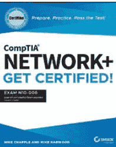

Mike Chapple

Craig Zacker


# 致谢

# 作者简介

**Mike Chapple, PhD** 是畅销书籍 CISSP (ISC)² Certified Systems Professional Official Study Guide (Sybex, 2021) 和 CISSP (ISC)² Official Practice Tests (Sybex, 2021) 的作者。他是一位在高等教育、私营部门和政府拥有多年经验 IT 专业人士。

Mike 担任圣德大学 Mendoza 商学院 IT、分析和运营系的教学教授，在那里教授网络安全、云计算、数据管理和业务分析的本科和研究生课程。

在回到圣德大学之前，Mike 曾担任迈密咨询公司 Brand Institute 的执行总裁兼首席信息官。Mike 在国家安全局的信息安全研究小组工作过四年，并曾担任美国空军现役情报军官。Mike 写了超过 25 本书。他在圣德大学获得计算机科学与工程学学士和博士学位。Mike 还拥有伯明大学的 MBA 学位。Mike 拥有 IT 基础 (ITF+)、安全分析师 (GYSA+)、Data+、Security+认证信息安全经理 (CISM)、认证云安全专家 (CCSP) 和注册信息系统安全人员 (CISSP) 认证。

访问他的网站 CertMike.com 了解更多关于 Mike 和他的其他安全认证材料。

**Craig Zacker** 是数十计算机和网络主题书籍、手册、文章和网站的作者或合著者。他还担任过英语教授、技术和文字编辑、网络管理员、网站管理员、企业培训师、技术支持工程师、微型计算机操作员、文学和哲学学生、图书管理员、暗房技术员、货运员和送报童。

# 关于技术编辑

George B. Murphy (绰称 Buzz) 拥有 CISSP, CCSP, SSCP, CDWA, CISM, CRISC, CIPT, PCSA, ITIL 等认证，是一位公共演讲者、企业培训师、作者以及 CyberSpace International 的首席执行官。在过去的 25 年里，他通过各种技术和网络安全主题培训课程、研讨会和咨询演示，为全球的网络安全专业人士。作为前戴尔（Dell）技术高管，他曾在 RSA、COMEX、SecureWorld 大会、世界安全会议、NetWorld 以及国家计算机会议上发表演讲，并为普林斯顿大学、奥克里奇实验室、欧洲核子研究中心（CERN）以及美国主要政府机构提供服务。Buzz 从 (ISC)²、CompTIA、PMI 和 Microsoft 等权威机构获得了超过 29 种 IT 和网络安全认证，并编写了 12 本本网络安全教科书。他是 (ISC)² 授权讲师。

引言 xix

引言 xix

- OSI 模型
- 数据封装 12
- 线缆类型 30
- 连接器类型 33
- 线缆管理 35
- 以太网标准 36
- IP 地址 42
- IPv4 对比 IPv6 48
- IP 协议类型 55
- 应用层协议 60
- DHCP 67
- DNS 70
- NTP 75
- 三层架构 79
- 软件定义网络 82
- 脊叶叶叶架构 83
- 流量流 84

| 章节 | 页码 |
| :--- | :--- |
| 数据中心位置 | 84 |
| 存储区域网络 (SAN) | 85 |
| 第 8 章 云计算 | 91 |
| 部署模型 | 91 |
| 服务模型 | 93 |
| 第二部分 领域 2.0：网络实现 | 103 |
| 第 9 章 网络设备 | 105 |
| 网络设备 | 105 |
| 网络化设备 | 111 |
| 第 10 章 路由与带宽管理 | 117 |
| 路由 | 118 |
| 带宽管理 | 124 |
| 第 11 章 交换 | 129 |
| 以太网基础 | 129 |
| 交换 | 131 |
| 第 12 章 无线标准 | 141 |
| 无线网络 | 142 |
| 移动通信技术 | 149 |
| 第三部分 领域 3.0：网络运营 | 153 |
| 第 13 章 网络可用性 | 155 |
| 性能指标 | 156 |
| SNMP | 158 |
| 网络设备日志 | 159 |
| 接口错误或告警 | 161 |
| 环境传感器 | 162 |
| 基线 | 162 |
| 运行时间/宕时间 | 163 |
| 第 14 章 组织文档与政策 | 167 |
| 计划与程序 | 167 |
| 安全与策略 | 171 |
| 常见文档 | 172 |
| 第 15 章 高可用性与灾难恢复 | 179 |
| 负载均衡 | 180 |
| 多路复 | 180 |
| 组集 | 180 |
| 冗余与集群 | 181 |
| 设施与基础设施 | 182

# 引言

如果你正准备参加 Network+ 考试，可能会被信息所淹没。这项考试涵盖了广泛的主题，你可能会在每个主题上花费几周时间。坦率地说，没有必要！

作为 CertMike Prep 系列的一部分，本书旨在帮助你专注于通过考试所需的知识。CompTIA 发布了详细的考试目标，而本书正是围绕这些目标组织的。每个章节都明确说明它所涵盖的目标，并详细介绍了你需要了解的内容。

你会在每个章节末尾发现两个重要的内容：考试精华（Exam Essentials）将章节中的主要观点提炼为几个要点。在考试前复习考试精华是一个极佳的准备方式。我们还在书籍网站上录制了考试精华的免费音频，你可以在 `www.wiley.com/go/syetextprep` 获取。你在开车、健身或修剪草坪时听这些内容会非常棒！

每个章节都包含两个练习题（Practice Questions），旨在让你感受考试的感觉。你会发现这些题目的编写风格与 Network+ 考试题目相似，并附有详细解释以帮助你理解正确答案。请务必花时间仔细阅读这些题目。

最后，书籍网站提供了一份完整的模拟考试，你可以在准备好考试时用它来评估自己的知识水平。祝你 Network+ 考试顺利！

> 注意
> 不要只记这些问题和答案！实际考试中的题目将与本书中的练习题不同。考试旨在测试你对某个概念或目标的理解，因此请先通过本书学习目标，然后再做题。

Network+ 是专为那些寻求证明网络专业知识的人士设计的厂商中立认证。CompTIA 建议希望在 IT 基础设施领域发展职业规划，特别是特别是故障排除、配置和管理网络领域的人士参加此认证。持有 Network+ 认证的人士常见的工作角色包括以下：

- 初级网络管理员
- 网络工程师
- NOC 技术员

# 引言

- 电缆技术员
- 数据中心支持技术员
- 系统管理员
- 电信技术员

考试涵盖了五个主要知识领域：

1. 网络基础
2. 网络实现
3. 网络运营
4. 网络安全
5. 网络故障排除

这些领域涵盖了广泛的主题，从网络安全防护到子网配置等，并重点侧重于所有网络专业人士应具备的核心知识。

Network+ 考试采用标准多选题和基于性能的题目相结合，后者要求你在屏幕上操作对象。此考试设计得直截了当，并不会刁难你。如果你掌握了书中的内容，就能通过考试。

考试在美国的费用为 348 美元，全球其他地区的价格大致相当。你可以在 `www.comptia.org/certifications/network#examdetails` 找到更多关于 Network+ 考试及如何参加的信息。

你有 90 分钟的时间参加，在此期间最多会被问到 90 道题。你的考试分范围在 100 到 900 分之间，及格分为 720 分。

> 注意
> CompTIA 经常进行所谓的“题目投放（item seeding）”，即在考试中包含不计分的试题。这样做是为了收集心理测量数据，这些数据随后被用于开发新版本的考试。在参加考试之前，你会被告知考试中可能包含这些未回答的问题。因此，如果你遇到一个似乎不对应于任何考试目标的问题——或者说，看起来不属于考试范围——那么它很可能是一个投放题。你无法知道某个题目是否被投放，所以请始终尽力回答每一道题。

# 参加考试

当你完全准备好参加考试时，可以访问 CompTIA 网站购买考试券：

目前，CompTIA 提供两种参加考试的选择：在考中心参加现场考试，以及在自己电脑上独立参加的居家考试。

> 提示
> 本书包含一张优惠券，你可以用它在 CompTIA 考试注册时节省 10% 的费用。

# 现场考试

CompTIA 与 Pearson VUE 的考中心合作，因此你的下一步将是找到你附近的一个考中心。在美国，你可以根据地址或邮政编码查找，而非美国测试者可能会发现输入城市和国家更方便。你可以在 Pearson VUE 网站搜索你附近的考中心，需要导航到“查找考中心（Find a test center）”。

```
```

现在你已经知道想如何参加考试，只需设置一个 Pearson VUE 考试账户并预约考试。考试当天请携带两份身份证明，并在考试开始前尽早到达。记住，你不能携带笔记、电子设备（包括智能手机和手表）或其他材料进入。

# 居家考试

CompTIA 于 2020 年开始提供在线监考以应对新冠病毒肺炎。得此，居家测试选项仍然可用并可能持续下去。使用这种方法的候选人将在家里参加考试或在远程监考的监督下进行。

由于居家考试体验的变化快速，希望选择此选项的候选人应检查 CompTIA 网站获取最新详情。

# 考试之后

参加考试后，你将立即收到分数，因此你可以立即知道是否通过了测试。你应该将你的成绩单与考试注册记录以及注册考试时使用的地址保存在一起。

获得 Network+ 认证后，你需要每三年更新一次认证，方法包括获得高级认证、完成 CertMaster 持续教育计划，或在三年内获得 20 个持续教育单元。

许多获得 Network+ 证书的人将其作为获得其他感兴趣领域认证的垫脚石。对终端用户支持工作感兴趣的人会朝着 A+ 证书努力，数据分析专业可能会继续获得 Data+ 认证，而 Security+ 项目是通往网络安全职业的敲门砖。

本书涵盖了你通过 Network+ 考试所需的所有知识。它被分为五部分，每部分对应 Network+ 的五个领域之一。

- 第 2 章：网络拓扑
- 第 4 章：IP 划分
- 第 6 章：网络服务
- 第 11 章：交换
- 第 14 章：组织文档与策略
- 第 17 章：网络攻击
- 第 19 章：远程访问
- 第 22 章：排除电缆连接故障
- 第 24 章：排除无线连接故障

# 学习指南元素

本学习指南使用了许多常用元素来帮助你准备，包括：

**考试技巧（Exam Tips）** 在每一章中，我们都加入了一些实用的考试技巧，帮助将阅读重点集中在对考试特别困难或重要的项目上。

**CertMike 考试要点（CertMike Exam Essentials）** 考试要点侧重于主要的考试主题以及你应该带入考试的关键知识。考试要点侧重于 CompTIA 提供的考试目标。

**练习题（Practice Questions）** 每章末尾的两道题将帮助你根据对该章节主题的了解来评估自己的知识，并判断是否已准备好参加考试。

# 其他学习工具

本书附带许多额外的学习工具帮助你准备考试。它们包括：

> 注意
> 访问 `www.wiley.com/sybetextprep` 准备考试。

Sybex 备考软件

Sybex 的备考软件让你通过每章的交互测试进行准备。

# 音频复习

我录制了考试涵盖的主要内容的音频复习，方便你在通勤、锻炼或放松时收听。

> 注意
> 与所有考试一样，CompTIA 的 Network+ 认证会更新并可能被取代。在 CompTIA 不再提供该考试后，我们的书籍旧版也将停止。如果你在考试停止后购买了本书，或正尝试注册在线环境，请注意，一旦考试不再提供，我们无法保证这些工具仍然可用。

| 目标 | 章节 |
|---|---|
| 1.0 网络基础 |  |
| 1.1 比较并对比开放系统互连 (OSI) 模型层和封装概念 | 1 |
| 1.2 解释网络拓扑结构和网络类型的特征 | 2 |
| 1.3 总结电缆和连接器的类型，并解释哪种是适用于解决方案的方案 | 3 |
| 1.4 给定场景，配置子网并使用适当的 IP 方案 | 4 |
| 1.5 解释常用端口和协议、其应用以及加密替代方案 | 5 |
| 1.6 解释网络服务的用途和目的 | 6 |
| 1.7 解释基础企业和数据中心网络架构 | 7 |
| 1.8 总结云概念和连接选项 | 8 |
| 2.0 网络实施 |  |
| 2.1 比较并对比各种设备、其特征及其在网络中的适当位置 | 9 |
| 2.2 比较并对比路由技术和带宽管理概念 | 10 |
| 2.3 给定场景，配置并部署常见的以太网交换功能 | 11 |
| 2.4 给定场景，安装并配置适当的无线标准和技术 | 12 |
| 目标 | 章节 |
|--- |--- |
| 3.0 网络运营 |  |
| 3.1 给定场景，使用适当的统计数据和传感器确保网络可用性 | 13 |
| 3.2 解释组织文档和政策的目的 | 14 |
| 3.3 解释高可用性和灾难恢复概念并总结哪种是最佳解决方案 | 15 |
| 4.0 网络安全 |  |
| 4.1 解释常见的安全概念 | 16 |
| 4.2 比较并对比常见的攻击类型 | 17 |
| 4.3 给定场景，应用网络加固技术 | 18 |
| 4.4 比较并对比远程访问方法及其安全影响 | 19 |
| 4.5 解释物理安全的重要性 | 20 |
| 5.0 网络故障排除 |  |
| 5.1 解释网络故障排除方法论 | 21 |
| 5.2 给定场景，排除常见的电缆连接问题并选择适当的工具 | 22 |
| 5.3 给定场景，使用适当的网络软件工具和命令 | 23 |
| 5.4 给定场景，排除常见的无线连接问题 | 24 |
| 5.5 给定场景，排除一般的网络问题 | 25 |

> 注意
> 考试目标可能会随时更改，且不另行通知，并由 CompTIA 酌情决定。请访问 CompTIA 网站 (`www.comptia.org`) 获取最新的考试目标列表。

如果您认为在书中发现了错误，请告知我们。在 John Wiley & Sons，我们理解为客户提供准确内容有多么重要，但即使我们尽了最大努力，也可能出现错误。

为了提交您可能的错误列表，请将电子邮件发送至 `wileysupport@wiley.com` 我们的客户服务团队，邮件主题为“Possible Book Errata Submission（可能的书籍错误提交）”。

准备。练习。通过考试！获得认证！

- 第 1 章 OSI 模型
- 第 2 章 网络拓扑结构
- 第 3 章 电缆和连接器
- 第 4 章 IP 地址
- 第 5 章 端口和协议
- 第 6 章 网络服务
- 第 7 章 网络架构
- 第 8 章 云计算

网络基础是 CompTIA Network+ 考试的第一个领域。它提供了 IT 专业人员处理常用网络设备和技术所需的基础知识。该领域包含八个目标：

- 1.1 比较并对比开放系统互连 (OSI) 模型层和封装概念。
- 1.2 解释网络拓扑结构和网络类型的特征。
- 1.3 总结电缆和连接器的类型，并解释哪种是适用于解决方案的类型。
- 1.4 给定场景，配置子网并使用适当的 IP 方案。
- 1.5 解释常用端口和协议、其应用以及加密替代方案。
- 1.6 解释网络服务的用途和目的。
- 1.7 解释基础企业和数据中心网络架构。
- 1.8 总结云概念和连接选项。

该领域的题目占 Network+ 考试总题数的 24%，因此你应该预期在测试中看到大约 22 道涵盖此部分材料的题目。

# OSI 模型

# 目标 1.1: 比较并对比开放系统互连 (OSI) 模型层和封装概念。

OSI 参考模型可以作为 Network+ 考试中涵盖的许多其他概念的路线图，提供了一个通用的词汇，使得处理这些过程的人员能够轻松地交流。

在本章中，你将学习到关于 Network+ 目标 1.1 所需的所有知识，包括以下主题：

- OSI 模型
- OSI 模型概念中的数据封装和解封装

开放系统互连 (OSI) 参考模型是网络通信的架构图。该模型通过将一个高度复杂的过程划分为组件元素（在本例中为七个离散的层），如图 1.1 所示，从而定义了这一过程。

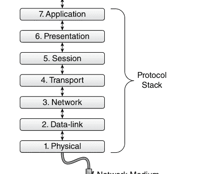

该模型的七层对应于在计算机上运行的各种网络通信过程（称为协议）。表 1.1 列出了模型层、其功能以及实现这些功能的协议。这些协议将在本书的其他部分进行更详细的介绍。

> ### 考试技巧
> 记住这张表是一个好主意，因为许多 Network+ 考试题都会引用 OSI 模型的各个层、其功能及其协议。记忆这些层顺序的一种简单方法是使用口诀“Please Do Not Throw Pizza”（请不要扔披萨）。

| 序号 | 层 | 主要功能 | 协议 |
| --- | --- | --- | --- |


## OSI 模型层

| 7 | 应用层 | 文件、打印、消息和其他服务 | `DNS`, `FTP`, `HTTP`, `POP3`, `DHCP` |
| 6 | 表示层 | 语法翻译 |  |
| 5 | 会话层 | 对话控制、会话分离 |  |
| 序号 | 层 | 主要功能 | 协议 |
| --- | --- | --- | --- |
| 4 | 传输层 | 数据分段、确认、错误检测和纠正、流量控制、端口识别 | `TCP`, `UDP` |
| 3 | 网络层 | 地址、路由、错误检测、协议识别 | `IP`, `IPv4`, `IPv6`, `ICMP` |
| 2 | 数据链路层 | 成帧、介质访问、协议识别 | `IEEE 802.3` (以太网), `IEEE 802.11` |
| 1 | 物理层 | 网络接口硬件、二进制信号 | 双绞线、光纤、无线 |

OSI 模型的层层从栈的底部向上编号。底部物理层为第 1 层，顶部应用层为第 7 层。在某些引用和产品文档中，模型层使用数字而不是名称引用。

协议是计算机之间通信使用的语言。运行在模型层上的所有过程统称为协议栈。网络介质（无论是铜缆、光纤还是无线）连接到栈底部的物理层，进入该层的信号向上通过栈的所有层到达栈顶。同样，发送的数据向下通过这些层并通过连接的介质发送出去。

协议栈层之间的这种垂直通信表现为上方层提供的和服务对下方层的请求。例如，当客户端应用程序发送消息时，它通常会产生对运行应用层的简单邮件传输协议 (`SMTP`) 的请求。`SMTP` 将请求传递给下一层，该层将其交给下一层，依此类推，直到到达底层并在网络上传输。

从网络上接收传输的服务器将以相反的过程，将消息向上通过自身的协议栈层传递，直到到达计算机上的邮件服务器应用程序。

OSI 模型的目标之一是定义一种网络架构，使制造商能够创建出与其他制造商的产品易于通信的产品。只要两台计算机在 OSI 模型的每一层都运行兼容的协议，它们之间的通信在理论上就是可能的，即使它们使用不同的硬件和软件。

尽管多年年来出现过其他协议，但如今的局域网（LAN）在物理层和数据链路几乎总是运行以太网（Ethernet）或 Wi-Fi，在网络层运行互联网协议（IP），在传输层运行传输控制协议（TCP）和用户数据报协议（UDP），并在应用层运行一系列传输控制协议/网协议（TCP/IP）协议和业务。

这套 TCP/IP 协议族具有类似于 OSI 模型的分层架构，但它有四层，如表 1.2 所示，且这些层与 OSI 层并不完全对应。某些文档（例如定义各种 TCP/IP 协议的请求注释，RFC）引用的是 TCP/IP 模型的层而不是 OSI 层。

| OSI 模型层 | TCP/IP 层 |
|---|---|
| 应用层 |  |
| 表示层 | 应用层 |
| 会话层 |  |
| 传输层 | 传输层 |
| 网络层 | 互联网层 |
| 数据链路层 | 链路层 |
| 物理层 |  |

后续章节将更详细地描述 OSI 参考模型的七层。

### 物理层

物理层顾其实名，提供了计算机与网络之间实际的物理连接。计算机中实现物理层的硬件——称为网络接口适配器——通常包括网络电缆的连接器或提供无线连接的收发器。在网络通信架构中，物理层规范负责提供以下元素：

**网络介质** 将信号从一台计算机传输到另一台计算机的技术，例如铜基电缆、光纤或无线传输。

**网络接口** 计算机与网络介质之间的连接，例如电缆连接器或无线收发器。

**网络拓扑** 网络介质在工作地的安排，例如电缆网络通常使用的拓扑结构。

**网络安装** 网络介质的安装指南，例如无线频率、最大电缆长度、允许的设备数量以及与其他设备的距离。

**网络信号** 指定信号的性质：电学、光或无线电，设备利用这些信号在网络介质上传输二进制数据。

计算机在物理层通过产生信号并在网络介质上传输进行通信。对于发出的通信，物理层从运行在较低层（数据链路层）的协议接收数据，将数据转换为适用于介质的二进制代码，并在网络上进行传输。在此过程中，物理层接收来自网络的信号并将其转换为适用于数据链路协议的格式。

这些元素——网络介质、接口、拓扑、安装和信号方案——都由单一协议规范定义。例如，一个典型的物理层规范可能要求屏蔽双绞线（UTP）电缆，安装在星型拓扑中，最大分段长度为 100 米，使用 RJ-45 连接器并使用名为差分曼彻斯特（Differential Manchester）的编码方案。针对光纤或其他网络介质的其他以太网规范每种都有自己的接口、拓扑、安装和信号特性。有关物理层硬件的更多信息，请参阅第 2 章“网络拓扑与类型”和第 3 章“电缆与连接器”。

> 考试技巧
>
> 在准备网络考试时，很容易迷失在不太出现在考试题中的细节中。重要的是了解模型中每一层的基本功能，以及这些功能如何适应网络通信过程。

### 数据链路层

数据链路层是 OSI 模型的第 2 层，与物理层紧密相关。两者都实现了计算机与其所属的局域网（LAN）的连接和通信。为链路层选择协议也决定了物理层可用的网络介质选项。有关以太网变体及其支持的电缆类型的更多信息，请参阅第 3 章。数据链路层协议通常执行以下功能：

**帧格式** 数据链路层将网络层数据封装成称为“帧”（frame）的单元，帧由头部和尾部组成。

**寻址** 每个网络接口适配器都有分配的唯一介质控制（MAC）地址。

**协议识别** 数据链路层头部包含一个代码，指示生成数据包中数据的网络层协议。

**错误检测** 帧尾部包含接收系统执行的循环冗余校验（CRC）的结果。

**介质访问** 当局域网具有共享介质时，数据链路层使用介质访问机制来防止设备同时传输。

**物理层规范** 大多数局域网运行以太网，其标准为 `IEEE 802.3`。

运行在 OSI 模型物理层和数据链路层的协议专门用于本地通信。例如，以太网并不关心将数据递送到其最终目的地。那是网络层的责任。

### 网络层

网络层设备路由器连接各个网络，形成一个互联网络或网络网络。路由器是一个中间系统，它只处理到网络层的入站数据包，如图 1.2 所示。

## 图 1.2 中间路由器处理的网络流量

| 发送端 | 路由器 | 接收端 |
|---|---|---|
| 应用层 |  | 应用层 |
| 表示层 |  | 表示层 |
| 会话层 |  | 会话层 |
| 传输层 |  | 传输层 |
| 网络层 |  | 网络层 |
| 数据链路层 |  | 数据链路层 |
| 物理层 |  | 物理层 |

网络层协议的功能：

**端到端寻址** 网络层协议头部包含发送系统和最终目的地的地址。数据链路 MAC 地址在互联网之旅的每一跳中都会变化，但网络层地址始终反映起点和终点。

**路由** 路由器是将数据包转发到其他网络的网络层设备。网络层协议使用路由表查找其他网络的地址，或者路由器可以将数据包转发到正确的目的地。

**分片** 网络根据其最大传输单元（MTU）值具有不同的帧大小限制；如果单个帧太大无法在另一个网络上传输，网络层协议将其拆分成较小的分片并在单独的帧中传输每个分片。网络层协议在到达目的地时仍然是分片。

**协议识别** 正如数据链路协议头部包含一个代码来识别数据包中数据的网络层协议，网络层协议也包含一个代码来识别生成数据的传输层协议。

在 TCP/IP 协议中，网络层的主要协议是互联网协议（IP）。IP 有两个版本：`IPv4` 具有 32 位地址空间，是网络层标准的互联网协议；而 `IPv6` 是一种具有 128 位地址空间的新版本。`IPv6` 尚未广泛应用于公共互联网通信。有关互联网协议的更多信息，请参阅第 4 章“IP 地址”。

IP 功能在报头中实现，该协议应用于其从传输层接收的数据。这形成了一个名为*数据报文*（datagram）的单元。

*TCP/IP* 一术语指的是在传输层和网络层运行的两个协议。这两层的协议共同工作，以提供统一的服务质量。如前所述，IP 提供寻址和路由服务。OSI 模型传输层的协议根据需要为相邻层提供端到端的通信服务，例如保证性传递和流量控制。

OSI 模型在传输层识别了两种类型的端到端协议：

- **面向连接的**：面向连接的协议在传输任何应用数据之前，始终会在发送系统和接收系统之间建立连接。系统通过交换消息（称为*握手*）和*TCP 标志位*来执行此操作，以确认两个系统都能够发送和接收数据。传输完成后，通过另一个握手终止连接。面向连接的协议报头较大，会导致此类协议的带宽开销显著增加。在大多数网络中，传输层主要的面向连接协议是*传输控制协议 (TCP)*。

- **无连接的**：无连接协议提供的服务除了基础数据传输之外没有任何额外服务，因此不需要握手消息，报头可以小得多。这显著降低了协议的带宽开销。在大多数网络中，传输层主要的无连接协议是*用户数据报协议 (UDP)*。运行在网络层上的网协议 (IP) 也是无连接的。

传输层为数据传输提供各种服务。列表中的大多数功能由 TCP 等面向连接的协议提供。传输层的所有协议仅要求协议识别功能。

- **数据分段**：面向连接的协议接受来自上层应用进程的数据，并将其拆分为适合网络的大小的段。每个段都经过编号，以便即使它们到达顺序不一致，接收系统也能对其进行重组。

- **数据包确认**：面向连接的协议提供保证传递服务。接收系统生成消息以确认成功接收来自发送者的数据包。

- **流量控制**：一种面向连接的机制，用于调节发送系统传输数据的速度。接收系统返回给发送者的响应指定了滑动窗口的大小——即保存输入数据的缓冲区。当滑动窗口变小时，发送系统会降低其重传速度，以避免让接收者过载。

- **信号错误纠正**：信号错误是指由于 CRC 失败而被网络层协议丢弃的数据包。网络层协议无法纠错误，因此它通知传输协议重传丢失的数据包。

- **非信号错误检测与纠正**：传输层为整个数据包提供了唯一的端到端错误检测和纠正机制。发送系统上的传输层协议执行 CRC 计算并将结果包含在其报头中。接收系统执行相同的计算并比较结果。对于任何丢失的数据包，接收器会在其报头中提醒数据包确认值，导致发送者重传未确认的数据包。

- **端口识别**：传输层协议始终包含一个代码（称为端口），用于标识生成或将接收数据包数据的应用层协议。

传输层实现在每个协议所应用的报头部。由于 TCP 是一种具有许多用户的面向连接的协议，它具有一个 20 字节的大型报头。UDP 是无连接的，因此只有相对较小的 8 字节报头。

传输层和会话层之间的边界标志着协议栈功能的重要变化。在 TCP/IP 网络上从一个系统传输数据到另一个系统的所有通信（包括端到端和本地）由 OSI 模型的四层处理。会话层、表示层和应用层假设通信服务功能正常，并且它们需要发送或接收的任何消息将被正确处理。

OSI 模型的这三层在 TCP/IP 协议族中没有独立的协议来实现其功能。相反，会话层的作用像是一个工具箱；OSI 模型列出了在会话层执行的 22 个功能，但在 TCP/IP 网络中，这些功能通用地集成到了应用层协议中。正因如此，会话层、表示层和应用层通常被统称为上层。

与会话层相关的功能主要涉及两个系统之间连接（称为会话）期间通信的建立、维护和终止。会话的维护可能是一项复杂的事务，需要需要各种会话层功能来启动对话、保持有序通信，然后将其终止。

用于管理会话的两个重要功能包括：

- **对话控制**：指定系统间通信的模式。单工模式是只有一台计算机在传输。半双工模式（称为双向交替 TWA 模式）中，系统交换令牌，只有持有令牌的计算机可以传输。双工模式（也称为双向同时 TWS 模式）中，没有令牌，计算机可以任何时间传输。

- **对话分离**：要求在数据流中创建检查点以分离功能。

如所述，OSI 每一层都为上层提供服务并向下层请求服务。在表示层的情况下，它的主要功能是提供通过服务，使用应用层协议请求会话层服务。对于会话层的每项服务，表示层都有相应的服务。这使得上层能够作为一个单一实体运行。

表示层还包括语法翻译，使得两个系统能够通信，尽管它们使用了不同的数据压缩、加密或位编码。

有数百个应用层协议，多于任何其他层。这是因为有许多应用程序需要各种网络服务。

当传出的数据通过协议栈到达网络介质时，它会经历一个称为数据封装的过程，这在功能上等同于将信放入信封中。当应用程序产生需要在网络上传输的数据时，它会产生一个某个应用协议的请求。该协议生成一个格式符合应用程序要求的消息，并将其通过栈的各个层。底层的协议随后会添加它们自己的数据（如地址和代码）以实现其功能。

例如，当应用层数据到达传输层时，该层生成传输控制协议 (TCP) 或用户数据报协议 (UDP) 报头并将其添加到数据中。TCP 报头包含协议用于在发送和接收系统之间建立连接并在数据传输后断开连接的标志位。应用层请求随后成为传输层协议或数据报的负载，如图所示。传输层协议随后将数据传递给网络层，网络层添加其自身的网协议 (IP) 报头。接口的最大传输单元 (MTU) 规定了可以在网络上传输的最大 IP 数据报的大小。大于 MTU 的数据报会被拆分成碎片进行传输。最后，在数据链路层，所有层的数据都成为数据链路帧的负载。数据链路协议通常在负载中同时添加一个以太网报头和一个尾部，从而产生一个准备好传输的数据包。

对于到达目标系统的数据包，过程反向进行，数据向上通过 OSI 模型层传递，这一过程称为解封装。每一层通过读取并剥离报头来处理输入的数据包，并将负载传递给下一层的正确协议。

- OSI 参考模型将网络通信过程分为七层。按第一层到第七层的顺序，它们是：物理层、数据链路层、网络层、传输层、会话层、表示层和应用层。你可以使用口诀“Please Do Not Throw Sausage Pizza Away”（请不要把香肠披萨扔掉）来记住它们。

- 数据封装是一个过程，通过在传输层、网络层和数据链路层应用应用头部（headers），将应用程序生成的数据进行封装，以便在网络上进行传输。当数据包到达目的地时，会发生解封装过程，此时每一层的协议都会剥离各自的头部，并将有效负载数据（payload data）传递给下一层。

有多个 OSI 模型层提供错误检测服务，但只有一层同时提供错误纠正功能。在 OSI 模型的哪一层提供了既能端到端错误检测又能纠正的协议？

- A. 物理层

B. 数据链路层

C. 网络层

D. 传输层

以下哪种 OSI 模型层指定了每个数据包发送者及其最终接收者的地址？

- A. 数据链路层

B. 网络层

C. 传输层

D. 会话层

A. 错误，因为物理层提供与网络的连接，并实现信号算法，将数据转换为传输所需的电信号、光信号或无线电信号。该层不以任何方式对数据进行处理或评估，因此它不执行错误纠正。

B. 错误，因为数据链路层只关注本地网络通信。数据链路层对每个帧进行 CRC 计算，并将结果包含在帧校验序列（FCS）字段中，但无法执行端到端的错误检测，且没有错误纠正能力。

C. 错误，因为作为无连接协议，它没有数据包确认能力，因此没有错误纠正。网络层通过其头部中的 CRC 代码进行错误检测。如果数据包通过 测试 测试，网络层将将其丢弃并向传输层发送丢失信号。

D. 正确，因为 TCP 是一种面向连接的传输层协议，它不仅执行自己的错误检测，还包含了数据包确认服务。在连接期间传输的段是有编号的，因此接收器生成的确认消息可以指定最后接收的数据包编号。发送器处理这些消息并自动重传任何未确认的数据包。

正确答案：D, 传输层

A. 错误，因为数据链路层只关注本地网络通信。帧的目的地址并不标识数据包的最终接收者，仅标识局域网（LAN）上的下一个接收者。

B. 正确，因为网络层的 IP 是负责数据包发送者与其最终接收者之间端到端传输的协议。因此，IP 头部包含这两个系统的 IP 地址。

C. 错误，因为传输层头部不包含端系统的地址。传输层协议 TCP 和 UDP 提供了支持端到端网络通信过程的服务，但它们依赖网络层进行寻址。

D. 错误，因为会话层在端系统连接建立后提供管理连接的功能，但它没有专门的协议，也没有寻址功能。

正确答案：B, 网络层

## 目标 1.2：解释网络拓扑和网络类型的特征。

本章将探讨技术人员在工作中遇到的各种类型网络，以及这些网络所使用的基础物理拓扑。这些是 Network+ 考试许多题目中提到的基础网络概念。

在本章中，你将学习关于 Network+ 目标 1.2 的所有知识，包括以下主题：

- 网型（Mesh）

- 星型/轮辐型（Star/hub-and-spoke）

- 总线型（Bus）

- 环型（Ring）

- 混合型（Hybrid）

- 网络类型和特征

- 服务相关的入口

- 虚拟网络概念

- 供应商链路（Provider links）

在网络术语中，拓扑是对网络介质安装方式的定义。最初用于描述电缆安装，网络拓扑规定了电缆如何安装，以及计算机和其他设备之间是如何相互连接的。

例如，现今有线局域网（LAN）中最常用的拓扑是星型拓扑（见图 2.1），由于图表类似于轮子，有时也被称为轮辐拓扑。

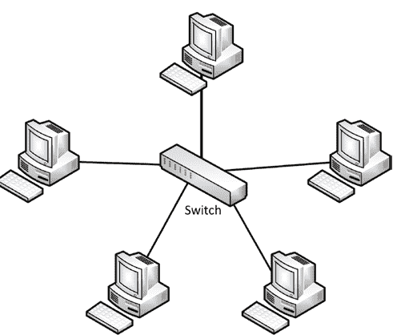

图 2.1 使用星型拓扑的有线局域网

在星型拓扑中，每台计算机或其他设备都有连接到称为交换机的中心布线枢纽的专用连接。交换机通过通过其其他端口传输流量，将从每台计算机接收到的流量转发到网络上相应的接收者。早期的星型网络可能使用集线器（hub）而不是交换机。集线器是一种物理层设备，它将输入流量转发到所有端口而不仅仅是一个端口，从而形成真正的共享网络介质。

今天安装几乎的所有有线局域网都使用带有非屏蔽双绞线的以太网协议采用星型拓扑。为了构建更大的网络，可以将交换机相互连接形成分级星型拓扑，其中所有交换机上的计算机都可以相互通信。

在星型拓扑在有线局域网中普及之前，还有其他拓扑在使用，包括以下：

- 总线型：早的以太网网络在总线拓扑中使用同轴电缆，其中每个设备都与下一个设备连接。总线拓扑不再被使用主要是因为它缺乏容错性。电缆断裂或某台计算机中的网络接口适配器故障会将网络分成两部分，导致一个段的设备无法与另一个段通信。

- 环型：环型拓扑本质上是链条末端连接在一起的总线，以便流量可以在网络中循环。一种名为令牌环（Token Ring）的早期协议使用一种拓扑，计算机绕环在系统之间传递小的令牌帧。这充当了介质访问控制，因为只有持有令牌的设备才允许传输其数据。另一种过时的协议称为光纤数据接口（FDDI），要求在物理拓扑中使用光纤缆，或者为了容错使用双环。


## 混合型
混合拓扑是一种使用两种或多种拓扑元素的网络。例如，令牌环的环型拓扑在大多数情况下是虚拟的；物理网络是星型，所有设备连接到多端口访问单元（`MAU`）。所有信号在环中传输，`MAU` 向计算机发送包并等待返回后再发送给下一个。另一种混合拓扑是星型，多个网络连接到一个使用总线拓扑的骨干网上。

## 网型
从理论上说，网型拓扑描述的是每台计算机与其他所有计算机都有独立连接的网络，提供了完全冗余和容错能力。对于有线局域网，网型拓扑在大多数情况下是不可能的，或者至少是不现实的。然而，远程办公室之间的广域网（`WAN`）连接可以使用任何拓扑，包括网型。每个站点连接到两个或更多站点的 `WAN` 拓扑称为部分网。这种配置在 `WAN` 链路故障时提供了容错能力，但也极其昂贵。

网络一词在不同语境下有不同的含义，即使在 IT 领域也是如此。从技术上讲，任何连接在一起以共享数据的计算机组都是网络。然而，网络在几年来发展迅速，网络的定义也是如此。`Network+` 考试要求候选人熟悉以下网络类型：

### 局域网（`LAN`）
位于同一地理区域（如房间、楼层或建筑）内的计算机和其他设备集合，使用电缆或无线介质连接以共享数据。要将 `LAN` 连接到另一个网络，需要路由器。这创建了一个网络的网络的网络，也称为互联网。

### 无线局域网（`WLAN`）
位于有限地理区域内的计算机，使用无线网络介质（如 `Wi-Fi`，基于 `IEEE 802.11` 标准定义的无线技术）连接。

### 广域网（`WAN`）
两个远程位置之间的点对链路，通常由第三方运营商提供。`WAN` 的速度通常比局域网（`LAN`）慢，但它们可以跨越更长的距离。`WAN` 链路可以将单个用户连接到远程 `LAN` 或连接两个 `LAN`，使每个站点的用户能够访问另一个站点的资源。

### 城域网（`MAN`）
位于比 `LAN` 更大的地理范围内的计算机集合，例如社区、地区或城市。`MAN` 本质上是使用 `WAN` 技术（如光纤链路）连接在一起的 `LAN` 集合，形成一个互连网络。

### 个人域网（`PAN`）
一组距离很且通常属于同一个人的设备，如智能手机、平板电脑和笔记本电脑。`PAN` 通常是无线的，使用红外线或蓝牙等短距离介质连接设备，但也可以使用电缆连接，例如通用串行总线（`USB`）。

### 园区网（`CAN`）
比 `LAN` 大但比 `MAN` 或 `WAN` 小，它是一个使用 `WAN` 链路连接的 `LAN` 集合，为学校、企业、住宅区或政府园区提供服务。与 `MAN` 或 `WAN` 不同（它们通常依赖第三方服务提供商进行 `WAN` 连接），网络设备通常由园区的租户所有。

### 存储区域网（`SAN`）
一系列存储设备的集合，如磁盘阵列或网络附属（`SAN`）单元，连接到网络并为服务器提供对设备的直接块级访问或文件系统。服务器访问存储设备的方式就像其安装在本地一样。高端 `SAN` 通常是专门用于存储流量的光纤网络，块级存储设备运行光纤通道（`Fibre Channel`）等专用协议。然而，也有较低成本的替代方案，例如 `iSCSI`，它允许存储流量在标准以太网上与 `TCP/IP` 流量共存。

> 考试提示
> `Network+` 目标 1.2 介绍了一些在后续章节中探讨的概念。例如，这里仅对 `SAN` 有最基础的介绍，但在目标 1.7 中会进一步检查。考生应该关注这些零散的主题，以便评估它们值得投入多少精力和准备工作。

### 软件定义广域网（`SDWAN`）
一种广域网，其中提供 `WAN` 连接的硬件与控制流量的链路分离。这使得网络能够结合各种 `WAN` 技术，并根据当前网络状况，通过选择对传输数据最合适且最高的链路来动态路由流量。

这种概念与软件定义网络（`SDN`）类似，它将网络控制功能与网络转发功能分离。与其让单个路由器执行这两个功能，不如在 `SDN` 中，路由器仍然执行数据包转发，但整个网络的路由控制位于一个中央控制单元。

### 多协议标签交换（`MPLS`）
一种数据包路由技术，它对数据包应用标签并仅根据标签中的路径信息进行路由，而不是使用数据目的地址。`MPLS` 网络为每个数据包添加 32 位的 `MPLS` 头部，使其能够在不查询数据链路和网络头部的情况下路由流量。因此，`MPLS` 可以处理多种协议，包括帧中（`Frame Relay`）和异步传输模式（`ATM`），以及 `IP` 和以太网。它的功能被称为二层协议。

### 多点通用路由封装（`mGRE`）
通用路由封装（`GRE`）是一种隧道协议，它封装网络层数据并通过已建立的点对链路（如虚拟专用网络 `VPN`）传输数据。多点通用路由封装（`mGRE`）在此基础上扩展，根据需要动态地在点之间创建新隧道。这消除了管理员在站点之间创建单独隧道映射的需要。

> 考试提示
> `Network+` 考试目标有时包含一些看起来不恰当的元素，例如在网络类型列表中包含 `MPLS` 和 `mGRE`。这两种协议都运行在网络上，并为通常 `LAN` 和 `WAN` 技术提供了流量处理替代方案，但它们在某种意义上并不是“网络类型”（即你不会用 `MPLS` 代替一个 `LAN`）。然而，考生仍然应该对这些技术有基本的了解。

网络上计算机的角色取决于其运行的操作系统（`OSs`）以及构建它们时所使用的硬件。网络通信通常涉及两个角色：服务器和客户端。服务器是为其他计算机提供服务的计算机。*客户端*是产生服务请求并将其发送到服务器的计算机。

例如，服务器会监听传入的请求并通过提供 Web 内容来做出响应。运行 Web 浏览器的客户端计算机在用户输入 Web 地址或点击超链接时会产生请求。

有两种基本的角色配置，如下：

- **客户端/服务器**：描述一种使用一个专用服务器和客户端的网络。例如，`NetWare` 曾是客户端/服务器网络的服务器操作系统，该网络几乎没有客户端功能。它具有基于字符的界面，无法运行客户端应用程序。

- **对等点（Peer-to-peer）**：描述一种计算机能够同时担任客户端和服务器的网络。现在的操作系统（如 `Windows` 和 `Linux`）都包含服务器和客户端功能。例如，在仅由 `Windows` 工作站组成的网络上，任何计算机都可以充当服务器。即使是运行 `Windows` 操作系统的计算机也具有完全的客户端功能。

虽然 `LAN` 或互联网可以独立于所有外部服务运行，但大多数网络都与第三方提供商有连接。今天几乎所有的网络都连接到互联网服务提供商（`ISP`），但企业通常还有额外的连接，例如到电话运营商和广 服务提供商的连接。这些这些到外部服务的连接需要一个入口点，即客户端内部设备与服务提供商对接的物理接口。这通常被称为分点（`demarc`），因为它规定了客户责任结束和提供商责任开始的地方。分点外的技术问题由提供商负责；网络内部的问题由客户负责。

分点以网络接口设备（`NID`）的形式存在，包含两个网络之间的连接（电气或光电）。在最基础的形式，`NID` 是一个物理层设备。然而，对于某些连接需要额外的设备。例如，租线需要通道服务单元（`CSU`）和数据服务单元（`DSU`），通常封装在一个名为 `CSU/DSU` 的设备中。在某些情况下，服务提供商可能会选择安装具有额外功能的 `NID`，称为智能端。智能端可能需要放大或解码信号，并通常包含各种类型的诊断功能，例如可切换的回环功能报警通知功能。这些诊断使得服务提供商能够远程监控连接并进行基础测试，而无需派遣技术人员现场。

虚拟化对于大多数 IT 工作人员已成为企业网络的标准部分。在最基础的形式，运行软件组件的虚拟化服务器

虚拟机管理器（`hypervisor`）托管着多个虚拟机（`VMs`）。每个虚拟机都有自己的虚拟化硬件环境，因此管理员可以在其上安装标准的操作系统和应用程序。

像物理计算机一样，虚拟机若要在网络上运行，必须具备标准的网络硬件设备，如网络接口适配器以及对交换机的访问权限。作为其虚拟化硬件配置的一部分，虚拟机包含了这些设备的基于软件的虚拟化版本，其中一些将在本节中进行描述。

虚拟机管理器是抽象计算机物理硬件并为每个虚拟机提供虚拟化硬件版本的软件组件。根据软件相对于操作系统运行的方式，常用的虚拟机管理器分为两种，如下：

- **第1 型：** 通常作为操作系统产品的一部分实现，第1 型虚拟机管理器加载操作系统，并作为虚拟机与物理硬件之间的抽象层存在。虚拟机管理器创建分区，其中第一个是父分区（`parent partition`），其他是子分区（`child partitions`）。父分区管理物理硬件并运行创建分区的虚拟化栈。在这种配置下，没有底层操作系统与虚拟机管理器共享资源。

- **第2 型：** 实现为运行在现有操作系统之上的独立进程，第2 型虚拟机管理器必须从主机操作系统处获取处理器资源，并将其资源分配给各个客户虚拟机。第2 型虚拟机管理器通常用于基于工作站的虚拟化产品，通常不提供托管生产服务器所需的性能。

每台计算机（即使是虚拟机）都需要网络接口适配器来连接到本地网络。因此，在虚拟化环境中，为了将虚拟机连接到网络，它必须拥有一个虚拟网卡（`vNIC`）。

`vNIC` 执行与物理网络接口适配器许多相同的功能，例如实现链路层协议并获取传输到网络的数据包。对于某些虚拟化产品，甚至可以在单个虚拟机中安装多个 `vNIC`，并在虚拟化环境中创建多个网络。

在虚拟化环境中，`vSwitch` 的作用与局域网上的物理交换机相同。交换机是一种链路层设备，作为局域网的通信枢纽。连接到其中交换机的每台计算机都可以通过通过交换机发送流量与其他连接的计算机通信。

虚拟化服务器管理员可以根据需要创建和配置 `vSwitch`，甚至创建由多个虚拟化服务器共享的 `vSwitch`。虚拟机中的 `vNIC` 连接到 `vSwitch`，`vSwitch` 在计算机内部创建一个虚拟网络。所有虚拟机都可以通过通过 `Switch` 发送流量相互通信。

为了让虚拟网络与外部物理网络通信，`vSwitch` 必须连接到计算机中的物理网络接口适配器。物理适配器连接到物理交换机，为虚拟化服务器及其上的所有虚拟机提供访问物理网络的权限。

网络功能虚拟化（`NFV`）是一种网络架构，其中特定的工作设备以称为虚拟化网络功能（`VNF`）的逻辑形式实现。`VNF` 可以提供防火墙、负载均衡器、入侵检测系统（`IDS`）和其他设备的功能。管理员可以使用基于虚拟机管理器的虚拟化服务器，根据需要在企业周围部署 `VNF`。

## 供应商线路（`PROVIDER LINES`）

大多数网络都有到互联网服务提供商（`ISP`）的链路，为用户提供接入互联网的能力。网络可以使用多种技术来实现这种访问。选择合适的连接类型是基于成本、传输速度、同步性和可用性的决策。最常用的 `ISP` 链路如下：

**电缆（`Cable`）** 大多数电缆电视供应商都可以为住宅和业务客户提供互联网接入。在大多数情况下，互联网接入是非对称的，这意味着下行流（从提供商到客户）的速度快于上行速度。然而，某些提供商提供具有更多上行带宽的面向业务的服务。

**数字用户线路（`DSL`）** 非对称数字用户线路（`ADSL`）是一种电信技术，它将标准广域载波线路的带宽进行拆分，并将其中部分用于网络数据，同时保持语音服务的完整。由于 `ADSL` 是不对的，下行流量远快于上行。`ADSL` 主要用于住宅或 `SOHO`（小型办公室、家庭办公室）网络连接，人气不如其他类型的供应商链路。然而，它是某些客户的唯一替代方案。对于业务客户，运营商可能会提供具有对称速度和更大带宽的其他 `DSL` 技术，如高比特数字用户线路（`HDL`）。

**卫星（`Satellite`）** 使用卫星 `ISP` 在客户现场安装的卫星线盆接入通信卫星并通过其连接到互联网。卫星服务有两种类型。在*单向服务*中，客户通过卫星高速接收下行流量，而上行流量则使用较慢的陆地连接。

在双向服务中，下行和上行流量都通过卫星传输。与其他供应商链路相比，卫星服务非常昂贵，但对于偏远地区的某些客户来说，它是唯一的解决方案。

**租线（`Leased Line`）** 两点之间专用且永久的电信连接，由电话服务提供商安装并供客户专门使用。供应商可以提供各种速度的租线，客户可以随心使用带宽。

城域光局域网（`Metro-Optical MANs`）通常使用光纤链路将局域网集成到一个网络中。作为城域网社区光纤网络安装有时被称为城域光网络。

- 如今大多数局域网使用星型拓扑，设备插入到公共交换机中。过去使用的其他局域网拓扑包括总线、环形及各种。网状拓扑通常不用于局域网，但广域网连接可以使用它。

- 用于局域网的“区域网络”术语也被应用于其他网络技术。广域网（`WAN`）是网络之间的远程连接。其他不同尺寸的网络类型包括城域网（`MAN`）、校园局域网（`CAN`）和个人区域网（`PAN`）。

- 虚拟网络已成为 IT 的重要部分。运行在服务器上的软件组件允许管理员创建服务器、网卡、交换机和其他网络组件的逻辑实现。这些虚拟化组件通过共享服务器的硬件资源，与其对应设备的功能完全相同。

- 住宅和业务客户可以使用多种性能相似的供应商链路连接到 `ISP`。家庭用户通常选择使用电缆连接的宽带接入；共享语音线的 `DSL`；或卫星天线。大多数此类 `ISP` 也可以提供带有额外服务的业务账户。

Ralph 正在一个累积累了多年网络技术的现场进行咨询。一个在吊顶天花板处工作的助理电工告诉 Ralph，他不小心切断了一根穿过天花板空间的网络电缆。电工不知道那是哪种网络电缆，这让 Ralph 感到担心，因为该现场安装了同轴、光纤和双绞线线路。由于该现场使用了多种拓扑，单根电缆中断的影响可能会有所不同。哪种拓扑电缆中断对网络造成的干扰最大？

A. 网状（`Mesh`）

B. 逻辑环形（`Logical ring`）

C. 总线（`Bus`）

D. 星型（`Star`）

Ralph 计划从事 IT 行业，并想为了学习目的建立一个家庭局域网。Ralph 购买了三台旧电脑，并在每台电脑上安装了一个以太网接口适配器。他还购买了三根 `CAT 6 UTP` 跳线。Ralph 想为他的网络使用星型拓扑，但不确定应该为他的布线枢纽（星型中心）购买什么设备。当 Ralph 将他的三台电脑插入该组件时，哪种组件会形成局域网？（选择所有正确答案）。

A. 集线器（`Hub`）

B. `MAU`

C. 交换机（`Switch`）

D. 路由器（`Router`）

A. 错误，因为虽然网状拓扑通常不用于局域网（`LAN`）安装，但节点之间的冗余连接使其能够在电缆断裂的情况下仍正常运行。

B. 错误，因为星型拓扑结构中的电缆断裂只会影响单个节点的网络通信。

C. 正确，因为总线型拓扑结构中的电缆断裂会将网络分为两部分。这将阻止断裂处一侧的节点与另一侧的节点进行通信。网络的两个部分都将有一个没有终端器的电缆末端，这可能会抑制断裂处同侧计算机之间的通信。

D. 错误，因为逻辑环形拓扑在物理上被实现为星型，且星型拓扑结构中的电缆断裂只会影响单个节点的网络通信。

正确答案：`C`

A. 正确，因为集线器（`hub`）可以作为以太网星型拓扑为中心的布线枢纽。网络上的每个设备都连接到集线器上，从而形成一个局域网。

B. 错误，因为多站访问单元（`MAU`）仅用于令牌环网络（`Token Ring`），不用于以太网局域网。

C. 正确，因为交换机（`switch`）可以作为以太网星型拓扑为中心的布线枢纽。网络上的每个设备都连接到交换机上，从而形成一个局域网。

D. 错误，因为路由器用于连接不同的网络；它们不能作为星型拓扑的布线枢纽。

正确答案：`A` 和 `C`

# 第3 章

# 电缆与连接器

## 目标 1.3：总结电缆和连接器的类型，并解释哪种是适用解决方案的类型。

本章介绍了技术人员在工作中遇到的各种电缆和连接器，以及规定如何安装它们的标准。这些是 `Network+` 考试题目中提到的基础网络概念。

在本章中你将学习关于 `Network+` 目标 1.3 的一切，包括以下主题：

- 铜
- 光
- 连接器类型
- 电缆管理
- 以太网标准

## 电缆类型

无线局域网在今天非常流行，特别是在住宅安装中，但局域网（`LAN`）仍然是业务网络中的重要要素。数据网络中使用的两种基本电缆类型是铜和光纤，本节将对此讨论。

### 铜电缆

原始的局域网标准要求使用带有铜导体的电缆，以电电压的形式传输信号。铜电缆仍然是今天最常用的网络介质，这是因为它们相对便宜且易于安装。最早是以太网局域网使用同轴电缆，但今天最流行的网络电缆类型是双绞。

### 同轴电缆

在同轴电缆中，传输信号的导体位于电缆中心。核心周围有绝缘层，然后是一层编织金属，用于屏蔽核心并充当地线。外围的护套保护整个组件免受损坏。电缆的结构和核心周围的屏蔽使同轴电缆具有抗电磁干扰（`EMI`）的能力。

同轴电缆几乎不再用于局域网，尽管仍然存在一些遗留安装。电气电子工程师学会（`IEEE`）`802.3` 标准自 2011 年以来定义了 `10Base5` 和 `10Base2` 同轴规范。然而，同轴电缆仍广泛用于电视安装。表 3.1 列出了主要的同轴电缆类型及其属性，使用了它们的无线电指南（`RG`）标识。

### 表 3.1 同轴电缆类型

| 电缆类型 | 直径 | 阻抗 | 备注 |
|---|---|---|---|
| `RG-8` | 9.5 mm | 50 欧 | `10Base5` | 厚以太网/Thicknet |
| `RG-58` | 4.95 mm | 50 欧 | `10Base2` | 细以太网/Thinnet |
| `RG-59` | 6.15 mm | 75 欧 | 视频/线电视 | 距离较短，较便宜 |
| `RG-6` | 9 mm | 75 欧 | 视频/线电视 | 距离较长 |

另一种被称为双轴（`twinaxial`）的同轴电缆，其基本结构相同，但电缆核心处有两个导体而不是一个。双轴电缆主要用于数据中心的短距离高速链路，其购买价格比光电缆便宜，安装也更容易。

### 双绞电缆

局域网中最常见的铜电缆是双绞线。它以非屏蔽双绞（`UTP`）和屏蔽双绞（`STP`）两种形式提供，由四对线组成。每对线以不同于其他线的速率扭绞在一起，以防止串扰和其他形式的干扰。表 3.2 列出了目前使用的双绞线类别。

| 类别 | 带宽 | 传输速度 | 最大长度 | 备注 |
|---|---|---|---|---|
| `CAT 5` | 100 MHz | 10/100 Mbps | 100 米 | `10BASE-T`, `100BASE-TX` |
| `CAT 5e` | 100 MHz | 10/100/1000 Mbps | 100 米 | `10BASE-T`, `100BASE-TX`, `1000BASE-T` |
| `CAT 6` | 250 MHz | 10/100/1000 Mbps | 100 米 | `10BASE-T`, `100BASE-TX`, `1000BASE-T` |
| `CAT 6` | 250 MHz | 10 Gbps | 55 米 | 仅在长度减少时支持 10 Gbps |


| CAT 6a | 500 MHz | 10/100/1000/10000 Mbps | 100 米 | 10BASE-T, 100BASE-TX, 1000BASE-T, 10GBASE-T 增强以在 100 米内支持 10 Gbps |
| CAT 7 | 600 MHz | 10/100/1000/10000 Mbps | 100 米 | 10GBASE-T 屏蔽双绞线 需要 GG45 或 TERA 不被 EIA/TIA 认可 |
| CAT 8 | 2 GHz | 40 Gbps | 30 米 | 40GBASE-T 屏蔽双绞线 数据中心短距离使用 |

# 第3 章 · 电缆与连接器

双绞电缆安装应符合美国国家标准协会（`ANSI`）和电信行业协会（`TIA`）发布的标准。标准的当前版本称为 `ANSI/TIA-568-D`：商业建筑电信标准。该标准规定了电缆类型、连接器类型。

> 考试技巧
>
> 双绞电缆安装应符合美国国家标准协会（`ANSI`）和电信行业协会（`TIA`）发布的标准。标准的当前版本称为 `ANSI/TIA-568-D`：商业建筑电信标准。该标准规定了电缆类型、连接器类型。

### 光纤连接器

与通常标准化的铜缆连接器不同，光纤可以使用几种不同类型的连接器，包括以下：

- 直型 TP (`ST`)：一种螺旋卡口式连接器，通过旋转半圈锁定在插座中。
- 用户连接器 (`SC`)：一种推拉式连接器，带有键槽以防止在插座中旋转，在某些情况下带有锁定卡扣。
- 本地连接器 (`LC`)：一种小型规格的连接器，与 `SC` 相似但尺寸约为其的一半，带有键槽以将公头安全地锁定在插座中。
- 机械传输注册接头 (`MT-RJ`)：一种小型规格的连接器，具有双工芯，其尺寸与 `RJ45` 连接器相似。


ST 和 SC 连接器传统上是光纤最常用的选择，但更小的规格（如 `MT-RJ` 和 `LC`）变得越来越常见，因为它们节省了交换机和配线架上的空间。

电缆光纤芯与插座光纤芯之间的接口是实现高质量光纤连接的重要部分。光纤连接器通常有两种接口格式如下：

- 超物理接触 (`UPC`)：光纤芯被抛光至零度（平坦）表面。芯之间的连接会导致部分光沿电缆反射回来，引起回损。然而，平坦表面之间的连接减少了由衰减引起的插入损耗。
- 角形接触 (`APC`)：光纤芯被抛光至八度角，使反射光偏转到布线方向以减少回损。然而，其插入损耗大于 `UPC` 连接。`APC` 连接器以绿色的护套或整体护套为特征，并且必须与其他 `APC` 连接器连接；将 `APC` 连接到 `UPC` 连接器会导致极高的插入损耗。

### 收发器与介质转换器

收发器是一种传输和接收信号的设备。计算机中的网络接口卡 (`NIC`) 通常内置一个适用于特定网络介质（通常是双绞线）的收发器。然而，某些设备（如交换机和路由器）配备了小型可插拔 (`SFP`) 插槽，允许管理员插入适用于任何网络类型和介质的收发器。这对于光纤网络特别有用，因为介质和连接器的选择非常多样。

> 考试提示：`8P8` 是用于数据网络的四对连接器的实际名称。然而，用于电话安装的 `RJ45` 术语在 Network+ 考试中更为流行。

自从 `SFP` 插槽引入以来，收发器技术经过了多次迭代，速度随之提升，如表 3.3 所示。

### 表 3.3 SFP 收发器技术

| 名称 | 日期 | 速度 | 通道 |
| --- | --- | --- | --- |
| 小型小型可插拔 (`SFP`) | 2001 | 100 Mbps | 1 |
| 增强型小型可插拔 (`SFP+`) | 2009 | 10 Gbps | 1 |
| 四路小型可插拔 (`QSFP`) | 2006 | 4 Gbps | 4 |
| 增强型四路小型可插拔 (`QSFP+`) | 2012 | 40 Gbps | 4 |

> 考试提示：许多其他收发器名称代表技术传输速度的后续增加，例如 `QSFP28` 和 `QSFP56`，但 Network+ 考试目标仅规定了表 3.3 中的四种。

存在另一种类型的外部收发器——称为介质转换器，有时称为耦合器——用于连接使用不同介质的网络段。需要介质转换器的常见情况是需要将以太网 `UTP` 段连接到光纤段，或将单模光纤到多模光纤。介质转换器可以带有两个网络接口的盒子，也可以是一个比电缆本身大一点的小连接器。

### 电缆管理

一个网络安装可能有数百条内部电缆线路通向数据中心。为了在数据中心终止这些电缆线路，通常会使用配线架。配线架（或配线盘）是一种物理层设备，安装在墙上或机架中，正面有一排母头 `RJ45`（或其他）连接器。通往场地各墙壁的电缆线路在配线架汇合，管理员在那里将它们打入连接器的背部。

许多电缆安装使用散装电类型为远端位置提供服务，例如单个护层中包含 25 或更多导线的 `UTP` 电缆。为了为这些电缆制作导线连接，通常做法是使用打线块，它在一个地方拥有所有导线的连接点。

### 第 3 章 · 电缆与连接器

电话服务安装历史上使用一种称为 `66` 块的打线块，它有一排夹子，单个导线对连接在上。`66` 块是旧技术，在某些电话安装中仍然可见，有时用于运行速度为 10 Mbps 的快速 `10BaseT` 以太网连接，但不适用于更快速的数据网络。

`110` 块是配线架更现代的版本，同时用于电话和数据网络安装。`110` 块通常认证用于分类至 `CAT 6` 别的 `UTP` 电缆，可以支持当今网络更高的速度。

还有其他类型的打线块在使用，例如在欧洲流行的 `Krone` 块（水晶块）。它在功能上与 `110` 块相似，但需要专用的打线工具来适应其略大的连接器。建筑行业交叉连接 (`BIX`) 块自 20 世纪 70 年代以来一直现在支持 `CAT 5e` 和 `6`。`BIX` 块也需要专用的打线工具。

与 `UTP` 一样，某些光纤安装使用单个护层中多达 24 根光纤束的电缆。为了终止这些光束，光纤分配盘接受电缆并允许管理员将每根独立的的光纤丝熔接到盒子正面的标准光纤连接器上。

### 以太网标准

最新的 Network+ 考试目标仅涵盖了目前通用的以太网规范。`IEEE 802.3` 标准中还有许多其他命名，有些已经过时，另一些则变得流行。表 3.4 列出了基于铜的 `UTP` 和 `STP` 层的以太网规范。

### 表 3.4 以太网铜电缆规格

| 命名/标准 | 速度 | 电缆 | 最大段长度 | 名称 |
| --- | --- | --- | --- | --- |
| `10BASE-T` `IEEE 802.3i` | 10 MHz | `CAT 5` 或更高 | 100 米 | 以太网 |
| `10BASE-TX` `IEEE 802.3u` | 10/100 MHz | `CAT 5` 或更高 | 100 米 | 快速以太网 |
| `1000BASE-T` `IEEE 802.3ab` | 10/100/1000 MHz | `CAT 5` 或更高 | 100 米 | 千兆以太网 |
| `10GBASE-T` `IEEE 802.3an` | 高达 10 GHz | `CAT 6` 以上 | 55 米 (`CAT 6`) 100 米 (`CAT 6a`) | 十万兆以太网 |
| `40GBASE-T` `IEEE 802.3bq` | 高达 40 GHz | `CAT 8` `STP` | 30 米 | 四万兆以太网 |

除了这些标准的以太网规范外，其他技术允许网络更有效地利用光纤介质。双向波长复用（`WDM`）是一种传输技术，它通过将信号分配到不同的波长，使单根光纤能够同时携带多个信号。粗波长复用（`CWDM`）通过电缆电视网络，可以在上行和下行通道中传输多达 18 个信号。密波长复用（`DWDM`）是一种更先进的技术，可以隔离多达 80 个波长。它被用于取代同步光网络（`SONET`）和同步数字体系（`SDH`）网络曾用于放大信号的光纤再生器。

另一种基于以太网的技术称为 `HDMI` 以太网通道（`HEC`），它为 `HDMI` 接口增加了一个高速数据通道。高定义多媒体接口（`HDMI`）是一种通常用于将电视显示器连接到其他家庭娱乐设备的电缆连接。增加数据通道消除了每个设备都 Setup 一个独立电缆网络接口的需求。甚至有通过通用串行总线（`USB`）线传输以太网帧的协议，例如微软的远程网络驱动接口规范（`RNDIS`）。

## CERT 核心要点

- 有线网络可以使用多种电缆类型，包括同轴电、屏蔽和非屏蔽双绞线，以及单模和多模光纤。
- 双绞线局域网几乎使用模块化 `RJ45` 连接器，但光纤可以使用多种不同的连接器，包括 `ST`、`SC`、`LC` 和 `MT-RJ`。
- 数据中心可以拥有线缆管理设备，例如多种类型的配线架和压线端子。`66` 块接子已过时，主要用于电话连接。`110` 块接子目前用于电话和数据连接。
- 以太网标准目前包括五种铜质电缆选项和六种光纤选项的物理层规范。

## 练习题 1

贵公司刚刚购买了一栋办公楼，距离现有大楼 300 米，IT 总监分配给你一项任务，要求将两栋楼的网络连接起来。连接必须至少支持千兆以太网，并能够抵抗区域制造设备产生的电磁干扰。总监还希望方案尽可能廉价。你应该使用以下哪种电缆类型来连接这两栋楼？

- A. `RG-58` 同轴电缆
- B. `CAT 6` 非屏蔽双绞线 (`UTP`)
- C. `CAT 8` 屏蔽双绞线 (`STP`)
- D. 多模光纤
- E. 单模光纤

## 练习题 2

以下哪种 `IEEE` 双绞线电缆分类要求屏蔽双绞线 (`STP`) 而非非屏蔽双绞线 (`UTP`) 线？

- A. `CAT 5e`
- B. `CAT 6`
- C. `CAT 6a`
- D. `CAT 8`

## 练习题 1 解析

A. 错误，因为同轴电缆不再用于数据网络，且仅支持 10 Mbps 的传输速度和 185 米的电缆段。

B. 错误，虽然 `CAT 6` `UTP` 可以支持千兆以太网传输速度，但它的跨越距离不超过 100 米。

C. 错误，因为 `CAT 8` 设计用于 30 米或更短的短距离（通常在数据中心内部），且无法跨越 300 米。

D. 正确，多模光纤可以同时支持 300 米的距离和千兆以太网速度，是满足要求的最廉价选项。

E. 错误，虽然单模光纤可以满足距离和速度要求，但它的价格远高于多模光纤。

正确答案：D，多模光纤

## 练习题 2 解析

A. 错误，虽然 `CAT 5e` 规范增强了电缆以支持千兆以太网，但并没有需要屏蔽的显著干扰问题。

B. 错误，虽然 `CAT 6` 电缆的额定速度高达 10 Gbps，但该最高速度仅在短距离内可行。

C. 错误，因为 `CAT 6` 是通过增大线径来增强 IPv4 的，且不需要这种屏蔽。

D. 正确，`CAT 8` 在极短距离内通过屏蔽实现 10 Gbps 速度，适用于网络环境。

正确答案：D，`CAT 8`

## 第 4 章

## IP 地址

目标 1.4：给定场景，配置子网并使用 IP 地址

本章探讨了 `IP` 协议（`IP`），它在 `OSI` 模型网络层工作，拥有一套指定网络源和目的的地址机制。`IP` 是 `TCP/IP` 协议族中的基本元素，允许系统在网络传输数据包。

`IP` 有两个版本——`IPv4` 和 `IPv6`——每个版本都有自己的地址系统。`IPv4` 使用 32 位地址，多年互联网的快速增长威胁了 `IPv4` 地址空间。因此，`IPv6` 版本将地址大小扩展到 128 位，提供了足够的空间来支持未来的网络增长。`IPv4` 到 `IPv6` 的转换已经持续多年，但大多数本地网络在使用 `IPv4`。

在本章中，你将学习关于网络的所有知识，包括：

- 公有与私有
- `IPv4` 与 `IPv6`
- `IPv4` 子网
- `IPv6` 概念
- 虚拟 `IP`

## IPv4 地址

`IPv4` 地址使用点进制格式表示，地址由点分隔的八位进制值（称为字节）组成，例如：

```
192.168.45.250
```

由于每个字节为 8 位，因此每个字节的取值范围为 0 到 255。需要注意的是，尽管 `IPv4` 地址使用十进制表示，但当看到其二进制等值时，地址过程有时更容易理解，其二进制形式为 32 个 0 或 1。`192.168.45.250` 的二进制格式如下：

```
11000000.10101000.00101101.11111010
```

`IP` 地址有两个元素：网络标识符和主机标识符。网络标识符指定系统所在的网络，主机标识符指定该网络上的单个计算机或设备。当发送系统传输数据包时，会通过路由器。路由器根据目标 `IP` 地址中的网络标识符将数据包转发到目标网络。然后，目标网络上的路由器使用主机标识符将数据包发送给最终接收者。

> 考试提示

 以太网和其他链路层协议也有一套地址系统，它们使用一种称为介质访问（`MAC`）地址的不同类型的地址。由于链路层协议致力于本地网络通信，它们使用物理地址 `MAC` 来识别每个数据包在局域网上的下一个目的地。因此，数据包中的目标 `MAC` 地址标识的系统可能与其目标 `IP` 地址不同，而目标 `IP` 地址始终标识数据包的最终接收者。

# IP 地址

`TCP/IP` 网络上的每台设备都必须有一个唯一的 `IP` 地址。管理员理论上可以手动为设备分配地址，这通常被称为静态地址，但更常见的方法是使用自动分配机制，例如动态主机配置协议（`DHCP`）。当 `TCP/IP` 网络上的计算机没有分配 `IP` 地址时，大多数操作系统会使用一种名为自动 `IP` 地址协议（`APIPA`）的机制，该机制在 `162.254.0.0/16` 网段上生成一个不可路由的地址，使系统能够与本地网络通信。

为了在互联网上通信，设备必须通过官方注册机构向互联网数字分配机构（`IANA`）注册一个 `IP` 地址，该注册机构通常由服务提供商（`ISP`）提供。注册机构向申请者分配一个网络地址，申请者负责根据该地址创建子集并为每个设备分配一个唯一的地址。

### IPv4 子网划分

`IPv4` 址中最复杂的方面是，地址中网络标识符和主机标识符之间的划分并不总是位于相同的位置。这是为了支持不同规模的网络。分配给主机标识符的位越多，管理员能够创建的唯一 `IP` 地址数量就越多。

### 类分类址

互联网工程任务组（`IETF`）以征求意见（`RFC`）`791` 的形式发布的《互联网协议版本 4》定义了三个 `IP` 地址类，如图 4.1 所示。每一类将地址的 32 位划分为不同大小的网络标识符和主机标识符。

| | 1 2 3 4 5 6 7 8 | 1 2 3 4 5 6 7 8 | 1 2 3 4 5 6 7 8 | 1 2 3 4 5 6 7 8 |
|---|---|---|---|---|
| A 类 | 网络标识符 | 主机标识符 | | |
| B 类 | 1 2 3 4 5 6 7 8 | 1 2 3 4 5 6 7 8 | 1 2 3 4 5 6 7 8 | 1 2 3 4 5 6 7 8 |
| | 网络标识符 | 主机标识符 | | |
| C 类 | 1 2 3 4 5 6 7 8 | 1 2 3 4 5 6 7 8 | 1 2 3 4 5 6 7 8 | 1 2 3 4 5 6 7 8 |
| | 网络标识符 | 主机标识符 | | |

图 4.1 `IP` 地址类

每一类的特征列于表 4.1 中。A 类地址支持创建多达 126 个网络，每个网络可以拥有超过 1600 万个主机。

（网络地址 `127.0.0.0` 预留作回环地址。）C 类地址支持超过 200 万个网络，但每个网络最多不能超过 254 个主机。基于这些类分配 `IP` 地址被称为类分类址。

### 表 4.1 IP 地址类及其特征

| IP 地址类 | A 类 | B 类 | C 类 |
|---|---|---|---|
| 第一位值（二进制） | 0 | 10 | 110 |
| 第一个字节值（十进制） | 0–127 | 128–191 | 192–255 |
| 网络标识符位 | 8 | 16 | 24 |
| 主机标识符位 | 24 | 16 | 8 |
| 可能的网络数量 | 126 | 16,384 | 2,097,152 |
| 可能的主机数量 | 16,777,214 | 65,534 | 254 |

除了 A、B、C 类外，`RFC 791` 还定义了两个额外的类，它们不用于主机分配，如下：

- * D 类：以 1110 开头，D 类地址被指定为组播标识符，用于识别主机组。
- * E 类：以 11110 开头，E 类地址预留用于实验。

要使用类分类址，网络管理员会被分配一个地址，通常由 `ISP` 分配。例如，`192.168.156.0` 是一个有效的 C 类网络地址。管理员可以获取该网络地址，使用最后一个字节分配主机值，并创建多达 254 个如下所示的 `IP` 地址：

```
192.168.156.1
192.168.156.2
192.168.156.3
```

> 考试提示 Network+ 考试通常会通过提供包含无效 `IP` 地址的答案来测试考生对 `IPv4` 址的理解。任何超出 0 到 255 范围的字节都是无效的。主机值 0 和 255 也是无效的，因为 0 代表网络而不是主机，而 255 预留作广播地址。因此，确定数量的公式为

### 公有地址与私有地址

互联网通信需要公有地址，但对于内部网络，名为 `RFC 1918` 的 `IETF` 文档了三个私有范围。

### 表 4.2 私有地址

| 类 | 地址范围 | 子网掩码 |
|---|---|---|
| A 类 | 10.0.0.0 | 255.0.0.0 |
| B 类 | 172.16.0.0 | 255.240.0.0 |
| C 类 | 192.168.0.0 | 255.255.255.0 |

私有地址在互联网上是不可路由。为了访问互联网，路由器使用一种称为网络地址转换（`NAT`）的技术，将私有 `IP` 地址替换为公有地址。`NAT` 有几种类型：

- 静态 `NAT`：将私有 `IP` 地址映射到特定的公有 `IP` 地址。
- 动态 `NAT`：将私有 `IP` 地址映射到池中的公有 `IP` 地址。
- 端口地址转换 (`PAT`)：通过不同的端口号将多个私有 `IP` 地址映射到一个公有 `IP` 地址。

### 子网掩码

子网掩码用于确定 `IP` 地址的哪些部分代表网络，哪些部分代表主机。子网掩码是一个 32 位的值，其中 1 表示网络部分，0 表示主机部分。例如，`255.255.255.0` 掩码意味着前 24 位是网络，后 8 位是主机。

子网掩码可以使用十进制形式或 `CIDR` 表示法表示。例如，`255.255.255.0` 等同于 `/24`。

### 创建子网

子网划分是将大型网络划分为更小、易管理的子网的过程。这有助于提高网络性能、安全性和管理水平。要对网络进行划分，管理员从主机部分借用位并将其分配给网络部分。创建的子网数量使用公式 `$2^n$` 计算，其中 `n` 是借用的位。子网的主机数量为 `$2^h - 2$`，其中 `h` 是剩余的主机位。

### 无类址

按字节边界进行子网划分是简单的，但并不适用于所有网络。为了提供更大的灵活性，也可以在任何地方进行子网划分，而不仅仅是在字节之间。为了说明，管理员可以采用上一个示例中的网络地址，仅借用 4 位作为子网标识符，而不是 8 位。这使得生成的网络最多有 16 个子网，每个子网最多有 4094 个主机。这种过程被称为无类址。

在这种情况下，管理员使用一种称为变长子网掩码（`VLSM`）的技术，因为网络和主机位之间的边界落在了一个字节内部。

该地址具有 20 位网络位和 12 位主机位，其二进制子网码如下：

```
11111111 11111111 11000000
```

在十进制形式下，管理员为其创建的主机地址必须使用的子网码为 `255.255.240.0`。

### 无类域间路由协议 (CIDR)

无类分类已很大程度上取代了分类分类，因为它允许管理员更高效地利用分配给他们的地址资源。为了简化无类地址的表示法，通常使用无类域间路由协议 (`CIDR`)。在 `CIDR` 表示法中，地址的子网码通过在地址末尾附加斜杠并指定网络标识符的数量来写出，如下例所示：`172.116.20/22`。

此示例描述了一个具有 22 位网络标识符的 B 类地址，其中 6 位作为子网标识符，如图 4.3 所示。该子网标识符允许管理员创建最多 64 (`2⁶`) 个子网，剩余 10 位用于主机标识符，每个子网最多支持 1,022 (`2¹⁰`) 个主机。这是网络地址 `172.16.20/22` 掩码为 `255.255.240.252` 的 `CIDR` 等效表示。


> 图 4.3 `172.16.20/22` `CIDR` 地址中的标识符


由于子网的第三字节部分分配给子网标识符，部分分配给主机标识符，因此在计算每个子网的 IP 地址时，必须对这两个部分分别递增。表 4.3 列出了 64 个子网中前三个和最后一个的一个的值。

### 表 4.3 CIDR 子网地址

| 子网 | 网络地址 | 第一个 IP 地址 | 第三字节二进制值 | 最后一个 IP 地址 | 第三字节二进制值 |
|---|---|---|---|---|---|
| 1 | 172.16.0.0/22 | 172.16.0.1 | 00000 00 | 172.16.3.254 | 00000 11 |
| 2 | 172.16.4.0/22 | 172.16.4.1 | 00001 00 | 172.16.7.254 | 00001 11 |
| 3 | 172.16.8.0/22 | 172.16.8.1 | 00001 10 | 172.16.11.254 | 00001 11 |
| 64 | 172.16.252.0/22 | 172.16.252.1 | 11111 00 | 172.16.255.254 | 11111 11 |

# 第 4 章 • IP 地址

### 二进制与十进制的转换

Network+ 考试通常包含子网划分问题，要求学生计算 IP 地址。在手动计算地址时，最大的问题通常是二进制值和十进制值之间的转换。要将二进制值转换为十进制，请为每个二进制位分配十进制值，从右到左递增并倍倍，如下：

| 0 | 0 | 0 | 0 | 0 | 0 | 0 | 0 |
|---|---|---|---|---|---|---|---|
| 128 | 64 | 32 | 16 | 8 | 4 | 2 | 1 |

然后，将待转换二进制值的位（在本例中为 1011000）填入，并将每个 1 对应的十进制值相加，得到 172，如下：

| 1 | 0 | 1 | 1 | 0 | 0 | 0 | |
|---|---|---|---|---|---|---|---|
| 128 | 64 | 32 | 16 | 8 | 4 | 2 | |

128 + 32 + 8 = 172

要将十进制转换为二进制，从左到右从待转换的数字减去每个递增值。对于每个可以减去的递增值，分配一个二进制值 1。对于所有其他值，分配 0。从 172 开始，可以减去 128、32、8 和 4，得到二进制值 1011000，所示：

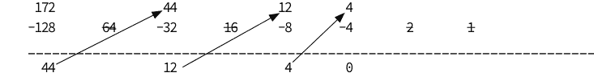

| 1 | 0 | 1 | 1 | 0 | 0 | 0 | = 1011000 |

## IPv4 与 IPv6

互联网协议第 6 版 (IPv6) 将地址空间从 32 位扩展到 128 位。为了简化无类地址的表示，更常见的是使用无类域间路由协议 (CIDR)。在 CIDR 表示法中，地址的子网码通过在地址末尾附加斜杠并指定网络标识符的数量来写出，如下例所示：172.116.20/22。

此示例描述了一个具有 22 位网络标识符的 B 类地址，其中 6 位作为子网标识符，如图 4.3 所示。该子网标识符允许管理员创建最多 64 (2⁶) 个子网，剩余 10 位用于主机标识符，每个子网最多支持 1,022 (2¹⁰) 个主机。这是网络地址 172.16.20/22 掩码为 255.255.240.252 的 CIDR 等效表示。

由于子网的第三字节部分分配给子网标识符，部分分配给主机标识符，因此在计算每个子网的 IP 地址时，必须对这两个部分分别递增。表 4.3 列出了 64 个子网中前三个和最后一个的一个的值。

### IPv4 对比 IPv6

互联网协议第 6 版 (IPv6) 将地址空间从 32 位扩展到 128 位。为了简化无类地址的表示，更常见的是使用无类域间路由协议 (CIDR)。在 CIDR 表示法中，地址的子网码通过在地址末尾附加斜杠并指定网络标识符的数量来写出，如下例所示：172.116.20/22。

此示例描述了一个具有 22 位网络标识符的 B 类地址，其中 6 位作为子网标识符，如图 4.3 所示。该子网标识符允许管理员创建最多 64 (2⁶) 个子网，剩余 10 位用于主机标识符，每个子网最多支持 1,022 (2¹⁰) 个主机。这是网络地址 172.16.20/22 掩码为 255.255.240.252 的 CIDR 等效表示。

> 图 4.3 172.16.20/22 CIDR 地址中的标识符

由于子网的第三字节部分分配给子网标识符，部分分配给主机标识符，因此在计算每个子网的 IP 地址时，必须对这两个部分分别递增。表 4.3 列出了 64 个子网中前三个和最后一个的一个的值。

### 二进制与十进制的转换

Network+ 考试通常包含子网划分问题，要求学生计算 IP 地址。在手动计算地址时，最大的问题通常是二进制值和十进制值之间的转换。要将二进制值转换为十进制，请为每个二进制位分配十进制值，从右到左递增并倍增，如下：

| 0 | 0 | 0 | 0 | 0 | 0 | 0 | 0 |
|---|---|---|---|---|---|---|---|
| 128 | 64 | 32 | 16 | 8 | 4 | 2 | 1 |

然后，将待转换二进制值的位（在本例中为 1011000）填入，并将每个 1 对应的十进制值相加，得到 172，如下：

| 1 | 0 | 1 | 1 | 0 | 0 | 0 | |
|---|---|---|---|---|---|---|---|
| 128 | 64 | 32 | 16 | 8 | 4 | 2 | |

128 + 32 + 8 = 172

要将十进制转换为二进制，从左到右从待转换的数字减去每个递增值。对于每个可以减取的递增值，分配一个二进制值 1。对于所有其他值，分配 0。从 172 开始，可以减去 128、32、8 和 4，得到二进制值 1011000，所示：


| 1 | 0 | 1 | 1 | 0 | 0 | 0 | = 1011000 |

### IPv6 类型

互联网协议第 6 版 (IPv6) 将地址空间从 32 位扩展到 128 位。为了简化无类地址的表示，更常见的是使用无类域间路由协议 (CIDR)。在 CIDR 表示法中，地址的子网码通过在地址末尾附加斜杠并指定网络标识符的数量来写出，如下例所示：172.116.20/22。

此示例描述了一个具有 22 位网络标识符的 B 类地址，其中 6 位作为子网标识符，如图 4.3 所示。该子网标识符允许管理员创建最多 64 (2⁶) 个子网，剩余 10 位用于主机标识符，每个子网最多支持 1,022 (2¹⁰) 个主机。这是网络地址 172.16.20/22 掩码为 255.255.240.252 的 CIDR 等效表示。

> 图 4.3 172.16.20/22 CIDR 地址中的标识符

由于子网的第三字节部分分配给子网标识符，部分分配给主机标识符，因此在计算每个子网的 IP 地址时，必须对这两个部分分别递增。表 4.3 列出了 64 个子网中前三个和最后一个的一个的值。

IPv6 使用三种地址类型：单播、多播和任播。

- **全局单播 (Global Unicast)**: 在互联网上使用的可路由地址。
- **链路本地 (Link local fe80::/64)**: 用于本地网段的不可路由地址。
- **多播 (Multicast)**: 用于一组设备，使用组组管理协议 (IGMP)。
- **任播 (Anycast)**: 分配给一组接口的地址。
- **环回 (Loopback)**: 用于测试本地软件的地址，如 127.0.0.1。

### IPv6 自动配置

所有 IPv6 系统使用无状态地址配置 (SLAAC) 为自己分配本地地址。为了确定地址，系统向所有路由器发送路由请求 (RS) 消息。路由器响应路由公告 (RA) 消息，其中包含网络标识符。为了生成链路地址的主机标识符，IPv6 系统执行一个过程，将接口的 48 位 MAC 地址拆分为两个 24 位部分，并在它们之间插入 16 位值 0xFFFF。这是一个 64 位的值，称为扩展唯一标识符64 (EUI-64)，系统将其作为地址的主机部分。

### 迁移到 IPv6

IPv6 已存在 20 多年，但互联网和许多私有网络在使用 IPv4。为了在从 IPv4 迁移到 IPv6 期间支持两种协议，可以使用多种机制。

### 双栈

双栈系统具有 IPv4 和 IPv6 协议栈，它们都与链路协议接口。这允许与网络上的 IPv4 和 IPv6 设备通信。然而，源和目的之间的所有中间系统（包括路由器和域名系统 (DNS) 服务器）也必须支持双栈。路由器通过使用子接口（从单个物理接口创建的逻辑网络接口），每个接口都有自己的虚拟 IP (VIP) 地址。

### 隧道

另一种允许 IPv6 设备在 IPv4 网络上通信的方法是隧道。隧道是将整个数据包封装在另一个包中的过程，以便在网络上传输。隧道通常用于安全目的，但在这种情况下，将 IPv6 数据报封装在 IPv4 数据包中允许 IPv6 系统进行通信，即使部分或所有中间网络仅支持 IPv4。一些用于 IPv6 迁移的常用隧道协议包括 6to4、站点内自动隧道地址协议 (ISATAP) 和 Teredo，它们都使用某些方法来建立 IPv4 隧道端点，并在它们之间携带 IPv6 流量。

## CERTMIKE 考试核心内容

- IP 有两个版本的独立地址系统。IPv4 使用点分十进制法表示的 32 位地址，而 IPv6 使用 128 位的十六进制地址，这极大地扩展了 IP 地址空间。
- IPv4 地址最初使用五种类（A 到 E）定义，以支持不同规模的网络。后来，无类网域间路由 (CIDR) 提供了更大的灵活性，允许在类内部划分地址空间，而不仅仅是在类与类之间。
- IPv4 和 IPv6 系统都可以为自己分配地址，IPv4 使用自动私有 IP 地址 (APIPA)，而 IPv6 使用路由器告份 (RAs) 和无状态地址自动配置 (SLAAC)。
- 使用双栈和隧道技术可以在 IPv4 和 IPv6 之间进行切换。双栈技术是指设备具有支持两种 IP 版本的独立网络层协议实现；而隧道技术则是将 IPv6 数据包封装在 IPv4 数据包中，以便在 IPv4 网络上传输。

## 练习题 1

Alice 的主管要求她取一个 B 类网络地址，并制定一个计划将其划分为 60 个子网，每个子网支持多达 1,000 个主机。Alice 计算出她需要 6 位地址位来支持 60 个子网，以及 10 位来支持 1,000 个主机，但她不确定如何分配这些位。以下哪项最能描述 Alice 如何处理所给地址以创建子网标识符？

- A. 将网络标识符扩展 6 位，主机标识符扩展 10 位。
- B. 从现有的主机标识符借用 6 位。
- C. 从现有的网络标识符借用 6 位。
- D. 从现有的网络标识符借用 6 位，从主机标识符借用 10 位。

## 练习题 2

Ralph 被要求设计一个 IPv4 网络，能够创建 10 个子网，每个子网支持多达 2,000 个主机。Ralph 可以使用哪个网络地址来创建这样的网络？

- A. 192.168.43.0/27
- B. 172.16.96.0/21
- C. 10.128.0/10
- D. 127.223.0/16

## 练习题 1 解析

A. 是错误的，因为 IPv4 地址长度只能为 32 位，因此无法进行扩展。

B. 是正确的，因为从网络标识符借用 6 位可以创建最多 64 个子集，并为主机留 10 位，这可以支持多达 1,024 个主机。

C. 是错误的，因为从网络标识符借用 6 位会改变其值并中断网络通信。

D. 错误原因与答案 (C)相同。虽然从主机标识符借用 3 位是允许的，但更改网络标识符的值会中断网络通信。

正确答案：B，从现有的主机标识符借用 6 位

## 练习题 2 解析

A. 是错误的，因为 3 位子网标识符仅支持 8 个子网，而不是 10 个，剩余的 5 位主机标识符位只能支持 32 个主机，而不是 2,000 个。

B. 是正确的，因为网络地址具有 5 位子网标识符，支持最多 32 个子网，为主机标识符留下了 11 位，这可以支持多达 2,046 个主机。

C. 是错误的，虽然 22 位主机标识符每个子网可以支持 4,194,302 个主机，但 2 位子网掩码只能支持 4 个子网，而不是 10 个。

D. 是错误的，虽然该网络地址可以支持最多 256 个子网和每个子网多达 4,194,302 个主机，但整个 127.0.0.1 网络被留作回环地址。

正确答案：B，172.16.96.0/21

# 第 5 章

# 端口与协议

## 目标 1.5：解释常用的端口和协议、其应用以及加密替代。

本章介绍了 TCP/IP 网络中常用的协议以及分配给它们的端口号。Network+ 考试要求候选人熟悉这些协议、其基本功能以及在传输层协议头中用于识别它们的端口号。在本章中，你将学习 Network+ 目标 1.5 所需的所有知识，包括以下主题：

- 协议
- 端口
- IP 协议类型
- 无连接与面向连接

## IP 协议类型

TCP/IP 套件是协议集合，主要运行在 OSI 参考模型的网络层、传输层和应用层。系统根据网络传输的数据量和性质，在不同层使用不同的协议组合。表 5.1 列出了这三个层中常用的一些协议。作为该协议套件命名的缩写 TCP/IP 指传输层传输控制协议 (TCP) 和网络层网际协议 (IP) 的组合，这是这些层中最常用的组合之一。

### 表 5.1 TCP/IP 协议

| 层级 | 协议 |
| --- | --- |
| 应用层 | FTP, SSH, IMAP, SMTP, DNS, HTTPS, TFTP, SMB, NTP, Telnet |
| 传输层 | TCP, UDP |
| 网络层 | ICMP |

### 无连接与面向连接

主要的 TCP/IP 协议分为两类：无连接和面向连接的。

无连接协议相对简单，因为它们提供尽力而为交付。它们不包括建立或终止连接等复杂功能。面向连接的协议在数据需要保证交付时使用。这些协议通常包含额外的开销，例如更大的头部。TCP 可以处理大量数据，这些数据必须被分成分段并在单独的数据包中传输。每个数据包的头部包含一个标识其在序列位置的数字。如果任何数据包未收到确认，发送端会自动重传它们以确保可靠交付。

### 网际协议 (IP)

如第 4 章“IP 命名”所述，网际协议 (IP) 是一种网络层协议，是主要的端到端载体。IP 负责数据包的、通过网络路由数据以及在通过传输单元 (MTU) 较小的网络传输数据时进行分片。

### 传输控制协议 (TCP)

传输控制协议 (TCP) 是一种面向连接的传输层协议，与网络层的 IP 结合，负责任何 TCP/IP 网络大部分流量。为了在源和目的之间建立连接，系统会执行三次握手。发送系统通过应用 20 字节头部来封装来自应用层的数据，并将生成的数据包传递给网络层的 IP。

TCP 头部实现了多种功能，包括：

- **数据包确认**：接收系统通过指定下一个预期数据包的编号来确认进入包。
- **流量控制**：接收系统在确认中指定在不丢包的情况下可以接收的字节数。发送系统准确调整其传输速率。
- **数据分段**：TCP 可以处理大量数据，这些数据必须被分成段并在单独的数据包中传输。每个数据包的头部包含一个标识其在序列位置的数字。
- **错误检测**：每个数据包包含一个基于 TCP 头部、负载和 IP 伪头部的校验和。接收系统执行相同的计算以确认无误交付。
- **端口识别**：TCP 头部指定源和目的层协议的端口号。

### 用户数据报协议 (UDP)

与 TCP 相比，用户数据报协议 (UDP) 是一种开销极小的简单无连接协议。UDP 没有三次握手，且其头部仅 8 字节长，而 TCP 为 20 字节。UDP 不保证交付，也不具备 TCP 的其他功能，除了错误检测校验和和源/目的端口识别字段外。

### 互联网控制消息协议 (ICMP)

互联网控制消息协议 (ICMP） 是一种类似于 IP 的网络层协议，但它不携带上层数据。相反，ICMP 执行一系列重要功能，包括错误消息的传输以及诊断查询和响应。不同寻常的是，ICMP 消息被封装在 IP 数据报文中。例如，众名的 ping 工具通过向指定接收者发送 ICMP Echo（回显）消息来工作，接收者通过 Echo 消息进行响应。同样，当数据传输失败时，如“目的主机未知”（Destination Host Unknown）之类的错误消息也是由 ICMP 携带的。

> 考试提示

ICMP 的原始版本设计用于 IPv4，现在被称为 ICMP4。ICMP6 是一个为 IPv6 设计的新版本。两个 ICMP 版本的消息格式相同，但 ICMP6 包含了一些 ICMP4 中不存在的新消息类型。Network+ 备考人员应该准备好在考试中看到 ICMP、ICMP4 和 ICMP6 中的任何一个术语。

### IPsec

# 第5章 端口与协议

### TCP 头部

### UDP 头部

| 源端口 | 目的端口 |
| --- | --- |
| | 序列号 |
| | 确认号 |
| 数据偏移量 | 预留控制位 | 窗口 |
| | 校验和 | 紧急指针 |
| | 数据 |

| 源端口 | 目的端口 |
| --- | --- |
| 长度 | 校验和 |
| 数据 | |

**图 5.1** TCP 和 UDP 头部大小

大多数 UDP 事务由单个请求消息和单个回复消息组成，这消除了对那些高级 TCP 功能的需求。例如，在典型的 DNS 名称解析事务中，客户端使用 UDP 和 IP 协议向 DNS 服务器发送单个请求消息。如果服务器接收到该请求，它会发送一个回复，并作为传输的确认。如果客户端没有收到其请求的响应，它可以简单地重新发送其回复。这不需要单独的确认消息，也不需要对长数据序列进行分段，更不需要进行任何流量控制。


IPsec 是一系列标准，定义了 IP 流量在网络中传输时的安全架构。`IPsec` 协议工作在网络层，可以对包含 IP 数据报文的数据包中的数据进行数字签名或加密。在数据包通过网络的整个路径中，数据一直保持安全，直到它最终被目的终端系统读取或解密。

`IPsec` 包含两个主要协议，如下：

- **身份验证头部 (`AH`)** 通过在 IP 头部之后插入 `AH` 头部对 IP 数据报进行数字签名。`AH` 头部包含了提供双向身份认证的字段，因此双方都能确认对方的身份；防重放，使攻击者无法重用所有数据；以及数据完整性，数据报的内容在传输过程中不能被修改。

- **封装安全载荷 (`ESP`)** 通过在数据报有效负载之后添加 `ESP` 头部和尾部来加密 IP 数据报中的数据。头部和尾部之间的所有内容都是被加密的。`ESP` 还可以提供双向身份认证、防重放和数据完整性服务。

可以单独使用每种协议，也可以两者结合使用以获得最大的保护。当受到 `IPsec` 保护时，攻击者可以使用交换机或网络监视器拦截传输中的数据包，但他们无法读取、修改或重用内部数据报的内容来发现接收者、伪造接收者或冒充发送者的身份。

`IPsec` 支持两种模式：传输模式和隧道模式。本节中描述的传输模式提供终端系统之间的保护，无论源和目的之间路由器的数量和类型如何。隧道模式设计用于通过在两个路由器之间创建加密链路来保护广域网 (`WAN`)。隧道模式下的数据包结构不同，在到达隧道两端的任一路由器之前，数据均不会被加密或解密。

### 通用路由封装 (`GRE`)

通用路由封装 (`GRE`) 是一种网络层隧道协议，用于封装 IP 数据报。`GRE` 通过在其他数据报中封装 IP 数据报，为广域网（`WAN`）创建点对连接，并使用特定的端口。隧道模式下的数据包结构不同，数据在到达隧道两端任一路由器之前不会被加密或解密。使用交换机或网络监视器，攻击者可能会拦截传输中的数据包，但他们无法读取、修改或重用内部数据报的内容来发现接收者、伪造接收者或冒充发送者的身份。在受到 `IPsec` 保护下，这是可能的。`GRE` 允许在数据报中封装 IP 报文，以便在通过报文传输传输 `GRE` 应用程序。

## 应用程序协议

应用程序/`IP` 协议套件包括在 `UDP` 头部中使用的许多应用程序，如表 5.2 所示。应用程序通过 `IANA`（互联网数字分配机构）分配端口，例如，Web 服务器使用默认端口 `80`。应用程序在传输层通过端口号进行标识，通过在地址附加端口号来实现，例如：`192.168.45.96:80`。

### 表 5.2 端口范围

| 端口范围 | 端口类型 | 描述 |
| --- | --- | --- |
| 0 到 1023 | 已知端口 | 永久分配的系统 |
| 1024 到 49151 | 注册端口 | 分配给特定的服务 |
| 49152 到 65535 | 动态 | 临时端口 |

`Network+` 考试要求候选人熟悉表 5.3 中的协议及其端口号，这些端口号通过传输。

### 表 5.3 应用程序层协议及其端口号

| 协议 | 描述 | 端口 |
| --- | --- | --- |
| 文件传输协议 (`FTP`) | 使用两个端口在客户端和服务器之间传输文件，一个用于控制，一个用于数据 | 20/21 |
| 安全 Shell (`SSH`) | 为远程系统提供安全的命令行界面 | 22 |
| 安全文件传输协议 (`SFTP`) | 安全地在客户端和服务器之间传输文件 | 22 |
| `Telnet` | 为远程系统提供不安全的命令行界面 | 23 |
| 简单邮件传输协议 (`SMTP`) | 在服务器之间以及服务器与客户端之间传输邮件 | 25 |
| 域名系统 (`DNS`) | 将主机名解析为 IP 地址 | 53 |
| 动态主机配置协议 (`DHCP`) | 为 `TCP/IP` 客户端分配 IP 地址 | 67/68 |
| 简单文件传输协议 (`TFTP`) | 在无认证的情况下在客户端和服务器之间传输文件 | 69 |
| 超文本传输协议 (`HTTP`) | 从服务器向浏览器传输网页内容 | 80 |
| 邮协议第三版 (`POP3`) | 从邮件服务器检索用户邮件 | 110 |
| 网络时间协议 (`NTP`) | 向远程计算机发送时间信号以进行时钟同步 | 123 |
| 互联网消息访问协议 (`IMAP`) | 提供用户邮件在线访问 | 143 |
| 简单网络管理协议 (`SNMP`) | 从代理向中央控制台传输网络管理信息 | 161/162 |
| 轻量级目录访问协议 (`LDAP`) | 在域控制器之间传输目录服务信息 | 389 |

# 第5章 • 端口与协议

| 协议 | 描述 | 端口 |
| --- | --- | --- |
| 超文本传输协议安全版 (`HTTPS`)/安全套接层 (`SSL`) | 使用 `SSL` 加密连接传输网页面内容 | 443 |
| `HTTPS`/传输层安全协议 (`TLS`) | 使用 `TLS` 加密连接传输网页面内容 | 443 |
| 服务器消息块 (`SMB`) | 在 Windows 网络上提供文件和打印机服务 | 445 |
| `Syslog` | 管理和传输日志信息 | 514 |
| 实时流传输协议 (`RTSP`) | 在客户端和服务器之间传输多路多媒体内容 | 554 |
| `SMTP TLS` | 使用 `TLS` 进行安全认证和数据完整性保护，服务器到服务器及服务器到客户端传输邮件流量 | 587 |
| 轻级目录访问协议（基于 `SSL`）(`LDAPS`) | 在域控制器之间安全地传输目录服务信息 | 636 |
| 基于 `SSL` 的 `IMAP` | 提供用户邮件的安全在线访问 | 993 |
| 基于 `SSL` 的 `POP3` | 从服务器安全检索用户邮件 | 995 |
| 结构化查询语言 (`SQL`) Server | 为 `SQL Server` 关系数据库系统提供客户端/服务器通信 | 1433 |
| `SQLnet` | 为 `SQLnet` 关系数据库管理系统提供客户端/服务器通信 | 1521 |
| `MySQL` | 为开源 `MySQL` 关系数据库管理系统提供客户端/服务器通信 | 3306 |

### 应用层协议

| 协议 | 描述 | 端口 |
| --- | --- | --- |
| 远程桌面协议 (`RDP`) | 在主机和远程系统之间传输击、鼠标移动和显示视频 | 3389 |
| 会话建立协议 (`SIP`) | 为 IP 电话 (`VoIP`)、视频会议和其他多媒体应用创建并维护音频/视频连接 | 5060/5061 |

- 面向连接的协议要求端系统在传输数据之前建立连接。与不执行连接建立过程的无连接协议相比，它们具有更大的头部。

- `IP` 是主要的网络层协议，负责数据包寻址、通过网络路由数据以及在必要时分片数据包。

- `TCP` 和 `UDP` 分别是面向连接和无连接的传输层协议。`TCP` 提供数据包确认、流量控制、数据分段、错误检测和端口识别服务。`UDP` 只提供错误检测和识别，但其带宽开销比 `TCP` 低得多。

- 许多应用层协议都被分配了已知端口号。传输协议使用这些端口号来识别应该接收特定数据包的进程。`Network+` 考试应熟悉表中列出的协议及其端口号。

## 练习题 1

`Alice` 被要求检查一个捕获的网络流量样本，并识别负责网络流量的应用层协议。`Alice` 使用的网络监控软件仅根据端口号识别应用层协议。对于以下每个端口号，请从下方列表中选择使用该端口的协议。

1. 53
2. 69
3. 161
4. 80
5. 443
6. 20
7. 25
8. 143
9. 68
10. 110

a. `SMTP`
b. `FTP`
c. `HTTP`
d. `SNMP`
e. `TFTP`
f. `DNS`
g. `DHCP`
h. `HTTPS`
i. `IMAP`
j. `POP3`

## 练习题 2

在 `OSI` 模型的传输层，所有应用流量都由两个协议处理：`TCP` 和 `UDP`。在两者中，认为 `UDP` 的带宽开销比 `TCP` 小得多。`UDP` 中的哪些因素导致了其开销的减少？（选择所有正确答案。）

A. 无校验和
B. 无三次握手
C. 较低的端口号
D. 更小的头部

## 练习题 1 答案及解析

1. f. 域名系统 (`DNS`) 使用端口号 `53` 进行客户端/服务器通信。
2. e. 简易文件传输协议 (`TFTP`) 使用端口号 `69`。
3. d. 简单网络管理协议 (`SNMP`) 使用端口号 `161`。
4. c. 超文本传输协议 (`HTTP`) 默认端口为 `80`。
5. h. 超文本传输协议安全版 (`HTTPS`) 默认端口为 `443`。
6. b. 文件传输协议 (`FTP`) 使用两个端口进行客户端/服务器通信：端口 `20` 用于控制流量，端口 `21` 用于数据。
7. a. 简单邮件传输协议 (`SMTP`) 使用端口号 `25`。
8. i. 交互邮件访问协议 (`IMAP`) 使用端口号 `143`。
9. g. 动态主机配置协议 (`DHCP`) 使用两个端口：`67` 和 `68`。
10. j. 邮局协议 `3` (`POP3`) 使用端口号 `110`。

## 练习题 2 解析

A 是错误的，因为 `TCP` 和 `UDP` 头部中都包含校验和字段。

B 是正确的，因为 `TCP` 是一种面向连接的协议，需要额外的消息来建立连接，而 `UDP` 这种无连接协议不需要。

C 是错误的，因为 `TCP` 和 `UDP` 头部中的端口号字段大小相同，因此无论端口值是多少，传输的比特数都是相同的。

D 是正确的，因为 `UDP` 应用于每个数据包的头部只有 `8` 字节长，而 `TCP` 头部为 `20` 字节。

正确答案：B，无三次握手，以及 D，更小的头部

# 第 6 章

# 网络服务

## 目标 1.6：解释网络服务的用途和目的

本章将在 `TCP/IP` 网络中检查某些服务。这些服务对平均用户是不可见的，但 `Network+` 考试要求考生熟悉这些服务。在本章中，你将学习有关网络服务的所有知识，包括以下主题：

- `DHCP`
- `DNS`

# `DHCP`

网络上的每个设备都需要一个 IP 地址，手动配置这些地址（称为静态分配）是非常耗时的工作。动态主机配置协议 (`DHCP`) 是一种服务和协议的结合，允许客户端从服务器请求地址分配，减轻了管理工作。

`DHCP` 标准定义了三种地址分配类型：

**动态分配** 服务器为指定的持续时间（租期）从池中租赁一个地址。当租期结束时，客户端续租，或者服务器收回该地址并将其返回池中重新分配。

**自动分配** 服务器从池中为设备分配地址，但不需要租期。

**手动分配** 在手动分配过程中（也称为预留），服务器为每个设备分配一个特定的地址，不需要租期。

# 第 6 章 • 网络服务

动态、自动和手动这些术语由 `DHCP` 标准定义地址分配类型，但并非所有 `DHCP` 实现都使用这些术语。`Network+` 目标使用动态分配一词，但将手动地址分配描述为预留。

当带有 `DHCP` 客户端的设备启动时，分配过程会自动发生，并如下：

1. `DHCP` 客户端使用数据报协议 (`UDP`) 端口 `67` 发送系列地址请求广播。
2. 本地网络上任何具有可用租约的 `DHCP` 服务器在接收到广播后必须回复地址建议。
3. `DHCP` 客户端接受其中一个提议地址，生成包含所选服务器 IP 地址的请求消息。
4. 所选的 `DHCP` 服务器对请求消息回复肯定或否定确认，表示确认该地址或指示该提议地址已不可用。
5. 在收到肯定确认消息后，客户端使用提议地址和选项配置其 `TCP/IP` 设置。

`DHCP` 服务器跟踪分配的地址，因此网络上不存在 IP 地址冲突的可能性。在动态分配中，当 IP 地址达到租期的 `50%` 且 `87.5%` 时，客户端会向 `DHCP` 服务器发送续租请求，服务器通常会为同一地址授予新的租期。如果服务器没有收到客户端的续租消息，它将收回之前分配的 IP 地址并将其返回范围以重新分配。

# `IPv6` 上的 `DHCP`

原始 `DHCP` 标准要求 `DHCP` 客户端/服务器通信使用端口 `67`（客户端）和端口 `68`（服务器）的 `UDP` 流量，这些端口目前仍用于 `IPv4` 地址的分配。这种原始的 `DHCP` 版本现在通常被称为 `DHCP4`。此外还有定义了在 `IPv6` 网络上使用 `DHCP` 的标准，称为 `DHCPv6`。`IPv6` 网络不支持广播传输，因此客户端发送的初始请求使用多播地址。`DHCPv6` get其流量也使用不同的端口：客户端和服务器分别使用 `546` 和 `547` 端口。`DHCPv6` 的基本架构与 `IPv4` 相同，但消息类型及其格式发生了变化。

所有 `IPv6` 设备都使用无状态地址自动配置（`SAC`）来为其分配链路地址，如第 4 节“IP 体系”所述，因此许多设备并不需要 `DHCP` 地址，但 `DHCPv6` 为无状态自分配过程提供了一种有状态的替代方案。

### 创建范围（Scope）

虽然该术语没有出现在 `DHCP` 标准中，但“范围”（`scope`）是指 `DHCP` 管理员指定用于分配给客户端的 IP 地址池。通常，范围是一个地址段，可能包含本地子网上的可用部分或全部地址。如果给定范围内存在管理员不希望分配的地址，可以在范围内创建一个排除范围（`exclusion range`）。

例如，管理员可能会创建一个包含该子网所有地址的范围，例如从 `192.168.54.1/24` 到 `192.168.54.255/24`。然而，如果网络上的服务器在该范围内已经有了静态地址分配分配，管理员可以将 `192.168.54.101/24` 指定为*排除范围*，这样这 10 个地址将永远不会被分配给 `DHCP` 客户端。

除了 IP 地址外，`DHCP` 范围还可以定义范围选项（`scope options`），这些选项指定网络上 `TCP/IP` 客户端所需的其他设置，包括子网掩码、`DNS` 服务器地址和默认网关（指定本地网络路由器的地址）。`DHCP` 标准还支持大量其他选项，管理员可以配置这些选项将其包含在特定范围的 IP 分配中，或作为该服务器所有范围的服务器选项。

### 考试提示

在 `TCP/IP` 术语中，*网关*（`gateway`）与*路由器*（`router`）是同义词，但它也有其他含义，例如将数据从一种格式转换为另一种格式的设备。`Network+` 考试候选人应该注意这种区别，并确保清楚特定上下文指的是哪一个。

# 第 6 章 网络服务

### `DHCP` 中继（Relays）

由于 `DHCPv4` 使用广播消息分配地址，这种方法被局限于本地网络。对于具有多个子网的大网络，这通常是不行的，因此通过 `DHCP` 中继代理提供了解决方案。中继代理是一个软件组件，允许 `DNS` 在本地网络上获取 IP 地址，其过程如下：

- 1. 中继代理监听本地网络上的 `UDP` 请求。
- 2. 当它收到请求时，中继代理将其转发到 `DNS` 服务器。
- 3. `DNS` 服务器响应请求，向中继代理提供 IP 地址。
- 4. 中继代理将回复转发给客户端。

由于 `DHCP` 的局限性，在 层次化的分层结构中，通过中继代理转发流量。还有许多其他协议和服务服务，如 `DNS`、`NTP` 和 `NetBIOS`。

### `DNS`

`TCP/IP` 网络通过其 IP 地址识别系统，但人们更习惯于使用名称。域名系统（`DNS`）是一种将名称分配到 IP 地址的服务和协议。

当用户在 Web 浏览器中输入 URL 时，浏览器向指定的 `DNS` 服务器发送包含名称的请求。`DNS` 服务器返回名称对应的 IP 地址，浏览器就可以使用该地址进行通信。这一过程被称为域名解析。

从客户端来看，事务似乎很简单，但在服务器端可能非常复杂。`DNS` 是一个层次化的分布式数据库，维护在成千上万的服务器上。在找到给定名的权威记录之前，可能会经过不同的 `DNS` 服务器。

### `DNS` 命名

从 `TCP/IP` 网络早期开始，管理员就主机名作为 IP 地址的用户友好替代方案。随着网络增长，维护单独的主机列表变得难以管理，`DNS` 被设计为一个适用于所有主机名的层次化数据库。

命名空间基于全球层次化的多级结构。域名是主机和子域的容器，子域是 `DNS` 层次结构的构建模块。为了获取 `TCP/IP` 网络的 地址，服务商为管理员分配一个网络标识符。然后管理员为每个网络设备分配唯一的标识符。`DNS` 的工作原理相同。管理员注册一个域名，然后为该域内的独立设备分配主机名。结果如图 6.1 所示的层次结构。


从层次结构的根开始，有顶级域（如 `.com`、`.org` 和 `.net`），每个顶级域都有子域。每个子域包含代表独立设备的主机名。也可以额外的子域层。因此，为了在互联网上唯一标识一个，`DNS` 名称必须由主机名加上直到根节点的所有父域名组成。这被称为完全限定域名（`FQDN`）。`FQDN` 的总长度可达 `255` 个字符，其中每个名称（点之间的内容）由主机名（`www`）、子域（`what`）和顶级域（`com`）组成。

当网络管理员注册一个域名时，同时也获得了对该域内容的控制权。

### `DNS` 缓存

尽管看起来很复杂，但名称解析过程通常在秒到两秒内完成。其原因之一是 `DNS` 服务器会维护一份它们所发现的信息的缓存。在 `DNS` 缓存中，`DNS` 服务器从另一个服务器接收的每条资源记录都有一个称为“生存时间”（`TTL`）的值。该值值指定了提供服务的记录应在其缓存中保留多长时间。

`TTL` 的持续时间通常取决于资源记录可能更改的权威性。较长的 `TTL` 值允许服务器维护更大、更有用的缓存；较短的 `TTL` 值则可以防止缓存存储过时信息。

### `DNS` 记录

`DNS` 数据库由资源记录组成，其中最基本的记录包含主机名和其 IP 地址。然而，还有几种类型的资源记录可以提供有关域名及其资源的信息，例如：

- **IPv4 地址 (`A`)**：用于正向名称解析；将主机名映射到 32 位的 `IPv4` 地址。这是用于将主机名解析为 `IPv4` 地址的节点记录。
- **IPv6 地址 (`AAAA`)**：用于正向名称解析；将主机名映射到 128 位的 `IPv6` 地址。这是用于将主机名解析为 `IPv6` 地址的节点记录。
- **规范名称 (`CNAME`)**：为由 `A` 或 `AAAA` 记录定义的主机创建别名或替代名称。原始主机名和别名都解析到相同的 IP 地址。
- **邮件交换 (`MX`)**：识别处理发往该域名的入站邮件流量的服务器。
- **名称服务器 (`NS`)**：包含已注册域名的名称以及对域名具有权威性的服务器的完全限定域名。


- **指针 (PTR)**：用于反向名称解析；将 `in-addr.arpa` 域中的 IP 地址映射到基于 IPv4 地址的主机空间，服务器使用其查找 IP 地址并将其解析为主机名。例如，地址 `192.168.54.12` 在此域中显示为 `12.54.168.192.in-addr.arpa`。

- **服务 (SRV)**：指定网络可用特定服务的服务器名称和端口号。此服务位置记录的设计是为了避免像 MX 那样为特定应用程序创建记录类型。

- **起始起始 (Start of Authority)**：标识服务器为当前区域的权威数据源，并提供促进区域传输所需的信息。

- **文本 (TXT)**：包含管理员为了自身目的或实现特定应用程序技术而添加的纯文本。

### 区域与区域传输

出于管理目的考虑，可以将一个 DNS 域名划分为多个区域，每个区域都有一个权威服务器（通过 SOA 资源记录标识）。简单的双级域（如 `adatum.com`）由单个区域组成，但如果 `adatum.com` 有多个子域，创建区域就可以对每个区域的管理责任进行委托。区域可以是域名层次结构中跨越多个级的任何连续部分，如图 6.2 所示。

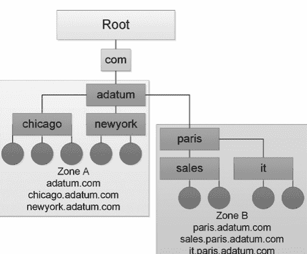

图 6.2 DNS 区域

为了容错和负载均衡，管理员通常会指定两个服务器作为给定区域的权威服务器，称为主服务器和备服务器。每台服务器都在其本地硬盘上维护一份区域数据的副本。为了保持两台服务器上的 DNS 数据同步，管理员会在主服务器上进行更改，主服务器会通过称为“区域传输”的过程定期更新备服务器。

每当备服务器重启时，它都会从硬盘加载区域数据并向主服务器检查是否有任何更新。如果是，备服务器将从主服务器发起区域传输，并用最新信息更新其本地硬盘上的数据。在具有许多区域的复杂 DNS 实现中，单台 DNS 服务器可以同时担任多个区域的主服务器或备服务器，这可能导致它执行多次区域传输。

## NTP

网络时间协议（NTP）设计用于让网络上的计算机通过可靠的时间源同步时钟。客户端定期发送查询并利用其回复校准时钟。

NTP 使用层级（stratum）值来指定其时间源。直接访问时间源的服务器被视为层级 0。从层级 0 服务器同步的服务器被视为层级 1，以此类推。层级越高，发生时间差异的可能性越大。

## MIKE 考试要点

- 动态主机配置协议 (DHCP) 是一种应用层协议和服务，用于为 TCP/IP 客户端提供唯一的 IP 地址和其他配置。DHCP 服务器在地址不再使用时收回它们。

- 域名系统 (DNS) 是主机名及其相应 IP 地址的分布式数据库。因为人们更习惯使用名称，但 TCP/IP 通信依赖地址，因此 DNS 通过向全球各个服务器发送查询来解析地址。

- 网络时间协议 (NTP) 是一种计算机同步时钟的方法。客户端定期向服务器发送查询并使用回复中的数据。

## 练习题 1

Ralph 正在为客户构建一个新网络，并安装了一个包含整个 `/24` 子网（254 个地址）的 DHCP 服务器。办公室有 100 台工作站，Ralph 认为 254 个地址足以容纳用户的手机和其他 Wi-Fi 设备。

一段时间后，Ralph 开始收到客户投诉，有时无法连接网络。Ralph 检查了 DHCP 服务器，发现此时范围只有两个可用租约。他得出范围有时会耗尽，导致更多用户无法连接。当某些现有租约过期时，更多的地址变得可用。Ralph 的客户解释说，有很多游客使用公司的 Wi-Fi，这解释了地址短缺的原因。

Ralph不想向网络添加更多地址。他可以做什么来缓解客户网络偶尔短缺？

- A. 安装第二台 DHCP 服务器。
- B. 在 DHCP 服务器上创建第二个范围。
- C. 缩短范围的租约时间。
- D. 延长范围的租约时间。

## 练习题 2

Ralph 正在使用浏览器，并在地址框中输入 URL `www.contoso.com`。发生了一个 DNS 名称解析，，四次查询/响应交换。以下哪些交换使用了迭代查询？（选择所有正确答案。）

- A. DNS 客户端向其指定的 DNS 服务器发送名称解析查询，请求有关 `www.contoso.com` 的信息。
- B. 客户端指定的 DNS 服务器向根服务器发送查询，请求有关 `com` 域的信息。
- C. 客户端指定的 DNS 服务器向 `com` 服务器发送查询，请求有关 `contoso` 域的信息。
- D. 客户端指定的 DNS 服务器向 `contoso` 服务器发送查询，请求主机 `www` 的 IP 地址。

## 练习题 1 解析

A. 错误，因为在不添加更多 IP 地址的情况下再安装另一个 DHCP 服务器将无法解决租约短缺问题。

B. 错误，因为在不添加更多 IP 地址的情况下创建第二个范围将无法解决短缺问题。

C. 正确，因为缩短范围的租约周期会导致地址更快地返回地址池以重新分配。

D. 错误，因为增加范围的租约周期将导致地址分配时间更长，从而加剧该问题。

正确答案：C，缩短范围的租约周期

## 练习题 2 解析

A. 错误，因为 DNS 客户端解析器向其指定的 DNS 服务器发送名称解析请求时，总是使用递归查询，以便让服务器负责解析名称。

B. 正确，因为客户端指定的 DNS 服务器在与根名称服务器通信时，总是使用迭代查询。这是因为根名称服务器可以立即响应有关其权威域名的信息。

C. 正确，因为客户端指定的 DNS 服务器在与顶级域名（TLD）服务器通信时，总是使用迭代查询。这是因为该服务器可以立即响应有关其权威域名的信息。

D. 正确，因为客户端指定的 DNS 服务器在与已注册的域名服务器通信时，总是使用迭代查询。这是因为该服务器可以立即响应有关其权威主机的信息。

正确答案：B, C, 和 D

# 网络架构

## 目标 1.7：解释基础企业和数据中心网络架构。

本章探讨了数据中心架构和设计的一些元素，以及可用于数据中心的存储区域网络（SAN）技术。Network+ 考试要求候选人熟悉这些主题及其基本功能。

在本章中，你将学习关于 Network+ 1.7 所需的所有知识，包括以下主题：

- 三层架构
- 软件定义网络 (SDN)
- 脊叶-叶节点架构 (Spine and leaf)
- 流量流
- 分支办公室 vs. 本地数据中心 vs. 托管数据中心
- 存储区域网络

## 三层架构

数据中心是一个容纳系列服务器以及交换机、路由器和其他设备的设施，这些设备用于将服务器连接到它们所需的资源、相互连接，以及必须访问它们的用户。数据中心的大小不一，从公司办公楼的一间专用房间到带有武装守卫和金库门的巨型地下综合体不等。无论规模如何，数据中心都需要某些特性才能高效运行，包括环境控制、稳定的电源，以及最重要的——精心设计的内部架构，该架构以组织、易于理解且易于维护的方式实现所有必要的设备连接。

### 考试贴士

Network+ 目标将 "datacenter" 写成一个单词，许多其他文档和出版物也是如此。然而，这并不是通用规则，许多资源使用两个单词，包括本书。考试候选人在研究这些主题时并搜索该术语时，应注意这一点。

中大型组织的传统数据中心架构要求将服务器、交换机和路由器部署在三个逻辑层中，如图 7.1 所示。

三层（或三层）如下：

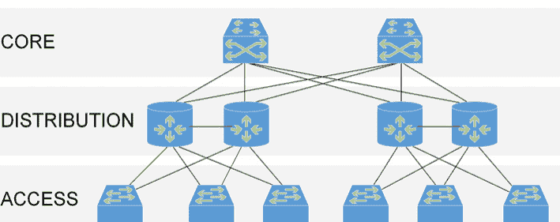

图 7.1 具有两个接入层节点的三层数据中心架构

### 核心层 (Core)

核心层是企业的形象骨干；所有网络数据都通过核心层的交换机和路由器，因此它们可能是公司负担得起的最快的设备。高速路由器和多层交换机在核心层很常见。这里也是连接分支办公室和服务提供商的广域网（WAN）接入企业的地方。核心层的其他技术通常是那些能够增强骨干处理速度并提供容错的技术。硬件冗余在核心层很常见，以确保电力、处理能力和必要的设备间连接始终维持。

### 分布/聚合层 (Distribution/Aggregation Layer)

分布或聚合层充当核心层与接入交换机之间的缓冲区，其交换机提供了与所有接入层交换机的交汇。分布层交换机相互连接，以便如果其中一个故障，其他可以接管。这些交换机到接入层交换机也有冗余连接，每个接入交换机至少连接到两个分布交换机。在某些情况下，接入层交换机被组成池，并与其指定的分布交换机在一起。

核心层为了纯数据包转发速度牺牲互连性。分布层通过连接接入层需求提供互连性。较小的网络将核心层和分布层合并为一个，创建一个称为折叠架构（collapsed architecture）的两层模型。分布层还提供数据包过滤、入侵防御、负载均衡和 VLAN 路由等服务。分布层的交换机往往是多层交换机，到接入层的连接运行在二层，而到核心层的高速连接运行在三层。

### 接入/边缘层 (Access/Edge)

接入或边缘层是服务器、工作站、打印机、无线接入点、网络附属存储（NAS）阵列和其他终端设备连接的交换机所在地。这些通常是二层交换机，比其他层的设备简单，以保持终端用户的端口成本相对较低，但通常为到分布层交换机的连接提供更高速的上行端口。

物理上，数据中心通常由机架式设备组成。这被称为顶顶（top-of-rack），除了接入层之外还有……

> 考试贴士

Network+ 目标为核心层提供了替代名称：骨干（backbone）；分布/聚合层：工作组（workgroup）；接入层：工作站（workstation）或桌面层。考试候选人在研究此主题时，应注意这些术语。

# 第 7 章 · 网络架构

## 软件定义网络 (SOFTWARE-DEFINED NETWORKING)

三层架构创建于数据中心所有设备都是物理设备的时代。每个物理服务器都有一个角色，每个物理路由器都必须单独管理。今天，虚拟化和软件定义网络（SDN）彻底改变了企业数据中心的外观、组织和运行。运行虚拟程序的物理服务器可以托管许多虚拟机，而 SDN 可以实现交换机和路由器的集中管理。

软件定义网络是将网络设备的控制和管理功能从硬件抽象出来的架构。这允许管理员从中央控制台配置网络。

### 北向接口 (Northbound Interface)

控制层通过北向接口（NBI）与应用层通信，这是一个允许应用程序组件使用 SDN 控制器管理基础设施设备的 API。

### 控制 (Control)

控制层——有时被称为控制平面和/或管理平面——是 SDN 控制器的所在地，它是所有逻辑和物理 SDN 元素的中央控制台。作为应用层和基础设施之间的中间件，SDN 控制器接收应用指令并将其转换为硬件识别的命令。

### 南向接口 (Southbound Interface)

控制层通过南向接口与基础设施层的设备通信，这是一个为 SDN 控制器提供基础设施访问的 API。

### 应用 (Application)

应用层是防火墙、负载均衡器和代理服务器等设备所在地，以及许多其他网络管理、配置、监控和诊断功能。曾经，网络为这些功能中的每项使用单独的物理设备，而在 SDN 中，它们以软件形式（应用程序或 API）实现。

### 基础设施 (Infrastructure)

基础设施层——有时被称为转发平面数据平面——是所有物理硬件所在地。这些是由 SDN 控制器管理的设备。该层还包含代理和其他软件组件，负责向 SDN 控制器监控并报告网络状况。

## 考试技巧

RFC 7426 是定义 SDN 架构的标准，它将模型分为五个平面（即相关功能和资源的组），如下：转发、操作、控制、管理和应用平面。某些来源将“层（layer）”和“平面（plane）”术语互换，而另一些则进行了仔细区分。Network+ 考试目标以“层”的形式引用 SDN 架构，但包含了“管理平面”这一术语。SDN 标准区分了控制平面（决定基础设施设备如何转发数据包）和管理平面（负责配置和监控这些设备）。考试候选人应该熟悉描述 SDN 架构的各种术语。

## 脊叶拓扑架构（SPINE AND LEAF ARCHITECTURE）

许多数据中心对虚拟化和 SDN 的使用导致了经典三层架构模型的修订。如今数据中心最常用的架构之一是使用网状拓扑结构的二层模型，被称为“脊叶架构（spine and leaf）”，如图 7.2 所示。在这种模型中，顶层——即脊节点（spine）——从其实上说是网络的骨干，配备高速交换机，其唯一功能是在叶节点（leaf）交换机之间转发数据。

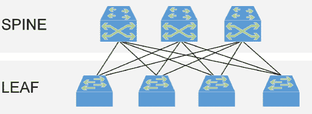

图 7.2 二层脊叶数据中心架构

服务器连接到底层的叶节点交换机上，尽管它们也与脊节点交换机具有高速第三层连接。在许多实现中，叶节点交换机使用与三层架构中的接入层交换机相同类型的机顶（top-of-rack）交换机，由 SDN 为所有脊、叶交换机提供控制平面。

脊叶架构要求一种网状拓扑，其中每个脊节点都连接到每个叶节点。然而，脊节点之间不直接连接，叶节点之间也不直接连接。这意味着每个叶节点都必须通过脊节点连接到另一个叶节点，这始终是两个跳的距离。

由于这种拓扑结构，脊部架构（spine fabric）速度极快，流量模式完全可预测，这使得生成生成树协议（STP）网络的固有延迟变得可预测。叶节点连接到所有脊节点，因此它们可以选择传输条件最佳链路。

最后，脊叶模型易于扩展，甚至可以创建大规模可扩展数据中心（MSDC）。在真正的大型实现中，服务器可以分组为“节点（pods）”，其唯一限制是每个叶节点交换机的端口数量。

### 流量流（TRAFFIC FLOWS）

从三层架构演变为脊叶模型的原因之一是数据中心典型流量流动方式的改变。流入或流数据中心的流量通常被称为“南北向（north-south）”。南向流量进入数据中心，北向流量离开数据中心。数据中心内部设备之间的流量被表述为“东西向（east-west）”。

在此背景下，“东西向”和“南北向”术语并不指特定的指南针方向。它们指的是网络图中通常用于指示流量流的方向线，其中水平线代表流向数据中心的流量，垂直线代表进入和离开数据中心的流量。

数据中心内虚拟化和分布式应用设计的日益普及，导致与南北向流量相比，东西向流量普遍增加。脊叶模型的低延迟使其在这种情况下更具优势，因为三层模块处理东西向流量的效率并不高。

### 数据中心位置（DATA CENTER LOCATIONS）

设计和实施数据中心的过程之一是决定其所在地。传统方法是在公司财产上建立数据中心，最好靠近将访问它的用户。本地部署数据中心（on-premises data center）将所有内容置于公司的直接控制之下，这是一个优点，但从初始支出和日常费用方面来看，也会产生大量的额外成本。

除了网络设备本身，数据中心还需要稳定的电源、特殊的环境系统、物理安全措施以及具备具有技术知识以保持其运行运行的员工。此外，还有容错能力的问题。对于许多公司来说，至少一个冗余数据中心（最好位于远端位置）是必要的，以确保在灾难发生时保持网络运行和公司可用。

另一个选择是*托管（colocation）*，即组织向第三方公司租赁数据中心空间，该公司负责整个数据中心环境，包括电力、冷却、安全和容错能力。在许多情况下，这些供应商维护的大型通用数据中心在许多方面都优于改造自现有办公楼的本地部署数据中心。托管提供商通常可以提供几个级别的服务。客户可能只想在提供商的数据中心为自己的设备租赁机架空间，也可能想租赁整个数据中心供使用。提供商可能还能提供服务，例如现场维护和技术支持。在这里，组织仍然依赖广域网（WAN）链路来访问其数据，但服务合同几乎总是保证运行时间性能的服务水平协议（SLA）。

另一个问题是组织的分支机构应该拥有自己的数据中心，还是远程访问总部。这在很大程度上取决于分支机构的大小和计算需求。小型分支机构可能不值得构建自己数据中心的费用。还有一个公司是否——或需要——在每个分支机构配备全职 IT 人员的问题。广域网（WAN）链路的远程访问是分支机构完全依赖的。

### 存储区域网络（Storage Area Networking）

### 存储网络（STORAGE NETWORKING）

数据存储无疑是网络的主要功能之一，这些技术之一是存储区域网络（SAN），服务器可以通过它访问存储设备。

### 光纤通道（Fibre Channel）

在最初的理念中，SAN 是一个完全独立的网络，服务器和存储设备都连接在。光纤通道是一种串行协议，与常用的并行协议相比。在当前版本中，FC 支持每秒 128 比特（Gbps）的传输速率。光纤最初需要多模光纤，但现在包含了支持铜缆和光纤介质的物理层规范。然而，光纤技术与以太网和 IP 等 LAN 协议完全兼容，并且不符合 OSI 模型；它有自己的五层模型。

### 以太网光纤通道（Fibre Channel Ethernet）

光纤通道是一种高效高速网络协议，但使用非标准硬件构建 SAN 的成本对许多用户来说太高了。最后出现了一种名为以太网光纤通道（FCoE）的变体，它将 FC 流量封装在以太网帧中并在同一电缆上与以太网流量共存。FCoE 使用双功能的总线适配器；它是 FC 适配器和一个标准适配器。适配器的 FC 端将流量（不可路由）封装在以太网帧中；不需要 IP。

### iSCSI

多年来，小型系统接口（SCSI）一直是存储设备通信使用的协议。SCSI 命令实现了存储设备用于读取、写入和处理数据的标准功能。光纤通道是将这些 SCSI 命令传输到网络上存储设备的载体。

SAN 技术演变的下一步是不需要特殊硬件的实现。互联网小型系统接口（iSCSI）只是通过网络将 SCSI 命令传输到存储设备的另一种方法。然而，与 FCoE 不同的是，iSCSI 将流量封装在 IP 数据包中并通过 LAN 传输到适配器。同样在 iSCSI 实现中，所有硬件都连接到一个以太网网段，iSCSI 流量与 LAN 上所有其他 IP 流量混合在一起。

## CERTMIKE 考试要点

- 经典的数据中心架构要求交换机和路由器分为三层：核心层、接入/聚合层和基础设施层。
- 软件定义网络（SDN）是一种将数据中心交换机的管理和控制从单个设备中分离，并将其集中置于 SDN 控制器中的手段。
- 数据中心架构已演变为一种称为“脊梁-叶节点”（spine and leaf）的双层模型，该模型要求交换机连接到每个叶节点交换机。连接到叶节点交换机的服务器可以访问任何其他服务器，且跳数不超过两次。


- 存储区域网络（SAN）为服务器提供对磁盘阵列和其他存储设备的访问。SAN 技术包括光纤通道（Fibre Channel），它需要独立的网络；FCoE，它在现有局域网（LAN）上使用专用主机适配器将存储流量封装在以太网帧中；以及 iSCSI，它将存储流量封装在 IP 数据报文中，不需要专用的网络硬件。

## 练习题 1

Alice 公司计划通过购买两个新的磁盘阵列并将其连接到存储区域网络来扩展其网络存储容量，Alice 负责该网络的设计。项目大部分预算将花在磁盘阵列上，因此 Alice 希望构建一个不需要购买任何新网络硬件的 SAN。Alice 应该使用哪种 SAN 技术来减少额外的硬件支出？

A. 光纤通道 (Fibre Channel)

B. FCoE

C. iSCSI

D. 以上都不是

## 练习题 2

Ralph 正在帮助规划公司新总部大楼的数据中心交换矩阵。他正在对三层架构模型和脊梁-叶节点（spine and leaf）模型进行评估。目前的计划是将所有服务器都创建为虚拟机，并使用软件定义网络远程管理交换机和路由器。

以下哪种说法是正确的，可以帮助 Ralph 推荐其中一种架构而非另一种？

A. 三层架构处理东西向流量（east-west traffic）的能力比脊梁-叶节点架构更好。

B. 脊梁-叶节点架构的流量模式是可以预测的，每个叶节点之间有两个跳数。

C. 脊梁-叶节点架构只有两层，所以实现更便宜。

D. 脊梁-叶节点架构更容易产生交换环路，因为它不支持生成树协议（STP）。

E. 三层架构更适合虚拟化服务器的使用，因为虚拟机程序服务器可以连接到核心层。

## 练习题 1 解答案

A. 错误，因为光纤通道需要为存储设备构建一个独立的网络，这需要新的电缆、主机适配器和光纤通道交换机。

B. 错误，因为基于以太网的载光纤通道（FCoE）可以使用现有网络连接存储设备，但访问磁盘阵列的服务器需要新的支持同时 SAN 和局域网（LAN）通信的双功能主机适配器。

C. 正确，因为互联网小型计算机接口（iSCSI）将存储流量封装在标准的 IP 数据报文中，并利用现有电缆、主机适配器和交换机在局域网（LAN）上传输。

D. 错误，因为 iSCSI 可以在不需要任何新网络硬件的情况下支持新的磁盘阵列。

正确答案：C, iSCSI

## 练习题 2 解析

A. 错误，因为是脊梁-叶节点架构处理东西向流量的能力更好，而不是三层架构。

B. 正确，因为全网状拓扑（full-mesh topology）创建了完全可预测的流量模式，每对叶节点交换机之间有两个跳数。

C. 错误，因为架构模型的层数并不决定所需的交换机数量或其类型。

D. 错误，因为脊梁-叶节点模型使用的全网状拓扑消除了交换环路，使得生成树协议变得不再。

E. 错误，因为在三层架构中，任何种类的服务器都不会连接到核心层交换机。

正确答案：B

# 第 8 章

## 目标 1.8：总结云概念和连接选项。

本章探讨了云计算的一些基本概念以及其在企业中的应用。Network+ 考试不会深入探讨云，但候选人应该熟悉这些主题及其基本功能。在本章中，你将学习关于云的各种知识，包括：

- 部署模型
- 服务模型
- 基础设施即代码
- 连接选项
- 多租户（Multitenancy）
- 弹性（Elasticity）
- 可扩展性（Scalability）
- 安全影响

## 部署模型

在计算的背景下，云的使用已非常普遍。云指的是由第三方云提供提供的服务或解决方案，通常按需付费或订阅。对于终端用户来说，云通常是存储文件和个人数据的地方。然而，对于 IT 专业人员来说，现在可以使用云服务取代整个数据中心和软件库。

企业网络云最大的优势之一是其灵活性。有些公司从零开始在云中构建网络。然而，许多机构已经在数据中心和物理计算硬件上投入了大量资金。向云的扩展可能会较小，并将新的云服务与现有业务相结合。

由于这些原因，存在不同的云部署模型或架构可以采用，将在后续介绍。

### 公有云

公有云是由第三方云提供商向任何合格客户（称为云消费者）提供的服务或服务。设施由第三方提供商拥有，通过互联网访问。

就像租房而不是买房一样，公有云不需要初始支出，但不产生股权。公有云服务非常灵活；消费者可以扩展服务以适应业务忙期或公司增长，并根据需要缩小规模。消费者仅为实际使用的资源付费。另一个优点是，大型云提供商通常提供额外的容性和安全功能，例如冗余硬件、数据备份和托管数据中心。

### 私有云

私有云是为消费者专用的硬件和服务。硬件及其所在地可以由消费者或第三方拥有并管理，它可以位于消费者的所在地或其他地方。

从技术上讲，任何由私人组织购买和运营的私有网络都是私有云。然而，大多数情况下，该术语指的是第三方的参与。例如，公司可以购买自己的服务器和其他数据中心硬件，并聘请第三方提供者托管并提供电力、环境、安全和其他服务。这有时被称为托管私有云。

尽管对硬件有巨大的初始支出、持续的贬值以及人员和维护的额外成本，但私有云在几个方面是有益的，包括安全性和管理控制。私有云还可以根据消费者的需求进行完全定制，并可能提供公有云产品不具备的功能和服务。

#### 社区云

社区云是多个组织（通常从事相同的业务或关注领域并具有共同需求）共享的云基础设施，该基础设施可以由社区成员或第三方提供者所有并运营。社区云的典型示例是由教育或医疗社区运营的云。

#### 混合云

混合云是公有云、私有云或社区云资源的结合，这些资源通过技术连接，使其能够相互交互并共同工作。例如，一个拥有作为私有云内部数据中心的组织，可以在繁忙期间使用公共资源临时添加服务器或以此方式扩展网络能力。向现有网络基础设施添加云资源以增强性能的过程被称为“云爆发”（cloudbursting）。

## 服务模型

云提供商通常可以使用各种服务模型来提供产品，这些模型规定了管理任务如何在消费者和提供者之间进行分配。云基础设施可以分为十一层，如表 8.1 所示。

**表 8.1** 云基础设施层

| 层 | 功能 |
|---|---|
| 人员 | 运行应用程序的终端用户 |
| 数据 | 应用程序创建或利用的信息 |
| 应用程序 | 运行在虚拟机上的软件程序 |
| 运行时 | 中间软件层，例如 .NET 或 Java |
| 中间件 | 在操作系统和应用程序之间提供中间服务的软件 |
| 操作系统 | 提供虚拟机基础功能的软件 |
| 虚拟网络 | 虚拟机之间的逻辑连接 |

## 第 8 章 • 云计算

| 层 | 功能 |
| --- | --- |
| 虚拟机管理程序 (Hypervisor) | 运行在物理服务器上的软件，创建虚拟机并允许它们共享服务器物理资源 |
| 服务器 | 托管提供云服务的物理计算机 |
| 存储 | 为物理服务器提供数据存储的硬件子系统 |
| 物理网络 | 将服务器物理连接到互联网的电缆、交换机、路由器和其他设备 |

美国标准与技术研究院 (NIST) 定义的服务模型规定了哪一方（云消费者还是云提供者）负责每一层的管理（见图 8.1）。

| 本地部署 | IaaS | PaaS | SaaS |
| --- | --- | --- | --- |
| 人员 | 人员 | 人员 | 人员 |
| 数据 | 数据 | 数据 | 数据 |
| 应用程序 | 应用程序 | 应用程序 | 应用程序 |
| 运行时 | 运行时 | 运行时 | 运行时 |
| 中间件 | 中间件 | 中间件 | 中间件 |
| 操作系统 | 操作系统 | 操作系统 | 操作系统 |
| 虚拟网络 | 虚拟网络 | 虚拟网络 | 虚拟网络 |
| 虚拟机管理程序 | 虚拟机管理程序 | 虚拟机管理程序 | 虚拟机管理程序 |
| 服务器 | 服务器 | 服务器 | 服务器 |
| 存储 | 存储 | 存储 | 存储 |
| 物理网络 | 物理网络 | 物理网络 | 物理网络 |

**图 8.1** 云服务模型的基础设施层

由消费者管理

由提供者管理

**基础设施即服务 (IaaS)** 第三方云提供者为消费者提供对运行虚拟机管理程序的物理服务器的访问。消费者随后可以在该服务器上创建虚拟机 (VMs)，在上面安装操作系统和应用程序，并根据需要进行管理。在此项服务中，大部分的系统管理任务——虚拟机管理程序层以上的所有内容——都留给了消费者。云提供者负责物理服务器、运行虚拟机管理程序的操作系统以及连接其到世界的物理网络，但虚拟机和运行在上面的上的软件完全是消费者的责任。

### 平台即服务 (PaaS)

第三方云提供者为消费者提供对运行虚拟机管理程序的物理服务器的访问，并对运行在该虚拟机管理程序上的虚拟机负责。在 PaaS 中，提供者的责任延伸到运行时层，这意味着提供者必须更新和维护虚拟机上的操作系统。消费者仅对他们安装在虚拟机上的应用程序、他们自己的数据以及运行应用程序的用户负责。PaaS 最初被设计为一种基于互联网的应用程序开发工具，允许人们在一致的平台上运行代码，而无需为每次测试都创建新的虚拟机并重启操作系统系统。

### 软件即服务 (SaaS)

第三方云提供者为消费者提供运行在其服务器上的基于互联网的应用程序或服务。在 SaaS 环境中，提供者的责任一直延伸到应用程序层。消费者仅提供他们使用的数据和运行应用程序的用户。消费者只能看到应用程序和一组有限的配置设置；他们无法得知运行应用程序的服务器、托管服务器的虚拟机或提供虚拟机的虚拟机管理程序。

### 桌面即服务 (DaaS)

DaaS 不是 NIST 的术语，但包含在 Network+ 考试目标中，DaaS 是某项被称为桌面虚拟化、远程桌面和终端服务的技术的新称。第三方云提供者为消费者提供一个运行在虚拟机上的完全配置的桌面工作站，用户可以使用轻客户端（如网络浏览器）从任何位置访问。客户端和虚拟机仅交换接口信息，例如击键、鼠标移动和显示视频；每个操作系统和应用程序的处理都发生在云端。

> 考试提示
>
> 在当今的 IT 世界中，在几乎任何词后面加上“as a Service”（即服务）会增加其营销价值。结果是，Network+ 考生可能会遇到许多其他 -aaS 缩写，但他们应该意识到官方的 NIST 术语只有 IaaS、PaaS 和 SaaS。

### 基础设施即代码

基础设施即代码 (IaC) 是一种用于自动化构建代码开发和测试平台过程的技术。在大型软件开发环境中，可能有许多人为一个应用程序的代码工作，他们都有自己的工作习惯。代码测试通常需要一个标准的测试平台，由许多人执行，反复构建平台的过程可能是耗时且容易出错。IaC 以脚本和配置文件的形式定义测试平台的基础，这允许开发者自动完成测试环境的构建，同时也避免了每次测试都向 IT 部门申请新平台。

定义基础设施的脚本有两种类型：命令式和声明式。在命令式方法中，脚本由创建环境所需的命令组成，按执行顺序排列。声明式方法指定环境的预期最终状态，系统执行实现该状态所需的操作。

基础设施部署的脚本可以提供频繁执行的任务，但自动化通常指的是单一任务。自动化可以通过处理多个任务来进一步，实现所谓的编排（orchestration）。编排是一种更全面的工作流自动化方法，由多个操作系统、服务和应用程序的配置和管理任务组成。

## 连接选项

大多数用户连接云使用互联网。然而，对于某些云消费者和应用程序，开放连接无法提供足够的安全性。例如，运行混合云的公司可能在其私有数据中心存储了敏感数据，其云服务需要访问这些数据。数据泄露的风险阻止了在数据中心和云之间使用开放连接，存在替代连接类型：

**虚拟专用网络 (VPN)** VPN 连接是两点之间的虚拟链路，例如私有数据中心的数据库服务器与位于互联网上的云提供者。VPN 链路通常被称为隧道，它可以保护通过其的数据，数据通过 IPsec 等安全协议进行保护，流量仍然通过公共互联网。攻击者理论上可以拦截传输中的 VPN 数据包，但加密隧道防止了数据泄露。

**到云提供者的私有直连** 一些云提供者提供了一种无需使用公共互联网连接到其网络的方法。私有直连*是云消费者数据中心与云提供者网络之间的专用链路。该链路可以是物理电缆——通常是光纤

- [费曼学习法](https://wiki.example.org/feynmans_learning_method) 的灵感来自物理学诺贝尔奖得者**理查·费曼**（Richard Feynman）。

1. 这种方法通过向他人解释复杂的概念来加深理解。

## 练习题 1 解析

A. 错误，因为基础设施即服务 (IaaS) 模型可以支持虚拟桌面，Alice 需要负责在云网络上创建虚拟机、安装服务器并实施虚拟桌面解决方案。

B. 错误，因为平台即服务 (PaaS) 模型可以支持虚拟桌面，并为用户提供已经安装了用户应用程序的虚拟机，但 Alice 仍然必须在虚拟机上安装和配置用户的应用程序。

C. 错误，因为 Alice 可以使用软件即服务 (SaaS) 模型为分支机构用户提供他们所需的应用程序，但她仍然需要在现场租赁并配置单个用户桌面设备。

D. 正确，因为桌面即服务 (DaaS) 模型让用户可以使用虚拟化桌面，Alice 及其团队仅需进行少量的应用程序配置，且所有这些操作都可以远程完成。

正确答案：D，DaaS

## 练习题 2 解析

A. 错误，因为购买新的物理服务器是最昂贵的解决方案，也是一种浪费，因为在忙季结束后，不再需要这些新服务器了。

B. 错误，因为计划和实施整个服务器池迁移到云端是一项庞大且复杂的工程，可能花费太长时间，并需要对云技术进行大量投资。此外，公司在数据中心和服务器池上的大量投资将很大程度上被浪费。

C. 正确，因为混合部署模型保留了现有的服务器池，仅需足够的云服务器来支持忙季的额外流量。忙季结束后，Ralph 可以停用云服务器。支出仅为忙季期间租赁云服务器的费用，这远低于另外两种策略的成本。

正确答案：C

# 领域2.0：网络实现

- 第 9 章 网络设备
- 第 10 章路由与带宽管理
- 第 11 章 交换
- 第 12 章 无线标准

网络实现是 CompTIA Network+ 考试的第二个第二个领域。它涵盖了网络专业人员必须理解的关于路由、交换和无线标准的核心知识。该领域包含四个目标：

- 2.1 比较和对比各种设备、其特征及其在网络中的适当位置。
- 2.2 比较和对比路由技术和带宽管理概念。
- 2.3 在给定场景下，配置并部署常见的以太网交换功能。
- 2.4 在给定场景下，安装并配置适当的无线标准和技术。

该领域的题目占 Network+ 考试题目的 19%，因此你应该预计测试中会有大约 17 道题涵盖这部分的材料。

# 第 9 章

# 网络设备

## 目标 2.1:

比较和对比各种设备、其特征及其在网络中的适当位置。

本章研究了典型企业网络的一些基本组件及其功能。Network+ 考试要求候选人熟悉这些设备及其基本功能。

在本章中，你将学习关于 Network+ 目标 2.1 所需的所有知识，包括以下主题：

- 网络设备
- 联网设备

# 网络设备

Network+ 考试要求候选人熟悉大量的网络设备。以下章节描述了这些设备，其中一些目前正在广泛使用，而另一些已经过时。

### 集线器 (Hubs)

集线器——也称为多端口中继器——是一种布线接纽——也就是说一种网络连接设备，形式为带有一排端口的盒子，通常用于非屏蔽双绞线 (UTP) 电缆。将计算机和其他设备插入端口会将它们连接在一起，形成一个具有共享网络介质的局域网 (LAN)。

集线器是一种物理层设备，它通过其任何一个端口进入的所有信号转发到所有其他集线器。集线器不会以任何方式识别或处理数据；它们只是中继电信号。

第一个使用 UTP 电缆的以太网规范（称为 10BaseT）要求使用集线器来创建共享网络介质。随着以太网规范的演进，集线器的功能不断提高。然而，一旦交换机开始以相当的价格出现，集线器迅速过时，今天很少使用。

### 中继器 (Repeaters)

中继器是一种通过在信号通过时对其进行放大来扩展网络介质范围的设备。通过增加中继器，网络可以减轻信号衰减的影响（即信号在通过网络介质时幅度逐渐减小）。

在计算机网络中，中继器一词最初指扩展电缆连接范围的设备。早期 UTP 数据网络使用的集线器是多端口中继器。远距离光纤连接也使用中继器来增强信号。今天，该术语更多是指无线中继器，它扩展了 Wi-Fi 信号的范围。

### 媒体转换器 (Media Converters)

媒体转换器本质上是连接两种不同网络介质的中继器。该设备表现为一个带有两种类型电缆连接器的简单盒子。在内部，媒体转换器接收来自一个连接器的信号，将从一种介质类型的信号转换为另一种，然后通过另一个连接器重新传输。

例如，在以太网网络中，媒体转换器可以将 UTP 电缆段连接到光纤段。这可以扩展网络连接的范围，因为光纤电缆超过了几乎所有 UTP 段的 100 米限制。转换为光纤还可以提供抗干扰能力。

### 交换机 (Switches)

交换机是一种在 OSI 模型物理层和数据链路层（第 1 层和第 2 层）的网络连接设备，本质上是一个读取数据链路首部的智能集线器。交换机是当今局域网的基本构建模块。在低端，交换机看起来非常像集线器——也就是说一个带有很多端口的盒子。小型、无管理交换机通常用于住宅和小型企业网络。

在高端，企业数据中心通常使用机架式交换机。这些交换机通常内置了附加功能，包括对虚拟局域网 (VLAN) 的支持以及允许管理员远程配置它们的管理功能。

交换机的基本功能在第 2 层执行。数据链路协议始终包含一个带有数据包源和目的 MAC 地址的首部。通过读取这些信息，交换机建立一张包含每个设备的 MAC 地址及其连接的交换机端口号的表。这使得交换机知道使用哪个端口将数据包转发到特定设备。

除了第 2 层功能外，交换机还具有路由功能。这些被称为第 3 层交换机或多层交换机，因为除了普通的交换功能外，它们还可以在网络层运行，将数据包路由到其他子网。

桥接器是一种比早于交换机出现的数据链路连接设备，但它执行基本相同的功能，只是两个端口而不是许多端口。交换技术使得大多数网络上的物理桥接器变得不再，但桥接概念经常被用于控制无线和有线网络之间的流量。

### 路由器


路由器是一种网络层（第 3 层）设备，用于连接两个网络段并形成互联网络。公共互联网是互联网络的终极示例，成千上万个网段通过路由器连接。与在链路层通过 MAC 地址工作的交换机不同，路由器通过网络 IP 地址来识别系统。

每台路由器都维护着一张路由表，其中包含关于其他网络的信息。当传入的数据包到达时，路由器会读取每个数据包 IP 头中的目的地址，并利用路由表中的信息将数据包转发到目的地。

与交换机一样，路由器的范围从家庭和小型企业使用的小型廉价设备，到数据中心使用的复杂设备不等。高端路由器集成了各种附加功能，包括管理能力、网络地址转换（NAT）和防火墙。

> 考试贴士
> 
> 根据使用环境的不同，路由器有许多不同的名称。在 TCP/IP 术语中，路由器被称为网关。当路由功能集成到交换机中时，它被称为三层交换机或多层交换机。

### 接入点

接入点（AP）（有时称为无线接入点（WAP）是一种第 2 层连接设备，使无线客户端能够在基础设施模式加入无线局域网（WLAN）。在最基本的形式下，它仅仅是一个接入点；其功能是一个交换机，用于连接无线设备并允许它们相互通信。在企业环境中，可能会散布在整个设施内的多个接入点，为广泛分布的用户提供无线网络访问。

在许多情况下，接入点也具有其他功能。用于住宅或小型业务的接入点通常充当 DHCP 服务器、防火墙以及连接到互联网服务提供商（ISP）网络的路由器，同时作为到有线网络设备的桥器。

### 无线局域网控制器

拥有大量无线客户端的大型企业有几十个接入点，对于 IT 人员来说，单独配置和管理这些接入点可能变成一项耗时的工作。无线局域网控制器是一种充当所有接入点中央连接点的设备。管理员无需逐个配置 AP，而可以在无线局域网控制器上创建一次网络配置，然后由控制器使用专用协议（如无线接入点控制和调配协议 CAPWAP）将配置推送到所有单独接入点。

### 负载均衡器

当企业内部有多个服务器运行相同的应用程序或服务时，负载均衡器是分发流量的设备。负载均衡意味着将这些服务器的传入流量分发到它们之间，以确保没有服务器负载过载或被淹没。例如，高流量网站通常有多个服务器作为一个集群运行。负载均衡确保集群中的每台服务器都处理大约相同数量的传入流量。

### 代理服务器

代理服务器是一种网络设备，充当客户端计算机与互联网之间的中介。客户端上的浏览器配置了代理服务器的地址，因此它可能进行的任何访问的尝试都会被重定向到代理服务器。然后，代理服务器访问互联网服务器，接收响应并将其回传给客户端。通过这种方式，只有代理服务器访问互联网；客户端隐藏在私有网络中。

### 防火墙

防火墙是一种硬件或软件设备，充当私有网络与外部互联网之间的屏障。其主要目标是保护内部网络资源免受外部系统的未经授权访问（无论是无意的还是故意的）。防火墙本质上是一个过滤器，通过检查传入流量并根据内容允许或拒绝对私有网络的访问。大多数防火墙使用的基本包过滤技术是检查数据包头中的 IP 地址和端口号，以确定流量去向。管理员可以根据这些标准为防火墙配置规则，包含或排除特定类型的流量。更先进的防火墙技术会更详细地检查数据包（包括其数据）。

### 入侵检测与防御

入侵检测系统（IDS）是一种硬件或软件设备，用于检查网络流量，寻找可能指示入侵者存在或实际攻击的异常模式。某些 IDS 产品的检测程序基于产品制造商提供的特征（通常是基于订阅制的），类似于杀病毒产品。另一些产品则使用更具行为的方法，通过观察偏离基准流量模式和其他异常情况来检测。

与位于私有网络和公共网络边界的防火墙不同，IDS 位于私有网络内部，使其能够监控内部和外部威胁。当 IDS 检测到潜在的入侵时，它会以日志和报告的形式收集相关信息；在必要时捕获流量流量；并通知负责管理员。

IDS 产品负责检测、记录和通知，但它们无法对发现的任何问题采取缓解措施。然而，入侵防御系统（IPS）可以采取措施，例如丢弃数据包和锁定特定的 IP 地址。除了这种额外能力外，IDS 和 IPS 产品的主要区别在于它们在网络中的所在位置。

- IDS 产品通常在混杂模式（promiscuous mode）下运行，这意味着它接收网络上传输的每个包的副本。实际流量正常进行，因此不会产生额外的网络延迟。IPS 产品的位置使其能够监控在网络上传输的实时流量。这使得设备能够拒绝网络上的违规流量，但也引入了额外的延迟。

### 调制解调器

调制解调器（Modem）是一种使计算机或网络访问另一个网络（通常是 ISP）的设备。调制一词源于调制（modulation）和解调（demodulation）。调制解调器将计算机生成的数字信号调制为模拟信号通过电话连接传输，并将传入的模拟信号解调回数字格式。

在互联网早期，计算机使用拨号调制调器和标准电话线与其他网络通信。今天，拨号连接已过时，但调制一词仍用于提供宽带连接的设备，包括：

**DSL 调制调器** 数字用户线路（DSL）连接使用标准电话线访问 ISP 网络，但它并不占用整个电话连接，而是只使用 3.4 MHz 以上的频率。这允许语音通信通过这些频率继续。

**电缆调制调器** 电缆调制调器使用相同的调制/解调技术，使提供电视信号的连接能够携带数据和语音流量，以便电缆网络提供互联网和 IP 语音（VoIP）服务。

### 语音网关

当大型企业从传统电话业务迁移到 IP 语音（VoIP）时，必须经历系统的重叠期。语音网关（也称为 VoIP 网关或 PBX 网关）是连接传统公共交换电话网（PSTN）设施（如私有分支机 PBX）与 IP 语音（VoIP）提供者的设备，使两者能够交互。语音网关可以让 PBX 和其他传统电话设备（如传真机）使用 VoIP 连接拨打外部电话。

### VPN 端

虚拟专用网络（VPN）云端（也称为 VPN 集中器）是一种作为远程用户多个 VPN 连接终点的硬件设备。

### 网络化设备

许多服务器和路由器在软件中包含此功能，但使用专用的云端设备（headend）来实现这一目的具有优势。

VPN 云端设备负责维护通过互联网到用户位置的多个加密 VPN 隧道的一端。由于加密和解密是高度消耗处理器性能的应用程序，将处理过程卸载到独立的硬件设备上是有益的。

### 网络化设备

除了构成网络的设备外，Network+ 考试还要求候选人熟悉一些正在进行网络化的设备，其中某些设备是首次实现联网的。

## VoIP 电话

随着 VoIP 在商业领域的使用日益增加，普通用户的桌面电话也必须随整个电信系统一起演进。VoIP 电话可以是标准的物理设备，外观与任何其他台式电话相似，不同在于它们连接到以太网而不是单独的电信网络。某些电话可以使用以太网供电（PoE）来代替标准的电源线进行供电。在某些情况下，电话并不是物理设备，而是运行在用户系统上的软件应用程序，只需要一个耳机即可成为一部完整的 VoIP 电话。

### 打印机

打印机故障通常是 IT 工作人员的噩梦，打印机经常被留给终端用户控制。虽然打印机已经联网了数十年，但这通常通过共享连接到工作站的打印机来实现。许多打印机都配备了网络接口（有线或无线），允许用户直接连接到网络。然而，集中控制打印机的最佳方法是创建一个打印服务器，将作业分发到适当的打印设备上。这种方法允许管理员控制对打印机的访问并监控其活动。

## 物理访问控制设备

物理访问控制设备（如带有刷卡读卡器的门）已使企业能够监控和跟踪员工、访客，有时甚至是入侵者的位置成为可能。

访问控制设备通常结合了认证机制，例如刷卡读器和用于输入 PIN 码的键盘。还必须有一个电磁铁或其他机制来控制门锁，以及一个允许管理员管理权限和监控活动的中央控制台。与标准以太网的连接允许各种组件进行通信，并可能存在单独的低压连接为设备供电。

### 摄像头

除了现场哨兵，没有比散布在设施各处的摄像头更好的安全机制了。曾几何时，安装安全摄像头需要专用的闭路网络。然而，今天有相对廉价的摄像头可以连接到标准网络（无论是有线还是无线），允许从中心位置进行监控并将视频保存到网络服务器上。某些摄像头是固定的，而另一些则能够平移、倾斜和缩放。电缆连接的摄像头有时可以使用以太网供电（PoE）为摄像头供电。

## HVAC 传感器

供暖、通风和空调是任何设施中的主要开支，有效地控制它们有助于管理这些开支。将 HVAC 安装的各种组件网络化允许管理员从远程位置监控和控制它们。

某些 HVAC 控制产品还允许管理员创建规则，使设备在某些情况下自动调整，例如当设备检测到建筑内无人时开启加热或空调。

网络化的 HVAC 系统有一个控制站的中央控制台，以及散布在设施各处的传感器和执行器。传感器监控整个建筑的环境以及 HVAC 设备控制控制。执行器可以根据需要开启或关闭设备，所有通过中央控制台完成。通过访问控制，连接控制器的低压连接为它们提供电源。

### 物联网 (IoT)

物联网（IoT）是指应用于那些通过集成 TCP/IP 网络客户端而变得“智能”的增长设备类的名称。客户端允许设备像任何计算机一样从 DHCP 服务器获取 IP 地址，并使用 Wi-Fi、蓝牙或其他无线协议与网络通信。用户通常可以使用手机 App 从任何位置监控和控制 IoT 设备。许多 IoT 设备是家庭设备，包括以下设备：

### 冰箱

由于尺寸和位置的原因，冰箱具有触摸屏，并且可以像智能手机或平板电脑一样下载并运行应用程序。智能冰箱甚至包含内部摄像头，用户可以使用智能手机访问这些摄像头，以便在市场购物时查看需要哪些食品。

### 智能音箱

智能音箱是一种无线设备，本质上是通往搜索引擎的语音激活接口。该设备允许用户提问、播放音乐并控制其他的家居自动化产品。

### 智能温控器

智能温器不仅可以响应来自智能手机的远程命令，还可以根据一天的时间、室外温度或家里人的情况执行自动调整温度设置的规则。

## 智能门铃

智能门铃通常集成了摄像头，以便户主可以看到谁在门口，与来访者通话，并捕捉摄像头捕捉到的运动视频。

### ICS 和 SCADA

工业控制系统 (ICS) 对工厂和其他制造设施的作用，就像 HVAC 系统对建筑环境的作用一样。ICS 包括设备上的传感器和执行器，以及管理员用于监控和控制工厂各种过程的控制器。传感器监控制造状况（如过程的温度、压力和速度），执行器允许操作员通过从远程调整控制设置来修改状态。

数据采集与监控控制 (SCADA) 是此类工业控制的标准架构，但它是为公用事业公司和其他大型行业设计的，这些行业通常分布在多个设施中，例如发电、油气输送和铁路。

> CERTMI 核心要点
> 
> - 构成现代网络的设备包括 OSI 模型二层的交换机、中继器、桥接器、媒体转换器和接入点；三层的路由器和多层交换机；以及高层的防火墙、代理服务器和入侵检测/防御系统。
> - 网络化通信设备包括调制 调制、语音网关和 VPN 云端设备。
> - 现在联网的设备包括 VoIP 电话、打印机、访问控制设备（门锁）、摄像头、HVAC 传感器和工业控制系统。

## 题 1

Ralph 是一家视频制作公司的顾问，该客户有一个快速以太网，拥有 50 台工作站和三台服务器，所有设备都连接到三个集线器上。用户经常之间共享视频文件，并且都需要访问服务器。老板给 Ralph 打电话是因为用户抱怨网络文件传输太慢，内部网络上的视频流出现抖动且不稳定。老板知道他的网络过时了，但想知道如何在不花费资金的情况下提高性能，因为他的预算有限。

在这种情况下 Ralph建议哪种升级？

- A. 将三个集线器更换为交换机。
- B. 添加路由器将网络分成两个 25 节点的局域网。
- C. 将集线器更换为三层交换机并创建两个 25 节点的 VLAN。
- D. 将快速以太网集线器更换为千兆以太网集线器。

## 题 2

Alice 为一个网络如图 9.1 所示的提供咨询。捕获并分析流量样本后，她对网络发生的碰撞数量感到困扰。该网络中有多少个冲突域和广播域？（选择两个答案。）

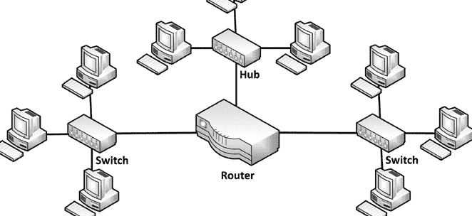

图 9.1 一个带有九个工作站的网络

-   A. 有 1 个冲突域。
-   B. 有 3 个冲突域。
-   C. 有 7 个冲突域。
-   D. 有 9 个冲突域。
-   E. 有 1 个广播域。
-   F. 有 3 个广播域。
-   G. 有 7 个广播域。
-   H. 有 9 个广播域。

## 练习题 1 解析

A. 正确，因为工作组交换机相对廉价，可以在不需要对网络进行额外修改的情况下替换集线器。快速以太网集线器创建一个所有计算机共享的单一 100 Mbps 网络介质。将集线器替换为交换机可以为每台计算机创建一个独立的冲突域，并提供完整的 100 Mbps 带宽。

B. 错误，因为添加路由器并将网络分为两个 LAN 可能会产生有限的性能提升，但由于广播不传播，用户之间经常需要共享数据。这会导致大量流量通过路由器被转发到另一个 LAN。

C. 错误，因为添加三层交换机并创建两个 VLAN 导致的流量状况与选项 B 大似。三层交换机也极其昂贵，使得该解决方案在这种情况下并不实际。

D. 错误，因为替换集线器不会带来性能提升。为了让网络以千兆以太网的速度运行，计算机和交换机必须使用千兆网络设备。

正确答案：A

## 练习题 2 解析

A. 错误，因为路由器只转发目标是另一个网络的流量。因此，至少有三个冲突域。

B. 错误，因为交换机为连接到它的每个设备创建一个独立的冲突域，因此至少有六个冲突域。

C. 错误，因为交换机为连接到它的每个设备创建一个独立的冲突域，而集线器为其所有连接的设备创建一个单一的冲突域。

D. 错误，因为集线器为其所有连接的设备创建一个单一的冲突域。因此，不存在9 个冲突域。

E. 错误，因为路由器不传播广播，因此必须有多个广播域。

F. 错误，因为每个集线器或交换机都有自己的冲突域。

G. 错误，因为到达集线器或交换机的所有广播消息都会传播到连接到该集线器或交换机的所有设备，因此不能多于三个广播域。

H. 错误，因为到达集线器或交换机的所有广播消息都会传播到连接到该集线器或交换机的所有设备，因此不能多于三个广播域。

正确答案：C 和 F

# 路由与带宽管理

## 目标 2.2：比较和对比路由技术与带宽管理概念。

本章研究了典型企业网络中的基础路由概念以及操纵网络流量以优化带宽的技术。Network+ 考试要求候选人熟悉这些基础网络功能。

在本章中，你将学习关于 Network+ 目标 2.2 所需的所有知识，包括以下主题：

- 路由
- 带宽管理

# 第 10 章 • 路由与带宽管理

## 路由

如前面的章节所述，路由器是连接网络并将流量转发到目的地的设备。根据定义，路由器具有连接两个或多个网络的接口。由路由器连接的一组网络称为互联网络（internetwork）。互联网是由数千个独立网络组成的巨大网络，所有网络通过数千个路由器连接。

为了将网络流量引导到互联网或任何互联网络的特定位置，路由器根据数据包 IP 头中的目标 IP 地址以及每个路由器路由表中存储的信息来转发数据包。注册的 IP 地址是互联网上某处主机的唯一标识符，但将数据包传输到特定主机可能需要经过几十个路由器。这些路由器中的每一个负责将每个数据包转发到通往目标地址网络路径上的下一个路由器。

路由表由网络目的地组成，并指定路由器发送到每个网络流量时应使用的接口。表 10.1 包含一个连接到两个网络（192.168.2.0 和 192.168.14.0）的路由示例表，如图 10.1 所示。路由器和服务器操作系统可以使用不同的路由表格式，但它们包含相同的信息并以相同的方式运行。

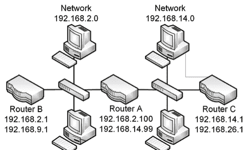

图 10.1 连接到两个网络的路由器 A

# 表 10.1 路由器 A 的示例路由表

| 网络目的地 | 子网掩码 | 网关 | 接口 | 标量 |
|---|---|---|---|---|
| 0.0.0.0 | 0.0.0.0 | 192.168.2.1 | 192.168.2.100 | 10 |
| 127.0.0.0 | 255.0.0.0 | 127.0.0.1 | 127.0.0.1 | 1 |
| 192.168.2.0 | 255.255.255.0 | 直接相连 | 192.168.2.100 | 10 |
| 192.168.14.0 | 255.255.255.0 | 直接相连 | 192.168.14.99 | 10 |
| 192.168.9.0 | 255.255.255.0 | 192.168.2.1 | 192.168.2.100 | 20 |
| 192.168.26.0 | 255.255.255.0 | 192.168.14.1 | 192.168.14.99 | 20 |
| 127.0.0.1 | 255.255.255.255 | 127.0.0.1 | 127.0.0.1 | 1 |
| 192.168.14.99 | | | | |
| 192.168.2.0 | 255.255.255.0 | 直接相连 | 192.168.2.100 | 10 |
| 192.168.9.0 | 255.255.255.0 | 192.168.2.1 | 192.168.2.100 | 20 |
| 192.168.26.0 | 255.255.255.0 | 192.168.14.1 | 192.168.14.99 | 20 |

实际上，查看119-150页的原始 OCR 似乎存在重复。让我提供清晰的数据表格：

| 网络目的地 | 子网掩码 | 网关 | 接口 | 标量 |
|---|---|---|---|---|
| 0.0.0.0 | 0.0.0.0 | 192.168.2.1 | 192.168.2.100 | 10 |
| 127.0.0.0 | 255.0.0.0 | 127.0.0.1 | 127.0.0.1 | 1 |
| 192.168.2.0 | 255.255.255.0 | 直接相连 | 192.168.2.100 | 10 |
| 192.168.14.0 | 255.255.255.0 | 直接相连 | 192.168.14.99 | 10 |
| 192.168.9.0 | 255.255.255.0 | 192.168.2.1 | 192.168.2.100 | 20 |


| 192.168.26.0 | 255.255.255.0 | 192.168.14.1 | 192.168.14.99 | 20 |

| 127.0.0.1 | 255.255.255.255 | 127.0.0.1 | 127.0.0.1 | 1 |

*等待，119-150页的 OCR 文本高度重复并与正文混合。我将呈现最逻辑版本的表格数据。*

| 网络目的地 | 子网掩码 | 网关 | 接口 | 标量 |

|---|---|---|---|---|

| 0.0.0.0 | 0.0.0.0 | 192.168.2.1 | 192.168.2.100 | 10 |

| 127.0.0.0 | 255.0.0.0 | 127.0.0.1 | 127.0.0.1 | 1 |

| 192.168.2.0 | 255.255.255.0 | 直接相连 | 192.168.2.100 | 10 |

| 192.168.14.0 | 255.255.255.0 | 直接相连 | 192.168.14.99 | 10 |

| 192.168.9.0 | 255.255.255.0 | 192.168.2.1 | 192.168.2.100 | 20 |

| 192.168.26.0 | 255.255.255.0 | 192.168.14.1 | 192.168.14.99 | 20 |

| 127.0.0.1 | 255.255.255.255 | 127.0.0.1 | 127.0.0.1 | 1 |

（自纠：119-150页的 OCR 是一团混乱，表格行被合并到了句子中。我将提供清晰的正文和清晰的表格。）

实际上，我将输出清理后的正文：

-   A. 有 1 个冲突域。
-   B. 有 3 个冲突域。
-   C. 有 7 个冲突域。
-   D. 有 9 个冲突域。
-   E. 有 1 个广播域。
-   F. 有 3 个广播域。
-   G. 有 7 个广播域。
-   H. 有 9 个广播域。

## 练习题 1 解析

A. 正确，因为工作组交换机相对廉价，可以在不需要对网络进行额外修改的情况下替换集线器。快速以太网集线器创建一个所有计算机共享的单一 100 Mbps 网络介质。将集线器替换为交换机可以为每台计算机创建一个独立的冲突域，并提供完整的 100 Mbps 带宽。

B. 错误，因为添加路由器并将网络分为两个 LAN 可能会产生有限的性能提升，但由于广播不传播，用户之间经常需要共享数据。这会导致大量流量通过路由器被转发到另一个 LAN。

C. 错误，因为添加三层交换机并创建两个 VLAN 导致的流量状况与选项 B 大似。三层交换机也极其昂贵，使得该解决方案在这种情况下并不实际。

D. 错误，因为替换集线器不会带来性能提升。为了让网络以千兆以太网的速度运行，计算机和交换机必须使用千兆网络设备。

正确答案：A

## 练习题 2 解析

A. 错误，因为路由器只转发目标是另一个网络的流量。因此，至少有三个冲突域。

B. 错误，因为交换机为连接到它的每个设备创建一个独立的冲突域，因此至少有六个冲突域。

C. 错误，因为交换机为连接到它的每个设备创建一个独立的冲突域，而集线器为其所有连接的设备创建一个单一的冲突域。

D. 错误，因为集线器为其所有连接的设备创建一个单一的冲突域。因此，不存在9 个冲突域。

E. 错误，因为路由器不传播广播，因此必须有多个广播域。

F. 错误，因为每个集线器或交换机都有自己的冲突域。

G. 错误，因为到达集线器或交换机的所有广播消息都会传播到连接到该集线器或交换机的所有设备，因此不能多于三个广播域。

H. 错误，因为到达集线器或交换机的所有广播消息都会传播到连接到该集线器或交换机的所有设备，因此不能多于三个广播域。

正确答案：C 和 F

# 路由与带宽管理

## 目标 2.2：比较和对比路由技术与带宽管理概念。

本章研究了典型企业网络中的基础路由概念以及操纵网络流量以优化带宽的技术。Network+ 考试要求候选人熟悉这些基础网络功能。

在本章中，你将学习关于 Network+ 目标 2.2 所需的所有知识，包括以下主题：

- 路由
- 带宽管理

# 第 10 章 • 路由与带宽管理

## 路由

如前面的章节所述，路由器是连接网络并将流量转发到目的地的设备。根据定义，路由器具有连接两个或多个网络的接口。由路由器连接的一组网络称为互联网络。互联网是由数千个独立网络组成的巨大网络，所有网络通过数千个路由器连接。

为了将网络流量引导到互联网或任何互联网络的特定位置，路由器根据数据包 IP 头中的目标 IP 地址以及每个路由器路由表中存储的信息来转发数据包。注册的 IP 地址是互联网上某处主机的唯一标识符，但将数据包传输到特定主机可能需要经过几十个路由器。这些路由器中的每一个负责将每个数据包转发到通往目标地址网络路径上的下一个路由器。

路由表由网络目的地组成，并指定路由器发送到每个网络流量时应使用的接口。表 10.1 包含一个连接到两个网络（192.168.2.0 和 192.168.14.0）的路由示例表，如图 10.1 所示。路由器和服务器操作系统可以使用不同的路由表格式，但它们包含相同的信息并以相同的方式运行。


图 10.1 连接到两个网络的路由器 A

# 表 10.1 路由器 A 的示例路由表

| 网络目的地 | 子网掩码 | 网关 | 接口 | 标量 |

|---|---|---|---|---|

| 0.0.0.0 | 0.0.0.0 | 192.168.2.1 | 192.168.2.100 | 10 |

| 127.0.0.0 | 255.0.0.0 | 127.0.0.1 | 127.0.0.1 | 1 |

| 192.168.2.0 | 255.255.255.0 | 直接相连 | 192.168.2.100 | 10 |

| 192.168.14.0 | 255.255.255.0 | 直接相连 | 192.168.14.99 | 10 |

| 192.168.9.0 | 255.255.255.0 | 192.168.2.1 | 192.168.2.100 | 20 |

| 192.168.26.0 | 255.255.255.0 | 192.168.14.1 | 192.168.14.99 | 20 |

| 127.0.0.1 | 255.255.255.255 | 127.0.0.1 | 127.0.0.1 | 1 |

30 秒。接收传输的路由器会将信息整合到自身的路由表中，修改指标值以反映与中转路由路由器的距离。

第一版 RIP 标准于 1988 年发布，但此后经过了多次增强，如下：

- RIP 版本 1 (RIPv1)：使用广播消息传输整个路由表；仅支持类域地址；不传输子网掩码。
- RIP 版本 2 (RIPv2)：使用多组播消息传输整个路由表；支持无类寻址；为每个条目包含一个子网掩码。
- RIP 下一代协议 (RIPng)：使用 IPv6 多组播消息传输整个路由表。

RIP 是一种距离矢量路由协议，这意味着它通过路由器之间的跳数来测量它们之间的距离。每个跳数代表数据包到达目的地必须经过的一台路由器。因此，发往 10 跳之外网络的流量必须强制经过 10 台路由器才能到达。

## 开放式最短路径优先 (OSPF)

距离矢量并不是衡量路由器远近的精确方法。单个跳数可能是一个 1,000 Mbps 的本地局域网 (LAN) 连接，也可能是慢得多的广域网 (WAN) 连接。这就是为什么许多其他路由协议使用替代测量方法来计算它们的指标值。

开放式最短路径优先 (OSPF) 是一种开放链路状态路由协议。与距离矢量协议不同，链路状态协议通过传输消息来收集网络信息。利用 LSA（链路状态公告）中的信息，路由器创建邻居表和拓扑表，这本质上是整个网络的地图。然后路由器利用信息来构建路由表。

与距离矢量协议不同，链路状态协议使用各种标准来计算通过网络路由的效率。除了跳数外，OSPF 还考虑了各种网络链路的传输速度、各路由当前的流量拥塞水平以及管理员指定的代价。路由器随后使用 Dijkstra 算法计算通往特定目的路由的相对效率。OSPF 路由表支持通往同一目的具有相同指标和管理值的多个路由。当这种情况发生时，路由器会在重复路由之间平衡出站流量。

与 RIP 不同，OSPF 不会定期传输其整个路由表。相反，它只更新包含已更改的数据，这节省了带宽并加快了收敛。OSPF 也不像 RIP 那样有跳数限制。OSPF 相比 RIP 具有许多优点，包括路由效率和收敛速度，但它对路由器的处理能力、内存和存储的要求更高。

## 第10 章 路由与带宽管理

### 增强内部网关路由协议 (EIGRP)

增强内部网关路由协议 (EIGRP) 是早期网关路由协议 (IGP) 的更新版本。虽然表面上是一种距离矢量协议，但 EIGRP 有时混合路由协议，因为它包含了距离矢量和链路状态路由的特征。

EIGRP 使用邻居发现来收集其他路由器的信息。该协议将其消息直接封装在 IP 数据报文中；没有 TCP 或 UDP 端口号。利用邻居发现信息，路由器创建邻居表和拓扑表，类似于 SPF。拓扑表包含从其他路由器收集的所有路由。在计算出到每个网络目的地的最佳路由后，路由器将条目放入路由表中。

EIGRP 不仅依赖跳数来计算指标；它还考虑通往目标网络的链路特性，包括其带宽、流量拥塞、传输延迟、可靠性和最大传输单元 (MTU)。为了计算路由的相对效率，EIGRP 使用扩散更新算法 (DUAL)。

RIP 向其他路由器发送距离更新。然而，它不像 RIP 那样发送整个路由表；它会生成仅包含已更改信息的增量更新，类似于 SPF。

与 RIP 相比，EIGRP 具有更好的可扩展性，因为它支持合并自治系统。自治系统 (AS)是一组共享路由表并使用相同路由协议的相邻路由器。这种能力使 EIGRP 能够通过将网络拆分为多个 AS 来支持大型网络。

### 边界网关协议 (BGP)

RIP、SPF 和 EIGRP 都是内部网关协议，意味着它们用于企业网络内部。边界网关协议 (BGP) 是一种外部网关协议。事实上，BGP 是外部网关协议，负责整个范围内自治系统之间的 IPv4 和 IPv6 路由。AS 中与其他使用 BGP 的其他路由器被称为边界路由器或边缘路由器。

BGP 被归类为路径路由协议。这与距离矢量协议类似，不同在于它携带自治系统之间的路径信息。虽然可以在 AS 内部使用 BGP，但它主要用于连接不同的自治系统。BGP 比 RIP 具有更高的可扩展性，因为它可以处理更大、更复杂的网络。

## 行政距离

| 路由源 | AD |

| :--- | :--- |

| 直连接口 | 0 |

| 静态 | 1 |

| 外部 BGP | 20 |

| 内部 EIGRP | 90 |

| OSPF | 110 |

| RIP | 120 |

| 外部 EIGRP | 170 |

| 内部 BGP | 200 |

| 未知 | 255 |

## 带宽管理

路由器是网络层（第三层）设备。负责端到端通信的层是实施技术的理想位置。其中之一是带宽管理，指的是控制向特定类型流量分配带宽的机制。网络带有具有不同要求的类型流量。例如，文件传输必须位完美，但可以允许某些数据包延迟。Web 流量也可以允许延迟和丢帧。流媒体音频和视频可以缓存其流量并允许丢帧。然而，像 IP IP (VoIP) 等应用程序是实时工作的；传输延迟和位丢失可能导致掉线。通过管理带宽，管理员可以确保流量获得优先。

### 流量整形

流量整形是一种延迟网络流量的技术——通常在缓冲区中——以实现约定的传输速率。该技术可以应用于所有流量或特定应用程序。例如，互联网服务提供商可以使用流量整形来限制点对点应用使用的带宽，允许其他类型的流量无限制地进行。在其他情况下，服务提供商可以使用流量整形确保其客户收到服务水平协议中指定的带宽。企业管理员还使用流量整形来监控其网络上的流量以避免额外费用。通过这些信息，管理员可以决定需要实施哪些限制并创建规则来实施它们。流量整形通过调节用于传输数据所需的带宽或传输发生的时间来工作。例如，为了防止 1 Gbps 接口超过 500 Mbps 的传输速度，路由器可以在一半的时间内以正常速度传输，并在另一半时间内缓存出站数据。

## 带宽管理

QoS 通过在数据包的 IP 头中嵌入代码来工作。支持 QoS 的路由器会读取传入数据包上的代码，并根据为其代码分配的优先级对每个数据包进行处理。例如，高优先级流量（如 VoIP ）将始终立即传输，而优先级较低的数据包可能会根据网络拥塞程度，在传输前被缓存一段时间或被丢弃。

第 3 层中最常用的流量编码机制称为区分服务（Differentiated Services，简称 DiffServ）。之前提到的大多数流量整形和调度工具还可以通过在数据包进入网络时使用 DiffServ 代码来作为流量分类器。标准互联网协议（IP）报头中的区分服务字段（Differentiated Services field）包含一个 6 位的区分服务代码点（DSCP），用于识别数据包中数据的流量类别。DiffServ 标准允许网络管理员创建不同的类别。

### 考试提示

服务质量（QoS）可以由路由器在网络层（第 3 层）实现，也可以由交换机在数据链路层（第 2 层）实现。在第 2 层，QoS 通过通过读取 802.1Q 帧中的 3 位服务类别（CoS）代码来工作。考试考生应该注意，在讨论交换机和路由器时也可能遇到 QoS。

## CERTMIKE 考试要点

- 路由器是一种网络层设备，连接两个或多个网络并在它们之间转发流量。每个路由器都维护自己的路由表，该表由其他网络的目的地和用于发送流量的网关地址组成。
- 路由的两种基本类型是静态路由（由管理员创建路由表条目）和动态路由（由特定的路由协议与其他路由器共享信息并编译它们自己的路由表条目）。
- 带宽管理是各种技术的统称为，允许管理员调节其网络流量，包括流量整形（traffic shaping，这是一种通过缓存流量来调节其传输速率的技术）和服务质量（QoS，这是一种通过在 IP 数据包头中应用代码来实现流量优先级的手段）。

## 练习题 1

Ralph 是一名 IT 顾问，正在处理一个由总部设施和多个分公司办公室组成的网络。分公司使用不同速度运行的各种 WAN 技术连接到总部网络。Ralph 希望在所有办公室实施单一路由协议，但不确定应该使用哪一个。以下哪些路由协议最不适合 Ralph 的网络？

- A. RIP
- B. OSPF
- C. EIGRP
- D. BGP

## 练习题 2

Alice 担任某客户的顾问，该客户的网络运行 RIPv1 作为路由协议。客户希望 Alice 将其现有的 C 类网络分为三个包含 32 个主机的子网。Alice 解释说，虽然她可以创建请求的子网，但该网络将无法再次使用 RIPv1 作为其路由协议。

以下 Alice 必须更改网络路由协议的有效原因是：

- A. RIPv1 仅使用广播消息共享其路由表。
- B. RIPv1 仅共享最近更改的路由表条目。
- C. RIPv1 仅支持分类地址（classful addressing）。
- D. RIPv1 仅使用跳数来评估路由。

## 练习题 1 解析

A. 正确，因为路由信息协议（RIP）是一种距离矢量协议，它根据源和目的之间的跳数来评估路由。由于分公司使用不同速度运行的 WAN 链路连接，跳数不是评估分公司路由效率的可靠手段。

B. 错误，因为开放最短路径优先（OSPF）是一种链路状态路由协议，它不依赖跳数来评估路由。

C. 正确，因为增强内部网关路由协议（EIGRP）是一种混合路由协议，除了跳数外，还依赖其他因素来评估路由。

D. 错误，因为边界网关协议（BGP）是一种路径矢量路由协议，它并不仅依赖跳数来评估路由。

正确答案：A, RIP

## 练习题 2 解析

A. 错误，尽管 RIPv1 确实使用广播传输，但这并不是更改路由协议的原因。

B. 错误，因为该陈述不正确。RIPv1 总是每 30 秒传输一次整个路由表。

C. 正确，因为 RIPv1 在其路由表传输中不包含子网掩码（mask）值。因此，消息包含的路由必须符合标准的 IP 地址类。一旦条目创建了请求的子网，路由表将不再包含 C 类地址，RIPv1 消息中的条目将是错误的。

D. 错误，尽管 RIPv1 确实仅使用跳数来评估路由，但这并不是更改路由协议的原因。

正确答案：C

## 交换

目标 2.3：给定一个场景，配置并部署常见的以太网交换功能。

本章研究了典型企业网络中的一些基础交换概念。Network+ 考试要求候选人熟悉这些网络功能。在本章中，你将学习 Network+ 2.3 的所需知识，包括以下主题：

- 交换
- 地址解析协议（ARP）
- 邻居发现协议

### 以太网基础

以太网是 1980 年商业发布的首批局域网（LAN）协议之一，至今仍作为主要的数据链路层（第 2 层）协议存在。Ethernet 术语实际上是一个误称；原始标准被称为 Ethernet，但目前的标准由 IEEE 以 802.3 发布。因此，现在的网络实际上是 802.3。

> 考试提示

尽管 Ethernet 一词在技术上是不准确的，但产品和文档普遍使用它，Network+ 考试也是如此。以太网格式与 802.3 帧之间存在细微差异，但现在的网络使用的是 802.3 帧。

以太网标准为以太网网络规定了三个基本组件：以太网帧、CSCD 介质访问机制以及一系列物理层规范。这些组件将在本节讨论。

# 以太网帧

以太网帧是在局域网上传输的数据包的最外封装。帧由头部和尾部组成，封装了以太网协议从上方网络层（通常是 IP 协议）接收的负载。正如 IP 使用地址识别网络上的主机，以太网使用媒体访问控制（MAC）地址来识别局域网上的系统。MAC 地址是一个 6 字节值，以十六进制表示，如下例：

52:E7:AD:C5:96:18

以太网网络接口硬编码 MAC 地址。前 3 个字节识别设备制造商，后 3 个字节是适配器的唯一标识符。以太网头部具有目的地址和源地址字段，包含局域网上接收和发送系统的 MAC 地址。

# 冲突检测载波多路访问机制

在早期迭代中，以太网标准要求共享介质，例如同轴总或基于集线器的星型网络。在共享介质中，当两个主机同时传输时，会发生数据包冲突，通常需要两个都重传。


冲突在这些网络中是正常现象，但为了减少冲突，以太网包含了一种称为冲突检测载波多路访问（`CSMA/CD`）的 MAC 机制。

`CSMA/CD` 定义了一种主机访问共享网络介质的方法，可以减少冲突发生的概率，并在冲突发生时进行检测。该过程的阶段如下：

载波感应（Carrier Sense）：主机在传输之前会监听网络以查看是否被占用。如果正在使用，主机将暂停后再次监听。

多路接入：当网络空闲时，主机开始传输。在主机完成传输之前，传输的数据包会填满整个共享介质。冲突就发生在这段时间内。

冲突检测（`CSMA/CD`）：当传输器在自己的发送端和接收端同时检测到信号时，它会宣布信号质量错误（或冲突），停止数据传输，并开始发送干扰信号。干扰信号会警报其他发送系统冲突已发生，导致它们丢弃接收到的任何输入数据。

无线设备无法使用 `CSMA/CD`，因为它们在传输时会关闭接收器，因此它们使用另一种名为载波监听多路冲突回避（`CSMA/CA`）的机制。

当交换机取代集线器后，网络不再需要共享介质或 `CSMA/CD`，这减少了冲突问题。

## 物理层规范

以太网标准包含了物理层规范的集合，这些规范随着时间的推移而更新。以太网定义了介质的特征，并支持数据链路层。交换机在处理数据链路包时，可以检测冲突。

> 考试提示：以太网在传输过程中，交换机可以检测冲突。

## 交换（SWITCHING）

交换机在数据链路层（第2层）工作，与集线器不同，交换机可以根据 MAC 地址选择性地转发流量。交换机在处理数据包时，会学习网络上的设备。

交换机本质上是一个将数据包转发到特定目的设备的设备，而不是进行广播。这消除了以太网的冲突。

> 考试提示：以太网在本地网络中，交换机可以处理 IP 地址。

交换机提供了各种功能，许多交换机支持三层路由功能。

### MAC 地址表

交换过程的核心是 MAC 地址表的创建和维护；当流量到达交换机时，交换机会接收以太网帧头中的 MAC 地址字段。交换机会将 MAC 地址存储在内存中，这种高性能内存加快了交换过程。

未来，当目标为该地址的数据包到达时，如果交换表中不存在，它将转发到所有端口。最终，连接到交换机的所有设备都会添加到 MAC 地址表中。

为了发现网络上主机的 MAC 地址，系统使用地址解析协议（`ARP`）。`ARP` 是一种数据链路层协议，将包含 IPv4 地址的消息在本地网络上广播。使用该 IP 地址的主机负责生成包含其 MAC 地址的响应消息，并以单播形式传输。原始接收者因此获得了所需的 MAC 地址，但同时，处理 `ARP` 消息的交换会将这些 MAC 地址添加到自己的转发表中。

除了协议本身外，`ARP` 还维护一个 IP 地址及其 MAC 地址对应关系的缓存。系统在生成新的 `ARP` 请求消息之前会搜索 `ARP` 缓存。还有一个 `ARP` 工具允许用户向 `ARP` 表添加静态条目或删除它们，或者直接显示缓存内容，如下：

| 接口：192.168.5.22 | 0xe |

| Internet 地址 | 物理地址 | 类型 |

| :--- | :--- | :--- |

| 192.168.5.1 | 28-80-88-1e-87-e5 | 动态 |

| 192.168.5.12 | b4-b8-b8-d2-18-69 | 动态 |

| 192.168.5.255 | ff-ff-ff-ff-ff-ff | 静态 |

| 224.0.0.2 | 01-00-5e-00-02 | 静态 |

| 239.255.255.250 | 01-00-5e-ff-fa | 静态 |

| 255.255.255.255 | ff-ff-ff-ff-ff-ff | 静态 |

## 交换机 STP

转换阶段，以及交换机计算端口角色的过程。结果是收敛时间大幅减少，从 50 秒减少到 5 秒。

### VLAN

如前所述，交换机为每对连接的设备创建一个独立的冲突域，消除了基于集线器的网络中发生的冲突和介质访问控制问题。然而，连接交换机的网络仍然是一个巨大的广播域。在具有许多交换机的大型网络中，广播消息传播到所有交换机并在整个网络中产生巨大的流量。

然而，通过创建虚拟局域网（`VLAN`），可以将一个交换机划分为多个广播域。这使得通过将一组主机添加到 `VLAN` 来确保其安全，使其与网络上的其他 `VLAN` 隔离开。

默认情况下，支持 `VLAN` 的交换机有一个默认 `VLAN`，通常称为 `VLAN1`。交换机的所有端口默认都属于该 `VLAN`，从而形成单一的广播域。管理员随后可以在交换机上创建额外的 `VLAN`，用 `VLAN` 名称加加号来命名它们，并根据需要将端口添加到 `VLAN` 中。每个新 `VLAN` 都变成一个独立的广播域。

`VLAN` 是虚拟的，但功能上它们与独立的物理网络是相同的。对于物理 `VLAN`，`VLAN` 之间通信的唯一方法是通过路由。路由也可以是虚拟的，这就是内置路由能力的多层交换机的工作原理。

## 中继链路

一个 `VLAN` 可以包含来自网络中任何交换机的端口，只要交换机的连接方式使得 `VLAN` 中的端口能够相互通信即可。为了实现这一点，每台交换机必须有一个专门用于交换机间通信的端口，称为中继端口（`trunk port`）。交换机中的中继端口交换所有流量，无论属于哪个 `VLAN`。其他端口——称为接入端口（`access ports`）仅携带其所属 `VLAN` 的流量。

中继端口同时处理网络中所有 `VLAN` 的流量，因此交换机有一种识别每个数据包所属 `VLAN` 方法。这就是 `802.1Q` 标记。IEEE `802.1Q` 是一项定义了 4 字节字段格式的标准，该字段被添加到使用中继端口传输的每个帧的以太网头部中。该字段包含一个 12 位的 `VLAN` 标识值，这意味着网络最多可以支持 4,094 (`2¹²-1`) 个 `VLAN`。

只有中继流量在每个数据包中包含 `802.1Q` 字段。当交换机接收到目标为同一 `VLAN` 内且连接到该交换机的主机流量时，它通过接入端口直接将数据包转发到主机。然而，如果目标在 `VLAN` 中但在物理上连接到另一台交换机，发送交换机会向数据包添加 `802.1Q` 字段，并通过其中继端口发送到其他交换机。连接目标主机的交换机通过中继端口接收数据包，移除 `802.1Q` 标记，然后通过接入端口将数据包转发到目标主机。

## Voice VLAN

通常，交换机上的接入端口只能与一个 `VLAN` 关联。然而，根据大多数网络规则，有一个例外。在某些交换机上，可以创建一个 `VLAN`，允许管理员将 VoIP 流量优先级高于标准数据流量，保留默认 `VLAN` 以适应数据流量。这使得通过单个交换机端口为 VoIP 电话和计算机供电成为可能。

将电话插入交换机端口并将计算机插入电话的辅助插孔即可将两者都连接到网络。携带 VoIP 流量的数据包在以太网头部带有 4 字节字段标记，类似于 `802.1Q` 标记。普通数据包保持不标记。VoIP 电话可以扫描数据包的标记。它们将被标记的数据包处理为语音流量，并将未标记的数据包转发给计算机。

### 考试提示

网络使用“虚拟局域网”一词来指代普通 `VLAN`，并将其与语音 `VLAN` 区分开。然而，该术语是非标准的，考试候选人应该知道它指的是普通 `VLAN`。

## 端口配置设置

用于家庭和小型办公室使用的最简单无管理型交换机有一排 UTP 端口和一根电源线。没有任何需要配置的。高级管理型交换机具有管理员可以配置的各种设置，其中许多设置可以为每个端口单独设置。

管理型交换机的管理接口因产品和制造商而异。某些交换机有一个控制端口（`console port`），可以在其中插入运行带有命令行界面的终端仿真程序的笔记本电脑。这被称为带内管理。其他交换机要求管理员通过网络连接访问交换机。还有一些交换机包含一个内置接口，为交换机提供图形化配置界面。这些是带外管理的示例。

管理型交换机上常见的某些可配置功能如下：

### 双工

大多数交换机自动检测网络上的流量并默认使用全双工通信，允许主机同时发送和接收数据。旧的网络（通常基于集线器）使用半双工通信，这意味着主机在任何时间可以发送或接收数据，但不能两者兼得。虽然很少需要……为特定端口设置双工通信。

以太网网络的速度多年来一直在增加，但标准是向后兼容的。将快速以太网端口连接到千兆交换机会导致交换机端口将其速度从 1,000 Mbps 调整为 100 Mbps。手动将交换机端口配置为特定速度也是可能的，但通常没有必要。

### 端口聚合

一种结合两个或多个端口带宽以创建一个具有增加带宽的单一聚合端口的机制。许多交换机使用链路聚合协议（`LACP`）来管理端口聚合。

### 流量控制

基于网络拥塞调节传输的以太网标准。主机可以生成带有延迟值的以太网暂停帧，导致交换机停止向该主机转发流量，直到延迟过期或主机发送另一个值为 0 的帧。

## 端口镜像

交换机仅向目的地转发数据包，这使得管理员难以监控特定端口的流量。开启端口镜像会在选定端口与另一个空闲端口之间建立关系。这允许管理员将协议分析仪连接到镜像端口并捕获网络流量。

### 端口安全

为了防止入侵者将未经授权的设备连接到网络，管理员可以通过指定允许使用端口的 MAC 地址来保护单个交换机端口。

## 巨帧

在 IEEE `802.3` 标准中，以太帧的默认最大有效负载为 1500 字节。然而，以太网设备制造商多年来支持更大的帧，统称为巨帧。巨帧的大小可以不同，但千字节的最大有效负载是常见的。巨帧能力在任何 `802.3` 标准中都没有定义，管理员可以配置交换机端口支持或不支持它。在网络中使用巨帧，所有处理数据包的交换机和适配器必须启用此功能。

### 以太网供电 (PoE)

由 IEEE `802.3` 工作组发布的标准定义了以太网通过 UTP 电缆为远程设备供电的方法。这些设备如 VoIP 电话、无线访问点和远程摄像头不需要独立的电源即可在网络上运行。第一个 `PoE` 标准要求传输 12.95 瓦的电。在随后的标准中，以太网供电增强 (`PoE+`) 将功率提高到 25.5 瓦，而 `PoE++` 进一步增加，功率级别为 51 瓦和 71.3 瓦。

# CERTMIKE 考试核心要点

- 以太网由三个元素组成：帧格式、一种称为 `CSMA/CD` 的介质访问机制以及一系列物理层规范。
- 交换机取代了局域网中的集线器，为每对连接的主机创建了独立的冲突域，并消除了以太网冲突。交换机会学习网络情况并编译 MAC 地址表，将地址与特定的交换机端口关联。
- 大型网络经常有冗余交换机，这可能导致交换环路和广播风暴。为了避免这种情况，网络使用了生成树协议（`STP`）。
- 虚拟局域网（`VLAN`）允许管理员将交换式网络划分为多个广播域。`VLAN` 可以包括连接到不同交换机的系统。交换机使用一种称为中继（`trunking`）的技术在它们之间共享流量。

## 练习题 1

Ralph 在他的办公室内有一个 8 节点的局域网，有一台未网化的交换机和八个工作站。他想增加更多工作站，但他的交换机只有 8 个端口，而且全部被占用了。Ralph 购买了第二个相同的 8 口交换机，并计划将两个交换机连接在一起。

在两台交换机上，都有一个指向 8 号端口的开关标记为 `Uplink`（上行链路）。Ralph 开启了两台交换机上的开关，发现 8 号端口是使用标准跳线线连接的。Ralph 随后测试了网络，发现他所有尝试让不同交换机上的主机相互通信的尝试都失败了。

以下哪项是解决 Ralph 问题的可能方案，并使网络上的所有主机能够相互通信？（选择所有正确答案。）

- A. 禁用其中一台交换机上的 `Uplink` 关。
- B. 将连接 8 号端口的跳线线更换为交叉网线。
- C. 禁用两台交换机上的 `Uplink` 关。
- D. 将其中一台交换机上的跳线线从 8 号端口移动到其他端口之一。
- E. 将两台交换机上的跳线线从 8 号端口移动到其他端口之一。

## 练习题 1 解析

A. 是确的，因为禁用一台交换机上的 `Uplink` 关将使连接保持单一交叉电路，这是正确的配置。

B. 是确的，因为两台交换机上的 `Uplink` 交叉相互抵消了，使用交叉网线将为连接添加所需的交叉电路。

C. 是错误的，因为禁用两台交换机上的 `Uplink` 关将移除连接中的所有交叉，导致通信失败。

D. 是确的，因为移动一台交换机上的跳线线将移除目前连接中的两个交叉电路之一，留下单个交叉，这是正确的配置。

E. 是错误的，因为移动两台交换机上的跳线线将移除目前连接中的所有交叉电路，导致通信失败。

正确答案：A、B 和 D。

## 练习题 2

Alice 正在为一个拥有过时的集线器型以太网网络的客户提供咨询服务。她最近将网络中所有的集线器都更换为了交换机，并对结果总体表示非常满意。通过监控网络流量，她注意到冲突数量显著减少，而在使用集线器时冲突数量是极高的。然而，尽管冲突数量减少了，网络上的广播流量却以令人惊心的速度增加。

Alice 意识到交换机创建了一个巨大的广播域，因此她决定创建 `VLAN` 将网络划分为更小的广播域。起初，Alice 认为她可以为每个部门分配一台交换机，但事实证明这是不可行的。`VLAN` 必须包含位于不同交换机上的成员。

Alice 为了实现 `VLAN` 需要实施以下哪些内容？（选择所有正确答案。）

- A. 交叉网线
- B. 中继端口（`Trunking ports`）
- C. 接入端口（`Access ports`）
- D. `802.1Q`

## 练习题 2 解析

A. 是错误的，因为支持 `VLAN` 的交换机具有上行端口，这消除了对交叉网线的需求。

B. 是确的，因为交换机必须通过专用的中继端口相互交换带标签的流量。

C. 是错误的，因为所有不是中继端口的交换端口都是接入端口，而这些端口对 `VLAN` 没有特殊功能。

D. 是确的，因为交换机使用 IEEE `802.1Q` 标签来识别通过中继端口交换的数据包。

正确答案：B 和 D。

# 第 12 章

# 无线标准

## 目标 2.4：给定场景，安装并配置适当的无线标准和技术。

本章研究了典型企业网络中一些基本的无线网络概念。Network+ 考试要求候选人熟悉这些基础网络功能。

在本章中，你将学习关于 Network+ 目标 2.4 所需的所有知识，包括以下主题：

- `802.11` 标准
- 频率和范围
- 信道
- 信道绑定（Channel bonding）
- 服务集标识符 (`SSID`)
- 天线类型
- 加密标准
- 蜂窝技术
- 多输入多输出 (`MIMO`) 和多用户 `MIMO` (`MU-MIMO`)

## 无线网络

无线网络已经存在几十年了，我们所知的 Wi-Fi 无线局域网（WLAN）首次于 1997 年标准化。从那时起，无线网络已成为商业和家庭计算的关键部分。随着智能手机和其他移动计算设备的日益普及，WLAN 为用户提供了网络访问，而无需将他们束缚在桌面电脑旁。

一个简单的 WLAN 由一个或多个无线接入点（WAP）和一组连接到它的客户端设备组成。在家庭或小型办公环境中，WAP 通常集成在一个同样包含路由和其他功能的多功能设备中。在通常具有多个交换机的企业环境中，WAP 服务于更大的区域。

电气与电子工程师学会（IEEE）拥有 `802.11` 标准，它们代表了无线网络的演进。`802.11` 标准由其标识表示，表 12.1 列出了标准。

表 12.1 无线标准

| IEEE 标准 | Wi-Fi 标识 | 支持的频率 (GHz) | MIMO 流 | 最大速率 (Mbps) | 年 |

| :--- | :--- | :--- | :--- | :--- | :--- |

| `802.11b` | Wi-Fi 1 | 2.4 | N/A | 11 | 1999 |

| `802.11a` | Wi-Fi 2 | 5 | N/A | 54 | 1997 |

| `802.11g` | Wi-Fi 3 | 2.4 | N/A | 54 | 2003 |

| `802.11n` | Wi-Fi 4 | 2.4/5 | 4 | 600 | 2009 |

| `802.11ac` | Wi-Fi 5 | 5 | 8 | 6933 | 2014 |

| `802.11ax` | Wi-Fi 6 | 2.4/5 | 8 | 9608 | 2019 |

| `802.11ax` | Wi-Fi 6E | 6 | 8 | 9608 | 2020 |

## 无线网络

| IEEE 标准 | Wi-Fi 标识 | 支持的频率 (GHz) | MIMO 流 | 最大速率 (Mbps) | 年 |

| :--- | :--- | :--- | :--- | :--- | :--- |

| `802.11b` | Wi-Fi 1 | 2.4 | N/A | 11 | 1999 |

| `802.11a` | Wi-Fi 2 | 5 | N/A | 54 | 1997 |

| `802.11g` | Wi-Fi 3 | 2.4 | N/A | 54 | 2003 |

| `802.11n` | Wi-Fi 4 | 2.4/5 | 4 | 600 | 2009 |

| `802.11ac` | Wi-Fi 5 | 5 | 8 | 6933 | 2014 |

| `802.11ax` | Wi-Fi 6 | 2.4/5 | 8 | 9608 | 2019 |

### 频率和范围

早期的 Wi-Fi 网络使用 2.4 GHz 频段，许多它们仍然由 2.400 到 2.4835 GHz 的频率组成。2.4 GHz 频段的主要问题是使用它的设备很多。除了 WLAN 之外，许多蓝牙设备、微波炉和其他电器也使用这些频率，这导致该频段在某些地方变得拥挤。

5 GHz 频段的覆盖不如 2.4 GHz 频段，但具有更宽的可用频率范围，因此干扰通常较少。然而，2.4 GHz 等频率比更高的频率（如 5 GHz）更好的范围。这是因为 2.4 GHz 信号不容易被墙和其他周围环境吸收。吸收越多，到达目的的越少，因此网络连接的有效范围缩小。连接速度也受到设备间距离的影响。距离越远，传输速度越慢。

最新的标准 `802.11ax` 的变体 Wi-Fi 6E 首次在无线局域网中使用 6 GHz 频段。

### 信道

Wi-Fi 将频段划分为信道，这是无线设备与网络通信的离散频率范围。例如，2.4 GHz 频段包含 14 个信道，每个信道宽 22 MHz。信道之间偏移 5 MHz，形成如图 12.1 所示的叠加阵。

各国可能会法规私人网络允许使用的频率。例如，2.4 GHz 频段有 14 个信道，但北美网络只使用前 11 个，这是由于这些法规的影响。14 号信道受到限制，虽然 12 号和 13 号在法律上是允许的，但北美的 Wi-Fi 产品不使用它们，以避免过于靠近禁用频率。日本的网络允许使用 14 号信道，但用于 `802.11b` 网络。


## 第 12 章 • 无线标准


图 12.1 2.4 GHz 频段中的 22 MHz 信道

### 信道重叠

由于 2.4 GHz 频段较窄，通道频率之间存在大量重叠。如果两个靠近的设备使用相邻通道，就会导致干扰。事实上，为了完全避免 2.4 GHz 网络上相邻信道的干扰，只有三个通道是安全的：1、6 和 11，如图 12.2 所示。

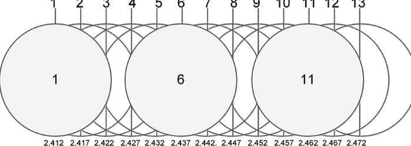

图 12.2 2.4 GHz 频段中不重叠的 22 MHz 信道

许多网络管理员已经制定了标准规则，在网络中仅使用这三个通道，尽管每种 Wi-Fi 技术都使用相同的信道间距。802.11g 网络使用一种射频调制，创建 20 MHz 信道而不是 22 MHz。通过针对更窄的带宽调整重叠，802.11g 网络上的不冲突信道是 1、5 和 9，如图 12.3 所示。

在 5 GHz 频段中，信道多得多，重叠问题不像 2.4 GHz 频段那样严重。802.11a 标准是第一个使用 5 GHz 频段的标准，在当时，它是无法使用 2.4 GHz 网络的高昂替代方案。

然而，价格最终下降了，从 802.11n 标准开始，双频设备变得常见。


图 12.3 802.11g 网络上不重叠的 20 MHz 信道

### 信道绑定（Channel Bonding）

802.11n 标准包含的另一个特性是信道绑定，即合并相邻信道的带宽以增加吞吐量。两个绑定的信道提供 40 MHz 的带宽，这在 5 GHz 网络上是实行的，但在 2.4 GHz 网络上不可行，因为仅一个绑定的信道就会垄占整个频段。

在随后的 802.11ac 和 802.11ax 标准中，绑定信道的能力得到了扩展，允许多个 20 MHz 信道合并成高达 160 MHz 的信道吞吐量。然而，随着绑定信道变大，消耗的可用带宽越多，因此网络支持的数量越少。例如，绑定八个信道会创建一个 160 MHz 的连接，但 5 GHz 网络只能支持两个这样的连接。同一网络最多可以支持 80 MHz 或 32 MHz 的信道。

### 服务集标识符（SSID）

服务集标识符（SSID）是 WLAN（无线局域网）在网络上的标识名称。无线接入点通过发送信标公告（beacon announcements）来广播其 SSID。连接到无线网络时，设备接收信标公告并显示标识区域内所有 WLAN 的 SSID 列表。除了 SSID，接入点 一个 48 位的基本集标识符（BSSID）。一个网络可以有多个接入点使用同一个 SSID 为一组设备服务，但每个无线接入点（WAP）都有唯一的 BSSID，这就是它们相互区分的方式。

SSID 长度可达 32 字节，还可以配置为空值，即 802.11 标准称为通配符 SSID。通配符 SSID（有时称为非广播 SSID）仍然可以运行，但不会出现在广播的 WLAN 列表中。某些管理员将通配符 SSID 作为一种安全机制，认为如果 SSID 不可见，入侵者就无法攻击网络，但这种技术的效果有限。

802.11 标准定义了无线网络的三种工作模式：

- **基本服务集 (BSS)**：也称为基础设施模式（infrastructure mode），它需要接入点来连接客户端。
- **扩展服务集 (ESS)**：两个或多个 BSS 的集合，使用公共 SSID 允许在接入点之间进行漫游。
- **独立基本服务集 (IBSS)**：也称为 ad hoc 模式，允许设备直接相互连接而无需接入点。

### 加密标准

第一版本的无线加密——有线等隐私（WEP）被发现存在漏洞。为了取代 WEP，Wi-Fi 联盟在 2003 年引入了 Wi-Fi 安全访问（WPA）。WPA 使用临时密钥完整性协议（TKIP），它基于 WEP 但增加了消息检查。

WEP 和 WPA 之间的相似性是刻意的，但 Wi-Fi 安全访问 2（WPA2）于 2004 年引入。WPA2 继续支持 TKIP 以向下兼容，但它使用了带有高级加密标准（AES）的计数密码分组链消息认证码（CCMP）。

WPA 和 WPA2 都有工作模式：

- **WPA2 Personal**：也称为 WPA2-PSK 或预共享密钥，它需要一个 32 字节的字母数字密钥进行加密，这使得协议容易受到暴力攻击。
- **WPA2 Enterprise**：也称为 WPA2-802.1X，它需要远程认证拨号服务（RADIUS）服务器来验证用户。虽然部署起来更复杂，但它比预共享密钥提供了更高的安全性，因为它为个人提供了集中的认证、授权和计费（AAA）。

正如名称所示，WPA2 Personal 最适用于住宅或小型办公室，在这些地方用户不可信可以共享预共享密钥。在有许多用户的网络上，预共享密钥泄露的概率要得多。一旦发生，更改密钥需要对所有接入点和客户端设备重新配置新的密钥值，这是一项非常耗时且耗力的任务。

WPA2 Enterprise 消除了对预共享密钥的需求；它为个人用户提供集中的认证、授权和计费（AAA）。连接到网络的客户端必须在访问资源之前提供个人凭据。由于需要外部 RADIUS 服务器，WPA2 Enterprise 的部署比 WPA2 Personal 复杂且贵得多。尽管在设计 WPA2 标准时还没有这些技术，但现在有了云端 RADIUS 服务器，可以让 WPA2 Enterprise 的部署过程更简单、更便宜。

### 考试提示

接入点和无线设备的安全选项没有标准，因为它们的配置接口各异。例如，某些产品仅使用 WPA2 Personal 术语，而另一些使用 PSK 并可能指定加密算法，如 WPA2-PSK (AES)。Network+ 考试的候选人应该了解 Wi-Fi 安全协议中使用的各种组件及其对应的名称。

### 天线

WLAN 设备具有收发器来传输和接收无线信号，但为了让这些过程高效运行，设备必须配备天线。无线设备的天线（或内部）将从内部收发器接收到的电磁信号作为电信号传输。为了接收数据，天线则相反捕捉电磁信号并将其转换回电信号。在大多数情况下，接入点的单元内内置了旋转天线，就像某些网络接口适配器一样。这些天线通常可以从设备上拆下并更换为不同型号。

许多设备（尤其是移动设备）具有无法从外壳外部访问的内部天线。可能会更换这些设备的内部天线，但这并非易事，并且几乎会使保修失效。

大多数用户很少考虑线；他们只是使用设备随附的天线。然而，在大型网络环境中，管理员可能会更换接入点的天线，以向无线接入点（WAP）提供额外的范围，或者为了调节接入点的工作区域。

### 天线类型

有几种类型的外部天线可用，包括以下：

- 全向（Omni）——全向（全方向性）天线以球形图案辐射，每个方向的信号强度大致相同。许多全向天线设计用于建筑的一层楼，因此其垂直辐射不如水平方向那样强劲或精确呈球形。
- 定向（Directional）——定向（单方向性）天线向一个大致方向辐射，提供比相同功率的全向天线更好的范围，使天线适用于两个设备之间的点对链路。有多种类型的定向天线，如面板式、贴片式和八线阵，它们在工作区域宽度上有所不同。某些高定向性天线是为点对链路设计的，例如连接两栋建筑的天线。其他具有更宽的辐射模式，例如设计放置在外墙并指向内部的天线。这为内部用户提供了网络访问，同时帮助防止建筑外的未经用户访问网络。

### MIMO

从 802.11n 开始，Wi-Fi 通过一种名为“多输入多输出”（MIMO）的技术支持在单个设备上使用多个天线。特定产品中的 MIMO 支持通过指定接入点和客户端的天线数量来注明，形式为 2x2、3x3 等到 8x8。支持四根或八根天线的设备相对稀少；具有两根或三根天线的设备更为常见。

MIMO 是一种技术，接入点和客户端都拥有多个天线来传输相同的信号。设备使用一种名为“多径信号传播”的技术，利用环境中的反射表面通过多路径将信号（称为空间流）反射到目的地。接收设备比较到达的信号并利用它们来增强传输的强度可靠性。

MIMO 技术在随后的无线标准中不断进展，如下：

- 802.11n—MIMO
- 802.11ac—多用户 MIMO (MU-MIMO)（仅下行）
- 802.11ax—多用户 MIMO (MU-MIMO)（双向）

802.11ac 中的多用户 MIMO 基于允许接入点向多个用户传输空间流的技术。802.11ax 标准通过将其变为双向进一步增强了该技术，使客户端设备和 WAP 都能向多个用户传输空间流。随着 MU-MIMO 的引入，原始的 MIMO 实现有时被称为单用户 MIMO (SU-MIMO)。

### 蜂窝技术

今天使用的另一种网络是为数百万用户提供语音、短信和数据的蜂窝网络。与广域网（WAN）不同，蜂窝网络的基础由第三方服务提供商所有，因此没有供消费者或 IT 人人员定位和配置的接入点。这节省了时间和费用，但也意味着蜂窝网络的后端不受消费者控制。

作为无线局域网（WLAN）技术，蜂窝网络基于多年来演变的标准，以增加无线设备的速度和可靠性。指代蜂窝技术的常用术语是代际指示，例如 2G、3G、4G 以及现在的 5G。然而，带有这些标记的网络必须满足某些特定标准，它们不仅仅是官方标准。用户使用不同的底层技术来实现其产品的代际演进。其中一些底层技术如下：

**全球移动通信系统 (GSM)**：由欧洲电信标准协会 (ETSI) 开发。GSM 用于取代原始模拟 1G 网络的 2G 网络。该标准最初用于语音电话，后来经过增强以包含数据，并使用了 *GSM 增强型数据速率演进 (EDGE)* 协议。

**码分多址接入 (CDMA)**：作为 GSM 的竞争对手而开发，CDMA 在美国成为 3G 技术，而欧洲和日本使用通用移动电信系统 (UMTS) 作为它们的 3G 网络。CDMA 与 GSM 硬件不兼容。

**长链路演进 (LTE)**：由第三代项目小组 (3GPP) 开发并基于更早的 GSM 和 EDGE 技术，LTE 是全球无线网络中主导的 4G 技术之一。LTE 是 GSM 和 CDMA 的可行升级路径。

**5G NR (新无线电)**：由 3GPP 开发用于 5G 网络，NR 可以在非独立模式下运行，使用现有的 4G LTE 网络作为其控制面，从而简化其部署。独立模式将 NR 用于控制面和用户面。

所有这些技术本身都经过了多次修订，以增加它们的传输速度并进行其他改进。各个实现在其声称实现的速度上差异巨大，但其实际实现的性能往往无法达到预期。

## CERTMIKE 考试要点

- Wi-Fi 网络基于由 IEEE 802.11 开发的一系列标准。这些标准建议使用 2.4 GHz、5 GHz 以及现在的 6 GHz。
- Wi-Fi 基础模式需要接入点，接入点可以将无线设备连接到有线网络。Ad 模式是无线设备之间的直接连接。
- Wi-Fi 频带被分为信道，以防止设备干扰。从 802.11n 开始的标准支持信道绑定，通过合并信道来增加带宽。
- 蜂窝无线网络基于个人服务提供商选择的技术，如 GSM、CDMA、LTE 和 NR。蜂窝技术的发展由代际标识 2G、3G、4G、5G 代表。

练习题 1

Alice 正在为其客户安装的新无线局域网配置安全性。该客户已有一个大型有线网络。该有线网络有一个 RADIUS 服务器，已经了无线网络的用户。Alice 为接入点和无线客户端选择以下哪些安全选项可以为 WLAN 提供最佳安全性？

A. WEP
B. WPA-PSK
C. WPA-802.1X
D. WPA2-Personal
E. WPA2-Enterprise

练习题 2

Ralph 正在为一个运行 802.11b/g 无线 LAN 的新客户提供咨询。客户面临无线设备用户连接丢失或连接缓慢的问题。Ralph 扫描了 2.4 GHz 频段，看到许多其他网络分布在所有信道上。从以下选项中选择两个任务使 Ralph 能够解决问题并提高网络性能。

A. 配置接入点抑制 SSID 广播。
B. 配置无线设备使用 5 GHz 频段。
C. 配置所有网络设备使用带有 AES 的 WPA 加密。
D. 升级所有网络设备到最新固件。

## 练习题 1 解析

A. 错误，因为加密等效协议（WEP）是一种早期的无线加密协议，已被发现存在漏洞并被废弃。
B. 错误，因为第一版 Wi-Fi 保护访问（WPA）协议已被废弃，取而代之的是 WPA2；且该协议的预共享密钥版本适用于较小的网络，安全性低于企业版。
C. 错误，尽管 802.1X 选项需要调用 RADIUS 服务器，但第一版 Wi-Fi 保护访问（WPA）协议已被废弃，取而代之的是 WPA2。
E. 正确，因为 WPA2 是列出的协议中最安全的，而企业变体要求使用 RADIUS 服务器进行用户身份验证、授权和计费。

正确答案：E

## 练习题 2 解析

A. 错误，因为抑制 SSID 广播对提高网络连接性没有帮助。
B. 正确，因为 5 GHz 频段比 2.4 GHz 频段拥挤，且提供了更多通道供选择。
C. 错误，因为更改网络使用的加密协议不会提高网络的连接性。
D. 错误，因为网络问题是由其他网络的干扰引起的，升级无线设备的固件不会影响该种干扰。

正确答案：B

## 领域 3.0：网络操作

- 第 13 章 网络可用性
- 第 14 章 组织文档与策略
- 第 15 章 高可用性与灾难恢复

网络操作是 CompTIA Network+ 考试的第三领域。在该领域中，你将学习网络专业人员维护高可用性网络、创建组织文档和策略以及开展灾难恢复工作。该领域包含三个目标：

- 3.1 在给定场景下，使用适当的统计数据和传感器确保网络可用性。
- 3.2 解释组织文档和策略的目的。
- 3.3 解释高可用性和灾难恢复的概念，并总结哪种是最佳解决方案。

该领域的题目占 Network+ 考试总题数的 16%，因此你预计在测试中会看到大约 14 道涵盖此部分内容的题目。

# 第 13 章

# 网络可用性

目标 3.1：在给定场景下，使用适当的统计数据和传感器确保网络可用性。

本章研究了典型企业级网络中发现的一些基础网络统计传感器。Network+ 考试要求候选人熟悉这些基础网络功能。在本章中，你将学习关于 Network+ 目标 3.1 需掌握的所有知识，包括以下主题：

- 性能指标/传感器
- SNMP
- 网络设备日志
- 接口统计/状态
- 接口错误或告警
- 环境因素与传感器
- 基线 (Baselines)
- NetFlow 数据
- 运行时间/停机时间

### 性能指标

用户经常可以检测到设备或网络性能的波动，但这些只是主观感受，而非客观研究。为了跟踪设备的性能，你必须通过观察某些硬件组件和系统进程的变化值来量化其性能。这些值被称为性能指标。

有许多不同的工具用于测量性能指标，其中一些是构建在设备操作系统中的内置软件，而另一些则是第三方软件或硬件产品。本节描述了针对网络设备及网络本身的一些重要性能指标。

# 设备指标

单个网络设备拥有所有性能指标，但它们在测量方式以及每项指标对设备整体性能的重要性上有所不同。例如，服务器与所有电脑一样，许多组件由管理员定期监控。服务器是需要监控的重要设备之一，因为许多用户依赖于它们。然而，还需要监控工作站以及交换机和路由器等其他网络设备。

接下来描述了一些关键的性能指标。

### 温度

大多数电子设备都会产生热量并具有某些散热手段。过热会缩短设备寿命，导致其关闭。

产生热量主要的组件是中央处理器（CPU）。风扇通过空气循环来散热，在极端情况下可能会损坏。此外，诸如简单网络管理协议（SNMP）等工具可以监控温度。

### CPU 使用率

计算机或网络设备的中央处理器（CPU）利用率指标反映了设备的工作繁忙程度。服务器上运行的应用程序和服务越多，其 CPU 使用率越高。CPU 使用率通常表示为处理器最大容量的百分比。

在拥有大量服务器的大型网络中，监控所有服务器的 CPU 使用率并尝试保持平衡是一个好主意。如果特定服务器的 CPU 使用率经常较高，管理员可能会考虑采取两种措施：

- 为服务器增加处理能力
- 将应用程序或服务迁移到其他服务器

### 内存

内存利用率可能是另一个指示设备工作过载并可能遭受性能下降的指标。计算机和其他网络设备可能有多种类型的内存，但*随机存内存（RAM）*是取决于设备运行应用程序的种内存。某些操作系统在内存不足时会将内容交换到磁盘。由于磁盘存储访问时间远慢于内存访问时间（毫秒对比纳秒），内存交换会导致内存利用率增加，并通常伴随着 CPU 和存储指标值的增加。当此问题发生时，管理员可以通过两种方式解决：

- 增加系统应用负载
- 为系统增加更多内存

# 网络指标

除了监控设备组件的指标外，监控网络本身的性能也很重要。

### 带宽

最基本的网络性能指标是其*带宽*。有两个带宽指标需要考虑：

**可用带宽**：网络能够提供的带宽量

**带宽利用率**：在给定时间内实际使用的带宽量，称为网络吞吐量。

可用带宽本质上是网络连接的速度，通常以每秒兆比特或千比特（Mbps 或 Gbps）为单位。这是硬件（电缆、交换机、路由器和网络适配器）设计的传输速度。

根据所用工具的不同，带宽利用率可以以可用带宽的百分比记录，也可以以原始的 Mbps 或 Gbps 数值记录。带宽利用率值取决于测量位置、取样时间以及当时网络的使用情况。

当带宽利用率值较高时，可能表明存在临时流量状况，但当其值持续高位时，连接可能会被流量过载。当发生这种情况时，管理员可以采取以下任何措施：

- 通过升级网络硬件来增加可用带宽。
- 将服务器或其他设备移动到流量较少的网段。
- 将产生大量流量的应用程序或服务移动到另一个网段的服务器上。

### 考试提示

缩写 Mb 和 Gb（小写 b）代表兆字节（megabytes）和千字节（gigabytes），通常用于衡量网络速度。MB 和 GB（大写 B）代表兆字节和千字节，用于衡量存储传输速率。Network+ 考试候选人应该注意这些缩写的差异及其使用方法。

### 延迟

延迟是指数据包发送与在目的地接收之间产生的延迟。延迟通常以毫秒为单位测量，其作为指标的值取决于所测量目的地的地理位置。数据包被延迟的原因有很多，包括网络上流量过大、交换机过载、网络适配器故障或任何其他原因。


延迟的影响取决于网络上流量的类型。从服务器访问文件时的短暂延迟并不是大问题，但对于 VoIP 或 iSCSI 等实时协议，即使是极小的额外延迟也会影响语音通话或数据传输的质量。

### 抖动

网络的延迟通常是一个相对稳定的状态。指标值会随时间变化，但它们往往在每秒之间保持一致。如果不是，即发送到相同目的地的连续数据包具有不同的延迟值，这被称为抖动。

抖动指标的值是连续数据包延迟值差的计算，通常以毫秒表示。网络对延迟的容忍能力远高于对抖动的容忍能力。特别是，抖动会干扰如 VoIP 等实时数据传输。

### SNMP

有很多工具可以监控性能指标。操作系统通常具有某些收集指标值的方法，例如 Windows 性能监视器，但此类工具中最老且最全面的基于网络的工具之一是简单网络管理协议（SNMP）。SNMP 是一种集中监控工具，可以从网络中的所有设备（包括服务器、工作站、交换机、路由器和打印机）收集信息，并显示在中央管理控制台的管理员面前。

SNMP 由以下三个基本部分组成：

- `SNMP Agents` 运行在受管设备上的软件组件，收集数据并发送到 EMS。某些代理内置在交换机和路由器等设备中，而另一些必须由用户安装。
- `NMS` `NMS` 是接收来自所有 SNMP 代理的信息的中央控制台。
- `MIB` `MIB` 是一个受管设备上组件的数据库，称为标识符 `OIDs`，它们能够向 `NMS` 提供性能指标和其他信息。`OID` 以变量的形式存储有关组件的信息。`NMS` 可以修改 `OID` 内部的变量来远程重新配置设备。

`SNMP` 代理使用消息类型与 `NMS` 通信，包括 `NMS` 向代理发送的获取请求消息 `GetRequest`，用于请求特定 `OID` 变量的值；设置请求消息 `SetRequest`，为特定 `OID` 变量提供修改后的值；陷阱 `traps`，由代理向 `NMS` 发送的未请求消息，包含有关重要事件的信息。

# 网络设备日志

大多数网络设备都会生成其活动日志，在某些情况下会生成许多不同类型的日志。监控日志是维护网络的重要部分。本节描述了其中某些日志类型。

## 流量日志

许多设备可以监控其经历的流量，在某些情况下，管理员可以精确指定应该记录哪些流量。例如，防火墙可以处理大量流量，绝大多数日志条目将是成功通过防火墙的流量。然而，在防火墙的情况下，也可以调整为仅记录被防火墙拦截的情况。

### 审计日志

审计是许多操作系统提供的一种功能，允许管理员指定网络设备记录哪些信息。审计通常为管理员提供事件的粒度，例如，成功登录。审计日志可以记录失败登录。一个繁忙的网站每天可能处理数千或数百万次访问，导致管理员难以读取的海量日志。审计也可以集中在网络上。一种方法是使用身份验证、授权和计数 `AAA`。

# Syslog

监控日志的一个问题是设备通常在本地存储日志，逐个检查每个网络设备的日志是令人费从的。*Syslog* 是一种将网络设备中的日志发送到中央服务器的机制，日志在服务器处汇总到一处。

Syslog 由以下元素组成：

- 日志服务器
- 网络设备上的客户端应用程序
- 日志消息格式

Syslog 消息除了设备生成的实际日志信息外，还包含事件发生时的时间戳。虽然标准没有要求，但许多网络设备包含一个指示消息类型的设施代码 `Facility` 和一个指示事件性质的严重性代码 `Severity`。Syslog 使用的严重性见表 13.1。

### 13.1 Syslog 严重性

| 代码 | 严重性 | 关键字 | 描述 |
| :--- | :--- | :--- | :--- |
| 0 | Emergency | emer | 系统不可用 |
| 1 | Alert | alert | 必须采取行动 |
| 2 | Critical | crit | 关键情况 |
| 3 | Error | err | 错误情况 |
| 4 | Warning | warning | 警告 |
| 5 | Notice | notice | 普通但重要 |
| 6 | Informational | info | 信息 |
| 7 | Debug | debug | 调试 |

### 日志审查

日志审查是监控网络和设备性能的重要部分。然而，审查日志最大的问题是它们包含的数据量。例如，Web 服务器维护的日志通常为每个连接的用户都有条目。一个繁忙的网站每天可能产生大量的访问，导致管理员无法轻松读取日志。相反，应使用工具为他们读取和解释日志，以便他们专注于最重要的数据。

### 接口错误或告警

操作系统为每个网络接口维护统计数据，例如发送和接收了多少字节和数据包。访问这些信息的手段因设备而异，但在许多情况下，Windows PowerShell 中有 `Get-NetAdapterStatistics`，Linux 中有 `ifstat` 命令。

NetFlow 是管理员使用的一种专用工具，用于收集路由器和交换机通过每个端口接收和发送的 IP 流量统计数据。路由器和交换机定期将收集的 NetFlow 数据发送中央服务器。该服务器被称为 NetFlow 收集，汇总所有设备的数据。最重要的统计如下：

- **链路状态（开启/关闭）** 指定接口是否物理连接到网络。关闭状态可能是由于接口本身的问题、设备上的配置设置、网络硬件问题或连接端设备的问题引起的。
- **速率/双工** 指定接口的可用带宽以及其是在全双工还是半双工模式下运行。连接端双工设置不会导致设备无法访问网络。

循环冗余校验 `CRC` 指定了通过接口数据链路层校验和测试的数据包数量。

**协议数据包和字节计数** 按协议分类接口发送和接收的字节数和/或数据包数。

内插 `Interlaces` 还可以跟踪发生的数据包错误，并生成以下统计数据：

**CRC 错误** 表示数据包以损坏状态通过接口。数值持续增加表明设备接口、网络介质或连接端设备存在问题。

**巨型帧（Giants）** 接口接收到的大于网络最大传输单元 `MTU` 大小的帧，在以太网上，该值为 1500。

**短帧（Runts）** 接口接收到的小于 64 字节的帧。巨型帧和短帧可能是半双工网络上的冲突或网络适配器故障导致的。

**封装错误（Encapsulation Errors）** 表示数据层封装过程未正常进行。一个常见原因是将主机连接到配置为中继端口 `trunk` 的交换机端口。交换机期望接收 `802.1X` 帧头，但接收的是 `802.3` 头。

### 环境传感器

如前所述，高温对计算机和其他电子设备有害。网络设备可能会因为内部问题而过热，但导致过热的其他可能因素是外部的：设备所在房间的温度和其他环境因素。

大型网络通常将其敏感设备位于数据中心，大多数数据中心都拥有维持适当温度和湿度的环境系统。数据中心还配备了传感器，不仅监控气候状况，还能检测烟雾、火灾、洪水和其他环境灾害。传感器可以监控数据中心的电源，检查浪涌、跌落和其他波动。这些任何情况一旦超出安全范围，都会对网络性能产生不利影响，甚至损坏硬件。

## 基准（BASELINES）

所有指示网络性能水平的指标随时间波动。大多数实际指标值仅在与其之前的值比较时才有意义。

### 运行/停机时间

例如，指定数量的冲突或 CRC 错误只有在数值随时间增加时才会引起警报。

为了记录网络性能，管理员通常会在正常运行条件下对指标进行基准读取，并使用管理员未来用于监控水平的相同工具进行测量。常见的做法是在正常工作日和业务运行的非办公时间进行读取。这提供了一个对比，表明某些指标在网络处于活动使用状态时会增加。有了基准后，管理员可以继续监控网络指标，并与基准对比，确定网络性能水平是否随时间发生了变化。

### 运行/停机时间

网络的运行/停机时间数字表示特定网络服务在线并接受客户端请求的时间。该统计数据通常以特定时间的百分比形式表示。运行/停机时间经常在客户与服务提供商签署的合同中规定。例如，提供商和客户可能约定服务对客户可用性达到 99.99%，这统被称为“九九”合同，否则将面临罚款。此类协议的双方都应该独立监控服务的运行/停机时间。SNMP 可以做到这一点，任何其他工具也可以。

### 某些关键要素

- 性能指标是使管理员能够客观监控网络设备及网络本身运行情况的统计数据。计算机的指标包括 CPU 使用率和内存消耗，而网络指标包括可用带宽和带宽利用率。
- 日志是管理员应定期监控的极佳资源。审计允许管理员收集有关特定资源的精确信息。有许多工具可以过滤和解释日志文件。
- 网络接口维护有关其配置设置以及发送和接收流量量的统计数据。操作系统通常具有显示这些信息的方法，通常是命令行实用。

### 问题 1

这是 Ralph 在 IT 部门的第一天，他的主管要求他检查数据中心所有服务器的内存和 CPU 利用率，并将这些值与部门服务器上存储的基准进行比较。Ralph 知道如何检查服务器上的统计数据，但不确定基准应该是什么，所以他做了一些研究。关于基准，以下哪项描述最准确？

- A. 在模拟工作负载下捕的性能指标值记录
- B. 在系统部署到生产环境之前捕取的性能指标值记录
- C. 根据制造商规格对预期性能指标值的估算
- D. 在实际工作负载下捕取的性能指标值记录

## 练习题 2

作为 IT 部门最新的员工，Ralph 正在值夜班。凌晨 2:45，Ralph 收到了来自公司网络上自动系统发送的几条短信中的第一条。其中一条说是一个“陷阱 `trap`”，Ralph 假设是某种垃圾信息，另一条是 syslog 严重性为 0 的错误消息，于是 Ralph 回去睡觉了。第二天，Ralph 陷入了大麻烦。该公司的电子商务服务器从凌晨 2:45 一直离线到白班人员 8:00 到达。日志显示 Ralph 已经收到通知。他为什么没有采取行动？

Ralph 被迫承认他不熟悉 syslog 严重性代码，也不知道什么是“陷阱 `trap`”。以下哪些描述了 Ralph 应该知道的？（选择所有正确选项）。

- A. Syslog 严重级别范围从 0 到 7，最严重的级别表示发生了严重情况。
- B. Syslog 严重级别范围从 0 到 7，最不严重的级别但仍表示发生了错误。
- C. Trap 是 syslog 在发生严重错误时产生的一种错误消息。
- D. Trap 是代理 `agent` 在发生重要事件时产生的一种 SNMP 通知。

确保网络及其服务的顺畅运行。计划是头脑风暴之后的流程早期阶段。经过适当的讨论和考虑后，计划会变成政策，即所有人必须遵守的记录在规则。一旦政策建立，组织通常会开发用于实施和执行这些政策的程序。本节描述了企业网络中最常用的某些计划和程序。

## 变更管理

在 IT 业务中，变更是不可避免的。硬件和软件需要升级，网络设备需要更改配置，部门可能会扩张或收缩，人员可能会入职或离开公司。在 IT 人员实施任何与这些事件相关的变更之前，评估其潜在的后果并向指定的变更管理委员会提交变更建议是一个明智的主意。该委员会通常由来自不同部门和专业领域的人员组成，从不同的视角和规则对是否实施变更进行评估。

变更建议可能包括以下元素：

- **拟议变更**：详细描述如果建议获得批准，将要进行的更改。
- **变更原因**：说明为什么拟议的变更是必要的，以及它们将如何为公司带来利益。
- **变更程序**：规定将如何实施变更，包括分步骤的程序。
- **回滚程序**：规定如果拟议的变更产生负面结果，将网络恢复到之前状态的计划。
- **所需人员**：规定需要谁在何时来实施拟议的变更。
- **维护计划**：规定拟议变更的时间范围以及实施将需要多久。
- **拟议停机时间**：规定拟议的变更是否需要中断网络服务，如果是，中断多长时间以及在一天中的哪个时间段。
- **所需通知**：规定应该通知哪些人员有关拟议变更的事件，包括审批流程的步骤和实际变更程序程的步骤。
- **审批流程**：规定审批流程的步骤，并列出必须批准拟议变更的人员。
- **文档记录**：详细说明有关变更建议的所有内容，并在建议获得批准后，记录实施变更所涉及的任务。

### 计划与程序

### 169 考试贴士

虽然本讨论强调了 IT 部门的变更管理，但在许多组织中，变更管理基础设施跨越整个公司，评估人员、财务和公司组织结构的变更，以及计算机和网络硬件软件的变更。Network+ 考试的候选人应该意识到，变更管理不仅限于 IT 部门。

## 事件响应计划

Network+ 涵盖了三种类型的应急计划：事件响应、灾难恢复和业务连续性。这三项计划的主要区别在于触发它们的事件的严重程度。事件是指任何干扰公司业务顺畅运行的事件。它可以是任何针对计算机网络的互联网攻击，到任何不仅危及网络还危及公司员工的灾难性事件。

事件响应计划包含了 IT 人员在发生特定类型事件时应遵循的政策和程序。例如，当攻击来自网络外部时，事件响应计划应该包含保护网络及其数据的程序，包括诊断和修复攻击，同时提供可能用于识别攻击者、对其进行诉讼以及防止相同类型的攻击再次发生的证据。

## 灾难恢复计划

事件响应计划中涵盖的大多数事件是相对轻微的内部事务，但严重程度大到足以被认为是灾难的事件处理方式则不同。灾难是指任何对网络基础设施造成重大破坏并导致业务无法运行的事件。灾难通常分为三类：灾难性的设备故障、自然灾害和用户错误。

灾难恢复计划的目标是将网络恢复到在灾难中受损的功能状态。计划的一个方面涉及更换硬件，为了这一目的可以维护冗余设备存储，或与可以快速修复的供应商建立长期订单。灾难恢复计划的另一个也是最关键的部分是保护并恢复公司数据到运行状态。

保护公司数据免受灾难需要在任何灾难发生之前进行计划和程序，形式为灾难发生时可用的离线备份。在灾难发生之前，以离线备份的形式保护公司数据免受灾难需要计划和程序。这些额外数据使恢复团队能够更快地恢复网络基础设施，因为他们不需要手动创建设备配置。最后，文档应包含事件发生时恢复团队每个成员的具体职责。

### 业务连续性计划

虽然灾难恢复计划的设计目的是在事件现场让网络恢复运行，但对于某些灾难来说，这是可能的。如果网络基础设施被飓风或其他自然灾害彻底破坏，业务连续性计划描述了在远程地点恢复网络功能的应急方案。

与灾难恢复一样，业务连续性在损害发生之前需要大量的计划和准备。根据组织的规模、预算以及将网络恢复运行的性程度，业务连续性计划可能从在其他地方重建网络到完全运行的冗余数据中心不等。计划还应包括人员接替的说明，规定在某人不在时由谁负责什么工作。

有关灾难恢复和高可用性的更多信息，参见第 14 章“高可用性与灾难恢复”。

## 系统生命周期

随着时间的推移，计算机和网络设备会贬值、淘汰并最终必须更换。每种设备都有其系统生命周期，在良好的企业网络中，该周期由以下阶段组成：

### 评估与购买

在购买之前，IT 人员通常通过比较规格、物理检查，并在某些情况下进行内部测试来评估设备。购买过程可能包括与其他部门的或财务人员进行谈判。

### 获取与部署

购买后，新设备必须经过检查并注册为公司资产，包括在纸面上和使用序列号资产识别设备。通过安装和配置操作系统、应用程序和其他软件（手动或自动过程），为部署做好准备。

### 维护与升级

部署后，所有设备都需要某种程度的监控，并且需要定期更新软件或固件。维护过程可以是用户或 IT 部门负责。

### 退役与报废

当设备接近寿命终点时，其替代设备应该已经处于生命周期的第一阶段。退役必须包括永久删除所有许可软件和数据。报役可以包括重新分配给另一个不那么关键的任务、在公司外出售以及对设备进行负责任的处置。

## 加固与安全策略

### 标准操作程序

在组织良好的 IT 运营中，人员根据标准操作程序 `SOPs` 执行任务，而这些程序应该经过仔细的记录和维护。这使得部门内的任何人员都能使用一致且经过批准的公司程序来完成特定任务。

虽然 SOP 可能是由不同部门和地点的人员在不同时间构思并创建的，但生成的文档应汇集到一份手册中，作为整个部门的集中资源。

## 加固与安全策略

网络管理员在设计、实施和维护企业网络时，必须考虑重大的安全问题。Network+ 考试讨论了安全问题的整个目标，但本节涉及的是许多组织用于记录其安全流程的策略。

其中一些策略包括：

- **密码策略**：规定了用户密码的行政管理要求，例如最小长度、复杂性、重复使用限制和更改频率。其他较不具实性的策略可能包括对选择合适密码、共享密码以及在显眼位置写下密码的限制。除了策略文档化外，许多操作系统和应用程序还可以通过要求用户遵守既定策略来强制执行这些策略。
- **可接受使用政策 `AUP`**：规定了公司网络设备和服务的许可与不予许可的使用情况，包括使用时间、个人使用限制和禁止的行为。例如，AUP 可能会规定公司有权读取并保留所有使用公司域名创建的电子邮件，以及用户不允许将公司电子邮件用于非法目的。该策略的创建可能需要组织法务部门和人力资源部门的参与。
- **自备设备 `BYOD` 策略**：网络用户移动性的增强以及员工使用智能手机和其他设备进行业务活动的情况，促使了相关策略的建立。这些策略涉及允许员工使用公司网络的设备类型、允许如何使用这些设备以及他们必须配置的安全设置。在某些情况下，用户被要求移动设备管理 `MDM` 产品中注册其设备，以确保设备配置安全，并为公司提供从丢失或被盗手机中恢复或删除数据的方法。
- **远程访问策略**：规定了允许从远程位置通过虚拟专用网络 `VPN` 连接或其他手段访问网络资源员，以及他们允许对这些资源做什么。该策略描述了远程网络访问的安全基础设施，例如必需的身份验证和授权机制。
- **入职与离职策略**：规定了向公司网络添加新用户和从其移除用户的程序，包括对其他必要策略的讨论，以及在离开公司时立即撤销对所有网络服务和公司数据的访问。
- **安全策略**：作为伞形文档，包含了适用于公司员工的所有其他策略，包括密码、BYOD 和 AUP 策略。
- **泄露防护 `DLP`**：一种机制（例如电子邮件过滤器），防止机密数据意外或故意地发送到公司外部。

## 常见文档

文档是任何 IT 部门运营的关键组成部分。跟踪已完成的工作以及何时完成可以防止任务不必要的重复，记录网络布局使技术人员能够轻松定位设备。典型企业 IT 部门维护的文档包括以下内容：

- **物理网络拓扑图**：指示网络设备是如何物理连接的，但不一定表示它们的接近程度，且图表并非按比例绘制。


进入`/path/to/xxx`目录，找到`xxx.json`。

在表达式`cvar = avar + bvar`中，加法运算符（`+`）将`avar`与`bvar`相加，得到它们的和`cvar`

在`List.of(arg0, arg1, arg2)`中，`List`接口的工厂方法`of()`接受一系列的元素，返回包含它们的只读列表。

之后我们这样调用`cmd`命令：`cmd arg0 arg1 arg2`。

```
if (condVar > someVal) {console.log("xxx")}
```


互联网冗余（ISP）的一种方法是至少到互联网服务供应商处建立两个独立的连接，最好使用不同的路由器和运营商。这创建了通往互联网的多样化路径，并针对路由器和运营商故障提供了保护。然而，如果 ISP 所有者出现故障，则两个连接都会中断。更好的解决方案是将网络连接到多个 ISP，理想情况下它们不共享相同的上游提供商。甚至可以通过为每个 ISP 安装多个连接来结合这两种方法。

# 第一跳冗余协议

正如本章前面讨论的，在网络中引入冗余路由器需要使用一种称为第一跳冗余协议（FHRP）的专用协议。

# 多余与高可用性概念

`FHRP`（第一关冗余协议）创建一个具有独立 IP 和 MAC 地址的虚拟路由器。通过这些地址，与冗余物理路由器的所有通信都通过该虚拟路由器进行。由于所有物理路由器都配置为对虚拟路由器的地址做出响应，因此任何一个路由器都可以执行核心路由功能。

最常用的两种 FHRP 是基于开放标准的虚拟路由器冗余协议（VRRP）以及专有的热备用路由器协议（HSRP）。两者都使用“主/备”（active-passive）设计；它们使用的术语略有不同，其中一个路由器被指定为主主路由器（在 VRRP 中）或活动路由器（在 HSRP 中），另一台则作为备用路由器或备份路由器。

## 其他概念

高可用性技术涉及对特定事件的时间测量。接下来的内容将描述其中一些时间测量值。

### 平均修复时间 (MTTR)

平均修复时间（MTTR）是一项技术规范，表示修复特定设备、组件或服务所需的所需的平均时间（通常以小时为单位）。MTTR 值通常被纳入服务水平协议（SLA）的谈判中，以确保特定元素的预期修复或替换时间不会导致违反合同条款的延迟。

### 平均故障间隔时间 (MTBF)

平均故障间隔时间（MTBF）是一项通常用于量化硬盘可靠性的技术规范。MTBF 值以小时为单位进行校准，规定了磁盘预计在无故障运行的平均时间。然而，典型的 MTBF 值可达百万级，但应明确这些是估计值，而非实时测试的结果。

### 恢复目标时间 (RTO)

恢复目标时间（RTO）本质上是衡量组织在业务流程恢复之前可以容忍的停机时间。管理员在设计网络容错和可用性时会使用此值。例如，较低的 RTO 值可能意味着将数据中心维护在热备地（hot site）或温备地（warm site）的区别。

### 恢复点目标 (RPO)

恢复点目标（RPO）规定了灾难发生与上次数据备份之间允许的最大时间长度。RPO 通常以小时衡量，决定了备份的频率。例如，如果数据每天备份一次，那么 RPO 理论可能长达 24 小时。如果组织确定 RPO 必须小于 12 小时，则每天必须至少备份两次。

## 网络备份/恢复

备份是任何网络中不可的容错要素。备份介质的类型取决于需要保护的数据量以及执行备份可用的时间。传统的备份介质是磁带，但带备份很慢。硬盘越来越受欢迎，因为它们更快，且提供随机访问而无需搜索磁带。云备份提供了一种离线存储解决方案，这可能具有实用性。

虽然备份非常重要，但高可用计划还应包括设备配置的备份。在灾难情况下，在恢复任何数据之前，必须安装并配置路由器、交换机和其他设备。这是一个长时间的过程，会延长网络恢复完整功能所需的时间。对于路由器或交换机，设备配置通常可以保存为简单文件。许多路由器和交换机包含某些将配置文件备份到可移动存储设备上的机制。对于服务器，网络备份可以保留数据，但从备份恢复数据可能会出现问题。备份中保留的数据使得完全恢复成为可能，而无需重新安装和配置操作系统以及应用程序。

### 考试要点

- 高可用性扩展到数据中心基础设施，这必须包含良好的电源供应、HVAC（暖空调）环境支持以及充足的灭火能力。冗余系统通常可以以“主/主”（active-active）模式运行，即两个设备始终运行并平衡负载；或者以“主/备”（active-passive）模式运行，即一个设备运行，而另一台保持备用状态，直到需要。冗余数据中心可以根据组织的运行需求和预算处于不同的状态。热备地几分钟内即可就绪，温备地需要几天，而冷备地需要几周或几个月。

## 练习题 1

Ralph 正在他的公司数据中心部署一台新服务器。该服务器具有冗余电源。Ralph 希望让整个安装尽可能具有容错性。大楼有一个带有自动故障转移开关的备 AC 电路备用发电机。Ralph 将服务器的两个电源都插在 UPS 上，然后将 UPS 插在 AC 插座上。使用这种配置，服务器可以容忍以下哪些故障并保持无限运行？（选择所有正确答案。）

- A. 一路电源故障

- B. UPS 故障

- C. AC 电源故障

- D. 发电机故障

## 练习题 2

Alice 被要求为一个新的分机构设计网络，该分机构具有冗余的互联网连接，并具有尽可能的容错性。为了实现这一目标，Alice 必须在设计中包含哪些元素？

- A. 不同 ISP

- B. 不同的 WAN 连接

- C. 不同的路由器

- D. 以上所有

## 练习题 1 解析

A 是正确的，如果一个电源故障，另一个可以保持服务器运行。

B 是错误的，因为两个电源都插在 UPS 上。如果 UPS 故障，服务器将没有电源源并关机。

C 是正确的；在 AC 电源故障期间，UPS 可以提供电池电直到发电机启动并接管。

D 是正确的；只要 AC 电源正常，服务器就可以继续运行。

正确答案：A、C、D

## 练习题 2 解析

A 是错误的，虽然不同的 ISP 提供了某种容错性，但还需要其他元素才能实现 Alice 完成任务所需的完全容错性。

B 是错误的，虽然不同的 ISP 的 WAN 连接提供了某种容错性，但还需要其他元素才能实现 Alice 完成任务所需的完全容错性。

C 是错误的，因为为 ISP 连接使用不同的路由器提供了某种容错性，但还需要其他元素才能实现 Alice 完成任务所需的完全容错性。

D 是正确的，因为 Alice 需要的完全容错性要求所有部分都具有冗余，包括路由器、WAN 连接和 ISP。

正确答案：D

# 领域 4.0：网络安全

- 第 16 章 安全概念

- 第 17 章 网络攻击

- 第 18 章 网络加固

- 第 19 章 远程访问

- 第 20 章 物理安全

网络安全是 CompTIA Network+ 考试的第四个领域。在该领域中，你将学习网络专业人员如何构建和维护安全网络，以及如何加固设施以各种攻击。该领域有五个目标：

- 4.1 解释常见的安全概念。

- 4.2 比较并对比常见的攻击类型。

- 4.3 给定场景，应用网络加固技术。

- 4.4 比较并对比远程访问方法及其影响。

- 4.5 解释物理安全的重要性。

该领域的题目占 Network+ 考试总题数的 19%，因此你预计在测试中会有大约 17 道关于这部分内容的题目。

# 第 16 章

## 安全概念

## 目标 4.1:

解释常见的安全概念。

*本章*将探讨典型企业网络中实施的一些安全概念。Network+ 考试要求候选人熟悉这些基本概念。

在本章中，你将学习关于 Network+ 目标 4.1 所需的所有知识，包括以下主题：

- 机密性、完整性、可用性 (CIA)

- 威胁

- 漏洞

- 漏洞利用

- 最小权限原则

- 基于角色的访问

- 零信任

- 深度防御

- 身份验证方法

- 风险管理

- 安全信息和事件管理 (SIEM)

## 机密性、完整性和可用性

企业网络的基本安全目标是维护组织数据的机密性、完整性和可用性（CIA）。这被称为 CIA 三要素模型。该模型三要素的各个元素定义如下：

**机密性**：使用物理锁、身份验证机制、数据加密和防火墙等工具，防止授权人员以外的人员访问数据。

**完整性**：一种确保数据在网络上传输或存储在服务器上时，不会被未经授权的人员无意或故意修改的机制。该机制通常是包含哈希值和校验的数字签名。

**可用性**：在所有情况下（包括故意攻击和自然灾害），通过容错能力和高可用性机制（如备份、RAID 列、服务器群和其他冗余组件）确保数据的持续可访问。

## 威胁

在企业网络中，威胁是指任何可能危及网络本身或数据的因素。“威胁”一词带有恶意攻击者刻意获取网络的含义，但还有许多其他破坏性同样大的威胁类型。网络威胁可以分为内部威胁和外部威胁。

外部威胁源于防火墙和公司设施之外。在大多数情况下，网络访问来自互联网连接，但外部威胁也可以进入公司建筑，通过破坏、盗窃或破坏破坏从物理上干扰网络。外部威胁还包括地震和地震等自然灾害。保护措施包括针对网络威胁的防火墙和访问控制，以及防止入侵的物理屏障，如门卡进入系统、摄像头和安保。

内部威胁源于防火墙和公司设施内部。这些威胁通常更难检测，甚至更具恶意。不满的员工可能已经拥有制造麻烦所需的物理或数字网络访问，无论这些访问是合法的还是非法的。即使员工离开了公司，他们仍被视为内部威胁，因为他们是通过这种方式获得网络权限的。内部威胁还包括导致网络损坏的意外事件，范围从共享密码到无意删除，再到咖啡洒在数据中心的电子设备上。防御内部威胁从仔细分配数字和物理访问权限，并对访问敏感数据和设施的成功及失败访问进行审计。

## 漏洞

在企业网络中，漏洞是指硬件、软件或人员中的安全弱点，这些弱点会导致数据或其他资源的未经授权泄露，且尚未通过任何形式的补偿控制、对措施或保护措施得到解决。对于硬件而言，漏洞可能仅仅是某扇未锁的数据中心门。在软件中，漏洞是军备竞赛的基础，攻击者寻求它们并对其进行保护。人员漏洞通常表现为个人拥有了他们不需要且不应拥有的访问权限。

解决漏洞是软件产品定期更新的主要原因之一。然而，跟踪漏洞并与他人协作定义和解决漏洞可能是困难的，因为人们以不同的方式经历相同的漏洞，导致分类成为一个问题。为了解决这个问题，有必要设计一种识别和跟踪漏洞的方法。

### 常见漏洞和披露

常见漏洞和披露 (`CVE`) 是公开发布的软件产品中已知漏洞的注册表。注册中的条目由 CVE 编号机构 (`CNA`) 分配唯一的 CVE 标识符，例如 `CVE-2022-34720`（Windows Internet 密钥交换 (`IKE`) 扩展拒绝服务漏洞的编号）。一旦漏洞被识别、分类并可以通过 CVE 编号引用，定义、跟踪和缓解漏洞的过程就会变得容易得多。

### 零日

零日（Zero-day）是一个用于描述已公开但尚未制定或发布应对措施的漏洞的术语。该术指的是管理员没有“零天”时间来修复的问题，因为没有可用的补救措施。零日攻击发生在发现漏洞到发布补丁或变通方案期间的网络渗透。

### 漏洞利用

如果说漏洞是一个弱点，那么漏洞利用（exploit）就是某人利用漏洞的手段。在大多数情况下，漏洞利用以脚本或其他代码的形式存在，旨在利用漏洞获取敏感资源的访问。比零日漏洞的存在更严重的是零日利用，它是一种经过证明的方法，利用尚未被记录或缓解的漏洞入侵系统。

### 最小权限

最小权限是一项安全原则，规定个人应该仅拥有执行工作所需的网络和数据访问权限，而不应多于此。许多应用程序和操作系统默认开启了其管理功能，这使得用户和入侵者都能访问可能损害系统或网络的控制权限。

例如，在工作站上拥有管理权限的用户理论上可以更改可能导致计算机无法使用的配置设置。这并不是灾难，但它增加了第一线 IT 工作人员的工作量。更糟糕的是，这些用户可能是网络钓鱼或社交工程攻击的受害者，授予入侵者访问其系统的权限，从而为入侵者提供相同的管理访问。

为了应用最小权限原则，管理员应授予用户所需的权限。例如，用户应该获得文件的只读访问，除非这是他们工作的一部分。对于有时需要管理访问的主管和 IT 人员，该原则变得更加复杂。这些用户应该有两个账户：一个具有管理权限，另一个具有基本用户权限，并且在执行管理任务时才使用管理账户。管理权限使用的频率越低，被破解的风险越小。

### 基于角色的访问

基于角色的访问是一种简化权限分配过程的技术，使管理员能够更容易地应用最小权限原则。为用户分配工作所需的权限同时拒绝其他所有权限的过程可能是长期且耗时的，特别是当有几十或上百个用户需要配置时。

与其单独配置每个用户账户，管理员可以创建一个用于单一角色或工作的组或其他元素，并拥有该工作所需的所有权限。然后，通过将执行该工作的用户加入该组，让他们继承工作所需的权限。当用户离开职位或公司时，只需将其从组中移除即可撤销他们不再需要的权限。

### 零信任

传统的安全模型认为连接到网络的人是值得信任的，而网络之外的人是不可信的。随着今天网络威胁和漏洞数量的增加，这种模型变得日益天真。零信任是一种安全原则，对网络完全没有访问权限的人员也授予他们执行任务所需的权限。

零信任意味着用户在网络上进行的一切操作都是因为他们在需要访问的特定任务时经过了身份验证和授权。这通常意味着网络上的身份验证流量增加，用户必须频繁地提供访问凭据，并且由于登录问题导致的 IT 帮助请求增加，但这是安全的代价。

## 深度防御

深度防御原则要求在受保护的资源和潜在入侵者之间建立多层安全防护。理想情况下，这些层级层级应该由不同类型的安全措施组成。例如，在用户接收邮件消息之前，它可能需要先通过防火墙，然后接受访问控制，最后进行解密。不同类型的多个屏障使得系统从本质上更加安全。本节描述了企业网络可能作为其深度防御的一部分使用的一些安全机制。

### 网络分段强制

当网络由单个段组成时，每台计算机在理论上都可以访问其他所有计算机。然而，通过将网络分成多个分段，可以使用网络分段强制技术来控制它们之间的访问。

分段网络有多种方法：可以通过物理方式将不同位置的设备分开并调节它们之间的访问来完成。但是，更常见的解决方案是在数据链路层对网络进行分段，在交换机中创建局域网（VLAN）并使用端口安全来控制对它们的访问。这意味着，在实施任何其他可能存在的安全机制之后，用户在访问特定的 VLAN 段之前必须经过身份验证。

### 边界网络

边界网络——也称为受保护子网或非军事化区（DMZ）——企业网络的一个独立部分，用于存放需要在互联网上运行的服务器，例如 Web 服务器。边界网络位于公司受保护的内部网络和互联网之间。

通常，有两个防火墙：一个位于边界网络与内部网络接口之间的内部防火墙，另一个位于边界网络与互联网之间的外部防火墙。对于位于边界网络上的 Web 服务器，外部防火墙将配置为仅允许来自互联网的 Web 请求流量。内部防火墙可能允许 Web 服务器与内部网络上的后端服务器（如 SQL 服务器）进行通信，但其他与内部网络交互交互将受到严格限制。

在某些情况下，也可以由一个将企业网络与互联网隔离开的下一代防火墙（NGFW）在内部实现边界网络及其所有必要规则。这消除了为了创建边界网络而进行复杂的电缆安装的需求。

### 职责分离

职责分离是一项安全原则，旨在防止任何个人拥有过多的管理权限。该概念并不是说员工不可信，而是因为深度防御要求职责分工。例如，访问银行的保险箱需要两个持有不同钥匙的人，一个来自银行账户持有者，另一个来自保险箱所有者。双方都不被怀疑有违规行为，但分工防止了任何一方未经授权进入保险箱。

随着不同类型的安全机制增加对网络的保护，分离管理职责可以防止 IT 人员无意或故意地破坏网络安全。

### 网络访问控制

网络访问控制（NAC）是一种安全机制，经常与 `802.1X` 验证协议配合工作，在用户连接到网络时进行筛选。一些常见的 NAC 筛选标准包括操作系统和应用程序的更新状态、计算机是否安装了具有更新签名的杀病毒软件、系统是否正在运行配置适当的防火墙。如果系统不符合 NAC 策略，则 NAC 可以阻止用户进行身份验证并拒绝其访问网络。

### 蜜罐

蜜罐是一个对敏感数据或服务没有重要访问权限的系统，它被设计成成为潜在攻击者的诱人目标。通过建立单个系统或一组系统（称为蜜罐网），管理员可以收集有关攻击者的情报信息，以及他们可能用于访问网络的方法。此外，蜜罐可以将入侵者的注意力从实际网络目标上转移开。一种被称为“诱饵陷”（tarpit）的策略是配置蜜罐或蜜罐网运行得尽可能慢，以便让入侵者忙于追逐虚假目标。

### 身份验证方法

身份验证是验证尝试访问受保护资源的个人、设备或应用程序身份的过程。该过程可以是简单且自包含的，账户由应用程序维护供其自身使用，但企业网络通常使用某种类型的目录服务来存储用户账户。用户在典型的计算机工作会话过程中可能会进行多次身份验证，有时是隐隐的，有时则需要他们提供凭据来验证其身份。在身份验证过程中可能涉及许多协议和概念，包括本节中描述的内容。

### 多因素

多因素身份验证是指系统要求提供多一个关于个人身份的证明。典型的身份验证要求用户提供用户名和密码。对于实施了多因素身份验证的系统，用户必须提供另一种证明。根据系统的不同，多因素身份验证所需的证明分为以下几类：

- 你所知的：除了你之外没有人知道的信息，例如密码或 PIN 码

- 你所拥有的：物理设备，例如钥匙扣或刷卡，你必须在身份验证时在场

- 你所具备的：你所特有的物理特征或特性，例如你的指纹、声音或脸部

今天最常用的多因素身份验证机制要求密码（你所知道的）或发送到用户手机的代码（你所拥有的）。只要用于身份验证的因素来自不同的类别，系统就应该比典型的单因素身份验证系统更安全。

### 身份验证、授权和计费

身份验证、授权和计费（AAA）是一种集中服务模型，用于存储用户账户并处理网络上其他设备的身份验证和授权过程。计费功能记录用户的活动。主要的 AAA 产品如下：

- TACACS+：开发于 90 年代，用于提供 AAA 功能，终端访问控制系统（TACACS+）使用 TCP 进行传输并加密所有数据。

- RADIUS：最初设计于 90 年代验证用户，远程认证拨号服务（RADIUS）是一种基于标准的协议。

### 单点登录

单点登录（SSO）是一种身份验证技术，允许用户使用凭据登录一次后访问资源，而无需反复提供凭据。

在今天的网络中，有许多不同的应用程序和服务在用户访问之前需要身份验证。当用户必须单独登录时，他们很容易感到疲劳，导致安全实践不良。

为了实现单点登录，企业网络通常使用目录服务，如 Active Directory。一旦用户首次验证其目录账户，他们将获得一个令牌，从而访问他们被授权的其他资源。

### LDAP

轻量级目录访问协议（LDAP）是一种应用程序层协议，通常用于在客户端和服务器之间传输目录信息。基于 80 年代已过时的 X.500 目录服务的早期目录访问协议（DAP），LDAP 目前是 Microsoft Active Directory 底层通信协议。

### Kerberos


Kerberos 是一种用于目录服务与客户端、服务器和域控制器通信的验证协议。基于希腊神话中的三头犬，Kerberos 将客户端和服务器的验证流量传输到域控制器，域控制器是 Active Directory 验证的中心。客户端和服务器向域控制器请求并接收票据，票据允许它们相互验证。域控制器根据需要定期刷新票据，以便客户端和服务器继续通信。

Kerberos 对所有通信使用强加密，但即使如此，它也不会在网络上传输密码或密钥。相反，身份验证系统和域控制器都使用对称密钥从用户密码中生成密钥。然后，它们使用这些密钥相互加密和解密消息。如果一方使用密钥加密的消息可以被另一方使用密钥解密，那么双方都使用相同的密码生成了密钥，身份验证成功。

### 本地身份验证

本地身份验证正如其名，是一种在单个系统上实施和执行的身份验证过程。操作系统存储用户账户和密码，身份验证的用户指定这些密码以访问系统。不涉及网络通信，因此不存在密码从网络流量中泄露的风险。

### 风险管理

本地身份验证的问题在于每个系统都需要自己一套用户账户。当用户想要更改密码时，必须有人在用户拥有账户的每一个系统上对其进行更改。通常，本地身份验证仅作为后备方案，允许用户在网络中断时登录到他们的计算机。

### 802.1X

802.1X 是由 IEEE 发布的一项标准，定义了通过操作端口安全设置来控制网络访问的身份验证方法。一个 802.1X 事务涉及三方：交换机、认证器（Authenticator）和认证服务器。

受入请求者（Supplicant）是请求访问资源的用户或设备，它向认证器发送访问请求和其凭据，认证器通常是交换机，但也可以是无线接入点或虚拟专用网络（VPN）服务器。随后，认证器将凭据转发到认证服务器，认证服务器通常运行 TACACS+ 或 RADIUS 并验证凭据。如果身份验证成功，认证服务器通知认证器，由认证器授予请求的访问权限。

802.1X 的主要优势之一是它允许交换机和其他设备将身份验证处理卸载到专用的认证服务器，从而减轻交换机自身的负担。

### 可扩展身份验证协议

可扩展身份验证协议（EAP）并不是真正的协议，而是一个扩展802.1X 框架的框架，以支持多种身份验证机制，包括智能卡、指纹和其他形式的生物识别以及密码。有许多使用 EAP 框架的协议，包括保护的可扩展身份验证协议（PEAP，将 EAP 封装在加密的 TLS 隧道中）以及用于无线网络的可扩展身份验证协议传输层安全（EAP-TLS）。

### 风险管理

在 IT 领域，风险管理是识别对网络的潜在危险、对这些危险进行优先级排序并采取措施将其最小化或消除的过程。企业网络应该拥有一套正式的风险管理计划，对网络安全态进行定期评估。

全面风险管理计划的主要元素之一是定期进行安全风险评估。这些测试用于评估网络对已知风险的抵抗能力，如下：

- 威胁评估（Threat Assessment）：管理员必须对定期出现的新威胁以及它们对网络构成的危险保持警惕。许多网站跟踪最新的威胁并描述其特征。

- 漏洞评估（Vulnerability Assessment）：通常由第三方软件执行的扫描，通过识别开放端口、缺失的软件更新、配置异常和其他弱点来评估网络的潜在漏洞。

- 渗透测试（Penetration Testing）：一种测试，其中第三方（充当入侵者）尝试在普通运行条件下利用网络安全态势中的弱点并访问其受保护的资源。在许多情况下，为了进行更真实的评估，测试在对网络和公司没有任何先验知识的情况下进行。

# 第 17 章

# 网络攻击

## 目标 4.2：比较并对比常见的攻击类型。

本章将探讨一些影响典型企业网络的网络攻击类型。Network+ 考试要求候选人熟悉这些基础安全威胁。

在本章中，你将学习到关于 Network+ 目标 4.2 所需的所有知识，包括以下主题：

- 基于技术的攻击

- 人为与环境攻击

## 基于技术的攻击

针对组织网络或数据的攻击通常表现为两种形式之一：技术性攻击，即入侵者使用 Internet 连接访问网络；以及物理攻击，即入侵者利用个人通信获取对受保护资源的访问。

本节描述了一些最常见的技术性攻击类型。

### 拒绝服务 (DoS)

拒绝服务（DoS）攻击是指入侵者向服务器或网络发送大量流量，从而减慢其响应时间并阻止合法客户端连接。虽然任何针对标的流量都会减慢其运行速度，但某些 DoS 攻击使用合法请求来攻击服务器的处理器及其网络连接。另一种类型的 DoS 攻击被称为放大 DoS 攻击，它向合法的 DNS 服务器发送精心构造的请求消息，导致服务器为每个请求产生数十个响应。

虽然存在许多小规模的 DoS 攻击（入侵者使用一台计算机生成流量并将其指向目标系统），但真正危险的攻击被称为分布式拒绝服务（DDoS）攻击。这种攻击涉及一个入侵者和许多计算机，这些计算机被称为“僵尸”，因为它们运行着一种名为“机器人”（bot）的应用程序，该程序可以根据攻击者的指示执行指令，例如向特定目标轰炸流量。DDoS 攻击的规模几乎是无限的，并且已知会使合法网络陷入停滞。

### 机器人 (Bots)

机器人是一种远程部署在计算机上的软件应用程序或例程。受单个控制器指挥的机器人军队被称为僵尸网络。许多机器人是无害的并执行有用服务，但像任何自动化系统一样，它们可以被用来执行恶意攻击。

在典型的攻击场景中，攻击者使用病毒或其他手段在毫无防备的受害者计算机上部署机器人大军。机器人与攻击者运行的命令与控制服务器进行通信，攻击者可以使用它命令机器人发起 DDoS 攻击或执行其他恶意行为。攻击目标将受到数十个或数百个机器人的流量轰炸。

### 路径攻击 (On-Path Attack)

路径攻击以前被称为中间人攻击（man-in-the-middle attack），这种技术是指入侵者在数据包通过网络传输时拦截，读取并可能以某种方式修改数据包内容，然后将修改后的数据包发送到预定的目的地。攻击者有许多方法可以利用这种安排获利。

> 考试小贴士
>
> 当 Network+ 考试目标为特定技能提供替代名称（使用 on-path 和 man-in-the-middle 术语）时，其意图是让考生熟悉这两个术语，并知道它们代表的是相同的技术。

# DNS 投毒

域名系统（DNS）为全球客户端提供名称解析服务服务。当客户端向其 DNS 服务器发送包含计算机名或域名的查询请求时，服务器会返回与查询名称关联的 IP 地址。DNS 投毒是一种攻击者利用不法手段，用虚假的 IP 地址更改特定名称的 DNS 记录的ing。随后，DNS 服务器将开始使用错误的 IP 地址响应查询，将客户端引导至错误的目的地。

DNS 投毒曾被频繁用于将流量发送到伪装成真实服务器的 Web 服务器。然而，DNS 安全性已经得到了增强，导致 DNS 投毒的漏洞已得到修复。

### VLAN 跳跃

VLAN 跳跃是一种允许攻击者绕过网络交换机中实施的访问控制措施，并访问另一个 VLAN 上受保护系统的技术。虚拟网络（VLAN）是逻辑网络——即管理员通过对交换机端口进行分组创建的网络。VLAN 的行为类似于由计算机和电缆组成的物理网络。通常情况下，除非管理员授予所需的权限，否则一个 VLAN上的系统无法访问其他 VLAN。

一个 VLAN 可以包含多个交换机上的端口。交换机使用名为中干（trunking）的技术，该技术要求每个数据包都带有 VLAN 标识符。VLAN 跳跃是一种个人向其数据包添加第二个标记的技术。这种双重标记可以强制交换机处理来自不同 VLAN 的数据包，使攻击者能够访问其没有权限的 VLAN。

### ARP 欺骗

地址解析协议（ARP）是一种执行 IP 地址到 MAC 地址解析的数据链路层协议。当系统广播包含 IP 地址的 ARP 请求消息时，使用该 IP 地址的主机必须返回一个包含其 MAC 地址的回复消息。

通过生成包含虚假 MAC 地址的 ARP 回复消息（此过程被称为 ARP 欺骗），攻击者可以用错误的地址投毒 ARP 缓存，导致流量被重定向到不同的目的地。针对交易的双方实施 ARP 欺骗攻击是实现路径攻击（中间人）状况的一种方法。

### 伪造 DHCP (Rogue DHCP)

由于动态主机配置协议（DHCP）依赖 IPv4 网络上的广播消息，整个网络都会接收到所有的 DHCP 消息，DHCP 服务器配置为响应客户端的广播，并提供 IP 地址和其他配置设置来满足请求。

伪造 DHCP 服务器是攻击者部署在网络上的未经授权的服务器，目的是为客户端提供虚假的 IP 地址。这是一种拒绝攻击，当客户端系统使用错误的地址进行配置时，它们就会与网络断开。今天，交换机内置的一种名为 DHCP 侦听（snooping）的技术可以防止流氓设备。

### 非法接入点 (Rogue Access Point)

非法接入点（AP）是有人连接到网络的未经授权的接入点。这可能是员工为了创建自己的网络的无意尝试，也可能是蓄意的攻击。无论无意还是恶意，非法接入点（尤其是未加密的接入点）实际上为任何人提供了网络访问权限。

### 恶性孪生 (Evil Twin)

恶性孪生是一种攻击类型，通过配置非法接入点来“劫持”合法网络的无线客户端并将其加入攻击者的网络。除了获得网络的未经授权访问权限外，攻击者可以使用具有 DHCP 功能的非法接入点为客户端分配地址。

通过配置与公司网络相同 SSID 的非法接入点并设置为不同的信道，然后干扰真实 AP 所在的信道，攻击者导致客户端连接到攻击者唯一的可用接入点。非法接入点随后使用 DHCP 在攻击者的网络上分配 IP 地址，使其容易受到点对点攻击。

此外，通过提供虚假的网关地址，非法接入点可以导致无线客户端将其出站流量发送到攻击者的服务器进行分析，而不是发送到默认路由器。

## 暴力破解（Brute-force）：一种尝试通过使用字符的所有可能的组合来渗透密码的应用，包括对大小写字母、数字和符号的替换。

防止密码攻击的主要管理防护措施是限制在账户被锁定一段时间之前允许错误密码猜测的次数。另一种防御密码攻击的策略是使用更长、更复杂的密码。密码中的字符越多、字符集越大，字符组合的数量就越多，这进一步增加了攻击过程的复杂度。

## MAC 伪造（MAC Spoofing）

MAC 伪造试图使用具有该资源特权访问系统的媒体访问控制（MAC）地址来访问受保护的资源。在有线网络中，MAC 地址被硬编码在计算机的网络接口适配器中，使其较难伪造。然而，在虚拟机上，更改网络接口的 MAC 地址是非常简单的事情，这使得 MAC 伪造变得更加容易。MAC 伪造可以是破解交换机端口安全的有效方法，端口安全通常使用 MAC 过滤器来指定允许通过特定端口访问网络的设备。伪造还可以让攻击者冒充注册设备的身份，并使用 MAC 认证绕过（MAB）协议来绕过防火墙过滤器。

## IP 伪造（IP Spoofing）

IP 伪造是数字伪装的一种形式，个人修改其输出数据包 IP 头部中的源地址（Source Address）字段。该字段应该包含发送系统的 IP 地址；通过更改它，个人可以使数据包看起来来自其他地方。通过这种方式更改传输，人们可以匿名发送消息。例如，DDoS 攻击（拒绝服务）经常使用 IP 伪造来隐藏作案者的身份。有时可以使用 IP 伪造冒充具有特权权限的主机并获得对受保护资源的访问权限。

## 去认证（Deauthentication）

去认证通常用于辅助恶性孪生攻击（evil twin attack），是对 802.11 去认证帧的误用，该帧是协议的一项记录功能，会导致无线客户端断开与当前接入点的连接。客户端一旦断开连接，就会寻找另一个可用的接入点，这可能恰好是攻击者设置的恶意 AP（rogue AP）。一旦客户端连接到恶意 AP（恶性孪生），攻击者就可以以各种方式利用它。

## 恶意软件（Malware）

恶意软件是任何设计用于对计算机执行未经授权操作的软件的统称，包括病毒、蠕虫、特洛马、广告软件、间谍软件和勒索软件等。由于这是一个通用术语，恶意软件的影响从仅仅令人讨厌到灾难性的不等。对许多形式恶意软件的防护通常包含在大多数所谓的防病毒产品中，这些产品通常防护的不只是病毒。

## 人为和环境攻击（HUMAN AND ENVIRONMENTAL ATTACKS）

在 IT 世界中，攻击者和防御者正在进行一场不断升级的技术战争。然而，某些攻击者更倾向于利用似乎永远不会改变的人类弱点来遵循久之有效的方法。本节描述了其中一些人为和环境攻击。

## 社会工程（Social Engineering）

虽然这个名字听起来很有技术性，但社会工程不需要任何技术，电话除。社会工程是一种攻击技术，主要由向人们索要本应机密的信息组成。

许多人在工作时倾向于提供帮助。因此，当有人给他们打电话，说自己来自 IT 部门且用户账户出现问题时，他们通常会相信并自愿告诉对方自己的用户名和密码。即使在人们警惕成为受害者的时代，这种技术的效果也出奇地好。社会工程的唯一应对措施是对用户就攻击者可能的方法以及用户应该披露的信息类型进行教育。

## 钓鱼攻击（Phishing）

钓鱼攻击是一种攻击技术，攻击者向潜在受害者发送看起来官方的电子邮件、短信或其他通信，旨在诱导他们点击链接、拨打电话号码或回复电子邮件。其目标是从受害者那里收集机密信息。

钓鱼邮件可能是来自已知通信对象（如政府机构或银行）的官方邮件的副本，向收件者索要重要信息并提供其官方网站的链接。与实际邮件的唯一区别在于，链接被更改为将收件者引导到另一个网站，该网站看起来可能像官方网站，但由攻击者运行。

虚假网站通常包含一个表单，要求用户提供各种个人信息，例如银行和信用卡账户号码。对于提供了请求信息的受害者来说，攻击者可能造成的损害不亚于灾难性的。与大多数社会工程手段一样，唯一的应对措施是用户教育。

## 尾随（Tailgating）

尾随是一种通过访问控制系统进入受保护区域的技术。刷卡和其他访问设备通常会打开门几秒钟，足够用户走过去。尾随是一种未经授权的用户利用这几秒钟的行为。尾随的标准应对措施是带有锁的访问控制门禁间（人肉道），使得未经授权的用户无法溜入。

## 猪便车（Piggybacking）

当未经授权的人跟随授权人员通过时，始终存在关于授权用户是否在该行为中同谋的问题。“尾随”一词通常指毫无备的授权用户。当授权用户故意允许未经授权的人通过门时，“猪便车”一词更为常见。

在这种情况下，访问控制门禁间并不是应对措施，因为假设授权用户可能愿意为未经授权的用户开门。摄像头和安保人员是此类违规行为的首选应对措施。

## 肩部窥探（Shoulder Surfing）

肩部窥探是指社会工程的一种形式，攻击者站在坐着的用户身后并从他们肩膀后向看过去，试图看到用户输入密码或信用卡号码的手部，或屏幕上显示的任何机密信息。肩部窥探的唯一真实应对措施是用户在有人在身后窥视时，对输入机密信息保持警惕。

## 练习题 1

Ralph 是他公司 IT 部门的一个新员工。他的主管召他参加一个与公司董事的会议，并告诉他最近几个月来由于社会工程学攻击发生了多起文档安全事件。他要求 Ralph 制定一个计划来解决社会工程学问题并防止进一步的文档安全事件发生。

Ralph 向主管保证，制定这样一个计划没有问题。Ralph 这样做是因为他认为自己会有时间进行一些研究并弄清楚什么是社会工程学，但他并不了解。然而，在会议结束之前，Ralph 的主管要求他立即向董事们概述他计划的基本构思。Ralph 试图拖延时间，但被要求现场向董事们提供答案。他应该采取以下哪种解决方案？

- A. 在所有用户工作站上安装防病毒软件产品。

- B. 实施用户教育计划并修订公司政策。

- C. 在内网和互联网之间安装额外的防火墙。

- D. 使用 IPsec 对所有网络流量进行加密。

## 练习题 2

Alice 收到来自银行的一封邮件，告知她的支票账户由于涉嫌欺诈活动而被冻结。为了确认哪些费用是欺诈性的，邮件提供了一个指向银行网站的链接，Alice 可以在那里查看可疑交易列表。Alice 点击链接并使用她的用户名、密码以及银行最近为了增加安全性而实施 PIN 码登录了银行网站。她被引导到一个看起来像她银行网站的网页，但实际上不是。Alice 可能正在经历的是哪种类型的攻击？

- A. VLAN 跃迁

- B. 恶性孪生 (Evil twin)

- C. 欺骗 (Spoofing)

- D. 钓鱼 (Phishing)

## 练习题 1 解析

A. 错误，因为社会工程学不是病毒或恶意软件的形式，因此防病毒产品对该问题没有作用。

B. 正确，因为社会工程学是通过联系用户并冒充对数据有合法需求的人来获取机密做法。没有任何技术解决方案可以防止它；唯一的方法是教育用户潜在的危险，并建立政策，告知用户在遇到社会工程学尝试时该怎么办。

C. 错误，因为社会工程学不以任何方式涉及网络或其流量。因此，防火墙无法拦截它。

D. 错误，因为社会工程学不涉及网络，因此用 IPSec 加密网络流量对该问题没有影响。

正确答案：B

## 练习题 2 解析

A. 错误，因为 VLAN 跃迁是通过在网络数据包中插入额外标签来获取受保护 VLAN 访问权限的一种。

B. 错误，因为孪生 (twin) 是一种使用非法访问点劫持无线客户端的攻击类型。

C. 错误，因为欺骗 (spoofing) 是修改网络数据包使其看起来像是由他人发送或发送给他人的过程。

D. 正确，因为 Alice 可能沦为了钓鱼攻击的受害者。这封邮件很可能是假的，其链接将 Alice 带到了她的银行网站，但实际上是攻击者的复制站点。通过提供登录账户凭据，她将凭据交给了攻击者，包括新实施的 PIN 码。攻击者现在可以访问 Alice 的普通银行账户。

正确答案：D, 钓鱼 (Phishing)

# 网络加固

目标 4.3：给定特定场景，应用网络加固技术。

本章研究了管理员在典型企业网络中经常实施的一些网络加固技术。Network+ 考试要求候选人熟悉这些基础安全威胁。

在本章中，你将学习有关 Network+ 目标 4.3 的所需所有知识，包括以下主题：

- 最佳实践

- 无线安全

- IoT 访问考虑因素

### 最佳实践

在安全背景下，网络加固指的是以特定方式增加网络安全性的设置或实践。管理员使用许多加固技术来为网络的各种元素增加保护。其中一些技术非常基础，以至于它们应该是自动完成的（例如更改默认密码），而另一些则需要更多的考虑和规划。以下章节描述了网络加固的某些最佳实践——即企业网络管理员最常用的技术。

# 安全 SNMP


简单网络管理协议 (SNMP) 正如第 13 节“网络可用性”中描述的，由一个中心控制台组成，该控制台与分散在网络中的代理程序（agents）通信。代理程序将状态信息发送到控制台，控制台将配置更改发送给代理程序。除非使用 SNMP 版本 3，否则控制台/代理之间的通信完全没有安全可。任何发现 SNMP 版本 1 或 2 团体名（community name）的人都可以对网络设备执行 GET 或 SET 命令，检索其信息或重新配置设置。

SNMP 版本 1 和 2 服务器在只读或读/写模式下运行。只读用户通常使用默认团体名 public，而读/写写入者使用私名 private。如果无法升级到 SNMP 版本 3，管理员至少应该更改默认团体名。

SNMP 版本 3 通过增加对身份验证、加密和消息完整性的支持改进了协议的安全性。即使是 SNMP 版本 3 也不足够安全——它比之前的版本要安全得多。

# 路由器公告 (RA) Guard

路由器公告 (RA) 消息是由 IPv6 网络上的邻居发现协议 (NDP) 生成的，用于发布网络前缀。IPv6 主机即使已经有了其网络的前缀，也可以生成自己的 IPv6 地址。然而，RA 消息容易受到欺骗，入侵者可以重定向流量并捕获其进行检查。

路由器公告 (RA) Guard 是某些交换机内置的功能，允许管理员指定哪些端口允许传输 RA 消息。所有其他端口都被阻塞。

## 端口安全

端口安全是托管交换机上的一项功能，允许限制 MAC 地址到单个端口。这是为了防止未经授权的设备（如主机、交换机或接入点）连接

# 动态 ARP 检查

动态 ARP 检查 (DAI) 是一种防止地址解析协议 (ARP) 欺骗的技术。ARP 欺骗是指入侵者生成伪造消息导致主机更改其 ARP 缓存中的 IP 地址-MAC 地址映射的过程，被称为 ARP 投毒。

交换机实现的 DAI 读取 ARP 请求消息，并将其与通过过程创建的绑定表进行比较。绑定表中的映射被认为是正确的，因为它们来自信任的 DHCP 服务器。任何与绑定表不一致的 ARP 映射都被认为是伪造的，会被丢弃。

# 控制平面策略

路由器或交换机的控制平面携带非数据流量；它是与数据平面和管理平面三个平面之一。控制平面策略 (CPP) 使用服务质量 (QoS) 策略防止控制平面被无关流量淹没（例如拒绝服务攻击流量）。

# 私有 VLAN

私有 VLAN 是另一个 VLAN 内部的微隔离，本质上是 VLAN 中的 VLAN。管理员通过在一个或多个交换机端口上应用 VLAN 设计来创建局域网 (VLAN)。当在现有 VLAN 中创建私有 VLAN 时，该 VLAN 成为现有主 VLAN 的从属。

私有 VLAN 有两种类型：

- 隔离型 (Isolated)：连接设备只能与路由器端口通信，不能相互通信。
- 公共型 (Community)：连接设备之间可以相互通信，也可以与路由器端口通信。

私有 VLAN 是创建允许选择设备进行有限通信的微隔离手段。

# 禁用不需要的交换端口

闲端口，特别是连接到公共区域墙插的端口，应在交换机上禁用。许多管理员为了方便而忽略这一点，但任何可以连接主机、交换机或接入点的开放墙插都是对攻击的邀请。

# 禁用不需要的网络服务

服务和守护程序为用户提供便利，但它们也是进入网络的大门。任何不使用的服务都应该禁用，就像不使用的门应该锁上一样。在 TCP/IP 网络中，服务和守护程序与

通过 TCP/IP 端口。入侵者可以利用扫描软件轻松检测对入站流量开放的端口。一旦被检测，这些端口就会成为入侵者利用的目标。

对于必要的服务，其 TCP/IP 端口必须保持开放，并由管理员使用防火墙和其他手段对其进行保护。然而，对于任何由未使用的服务或守护进程留的端口，管理员应采取行动禁用这些服务并关闭对任何入站流量的端口。

## 考试提示

“端口”一词在 IT 领域中有多种定义。TCP/IP 端口是应用程序与网络通信的逻辑端点。交换机也有端口，它们是提供主机和其他网络设备连接的物理电缆连接器。Network+ 考试候选人应该熟悉该术语的用法。

## 修改默认密码

几乎所有的网络设备都需要用户或管理员在登录后才能访问其管理界面。虽然某些设备要求用户在首次连接时创建密码，但许多设备具有制造商设置的默认用户名和密码。

在这些情况下，管理员在设置设备时首要的任务是更改设备的默认密码，如果可能，也更改用户名。如果入侵者知道设备的默认用户名，他们可以立即开始破解密码。如果管理员更改了用户名，入侵者将必须猜测该用户名。

## 密码复杂度/长度

在为设备或账户指定密码时，目标是让猜测密码的过程尽可能长且越困难。密码越长，攻击者猜测的可能性就越大，破解所需的时间也越长。

如表 18.1 所示，增加密码长度会极大地增加可能性，就像在字母和数字字符集中添加基础符号一样。仅将密码长度增加两个字符（从 8 位增加到 10 位），破解时间就会从几小时增加到几个月。

### 表 18.1 密码长度对可能的破解时间的影响

| 字符数 | 字母与数字 | 字母、数字及基础符号 | 离线破解时间（含符号） |
| :--- | :--- | :--- | :--- |
| 6 个字符 | 22 亿 | 1090 亿 | 1.1 秒 |
| 8 个字符 | 2.9 万亿 | 521 万亿 | 1.45 小时 |
| 10 个字符 | 3700 万亿 | 2400 垓 | 9.47 个月 |
| 15 个字符 | 227 极 | 3880 沟 | 12 亿年 |

所有密码都是安全性与便利性之间的权衡，管理员在为网络设备配置密码以及为网络用户创建密码策略时，应该考虑这些数据。

## 启用 DHCP 侦听 (DHCP Snooping)

DHCP 侦听是许多交换机功能，旨在防止非法 DHCP 服务器连接网络并向客户端分配错误的 IP 地址。这些错误的 IP 地址可能会阻止客户端访问真实的企业网络，而是将他们重定向到由负责非法服务器的攻击者运行的备用网络。这本身是一种拒绝服务攻击的形式，但它也可以作为路径攻击（中间人攻击）的先发攻势。

DHCP 侦听功能允许管理员将某些交换机端口指定为 DHCP 服务器流量的信任端口。从不可信端口到达交换机的 DHCP 数据包将被静默丢弃。交换机（侦听）通过信任端口到达的 DHCP 数据包，并利用这些信息创建一个合法的 IP 地址到 MAC 地址映射表，称为绑定表。

## 修改默认 VLAN

默认情况下，交换机配备有一个单一 VLAN（通常是 VLAN1），工厂将所有交换机端口都分配给它。默认 VLAN 是永久且不可更改的，因此潜在的攻击者知道它的存在，使其成为一个非常有吸引力的目标。因此，即使管理员不计划使用 VLAN 分段网络，他们也应该创建一个新的 VLAN（希望不是 VLAN2）并将所有交换机端口移动到其中。任何攻击者必须先发现该 VLAN 才能对其进行攻击，这使得目标变得不那么诱人了。

## 补丁与固件管理

操作系统、应用程序和网络设备都需要定期进行软件更新，但由网络管理员制定补丁管理策略，规定何时以及是否应用更新。操作系统和应用程序最关键的更新类型是解决最新安全问题的更新。

攻击者和网络设备会寻找软件硬件中的漏洞。当发现漏洞时，供应商可能会发布补丁或更新来修复该问题。管理员有责任及时测试并部署这些更新，以保护网络免受利用。

该建筑。将天线移至室内空间的中心附近可以限制到达外部的信号强度。另一种可能性是在外墙附近使用单向天线（例如贴片天线），它们将覆盖范围指向室内空间，并限制到达停车场的信号量。

## 功率级别

防止无线信号传播到办公场所之外的另一种方法是移动接入点或调整其传输功率级别。进行现场勘测（site survey）可以告诉管理员信号在设施内部何处过强在外部何处过强。另一种方法（作为某些接入点和无线局域网控制器的功能）是调整设备的整体功率级别。

802.11h 无线局域网标准包含一种名为传输功率控制（TPC）的功能，当在附近检测到其他网络时，会自动降低 5 GHz 网络上 AP 的传输功率。这种设计旨在防止与其它网络的信号产生干扰。

## 无线客户端隔离

默认情况下，大多数无线网络允许连接到接入点的客户端相互通信，并与有线网络和互联网进行通信。这种点对点的访问适用于每个人都值得信任的家庭网络。然而，在业务网络中，点对点访问可能带来安全风险。

访问其他客户端的能力为潜在入侵者提供了更大的攻击面来作为目标。某些接入点包含一种名为无线隔离（或类似名称）的功能，允许管理员禁用连接到接入点的无线客户端之间的点对点访问。客户端仍然可以访问有线网络和互联网，但它们之间无法相互连接。

## 访客网络隔离

访客网络隔离是另一种 WAP 功能，与无线客户端隔离类似，它们都禁用了点对点访问。该功能的区别在于，WAP 禁用了连接到访客网络的客户端的点对点访问。

许多 WAP 支持访客网络功能，这可以为临时用户提供有限的网络访问。访客网络本质上是一个独立的网段。连接到它的客户端被授予访问互联网的权限，不再如此。与主无线局域网不同，访客网络客户端无法访问其他无线客户端或 WAP 连接的有线网络，而主网络不受影响。

## 预共享密钥 (PSKs)

预共享密钥（PSK）是一个字母数字字符串，最常用于加密受 Wi-Fi 安全访问 (WPA) 和 WPA2 安全协议保护的无线网络流量。协议使用 PSK 进行对称加密，即使用同一个密钥对数据进行加密和解密。这与使用公钥和私钥的公钥加密系统形成对比。

WPA 和 WPA2 在 PSK 模式下也对连接到无线接入点的所有网络用户使用相同的预共享密钥，与未经授权的人共享 PSK 可能会损害整个系统的安全性。有关 WPA 和 WPA2 的更多信息，请参阅第 12 章“无线标准”中的“加密标准”。

## 企业级身份验证

由于对所有网络用户使用单一共享密钥从本质上是不安全的，即使是最小的 SOHO（小型办公/家庭）网络也使用某种形式的不依赖 PSK 加密的企业级身份验证。PSK 有几种替代方案，包括 WPA/WPA2 的企业版本和 EAP，如下文节所示。

## WPA/WPA2 企业级

除了 PSK 模式外，WPA 和 WPA2 还有企业模式，该模式不依赖共享密钥。WPA/WPA2 企业级使用 802.1X 认证协议以及独立的认证服务器，通常运行远程认证拨入用户服务（RADIUS）。

## EAP

扩展身份验证协议 (EAP) 并不是真正的协议，而是一个协议框架。EAP 扩展了 802.1X 框架，以支持多种身份验证机制，这些机制可以保护不同加固级别的网络，包括刷卡、指纹和其他形式的生物识别，以及密码。有许多使用 EAP 框架的协议，包括保护扩展身份验证协议 (PEAP，它在加密隧道中封装 EAP) 以及扩展身份验证协议-传输层安全 (EAP-TLS)。

## 地理栏 (Geofencing)

地理栏是一种基于地理位置限制网络访问或服务的技术，可以使用全球定位系统 (GPS) 或射频识别 (RFID) 芯片。地理栏内的设备可以被授权，但当设备跨越边界时会发出警报。边界内的设备可以访问网络，而跨越边界的设备则被拒绝访问。

## 强制门户 (Captive Portal)

强制门户是一种 Web 页面，在访问网络之前必须对其进行身份验证，如图 18.1 所示。强制门户通常用于咖啡馆、酒店等提供互联网访问的场所，要求用户同意协议。

## 物联网 (IoT) 的注意事项

物联网 (IoT) 指照明、恒温器和其他自动化设备等硬件，它们可以连接到无线网络。IoT 设备像其他设备一样具有 IP 地址，但很容易被感染并变成僵尸。

## CERT 考试要点

- 许多网络加固技术意味着禁用不必要的端口和服务、创建更安全的 VLAN、实施 ACL 和防火墙规则。
- 攻击者经常利用 SNMP、ARP 和 DHCP 等流量获取未经授权的访问。关闭这些漏洞是加固的关键。
- 无线网络具有独特的安全问题，管理员通过在 WAP 上配置 MAC 过滤、客户端网络隔离和地理栏来解决。

## 练习题 1

Alice 负责公司建筑 23 层 Wi-Fi 网络的安全。最近发生的一些安全事件追溯到 23 层的未经授权访问。Alice 的楼包含无线打印机，因此经常有销售人员需要接入互联网。为了方便销售人员，Alice 使用 WPA 共享密钥，该密钥由前台在他们进入时提供。Alice 知道这不安全，并怀疑这可能是漏洞的源头。

Alice 采取下列哪些操作可以增加 23 层 Wi-Fi 安全性，同时不影响买方？

- A. 在 WAP 上实施 MAC 过滤。
- B. 创建隔离的访客网络。
- C. 移动天线。
- D. 每日更改共享密钥。

## 练习题 2

周一早晨，Ralph 在 IT 服务台工作时，开始收到用户无法访问网络的电话和邮件。这对于 Ralph 来说是一种常见的电话类型，但数量之多，不可能是用户失误。Ralph 检查了几个遇到问题的工作站，惊讶地发现它们所有的 IP 地址都在一个非公司子网上。

Ralph 尝试将地址更改为正确的地址，工作站连接到了网络。进一步调查，Ralph 注意到错误的地址仍然是由 DHCP 服务器分配的。他得出结论，网络上连接了另一个 DHCP 服务器，他的主管告诉他这被称为非法。

下列哪种方法是定位并中立非法 DHCP 服务器的最简单方法？

- A. Capture网络流量并分析 DHCP 消息内容。
- B. 映射配置工作站的位置。
- C. 重新配置到合法 DHCP 服务器的交换端口。
- D. 重新配置所有工作站使用手动分配的 IP 地址。

## 练习题 1 解析

A. 错误，因为在这样一个有如此多临时用户的网络上使用 MAC 过滤是不实际的。

B 正确，因为为销售人员创建一个隔离的访客网络可以防止他们访问 Internet 连接之外的任何网络资源。

C. 错误，因为移动天线对于解决 Alice 怀疑的安全性问题原因没有帮助。

D. 错误，因为当 Alice 必须每天向销售人员分发新密钥时，更改预共享密钥（preshared key）并没有增加安全性。

正确答案：B

## 练习题 2 解析

A. 错误，因为虽然 DHCP 消息的内容可能会泄露伪造服务器的地址，但它们无法告诉 Ralph 该服务器位于何处，也无法中和它。

B. 错误，因为 DHCP 服务器的客户端位于网络上的任何位置。受影响的工作站的位置并不不能服务器的位置。

C. 正确，因为许多交换机包含 DHCP 侦听（DHCP snooping）功能，该功能允许管理员将交换端口指定为连接到合法的 DHCP 服务器。交换机会丢弃从任何交换端口到达的 DHCP 流量。

D. 错误，虽然使用手动分配地址可以解决问题，但该过程将过于耗时且耗力。

正确答案：C

# 第 19 章

# 远程访问

# 目标 4.4：对比远程访问方法及其安全影响。

本章介绍了管理员在典型企业网络经常实施的一些远程访问技术。Network+ 考试要求候选熟悉熟悉这些基础。

在本章中，你将学习有关 Network+ 目标 4.4 的所需知识，包括以下主题：

- 站点到站点 (Site-to-site VPN)
- 客户端到站点 (Client-to-site VPN)
- 远程桌面连接 (Remote Desktop Connection)
- 远程桌面网关 (Remote Desktop Gateway)
- SSH
- 虚拟网络计算 (VNC)
- 虚拟桌面 (Virtual desktop)
- 身份验证与授权考虑
- 带内管理与带外管理

# 虚拟专用网络

虚拟专用网络（VPN）是一种通过非安全网络（如 Internet）承载的安全隧道将计算机或网络连接的方法。这意味着所有包含 VPN 流量的数据包都经过加密并封装在标准 IP 数据包中，以便它们能够安全地在非安全网络上传输。

# 客户端到站点 VPN

VPN 的主要用途是为客户端工作站提供访问远程站点 VPN 服务器的权限，反而访问该站点的网络。典型的客户端到站点 VPN 场景是位于远程位置的用户通过 Internet 连接到公司网络。在服务器端有一个设备监听来自 Internet 的连接请求。该设备可以是路由器或运行在计算机上的 VPN 服务器产品，但也有专门的设备 VPN 集中器（VPN concentrators），可以同时处理来自许多客户端的连接。这些服务器和路由器负责处理连接的额外负担。

也可以使用其他载体创建 VPN 连接，例如广域网 (WAN) 甚至局域网 (LAN) 连接。例如，管理员在设施内部使用 VPN 来连接和管理其服务，从而利用 VPN 的安全性。

# 站点到站点 VPN

VPN 也成为站点到站点连接的流行解决方案。多年来，租用线路和其他 WAN 连接类型一直是远端站点之间链路的标准。然而，租用线路价格昂贵且缺乏活性；成本基于连接长度，客户无论是否使用，都要日日夜地支付固定带宽的费用。

相比之下，站点到站点 VPN 连接只需要每个站点都有一个 VPN 服务器并连接到本地 Internet 服务供应商 (ISP)。成本远低于租用线路或任何其他 WAN 技术，增加 VPN 的带宽需要更改与两个站点 ISP 的合同。

# 无客户端 VPN

远程访问通常需要 VPN 客户端软件产品。VPN 客户端负责建立和维护隧道的一端。然而，现在已有许多 VPN 产品，它们使用当前网络浏览器内置的安全套接层/传输层安全 (SSL/TLS) 加密能力来创建隧道的客户端。客户端端不需要安装特殊软件，基于 Web 的界面允许远程用户访问服务器端网络上的资源。

# 分流隧道与全隧道

当 VPN 客户端连接到远程 VPN 服务器时，它会创建一个新的逻辑网络连接。然而，客户端到 Internet 的原始（未加密）连接仍然存在。VPN 客户端通常为这些连接提供两种选项，如下：

- **分流隧道 (Split Tunnel)：** 在分流隧道中，两个网络连接保持激活，所有公司流量都通过 VPN 连接，而系统使用其原始的未保护的连接访问 Internet。这减少了通过 VPN 隧道的流量，但如果 Internet 连接不受保护，则会产生潜在的安全风险。
- **全隧道 (Full tunnel)：** 在全隧道中，只有 VPN 隧道连接保持激活，所有公司流量都去往远程网络。因此，客户端通过远程网络访问 Internet，为其提供了公司基础设施额外的安全监控和保护。

远程桌面连接 (RDC)（见图 19.1）是一种图形化应用程序，允许客户端用户连接到另一个位置的主机并控制它，仿佛用户坐在它面前一样。

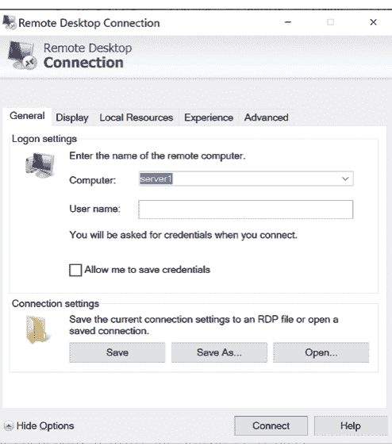


图 19.1 远程桌面连接客户端界面

一旦连接，客户端的所有操作都会发生在主机上；客户端和主机仅交换键盘、鼠标和显示流量。

`RDC` 是由微软最初创建的工具，它使用专有的远程桌面协议 (`RDP`) 在客户端和主机之间传输流量。`RDC` 允许管理员随地访问服务器，计算机访问公司工作站，并在排除人员无需旅行即可解决用户问题。

自 2001 年 Windows XP 以来，所有微软操作系统都包含了 `RDC` 客户端，现在每个其他流行的操作系统（包括手机和其他移动设备）都有客户端端口。对于单个远程用户的 `RDC` 应用程序服务器端由当前操作系统的 Pro 版本提供。Windows Server 还有一个名为桌面服务的角色，它允许客户端访问会话桌面、虚拟桌面和 RemoteApps。

### 考试贴士

现在称为远程桌面服务，基于服务器的 `RDP` 产品在 Windows Server 2008 之前称为终端服务器服务 (`Terminal Services`)。Network+ 考试的候选人应该注意文档可能以前名称出现。

### 远程桌面网关

远程桌面网关 (`RD Gateway`) 是一种角色服务，它是 Windows Server 中远程桌面服务的一个子组件。`RD Gateway` 为远程桌面客户端提供安全的加密的 `RDP` 连接，通过该连接访问服务器。此外，`RD Gateway` 还可以与网络中的其他服务器协作，为连接用户提供基于证书的身份验证和授权服务。

`RD Gateway` 设计用于在不需要 VPN 服务器的情况下安全访问远程桌面服务器和主机网络上的资源。运行 `RD Gateway` 服务的服务器通常位于边界网络，既可以从 Internet 访问，也可以访问内部网络运行的资源。连接到 `RD Gateway` 的客户端可以访问主机网络上的虚拟桌面、远程桌面服务器和 RemoteApp 。

`Telnet` 是一个简单的、基于字符的程序，允许用户连接到远程位置的计算机并执行命令。然而，`Telnet` 也是不安全的，以明文形式发送密码和其他输入。Secure Shell (`SSH`) 是一种基于字符的远程访问协议，与 `Telnet` 的主要区别在于 `SSH` 加密了客户端和服务器之间的连接。`SSH` 在允许建立连接之前还会客户端和服务器守护进程进行身份验证。

## 虚拟桌面 235


### SSH 客户端

SSH 服务器

图 19.2 SSH 安全通道的建立

`SSH` 最初是为 Unix/Linux 系统设计的，并使用相同的命令行界面，相比 `Telnet` 有了巨大的改进。这主要是因为 `SSH` 使用公钥加密确保了其所有客户端/服务器流量的机密性和完整性，如图 19.2 所示，而 `Telnet` 则以未加密的格式在网络上传输，包括用户名和密码。

## 虚拟网络计算 (VNC)

虚拟网络计算（`VNC`）是一种图形化远程控制应用程序，其功能与远程桌面连接（Remote Desktop Connection）相似，不同之处在于 `VNC` 从设计之初就被设计为跨平台。`VNC` 需要在连接的两个端都安装软件产品：客户端和服务器。还有一种协议在客户端和服务器之间传输流量，称为远程帧缓冲（`RFB`）。与 `RDC` 不同，`VNC` 软件并不随操作系统一起提供。

## 虚拟桌面

虚拟桌面是一个托管在服务器上的操作系统映像，用户可以从任何远程位置的客户端设备访问它。与 `RDC` 类似，虚拟桌面及其所有应用程序都运行在服务器上。虚拟桌面安排在服务器端使用虚拟桌面基础设施（`VDI`），该设施为不同的用户托管了多个桌面映像。用户访问虚拟桌面的设备仅充当精简客户端，与服务器交换击键输入、鼠标移动和显示流量。

这种安排具有显著的优势。用户的设备只需要足够运行虚拟桌面客户端软件的资源；在用户虚拟桌面上运行的任何应用程序实际上都是在 `VDI` 服务器上执行，使用服务器的处理器、内存、存储器和其他资源。这意味着几乎任何设备都可以作为虚拟桌面客户端使用，包括那些无法无法运行桌面操作系统的设备，例如智能手机和其他移动设备。

此外，虚拟桌面用户的所有应用程序、数据和配置设置都保留在 `VDI` 服务器上，受到公司数据中心或云端企业基础设施的保护。某些组织将所有工作站都部署为虚拟桌面。例如，用户可以在特定的文档上一直工作到下班，然后回家，将文档留存在虚拟桌面的打开状态，稍后从家里的计算机连接到同一个桌面，并从离开的地方继续工作。

某些组织在自己的数据中心维护 `VDI`，而另一些则在自己的云基础设施中实现它。云服务提供商还通过个人订阅向客户提供虚拟桌面，将其作为服务进行营销（DaaS）。

## 身份验证与授权考量

有很多远程访问解决方案，其安全能力差异很大，但它们都存在同样的根本弱点：它们像带着闪烁的灯光和霓虹“欢迎”标志一样，为你的网络打开了一扇大门。网络管理员在该门处提供的保护性质，必须是任何远程访问服务器部署的关键部分。

*身份验证*（Authentication）是所有远程用户在获取主机网络任何权限之前必须经过的基本凭据检查。许多远程访问服务器产品能够使用网络上的其他服务进行身份验证，例如 `RADIUS`、`TACACS+` 和目录（Directory）。远程访问用户的身份验证过程应该比本地用户更严谨。多因素身份验证是一种在几年前还认为是极端的做法，现在已已于常态，通常使用用户名/密码以及发送到智能手机或电子邮件地址的一次性代码。

授权（Authorization）是控制特定网络资源访问的过程，通常采用权限系统，使管理员能够精确调整对指定用户的访问。最小权限理论（即授予用户执行任务所需的最小访问权限）在远程访问中的应用甚至比对本地用户更为严格。

## 带内管理与带外管理

网络设备（如路由器）有三类网络流量，称为“平面”（planes）。数据平面和控制平面由设备处理的实际用户流量组成，而管理平面负责处理管理员在监控和配置设备时生成的流量。

在大多数情况下，网络设备对三个平面都默认使用标准网络接口。换句话说，管理流量与数据控制流量混合在一起。这被称为带内管理（in-band management），术语“带”（band）指的是设备的标准网络接口。在正常情况下，带内管理是一种完全可行的安排，但如果发生影响设备网络接口的故障，管理员可能没有任何手段访问管理平面来排排除故障。

出于这个原因，许多网络设备具有访问管理面的替代方法。任何通过非标准网络接口提供设备管理面访问的机制都被称为带外管理（out-of-band management）。

对于许多设备，其带外管理能力表现为额外的网络接口，例如以太网端口或 USB 端口，通常标记为 Console（控制台）。管理员可以将设备接入 Console，例如笔记本电脑、终端或通过拨号调制解调器，并对设备进行监控和配置。

## 认证考试核心要点

- 虚拟专用网络是客户端与网络之间的安全连接。使用互联网或任何其他载体，端点建立安全的加密连接。
- 远程控制程序允许用户对远端系统执行操作。早期应用程序如 `Telnet` 和 `SSH` 是基于字符的，仅提供命令行界面。较新的远程控制产品如远程桌面和 `VNC` 是图形化的，允许用户完全控制系统。
- 所有类型的远程访问都会引入安全漏洞。远程用户的身份验证和授权程序应该比本地用户更严格。

## 练习题 1

Ralph 是一家决定允许远程办公公司的 IT 顾问。他负责设计一种允许员工访问电子邮件和客户数据库等资源的访问解决方案。

Ralph 正在评估某些远程访问解决方案，特别关注自带的。他发现 Windows 包含了 `SSH` 和远程桌面等访问解决方案。在进行一些研究后，Ralph 不确定哪种方案更好。似乎这两种方案都需要客户端和服务器，允许用户连接到远程服务器并执行命令。

当 Ralph 测试了两个程序并看到它们的界面时，他的问题得到了解答。下列哪项选项指定了远程桌面客户端和服务器交换但 `SSH` 不交换的流量类型？

- A. 显示信息和鼠标移动
- B. 击键和应用程序数据
- C. 击键和鼠标移动
- D. 显示信息和应用程序数据

## 练习题 2

作为可能的全公司部署的测试平台，Alice 最近在公司的边界网络上安装了一个 VPN 服务器，并允许几个用户尝试，客户端到站点，使用预配置了完整 VPN 客户端的公司笔记本电脑。测试期间，所有用户都报告连接到 VPN 服务器时浏览慢得多。当他们断开连接时，浏览器速度恢复。下列哪些说法可以解释为什么连接 VPN 时网页浏览慢得多？（选择所有适用）

- A. VPN 进程减慢了计算机。
- B. 客户端的网络浏览器运行在 VPN 服务器上。
- C. 客户端正在使用远程网络的 Internet 连接。
- D. VPN 隧道限制了可用带宽。

## 练习题 1 解析

A. 正确，因为远程桌面（Remote Desktop）服务器传输显示数据，使用户能够看到服务器屏幕的副本。与 `SSH` 类似，远程桌面会将按键发送到服务器，但它们还会通过按键发送鼠标移动，而 `SSH` 则不具备。

B. 错误，因为远程桌面和安全外壳（Secure Shell）都不会在网络上传输应用程序数据，而且这两个程序都会发送按键输入。

C. 错误，因为远程桌面和安全外壳都不会在网络上交换按键信息。只有远程桌面会发送鼠标移动。

D. 错误，因为远程桌面服务器向客户端传输显示信息，远程桌面和安全外壳都不会在网络上传输应用程序数据。

正确答案：A

## 练习题 2 解析

A. 正确，因为加密和解密是计算密集型任务，这可以解释为什么连接 VPN 时性能会下降。

B. 错误，因为 VPN 仅仅是一个网络连接（尽管是受保护良好的连接），而不是远程控制解决方案。

C. 正确，当用户使用全隧道 VPN 客户端连接到远程网络时，他们就成了该网络的一员，这包含了远程网络的互联网连接。因此，所有请求和响应都必须通过 VPN 隧道，在数据加密和解密时会产生轻微的处理延迟。

D. 错误，因为 VPN 隧道并不限制连接的带宽。限制仅存在于设备到互联网的连接。

正确答案：A 和 C

# 第 20 章

# 物理安全

## 目标 4.5：解释物理安全的重要性。

**当**涉及到 IT 安全隐患问题时，许多网络管理员首先会想到基于互联网的网络攻击和软件漏洞。他们可能会忘记，入侵者也可以从正门进入并亲自攻击网络。对于企业的整体安全态而言，物理安全的重要性不低于网络安全。本章将介绍管理员在典型企业网络中经常实施的一些物理安全机制。Network+ 考试要求考生熟悉这些基本概念。

在本章中，你将学习 Network+ 目标 4.5 所需的所有知识，包括以下主题：

- 检测方法
- 预防方法
- 资产处置

## 检测方法

物理安全的两个主要领域是允许管理员监控脆弱网络设备的检测方法，以及阻止未经授权访问这些设备的预防方法。检测设备可以告知管理员何时以及如何发生了入侵，有时还可以提供入侵者身份的证据。本节将描述一些用于为网络提供物理保护的检测方法。

### 摄像头

视频监控在所有标准检测方法中捕捉的信息最多，允许网络管理员在事件发生时看到它们并对其进行记录以存档。与许多仅依赖数值数据（如访问审计）的检测方法不同，摄像头允许管理员看到不仅发生了某事，而且是谁干的。

早期的视频监控系统使用闭路电视（CCTV）摄像头通过同轴电缆连接到中央录像机。这些是专用系统，与其他任何网络隔离。今天，视频监控摄像头通常使用以太网线或 Wi-Fi 连接网络，并将信息保存为数字视频。这种安排不仅比 CCTV 更便宜（因为可以使用现有设备），还可以利用网络自身的设施。例如，以太网供电（PoE）可以通过网线为摄像头提供电力，管理员可以将摄像头交换端口放入自己的 VLAN 中，将其流量与网络其余部分分开。

### 运动检测

运动检测设备是指任何能够感知人类经过特定区域的设备。大多数人使用的运动检测器是固定在墙上的小盒子，内部含有被动式红外（PIR）传感器。人类产生热量，而热量会在红外线下显示出来，这些设备可以感知房间红外模式的变化，并产生触发警报或警示的信号。还有针对较大区域的设备，它们使用微波而不是红外。

除了红外和微波传感器外，还有许多其他类型的设备可以被视为运动检测器，包括地毯下检测脚步的压力垫、在被中断时发出警报的光电眼光束，以及对过度噪声做出反应的声传感器。与摄像头不同，运动检测器可以告知何时有人进入了保护区域，但它们无法识别是谁。

### 资产标签

资产打标记为公司拥有的硬件资产分配唯一标识符的过程，以便跟踪每台设备在物理位置和生命周期中的情况。简单来说，资产打标记解决了当公司购买了数百台计算机时，如何识别某一台特定计算机的问题。

最初，资产打标记包括在每个设备上贴上唯一编号，并将其用于所有文档（如故障工单和服务服务合同）。为了方便资产打标记的产品在多年里不断演变。第一种解决方案可能是不褪色墨水马克笔，但这很快变得不切实际。后来，可以购买带有序列化资产编号的粘性金属板套装，可以放在设备外壳外部或内部。随后出现了带有条形码的产品。

今天，资产打标记制造商通过使用射频识别（RFID）芯片或其他无线跟踪机制创建标签，大大扩展了其产品的功能。这使得网络管理员不仅能够识别设备，实际上还可以跟踪它们在设施内的位置。

# 防篡检测

防篡检测是任何可以检测特定设备、容器或设施是否被未经授权人员打开的机制。在简单的情况下，有检测胶带和贴纸，管理员可以将其放在计算机或其他设备上，当有人打开设备外壳时，胶带就会断裂。

当然，像这样的机械防篡检测设备需要有人看到断裂的胶带，这意味着需要对网络设备进行定期检查。更好的机制是它们在检测到时产生信号并通知相应的管理员。许多服务器的机箱内有开关，当有人打开时会触发。该开关通常连接到主板，以便计算机接收到防篡检测信号并采取行动，例如生成 SNMP 陷阱。

# 预防方法

在攻击或入侵发生时能够进行检测很重要，但在这些事件发生之前阻止它们要理想得多。虽然某些入侵方法涉及技术或硬件的应用，但另一些涉及到仔细的规划以及终端用户与 IT 支持人员之间的通信。本节描述了企业网络常用的攻击方法。

### 员工培训

虽然管理员可以通过应用技术防止许多类型的攻击和入侵，但重要的是，用户的数量远多于 IT 人员。只要他们知道观察什么以及在安全事件发生时做什么，他们就可以成为组织的第一道防线。员工培训就是问题的答案。

针对用户的安全培训主要由他们应该关注的可能指示事件攻击甚至正在进行的攻击的内容组成，例如钓鱼邮件、社交工程接触、尾随尝试和其他疑行为。终端用户还应该了解安全相关的政策及其原因，例如强制更改密码和多因素身份验证。

同样，IT 人员（特别是一线人员）应该接受定期培训，以跟上变化的状况和威胁。

保持信息可用，但通过小组成进行简短会议通常是传递安全信息的最佳方式。

# 访问控制硬件

最常见的访问控制硬件类型是钥匙锁。在商业环境中，钥匙很容易丢失、被盗或复制，这使得它们成为一种安全性较低的访问控制形式。许多组织仍然依赖钥匙锁，并且针对各种情况，可能配有门、大门和其他设备的组合。

除了金属钥匙外，制造锁定解决方案可能还需要次级访问控制机制。接下来描述了商业领域常见的其他一些访问控制硬件解决方案。

# 读卡器

卡片像钥匙一样，是你拥有的物品，因此也可能丢失、被借出或被盗。然而，卡片具有多项安全功能。首先，通常包含照片的卡片可以识别佩戴者的身份。根据组织的安全需求，公司政策可能要求醒眼显示身份证，并培训安全人员和用户将任何需要出示证的人视为可疑。

身份证还充当钥匙功能，提供授权进入配备读卡器安全区域的权限，无论是通过刷卡、触摸读卡器还是感应开关的形式。用身份证和读卡器取代金属钥匙可以极大地简化访问控制的管理流程。管理员可以有效地重新配置锁芯，而不是物理上更换门上的金属锁，并禁用离职员工的身份证，而不是从他们那里收集金属钥匙。

为了防止未经授权的人使用发现或被盗的卡片进入受保护区域，入口通常需要第二个认证因子，即用户知的 PIN 码或密码，并结合卡片使用。

### 生物识别

生物识别已成为一种日益流行的访问控制解决方案，因为它们基于你的个人特征，例如指纹，这些特征无法轻易被借出、丢失或被盗（尽管在电影中看到切断手指的情况除外）。指纹是最常见的生物识别指标，通常与 PIN 码或密码结合。

许多手机和其他移动设备使用生物识别访问控制，如今带有指纹扫描器和键盘的门禁设备也相对常见。视网膜扫描和掌纹也是可能的，人脸识别也是，后者不需要用户刻意参与。摄像头可以在人们靠近门时扫描其脸部并自动为授权用户解锁，让他们无延迟地通过障碍。

### 锁定机架

服务器、交换机和路由器等网络设备通常垂直安装在服务器机房或数据中心的机架中。大型数据中心通常包含并排放置并按过道排列的机架。根据所选硬件和组织的安全需求，单个机架可能是封闭的，每个都配有一扇锁门。即使机架被锁在锁定的机房或数据中心内，保持机架锁定也是一个主意，并且仅向那些需要的人提供钥匙。允许某人访问数据中心并不意味着该人员需要访问所有网络设备。

# 锁定柜

在大型数据中心内，每排设备机架都封装在透明墙柜或网格笼内，这些柜子也是锁的。在拥有多个客户设备的大型设施中，锁定柜特别必要。柜或笼可能使用金属钥匙，但之前讨论的任何基于卡片和生物识别的锁定解决方案都适用。

# 访问控制门间

非法进入安全区域的一种方法是在授权用户通过门门时紧跟在他们后面，这种技术被称为“尾随”（tailgating）。防止这种类型入侵的最佳解决方案（本章前面提到的用户教育外）是让安保人员检查身份，但这是一项昂贵的提议，在许多情况下可能不可或不实际。

另一种有效的方法（不需要安保人员）是访问控制门间，也称为防密室（mantrap）。访问控制门间是一个短走廊，两端各有一扇安全门，位于敏感区域的入口处。门的设计使得每扇门都需要某种形式的认证，当门间的一侧门打开时，另一侧的门是锁定的。这防止了多人同时通过门间。对通过门间的人进行实时或视频监控可以进一步增加安全性。

访问控制门间通常仅用于需要高安全性的设施，但门间也可以将其安全功能与其他必要功能（如环境准备解决方案）相结合。例如，进入无尘室或生物危害区域可能需要更换衣物、淋浴和其他准备工作，这些可以在门间通过用户的识别和授权完成。

# 智能储物柜

智能储物柜通常用于电子商务零售的包裹，可以作为向公司设施内特定用户分发任何物品的安全手段，如笔记本电脑和其他设备或其他包裹。

连接到互联网（或内部网络），因此它们可以验证用户。当物品被送到储物柜时，系统会向目标接收者发送电子邮件或短信，其中包含某些识别身份方式的指令，例如 PIN 码或条形码。在柜柜控制面板上输入该信息会导致正确的门解锁，为用户提供访问其内容的机会。

### 资产处置

在组织良好的 IT 部门中，硬件设备有一个记录的生命周期，应对其进行检查和维护，并确定何时更换、退役和处置。


任何价值的网络设备的设备通常涉及 IT 以外的部门。作为公司的财务资产，设备的处置必须进行记录。可能还需要考虑当地对特定类型设备环保处置的规定。

资产处置也是一个安全问题。IT 人员必须绝对确保离开公司的硬件不包含任何可用或可恢复的数据。不同类型的产品可能会有不同的退役方案。其中一些将在本节中描述。

# 出厂重置/配置清除

对于某些类型的网络，它们包含的数据仅设备配置设置。例如，托管交换机对每个端口都有单独的配置设置，以及设备本身的设置。这些设置可能包含与端口关联的 IP 地址和 MAC 地址，这些信息可用于对网络攻击。

在重置此类设备时，必须在处置前清除配置设置，称为出厂重置或配置清除。此功能通常将设备恢复到原始默认配置，消除当前所有者应用的设置。

然而，这一特定功能的实现取决于制造商，因此无法保证重置会返回之前的配置设置。IT 人员在依赖重置产生处置产品之前，应咨询设备制造商。

# 为处置清理设备

对于某些类型的设备，出厂重置或配置清除是清理设备以供处置足够的方法。但对于带有硬盘或其他存储介质的计算机或其他设备，这绝对不足够。例如，Windows 操作系统具有重置功能，可以选择从从电脑硬盘中删除用户文件，但要永久删除它们还需要更多操作。

当人在硬盘上删除文件时，文件并没有被实际擦除。硬盘只是从其文件分配表中删除了文件名，而实际数据留在... 放置位置并将存储空间标记为可用。因此，数据可以被恢复，除非有人采取措施永久地删除它。IT 部门处理各种存储介质，对它们进行清理的要求可能差异巨大，如下：

- 硬盘：对磁性介质进行清理（或清除）需要用 1 和 0 覆盖每一位数据。有一些软件工具专门设计用于执行此操作，它们符合传统的国防部 `DOD 520.22-M` 标准，该标准要求进行三次覆盖：一次全为 0，一次全为 1，一次为随机 0。可以使用强磁铁对磁性介质进行清理，从而移除所有数据。

- 固态硬盘：作为一项较晚的进展，固态硬盘（SSD）需要特殊考虑，因为无法像磁性介质那样简单地对其进行覆盖。`DOD 520.22-M` 标准未解决 SSD 的问题。美国国家标准与技术研究院（NIST）发布的较新标准——`SP 800-88` 涵盖了更广泛的数据类型。在大多数情况下，SSD 制造商提供专有命令来清除其驱动器中的数据。

当然，任何介质的终极清理方法都是销毁它。粉碎、破碎、化学溶剂和高温是用于各种介质类型的某些选项。

## CERTMIKE 考试核心要点

- 网络容易受到物理攻击，就像它们容易受到网络攻击一样。

- 检测方法允许网络管理员了解何时发生了入侵或攻击。带有位置良好的摄像头的视频监控是最有效的检测方法之一，但还有运动检测器，当未经授权的人进入受保护区域时会产生警报。

- 防护方法旨在增加攻击者渗透网络安全系统的难度。这些方法从培训员工识别可疑行为，到安装涉及 ID 卡读读器和生物识别扫描仪的复杂锁具和认证系统。

## 练习题 1

Ralph 正在参加一个部门会议，讨论如何提高公司数据中心的安全性。最近发生过一起事件，一名前员工在下班后进入了数据中心并偷取了某些物品。IT 部门被明确告知这种情况绝不能再次发生，并决定必须有某种方法来检测非工作时间进入数据中心的入侵者。Ralph 正在记录会议上其他人的提议，并最终得到了如下列表：

- 运动检测

- 视频监控

- 生物识别

- 智能卡

建议的解决方案中哪些是检测网络数据中心非工作时间入侵者的可行手段？（选择所有适用项。）

A. 运动检测

B. 视频监控

C. 生物识别

D. 智能卡

## 练习题 2

Alice 负责公司数据中心的物理安全，她最近注意到几位员工通过跟在他人身后溜门进入数据中心，而没有交换 way ID 卡。Alice 看到的这些事件只是为了方便，但她不喜欢这种通过尾随（tailgate）他人的行为。

为了解决这个问题，Alice 将数据中心的入口修改为双门设计。两扇门都配备了插卡读卡器，它们之间有一条短走廊，并且必须在一扇门关闭后另一扇门才能打开。以下哪个术语描述了这种安排？（选择所有适用项。）

A. 服务器机房

B. 间道锁 `Mantrap`

C. 蜜罐 `Honeypot`

D. 访问控制门厅 `Access control vestibule`

## 练习题 1 解析

(A) 正确，因为运动检测可以检测非工作时间空数据中心内人员的移动。

(B) 正确，因为经过适当监控的视频监控可以检测非工作时间空数据中心内的人员。

(C) 错误，因为生物识别设备是防止入侵的手段，而不是在入侵发生时进行检测。

(D) 错误，因为智能卡是防止入侵的手段，而不是在入侵发生时进行检测。

正确答案：A 和 B

## 练习题 2 解析

(A) 错误，因为服务器机房是一个包含服务器或其他设备的小型锁闭房间，不需要双门入口。

(B) 正确，因为这种人员必须通过一扇门并在关闭它后才能打开第二扇门的入口安排被称为间道锁 `mantrap` 或 访问控制门厅 `access control vestibule`。

(C) 错误，因为蜜罐是一个留作诱人入侵者的目标的未受保护的网站；它没有需要保护的物理入口。

(D) 正确，因为这种人员必须通过一扇门并在关闭它后才能打开第二扇门的入口安排被称为访问控制门厅 `access control vestibule` 或间道锁 `mantrap`。

正确答案：B 和 D

## 领域 5.0：网络故障排除

- **第 21 章** 网络故障排除方法

- **第 22 章** 排除电缆连接

- **第 23 章** 网络软件工具和命令

- **第 24 章** 排除无线连接

- **第 25 章** 排除网络问题

网络故障排除是 CompTIA `Network+` 考试的第五领域。其中，你将学习 IT 专业人员如何使用标准程序排除有线和无线网络中的问题。该领域有五个目标：

5.1 解释网络故障排除方法。

5.2 给定场景，排除常见的电缆连接问题并选择合适的工具。

5.3 根据场景，使用合适的网络软件工具和命令。

5.4 根据场景，排除常见的无线连接问题。

5.5 给定场景，排除通用的网络故障排除问题。

该领域的题目占 `Network+` 考试题目的 22%，因此你应该预计在测试中看到大约 20 道涵盖此部分内容的题目。

## 第 21 章

## 网络故障排除方法

### 目标 5.1：解释网络故障排除方法

**故障排除** 是识别问题并制定解决方案的过程。在网络环境中，有很多潜在的故障源，识别和解决这些问题可能会很复杂。因此，确保故障排除过程以系统和科学的方式进行，以便与其他人员跟踪已做了什么以及预期要做什么。在本章中，你将学习有关 `Network+` 目标 5.1 的所有知识，包括：

- 识别问题

- 建立假设

- 测试以确定原因

- 制定行动计划并识别潜在影响

- 实施解决方案并在必要时升级

- 验证功能完整性并在适用时实施预防措施

- 记录结果、操作和教训

### 识别问题

故障排除的第一步是识别具体问题。在网络环境中，这通常是过程中最困难的部分。故障排除者经常从多个来源收集信息，并权衡这些信息以解决问题过程。本节描述了这一过程的各种步骤。但是，这些步骤并不按所示顺序。

### 收集信息

在这一步中，故障排除者的角色就像现场法医调查员，收集所有有助于故障排除过程的证据。这可能包括错误消息、日志记录。此外，可能需要记录问题发生时的网络和设备状态，收集转储和日志文件，并与用户交谈他们的经历。

### 询问用户

从终端用户收集信息是 IT 人员随时间发展的一种技能。用户可能了解网络，也可能一无所知。IT 人必须学会提出正确的问题，以便从用户那里获取有关当前问题的信息。

有些用户对网络运作了解很少，甚至完全。询问这些用户需要一些技巧，在描述他们计算机中发生的情况时，不要让他们感到太困惑。例如，IT 技术可能会指导用户如何找到计算机的 IP 地址，而没有必要描述 IP 地址的细节。

### 识别症状

识别问题的症状有助于 IT 技术人员确定问题的严重程度和范围。虽然现在可能只有一个用户在报告问题，但确定其他用户是否受到影响至关重要。这不仅有助于故障排除者定位问题源，还有帮助 IT 部门建立适当的服务优先级。

例如，在网络变慢的情况下，以下问题可以帮助故障排除人员识别问题的症状：

- 是用户所有的应用程序都受到了影响，还是只有其中一部分？是哪些程序？

- 网络变慢是持续的还是间歇性的？变慢发生在何时，或在什么条件下发生？

- 其他用户是否遇到了相同的问题？哪些其他用户？

- 问题从最初的投诉起延伸到多远？是整个网络都受到了影响，还是仅影响局部区域？

### 确定是否有任何变化

IT 人员向终端用户提出的最重要的问题之一是，他们的计算机硬件、软件或配置设置近期是否发生了变化。新硬件、软件或配置设置的更改极易成为许多常见问题的根源。

然而，让用户承认更改有时可能需要额外的质询。因此，IT 人员应该熟悉日志文件以及记录此类更改的地方，以便他们能够自行判断最近进行了哪些修改。

### 复现问题（如果可能）

IT 帮助台人员最常见的经历之一是听用户告诉他们收到了一条错误信息。当被问及错误信息的内容是什么时，用户往往完全没头绪。当这种情况发生时，下一步是尝试让用户重复他们的操作来重现错误。一个可以轻松复现的问题比间歇性出现的问题要容易排除得多。

### 单独处理多个问题

问题并不一定只有一个原因。例如，用户报告网络速度显著下降，并不意味着只有一个问题导致了瓶颈。可能有多个促成因素，因此 IT 技术人员在检测到问题的一个原因后，不应停止故障排除。可能还有其他原因，因此一个良好的故障排除程序应该持续进行，直到检查了所有可能的原因为止。

当故障排除人员检测到多个各都需要修复的问题时，最佳实践是逐一处理这些问题，为每个问题创建一个单独的故障单（ticket）。这确保了每个问题都能得到应有的关注，并允许主管将各种问题委派给不同的人员。

## 建立可能原因理论

在识别问题后，科学故障排除法的下一步是对问题的可能原因假设一个理论。然而，故障排除人员想出的第一个可能原因可能并不是正确的。此时，它仍然仅仅是一个理论。事实上，可能需要对这一理论进行数次重复，并测试几种可能的原因。

## 质疑显而易见的问题

在假设问题的可能原因时，不要忽视最显而易见的原因。例如，在特定工作站发生网络通信故障的情况下，在对网络流量进行详细的协议分析之前，故障排除人员应该确保网络电缆没有插好，并确保没有遗漏其他这些简单的原因。

### 考虑多种方法

为了证明某个原因，故障排除人员应该系统地通过一个调查问题所有可能原因的过程来工作。有几种方法可以将网络过程拆解以进行检查，包括以下：

- **自上而下/自下而上的 `OSI` 模型：** 向上或向下遍历 `OSI` 模型的层级，是对与问题相关的网络过程进行全面检查的一种方法。随着故障排除人员经验的积累，他们通常会对特定类型问题的大致位置产生直觉，这使他们能够决定从顶部还是底部继续处理 `OSI` 模型更有效。

- **分治之法：** 在某些情况下，故障排除人员的直觉可能指向 `OSI` 模型中间某处的可能原因。与其浪费时间从顶层或底层开始向中间移动，不如分治之法可能更好，即故障排除人员从怀疑的层开始，从那里向上或向下操作。同样，故障排除人员可以将一个过程分解为多个子过程，并逐一检查每一个。

### 测试理论以确定原因

一旦故障排除人员有了一个可能原因理论，下一步是进行测试以确认或反驳该理论。然而，请注意，过程中的这一步仅用于测试理论的有效性。这并不是实际解决问题的时候。

## 制定行动计划以解决问题并识别潜在影响

举一个简单的例子，故障排除人员可能正在调查为什么某个服务器在网络上不可用，并得出服务器可能已关机的结论。为了测试该理论，故障排除人员应该去服务器机房查看服务器确实已关机。

然而，这并不意味着故障排除人员应该立即通过重启服务器来解决问题。可能有许多原因导致服务器关机，而解决问题需要在调查这些原因后，采取一个经过仔细计划的行动方案。在这样的简单情况下，故障排除人员应该遵循规定的方法。

根据测试结果，故障排除过程应以后方式之一继续：

**如果理论得到确认，确定解决问题的后续步骤。** 测试可能原因理论通常比肉眼检查组件要复杂得多。测试应该经过仔细计划和执行。在确认了可能原因理论后，故障排除人员可以进入下一步：制定一个解决问题的计划。

**如果理论未得到确认，建立新理论或升级。** 当测试表明故障排除人员的假设是错误的，且怀疑的情况不是问题根源时，故障排除人员必须通过制定另一个可能原因理论并对其测试来重复这一过程。如果理论是错误的，且故障排除人员无法提出其他可能原因，那么是时候在 IT 部门内部升级问题或咨询第三方了。

> 考试提示：本目标中描述的网络故障排除方法提供了高层指导，但并不包括如何识别问题、建立可能原因以及测试该理论的具体细节。

## 建立行动计划以解决问题并识别潜在影响

对于一个简单的例子，故障排除人员可能正在调查为什么某个服务器在网络上不可用，并得出服务器可能已关机的结论。为了测试该理论，故障排除人员应该去服务器机房查看服务器确实已关机。

然而，这并不意味着故障排除人员应该立即通过重启服务器来解决问题。可能有许多原因导致服务器关机，而解决问题需要在调查这些原因后，采取一个经过仔细计划的行动方案。在这样的简单情况下，故障排除人员应该遵循规定的方法。

根据测试结果，故障排除过程应以后方式之一继续：

**如果理论得到确认，确定解决问题的后续步骤。** 测试可能原因理论通常比肉眼检查组件要复杂得多。测试应该经过仔细计划和执行。在确认了可能原因理论后，故障排除人员可以进入下一步：制定一个解决问题的计划。

**如果理论未得到确认，建立新理论或升级。** 当测试表明故障排除人员的假设是错误的，且怀疑的情况不是问题根源时，故障排除人员必须通过制定另一个可能原因理论并对其测试来重复这一过程。如果理论是错误的，且故障排除人员无法提出其他可能原因，那么是时候在 IT 部门内部升级问题或咨询第三方了。

### 实施解决方案或必要时升级

一旦制定了行动计划并获得了了所有必要的批准和许可，故障排除人员就可以开始实施问题的解决方案。正如之前提到的示例一样，解决方案的实施可能只是拨一下电源开关。然而，它也可能复杂得多，需要额外的 IT 资源，例如技术人员的帮助、更换硬件组件或外部服务商的协助。

在某些情况下，特定解决方案的实施可能超出故障排除人员的职责范围，需要将案件升级给更高级的技术人员实施。例如，故障排除人员的行动计划可能包括对数据中心某些交换端口的配置进行更改。如果故障排除人员没有权限访问交换机或进行这些更改，那么他们必须将实施（或至少是部分实施）升级给获得授权的人员。

# 验证全系统功能，并在适用时实施预防性措施

在实施解决方案后，下一步是重现原始问题以确定该解决方案是否有效。如果问题仍然存在，故障排除人员将返回并尝试另一种可能的成因理论。

无论解决方案是否成功，故障排除人员都必须尝试通过检查所有返回原始问题的功能是否已正常运行，来识别所尝试的解决方案的完整影响。如果解决方案无效，那么最佳实践可能是撤销更改，以避免修改带来的任何副作用。

如果解决方案成功解决了问题，故障排除人员还应该考虑相同问题再次发生的可能性。如果可能，故障排除人员可能会提出额外的修改作为预防措施。例如，如果故障排除人员确定上一个示例中的服务器由于驱动程序问题而自动关闭，并且安装更新后的驱动程序解决了问题，那么在所有使用该驱动程序的其他服务器上安装更新可能是一个好主意。

# 记录发现、行动、结果和教训

记录故障排除过程及其结果应该是在整个过程中发生的事情，而不仅仅是在结束时。在企业网络环境中，记录故障排除人员所学到和所做的是非常重要的。这使得其他 IT 人员能够了解发生了哪些问题以及尝试过哪些解决方案。这些记录可以防止其他故障排除人员重复相同的步骤。当故障排除人员开始处理一个问题时，他们的信息收集过程的一部分应该检查是否有关于之前发生情况的文档。

文档应尽可能包含关于问题、症状及其对网络影响的细节，以及整个故障排除过程的说明，包括 IT 人员发现的所有信息和采取的行动。故障排除程序可能不会一次性完成，且不一定由同一个人完成。适当的文档使 IT 部门的任何人在需要时都能接手过程。

### CompTIA+ 考试要点

- 网络故障排除通常是一个本能过程，但在企业环境中，它应该根据记录的一系列步骤有条地进行。

- `Network+` 目标中定义的故障排除方法包括以下步骤：识别问题、假设可能的成因理论、测试该理论、设计解决问题的行动计划、实施计划、验证结果并记录整个故障排除过程。

## 练习题 1

Alice 在位于亚特兰兰的公司 IT 部门担任帮助台工作。一名用户来电报告，他们正尝试给芝加哥办公室的同事发送电子邮件，但无法发送。Alice 通过尝试识别问题的可能成因开始她的故障排除过程。她要求用户尝试发送给其他人：芝加哥的另一个用户、亚特兰大的本地用户，以及公司外的互联网用户。Alice 检查了用户的 IP 配置设置并测试了他们的本地连接。最后，她让用户确认电脑已正确插入墙上插座。

Alice 正在使用哪种方法论来建立可能的成因理论？

- A. 询问显而易见的问题

- B. 分治法

- C. `OSI` 从顶到底部

- D. `OSI` 从底向顶部

## 练习题 2

Ralph 正在调试一个由多个用户提交的网络问题。他提出了一个指定问题可能成因的理论，并开始进行测试以确认他的理论。

根据测试结果（阳性或阴性），下列哪项最可能是 Ralph 故障排除过程的下一步？（选择两个答案）。

- A. 创建一个解决问题的行动计划。

- B. 开始替换可能导致问题的组件。

- C. 重复建立可能的成因理论的过程。

- D. 重新访谈遇到问题的用户以询问显而易见的问题。

## 练习题 1 解析

A. 错误，尽管 Alice 通过让用户确认网络电缆已插入来检查了显而易见的问题，但该技术没有考虑到故障排除中的其他要素。

B. 错误，分治法不会从 `OSI` 模型的顶部开始并向下进行。

C. 正确，因为 Alice 从 `OSI` 模型的顶端（应用层）开始，检查系统的电子邮件功能，并以检查电脑到网络的物理层连接作为结束。

D. 错误，因为 Alice 的过程是从检查系统的电子邮件功能开始的，这是 `OSI` 模型顶部的应用层功能，而不是底部。

正确答案：C

## 练习题 2 解析

A. 正确，因为测试确认了 Ralph 的可能成因理论，下一步将制定一个行动计划来处理该原因并解决问题。

B. 错误，虽然通过猜测替换组件理论上可以解决问题，但它更有可能是浪费时间和硬件。


**C. 正确，因为测试表明 Ralph 的第一个可能成因理论未被采纳，下一个逻辑步骤是制定另一个理论。**

D. 错误，因为显而易见的解决方案在创建第一个理论期间就应该已经考虑过了。

**正确答案：A 和 C**

# 第 22 章 排除电缆连接故障

## 目标 5.2

给定一个场景，排查常见的电缆连接问题并选择合适的工具。

本章研究了一些基础的网络故障排除概念，并引入了 IT 技术人员在处理电缆时通常使用的工具。Network+ 考试要求候选人熟悉这些基础网络功能。

在本章中，你将学习关于 Network+ 目标 5.2 的所需知识，包括以下主题：

- 规格和局限性
- 电缆考量
- 电缆应用
- 常见问题
- 常用工具

### 规格和局限性

电缆网络具有基本规格，管理员通常使用这些为用户需求选择合适的平台。这些规格对网络产生的限制是通信问题的主要原因之一。

#### 吞吐量

吞吐量是在给定时间内跨网络传输的数据量的测量。通常以每秒比特 `bps` 计算，吞吐量是流经网络实际数据的测量。当吞吐量测量接近网络速度时，网络接近饱和状态。这会导致延迟增加，并可能导致丢包。

#### 速度

网络速度是其理论最大传输速率，通常以每秒比特测量。实际网络几乎无法达到这个最大值，因此设计网络的管理员应始终选择速度至少是其预期吞吐量需求倍数的物理层规格。例如，千兆以太网的额定速率为每秒 1000 比特 `Mbps`。虽然偶尔的流量可能会达到该速度，但网络中的许多变量防止平均网络达到并保持其最大速度。

专家提示：速度和吞吐量测量通常以每秒比特 `Mbps` 或每秒千比特 `Gbps` 提供。注意每秒比特和每秒千比特缩写之间的区别——`Mbps` 和 `Gbps`（大写 M 或 G，小写 b），以及每秒兆字节和每秒千兆字节：`MBps` 和 `GBps`。Network+ 考试候选人应该意识到这些差异及其用法。

#### 距离

距离是特定的物理层实现在正常工作时支持的最大电缆长度。在许多情况下，网络具有距离限制，以避免由于衰减（信号通过网络介质减弱）引起的信号退化。以太网还需要距离限制，因为帧在完全离开发送系统之前必须到达目标系统。如果电缆段过长，就会发生远程冲突，这是一个严重的问题。

### 线缆考虑因素

虽然对于各种网络类型有基于标准的规范，管理员在安装电缆时应遵循这些规范，但某些特定的环境因素也会决定他们所使用的电缆类型。干扰源以及在风道或其他空气通道内的安装，都是影响安装所需电缆类型的考量因素。

#### 屏蔽与非屏蔽

双线电缆有屏蔽和非屏蔽两种类型。大多数双线网络安装使用非屏蔽双线 `UTP` 版本，在该版本中，每对电线被绞绞在一起并封装在护层中。屏蔽双线 `STP` 版本——其价格均比 `UTP` 贵——旨在用于存在大量电磁干扰或其他类型干扰的环境。这可能包括带有工业设备或电磁干扰 `EMI` 源的地点。

根据电缆类型，屏蔽层（可以使用金属箔或编织线制成）可以包裹在整束电缆周围、包裹在单个线对周围，或者两者兼顾。除了防止电磁干扰到达铜线外，屏蔽层还是可以连接到接地的导体。

#### 顶板级与直升井级

标准 `UTP` 电缆有时被称为直升井级 `riser-rated`，因为它们旨在在楼层之间运行而不穿过空气空间。建筑内部的空气流通空间无论是否在风道内，都称为顶板空间 `plenums`。有特殊的顶板级 `plenum-rated` 电缆设计用于穿过这些空气空间。

直升井级和顶板级电缆的区别在于，顶板级封装在一种燃烧时不会释放毒气材料护层中。直升井级电缆具有聚氯乙烯 `PVC` 护层，如果如果在空气空间内燃烧，会产生烟雾。

顶板电缆比直升井级电缆贵，而且可能更难安装。顶板电缆的阻燃护层比标准 `PVC` 护层柔性差，这意味着顶板电缆半径较大，使其无法轻易绕过转角。

### 电缆应用

大多数 `UTP` 电缆是“直通型”布线的，这意味着电缆一端连接器中的每个引脚都与另一端的相同引脚接线。这些电缆通常有两种形式：它们是安装在墙壁或天花板内的永久电缆，将墙插连接到服务器机房或数据中心的配线架；它们是连接计算机和其他设备到墙插及配线架端口到交换机的跳线。

- 然而，正如本节所述，特殊类型电缆还有其他应用。

#### 回环电缆/控制线

路由器通常具有一个用于配置设备的命令行界面 `CLI`，但它们没有屏幕或键盘。然而，它们传统上有一个控制端口 `console port`，管理员可以在该端口插入终端或笔记本电脑并访问 `CLI`。现代路由器可以具有多种控制端口接口，但早期型号使用 `RS-232` 串行接口，配备 `DB-9` D 字型连接器。在 `USB` 出现之前，这是人们用于将外部介质连接到计算机的接口。目前的路由器可能有支持回环布线配置的 `RJ-45` 控制端口、标准的以太网 `RJ-45` 端口，甚至是 mini-`USB` 端口。

回环电缆 `Rollover cable`，也称为控制线，是标准双线设计的变体，它消除了所有的绞绞和线对。回环电缆通常是平的，不像 `UTP` 电缆那样圆滑，且呈浅蓝色。一端是标准的 `RJ-45` 连接器，另一端是 `DB-9` 连接器（如图 22.1 所示），或者是另一个 `RJ-45` 以及一个转换为 `DB-9` 的 `EIA/TIA` 适配器。

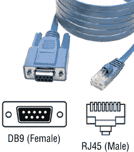

图 22.1 回环电缆

与 `UTP` 电缆不同，回环电缆中的八根线是不同的颜色，且电缆使用了非标准的布线方案。一端的引脚 1 连接到另一端的引脚 8，引脚 2 连接到引脚 7，以此此类推。

#### 交叉线

为了实现网络设备之间的通信，设备通过电缆发送对信号必须到达目标设备的接收对。标准以太网线是直通布线的，因此连接发送对和接收对的交叉电路位于网络交换机中。

然而，当用户用以太网线直接连接两台计算机时，没有交换机提供交叉电路，用户必须使用特殊的交叉线连接设备。在交叉线中，每个末端的发送对都连接到每个末端的接收对。如果需要，交叉线也可以连接两个交换机或两个路由器，但今天制造的设备都有在设备内部切换交叉电路的手段。

#### 以太网供电

视频摄像头、`VoIP` 电话和无线接入点等设备都可以从连接到缓存网络中获益。这三种设备的问题之一是，它们通常位于没有方便插座的地方，需要为它们供电。

以太网供电 `PoE` 是一项 `IEEE 802.3` 标准，通过标准以太网线为连接的设备传输电力以及数据。如表 22.1 所示，原始 2003 年 `PoE` 标准能够提供 15.4 瓦直流电，但该标准已成熟到现在可以提供高达 71.3 瓦的程度。

### 表 22.1 以太网供电规范

| way | 标准 | 直流电 | 最大电流 |
| :--- | :--- | :--- | :--- |
| PoE | IEEE 802.3af-2003 | 15.4 瓦 | 350 mA |
| PoE+ | IEEE 802.3at-2009 | 25.5 瓦 | 600 mA |
| PoE++ (Type 3) | IEEE 802.3bt-2018 | 51 瓦 | 600 mA |
| PoE++ (Type 4) | IEEE 802.3bt-2018 | 71.3 瓦 | 960 mA |

### 常见问题

排除电缆连接问题可能会由于电缆可能出现很多问题而变得复杂。本节描述了可能会遇到的常见情况。

#### 衰减

衰减是信号在通过网络介质传输时的趋势。这是所有物理层规范都有最大允许缆长度的原因之一，安装人员不应超过限制。如果电缆太长，信号会严重恶化。所有类型的网络在不同程度上都会受到衰减。

按照规律，信号在铜线上的衰减更快，因此光纤可以运行几英里。

如果电缆太长，除了拉新电缆外没有办法。大多数 `UTP` 网络距离限制为 100 米。

#### 干扰

在网络中，干扰术语是指电磁干扰 `EMI` 或射频干扰 `RFI`，两者都会对网络通信产生干扰影响。`EMI` 和 `RFI` 通常是由靠近电缆的电气或电子设备引起的。

测量线线的干扰水平是网络安装的一部分。干扰的唯一解决方案是增大电缆距离或更换为屏蔽双线 `STP`。

#### 分贝 `dB` 损耗

电缆的强度用分贝 `dB` 测量。分贝损耗是信号强度与其目的地衰减之间的比例。如所述，所有电缆类型都会受到某种程度的衰减；分贝测量是量化这种影响的方法。分贝值是对对数的，这意味着随着分贝值的增加呈指数下降。如果 10 `dB` 损耗意味着目的地强度是原始强度的分之一，那么 20 `dB` 损耗意味着信号是百分分之一。

#### 引脚错误

双线内部有八根或更多线，成对分组，每对由一个信号线和一个接地线组成。电缆每端都有一个插入计算机、墙插或配线架的连接器。连接器将电缆中的八根线连接到铜引脚，根据 `ANSI/TIA-568-D` 标准定义的引脚方案之一，正如第 3 章“电缆与连接器”中所讨论的。

错误会减慢网络流量或完全阻止连接。像音调发生器这样简单的工具可以通过手动过程定位错误的引脚，但高档电缆测试工具可以测试所有导线，并指明所发生的错误类型。

#### 故障端口

当设备无法连接到网络时，许多 IT 技术人员在故障排除过程中会更换跳线。故障电缆确实存在，尽管很常见，但故障端口也可能发生，可能是由于配置错误或硬件损坏。请记住，在一个典型的网线布线过程中涉及 `RJ45` 端口——包括计算机、墙面板、配线架和交换机——其中任何一个都可能发生故障。因此，在更换电缆时，更换端口可能是一个好主意，以防万一。

#### 开路/短路

开路和短路是由于电缆故障、损坏或安装不当导致的布线故障。开路是指信号无法到达目的地的情况，通常是因为介质中断。在双绞线中，当内部的一根或多根线被切断时，就会发生开路。短路是指两个导体接触的状态，导致信号被错误分流。例如，内部线绝缘层磨损会导致铜导体接触，从而导致可能中断连接的故障。许多类型的电缆设备可以检测布线问题，但更高级的型号可以识别问题的类型甚至是其在电缆中的精确位置。

#### 发光二极管 `LED` 状态指示器

大多数网络接口有一个或多个发光二极管 `LED` 指示器，提供有关连接的信息。状态指示器（通常为绿色）表示两个网络设备之间存在连接。指示器可能会闪烁，表示数据正在活动传输或接收。某些多速率设备具有其他 `LED`，可以根据与其他设备的协商指示连接运行的速度。

当状态 `LED` 熄灭时，说明与其他设备之间没有连接，即使它们看起来连接正常。`LED` 是物理层指示器，因此如果链路状态 `LED` 是暗的，通常意味着相关的电缆或连接器某处存在故障。

#### 错误的收发器

高速网络接口（特别是光纤）支持可插拔收发器。这允许管理员根据电缆的类型（单模或多模）和波长选择正确的收发器。电缆两端的收发器必须匹配，设备之间才能建立连接。许多插拔收发器外观相似，因此很容易混淆。当光纤链路无法连接时，检查两端是否使用了正确的收发器应该是基本的故障排除步骤。

#### 双工问题

最初，所有的以太网连接都是半双工的，这意味着连接的系统中只有一个可以同时传输数据。这是因为该协议使用单对线对同时用于传输和接收数据。从快速以太网 `100Base-T` 开始，该协议包含了全双工，它使用独立的线对用于 `TX`（发送）和 `RX`（接收）连接。这使得系统能够同时传输和接收，将链路的理论传输速度提高到 200 `Mbps`。

今天几乎所有的以太网都运行在全双工模式。在建立连接时，网络接口适配器会协商最佳速度和双工模式。当连接的设备之一或两个手动配置了双工设置时，就会产生双工问题。如果一个设备是半双工，结果会导致大量的冲突和错误，严重降低网络性能。

管理员通常允许工作站自动协商双工和速度设置。然而，他们手动配置交换机和路由器上的接口更为常见，在这种情况下可能会意外发生双工不匹配。在排除具有过度冲突的慢速以太网故障时，双工设置是过程早期需要检查的配置设置之一。

### 发送和接收 `TX/RX` 反反

如所述，`UTP` 以太网线应该是直通布线的，交叉电路实现在交换机中。如果由于某些安装错误，导致电缆两端的发送 `TX` 和接收 `RX` 电路反反，这应该是基本的故障排除步骤。当光纤链路无法连接时，检查两端是否使用了正确的收发器应该是基本的故障排除步骤。（注：原文此处逻辑似乎重复，翻译已按原意保留）

*修正：根据原文逻辑，此处应为“反反”的描述：*

如果由于某些安装错误，导致电缆两端的发送 `TX` 和接收 `RX` 电路反反，这应该是基本的故障排除步骤。当光纤链路无法连接时，检查两端是否使用了正确的收发器应该是基本的故障排除步骤。

交叉纤，，交叉交叉交叉交叉，，，光缆的交叉。

### 脏光光缆

在安装光缆时，必须彻底清洁光缆。光纤信号信号会阻止进入光纤的光束，增加衰减。清洁光纤末端不需要特殊设备，只需

## 常用工具

电缆故障排除需要专用工具，某些非常昂贵。然而，通常有相对廉价的替代方案。故障排除人员常用的工具包括：

- **压接钳**：一种像钳子一样的设备，通过闭合连接器连接批量电缆。有不同电缆和连接类型的压接钳。
- **打线刀**：将双对电缆连接到墙面板和配线架的设备。安装人员将线放在连接器的正确槽内，使用打线刀将其压入。在操作中，该工具去除线端的绝缘层，将其压入并修剪。
- **信号发生器和探测仪**：用于识别双对电缆中特定线的基础便宜工具。将发生器连接到一根线后，用探测仪接触电缆另一端将产生选线的信号。作为基础故障排除工具，它有用途，特别是在没有更复杂的测试设备时。然而，将该工具用于任何工程都是耗时的。
- **环回适配器**：将电缆或连接器的信号重定向回输入的测试设备。最常用于光纤，将环回适配器插入链路的一端，允许另一端的 `OTDR`（见下项）一次测试整个链路。还有用于以太网环环适配器，可以测试其发送和接收电路是否，但很少见。
- **光时域反射仪 `OTDR`**：用于光电缆的高端测试设备，通过光脉冲通过光纤测量链路长度、定位断点并测量信号损耗。铜电缆的类似设备称为时域反射仪 `TDR`。
- **万用表**：测量电压、连续性和电阻的测试设备。虽然不用于测试网络线，但在网络故障排除中有时需要测试交流直流电源的电平。
- **电缆测试仪**：连接电缆并读取其规格的设备统称。低端模拟电缆测试仪向电缆中的每对线发送脉冲并使用 `LED` 指示线是否正确连接到另一端。高端电缆测试仪是数字设备，可以显示更大的规格列表，并与特定电缆类型的公布要求进行比较。有时称为电缆认证器，这种设备测试电缆并显示电缆类型的通过/失败结果列表。

# 第 22 章 • 电缆连接的故障排除

**线图 `Wire Map`** 线图测试仪是一种廉价的电缆测试工具，由两个设备组成，连接到双绞电缆的两端。测试仪会检查电缆中的每根线，并可以检测开路、短路和线序反接。所有新安装的电缆至少应该通过这种方式进行测试，但该工具对于跳线电缆和排除故障电缆的故障也非常有用。高端测试仪具有相同的功能，但价格昂得多，而线图测试仪是一个合理的替代方案。

**分接器 `Tap`** 一种主动或被动的网络测试，允许管理员和故障排除人员物理访问特定网络连接上的包，并捕获流量样本进行分析。

**熔接器 `Fusion Splicers`** 一种光缆安装设备，能够以极高的精度和高温将两根光纤端对端地连接。

**频谱分析仪 `Spectrum Analyzers`** 一种网络分析工具，用于监控特定范围内音频、光或无线电频率的利用率。该工具通常用于监控 `Wi-Fi` 网络的信道利用率和干扰源。

**剪钳/剪刀 `Snips/Cutters`** 它们并不昂贵，也不是专门的网络工具，但一把好的剥线钳或剪刀可能是电缆故障排除人员工具箱中最频繁使用的工具。

**剥剥线器 `Cable Stripper`** 一种像剪刀一样的布线工具，它具有的不是刀片，而是 V 型刀片，旨在在不损坏核心导体的情况下去除电线的绝缘层。

**光功率计 `Fiber Light Meter`** 一种光缆测试设备，根据在电缆另一端应用的参考光源测量值，测量电缆段的信号损耗。

## CERTMIKE 考试要点

- 网络电缆具有安装人员应遵守、故障排除人员应检查的规格，包括吞吐量 `throughput`，衡量网络上的实际流量大小、速度 `speed`，即最大可能的传输速率以及距离 `distance`，规定了电缆段的最大长度。
- 在评估网络安装的电缆时，IT 人员还必须考虑是否需要 `STP`（屏蔽双绞线，具有防止外部干扰的屏蔽层）或天花板级节点 `plenum-rated cables`，其外壳在燃烧时不会产生有毒烟雾。
- 网络故障排除人员经常遇到布线故障，例如铜缆网络中的开路、短路和发送/接收线反接，以及光纤网络中的光纤脏污、欺骗故障和错误的收发器。

## 练习题 1

一家第三方电缆承包商刚刚为 Ralph 的公司在新办公空间安装了 `CAT 6 UTP` 布线，Ralph 负责检查他们的工作。他在每根新电缆上连接了线缆测试仪，发现其中一根有短路。以下哪个程序最可能简单解决问题？

- A. 将电缆远离任何潜在的电磁干扰源。
- B. 在电缆的两端使用不同的引脚定义。
- C. 使用 `CAT 6a UTP` 重新安装电缆段。
- D. 替换电缆段两端的连接器。

## 练习题 2

Alice 在一家公司担任 IT 技术员，该公司刚刚搬进新的办公空间，该建筑已预留了双绞以太网线。所有其他网络组件都从旧地点搬来。IT 团队安装了千兆以太网设备并将其连接到建筑的电缆段后，Alice 负责设置一组工作站作为测试网络。然而，网络性能很差。

在分析了一些捕获的数据包后，Alice 发现有许多以太网帧被重传。接着，她检查了吊顶天花板内的电缆段并对其进行了测量。电缆没有超过网络允许的最大长度，附近也没有主要的电磁干扰源。以下哪项可能是导致丢帧和网络性能低下的可能问题？

- A. 现有电缆不符合千兆以太网的使用额定。
- B. 电缆末端的收发器不匹配。
- C. 电缆安装的是 `RJ11` 连接器而不是 `RJ45`。
- D. 电缆安装的是 `RJ45` 连接器而不是 `RJ11`。

## 练习题 1 解析

A. 远离潜在的电磁干扰源无法解决短路问题。

B. 在电缆的两端使用不同的引脚定义可能会解决线序问题，但不是短路。

C. 使用 `CAT 6a UTP` 重新安装电缆段并不是最简单的方法。

D. 替换电缆段两端的连接器最可能解决短路问题。

## 练习题 2 解析

A. 现有电缆不符合千兆以太网的使用额定（可能是 `CAT 5` 或更）。

B. 电缆末端的收发器不匹配可能导致性能问题。

C. 电缆安装的是 `RJ11` 连接器而不是 `RJ45`，这会导致网络无法工作。

D. 电缆安装的是 `RJ45` 连接器而不是 `RJ11`，此选项描述是反的。

正确答案：B

# 网络软件工具与命令

# 目标 5.3：给定场景，使用适当的软件工具和命令

本章检查某些网络工具和命令。Network+ 考试要求候选人熟悉这些工具。在本章中，你将学习有关以下内容的知识：


## 软件工具

除了描述的硬件工具外，故障排除人员通常可以使用软件工具。本节介绍了这些工具。

### Wi-Fi 分析仪

Wi-Fi 分析仪是一种软件产品，它可以扫描标准网络频率并显示其发现的网络信息。该功能集成在许多昂贵的工具中，也有免费版本。

用于检查无线网络流量，Wi-Fi 分析仪通常会显示其发现的网络列表，以及关于每个网络的额外信息，如：

- SSID 指定网络名称
- 信号强度相对于用户接入点的信号功率水平（分贝毫瓦）
- 信道识别使用当前频段的网络
- 信道宽度指定网络当前使用的信道宽度（MHz）
- MAC 地址指定网络接入点的十六进制 MAC 地址
- 加密协议指定网络用于加密和解密传输的协议

某些产品还包含流量的可视化图表

### 协议分析仪/包捕获

分析和包捕获术语指的是通过不同方法的工具。包捕获工具也称为嗅探器或网络监控，允许技术人员捕获流量样本并将其保存到缓冲区供以后分析。协议分析仪解释捕获的流量并将其显示出来检查。捕获网络流量的过程取决于所使用的工具、工具连接的网络段以及执行捕获的计算机的网络适配器的能力。

该协议分析器使用系列解析器来解释数据包中每个协议的数据。例如，图 23.1 显示了包含 ICMP 回显请求（Echo Request）消息的数据包的协议分析器显示。在以太网线上，工具已从以太网头部解析出一个类型代码（Type code），表明帧包含 IP 数据。同样，工具还解析了 IP 地址的“后续协议”（Next Protocol）字段，指示数据包含一个 ICMP 消息。每一行都会显示出来，使人员能够详细检查每个协议。

| 帧号: 3, 帧长度: 94, 媒体类型: ETHERNET |
| :--- | :--- |
| Ethernet: Destination = 00:00:5E:00:53:66, Source = 00:29:5B-29-D2 |
| IPv4: Src = 10.0.0.11, Dest = 10.0.0.2, Protocol = ICMP, Packet ID = 2823, IP Length = 60 |
| ICMP: Type = Echo Request, Code = 0 |
| Checksum = 3719 (xe4d6) |
| ID = 1 |
| Sequence Number: 0 (0) |
| ImplementationSpecificData: Binary Large Object (32 Bytes) |

图 23.1 在协议分析器中显示的 ICMP 数据包

### 带宽测试器

许多人对基于 Web 的网络速度工具非常熟悉，这些工具通过向用户服务提供商（ISP）的服务器执行下载和上传来工作。通过测量在特定时间内发送和接收的数据量，工具可以显示互联网连接的上下行速度。

IT 故障排除人员还可以使用带宽测试工具来测量内部网络连接的吞吐量。该软件工具包括客户端和端服务器，安装后它们以相同的方式交换流量。这种工具的优点是它能够让技术人员量化网络速度，并与之前的读数或用户报告网络慢的情况进行比较，从而客观地判断这种说法是否属实。

### 端口扫描器

端口扫描器是一种向指定服务器发送系列查询消息并等待响应的软件。消息包含针对服务器每个端口的查询，响应则指示哪些目标端口是开放的或被防火墙拦截的（除非应用程序需要）。端口扫描器是一种方便的测试方法。端口扫描器也是确定与特定端口关联的应用是否正常运行的一种快速简单的方法。

### iPerf

`iPerf` 是一个客户端/服务器应用程序，可以测量特定网络连接上可实现的实际吞吐量。该工具值得一提，因为它是开源的，并且已移植到许多平台，包括 Windows、移动操作系统以及各种 Linux 和 Unix 发版。这为故障排除人员提供了一个高度通用的测试平台。

安装 `iPerf` 客户端和服务器后，用户选择工具将使用的协议和端口来生成发送到服务器的流量。客户端用大量的流量淹没连接，而服务器则计算其吞吐量。

### NetFlow 分析器

NetFlow 是一种定义性工具，用于收集网络接口处理的流量信息并将其发送到中央控制台进行分析。有很多 Net-Flow 实现，但大多数基于标准的监控架构，由三个元素组成：

- 导出器 (`Exporter`)：收集设备入站和出口流量的信息，包括 IP 地址、端口和协议，并将其转发到收集器。
- 收集器 (`Collector`)：接收、整理并存储来自网络上导出器的流量数据。
- 分析器 (`Analyzer`)：使用收集器提供的流量数据创建报告并可视化网络状况，通常使用图表。

许多路由器和交换机都内置了标准-NetFlow 导出器支持，控制台产品可能会将收集器分析器的功能合并为一个应用程序。

### 简易文件传输协议 (TFTP) 服务器

与文件传输协议（FTP）不同，简易文件传输协议（TFTP）不需要身份验证且不提供用户界面。TFTP 是根据请求向客户端提供文件的服务器应用程序。

TFTP 服务器通常是免费软件并有多用途。使用预启动执行环境（PXE）的工作站从动态主机配置协议（DHCP）服务器获取初始设置地址，然后从 TFTP 服务器下载引导程序。同样，管理员经常使用 TFTP 服务器作为路由器和交换机升级下载以及网络设备配置备份的源。

### 终端模拟器

大型机时代，计算机的所有处理器、内存和存储都位于一起，用户通过终端访问计算机，而终端可以位于其他地方。终端是一个没有智能的输入输出设备。今天，仍然有一些网络设备（特别是交换机和路由器）需要终端来访问其命令行界面（CLI），因此管理员使用一种名为终端模拟器的程序，它使计算机或其他设备能够充当简单的终端。终端模拟器通过直接电缆连接或网络协议（如 Telnet 或更常见的 Secure Shell SSH）连接到设备。

### IP 扫描器

IP 扫描器与端口扫描器类似，不同之处在于向 IP 地址范围发送消息并等待回复。这使得技术人员确定哪些地址正在使用。然而，某些扫描器使用 ICMP 回显请求消息作为 ping 工具，这可能会被防火墙过滤，导致扫描器失效。

## 命令行工具

大多数操作系统都包含一组命令行工具，如 `ping`、`traceroute` 等。`Ping` 是一个简单的工具，向指定的主机名发送 ICMP 回显请求消息以确定其是否可达。它还可以显示响应的往返时间和 TTL（生存时间）值。`Traceroute` 是另一个显示数据包到达目的地所需路径的工具，列出沿途的每个路由器。

在使用 DHCP 进行地址分配时，`ipconfig` 是学习系统地址容易的方法。也可以使用 `ifconfig` 释放和刷新 DHCP 分配。

在 Unix 和 Linux 上，标准的 `ifconfig` 可以显示接口信息并修改其配置，`ifconfig` 使用了不同的输出格式，如下所示：

```
eth0: flags=4163 <BROADCAST,RUNNING,MULTICAST> mtu 1500
inet192.168.1.45 netmask 255.255.255.0 broadcast 192.168.1.255
inet fe80::215:dff::fe0:95aa%14 prefixlen 64 scope 0x28<link>
ether 08:15:52:00:f8:04 txqueuel 1000 (Ethernet)
RX packets 53064 bytes 78323568 (78.3 MB)
RX errors 0 dropped overruns 0 frame
TX packets 33235 bytes 243084 (243.0 KB)
TX errors 0 dropped overruns 0 carrier 0 collisions 0
```

`ip` 工具是另一种 Unix/Linux 程序，在某些发行版中取代 `ifconfig`。该工具可以显示和配置接口设置，类似于 `ifconfig`，但它还能做很多工作，包括静态路由、多播、隧道和 ARP 表。

### Nslookup/Dig

`Nslookup` 是一个域名系统（DNS）工具，存在于 Windows 和 Unix/Linux 平台上，允许用户通过命令行或交互方式将主机名和域名解析为地址。默认情况下，输入 `nslookup www.contoso.com`

根据计算机的默认 DNS 服务器，在命令行输入可以返回与该服务器名称关联的 IP 地址。

然而，对于故障排除人员来说，`nslookup` 最实用的功能之一是：它具有向特定服务器定义名称解析查询的能力。有时，名称解析问题可能是由于 DNS 记录尚未传播到互联网上的所有名称服务器。通过重定向查询，你可以确定特定服务器是否拥有最新信息。

`Dig` 是一种 Unix/Linux 工具，在功能上与 `nslookup` 几乎相同，尽管它显示结果的方式有所不同。`Dig` 没有像 `nslookup` 那样的交互模式，这也就是为什么某些 Unix/Linux 发行版同时包含了这两个工具。

### Traceroute/Tracert

网络数据包到达目的地所经过的路径称为路由。路由由“跳”（hops）组成，即数据包从一个路由器到另一个路由器的单独旅行。互联网任务的源和目的地之间的路由可能有 20 个或更多跳。

Unix/Linux 上的 `traceroute` 工具和 Windows 上的 `Tracert` 程序会显示通往指定目的地的路由跳数列表。这些工具通过发送一系列 ICMP Echo 请求消息（其 IP 头中的值逐渐增大）来实现的。这会导致消息在每一跳处失败并向源端返回错误消息。错误消息包含每一跳路由器的 IP 地址，Windows trace 命令以如下显示列出：

```
Tracing to www.finartchool.co.uk [173.146.1] over a maximum of 30 hops:
| <10 ms 1 ms <10 ms 98 ms qrvl-6terminal01.cpandl [131.107.24.67.3]
| 105 ms 92 ms 98 ms qrvl.cpandl [131.107.67.1]
| 110 ms 118 ms 98 ms svrcr3-7b.cpandl [131.107.103.125]
| 123 ms 109 ms 118 ms clsm2b2-4.cpandl [131.107.08.26]
| 123 ms 112 ms 114 ms sl-g119-pen-6-1-g73-f.fabrikam.com [157.54.51.165]
| 136 ms 130 ms 133 ms sl-bb20-pen-12-0.fabrikam.com [157.54.5.1]
| 146 ms 129 ms 133 ms sl-daemon-1-0.fabrikam.com [157.54.5.1]
| 147 ms 149 ms 152 ms sl-daemon-1-0.fabrikam.com [157.54.173.10]
| 230 ms 225 ms 226 ms tele-back-1-ge023.router.adatum.co.uk [157.60.173.12]
| 236 ms 220 ms 226 ms tele-core-3fpl1.router.adatum.co.uk [157.60.252.56]
| 236 ms 221 ms 226 ms tele-service-2-165.router.adatum.co.uk [157.60.139.34]
| 1222 ms 224 ms 210 ms www.finartchool.co.uk [206.718.65]
Trace complete.
```

# 第 23 章 • 网络软件工具与命令

`Traceroute` 在大型企业网络中是一项非常有价值的工具，因为它能为故障排除人员提供数据包通过网络时路由的信息。例如，在示例显示中，请注意当路由将数据包从北美传输到英国的服务器时，往返时间从 100 级跳跃到 200 级。

### Arp

如第 11 章所述，“地址解析协议（ARP）”是一种数据链路协议，系统使用它将 IP 地址解析为媒体访问控制（MAC）地址。然后将该对项保存到 ARP 表中，以节省内存供重复使用。除了协议本身外，Windows 和 Unix/Linux 中还有 `arp` 实用程序允许用户显示并修改 ARP 表的内容。在命令行运行 `arp -a` 会产生如下的显示：

```
Interface: 192.168.1.2
Internet Address Physical Address Type
192.168.1.1 00-80-e7-e5 dynamic
192.168.1.11 84-b8-d8-69 dynamic
192.168.1.14 20-ef-bd-33 dynamic
192.168.1.16 1c-e3-ae-42 dynamic
192.168.1.23 9e-d3-cf-c3 dynamic
```

### Netstat

`Netstat` 是 Windows 和 Linux 的命令，可以显示关于系统 TCP 和 UDP 连接的各种网络统计数据。运行 `netstat` 不带参数会显示当前的打开会话：

| 协议 | 本地地址 | 外部地址 | 状态 |
| :--- | :--- | :--- | :--- |
| TCP | 127.0.0.1:4994 | | ESTABLISHED |
| TCP | 127.0.0.1:5923 | | ESTABLISHED |
| TCP | 192.168.1.21:57617 | | ESTABLISHED |
| TCP | 192.168.1.21:57633 | | TIME_WAIT |
| TCP | 192.168.1.21:57638 | | TIME_WAIT |
| TCP | 192.168.1.21:57662 | | ESTABLISHED |
| TCP | 192.168.1.21:57674 | | ESTABLISHED |
| TCP | 192.168.1.21:57680 | | ESTABLISHED |
| TCP | 192.168.1.21:57681 | | ESTABLISHED |
| TCP | 192.168.1.21:57684 | | ESTABLISHED |
| TCP | fe80::4445 | | ESTABLISHED |
| TCP | fe80::55341 | | ESTABLISHED |
| TCP | fe80::57700 | | TIME_WAIT |

加上命令行参数，`netstat` 还可以显示系统的监听端口、以太网包计数以及 IPv4 和 IPv6 包计数。

### Hostname

`Hostname` 是 Windows 和 Unix/Linux 系统上的简单实用程序，返回当前计算机或主机的名称。它没有命令行参数或其他功能。然而，当 IT 技术人员同时处理多个系统时，他们需要快速确认自己正在访问哪一个。

### Route

`Route` 是 Windows 和 Unix/Linux 的实用程序，用于访问系统的路由表。所有 TCP/IP 主机都有路由表（如第 10 章“路由与带宽管理”所述），无论它们是否作为连接网络的路由器。在 Windows（或 Unix/Linux）中运行 `route print -n` 命令可以显示 IPv4 和 IPv6 系统路由表的内容。除了显示路由表，`route` 实用程序还可以允许管理员添加、修改和删除路由条目。

### Telnet

`Telnet` 是一种通信协议，允许用户连接到远程计算机并在那里执行命令。除了协议本身，`Telnet` 还包含一个允许用户启动连接的简单 CLI。几乎所有的 Unix/Linux 发行版默认安装了 Telnet。Windows 工作站也包含 Telnet 客户端，但用户必须在“Windows 功能”对话框中启用它才能使用。`Telnet` 可以帮助故障排除人员确定网络上的系统是否运行，但重要的是记住 `telnet` 通过网络传输的是明文，包括密码。安全 Shell SSH 程序与 `telnet` 类似，但它以加密格式传输数据。

### Tcpdump

`tcpdump` 工具仅用于 Unix 和 Linux 平台，它可以捕获特定网络接口上传输和接收的数据包并显示它们。通过命令行参数，用户可以过滤数据包，仅保存与特定应用层协议相关的 IP 地址或端口号的数据包。

Internet 地址为 131.108.28.8，子网掩码为 255.255.255.0

MTU 1500 字节，带宽 10000 Kbit，未设置环回，DLY 100000 使用，依赖 255/255，负载 1/255

封装 ARPA，ARP 超时 4:00:00，保活（设置为 10 秒）

ARP 类型 4:00:00，输出挂起从

上一次输出 0:00:00，输出 0:00:00，

上一次清除“show interface”计数器 00:00:00

输出队列 0/40，0 丢弃；输入队列 0/75，0 丢弃

五分钟输入速率 0 bits/sec，4 个数据包/sec

五分钟输出速率 2000 bits/sec，4 个数据包/sec

1134576 个数据包输入，44835121 字节，0 缓冲区

接收 351125 个广播，0 运行，0 巨型包

0 输入错误，0 CRC，0 错误，0 溢出，0 忽略或中止

5331142 个数据包输出，49617239 字节，0 欠载

0 输出错误，422 次冲突，0 接口重置，0 重启

### show config

许多路由器和交换机上的 `show running-config` 命令显示设备内存中的配置。要显示存储在设备非易失性内存中的配置，请使用 `show startup-config` 命令。这些命令的输出（下文所示）采用批处理形式，即管理员可以在设备接口上执行的一系列命令。


```
enable
config terminal
card 2
type en40portG
no shutdown
ib sm subnet-prefix fe:80:00:00:00:00:00:00 priority 0
interface gateway 2
ip address 192.168.1.1 255.255.255.0
interface ethernet 2/1
ip address 192.168.4.1 255.255.255.0
interface ethernet 2/2
ip address 192.168.3.1 255.255.255.0
arp ib 192.168.2.2 gid fe:80:00:00:00:00:00:00:02:c9:00:13:68:c3
qp 2/0
arp ib 192.168.2.3 gid fe:80:00:00:00:00:00:00:02:c9:00:00:16:a
f:d3 qpn 2/0
```

### show route

许多网络设备上的 `show ip route` 命令显示当前内存中的路由表，格式类似于下：

# 28 6 第 23 章 · 网络软件工具与命令

```
代码：I - IGRP 衍生，R - RIP 衍生，O - OSPF 衍生
C - 连接的，S - 静态，E - EGP 衍生，B - BGP 衍生
* - 候选默认路由，IA - OSPF区域路由
E1 OSPF 路由类型 1，E2 - OSPF 路由类型 2
默认网关是 131.119.254.240，通过 129.140.0.0
E 150.150.0.0 [160/5] 经 131.119.254.6, 0:01:00, Ethernet2
OE2 168.132.0.0 [160/5] 经 131.119.254.6, 0:00:59, Ethernet2
E2 130.130.0.0 [160/5] 经 131.119.254.6, 0:00:59, Ethernet2
E 128.128.0.0 [208/128] 经 131.119.254.244, 0:02:22, Ethernet2
E 192.65.129.0 [208/128] 经 131.119.254.244, 0:02:22, Ethernet2
131.131.0.0 [208/129] 经 131.119.254.244, 0:02:22, Ethernet2
E 192.75.139.0 [208/129] 经 131.119.254.240, 0:02:23, Ethernet2
E 141.140.0.0 [208/129] 经 131.119.254.240, 0:02:23, Ethernet2
```

许多网络设备上的 `show ip route` 命令显示当前内存中的路由表，格式如下：

默认网关是 131.119.254.240，通过 129.140.0.0

E 150.150.0.0 [160/5] 经 131.119.254.6, 0:01:00, Ethernet2

OE2 168.132.0.0 [160/5] 经 131.119.254.6, 0:00:59, Ethernet2

E2 130.130.0.0 [160/5] 经 131.119.254.6, 0:00:59, Ethernet2

E 128.128.0.0 [208/128] 经 131.119.254.244, 0:02:22, Ethernet2

E 192.65.129.0 [208/128] 经 131.119.254.244, 0:02:22, Ethernet2

131.131.0.0 [208/129] 经 131.119.254.244, 0:02:22, Ethernet2

E 192.75.139.0 [208/129] 经 131.119.254.240, 0:02:23, Ethernet2

许多路由器和交换机上的 `show running-config` 命令显示内存中的配置。要显示存储在设备非易失性内存中的配置，请使用 `show startup-config` 命令。这些命令的输出采用批处理形式，即管理员可以在设备接口上执行的一系列命令。

```
enable
config terminal
card 2
type en40portG
no shutdown
ib sm subnet-prefix fe:80:00:00:00:00:00:00 priority 0
interface gateway 2
ip address 192.168.1.1 255.255.255.0
interface ethernet 2/1
ip address 192.168.4.1 255.255.255.0
interface ethernet 2/2
ip address 192.168.3.1 255.255.255.0
arp ib 192.168.2.2 gid fe:80:00:00:00:00:00:00:02:c9:00:13:68:c3
qp 2/0
arp ib 192.168.2.3 gid fe:80:00:00:00:00:00:00:02:c9:00:00:16:a
f:d3 qpn 2/0
```

### show route

许多网络设备上的 `show ip route` 命令显示当前内存中的路由表，格式如下：

代码：I - IGRP 衍生，R - RIP 衍生，O - OSPF 衍生

C - 连接的，S - 静态，E - EGP 衍生，B - BGP 衍生

* - 候选默认路由，IA - OSPF区域路由

E1 OSPF 路由类型 1，E2 - OSPF 路由类型 2

默认网关是 131.119.254.240，通过 129.140.0.0

E 150.150.0.0 [160/5] 经 131.119.254.6, 0:01:00, Ethernet2

OE2 168.132.0.0 [160/5] 经 131.119.254.6, 0:00:59, Ethernet2

E2 130.130.0.0 [160/5] 经 131.119.254.6, 0:00:59, Ethernet2

E 128.128.0.0 [208/128] 经 131.119.254.244, 0:02:22, Ethernet2

E 192.65.129.0 [208/128] 经 131.119.254.244, 0:02:22, Ethernet2

131.131.0.0 [208/129] 经 131.119.254.244, 0:02:22, Ethernet2

E 192.75.139.0 [208/129] 经 131.119.254.240, 0:02:23, Ethernet2

# ESSENTIALS

默认情况下，`show ip route` 显示路由表。要查看更多信息，请使用以下命令。

常用的故障排除工具包括：

- Ping
- Traceroute
- NSlookup
- Netstat
- Ipconfig
- Route

哪些工具使用了互联网消息协议（ICMP）消息？（选择所有答案。）

- Netstat
- Ping
- Ipconfig
- Traceroute
- Route

# Troubleshooting Wireless Connectivity

## 目标 5.4：给定场景，排除常见的无线连接问题。

本章检查了涉及无线网络故障排除的一些特殊问题和程序。Network+ 考试要求候选熟悉这些概念。

在本章中，你将学习关于 Network+ 目标 5.4 的所有知识，包括以下主题：

+   * 规格和限制
* 考虑因素
* 常见问题

## SPECIFICATIONS AND LIMITATIONS

正如第12章“无线标准”中所过的，无线网络技术具有规范网络设计和安装的规格和限制。这些相同的规格将在后续章节中讨论，在许多情况下也是无线网络故障排除过程的起点。

### 吞吐量

吞吐量是网络设备实际传输数据的速率，与无线标准和硬件制造商指定的理论速率额定不同。与有线网络相比，无线网络有得得变量会影响其吞吐量。

由建筑结构引起的干扰是一个相对稳定的干扰源，技术人员可以在网络初始现场勘测时将其绘图并记录。然而，还有许多其他潜在的无线干扰源，它们是瞬态的，例如从不同位置访问网络的移动用户、在同一信道上进行的其他附近工作，以及天气状况。

虽然 IT 技术人员在设计过程中会对无线网络站点进行勘测，但状况随时可能变化，从而影响其性能水平。这就是为什么无线网络吞吐量问题的故障排除过程本质上每次发生问题时都必须从头开始。故障排除人员必须调查那个时刻的网络状况，这些状况可能与之前的任何时候都有显著不同。

### 速度

无线网络的额定速度是设备在理想条件下的理论最大吞吐量。IT 技术人员对无线网络理论速度能得出的唯一确定结论是：实际实现的网络永远无法达到该速度。IEEE 802.11 无线标准都为符合规定说明的网络指定了速度额定值。然而，即使没有由于冲突设备和建筑障碍引起的干扰，正常的网络运行条件仍然可能阻止设备达到网络的额定速度。

面对看似缓慢的无线网络时，故障排除人员应该意识到，未能达到网络的额定速度并不意味着一定出了问题。应该将网络性能与早日实际网络上的基准性能读取或理论-

### 距离

在无线网络上，随着设备与无线接入点（WAP）之间距离的增加，信号会衰减（变弱），吞吐量会下降。最终，离 WAP 太远的无线设备将开始断断续连接。然而，在无线网络上，距离 WAP 多远才算太多是一个很难回答的问题。

影响无线连接的因素比有线网络多得多，很难根据协议规范精确确定距离限制。距离 WAP 的距离是一个因素，但还有以下问题：

- 网络正在使用的频段
- 设备具有什么种类型的天线
- 天线位于什么位置
- 建筑是如何建造的
- 有多少其他网络在使用相同的频率和信道

随着 802.11 标准多年来的发展，由于多输入多输出（MIMO）等技术的改进，无线网络连接可以实现的潜在距离有所增加，因此在设计过程中选择无线标准应作为网络必须跨越的距离的一部分。

### RSSI 信号强度

接收信号强度指示（RSSI）是量化客户端设备接收到的无线网络信号强度的手段。大多数手机和其他设备以信号格数显示信号，这是对实际 RSSI 信号值较不精确的表示。

RSSI 不是相对于既定功率标的绝对测量值。相反，它是基于设备制造商指定的任意刻度的相对测量值。一些无线接口制造商使用 0 到 100 的刻度，而另一些的则具有不同的值范围。许多无线网络监控工具可以使用 RSSI 值测量信号强度，为故障排除人员提供特定位置信号强度的更准确读取。

### EIRP 功率设置

有效等向同性辐射功率（EIRP）是根据传输强度和天线增益计算出的天线可以向单个方向发射的射频（RF）测量值。EIRP 以等向同性分贝（dBi）测量。计算 EIRP 的公式如下：

```
EIRP = 发送器功率–电缆损耗 + 天线增益
```

具有足够增益的天线使设备能够在较低的功率水平传输，从而节省电池寿命。使用 EIRP 值，故障排除人员可以节省发射器的相对功率并根据需要调整功率水平。

### 注意事项

与有线网络相比，无线局域网有更多需要考虑的会影响网络性能的变量。IT 技术人员在设计或排除故障时，应该考虑本节讨论的所有因素。

### 天线

第 12 章讨论了天线在无线网络中的作用以及可用的某些天线类型。所有无线设备都至少有一个天线。虽然智能手机和其他移动设备有天线更换和增强产品，但大多数故障排除工作集中在 WAP 天线上，因为它们更容易配置。在排除无线问题时，请考虑 WAP 天线的以下方面：

解决无线问题有时只需将接入点移动到不同的位置即可。如果某些无线设备可以轻松访问网络而另一些遇到困难，请将天线移动到更中心的位置。如果建筑外的未经授权的用户正在访问网络，将天线远离墙。

接入点的位置也受使用的天线类型的影响。全向天线可以位于中心，因为它们在所有方向上发送和接收。为了将连接限制在特定区域，可以在 WAP 上使用方向性天线并将其放置在墙边指向内部。这可以防止空间外的未经授权用户访问网络。

设备天线的方向规定了其极化，这表示信号最强的方向。为了在客户端设备和 WAP 之间实现最佳传输，两个天线的方向应该是相同的，以便其极化匹配。如果一个设备垂直放置而另一个水平放置，信号强度可能会大幅降低。

### 信道利用

如第 12 章所述，用于 Wi-Fi 网络的 2.4 GHz 和 5 GHz 频率被分为信道。接入点被配置为使用特定信道或自动选择。对于任何网络，介质上的流量过多都会导致性能下降。当同一信道上有太多客户端访问时，网络会变慢，某些用户可能无法连接。

当网络某个信道流量过多时，故障排除人员可以通过多种方式解决问题，包括：

- 配置设备使用不同的信道。虽然这似乎是一个明显的解决方案，但 Wi-Fi 信道的使用会不断变化。大多数无线设备默认自动选择信道，许多管理员永久重新配置设备使用非重叠信道。然而，不断扫描频率并重新配置网络设备以使用当前占用最少的信道通常不是一个实用的解决方案。

**配置接入点使用不同的信道。** 当网络中的高负载客户端设备超过单个信道的支持能力时，一种方法是使用配置不同信道但具有相同的无线接入点（WAP）。

**使用不同的频率。** 在 2.4 GHz 频经常被其他网络占用的地方，管理员会将设备移动到 5 GHz 频，该频段的流量通常较少（尽管可能会变化）。在某些情况下，移动到 5 GHz 频可能需要更换设备，这使得该方案不那么吸引人。

### AP 关联时间

每个客户端设备在连接到接入点时，必须首先进行身份验证，然后与 WAP 关联。在这两个过程完成之前，客户端无法访问网络。接入点通常会记录 AP 关联时间、执行每个客户端连接所需的时间，并使用 SNMP或其他手段向管理员提供这些信息。如果关联时间呈现趋势性变长，可能表明接入点正被流量淹没。如果身份验证/关联过程耗时过长，客户端设备最终将超时并断开连接。处理无线客户端自自发从网络断开问题的调试人员应检查此统计数据。

### 场勘

场勘调查应该是每个无线网络设计、部署、维护和故障排除过程中关键的一部分。设计前的调查提供了有关服务区域的信息，并应显示区域内的其他无线网络和潜在干扰源。网络安装完成后，另一次调查可以作为未来比较的基准。

无线网络比有线网络不稳定。对于许多组织而言，添加新的客户端设备、重新配置办公空间、安装新设备以及适应新的干扰源都是常见发生的情况。因此，建议定期重复场勘调查。当问题出现时，场勘记录可以帮助故障排除人员识别可能是可能原因的趋势。

### 常见问题

如前所述，无线网络中可能会出现很多问题。本节将讨论发生最频繁的一些问题。

### 干扰

无线网络上的干扰源可以是任何影响信号成功传输的因素。干扰会导致客户端设备连接变慢、间歇性断开连接或完全无法连接。假设问题客户端设备运行正常，干扰的突然增加可能是由于附近安装的新设备（如有线电话或微波炉）、或是之前不存在的隔墙或家具，亦或是任何数量的源引起的。

解决无线网络上过度干扰有两种主要方法：要么消除干扰源，要么移动问题。将客户端设备远离干扰源应该是有效的，就像让客户端更接近接入点一样。

### 信道重叠

如第 12 章所述，2.4 GHz 频段的信道相互重叠，这意味着使用一个信道的设备可能会干扰相邻信道的另一个设备。从数学上讲，2.4 GHz 无线网络只有三个信道可以完全避免信道重叠：信道 1、6 和 11。许多管理员出于出于原因配置其设备仅使用这些信道。

这种策略的问题在于它仅适用于 2.4 GHz 频段且仅适用于 802.11 标准。例如，在 802.11g 网络中，非重叠信道是 5、9 和 13。

影响信道重叠的另一个问题是合并信道以创建一个单一更大的信道。创建更宽的合并信道意味着可用信道更少。例如，5 GHz 802.11ac 网络可以支持高达 20 MHz 信道的合并，将 5 GHz 频段仅分为两个 160 MHz 信道。更宽的信道增加了重叠的复杂性，因为调试人员应该意识到无线网络使用的信道合并策略，并将信道重叠考虑为可能的干扰原因。

### 天线线衰减/信号丢失

外部天线通常使用轴电缆连接到无线接入点，尽量减少天线与 WAP 之间的信号耗是非常重要的。天线连接像其他网络介质一样容易受到衰减的影响，特别是在高频。选择低损耗的天线线并正确安装，确保连接压接良好且弯半径合适。

### RF 衰减/信号丢失

无线频率（RF）信号像其他信号一样容易受到衰减。客户端设备距离接入点越远，信号损失越大，信号越弱。由于信号变弱，802.11 标准要求降低连接。如果信号变得太弱，客户端将无法连接到网络。

调试人员可以测量客户端位置的 RSSI 来以分贝（dB）量化信号损耗。高频率比低频率更容易受到衰减，因此在相同距离下，5 GHz 网络可能比 2.4 GHz 网络衰减更多。为了解决由于衰减导致的信号过度损失，调试人员可以采取任何一种措施：

- 将客户端设备和 WAP 移近。
- 在靠近客户端的地方增加另一个 WAP。
- 将接入点的天线更换为更适合环境的天线。

### 错误的 SSID

服务标识符（SSID）是客户端识别无线网络的名称。当无线设备启动时，它会搜索频率附近的附近的 SSID 并它们显示为列表，供用户从中选择。从列表中选择错误的 SSID 或输入错误的 SSID 将尝试将设备连接到邻近网络。

在经过适当保护的网络的情况下，设备将无法对错误的网络进行身份验证，且不会建立连接。然而，在未保护的网络的情况下，设备将连接到错误的 SSID，用户可能需要一些时间才能意识到他们没有连接到常用的网络。

### 错误的密码

在使用共享密钥进行身份验证的无线网络上，输入错误的密钥会导致连接尝试失败。密码对大小写敏感，且它们在界面中通常被掩码，使用户很容易在毫无察觉的情况下误输。

如第 21 章“网络故障排除方法”所述，调试人员应该始终质疑显而易见的问题。当用户报告无法连接到网络时，调试人员在探索更复杂的可能性之前，应确保他们输入的是正确的密码。

### 加密协议不匹配

加密问题是无线调试人员面临的最常见问题之一。客户端设备若要连接到 WAP，两者必须使用相同的加密协议。尽管协议版本不同，加密协议不匹配也会失败。

对于调试人员来说，确定连接问题是否由于安全问题的最简单方法是将客户端设备和 WAP 配置为无安全。如果客户端可以成功连接到开放网络但不能连接到加密网络，那么问题肯定与安全协议的选择有关。


根据客户端设备的界面，用户可能需要删除（忘记）`SSID`连接，然后使用正确的安全协议重新创建。

### 无线覆盖不足

无线覆盖不足是指由于距离最近接入点太远而无法可靠连接网络的用户。该术语也可以指被流量淹没的接入点。这些情况都可能导致性能下降和连接断开。在两种情况下，解决方案通常与之前讨论的衰减导致的信号丢失相同：移动`WAP`、增加`WAP`或更换天线。

## CERTMIKE 考试要点

- 从事无线网络的技术人员在开始故障排除时，应关注设计网络时使用的基本规范和局限性。这些包括：吞吐量（`throughput`），即网络实际实现的传输速率；速度（`speed`），即网络的理论最大传输速率；距离（`distance`），即从接入点到达的网络信号强度。

- 无线网络在考虑通信问题的可能原因时，需要考虑的变量多得多。然而，其中许多变量会以相同的形式表现，例如传输速率缓慢或突然断开连接。导致这些问题的常见问题包括信道重叠引起的干扰以及由于衰减导致的信号丢失。

- 客户端设备要连接到无线网络，设备和接入点必须配置为使用相同的`SSID`、加密协议和密码（`passphrase`）。如果没有这三者全部，就无法建立网络连接。

## 练习题 1

Alice 升到了她一直努力多年的副总裁职位。她刚刚搬进位于行政楼层的新办公室，该办公室就在她旧办公室的走廊尽头，穿过玻璃门之后。然而，自从搬家后，Alice 使用笔记本电脑连接无线网络的情况充其是断断续续的。网络要么很慢，要么就是经常性完全中断连接，迫使她重新连接。她在旧办公室时从未遇到过问题。以下哪项可能是问题的原因？（选择所有适用答案。）

- A. Alice 的笔记本电脑使用了错误的加密密码。
- B. Alice 的新办公室离接入点远。
- C. 接入点使用的是全向天线。
- D. 大玻璃门正在导致信号干扰。

## 练习题 2

Ralph 是一家律所的无线网络管理员，该律所位于一座旧大宅的一层楼，里面有很多小房间。网络有一个位于楼层中心附近的`IEEE 802.11g`接入点。大多数房间里的笔记本电脑和其他设备以`54 Mbps`的速度连接到网络，但某一个特定房间内的电脑连接速度很少超过`11 Mbps`。以下哪项可能是问题的原因？

- A. 问题房间内的电脑正经历`SSID`不匹配。
- B. 问题房间内的电脑由于距离接入点过远，导致`RSSI`值较低。
- C. 问题房间内的电脑使用的加密协议与接入点不同。
- D. 问题房间内的电脑拥有`IEEE 802.11a`网络适配器，而不是`802.11g`。

## 练习题 1 解析

A. 是错误的，因为错误的加密密码会导致笔记本电脑完全无法连接到网络。

B. 是正确的，因为距离接入点距离增加会导致由于衰减产生更多信号丢失，从而导致 Alice 经历的间歇性连接。

C. 是错误的，因为全向天线向每个方向发射信号，这无法解释 Alice 的间歇性连接。

D. 是正确的，因为来自中间玻璃墙的干扰会导致信号丢失，从而导致 Alice 经历的间歇性连接。

正确答案：B 和 D

## 练习题 2 解析

A. 是错误的，因为`SSID`不匹配不会导致电脑以较慢的速度连接。但它会导致它们连接到不同的网络。

B. 是正确的，因为无线设备离接入点越远，其信号就会衰减，接收信号强度指示（`RSSI`）下降，连接的最大速度随之降低。

C. 是错误的，因为使用与接入点不同加密协议的无线设备不会以慢速连接；它们根本无法连接。

D. 是错误的，因为带有`802.11a`适配器的电脑无法以任何速度连接到`802.11g`网络。`802.11a`要求`5 GHz`频段，而`802.11g`使用`2.4 GHz`。

正确答案：B

# 故障排除：网络问题

## 目标 5.5：给定场景，故障排除通用网络问题。

本章研究了故障排除人员经常面临的一些网络问题。`Network+`考试要求候选人熟悉这些问题并知道如何处理它们。

在本章中，你将学习关于`Network+`目标`5.5`的所需所有知识，包括以下主题：

### 注意事项

- 常见问题

### 设备配置

故障排除人员经常面临不知道从何处下手的问题。根据问题的性质，故障排除人员应该考虑设备配置。

### 路由表

在故障排除问题时，检查路由表或使用` traceroute`工具查看数据包的路径通常非常有帮助。

### 接口状态

在排除性能问题时，检查接口状态可以提供重要信息。如果网络缓慢，接口状态可以帮助指示原因。

### VLAN 分配

`VLAN`本质上是一个虚拟子网。当连接到交换机的网络出现问题时，故障排除人员应该检查`VLAN`分配。

### 网络性能基准

正如第 13 章“网络可用性”提到的，管理员定期记录基准读数是一项良好的做法。当用户报告网络看起来很慢时，通过基准对比可以确认是否确实发生了变慢。

### 常见问题

故障排除人员可能不得不处理各种类型的问题，但有些问题会反复出现，如本节描述的那样。

### 冲突

当两个共享介质上的两个主机同时传输数据包时，网络上就会发生冲突。数据包发生碰撞并全部丢失。两个发送者必须等待随机间隔并重新传输数据包。在过去使用集线器并以半双工模式运行以太网网上，这是正常且常见的现象。

今天，所有以太网网络都通过交换机连接并以全双工运行，因此每个主机都有到交换机的专用链路，并可以同时传输和接收数据。结果，如果在全双工以太网网上发生了大量冲突，可能是由于某些原因端口正在协商半双工连接。另一种可能性是电缆段过长，导致了后期冲突。这两种情况都可能导致性能大幅下降。

### 广播风暴

正如第 11 章“交换”所述，广播风暴表明网络上存在交换环路。环路由于使用冗余交换机为网络创建容错路径导致的。交换机向所有端口转发广播消息。当网络上存在环路时，交换机开始复制每个广播消息，开始自我复制。瞬间，网络会被广播淹没，所有主机接口都要接收并处理。为了防止交换环路及产生的广播风暴，大多数企业使用生成树协议（`STP`），它允许交换机将冗余路径保持非活动备用状态，直到需要。

### 重复 MAC 地址

每个网络接口必须有一个唯一的`MAC`地址。在有线网络中，以太网适配器的地址是硬编码的，因此有线网络出现重复`MAC`地址并不稀奇。在虚拟网络中，虚拟机网络接口的`MAC`地址是可配置的，管理器通常能立即检测到重复`MAC`地址并显示错误信息。

因此，重复`MAC`地址很可能表明有人正在`MAC`欺骗攻击以冒充另一个主机。故障排除人员可以通过找到接收该`MAC`地址流量的交换机端口来定位重复设备。

### IP 地址冲突

与`MAC`地址一样，网络上的`IP`地址必须是唯一的。如果网络上存在具有重复`IP`地址的主机，它们的功能将断断续续，或者完全无法工作。大多数操作系统通过生成一个`ARP`请求广播来测试其`IP`地址的唯一性（至少在网络上），以查看是否有任何具有该地址的主机做出响应。如果有（由于具有该地址而做出了响应），通常会显示一条错误消息，并且无法访问网络。

由于`ARP`测试的结果，具有重复地址的主机在其`ARP`表中包含了另一个主机的`MAC`地址。故障排除人员可以使用该`MAC`地址追踪到连接该重复主机的交换机端口。

### 组播泛洪

交换机需要有关网络的信息才能正常工作。它们使用入站流量来编制一张与各个端口关联的`MAC`地址映射表。然而，如果交换机接收到目标为其未知`MAC`地址的流量，交换机将其泛洪到所有端口。组播（`Multicast`）是发送给指定组播组组成员的一对多传输。正确配置组播的交换机会将各个组成员的端口与组播地址关联。如果交换机的组播设置不当，传输将泛洪到网络上的所有主机。组播通常用于视频流等产生大量流量的应用程序；组播泛洪可能会显著降低网络性能。网络流量分析可以帮助故障排除人员识别组播传输的去向，而`IGMP`侦听允许交换机监听互联网组管理协议（`IGMP`）流量，并使用这些信息将组播组成员添加到其表中。

### 非对称路由

在互连网络中拥有冗余路由是有益的，特别是当一个路由器连接故障时具有容错能力。然而，结果之一是一种被称为非对称路由的现象，即流量从源地到目的地通过一个路由器路径，而从目的地返回源地通过另一条路由器路径。如果两条路由器路径的运行速度不同，这可能会影响网络性能，并且干扰设计的容错性。如果支持常规流量需要两个路由器路径，那么路由器故障将中断与目的地的连接。非对称路由可能很难检测，并且需要仔细配置路由表来防止。

### 交换环

如前所述，交换环的发生是由于为了容错目的而包含冗余交换机的网络设计。冗余交换机使网络能够容忍交换机或电缆故障而不丢失连接性。然而，连接到两个交换机的交换机将向每个交换机发送重复的数据包，导致交换环。生成树协议（`STP`）允许网络网段上的交换机选择指定端口。非指定端口的流量被阻塞，从而消除交换环，直到某个端口需要承担指定端口的角色。

### 路由环

当两个路由器的路由表中存在冲突信息时，就会发生路由环。两个路由器的路由表中都有一个针对特定目的网络的条目；然而，每个路由器中的“下一跳（`Next Hop`）”字段包含另一个路由器的地址，因此数据包在路由器之间来回跳，直到它们的生存时间（`TTL`）值变为零，数据包被丢弃。

` traceroute`命令可以检测路由环的存在。该问题需要对路由表进行修改，手动修改或通过对路由协议进行调整。

追踪到 173.146.124，最大跳数为 30：

| | | | | | | |

|---|---|---|---|---|---|

| 1 | <10 ms | 1 ms | <10 ms | 192.168.2.99 |

| 2 | 101 ms | 110 ms | 98 ms | 131.107.67.1 |

| 3 | 123 ms | 112 ms | 114 ms | 131.107.88.26 |

| 4 | 136 ms | 130 ms | 133 ms | 157.54.116.5 |

| 5 | 146 ms | 129 ms | 133 ms | 157.54.5.1 |

| 6 | 136 ms | 130 ms | 133 ms | 157.54.116.5 |

| 7 | 146 ms | 129 ms | 133 ms | 157.54.5.1 |

| 8 | 136 ms | 130 ms | 133 ms | 157.54.116.5 |

| 9 | 146 ms | 129 ms | 133 ms | 157.54.5.1 |

| 10 | 136 ms | 130 ms | 133 ms | 157.54.116.5 |

| 11 | 146 ms | 129 ms | 133 ms | 157.54.5.1 |

### 非法 DHCP 服务器

如第 6 章所述，“网络服务中，动态主机配置协议（`DHCP`）服务器为客户端提供`IP`地址和其他`TCP/IP`配置设置。”非法`DHCP`服务器是网络上的未经授权的服务器，用于为客户端提供虚假设置。除了拒绝服务外，攻击者还可以使用`DHCP`将客户端指向他们自己的`DNS`服务器，而不是授权的服务器。通过向其`DNS`服务器加载虚假信息，攻击者可以引导客户端访问欺骗网站。

```
描述 . . . . . . . . . . . . . . . . . . . . . . . . . . : 
物理地址 . . . . . . . . . . . . . . . . . . . . . . . . . . : 
DHCP 启用 . . . . . . . . . . . . . . . . . . . . . . . . . : 否
默认网关 . . . . . . . . . . . . . . . . . . . . . . . . . : 
DHCP 服务器 . . . . . . . . . . . . . . . . . . . . . . . . . : 
IPv6 地址 . . . . . . . . . . . . . . . . . . . . . . . . . : 
DHCP 启用 . . . . . . . . . . . . . . . . . . . . . . . . . : 是
租约过期 . . . . . . . . . . . . . . . . . . . . . . . . . : 
租约获取 . . . . . . . . . . . . . . . . . . . . . . . . . : 
DNS 服务器 . . . . . . . . . . . . . . . . . . . . . . . . . : 无 
```

除了拒绝服务外，攻击者还可以使用`DHCP`将客户端指向他们自己的`DNS`服务器，而不是授权的服务器。通过向其`DNS`服务器加载虚假信息，攻击者可以引导客户端访问欺骗网站。通过在主机上运行`ipconfig /all`，故障排除人员可以发现非法`DHCP`服务器提供的设置（如上文代码块所示）。

组播通常用于视频流等产生大量流量的应用程序；组播泛洪可能会显著降低网络性能。网络流量分析可以帮助故障排除人员识别组播传输的去向，而`IGMP`侦听允许交换机监听互联网组管理协议（`IGMP`）流量，并使用这些信息将组播组成员添加到其表中。

### 证书问题

尽可能向目的地传输强力信号。光纤网络上的信号会像其他网络一样发生衰减，许多因素都会导致信号丢失，包括过长的电缆段、熔接数量以及不洁的连接。

当用户尝试访问受传输层安全协议 (`TLS`) 保护的服务器时，浏览器中会出现证书错误。该错误表示服务器提供的证书存在问题，通常是以下情况之一：

- **证书已过期或无效。** 证书有有效期，期后应向颁发机构进行续期。
- **证书不是由受信任的机构颁发的。** 在某些情况下，证书是由服务器自颁的，这在测试和评估期间是常见做法，但对于生产服务器并不合适。
- **证书是为不同的服务器颁发的。** 证书是针对特定的主机名发布的。如果证书指定了不同的主机名，故障排除人员应该产生怀疑。

在任何情况下，都可能绕过错误并使用不安全的连接访问网站。这是否安全取决于网站的性质以及用户计划做什么。在接受证书错误时务必小心，因为始终存在证书实际上是伪造或无效的可能性，这意味着可能正在发生某些恶意活动。

### 硬件故障

硬件会发生故障，网络故障排除人员除了做好意外准备之外，做不了什么。这种准备涉及投入资金来解决问题。准备硬件故障的一种方法是在设备运行的关键位置安装冗余组件。具有冗余电源和容错阵列的服务器比没有这些功能的服务器发生服务中断的概率较低。另一种准备形式是为关键组件签署服务合同，保证维修或更换的周期。

### 基于主机/基于网络的防火墙设置

防火墙是可配置的过滤器，允许或拒绝来自或进入特定网络或主机的流量。当服务器运行应用程序时，必须配置其主机防火墙以允许来自客户端的流量到达。例如，Web 服务器上的防火墙必须配置为允许通过端口`80`的入流量。如果该端口被防火墙规则拦截，客户端将无法访问 Web 服务器。

在排查主机防火墙设置可能是可能原因的通信问题时，检查该假设的最简单方法之一是临时关闭防火墙。如果问题消失，故障排除人员就知道开始查看主机防火墙的设置。

同样的原理也适用于基于网络的防火墙，它们通常位于内部网络与 Internet 之间，或者受保护（或边界）子网与内部网络之间。故障排除人员可以检查防火墙日志，查看是否有与问题问题连接相关的流量被防火墙拦截。最小特权原则适用于所有防火墙；只允许必要的流量通过并阻塞所有其他。使用基于网络的防火墙的区别在于风险更高，因为这些防火墙是网络防止 Internet 入侵者的防线。

### 被拦截的服务、端口或地址

为了进行网络通信，系统必须开启正确的`TCP`和`UDP`端口，以便数据包可以从地方进入和离开系统。大多数应用程序和服务在安装期间会打开其运行所需的端口，但防火墙（无论是主机上的还是网络上的）可能会拦截这些必要的端口，导致应用程序或服务无法从网络访问。在对网络应用最小特权原则时，管理员往往会无意中拦截他们未察觉到应用程序所需的必要端口。如前所述，在处理网络通信问题时，故障排除人员应始终将防火墙规则作为潜在的拦截源考虑在内。

`net`命令可以列出系统上开放的端口，如第 23 章“网络软件工具和命令”所示。端口扫描器可以检测网络上的开放端口。在排查功能异常（或无法工作）的应用程序时，两者都是非常有用的工具。

### 错误的 VLAN

如本章所述，错误的`VLAN`分配本质上等同于将设备连接到错误的设备上。该设备可能会被分配到错误的`IP`地址，并且无法访问用户熟悉的资源。也可能由于连接到错误的`VLAN`，设备可能会获得增强的权限。当发生这些错误情况时，故障排除人员应该检查交换机上的`VLAN`配置。

## DNS 问题

域名系统 (`DNS`) 将服务器和域名解析为`IP`地址。如果名称解析无法发生，在普通用户看来可能像是网络连接断开了，但事实可能并非如此。只是`DNS`出现了问题。网络可能在内部网络上有一个`DNS`服务器，也可能是`ISP`的`DNS`服务器。虽然`DNS`依赖于 Internet 上的其他服务器，但当 Internet 连接断开时，`DNS`也会随之失效。

在`DNS`问题的情况下，名称解析完全无法工作，或者返回了错误信息。排查名称解析失败通常始于检查主机是否配置了正确的`DNS`服务器地址。如果是，下一步是检查主机配置为使用的`DNS`服务器。`DNS`服务或守护进程可能没有在服务器上运行，故障排除过程应该按照`OSI`模型层逐层向下检查。如果服务器看起来运行正常，那么问题可能涉及故障排除人员无法控制的 Internet 服务器。

如果名称解析过程返回错误信息，可能是`DNS`资源记录最近更新了，而修订后的记录仍在整个 Internet 上传播，这可能需要一些时间。

### NTP 问题

许多网络应用程序和服务依赖时间戳来同步其操作。为了让这些操作正常运行，系统必须拥有同步的时钟。例如，在运行`Active Directory`的网络上（它依赖于复杂的敏感时钟架构），计算机不同超过几分钟将无法正常工作。证书也依赖时间戳其日期，任何从网络获取信息的应用程序都需要设备时间同步。

网络时间协议 (`NTP`) 允许设备与 Internet 上的时间服务器同步。通常，计算机有小电池来保持内部时钟运行，但这些电池最终会耗尽，导致系统重置到另一个世纪的日期时间。基于`NTP`的服务允许系统定期设置为准确的时间。每个操作系统都有配置时间服务的命令或操作。例如，在 Windows 中，`w32tm.exe`程序可以显示如下：


```
Leap Indicator: 0(no warning)
Stratum: 2 (secondary reference) - synced by (SNTP)
Precision: -6 (15.625ms per tick)
Root Delay: 0.1159744s
Root Dispersion: 0.0540637s
Referenced: 0x28770664 (source IP: 40.119.6.228)
Last Successful Sync Time: 1/28/2023 9:59:35 PM
Source: time.windows.com,0x8
Poll Interval: 10 (1024)
```

如果时间没有运行，或者与无效源同步，则有其他命令指定服务器名称和其他设置。

### BYOD 挑战

自自带设备（BYOD）策略，如第 14 章“组织文档和政策”所述，在今天的网络中非常常见，这意味着员工被允许使用自己的手机、平板电脑和其他设备访问网络资源。对于公司管理层来说，这是一个奖励，因为他们节省了为每个人购买新设备的费用。对于 IT 技术人员和故障排除人员来说，这是一场噩梦。用户拥有具有不同操作系统的设备，有些新设备和一些旧设备，IT 人员必须为所有设备提供支持。在许多情况下，最常见的问题是 IT 必须配置设备以确保足够的安全性，以便处理可能敏感的网络数据。

### 授权许可功能问题

许多软件产品有多个版本，具有不同的功能集和相应的价格。在许多情况下，由于即使是最基础的版本，该应用程序也是完整的，购买额外的许可仅是为了解锁相应的功能。负责软件产品预售评估的 IT 人员应该了解每个产品的功能。此外，如今许多软件产品是基于订阅的方式销售的，需要定期续期。跟踪多个产品和多个用户的续期日期是 IT 部门清单上的另一项新增任务。

### 网络性能问题

报告网络缓慢的故障报修通常不是 IT 部门的首要任务。这是一个孤立的、主观的报告，可能是一个几分钟后就会消失的瞬态问题。然而，当网络上的每个人都开始报告缓慢时，它就会引起关注。遗憾的是，很难知道这类问题该从何处入手。

网络通常由于瓶颈而遭受性能问题，单个进程或过程导致了整个网络变慢，就像高速公路某条车道的事故会影响数英里的交通一样。该瓶颈可能出现在网络的任何位置，因此故障排除人员必须开始使用书中描述的工具和技术来缩小其范围。检查日志并将当前指标与基准读数进行比较是一个很好的起点。

## CERTMIKE 考试要点

- 当故障排除人员处理问题时，回顾一些可以指示可能情况的基本考虑通常是一个好主意，例如问题设备的配置设置、路由表项、VLAN 分配以及网络接口状态。将网络当前的性能指标与早期的基准读数进行比较也是一个很好的起点。
- 故障排除人员在企业网络上经常遇到的常见网络基础设施问题包括交换和路由环路（会导致流量在整个网络中无限循环）；组播风暴和非对称路由（会降低网络性能）；以及错误的防火墙设置和 VLAN 分配（可能会阻止用户访问所需的网络资源）。

## 练习题 1

Ralph 在 IT 帮助台工作时，接到一个用户的电话，用户报告说他们可以在本地网络上看到同事的计算机，但无法访问互联网。Ralph 到用户办公室，打开命令提示符，并在他们的 Windows 工作站上运行 `ipconfig /all`。命令结果如下：

Windows IP 配置

| 字段 | 值 |
| :--- | :--- |
| 主机名 . . . . . . . . . . . . . . . . : | Client12 |
| 主要 DNS 后缀 . . . . . . . . . . . . : | |
| 节点类型 . . . . . . . . . . . . . . . . : | Hybrid |
| 启用 IP 路由 . . . . . . . . . . . . . . . : | No |
| 启用 WINS 代理 . . . . . . . . . . . . . . : | No |
| 以太网适配器 局域网: | |
| 连接特定的 DNS 后缀 . . . . . . . : | |
| 描述 . . . . . . . . . . . . . . . . . : | PCIe Family Controller |
| 物理地址 . . . . . . . . . . . . . . . . . . : | 60-EB-59-93-5E-E25 |
| 启用 DHCP . . . . . . . . . . . . . . . . . . : | No |
| 启用自动配置 . . . . . . . . . . . : | Yes |
| 本地链路 IPv6 地址 . . . . . . . . . . . : | fe80::c955:c944:acdd:3fcb2 |
| IPv4 地址 . . . . . . . . . . . . . . . . . . . . : | 192.168.4.24 |
| 子网掩码 . . . . . . . . . . . . . . . . . . . . : | 255.255.255.0 |
| 获取租约 . . . . . . . . . . . . . . . . . . . . : | 2022 年 10 月 23 日，周一 下午 6:23:47 |
| 租约过期 . . . . . . . . . . . . . . . . . . . . : | 2022 年 11 月 18 日，周六 下午 9:49:24 |
| 默认网关 . . . . . . . . . . . . . . . . . . . . : | 192.168.6.99 |
| DHCPv6 IAID . . . . . . . . . . . . . . . . . . . . : | 241232745 |
| DHCPv6 客户端 CUID. . . . . . . : | 00-01-00-01-18-22-0D-60-EB-69-93-5E-E5 |
| DNS 服务器 . . . . . . . : | 202.86.11.114 |
| NetBIOS 通过 Tcp/IP . . . . . . . . : | 已启用 |

根据 `ifconfig` 提供的信息，以下哪项是用户问题最可能的解释？

- A. DNS 服务器在另一个网络上。
- B. 子网掩码错误。
- C. 默认网关在另一个网络上。
- D. 未启用 DHCP。

## 练习题 2

Ralph 在 IT 帮助台工作时，接到一个用户的电话，用户报告说他们可以在本地网络上看到同事的计算机，但无法访问互联网。Ralph 到用户办公室，打开命令提示符，并在他们的 Windows 工作站上运行 `ipconfig /all`。命令结果如下：

Windows IP 配置

| 字段 | 值 |
| :--- | :--- |
| 主机名 . . . . . . . . . . . . . . . . : | Client12 |
| 主要 DNS 后缀 . . . . . . . . . . . . : | |
| 节点类型 . . . . . . . . . . . . . . . . : | Hybrid |
| 启用 IP 路由 . . . . . . . . . . . . . . . . : | No |
| 启用 WINS 代理 . . . . . . . . . . . . . . : | No |
| 以太网适配器 局域网: | |
| 连接特定的 DNS 后缀 . . . . . . . : | |
| 描述 . . . . . . . . . . . . . . . . . : | PCIe Family Controller |
| 物理地址 . . . . . . . . . . . . . . . . . . . : | 60-EB-59-93-5E-E25 |
| 启用 DHCP . . . . . . . . . . . . . . . . . . : | No |
| 启用自动配置 . . . . . . . . . . . : | Yes |
| 本地链路 IPv6 地址 . . . . . . . . . . . : | fe80::c955:c944:acdd:3fcb2 |
| IPv4 地址 . . . . . . . . . . . . . . . . . . . . : | 192.168.4.24 |
| 子网掩码 . . . . . . . . . . . . . . . . . . . . : | 255.255.255.0 |
| 获取租约 . . . . . . . . . . . . . . . . . . . . : | 2022 年 10 月 23 日，周一 下午 6:23:47 |
| 租约过期 . . . . . . . . . . . . . . . . . . . . : | 2022 年 11 月 18 日，周六 下午 9:49:24 |
| 默认网关 . . . . . . . . . . . . . . . . . . . . : | 192.168.6.99 |
| DHCPv6 IAID . . . . . . . . . . . . . . . . . . . . : | 241232745 |
| DHCPv6 客户端 CUID. . . . . . . : | 00-01-00-01-18-22-0D-60-EB-69-93-5E-E5 |
| DNS 服务器 . . . . . . . : | 202.86.11.114 |
| NetBIOS 通过 Tcp/IP . . . . . . . . : | 已启用 |

根据 `ifconfig` 提供的信息，以下哪项是用户问题最可能的解释？

- A. DNS 服务器在另一个网络上。
- B. 子网掩码错误。
- C. 默认网关在其他网络上。
- D. 未启用 DHCP。

注：原文此处为 `ifconfig`，根据上下文通常在 Windows 环境下指 `ipconfig`，但翻译保持原文逻辑或修正为语境词。此处按原文文本 `ifconfig` 翻译。

根据 `ifconfig` 提供的信息，以下哪项是用户问题最可能的解释？

- A. DNS 服务器在另一个网络上。
- B. 子网掩码错误。
- C. 默认网关在另一个网络上。
- D. 未启用 DHCP。

Alice 故障排除人员正在查看 `ipconfig` 结果。

## 授权 • 载波监听

- 授权 `authorization`, 远程访问技术, 236
- 自动介质相关交叉 `MDI-X`, 134
- 自动私有 IP 地址 `APIPA`, 43, 306
- 可用性, 194

## C

- 线缆压钳, 271
- 电缆调制解调器, 110
- 线缆剥线器, 272
- 线缆测试仪, 271
- 线缆
    - 连接器类型, 33–35
    - 控制台, 266
    - 交叉线, 133, 266–267
    - 以太网
        - 标准, 36–38
        - PoE `网供电`, 267
    - ISP 连接, 24
    - 管理, 35–36
    - 翻转线 `rollover`, 266
    - 故障排除, 264–272
        - 损坏端口, 269
        - 分贝损, 268
        - 距离, 264
        - 双工模式, 270
        - 光纤, 270
        - 引脚定义错误, 268–269
        - 干扰, 268
        - 开路, 269
        - 屏蔽与未屏蔽, 265
        - 短路, 269
        - 速度, 264
        - 吞吐量, 264
        - 相关工具, 271–272
    - 收发器, 269
    - TX/RX `发送/接收`, 270
    - 双绞线, 265
        - 类型, 30–33
        - 用途, 265–266
- 缓存, DNS, 73
- 摄像头, 112, 242
- CAN `校园局域网`, 20
- 强制性门户 `captive portals`, 226
    - 故障排除, 296
- 载波监听, 130

## B

- 骨干网 `网络架构`, 81
- 备份/恢复 `网络设备`, 188
- 故障读卡器, 244
- 带宽, 157–158
    - 管理, 124–125
    - 速度测试, 277
- 基线 `baselines`
    - 配置文档, 174
    - 指标, 162–163
- BGP `边界网关协议`, 122
- 双向波分复用 `WDM`, 308
- 二进制和十进制地址值的连接, 248
- 生物识别, 244
- 边界网关协议 `BGP`, 122
- 边界路由器, 122
- 机器人, 208
- BPDUs `桥接协议数据单元`, 134
- 分机构, 数据中心, 85
- 桥接协议数据单元 `BPDU`, 134
- 桥接器, 107
- 自带设备 `BYOD`。请参阅 BYOD `自带设备` 策略
- 广播风暴, 134
    - 网络故障排除, 363
- 暴力破解, 211
- 总线型拓扑, 18
- 业务连续性 `文档`, 170
- 业务风险评估, 202
- BYOD `自带设备` 策略, 171
    - 问题故障排除, 310–311

## 载波监听多路接入冲突检测 • 分贝损

- 载波监听多路接入冲突检测 `CSMA/CD`, 130–131
- CDMA `码分多接入`, 149
- 蜂技术, 149–150
- 证书问题, 故障排除, 308
- 信道重叠, 294
- 信道单元 `CSUs`, 22
- 信道利用率, 292–293
- 信道, 143–145
- CIDR `无类网域间路由`, 47
- 无类编址, 43–44
- 无类编址, 46–47
- 无类网域间路由 `CIDR`, 47
- 客户端讨论, 296
- 云计算
    - 连接器类型, 线缆, 33–35
    - 控制台线, 266
    - 控制层 `网络架构`, 82
    - 控制平面策略 `CPP`, 219
    - 铜质电缆, 30
    - 以太网标准, 36–37
    - 核心层 `网络架构`, 80–81
    - CPP `控制平面策略`, 219
    - CPU 使用率 `设备`, 156–157
    - 交叉线, 133–266
    - CSMA/CD `载波监听多路接入冲突检测`, 130–131
    - CSUs `信道单元`, 22
    - 连接性选项, 96–97
    - 部署模型, 91–93
    - 基础设施层, 93–98
    - 安全, 98
- CVE `常见漏洞与暴露`, 195
- CWMD `粗波波分复用`, 38
- 集群冗余, 181–182
- 粗波波分复用 `CWMDM`, 38
- 同轴电缆, 类型, 30
- 码分多接入 `CDMA`, 149
- 冷备份, 186
- 塌塌核心网络架构, 81
- 冲突检测, 131
- 冲突, 故障排除, 303
- 托管服务 `数据中心`, 85
- 命令行工具, 279–284

## D

- DaaS `桌面端即服务`, 95


- DAI (动态 ARP 检查), 218–219
- 数据中心, 80–81
- 冷站点, 186
- 容错性, 85
- 热站点, 186
- 站点, 84–85
- 冗余, 185–186
- 暖站点, 186
- 数据封装, 12–13
- 常见漏洞与暴露 (CVE), 195
- 社区 ID, 93
- 面向连接协议, 10
- 无连接协议, 56
- 面向连接数据链路 (OSI 模型), 5, 7–8
- 数据平面 (网络架构), 82
- 数据分段, 10
- 数据服务单元 (DSUs), 22
- 分贝损, 线缆, 268
- 十进制和二进制地址值, 转换, 48
- 默认密码, 修改, 220
- 深度防御, 197–198
- 分界点 (网络), 22
- 拒绝服务 (DoS) 架构, 207–208
- 部署模型 (云计算), 91–93
- 桌面层 (架构), 81
- 探测方法 (安全), 241–243
- 设备配置, 301–302
- 设备指标, 156–157
- 网络设备, 111–113
- 网络化, 105–111
- 净化化, 246–247
- DHCP (动态主机配置协议)
    - 地址标记, 43
    - 概述, 67–68
    - 继继, 70
    - 范围, 69
    - 范围耗尽, 306
    - 嗅探, 启用, 221
- 数字用户线路 (DSLs), 24
- 无线网络, 290–291
- 分布层 (网络架构), 81
- DNS (域名系统), 70–74
    - 问题故障排除, 309–310
    - DNS 投毒, 208–209
- 文档协议, 175
- 业务连续性, 170
- 加固/安全策略, 171–172
- 计划和程序, 167–171
- 标准操作程序, 171
- 系统周期, 170
- 类型, 172–174
- 域名系统 (DNS)。请参阅 DNS (域名系统)
- DoS (拒绝服务) 架构, 207–208
- 机统计, 163
- DSL 方法, 110
- DSLs (数字用户线路), 22
- DSUs (数据服务单元), 50
- 双栈编址系统, 270
- DWDM (密集波分复用), 38
- 动态 ARP 检查 (DAI), 218–219
- 动态主机配置协议 (DHCP)。请参阅 DHCP (动态主机配置协议)
- 动态路由, 120–122

# E

- EAP (扩展身份验证协议), 201, 225
- 西非, 84
- 边缘层 (网络架构), 81
- 边缘路由器, 122
- 等向异性辐射功率 (EIRP), 291
- EIGRP (增强内部路由协议), 122
- EIRP (等向异性辐射功率), 291
- 弹性 (云计算), 97
- 员工培训, 安全考虑, 243–244
- 封装安全载荷 (ESP), 59
- 封装, 12–13
- 端到端地址, 9
- 增强内部路由协议 (EIGRP), 122
- 企业级身份验证, 225
- 环境传感器, 162
- 环境攻击, 212–213
- 纠错, 11
- 错误检测, 8, 11, 57
- 错误/警报 (网络接口), 收集统计, 161–162
- 加密
    - 协议不匹配, 295–296
    - 标准, 146–147
- 以太网
    - CSMA/CD, 130–131
    - 帧, 130
    - 概述, 129–130
    - 物理层规范, 131
    - 标准, 36–38
- 恶意孪生 (evil twins), 210
- 显式拒绝规则 (防火墙), 223
- 漏洞, 195
- 扩展身份验证协议 (EAP), 201, 225
- 外部网关协议, 122
- FC (光通道), 85–86
- FCoE (以太网光通道), 86
- FHRP (第一跳冗余协议), 186–187
- 光纤计, 272
- 光纤电缆, 33
    - 连接器类型, 34
    - 以太网标准, 36
- 光通道, 85
- 以太网光通道 (FCoE), 86
- 第一跳冗余协议 (FHRP), 186–187

# G

- 全局单播地址, 49
- GSM (全球移动通信), 149

# H

- 半双工模式, 270
- 加固/安全策略, 171–172
- 硬件故障, 故障排除, 308
- 硬件冗余, 181–182
- 蜜罐, 198
- 主机命令行工具, 283
- 热站点, 186
- 集线器, 106
- 人为/环境攻击, 212–213
- HVAC 传感器, 112
- HVAC 系统, 184
- 混合云, 93
- 混合拓扑, 19

# I

- 工业控制系统 (ICSs), 113
- 基础设施，高可用性考虑, 185–182
- 基础设施服务 (IaaS), 94–95
- 基础设施代码 (IaC), 95–96
- 基础设施层 (网络架构), 82
- 完整性, 194
- 接口适配器, 6
- 干扰, 无线故障排除, 294
- 内部边界网关协议 (iBGP), 122
- 内部网关协议, 122
- 中间配线架 (IDF) 文档, 172–173
- 互联网地址分配机构 (IANA), 43
- 互联网控制消息协议 (ICMP), 58
- 物联网 (IoT)。请参阅 物联网)
- 互联网协议 (IP)。请参阅 IP (互联网协议)
- 互联网服务提供商 (ISPs)。请参阅 ISPs (互联网服务提供商)
- 互联网小型计算机系统接口 (SCSI), 86
- 入侵检测系统 (IDSs), 109–110
- 无效 IP 地址, 44
- 物联网 (IoT), 112–113
- 安全考虑, 227

IP 欺骗 · 媒体转换器 3 21
IP 欺骗 (IP spoofing), 211
`ipconfig`, 279–280
`iPerf` 应用, 277–288
IPSec, 58–59
IPv4, 42–43
局域网 (LANs), 19
本地认证, 200–201
本地连接器 (LC), 34
锁定机柜, 245
锁定机架, 244–245
逻辑网络拓扑图, 173
日志 (网络设备), 159–161
长链路演进 (LTE), 149
环回适配器 (loopback adapter), 271
环回地址 (loopback addresses), 49
低光链路预算, 307–308
LTE (长链路演进), 149
- 与 IPv6 相比, 48–49
子网划分 (subnetting), 43–47
IPv6
- 与 IPv4 相比, 48–49
DHCP, 69
向其迁移, 50
iCSI (互联网小型计算机系统接口), 86
ISP (互联网服务提供商), 22
多路 (冗余), 186

# M

MAC (介质访问控制)
- 寻址, 42–43
- 数据链路层, 8
- 重复地址, 303
MAC 过滤, 223
MAC 欺骗, 211
主配线架 (MDF) 文档, 172–173
恶意软件, 212
中间人攻击, 259
管理信息基础 (MIB), 159
管理平面 (网络架构), 83
城域网 (MANs), 20
Mbps (每秒兆字节), 264
MDF (主配线架) 文档, 172–173
MDI-X (自动介质相关性接口交叉), 134
平均故障间隔时间 (MTBF), 187
平均修复时间 (MTTR), 187
机械传输注册式插头 (MT-RJ), 34
介质访问控制 (MAC). 参见 MAC 介质访问控制
媒体转换器, 35, 106

# J

抖动 (jitter), 158

# K

Kerberos, 200

# L

LANs (局域网), 19
延迟, 159
层, OSI 模型, 4–12
本地连接器 (LC), 34
LDAP (轻量级目录访问协议), 200
租用连接, 25
最小权限, 195–196
LED 状态指示器, 故障排除, 269
授权功能, 故障排除, 311
轻量级目录访问协议 (LDAP), 200
链路本地单播地址, 49
负载均衡, 109, 180

# 每秒兆比特 · nmap

每秒兆比特 (Mbps), 264
每秒兆字节 (Mbps), 264
谅备协议 (MOU), 175
内存, 设备指标, 157
网状拓扑, 19, 84
城域光网络, 25
城域网 (MANs), 20
mGRE (多点通用路由封装), 21
MIB (管理信息基础), 159
MIMO (多输入多输出), 148–149
调制解调器, 110
运动侦测, 242
MOU (谅备协议), 175
MPLS (多协议标签交换), 21
MT-RJ (机械传输注册式插头), 34
MTBF (平均故障间隔时间), 187
MTTR (平均修复时间), 187
组播泛洪, 504
组播单播地址, 49
多因素认证, 199
定时器, 271
多芯光纤缆, 33
多路径 (容错性), 180
多路访问, 131
多输入多输出 (MIMO), 148–149
mGRE (多点通用路由封装), 21
多端口中继器, 106
多协议标签交换 (MPLS), 21
多租户, 97
NetFlow 分析器, 278
Netflow 工具, 161–162
`netstat`, 282–283
网络访问控制 (NAC), 198
网络地址转换 (NAT), 45
网络功能虚拟化 (NFV), 24
网络接口设备 (NIDs), 22
网络层 (OSI 模型), 5–10
网络管理系统 (NMS), 159
网络时间协议 (NTP). 参见 NTP Time Protocol
网络
- 架构, 80–84
- 攻击, 207–212
- 客户端/服务器, 22
- 连接类型, 24–25
- 设备, 105–113
- 入口, 22
- 硬化, 最佳实践, 217–223
- 恐怖, 23
- 安装, 7
- 接口, 7
- 接口适配器, 6
- 介质, 7
- 指标, 157–158
- 点对点, 22
- 性能, 故障排除, 311
- 角色, 22
- 分段强制, 198
- 服务, 禁用, 219–220
- 信令, 7
- 拓扑结构, 7, 17–19
- 故障排除, 302–308
- 类型, 19–21
- 虚拟化, 22–24
交换机, 23
NFV (网络功能虚拟化), 24
网络团队, 180–181
NIDs (网络接口设备), 22
`nmap`, 283–284

# N

NAC (网络访问控制), 198
域名解析 (DNS), 72
命名空间, DNS, 70–72
NAT (网络地址转换), 45
N (北向接口), 82
NDAs (披露协议), 175
NMS (网络管理系统), 159
披露协议, 175
南北流量, 84
北向接口, 82
查询, 280–281
NTP (网络时间协议), 75
故障排除问题, 310
密码, 171
密码, 220–221
PAT (端口地址转换), 45
配置, 222
路径向量协议, 122
PDU (配电单元), 183
对等网络, 22
渗透测试, 302
性能基准, 302
性能指标, 156–158
边界网络, 197
个人区域网 (PANs), 20
钓鱼攻击, 212–213
物理访问, 111–112
物理资产, 246
物理层 (OSI 模型), 5–8
物理设计, 212
物理安全, 215
检测方法, 241
`ping`, 279
接入问题, 268–269
平面 (软件定义网络), 83
故障排除, 257–258
计划与程序, 167–171
PaaS (平台即服务), 9
命令, 284–286
线缆, 265
PoE (以太网供电), 267
端口, 45

# P

PaaS (平台即服务), 9
数据包确认, 57
数据包捕获, 276–277
数据包路由, 302
个人区域网 (PANs), 20
无线
供电水平, 224
PoE (以太网供电), 267
端口转换,

# O

出口策略, 172
天线, 148
入站攻击, 208
本地数据中心, 84
开放电路, 269
最短路径优先算法 (OSPF), 121
开放系统互连 (OSI) 模型
光链路预算, 207–308
光时域反射仪 (OTDR), 271
开放系统互连 (OSI) 模型
数据封装, 12
层, 4–6
概述, 55–56
OSPF (最短路径优先算法), 121
光时域反射仪 (OTDR), 271

# P

PaaS (平台即服务), 95
数据包确认, 57
数据包捕获, 276–277
数据包路由, 302
个人区域网 (PANs), 20
预共享密钥 (PSKs), 225
预防方法, 243–245
安全性, 259
恢复点, 187
配电单元 (PDU), 183
供电水平, 224

# 以太网供电 · RSSI

以太网供电 (PoE), 267
安全考虑量, 222
安全共享密钥 (PSKs), 225
接收信号强度 (RSSI), 291
恢复点目标 (RPO), 187
恢复时间目标 (RTO), 187
冗余计数, 185–187
中继, DHCP, 70
远程访问策略, 171–172
远程访问技术
- 认证, 236
- 授权, 236
- 带内与带外带对比
- 管理, 236–234
远程桌面网关, 232–234
虚拟桌面, 235–236
VPN, 232–234
中继器, 106
恢复/备份 (网络设备), 188
RG (无线指南) 字幕, 30
环形拓扑, 190
RIP (路由信息协议), 120–121
垂直布线缆, 故障排除, 265
风险管理, 201
恶意接入点, 210
恶意 DHCP 服务器, 209
故障排除, 305–306
基于角色的访问, 196
安全考虑, 222
翻滚案例, 266
路由命令行工具, 283
路由器公告 (RA), 50
路由器公告告卫, 218
路由器, 冗余, 182
路由, 9, 118–123
路由信息协议 (RIP), 120–121
路由环, 故障排除, 305
路由表, 118–120
网络故障排除, 302

# RTSP • show startup-config command 3 2 5

RTSP (快速生成树协议), 134–135
RTO (恢复时间目标), 187

# S

- SaaS (软件即服务), 95
- 设备消毒, 246–247
- SAN (存储区域网络), 20, 85–86
- 卫星, ISP 连接, 24–25
- SBI (下行接口), 82
- SC (用户连接器), 34
- 可扩展性 (云计算), 97
- 作用范围 (DHCP), 创建, 69
- 范围范围，故障排除, 306
- SDN (软件定义网络), 81, 83
- SDWAN (软件定义广域网), 20–21
- 安全访问控制硬件, 244
- 访问控制门门室, 245
- 资产标签, 242–243
- 身份验证方法, 198–201
- 摄像头, 112, 242
- 云计算, 98
- 概念, 193–194
- CVE, 195
- 深度防御, 197–198
- 员工培训, 243–244
- 漏洞利用, 195
- 工厂重置, 246
- 人为/环境攻击, 212–213
- IoT 访问考虑因素, 227
- 最小权限, 195–196
- 锁定设备, 245
- 锁定机柜, 244–245
- 运动检测, 242
- 网络硬件加固最佳实践, 217–223
- 物理访问控制设备, 111–112
- 资产处置, 246–247
- 检测方法, 241–243
- 概览, 241
- 预防方法, 243–245
- 物理访问控制设备, 111–112
- 策略, 171–172
- 风险管理, 201–202
- 基于角色的访问, 196
- 设备消毒, 246–247
- SIEM, 202
- 智能储柜, 245
- 篡改检测, 243
- 基于技术的网络攻击, 207–212
- 威胁, 194
- 漏洞, 194–195
- 清除配置, 246
- 无线（工具和程序）, 223–226
- 零信任, 196
- 零日攻击, 195
- 安全信息和事件管理系统 (SIEM), 202
- 职责分离, 198
- 服务器
- DNS, 72
- NTP, 75
- 越权 DHCP, 209
- 服务模型 (云计算), 93–98
- 服务集标识符 (SSIDs)
- 服务水平协议 (SLAs), 209
- 层 (OSI 模型), 4–11
- SFP (小型可插拔模块) 插槽, 34–35
- 屏蔽电, 265
- 短双绞线，故障排除, 269
- 窥视屏幕攻击, 213
- `show interface` 命令, 284–285
- `show ip route` 命令, 285–286
- `show running-config` 命令, 285
- `show startup-config` 命令, 285

# SIEM • TCP

- SIEM (安全信息和事件管理系统), 202
- 信号纠错, 11
- 信号, 7
- 简单网络监控协议 (SNMP), 158–199, 218
- 单点登录 (SSO), 199–200
- 单模光纤, 33–35
- 现场勘测报告, 174
- 网络现场勘测, 293
- SLAs (服务水平协议), 175


- 小型可插拔 (SFP) 插槽, 34–35
- 小型办公室，家庭办公室 (SOHO), 24
- 智能时, 245
- 智能接线器, 222
- 嗅探器, 276
- SNMP (简单网络监控协议), 158–199, 218
- 社会工程攻击, 212
- 软件即服务 (SaaS), 95
- 用于故障排除的软件工具, 275–279
- 软件定义网络 (SDN), 81, 83
- 软件定义广域网 (SDWAN), 20–21
- SOH (小型办公室，家庭办公室), ISP 连接, 24
- 下行接口 (SBI), 82
- 生成生成树协议 (STP), 134
- 频谱分析仪, 272
- 速度，故障排除, 264, 290
- 脊叶-叶叶网络架构, 83–84
- SSIDs (服务集标识符), 145–166
- 无线网络故障排除, 295
- SSO (单点登录), 199–200
- ST (直头型) 连接器, 34
- 标准操作程序, 171
- 标准
- 802.11, 142–143
- ANSI/TIA-568-D: 商业建筑布线标准, 32
- 加密, 146–147
- 以太网, 36–38
- PoE, 267
- SDN 架构, 83
- 双绞线, 32
- 静态路由, 120
- 存储区域网络 (SANs), 20, 85–86
- STP (生成树协议), 134
- ST (直头型) 连接器, 34
- 子网掩码, 45–46
- 子网划分划分
- CIDR 地址, 47
- 二进制和十进制, 48
- 创建子网, 46
- IPv4 地址, 43–47
- 掩码, 45–46
- 用户连接器 (SC), 34
- 交换机, 106–107
- 连接, 133–134
- 组泛洪, 304
- 端口安全, 218
- RA Guard
- 冗余, 182
- 交换, 131–137
- 交换环, 133–135
- 分发, 219
- 语法翻译, 12
- Syslog
- 系统生命周期 (文档), 170
- 尾攻击, 213
- 篡改检测, 243
- 抽路器, 272
- TCP (传输控制协议), 6, 57

# TCP/IP • 故障排除

- TCP/IP (传输控制/IP协议), 6, 56
- `tcpdump`, 283
- `Telnet`, 283
- 温度 (设备指标), 156
- 终端器, 278
- TFTP (简单文件传输协议), 278
- 威胁, 194–201
- 三层网络架构, 80–81
- 吞吐量, 264, 290
- 生存时间 (TTL), 77
- 调发生器和定位器, 271
- 命令行工具, 279
- 拓扑结构, 7–19
- 追踪, 281–282
- 流量流, 84
- 流量日志, 159
- 流量整形, 124
- 收发器, 34–35, 269
- TCP (传输控制协议), 5, 67
- TCP/IP (传输控制/IP协议), 6, 56
- 传输层 (OSI 模型), 5, 10–11
- TFTP (简单文件传输协议), 278
- 关联时间, 293
- 非对称路由, 304
- 衰减, 267–268
- 广播风暴, 303
- BYOD 策略问题, 310–311
- 坏端口, 269
- 分贝损失, 268
- 光纤, 270
- 错误引脚, 268
- 开路, 269
- 屏蔽和未屏蔽, 265
- 短路, 269
- 速度, 264
- 吞吐量, 264
- 工具, 271–272
- TX/RX (发送/接收), 270
- 证书问题, 308
- 配置要求, 301–302
- 分而治之, 256
- DNS 问题, 309–310
- 双工, 270
- 重复 IP 地址, 304
- 防火墙主机级设置, 308–309
- 防火墙网络级设置, 307
- 硬件故障, 308
- IP 设置, 306–307
- LED 状态, 269
- 授权功能, 311
- 低光光预算, 307–308
- MAC 地址重复, 307
- 缺失路由, 307
- 网络性能, 311
- 网络冲突, 303
- 接口状态, 302
- 组泛洪, 304
- 性能基线, 272
- VLAN 分配, 302
- NTP 问题, 310
- OSI 模型方法, 256

# TTL • 虚拟化

- 概览, 253
- 规划, 257–258
- 平台命令, 284–286
- 全燃电缆, 265
- 预防措施, 259
- 可能原因，确定, 256
- 问题识别技术, 254–255
- 协议不匹配, 295–296
- RF 信号丢失, 294–295
- 爬升电缆, 265
- 越权 DHCP 服务器, 305–306
- 路由环, 305
- 路由表, 302
- 软件工具, 275–279
- 解决方案实施, 258
- 交换环, 304–305
- 测试技术, 256–255
- 收发器, 269
- 虚拟化, 259
- 无线网络
- 组泛洪, 304
- 接入门户, 296
- 流量重叠, 294
- 关联时间, 293
- 客户端离线, 296
- 距离, 290
- 防火墙 IP 设置, 291
- 覆盖不足, 296
- 干扰, 294
- 密码语, 294
- RSSI 信号强度, 291
- 现场勘测, 293
- 速度, 290
- SSIDs, 295
- 吞吐量, 290
- 工具, 271–272
- 双轴电缆, 31
- 双绞线, 32
- 三层网络架构, 81
- TX/RX (发送/接收), 270

# 获取认证！


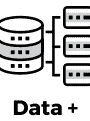


# 90天获得你的下一项认证


Mike Chapple 提供免费在线学习小组，这些学习小组将作为本书的补充，并帮助你准备下一次技术认证。

# 访问 CertMike.com 了解更多！

# 在线题库

为了帮助你准备 CompTIA Network+ 认证考试，请注册并在激活后获得期一年的免费互动在线题库访问权限——该权限包含在你购买的书书中！书中所有的练习题都包含在在线题库中，你可以在计时和评分环境下进行学习。

# 注册并访问在线题库

要注册你的书籍并访问在线题库，请按照以下步骤操作：
1. 访问 www.wiley.com/go/sysextestprep。你会看到“如何注册你的书籍以进行在线访问”的说明。
2. 点击“here to register”（此处注册）并从列表中选择你的书籍。
3. 完成所需的注册信息，包括回答安全验证以证明书籍所有权。你将通过电子邮件收到一个 码（pin code）。
4. 按照邮件中的说明或访问 www.wiley.com/go/sysextestprep。
5. 在页面上找到你的书籍，并点击旁边的“Register or Login”（注册或登录）链接。然后输入你收到的 码并点击“Activate PIN”（激活码）按钮。
6. 在创建账户或登录页面，输入你的用户名和密码，并点击登录；如果你还没有账户，请创建一个新账户。
7. 此时，你应该已进入题库网站，你的新题库将列在页面顶部。如果你没有在那里看到它，请刷新页面或重新登录。

# WILEY 最终用户许可协议

访问 www.wiley.com/go/eula 以获取 Wiley 的电子书用户许可协议 (EULA)。
