# CompTIA Security+ 全合一考试指南（第四版）（Exam SY0-401）


## 关于作者

**Dr. Wm. Arthur Conklin**, CompTIA Security+, CISSP, CSSLP, GISCP, CRISC, 是休斯顿大学技术学院信息安全研究与教育中心的研究副教授兼主任。他拥有两个终身学位：德克萨斯大学圣安东尼奥分校（UTSA）工商管理博士（专业为信息安全），以及蒙特雷加州海军研究生院电气工程师学位（专业为空间系统工程）。他是 ISSA 的研究员、ASQ 的高级会员，以及 IEEE 和 ACM 的会员。他的研究兴趣包括使用系统理论探索信息安全，特别是在网络物理系统中。他合著了六本安全书籍和大量与信息安全相关的学术文章。他积极参与由国土安全部赞助的工业控制系统联合工作组（ICSJWG）与工业控制系统的人力资源开发和网络安全方面的工作。他在安全编码方面拥有丰富的背景，是国土安全部/国防部软件保证论坛工作组关于人力资源教育、培训和发展的联合主席。

**Dr. Gregory White** 自 1986 年以来一直从事计算机和网络安全工作。他在美国空军服役 19 年，现役，并服役 11 年预备役，担任各种计算机和安全职位。他于 1995 年获得德克萨斯农工大学计算机科学博士学位。他的博士论文主题是计算机网络入侵检测领域，他至今仍在该领域进行研究。他目前是基础设施保证与安全中心（CIAS）的主任，也是德克萨斯大学圣安东尼奥分校（UTSA）的计算机科学教授。Dr. White 已撰写并发表了大量关于安全的文章和会议论文。他还是五本计算机和网络安全教科书的合著者，并为另外两本安全书籍撰写了章节。Dr. White 继续活跃于安全研究。他的当前研究计划包括社区事件响应、入侵检测和安全信息共享方面的努力。

**Chuck Cothren**, CISSP, 是 Symantec Corporation 的首席解决方案专家，应用广泛的网络安全经验，包括执行受控渗透测试、事件响应和安全管理，以帮助各种客户保护其关键数据。他还分析了语音 over Internet 协议（VoIP）系统和监控控制与数据采集（SCADA）系统的安全方法。他是书籍 *语音和数据安全* 和 *计算机安全原理* 的合著者。

**Roger L. Davis**, CISSP, CISM, CISA, 是耶稣基督后期圣徒教会运营经理，负责在 140 多个国家管理教会的多个信息系统。他曾担任信息系统安全协会（ISSA）犹他州分会主席，并担任信息系统审计与控制协会（ISACA）犹他州分会多个董事会职务。他是一名退役空军准将，拥有 30 年的军事和信息系统/安全经验。Mr. Davis 曾在杨百翰大学和空军理工学院任教。他合著了 McGraw-Hill 的 *计算机安全原理* 和 *语音和数据安全*。他拥有乔治华盛顿大学计算机科学硕士学位、杨百翰大学计算机科学学士学位，并在科罗拉多大学攻读电气工程和计算机科学研究生课程。

**Dwayne Williams**, CISSP, 是德克萨斯大学圣安东尼奥分校基础设施保证与安全中心的科技与研究副主任，也是全国大学生网络防御竞赛的负责人。Mr. Williams 拥有 18 多年信息系统和网络安全经验。Mr. Williams 的经验包括在美国空军担任通信-计算机信息系统军官的六年委任军官服役，专业为网络安全、企业信息保护、入侵检测系统、事件响应和 VPN 技术。在加入 CIAS 之前，他担任 SecureLogix Corporation 的咨询总监，为财富 100 强、政府、公用事业、石油和天然气、金融和技术客户提供安全评估和集成服务。Mr. Williams 于 1993 年毕业于贝勒大学，获得计算机科学文学学士学位。Mr. Williams 是 *语音和数据安全* 和 *计算机安全原理* 的合著者。

## 关于技术编辑

**Chris Crayton** 是作者、技术顾问和培训师。他曾担任计算机技术和网络教学讲师、信息安全总监、网络管理员、网络工程师和 PC 专家。Chris 已撰写多本关于 PC 维修、Microsoft Windows、CompTIA A+ 和 CompTIA Security+ 的印刷和在线书籍。他还担任多家领先出版公司众多技术书籍的技术编辑和内容贡献者，包括 *CompTIA A+ 认证一站式考试指南* 和 *CompTIA A+ 认证学习指南*。他持有多个行业认证，曾获得多项专业教学奖，并担任州级 SkillsUSA 竞赛评委。


## CompTIA 批准的质量内容
## CompTIA
## 获得认证物有所值

在数字世界中，数字素养是一项必不可少的生存技能。认证证明你拥有在几乎任何商业环境中解决技术或业务问题的知识和技能。CompTIA 认证是备受推崇的凭证，可助你获得工作、提高薪酬和晋升。


| IT 无处不在 | IT 知识和技能带来工作 | 工作保留 | 新机会 | 高薪高增长工作 |
|---|---|---|---|---|
| IT 对几乎所有组织都至关重要，其重要性日益提升。<br><br>• 79% 的美国企业表示 IT 对其公司的成功而言重要或非常重要 | 认证验证了你的知识和技能，使你有资格获得：<br><br>• 高增长 IT 职业领域的职位<br>• 提高薪酬<br>• 具有挑战性的任务和晋升机会<br>• 60% 的人表示获得认证是雇主或工作要求 | 组织中能力得到认可和重视。<br><br>• 对新或复杂技术的了解增加<br>• 生产力提升<br>• 更具洞察力的问题解决能力<br>• 更好的项目管理和沟通技能<br>• 47% 的人表示获得认证有助于改善其解决问题的能力 | 认证使你有资格在当前工作中获得新机会，或在你想转行时获得新机会。<br><br>• 31% 的人表示认证改善了他们的职业发展机会 | 招聘经理要求最强的技能组合。<br><br>• IT 技能差距正在扩大，超过 300,000 个职位空缺<br>• 88% 的人表示获得认证提升了他们的简历 |

## CompTIA Security+ 认证助力你的职业发展

- 安全是需求最高的职位类别之一，随着安全威胁的频率和严重性持续成为全球各组织的主要关注点，其重要性不断增长。
- 预计安全管理员的职位将增长 18%——这类职位所需的技能集与 CompTIA Security+ 认证相符。
- 网络安全管理员每年可赚取高达 $106,000。
  - CompTIA Security+ 是作为网络安全管理员或系统安全管理员开始职业生涯的第一步。
- 全球已有超过 250,000 人获得 CompTIA Security+ 认证。
- CompTIA Security+ 在 Hitachi Systems、Fuji Xerox、HP、Dell 以及各种主要美国政府承包商等组织中被广泛使用。
- 美国国防部（DoD）批准其为 DoD 8570.01-M 指令中信息保证技术二级和管理一级职位角色的所需认证选项之一。


## 获得认证和保持认证的步骤

- 1. **审查考试目标。** 审查认证目标，以确保你了解考试涵盖的内容：
  http://certification.comptia.org/examobjectives.aspx
- 2. **为考试做准备。** 在学习完认证考试后，复习并回答样题，以了解考试可能出现的问题类型：
  http://certification.comptia.org/samplequestions.aspx
- 3. **购买考试凭证。** 你可以在 CompTIA Marketplace 上购买考试凭证，www.comptiastore.com。
- 4. **参加考试！** 前往 Pearson VUE 网站，www.pearsonvue.com/comptia/，安排时间参加考试。
- 5. **保持认证！** 自 2011 年 1 月 1 日起，新的 CompTIA Security+ 认证自认证之日起有效期为三年。认证可以通过多种方式续期。更多信息请访问 http://certification.comptia.org/ce。

## 更多信息

- **访问 CompTIA 在线** 前往 http://certification.comptia.org/home.aspx 了解更多关于获得 CompTIA 认证的信息。
- **联系 CompTIA** 请致电 866-835-8020 并选择选项 2，或发送电子邮件至 questions@comptia.org。
- **与 CompTIA 建立联系** 在 Facebook、LinkedIn、Twitter 和 YouTube 上找到 CompTIA。

## 内容质量印章

本课程材料带有 CompTIA 批准质量内容印章。该印章表明本内容涵盖 100% 的考试目标并实施了重要的教学设计原则。CompTIA 建议使用多种学习工具以帮助增加学习目标的覆盖范围。

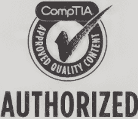

## CAQC 免责声明

CompTIA 批准质量内容（CAQC）计划的标志以及本或其他培训材料在 CompTIA 批准质量内容计划下被视为“批准”的状态，表明在 CompTIA 看来，此类培训材料涵盖了 CompTIA 相关认证考试的内容。

本培训材料的內容是为 CompTIA Security+ 考试创建的，涵盖截至出版日期时有效的 CompTIA 认证目标。

CompTIA 未审查或批准本培训材料内容的准确性，并特别声明不提供任何适销性或特定用途适用性的保证。CompTIA 不保证使用任何此类“批准”或其他培训材料准备 CompTIA 认证考试的人员的成功。

本书献给众多默默工作以确保我国关键基础设施安全的网络安全专业人士。

我们希望表彰数千名致力于保护国家资产却很少得到赞扬、往往只有在发生事故时才被注意到的个人。

对你们，我们说感谢你们出色的工作！

## 前言

在过去十年中，信息与计算机安全已经从学术界的范围走向美国社会的主流。从 CodeRed、Nimda 和 Slammer 攻击，到数据泄露，再到如今受到媒体广泛报道并传播到普通美国家庭中的高级持续性威胁（APT），信息安全已经成为一个常见话题。大家越来越明显地意识到，我们需要采取措施，不仅要保护国家的关键基础设施，也要保护我们日常打交道的企业。问题是：“我们应该从哪里开始？”普通的信息技术专业人员能做些什么，来保护他们受雇维护的系统？一个直接的答案是教育和培训。如果我们想要保护计算机系统和网络，就需要了解该如何做到这一点，以及安全所涉及的内容。

在当今充满敌意的网络环境中，具备能力并不是可有可无的选择。过去，我们曾认为内部人员是企业网络面临的主要威胁，而“脚本小子”是标准的外部威胁（通常被认为只会带来麻烦）；但如今这个高度互联的网络化世界已经大不相同。几年前，美国政府确定了八个关键基础设施领域，认为它们对国家的日常运行至关重要，一旦其中任何一个领域消失，都会对国家造成灾难性影响。在最初的八个领域基础上，后来又增加了一些，如今总数已达到 17 个。此外，分析表明，在美国，这些基础设施中超过 85% 由企业而非政府拥有和运营。然而，所有这些关键基础设施都有一个共同点，那就是技术，尤其是与计算机和通信相关的技术。因此，如果某个个人、组织或国家想要对这个国家造成破坏，它不仅可以使用传统武器发动攻击，也可以通过互联网利用计算机发动攻击。在对恐怖组织进行突袭时，除了其他被查获的信息之外，通常也会查获计算机和互联网信息，这并不令人意外。虽然内部人员当然仍然可能对组织造成巨大损害，但外部威胁再次成为许多人的首要担忧。

那么，对于你这位希望进一步了解安全知识的 IT 专业人员来说，应该从哪里开始学习呢？IT 世界中充斥着各种认证，供那些试图进一步了解自己所选职业的人取得。安全领域也不例外，而 CompTIA Security+ 考试提供了一个面向安全领域的基础级认证。对于有意从事安全职业的人来说，CompTIA Security+ 是一个理想的起点。在本考试指南的各个章节中，你不仅会找到能够帮助你准备 CompTIA Security+ 考试的材料，还会找到理解当今保护计算机系统和网络所涉及问题所需的基础知识。本考试指南绝不是学习如何保护组织系统的最终资料，但它可以作为你开始安全学习和职业生涯的起点。

关于这个学习领域，有一点是毋庸置疑的——它永远不会令人感到无聊。随着技术本身不断进步，它也在持续变化。在安全学习过程中，你还会发现，无论技术进步到何种程度，无论开发出多少新的安全设备，在最基本的层面上，人仍然是安全链条中最薄弱的环节。如果你正在寻找一个值得深入探索的、令人兴奋的领域，那么你无疑做出了明智的选择。安全领域将技术问题与人员问题结合在一起，充满挑战。作为本考试指南的作者，我们祝愿你在踏上这条令人兴奋且充满挑战的职业道路时一切顺利。

—Wm. Arthur Conklin，博士  
—Gregory B. White，博士

## 致谢

我们这些 *CompTIA Security+ All-in-One Exam Guide, Fourth Edition* 的作者，需要感谢许多人——没有他们，这项工作就不可能成功。

首先要感谢 McGraw-Hill Education 的同仁们。他们与本项目的多位作者不辞辛劳地合作，带领我们顺利穿过书籍出版计划这片雷区，并将我们粗糙的章节和原始图稿加工成了最终专业的作品，让我们引以为傲。我们感谢收购团队的 Meghan Manfre 和 Mary Demery；编辑服务团队的 Janet Walden；以及制作团队的 George Anderson。我们还要感谢技术编辑 Chris Crayton；Cenveo Publisher Services 的项目编辑 Anupriya Tyagi；文字编辑 William McManus；校对 Lisa McCoy；以及索引编制人员 Jack Lewis。他们对细节的悉心关注，使这部作品在经他们处理后变得更加完善。

我们还要感谢目前的雇主们。令我们非常高兴的是，他们愿意付薪让我们从事这一职业领域，而我们都认为这份工作既令人兴奋又充满成就感。安全领域从来不会有沉闷的时刻，因为它一直在不断变化。

我们要感谢 Art Conklin 再次为这本书忙前忙后、协调各方。

最后，我们也想分别感谢那些在个人层面上为我们每个人提供核心支持的人。如果生活中没有这些特别的人，我们谁也不可能完成这部作品。

> > 致我深爱的妻子 Susan：你是我的缪斯、我的爱，也是我的灵感。对于你在我写书期间不得不等待、承受的漫长时光，我深表歉意。
> >
> > —*Art Conklin*

> > 我要感谢我的妻子 Charlan，感谢她一直以来给予我的巨大支持。
> >
> > —*Gregory B. White*

> > Josie，谢谢你给予我的所有爱与支持。Macon，谢谢你带来的所有欢乐和笑声。
> >
> > —*Chuck Cothren*

> > Geena，谢谢你成为我最好的朋友和最大的支持。我的一切都源于你。爱我的孩子们和孙辈们！
> >
> > —*Roger L. Davis*

> > 致我的妻子、也是我最好的朋友 Leah：感谢你的爱、活力与支持，感谢你一直陪伴在我身边。致我的孩子们——这就是爸爸当时在电脑上敲打的东西！
> >
> > —*Dwayne Williams*


## 引言

计算机安全已变得至关重要，因为安全事件的数量稳步攀升。许多公司现在在安全硬件、软件、服务和人员上花费其预算的很大一部分。他们花费这笔钱并不是因为它能增加销售额或提升所提供的产品，而是因为如果不采取保护措施可能带来的后果。

## 为什么要关注安全？

安全并不是我们想要付费的东西；如果我们不必担心保护数据免受未经授权人员的披露、修改或破坏，那将是很好的，但今天我们所处的环境并非如此。相反，我们看到从安全事件中恢复的成本随着事件数量本身的增加而稳步上升。网络攻击和信息泄露发生的如此频繁，以至于人们在新闻上几乎忽略它们。但Target被盗超过4000万张信用卡和借记卡号码，随后CIO和CEO辞职，可能表明了一种新的紧迫感，一种关于保护数据的新的目的感。纸质报告和企业“口头应付”的时代可能正在衰退，而应对更复杂的攻击者带来的新挑战的时机已经到来。几个月后，Home Depot报告了更大规模的安全漏洞。这场战斗将是漫长的，防御者不断适应和保护，攻击者则搜寻弱点和漏洞。谁会赢？这取决于防御者的警惕性，因为攻击者将长期存在。

## 对安全专家日益增长的需求

为了保护我们的计算机系统和网络，我们需要大量受过培训的新安全专业人员，掌握计算机和网络安全的各个方面。这并非易事，因为连接到互联网的系统变得越来越复杂，软件的代码行数达数百万。理解为什么这是一个如此难以解决的问题并不难，如果你考虑一下数百万行长的软件中可能存在多少错误。当你再加上软件开发速度很快这一因素——出于市场不断变化的必要性——理解错误是如何发生的就很容易了。

并非软件中的每个“bug”都会导致安全漏洞，但不需要很多就能对互联网社区产生巨大影响。我们不能仅仅责怪供应商，因为他们正在对政府和行业的需求做出反应。大多数供应商在为其软件中发现的缺陷开发补丁方面相当熟练，并且不断发布补丁以保护系统免受可能引入安全问题的错误的影响。这为管理人员和管理员引入了一个全新的问题——补丁管理。这一点变得多么重要，可以很容易地通过最近许多安全事件的发生来说明，这些事件是由于在安全事件发生前数月就已发现的安全漏洞造成的，并且补丁已经可用，但社区并未正确安装补丁，从而使事件成为可能。出现这种情况的一个原因是因为负责安装补丁的许多个人没有受过培训，无法理解漏洞周围的安全影响或未安装补丁的后果。许多这些个人仅仅缺乏必要的培训。

由于需要越来越多受过最低限度理解培训的安全专业人员，因此开发了 CompTIA Security+ 等认证。潜在雇主希望知道他们考虑聘用的个人在安全方面知道该怎么做。潜在员工反过来希望有一种方式来展示他/她的理解程度，这可以提高候选人被录用的机会。整个社区整体上只是希望有更多受过培训的安全专业人员。

参加 CompTIA Security+ 考试的目标是证明你已掌握全球基础级安全从业人员的标准。该考试为你提供了一个完美的机会来验证你对计算机安全领域的知识和理解，并且对于许多不同的人来说是一个合适的机制，包括网络和系统管理员、分析师、程序员、网页设计师、应用程序开发人员和数据库专家，以证明在安全方面的专业成就。根据 CompTIA，考试面向具备以下条件的人：

-   至少两年以安全为重点的 IT 管理经验
-   日常技术信息安全经验
-   对安全问题和实施的广泛知识，包括 CompTIA Security+ 各特定领域中的主题

考试目标是在行业和政府机构的投入和协助下制定的，包括联邦调查局（FBI）、国家标准与技术研究所（NIST）、美国特勤局、信息系统安全协会（ISSA）、信息系统审计与控制协会（ISACA）、微软公司、RSA Security、摩托罗拉、Novell、Sun Microsystems、VeriSign 和 Entrust 等著名机构。

CompTIA Security+ 考试旨在涵盖广泛的安全主题——安全从业人员应了解的主题。测试包括来自六个知识领域的资料：

| 知识领域 | 考试占比 |
|---|---|
| 1.0 Network Security | 20% |
| 2.0 Compliance and Operational Security | 18% |
| 3.0 Threats and Vulnerabilities | 20% |
| 4.0 Application, Data and Host Security | 15% |
| 5.0 Access Control and Identity Management | 15% |
| 6.0 Cryptography | 12% |

*Network Security* 知识领域涵盖基本网络原理和设备。该领域关注有线和无线网络以及当计算机连接到本地网络以及互联网时引入的安全问题。*Compliance and Operational Security* 领域检查了诸如风险评估和缓解、事件响应、灾难恢复和业务连续性、培训和意识以及环境控制等多个运营安全问题。由于了解要保护系统和网络免受哪些威胁很重要，第三个领域 *Threats and Vulnerabilities* 检查了可能发生的许多不同类型的攻击以及这些攻击可能利用的漏洞。第四个领域 *Application, Data and Host Security* 涵盖个人可以采取的保护单个主机的措施。这可能包括诸如加密、修补、防病毒措施和硬件安全等项目。在 *Access Control and Identity Management* 领域，涉及与身份验证、授权和访问控制相关的基本概念和最佳实践。账户管理和身份验证服务也在该领域得到涉及。最后一个领域 *Cryptography* 很久以来一直是任何组织基本安全基础的一部分，整个领域专门用于其各个方面的细节。

考试由一系列问题组成，每个问题都设计为只有一个最佳答案或响应。其他可用选择旨在为如果个人对问题所代表的安全主题的知识或理解不完整时可能选择的选项提供选择。考试将同时包含多项选择题和基于绩效的问题。基于绩效的问题向考生呈现一个任务或在一个模拟 IT 环境中的问题。考生有机会展示其执行技能的能力。考试问题是从图 1 所示大纲中列出的更详细的目标中选择的，该大纲摘自 2014 年目标文件，可从 CompTIA 网站 http://certification.comptia.org/getCertified/certifications/security.aspx 获得。

CompTIA 建议希望参加 CompTIA Security+ 考试的个人拥有 CompTIA Network+ 认证以及两年以安全为重点的技术网络经验。考试最初仅以英语提供，现在在世界各地的测试中心提供英语、西班牙语、日语、中文、德语和其他语言。查阅 CompTIA 网站 www.comptia.org 以确定您附近的地点。

考试最多包含 100 道题，需在 90 分钟内完成。最低通过分数为 900 分中的 750 分。完成后立即提供成绩。个人如果第一次未通过考试，重新参加考试时需要再次支付考试费用，但在第二次重考前没有强制等待期。如果个人再次未通过考试，则每次后续重考需要最少等待 30 天。有关重考考试的更多信息，请咨询 CompTIA 的重考政策，可在其网站上找到。


# 1.0 网络安全
- 1.1 在网络设备和其他技术上实施安全配置参数。
- 1.2 根据给定场景，运用安全的网络管理原则。
- 1.3 解释网络设计要素和组件。
- 1.4 根据给定场景，实施常见协议和服务。
- 1.5 根据给定场景，排查与无线网络相关的安全问题。

# 2.0 合规与运营安全
- 2.1 解释风险相关概念的重要性。
- 2.2 总结与第三方集成系统和数据的安全影响。
- 2.3 根据给定场景，实施适当的风险缓解策略。
- 2.4 根据给定场景，实施基本取证程序。
- 2.5 总结常见的事件响应程序。
- 2.6 解释安全相关意识与培训的重要性。
- 2.7 比较和对比物理安全与环境控制。
- 2.8 总结风险管理最佳实践。
- 2.9 根据给定场景，选择适当的控制措施以实现安全目标。

# 3.0 威胁与漏洞
- 3.1 解释恶意软件的类型。
- 3.2 总结各种类型的攻击。
- 3.3 总结社会工程学攻击及每种攻击的相关有效性。
- 3.4 解释无线攻击的类型。
- 3.5 解释应用程序攻击的类型。
- 3.6 分析场景并选择适当的缓解和威慑技术。
- 3.7 根据给定场景，使用适当的工具和技术发现安全威胁和漏洞。
- 3.8 解释渗透测试与漏洞扫描的正确使用方式。

# 4.0 应用程序、数据与主机安全
- 4.1 解释应用程序安全控制和技术的重要性。
- 4.2 总结移动安全概念和技术。
- 4.3 根据给定场景，选择合适的解决方案以建立主机安全。
- 4.4 实施适当的控制措施以确保数据安全。
- 4.5 比较和对比在静态环境中缓解安全风险的替代方法。

# 5.0 访问控制与身份管理
- 5.1 比较和对比认证服务的功能和目的。
- 5.2 根据给定场景，选择合适的认证、授权或访问控制。
- 5.3 根据最佳实践，在执行账户管理时安装和配置安全控制。

# 6.0 密码学
- 6.1 根据给定场景，运用通用密码学概念。
- 6.2 根据给定场景，使用适当的密码学方法。
- 6.3 根据给定场景，使用适当的PKI、证书管理及相关组件。

## 为 CompTIA Security+ 考试做好准备

《CompTIA Security+ 全合一考试指南（第四版）》旨在帮助您做好准备，以参加 CompTIA Security+ 认证考试 SY0-401。

## 本书的结构

本书分为若干部分和章节，与考试本身的目标相对应。有些章节比其他章节更具技术性——这反映了安全环境的特点，您不仅要处理技术细节，还要处理安全策略和程序以及培训和宣教等其他问题。尽管许多从事计算机和网络安全工作的人拥有数学、计算机科学、信息系统或计算机或电气工程的高级学位，但您并不需要这些技术背景就能在您的组织中有效应对安全问题。例如，您不需要开发自己的密码算法；您只需要能够理解密码学如何被使用，以及它的优势和劣势。随着学习的深入，您会发现许多安全问题是由人为因素造成的。世界上最好的技术最终仍会被置于人类有机会把事情搞砸的环境中——而且这种情况屡见不鲜。

从目录中可以看出，本书的整体结构旨在反映 CompTIA Security+ 考试的目标。大部分章节的设计与 CompTIA 发布的目标顺序相匹配。有些地方顺序略有不同，主要是为了根据上下文用法对术语进行分组。

此外，本书还有两个附录。附录 A 提供了关于 OSI 模型和互联网协议的额外深入解释（如果这些信息对您来说是新的），附录 B 说明了如何最好地使用随书附带的 CD-ROM。

在索引之前，您会找到一个有用的安全术语表，其中包含许多相关缩写及其含义。我们希望您经常使用该术语表，并在学习本考试指南的各个主题时发现它是一个有用的学习辅助工具。

## 全合一系列的特殊功能

为了使这些考试指南更有用且阅读起来更愉快，全合一系列被设计为包含若干功能。

## 目标映射

本引言之后的目标映射表旨在让您将官方考试目标与本书中呈现和涵盖的目标进行交叉参考。参考信息提供了 CompTIA 呈现的准确目标、考试指南中涵盖该目标的部分，以及章节和页码参考。

## 图标

为了提醒您注意重要的建议、捷径或陷阱，您会不时在正文中看到注释、提示、警告和考试提示。


注：注释提供特别有用的信息、背景解释和信息，偶尔会定义术语。


提示：提示提供建议和细微差别，帮助您学会巧妙地完成工作。听从我们的建议，仔细阅读提示。


警告：当您看到警告时，请特别注意。警告出现在您必须做出关键选择或即将采取可能产生您无法立即预见的后果的行动时。现在就读它们，以免日后后悔。

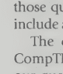

考试提示：考试提示为您提供特别建议，或提供与备考本身相关的信息。

## 章末回顾与问题

本书的一个重要部分出现在每章末尾，您会找到要点简要回顾以及一系列问题及其答案。每个问题都采用多项选择格式。提供的答案还包括简短讨论，解释为什么正确答案实际上是正确答案。

这些问题作为学习辅助工具提供给读者和潜在的 CompTIA Security+ 考生。我们显然无法保证如果您正确回答了所有问题，就一定能通过认证考试。相反，我们能保证的是，这些问题将让您了解自己为考试做好了多大准备。

## CD-ROM

《CompTIA Security+ 全合一考试指南（第四版）》还为您提供一张 CD-ROM，其中包含更多的练习考试问题及其答案，以帮助您为认证考试做准备。在附录 B 中了解更多关于随附 CD-ROM 的信息。

## 前进与提升

在这一点上，我们希望您现在对安全这个话题感到兴奋，即使最初并不如此。我们祝您在努力中好运，并欢迎您进入计算机和网络安全这个激动人心的领域。

## 目标映射：考试 SY0-401

| 官方考试目标 | 全合一覆盖 | 章节号 | 页码 |
|---|---|---|---|
| 1.0 网络安全 |  |  |  |
| 1.1 在网络设备和其他技术上实施安全配置参数。 | 网络设备配置 | 1 | 3 |
| 1.2 根据给定场景，运用安全的网络管理原则。 | 安全网络管理 | 2 | 25 |
| 1.3 解释网络设计要素和组件。 | 安全网络设计 | 3 | 35 |
| 1.4 根据给定场景，实施常见协议和服务。 | 安全网络设计 | 3 | 45 |
| 1.5 根据给定场景，排查与无线网络相关的安全问题。 | 安全无线网络 | 4 | 63 |
| 2.0 合规与运营安全 |  |  |  |
| 2.1 解释风险相关概念的重要性。 | 风险概念 | 5 | 79 |
| 2.2 总结与第三方集成系统和数据的安全影响。 | 系统集成流程 | 6 | 101 |
| 2.3 根据给定场景，实施适当的风险缓解策略。 | 风险管理 | 7 | 111 |
| 2.4 根据给定场景，实施基本取证程序。 | 数字取证与事件响应 | 8 | 132 |
| 2.5 总结常见的事件响应程序。 | 数字取证与事件响应 | 8 | 141 |
| 2.6 解释安全相关意识与培训的重要性。 | 安全意识与培训 | 9 | 153 |
| 2.7 比较和对比物理安全与环境控制。 | 物理安全与环境控制 | 10 | 169 |
| 2.8 总结风险管理最佳实践 | 风险管理 | 7 | 114 |
| 2.9 根据给定场景，选择适当的控制措施以实现安全目标。 | 安全控制 | 11 | 193 |
| 3.0 威胁与漏洞 |  |  |  |
| 3.1 解释恶意软件的类型。 | 攻击与恶意软件 | 12 | 205 |
| 3.2 总结各种类型的攻击。 | 攻击与恶意软件 | 12 | 210 |
| 3.3 总结社会工程学攻击及每种攻击的相关有效性。 | 社会工程学 | 13 | 235 |
| 3.4 解释无线攻击的类型。 | 应用程序与无线攻击 | 14 | 247 |
| 3.5 解释应用程序攻击的类型。 | 应用程序与无线攻击 | 14 | 253 |


| 官方考试目标 | 一站式覆盖 | 章节编号 | 页码 |
|---|---|---:|---:|
| **3.6** 分析场景并选择适当的缓解和威慑技术类型。 | 缓解技术 | 15 | 267 |
| **3.7** 给定场景，使用适当的工具和技术发现安全威胁和漏洞。 | 威胁和漏洞发现 | 16 | 289 |
| **3.8** 解释渗透测试与漏洞扫描的正确使用。 | 威胁和漏洞发现 | 16 | 304 |
| **4.0 应用、数据和主机安全** |  |  |  |
| **4.1** 解释应用安全控制和技术的重要性。 | 应用安全控制 | 17 | 317 |
| **4.2** 总结移动安全概念和技术。 | 移动设备安全 | 18 | 327 |
| **4.3** 给定场景，选择建立主机安全的适当解决方案。 | 基于主机的安全 | 19 | 341 |
| **4.4** 实施适当的控制以确保数据安全。 | 基于主机的安全 | 19 | 364 |
| **4.5** 比较和对比在静态环境中缓解安全风险的替代方法。 | 保护替代环境 | 20 | 375 |
| **5.0 访问控制和身份管理** |  |  |  |
| **5.1** 比较和对比身份验证服务的职能和目的。 | 访问控制和身份验证 | 21 | 387 |
| **5.2** 给定场景，选择适当的身份验证、授权或访问控制。 | 访问控制和身份验证 | 21 | 387 |
| **5.3** 基于最佳实践，在执行账户管理时安装和配置安全控制。 | 账户管理 | 22 | 417 |
| **6.0 密码学** |  |  |  |
| **6.1** 给定场景，利用通用密码学概念。 | 密码学概念 | 23 | 431 |
| **6.2** 给定场景，使用适当的密码学方法。 | 密码学方法 | 24 | 447 |
| **6.3** 给定场景，使用适当的 PKI、证书管理及相关组件。 | 密码学方法 | 24 | 457 |

# 第一部分
## 网络安全
- 第1章 网络设备配置
- 第2章 安全网络管理
- 第3章 安全网络设计
- 第4章 安全无线网络

## 网络设备配置

本章中，您将

- 在网络设备上实施安全配置参数
- 在其他技术上实施安全配置参数

网络由设备组成，并通过软件配置以执行所需活动。网络设备的正确配置是保护网络基础设施的关键要素。适当的配置可以极大地改善网络安全态势。学习如何正确配置网络设备对于通过 CompTIA Security+ 考试非常重要。

### 网络设备

当今商业环境中完整的网络计算机解决方案不仅仅包括客户端计算机和服务器。设备用于连接客户端和服务器并调节它们之间的流量。还需要设备将此网络扩展到简单的客户端计算机和服务器之外，以包括其他设备，例如无线和手持系统。设备有多种形式和多种功能，从集线器和交换机，到路由器、无线接入点以及专用设备，如虚拟专用网络 VPN 设备。每个设备都有特定的网络功能，并在维护网络基础设施安全方面发挥作用。


> **考试提示** 预计会出现关于如何在网络设备上实施安全配置参数的问题。

### 防火墙

防火墙可以是硬件、软件或两者结合，其目的是在网络连接之间强制执行一组网络安全策略。它很像带窗户的墙；墙的作用是阻挡东西，除了通过窗户允许通过的东西 网络安全策略就像窗户中的玻璃；它们允许

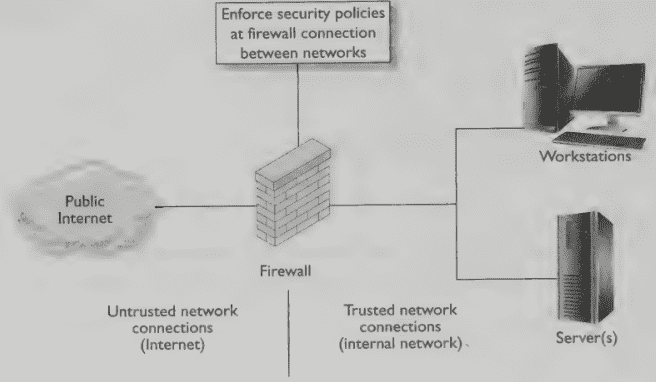

某些东西通过，例如光，同时阻挡其他东西，例如空气。防火墙的核心是其强制执行的安全策略集。管理部门决定以网络流量的形式在设备之间允许什么，这些策略用于为防火墙设备构建规则集，以在网络中过滤网络流量。

*安全策略* 是定义哪些流量允许以及哪些流量被阻止或拒绝的规则。这些不是通用规则，对于拥有多个连接的单一公司会创建许多不同的规则集。例如，连接到互联网的 Web 服务器可能配置为仅允许端口 80 的 HTTP 流量，并阻止所有其他端口。电子邮件服务器可能仅打开电子邮件所需的端口，而阻止其他端口。网络防火墙可以编程为阻止所有发往 Web 服务器的流量，除端口 80 流量外，并阻止所有发往邮件服务器的流量，除端口 25 外。以这种方式，防火墙充当安全过滤器，能够按机器、按端口控制网络流量，在某些情况下基于应用层细节。设置防火墙安全策略的关键与其他安全策略相同——最小访问原则。仅允许功能所需的必要访问；阻止或拒绝所有不需要的功能。公司部署防火墙的方式决定了每个防火墙的安全策略需求。

如后所述，安全拓扑将决定在网络的哪些位置部署哪些网络设备。至少，企业连接到互联网的连接应通过防火墙。此防火墙应阻止所有网络流量，除非企业特别授权。阻止端口上的通信很简单——只需告诉防火墙关闭该端口。问题在于决定谁需要哪些服务，从而哪些端口应打开，哪些应关闭。这就是安全策略有用的原因。防火墙的完美网络安全策略集是最终用户永远看不到并且永远不会允许

**图 1-1** 防火墙的工作原理

哪怕一个未经授权的数据包进入网络。正如任何其他完美物品一样，在企业中很难找到防火墙的完美安全策略集。在为防火墙制定规则时，最好使用最小访问原则；您希望防火墙阻止尽可能多的流量，同时允许授权流量通过。

要制定完整和全面的安全策略，首先需要对网络资源及其用途有完整和全面的了解。一旦您知道网络将如何使用，您就会知道允许什么。此外，一旦您了解需要保护什么，您就会知道阻止什么。防火墙旨在在攻击到达目标机器之前阻止攻击。常见目标是 Web 服务器、电子邮件服务器、DNS 服务器、FTP 服务和数据库。每个都有单独的功能，每个都有独特漏洞。一旦您决定谁应接收何种类型的流量以及应阻止哪些类型，您就可以通过防火墙进行管理。

### 防火墙如何工作？

防火墙通过多种机制强制执行既定的安全策略，包括以下内容：

- 网络地址转换 NAT
- 基本数据包过滤
- 状态ful数据包过滤
- 访问控制列表 ACL
- 应用层代理

防火墙提供最基本的安全功能之一是 NAT，它允许您从网络外部屏蔽大量信息。这允许外部实体与防火墙内的实体通信，而无需真正知道其地址。NAT 是在 IPv4 中用于将私有 IP 地址链接到公共地址的技术。私有 IP 地址是可以由任何人使用并且按定义不能在互联网上传输的 IP 地址集。NAT 可以通过防止在 NAT 设备更改地址之前从公司外部直接访问设备来协助安全。好处是需要更少的公共 IP 地址，从安全角度来看，内部地址结构对外部世界未知。如果黑客攻击源地址，他只是攻击 NAT 设备，而不是数据包的实际发送者。NAT 在第 3 章中有详细描述。

NAT 是为了解决 IPv4 相关的地址短缺而构想的，许多人认为它对 IPv6 不必要。强制执行流量转换和隐藏内部网络细节免受直接外部连接的安全附加功能将使 NAT 在 IPv6 时代继续存在。

基本数据包过滤，即最常见的防火墙技术之一，涉及查看数据包、其端口、协议以及源和目标地址，并将该信息与防火墙上配置的规则进行检查。Telnet 和 FTP 连接

可能被禁止建立到邮件或数据库服务器，但它们可能被允许用于相应的服务服务器。这是基于每个数据包头中的信息（如 IP 地址和 TCP/UDP 端口）进行过滤的相当简单的方法。数据包过滤无法检测并捕获所有不需要的数据包，但它快速高效。

要检查所有数据包并确定每个数据包及其数据的需求，需要状态数据包过滤。状态是指防火墙维护或知道对话的上下文。在许多情况下，规则取决于特定通信连接的上下文。例如，从外部服务器到内部服务器的流量如果被请求则可能被允许，如果未被请求则被阻止。一个常见的例子是请求网页。此请求实际上是对多个服务器的一系列请求，其中每个请求都可能被允许或阻止。高级防火墙采用状态数据包过滤来防止多种不需要的通信。如果数据包从网络外部而来，试图伪装成对内部网络消息的响应，防火墙将没有它被请求的记录，可以丢弃它，从而阻止不需要的外部访问尝试。由于许多通信将被传输到高端口（高于 1023），状态监控将使系统能够确定哪些高通信集是允许的，哪些应被阻止。状态监控的缺点是执行这种类型的监控需要大量的资源和处理，这会降低效率并需要更强大、更昂贵的硬件。

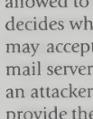

> **EXAM TIP** 防火墙通过检查数据包并根据一组规则有选择地拒绝其中一些来运行。防火墙充当选定网络点的守门员或哨兵，隔离流量，允许部分通过并阻止其他流量。

一些高安全性防火墙还采用应用层代理。数据包不允许穿越防火墙，而是数据流向上层应用程序，由其决定如何处理。例如，简单邮件传输协议（SMTP）代理可以从互联网接收传入邮件并将其转发到内部企业邮件服务器。虽然代理通过使攻击者很难操纵到达目的地的实际数据包而提供高度安全性，并且它们提供了在将数据转发到目的地之前由应用程序解释数据的机会，但它们通常无法与状态数据包检测防火墙相同的吞吐量。性能与速度之间的权衡是常见的问题，必须根据安全需求和性能要求进行评估。

防火墙也可以充当网络流量调节器，因为它们可以配置为减轻特定类型的基于网络的攻击。在拒绝服务和分布式拒绝服务（DoS/DDoS）攻击中，攻击者可以尝试用流量淹没网络。防火墙可以调整为检测这些类型的攻击并充当洪水防护，减轻对网络的影响。防火墙在阻止各种洪水攻击方面非常有效，包括端口洪水、SYN 洪水和 ping 洪水。

## Routers

路由器是用于连接不同网络段的网络流量管理设备。路由器在开放系统互连（OSI）参考模型（在第 3 章中讨论）的网络层运行，使用网络地址路由流量并利用路由协议确定网络中最佳路径。路由器构成了互联网的骨干，将流量从一个网络移动到另一个网络，在将流量沿最佳路径移动时检查每条通信的数据包。

路由器通过检查每个数据包、查看目标地址并使用算法和表来确定下一步将数据包发送到何处来运行。检查头部以确定下一跳的过程可以快速完成。

路由器使用 ACL 作为决定数据包是否允许进入网络的方法。有了 ACL，还可以检查源地址并确定是否允许数据包通过。这使得配备 ACL 的路由器可以根据 ACL 中内置的规则丢弃数据包。这是一个设置和维护起来繁琐的过程，并且随着 ACL 规模的增大，路由效率可能会降低。也可以配置某些路由器充当准应用网关，执行状态数据包检测并使用内容以及 IP 地址来确定是否允许数据包通过。这会极大地增加路由器传输流量的时间，并可能显著降低路由器吞吐量。配置 ACL 以及为此类型用途设置路由器的其他方面超出了本书的范围。


> **EXAM TIP** ACL 的建立和维护可能是一项重要工作。创建它们是一项直接的任务，但明智地使用它们将以有限的维护带来安全收益。这在 DMZ 等安全区域以及边缘设备中非常重要，可阻止不需要的外部联系，同时允许已知的内部流量。

路由器存在的一个严重操作安全问题涉及对路由器的访问及其内部功能的控制。路由器可以使用简单网络管理协议（SNMP）和 Telnet 访问并可远程编程。由于路由器的地理分离，这可能成为必要，因为互联网上的许多路由器可能相距数百英里，位于单独的锁闭结构中。对路由器的物理控制是绝对必要的，因为如果任何设备，无论是服务器、交换机还是路由器，被黑客物理访问，就应被视为已受损；因此必须防止此类访问。必须确保管理员密码永远不会明文传输，只能使用安全机制访问路由器，并且所有默认密码都重置为强密码。

就像交换机一样，路由器管理控制最可靠的访问点是通过串行控制接口端口或特定的路由器管理以太网接口。这允许在无需处理与流量相关问题的情况下访问路由器的控制方面。对于内部公司网络，其中路由器的地理分布可能有限，存在第三方解决方案以允许带外远程管理。这允许以安全的方式完全控制路由器，即使从远程位置也是如此，尽管需要额外的硬件。


**Figure 1-2** 用于电缆调制解调器/DSL 的小型家庭办公室路由器

路由器可由众多厂商提供，尺寸从大到小不等。图 1-2 显示了用于电缆调制解调器/DSL 服务的典型小型家庭办公室路由器。较大的路由器可以处理每个通道高达数十千兆字节每秒的流量，使用光纤输入并在网络上移动数万个并发互联网连接。这些路由器可能花费数十万美元，构成了电子商务基础设施的重要组成部分，使亚马逊和 eBay 等大型企业能够同时为许多客户提供服务。

## Switches

交换机构成了大多数基于以太网的局域网（LAN）连接的基础。虽然集线器和网桥仍然存在，但在当今高性能网络环境中，交换机已取代两者。交换机为每个端口提供单独的冲突域。这意味着对于每个端口，存在两个冲突域：一个从端口到下游侧的客户端，另一个从交换机到上游网络。当使用全双工时，两个节点主机和客户端之间的冲突几乎被消除。这也起到了安全因素的作用，因为嗅探器只能看到有限的流量，而与基于集线器的系统相反，在基于集线器的系统中，单个嗅探器可以看到所有连接到设备的流量。

交换机在 OSI 模型的数据链路层运行，而路由器在网络层运行。对于内部网，交换机已成为互联网上的路由器——连接机器的首选设备。随着交换机成为主要的网络连接设备，额外的功能已添加到其中。交换机通常是第 2 层设备，但第 3 层交换机包含路由功能。

交换机还可以执行各种安全功能。交换机通过将数据包从传入连接移动到传出连接来工作。在移动数据包的同时，交换机可以检查数据包头并执行安全策略。基于媒体访问控制（MAC）地址的端口地址安全可以确定数据包是否允许或阻止连接。这正是防火墙用于其判断的功能，也是 802.1x 设备能够充当“边缘设备”的相同功能。

交换机的一个安全问题是，与路由器一样，它们是智能网络设备，因此容易被黑客劫持。如果黑客侵入交换机并更改其参数，他可能能够窃听特定

对于所有通信几乎无法检测。交换机通常使用 SNMP 和 Telnet 协议进行管理，这两种协议都有一个严重的弱点，即它们以明文形式在网络中传输密码。

> **考试提示** 简单网络管理协议（SNMP）为许多网络设备提供管理功能。SNMPv1 和 SNMPv2 使用明文密码进行身份验证，允许任何监控数据包的人捕获密码并访问网络设备。SNMPv3 增加了加密保护，使其成为首选解决方案。


携带嗅探器观察交换机维护的黑客可以捕获管理员密码。这使得黑客可以稍后返回交换机并以管理员身份对其进行配置。另一个问题是交换机出厂时带有默认密码，如果在设置交换机时未更改这些密码，它们就会为黑客敞开一扇未上锁的门。商用质量的交换机具有本地串行控制台端口或管理以太网接口，以确保出于控制目的可以保证访问交换机。市场上某些产品支持带外网络，使用这些专用通道实现对可编程网络设备的远程安全访问。

> **注意** 为了保护交换机，您应禁用除安全串行线路或安全协议（如安全外壳 SSH）之外的所有访问协议。仅使用安全方法访问交换机将限制黑客和恶意用户的暴露。维护安全的网络交换机比保护单个设备更重要，因为在交换机上拦截数据的控制范围更广，特别是如果它被黑客重新编程的话。


## 负载均衡器

某些系统，例如服务器，对业务运营更为关键，因此应成为容错措施的对象。容错中常用的技术是负载均衡。该技术旨在将处理负载分布在两个或多个系统上。它用于帮助提高资源利用率和吞吐量，但也有额外优势，即提高整个系统的容错能力，因为关键进程可能分布在多个系统上。如果其中任何一个系统失败，其他系统可以接管其处理的任务。虽然整体吞吐量可能会受到影响，但操作不会完全中断。负载均衡通常用于处理网站、高带宽文件传输和大型 Internet Relay Chat（IRC）网络的系统。负载均衡通过一系列健康检查来告知负载均衡器哪些机器正在运行，并通过调度机制来均匀分配工作。负载均衡最适合无状态系统，因为后续请求可以由任何服务器处理，而不仅仅是处理前一个请求的服务器。

## 代理服务器

代理服务器虽不是严格意义上的安全工具，但可用于过滤不需要的流量并防止员工访问可能具有敌意的网站。代理服务器接收来自客户端系统的请求并代表客户端将其转发到目标服务器。代理服务器可以完全透明（通常称为网关或隧道代理），也可以在转发前修改客户端请求，甚至无需联系目标服务器即可为客户端请求提供服务。目前使用中有几个主要的代理服务器类别：

- **匿名代理** 匿名代理旨在隐藏请求系统的信息并使用户的网页浏览体验“匿名”。这种类型的代理服务通常被担心互联网上传输的个人信息的数量以及使用跟踪 cookie 和其他机制来跟踪浏览活动的人使用。
- **缓存代理** 此类代理保存热门客户端请求的本地副本，通常在大型组织中使用以减少带宽使用并提高性能。当发出请求时，代理服务器首先检查缓存中是否有请求的内容的当前副本；如果有，则立即为客户端请求提供服务，无需联系目标服务器。如果内容已过期或缓存代理没有请求的内容的副本，则请求会转发到目标服务器。
- **内容过滤代理** 内容过滤代理检查每个客户端请求并将其与既定的可接受使用政策（AUP）进行比较。请求通常可以通过多种方式进行过滤，包括请求的 URL、目标系统或域名，或内容本身中的关键词。内容过滤代理通常支持用户级身份验证，以便可以控制和监控访问，并记录和分析通过代理的活动。这种类型的代理在学校、企业环境和政府网络中非常流行。
- **开放代理** 开放代理本质上是可供任何互联网用户使用的代理，通常也具有一定的匿名功能。这种类型的代理一直存在争议，互联网隐私和自由的倡导者站在争论的一方，执法机构、企业和政府实体站在另一方。由于开放代理通常用于绕过企业代理，许多企业试图阻止其员工使用开放代理。
- **反向代理** 反向代理通常安装在网络连接的服务器端，通常位于一组 Web 服务器之前。反向代理拦截所有传入的 Web 请求并可执行多种功能，包括流量过滤、安全套接层（SSL）解密、提供常用静态内容（如图形）以及执行负载均衡。
- **Web 代理** Web 代理专门设计用于处理 Web 流量，有时也称为 Web 缓存。大多数 Web 代理本质上是专门的缓存代理。

在网络环境中部署代理解决方案通常是通过设置代理并要求所有客户端系统配置其浏览器使用代理，或部署拦截代理，该代理无需客户端配置即可主动拦截所有请求。

从安全角度来看，代理最有用的地方在于其控制和过滤出站请求的能力。通过限制员工可以从企业系统访问的内容类型和网站，许多管理员希望避免企业数据丢失、系统被劫持以及来自恶意网站的感染。管理员还使用代理来执行企业可接受使用政策并跟踪企业资源的利用情况。

## Web 安全网关

一些安全厂商将代理功能与内容过滤功能结合起来，创建名为 Web 安全网关的产品。Web 安全网关旨在解决 Web 流量特有的安全威胁和陷阱。Web 安全网关通常提供以下功能：

- **实时恶意软件保护**（也称为恶意软件检查）一些 Web 安全网关具有扫描所有出站和入站 Web 流量的能力，以检测和阻止诸如恶意软件、间谍软件、广告软件、恶意脚本、基于文件的攻击等不良流量。
- **内容监控** 一些 Web 安全网关提供监控正在检查的 Web 流量的内容的能力，以确保其符合组织政策。
- **生产力监控** 一些 Web 安全网关衡量特定用户、用户组或整个组织产生的 Web 流量量以及产生的流量类型。
- **数据保护和合规** 一些 Web 安全网关可以扫描 Web 流量中发送到组织外部的敏感或专有信息，以及使用社交网络网站或不当网站的情况。

## VPN 集中器

虚拟专用网络（VPN）是一种用于在公共网络（如互联网）上为用户之间提供安全通信通道的构造。如书中后面所述，可采用多种技术来实现 VPN 连接。加密技术的使用允许对数据包中的数据进行加密，或对整个数据包进行加密。如果数据被加密，数据包头仍可在源和目标之间被嗅探和观察，但加密可保护数据包内容免于检查。如果整个数据包被加密，则将其置于另一个数据包中并通过隧道在公共网络上传送。隧道甚至可以保护通信双方的身份。

VPN 最常见的实现方式是通过 IPsec，即 IP 安全协议。IPsec 在 IPv6 中是强制性的，可选择性地回溯到 IPv4。IPsec 可以在硬件、软件或两者结合中实现。VPN 在特定


网络中的一个点，即 VPN 集中器。VPN 集中器有各种不同的规模，可扩展以支持从小型网络到大型网络的 VPN。VPN 集中器允许多个 VPN 连接在同一个网络点终止。

## 入侵检测系统

入侵检测系统（IDS）旨在实时或事后检测、记录并响应未经授权的网络或主机使用行为。IDS 有众多供应商提供，是网络安全的重要组成部分。这些系统以软件形式实现，但在大型系统中还需要专用硬件。IDS 可分为两类：基于网络的系统和基于主机的系统。主要使用两种检测方法：基于特征码和基于异常：

- **基于主机的 IDS（HIDS）**检查单个系统上的活动，例如邮件服务器、Web 服务器或单台 PC。它只关注单个系统，通常无法查看网络或周围其他系统上的活动。
- **基于网络的 IDS（NIDS）**检查网络本身的活动。它只能查看穿过所监控网络链路的流量，通常不知道单个系统上正在发生什么。


> **考试提示**了解基于主机的 IDS 和基于网络的 IDS 之间的区别。基于主机的 IDS 运行在特定系统（服务器或工作站）上，并查看该主机上的所有活动。基于网络的 IDS 从网络中嗅探流量，只能看到网络上发生的活动。

无论是基于网络还是基于主机，IDS 通常都由多个相互协作的专用组件组成，如图 1-3 所示。这些组件通常是逻辑组件和基于软件的组件，而非物理组件，并且会因供应商和产品的不同而略有差异。通常，IDS 包含以下逻辑组件：

- **流量收集器（或传感器）**此组件收集供 IDS 检查的活动/事件。在基于主机的 IDS 中，这些内容可能是日志文件、审计日志，或进入特定系统及从特定系统离开的流量。在基于网络的 IDS 中，这通常是一种从网络链路复制流量的机制，基本上发挥嗅探器的作用。此组件通常称为传感器。
- **分析引擎**此组件检查收集到的网络流量，并将其与特征码数据库中存储的已知可疑或恶意活动模式进行比较。分析引擎是 IDS 的“大脑”。
- **特征码数据库**特征码数据库是已知可疑或恶意活动的模式和定义的集合。
- **用户界面和报告**此组件与人员交互，在适当情况下提供警报，并为用户提供与 IDS 交互和操作 IDS 的方式。

大多数 IDS 都可以进行调优，以适应特定环境。可以关闭某些特征码，告知 IDS 不要查找某些类型的流量。例如，如果你运行的是纯 UNIX 环境，可能不希望看到基于 Windows 的警报，因为它们不会影响你的系统。此外，还可以根据你对某些类型流量的关注程度调整警报级别的严重性。有些 IDS 还允许用户排除来自特定主机的某些活动模式。换句话说，你可以告知 IDS 忽略某些系统生成看似恶意活动的流量这一事实，因为这些流量实际上并不是恶意活动。

一些分析人员会根据 IDS 的运行方式和检测恶意流量的方式，将 IDS 模型进一步分为四类（稍后讨论的入侵防御系统也可以采用相同的模型）。

### 基于行为

此模型依赖于收集到的“正常行为”集合，即网络上应该发生的情况，以及被视为“正常”或“可接受”的流量。不符合“正常”活动类别或模式的行为会被视为可疑或恶意。此模型有可能检测出零日攻击或未公开的攻击，但误报率较高，因为任何新的流量模式都可能被标记为“可疑”。

### 基于特征码

此模型依赖于一组预定义的模式（称为特征码）。IDS 必须预先知道哪些行为被视为“不良行为”，才能识别并处理可疑或恶意流量。基于特征码的系统可以非常快速且精确，但依赖于事先拥有准确的特征码定义。

### 基于异常

此模型类似于基于行为的方法。IDS 首先要学习“正常”流量的特征，然后查找偏离这些“正常”模式的情况。还可以定义异常，例如将 Linux 命令发送到基于 Windows 的系统，并通过基于人工智能的引擎实现这些定义，从而扩展特定定义的实用性。

### 启发式

此模型使用人工智能来检测入侵和恶意流量。通常通过算法实现这些功能，以帮助 IDS 判断某种流量模式是否具有恶意性。例如，包含某个字符重复 10 次的 URL 可能会作为单个特征码被视为“不良”流量。采用启发式模型后，IDS 将理解：如果 10 个重复字符是不良的，那么 11 个重复字符同样是不良的，而 20 个重复字符则更加严重。这种模糊逻辑实现方式使该模型介于基于特征码的模型和基于行为的模型之间。

## 入侵防御系统

入侵防御系统（IPS）的核心是入侵检测系统。不过，IDS 只能在网络流量匹配一组已定义规则时发出警报，而 IPS 则可以采取进一步的操作。IPS 与 IDS 一样有两种形式：基于主机的 IPS（HIPS）和基于网络的 IPS（NIPS）。IPS 可以直接采取措施阻止攻击，其操作由规则控制。通过自动化响应，IPS 显著缩短了从检测到采取行动之间的响应时间。


> **考试提示**要认识到，IPS 具备 IDS 的所有相同特征，但与 IDS 不同，IPS 可以自动响应某些事件，例如在无需操作员干预的情况下重置 TCP 连接。

## 协议分析器

*协议分析器*（也称为*数据包嗅探器*、*网络分析器*或*网络嗅探器*）是一种能够捕获和解码网络流量的软件，或集成了软件和硬件的系统。几十年来，协议分析器一直深受系统管理员和安全专业人员的欢迎，因为它们是网络环境中用途广泛且非常有用的工具。从安全角度来看，协议分析器可用于执行许多活动，例如：

- 检测入侵或不良流量（IDS/IPS 必须具备某种类型的捕获和解码能力，才能查找可疑/恶意流量）
- 在事件响应或事件处理期间捕获流量
- 查找僵尸网络、木马和受感染系统的证据
- 查找异常流量或超过特定阈值的流量
- 测试系统或应用程序之间的加密


从网络管理角度来看，协议分析器可用于执行以下活动：

- 分析网络问题
- 检测配置错误的应用程序或行为异常的应用程序
- 收集并报告网络使用情况和流量统计信息
- 调试客户端/服务器通信

无论预期用途是什么，协议分析器都必须能够查看网络流量，才能捕获和解码流量。基于软件的协议分析器必须能够将用于监控网络流量的网络接口卡（NIC）置于*混杂模式*（有时称为*promisc 模式*）。混杂模式会告知 NIC 处理它所看到的每个网络数据包，而不考虑预期的目的地。通常，NIC 只会处理*广播*数据包（即发送给该子网中所有设备的数据包），以及数据包中目标地址为该 NIC 的 MAC 地址的数据包。作为嗅探器，分析器必须处理所有穿过线路的数据包，因此，将 NIC 置于混杂模式的能力至关重要。

在集线器等较旧的网络技术中，运行协议分析器更加容易，因为集线器会将每个数据包广播到每个接口，而不考虑目的地。随着交换机成为网络设备的标准，将协议分析器置于工作状态变得更加困难，因为交换机不会将每个数据包广播到每个端口。虽然这可能使管理员更难以嗅探流量，但也使窃听者和潜在攻击者更难以实施攻击。

为了支持协议分析器、IDS 设备和 IPS 设备，大多数交换机制造商都支持*端口镜像*或*交换端口分析器（SPAN）*端口。根据制造商和硬件的不同，镜像端口可以查看通过交换机或特定 VLAN 的所有流量，也可以查看通过其他特定交换机端口的所有流量。网络流量实际上会被复制（或镜像）到特定端口，该端口随后可以连接协议分析器。

一种常用的开源协议分析器是 Wireshark（www.wireshark.org）。Wireshark 可用于 UNIX/Linux 和 Windows 操作系统，是一种基于 GUI 的协议分析器，允许用户在运行该软件的系统中，通过任何可用的网络接口（包括无线接口）捕获和解码网络流量。Wireshark 还具有一些有趣的功能，包括“跟踪 TCP 流”的能力。该功能允许用户选择一个 TCP 数据包，然后查看参与该 TCP 会话的所有其他数据包。


> **考试提示**预计会考查如何在 IT 技术组件上实现安全配置参数。

## 垃圾邮件过滤器

垃圾邮件是各地用户和系统管理员的梦魇，本质上是未经请求或不需要的大量电子消息。虽然该术语通常用于电子邮件，但垃圾邮件可以


通过短信等方式发送到手机和移动设备、发布到互联网论坛以及通过其他途径传播。只要你用过电子邮件账户，很可能就收到过垃圾邮件。

从生产力和安全性的角度来看，垃圾邮件每年给企业和用户造成数十亿美元的损失，而且问题极其普遍，以至于美国国会通过了《2003年反垃圾邮件法案》（CAN-SPAM Act of 2003），授权联邦贸易委员会执行该法案，并授权司法部对垃圾邮件发送者实施刑事处罚。该法案为商业邮件的发送者规定了要求，明确了对垃圾邮件发送者以及那些产品在垃圾邮件中做广告却违反法律的公司的处罚，并赋予消费者要求发件人停止向其发送垃圾邮件的权利。然而，尽管我们竭尽全力，垃圾邮件依然不断涌现；随着阻止垃圾邮件的技术和手段日益先进和复杂，发送这些未经请求信息的手段和工具也在同步进化。

以下是用来应对垃圾邮件泛滥的几种较为流行的方法；其中大多数技术用于过滤电子邮件，但也可以应用于其他媒介：

-   **黑名单：** 黑名单本质上就是记录那些有发送垃圾邮件“前科”的域名和源地址，并拒绝来自这些域名和源地址的消息。这基本上是一种永久性的“忽略”或“呼叫阻止”类功能。一些组织和商业公司会提供已知垃圾邮件发送者的名单。
-   **内容或关键字过滤：** 与互联网内容过滤类似，这种方法会过滤电子邮件消息中不受欢迎的内容或垃圾邮件迹象。与网页内容过滤非常相似的是，基于关键字之类的电子邮件过滤可能会产生意外结果，因为某些术语既可用于合法邮件，也可能出现在垃圾邮件中。大多数内容过滤技术使用正则表达式匹配来进行关键字过滤。
-   **受信任服务器：** 与黑名单相反，受信任服务器列表包括被“信任”不会转发垃圾邮件的SMTP服务器。
-   **基于延迟的过滤：** 一些简单邮件传输协议（SMTP）服务器会配置为在连接建立与发送SMTP服务器欢迎横幅之间插入一段故意的延迟。一些垃圾邮件生成程序不会等待该欢迎横幅，任何在连接一建立就立即开始发送数据的系统都会被SMTP服务器视为垃圾邮件生成器并予以丢弃。
-   **PTR和反向DNS检查：** 一些电子邮件过滤器会检查邮件发送者的源域名。如果反向检查显示邮件来自拨号用户、家庭宽带、动态分配地址，或者域名缺失或为通用域名，过滤器就会将其拒绝，因为这些是垃圾邮件的常见来源。
-   **回调验证：** 由于许多垃圾邮件使用伪造的“发件人”地址，一些过滤器会尝试验证传入邮件的“发件人”地址。接收服务器可以联系发送服务器以尝试验证发件地址，但这并不总是有效，因为被伪造的地址有时本身是有效的电子邮件地址，可以被验证通过。
-   **统计内容过滤：** 统计过滤很像一个文档分类系统。用户将收到的消息标记为垃圾邮件或合法邮件，过滤系统从用户的输入中学习。被识别并归类为垃圾邮件的消息越多，过滤软件拦截传入垃圾邮件的效果就应该越好。垃圾邮件发送者通过在消息中插入随机单词和字符来对抗许多过滤技术，使内容过滤器难以识别垃圾邮件常见的模式。
-   **基于规则的过滤：** 基于规则的过滤是一种简单的技术，它仅仅在特定字段或关键字中查找匹配项。例如，基于规则的过滤系统可能会查找传入消息主题中包含“快速致富”字样的任何消息。许多流行的电子邮件客户端都具备实现基于规则过滤的能力。
-   **出站过滤：** 一些组织也会对离开其组织的电子邮件执行垃圾邮件过滤，这称为出站过滤。可以使用相同类型的反垃圾邮件技术来验证和过滤出站电子邮件，以对抗垃圾邮件。
-   **混合过滤：** 大多数商业反垃圾邮件方法使用混合过滤，即组合多种不同技术来对抗垃圾邮件。例如，一个过滤解决方案可以接收每条传入消息，先将其与已知垃圾邮件发送者进行匹配，然后通过基于规则的过滤器，再通过内容过滤器，最后通过基于统计的过滤器。如果消息通过所有过滤阶段，它将被视为合法消息；否则，它将被作为垃圾邮件拒绝。

大量垃圾邮件过滤是在网络或SMTP服务器层面完成的。使用集中式解决方案扫描所有传入和传出的消息，比在整个组织的用户桌面上部署单独的解决方案更有效率。电子邮件本质上默认是一种代理服务：消息通常进出组织的邮件服务器。（用户通常不会直接连接到远程SMTP服务器来发送和接收消息，但他们可以这样做。）反垃圾邮件解决方案可以以软件形式提供，加载在SMTP服务器本身，或加载在一台辅助服务器上，该服务器在消息到达SMTP服务器之前或经过SMTP服务器处理之后对消息进行处理。反垃圾邮件解决方案也以设备形式提供，此时软件和硬件是一个集成的整体解决方案。许多集中式反垃圾邮件方法允许单个用户为其特定收件箱定制垃圾邮件过滤，指定他们自己的过滤规则和评估入站邮件的标准。

垃圾邮件的核心问题在于，尽管我们花费了巨大努力来构建有效的垃圾邮件过滤程序，垃圾邮件发送者仍在不断创造新的方法来淹没收件箱。垃圾邮件过滤解决方案固然不错，但远非完美，并且需要在允许合法邮件进入的同时阻止垃圾邮件这一持续挑战中不断斗争。缺乏对互联网流量的集中控制也使反垃圾邮件工作更加困难。不同国家针对电子邮件有不同的法律法规，有的极为严格，有的则形同虚设。在可预见的未来，垃圾邮件将继续成为管理员和用户的负担。

## UTM安全设备

许多安全供应商提供“一体化安全设备”，这些设备将多种功能整合到同一硬件设备中。最常见的是防火墙、入侵检测/防御系统（IDS/IPS）和防病毒功能，尽管一体化设备还可以包括VPN功能、反垃圾邮件、恶意网络流量过滤、反间谍软件、内容过滤、流量整形等。一体化设备通常以比拥有多个独立解决方案（每个方案实现该一体化设备所能执行的一项功能）更便宜、更易于管理、更高效的方式销售。这些一体化设备的一个常见名称是统一威胁管理（UTM）。使用UTM设备将安全活动简化为单一流程，在统一的软件包下进行运维。这将在单一工具上降低了学习曲线，而不是需要掌握一组工具。UTM设备在处理网络流量和事件时，可以比连接在一起的一组工具提供更好的集成度和更高的效率。

## URL过滤器

URL过滤器会阻止连接到禁止列表中的网站。使用一种通常由服务支撑的设备来保持禁止网站列表的更新，可以提供一种自动化手段来阻止访问被认为危险或不适当的网站。由于网络内容的高度易变性，需要自动化的企业级防护，以确保有合理的机会阻止来自不当内容、恶意软件和其他恶意内容的来源。

## 内容检查

设备不仅可以依赖URL来确定内容的可接受性，还可以检查正在提供的实际内容。内容检查用于过滤那些返回包含特定组件内容的Web请求，例如身体部位名称、音乐或视频内容，以及其他不适合商业环境的内容。

## 恶意软件检查

恶意软件是另一种可以在网络传输过程中被检测到的项目，设备可以被调优以检测恶意软件。基于网络的恶意软件检测具有只需更新单个系统而非所有机器的优势。

## Web应用防火墙与网络防火墙

网络防火墙是一种基于网络地址规则强制执行策略的设备。通过阻止地址和/或端口，网络防火墙可以限制网络流量。Web应用防火墙（WAF）是一种基于与HTTP/HTTPS流量关联的规则执行限制的设备。根据定义，Web应用防火墙是内容过滤器，其编程能力可提供强大的功能和保护。允许或阻止的内容可以达到非常精细的粒度，例如“允许访问Facebook，但阻止Facebook游戏”。WAF可以检测并阻止关键数据的披露，例如账号、信用卡号等。WAF还可以用于保护网站免受常见攻击向量的攻击，例如跨站脚本、模糊测试和缓冲区溢出攻击。


可以配置 Web 应用防火墙来检查 SSL 会话内部的内容。如果攻击者试图利用 SSL 加密通道来隐藏其活动，这一点非常重要。由于合法的 SSL 通道是由系统创建的，因此可以将相应的凭据在内部传递给 WAF，以实现 SSL 检测。

## 应用感知设备

网络安全是在应用级安全甚至成为一个问题之前发展起来的，因此传统的网络安全防御措施无法发现或阻止应用级攻击。安全行业通过引入应用感知设备来应对应用攻击向量。防火墙、IDS/IPS、代理和其他设备现在能够对流量进行状态检测，并检测和阻止应用级攻击以及网络级攻击。

## 下一代防火墙

下一代防火墙是一个术语，用于描述能够进行内容级过滤，因此能够进行应用级监控的防火墙。根据编程和复杂程度的不同，下一代防火墙可以基于定义的应用规则执行许多高级安全检查。

## IDS/IPS

入侵检测和防御系统通过筛选网络流量并应用一组规则来执行其安全任务。当流程具有应用感知能力时，规则的针对性可以更加精确。增加能够同时处理状态感知和内容感知规则处理的高级规则处理能力，使这些设备能够基于应用本身而不仅仅是基于地址来检测针对应用的恶意攻击。用于 IDS/IPS 的引擎正在被整合到防火墙中，将简单的网络防火墙转变为下一代防火墙。

## 应用级代理

代理用于管理系统之间的连接，充当流量的中继。代理可以在电路级运行，支持多种流量类型，也可以是专为转发特定应用流量而设计的应用级代理。HTTP 代理可以管理 HTTP 会话，因为它理解内容的类型和功能。如果应用特定代理被编程了旨在防止不良内容的特定规则，它们就可以充当安全设备。

## 章节回顾

本章介绍了网络设备及其配置。涵盖的内容包括防火墙、路由器、交换机、嗅探器、负载均衡器、代理、Web 安全网关和 VPN 集中器。本章还介绍了安全设备，包括入侵检测系统、协议分析器、垃圾邮件过滤器以及一体式安全设备。本章最后考察了应用感知设备，包括下一代防火墙和 Web 应用防火墙。

## 问题

为了帮助您进一步准备 CompTIA Security+ 考试，并测试您的准备程度，请回答以下问题，然后在章节末尾对照正确答案检查您的答案。

- 1. 负载均衡器使用什么来确定主机是否正常运行？
    - A. 登录
    - B. 请求计数
    - C. 健康检查
    - D. 生存时间（TTL）

- 2. 就防火墙而言，“有状态”是什么意思？
    - A. 防火墙跟踪请求来自哪个国家。
    - B. 只允许与活动连接匹配的数据包通过。
    - C. 只允许发送到内部服务器的数据包通过。
    - D. 防火墙维护所有地址的列表，以防止伪造内部 IP 地址。

- 3. 代理和防火墙之间的主要区别是什么？
    - A. 代理允许访问，而防火墙拒绝访问。
    - B. 防火墙使用强化操作系统，而代理不使用。
    - C. 代理代表内部用户发出应用级请求，而防火墙通常只放行经过授权的流量。
    - D. 防火墙能够成功地为内部客户端执行网络地址转换，而代理被迫暴露内部寻址方案。

- 4. 为什么 Web 应用防火墙执行 SSL 检测很重要？
    - A. 缺乏 SSL 检测将使威胁通道绕过防火墙。
    - B. SSL 检测仅在您知道自己受到攻击时才使用。
    - C. 检查 SSL 流量有助于负载均衡。
    - D. 以上都不是。

- 5. 基于异常的 NIPS 在哪种情况下会发出警报？
    - A. 当网络流量与已知攻击模式匹配时
    - B. 当网络流量偏离预定义的流量配置文件时
    - C. 当攻击流量在基于主机的入侵检测系统上触发警报时，转发网络 cookie 以允许入侵防御系统阻止该流量
    - D. 当网络流量偏离配置的流量基线时

- 6. 管理防火墙时使用的最佳策略是什么？
    - A. 服务质量（QoS）
    - B. 最小访问权限
    - C. 先进先出（FIFO）
    - D. 全面访问

- 7. 为什么网络协议分析器需要处于混杂模式？
    - A. 为了绕过网络 ACL
    - B. 为了告诉交换机将所有数据包转发到工作站
    - C. 为了强制网卡处理所有数据包
    - D. 不需要混杂模式。

- 8. 哪种协议可能会在交换机、防火墙和路由器中造成安全漏洞，因为它使用明文密码进行身份验证？
    - A. SNMP
    - B. SSH
    - C. SMTP
    - D. NAT

- 9. 为什么大多数组织应该使用内容过滤代理？
    - A. 允许用户匿名浏览互联网
    - B. 提供到互联网的安全隧道
    - C. 强制执行网络可接受使用政策
    - D. 通过本地保存常用内容的副本来减少带宽使用

- 10. 为什么基于延迟的过滤对垃圾邮件有效？
    - A. 垃圾邮件生成器如果无法立即发送垃圾邮件，就不会发送。
    - B. 垃圾邮件生成器不会等待 SMTP 横幅。
    - C. 垃圾邮件生成器行为不当，会很快转向下一个服务器。
    - D. 垃圾邮件的 TTL 值非常短。

对于问题 11–14，请使用以下场景：怀疑黑客已突破您公司的边界系统，CISO 要求您执行事件响应。在团队集结完毕后，您决定处理网络部分。

- 11. 应检查哪些日志以确定入侵者是否侵入了内部系统？（选择所有适用的选项）。
    - A. 路由器
    - B. 防火墙
    - C. 缓存代理
    - D. 交换机
    - E. IDS
    - F. 垃圾邮件过滤器
    - G. VPN 集中器

- 12. 您发现攻击已通过路由器和防火墙到达一台身份不明的台式机。您拥有 IP 地址，但没有流量内容。您的下一步可能是什么？
    - A. 断开路由器与互联网的连接，以防止攻击进一步推进。
    - B. 使用 ACL 丢弃攻击来源的 IP 地址。
    - C. 使用协议分析器查看当前的攻击流量。
    - D. 将发现结果交给管理层。

- 13. 通过分析网络流量，您确定攻击已危及销售部门的一台台式机，并且该台式机正在发送出站垃圾邮件。哪些设备可用于消除此流量？（选择所有适用的选项）。
    - A. 路由器
    - B. 防火墙
    - C. 缓存代理
    - D. 交换机
    - E. IDS
    - F. 垃圾邮件过滤器
    - G. VPN 集中器

- 14. 入侵检测系统如何帮助您响应此事件？
    - A. 它会更早地警告攻击正在发生。
    - B. 它会提供有关攻击者的更多详细信息。
    - C. 它会提供比现有设备更完整的日志。
    - D. 它不会提供帮助，因为它不是入侵防御系统。

- 15. 列出入侵检测系统可用于检测可疑流量的四种模型。

## 答案

- 1. C. 负载均衡设备会对其列表中的每台服务器发送请求作为健康检查，以确保应用程序正在响应。
- 2. B. 有状态防火墙会跟踪所有活动连接，并通过识别数据包是否不属于任何当前连接来防止欺骗。
- 3. C. 代理在应用层工作，而防火墙通常在传输层和网络层工作。


- 4. A. 执行 SSL 检查很重要，因为否则攻击者可以利用 SSL 通道将威胁未经检查地绕过防火墙。
- 5. D. 基于异常的 NIPS 会在网络流量偏离设备首次安装时建立的流量基线时发出警报。
- 6. B. 管理防火墙时最好使用最小访问原则；你希望防火墙尽可能阻止尽可能多的流量，同时允许授权流量通过。
- 7. C. 混杂模式指示网络适配器处理收到的所有数据包，而不仅仅是发往其 MAC 地址和广播数据包的数据包。
- 8. A. 简单网络管理协议（SNMP）为许多网络设备提供管理功能，但 SNMPv1 和 SNMPv2 使用明文密码进行身份验证，允许任何监控数据包的人捕获密码并访问网络设备。
- 9. C. 内容过滤代理在企业中很受欢迎，因为它们可以通过过滤经过身份验证的用户无权查看的任何内容来执行可接受使用策略。
- 10. B. 垃圾邮件生成器不会等待 SMTP 横幅，并且可以通过行为不佳被识别为垃圾邮件发送者。
- 11. A、B 和 E。路由器、防火墙和 IDS 是应检查的主要日志，以确定攻击者的路径和目标。
- 12. C. 由于你不确定攻击内容或是否仍在进行，最好使用协议分析器检查相关流量并确定攻击的具体情况以及是否仍在进行。
- 13. A、B 和 F。路由器和防火墙都设计用于有效过滤任何不需要的流量，并且可以过滤从桌面发出的任何电子邮件连接。垃圾邮件过滤器不仅可以在入站方向过滤电子邮件，如果它是您出站电子邮件流的一部分，也可以在出站方向过滤电子邮件，这在恶意软件感染的情况下会很有帮助。
- 14. A. IDS 系统旨在尽快识别攻击，提供攻击正在发生的警告，并允许快速响应以减轻攻击。
- 15. 四种模型是基于行为、基于签名、基于异常和启发式。

## 安全网络管理

本章中，您将

- 应用安全网络管理原则
- 了解基于规则的管理系统，包括防火墙和交换机
- 检查网络保护机制

本章检查网络安全机制，包括路由器、交换机、防火墙和安全设备等网络设备。还包括了诸如访问控制列表、端口安全、802.1x、泛洪防护、环路保护和网络分离等安全机制的讨论，因为它们构成了安全网络管理中使用的基础方法。

### 安全网络管理原则

网络由硬件和软件的组合组成，根据定义所需运行条件的政策和程序进行操作。安全网络管理的原则包括正确配置硬件和软件以及正确执行操作和维护。所有这些元素都需要以安全为出发点，从规划到设计再到操作。

### 基于规则的管理

基于规则的管理是配置系统的常见方法。期望的运行状态以可以表示为规则的方式定义，并且控制在运行中执行规则。此方法用于防火墙、代理、交换机、路由器、防恶意软件、IDS/IPS 等。随着每个数据包被呈现给控制设备，规则集将被应用和解释。这是将策略目标转化为操作使用的有效方式。

### 防火墙规则

防火墙通过对试图通过的流量执行一组规则来运行。这组规则，即防火墙规则集，是网络特定点处策略约束的镜像。因此，规则集会因防火墙而异，因为它是每个点所需流量约束的操作实现。防火墙规则说明防火墙应允许特定流量通过还是阻止它。防火墙规则的结构可以从简单到非常复杂，这取决于防火墙的类型和流量的类型。数据包过滤防火墙可以根据 IP 地址和端口进行操作，根据此信息允许或阻止。状态检测数据包检查防火墙可以作用于会话的状态条件——这是新的会话还是会话的延续，以及它是否起源于防火墙内部或外部？应用层防火墙可以更深入地分析流量，检查流量的应用特征并阻止特定操作，同时允许其他操作，即使在 Web 连接的应用内部也是如此。


> **考试提示** 防火墙通过检查数据包并根据一组规则有选择地拒绝其中一些来运行。防火墙充当选定网络点的流量守门员或哨兵，允许一些数据包通过并阻止其他数据包。

所有防火墙规则集都应包含隐式拒绝规则，以防止任何未被明确识别为允许的流量通过。防火墙以自上而下的方式对流量执行其规则，任何条件满足的允许或阻止规则都会结束处理。这意味着规则的顺序很重要。这也意味着最后一规则应为拒绝所有规则，因为任何到达最后一规则且未满足允许其通过的规则的流量都应被阻止。

### VLAN 管理

某些交换机中可以启用的另一个安全功能是虚拟局域网（VLAN）的概念。Cisco 将 VLAN 定义为“交换网络中的广播域”，意味着信息仅以广播模式携带到 VLAN 内的设备。允许定义多个 VLAN 的交换机可使广播消息被隔离到特定的 VLAN 中。例如，如果办公室的每层楼都有一个交换机，会计功能在两层楼，工程功能在两层楼，销售功能在两层楼，那么为会计、工程和销售分别设置 VLAN 将允许这些组的每个组拥有单独的广播域，即使跨楼层也是如此。此配置增加了网络隔离，提高了吞吐量和安全性。

未使用的交换机端口可以预先配置到不连接到网络其余部分的空 VLAN 中。这显著提高了对未经授权网络连接的安全性。例如，如果一栋建筑在所有房间都布线了网络连接，包括为方便和未来扩展而设置的多个连接，这些未使用的端口就会对网络开放。一个解决方案是在交换机处断开连接，但这只是将网络开口移到了交换机房间。更好的解决方案是断开它并在交换机中禁用端口。这可以通过将所有未使用端口连接到将其与网络其余部分隔离的 VLAN 来实现。

VLAN 还可用于隔离用于管理网络设备的流量。管理 VLAN 配置为允许通过 Telnet、SSH 或内置于交换机中的 Web 界面远程访问交换机。需要注意的是，VLAN 不如 VPN 安全，因此不应依赖 VLAN 来保护敏感数据。因此，管理 VLAN 并非总是最佳解决方案。

### 安全路由器配置

如第 1 章所述，关于路由器的一个严重操作安全问题是其内部功能的访问和控制。像许多网络设备一样，路由器可以使用 SNMP 和 Telnet 访问并且可以远程编程。由于 Telnet 是明文，因此本质上不安全，容易被窃听。为了安全访问，应使用 Secure Shell（SSH）等方法。由于路由器的地理位置分散，远程访问是必要的，因为互联网上的许多路由器可能相距数百英里，位于单独的锁闭结构中。

对路由器的物理控制是绝对必要的，因为如果任何设备，无论是服务器、交换机还是路由器，被黑客物理访问，就应被视为已受损；因此必须防止此类访问。与所有网络设备一样，确保管理密码永远不会以明文传输、仅使用安全机制访问路由器以及将所有默认密码重置为强密码非常重要。

就像交换机一样，路由器管理控制最可靠的访问点是通过串行控制接口端口。这允许访问路由器的控制方面，而无需处理与流量相关的问题。对于内部公司网络，其中路由器的地理分布可能有限，存在允许带外远程管理的第三方解决方案。这允许以安全的方式完全控制路由器，即使从远程位置也是如此，尽管需要额外的硬件。


> **考试提示** 为了配置目的连接到路由器，始终使用安全连接。避免使用 Telnet 等明文连接，因为它们可能会将凭据暴露给窃听者。

### 访问控制列表

访问控制列表（ACL）是用户及其允许操作列表。用户可以通过多种方式识别，包括用户 ID、网络地址或令牌。简单目标是创建一个查找系统，允许设备确定哪些操作被允许，哪些被拒绝。路由器可以包含列出允许地址或阻止地址或两者组合的 ACL。最常见的实现是文件系统，其中使用命名用户 ID 来确定允许用户的文件系统属性。这一相同的基本概念在网络中的所有类型设备和情况中都被重复使用。

正如本章前面讨论的隐式拒绝规则适用于防火墙规则集一样，显式拒绝原则也可以应用于 ACL。使用此方法时

在构建 ACL 时，允许的流量必须由允许语句明确允许。所有具体的允许命令在规则集中都后跟一个拒绝所有语句。ACL 条目通常按从上到下的方式进行评估，因此任何与“允许”条目不匹配的流量都将被放置在 ACL 最后一行的“拒绝所有”语句丢弃。

### 端口安全

端口安全是交换机提供的一项功能，使你能够控制哪些设备以及允许多少个设备通过交换机的每个端口连接。端口安全通过使用 MAC 地址来操作。虽然不完美——MAC 地址可以被伪造——但端口安全可以提供有用的网络安全功能。

端口安全有三种变体：

- **静态学习** 特定的 MAC 地址分配给一个端口。这对于固定的专用硬件连接很有用。缺点是 MAC 地址需要在事先已知并编程，这使其适用于已定义的连接，但不适用于访客连接。
- **动态学习** 允许交换机在设备连接时学习 MAC 地址。动态学习在你预期只有少量有限的机器连接到一个端口时很有用。
- **粘性学习** 也允许多个设备连接到一个端口，但也会将信息存储在重启后仍然保留的内存中。这可以防止攻击者通过重启交换机来更改设置。

### 802.1x

IEEE 802.1x 是一种身份验证标准，支持用户与授权设备（如边缘路由器）之间的通信。IEEE 802.1x 用于所有类型的网络，包括以太网、令牌环和无线网络。该标准描述了在授予对身份验证服务器（如 RADIUS 服务器）的访问权限之前用于验证用户的方法。802.1x 通过中间设备（如边缘交换机）工作，如果连接经过正确身份验证，则允许端口承载正常流量。这可以防止未经授权的客户端访问交换机上公开的端口，使未经授权的用户无法进入局域网。在客户端成功向设备进行身份验证之前，只有可扩展身份验证协议 over LAN（EAPOL）流量会被交换机通过。

EAPOL 是一种封装方法，用于在 802 帧上传递可扩展身份验证协议（EAP）消息。EAP 是一种通用协议，可以支持多种身份验证方法，包括一次性密码、Kerberos、公钥以及智能卡等安全设备方法。一旦客户端成功向 802.1x 设备进行身份验证，交换机就会为正常流量打开端口。此时，客户端可以与系统的身份验证、授权和计费（AAA）方法（如 RADIUS 服务器）通信，并向网络进行身份验证。

### 洪泛防护

一种攻击形式是洪泛。有许多类型的洪泛攻击：ping 洪泛、SYN 洪泛、Internet 控制消息协议（ICMP）洪泛（Smurf 攻击）和流量洪泛。洪泛攻击被用作对网络或系统进行拒绝服务的一种形式。检测洪泛攻击相对容易，但检测攻击和缓解攻击之间存在差异。洪泛可以通过丢弃连接或管理流量来主动管理。洪泛防护通过管理流量流来工作。通过监控流量速率以及广播、多播和单播流量占用的带宽百分比，洪泛防护可以检测何时需要阻止流量以管理洪泛。


> **考试提示** 洪泛防护通常在防火墙和 IDS/IPS 系统中实现，以防止 DoS 和 DDoS 攻击。

### 环路保护

交换机在 OSI 模型的第 2 层运行，在这一层没有倒计时机制来杀死被困在环路中或永远无法解析的路径上的数据包。第 2 层空间充当网状结构，其中新设备的添加可能会在现有设备互连中创建环路。开放最短路径优先（OSPF）是一种链路状态路由协议，通常在单个自治系统中的网关之间使用。为了防止环路，几乎所有交换机都采用了一种称为生成树的 technology。生成树协议（STP）允许存在多条冗余路径，同时打破环路以确保正确的广播模式。STP 是一种数据链路层协议，并被批准为 IEEE 标准 802.1D。它通过修剪不属于连接所有节点的生成树的连接来工作。

### 隐式拒绝

隐式拒绝是一个关键的安全原则。如果一个操作未被明确允许，则该操作应被拒绝。这可以防止未知条件在系统中传播。隐式拒绝经常用于基于规则的系统中，通过使最后一规则为拒绝所有来实现。这意味着如果之前的某个允许操作规则未被触发，则拟议的操作显然不是已批准的操作之一，因此应被阻止。

### 网络分离

将网络流量分离到不同的通信区域可以增强安全性。流量可以使用网桥、交换机和 VLAN 进行分离。流量分离通过限制流量传输的范围来防止敏感流量被嗅探。将高度敏感的流量与网络中可能发生较少受信任流量和访问的区域分离，可以防止通过流量拦截而意外泄露。网络分离可用于将开发、测试和生产网络分开，防止更改的意外交叉传播。

### 日志分析

大多数受管网络设备可以记录各种条件。这些日志条目可以提供有关网络运行、流量状况以及攻击和入侵等状况的重要信息。这些记录的信息只有在对日志进行分析和检查其包含的线索时才有用。日志很少包含所需确切的信息。它们包含的是线索和提示，需要分析并重构为有用的信息。

### 统一威胁管理

*统一威胁管理 (UTM)* 是用于描述网络安全中使用的全方位设备的一个营销术语。UTM 设备通常提供广泛的服务，包括交换、防火墙、IDS/IPS、防恶意软件、防垃圾邮件、内容过滤和流量整形。这些设备旨在简化安全管理，并针对中小型网络。鉴于它们提供的服务范围广泛，它们通常位于网络边缘，管理进出网络的流量。

### 章节回顾

本章首先对安全网络管理原则进行了检查，包括访问控制列表、端口安全、802.1x、洪泛防护、环路保护和网络分离。本章随后检查了网络安全机制，包括路由器、交换机、防火墙和安全设备等网络设备。最后，介绍了日志分析、隐式拒绝、VLAN 管理和基于规则的安全机制等安全机制，以说明操作控制。

### 问题

为了帮助你进一步为 CompTIA Security+ 考试做准备，并测试你的准备程度，请回答以下问题，然后将你的答案与本章末尾的正确答案进行核对。

- 1. 洪泛防护功能可能保护免受以下哪种攻击？
  - A. Smurf 攻击
  - B. 地址欺骗
  - C. 暴力破解
  - D. SQL 注入
- 2. 在采用显式拒绝方法构建访问控制列表时，你会在哪里放置“拒绝所有”语句？
  - A. 在 ACL 条目的开头
  - B. 在处理 HTTP 流量的任何 ACL 条目之前


- C. 在 ACL 条目的末尾
- D. 在入站过滤器上

3. 以下哪种协议不用于环路保护？
   - A. 多生成树
   - B. 快速生成树
   - C. 生成树
   - D. 开放最短路径优先

4. 802.1x 定义了 EAP 的封装。什么是 EAP？
   - A. 可扩展自治协议
   - B. 可扩展认证协议
   - C. 扩展认证协议
   - D. 封装认证协议

5. 管理 VLAN 允许管理员执行以下哪项操作？
   - A. 远程连接到交换机
   - B. 基于流量优先级捆绑 VLAN
   - C. 复制通过交换机的所有数据包
   - D. 根据一天中的时间自动重新排序 VLAN

6. 在 ACL 中，隐式拒绝将应用于以下哪种网络流量？
   - A. 匹配 ACL 中的两条或更多规则
   - B. 不匹配 ACL 中的任何条目
   - C. 源自 DMZ 内部
   - D. 来自伪造的源地址

7. 以下哪项不是安全路由器配置的最佳实践？
   - A. 禁用 echo、CHARGEN 和其他简单服务
   - B. 禁用 IP 源路由
   - C. 启用 Telnet 访问
   - D. 启用日志记录

8. 在交换机接口上启用端口安全时，流量通常根据什么进行限制？
   - A. IP 地址
   - B. 源端口
   - C. 协议
   - D. MAC 地址

9. 网络分离主要用于：
   - A. 最大化性能
   - B. 限制所需的 SPAN 端口数量
   - C. 出于安全原因分离网络
   - D. 促进可疑流量的日志记录

10. 统一威胁管理设备最有可能放置在：
    - A. 网络运营中心
    - B. 企业网络边缘
    - C. 开发网络内部
    - D. 开发网络和生产网络之间

11. 您的公司防火墙对 DMZ 上的入站接口应用了以下规则。如果您需要阻止来自恶意源 IP 地址的所有 Web 流量，您应该将该恶意源 IP 地址的显式拒绝语句放置在何处？

```text
10  Permit SRC IP any DST IP 192.168.1.4 SRC PORT any DST PORT 80
20  Permit SRC IP any DST IP 192.168.1.5 SRC PORT any DST PORT 25
30  Permit SRC IP any DST IP 192.168.1.15 SRC PORT any DST PORT 443
40  Deny ANY ANY
```

- A. 在第 30 行和第 40 行之间
- B. 在第 20 行和第 30 行之间
- C. 在第 10 行和第 20 行之间
- D. 在第 10 行之前

12. 您被要求帮助配置一台用于将远程分支机构连接到公司总部的路由器。该路由器需要从公司总部进行远程管理。您会推荐使用以下哪种协议来管理远程路由器？
   - A. HTTP
   - B. Telnet
   - C. SSH
   - D. SNMP

13. 您正在为一台处理公司客户服务台连接的交换机启用端口安全。公司政策禁止员工将个人设备连接到公司网络。为确保只有公司计算机系统才能连接，您会选择哪种类型的端口安全？
   - A. 静态方法
   - B. 动态学习
   - C. 粘性方法
   - D. LIFO 方法

14. 您公司有一项政策，不允许任何来自海外地址的连接进入其网络。最好采用哪种安全机制来实现此目标？
   - A. VLAN 管理
   - B. 访问控制列表
   - C. 隐式拒绝
   - D. 网络分离

15. 在调查安全漏洞期间，您发现公司文件服务器连接到一个可供开发环境中的系统访问的 VLAN。这违反了哪项安全原则？
   - A. VLAN 管理
   - B. 最小权限
   - C. 网络分离
   - D. 环路保护

## 答案

1. A. 洪水防护功能旨在防范 ping 洪水、端口洪水和分布式拒绝服务攻击。Smurf 攻击是一种拒绝服务攻击，攻击者将带有受害者伪造源 IP 地址的 ICMP 数据包发送到网络广播地址。结果是针对受害者的 ICMP 响应数据包洪流。

2. C. 在 ACL 构建中使用“显式拒绝”方法时，允许的流量必须由 permit 语句显式允许。由于 ACL 条目通常自上而下进行评估，任何不匹配“permit”条目的流量都会被放置在 ACL 最后一行的“deny all”语句丢弃。

3. D. 开放最短路径优先（OSPF）是一种链路状态路由协议，通常用于单个自治系统内的网关之间。

4. B. 在 802.1x 上下文中，EAP 代表可扩展认证协议（EAP）。

5. A. 管理 VLAN 配置为允许通过 Telnet、SSH 或交换机内置 Web 界面远程访问交换机。

6. B. 在访问控制列表中，隐式拒绝是访问列表条目末尾的“包罗万象”规则。所有流量都将匹配隐式拒绝规则，因此任何未被 ACL 中前一行允许的流量都将到达 ACL 末尾并被拒绝。在某些防火墙和路由器中，隐式拒绝规则由系统在每个 ACL 末尾自动强制执行。

## 安全网络设计

在本章中，您将：

- 研究网络设计元素
- 探索网络组件
- 了解子网是如何创建的
- 学习如何实现常见协议
- 学习如何实现常见服务

安全网络设计是一个目标，其组成要素包括硬件、软件以及策略和程序。正确的设计始于理解网络的目标。将讨论如何正确实现和使用协议以实现设计目标。

## 网络设计元素和组件

与单台服务器不同，网络以多台设备连接的形式存在。网络的一个关键特征是其布局或拓扑。正确的网络拓扑将安全性考虑在内，并有助于“将安全构建”到网络中。与安全相关的拓扑包括按用途和功能分隔网络部分，策略性地设计用于监控 IDS 系统的点，构建冗余，并添加容错方面。


> **考试提示** 本章是关于使用组件设计网络的。在考试期间，预计您将熟悉基本的网络设计元素和组件。

## DMZ 安全区域

安全性的第一个方面是分层防御。正如城堡有护城河、外墙、内墙甚至城堡主楼一样，现代安全网络也有不同的保护层。设计不同的区域是为了提供多层防御，最外层提供基本保护，最内层提供最高级别的保护。一个长期存在的问题是，可访问性往往与保护级别成反比，因此同时提供完全保护和不受限制的访问更加困难。访问和安全之间的权衡通过区域来处理，连续区域由防火墙守护，执行越来越严格的安全策略。

最外层区域是互联网，这是一个自由区域，不受任何特定控制。在内部安全的企业网络和互联网之间，有一个区域中的机器被认为处于风险之中。这个区域被称为 DMZ，以其军事对应物——非军事区命名，在非军事区中，双方都没有任何特定控制。在内部安全网络中，经常划分出独立的分支以提供特定的功能区域。

## DMZ

DMZ 是一个军事术语，指分隔两个对立力量的地面，经双方同意并作为双方之间的缓冲区。计算机网络中的 DMZ 以同样的方式使用；它充当互联网（不存在控制）和内部安全网络（组织已制定安全策略）之间的缓冲区（见图 3-1）。为了划分区域并强制分离，在 DMZ 的每一侧都使用防火墙。这些防火墙之间的区域可以从内部安全网络或互联网访问。图 3-1 显示了由防火墙位置划分出的这些区域。防火墙专门设计用于防止从互联网直接穿过 DMZ 访问内部安全网络。

应特别注意放置在 DMZ 中的网络设备的安全设置，并且应始终认为它们已被未经授权的使用所破坏。一个常见的行业术语*加固操作系统*适用于其功能被锁定以保持安全性的机器。这种方法需要应用于 DMZ 中的机器，虽然这意味着它们的功能受到限制，但这些预防措施确保机器将在安全性较低的环境中正常工作。

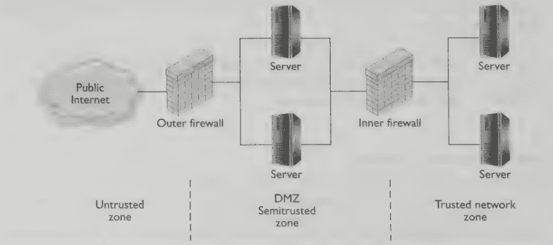

**图 3-1.** DMZ 和信任区域


许多类型的服务器都属于这一区域，包括向互联网用户提供内容的 Web 服务器，以及远程访问服务器和外部电子邮件服务器。一般而言，任何需要直接从外部不受信任的互联网区域访问的服务器，都应放置在 DMZ 中。其他服务器则不应放置在 DMZ 中。用于内部受信任网络的域名服务器，以及存放企业数据库的数据库服务器，不应允许从外部访问。应用服务器、文件服务器、打印服务器——受信任网络中使用的所有标准服务器——都应位于两道防火墙之后，以及用于连接这些机器的路由器和交换机之后。

使用 DMZ 拓扑结构背后的理念是：强制外部用户在访问受信任网络内部信息之前，至少先在 DMZ 中进行一次跳转。如果外部用户通过受信任网络请求资源，例如通过网页请求数据库中的数据元素，则该请求需要遵循以下流程：

1. 来自不受信任网络（互联网）的用户通过网页向 DMZ 中的 Web 服务器请求数据。
2. DMZ 中的 Web 服务器向应用服务器请求数据，该应用服务器可以位于 DMZ 中，也可以位于内部受信任网络中。
3. 应用服务器向受信任网络中的数据库服务器请求数据。
4. 数据库服务器将数据返回给发出请求的应用服务器。
5. 应用服务器将数据返回给发出请求的 Web 服务器。
6. Web 服务器将数据返回给来自不受信任网络的请求用户。

这种分离实现了两个独立的具体任务。首先，用户与在安全网络上请求数据的过程分离开来。通过由中间方代为发起请求，这种分层方法可以实现显著的安全级别。用户无法直接访问或控制其请求，并且这种过滤过程可以实施相应的控制措施。其次，可扩展性更容易实现。多服务器解决方案可以实现非常高的可扩展性，甚至可以扩展到数百万用户，而不会减慢任何特定层的速度。

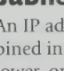

**考试提示** DMZ 充当网络未受保护区域（互联网）和受保护区域（敏感的公司数据存储）之间的缓冲区，允许对这两个区域之间的流量进行监控和调节。

## 子网划分

IP 地址（IPv4）由两部分组成：网络地址和主机地址，组合成一个 32 位的数字。高位比特表示网络地址，低位或其余比特表示主机地址。分隔点由子网掩码定义。最初，IPv4 地址空间根据一些标准分隔方式被划分为一系列地址范围，如表 3-1 所示。随着时间的推移，这种划分被认为过于严格，因此开发了一种名为无类别域间路由（CIDR）的新方案。CIDR 允许将 IPv4 地址空间划分为用户可定义的数据块，从而提供更大的灵活性。

| 类别 | 每个网络的地址数 | 网络数量 | 子网掩码 |
|---|---:|---:|---|
| A 类 | 16,777,214 | 128 | 255.0.0.0 |
| B 类 | 65,534 | 16,384 | 255.255.0.0 |
| C 类 | 254 | 2,097,152 | 255.255.255.0 |

**表 3-1** IPv4 网络类别和子网掩码

CIDR 允许将地址块划分为更小的网络，称为子网。从 C 类地址（如 192.168.x.x）开始，CIDR 可以将其划分为一系列网络。如果需要将其划分为两个网络，则主机空间的最高位变为网络地址位；这使得新的子网掩码为 255.255.128.0。其效果是使用 17 位用于网络寻址，15 位用于主机。CIDR 使用一种表示法，其中网络地址位用“/”符号标记，因此此示例为 192.168.x.x/17。这等同于说子网掩码是 255.255.128.0。由此产生的主机地址集合在一个网络上为 192.168.0.1 到 192.168.127.254，在另一个网络上为 192.168.128.1 到 192.168.255.254。如果需要三个子网，则必须使用 2 位来划分四个子网，因为子网数量将以 2 的幂次增加。这可能会导致未使用的子网，但这是不可避免的。

CIDR 既可以创建子网（即类网络的一部分），也可以创建超网（即大于类网络的网络）。表 3-2 说明了类网络、子网和超网之间的关系。这可能会令人困惑，但随着 CIDR 掩码数字的增加，网络数量会减少，而主机数量会增加。

在表 3-2 中，请注意可用主机的数量比数学上的主机数量少两个。这是因为以全零或全一结尾的地址是广播地址——即针对所有主机的地址。因此，在此示例中，.0 和 .255 地址不是单独的机器。

| CIDR 表示法 | 掩码 | 可用主机数量 | 大小 |
|---|---:|---:|---|
| X.X.X.X/25 | 255.255.255.128 | 126 | 半个 C 类子网 |
| X.X.X.X/24 | 255.255.255.0 | 254 | C 类子网 |
| X.X.X.X/23 | 255.255.254.0 | 510 | 两个 C 类子网 |

**表 3-2** CIDR 子网和超网

## VLAN

局域网（LAN）是一组具有相似功能和相似通信需求的设备，通常位于同一地点并由单个交换机运行。这是网络层级中的最低层，并在数据链路层定义了某些协议进行通信的域。虚拟局域网（VLAN）使用单个交换机并将其划分为多个广播域和/或多个网段，这称为中继（trunking）。这种非常强大的技术提供了显著的网络灵活性、可扩展性和性能。

## 中继

中继是跨多个交换机扩展单个 VLAN 的过程。交换机之间的基于中继的连接允许来自单个 VLAN 的数据包在交换机之间传输，如图 3-2 所示。图中显示了两条中继：VLAN 10 由一条中继实现，VLAN 20 由另一条中继实现。不同 VLAN 上的主机不能通过中继通信，并且会通过交换机网络进行交换。中继使网络管理员能够以最小的努力在多个交换机上设置 VLAN。通过中继和 VLAN 的组合，网络管理员可以根据用户功能对网络进行子网划分，而无需考虑主机在网络上的位置或重新布线机器的需要。

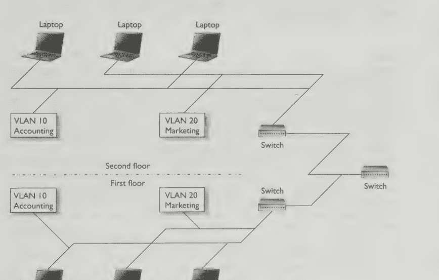

图 3-2 VLAN 和中继

## 安全影响

VLAN 用于根据功能将单个网络划分为多个子网。例如，这允许工程部门和会计部门由于位置接近而共享一台交换机，但同时拥有独立的流量域。设备和线缆的物理放置被逻辑地和程序化地分离，因此交换机上的相邻端口可以引用不同的子网。这通过不同的子网但相同的设备来防止对物理上靠近的设备进行未经授权的使用。VLAN 还允许网络管理员定义一个没有用户的 VLAN，并将所有未使用的端口映射到此 VLAN。然后，即使未经授权的用户能够访问设备，他也无法使用未使用的端口，因为这些端口将被安全地定义为无任何用途。VLAN 的一个目的和安全优势在于，不同 VLAN 上的系统无法直接相互通信。


> **警告** 中继和 VLAN 具有需要注意的安全影响，以防止防火墙和其他分段设备因使用它们而被突破。它们还需要理解其用途，以防止未经授权的用户重新配置它们，从而在未被发现的情况下访问网络的安全部分。

## NAT

网络地址转换（NAT）使用两组 IP 地址来标识资源——一组用于内部使用，另一组用于外部（互联网）使用。NAT 是作为解决 IPv4 地址空间中 IP 地址快速枯竭问题的方案而开发的；此后它已成为互联网标准（详见 RFC 1631）。NAT 用于在两种寻址方案之间进行转换，通常在防火墙或路由器上执行。这允许企业在内部使用不可路由的私有 IP 地址空间，并减少了互联网上使用的外部 IP 地址数量。

定义了三组不可路由的私有 IP 地址，这意味着这些地址不会在互联网上被路由。这些地址在内部是可路由的，并且路由器可以设置为路由它们，但互联网上的路由器被设置为丢弃发送到这些地址的数据包。这种方法实现了内部和外部流量的分离，并允许任何希望使用这些地址的人重复使用它们。这三个私有地址空间是：

- **A 类**   10.0.0.0–10.255.255.255
- **B 类**   172.16.0.0–172.31.255.255
- **C 类**   192.168.0.0–192.168.255.255

这些地址在网络内部的使用不受限制，并且它们的功能与其他任何 IP 地址一样。当这些地址中的某一个需要外部（即互联网提供的）资源时，需要 NAT 来为资源生成有效的外部 IP 地址。NAT 通过在流量通过 NAT 设备时转换地址来工作。


例如防火墙。所使用的外部地址无法在外部与内部地址一一映射，因为这将违背地址复用和节约地址空间的初衷。通常，NAT设备使用一个外部IP地址池，并随时记录哪个内部地址正在使用哪个外部地址。这提供了一层重要的安全保护，因为它使得从外部映射防火墙背后的内部网络结构并直接访问变得困难。NAT是用于执行边界安全的方法之一，它强制用户通过防火墙和网关服务器等既定路径访问资源。有几种技术可用于实现NAT。基本NAT（也称为静态NAT）提供外部地址与内部地址的一一绑定；它适用于外部源引用内部源的服务，如Web服务器或电子邮件服务器。对于引用外部资源的DMZ资源，可以通过动态NAT共享地址，在这种方式下，边缘设备构建并使用一张表来管理转换。由于地址转换会随时间变化，该表也会随之变化。通过端口地址转换（PAT）还可以实现更细粒度的控制，在PAT中，实际的TCP/UDP端口也被转换。这将使单个外部IP地址能够通过使用端口来服务两个内部IP地址。需要长期NAT但仅需特定端口（如80端口的Web服务器或25端口的电子邮件）的资源可以共享一个外部IP地址，从而节省资源。

## 远程访问

远程访问是指通过网络连接到设备。有多种协议可用于实现远程访问。远程访问服务（RAS）是Windows操作系统的一部分，它允许客户端和服务器之间通过拨号电话连接进行连接。虽然比电缆/DSL连接慢，但这仍然是连接远程网络的一种常见方法。当用户拨号进入计算机系统时，会通过一系列远程访问协议执行身份验证和授权。为了获得更高的安全性，可以采用回拨系统，即服务器回拨到客户端的指定电话号码以进行数据交换。RAS也可以指远程访问服务器，即一种旨在允许远程用户访问网络并规范其访问的服务器。如今，远程访问通常通过使用安全的VPN和远程桌面软件来实现。

## 电话技术

几十年来，数据和语音通信在企业中一直共存。近年来，企业将IP语音（VoIP）与传统专用分支交换机（PBX）解决方案在内部进行连接，既增加了功能，也增加了安全风险。为应对这种增加的风险，可以使用专门的防火墙来防止通过电话连接传输未授权流量。

PBX是公共电话网络向企业的延伸。虽然通常被视为独立于数据系统的实体，但PBX经常互连，并且作为这种互连的一部分，既有安全要求，也有自身的安全要求。PBX是基于计算机的交换设备，旨在将电话连接到本地电话系统。它们基本上是数字交换系统，可能从外部受到攻击，并被电话黑客（*phreakers*）利用，以企业的费用打电话。尽管随着低成本长途电话的出现，这类黑客行为有所减少，但并未消失；正如几家公司每年所遭遇的那样，语音信箱和PBX可能会被入侵，长途话费可能会迅速飙升。

PBX与数据系统互连时会出现另一个问题，无论是通过企业连接还是通过用户手中的非法调制解调器。无论哪种情况，都存在连接外部数据网络和互联网的路径。正如数据连接需要防火墙来保证安全一样，这些连接也需要防火墙。**电信防火墙**是一种独特的防火墙类型，旨在同时保护PBX和数据连接。电信防火墙的功能与数据防火墙相同：它用于执行安全策略。电信安全策略甚至可以涵盖电话使用时段，通过实施访问代码和/或限制服务时间来防止未经授权的长途使用。

## 网络访问控制（NAC）

网络由相互连接的工作站和服务器组成。管理网络安全涉及处理各种各样的问题，从各种连接的硬件到运行这些设备的软件。假设网络是安全的，那么每一次额外的连接都会带来风险。在端点连接时逐个管理端点是一种称为网络访问控制的安全方法论。存在两种主要的相互竞争的方法：**网络访问保护（NAP）**是微软的一项用于控制计算机主机网络访问的技术，**网络准入控制（NAC）**是思科的用于控制网络准入的技术。

微软的NAP系统基于对连接机器的系统健康状况进行衡量，包括操作系统补丁级别、防病毒保护以及系统策略。NAP最初在Windows XP Service Pack 3、Windows Vista和Windows Server 2008中使用，并且需要额外的基础设施服务器来执行健康检查。该系统包括执行代理，它们检查客户端并验证准入标准。每当建立网络连接时，客户端一侧就会启动。响应选项包括拒绝连接请求，或将准入限制在某个子网内。

思科的NAC系统围绕一个设备构建，该设备执行网络管理员选择的策略。一系列第三方解决方案可以与该设备交互，从而能够验证大量选项，包括客户端策略设置、软件更新和客户端安全态势。第三方设备和软件的使用使其成为一个可跨广泛设备扩展的系统。

思科NAC和微软NAP都处于采用的早期阶段。客户端组件都已就位，但企业在全面部署该技术的服务器端方面一直进展缓慢。基于客户端设备特性的自动准入检查概念将长期存在，因为它在当今企业不断变化的网络世界中提供了及时的控制。随着企业内*自带设备（BYOD）*的兴起，人们重新对使用NAC来协助保护网络免受不安全设备的影响产生了兴趣。

## 虚拟化

虚拟化是创建虚拟系统，而非实际硬件和软件。硬件和软件的分离使企业具有更高的灵活性。在实际硬件之上，虚拟化层可以创建完整的系统，包括作为虚拟机的计算机和网络设备。这种硬件和软件的分离通过一系列改进带来了安全性。复制整个系统、对其进行备份或在硬件平台之间移动它们的能力可以增强系统的安全性。

与虚拟化相关的有用要素之一是快照的概念。快照是系统在某个时间点的映像。快照支持众多有用的功能。快照允许系统返回到先前的某个时间点。快照支持更快的备份、更快的恢复，并提供了一种使系统更稳定的手段。

尽管可能存在一些漏洞，允许一个虚拟环境中的进程破坏虚拟环境之间的隔离，或破坏与宿主机之间的层，但这些漏洞很罕见且极难利用。必须解决一种新型漏洞——复制完整虚拟系统的能力——因为这可能导致数据和知识产权损失。保护虚拟系统的存储必须与常规系统的备份同等重要，以避免整体损失。

## 云计算

云计算是一个常用术语，用于描述通过网络提供的计算机服务。这些计算服务是通过互联网协议提供的计算、存储、应用程序和服务。云计算的特性之一是对最终用户的透明性。这提高了这种服务提供形式的可用性。云计算为用户提供了很多好处：包括性能、可扩展性、灵活性、安全性和可靠性等方面的改进。这些改进是云服务实现方式相关特定属性的直接结果。

当数据和计算由远程方处理时（如在云计算中），安全性是一个特别的挑战。具体的挑战是如何允许数据位于企业外部，同时仍然保持对数据使用的控制。通常的答案是加密。通过在数据离开企业之前适当地加密数据，并正确使用加密要素，仍然可以安全地进行外部存储。

云可以由组织内外的许多实体创建。商业云服务已经可用，由各种企业提供，从谷歌和亚马逊等大公司到较小的本地提供商。公司内部服务可以复制云计算的优点，同时提高有限资源的利用率。云计算的承诺是提高效用，并以平台即服务、软件即服务和基础设施即服务等概念进行推广。


通过iCloud（苹果）、OneDrive（原SkyDrive）以及Dropbox等文件服务，云服务的使用在普通用户中已逐渐成为主流。这些服务易于使用、易于配置，并以最小的用户难度提供所需的基本服务。

## 平台即服务

平台即服务（PaaS）是一个营销术语，用于描述在云中提供计算平台。多组协同工作的软件（如数据库服务）可以通过云作为平台交付。PaaS产品通常侧重于安全性和可扩展性，这两者都是符合云和平台需求的特征。

## 软件即服务

软件即服务（SaaS）是从云端向最终用户提供软件。SaaS不是将软件安装在客户端机器上，而是作为一种按需软件，软件从云端运行。这有几个优点：更新对最终用户无缝，组件之间的集成可以增强。SaaS的常见示例是通过Web订阅服务提供的产品，如Microsoft Office 365和Adobe Creative Suite。

## 基础设施即服务

基础设施即服务（IaaS）是一个术语，用于描述作为虚拟计算平台交付的基于云的系统。IaaS允许企业根据需要签约效用计算，而不是建设数据中心。IaaS特别以按使用付费为基础进行营销，并随需求直接扩展。

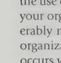

> **考试提示** 请确保你理解云计算服务模型平台即服务、软件即服务和基础设施即服务之间的区别。

## 私有云

如果你的组织对共享资源高度敏感，你可能需要考虑使用私有云。私有云本质上是仅用于你组织的预留资源——云中你自己的小小云。这种服务将昂贵得多，但也应具有更小的暴露面，并应使你的组织能够更好地定义云内发生的安全性、处理、数据处理等。

## 公有云

公有云一词指的是云服务在开放供公众使用的系统上提供的情况。在大多数情况下，公有云和私有云架构在操作上没有太大区别，但安全影响可能很大。尽管公有云服务将通过安全限制来隔离用户，但根据定义，这些限制的深度和级别在公有云中将显著降低。

## 混合云

混合云结构是结合了私有云、公有云和社区云结构元素的云结构。在检查混合结构时，你需要意识到在操作上这些不同的环境可能并没有真正连接，而是共同使用。敏感信息可以存储在私有云中，与问题相关的信息可以存储在社区云中，所有这些信息都由一个应用程序访问。这使得整个系统成为混合云系统。

## 社区云

社区云系统是多个具有共同利益的组织为特定共同目标共享云环境的系统。例如，当地公共实体和主要当地企业可以共享一个专门服务于社区倡议利益的社区云。对于特定的数据共享倡议来说，这可能是一种有吸引力的成本分担机制。

## 分层安全/纵深防御

安全的网络设计依赖于许多要素，其中关键之一是纵深防御。纵深防御是一种安全原则，通过采用多种不同的安全要素来提高安全级别。如果攻击者能够绕过一项安全措施，重叠的控制之一仍然可以捕获并阻止入侵。在网络中，可以重叠使用一系列防御措施，包括访问控制列表、防火墙、入侵检测系统和网络隔离，以实现保护。

## 协议

协议充当通用语言，允许不同的组件使用一组通用、已知的命令进行通信。存在许多不同的协议，所有这些协议都用于实现特定的通信目标。


> **考试提示** 考试时，你应预期在给定基本场景时被要求实现常见的协议和服务。

## IPsec

IPsec是IETF开发的一组协议，用于在OSI模型的网络层（第3层）安全地交换数据包（RFC 2401–2412）。虽然这些协议仅与IP网络配合使用，但一旦建立IPsec连接，就可以在OSI模型较低级别的其他网络上进行隧道传输。IPsec提供的一组安全服务发生在OSI模型的网络层，因此更高层协议，如TCP、UDP、互联网控制消息协议（ICMP）、边界网关协议（BGP）等，不会因IPsec服务的实施而改变功能。

IPsec协议系列设计提供一系列广泛的服务，包括但不限于访问控制、无连接完整性、流量机密性、拒绝重放数据包、数据安全（加密）和数据源认证。IPsec有两种定义的方法——传输和隧道——提供不同级别的安全性。IPsec还有三种连接模式：主机到服务器、服务器到服务器、主机到主机。

传输方法仅加密数据包的数据部分，从而使外部人员能够看到源和目标IP地址。传输方法保护与数据包相关联的更高层协议，并保护正在传输的数据，但允许知道传输本身。数据包数据部分的保护称为*内容保护*。

隧道提供了对源和目标IP地址以及数据本身的加密。这提供了最高的安全性，但只能在IPsec服务器（或路由器）之间进行，因为需要知道最终目的地才能传送。对报头信息的保护称为*上下文保护*。

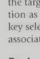

> **考试提示** 在传输模式（端到端）中，数据包流量的安全性由端点计算机提供。在隧道模式（门户到门户）中，数据包流量的安全性由每个网络中的端点节点机提供，而不是在终端主机上提供。

可以同时使用两种方法，例如在自己的网络内使用传输到达IPsec服务器，然后该服务器隧道到目标服务器的网络，在那里连接IPsec服务器，然后使用传输方法从目标网络的IPsec服务器到目标主机。IPsec使用术语“安全关联”来描述特定算法和密钥选择的单向组合，以提供受保护的通道。如果流量是双向的，则需要两个安全关联，并且实际上可以不同。

## 基本配置

使用IPsec的机器到机器连接可以应用四种基本配置。最简单的是两台机器之间的主机到主机连接，如图3-3所示。在这种情况下，互联网不是机器之间安全关联（SA）的一部分。如果需要双向安全，则使用两个SA。SA从主机到主机有效。

第二种情况是在流中放置两个安全设备，减轻主机的计算和封装职责。这两个网关之间有一个SA。假设从每台机器到其网关的网络是安全的，并且没有IPsec是


## 案例1：主机到主机的两个SA，用于双向安全通信

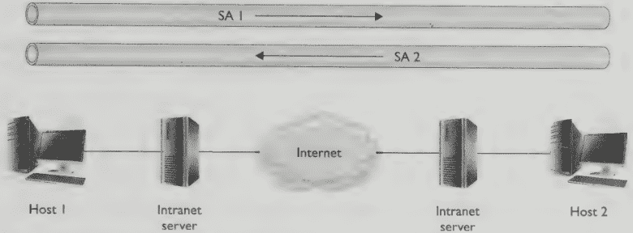

**图3-3**  两台机器之间的主机到主机连接

在这些跳上执行。图3-4显示了两个安全网关通过互联网建立的隧道，尽管可以使用隧道模式或传输模式。

第三种情况结合了前两种情况。网关设备之间存在单独的SA，但主机之间也存在SA。这可以被视为隧道中的隧道，如图3-5所示。

远程用户通常通过互联网连接到组织的网络。网络有一个安全网关，通过该网关保护往返其服务器和授权用户的流量。在最后一种情况中，如图3-6所示，用户与安全网关建立SA，然后根据需要与目标服务器建立单独的SA。这可以通过远程笔记本电脑上的软件和组织网络中的硬件来实现。

## 案例2：使用网关安全设备在机器之间进行IPsec

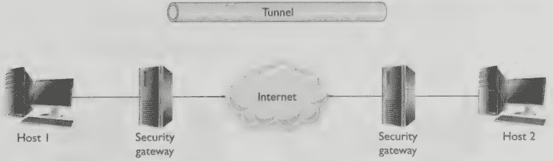

**图3-4**  两个安全网关通过互联网建立的隧道

## 案例3：独立的IPsec隧道，主机到主机和网关到网关

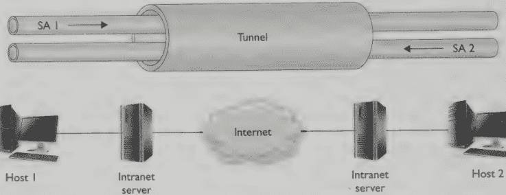

**图3-5** 隧道中的隧道

## 案例4：从主机到网关的隧道
可选：用于双向安全通信的两个SA

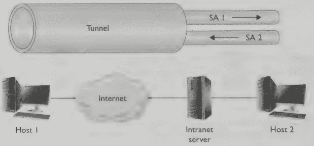

**图3-6** 从主机到网关的隧道

Windows可以作为IPsec服务器，路由器和其它服务器也可以。主要问题是CPU使用率以及计算能力应在何处实现。这一考虑导致了IPsec设备的兴起，这些硬件设备专门为一系列通信执行IPsec功能。根据连接数量、网络带宽等，这些设备对于小型办公室或家庭办公室使用来说可能很便宜，而对于大型企业级实施来说则可能相当昂贵。

## AH和ESP

IPsec使用两种协议来提供流量安全：

- 认证头（AH）
- 封装安全载荷（ESP）

对于密钥管理和交换，存在三种协议：

- 互联网安全关联和密钥管理协议（ISAKMP）
- Oakley
- 互联网安全密钥交换机制（SKEME）

这些密钥管理协议可以统称为互联网密钥管理协议（IKMP）或互联网密钥交换（IKE）。

IPsec不定义特定的安全算法，也不需要特定的实现方法。IPsec是一个开放框架，允许供应商实现适合特定任务的现有行业标准算法。这种灵活性是IPsec能够提供广泛安全功能的关键。IPsec允许将多种安全技术组合成一个全面的解决方案，用于基于网络的机密性、完整性和认证。IPsec使用以下技术：

- 公共网络上对等方之间的Diffie-Hellman密钥交换
- 对Diffie-Hellman密钥交换进行公钥签名，以保证身份并避免中间人攻击
- 用于加密数据的批量加密算法，如IDEA和3DES
- 用于数据包级认证的密钥哈希算法（如HMAC）和传统哈希算法（如MD5和SHA-1）
- 数字证书作为各方之间的数字身份证

为了提供流量安全，已经为IP数据报定义了两种头部扩展。AH添加到IP数据报后，确保数据的完整性以及数据来源的真实性。通过保护IP头部中不变的元素，AH保护IP地址，从而实现数据源认证。ESP仅为数据包的高层协议部分提供安全服务，而不针对IP头部。


考试提示：IPsec AH保护完整性，但不提供隐私。IPsec ESP提供机密性，但不保护数据包的完整性。为了同时覆盖隐私和完整性，可以同时使用两种头部。

## 图3-9 IPsec在隧道模式下使用AH

## 隧道模式下的认证头

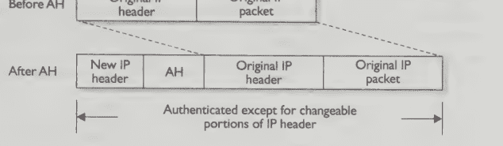

如图3-9所示。ESP对隧道数据包的内容提供相同的加密保护，该数据包是来自初始发送方的整个数据包，如图3-10所示。在隧道模式下，AH和ESP共同可以提供对整个数据包的完整保护，如图3-11所示。AH和ESP的特定组合在IPsec中称为安全关联。

在IPv4中，IPsec是一个附加组件，其接受度由供应商驱动。它不是原始IP的一部分——这是原始IP短视的设计缺陷之一。在IPv6中，IPsec被集成到IP中，并且是所有数据包的原生特性。它的使用仍然是可选的，但其包含在协议套件中将保证符合IPv6标准的供应商解决方案之间的互操作性。

IPsec在其安全过程中使用加密密钥，并作为协议系列的一部分，具有手动和自动两种密钥分发方式。手动密钥分发包含在内，但它仅适用于小型静态环境，无法扩展到企业级实施。密钥管理的默认方法是IKE，它是自动化的。IKE认证参与IPsec的每个对等方，并协商安全策略，包括会话密钥的交换。IKE在对等方之间创建安全隧道，然后通过该信道协商IPsec的SA。这分两个阶段完成：第一阶段建立信道，第二阶段建立SA。

## 隧道模式下的封装安全载荷

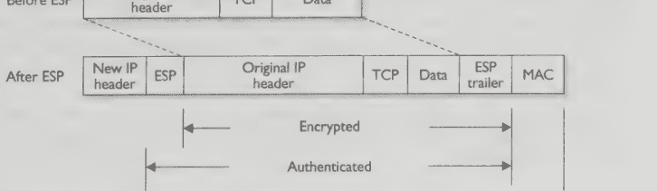

## 图3-10 IPsec在隧道模式下使用ESP

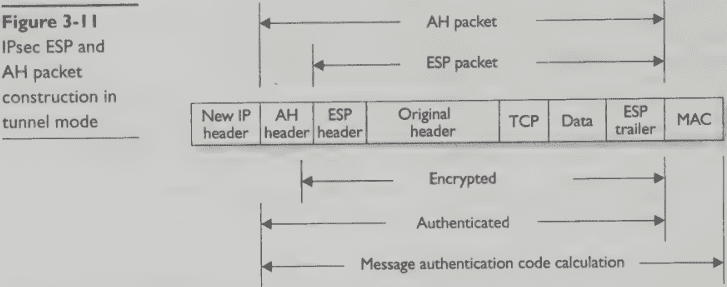

## SNMP

简单网络管理协议（SNMP）是管理基于IP网络设备的标准。SNMP是一种应用层协议，是IP协议套件的一部分，可用于管理和监控设备，包括网络设备、计算机以及连接到IP网络的其它设备。

## SSH

安全外壳（SSH）协议是一种加密的远程终端连接程序，用于与服务器进行远程连接。SSH使用非对称加密，但通常需要与服务器建立独立的信任源才能运行，例如手动接收服务器密钥。SSH使用TCP端口22作为其默认端口。

> **考试提示** SSH使用公钥加密技术进行安全的远程终端访问，并被设计为Telnet的安全替代品。

## DNS

域名服务（服务器）（DNS）是一种将名称转换为IP地址的协议。当用户输入诸如www.example.com之类的名称时，DNS系统会将该名称转换为实际的数字IP地址。DNS记录也用于电子邮件投递。DNS协议在标准查询中使用UDP端口53，尽管TCP可用于大型传输，例如区域传输。DNS是一个分层的服务器系统，从本地副本到互联网提供商，再到根级服务器。DNS是互联网中使用的主要底层协议之一，几乎涉及所有地址查找。

## TLS

传输层安全（TLS）是IETF制定的用于采用加密技术的标准，取代了SSL。TLS在采用相同基本原理的同时，更新了SSL所使用的机制。尽管有时被称为SSL，但它是一个单独的标准。

## SSL

安全套接层（SSL）是为Web上的传输层协议开发的加密技术应用。该协议使用公钥加密方法来交换对称密钥，用于机密性、完整性保护以及认证。当前版本V3已经过时，已被IETF标准TLS取代。

## TCP/IP

传输控制协议（TCP）是互联网协议（IP）套件中最常用的协议之一。TCP在端点之间保持连接，实现可靠的通信。TCP连接通过三次握手发起，包括SYN、SYN-ACK和ACK。


> > **考试提示** TCP在端点之间建立连接，从而实现传输级安全和可靠（有保证）的数据包投递等要素。UDP是无连接的，依赖网络可靠性来实现无差错的数据包投递。

## FTP

文件传输协议（FTP）是一种在机器之间传输文件的不安全的明文方法。FTP使用TCP端口21协商传输细节，然后通过更高的端口地址进行传输。

## FTPS

FTPS是在SSL/TLS安全通道上实现FTP。这支持完全的FTP兼容性，同时提供SSL/TLS所启用的加密保护。FTPS使用TCP端口989和990。

## SFTP

SFTP是通过SSH通道使用FTP。这利用了SSH的加密保护来确保FTP传输的安全。由于依赖SSH，它使用TCP端口22。


## TFTP

简单文件传输协议（TFTP）是一种以简单著称的文件传输协议，缺乏身份验证等安全机制。它使用 UDP 端口 69，仅设计用于读写文件，通常不会在互联网上使用。

## HTTP

超文本传输协议（HTTP）是一种应用层协议，是 Web 的基础。它使用 TCP 端口 80，基于客户端/服务器模型运行，涉及超链接以及浏览器从相关内容集合中渲染出的内容。

## HTTPS

HTTPS 是指使用 SSL 或 TLS 加密信道来传输 HTTP 流量。它使用 TCP 端口 443。HTTPS 是保护 HTTP 流量安全最广泛使用的方法。

## SCP

系统之间的文件传输可以通过安全复制协议（SCP）完成，这是一种基于 SSH 的文件传输机制。由于依赖 SSH，它使用 TCP 端口 22。

## ICMP

互联网控制消息协议（ICMP）是互联网协议套件中用于诊断、控制和错误消息的组成部分。你最可能遇到的常见 ICMP 流量是 ping，它由 ICMP 回显请求和 ICMP 回显应答组成。ICMP 在 IPv4 中是可选的，但由于它引发了一系列攻击向量（包括 ping 洪泛和 ping 死机），通常在网络边界被阻止。在 IPv6 中，ICMP 是 IP 协议端到端工作所必须携带的组件，这意味着企业不能在网络边界阻止它。

## IPv4

互联网协议第 4 版（IPv4）是目前使用的 IP 协议中最常见的版本。其特点是 32 位地址表示法，以点分十进制形式表示为 X.X.X.X，其中 X 的取值范围为 0 到 255。IPv4 用于在互联网上路由数据包，并通过包括 ICMP、TCP 和 UDP 在内的一系列相关协议提供服务。

## IPv6

互联网协议第 6 版（IPv6）是 IPv4 的替代方案。它使用 128 位地址空间，约代表 3.4 × 10^38 个地址。IPv6 地址可以用八组四位十六进制数字表示，以冒号作为分隔符。除了更大的地址空间之外，IPv6 还提供了许多功能，包括自动配置、增强的安全性、IPsec 支持和增强的多播支持。IPv6 与 IPv4 不互通，并给网络和安全人员带来了一些挑战。IPv6 专为主机到主机连接而设计，使得 NAT 等旧式系统变得过时。它也给安全厂商带来了挑战，因为用于保护 IPv4 的工具和技术在 IPv6 上的工作方式并不相同。

## iSCSI

互联网小型计算机系统接口（iSCSI）是一种基于 IP 的存储协议。iSCSI 可用于通过现有网络基础设施发送数据，从而支持存储区域网络（SAN）。作为光纤通道存储的低成本替代方案，它唯一的实际限制是网络带宽。

## Fibre Channel

光纤通道（FC）是一种高速网络技术（吞吐量可达 16 Gbps），用于将存储连接到计算机系统。FC 协议是一种类似于 IP 网络中 TCP 协议的传输协议。由于需要通过特殊线缆传输，基于 FC 的存储的缺点之一是成本高。

## FCoE

以太网光纤通道（FCoE）协议封装 FC 帧，使 FC 通信能够在 10 吉比特以太网上运行。

## Telnet

Telnet 是一种以明文方式向远程机器实例化命令行控制台的方法。Telnet 使用 TCP 端口 23，并以未加密形式发送所有传输内容，使流量容易受到窃听。Telnet 是一种已有数十年历史的老协议，但由于安全问题，已被 SSH 取代。

## NetBIOS

NetBIOS 是一种独立于 DNS 的命名方案，用于较早版本的 Windows 系统。它使用 TCP 和 UDP 端口 137、138、139 和 445，在局域网中用于基于 Windows 的 PC 上的文件和打印机共享等。NetBIOS 经常成为黑客的攻击目标，现已基本过时，只在较老、较小的网络环境中出现。

## Ports

在 TCP 和 UDP 协议栈中，服务通过端口来引用。表 3-3 列出了与 CompTIA Security+ 考试要求相关的常见端口分配。


> 考试提示：了解常见协议的端口号非常重要。

**表 3-3 常见 TCP 和 UDP 端口分配**

| 端口 | TCP 端口分配 | UDP 端口分配 |
|------|--------------|--------------|
| 21 | FTP |  |
| 22 | SSH |  |
| 25 | SMTP |  |
| 53 | DNS | DNS |
| 80 | HTTP |  |
| 110 | POP3 |  |
| 139 | NetBIOS |  |
| 143 | IMAP |  |
| 443 | HTTPS |  |
| 3389 | RDP | RDP |

## OSI 相关性

为了将大量协议组织成可用的层，开放系统互连（OSI）模型的抽象层非常有用。这使人们能够快速确定哪些协议可以与哪些协议一起使用，或封装在其他协议之上。表 3-4 按 OSI 抽象层展示了协议的划分。

**表 3-4 按 OSI 层划分的协议**

| OSI 层 | 协议 |
|--------|------|
| 7 – 应用层 | DHCP, DNS, FTP, TFTP, SSH, LDAP, IMAP, POP3, Gopher, HTTP, NFS, NNTP, NTP, SIP, SSI, SMPP, SMTP, SNMP, Telnet |
| 6 – 表示层 | MIME, XDR, EBCDIC, RDP |
| 5 – 会话层 | Named Pipes, NetBIOS, PPTP, RTP, SAP, SOCKS, SPDY |
| 4 – 传输层 | DCCP, SCTP, SPX, TCP, UDP |
| 3 – 网络层 | AppleTalk, IP (v4, v6), EGP, EIGRP, ICMP, IPsec, IGMP, IGRP, MPLS, IPX, X.25 |
| 2 – 数据链路层 | ARP, ATM, Frame Relay, HDLC, IEEE 802.2, LLC, L2TP, PPP, PPTP, LLDP, STP, SDLC, SLIP, X.25 |
| 1 – 物理层 | Bluetooth, DSL, ADSL, ISDN, IEEE 1394, IEEE 802.3, IEEE 802.11, IEEE 802.15, IEEE 802.16, RS-232, RS-485, SONET/SDH, USB |

## 章节回顾

本章首先探讨了如何通过 DMZ 和子网等设计元素对网络进行隔离。接着讨论了使用 VLAN 进行流量管理及其安全影响，然后是网络地址转换问题。本章继续介绍了远程访问、网络访问控制、电话和虚拟化的概念。然后从所提供的服务（IaaS、SaaS 和 PaaS）以及云类型（私有云、公有云、混合云和社区云）两个方面探讨了云计算。最后，本章考察了许多常见的网络协议和端口以及 OSI 模型的相关性。

## 问题

为了帮助你进一步准备 CompTIA Security+ 考试并测试你的准备程度，请回答以下问题，然后对照本章末尾的正确答案检查你的答案。

-   1. 以下哪台服务器最不可能放置在 DMZ 中？
-      A. Web 服务器
-      B. DNS 服务器
-      C. SMTP 服务器
-      D. 文件服务器
-   2. 哪个网络掩码对应 /31 前缀？
-      A. 255.255.255.0
-      B. 255.255.255.192
-      C. 255.255.255.248
-      D. 255.255.255.254
-   3. 将左侧列中的项目（一一对应）与右侧相应的项目匹配：
-      A. FTPS      1. 中继（Trunking）
-      B. SSH       2. PBX
-      C. NAT       3. SSL/TLS
-      D. VLAN      4. SaaS
-                   5. TCP 22
-                   6. PAT

4. 如果多个内部主机需要共享一个外部 IP 地址，你可能会使用：

-   - A. 目标网络地址转换（Destination Network Address Translation）
-   - B. 端口地址转换（Port Address Translation）
-   - C. 源网络地址转换（Source Network Address Translation）
-   - D. 动态网络地址转换（Dynamic Network Address Translation）

5. 以下哪项不是远程访问方法？

-   - A. 远程桌面软件
-   - B. 终端仿真
-   - C. SaaS
-   - D. 安全外壳（Secure Shell）

6. 网络访问控制（NAC）在什么时候实施？

-   - A. 设备初次尝试访问网络时
-   - B. 设备更改 MAC 地址时
-   - C. 设备更改协议时
-   - D. 检测到零日攻击时

7. 在讨论虚拟化时，快照是指：

-   - A. 虚拟机在特定时间点使用的资源量
-   - B. 虚拟机在某个确切时间点的状态
-   - C. 与特定虚拟机关联的虚拟磁盘的状态
-   - D. 特定虚拟机中硬件仿真的使用情况

8. 仅提供应用交付的平台即服务（PaaS）产品通常侧重于：

-   - A. 安全性和可扩展性
-   - B. 开发能力
-   - C. 允许开发人员使用任何编程语言
-   - D. 基于订阅的服务

9. 采用基础设施即服务（IaaS）模式的公司通常会：

-   - A. 拥有基础设施设备
-   - B. 负责安置和维护设备
-   - C. 仅支持网络基础设施
-   - D. 按使用量付费


10. 一个希望创建受限访问、可通过互联网访问的资源来处理敏感数据的组织，可能会考虑使用：

- A. 软件即服务
- B. 私有云
- C. 公有云
- D. 社区云

11. 你的组织正在本地园区内新建三栋大楼，所有大楼都连接到同一台核心路由器。你只有一个可用的地址空间 10.10.10.0 来处理这三栋新大楼之间的路由。你需要使用什么子网掩码才能为这三栋大楼分别创建独立的子网？

- A. 255.255.255.128
- B. 255.255.255.192
- C. 255.255.255.240
- D. 255.255.255.252

12. 你的组织正在考虑从 QuickBooks 2009 迁移到 QuickBooks Online（一种基于 Web 的解决方案）。QuickBooks Online 是以下哪种模式的示例？

- A. PaaS
- B. SaaS
- C. IaaS
- D. QaaS

13. 你需要设置一个 DMZ，但希望 DMZ 内的服务器使用私有地址空间。你有充足的公共 IP 地址空间，只想将每台服务器的私有地址映射到一个唯一的公共地址。哪种类型的 NAT 最合适？

- A. 静态 NAT
- B. 全锥形 NAT
- C. 端口地址转换
- D. 动态 NAT

7. B. 在虚拟化中，快照是虚拟机在某一确切时间点的状态。快照通常还包括虚拟机存储设备的状态。

8. A. 仅用于应用交付的平台即服务（PaaS）产品通常侧重于安全性和可扩展性。

9. D. 采用基础设施即服务（IaaS）模式的公司通常按使用量付费。IaaS 是一种供应模式，组织将其运营所使用的设备以及这些设备的存放、维护和运维都外包出去。

10. B. 希望创建受限访问、可通过互联网访问的资源来处理敏感数据的组织，可以考虑使用私有云。

11. B. 要从 10.10.10.0 地址空间创建至少三个子网，你需要使用 255.255.255.192 子网掩码。这将为你提供四个独立的网络，每个网络有 62 个主机地址。

12. B. QuickBooks Online 是软件即服务（SaaS）模式的一个示例。该软件通过 Web 浏览器访问，任何具有互联网连接和兼容浏览器的计算机都可以使用。

13. A. 静态 NAT（通常称为一对一 NAT）将单个私有地址映射到单个公共地址。

14. B. 会议中的其他人主张纵深防御（或称分层防御），即使用多个安全层来提供更强的抵御潜在攻击的能力。攻击者必须先成功穿透多层防御，然后才能渗透进网络。

15. C. 社区云在多个不同组织之间共享资源，但这些资源仍然保留给这些组织使用（也就是说，它们不是公共资源）。

## SSID

802.11 协议的设计者预见到了一些安全问题，并试图在 802.11 协议中加入能够确保足够安全性的条款。802.11 标准包含了对基本身份验证和保密性控制的尝试。身份验证在其最基本的形式下由 802.11 接入点（AP）处理，强制客户端在尝试“关联”到 AP 时执行握手。关联是 AP 允许客户端通过 AP 与网络通信之前所必需的过程。

身份验证功能被称为服务集标识符（SSID）。这个唯一的 32 字符标识符附加在数据包头部。只有当客户端拥有握手所需的全部正确参数（其中包括 SSID）时，关联才会发生。这种 SSID 设置应将对无线网络的访问限制在仅限授权用户。SSID 默认作为网络名称进行广播，但可以禁用这种信标帧的广播。许多 AP 还使用默认的 SSID；例如，对于许多版本的 Cisco AP，这个默认值是 tsunami，这可能表明该 AP 尚未配置任何安全性。重命名 SSID 和禁用 SSID 广播都是好主意；然而，由于 SSID 是每个帧的一部分，这些措施不应被视为对网络的安全加固。由于 SSID（希望）是一个唯一标识符，只有知道该标识符的人才能完成与 AP 的关联。

虽然 SSID 在理论上是个好主意，但它在数据包中以明文发送，因此实际上 SSID 几乎没有安全意义——任何嗅探器都能确定 SSID，而且许多操作系统（例如 Windows XP 及更高版本）会显示区域内活动的 SSID 列表，并提示用户选择要连接哪一个。大多数 AP 默认发送信标帧的设置放大了这一弱点。信标帧的用途是通告无线网络的存在和功能，以便 WLAN 网卡尝试关联到它。对于许多 AP，尤其是更复杂的 AP，可以通过软件禁用此功能。从安全角度来看，信标帧是有害的，因为它包含 SSID，并且信标帧按固定的时间间隔发送（默认每秒十次）。由于一个默认的 AP 在没有其他流量时会以明文形式每秒发送十次其 SSID，你可以明白为什么 SSID 不能提供真正的身份验证。诸如 NetStumbler 之类的扫描程序通过捕获所有 AP 的信标帧（从而获取 SSID）来工作。


**考试提示** 尽管重命名 SSID 和禁用 SSID 广播不被认为是最强大的安全措施，但它们是考试中需要了解的重要概念。

## WEP

802.11 协议的设计者还尝试通过引入有线等效加密（WEP）来维持保密性，WEP 使用密码在数据通过空中传输时对其进行加密。事实证明，WEP 存在一个可被利用来破坏安全性的实现问题。WEP 使用 RC4 流密码对网络中传输的数据进行加密，试图确保保密性。（RC4 密码的详细信息在第 24 章中介绍。）这种同步加密方法确保了某种身份验证方式。该系统依赖于客户端和 AP 拥有共享的密钥，确保只有拥有正确密钥的授权人员才能访问无线网络。WEP 支持两种密钥长度：40 位和 104 位，尽管通常被称为 64 位和 128 位。在 802.11a 和 802.11g 中，制造商将其扩展为 152 位 WEP 密钥。这是因为在所有情况下，密钥总长度中的 24 位用于初始化向量（IV）。

IV 是 WEP 弱点的首要原因。IV 在消息的明文部分发送，由于总密钥空间约为 1600 万个密钥，同一个密钥会被重复使用。一旦密钥重复，攻击者就拥有了用相同密钥流加密的两个密文。这使得攻击者能够检查密文并恢复密钥。通过只检查具有弱 IV 的数据包，可以改进这种攻击，从而减少破解密钥所需的数据包数量。如果只使用弱 IV 数据包，所需捕获的数据包数量将减少到大约四五百万个，在一个相当繁忙的 AP 上只需几个小时即可完成。作为参考，这意味着宣称具有 128 位 WEP 密钥的设备可以在不到一天的时间内被破解，而对于一台每秒能尝试一万亿个密钥的计算机来说，破解一个普通的 128 位密钥大约需要 2,000,000,000,000,000 年。AirSnort 是一个经过修改的嗅探程序，可以利用这一弱点来获取 WEP 密钥。

WEP 最大的弱点是无论密钥长度如何，IV 问题始终存在，因为 IV 始终保持在 24 位。大多数 AP 还具有仅允许已知 MAC 地址访问的功能，从而提供有限的身份验证能力。鉴于嗅探器能够捕获网络上所有活动的 MAC 地址，这种能力并不是很有效。攻击者只需将其无线网卡配置为某个已知的有效 MAC 地址即可。


> **考试提示** 不应仅依赖 WEP 来提供保密性。如果 WEP 是你的 AP 支持的唯一协议，请将其放置在企业的防火墙和 VPN 之外，以增加更多保护。

## WPA

市场上第一个用于替代 WEP 的标准是 Wi-Fi 保护接入（WPA）。该标准使用存在缺陷的 WEP 算法，并结合了临时密钥完整性协议（TKIP）。TKIP 的工作原理是使用共享机密与网卡的 MAC 地址相结合来生成新密钥，再与 IV 混合生成逐包密钥，使用与传统 WEP 相同的 RC4 密码对单个数据包进行加密。这克服了 WEP 的密钥弱点，因为一个密钥仅用于一个数据包。这种方法的另一个优点是，它可以仅通过软件更改就改造到现有硬件上，这与高级加密标准（AES）和 802.1x 不同。

WEP 使用 40 位或 104 位加密密钥，必须手动输入到无线接入点和设备中，并且不会改变，而 TKIP 采用逐包密钥，为每个数据包生成一个新的 128 位密钥。这通常只需固件更新即可实现，从而为破解 WEP 的各类攻击提供了一种简单的解决方案。


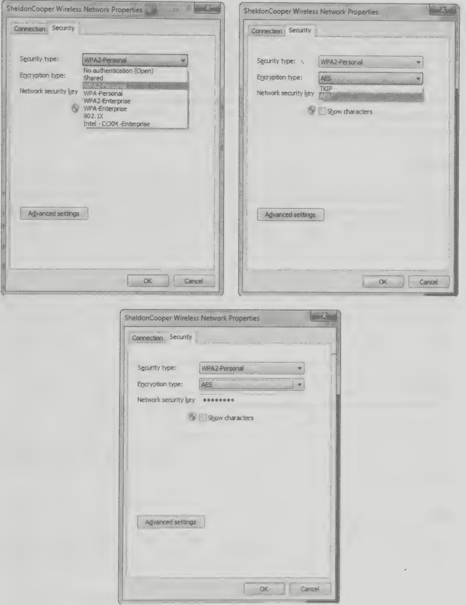

**图 4-1** Windows 7 中的 WPA2 设置选项

## EAP

可扩展认证协议（EAP）在 RFC 2284 中定义（已被 RFC 3748 取代）。EAP-TLS 依赖传输层安全性（TLS），这是一种试图标准化 SSL 结构以传递凭据的方案。EAP-TTLS（该缩写代表 EAP 隧道 TLS 协议）是 EAP-TLS 协议的一个变体。EAP-TTLS 的工作原理与 EAP-TLS 基本相同，服务器使用证书对客户端进行身份验证，但该协议将认证的客户端一侧进行隧道封装，从而允许使用传统认证协议，如密码认证协议（PAP）、挑战握手认证协议（CHAP）、MS-CHAP 或 MS-CHAP-V2。

## PEAP

PEAP（受保护的可扩展认证协议）是为了保护 EAP 通信而开发的，它通过 TLS 对 EAP 通信进行封装。这是由 Cisco、Microsoft 和 RSA 联合制定的开放标准。EAP 在设计时假设存在安全的通信信道。PEAP 通过 TLS 隧道在协议内部提供这种保护。PEAP 被供应商广泛支持，用于无线网络。

## LEAP

Cisco 设计了一种专有的 EAP，称为轻量级可扩展认证协议（LEAP）；然而，该协议正逐渐被 PEAP 或 EAP-TLS 等更新的协议所取代。由于容易受到离线密码猜测攻击，并且已有工具能够主动破解 LEAP 的安全性，该协议已被弃用，转而采用更强的 EAP 方法。

## CCMP

正如之前讨论 WPA2 时提到的，CCMP 代表计数器模式与密码块链接–消息认证码协议（或计数器模式与 CBC-MAC 协议）。CCMP 是一种专为无线使用而设计的数据封装加密机制。实际上，CCMP 是使用 AES 密码提供消息完整性的模式。与 WPA 不同，CCMP 需要新硬件来执行 AES 加密。

## 无线运行

无线安全由前面讨论过的协议和运行特性来管理。有多种运行要素可以增强无线网络的安全性。MAC 过滤、天线类型、放置位置、功率级别，以及根据现场勘测结果进行的放置规划，都可以增强安全性。

### MAC 过滤器

MAC 过滤是基于已批准的媒体访问控制（MAC）地址列表对数据包进行选择性准入。该方法用于交换机，提供一种机器身份验证的手段。在有线网络中，这种方法受到线缆的保护，使得拦截信号以确定其 MAC 地址变得困难。在无线网络中，同样的机制却存在缺陷：攻击者可以看到所有进出接入点的流量的 MAC 地址，然后可以伪装成被允许通过接入点通信的 MAC 地址。

考试提示：MAC 过滤可以应用于无线接入点，但攻击者可以观察允许的 MAC 地址并伪造无线网卡的允许 MAC 地址来绕过该机制。

### 天线放置

Wi-Fi 本质上是一种基于无线电的通信方式，因此使用天线来发送和接收信号。天线的实际设计和放置位置对射频（RF）媒介承载流量的可用性有重大影响。天线有多种类型，每种都有其自身的发射模式和增益系数。高增益天线可以处理较弱的信号，但覆盖范围也更有限。宽覆盖的全向天线可以覆盖更广的区域，但增益水平较低。天线放置的目标是最大化对物理区域的覆盖，并减少低增益区域。在存在墙壁、电气干扰和其他干扰源的建筑物中，这可能非常复杂，通常需要进行现场勘测以确定合适的放置位置。

考试提示：由于无线天线可以向外发射信号，天线的调节和放置对安全性至关重要。通过功率级别控制调整辐射功率，有助于防止无线信号广播到物理访问控制区域之外。

### 功率级别控制

由于多种原因，Wi-Fi 功率级别可以通过硬件进行控制。使用的功率越低，干扰的机会就越少。但如果功率级别太低，信号强度会限制覆盖范围。接入点的功率级别可以手动设置，也可以通过程序控制。对于大多数用户来说，功率级别控制并不是很有用，将设备保留在默认模式是最好的选择。在复杂的企业环境中，通过现场勘测和规划的重叠区域，这种信号控制方式可用于提高网络容量和控制能力。

### 天线类型

标准的接入点配备全向天线。全向天线在所有方向上工作，使得设备之间的相对方向不太重要。全向天线每根天线覆盖的面积最大。其弱点出现在角落、难以到达的区域以及设施的边界，在这些地方需要定向天线来完善覆盖。图 4-2 展示了几种常见的 Wi-Fi 天线示例：4-2(a) 是常见的家用无线路由器，(b) 是商用室内无线接入点，(c) 是户外定向天线。室内无线接入点（WAP）可以是可见的，如图所示，也可以隐藏在天花板吊顶上方。

**图 4-2**
无线接入点天线


由弱信号强度引起的无线网络问题有时可以通过在接入点上安装升级的 Wi-Fi 无线电天线来解决。在企业网络中，多个接入点的复杂性通常需要进行全面的现场勘测，以绘制办公大楼内部及周边的 Wi-Fi 信号强度图。然后可以将额外的无线接入点策略性地放置在需要的位置，以解决覆盖盲区。对于小型企业和家庭，单个接入点可能就足够了，升级天线可能是解决 Wi-Fi 信号问题更简单且更具成本效益的选择。

两种常见的升级天线形式是八木天线和板状天线。图 4-2(c) 显示了八木天线的示例。八木天线和板状天线本质上都是定向的，将射频能量限制在更有限的范围内，在一个方向上增加有效距离，同时限制其他方向。板状天线可以提供良好的室内性能，同时防止信号从天线后方泄漏。这非常适合场地的边缘，限制可能被场外捕获的杂散发射。八木天线更像步枪，将能量沿波束汇聚。这使得使用标准功率可以进行更远距离的通信。同时，由于天线本身提供的增益，窃听者也可以从更远的距离捕获信号。

### 强制门户

*强制门户（Captive Portal）*指的是一种使用 HTTP 客户端在无线网络上处理认证的特定技术。强制门户常用于公共热点，它会打开一个 Web 浏览器到认证页面。这发生在用户被授予网络访问权限之前。接入点通过拦截所有数据包并返回登录网页来使用这种简单的机制。实际提供认证页面的 Web 服务器可以位于网络的隔离区域中，阻止用户访问互联网，直到用户成功通过认证。

### 现场勘测

在制定复杂建筑场地的覆盖图时，需要考虑多种因素，尤其是墙壁、干扰源和楼层平面图。现场勘测包括几个步骤：绘制楼层平面图、测试射频干扰、


强制门户广泛用于在允许连接无线网络之前强制用户接受条款和/或支付方式。由于强制门户本质上要求用户在连接网络之前执行特定用户行为，因此它们也被用于网络访问控制（NAC）实施中，在连接前强制执行NAC检查。它们还用于在允许连接之前传达特定消息，例如紧急公告或安全警报。在许多酒店和其他类型的公共Wi-Fi热点中，一旦用户满足强制门户页面的要求，他们通常会被重定向到其连接实体（如酒店或咖啡店）的网页。

## 章节回顾

在本章中，您学习了安全无线网络的相关知识。通过检查无线安全问题，您探索了基于加密的方法，包括WEP、WPA、TKIP、CCMP和WPA2。涵盖了基于身份验证的方法，如EAP、LEAP和PEAP，以及MAC过滤和SSID广播。您了解到天线类型和放置位置，结合站点勘测和功率水平控制，有助于设计企业级无线部署。最后，还介绍了强制门户和VPN（在开放无线网络上）的使用。

## 问题

为了帮助您进一步准备CompTIA Security+考试，并测试您的准备程度，请回答以下问题，然后对照本章末尾的正确答案检查您的答案。

- 1. 何时禁用SSID广播最有意义？
  - A. 当靠近拥有大型免费Wi-Fi基础设施的机场时
  - B. 当由于客户端机器不合规而无法加密Wi-Fi信号时
  - C. 当运营酒店网络且担心停车场区域的访问时
  - D. 当在防火墙外提供不打算公开的访客无线网络时
- 2. 为什么站点勘测对无线安全很重要？
  - A. 更高强度的无线信号会增加Wi-Fi加密密钥的有效性。
  - B. 最小化发送到建筑物物理墙壁外的信号强度可以降低攻击风险。
  - C. 配置提供足够覆盖所需的最少访问点可以为攻击者提供尽可能少的可利用目标。
  - D. 使用适当的天线可以将Wi-Fi信号限制在外部用户之外。
- 3. WPA2相对于WEP的主要增强是什么？
  - A. WPA2使用比WEP更长的密钥。
  - B. AES和CCMP。
  - C. 使用TKIP的临时WEP密钥。
  - D. WPA2支持802.1x协议进行安全的客户端身份验证。
- 4. 为什么MAC地址过滤很少使用？
  - A. 实施起来很繁琐。
  - B. 攻击者可以克隆有效的MAC地址。
  - C. 使用802.1x进行网络身份验证已取代了它。
  - D. 以上所有。
- 5. LEAP的作用是什么？
  - A. 使用新的加密密码使Wi-Fi现代化
  - B. 在Windows下为Wi-Fi身份验证提供TLS支持
  - C. 为客户端提供轻量级相互身份验证协议，并使用动态WEP密钥
  - D. 强制思科设备使用WPA2
- 6. 什么时候会使用定向天线？
  - A. 当您需要覆盖整个仓库楼层时。
  - B. 当您只想覆盖客用会议室时。
  - C. 当您被允许以更高功率发射时。
  - D. 当您想与单个远程客户端通信时。
- 7. TKIP如何成为安全优势？
  - A. 它在短时间内强制使用单个WEP密钥来执行安全性。
  - B. 它强制客户端和访问点之间进行TLS身份验证。
  - C. 它基于预共享密钥提供会话密钥。
  - D. 以上所有。
- 8. 当无线网络允许您连接但仅允许访问单个网站时，这被称为______。
  - A. 访客无线
  - B. 802.1x
  - C. 开放无线上的VPN
  - D. 强制门户
- 9. 开放无线上的VPN面临什么威胁？
  - A. 黑客可以嗅探所有VPN数据包并解密它们。
  - B. 用户必须在启动VPN之前连接到开放无线，这为攻击者提供了可能危及机器的时间窗口。
  - C. 证书可能被伪造，从而允许访问公司服务器。
  - D. 以上所有。
- 10. WPA2在两种模式下运行，它们之间的主要区别是什么？
  - A. 公共和工作；加密
  - B. 企业和个人；身份验证
  - C. 企业和访客；完整性
  - D. AES和WEP；密钥长度

对于问题11–14，使用以下场景：您已被聘请管理一家小型地区性酒店连锁店的IT部门，该连锁店计划为所有客人实施无线接入，并创建一个所有员工都可以使用的系统。该酒店连锁店需要系统最大化安全性，同时为所有员工提供良好的可用性。客人将使用各种Wi-Fi设备，而员工将使用大堂的台式机和移动平板电脑的组合来自动更新房间状态。

- 11. 哪些安全实践最适合用于客人的网络？（选择所有适用的选项。）
  - A. MAC地址过滤
  - B. WPA2
  - C. 强制门户
  - D. LEAP
  - E. 站点勘测
  - F. 禁用SSID广播
- 12. 哪些安全实践最适合用于员工的网络？（选择所有适用的选项。）
  - A. MAC地址过滤
  - B. WPA2
  - C. 强制门户
  - D. LEAP
  - E. 站点勘测
  - F. 禁用SSID广播
- 13. 您的老板要求您重新配置网络以支持自带设备（BYOD）计划。公司网络上的哪些安全措施会不兼容？
  - A. WPA2
  - B. 强制门户
  - C. 站点勘测
  - D. MAC地址过滤
- 14. 客人能够连接到无线网络，但无法访问任何网页。这很可能是______的故障。
  - A. 访问点功率控制
  - B. 强制门户
  - C. 天线放置
  - D. 容量规划
- 15. 使用一一对应关系匹配相关术语：

| 术语 | 选项 |
|------|------|
| A. 802.11i | 1. EAP |
| B. 强制门户 | 2. LEAP |
| C. TLS | 3. CCMP |
| D. WPS | 4. PEAP |
|  | 5. HTTP |

## 答案

- 1. D. 禁用SSID广播不是有效的安全措施，因此应仅在防火墙外的访客系统上使用。
- 2. B. 最小化传输到建筑物以外区域的信号有助于防止对无线系统的简单驾车攻击。
- 3. B. AES和CCMP摒弃了RC4密码中存在缺陷的WEP实现，并提供临时密钥。
- 4. D. 以上所有。A. MAC地址过滤实施起来很繁琐，因为大多数MAC地址必须手动添加到访问点系统中。B. 通过使用处于混杂模式的无线网卡，攻击者可以识别授权的MAC地址并将该地址克隆到其网卡上。C. 802.1x可以强制网络用户在允许任何网络访问之前进行身份验证，从而减少了对MAC过滤的需求。
- 5. C. LEAP是思科专有协议，旨在提供身份验证和动态WEP密钥。
- 6. D. 定向天线适合将信号波束窄窄地聚焦到单个远程点。
- 7. A. TKIP强制在生成新的WEP密钥之前短期使用一个WEP密钥。
- 8. D. 强制门户允许无线连接，但在用户向门户网站进行身份验证之前，不允许任何流量通过。
- 9. B. 一旦用户连接到开放无线网络，在VPN保护开始之前，他们可能会受到网络上的任何恶意流量攻击。
- 10. B. WPA2可以在企业模式或个人模式下运行，企业模式需要外部802.1x身份验证，而个人模式使用预共享密钥进行身份验证。
- 11. C和D。强制门户将允许以前从未使用过该系统的用户成功进行身份验证，而站点勘测始终是确保可用性的良好实践。
- 12. B、E和F。应使用WPA2加密与公司网络的通信。站点勘测将确保员工需要访问的所有位置都有良好覆盖——站点勘测提供可用性保证。禁用SSID广播不会影响配置为仅连接到单个无线网络的公司自有设备，并消除了客人对连接哪个网络的困惑。
- 13. D。随着员工带入各种设备，MAC地址过滤将无法工作，因为您无法预先知道设备连接网络时的MAC地址。仍应使用WPA2来保护公司机密。强制门户很少用于公司网络，但支持BYOD不会有问题。始终建议进行站点勘测。
- 14. B. 这很可能是强制门户的故障。
- 15. A. 3. 802.11i可以使用CCMP。
  - B. 5. 强制门户可以通过HTTP使用。
  - C. 4. TLS可以使用PEAP。
  - D. 1. WPS可以使用EAP。


# 第二部分：合规性与运营安全

- 第 5 章 风险概念
- 第 6 章 系统集成流程
- 第 7 章 风险管理
- 第 8 章 数字取证与事件响应
- 第 9 章 安全意识与培训
- 第 10 章 物理安全与环境控制
- 第 11 章 安全控制

### 风险概念

在本章中，您将：

- 学习重要的风险相关概念
- 探索利用策略管理风险的方法
- 了解定性风险评估与定量风险评估之间的差异
- 学习如何定量计算风险
- 检查虚拟化环境和云环境中的相关风险

风险管理最好被描述为一个决策过程。简单来说，在管理风险时，您需要确定企业可能会发生什么，评估一旦发生可能造成的影响，并决定可以采取哪些措施来控制该影响，控制程度取决于您或管理层认为的必要程度。随后，您需要决定采取行动或不采取行动，最后评估决策的结果。这个过程可能是迭代式的，因为行业最佳实践明确表明，有效管理风险的一个重要方面是将其视为一个持续进行的过程。

#### 风险管理概述

从企业层面到单个项目，风险管理都是管理工作的重要组成部分。风险管理涵盖为降低复杂性、提高客观性以及确定重要决策因素而采取的所有行动。人们过去一直在讨论风险管理的复杂性以及这种工作是否值得投入，而且未来还会继续讨论。然而，企业必须承担风险来保持竞争优势，因此，风险管理必须成为管理任何企业、计划或项目的一部分。


> **注意** 风险管理关注的是管理未来的风险，而不是解释过去的风险。

风险管理既是一项技能，也是一项任务，所有管理者都会有意或凭直觉执行这项任务。风险管理可以简单，也可以复杂，这取决于项目或企业的规模，以及某项活动中固有的风险数量。每一位管理者，无论处于哪个层级，都必须学会管理风险。所需的技能是可以学习的。


> **考试提示** 本章包含多个项目符号列表。这些列表旨在帮助您轻松记忆，以便准备参加 CompTIA Security+ 考试。

#### 理解风险管理的关键术语

要成功管理风险，您需要理解一些关键术语。本节列出其中一部分术语，是因为它们会在本章中反复使用。此列表大致按照本章内容的组织顺序排列。更全面的定义以及其他相关术语，按字母顺序列在本书末尾的术语表中。


> **考试提示** 这些术语非常重要，在参加 CompTIA Security+ 考试之前，您应完全记住它们的含义。

- **风险**：遭受损害或损失的可能性。
- **风险管理**：识别威胁和漏洞及其潜在影响、确定缓解此类事件所需的成本，并决定采取哪些具有成本效益的行动来控制这些风险的整体决策过程。
- **风险评估（或风险分析）**：分析环境以识别风险（威胁和漏洞），并确定缓解措施，从而以定量或定性的方式确定会影响项目、计划或企业的事件所造成影响的过程。
- **资产**：组织开展业务所需的资源或信息。
- **缓解**：为降低威胁发生可能性而采取的行动。

#### 控制类型

安全控制是用于降低与安全故障相关风险的要素。可以采用各种各样的工具；NIST SP 800-53 列出了数百种可在系统中采用、用于改善安全状况的控制措施。

##### 技术控制

技术控制是通过对系统进行技术干预而发挥作用的控制措施。例如用户身份验证（密码）、逻辑访问控制、防病毒/恶意软件软件、防火墙、入侵检测与防御系统等。

##### 管理控制

管理控制是针对组织管理工作而发挥作用的控制措施。其中包括策略、法规和法律等控制措施。规划和风险评估等管理活动就是常见的应用示例。

#### 控制的类型

控制可以根据其执行的操作类型进行分类。控制分为以下三类：

- 技术控制
- 管理控制（或行政控制）
- 运营控制（或物理控制）

对于上述每一类控制，又有以下四种控制类型：

- 预防性控制（威慑性控制）
- 检测性控制
- 纠正性控制（恢复性控制）
- 补偿性控制

##### 运营控制

运营控制是通过组织的运营工作发挥作用的控制措施，通常是通过人员采取的行动来实现。例如事件响应、配置管理、人员安全以及培训和意识教育等运营流程。

##### 误报

表明某种实际并不存在的状况的测试结果称为误报。如果安全系统在实际不存在攻击的情况下检测到攻击实例，这就是误报结果。误报错误的另一种名称是虚警。误报会增加工作量，迫使分析人员检查不必要的更多数据，才能找出实际发生的真实事件。

##### 漏报

系统未能检测到正在发生的状况，就是漏报的一个示例。例如，入侵检测系统（IDS）未能检测到实际发生的攻击，就是漏报。漏报可能造成与误报同样严重的损害，在某些情况下甚至更加严重。未能按预期执行功能的安全系统可能会产生严重后果，因为相关事件会在未被检测到的情况下发生。

#### 策略在降低风险中的重要性

安全计划（组织用于处理安全问题的所有技术、流程、规程、指标、培训和人员的总和）应以组织记录在案的安全策略、规程、标准和指南为基础。这些文件规定了用户和管理员应采取哪些措施来维护系统和网络的安全。总体而言，这些文件提供了确定如何在组织中实施安全措施所需的指导。根据这些指导，可以规划所需的具体技术和安全机制。

策略是组织希望实现的目标的高层次、广泛性声明。标准是有关策略实施的强制性要素。一些标准可能由外部因素驱动。例如，针对银行和金融机构的政府法规要求采取某些安全措施。其他标准则可能由组织自行制定，以实现自身的安全目标。指南是与策略相关的建议。这里的关键术语是“建议”——指南并不是强制性步骤。规程是关于如何在组织中实施策略的分步说明。

正如网络本身不断变化一样，策略、标准、指南和规程也应纳入动态文档中，并根据需要定期评估和修改。持续监控网络以及定期审查相关文档，都是运营模型这一流程的一部分。该运营流程包含四个基本步骤：

1. 规划（调整）安全措施。
2. 实施计划。
3. 监控实施情况。
4. 评估有效性。

在第一步中，您需要制定将要实施的策略、规程和指南，并设计用于保护网络的安全组件。完成设计和开发后，即可实施这些计划。接下来，您需要进行监控，以确保硬件和软件，以及策略、规程和指南，都在发挥作用，从而保障系统安全。最后，您需要评估现有安全措施的有效性。评估步骤可以包括对系统进行漏洞评估（尝试识别并确定系统或网络中漏洞列表的优先级）和渗透测试（通过模拟恶意人员发起攻击来检查系统安全性的方法），以确保安全性达到要求。评估安全状况后，您需要从第一步重新开始，这一次调整现有的安全机制，然后继续这一循环过程。

#### 隐私策略

客户会对他们提供个人信息的组织给予极大的信任。这些客户希望自己的信息得到安全保护，使未经授权的人员无法访问这些信息，并使经过授权的用户能够


不得以非预期的方式使用信息。组织应制定隐私政策，说明其在保护获得访问权限的个人数据方面的指导原则。在许多地区，客户有权合法地期望其信息保持私密，违反这一信任的组织可能会卷入诉讼。在某些行业，例如医疗保健，已制定联邦法规，规定对私人信息实施严格的安全控制。

在大多数组织中，通常的做法是制定政策，明确说明提供给组织的信息将如何使用（例如，不会出售给其他组织）。监督组织会监控组织对个人信息的用途，企业可以订阅服务，由该服务向消费者担保组织，声明公司已同意保护并对提供给其的任何信息保密。随后组织将被授予在网站上展示印章或认证的许可，客户可以在那里看到。滥用其承诺保护的信息的组织将面临来自监督组织的处罚。

一种日益重要的私人信息特殊类别是个人身份信息（PII）。此类信息包括任何可用于唯一识别个人的数据。这包括个人的姓名、地址、驾驶执照号码和其他细节。随着互联网上电子商务的蓬勃发展，此类信息被广泛使用，其保护变得越来越重要。你不必费力就能在媒体上找到有关数据泄露导致信息丢失进而引发身份盗窃等问题的报道。收集员工和客户 PII 的组织必须确保采取一切必要措施保护数据免受泄露。

## Acceptable Use

可接受使用政策（AUP）概述了组织认为对其资源（如计算机系统、电子邮件、互联网和网络）的适当使用方式。组织应关注任何不利于公司的组织资产的个人使用。

该政策的目标是确保员工生产力，同时限制因不当使用组织资产而产生的潜在组织责任。政策应明确界定不允许的活动。AUP 应解决诸如使用资源进行个人业务、安装硬件或软件、远程访问系统和网络、复制公司拥有的软件，以及用户保护公司资产（包括数据、软件和硬件）的责任等问题。还应包括违反任何政策的可能处罚（如解雇）的声明。

与员工对组织计算机系统和网络的适当使用相关的是组织自身的适当使用。其中最重要的问题是组织是否认为监控员工对系统和网络的使用是合适的。如果认为监控是合适的，组织应在登录时出现的横幅中包含此声明。这反复警告员工和可能的入侵者，他们的行为受到监控，任何系统滥用都不会被容忍。如果组织需要在民事或刑事案件中使用监控期间收集的任何信息，员工是否对隐私有合理期待，或组织监控是否合法的问题，如果组织可以指出其反复显示的声明，即使用系统即表示同意监控，则会得到简化。在进行任何监控或创建警告消息的实际措辞之前，应咨询组织的法律顾问，以确定适当的处理方式。

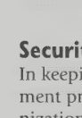

> **EXAM TIP** 确保你理解可接受使用政策概述了被认为对计算机系统用户可接受的行为。此政策通常与组织的互联网使用政策相辅相成。

## Security Policy

与政策的高层次性质保持一致，安全政策是由高级管理层制定的高层次声明，概述了安全对组织意味着什么以及组织的安全目标。主要安全政策随后可以细分为涵盖特定主题的附加政策。例如“本组织在处理客户信息时将执行最小权限原则”之类的声明就是安全政策的示例。安全政策还可以从组织角度描述如何处理安全问题（如描述哪个办公室以及哪位公司高管或经理监督组织的安全计划）。

除了与访问控制相关的政策外，组织的安全政策还应包括下一节中描述的具体政策。所有政策应定期审查并根据需要更新。通常，政策的更新频率应低于实施它们的程序，因为高层次目标不会像必须实施的环境那样经常变化。所有政策都应由组织的法律顾问审查，并应概述计划，说明组织将如何确保员工了解这些政策。政策还可以通过包含制定政策的权威机构的引用（无论该政策来自首席执行官还是部门级政策）以及引用适用于特定政策和环境的任何法律或法规来变得更强。

## Mandatory Vacations

组织多年来一直为员工提供休假时间。然而，直到最近，很少有组织强制员工在他们不想休假时休假。一些员工可以选择“用掉或作废”他们的休假时间，如果他们没有休完全部时间，他们将至少失去其中一部分。可以提出许多关于休假益处的论点，但更重要的是，从安全角度来看，从不休假的员工可能是恶意活动的潜在指标。从不休假的员工可能参与欺诈或挪用公款等活动，并且可能担心如果他们休假离开，组织会发现他们的非法活动。因此，通过强制休假政策要求员工使用休假时间可以成为一种安全保护机制。将强制休假作为检测欺诈的工具将要求其他人也接受休假员工职能的培训。让第二个人熟悉安全程序也是一个好政策，以防主要人员出现问题。

## Job Rotation

另一种提供多重益处的政策是轮岗。轮换工作使个人更好地了解组织的各个部分如何增强（或阻碍）业务。由于安全问题在人们的工作中通常是次要关注点，因此让个人轮换安全职位可以更广泛地了解组织的安全问题。一个次要好处是它也消除了对单一个人安全专业知识的依赖。如果所有安全任务都由一名员工负责，一旦该个人离开组织，安全将受到损害。此外，如果只有一个人了解安全领域，如果该人变得不满并决定损害组织，从其攻击中恢复可能非常困难。

## Separation of Duties

职责分离是许多组织采用的原则，以确保没有个人单独进行交易的能力。这意味着对任何个人的信任程度降低，任何个人对组织造成灾难性损害的能力也降低。例如，一个组织中一个人有权订购设备，但另一人进行付款。想要为个人利益进行未经授权购买的个人必须说服另一个人参与交易。

将职责分离作为安全工具是良好的实践，但可能过度，将交易拆分为太多部分或要求过多的监督。这导致效率低下，实际上可能更不安全，因为个人可能不会像他们知道其他人也会审查一样仔细审查交易。诱惑是加快进程并假设其他人会检查它或已经检查过它。


> **EXAM TIP** 职责分离原则的另一个方面是它将责任分散在整个组织中，因此没有个人会成为拥有“王国所有钥匙”或关于如何使一切运作的独特知识的不可或缺的个人。如果任务分配足够多，为每个任务指定主要人员和后备人员将确保任何一个个人的损失不会对组织造成灾难性影响。


## 最小权限

另外两个常见的安全原则是需知原则和最小权限原则。这里的指导因素是组织中的每个个人仅被提供执行分配工作任务所需的绝对最小量的信息和权限。要获取任何信息，个人必须有正当的需知理由。此外，员工仅会被授予执行工作所需的最低限度的权限。

应制定一份政策，将这两个原则阐明为组织的指导理念。该政策还应说明组织中谁有权授予信息访问权限或为员工分配权限。

## 定性风险评估

定性风险评估是对影响项目、计划或业务的事件的影响进行主观判断的过程。定性风险评估通常涉及使用专家判断、经验或群体共识来完成评估。要定性评估风险，需将威胁的影响与发生的概率进行比较。例如，如果威胁的影响高且发生的概率高，则风险暴露高，可能需要采取一些行动来降低该威胁（参见图5-1中最暗的方框）。相反，如果影响低且概率低，则风险暴露低，可能不需要采取行动来降低该威胁（参见图5-1中的白色方框）。图5-1显示了二元评估的示例，其中影响和概率各只有两种可能的结果。

要么会产生影响要么不会（或影响低或高），并且可能发生也可能不发生（或发生的概率高或低）。实际上，通常可以识别出少数威胁具有高风险暴露，而少数威胁具有低风险暴露。介于两者之间的威胁（图5-1中的浅灰色方框）需要通过判断和管理经验进行评估。

如果分析更复杂，需要三个层级的分析，例如低-中-高或红-绿-黄，则可能有九种组合，如图5-2所示。同样，最暗的方框可能需要采取行动，白色方框可能需要也可能不需要采取行动，而灰色方框需要判断。（注：为简洁起见，在图5-2和图5-3中，每个方框中的第一个术语指的是影响的程度，第二个术语指的是威胁发生的概率。）

其他复杂程度也是可能的。以五级分析为例，风险暴露可能有25个值。在这种情况下，影响和概率的可能取值可以是：非常低、低、中、高或非常高。此外，请注意矩阵不必是对称的。例如，如果概率用三个值评估（低、中、高），而影响用五个值评估（非常低、低、中、高、非常高），则分析如图所示5-3所示。（同样请注意，每个方框中的第一个术语指的是影响，第二个术语指的是发生的概率。）

到目前为止，示例主要集中在评估概率与影响。定性风险评估可以适应多种属性和情况的组合。例如，图5-4显示了在安全评估期间识别出的一些特定风险的比较。

评估确定了第一列中列出的风险领域（弱内联网安全、调制解调器数量多、互联网攻击漏洞以及薄弱的事件检测和响应机制）。评估还确定了顶部列出的各种潜在影响（业务影响、攻击概率、修复成本和修复难度）。每个影响均被评估为低、中或高——分别用绿色（G）、黄色（Y）和红色（R）表示。每个风险领域相对于每个潜在影响进行了评估，并在最后一列确定了总体风险评估。

## 定量风险评估

定量风险评估是对影响项目、计划或业务的事件的影响进行客观确定的过程。定量风险评估通常涉及使用指标和模型来完成评估。而定性风险评估依赖于判断和经验，定量风险评估则应用历史信息和趋势来尝试预测未来表现。这种类型的风险评估高度依赖历史数据，而收集此类数据可能很困难。定量风险评估还可以很大程度上依赖于提供决策信息的模型，这些模型以定量指标的形式呈现，试图在统一的尺度上衡量风险水平。

Figure 5-1  
Binary assessment

影响

|  | 低概率 | 高概率 |
|---|---|---|
| 高影响 | 高影响/低概率 | 高影响/高概率 |
| 低影响 | 低影响/低概率 | 低影响/高概率 |

概率

Figure 5-2  
Three levels of analysis

| 影响 |  |  |  |  |  |
|---|---|---|---|---|---|
| 高 | 低 | 高 | 中 | 高 | 高 |
| 中 | 低 | 中 | 中 | 中 | 高 |
| 低 | 低 | 低 | 中 | 低 | 高 |

概率

Figure 5-3  
A 3-by-5 level analysis

| 影响 |  |  |  |  |  |
|---|---|---|---|---|---|
| 非常高 | 低 | 非常高 | 中 | 非常高 | 高 |
| 高 | 低 | 高 | 中 | 高 | 高 |
| 中 | 低 | 中 | 中 | 中 | 高 |
| 低 | 低 | 低 | 中 | 低 | 高 |
| 非常低 | 低 | 非常低 | 中 | 非常低 | 高 |

概率

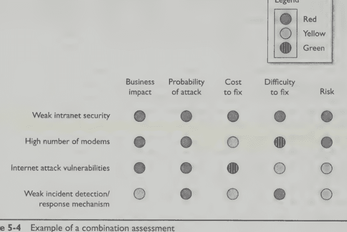

Figure 5-4  
Example of a combination assessment

## 为定性评估增加客观性

使定性评估更客观可以简单到为图5-1至图5-4所示的表格之一分配数值。例如，图5-4中列出的影响可以按从高到低的顺序排列，然后加权，如表5-1所示，其中业务影响权重最大，修复难度权重最小。

接下来，可以分配值以反映每个风险的评估方式。通过为代表评估的每种颜色分配一个值，图5-4可以变得更客观。例如，红色评估表示存在许多关键未解决的问题，其评估值为3。绿色表示未解决的问题很少，因此其值为1。表5-2显示了使用红、黄、绿进行评估时可以分配的值。

| 影响 | 说明 | 权重 |
|---|---|---:|
| 业务影响 | 如果被利用，这是否会产生重大的业务影响？ | 4 |
| 攻击概率 | 潜在攻击者尝试这种技术或攻击的可能性有多大？ | 3 |
| 修复成本 | 修复此漏洞需要花费多少美元和资源？ | 2 |
| 修复难度 | 从技术角度来看，这有多难修复？ | 1 |

Table 5-1  
Adding Weights and Definitions to the Potential Impacts

**Table 5-2 — Adding Values to Assessments**

| 评估 | 说明 | 值 |
|---|---|---:|
| 红色 | 许多关键未解决的问题 | 3 |
| 黄色 | 一些关键未解决的问题 | 2 |
| 绿色 | 少数未解决的问题 | 1 |

最后一步是通过将表5-1中显示的权重乘以表5-2中的评估值并求和，计算每个风险领域（图5-4中的每一行）的总体风险值：

Risk = W₁ × V₁ + W₂ × V₂ + ... W₄ × V₄

风险计算和图5-4中列出的每个风险领域的最终风险值已纳入图5-5。然后可以根据计算出的风险值将评估区域按从高到低排序，以帮助管理层关注潜在影响最大的风险领域。

重要的是要理解任何模型都基于关键假设，即使输入数据相同，不同的模型也会产生不同的结果。虽然

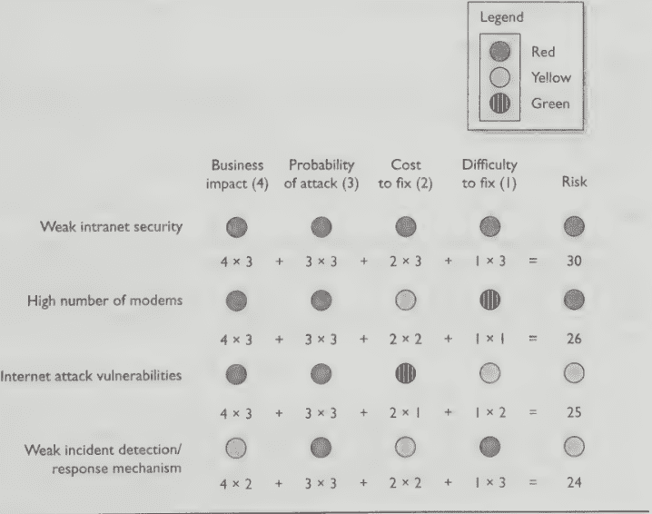


尽管人们已经投入了大量研发资源来改进和完善各种风险分析模型，但专家判断和经验仍然必须被视为任何风险评估流程中不可或缺的组成部分。模型永远无法取代判断和经验，但它们可以显著增强决策过程。

## 风险计算

更复杂的模型可以基于统计和数学模型开展各种分析。一种常见方法是计算年度损失预期（ALE）。计算 ALE 可以得出影响的货币价值。该计算首先要计算单次损失预期（SLE）。

### SLE

单次损失预期使用以下公式计算：

SLE = 资产价值 × 暴露因子

暴露因子用于衡量资产损失的程度。

例如，要计算暴露因子，假设一栋小型办公楼及其内部物品的资产价值为 200 万美元。同时假设该建筑内设有某企业的呼叫中心，而呼叫中心的完全损失将使公司的业务能力降低约一半。因此，暴露因子为 50%。SLE 为

200 万美元 × 0.5 = 100 万美元

### ALE

然后，只需将 SLE 乘以事件预计在一年内发生的可能性或次数，即可计算 ALE，这一数值称为年度发生率（ARO）：

ALE = SLE × ARO

### ARO

年度发生率（ARO）表示事件发生的频率，以标准年为测量单位。如果预计某事件每 20 年发生一次，那么 ARO 就是 1/20。通常，ARO 根据历史数据确定，这些数据可能来自公司的自身经验，也可能来自行业调查。继续上面的例子，假设该企业所在地预计每 20 年左右发生一次火灾。根据这一信息，ALE 为 100 万美元 × 1/20 = 50,000 美元。ALE 为评估某项对策成本效益比确定了一个阈值。因此，为充分保护该企业，一项对策每年的成本不应超过计算得出的 ALE，即 50,000 美元。


> **提示** 有大量资源可以帮助计算 ALE。有些数据库包含相关信息，可帮助企业（成员机构）管理飓风、地震等自然灾害造成的损失暴露。这些数据库还包含有关财产风险的信息，例如火灾、雷电、故意破坏、风暴、冰雹等。此外，其中甚至还包括可帮助评估建筑物喷淋系统有效性的信息。

## 影响

事件的影响是指当威胁利用漏洞时所造成实际损失的衡量指标。联邦信息处理标准（FIPS）199 使用高、中、低三个术语定义了三个影响级别。影响需要根据每个组织的具体背景进行定义，因为对某些企业而言属于高影响的情况，对于规模大得多的企业而言可能只是低影响。常见的方法是根据重要的业务标准定义影响级别。影响可以表现为成本（金钱）、性能（服务级别协议 [SLA] 或其他要求）、进度（交付成果）或其他重要事项。影响还可以根据与问题相关的信息安全属性进行分类：机密性、完整性和可用性。

### MTTR

平均修复时间（MTTR）是衡量修复某项故障所需时间长短的常用指标。这是一个平均时间，可能包括也可能不包括获取零部件所需的时间。

### MTBF

平均故障间隔时间（MTBF）是衡量系统可靠性的常用指标，表示系统两次故障之间的平均时间。故障间隔时间从系统恢复服务时开始计算，一直到下一次故障发生。MTBF 是一组系统故障间隔时间的算术平均值：

```
MTBF = Σ (停机开始时间 – 正常运行开始时间) / 故障次数
```

### MTTF

平均无故障时间（MTTF）是 MTBF 的一种变体。当系统发生故障后直接更换而不是进行修复时，通常使用 MTTF 而不是 MTBF。除语义差异外，两者的计算方式相同，含义本质上也相同。

## 定量分析与定性分析

业界普遍认为，不可能开展纯粹定量的风险管理。通常，风险管理同时包含定性和定量要素，需要分析以及判断或经验。与定量评估不同，纯粹的定性风险管理是可以实现的。显然，不可能定义并以定量方式衡量某项风险评估中存在的所有因素。同样显然的是，不对任何因素进行定量衡量，而是对所有因素进行定性衡量的风险评估是可行的。

究竟采用定性风险管理还是定量风险管理，取决于项目的重要性、可用资源以及管理风格。风险管理基本指标能够以定量方式定义到何种程度，也会影响这一决策，例如资产价值、暴露因子和威胁频率等。

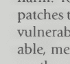

> **考试提示** 定量风险管理涉及为风险分配具体的绝对值，而定性风险管理则使用相对值来实现。

## 可用性测量

可用性用于衡量系统执行其预期功能的时间比例。可靠性用于衡量系统发生故障的频率。可用性与可靠性相关，但二者并不相同；可用性通常表示为系统处于运行状态的时间百分比。要计算可用性，需要同时使用 MTTF 和 MTTR：

Availability = MTTF / (MTTF + MTTR)

假设某系统的 MTTF 为 6 个月，修复需要 30 分钟，则可用性为

Availability = 6 months / (6 months + 30 minutes) = 99.9884%

## 漏洞

漏洞是资产所具有的、可能被威胁利用并造成危害的特征。例如，如果你尚未安装补丁来修复网站上的跨站脚本（XSS）错误，那么你的系统就存在安全漏洞。并非所有错误或缺陷都是漏洞。要将某个错误或缺陷归类为漏洞，它必须具备可利用性，也就是说，攻击者必须能够利用该缺陷达到预期结果。漏洞的出现需要具备以下三个要素：

- 系统必须存在缺陷。
- 攻击者必须能够访问该缺陷。
- 攻击者必须具备利用该缺陷的能力。

漏洞可能存在于多个层面，也可能由多种原因造成。从设计错误、编码错误，到复杂系统中未预期且未经测试的组合，漏洞有多种形式。漏洞可能存在于软件、硬件和流程中。无论漏洞存在于底层系统、用于保护系统的安全控制措施，还是系统运行过程中所采用的流程，其结果都是相同的：漏洞代表一种可被利用的弱点，会增加与系统相关的风险等级。


> **考试提示** 漏洞可以被修复、移除和缓解。漏洞是任何系统的一部分，代表可能被利用的弱点。

## 威胁向量

威胁是任何可能对资产造成危害的情形或事件。例如，恶意黑客可能会选择使用现成的黑客工具入侵你的系统。威胁可以按组分类，而“威胁向量”这一术语用于描述这些组的要素。威胁向量是攻击者攻击目标时所使用的路径或工具。安全专业人员需要了解的威胁向量范围十分广泛：

- Web（伪造网站、会话劫持、恶意软件、水坑攻击）
- 未加保护的无线热点
- 移动设备（iOS/Android）
- USB（可移动）介质
- 电子邮件（链接、附件、恶意软件）
- 社会工程学（欺骗、恶作剧、诈骗和欺诈）

上述列表仅是威胁向量的示例。从防御角度来看，重要的是不要固守于某些特定威胁，而应关注威胁向量。如果用户访问了包含恶意代码的网站，那么尽管代码的性质从技术角度来看很重要，但它并不是首要关注点。首要问题是恶意网站，因为它才是威胁向量。

## 概率/威胁可能性

事件的概率或可能性用于衡量事件预计发生的频率。从使用频繁、偶尔和罕见等术语进行定性评估，到使用 ARO 进行定量衡量，其目的都是根据事件发生的频率进行缩放。要准确确定安全事件的具体概率，几乎是不可能完成的任务。在使用概率和可能性时，重要的是它们与确定相对风险之间的关系。正如保险公司无法告诉你何时会发生事故一样，没有人能够预测安全事件何时发生。但可以确定的是，在一段时间内（例如未来一年），会有相当数量的用户点击电子邮件中的恶意链接。不同类型攻击的威胁可能性会随时间发生变化。多年前，网页篡改曾非常猖獗；如今，鱼叉式网络钓鱼更为普遍。


## 风险规避、风险转移、风险接受、风险缓解、风险威慑

风险是绝对的——它们无法被移除或消除。可以采取行动来改变风险对系统造成的影響，但风险本身实际上不会改变，无论采取何种缓解措施都是如此。高风险永远是高风险。然而，如果风险发生，可以采取行动来降低其影响。可以用有限的几种策略来管理风险。风险可以被规避、转移、缓解或接受。

规避风险可以通过多种方式实现。虽然威胁无法从环境中移除，但个人的暴露面可以改变。不部署会增加风险的模块就是一种风险规避方式。

管理风险的另一种可能做法是转移该风险。转移风险的常见方法是购买保险。保险允许风险转移给管理特定类型风险的第三方，从而降低个人成本。风险转移的另一个常见例子是消费者信用卡上的防欺诈保护。风险被转移给另一方，因此人们可以放心使用卡片。

风险还可以通过应用降低攻击影响的控制措施来缓解。控制措施可以提醒操作员，以便通过流程干预降低暴露程度。当发生超出可接受风险概况的操作时，可以应用第二套规则，例如在执行交易前致电客户进行验证。此类控制措施可以降低潜在高风险操作相关的风险。

除了缓解风险或转移风险之外，经理接受风险可能是可以接受的，即尽管给定风险的潜在成本及其相关概率，组织经理仍将承担风险发生的责任。例如，经理可能会选择允许程序员对生产系统进行“紧急”更改（违反良好的职责分离），因为系统在特定时间内不能停机。经理接受程序员可能进行未经授权更改的风险，被该系统的高可用性要求所抵消。然而，始终应有一些额外的控制措施，例如管理审查或标准化的审批流程，以确保所承担的风险得到充分管理。

要理解风险无法完全消除。实施控制措施后仍然存在的风险称为残余风险。在此步骤中，您进一步评估残余风险，以确定需要额外控制措施进一步降低风险的地方。这引出了本章引言中早先的说法，即风险管理过程是迭代的。

## 云计算

云计算是描述通过网络提供的计算机服务的常用术语。

这些计算服务是通过互联网协议提供的计算、存储、应用程序和服务。

云计算的一个特点是对最终用户的透明性。这提高了这种服务提供方式的可用性。

云计算为用户提供了诸多好处：性能、可扩展性、灵活性、安全性和可靠性等方面的改进，等等。

这些改进是云服务实现方式相关特定属性的直接结果。

云计算的承诺是提高效用，并以平台即服务、软件即服务和基础设施即服务的概念进行营销。

管理云中风险的挑战在于提前确定谁承担何种程度的安全责任——云提供商、服务提供商还是用户？

## 与云计算和虚拟化相关的风险

从风险角度审视云或虚拟计算环境等复杂系统时，始终需要观察几个基本考虑因素。

首先，系统是位于云中还是虚拟化并不改变风险的工作方式。风险无处不在，将系统更改为新环境并不会改变存在风险这一事实。

其次，复杂性会增加风险暴露。云和/或虚拟化的增加仅仅通过增加系统的复杂性而增加了风险。

虚拟化和云环境都存在特定的风险。

数据和计算发生在数据所有者无法直接控制的环境中，既增加了复杂性层，也增加了风险程度。

随着对环境的直接控制丧失，保密性、完整性和可用性问题的可能性增加。

虚拟化和云层也为系统提供了新的攻击途径。

当数据和计算由远程方处理时，如云计算中，安全就是一个特别的挑战。

具体的挑战是如何允许数据在企业之外，同时仍控制数据的使用。

常见的答案是加密。

通过在数据离开企业前对其进行适当加密，可以通过正确使用加密元素安全地进行外部存储。

与保密性、完整性和可用性相关的安全要求仍由数据所有者负责，必须采取措施确保无论数据的位置或使用情况如何，这些要求都得到满足。

另一层保护是通过与云供应商签订服务等级协议（SLA）实现的，尽管在数据丢失的情况下，这些协议通常不能提供太多补救措施。

## 虚拟化

虚拟化是创建虚拟系统而非实际硬件和软件。

硬件和软件的分离使企业灵活性增强。

在实际硬件之上，虚拟化层能够创建完整的系统，包括计算机和网络设备，作为虚拟机。

硬件和软件的这种分离通过一系列改进实现了安全性。

复制整个系统、备份它们或在硬件平台之间移动它们的能力可以增强系统的安全性。

尽管存在可能允许一个虚拟环境中的进程突破虚拟环境之间的分离或到主机的层的漏洞，但这些漏洞很少且极难利用。

一种新的漏洞形式——能够复制完整的虚拟系统——必须得到解决，因为这可能导致数据和知识产权损失。

保护虚拟系统的存储必须与常规系统的备份相当，以避免整体损失。

虚拟化系统应与非虚拟化系统类似地进行更新/修补。

虚拟系统仍需要安全服务来保护虚拟机免受入侵、恶意软件以及常规系统面临的相同威胁。

## 恢复时间目标和恢复点目标

术语恢复时间目标（RTO）用于描述事件后恢复运营的目标时间。

这是由企业需求决定的业务定义的时间段。

较短的 RTO 会导致更高的成本，因为它需要更大的协调和资源。

该术语在业务连续性和灾难恢复运营中常用。

恢复点目标（RPO）与 RTO 完全不同，是表示可接受数据丢失最大时期的时间段。

RPO 定义了防止不可接受数据丢失所需的备份操作频率。

建立 RPO 的一个简单例子是回答以下问题：您能承受丢失多少数据？多少返工是可以容忍的？

RTO 和 RPO 看似相关，但实际上衡量的是完全不同的事物。

RTO 用于定义业务连续性的要求，而 RPO 处理备份频率。

RTO 为 1 天而 RPO 为 1 小时，或 RTO 为 1 小时而 RPO 为 1 天都是可能的。

决定因素是业务需求。

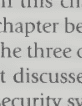

EXAM TIP 尽管恢复时间目标和恢复点目标看似相同或相似，但它们非常不同。RTO 用于定义业务连续性的要求，而 RPO 处理备份频率。

## 章节回顾

在本章中，您熟悉了风险管理的原则。

本章首先定义了与风险管理相关的关键术语。

然后介绍了三种安全控制类别：管理、技术和运营。

接下来，讨论了误报和漏报的概念以及它们与安全系统的关系。

您了解到安全策略可以直接影响风险，并发现了策略的作用，包括安全策略、隐私策略、可接受使用策略，

与人力资源相关的政策，例如轮岗和强制休假、职责分离以及最小权限政策。你随后研究了定性和定量风险管理方法论，包括对其的比较。你学习了如何使用 ALE、SLE 和 ARO 计算风险，并被介绍到 MTTR、MTBF 和 MTTF 的概念。可用性被表述为 MTTF 和 MTTR 的函数。该主题部分以对恢复时间目标和恢复点目标的讨论以及它们之间的区别而结束。

接下来，本章介绍了使利用成为可能的漏洞的特征，包括概率和威胁可能性概念。威胁向量作为攻击者攻击系统的手段的概念也被介绍。本章以风险管理的四种主要策略（规避、转移、缓解和接受）以及虚拟化和云计算领域风险的当前趋势的讨论而结束。

## 问题

为了帮助你进一步准备 CompTIA Security+ 考试，并测试你的准备程度，请回答以下问题，然后将你的答案与本章末尾的正确答案核对。

- 1. 以下哪一项是控制的类别？
  - A. 预防性
  - B. 管理
  - C. 缓解
  - D. 影响
- 2. 以下哪一项是控制的类型？
  - A. 运营
  - B. 威胁
  - C. 风险
  - D. 检测
- 3. 以下哪一项是职责分离原则的示例？
  - A. 软件开发人员不应有权访问生产数据和源代码文件。
  - B. 软件开发、测试、质量保证和生产可以分配给部分相同的人员。
  - C. 创建、安装和管理软件程序的功能可以分配给部分相同的人员。
  - D. 软件开发人员和测试人员应有权访问“实时”生产数据。
- 4. 以下哪一项正确定义了最小权限原则？
  - A. 通过将职责分配给不同个人来防止或检测错误和不规则性的控制。
  - B. 在组织中让个人轮换从事各种工作的过程。
  - C. 为用户提供其执行所需功能所需的最小权限集。
  - D. 依赖于令人困惑且据称不为一般人所知的保护机制的安全控制。
- 5. 以下哪一项正确定义了可接受使用政策？
  - A. 概述公司允许员工发送的电子邮件内容。
  - B. 概述组织认为的公司资源适当使用方式。
  - C. 规定员工可以访问哪些网站以及不可以访问哪些网站。
  - D. 由高级管理层制定的高层声明，概述安全对组织意味着什么。
- 6. 以下哪一项正确识别了风险转移？
  - A. 委托第三方组织为多方管理特定类型风险。
  - B. 采取行动以降低威胁发生的可能性。
  - C. 管理层接受风险及其相关影响，尽管存在潜在成本。
  - D. 遭受损失的可能性。
- 7. 定性风险评估相对于定量风险评估的好处是什么？
  - A. 定量风险评估依赖于专家判断和经验。
  - B. 定性风险评估依赖于收集历史信息和趋势。
  - C. 不可能进行纯定性风险评估。
  - D. 定性风险评估不需要收集历史信息和趋势。
- 8. 以下哪一项正确定义了暴露因子？
  - A. 按年度计算，预计事件发生的频率。
  - B. 每次威胁发生时的货币损失或影响。
  - C. 资产损失程度的衡量。
  - D. 预计事件每年给企业造成的成本。
- 9. 填空。可用性使用以下公式计算
  Availability = A / (B + C)
  A = ________
  B = ________
  C = ________
- 10. 年度损失期望值最好由以下哪个方程式定义？
  - A. 资产价值 × 暴露因子
  - B. SLE × 暴露因子
  - C. ARO × 资产价值
  - D. SLE × ARO
- 11. CFO 来找你寻求建议，关于她应考虑的重要原则，以防止应付账款部门出现财务不当行为。以下哪些要素可以帮助实施最小权限原则？
  - A. 职责分离
  - B. 轮岗
  - C. 隐式拒绝
  - D. 分层安全
  - E. 以上全部
  - F. 以上皆非
- 12. 你的老板正在开会，并发给你一条即时消息，询问你帮助他记住四种不同的控制类型。你在回复中发送给他什么？
  __________, __________, __________, __________
- 13. 在第 12 题建立的情景基础上，你的老板仍在同一会议中，现在要求你给他四个技术控制的例子。你在回复中发送给他什么？
  __________, __________, __________, __________

对于第 14 和 15 题，使用以下情景：你的公司为其他组织提供电话调查合同服务。位于东海岸的呼叫中心的资产价值为 1000 万美元，该呼叫中心执行的功能与位于山地西部的一个等效呼叫中心相同。灾难完全摧毁东海岸设施将带走约一半业务能力。假设这种灾难预计大约每 100 年发生一次。

- 14. 以下哪一项是计算出的单次损失期望值？
  - A. SLE = $100,000
  - B. SLE = $5 million
  - C. SLE = $50,000
  - D. SLE = $10 million
- 15. 以下哪一项是计算出的年度损失期望值？
  - A. ALE = $50,000
  - B. ALE = $500,000
  - C. ALE = $5 million
  - D. ALE = $10 million

## 答案

- 1. B. 控制的类别是管理、技术和运营。
- 2. D. 控制的类型是预防性、检测性、纠正性和补偿性。
- 3. A. 软件开发人员不应有权访问生产数据和源代码文件。这可以防止开发团队对生产系统进行意外更改。
- 4. C. 最小权限是一种安全原则，用户被授予其执行所需功能所需的最小权限集。
- 5. B. 可接受使用政策定义了公司资源的正确使用方式。
- 6. A. 风险转移涉及将风险转移给为多方管理特定类型风险的第三方。
- 7. D. 定性风险评估主要依赖于专家判断和经验。
- 8. C. 暴露因子衡量损失的程度。
- 9. A = MTTF；B = MTTF；C = MTTR
- 10. D. 年度损失期望值为 SLE × ARO。
- 11. E. 所列所有项目都有助于实施最小权限原则。
- 12. 四种控制类型是预防性、检测性、纠正性和补偿性。
- 13. 示例包括诸如用户身份验证（密码）、逻辑访问控制、防病毒/恶意软件、防火墙以及入侵检测和预防系统等元素。
- 14. B. SLE = 资产价值（1000 万美元）× 暴露因子（1/2）= 500 万美元
- 15. A. ALE = SLE（500 万美元）× 年度发生率（1/100）= 50,000 美元

## System Integration Processes

本章中，你将

- 学习与第三方集成系统和数据的安全影响
- 检查不同形式的互操作性协议
- 检查与第三方共享数据相关的风险

大型系统由高度复杂的集成组件集组成。这些组件可以集成到设计用于执行复杂操作的系统中。系统集成是一组旨在通过所有组件的链接产生协同效应的过程。在大多数业务案例中，第三方将成为价值链的一部分，需要与其共享业务信息、流程和数据。这具有安全和风险影响，需要在建立这些关系之前得到理解。

### System-Level Processes

存在许多跨越整个企业的流程，影响不止一个业务单元，有时影响整个业务。这些流程可能具有安全影响。这些影响有时会在与引起它们不同的区域显现；因此，最好从企业层面处理它们。

### On-boarding/Off-boarding Business Partners

正如管理公司人员入职和离职流程很重要一样，在与第三方安排时考虑相同类型的要素也很重要。与业务合作伙伴的协议在与业务流程相关的相互期望条款方面往往相当具体。对入职和离职流程的考虑很重要，尤其是离职。当与第三方的合同安排结束时，需要解决第三方的数据保留和销毁问题。这些考虑需要在关系建立之前做出，而不是在关系结束时才添加。


**考试提示** 入职和离职业务流程应形成完善的文档，以确保符合法律要求。

## 社交媒体网络

社交媒体网络的兴起改变了企业运营的许多方面。无论用于营销、通信、客户关系管理还是其他目的，社交媒体网络都可以被视为第三方的一种形式。与社交媒体网络和/或应用程序合作所面临的挑战之一在于其使用条款。与典型第三方的合作关系通常涉及一套经协商确定的要求协议，而社交媒体网络则不存在协商。唯一的选择是接受其服务条款，因此，了解这些条款对于企业使用该社交网络所产生的影响非常重要。

## 互操作性协议

许多业务运营涉及多个不同主体之间的操作，其中一些主体属于同一组织，另一些则属于不同组织。这些操作要求各方之间进行沟通，明确各方的责任与期望、业务目标，以及实现这些目标所处的环境。为了确保各方理解协议内容，通常会使用书面协议。企业会使用多种形式的法律协议和合同，但就安全性而言，最常见的协议包括服务级别协议、业务合作协议、谅解备忘录和互联安全协议。

**SLA** 服务级别协议（SLA）是各方之间经协商达成的协议，用于详细说明客户与服务提供商之间的期望。SLA 本质上规定了某项合同服务所需达到的性能水平。SLA 通常作为服务合同的一部分，并规定技术方面的期望。SLA 可以定义具体服务、与服务相关的性能水平、问题管理与解决方式等。SLA 由客户和供应商协商制定，代表双方同意的条款。一旦签订，SLA 就会成为具有法律约束力的文件。

通常，一份良好的 SLA 应满足两条简单规则。第一，应足够详细地描述产品或服务的全部功能，使其要求不存在歧义。第二，SLA 应提供一种明确的方式，用于确定指定的功能或服务是否已按照约定的性能水平提供。

**BPA** 业务合作协议（BPA）是合作伙伴之间签订的法律协议，用于确立合作伙伴关系的条款、条件和期望。这些细节可能涵盖广泛的问题，包括利润和损失的分配、各合作伙伴的职责、合作伙伴的加入或退出，以及其他任何事项。统一合伙法（UPA）由州法律和惯例确立，规定了一套统一的合伙规则，用于解决合伙条款相关的问题。UPA 中的条款旨在“适用于所有情况”，通常并不符合某一特定合伙关系的最佳利益。为避免 UPA 条款可能导致的不良结果，合伙关系最好在 BPA 中明确规定具体事项。

**MOU** 谅解备忘录（MOU）是一种用于描述各方之间双边协议的法律文件。它是一份书面协议，表达了各方围绕某项共同事业或目标拟采取的一系列行动。与简单的握手约定相比，它更加正式和详细，但通常不具备合同的约束力。在组织内部的不同部门之间，也经常使用 MOU 来详细说明与共同业务利益相关的期望。

**ISA** 互联安全协议（ISA）是互联 IT 系统的组织之间签订的一种专门协议，其目的是记录与互联相关的安全要求。ISA 可以作为 MOU 的一部分，用于详细说明数据互联的具体技术安全方面。


> **考试提示** 请务必理解互操作性协议 SLA、BPA、MOU 和 ISA 之间的区别，以备考 CompTIA Security+ 认证考试。

## 隐私注意事项

与第三方集成可能会带来隐私方面的考虑。隐私可以被视为对个人数据的控制权。当各方出于业务目的与企业共享数据时，企业有责任确保采取适当的保护措施和限制。必须妥善处理个人身份信息（PII），无论是在企业内部还是在与第三方的关系中。

第一步是定义 PII 的保护要求。这些要求应成为组织隐私政策的一部分。隐私是控制与自身相关信息以及他人如何使用这些信息的权利。对于个人数据，组织的隐私政策规定了个人应当预期的个人数据保护条款和条件。通过确立并发布与 PII 相关的要求，组织可以确保隐私要求在整个组织内得到广泛认知，并纳入计划、政策和流程。

隐私政策的组成部分可能因组织而异，但一些常见组成部分包括：

- 明确指定正在收集的 PII 要素以及已经存储的 PII 要素。
- 明确说明 PII 的用途，包括向第三方传输 PII 的情况。
- 指定已存储 PII 的安全措施和保存期限。

## 风险意识

让第三方参与业务运营，并不会免除企业管理风险的责任。需要根据与第三方的关系，审查风险管理的各个方面。必须考虑与数据流和潜在数据暴露相关的风险。应根据数据要求的适当定义，考虑数据安全中的机密性、完整性和可用性要素。数据保护要求以及由此产生的风险暴露，需要更新并纳入与第三方处理数据相关的各个方面。

## 数据问题

与第三方进行系统集成通常涉及数据共享。数据共享的目的可能是处理或存储。对数据的控制是第三方关系中的一个重要问题。需要解决的问题有很多。其中一个问题是确定谁拥有数据的所有权，包括与第三方共享的数据，以及作为合作关系一部分随后产生的数据。

## 未经授权的数据共享

未经授权的数据共享可能是一个重大问题。在当今世界，数据具有价值，并且经常被用于次要目的。确保合作关系中的所有各方都了解数据共享要求，是一项重要的前提。同样重要的是，确保各方都了解共享数据的安全要求。

## 数据所有权

数据需要有数据所有者。企业需要为所有数据元素定义数据所有权角色。数据所有权是一项业务职能，用于确立安全、隐私、保留及其他业务职能方面的要求。并非所有数据都需要相同的处理限制，但所有数据都需要定义这些特征。这是数据所有者的责任。

## 数据备份

数据所有权要求包括备份责任。数据备份要求包括确定备份级别、恢复目标以及保护要求级别。这些要求可以由数据所有者定义，然后由 IT 运营人员执行。确定备份责任并制定必要的运营流程，以确保执行充分的数据备份，是重要的安全要素。

## 政策与流程

政策和流程规范企业的运营，并代表一组根据内部和外部要求制定的要求。外部要求可能来自法律法规、合同条款（例如纳入支付卡行业数据安全标准（PCI-DSS）），或客户规范。在某些监管情形下，法律或法规会要求企业采取特定的业务行动。在许多情况下，法律或法规会规定具体的


已制定政策以规范合规性。了解业务环境的具体要求可能需要支持业务职能的协助、行业团体的指导，或其他来源的帮助。确定适用于第三方关系的相关安全政策和程序是确保在业务运营期间满足其所有要素的关键环节。总之很简单：在某些业务情况下，政策和程序可能由外部法规强制要求，并且可能需要协助以确保合规。

## Agreements

与第三方建立的关系通常由本章前述类型的系列协议所涵盖。必须建立流程以确保协议得到适当审查，以验证与业务相关的合规性和绩效标准。

## 章节回顾

在本章中，你已熟悉与第三方集成的原则。与第三方进行系统集成会扩大与风险相关的业务流程。本章首先讨论了互操作性协议，包括服务水平协议、商业合作协议、谅解备忘录和互联安全协议。本章随后研究了与第三方共享相关的数据问题和风险。它涵盖了隐私方面的考虑，包括 PII 相关问题，然后介绍了政策和程序以及它们如何通过协议在第三方之间实施。本章以对通过社交媒体网络共享相关的挑战的审查作结。


### EXAM TIP

了解将系统和数据与第三方集成的安全影响非常重要。

## 问题

为了进一步为 CompTIA Security+ 考试做准备，并测试你的准备程度，请回答以下问题，然后将你的答案与本章末尾的正确答案进行核对。

1. Which of the following describes a memorandum of understanding (MOU)?
   - A. 对应提供的服务的明确定义声明，包括如果未达到商定服务水平时的处罚
   - B. 一种系统方法，用于识别期望的隐私绩效与实际绩效之间的差距
   - C. 用于协助保护隐私的应用程序或工具
   - D. 一种非合同性协议，表明各方之间的预期做法

2. What is the definition of privacy?
   - A. 通过商业法规保护的商业秘密
   - B. 控制关于你的信息以及他人可以对该信息做什么的权利
   - C. 通过国家安全相关法律保护的政府信息
   - D. 用于识别特定个人的信息

3. Which of the following represents two simple rules a good SLA should satisfy?
   - A. 网页标准和编码实践
   - B. 技术和流程
   - C. 提供的服务和性能水平
   - D. 时长和保护

4. Which of the following describes system integration?
   - A. 设计用于通过所有组件的关联产生协同效应的流程集合
   - B. 记录、处理和保护信息的规则
   - C. 执行和记录系统更改的流程
   - D. 用于确保系统正确集成的 方法、技术和工具

5. Which of the following describes the elements of interoperability agreements?
   - A. 强制性要素和已接受规范，提供公司决策如何执行的具体细节
   - B. 各方的责任/期望、业务目标和环境
   - C. 组织认为对第三方资源适当使用的内容
   - D. 分步实施说明

6. Which of the following describes what a business partnership agreement typically includes?
   - A. 利润分享以及合伙人的增减
   - B. 组织认为电子邮件、电话、互联网访问等适当使用的内容
   - C. 关于如何处置重要公司信息的明确声明
   - D. 修改 IT 基础设施时各合伙人的责任

7. Which of the following is a limitation of a memorandum of understanding?
   - A. 它有助于控制服务水平协议的变更。
   - B. 它基于审慎注意和尽职调查。
   - C. 它仅识别需要管理的资产。
   - D. 它比握手更正式，但缺乏合同的约束力。

8. Which of the following describes an interconnection security agreement?
   - A. 定义调查安全漏洞的规则
   - B. 防止系统之间发生哈希冲突
   - C. 记录互联 IT 系统相关的安全要求
   - D. 物理连接两方共享的系统

9. Which of the following is a challenge when using social networks for business purposes?
   - A. 协议易于谈判。
   - B. 它们包含资源和信息。
   - C. 它们确定允许的访问级别。
   - D. 使用条款通常无法谈判。

10. What is an important factor to remember regarding policies and procedures?
    - A. 它们应始终包含分步实施说明。
    - B. 它们可能由外部法规强制要求。
    - C. 它们强制执行公司资源的适当使用。
    - D. 它们描述如何处置重要公司信息。

11. 你被要求审查由第三方服务提供商提供给贵公司的服务水平协议（SLA）。列出应确保包含在 SLA 中的三个要素：

12. 列出与第三方共享个人身份信息时应解决的三个问题：

## For Questions 13–15

Please select the appropriate term from the following list:

- A. 合规性
- B. 保密性
- C. 控制
- D. 离职/下线
- E. 上线/入职
- F. 秘密
- G. 社交媒体
- H. 使用条款

13. Regarding agreements between third-party organizations, ________ and ________ business procedures should be well documented to ensure ________ with legal requirements.

14. One of the challenges in working with __________ networks and/or applications is their __________.

15. Privacy can be viewed as __________ over one’s own data.

## 答案

1. D. MOU 是一种非合同性协议，表明各方之间的预期做法。

2. B. 隐私是控制关于你的信息以及他人可以对该信息做什么的权利。

3. C. 一个好的 SLA 应满足的两个简单规则是 1) 描述提供的服务，2) 详细说明预期的性能水平。

4. A. 系统集成是设计用于通过所有组件的关联产生协同效应的流程集合。

5. B. 互操作性协议定义了各方的责任和期望、业务目标以及实现目标的环境。

6. A. 商业合作协议通常描述利润分享、各合伙人的责任以及合伙人的增减。

7. D. MOU 比简单的握手更正式、更详细，但通常缺乏合同的约束力。

8. C. 互联安全协议是具有连接 IT 系统的组织之间的专门协议，其目的是记录与互联相关的安全要求。

9. D. 使用社交网络用于商业目的的一个特定挑战是使用条款通常无法谈判。

10. B. 重要的是要理解某些政策和程序可能由外部法规强制要求。

11. SLA 应包含以下项目（通常按此顺序呈现）：定义应执行的特定服务；指定性能水平；并指定用于管理和解决问题的 方法。

12. 与第三方共享 PII 时，你应明确指定正在收集和存储的元素；明确说明 PII 将用于何处，包括任何转移给第三方；并指定安全措施和存储时间。

13. Regarding agreements between third-party organizations, E. on-boarding and D. off-boarding business procedures should be well documented to ensure A. compliance with legal requirements.

14. One of the challenges in working with G. social media networks and/or applications is their H. terms of use.

15. Privacy can be viewed as C. control over one’s own data.


配置控制是对已基线化的项进行变更控制的过程。配置控制确保只有经批准的基线变更才能被实施。很容易理解为什么软件系统（如基于网络的订单录入系统）在没有适当测试和控制的情况下不应被更改——否则，系统可能在关键时刻停止运行。配置控制是一个关键步骤，为管理者提供宝贵的洞察。如果系统正在变更，并且遵循了配置控制，管理者和其他相关人员将能更好地了解情况。这确保了资产的合理使用，并避免了因安装未经批准的变更而导致的不必要停机。

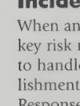

> 考试提示：变更管理确保在修改IT基础设施时遵循正确的程序。

## 事件管理

当事件发生时，拥有事件响应管理方法是关键的风险缓解策略。为建立应对因某种网络事件导致的业务中断的计划，应采取的措施之一是建立计算机事件响应团队（CIRT）或计算机应急响应团队（CERT）。

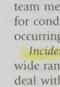

> 注意：CERT是卡内基梅隆大学的商标，在某些情况下经常使用，例如US-CERT。

组织的CIRT将负责调查事件，并就如何应对提出建议。CIRT不仅应由常任成员组成，还应有临时成员，根据事件的性质，可能需要这些临时成员来处理特殊需求。除了具有技术背景的人员外，CIRT还应包括非技术性人员，以便在处理媒体关注、可能出现的法律问题以及有关组织持续运营的管理问题方面提供指导。CIRT应当在事件发生之前成立，并确定团队成员。进行调查的政策和程序也应在事件发生前制定。还建议团队定期开会审查这些程序。事件响应是安全人员为应对各种触发事件而执行的一系列操作。这些操作广泛而多样，因为它们必须处理各种原因和后果。通过使用结构化的框架，再加上充分准备的流程，事件响应成为一项可管理的任务。如果没有适当的准备，这项任务可能很快就会变得不可能完成或成本高得难以处理。

## 用户权利与权限审查

用户权利与权限审查是比较强大的安全控制手段之一。但这种控制的有效性取决于它是否保持在最新状态并得到妥善维护。在比最小型企业更大的任何组织中，确保用户列表及相关权利完整且最新是一项具有挑战性的任务。一种有助于保持用户权利列表最新的补偿性控制措施，是对用户群及相关权限进行定期审计。

## 执行例行审计

作为任何良好安全计划的一部分，管理员必须定期执行审计，以确保用户、系统、政策和程序方面的“一切正常”。安装和配置安全机制很重要，但必须按规定时间表定期审查，以确保它们有效、最新并发挥预期功能。以下是应定期审计的项目的一些示例，但绝不是完整列表：

- **用户访问** 管理员应审查哪些用户正在访问系统、他们在何时访问、正在使用哪些资源等。管理员应密切关注是否有用户不当访问资源，或在异常时间访问合法资源。
- **用户权限** 当用户更换工作或职责时，其可能需要被分配不同的访问权限；其可能获得对新增资源的访问权，同时失去对其他资源的访问权。为确保用户只能访问其当前职位所需的资源和能力，应定期审计所有用户权限。
- **存储** 许多组织都有关于“公司”资源上可以存储什么内容以及某个用户或组可以使用多少空间的策略。定期审计有助于确保组织资源上不存在不良或非法材料。
- **保留** 在某些组织中，特定文档或记录存储多长时间与存储什么内容同样重要。记录保留策略有助于定义存储什么、如何存储、存储多长时间以及在何时处置。定期审计有助于确保在不再需要时删除记录或文档。
- **防火墙规则** 定期审计防火墙规则非常重要，以确保防火墙按预期过滤流量，并帮助确保“临时”规则不会最终变成规则集的永久附加项。

## 数据丢失或盗窃

数据是大多数攻击者的主要目标。数据的价值可能各不相同，使得某些数据更具价值，因而更易被盗。数据也可能通过各种机制丢失，硬件故障、操作员错误和系统错误是常见原因。无论丢失原因如何，组织都可以采取各种措施来减轻丢失的影响。备份是各项措施中的首要选择，因为备份可以提供最彻底的数据丢失保护。

为了防止盗窃，可以采用多种控制措施。有些是风险缓解步骤，例如数据最小化，即不存储不需要的数据。如果必须存储且有价值，那么可以使用数据丢失防护等技术来提供保护手段。防火墙和网络分段等简单安全控制措施也可以使数据盗窃更加困难。

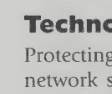

考试提示：参加考试时，请理解防止数据丢失或盗窃的政策和程序。

## 技术控制

保护企业数据是安全控制的首要目标。防火墙和网络隔离可以充当保护关键数据的强大屏障。使用与数据关键敏感程度对应的网络隔离区可以为数据提供重要保护。在网络层限制访问可防止非正确网络分段中的机器直接连接到数据。由于数据只有在经批准人员能够使用时才具有价值，因此可以设计数据的访问方法，使其免受外部影响。

使用严格的访问控制并配合审计，可以针对数据丢失、损坏和盗窃提供强大的系统性保护。这些控制是网络和数据安全的核心，也是数据保护的重要组成部分。

## 数据丢失防护

数据丢失防护（DLP）是指用于检测和防止企业内数据传输的技术。在关键位置部署时，DLP技术可以扫描数据包以查找特定数据模式。该技术可以调整以检测账号、机密、特定标记或文件。当检测到特定数据元素时，系统可以阻止传输。采用DLP技术的主要挑战是传感器的放置。DLP传感器需要能够观察数据，因此如果通道是加密的，DLP技术可能会失效。

## 风险管理最佳实践

最佳实践是组织在任何活动中可以采取的最佳防御措施。审视最佳实践的一种方式是确保业务拥有一套涵盖其运营责任的最佳实践。在更深层次上，如果希望获得最佳水平的保护，这些实践的细节本身也需要是最佳实践。至少，风险缓解的最佳实践包括业务连续性、高可用性、容错和灾难恢复概念。

这些都不是孤立运作的。事实上，它们都是相互关联的，共享元素，共同协作以实现一个共同目标：企业数据的安全性，而这一安全性是通过风险暴露程度来衡量的。


## 业务连续性概念

当发生干扰运营的事件时，保持组织运转并非自然而然就能实现，而是需要提前规划，并定期演练这些计划以确保其有效。在讨论组织持续运营问题时，常用的术语是业务连续性计划（BCP）。您可能想知道灾难恢复计划（DRP）和BCP之间有什么区别。实际上，这两个术语有时会被同义使用，对于许多组织而言，二者可能没有重大区别。然而，BCP与DRP之间确实存在细微差异，其中之一就是两者的关注点不同。

业务连续性规划的关注点是业务或组织的持续运营。DRP的关注点则是灾难发生后组织的恢复与重建。由于业务连续性始终是一项关键事项，DRP是更全面的BCP的一部分。在DRP中，人的生命保护应作为重点，并且是该文档的主要关注点。疏散计划和系统关机程序也应被考虑在内。员工安全应贯穿DRP始终。另一方面，在BCP的其余部分，您可能不会看到对员工保护达到同等程度的重视。BCP的重点是组织运营所需的关键系统。

看待这两个计划的另一种方式是：BCP用于确保您的运营在面对任何导致运营中断的事件时仍能继续。如果发生灾难并摧毁了您的全部或部分设施，BCP中的DRP部分将解决新设施的建造或购置问题。DRP还可以包含与组织长期恢复相关的细节。

然而，无论您如何看待这两个计划，一个在运营中断后无法迅速恢复业务功能的组织，极有可能遭受不可恢复的损失，甚至可能不复存在。在灾难发生时，这些计划的成功实施对组织至关重要，因此不仅应制定计划，还应定期测试，以确保计划充分且确实能达到其设计目的。


考试提示：DRP和BCP这两个术语经常被同义使用，但二者之间存在细微差别。请仔细学习本节，以确保您能区分这两个术语。

有许多与业务连续性相关的风险管理最佳实践。以下各节将详细介绍业务影响分析、关键系统和组件识别、单点故障、BCP等主题。

### 业务影响分析

通常用于描述通过处理前一节中的问题而生成的文件的名称是业务影响分析（BIA）（也可能称为业务影响评估）。BIA概述了任一关键功能丧失将对组织产生何种影响。

### 识别关键系统和组件

企业最重要的风险缓解策略之一是将适当级别的安全控制应用到适当的系统。安全计划的基础要素是理解系统、数据和组件的关键性。识别关键系统和组件是组织在设计一整套安全控制措施时首先需要采取的步骤之一。随着系统的发展和变化，需要持续识别关键系统，以保持信息的最新和时效性。

### 消除单点故障

一项关键的安全方法论是尽量避免组织关键功能中的单点故障。在制定BCP时，您应警惕关键功能依赖于单一组件（如交换机、路由器、防火墙、电源、软件或数据）的领域，因为一旦该组件丢失，就会使这一关键功能停止运作。识别出这些点时，请思考如何消除（或减轻）每一种可能的单点故障。

在评估业务功能时，除了需要考虑内部资源，组织外部还有众多资源可能影响业务运营。您必须将目光超越硬件、软件和数据，考虑各种关键基础设施的丧失如何也会影响业务运营。

### 业务连续性规划与测试

业务连续性计划需要测试以确保其按预期发挥作用。随着系统随时间演变，计划也必须随之演变。计划是活文档，应根据需要随时更新和修改。应定期对计划进行测试，并将发现的任何不足视为持续改进和完善的机会。

### 风险评估

风险评估的原则（见第5章）可应用于BCP。确定风险的来源和程度在所有业务运营中都是必要的，包括业务连续性规划。

### 运营连续性

运营连续性至关重要，因为事实已经表明，无法从中断中迅速恢复的企业确实有可能永远无法恢复，甚至可能倒闭。业务连续性规划的总体目标是确定在中断期间需要继续维持的正常运营子集。

### 灾难恢复

在良好的DRP中，包括恢复组织运转并确保持续运营所需的过程和程序非常重要。恢复运营需要哪些具体步骤？这些过程应在计划中描述，该计划应确定关键人员，并为关键职能培养合格人员。这是成功BCP的关键部分。

### 高可用性

安全的目标之一是在授权用户需要时，数据和计算能力可用。高可用性是指在发生干扰事件时，仍能保持数据和运营处理（服务）可用的能力。通常，这需要冗余系统，包括电力和处理能力，以便在一个系统发生故障时，另一个系统能够接管运营，而服务不中断。高可用性不仅仅是数据冗余；它要求数据和服务都可用。

### 冗余

RAID通过冗余来提高可靠性。在制定计划时，为了确保组织在硬件或软件故障或安全受到破坏时仍能维持运营，您还应考虑涉及冗余和备件的其他措施。冗余的一些常见应用包括使用冗余服务器、冗余连接和冗余ISP。对冗余服务器和连接的需求可能相当明显，但对冗余ISP的需求可能不那么明显，至少最初如此。许多ISP自身已经拥有多个互联网接入点，但通过增加额外的ISP连接，组织可以减少由于一个ISP中断而对组织产生负面影响的机会。确保员工能够不间断访问互联网，或客户能够访问组织的电子商务网站，正变得越来越重要。

许多组织认为没有必要维持备件供应。毕竟，随着存储价格下降和处理器速度提升，为什么要用较旧的技术替换损坏的部件呢？然而，现成的备件供应可以简化系统恢复上线的过程。用较新版本替换硬件和软件有时会导致兼容性问题。某些关键软件的旧版本可能无法与更新的硬件兼容，而更新的硬件可能在多方面具有更强的能力。为组织中的关键功能配备关键硬件（或软件）备件，可以大大促进在软件或硬件故障时维持业务连续性。


考试提示：冗余是安全性和可靠性的重要因素。请确保您理解可以从冗余组件中获益的众多不同领域。

### 桌面推演

演练运营计划是一项可以采取许多不同形式的工作。对于高级决策者而言，行动地点通常更多是办公桌或会议室，其方式为会议和决策。对高级管理层而言，一种常见的运营计划演练形式是桌面推演。高级管理层


一个团队或其部分成员被召集到一起，面对一个场景。他们可以演练自己的决策步骤，与他人沟通，并按照他们可能实际参与的模式完成整个演练过程。该场景的设置旨在检验他们决策及决策流程的响应能力。由于这种活动通常在会议室的桌边进行，因此“桌面推演”这一名称便用来指代这种演练形式。

## 容错

在讨论面对某种中断时业务连续性问题时，经常使用的另外一些术语是“高可用性”和“容错”。

容错与高可用性的目标基本相同——即不间断地访问数据和服务。这可以通过数据和硬件系统的镜像来实现。如果发生“故障”，导致磁盘控制器等设备中断，镜像系统仍能提供所请求的数据，用户不会察觉到服务中断。某些系统（如服务器）对业务运营更为关键，因此应成为容错措施的重点对象。


> **考试提示** 容错和高可用性的目标相似，但在应用上有所区别。*高可用性*指的是即使发生中断事件，也能将数据和服务维持在可用状态。*容错*是一种设计目标，旨在发生故障时实现高可用性。

## 硬件

硬件以基础设施的形式构成系统的骨干。从网络设备到服务器、存储和用户终端，硬件相互连接，为数据的存储、处理和使用的提供通道。这些设备构成运营的骨干，也是安全活动发生的场所。网络控制设备、防火墙、入侵检测系统和日志系统等硬件组件对于提供所需的安全级别至关重要。

## RAID

提高磁盘存储可靠性的一种常见方法是“廉价磁盘冗余阵列”，现在称为“独立磁盘冗余阵列”（RAID）。RAID 将通常存储在单个磁盘上的数据分散到多个其他磁盘上。如果任何单个磁盘丢失，可以从其他也存有该数据的磁盘中恢复数据。随着磁盘存储价格的下降，这种方法变得越来越流行，以至于许多个人用户甚至在家用系统中使用RAID阵列。RAID还可以提高数据恢复速度，因为多个驱动器可以同时忙于检索请求的数据，而不是仅依赖一个磁盘来完成工作。

可以考虑几种不同的RAID方案：

- **RAID 0（条带化磁盘）** 只是将原本保存在一个磁盘上的数据分散到多个磁盘上。这减少了检索数据的时间，因为数据同时从多个驱动器读取，但这并不能提高可靠性，因为任何一个驱动器的丢失都会导致所有数据的丢失（因为文件的部分内容分散在不同的磁盘上）。在RAID 0中，数据被分割到所有驱动器上，不提供任何冗余。
- **RAID 1（镜像磁盘）** 与RAID 0相反。RAID 1将数据从一个磁盘复制到两个或更多磁盘上。如果任何一个磁盘丢失，数据不会丢失，因为数据也已复制到其他磁盘上。这种方法可以提高可靠性和检索速度，但与其他RAID技术相比成本相对较高。
- **RAID 2（位级纠错码）** 通常不常用，因为它以位级别而非块级别将数据条带化到驱动器上。它旨在通过纠错技术来恢复任何单个磁盘的丢失。
- **RAID 3（字节级条带化并带错误检查）** 以字节级别将数据分散到多个磁盘，并有一个专用磁盘用于奇偶校验位。这种技术并不常用，因为输入/输出操作无法重叠，因为所有操作都需要访问同一个磁盘（即包含奇偶校验位的磁盘）。
- **RAID 4（专用奇偶校验驱动器）** 将数据条带化到多个磁盘上，但条带比RAID 3更大，并使用单个驱动器进行基于奇偶校验的错误检查。RAID 4的缺点是无法提高数据检索速度，因为所有检索仍需要访问单个奇偶校验驱动器。
- **RAID 5（块级条带化并带错误检查）** 是一种常用的方法，它在块级别条带化数据，并将奇偶校验数据分散到各个驱动器上。这既提供了可靠性，又提高了速度性能。这种形式至少需要三个驱动器。

RAID 0到5是最初的技术，其中RAID 5是最常用的方法，因为它同时提供了可靠性和速度改进。后来还实现了其他方法，例如跨磁盘复制奇偶校验数据（RAID 6）和镜像条带（RAID 10）。


考试提示 按编号标识了解基本RAID结构是考试内容，应牢记以备考试。

## 集群

另一种与负载均衡密切相关的技术是集群。该技术将一组系统连接起来，使它们协同工作，作为一个单一系统运行。在许多方面，一组协同工作的计算机可以被视为一台更大的计算机，其优点是成本低于一台性能相当的单台计算机。集群还具有容错优势，因为整体系统性能不依赖于任何单一计算机系统。

## 负载均衡

容错中常用的一种技术是负载均衡。该技术旨在将处理负载分配到两个或多个系统上。它有助于提高资源利用率和吞吐量，但还有一个额外优势，即提高整个系统的容错能力，因为关键进程可以分散在多个系统上。如果任何一个系统发生故障，其他系统可以接管它所处理的任务。虽然可能会对整体吞吐量产生影响，但操作不会完全中断。负载均衡通常用于处理网站和高带宽文件传输的系统。

## 服务器

服务器在数据的所有阶段都是焦点：存储、访问和处理过程中。这使得服务器成为那些想要获取数据的人的攻击目标。在处理关键数据的服务器上采取必要的安全预防措施是风险缓解的关键要素。不应在处理关键数据的机器上运行不必要的服务。对机器的所有访问都应受到控制，既要在逻辑访问控制层面，也要在逻辑网络分段层面进行控制。

## 灾难恢复概念

许多类型的灾难，无论是自然的还是人为的，都可能使组织运营中断一段时间。这类灾难不同于对计算机系统和网络的威胁，因为造成中断的事件并非专门针对您的组织。这并不是说其他威胁不会中断运营——它们可能会，而且工业间谍、黑客攻击、心怀不满的员工和内部威胁都必须考虑在内。本节旨在指出您可能之前未曾考虑过的其他事件。

组织运营中断的时间长短部分取决于其对灾难的准备程度以及为减轻灾难影响而制定的计划。表7-1中的任何事件都可能导致运营中断。

幸运的是，这类事件并不经常发生。更有可能的情况是，业务运营因员工失误而中断（例如意外损坏数据库，或拔掉系统电源以便插入吸尘器——这种情况在不止一个组织发生过）。一个好的灾难恢复计划将使您的组织为任何类型的组织中断做好准备。

表7-1
常见灾难原因

| 火灾 | 洪水 | 龙卷风 | 飓风 |
|---|---|---|---|
| 雷暴 | 地震 | 政治动荡/骚乱 | 暴风雪 |
| 煤气泄漏/爆炸 | 化学品泄漏 | 恐怖主义 | 战争 |


当灾难发生时，通常为时已晚才开始制定响应计划。以下关于备份计划和策略；备份执行和频率；以及冷站点、热站点和暖站点的内容提供了制定适当准备所需的信息。

## 备份计划/策略

备份在任何 IT 应急计划和 BCP 中都很重要，不仅因为可能发生灾难，而且因为硬件和存储介质会定期出现故障，导致关键数据丢失或损坏。组织在安全措施失效且个人获得了可能已损坏或至少不可信的重要信息访问权限时，也可能会发现备份至关重要。因此，数据备份是 BCP 的关键要素，也是正常运营的关键要素。你必须在组织的备份策略中考虑以下几个因素：

- 备份应多频繁地进行？
- 备份需要多全面？
- 进行备份的过程是什么？
- 谁负责确保备份被创建？
- 备份将存储在哪里？
- 备份将保留多长时间？
- 将维护多少份副本？

请记住，备份的目的是在原始文件或存储数据的介质发生损坏或丢失时提供有效且未损坏的数据。根据组织类型，执行备份的法律要求也可能影响其完成方式。


> **NOTE** 恢复过程可以简单到仅恢复可能出现硬件故障的单个关键系统，也可以复杂到在自然灾害等灾难事件中恢复公司所有功能。DRP 应考虑到这些不同的恢复级别。

## 备份执行/频率

将被备份的数据量以及完成备份所需的时间直接影响将执行哪种类型的备份。表 7-2 概述了四种基本的备份类型、每种类型所需的空间量以及使用每种策略恢复的难易程度。

表 7-2 中每种策略的值取决于你的具体环境。备份之间更改的文件越多，这些策略就越相似。每种策略包含的内容需要进一步解释。

### 表 7-2：备份类型的特征

|  | 完全 | 差分 | 增量 | 差异 |
|---|---|---|---|---|
| 所需空间 | 大 | 中 | 中 | 小 |
| 恢复 | 简单 | 简单 | 复杂 | 复杂 |

最容易理解的备份类型是完全备份，其中所有文件和软件都备份到存储介质上并清除归档位。从完全备份恢复同样简单明了——你必须将所有文件恢复到系统上。此过程可能需要相当长的时间。即使是今天的普通家用 PC，其存储量也以数十和数百 GB 计。备份如此多的数据，甚至更多，需要花费时间。

在差分备份中，仅备份自上次完全备份完成以来发生更改的文件和软件。这也意味着需要定期完成完全备份。完全备份与中间差分备份的频率取决于你的组织，是你定义策略的一部分。从差分备份恢复需要两个步骤：首先需要加载上次的完全备份，然后可以应用差分备份来更新自完全备份以来发生更改的文件。尽管差分备份过程可能需要时间，但所需时间远少于完全备份，这也是该方法的优点之一。显然，如果差分备份之间相隔很长时间，或者你的环境导致大多数文件经常更改，那么差分备份与完全备份就相差无几。显而易见的是，要完成差分备份，系统必须有一种方法来确定自某个时间点以来哪些文件已被更改。归档位用于此目的。

对于增量备份，每个单独的备份增量中存储的信息更少。增量备份是差分备份的变体，其区别在于，与差分备份中自上次完全备份以来更改的所有文件都将被备份的情况不同，增量备份仅备份自上次完全备份或增量备份以来发生更改的文件，从而需要备份的文件更少。同样与差分备份一样，增量备份依赖于偶尔的完全备份。之后，你仅备份自上次任何类型的备份以来发生更改的文件。使用这种备份方法恢复系统需要做更多的工作。你首先需要返回到上次完全备份并用该数据重新加载系统。然后你必须用此后发生的每个增量备份来更新系统。这种备份类型的优点是需要更少的存储空间和时间来完成。缺点是恢复过程更复杂。假设你不经常需要进行系统的完全恢复，那么增量备份是一种有效技术。

最后，差异备份的目标是每次执行备份时尽可能保存最少的信息。与其他策略一样，需要偶尔进行完全备份。之后，当在特定间隔进行差异备份时，只会存储文件中已更改的部分。

这种优势很容易说明。如果你的组织维护一个包含数千条记录和数百兆字节数据的庞大数据库，即使仅更改了一条记录，之前的备份类型也会备份整个数据库。对于差异备份，只会存储实际更改的记录。这种方法的缺点也显而易见——恢复是一个复杂的过程，因为它不仅仅是加载文件（或多个文件）。它要求运行应用程序软件来更新已更改文件中的记录。此过程也称为 *事务性备份*。

每种备份类型都有优点和缺点。哪种类型最适合你的组织取决于你通常处理和存储的数据量、其更改的频率、你预计需要从备份恢复的频率以及其他许多因素。你选择的<|message|> 类型将极大地影响你的整体备份策略、计划和流程。


> **EXAM TIP** 备份策略是安全性的关键要素，你需要确保理解不同类型的备份及其优点和缺点。

组织采用的备份策略类型通常受组织执行备份活动的频率影响。备份的有用性直接与备份创建以来发生的更改数量相关，而这显然受备份创建频率的影响。自备份创建以来时间越长，可能发生的更改就越多。然而，组织应多频繁地执行备份并没有简单的答案。每个组织都应考虑在没有当前运营数据的情况下能生存多长时间。然后它可以确定使用各种方法从备份恢复所需的时间，并决定备份需要多频繁地进行。这听起来很简单，但这是一个严肃而复杂的选择。

与频率问题相关的是备份应保留多长时间的问题。仅维护一份可用于恢复数据的备份是否足够？安全专业人员会告诉你不行；出于多种原因，应维护多个备份。如果从备份恢复的原因是发现系统中有入侵者，则需要将系统恢复到入侵前的状态。如果入侵者在被发现前已在系统中存在数月，而备份每周进行一次，如果仅维护一个备份，则无法恢复到入侵前状态。这意味着所有数据和系统文件都值得怀疑，可能不可靠。如果在不同间隔维护多个备份，则更容易返回到入侵（或导致需要恢复的安全或运营事件）发生之前的某个时间点。

备份保留的几种策略或方法包括常见的易于记忆的“三备份法则”，其中保留最近的三个备份。当创建新备份时，最旧的备份将被覆盖。另一种策略是为各种时间间隔保留备份的最新副本。例如，你可能会保留最新的每日、每周、每月、每季度和每年的备份。注意在某些


环境中，监管问题可能会规定特定的频率和保留期，因此在确定备份的创建频率和保留时长时，了解这些要求非常重要。

如果你所处的环境没有监管问题规定备份的频率和保留期，那么你的目标将是优化频率。在确定最佳备份频率时，需要考虑两个主要成本：你所选择的备份策略的成本，以及如果不实施该备份策略（即不创建备份）时的恢复成本。你还必须将任何给定日期需要使用备份的概率纳入考量。

在计算备份策略的成本时，请考虑以下要素：

- 单次备份所需备份介质的成本
- 备份介质的存储成本和保留策略
- 执行单次备份所需的人工成本
- 备份创建的频率

所有这些考虑因素都可以用来计算实施所选备份策略的年度成本，然后可以如前所述使用该数字。

与备份存储位置相关的是恢复服务的位置。如果组织的设施遭受了物理损坏，异地数据存储只是解决方案的一部分。这些数据需要在某个地方进行处理，这意味着需要具备与正常运行中使用的计算设施类似的设施。可以通过多种方式解决这一问题，包括热站、温站和冷站。

## 冷站

冷站将具备运行所需的基本环境控制，但几乎没有处理所需的计算组件。让冷站投入运行可能需要数周时间。

## 热站

热站是一个完全配置的环境，类似于正常操作环境，根据其配置和组织需求，可以立即或在几小时内投入使用。

## 温站

温站是部分配置的环境，通常拥有外围设备和软件，但可能没有更昂贵的主处理计算机。它旨在几天内投入使用。


> **考试提示** 备用站点在 CompTIA Security+ 考试中是重点考查内容。了解每个位置的数据是否可用也很重要。例如，热站拥有原始站点的重复数据或近乎就绪的备份。冷站没有原始站点数据的当前副本或备份副本。温站有备份，但这些备份通常已有几天或几周的时间。

## 章节回顾

在本章中，你了解了风险缓解策略的原理。章节首先介绍了变更管理、事件管理、用户权利和权限以及例行审计的概念。然后涵盖了使用安全控制措施来防止数据丢失或被盗，包括 DLP 等技术解决方案。

接下来，你了解了业务连续性的主题以及完成这一活动的关键要素。涵盖了容错和高可用性概念，然后是使用策略和程序来实现灾难恢复，包括备份策略。章节最后考察了备用站点及其能力。

## 问题

为了帮助你进一步准备 CompTIA Security+ 考试，并测试你的准备程度，请回答以下问题，然后对照本章末尾的正确答案检查你的答案。

1. 以下哪项不是备份类型？
A. 增量备份
B. 部分备份
C. 差异备份
D. Delta备份

2. 要通过 RAID 实现可靠性和速度的提升，你会使用哪种形式？
A. RAID 0
B. RAID 1
C. RAID 5
D. RAID 10

3. 以下哪项定义了差异备份？
A. 只备份自上次完整备份以来发生变化的文件和软件。
B. 将所有文件和软件复制到存储介质。
C. 只备份自上次完整备份或增量备份以来发生变化的文件和软件。
D. 只备份文件中发生变化的部分。

4. 以下哪项描述了温站？
A. 一个完全配置的环境，可以立即或在几小时内投入使用
B. 一个互惠站点，相似的组织同意在发生灾难时为对方承担处理工作
C. 一个具备基本环境控制但几乎不具备所需计算组件的站点
D. 一个部分配置的站点，旨在几天内投入使用

5. 高可用性的目的是什么？
A. 将处理负载分布到两个或更多系统上
B. 即使发生中断事件，也能保持数据和操作处理的可用性
C. 镜像数据和系统，以避免用户服务中断
D. 将一组系统连接起来协同工作，并作为一个单一系统运行

6. 以下哪项可能是单点故障？
A. 高可用性
B. 负载均衡
C. 集群
D. 进程

7. 以下哪项准确描述了 IT 应急规划？
A. 业务连续性规划中最重要的方面之一
B. 与组织长期恢复相关的细节
C. 用于确保公司运营在发生任何事件时都能继续
D. 专注于灾难发生后组织的恢复和重建

8. 以下哪项定义了 RAID 1？
A. 分散数据以提高数据访问速度
B. 将数据分散到多个磁盘并添加奇偶校验
C. 在比特级别条带化数据
D. 精确副本，使所有数据在另一块驱动器上镜像

9. 关于计算机事件响应团队（CIRT）的正确描述是什么？
A. 为所有各方提供实践事件响应程序机会的演练
B. 处理业务中断的人员、流程和计划
C. 在实际事件发生前识别规划缺陷的团队测试
D. 用于确保所有团队成员理解其在灾难恢复计划（DRP）中角色的清单演练

## 答案

# 第三部分

- 1. B。完整备份、增量备份、差异备份和 Delta 备份都是备份类型。
- 2. C。RAID 5 既能提高性能，也能提高可靠性。
- 3. A。差异备份会复制自上次完整备份以来所有发生变化的文件和软件。
- 4. D。温站是部分配置的站点，旨在几天内投入使用。
- 5. B。高可用性指的是尽管发生中断事件，仍能保持数据和操作处理可用性的能力。
- 6. D。单点故障可以是特定的硬件、进程、特定数据片段或关键公用设施。
- 7. A。由于大多数组织严重依赖计算资源，IT 应急规划是业务连续性规划中最重要的方面之一。
- 8. D。RAID 1 实现磁盘的精确副本，使所有数据在另一块驱动器上镜像，提供完全冗余。
- 9. B。计算机事件响应团队（CIRT）是处理业务中断的人员、流程和计划。
- 10. A。变更管理确保在修改 IT 基础设施时遵循适当的程序。
- 11. 首先确定所有关键功能，然后回答以下问题：
  - 谁负责此功能的运行？
  - 这些人需要什么来执行该功能？
  - 相对于其他功能，此功能应在何时完成？
  - 此功能将在何处执行？
  - 此功能如何执行（流程是什么）？
  - 为什么此功能对组织如此重要或关键？
- 12. 业务连续性规划的重点是业务的持续运营，尽管在某个时期内可能以较低水平或通过不同方式运营。灾难恢复规划则专门侧重于从灾难中恢复。
- 13. D。没有备份的成本是（需要使用备份的概率）×（无备份恢复的成本）。20% × $100,000 = $20,000。


- 14. 备份成本为 10,000 美元，低于无备份情况下恢复的年度化成本，因此应使用备份。
- 15. 差异备份、增量备份和完整备份。
- 16. C 和 D。DLP 控制是专门设计用于检测和限制未经授权方从企业泄露数据的安全控制措施。数据最小化策略用于防止企业存储不需要的数据。由于没有可泄露的数据，从而防止了数据泄露。

## 数字取证与事件响应

在本章中，你将

- 了解基本的取证程序
- 了解常见的事件响应程序

计算机取证无疑是计算机安全领域的一个流行术语。本章阐述计算机取证的关键方面，为 CompTIA Security+ 认证考试做准备。本章并非旨在成为关于在法庭上出示证据的法律教程。这些原则对于开展任何调查过程（包括内部或外部审计程序）都具有价值，但处理法律案件的许多细微差别远远超出了本书的范围。

“取证”一词涉及将科学知识应用于法律问题。具体而言，计算机取证涉及计算机数据的保存、识别、记录和解释。在当今实践中，计算机取证可用于三个目的：

- 调查和分析与违反法律相关的计算机系统
- 调查和分析计算机系统以确认是否符合组织的政策
- 调查遭受远程攻击的计算机系统

最后一点通常被称为事件响应，并且可以是前两点的子集。如果未经授权的人正在远程攻击系统，那么确实可能违反了法律。然而，公司员工执行类似行为可能违反也可能不违反法律和公司政策。这三个目的中的任何一个最终都可能导致法律诉讼，并可能需要法律披露。因此，务必注意，计算机取证行动在某些时候可能会涉及违法行为，调查可能会进入法庭程序。作为潜在的第一响应者，你应该始终寻求法律顾问。另外，在制定和实施公司政策和程序时，应提前寻求法律顾问。极其重要的是要明白，即使是微小的程序失误也可能带来重大的法律后果。

### 取证程序

以下四步流程与数字取证调查相关。这些步骤是广泛的类别，包含许多单独的元素：

- 1. **收集** — 涉及搜索、识别和收集证据的步骤。
- 2. **检验** — 为便于从所有收集的材料中显现证据而采取的步骤。这包括揭示隐藏和模糊的信息。
- 3. **分析** — 为组织证据以便在后续程序中使用而采取的步骤。这包括对特定元素和派生元素的来源、重要性和真实性的解释。
- 4. **报告** — 创建包含检验和发现细节的书面报告所采取的步骤。

任何取证过程的一个重要元素是定义调查的*范围*。无论是一台机器、一系列机器，还是跨多台机器的特定活动集，这些信息都很重要，因为它定义了取证过程所有方面的边界。范围越大，调查所需的资源就越多。如果范围太大，相关材料可能会被淹没在其他所有被认为在范围内的材料中。如果范围定义得太窄，可能无法收集相关数据，从而使这些数据无法用于调查。

### 收集

证据包括法庭可采纳的文件、口头陈述和实物。证据对于说服管理层、陪审团、法官或其他权威机构某种违规行为已经发生至关重要。记录收集证据过程中采取的所有步骤极为重要，因为这些步骤可能在法庭上受到质疑，而文档所证明的遵循流程将是用来证明过程真实性的唯一依据。

提交证据具有挑战性，但当涉及计算机时则更具挑战性，因为相关人员可能没有受过技术教育，因此可能不完全理解发生了什么。在收集证据时请牢记以下几点：

- 谁收集了证据？
- 证据是如何收集的？
- 证据在哪里收集的？
- 谁曾保管过证据？
- 它是如何被保护和存储的？
- 何时从存储中取出？为什么？谁取走了？

计算机证据带来了更多挑战，因为数据本身无法通过物理感官感知——也就是说，你可以看到打印的字符，但看不到存储这些数据的比特位。数据比特只是磁盘或某种其他存储技术上的磁脉冲。因此，数据必须始终通过某种“过滤器”来评估，而不是由人类感官直接感知。这通常是审计人员关注的问题，因为良好的审计技术建议访问原始数据或尽可能接近原始数据的版本。

### 证据标准

为了具有可信度，特别是如果证据将用于法庭程序或可能受到法律质疑的公司纪律处分，证据必须满足三个标准：

- **充分的证据** 证据必须具有说服力或无可置疑地符合要求。
- **合法的证据** 证据必须在法律上合格且可靠。
- **相关的证据** 证据必须对案件具有实质性意义或与当前事项有关。

### 证据类型

并非所有证据都是同等的。某些证据比其他较弱的证据更强、更好。有几种类型的证据可能是相关的：

- **直接证据** 证明特定事实的口头证词（如目击者的陈述）。对事实的了解是通过证人的五官获得的，没有推断或假设。
- **实物证据** 也称为关联证据或物理证据，包括证明或反驳事实的有形物体。物理证据将嫌疑人连接到犯罪现场。
- **书面证据** 以业务记录、打印输出、手册等形式的证据。与计算机犯罪相关的许多证据都是书面证据。
- **演示证据** 用于帮助陪审团，可以采用模型、实验、图表等形式，用于证明某事件确实发生。

### 关于证据的三项规则

当法官在案件中采纳某项物品时，该物品即可成为证据。三项规则指导证据的使用，特别是当证据可能导致法庭程序时：

- **最佳证据规则** 法院倾向于原始证据而非复制品，以确保证据未被改动（无论是有意还是无意）。在某些情况下，可以接受证据副本，例如原始证据因自然灾害或在正常业务过程中丢失或毁坏时。当法院传票权力之外的第三方拥有原始证据时，副本也是可接受的。在提供完整性证明的情况下，数字记录的副本在许多情况下可以在法庭上使用。


**注意** 证据规则存在于联邦和州层面，并且各不相同。数字证据并不总是被视为“书面文件”，也不总是受最佳证据规则约束。

- **排除规则** 美国宪法第四修正案禁止非法搜查和扣押。因此，任何违反第四修正案收集的证据都不可作为证据采纳。此外，如果证据的收集违反了《电子通信隐私法》（ECPA）或美国法典的其他相关条款或其他法规，则可能不会被法庭采纳。例如，如果公司没有关于电子监控网络流量或系统意图的政策，且员工未通过签署协议确认该政策，那么嗅探网络流量可能违反 ECPA。
- **传闻规则** 传闻是二手证据——证人提供的证据并非基于证人的个人知识，而是为了证明所主张事项的真实性。通常，计算机生成的证据被视为传闻证据，因为证据的制造者（计算机）无法被询问。但也有一些例外，例如日志和标头（计算机生成的材料）在法庭上被接受。


**注意** 这里提到的法律是美国法律。其他国家/地区可能有类似的法律，需要以类似方式予以考虑。

### 处理证据

当信息或物体被提交给管理层或被法庭采纳以支持某项主张时，这些信息或物体可以被视为支持你调查工作的证据或文件。高级管理层总是会问很多问题——你需要能够迅速回答的二阶和三阶问题。同样，在法庭上，可信度至关重要。因此，证据必须被妥善获取、识别、防篡改保护、运输和存储。

### 捕获系统镜像

对计算机系统的物理内存进行镜像或转储有助于识别硬盘上无法获取的证据。这对于 rootkit 尤其适用，因为硬盘上的证据很难找到。内存镜像完成后，你可以使用十六进制编辑器在另一个系统上离线分析该镜像。（内存转储工具和十六进制编辑器可在互联网上获取。）请注意，内存转储更适用于不会进入法庭程序的调查工作。如果案件可能最终进入法庭，请勿在未事先寻求法律意见以确认对内存进行实时分析可被接受的情况下转储内存；否则，被告将很容易质疑证据未被篡改的说法。


另一种系统镜像是内部存储设备的镜像。对所有分区进行取证复制是保存证据的关键步骤。取证副本是逐位复制，并带有哈希形式的完整性检查。正确的做法是在对驱动器进行取证复制时使用写阻断器。该设备允许读取磁盘，但阻止任何写入操作，从而确保复制操作不会改变原始介质。一旦创建了取证副本，就可以从主取证副本创建工作副本，用于分析并与其他调查人员共享。使用哈希值可以证明所有副本彼此之间以及与原版完全一致。

## 哈希值

如果要捕获文件、日志和其他信息并将其用作证据，您需要确保数据未被修改。在大多数情况下，会使用实现哈希算法来创建消息摘要的工具。

哈希算法的功能类似于常见的奇偶校验位、校验和或循环冗余校验（CRC）。它对数据流（或文件）执行数学运算，以根据数据流（或文件）中包含的信息计算出一个唯一数字。如果对同一数据流随后创建的哈希值不同，通常意味着该数据流已被更改。

哈希算法背后的数学原理已被广泛研究，虽然两个不同的数据流有可能产生相同的消息摘要，但概率极低。这是密码学中一个经过严格审查的领域，消息摘要算法5（MD5）和安全哈希算法（SHA）背后的数学基础非常可靠。2005年，MD5和SHA算法中发现了弱点，促使美国国家标准与技术研究院（NIST）宣布举办竞赛，寻找一种名为SHA-3的新密码哈希算法。虽然MD5仍在使用，但最佳实践是使用SHA-2系列，一旦SHA-3集成到工具中，也应使用SHA-3。

哈希工具应用于每个文件或日志，消息摘要值记录在调查文档中。最好将日志写入一次写入介质，如CD-ROM。当案件真正进入审判阶段时，调查人员可能需要再次对文件或日志运行该工具，以证明它们未被以任何方式更改。


> **注意** 当今硬盘上存储的文件数量可能非常庞大，实际上有数十万个文件。显然，对于调查人员来说，要分析的文件太多了。然而，通过将最流行软件产品安装的文件的摘要与正在分析的驱动器上的文件的摘要进行匹配，调查人员可以避免分析大约90%的文件，因为他可以假定这些文件未被修改。国家软件参考库（NSRL）从各种来源收集软件，并将文件配置文件整合到参考数据集（RDS）中，该数据集可作为服务下载。参见 www.nsrl.nist.gov。

## 记录时间偏移

计算机上记录的文件和事件将带有基于机器自身时钟时间的时间戳标记。认为该时钟是准确的是一个错误。为了将计算机内部记录的时间戳数据与任何外部事件相关联，有必要了解机器时钟与实际时间之间的任何时间偏移。

## 网络流量与日志

调查中一个重要的信息来源可能是与设备相关的网络活动。与网络基础设施相关的网络日志中可能包含大量有用信息。这些信息的级别和广度由调查范围决定。虽然最佳数据来自实时网络取证收集过程，但在大多数情况下，此类数据不可用。网络取证数据还有许多其他来源，包括防火墙和入侵检测系统（IDS）日志、网络流数据以及关键服务器和服务上的事件日志。

## 视频采集

在采集时捕获重要信息的一种便捷方法是视频采集。视频允许进行高带宽数据收集，可以显示什么连接了什么、物品如何摆放、桌面等。一图胜千言，因此请花时间用图片记录一切。序列号、网络和USB连接的照片在后续取证过程中可能非常有价值。完整文档记录是每个取证过程中必须的，而照片可以极大地帮助捕获细节，否则这些细节将花费很长时间且容易出现转录错误。


> **考试提示** 数码相机非常适合记录现场和信息。也可以获取活动监视器图像的屏幕截图。图片可以详细展示序列号铭牌、机器、驱动器、电缆连接等元素。照片确实一图胜千言。

## 屏幕截图

在证据收集时，应特别注意屏幕上的状态。一旦系统切换或断电，视频屏幕上的信息就会丢失。使用数码相机或摄像机拍摄屏幕截图，可以记录收集时屏幕上的内容。由于不能相信系统内部没有被篡改，请勿使用内部屏幕截图捕获方法。

## 证人

请记住，证人的可信度极其重要。不难想象，如果证人被问到“你是否锁定了文件系统？”而无法肯定地回答，可信度会迅速受损。或者，当被问到“你对这个磁盘驱动器进行镜像时，是否使用了新系统？”时，证人无法回答目标磁盘是新的，或者在数据复制之前已经使用低级格式完全格式化。

## 检查

当事件发生时，您需要收集数据和信息以推动调查。如果有人正在犯罪或故意违反公司政策，该人很可能会试图隐藏踪迹。因此，您应尽可能多地收集信息。在当今高度网络化的世界中，证据不仅可以在工作站或移动设备上找到，还可以在公司拥有的文件服务器、安全设备以及位于互联网服务提供商（ISP）处的服务器上找到。

当事件发生且所使用的计算机将被保护时，您必须考虑两个问题：应该关闭它吗？应该断开它与网络的连接吗？取证专业人士对开启或关闭计算机的原因存在争议。一些人认为应该拔掉电源插头以冻结计算机的当前状态。然而，这会导致机器上与正在进行的攻击相关的任何数据丢失。RAM中的任何数据也会丢失。此外，这可能会损坏计算机的文件系统，并使您的调查结果的有效性受到质疑。

另一方面，计算机犯罪者可能留下一个您不知道的软件炸弹，您执行的任何命令，包括关闭或重新启动系统，都可能销毁或修改文件、信息或证据。犯罪者可能已经预料到这种调查，并更改了系统的一些二进制文件。

此外，如果被分析的计算机是服务器，管理层不太可能支持将其脱机并关闭以进行调查。因此，从调查的角度来看，采取哪种方式都可能正确或不正确，具体取决于事件周围的情况。最重要的是，您在工作中要深思熟虑，记录您的行动，并且能够解释您采取这些行动的原因。

在识别证据时，有条不紊地行事极为重要。不要独自收集证据——应有第二个人作为您行动的见证人。在扣押、分析和存储期间，都要记录您的行动日志。以下是一个示例日志：

| 项目描述 | 调查员 | 案件编号 | 日期 | 时间 | 位置 | 原因 |
|---|---|---|---|---|---|---|
| Dell Latitude笔记本电脑，1530，序列号：6RKCI G0 | Smith | C-25 | 2014年1月30日 | 13:25 MST | 312室保险箱 | 保管 |

## 易失性顺序

计算机系统中有许多数据源，如果机器正在运行，其中一些数据源可能是易失的。例如CPU及其寄存器的状态总是在变化，内存甚至存储也是如此。这些元素往往


数据的改变速率各不相同，你应该注意易失性的顺序，以便将收集优先级投入到能够发挥作用的环节。

电子数据的收集可能是一项艰巨的任务。在某些情况下，例如易失性数据，可能只有一次收集机会，之后数据将永久丢失。诸如 RAM 之类的易失性信息位置不断变化，数据收集应按照易失性顺序或数据生命周期进行。

以下是系统中数字信息的易失性顺序：

- 1. CPU、缓存和寄存器内容（首先收集）
- 2. 路由表、ARP 缓存、进程表、内核统计信息
- 3. 活动网络连接和数据流
- 4. 内存（RAM）
- 5. 临时文件系统/交换空间
- 6. 硬盘上的数据
- 7. 远程记录的数据
- 8. 存储在归档媒体/备份上的数据（最后收集）

在收集数字证据时，使用适当的技术和工具非常重要。其中一些关键要素包括：在进行取证复制时使用写阻止器、哈希运算和验证哈希匹配、记录处理和存储过程，以及保护媒体免受环境变化因素的影响。特别需要注意的是，系统上存在的数据既取决于所使用的文件系统，也取决于所使用的硬件。物理硬盘驱动器比固态硬盘保存数据的时间更长。带有日志记录和卷影副本功能的新型文件系统比诸如基于文件分配表（FAT）的旧系统能够更长久地保留信息。由于文件系统管理数据的特性，在某些文件系统中，即使数据已被重写或擦除很长时间，原始磁盘块仍然可以被恢复。

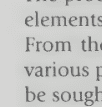

> **考试提示** 在取证过程后期需要的常见数据元素是相对于准确外部时间源的准确系统时间。通过使用诸如网络时间协议（NTP）服务器等外部时钟测量系统时间，可以计算出记录时间偏移量。如果系统关机，该信息可能会丢失，因此最好在系统仍在运行时进行收集。

## 分析

从取证意义上讲，分析过程就是从各个独立元素构建出一幅完整图景。在许多情况下，收集到的信息片段只能呈现部分图景。通过这些片段，往往可以分析相关材料，并确定事件发生的各种可能性。然后，可以寻找额外的信息来支持或排除从初始数据收集中所呈现的各种可能性。

当额外信息不可用、不完整或无法缩小可能性范围时，报告将需要说明无法支持单一结论。

## 大数据分析

大数据指的是一种新现象，即在业务流程中使用非常庞大的数据集。大数据可以通过两种方式涉及取证。首先，许多更大范围的调查会产生大数据集合，至少在以往计算机用户常见的数据量规模上是如此。太字节级驱动器可以包含数百万条记录，而发现、恢复、分类和分析数百万个对象的过程超出了个人的直接能力范围。现代数字取证工具提供了解决方案，因为它们可以对大量数据进行编目和处理。缺点是耗时。对于太字节级的数据量和大型记录集，搜索、编目和哈希等功能可能需要专用计算机数天的处理时间。

自动化取证工具还支持高级操作，例如时间线操作。系统上的每个文件都有一组称为 MAC 数据的元数据。这些数据记录了文件的修改时间、访问时间和创建时间。如果已知事件发生的时间，那么搜索该时间点的所有文件活动，可以提供系统上正在发生事情的相关信息。由于文件结构具有文件夹和文件的层级关系，且 MAC 时间不易被操作系统篡改，再加上可能有数千个目标对象，因此需要特定的工具来按时间查找和编目活动。

另一方面是响应数字取证请求的大数据分析。如果涉及的数据量达到 PB 级或更高，那么仅对存储数据所跨的数千台设备进行简单搜索就已成为一项重大挑战。在这些情况下，取证检查员需要数据所有者的合作，因为需要使用他们管理数据的工具来应对数据的复杂性和庞大规模。如今，这个问题只存在于少数公司、大型电信运营商、互联网公司和一些政府机构中。但随着越来越多的流程采用大数据，这种情况将蔓延到更多的调查中。金融公司正在使用先进算法，在数百万笔交易中实时识别欺诈性金融交易，这一壮举得益于账户活动和典型使用行为的大数据存储库。

## 报告

报告是取证过程中必不可少的要素，因为这是将结果传达给需要了解情况的人员的方式。报告不仅仅是所发现事实的简单汇集，因为这些事实很少能完整描绘出请求方需要了解的图景。许多取证调查涉及大量数据的收集和分析，以完整描绘实际发生的事件。报告是关键要素之一，因为它向需要了解情况的各方阐明所收集的元素是什么，并告知他们发生了什么。

## 跟踪工时和费用

在法庭和其他程序中，证明取证过程中所做的工作和任务可能会成为一个问题。能够证明谁做了什么、何时做的以及花了多长时间，可以提供信息以确认所采取的步骤符合所采用的流程。拥有关于工时和其他费用的可靠核算数据，可以为所执行的操作提供佐证证据。

## 监管链

证据一旦收集，必须妥善控制以防止篡改。监管链记录了所有处理过或接触过证据的人员。监管链显示了谁获取了证据、获取的时间和地点、存储地点，以及自证据获取以来在整个期间由谁控制或保管证据。

以下显示了监管链中的关键步骤：

- 1. 记录收集为证据的每个项目。
- 2. 记录证据收集者以及收集或记录的日期和时间。
- 3. 在文档中写下证据的描述。
- 4. 将证据放入容器中，并在容器上标注案件编号、收集者姓名以及收集或放入容器的日期和时间。
- 5. 在文档中记录所有消息摘要（哈希）值。
- 6. 将证据安全地运输到受保护的存储设施。
- 7. 从该存储设施的接收人员处获取签名。
- 8. 提供控制措施，防止证据在存储期间被访问和破坏。
- 9. 将证据安全地运输到法院以进行诉讼程序。


> **考试提示** 切勿直接分析扣押的证据。原始证据必须通过监管链进行保护和妥善保管。由于数字证据的脆弱性，绝不应直接对其进行取证检查。然而，取证副本可以被检查，如果出现问题，可以丢弃并重新进行复制过程。一个良好的取证过程将证明取证副本在检查开始和结束时与原始证据完全相同。从实际角度来看，调查人员通常会制作多个取证副本，并在多个副本上并行进行分析。


## 事件响应程序

事件响应是一个术语，用于描述组织在计算机系统运行中遇到任何被判定为异常的情况时所采取的步骤。事件的原因很多，从环境因素（如暴风雨）到用户操作失误，再到未授权用户的非法行为，等等。尽管原因可能很多，但结果可以归为几类。低影响事件可能不会带来显著的风险敞口，因此除了修复受损系统外，无需采取其他措施。中等风险事件需要更严格的审查和响应工作，而高风险敞口事件则需要最严格的审查。为了在事件发生时进行管理，需要为事件响应团队制定一份指导准则表，以协助确定响应级别。

确定响应级别时有两个主要因素起作用。信息关键性是主要决定因素，它取决于数据分类和所涉及的数据量。丢失一个管理员密码比丢失所有密码的严重性要低。第二个因素涉及业务决策，即该事件如何影响当前的业务运营。一系列入侵事件（无论是否轻微）都表明存在一种模式，可能引发公共关系和监管问题。

事件响应周期是快速记忆计算机取证中关键步骤的一种方式。图8-1以图形方式展示了事件响应周期。共有五个关键步骤：

- **1. 发现与报告**：组织应管理事件报告流程，确保潜在的安全漏洞以及常规应用程序问题能够尽快被报告并解决。应培训员工如何报告系统问题。
- **2. 确认**：专家或响应团队成员应审查事件报告，以确认是否发生了安全事件。应记录并保留详细笔记，因为它们对后续调查可能具有极其重要的价值。
- **3. 调查**：由网络、系统和应用程序专家组成的响应团队应详细调查事件，以确定事件的范围并制定恢复计划。
- **4. 恢复**：此时调查完成并形成文档。采取措施将系统和应用程序恢复到运行状态。
- **5. 经验教训**：事后总结会议应收集经验教训，并分配行动项目以纠正弱点并提出改进方法。

事件响应活动有时与涉及IT运营的其他IT活动密切相关。事件响应活动可能与灾难恢复和业务连续性操作相似。事件响应活动并非在真空中进行，而是与许多运营流程紧密相连，这种联系是整体系统效率的关键。

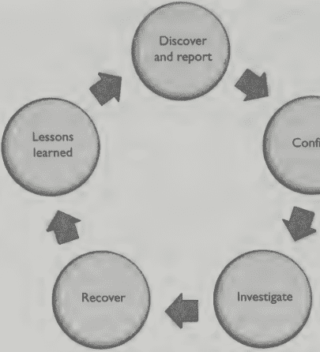

**图8-1** 事件响应周期

## 准备

事件响应是安全人员针对各种触发事件所采取的一系列行动。这些行动广泛而多样，因为它们必须应对各种各样的原因和后果。通过使用结构化的框架，再加上妥善准备的流程，事件响应就成了一项可管理的任务。如果没有适当的准备，这项任务很快就会变得无法完成或成本难以承受。成功处理事件是充分准备的直接结果。

## 第一响应人

第一响应人必须尽可能控制损害或证据丢失。显然，随着时间流逝，证据可能被篡改或销毁。在桌面上、名片盒（Rolodex）中、键盘下、桌面存储区域以及隔间公告板上查看是否有任何可能相关的信息。保护软盘、光盘、闪存卡、U盘、磁带和其他可移动介质。尽快请求获取日志副本。大多数互联网服务提供商（ISP）会保护可能被传唤的日志。拍照（有些地方要求使用拍立得照片，因为这类照片更难在无明显篡改痕迹的情况下被修改）或录像。包括从多个角度拍摄运行中的计算机屏幕和硬件组件的照片。在拆除内部组件进行分析之前，务必先对它们进行拍照。

## 事件响应团队

事件响应团队是一群为任何紧急事件（如自然灾害或业务运营中断）做好准备并做出响应的人员。计算机安全事件响应团队通常由组织内具备关键技能的成员组成，他们为响应工作带来广泛的技能。事件响应团队在公司企业和公共服务组织中都很常见。

理想情况下，事件响应团队成员经过培训和准备，能够履行特定情况所需的角色（例如，在发生大规模公共紧急事件时担任事件指挥官）。事件响应团队的规模通常根据事件的规模和性质动态调整，随着事件规模的扩大和更多资源被投入事件，局势指挥权可能会经历多个阶段的转移。

在小型事件中，或者在小公司的情况下，通常可能只有志愿者或临时团队来响应。如果事件超出了事件响应团队的本地控制范围，则可以通过行业团体和政府团体调动更高级别的资源来协助处理事件。

为了及时高效地运作，理想情况下，团队应已经定义了一套协议或行动方案，以减轻大多数常见事件形式的负面影响。

## 事件识别

事件被定义为偏离正常、例行操作的情况。事件是否重要是事件响应过程中的第一个决策点。单次登录失败在技术上是一个事件，但如果在它之后成功登录，则没有任何影响。事实上，这甚至可以视为正常情况。但对某个系统的一万次失败尝试，或大量账户的失败尝试，则明显不同，可能值得进一步调查。一个关键的初步步骤是处理信息，并决定是否启动事件响应流程。

事件信息可以来自多种来源，包括日志、员工、服务台电话、系统监控、安全设备等。挑战在于检测到正在发生的事件不仅仅是日常简单的常见错误。当证据积累时，或者在某些情况下，特定项目（如安全设备日志）表明可能存在事件时，下一步就是将情况升级给事件响应团队。

## 升级与通知

当操作员了解到一定数量的信息并决定升级情况时，事件响应过程便进入通知和升级阶段。并非所有事件都具有相同的风险特征，事件响应工作应与事件相关的实际风险级别相匹配。当事件响应团队收到潜在事件的通知时，其首要步骤是确认事件的存在、范围和严重性，并做出相应响应。这通常通过两步升级流程完成：先由一支最小的快速响应团队开始，然后根据问题的需要增加成员。

对事件相关风险进行评估是重要的第一步。如果事件的特征包括大量发往机器上不同服务的数据包（通常称为端口扫描的攻击），那么所需的行动与响应大量发往单一机器服务的数据包所需的行动不同。端口扫描很常见，在某种程度上相对无害，而端口洪泛可能导致拒绝服务。确定具体的下游风险对于确定响应行动的优先级非常重要。

## 缓解措施

所有存储的数据都可能遭到破坏或泄露。在这种假设下，问题就变成了：什么是降低破坏或泄露相关风险的最佳缓解策略？数据在数据生命周期的三种状态中都需要保护：存储中、传输中和处理中。由于几个因素，每种状态下的风险级别有所不同：

- **时间**：数据在存储中花费的时间往往更长，因此在更长的时间段内面临破坏或泄露的风险。数据在传输和处理中花费的时间较少。
- **数量**：存储中的数据往往比传输中的数据更容易遭到破坏或泄露，而处理中的数据则更不易。如果记录在处理过程中被泄露，那么只有正在处理的记录面临风险。
- **访问**：每个领域都存在不同的保护机制，这对破坏或泄露相关风险有直接影响。操作系统往往有非常严格的控制，以防止跨进程数据问题，如错误和污染。

处理风险的另一个方面在于进程访问，各种攻击技术专门针对这一渠道。传输中的数据容易受到各种网络级攻击和漏洞的破坏或泄露。其中一些是企业可以控制的，还有一些则无法控制。

一项主要缓解措施是数据最小化。数据最小化工作可以在运营效率和安全性方面发挥关键作用。与数据相关的首要规则之一是：不需要的数据不要保留。垃圾邮件治理就是一个简单的例子。如果垃圾邮件在进入邮箱之前就与电子邮件分离，那么可以断言它不是邮件，也不受存储、备份或数据保留问题的约束。由于垃圾邮件可能占来信的50%以上，这可以在速度和成本两方面显著提高运营效率。

同样的原则也适用于其他形式的信息。在处理信用卡交易时，实际交易需要某些数据元素，但一旦交易获得批准，它们就没有进一步的业务价值。存储这些信息不提供任何业务价值，但在数据泄露的情况下，它确实代表着风险。对于信用卡信息，与之相关的规则和法规...

元素受合同管辖并由支付卡行业数据安全标准（PCI DSS）管理。数据存储不应以能够存储什么为准，而应以存储的业务需求为准。未存储的数据不会遭受泄露风险，而将存储最小化为仅业务需求所支持的内容，可降低企业风险和成本。

最小化工作在数据甚至触及系统之前就开始，更不用说发生泄露。在系统设计期间，会确定并部署适当的 安全控制，并进行定期审计以确保合规。这些控制基于所保护信息的敏感性。可用于协助选择控制措施的一种工具是数据分类方案。并非所有数据同等重要，也不是在丢失时同等具有破坏性。开发和部署数据分类方案可在为数据元素设计安全措施时协助预防性规划工作。


> **考试提示** 数据泄露可能无法完全防止，但可通过最小化和加密措施加以缓解。

## 经验教训

在报告过程中，会以经验教训的形式准备对做对了什么、做错了什么、可以改进什么以及应继续什么的批判性评估。这是自我改进的重要部分，其目的不是追究责任，而是协助未来预防。在复杂环境中出现问题是正常运营的一部分；出现可预防的重复性失败则不是。报告中经验教训部分的关键在于做出必要的改变，以防止重复事件的发生。由于许多事件都是攻击者使用已知方法造成的，一旦企业了解了攻击模式并存在缓解方法，那么整个企业采取必要行动以缓解未来事件就是其任务。

## 报告

系统恢复后，事件响应团队会创建事件报告。详细说明发现了什么、如何发现、做了什么以及结果，该报告充当企业记忆，可用于未来事件。拥有以往事件及其所用行动的知识库是一项宝贵资源，因为它是在特定企业的背景下。这些报告还提供了一种与管理层就事件闭环的机制，最重要的是，提供了一份可在未来用于防止相同或类似事件的行动路线图。

报告的一部分将是建议，如果合适，改变现有政策和程序，包括灾难恢复和业务连续性。目标的相似性使其自然重叠，而这些操作之间的交叉授粉对于使所有流程尽可能高效至关重要。

## 恢复/重建程序

从事件中恢复涉及多个具体要素。首先，必须确定并解决事件的原因。这是通过事件响应机制完成的。在原因已知并得到纠正之前尝试恢复，通常会导致问题持续存在。其次，如果数据敏感且可能被滥用，则需要根据其丢失方式、谁可能访问以及为减轻泄露造成的特定业务损害需要采取哪些业务措施来审查数据。这可能涉及更改业务计划，如果泄露使其受到怀疑或遭受不利影响。

许多事件中的一个关键方面是外部沟通。拥有熟悉媒体应对、具备传达正确信息而不激化局势所需的语言细微差别 的沟通专家，对任何沟通计划的成功至关重要。许多公司试图让其法律顾问来做这件事，但一般来说，律师使用的法律精确语言在公关方面并无用处，而更细致的沟通者可能提供更好的形象。在许多危机管理案例中，决定最终成本的并非危机本身，而是对危机的反应以及初始危机后的细节沟通。

恢复可以是两步过程。首先，可以恢复关键业务功能，使业务运营得以进行。第二步是完全恢复所有服务和运营。以优先方式分阶段进行恢复操作，可实现平稳返回运行状态。

## 事件隔离

一旦发现并确定事件特征，事件响应过程中的最重要步骤涉及问题的隔离。如果未被事件响应团队遏制，许多事件会扩散到其他机器并扩大损害面。确定隔离特定机器和服务的步骤可能是一项复杂的工作，最好在事件发生前通过准备阶段完成。当特定机器或服务受到损害时，团队可以调用预先计划的步骤将受感染单元与其他单元隔离。这可能会对性能产生影响，但仍小于如果损害扩散导致更多机器受损的情况。

## 隔离

隔离机器的一种方法是隔离过程。机器可以被允许运行，但其与其他机器的连接会被切断，以防止感染扩散。隔离可以通过多种机制实现，包括建立限制机器之间通信的防火墙。这可能是一个相当复杂的过程，但如果提前正确配置，隔离操作的限制可以使机器继续运行以进行诊断目的，即使它不再处理工作负载。

## 设备移除

更极端的响应是设备移除。如果机器受到损害，则直接将其从生产环境中移除并更换。当设备移除是硬件的物理更换时，这是一项资源密集型操作。对机器重新映像可能是一项耗时且困难的工作。虚拟机的出现彻底改变了这一点，因为在硬件上部署虚拟映像可以更快地完成。

## 数据泄露

数据泄露是指信息被释放到不受信任的环境中。只要未确定数据无法被未经授权的各方获取，任何对数据的控制丧失都可视为泄露。数据泄露可能是事故或故意行为的结果。只要敏感或受保护的信息被未经授权的各方复制、传输、查看、窃取或访问，就发生了数据泄露。

## 损害和损失控制

防止数据因泄露或入侵而丢失的黄金标准是加密。正确使用时，加密可以在存储期间、传输中以及在某些情况下甚至在处理期间保护数据。加密后的数据对未经授权的各方不再具有直接价值，因为在没有适当密钥的情况下无法访问数据；所有可访问的都是一串看似随机的数值。加密的目的不是使获取数据不可能，而是将工作量提高到在经济或时间上不可行的水平。任何通过网络发送的敏感信息都应加密，因为网络无法保证没有未经授权的各方可以访问网络中传输的数据。对于无线网络，这显而易见，但在有线网络中也存在同样的未经授权访问问题。尽管 HTTPS 远非完美的安全性，但它为许多基于互联网的数据传输提供了合理的保护水平。虚拟专用网络（VPN）技术的使用将这种保护水平从与网络相关的数据传输扩展到更一般的数据网络传输情况。

## 章节回顾

在本章中，你了解了取证和事件响应的原则。本章介绍了数字取证流程，包括数据收集的所有开发要素以及保管链等行政问题。它还涵盖了技术问题，例如记录时间偏移（如有）、拍摄和录制现场照片、截屏以及对所有信息进行哈希处理。

本章随后逐步介绍了事件响应流程，详细介绍了每个步骤。所介绍的主题包括准备、事件识别、升级、隔离、损害和损失控制、缓解、报告和经验教训。


## 问题

为了进一步帮助你准备 CompTIA Security+ 考试，并测试你的准备程度，请回答以下问题，然后将你的答案与本章末尾的正确答案进行核对。

1. 在收集计算机取证调查的证据时，以下哪一项在易失性顺序中最后？
   - A. 文件系统信息
   - B. 内存内容
   - C. 交换文件
   - D. 原始磁盘块

2. 如果在证据收集完成前关闭受损系统，以下哪个区域的证据*最有可能*丢失？
   - A. 原始磁盘块
   - B. 内存内容
   - C. 文件系统信息
   - D. USB 驱动器

3. 从计算机系统捕获系统镜像时，连接证据驱动器时应使用什么类型的设备？
   - A. Track pro
   - B. iSCSI HBA
   - C. 写保护器
   - D. 内存成像器

4. 在检查网络日志时，你注意到大量 TCP 流量来自外部 IP 地址，指向 DMZ 中的 Web 服务器。你检查的每个数据包的目的地 TCP 端口似乎都不同。你的日志中可能看到什么类型的流量？
   - A. Smurf 攻击
   - B. 端口扫描
   - C. Ping 扫描
   - D. DNS 传输

5. 你的组织发生了一起被安防摄像系统捕捉到的物理入侵事件。当你将包含入侵视频的驱动器交给警方时，你被要求填写一份记录驱动器描述、序列号、状况等的表格。为什么会要求你填写这种表格？
   - A. 确保驱动器不是副本
   - B. 验证驱动器是否正常工作
   - C. 维护证据的保管链
   - D. 确保调查结束后能取回相同的驱动器

6. 在文件分析中讨论 MAC 时间时，MAC 代表什么？
   - A. 修改、可用和关闭
   - B. 修改、访问和创建
   - C. 修改、访问和复制
   - D. 修改、追加和创建

7. 以下哪一项不是常用的文件哈希算法？
   - A. MD5
   - B. SHA-1
   - C. SHA-2
   - D. TLS

8. DMZ 中的 Web 服务器正被大量源地址发来的 ICMP 数据包淹没。以下哪一项可能是适当的缓解措施？
   - A. 关闭 Web 服务器
   - B. 在防火墙阻止所有 ICMP 数据包
   - C. 将 Web 服务移动到不同的端口
   - D. 重启 Web 服务器

9. 以下哪种技术最有可能被信用卡公司用于查找欺诈交易？
   - A. 大数据分析
   - B. 网络取证
   - C. 脚本挖掘
   - D. 驱动器成像

10. 你的组织经历了一次大规模的基于网络的入侵，客户记录已被窃取。你被要求组建组织的事件响应团队。以下哪个人你最不可能纳入响应团队？
    - A. 公共关系部的 Rajesh
    - B. 人力资源部的 Tina
    - C. 网络运营部的 Jose
    - D. 法务部的 Carl

11. 按易失性顺序排列以下采集项目：ARP 缓存、USB 驱动器、内存（RAM）、临时文件系统/交换空间、CPU 寄存器内容、实时网络连接、硬盘数据。

12. 你怀疑用户的 workstation 被恶意软件感染，即将开始调查。如果你想降低该工作站感染网络上其他系统的可能性，但仍希望尽可能保留证据，应该怎么做？
   - A. 关闭工作站
   - B. 从工作站拔掉电源线
   - C. 从工作站拔掉网络电缆
   - D. 从系统上移除所有 USB 设备和外设

13. 你的组织刚刚从一次大型系统故障中恢复，事件响应团队的成员即将返回正常工作。在响应团队正式解散前，你应该对整个团队做什么？
   - A. 格式化响应过程中使用的任何驱动器
   - B. 记录恢复过程中学到的任何经验教训
   - C. 审查组织的业务连续性计划
   - D. 去喝快乐时光

14. 在进行调查时，一位同事给你一份从受损工作站获取的文件创建和访问时间列表。为了将这些时间与来自其他系统的文件访问和创建时间进行匹配，你需要考虑什么？
   - A. 记录时间偏移
   - B. 网络时间协议
   - C. 创建、修改和访问时间
   - D. 操作系统偏移

15. 按易失性从高到低排列以下元素，针对取证采集过程中的数据：网络连接、交换空间、ARP 缓存、存储在归档媒体/备份（USB 闪存）上的数据、内存（RAM）。

## 答案

1. D. 原始磁盘块在易失性顺序中最后。原始磁盘块中的证据比内存、交换文件、正在运行的进程等其他区域中的证据存活时间更长。

2. B. 内存内容对数字证据来说是最易失的。当系统关闭时，计算机系统中可能存在的内存中的数字证据会丢失。

3. C. 在连接证据驱动器时使用写保护器可确保不会向证据驱动器写入数据。这有助于确保在收集证据时不会对证据进行任何更改。

4. B. 当你看到大量来自一个源 IP 地址的流量，且目的端口（UDP 或 TCP）在几乎每个数据包中都发生变化时，这很可能是一次端口扫描。攻击者探测大量端口以寻找目标系统上的开放服务。

5. C. 从犯罪现场收集的证据应记录在保管链表格上，以显示证据从最初收集到在法庭上出示期间被正确收集、运输、存储和控制。

6. B. 在数字取证调查中讨论“MAC 时间”时，通常指的是修改、访问和创建的日期和时间。

7. D. TLS 代表“传输层安全”，是一种用于加密 Web 流量的协议。TLS 不用作文件哈希算法。

8. B. 缓解措施可减少或消除某事的影响或风险。如果 DMZ 中的 Web 服务器被 ICMP 数据包淹没，在防火墙阻止这些 ICMP 数据包并防止它们到达 Web 服务器将是适当的缓解措施。如果阻止 ICMP 数据包到达 Web 服务器，它们就无法淹没服务器。

9. A. 为了识别欺诈交易，信用卡公司必须能够梳理数百万条记录，寻找欺诈活动的模式和指标。检查大量数据以发现隐藏模式和未知相关性的过程称为大数据分析（或大数据分析）。

10. B. 在列出的部门中，人力资源对你的事件响应流程最不关键。由于客户记录被窃，你需要了解泄露的法律影响，并且可能需要向受影响的客户发送某种通知。而且由于这是一次基于网络的攻击，网络运营部门的人员对你的团队构成也很关键。

11. CPU 寄存器内容、ARP 缓存、实时网络连接、内存（RAM）、临时文件系统/交换空间、硬盘数据、USB 驱动器。

12. C. 尽管拔掉网络电缆可能会丢失证据，例如正在进行的网络连接，但这是唯一能在保护高度易失性证据（如内存内容）的同时帮助防止恶意软件传播的步骤。

13. B. 在任何事件响应流程中，一个关键步骤是记录整个过程中学到的经验教训。这些经验可用于更新事件响应计划和灾难恢复计划，改进未来的事件响应，防止未来的事件等。

14. A. 尝试在不同系统之间匹配文件创建和访问时间时，你需要考虑记录时间偏移。如果不知道每组时间戳的参考框架，就无法识别模式和趋势或正确进行调查。

15. ARP 缓存、网络连接、内存（RAM）、交换空间、存储在归档媒体/备份（USB 闪存）上的数据。


成本高昂。没有理由让组织不建立安全意识培训计划。许多政府机构制作了安全意识海报，以不断提醒个人因自满而产生的风险。安全通讯，通常以电子邮件形式，也被用来提醒员工其安全责任。

## 安全策略培训和程序

人员不能期望在没有针对任务和期望的培训的情况下执行复杂任务。这既适用于安全策略，也适用于操作安全细节。如果期望员工遵守组织的安全策略，他们必须对其目的、含义和目标进行适当培训。关于信息安全策略、个人责任和期望的培训需要通过定期复训来强化。

由于安全策略是一项高层指令，设定了有关安全的整体支持和执行方向，因此将该信息的含义进行传达并得到支持非常重要。诸如密码、访问、信息处理和可接受使用策略等二级策略也需要涵盖。策略的集合应描绘出描述组织期望安全文化的图景。培训应设计为确保人们看到并理解整体图景，而不仅仅是各个要素。

### 基于角色的培训

为了使培训有效，它需要针对用户在培训主题中的角色进行定位。虽然所有员工可能都需要一般的安全意识培训，但他们在承担个人责任的领域也需要具体的培训。关于信息安全责任的基于角色的培训是信息安全培训的重要组成部分。

如果某人的工作职责可能影响信息安全，则需要进行角色特定培训，以确保个人了解其与信息安全相关的责任。一些角色，如系统管理员或开发人员，具有明确定义的信息安全责任。其他角色，如项目经理或采购经理，其信息安全影响不太明显，但这些角色也需要培训。事实上，中层管理中不太明显但影响更广的角色会对信息安全文化产生重大影响，因此如果期望特定结果，则需要培训。

如同所有与人员相关的培训一样，需要关注两个要素。首先，随着时间的推移需要重新培训，以确保人员保持适当的知识水平。其次，随着人员岗位变动，需要重新评估所需的培训基础，并可能需要额外培训。维护准确的人员培训记录是任何重要企业能够管理此事的唯一方式。

### 个人身份信息

当信息可用于识别个人时，未能保护它会产生特定后果。商业秘密通过商业秘密法得到保护。

安全港联盟必须承诺遵守有关隐私的特定指南。安全港成员还同意受某些自我执行的监管机制约束，最终由 FTC 行动支持。

安全港建立在七项原则之上：

-   **通知** 公司必须通知收集了什么内容、如何使用以及与谁共享。
-   **选择** 公司必须允许选择退出将 PII 转移给第三方。
-   **转交** 所有 PII 的披露必须与之前的通知和选择原则一致。
-   **安全** PII 必须始终得到保护。
-   **数据完整性** PII 必须准确维护，如果不正确，客户有权更正。
-   **访问** 个人必须有权以合理的方式访问 PII 以进行验证和更正。
-   **执行** 隐私和 PII 相关问题必须有适当的执行条款以保持有效。

### 信息分类

IT 安全的关键组成部分是对计算机系统和网络上处理和存储的信息进行保护。组织处理许多不同类型的信息，需要认识到并非所有信息的重要性或敏感性都相等。这促使将信息分类为各个类别，每个类别对其处理都有自己的要求。影响特定信息分类的因素包括其对组织的价值（如果组织丢失此信息会产生什么影响？）、其年龄以及规范其保护的法律或法规。

最广为人知的分类是美国政府和军方实施的分类，将信息分为未分类、敏感但未分类、机密、秘密和绝密等类别。企业也有类似的保护信息愿望，但通常使用公开可发布、专有、公司机密或仅限内部使用等类别。每个信息分类的策略都应描述应如何保护它、谁可以访问它、谁有权发布它以及应如何销毁它。

组织的所有员工都应接受其有权访问的信息的处理程序培训。不同分类级别是什么并不重要——无论是高、中、低，还是私人、公开和机密，或任何其他描述符集合。重要要素是对用于区分分类的标准进行明确定义。如果员工要在实践中实施它，他们需要能够理解信息分类方案。


**考试提示** 对于 CompTIA Security+ 考试，您应了解的信息分类类别包括高、中、低、机密、私有和公开。

### 数据标记、处理和处置

有效的数据分类计划包括数据标记，使处理数据的员工能够知道何时数据敏感并了解所需的保护级别。当数据在信息处理系统内部时，保护应设计到系统中。但当数据离开这一保护层时，无论是通过打印、下载还是复制，都需要通过其他方式确保持续保护。这就是数据标记帮助用户履行其责任的地方。确保标记发生并被使用和遵循的培训对于其角色可能受此材料影响的用户很重要。

许多潜在入侵者已经了解了翻垃圾桶的价值。组织必须关心其如何处理不仅是纸质垃圾和丢弃物品，还包括存储在丢弃设备（如计算机）上的信息。有几个政府机构在披露其旧计算机出售给回收商后证明硬盘上包含敏感文件时感到尴尬。对于每个组织来说，制定强有力的处置和销毁政策及相关程序并将其纳入培训计划以确保用户遵守至关重要。

重要文件应被粉碎，而在此情况下“重要”意味着任何可能对潜在入侵者有用的东西。入侵者能用看似无害的信息做些什么令人惊讶。

在磁性存储介质（如磁盘或磁带）被丢弃或出售作回收之前，应删除所有文件，并至少用全 1、全 0，然后是随机字符覆盖三次。有商业产品可用于使用此过程销毁文件。仅仅删除所有文件是不够的，因为删除过程仅影响指向文件存储位置的指针，并不会真正清除文件中的所有位。这就是为什么在文件被删除后仍有可能“恢复”文件并找回它们的原因。

培训在确保适当的数据处理和处置方面发挥着重要作用。人员密切参与与数据处理和数据销毁/处置相关的若干具体任务，如果得到适当培训，可作为安全控制措施。未受培训或培训不足的人员不会成为有效的生产性安全控制，事实上可能成为潜在泄露的来源。

### 遵守法律、最佳实践和标准

与信息安全相关的大量法律、法规、合同要求、标准和最佳实践。每项都对组织及其人员提出自己的要求。组织应对这些要求的唯一有效方式是将它们纳入自己的政策和程序。对自身政策和程序的培训随后将转化为对这些外部要求的覆盖。


需要注意的是，许多此类外部要求都会对组织提出特定的培训和意识要求。受支付卡行业数据安全标准（PCI DSS）、格雷姆-里奇-比利雷法案（GLBA）或健康保险携带与责任法案（HIPAA）约束的组织，是众多必须维持特定信息安全培训计划的组织之一。其他组织也应出于最佳实践考虑而这样做。

## 用户习惯

个体用户的职责因组织以及各组织所从事的业务类型而异，但所有用户都应被引导去履行某些最基本的职责：

- 锁好办公室或工作区的门。
- 不要在车内不加保护地放置敏感信息。
- 将包含敏感信息的存储介质保存在安全的存储设备中。
- 在丢弃包含组织信息的纸张前先将其粉碎。
- 不要向没有授权知悉需求的个人（包括其他员工）泄露敏感信息。
- 不要与家人讨论敏感信息。（此类规则最常被违反的情况涉及人力资源信息，因为员工，尤其是主管，可能会向配偶或朋友抱怨其他员工或工作中出现的问题。）
- 无论设备存放或遗留何处，都要保护含有敏感或重要组织信息的笔记本电脑和其他移动设备。（最好确保笔记本电脑或移动设备上的敏感信息经过加密，这样即使设备丢失或被盗，信息也依然安全。）
- 讨论敏感的公司信息时，要注意周围有谁。听得见的人是否都有必要听到这些信息？
- 执行公司的访问控制程序。警惕并禁止尾随、肩窥或在没有正当凭据的情况下访问。
- 了解报告疑似或实际违反安全策略行为的正确程序。
- 遵循为加强良好密码安全实践而制定的程序。密码是至关重要的要素，常常成为社会工程攻击的最终目标。尽管这些密码程序可能显得过于苛刻或严格，但它们往往是最好的防线。


**考试提示** 用户职责是考试中容易出题的培训主题，因此请牢记此处列出的知识点。

## 可接受使用

可接受使用政策（AUP）概述了组织认为对其资源（如计算机系统、电子邮件、互联网和网络）的适当使用方式。组织应关注任何无益于公司的组织资产个人使用行为。

该政策的目标是确保员工生产力，同时限制因不当使用组织资产而可能带来的组织责任。与该政策相关的培训应明确界定哪些活动是不被允许的。AUP 应涵盖诸如利用资源处理个人事务、安装硬件或软件、远程访问系统和网络、复制公司拥有的软件，以及用户保护公司资产（包括数据、软件和硬件）的责任等问题。还应包括关于忽视任何政策可能受到的处罚（如解雇）的说明。

与员工对组织计算机系统和网络的适当使用密切相关的是组织自身的适当使用。其中最重要的问题是，组织是否会认为监控员工对系统和网络的使用是适当的。如果认为监控是适当的，组织应在访问横幅和培训中加入此类声明，以提醒员工。这会反复警告员工和可能的入侵者，他们的行为会受到监控，任何对系统的滥用都不会被容忍。如果组织需要在民事或刑事案件中使用监控期间收集的任何信息，只要组织能够指明其反复展示的声明——使用系统即同意监控——那么员工是否有隐私预期，甚至组织监控是否合法的问题都会简化。

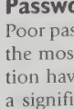

**考试提示** 请确保你理解可接受使用政策概述了什么被视为计算机系统用户的可接受行为。该政策通常与组织的互联网使用政策相辅相成。

## 密码行为

选择糟糕的密码是最常见且最危险的不良安全实践之一。大量关于密码选择的研究发现，虽然总体上有更多用户正在学习选择好密码，但仍有相当比例的用户做出不佳的选择。当然，问题在于，糟糕的密码选择会使攻击者更容易入侵计算机系统或网络。即使密码本身很强，用户也常常采取另一种不良安全做法——把密码写在容易找到的地方，如果攻击者获得对该区域的物理访问权限，这也会导致系统受损。


**考试提示** 了解良好密码选择的规则。通常，这些规则包括：密码中使用八个或更多字符；包含大小写字母的组合；包含至少一个数字和一个特殊字符；不要使用常见单词、短语或姓名；并选择一个你能记住的密码，这样你就不需要将其写下来。

密码策略是组织最基本的策略之一。请确保你不仅理解构成良好密码的基本要素，还理解围绕密码创建、过期、共享和使用的其他问题。

## 数据处理

理解与工作相关的正确数据处理责任是一个重要的培训主题。信息可能具有欺骗性，因为它不是直接有形的，人们往往会在其他工作指标方面养成坏习惯……而这会以牺牲安全为代价。员工需要接受培训，学习如何识别所使用数据的分类和处理要求，并学会如何遵循正确的处理流程。如果某些数据元素因合同、法律或法规而需要特殊处理，通常会有与此要求相关的培训条款。培训条款的精神在于：你训练什么，就得到什么；如果对特定数据类型的安全保护是一项要求，那么就应进行相应培训。同样的原则也适用于企业数据处理责任：你会得到你训练和奖励的行为。

## 清洁桌面政策

在工作区域，防止信息被访问也同样重要。拥有敏感信息的公司应制定清洁桌面政策，规定当员工不在现场担任保管人时，不得将敏感信息无防护地留在工作区域。即使只是离开办公桌去洗手间，也可能使信息暴露并面临泄露风险。清洁桌面政策应识别并禁止那些乍一看不明显的事项，例如粘贴在键盘和鼠标垫下或未上锁的办公桌抽屉里的便利贴上的密码。

## 肩窥

肩窥不涉及与用户的直接接触，而是攻击者直接观察目标在表格、小键盘或键盘上输入敏感信息。攻击者可能只是从正在工作的用户身后窥视，看着同事输入密码。攻击者可以尝试获取信息，例如自动取款机上的个人识别码（PIN）、安全门或门上的门禁输入码，或电话卡或信用卡号码。对用户而言，重要的是

在输入敏感信息时保持警惕并养成隐藏操作的习惯。

虽然防御方法可以帮助使肩窥更困难，但最好的防御措施是用户意识到周围环境，并不允许他人进入可以观察到用户输入内容的位置。此时可以提出一个相关的安全建议：一个人不应为所有不同的账户、门禁代码等使用相同的 PIN，因为攻击者一旦获知其中一个 PIN，就可能将其用于所有其他账户。

## 防止尾随

与肩窥密切相关的一种技术是搭便车（也可能称为尾随）。在这种情况下，攻击者会试图在授权员工后面紧跟其后，从而非法进入设施。当员工使用访问代码、卡或钥匙进入时，入侵者在门或闸门关闭前紧跟其后。大多数使用卡或代码的门禁系统的公司也会有政策禁止员工允许任何人跟得如此之近以至于无需使用自己的访问设备，但人性使然，这种情况非常常见。员工不愿质疑他人或强迫他们使用自己的设备。攻击者只需确保双臂被占用、拿着东西，就能增加员工放行他们的几率。 often，员工不仅不会质疑该个人，事实上还会主动为其开门。

## 个人自有设备

自带设备（BYOD）是当前具有安全影响的趋势。员工需要接受关于 BYOD 安全影响的培训。看似无害的行为，例如从计算机的 USB 端口为手机充电，都可能导致攻击面被无意中打开。使用个人设备阅读公司电子邮件会扩大信息边界，应建立控制措施以防止某些级别的信息流向这些设备。但最终的安全终端保护设备是用户本身，用户应接受关于潜在风险、公司政策以及与 BYOD 使用相关的正确操作方式的培训。

## 新威胁和安全趋势/警报

归根结底，信息安全实践是关于风险管理，而风险环境以不断变化为特征是众所周知的。不断演变的威胁环境以新威胁、新安全问题和新的防御形式为特征。培训人们识别新威胁需要持续的意识和培训更新活动。

## 新病毒

新型病毒或恶意软件每天都在被创建。某些新形式可能具有高度破坏性和高成本，所有用户都有责任保持警惕并采取行动避免暴露。不良的用户行为是导致问题的因素。

## 社交网络和点对点

随着点对点（P2P）通信和社交网络网站——尤其是 Facebook、Twitter 和 LinkedIn——的日益普及，许多人养成了分享过多信息的习惯。使用“返回 XYZ 公司的销售拜访”这样的状态会向不需要知道这些信息的人透露信息。将与朋友分享混淆为与不需要知道业务信息的人分享业务信息，是人们经常跨越的界限。不要成为那种混淆业务和个人信息并向不应获得信息的人员泄露信息的人，无论它看起来多么无害。

用户需要了解在工作场所不使用常见的程序如 torrent 和其他文件共享的重要性，因为这些程序可能导致感染机制和数据丢失渠道。信息安全培训和意识计划应涵盖这些问题。如果这些问题得到妥善向员工解释，他们遵守的动机不仅仅是为了避免违反政策而受到不利的人事处理；他们会希望协助组织及其使命的安全。

## 培训指标与合规性

培训和意识计划可以培养出受过教育且知识丰富的员工队伍。许多法律、法规和最佳实践对维持受训员工队伍有要求。建立记录保存系统以衡量出勤合规性和培训有效性是正常要求。仅仅开展培训是不够的。跟进并收集培训指标以验证合规性和安全态势是安全管理培训的重要方面。

管理安全培训时有多个因素值得关注。由于基于角色的要求具有多样性，维护最新且活跃的个人培训和再培训要求清单是一项挑战。监控培训有效性是另一项挑战。以对员工行为的实际影响来衡量，创建有效的培训和意识计划是一项具有挑战性的工作。培训需要及时、相关且有趣以吸引员工注意。简单重复相同的培训材料已被证明无效，因此定期更新计划是其保持有效性的要求。


> **EXAM TIP** 定期培训和再培训的要求推动了对良好培训记录的需求。维护适当的信息安全培训记录是多项法律和法规的要求，应被视为最佳实践。

## 章节回顾

在本章中，你熟悉了建立有效的安全培训和意识计划所需的要素。本章首先描述了信息安全培训计划要求的基础。随后详细说明了信息分类、标记和处理等领域的要求。涵盖了关于角色、习惯和活动的用户教育，随后探讨了培训在遵守信息安全领域各种规则、法规、法律和合同要求方面的作用。本章接下来考察了新型攻击向量如新型恶意软件、网络钓鱼和零日漏洞利用的培训影响，然后探讨了 P2P 和社交媒体的影响。本章以讨论跟进并收集培训指标以验证合规性和安全态势的必要性作为结束。

## 问题

为了帮助你进一步准备 CompTIA Security+ 考试，并测试你的准备程度，请回答以下问题，然后将你的答案与本章末尾的正确答案进行核对。

- 1. 以下哪一项是美国政府用于实施强制访问控制（MAC）的安全标签？
  - A. 绝密
  - B. 机密
  - C. 秘密
  - D. 未分类
  - E. 以上全部
  - F. 以上均无

- 2. 以下哪一项最准确地描述了可接受使用政策？
  - A. 一项有助于确保最大员工生产力并限制组织因工作场所不当使用互联网而产生的潜在责任的政策。
  - B. 一项描述公司将允许员工发送或作为电子邮件附件发送内容的政策。
  - C. 一项描述如何处置公司资产和销毁文件而不暴露敏感信息的政策。
  - D. 一项向用户传达允许使用计算机资源的特定用途的政策。

- 3. 以下哪一项定义了安全政策？
  - A. 规定员工在特定情况下应如何行动或完成特定任务的逐步说明。
  - B. 管理层创建的高层声明，概述组织在特定问题上的立场。


10. 以下哪项正确定义了安全港的通知原则？
    A. 公司必须明确正在收集哪些信息、这些信息将如何使用，以及与谁共享。
    B. 公司必须允许选择退出将个人身份信息传输给第三方。
    C. 个人身份信息必须始终受到保护。
    D. 个人身份信息必须准确维护，如果信息不正确，客户有权更正。

11. CISO 向你寻求关于培养良好用户习惯的建议。请概述至少七条可纳入年度员工培训计划的重要原则。

12. 你已在安全行业工作数年。你刚雇佣了一名新实习生。在下次会议前你有大约15分钟时间，想与新实习生分享一些安全经验。列出你可以与员工讨论的安全港原则的五个方面。

13. 你的老板叫你到办公室，要求你概述实施安全策略的计划。讨论你首先要实施的两项策略，并说明为什么实施它们。

14. 你的老板叫你到办公室，要求你概述实施安全意识培训计划的方案。概述一个培训计划，至少包含你认为所有人员都应接受的两个培训领域。

15. 描述为什么数据分类系统对企业很重要。

## 答案

1. E. 这些都是美国政府用来实现强制访问控制（MAC）的安全标签。信息敏感级别与用于执行访问权限的机制无关。
2. D. 可接受使用政策向用户传达计算机资源的哪些具体用途是被允许的。
3. B. 政策是管理层制定的高层声明，阐明组织在特定问题上的立场。
4. C. 个人身份信息是指任何（i）能够识别或可用于识别、联系或定位该信息所涉及个人的信息，或（ii）可从中推导出个人身份或联系信息的信息。
5. B. 零日漏洞利用是一种利用先前未知漏洞的攻击。
6. 高、中、低、敏感、非机密、机密、秘密、绝密、公开。
7. A. 网络钓鱼是利用社会工程学欺骗用户响应电子邮件，以发起基于恶意软件的攻击。
8. C. 社会工程学是欺骗他人泄露机密信息的艺术。
9. D. 信息安全培训要求是 PCI DSS、HIPAA 以及许多最佳实践的一部分。
10. A. 安全港的通知原则规定，公司必须明确正在收集哪些信息、这些信息将如何使用，以及将与谁共享。
11. 关于用户习惯的良好培训应包括以下规则：锁好办公室或工作区的大门（保持桌面整洁）；不要将敏感信息无保护地留在车内；将含有敏感信息的存储介质存放在安全的存储设备中；粉碎含有组织信息的纸张；不要向无授权知情需要的人员泄露敏感信息；不要与家人讨论敏感信息；保护含有敏感组织信息的笔记本电脑和其他移动设备；在讨论敏感信息时注意周围人员；执行公司访问控制程序（以避免尾随、肩窥等）；了解报告违反安全策略的正确程序；遵循程序以实施良好的密码安全实践。
12. 安全港原则包括通知、选择、后续传输、安全、数据完整性、访问和执行。
13. 可接受使用政策、互联网使用政策和电子邮件使用政策应属于最先实施的政策之列。
14. 培训计划应基于已制定的政策，包括要培训的主题（政策清单），还应包括初步培训所有员工的计划、跟踪完成情况，并确定重复培训的周期。
15. 数据分类系统确保公司信息得到适当保护。它为公司的处置和销毁政策提供了基础。它也是定义访问控制和基于角色的访问控制的基础。

## 物理安全与环境控制

在本章中，你将

- 探索环境控制
- 探索物理安全控制
- 比较和对比物理安全与环境控制
- 检查物理安全中的控制类型

物理安全对于处理网络和信息系统安全的企业来说是一个重要话题。企业有责任保障其盈利能力，这需要保护多种资产：员工、产品库存、商业机密和战略信息。这些及其他重要资产影响公司的盈利能力及其未来生存。因此，公司会开展许多活动来尝试提供物理安全——锁门、安装报警系统、使用保险箱、安排保安、设置访问控制等等。

环境控制在保护用于处理信息的系统方面发挥着重要作用。如今，大多数公司在网络安全和信息系统安全方面都投入了大量时间、金钱和精力。在本章中，你将了解保护网络和保护信息系统的策略是如何关联的，并学习公司可以采取哪些方法来最大限度地减少可能削弱其网络安全的物理安全事件的影响。

### 环境控制

虽然信息的机密性很重要，但其可用性同样重要。当前的数据中心需要复杂的环境控制。供暖和制冷对计算机系统和用户都很重要。在处理信息系统时，火灾抑制是一个重要的考虑因素。电磁干扰（EMI）也是一个环境问题。

### 暖通空调（HVAC）

控制数据中心的温度和湿度对于保持服务器运行至关重要。供暖、通风和空调（HVAC）系统对于保持数据中心冷却至关重要，因为典型服务器会散发出 1000 到 2000 BTU 的热量（1 BTU 等于将一磅液态水的温度升高一华氏度所需的能量）。

在受限区域内，多台服务器可能会产生过高的温度，导致机器无法继续运行。随着刀片式计算系统的出现以及许多其他设备尺寸的缩小，这个问题变得更加严重。虽然它们物理尺寸更小，但往往仍散发出相同的热量。

### 火灾抑制

根据火灾抑制系统协会（www.fssa.net）的数据，因重大火灾而关闭的企业中有 43% 永远不会重新开业。另有 29% 在事件发生后的三年内倒闭。因此，快速有效地应对火灾的能力对任何组织的长期成功都至关重要。解决潜在的火灾隐患和脆弱性一直是组织在风险分析过程中的关注重点。目标显然应该是永不发生火灾，但万一发生火灾，重要的是要有相应的机制来限制火灾可能造成的损害。

### 水基火灾抑制系统

水基火灾抑制系统长期以来一直是，并且至今仍是应对和控制结构火灾的主要工具。考虑到当今办公环境中的电气设备数量，以及出于显而易见的原因，这些设备对大量喷水反应不佳，因此了解设备如果确实受到水基喷淋系统影响时应如何处理非常重要。2013 年 NFPA 75：《信息技术设备保护标准》概述了可以采取的措施，以最大限度地减少电子设备受水损害。该指南包括以下建议：

- 打开机柜门，拆除侧面板和盖板，拉出机箱抽屉，让水从设备中流出。
- 设置风扇，使室温空气通过设备进行一般干燥。将便携式设备移至干燥、有空调的区域。
- 使用不超过 50 psi 的压缩空气吹出积水。
- 使用最低档位的手持烘干机干燥连接器、背板绕线端子和印刷电路卡。
- 对于难以触及的地方，使用棉签。轻轻擦拭表面以去除残留水分。不要在绕线端子上使用棉签。
- 使用含有氟利昂-酒精混合物的驱水气雾喷雾，作为干燥关键部件的第一步有效措施。尽快进行专业修复。


即使遵循这些指南，系统也可能已经发生损坏。水对电子设备极具破坏性，这不仅是因为水会导致系统电子短路这一即时问题，还因为水可能造成长期的腐蚀性损害，因此人们一直在寻求替代的灭火方法。其中较常见的一种替代方法便是基于哈龙的系统。

## 基于哈龙的灭火系统

燃烧需要燃料、氧气和高温才能发生化学燃烧。如果移除其中任何一项，火势便无法持续。哈龙可以干扰火势中的化学燃烧。尽管哈龙的生产已于1994年被禁止，但如今仍有许多此类系统存在。它们最初之所以流行，是因为哈龙能迅速与房间内的空气混合，并且不会对计算机系统造成损害。然而，哈龙对人类也有危险，尤其是在极高温度下（例如火灾中可能出现的温度），它会分解成其他有毒化学物质。由于这些危险，再加上哈龙与臭氧层消耗问题有关，新的灭火系统中已禁止使用哈龙。需要特别指出的是，根据美国环境保护署（EPA）关于停止生产哈龙的规定，现有系统并不需要销毁。然而，为已排放的系统补充哈龙将成为一个问题，因为只能使用现有的哈龙库存，且成本正变得高得令人却步。因此，许多组织正在转向替代解决方案。这些替代方案被称为清洁灭火剂灭火系统，因为它们不仅能提供灭火能力，还能保护房间内的物品，包括人员、文件和电子设备。清洁剂的示例包括二氧化碳、氩气、Inergen 和 FM-200（七氟丙烷）。

## 清洁灭火剂灭火系统

长期以来，二氧化碳（CO₂）一直被用作灭火剂。贝尔电话公司在20世纪早期就使用了便携式CO₂灭火器。二氧化碳灭火器作用于火灾发生的全部三个必要条件。CO₂ 置换氧气，使剩余氧气量不足以维持燃烧。它还能在火灾区域提供一定冷却效果，并降低“气化”燃料的浓度。氩气通过将氧气浓度降至可燃物燃烧所需的15%以下来灭火。氩气系统设计为将氧气含量降至约12.5%，这一水平低于火灾所需的15%，但仍高于EPA要求的人类安全所需的10%。Inergen 是安素公司（Ansul Corporation）的产品，由三种气体组成：52%的氮气、40%的氩气和8%的二氧化碳。与纯氩气系统类似，Inergen 系统将氧气水平降至约12.5%，这一水平对人类安全而言足够，但不足以维持燃烧。另一种用于替代哈龙的化学物质是 FE-13，即三氟甲烷。这种化学物质最初是作为制冷剂研发的，通过抑制燃烧链式反应来灭火。FE-13 是气态的，不会留下任何会损害设备的残留物，并被认为可在有人区域安全使用。其他卤代烃也被批准用于替代哈龙系统，包括 FM-200（七氟丙烷），这是一种用作哮喘药物吸入器推进剂的化学物质。

## 火灾探测设备

火灾探测设备（火灾探测器）是灭火系统和设备的必要补充。探测器能够在灭火系统启动之前、在火灾的极早期阶段发现火灾，并发出警报，从而使员工有可能在火势严重到需要启动灭火设备之前就应对火灾。

火灾探测器有几种不同类型。其中一种类型由烟雾触发，有两个变种。烟雾探测器的两种变体是电离式和光电式。光电式探测器对于阴燃火灾的提前预警效果很好。这类设备监测一束内部光束。如果有东西削弱了光束，例如阻碍了它，探测器便会假定那是烟雾之类的物质，随即发出警报。电离式探测器使用电离室和少量放射源来检测快速燃烧的火灾。如图10-1所示，电离室由两块极板组成，一块带正电荷，一块带负电荷。空气中的氧气和氮气颗粒会发生“电离”（一个离子从分子中脱离）。被释放的离子带负电荷，会被正极板吸引，而分子的剩余部分此时带正电荷，会被负极板吸引。这种粒子运动会产生一股微小的电流，设备对其进行测量。烟雾会抑制这一过程，探测器便会检测到由此产生的电流下降并发出警报。

这两种设备通常都被统称为烟雾探测器，并且也存在两种类型的组合产品。有关烟雾探测器的更多信息，请参见 http://home.howstuffworks.com/home-improvement/household-safety/fire/smoke2.htm。由于这两种设备都是因信号中断而触发，而不考虑中断原因，因此它们可能会产生误报。它们无法区分厨房火灾产生的烟雾与烤焦面包产生的烟雾。

另一种火灾探测器由热量触发。这类设备也有两种类型。定温式或定点式设备在区域内温度超过某个预设水平时会启动。温升速率式或温升速率型设备在局部温度突然升高时启动，这可能表明火灾处于初始阶段。温升速率传感器可以提供更早的预警，但也会导致更多的误报。

第三种类型的探测器是火焰触发式。这类设备依靠火灾火焰产生可被检测到的红外能量变化。火焰触发式设备通常比其他两种类型更昂贵，但往往能更早地探测到火灾。

图10-1
电离式烟雾探测器的电离室

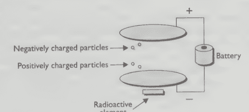

## EMI 屏蔽

电磁干扰（EMI）可能影响任何类型的电子设备，而典型数据中心中高密度的电路更使其成为电磁干扰的温床。EMI 被定义为电路因接收电磁辐射而受到的干扰。磁辐射通过感应进入电路，即磁波在电路上产生电荷。对该磁场的敏感程度取决于多种因素，包括电路的长度——电路可能像天线一样工作。EMI 分为两大类：窄带和宽带。窄带本质上是一种频带较窄的电磁能量，因此通常来自在指定频段内有目的发射的设备。宽带覆盖更宽的频率范围，通常由某种一般性电力使用引起，例如电力线或电动机。

在美国，联邦通信委员会（FCC）负责监管产生 EMI 的产品，并制定了一项计划，要求设备制造商遵守 EMI 抗扰度标准。现代电路在设计上就具有抗 EMI 能力。线缆就是一个很好的例子；非屏蔽双绞线（UTP）或 5 类、6 类线缆中的绞合就是为了防止 EMI。EMI 还可以通过接地的金属机箱来控制；通过提供一条易于接地的路径，机箱起到了 EMI 屏蔽的作用。屏蔽对于网络布线可能非常重要。重要的是，不要将网络线缆与电力电缆平行铺设。双绞线提供一定程度的保护，但在诸如工业设施等电气噪声较大的环境中，可能有必要使用屏蔽双绞线（STP）。

更大规模的屏蔽例子是法拉第笼或法拉第屏蔽体，它是一种由导电材料制成并接地的封闭体。这些装置可以做到房间大小，或嵌入建筑结构中；关键因素是外壳材料不能有显著缝隙。这些措施有助于屏蔽 EMI，尤其是在高射频环境中。

我们刚刚讨论了防止 EMI 辐射进入电路的屏蔽措施，但也有一种技术旨在帮助将其限制在内部。这种技术被一些人称为 TEMPEST，也被称为范埃克辐射。计算机的显示器或 LCD 屏幕会产生电磁辐射，使用适当设备可以在远处观察到这些辐射。TEMPEST 是美国国家安全局（NSA）一项计划的代号，该计划旨在保护设备免受此类窃听。虽然关于 TEMPEST 的某些信息仍然保密，但互联网上有一些指南介绍了防护措施，例如屏蔽和抗电磁外壳。甚至有一家公司开发出了一种提供射频屏蔽的商业涂料。


考试提示 请务必理解环境控制系统（如 HVAC 和灭火系统）背后的原理，以及环境监控和 EMI 屏蔽的相关内容。


## 热通道与冷通道

趋向于更小、更密集的服务器意味着每个机架的服务器和设备更多，给制冷系统带来更大的负荷。这促进了热通道/冷通道布局的使用。采用热通道和冷通道布置的数据中心规定，所有设备的所有进风扇都面向冷通道，而排风扇则全部面向相反的通道。HVAC 系统随后被设计为将冷空气推到架空地板下方，并通过冷通道上的穿孔地板砖向上送出。热通道的热空气被 HVAC 系统的回风管道捕获。这种布局的使用旨在控制气流，其目的是永远不让热空气和冷空气混合。这需要使用挡板和侧板来封闭机架的开放槽位。这种布置的好处是制冷更高效，并且能够处理更高的密度。

## 环境监控

环境监控在信息技术方面是指对数据中心温度和湿度的电子跟踪。使用温度计测量温度可以追溯到17世纪。每个人都熟悉由水银玻璃管式温度计提供的经典模拟温度读数，但温度测量越来越多地采用电子方式。消费级型号价格低廉，可以接收来自远程无线发射器的读数，从而实现室内和室外位置的测量。更先进的设备可以跟踪温度、压力、湿度、风速、降雨量以及大量其他数据。由于数据中心通常拥有大量网络基础设施，并且越来越多地实现远程控制，将这些环境传感器添加到网络中是最合理的。现代监控应用使用一系列传感器来测量气流、温度、湿度和压力。结合数据库软件，可以随时间推移绘制数据中心的环境状况，以便进行扩展规划，并在出现问题时提供警报。

## 温度和湿度控制

服务器温度是一个常见问题，但湿度水平同样重要。湿度过高可能导致冷区结露，湿度过低可能导致静电。

## 物理安全

物理安全是处理网络和信息系统安全业务的重要话题。对硬件、网络、服务器、客户端机器和组件的物理访问可用于破坏安全控制。因此，公司会执行许多活动来尝试提供物理安全——上锁门、安装报警系统、使用保险箱、安排保安、设置访问控制等。

物理访问是获取硬盘镜像最常见的方式，而对攻击者来说最大的好处是磁盘镜像完全不会留下犯罪痕迹。除了对计算机的物理访问进行安全保护外，你几乎无法阻止磁盘镜像，但可以最大程度地减少其影响。即使对少数重要文件使用加密也能提供保护。对驱动器的全盘加密可保护其上存储的所有文件。另一种选择是将文件放在集中式文件服务器上，这样就不会从单台机器上进行镜像，但如果攻击者能够对文件服务器进行镜像，数据将被复制。

集中存储管理将物理安全问题转移到服务器机房，但这简化了问题。与担心众多需要保护的地方相比，高价值材料的集中存储允许集中安全增强。这允许经济地使用多种物理安全机制的组合，包括锁、报警器、摄像头和其他机制。

EXAM TIP 磁盘镜像是一种威胁，因为所有现有的数据访问控制都可以被绕过，并且可以从镜像中读取驱动器上存储的所有数据。

## 硬件锁

锁是一种常见的安保措施，几乎无处不在。每个人都熟悉使用锁来保护某物。正如锁可以防止汽车被盗，它们也可以保护计算机。笔记本电脑是窃贼的热门目标，不使用时应锁在桌子内，或用专用计算机锁定电缆固定。汽车中笔记本电脑被盗可在几秒钟内发生，窃贼曾在机场安检区趁机主人在安检时分心而偷走笔记本电脑。如果使用台式机塔式主机，请使用提供锁计算机空间的计算机桌。在某些情况下，贵重媒体存放在为此目的设计的保险箱中。所有这些措施都可以提高计算机本身的物理安全性，但如果用户不了解安全程序且不遵守，大多数措施都可能被攻击者破解。

尽管锁已使用数百年，其设计变化不大：金属“代币”用于对齐机械装置中的销钉。由于所有机械装置都有公差，因此可以通过“开锁”来利用这些公差。大多数锁可以用简单工具轻松打开，其中一些如图10-2所示。

Figure 10-2
开锁
工具


Figure 10-3
高安全性锁及其钥匙


因为人类总是在努力制造更好的捕鼠器，高安全性锁已被设计用来抵御攻击，例如图10-3所示的攻击；这些锁比标准家用插销系统更复杂。通常用于需要高度安全的商业应用中，这些锁旨在抵抗撬锁和钻孔，以及其他常见攻击，例如直接将锁砸穿门。高安全性锁的另一个常见特点是钥匙控制，这是指对复制钥匙所施加的限制。对于大多数住宅锁，去一次五金店就可以复制钥匙。钥匙控制锁使用专利钥匙槽，只能在锁匠处复制，锁匠会记录特定钥匙的授权用户。

现在高端锁的安全性更为重要，因为“撞击钥匙”等攻击已广为人知且广泛可用。撞击钥匙是一种所有切口都切到最大深度的钥匙，也称为“全九”。这种钥匙使用一种由来已久但最近变得非常流行的技术。钥匙插入锁中然后猛烈敲击，使锁销弹到剪切线以上，从而打开锁。高安全性锁试图通过各种机械手段防止此类攻击，例如非传统销钉布局、侧杆甚至磁性钥匙。

## 迷宫门

实施迷宫门是打击尾随的一种方法。迷宫门由两个紧密相邻的门组成，要求用户依次刷卡通过一个然后是另一个。迷宫门几乎不可能让人未被察觉地尾随通过门口——如果你恰好进入第一扇门，你将被第二扇门困住。

> EXAM TIP 迷宫门布置可以防止未经授权的人尾随授权用户通过受控访问的门，这也称为尾随。

## 视频监控

视频监控通常通过闭路电视（CCTV）进行。CCTV摄像机用于监控目的可追溯到至少1961年，当时摄像机安装在伦敦交通火车站。此后，更小的摄像机组件和更低的成本推动了CCTV行业的发展。

CCTV摄像机用于出于安全目的监控工作场所。这些系统在银行和珠宝店很常见，这些地方有吸引窃贼的高价值商品。随着这些系统的费用下降，它们对更多行业领域变得实用。

传统摄像机基于模拟，需要视频多路复用器来合并所有信号并使多个视图显示在监视器上。基于IP的摄像机正在改变这一点，因为大多数都是可通过网页浏览器查看的独立单元，例如图10-4所示的摄像机。

这些基于IP的系统增加了有用的功能，例如能够通过互联网检查建筑物。然而，这种网络功能使摄像机容易受到正常的基于IP的网络攻击。在入侵发生时对CCTV系统发起的DoS攻击是任何人都不想看到的（除罪犯外）。因此，基于IP的CCTV摄像机应放置在只能由安全人员访问的独立网络上。同样的物理隔离也适用于任何基于IP的摄像机基础设施。旧的时间延迟录像机正逐渐被数字录像机取代。虽然技术进步显著，但如果这些设备变为IP启用，请谨慎，因为它们将成为安全问题，就像网络上的一切一样。

如果你依赖CCTV系统来保护组织的资产，请仔细考虑摄像机的放置位置和类型。不同的光圈类型、焦距以及彩色或红外功能都是使一台摄像机在特定位置优于另一台摄像机的选项。

Figure 10-4

基于IP的摄像机利用现有的IP网络，而不需要专有的CCTV电缆。


## 围栏

围栏是围绕房产设置的物理屏障。它们既能防止外人进入，也能防止内部人员随意外出，从而阻止未经授权区域的自由通行。围栏是物理安全计划的重要组成部分。如果使用得当，它有助于保护区域免受未经授权的访客的侵扰。许多组织倾向于在建筑物外墙之外设置周界围栏，作为物理防御的第一层。最常用的是链式围栏，并且可以通过加装带刺铁丝网来增强其安全性。防攀爬围栏，看起来像是将非常高的垂直立柱紧密排列形成的栅栏，用于需要额外防攀爬和防破坏能力的高安全性场所。

## 感应式读卡器

电子门禁控制的一种方法是通过使用非接触式门禁卡（例如图10-5所示的示例）来实现。要打开服务器机房的门，通常需要键盘输入、卡片与独立PIN码的组合验证。

许多组织使用电子门禁控制系统来控制门的开关。感应式读卡器和非接触式门禁卡的使用可将用户信息传输到控制面板。门道通过电子门磁和磁力锁进行电子控制。这些设备依赖控制面板发出的电子信号来释放保持门关闭的机制。这些设备集成在门禁控制系统中，该系统通常通过使用访问令牌来控制并记录所有与其连接的门禁入口。通过拥有一个集中式系统，可以根据访问列表和读取发给用户的令牌来即时授予或拒绝访问，从而提高了安全性。这种系统还会记录用户访问记录，提供特定用户在受控环境中出现的不可否认性。系统将允许记录人员出入、审计人员行踪，并对门禁控制进行实时监控。

**图 10-5**

非接触式门禁卡是现代建筑物的钥匙。


## 访问列表

访问列表在物理世界中的作用方式与在电子世界中相同。访问列表定义了被授权使用某资源的个人群体。进入服务器机房、访问设备机房、以及用于保护敏感区域的锁的钥匙，都是需要访问控制的元素示例。

许多组织使用电子门禁控制系统来控制门的开关。感应式读卡器和非接触式门禁卡的使用可将用户信息传输到控制面板。门道通过电子门磁和磁力锁进行电子控制。这些设备依赖控制面板发出的电子信号来释放保持门关闭的机制。这些设备集成在门禁控制系统中，该系统通常通过使用访问令牌来控制并记录所有与其连接的门禁入口。通过拥有一个集中式系统，可以根据访问列表和读取发给用户的令牌来即时授予或拒绝访问，从而提高了安全性。这种系统还会记录用户访问记录，提供特定用户在受控环境中出现的不可否认性。系统将允许记录人员出入、审计人员行踪，并对门禁控制进行实时监控。

## 适当的照明

适当的照明对物理安全至关重要。未照明或光线昏暗的区域会使入侵者得以潜伏并实施未经授权的活动，而不会被警卫或其他人员轻易发现。外部建筑照明非常重要，以确保未经授权的活动不会在不被察觉和响应的情况下发生。内部照明同样重要，因为它能让更多人观察到活动并发现异常状况。正如下文“路障”部分所述，窗户在协助观察场所方面发挥着重要作用。让敏感区域光线充足并通过窗户开放观察，可以防止原本可能秘密进行的活动。如果服务器集中放置、四周有窗户且光线明亮，那么未经授权的人员进入服务器机房就更容易被发现。

## 标牌

标牌作为信息提示设备，可以多种方式辅助物理安全。标牌可以标示受限区域，或指示需要采取特定预防措施（如保持门锁闭）的地点。在高安全设施中，标牌的一个常见用途是划定访客允许区域与需要陪同的受控区域。视觉安全提示有助于提醒用户采取特定的安全预防措施。所需防护类型的视觉提示可以采取不同颜色的姓名徽章（表示访问级别）、标明访客身份的视觉挂绳、彩色文件夹等形式。

## 警卫

警卫提供了一种极佳的安全措施，因为他们是负有直接安全责任的可见存在。其他员工期望安全警卫在保护设施方面表现出一定的行为方式。警卫通常监控出入口，并能维护出入建筑物人员的访问日志。在许多组织中，所有以访客身份通过安检的人员都必须签署日志，这对于追踪谁在何时何地以及原因非常有用。

安保人员有助于对承载信息资产的机器进行物理保护，但要充分利用他们的存在，必须训练他们采用整体的安全方法。数据的价值通常可能是存储数据的机器价值的数倍。安全警卫通常不是计算机安全专家，因此需要对他们进行数据价值方面的教育，并在网络安全以及涉及用户的物理安全方面进行培训。他们是公司发现可疑活动的耳目，因此网络安全部门需要培训他们注意可疑的网络活动。夜间多个分机依次响铃、计算机同时重启，或者有陌生人带着笔记本电脑或其他移动计算设备停在停车场，这些都是网络攻击的迹象，如果没有适当的培训可能会被忽视。

## 路障

针对大多数物理攻击的主要防御手段是资产与潜在攻击者之间的屏障——墙壁、围栏、大门和门。一些组织还雇用全职或兼职的私人安保人员来保护其资产。这些屏障构成了所有其他安全措施的基础，但必须谨慎设计安保措施，因为攻击者只需找到一个缺口就能进入。路障也可用于控制车辆进入建筑物或其附近的通道。

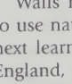

> **考试提示** 服务器机房和布线间的所有入口都应严格控制，如果可能的话，应通过门禁控制系统记录访问。

墙壁可能是人类最早的发明之一。一旦他们学会利用山脉等自然障碍来隔离敌人，接下来他们便学会为自己建造“山”来达到同样的目的。英国哈德良长城、中国万里长城和柏林墙都是这类基本物理防御的著名例子。任何建筑物的墙壁都发挥着同样的作用，只是规模较小：它们为公司资产的物理访问提供了屏障。对于信息资产而言，一般规则是，最有价值的资产都保存在公司服务器中。要保护物理服务器，你必须着眼于各个方面。

## 门


门窗应得到保护，在服务器机房中，当它们是服务器与被允许访问的人员之间唯一的分隔时，应使用最少数量的门窗。还应考虑不太明显的入口点：服务器机房是否使用吊顶？内部墙壁是否延伸到实际屋顶、架空地板或爬行空间？对服务器机房的访问应仅限于需要访问的人员，而不是组织内的所有员工。如果你要用墙来保护资产，请确保该墙上没有明显的孔洞。

> **NOTE**  要窗户还是不要窗户？窗户提供可视性，使人们能够观察服务器机房内的活动。如果进行观察的人员有权查看服务器机房内的活动，这可以提供安全保障。如果外部人员没有此权限，则应避免使用窗户。

另一种防止秘密访问的方法是通过使用窗户。许多高安全区域都有大量窗户，以便区域内人员的活动无法被隐藏。没有窗户的封闭服务器机房为某人未经察觉地获得对设备的物理访问提供了一个安静的地方。窗户去除了许多罪犯依赖于实现其进入和非法活动的隐私元素。

## 生物识别

生物识别使用某些生物因素的测量来识别特定个人。 这些因素基于人体独特的部位。 这些独特生物因素中最为人所知的是指纹。 指纹读取器已在笔记本电脑和其他移动设备上使用多年，如图 10-6 所示，也作为独立的 USB 设备使用。

然而，还可以使用许多其他生物因素，例如眼睛的视网膜或虹膜、手部的几何形状和面部的几何形状。 当这些用于身份验证时，有一个两部分的过程：注册然后身份验证。 在注册期间，计算机拍摄生物因素的图像并将其简化为数值。 当用户尝试进行身份验证时，其特征会被读取器扫描，计算机将读取的数值与数据库中存储的数值进行比较。 如果它们匹配，则允许访问。 由于这些物理因素是唯一的，理论上只有实际授权的人员才会被允许访问。

**Figure 10-6**  
新型笔记本电脑通常包含指纹读取器。


在现实世界中，生物识别背后的理论却失效了。 具有数字代码的令牌工作得非常好，因为一切都保留在数字领域。 计算机检查你的代码，例如 123，与数据库进行比较；如果计算机找到 123 并且该号码具有访问权限，计算机就会打开门。 生物识别则采用模拟信号，例如指纹或面部，并尝试将其数字化，然后与数据库中的数字进行匹配。 模拟信号的问题在于它可能不会以完全相同的方式编码两次。 例如，如果你戴着下巴上的绷带来上班，基于面部的生物识别会授予你访问权限还是拒绝你？

设计这些系统的工程师们理解，如果系统设置为精确检查，编码的生物识别可能永远不会授予访问权限，因为它可能永远不会以完全相同的方式两次扫描生物识别。 因此，大多数系统都试图在扫描中允许一定量的误差，同时又不允许太多。 这导致了假阳性和假阴性的概念。 假阳性发生在生物识别被扫描并允许未经授权的人员访问时——例如，两个指纹非常相似的人可能被计算机识别为同一个人，从而授予错误的人员访问权限。 假阴性发生在系统拒绝实际授权的人员访问时——例如，使用手部几何扫描仪的用户忘记戴他通常佩戴的戒指，计算机无法识别他的手并拒绝他访问。 为了使生物识别身份验证正常工作并获得信任，它必须最大程度地减少假阳性和假阴性的存在。 为此，必须在精确性和误差之间取得平衡，以便机器允许一定程度的物理差异——但不过多。

## 假阳性和假阴性

当根据信息和相关概率范围做出决定时，就存在做出错误决定的条件。 图 10-7 说明了两个重叠的概率；一个项目属于左侧曲线或右侧曲线，但不能同时属于两者。 在确定项目属于哪条曲线时出现问题的情况是曲线重叠时。

Figure 10-7
重叠的概率

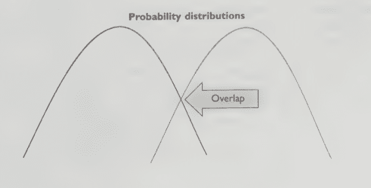

Figure 10-10
理想情况

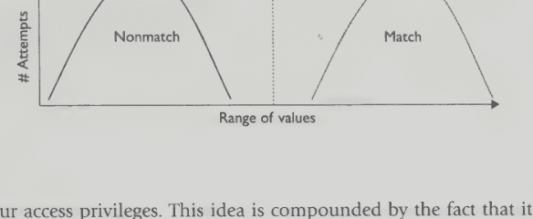

现在某人拥有你的访问权限。 这一想法因以下事实而加剧：如果你指纹被盗，你无法更改你的指纹。 更换丢失或被盗的令牌并从系统中删除丢失的令牌很容易，但更换人手要困难得多。 生物识别的另一个问题是人体部位会发生变化。 人类的面部会因疤痕、体重减轻或增加或手术而发生变化。 指纹会因手指损伤而改变。 眼睛视网膜会受到某些类型的糖尿病或怀孕的影响。 所有这些变化都迫使生物识别系统允许在读取的生物识别上具有更高的差异容忍度。 这导致高安全设施转向多因素身份验证。

## 受保护的分配（布线）

网络流量的拦截应始终是安全团队的关注点。 从物理窃听中保护实际网络布线并不是大多数安全人员考虑的话题，但在高安全网络中，这可能是一个重要考虑因素。 正如交换机和路由器应放在上锁的房间内以防止未经授权的访问一样，网络布线也需要物理保护。 在网络流量需要重大安全措施的地方，通过物理保护布线来保护流量可能很重要。

## 报警

报警用于提醒操作员异常情况。 物理安全可能涉及众多传感器、入侵报警、运动探测器、提醒门被打开的开关、视频和音频监控等。 这些系统中的每一个都可以收集有用的信息，但只有在采取行动时才真正有用。 当这些系统中的一个具有可供操作人员使用的信息时，报警是最简单的方法来提醒人员注意该情况。 报警并不简单；如果报警条件太多，尤其是误报太多，则操作员将不会按预期对情况做出反应。 调整报警以提供有用、准确且可操作的<|message|>信息很重要，如果你希望它们有效的话。

## 运动检测

在监控区域是否存在未经授权的活动时，一个可能有用的工具是运动探测器。 在预期几乎没有或没有流量的区域，运动探测器可以提醒操作员该区域的活动。 运动探测器有多种类型，但大多数基于红外（热）辐射，可以检测温暖身体移动时的变化。 它们可以根据大小进行调整，忽略户外环境中小动物等较小的移动。 虽然在正常日常使用中繁忙的办公楼中没有用，但运动探测器在非工作时间、流量最少时可能很有用。 运动探测器可用于触发视频系统，以便它们不会记录大量“空”活动。 建筑物后方装卸码头区域的视频监控可以以这种方式触发，使用运动探测器在活动发生时打开摄像机。

## 控制类型

正如安全控制在信息安全中发挥作用一样，控制的适当应用可以帮助与物理安全相关的风险管理。 控制可以是多种类型，如下所述。


> EXAM TIP 物理安全控制的类型在考试中常被测试——建议记忆。

- **Deterrent** 威慑控制通过降低攻击成功的可能性来影响攻击者。 一个例子是增加惩罚的法律和法规。
- **Preventive** 预防性控制是一种防止特定行为发生的控制，例如防尾随门可以防止尾随。 预防性控制在事件发生前发挥作用，防止其推进。
- **Detective** 侦测控制是一种促进物理安全漏洞检测的控制。 侦测控制在事件期间发挥作用，提醒操作员特定情况。 报警是侦测控制的常见示例。
- **Corrective** 纠正控制用于事件后，以尽量减少损害程度。 备份是纠正控制的典型例子，因为它们可以促进操作的快速恢复。
- **Compensating** 补偿控制是在无法直接满足要求时用于满足要求的一种控制。 火灾抑制系统不会阻止火灾损害，但如果正确使用，它们可以减轻或限制火灾造成的损害程度。
- **Technical** 技术控制是使用某种形式的技术来解决物理安全问题。 生物识别是技术控制。
- **Administrative** 管理控制是用于限制物理安全风险的政策或程序。 对警卫的指示充当管理控制。


3. 非接触卡最常用于何处？
- A. 登录你的工作站
- B. 门禁控制系统
- C. 打卡钟
- D. 紧急出口

4. 为什么烟雾探测器无法区分烹饪烟雾和家具起火？
- A. 它们只能检测热量。
- B. 它们测量空气颗粒物，而所有烟雾都含有颗粒物。
- C. 它们测量空气中的离子，而任何烟雾都会抑制离子。
- D. 以上都不正确。

5. 热通道和冷通道的主要好处是什么？
- A. 数据中心更高的服务器密度
- B. 更易于服务器安装
- C. 无需复杂的机架系统
- D. 更低的功耗

6. 为什么卤代烷不再用于灭火系统？
- A. 卤代烷的灭火特性较差。
- B. 它们使用氩气，而分离氩气非常昂贵。
- C. 卤代烷系统容易被意外触发。
- D. EPA 法规已禁止卤代烷系统。

7. 非水基灭火的优势是什么？
- A. 成本更低
- B. 对电气系统造成的损害更小
- C. 无需消防部门响应
- D. 以上全部

8. 从生物识别的角度来看，什么是假阳性？
- A. 系统不允许授权用户获得访问权限。
- B. 系统无法正确编码用户的生物特征，迫使重新扫描。
- C. 系统允许未经授权的用户访问。
- D. 系统验证了用户，但未打开门锁。

9. 生物识别系统假阳性的原因是什么？
- A. 设计不良的传感器
- B. 从模拟值到数字编码的转换
- C. 系统上的用户太多
- D. 使用非全局唯一的生物识别标准

10. 如果要扑灭电气火灾，应使用哪一类手持灭火器？
- A. A 类
- B. B 类
- C. C 类
- D. E 类

对于问题 11–13，请使用以下情景：您是中型超市连锁店的 IT 总监。该公司已超出其主要配送仓库内数据中心的容量，并将在新租用的建筑中建设一个全新的数据中心。数据中心建设尚未完成，首席执行官已要求您就该提案提出建议，重点关注安全。

11. 您会推荐哪种（些）灭火系统？（可多选。）
- A. 标准水喷淋系统
- B. Type ABC 手持灭火器
- C. 卤代烷淹没系统
- D. Type A 手持灭火器
- E. 基于 Inergen 的系统
- F. Type D 手持灭火器

12. 对于通往服务器室的内部门，您选择什么访问控制系统？
- A. 生物识别
- B. 接近式访问卡
- C. A 和 B 均选
- D. A 和 B 均不选

13. 对于建筑物的外部门，您选择什么访问控制系统？
- A. 生物识别
- B. 接近式访问卡
- C. A 和 B 均选
- D. A 和 B 均不选

14. 当电子设备暴露于水中时，即使遵循了所有推荐的清理程序，什么可能导致长期损坏？
- A. 由于电容器受潮导致的电压尖峰
- B. 旋转硬盘的磁潜力下降
- C. 金属部件腐蚀
- D. 化学腐蚀

15. 完成以下表格，列出三种问题的控制类型：

| 问题 | 预防性控制 | 检测性控制 | ______ 控制 |
|---|---|---|---|
| 进入服务器室的未经授权访问 |  |  | 机器使用密码锁定 |
| 未经授权的人员进入工作场所 |  |  | 清洁桌面政策 |
|  | 保持服务器室无垃圾 | 火灾探测器 |  |

## 答案

1. **D.** 电缆中的扭转设计用于防止电磁干扰（EMI），通过使感应力相互抵消来实现。
2. **C.** 模拟和 IP 是两种主要类型，其中模拟为传统摄像头，IP 摄像头基于网络，通常通过以太网运行。
3. **B.** 非接触卡最常与门禁控制系统上的接近读卡器一起使用。
4. **C.** 烟雾探测器测量空气中的离子，而烟雾会干扰离子，产生可测量的空气移动差异。
5. **A.** 热通道和冷通道更好地管理数据中心的气流，从而实现更高的服务器密度。
6. **D.** 由于卤代烷系统与臭氧层破坏有关，且卤代烷气体有被转化为有毒化合物的危险，EPA 已禁止卤代烷系统。
7. **B.** 清洁剂灭火比其他灭火系统对电气系统和电子设备的损害更小。
8. **C.** 假阳性是指系统将未经授权的用户接受为授权用户并允许访问。
9. **B.** 生物识别是模拟信号，必须编码为数字值。由于传感器每次可能略有不同地读取生物识别值，因此编码值必须对不完美性具有一定的容差。

10. **C.** 电气火灾列在手持灭火器的 C 型之下。

11. **B and E.** 最佳答案是 Type ABC 灭火器和基于 Inergen 的洁净气体系统。

12. **C.** 高度安全的区域如服务器室最好由多因素访问控制系统保护。将接近卡与生物识别传感器结合，将“你拥有的东西”与“你是谁”配对，实现两个身份验证因素。这也有助于降低假阴性和假阳性的可能性。

13. **B.** 虽然生物识别提供良好的安全性，但要求每个进入人员进行生物识别扫描和验证会过于繁琐。因此，非接触式访问卡可以快速在无延迟的情况下授权用户进入建筑物。

14. **C.** 水会腐蚀构成电子设备的许多部件，特别是铜电气走线；这种腐蚀会导致设备以意想不到的方式出现故障。

| 问题 | 预防性控制 | 检测性控制 | 纠正性控制 |
|---|---|---|---|
| 进入服务器室的未经授权访问 | 上锁的门 | 门传感器/运动传感器 | 机器使用密码锁定 |
| 未经授权的人员进入工作场所 | 警卫和限制进入 | 可见姓名徽章 | 清洁桌面政策 |
| 服务器室火灾 | 保持服务器室无垃圾 | 火灾探测器 | 备份 |

类似项目也可能是正确的。

## 安全控制

在本章中，您将
- 确定满足安全目标的适当控制措施
- 检查用于确保保密性的控制措施
- 检查用于确保完整性的控制措施
- 检查用于确保可用性的控制措施
- 检查用于确保安全的控制措施

安全控制是用于最大限度降低风险暴露并减轻损失影响的机制。利用与数据相关的保密性、完整性和可用性安全属性，安全团队有责任确定实现安全目标的适当控制集。保密性、完整性和可用性元素通常被称为安全的 CIA。

## 保密性

保密性通常在提到安全一词时首先想到。保密性是指将某条数据保密的能力。在数字世界中，加密擅长提供保密性。保密性用于存储数据和传输数据。在这两种情况下，由于其速度以及某些非对称算法会显著增加被加密对象的大小，因此更倾向于使用对称加密。对于存储项目，对称方法更受青睐，既因速度，也因实际上不存在密钥交换问题。对于传输数据，通常使用公钥密码学交换密钥，然后使用对称密码学确保发送数据的保密性。

非对称密码学确实保护保密性，但其大小和速度使其更有效地保护电子密钥交换等任务中小单元的保密性。在所有情况下，算法的强度和密钥的长度确保了相关数据的保密性。

保护保密性的另一种方法是使用访问控制。访问控制可以根据用户 ID 和访问控制列表（ACL）限制对对象的访问。这是在文件系统中常用的方法，因为它提供了相对有效但不如加密强大的保护。


> **考试提示** 机密性可以通过加密、访问控制列表或数据隐藏来实现。加密是最强的形式，访问控制扩展性好，而数据隐藏的安全性最低。

提供机密性的最后一种方法是通过诸如隐写术（一种数据隐藏形式）之类的过程。这不是首选方法，因为长久以来人们都知道，通过隐藏来实现安全并不是一种强有力的保护手段。

## 完整性

完整性更常被称为*消息完整性*，它是消息安全的关键组成部分。当消息发送时，发送方和接收方都需要知道消息在传输过程中未被更改。这对于法律合同尤为重要——接收方需要知道合同未被更改。签署人还需要一种方式来验证他们签署的合同将来不会被更改。

完整性通过单向哈希函数和数字签名来提供。哈希函数计算消息摘要，通过允许轻松测试以确定消息的任何部分是否被更改，从而保证消息的完整性。消息现在有了一个计算函数（哈希值），如果消息被拦截和干扰，可以告知用户重新发送消息。

这个哈希值与不对称加密相结合，方法是获取消息的哈希值并用用户的私钥对其进行加密。这使得任何拥有用户公钥的人都可以解密哈希并将其与本地计算的哈希进行比较，这不仅确保了消息的完整性，还验证了发送者的身份。


> 考试提示 完整性可以通过哈希来验证。在数字签名等操作中使用哈希函数，可以验证完整性和不可否认性。

使用哈希值验证完整性通常在后台进行。当用户需要使用非对称密钥时，他们使用一个包含密钥和支持信息的证书。使用证书上的哈希值，可以验证信息的有效性。使用证书上的签名密钥，可以确定密钥的真实性，起到一种不可否认性的作用。

## 可用性

可用性是CIA三元组的第三部分，指的是授权用户在获得访问权限时系统访问可用的属性。对于某些系统，可用性可能是一个重要的运营问题。这导致了容错和冗余系统的发展，以确保关键系统的持续可用性。确保系统可用性的一个关键运营流程是变更配置委员会。一个运作良好的变更配置委员会可以确保系统具有最大的可用性，即使它们需要停机打补丁时也是如此。在多个相同服务器的系统中，每次只更改一部分，这样可以在提交所有机器之前在生产环境中全面测试更改的效果。只要更改仅允许在用户较少的时间段进行，就应该有足够的空闲空间来进行滚动更改，同时保持可用性。


> 考试提示 可用性可以通过容错和冗余系统来实现。

备用系统的使用也可以在灾难和业务连续性计划实施时提高可用性。拥有热站作为备用系统是最好的解决方案，因为温站和冷站会给持续运营增加一段停机时间。在极端故障转移需求的情况下，例如不允许丢失时间或数据，则需要双活架构。当数据中心是双活的，应用程序也是双活的，结果是持续可用性。双活系统将在主系统和备用系统上同时处理数据，允许即时故障转移，但缺点是需要支持双向复制的软件。

数据可用性也可能成为问题，尤其是当大量数据存储在个人机器和移动设备上时。许多工作人员视为关键的日常数据，可能不会像企业数据那样频繁备份。如果工作人员的日常工作有价值，那么这些数据也应该以备份保护的形式得到适当的关注。

## 安全性

安全与安保在多个方面相关。一个安全的系统执行它应该执行的任务，并且只执行这些任务，这些品质是安全所需的。安全系统种类繁多、形式各异，但许多都与物理安全问题有关。

### 围栏

围栏可用于物理隔离和保护。围栏可用于分隔安全区域、提供安全区域并保持交通分离。从简单的铁丝网围栏到高安全性围栏，每种都能提供一定程度的保护。铁丝网围栏可以提供简单的人群控制，但在阻挡坚决的对手方面作用不大。高安全性围栏，如木栅栏，提供显著级别的防攀爬保护和入侵延迟因素。

### 照明

照明对于多个原因至关重要。它可以为监控系统（如CCTV系统）提供必要的照明。还可以在疏散演习中为人们提供必要的指导。工作区域适当的照明水平很常见，但在其他区域（如出口通道和楼梯间）提供足够的照明同样重要。

### 锁具

锁具提供了一种控制访问的手段，是访问控制列表的物理表现形式。由于锁是可能被篡改的物理设备，对于高安全性的锁，需要采取措施防止绕过它们。许多高安全性锁具制造商会申请专利并严格控制钥匙坯。这将使钥匙坯无法被未经授权的人获得，并消除弹子钥匙。物理锁芯也可以采用比普通钥匙锁更复杂的设计，使物理操纵（开锁）极其困难。

### 闭路电视

闭路电视系统可以在大范围内提供监视和监控，并允许从中央或远程位置进行监控。这些系统可以在紧急情况下提供协调多种行动的能力。CCTV可以与面部识别技术相结合，有可能在个人经过连接到系统的摄像头时对其进行跟踪。

### 逃生路线

逃生路线是规划在建筑物中的出口方法。通常由建筑规范要求，逃生路线可用于在危险情况下引导人们到达安全地点。出口可能需要通过安全门，在紧急情况下，可以采用故障安全模式为疏散人员打开门。

### 逃生计划

可以制定逃生计划，使员工能够安全地疏散建筑物、结构以及工业厂房等复杂系统。包括制定、张贴和培训逃生计划在内的应急准备，如果在真正的紧急情况下需要这些计划，可以挽救生命。逃生路线、计划和演练可以共同发挥作用，使员工队伍为紧急疏散任务做好准备。

### 演练

演练用于练习特定行为，以便在紧急情况发生时，人们无需额外培训或指导就知道如何行动。在需要增加物理安全措施的情况下，可以使用门、窗及其锁具。封锁演练可以让多人参与以实现这种行为。

### 测试控制措施

控制措施并非万无一失。正确部署它们通常是一项复杂的事件，需要广泛的规划。一旦部署，安全控制措施


需要定期测试其有效性和覆盖范围。系统会随时间变化，威胁亦然。通过安全控制措施确保风险得到适当缓解，需要对其部署和使用效果进行定期重新评估。这是通过在单一和全灾害环境中对控制措施进行计划性测试来实现的。

## 章节回顾

在本章中，您已熟悉保密性、完整性和可用性这三大主要安全控制属性。本章还介绍了为安全目的使用特定类型控制措施的情况，并强调了测试安全控制结构的需求。

### 问题

为了帮助您进一步准备 CompTIA Security+ 考试并检验您的准备程度，请回答以下问题，然后将答案与本章末尾的正确答案核对。

1. 栅栏式钢围栏的关键优势是什么？
   - A. 它不会被撞倒。
   - B. 它的门紧密集成。
   - C. 它易于建造。
   - D. 它几乎无法攀爬。

2. 许多种高安全性锁是如何实现抗撞击的？
   - A. 它们使用强度更高的销钉。
   - B. 它们使用专利钥匙槽并控制空白钥匙的分配。
   - C. 它们具有更严格控制的机械公差。
   - D. 它们不能；没有任何锁能有效抵抗撞击技术。

3. 隐写术相对于加密的主要好处是什么？
   - A. 可以更安全地存储更多数据
   - B. 更难暴力破解密钥
   - C. 难以被检测
   - D. 实现简便

4. 哪种冗余方案可以提供即时故障转移？
   - A. 热备
   - B. 冷备
   - C. 主主
   - D. 温备

5. 消息摘要通过以下方式提供完整性：
   - A. 提供无法解锁的加密
   - B. 提供一个可以独立验证的值以显示消息是否已更改
   - C. 提供消息保密性以使其他用户无法查看消息
   - D. 对消息应用签名

6. 封锁演练规定：
   - A. 所有人员应沿疏散路线前往指定的安全区域。
   - B. 所有人员应排成一列靠在室内墙边并遮住头部。
   - C. 所有人员应悄悄移动到指定的岗位。
   - D. 所有人员应待在室内并锁上所有门窗。

7. 当用于描述电子门禁系统时，*fail-safe* 的含义是什么？
   - A. 所有门锁都牢固锁定以确保人员安全在内。
   - B. 所有门锁都打开以便人员安全撤离。
   - C. 所有门锁都恢复其默认的锁定/解锁状态。
   - D. 以上都不是。

8. 技术的进步使 CCTV 系统可以与 ________ 配对以追踪个人。
   - A. 人脸识别
   - B. GPS 传感器
   - C. 移动基站三角定位
   - D. 计算机化身体动作分析

9. 以下哪项是计算机系统中容错的例子？
   - A. 双电源供应
   - B. RAID 5 配置的磁盘
   - C. 多个网络接口控制器
   - D. 以上全部

10. 建筑物逃生路线通常由以下规定：
    - A. 建筑物的建筑设计
    - B. 建筑物业主
    - C. 当地建筑规范
    - D. 租户

11-15 题假设以下情景：在贵公司发生入侵事件后，董事会决定将您的职位从信息安全总监转变为首席安全官。他们要求您承担所有物理安全责任并加强安全措施，以防止再次发生类似事件。

11. 为了提高抵御入侵的物理安全，您应立即审查哪些安全控制措施的有效性？（多选。）
    - A. 围栏
    - B. 控制测试
    - C. 不可否认性
    - D. 照明
    - E. 疏散计划
    - F. 证书

12. 您应审查哪些软件控制措施以确保入侵期间没有数据被泄露？（多选。）
    - A. 访问控制
    - B. CCTV
    - C. 加密
    - D. 哈希
    - E. 锁
    - F. 容错

13. 您新实施的控制测试政策发现逃生路线存在问题，演练中人员表现困惑所显示。最佳补救措施是什么？
    - A. 更清晰的标识和修改后的逃生计划
    - B. 更好的围栏
    - C. 办公室重新设计，仅将人员引导至南端较大的楼梯
    - D. 更好的应急照明

14. 定期疏散演练显示，员工撤离建筑物花费时间过长，因为他们随身携带笔记本电脑。经询问，他们表示关键数据仅存在于其机器上。纠正此问题的安保控制措施是什么？
    - A. 更多演练
    - B. 更好的逃生计划
    - C. 更多数据冗余
    - D. 更快的逃生路线

15. 公司已使用相同的锁多年。您会使用哪些理由来申请基于卡片的门禁系统？
    - A. 它提供基于时间的访问控制。
    - B. 它使撤销不再授权方的访问变得更容易。
    - C. 在紧急情况下它是故障安全型，可改善疏散。
    - D. 以上全部。

## 答案

1. D. 由多个垂直杆组成的钢制栅栏围栏提供出色的防攀爬性能，通常被称为防攀爬围栏。

2. B. 许多高安全性锁制造商会对钥匙槽进行专利保护并严格控制。这将使空白钥匙对未经授权的人员不可用，如果发现空白钥匙，它们也只适用于某一小物理区域内的锁。

3. C. 隐写术的一个关键优势是难以被检测，因为其编码可能与图像或视频帧中存在的视觉噪声相似。

4. C. 主主系统在主系统和备份系统上同时处理数据，这允许即时故障转移，但缺点是需要双向复制——功能强大的软件。

5. B. 由哈希函数产生的消息摘要提供一个值，可以独立计算以验证消息是否未被更改。

6. D. 封锁演练是对刑事威胁的响应，因此正确的做法是待在室内并牢牢锁上所有门窗以抵御潜在威胁的进入。

7. B. *Fail-safe* 的意思是，在火灾或其他紧急情况下，门将解锁以安全地允许用户撤离建筑物。

8. A. CCTV 可以与人脸识别技术结合，有可能在个人经过连接系统的摄像头时对其进行追踪。

9. D. 以上都是容错设计的例子；一个用于电源线或电源故障，一个用于单个硬盘丢失，一个用于网络连接丢失。

10. C. 当地建筑规范将规定建筑物紧急逃生路线的需求，几乎总是要求建筑物两侧各有一条，并用照明标志清晰标明。

11. A、B 和 D。最佳答案是围栏、控制测试和照明。围栏和照明不言自明；定期测试安全控制措施对于确保其有效性至关重要。

12. A、C 和 D。访问控制、加密和哈希是最好的答案。访问控制权限应检查是否有任何更改，并确定其是否配置过于宽松。加密是数据保密的主要保护措施，您必须确保密钥的访问未被泄露。最后，您必须检查哈希以确保消息完整性，以确保文件未被篡改以更改现有数据，或关键系统文件未被篡改以包含恶意软件。

13. A。更清晰的标识使员工能够一目了然地知道建筑物任何地方的逃生路径。修改后的逃生计划可以更好地控制人流，并确保每个人熟悉其逃生路线和计划，从而更好地避免混淆。

14. C。虽然 A、B 和 D 都是可以做的好事，但此问题最好通过数据冗余来解决。关键数据应始终存储在多个冗余位置。

15. D。以上全部正确。


# 第 III 部分

## 威胁与漏洞

- **第 12 章** — 攻击与恶意软件
- **第 13 章** — 社会工程学
- **第 14 章** — 应用程序与无线攻击
- **第 15 章** — 缓解技术
- **第 16 章** — 威胁与漏洞发现

## 攻击与恶意软件

在本章中，你将：

- 了解恶意软件的类型
- 了解各种类型的计算机和网络攻击，包括拒绝服务、欺骗、劫持和密码猜测
- 了解现存的不同类型的恶意软件，包括病毒、蠕虫、特洛伊木马、逻辑炸弹和定时炸弹
- 了解各种类型的攻击

攻击几乎可以针对软件的任何层或级别，从网络协议到应用程序。当攻击者发现系统中的漏洞时，就会利用该弱点攻击系统。攻击的影响取决于攻击者的意图，影响范围可能从轻微到严重。对某个系统的攻击可能不会在该系统上显现，因为攻击实际上发生在另一个系统上，而攻击者将在第二个系统上操纵的数据，是通过攻击第一个系统获得的。

## 恶意软件

恶意软件是指为某种恶意目的而设计的软件。这类软件可以被设计为破坏系统，例如删除所有文件；也可以被设计为在系统中创建后门，从而允许未经授权的个人访问系统。通常，恶意软件的安装会被设计成不易被授权用户察觉。可以使用多种不同类型的恶意软件，例如病毒、特洛伊木马、逻辑炸弹、间谍软件和蠕虫；它们在安装方式和用途上各不相同。

## 广告软件

软件分发业务需要某种收入来源，以支持开发和分发成本。广告就是一种收入来源。由广告提供支持的软件称为广告软件。广告软件有许多不同的形式。对于合法的广告软件，用户知晓广告的存在，并同意以接受广告为条件免费使用软件。这类广告软件通常还会提供付费的无广告版本。广告软件也可以指一种恶意软件，其特征是显示用户不希望看到的广告。这些广告有时只是令人烦恼，有时则会构成实际的安全威胁。这些广告通常以浏览器弹出窗口的形式出现，在某些情况下，还会随着用户的任何操作层层弹出。

## 病毒

最为人熟知的恶意代码类型是病毒。由于多起备受关注的安全事件都涉及病毒，因此关于病毒的论述很多。病毒是一段通过附着到另一段可执行代码上进行复制的恶意代码。当另一段可执行代码运行时，病毒也会执行，并有机会感染其他文件以及执行其设计的其他恶意操作。病毒感染其他文件的具体方式，以及所感染的文件类型，取决于病毒的类型。最初创建的病毒有两种类型——引导扇区病毒和程序病毒。

## 蠕虫

过去，人们很容易区分蠕虫和病毒。近年来，随着新型复杂恶意代码的出现，两者之间的区别变得模糊。蠕虫是试图渗透网络和计算机系统的代码。一旦完成渗透，蠕虫就会在被渗透的系统上创建自身的新副本。因此，蠕虫的繁殖并不依赖于将病毒附着到另一段代码或文件上，而这正是病毒的定义。

人们通常认为病毒是基于系统的问题，而蠕虫则是基于网络的问题。如果恶意代码通过网络传播，之后可能会被称为蠕虫。然而，重要的区别在于：代码是否必须附着到其他东西上（病毒），还是能够独立“存活”（蠕虫）。

近年来一些备受关注的蠕虫包括 2003 年的 Sobig 蠕虫、2003 年的 SQL Slammer 蠕虫、2001 年的 Code Red 和 Nimda 攻击，以及 2005 年导致 CNN Live 瘫痪的 Zotob 蠕虫。Nimda 尤其令人印象深刻，因为它使用了五种不同的传播方式：通过电子邮件、通过开放的网络共享、通过浏览受感染的网站、利用 Microsoft IIS 4.0/5.0 的目录遍历漏洞，以及最令人印象深刻的——利用 Code Red II 和 sadmind 蠕虫留下的后门进行传播。

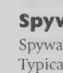

**考试提示** 蠕虫的行为类似于病毒，但还具备无需人工操作即可传播的能力。

## 间谍软件

间谍软件是会“监视”用户、记录并报告其活动的软件。间谍软件通常在用户不知情的情况下安装，可以执行范围广泛的活动。它可以在用户登录时记录击键（通常称为键盘记录）

某公司的一些 CD 中采用了保护技术。导致这成为索尼一场彻底灾难的两个主要问题是：第一，该软件未经用户批准就修改了系统；第二，该软件在基于 Windows 的系统上打开了一个安全漏洞，在 rootkit 级别形成了可被利用的漏洞。这导致索尼事件被归类为恶意软件事件，而这也是 rootkit 最常见的用途。

Rootkit 可以执行许多操作——事实上，它几乎可以执行操作系统能够执行的任何操作。Rootkit 会修改操作系统内核及其支持功能，改变系统的运行方式。Rootkit 旨在通过颠覆或规避操作系统的安全功能来避免被检测。Rootkit 是一种恶意软件，可以改变线程优先级以提升应用程序性能、执行键盘记录、充当嗅探器、向其他应用程序隐藏其他文件，或在身份验证系统中创建后门。利用 rootkit 功能隐藏其他进程和文件后，攻击者便可以使用计算机的一部分，而用户或其他应用程序都不知道正在发生什么。这会将漏洞利用代码隐藏在防病毒和反间谍软件程序之外，起到隐形斗篷的作用。

Rootkit 可以在操作系统加载之前加载，充当虚拟化层，例如 SubVirt 和 Blue Pill。Rootkit 可以存在于固件中，并且已经有人在显卡和扩展卡中演示了这种情况。Rootkit 还可以作为可加载的库模块存在，从而有效地修改内核之外的部分操作系统。有关实际存在的特定 rootkit 的更多信息，可以访问 www.antirootkit.com。

> **考试提示** Rootkit 有五种类型：固件级、虚拟级、内核级、库级和应用程序级。


一旦检测到 rootkit，就需要将其移除并清理。由于 rootkit 具有侵入性，而且其许多方面都不容易被检测到，大多数系统管理员甚至不会尝试清理或移除 rootkit。与其尝试确定损害的深度和范围并修复单个文件，不如使用之前捕获的干净系统映像重新创建计算机映像，这要容易得多。

## 后门

*后门*最初（有时至今仍然）不过是软件开发人员所使用的方法，以确保即使未来发生某些情况导致常规访问方法失效，他们仍然能够访问应用程序。例如，可以设置一个硬编码密码，以便在管理员忘记自己的系统密码时使用该密码访问程序。这类后门（有时也称为*陷阱门*）显而易见的问题在于，由于它是硬编码的，因此无法移除。如果攻击者获知了后门，所有运行该软件的系统都将容易受到攻击。

*后门*一词也常常用于指攻击者在未经授权访问系统后安装的程序，以确保即使其最初的访问方式被发现，他们仍能继续不受限制地访问系统


并被阻止。后门也可能由授权人员无意中安装，如果他们运行了包含特洛伊木马（前面介绍过）的软件。常见的后门包括 NetBus 和 Back Orifice。这两者如果运行在你的系统上，可允许攻击者远程访问你的系统——这种访问使他们能够在你的系统上执行任何功能。后门的一种变体是上一节讨论过的 rootkit，它不仅要获得 root 访问权限，而且要确保持续获得 root 访问权限。

## 逻辑炸弹

与病毒和特洛伊木马不同，逻辑炸弹是一种通常由授权用户故意安装的恶意软件。*逻辑炸弹*是一段代码，它会潜伏一段时间，直到某个事件或日期触发其恶意负载。逻辑炸弹的一个例子可能是这样一个程序：它被设置为自动加载和运行，并定期检查组织的工资单或人事数据库以查找某个特定员工。如果找不到该员工，恶意负载就会执行，删除重要的公司文件。

如果触发事件是特定的日期或时间，该程序通常被称为*定时炸弹*。在一个著名的定时炸弹案例中，一名心怀不满的员工在被解雇之前安放了一个定时炸弹。两周后，数千条客户记录被删除。警方最终得以将恶意代码追踪到这位心怀不满的前雇员，他因自己的行为而被起诉。他曾希望，自他被解雇以来已过去的两周会让调查人员认为，他不可能是造成记录删除的那个人。

逻辑炸弹很难检测，因为它们通常由授权用户安装，尤其是由管理员安装，而管理员往往也负责安全。这说明了职责分离以及定期审查系统上运行的所有程序和服务的重要性。这也说明了维持积极备份计划的必要性，这样如果你的组织因这类恶意代码而丢失关键文件，只会丢失自最近一次备份以来发生的交易，从而不会造成永久的数据丢失。

## 僵尸网络

僵尸网络一词将僵尸程序和网络组合为一个功能性实体。僵尸程序是在另一个程序的控制下执行某些任务的功能性软件。一系列僵尸程序以组的形式通过网络进行控制，整个集合称为僵尸网络。有些僵尸网络是合法的，以分布式方式执行所需操作。非法僵尸网络以同样的方式运作，僵尸程序分布在各处，并由一组中心服务器控制。僵尸程序可以执行各种各样的操作，从垃圾邮件、欺诈到间谍软件等等。

僵尸网络继续加剧恶意软件威胁。一些最新的僵尸网络被设计用于挖掘比特币，利用分布式处理能力获取收益。一些较著名的僵尸网络包括 Zeus，这是一个执行键盘记录并主要用于窃取银行信息的僵尸网络。Zeus 已经与传播有关

从高层次的角度看，对计算机系统和网络的攻击可分为两大类：对特定软件（如应用程序或操作系统）的攻击，以及对特定协议或服务的攻击。对特定应用程序或操作系统的攻击通常是由于代码中的疏忽（可能还包括对该代码的测试疏忽），或由于代码中的缺陷或漏洞（同样表明缺乏彻底测试）而可能发生的。对特定协议或服务的攻击是试图利用该协议或服务的特定功能，或者以非预期的方式使用该协议或服务。本节讨论安全专业人员需要了解的各种攻击形式。

## 中间人攻击

顾名思义，中间人攻击通常发生在攻击者能够将自己置于两个正在通信的其他主机之间时。理想情况下（从攻击者的角度），这是通过确保所有进出目标主机的通信都经由攻击者的主机路由来实现的（如果攻击者能够入侵目标主机的路由器，就可以实现这一点）。然后，攻击者可以在转发之前观察所有流量，并且实际上可以修改或阻止流量。对目标主机而言，通信似乎正常进行，因为它收到了所有预期的回复。图12-1说明了这种攻击类型。

有多种方法可以实现中间人攻击。常见方法之一是通过会话劫持，当诸如 cookie 之类的信息被盗时，攻击者就可以冒充合法会话。这种攻击可能是跨站脚本攻击的结果，跨站脚本攻击诱使用户执行代码，从而导致 cookie 被盗。如果通信是加密的，则在中间人攻击中可获得的信息量将受到限制。然而，即使在这种情况下，敏感信息仍可能被获取，因为知道正在进行的通信内容以及通信双方，在某些情况下实际上可能提供有价值的信息。

## 针对加密流量的中间人攻击

“中间人攻击”一词有时用来指一种更具体的攻击类型——一种解决加密流量问题的攻击。公钥加密（在第23章详细讨论）需要使用两个密钥：你的公钥——任何人都可以用它来加密或“锁定”你的消息；以及你的私钥——只有你知道，并且用于“解锁”或解密用你的公钥锁定的消息。

图12-1
中间人攻击

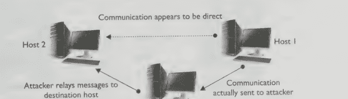

如果你想与朋友鲍勃进行安全通信，你可能会向他要他的公钥，以便加密你发送给他的消息。同样，你也会把你的公钥提供给鲍勃。攻击者可以通过拦截你对鲍勃公钥的请求以及你向他发送公钥的过程，进行中间人攻击。攻击者会用她的公钥替换你的公钥，并将其发送给鲍勃。攻击者还会将她的公钥发送给你，而不是鲍勃的公钥。现在，无论你或鲍勃加密消息，都会使用攻击者的公钥进行加密。攻击者现在可以拦截它，解密它，然后用适合你或鲍勃的密钥重新加密后再发送。你们双方都认为自己在安全地传输消息，但实际上，你们的通信已经遭到破坏。设计良好的加密产品会使用相互认证等技术来避免这个问题。

## 拒绝服务

拒绝服务（DoS）攻击可以利用特定应用程序或操作系统中的已知漏洞，也可以攻击特定协议或服务中的特性（或弱点）。在 DoS 攻击中，攻击者试图拒绝授权用户访问特定信息，或访问计算机系统或网络本身。这可以通过使系统崩溃——使其离线——或通过发送大量请求使机器不堪重负来实现。

DoS 攻击的目的可以仅仅是阻止对目标系统的访问，或者该攻击可以与其他行动相结合，以未授权访问计算机或网络。例如，SYN 洪泛攻击可用于暂时阻止对某个系统的服务，以便利用该系统与另一个系统之间存在的信任关系。

SYN 洪泛是一种利用 TCP/IP 网络设计工作方式的 DoS 攻击示例，它可以用来阐明任何 DoS 攻击的基本原理。SYN 洪泛利用在两个系统之间建立连接的 TCP 三次握手。在正常情况下，第一个系统向它想要通信的系统发送一个 SYN 数据包。如果第二个系统能够接受该请求，它会以 SYN/ACK 进行响应。当初始系统收到来自第二个系统的 SYN/ACK 时，它会以一个 ACK 数据包进行响应，然后通信就可以继续。此过程如图12-2所示。


**图12-2** TCP三次握手


在 SYN 泛洪攻击中，攻击者向目标系统发送虚假的通信请求。每个请求都会被目标系统应答，随后目标系统会等待握手的第三部分。由于这些请求是虚假的（请求中使用了不存在的 IP 地址，因此目标系统是在向一个不存在的系统作出回应），目标将等待永远不会到来的响应，如图 12-3 所示。目标系统会在特定的超时时间后丢弃这些连接，但如果攻击者发送请求的速率快于超时机制清除它们的速率，系统很快就会被请求填满。系统能够支持的连接数是有限的，因此当传入的请求超过处理能力时，系统很快就会将所有连接都保留给虚假请求。此时，任何进一步的请求都将被简单地丢弃（忽略），而希望连接到目标系统的合法用户将无法做到这一点，因为系统使用已被拒绝给他们。

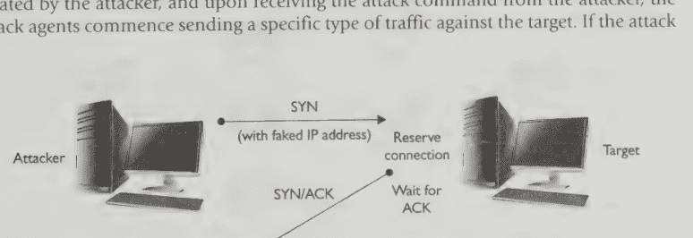

*图 12-3 SYN 泛洪 DoS 攻击*

另一种简单的 DoS 攻击是臭名昭著的死亡之 ping（POD），它说明了另一种类型的攻击——针对特定应用程序或操作系统的攻击，而与之相对，SYN 泛洪攻击针对的是协议。在 POD 攻击中，攻击者发送一个等于或超过 64KB 的 Internet 控制消息协议（ICMP）ping 数据包（也就是说，大于 64 × 1024 = 65,536 字节）。这种数据包不应该自然出现（ping 数据包大于 64KB 没有理由）。某些系统无法处理这种大小的数据包，系统会挂起或崩溃。

## 分布式拒绝服务

DoS 攻击使用单一攻击系统进行。采用多个攻击系统的 DoS 攻击被称为分布式拒绝服务（DDoS）攻击。DDoS 攻击的目标也是拒绝对特定服务或系统的使用或访问。DDoS 攻击在 2000 年因对 eBay、CNN、Amazon 和 Yahoo! 的高度公开的攻击而闻名！

在 DDoS 攻击中，通过用来自许多不同系统的流量淹没目标来拒绝服务。攻击者创建了一个攻击代理网络（有时称为僵尸），在收到攻击者的攻击命令后，攻击代理开始向目标发送特定类型的流量。如果攻击

另一种方法涉及更改 TCP 连接的超时选项，以便 SYN 泛洪攻击等攻击更难执行，因为未使用的连接会被更快地丢弃。

对于 DDoS 攻击，关于将自己的工作负载分布到多个系统上有很多论述，这样针对系统的任何攻击都必须针对多个主机才能完全成功。虽然这是事实，但如果创建足够大的 DDoS 网络（例如拥有数万个僵尸），任何网络，无论负载分布如何，都可能被成功攻击。这种方法还涉及为建立这种分布式环境而产生的额外组织成本。以这种方式解决问题的实际上是试图减轻攻击的影响，而不是防止或阻止攻击。

要防止 DDoS 攻击，您必须能够拦截或阻止攻击消息，或者首先阻止 DDoS 网络的建立。已经开发出工具来扫描您的系统，搜索等待攻击信号的休眠僵尸。许多当前防病毒/间谍软件安全套件工具会检测已知的僵尸型感染。然而，这种预防方法的缺点是，它并不是您可以用来防止对您网络的攻击的东西——它是可以用来防止您的网络被用来攻击其他网络或系统的东西。您必须依靠网络管理员社区来测试他们自己的系统以防止对您发起的攻击。

您应该考虑的最后一个选项是阻止边界处的 ICMP 数据包，因为许多攻击依赖于 ICMP。然而，在实施之前请仔细考虑这种方法，因为它也会阻止使用一些可能有用的故障排除工具。

## 重放

重放攻击发生在攻击者捕获两个当事人之间通信的一部分并在稍后时间重新传输时。例如，攻击者可能会重放金融交易中使用的命令和代码序列，导致交易被多次执行。通常，重放攻击与试图规避身份验证机制的尝试相关，例如捕获和重用证书或票据。

防止重放攻击的最佳方法是使用加密、密码学身份验证和时间戳。如果证书或票据的一部分包含日期/时间戳或到期日期/时间，并且该部分也作为票据或证书的一部分进行加密，则在稍后时间重放它将证明是无用的，因为它将被拒绝为已过期。


**考试提示** 防御重放攻击的最佳方法是通过使用加密和合法交易的短时间框架。加密可以保护内容不被理解，而交易的短时间框架可防止后续使用。

## 欺骗

欺骗不过是使数据看起来来自不同的源。这在 TCP/IP 中是可能的，因为协议背后的友好假设。在开发协议时，假设能够访问网络层的人员是受信任的特权用户。

当数据包从一个系统发送到另一个系统时，它不仅包括目标 IP 地址和端口，还包括源 IP 地址。您应该用自己的地址填写源地址，但没有什么能阻止您填写另一个系统的地址。这是几种欺骗形式之一。

### 电子邮件欺骗

在电子邮件欺骗中，消息会发送一个与发送系统不同的 From 地址。这可以通过多种程序以几种不同的方式轻松完成。为了演示欺骗电子邮件地址有多简单，您可以 Telnet 到邮件服务器上的端口 25（与电子邮件关联的端口）。从那里，您可以为消息的 From 和 To 部分填写任何地址，无论这些地址是否属于您以及它们是否实际存在。

您可以使用几种方法来确定电子邮件消息可能并非由其声称的来源发送，但大多数用户不会质疑他们的电子邮件，并会接受其似乎起源的地方。电子邮件欺骗的一种变体，虽然在技术上不是欺骗，但攻击者获取一个与他们想要欺骗的 URL 相似的 URL，以便从其系统发送的电子邮件看起来来自官方网站——直到您仔细阅读地址为止。例如，如果攻击者想要欺骗拥有 XYZ.com 的 XYZ 公司，攻击者可能会获得 URL XYZ.Corp.com 的访问权限。收到来自被欺骗公司网站的消息的个人通常不会怀疑它是欺骗，而是会认为它是官方的。这种相同的方法可以被用来欺骗网站，并且已经被使用过。最著名的例子可能是 www.whitehouse.com。www.whitehouse.gov 网站是白宫的官方网站。www.whitehouse.com URL 会带您到一个色情网站。在这种情况下，没有人可能会把色情网站当作官方政府网站，并且它也不是这样被意图的。然而，如果攻击者使他们的欺骗网站看起来与官方网站相似，他们可以很容易地让许多潜在观众相信他们在官方网站上。

### IP 地址欺骗

IP 的设计是使任何 IP 数据包的发起者在其数据包的 From 部分包含自己的 IP 地址。虽然这是意图，但没有什么能阻止系统在数据包的 From 部分插入不同的地址。这被称为 *IP 地址欺骗*。IP 地址可以出于多种原因被欺骗。

### Smurf 攻击

在一种特定的 DoS 攻击中，被称为 *Smurf* 攻击，攻击者向网络的广播地址发送一个欺骗数据包，该数据包会分发到该网络上的所有系统。在 Smurf 攻击中，攻击者发送到广播地址的数据包

这是一个 From 地址被伪造的回显请求，使得看起来是另一台系统（目标系统）发出了回显请求。对回显请求的正常响应是回显应答，它在 ping 工具中用于让用户知道远程系统是否可达且正在响应。在 Smurf 攻击中，请求被发送到网络上的所有系统，因此所有系统都会向目标系统发送回显应答，如图 12-5 所示。攻击者发送一个数据包，却能产生多达 254 个针对目标的响应。如果攻击者发送多个此类伪造请求，或将它们发送到多个不同的网络，目标系统可能会因收到的回显应答数量庞大而迅速不堪重负。

> 考试提示 Smurf 攻击允许攻击者利用网络结构向受害者发送大量数据包。通过向广播 IP 地址发送 ICMP 请求并将受害者设为源地址，大量的回复将淹没受害者系统。

## 伪造与信任关系

伪造也可以利用两个系统之间的信任关系。如果两个系统配置为接受彼此完成的身份验证，那么登录到其中一个系统的用户在访问另一个系统时可能无需再次进行身份验证。攻击者可以利用这种安排，通过发送一个看起来来自受信任系统的报文包到一个系统。由于信任关系已经建立，被攻击系统可能会在未经身份验证的情况下执行请求的任务。

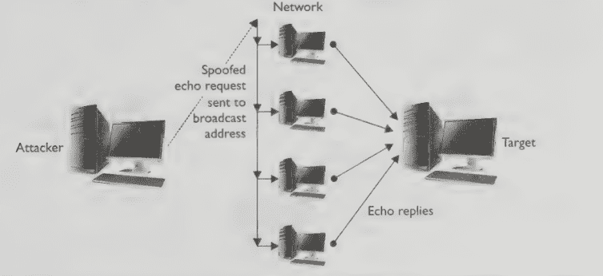

图 12-5 Smurf DoS 攻击中使用的伪造

由于收到报文包后通常会发送回复，被冒充的系统可能会干扰攻击，因为它会收到一个自己从未发出的请求的确认。攻击者通常会先发起一次 DoS 攻击（如 SYN 洪泛攻击），以便在攻击者利用信任关系期间暂时使被伪造的系统失效。攻击完成后，对被伪造系统的 DoS 攻击将被终止，管理员除了系统暂时无响应外，可能永远都不会注意到攻击的发生。图 12-6 说明了一种包含 SYN 洪泛攻击的伪造攻击。

由于此类攻击，管理员应严格限制主机之间的任何信任关系。防火墙还应配置为丢弃来自防火墙外部、其 From 地址表明其源自网络内部的任何数据包（这种情况在正常情况下不应发生，且表明正在尝试伪造）。

## 伪造与序列号

伪造的复杂程度在很大程度上取决于多个因素，包括流量是否加密以及攻击者相对于目标的位置。例如，来自网络内部的伪造攻击比来自网络外部的攻击更容易执行，因为内部攻击者可以观察目标的进出流量，从而更好地构建必要的数据包。

对于外部攻击者来说，构建数据包更为复杂，因为 TCP 数据包与序列号相关联。序列号是由主机建立的 32 位数字，每发送一个数据包就会递增。数据包不保证按顺序接收，序列号可用于在接收时帮助重新排序数据包，并引用传输中可能丢失的数据包。

在 TCP 三次握手中，如图 12-7 所示，会创建两组序列号。第一个系统选择一个序列号随原始 SYN 数据包一起发送。接收该 SYN 数据包的系统会以 SYN/ACK 进行确认。它发送回一个确认号，该确认号基于第一个序列号加一（即将其收到的序列号递增一）。然后它还会创建自己的序列号并随之发送。原始系统收到带有新序列号的 SYN/ACK。它将序列号递增一，并在响应的 ACK 数据包中使用它作为确认号。

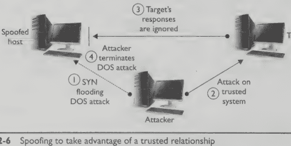

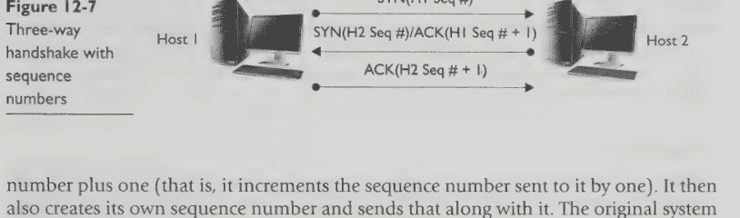

尝试从网络内部和外部进行伪造攻击的难度差异在于确定序列号。如果攻击者在网络内部并且可以观察目标主机响应的流量，攻击者可以轻松看到系统创建的序列号，并以正确的序列号进行响应。如果攻击者在网络外部且未观察到目标系统生成的序列号，那么攻击者几乎不可能提供带有正确序列号的最终 ACK。因此攻击者必须猜测序列号可能是什么。

序列号具有一定的可预测性。每个会话的序列号并非从同一数字开始，因此来自不同并发连接的不同数据包不会具有相同的序列号。相反，每个新连接的序列号会递增一个较大的数字以避免数字相同。序列号也可能每秒（或其他时间段）递增一个较大的数字。外部攻击者必须确定这些递增使用的数值。攻击者可以通过在不同时间间隔尝试连接来观察序列号的递增方式来实现这一点。一旦模式确定，攻击者可以尝试合法连接以确定当前值，然后立即尝试伪造连接。伪造连接的序列号应为合法连接加上确定的数值或数值。

序列号在会话劫持中也很重要，这将在本章的“TCP/IP Hijacking”部分讨论。

## 垃圾邮件

虽然通常不被视为社会工程问题，也不是安全问题，但垃圾邮件 however 可能是安全问题。垃圾邮件，正如几乎每个人都知道的那样，是大量未经请求的电子邮件。它可以是合法的，因为它是由公司发送的用于宣传产品或服务的邮件，但也可能是恶意的，可能包含旨在损害您系统的恶意软件的附件，或链接到可能试图获取您个人信息的恶意网站。

## Spim

虽然不太为人所知，但垃圾邮件的一种变体是 *spim*，它基本上是通过即时通讯应用程序（如 Yahoo! Messenger 或 AOL 即时通讯器（AIM））发送的垃圾邮件。恶意 spim 的目的与垃圾邮件相同——传递恶意内容或链接。

## 钓鱼

*Phishing*（发音为“fishing”）是一种社会工程学类型，攻击者通过冒充可信实体向大量通常随机的用户发送电子邮件或即时消息，试图从用户那里获取敏感信息。攻击者试图获取用户名、密码、信用卡号码以及用户银行账户的详细信息等信息。发送的消息通常鼓励用户访问一个看起来属于 PayPal 或 eBay 等知名实体的网站，这两者都曾频繁被用于钓鱼尝试。然而用户实际访问的网站并不属于该知名组织，而是要求用户提供可在后续攻击中使用的信息。通常，发送给用户的消息称用户的账户已被入侵，并出于安全目的要求用户输入账户信息以验证详情。

在另一种非常常见的钓鱼示例中，攻击者发送一封大量电子邮件，声称来自银行，告知收件人发生了安全漏洞，并指示他们点击链接以验证其账户未被篡改。如果个人真的点击了该链接，他们将被带到一个看似由银行拥有但实际上由攻击者控制的网站。当他们为“验证”目的提供账户和密码时，实际上是将这些信息交给了攻击者。

## Spear Phishing

*Spear phishing* 是指针对具有共同特征的特定群体的钓鱼攻击所创建的术语。通过针对特定群体，成功攻击的比例（即收到的回复数与发送的电子邮件或消息总数之比）通常会增加，因为有针对性的攻击看起来比随机发送给用户的消息更可信。

## Vishing

*Vishing* 是钓鱼的一种变体，使用语音通信技术获取攻击者寻求的信息。Vishing 利用了某些人对电话网络的信任。用户不知道攻击者可以使用 Voice over IP（VoIP）技术伪造（模拟）来自合法实体的电话呼叫。语音留言也可能被入侵并用于这些尝试。一般来说，攻击者希望获取信用卡号码或其他可用于身份盗窃的信息。用户可能会收到一封电子邮件，要求他们拨打一个号码，该号码由可能已被入侵的语音留言系统接听。用户也可能收到一条看似来自合法实体的录音信息。在这两种情况下，用户

会被鼓励快速响应并提供敏感信息，以免其账户访问被阻止。如果用户收到声称来自可信实体并要求提供敏感信息的消息，则不应提供这些信息，而应通过互联网或查看合法账户对账单找到可用于联系该实体的电话号码。然后用户可以验证收到的消息是否合法，或举报该语音钓鱼尝试。

## 圣诞树攻击

Xmas攻击（圣诞树攻击）源于一组特定的协议选项。圣诞树数据包是指所有选项都开启的数据包。该名称源于这些数据包像圣诞树一样被“点亮”。当作为扫描发送时，圣诞树数据包会设置FIN、URG和PSH选项。许多操作系统在遵守管理IP数据包的RFC 791时，实现方式略有不同。它们对此数据包的响应可以让扫描者判断出操作系统类型。另一种情况是在DoS攻击中，圣诞树数据包会显著增加路由器的处理负担，消耗资源。

简单的无状态防火墙会检查SYN标志是否被设置以防止SYN洪水，而圣诞树数据包被设计为不设置SYN，因此可以轻松绕过这些设备。较新的安全设备（如高级防火墙）可以检测到这些数据包，提醒人们注意扫描活动。

## 域名欺骗（Pharming）

域名欺骗（Pharming）是指将用户错误地引导至伪装成官方外观的虚假网站。在钓鱼攻击中，攻击者通过电子邮件逐一针对个人。要成为受害者，收件人必须采取行动（例如回复并提供个人信息）。而在域名欺骗中，用户会因DNS投毒（一种更改服务器域名表中URL的攻击）或修改用于将URL转换为相应IP地址的本地主机文件等活动而被引导至虚假网站。一旦进入虚假网站，用户可能会在自以为连接的是合法网站的情况下提供个人信息。

## 权限提升

网络攻击是多步骤过程。大多数攻击开始于与普通用户相关的权限级别。攻击者从这一级别利用漏洞，从而获得root或管理员级别的访问权限。攻击链中的这一步称为权限提升，对许多攻击行动至关重要。

实现权限提升的方式有几种。一种途径是利用现有权限实施某种行为，从而窃取更高级的凭据。使用嗅探器抓取凭据、获取SAM文件或etc/passwd文件，就是获取“更高级”凭据的一种方法。另一种方法是通过以提升权限运行的进程中的漏洞或弱点。向这些进程注入恶意代码同样可以实现权限提升。

以DNS缓存的形式。要检查针对特定地址的DNS查询，可以使用nslookup命令。图12-8展示了一台Windows机器上执行的一系列DNS查询。在第一次请求中，DNS服务器由ISP提供；在第二次请求中，DNS服务器来自VPN连接。两次请求之间，网络连接发生了变化，导致DNS查询结果不同。这是一种DNS投毒攻击的形式。

有时，nslookup会返回非权威应答，如图12-9所示。这通常意味着结果来自缓存，而不是来自具有权威（即已知是最新的）应答的服务器。

还可以使用其他命令来检查和操作系统上的DNS缓存。在Windows中，ipconfig /displaydns命令将显示机器上当前的DNS缓存。图12-10显示了一个较小的DNS缓存。该缓存是最近使用ipconfig /flushdns命令清空的，以便在屏幕上完整显示。

将DNS视为一个完整系统，可以看到从顶层（根服务器）到单台机器缓存的层级结构。DNS投毒可能发生在这些层级中的任何一层，而且投毒发生的位置越高，其影响范围就越广。2010年，一次DNS投毒事件导致“中国防火墙”审查美国的互联网流量，直到缓存问题得到解决。

DNS投毒是更大一类攻击（称为DNS欺骗）的一种变体。在DNS欺骗中，攻击者通过众多手段中的任何一种更改DNS记录。执行DNS欺骗的方法有很多，其中包括入侵DNS服务器、使用Kaminsky攻击，以及使用广播虚假DNS地址的虚假网络节点。攻击者甚至可以使用DNS缓存投毒来使DNS记录、一个密钥以及一个证明该密钥有效性的签名进入DNS系统。有了这些信息，请求者可以确信他们收到的信息是正确的。这个新系统需要相当长的时间（数年）才能传播到整个DNS基础设施中，但最终，该系统将拥有更大的保障。

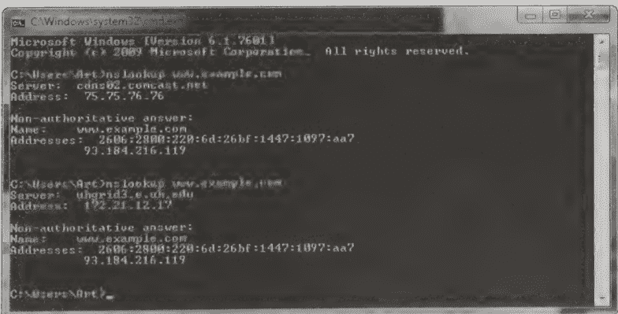

图12-8 对DNS查询执行nslookup

## ARP投毒

在机器之间移动数据包时，设备有时需要知道使用MAC或二层地址将数据包发送到何处。地址解析协议（ARP）通过四种基本消息类型来处理这个问题：

- ARP请求：“谁拥有这个IP地址？”
- ARP应答：“我拥有该IP地址；我的MAC地址是……”
- 反向ARP请求（RARP）：“谁拥有这个MAC地址？”
- RARP应答：“我拥有该MAC地址；我的IP地址是……”

这些消息与设备的ARP表结合使用，ARP表存储与这些数据元素相关的短期记忆。这些命令用作一种简单的查找形式。当机器向网络发送ARP请求时，应答会被接收并写入所有听到该应答的设备中。这提高了地址查找的效率，但也使系统容易受到攻击。

当ARP表收到应答时，它会自动信任该应答并更新表。有些操作系统即使从未听到原始请求，也会接受ARP应答数据。系统没有任何机制来验证所收到数据的真实性。攻击者可以发送消息、破坏ARP表，并导致数据包被错误路由。这种攻击形式称为ARP投毒，会导致恶意地址重定向。这可能使攻击者能够将自己注入两台机器之间的通信中间，即中间人攻击。

## TCP/IP劫持

TCP/IP劫持和会话劫持是指控制客户端与服务器之间已存在会话的过程的术语。与尝试渗透计算机系统或网络相比，劫持对攻击者的优势在于，攻击者无需绕过任何认证机制，因为用户已经完成认证并建立了会话。一旦用户完成认证序列，攻击者就可以篡夺会话，并表现得好像是攻击者（而非用户）与系统完成了认证。为了防止用户注意到任何异常，攻击者可以决定攻击用户的系统并对其执行DoS攻击，使其宕机，这样用户和系统都不会注意到正在发生的额外流量。

劫持攻击通常用于针对Web和Telnet会话。适用于欺骗的序列号同样适用于会话劫持，因为劫持者需要提供正确的序列号才能继续相应的会话。

## 传递访问

*传递访问*是一种通过破坏机器之间信任关系来攻击系统的手段。一个简单的例子是，服务器受到良好保护而客户端未受保护，并且服务器信任客户端。在这种情况下，攻击客户端可以提供对服务器的传递访问。


**考试提示** 理解如何通过投毒寻址机制来执行劫持攻击对考试很重要。

## 客户端攻击

Web浏览器已成为用户访问Web上资源的主要应用程序。该界面的普及性和实用性使其成为攻击者获取系统访问权和控制权的首要目标。各种各样的攻击都可以通过浏览器发生，通常是由于在使用前未能正确验证输入所致。未经验证的输入可能导致一系列注入攻击、标头操纵和其他形式的攻击。

## 注入攻击

当用户输入在未经验证的情况下被使用时，攻击者就有机会精心构造输入，使应用程序在解析和使用输入时触发特定事件。*SQL注入攻击*涉及对输入的操纵，导致生成与设计者预期不同的SQL语句。XML和LDAP注入以相同的方式进行。由于SQL、XML和LDAP用于存储数据，这可以使攻击者违反业务规则访问数据。当输入以允许命令行操纵的方式使用时，就可能发生命令注入攻击。这可以使攻击者以应用程序的权限级别获得命令行访问权。

## 标头操纵

当HTTP通过使用用户输入动态生成时，未经验证的输入可能给攻击者提供更改HTTP元素的机会。当用户提供的信息被用于标头时，就可能引发各种攻击，包括缓存投毒、跨站脚本、跨用户篡改、页面劫持、Cookie操纵或开放重定向。

## 密码攻击

最常见的认证形式是用户ID和密码的组合。虽然它本身并不是一种糟糕的认证机制，但这种组合可能以多种方式受到攻击。很多时候，这些攻击对攻击者来说结果很理想，这并非因为该机制存在弱点，而通常是由于用户没有遵循良好的密码规范。

### 糟糕的密码选择

各种密码攻击技术中技术含量最低的一种是，攻击者仅仅尝试猜测系统或网络授权用户的密码。


猜测。令人惊讶的是，这种简单的方法竟然经常奏效，原因是人们在选择密码方面出了名的糟糕。用户需要选择一个他们能记住的密码，因此他们会创建简单的密码，例如自己的生日、母亲的娘家姓、配偶或某个子女的名字，甚至干脆就是他们的用户 ID 本身。攻击者只需要获得一个有效的用户 ID（这通常很简单，因为组织倾向于以某种组合使用个人的姓名——例如，名字的首字母加上姓氏），再加上一点关于用户的信息，就可以开始猜测了。组织有时甚至在网站上公布其“管理团队”和其他人员的姓名，有时还附上简短的个人简介，这让攻击者更容易获取这类信息。

即使一个人不把个人详细信息用作密码，攻击者仍然可能走运，因为许多人使用一个常见单词作为密码。攻击者可以获取常用密码列表——互联网上存在许多这样的列表。诸如“password”和“secret”之类的词经常被用作密码。最喜欢的运动队的名字也经常出现在常用密码列表中。

## 字典攻击

确定密码的另一种方法是使用密码破解程序，该程序利用字典单词列表来尝试猜测密码，因此得名“字典攻击”。这些单词可以单独使用，也可以将两个或多个较短的单词组合成一个可能的密码。许多商业和公共领域的密码破解程序采用各种方法来破解密码，包括使用用户 ID 的变体。

这些程序通常允许攻击者创建各种规则，告诉程序如何组合单词以形成新的可能密码。用户通常会用某些数字替换特定字母。例如，如果用户想使用单词 secret 作为密码，可以将字母 e 替换为数字 3，得到 s3cr3t。这个密码在字典中是找不到的，所以纯粹的字典攻击无法破解它，但这个密码对用户来说仍然容易记住。然而，如果创建了一条规则，尝试字典中的所有单词，然后尝试将字母 e 替换为数字 3 后的相同单词，那么这个密码就会被破解。

还可以定义规则，让破解程序将特殊字符替换为其他字符，或组合单词。攻击者破解密码的能力，与用户最初创建密码时所采用的方法，以及所使用的字典和规则直接相关。

## 暴力破解攻击

如果用户选择的密码在字典中找不到，即使使用了各种数字或特殊字符替换字母，破解密码的唯一方法就是攻击者尝试暴力破解攻击，即密码破解程序尝试所有可能的密码组合。

密码的长度以及密码中可能字符集的大小，将极大地影响暴力破解攻击所需的时间。几年前，这种攻击方法非常耗时，因为生成需要相当长的时间

## 水坑攻击

最常被识别的攻击向量是那些直接针对目标的攻击。由于它们具有入站且直接的性质，防御措施被设计用来检测和防御它们。但如果用户因为访问网站而“主动招来”攻击呢？就像猎人守在水坑旁等待动物前来饮水一样，攻击者可以在用户可能经常访问的网站上植入恶意软件。水坑攻击最早由 RSA 识别，涉及用恶意软件感染目标网站。在一些被检测到的案例中，感染被限制在特定的地理区域。这些攻击并不简单，但它们可以非常有效地将恶意软件传播到特定的最终用户群体。水坑攻击的实施很复杂，似乎是由国家行为者和其他高资源攻击者支持的。鉴于其高风险性，典型的攻击向量将是零日攻击，以进一步避免检测。

## 章节回顾

在本章中，你了解了攻击和恶意软件的原理。本章开头审视了各种形式的恶意软件。这些形式中的每一种都对应着某种攻击目的或某种漏洞类型。涵盖的形式包括蠕虫、病毒、特洛伊木马、后门程序和逻辑炸弹，它们都是常见的攻击向量媒介。广告软件、间谍软件和勒索软件是那些针对特定目的的恶意软件的特征。本章还介绍了更高级和复杂的形式，如 rootkit、僵尸网络、多态恶意软件和装甲恶意软件。

在攻击类型方面，本章展示了一系列当前的攻击模式。从拒绝服务攻击和分布式拒绝服务攻击，到欺骗、域欺骗和权限提升，这些攻击形式都是达到目的的技术手段。中间人攻击、网络钓鱼、鱼叉式网络钓鱼、语音钓鱼、垃圾邮件和即时通讯垃圾邮件是传播恶意软件的其他途径。

## 问题

为了帮助你进一步备考，并测试你的准备程度，请回答以下问题，然后对照本章末尾的正确答案检查你的答案。

- 1. 你的朋友推荐了一个免费的软件包，可以帮助你整理播放列表。你试了一下，发现它很棒——除了每次启动时你都要等 30 秒的产品视频结束后才能使用它。这种类型的软件被称为：
  - A. DNS 重定向器
  - B. 广告软件
  - C. 臃肿软件
  - D. 浏览器劫持者

- 2. 在检查来自你的网络的数据包捕获时，你注意到大量设置了 URG、PUSH 和 FIN 标志的数据包。你在该数据包捕获中看到的是哪种类型的流量？
  - A. 僵尸网络控制信道
  - B. Smurf 攻击
  - C. Xmas 攻击
  - D. 重放攻击

- 3. 如果攻击者能够将自己插入到你与安全 Web 服务器之间的加密会话中，那么他成功执行了哪种类型的攻击？
  - A. Smurf 攻击
  - B. 重放攻击
  - C. 点击劫持攻击
  - D. 中间人攻击

- 4. 你的整个办公室都在传阅一份跳舞唱歌的仓鼠 PowerPoint 演示文稿。大家都觉得它很棒，直到第二天早上，每个人的硬盘似乎都被清空了。这个跳舞的仓鼠文件是以下哪种恶意软件的一个例子：
  - A. 病毒
  - B. 特洛伊木马
  - C. Rootkit
  - D. 漏洞利用程序

- 5. 你朋友的电脑上出现了一个弹窗，上面写着“警告！你的电脑已被用于非法活动，并已被当局锁定。要访问你的电脑，你必须支付罚款……”你朋友无论如何都无法消除这个弹窗，而且他们无法使用电脑。你朋友的电脑感染了什么？
  - A. 勒索软件
  - B. Rootkit
  - C. 僵尸网络
  - D. 臃肿软件

- 6. 你在 4 月 1 日启动电脑，出现了一个大弹窗，上面写着“哈哈哈”，下方是小丑的脸。当弹窗消失后，你桌面上的所有图标都不见了。你的电脑感染了哪种恶意软件？
  - A. Rootkit
  - B. 装甲病毒
  - C. 广告软件
  - D. 逻辑炸弹

- 7. Smurf 攻击是哪种攻击的一个例子？
  - A. DDoS
  - B. DoS
  - C. SQL 注入
  - D. 点击劫持

- 8. 你的组织感染了一种似乎无法清除的恶意软件。似乎每次一个系统被清理干净，并且你更新了组织内的所有防病毒定义后，另一个系统又显示出感染的迹象。在这个例子中，你可能面对的是哪种恶意软件？
  - A. 多态恶意软件
  - B. 特洛伊木马
  - C. 僵尸网络
  - D. 曲奇怪物

- 9. 哪种类型的网络攻击会使用重复或延迟有效数据传输的手段？
  - A. 僵尸网络
  - B. 跨站脚本攻击
  - C. 令牌劫持
  - D. 重放攻击

- 10. www.whitehouse.com 是以下哪种情况的著名例子？
  - A. 逻辑炸弹
  - B. 域名仿冒
  - C. 网络钓鱼
  - D. 域欺骗

- 11. 你组织销售部门的每个人都收到了一封电子邮件，称他们将被评为年度最佳销售人员并获奖。邮件末尾有一个链接，允许他们输入自己希望印在奖品上的名字。这封邮件实际上是假的，点击链接导致用户的电脑感染了恶意软件。这是哪种类型的活动？
  - A. 鱼叉式网络钓鱼
  - B. 欺骗
  - C. 语音钓鱼
  - D. 客户端攻击


## 答案

1. **B.** Adware 是用来描述通常免费但包含嵌入式广告或在软件使用时显示广告能力的软件的术语。通常，通过购买软件可以移除广告功能。

2. **C.** Xmas 攻击使用设置了 URG、PUSH 和 FIN 标志的数据包。不同设备对 Xmas 攻击的响应不同。一些系统会变慢，一些会重启或崩溃，还有一些会完全丢弃数据包。

3. **D.** 如果攻击者能够插入到加密对话的中间，并让每个受害者都相信他们仍在与对话中的原始通信方交谈，那么攻击者就成功执行了中间人攻击。中间人攻击只有在攻击者能够成功冒充对话中的两个端点时才能成功。

4. **B.** 木马是恶意程序，通常表现为或执行某项功能，同时在未经用户许可的情况下执行不期望的操作。木马软件的名字来源于特洛伊战争中的特洛伊木马。

5. **A.** 你朋友的电脑感染了勒索软件，这是一种旨在在支付“赎金”之前阻止系统访问的软件。

6. **D.** 如果恶意行为在特定时间或日期发生，或在特定条件出现时发生，那么它很可能是逻辑炸弹所为。逻辑炸弹是旨在在满足特定条件之前不被检测到而运行的恶意软件——特定时间、特定日期、特定次数的鼠标点击等等。当这些条件满足时，逻辑炸弹会执行其“有效载荷”，通常是旨在损坏、破坏或摧毁受感染系统的东西。

7. **A.** Smurf 攻击是分布式拒绝服务（DDoS）攻击最早的例子之一。在 Smurf 攻击中，攻击者伪造来自目标地址的 ICMP 回显请求数据包并将其发送到一个或多个网络地址。每个接收到数据包的主机都会向目标地址发送回显应答数据包。攻击者能够将攻击分散到多个源，并用流量压垮目标。

8. **A.** 如果你有一段恶意软件，无论更新多少次杀毒软件签名都极难清除，你很可能面临的是多态恶意软件。多态恶意软件旨在不断变化，使其检测或移除越来越困难。恶意软件通过文件名更改、压缩技术、可变密钥加密等技术“进化”。

9. **D.** 重放攻击是一种重复或延迟有效数据传输的网络攻击。在大多数重放攻击场景中，攻击者会捕获有效的流量流（例如登录凭据的提交），并在稍后“重放”该流量。

10. B. www.whitehouse.com 是域名抢注的著名例子。域名抢注涉及使用常见的拼写错误、打字错误或用户尝试访问合法网站时出现的错误来设置网站。例如，希望访问 www.whitehouse.gov 的用户可能会错误地输入 “.com” 而不是 “.gov”，从而被导向与他们打算访问的完全不同的网站。

11. A. 这是一个 spear phishing 攻击的例子。Spear phishing 使用针对特定组织或组织内特定群体的欺诈性电子邮件。该攻击比钓鱼攻击更具选择性和针对性。

12. C. 你的组织很可能正遭受 DNS 污染攻击。在 DNS 污染攻击中，攻击者试图破坏 DNS 服务器或 DNS 缓存，使得在 DNS 解析时返回错误的 IP 地址。这种类型的攻击通常用于将流量转移到攻击者的系统之一。

13. B. 欺骗防病毒软件使其相信恶意软件位于一个位置，而实际上位于另一个位置，是装甲病毒常用的技术。装甲病毒旨在更抗检测、逆向工程和移除。

14. C. 如果你在运行某个程序（例如安装软件）后被允许做以前不被允许做的事情，那么该程序很可能执行了权限提升攻击。权限提升攻击利用漏洞、缺陷或配置错误，从而允许以普通用户通常无法获得的方式访问资源和执行操作。

15. B. 如果你能够通过不常见的端口访问系统并绕过正常的身份验证机制，你很可能发现了一个后门。

## 社会工程学

本章中，你将

- 定义与社会工程学相关的基本术语
- 识别可能使组织信息面临风险的常见用户行为
- 识别攻击者可能用来获取组织信息的方法
- 审查虚拟化和云环境相关的风险

社会工程学是说服授权个人向未经授权的个人提供机密信息或访问权限的过程。这是一种技术，攻击者使用各种欺骗手段来说服目标人员透露他们通常不会透露的信息，或说服攻击目标做他们通常不会做的事情。

## 社会工程学方法

社会工程学是对用户的攻击，通常涉及某种形式的社交互动。攻击中被利用的弱点不一定是技术知识，甚至不是安全意识。社会工程学的核心在于操纵人际关系的社会本质。它本质上利用了我们倾向于渴望的几个特征。例如，乐于助人的意愿是团队环境中希望看到的特征。我们希望员工互相帮助，并且我们倾向于奖励乐于助人的人，惩罚那些不乐于助人的人。

如果我们的工作文化建立在协作和团队合作的基础上，那么它如何被利用？这并不简单，但可以通过一系列微妙的诡计来实现。其中一个建立在培养熟悉感的概念上——让人觉得你属于这个群体。例如，通过带着正确的词语和正确的信息插入到对话或相遇中，你可以让人觉得你属于其中。通过谨慎的点名并将你的故事与当前事件和期望保持一致，你可以悄无声息地溜进去。另一个例子是，当你与持有身份证的人同时到达一扇门时，双手拿着东西，你很可能可以让他们为你开门并扶住门。更成功的一种技术是在走向门口的路上就进行一次对话，谈论一些让你融入其中的话题。人们想要帮助他人，而这种策略赋予了对方帮助你的权力。

第二种方法涉及制造敌对局面。人们倾向于避免敌意，所以当你进入想要加入的群体时，如果你与某人发生激烈争论——确保你不仅在争论中处于下风，而且看起来完全不公平——你立刻可以与任何遭受类似虐待的人建立联系。利用同情心、他们对同情的渴望，并在那一刻利用它来绕过连接时刻。

一个优秀的社会工程师懂得如何使用肢体语言影响他人——何时微笑、如何镜像动作、如何不是通过言语而是通过肢体语言线索影响他人。任何曾用肢体语言让男人做某事而不直接要求他去做的女人都理解这项游戏。男人也理解，并且他们也玩，因为他们也在试图得到一些东西。当某人拥有你为项目、提案或其他重要事情所需的关键信息时，以物易物是一种不成文的仪式。而如果你与心怀恶意的人这样做，那么就记住那句谚语：“当心带着礼物的希腊人。”

抵御社会工程攻击的最佳防御措施是包含社会工程的全面培训和意识计划，但这并不意味着员工应该被训练成固执和不乐于助人。相反，培训应强调乐于助人和团队合作的价值，但要在信任得到验证且没有社会污名的环境中进行。没有人能在机场办理登机手续时用社会工程技术骗过 TSA 员工，因为他们冷静地执行和遵循既定程序，但他们经常以善意、礼貌和乐于助人的方式做到这一点，同时确保筛查程序始终完成。


> > **考试提示** 考试时，请熟悉各种社会工程攻击以及每种攻击相关的有效性。

## 肩部窥视

肩部窥视不一定涉及与目标的直接接触，而是涉及攻击者直接观察个人在表单、键盘或键区上输入敏感信息。攻击者可能只是简单地在工作时从用户肩膀后面窥视，例如，或可能设置摄像头或使用望远镜来查看用户输入敏感数据。攻击者可以尝试获取诸如自动取款机（ATM）上的个人识别码（PIN）、安全门或门的门禁进入码、或电话卡或信用卡号码等信息。许多地点现在使用小型屏蔽罩围绕键盘，使观察者在输入信息时难以观察到。更复杂的系统实际上可以打乱数字的位置，使得某一时刻的顶行包含数字 1、2 和 3，而下一次包含 4、8 和 0。虽然这使得用户输入信息稍慢，但它挫败了攻击者观察输入了哪些数字的企图

按下然后输入相同的按钮/模式，因为数字的位置不断变化。

## 翻垃圾

在安全社区中，翻找目标垃圾以期找到可能用于渗透尝试的有价值信息的流程被称为 *翻垃圾*。如果攻击者在目标附近，一个常见的获取信息的地方就是目标的垃圾。攻击者可能会找到一些对攻击有用的零碎信息。然而，这一策略并非计算机社区独有；多年来，身份窃贼、私家侦探和执法人员等也使用过它来获取个人或组织的信息。如果攻击者运气非常好，而目标的安全程序非常糟糕，他们甚至可能找到用户 ID 和密码。

攻击者可能会收集各种可用于社会工程攻击的信息。在大多数地方，垃圾被丢弃后不再被视为私人财产（即使在翻垃圾是非法的地区，执法也很少）。组织应制定关于丢弃材料的政策。敏感信息应被粉碎，组织还应考虑确保垃圾容器安全，以防止个人翻找。人们在丢弃个人或敏感信息到自己的垃圾中时也应考虑将其粉碎。一台质量合理的碎纸机价格便宜，与身份盗窃可能造成的潜在损失相比，物有所值。

## 尾随

正如第 9 章所述，尾随（或搭便车）是一种简单的策略，即紧跟在刚刚使用自己的访问卡或 PIN 码获得房间或建筑物物理访问权限的人身后。人们经常匆忙，经常不会遵循良好的物理安全实践和程序。攻击者知道这一点，可能会试图利用人类行为中的这一特征。攻击者因此可以在无需知道访问代码或获取访问卡的情况下进入设施。这与肩窥相似，因为它依赖于攻击者利用未遵循安全程序的授权用户。经常，攻击者甚至会在到达门口前与目标开始交谈，以便用户更愿意在不质疑的情况下允许该个人进入。在这种意义上搭便车与社会工程攻击有关。

搭便车和肩窥攻击技术都可以通过使用简单的程序来轻松抵御，以确保没有人跟随你太近或处于可以观察你行动的位置。这两种攻击都依赖于授权用户的安全实践不佳才能成功。针对搭便车更复杂的对策是 *单人门*，它利用两扇门进入设施。第二扇门在第一扇门关闭之前不会打开，并且门间距很近，形成一个封闭空间，一次只允许一个个人通过。

## 冒充

冒充是一种常见的社会工程技术，可以以多种方式实施。它可以面对面进行，通过电话进行，或在线进行。在冒充攻击的情况下，攻击者承担被攻击者认可的角色，并在承担该角色时，攻击者利用潜在受害者的偏见违背其更好的判断来遵循程序。

## 第三方授权

利用先前获取的关于项目、截止日期、上司等的信息，攻击者带着 1）受害者半预期或会视为正常的某物到来，2）以项目陷入困境或其他攻击者会被视为有帮助或不愿得罪的情况为幌子，3）他们点名“Mr. Big”，他恰好不在办公室且此刻无法联系，从而避免了核查。攻击者很少要求表面上看似不合理或根据情况不太可能被分享的东西。这些行为可以制造出第三方授权的表象，而事实上并无此授权。

## 帮助台/技术支持

可以利用向帮助台和技术支持部门的呼叫或来自帮助台和技术支持部门的呼叫来获取信息。冒充员工，你可以获得密码重置、有关某个系统的信息或其他有用信息。电话也可以反向进行，社会工程师冒充帮助台或技术支持。然后，通过致电员工，攻击者可以获取系统状态和其他有趣元素的信息，以便日后使用。

## 承包商/外部人员

在许多组织中，外包承包商清洁建筑物、浇水和做其他日常杂务是很常见的。在许多情况下，如果没有适当的安全保障，攻击者只需穿上与承包商制服相匹配的衣服，在通常做这项工作的时间稍有不同的时间出现，如果受到质疑，就通过说他们是替 X 值班或为 Y 顶班来博取工人的同情。攻击者随后在走廊中无人察觉地游荡，因为他们融入其中，同时拍摄办公桌和文件并寻找信息。

## 在线攻击

冒充也可以用于在线攻击。在这些情况下，技术在通信链中扮演中间角色。一些较旧的形式，如弹出窗口，今天往往效果较差，因为用户对它们心存戒备。然而，通过电子邮件的网络钓鱼尝试和社会媒体诈骗比比皆是。

## 防御措施

在所有冒充案例中，最好的防御很简单——建立流程，要求员工在不认识对方的情况下与之接触前先查看其身份证件。这包括质疑送货司机和合同工等人。不要在未检查身份证件的情况下让人们通过搭便车进入大门。如果这是标准流程，则不会有人感到冒犯，如果有人假装冒犯，则会变得更加可疑。培训和意识确实有效，正如弹出窗口效果减弱等趋势所证明的那样。但这种防御的关键是使培训定期进行，并根据当前正在经历的情况量身定制，而不是泛泛地复述最佳实践。


EXAM TIP 社会工程攻击的最佳防御仍然是培训和意识计划。

## 恶作剧

乍一看，安全相关的恶作剧似乎会被认为是麻烦而不是真正的安全问题。对于某些恶作剧，尤其是都市传说类型的情况可能如此，但实际情况是，如果恶作剧导致用户采取某种削弱安全的行动，它会造成非常严重的损害。例如，一个真实的恶作剧描述了一种新的、高度破坏性的恶意软件。它指示用户检查某个文件的存在，如果找到该文件则删除它。实际上，提到的文件是操作系统使用的一个重要文件，删除它会导致系统下次启动时出现问题。用户修改安全设置造成的损害可能很严重。与其他形式的社会工程一样，培训和意识是对用户和管理员的最佳和第一道防线。用户应接受培训，对不寻常的电子邮件和故事保持怀疑，并应知道如果收到此类信息，应联系组织中的谁来验证其有效性。恶作剧通常还会建议用户将其发送给朋友，以便他们也了解该问题——通过这样做，他们帮助传播了恶作剧。用户需要对任何要求他们“传播消息”的电子邮件保持怀疑。

## 鲸鱼攻击

高价值目标被称为鲸鱼。因此，鲸鱼攻击是指目标是高价值人员，如首席执行官或首席财务官。鲸鱼攻击不是通过攻击多个目标并希望得到回复来进行的，而是专门定制以提高成功率的。Spear phishing 是针对鲸鱼常用的方法，因为它旨在对目标来说看起来像是普通业务，被制作成模仿非可疑的通信。鲸鱼可以像任何其他人一样被欺骗；区别在于目标群体有限，因此攻击者不能依赖于来自大量目标的随机回报。

## 语音钓鱼

正如第 12 章所述，vishing 是一种使用 Voice over IP 技术的攻击方法。Vishing 依赖于信任，即一种错误地认为电话呼叫仅基于手机屏幕上的号码就来自特定方的信念。在 VoIP 攻击中，可以伪造呼叫来源的号码。这用于建立一种信任形式，然后攻击者通过电话利用这种信任。


## 社会工程学原理

社会工程学之所以非常成功，有两个主要原因。第一个原因是大多数人都有帮助他人的基本欲望。当有人提出我们知道答案的问题时，我们的正常反应不是怀疑，而是回答问题。问题在于，看似无害的信息可以直接用于攻击，或间接地构建一个更大的全貌，攻击者可以利用它在攻击期间营造出真实感——个人对组织的了解越多，就越容易说服他人他是组织的一员，并且有权获取甚至敏感信息。

社会工程学成功的第二个原因是个人通常寻求避免冲突和麻烦。如果攻击者试图恐吓目标，威胁因缺乏帮助而向目标的上级投诉，目标可能会屈服并提供信息以避免冲突。

### 工具

社会工程师工具箱中的工具基于心理学知识，并不一定需要对软件或硬件有精深的了解。社会工程师会采用旨在利用人们自身偏见和信念的策略，以暂时剥夺他们良好判断力和使用标准程序的能力。以下列出的“技术”在许多社会工程攻击中都很常见：

- **Authority** 如果攻击者能说服他人他在特定情况下拥有权威，他就能诱使他们以特定方式行事。表现得像老板在要求某事，人们就更不可能拒绝。
- **Intimidation** 恐吓可以是微妙的，通过感知到的权力，或更直接的，通过建立优越感预期的沟通。
- **Consensus/social proof** 共识是全组范围的决定。它经常不是来自倡导者，而是通过多轮小组协商产生。这些轮次可以被操纵以实现期望的结果。
- **Scarcity** 如果某物供应短缺且有价值，那么带着所需的东西到来就能带来回报——以及接受。“此价格仅剩 X 件”是这种技术的例子。
- **Urgency** 时间可以被操纵以制造紧迫感并促使出现捷径，从而为介入流程创造机会。限时优惠应始终被视为可疑。
- **Familiarity/liking** 人们会为他们喜欢或感到亲近的人做事。建立这种熟悉感和吸引力可能导致信任错位。
- **Trust** 信任被定义为在特定条件下了解某物将如何表现。社会工程师可以塑造工人的认知，使他们将判断应用于信任方程并得出错误结论。

运用这些工具对社会工程师来说是第二天性，并且凭借技巧，他们可以在任何特定情况下像水管工使用各种手工工具、系统管理员使用操作系统命令来实现复杂任务一样，随意切换这些工具。当我们观看这些专业人士工作时，我们可能会惊叹于他们使用工具的方式，对社会工程师也是如此——只是他们的工具更微妙，目标是人和信任。

### 章节回顾

在本章中，你已熟悉社会工程攻击的原理。你研究了社会工程的方法，以及肩窥、垃圾箱翻找、跟随进入、冒充、骗局、捕鲸式攻击和语音钓鱼等具体攻击向量。这些基于社会工程的攻击被呈现出来以便能够识别。对所有这些来说，共同的防御机制是培训和意识。本章以对社会工程师使用的主要工具及其有效性的考察作结。

### 问题

为了帮助你进一步为 CompTIA Security+ 考试做准备，并测试你的准备程度，请回答以下问题，然后将你的答案与本章末尾的正确答案核对。

1. 在你办公楼的主门，你看到一个男人站在刷卡器旁打电话。他等到有人刷卡并走进门后，就在门关闭前抓住门，打开它并在未刷卡的情况下走进去。这个男人刚刚通过以下方式进入你的大楼：
    - A. 肩窥
    - B. 绕过
    - C. 跟随进入
    - D. 劫持

2. 在公交车上某天早上，你注意到一个女人从前面座位探头，盯着坐在那个座位上的男人使用的笔记本电脑屏幕。那个女人似乎也在做笔记。这名女子可能在做什么？
    - A. 跟随进入
    - B. 肩窥
    - C. 窃取
    - D. 水坑攻击

3. 你组织的首席执行官把你叫到他的办公室，询问他收到的邮件。该邮件指示他点击链接并验证他的用户 ID、密码、出生日期和社会安全号码。据你所知，他是你们组织中唯一收到该邮件的人。这是什么类型的攻击？
    - A. 冒充
    - B. 重放攻击
    - C. 点击劫持攻击
    - D. 捕鲸式攻击

4. 你的办公电话响了，另一端的人告诉你她来自人力资源部，正在进行员工记录的随机审计。她要求你的全名、电子邮件地址、出生日期、社会安全号码和银行账号以验证 HR 记录中存储的信息。来电显示显示的是你组织内部的号码。这可能是何种类型的攻击？
    - A. 语音钓鱼
    - B. 骗局
    - C. 配对
    - D. 信息窃取

5. 一位同事请你看他的电脑屏幕。他收到银行的邮件，要求他登录并验证最近的一笔取款。同事确实点击了链接，但没有做其他事情，因为网站看起来有点“不对劲”。页面布局看起来像他的银行，但页面上有几个拼写错误，而且是未加密的 HTTP 会话。这种情况下可能使用的是什么攻击技术？
    - A. 蓝牙劫持
    - B. 窃取
    - C. 冒充
    - D. 捕鲸式攻击

6. 你看到几个人在你办公楼后面翻找垃圾箱。当他们看到你时，他们拿着几个大袋子跑开了。这些人可能在做什么？
    - A. 语音钓鱼
    - B. 获取 root 权限
    - C. 垃圾箱翻找
    - D. 蓝牙劫持

7. 一个男人站在你大楼外，穿着一件深蓝色带“FBI”字样的夹克。他要求进入大楼的每个人出示驾驶执照和员工 ID。然后他向每个人询问一系列关于他们的工作、他们做什么、在公司待了多久等问题。当一个人要求看他的证件时，夹克男威胁说如果不配合联邦调查就要把他们关进监狱。这里可能在使用什么类型的社会工程学原理？
    - A. 稀缺性
    - B. 恐吓
    - C. 社会认同
    - D. 信任

8. 你的整个小组收到老板的邮件，指示你们放假一天，但离开时要把所有工作文件留在原处，终端保持解锁状态。邮件说审计部门需要检查每个人的系统是否存在非法软件。你注意到邮件地址在公司名称拼写上有多一个字母。这里可能在使用什么类型的社会工程学原理？
    - A. 社会认同
    - B. 紧迫性
    - C. 共识
    - D. 权威

9. 以下哪一项不是社会工程学原理？
    - A. 稀缺性
    - B. 恐吓
    - C. 慰问
    - D. 信任

10. 你组织内正在流传一封邮件，警告人们一种新病毒。邮件指示你搜索系统中名为“mmsystem.dll”的文件，如果找到就删除它们。这可能是什么类型的社会工程攻击？
    - A. 逻辑炸弹
    - B. 拼写错误劫持
    - C. 骗局
    - D.  pharming


11. 你的同事刚跑到打印机旁取了一张纸，现在正准备冲出门去。你问她要去哪儿，她说：“我得走了——只剩几个了。”你看了看她手里的纸，上面似乎是65英寸液晶电视促销广告。广告上写着“鲍勃电视仓库”的地址，在城镇的另一头。在这个例子中，运用了哪种社会工程学原理？

- A. 尾随
- B. 稀缺性
- C. 捕鲸攻击
- D. 客户端攻击

12. 一位非常迷人的女士站在你所在大楼门口，请求别人让她进去，因为她忘记带身份证了。一位年轻男士停下来和她聊了几分钟，最后让她进了大楼。这位女士利用了什么社会工程学原理来进入大楼？

- A. 紧迫性
- B. 熟悉/好感
- C. 社会认同
- D. 信任

13. 你正准备在ATM机上输入PIN码，突然注意到身后有闪光。身后只有一个人，而且他们拿着手机，正在疯狂地点击屏幕，并避免与你进行任何眼神接触。这个人可能正在尝试哪种类型的攻击？

- A. 尾随
- B. 冒充
- C. 肩窥
- D. 语音钓鱼

14. 你收到一个Facebook“好友”请求，对方是你不认识的人，但你们似乎有很多共同好友。你接受了请求。几周后，你收到同一个人的请求，要求你点击一个链接并参与调查。你注意到好几个同事都已经做过同样的测验。当你点击链接时，杀毒软件警告你，你正在连接的网站试图将恶意软件加载到你的系统上。你中了哪种社会工程学原理的招？

- A. 紧迫性
- B. 信任
- C. 一致性/社会认同
- D. 稀缺性

15. 你的收件箱中收到一封电子邮件。打开后，它要求你点击链接获取特别优惠。当你点击链接时，你会进入一个描述新车“超值优惠”的网页。你只需点击链接，完成一个15分钟的调查，然后打印一张价值1万美元的新车优惠券。页面顶部还有一个红色大计时器，从30倒数到0。网页声称你只有30秒时间开始调查，否则优惠将过期。在这种情况下，起作用的是哪种社会工程学原理？

- A. 稀缺性
- B. 恐吓
- C. 紧迫性
- D. 信任

## 答案

- 1. C. 这名男子在尾随——在未经他人同意和许可的情况下跟随某人进入安全或受限区域。这也被称为“ piggybacking”（搭便车）。
- 2. B. 这名女子可能在进行肩窥。肩窥是指窥视计算机、移动设备、笔记本电脑、ATM机或其他设备的使用者，以窃取登录信息、密码、个人信息等。
- 3. D. 针对高级管理人员的网络钓鱼攻击被称为捕鲸攻击。它们与其他网络钓鱼攻击基本相同，只是目标仅针对组织中的“大人物”。
- 4. A. 通过电话进行的社会工程学攻击称为语音钓鱼。攻击者打电话给受害者，试图诱骗受害者提供信息或说服受害者代表攻击者执行操作。
- 5. C. 当恶意计算机系统试图冒充受信任的计算机时，这种行为称为冒充。
- 6. C. 垃圾搜寻是指翻找组织的垃圾，寻找可能被丢弃的有用、有价值或敏感信息的行为。攻击者在寻找可能有助于他们发起进一步攻击的任何东西，例如员工名单、密码列表、公司政策、使用过的CD、旧硬盘等。
- 7. B. 穿深色风衣的男子正在对受害者使用恐吓手段。他假装自己是权威人士，并威胁说，如果人们质疑他的行为或不服从他的要求，就把他们关进监狱。他试图吓唬人们按他说的做。
- 8. D. 所使用的社会工程学原理是权威。攻击者伪造了一封来自你老板的电子邮件，并希望人们不加质疑地遵从，因为这封邮件看起来来自老板。
- 9. C. 哀悼不属于社会工程学原理。
- 10. C. 这很可能是一个恶作剧。Mmsystem.dll是有效的Windows系统文件，很可能出现在基于Windows的工作站上。这封邮件看起来真实，其中包含一些有效信息——收件人很可能会在自己的系统上找到邮件中提到的文件。但由于该文件是Windows操作系统的一部分，并非威胁，因此这是一个恶作剧。
- 11. B. 当社会工程学攻击利用某种东西数量有限的观念时，所使用的原理是稀缺性。攻击者试图说服受害者迅速行动，因为可用的物品或机会数量有限。
- 12. B. 这位女士利用的是熟悉/好感原理。人们更有可能被自己喜欢或熟悉的事物所影响。
- 13. C. 这可能是肩窥尝试。手机使得可以隐蔽地拍摄按键操作的照片或视频，例如输入PIN码、输入用户ID/密码等。
- 14. C. 这是一个一致性/社会认同的例子。在这种情况下，你接受了最初的请求和调查请求，是因为许多同事和同行已经这样做了。你相信群体的判断，而不是自己的判断。
- 15. C. 该优惠的限时/必须立即行动的性质是利用紧迫性原理诱骗你点击下一个链接。该网页试图迫使你在有时间检查链接并考虑其是否合法之前就点击它。

## 应用与无线攻击

在本章中，你将：

- 解释无线攻击的类型
- 解释应用攻击的类型

攻击利用系统中的漏洞，使攻击者能够获得对系统的访问权限。两种常见的攻击模式是通过无线网络（利用无需物理连接即可连接的能力悄悄发动攻击）以及通过系统中运行的应用程序进行的攻击。应用程序代表了一种攻击途径，因为它们通常比现代打过补丁的操作系统拥有更多漏洞。

## 无线攻击

随着无线使用的增加，无线协议的安全性已成为整个网络安全中更重要的因素。作为安全专业人士，你需要了解无线网络应用，因为广播网络信号存在固有风险，任何人都可能截获它。通过公共无线电波发送不安全的信息，无异于将公司的密码张贴在大楼前门。

本章探讨无线攻击的类型以及管理与无线技术使用相关的风险的对策。

## 流氓接入点

如果设置了未经授权的无线接入点，则称为流氓接入点。这些可能是出于好意的员工设置的，也可能是拥有物理访问权限的攻击者隐藏的。如果攻击者能够获得组织的有限物理访问权限（例如短暂潜入大楼），他们可能会设置一个流氓接入点。然后，攻击者可以在网络上设置一个接入点，将其放置在外围防火墙或网络IDS（NIDS）等安全措施之后，日后便可随意连接到无线网络。这种方法降低了被抓住的风险。

无线网络的问题在于难以限制对其的访问。由于不存在物理连接，用户能够保持连接的距离是无线网络本身以及网络各组件放置位置的函数。为了确保整个设施的访问，通常会在多个位置部署站点，其中一些站点可能实际上提供组织外部的访问，以确保组织中最远的办公室能够被覆盖。通常，访问会延伸到相邻办公室或停车场或街道。攻击者可以定位这些位于组织外部的访问区域，并尝试未经授权的访问。

术语“战争驾驶”指的是攻击者带着具备无线功能的计算机在某个区域内（通常是在汽车中）四处游荡，搜索他们可以访问的无线网络的活动。一些安全措施可以限制攻击者在此活动中成功的可能性，但就像战争拨号一样，设置无线网络的人并不总是激活这些安全机制。而且在大多数情况下，运行无线网络的个人甚至不会注意到有人在使用他们的网络。当未经授权的一方执行违反网络所有者与其ISP达成的服务条款的操作时（例如非法共享音乐、视频和软件），这可能会导致问题。在这些情况下，ISP和内容所有者会指责网络所有者，而不是指责那些开车经过并借用带宽的人。

当无线网络在某些地区仍“罕见”时，路边和其他地方开始出现符号，表示存在开放或未受保护的Wi-Fi网络。就像上世纪流浪汉的标记一样，这些粉笔标记旨在引导他人前往安全区域，并避开危险。这些标记被称为战争标记，如今在全球各地、内城和各类社区中仍然可以找到。随着Wi-Fi变得越来越普及，战争标记的需求和使用正在逐渐消失，就像过去的流浪汉符号一样。


**考试提示** 为考试理解战争驾驶（驾车寻找Wi-Fi热点）和战争标记（为他人标记位置）这两个术语。

## 蓝牙攻击

随着蓝牙变得流行，人们开始尝试寻找它的漏洞。蓝牙具有简单的设备配置功能，无需网络地址或端口即可进行通信。蓝牙使用配对来建立设备之间的信任关系。为了建立这种信任，设备会广播功能并要求输入密码。为了帮助维护安全，大多数设备要求在两台设备上都输入密码；这可以防止默认密码型攻击。蓝牙的协议广播服务和配对属性正是部分安全问题开始的地方。


## 蓝牙劫持（Bluejacking）

蓝牙劫持是指未经授权向另一台蓝牙设备发送消息的术语。这涉及将消息作为电话簿联系人发送：


然后攻击者通过蓝牙将消息发送给潜在的接收者。最初，这涉及发送文本消息，但较新的手机也可以发送图片或音频。其一个流行变体是传输“惊悚”图像，这些图像包含令人不适或粗俗的照片。由于蓝牙是一种短距离协议，攻击者和受害者必须在约10码范围内。受害者的手机也必须开启蓝牙并处于可发现模式。在一些早期手机上，这是默认配置，虽然这使连接外部设备更容易，但也允许对该手机进行攻击。如果关闭蓝牙，或者设备设置为不可发现，则可以避免蓝牙劫持。

## 蓝牙窃听（Bluesnarfing）

蓝牙窃听与蓝牙劫持类似，都使用相同的联系人传输协议。不同的是，攻击者不是向受害者手机发送未经请求的消息，而是复制受害者的信息，这些信息可能包括电子邮件、联系人列表、日历以及该设备上存在的任何其他内容。较新的具备多媒体功能的手机可能被窃取私人照片和视频。蓝牙窃听过去需要一台带有蓝牙适配器的笔记本电脑，因此相对容易识别可能的攻击者，但现在移动设备上也有蓝牙窃听应用程序。Bloover是“Bluetooth”和“Hoover”的合成词，就是这样一种以Java小程序运行的应用程序。大多数蓝牙手机需要处于可发现状态才能使蓝牙窃听攻击生效，但攻击本身不一定需要配对。理论上，攻击者还可以暴力破解设备唯一的48位名称。一个名为RedFang的程序尝试通过发送所有可能的名称并观察哪些名称会得到响应来执行这种暴力攻击。蓝牙1.2中的匿名模式解决了这一问题。

## 蓝虫攻击（Bluebugging）

蓝虫攻击比蓝牙劫持或蓝牙窃听都严重得多。在蓝虫攻击中，攻击者利用蓝牙与设备建立串行连接。这允许访问完整的AT命令集——GSM手机使用类似于与Hayes兼容调制解调器的AT命令。这种连接允许对手机进行全面控制，包括在手机主人不知情的情况下拨打任何号码。幸运的是，这种攻击需要完成设备配对，而且最初容易受到攻击的手机已更新固件来解决此问题。现在要实施这种攻击，手机主人必须交出手机，让攻击者实际建立连接。这种攻击提醒我们，技术可能存在重大隐藏风险。


> **考试提示** 除非你有意配对设备，否则应始终关闭蓝牙的可发现模式。

## 数据包嗅探

无线网络的特点是通过无线电波进行连接。射频信号可以被发射器范围内的所有接收器截获，这称为数据包嗅探。无论是在咖啡店、机场还是工作环境中，任何在范围内的机器都可以截获设备与接入点之间的大量通信。解决方案非常简单，却常常未被采用——加密。如第4章所述，使用WPA2将防止其他设备截获通信。

## 近场通信

近场通信（NFC）是一种低功耗、短距离（小于1英尺）的非接触式通信方法。NFC使用磁感应来触发NFC设备之间的通信。其中一个设备可以是无源标签，例如RFID标签。NFC存在几个潜在的安全问题，从窃听到数据损坏、截获和设备丢失。NFC通道本身的范围使得大多数截获和窃听攻击难以实施。对于敏感数据，可以采用涉及加密的安全通道模式，从而使实际截获变得毫无意义。

安全通道模式通信还可以降低攻击者操纵数据传输的能力。仍然可能造成中断或拒绝服务，但使用安全模式时可以保证成功传输的完整性。

由于NFC通常与移动设备相关联，一种安全威胁是设备本身的丢失。如果设备没有基本安全措施（例如启用密码），那么通过NFC传输的信息（如信用卡信息）就可能被任何持有该设备的人获取。锁定设备这一基本的移动安全实践可以减轻这种风险。

## 重放攻击

重放攻击是指攻击者捕获通信双方之间通信的一部分并在稍后重新发送。例如，攻击者可能重放金融交易中使用的一系列命令和代码，以导致该交易被执行多次。通常，重放攻击与试图绕过身份验证机制有关，例如捕获和重用证书或票据。在无线系统中，重放更容易，因为其他信号可以空中复制。

防止重放攻击的最佳方法是使用加密、密码身份验证和时间戳。如果证书或票据的一部分包含日期/时间戳或过期日期/时间，并且这部分也作为票据或证书的一部分进行加密，那么稍后重放它将毫无用处，因为它会因已过期而被拒绝。

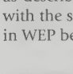

考试提示：无线连接特别容易受到重放攻击。防御重放攻击的最佳方法是使用加密并为合法交易设置较短的时间范围。

## IV攻击（初始化向量攻击）

WEP和WPA都依赖初始化向量（IV）来形成加密密钥，如第4章所述。在WEP中，使用简短的24位IV，导致相同的加密密钥下IV被重用。这为针对密钥的攻击打开了大门，导致WEP被轻易破解。WPA使用更长但仍然不足的IV机制。

## WEP/WPA攻击

WEP依赖的RC4实现现在已知存在不当实现，并且在其协议的各个方面都有严重缺陷。这些问题使得破解WEP几乎成了轻而易举的事。一种攻击涉及发送特殊的去认证（de-auth）数据包，导致合法客户端重新向接入点（AP）进行身份验证。然后攻击者从这些重新认证的数据包中捕获初始化向量，并在几分钟内破解WEP密钥。另一种攻击是chopchop攻击，它利用校验和使用中的弱点，使攻击者能够操纵数据包，将其返回给AP，并根据结果通过多次迭代确定加密数据包的内容。

WPA用时间密钥完整性协议（TKIP）实现取代了弱的IV实现，解决了对WEP的所有已知攻击。但由于WPA被设计为与WEP系统具有一定程度的兼容性，因此WPA中发现了其他弱点。使用具有已知结构的短数据包（例如本地DNS请求），可以暴力破解数据包流，而不会触发某些保护问题，如消息完整性代码（MIC）。这不会揭示密钥，但确实允许操纵本应受加密方法保护的数据包。如今，最常用的是带AES的WPA2来克服WPA/TKIP的问题。

### WPS攻击

Wi-Fi保护设置（WPS）是一种简化无线网络安装和设置的方法。制定该标准的想法是创建一种方法，使没有经过无线安全原理专门培训的用户也能轻松设置WPA并向网络添加新设备。WPS提供了一种轻松将新设备连接到网络的方法，既可以按下接入点和新设备上的按钮，也可以使用PIN。PIN既可以在新设备上使用，也可以在接入点上使用。

2011年，人们发现PIN方法可能只需几小时即可暴力破解。一旦PIN被发现，就有可能发现WPA/WPA2预共享密钥。由于WPS在大量设备上默认启用，因此在设置过程中务必禁用此功能。

### 应用层攻击

对系统的攻击可以发生在网络层、操作系统层、应用层或用户层（社会工程学）。早期的攻击模式是针对网络的，但如今大多数攻击都针对应用程序，主要是因为攻击目标大多位于应用层；用银行劫匪威利·萨顿（Willie Sutton）那句臭名昭著的话来说，“因为钱在那里。”事实上，当今许多对系统的攻击都利用网络、操作系统和应用程序中的漏洞组合，都是为了达到攻击目标——通常是某种形式的数据——这一目的。

应用层攻击利用了与计算机应用程序相关的几个事实。首先，大多数应用程序是由程序员团队编写的大型程序，其本质上存在设计和编码错误，从而产生漏洞。有关典型漏洞的列表，请参阅由MITRE维护的“常见漏洞与暴露（CVE）”列表，http://cve.mitre.org。其次，即使软件供应商发现并修补了漏洞，最终用户在应用补丁方面也往往行动迟缓，2003年1月的SQL Slammer事件就是明证。被利用的漏洞是缓冲区溢出，供应商在爆发前六个月就提供了补丁，但蠕虫仍然由于大量未打补丁的系统而迅速传播。

### 跨站脚本攻击

跨站脚本（Cross-site scripting）缩写为XSS，以区别于层叠样式表（CSS）。跨站脚本攻击是一种代码注入攻击，攻击者针对输入请求发送代码。该代码随后由Web服务器呈现，导致Web服务器执行该代码。跨站脚本攻击


利用 Web 系统中的一些常见元素。首先是未能执行完整输入验证的常见失败。XSS 会在响应输入请求时发送脚本，即使脚本不是预期或授权的输入类型。其次是 Web 系统动态自生成输出的特性。Web 系统经常是由图像、内容、文本、脚本等组成的集合，由 Web 服务器呈现给浏览器，浏览器对其进行解释并渲染为可显示的形式。XSS 攻击可以通过在接收到篡改输出的客户端浏览器中执行脚本来利用动态自生成的输出。

## Injections

未经验证地将输入用于函数已被证明是危险行为。未经验证输入的另一个问题是代码注入的情况。与输入适合函数不同，代码注入会以非预期的方式改变函数。每当未经验证的输入提供材料被使用时，应该意识到这可能让攻击者获得完全控制。

### SQL Injection

SQL 注入攻击是一种针对任何结构化查询语言（SQL）数据库的代码注入形式，无论厂商如何。此类攻击的一个例子是函数获取用户提供的用户名和密码输入，并将其替换到 SQL 语句的 *where* 子句中，其明确目的是将 *where* 子句改变为给出查询错误答案的子句。

假设期望的 SQL 语句是

```sql
select count(*) from users_table where username = 'JDoe' and
password = 'newpass'
```

值 JDoe 和 newpass 由用户提供，并简单地插入到字符串序列中。虽然在功能上看似安全，但使用以下序列很容易被破坏

```sql
' or 1=1 --
```

因为这会将 *where* 子句更改为返回所有记录的子句：

```sql
select count(*) from users_table where username = 'JDoe' and
password = '' or 1=1 --'
```

添加 or 子句，其中包含一个恒为真的语句以及注释行的开头以阻止尾随单引号，会将 SQL 语句更改为 *where* 子句被失效的状态。

### LDAP Injection

基于 LDAP 的系统也容易受到注入攻击。当应用程序根据用户输入构建 LDAP 请求时，未能验证输入可能导致错误的 LDAP 请求。SQL 注入可用于在数据库中执行任意命令，LDAP 注入也可以在目录系统中做到这一点。像在搜索框中使用通配符字符 (*) 这样简单的事情就可以返回原本超出查询范围的结果。在将请求传递给 LDAP 引擎之前进行适当的输入验证很重要。

### XML Injection

XML 也可通过注入被篡改。XML 注入可用于操纵基于 XML 的系统。由于 XML 在 Web 应用程序世界中几乎无处不在，这种攻击形式具有广泛的目标。

针对注入攻击的主要防御方法与缓冲区溢出类似：验证所有输入。但与其仅验证长度，你需要验证输入的内容。想象一个网页要求用户输入，然后使用该输入构建后续页面。还想象用户在其输入序列中间放置 JavaScript 函数的文本，并附带对脚本的调用。现在，生成的网页具有一个在显示时被调用的额外 JavaScript 函数。在使用前将用户输入通过 HtmlEncode 函数传递可以防止此类攻击。


> 考试提示 在考试中，您应该了解注入型攻击以及它们如何操纵它们注入的系统，SQL、LDAP 和 XML。

### Directory Traversal/Command Injection

目录遍历攻击是指攻击者使用特殊输入来规避文件系统的目录树结构。在未经验证的输入框中添加编码的 "../" 符号可能会导致解析器将编码解析为遍历代码，绕过许多检测元素，并将输入传递给文件系统，导致程序在非设计位置执行命令。当与命令注入结合时，输入可能导致以未经授权的方式执行代码。被归类为输入验证错误，这些错误如果不进行代码走查并专门查找，很难被检测到。这说明了在代码审查中使用前 25 项编程错误清单的有用性，因为它会在开发期间提醒开发人员注意此问题。

目录遍历可以通过使用输入流的编码来掩盖。如果安全检查在系统解析器解码字符串之前进行，则攻击形式的识别可能会受损。有许多方法可以表示特定输入形式，最简单的是称为规范形式。解析器用于为操作系统呈现规范形式，但这些嵌入式解析器可能在输入验证之后运行，使得仅通过匹配字符串来检测某些攻击变得更加困难。

### Buffer Overflow

攻击者经常利用的一个常见弱点是缓冲区溢出。缓冲区溢出发生在程序被提供超出其设计处理能力的输入数据时。例如，如果一个程序要求输入 7 到 10 个字符的电话号码，却收到了 150 个字符的字符串会怎样？许多程序会提供一些错误检查以确保不会出现问题。然而，一些程序无法处理此错误，多余的字符会继续填充内存，覆盖程序的其他部分。这可能导致一系列问题，包括导致程序中止或系统崩溃。在某些情况下，程序可以执行攻击者提供的命令。缓冲区溢出通常继承被利用程序所享有的特权级别。这就是为什么使用 root 级别访问的程序在被缓冲区溢出利用时如此危险，因为将要执行的代码以 root 级别访问执行。

缓冲区溢出已被证明可在各种程序中被利用，从 UNIX 到 Windows，再到 Internet Explorer、Firefox（Mozilla）等应用程序。历史上，按类型划分的超过 50% 的安全事件是由于缓冲区溢出利用造成的。这是使用最广泛的黑客手段之一，用户的主要防御措施是保持机器与软件制造商提供的补丁保持最新。不幸的是，修补已被证明不是非常有效的保护方法。许多人没有及时更新补丁，正如 Slammer 蠕虫攻击所示，该攻击发生在微软发布针对该漏洞的补丁近六个月后。即使补丁已广泛可用，既在热修复中也在服务包中，许多 SQL 服务器仍未收到补丁，并受到了该蠕虫的影响，该蠕虫使用缓冲区溢出进行传播。


**考试提示** 缓冲区溢出可能发生在任何代码中，而以特权运行的代码风险更大。2014 年，OpenSSL 库中的一个名为 Heartbleed 的缓冲区溢出使数十万系统变得脆弱，并暴露了全球数千万至数亿用户的关键数据。

缓冲区溢出是旨在利用未验证输入长度的输入例程的输入验证攻击。解决起来出奇地简单，只需在写入内存之前验证所有输入长度即可。这可以通过多种方式完成，包括使用安全的库函数进行输入。这是已被证明可解决的漏洞之一，事实上，在主要注重安全的软件公司中，其普遍性正在大幅下降。

### Integer Overflow

整数溢出是一种编程错误条件，发生在程序尝试将数值、整数存储到太小的变量中时。结果因语言和数值类型而异。在某些情况下，值会饱和变量，假设为定义类型的最大值且不再增加。在其他情况下，特别是对于有符号整数，它可能会回绕为负值，因为最高有效位通常保留用于数字的符号。这可能在程序中造成重大的逻辑错误。

整数溢出很容易测试，静态代码分析器可以指出它们可能发生的位置。鉴于此，没有任何合理的借口让这些错误进入生产代码。


浏览器上的 Cookie 管理通常是一个不可见的过程，但大多数浏览器都提供了让用户在客户端检查和操作 Cookie 的方法。Chrome 用户可以通过图 14-1 所示的界面检查、删除和阻止单个 Cookie。

Internet Explorer 也有类似的界面，在浏览器的“浏览历史记录”下仅有一个“删除”选项（参见图 14-2）。由于 Cookie 以单个文件形式存储，还可以通过文件处理系统进行额外的 Cookie 操作，如图 14-3 所示。这种组合使得批量操作更加容易，这是一个有用的选项，因为 Cookie 很快就会变得非常多。

那么 Cookie 到底有什么用呢？在浏览器中禁用 Cookie，然后访问一些你常去的网站，你很快就会明白 Cookie 的作用。Cookie 存储各种信息，从客户 ID 到之前访问过的网站的数据。由于 Cookie 以允许简单操作的形式存储在用户机器上，因此必须始终对其持怀疑态度，并且不适合用作安全机制。然而，它们可以让浏览器向 Web 服务器提供关键信息。广告商可以根据你之前看过的广告，利用 Cookie 控制向你展示哪些广告，而不管广告在网站上的位置如何。特定网站可以使用 Cookie 在页面之间传递状态信息，从而在用户期望的级别实现功能。Cookie 还可以记住天气网站的邮政编码、股票跟踪网站的 ID、购物车中的商品——这些都是典型的 Cookie 用途。归根结底，Cookie 是日常网络体验的一部分，只要使用得当（例如不用于存储安全数据以及提供 ID 和身份验证），它们就会一直存在并发挥作用。

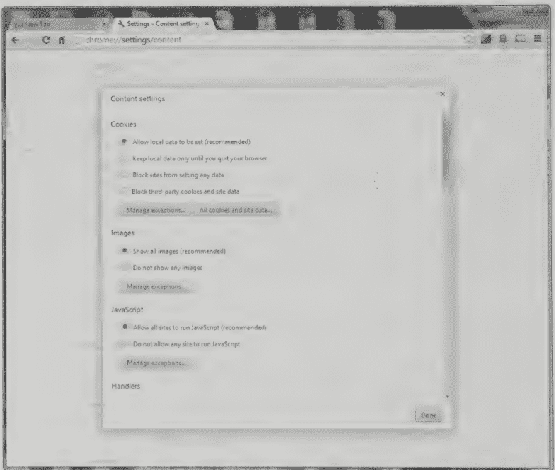
图 14-1 Chrome Cookie 管理

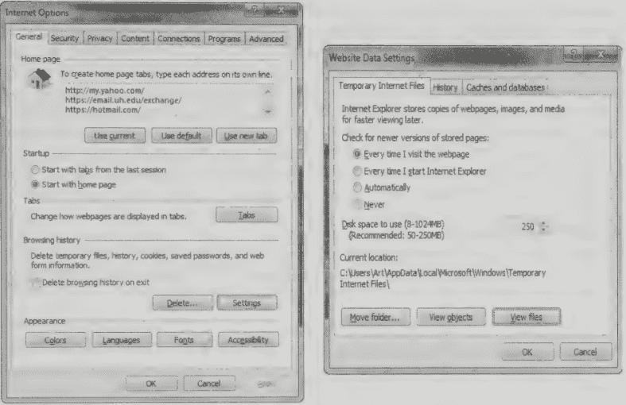
**图 14-2** Internet Explorer 11 Cookie 管理

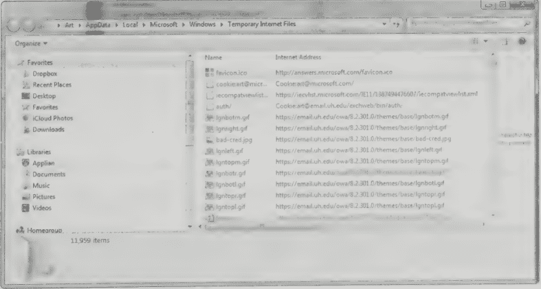
**图 14-3** Internet Explorer 11 Cookie 存储

## 禁用 Cookie

如果用户在浏览器中禁用 Cookie，则 Web 服务器将无法使用此类信息。IETF RFC 2109 描述了 HTTP 状态管理系统（Cookie），并规定了浏览器中应启用的几个 Cookie 功能，具体如下：

- 打开和关闭 Cookie 使用的功能
- 指示 Cookie 是否正在使用的指示器
- 指定 Cookie 域值和生存期的方法

其中一些功能已经讨论过，但要实现无 Cookie 浏览并非一步即可完成。告诉浏览器停止接受 Cookie 是通过选项菜单提供的设置选项，但这对于已经接收并存储在系统中的 Cookie 没有影响。要防止浏览器发送已接收的 Cookie，用户必须从系统中删除这些 Cookie。这种批量操作很容易执行，之后浏览器就可以在无 Cookie 状态下运行。一些第三方工具甚至可以实现更细粒度的 Cookie 控制。

## 附件

附件也可以被用作攻击向量。例如，如果用户输入一个图形文件（如 JPEG 文件），而该文件被篡改以包含可执行代码（如 Java），那么在渲染图像时，代码就会执行。这可能导致广泛的攻击。

## 本地共享对象

本地共享对象（LSO）是存储在用户机器上以保存应用程序（如游戏）信息的数据片段。通常，这些是 Adobe Flash 使用的 Cookie，称为 Flash Cookie，可以存储用户偏好等信息。由于这些对象可以在应用程序外部进行操作，因此它们可能构成安全或隐私威胁。

## 恶意附加组件

附加组件是分发出去的代码片段，用于向现有程序添加额外功能。浏览器辅助对象（BHO）就是其中一个例子，它提供了一种创建与 Internet Explorer 一起加载的插件模块的方法，并为浏览器提供了添加功能的手段。其功能可能非常强大，例如 Adobe Acrobat BHO 允许在浏览器中渲染 PDF。BHO 对 Internet Explorer 事件模型具有不受限制的访问权限，并且可以执行诸如捕获按键之类的操作。

其他程序也可以有利用主程序权限的附加组件。你应该只使用来自可信来源的附加组件，并且需要了解它们所带来的交互风险水平。ActiveX 是微软实现的一项技术，通过向用户控件添加重要功能来增强 Web 系统。除非使用 Authenticode 由受信任机构签名，否则不应允许 ActiveX 内容在浏览器中运行，因为代码变更的性质可能带来重大风险。

## 会话劫持

在 Web 上进行通信时，通常会创建会话来控制通信流。可以使用多种方法建立和控制会话，包括 SSL/TLS 和 Cookie。安全地实现会话的建立和拆除非常重要，因为如果一方在未正确拆除通信会话的情况下结束通信，入侵者就可以接管会话，在某一方离开后继续操作，并冒充该方。如果你登录银行进行交易，但让会话劫持者进入，那么劫持者可以在你离开后使用你的账户继续办理银行业务。这就是为什么从银行和金融网站注销而不仅仅是关闭浏览器如此重要的原因之一。

会话劫持的方法有很多，从中间人攻击到会话侧劫持和浏览器接管。会话侧劫持是指使用数据包嗅探来窃取会话 Cookie。如果只保护登录过程，然后切换回标准 HTTP，就会为这种攻击方法提供可乘之机。

最好的防御措施是正确使用加密（不要使用 SSL 2.0 或更早版本），并在完成后注销并关闭应用程序。使用多标签浏览器时，最好关闭整个浏览器实例，而不仅仅是关闭标签页。

## 客户端攻击

Web 浏览器已成为用户访问 Web 资源的主要应用程序。该界面的流行性和实用性使 Web 浏览器成为攻击者获取系统访问权限和控制权的首要目标。通过浏览器可能发生各种各样的攻击，通常是由于在使用前未能正确验证输入所致。未经验证的输入可能导致一系列注入攻击、头部操作和其他形式的攻击。

## 注入攻击

当用户输入未经输入验证就被使用时，攻击者就有机会精心构造输入，从而在应用程序解析和使用该输入时引发特定事件。SQL 注入攻击涉及对输入的操纵，导致 SQL 语句与设计者的预期不同。XML 和 LDAP 注入以同样的方式进行。由于 SQL、XML 和 LDAP 用于存储数据，这可能使攻击者获取违反业务规则的数据访问权限。当输入以允许命令行操作的方式使用时，可能会发生命令注入攻击。这可能使攻击者以应用程序的特权级别获得命令行访问权限。

## 头部操作

当通过用户输入动态生成 HTTP 时，未经验证的输入可能为攻击者提供更改 HTTP 元素的机会。当用户提供的信息用于头部时，可能会产生各种攻击，包括缓存投毒、跨站脚本、跨用户篡改、页面劫持、Cookie 操作或开放重定向。


> **考试提示** 各种攻击向量都可用于攻击客户端机器，包括缓存投毒、跨站脚本、跨用户篡改、页面劫持、Cookie 操作和开放重定向。考试中应了解所有攻击。

## 任意/远程代码执行

将用户输入用于创建要在系统上执行的命令所涉及的风险之一是任意或远程代码执行。这种攻击涉及攻击者准备一个输入语句，从而改变预编译语句的形式或功能。作为命令注入的一种形式，这种攻击可允许用户插入任意代码，然后在系统上远程执行。这是输入验证失败的一种形式，因为用户不应有能力在定义和批准的方法之外改变程序与主机操作系统交互的方式。

## 章节回顾

在本章中，你探讨了应用程序和无线攻击。本章首先讨论了无线攻击，包括流氓接入点、干扰和信号干扰、邪恶双子星、蓝牙攻击（蓝劫持、蓝牙窃听和蓝虫攻击），以及战争涂鸦和战争驾驶。然后讨论了针对加密的攻击，包括 IV 攻击、WEP/WPA 攻击和 WPS 攻击。在考试中，你需要能够解释这些类型的攻击。

本章后半部分介绍了应用程序攻击，首先从跨站脚本开始。接着是注入攻击，包括 SQL、LDAP、XML 和目录


遍历/命令注入。介绍了溢出攻击，包括缓冲区和整数溢出。定义了零日攻击的类别。本章继续讨论了 cookie、恶意附加组件、会话劫持和标头操纵。任意代码执行和远程代码执行完成了本章的内容。考试期望你能够解释这些类型的应用程序攻击。

## 问题

为了帮助你进一步准备 CompTIA Security+ 考试，并测试你的准备程度，请回答以下问题，然后对照本章末尾的正确答案检查你的答案。

1. 在 IV 攻击期间，什么被破坏了？
   A. 弱的 SSID
   B. 用户的身份验证凭据
   C. Wi-Fi
   D. 加密

2. 是什么让网站容易受到 SQL 注入的攻击？
   A. 过滤不严的输入字段
   B. 网站使用 Microsoft SQL 数据库驱动
   C. 过长的文本输入框
   D. 密码强度要求低

3. 一个区域内 Wi-Fi 接入点的列表最有可能由什么生成？
   A. WEP 破解攻击
   B. 非法接入点
   C. 战争驾驶
   D. 战争粉笔标记

4. 为什么缓冲区溢出是一种如此流行的攻击？
   A. 通过互联网很容易实现。
   B. 攻击者可以利用它破解任何加密。
   C. 相同的代码可以在任何系统上运行。
   D. 它可以提供任意代码执行。

5. 如何防止蓝牙劫持？
   A. 使用 WPA2。
   B. 在不主动添加设备时关闭配对。
   C. 不要将耳机与手机一起使用。
   D. 更改手机的 MAC 地址。

6. 为什么跨站脚本会成功？
   A. 它每次都使用不同的内存寄存器。
   B. 它的代码在加密状态下运行。
   C. 它利用零日漏洞。
   D. 它将恶意代码与来自受攻击站点的已验证内容混合在一起。

7. 近场通信与以太网有何相似之处？
   A. 它本身不强制安全，而是依赖更高层的协议，如 SSL。
   B. 它强制每个端点通过交换机进行通信。
   C. 它提供冲突避免。
   D. 以上所有选项。

8. 为什么咖啡店等场所的免费 Wi-Fi 是会话劫持的流行目标？
   A. 不安全的 Wi-Fi 允许攻击者在用户机器上放置恶意文件。
   B. 该场所使用强制门户。
   C. 不安全的 Wi-Fi 允许攻击者嗅探无线会话以获取用户的会话 cookie。
   D. 用户不在无线网络上使用 VPN。

9. 为什么非法接入点构成威胁？
   A. 它们被加载了恶意软件。
   B. 它们可能允许任何人访问企业网络。
   C. 它们只支持容易破解的 WEP。
   D. 无线信号是短距离的，所以额外的接入点不构成威胁。

10. 为什么整数溢出会成为安全问题？
    A. 它可能使应用程序崩溃。
    B. 它可能导致应用程序损坏数据。
    C. 它可能创造缓冲区溢出的机会。
    D. 以上所有选项。

对于第 11-15 题，假设如下：你正在管理你的公司网站，该网站包含电子商务功能，并且你被赋予了网站安全的责任。

11. 你将尝试通过输入清理来消除哪些威胁？（为 Web 服务器选择两个最佳答案。）
    A. 缓冲区溢出
    B. SQL 注入
    C. 跨站脚本
    D. LDAP 注入
    E. 标头操纵
    F. 战争驾驶

12. 你应该做出什么改变来防止会话劫持？
    A. 加密 cookie 文件。
    B. 清理所有输入字段。
    C. 将你的网站外包到云端。
    D. 将 SSL 应用于整个站点，而不仅仅是登录页面。

13. 你已经看到几个用户试图对你的网站执行目录遍历攻击。你将采取什么行动？
    A. 添加防火墙规则以阻止这些用户。
    B. 检查 Web 访问控制列表并验证所有目录权限。
    C. 将你的 Web 服务器软件更新到最新版本。
    D. 对所有会话流量使用 SSL，而不仅仅是登录流量。

14. 由于你在网站上的出色工作，CISO 请你帮助处理 Wi-Fi 系统上发生的随机行为。在建筑物的某些区域，无线信号可用但不允许任何流量通过。哪些措施可以帮助解决这个问题？（选择所有适用的选项。）
    A. 进行站点勘测。
    B. 启用 WPA2。
    C. 查找非法接入点。
    D. 寻找干扰源。
    E. 执行容量规划。

15. 你的站点勘测在天花板中发现了一个隐藏的非法接入点，类似于火灾探测器之一。这很可能是什么类型的设备？
    A. 在办公用品商店购买的 AP，用于增强销售部门隔间附近的 Wi-Fi 信号
    B. 普通企业无线局域网的一部分，只是为了与办公室融为一体而设计
    C. 一个定制的无线邪恶双子，试图收集用户信息
    D. 蓝牙劫持者

## 答案

1. D. 初始化向量（IV）攻击试图攻击密码初始化方式的加密实现。这是 Wi-Fi 网络 WEP 加密标准中一个已知的弱点。

2. A. SQL 注入是在输入过滤不佳的输入字段中使用分隔符或其他 SQL 命令结构来实现的。然后网页将该字段传递给数据库，数据库随后执行注入的命令。

3. C. 战争驾驶涉及使用无线扫描器和 GPS 四处驾驶，并记录 Wi-Fi 接入点的位置。

4. D. 缓冲区溢出是一种流行的攻击，因为它可以通过将代码直接插入内存来提供任意代码执行。

5. B. 蓝牙劫持依赖于与移动设备配对，因此关闭配对可以阻止蓝牙劫持攻击。

6. D. 跨站脚本将恶意内容（通常来自第三方网站）混合到 Web 服务器正确交付的已验证内容的一部分中。

7. A. 近场通信没有集成的加密功能，依赖更高层的协议来提供安全性。

8. C. 通常，SSL 仅用于网站的登录页面，因此嗅探 Wi-Fi 的攻击者可以捕获用户的会话 cookie，并用它来冒充用户。

9. B. 在 IT 控制之外建立的非法接入点通常会让任何能检测到该接入点的人连接到内部企业网络。

10. D. 所有答案都正确。当两个大数相加并超过指定的整数位数时，可能会发生整数溢出，导致结果变成一个非常小的数字。这可能导致应用程序出现意外行为。

11. B 和 D（SQL 注入和 LDAP 注入）是最佳答案。清理输入有助于确保没有原始命令直接传递给支持应用程序。

12. D. 通过在整个站点使用加密可以防止会话劫持，防止攻击者窃取已建立的用户会话。

13. B. 目录遍历攻击的核心在于执行外部用户不应访问的项目。适当的权限和删除所有不必要的执行权限将有助于减轻攻击。

14. A、C 和 D。这些措施将有助于确定特定区域无线信号差的可能原因。干扰可能由发射 2.4 GHz 信号的设备引起，例如无绳电话或微波炉。非法接入点通常配置在默认信道上，这可能会干扰配置正确的企业无线系统。站点勘测可以识别盲区和可能的故障设备。

15. C. 无线邪恶双子很可能伪装起来以避免被发现，同时尝试从毫无防备的无线用户那里捕获用户账户。


## 缓解技术

在本章中，您将

- 学习如何选择合适的缓解和威慑技术类型
- 学习系统日志监控如何降低风险
- 学习系统加固如何降低风险
- 学习如何运用网络安全技术降低风险

任何安全策略的一部分都是风险影响的缓解。一些标准方法被用作常见的缓解技术。不同的情况需要不同的缓解技术。本章探讨常见的标准缓解技术。

### 监控系统日志

日志文件是活动记录：发生了什么、何时发生、谁做的、来自何处等等。尽管许多管理员对日志文件的审计和分析感到畏惧，但简单事实是，有效的日志记录和分析可以成为维护和保护网络的优秀工具。第一步也是最关键的一步是在系统和网络设备上启用日志记录，并确保记录正确的活动。记录失败的登录是好的，但每次合法用户成功访问常用文件时都进行记录可能就过头了。确定记录什么、如何记录以及审计日志保留多长时间，是系统管理员之间长时间讨论的话题。

决定应记录什么内容的关键因素之一是对作为取证记录的一部分需要保留哪些信息的审查。按事件发生时进行日志记录，使调查人员可以通过查阅日志事后检查活动。日志本身并不是万灵药，因为它们需要被检查和解释才有用，这需要持续的努力和资源来检查日志。这是决定应记录什么的第二个关键因素——记录从不被审查的项目是一个常见问题。

#### 常见日志

计算机系统中的许多事件都可以被记录。OSI 模型不同层级的事件都可以在统一的日志记录方案中进行记录。在远程服务器上维护日志为集中式日志监控解决方案提供了安全性和简便性。以下是日志记录有效且必要的一些领域示例：

- **安全应用** 广义上，“安全应用”可以是任何有助于评估或保护网络的东西。任何具有生成日志文件能力的安全应用都应配置为执行此操作，并且生成的日志应定期进行分析。
- **DNS** 可以配置 DNS 服务器记录事务——解析请求、已进行或尝试的更新、转发以供解析的请求等。DNS 日志文件应接受审计，以帮助识别入侵尝试、攻击、欺诈性更新、中毒尝试等。
- **系统** 系统日志跟踪系统上的事件——故障、程序崩溃、系统关机和重启、进程启动和停止时间等。系统日志可以成为识别可疑、不期望或恶意活动的宝贵工具。
- **性能** 性能日志跟踪内存使用、CPU 使用、磁盘使用、网络流量等项目。性能日志可以是恶意活动的另一个良好指标，因为与正常水平相比，系统可能异常“繁忙”或异常“安静”。
- **事件** 事件日志是一种应用程序日志，用于跟踪系统上正在发生的情况。
- **访问** 跟踪哪个用户访问了特定资源、如何使用它、对该资源做了什么以及何时发生访问是至关重要的日志活动。审计访问日志可以成为检测恶意活动、用户管理不当以及其他活动的优秀方法。
- **防火墙** 防火墙活动日志跟踪尝试连接、网络流量、源地址、目标地址、使用的端口等。防火墙日志应定期审计，以确保防火墙按预期运行，帮助识别攻击流量的常见来源，识别常被针对的系统和服务等。
- **防病毒** 防病毒日志通常跟踪受感染的电子邮件或文件、违规电子邮件或文件的来源、更新状态、扫描活动等。需要定期审计以确保防病毒程序提供期望的保护级别并有效扫描电子邮件流量和系统。
- **IDS/IPS** 入侵检测系统和入侵防御系统日志也是跟踪可疑、不期望或恶意活动的优秀来源。这些日志可以识别攻击流量、攻击流量来源、目标资源、可能的和实际的入侵、数据丢失和其他信息。

### 安全设置定期审计

作为任何良好安全计划的一部分，管理员必须定期进行审计，以确保在用户、系统、政策和程序方面“一切如应”。安装和配置安全机制很重要，但必须定期审查以确保它们有效、最新并发挥预期功能。以下是应定期审计的项目示例，但绝非完整列表：

- **用户访问** 管理员应审查哪些用户正在访问系统、何时访问、正在使用哪些资源等。管理员应仔细查找用户不当访问资源或在不寻常时间访问合法资源的情况。
- **用户权限** 当用户更换工作或职责时，她可能需要分配不同的访问权限；她可能获得对新资源访问权限并失去对其他资源的访问权限。为确保用户仅能访问其当前职位所需的资源和功能，所有用户权限应定期审计。
- **存储** 许多组织都有政策规定可在“公司”资源上存储什么以及给定用户或组可以使用多少空间。定期审计有助于确保组织资源上不存在不期望或非法的材料。
- **保留** 在某些组织中，特定文档或记录存储多长时间可能与存储的内容一样重要。记录保留政策有助于定义存储什么、如何存储、存储多长时间以及到期时如何处置。定期审计有助于确保在不再需要时删除记录或文档。
- **防火墙规则** 定期审计防火墙规则很重要，以确保防火墙按预期过滤流量，并帮助确保“临时”规则不会成为规则集的永久添加。


> **考试提示** 日志记录、审查日志和执行审计是标准的安全任务，您应熟悉考试中的标准日志类型。

### 系统加固

维护企业安全的一个关键要素是企业基础设施中使用的硬件和软件的安全态势。确保系统配置正确且所有系统都已修补并保持最新是安全企业的一个关键组成部分。系统和操作系统的多种用途需要灵活的组件，让用户能够设计、配置和实施所需的系统。然而，正是这种灵活性导致了商业和开源形式中一些最大的弱点。许多安全软件包使用相同的概念来检测文件级更改。

#### 保护管理接口和应用程序

一些机器具有“管理接口”，允许远程管理设备本身。管理接口允许连接到设备的管理应用程序、SSH 服务，甚至是其他接口不允许的基于 Web 的配置 GUI。由于这种高级别的访问权限，管理接口和管理应用程序必须防止未经授权的访问。它们不应连接到公共网络连接（即互联网）或 DMZ 连接。在可能的情况下，应在组织内部限制对管理接口和应用程序的访问，以便没有适当访问权限和特权的员工甚至无法连接到这些接口和应用程序。

#### 密码保护

密码保护是良好安全基线中经常被忽视的关键活动之一。问题的核心在于，今天大多数系统仅由简单的用户 ID 和密码保护。如果攻击者发现正确的用户 ID 和密码组合——无论是手动还是使用众多免费的暴力攻击工具——他们就能进入，并完全绕过为保护系统而采取的所有正常步骤。更糟糕的是，在支持多用户的服务器系统上，攻击者只需猜中一个正确的用户 ID 和密码组合即可获得访问权限。

本章中我们检查的每个主题，从操作系统到应用程序，都存在这种基本的安全挑战。为所有用户账户选择一个好的密码对于保护信息系统至关重要。什么构成一个好的密码？一个相对容易记住但仍然难以猜测的密码？不幸的是，没有万能答案涵盖所有情况，但如果您在选择密码时遵循一些基本准则和原则，您可以确保系统上使用的密码能够保护您的资产。

#### 密码策略指南

要求用户名和密码进行身份验证无疑是当今使用最广泛的安全机制。不幸的是，它也是配置最差、被忽视且最容易被规避的系统。解决密码问题的第一步是制定一个有效且可管理的密码策略，使系统管理员和用户都能使用。在制定策略时，您应仔细审查您的业务和安全需求。可接受的风险水平是多少？系统需要多安全？用户应多久更改一次密码？是否应锁定账户？用户在选择密码时应使用什么准则？您的问题清单会大不相同，但关键是花时间识别您的关注点并在密码策略中具体解决它们。


创建密码策略后，要广而告之。确保每个用户都拿到一份副本。将其发布在公司内网上。在为新用户创建账户之前，让他们先阅读一份策略副本。定期发送电子邮件提醒，强调密码策略中的要点。在公司聚会上进行宣传。方法不如目标重要，目标就是确保每个用户都理解并遵循该策略。

当你向所有人传达了该策略后，必须强制执行才能使其生效。设置密码所需的最少字符数，绝不接受更短的密码。实施密码时效性（稍后讨论），并提示用户定期更改密码。不接受基于字典单词的密码。不允许用户反复使用相同的密码。许多操作系统都有内置的实用程序或附加组件，允许管理员强制良好的密码选择、强制密码时效性，并防止密码重复使用。

花点时间，通过运行一些流行的密码破解工具来审计你自己的密码文件。在一个拥有许多用户账户（超过一千个）的大型组织中，这会花费一些时间和计算能力，但非常值得。尽可能频繁地执行这些审计——每月、隔月或每季度一次。如果发现密码容易被破解的账户，让用户重新查看密码策略并立即更改密码。

大多数密码审计/破解工具可以使用以下任何一种或全部技术来检查密码文件：

- **字典攻击** 使用一个单词列表作为潜在密码。工具从列表中读取每个单词，对其进行加密，然后尝试将加密结果与密码文件中的密码进行匹配。如果加密结果与密码文件中的某个密码匹配，工具会记录用户 ID 和匹配的密码。这种攻击方法得名于使用整个字典作为输入列表的做法；许多字典和专用字典文件可用于破解/审计工作。
- **混合攻击** 使用一个单词列表，并对这些单词执行字符替换或字符添加。例如，工具可能会在单词的开头或结尾添加数字，或者用数字 3 替换字母 *e*。与使用相同单词列表的直接字典攻击相比，此方法耗时更长，因为列表中的每个单词都会被进行多种修改。
- **暴力破解** 用户定义要使用的字符集（A–Z、a–z、0–9 等）以及密码字符串的最小和最大长度。然后工具使用定义的字符集和密码长度逐个猜测所有可能的字符组合（先是 a，然后是 aa，再然后是 aaa，依此类推）。此方法需要大量的时间和处理能力。

另一种越来越流行的密码审计/破解方法是使用彩虹表。*彩虹表*是一个包含预计算密码字符串（通常称为*哈希*）的查找表。使用预计算哈希的查找表可以减少审计/破解某些密码文件所需的时间和处理能力，因为攻击者无需即时计算哈希——他可以直接从彩虹表中读取已加密的哈希，并将其与密码文件进行匹配。并非所有的审计/破解工具都能使用彩虹表。

## 选择密码

选择密码的方式多种多样，从随机生成到一次性使用。每种方法都有其优点和缺点，但通常当安全性提高时，可用性往往会下降。例如，随机生成倾向于产生由随机字母组成的安全密码（没有字典单词，并且大小写字母混合，通常还有一两个数字），这些密码很难猜测，并且能击败大多数密码破解工具。不幸的是，随机生成的密码往往难以记住，用户经常将这些密码写下来，通常写在靠近机器的地方，从而破坏了密码的目的。安全性和可用性之间的最佳折衷在于教用户如何基于容易记住的口令来选择他们自己的安全密码。

基于口令的密码可以通过多种方式形成：使用句子中每个单词的第一个字母；使用第一个单词的第一个字母、第二个单词的第二个字母，依此类推；组合单词；或者用其他字符替换字母。以下是一些口令示例及由此生成的密码：

- 使用以下句子中每个单词的第一个字母：
  - **句子** I love to drive my 1969 Mustang!
  - **密码** Iltdm69M!
- 组合单词并用字符替换字母：
  - **句子** Bad to the Bone
  - **密码** Bad2theB1

口令几乎可以是任何内容——你最喜欢的电影中的台词、你最喜欢的歌曲中的歌词，或者你当场编造的东西。使用你选择的任何方法，但最终结果应该是一个难以猜测、易于记住的密码。

## 好密码的组成部分

通过使用口令方法，用户应该能够创建自己容易记住的密码。然而，既然密码旨在保护访问和资源免受入侵者的侵害，它就不应该容易被其他人使用密码破解工具（如 John the Ripper 或 Crack）猜测或获取。为了使密码更难被猜测或获取，它应满足以下准则：

- 长度至少应为八个字符（某些操作系统默认要求更长的密码）
- 应包含以下四个元素中的至少三个：
  - 一个或多个大写字母（A–Z）
  - 一个或多个小写字母（a–z）
  - 一个或多个数字（0–9）
  - 一个或多个特殊字符或标点符号（!@#$%^&*,;:?）
- 不应包含字典单词
- 不应与用户的登录名相同，也不应包含登录名
- 不应包含用户的名字或姓氏、家庭成员的名字、出生日期、宠物名，或任何其他容易与用户关联的信息

## 密码时效性

只要有足够的时间和计算能力，几乎任何密码都可以通过使用暴力破解方法测试所有可能的密码来破解。如果同一个密码一直被使用，大多数情况下，攻击者最终将能够获得密码并访问用户的账户。定期更改密码有助于防止暴力破解攻击，因为当密码更改时，攻击者必须从头重新开始攻击。如果密码更改得足够频繁，攻击者将永远无法在密码再次更改之前遍历所有可能的组合。

因为几乎任何密码最终都可能被破解，防止用户“回收”密码（反复使用相同的密码）也很重要。频繁更改密码还可以减少密码被攻破时对系统的潜在损害以及攻击者所拥有的访问权限。如果攻击者获得了用户账户的访问权限，而密码被更改，攻击者可能会失去对该账户的访问权限，并且必须重新开始尝试破解新密码。许多操作系统都提供选项，允许系统管理员强制实施密码时效性并防止密码重复使用。请考虑使用以下准则：

- 让用户每 60 到 90 天更改一次密码（非常安全的设施可能需要每 30 到 45 天更改一次密码）。
- 让系统“记住”每个用户的最后五到十个密码，并且不允许用户再次使用这些密码。

虽然确保每个账户都有一个像样的密码至关重要，但直接禁用或删除不必要的账户也是一个非常好的主意。如果你的系统不需要支持来宾账户或匿名账户，那么请禁用它们。当用户或管理员账户不再需要时，将其删除或禁用。作为最佳实践，应定期审计所有用户账户，以确保你的系统上没有不必要、过时或不需要的账户。

## 禁用未使用的账户

当系统中添加新用户时，添加新的用户账户是一项必要的任务。维护一份好的列表，记录哪些用户在以后仍需要访问权限，是一项更具挑战性的任务。用户账户维护是一项重要的加固任务。所有新添加的账户或提升的权限都应被记录和监控。每当

Cisco IOS 也运行在思科许多以太网交换产品上。与路由器一样，这些产品具备接收和处理 Telnet 和 SNMP 等协议的能力。较小的网络组件通常不运行大型软件套件，而是在内部非易失性 RAM（NVRAM）中加载较小的软件。虽然这类软件的更新过程通常称为固件更新，但这并不改变保持其最新状态在安全方面的重要性。对于拥有多台设备的企业网络，必须有人负责更新设备，并且必须根据安全和管理策略定期执行更新。

## 网络设备配置

尽管保持软件最新很重要，但正确配置网络设备同样重要，甚至更为重要。许多网络设备（如路由器和交换机）现在都具有先进的远程管理能力，多个开放端口接受网络连接。为了确保这些设备的安全，正确的配置是必要的。选择一个好的密码对于维护外部和内部安全非常重要，关闭或限制对任何开放端口的访问也是保护设备安全的一个好步骤。在更高级的设备上，就像对待计算机一样，必须仔细考虑设备正在运行的服务。

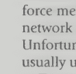

> **考试提示** 请记住，虽然路由器本质上只是在不同网络之间转发数据包的设备，但它也可以用于通过控制流入和流出网络的数据流量来帮助保护网络。

在许多情况下，网络设备的主要保护方法是密码。好的密码是最有效的安全工具之一，因为好的密码可以抵御多种形式的攻击。这种抵抗力迫使攻击者使用简单的暴力破解方法，这需要花费大量时间并产生大量网络流量，这两者都会增加攻击者行为被发现的可能性。不幸的是，好的密码往往难以记住，因此人们通常会使用较弱的密码。

要认识到糟糕的密码可能对安全造成的影响，请考虑这样一个事实：一个典型的暴力破解程序可以在不到一天的时间内尝试完足本英语词典中的每一个单词，但试图暴力破解一个八字符密码则需要数千年。这是基于不仅使用标准的 26 个字母，还加上大写字母（再增加 26 个字符）、数字（再增加 10 个），以及特殊字符（再增加 33 个不同字符）。这样总共可以使用 95 个不同字符，从而为一个一到八字符的密码提供了 6,704,780,954,517,120（即 6 千万亿）种不同的可能性。这与英语中估计的 200 万个单词，或仅由小写字母字符提供的 2170 亿种可能性形成鲜明对比。

最好的密码类型与实际单词毫无相似之处，例如“AvhB42^&nFh.”。然而，尽管此类密码提供了更高的安全性，但它们难以记忆，导致用户选择基于常规词典单词的密码。虽然这对任何系统上的任何密码都是一个担忧，但在网络基础设施设备上更值得关注，因为许多网络设备仅需要密码认证即可访问——通常不需要用户名。

许多管理员忽视的一个与密码相关的问题是 SNMP，它于 1988 年开发，并已在种类繁多的网络设备上实现。其广泛实现直接归因于它的简单性和可扩展性。由于每个制造商都可以向管理信息库（MIB）添加对象，因此一个制造商可以添加功能，而不会干扰 MIB 树中任何其他制造商的部分。该协议的这一特性使制造商能够使 SNMP 在配置和监控方面非常强大。缺点在于许多设备默认开启了 SNMP。不使用 SNMP 的网络管理员常常忘记禁用 SNMP，或者忘记更改众所周知的默认密码——通常“public”用于只读访问，“private”用于读/写访问。在 SNMP 服务处于活动状态并使用了默认密码的情况下，攻击者可以从网络设备中检索大量有价值的信息，还可以更改任何支持 SNMP 的设置。如果使用 SNMP，则应使用精心设计的密码，并制定密码更新计划。


> **考试提示** 把“public”这个词用作 SNMP 公共团体字符串是众所周知的漏洞。任何使用“public”作为 SNMP 团体字符串的系统都应立即更改。

请记住，SNMP 密码通常以明文形式传输，因此绝不应将其视为可信协议。SNMP 服务还应仅限于来自管理站 IP 地址的连接。如果不使用 SNMP，应尽可能禁用该服务。否则，SNMP 端口不应能从外部或内部网络的任何位置访问。

网络设备的另一个最佳实践是消除 Telnet 等明文协议的使用，并实施更安全的替代方案，如 SSH。SSH（Secure Shell）是一种加密协议，可用于与远程网络设备和服务器建立基于命令行的连接。与 Telnet 不同，SSH 是端到端加密的，因此在 SSH 会话中键入的任何内容都不易被潜在攻击者截获和查看。

与任何系统一样，安全性在很大程度上取决于系统本身的正确配置。路由器可以通过正确的配置得到安全保护，同样，也可能因糟糕的配置而处于不安全状态。良好的密码以及对设备正在运行哪些服务的了解，对于维护这些设备的安全非常重要。

## 802.1x

如第 2 章所述，802.1x 是一种将网络访问权限限制为仅授权用户的方法。802.1x 也被称为*基于端口的网络访问控制*，是 IEEE 标准，属于 IEEE 802.1 网络协议集的一部分。对所有系统采用基于边缘的访问控制可以提高安全态势。802.1x 是一种基于端口的安全机制，确保在允许设备连接到端口之前先进行身份验证。


> **考试提示** 802.1x 是一种身份验证方法，用于控制对设备端口的访问，也称为基于端口的网络访问控制或基于端口的身份验证。

## MAC 限制和过滤

使用 MAC 地址在交换机上执行端口级安全为系统增加了一层安全性。这一安全层确保与网络关联的硬件经批准可以使用，并按设计进行连接。这可以防止未经授权的通信信道插入网络层。MAC 过滤非常有用，可以确保网络连接不会被重新路由到其他机器，或确保不会发生对现有网络插座的未授权连接。

MAC 限制是指对交换机或端口可以学习到的 MAC 地址数量设置上限。这可以防止包括泛洪攻击在内的多种攻击，因为它会忽略大量“新”MAC 地址。端口还可以被限制为特定的 MAC 或 MAC 组，以限制外部连接到网络的能力。

## 禁用未使用的接口和未使用的应用服务端口

就像服务器一样，运行安全系统的一个重要管理问题是确定系统正常运行的具体需求，并仅启用那些功能所需的项目。将所有其他服务和用户排除在系统之外可以提高系统吞吐量并增强安全性。网络中存在需要在不使用时禁用的端口和连接。如果交换机预先布线到未使用房间的插座，则应禁用这些端口，直到需要时再启用，以防止攻击者利用未使用的端口。同样，管理接口和其他选项如果未积极使用，应予以限制和禁用，以防止这些网络功能被未经授权使用。如果开放的管理接口被发现并利用，获得网络设备访问权的攻击者可以重新配置该设备。减少与网络配置相关的攻击面，可以减少现在以及未来更新时的漏洞。


> **考试提示** 在设计和构建网络时，任何未积极使用的端口或功能都应禁用，直到需要时再启用。这种极简设置类似于隐式拒绝（implicit deny）理念，可以显著减少攻击面。

## 流氓设备检测

渗透网络的一种方法是通过安装流氓设备。另一种情况是用户出于某种未经授权的目的添加设备，例如本地无线接入点。这些设备和网络更改会带来各种安全问-

由于这些问题，检测流氓或未授权设备非常重要。自带设备（BYOD）的概念提升了流氓设备风险水平，因此，在企业网络的关键部分建立检测和隔离这些设备的机制非常重要。

## 安全态势

系统的安全态势取决于其配置和设置，以及有权修改这些设置的用户集合。正确设置系统，然后确保只有授权用户才能更改这些设置，是建立安全系统的重要一步。

## 初始基线配置

要有效且一致地保护系统，你必须采取结构化、逻辑化的方法。首先要检查系统的预期功能和能力，以确定系统上将承载哪些进程和应用程序。最佳实践是，系统上任何运行不需要的内容都应移除或禁用；然后应用所有适当的补丁、修补程序和设置，以保护系统并确保其安全。

将系统安全状态确立下来的过程称为基线化，由此产生的成果就是安全基线，它允许系统安全、可靠地运行。一旦针对特定的硬件和软件组合完成了这一过程，任何类似系统都可以配置相同的基线，并获得同样的安全保护水平和深度。统一基线在大规模运营中至关重要，因为为数百或数千个系统维护各自独立的配置和安全级别成本实在太高。

管理员完成对系统的修补、加固和准备后，通常会创建初始基线配置。这代表了系统或网络设备的安全状态，也是一个可用于帮助保持系统安全的参考点。如果这个初始基线可以复制，它还可以在部署类似系统和网络设备时用作模板。

## 更新（又称修补程序、服务包和补丁）

操作系统是庞大而复杂的相互关联软件模块集合，由几十甚至数千名不同的个人编写。随着过去几年对基于 GUI 的功能和增强能力的推动，操作系统持续扩展和增长。随着操作系统不断成长并引入新功能，代码出现问题的可能性也在增加。操作系统供应商几乎不可能在每一种可能的平台和每一种可能的情况下测试其产品，因此操作系统发布后确实会出现功能和安全性问题。对于普通用户或系统管理员而言，这意味着持续不断的更新流，用于纠正问题、替换代码段，甚至为已安装的操作系统添加新功能。

在未调查误报的情况下自动采取行动，可能导致业务功能下降和系统稳定性问题。

运营安全团队可以采用的另一项活动是*趋势分析*。当需要判断正常与异常运行时，测量特定性能指标以寻找特定趋势，可以提供有价值的信息。例如，对于某台给定的服务器，运行进程的趋势将表明处理器的正常进程范围，甚至可以洞察运行级别和状态。如果恶意软件或其他未经授权的进程变得活跃，运行进程的趋势将出现上升，从而提醒操作员注意异常情况。可以对许多不同的运行状况进行趋势分析，而且这也可以自动化，从而深入洞察运行变化。

## 检测控制与预防控制

缓解行动有两类截然不同的控制措施：检测和预防。检测控制能够发现不利状况，使企业能够采取适当的应对措施。预防控制旨在通过采取特定操作来改变连接关系。例如，可以通过发送重置命令来重置 TCP 连接。虽然无法阻止威胁，但根据企业在检测和预防原则上的运用情况，可以改变与这些威胁相关的风险。这两类控制措施的两个典型例子是 IDS（检测）与 IPS（预防），以及摄像头（检测）与保安（预防）。

如第 1 章所述，入侵检测系统（IDS）本质上是一种检测系统，旨在针对与已定义规则相关的特定状况向企业发出警报。然后由分析师来决定警报的真实性，并决定适当的响应。入侵防御系统（IPS）的核心是一个执行检测步骤的 IDS。IPS 不仅仅是发出警报，它还能根据特定的检测状况采取预定义的特定操作。这种闭环提供了比使用分析师更快的响应，但也缺乏处理误报的直接方法。

基于视频的监控，通常通过闭路电视（CCTV）摄像头，为监视大范围区域内的物理安全违规行为提供了有用的工具。摄像头可以充当检测设备，但响应时间取决于监视时间以及随后保安或警察进行物理干预的速度。如果摄像头系统没有得到主动监视，检测可能会延迟到审查录像之后。使用保安服务进行物理安全防护可以消除监视延迟，从而对状况做出更快的响应。正如 IDS/IPS 的情况一样，如果响应足够快，就可以在严重损害发生前中断攻击，从而防止损失。

## 章节回顾

在本章中，你了解了如何为广泛的攻击选择适当的缓解和威慑技术。本章首先讨论了系统日志监控，常见日志包括安全日志、DNS 日志、系统日志、性能日志、事件日志、访问日志、防火墙日志、防病毒日志和 IDS/IPS 日志。接着介绍了安全设置的定期审计。通过多个小节介绍了系统加固和管理接口的保护，包括禁用不必要的服务、保护管理接口和应用程序、密码保护，以及禁用不必要的账户。

随后回顾了密码选择标准、密码策略指南、好密码的组成部分和密码老化。接下来介绍了网络安全，涵盖 MAC 限制和过滤、802.1x、禁用未使用的接口和未使用的应用服务端口，以及流氓机器检测。下一个主题是安全态势，包括系统基线初始化和更新、持续安全监控和修复。

本章最后回顾了检测控制和预防控制之间的差异。

## 问题

为了帮助你进一步准备 CompTIA Security+ 考试，并测试你的准备程度，请回答以下问题，然后在章末核对正确答案。

- 1. 一个用户的域账户一天内多次被锁定，她怀疑有人在尝试暴力破解她的账户，或故意将她锁定。以下哪个日志最有可能显示其他登录尝试的来源？
  - A. 事件日志
  - B. 系统日志
  - C. 安全日志
  - D. 访问日志

- 2. 你的老板希望你为组织中的所有 Windows 8 工作站制定一个“设定的起点”。他希望你构建一个安全的黄金镜像，并能在加载任何部门特定软件之前用它来加载所有其他桌面。你的老板要求你创建什么？
  - A. 黄金镜像点
  - B. 初始快照
  - C. 初始基线配置
  - D. 安全基线

- 3. 你的组织有一台位于大楼前方开放大厅中的计算机。该系统夜间锁在安全柜中，但有人一直将 PC 从墙上拔下，并利用桌后的网络插孔在没有另一台计算机的情况下上网。你可以使用哪种缓解技术来阻止未经授权使用该网络插孔？
  - A. MAC 过滤
  - B. 重放预防
  - C. 审计
  - D. 进程跟踪


4. 你的同事告诉你，他已经为生产环境准备了一台服务器。他说他已经对其进行了修补，确保所有账户都有强密码，并且移除了服务器上的所有开发代码。当你扫描该服务器时，大量开放端口作出响应。你同事在保护这台服务器时忘记做了什么？
A. 安装防病毒软件
B. 禁用不必要的服务
C. 启用审计
D. 禁用 MAC 过滤

5. 你的老板正试图查找有关基于端口的网络访问控制的更多信息。她应该查看以下哪个 IEEE 标准？
A. 802.1x
B. 802.11x
C. 802.x
D. 801.2x

6. 你的组织正面临一个严重问题：人们带入笔记本电脑和平板电脑回家并将其连接到企业网络。组织已对此有政策禁止，但似乎没有帮助。以下哪种缓解技术可能有助于这种情况？
A. 禁用不必要的服务
B. 非法设备检测
C. Syslog 审计
D. 密码保护

7. 你的老板想要一个网络设备，能够在恶意网络流量发生时检测到它并阻止其到达网络内部系统。她要求你在早上之前提出几个不同的选项并向她展示。你应该开始研究以下哪一项？
A. 入侵检测系统
B. 入侵防御系统
C. 防火墙
D. 持续审计系统

8. 以下哪一项不是你在加固生产系统时执行的操作？
A. 禁用不必要的服务
B. 禁用不必要的账户
C. 启用简单的 TCP 服务
D. 配置审计

9. 一次缓冲区溢出攻击针对了你的其中一台基于 Windows 的 Web 服务器。你想知道服务器本身受影响的是哪个进程。你可能会在哪里查找受影响进程的线索？
A. 访问日志
B. 应用程序日志
C. 安全日志
D. 安装日志

10. 入侵检测系统最类似于以下哪种物理安全措施？
A. 上锁的门
B. 带电围栏
C. 安全摄像头
D. 迷宫入口

11. 以下哪些可用于协助加固网络？（多选。）
A. MAC 限制
B. 802.11
C. 非法用户检测
D. 禁用未使用的端口

12. 你的老板正在考虑将贵组织的网络安全任务外包。有多个提案可供查看，其中许多声称“从安全控制中收集信息并基于预先建立的指标进行分析”。这些供应商指的是什么能力？
A. 全球监控服务
B. 持续安全监控
C. 入侵防御系统
D. 基于指标的安全分析

13. 以下哪种类型的日志条目你不会在 Windows 安全日志中找到？
A. 账户登录事件
B. 对象访问事件
C. 策略更改事件
D. 系统关机事件

14. 以下哪些是与系统相关的常见日志？（多选。）
A. 安全
B. 失败
C. 系统
D. 数据完整性

15. 密码策略应解决以下问题：_______、_______ 和 _______。

## Answers

1. C. 对于这种情况，最佳的信息来源将是安全日志。因为这是一个域账户，很可能在 Windows 系统上，你需要查看与该账户关联的所有失败登录记录。这些记录存储在安全日志中。

2. C. 你的老板刚刚要求你创建一个初始基线配置。你开发的配置将成为所有 Windows 8 桌面的起点。虽然随着部门特定软件包的加载，桌面可能看起来不同，但它们都将从该初始基线开始具有相同的属性和安全配置。

3. A. MAC 过滤技术可以控制哪些 MAC 地址被允许通过特定交换机端口发送或接收流量。如果将该网络插座锁定到锁柜中 PC 的 MAC 地址，这将有助于阻止任何其他人未经许可使用网络插座。

4. B. 如果服务器有大量活动端口，它很可能正在运行大量服务。禁用不必要的服务应成为所有生产（和开发）系统的系统构建过程的一部分。禁用或移除不必要的服务可以减少系统的攻击面。

5. A. 如果你的老板正在研究基于端口的网络访问控制，那么她应该查看 IEEE 802.1x。

6. B. 非法设备检测是一种缓解技术，用于查找网络上不受欢迎、未经授权的设备和系统。一旦发现非法设备，你就可以追踪它们并对负责将其连接到网络的人进行纪律处分。

7. B. 你的老板正在寻找入侵防御系统（IPS）。IPS 与入侵检测系统（IDS）非常相似，只有一个明显区别：IPS 设计用于与恶意流量交互并阻止其。

8. C. 在加固系统时，目标之一是移除或禁用不必要的服务。简单的 TCP 服务，如 ECHO、CHARGEN 等，通常应在任何系统加固过程中被禁用。

9. B. 在基于 Windows 的服务器上，查找有关缓冲区溢出攻击影响了哪些进程的信息的最佳位置是应用程序日志。

10. C. 入侵检测系统最类似于安全摄像头。IDS 具有监控可疑活动的能力，并且可以记录它“看到”的内容。

11. A and D. MAC 限制和禁用未使用的端口是在设置网络时有价值的安全功能。802.11 是以太网的指定名称，不是直接问题（是 802.1x，不是 802.11）。非法用户检测超出了网络功能范围。

12. B. 持续安全监控试图回答那个老问题：“我们安全吗？”通过从已实施的安全控制（如防火墙、IDS/IPS、策略等）收集数据并根据既定指标分析数据，组织希望获得对其网络安全状态的更清晰了解。例如，如果边界防火墙记录到 UDP 端口 33456 的出站流量急剧上升，这可能是某种僵尸网络感染的早期迹象。

13. D. 系统关机事件将在系统事件日志中记录，而不是安全日志。

14. A and C. 安全日志和系统日志是常见系统日志的示例。

15. 密码策略应解决：可接受的风险水平是什么？系统需要多安全？用户应多久更改一次密码？应使用什么账户锁定策略？应强制执行哪些密码组成规则？

## Protocol Analyzer

正如第 1 章中介绍的那样，协议分析仪只是一种工具（硬件或软件），可用于捕获和分析通过通信信道（如网络）传输的流量。尽管协议分析仪存在于许多类型的通信信道中，例如电信流量和系统总线，但协议分析仪最常见的用途是捕获和检查网络流量。在网络世界中，这通常被称为多种名称，例如数据包嗅探器、网络分析仪或网络嗅探器。嗅探器可用于捕获和分析有线或无线流量，可以基于软件（最常见）或专用硬件/软件平台。有效的嗅探器必须具有将网络接口置于混杂模式的能力，这会告诉接口接受并处理它看到的每个数据包——不仅仅是发往该特定系统或发送到广播、多播或单播地址的数据包。在交换网络上，嗅探器通常插入 SPAN（在下一节中讨论）或监控端口，这些端口配置为接收通过同一交换机上一个或多个接口的数据包的副本。数据包分析器的功能差异很大——有些仅执行简单的数据包捕获，而其他则尝试使用解码的数据包和彩色编码的流量流重建整个 TCP/IP 会话。

从安全角度来看，协议分析仪是非常有用且有效的工具。想知道网络上是否有任何系统正在特定端口上传输流量吗？想知道是否有任何数据包被发送到竞争对手公司的地址吗？想知道哪些员工整天都在浏览 eBay 吗？想找到向本地网络发送广播流量的系统吗？协议分析仪可以帮助你解决所有这些问题以及更多问题——前提是分析仪插入到网络的正确位置，并且可以看到你关心的流量。大多数组织在网络中会有多个可以嗅探流量的点——在核心交换机、用户群与服务器场之间、远程用户与核心网络之间、组织与任何互联网链路之间等等。了解如何确保嗅探器可以看到你想要分析的流量，了解在哪里放置分析仪，以及了解如何使用分析仪，都是从协议分析仪中获得最佳结果的关键。

## Switched Port Analyzer

术语交换端口分析仪（SPAN）通常与思科交换机相关联——其他厂商将相同的功能称为端口镜像或端口监控。SPAN 具有复制通过交换机上一个或多个端口或交换机上一个或多个 VLAN 的网络流量的能力，并将复制的流量转发到指定用于流量捕获和分析的端口（如图 16-1 所示）。SPAN 端口或镜像端口为将输入协议分析仪或 IDS/IPS 的流量创建收集点。SPAN 或镜像端口通常可以配置为监控进入接口的流量、离开接口的流量或双向传输的流量。在配置端口镜像时，你需要了解正在使用的交换机的功能。它能否处理流量量？它能否成功镜像所有流量，还是在流量量过高时最终会丢弃发送到 SPAN 的数据包？


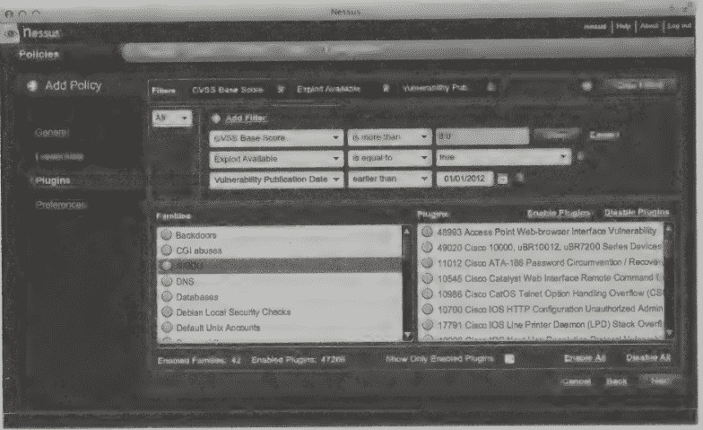

图 16-2 Nessus——网络漏洞扫描器

误配置或缺少补丁。虽然 MBSA 可以针对网络中的远程系统运行，但它通常在被检查的主机上运行，并且需要您访问该本地主机（以管理员级别）。关于主机扫描器需要记住的主要一点是，它们通常查找的是它们运行所在的系统上的漏洞。


> 考试提示 如果您想扫描特定主机是否存在漏洞、弱密码策略或未更改的密码，并且您可以直接访问该主机，那么主机漏洞扫描器可能正是您需要的工具。

值得注意的是，一些工具（如 Nessus）真正跨越了基于网络和基于主机的扫描器之间的界限。如果您向 Nessus 提供主机/登录/域凭据，它可以执行许多会被视为“基于主机”的检查。

选择合适的漏洞扫描器类型并不困难。只需关注您需要扫描的漏洞类型以及您将如何访问被扫描的主机/服务/应用程序。还值得注意的是，要做好彻底的工作，您可能需要同时使用基于网络和基于主机的扫描器——特别是对于关键资产。基于主机和基于网络的扫描器执行不同的测试，并提供对不同类型漏洞的可见性。如果您希望确保最佳覆盖范围，则需要同时运行两者。

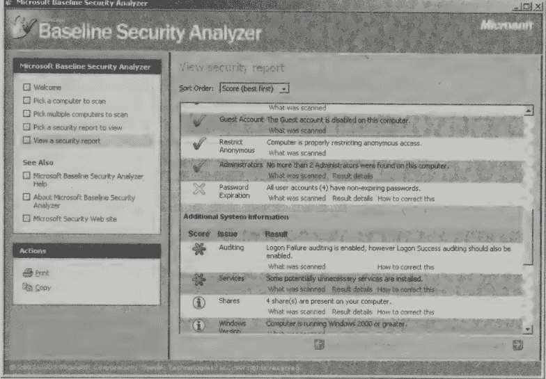

## 图 16-3 微软基线安全分析器

应用程序漏洞扫描器旨在查找应用程序或特定类型应用程序中的漏洞。应用程序扫描器是最专业化的扫描器之一——即使它们包含数百甚至数千项检查，它们也只查找特定类型应用程序中的误配置或漏洞。可以说，最受欢迎的应用程序扫描器类型旨在测试基于 Web 的应用程序中的弱点和漏洞。Web 应用程序设计为可见、与用户交互并接受和处理用户输入——所有这些都使其成为攻击者的有吸引力的目标。因此，可用的 Web 应用程序扫描器相对较多，从开源到订阅收费不等。要成为有效的 Web 应用程序扫描器，该工具必须能够使用从 IIS 到 Apache 到 PHP 到 ASP 以及两者之间的一切各种 Web 技术，对漏洞、误配置、默认内容、设置、问题等执行数千项检查。应用程序扫描器通常能够执行高级检查，例如 SQL 注入或 JavaScript 注入，这些检查需要与正在检查的 Web 应用程序交互，并根据应用程序的反馈修改请求和响应。图 16-4 显示了 Acunetix WVS（Web Vulnerability Scanner）的屏幕截图，这是一款专门针对 Web 技术的应用程序扫描器。

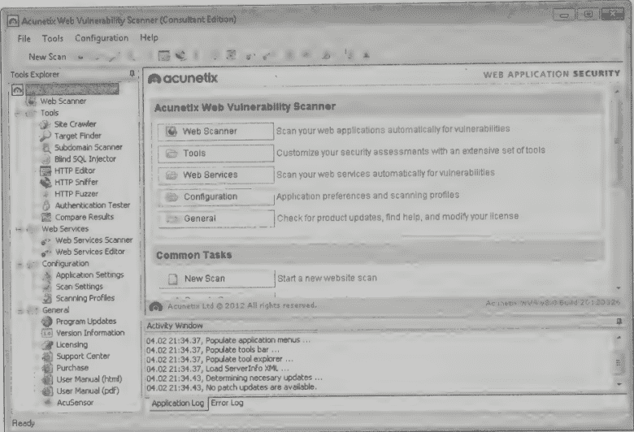

**图 16-4**  Acunetix WVS


**考试提示**  如果您想检查特定应用程序或同一类型应用程序的多个实例（如网站），应用程序扫描器是首选工具。

## 蜜罐

一个 *蜜罐* 是设计成在企业网络上像真实服务器一样运行的服务器，但与其拥有真实数据，它所拥有的数据是假的。蜜罐对攻击者来说是极具吸引力的目标。蜜罐充当攻击者的陷阱，因为蜜罐中的流量可以被假定为恶意流量。

## 蜜网

一个 *蜜网* 是设计成看起来像企业网络的网络，但对攻击者具有吸引力。蜜网是一组蜜罐。它看起来像企业网络，但由于它被已知为虚假副本，因此所有流量都被假定为非法流量。这使得攻击者流量的特征化变得容易，也有助于了解攻击来自何处。

## 端口扫描器

端口扫描器是一种旨在探测系统或系统开放端口的工具。其工作是探测开放（或监听）端口并向用户报告哪些端口已关闭、哪些被过滤以及哪些是开放的。端口扫描器几乎适用于每个操作系统和几乎所有流行的移动计算平台——从平板电脑到智能手机。拥有一个好的端口扫描工具并知道如何使用它会非常有益。端口扫描器的好消息/坏消息是，“坏人”使用它们的基本原因与“好人”使用它们的原因基本相同。端口扫描器可用于执行以下操作：

- 搜索网络上的“活跃”主机。大多数端口扫描器使您能够使用 ICMP、TCP 或 UDP 数据包执行快速扫描，以搜索给定网络或网络段上的活动主机。ICMP 对于此任务仍然非常流行，但由于 Windows 7 及更高版本等许多现代操作系统默认阻止 ICMPv4，用户越来越多地转向 TCP 或 UDP 扫描来执行这些任务。
- 搜索网络上任何开放的端口。端口扫描器最常用于识别主机、主机组或网络上的任何开放端口。通过对大量主机上的大量端口进行扫描，端口扫描器可以为您（或攻击者）提供有关网络上哪些主机运行哪些服务的非常清晰的画面。扫描可以针对“默认”的热门端口集、大范围的端口或每个可能的端口（从 1 到 65535）进行。
- 搜索特定端口。只查找 Web 服务器？邮件服务器？端口扫描器也可以配置为仅查找特定服务。
- 识别端口上的服务。一些端口扫描器可以根据服务返回的信息或分配的端口/服务（如果遵循了标准）帮助识别开放端口上运行的服务。例如，运行在端口 80 上的服务很可能是一个 Web 服务器。
- 查找 TCP/UDP 服务。大多数端口扫描器可以同时对 TCP 和 UDP 服务执行扫描，尽管某些工具不允许您同时扫描两种协议。

作为安全专业人员，您将以与攻击者大致相同的方式使用端口扫描器：探测网络中系统上的开放服务。当您发现开放服务时，您需要确定这些服务是否应该运行，是否应该在您找到它们的系统上运行，以及您是否可以做任何事情来限制允许连接到这些服务的连接。例如，您可能希望扫描网络中任何接受 TCP 端口 1433（Microsoft SQL Server）连接的系统。如果您在销售组中发现接受 TCP 端口 1433 连接的系统，很可能有人安装了不应该安装的东西（或有人为他们安装了）。

那么端口扫描器实际上是如何工作的？很多都取决于您在配置扫描时选择了哪些选项，但为了本示例的目的，假设您正在运行一个

## 被动与主动工具

工具可以分为主动和被动。主动工具以使用时可被检测的方式与目标系统交互。使用 Nmap（Network Mapper）扫描网络是一种可以被检测到的主动行为。就 Nmap 而言，该工具可能无法被具体检测到，但其使用、发送数据包的行为可以被检测到。当您需要绘制网络地图或查找一个或多个主机上的开放服务时，端口扫描器可能是完成该任务最有效的工具。图 16-5 显示了 Zenmap 的屏幕截图，Zenmap 是从 insecure.org 获取的非常流行的 Nmap 端口扫描器的跨平台版本。

被动工具是指以不会允许检测的方式与系统交互的工具，例如发送数据包或更改流量。被动工具的一个例子

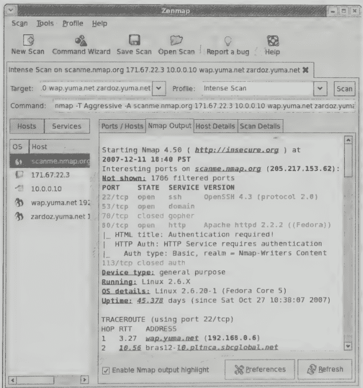

图 16-5 Zenmap——基于 Nmap 的端口扫描器


从 Telnet 客户端对 Web 服务器执行的横幅抓取。在此示例中，Telnet 向两个不同的 Web 服务器发送信息，并显示响应（横幅）。顶部的响应来自一个 Apache 实例（Apache/2.0.65），底部的响应来自 Microsoft IIS（Microsoft-HTTPAPI/2.0）。

## 风险计算

评估系统安全态势的一个要素是确定系统所面临的风险。尽管存在许多潜在的威胁和漏洞，但重要的是优先考虑针对构成最大风险的攻击向量的行动和防御措施。风险通过发生概率与威胁的严重程度来衡量。这两个度量刻画了风险的特征，可用于根据对系统的影响做出适当的决策。

如第 5 章中详细说明的，风险计算中一种常用的方法是

风险 = 威胁 × 漏洞（影响）× 资产价值

你必须为威胁、影响和资产价值确定适当的值，才能计算风险。

## 威胁与可能性

威胁对系统的严重程度是一个重要的度量。如果一次攻击成功，但结果没有显著后果，那么这次攻击可能不会构成太大的真正风险。另一种攻击可能具有极大的破坏性，以致系统无法使用，这显然需要加以缓解。另一个独立的度量是攻击成功的可能性。如果可能性较低，那么风险就会降低。如果可能性较高，那么风险就更高。真正的度量是严重程度与可能性的结合，通常将两者相乘。高可能性与高严重程度的组合尤其危险，比低水平的组合需要多得多的关注。

攻击者也会使用同样的衡量标准，因为他们会花更多时间在成功率更高的方法上。如果所有其他方面都相同，这就为确定防御措施的优先级提供了一种方法。

## 评估类型

可以执行多种类型的评估。评估是针对一组特定条件对系统进行的检查。评估可以面向威胁、漏洞和风险。每种评估的输出都侧重于提供与实际被评估对象相关的信息。因此，虽然各种类型的评估可能都会被互换使用，但它们确实会产生不同的结果。

## 风险

术语*风险分析*和*漏洞评估*有时会被互换使用，但这并不准确。分析和评估这两个术语可以互换使用而没有任何问题，但风险与漏洞是不同的。漏洞将在本章后面讨论。

风险分析通常从定量或定性的角度进行。定量风险分析试图为坏事发生的概率以及该事件造成的损失（通常以美元计）给出一个数字。定性风险分析则更多地依赖于估计和潜在损失以及相关的风险等级。要了解风险分析与漏洞评估之间的区别。


> **考试提示** 定量风险分析试图为坏事发生的概率以及该事件造成的损失给出一个数字，而定性风险分析则依赖于发生概率和影响的相对等级。更多细节请参见第 5 章。

## 威胁

*威胁评估*是对企业所面临威胁的结构化分析。理解威胁非常重要，因为你通常无法改变威胁——你只能改变它对你的影响。威胁评估首先要枚举现存的威胁，然后估计每种威胁成功的可能性。针对每个威胁分析其对企业的潜在影响，可以得到一份需要关注的威胁优先级列表。

## 漏洞

*漏洞评估*非常适合用于评估你的网络及其关键系统的安全态势。所有系统都有漏洞，因此了解你的系统中存在哪些具体漏洞是确保系统安全的关键。能够识别存在的漏洞并量化其影响，可以帮助你确定应采取哪些缓解/防护策略。漏洞评估有助于确定安全预算的投入方向以及人力的分配，甚至可以用来帮助获取额外的资源。保护网络或系统安全的第一步，往往是找出它们的问题到底有多严重。

## 评估技术

可以采用多种技术来对系统进行评估。每种技术都有其自身的优势，旨在详细说明系统的某个特定方面。基线报告可以衡量系统在基线配置下的安全态势。代码审查是一种有用的评估工具，可用于检查代码库可审查的应用程序。检查攻击面和审查架构也是确定安全态势的其他方式。

## 基线报告

对系统进行基线报告可以提供有关系统安全方面状态的信息。如本章前面所讨论的，存在诸如 Microsoft 基线安全分析器（Microsoft Baseline Security Analyzer，如图 16-3 所示）之类的工具，用于衡量系统的基线安全配置。虽然前面的示例侧重于操作系统的安全态势，但也有单独的工具可以对已安装的应用程序执行相同的分析。图 16-7 显示了 Secunia 个人软件检查器（PSI）对某个系统进行扫描的结果。Secunia PSI 是一款旨在监控应用程序更新并帮助用户保持应用程序更新的程序。

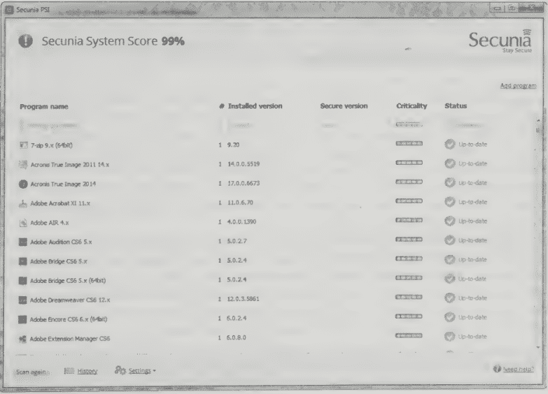

**图 16-7** 应用程序监控

## 代码审查

代码审查本质上是对源代码的校对。代码审查旨在发现可能导致漏洞的编程错误和不良编码实践，例如缓冲区溢出、内存泄漏、未处理的异常等。代码审查可以通过多种方式进行，从非正式的形式（一名程序员从旁查看同事的编码）到极其正式的形式（例如团队对整个代码库进行走查）。代码审查可以手动执行，但也存在提供自动化代码审查功能的工具。这些自动化审查工具可用于扫描大型代码库，并识别潜在问题或可能存在问题的区域。然后，开发人员可以专注于这些区域，而不必手动扫描整个代码库。自动化扫描后跟人工审查是一种被广泛接受的常见做法，与对整个代码库进行人工审查相比，它能以低得多的“成本”提供良好的覆盖率。

代码审查的主要好处是尽可能早地发现并解决缺陷和漏洞——最好是在软件进入正式测试之前。在开发过程中越早发现并解决缺陷，修复成本就越低。以 Microsoft Word 为例——如果在开发阶段发现了缺陷，在那里修正它要比在已发布的产品中修正该缺陷便宜得多得多。在开发阶段解决该缺陷可能只需几名开发人员和几行带注释的代码。而在已发布的产品中解决同样的缺陷，则涉及代码修订、配置管理、回归测试、补丁开发、补丁说明编写等等。正如你所看到的，产品发布后解决缺陷所需的大量工作，促使许多组织在开发周期中尽早并经常进行代码审查。


> **考试提示** 代码审查是开发过程中强大的安全工具。代码审查涉及在进入开发生命周期的下一个操作阶段之前，检查代码中是否存在漏洞或弱点。

## 确定攻击面

软件的攻击面是系统中可被未授权方访问的代码。这不仅仅是代码本身，还包括与代码相关的大量资源，包括用户输入字段、协议、接口、资源文件和服务。攻击面的一种度量方式是统计可访问项目的数量或加权数量。按严重程度加权可能会改变一些决策点，但底线很简单：可被攻击的元素数量越多，风险就越大。软件的攻击面并不代表代码的质量——这并不意味着存在缺陷；它仅仅是衡量有多少功能/项目可供攻击的一种指标。

一项长期以来的安全实践是，不启用未使用或不需要的功能。通过关闭不必要的功能，可以减少攻击面，从而降低安全风险。在整个开发周期中理解攻击面，是开发过程中的一项重要安全职能。

- 定义攻击面并记录更改，有助于在软件功能方面做出更好的安全决策。

无论软件是什么或做什么，它都会通过一系列常见的机制受到攻击。软件一直在受到攻击，而且攻击方式非常常见。例如，薄弱的访问控制列表（ACL）是一个常见的攻击点，无论操作系统是什么，都可以被利用。针对操作系统的攻击可以用于许多应用程序，包括那些……的软件


否则就是安全的。攻击面评估是一种衡量和确定与设计和开发影响相关的风险的方法。

要了解产品的攻击面，你需要衡量它可以被“访问”的方式的数量。每个软件产品可能不同，但它们也有共同元素。与许多其他安全事项一样，团队首次构建攻击面元素清单时会更困难。但随着时间的推移，增量检查会详细列出更多项目，使未来的清单更容易制定。有鉴于此，以下是微软发布的与 Windows 相关的攻击面元素清单。虽然此清单可能不完全适用，但它确实提供了一个起点，并可作为与攻击面相关的元素类型的指南。

- 打开的套接字
- 打开的远程过程调用（RPC）端点
- 打开的命名管道
- 服务
- 默认运行的服务
- 以 SYSTEM 身份运行的服务
- 活动的 Web 处理程序（ASP 文件、HTR 文件等）
- 活动的 Internet 服务器应用程序编程接口（ISAPI）筛选器
- 动态网页（ASP 等）
- 可执行的虚拟目录
- 已启用的帐户
- 管理员组中已启用的帐户
- 到管道和共享的空会话
- 已启用的来宾帐户
- 文件系统中的弱 ACL
- 注册表中的弱 ACL
- 共享上的弱 ACL

另一个信息来源是与先前开发相关的已知漏洞历史。确定旧漏洞的根本原因有助于修复它们并防止未来发生，而且这些信息对于确定攻击面也很有价值。

构成攻击面的功能清单与攻击者用来攻击特定软件时使用的清单相同。清单上的项目不一定是漏洞，但它们是攻击者试图破坏的目标。这些元素是所有漏洞的基础，因此，对于给定的攻击面元素，特定漏洞可能存在也可能不存在，但每个被揭示的漏洞都会对应一个这样的元素。这使得衡量攻击面成为对潜在漏洞面的可靠估计。

## 架构审查

对系统架构的审查可以提供有关系统弱点和漏洞的重要线索。架构审查应涵盖组件、组件之间的数据传输方式、组件的访问控制列表、数据传输和用户连接。有许多安全架构框架可用于协助正确设计系统。对于 Web 应用程序，一个常见的框架是开放 Web 应用程序安全项目（OWASP），这是一个以社区驱动、开源的方式关注 Web 应用程序安全的活动。其他架构指南可在信息及相关技术控制目标（COBIT）和信息技术基础架构库（ITIL）中找到。

## 设计审查

设计需要根据安全要求进行审查，包括访问控制要求、数据安全和系统配置要求。利用攻击面领域的文档结果和威胁模型，安全团队可以正确评估应用程序中的安全功能。代码走查、设计审查、攻击面领域检查以及以完整性为导向的威胁建模文档是这些审查的关键要素。

## 渗透测试

渗透测试（或称 pentest）模拟来自恶意外部人员的攻击——探测你的网络和系统以寻找进入途径（通常可以是任何途径）。渗透测试通常是最激进的安全测试形式，并且可以采取多种形式，具体取决于哪些内容被视为“在范围内”或“超出范围”。例如，有些渗透测试只是寻找进入网络的方法——任何方法。这可以从跨网络链路的攻击到社会工程学，再到测试人员实际闯入建筑物。其他渗透测试则有所限制——只允许跨网络链路的攻击，不允许物理攻击。

无论范围和方法如何，渗透测试的目标都是一样的：确定攻击者能否绕过你的安全性并访问你的系统。与通常仅对漏洞进行编目的漏洞评估不同，渗透测试试图利用漏洞，以了解该漏洞允许何种程度的访问。渗透测试非常有用，因为它们：

- 可以显示一系列“低风险”项目之间的关系，这些项目可以按顺序利用以获得访问权限（从而在总体上构成“高风险”项目）
- 可用于测试员工的培训情况、安全措施的有效性以及员工检测和响应潜在攻击者的能力。
- 通常可以识别和测试使用传统扫描工具难以甚至无法检测到的漏洞。

组织将漏洞扫描视为一个持续的过程，因为仅对系统扫描一次并假设此后它们将安全无忧是不够的。

## 被动测试安全控制

当使用自动化漏洞扫描器检查系统漏洞时，副作用之一就是被动测试安全控制。这被称为被动测试，因为漏洞扫描器的目标是系统，而不是控制。如果安全控制有效，那么漏洞扫描可能无法正确识别漏洞。如果安全控制阻止了漏洞被攻击，那么该漏洞可能无法被利用。

## 识别漏洞

漏洞是已知实体；否则，扫描器将无法对其进行扫描。当扫描器发现系统中存在漏洞时，它会记录这一事实。最后，枚举所发现的漏洞是漏洞分析报告的一部分。

## 识别安全控制的缺失

如果漏洞暴露在漏洞扫描器面前，那么就需要安全控制来防止漏洞被利用。随着漏洞被发现，每个漏洞的具体环境都会被记录下来。由于安全漏洞都是预先已知的，系统应该具备相应的控制措施以防被利用。漏洞扫描的部分功能就是了解控制措施在何处缺失或无效。

## 识别常见错误配置

与漏洞相关的一个失败来源是系统配置错误。常见错误配置包括访问控制失败以及未能保护配置参数。漏洞扫描器可以被编程来测试这些特定情况并报告它们。

## 侵入式与非侵入式

漏洞扫描器需要一种方法来检测漏洞是否存在以及是否可利用。一种方法是执行改变系统状态的测试，即侵入式测试。另一种方法是以不直接与特定漏洞交互的方式执行测试。这种非侵入式方法在实际确定漏洞时可能准确度低得多。如果漏洞扫描将涉及大量检查，非侵入式方法可能会更有优势，因为服务器可能不必一直重启。

## 有凭据与无凭据

漏洞扫描器可以被编程为使用系统凭据，从而使其拥有与授权用户相同的访问权限。这被认为比在没有凭据的情况下运行相同测试更容易，而后者被广泛认为是更贴近真实世界的尝试。运行这两种扫描都很重要，因为如果攻击者能够攻破某个帐户，他们很可能拥有内部凭据。有凭据扫描在确定漏洞是否存在时会更加准确，因为不受访问控制的阻碍。

## 误报

工具并不完美。有时它们会错误地将并非问题的事情报告为问题，而有时它们根本不会报告问题。*误报*是一种错误的发现——某些东西被错误地报告为漏洞。扫描器告诉你存在问题，而实际上一切正常。*漏报*是指扫描器未能报告实际存在的漏洞——扫描器只是漏掉了问题，或者没有将其作为问题报告。

## 测试

在描述漏洞和渗透测试的环境时，可以采用测试方法。正如在测试环境中一样，黑盒、白盒和灰盒测试等术语用于标识与测试相关的系统知识水平。

### 黑盒

黑盒测试是一种软件测试技术，包括以自动化方式通过注入畸形/半畸形数据来查找实现错误。黑盒技术测试软件的功能，通常从外部或用户的角度进行。使用黑盒技术的测试人员通常不了解被测软件的内部工作原理。他们将整个软件包视为一个“黑盒”——输入数据并查看输出。他们无法看到数据在应用程序内部是如何处理的，只能看到返回给他们的输出。黑盒测试的测试用例通常围绕预期功能（软件应该做什么）构建，并侧重于提供有效和无效的输入。

黑盒软件测试技术对于检查任何基于 Web 的应用程序都非常有用。基于 Web 的应用程序从暴露于公共流量那一刻起，通常会受到大量有效、无效、畸形和恶意输入的冲击。通过在应用程序发布前执行黑盒测试，开发人员有可能在开发或测试阶段发现并纠正错误。

黑盒测试也可以应用于网络或系统。渗透测试和漏洞评估通常从纯粹的外部视角进行，测试人员对其检查的网络或系统没有内部了解。


## 白盒

白盒测试几乎是黑盒测试的极端对立面。有时也称为透明盒测试，白盒技术会测试应用程序内部的结构和处理过程，以查找错误、漏洞等。白盒测试人员会对他们检查的应用程序有详细的了解——他们会设计测试用例，以覆盖应用程序的每个路径、决策树、输入字段和处理例程。

白盒测试通常用于测试应用程序内的路径（如果 X，则执行此操作；如果 Y，则执行那操作）、数据流、决策树等。有时白盒测试一词也应用于网络评估，在这种情况下，测试人员会对网络有详细的了解，包括但不限于 IP 地址、网络路由、有效用户凭据等。在这些情况下，测试人员通常被称为“白帽”。

## 灰盒

那么当你混合一点黑盒测试和一点白盒测试会怎样？你就得到了灰盒测试。在灰盒测试中，测试人员通常对他们正在测试的软件、网络或系统有一定的了解。因此，灰盒测试可以非常高效和有效，因为测试人员通常可以快速排除整个测试路径、测试用例和工具集，并排除那些根本行不通且不值得尝试的事情。


### 考试提示
黑盒测试与白盒测试之间的关键区别在于测试人员的视角和知识。黑盒测试人员对内部工作原理一无所知，并从外部视角执行测试。白盒测试人员对内部工作原理有详细的了解，并从内部视角执行测试。

## 章节回顾

在本章中，你了解了威胁和漏洞发现。本章首先对各种安全工具及其结果的解读进行了探讨。所涵盖的工具包括协议分析器、漏洞扫描器、蜜罐和蜜网、端口扫描器以及横幅抓取。这些工具为评估系统的安全级别提供了一种机制。

本章继续探讨风险计算。风险计算的使用以及评估的设计——包括风险、威胁和漏洞评估——可以提供信息，从而实现安全行动的优先级排序。下一节关于评估技术，涵盖了基线报告、代码审查、确定攻击面、架构审查和设计审查作为执行评估的方法。

本章随后讨论了渗透测试和漏洞扫描。它涵盖了渗透测试的步骤、漏洞扫描的过程、假阳性和假阴性条件，最后是白盒、黑盒和灰盒测试。

5. 某个应用程序因一名测试人员发现了一个重大错误而被延迟。现在开发人员被要求逐行检查彼此的代码并查找任何剩余的错误。这些开发人员在做什么？
A. 质量保证
B. 代码审查
C. 风险评估
D. 代码分析

6. 列出确定风险时重要的三项内容：________、________、________。

7. 你需要一些东西来更有效地分析网络上的流量，需要一些能够在数据包级别记录流量的东西，以便你可以查找 ARP 风暴、重复 MAC 地址等问题。你应该购买什么类型的工具？
A. 白盒分析器
B. 网络扫描器
C. 被动扫描器
D. 协议分析器

8. 你的组织希望有人检查你的内联网门户以评估恶意内部人员的威胁。什么类型的测试最适合这种情况？
A. 凭据测试
B. 代码审查
C. 主动测试
D. 风险评估

9. 以下哪种工具或方法最有可能显示你的服务器场中哪些服务器允许匿名访问共享、打开了 TCP 端口 80，并且正在运行旧版本的 PHP？
A. 协议分析器
B. 端口扫描器
C. 漏洞扫描器
D. 基线审查

10. 你发现了一份打印件，其中列出了许多 IP 地址及其旁边的描述，例如“220 Microsoft ESMTP MAIL Service ready”和“220 Microsoft FTP Service”。什么类型的活动可能生成了这种类型的列表？
A. 风险评估
B. 横幅抓取
C. Telnet 映射
D. 黑盒测试

11. 你的漏洞扫描工具报告称你的网站容易受到操纵隐藏参数值的 SQL 注入攻击。你已彻底手工测试但无法验证该发现。每次尝试时，你都会收到一条非标准的错误消息，表明查询已被终止。你的漏洞扫描器最有可能报告的是：
A. 无效重定向
B. 用户错误
C. 假阴性
D. 安全控制绕过

12. 你被要求对组织开发的新 Web 应用程序进行一些测试。CEO 希望你执行灰盒测试。为了执行这种类型的测试，你需要什么？
A. 仅应用程序的 URL
B. 应用程序的 URL 以及所使用的数据结构和算法的文档
C. 对应用程序的全部了解，包括 URL、所使用的数据结构和算法的文档以及应用程序所有功能路径的列表
D. 对应用程序没有任何了解

13. 以下哪项最能描述应用程序的攻击面？
A. 所有登录和用户输入
B. 所有登录、用户输入和数据字段
C. 所有登录、用户输入、数据字段和使用中的证书
D. 所有登录、用户输入、数据字段、应用程序中数据进出的路径以及保护数据路径的代码

14. 你想在网络上放置一个工具，持续查找网络上的漏洞。你的网络管理员拒绝允许任何可能干扰网络流量的东西。你可以使用什么类型的工具作为两种立场之间的折中？
A. 主动网络漏洞扫描器
B. 被动网络漏洞扫描器
C. 入侵防御系统
D. 被动防火墙

15. 你正在进行渗透测试，发现一个 Web 服务器似乎在登录字段中容易受到 SQL 注入攻击。你的团队负责人允许你尝试使用 SQL 注入攻击进入系统。它成功了。你刚刚执行了渗透测试的哪一步？
- A. 安全控制的被动测试
- B. 白盒测试
- C. 漏洞识别
- D. 漏洞利用

## 答案

1. B. 如果审计部门只需要一份系统列表以及每个系统上的开放服务列表，那么端口扫描器就足够了。任何像 Nmap 这样不错的端口扫描器都能够检测系统并探测这些系统上的任何活动端口。

2. D. 如果你希望有人在没有任何关于软件内部工作原理或软件构建方式的知识的情况下测试你的应用程序，那么你正在寻找黑盒测试服务。黑盒测试在不知道所使用的数据结构或软件内部工作原理的情况下检查软件的功能。

3. A. 风险评估是用于识别潜在危害并分析如果这些危害实际发生的影响的过程。

4. C. 你的老板实际上是在寻找一个蜜罐——一个故意设置漏洞和错误配置以吸引潜在攻击者的系统。蜜罐通常用于研究攻击者使用的方法和工具。

5. B. 开发人员正在进行代码审查——对源代码进行系统检查以查找并消除错误、失误、错别字等。

6. 确定风险时重要的三项内容是威胁的可能性、漏洞的可发现性以及对资产的影响价值。你必须考虑威胁、影响和资产价值来计算风险。

7. D. 如果你正在寻找一个帮助你分析网络流量的工具，你应该购买协议分析器。协议分析器是用于捕获和检查通信信道中信号和数据的工具。几乎每种通信信道都有协议分析器。

8. A. 如果你想评估恶意内部人员的威胁，你最有可能使用凭据测试。凭据测试在进行测试时使用一组有效用户凭据。这允许测试人员从与有效用户相同的视角并具有相同的权限来检查应用程序。


9. C. 漏洞扫描器是所列出的唯一一种能够同时提供这三项信息的工具或方法。端口扫描器可以告诉你80端口是否开放，但无法测试共享访问权限或存在漏洞的PHP版本。大多数漏洞扫描器（如Nessus）不仅会执行基本的TCP/IP端口扫描，还会扫描错误配置、不安全的软件版本等。

10. B. 显示“220 Microsoft FTP Service”等服务“横幅”的列表通常是通过横幅抓取创建的。有许多专门用于横幅抓取的工具，但你也可以直接使用Telnet客户端连接到服务来实现同样的目的。在大多数情况下，服务会返回一条横幅，告诉你有关该服务的各种详细信息。

11. B. 测试中一定存在用户错误。当任何扫描工具报告一个实际上并不存在的“发现”时，这被称为误报。

12. B. 灰盒测试是白盒测试和黑盒测试的结合。测试人员对正在检查的系统或应用程序有一定的了解，例如数据结构和算法，但不像白盒测试那样了解应用程序的全部信息。

13. D. 应用程序的攻击面实际上是对攻击者可能渗透或破坏应用程序的所有不同位置的描述。这包括进出应用程序的所有数据路径、应用程序使用的所有数据，以及保护和处理数据和数据路径的代码。

14. B. 如果你想要一个能够查找漏洞但不会干扰网络流量的工具，最好的折中方案是某种被动式网络漏洞扫描器。“被动”扫描器等待数据传送到它那里——它本身不执行任何扫描或探测，也不与其观察到的流量进行交互。

15. D. 每当你发现一个漏洞，然后使用工具或技术利用该漏洞来获取访问权限或操纵数据时，你就执行了漏洞利用。识别漏洞并不涉及对已发现漏洞采取进一步操作。使用SQL注入攻击获取系统访问权限绝对属于利用漏洞。

# 第四部分
## 应用、数据和主机安全

- **第17章** — 应用程序安全控制
- **第18章** — 移动设备安全
- **第19章** — 基于主机的安全
- **第20章** — 保护替代环境

## 应用程序安全控制

在本章中，你将

- 了解安全编码概念的重要性
- 理解应用程序安全控制和技术的重要性
- 了解输入处理的重要性
- 学习安全编码中使用的工具和技术
- 学习应用程序加固技术

应用程序安全控制和技术对于确保所部署的应用程序尽可能安全至关重要。从安全编码技术开始，然后通过添加安全控制来提供纵深防御，从而建立应用程序的安全性。使用应用程序加固技术以及正确的配置和变更控制，提供了一种以流程为驱动的方法，以确保根据定义的风险概况持续保持安全性。

### 安全编码概念

应用程序安全始于安全且无漏洞的代码。不幸的是，所有代码都存在弱点和漏洞，因此以具有有效防御措施的方式实例化代码以防止漏洞被利用，可以维持所需的安全级别。正确处理配置、错误和异常以及输入，有助于创建安全的应用程序。在整个系统生命周期中对应用程序进行测试，可用于确定系统的实际安全风险概况。

软件开发生命周期（SDL）中有许多单独的元素可以帮助团队开发安全代码。正确的SDL流程，如输入验证、适当的错误和异常处理以及跨站脚本和跨站请求伪造缓解措施，可以提高代码的安全性。安全测试、模糊测试和补丁管理等流程元素也有助于确保应用程序满足所需的风险概况。

常见软件错误有两个主要枚举：MITRE维护的Top 25列表和针对Web应用程序的OWASP Top Ten列表。根据所评估的应用程序类型，这些列表为已知错误类型的安全分析提供了坚实的起点。MITRE是标准程序行业标准列表的存储库，OWASP则针对Web应用程序。由于常见错误的成因变化不快，这些列表不会每年更新。

### 错误和异常处理

每个应用程序都会遇到错误和异常，这些都需要以安全的方式处理。一种攻击方法包括强制产生错误，使应用程序从正常操作转入异常处理。在异常期间，常见的做法是记录/报告该状况，包括支持信息，例如导致错误的数据。这些信息在诊断错误状况的原因方面可能非常宝贵。挑战在于这些信息在哪里被捕获。最好的方法是将其捕获到日志文件中，在那里可以通过ACL进行保护。最糟糕的情况是将其回显给用户。当攻击者故意引发错误时，将错误状况详细信息回显给用户可能为攻击者提供有价值的信息。


> **考试提示** 所有错误/异常都应在生成例程中进行捕获和处理。

不当的异常处理可能导致各种信息泄露。与SQL语句相关的错误可能泄露数据结构和数据元素。远程过程调用（RPC）错误可能泄露敏感信息，如文件名、路径和服务器名称。编程错误可能泄露异常发生的行号、被调用的方法以及堆栈元素等信息。

### 输入验证

随着基于Web的应用程序的兴起，错误已从缓冲区溢出转向输入处理问题。用户能够操纵输入，因此开发人员需要适当处理输入，以防止恶意条目产生影响。缓冲区溢出可以被视为一类不当输入，但较新的攻击还包括规范化攻击和算术攻击。可以采用的最重要的防御机制可能是输入验证。在正确验证之前将所有输入视为敌意输入，可以缓解许多基于常见漏洞的攻击。这具有挑战性，因为验证工作需要在所有解析器完成对输入流的操作之后进行，这是使用Unicode和其他国际字符集的基于Web的应用程序中的常见功能。

输入验证特别适用于以下漏洞：缓冲区溢出、在安全决策中依赖不受信任的输入、跨站脚本（XSS）、跨站请求伪造（XSRF）、路径遍历以及缓冲区大小的错误计算。输入验证可能看起来适用于各种注入攻击，但考虑到输入的复杂性以及合法但不正确的输入流所带来的后果，这种方法对大多数注入攻击而言并不足够。有效的方法是一种识别和白名单方法，即对输入进行验证，然后将其解析为标准结构再执行。这将攻击面不仅限制在合法输入，还限制在预期输入范围内。

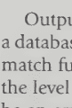

> **考试提示** 将所有输入视为敌意输入。输入验证是最重要的安全编码技术之一，可缓解多种潜在漏洞。

在许多情况下，输出验证与输入验证同样重要。如果查询数据库以匹配用户名和密码，则匹配函数的输出预期形式应为一条匹配或无匹配。如果使用记录数来表示匹配程度（这是常见做法），则除0或1之外的值都表示错误。使用输出验证的防御性编码不会对大于1的值采取行动，因为这些值显然是错误，应视为失败。

### 模糊测试

测试中最强大的工具之一是模糊测试（也称为fuzz testing），即系统性地应用一系列格式错误的输入来测试程序的响应方式。黑客多年来一直使用模糊测试来寻找可利用的缓冲区溢出，而无需了解具体的编码。无论测试类型是白盒还是黑盒，模糊测试都能完美运行。模糊测试是发现意外输入验证错误的最佳实践。

测试人员可以使用模糊测试框架来自动化大量输入序列。在检查某个函数是否容易受到缓冲区溢出攻击时，测试人员可以运行大量输入，测试长度和最终的载荷传递选项。如果某个特定输入字符串导致可被利用的崩溃，测试人员将详细检查该输入。模糊测试在开发领域仍相对较新，但正在迅速成熟，很快将与其他自动化代码检查工具几乎持平。

### 跨站脚本防护

跨站脚本（XSS）是最常见的Web攻击方法之一。该漏洞的原因是用户输入验证薄弱。如果输入未得到正确验证，攻击者可以在其输入中包含脚本，并使其作为Web过程的一部分被渲染。XSS攻击有几种不同类型，通过脚本的效果加以区分：

- **非持久性XSS攻击** 注入的脚本不会被持久化或存储，而是立即执行并通过Web服务器传回。
- **持久性XSS攻击** 脚本被永久存储在Web服务器或某些后端存储上。这允许该脚本被用于攻击登录系统的其他用户。
- **基于DOM的XSS攻击** 脚本通过文档对象模型（DOM）进程在浏览器中执行，而不是在Web服务器上执行。


跨站脚本攻击可能导致各种后果，在某些情况下，列表可以是任何狡猾的脚本编写者能够想到的。 在实际环境中常见的用途包括

- 从 Web 应用程序窃取身份验证信息
- 会话劫持
- 部署恶意内容
- 修改用户设置，包括未来用户
- 冒充用户
- 钓鱼或窃取敏感信息

用于防御 XSS 攻击的控制措施包括使用反 XSS 库从输入序列中剥离脚本。 减轻 XSS 攻击的各种其他方法包括限制上传类型和筛选上传大小、白名单输入等等，但尝试从输入中删除脚本可能是一项棘手的任务。 设计良好的反 XSS 输入库函数已被证明是最好的防御。 跨站脚本漏洞很容易进行测试，并且应该是每个应用程序测试计划的一部分。 测试各种编码和未编码输入的脚本漏洞是基本测试要素。

## 跨站请求伪造

跨站请求伪造（XSRF）攻击利用在定义使用中适当但在未经授权的使用情况下执行的非预期行为。 这是“混淆的代理”问题的示例，这是一类问题，其中一个实体错误地代表另一个实体执行操作。 XSRF 攻击的有效性依赖于多个条件。 它针对具有已认证用户的站点，并利用站点对先前身份验证事件的信任。 然后，通过诱骗用户的浏览器向目标站点发送 HTTP 请求，信任就会被利用。 假设你的银行允许你登录并进行金融交易，但不对每次后续交易进行身份验证。 如果用户已登录且未关闭浏览器，则另一个浏览器标签页中的操作可能会向银行发送隐藏请求，导致看起来已授权但实际上并非由用户完成的交易。 可以采用多种不同的缓解技术，从限制身份验证时间到 cookie 过期，再到管理网页的某些特定元素，如头部检查。 最强的方法是在表单提交中使用随机 XSRF 令牌。 后续请求无法工作，因为令牌未预先设置。 测试 XSRF 比其他注入型攻击需要更多的规划，但这也可以作为设计过程的一部分完成。

## 应用加固

应用加固的工作方式与系统加固相同（第 15 章讨论）。 第一步是删除不必要的组件或选项。 第二步是在实施时对系统进行适当的配置。 每次更新或补丁都可能导致这些条件发生变化，应在每次更新后确认。

确保系统加固的主要工具是安全的应用程序配置基线和补丁管理流程。 正确使用时，这些工具可以带来最安全的系统。

### 应用配置基线

基线是计算机系统的正确设置集合。 一个 *应用配置基线* 概述了应用程序或一组应用程序的正确设置和配置。 这些设置包括许多元素，从应用程序设置到安全设置。 保护设置至关重要，用于保护它们的常见机制包括访问控制列表和受保护目录。 所需设置的文档是一份重要的安全文档，有助于管理员确保在更新过程中保持正确的配置。

### 应用补丁管理

应用补丁管理是应用和系统加固的基本组成部分。 目标是运行应用程序最安全的版本，并且在极少数例外情况下，这将是最新的软件版本，包括补丁。 大多数更新和补丁包括修复安全问题和关闭漏洞。 当前的补丁也是许多合规方案的要求。

补丁并不总是按计划进行，一些补丁可能会导致生产系统出现问题。 需要一个正式的补丁管理系统，以受变更控制的方式测试和实施补丁。


> **考试提示**  *补丁管理可能被称为更新管理、配置管理或变更管理。 尽管这些术语并非严格同义，但在考试中可能会互换使用。*

### NoSQL 数据库与 SQL 数据库

当前编程趋势包括是否使用 SQL 数据库或 NoSQL 数据库等主题。 SQL 数据库是指使用结构化查询语言以表格形式以关系方式引用项目进行操作的数据库。 NoSQL 指的是既不使用 SQL 也不使用关系表结构的数据存储。 每个系统都有其优缺点，两者都可用于各种数据存储需求。

SQL 数据库是最常见的，IBM、Microsoft 和 Oracle 的实现是主要参与者。 NoSQL 数据库倾向于使用低级语言自定义构建，缺乏现有数据库的许多标准。 这并没有阻止 NoSQL 数据库在大规模、资源充足的环境中的增长。

以安全方式访问数据的重要因素在于正确使用编程结构和框架来抽象访问过程。 诸如内联 SQL 生成与输入验证错误相结合的方法是导致 SQL 注入攻击灾难的配方。

### 服务器端与客户端验证

在现代客户端-服务器环境中，数据可以在服务器或客户端检查是否符合输入/输出要求。 在发送到服务器之前在客户端验证数据元素有其优势，即效率。 在客户端进行检查可以节省往返行程及其延迟，以便在用户被提醒问题之前。 这可以提高软件界面的可用性。

客户端不适合执行任何关键值检查或安全检查。 其原因有二。首先，客户端可以在检查后更改任何内容。其次，数据在传输过程中或在中间代理处可能被篡改。 对于所有至关重要的检查，无论出于业务原因还是安全原因，验证步骤都应在服务器端执行，在那里数据不受未经授权的更改影响。 输入验证检查只能在服务器端安全执行。


**考试提示** 所有输入验证都应在客户端-服务器关系中在服务器端执行，在那里它不受外部影响和更改的影响。

## 章节回顾

在本章中，你熟悉了应用程序安全控制的原则。 可测试的控制措施包括模糊测试、跨站脚本预防、跨站请求伪造预防，以及错误和异常处理和输入验证的安全编码概念。 介绍了补丁管理和基线配置设置的应用程序加固流程。 本章以对 NoSQL 与 SQL 数据库的审查以及客户端与服务器端验证工作的角色而结束。

## 问题

为了进一步帮助你准备 CompTIA Security+ 考试，并测试你的准备程度，请回答以下问题，然后将你的答案与本章末尾的正确答案进行核对。

1. 以下哪一项描述了模糊测试？
   A. 迭代开发
   B. 删除并不再使用旧代码
   C. 系统性地应用畸形输入
   D. 缓冲区溢出


8. 以下哪项正确描述了跨站请求伪造（XSRF）？

A. 通过发送恶意输入攻击系统，并依赖解析器和执行元素执行所请求的操作

B. 一种增强的数据加密封装方法

C. 通过发送脚本命令攻击系统，并依赖解析器和执行元素执行所请求的操作

D. 试图破解加密系统

9. 错误和异常处理应以何种方式进行？

A. 所有错误/异常都应在主程序中捕获并处理。

B. 所有错误/异常都应在生成例程中捕获并处理。

C. 只有当错误和异常超过给定严重程度时才应处理。

D. 错误和异常应被记录；处理是可选的。

10. 用于确定意外输入验证问题的最佳流程是 ________。

11. ________ 定义了应用程序的正确配置设置。

12. 应用程序加固的两个要素是 __________ 和 __________。

13. 向你的同事解释跨站请求伪造（XSRF）和跨站脚本（XSS）之间的关键区别。

14. 输入验证特别适用于以下漏洞：

__________, __________, 和 __________。

15. 你的老板要求你找出公司应尽快解决的两种最危险的软件错误。说明你可以在哪里找到最新最危险软件错误的前 25 名列表，并向你的老板解释如何解决其中两种错误。

## Answers

1. C. Fuzzing 是系统地应用畸形输入来测试程序响应的方式。

2. A. SQL 注入是通过对函数的虚假输入修改数据库查询语句。

3. A. 跨站脚本（XSS）是最常见的网络攻击方法之一。

4. C. 网站篡改通常不是通过跨站脚本攻击执行的。

5. B. 客户端不是执行任何关键值检查或安全检查的合适位置。

6. D. 防御缓冲区溢出错误的一种方法是把函数外部的所有输入都视为恶意。

7. D. 跨站脚本（XSS）利用用户对网站的信任。

8. A. 跨站请求伪造（XSRF）是通过发送恶意输入攻击系统，并依赖解析器和执行元素执行所请求的操作。

9. B. 所有错误/异常都应在生成例程中捕获并处理。

10. 模糊测试

11. 应用程序配置基线

12. 移除不需要的服务/选项；保护剩余的配置

13. 跨站请求伪造（XSRF）利用网站对用户浏览器的信任，而跨站脚本（XSS）利用用户对网站的信任。

14. 答案应包括缓冲区溢出、依赖不可信输入进行安全决策、跨站脚本（XSS）、跨站请求伪造（XSRF）、路径遍历和缓冲区大小计算错误中的任意三个。

15. Top 25 由 MITRE 维护，可在 http://cwe.mitre.org/top25/ 找到。

## Mobile Device Security

本章中，你将

- Explore mobile security concepts
- Learn about mobile technologies
- Examine risk associated with mobile devices
- Examine risk associated with cloud environments

一直以来，移动设备的商业用途和个人用途出现了惊人的融合。云存储能力和软件即服务（SaaS）的融合正在从根本上改变移动设备的使用格局。移动设备的无处不在以及跨多个平台持续访问数据的需求导致了移动设备在个人和商业用途方面的使用方式发生了重大变化。过去，公司为员工提供移动设备主要用于业务用途，但也可用于个人用途。随着不断涌现的设备和不断变化的技术，许多公司允许员工自带设备（BYOD：bring your own device）用于个人和业务用途。

## Device Security

与笔记本电脑适用的类似安全原则在使用智能手机和平板电脑等移动设备时必须遵循。数据必须得到保护，设备必须正确配置，并且必须鼓励良好的用户习惯。本章将回顾大量特定于移动设备的主题。你可能会发现你已经学到的安全原则适用，只需将其调整以适应移动技术。这是最快变化的计算机安全领域之一，因为移动技术可能是变化最快的技术。

## Full Device Encryption

就像笔记本电脑应使用全盘加密来保护笔记本电脑在丢失或被盗情况下的安全一样，你可能需要考虑为公司员工使用的移动设备进行加密。移动设备更有可能丢失或被盗，因此你应考虑对设备上的数据进行加密。越来越多地，移动设备用于访问和存储业务关键数据或其他敏感信息。保护移动设备上的信息正成为一项业务当务之急。这是一项新兴技术，因此你需要完成一些严格的市场分析，以确定哪种商业产品满足你的需求。

## Remote Wiping

当今的移动设备几乎数不胜数，且很容易丢失和被盗。此外，丢失或被盗的设备不太可能被找回，因此即使存储在设备上的加密数据也更容易被解密。如果窃贼长时间拥有你的设备，他可以花他想要的任何时间尝试解密你的数据。因此，许多公司更愿意直接远程擦除丢失或被盗的设备。擦除移动设备通常会删除设备上存储的数据并将设备重置为出厂设置。在使用存储个人和企业数据的 BYOD 设备时存在两难问题。擦除设备通常会删除所有数据，包括个人和企业数据。因此，如果公司政策要求擦除丢失的设备，这可能意味着设备用户会丢失个人照片和数据。用于分别存储业务和个人数据的软件容器控制已被提出，但目前还不是主流选项。

## Lockout

用户很可能在相对较短的时间内发现自己丢失了设备，因此快速保护设备的方法是在意识到设备丢失或被盗后立即远程锁定设备。目前市场上有多款产品可帮助企业管理其设备。远程锁定通常是保护移动设备的第一步。

## Screen-locks

大多数关于移动设备的公司政策要求使用移动设备的屏幕锁定功能。这通常包括输入密码或 PIN 来解锁设备。强烈建议对所有移动设备强制执行屏幕锁定。您关于密码质量的政策应与公司密码政策保持一致。然而，许多公司仅强制使用屏幕锁定。因此，用户倾向于使用方便或易于记忆的密码。某些设备允许复杂的密码。如图 18-1 所示，左侧的设备屏幕仅支持简单的 iOS 密码，限于四位数字，而右侧的设备屏幕支持长度不确定的密码，并且可以包含字母数字字符。

一些更高级的屏幕锁定形式与设备擦除配合使用。如果密码输入错误达到指定次数，设备将自动擦除。这是 BlackBerry 的一项安全功能，传统上使其受到注重安全的用户关注。Apple 已将其作为较新的 iOS 设备上的选项。Apple 还允许用户从其 iCloud 账户远程锁定设备。


Figure 18-1 iOS lock screens

> 考试提示 移动设备需要屏幕锁定、锁定、设备擦除和加密等基本安全机制来保护其中包含的敏感信息。

## GPS

目前大多数移动设备都能够使用全球定位系统（GPS）来追踪设备位置。许多应用程序严重依赖 GPS 定位，例如设备定位服务、地图应用、交通监控应用以及定位附近企业（如加油站和餐馆）的应用。这种技术可被利用来追踪移动设备的位置移动。这种追踪可用于协助找回丢失的设备。

## Application Control

大多数移动设备厂商都提供某种应用商店用于查找和购买其移动设备的应用程序。厂商在确保提供的应用程序已获批准且不会造成明显安全风险方面做得相当不错。然而，许多应用程序在其商业模式的一部分中会请求访问移动设备上的各种信息存储。在安装应用时了解请求的访问权限并获批准的内容是一项重要的安全预防措施。贵公司可能需要限制可在移动设备上下载和使用的应用程序类型。如果需要非常强的安全保护，贵公司可以积极主动地提供企业应用商店，其中只有公司批准的应用程序可用，并相应制定政策，禁止从任何其他来源获取应用。

## Storage Segmentation

在移动设备上，将个人数据与企业数据分开可能非常困难。一些公司已开发出创建独立虚拟容器的能力，以将个人数据与企业数据和应用程序分开。对于用于处理高度敏感企业数据的设备，强烈推荐这种保护形式。

## Asset Control

由于每个用户可能有多台设备连接到企业网络，因此实施可行的资产跟踪和库存控制机制非常重要。出于安全和责任原因，公司需要知道有哪些设备正在连接其系统以及授予了哪些访问权限。正如 IT 系统中一样，维护已批准设备清单是一项关键控制措施。

## Mobile Device Management

移动设备管理（MDM）是当前设备安全领域最热门的话题之一。MDM 最初是针对与移动设备相关的常用保护要素集合的营销术语。将其视为移动设备的综合安全选项集合时，每个企业都应制定并执行 MDM 政策。政策应要求

- 使用强密码锁定设备
- 设备上数据的加密
- 在一定时间不活动后自动锁定设备
- 如果设备丢失或被盗，能够远程锁定设备
- 在一定次数登录失败后能够自动擦除设备
- 如果设备丢失或被盗，能够远程擦除设备

密码策略应扩展到移动设备，包括锁定以及如果可能的话自动擦除数据。企业对移动设备数据加密的政策应与对笔记本电脑数据加密的政策保持一致。

换句话说，如果你不要求便携式计算机加密，那么是否应要求移动设备加密？这个问题没有统一的答案；实际上移动设备比笔记本电脑更具移动性，且更容易丢失。这最终是一个管理层必须解决的风险问题：风险是什么，采用的选项成本是多少？这也提出了一个更大的问题：哪些设备应将加密作为基本安全保护机制？是按设备类型还是按用户根据可能暴露于风险的数据来确定？幸运的是，存在 MDM 解决方案，使选择变得可管理。


> 考试提示 移动设备管理（MDM）是针对与移动设备相关的常用保护要素集合的营销术语。

## Device Access Control

移动设备的访问控制原则需要像有线或无线桌面和笔记本电脑的访问控制一样进行管理。随着云存储和 SaaS 变得越来越普遍，这将变得更加关键。新兴的平板电脑/移动设备共享旨在为用户在多台设备之间提供无缝的数据访问体验。数据访问能力将继续发展以满足这一需求。需要应用严格的数据访问原则，并且随着移动设备作为功能齐全的计算设备的加入，它们变得更加重要。在审查可能的解决方案时，重要的是考虑寻求安全性和程序的证明，而不是依赖营销宣传册。

## Removable Storage

由于可移动设备可以将数据移出企业控制环境，其安全需求必须得到解决。可移动设备可能会将未受保护或损坏的数据带入企业环境。所有可移动设备在连接到企业环境时都应由防病毒软件扫描。企业政策应解决向可移动设备复制数据的问题。许多移动设备可以通过 USB 连接到系统并用于存储数据——在某些情况下是大量数据。这种功能可用于规避某些数据防丢失机制的实现。

## Disabling Unused Features

与所有计算设备一样，未使用或存在安全风险的功能应被禁用。蓝牙访问尤其成问题。最好使蓝牙连接不可被发现。但例如用户需要启用它来与新的耳机或汽车连接配对。要求蓝牙连接不可被发现很难执行，但应作为最佳实践予以鼓励。用户应接受关于蓝牙风险的培训——不是为了让他们避免使用蓝牙，而是为了让他们了解何时应关闭它。拥有可访问敏感信息的移动设备伴随着一定的责任。帮助用户理解这一点并相应行动，可以在很大程度上确保移动设备的安全。

## Mobile Application Security

设备并不是移动世界中唯一的关注点。运行在设备上的应用程序也对存储在设备上并由设备处理的信息构成安全威胁。应用程序是可以被用来违反安全性的软件元素，即使用户并不知情。许多游戏和实用工具为用户提供价值，但同时它们也会抓取设备上的信息存储以获取信息。

## Key and Credential Management

MDM 市场正在迅速成熟。密钥和凭证管理服务正被整合到大多数 MDM 服务中，以确保现有的强有力政策和程序能够安全地扩展到移动平台。这些服务包括对数字签名和 S/MIME 加密和解密密钥的保护。密钥和凭证是可在移动设备上找到的最高价值项目之一，因此确保对其的保护是移动设备安全中的关键要素。存储在设备上的密钥和凭证可被多个应用程序使用。在保持其可用性的同时提供对这些密钥的保护，是现代移动应用程序安全的基本要素。

## Authentication

当移动设备用于访问企业网络时，身份验证成为一个问题。有几个层面的身份验证可能成为问题。设备是否允许访问网络？设备使用者是否是网络用户？如果是，如何对用户进行身份验证？移动设备有一些优势，因为它们可以存储证书，而证书本质上比密码更安全。这将身份验证问题转移到终端，在那里它依赖于密码、屏幕锁定和其他移动设备保护措施。除非结构化组合，包括在有限次数失败后擦除，否则它们可能相对薄弱。移动身份验证的风险在于，存储在设备中的强凭证受较不严格的密码和终端用户保护。终端用户可以共享其移动设备，并通过此途径无意中共享其强企业身份验证代码。

## Geo-tagging

在移动设备上或具有 GPS 功能的相机上拍摄的照片可能在数字照片中嵌入位置信息。这被称为 *地理标记*。发布嵌入地理标签的照片有其用途，但也可能意外发布用户可能不想分享的信息。例如，如果你使用智能手机拍摄自家车道上汽车的照片然后将照片发布在

在网上试图出售你的汽车时，如果智能手机上启用了地理标记功能，那么照片拍摄地点的位置会作为元数据嵌入到数码照片中。这样的发布可能会无意中暴露你家的位置。关于这个话题已有大量公开讨论，而且在大多数移动设备上都可以禁用地理标记功能。建议将其禁用，除非你有特定原因需要将位置信息嵌入照片中。

## 应用程序白名单

正如本章前面“应用程序控制”一节所讨论的，控制设备可以访问哪些应用程序可能是贵公司移动设备策略中的一个重要环节。应用程序白名单和黑名单使你能够控制和阻止移动设备上可用的应用程序。这通常通过某种类型的 MDM（移动设备管理）功能来实施。应用程序白名单可以通过阻止未经批准的应用程序在设备上安装和运行来提高安全性。

## 加密

正如设备应被加密以保护设备上的所有信息一样，应用程序也应被加密。仅仅对数据存储采用加密是不够的。如果设备被完全加密，那么所有应用程序都必须能够访问数据，从应用程序的角度来看，这实质上就绕过了加密。含有敏感信息的应用程序应通过它们自己的一套保护措施来控制访问。在设备内隔离数据的唯一方法是让应用程序通过特定于应用程序的加密来管理各自的数据存储。这将使敏感数据免受恶意应用程序的侵害，因为如果允许统一访问，这些恶意应用程序就会泄露数据。

## 传递信任/认证

跨多个域/平台的安全性是通过信任关系提供的。当域或平台之间存在信任关系时，每个域的认证都信任所有其他受信任域的认证。因此，当一个应用程序通过认证时，它的认证会被所有信任该认证域/平台的其他域/平台所接受。在移动设备中，信任关系可能非常复杂，而且安全方面的问题往往没有得到正确实施。移动设备往往被用于众多系统，包括企业、个人、公共和私有系统。这大大扩展了风险范围以及基于传递信任的攻击机会。与所有其他应用程序一样，应仔细审查移动应用程序，以确保信任关系是安全的。

## BYOD（自带设备）关注点

BYOD 在商业中有很多优势，不仅仅是设备成本方面的优势。用户往往倾向于使用单一设备，而不是携带多个设备。用户对他们已有兴趣学习的设备，学习曲线更短。

## 数据所有权

BYOD 模糊了数据所有权的界限，因为它模糊了设备管理的界限。如果公司拥有一部发给员工的智能手机，公司可以在员工离职时收回手机。这种做法可以通过让公司发放的设备仅由员工持有来保护公司数据。然而，公司不能在重新发放设备之前仅仅依赖简单的恢复出厂设置，因为恢复出厂设置可能不会删除设备上的所有数据。如果设备被重新发放，有可能前一位机主的一些个人信息（如私人联系人）仍留在设备上。另一方面，如果员工的设备是用于工作目的的个人设备，那么在员工离职时，尽管公司已尽最大努力从其设备上删除数据，仍可能有一些公司数据留在手机上。如果该设备被转售或回收，公司的数据可能会留在设备上并传给下一位所有者。将业务数据保存在单独的 MDM 管理容器中是处理此问题的一种方法。

## 支持所有权

移动设备的支持成本是企业的重要考虑因素。每种设备都有各自不同的功能实现方式。虽然这些功能通常是根据规范实现的，但软件实现可能无法完整或正确地实现该规范。这可能会导致向你的帮助台或支持组织提出的支持请求增加。企业帮助台很难对所有可能访问企业网络的设备的所有方面都了如指掌。例如，你的支持组织必须能够对 iPhone、Android 设备、平板电脑等进行故障排除。这些设备频繁更新，新设备不断发布，新功能也在定期增加。你的支持组织需要有可行的知识库文章和工作辅助工具，以便为各种不断变化的设备提供充分的支持。

## 补丁管理

正如你的公司政策应强制要求及时更新台式机和笔记本电脑以帮助消除这些平台上的安全漏洞一样，它也应要求移动设备保持最新的补丁状态。拥有最新的应用程序、操作系统等是抵御病毒、恶意软件和其他威胁的重要最佳防御手段。重要的是要认识到，“越狱”或“root”你的设备可能会移除制造商的安全机制以及针对恶意软件和其他威胁的保护。这些设备也可能不再能够针对已知问题更新其应用程序或操作系统。越狱或 root 也是绕过与设备制造商控制相关的安全措施的一种方法，在某些地区，这可能是非法的。越狱或 root 过的移动设备不应在你的企业网络上受到信任，也不应被允许访问敏感数据。

## 防病毒管理

就像台式机和笔记本电脑一样，智能手机、平板电脑和其他移动设备也需要防范病毒和恶意软件。重要的是，公司政策和个人使用习惯应保持操作系统和应用程序的最新状态。应尽可能广泛地采用防病毒和恶意软件保护，并针对当前威胁保持最新。

## 取证

移动设备取证是一个快速发展和迅速变化的领域。由于设备发展如此之快、变化如此迅速，很难跟上该领域的最新进展。应始终遵循可靠的取证原则。设备应使用射频屏蔽袋或容器进行妥善处理。由于该领域的快速变化，最好请训练有素的取证专家协助，以确保数据不被污染，设备状态和内存不被改变。如果需要对同时包含个人和业务数据的设备进行取证，则需要制定相应政策，以涵盖设备个人层面的适当隐私保护。

## 隐私

当员工使用其个人设备为公司工作时，他可能强烈期望公司会保护其隐私。公司政策需要考虑这一点并明确说明。对于公司拥有的设备，公司保留访问和擦除设备上任何公司数据的权利是完全可接受的。因此，公司可以声明，用户在使用公司设备时不得期望任何隐私。但当设备是个人设备时，用户可能会感受到更强的所有权。个人设备上的隐私期望和数据访问应包含在你的公司政策中。

## 入职/离职管理

大多数公司和个人发现将移动设备连接到企业网络相对容易。通常，除了拥有 Microsoft Exchange 账户外，对设备连接几乎没有任何控制。当新员工加入公司时，入职流程需要包括移动设备职责的规定。如果新员工不属于入职业务流程的一部分，他们很容易绕过安全措施。

员工离职流程需要修改，以包括终止移动设备上的账户。发现已离职员工在离职数月后仍使用账户甚至公司设备连接企业网络的情况并不少见。作为员工离职政策和流程的一部分，应及时删除电子邮件账户。公司提供的移动设备应在离职时收回。BYOD 设备应终止其对企业资源的访问，作为离职流程的一部分。定期审计旧账户或


终止账户应执行以确保及时删除已离职员工的账户。

## 遵守公司政策

您关于 BYOD 设备的公司政策应与现有的计算机安全政策保持一致。您的培训计划应包括移动设备安全方面的指导。纪律处分应保持一致。您的监控计划应加强，以包括对移动设备的监控和控制。

## 用户接受度

BYOD 本质上会在个人和公司利益之间产生冲突。员工使用自己的设备进行公司业务时，本质上会对设备产生强烈的拥有感，并可能对公司要求控制下载到设备上的公司信息感到不满。另一方面，公司期望公司数据得到妥善控制和保护，因此希望实施远程擦除或锁定要求以保护公司数据。如果公司擦除了她的设备，包括那些无法替代的照片，一个因特殊活动而丢失个人照片的个人很可能会对公司心怀不满。您的公司 BYOD 政策需要定义明确，经公司法务部门批准，并通过培训清晰传达给所有员工。

## 架构/基础设施考虑

移动设备会消耗您公司 IT 基础设施的连接。现在，一个人同时通过一台或多台智能手机、平板电脑以及笔记本电脑或台式电脑连接到公司基础设施的情况并不罕见。过去的一些基础设施实施在设计上并不高效，有时一个设备会消耗多个连接。这可能会减少为其他终端用户提供的可用连接数。建议进行负载测试，以确保您的设计或现有基础设施能够支持来自多个设备的潜在大量连接。

多个连接在系统根据多个连接跟踪用户账户时也可能造成安全问题。用户需要意识到这一点，以免无意中造成事件响应情况或因自己的行为而被锁定。这可能是一个棘手的问题，需要比传统的“一个用户 ID 等于一个当前连接”的理念更智能的设计。

## 法律问题

从本章讨论的各个主题可以明显看出，用于公司业务的移动设备带来了许多安全挑战。由于技术变化迅速，最好确保对政策进行充分的法律审查。移动设备涉及法律和公共关系问题。员工在使用公司所有和个人设备时，在涉及公司数据时负有责任。政策和程序应定期审查，以跟上技术发展。

## 可接受使用政策

与您针对笔记本电脑和台式机的可接受使用政策类似，您的移动设备政策应涉及移动设备或 BYOD 设备的可接受使用。应明确说明公司设备用于个人目的的授权使用情况。应定义违反移动设备政策的纪律处分。BYOD 为公司和用户都带来优势；后果应具体说明，同时列出具体的用户责任。


> 考试提示 移动设备在整个企业中提供了许多可用性优势，并且在安全意识强的用户帮助下可以得到安全管理。安全政策可以在很大程度上帮助用户了解他们与移动设备和敏感数据相关的责任。

## 机载摄像头/视频

如“GPS”部分所述，许多移动设备都包含机载摄像头，它们拍摄的照片/视频可能会泄露信息。这些信息可能与摄像头能够拍摄的任何内容相关，白板、文件，甚至通过地理标记拍摄照片/视频时设备的地理位置。移动设备带来的另一个挑战是它们可能被用于非法目的。如果是公司拥有的设备，这可能会使公司承担责任。尽管存在所有潜在的法律问题，移动设备用户可能最担心的是，公司发起的设备擦除过程中会丢失他们的个人照片。

## 章节回顾

在本章中，您了解了移动设备带来的安全挑战的广度和深度。企业环境中已有的大多数重要安全问题都延伸到了移动设备。BYOD 带来了独特的挑战，因为设备可能不再由公司拥有，需要更周密的安全政策和程序。大多数与移动设备相关的安全问题都可以使用安全领域已知的成熟方法来解决。制定严格、全面且保持最新的政策和程序非常重要，以便不落后于移动设备的技术进步。

## 问题

为帮助您进一步准备 CompTIA Security+ 考试并测试您的准备程度，请回答以下问题，然后将答案与本章末尾的正确答案进行核对。

1. 为什么要在移动设备上禁用地理标记很重要？
A. 地理标记使您的朋友能够确认您拍摄了照片。
B. 地理标记可能会无意中暴露照片拍摄的位置。
C. 地理标记是一个很棒的爱好。
D. 地理标记可以实现照片和位置的关联。

2. 为什么在员工离职时终止员工访问很重要？
A. 众所周知，移动设备/用户在离职后几个月通常仍有访问权限。
B. 可以信任已离职员工不会访问公司应用程序。
C. 在 BYOD 环境中，已离职员工拥有自己的设备。
D. 公司控制已离职员工拥有的所有设备。

3. 移动设备使支持复杂化的一个原因是什么？
A. 移动设备是按照规范编写的，并且可靠地执行。
B. 所有移动设备都以相同的方式实现所需功能。
C. 供应商可以为移动设备提供所需支持。
D. 可用设备的庞大多样性会严重复杂化所需的支持培训。

4. 以下哪项正确描述了应用程序白名单？
A. 拒绝访问所有应用程序
B. 允许访问未批准的应用程序
C. 仅允许访问特定批准的应用程序
D. 拒绝访问特定批准的应用程序

5. 应执行什么类型的测试以确保您的网络/系统能够支持移动设备连接？
A. 负载测试
B. 灾难恢复测试
C. 回归测试
D. 黑盒和白盒测试

6. 为什么要在移动设备上禁用未使用的功能很重要？
A. 禁用未使用的功能减少了攻击途径。
B. 启用未使用的功能减少了攻击途径。
C. 禁用未使用的功能增加了用户易用性。
D. 启用未使用的功能增加了用户易用性。

7. 关于在移动设备上进行取证，最重要的是记住什么？
A. 移动设备在断电时会保留状态。
B. 设备在电池电量耗尽后会改变状态。
C. 移动设备取证与标准工作站取证非常相似。
D. 最好依靠专门训练的人员。

8. 一位同事请您描述传递信任的原则。写一句描述传递信任的句子。

9. 您进入电梯，发现 CEO 站在您旁边。她请您描述关于 BYOD 设备应考虑的关键要素。列出 BYOD 策略的五个基本要素。

10. 您的老板叫您到他的办公室，要求您解释 BYOD 的优势和劣势。列出 BYOD 带来的两个挑战。

11. 您有一台用于访问公司网络的移动设备。列出与移动设备相关的敏感数据丢失的三个威胁。

12. 列出应在网络移动设备可接受使用政策中明确详细说明的五个要素。

13. MDM 解决方案在移动设备安全方面为企业提供哪些要素？

14. 在允许移动设备访问网络上的关键数据之前，应考虑哪些五项保护措施？

15. 列出与越狱或 root 移动设备相关的三个重要问题。

## 答案

1. B. 地理标记可能会无意中暴露照片拍摄的位置。
2. A. 已离职员工在离职后通常仍可访问设备，有时甚至在离职数月后仍可访问。
3. D. 移动设备的数量和多样性会显著复杂化支持工作。
4. C. 白名单仅允许访问特定批准的应用程序。
5. A. 应进行负载测试以确保您的网络/系统能够支持移动设备连接。
6. A. 禁用未使用的设备可显著减少攻击途径。
7. D. 最好依靠专门训练的人员。
8. 每个域/平台的身份验证都信任所有其他受信任域/平台的身份验证。


9. BYOD 策略应包含：使用强密码锁定设备、数据加密、设备在闲置一定时间后自动锁定、设备丢失或被盗时远程锁定、多次登录失败后自动擦除数据，以及设备丢失或被盗时远程擦除数据。

10. BYOD 模糊了设备所有权和企业数据所有权的界限。另一个挑战是公司数据与个人数据共处一处。

11. 抓取联系人/电话目录列表的应用、窃取数据的恶意软件、设备物理丢失，以及通过肩窥查看屏幕上的敏感信息。

12. 接受公司数据及随之而来的设备限制（远程擦除）、确保启用自动锁定的责任、设备的物理保护、仅使用经批准的应用、报告设备被盗或丢失的义务、使设备在操作系统和应用方面保持最新的责任，以及企业移动设备管理（MDM）解决方案的影响。

13. MDM 策略应要求：

- 使用强密码锁定设备
- 加密设备上的数据
- 设备闲置一定时间后自动锁定
- 设备丢失或被盗时能够远程锁定
- 多次登录失败后能够自动擦除设备
- 设备丢失或被盗时能够远程擦除设备

14. 密码、密钥库的安全性、设备加密、设备锁定、设备远程擦除、登录失败保护、防病毒/防恶意软件保护、应用程序安全。

15. 未能接受新更新、内部保护机制状态未知、与许可相关的法律问题。

## 基于主机的安全

在本章中，你将：

- 了解建立主机安全的适当解决方案
- 理解如何实施适当控制以确保数据安全
- 检查基于主机的安全控制和应用
- 学习如何确保跨多个环境的数据安全

基于主机的安全采取细粒度的安全视角，重点在于单独保护每台计算机和设备，而不是处理整个网络的保护。使用基于主机的安全时，每台计算机都依靠自身进行保护。作为企业安全解决方案的一部分，可以在主机级别采用多种选项。

### 主机安全

大多数环境包含各种不同的操作系统（Windows、Linux、OS X）、这些操作系统的不同版本以及不同类型的已安装应用程序。此外，如今移动设备操作系统的基于主机的安全也是一个重要的安全问题，这使得操作系统列表扩展到了 iOS、Android 和 BlackBerry。每种操作系统都有不同于其他系统的安全配置，并且同一操作系统的不同版本之间实际上也可能存在差异。确保每台计算机都与环境中的其他系统一样被“锁定”到同等程度，这项任务可能非常艰巨，而且往往会导致失败和令人沮丧的结果。

主机安全非常重要，应始终予以重视。然而，安全不应止步于此，因为主机安全是与网络安全相结合的补充过程。如果个别主机计算机自身存在漏洞，那么网络安全可以提供另一层保护，有望阻止那些已经深入环境的入侵者。

### 操作系统安全与设置

操作系统是复杂的程序，旨在为各种服务的运行提供平台。其中一些服务是操作系统本身的扩展，而另一些则是独立应用程序，它们利用操作系统作为连接其他程序和硬件资源的机制。操作系统负责管理所用硬件的安全方面。诸如访问控制机制之类的东西在理论上是很好的，但正是这些安全元素在操作系统中的实际实现，才提供了机器的实际安全状况。

早期版本的家用操作系统没有为不同用户提供单独的命名账户。这被视为一种便利机制；毕竟，谁愿意为登录机器而烦恼呢？这导致了一个简单的问题：所有用户都可以查看、修改和删除其他用户的内容。内容可以通过访问控制机制进行分离，但这需要配置操作系统来管理每个用户的身份。许多操作系统的早期版本确实所有选项都处于开启状态。这同样是为了方便，但它导致系统运行了从未使用过的进程和服务，不必要地增加了主机的攻击面。

确定正确的设置并正确实施这些设置，是保护主机系统安全的重要步骤。本章探讨了需要在主机系统上正确采用的大量控制措施和选项，以实现合理的安全级别。

### 操作系统加固

操作系统开发者和制造商都有一个共同的问题：他们无法预见到用户群体将对其产品提出的众多不同配置和变体。因此，制造商不会花费无数时间和资金来满足每一种需求，而是为产品提供“默认”安装，其中通常包含基本操作系统和一些更常见的理想选项，例如驱动程序、实用程序和增强功能。由于操作系统可能用于各种不同目的，并且可能位于任意数量的逻辑位置（LAN、DMZ、WAN 等），制造商通常在安全方面几乎不做任何工作。制造商可能会提供一些建议或简化的工具和设置来帮助保护系统安全，但一般来说，最终用户负责保护自己的系统。通常，这涉及删除不必要的应用程序和实用程序、禁用不需要的服务、在文件上设置适当的权限，以及将操作系统和应用程序代码更新到最新版本。

这种保护操作系统安全的过程称为加固，其目的是使系统更能抵抗攻击，就像盔甲或钢材经过硬化后不易破裂或损坏一样。每种操作系统都有自己的安全方法，虽然加固过程大体相同，但必须采取不同的步骤来保护每种操作系统。为生产环境准备和加固操作系统的过程并非易事；它需要准备和规划。不幸的是，许多用户不了解有效保护其系统所需的步骤，导致每天都有数百个系统被入侵。


> 考试提示：系统加固是准备和保护系统的过程，涉及移除所有不必要的软件和服务。

您必须满足几个关键要求，以确保本节所述的系统加固过程实现其安全目标。这些要求与操作系统无关，并且应成为所有系统维护操作中的常规部分：

- 所有操作系统和应用软件的基础安装均来自可信来源，并通过哈希值验证其正确性。
- 在安装、加固和更新过程中，计算机仅连接到完全可信的网络。
- 基础安装包含操作系统和应用程序的所有当前服务包和更新。
- 在加固和更新后制作当前备份映像，以便将系统恢复到已知状态。

这些步骤可确保您了解机器上安装了什么，能够验证其真实性，并拥有已建立的备份版本。

### 反恶意软件

在个人电脑使用的早期，威胁是有限的：大多数家庭用户并未通过宽带连接 24/7 上网，最常见的威胁是通过受感染的软盘在计算机之间传播的病毒（与医学定义非常相似，计算机病毒是能够感染宿主并自我复制的东西）。但自那些早期以来，情况发生了巨大变化，当前的威胁比以往任何时候都大得多。根据 SANS 互联网风暴中心的数据，未打补丁的 Windows PC 在互联网上的平均存活时间不到 60 分钟（http://isc.sans.org/survivaltime.html）。这是自动探测程序发现系统、渗透并入侵系统之前的估计时间。来自僵尸网络和蠕虫的自动探测并非在互联网上游荡的唯一威胁——病毒和恶意软件通过电子邮件、网络钓鱼、受感染的网站（访问时会在您的系统上执行代码）、广告软件、间谍软件等传播。幸运的是，随着威胁的复杂性和能力不断提高，用于阻止这些威胁的产品也在不断改进。

### 防病毒

防病毒产品试图识别、中和或移除恶意程序、宏和文件。这些产品最初设计用于检测和清除计算机病毒，不过现在许多防病毒产品都捆绑了额外的安全产品和功能。

尽管防病毒产品已有近二十年的时间来完善其功能，但其目的保持不变：检测并消除计算机病毒和恶意软件。大多数防病毒产品在扫描病毒时会结合以下方法：

- 基于签名的扫描：与入侵检测系统（IDS）非常相似，防病毒产品会扫描程序、文件、宏、电子邮件和其他数据，以查找已知的蠕虫、病毒和恶意软件。防病毒产品包含一个病毒

一个包含数千种已知病毒签名的字典，必须频繁更新，因为每天都会发现新病毒。这种方法能捕获已知病毒，但受限于病毒字典——它不知道的病毒，就无法捕获。

- **启发式扫描（或分析）** 启发式扫描不依赖病毒字典。相反，它寻找可疑行为——任何不符合受保护系统上操作系统和应用程序“正常”行为模式的行为。

由于基于签名的扫描是一个熟悉的概念，让我们更详细地研究启发式扫描。启发式扫描通常寻找应用程序中不常见的命令或指令，例如尝试访问保留内存寄存器。大多数防病毒产品在启发式扫描中使用基于权重的系统或基于规则的系统（更有效的产品结合使用这两种技术）。基于权重的系统根据每种可疑行为相关的威胁程度对其进行评级。如果单个行为或行为组合超过设定阈值，防病毒产品将把执行该行为的进程、应用程序、宏等视为对系统的威胁。基于规则的系统将活动与一组旨在检测和识别恶意软件的规则进行比较。如果软件的一部分匹配某条规则，或者某个进程、应用程序、宏等执行的行为匹配某条规则，防病毒软件将将其视为对本地系统的威胁。

一些启发式产品非常先进，具备检查内存使用和寻址的能力、用于检查可执行代码的解析器、逻辑流分析器以及反汇编器/模拟器，以便它们能够“猜测”代码的用途以及是否具有恶意。

与IDS/IPS产品一样，加密和混淆给防病毒产品带来了问题：任何无法读取的内容都无法与当前的病毒字典或活动模式进行匹配。为了对抗恶意软件和病毒中的加密使用，许多启发式扫描器会查找加密和解密循环。由于恶意软件通常设计为独立无人值守运行，如果它使用加密，则必须包含所有根据需要自行加密和解密的指令。启发式扫描器寻找诸如使用有效内存地址初始化指针、操作计数器或基于计数器值的分支条件等指令。虽然这些操作并不总是表明存在加密/解密循环，但如果启发式引擎能找到循环，它或许能够在受保护的内存空间（如模拟器）中解密软件，并更详细地评估该软件。许多病毒共享常见的加密/解密例程，这有助于防病毒开发人员。

当前的防病毒产品高度可配置，大多数产品具备以下能力：

- **自动更新** 一个好的防病毒解决方案最重要的功能可能是通过频繁自动下载最新病毒签名来保持自身更新。这通常要求系统以某种方式连接到互联网，并每天（或更频繁地）执行更新。

- **自动扫描** 大多数防病毒产品允许安排自动扫描，以便你可以指定防病毒产品何时检查本地系统是否存在受感染文件。这些自动扫描通常可以安排在特定的日期和时间，并且可以配置扫描参数以指定扫描哪些驱动器、目录和文件类型。

- **介质扫描** 可移动介质仍然是病毒和恶意软件传播的常见方法，大多数防病毒产品可以配置为在光学介质、USB驱动器、存储棒或任何其他类型的可移动介质连接到本地系统或由其访问时自动扫描。

- **手动扫描** 许多防病毒产品允许用户“按需”扫描驱动器、文件或目录（文件夹）。

- **电子邮件扫描** 电子邮件仍然是病毒和恶意软件传播的主要方式。许多防病毒产品使用户能够扫描传入和传出的消息以及任何附件。

- **处理措施** 当防病毒产品检测到受感染的文件或应用程序时，它通常可以执行以下几种操作之一。防病毒产品可以隔离该文件，使其无法访问；可以尝试通过删除感染或违规代码来修复文件；或者可以删除受感染的文件。大多数防病毒产品允许用户指定所需的操作，有些产品允许升级操作，例如尽可能清理受感染文件，如果无法清理则隔离该文件。

防病毒解决方案通常安装在单个系统（台式机、服务器甚至移动设备）上，但许多商业网关产品中也提供基于网络的防病毒功能。这些网关产品通常将防火墙、IDS/IPS和防病毒功能整合到一个集成平台中。大多数组织还会在电子邮件服务器上部署防病毒解决方案，因为电子邮件仍然是病毒非常流行的传播方式。

虽然安装好的防病毒产品仍被视为必要的良好实践，但人们越来越担心防病毒产品对不断演变的威胁的有效性。早期的病毒通常表现出破坏性行为；编写拙劣、修改文件；并且更注重传播而非隐藏自身。我们现在看到由专业人士创建的病毒和恶意软件的出现，有时由犯罪组织或政府资助，它们不遗余力地隐藏自身存在。这些病毒和恶意软件通常用于窃取敏感信息或将受感染的PC变成更大僵尸网络的一部分，用于垃圾邮件或攻击操作。


> **考试提示** 防病毒软件是所有平台上必不可少的安全应用程序。

## 反垃圾邮件

垃圾邮件是用户和系统管理员的祸害，本质上是不请自来或不需要的批量电子消息。虽然通常指电子邮件，但垃圾邮件也可以通过手机和移动设备的短信、互联网论坛帖子以及其他方式传播。如果你曾使用过电子邮件账户，很可能收到过垃圾邮件。

从生产力和安全角度来看，垃圾邮件每年给企业和用户造成数十亿美元的损失，而且问题如此普遍，以至于美国国会通过了《2003年反垃圾邮件法案》，授权联邦贸易委员会执行该法案，并授权司法部对垃圾邮件发送者实施刑事制裁。该法案规定了商业电子邮件的发送者必须满足的要求，明确了垃圾邮件发送者及其产品在垃圾邮件中做广告的公司的违规处罚，并赋予消费者要求发件人停止发送垃圾邮件的权利。然而，尽管我们尽了一切努力，垃圾邮件仍然源源不断；随着阻止垃圾邮件的技术和方法变得越来越先进和复杂，发送这些不请自来消息的工具和技术也同样如此。

以下是用来对抗垃圾邮件泛滥的一些更流行的方法；大多数技术用于过滤电子邮件，但也可应用于其他媒介：

- **黑名单** — 黑名单基本上是指记录哪些域名和源地址有发送垃圾邮件的名声，并拒绝来自这些域名和源地址的消息。这基本上是一种永久的“忽略”或“呼叫阻止”能力。一些组织和少数商业公司提供已知垃圾邮件发送者的列表。

- **内容或关键词过滤** — 与互联网内容过滤类似，此方法过滤电子邮件中的不良内容或垃圾邮件迹象。与网页内容过滤非常相似，基于关键词等内容过滤电子邮件可能会导致意外结果，因为某些术语在合法邮件和垃圾邮件中都可使用。大多数内容过滤技术使用正则表达式匹配进行关键词过滤。

- **受信任服务器** — 与黑名单相反，受信任服务器列表包括被“信任”不会转发垃圾邮件的SMTP服务器。

- **基于延迟的过滤** — 一些简单邮件传输协议（SMTP）服务器配置为在连接打开和发送SMTP服务器欢迎横幅之间故意插入暂停。某些垃圾邮件生成程序不会等待该问候横幅，任何在连接打开后立即开始发送数据的系统都被视为垃圾邮件生成器，并被SMTP服务器丢弃。

- **PTR和反向DNS检查** — 一些电子邮件过滤器检查电子邮件发送者的源域名。如果反向检查显示邮件来自拨号用户、家庭宽带、动态分配地址，或具有通用或缺失域名，则过滤器拒绝该邮件，因为这些是垃圾邮件的常见来源。


- **回调验证** 因为许多垃圾邮件使用伪造的“发件人”地址，一些过滤器会尝试验证传入电子邮件的“发件人”地址。接收服务器可以联系发送服务器以尝试验证发送地址，但这并不总是有效，因为伪造的地址有时是可验证的有效电子邮件地址。
- **统计内容过滤** 统计过滤与文档分类系统非常相似。用户将收到的消息标记为垃圾邮件或合法邮件，过滤系统会从用户的输入中学习。被查看并分类为垃圾邮件的消息越多，过滤软件拦截传入垃圾邮件的能力就应该越好。垃圾邮件发送者通过在消息中插入随机单词和字符来对抗许多过滤技术，使得内容过滤器难以识别垃圾邮件的常见模式。
- **基于规则的过滤** 基于规则的过滤是一种简单的技术，仅查找特定字段或关键字中的匹配项。例如，基于规则的过滤系统可能会查找传入消息主题行中包含“get rich”一词的任何消息。许多流行的电子邮件客户端都具有实施基于规则过滤的能力。
- **出口过滤** 一些组织也会对离开其组织的电子邮件进行垃圾邮件过滤，这称为出口过滤。相同类型的反垃圾邮件技术可用于验证和过滤外出电子邮件，以努力打击垃圾邮件。
- **混合过滤** 大多数商业反垃圾邮件方法使用混合过滤，即结合多种不同技术来对抗垃圾邮件。例如，过滤解决方案可能会将每条传入消息与已知垃圾邮件发送者进行匹配，然后与基于规则的过滤器、内容过滤器，最后与基于统计的过滤器进行匹配。如果消息通过所有过滤阶段，它将被视为合法消息；否则将被拒绝为垃圾邮件。

大部分垃圾邮件过滤是在网络或 SMTP 服务器级别完成的。与在整个组织中在终端用户机器上部署单独的解决方案相比，使用集中式解决方案扫描所有传入和传出消息更有效。电子邮件本质上默认是一种代理服务：消息通常进入并离开组织的邮件服务器。（用户通常不会连接到远程 SMTP 服务器来发送和接收消息，但他们可以。）反垃圾邮件解决方案可作为加载在 SMTP 服务器本身或在二级服务器上的软件提供，该二级服务器在消息到达 SMTP 服务器之前或在 SMTP 服务器处理消息之后处理消息。反垃圾邮件解决方案也以设备形式提供，其中软件和硬件是单一的集成解决方案。许多集中式反垃圾邮件方法允许单个用户为其特定收件箱自定义垃圾邮件过滤，指定自己的过滤规则和评估传入电子邮件的标准。

## 反间谍软件

大多数防病毒产品也包含反间谍软件功能。虽然防病毒程序设计用于监视向文件系统的文件写入，但许多当前形式的恶意软件会避免文件系统以避免这种形式的检测。新型防病毒产品正在适应并扫描内存，同时监视文件系统访问，以尝试检测高级恶意软件。*间谍软件* 是指设计用于从系统窃取信息（如击键、密码、PIN 和密钥）的恶意软件的术语。反间谍软件有助于保护您的系统免受日益增加的恶意软件洪流的侵害，这些恶意软件试图监视您的击键、窃取您的密码并将敏感信息报告回攻击者。其中许多攻击向量在系统内存中工作以避免易于检测。

## 弹出窗口拦截器

与网页浏览相关的最烦人的困扰之一就是弹出广告。弹出广告是在线广告，旨在吸引网络流量到特定网站、捕获电子邮件地址、宣传产品并执行其他任务。如果你花超过一小时在网上冲浪，你肯定见过它们。它们是在你访问的网站为了专门显示广告而打开新的网络浏览器窗口时创建的。弹出广告通常出现在当前浏览器窗口前面以引起你的注意（并干扰你的浏览）。弹出广告的范围从轻微烦人，产生一两个弹出窗口，到系统瘫痪，如果恶意网站尝试在你的系统上打开数千个弹出窗口。

类似于弹出广告的是在当前浏览器窗口后面打开的弹出式广告。你不会在当前窗口关闭之前看到这些广告，有些人认为它们比弹出窗口不那么烦人。另一种形式的弹出窗口是悬停广告，它使用动态 HTML 出现在覆盖浏览器窗口的浮动窗口中。对一些用户来说，弹出广告与垃圾邮件一样不受欢迎，许多网络浏览器现在允许用户通过内置于网络浏览器中的功能或作为插件提供的功能来限制或阻止弹出窗口。Internet Explorer 包含内置的弹出窗口拦截器（在图 19-1 中显示，并在 Internet Explorer 11 的工具菜单中可用）。

Firefox 也包含内置的弹出窗口拦截器（可通过选择工具 | 选项然后选择内容选项卡获得）。流行的附加组件，如 Google 和 Yahoo! 工具栏也包含弹出窗口拦截器。如果这些免费选项不足以满足您的需求，许多来自 McAfee、Symantec 和 Check Point 的商业安全套件也包含弹出窗口阻止功能。用户在选择弹出窗口拦截器时必须小心，因为一些不道德的开发人员创建了伪装成免费弹出窗口拦截器或其他安全工具的广告软件产品。


> **考试提示** 弹出窗口拦截器用于防止网站在未获得特定用户同意的情况下打开额外的网页浏览器窗口或标签页。

弹出广告可以通过多种方式生成，包括 JavaScript 和 Adobe Flash，而有效的弹出窗口拦截器必须能够处理用于创建弹出窗口的许多方法。当弹出窗口创建时，用户通常可以点击弹出窗口内的关闭或取消按钮，或使用操作系统提供的方法关闭新窗口，例如在 Windows 中从任务栏关闭窗口。有了网络开发环境中可用的高级功能，一些不道德的开发人员会编程其弹出窗口中的关闭或取消按钮以启动新的弹出窗口、重定向用户、在本地系统上运行命令，甚至加载软件。

### 图 19-1 IE 11 中的弹出窗口拦截器


弹出窗口不应与广告软件混淆。弹出窗口是在你访问网页时出现的广告。广告软件是广告支持的软件。广告软件在安装后会自动下载并在计算机上显示广告，这些广告通常在软件使用时显示。广告软件通常被宣传为“免费”软件，因为用户无需为软件付费，但必须同意在软件使用前允许下载和显示广告。这种方法在智能手机和移动设备上非常流行。

## 补丁管理

大多数计算机程序都是由数十甚至数千名不同个人编写的相互关联的软件模块的大型复杂混合体。随着过去几年对基于 GUI 的功能和增强能力的推动，操作系统继续增长和扩展。供应商通常遵循软件更新的层次结构：

- Hotfix 此术语指的是（通常）较小的软件更新，旨在解决特定问题，例如应用程序中的缓冲区溢出会使系统暴露于攻击之下。热修复通常是在对

发现问题后会迅速制作并发布。热修复通常解决关键的安全相关问题，应尽快应用于受影响的应用程序或操作系统。

- **补丁** 该术语通常指更正式、更大型的软件更新，可能解决多个或许多软件问题。补丁通常包含增强功能或额外能力，以及已知错误的修复。补丁通常在较长的时间内开发。
- **服务包** 该术语通常指将大量补丁和热修复整合到单个、相当大的包中的集合。服务包旨在一次性将系统提升到最新的已知良好级别，而无需用户或系统管理员分别下载数十或数百个更新。


**考试提示** 所有软件随着时间的推移都需要更改/补丁。管理补丁是安全计划的基本要素。

## 操作系统修补

Windows 7 包含大约 4000 万行代码，虽然它可能不是最大的之一，但其他现代操作系统也在同一范围内。随着操作系统不断增长并引入新功能，代码中出现问题的可能性也会增加。对于操作系统厂商来说，在每种可能的平台上、在每种可能的条件下测试其产品几乎是不可能的，因此在操作系统发布后仍会出现功能和安全问题。对普通用户或系统管理员而言，这意味着不断的更新流，用于纠正问题、替换代码段，甚至为已安装的操作系统添加新功能。

每个操作系统，从 Linux 到 Windows，都需要软件更新，每个操作系统都有不同的帮助用户保持系统最新的方法。例如，微软通常在其网站上提供可供下载的更新。虽然大多数管理员或技术熟练的用户可能更喜欢单独识别和下载更新，但微软认识到非技术用户更喜欢更简单的方法，微软已将其构建到其操作系统中。在 Windows 7 和 8 以及 Windows Server 2012 中，微软提供自动更新功能，一旦配置好，就会查找所需的任何更新，将其下载到您的系统，甚至如果您愿意，还会安装更新。在 Microsoft Windows 中，Windows Update 实用程序（见图 19-2）可以按需搜索更新，或配置为自动扫描、下载甚至安装更新——本质上与自动更新具有相同的功能，只是外观不同。Windows Update 的一个特别好的功能是能够扫描并下载其他 Microsoft 软件（如 Office）的补丁，以及操作系统本身的更新和补丁。

如何修补 Linux 系统在很大程度上取决于所使用的特定版本和所应用的补丁。在某些情况下，补丁将由一系列手动步骤组成，要求管理员替换文件、更改权限并修改目录。


(c)


(d)

**图 19-2** Windows Update 实用程序屏幕截图

## 受信任的操作系统

受信任的操作系统是指设计为在其运行中允许多级安全的操作系统。这进一步由其满足美国政府要求的一系列标准的能力来定义。受信任的操作系统创建和维护成本昂贵，因为任何更改通常都必须经过重新认证过程。用于定义受信任操作系统的最常见标准是信息技术安全评估的通用标准（缩写为通用标准，或 CC），这是一项协调的安全标准，被美国、加拿大、英国和欧盟大多数国家以及其他国家认可。Windows、Linux、大型机操作系统和专用操作系统的版本已获得各种通用标准级别的资格。

## 基于主机的防火墙

个人防火墙是基于主机的保护机制，用于监控和控制通过单个系统的进出流量。软件防火墙专为终端用户设计，通常具有可配置的安全策略，允许用户确定哪些流量是“好”的并允许通过，哪些流量是“坏”的并被阻止。软件防火墙极为常见——以至于大多数现代操作系统都包含某种类型的个人防火墙。

从 Windows XP Professional 操作系统开始，微软已在所有现代 Windows 操作系统中包含基于主机的防火墙解决方案。Windows 防火墙配置性较强；可以设置以阻止所有流量，为您想要允许的流量设置例外，并记录被拒绝的流量以供以后分析。自此以来的每个操作系统中，微软都扩展了防火墙的功能和可配置性。

基于 Linux 的操作系统多年来已内置软件防火墙（见图 19-3），包括 TCP Wrappers、ipchains 和 iptables。

TCP Wrappers 是一个简单的程序，根据端口号、域名或 IP 地址限制入站网络连接，并由两个名为


**图 19-3**  
Linux 防火墙

hosts.allow 和 hosts.deny 的文本文件管理。如果入站连接来自受信任的 IP 地址并且目标端口允许其连接，则允许该连接。

Ipchains 是一种更高级的基于规则的软件防火墙，允许流量过滤、网络地址转换（NAT）和重定向。处理网络流量使用三个可配置的“链”：input、output 和 forward。输入链包含进入本地系统的流量的规则。输出链包含离开本地系统的流量的规则。转发链包含由本地系统接收但未 destined for 本地系统的流量的规则。Iptables 是 ipchains 的最新演进。Iptables 使用与 ipchains 相同的三个链进行策略规则和流量处理，但使用 iptables 时，每个数据包仅由适当的链处理。在 ipchains 下，每个数据包都经过所有三个链处理。使用 iptables，传入数据包仅由输入链处理，离开系统的包仅由输出链处理。这允许对网络流量进行更精细的控制并提高性能。

除了随操作系统捆绑的“免费”防火墙外，还有许多商业个人防火墙软件包可供选择。Check Point Software Technologies 的 ZoneAlarm 等程序提供或捆绑了一些捆绑软件防火墙中找不到的额外功能。许多商业软件防火墙限制入站和出站网络流量，阻止弹出窗口，检测广告软件，阻止 cookie，阻止恶意进程，并扫描即时通讯流量。虽然您仍然可以购买甚至下载免费的基于软件的个人防火墙，但大多数商业厂商将防火墙功能与防病毒和反间谍软件等额外功能捆绑在一起。

## 基于主机的入侵检测

最早的入侵检测系统（IDS）是基于主机的，设计用于仅检查特定主机上的活动。基于主机的入侵检测系统（HIDS）检查特定主机的日志文件、审计跟踪以及进出该主机的网络流量。HIDS 可以实时运行，查找活动发生时的情况，或以批处理模式运行，定期查找活动。基于主机的系统通常是自包含的，但许多较新的商业产品设计为向中央系统报告并由其管理。基于主机的系统也需要本地系统资源运行。换句话说，HIDS 会占用其所保护系统的部分内存和 CPU 周期。早期版本的 HIDS 以批处理模式运行，按小时或每天查找可疑活动，通常只查找系统日志文件中的特定事件。随着处理器速度的提高，后来的 HIDS 版本实时查看日志文件，甚至增加了检查主机产生的和接收的数据流量的能力。

大多数 HIDS 专注于本地操作系统生成的日志文件或审计跟踪。在 Linux 系统上，检查的日志通常包括由 syslog 创建的日志，例如消息、内核日志和错误日志。在 Windows 系统上，检查的日志通常是三个主要的事件日志：Application、System 和 Security。一些 HIDS 可以通过检查特定应用程序（如 FTP 或 Web 服务）产生的日志或检查服务本身的流量来覆盖特定应用程序。在


在日志文件中，HIDS 会查找能够体现恶意行为或滥用行为的特定活动，例如：

- 在异常时段登录
- 登录身份验证失败
- 添加新用户账户
- 修改或访问关键系统文件
- 修改或删除二进制文件（可执行文件）
- 启动或停止进程
- 权限提升
- 使用某些程序

一般来说，大多数 HIDS 的运行方式都非常相似。图 19-4 展示了典型 HIDS 的逻辑布局。通过了解每个组件的功能和活动，你可以对 HIDS 的运行方式有一定认识。

与任何 IDS 一样，HIDS 上的流量收集器会收集其他组件（例如分析引擎）需要检查的信息。对于大多数基于主机的系统，流量收集器会从本地系统已经生成的信息中提取数据，例如错误消息、日志文件和系统文件。流量收集器负责读取这些文件、选择需要关注的项目，并将它们转发给分析引擎。在某些基于主机的系统中，流量收集器还会检查关键文件的特定属性，例如文件大小、修改日期或校验和。


图 19-4  
基于主机的 IDS 组件


分析引擎可能是 IDS 最重要的组件，因为它必须判断哪些活动是“正常的”，哪些活动是“恶意的”。分析引擎是一种复杂的决策和模式匹配机制——它会检查流量收集器提供的信息，并尝试将其与签名数据库中存储的已知活动模式进行匹配。如果活动与某个已知模式匹配，分析引擎就可以做出响应，通常是发出警报或告警。分析引擎还可能具备记忆能力，能够比较当前正在检查的活动与之前已经看到的流量，或与近期可能看到的流量，从而匹配更复杂的、多步骤的恶意活动模式。分析引擎还必须能够尽快检查流量模式，因为匹配恶意模式所需的时间越长，IDS 或人工操作员对恶意流量做出响应的时间就越少。大多数 IDS 厂商都会在其分析引擎中构建一棵“决策树”，以加快模式匹配。

在 IDS 中，决策树用于帮助分析引擎快速检查流量模式。决策树可以帮助分析引擎排除不适用于当前所检查流量的签名，从而使引擎执行尽可能少的比较。例如，在下面的示意图中，示例 IDS 决策树可能包含一个部分，根据流量来源将流量划分为三个部分（从系统日志中提取的事件日志条目、对关键文件进行修改所产生的文件更改，或用户执行某项操作所产生的用户操作）。当分析引擎检查流量模式并沿着决策树开始处理时，它必须决定应当沿哪条路径继续。如果这是一个日志条目，分析引擎就可以只关注适用于日志条目的签名；它不需要考虑适用于文件更改或用户操作的签名。这种决策树可以让分析引擎运行得更快，因为它不必将流量与数据库中的每个签名进行比较，而只需与适用于该特定类型流量的签名进行比较。

*签名数据库*是预定义活动模式的集合，这些模式已经经过识别和分类，通常表示可疑或恶意活动。当分析引擎获得一个需要检查的流量模式时，它会将该模式与数据库中适用的签名进行比较。签名数据库可以包含从几个到几千个签名，具体取决于厂商、IDS 类型、系统上可用于存储签名的空间以及其他因素。

*用户界面*是 IDS 的可见组件，即人类与之交互的部分。用户界面会因产品和厂商而有很大差异，可能是详细的 GUI，也可能只是简单的命令行。无论类型和复杂程度如何，界面都用于让用户与系统交互，例如更改参数、接收警报、调整签名和响应模式等。

为了更好地理解 HIDS 的运行方式，请查看 Linux 系统和 Windows 系统中的示例。

在 Linux 系统上，HIDS 可能会检查多个系统日志中的任意一个——这些日志基本上是包含系统运行情况条目的大型文本文件。在本示例中，请考虑 Red Hat 系统中“messages”日志的以下几行：

```
Jan 5 18:20:39 jeep su(pam_unix) [32478]: session opened for user bob by (uid=0)
Jan 5 18:20:47 jeep su(pam_unix) [32516]: authentication failure;
    logname= uid=502 euid=0 tty= user=bob rhost= user=root
Jan 5 18:20:53 jeep su(pam_unix) [32517]: authentication failure; logname= uid=502 euid=0 tty= ruser=bob rhost= user=root
Jan 5 18:21:06 jeep su(pam_unix) [32519]: authentication failure; logname= uid=502 euid=0 tty= ruser=bob rhost= user=root
```

在第一行中，你可以看到一个名为 bob 的用户打开了一个会话。这通常表示 bob 账户的所有者已经登录系统。在接下来的三行中，你可以看到用户 bob 尝试成为*root*时出现了身份验证失败——root 是超级用户账户，可以在系统上执行任何操作。在本例中，用户 bob 尝试成为 root 三次，但每次都失败了。这种活动模式可能意味着许多不同的情况——bob 可能是一名忘记了 root 账户密码的管理员；bob 可能是一名管理员，而有人在没有告知他的情况下修改了 root 密码；bob 可能是一名试图猜测 root 密码的用户；也可能是攻击者已经入侵了用户 bob 的账户，现在正试图入侵系统上的 root 账户。无论是哪种情况，HIDS 都会通过其决策树来判断消息日志中的身份验证失败是否属于需要检查的内容。在本例中，当 IDS 检查日志中的这些行时，它会注意到其中三行与系统要求它查找的某个模式匹配（这是根据决策树和签名数据库中的信息确定的），并相应地做出响应，通常是在用户界面中，或通过电子邮件、寻呼消息或其他形式的消息生成某种警报或告警。

在 Windows 系统上，HIDS 可能会检查由操作系统生成的应用程序日志。三个主要日志（应用程序、系统和安全日志）与 LINUX 系统中的日志类似，不过 Windows 日志并不存储为文本文件，通常需要使用 Event Viewer 等实用工具或应用程序来读取。

```
Failure Audit  1/5/2013  6:47:29 PM  Security  Logon/Logoff        529  SYSTEM
Failure Audit  1/5/2013  6:47:27 PM  Security  Logon/Logoff        529  SYSTEM
Failure Audit  1/5/2013  6:47:26 PM  Security  Logon/Logoff        529  SYSTEM
Success Audit 1/5/2013  6:47:13 PM  Security  Privilege Use        578  Administrator
Success Audit 1/5/2013  6:47:12 PM  Security  Privilege Use        577  Administrator
Success Audit 1/5/2013  6:47:12 PM  Security  Privilege Use        577  Administrator
Success Audit 1/5/2013  6:47:06 PM  Security  Account Management   643  SYSTEM
Success Audit 1/5/2013  6:46:59 PM  Security  Account Management   643  SYSTEM
```

在安全日志的前三行中，你可以看到登录/注销过程的“审核失败”条目。这表示有人曾尝试登录系统三次，并且每次都失败了（与 Linux 示例中的情况非常相似）。在 Windows Event Viewer 工具中展开日志条目之前，你不会看到账户名称，但在本例中，我们假设该账户是 Administrator，即 Windows 中与 root 账户对应的账户。同样，你可以看到三次登录失败——如果 HIDS 已被编程为查找登录失败尝试，那么它在检查时就会生成警报


这些日志条目。尽管 Linux 和 Windows 中的日志看起来有所不同，但两者都包含了做出适当判断所需的信息；系统只需从操作系统格式中提取这些信息即可。


**考试提示** 基于主机的入侵检测系统和基于主机的防火墙可以在纵深防御策略中提供额外的安全层。

## HIDS 的优势

HIDS 具有一些优势，使其成为特定情况下的良好选择：

- *它们可以针对特定操作系统，并拥有更详细的特征码。* HIDS 可以专门设计为运行在某个特定操作系统上，或用于保护特定应用程序。这种狭窄的关注范围使开发人员能够专注于影响所保护特定环境的具体因素。通过这种方式，开发人员可以避免产生通用警报，并开发更加具体、详细的特征码，从而更准确地识别恶意流量。
- *它们可以降低误报率。* 在特定系统上运行时，IDS 进程更有可能判断所检查的活动是否具有恶意性。通过更准确地识别哪些活动是“有害的”，IDS 将产生更少的误报（即流量匹配某种模式但实际上并无恶意时产生的警报）。
- *它们可以检查解密后的数据。* 随着安全问题不断增加，许多开发人员开始对网络通信进行加密。以正确方式设计和实施的 HIDS 将能够检查基于网络的 IDS 无法读取的流量。随着越来越多的网站开始对其所有流量进行加密，这项能力正变得日益重要。
- *它们可以高度针对特定应用程序。* 在主机级别，IDS 可以经过设计、修改或调整，以便在特定应用程序上运行得非常好，而无需分析甚至保存该系统上未运行的其他应用程序的特征码。可以针对该主机上的特定版本 Web 服务器软件、FTP 服务器、邮件服务器或任何其他应用程序建立特征码。
- *它们可以确定某个警报是否可能影响特定系统。* 判断特定活动或模式是否确实会影响受保护系统的能力，有助于大幅减少生成的警报数量。由于 IDS 位于系统上，因此在分析流量时，它可以验证补丁级别、特定文件是否存在以及系统状态等信息。通过了解系统所处的状态，IDS 可以更准确地判断某项活动是否可能对系统造成危害。

## HIDS 的缺点

HIDS 也存在一些缺点，在决定部署此类技术时必须予以权衡：

- *要监视的每个系统上都必须运行 IDS 进程。* 必须在想要监视的每台主机上安装 IDS 进程或应用程序。因此，如果要监视 100 个系统，就需要部署 100 个 HIDS。
- *IDS 的所有权成本和维护成本可能很高。* 根据具体的供应商和应用程序，维护 HIDS 可能需要投入相当多的时间和人力。除非 HIDS 是某种允许管理员维护远程进程的中央控制台，否则管理员必须分别维护每个 IDS 进程。即使使用中央控制台，HIDS 仍会带来大量需要维护的进程、需要更新的软件以及需要调整的参数。
- *IDS 会使用本地系统资源。* HIDS 要正常运行，必须使用其试图保护的系统的 CPU 周期和内存。IDS 使用的资源将无法再供系统执行其他功能。在高流量 Web 服务器等应用中，这一点尤其重要，因为资源减少通常意味着能够服务的访问者减少，并且需要更多系统来处理预期流量。
- *IDS 的视角非常局限，无法关联周围的活动。* HIDS 的视野有限，因为它只能看到受保护主机上的活动。它几乎无法了解网络中周围的流量，也无法了解其他主机上发生的事件。因此，HIDS 只能告诉你其所在系统是否正在遭受攻击。
- *如果 IDS 在本地记录日志，可能会遭到入侵或被禁用。* IDS 生成警报时，通常会将警报信息存储在某种文件或数据库中。如果 HIDS 将生成的警报流量存储在本地系统上，那么成功入侵系统的攻击者可能能够修改或删除这些警报。这会导致安全人员难以发现入侵者并开展任何类型的事后调查。能力较强的入侵者甚至可能完全关闭 IDS 进程。

## 主动式与被动式 HIDS

大多数 IDS 都可以根据其检查周围活动的方式，以及是否与这些活动交互来进行区分。HIDS 当然也不例外。在被动式系统中，IDS 顾名思义只是观察活动、分析活动并生成警报。它不会以任何方式与活动本身交互，也不会修改系统的防御状态来响应流量。被动式 IDS 类似于简单的运动传感器：当匹配到某种模式时就生成警报，就像运动传感器在检测到移动时生成警报一样。

主动式 IDS 包含被动式 IDS 的所有相同组件和功能，但有一个关键区别——主动式 IDS 可以对其正在分析的活动做出响应。这些响应可以很简单，例如运行脚本来开启或关闭某个进程；也可以很复杂，例如修改文件权限、终止违规进程、注销特定用户，以及重新配置本地功能，以阻止特定用户在接下来的 12 小时内登录。响应的深度和广度只受实施者想象力的限制，因为脚本几乎可以实现任何自动化操作。

## HIDS 的复兴与发展

过去几年中，HIDS 的使用出现了强劲复苏。随着处理器性能的大幅提升、多核处理器的问世，以及硬盘和内存系统容量的增加，运行 HIDS 所面临的一些传统障碍已经得到克服。再加上始终在线的宽带连接得到广泛采用、远程办公日益普及，以及人们整体上更加意识到计算机安全的重要性，HIDS 等解决方案开始成为企业用户和家庭用户都颇具吸引力、有时也非常有效的选择。

最新一代 HIDS 引入了新的功能，其设计目标是通过在攻击执行或访问受保护文件之前阻止攻击，从而制止攻击，而不是依赖只能匹配已知攻击的特定特征码集合。更先进的基于主机的产品（大多数供应商称其为基于主机的入侵防御系统（IPS））将以下元素整合到一个软件包中：

- **集成式系统防火墙** — 防火墙组件会检查所有进出主机的网络流量。用户可以设置规则，规定允许哪些类型的流量进入或离开系统。
- **基于行为和特征码的 IDS** — 这种混合方法使用特征码匹配广为人知的攻击，并使用通用模式捕获“零日”攻击或未知攻击，因为这些攻击没有现成的特征码。
- **应用程序控制** — 这允许管理员控制系统上应用程序的使用方式，以及是否可以安装新应用程序。控制现有软件的添加、删除或修改，是控制系统基线并防止安装恶意软件的一种有效方式。
- **企业管理** — 某些基于主机的产品会安装一个“代理”，使其能够由中央服务器进行管理，并向中央服务器回报信息。这种集成式远程管理功能对于任何大规模基于主机的 IDS/IPS 部署都至关重要。
- **恶意软件检测与防护** — 某些 HIDS/HIPS 包含扫描和防护功能，可处理间谍软件、恶意软件、Rootkit 以及其他恶意软件。


## 硬件安全

以服务器、工作站甚至移动设备形式存在的硬件，可能会成为企业相关安全系统中的弱点或漏洞。虽然硬件丢失或被盗后可以轻松更换，但设备中包含的信息使安全问题变得更加复杂。数据或信息可以通过备份来防止丢失，但这对于防止其被未经授权的方泄露几乎没有作用。软件方面可以借助加密等措施，但这些措施也存在可扩展性和密钥分发方面的缺点。

应采用一些硬件保护机制来保护服务器、工作站和移动设备中的信息。移动设备上可以使用线缆锁以防止被盗。带锁的柜子和保险箱可用于保护便携式媒体、USB 驱动器和光盘/DVD。物理安全将在第10章中更详细地介绍。


> 考试提示：物理安全是安全计划的重要组成部分。对硬件和网络组件的未授权访问会使许多安全控制失效。

## 主机软件基线化

为了有效且一致地保护系统上的软件，必须采用结构化和逻辑化的方法。首先，要检查系统的预期功能和能力，以确定系统上将要运行哪些进程和应用程序。最佳实践是，系统中任何操作不需要的内容都应删除或禁用；然后，应用所有适当的补丁、修补程序和设置，以保护系统安全。

这种建立软件基本安全状态的过程称为基线化，其结果是允许软件安全可靠运行的安全基线。在安全方面，软件和硬件可能密切相关，因此必须同时考虑。一旦针对特定的软硬件组合完成了该过程，任何类似的系统都可以使用相同的基线进行配置，以达到相同的安全防护级别和深度。在大规模运营中，统一的软件基线至关重要，因为为数百或数千个系统维护独立的配置和安全级别成本太高。

管理员在完成系统的修补、加固和准备后，通常会创建初始基线配置。这代表了系统或网络设备的安全状态，以及软件及其配置的参考点。这些信息建立了一个参考，通过建立一个已知的安全配置来帮助保持系统安全。如果这个初始基线能够复制，它也可以作为部署类似系统和网络设备时的模板。

## 虚拟化

虚拟化技术用于让一台计算机拥有一个以上的操作系统，并且在许多情况下，这些操作系统可以同时运行。虚拟化是操作系统层的抽象，使得在单个硬件上托管多个操作系统成为可能。虚拟化的主要优势之一是软件与硬件的分离，形成一道屏障，可改善包括安全性在内的许多系统功能。底层硬件称为宿主机，其上有主机操作系统。主机操作系统要么具有内置的虚拟机监控程序（hypervisor）能力，要么需要应用程序提供虚拟机监控程序功能来管理虚拟机（VM）。虚拟机通常称为客户操作系统。

> **考试提示** 虚拟机监控程序是虚拟机与宿主机硬件之间的接口。虚拟机监控程序是支持虚拟化的层级。

较新的操作系统被设计为原生整合虚拟化挂钩，从而更容易使用虚拟机。有几种常见的虚拟化解决方案，包括 Microsoft Hyper-V、VMware、Oracle VM VirtualBox、Parallels 和 Citrix Xen。区分虚拟化和允许不同操作系统在硬件上启动的引导加载程序非常重要。Apple 的 Boot Camp 允许你在 Apple 硬件上启动 Microsoft Windows。这与 Parallels（一款为 Apple 硬件提供完整虚拟化能力的产品）不同。

虚拟化在系统的主机级管理方面提供了许多好处。从允许轻松回滚到先前状态的快照、通过预配置映像加快系统部署、便于备份，以及测试系统的能力，虚拟化给系统所有者带来了许多优势。将操作软件层与硬件层分离可以显著改善系统管理。

## 快照

快照是在某个时间点保存虚拟机状态。快照非常有用，因为它们就像整个系统的保存点。快照可用于将系统回滚到先前的时间点、撤消操作，或在复杂且改变系统的变更出错时提供快速恢复方法。快照作为一种备份形式，通常比正常的系统备份和恢复操作快得多。

## 补丁兼容性

让操作系统在虚拟环境中运行并不会改变该操作系统相关的安全需求。补丁仍然需要，并且无论虚拟化状态如何都应当应用。由于虚拟环境的性质，它不应影响补丁的效用，因为补丁针对的是客户操作系统。

## 主机可用性/弹性

在设置虚拟化环境时，保护主机操作系统和虚拟机监控程序层对于系统稳定性至关重要。最佳实践是避免在主机级机器上安装任何应用程序。所有应用程序都应放在虚拟环境中运行。通过在应用程序和主机操作系统之间提供分离，有助于提高稳定性。术语*弹性*是指系统根据需求指示进行扩展/收缩的能力。虚拟化的优势之一是，虚拟机可以根据需要迁移到更大或更小的环境中。如果虚拟机需要更多处理能力，那么将虚拟机迁移到具有更强 CPU 容量的新硬件系统上，可以使系统在不重建的情况下扩展。

## 安全控制测试

在向系统应用安全控制以管理安全操作时，测试这些控制以确保它们提供预期结果非常重要。将系统放入虚拟机并不会改变这一要求。事实上，由于客户操作系统与虚拟机监控程序之间的关系的性质，这可能会使其复杂化。必须在虚拟环境中专门测试所有安全控制，以确保它们的行为仍然有效。

## 沙箱

*沙箱*是指将系统与其周围环境隔离或孤立起来。对于整个系统而言，虚拟化可用作一种沙箱形式。你可以构建一个虚拟机，在虚拟机内测试某些内容，然后根据结果就稳定性或存在的任何问题做出决策。

## 基于主机的安全控制

可以在宿主机上实施安全控制，其明确目的是在主机上提供数据保护。本节探讨实施适当控制以确保数据安全的方法。

## 云存储

*云计算*是指使用在线资源进行存储、处理或两者兼有。在云中存储数据时，可以使用加密来保护数据，因此实际存储的是加密数据。这降低了数据在往返云端的传输过程中以及存储期间的泄露风险。

## SAN

存储区域网络（SAN）是一种通过辅助专用网络存储数据的方式。SAN 用于连接数据存储设备，使其如同本地存储一样，但它们是独立的，并且可以是磁盘、磁带和其他存储设备的集合。由于专用网络与普通 IP 网络分离，访问 SAN 需要经过其中一台连接的机器。这使得 SAN 比其他存储形式更安全一些，尽管通过受损客户端机器造成的数据丢失仍然是一个风险。


## 处理大数据

大数据是行业中用于描述许多企业所使用的超大数据集的流行术语。在一些应用中，人们已经开始探索PB、EB甚至ZB级别的数据集。这些规模的数据集需要特殊的硬件和软件来处理，但这并不会减轻对安全性的需求。在这种规模上规划安全性需要企业级的思维，但值得注意的是，最终总会有部分信息会传输到主机上供使用。正是在这一点上，数据变得脆弱，因为无论大型存储系统上采取了何种保护方案，此时数据都已超出了该保护范围。这意味着，本地保护机制（例如基于Kerberos的身份验证所提供的保护）在管理此类保护方案时可能至关重要。

## 数据加密

数据加密仍然是数据安全的最佳解决方案。经过适当加密后，未授权方无法读取数据。在主机上实施这种级别的保护有多种方法。

## 全盘加密

全盘加密是指一次操作加密整个分区的行为。然后，当需要特定元素时，可以对相应的扇区进行解密以供使用。这提供了简单的便利性，并确保所有数据都受到保护。但这确实带来了性能成本，因为解密和加密操作需要时间。对于某些高性能数据存储，尤其是那些存在延迟问题的存储，这种性能影响可能至关重要。尽管使用专用硬件可以获得更好的性能，但与所有安全控制一样，需要评估所涉及的风险与成本。

## 数据库

主流数据库引擎具有内置的加密功能。这些加密方案的优势在于它们可以根据数据结构进行定制，既能保护关键列，又不会影响不敏感的列。正确使用数据库加密需要将数据模式及其安全要求设计到数据库实现中。其优势在于能更好地防止数据库被入侵，而且与其他替代方案相比，性能影响通常可以忽略不计。

## 单个文件

系统中的单个文件也可以加密。这可以在操作系统级别完成，也可以通过第三方应用程序完成。管理单个文件加密可能比较棘手，因为问题会转变为加密密钥的安全问题。当使用操作系统内置的加密方法时，密钥问题由操作系统本身解决，使用单一密钥并与用户凭据一起存储。单个文件加密的优势之一在于向其他用户传输数据时。通过不受保护的渠道（如电子邮件）传输单个文件时，可以使用单文件加密安全地完成。

## 可移动介质

可移动介质就其本质而言，可以被移动到其他位置，因此确保存储在设备上的数据安全至关重要。同样，加密成为首选工具，各种各样的加密方法和应用程序都支持保护可移动介质。微软BitLocker内置于当前版本的企业版、旗舰版和专业版操作系统中，能够保护存储在可移动介质上的数据。

## 移动设备

移动设备安全在第18章中有详细讨论，当关键或敏感数据传输到移动设备时，它也同样至关重要。移动设备的保护不仅仅是对数据进行简单的加密，因为该设备可以作为系统的授权端点，从而打开攻击途径。

## 基于硬件的加密设备

基于硬件的加密设备旨在通过硬件而非系统上的软件来协助加密/解密操作。通过硬件集成加密功能，为这些解决方案提供了性能和安全性方面的优势。

## TPM

*可信平台模块（TPM）*是主板上的硬件解决方案，它协助进行密钥生成、存储以及随机数生成。当加密密钥存储在TPM中时，它们无法通过正常的软件渠道访问，并且与硬盘驱动器或其他加密数据位置在物理上分离。这使得TPM比将密钥存储在机器常规存储中更为安全。

## HSM

*硬件安全模块（HSM）*是一种用于管理或存储加密密钥的设备。它还可以协助执行加密、哈希或应用数字签名等密码学操作。HSM通常是外围设备，通过USB或网络连接。HSM具有防篡改机制，以防止对它们所保护的机密进行物理访问。由于其专用设计，在密码学操作方面，它们可以比通用计算机提供显著的性能优势。当企业有大量密码学操作时，HSM可以提高吞吐效率。


> **考试提示** 将私钥存储在联网系统中的任何地方都是导致丢失的根源。HSM的设计目的是允许使用密钥，同时不将其暴露于各种基于主机的威胁之下。

## USB 加密

通用串行总线（USB）提供了一种将设备连接到计算机的简便连接机制。它充当计算机与外部设备之间的传输机制。当数据通过USB连接传输时，通常最终会存储在便携式设备上，因此需要适当的安全级别。存在多种机制，从USB设备本身的加密，到操作系统启用的加密，再到移动数据前的独立加密。这些机制各有优缺点，最终由用户根据数据的敏感程度选择最佳方法。

## 硬盘

由于硬盘的存在是为了存储信息，因此让硬盘本身提供加密服务可以在性能和安全性方面提供灵活性。如今可以购买集成AES加密的硬盘，从而确保硬盘内容的安全，并且密钥可以单独存储在TPM中。与其他基于软件的解决方案相比，这显著提升了性能和安全性。

## 数据安全

数据或信息是企业中需要保护的最重要元素。设备可以购买、更换和共享而不会产生重大后果；真正有价值的是正在处理的信息。*数据安全*是指企业在任何位置（传输中、静态或使用中）保护数据所采取的行动。

## 传输中的数据

数据在企业中具有价值，但要让企业充分实现这种价值，数据元素需要在系统之间共享和移动。每当数据*在传输中*，即从一个系统移动到另一个系统时，都需要加以保护。最常见的保护方法是通过加密。重要的是要确保数据始终受到与数据安全故障相关风险程度相称的保护。

## 静态数据

*静态数据*指的是正在存储的数据。数据以多种格式存储：文件、数据库和结构化元素。无论是ASCII、XML、JavaScript对象表示法（JSON）还是数据库，无论存储在什么介质上，静态数据仍然需要与其价值相称的保护。同样，与传输中的数据一样，加密是防止未经授权的访问或篡改的最佳手段。

## 使用中的数据

数据在应用程序中处理，用于各种功能，并且在系统内存中甚至处理过程中都可能面临风险。保护使用中的数据比保护传输中或存储中的数据要棘手得多。虽然加密可以用于其他情况，但对加密数据执行操作并不现实。这意味着需要采取其他手段来保护数据。


受保护内存方案和地址空间布局随机化是两种可用于防止处理过程中发生数据安全故障的工具。安全编码原则，包括在不再需要关键数据元素后对其进行彻底擦除，有助于保护使用中的数据。


**考试提示** 理解在数据传输、静态存储和使用中的三个阶段保护数据的必要性，是考试中的一个重要概念。第一步是确定数据所处的阶段，第二步是确定适用于该阶段的正确保护方式。

## 权限/ACL

访问控制列表（ACL）构成了计算机安全的基础之一。操作系统可以使用 ACL 来判断用户是否能够访问某项资源。这种级别的权限限制能够为资源提供重要保护，并将访问控制问题的管理转移到 ACL 的管理上，从而将其转化为一个更小、更易于管理的问题。

## 数据策略

数据需要得到与其丢失或被篡改所带来的风险相称的保护。数据安全策略是确定数据敏感级别并管理数据安全结构的最佳方式。数据安全策略的核心是风险识别，通常通过数据分类级别来完成。完成此项工作后，就可以着手处理保护数据的任务。下面将介绍几个值得研究的相关任务。

## 擦除

删除文件这一行为实际上并不会从文件系统中删除数据。要真正销毁数据本身，需要执行一种更深入、更具侵入性的过程，称为擦除。擦除的工作原理是进入数据结构，用替代模式覆盖要销毁的数据。系统中有一些应用程序可以执行不同级别的数据擦除，从而销毁信息。擦除还可用于清除文件空间中的其他区域，因为数据可能曾经存放在那里，但现在已经不存在了。清除文件尾部空间和空闲空间，是防止数据使用后发生泄露的重要措施。（需要注意的是：现代日志文件系统可以跟踪所有更改，包括擦除操作，因此可能使各种形式的擦除操作得以撤销。）尽管在操作系统中实施这些保护措施既耗时又繁琐，但如果在擦除操作期间不暂停它们，它们可能会阻碍良好的数据卫生实践。

## 处置

处置数据看似简单——只需删除文件即可。但正如前文所述，文件删除并不是这样运作的。此外，如何知道某组特定数据的所有副本存储在哪里？从以数据为中心的角度处理处置问题时，会出现“所有副本都存在于哪里？”这样的问题。从设备角度考虑时，问题则变为“处置设备之前，是否已经擦除了该设备？”数据安全策略必须同时处理这两个方面。

## 保留

数据保留是指确定数据应保存多长时间。虽然“永久”看似是一个简单的答案，但根据数据的不同，这未必是正确的选择。有些数据在经过一段时间后对企业不再具有进一步用途，继续保留只会浪费资源。其他数据可能受到法律或监管要求的约束，必须至少保存一段时间。数据保留策略应明确处理这些因素，确保数据只在需要的期限内保存，并建立相应机制来确定何时可以安全地处置数据。

## 存储

数据保护策略应包含有关如何保护存储中数据的详细信息。这些细节应同时涵盖电子存储和物理存储（数据打印出来后，纸质文件可能需要进行物理保护）。该策略还应从密钥管理和加密级别等方面，说明存储保护方法。

## 章节回顾

在本章中，你了解了保护主机的相关原则，包括保护主机上的数据和运行的应用程序。本章首先介绍了操作系统、如何对其进行加固，以及安全软件和补丁管理实践等标准安全预防措施。随后介绍了与物理访问相关的主题，然后讲解了防火墙和入侵检测的安全应用，以及应用程序白名单。虚拟化及其影响也在本章的前半部分进行了介绍。

本章后半部分介绍了数据安全，包括加密、策略，以及使用适当的控制措施来确保数据安全。你还了解了硬件专用设备的使用，包括 TPM 和 HSM，以及如何在整个企业范围内管理数据，涉及云、SAN 和可移动介质。

## 问题

为了帮助你进一步准备 CompTIA Security+ 考试并检验自己的准备程度，请回答以下问题，然后将答案与本章末尾的正确答案进行核对。

1. 你受命为公司举办的会议设置一个临时网吧。你有十台笔记本电脑可供网吧使用，并且需要防止这些笔记本电脑在设置并运行后“丢失”。你应该使用什么来帮助对这些笔记本电脑进行物理保护？
   - A. 带锁柜
   - B. 钢缆锁
   - C. 带锁 USB 端口
   - D. 受密码保护的屏幕保护程序

2. 在为网吧设置这些笔记本电脑时，你希望确保没有人下载或安装任何会感染系统的内容。在允许访客使用这些笔记本电脑之前，应安装哪种保护措施？
   - A. 反垃圾邮件软件
   - B. 弹出窗口拦截软件
   - C. 防病毒软件
   - D. 虚拟化软件

3. 你还希望限制网吧访客可以运行的程序。防止用户运行你不希望他们运行的程序，最佳方法是什么？
   - A. 应用程序白名单
   - B. 应用程序黑名单
   - C. 可信操作系统
   - D. 基于主机的防火墙

4. 你正在建设的网吧将直接连接到互联网。你需要保护每个系统免受基于互联网的扫描、探测和攻击。应部署哪种保护机制来防御基于互联网的威胁？
   - A. 反垃圾邮件软件
   - B. 基于主机的防火墙
   - C. 基于主机的沙箱
   - D. 反恶意软件

5. 帮助你设置网吧的同事刚刚问你，正在配置的笔记本电脑是否能够防御最近发现的漏洞。你非常确定它们受到保护，因为你采用了以下哪种措施来确保定期安装安全更新？
   - A. 质量保证计划
   - B. 应用程序黑名单
   - C. 补丁管理系统
   - D. 可信操作系统

6. 你的老板希望你为所有公司工作站创建一个“黄金映像”。你负责确保在创建映像之前，已安装所有正确的软件和驱动程序，并且系统配置正确。这个过程称为：
   - A. 主机软件基线
   - B. 主机应用程序白名单
   - C. 主机操作系统加固
   - D. 主机映像配置

7. 如果某个操作系统已通过认证，可用于多级安全环境，那么它也可能被称为以下哪一项？
   - A. 安全操作系统
   - B. 抗攻击操作系统
   - C. 可信操作系统
   - D. SELinux

8. 你的同事向你介绍了一种测试从互联网下载的新应用程序和软件的绝佳技术。他使用虚拟机测试软件，观察软件是否执行恶意操作。如果确实如此，他只需删除受影响的虚拟机。你的同事描述的是哪种安全实践？
   - A. 应用程序白名单
   - B. 安全控制测试
   - C. 快照测试
   - D. 沙箱

9. 你的老板希望你为她订购一台新笔记本电脑，该电脑配有一种特殊芯片，使她能够使用 BitLocker 存储加密密钥，以保护驱动器。你的老板说的是哪种特殊芯片？
   - A. 可信平台模块
   - B. PKI 模块
   - C. BitLocker 加密模块
   - D. FIPS 140 芯片

10. 当数据存储在硬盘上且当前未被访问时，这称为：
    - A. 传输中的数据
    - B. 静态数据
    - C. 使用中的数据
    - D. 存储中的数据

11. 你的同事正在保护一台 Windows Server 2012 计算机。他删除了所有不必要的软件，关闭了不必要的服务，启用了防火墙，为系统安装了补丁，等等。你的同事正在执行什么过程？
    - A. 操作系统加固
    - B. 生产系统准备
    - C. 安全控制测试
    - D. 补丁管理


12. 你的其中一个 SAN 存储正在达到容量上限。在调查过程中，你注意到来自客户服务数据库的大量交易日志和备份。当你询问为什么会有这么多日志时，你被告知没有人知道这些日志应该保留多长时间以及何时可以删除它们。你的组织应该制定什么来帮助防止日志文件失控积累？

A. 数据加密政策
B. HSM 政策
C. 数据保留政策
D. 客户服务政策

13. 以下哪种技术用于帮助保护“大数据”的访问？

A. HSM 加密
B. 基于 Kerberos 的身份验证
C. 账户白名单
D. 安全协议方法

14. 你的经理极度担心网络内部系统之间发生的攻击。他坚信工程部门的某个人正在攻击他的系统只是为了“戏弄他”。你目前没有任何好的方法来监控经理的系统与网络其余部分之间的流量。以下哪种能力可以推荐给你的经理，以帮助他判断他的系统是否真的正在遭受攻击？

A. 基于主机的漏洞扫描器
B. 基于主机的入侵检测系统
C. 基于主机的弹出窗口拦截器
D. 基于主机的反间谍软件

15. 一名开发人员希望你设置一个系统，她可以在上面运行多次测试，并且能够在测试不同版本的代码时一遍又一遍地将系统恢复到其初始配置。她认为虚拟化可能是可行的方法。哪种虚拟化能力将有助于满足她的测试和回滚需求？

A. 沙箱
B. 快照
C. 主机弹性
D. 基线

## Answers

1. B. 电缆锁是固定笔记本电脑到桌子或台面的一种良好方式。它们允许访问笔记本电脑键盘、USB 端口和光驱，并将笔记本电脑固定到电缆所安装的物体上。

2. C. 如果你正在寻找防止“感染”计算机的保护措施，你应该安装一个良好的防病毒程序，确保其定期接收更新，并配置它执行定期扫描，包括可移动介质。

3. A. 确保只有你想要运行的程序被允许运行的一个好方法是使用应用程序白名单。应用程序白名单是管理员已授予在该系统上运行权限的程序列表。

4. B. 如果系统直接连接到互联网，并且你需要保护它免受基于互联网的探测、扫描和攻击，那么你肯定需要基于主机的防火墙。基于主机的防火墙执行与基于网络的防火墙相同的功能——它阻止你不想要进入的流量，并允许你想要发出的流量通过。但基于主机的防火墙仅在主机级别工作——它只保护其运行的系统。

5. C. 补丁管理系统允许你控制和跟踪其管理的任何系统的补丁状态。有了补丁管理系统，你可以安排更新，确定应用哪些更新，并验证任何连接系统的补丁状态。

6. A. 主机软件基线是对安装在主机系统上的操作系统和应用程序的所有基本要求的建立。

7. C. 可信操作系统用于指提供多级安全支持并满足作为可信操作系统使用的规范的操作系统。

8. D. 你的同事描述的是沙箱化的过程。“沙箱”是一种将不受信任的代码和应用程序与受信任的代码和应用程序分离的手段。当沙箱化正确执行时，沙箱中发生的任何事情都受到控制，并且会被阻止对主机系统造成损害。

9. A. 你的老板想要一台带有可信平台模块（TPM）的笔记本电脑。TPM 是一种专用芯片，用于存储特定于主机系统的加密密钥以进行硬件身份验证。当 BitLocker 加密整个驱动器时，它会将加密密钥存储在 TPM 中。

10. B. 存储在驱动器上但当前未被访问的数据被称为“静态数据”。

11. A. 你的同事正在执行操作系统加固——他通过减少漏洞和最小化潜在攻击面来保护系统。删除不必要的软件和服务、打补丁以及限制进出系统的流量都是帮助保护或“加固”系统以抵御潜在攻击的步骤。

12. C. 在这种情况下，你的组织确实需要一个良好的数据保留政策。数据保留政策在保留记录的法律、业务或运营需求与保留这些记录的风险和成本之间取得平衡。该政策还应明确记录应保留多长时间以及在什么情况下允许销毁这些记录。

13. B. 基于 Kerberos 的身份验证是用于帮助保护“大数据”访问的方法之一。Kerberos 是一种网络身份验证协议，使用“票据”允许系统在它们运行的网络不安全的情况下相互识别和身份验证。

14. B. 基于主机的入侵检测系统（或 HIDS）将帮助你的经理确定他的系统是否正在遭受攻击。HIDS 的工作方式与基于网络的 IDS 相同，但它在主机级别运行。它检查进入和离开主机的流量是否存在攻击特征和模式。HIDS 只能真正保护安装它的系统。

15. B. 在虚拟化环境中使用快照的能力将满足开发者的需求。快照是虚拟机在特定时间点的状态副本——文件系统、内存内容、电源状态等都作为快照的一部分被捕获和存储。用户能够回滚或恢复到快照，使虚拟机恢复到该快照捕获的状态，无论对虚拟机做了哪些更改。

## Securing Alternative Environments

在本章中，你将

- 学习如何比较和对比在静态环境中减轻安全风险的替代方法
- 了解安全在替代环境中的作用
- 检查与替代环境相关的风险

传统上，计算一词与大型机、服务器、工作站和网络组件相关联。今天，计算也在许多其他环境中发挥作用，从 ATM 机器和 SCADA 控制系统到嵌入式系统、智能手机和游戏机。

有多种方法可用于帮助保护非传统系统。有些是传统 IT 系统采用的方法的直接复制，而其他方法则独特于这些替代环境。

## Alternative Environments

替代环境是指在常见 IT 环境中不是传统计算机系统的环境。这并不意味着这些环境很少见；事实上，在整个社会中，有数百万个系统，由数亿台设备组成。计算机存在于许多系统中，在这些系统中执行特定于特定系统的关键功能。这些替代系统通常在性质上是静态的；也就是说，其软件在其功能过程中保持不变。更新和修订很少见。虽然这似乎与当前的安全实践相悖，但事实并非如此：因为这些替代系统被限制在有限的、定义明确的功能集内，因此漏洞带来的风险是有限的。替代环境的例子包括嵌入式系统、SCADA 系统、移动设备、大型机、游戏机和车载计算机。

## SCADA

SCADA 是 *监督控制和数据采集* 的缩写，是一种设计用于控制网络物理环境中自动化系统的系统。SCADA 系统控制制造工厂、交通灯、炼油厂、能源网络、水厂、建筑自动化和环境控制以及大量其他系统。SCADA 也被称为诸如分布式控制系统（DCS）和工业控制系统（ICS）等名称，具体取决于行业和配置。当计算机直接控制物理过程时，很可能涉及 SCADA 系统。

大多数 SCADA 系统涉及多个联网组件，以实现一组功能目标。这些系统通常包括人机界面（HMI），操作员可以在其中对受控系统的运行施加某种指令控制。SCADA 系统历史上一直与其他系统隔离，但随着这些系统通过传统网络连接以改善业务功能，隔离正在减少。许多旧的 SCADA 系统与企业网络物理隔离；也就是说，它们没有直接的网络连接。这意味着数据进出是通过手动处理的，并且需要时间来完成。现代系统希望消除这一限制，并在 SCADA 网络与企业 IT 网络之间添加直接网络连接。这些连接增加了攻击面和系统风险，并且它们越像 IT 网络系统，对安全功能的需求就越大。

SCADA 系统因 2010 年首次报道的针对伊朗核设施的 Stuxnet 攻击而进入安全聚光灯下。Stuxnet 是一种专门设计用于攻击特定 SCADA 系统并导致故障从而造成工厂设备损坏的恶意软件。这次攻击复杂且设计精良，在相当长一段时间内瘫痪了伊朗的核燃料加工。这次攻击提高了人们对 SCADA 系统风险的认识，无论是否连接到互联网（Stuxnet 跨越了物理隔离以击中目标）。

## Embedded Systems

*嵌入式系统* 是指作为较大系统不可分割一部分的计算机的名称。从打印机等计算机外设，到智能电视和恒温器等家用设备，再到你驾驶的汽车，嵌入式系统无处不在。嵌入式系统可以简单到具有完全集成接口的微控制器（一颗系统芯片），也可以复杂到现代汽车中数十个互连的嵌入式系统。嵌入式系统是为单一控制目的而设计的，几乎没有其他功能，但这并不意味着它们没有风险或安全问题。大多数安全利用都涉及让设备或系统执行其能够执行且技术上设计为执行的操作，即使由此产生的功能从来不是设备或系统的预期用途。

嵌入式系统的设计者通常专注于最小化成本，安全很少被认真考虑为设计或实施的一部分。由于大多数嵌入式系统作为孤立系统运行，因此风险并不显著。然而，随着能力的提高，这些设备变得联网，风险显著增加。例如，智能打印机

已被黑客入侵，作为进入企业的一种途径，也作为躲避防御人员的一种方式。当下一代汽车开始彼此通信，在车辆之间传递交通信息和其他信息，并开始将导航及其他输入信号传送到系统中时，风险将会增加，安全性也会成为一个问题。航空业已经出现了这种情况：机上 Wi-Fi、机上娱乐系统和驾驶舱数字飞行控制网络之间的隔离已经成为一个安全问题。


> **考试提示** 了解静态环境，即硬件、操作系统、应用程序和网络均针对特定功能或用途进行配置的系统。这些系统的设计目标是在整个生命周期内保持不变，很少需要更新。

楼宇自动化系统、气候控制系统、HVAC 系统、电梯控制系统和报警系统，只是由嵌入式系统管理的系统中的一部分示例。虽然这些系统过去都是相互独立的单机系统，但超连接性的兴起表明，将它们集成起来具有很高的价值。构建一个能够根据楼内人员数量和分布情况减少建筑资源消耗的“智能建筑”，可以提高效率并降低成本。将这些系统互连，并加入基于互联网的集中控制机制，确实会增加来自外部攻击的风险。

## 手机和移动设备

移动电话刚出现时，是一种模拟设备，其目的仅仅是为无处不在的电话系统增加便携性。如今，移动电话以及平板电脑等其他移动设备，都是功能强大的便携式计算机系统。几十年前，只有超级计算机的处理能力、内存和图形处理能力能够超过当前移动电话。随着这些能力的提升，移动设备拥有了新的用途，如今已成为各种企业中的重要终端。

移动设备看起来可能属于静态环境，即操作系统很少发生变化或很少更新，但随着这些设备的功能变得越来越普及，事实并非如此。移动设备会定期更新操作系统软件，而用户还会添加应用程序，这使得大多数移动设备都成为完整的安全挑战。移动设备通常配备 Bluetooth 连接机制。保护设备免受针对 Bluetooth 连接的攻击（例如蓝牙劫持和蓝牙窃取）是一项重要的缓解措施。为了防止未经授权的连接，除非用户有意将设备与其他设备配对，否则 Bluetooth 设备应始终关闭可发现模式。

移动设备使用着许多不同的操作系统，其中按市场份额计算最常见的是 Android 和 Apple 的 iOS。Android 的覆盖范围远远最大，其后是市场份额相距较大的 Apple iOS。Microsoft 和 BlackBerry 也拥有自己的操作系统，但两者的用户数量都不多。

### Android

Android 是与基于 Linux 的移动操作系统相关联的通用名称。Google 收购了 Android 平台，使其成为开源平台，并于 2008 年开始推出相关设备。此后，Android 经历了多次更新，并且大多数系统都针对特定移动运营商进行了不同程度的定制。多年来，Android 一直存在大量安全问题，范围从允许攻击者访问操作系统的漏洞，到感染恶意软件的应用程序。随着代码不断清理、漏洞数量不断减少，Android 平台仍在持续发展。感染恶意软件的应用程序问题则更难解决，因为与 Apple 和 Microsoft 生态系统相比，创建内容并将其添加到应用商店（Google Play）的能力受到的监管要少得多。

在企业部署中，建议使用移动设备管理（MDM）系统，尤其是在采用 BYOD 的情况下。移动设备特有的这一安全方面以及其他安全问题将在第 18 章中介绍。

### iOS

iOS 是 Apple 为其移动平台开发的专有操作系统名称。由于 Apple 不授权将该软件用于自有设备以外的其他设备，Apple 得以完全控制操作系统及其特定功能。Apple 还对其应用商店实施了严格控制，这大幅限制了 Apple 生态系统中恶意软件的出现。

### 越狱

与移动设备相关的一种常见黑客行为是越狱。越狱是指用户提升自身权限级别，绕过操作系统控制和限制的过程。用户仍然可以使用设备的全部功能，同时还获得额外能力，绕过操作系统施加的用户限制。关于越狱效用存在多种观点，但从安全角度来看，重要的问题在于，以增强权限运行任何设备都可能导致错误造成更大的损害，因为正常的安全控制通常会被绕过。

## 大型机

大型机代表了计算技术的发展历史。尽管许多人认为大型机已经消失，但它们在企业计算领域仍然非常活跃。大型机是高性能机器，能够提供大量内存、计算能力和存储空间。几十年来，大型机一直用于大容量事务处理系统以及高性能计算。大型机系统的安全性往往内置于专用大型机的操作系统中。大型机环境通常拥有非常强的配置控制机制和非常高的稳定性。

由于许多虚拟机实例可以在大型机硬件上运行，大型机已经成为许多大容量应用的高性价比解决方案。这为许多新的安全漏洞打开了大门——问题不在于大型机硬件本身，而在于虚拟环境中客户机操作系统的漏洞。

## 游戏主机

基于计算机的游戏主机可以被视为一种专为娱乐而设计的嵌入式系统。游戏主机中的操作系统并不是供用户使用的，而是用于支持特定应用程序或游戏。通常，游戏主机不会向用户提供可供交互的操作系统用户界面；相反，操作系统是为单一目的而设计的。随着多功能娱乐主机的兴起，游戏主机的攻击面可能相当大，但游戏生态系统的封闭性仍然对其构成了限制。固件和操作系统级软件的更新由游戏主机制造商提供。这种封闭环境为已连接系统的安全性提供了相对合理的风险水平。随着游戏主机的用途变得更加通用，并加入网页浏览等功能，其风险也会增加到与其他通用计算平台相当的水平。

## 车载计算系统

多年来，机动车一直配备嵌入式计算机，用于调节发动机功能、环境控制和仪表盘显示。近来，其功能已扩展到屏幕娱乐系统和导航系统。随着系统功能不断扩展并加入联网能力，其他联网系统所面临的同类安全风险也随之出现。随着车载计算系统继续与移动电子设备集成，以及车车通信和车路通信即将到来，安全风险将增加，并成为一个紧迫的问题。

## 方法

许多替代环境都可以被视为静态系统。静态系统具有明确的范围和用途，不会像大多数 PC 环境那样定期发生动态变化。静态系统通常拥有封闭的生态系统，所有功能均由单一供应商完全控制。在管理替代系统时，可以采用各种安全技术。网络分段、安全层、封装器和防火墙有助于保护这些系统之间的网络连接。手动更新、固件控制和控制冗余有助于确保设备运行安全。

### 网络分段

*网络分段*是利用网络架构限制设备之间通信的一种方式。可以使用多种网络机制，在网络层面限制对设备的访问。可以通过 VLAN、路由器和交换机上的 MAC 地址及 IP 地址限制、防火墙过滤以及访问控制机制来实现逻辑网络分段。替代系统面临的挑战之一是，设备本身可能不具备典型的安全控制功能，例如访问控制或加密功能。因而，作为安全解决方案的一部分，网络分段等外部控制措施就显得更加关键。


## 安全层

使用不同层来执行不同功能的做法几十年来一直是计算机科学的基石。采用分层来强制执行安全方面也一直是一个长期存在的概念。并非所有层都具有相同的信息或处理能力，利用每一层来实现安全解决方案的一部分会导致更强大的安全解决方案。虽然网络可以根据网络信息管理流量，但这并不是一个完整的安全解决方案。添加额外的层，例如应用层防火墙和身份验证服务，会增加额外的安全功能，从而进一步降低与系统相关的风险。

## 应用防火墙

应用防火墙是运行在应用层以执行一组通信规则的策略执行机制。虽然网络防火墙检查网络流量并基于地址执行规则，但应用防火墙在控制应用程序跨网络的通信方面具有显著更大的能力。

## 手动更新

所有系统最终都需要更新以修复问题、修补漏洞，甚至更改功能。在替代环境中，这些更改在许多情况下以手动方式完成。手动更新可用于限制对系统的访问，防止对系统进行未经授权的更改。在某些情况下，由于规模问题，可能会使用自动化系统来推送更新，但必须保留严格控制系统更新功能访问的原则。

## 固件版本控制

固件存在于几乎所有系统中，但在许多嵌入式系统中，它发挥着更关键的作用，因为它可能还包含操作系统和应用程序。保持对固件更改的严格控制措施对于确保系统上软件的真实性至关重要。固件更新需要极高的质量措施，以确保在更新过程中不会引入错误。更新固件虽然只有偶尔需要，但是一项非常敏感的事件，因为失败可能导致系统故障。如果未经授权的第三方能够更改系统的固件，如针对 ATM 的攻击所示，攻击者可以完全控制系统的功能。

## 包装器

如第19章所述，TCP 包装器是用于封装或包含其他系统的结构。包装器已被用于多种方式，包括模糊或隐藏功能。特洛伊木马是一种包装器形式。包装器也可以用于封装信息，例如在隧道或 VPN 解决方案中。包装器可以作为一种信道控制形式，包括正常信号无法携带的完整性和身份验证信息。在替代环境中，常见使用包装器来为 IP 传输准备通信。

## 控制冗余与多样性

纵深防御是基础安全原则之一，在替代环境中尤其需要。许多替代环境未配备板载加密、访问控制或身份验证服务。这使得围绕设备的控制在确保安全运行方面变得更加关键。

设计重叠的控制措施，使其相互协助但不重复，可以显著增强安全解决方案的强度。目标是提高进入壁垒，防止未经授权的各方接触到漏洞，并减轻他们能够接触到的漏洞，使攻击者无法继续进行。没有完美的安全性，但一系列重叠的控制措施可以使利用几乎不可能。

当系统处于替代环境中，无论是静态还是非静态，安全原则仍然适用。事实上，在许多情况下，它们甚至更为关键，因为设备本身几乎没有安全功能，因此依赖于支持环境的安全性。冗余、重叠结构中的多样化控制是提供这种缓解水平的最佳方法。


**考试提示** 了解静态环境安全方法。静态系统需要安全性和技术，例如网络分段、安全层、防火墙、包装器和其他安全控制。

## 章节回顾

在本章中，您了解了如何保护替代环境。替代环境包括非标准 IT 系统，例如 SCADA 系统、嵌入式系统、移动设备、大型机、车载系统和游戏机。本章还涵盖了安全方法的应用，例如网络隔离、安全层、应用防火墙、手动更新、安全固件控制、包装器和多样化控制集。

## 问题

为了帮助您进一步准备 CompTIA Security+ 考试，并测试您的准备程度，请回答以下问题，然后将您的答案与本章末尾的正确答案进行核对。

1. 列出五种替代环境的示例。
2. 与移动设备越狱相关的问题是什么？
   A. 供应商对操作系统的更新可能不再正确应用。
   B. 应用程序将运行更高效。
   C. 地理定位更准确。
   D. 供应商的加密将更高效地工作。
3. 移动设备管理 (MDM) 的目的是什么？
   A. 它是一种恶意的越狱工具。
   B. 它提供保护、监控和支持移动设备的能力。
   C. 它是在野外发现的病毒。
   D. 它提供更高的带宽。
4. 以下哪一项是替代环境设备相关独特风险的示例？
   A. 它允许企业数据丢失。
   B. 它允许访问互联网。
   C. 它操纵网络配置。
   D. 它允许对物理系统进行完全控制。
5. 关于蓝牙设备的使用，应遵循的最基本安全实践之一是什么？
   A. 蓝牙设备应始终保持可发现模式。
   B. 蓝牙设备应在使用 TCP 模式。
   C. 蓝牙设备应免于 BYOD 政策。
   D. 除非用户故意配对设备，否则蓝牙应始终关闭可发现模式。
6. 以下哪一项描述了替代系统的特征？
   A. 它们具有防止黑客攻击的嵌入式安全功能。
   B. 它们只运行 Windows。
   C. 使用 Linux 使它们更安全。
   D. 它们的设计在结构中不包含典型的安全功能。
7. 以下哪一项最能定义静态系统？
   A. 它们没有内存。
   B. 它们仅设计用于一项任务。
   C. 它们为特定功能配置并设计为未经更改运行。
   D. 它们没有用户界面。
8. 三种关键的静态环境安全方法是什么？
9. 列出可实现网络隔离的五种方法。
10. 应用防火墙在哪个层运行？
    A. 应用层
    B. 防火墙层
    C. MAC 地址层
    D. 网络层
11. 就安全性而言，大型机有什么独特之处？
    A. 它们是高度灵活的系统。
    B. 它们运行的操作系统没有漏洞。
    C. 它们与互联网隔离。
    D. 它们都已退役，不再是重要问题。
12. 静态系统中的固件更新：
    A. 应设置为自动和无人值守运行，因为这些系统可能没有用户监督更新
    B. 应由手动、严格控制的过程管理
    C. 是不必要的，因为静态系统按定义没有固件更新
    D. 总是使用包装器完成
13. 包装器可用于执行以下哪一项？
    A. 将数据包大小减小到传输的最小大小
    B. 为替代系统提供网络隔离
    C. 为数据提供身份验证服务
    D. 在静态系统中提供应用防火墙功能
14. 与嵌入式系统相关的主要安全问题是什么？
    A. 功能集减少
    B. 预算有限（成本）
    C. 缺乏网络连接
    D. 处理能力
15. 替代环境的安全策略应解决哪些问题？

## 答案

1. 替代环境的示例包括 SCADA 和自动化系统、移动设备（包括 iOS 和 Android）、游戏机、嵌入式系统和大型机。
2. A. 如果您越狱设备，供应商对操作系统的更新可能不再正确应用。


- 3. B. MDM 提供保护、监控和支持移动设备的能力。
- 4. D. 替代环境通常是对 HVAC、电梯、报警器等物理过程应用计算机控制的方法。故障可能导致现实世界的物理后果。对物理系统的完全控制可能带来独特的风险。
- 5. D. 除非用户有意配对设备，否则蓝牙设备应始终关闭可发现模式。
- 6. D. 许多替代系统中不包含加密、身份验证和访问控制等常见基本安全功能。
- 7. C. 诸如嵌入式系统、SCADA 等静态环境是为特定功能配置的，并且设计为无需更新或系统更改即可运行。
- 8. 可能的答案包括网络分段、手动更新、包装器、固件控制、控制冗余和多样性。
- 9. MAC 地址过滤、IP地址路由、VLAN、访问控制管理以及应用层过滤。
- 10. A. 应用层防火墙在应用层执行通信规则。
- 11. A. 大型机具有高度灵活性，能够托管多个虚拟化操作系统，并在现代企业中呈现出相当复杂的 security 态势。尽管基础操作系统可能非常安全，但大量和多样的虚拟机实例从安全角度来看可能构成一个有趣的挑战。
- 12. B. 由于固件更新可能会完全改变设备的功能，并且由于缺乏内部安全控制，因此应严格控制并手动执行。
- 13. C. 包装器可用于为数据流提供完整性和身份验证服务，例如在隧道和 VPN 中。
- 14. B. 成本是许多嵌入式系统设计中的主要考虑因素，其结果是功能减少到仅绝对需要的功能。安全通常被认为不足以以任何显著的方式包含在内。
- 15. 安全策略应解决在常规 IT 环境中解决的相同问题。策略应具体说明需要完成什么，而不是如何完成。替代环境需要与常规 IT 系统相同的 basic 安全功能。数据和系统应得到与故障风险相称的保护级别。

## 访问控制与身份认证

本章中，您将

- 了解远程访问网络的方法和协议
- 区分身份识别、身份验证、授权和记账（AAA）协议
- 了解 AAA 方法及其使用中的安全影响
- 比较和对比身份验证服务的功能
- 根据场景选择适当的身份识别、身份验证、授权或访问控制

访问控制和身份验证对于控制谁可以访问计算机系统和资源非常重要。控制访问和正确身份验证的原则适用于内部访问和远程访问。远程访问要求更为严格，但相同的原则也可应用于内部访问。

远程访问使网络外的用户能够像在网络内部一样获得网络访问权限和特权。网络外部意味着用户正在使用一台未物理连接到网络的机器，因此必须通过远程方式建立连接，例如拨号、通过 Internet 连接或通过无线连接。用户通过 Internet 服务提供商（ISP）从 Internet 访问资源时，也通过 Internet 远程连接到资源。

### 身份验证服务

身份验证是建立用户身份以启用权限授予的过程。为了建立网络连接，使用了多种方法，这取决于网络类型、所使用的硬件和软件以及任何安全要求。Microsoft Windows 具有一个特定的服务器组件，称为远程访问服务（RAS），它为运行 Windows 的计算机上的客户端应用程序提供远程访问功能。Cisco 通过其网络硬件和软件实现了多种远程访问方法。UNIX 系统也内置了启用远程访问的方法。

远程访问一词通常涉及两个要素：临时网络连接和一系列用于协商特权和通信的协议。临时网络连接可以通过 Internet、无线访问或任何其他连接到网络的方法进行。一旦建立连接，主要问题是验证用户的身份并为该用户建立适当的特权。这是通过协议和主机机器上的操作系统组合实现的。

建立适当特权的三个步骤是身份验证、授权和记账（AAA）。**身份验证**是将用户提供的凭据与主机机器上先前存储的凭据进行匹配，通常涉及账户用户名和密码。一旦用户通过身份验证，授权步骤就会进行。**授权**是根据账户所持有的特权授予特定权限。用户此时是否有权使用网络，还是其使用受到限制？用户是否有权访问特定应用程序，例如邮件和 FTP，还是其中一些受到限制？这些检查是授权的一部分，在许多情况下，这是操作系统与其既定安全策略共同发挥的功能。最后一个功能，**记账**，是收集计费和其他详细记录。网络访问通常是可计费的功能，需要维护使用多少时间、带宽、文件传输空间或其他资源的日志。其他记账功能包括保留详细的 security 日志以维护所执行任务的审计跟踪。所有这些标准功能都是维护计算机系统正常且必要的开销的一部分，而远程访问中使用的协议为这些功能提供了必要的输入。

通过使用加密，远程访问协议可以根据先前建立的特权级别安全地对用户进行身份验证和授权。授权阶段可以阻止未经授权的用户进入，但在那之后，对通信通道进行加密对于防止未经授权的用户侵入已授权会话并劫持已授权用户的数据或凭据变得非常重要。随着越来越多的网络依赖 Internet 连接远程用户，对远程访问协议和安全通信通道的需求和重要性将继续增长。

当用户通过 ISP 连接到 Internet 时，用户正在建立与 ISP 网络的连接，相同的 security 问题适用。身份验证问题，即将用户提供的凭据与主机机器上先前存储的凭据进行匹配，通常通过用户账户名和密码完成。一旦用户通过身份验证，授权步骤就会进行。

访问控制定义用户可以执行的操作或用户被允许访问的对象。访问控制建立在旨在促进将用户与进程匹配的要素的基础之上。这些要素是身份识别、身份验证和授权。

### RADIUS

远程身份验证拨入用户服务（RADIUS）是一种最初由 Livingston Enterprises（被 Lucent 收购）作为 AAA 协议开发的协议。它被提交给 Internet 工程任务组（IETF）作为一系列 RFC：RFC 2058（RADIUS 规范）、RFC 2059（RADIUS 记账标准）以及更新的 RFC 2865–2869

现在已成为标准协议。IETF AAA工作组已提出了对RADIUS（RFC 2882）的扩展。

RADIUS被设计为一种无连接协议，使用用户数据报协议（UDP）作为其传输层协议。超时等连接类型问题由RADIUS应用处理，而非传输层。RADIUS使用UDP端口1812进行认证和授权，使用端口1813进行计费功能（见“常见远程访问端口”一节中的表21-2）。

RADIUS是一种客户端/服务器协议。RADIUS客户端通常是网络接入服务器（NAS）。RADIUS服务器是在UNIX或Windows Server机器上运行的进程或守护程序。RADIUS客户端与RADIUS服务器之间的通信使用共享密钥进行加密，该密钥被手动配置到每个实体中，并且不会通过连接进行共享。因此，RADIUS客户端（通常是NAS）与RADIUS服务器之间的通信是安全的，但用户（通常是PC）与RADIUS客户端之间的通信则可能受到威胁。这一点值得注意，因为如果用户的机器（PC）不是RADIUS客户端（NAS），那么PC与NAS之间的通信通常不会加密，而是以明文传输。

## RADIUS认证

RADIUS协议的设计允许RADIUS服务器支持多种多样的用户认证方法。当服务器收到用户名和密码时，它可以支持点对点协议（PPP）、密码认证协议（PAP）、挑战握手认证协议（CHAP）、UNIX登录以及其他机制，具体取决于服务器设置时确定的内容。用户登录认证由来自RADIUS客户端的查询（Access-Request）和来自RADIUS服务器的相应响应（Access-Accept或Access-Reject）组成，如图21-1所示。

Access-Request消息包含用户名、加密密码、NAS IP地址和端口。该消息还包含关于用户想要发起的会话类型的信息。一旦RADIUS服务器收到此信息，它会在数据库中查找匹配的用户名。如果没有找到匹配项，则要么加载默认配置文件，要么发送Access-Reject应答。如果找到条目或使用了默认配置文件，下一阶段涉及授权，因为在RADIUS中，这些步骤是按顺序执行的。图21-1显示了用户、RADIUS客户端和RADIUS服务器之间的交互以及建立连接所采取的步骤：

- 1. 用户向NAS发起PPP认证。
- 2. NAS提示输入
  - 用户名和密码（如果是PAP），或
  - 挑战（如果是CHAP）。
- 3. 用户回复凭据。
- 4. RADIUS客户端将用户名和加密密码发送给RADIUS服务器。
- 5. RADIUS服务器以Accept、Reject或Challenge作为响应。
- 6. RADIUS客户端根据用户请求的服务执行操作。


**图21-1**  RADIUS通信序列

## RADIUS授权

在RADIUS协议中，认证和授权步骤是针对单个Access-Request消息一起执行的，尽管它们是顺序步骤，如图21-1所示。一旦身份被建立（无论是已知还是默认），授权过程确定返回给客户端的参数。典型的授权参数包括允许的服务类型（shell或framed）、允许的协议、分配给用户的IP地址（静态或动态），以及要应用在NAS路由表中的访问列表或静态路由。这些参数都在设置期间定义在RADIUS客户端和服务器的配置信息中。利用这些信息，RADIUS服务器向RADIUS客户端返回带有这些参数的Access-Accept消息。

## RADIUS计费

RADIUS计费功能独立于RADIUS认证和授权执行。计费功能使用单独的UDP端口1813（见“常见远程访问端口”一节中的表21-2）。RADIUS计费的主要功能是为了支持ISP进行用户计费，并支持时间计费和安全性日志记录等典型计费功能。RADIUS计费功能被设计为允许在会话开始和结束时传输数据，并且可以指示资源利用率，如时间、带宽等。

当RADIUS在20世纪90年代中期首次设计时，ISP NAS的作用相对简单。允许和拒绝网络访问以及计时使用是主要关注点。如今，互联网及其访问方式发生了巨大变化，AAA需求也随之改变。

## TACACS+

终端访问控制器访问控制系统+（TACACS+）协议是TACACS家族的当前一代。TACACS+扩展了属性控制和计费流程。

该协议的基本设计方面之一是认证、授权和计费的分离。尽管这些协议从最初的TACACS有着直接的传承关系，但TACACS+是一次重大修订，并且与之前版本的协议系列不向后兼容。

TACACS+使用TCP作为其传输协议，通常运行在TCP端口49上。该端口用于登录过程，并在IANA维护的已分配号码数据库（RFC 3232）中保留。在IANA规范中，UDP和TCP端口49均保留给TACACS登录主机协议（见“常见远程访问端口”一节中的表21-2）。

TACACS+是一种客户端/服务器协议，客户端通常是NAS，服务器是运行在UNIX、Linux或Windows服务器上的守护进程。这一点值得注意，因为如果用户的机器（通常是PC）不是客户端（通常是NAS），那么PC与NAS之间的通信通常不会加密，而是以明文传输。TACACS+客户端与TACACS+服务器之间的通信使用共享密钥进行加密，该密钥被手动配置到每个实体中，并且不会通过连接共享。因此，TACACS+客户端（通常是NAS）与TACACS+服务器之间的通信是安全的，但用户（通常是PC）与TACACS+客户端之间的通信则可能受到威胁。

## TACACS+认证

TACACS+允许在认证交换序列中使用任意长度和内容，从而可以在TACACS+客户端中使用许多不同的认证机制。认证是可选的，由站点配置选项决定。使用认证时，常见的形式包括PPP PAP、PPP CHAP、PPP EAP、令牌卡和Kerberos。认证过程使用三种不同的数据包类型：START、CONTINUE和REPLY。START和CONTINUE数据包源自客户端，发往TACACS+服务器。REPLY数据包用于从TACACS+服务器向客户端通信。

认证过程如图21-2所示，从客户端向服务器发送START消息开始。该消息可能是对连接到TACACS+客户端的PC所发起的初始化的响应。START消息描述了所请求的认证类型（简单明文密码、PAP、CHAP等）。此START消息还可能包含附加的认证数据，如用户名和密码。START消息也作为对服务器在REPLY消息中发出的重启请求的响应而发送。START消息的序列号总是设置为1。

当TACACS+服务器收到START消息时，它会发送REPLY消息。该REPLY消息将指示认证是已完成还是需要继续。如果过程需要继续，REPLY消息还会指定需要哪些附加信息。客户端对请求附加数据的REPLY消息的响应是CONTINUE消息。此过程持续进行，直到服务器获得所需的所有信息，然后认证过程以成功或失败结束。

## TACACS+授权

*授权*描述了与确定用户操作相关权限相关的操作。这通常发生在认证之后，如图21-2所示，但这不是一个硬性要求。在用户通过认证之前，存在“未知用户”的默认状态，并且可以为未知用户确定权限。与认证一样，授权是一个可选过程，可能属于也可能不属于站点特定操作的一部分。当它与认证结合使用时，授权过程跟随认证过程，并使用已确认的用户身份作为决策过程的输入。

授权过程使用两种消息类型执行：REQUEST和RESPONSE。授权过程使用的授权会话由一对REQUEST和RESPONSE消息组成。客户端发出授权REQUEST消息，其中包含一组固定字段，枚举请求权限的用户或进程的身份真实性，以及一组可变字段，枚举正在请求授权的服务或选项。

TACACS+中的RESPONSE消息不仅仅是简单的“是”或“否”；它还可以包含限定信息，例如用户时间限制或IP限制。这些限制有重要的用途，例如对shell访问实施时间限制或对特定用户账户实施IP访问列表限制。


**图 21-2** TACACS+ 通信序列

## TACACS+ 会计

与前两个服务一样，会计也是 TACACS+ 的可选功能。启用时，它通常跟随其他服务。TACACS+ 中的 *Accounting* 定义为记录用户或进程所做操作的过程。会计可用于两个重要目的：

- 可用于核算所使用的服务，可能用于计费目的。
- 可用于生成安全审计跟踪。

TACACS+ 会计记录包含若干信息以支持这些任务。会计过程拥有授权和身份验证过程中揭示的信息，因此可以记录用户或进程的具体请求。为支持此功能，TACACS+ 有三种类型的会计记录：START、STOP 和 UPDATE。请注意，这些是记录类型，而不是前面讨论的消息类型。

START 记录指示开始授权进程的时间以及用户或进程。STOP 记录列出有关特定操作停止时间的相同信息。UPDATE 记录充当中间通知，表明特定任务仍在执行中。这三种消息类型共同允许创建记录，以描述用户或进程在系统上的活动。

## XTACACS

扩展 TACACS（XTACACS）是 TACACS 的扩展，它将身份验证、授权和会计任务分开。与 TACACS 一样，XTACACS 已被思科视为生命周期结束，思科推广 TACACS+、RADIUS 和 Kerberos 作为替代方案。

## 常见远程访问端口

表 21-1 显示了一些远程访问支持解决方案，考试时应记住。

表 21-1：常见的 TCP/UDP 远程访问网络端口分配

| TCP 端口号 | UDP 端口号 | 关键字 | 协议 |
|---|---|---|---|
| 20 |  | FTP-Data | 文件传输（默认数据） |
| 21 |  | FTP | 文件传输控制 |
| 22 |  | SSH | 安全 Shell 登录 |
| 22 |  | SCP | SCP 使用 SSH |
| 22 |  | SFTP | SFTP 使用 SSH |
| 23 |  | TELNET | Telnet |
| 25 |  | SMTP | 简单邮件传输 |
| 53 | 53 | DNS | 域名服务器 |
| 80 |  | HTTP | Web |
| 110 |  | POP3 | 电子邮件 |
| 139 |  | NetBIOS | NetBIOS |
| 443 |  | HTTPS | HTTPS |
| 3389 | 3389 | RDP | 远程桌面协议 |

## Kerberos

作为 MIT Athena 项目的一部分而开发，Kerberos 是一种为客户端/服务器环境设计的网络身份验证协议。当前版本为 Kerberos 版本 5 发行版 1.12.1，并得到所有主要操作系统的支持。Kerberos 安全地传递

## LDAP

目录是一种类似于数据库的数据存储机制，但它有几个明显的区别，旨在与标准数据库机制相比提供高效的数据检索服务。目录专为读取数据而设计和优化，提供非常快速的搜索和检索操作。存储在目录中的信息类型往往是描述性属性数据。目录提供数据的静态视图，可以在没有复杂更新事务的情况下更改。数据以树状结构分层描述，并且读取的网络接口是典型的。目录的常见用途包括电子邮件地址列表、域服务器数据以及网络资源的资源映射。

为实现互操作性，X.500 标准被创建为目录服务的标准。访问 X.500 目录的主要方法是通过目录访问协议（DAP），这是一种重量级协议，很难完全实现，尤其是在 PC 和更受限的平台上。这导致了轻量级目录访问协议（LDAP）的出现，其中包含最常用的功能。LDAP 可以与 X.500 服务接口，并且最重要的是，LDAP 可以在 TCP 上使用，比完整的 X.500 实现消耗的计算资源显著更少。LDAP 提供了大多数目录所需的所有功能，并且更容易、更经济地实现，因此 LDAP 已成为目录服务的 Internet 标准。LDAP 标准由两个不同的实体根据用途进行管理：国际电信联盟（ITU）管理 X.500 标准，而 LDAP 由 IETF 管理其在 Internet 上的使用。许多 RFC 适用于 LDAP 功能，但其中一些最重要的有 RFC 2251 至 2256 以及 RFC 2829 和 2830。

## 安全 LDAP

安全 LDAP 指 LDAP over SSL/TLS。LDAP over TCP 是一种明文协议，意味着数据以明文形式传输，容易被窃听。加密可用于解决此问题，应用基于 SSL/TLS 的服务将保护目录查询和回复免受窃听者。SSL/TLS 为 LDAP 服务提供若干重要功能。它可以通过使用证书来建立数据源的身份，并且还可以提供来自 LDAP 源所呈现数据的完整性和保密性。由于 LDAP 和 SSL/TLS 是两个独立的协议，因此互操作性更多地取决于正确的设置。要实现 LDAP over SSL/TLS，典型的设置是建立 SSL/TLS 连接，然后在受保护的通道上打开 LDAP 连接。为此需要客户端和服务器都启用 SSL/TLS。对于客户端，大多数浏览器已启用。对于 LDAP 服务器，此特定功能必须由系统管理员启用。此设置最初很复杂，因此绝对是称职系统管理员的任务。

一旦 LDAP 服务器设置好通过 SSL/TLS 连接运行，它的操作与以往一样。LDAP 服务器对特定查询作出响应，并返回搜索节点中的数据。SSL/TLS 功能用于保护通信通道，并且从用户角度来看对数据流是透明的。从外部来看，SSL/TLS 防止对数据请求和响应的观察，确保保密性。

## SAML

安全断言标记语言（SAML）是一种用于 Web 应用程序的单点登录功能，用于确保用户身份可以共享并得到保护。它定义了在安全域之间交换身份验证和授权数据的标准。随着基于云的解决方案和软件即服务（SaaS）应用程序的出现，它变得越来越重要，因为它确保了跨身份提供者的互操作性。

SAML 是一种基于 XML 的协议，使用安全令牌和断言在 SAML 权威机构（“身份提供者”或 IdP）和服务提供者（SP）之间传递有关“主体”（通常是最终用户）的信息。主体向 SP 请求服务，SP 然后向 IdP 请求并获取身份断言。SP 然后可以授予访问权限或为主体执行请求的服务。

## 授权

授权是允许或拒绝访问特定资源的过程。一旦通过身份验证确认身份，就可授权或拒绝特定操作。使用了许多类型的授权方案，但目的相同：确定已识别的给定用户是否对所请求的特定对象或资源具有权限。此功能通常是操作系统的一部分，对用户是透明的。

从识别到身份验证再到授权的任务分离有几个优点。可以使用许多方法来执行每项任务，并且在许多系统上，每项任务同时存在几种方法。将这些任务分离为独立元素允许各种实现的组合协同工作。任何需要授权的系统或资源，无论是硬件（路由器或工作站）还是软件组件（数据库系统），在身份验证发生后都可以使用自己的授权方法。这使得这些原则得到高效和一致的应用。

## 最小权限

最基本的安保方法之一是最小权限。此概念适用于许多物理环境以及网络和主机安全。最小权限意味着对象（如用户、应用程序或进程）应仅具有执行其任务所需的权利和权限，不得有额外权限。限制对象的权限可限制可能造成的损害程度，从而限制组织遭受损害的风险。用户可能可以访问其工作站上的文件以及文件服务器上的一组选定文件，但他们无法访问数据库中保存的关键数据。此规则有助于组织保护其最敏感的资源，并确保与这些资源交互的人有正当理由这样做。

不同的操作系统和应用程序实现权利、权限和特权的方式不同。在实际配置操作系统之前，应制定总体计划并开发标准化方法，以确保实施坚实的安保基线。例如，公司可能会

您希望只有会计部门的员工能够访问存储在服务器上的员工工资和利润率电子表格，而其他人不能。实现此目的最简单的方法是创建会计组，将所有会计员工放入该组，并将权限分配给该组而不是每个单独的用户。

另一个例子是，公司可能要求实施管理员层级结构，这些管理员执行不同的功能并需要特定类型的权限。两个人可能负责备份单个工作站和服务器；因此，他们不需要具有完全访问所有资源的管理员权限。 三个人可能负责设置新用户账户和密码管理，这意味着他们不需要对公司的路由器和交换机进行完全访问，或可能根本不需要访问。一旦这些基线被明确划分，指出哪些主体需要哪些权利和权限，就更容易配置设置，为不同主体提供最小权限。

最小权限的概念适用于比仅仅为用户提供特定权利和权限更多的网络安全问题。当创建信任关系时，不应以每个人都相互信任的方式实现它，仅仅因为这样设置起来更容易。一个域应该出于非常具体的原因信任另一个域，并且实施者应完全了解信任关系允许两个域之间发生的情况。如果一个域信任另一个域，是否所有用户都会自动被信任，从而可以轻松访问另一个域上的任何和所有资源？这是个好主意吗？是否有更安全的方法提供相同的功能？如果信任关系被实现为一个组中的用户可以访问仅在一个域上可用的绘图仪或打印机，例如，那么购买另一台绘图仪可能是有意义的，这样其他更有价值或更敏感的资源就不会被整个组访问。

属于最小权限概念的另一个问题是应用程序运行的安全上下文。所有应用程序、脚本和批处理文件都在操作系统的特定用户的安全上下文中运行。这些对象将以如同用户一样的方式执行具有特定权限。应用程序可能是 Microsoft Word 并在普通用户空间中运行，或者它可能是一个需要访问更敏感系统文件的诊断程序，因此必须在管理员用户账户下运行，或者它可能是一个执行备份的程序，因此应在备份操作员的安全上下文中运行。问题的关键是，程序应仅在该程序成功履行其职责所需的的安全上下文中执行。在许多环境中，人们并不真正了解如何使程序在不同的安全上下文下运行，或者让它们全部在管理员账户下运行似乎更容易。如果攻击者能够破坏在管理员账户下运行的程序或服务，他们实际上已经提升了自己的访问级别，对系统有更多控制权，并有更多造成损害的可能性。


> **EXAM TIP** 最小权限的概念是安全许多方面的基础。记住基本思想是只给人们访问他们为完成工作所需的数据和程序的权限。超出这一点可能会导致潜在的安全问题。

## 职责分离

另一个安全的基本方法是职责分离。该概念适用于物理环境以及网络和主机安全。职责分离确保对于任何给定任务，需要多于一个个人参与。该任务被分解为不同的职责，每个职责由单独的个人完成。通过以这种方式实施任务，没有单个个人可以为其自身利益滥用系统。该原则已在商业世界中实施多年，尤其是在金融机构中。一个简单的例子是这样一个系统，其中一个个人需要下订单，而另一个人需要授权购买。

虽然职责分离提供了一定程度的制衡，但它并非没有自身的缺点。其中最主要的是完成任务所需的成本。这种成本体现在时间和金钱上。当单个人员可以完成任务时，需要多于一个个人，从而可能增加任务的成本。此外，由于涉及多于一个个人，可以预期一定的延迟，因为任务必须经过其各个步骤。

## 访问控制

术语访问控制描述了各种保护方案。它有时指的是用于防止未经授权访问计算机系统或网络的所有安全功能。在这种意义上，它可能与身份验证混淆。更准确地说，访问是主体（例如个人或在计算机系统上运行的进程）与对象（例如文件或硬件设备）交互的能力。另一方面，身份验证涉及验证主体的身份。

为了理解区别，请考虑个人尝试登录计算机系统或网络的例子。身份验证是用于向计算机系统或网络验证个人就是他声称的那个人所使用的过程。最常见的方法是通过使用用户 ID 和密码。一旦个人验证了其身份，访问控制就会规范个人在系统上实际可以做什么——仅仅因为一个人被授予进入系统的权限并不意味着他应该能够访问系统包含的所有数据。

再举一个例子。当你去银行取款时，窗口的出纳员会通过要求你提供带有你照片的某种形式的身份证明，例如你的驾驶执照，来验证你确实是你声称的那个人。你可能还需要提供你的银行账户号码。一旦出纳员验证了你的身份，你就证明了你是该银行的有效（授权）客户。这并不意味着你有能力查看银行保护的所有信息——例如你邻居的账户余额。出纳员将控制你可以访问哪些信息和资金，并只授予你有权查看的信息的访问权限。在此示例中，你的身份证明和银行账户号码充当你的身份验证方法，而出纳员则充当访问控制机制。

表 21-2 访问控制矩阵

|  | 进程 1 | 进程 2 | 文件 1 | 文件 2 | 打印机 |
|---|---|---|---|---|---|
| 进程 1 | 读取、写入、执行 |  | 读取、写入 | 读取 | 写入 |
| 进程 2 | 执行 | 读取、写入、执行 | 读取、写入 | 读取、写入 | 写入 |

在计算机系统和网络中，访问控制可以通过多种方式实现。访问控制矩阵提供了说明该过程的最简单框架，如表 21-2 所示。在此矩阵中，系统跟踪两个进程、两个文件和一个硬件设备。进程 1 可以读取文件 1 和文件 2，但只能写入文件 1。进程 1 无法访问进程 2，但进程 2 可以执行进程 1。两个进程都具有向打印机写入的能力。

虽然易于理解，但由于在存储空间和处理方面成本极高，访问控制矩阵在计算机系统中很少使用。想象一下大型网络中拥有数百用户和数千个文件的访问控制矩阵的大小。访问控制在系统中的实际实现机制各不相同，尽管访问控制列表（ACLs）很常见。ACL 只不过是一个包含对特定对象具有访问权限的主体的列表。该列表不仅标识主体，还标识授予该主体对该对象的特定访问权限。典型的访问类型包括读取、写入和执行，如示例访问控制矩阵所示。

无论使用何种具体机制在计算机系统或网络中实现访问控制，控制都应基于特定的访问模型。安全文献中讨论了几种不同的模型，包括自主访问控制（DAC）、强制访问控制（MAC）、基于角色的访问控制（RBAC）和基于规则的访问控制（同样是 RBAC）。

## 自主访问控制

自主访问控制和强制访问控制这两个术语最初由军方使用，用来描述控制个人对系统访问的两种不同方法。如“橙皮书”中所定义，“橙皮书”是一份国防部文件，曾一度是描述构成可信计算系统的标准的，DACs 是“一种基于主体和/或其所属组的身份来限制对对象的访问的方法。控制是自主的，因为具有某种访问权限的主体能够将该权限（可能间接地）传递给任何其他主体。”虽然这看起来像是令人困惑的“政府术语”，但其原理相当简单。在采用 DAC 的系统中，对象的拥有者可以决定哪些其他主体可以访问该对象以及可以具有何种特定访问权限。实现此目的的一种常见方法是基于 UNIX 的系统中使用权限位。文件的所有者可以指定同一组中的成员可以拥有哪些权限（读取/写入/执行），以及其他所有人可以拥有哪些权限。ACLs 也是实现 DAC 的常用机制。


## 强制访问控制

一种较少采用的访问限制系统是强制访问控制。该系统通常仅在存在不同级别的安全分类的环境中使用，关于用户被允许执行的操作要严格得多。参考《橙皮书》，强制访问控制是“一种基于对象中包含的信息的敏感性（以标签表示）以及主体访问此类敏感信息的正式授权（即许可）来限制对对象访问的方式”。在这种情况下，拥有者或主体无法决定是否向另一主体授予访问权限；这是操作系统的职责。


**考试提示** 常见的分类信息包括 高、中、低、机密、私有 和 公开。

在 MAC 中，安全机制控制对所有对象的访问，单个主体无法更改该访问权限。这里的关键是附加到每个主体和对象的标签。标签将标识该对象的分类级别以及主体有权访问的级别。想想军事安全分类，例如 Secret 和 Top Secret。被确定为 Top Secret 的文件（具有表明其为 Top Secret 的标签）只能由具有 Top Secret 许可的个人查看。访问控制机制负责确保仅具有 Secret 许可的个人永远无法访问标记为 Top Secret 的文件。同样，具有 Top Secret 访问许可的用户也不会被访问控制机制允许将标记为 Top Secret 的文件的分类更改为 Secret，或将该 Top Secret 文件发送给仅被许可访问 Secret 信息的用户。当你考虑当今的窗口环境时，这种机制的复杂性可以得到进一步理解。访问控制机制不会允许用户剪切 Top Secret 文档的一部分并将其粘贴到仅包含 Secret 标签的文档的窗口中。正是这种对不同级别机密信息的分离，使得此类机制被称为多级安全。


**考试提示** 如果你想记住 MAC 和 DAC 之间的区别，只要记住 MAC 与多级安全相关联即可。

## 基于角色的访问控制

ACL 可能很繁琐，并且正确管理起来需要花费时间。另一种吸引越来越多关注的访问控制机制是基于角色的访问控制（RBAC）。在此方案中，不是为每个用户分配计算机系统或网络相关对象的特定访问权限，而是为每个用户分配他或她可以执行的角色集。角色随后被分配执行与该角色相关任务所需的访问权限。因此，用户将根据他们必须执行的特定职责获得对对象的权限，而不是根据与单个对象相关联的安全分类。

## 基于规则的访问控制

你可能会注意到的第一件事是，使用该访问控制方法也使用缩写 RBAC 所引入的歧义。基于规则的访问控制再次使用诸如 ACL 之类的对象来帮助确定是否应授予访问权限。在这种情况下，一系列规则包含在 ACL 中，是否授予访问权限的决定将基于这些规则做出。此类规则的一个例子是规定任何员工在非工作时间或周末不得访问工资文件。就像 MAC 一样，用户不允许更改访问规则，管理员负责此事。基于规则的访问控制实际上可以单独使用，也可以作为实现其他访问控制方法的方法。例如，MAC 方法可以利用基于规则的方法来实现。


**考试提示** 不要将基于规则的访问控制和基于角色的访问控制混淆，即使它们都使用相同的缩写。每个名称都描述了其所包含的内容，有助于你区分它们。

## 工作轮换

一种日益受到关注的增强安全性的有趣方法是工作轮换。关于在组织 IT 部门内轮换人员的益处已讨论了一段时间。通过轮换工作，个人可以更好地了解 IT 的各个部分如何增强（或阻碍）业务。由于安全通常是 IT 中被误解的一个方面，因此让个人轮换安全职位可以更广泛地了解整个组织的安全问题。它还具有不过于依赖任何一个个人安全专业知识的副作用。当所有安全任务都是一个员工的职责时，如果该个人突然离职，或者该个人变得不满并试图损害组织，安全可能会受到影响。另一方面，如果安全任务被许多不同个人所理解，任何一个个人的流失对组织的影响就会较小。

过度依赖工作轮换是一个重大的缺点。IT 世界非常技术化，通常在任何单一方面的专业知识需要数年时间才能发展。在安全环境中尤其如此。此外，威胁环境迅速变化，新的漏洞和利用手段不断被发现，需要花费相当长的时间来获取和维持这种理解水平。

## 时间限制

时间限制旨在仅在预期使用期间允许访问系统或应用程序。设施入口系统通常在特定时间限制对设施的访问。例如，如果某人永远不需要在周末或正常工作时间以外工作，那么系统将不允许他们在正常工作时间以外进入设施。这也可以应用于电话系统，尤其是在可以进行长途电话的传真线路或会议室电话。时间限制可以防止未经授权的人员为个人利益而以公司费用拨打长途电话。

## 身份验证

身份验证是验证计算机系统中先前建立的身份的过程。有多种方法可以执行此功能，每种方法都有其优点和缺点。这些是本章这一节的主题。

### 生物识别

生物识别及其在访问控制机制中的使用在第 10 章中有详细介绍。

### 用户名

用户名是一种满足“你所知道的东西”标准的身份验证要素。如本章后面所述，最好不要共享你的用户名，但用户名不是一种安全方法。用户应假定其用户名已被泄露。

### 智能卡

智能卡（也称为集成电路卡（ICC）或芯片卡）是一种带有嵌入式集成电路的口袋大小的卡，用于提供身份安全认证。智能卡的出现使得强大的加密认证方法成为可能。智能卡技术已证明足够可靠，现在已成为物理和逻辑认证的政府标准的一部分。

### 通用访问卡

通用访问卡（CAC）是一种大约与标准信用卡大小相同的智能卡，可为现役军人、国防部（DoD）人员和承包商满足双因素身份验证（你所知道的东西和你所拥有的东西）。因此，它被用作获得对受控空间的物理访问以及对国防计算机系统和网络的访问的主要卡。CAC 提供数字签名和身份验证、完整性和不可否认性。


## 个人身份验证卡

个人身份验证（PIV）卡是一种面向美国联邦雇员和承包商的智能卡。与国防部通用访问卡（DoD CAC）类似，它包含持卡人访问联邦设施和系统所需的信息。联邦信息处理标准（FIPS）201 记录了所有联邦雇员和承包商通用身份标准的要求。该智能卡包含一个加密芯片和连接器，以及一个非接触式邻近卡电路。它还规定了正面打印照片和姓名的标准。生物识别数据可以存储在卡上，提供额外的身份验证因素，并且如果遵循 PIV 标准，颁发卡片需要多种形式的身份证明。

## 多因素认证

*多因素认证*（或多因子认证）就是两种或多种认证类型的组合。认证可分为三大类：你是谁（例如生物特征）、你拥有什么（例如令牌）以及你知道什么（密码和其他信息）。双因素认证在授予访问权限之前会组合其中任意两个。一个例子是读卡器随后启动指纹扫描器——如果指纹与卡上存档的指纹匹配，则授予访问权限。三因素认证将结合所有三种类型，例如智能卡读卡器在启用视网膜扫描仪之前要求输入 PIN。如果三者都与计算机数据库中的有效用户对应，则授予访问权限。


> **考试提示** 双因素认证结合任意两种方法，例如将令牌与生物特征进行匹配。三因素认证结合任意三种，例如密码、生物特征和令牌。

多因素认证方法通过使攻击者极难获得所有正确的认证材料来大大增强安全性。它们还可以防止令牌被盗的风险，因为攻击者必须拥有正确的生物特征、密码或两者兼有。更重要的是，多因素认证通过防止生物特征被盗来增强生物识别系统的安全性。更改令牌会使生物特征失效，除非攻击者能够窃取新令牌。它还通过尝试将提供的生物特征与所提供的令牌关联的生物特征进行匹配来减少误报。这可以防止计算机使用整个生物特征数据库来寻找匹配。使用多种因素是确保正确认证和访问控制的最佳方法之一。

## HOTP

基于 HMAC 的一次性密码（HOTP）是一种算法，可通过认证服务器对系统中的用户进行认证。（HMAC 代表基于哈希的消息认证码。）它定义于 2005 年 12 月的 RFC 4226 中。

## TOTP

基于时间的一次性密码（TOTP）算法是 HOTP 的一种特定实现，它使用密钥和当前时间戳生成一次性密码。它描述于 2011 年 5 月的 RFC 6238 中。

## CHAP

质询握手认证协议（CHAP）用于通过 PPP 在点对点链路上提供认证。在此协议中，链路建立后的认证不是强制性的。CHAP 旨在通过挑战/响应系统定期提供认证，该系统有时被描述为*三次握手*，如图 21-3 所示。初始挑战（一个随机生成的数字）被发送到客户端。客户端使用单向哈希函数计算响应值，然后将其发回。服务器将响应与其计算的预期响应进行比较。如果匹配，则通信继续。如果两个值不匹配，则连接终止。该机制依赖于两个实体之间的共享密钥，以便计算出正确的值。

Microsoft 创建了两个版本的 CHAP，并进行了修改以在其产品线中提高可用性。定义于 RFC 2433 的 MSCHAPv1 已被弃用，并在 Windows Vista 中移除。当前标准版本 2（RFC 2759）随 Windows 2000 引入。

考试提示 CHAP 使用 PPP，PPP 支持三个功能：
- 在串行链路上封装数据报
- 使用 LCP 建立、配置和测试链路
- 使用 NCP 建立和配置不同的网络协议

PPP 支持两种认证协议：
- 密码认证协议（PAP）
- 质询握手认证协议（CHAP）


图 21-3 CHAP 挑战/响应序列

## PAP

密码认证协议（PAP）认证涉及两次握手，其中用户名和密码以明文形式在链路上发送。PAP 认证不提供任何针对重放和线路窃听的保护。PAP 现在是一个已弃用的标准。


考试提示 PAP 是一种明文认证协议，因此容易受到拦截。CHAP 使用挑战/响应握手协议来保护信道。

## EAP

可扩展认证协议（EAP）是由 RFC 3748 定义的通用认证框架，常用于无线网络和点对点连接。虽然 EAP 不限于无线，也可用于有线认证，但它最常用于无线局域网。

## 隐式拒绝

如今所谓的互联网最初被设计为一个友好的环境，每个人都同意遵守各种协议中实施的规则。今天，互联网不再是昔日研究人员友好的游乐场。这导致了不同的方法，这些方法起初可能看起来不那么友好，但出于安全目的却是必需的。其中一种方法就是隐式拒绝。

在网络世界中，经常需要做出有关访问的决策。通常，会使用一系列规则来确定是否允许访问。如果某种特定情况未被任何其他规则覆盖，隐式拒绝方法规定不应授予访问权限。换句话说，如果没有规则允许访问，则不应授予访问权限。隐式拒绝适用于涉及授权和访问的情况。

隐式拒绝的替代方案是允许访问，除非特定规则禁止。这两种方法的另一个例子是监控和阻止访问某些网站的程序。一种方法是提供一个用户不允许访问的特定网站列表（黑名单）。访问列表中未包含的任何网站将被隐式允许。相反的方法（隐式拒绝方法）将阻止所有访问未被明确标识为授权（白名单）的网站。可以想象，根据具体应用，一种或另一种方法可能是合适的。您应该选择哪种方法取决于组织的安全目标和策略。


考试提示 隐式拒绝是另一个基本的安全原则，所以请确保理解这一原则。与最小权限类似，该原则规定，如果用户未被明确允许访问，则应当拒绝访问。

## 可信操作系统

可信操作系统是一种能够提供多级安全性并满足一套既定标准（通常来自政府机构）的操作系统。由于开发、测试和认证涉及大量的精力和时间，只有少数操作系统（如 Trusted Solaris 和 HP-UX 10.26）经历了成为可信操作系统的过程。

## 认证因素

认证是将特定 ID 绑定到特定计算机连接的过程。历史上，使用三类因素来认证用户身份。这些类别最初由美国政府发表在“彩虹”系列计算机安全手册之一中，分别是：
- 你知道的内容（例如密码）
- 你拥有的物品（例如令牌）
- 你的特征（静态生物特征，如指纹或虹膜图案）

如今，由于技术的进步，出现了一个新的类别，其模式源于下意识行为：
- 你做的事情（动态生物特征，如打字模式或步态）

并且由于 GPS 和其他基于位置的技术，可以使用第五个类别：
- 你所处的位置

这些方法可以单独使用，也可以组合使用。这些控制措施假定识别过程已经完成，并且用户的身份已经得到验证。认证机制的工作是确保只有有效用户才能被接纳。换一种说法，认证是使用某种机制来证明，在识别过程完成后，你确实是你所声称的那个人。

最常见的认证方法是使用密码。为了更高的安全性，你可以添加来自不同组别的元素，例如智能卡令牌——用户拥有的某种物品。密码之所以普遍，是因为它们是最简单的形式之一，并且以记忆为主要组成部分。由于其简单性，密码已在各种系统中无处不在。

另一种提供认证的方法涉及使用只有有效用户才应拥有的物品。物理世界中的一个例子就是简单的锁和钥匙。只有拥有正确钥匙的人才能打开锁，从而进入房屋、汽车、办公室或任何锁所保护的空间。


**考试提示** 使用令牌是一种常见的“你所拥有的东西”进行身份验证的方法。令牌可以保存加密密钥，或作为一次性密码（OTP）生成器，也可以是保存加密密钥的智能卡。这些设备可以通过PIN码和锁定机制来保护，防止被盗后使用。

类似的方法也可用于验证计算机系统或网络的用户身份（尽管密钥可能是电子的，并且可以存放在智能卡或类似设备中）。然而，这项技术的问题在于，人们确实会丢失钥匙（或卡片），这意味着他们无法登录系统，而其他人如果捡到钥匙，即使未经授权，也可能访问系统。为了解决这个问题，通常会将“你所知道的”和“你所拥有的”方法结合使用，这样持钥匙的人也可能被要求提供密码或口令。除非你知道这个代码，否则钥匙毫无用处。

提供身份验证的第三种通用方法涉及你身上独一无二的特征。我们在物理世界中对这一概念习以为常，指纹或DNA样本可以用来识别我们。同样的概念也可用于计算机世界中的身份验证。利用你的某些特征或你本身进行身份验证的领域被称为*生物识别*。实现此类身份验证有多种不同机制，例如指纹扫描、虹膜扫描、视网膜扫描或手形几何识别。显然，所有这些方法都需要一些额外的硬件才能运行。随着额外硬件成本效益的提高，笔记本电脑上集成指纹读取器正变得越来越普遍。

模式识别能力的进步使得人们能够根据习惯识别用户，例如一个人走路的方式、打字方式或书写方式。这些因素可用于检测几乎无法模仿的运动特定技能，从而能够通过一个人的行为或动作来确定身份。

最后，位置也可以辅助确定身份。如果一个人已刷卡进入办公室，那么一个外国的IP地址可能不是他。同样，如果近期活动来自一系列已知IP地址，那么一个位于较远距离且不在合理出行半径内的新IP地址就可疑。

虽然这五种身份验证方法看起来易于理解，而且在大多数情况下易于实施，但身份验证不容忽视，因为它是安全的重要组成部分。潜在攻击者不断寻找绕过系统身份验证机制的方法，并且他们采用了一些相当巧妙的手段。因此，安全专业人员不断设计新方法，在三种基本方法的基础上，为计算机系统和网络提供身份验证机制。

## 标识

*标识*是将计算机ID归属到特定用户、计算机、网络设备或计算机进程的过程。标识过程通常只执行一次，即在为特定用户分配用户ID时。用户标识使身份验证和授权能够为问责制奠定基础。出于问责目的，用户ID不应共享，出于安全目的，用户ID不应描述工作职能。这种做法使你能够将活动追踪到单个用户或计算机进程，以便他们对自己的行为负责。标识通常采用登录ID或用户ID的形式。此类ID的必要特性是必须是唯一的。

## 证书

证书是一种确立特定对象（如个人公钥或下载软件）真实性的方法。数字证书通常是消息的附件，用于验证消息确实来自其所声称的实体。数字证书还可以包含用于加密未来通信的密钥。

## 令牌

访问令牌是一种物理对象，用于标识特定的访问权限，在身份验证中属于“你所拥有的东西”因素。例如，你的房屋钥匙就是一种基本的物理访问令牌，允许你进入住所。尽管钥匙用于解锁设备已有数个世纪，但它们确实存在一些限制。钥匙与某个锁或一组锁唯一配对，并且不容易更改。通过将钥匙副本交给用户来添加授权用户很容易，但若要为用户提供选择性访问权限则困难得多，除非指定区域已设置为单独的钥匙。也很难撤销单个钥匙或钥匙持有者的访问权限，这通常需要对整个系统进行重新配锁。

在许多企业中，物理访问身份验证已转向非接触式射频卡和近距离读卡器。当卡片靠近读卡器时，卡片通过无线电波发送一个代码。读卡器接收该代码并将其传输到控制面板。控制面板根据正在读取的读卡器以及数据库中该卡片的访问类型来检查该代码。这种基于令牌的系统的优点包括：任何卡片都可以从系统中删除，而不影响其他卡片或系统的其余部分。此外，连接到系统的所有门都可以以任何形式或方式分段，创建多个访问区域，每个区域具有不同的权限。令牌本身也可以以多种方式分组，为不同人群提供不同的访问级别。如果建筑空间重新调整用途，所有访问级别或门的分段都可以快速轻松地修改。较新的技术正在为标准令牌系统增加更多功能。智能卡还可以用于携带识别令牌。令牌身份验证的主要缺点是，只有令牌本身得到验证。因此，令牌被盗可能会让任何持有令牌的人访问系统所保护的内容。

令牌被盗的风险可以通过使用多因素身份验证（在下一节中定义）来抵消。人们尝试实现多因素身份验证的方法之一是向系统添加生物识别因素。一种成本较低的替代方案是使用硬件令牌进行挑战/响应身份验证。

这样，它既充当“你所拥有的东西”，又充当“你所知道的”身份验证机制。此类设备有多种变体，但都遵循相同的基本原理。设备有一个LCD屏幕，可能有也可能没有数字键盘。没有键盘的设备会显示一个密码（通常只是一串数字），该密码以固定间隔变化，通常每60秒一次。当个人尝试登录系统时，他输入自己的用户ID号，然后输入LCD上显示的数字。这两个数字可以分开输入或连接起来输入。用户自己的ID号是保密的，这可以防止他人使用丢失的设备。系统知道用户拥有哪个设备，并与之同步，因此它会知道当时应该显示的数字。由于该数字不断变化，能够看到序列的潜在攻击者以后无法使用它，因为代码已经改变。带有键盘的设备以类似方式工作（也可能设计为作为简单计算器使用）。想要登录系统的个人首先在计算器中输入他的个人识别码。然后他尝试登录。系统随后会提供一个挑战；用户必须将该挑战输入计算器并按下一个特殊功能键。计算器随后确定正确的响应并显示出来。用户向要登录的系统提供响应，系统验证这是否是正确的响应。由于每个用户有不同的PIN，收到相同挑战的两个人将有不同的响应。设备还可以使用日期或时间作为响应计算的变量，这样即使是对同一个人，不同时间的相同挑战也会产生不同的响应。

## 多因素

多因素这一术语描述同时使用多种身份验证机制。一个例子是硬件令牌，它需要个人识别码（PIN）或密码，以及设备本身来确定正确的响应以向系统验证身份，如上一节所述。这意味着“你所拥有的东西”和“你所知道的”机制都作为验证用户真实性的因素。“生物识别”也经常与PIN结合使用，因此它们也可以作为多因素身份验证方案的一部分，在这种情况下，既是你本身，也是你所知道的。多因素身份验证的目的是提高安全级别，因为未经授权的个人要访问计算机系统或网络，就必须同时破解多种机制。最常见的安全多因素示例是我们大多数人钱包里都有的普通ATM卡。该卡与一个仅授权持卡人应知道的PIN相关联。只知PIN而无卡是无用的，就像有卡而不知PIN也无法访问你的账户一样。


考试提示 要求使用多个身份验证系统被称为多因素身份验证。最常见的例子是密码与硬件令牌的组合。对于高安全性，可以使用三个因素：密码、令牌和生物识别。


## 单点登录（SSO）

单点登录是一种身份验证形式，涉及在系统之间传递凭据。随着越来越多的系统在日常使用中被整合在一起，用户被迫持有多套凭据。用户可能每天需要登录三个、四个、五个甚至更多系统才能完成工作。单点登录允许用户传递其凭据，因此登录一个系统就等于登录了所有系统。这样做的优点是可以减少用户的登录麻烦。缺点则是将多个身份验证系统整合在一起，一旦某个登录被攻破，该用户的所有系统都会受到威胁。

## 相互认证

相互认证描述的是电子通信双方各自验证对方真实性的过程。我们习惯于在访问互联网之前先向ISP验证自己的身份，通常是通过用户ID/密码对的方式，但如何真正确定我们是在与自己的ISP通信，而不是某个以某种方式插入到我们通信中的其他系统（中间人攻击）？相互认证为客户端/服务器关系的每一方提供了一种验证对方真实性的机制，以解决这一问题。

## 漏洞

所有这些远程访问方法的主要漏洞在于以明文形式传输关键数据。如果密码以明文传递，一旦被嗅探器捕获，就无法提供任何安全性，而在网络上使用嗅探器非常容易。即使是明文传递用户ID，也会泄露可能被攻击者关联并利用的信息。明文传递凭据是Telnet的根本缺陷之一，也是SSH被开发出来的原因。这也是RADIUS和TACACS+的缺陷之一，因为它们有一段未受保护的数据。虽然有方法可以克服这些限制，但需要在设置系统时具备相应的规范和深入理解。

加密算法的强度也是一个值得关注的问题。如果某个特定算法或方法被证明存在漏洞，那么仅依赖它的服务也会变得脆弱。为了绕过这种依赖性，许多协议允许使用多种加密方法，这样即使某一种被证明有漏洞，切换到另一种即可恢复安全性。

与任何软件实现一样，总是存在bug可能使系统遭受攻击的可能性。大多数软件包中已修复了使系统易受攻击的漏洞，远程访问功能也不例外。这并不是微软独有的现象，尽管大众媒体可能会让人这样认为。从OpenSSH等开放系统实现到Cisco的IOS等专有系统，几乎所有产品中都发现了严重缺陷。重要的问题不在于软件bug的存在——因为随着软件变得越来越复杂，这是不可避免的——真正的关键在于供应商在发现bug后是否及时修复，而思科和微软等主要厂商在这一领域一直反应迅速。

## 联合

*联合，或称身份联合，定义了跨系统和跨组织管理身份的策略、协议和实践。其最终目标是允许用户跨域无缝访问数据或系统。联合通过使用行业标准（如本章前面讨论的SAML）来实现。*

## 传递信任/认证

跨多个域的安全通过信任关系来实现。当域之间存在信任关系时，每个域的身份验证会信任所有其他受信任域的身份验证。因此，当一个应用程序被某个域认证后，所有信任该认证域的其他域都会接受其认证。

需要注意的是，信任关系仅适用于身份验证。它们不适用于资源使用，资源使用属于访问控制问题。信任关系允许用户验证其身份（认证）。资源使用的能力由访问控制规则定义。因此，即使通过信任关系对用户进行了认证，也不意味着其可以实际使用资源。

传递信任关系意味着授予一个域的信任关系会延伸到该域所信任的任何其他域。双向信任关系则意味着两个域彼此信任。


> **考试提示** 传递信任涉及三方：在传递信任关系中，如果A信任B，B信任C，那么A将信任C。

## 章节回顾

在本章中，你了解了多种可用于在不同访问条件下实现安全的方法，而且随着新协议不断开发以满足日益增长的远程访问需求，这些方法的数量还在增加。从Telnet的起步，到RADIUS和Kerberos等高级身份验证机制，可选方案很多，但基本任务相同：在保护消息和数据安全免受外部干预的同时，完成识别、身份验证、授权和审计的功能。

你对访问解决方案的选择将取决于多个因素，包括安全要求、网络类型、客户端类型、所需访问方法、可扩展性、现有身份验证机制以及成本。每种系统都有其优点和缺点，只要使用得当，每种系统都能在其自身限制内有效发挥作用。目前还没有最佳解决方案。

## 问题

为了帮助你进一步准备CompTIA Security+考试，并测试你的准备程度，请回答以下问题，然后在章节末尾对照正确答案检查你的答案。

6. 以下哪项不是点对点协议（PPP）支持的功能？
A. 密码认证协议（PAP）
B. 使用链路控制协议（LCP）建立、配置和测试链路
C. 使用网络控制协议（NCP）建立和配置不同的网络协议
D. 通过串行链路封装数据报

7. 对质询握手身份验证协议（CHAP）的另一种描述是什么？
A. 隧道端点
B. 将一个数据包封装在另一个数据包中
C. 三次握手
D. 传输期间的消息封装

8. Telnet使用哪个端口？
A. UDP端口22
B. TCP端口22
C. UDP端口23
D. TCP端口23

9. 在多因素身份验证中，以下哪项不是持有因素（用户拥有的东西）？
A. 一次性密码本
B. 磁卡条纹
C. 个人识别码（PIN）
D. USB令牌

10. 指纹是以下哪一项的示例？
A. 你拥有的东西
B. 你知道的东西
C. 你是什么
D. 共享机密

11. 在准备参加CompTIA Security+认证考试时，你和你的一个朋友互相提问。你的朋友问：“建立RADIUS连接的六个步骤是什么？”你会如何回答？

12. 你的学习伙伴接着问：“建立TACACS+连接的七个步骤是什么？”你会如何回答？

13. 作为计算机安全专业人员，能够向上级描述Kerberos身份验证的工作方式非常重要。请列出Kerberos身份验证的六个步骤。

14. 列出可用于建立身份的五个不同因素，并为每个因素给出一个示例。

15. 将端口与服务匹配：

| | |
|---|---|
| A. 139 | 1. FTP |
| B. 80 | 2. DNS |
| C. 21 | 3. POP3 |
| D. 3389 | 4. NetBIOS |
| E. 110 | 5. HTTP |
| F. 53 | 6. RDP |

## 答案

1. D. RADIUS使用UDP（和TCP）端口1812和1813。

2. D. Diameter旨在取代RADIUS协议。

3. B. TACACS+使用UDP和TCP端口49和65。

4. D. 身份验证是安全的基石要素，它将访问连接到先前已批准的用户ID。

5. B. TACACS+客户端（通常是NAS）与TACACS+服务器之间的通信是安全的，但用户（通常是PC）与TACACS+客户端之间的通信可能会受到攻击。

6. A. 密码认证协议（PAP）不是点对点协议（PPP）支持的功能。PAP是另一种协议。

7. C. 质询握手身份验证协议（CHAP）的另一种描述是三次握手。

8. D. Telnet使用TCP端口23。

9. C. PIN是知识因素（你知道的东西）。

10. C. 指纹是一种生物特征，因此属于“你是什么”。

11. 建立RADIUS连接的步骤是：1）用户向NAS发起PPP身份验证；2）NAS提示输入用户名和密码（如果使用PAP）或质询（如果使用CHAP）；3）用户回复凭据；4）RADIUS客户端将用户名和加密密码发送到RADIUS服务器；5）RADIUS服务器返回Access-Accept、Access-Reject或Access Challenge；6）RADIUS客户端根据用户请求的服务采取行动。


12. 建立 TACACS+ 连接的步骤是 1) 用户向 NAS 发起 PPP 连接；2) NAS 提示输入用户名和密码（如果使用 PAP）或挑战（如果使用 CHAP）；3) 用户用凭据进行回复；4) TACACS+ 客户端向 TACACS+ 服务器发送 START 请求；5) TACACS+ 服务器响应身份验证完成，或者客户端发送 CONTINUE 直到完成；6) TACACS+ 客户端和服务器交换授权请求；7) TACACS+ 客户端根据用户请求的服务采取行动。

13. Kerberos 身份验证的六个步骤是 1) 用户出示其凭据并向密钥分发中心（KDC）请求票据；2) KDC 验证凭据并签发票据授予票据（TGT）；3) 用户向 KDC 出示 TGT 并请求服务；4) KDC 验证授权并签发客户端到服务器票据（或服务票据）；5) 用户向所需服务出示请求和客户端到服务器票据；6) 如果客户端到服务器票据有效，则向客户端授予服务。

14.
    - 你所知道的（密码）
    - 你所拥有的（令牌）
    - 你所是的（生物特征）
    - 你所做的（步态/步行或打字模式）
    - 你所在的地点（当前位置）

15. 匹配端口和服务：

| 选项 | 端口 | 编号 | 服务 |
|:---:|:---:|:---:|---|
| A | 139 | 4 | NetBIOS |
| B | 80 | 5 | HTTP |
| C | 21 | 1 | FTP |
| D | 3389 | 6 | RDP |
| E | 110 | 3 | POP3 |
| F | 53 | 2 | DNS |

## 账户管理

在本章中，你将

- 了解用户、组和角色管理之间的差异
- 探索密码策略
- 了解账户管理安装安全控制的最佳实践
- 了解账户管理配置安全控制的最佳实践

随着越来越多的用户开始共享系统，很明显需要某种方式来分离和限制用户，这导致了用户、组和权限的概念。这些概念不断发展和完善，现在是我们所称的账户管理的一部分。

账户管理也经常被称为权限管理。权限管理是限制用户与计算机系统交互的能力的过程。用户与计算机系统的交互涵盖了相当广泛的领域，包括查看、修改和删除数据；运行应用程序；停止和启动进程；以及控制计算机资源。本质上，控制用户对计算机系统可以做的一切都属于账户管理的范畴。

### 用户、组和角色管理

为了在同一系统上有效地管理许多不同人员的权限，需要一种将人员分离为不同实体（用户）的机制，以便在个人层面上控制访问。将许多不同的人（组）同时授予对资源的访问权限时，将用户归为一组很方便也很高效。其他时候，根据个人在组织中的工作或职能（角色）授予或限制访问权限很有用。虽然你可以在仅基于用户的<|message|>基础上管理权限，但将用户、组和角色分配一起管理要方便和高效得多。

#### 用户

用户一词通常适用于任何访问计算机系统的人员。在权限管理中，用户是一个单独的个人，例如“John Forthright”或“Sally Jenkins”。这通常是权限管理所涉及的最低级别，也是处理访问、权利和能力最常见的领域。访问计算机系统时，每个用户通常会获得一个用户 ID——一个唯一的字母数字标识符，他或她在登录或访问系统时用来识别自己。用户 ID 通常基于用户名字、中间名和姓氏的某种组合，并且通常也包含数字。在制定选择用户 ID 的方案时，你应该记住，用户 ID 必须对每个用户都是唯一的，但也必须足够容易让用户记住和使用。因为用户 ID 用于识别执行特定操作的人员，所以不使用通用或共享凭据非常重要。这两种情况都会使追溯到授权用户变得困难甚至不可能。


> **EXAM TIP** 当调查访问控制问题时，系统所有用户的唯一、非共享用户 ID 很重要。

在一些值得注意的例外情况下，通常，想要访问计算机系统的用户必须首先在希望使用的系统上为他创建用户 ID。这通常由系统管理员、安全管理员或其他特权用户完成，这是权限管理的第一步——用户不应被允许创建自己的账户。

一旦账户创建并选择了用户 ID，管理员就可以为该用户分配特定的权限。权限控制用户在系统上被允许做什么——他可以访问哪些文件，可以执行哪些程序等等。虽然 PC 通常只有一两个用户账户，但服务器和大型机等较大系统在同一系统上可能有数百个账户。

账户策略执行是用户凭据系统的重要组成部分。管理凭据始于说明期望目标的策略。策略的关键要素包括禁止共享账户以及禁止未分配给用户的通用账户等要素。对于具有多个角色的用户，可能需要多个账户，但这些需要通过策略来界定，而不是临时决定。应实施凭据管理规则，例如密码策略，包括锁定和恢复程序。当用户不再被授权时，例如当他们离开公司或更换工作时，账户应被禁用，而不是删除。

#### 组

在权限管理下，组是具有某些共同标准的用户集合，例如需要访问特定数据集或一组应用程序。组可以由一个用户或数百个用户组成，每个用户可以属于一个或多个组。图 22-1 显示了对用户进行分组的常见方法——基于工作职能构建组。基于角色的访问控制（RBAC）在现代操作系统中通过组实现。

**图 22-1：** 组的逻辑表示


通过将用户分配到特定组的成员资格，你可以更轻松地控制该用户的访问权限和特权。例如，如果工程部门的每个成员都需要访问产品开发文档，管理员可以将工程部门的所有用户放在一个组中，并允许该组访问必要的文档。一旦组被分配了访问特定资源的权限，将新用户添加到该组将自动允许该用户访问该资源。实际上，用户一旦被放入该组，就会“继承”该组的权限。如图 22-2 所示，计算机系统可以有许多不同的组，每个组都有自己的权利和特权。

正如你在图 22-2 中对管理员组的描述所看到的，该组对系统具有完全且不受限制的访问权限。这包括访问所有文件、应用程序和数据。任何属于管理员组或被放入该组的人都将对系统拥有大量访问和控制权。

**图 22-2：** Windows 中的组管理屏幕


> **EXAM TIP** 将用户放入组并管理组可以减少大型系统和域环境中账户管理的工作量和复杂性。

#### 多个角色

单个个人通常可能出于业务需要而拥有具有单独权限集的账户。考虑一家小型公司，开发人员也可以是测试人员并将内容移至生产环境。与将权限合并到一个账户下相比，为个人发放三个账户——一个用于开发，一个用于测试，一个用于生产——要安全得多。这允许基于账户/基于角色的安全性，虽然它增加了个人记住三个账户的认知负担，但防止了用户认为自己在一个系统中而执行 intended for 另一个系统的命令的事故。

### 账户策略执行

用于访问大多数系统的关键方法仍然是基于密码的方法。密码需要得到管理以提供适当的保护级别。它们需要足够强大以抵御攻击，但对用户来说也不应太难记住。密码策略可以确保采取必要的步骤来实施安全的密码解决方案，无论是由用户还是由密码基础设施系统实施。

### 凭据管理

凭据管理是指用于存储、管理并记录用户凭据使用情况的流程、服务和软件。凭据管理解决方案通常旨在帮助终端用户管理他们不断增长的密码集。存在凭据管理产品，它们提供安全存储用户凭据并在从本地存储到云存储位置的各种平台上使其可用的手段。

### 组策略

企业环境中的 Microsoft Windows 系统可以通过组策略对象（GPO）进行管理。GPO 通过一组可以通过企业管理的注册表设置起作用。可以通过 GPO 管理的设置范围很广，包括许多与安全相关的设置，包括与用户凭据相关的设置，例如密码规则。

### 密码策略

用户 ID/密码组合是控制对应用程序、网站和计算机系统访问的最常见手段。平均用户在学校、工作和个人之间可能有十几个或更多用户 ID 和密码组合

使用。 为了帮助用户选择一个好且难以猜测的密码，大多数组织实施并强制执行密码策略，通常包含以下组成部分：

-   **密码构造** 密码应包含多少个字符，使用大写/数字/特殊字符，不以字典单词为基础，不以个人信息为基础，不对现有密码进行轻微修改等等。
-   **重用限制** 密码是否可以重用，如果可以，重用频率如何（在使用之前使用过的密码之前必须使用多少个不同的密码）。
-   **有效期** 密码在可以更改或必须更改之前可使用的最小和最大天数，也称为 *密码过期期限*。 通常使用 1 天作为最小值，90 天作为最大值。 90 天是在用户便利性和安全性之间考虑足够更改的平衡。
-   **密码保护** 不要在他人可以找到的地方写下密码，不要保存密码且不允许自动登录，不要与其他用户共享密码等等。
-   **后果** 违反或不遵守策略相关的后果。

## 域密码策略

*域密码策略* 是针对特定域的密码策略。 由于这些策略通常与 Windows 操作系统相关联（见图 22-3），域密码策略在 Active Directory 域控制器上实施并强制执行。 域密码策略通常属于 GPO，并具有以下元素：

-   **强制密码历史** 告诉系统记住多少个密码，并且不允许用户重用旧密码。
-   **最大密码使用期限** 指定密码在必须更改之前可使用的最大天数。


图 22-3 Windows 本地组策略编辑器中的密码策略选项

-   **最小密码使用期限** 指定密码在可以再次更改之前必须使用的最小天数。
-   **最小密码长度** 指定密码中必须使用的最小字符数。
-   **密码必须满足复杂度要求** 指定密码必须满足最小长度要求，并且字符来自以下四个组中的至少三个：英文大写字符（A 至 Z）、英文小写字符（a 至 z）、数字（0 至 9）以及非字母字符（如 !、$、#、%）。
-   **使用可逆加密存储密码** 基本上与存储密码的明文版本相同；仅应在应用程序使用需要用户密码进行身份验证的协议时使用（如挑战握手身份验证协议，或 CHAP）。 由于这是可逆的，因此应尽可能避免。

密码在应用中几乎无处不在。 它们有几个关键优势，例如它们始终随身携带。 密码管理中的一个挑战是密码困境：“我们让攻击者猜测我们的密码越困难，并且我们强制更改密码的频率越高，用户记住密码就越困难，写下密码的可能性就越大。” 密码困境的唯一可靠解决方案涉及纯安全元素和可用性元素之间的妥协。


**考试提示** 与密码相关的关键安全控制包括密码复杂度规则、锁定规则和过期时间线。

复杂的系统已使用在有限次数失败后锁定来设计。 这可以防止自动猜测程序遍历所有密码直到找到正确的密码。 锁定可以定时自动重置，例如每次三次失败后 5 分钟。 这减少了密码重置的帮助台负担。 密码系统可以围绕知识系统构建自动重置机制。 这可以使用户自行重置密码，而无需帮助台交互，从而使系统更高效地运行。

## 密码攻击

密码用作安全控制以实现一种身份验证形式。 可以对密码系统实施攻击，即旨在绕过它们并获得访问权限的攻击。 对密码实施的攻击可以采取许多不同的形式，每种形式旨在攻击密码系统的不同方面。 字典攻击使用由常用词、俚语或可能具有意义的词构建的自定义字典。 有一些程序可以从网页内容甚至硬盘内容等元素构建字典。 尽管这些工具可能生成数百万个密码或更多，自动化检查器仍可以快速遍历此类列表。 用户倾向于从他们能记住的东西创建密码，使用用户可用或创建的来源，这可以提供猜测的手段。

暴力攻击使用计算机的算力创建随机密码列表并用这些密码测试系统。 混合攻击是字典攻击和暴力攻击的组合。 与这些攻击相关的一种技术是生日攻击场景。 生日攻击场景以概率中的生日问题命名，这是一个使用组合的威力来实现匹配的场景。 而不是尝试匹配特定密码，你是尝试匹配任何密码。 这大大减少了达到特定概率水平所需的尝试次数。 生日攻击不是针对特定账户，而是针对任何匹配的账户。 这可能看起来很别扭，但许多攻击并非针对特定账户，而是针对任何能让它们获得访问权限的账户。

密码的强度与其长度和复杂度相关。 任何容易猜测的密码本质上都是坏密码，如“12345678”之类的序列或“letmein”之类的短语也是如此。 理想的密码很长且随机，并且包含大小写字母、数字和符号，使其无法猜测并且需要很长时间才能暴力破解。 有关密码的更多细节将在第 15 章中介绍。


考试提示 不同类型的攻击针对密码系统中的不同漏洞。 了解暴力、字典、混合和生日攻击之间的区别非常重要。

## 账户审计

与所有安全控制一样，用于降低风险的安全控制的一个重要方面是监控组件。 日志是最常用的组件，关于特权账户，日志记录尤其重要。 查看 root 级账户的访问控制日志是保护访问控制方法的重要元素。 由于其权力和潜在的滥用，管理员或 root 级账户应受到密切监控。 生产环境持续监控的一个重要元素是使用生产系统上的管理员级别账户。


考试提示 日志记录和监控失败的登录尝试在入侵调查期间提供有价值的信息。

一个强大的配置管理环境将包括对可以更改环境的用户的生产系统访问控制。 系统中的 root 级更改往往是重大更改，在生产系统中这些更改会提前获得批准。 将所有 root 级活动与已批准的更改进行比较将有助于检测未经授权的活动。

## 章节回顾

在本章中，您了解了账户管理的各个安全方面。 本章介绍了账户策略问题，包括多个账户/角色和/或共享账户、凭证管理、组策略和通用账户禁止。 它还介绍了密码策略元素，如复杂度要求、过期、恢复、历史、重用和长度要求。 本章讨论了用户账户元素的问题，如锁定、禁用和日志记录。

## 问题

为了进一步准备 CompTIA Security+ 考试并测试您的准备程度，请回答以下问题，然后将答案与本章末尾的正确答案进行核对。

1. 什么推荐的时间框架来更改密码以在密码安全性和用户便利性之间取得平衡？
A. 30 天
B. 90 天
C. 120 天
D. 180 天

2. 以下哪个密码长度提供最大的密码强度？
A. 4 个字符
B. 8 个字符
C. 15 个字符
D. 使用单字密码短语

3. 从实际角度来看，在锁定账户之前应允许输入密码多少次？
A. 1 次
B. 3 次
C. 10 次
D. 24 次

4. 以下哪一项代表最强的密码策略规定？
A. 构造、重用、持续时间、保护、后果
B. 切勿通过电子邮件传达密码，切勿写下密码
C. 长度、过期、复杂度、账户共享、密码共享/记录
D. 禁止字典词、包含数字、切勿写下密码


## 5. 什么是密码困境？

- A. 良好的密码策略定义了密码长度、过期时间、禁止使用字典单词以及复杂性。
- B. 密码选择是个人的活动，确保个人做出良好的选择是组织密码策略的范畴。
- C. 使用常见的单词、短语或姓名。
- D. 我们让攻击者猜测密码越困难，并且强制更改密码的频率越高，用户就越难以记住密码，也越可能将密码写下来。

## 6. 为什么不应将密码写下来？

- A. 写下密码有助于更好地记住密码。
- B. 如果攻击者获得了对工作区域的物理访问，就更容易找到密码。
- C. 写下密码通常会导致选择更简单的密码。
- D. 写下密码使得对多个账户使用相同密码变得更容易。

## 7. 以下哪一项在入侵调查期间提供了有价值的信息？

- A. 关键文件的访问日志
- B. root 级登录次数
- C. 登录的 IP 地址
- D. 失败登录尝试次数

## 8. 以下哪一项正确定义了密码策略？

- A. 一套适用于特定域的规则，旨在通过要求用户使用和维护强密码来增强计算机安全
- B. 需要记住多少个密码并防止用户重复使用旧密码
- C. 一套旨在通过要求用户使用和维护强密码来增强计算机安全的规则
- D. 密码中必须使用的最小字符数

## 9. 以下哪一项实现了最强的域密码策略？

- A. 强制执行密码历史、最大密码使用期限、最小密码使用期限、最小密码长度
- B. 密码构造、重复使用限制、有效期、密码保护、后果
- C. 长度、过期、复杂性、账户共享、密码共享/记录
- D. 禁止使用字典单词、包含数字、绝不写下密码

- 10. 列出三种类型的密码攻击。

- 11. 列出三种重要的用户账户因素以减轻账户风险。

- 12. 你的同事告诉你他想出了一个记住密码的好方法。他从一个非常强的密码开始，每次需要更改密码时就只更改最后两个字符。你朋友的做法有什么弱点？

- 13. 你的老板要求你为高管会议准备一份一页幻灯片演示，概述良好的密码策略的五个组成部分。列出你会在该幻灯片上列出的五个要点。

- 14. 选择密码策略的两个要素，并在密码困境的背景下解释这些策略要素可能带来的问题。

- 15. 将密码策略问题与它所缓解的攻击进行匹配：
  
- A. 密码长度 1. 字典攻击
- B. 密码文件访问 2. 生日攻击
- C. 密码复杂性 3. 蛮力攻击

## 答案

- 1. B. 九十天是在安全性和用户便利性之间合理的平衡。

- 2. C. 十五个字符是这些选项中最强的，因为单个单词不太可能长于 15 个字符。

- 3. B. 三次重试是合理的。

- 4. A. 对构造、重复使用、期限、保护和后果的规定将创建最强的密码策略。

- 5. D. 密码困境的定义是，“我们让攻击者猜测密码越困难，并且强制更改密码的频率越高，用户就越难以记住密码，也越可能将密码写下来。”

- 6. B. 不应写下密码，因为如果攻击者获得了对工作区域的物理访问，攻击者就更容易找到密码。

- 7. D. 失败的登录尝试，尤其是大量尝试，表明正在尝试暴力破解访问。

- 8. C. 密码策略是一套旨在通过要求用户使用和维护强密码来增强计算机安全的规则。

- 9. A. 强制执行密码历史、最大密码使用期限、最小密码使用期限和最小密码长度是域密码策略的要素。

- 10. 字典攻击、暴力攻击、混合攻击和生日攻击是用于发现密码的方法。

11. 用于减轻与用户账户相关风险的因素包括密码复杂性、账户锁定、账户禁用、共享账户和通用账户禁止。

12. 虽然你同事的密码仍然很强，但实际上并没有显著变化。如果他的账户被入侵，就可能推断出他只是通过仅更改两个字符来逐步更改密码。

13. 密码策略的五个关键组成部分是密码构造、重复使用限制、有效期、密码保护和后果。

14. 过于复杂的密码构造可能导致人们写下密码。重复使用限制可能导致人们重复使用密码的微小变体。有效期可能导致人们记录密码，因为更改过于频繁或使用微小变体。密码保护可能导致人们仍然隐藏密码，只是放在更“有创意”但仍然脆弱的位置。后果可能导致人们掩盖与密码策略相关的行为。

- 15. A. 密码长度 3. 蛮力攻击
- B. 密码文件访问 2. 生日攻击
- C. 密码复杂性 1. 字典攻击

# 第六部分

## 密码学

- 第 23 章 密码学概念
- 第 24 章 密码学方法

## 密码学概念

本章中，你将

- 识别不同类型的密码学
- 了解当前的密码学方法
- 了解密码学如何应用于安全
- 在给定场景下，利用通用密码学概念

密码学是加密或隐藏信息的科学——自人们开始使用语言以来，人们就一直在寻求这样做。虽然语言使他们能够相互交流，但有权势的人试图通过控制谁被教导读写来隐藏信息。最终，开发出了通过移动字母使文本无法阅读来隐藏信息的更复杂方法。这些复杂的方法是密码算法，也称为密码。单词“cipher”来自阿拉伯语单词 sifr，意为“空”或“零”。

## 通用密码学概念

历史上的密码使用简单也易于破解。由于隐藏信息仍然很重要，因此需要更先进的换位和替换密码。随着系统和技术变得更加复杂，密码经常由某种机械或机电设备自动执行。现代加密机器的一个著名例子是第二次世界大战期间的德国 Enigma 机器。该机器使用一系列复杂的替换来进行加密，有趣的是，它催生了对计算机的广泛研究。

当称为明文的材料需要防止未经授权的拦截或篡改时，它会被加密为密文。这是通过算法和密钥完成的，而数字计算机的兴起提供了各种算法和日益复杂的密钥。具体算法的选择取决于几个因素，本章将对其进行探讨。

密码分析是通过分析可用信息来尝试将加密消息恢复为原始形式的过程，复杂的加密方法需要计算机技术的进步。计算机的诞生使得能够轻松执行更复杂加密算法所需的计算。今天，计算机几乎完全主导了加密的执行方式。计算机

技术也促进了密码分析，使得新的方法得以发展，例如线性密码分析和差分密码分析。差分密码分析是通过比较输入明文和输出密文来尝试确定用于加密信息的密钥。线性密码分析类似之处在于它同时使用明文和密文，但它将明文通过简化后的密码来尝试推断完整密码中密钥可能是什么。

## 对称

对称加密是一种更老且更简单的加密信息的方法。对称加密的基础是消息的发送方和接收方事先获得了相同的密钥。事实上，这甚至是最古老密码的基础——斯巴达人需要完全相同尺寸的圆柱体，使圆柱体成为消息的“密钥”，而在移位密码中，双方都需要知道执行的移位方向和幅度。所有对称算法都基于这一共享秘密原则，包括不可破解的一次性密码本方法。

图 23-1 是一个简单的图表，展示了对称算法从明文到密文提供加密的过程。这个密文消息据推测会传输给消息接收方，后者使用加密时所用的相同密钥进行解密。图 23-1 显示了算法的密钥，在对称加密的情况下它们是相同的值。

与哈希函数不同，对称加密涉及密码密钥，因此必须有密钥管理机制。管理密码密钥在对称算法中至关重要，因为密钥解锁了被保护的数据。然而，密钥也需要以秘密方式被知晓或传输给您希望通信的对方。这种密钥管理适用于密钥可能发生的任何事情：在本地计算机上保护它，在远程计算机上保护它，防止数据损坏，防止丢失，以及可能最重要的一步，在密钥在双方之间传输时保护它。本章后面我们将讨论公钥密码学，它极大地简化了密钥管理问题，但对于对称算法来说，最重要的教训是仅通过已知的安全方式存储和发送密钥。


考试提示 常见的对称算法有 3DES、AES、Blowfish、Twofish 和 RC4。

图 23-1
对称算法的布局


## 关于安全关键深度神经网络验证的调查
应用于自动驾驶和机器人技术

图 23-2
使用非对称算法


发送一条消息，并证明它是他发出的。通过用他的私钥加密它，任何用他的公钥解密它的人都知道消息来自鲍勃。

考试提示 公钥密码学始终涉及两个密钥，即公钥和私钥，两者合称密钥对。公钥被广泛提供给任何可能需要它的人，而私钥则受到严格保护且不与任何人共享。

非对称密钥通过证书分发。数字证书包含有关公钥与实体关联的信息，以及可用于验证证书和密钥当前有效性的附加信息。当机器之间交换密钥时，例如在 SSL/TLS 握手期间，交换是通过传递证书完成的。

## 对称与非对称

对称和非对称加密方法各有优缺点。对称加密往往更快，计算量较小，且更适合批量传输。但它存在密钥管理问题，即密钥必须防止未经授权的各方访问。非对称方法通过公钥解决了密钥保密问题，但增加了显著的计算复杂性，使其不太适合批量加密。

可以通过使用非对称加密传递对称密钥，利用两者的优点进行批量加密。通过加入临时密钥交换，可以实现完美前向保密，本章后面会讨论。数字签名是一种非常有用的工具，没有非对称方法就不切实际。

## 会话密钥

会话密钥是在通信会话期间用于加密消息的对称密钥。它由随机种子生成，并在通信会话期间使用。当在会话设置期间正确生成并传播时，会话密钥可在通信会话期间提供显著的保护水平，并且还能提供完美前向保密。会话密钥提供了对称加密的优点、速度、强度和简单性，并且由于密钥交换可通过数字方法进行，还能提供显著的自动化安全水平。

## 密钥交换

密码机制同时使用算法和密钥，密钥需要在各方之间进行通信。在对称加密中，保密性取决于密钥的保密性，因此密钥的不安全传输可能导致使用该密钥加密的信息无法得到保护。密钥交换是安全对称加密系统的核心基础要素。保持对称密钥的保密性是秘密通信的基础。在非对称系统中，密钥交换问题是密钥发布问题。因为公钥设计为可共享，问题从保密问题转变为公开问题。

早期的密钥交换由受信任的信使执行。人们将密钥从发送方带给接收方。可以认为这种形式的密钥交换是带外通信的极致。随着数字方法和某些数学算法的出现，可以安全地传递密钥。即使所有数据包都可能被拦截，也能发生这种情况。Diffie-Hellman 密钥交换就是这种安全密钥交换的一个例子。Diffie-Hellman 密钥交换依赖于两个随机数，每个随机数由一方选择并保密。Diffie-Hellman 密钥交换可以在带内进行，甚至在外部观察下进行，因为秘密随机数永远不会暴露给外部方。

## 基本方法

现代密码操作同时使用算法和密钥执行。算法的选择取决于所需的密码操作类型。随后密钥的选择与特定算法相关联。密码操作包括用于保护机密性的加密、用于保护完整性的哈希、用于管理不可否认性的数字签名，以及诸如密钥交换等众多专用操作。

虽然这些操作的数学细节可能非常复杂，超出了本材料水平的范围，但正确使用它们的知识并不复杂，并且可能在 CompTIA Security+ 考试中被测试。加密操作以数据数量和类型以及寻求的保护级别和类型为特征。完整性保护操作以期望的保证级别为特征。如第 19 章所述，数据以其使用方式为特征：传输中数据、静态数据或使用中数据。它还以其使用方式为特征，要么是块形式，要么是流形式，如下所述。

## 块与流

对数据执行加密操作时，有两种主要的操作模式：块和流。块操作在数据块上执行，使置换和替换操作成为可能。当操作存在大块数据时，这是可能的。流数据变得更常见

| 分组密码 | 流密码 |
|---|---|
| 处理时需要更多内存 | 运算速度比分组密码快 |
| 更强 | 更难正确实现 |
| 高扩散 | 低扩散 |
| 抵抗插入/修改 | 易受插入和/或修改的影响 |
| 易受错误传播影响 | 低错误传播 |
| 可提供认证和完整性验证 | 无法提供完整性或认证保护 |
| 常见算法：3DES、AES | 常见算法：A5、RC4 |

表 23-1 分组密码与流密码的比较

对于网络上的音频和视频而言，流数据的主要特征是它不是以大块形式提供的，而是逐位或逐字节地提供，这些片段对于分组操作来说太小了。流密码仅通过替换来运作，因此提供的保护不如分组密码强。表 23-1 对分组密码和流密码进行了比较和对比。

## 椭圆曲线

椭圆曲线密码学（ECC）基于椭圆曲线工作。椭圆曲线是一个简单函数，在 X-Y 平面上绘制为一条平缓循环的曲线。椭圆曲线由以下方程定义：

y² = x³ + ax + b

椭圆曲线之所以有效，是因为它们有一个特殊性质——你可以将曲线上的两个点相加，得到曲线上的第三个点。

在密码学中，椭圆曲线作为公钥算法使用。用户就一条椭圆曲线和一个固定曲线点达成一致。这些信息不是共享机密，可以公开而不会危及系统安全。然后，用户 1 选择一个秘密随机数 K₁，并基于曲线上的一点计算公钥：

P₁ = K₁ × F

用户 2 执行相同操作并生成 P₂。现在，用户 1 可以通过生成共享机密来向用户 2 发送消息：

S = K₁ × P₂

用户 2 可以独立生成相同的共享机密：

椭圆曲线系统的安全性一直受到质疑，主要是因为缺乏分析。然而，所有公钥系统都依赖于某些数学问题的难度。要使上述任何系统被大幅削弱，都需要数学上的突破，但针对这些问题进行的研究表明，椭圆曲线问题对渐进式改进具有更强的抵抗力。同样，与所有密码算法一样，只有时间才能证明它们到底有多安全。ECC 系统的一大优点是，在给定的比特强度下，它们需要更少的计算能力。这使得 ECC 非常适合在低功耗移动设备中使用。移动连接性的激增带来了安全的语音、电子邮件和文本应用程序，这些应用程序使用 ECC 和 AES 算法来保护用户的数据。

## 量子密码学

密码学传统上是信息技术中一个非常保守的分支。它依赖经过验证的技术，并尽力抵制变化。近年来一个重要的新课题是量子密码学，它基于量子力学，主要是叠加和纠缠。对量子力学的讨论超出了本文的范围，但我们就密码学而言最关心的原理是，在量子力学中，测量数据会干扰数据。这对密码学家意味着，很容易判断消息在传输过程中是否被窃听。这使得人们能够在知道数据在传输过程中未被拦截的情况下交换关键数据。

量子密码学的这种应用被称为量子密钥分发。这目前是量子密码学唯一的商业应用，虽然发送密钥的方法有几种，但它们都遵循相同的原理。发送密钥位，然后在远端检查是否被拦截，然后使用相同的过程发送更多密钥位。一旦整个密钥被安全发送，就可以使用对称加密。涉及量子力学和密码学的另一个研究领域是量子密码分析。量子计算机分解大素数的速度比普通计算机呈指数级增长，可能使 RSA 算法以及任何基于素数分解的系统变得不安全。这导致了对不受量子计算影响的密码系统的研究，即后量子密码学。

## 哈希

哈希函数是常用的加密方法。哈希函数是一种特殊的数学函数，它执行单向加密，这意味着一旦算法处理完成，就没有可行的方法使用密文来检索生成它的明文。此外，理想情况下，也没有可行的方法生成两个不同的明文，使它们计算得到相同的哈希值。图 23-3 展示了一个通用的哈希处理过程。

哈希算法的常见用途是存储计算机密码和确保消息完整性。其思想是，哈希可以产生一个与输入数据对应的唯一值，但任何人对同一数据运行相同算法也可以重新生成该哈希值。因此，你可以对消息进行哈希以获得消息认证码（MAC），而计算出的消息哈希将表明没有任何中间人修改过该消息。

图 23-3 哈希的工作原理


这个过程之所以有效，是因为哈希方法通常是公开的，任何人都可以使用指定的方法对数据进行哈希。生成哈希在计算上很简单，因此通过将给定的哈希与本地生成的哈希进行匹配来检查事物的有效性或完整性也很简单。HMAC（基于哈希的消息认证码）是哈希技术的一个特殊子集。它是一种应用于消息以生成 MAC 的哈希算法，但它是使用先前共享的秘密来完成的。因此，HMAC 可以在认证的同时提供完整性。

哈希算法可能会受到所谓的碰撞攻击，即攻击者找到两个不同的消息，它们的哈希值相同。这种攻击非常困难，需要生成一个单独的算法，试图找到一段文本，使其哈希到已知哈希的相同值。这必须比简单地编辑字符直到哈希到相同值更快，后者是一种暴力攻击。哈希函数存在碰撞的后果是完整性丧失。如果攻击者能够故意让两个不同的输入哈希到相同的值，她可能会诱骗人们运行恶意代码并导致其他问题。流行的哈希算法包括安全哈希算法（SHA）系列、RIPEMD 算法以及各种版本的消息摘要（MD）哈希（MD2、MD4、MD5）。


> 考试提示：常用的哈希算法包括 MD2、MD4、MD5、SHA-1、SHA-256、SHA-384 和 SHA-512。

哈希函数非常常见，它们在信息（如密码）的安全存储方式以及消息签名方式中发挥着重要作用。通过计算消息的摘要，需要由更复杂的非对称加密签署的数据更少，并且这仍然保持了关于消息完整性的保证。这就是设计这些协议的主要目的，它们的成功将提高人们对电子协议和数字签名的信任。

## 临时密钥

临时密钥是生成后仅使用一次的密码密钥。当临时密钥作为 Diffie-Hellman 方案的一部分使用时，就形成了临时 Diffie-Hellman（EDH）密钥交换。EDH 为每个连接生成临时密钥，绝不重复使用相同的密钥。这提供了完美前向保密。

你的私钥可以访问用你的公钥加密的任何内容。数据本质上是通过你的密钥和政府密钥加密的，从而使政府能够访问你的明文数据。

企业也使用密钥托管，因为当密钥持有者不可用时，它提供了一种获取密钥的方法。还有一些密钥恢复机制可以实现这一点，企业政策将决定在整个企业中保护密钥的适当方式。

涉及外部机构的密钥托管可能会对加密提供的安全性产生负面影响，因为政府需要一个庞大而复杂的系统基础设施来保存每一个托管密钥，而这些系统的安全性不如你记忆密钥来得有效。然而，密钥托管有利也有弊。例如，如果没有一种实用的方法来恢复密钥（如果密钥丢失或持有者去世），一些重要信息将永远丢失。在可预见的未来，这些问题将影响加密技术的设计和安全性。


**考试提示**：密钥托管可以解决因密钥不可用而导致的许多问题，而密码学的本质决定了没有密钥就无法访问数据。

## 隐写术

*隐写术是密码学技术的一个分支，其名称源自希腊语单词 steganos，意为“覆盖的”。* 将隐形墨水写在文档上，并用无害文本加以隐藏，这是隐写消息的一个例子。另一个例子是纹在头顶的纹身，只有剃掉头发时才能看到。

计算机时代的隐藏书写依赖于程序将数据隐藏在其他数据中。最常见的应用是将文本消息隐藏在图片文件中。互联网包含数十亿的图像文件，使得隐藏消息几乎可以放在任何地方而不被发现。图像文件的特性也使隐藏消息难以被检测。虽然最常见的是将消息隐藏在图像中，但消息也可以隐藏在视频和音频文件中。

隐写术相对于密码学的优势在于，消息不会引起人们的注意，而这种检测隐藏消息的难度为分析提供了额外的障碍。隐藏在隐写消息中的数据通常也会被加密，因此即使被发现，消息也仍然是安全的。隐写术有很多用途，但最广为人知的用途是隐藏非法材料（通常是色情内容），或者据称用于恐怖分子网络的秘密通信。虽然没有直接证据支持恐怖分子使用隐写术，但他们的部分训练材料中记载了这些技术。

隐写编码可以通过多种方式和多种不同的介质使用。全面介绍它们超出了本书的范围，但我们将讨论一种最常见的编码到图像文件中的方法——LSB 编码。LSB（Least Significant Bit，最低有效位）是一种将信息编码到图像中的方法，同时尽可能少地改变实际的视觉图像。计算机图像由成千上万个像素组成，所有这些像素都由 1 和 0 定义。如果图像由红、绿、蓝组成

使用发送者的公钥进行哈希。如果对消息进行后续哈希后显示出相同的值，则可以得知两件事：首先，消息未被篡改。其次，发送者拥有被命名发送者的私钥，因此很可能是发送者本人。

数字签名本身并不能保护消息内容免遭拦截。消息仍以明文发送，因此如果消息的保密性是要求，必须采取额外步骤来防止窃听。这可以通过加密消息本身，或加密其传输的通道来实现。

## 使用经过验证的技术

当设置加密方案时，使用经过验证的技术非常重要。经过验证的加密库和经过验证的密码学正确随机数生成器是与可靠程序相关的基础要素。在这些领域使用自制或自定义元素会大大增加系统被破坏相关的风险。开发自己的加密算法超出了大多数团队的能力。算法复杂且难以创建。任何未经过公开审查的算法都可能存在弱点。大多数优秀算法只有在经过长时间的测试和公开审查阶段后才会被批准使用。

## 章节回顾

本章中，你已熟悉密码学的原理。本章以密码学概念开篇，包括与通用密码学相关的词汇元素的描述。对密码学、加密和哈希的基本方法的考察是根据算法类型和数据类型来呈现的。数据可以是块形式，即一次存在多个字节用于加密，也可以是流形式，即字节在时间上分散。加密算法在本质上是对称或非对称的。密钥交换问题——在对称加密情况下的挑战——被提出，其中包括提供完美前向保密的临时 Diffie-Hellman 交换等方法。还涵盖了包括椭圆曲线和基于量子密码学在内的新方法。

本章介绍了哈希函数在完整性验证中的使用。哈希函数与非对称加密的结合使得数字签名和不可否认性等功能成为可能。本章以密钥托管和隐写术等主题结尾。

## 问题

为帮助你进一步准备 CompTIA Security+ 考试并测试你的准备程度，请回答以下问题，然后将答案与本章末尾的正确答案核对。

- 1. 为什么使用会话密钥？
   - A. 为了单独保护每个会话。
   - B. 为了获得两种加密密码的优势。
   - C. 会话密钥提供更高的位强度。
   - D. 会话密钥可以像公钥一样安全共享。

- 2. 为什么哈希是一种独特的加密形式？
   - A. 哈希使用比常规加密高十倍的位强度。
   - B. 哈希是一种隐藏加密密码，允许你拥有看起来与未加密文本相同的加密文本。
   - C. 哈希是一种单向函数，无法从密文提取明文。
   - D. 哈希允许你公开分享算法的所有细节，而不会损失安全性。

- 3. 数字签名的重要因素是什么？（多选）
   - A. 保密性
   - B. 完整性
   - C. 可用性
   - D. 不可否认性

- 4. ECC 的流行用途是什么？
   - A. 低功耗移动设备上的密码学
   - B. 服务器更高效的 SSL 密钥交换
   - C. 强制使用更大的密钥空间
   - D. 隐写术

- 5. 何时会使用带外密钥交换？
   - A. 使用流密码时。
   - B. 使用可变长度密钥时，例如一次性密码本。
   - C. 它是 Diffie-Hellman 的关键组成部分。
   - D. 它是使用 AES 算法所需的一部分。

- 6. 分组密码如何处理明文输入？
   - A. 它生成与输入长度相同的密钥并加密文本。
   - B. 它使用哈希算法将输入减少以匹配当前密钥。
   - C. 它将输入分为预定义长度，并对剩余部分进行填充以保持固定长度。
   - D. 它仅用私钥加密。

- 7. 当你从网页获取 SSL 证书时，使用什么类型的密码？
   - A. 一次性密码本
   - B. 对称
   - C. 非对称
   - D. 以上全部

- 8. 以下哪项是密钥托管的流行用途？
   - A. 群组密钥共享
   - B. 为将来使用准备密钥
   - C. 家用
   - D. 企业环境

- 9. 以下哪项描述了新算法或专有算法的陷阱？
   - A. 它们可能存在未知弱点。
   - B. 它们的密钥强度可能过低。
   - C. 它们被政府故意植入弱点。
   - D. 以上全部。

- 10. 什么使得隐写术如此难以检测？
   - A. 互联网上有许多图像。
   - B. 它涉及图像中过于细微以至于无法检测的变化。
   - C. 数据可以以专有方式加密和编码。
   - D. 以上全部。

对于问题 11–15，假设以下场景：你被要求为一款新的基于云的文件共享应用程序制定软件规范，该应用程序主要用于存储和共享密码信息。

- 11. 将非对称密码作为设计的一部分使用的优势是什么？（多选）
   - A. 完整性
   - B. 不可否认性
   - C. 用户身份验证
   - D. 安全密钥交换
   - E. 快速加密
   - F. 能够将多个用户添加到加密中

- 12. 在设计中会在哪里使用对称密码？
   - A. 用于密码短语存储
   - B. 用于用户身份验证
   - C. 多用户协作
   - D. 与云之间的数据传输

- 13. 在什么情况下该应用程序会从密钥托管中受益？
   - A. 用户忘记其私钥密码短语
   - B. 政府法律行动
   - C. 安全审计
   - D. A 和 B 两者
   - E. A 和 C 两者

- 14. 对于在线解决方案，哪种密钥交换方法最优？
   - A. 带内
   - B. 带外
   - C. A 和 B 两者
   - D. A 和 B 都不是

- 15. 在什么情况下不可否认性对你的应用程序很重要？
   - A. 攻击者破解了加密算法。
   - B. 一个用户向系统添加新用户。
   - C. 协作用户对需要安全跟踪的文档进行了更改。
   - D. 不可否认性不重要。

## 答案

- 1. B. 会话密钥允许通信获得两种加密密码的优势。非对称用于密钥交换，而对称——更快的协议——用于数据加密。
- 2. C. 哈希是一种单向函数，它创建消息的摘要，无法逆向提取原始明文。
- 3. B and D。完整性和不可否认性是数字签名的重要因素。文档可以被哈希为一个值，该值可以由发送者的密钥签名。如果对文档进行任何更改，哈希值会改变，并且由于哈希已签名，攻击者无法用其不拥有的密钥重新加密更改后的哈希。如果哈希正确，则发送者已签名。
- 4. A. ECC 在给定密钥强度下所需的功耗更少，使 ECC 成为移动设备的良好候选。
- 5. **B.** 如果密钥长度必须与消息长度匹配，如一次性密码本密码中那样，带外密钥交换可以最好地使用。或者，当密钥交换协议无法安全使用时，它也可能有用。
- 6. **C.** 分组密码将输入分为称为块的预定义长度，然后对任何剩余部分进行填充以形成完整块。
- 7. **C.** SSL 证书是公钥基础设施的一部分，使用非对称密钥。
- 8. **D.** 密钥托管或密钥恢复在企业环境中很流行，在那里如果主密码短语丢失，系统会丢失大量数据。
- 9. **A.** 任何未经过公开审查的算法都可能存在算法弱点。大多数优秀算法只有在经过长时间的公开审查阶段后才会被批准使用。
- 10. **D.** 以上三个答案都正确。互联网上有如此多的图像、声音文件和视频文件，以至于扫描它们寻找隐藏消息是一项无法完成的任务。此外，变化非常微小，很难检测。数据也可以被加密以使模式分析更加困难，并且编码可以是专有的，以避免在图像像素中留下已知模式。
- 11. **C, D, and F.** 最佳答案是用户身份验证、安全密钥交换以及能够将多个用户添加到加密中。非对称密钥将允许每个用户进行身份验证，因为他们应该是唯一可以访问私钥的人。非对称密钥还允许安全交换任何必要的会话密钥，并且由于非对称密钥基于用户，因此可以移除单个用户而不会损害数据的安全性。
- 12. **D.** 对称密码擅长快速执行加密，从而实现良好的文件传输速度。
- 13. **D.** 忘记的密钥密码短语和法院下令的政府行动都可能是密钥托管的可能用途。
- 14. **A.** 带内密钥交换将是在线解决方案的最佳设计。带外密钥交换造成的延迟会大大限制可用性并减慢应用程序的采用。
- 15. **C.** 在协作环境中，不可否认性很重要，以便可以安全地跟踪对文档的更改，并且做出更改的人无法否认自己做出了更改。


## 密码学方法

本章中，你将

-   在任何给定场景中学习如何使用适当的密码学方法
-   了解算法的相对强度和性能
-   在任何给定场景中学习如何使用适当的 PKI 方法
-   在任何给定场景中学习如何执行证书管理及相关组件操作

密码算法的使用每天都在增长。越来越多的信息被数字化编码并放置在网上，所有这些数据都需要得到保护。使用加密是当前技术下保护数据的最佳方式。本章讨论了密码算法完成的一些任务以及它们最适合的任务。它介绍了不同的密码学方法及其适当的使用。

### 哈希

如第 23 章所述，哈希函数是常用的密码学方法。哈希算法的常见用途是存储计算机密码和确保消息完整性。HMAC，即基于哈希的消息认证码，是哈希技术的一个特殊子集。因此，HMAC 可以同时提供完整性验证和身份验证。流行的哈希算法有消息摘要（MD5）、安全哈希算法（SHA）系列以及 RIPEMD 算法。

### MD5

消息摘要（MD）是几种算法的通用版本，这些算法旨在从输入到算法的数据中创建消息摘要或哈希。MD 算法的工作方式与 SHA 相同，它们使用安全方法压缩文件并生成指定位数数的计算输出。它们都由麻省理工学院的 Ronald L. Rivest 开发。当前版本是 MD5，而之前的版本是 MD2 和 MD4。MD5 于 1991 年开发，其结构基于 MD4，但增加了额外的安全性以克服 MD4 中的问题。2007 年 11 月，研究人员发表了他们关于能够拥有两个功能完全不同但 MD5 哈希相同的 Win32 可执行文件的发现。这一发现对恶意软件的开发有明显的意义。MD5 的这些问题的结合推动人们出于安全原因采用更强的 SHA 版本。

### SHA

安全哈希算法（SHA）是指由国家标准与技术研究所（NIST）和国家安全局（NSA）设计和发布的哈希算法集。这些算法包含在 SHA 标准联邦信息处理标准（FIPS）180-2 和 180-3 中。单独来看，每个标准分别命名为 SHA-1、SHA-224、SHA-256、SHA-384 和 SHA-512。后四种变体有时被称为 SHA-2。由于 SHA-1 和 SHA-2 系列存在基于碰撞的弱点，NIST 进行了新版本搜索，其结果被称为 SHA-3。

### SHA-1

SHA-1 于 1993 年开发，设计用于在美国数字签名标准（DSS）中用于安全哈希。它基于 MD4 算法建模并实现了 NSA 发现的该算法中的修复。它创建了一个 160 位长的消息摘要，可由数字签名算法（DSA）使用，后者可以计算消息的签名。这在计算上更简单，因为消息摘要通常比实际消息小得多——消息越小，工作量越少。SHA-1 的工作方式与其他所有哈希函数一样，通过将压缩函数应用于输入数据。

曾经，SHA-1 是更安全的哈希函数之一，但已被发现容易受到碰撞攻击。因此，SHA-1 的大多数实现已被更安全的其他 SHA 版本所取代。SHA-1 中的额外安全性和抗攻击性确实需要更多的处理能力来计算哈希。尽管有这些改进，SHA-1 仍然容易受到碰撞攻击，并且不再被政府机构批准使用。

### SHA-2

SHA-2 是 SHA-224、SHA-256、SHA-384 和 SHA-512 的统称。SHA-2 与 SHA-1 相似，因为它也接受小于 2^64 位的输入并将该输入简化为哈希。SHA-2 系列算法产生的哈希长度等于 SHA 后的数字，因此 SHA-256 产生 256 位的摘要。在 SHA-1 被证明可能容易受到碰撞攻击后，SHA-2 系列变得更常见。

### SHA-3

SHA-3 是 SHA-2 的替代名称。2012 年，Keccak 哈希函数赢得了 NIST 竞赛，并被选为 SHA-3 方法的基础。由于该算法与之前的 SHA 系列完全不同，它已被证明对针对它们的攻击更具抵抗力。由于 SHA-3 系列相对较新，它尚未在许多密码套件中得到广泛采用。


考试提示  SHA-2 和 SHA-3 系列目前已获批准使用。SHA-1 已被停用。

### RIPEMD

RACE 完整性原语评估消息摘要（RIPEMD）是由 RACE 完整性原语评估（RIPE）联盟开发的哈希函数。它最初提供 128 位哈希，后来被证明存在碰撞问题。RIPEMD 由 Hans Dobbertin、Antoon Bosselaers 和 Bart Preneel 加强为 160 位哈希，称为 RIPEMD-160。

### RIPEMD-160

RIPEMD-160 是基于 MD4 的算法，但它使用两个并行通道和五轮。输出由五个 32 位字组成，形成 160 位哈希。RIPEMD-160 算法还有更大的输出扩展。这些扩展 RIPEMD-256 和 RIPEMD-320 分别提供 256 位和 320 位的输出。虽然这些提供了更大的输出大小，但这并不会使哈希函数本质上更强。

### 对称加密

对称加密算法因其速度相对较快且计算要求较少而用于批量加密。常见的对称算法有 DES、3DES、AES、Blowfish、Twofish、RC2、RC4、RC5 和 RC6。


考试提示  确保你了解 DES、3DES、AES、Blowfish、Twofish 和 RC4 对称算法以备考试。

### DES

DES，即数据加密标准，是针对国家标准局（NBS），现称为国家标准与技术研究所（NIST），于 1973 年发布的标准密码算法征求建议书而开发的。NBS 规定 DES 标准必须每五年重新认证一次。虽然 DES 在 1983 年顺利通过，但在 1987 年 NSA 表示不会重新认证它。然而，由于许多企业没有替代方案，因此出现了许多投诉，NSA 和 NBS 被迫重新认证它。该算法随后于 1993 年重新认证。NIST 现在已认证高级加密标准（AES）以取代 DES。

### 3DES

三重 DES（3DES）是 DES 的后续实现。根据具体变体，它使用两个或三个密钥，而不是 DES 使用的单个密钥。它还通过称为多重加密的方式三次遍历 DES 算法。

多重加密可以通过几种不同的方式执行。多重加密的最简单方法是简单地将算法堆叠在彼此之上——取明文，用 DES 加密它，然后用不同的密钥加密第一个密文，然后用第三个密钥加密第二个密文。实际上，这种技术不如 3DES 使用的技术有效，后者是先用一个密钥加密，然后用第二个密钥解密，然后用第三个密钥加密。

这大大增加了检索密钥所需的尝试次数，并且是安全性的显著增强。额外的安全性是有代价的。然而，计算 3DES 的时间最多是计算 DES 的三倍。然而，当今电子产品中内存和处理能力的进步使得这个问题在除非常小的低功耗手持设备之外的所有设备中都不相关。

3DES 的唯一弱点是 DES 中已有的弱点。由于使用相同的算法使用不同的密钥，有效密钥长度比 DES 密钥空间更长，这导致对暴力攻击的抵抗力更强，使得 3DES 对各种攻击比 DES 更强。虽然 3DES 仍然很受欢迎并且得到广泛支持，但 AES 已成为对称加密标准。

### AES

由于技术的进步以及快速检索 DES 密钥的进展，NIST 发布了征求建议书以寻求新的高级加密标准（AES）。它要求使用对称密钥密码学的分组密码并支持 128、192 和 256 位的密钥大小。评估后，NIST 有五个决赛入围者：

-   MARS IBM
-   RC6 RSA
-   Rijndael John Daemen 和 Vincent Rijmen
-   Serpent Ross Anderson、Eli Biham 和 Lars Knudsen
-   Twofish Bruce Schneier、John Kelsey、Doug Whiting、David Wagner、Chris Hall 和 Niels Ferguson

2000 年秋季，NIST 选择 Rijndael 作为新的 AES。它因其整体安全性以及在有限容量设备上的良好性能而被选中。AES 有三种不同的标准密钥大小，128、192 和 256，分别指定为 AES-128、AES-192 和 AES-256。虽然目前尚无针对 AES 的有效攻击，但更多的时间和分析将表明该标准能否像 DES 一样持久。


> 考试提示 在对称密码学领域，AES 是当前算法的黄金标准。它被认为安全且计算高效。


## RC4

RC 是罗纳德·里维斯特（Ron Rivest）设计的多种密码算法的统称——RC 官方全称是 Rivest Cipher（里维斯特密码）。RC1、RC2、RC3、RC4、RC5 和 RC6 都是该系列中的密码算法。RC1 和 RC3 从未正式发布，但 RC2、RC4、RC5 和 RC6 都是可用的算法。

RC4 的诞生早于 RC5 和 RC6，但在运作方式上有所不同。RC4 是一种流密码（stream cipher），而我们之前看过的所有对称密码都是分组模式密码。流密码的工作原理是以流的形式加密明文，通常是逐位进行的。这使得流密码比分组模式密码更快。流密码通过对明文流与生成的密钥流执行按位异或（XOR）来实现加密。RC4 可以使用 8 到 2048 位的密钥长度，不过最常见的版本使用 128 位密钥。该算法速度很快，有时比 DES 快十倍。该加密最薄弱的环节在于可能存在弱密钥。每 256 个密钥中就有 1 个可能生成与密钥字节密切相关的字节。正确实现 RC4 时需要包含弱密钥检测。


> **考试提示** RC4 是使用最广泛的流密码，常用于传输层安全（TLS）和 WEP/WPA 等流行协议中。

## Blowfish

Blowfish 由布鲁斯·施奈尔（Bruce Schneier）于 1994 年设计。它是一种分组模式密码，使用 64 位分组和 32 到 448 位的可变密钥长度。它被设计为在 32 位微处理器上快速运行，并针对密钥更换频率较低的场景进行了优化。迄今为止，对 Blowfish 唯一成功的密码分析是针对减少轮数的变体。完整的 16 轮版本似乎不存在弱点。

## Twofish

如前所述，Twofish 是 AES 竞赛的五位决赛入围者之一。与其他 AES 参赛算法一样，它是一种分组密码，使用 128 位分组，密钥长度可变，最长可达 256 位。该算法可免费公开使用，并被证明是安全的。Twofish 是 Blowfish 的改进版，因为它对某些类别的弱密钥不太敏感。

## 非对称加密

非对称密码学在许多方面与对称密码学完全不同。它也被称为*公钥密码学*，其算法建立在难以逆向求解的数学问题之上。这些函数的强度非常重要：由于攻击者很可能能够访问公钥，他可以对已知明文进行测试并生成密文。这允许攻击者即时验证对算法密钥的猜测。RSA、Diffie-Hellman、椭圆曲线密码学（ECC）和 ElGamal 都是流行的非对称协议。我们将逐一了解它们及其对不同功能的适用性。


> **考试提示** 非对称方法的速度明显慢于对称方法，因此通常不适合用于批量加密。

### RSA

RSA 是有史以来最早发明的公钥密码系统之一。它既可用于加密，也可用于数字签名。RSA 以发明者罗纳德·里维斯特（Ron Rivest）、阿迪·萨莫尔（Adi Shamir）和伦纳德·阿德曼（Leonard Adleman）的名字命名，于 1977 年首次发表。该算法使用两个非常大的素数的乘积，并基于分解如此大数字的难度原理。最好选择长度为 100 到 200 位且长度相等的素数。

这是一种简单的方法，但其安全性经受住了 30 多年分析的考验。考虑到 RSA 安全性的有效性以及拥有两个密钥的能力，为什么还需要对称加密算法呢？答案是速度。RSA 在软件中可能比 DES 慢 100 倍，在硬件中甚至更慢。

RSA 可用于执行常规加密和数字签名。数字签名试图利用加密技术来模拟物理签名在文档上的功能。通常，RSA 和其他公钥系统与对称密钥加密结合使用。较慢的公钥协议用于交换对称密钥（或共享密钥），然后通信使用更快的对称密钥协议。这个过程称为电子密钥交换。

### Diffie-Hellman

Diffie-Hellman 由惠特菲尔德·迪菲（Whitfield Diffie）和马丁·赫尔曼（Martin Hellman）于 1976 年创建。该协议是当今使用最广泛的加密协议之一。它在安全套接字层（SSL）协议的电子密钥交换方法中发挥作用，也被 SSH 和 IPsec 协议使用。Diffie-Hellman 之所以重要，是因为它使得两个此前从未联系过的人能够共享一个密钥。

Diffie-Hellman 密钥交换有多种变体。临时 Diffie-Hellman（EDH）是一种变体，它在密钥交换中使用临时密钥，而不是反复使用同一密钥。这样做是为了实现完美前向保密，这是第 23 章中介绍的一个理想属性。椭圆曲线 Diffie-Hellman（ECDH）是使用椭圆曲线密码学的 Diffie-Hellman 协议变体。ECDH 也可以与临时密钥结合使用，成为椭圆曲线临时 Diffie-Hellman（ECDHE），以实现完美前向保密。


> **考试提示** Diffie-Hellman 是密钥交换的黄金标准，在考试中，你应该理解 DH、EDH、ECDH 和 ECDHE 这些形式之间的细微差别。

### ECC

椭圆曲线密码学（ECC）已在第 23 章中详细介绍。从使用角度来看，重要的一点是 ECC 非常适合计算能力有限的平台，例如移动设备。

椭圆曲线系统的安全性曾受到质疑，主要是因为缺乏分析。然而，所有公钥系统都依赖于某些数学问题的难度。任何提到的系统要大幅削弱，都需要数学上的突破，但相关问题的研究表明，椭圆曲线问题对渐进式改进具有更强的抵抗力。同样，与所有密码算法一样，只有时间才能证明它们到底有多安全。ECC 系统的一大优势是，在给定的位强度下，它们需要更少的计算能力。这使得 ECC 非常适合用于低功耗移动设备。移动连接性的激增带来了使用 ECC 和 AES 算法来保护用户数据的安全语音、电子邮件和文本应用。


> **考试提示** 确保你了解 RSA、ECC 和 Diffie-Hellman 变体等非对称算法，以便应对考试。

## 密码学应用

有几种应用程序可以方便地在个人计算机上加密数据。这些程序代表了广泛类型的独立密码应用程序。其中值得注意的是 TrueCrypt 已停止分发，这是一个流行的密码应用程序，于 2014 年在诸多猜测和谜团中停止分发。由于它显然是被开发团队撤下的，我们不应再依赖该程序来保障安全。

### PGP

PGP（Pretty Good Privacy，优秀隐私保护）由菲利普·齐默尔曼（Philip Zimmermann）于 1991 年创建，曾以非商业许可证免费发布了多个版本。PGP 现在是一种商业企业加密产品。它可以应用于流行的电子邮件程序，利用对称和非对称加密协议的组合来处理大多数日常加密任务。PGP 的独特功能之一是同时使用对称和非对称加密方法，发挥每种方法的优势，同时避免它们的弱点。对称密钥用于批量加密，以利用对称加密的速度和效率。对称密钥通过非对称方法传递，以利用该方法的灵活性。

### GnuPG/GPG

GnuPG（GNU Privacy Guard，简称 GPG）是 OpenPGP 标准的开源实现。这个基于命令行的工具是一种公钥加密程序，旨在保护电子邮件等电子通信。它的操作方式与 PGP 类似，并包含了一种管理公钥/私钥的方法。


## PAP/CHAP

密码认证协议（PAP）是一种明文认证机制。由于它是明文协议，在当今环境中其实并不适合用于认证。PAP 已被质询握手认证协议（CHAP）所取代，后者旨在通过质询/响应系统（有时也被称为三次握手）定期提供认证，从而提供一种安全的认证方式。

## NT LAN Manager

NT LAN Manager（NTLM）是由 Microsoft 设计的一种认证协议，用于服务器消息块（SMB）协议。SMB 是一种应用层网络协议，主要用于在基于 Windows 的网络中共享文件和打印机。NTLM 被设计为 LANMAN 协议的替代品。当前版本为 NTLMv2，随 NT 4.0 SP4 引入。尽管 Microsoft 已采用 Kerberos 协议进行认证，但在以下情况下仍会使用 NTLMv2：

-   使用 IP 地址向服务器进行认证
-   向属于不同 Active Directory 林的服务器进行认证
-   向不属于某个域的服务器进行认证
-   不存在 Active Directory 域（“工作组”或“对等”连接）

NT LAN Manager 版本 2 的质询-响应协议中使用了 HMAC-MD5。

## 无线网络

在无线领域，有三种常用的安全套件：有线等效加密（WEP）、Wi-Fi 保护接入（WPA）和 WPA2。WEP 已被证明存在众多弱点，主要与 RC4 密码的初始化有关。WPA 是为了克服这些弱点而开发的，但它仍然存在缺陷。WPA2 解决了所有这些问题，并使用 AES 来保证机密性。WPA2 提供预共享密钥（PSK）选项，即双方事先共享一个共享机密，并用于建立安全通道。

WPA2 有两种变体：WPA2-PSK（预共享密钥）主要用于大多数家庭和小型企业用户，而 WPA2-Enterprise 用于企业环境。WPA2-Enterprise 的设置要复杂得多，涉及 RADIUS 认证服务器的使用，并且避免了预先共享密钥的必要性。黑客已成功破解 WPA2-PSK，但 WPA2-Enterprise 尚未被破解。对于 WPA2-PSK，最佳解决方案是使用一个长的随机密钥（大于 25 个字符）以及一个同样较长的随机 SSID，因为在攻击期间 SSID 会用于预计算彩虹表。


**考试提示** WPA2 是保护无线网络最安全的方法，其中 WPA2-Enterprise 最适合企业，WPA2-PSK 最适合家庭/小型企业。

## 一次性密码本

一次性密码本是一种有趣的加密形式，因为它们在理论上完美且不可破解。密钥的大小与要加密的材料相同或更大。明文与密钥进行 XOR 运算生成密文。使一次性密码本“完美”的是密钥的大小。如果你使用充满密钥的密钥空间，你将解密出与原始明文长度相同的每一个可能消息，并且无法区分哪一个是正确的。这使得一次性密码本即使使用暴力破解方法也无法被攻破，前提是密钥不被重复使用。这使得一次性密码本对于大规模使用来说不太实用。

## 算法的相对强度与性能

有几个因素会影响加密算法的强度。首先也是最明显的是密钥的大小以及由此产生的密钥空间。一种攻击方法是简单地尝试所有可能的密钥进行暴力破解。另一个因素称为工作因子，这是对执行操作所需时间和精力的主观度量。如果工作因子较低，则测试密钥的速率就会很高，这意味着需要更大的密钥空间。工作因子在保护密码哈希等系统方面也发挥着作用，其中较高的工作因子可以成为安全机制的一部分。

## 算法/协议在传输加密中的应用

数据在网络上的移动称为传输。加密传输机制是保护动态数据的关键要素之一。数据可以在独立于传输机制的情况下进行加密，然后通过开放通道传递，或者通道本身也可以被加密。

### HTTPS

大多数 Web 活动都使用超文本传输协议（HTTP），但这种明文协议容易被拦截。HTTPS 使用安全套接层（SSL）或传输层安全（TLS）在信息传输之前保护通道。HTTPS 使用标准的 TCP 端口 443 进行 TCP/IP 通信，而不是 HTTP 使用的标准端口 80。早期的 HTTPS 实现使用 40 位 RC4 加密算法，但随着出口限制的放宽，现在大多数实现都使用 128 位加密。在 SSL/TLS 协议协商期间，会从密码套件中选择合适的算法集。

### SSL

安全套接层（SSL）由 Netscape 发明，旨在解决 Web 流量缺乏机密性的问题。SSL 通过加密通信通道来工作，首先进行 Diffie-Hellman 密钥交换，并协商一组参数，这些参数可以包括加密和认证方法。最新版本是 3.0，但截至 2014 年 10 月，所有 SSL 版本都存在已知的可利用缺陷，不应启用。

### TLS

传输层安全（TLS）是 IETF 创建的一种协议，与 SSL 非常相似。TLS 是作为 SSL 的替代品而创建的，在许多情况下，当使用 TLS 时，人们会错误地将其称为 SSL。TLS 有多个版本：1.0、1.1 和 1.2。与 SSL 一样，在通道设置期间，算法选择是通过选择连接双方共有的密码套件之一来进行的。

### IPsec

IPsec 是一组 IP 安全功能，旨在为网络通信中的网络层或数据包处理层引入安全性。其他方法试图在 TCP/IP 协议栈的更高层（例如应用程序所在的层）加入安全性。IPsec 旨在通过 Internet 提供安全的虚拟专用网络（VPN）能力。本质上，IPsec 通过引入认证和加密来保护第 4 层协议，从而提供安全的 IP 版本。IPsec 对于 IPv4 是可选的，但对于 IPv6 是必需的。显然，通信两端都需要使用 IPsec 才能进行加密/解密过程。IPsec 使用 HMAC-SHA1 保证完整性和真实性，并使用 AES 保证机密性。

IPsec 提供两种类型的安全服务，以确保仅针对数据（称为 IPsec 传输模式）或同时针对数据和报头（称为隧道模式）的认证和机密性。IPsec 引入了几个新协议，包括认证头（AH），它基本上提供发送方的认证，以及封装安全载荷（ESP），它通过加密数据来确保机密性。IPsec 还支持在加密之前使用 IP 载荷压缩协议（IPComp）进行载荷压缩。通常，加密会对压缩算法充分压缩传输数据的能力产生负面影响。通过在加密之前提供压缩数据的能力，IPsec 解决了这个问题。

### SSH

安全外壳（SSH）是 Telnet（一种明文传输协议）的安全替代品。OpenSSH 是一种流行的 SSH 实现，当前版本为 6.6。在 OpenSSH 网站（www.openssh.com/）上，列出了旧版本已知漏洞的列表。OpenSSH 支持 3DES、Blowfish 和 AES。


**考试提示** 在考试中，你应该会看到有关传输加密和 HTTPS、SSL/TLS、IPsec 和 SSH 的问题，这些都是 CompTIA Security+ 的考试目标。你应该理解每种协议在哪些场景中使用。

## 密码套件

在许多应用中，密码学的使用是以一组功能的形式出现的。不同的算法可用于认证、加密/解密、数字签名和哈希。术语“密码套件”指的是一组排列好的算法。例如，TLS 在 www.iana.org/assignments/tls-parameters/tls-parameters.xhtml 上发布了 TLS 密码套件注册表。


## 强密码 vs. 弱密码

密码算法种类繁多，有些古老，有些新颖，各有其优缺点。随着时间的推移，新的方法和计算能力会改变密码算法的可行性。强密码与弱密码的概念承认了一个事实：随着时间推移，密码算法可能会变得易受攻击。在应用或选择密码算法时，应当考虑到并非所有密码算法都依然强大。在选择要使用的密码算法时，做出恰当的选择非常重要。例如，如果服务器同时提供 SSL v2 和 v3，你应只选择 v3，因为 v2 已被证明存在漏洞。

## 密钥拉伸

密钥拉伸是一种机制，它将原本较弱的密钥“拉伸”以增强系统抵御暴力破解攻击的能力。一种典型的密钥拉伸方法是通过增加迭代计算轮次来提升计算复杂度。要将密码扩展为更长的密钥，你可以通过多轮可变长度哈希运算来处理它，每轮运算随时间增加输出位数。这可能需要数百或数千轮，但对于单次计算而言，时间并不显著。而当有人想要进行暴力破解时，数十亿次的计算工作量增长变得极其可观，使得这种攻击方式成本高昂。

如今常用的密钥拉伸形式包括基于密码的密钥派生函数 2 和 Bcrypt。

### PBKDF2

基于密码的密钥派生函数 2（PBKDF2）是一种密钥派生函数，旨在从密码中派生出一个密钥。该函数使用密码或口令以及一个盐值，并对输入应用 HMAC 数千次。这种重复使得暴力破解攻击在计算上变得不可行。

### Bcrypt

Bcrypt 是一种密钥拉伸机制，使用 Blowfish 密码算法和盐值，并添加自适应函数来增加迭代次数。其结果与其他密钥拉伸机制相同（单次使用在计算上是可行的），但当试图暴力破解该函数时，数十亿次的尝试使其在计算上不可行。

## 公钥基础设施基础

公钥基础设施（PKI）提供了必要组件，使不同类型的用户和实体能够以安全且可预测的方式进行通信。PKI 由硬件、应用程序、策略、服务、编程接口、密码算法、协议、用户和工具组成。这些组件协同工作，允许通信管理非对称密钥，从而促进公钥密码学用于数字签名、数据加密和完整性。如果你需要复习这些概念，请参阅第 23 章。尽管许多不同的应用程序和协议可以提供相同类型的功能，但构建和实施 PKI 归根结底是建立一定程度的信任。

例如，如果约翰和黛安想要安全通信，约翰可以生成自己的公钥/私钥对，将公钥发送给黛安，或者将公钥放置在可供所有人访问的目录中。如果黛安收到了约翰的公钥（无论是从他那里还是从公共目录中），她怎么知道它真的来自约翰呢？也许有另一个人冒充约翰，将她自己的公钥替换了约翰的公钥，如图 24-1 所示。如果发生这种情况，黛安会相信她的消息只能被约翰读取，并且回复确实来自他。然而，她实际上是在与凯蒂通信。我们需要的是一种验证个人身份的方法，确保一个人的公钥与其身份绑定，从而确保上述场景（以及其他场景）不会发生。

在 PKI 环境中，称为注册机构（RA）和证书颁发机构（CA）的实体提供类似于机动车管理局（DMV）的服务。当约翰去注册驾照时，他必须通过提供护照、出生证明或其他身份证明文件来向 DMV 证明自己的身份。如果 DMV 对约翰提供的证明满意（并且约翰通过了驾驶考试），DMV 将创建一份驾照，约翰随后可用它来证明自己的身份。每当约翰需要表明身份时，他可以出示驾照。尽管许多人可能不信任约翰能如实表明身份，但他们信任第三方，即 DMV。


- 中间人攻击
- 1. 凯蒂在公共可访问目录中将约翰的公钥替换为她的密钥。
- 2. 黛安提取了她认为是约翰的密钥，但实际上那是凯蒂的密钥。
- 3. 凯蒂现在可以读取黛安加密后发送给约翰的消息。
- 4. 凯蒂解密并阅读黛安的消息后，她用约翰的公钥加密并发送给他，这样他就不会察觉。

图 24-1 没有 PKI，个人可能冒充他人身份。

在 PKI 环境中，尽管具体产品存在一些差异，注册机构会要求请求证书的个人提供身份证明，并验证该信息。然后注册机构会建议 CA 生成证书，这类似于驾照。CA 将使用其私钥对证书进行数字签名。私钥的使用向接收者保证证书来自 CA。当黛安收到约翰的证书并验证它确实由她信任的 CA 进行了数字签名时，她会相信该证书确实是约翰的——不是因为信任约翰，而是因为她信任为他的身份做担保的实体（CA）。

这通常被称为第三方信任模型。公钥是数字证书的组成部分，因此当黛安验证 CA 的数字签名时，这证实了证书确实是约翰的，并且证书中包含的公钥也是约翰的。这就是约翰的身份与其公钥绑定的方式。

此过程使约翰能够向黛安和他人验证自己的身份。利用第三方证书，他可以在没有事先通信或既有关系的情况下，使用公钥加密与她通信。一旦黛安确信约翰公钥的合法性，她就可以使用它来加密和解密与约翰之间的消息，如图 24-2 所示。

## 图 24-2
公钥是数字证书的组成部分。


- 1. 黛安验证证书。
- 2. 黛安提取约翰的公钥。
- 3. 黛安使用约翰的公钥进行加密。

许多应用程序和协议可以生成公钥/私钥对，并提供类似于 PKI 提供的功能，但通信双方没有可用的可信第三方。如果双方选择以这种方式通信而无需第三方为对方身份担保，那么他们必须选择信任彼此以及他们正在使用的通信渠道。在许多情况下，任意信任一个你并不认识的人是既不切实际又危险的，此时 PKI 的组件就必须到位——以提供你无法或不愿自行提供的必要信任级别。

“公钥基础设施”中的“基础设施”究竟意味着什么？基础设施提供了可持续的基座，其他事物可以在此基础上构建。因此，基础设施在较低层级工作，提供可预测且统一的环境，使其他更高级别的技术能够通过统一访问点协同工作。基础设施提供的环境允许这些高级应用程序相互通信，并为他们提供执行任务所需的底层工具。


考试提示 确保你理解 PKI 在管理与公钥相关的证书和信任方面的作用。

## 证书颁发机构

CA 是可信机构，负责认证个人身份，并创建表明个人身份属实的电子文档。该电子文档称为数字证书，它建立了主体身份与公钥之间的关联。与证书中的公钥配对的私钥单独存储。如第 23 章所述，保护私钥非常重要，它通常不会离开其创建所在的机器或设备。

然而，CA 不仅仅是一个软件；它实际上由软件、硬件、程序、策略和人员组成，这些人参与验证个人身份并生成证书。这意味着如果其中一个组件受到损害，可能会对整体 CA 产生负面影响，并威胁其生成的证书的完整性。

每个 CA 都应有一份认证实践声明（CPS），概述身份验证的方式；CA 生成、维护和传输证书所遵循的步骤；以及 CA 为何值得信任，能够履行其职责。它描述了密钥如何保护、数字证书中包含哪些数据，以及撤销将如何处理。如果一家公司将要使用并依赖公共 CA，该公司的安全官员、管理员和法律部门应审查 CA 的完整 CPS，以确保其能适当满足公司的需求，并确保 CA 声称的安全级别足以用于其使用和环境。PKI 的一个关键方面是用户与 CA 之间的信任，因此应审查并理解 CPS，以确保这种信任级别是合理的。


证书服务器是一项实际服务，它根据初始注册过程中提供的数据签发证书。服务器构建数字证书、填充必要信息，并将用户公钥与生成的证书相结合。随后，证书使用CA的私钥进行数字签名。

## 注册机构

注册机构（RA）是接受数字证书请求并执行注册和认证证书请求者身份所需步骤的组件。身份验证要求根据所请求证书的类型而有所不同。

不同CA可提供的证书类型各不相同，但通常至少提供三种不同类型，它们被称为类别：

- **一级证书** 一级证书通常用于通过电子邮件验证个人身份。获得一级证书的人可以使用其公钥/私钥对来数字签署电子邮件并加密消息内容。
- **二级证书** 二级证书可用于软件签名。软件供应商会注册此类证书，以便对其软件进行数字签名。这为软件开发完成并发布后提供了完整性保障，同时使软件接收方能够验证软件的实际来源。
- **三级证书** 公司可以使用三级证书来建立自己的CA，从而能够自行进行身份验证并在内部生成证书。

每个更高等级的证书都可以执行比其下级证书更强大、更关键的任务。这就是不同级别对身份证明要求不同的原因。如果你想获得一级证书，可能只需提供姓名、电子邮件地址和实际地址。若要获得二级证书，则可能需要向RA提供更多数据，例如可验证的驾照、护照和公司信息。而要获得三级证书，你需要提供更多信息，并且很可能需要前往RA办公室进行面对面会谈。每个CA都会列出其提供的证书等级以及获取每种证书必须满足的身份识别要求。

在大多数情况下，当用户请求一级证书时，注册过程将要求用户在基于Web的表单中输入特定信息。网页会有一个区域接收用户的公钥，或者引导用户逐步创建公钥/私钥对，从而允许用户选择要创建的密钥大小。完成这些步骤后，公钥会被附加到证书注册表单上，两者都会被转发给RA进行处理。RA仅负责注册过程，实际上并不能生成证书。一旦RA完成请求处理并验证了个人身份，RA会将请求发送给CA。CA将使用RA提供的信息生成数字证书，将必要的数据整合到证书字段中（用户身份信息、公钥、有效期、密钥和证书的正当用途等），并将证书副本发送给用户。这些步骤如图24-3所示。证书也可能发布到可公开访问的目录中，以便其他人可以访问。

请注意，身份与证书之间不一定存在一一对应的关系。一个实体可以拥有多个密钥对，针对不同用途使用不同的公钥。因此，一个实体可以拥有多个证书，每个证书证明不同的公钥所有权。也可能持有不同等级的证书，同样使用不同的密钥。这种灵活性使实体能够完全自主地管理其密钥，而PKI通过使用统一流程（通过通用接口实现密钥验证）来管理其中的复杂性。

**考试提示** RA代表CA验证证书请求者的身份。CA使用RA转发的信息生成证书。


- 1. 用户注册数字证书。
- 2. 使用某种方法确定随机值。
- 3. 算法生成公钥/私钥对。
- 4. 密钥对存储在工作站上的密钥库中。
- 5. 公钥副本和其他身份信息被发送到CA。
- 6. CA生成包含公钥和其他身份信息的数字证书。
- 7. 新证书被发送给用户。

图24-3 获取数字证书的步骤

如果应用程序创建的密钥库可以被其他应用程序访问，它将提供一个标准化的接口，称为应用程序编程接口（API）。在Mozilla和Linux系统中，该接口通常是PKCS #11；而在Microsoft应用程序中，该接口是适用于Microsoft Vista及更高版本的加密API：下一代（CNG）。例如，图24-4显示应用程序A完成了注册证书和生成密钥对的过程。它创建了一个密钥库，该密钥库提供了一个接口，允许其他应用程序与之通信并使用库中保存的项目。

本地密钥库只是保存这些项目的其中一个位置。通常，数字证书和公钥也会存储在证书存储库中，以便特定范围内的个人可以使用。

## 信任与证书验证

如果我们不自动信任我们不认识的个人，就需要使用PKI。安全关乎怀疑和谨慎，因此我们需要一个我们信任的第三方为另一方担保，然后才能建立信任并进行敏感通信。但是，信任CA意味着什么，我们又该如何利用这一点呢？

当用户选择信任某个CA时，她会下载该CA的数字证书和公钥，并将其存储在她的本地计算机上。大多数浏览器都有默认配置为受信任的CA列表，因此当用户安装新的Web浏览器时，几个最知名和最受信任的CA无需更改任何设置即可被信任。此类列表的示例如图24-5所示。

在Microsoft CNG环境中，用户可以根据需要从该列表中添加和删除CA。在需要更高保护级别的生产环境中，此列表将被精简，可能列出的唯一CA将是公司的内部CA。这确保只有当数字签名软件由公司CA签名时，才会自动安装。

图24-4
某些密钥库可以由不同的应用程序共享。


图24-5
浏览器有一长串默认配置为受信任的CA列表。


其他产品（如Entrust）则使用集中控制的策略来决定哪些CA受信任，而不是期望用户做出这些关键决策。

验证消息的有效性涉及多个步骤。例如，假设Maynard收到了来自Joyce的数字签名消息，而他不认识也不信任Joyce。Joyce还在她的消息中附带了她的数字证书，其中嵌入了她的公钥。在Maynard确信此消息的真实性之前，他还需要做一些工作。这些步骤如图24-6所示。

首先，Maynard将查看哪个CA签署了Joyce的证书，并将其与他计算机中配置的CA列表进行比较。他只信任列表中的CA，不信任其他CA。（如果证书由不在列表中的CA签名，他就不会接受该证书为有效证书，因此无法确定此消息确实来自Joyce，或所附密钥确实是她的公钥。）

Maynard发现签署Joyce证书的CA确实在他的受信任CA列表中，因此他现在需要验证证书是否未被篡改。使用CA的公钥和证书摘要，Maynard可以验证证书的完整性。然后，Maynard可以确信该CA确实创建了此证书，因此他现在可以信任Joyce证书的来源。数字签名的使用使得证书可以保存在公共目录中，而不必担心被意外或故意篡改。如果用户从存储库中提取证书并生成消息摘要值，但该摘要值与嵌入的数字签名不匹配


## 验证数字证书


1. 乔伊丝向梅纳德发送消息和数字证书。
2. 梅纳德提取证书。
3. 他将证书通过哈希算法处理。
4. 算法计算出 A 值。
5. 梅纳德从证书中提取加密的消息摘要。
6. 梅纳德使用 CA 的公钥解密该值。
7. 梅纳德检查证书是否已被撤销。梅纳德比较值 A 和 B。
8. 值相同，因此梅纳德读取消息。

**图 24-6**  验证证书真实性和完整性的步骤

在证书本身内，用户将知道证书已被除 CA 之外的某人修改，并且他将知道不应接受相应公钥的有效性。同样，攻击者无法创建新的消息摘要，对其进行加密并嵌入证书中，因为他无法访问 CA 的私钥。

但梅纳德还没有完成。他需要确保签发 CA 未撤销此证书。证书还具有开始和停止日期，指示证书有效的时间。如果开始日期尚未到来，或停止日期已过，则证书无效。梅纳德检查这些日期以确保证书仍被视为有效。

另一项步骤梅纳德可能会进行的是检查此证书是否因任何原因被撤销，因此他会参考吊销证书列表，查看乔伊丝的证书是否在列。吊销列表可以直接与签发证书的 CA 核查，或通过支持在线证书状态协议（OCSP）的专用在线服务进行核查。（证书吊销和列表分发在“证书生命周期”部分中有解释，见本章后面。）

总结一下，验证证书所需的步骤如下：

1. 将数字签名证书的 CA 与已加载到接收方计算机中的 CA 列表进行比较。
2. 计算证书的消息摘要。
3. 使用 CA 的公钥解密数字签名并恢复据称嵌入在证书内的原始消息摘要（验证数字签名）。
4. 比较两个 resulting 消息摘要值以确保证书的完整性。
5. 查看证书内的识别信息，例如电子邮件地址。
6. 查看有效期。
7. 检查吊销列表以查看证书是否已被吊销。

梅纳德现在相信该证书是合法的并且属于乔伊丝。现在他需要做什么？证书包含乔伊丝的公钥，他需要用它来验证她附加在消息上的数字签名，因此梅纳德从她的证书中提取乔伊丝的公钥，将她的消息通过哈希算法处理，并计算出 X 的消息摘要值。他然后使用乔伊丝的公钥解密她的数字签名（请记住，数字签名只是用私钥加密的消息摘要）。该解密过程为他提供了另一个值为 Y 的消息摘要。梅纳德比较 X 和 Y 值，如果它们相同，他就能确信消息在传输过程中未被修改。因此，他对消息的完整性充满信心。但梅纳德如何知道消息确实来自乔伊丝？因为他可以用她的公钥解密数字签名，这表明只有关联的私钥才可能被使用。有极小的风险有人可以创建一对相同的密钥，但鉴于公钥的巨大密钥空间，这是不切实际的。公钥只能解密用相关私钥加密的内容，并且只有私钥的所有者 supposed to have access to it。梅纳德可以确定这条消息来自乔伊丝。

在所有这些之后，他阅读了她的消息，内容为：“Hi. How are you?” 仅为这条消息做这么多工作？如果梅纳德必须做所有这些工作，最后只得到一条简短且不太有用的消息，他的血压肯定会飙升。幸运的是，所有这些 PKI 工作都是在无需用户干预的情况下执行，并在幕后进行。梅纳德无需花费任何精力。他只需回复，“Fine. How are you?”

## 数字证书

数字证书将个人的身份绑定到公钥，并包含接收方为确保公钥所有者身份所需的所有信息。在 RA 验证个人身份后，CA 生成数字证书，但 CA 如何知道要将何种类型的数据插入证书中？

证书是根据 X.509 标准创建和格式化的，该标准概述了证书的必要字段以及可以插入字段的可能值。截至本文撰写时，X.509 版本 3 是该标准的最新版本。X.509 是国际电信联盟（www.itu.int）的标准。IETF 的公钥基础设施（X.509）或 PKIX 工作组已根据 RFC 3280 的规定，将 X.509 标准适配到互联网更灵活的组织结构中，通常称为 PKIX，即公钥基础设施（X.509）。

以下字段包含在 X.509 数字证书中：

- **版本号** 标识用于创建证书的 X.509 标准版本；指示可使用的格式和字段。
- **主体** 指定证书的所有者。
- **公钥** 标识绑定到已认证主体的公钥；还标识用于创建私钥/公钥对的算法。
- **颁发者** 标识生成并数字签名的证书的 CA。
- **序列号** 提供一个唯一编号，用于标识特定 CA 发行的该特定证书。
- **有效期** 指定证书可用于使用的日期。
- **证书用途** 指定证书的批准用途，这决定了该公钥的预期用途。
- **签名算法** 指定用于数字签名证书的哈希和数字签名算法。
- **扩展** 允许将额外数据编码到证书中以扩展证书的功能。公司可以通过使用这些扩展来自定义其环境中证书的使用。X.509 版本 3 已扩展了扩展的可能性。

图 24-7 显示了 Internet Explorer 中某个特定证书的这些不同证书字段的实际值。该证书的版本为 V3（X.509 v3），序列号也列出——该数字对于特定 CA 创建的每个证书都是唯一的。CA 使用 MD5 哈希算法创建消息摘要值，然后使用 RSA 算法用其私钥签名。签发证书的实际 CA 是 Root SGC Authority，有效日期指示该证书的有效时长。主体是 MS SGC Authority，即注册该证书的实体，也是绑定到嵌入式公钥的实体。实际公钥显示在下部窗口中，并以十六进制表示。

图 24-7
数字证书中的字段


证书的主体通常是个人，但不一定如此。主体可以是网络设备（路由器、Web 服务器、防火墙等）、应用程序、部门、公司或个人。每个都有自己的身份，需要在建立安全可信通信之前得到验证并向另一个实体证明。如果网络设备使用证书进行身份验证，证书可能包含该设备的网络地址。这意味着如果证书具有 10.0.0.1 的网络地址，接收方将将其与接收证书的地址进行比较，以确保没有进行中间人攻击。

## 证书属性

使用四种主要类型的证书：

- 终端实体证书
- CA 证书
- 交叉认证证书
- 策略证书


*终端实体证书* 由 CA 向特定主体签发，例如 Joyce、会计部门或防火墙，如图 24-8 所示。终端实体证书是 PKI 实现提供的身份文档。

一个 *CA 证书* 可以是自签名的，在独立或根 CA 的情况下，或者它可以在分层模型中由上级 CA 签发。在图 24-8 的模型中，上级 CA 授予权限并允许下属 CA 接受证书请求并自行生成个人证书。这可能是必要的，当一家公司需要拥有多个内部 CA 时，并且组织内的不同部门需要在其部门内拥有自己的 CA 为其特定的终端实体（用户、网络设备和应用程序）提供服务。在这些情况下，需要 CA 的每个部门的代表向更受信任的 CA 注册并请求 CA 证书。

*交叉认证证书*，或 *交叉证书*，用于独立 CA 建立点对点信任关系时。简单来说，它们是一种机制，通过该机制一个 CA 可以签发证书，允许其用户信任另一个 CA。

在用于高安全应用的复杂 CA 中，需要一种机制来向 PKI 客户端提供集中控制的策略信息。这通常通过将策略信息放在 *策略证书* 中来实现。


图 24-8 终端实体证书和 CA 证书

## 证书生命周期

密钥和证书应具有生命周期设置，这将迫使用户在一定时间后注册新的证书。确定这些生命周期的适当长度是一个权衡：较短的生命周期限制了攻击者破解它们的能力，但较长的生命周期可降低系统开销。更复杂的 PKI 实现执行自动的且通常是透明的密钥更新，以避免用户在旧证书过期时注册新证书所需的时间和费用。

证书生命周期意味着证书和密钥对具有必须管理的生命周期。证书管理涉及管理这些阶段的每一个，包括注册、证书和密钥生成、续期和吊销。

## 注册与生成

密钥对（公钥和私钥）可以由应用程序本地生成并存储在用户工作站上的本地密钥存储中。密钥对也可以由中央密钥生成服务器创建，这将需要将密钥安全传输给用户。在集中式服务器上创建的密钥对可以存储在用户的工作站上或用户的智能卡上，这将允许更大的灵活性和移动性。

在大多数现代 PKI 实现中，用户有两个密钥对。一个密钥对通常由中央服务器生成并用于加密和密钥传输。这允许企业 PKI 在必要时保留加密密钥对的副本以供恢复。第二密钥对，即数字签名密钥对，通常由用户生成，以确保她是唯一拥有私钥副本的人。如果有任何疑问，是否有人获得了个人的签名私钥副本，则不可否认性可能会受到质疑。如果密钥对是在集中式服务器上创建的，那可能会削弱个人是唯一拥有其私钥副本的论点。如果用户的签名私钥副本存储在她控制范围之外的地方，或者存在有人获得用户密钥的可能性，则无法提供真正的不可否认性。

验证个人确实拥有给定公钥对应的私钥的行为被称为证明持有。并非所有公钥/私钥对都可用于数字签名，因此要求个人签署消息并返回以证明她拥有必要的私钥并不总是有效。如果密钥对用于加密，RA 可以向个人发送挑战值，随后她可以使用自己的私钥加密该值并将其返回给 RA。如果 RA 可以使用之前提供的公钥成功解密该值，RA 就可以确信个人拥有必要的私钥，并可以继续完成注册阶段的其余部分。

PKI 管理员通常会配置用户首次生成密钥时必须使用的最小密钥大小，以及每次续期时的密钥大小。在大多数应用程序中，下拉列表显示可供选择的算法和可能的密钥大小。密钥大小应为当前环境提供必要的保护级别。密钥的生命周期应足够长，以使持续续期不会对生产力产生负面影响，但又足够短，以确保密钥无法被成功攻破。

## CSR

证书签名请求（CSR）是对 CA 的实际请求，其中包含公钥和生成证书所需的信息。CSR 包含所有要由证书生成过程绑定到密钥的标识信息。

## 续期

证书本身具有自己的生命周期，这可能与密钥对的生命周期不同。证书的生命周期由写入数字证书的有效期指定。这些是开始和结束日期，表示证书有效的期间。证书不能在开始日期之前使用，一旦达到结束日期，证书即过期，需要签发新证书。

续期过程与注册阶段不同，因为 RA 假定个人已经成功完成了一轮注册。如果证书实际上未被吊销，则原始密钥和证书可用于提供续期阶段所需的身份验证信息和身份证明。

证书在续期过程中可能需要更改，也可能不需要更改；这通常取决于续期的原因。如果证书刚刚过期并且密钥仍将用于相同目的，则可以生成具有新有效期的新证书。然而，如果密钥对功能需要扩展或限制，则可能需要在新证书中集成新的属性和扩展。这些新功能可能需要从续期证书的个人那里收集更多信息，特别是如果类别发生变化或新的密钥用途允许更强大的能力。

当证书已履行其生命周期且其结束有效期已达到时，需要此续期过程。这种情况与证书吊销不同。

## 吊销

当证书的有效性需要在实际到期日期之前结束时，可以吊销证书，这可能出于多种原因，例如：用户可能丢失了存储私钥的笔记本电脑或智能卡；可能发现了不当的软件实现，直接影响了私钥的安全性；用户可能成为社会工程攻击的受害者并无意中泄露了私钥；证书中保存的数据可能不再适用于指定个人；或者员工可能已离开公司，不应再被识别为内部 PKI 的成员。在最后一种情况下，证书绑定到用户的密钥对，标识用户为公司员工，管理员希望确保密钥对将来不能用于验证此人与公司的关联。吊销证书即可实现这一点。

如果发生上述任何情况，用户的私钥已被泄露或不应再映射到所有者的身份。不同个人可能有权访问该用户的私钥，并可利用它冒充并以原始用户身份进行身份验证。如果冒充者使用该密钥对消息进行数字签名，接收者将通过使用原始用户的公钥验证签名来验证发送者的真实性，验证将完美通过——接收者会认为消息来自正确的发送者，而不是冒充者。然而，如果接收者可以在验证数字签名之前查看一份已被吊销的证书列表，他们就会知道不应信任该列表上的数字签名。由于私钥被泄露相关的问题，吊销是永久且最终的——一旦被吊销，证书就不能恢复。如果允许这样做并且用户吊销了自己的证书，未经授权的私钥持有者就可以使用它来恢复证书的有效性。

例如，如果 Joe 偷了 Mike 的笔记本电脑，其中包括 Mike 的私钥，Joe 可能会利用它冒充 Mike。假设 Joe 写了一条消息，用 Mike 的私钥对其进行数字签名并发送给 Stacy。Stacy 定期与 Mike 通信并拥有他的公钥，因此她用它来验证数字签名。它计算正确，因此 Stacy 确信这条消息来自 Mike，但事实并非如此。如果在验证任何证书或数字签名之前，Stacy 可以检查一份吊销证书列表，她可能就不会成为 Joe 虚假消息的受害者。

CA 通过维护证书吊销列表（CRL）提供这种保护，CRL 是已被吊销的证书序列号的列表。CRL 还包含说明单个证书为何被吊销以及吊销日期的声明。该列表通常包含 CA 生命周期内已被吊销的所有证书。已过期的证书与已被吊销的证书不同。如果证书已过期，则意味着其结束有效期已达到。

CA 是负责其生成的证书状态的实体；它需要被告知吊销情况，并且必须向他人提供此信息。CA 负责维护 CRL 并将其发布在公开可用的目录中。


考试提示 证书吊销列表是确保证书仍然有效的必备项目。CA 将 CRL 发布在公开可用的目录中，以便客户端在使用证书前可自动将证书与列表进行核对。用户绝不应信任未对照适当 CRL 进行检查的证书。

如果 Stacy 想报复 Joe 之前试图欺骗她的事情，并尝试自己吊销 Joe 的证书怎么办？如果她成功，Joe 在 PKI 中的参与可能会受到负面影响，因为其他人将不再信任他的公钥。虽然我们可能认为 Joe 应该受到这种对待，但我们需要建立某种系统，以确保人们不能随意吊销他人的证书，无论是为了报复还是出于恶意目的。


当提交撤销请求时，必须对提交请求的个人进行身份验证。否则，这可能会允许一种拒绝服务攻击，即某人可以让他人的证书被撤销。身份验证可以涉及注册过程中创建的约定密码，但身份验证不应基于个人证明其拥有相应的私钥，因为私钥可能已被盗，CA 验证的将是一个冒名顶替者。

需要保护 CRL 的完整性，以确保攻击者无法修改列表中与已撤销证书相关的数据。如果允许这种情况发生，任何窃取私钥的人都可以将该密钥从 CRL 中删除，并继续欺诈性地使用该私钥。还需要保护列表的完整性，以确保不会添加虚假数据。否则，任何人都可以将他人的证书添加到列表中，从而有效地撤销该人的证书。唯一应能修改 CRL 上任何信息的实体是 CA。

用于保护 CRL 完整性的机制是数字签名。CA 的撤销服务为 CRL 创建数字签名。要验证证书，用户访问发布 CRL 的目录，下载列表，并验证 CA 的数字签名，以确保列表由正确的机构签名，并确保列表未被未经授权地修改。然后，用户浏览列表，确定他试图验证的证书的序列号是否在列表中。如果序列号在列表中，则不应再信任该私钥，也不应再使用该公钥。这可能是一个繁琐的过程，因此已通过几种方式实现了自动化，这些方式将在下一节中介绍。

一个关注点是 CRL 的最新程度——它多久更新一次，是否真正反映了当前所有已撤销的证书？列表更新的实际频率取决于 CA 及其认证实践声明（CPS）。及时更新列表非常重要，以便任何使用列表的人都能获得最新信息。CRL 文件可以由需要验证和确认新收到证书的个人请求，也可以定期推送到特定 PKI 中的所有参与用户。这意味着 CRL 可以由个人用户在需要时拉取（下载），也可以按时间间隔推送到 PKI 中的所有用户。

实际的 CRL 文件可能会大幅增长，传输该文件并要求每个工作站上的 PKI 客户端软件保存和维护它会消耗大量资源，因此 CRL 越小越好。也可以先推送完整的 CRL，在初始加载之后，后续推送给用户的 CRL 是增量 CRL（delta CRL），意味着它们仅包含对原始或基础 CRL 的更改。这可以大大减少更新 CRL 时消耗的带宽。

在未将 CRL 推送到各个系统的实现中，用户的 PKI 软件需要知道在哪里查找与其试图验证的证书相关的已发布 CRL。证书可能有一个扩展，将验证用户指向必要的 CRL 分发点。网络管理员设置分发点，一个特定的 PKI 可能存在一个或多个分发点。分发点包含一个或多个列有已撤销证书序列号的列表，用户的 PKI 软件扫描这些列表，查找用户试图验证的证书的序列号。如果序列号不存在，则用户确信该证书未被撤销。这种方法有助于将用户指向正确的资源，并在检查证书是否被撤销时减少需要扫描的信息量。

检查分布式 CRL 的最后一个选项是在线服务。当客户端用户需要验证证书并确保其未被撤销时，他可以与在线服务通信，该服务将查询环境中可用的必要 CRL。此服务可以代替客户端查询列表，而不是将完整 CRL 推送到每个系统。因此，如果 Joe 收到 Stacy 的证书，他可以联系在线服务，并发送 Stacy 发送的证书中列出的序列号。在线服务将查询必要的 CRL，并通过指示该序列号是否被列为已撤销来响应 Joe。

用于在线撤销服务的协议之一是前面提到的在线证书状态协议（OCSP），这是一种请求和响应协议，获取正在验证的证书的序列号，并为客户端查看 CRL。该协议有一个响应程序服务，将证书状态报告给客户端，指示该证书是否已被撤销、是否有效或状态未知。该协议和服务使客户端无需自行查找、下载和处理正确的列表。


考试提示：证书撤销检查通过检查 CRL 或使用 OCSP 来查看证书是否已被撤销。

## 暂停

证书除了被撤销之外，还可以被暂停，意味着它被暂时搁置。例如，如果 Bob 正在休长假，并希望确保他的证书在这段时间内不会被使用，他可以想 CA 提交暂停请求。CRL 将列出该证书及其序列号，并在描述证书撤销原因的字段中，改为指示“暂挂”状态。一旦 Bob 返回工作岗位，他可以请求 CA 将其证书从列表中移除。

暂停证书的另一个原因是管理员怀疑私钥可能已泄露。在问题调查期间，可以暂停证书以确保其无法使用。

## 密钥销毁

密钥对和证书有设定的生命周期，意味着它们将在特定时间过期。当该时间到来时，无论密钥存储在何处（用户工作站、集中式密钥服务器、USB 令牌设备、智能卡等），正确销毁证书和密钥非常重要。

目标是确保任何人都不能在密钥生命周期结束后访问该密钥并将其用于恶意目的。攻击者可能使用该密钥对消息进行数字签名或加密，以期诱使他人相信其身份（这将是中间人攻击的一个例子）。此外，如果攻击者对您的密码系统执行某种暴力攻击，试图找出用于加密过程的特定密钥，获得旧密钥可能使他更深入地了解您的密码系统如何生成密钥。您提供给潜在黑客的信息越少越好。

请注意，在现代 PKI 中，加密密钥对通常必须在其过期后长期保留，以便用户能够解密使用旧密钥加密的信息。例如，如果 Bob 使用他当前的密钥加密文档，而密钥在三个月后更新，Bob 的软件必须保留旧密钥的副本，以便他仍然能够解密该文档。在 PKI 世界中，这个问题被称为密钥历史维护。

## 私钥保护

尽管 PKI 实施可能很复杂，包含许多不同的组件和选项，但所有 PKI 共同的一个关键概念必须被理解并强制执行：私钥必须保持私有。数字签名是专门为了使用私钥证明特定消息是谁发送的而创建的。这基于一个假设：只有一个人能够访问该私钥。如果冒名顶替者获得了用户的私钥，则不能声称或证明真实性和不可否认性。

当私钥首次生成时，必须将其存储在某个地方以供将来使用。该存储区域称为密钥库（key store），通常由注册证书的应用程序创建，例如网络浏览器、智能卡软件或其他应用程序。在大多数实现中，应用程序会提示用户输入密码，该密码将用于创建保护密钥库的加密密钥。例如，如果 Cheryl 使用她的网络浏览器注册证书，她的私钥将被生成并存储在密钥库中。然后提示 Cheryl 输入密码，软件将使用该密码创建一个密钥来加密密钥库。当天晚些时候，当 Cheryl 需要访问此私钥时，系统会提示她输入相同的密码，该密码将解密密钥库并允许她访问她的私钥。

不幸的是，许多应用程序不要求创建强密码来保护密钥库，在某些实现中，用户甚至可以选择完全不提供密码。用户仍然拥有可用的私钥，并且该私钥与用户身份绑定，那么为什么还需要密码呢？例如，如果 Cheryl 决定不使用密码，而另一个人坐在她的电脑前，他可以使用她的浏览器和她的私钥对包含恶意病毒的消息进行数字签名。如果 Cheryl 的同事 Cliff 收到此消息，他会认为该消息来自 Cheryl，打开消息并下载病毒。这个故事的寓意是，应要求用户在使用私钥之前提供某种类型的身份验证信息（密码、智能卡、PIN 等）。否则，密钥可能被其他人或冒名顶替者使用，而身份验证和不可否认性将毫无用处。

由于私钥是任何 PKI 实施的关键组成部分，密钥本身应包含必要的特性，并在其每个阶段受到保护

生命周期。以下列表总结了正确使用私钥的特点和要求：

-   密钥大小应提供环境所需的必要保护级别。
-   密钥的生命周期应与其使用频率及其保护的数据的敏感性相对应。
-   密钥应更换，且不得超过其允许的生命周期。
-   在适当情况下，密钥应在生命周期结束时予以妥善销毁。
-   密钥绝不应以明文形式暴露。
-   如果私钥用于数字签名，则不应制作任何副本。
-   密钥不应共享。
-   密钥应安全存储。
-   使用密钥前应进行身份验证。
-   密钥应安全传输。
-   存储和使用密钥的软件实现应经过评估，以确保它们提供必要的保护级别。

如果数字签名将用于法律目的，则可能需要对以上要点及其他事项进行审计，以确保提供真正的真实性和不可否认性。

## CA 私钥

最敏感且最关键的公钥/私钥对是 CA 用于数字签名证书的那些密钥对。这些密钥需要受到高度保护，因为一旦被泄露，CA 与所有最终实体之间的信任关系将受到威胁。在高安全性环境中，这些密钥通常存放在防篡改的硬件加密存储中，只有需要访问的人员才能访问。

## 密钥恢复

一个人可能拥有一个、两个或多个与其身份绑定的密钥对。这是因为用户对公钥/私钥对有不同的需求和要求。如前所述，证书可以具有特定的属性和用途要求，规定其对应密钥可以如何使用以及不能如何使用。例如，David 可以有一个密钥对用于加密和传输对称密钥。他还可以有一个密钥对用于加密数据，另一个密钥对用于执行数字签名。David 还可以有一个用于工作相关活动的数字签名密钥对，以及另一个用于个人活动（如给朋友发电子邮件）的密钥对。这些密钥对只能用于其预期目的，这一点通过证书属性和用途值来强制执行。

如果一家公司要执行并维护密钥恢复系统，它通常只会备份用于加密数据的密钥对，而不会备份用于生成数字签名的密钥对。公司归档密钥是为了确保，如果某人离开公司、掉下悬崖，或因某种原因无法解密重要的公司信息，公司仍然可以获取其公司拥有的数据。这只是组织自我保护的问题。公司不需要能够恢复用于数字签名的密钥对，因为这些密钥仅用于证明发送消息的个人的真实性。公司无法从访问这些密钥中获益，实际上也不应拥有这些密钥，因为它们与特定用途的某个个人绑定。

两个系统对于备份和恢复加密密钥非常重要：密钥归档和密钥恢复。密钥归档系统是一种备份密钥并将其安全存储在存储库中的方法；密钥恢复是将丢失的密钥恢复给用户或公司的过程。恢复代理（Recovery agent）是指获得公钥证书以恢复加密用户数据的实体。这是 PKI 中最常用的恢复策略，但增加了恢复代理能够访问受保护信息的风险。

如果密钥备份并存储在集中式计算机中，则必须严格控制该系统，因为如果它被攻破，攻击者将能够访问整个基础设施的所有密钥。此外，通常不建议授权单个人恢复环境中的所有密钥，因为该人可能将此权限用于恶意目的，而不仅仅是在合法需要时恢复密钥。在安全系统中，最好不要完全信任任何人。


> **考试提示** 密钥归档是存储一组密钥以作为备份的过程，以备原始密钥组发生意外。密钥恢复是使用备份密钥的过程。

双重控制可以作为备份和归档数据加密密钥的系统的一部分。PKI 系统可以配置为允许多个人参与任何密钥恢复过程。当需要恢复密钥时，密钥恢复软件可以要求至少两个人进行身份验证，然后才执行恢复程序。这强制执行了职责分离，这意味着一个人不能独自完成关键任务。要求两人一起恢复丢失的密钥称为双重控制，简单来说就是必须有两个人在场才能执行特定任务。

这种密钥恢复方法被称为 *m* / *n* 认证，其中 *n* 是可以参与密钥恢复过程的人数，但至少 *m*（小于 *n* 的数量）必须参与才能完成任务。其目标是最大限度地减少对访问和权限的欺诈性或不当使用。公司不会要求所有可能的人员都参与恢复过程，因为考虑到会议、假期、病假和出差，可能无法让所有人都同时到场。所有可能的人员中至少有些人必须能够参与，这就是 *n* 中的子集 *m*。这种秘密分割形式可以通过要求多个人执行特定功能来提高安全性。要求过多的人会增加可用性问题，而要求过少的人则会增加少数人泄露秘密的风险。


> **考试提示** 利用 *m* / *n* 认证方案进行秘密分割可以通过要求多个人执行关键功能来提高安全性，防止单一方泄露秘密。

所有密钥恢复程序都应接受严格审计。审计日志应至少记录恢复了哪些密钥、涉及哪些人员以及时间和日期。密钥是任何加密密码系统不可或缺的组成部分，对 PKI 环境至关重要，因此你需要跟踪谁使用它们做了什么。

## 密钥托管

*密钥恢复*和*密钥托管*这两个术语经常互换使用，但它们实际上描述的是两种不同的事情。读完本节后，你不应将它们混用。

密钥恢复是一个允许找回丢失密钥的过程。密钥托管是将密钥交给第三方，以便在需要时可以解密和读取敏感信息的过程。密钥托管几乎总是指将加密密钥交给政府或其他更高权威机构，以便在调查期间使用这些密钥收集证据。

一个人在职场中使用的密钥对可能被要求由雇主托管，原因显而易见。第一，这些密钥是企业财产，发给员工使用。第二，员工离开公司后，公司可能需要这些密钥。企业的密钥托管完全可以理解，前提是托管的密钥以能够防止未经授权使用的方式存储。


> **考试提示** 密钥托管允许另一个受信任方持有密钥副本，这一直是一个有争议的话题。这一基本的业务流程提供了连续性，以防获得授权的密钥持有方在未披露密钥的情况下离开组织。托管密钥的安全是一个问题，需要以与原始密钥相同的安全级别进行管理。

## 公共证书颁发机构

个人或公司可能会决定依赖一个已经建立并被许多其他个人和公司使用的 CA——这就是*公共* CA。另一方面，公司可能决定需要自己的内部用途 CA，这让公司对证书注册和生成过程拥有更多控制权，并允许其根据自身需求配置项目。这第二种类型的 CA 被称为*私有* CA（或*内部* CA）。


公共 CA 专注于验证个人身份并创建和维护其证书。这些公司颁发的证书不绑定于特定公司或公司内部部门。相反，其服务供更大、更多元化的个人和组织使用。如果一家公司使用公共 CA，该公司将向 CA 组织支付个人证书费用以及维护这些证书的服务费用。公共 CA 的一些例子包括 VeriSign（包括 GeoTrust 和 Thawte）、Entrust 和 GoDaddy。

使用公共 CA 的一个优势是它通常为人所熟知并且易于许多人访问。大多数网络浏览器默认已安装并配置了公共 CA 列表，以及相应的根证书。这意味着，如果你在电脑上安装网络浏览器，它已经配置为信任某些 CA，即使你可能从未听说过它们。因此，如果你收到来自 Bob 的证书，并且他的证书由浏览器列表中的 CA 数字签名，你可以自动信任该 CA 并轻松完成验证 Bob 证书的过程。这在安全专业人士中引起了一些质疑，因为信任是默认安装的，但业界认为这是提供用户透明度和增强功能所必需的方法。用户如果想更控制系统信任谁、不信任谁，可以从浏览器列表中移除这些 CA。

本章前面已解释了不同的证书类别及其用途。没有全球标准定义这些类别、获取这些不同证书的确切要求或其用途。标准通常针对特定国家或行业而存在，但这意味着公共 CA 可以自行定义证书分类。这对于依赖公共 CA 的公司来说不一定是好事，因为它没有为公司提供足够的控制来解释证书分类以及它们应如何使用。

这意味着对于使用并依赖公共 CA 的公司来说，还需要仔细开发另一个组件，该组件被称为证书策略（CP）。该策略允许公司决定哪些认证类别是可以接受的以及它们将在组织内部如何使用。这与 CPS 不同，CPS 解释了 CA 如何验证实体、生成证书以及维护这些证书。CP 由使用外部 CA 的单个公司生成并拥有，它允许公司执行其安全决策并控制证书在其应用程序中的使用方式。

## Trust Models

信任域是系统、人员、应用程序、协议、技术和策略的构造，它们协同工作以提供一定程度的保护。所有这些组件可以在同一信任域内无缝协同工作，因为它们彼此已知并且在一定程度上被信任。不同的信任域通常由不同的管理员组管理，具有不同的安全策略，并限制外部人员访问特权。

大多数信任域（无论是单个公司还是部门）通常并不是与世隔绝的岛屿——它们需要与其他不太受信任的域进行通信。诀窍在于弄清楚两个不同域应彼此信任多少，以及如何实施和配置基础设施，使这两个域能够以不会导致安全妥协或漏洞的方式进行通信。这听起来可能比实际更困难。

本章前面考虑过的一个信任示例是由 DMV 颁发的驾驶执照。假设例如，Bob 从 Carol 那里购买一盏灯并想通过支票付款。由于 Carol 不认识 Bob，她不知道是否可以信任他或对其支票有多少信心。但如果 Bob 向 Carol 出示他的驾驶执照，她可以将姓名与支票上显示的姓名进行比较，并选择接受它。此场景中的 *trust anchor*（双方同意的受信任第三方）是 DMV，因为 Carol 和 Bob 都比彼此更信任它。由于 Bob 必须提供证明其身份的文件给 DMV，该组织信任他足以颁发执照，而 Carol 信任 DMV，因此她决定信任 Bob 的支票。

再考虑一个信任锚的例子。如果 Joe 和 Stacy 需要通过电子邮件通信并且希望使用加密和数字签名，他们不会仅信任彼此的证书。但当每个人收到对方的证书并看到它们都由他们双方都信任的实体——CA——数字签名时，他们彼此之间的信任程度就会加深。这里的信任锚是 CA。这很容易，但当我们需要在不同 CA 和 PKI 环境之间建立信任锚时，就变得稍微复杂一些。

当两个公司需要使用各自的 PKI 进行通信，或者同一公司内两个部门使用不同的 CA 时，就涉及两个独立的信任域。这些不同信任域的用户和设备需要相互通信，并且需要交换证书和公钥。这意味着必须识别信任锚，并构建和维护通信渠道。

必须在两个签发机构（CA）之间建立信任关系。这发生在其中一个或两个 CA 为另一个 CA 的公钥签发证书时，如图 24-9 所示。这意味着每个 CA 都向另一个 CA 注册证书和公钥。每个 CA 验证另一个 CA 的身份信息并生成包含该 CA 公钥的证书。这在两个实体之间建立了信任路径，当用户需要验证属于不同信任域的其他用户的证书时可以使用。信任路径可以是单向或双向的，因此两个 CA 彼此信任（双向）或只有一个信任另一个（单向）。

如图所示 24-9，信任域 1 中的所有用户和设备都信任自己的 CA 1，这是它们的信任锚。信任域 2 中的所有用户和设备都有自己的信任锚，CA 2。两个 CA 已交换证书并相互信任，但它们之间没有共同的信任锚。

信任模型描述并概述了不同 CA 和不同环境之间的信任关系，这将指示信任路径所在的位置。信任模型和路径需要在实施前进行思考，以便正确限制和控制访问，并确保使用的信任路径尽可能少。可以使用的信任模型有几种：分层、点对点和混合模型将在以下各节中讨论。

中间 CA 用于在不同 CA 之间传递信任。这些 CA 被称为从属 CA，因为它们从属于它们引用的 CA。信任路径从从属 CA 向上走到更高级别的 CA；本质上，从属 CA 将更高级别的 CA 作为参考。

如图所示 24-10，不存在双向信任——它们都是单向信任，如单向箭头所示。由于没有其他实体可以为根 CA 认证并生成证书，因此它创建自签名证书。这意味着证书的颁发者字段和主题字段包含相同的信息，两者都代表根 CA，并且根 CA 的公钥将在需要时用于验证此证书。此根 CA 证书和公钥分发给该信任模型中的所有实体。

## Walking the Certificate Path

当一个信任域中的用户需要与另一个信任域中的用户通信时，一个用户需要验证对方的证书。这听起来很简单，但实际上意味着每个 CA 的每个证书，一直到共享的受信任锚，也必须得到验证。如果 Debbie 需要验证 Sam 的证书，如图 24-10 所示，她实际上还需要验证 Leaf D CA 和 Intermediate B CA 证书，以及 Sam 的证书。

因此在图 24-10 中，我们有一个用户 Sam，他对消息进行数字签名并将其和他的证书发送给 Debbie。Debbie 需要在信任 Sam 的数字签名之前验证此证书。Sam 的证书中包含一个颁发者字段，表明该证书由 Leaf D CA 颁发。Debbie 必须获取 Leaf D CA 的数字证书和公钥以验证 Sam 的证书。请记住，Debbie 通过验证其数字签名来验证证书。数字签名是由证书颁发者使用其私钥创建的，因此 Debbie 需要使用颁发者的公钥来验证签名。

Debbie 找到了 Leaf D CA 的证书和公钥，但她现在需要验证此 CA 的证书，因此她查看颁发者字段，该字段表明 Leaf D CA 的证书由 Intermediate B CA 颁发。Debbie 现在需要获取 Intermediate B CA 的证书和公钥。

Debbie 的客户端软件追踪到此并看到 Intermediate B CA 的颁发者是根 CA，她已经拥有其证书和公钥。因此 Debbie 的客户端软件必须遵循证书路径，这意味着它必须继续追踪和收集证书，直到遇到自签名证书。自签名证书表明它由根 CA 签名，并且 Debbie 的软件已配置为信任该实体作为其信任锚，因此她可以在此停止。图 24-11 说明了 Debbie 的软件仅为了能够验证 Sam 的证书而必须执行的步骤。

这种简单的信任模型在企业内部遵循分层组织结构时效果很好，但许多公司无法使用这种信任模型，因为不同部门或办公室需要自己的信任锚。这些需求可以源于直接的业务需求或来自 interorganizational


图 24-11 验证证书路径中的每个证书

政治。这种分层模型在两个或多个公司需要相互通信时可能不可行。没有一家公司会让对方的 CA 成为根 CA，因为它们不一定信任对方实体达到这种程度。在这些情况下，CA 需要以点对点关系而非分层关系工作。

## 点对点模型

在点对点信任模型中，一个 CA 不从属于另一个 CA，且 CA 之间没有建立的受信任锚点。终端实体将把其签发 CA 视为受信任锚点，但不同的 CA 不会有共同的锚点。

图 24-12 说明了这种信任模型。两个不同的 CA 将为彼此认证公钥，从而建立双向信任。这被称为交叉认证，因为 CA 不是从上级 CA 接收其证书和公钥，而是为彼此创建。

图 24-12
交叉认证创建了点对点 PKI 模型。


图 24-13  
可扩展性是交叉认证模型的缺点。


该模型的主要缺点之一是可扩展性。每个 CA 必须为参与的每个其他 CA 认证，并且必须实现双向信任路径，如图 24-13 所示。如果一个根 CA 为所有中间 CA 认证，可扩展性就不会成为如此大的问题。图 24-13 表示一个完全连接的 *mesh 架构*，意味着每个 CA 都直接连接到每个其他 CA 并与其具有双向信任关系。如该插图所示，此设置的复杂性可能变得难以承受。

## 混合信任模型

公司内部可能很复杂，当需要以授权和安全的方式与外部合作伙伴、供应商和客户进行适当通信时，这种复杂性可能使坚持分层或点对点信任模型变得困难，甚至不可能。在许多实现中，不同的模型类型必须结合起来以提供必要的通信线路和信任级别。在 *混合信任模型* 中，两家公司拥有各自内部的分层模型，并通过使用交叉认证的点对点模型连接起来。

这种混合配置中的另一个选项是实现一个 *桥接 CA*。图 24-14 说明了桥接 CA 可能发挥的作用——它负责为所有连接的 CA 和信任域签发交叉证书。桥接 CA 不被视为信任根锚点，而仅仅是为连接的环境生成和维护交叉认证的实体。

> **EXAM TIP**  存在三种信任模型：分层、点对点和混合。分层信任就像一棵倒置的树。点对点是一系列横向引用，而混合是分层和点对点信任的组合。


**图 24-14** 桥接 CA 可以控制交叉认证程序。

## 章节回顾

在本章中，您了解了密码算法的应用。哈希值是首先介绍的类型，其次是对称算法。其后是 asymmetric 算法，然后介绍了常见的密码学应用。本章随后介绍了公钥基础设施（PKI），即管理公钥的基本要素。本章的大部分内容是之前材料的重复，但重要的是要学习在何种情况下使用何种密码算法。

## 问题

为了进一步帮助您准备 CompTIA Security+ 考试并测试您的准备程度，请回答以下问题，然后将答案与本章末尾的正确答案列表进行核对。

- 1. 为什么 DES 不再被认为有效？
- A. 它只适用于公钥。
- B. 其密钥空间太小。
- C. 它被一次性密码本方法取代。
- D. 它被 AES 取代。
- 2. SSL 在身份验证方面依赖于什么？
- A. SHA-1 哈希
- B. 客户端的数字签名
- C. 由根 CA 建立的信任层级
- D. 私钥密码
- 3. 一次性密码本的独特特征是什么？（多选。）
- A. 密钥共享极其困难
- B. 完整性
- C. 4096 位对称密钥
- D. 不可破解
- E. 易受弱密钥影响
- 4. 以下哪一项可用于以保密方式对用户进行身份验证？
- A. 密码身份验证协议
- B. 挑战握手身份验证协议
- C. A 和 B 均可
- D. A 和 B 都不可
- 5. 创建 HMAC 会使用什么？
- A. TLS
- B. MD5 或 SHA
- C. AES
- D. Bcrypt
- 6. 哪种密码依赖于分解质数的难度？
- A. AES
- B. SHA
- C. RC4
- D. RSA
- 7. Twofish 相较于其前身 Blowfish 有何优势？
- A. Twofish 是非对称算法。
- B. Twofish 使用更复杂的 S-boxes 以防止字典攻击。
- C. Twofish 对某些类弱密钥的漏洞较少。
- D. 以上全部。

### 8. SSH 使用公钥的目的是什么？
- A. 加密
- B. 会话密钥交换
- C. 客户端身份验证
- D. A 和 B 均可
- E. B 和 C 均可
- F. 以上全部

### 9. Diffie-Hellman 代表密码学的哪个分支？
- A. 流密码
- B. 对称
- C. 非对称
- D. 哈希函数

### 10. 生成 CSR 时，实际发送给 CA 的是什么？
- A. 一个由 CA 解密的加密挑战
- B. 申请人的公钥和一些识别信息
- C. 申请人的私钥和公钥以及 X.509 信息
- D. 一个 PKCS #12 消息

对于问题 11–15，请假设以下情景：贵公司的 CIO 在一份贸易杂志上读到关于公钥基础设施的内容，现在认为新的 PKI 系统可以解决公司所有的安全问题。他要求您设计和实施 PKI 系统，以支持公司使用的所有加密流程并管理、保护所有使用的密钥。

### 11. 您可能需要哪些算法来支持 CIO 为您制定的所有目标？
- A. SSL
- B. SHA
- C. AES
- D. DES
- E. RSA
- F. CHAP

### 12. 以下哪一项最有可能提供完美前向保密？
- A. 3DES
- B. Blowfish
- C. EDH
- D. SHA-3

### 13. 桌面支持团队希望增加另一个身份验证因素。您的建议是什么？
- A. 独立生物识别
- B. 带有数字签名的智能卡
- C. 滚动身份验证代码
- D. 非接触式访问卡

### 14. CIO 要求您确保所有电子邮件具有严格的不可否认性。PKI 系统如何解决此问题？
- A. 管理电子邮件加密的对称密钥
- B. 强制所有用户在访问电子邮件服务器时使用双因素身份验证
- C. 使用 PKI 支持 SMTP 传输上的 TLS
- D. 向所有用户签发数字证书以签署电子邮件

### 15. 当 PKI 系统与文件和文件夹加密一起使用时，可能存在什么风险？
- A. 丢失或损坏的密钥可能永久锁定数据。
- B. 加密会阻止备份运行。
- C. 一旦 PKI 的根密钥被泄露，所有加密数据都可被读取。
- D. 加密永远没有风险。

## 答案

1. B. DES 不再被认为有效，因为其原始的 56 位密钥空间相对于现代计算机的速度来说太小了。暴力破解可在数天甚至数小时内揭示密钥。

2. C. SSL 身份验证由服务器的证书由受信任的机构签名来处理，从而创建信任层级——由于您信任根机构，您信任根机构签名的任何内容，包括由根签名的证书。

3. A 和 D. 一次性密码本依赖于密钥长度与明文输入长度匹配或超过。这使得安全共享所需长度的密钥变得非常困难，或者您需要共享大量密钥材料。此外，密钥材料必须尽可能接近随机。一旦您能够正确共享密钥并且它们足够随机，您就拥有一种在实际意义上不可破解的密码，因为它不受已知密码分析的影响。


4. **B.** 挑战握手认证协议（CHAP）是正确的选择，因为它通过握手和密钥交换来保护认证信息。

5. **B.** 你可以使用MD5或SHA创建带密钥的哈希消息认证码。

6. **D.** RSA是一种非对称密码，因此同时具有公钥和私钥。公钥是两个非常大的素数的乘积，而回到用于创建该乘积的原始素数的难度确保了密码的安全性。

7. **C.** Blowfish容易受到某些弱密钥类别的攻击。Twofish没有表现出这种弱点。

8. **E.** SSH在启动时使用公钥交换加密会话密钥。如果配置为这样做，它还可以使用公钥对连接的客户端进行认证。

9. **C.** Diffie-Hellman方法是非对称方法。

10. **B.** CSR主要是申请人的公钥加上一些附加信息，以便生成签名证书。

11. **B、C和E。** RSA将作为公钥密码，AES用作对称密码，SHA用作哈希算法。

12. **C.** 临时Diffie-Hellman——关键部分是*临时*，指的是使用临时（且不复用）的密钥；这提供了完美的前向保密。

13. **B.** 智能卡可以利用新的PKI实现，并为双因素认证问题提供内部解决方案。

14. **D.** 签发数字证书将允许所有用户在发送电子邮件时签名，要求他们在发送时提供私钥，并确保不可否认性。

15. **A.** 当系统中没有包含密钥托管时，密钥的丢失可能使数据无法恢复。

# 第七部分

## 附录和词汇表

- **附录A** — OSI模型与互联网协议
- **附录B** — 关于CD-ROM
- **词汇表**

## OSI模型与互联网协议

在本附录中，你将

- 了解OSI模型
- 回顾与互联网相关的网络协议

网络是相互连接的计算机和专用硬件组，旨在促进数据从一台设备传输到另一台设备。网络的基本功能是让机器和设备以有序的方式相互通信。

### 网络框架与协议

如今的网络由来自多个供应商的各种类型和规模的设备组成。为了确保设备之间有效且高效的信息传输，需要供应商之间就传输如何进行达成一致。

*协议*一词指的是一套为促进特定功能级别而制定的标准规则。在网络领域，已经开发了各种各样的协议，有些是专有的，有些是公开的，以促进机器之间的通信。正如说话者需要一种共同语言来交流，或者至少必须理解彼此的语言一样，计算机和网络也必须就一种共同的协议达成一致。

沟通要求所有各方对所讨论的对象有共同的理解。如果对象是无形的或不在场，每一方都需要某种方法来引用项目，使另一方能够理解。*模型*是一种用作框架的工具，为人们在讨论项目时提供共同的参考点。数学模型在科学中很常见，因为它们使人们能够比较答案和结果。同样，模型在许多学科中被用来促进沟通。许多公司开发了网络模型，作为工程师之间传达网络中特定功能在何时何地发生的方式。

随着互联网逐渐成形，需要一系列协议来确保这种通用网络结构之间的互操作性。传输控制协议（TCP）、用户数据报协议（UDP）和互联网协议（IP）是常用的三大协议

## OSI模型

## 互联网模型

| 层 |
|---|
| 应用层 |
| 表示层 |
| 会话层 |
| 传输层 |
| 网络层 |
| 数据链路层 |
| 物理层 |

| 层 |
|---|
| 应用层 |
| 传输层 |
| 网络层 |
| 数据链路层 |
| 物理层 |

图A-1 OSI和互联网网络模型

## 设备 #1

## 设备 #2

| 设备 #1 层 |
|---|
| 应用层 |
| 表示层 |
| 会话层 |
| 传输层 |
| 网络层 |
| 数据链路层 |
| 物理层 |

应用连接

会话/SSL

数据包/TCP或UDP

路由/IP

交换/以太网

物理连接

| 设备 #2 层 |
|---|
| 应用层 |
| 表示层 |
| 会话层 |
| 传输层 |
| 网络层 |
| 数据链路层 |
| 物理层 |

图A-2 网络模型通信路径

| 层 | 常用协议 |
|---|---|
| 应用 | HTTP, SNMP, SMTP, FTP, Telnet |
| 表示 | XDR |
| 会话 | SSL, TLS |
| 传输 | TCP, UDP |
| 网络 | IP, ICMP |
| 数据链路 | IEEE 802.3（以太网）, IEEE 802.5（令牌环）, ARP, RARP |
| 物理 | IEEE 802.3（以太网）硬件, IEEE 802.5（令牌环）硬件 |

**表A-1** 按OSI层划分的常用协议

代表虚拟连接，并且大多数层还列出了相关的活动和协议（协议也列在表A-1中）。这些虚线是虚拟的——数据实际上并不穿过它们，尽管看起来确实如此。数据的真实路径是向下到物理层，然后在另一台机器上向上返回到同一层。

## 应用层

应用层是实际使用的应用程序的典型接口。它通常是通信栈中负责发起通信请求的层。例如，Internet Explorer是一个应用程序，它在应用层中使用HTTP在系统之间移动数据。该层代表用户对系统和网络的访问。虽然看起来应用程序正在与另一台机器上的应用程序直接通信，但实际上这是一个虚拟连接。应用层在OSI模型中有时也被称为第7层。应用层中常见多种协议，包括超文本传输协议（HTTP）、简单邮件传输协议（SMTP）和简单网络管理协议（SNMP）。

在OSI模型中，应用层实际上只与同一台机器上的表示层通信。在互联网模型中，应用层之下的直接层次是传输层，并且在该模型中，这是应用层直接调用的唯一层次。由于互联网模型中“缺失”了表示层和会话层，这些OSI层的功能由应用层执行。

互联网模型应用层中存在的会话层功能包括网络通信中端点之间逻辑会话的发起、维护和终止。会话层功能还包括会话级别的计费和加密服务。OSI模型的表示层功能也包含在互联网模型的应用层中，特别是用于格式化所接收数据的显示参数的功能。任何未明确包含在互联网模型较低层中的其他功能都被明确包含在应用层中。

## 表示层

表示层因其主要功能而得名：为数据呈现做准备。它负责为不同类型终端或显示器上的不同接口准备数据，因此应用程序不必处理此任务。数据压缩、字符集转换和加密位于该层。

表示层仅与两个层通信——其上方的应用层和其下方的会话层。表示层也称为OSI模型的第6层。

## 会话层

会话层的主要职责是管理机器之间的通信会话。管理功能包括发起、维护和终止会话。管理会话可以比作拨打普通电话。当你拨号时，你就发起了会话。在通话期间，会话必须保持打开状态。通话结束时，你挂断电话，电路必须被终止。由于每个会话都可以有自己的参数，会话层负责设置这些参数，包括安全、加密以及计费或记账功能。

会话层只与上方的表示层和下方的传输层通信。会话层也称为OSI模型的第5层。

## 传输层

传输层负责处理通过网络连接的端到端数据传输。为了执行此任务，传输层通过逻辑连接处理进出网络的数据。它可以添加并使用特定于地址的信息（如端口）来完成此任务。端口是特定于地址的扩展，支持机器之间同时进行多个通信。如果数据传输对于单包传输来说过大，传输层会管理将数据流分解成块并重新组装。它确保所有数据包都被发送和接收，并且可以请求丢失的数据包并消除重复的数据包。该层也可以进行错误检查，尽管此功能通常由数据链路层执行。

协议可以是面向连接的，也可以是无连接的。如果协议是面向连接的，传输层管理连接信息。在TCP的情况下，传输层通过滑动窗口算法管理丢失数据包的重传请求。

## 网络层

网络层负责在网络中路由数据包。路由功能确定数据包的下一个最佳目的地，并在必要时确定目标计算机的完整地址。该层的常见协议包括IP和互联网控制消息协议（ICMP）。


网络层仅与上层的传输层和下层的数据链路层通信。网络层也被称为 OSI 模型的第 3 层。

## 数据链路层

数据链路层负责从第 1 层物理层的硬件中发送和接收数据。第 1 层只处理比特流，因此数据链路层必须将来自网络层的数据包转换为物理层能够理解的比特流形式。为了确保传输的准确性，数据链路层会在每个数据包上添加消息结束标记，并管理错误检测、纠正和重传功能。该层还执行媒体访问功能，根据网络流量决定何时发送和接收数据。在这一层，数据包在技术术语上称为帧，尽管许多从业者通常将 packet 用作通用术语。

数据链路层仅与上层的网络层和下层的物理层通信。数据链路层也被称为 OSI 模型的第 2 层，基于机器地址功能的局域网交换就发生在这一层。

## 物理层

物理层是通信硬件和软件的领域，在这里，1 和 0 变为光波、电压电平、相位偏移以及由特定传输标准定义的其他物理实体。该层根据电气和光学特性定义了机器之间信号传输的物理方法。物理层是通过标准连接器与外部世界连接的接入点，这同样由信号类型和协议决定。

物理层通过有线、光纤或无线电波与其他机器上的物理层通信。物理层还与上层的数据链路层通信。物理层也被称为 OSI 第 1 层。

## 互联网协议

为了促进跨厂商产品的通信，人们采用协议来标准化方法。互联网催生了几种新协议，其中一些常用于信息路由。传输层使用的两种协议是 TCP 和 UDP，而网络层使用 IP。在每个会话中，使用一种传输层协议和一种网络层协议，因此形成了 TCP/IP 和 UDP/IP 配对。

### TCP

TCP 是当今互联网上使用的主要传输协议，占互联网数据包的 80% 以上。这会建立机器之间的虚拟连接，数据将通过该连接传输，这就是 TCP 被称为面向连接的原因。

TCP 被归类为可靠协议，它将确保数据包通过序列号进行发送、接收和排序。对数据包进行排序并保持该顺序会带来一些开销，但对于许多通信来说，这是必不可少的，例如电子邮件传输、HTTP 等。

TCP 具备执行传输层所有必需功能的能力。TCP 具有拥塞控制和流量控制机制，可将拥塞和其他与流量相关的信息报告给发送方，以帮助进行流量级别管理。通过称为端口的机制，可以在机器之间建立多个 TCP 连接。TCP 端口的编号范围从 0 到 65,535，尽管 1024 以下的端口通常保留用于特定功能。TCP 端口与 UDP 端口是独立的实体，可以同时使用。

### UDP

UDP 是一种比 TCP 更简单的传输协议形式。UDP 执行传输层的所有必需功能，但不执行 TCP 的维护和检查功能。UDP 不建立连接，也不使用序列号。UDP 数据包通过“尽力而为”方式发送，通常称为“发送后即忘”，因为数据包要么到达目的地，要么永远丢失。它不提供重传机制，这就是 UDP 被称为不可靠协议的原因。

UDP 没有像 TCP 那样的流量管理或流量控制功能。这导致开销大大降低，使 UDP 成为流媒体数据源（如音频和视频流量）的理想选择，因为在这些场景中数据包之间的延迟可能是个问题。动态主机配置协议（DHCP）和域名服务（DNS）等基本服务使用 UDP，主要是因为其开销低。当数据包确实丢失时（在现代网络中很少见），可以重新发送。

通过端口可以在机器之间建立多个 UDP 连接。UDP 端口的编号范围从 0 到 65,535，尽管 1024 以下的端口通常保留用于特定功能。UDP 端口与 TCP 端口是独立的实体，可以同时使用。

### IP

IP 是一种无连接协议，用于在互联网上路由消息。其主要目的是为数据包添加 IP 地址（目标地址和源地址），并使用这些地址确定数据包将被传输到的下一跳。由于 IP 是无连接的，IP 数据包在同一主机之间可能在不同时间采用不同路由，具体取决于流量状况。IP 还维护一些流量管理信息，例如生存时间（一种给数据包有限生命周期的功能）和分片控制（一种在必要时将数据包沿途拆分的机制）。

当前版本的 IP 是版本 4，称为 IPv4，它使用 32 位地址空间。较新的 IPv6 协议增加了显著的功能级别，例如安全性、改进的地址空间（128 位）以及一系列复杂的流量管理功能。

在物理层，比特被转换为物理信号并传输到下一站。

在接收站，比特被转换为一个大数据包，它代表了原始“信封套信封”的概念。然后，每个“信封”在适当的层级进行处理。这种封装存在于传输层及以下，因为这是一个会话内数据包的领域。

## 章节回顾

为了帮助各种系统理解网络通信中执行的功能，需要一个通用框架。该框架由 OSI 和互联网网络模型提供，它们规定了在数据通过网络从一个应用程序传输到另一个应用程序时，哪些功能以何种顺序发生。

理解 OSI 模型以及数据在穿越网络时所处的状态，可以更深入地理解与安全相关的问题。理解 SSL 发生在 TCP 和 IP 之前，可以让您理解 SSL 如何保护 TCP 和 IP 免受外部嗅探。理解不同的协议以及数据丢失时会发生什么，能让您更好地理解某些类型的攻击是如何执行的。

框架的本质是增强对关系的理解，而这些网络模型为网络专业人员执行了这一功能。

## 关于 CD-ROM

本书附带的 CD-ROM 包含了完整的 Total Tester 可定制模拟考试软件和本书的 PDF 副本。

### 系统要求

该软件需要 Windows XP 或更高版本，以及 30MB 的硬盘空间进行完整安装，此外还需要当前或先前的主要版本的 Chrome、Firefox、Internet Explorer 或 Safari。运行时，屏幕分辨率必须设置为 1024 × 768 或更高。本书的 PDF 副本需要 Adobe Acrobat、Adobe Reader 或 Adobe Digital Editions。

### Total Tester Premium 模拟考试软件

Total Tester 为您提供真实考试的模拟环境。您还可以从选定的认证目标或章节创建自定义考试。您可以进一步自定义题目数量和允许的时间。

考试可以在练习模式或考试模式下进行。练习模式提供一个辅助窗口，其中有提示、书中的参考、正确和错误答案的解释，以及考试过程中检查答案的选项。考试模式提供实际考试的模拟。题目数量、题目类型和允许的时间旨在模拟考试环境。练习模式和考试模式都提供总分以及按认证目标细分的分数。


> 注意 Total Tester 不模拟考试的基于性能的题型。有关此类题型的进一步讨论，请参阅本书的引言。


要参加考试，请启动程序，然后从“已安装的题库”列表中选择考试套件。随后，您可以选择练习模式、考试模式或自定义模式。选择完成后，单击“开始考试”即可开始。

## 安装和运行 Total Tester Premium 练习考试软件

在主屏幕中，您可以单击“Total Tester 练习考试”按钮来安装 Total Tester 软件。这将开始安装过程，并在桌面和“开始”菜单中创建图标。要运行 Total Tester，请依次转到“开始”|“（所有）程序”|“Total Seminars”，或者双击桌面上的图标。

要卸载 Total Tester 软件，请依次转到“开始”|“设置”|“控制面板”|“添加/删除程序”（XP）或“程序和功能”（Vista/7/8），然后选择 Total Tester 程序。选择“删除”，Windows 将彻底卸载该软件。

## 本书的 PDF 副本

本书的全部内容都以 PDF 格式提供于 CD-ROM 中。您可以在计算机和许多便携式设备上查看此文件。

- 要在计算机上查看 PDF，需要 Adobe Acrobat、Adobe Reader 或 Adobe Digital Editions。CD-ROM 中提供了 Adobe 网站的链接，您可以从该网站下载并安装 Adobe Reader。


注意 有关 Adobe Reader 的更多信息，以及要查看该软件的最新版本，请访问 Adobe 网站 www.adobe.com，并搜索免费的 Adobe Reader，或在产品页面中查找 Adobe Reader。您也可以从 Adobe 网站下载 Adobe Digital Editions。

- 要在便携式设备上查看 PDF，请先将 PDF 文件从 CD-ROM 复制到计算机，然后使用 USB 或其他连接将文件复制到便携式设备。Adobe 提供 Adobe Reader 的移动版本，即 Adobe Reader 移动应用，目前支持 iOS 和 Android。使用 Adobe Digital Editions 和 iPad 的用户可能需要在设备上下载并安装单独的阅读器程序。Adobe 网站列出了推荐的应用程序，McGraw-Hill Education 推荐使用 Bluefire Reader。

## 技术支持

以下各节按功能提供技术支持信息。

### Total Seminars 技术支持

如果您对 Total Tester 软件或 CD-ROM 的操作有疑问，请访问 www.totalsem.com，或发送电子邮件至 support@totalsem.com。

### McGraw-Hill Education 内容支持

如果您对本书的 PDF 副本有疑问，请访问 http://mhp.softwareassist.com，或发送电子邮件至 techsolutions@mhedu.com。

如果您对书籍内容有疑问，请发送电子邮件至 customer.service@mheducation.com。  
美国境外的客户请发送电子邮件至 international_cs@mheducation.com。

**广告软件** 由广告支持的软件，在安装软件后或使用应用程序期间，会自动播放、显示或下载广告。

**AES** 参见“高级加密标准”。

**AES256** 参见“256 位高级加密标准”。

**空隔离** 强制分离网络，从而在系统之间形成空隔离。跨越空隔离进行通信需要手动将数据从一个网络移动到另一个网络，因为两个网络之间不存在网络连接。

**算法** 按步骤执行的过程，通常是在规定的步骤数内解决问题的既定计算方法。

**年化损失预期（ALE）** 根据损失的货币成本以及损失可能发生的频率，预计某个事件每年会给企业造成的损失金额。ALE = 单次损失预期 × 年发生率。

**年发生率（ARO）** 预计某个事件按年度计算发生的频率。

**异常** 不符合预期模式的事物。

**应用程序** 用于提供特定用户功能的程序或程序组，例如文字处理器或 Web 服务器。

**应用程序编程接口（API）** 关于如何与计算机程序进行接口连接的一组指令，使开发人员能够访问程序中已定义的接口。

**应用服务提供商（ASP）** 通过 Internet 向实体提供应用程序和服务访问权限的公司。

**ARP** 参见“地址解析协议”。

**资产** 组织开展业务所需的资源和信息。

**非对称加密** 也称为公钥密码学，是一种用于加密数据的系统，使用数学推导出的两把密钥对消息进行加密和解密：一把是所有人都可以使用的公钥，另一把是只有密钥所有者才能使用的私钥。

**审计跟踪** 一组通常按时间顺序组织的记录或事件，用于记录系统上发生的活动。这些记录（通常为计算机文件）常用于在发生安全事件时尝试还原所发生的情况，也可用于检测可能的入侵者。

**审计** 用于验证用户已分配权限和权利的操作或过程，或用于创建和维护记录的任何功能，该记录显示谁访问了特定系统以及执行了哪些操作。

**身份验证** 验证主体（例如用户）身份的过程。

**身份验证、授权和计费（AAA）** 用户登录系统时执行的三项常见功能。身份验证和授权几乎总会发生，而计费则不太常见。

**身份验证标头（AH）** IPsec 安全协议的一部分，提供身份验证服务和重放检测功能。AH 可以单独使用，也可以与封装安全载荷（ESP）配合使用。参见 RFC 2402。

**可用性** 安全性“CIA”三要素之一。可用性适用于硬件、软件和数据，具体是指当主体（用户）希望访问或使用它们时，这些内容都应当存在并可访问。

**后门** 用于访问计算机系统、网络或应用程序的隐藏方法。软件开发人员通常使用后门来确保能够不受限制地访问他们创建的系统。与陷阱门同义。

**备份** 将数据复制并存储到独立于原始位置的辅助位置，以便在原始数据丢失、损坏或毁坏时保留数据。

**基线** 系统或软件在特定时间点构建完成并正常运行时的状态。基线作为比较或度量的基础，提供控制变更所需的可见性。

**基本输入/输出系统（BIOS）** 计算机系统中的固件组件，为硬件与系统软件之间涉及设备和外围设备的通信提供接口。BIOS 正逐渐被可扩展固件接口（EFI）取代，后者是一种更复杂、功能更强的系统。

**BGP** 参见“边界网关协议”。

**生物特征识别** 使用个人独有的特征（例如指纹）来向系统或网络验证个人身份。示例包括指纹、视网膜扫描、手部和面部几何特征以及语音分析。

**BIOS** 参见“基本输入/输出系统”。

**Blowfish** 由 Bruce Schneier 开发的一种免费对称分组密码实现，用作 DES 和 IDEA 的直接替代方案。它采用 32 至 448 位的可变位长度方案，因此可提供不同级别的安全性。

**蓝虫攻击** 使用启用 Bluetooth 的设备窃听他人谈话，并将对方的 Bluetooth 手机用作发射器。蓝虫应用程序会在不被察觉的情况下使 Bluetooth 设备向另一台设备拨打电话，使手机充当发射器，从而让窃听者能够实时窃听受害者的谈话。

**蓝牙劫持** 通过 Bluetooth 向启用 Bluetooth 的设备（例如手机、平板电脑或便携式计算机）发送未经请求的消息。

**蓝牙嗅探** 通过 Bluetooth 连接未经授权地访问启用 Bluetooth 的设备中的信息，通常发生在手机、台式机、便携式计算机和平板电脑之间。

**边界网关协议（BGP）** 在 Internet 协议（IP）网络中实现的域间路由协议，用于支持自治系统之间的路由。

**僵尸网络** 指一组能够自主、自动运行，通常还会在后台隐蔽运行的软件机器人或机器人程序。该术语最常与恶意软件相关，但也可以指使用分布式计算软件的计算机网络。

**自带设备（BYOD）** 用于描述这样一种环境：用户将个人拥有的设备带入企业，并将其集成到业务系统中。

**缓冲区溢出** 一种特定的软件编码错误，允许用户输入溢出已分配的存储区域，并破坏正在运行的程序。

**工业与安全局（BIS）** 美国商务部下属机构，负责制定和管理美国境内涵盖加密技术的出口管理法规。

**业务连续性计划（BCP）** 企业为在发生重大中断时继续开展关键业务而制定的计划。

**业务影响分析（BIA）** 对特定事件对业务造成的影响进行的分析。

**业务合作协议（BPA）** 用于规定业务合作条款和条件的书面协议。

**BYOD** 参见“自带设备”。

**缓存** 在使用前临时存储信息，通常用于提高系统速度。在 Internet 环境中，缓存是指在用户的 PC 或 Web 服务器本地存储经常访问的网页、图形文件和其他内容。缓存有助于最大限度地缩短经常访问网站的下载时间、节省带宽，并减轻 Web 服务器的负载。

**能力成熟度模型（CMM）** 一种结构化方法，通过提供从临时性流程发展到规范化软件管理流程的演进路径，帮助组织提高其软件流程的成熟度。由卡内基梅隆大学软件工程研究所开发。


**集中化管理** 一种特权管理类型，将管理和维护权利和特权的权限和责任集中到单一的组、位置或区域。

**计算机应急响应团队** 参见计算机应急响应团队。

**证书** 一个经过加密签名的对象，其中包含一个身份以及与该身份关联的公钥。证书可用于建立身份，类似于经过公证的书面文件。

**证书注册协议** 最初由 VeriSign 为 Cisco Systems 开发，用于使用现有技术支持证书的签发、分发和撤销。

**证书吊销列表** 一个数字签名的对象，列出由给定认证机构签发的所有当前但已被吊销的证书。这使用户能够验证证书是否当前有效，即使它尚未过期。CRL 类似于被盗信用卡号码的清单，使商店能够拒绝不良信用卡。

**认证机构** 一个负责签发和吊销证书的实体。CA 通常与需要证书的公司无关，尽管它们也存在于内部公司使用（如 Microsoft）。该术语也适用于提供这些服务的服务器软件。术语证书颁发机构与认证机构可互换使用。

**保管链** 用于记录、处理和保护证据的规则，以确保证据未发生意外更改。

**挑战握手认证协议** 用于使用点对点协议（PPP）在点对点链路上提供身份验证。

**变更配置管理** 在软件开发和运行期间执行和记录变更的标准方法。

**变更控制委员会** 一个监督变更管理流程并使管理层能够监督和协调项目的机构。

**挑战握手认证协议** 参见挑战握手认证协议。

**安全 CIA** 指保密性、完整性和可用性，任何安全系统的基本功能。

**密码** 一种密码系统，接受明文输入，然后根据其内部算法和密钥输出密文。

**密文** 用于表示加密算法的输出。密文是加密后的数据。

**计算机事件响应团队** 参见计算机应急响应团队。

**闭路电视** 一种私人电视系统，通常在安全应用中硬连线以记录视觉信息。

**云计算** 在网络上按需自动配置计算资源。

**冷站点** 一种廉价的备份站点形式，并不总是包含当前数据集。冷站点恢复运营系统所需时间更长，但成本明显低于温站点或热站点。

**碰撞** 用于哈希密码学分析中，指算法会从两组不同的数据产生相同哈希值的特性。

**通用访问卡** 用于访问联邦计算机系统并充当身份证的智能卡。

**计算机应急响应团队** 又称为计算机事件响应团队，该团队负责调查和应对安全漏洞、病毒和其他可能灾难性的事件。

**计算机安全** 一般而言，用于确保计算机系统安全的各种方法、技术和工具。

**计算机软件配置项** 参见配置项。

**保密性** 安全 CIA 的一部分。指安全原则，即信息不应披露给未经授权的个人。

**配置审计** 验证配置项是否根据要求、标准或合同协议构建和维护的过程。

**配置控制** 对已建立基线的项目进行变更控制的过程。

**配置识别** 识别需要管理和控制的资产的过程。

**配置项** 在软件变更管理流程中被识别和管理的数据和软件（或其他资产）。也称为 *计算机软件配置项*。

**配置状态核算** 用于跟踪和维护基线中每个配置项相关数据的程序。

**应急规划** 创建在特殊条件（应急情况）下使用的流程和程序的行为。

**业务连续性规划** 制定与持续开展基本业务运营相关的计划。

**控制器局域网** 用于在车辆中连接微控制器的总线标准。

**Cookie** 由 Web 服务器存储在用户计算机上的信息，用于维护与 Web 服务器连接的状态。主要用于在将来向服务器请求时可以召回偏好或先前使用过的信息。

**业务连续性规划** *参见* 业务连续性规划。

**计数器模式与密码块链接消息认证码协议** 一种增强的数据加密封装机制，基于 AES 的计数器模式与 CBC-MAC，专为无线局域网使用而设计。

**对策** *参见* 安全控制。

**破解** 一些人用来指恶意黑客行为的术语，其中个人试图未经授权访问计算机系统或网络。*另请参见* 黑客攻击。

**循环冗余校验** *参见* 循环冗余校验。

**证书吊销列表** *参见* 证书吊销列表。

**跨站请求伪造** 通过向系统发送恶意输入并依赖解析器和执行元素执行所请求的操作，从而发起攻击的一种方法。XSRF 利用了站点对用户浏览器的信任。

**跨站脚本** 通过向系统输入发送脚本命令并依赖解析器和执行元素执行所请求的脚本操作，从而发起攻击的一种方法。XSS 利用了用户对站点的信任。

**密码分析** 尝试破解密码系统的过程。

**密码学** 秘密写作的艺术，使个人能够将消息或文件的內容隐藏起来，只有预期接收者可以查看。

**循环冗余校验** 一种错误检测技术，使用一系列两个 8 位块校验字符来表示整个数据块。这些块校验字符被纳入传输帧中，然后在接收端进行检查。

**自主访问控制** *参见* 自主访问控制。

**数据加密标准** 政府采用的私钥加密算法，作为保护敏感但未分类信息的标准。常用于三重 DES，其中应用三轮以提供更高安全性。

**数据执行保护** 操作系统的安全功能，可由软件、硬件或两者驱动，旨在防止从内存中的数据块执行代码。

**数据丢失防护** 用于检测系统发生未经授权的数据移除时的技术、流程和程序。DLP 通常是主动的，通过阻止传输或断开连接来防止数据丢失。

**数据报** 可在无连接模式下通过分组交换系统传输的数据包。

**决策树** 一种数据结构，其中每个元素连接到其下方的一个或多个结构。

**非军事区** 存在于互联网与内部安全可信网络之间的半保护区域的网络段。

**拒绝服务攻击** 一种攻击，通过采取行动剥夺授权个人访问系统、其资源、其存储或处理的数据或其所连接的网络。

**数据加密标准** 参见数据加密标准。

**动态主机配置协议** 参见动态主机配置协议。

**Diffie-Hellman** 一种在不安全介质上以安全方式建立共享密钥的密码方法。

**Diffie-Hellman 临时密钥** 一种使用临时密钥以实现完美前向保密的方式在不安全介质上以安全方式建立共享密钥的密码方法。

**数字签名** 一种基于密码学的制品，是公钥基础设施（PKI）实现的关键组件。数字签名可用于证明身份，因为它是用公钥/私钥对的私钥部分创建的。接收者可以解密签名，从而确信数据必须来自发送方并且数据未被更改。

**数字签名算法** 美国政府用于实现数字签名的标准。

**直接序列扩频** 将通信分布在多个频率上以避免干扰和检测的方法。

**灾难恢复计划** 为应对自然或人为灾难而制定的书面计划，以确保业务连续性。与业务连续性计划的概念相关。

**自主访问控制** 一种访问控制机制，其中对象的拥有者（如文件）可以决定哪些其他主体（如其他用户）可以访问该对象，以及这些对象可以拥有哪些访问权限（读、写、执行）。


## 分布式拒绝服务（DDoS）攻击
一种特殊类型的拒绝服务攻击，攻击者诱使通常不情愿的其他系统参与，发起多对一的攻击。

## 防御多样性
创建不同安全层次的方法，使入侵者即使攻破一层，也会在下一层面对完全不同的防御体系。

## 域名服务（DNS）
将互联网域名（如 www.mcgraw-hill.com）转换为 IP 地址的服务。

## DRP
参见灾难恢复计划。

## DSSS
参见直接序列扩频。

## 垃圾箱翻找
翻找垃圾以发现被丢弃但未销毁或粉碎的敏感材料的做法。

## 动态主机配置协议（DHCP）
互联网工程任务组（IETF）的互联网协议（IP）规范，用于根据网络适配器地址自动分配 IP 地址和其他配置信息。它支持地址池和分配，简化了 TCP/IP 的安装和管理。

## 动态链接库（DLL）
在 Microsoft Windows 环境中使用的共享库函数。

## EAP
参见可扩展身份验证协议。

## 电磁干扰（EMI）
电磁场对电子设备造成的扰乱或干扰。

## 椭圆曲线密码学（ECC）
一种基于有限域上椭圆曲线代数结构的公钥密码学方法。

## 椭圆曲线临时 Diffie-Hellman（ECDHE）
一种加密方法，使用 ECC 在不安全介质上通过临时密钥安全地建立共享密钥，以实现完全前向保密。

## 封装安全载荷（ESP）
IPsec 实现的一部分，提供数据机密性，并支持可选的身份验证和重放检测服务。ESP 将用户数据完全封装在数据报中，可单独使用，也可与认证头结合使用，以提供不同级别的 IPsec 服务。

## 加密文件系统（EFS）
从 Windows 2000 开始，Windows 的一项安全功能，能够对系统上的文件进行透明加密/解密。

## 权限提升审计
查找权限提升的过程，例如普通用户获得管理员级别的权限。

## 证据
法庭上可采纳的文件、口头陈述和实物。

## 暴露因子
衡量资产损失程度的指标。用于计算单一损失期望值（SLE）。

## 可扩展身份验证协议（EAP）
一种用于无线网络和点对点连接的通用身份验证框架。它在 RFC 3748 中定义，并已由 RFC 5247 更新。

## 可扩展标记语言（XML）
一种基于文本、人类可读的数据标记语言。

## 误报
当安全系统出错并错误报告存在所查找对象时使用的术语。示例包括：将良性流量误识别为敌意的入侵检测系统；报告存在病毒但实际上未感染的杀毒软件；或允许未授权个人访问系统的生物识别系统。

## FHSS
参见跳频扩频。

## 文件系统访问控制列表（FACL）
在文件系统中实现访问控制。

## 文件传输协议（FTP）
一种应用层协议，用于通过网络连接传输文件。

## 安全文件传输协议（FTPS）
一种应用层协议，用于通过网络连接传输文件，它通过 SSL 或 TLS 连接使用 FTP。

## 防火墙
一种根据规则隔离流量的网络设备。

## 洪泛防护
一种阻止洪泛型 DoS/DDoS 攻击的网络设备，通常是 IDS/IPS 的一部分。

## 取证（或计算机取证）
为用于法律程序而进行的计算机数据的保全、识别、记录和解释。

## 空闲空间
存储介质上可供操作系统使用的扇区。

## 跳频扩频（FHSS）
一种将通信分散到多个频率上随时间变化以避免干扰和检测的方法。

## 全盘加密（FDE）
对整个磁盘进行加密，在一个容器中保护所有内容。

## 通用路由封装（GRE）
一种隧道协议，旨在将各种网络层数据包封装在 IP 隧道数据包中。

## GNU 隐私卫士（GPG）
遵循 OpenPGP 加密标准的应用程序。

## GPG
参见 GNU 隐私卫士。

## GPO
参见组策略对象。

## 组策略对象（GPO）
Windows 用于在整个企业范围内应用操作系统设置的方法。

## 黑客行为
媒体用来指未经授权访问计算机系统和网络的过程的术语。该术语也用于指深入研究计算机系统和网络中的代码和协议的过程。另见破解。

## 硬盘驱动器（HDD）
一种用于以磁性形式存储数字数据的机械设备。

## 硬件安全模块（HSM）
一种用于保护加密密钥但仍允许使用加密密钥的物理设备。它与主机分离。

## 哈希
一种加密形式，对输入算法的数据创建摘要。这些算法被称为单向算法，因为无法可行地解密已加密的内容。

## 哈希值
参见消息摘要。

## 哈希消息认证码（HMAC）
使用加密哈希函数和消息认证码来确保消息的完整性和真实性。

## HDD
参见硬盘驱动器。

## 供暖、通风与空调（HVAC）
用于建筑物或结构中加热和冷却空气的系统。

## HIDS
参见基于主机的入侵检测系统。

## HIPS
参见基于主机的入侵防御系统。

## 蜜罐
为吸引潜在入侵者而设置的一个计算机系统或网络的一部分，希望他们不会去碰其他系统。由于该系统没有合法用户，任何访问尝试都表明存在未授权活动，并提供了一种简单的机制来发现攻击。

## 基于主机的入侵检测系统（HIDS）
通过监视一台或多台个人电脑或服务器上的活动来寻找计算机入侵的系统。

## 基于主机的入侵防御系统（HIPS）
通过监视一台或多台个人电脑或服务器上的活动并根据规则集做出响应，自动应对计算机入侵的系统。

## 互连安全协议（ISA）
双方之间就与其联合项目相关的安全要求建立共同合作与协调程序的协议。

## 国际数据加密算法（IDEA）
一种对称加密算法，用于各种系统中的批量加密服务。

## 互联网号码分配机构（IANA）
为互联网协议分配唯一参数值的中央协调机构。IANA 由互联网协会（ISOC）授权，作为分配和协调众多互联网协议参数使用的清算中心。

## 互联网控制消息协议（ICMP）
TCP/IP 协议套件的核心协议之一，用于错误报告和状态消息。

## 互联网工程任务组（IETF）
一个由网络设计者、运营商、供应商和研究人员组成的大型国际社区，对任何关心互联网架构演进和互联网平稳运行的个人开放。IETF 的实际技术工作在其工作组中完成，这些工作组按主题组织成多个领域（如路由、传输和安全）。大部分工作通过邮件列表处理，每年举行三次会议。

## 互联网消息访问协议第4版（IMAP4）
两种常见的电子邮件检索互联网标准协议之一。

## 互联网协议（IP）
互联网用于在网络间路由数据包的网络层协议。

## 互联网协议安全（IPsec）
一种用于在网络上传输期间保护 IP 数据包的协议。IPsec 提供身份验证、完整性和机密性服务，并使用认证头（AH）和封装安全载荷（ESP）来实现此功能。

## 互联网安全关联和密钥管理协议（ISAKMP）
一种协议框架，定义了实现密钥交换协议和安全策略协商的机制。

## 互联网服务提供商（ISP）
提供互联网接入的电信公司。

## 入侵检测系统（IDS）
用于识别表明计算机安全遭到破坏的可疑、恶意或不良活动的系统。

## IPsec
参见互联网协议安全。

## ISA
参见互连安全协议。

## Kerberos
由麻省理工学院（MIT）设计的一种网络身份验证协议，用于客户端/服务器环境。


**密钥**  在密码学中，算法用于加密或解密消息的一系列字符或位。

**密钥分发中心（KDC）**  Kerberos 系统中用于认证的一个组件，负责管理密钥的安全分发。

**密钥空间**  特定加密算法所有可能密钥的完整集合。

**第二层隧道协议（L2TP）**  一种在数据链路层运行的隧道协议。

**LDAP**  参见 轻量级目录访问协议。

**最小权限**  一种安全原则，用户仅获得执行所需功能的最小权利和权限集。其目的是限制任何用户可能造成的潜在损害。

**轻量级目录访问协议（LDAP）**  一种应用协议，用于通过 TCP/IP 网络访问目录服务。

**轻量级可扩展认证协议（LEAP）**  Cisco 在 802.11i 之前开发的 EAP 版本，用于推动 802.1X 和 WEP 的采用。

**负载均衡器**  一种在多台计算机之间分配计算任务的网络设备。

**局域网（LAN）**  一种网络结构中限定在有限区域内的一组计算机，并使用特定协议，例如用于 OSI 第 2 层流量寻址的以太网。

**逻辑炸弹**  一种恶意代码或软件，由特定事件或条件触发。*另见* 定时炸弹。

**环路防护**  在第二层防止桥接环路的要求，通常通过交换机设备上的生成树算法来解决。

**MAC**  参见 强制访问控制、介质访问控制或消息认证码。

**中间人攻击**  试图利用网络节点作为另外两个节点之间的中介的任何攻击。每个端点节点都认为自己直接与对方通信，但实际上都在与中介通信。

**强制访问控制（MAC）**  一种访问控制机制，其中安全机制控制对所有对象（文件）的访问，而个别主体（进程或用户）不能更改该访问。

**主引导记录（MBR）**  Windows 系统中硬盘上的一条数据，用于触发特定的初始功能或识别。

**最大传输单元（MTU）**  在特定实例中，特定协议在单个数据包中可携带的最大有效负载的一种度量。

**MD5**  消息摘要算法 5，一种哈希算法，以及生成消息摘要的特定方法。

**平均故障间隔时间（MTBF）**  系统两次故障之间经统计确定的时间段。

**平均失效前时间（MTTF）**  经统计确定的距离下次故障的时间。

**平均修复时间（MTTR）**  修复给定故障所需时间的常见度量。这是平均时间，可能包含也可能不包含获取零件所需的时间。

**介质访问控制（MAC）**  一种在数据链路层用于本地网络寻址的协议。

**谅解备忘录（MOU）**  双方之间签订的文件，定义某种形式的协议。

**消息认证码（MAC）**  用于认证消息的一小段数据。参见 哈希消息认证码。

**消息摘要**  对数据应用哈希函数的结果。有时也称为哈希值。参见 哈希。

**城域网（MAN）**  在都市区域内互连的一组网络，通常连接到互联网。

**Microsoft 质询握手认证协议（MSCHAP）**  Microsoft 开发的质询握手认证协议（CHAP）的变体。

**缓解**  为降低威胁发生的可能性而采取的行动。

**监测即服务（MaaS）**  使用第三方提供安全监测服务。

**MSCHAP**  参见 Microsoft 质询握手认证协议。

**MTBF**  参见 平均故障间隔时间。

**MTTF**  参见 平均失效前时间。

**MTTR**  参见 平均修复时间。

**NAC**  参见 网络访问控制。

**NAP**  参见 网络访问保护。

**保密协议（NDA）**  双方之间签订的法律合同，详细说明各方在将要共享的信息的保密性问题上的限制和要求。

**不可否认性**  验证某项操作已由特定人员或账户执行的能力。这是一种系统属性，防止交易各方事后否认参与交易。

**Oakley 协议**  一种密钥交换协议，定义了如何基于 Diffie-Hellman 密钥交换算法获取经过认证的密钥材料。

**对象重用**  将先前使用过的介质分配给某个主体。其安全含义是，在提供给主体之前，必须清除先前用户遗留的任何数据。

**一次性密码本（OTP）**  一种不可破解的加密方案，其中一系列不重复的随机位仅用作一次密钥来加密消息。由于每个密码本只使用一次，无法建立模式，传统密码分析技术不再有效。

**在线证书状态协议（OCSP）**  一种用于请求数字证书撤销状态的协议。这是证书撤销列表的替代方案。

**开放漏洞和评估语言（OVAL）**  一种基于 XML 的标准，用于在工具和服务之间通信安全信息。

**操作系统（OS）**  处理输入、输出、显示、内存管理以及支持用户环境和相关应用所需的所有其他高度细致任务的基础软件。

**OVAL**  参见 开放漏洞和评估语言。

**PAC**  参见 代理自动配置。

**数据包捕获（PCAP）**  与以文本文件形式捕获网络流量相关的方法和文件。

**PAM**  参见 可插拔认证模块。

**云台变焦（PTZ）**  用于描述支持远程方向和变焦控制的视频摄像机的术语。

**密码**  用于向系统或对象证明个人身份的字符串。与用户 ID 结合使用，是最常见的认证方法。密码应由其所有者保密。

**密码认证协议（PAP）**  一种用于向网络访问服务器认证用户的简单协议。

**基于密码的密钥派生函数 2（PBKDF2）**  一种密钥派生函数，是 RSA 实验室公钥密码标准的一部分，已发布为 IETF RFC 2898。

**补丁**  为纠正现有软件中的问题或漏洞而设计的一组替换代码。

**PBX**  参见 *专用小交换机*。

**对等网络（P2P）**  一种涉及对等节点间直接连接的网络连接方法。

**渗透测试**  一种安全测试，试图绕过安全控制以发现漏洞和弱点。也称为 pen test（渗透测试）。

**权限**  主体可以对对象执行的授权操作。*另见* 访问控制。

**个人电子设备（PED）**  用于描述用户拥有并带入企业、使用企业数据的电子设备的术语。包括笔记本电脑、平板电脑和手机等。

**个人身份验证（PIV）**  用于安全识别联邦工作人员的策略、程序、硬件和软件。

**个人可识别信息（PII）**  可用于识别单一个人的信息。

**电话盗用（phreaking）**  媒体中用来指代与电话公司相关的计算机系统和网络的黑客行为。*另见* 破解。

**普通老式电话服务（POTS）**  用于描述旧的模拟电话服务，以及后来的“固定线路”数字电话服务的术语。

**明文**  在密码学中，未加密的数据。也可以指输入到加密算法中并输出密文的数据。

**可插拔认证模块（PAM）**  Linux 系统中用于将低级认证方法集成到 API 中的一种机制。

**点对点协议（PPP）**  通过串行线路（如拨号连接到 ISP）传输 IP 包的互联网标准。

**点对点协议可扩展认证协议（PPP EAP）**  PPP 的扩展，支持在 PPP 中提供额外的认证方法。

**点对点协议密码认证协议（PPP PAP）**  PPP 的扩展，支持通过 PPP 提供密码认证方法。


## 点对点隧道协议（PPTP）
使用PPP之上的通用路由封装来创建一种用于虚拟专用网络的方法。

## 端口地址转换（PAT）
在网络中的某个点对IP数据报中的端口信息进行操作，以类似于网络地址转换改变网络地址的方式来映射端口。

## 预共享密钥（PSK）
双方先前已共享的机密信息，用于建立安全通道。

## 良好隐私（PGP）
一种流行的加密程序，能够对电子邮件和文件进行加密和数字签名。

## 预防性入侵检测
一种检测敌对行为或网络活动并防止其影响信息系统的系统。

## 隐私
保护个人的个人信息，防止未经授权者查看。

## 专用分支交换机（PBX）
为特定企业或实体服务的电话交换机。

## 权限审计
检查分配给特定账户或账户组的权利和权限的过程。

## 权限管理
限制用户与计算机系统交互能力的过程。

## 受保护的可扩展身份验证协议（PEAP）
由思科、微软和RSA Security开发的EAP保护版本，其工作原理是将EAP帧封装在TLS隧道中。

## 代理自动配置（PAC）
一种自动化将Web浏览器连接到相应代理服务以检索特定URL的方法。

## PSK
参见预共享密钥。

## PTZ
参见云台变焦。

## 公钥密码学
参见非对称加密。

## 公钥基础设施（PKI）
通过可信中介（通常是证书颁发机构）将公钥绑定到已知用户的基础设施。

## 定性风险评估
主观确定影响项目、计划或业务的事件影响的过程。它涉及利用专家判断、经验或群体共识来完成评估。

## 定量风险评估
客观确定影响项目、计划或业务的事件影响的过程。它通常涉及利用指标和模型来完成评估。

## RADIUS
远程身份验证拨号用户服务，一种提供身份验证服务的标准协议。通常用于拨号、无线和PPP环境。

## RAID
参见廉价冗余磁盘阵列。

## 快速应用开发（RAD）
一种软件开发方法论，偏好使用快速原型和变更，而不是进行大量的预先规划。

## RAS
参见远程访问服务/服务器。

## RBAC
参见基于规则的访问控制或基于角色的访问控制。

## RC4
一种用于TLS和WEP的流密码。

## 实时传输协议（RTP）
一种标准化数据包格式的协议，用于在IP网络上传输音频和视频流量。

## 恢复代理（RA）
在Microsoft Windows环境中，由系统授权的实体，使用公钥恢复证书，通过与加密文件系统（EFS）关联的特殊私钥功能来解密其他用户的文件。

## 恢复点目标（RPO）
企业愿意承担风险的数据量。它由企业在中断导致不可接受的数据丢失之前必须恢复流程的时间决定。

## 恢复时间目标（RTO）
企业在中断导致不可接受的结果之前必须恢复流程的时间。

## 廉价冗余磁盘阵列（RAID）
使用排列在单个存储单元中的磁盘阵列，以增加存储容量、冗余和性能特性。

## 远程访问服务/服务器（RAS）
用于实现远程访问网络的硬件和软件的组合。

## 抵赖
否认消息已发送或已接收的行为。

## 残余风险
一轮风险管理后剩余的风险。

## RIPEMD
在比利时开发的哈希函数。该缩写全称为RACE完整性原语评估消息摘要，但该名称很少使用。当前版本是RIPEMD-160。

## 风险
遭受损失的可能性。

## 风险评估或风险分析
分析环境以识别威胁、漏洞和缓解措施，从而确定（定量或定性）影响项目、计划或业务的事件影响的过程。

## 风险管理
识别威胁和漏洞及其潜在影响、确定缓解此类事件的成本，并决定可采取哪些具有成本效益的措施来控制这些风险的总体决策过程。

## Rivest、Shamir、Adleman（RSA）
开发了公钥密码系统的三位人物的名字，以及他们为将该系统商业化而创立的公司。

## 基于角色的访问控制（RBAC）
一种访问控制机制，在其中不是为用户分配与计算机系统或网络相关联的对象的特定访问权限，而是为每个用户分配一组其可执行的角色。

## RTP
参见实时传输协议。

## 基于规则的访问控制（RBAC）
一种基于规则的访问控制机制。

## 保护措施
参见安全控制。

## SAN
参见存储区域网络。

## SCADA
参见监控与数据采集。

## SCEP
参见简单证书注册协议。

## 安全复制协议（SCP）
一种支持安全文件传输的网络协议。

## 安全FTP
一种安全文件传输方法，涉及将FTP通过SSH连接进行隧道传输。这与SFTP不同，SFTP是安全外壳文件传输协议。

## 安全哈希算法（SHA）
一种用于对块数据进行哈希的哈希算法。第一个版本是SHA1，后续版本详细说明了哈希摘要长度：SHA256、SHA384和SHA512。

## 安全超文本传输协议（SHTTP）
HTTPS的一种替代方案，其中仅加密传输的页面和POST字段。由于HTTPS的广泛采用，它在很大程度上已无实际意义。

## 安全/多用途互联网邮件扩展（S/MIME）
MIME（多用途互联网邮件扩展）协议规范的一种加密实现。

## 安全外壳（SSH）
用于与计算机建立安全远程连接的一组协议。该协议在连接两端各需要一个客户端，并且可以使用多种加密协议。

## 安全外壳文件传输协议（SFTP）
与安全外壳协议（SSH）相关的安全文件传输子系统。

## 安全套接字层（SSL）
OSI模型会话层和传输层之间的加密层，旨在传输层之上进行加密，从而在主机之间实现安全会话。

## 安全断言标记语言（SAML）
一种基于XML的标准，用于交换身份验证和授权数据。

## 安全关联（SA）
应用于特定数据流的安全策略和密钥材料的实例。IKE和IPsec都使用SA，尽管这些SA彼此独立。IPsec SA是单向的，并且在每个安全协议中是唯一的，而IKE SA是双向的。受保护的数据管道需要一组SA，每个协议每个方向一个。SA由目的（IPsec端点）地址、安全协议（AH或ESP）和安全参数索引（SPI）唯一标识。

## 安全基线
建立信息系统安全状态过程的最终结果。它是一种已知的良好配置，能够抵御攻击和信息窃取。

## 安全内容自动化协议（SCAP）
一种使用特定协议和数据交换来自动确定单个系统或系统集合的漏洞管理、度量和策略合规性的方法。

## 安全控制
一组旨在实现特定安全功能的技术、管理或操作策略和程序。访问控制是安全控制的一个示例。

## 安全信息事件管理（SIEM）
用于企业范围内安全相关信息收集和分析的各种技术解决方案的名称。

## 职责分离
一种基本控制措施，通过将职责分配给不同的人员来防止或发现错误和违规行为，从而确保没有任何个人能够实施欺诈或恶意行为。

## 服务级别协议（SLA）
各方之间关于系统预期或约定的正常运行时间的协议。

## 服务集标识符（SSID）
标识特定的802.11无线网络。它传输有关无线客户端正在连接到的接入点的信息。

## 屏蔽双绞线（STP）
一种物理网络连接，由两根绞合且覆盖屏蔽层以防止干扰的导线组成。

## 短消息服务（SMS）
一种通过电话和移动电话电路进行文本消息传递的形式，允许在信令信道上传输最多160个字符的消息。

## 签名数据库
已经识别和分类的活动模式的集合，这些模式通常指示可疑或恶意活动。


### 简单证书注册协议 (SCEP)
用于 PKI 中注册和其他服务的协议。

### 简单邮件传输协议 (SMTP)
用于在主机之间传输电子邮件的标准 Internet 协议。

### 简单网络管理协议 (SNMP)
一种用于在网络中远程管理网络设备的标准协议。

### 简单对象访问协议 (SOAP)
一种基于 XML 的规范，用于交换与 Web 服务相关信息。

### 单次损失期望值 (SLE)
威胁每次发生造成的货币损失或影响。SLE = 资产价值 × 暴露因子。

### 单点登录 (SSO)
一种身份验证过程，用户只需输入一个用户 ID 和密码，即可在应用程序之间或资源之间移动，而无需提供进一步的身份验证信息。

### 闲置空间
当文件小于分配的存储单元（如扇区）时，在磁盘驱动器上创建的未使用空间。

### SMS
参见 短消息服务。

### 嗅探器
用于在共享广播介质上的网络中观察网络流量的软件或硬件设备。

### 社会工程学
欺骗他人的艺术，使其泄露机密信息。这通常是通过冒充有权访问该信息的人来实现的。

### 软件即服务 (SaaS)
将软件作为服务提供，通常称为按需软件。

### 软件开发生命周期方法论 (SDLM)
用于开发软件的流程和程序。当安全成为开发过程的一部分时，有时也称为安全开发生命周期模型。

### 固态硬盘 (SSD)
一种大容量存储设备，如硬盘，由电子存储器组成，而不是由旋转盘片的物理设备组成。

### SONET
参见 同步光网络技术。

### 垃圾邮件
收件人未请求的电子邮件，通常具有商业性质。也称为 unsolicited commercial e-mail (UCE)（未经请求的商业电子邮件）。

### 垃圾邮件过滤器
一种安全设备，旨在在垃圾邮件进入电子邮件服务器之前在网络层将其移除。

### 垃圾即时消息
通过即时消息渠道发送的垃圾邮件。

### 欺骗
使数据看起来源自另一个来源，以便向收件人隐藏真实来源。

### SSD
参见 固态硬盘。

### 存储区域网络 (SAN)
一种专用网络，提供对数据存储的访问。

### STP
参见 屏蔽双绞线。

### 结构化异常处理程序 (SEH)
用于处理 Windows OS 核心函数中异常的过程。

### 结构化查询语言 (SQL)
用于关系数据库查询的语言。

### 用户身份模块 (SIM)
集成电路或硬件元件，可安全存储国际移动用户识别码 (IMSI) 以及用于在移动电话上识别和验证订阅者的相关密钥。

### 监控与数据采集 (SCADA)
用于描述工业控制系统网络的通用术语，这些网络用于互连基础设施元素（如制造工厂、石油和天然气管道、发电和配电系统等）和计算机系统。

### 对称加密
需要所有各方都拥有密钥副本的加密，有时称为共享密钥。单个密钥用于加密和解密。

### 同步光网络技术 (SONET)
用于光网络数据传输的一组标准。

### 有形资产
可以确定货币等价物的资产。示例包括库存、建筑物、现金、硬件、软件等。

### Telnet
一种网络协议，用于通过 TCP 提供明文双向通信。

### 临时密钥完整性协议 (TKIP)
用于 802.11 无线网络的安全协议。

### 终端访问控制器访问控制系统+ (TACACS+)
一种远程身份验证系统，使用在 RFC 1492 中定义的 TACACS+ 协议和 TCP 端口 49。

### 威胁
任何可能对资产造成损害的情况或事件。

### 票据授予票据 (TGT)
Kerberos 身份验证系统的一部分，用于在请求服务票据时证明身份。

### 基于时间的单次密码 (TOTP)
仅使用一次且仅在特定时间段内有效的密码。

### 时间炸弹
一种逻辑炸弹形式，其触发事件是日期或特定时间。另见 逻辑炸弹。

### TKIP
参见 临时密钥完整性协议。

### 令牌
可在挑战-响应身份验证过程中使用的硬件设备。

### 事务签名 (TSIG)
一种协议，用于在 DNS 更新期间对动态 DNS 记录进行身份验证。

### 传输控制协议/互联网协议 (TCP/IP)
用于在 IP 网络上通信的面向连接的协议。

### 传输层安全 (TLS)
一种较新的 SSL 形式，被提议作为 Internet 标准。

### 陷阱门
参见 后门。

### 简单文件传输协议 (TFTP)
FTP 的简化版本，用于使用 UDP 端口 69 进行低开销文件传输。

### 特洛伊木马
一种恶意代码形式，看起来提供一种服务（并且可能确实提供该服务），但也隐藏了另一个目的。此隐藏目的通常具有恶意意图。此代码也可能简单地称为特洛伊。

### 可信平台模块 (TPM)
一种硬件芯片，用于启用可信计算平台操作。

### 统一可扩展固件接口 (UEFI)
一种规范，定义了操作系统与硬件固件之间的接口。这是 BIOS 的替代品。

### 统一威胁管理 (UTM)
出于效率目的，将多个网络安全产品聚合到单个设备中。

### 统一资源标识符 (URI)
用于标识计算机系统中资源名称的一组字符。URL 是一种 URI 形式。

### 不间断电源 (UPS)
一种电源（通常是电池），旨在在临时断电时为计算机系统提供不间断电源。

### 统一资源定位符 (URL)
用于在 Internet 上指向特定项目的特定字符字符串。

### 通用串行总线 (USB)
一种行业标准协议，用于通过标准连接器集通过电缆与外围设备通信。

### 非屏蔽双绞线 (UTP)
一种物理连接，由一对形成电路的绞合导线组成。

### 使用审计
记录信息系统上谁在何时做了什么的过程。

### 用户验收测试 (UAT)
应用验收测试标准，以根据最终用户要求确定适用性的过程。

### 用户数据报协议 (UDP)
TCP/IP 协议套件中传输层的协议，不对数据包进行排序——其性质为“发送后不管”。

### 用户 ID
唯一字母数字标识符，用于标识登录或访问系统的个人。

### 吸血鬼分接头
一种分接头，可在不切断连接的情况下连接到网络线路。

### 视频电话会议 (VTC)
使用视频信号在不同地点之间传输音频和视觉信号的业务流程，从而使参与者可以通过虚拟会议而不是前往物理位置来会面。现代视频会议设备在光线和背景受控时可以提供非常逼真的连接。

### 虚拟局域网 (VLAN)
交换系统内的广播域。

### 虚拟专用网络 (VPN)
跨越另一网络的加密网络连接，提供跨公共介质的专用通信通道。

### 虚拟化桌面基础架构 (VDI)
使用服务器托管虚拟桌面，将处理转移到服务器，并将桌面机器仅用作显示终端。VDI 提供运营效率以及成本和安全优势。

### 病毒
一种恶意代码或软件形式，可附加到其他代码片段以进行复制。病毒可能包含有效载荷，即在满足特定条件时（例如在特定日期）设计为执行的代码部分。此有效载荷通常具有恶意性质。

### 互联网协议语音 (VoIP)
通过互联网协议对语音信号（电话）进行分组传输。

### 漏洞
资产中的弱点，可被威胁利用以造成损害。

### 无线接入点 (WAP)
一种网络访问设备，促进无线设备连接到网络。

### 战争拨号
攻击者通过电话系统和调制解调器发现系统未受保护的连接，从而试图未经授权访问计算机系统或网络。

### 战争驾驶
攻击者携带无线设备四处游荡（或驾驶）以发现未受保护的无线网络，寻找可用无线接入点的尝试。


**Web 应用防火墙 (WAF)**  一个在应用层运行的防火墙，专门设计用于通过在应用栈层级检查请求来保护 Web 应用。

**WEP**  参见 *有线等效隐私*。

**广域网 (WAN)**  跨越广阔地理区域的网络。

**Wi-Fi 受保护访问/Wi-Fi 受保护访问 2 (WPA/WPA2)**  一种用于通过使用 802.11i 标准的一个子集来保护无线通信的协议。

**Wi-Fi 受保护设置 (WPS)**  一种网络安全标准，允许轻松设置无线家庭网络。

**有线等效隐私 (WEP)**  用于尝试在 802.11 网络上提供保密性和数据完整性的加密方案。

**无线应用协议 (WAP)**  一种用于向诸如蜂窝电话等小型手持设备传输数据的协议。

**无线入侵检测系统 (WIDS)**  为覆盖无线网络而建立的入侵检测系统。

**无线入侵预防系统 (WIPS)**  为覆盖无线网络而建立的入侵预防系统。

**无线传输层安全 (WTLS)**  用于 WAP 网络的加密协议。

**蠕虫**  一段独立的恶意代码或软件，能够自我复制。与病毒不同，它不需要依附于另一段代码。蠕虫通过入侵另一系统并在该新系统上复制自身来传播。蠕虫可能包含破坏性载荷，但不一定。

**X.509**  数字证书的标准格式。

**XML**  参见 *可扩展标记语言*。

**XOR**  按位异或，密码学中常用的操作。

**XSRF**  参见 *跨站请求伪造*。

**XSS**  参见 *跨站脚本*。

## 符号和数字

### A

"/" 符号，CIDR，38
128 位地址表示法，IPv6，54–55
32 位地址表示法，IPv4，54
802.11。参见无线网络
802.1x
  缓解技术，277–278
  安全网络管理，28
  使用 WPA2，66
可接受使用。参见 AUP（可接受使用政策）
访问控制
  审计用户访问，269
  身份验证因素，407–411
  身份验证方法，403–407
  身份验证服务。参见身份验证服务
  授权。参见授权
  自主式，400
  工作轮换，402
  锁，196
  与逻辑网络分段，379
  强制式，401
  矩阵，400
  移动设备，331
  概述，399–402
  在物理安全计划中。参见物理安全
  PII 安全港和，156
  防止肩窥，160–161
  防止尾随，161，237
  保护保密性，193
  复习答案，415–416
  复习问题，412–415
  基于角色的，401–402
  基于规则的，402
  安全策略，84
  终止员工和，335
  时间限制，403
  用户习惯强制执行，158
  漏洞，411–412

访问控制列表。参见 ACLs（访问控制列表）
访问列表
  概述，180
  RADIUS 授权，391
  TACACS+ 授权，392
访问日志
  审计，268
  由安全警卫维护，181
访问点。参见 APs（访问点）
账户管理。参见用户账户管理
会计功能
  RADIUS，391
  TACACS+，393–394
ACLs（访问控制列表）
  其攻击面，302–303
  保密性受其保护，193–194
  配置，7
  定义，400
  使用主机安全，368
  网络管理，27–28
  由路由器使用，7
活动 HIDS，360
活动工具，297–298
ActiveX 内容，261
Acunetix WVS（Web 漏洞扫描器），293–294
恶意插件，261
地址解析协议（ARP）中毒，225
遵守企业职责，BYOD 安全，336
管理。参见网络管理
管理员账户，重命名，270
高级加密标准（AES），WPA2，66–67
高级持续威胁（APT），162
广告
  广告软件，205–206
  弹出窗口拦截器，348
广告软件
  作为恶意软件，205–206
  与弹出窗口对比，349
代理，DDoS 攻击，214
密码老化
  强制执行，272
  过期期限，421
  概述，274
  特定域的策略，421–422
AH（身份验证头）协议，IPsec，49–52
警报
  作为侦测控制，186
  HIDS，359
  衡量安全活动，281–282
  物理安全，185
ALE（年度损失期望），风险计算，90–91
安全警报，281–282
替代环境
  定义，375
  嵌入式系统，376–377
  游戏机，379
  大型机，378
  概述，375
  电话和移动设备，377–378
  SCADA 系统，376
  保护，379–381
  车载计算系统，379
分析引擎
  HIDS，357
  IDS，13
分析，取证，138–139
Android 安全，378
年度损失期望（ALE），风险计算，90–91
年度发生率（ARO），风险计算，90，93
基于异常的，IDS，14
匿名代理，10
天线类型，353
天线，69–70
反恶意软件
  反垃圾邮件，346–347
  反间谍软件，347–348
  反病毒，343–345
  概述，343
  弹出窗口拦截器，348–349
防攀爬围栏，179
反垃圾邮件解决方案，15–17，346–347
反间谍软件产品，347–348
反 XSS 库，320
反病毒产品
  具有反间谍软件功能，347–348
  日志文件，268
  管理 BYOD 安全，335
  概述，343–345
设备
  IPsec，48–49
  UTM 安全，18
应用攻击
  任意/远程代码执行，262
  缓冲区溢出，255–256
  客户端，261–262
  Cookie 和附件，257–260
  跨站脚本，253–254
  目录遍历/命令注入，255
  注入，254–255
  整数溢出，256
  本地共享对象，260
  恶意插件，261
  概述，253
  复习答案，265–266
  复习问题，263–265
  会话劫持，261
  零日，257
应用感知设备，19
应用控制
  HIDS，361
  移动设备，329–330，333
应用防火墙
  保护替代系统，380
  Web，18–19
应用层防火墙，6，26
应用级 rootkit，208
应用日志，Windows OS 中的 HIDS，358–359
应用安全控制
  应用加固，320–322
  概述，317
  复习答案，324–325
  复习问题，322–324
  安全编码概念，317–320
应用
  特定应用的 HIDS，359
  最小权限原则，398
  保护管理，271
  更新，353
  漏洞扫描器，293
  移动设备上的白名单，333
  白名单与黑名单，353
APs（访问点）
  使用的邪恶双胞胎无线攻击，248
  MAC 过滤限制，69
  放置，70–71
  功率电平控制设置，69
  rogue，247–248
  使用捕获门户，70
  无线天线，69–70
  与 SSID 的无线身份验证，64
APT（高级持续威胁），162
任意/远程代码执行，应用攻击，262
架构
  BYOD 安全问题，336
  评审，304
氩气灭火系统，171
装甲病毒，210
ARO（年度发生率），风险计算，90，93
ARP（地址解析协议）中毒，225
AS（身份验证服务器），Kerberos，395
威胁评估
  架构评审，304
  攻击面评估，302–303
  基线报告，300–304
  代码评审，301–302
  设计评审，304
  概述，299
  类型，300
资产
  定义，80
  移动设备安全，330
  漏洞，92–93
非对称密码学，193–194
AT 命令，使用蓝牙漏洞，251
身份验证
  802.1x，28
  访问控制，403–407
  生物识别，403
  CHAP，405
  通用访问卡，403
  EAP，406
  HOTP 算法，404
  隐式拒绝，406
  移动问题，332–333
  多因素身份验证，404
  PAP，406
  个人身份验证卡，404
  规避重放攻击，215
  智能卡，403
  SSID 无线，64
  TACACS+，392
  TOTP 算法，405
  可信操作系统，407
  用户名，403
  使用捕获门户进行无线，70
  验证主体身份，399
  无线网络，64–68
  XSS 攻击窃取信息，320
身份验证因素
  访问控制，407–411
  识别，408–410
  互认证，411
  概述，407–408
  单点登录，411

## B
- 身份验证头（AH）协议，IPsec，49–52
- 身份验证服务器（AS），Kerberos，395
- 身份验证服务
  - 常用远程访问端口，394
  - Kerberos，394–395
  - LDAP，396
  - 概述，387–388
  - RADIUS，388–391
  - SAML，397
  - 安全 LDAP，396
  - TACACS+，391–394
  - XTACACS，394
- 权威，在社会工程攻击中，240
- 授权
  - 最小权限原则，397–398
  - RADIUS，390–391
  - SAML，397
  - 职责分离，399
  - TACACS+，392–393
  - 理解，397
- 自动探测，僵尸网络/蠕虫，343
- 自动扫描，反病毒解决方案，345
- 自动更新
  - 在反病毒解决方案中，344
  - 使用进行操作系统补丁，350–352
- 自动代码审查，301–302
- 自动安全监控，281–282
- 可用性
  - 业务连续性和高可用性，118
  - 云计算/虚拟化风险，95
  - 确保的环境控制。参见环境控制
  - 虚拟化中主机的可用性，363–364
  - 测量，92
  - 保护的安全控制，194–195
- 规避，风险，94
- Back Orifice（BO）
  - 作为后门，209
  - 作为特洛伊木马，207
- 主干网，形成互联网的路由器，7–8
- 后门，作为恶意软件，208–209
- 备份
  - 作为纠正控制，186
  - 灾难恢复和，122–125
  - 确保可用性，195
  - 与第三方集成，104
- 银行，钓鱼尝试，220
- 横幅抓取，298–299
- 带刺铁丝网，链式围栏，179
- 路障，物理安全，181–182
- 基线报告，301
- 基线设定
  - 应用程序配置，321
  - 主机软件，362
  - 初始配置，279
- 信标帧，64
- 基于行为的入侵检测系统，13，361
- BHO（浏览器辅助对象），261
- BIA（业务影响分析），115
- 大数据处理，365
- 生物特征认证
  - 误报和漏报，183–185
  - 在多因素认证中，185，404
  - 概述，408
  - 在物理安全中，182–183
- 生日攻击，密码，228，423
- 位级纠错码（RAID 2），120
- 比特币，为之设计的僵尸网络，209
- BitLocker，366
- 黑盒测试，307–308
- 黑名单
  - 隐式拒绝的替代方案，406
  - 垃圾邮件，16，346
  - 与应用程序白名单对比，353
- 带错误检查的块条带（RAID 5），120
- Bloover，251
- 蓝牙攻击
  - 蓝牙漏洞利用，251
  - 蓝牙劫持，250
  - 蓝牙窃取，250–251
  - 禁用可发现模式以防止，251
  - 移动设备挑战，377
  - 概述，249
- BO（Back Orifice）
  - 作为后门，209
  - 作为特洛伊木马，207
- 肢体语言，社会工程师，236
- Boot Camp，363
- 启动加载程序与虚拟化对比，363
- 僵尸网络
  - 作为恶意软件，209–210
  - 协议分析器查找，14
  - 漫游自动探测，343
- BPA（业务合作协议），102–103
- 品牌劫持攻击，228–229
- 桥，在网络隔离中，29
- 自带设备。参见 BYOD（自带设备）
- 宽带电磁干扰，173
- 浏览器辅助对象（BHOs），261
- 浏览器，会话劫持接管，261
- 暴力攻击
  - 最佳实践，276–277
  - 密码老化保护，274
  - 对密码，227–228，272，423
  - 对 WPA，252–253
- 缓冲区溢出
  - 在应用程序上，255–256
  - 使用模糊测试查找，319
  - 输入验证，318
  - 预防，256
- 缓冲区大小，输入验证，318
- 错误
  - 在代码审查中，302
  - 用补丁修复，349
  - 远程访问漏洞，411
- 批量加密算法，IPsec，49
- 撞击钥匙，高安全性锁对抗，177
- 业务连续性。另见灾难恢复
  - 上岗/离岗程序，102
  - 业务影响分析，115
  - 运营连续性，116
  - 创建计划，115
  - 灾难恢复，116–117
  - 重点，115
  - 高可用性，118
  - 识别关键系统/组件，116
  - 事件响应恢复，146
  - IT 应急计划，117
  - 规划和测试，116
  - 冗余，118
  - 消除单点故障，116
  - 风险评估，116
  - RTO 与 RPO，96
  - 继任计划，117–118
  - 桌面演练，119
- 业务影响分析（BIA），115
- 业务运营，事件响应级别，141
- 业务合作协议（BPAs），102–103
- BYOD（自带设备）
  - 可接受使用政策，337
  - 遵守公司职责，336
  - 反病毒管理，335
  - 架构/基础设施，336
  - 机载摄像头/视频，337
  - 上岗/离岗，335–336
  - 数据所有权，334
  - 取证，335
  - 法律政策，336–337
  - 网络访问控制，42–43
  - 补丁管理，334
  - 隐私，335
-  rogue 设备，279
- 支持所有权，334
- 培训，161
- 用户接受度，336
- 字节条带带错误检查（RAID 3），120

## C
- 电缆锁，硬件安全，362
- 布线
  - 物理保护，185
  - 抗电磁干扰，173
- CAC（通用访问卡），403
- 缓存中毒
  - ARP 中毒，225
  - DNS 中毒，222–225
  - 理解，222
- 缓存代理，10
- 回调系统，RAS，41
- 回调验证，过滤垃圾邮件，16–17，347
- 相机
  - BYOD 关注，337
  - CCTV。参见 CCTV（闭路电视）摄像机
- 2003 年 CAN-SPAM 法案，16，346
-  captive 门户
  - 要求特定用户行为，72
  - 无线操作，70
- 二氧化碳（CO2）灭火系统，171
- 大小写，在良好密码中，273
- 类别，NIST 物理安全控制，187
- CC（信息技术安全评估通用准则），可信操作系统，353
- CCMP（带 CBC-MAC 协议的计数器模式），66，68
- CCTV（闭路电视）摄像机
  - 作为检测控制，282
  - 带人脸识别技术，196
  - 基于 IP，178
  - 所需照明，195
  - 使用视频监控，177–178
- 证书
  - 用其进行身份验证，409
  - 移动认证使用，332
- 链式围栏，179，195
- 证据保管链，取证过程，140
- 挑战/响应序列
  - CHAP，405
  - 使用硬件令牌进行身份识别，409–410
- 变更管理
  - 作为应用程序补丁管理，321
  - 风险缓解，111–112
- CHAP（挑战握手认证协议），405
- 字符长度，良好密码，273
- 芯片卡，403
- 选择，与 PII，155–156
- chopchop 攻击，252
- 圣诞攻击，221
- Chrome，Cookie 管理，257
- CIA（机密性、完整性和可用性）安全，193–195
- CIDR（无类别域间路由），IPv4，38
- 分类
  - 数据，156–157
  - 灭火方法，172
- 清洁剂灭火系统，171
- 清洁办公桌政策，160
- 明文
  - 在网络设备中消除，277
  - PAP 认证使用，406
  - SNMP 使用密码认证，9
- 客户端攻击
  - 作为应用程序攻击，261–262
  - 概述，226
- 客户端验证，与服务器端对比，322
- 闭路电视（CCTV）。参见 CCTV（闭路电视）摄像机
- 关闭端口，端口扫描器搜索，296
- 云计算
  - 社区，45
  - 确保数据安全，364
  - 基于主机的安全，364
  - 混合，45
  - IaaS，44
  - 概述，43–44，94–95
  - PaaS，44
  - 私有，44
  - 公共，44–45
  - 风险，95
  - SaaS，44
  - SAML 认证服务，397
- 集群，用于容错，120–121
- CO2（二氧化碳）灭火系统，171
- COBIT（信息及相关技术控制目标），304
- 代码注入，254
- 2001 年 Code Red 蠕虫，206
- 代码审查，301–302
- 安全代码
  - 跨站请求伪造，320
  - 跨站脚本预防，319–320
  - 错误和异常处理，318
  - 模糊测试，319
  - 输入验证，318–319
  - 概述，317–318
- 冷通道，175
- 冷站点
  - 灾难中的可用性，195
  - 数据可用性，125
- 取证收集
  - 捕获系统映像，134–135
  - 捕获视频，136
  - 处理证据，134
  - 哈希值，135
  - 网络流量和日志，136
  - 记录时间偏移，136
  - 关于证据的规则，133–134
  - 屏幕截图，136
  - 证据标准，133
  - 步骤，132–133
  - 证据类型，133
  - 证人，136–137
- 碰撞域，交换机，8
- 可燃物，类型灭火，172
- 命令注入攻击
  - 作为应用程序攻击，255
  - 任意/远程代码执行，262
  - 如何发生，226
- 通用访问卡（CAC），403
- 信息技术安全评估通用准则（CC），可信操作系统，353
- 常见漏洞和暴露（CVE）列表，253
- 通信，事件响应恢复，146
- 社区云，45
- 补偿控制，物理安全，186
- 复杂性，密码，273，422–423
- 合规，安全培训，163
- 计算机
  - 取证。参见取证
  - 不使用时锁定，176
- Conficker 僵尸网络，210
- 机密性
  - 云计算/虚拟化风险，95
  - WEP 限制，65
  - 保护的安全控制，193–194
- 配置管理，321
- 确认，事件响应周期，141–142
- 混淆代理问题。XSRF 攻击，320
- 连接
  - 业务连续性冗余，118
  - 多设备负载测试基础设施，336
  - 无线重放攻击，252


## D
共识，在社会工程攻击中，240
同意，收集个人身份信息（PII）的，155
后果，密码策略违规的，421
非接触式访问卡，物理安全，179
联系人，用于蓝牙劫持，250–251
内容过滤
- 作为下一代防火墙，19
- 垃圾邮件的，16，346
- 统计的，17，347
- UTM 设备用于，18
- 作为 Web 应用防火墙，19
内容过滤代理，10
内容监控，使用 Web 安全网关，11
内容保护，IPsec，46
运营连续性，116
承包商，冒充，238
信息和相关技术控制目标（COBIT），304
控制类型
- 物理安全，186–187
- 风险，80–81
控制措施，实施后残余风险，94
Cookie
- 应用攻击和，257–260
- 禁用，260
- 建立/控制会话，261
- 作为本地共享对象，260
企业策略，BYOD，336
纠正性控制措施，物理安全，186
成本
- 备份策略的，125
- 职责分离的，399
CBC-MAC 协议的计数器模式（CCMP），66，68
凭证
- 使用进行账户策略执行，418
- 管理，419
- 移动应用程序使用，332
- 使用进行权限提升，221
- 使用进行用户账户管理，420
- 漏洞扫描器使用，307
信用卡交易，降低风险，147–148
关键系统和组件，识别，116
跨站请求伪造（XSRF）攻击，318，320
跨站脚本（XSS）攻击
- 对应用程序，253–254
- 防御，320
- 输入验证，318
- 结果，319–320
- 使用进行会话劫持，211
加密认证
- 密钥，408
- 使用防止重放攻击，215，252
- 智能卡使用，403
CryptoLocker 勒索软件，209–210
CVE（通用漏洞和暴露）列表，253
DAC（自主访问控制），400
DAP（目录访问协议），396
数据
- 事故响应中的泄露，147
- 云计算和虚拟化风险，95–96
- 在冷、热和暖站点，125
- 加密。参见加密
- 隐藏，194
- 标签、处理、处置，157
- 减轻丢失或被盗，113–114
- 事故响应中减轻风险，144–145
- BYOD 中的所有权问题，334
- 策略，368–369
- 静态，367
- 安全控制。参见安全控制
- 与第三方系统集成，104
- 技术控制保护，114
- 处理培训，160
- 传输中，367
- 使用中，367–368
- Web 安全网关保护，11
数据中心
- 灾难中确保可用性，195
- 环境控制。参见环境控制
- 物理安全。参见物理安全
数据丢失防护（DLP），114
数据库加密，365
DCS（分布式控制系统），376
DDoS（分布式拒绝服务）攻击
- 检测，215
- 防火墙减轻，6
- 洪水防护防止，29
- 对基于 IP 的 CCTV 相机，178
- 概述，213–215
决策树，IDS，357
专用奇偶校验驱动器（RAID 4），120
纵深防御
- 安全网络设计，45
- 保护替代系统，381
延迟过滤，垃圾邮件，16，346
增量备份，123–124
拒绝服务攻击。参见 DoS（拒绝服务攻击）
拒绝所有语句，ACL，28
设计。参见网络设计
桌面塔，闲置时锁定，176
检测控制，
- 物理安全，186
- 与预防控制相比，282–283
探测器，火灾，173–174
威慑控制，物理安全，186
设备
- 配置网络。参见网络设备配置
- 移动设备安全。参见移动设备安全
- 事故响应中移除，147
字典攻击，针对密码，227，272，422–423
差异备份，123
Diffie-Hellman 密钥交换，IPsec，49
数字证书，IPsec，49
数字取证。参见取证
数字签名
- 保护移动应用程序的密钥，332
- 保护 DNS 基础设施，224–225
- 验证消息完整性，194
目录服务，LDAP 用于，396
目录遍历攻击，255
灾难恢复
- 备份执行和频率，122–125
- 备份计划和策略，122
- 业务连续性和，116–117
- 冷、热和暖站点，125
- 灾难的常见原因，121
- 概念，121–122
- 使用备用系统确保可用性，195
- 中的 RTO 与 RPO，96
灾难恢复计划（DRP），115–117
发现和报告，事故响应，141–142
处置，数据
- 数据安全策略，157，367–368
- 减轻垃圾箱挖掘，237
分布式控制系统（DCS），376
分布式拒绝服务。参见 DDoS（分布式拒绝服务攻击）
多样性控制，保护替代系统，381
DLP（数据丢失防护），114
DMZ 安全区域，35–37，41
DNS（域名服务）
- 定义，52
- 数字签名保护，224–225
- 日志文件，268
- 污染，222–224
- 垃圾邮件过滤检查，16，346
- 欺骗，223–224
DNSSEC（域名系统安全扩展），224–225
基于 DOM 的 XSS 攻击，319
域
- 属于 Cookie 的，257
- 密码策略，421–422
域名服务。参见 DNS（域名服务）
域名系统安全扩展（DNSSEC），224–225
门
- 门禁列表，180
- 作为路障，181–182
- 硬件锁，176–177
- 门禁上的单间，177
- 接近读卡器/非接触式访问卡，179–180
- 安全警卫监控，181
DoS（拒绝服务）攻击
- 圣诞节数据包，221
- 防火墙减轻，6
- 洪水防护防止，29
- 对基于 IP 的 CCTV 相机，178
- 概述，212–213
- 欺骗和信任关系，217–218
- Smurf 攻击中使用欺骗，216–217
演练，针对特定行为，195–196
驱动器映像，安全威胁，170
DRP（灾难恢复计划），115–117
垃圾箱挖掘，157，237
持续时间，密码，421
动态学习，端口安全，28
动态 NAT，41

## E
电子邮件
- 反病毒解决方案扫描，345
- 蓝牙嗅探未经请求，250–251
- 骗局，239
- 恶意垃圾邮件，219
- 使用进行域名劫持，221
- 提醒用户密码策略，272
- 垃圾邮件过滤，15–17，346–347
- 欺骗，216
EAP（可扩展认证协议）
- 802.1x，28
- LEAP，68
- PEAP，68
- 在无线局域网中，406
- WPS 使用，66
EAP-TTLS（EAP-隧道 TLS），68
EAPOL（局域网上的可扩展认证协议），802.1x，28
窃听
- Telnet 易受攻击，27
- TEMPEST 防止，173
eBay，网络钓鱼尝试，220
出站过滤，垃圾邮件，17，347
弹性，虚拟化，363–364
电气火灾，抑制，172
电磁干扰（EMI）屏蔽，174
嵌入式系统，替代环境，376–377，379
EMI（电磁干扰）屏蔽，174
员工离职，BYOD 和，335
封装安全有效载荷（ESP），IPsec，49–52
加密
- 全盘，365
- 基于硬件的加密设备，366–367
- 启发式扫描器在恶意软件/病毒中对抗，344
- HIDS 在解密后检查数据，359
- 基于主机的安全，365–366
- IPsec 使用批量算法，49
- 中间人攻击，211–212
- 移动设备，327–328，333
- 使用防止数据丢失，147
- 使用防止重放攻击，215，252
- 使用防止会话劫持，261
- 使用保护机密性，193–194
- 协议分析器测试，14
- 远程访问漏洞，411
- 设置 WPA2，66–67
- 使用可逆加密存储密码，422
- TLS 替代 SSL，53
- 无线网络类型，64–68
最终用户许可协议，间谍软件，207
执行，安全港，156
企业管理，HIDS，361
环境控制。另见物理安全
- 清洁剂灭火抑制，171
- EMI 屏蔽，174
- 环境监控，175
- 火灾探测设备，173–174
- 哈龙灭火抑制，171
- 手持灭火器，172
- 热通道和冷通道，175
- HVAC，170
- 概述，169
- 复习答案，190–191
- 复习问题，187–190
- 温度和湿度，175
- 基于水的灭火抑制，170–171
环境监控，175
EPA（环境保护署），哈龙，171
错误处理，318
逃生计划，196
逃生路线，196
ESP（封装安全有效载荷），IPsec，49–52
/etc/passwd 文件，在权限提升中，221
疏散
- 逃生路线和计划，196
- 演练所需照明，195
事件日志
- 定义，268
- HIDS 在 Windows OS 中，355，358–359
证据，第一响应者控制，142
恶意双胞胎攻击，248
检查，取证，137–138
异常处理，318
可执行代码，和病毒，206
费用，取证中报告，140
expires 字段，Cookie，257
显式拒绝原则，ACL，27–28
扩展 TACACS（XTACACS），394
可扩展认证协议。参见 EAP（可扩展认证协议）
局域网上的可扩展认证协议（EAPOL），802.1x，28
外部通信，事故恢复，146

## F
人脸识别技术，使用 CCTV 监控，196
故障
- 消除单点故障，116
- 风险计算，91–92
伪 URL 攻击，228–229
误报，烟雾探测器，173
假阴性
- 在生物识别中，183–185
- 概述，81
假阳性
- 在生物识别中，183–185
- HIDS 降低率，359
- 概述，81
- 漏洞扫描器的，307
熟悉，在社会工程中，235–236，240

## F
- 容错
    - 用于集群，120–121
    - 确保可用性，194–195
    - 硬件，119
    - 与高可用性对比，119
    - 用于负载均衡，9–10，121
    - 用于 RAID，119–120
    - 服务器及，121
- FC（光纤通道），55
- FCoE（以太网上的光纤通道）协议，55
- FE-13（三氟甲烷）灭火系统，171
- 功能，禁用未使用的移动设备，331–332
- 联邦信息处理标准（FIPS），91
- 联合，412
- 围栏
    - 作为路障，181–182
    - 在物理安全计划中，179
    - 作为安全系统，195
- 光纤通道（FC），55
- 以太网上的光纤通道（FCoE）协议，55
- 文件加密，单个文件，365–366
- 文件传输，负载均衡与，9
- 已过滤端口，端口扫描器搜索，296
- 过滤
    - MAC，68–69，278
    - 使用代理的出站请求，11
    - 垃圾邮件，15–17，346–347
- FIPS（联邦信息处理标准），91
- 火灾探测装置，173–174
- 灭火器，172
- 火灾抑制
    - 清洁剂系统，171
    - 作为补偿控制，186
    - 火灾探测装置，173–174
    - 哈龙基系统，171
    - 手持灭火器，172
    - 水基系统，170–171
- 火灾抑制系统协会，170
- Firefox，内置弹出窗口拦截器，205
- 防火墙
    - 活动日志，268
    - 应用级监控，19
    - 划分 DMZ 安全区域，36–37
    - 实施的洪水防护，29
    - 集成 HIDS 系统，361
    - 基于主机的，354–355
    - 其工作原理，5–6
    - 通过逻辑网络分段，379
    - 下一代，19
    - 概述，3–5
    - 规则的定期审计，269
    - 复习答案，20–22
    - 复习问题，22–23
    - 规则集，25–26
    - 使用电话保护网络，41–42
    - Web 应用与网络对比，18–19
- 固件
    - 使用版本控制保护替代系统，380
    - 更新，276
- 固件 rootkit，208
- 第一响应者，事件响应周期，142
- 定温烟雾探测器，173
- 火焰激活烟雾探测器，173–174
- Flash Cookie，260
- 洪水防护，29
- 泛洪攻击
    - 防火墙缓解，6
    - 洪水防护，29
- FM-200（七氟丙烷）灭火系统，171
- 聚焦视图
    - HIDS 的优点，358
    - HIDS 的缺点，359
- 数字取证。另见事件响应程序
    - 分析，138–139
    - 收集，132–137
    - 检查，137–138
    - 取证程序，132
    - 四步流程，131
    - 与移动设备安全，335
    - 报告，139–140
    - 复习答案，150–151
    - 复习问题，147–150
- 欺诈，与强制休假，84–85
- 频率，备份，122–125
- FTC（联邦贸易委员会）
    - 执行安全港，155–156
    - 关于个人身份信息，155
- FTP（文件传输协议）
    - 定义，53
    - FTPS，53
    - SFTP，53
    - TFTP，54
- FTPS（FTP 安全），53
- 完全备份，123
- 全设备加密，327–328
- 全磁盘加密，365
- 全双工，交换机，8
- 模糊测试，319

## G
- 游戏机，379
- 大门，作为路障，181–182
- 网关
    - 商用中的防病毒，345
    - IPsec 配置，47–48
    - 作为透明代理服务器，10
- 地理标记，移动应用安全，332–333
- GLBA（格雷姆-里奇-布莱利法案），158
- Google 工具栏，内置弹出窗口拦截器，205
- GPS（全球定位系统），329
- 灰盒测试，308
- 中国防火长城，DNS 污染，223
- 组策略对象（GPOs），419，421–422
- 组策略，用户账户，420
- 组，用户，418–420
- 守卫，安全，181，282
- 访客账户，攻击面评估，303
- 指南，政策建议，82

## H
- 哈龙基火灾抑制系统，171
- 手持灭火器，172
- 处理程序，DDoS 攻击，214
- 处理，数据
    - 处置，157
    - 培训，160
- 硬盘加密服务，367
- 加固
    - 应用，320–322
    - 操作系统。另见 OS（操作系统）加固
- 硬件
    - 基于硬件的加密设备，366–367
    - 锁，176–177
    - 安全，362
    - 身份验证中的令牌，409–410
- 硬件安全模块（HSM）加密，366
- 哈希算法，IPsec，49
- 哈希值
    - 检测系统中的更改，270–271
    - OS 加固要求，343
    - 验证消息完整性，194
- 报头操作攻击，226，262
- 健康检查，负载均衡器，9
- 健康保险可移植性和责任法案（HIPAA），培训，158
- 热，烟雾探测器激活，173
- 帮助台
    - BYOD 所有权问题，334
    - 冒充，238
- 启发式模型，IDS 作为，14
- 启发式扫描，反病毒解决方案，344
- HIDS（基于主机的入侵检测系统）
    - 主动与被动，360–361
    - 优点，359
    - 缺点，360
    - 概述，12–14
    - 复兴与发展，361
    - 理解，355–359
- 高可用性
    - 与容错对比，119
    - 概述，118
    - 风险接受，94
    - 风险缓解最佳实践，114
- 高安全性围栏，195
- 高安全性锁，177，196
- 劫持攻击。另见会话劫持
    - TCP/IP 与会话，225
    - 传递访问攻击，226
- HIPAA（健康保险可移植性和责任法案），培训，158
- 历史
    - 强制密码，421
    - Internet Explorer Cookie 管理，258–259
    - 了解攻击面漏洞，303
    - rootkit，207–208
- 基于 HMAC 的一次性密码（HOTP）
    - 身份验证方法，404
    - TOTP 实现，405
- HMI（人机界面），SCADA，376
- 骗局，社会工程，239
- 蜜网，294
- 蜜罐，294
- 基于主机的防火墙，354–355
- 基于主机的 IDS。另见 HIDS（基于主机的入侵检测系统）
- 基于主机的安全
    - 反垃圾邮件方法，346–347
    - 反间谍软件产品，347–348
    - 反病毒解决方案，343–345
    - 大数据处理，365
    - 云存储，364
    - 数据加密，365–366
    - 数据策略，368–369
    - 数据安全，367–368
    - 基于硬件的加密设备，366–367
    - 硬件安全，362
    - 基于主机的防火墙，354–355
    - 基于主机的 IDS，355–361
    - OS 加固，342–343
    - OS 安全和设置，341–342
    - 概述，341
    - 补丁管理，349–353
    - 权限/ACL，368
    - 弹出窗口拦截器，348–349
    - 复习答案，373–374
    - 复习问题，369–372
    - 安全控制，364–366
    - 受信任的 OS，354
    - 虚拟化，363–364
    - 白名单与黑名单应用，353
- 主机到主机连接，IPsec，46–47
- 主机漏洞扫描器，291–293
- 敌意，在社会工程中，236
- 主机，端口扫描器搜索活动，295
- 热通道，175
- 热站点
    - 数据可用性，125
    - 灾难中确保可用性，195
- 热修复
    - 作为补丁管理，349–350
    - 作为软件更新，280
- HOTP（基于 HMAC 的一次性密码）
    - 身份验证方法，404
    - TOTP 实现，405
- 热点，249
- 悬停广告，205
- 人力资源筛选，反对恶意内部威胁，222
- HSM（硬件安全模块）加密，366
- HTTP（超文本传输协议）
    - Cookie 与数据一起传递，257
    - 定义，54
- 报头操作攻击，226，262
- HTTPS（超文本传输协议安全），54，147
- 人机界面（HMI），SCADA，376
- 湿度，控制数据中心，170，175
- HVAC（供暖、通风和空调），170，175
- 混合攻击，密码，228，272
- 混合云，45
- 混合过滤，垃圾邮件，17，347
- 超visor，虚拟化，363–364

## I
- IaaS（基础设施即服务），云计算，44
- ICC（集成电路卡），403
- ICMP（互联网控制消息协议）
    - 阻止以防止 DoS/DDoS 攻击，215
    - 概述，54
    - ping of death 攻击，213
- ICS（工业控制系统），376
- 身份。另见身份验证
- 身份提供者。另见 IdP（身份提供者），SAML
- 身份盗窃，220–221，237
- IdP（身份提供者），SAML，397
- IDSs（入侵检测系统）
    - 应用级监控，19
    - 作为检测控制，282
    - 实施的洪水防护，29
    - 基于主机的。另见 HIDS（基于主机的入侵检测系统）
    - 日志文件，268
    - 概述，12–14
    - 用于的协议分析器，14
- IKE（互联网密钥交换），49
- IKMP（互联网密钥管理协议），49
- 图像
    - 蓝牙劫持传输震动，250
    - 移动设备摄像头/视频问题，337
    - OS 加固与备份，343
    - 物理安全对抗驱动，170
- 影响，风险计算，91
- 冒充，在社会工程中，238
- 隐式拒绝原则
    - 所有防火墙规则集，26
    - 身份验证与，406
    - 安全网络管理，29
- 车载计算系统，风险，377，379
- 事件响应程序
    - 损害和损失控制，147
    - 数据泄露，147
    - 升级和通知，143–144
    - 识别事件，143
    - 事件识别，143
    - 事件隔离，146–147
    - 法律行动与，131
    - 经验教训，145
    - 缓解步骤，144–145
    - 概述，141–142
    - 准备，142–143
    - 恢复/重建，146
    - 报告，145
    - 复习答案，150–151
    - 复习问题，147–150
- 事件响应团队，142–143
- 事件
    - 通过管理缓解风险，112
    - 协议分析器在期间捕获流量，14
- 增量备份，123
- 单个文件，加密，365–366
- 工业控制系统（ICS），376
- Inergen 灭火系统，171
- 信息关键性，事件响应，141
- 信息安全策略
    - 分类程序，156–157
    - 数据标记、处理和处置，157


## L

- 撬锁, 176–177
- 锁定
  - 接受 BYOD 的企业政策, 336
  - 具有远程功能的移动设备, 328
- 锁
  - 电缆锁, 362
  - 硬件, 176–177
  - 作为安全系统, 196
- 日志文件
  - 管理分析, 30
  - 审计安全设置, 269
  - 审计用户账户, 423
  - 错误处理最佳实践, 318
  - Windows 和 Linux 中的 HIDS, 358–359
  - HIDS 专注于其中的痕迹, 355
  - 使用进行系统监控, 267
  - 类型, 267–268
- 逻辑炸弹, 209
- 逻辑网络分段, 用于替代系统, 379
- 环路保护, 29
- LSO（本地共享对象）, 应用程序攻击, 260

## M

- MAC（强制访问控制）, 401
- MAC（媒体访问控制）地址
  - 无线操作中的过滤, 68–69
  - 限制和过滤, 278
  - 通过其进行逻辑网络分段, 379
  - 通过其进行端口安全, 8, 28
  - TKIP 与其配合工作, 65
- 磁辐射, EMI 屏蔽, 173
- 磁存储介质, 处置, 157
- 大型机, 保护, 378
- 维护, HIDS 的成本, 359
- 使安全可衡量, MITRE, 281
- 恶意附加组件, 应用程序攻击, 261
- 恶意内部威胁, 222
- 恶意软件
  - 广告软件, 205–206
  - 装甲病毒, 210
  - 后门, 208–209
  - 僵尸网络, 209–210
  - 定义, 205
  - 使用 HIDS 检测/预防, 361
  - 使用 UTM 设备检查, 18
  - 使用 Web 安全网关检查, 11
  - 逻辑炸弹, 209
  - 多态恶意软件, 210
  - 勒索软件, 210
  - 复习答案, 233–234
  - 复习问题, 229–232
  - Rootkit, 207–208
  - 间谍软件, 206–207
  - 培训用户进行防御, 161–162
  - 特洛伊木马, 207
  - 病毒, 206
  - 蠕虫, 206
- 人工时, 数字取证流程, 140
- 中间人攻击, 211–212, 261
- 管理控制, 缓解风险, 80
- 管理信息库（MIB）, SNMP 漏洞, 277
- 强制访问控制（MAC）, 401
- 强制休假政策, 84–85
- 防尾随门
  - 对抗尾随, 177
  - 作为预防性控制, 186
- 手动扫描, 反病毒解决方案, 345
- 手动更新, 用于替代系统, 380
- 主控, DDoS 攻击, 214
- MBSA（Microsoft 基线安全分析器）, 291–293, 301
- MDM（移动设备管理）
  - 应用程序白名单, 333
  - BYOD 数据所有权, 334
  - 密钥/凭证管理, 332
  - 与安全, 330–331
- 平均故障间隔时间（MTBF）, 风险计算, 91–92
- 平均故障时间（MTTF）, 风险计算, 91–92
- 平均修复时间（MTTR）, 风险计算, 91–92
- 媒体访问控制。参见 MAC（媒体访问控制）地址
- 媒体, 反病毒扫描, 345
- 谅解备忘录（MOU）, 互操作性协议, 103
- 消息完整性, 与安全控制, 194
- 金属, 易燃物灭火, 172
- 指标, 培训, 163
- MIB（管理信息库）, SNMP 漏洞, 277
- Microsoft 基线安全分析器（MBSA）, 291–293, 301
- Microsoft BitLocker, 366
- 数据最小化, 事件响应, 144–145
- 镜像磁盘（RAID 1）, 120
- 误配置, 漏洞扫描器识别, 306

## N

- NetBus, 作为后门, 209
- 网络访问控制（NAC）
  - 实施的 captive portal, 72
  - 概述, 42–43
- Network Access Protection（NAP）, 42–43
- 网络地址转换（NAT）, 5, 40–41
- 网络管理
  - 802.1x, 28
  - ACL, 27–28
  - 防火墙规则, 25–26
  - 洪水防护, 29
  - 隐式拒绝, 29
  - 日志分析, 30
  - 环路保护, 29
  - 管理 VLAN, 26–27
  - 网络分离, 29
  - 概述, 25
  - 物理安全控制, 186
  - 端口, 28
  - 复习答案, 33–34
  - 复习问题, 30–33
  - 路由器配置, 27
  - 基于规则的管理, 25
  - UTM, 30
- 网络准入控制（NAC）, Cisco, 42
- 网络分析器。参见协议分析器
- 基于网络的入侵检测系统（NIDS）, 12–14
- 网络设计
  - 云计算, 43–45
  - DMZ 安全区域, 35–37
  - 分层安全/纵深防御, 45
  - NAC, 42–43
  - NAT, 40–41
  - 协议。参见协议
  - 远程访问, 41
  - 复习答案, 60–61
  - 复习问题, 57–60
  - 子网划分, 37–38
  - 电话, 41–42
  - 虚拟化, 43
  - VLAN, 38–40
- 网络设备配置
  - 应用感知设备, 19
  - 防火墙, 3–6
  - 入侵检测系统, 12–14
  - 入侵防御系统, 14
  - 负载均衡器, 9
  - 缓解技术, 276–277
  - 网络设备定义, 3
  - 协议分析器, 14–15
  - 代理, 10–11
  - 复习答案, 22–23
  - 复习问题, 20–22
  - 路由器, 7–8
  - 垃圾邮件过滤器, 15–17
  - 交换机, 8–9
  - UTM 安全设备, 18
  - VPN 集中器, 11–12
  - Web 应用防火墙与网络防火墙, 18–19
  - Web 安全网关, 11
- 网络防火墙, 18–19
- 网络接口卡（NIC）, 15
- 网络映射器（Nmap）, 297
- 网络安全
  - 802.1x, 277–278
  - 设备配置, 276–277
  - 禁用未使用的应用程序服务端口, 278
  - 禁用未使用的接口, 278
  - MAC 限制和过滤, 278
  - rogue 机器检测, 278–279
  - 软件更新, 275–276
- 网络分段
  - 替代系统, 379
  - 安全网络管理, 29
- 网络嗅探器。参见协议分析器
- 网络拓扑, 35–37
- 网络漏洞扫描器, 291–292
- 网络, 无线。参见无线网络
- 下一代防火墙, 19
- NFC（近场通信）, 无线攻击, 251–252
- NFPA 75：信息技术设备保护标准, 170–171
- NIC（网络接口卡）, 15
- NIDS（基于网络的 IDS）, 12–14
- 2001 年 Nimda 蠕虫, 206
- NIST 控制目录, 187
- Nmap（网络映射器）, 297
- 非凭证漏洞扫描器, 307
- 非侵入式测试, 漏洞扫描器, 306
- 非持久 XSS 攻击, 319
- 非易失性 RAM（NVRAM）, 276
- NoSQL 数据库, 与应用程序加固, 321–322
- 记法, CIDR, 38
- 通知
  - 收集/存储 PII, 155
  - PII 安全港原则, 156
- 通知和升级, 事件响应, 143–144
- NSA（国家安全局）, TEMPEST, 173
- nslookup 命令, DNS 查询, 223
- 数字, 良好密码, 274
- NVRAM（非易失性 RAM）, 276

## O

- Oakley 协议, IPsec, 49
- 客观性, 定性风险评估, 88–90
- 全向天线, 69–70
- 机载摄像头/视频, BYOD 安全, 337
- 上岗/离岗
  - 业务流程, 101–102
  - BYOD 安全问题, 335–336
- 单向哈希函数, 完整性, 194
- 在线攻击, 通过冒充, 238
- 转发, PII 安全港, 156
- 开放端口, 295–296
- 开放代理, 10
- 开放系统互连。参见 OSI（开放系统互连）模型
- 开放 Web 应用程序安全项目（OWASP）, 304, 318
- 运行控制, 缓解风险, 81
- 运行计划, 118–119
- OS（操作系统）
  - 针对的攻击, 302–303
  - 补丁, 270, 350–353
  - Rootkit 修改, 207–208
  - 安全和设置, 341–342
  - 受信任的, 354
- OS（操作系统）加固
  - 定义, 36, 270
  - 禁用未使用的账户, 274–275
  - 禁用未使用的应用程序服务端口, 270–271
  - 禁用未使用的接口, 270–271
  - 基于主机的安全, 342–343
  - 概述, 269–270
  - 密码保护, 271–274
  - 保护管理接口/应用程序, 271
- OSI（开放系统互连）模型
  - 不同层中的协议, 56
  - 网络层中的路由器, 7
  - 数据链路层中的交换机, 8
- OTP（一次性密码）生成器, 408
- 输出验证, 防御性编码, 319
- 外部方, 冒充, 238
- 重叠概率, 在生物识别中, 183–185
- OWASP（开放 Web 应用程序安全项目）, 304, 318
- 所有权
  - BYOD 安全问题, 334
  - HIDS 高成本, 359
  - 与第三方和数据集成, 104

## P

- P2P（点对点）通信, 社交网络, 163
- PaaS（平台即服务）, 云计算, 44
- 数据包过滤
  - 高级防火墙使用状态ful, 6
  - 防火墙规则集, 26
  - 防火墙安全策略, 5–6
- 数据包嗅探器。另请参见协议分析器, 251
- 数据包
  - 防火墙如何操作, 6
  - 路由器如何操作, 7
  - 交换机如何操作, 8
  - 协议分析器处理, 15
- 栅栏围栏, 195
- 面板天线, 70
- PAP（密码认证协议）, 406
- 被动 HIDS, 359
- 被动工具与主动工具, 297–298
- 密码短语, 密码, 273
- 密码攻击
  - 生日攻击, 227, 423
  - 暴力攻击, 226–227, 423
  - 字典攻击, 226, 422–423
  - 混合攻击, 227
  - 概述, 226
  - 与糟糕的密码选择, 226
  - 彩虹表, 227
  - 与用户账户管理, 422–423
- 密码认证协议（PAP）, 406
- 密码策略
  - 与可接受风险, 271
  - 组件, 420–421
  - 凭证, 271–273
  - 域, 421–422
  - 提醒用户, 272
- 密码保护
  - 攻击/破解工具, 272–273
  - 网络设备的最佳实践, 277–278
  - 清洁桌面政策保护书面, 160
  - 良好密码的组件, 273–274
  - 域密码策略, 421–422
  - 强制执行企业, 158
  - 实施密码老化, 274
  - 作为最常见的身份验证, 407

概述，271
密码攻击。参见密码攻击
密码策略组件，420–421
策略指南，271–273
网络设备的主密码，276
远程访问漏洞，411
选择密码，159–160，273
PAT（端口地址转换），41
补丁管理
  延迟导致的应用程序级攻击，253
  应用程序更新，353
  应用程序，321
  BYOD 的补丁管理，334
  基于主机的安全，349–353
  操作系统，350–353
  利用补丁管理修复漏洞，281
  软件更新层级，349–350
  作为软件更新，280
  在虚拟环境中，363
补丁
  定义，349
  未修补 Windows PC 的存活时间，343
路径，Cookie，257
路径遍历，输入验证，318
支付卡行业数据安全标准（PCI DSS），安全培训计划，158
PayPal，用于网络钓鱼尝试，220
PBX（专用小交换机），41–42，68
PCI DSS（支付卡行业数据安全标准），安全培训计划，158
点对点（P2P）通信，社交网络，163
渗透测试（pentest）
  评估策略有效性，82
  概述，304–305
性能日志，268
权限。另请参阅特权（privileges）
  分配给用户，418
  与基于主机的安全，368
  通过审查降低风险，112–113
  定期审计用户权限，269
permit 命令，ACL，28
持久性 XSS 攻击，319
个人防火墙，作为基于主机的，353
个人识别码。参见 PIN（个人识别码）
个人身份验证卡，404
个人身份信息。参见 PII（个人身份信息）
人员。参见安全意识与培训
pharming 攻击，221

网络钓鱼攻击
  概述，220–221
  防御培训，162
  URL 劫持，228–229
  语音钓鱼（vishing），220–221
  其中的 XSS 攻击，320
电话黑客（phreaker），PBX 漏洞，42
光电烟雾探测器，173
照片，第一响应者拍摄，142
phreaker（电话黑客），PBX 漏洞，42
物理安全
  访问列表，180
  警报，185
  路障，181–182
  生物识别，182–185
  控制类型，186–187
  控制对服务器的访问，270
  环境控制。参见环境控制
  围栏，179
  警卫，181
  硬件锁，176–177，362
  引言，169
  路由器问题，7
  防尾随门（mantrap），177
  运动检测，186
  对路由器是必要的，27
  概述，175–176
  适当的照明，180
  受保护的配线（布线），185
  近距读卡器，179–180
  复习答案，190–191
  复习问题，187–190
  职责分离，399
  标牌，180–181
  视频监控，177–178，282
尾随（piggybacking）。参见尾随（tailgating）
PII（个人身份信息）
  通知、选择和同意，155
  与第三方的隐私政策，103
  防止泄露，83
  公司的责任，154–155
  安全港，155–156
ping，54
死亡之 ping（POD）攻击，213
PIN（个人识别码）
  在多因素认证中，410
  防肩窥，160–161
  通过肩窥获取，236
  使用 PIN 的令牌，410
  在 WPS 攻击中，253

- 公有云，44–45
- 公共热点
  - 强制门户认证，70
  - 开放无线网络上的 VPN，71–72
- 公钥加密
  - 保护机密性，193
  - SSH 使用，52
- 公共关系问题，BYOD，336–337

## Q
- 定性风险评估
  - 增加客观性，88–90
  - 定义，300
  - 概述，86–87
  - 与定量分析对比，91–92
- 定量风险评估
  - 定义，300
  - 概述，87–88
  - 与定性分析对比，91–92
- 机器隔离，事件响应，146

## R
- 无线电信号，71
- RADIUS（远程认证拨号用户服务）
  - 计费，391
  - 认证，389–391
  - 授权，390–391
  - 概述，388–389
  - 与明文凭据的关系，411
- RAID（独立磁盘冗余阵列）
  - 与业务连续性，118
  - 容错，119
  - 类型，120
  - 与虚拟化，43
- 彩虹表攻击，针对密码，228，272–273
- 随机生成，密码，273
- 勒索软件威胁，209–210
- RAS（远程访问服务或服务器），41
- 升温速率烟雾探测器，173
- 温升速率烟雾探测器，173
- RBAC（基于角色的访问控制），401–402
- RC4 流密码，64–65
- 记录
  - 审计保留策略，269
  - 信息安全培训，163
  - 人员培训，154
- 恢复，事件响应，141–142，146
- 恢复点目标（RPO），96
- 恢复时间目标（RTO），96
- 防止重复使用密码，274
- Red Hat，353
- 冗余
  - 与业务连续性，118
  - 确保可用性，194–195
  - 保护备用系统，381
- 独立磁盘冗余阵列。参见 RAID（独立磁盘冗余阵列）
- 法规
  - 作为威慑控制，186
  - 用于与第三方集成，104–105
- 修复，作为安全态势，281
- 远程访问
  - 常用端口，394
  - 网络设计，41
- 远程访问服务或服务器（RAS），41
- 远程认证拨号用户服务。参见 RADIUS（远程认证拨号用户服务）
- 远程代码执行攻击，262
- 远程连接，使用 SSH，52
- 远程锁定，移动设备，328
- 远程过程调用（RPC）错误，异常处理，318
- 远程擦除
  - 接受 BYOD 公司策略，336
  - 移动设备摄像头/视频问题，337
  - 移动设备安全，328
- 可移动介质，加密，366
- 可移动存储，移动设备，331
- 重放攻击
  - 概述，215
  - 无线，252
- 报告
  - 基线，301
  - 取证过程，140–141
  - 与 IDS，13
  - 事件响应，145
  - 衡量安全活动，281–282
- 需求，与第三方系统集成，104–105
- 残余风险，94
- 清除，防病毒能力，345
- 恢复服务，灾难恢复，125
- 保留策略，数据，269，368
- 重复使用限制，密码策略，421
- 逆向工程，与装甲恶意软件，210
- 反向代理，10
- RF 信号，在数据包嗅探中，251
- 风险
  - 接受，94
  - 云计算，94–95
  - 定义，80
- 风险（续）
  - 基于 IP 的监控摄像头，178
  - 事件响应中的映射，143–144
  - 减轻影响。参见缓解技术
  - 密码策略与可接受风险，271
  - 对 SCADA 系统，376
  - 严重恶意软件，343
  - 与第三方系统集成，104
  - 系统安全态势，299
  - 应对新威胁的培训，161–162
- 风险评估（或风险分析）
  - 与业务连续性，116
  - 定义，80
  - 概述，300
- 风险概念
  - 控制类型，80–81
  - 假阴性，81
  - 假阳性，81
  - 关键术语，80
  - 事件响应中的缓解，144–145
  - 降低风险的政策，81–86
  - 概率/威胁可能性，93
  - 定性风险评估，86–90
  - 定量风险评估，87–88
  - 定量与定性对比，91–92
  - 恢复点目标，96
  - 恢复时间目标，96
  - 复习答案，100
  - 复习问题，97–100
  - 风险规避、转移、接受、缓解、威慑，93
  - 风险计算，90–91
  - 风险管理，79–80
  - 威胁向量，93
  - 虚拟化，95–96
  - 漏洞，92–93
- 风险管理
  - 最佳实践，114
  - 业务连续性概念，115–119
  - 定义，80
  - 灾难恢复概念，121–125
  - 容错，119–121
  - 缓解策略，111–114
  - 概述，79
  - 复习答案，128–129
  - 复习问题，126–128
- 恶意接入点，247–248
- 恶意机器检测，278–279
- 基于角色的访问控制（RBAC），401–402
- 基于角色的安全培训，154
- 根级账户，审计，423
- root 权限获取，334
- Rootkit
  - 作为恶意软件，207–208
  - 作为后门变种，209
- 路由器
  - 包含 ACL，27–28
  - 网络管理，27
  - 概述，7–8
  - 定期更新，275
- RPC（远程过程调用）错误，异常处理，318
- RPO（恢复点目标），96
- RTO（恢复时间目标），96
- 三副本原则，备份保留，124–125
- 规则
  - 防病毒启发式扫描，344
  - 防火墙，25–26
  - 基于规则的管理，25
  - 安全策略，4
  - 服务级别协议规则，102
  - 垃圾邮件过滤器，17，347
  - 统一合伙法，102–103
- 应用程序的用户账户级控制，353

## S
- S/MIME 加密和解密，移动应用程序，332
- SaaS（软件即服务）
  - 云计算，44
  - 其中的 SAML 认证服务，397
- 安全港联盟，数据保护，155–156
- 安全，安全控制措施保护，195–197
- SAM 文件，权限提升，221
- SAML（安全断言标记语言）
  - 认证服务，397
  - 通过其联合，412
- 沙箱，与虚拟化，364
- SANS 互联网风暴中心，343
- SAN（存储 SAN）
  - 使用 SAN 的基于主机的安全，364
  - iSCSI 支持，55
- SA（安全关联），IPsec，46–47，51
- SCADA（监控与数据采集）系统，376
- 扫描，防病毒解决方案使用，345
- 稀缺性，社会工程攻击，240
- SCP（安全复制协议），54
- 屏幕锁定，移动设备，328–329
- SDL（软件开发生命周期），317
- 安全 Cookie，257
- 安全复制协议（SCP），54
- 互联网安全密钥交换机制（SKEMI）协议，49


安全 LDAP，认证，396
安全外壳（Secure Shell）。参见 SSH（安全外壳）
安全套接层。参见 SSL（安全套接层）；SSL/TLS
安全应用程序，日志记录，268
安全断言标记语言（SAML）
认证服务，397
通过……的联合，412
安全评估工具
横幅抓取，298–299
蜜网，294
蜜罐，294
被动与主动工具，297–298
端口扫描器，295–296
协议分析器，290
交换端口分析器，290–291
漏洞扫描器，291–294
安全关联（SA），IPsec，46–47, 51
安全意识和培训
可接受的使用，159
清桌策略，160
遵守法律、最佳实践、标准，157–158
数据处理，160
数据标记、处理和处置，157
信息分类，156–157
移动设备安全，336
概述，153–154
密码行为，159–160
密码策略，272
对于个人身份信息，154–156
个人拥有的设备，161
网络钓鱼攻击，162
复习答案，166–167
复习问题，164–166
基于角色的培训，154
安全策略程序，154
肩窥，160–161
社交网络和 P2P，163
尾随预防，161
培训指标和合规性，163
对保安进行网络安全培训，181
用户习惯，158
病毒，161–162
零日漏洞利用，162
安全控制
应用程序。参见应用程序安全控制
可用性，194–195
机密性，193–194
定义，193
基于主机的，364–366
完整性，194
密码，422
复习答案，200–201
复习问题，197–200
安全性，195–197
在虚拟环境中测试，364
使用渗透测试进行测试，305
使用漏洞扫描器进行测试，306
安全日志，Windows 操作系统中的 HIDS，358–359
安全策略
可接受的使用，83–84
数据，368–369
防火墙执行，4–6
岗位轮换，85
最小权限原则，86
强制休假，84–85
对于移动或 BYOD 设备，337
网络防火墙执行，18–19
概述，84
密码策略，271–273
隐私策略，82–83
使用……降低风险，82
职责分离，85
软件限制策略，353
交换机执行，8
与第三方系统集成和……，104–105
培训。参见安全意识和培训
安全态势
持续安全监控，280–281
确定要评估的风险，299
初始基线配置，279
使用……进行缓解，279
修复，281
更新，279–280
安全拓扑，4
半信任区，DMZ，36–37
传感器
反恶意软件，210
使用……监控数据中心，170
职责分离
授权和……，399
逻辑炸弹要求……，209
策略，85
防止恶意内部威胁，222
序列号，欺骗和……，218–219
服务器端验证，与客户端对比，322
服务器
使用冗余……的业务连续性，118
控制对……的物理访问，270
服务器（续）
DMZ 安全区域和……，37
……的容错，121
服务合同，SLA 作为……的一部分，102
服务级别协议（SLA）
用于云计算/虚拟化，95
互操作性，102
服务包
优点，350
操作系统加固要求，343
使用……进行软件更新，280
服务提供商（SP），SAML，397
服务集标识符（SSID），64
服务
攻击面评估，303
禁用未使用的应用程序，270, 278
端口扫描器识别端口，295
端口扫描器查找 TCP/UDP，295
会话劫持
使用……的应用程序攻击，261
作为……的中间人攻击，211
概述，225–226
防止，261
其中的序列号，219
用于……的 XSS 攻击，320
SFTP（SSH 文件传输协议），53
共享，与第三方集成和未授权共享，104
屏蔽双绞线（STP）布线，和电磁干扰（EMI），173
肩窥
作为社会工程学，236–237
培训以防止，160–161
粉碎重要文件，157–158, 237
旁路劫持，261
基于签名的
IDS，361
防病毒解决方案中的扫描，343–344
签名数据库，HIDS，357
签名
HIDS 的优点，359
HIDS 的进步，361
基于……的 IDS，13
多态恶意软件掩盖，210
标志，使用……的物理安全，180–181
简单邮件传输协议。参见 SMTP（简单邮件传输协议）服务器
简单网络传输协议。参见 SNMP（简单网络管理协议）
单一损失预期（SLE），风险计算，90
单点故障，和业务连续性，116
单点登录（SSO）
概述，411
SAML 对……的能力，397
现场勘测，无线操作，70–71
SKEMI（互联网安全密钥交换机制）协议，49
SLA（服务级别协议）
用于云计算/虚拟化，95
互操作性，102
SLE（单一损失预期），风险计算，90
智能卡
作为认证令牌，408
使用……进行认证，403
通用访问卡作为……，403
其中的识别令牌，409
个人身份验证卡，404
智能手机上的广告软件，349
烟雾探测器，173–174
SMTP（简单邮件传输协议）服务器
使用……的反垃圾邮件解决方案，347
其中基于延迟的垃圾邮件过滤，16, 346
Smurf 拒绝服务攻击，216–217
快照，使用……的虚拟化，43, 363
嗅探器，290
SNMP（简单网络管理协议）
网络设备的最佳实践，277
定义，52
管理功能，9
路由器安全问题，7
安全路由器配置，27
交换机安全问题，9
斯诺登，爱德华，222
2003 年的 Sobig 蠕虫，206
社会工程学
定义，235
原则，240
工具，240–241
培训作为防御手段，153–154, 236
社会工程学方法
垃圾搜寻，237
骗局，239
冒充，238–239
概述，235–236
网络钓鱼，162, 220
肩窥，236–237
鱼叉式网络钓鱼，220
尾随，237
语音钓鱼，220–221, 239–240
鲸钓，239
社交网络
商务使用，102
P2P 和……，163
软件
使用冗余……的业务连续性，118
确定……的攻击面，302–303
主机软件基线化，362
恶意软件作为。参见恶意软件
网络更新，275
虚拟化将硬件与……分离，43
软件即服务（SaaS）
云计算，44
其中的 SAML 认证服务，397
软件开发生命周期（SDL），317
软件限制策略，应用程序，353
索尼，rootkit 案例，207–208
SP（服务提供商），SAML，397
垃圾邮件
反垃圾邮件解决方案，346–347
过滤器，15–17
概述，219
SPAN（交换端口分析器），15, 290–291
生成树协议（STP），环路保护，29
生成树，29
鱼叉式网络钓鱼攻击
针对“鲸鱼”（高管）设计的，239
概述，220
对用户进行培训，162
特殊字符，密码，274
spim，220
欺骗
DNS，223–224
电子邮件，216
IP 地址，216
概述，216
序列号和……，218–219
Smurf 攻击，216–217
信任关系和……，217–218
间谍软件
反间谍软件产品，347–348
作为恶意软件，206–207
SQL 数据库，应用程序加固和……，321–322
SQL 注入攻击
作为应用程序攻击，255
定义，226
其中不完整的输入验证，262
2003 年的 SQL Slammer 蠕虫，206, 253
SQL 语句，不当的异常处理，318
SSH 文件传输协议（SFTP），53
SSH（安全外壳）
网络设备的最佳实践，277
定义，52
取代 Telnet，55
使用……的安全路由器配置，27
SSID（服务集标识符），64
SSL（安全套接层）
使用……控制会话，261
定义，53
TLS 取代，53
Web 应用程序防火墙检查，19
SSL/TLS
FTPS 作为……的实现，53
其中的安全 cookie，257
基于……的安全 LDAP，396
会话劫持和……，261
SSO（单点登录）
概述，411
SAML 对……的能力，397
标准
使用……实施策略，82
信息安全，157–158
备用系统，用于可用性，195
状态，cookie 维护，257
状态化包检测防火墙，6, 26
无状态防火墙，和 Xmas 攻击，221
静态环境安全方法，379–381
静态学习，端口安全，28
静态 NAT，41
统计内容过滤，垃圾邮件，17, 347
隐写术，194
粘性学习，端口安全，28
存储
数据保护策略，368
域密码策略，422
移动设备可移动存储，331
定期审计，269
保护虚拟系统，96
为移动设备分段，330
用户保护媒体的责任，158
存储 SAN（SAN）
使用……的基于主机的安全，364
iSCSI 启用，55
STP（屏蔽双绞线）布线，和电磁干扰（EMI），173
STP（生成树协议），环路保护，29
条带化磁盘（RAID 0），120
震网（Stuxnet）攻击，376
子网，37–38, 40
继任计划，业务连续性，117–118
超网，CIDR 创建，38


- 威胁
  - 评估，300
  - 防病毒软件对威胁的有效性，345
  - 针对威胁的环境控制。*参见环境控制*
  - 渗透测试人员验证威胁，305
  - 针对威胁的物理安全控制。*参见物理安全*
  - 概率/可能性，93
  - 防御新威胁的培训，161–162
  - 威胁向量，93
  - 与风险评估中可能性的对比，299
- 威胁与漏洞发现
  - 评估技术，300–304
  - 渗透测试，304–305
  - 复习答案，312–313
  - 复习题，309–312
  - 风险计算，299–300
  - 安全评估工具。*参见安全评估工具*
  - 测试，307–308
  - 漏洞扫描，305–307
- 三因素身份验证，404
- 三次握手，CHAP，405
- 票据授予服务器（TGS），Kerberos，395
- 基于时间的一次性密码（TOTP），405
- 定时炸弹，209
- 时段限制，403
- 时间戳，防止重放攻击，215, 252
- TKIP（临时密钥完整性协议）
  - 概述，66
  - WPA 攻击与，252–253
  - WPA 使用的，65
- TLS（传输层安全）。*另请参阅 SSL/TLS*
  - 使用 TLS 控制会话，261
  - 定义，53
  - EAP-TLS，68
  - 使用 TLS 的 PEAP，68
- 令牌
  - 身份验证，408
  - 识别，409–410
  - 近距离读卡器访问，179–180
- 工具
  - 横幅抓取，298–299
  - 蜜网，294
  - 蜜罐，294
  - 开锁，176
  - 被动与主动，297–298
  - 密码破解，272–273
  - 端口扫描器，295–296
  - 协议分析器，290
- 交换端口分析器，290–291
- 漏洞扫描器，291–294
- TOTP（基于时间的一次性密码），405
- TPM（可信平台模块）加密，366
- 流量收集器
  - HIDS，356
  - IDS，13
- 培训。*参见安全意识与培训*
- 事务性备份，124
- 风险转移，94
- 传递访问攻击，226
- 传递信任
  - 定义，412
  - 移动应用程序与传递信任，333
- 传输控制协议。*参见 TCP（传输控制协议）*
- 传输控制协议/网际协议（TCP/IP），53, 225–226
- 传输层安全。*参见 TLS（传输层安全）*
- 传输模式，IPsec，46, 50
- 陷阱门，208
- tridion，282
- 三氟甲烷（FE-13）灭火系统，171
- Tripwire，270–271
- 简单文件传输协议（TFTP），54
- 特洛伊木马
  - 无意中为其安装后门，209
  - 作为恶意软件，207
  - 协议分析器查找，14
- 中继，39–40
- 信任，社会工程学中的，240
- 信任关系
  - 身份验证中的信任关系，412
  - 移动设备身份验证与信任关系，333
  - 最小权限原则，398
  - 欺骗与信任关系，217–218
  - SYN 洪泛攻击，212
  - 传递访问攻击，226
  - 利用信任关系的语音钓鱼攻击，239
- TRUSTe，关于个人身份信息（PII），155
- 受信任网络区域，DMZ，36–37
- 受信任操作系统
  - 身份验证方法，407
  - 基于主机的安全，354
- 可信平台模块（TPM）加密，366
- 受信任服务器列表，过滤垃圾邮件，16, 346
- 隧道模式，IPsec
  - 其中的 AH 和 ESP，50–52
  - 概述，46–48
- 隧道代理，10
- 双因素身份验证，404
- 双向信任关系，412
- 域名仿冒攻击，228-229

## U
- UDP 服务与端口扫描器，295-296
- 未授权共享，104
- 统一威胁管理（UTM）
  - 用于安全网络管理，30
  - 安全设备，18
- 通用串行总线（USB）加密，367
- 非屏蔽双绞线（UTP）布线，抗电磁干扰（EMI），173
- 不受信任区域，DMZ，36-37
- UPA（统一合伙法）规则，102-103
- 更新。另请参阅补丁管理
  - 防病毒软件自动更新，344
  - 应用程序，353
  - 持续安全监控，281-282
  - 建立软件安全，279-280
  - 固件，276
  - 管理，321
  - 网络软件，275
  - 操作系统加固，343
  - 修复漏洞，281
  - 使用手动更新保护替代系统，380
  - 安全策略，84
  - 设置 Windows 自动更新，280-281
  - 培训计划，163
  - 虚拟系统到非虚拟化系统，96
- 上传，缓解 XSS 攻击，320
- 紧迫性，社会工程学中的，240
- URL 过滤器，UTM 设备提供，18
- URL 劫持攻击，228-229
- USB（通用串行总线）加密，367
- 用户账户管理
  - 审计，423
  - 凭据，420
  - 域密码策略，421-422
  - 对用户实施级别控制，353
  - 组策略，420
  - 组，418-419
  - 多角色，420
  - 概述，417
  - 密码攻击，422-423
  - 密码策略组件，420-421
  - 策略实施，420
  - 复习答案，426-427
  - 复习题，424-426
  - 用户，417-418
- 用户习惯，培训
  - 可接受使用，159
  - 基本责任，158
  - 清洁桌面策略，160
  - 数据处理，160
  - 密码行为，159-160
  - 个人设备，161
  - 肩窥，160-161
  - 尾随进入防范，161
- 用户 ID，唯一且不共享，418
- 用户界面，HIDS，357
- 用户名身份验证，403
- 用户
  - 可接受使用策略，83-84
  - 接受 BYOD 公司政策，336
  - 应用程序控制，353
  - 云计算与用户，94-95
  - 创建用户，417-418
  - 禁用未使用/已终止的账户，270, 274-275, 335
  - 错误处理最佳实践，318
  - 由用户安装的逻辑炸弹，209
  - 密码策略，272
  - 权利和权限，112-113
  - 针对用户的社会工程学。参见社会工程学
  - XSS 攻击与用户，320
- UTM（统一威胁管理）
  - 用于安全网络管理，30
  - 安全设备，18
- UTP（非屏蔽双绞线）布线，抗电磁干扰（EMI），173

## V
- 验证，服务端与客户端对比，322
- Van Eck 辐射，与电磁干扰（EMI），173
- 视频，BYOD 安全注意事项，337
- 视频监控
  - 作为检测控制，282
  - 在物理安全计划中，177-178
- 虚拟局域网。参见 VLAN（虚拟局域网）
- 虚拟专用网络（VPN）
  - 集中器，11-12
  - 通过开放无线网络，71-72
  - 使用加密防止数据丢失，147
- 虚拟 rootkit，208
- 虚拟化
  - 主机可用性/弹性，363-364
  - 基于主机的安全与虚拟化，363
  - 补丁兼容性，363
  - 沙箱，364
  - 使用虚拟化的安全网络设计，43
  - 安全控制测试，364
  - 快照，363
  - 理解，95–96
  - 漏洞，43, 95
- 病毒
  - 防病毒解决方案，333–345
  - 装甲病毒，210
  - 作为恶意软件，206
  - 培训用户防御病毒，161–162
  - 与特洛伊木马对比，207
  - 与蠕虫对比，206
- 语音钓鱼攻击
  - 概述，220–221
  - 作为社会工程学，239–240
- VLAN（虚拟局域网）
  - 通过 VLAN 进行逻辑网络分段，379
  - 管理，26–27
  - 使用 VLAN 进行网络隔离，29
  - 概述，38–39
  - 安全影响，27, 40
  - 中继，39
- VoIP（IP 语音）
  - 在安全网络设计中，41
  - 利用 VoIP 的语音钓鱼攻击，220–221, 239
- VPN（虚拟专用网络）
  - 集中器，11–12
  - 通过开放无线网络，71–72
  - 使用加密防止数据丢失，147
- 漏洞。另请参阅威胁与漏洞发现
  - 访问控制，411–412
  - 针对漏洞的应用层攻击，253
  - 评估策略有效性，82
  - 攻击面评估，303
  - 代码审查中的漏洞，302
  - 常见漏洞与暴露（CVE）列表，253
  - 火灾漏洞。参见灭火系统
  - 适合的输入验证，318–319
  - 利用漏洞的渗透测试，304–305
  - 漏洞修复，281
  - 漏洞扫描器识别，291–294, 305–307
  - 作为可被利用的弱点，92–93
  - 针对新漏洞的零日攻击，257
- 漏洞评估，300

## W
- 墙壁，作为物理屏障，181–182
- 战争涂鸦，249
- 战争拨号，248–249
- 战争驾驶，249
- 《战争游戏》电影，248
- 温备站点，数据可用性，125, 195
- 监督机构，隐私政策，83
- 水基灭火系统，170–171
- 水坑攻击，229
- Web 应用防火墙（WAF），18–19
- Web 应用程序
  - 十大软件错误列表，318
  - 漏洞扫描器，293
  - XSS 攻击窃取身份验证信息，320
- Web 处理程序，攻击面评估，303
- Web 代理（或缓存），10
- Web 安全网关，11
- Web 漏洞扫描器（WVS），293–294
- 网站
  - 负载均衡，9
  - 欺骗，215
- 基于权重的启发式扫描，防病毒，344
- WEP（有线等效加密）
  - 攻击，252–253
  - 使用 TKIP 替代，66
  - 无线网络与，64–65
  - WPA 使用的，65
- 捕鲸攻击
  - 作为社会工程学，239
  - 培训用户防御捕鲸攻击，162
- 白盒测试，308
- 白名单
  - 作为隐式拒绝的替代方案，406
  - 移动应用程序，333
  - 与应用程序黑名单对比，353
- Wi-Fi 保护访问（WPA），65, 252–253
- Wi-Fi 保护访问 2（WPA2），66–67, 253
- Wi-Fi 保护设置（WPS），66, 253
- Windows 防火墙，353
- Windows 操作系统
  - Windows 中的 HIDS，355, 358–359
  - 设置自动更新，280–281
- 窗户，安全问题
  - 避免窗户，182
  - 内部照明，180
  - 防止通过窗户进入，182
- Windows Update 实用程序，350–352


- 擦除
  - 身份验证失败后，332
  - 不再使用的数据，368
  - 数据安全策略，367
  - 概述，368
  - 自动擦除的密码策略，330
  - 远程设备，328–329
  - 与屏幕锁定一起使用，328
  - 用户对公司政策的接受度，336
- 有线等效加密。参见 WEP（有线等效加密）
- 无线攻击
  - 蓝牙，249–251
  - 邪恶双胞胎，248
  - IV 攻击，252
  - 干扰/信号干扰，248
  - 近场通信，251–252
  - 概述，247
  - 数据包嗅探，251
  - 重放攻击，252
  - 复习答案，265–266
  - 复习题，263–265
  - 流氓接入点，247–248
  - 战争拨号和战争驾驶，248–249
  - WEP/WPA 攻击，252–253
  - WPS 攻击，253
- 无线网络
  - 天线放置，69
  - 天线类型，69–70
  - 强制门户，70
  - CCMP，68
  - EAP，68
  - LEAP，68
  - MAC 过滤，68–69
  - 概述，63
  - PEAP，68
  - 功率电平控制，69
  - 复习答案，75–76
  - 复习题，72–75
  - 现场勘测，70–71
  - SSID，64
  - TKIP，66
  - VPN，71–72
  - WEP，64–65
  - WPA，65
- WPA2，66–67
- WPS，66
- Wireshark，15
- 蠕虫
  - 作为恶意软件，206
  - 其漫游自动探测，343
- WPA（Wi-Fi 保护访问），65，252–253
- WPA2（Wi-Fi 保护访问 2），66–67，253
- WPS（Wi-Fi 保护设置），66，253
- WVS（Web 漏洞扫描器），293–294
- X
- X.500 标准，用于目录服务，396
- Xmas 攻击，221
- XML 注入攻击，226，255
- XSRF（跨站请求伪造）攻击，318，320
- XSS（跨站脚本）攻击
  - 针对应用程序，253–254
  - 防御，320
  - 输入验证，318
  - 结果，319–320
  - 会话劫持，211
- XTACACS（扩展 TACACS），394
- Y
- 八木天线，70
- Yahoo! 工具栏，弹出窗口阻止程序，205
- Z
- Zenmap，297
- 零日攻击
  - 针对应用程序，257
  - HIDS 的进展，361
  - 培训用户，162
  - 在水坑攻击中，229
- Zeus 僵尸网络，209–210
- 僵尸主机，DDoS 攻击，213–215
- ZoneAlarm 防火墙，354
- 区域，DMZ 安全，35–37
- 2005 年 Zotob 蠕虫，206

## 让黑客止步

- 
- 
- 
- 
- 
- 
- 
- 
- 

## 许可协议

本产品（“产品”）包含由 McGraw-Hill Education 及其许可方拥有的专有软件、数据和信息（包括文档）。您使用本产品的权利受本协议的条款和条件约束。

**许可：** 在本许可协议中，“您”指打开本包装的个人或其代理的实体。您被授予非独占、不可转让的许可，可在遵守以下条款的前提下使用本产品：

(i) 如果您已获得本产品的单用户版本许可，则本产品只能在一台计算机（即单个 CPU）上使用。如果您已获得并支付适用于局域网或广域网版本产品的费用，则您须遵守下列第 (ii) 项条款。

(ii) 如果您已获得局域网版本许可，您可以在由该局域网服务的、由您选择的一栋建筑内的不限数量的工作站上使用本产品。如果您已获得广域网版本许可，您可以在由该广域网服务的、由您选择的同一站点内多栋建筑中的不限数量的工作站上使用本产品；但是，如果任何建筑距离该站点内任何其他建筑超过五（5）英里，则不被视为位于同一站点。此外，您只能在一台服务器上使用局域网或广域网版本的产品。如果您希望在多台服务器上使用本产品，则必须获得 McGraw-Hill Education 的书面授权并支付额外费用。

(iii) 您可以仅为备份目的制作一份产品副本，并且必须准确记录该备份副本的位置。

**版权；使用和转让限制：** 本产品中的所有权利（包括版权）均归 McGraw-Hill Education 及其许可方所有。您是本产品所录光盘的所有者。除非本许可协议明确允许，否则您不得以任何形式或任何方式（包括电子方式或其他方式）使用、复制、反编译、反汇编、逆向工程、修改、复制、创作衍生作品、传输、分发、再许可、存储在任何数据库或检索系统中、出租或转让本产品或其任何部分。您必须在此允许制作的备份副本上复制产品上出现的 McGraw-Hill Education 及其许可方的版权声明、商标声明、图例和徽标。本协议未明确授予的产品中的所有权利均由 McGraw-Hill Education 及其许可方保留。

**期限：** 本许可协议在终止前一直有效。如果您未能遵守本许可协议的任何条款或条件，本协议将终止。终止后，您有义务将产品及其所有副本归还给 McGraw-Hill Education，并清除包含在任何及所有服务器和计算机设施中的所有产品副本。

**保修免责声明：** 本产品和备份副本均按“原样”授权。McGraw-Hill Education、其许可方和作者不对任何个人或实体因使用本产品、其中包含的任何信息或数据和/或根据本协议提供的任何技术支持服务（如有）（“技术支持服务”）而获得的结果作任何明示或暗示的担保。McGraw-Hill Education、其许可方和作者不对本产品作任何关于适销性或特定用途或使用适用性的明示或暗示担保。McGraw-Hill Education、其许可方和作者不保证您通过使用本产品一定能通过任何认证考试。McGraw-Hill Education、其任何许可方或作者均不保证本产品中包含的功能将满足您的要求，也不保证本产品的运行不会中断或无错误。您承担本产品质量和性能的全部风险。

**光盘有限保修：** 仅对原始被许可人，McGraw-Hill Education 保证，在正常使用和服务下，本产品所录光盘自购买之日起九十（90）天内不存在材料和工艺缺陷。如果光盘出现上述保修范围内的缺陷，McGraw-Hill Education 将更换光盘。

**责任限制：** McGraw-Hill Education、其许可方或作者均不对因使用或无法使用本产品而产生的任何间接、特殊或后果性损害承担责任，例如但不限于预期利润或收益的损失，即使他们中的任何一方已被告知此类损害的可能性。此责任限制适用于任何索赔或诉因，无论此类索赔或诉因是基于合同、侵权行为还是其他原因。某些州不允许排除或限制间接、特殊或后果性损害，因此上述限制可能不适用于您。

**美国政府受限权利：** 本产品中包含的任何软件均按商业计算机软件-受限权利条款（48 C.F.R. 52.227-19）第 (c)(1) 和 (2) 项提供受限权利。本协议中适用于产品数据使用的条款，是 McGraw-Hill Education 通常向公众提供数据的条款。除本协议规定外，不对产品中包含的数据授予任何复制、使用或披露权利，也不授予修改或创作任何此类数据衍生作品的权利。

**一般条款：** 本许可协议构成双方就本产品达成的完整协议。任何采购订单的条款对本许可协议的条款不产生任何影响。McGraw-Hill Education 未在任何时候坚持严格执行本许可协议，不构成对本许可协议项下任何权利的放弃。本许可协议应根据纽约州法律解释和管辖。如果本许可协议的任何条款被认定违反法律，则该条款应在允许的最大范围内执行，其余条款应保持完全效力。


## CompTIA Security+

第四版

## 考试指南

考试 SY0-401

CONKLIN / WHITE

McGraw Hill Education

版权所有 © 2015 McGraw-Hill Education

印刷于美国

> "一书在手，应有尽有。"

## CompTIA Security+™

一站式考试指南 第四版

## 涵盖所有考试领域，包括：

- 网络安全
- 合规与运营安全
- 威胁与漏洞
- 应用、数据和主机安全
- 访问控制与身份管理
- 密码学

本综合资源完整涵盖了最新发布的 CompTIA Security+ 考试中的所有目标。由领先的信息安全专家合著，本权威指南全面涵盖了保护网络和管理风险所需的技能。你可以在每章开头找到学习目标、考试技巧、模拟考试题目和深入解析。本 definitive 卷旨在帮助你通过 CompTIA Security+ 考试 SY0-401，同时也是工作中不可或缺的参考资料。

## 关于作者

Wm. Arthur Conklin, Ph.D., CompTIA Security+, CISSP®，是休斯顿大学信息与物流技术系的副教授。

Gregory White, Ph.D.，是基础设施保障与安全中心的负责人，同时是德克萨斯大学圣安东尼奥分校的计算机科学教授。

合作作者：Chuck Cothren、Roger L. Davis 和 Dwayne Williams

## 考试 SY0-401


## 电子内容包括：

- 200 道模拟考试题
- 测试引擎，可提供可按章节或考试目标定制的练习考试或测验
- 书籍 PDF 副本

