# CompTIA Security+ Get Certified Get Ahead：SY0-701 学习指南

技术编辑：Shahla Pirnia


## 献给 Darril Gibson

怀念

### 前言

亲爱的读者：

我非常高兴为 Joe Shelley 写这篇前言，他在 2022 年购买了我哥哥的事。自从 Darril Gibson 去世后，我有机会深入了解 Joe，他留下了深刻的印象。我非常期待 Joe 将 Security+ 系列书籍带向何方！

你们中的许多人已经知道 Darril 在安全领域的卓越才华，他曾在国际上出版的 60 多本书以及他活跃的博客都证明了这一点。然而，Darril 不仅仅是他的著作。他以热情拥抱生活，在每一个时刻都寻找快乐。他最大的快乐来自于帮助他人，特别是在安全和认证领域。他乐于分享那些成功通过考试的人的故事，充分理解他们所面临的挑战，尤其是我们这些必须兼顾工作和认证追求的人。

Darril 为确保 Security+ 书籍产生持久影响付出了不懈的努力，这体现了他分享知识和支持安全领域他人的热忱。得知 Joe 全心投入地接过了这把火炬，致力于扩展和完善这些书籍以造福我们所有人，这让我感到非常欣慰。

Darril 认为这些书籍必须继续存在，我不怀疑 Joe 会为了我们的共同利益去培养并完善它们。在 Joe 的管理下，我有信心 Security+ 系列书籍不仅会蓬勃发展，还将保留 Darril 注入其中的精神和专业知识。Joe，我对我们那些富有启发性的对话表示衷心的感谢，感谢你为提供这个纪念我哥哥的空间。读者，我也诚心感谢你花时间阅读这篇前言。

请尽管在 LinkedIn 上自豪地分享你的成功故事，并标记 Joe Shelley 和我，这样我们可以与你一起庆祝成就。

深表感激，

Dawn Grzena

生活应该是有趣的、充实的且充满惊喜的。

## 引言

恭喜购买《CompTIA Security+: Get Certified Get Ahead Guide》。你距离获得 CompTIA Security+ 认证又近了一步。这项认证已帮助许多人在工作和职业中脱颖而出，也能帮助你。

Security+ 是 IT 领域的一项热门认证。一位 IT 招聘经理告诉我，如果简历中没有包含 Security+ 认证或更高级的安全认证，他会直接将其放在一边。他甚至不会与没有认证的申请人交流。并不是所有的 IT 招聘经理都如此，但这确实说明了认证在 IT 领域是有多重要。

### 本书适合对象

如果你正在准备 CompTIA Security+ 考试并希望首次尝试就通过，这本书就是适合你的。它涵盖了 CompTIA 为 Security+ 考试确定的 100% 目标。

本书的首要目标读者是 CompTIA Security+ 课程的学生。我的目标是给学生提供一本书，让他们学习 CompTIA Security+ 相关且重要的细节，深度对于挑战性主题来说足够，但又不会包含大多数 IT 专业人士来说显而易见的琐碎话题。我经常从老师们那里听到他们使用这个版本的书籍帮助学生掌握主题，并在首次考试时通过 Security+ 考试。

其次，这本书也适合那些喜欢自学的人。如果你是那种不需要坐在教室里就能通过看书学习材料的人，那么这本书包含了你参加并通过考试所需的所有内容。

此外，你可以将这本书存放在书架上（或放在 Kindle 中），以提醒自己重要的概念。根据与学生和读者的多次对话，我知道许多人将 Security+ 作为获得其他认证的第一步。例如，你可以在 Security+ 之后学习以下认证之一：

* (ISC)2 系统安全从业员 (SSCP)

* (ISC)2 认证信息安全专家 (CISSP)

* CompTIA 高级安全从业员 (CASP+)

* CompTIA 网络安全分析师 (CySA+)

### 附录

在本书之前的版本中，一些读者对进一步了解某些核心概念表示感兴趣。尽管这些信息可能不会直接出现在考试中，但这些背景知识对于 IT 新手来说非常有帮助。我为有需要的人创建了一些免费附录。以下附录均可用：

* 附录 A——命令行基础。如果你不如何启动命令行或 Linux 终端，本附录将帮助你。它还包含了有关开关和大小写字母的基础知识。

* 附录 B——日志基础。管理员每天都会查看日志，因此他们会分析来自多个源的日志。即使在查看新源的日志时（例如来自防火墙），他们也能识别常见元素并确定日志的含义。本附录概述了日志的基础知识以及如何查找常见元素。

* 附录 C——已知端口。这描述了逻辑端口如何映射到协议以及计算机如何使用这些端口。在设置防火墙时，有时需要已知端口，本附录包含了一些映射到协议的表格。

* 附录 D——OSI 模型。安全和网络专业人员使用开放系统连接 (OSI) 模型来描述网络的工作原理。大多数人都听说过它，甚至可能在学习其他认证时深入过。然而，对于 Security+ 考试，你不需要深入了解 OSI 模型。本附录将为你提供该模型的概述，这对工作中很有用。

* 附录 E——词汇表。词汇表提供了一个按字母顺序排列的考试相关术语列表。

### 如何使用本书

多年来，我教过多次 Security+ 课程。在此过程中，我发现了呈现材料的最佳方式，以便学生理解并记住最多的知识。本书的安排也是这种方式。

对于大多数人来说，使用这本书最简单的方法是从预测试（引言之后）开始，以衡量对主题的初步了解。按顺序阅读每个章节，包括章节末的练习题。通过这种方式，你将建立坚实的知识基础。这有助于后续章节更高级的主题更容易理解。

如果你拥有高水平的 IT 安全知识，并且只想学习考试中你不熟悉的主题，可以回顾本引言末尾列出的目标地图。目标地图列出了所有目标，并指明了涵盖这些内容的章节。此外，你还可以查看索引以找到这些主题的准确页码。如果你有 Kindle 版本，它包含一个非常出色的搜索功能，用于查找特定主题。在准备任何认证考试时，以下步骤是成功的良方：

* **回顾目标。** `SY0-701` 考试的目标列在本引言的“考试目标与章节对应表”部分中。

* **学习与目标相关的材料。** 本书涵盖了所有目标，引言包含一张地图，显示了哪个章节（或哪些章节）涵盖了每个目标。对此，我在编写这本书时的目标是深入浅涵盖这些目标，以帮助你通过考试。然而，这些主题还有更深的内容。当我准备认证考试时，我通常会钻得比必要的深得多，通常是因为这些主题引起了我的兴趣。如果你愿意，也可以这样做，但不要偏离了考试目标。

* **做练习题。** 在准备任何认证考试时，关键步骤之一是确保你能回答考试题。是的，你需要知识，但你还必须能够阅读题目并选择正确答案。这只需要练习。在使用模拟测试题时，请确保它们有解释。没有解释的题目往往会促使人们死记硬背，而不理解内容。更糟糕的是，它们有时甚至会给出一个错误的答案。

* **在模拟考试中获得高分。** 我通常告诉人们，他们在 `CompTIA Security+` 考试的模拟测试中应该获得至少 90% 的分数。然而，不要只关注你的分数。确保你也理解了内容。

* **阅读并理解解释。** 理想情况下，你应该能够查看任何练习题，并知道为什么正确答案是正确的，为什么错误答案是错误的。在书中，你将在正文和题目解释中找到这些信息。当你理解了解释时，你就有机会在正式考试中准确解读题目并正确回答它们，无论 `CompTIA` 如何表述或呈现这些题目。

本书有 300 多道模拟测试题，你可以用它们来测试你的知识以及正确回答的能力。每道题都有详细的解释，帮助你理解为什么正确答案是正确的，为什么错误答案是错误的。你可以在以下区域找到练习题：

* **前评估考试。** 在书开头使用这些题目，了解你掌握了什么以及哪些需要更多学习。

* **章末练习题。** 每一章都有练习题，帮助你测试对该章节材料的理解程度。

* **后评估考试。** 将其作为模拟考试，测试你对主题内容的理解程度以及参加实际考试的就绪情况。

以不同的顺序做练习题也可以的。你可能决定先完成书中所有的章节，然后再做前评估和后评估题。这很好。然而，我强烈建议你回顾书中的所有题目。此外，请确保查看以下网址的额外免费在线资源：`https://getcertifiedgetahead.com/`。

### 记住这些

你会在书中看到许多文本框，它们突显了重要的考点信息。周围的内容提供了完全理解这些要点所需的额外信息，而文本框则总结了要点。这些文本框像这样：

| 记住这些！我强烈建议你尽可能多次对自己重复文本框中的信息。你重复的次数越多，考试时记住它的概率就越大。 |

| --- |

重复关键信息的一种经过验证的方法是在初学材料时做笔记，稍后重写这些笔记。这将让你多次接触这些内容。

### 厂商中立

`CompTIA` 认证是厂商中立的。也就是说，它们不针对单一厂商，例如 `Microsoft`、`Apple` 或 `Linux` 发行版。然而，你可以预期会有针对厂商或操作系统的题目。

### 额外在线资源

许多额外的免费资源可用：`https://getcertifiedgetahead.com/`。

### 额外网络资源

查看 `https://getcertifiedgetahead.com/`。

### 设定目标

现在看日历，确定今天 45 天后的日期。这将是你参加考试的目标日期。以此作为完成学习材料的目标。

### 假设

`CompTIA Security+` 考试假设你有两年的 IT 系统管理工作经验，并侧重于安全。

### 关于考试

`CompTIA` 在 2002 年首次发布了 Security+ 考试，并迅速受欢迎。他们在 2008 年、2011 年、2014 年、2017 年、2020 年以及 2023 年再次修订了考试目标。2023 年版本的考试标记为 `SY0-701`。以下是考试详情摘要：

* 题目数量：最多 90 道

* 考试时长：90 分钟

* 及格分数：750 分

* 评分标准：100 到 900 分之间（约 83%）

* 题目类型：多选题和性能题

* 考试格式：传统型——可以返回并查看之前的题目

* 考试提供商：`Pearson VUE` (`https://home.pearsonvue.com/`)

* 考试先决条件：无要求，但 `CompTIA` 列出了以下建议：

  * 在 IT 系统管理方面拥有至少两年的工作经验，并关注安全

  * 实战技术信息安全经验

  * 广博的安全概念知识

## 及格分数

通过考试需要达到 750 分。分值范围在 100 分到 900 分之间。如果你参加了考试但一道题都没有做对，得分将为 100 分。如果你每题都正确，得分将为 900 分。然而，你很可能会得到介于两者之间的某个分数。

想要弄清楚需要答对多少题才能通过 `Security+` 考试是非常具有吸引力的，但你无法做到。CompTIA 并不会公布他们用于计算考试分数的公式，这并不是一个简单的百分比。不同题目的权重不同，且 CompTIA 对分数进行了缩放，以确保参加不同版本考试的每个人获得的分数都可以与其他任何版本的考试分数进行比较。

## 考试先决条件

`Security+` 考试没有强制性的先决条件。然而，为了成功通过考试，预计你应具备“至少 2 年侧重于安全的 IT 管理经验、技术信息安全的实战经验，以及广泛的安全概念知识”。如果你具备超过这些条件，考试材料可能会对你来说更容易理解。如果你具备的较少，考试可能会更加困难。

## 测试题（Beta）

你的考试将包含一些测试题。这些题目不计分，而是用于测试题目的有效性。如果每个人都做对了某道测试题，那么它可能太简单了。如果每个人都做错了，那么题目可能出了问题。在有足够的人测试过测试题后，CompTIA 的人员会对其进行分析，并决定是否将其加入题库。他们也可能重写题目并将其作为新的测试题再次测试。好消息是，CompTIA 不对测试题计分。然而，你并不知道哪些是不计分的测试题，哪些是正式题目。你需要像对待所有计分题一样对待对待每一道题。

## 考试格式

考试采用传统格式。你从第 1 题开始，一直到最后一道题。在考试过程中，你可以跳过题目并标记任何想要复习的题目。完成后，你可以回到所有标记过的题目。此外，根据需要，你可以查看之前的题目。例如，如果你进行到第 10 题，然后想起了某些可以帮助你回答第 5 题的信息，你可以回去重新做第 5 题。

## 题目类型

你在考试中看到两种主要的题目类型：单选题和基于性能的题目。每种类型将在后续章节中进行描述。

### 单选题

大多数题目是单选题类型，你需要选择一个答案或多个答案。当你需要选择多个答案时，题目将包含诸如“选择两个”（Select TWO）或“选择三个”（Select THREE）之类的短语。

你可能还会看到使用“最佳选择”（BEST choice）、“最佳描述”（BEST description）或“最安全”（MOST secure）等短语的题目。在这些示例中，如果你看到两个回答该问题的答案，但只有一个最佳选择，请不要惊讶。例如，考虑这个简单的问题：

下列数字中位于 1 到 10 之间且最高（HIGHEST）的是

1. 2

2. 8

3. 14

4. 23

显然，2 和 8 在 1 到 10 之间，但 14 和 23 不在。然而，只有 8 既在 1 到 10 之间又是最高的。

## 基于性能的题目

你可以预期几道基于性能的题目。这些包括模拟题、匹配题、拖放题和数据输入题。CompTIA 将这些称为基于性能的题目，与其从单选题答案中选择，你通常被要求执行一项任务。CompTIA 的目标是……（注：原文此处逻辑不完整，翻译保持原意）……以确保所有参加不同版本的考试的每个人获得的分数都可以与其他任何版本的考试分数进行比较。（注：原文此处存在重复或逻辑跳转，按原文翻译）。CompTIA 将这些称为基于性能的题目……CompTIA 的目标是……（此处重复了多次且逻辑混乱）……（注：原文在 Performance-Based Questions 段落中频繁出现逻辑跳跃和重复，翻译时严格遵循“不漏掉任何行”的原则）。好消息是，CompTIA 不对测试题计分。然而，你并不知道哪些是不计分的测试题，哪些是正式题目。你需要像对待所有计分题一样对待每一道题。

（：：原文落落落存在重复的重复翻译的翻译度下降）。通常使用基于性能的题目来测试这些类型。

### 匹配题

在基于性能的题目中，你会看到两个列表并对它们进行匹配。例如，一个列表可能包含技术、管理和物理等。第二个列表可能包含风险评估、安全防护和加密。

### 拖放题

你可能需要将项目从屏幕一个位置拖到另一个位置。例如，考虑这个题目：

从最易变到最不易变排列以下列表：

* 分页文件

* 本地磁盘

* 存储媒体

* 内存

* 缓存

## 基于性能的题目策略

你会先看到基于性能的题目，它们比典型的单选题花费的时间更多。如果答案很清晰，就花时间回答它。然而，如果题目不清晰，请标记题目并跳过。你稍后可以回来。该题目可能是一个表述不当的测试题，不计分。然而，如果你在上面花费了 45 分钟，你可能会在完成单选题时耗尽时间。

你正在以 `55 mph` 的速度驾驶一辆巴士从斯普林菲前往谢尔比维尔，车上有 22 名乘客。巴士是蓝色的。与此同时，一列火车正以 `40 mph` 的速度从谢尔比维尔开往斯普林菲。火车有一节黄色的尾车。公交司机的眼睛是什么颜色的？

注意，这个问题增加了大量的冗余信息。实际问题在最后一句，而且只有一个注释与此问题直接相关。问题开头说“你正在驾驶一辆巴士……”，最后以“公交司机的眼睛是什么颜色的？”结束。你需要将这两者结合，并筛选无关信息以得出正确答案。

有些人会记忆练习题的题目和答案。然而，这并不是成功的道路，因为 `CompTIA` 经常会修改题目。理想情况下，你应该知道为什么正确答案是正确的，以及错误答案为什么是错误的。这将让你有更大的机会解读题目并正确回答它们。考虑这个问题：

你的组织季节性地招聘临时工和承包人员。这些人员需要访问网络资源，但仅限于工作时间。管理层强调，保护贸易秘密和其他机密信息至关重要。为了实现这些目标，以下账户管理概念哪一个最重要？

1. 账户过期

2. 账户锁定

3. 密码历史

4. 密码恢复

5. 时段限制

这里的关键短语是“仅限于工作时间”。可以应用 `Time-of-day restrictions` 来确保这些季节性人员在非工作时间或周末无法访问网络资源。如果有人仅仅记住了上一个问题的几个关键词以及答案，那么当 `CompTIA` 修改问题时，他们可能会遇到问题。将其与此对比：

你的组织季节性地招聘临时工和承包人员。这些人员需要访问网络资源，但仅限于他们的雇佣期内。管理层强调，保护贸易秘密和其他机密信息至关重要。为了实现这些目标，以下账户管理概念哪一个最重要？

1. 账户过期

2. 账户锁定

3. 密码历史

4. 密码恢复

5. 时段限制

这里的关键短语是“仅限于他们的雇佣期内”。设置 `account expiration` 将确保在雇佣期结束后禁用账户。注意，题目中只有几个单词不同。第一个问题强调的是工作时间，而第二个问题强调的是雇佣期。然而，如果有人背住了题目和答案，他们可能在没有阅读完整个问题的情况下就第二个问题跳到 `time-of-day restrictions`。

## 练习题策略

有些人想要越来越多的练习题，但你使用的练习题数量并不如质量重要，你如何使用它们同样重要。核心在于，你要确保自己理解了底层概念。

想象你正在接受加法测试。你可能有 10,000 道题要求你相加 `1+1`、`1+2`、`1+3` 等，直到 `1+100`，以及 `2+1`、`3+1` 等，直到 `100+100`。那种重复是不必要的。然而，如果你能正确地算出 `28+17`，你可能就理解了这个概念。

在过练习题时，提醒自己为什么错误答案是错误的非常重要。这实际上对于你做的每道题都为你提供了四道题。想象这个问题：

哪两个数字相加得到的和是 45？

1. `19 + 24`

2. `21 + 26`

3. `28 + 17`

4. `14 + 33`

通过提醒自己为什么每个错误答案是错误的（`19+24=43`、`21+26=47`、`28+17=45`、`14+33=47`），这实际上让你从一道题中得到了四道题。此外，许多人报告说，这种策略让他们排除明显的错误答案并得出起初并不明显的正确答案。

## 考试提供方


你可以在`Pearson VUE`测试中心参加，也可以使用`Pearson`的远程监考服务在家里或办公室参加。某些测试中心只提供考试而不提供其他。然而，大多数测试中心属于另一个机构，例如培训公司、学院或大学。你可以在培训公司的测试中心参加考试。

## 九折优惠码

如果你按全价购买`CompTIA Security+`考试，费用为`$392`。然而，你可以在`CompTIA`商店使用代码`CERT10`获取9折优惠。此代码有时会变化，请访问`https://getcertifiedahead.com/`。

## 考试领域

考试目标分为以下领域或通用主题区域。此外，`CompTIA`发布了你在任何领域中可以预期的题目百分比：

* 1.0 通用安全概念。考试内容占比12%。
* 2.0 威胁、漏洞和缓解措施。考试内容占比22%。
* 3.0 安全架构。考试内容占比18%。
* 4.0 安全运营。考试内容占比28%。
* 5.0 安全计划管理与监督。考试内容占比20%。

`CompTIA`在其网站上发布了目标列表。他们还包含了这些注释：

> “以项目符号格式提供的示例列表并非详尽。与每个目标相关的技术、流程或任务的其他示例也可能包含在内，尽管这些目标文档未列出或涵盖。CompTIA 断审查我们的考试内容并更新测试题，以确保我们的考试是最新的，并且题目的安全性得到了保护。必要时，我们将根据现有的考试目标发布更新的考试。请注意，所有相关的备考材料仍然有效。”

这意味着你可能会看到不在目标列表上的内容。我已经尽力预测测试题编写者在编写测试题时如何解释这些目标。你可以查看本书的配套网站`https://GetCertifiedGetAhead.com`获取有关考试的最新信息。

## 考试目标章节映射

以下列表显示了`CompTIA`发布的`SY0-701`考试目标。涵盖该目标的章节列在每个目标旁边。

### 1.0 通用安全概念

#### 1.1 比较并对比不同类型的安全控制。第1章

* 类别 第1章
  * 技术 第1章
  * 管理 第1章
  * 运营 第1章
  * 物理 第1章
* 控制类型 第1章
  * 预防 第1章
  * 震慑 第1章
  * 检测 第1章
  * 纠正 第1章

#### 补偿章节 第1章

#### 指令章节 第1章

#### 1.2 总结基础安全概念。第1、2、3、4、8、9、10章

* 机密性、机密性、完整性和可用性 (CIA) 第1章
* 不否认性 第10章
* 身份验证、授权与计费 (AAA) 第2章
  * 身份验证 第2章
  * 系统验证 第2章
  * 授权模型 第2章
* 差距分析 第8章
* 零信任 第3章
  * 控制面 第3章
    * 自适应身份识别 第3章
    * 威胁范围缩小 第3章
    * 策略驱动的访问控制 第3章
    * 策略管理员 第3章
    * 策略引擎 第3章
  * 数据面 第3章
    * 隐式信任区域 第3章
    * 主体/系统 第3章
    * 策略执行点 第3章
* 物理安全 第9章
  * 护柱 第9章
  * 访问控制门室 第9章
  * 围栏 第9章
  * 视频监控 第9章
  * 安保人员 第9章
  * 访问证 第9章
  * 照明 第9章
  * 传感器 第9章
    * 红外 第9章
    * 压力 第9章
    * 微波 第9章
    * 超声波 第9章
* 欺骗与干扰技术 第4章
  * 蜜罐 第4章
  * 蜜罐网 第4章
  * 蜜文件 第4章
  * 蜜令牌 第4章

#### 1.3 解释变更管理流程的重要性及其对安全的影响。第11章

* 影响安全运营的业务流程 第11章
  * 审批流程 第11章
  * 所有权 第11章
  * 相关利益者 第11章
  * 影响分析 第11章
  * 测试结果 第11章
  * 回滚计划 第11章
  * 维护窗口 第11章
  * 标准操作程序 第11章
* 技术影响 第11章
  * 白名单/黑名单 第11章
  * 受限活动 第11章
  * 停机 第11章
  * 服务重启 第11章
  * 应用重启 第11章
  * 遗留应用程序 第11章
  * 依赖关系 第11章
* 文档 第11章
  * 更新图 第11章
  * 更新策略/程序 第11章
* 版本控制 第11章

#### 1.4 解释使用适当加密解决方案的重要性。第5、10章

* 公钥基础设施 (PKI) 第10章
  * 公钥 第10章
  * 私钥 第10章
  * 密钥托管 第10章
* 加密 第5、10章
  * 级别 第5章
    * 全盘 第5章
    * 分区 第5章
    * 文件 第5章
    * 卷 第5章
    * 数据库 第5章
  * 传输/通信 第10章
    * 非对称 第10章
    * 对称 第10章
    * 密钥交换 第10章
    * 算法 第10章
    * 密钥长度 第10章
* 工具 第5、10章
  * 可信平台模块 (TPM) 第5章
  * 硬件安全模块 (HSM) 第5章
  * 密钥管理系统 第10章
  * 安全隔离 第5章
* 混淆 第10章
  * 隐术 第10章
  * 令牌化 第10章
  * 数据掩码 第10章
* 哈希 第10章
* 加盐 第10章
* 数字签名 第10章
* 区块链 第10章
* 开放公共账本 第10章
* 证书 第10章
  * 证书机构 第10章
  * 证书吊销列表 (CRLs) 第10章
  * 在线状态协议 (OCSP) 第10章
  * 自签名 第10章
  * 第三方 第10章
  * 信任根 第10章
  * 证书签名请求 (CSR) 第10章
  * 通配符 第10章

### 2.0 威胁、漏洞与缓解措施

#### 2.1 比较和对比威胁者及其动机。第6章

* 威胁者 第6章
  * 国家级 第6章
  * 无技能攻击者 第6章
  * 黑客主义 第6章
  * 内部威胁 第6章
  * 有组织犯罪 第6章
  * 影子IT 第6章
* 攻击者属性 第6章
  * 内部/外部 第6章
  * 资源/资金 第6章
  * 熟练程度/能力 第6章
* 动机 第6章
  * 数据泄露 第6章
  * 间谍活动 第6章
  * 服务中断 第6章
  * 勒索 第6章
  * 利益 第6章
  * 哲学/政治信仰 第6章
  * 伦理 第6章
  * 报 第6章
  * 破坏/混乱 第6章
  * 战争 第6章

#### 2.2 解释常见的威胁向量和攻击面。第6章

* 基于消息的 第6章
  * 电子邮件 第6章
  * 短信 (SMS) 第6章
  * 即时消息 (IM) 第6章
* 基于图像的 第6章
* 基于文件的 第6章
* 语音通话 第6章
* 可移动设备 第6章
* 有漏洞的软件 第6章
  * 基于客户端的/无代理 第6章
  * 不支持的系统和应用 第6章
* 不安全的网络 第6章
  * 无线 第6章
  * 有线 第6章
  * 蓝牙 第6章
* 开放端口 第6章
* 默认凭据 第6章
* 供应链 第6章
  * 托管服务供应商 (MSPs) 第6章
  * 供应商 第6章
  * 供应源 第6章
* 人为因素/社会工程 第6章
  * 钓鱼 第6章
  * 语音钓鱼 (Vishing) 第6章
  * 短信钓鱼 (Smishing) 第6章
  * 虚假信息/误导信息 第6章
  * 冒充 第6章
  * 业务电子邮件欺骗 第6章
  * 托说词 第6章
  * 水陷阱攻击 第6章
  * 品牌冒充 第6章
  * 域名抢注 第6章

#### 2.3 解释各种类型的漏洞。第4、5、7、8、10章

* 应用 第7章
  * 内存注入 第7章
  * 溢出 第7章
  * 竞态条件 第7章
    * 检查时间 (TOC) 第7章
    * 使用时间 (TOU) 第7章
  * 恶意更新
* 基于操作系统 (OS) 的 第5章
* 基于Web的 第7章
  * 注入 (SQLi) 第7章
  * 跨站脚本 (XSS) 第7章
* 硬件 第5章
  * 固件 第5章
  * 寿命结束 第5章
  * 遗留 第5章
* 虚拟化 第5章
  * 虚拟机 (VM) 逃逸 第5章
  * 资源重用 第5章
* 云计算特定的 第5章
* 供应链 第8章
  * 服务供应商 第8章
  * 硬件供应商 第8章
  * 软件供应商 第8章
* 加密 第10章
* 配置错误 第5章
* 移动设备 第5章
  * 侧载 第5章
  * 越狱 第5章
* 零日 第4章

#### 2.4 给定场景，分析恶意活动指标。第2、4、8、6、7、9、10章

* 恶意软件攻击 第6章
  * 勒索软件 第6章
  * 木马 第6章
  * 虫 第6章
  * 间谍软件 第6章
  * 臃肿软件 第6章
  * 病毒 第6章
  * 记录器 第6章
  * 逻辑炸 第6章
  * 根程序 第6章
* 物理攻击 第4、9章
  * 暴力 第9章
  * 射频识别 (RFID) 克隆 第4章
  * 环境 第9章
* 网络攻击 第4、6、7章
  * 分布式拒绝服务 (DDoS) 第7章
    * 放大 第7章
    * 反射 第7章
  * 域名系统 (DNS) 攻击 第7章
  * 无线 第4章
  * 中间人 第7章
  * 凭据重放 第7章
  * 恶意代码 第6、7章
* 应用攻击 第7、8章
  * 注入 第7章
  * 缓冲区溢出 第7章
  * 重放 第7章
  * 权限提升 第8章
  * 伪造 第7章
  * 目录遍历 第7章
  * 加密攻击 第10章
    * 降级 第10章
    * 碰撞 第10章
    * 生日攻击 第10章
  * 密码攻击 第10章
    * 洒水 第10章
    * 暴力破解 第10章
* 第2章
  * 账户锁定 第2章
  * 并发会话使用 第2章
  * 内容拦截 第2章
  * 异常旅行 第2章
  * 资源消耗 第2章
  * 资源不可 第2章
  * 非周期日志 第2章
  * 已发布/记录 第2章
  * 日志缺失 第2章

#### 2.5 解释用于保护企业的缓解技术的目的。第1, 2, 3, 5章

* 分段 第5章
* 访问控制 第2章
* 访问控制列表 (`ACL`) 第2章
* 权限 第2章
* 白名单 第5章
* 隔离 第3章
* 补丁 第5章
* 加密 第5章
* 监控 第1章
* 最少权限 第1章
* 配置强制 第5章
* 停用 第5章
* 加固技术 第3, 5章
* 加密 第5章
* 终端防护安装 第5章
* 基于主机的防火墙 第3章
* 基于主机的入侵防御系统 (`HIPS`) 第5章
* 禁用端口/协议 第5章
* 更改默认密码 第5章
* 移除不必要的软件 第5章

### 3.0 安全架构

#### 3.1 比较对比不同架构模型的安全影响。第3, 5, 9章

* 架构和基础设施概念 第5章
* 云计算 第5章
* 责任矩阵 第5章
* 混合考虑 第5章
* 第三方供应商 第5章
* 基础即代码 (`IaC`) 第5章
* 无服务器 第5章
* 微服务 第5章
* 网络基础设施 第3, 5章
* 物理隔离 第3章
* 空气隔离 第3章
* 逻辑分段 第3章
* 软件定义网络 (`SDN`) 第5章
* 本地 第5章
* 中心化对比去中心化 第5章
* 容器化 第5章
* 虚拟化 第5章
* 物联网 (`IoT`) 第5章
* 工业控制系统 (`ICS`)/监视与数据采集 (`SCADA`) 第5章
* 实时操作系统 (`RTOS`) 第5章
* 嵌入式系统 第5章
* 高可用性 第9章
* 考虑因素 第5章
* 可用性 第5章
* 弹性 第5章
* 成本 第5章
* 响应性 第5章
* 可扩展性 第5章
* 部署易用性 第5章
* 风险转移 第5章
* 恢复易用性 第5章
* 补丁可用性 第5章
* 无法修补 第5章
* 电力 第5章
* 计算 第5章

#### 3.2 针对给定场景，应用安全原则保护企业基础设施。第1, 3, 4, 5章

* 基础设施考虑因素 第3, 4章
* 设备放置 第3章
* 安全区域 第3章
* 攻击面 第3章
* 连接性 第3章
* 故障模式 第3章
* 故障开路 第3章
* 故障闭合 第3章
* 设备属性 第4章
* 主动对比被动 第4章
* 旁路对比分路器/监控 第4章
* 网络设备 第3, 4章
* 跳板服务器 第3章
* 代理服务器 第3章
* 入侵防御系统 (`IPS`)/入侵检测系统 (`IDS`) 第4章
* 负载均衡器 第3章
* 传感器 第4章
* 端口安全 第4章
* `802.1X` 第4章
* 扩展认证协议 (`EAP`) 第4章
* 防火墙类型 第3章
* Web应用防火墙 (`WAF`) 第3章
* 统一管理 (`UTM`) 第3章
* 下一代防火墙 (`NGFW`) 第3章
* 七层 第3章
* 安全访问 第3, 4, 5章
* 虚拟专用网络 (`VPN`) 第4章
* 远程访问 第4章
* 隧道技术 第4章
* 传输层安全 (`TLS`) 第3章
* 协议安全 (`IPSec`) 第4章
* 软件定义广域网 (`SD-WAN`) 第5章
* 安全访问边缘 (`SASE`) 第3章
* 选择 第3章

#### 3.3 比较对比保护数据的概念和策略。第3, 5, 9, 10, 11章

* 数据类型 第11章
* 受监管 第11章
* 贸易秘密 第11章
* 知识产权 第11章
* 法律信息 第11章
* 财务信息 第11章
* 人类可读 第11章
* 数据分类 第11章
* 敏感 第11章
* 机密 第11章
* 公开 第11章
* 私有 第11章
* 关键 第11章
* 数据考虑因素 第5, 9, 10章
* 数据状态 第10章
* 静态数据 第10章
* 传输中数据 第10章
* 使用中数据 第10章
* 数据主权 第9章
* 地理位置 第5章
* 加密 第10章
* 哈希 第10章
* 掩码 第10章
* 令牌化 第10章
* 混淆 第10章
* 分段 第3章
* 权限 第11章

#### 3.4 解释安全架构中弹性和恢复重要性。第5, 9章

* 高可用性 第9章
* 负载均衡对比集群 第9章
* 站点考虑因素 第9章
* 热备 第9章
* 冷备 第9章
* 温备 第9章
* 地理分散 第9章
* 多样性 第9章
* 多云系统 第5章
* 业务连续性 第9章
* 容量规划 第9章
* 人员 第9章
* 技术 第9章
* 基础设施 第9章
* 测试 第9章
* 桌面演练 第9章
* 故障转移 第9章
* 模拟 第9章
* 并行处理 第9章
* 备份 第9章
* 本地/异地 第9章
* 频率 第9章
* 加密 第9章
* 快照 第9章
* 恢复 第9章
* 复制 第9章
* 日志记录 第9章
* 电力 第9章
* 发电机 第9章
* 不间断电源 (`UPS`) 第9章

### 4.0 安全运营

#### 4.1 针对给定场景，将常用安全技术计算资源。第1, 3, 4, 5, 7章

* 安全基线 第5章
* 建立 第5章
* 部署 第5章
* 维护 第5章
* 加固目标 第3, 5章
* 移动设备 第5章
* 工作站 第5章
* 交换机 第3章
* 路由器 第3章
* 云基础设施 第5章
* 服务器 第5章


# 第 5 章 安全架构

- `ICS/SCADA` 第 5 章
- 嵌入式系统 第 5 章
- `RTOS` 第 5 章
- 物联网设备 第 5 章
- 无线设备 第 4 章
- 安装考虑因素 第 4 章
- 现场调查 第 4 章
- 热力图 第 4 章
- 移动解决方案 第 5 章
- 移动设备管理（`MDM`）第 5 章
- 部署模型 第 5 章
- 自带设备（`BYOD`）第 5 章
- 公司所有、个人启用（`COPE`）第 5 章
- 自选设备（`CYOD`）第 5 章

## 连接方法 第 5 章

### 移动网络 第 5 章

### Wi-Fi 第 5 章

### 蓝牙 第 5 章

## 无线安全设置 第 4 章

### Wi-Fi 保护访问 3（`WPA3`）第 4 章

### AAA/远程拨号用户服务（`RADIUS`）第 4 章

### 加密协议 第 4 章

### 认证协议 第 4 章

## 应用安全 第 7 章

### 输入验证 第 7 章

### 安全 Cookie 第 7 章

### 静态代码分析 第 7 章

### 代码签名 第 7 章

### 沙箱 第 7 章

### 监控 第 1 章

## 4.2 解释适当的硬件、软件和数据资产管理对安全的影响。第 9, 11 章

### 获取/采购流程 第 9 章

### 分配/记账 第 9 章

#### 所有权 第 9 章

#### 分类 第 9 章

### 监控/资产跟踪 第 9 章

#### 清单 第 9 章

#### 枚举 第 9 章

### 处置/退役 第 11 章

#### 净化 第 11 章

#### 销毁 第 11 章

#### 认证 第 11 章

#### 数据保留 第 11 章

## 4.3 解释与漏洞管理相关的各种活动。第 6, 8, 11 章

### 识别方法 第 6, 8, 11 章

#### 漏洞扫描 第 8 章

#### 应用安全 第 11 章

##### 静态分析 第 11 章

##### 动态分析 第 11 章

##### 包监控 第 11 章

#### 威胁情报 第 6 章

##### 开源情报（`OSINT`）第 6 章

##### 专有/第三方 第 6 章

##### 信息共享组织 第 6 章

##### 暗网 第 6 章

#### 渗透测试 第 8 章

#### 负责任披露计划 第 8 章

##### 漏洞赏金计划 第 8 章

#### 系统/流程审计 第 8 章

### 分析 第 8 章

#### 确认 第 8 章

##### 假正性 第 8 章

##### 假阴性 第 8 章

#### 优先级排序 第 8 章

#### 常见漏洞评分系统（`CVSS`）第 8 章

#### 常见漏洞枚举（`CVE`）第 8 章

#### 漏洞分类 第 8 章

#### 暴露因子 第 8 章

#### 环境变量 第 8 章

#### 行业/组织影响 第 8 章

#### 风险容忍 第 8 章

### 漏洞响应与修复 第 8 章

#### 补丁 第 8 章

#### 缓解措施 第 8 章

#### 分段 第 8 章

#### 补偿控制 第 8 章

#### 例外和豁免 第 8 章

### 修复的验证 第 8 章

#### 重扫 第 8 章

#### 审计 第 8 章

#### 验证 第 8 章

### 报告 第 8 章

## 4.4 解释安全告警和监控的概念及工具。第 1, 3, 4, 5, 8 章

### 监控计算资源 第 1 章

#### 系统 第 1 章

#### 应用 第 1 章

#### 基础设施 第 1 章

### 活动 第 1, 4 章

#### 日志聚合 第 1 章

#### 告警 第 1 章

#### 扫描 第 1 章

#### 报告 第 1 章

#### 归档 第 1 章

#### 告警响应与修复/验证 第 4 章

##### 隔离 第 4 章

##### 告警调优 第 1 章

### 工具 第 1, 3, 4, 5, 8 章

#### 安全内容自动化协议（`SCAP`）第 8 章

#### 基准 第 8 章

#### 代理/无代理 第 4 章

#### 安全信息和事件管理（`SIEM`）第 1 章

#### 反病毒 第 5 章

#### 数据泄露防护（`DLP`）第 5 章

#### 简单网络管理协议（`SNMP`）告警 第 3 章

#### NetFlow 第 8 章

#### 漏洞扫描器 第 8 章

## 4.5 给定场景，修改企业能力以增强安全。第 1, 2, 3, 4, 5, 6, 7 章

### 防火墙 第 3 章

#### 规则 第 3 章

#### 访问控制列表 第 3 章

#### 端口/协议 第 3 章

#### 筛选子网 第 3 章

### IDS/IPS 第 4 章

#### 趋势 第 4 章

#### 签名 第 4 章

### Web 过滤器 第 3 章

#### 基于代理的 第 3 章

#### 集中代理 第 3 章

#### 通用资源定位符（`URL`）扫描 第 3 章

#### 内容分类 第 3 章

#### 阻塞规则 第 3 章

#### 声誉 第 3 章

### 操作系统安全 第 2, 3 章

#### 组策略 第 3 章

#### SELinux 第 2 章

### 安全协议的实现 第 3 章

#### 协议选择 第 3 章

#### 端口选择 第 3 章

#### 传输方法 第 3 章

### DNS 过滤 第 7 章

### 电子邮件安全 第 3 章

#### 基于域的消息认证报告和对齐（`DMARC`）第 3 章

#### 域名密钥识别邮件（`DKIM`）第 3 章

#### 发送者策略框架（`SPF`）第 3 章

#### 网关 第 3 章

### 文件完整性监控 第 6 章

### DLP 第 5 章

### 网络访问控制（`NAC`）第 4 章

### 终端检测与响应（`EDR`）/扩展检测与响应（`XDR`）第 5 章

### 用户行为分析 第 1 章

## 4.6 给定场景，实施并维护身份和访问管理。第 2, 3 章

### 用户帐户的配置/注销 第 2 章

### 权限分配与影响 第 2 章

### 身份核实 第 2 章

### 联邦 第 2 章

### 单点登录（`SSO`）第 2, 3 章

#### 轻量级目录访问协议（`LDAP`）第 3 章

#### 授权（`OAuth`）第 2 章

#### 安全断言语言（`SAML`）第 2 章

### 互操作性 第 2 章

### 证明 第 2 章

### 访问控制 第 2 章

#### 强制性 第 2 章

#### 自主性 第 2 章

#### 基于角色的 第 2 章

#### 基于规则的 第 2 章

#### 基于属性的 第 2 章

#### 时间限制 第 2 章

#### 最小权限 第 2 章

### 多因素认证 第 2 章

#### 实现方式 第 2 章

##### 生物识别 第 2 章

##### 硬件/软件认证令牌 第 2 章

##### 安全密钥 第 2 章

#### 因素

##### 你知道的 第 2 章

##### 你拥有的 第 2 章

##### 你是 第 2 章

##### 你所在的位置 第 2 章

### 密码概念 第 2 章

#### 密码最佳实践 第 2 章

##### 长度 第 2 章

##### 复杂度 第 2 章

##### 重用 第 2 章

##### 过期 第 2 章

##### 期限 第 2 章

#### 密码管理器 第 2 章

#### 无密码 第 2 章

### 特权访问管理工具 第 2 章

#### 即时权限 第 2 章

#### 密码库化 第 2 章

#### 临时凭据 第 2 章

## 4.7 解释与安全运行相关的自动化和编排的重要性。第 7 章

### 自动化和脚本的用例 第 7 章

#### 用户配置 第 7 章

#### 资源配置 第 7 章

#### 护栏 第 7 章

#### 安全组 第 7 章

#### 工单创建 第 7 章

#### 升级 第 7 章

#### 启用/禁用服务和访问 第 7 章

#### 持续集成与测试 第 7 章

#### 集成与应用程序接口（`APIs`）第 7 章

### 收益 第 7 章

#### 效率/节省时间 第 7 章

#### 强制基准 第 7 章

#### 标准基础设施配置 第 7 章

##### 以安全方式扩展 第 7 章

#### 员工留存 第 7 章

#### 响应时间 第 7 章

#### 人力倍增 第 7 章

### 其他考虑 第 7 章

#### 复杂度 第 7 章

#### 成本 第 7 章

#### 单点故障 第 7 章

#### 技术债 第 7 章

#### 持续维护性 第 7 章

## 4.8 解释适当的应急响应活动。第 9, 11 章

### 流程 第 11 章

# 准备 第 11 章

# 检测 第 11 章

# 分析 第 11 章

# 抑制 第 11 章

# 根除 第 11 章

# 恢复 第 11 章

# 经验教训 第 11 章

## 培训 第 11 章

## 测试 第 11 章

### 桌面演练 第 11 章

### 模拟 第 11 章

## 根本原因分析 第 11 章

## 威胁狩猎 第 11 章

## 数字取证 第 11 章

### 法律保全 第 11 章

### 证据链 第 11 章

### 取证 第 11 章

### 报告 第 11 章

### 保护 第 11 章

### 电子发现 第 11 章

## 4.9 在给定场景下，使用数据源支持调查。第 1、8 章

### 日志数据 第 1 章

### 防火墙日志 第 1 章

### 应用日志 第 1 章

### 终端日志 第 1 章

### 操作系统特定日志 第 1 章

### IPS/IDS 日志 第 1 章

### 网络日志 第 1 章

### 元数据 第 1 章

### 数据源 第 1、8 章

### 漏洞扫描 第 8 章

### 自动化报告 第 1 章

### 仪表板 第 1 章

# 5.0 安全计划管理

## 5.1 总结有效的安全治理要素。第 11 章

### 指南 第 11 章

### 策略 第 11 章

### 可接受使用策略（`AUP`）第 11 章

### 信息安全策略 第 11 章

### 业务连续性 第 11 章

### 灾难恢复 第 11 章

### 事件响应 第 11 章

### 软件开发周期（`SDLC`）第 11 章

### 变更管理 第 11 章

### 标准 第 11 章

### 密码 第 11 章

### 访问控制 第 11 章

### 物理安全 第 11 章

### 加密 第 11 章

### 程序 第 11 章

### 入职/离职 第 11 章

### 脚本 第 11 章

### 外部考虑 第 11 章

### 监管 第 11 章

### 法律 第 11 章

### 行业 第 11 章

### 本地/区域 第 11 章

### 全球 第 11 章

### 监控与修订 第 11 章

### 治理结构 第 11 章

### 董事会 第 11 章

### 委员会 第 11 章

### 政府实体 第 11 章

### 集中/去中心化 第 11 章

### 数据的角色与职责 第 11 章

### 所有者 第 11 章

### 控制者 第 11 章

### 处理者 第 11 章

### 数据清单与保留 第 11 章

### 被遗忘权 第 11 章

## 5.2 解释风险管理流程。第 8、9 章

### 风险识别 第 8 章

### 风险评估 第 8 章

#### 临时 第 8 章

#### 周期性 第 8 章

#### 一次性 第 8 章

#### 持续性 第 8 章

### 定性分析 第 8 章

### 定量风险分析 第 8 章

#### 单次损失预期（`SLE`）第 8 章

#### 年化损失预期（`ALE`）第 8 章

#### 年化发生率（`ARO`）第 8 章

### 概率 第 8 章

### 可能性 第 8 章

### 风险系数 第 8 章

### 影响 第 8 章

### 风险登记 第 8 章

### 关键风险指标 第 8 章

### 风险所有者 第 8 章

### 风险阈值 第 8 章

### 风险承受能力 第 8 章

### 风险偏好 第 8 章

### 扩展 第 8 章

### 严格 第 8 章

### 中立 第 8 章

### 风险管理策略 第 8 章

#### 转移 第 8 章

#### 接受 第 8 章

#### 豁免 第 8 章

#### 缓解 第 8 章

### 风险报告 第 8 章

### 业务影响分析 第 9 章

#### 恢复目标时间（`RTO`）第 9 章

#### 恢复点目标（`RPO`）第 9 章

#### 平均修复时间（`MTTR`）第 9 章

#### 平均故障间隔（`MTBF`）第 9 章

## 5.3 解释第三方风险评估与管理。第 11 章

### 供应商评估 第 11 章

#### 渗透测试 第 11 章

#### 审计权 第 11 章

#### 内部审计证据 第 11 章

#### 独立评估 第 11 章

### 供应链分析 第 11 章

### 供应商选择 第 11 章

### 尽职调查 第 11 章

### 利益冲突 第 11 章

### 协议类型 第 11 章

#### 服务等级协议（`SLA`）第 11 章

#### 协议备忘录（`MOA`）第 11 章

#### 谅解备忘录（`MOU`）第 11 章

#### 主服务协议（`MSA`）第 11 章

#### 工作说明（`SOW`）第 11 章

#### 保密协议（`NDA`）第 11 章

#### 业务伙伴协议（`BPA`）第 11 章

### 供应商监控 第 11 章

### 问卷 第 11 章

### 规则 第 11 章

## 5.4 总结有效的合规要素。第 11 章

### 合规报告 第 11 章

#### 内部 第 11 章

#### 外部 第 11 章

### 违规后果 第 11 章

#### 罚款 第 11 章

#### 制裁 第 11 章

#### 声誉损害 第 11 章

#### 许可证吊销 第 11 章

#### 合同影响 第 11 章

### 合规监控 第 11 章

### 尽职调查/审慎 第 11 章

### 证明与确认 第 11 章

### 内部与外部 第 11 章

### 自动化 第 11 章

### 隐私 第 11 章

### 法律影响 第 11 章

#### 本地/区域 第 11 章

#### 国家 第 11 章

#### 全球 第 11 章

### 数据主体 第 11 章

### 控制者对比处理者 第 11 章

### 所有权 第 11 章

### 数据清单与保留 第 11 章

### 被遗忘权 第 11 章

## 5.5 解释审计与评估的类型和目的。第 8、11 章

### 证明 第 8 章

### 内部 第 8 章

### 合规 第 8 章

### 审计委员会 第 8 章

### 自评估 第 8 章

### 外部 第 8 章

### 监管 第 8 章

### 检查 第 8 章

### 评估 第 8 章

### 独立第三方审计 第 8 章

### 渗透测试 第 8 章

### 物理 第 8 章

### 攻击 第 8 章

### 防御 第 8 章

### 集成 第 8 章

### 已知环境 第 8 章

### 部分已知环境 第 8 章

### 未知环境 第 8 章

### 侦察 第 8 章

#### 被动 第 8 章

#### 主动 第 8 章

## 5.6 在给定场景下，实施安全意识实践。第 11 章

### 钓鱼 第 11 章

### 营销 第 11 章

### 识别钓鱼尝试 第 11 章

### 响应已报告的可疑信息 第 11 章

### 异常行为识别 第 11 章

#### 高风险 第 11 章

#### 意外 第 11 章

#### 无意 第 11 章

### 用户指导与培训 第 11 章

### 策略/手册 第 11 章

### 态势感知 第 11 章

### 内部威胁 第 11 章

### 密码管理 第 11 章

### 可移动媒体和电缆 第 11 章

### 社会工程 第 11 章

### 运维安全 第 11 章

### 混合/远程工作环境 第 11 章

### 报告与监控 第 11 章

#### 初始 第 11 章

#### 周期 第 11 章

#### 开发 第 11 章


# 第 11 章 执行

## 再认证要求

CompTIA Security+ 认证曾是终身认证。你只需通过一次考试，即可获得终身认证。然而，如果你现在参加该考试，除非进行续期，否则该认证将在三年后过期。你可以通过参加下一版本的考试或加入 CompTIA 的持续教育（CE）计划来续期该认证。你需要支付年度费用并完成持续教育单元（`CEUs`）。你可以通过各种活动获得`CEUs`。示例包括向他人演示或教授相关主题、参加培训课程、参与行业活动或研讨会，或编写相关文章、白皮书、博客或书籍。

## 701 预评估题

使用此预评估考试在开始阅读书籍之前测试你对主题的了解程度，并在参加正式考试之前再次进行。预评估之后会紧跟一个带有解释的答案密钥。你还会在书末尾找到一份后评估考试。在学习这些材料后，再次测试你的知识。

1. 你的组织计划扩展数据中心以支持更多系统。管理层希望计划侧重于韧性和可用性。以下哪些方法最能支持这些目标？（选择两项。）

   1. `UPS`

   2. 异地机房（Cold site）

   3. `NIC` 聚合

   4. 异地备份

2. 你负责提高你数据中心几台服务器的整体安全性。以下哪些是有助于实现该目标的预防性控制？（选择两项。）

   1. 禁用不的服务

   2. 添加电锁

   3. 在`SIEM`系统上监控日志

   4. 实施备份计划

   5. 关闭不需要的端口

3. 你的组织设有一个机房，管理层希望提高机房的安全性。你的任务是识别一些可以实施以保护它的威慑控制措施。以下哪个选项最符合这一目标？

   1. 警告入侵者正在监控的告示牌

   2. 数据加密

   3. 漏洞评估

   4. 备份

4. 你正在比较不同类型的身份验证。在以下选项中，哪一个使用了多因素认证？

   1. 要求用户输入用户名和密码的系统

   2. 检查员工指纹并进行静脉扫描的系统

   3. 需要员工输入代码打开门的密码门锁

   4. 要求用户持有智能卡和 PIN 码的系统

5. 你组织的首席信息官（CIO）怀疑有人在正常工作时间后进入数据中心并窃取敏感数据。以下哪些操作可以防止这种情况？

   1. 升级 CCTV 系统。

   2. 要求访客签名日志簿。

   3. 实施基于时间的登录。

   4. 启用高级审计。

6. 你怀疑攻击者正在对一台 Linux 服务器进行密码喷洒攻击（password spraying）。以下哪些是确认你怀疑的最佳方法？

   1. 使用`cat`命令查看`auth.log`文件。

   2. 实施账户锁定策略。

   3. 对密码加盐（Salt）以防止喷洒攻击成功。

   4. 使用`logger`命令查看未失败的登录。

7. 你的网络包含几十台服务器。你组织的管理员在聚合和关联来自这些服务器的日志方面遇到了问题。以下哪项为这些问题提供了最佳解决方案？

   1. `SIEM`

   2. `Syslog`

   3. `NetFlow`

   4. `sFlow`

8. 一个 SQL 数据库服务器最近受到攻击。网络安全调查人员发现该攻击通过网络自我传播。

   当找到数据库服务器时，它使用已知凭据访问数据库。以下哪项是防止这种情况再次发生的最佳操作？

   1. 更改默认应用程序密码。

   2. 移除蠕虫。

   3. 实施`2FA`。

   4. 进行代码审查。

9. 你正在审查安全控制措施及其用处。你注意到已经实施了账户锁定策略。以下哪些攻击将这些这些阻止？

   1. 暴力破解（Brute force）

   2. `DNS` 投毒

   3. 重放（Replay）

   4. 缓冲区溢出

10. 在最近的攻击后，安全调查人员发现攻击者使用管理员账户登录。他们建议实施一种未来可以阻止此类攻击的解决方案。该解决方案必须支持以下功能：

   * 允许授权用户在不知道密码的情况下访问管理员账户。

   * 在需要时提取凭据。

   * 记录每次使用凭据的情况。

   * 自动更改密码。

   以下哪些项符合这些要求？

   1. 特权管理（Privileged management）

   2. `OpenID Connect`

   3. `MAC`

   4. `MFA`

1. Lisa 想在网站上实现一个安全的身份验证系统。然而，她不想收集用户密码，而是想使用第三方系统。以下哪项是最佳选择？

   1. `SAML`

   2. `Kerberos`

   3. `SSH`

   4. `OAuth`

2. 你的组织正在实施`SDN`。管理层想使用基于属性控制访问的访问控制方案。以下哪项最佳？

   1. `DAC`

   2. `MAC`

   3. 基于角色的（Role-BAC）

   4. `ABAC`

3. 你的组织计划在过滤子网中部署一台服务器，该服务器将执行以下功能：

   * 识别邮件服务器

   * 提供数据完整性

   * 防止投毒攻击

   * 对`A`和`AAAA`记录做出响应

   以下哪些项最符合这些要求？

   1. `DNS`

   2. `DNSSEC`

   3. `TLS`

   4. `ESP`

1. 你的组织增加了所示的热点站点。所有防火墙应执行：

   * 远程管理仅使用安全协议

   * 阻塞明文流量

   (image/posttest001.png)

2. 热点站点的用户无法访问互联网。下表显示了防火墙 3 配置的规则。

   (image/pretest002.png)

   被要求验证规则。防火墙 3 中的哪个规则需要更改？

   1. 出站 HTTPS

   2. 出站 HTTP

   3. `DNS`

   4. Telnet

   5. SSH

   6. 无。所有规则正确。

1. Maggie 是某软件公司的销售代表。在咖啡馆时，她使用笔记本电脑连接公共 Wi-Fi，检查工作邮件并上传销售详情。她使用哪些设备防止公共网络访问她的笔记本？（选择最佳选项。）

   1. `TPM`

   2. `HSM`

   3. 防火墙

   4. `DLP`

   5. `VPN`

2. 你的组织想组合用于控制入出网络流量的安全控制。解决方案至少应包含无状态检查、恶意软件检查和内容过滤。以下哪项最佳符合这一目标？

   1. `VLAN`

   2. `NAT`

   3. `UTM`

   4. `DNSSEC`

   5. `WAF`

3. 管理员正在过滤子网中部署一台新的 Linux 服务器。安装后，他们想从位于组织私有网络内的桌面计算机对其进行管理。以下哪项是满足此需求的最佳选择？

   1. 正向代理服务器

   2. 反向代理服务器

   3. Web 应用防火墙

   4. 跳板服务器（Jump server）

4. 攻击者最近对你组织过滤子网中的服务器发起了多次攻击。你的任务是识别一种未来最有希望阻止此类攻击的解决方案。以下哪项是最佳选择？

   1. 基于异常的 IDS

   2. 内联 IPS

   3. 被动式 IDS

   4. 基于签名的 IDS

### 5. 管理员正在设计两个不同城市办公室之间的点对点 VPN。管理层强制使用证书进行身份验证。此外，他们希望确保内部 IP 地址不泄露。以下哪个是满足这些要求的最佳选择？

1. 使用`Tunnel mode`的`IPsec VPN`

2. 使用`Transport mode`的`IPsec VPN`

3. `L2TP VPN`

4. VLAN VPN

### 6. 网络管理员正在考虑在服务器上添加`HSM`。这将为服务器增加什么功能？

1. 提供全盘加密

2. 减少向组织外发送信息的风险

3. 为客户端提供邮件

4. 生成并存储密钥

### 7. Bart 需要向主管发送包含敏感信息的邮件。他希望维护这些信息的机密性。以下哪个是满足他需求的最佳选择？

1. 数字签名

2. 加密

3. 数据掩码

4. 哈希处理

### 8. 你的组织计划实施`CYOD`部署模型。你被要求为新策略提供输入。以下哪个概念适用于该策略？

1. `SCADA` 访问

2. 存储分区

3. 数据库安全

4. `RTOS`

### 9. 在进行漏洞扫描时，你发现网络上有一些新系统。经过调查，你证实这些系统是在没有标准流程的情况下安装的。这描述了什么？

1. 黑客活动分子

2. 无技能攻击者

3. Shadow IT

4. 授权黑客

### 10. Homer 最近收到一封带有恶意附件的钓鱼邮件。出于好奇他打开了它，在他的系统中安装了恶意软件，并迅速传播到网络上的其他系统。安全人员发现该恶意软件利用了任何来源都未知的漏洞。以下哪个描述这种攻击？

1. 开源情报

2. 零日

3. 骗局

4. DDoS

### 11. Lisa 对服务器进行了杀病毒扫描并检测到一个木马。她删除了木马，但担心未经授权的人员可能仍然访问数据，因此进一步检查了服务器。在以下选项中，她最可能在服务器上寻找什么？

1. 后门

2. 逻辑炸弹

3. Rootkit

4. 僵尸网络

### 12. Marvin Memorial Hospital 的员工无法访问计算机数据。相反，他们有时会看到一条消息，显示攻击者加密了所有数据，直到攻击者收到巨额款为止。以下哪个最能描述这种攻击？

1. 犯罪集团

2. 勒索软件

3. 无文件病毒

4. Rootkit

### 13. 你正在查看 Web 服务器的日志并看到几个可疑条目。你怀疑攻击者试图向内存写入超过其处理能力的数据。这描述了什么？

1. 指针/对象解引用

2. 竞态条件

3. 注入

4. 缓冲区溢出

### 14. 攻击者对你的组织发起了多次`XSS`攻击。以下是保护 Web 应用程序的最佳选择（选择两个）。

1. 动态分析

2. 输入验证

3. 代码混淆

4. `WAF`

5. 标准化

### 15. Harry 在一个网站上有一个账户。当他访问时，看到一条消息显示攻击者加密了所有数据并要求付款。这描述了什么？

1. 跨站脚本

2. 权限提升

3. 目录遍历

4. 勒索软件

### 16. 以下哪个最能描述风险注册的作用？

1. 它在图表上显示风险

2. 它提供了风险、所有者和缓解措施列表

3. 它评估供应链

### 17. Maggie 正在进行风险评估。她估计由于特定风险，年度损失将 5000 美元。这代表什么？

1. `SLE`

2. `ARO`

3. `MTBF`

4. `ALE`

### 18. Ziffcorp 正在开发一项预计将变得巨大的技术。以下哪项将帮助 CIO 识别该技术的潜在危险？

1. 威胁狩猎

2. 漏洞扫描

3. `SOAR`

4. `SIEM`

### 19. 你的组织聘请了一网络安全专家进行漏洞扫描。她在运行`httpd 2.4`的主机`192.168.1.10`上看到以下错误：她证实了`mod_auth`模块未安装或启用。以下哪个最能解释这一点？

1. 漏报

2. 误报

3. 凭证扫描的结果

4. 非凭证扫描的结果

### 1. 你正在查看一份在最近漏洞扫描后创建的报告。然而，并不清楚该扫描是以凭证扫描还是非凭证扫描运行的。以下哪项能为你提供扫描为凭证扫描的最佳迹象？

1. 报告显示了已安装程序的软件版本。

2. 报告显示大量的误报。

3. 报告显示了发现的 IP 地址列表。

4. 报告显示了开放的端口。

### 2. 你怀疑筛选子网中的服务器正受到来自互联网攻击者的攻击。你想查看从互联网到达这些服务器的`IPv4`包数据。以下哪个是满足这一需求的最佳选择？

1. 协议分析仪

2. IP 扫描器

3. 漏洞扫描器

4. 代理服务器

5. 启发式 IDS

### 3. 组织的管理员希望通过增加容错能力来增强关键服务器的网络韧性。然而，他们的预算有限。以下哪个是满足这些需求的最佳选择？

1. 备用处理站点

2. `RAID`

3. 备份

4. 法拉笼

### 4. 你的组织对文件服务器的备份策略规定要减少还原所需的时间。以下备份计划最能满足这一需求？

1. 周日全备份，其余六天每天增量备份

2. 周日全备份，其余六天每天差异备份

3. 周日增量备份，其余六天每天差异备份

4. 周日差异备份，其余六天每天增量备份

### 5. 一位安全分析师最近完成了`BIA`，并定义了关键系统的最大可中断时间。这识别了什么？

1. `RTO`

2. `RPO`

3. `MTTR`

4. `MTBF`

# 6. 你们组织的新首席技术官 (CTO) 想要确保关键业务系统免受孤立故障的影响。以下哪种指标可以让她知道这些系统发生故障的频率？

1. `MTTR`

2. `MTBF`

3. `RTO`

4. `RPO`

# 7. 斯普林斯第九国家银行（The Ninth National Bank of Springfield）正在考虑将其业务连续计划的一部分的一个替代地点。它希望识别一种提供最短恢复时间的站点韧性解决方案。以下哪项是最佳选择？

1. 冷备 (Cold site)

2. 温备地 (Warm site)

3. 热备地 (Hot site)

4. 快照 (Snapshot)

# 8. 你们组织的网络安全专家正在制定一份详细计划，确定如果这些系统遭受完全丢失，如何恢复关键系统。他们最可能在创建哪种计划？

1. 备份计划 (Backup plan)

2. 应急响应计划 (Incident response plan)

3. 通信计划 (Communications plan)

4. 灾难恢复计划 (Disaster recovery plan)

# 9. 作为安全管理员，你收到来自网络中一台服务器的防病毒告警，显示其中一个文件的哈希值为已知恶意软件。该文件是从组织的补丁管理系统推送到服务器的并计划于第二天早早应用到服务器。防病毒软件显示该文件和恶意软件的哈希值为：

* 文件：`gcga_upgrade.exe`

* 哈希：`518b571e26035d95e5e9232b4affbd84`

检查补丁管理系统的日志，你看到以下信息：

| 状态 | 更新名称 | 哈希 |
| --- | --- | --- |
| 已推送 | `gcga_upgrade.exe` | `518b571e26035d95e5e9232b4affbd84` |

以下哪项指示了最可能发生了什么情况？

1. 文件在推送到服务器后被感染了。

2. 文件在推送到服务器之前被嵌入了加密恶意软件。

3. 文件列在补丁管理系统的拒绝列表中。

4. 文件在补丁管理系统下载它时被感染了。

# 1. 一个组织请求合同投标，并要求公司通过电子邮件提交标书。中标后，BizzFad 意识到它无法满足合同要求。BizzFad 反而声称从未提交过标书。如果使用了某种技术，以下哪项可以向组织证明 BizzFad 确实提交过标书？

1. 数字签名 (Digital signature)

2. 完整性 (Integrity)

3. 否认性 (Repudiation)

4. 加密 (Encryption)

# 2. 一个应用程序要求用户使用密码登录。应用程序开发人员希望能够存储密码以阻止彩虹表攻击（rainbow table attacks）。以下哪项是最佳解决方案？

1. 实现加盐 (salting)。

2. 实现哈希 (hashing)。

3. 实现同态加密 (homomorphic encryption)。

4. 实现完美正向密钥 (perfect forward secrecy)。

# 3. Lisa 和 Bart 需要通过不安全的通道在互联网上交换电子邮件。这些封邮件需要提供非否认性。他们决定在每台电脑上使用证书。他们将使用什么来签署他们的证书？

1. CRL

2. OCSP

3. CSR

4. CA

5. DSA

# 4. 你们组织正在与外部供应商谈判托管云端资源。管理层希望确保供应商承诺在故障发生后的特定时间内将系统恢复到全面运行。以下哪项是组织最可能正在谈判的内容？

1. `MTTR`

2. `NDA`

3. `SLA`

4. `DLP`

# 5. 安全管理员正在处理日益增多的事件告警，这使得他们难以及时响应每一个事件。管理层希望实施一种能够自动响应某些事件的解决方案，而不需要安全管理员实时参与。以下哪项最能满足这一需求？

1. `SOAR`

2. `DLP`

3. `STIX`

4. `TAXII`

# 6. 安全管理员一直在响应数量增加的事件告警。安全管理员在攻击成功后隔离了一个 Linux 服务器。分析人员被要求创建镜像。他们最可能使用什么来签署镜像？

1. `tcpreplay`

2. `chmod`

3. `dd`

4. `Cuckoo`

# 7. 你的公司托管一个提供订阅服务的电子商务网站。客户可以每月或每年选择订阅。然而，管理层不想存储信用卡信息。以下哪项可以替代？

1. 伪匿名化 (Pseudonymization)

2. 令牌化 (Tokenization)

3. 数据最小化 (Data minimization)

4. 匿名化 (Anonymization)

# 8. 以下哪项不是安全操作相关的常见的自动化用例？

1. 用户配置 (User provisioning)

2. 资源配置 (Resource provisioning)

3. 策略编写

4. 工单创建

## 评估答案

### 1

答案 A 和 C 正确。不间断电源 (`UPS`) 和网卡 (`NIC`) 聚合支持系统韧性。UPS 确保在断电时系统保持运行。NIC 聚合在网卡出现故障时自动恢复。离线备份需要手动检索和应用，因此不是自动的。此题来自考试目标 3.1 “对比不同架构的安全影响”。

### 2

答案 A 和 E 正确。禁用不需要的服务和关闭需要的端口是可以采取服务器加固的步骤。它们是预防性控制，因为它们有助于防止事件。线锁是物理控制的一种，通常用于笔记本电脑而不是服务器。监控安全信息和事件管理 (`SIEM`) 系统的日志是检测性控制。备份计划是纠正性控制。此题来自考试目标 2.5 “解释用于保护企业的缓解技术”。

### 3


答案 A 正确。告示是威慑性控制，因为它们震慑人们进入或访问服务器。它们并不能实际阻止任何人做任何事情。它们也是物理控制的示例。其他答案都没有增加服务器的安全性。数据加密是保护服务器上数据的技术控制。漏洞评估是用于发现漏洞的管理控制。备份是用于扭转数据或损坏影响的纠正性控制。此题来自考试目标 1.1 “对比不同类型的安全控制”。

### 5. C 正确。基于时间的登录（有时称为时段限制）可以防止这种行为。它们将防止任何人在正常工作时间之后登录并访问敏感数据。其他所有答案都可以检测可疑行为，但无法阻止用户在正常工作时间之后登录并窃取数据。此题来自考试目标 4.6 “给定特定场景，实施并维护身份和访问管理”，涵盖在第 2 章中。

### 6. A 正确。`cat` 命令（concatenate 的缩写）显示文件的全部内容，而 `auth.log` 文件显示所有失败（及成功）的登录情况，这是可用选项中唯一能确认过去活动的一项。账户锁定策略在特定时间范围内输入过多次数错误密码后锁定账户，但喷洒式暴力破解攻击（spraying attack）通过在每次密码尝试之间留出时间间隔来绕过账户锁定策略。对密码进行加盐（Salting）通常用于防止基于彩虹表的攻击，但盐值对喷洒式破解攻击无效。`logger` 命令用于向 `syslog` 文件添加日志条目，但它不会检查日志条目。此题来自考试目标 4.9，“给定特定场景，使用数据源支持调查”，涵盖在第 1 章中。

### 7. A 正确。安全信息和事件管理（SIEM）系统收集、聚合并关联来自多个源的日志。`Syslog` 是规定日志条目格式的协议，许多 SIEM 都使用它。它也是 Linux 系统上日志的名称。`NetFlow` 是一种网络协议（由 Cisco 开发），用于收集和监控网络流量。`sFlow`（sampled flow 的缩写）用于收集网络流量的样本进行监控。此题来自考试目标 4.4 “解释安全告警和监控概念及工具”，涵盖在第 1 章中。

### 8. A 正确。应该更改 SQL 服务器的默认应用程序密码。某些 SQL Server 软件实现为 `SA` 账户（系统管理员账户）提供默认空密码，而这些默认凭据是广为人知的。虽然场景描述的是蠕虫，因为它具有自我传播性，但问题要求采取的最优预防措施。使用双因子认证（2FA）对用户来说是一个良好的做法，但对于应用程序密码并不总是可行。代码审查可以检测内部开发应用程序中的缺陷和漏洞，但 SQL Server 是微软的软件。此题来自考试目标 2.2 “解释常见的威胁向量和攻击面”，涵盖在第 2 章中。

### 9. A 正确。暴力破解攻击尝试猜测密码，但账户锁定控制在多次猜测错误密码后会锁定账户。其他攻击不是密码攻击，因此无法使用账户锁定控制进行缓解。域名系统（DNS）投毒试图将网络浏览器重定向到恶意 URL。重放攻击试图捕获数据包以冒充在线会话中的某一方。缓冲区溢出攻击试图用意料之外的代码或数据使在线应用程序过载。此题来自考试目标 2.4 “给定特定场景，分析恶意活动指标”，涵盖在第 2 章和第 10 章。

### 10. A 正确。特权访问管理系统保护并限制对管理员账户等特权账户的访问。OpenID Connect 用于互联网上的身份验证，而不是用于内部网络。强制访问控制（MAC）方案使用标签来控制访问，但它不是用于控制对管理员账户的访问。多因子认证（MFA）使用一个以上的身份因子，但它符合此场景的任何要求。此题来自考试目标 4.6 “给定特定场景，实施并维护身份和访问管理”，涵盖在第 2 章中。

### 11. A 正确。安全断标记语言（SAML）是一种可以使用第三方网站的单点登录（SSO）解决方案，并提供身份验证。Kerberos 是一种用于内部网络（如 Microsoft Active Directory 域）的 SSO 解决方案。SSH（SSH）用于远程管理。OAuth（将其视为开放授权）用于授权，但场景需要的是身份验证的解决方案。此题来自考试目标 4.6 “给定特定场景，实施并维护身份和访问管理”，涵盖在第 2 章中。

### 12. D 正确。软件定义网络（SDN）通常使用基于属性的访问控制（ABAC）方案。ABAC 方案基于识别策略中主体和对象的属性。自主访问控制（DAC）方案拥有一个所有者，由所有者为对象建立访问。强制访问控制（MAC）方案使用分配给主体和对象的标签。基于角色的访问控制方案使用角色或组来分配权利和权限。此题来自考试目标 4.6 “给定特定场景，实施并维护身份和访问管理”，涵盖在第 2 章中。

### 13. B 正确。域名系统安全扩展（DNSSEC）为 DNS 系统增加了安全性，通过向 DNS 记录添加数据完整性来防止 DNS 投毒攻击。列表上的功能表明筛选子网（有时称为非军事化区或 DMZ）中的服务器是 DNS 服务器，但为了提供数据完整性并防止 DNS 投毒，它需要 DNSSEC。DNSSEC 使用资源记录签名（RRSIG，通常称为数字签名）为 DNS 回复提供数据完整性和身份验证。`RRSIG` 可以使用传输层安全（TLS）创建签名，但 TLS 本身并不提供所需的保护。IP 协议安全（IPsec）使用封装安全载荷（ESP）来加密数据。此题来自考试目标 2.5 “解释用于保护企业安全的缓解技术的目的”，涵盖在第 3 章中。

### 14. C 正确。应该更改域名系统（DNS）规则，因为源 IP 地址是错误的。它应该是 `10.0.3.0/24` 而不是 `10.0.1.0/24`。所有其他规则配置正确。此题来自考试目标 4.5 “给定特定场景，修改企业能力以增强安全性”，涵盖在第 3 章中。

### 15. C 和 E 正确。防火墙和虚拟专用网络（VPN）可以防止其他设备访问她的笔记本电脑。基于主机的防火墙提供了主要保护。VPN 加密了她通过公共 Wi-Fi 发的所有互联网流量。可信平台模块（TPM）提供全盘加密，如果有人访问笔记本电脑，它可以保护数据，但它无法阻止访问。硬件安全模块（HSM）是一种可移动的设备，可以生成并存储服务器使用的 RSA 密钥。数据泄露防护（DLP）设备有助于防止授权数据离开网络，但它无法阻止访问。此题来自考试目标 3.2 “给定特定场景，应用安全原则保护企业基础设施”，涵盖在第 4 章中。

## 16

C 是正确的。统一威胁管理（`UTM`）设备是一种高级防火墙，它将多种安全控制整合到单一设备中，例如无状态检查、恶意软件检查和内容过滤。其他答案都不包含这些组件。你可以在交换机上配置虚拟局域网（`VLAN`）以提供网络分。网络地址翻译（`NAT`）将公网 IP 地址转换为内部 IP 地址，并将内部地址转换为公网 IP 地址。域名系统安全扩展（`DNSSEC`）是 `DNS` 的一组扩展，用于为 `DNS` 响应提供验证。Web 应用防火墙（`WAF`）保护 Web 服务器免受来自互联网的攻击。此题来自考试目标 3.2 “给定场景，应用安全原则来保护企业基础设施”，涵盖于第 3 章。

## 17

D 是正确的。跳板服务器是放置在不同安全区域之间的服务器，例如内部网络和受保护子网（有时称为非军事化区或 DMZ），用于管理另一个安全区域的设备。在这种场景下，管理员可以使用安全 Shell（`SSH`）连接到跳板服务器，然后在跳板服务器上使用 `SSH` 转发连接到 Linux 服务器。正向代理服务器（通常称为代理服务器）供内部客户端访问互联网资源，而不是受保护子网中的资源。反向代理服务器接受来自互联网而非内部网络的流量，并将这些流量转发到一个或多个内部 Web 服务器。Web 应用防火墙（`WAF`）保护 Web 服务器免受互联网的攻击，但不用于控制内部网络与受保护子网之间的流量。此题来自考试目标 3.2 “给定场景，应用安全原则来保护企业基础设施”，涵盖于第 3 章。

## 18

B 是正确的。在出的选项中，最佳解决方案是内联入侵防御系统（`IPS`）。流量通过 `IPS`，而 `IPS` 可以防止攻击到达内部系统。入侵检测系统（`IDS`）是被动的且不是内线的，因此它只能检测并对攻击做出反应，而不能阻止。基于特征的 `IDS` 可以根据攻击指纹检测已知攻击，但没有迹象表明过去的攻击是已知的。此题来自考试目标 3.2 “给定场景，应用安全原则来保护企业基础设施”，涵盖于第 4 章。

## 19

A 是正确的。使用隧道模式（`Tunnel mode`）的网协议安全（`IPsec`）是可用答案中的选择。`IPsec` 提供双向认证，隧道模式将同时加密负载和数据包头，隐藏内部 IP 地址。传输模式（`Transport mode`）仅加密负载，使内部 IP 地址暴露。仅使用二层隧道协议（`L2TP`）的 `VPN` 不提供任何加密。虚拟局域网（`VLANs`）提供网络分段，但不能作为 `VPN` 使用。此题来自考试目标 3.2 “给定场景，应用安全原则来保护企业基础设施”，涵盖于第 4 章。

## 20

D 是正确的。硬件安全模块（`HSM`）是一种可移动设备，可以生成并存储用于服务器的 `RSA` 密钥。这些密钥可加密发送和接收服务器的数据，但不会用于全盘加密。可信平台模块（`TPM`）提供全盘加密并包含在大多数笔记本中。数据泄露防护（`DLP`）设备是一种减少员工向组织外发送机密信息风险的设备。软件即服务（`SaaS`）通过云提供软件或应用程序，如 Webmail。此题来自考试目标 1.4 “解释使用适当加密解决方案的重要性”，涵盖于第 5 章。

## 21

B 是正确的。加密是提供任何类型信息（包括敏感信息）机密性的最佳选择。数字签名提供完整性、不可否认性和身份验证。数据掩码修改原始数据。哈希提供完整性。此题来自考试目标 2.5 “解释缓解安全技术的目的”，涵盖于第 5 章。

## 22

B 是正确的。存储分段创建了独立的存储区域，并用于用户自带设备（`CYOD`）部署模型。其他答案都不与移动设备直接相关。数据采集数据采集（`SCADA`）系统用于工业控制系统（`ICSs`），例如核电站或水处理设施，数据库安全应隔离。实时操作系统（`RTOS`）在特定时间内做出响应。此题来自考试目标 4.1 “给定场景，应用常用安全技术保护计算资源”，涵盖于第 5 章。

## 23

C 是正确的。影子 IT 指任何未经授权或批准安装在网络上的系统或应用程序。员工通常为了绕过安全控制而添加它们。黑客主义者为了运动或事业发动攻击。无技能攻击者使用现计算机脚本或代码发动攻击，通常技术水平有限。授权黑客（有时被称为白帽黑客）是在法律范围内保护组织的安全人员。此题来自考试目标 2.1 “对比常见的威胁源者及其动机”，涵盖于第 6 章。

## 24

B 是正确的。零日漏洞是杀毒软件供应商或操作系统供应商等信任源未知的漏洞。攻击者利用开源情报识别目标。典型来源包括社交媒体网站和新闻媒体。假信息不是特定的攻击，它是一种通过电子邮件传播的消息，声称即将面临病毒或其他安全威胁，但不存在。分布式拒绝服务（`DDoS`）攻击来自多个源，而不是单封钓鱼邮件。此题来自考试目标 2.3 “解释各种类型的漏洞”，涵盖于第 6 章。

## 25

A 是正确的。她最可能在寻找后门，因为木马经常创建后门，后门允许未经授权的人员访问系统数据。逻辑炸弹和根内核可以创建后门账户，但木马不会创建逻辑炸弹，也很少安装根内核。计算机可能连接到僵尸网络，但僵尸网络是一组计算机。此题来自考试目标 2.4 “给定场景，分析活动迹象”，涵盖于第 6 章。

## 26

B 是正确的。场景描述的是勒索软件，攻击者通常加密数据并要求付费以释放数据。虽然攻击可能由犯罪集团发起，因为他们的动力主要是金钱，但问题问的是攻击本身，而不是攻击者。无文件病毒将代码注入现有脚本并可能安装勒索软件，但无文件病毒不是勒索软件。根内核是一个程序或一组程序，为系统提供根权限，但通过隐藏自己来规避检测。此题来自考试目标 2.4 “给定场景，分析恶意活动迹象”，涵盖于第 6 章。

### 27

D 是正确的。缓冲区溢出攻击尝试向应用程序内存中写入超过其处理能力的数据。指针或对象解引用是一种可能导致内存损坏的编程错误，但这种错误是由程序员而非攻击者造成的。竞态条件是两个或多个应用程序或应用程序模型尝试同时访问或修改某一资源时发生的编程冲突。动态链接库（`DLL`）注入攻击是将 `DLL` 注入到内存中并使其运行。此题来自考试目标 2.4 “给定场景，分析恶意活动指标”，涵盖于第 7 章内容。

### 28

B 和 D 都是正确的。输入验证和 Web 应用防火墙（`WAF`）是可用答案中的最佳选择。两者都能防止跨站脚本（XSS）攻击。输入验证在在使用数据之前对其进行验证，以帮助防止 XSS 攻击。`WAF` 充当额外的防火墙，监控、过滤和/或阻止发往网络服务器的 HTTP 流量。其他答案均无法直接防止 XSS 攻击。动态代码分析（如模糊测试）可以测试代码。代码混淆使代码更难以阅读。归一化是指组织数据库中的表和列以减少冗余数据并提高整体数据库性能。此题来自考试目标 4.1 “给定场景，对计算资源应用常用的安全技术”，涵盖于第 3 章和第 7 章。

### 29

A 是正确的。这是一个跨站脚本（XSS）攻击的示例。可以通过适当的输入验证技术防止用户在网站文本框中输入恶意代码，从而防止攻击。权限提升技术试图赋予攻击者更多的权利和权限。在目录遍历攻击中，攻击者可以浏览系统的目录结构并读取文件。此题来自考试目标 2.3 “解释各种类型的漏洞”，涵盖于第 7 章。

### 30

B 是正确的。风险登记表列出了风险，并通常包括风险名称、风险所有者、缓解措施和风险评分。风险矩阵将风险绘制在图表或图表中，而热图则将风险绘制在颜色编码的图表或图中。虽然风险登记表可能会评估供应链风险，但它的功能远于此。此题来自考试目标 5.2 “解释风险管理过程的要素”，涵盖于第 8 章。

### 31

D 是正确的。年度预期损失（`ALE`）根据特定风险和现有的安全控制确定特定年份的预期损失。单次损失预期（`SLE`）确定任何单次损失的成本。年度发生率（`ARO`）确定预计预计发生损失的多少次。将 `SLE × ARO` 相乘即可得出 `ALE`。注意，场景指的是一个特定风险，但并没有指示损失发生的次数。这可能是发生了 5 次事故（`ARO` 为 5），每次事故产生 1,000 美元的损失（`SLE`），导致 `ALE` 达到 5,000 美元。平均故障间隔时间（`MTBF`）提供了系统可靠性的衡量标准，通常以小时为单位。此题来自考试目标 5.2 “解释风险管理过程的要素”，涵盖于第 8 章。

### 32

A 是正确的。威胁狩猎是在自动化工具检测并报告威胁之前，主动在网络内部寻找威胁的过程。它通常包含几个要素。漏洞扫描评估网络或特定系统的漏洞（或弱点），但并不寻找威胁。安全编排、自动化和响应（`SOAR`）平台可以配置为自动响应低级事件，但此场景表明他们需要寻找的不仅仅是低级威胁。安全信息和事件管理（`SIEM`）用于收集和聚合日志并可以协助威胁狩猎，但威胁狩猎的范围要得多。此题来自考试目标 4.8 “解释适当的事件响应活动”，涵盖于第 11 章。

### 33

B 是正确的。这是一个误报的示例。漏洞扫描器指示 `mod_auth` 模块存在漏洞。然而，服务器上并未安装或启用 `mod_auth` 模块，因此它不能代表服务器上的漏洞。当漏洞存在但扫描器没有报告它时，就会发生漏报。场景没有提供足够的信息来判断这是带凭据扫描还是非凭据扫描。然而，凭据扫描允许漏洞扫描器对所扫描的系统具有更高的可见性，使其能够获得系统更准确的视图。此题来自考试目标 4.3 “解释与漏洞管理相关的各种活动”，涵盖于第 8 章。

### 34

A 是正确的。凭据扫描将显示已安装应用程序的软件版本。凭据扫描显示的误报更少，而不是更多。任何扫描都列列其发现的 `IP` 地址以及这些主机上的开放端口。此题来自考试目标 4.3 “解释与漏洞管理相关的各种活动”，涵盖于第 8 章。

### 35

A 是正确的。协议分析器可以捕获并分析网络上的数据包。`IP` 扫描器（有时称为网络扫描器）通过识别活动 `IP` 地址和有关活动主机的附加信息来识别网络内的主机。漏洞扫描器扫描网络内的主机以寻找漏洞。正向服务器转发客户端的服务请求。启发式（也称为行为式）入侵检测系统（`IDS`）通过识别异常来检测入侵。此题来自考试目标 4.9 “给定场景，使用数据源支持调查”，涵盖于第 8 章。

### 36

B 是正确的。廉价磁盘冗余阵列子系统为磁盘提供了容错能力并增加了网络安全弹性。在此背景下，网络安全弹性是指系统在发生不利事件后继续运行的能力。备处理站点可以为整个站点提供网络安全弹性，但成本高昂，且功能远不止为某些服务器提供容错。备份有助于网络安全弹性，但对容错没有帮助。法第笼是防止信号向外衍射的房间或围护。此题来自考试目标 3.4 “解释安全架构中弹性与恢复的重要性”，涵盖于第 9 章。

### 37

B 是正确的。全量/差异量备份策略是最好的，即一天进行一次全量备份，其他时间进行差异量备份。恢复只需要两个备份，比其他选项更快。全量/增量备份通常需要恢复比两个更多的的备份。例如，如果周五发生数据丢失，你需要恢复全量备份加上四份增量备份。备份必须从全量备份开始，因此增量/差异量或差异量/增量备份策略都是不可行的。此题来自考试目标 3.4 “解释安全架构中弹性与恢复的重要性”，涵盖于第 9 章。

### 38. A 正确。恢复时间目标 (`RTO`）确定了系统发生故障后恢复系统所需的最长时间。它直接关系到业务影响分析 (`BIA`) 中定义的最大可停机时间。其他答案均与最大可停机时间无关。恢复点目标 (`RPO`）确定了数据丢失可以接受的时间点，通常指数据库。平均故障间隔时间 (`MTBF`）提供了系统可靠性的衡量标准，通常以小时为单位。平均平均时间 (`MTTR`）确定了恢复故障系统所需的平均（算术平均值）时间。此题来自考试目标 5.2 “解释风险管理过程的要素”，涵盖于第 9 章。

### 39. B 正确。平均故障间隔时间 (`MTBF`）提供了系统可靠性的衡量标准，并可以提供系统发生故障的频率估计。修复平均时间 (`MTTR`）指的是恢复系统所需的时间，而不是故障之间的时间。恢复时间目标 (`RTO`）确定了系统发生故障后恢复系统所需的最长时间。恢复点目标 (`RPO`）确定了数据丢失可以接受的时间点。此题来自考试目标 5.2 “解释风险管理过程的要素”，涵盖于第 9 章。


### 40. C 正确。热备（Hot sites）的恢复时间最短，但也最贵。冷备（Cold sites）的恢复时间最长且最便宜。温备（Warm sites）的恢复时间比冷备短，但比热备长。快照备份（Snapshot backup）提供了某一时刻磁盘的备份，有时用于数字取证。此题来自考试目标 3.4 “解释安全架构中韧性和恢复的重要性”，涵盖于第 9 章。

### 41. D 正确。灾难恢复计划（`DRP`）确定了在发生灾难后如何恢复关键系统。备份计划通常侧于数据的备份和恢复，而不是系统。事件响应计划在安全事件后实施，但并非所有安全事件都会导致系统的完全丢失。通信计划是事件响应计划的一部分，提供了如何沟通与事件相关问题的指导。此题来自考试目标 5.1 “总结有效安全治理的要素”，涵盖于第 9 章。

### 42. D 正确。在给出的选项中，该文件可能是在补丁管理系统下载它时被感染的。这是因为该文件的名称和哈希值在服务器和补丁管理系统中是相同的。如果是在推送到服务器后被感染，其哈希值将会不同。场景没有指示恶意软件的哪种类型，因此无法判断它是加密恶意软件或其他类型。拒绝列表（Deny list）会阻止文件，因此如果文件在补丁管理系统的拒绝列表中，补丁管理系统将不会将其推送到系统。此题来自考试目标 2.5 “解释用于保护企业安全的缓解技术的目的”，涵盖于第 10 章。

### 43. A 正确。如果 BizzFad 使用数字签名通过电子邮件提交了投标，这将提供 BizzFad 提交了投标的证明。数字签名提供了消息发送者的验证、通过不可否认性（non-repudiation）防止其否认，以及通过完整性（integrity）验证消息未被修改。完整性验证了消息未被修改。否认性不是安全机制的目标。加密保护数据的机密性，但它不验证发送者，也不提供不可否认性。此题来自考试目标 1.4 “解释使用适当加密解决方案的重要性”，涵盖于第 10 章。

### 44. A 正确。密码加盐（Salting）是防止彩虹表攻击的常用方法。加盐在哈希处理密码之前对其添加额外数据。彩虹表攻击使用预计算的哈希值来发现密码，因此对密码进行哈希无法阻止彩虹表攻击。同态加密可用于云计算服务处理数据，并允许数据在处理过程中保持加密状态。完全前向密钥（Perfect forward secrecy）与加密有关，表示加密系统为每个会话生成随机密钥。此题来自考试目标 1.4 “解释使用适当加密解决方案的重要性”，涵盖于第 10 章。

### 45. D 正确。证书颁发机构（`CA`）管理证书并对发放给用户的证书签名。注意，数字签名提供不可否认性，每个用户都需要一个分配给他们的证书并用它来创建数字签名。证书吊销列表（`CRL`）是被吊销证书的列表。在线证书状态协议（`OCSP`）是`CRL`的替代方案，并提供指示证书有效性的实时响应。证书签名请求（`CSR`）用于请求证书。数字签名算法（`DSA`）用于创建数字签名。他们会使用数字签名对他们的邮件签名，并需要证书来创建数字签名，但他们不能用数字签名给自己的证书签名。此题来自考试目标 1.4 “解释使用适当加密解决方案的重要性”，涵盖于第 10 章。

### 46. C 正确。服务水平协议（`SLA`）是公司与供应商之间的协议，规定了性能预期，包括在特定时间内将系统恢复到完全运行。修复平均时间（`MTTR`）确定了恢复故障系统所需的平均（算术平均值）时间，但它并没有保证供应商每次都会在`MTTR`内恢复系统。非保密协议（`NDA`）确保个人不会与他人共享所有数据。数据泄露防护（`DLP`）技术通常监控输出流量，以防止机密信息流出组织。此题来自考试目标 5.3 “解释与第三方风险评估和管理相关的过程”，涵盖于第 11 章。

### 47. A 正确。安全编排、自动化和响应（`SOAR`）解决方案可以配置`SOAR`脚本（runbooks）来自动处理这些事件的响应，是可用答案中的最佳选择。数据泄露防护（`DLP`）技术通常监控输出流量，以防止机密信息流出组织。虽然`SOAR`脚本可能包含`DLP`操作，但`SOAR`脚本可以做更多。结构化威胁信息表达式（`STIX`）定义了一种用于共享网络威胁信息的标准语言。TAXII（可信的威胁信息自动交换）定义了一组用于共享信息的服务和消息交换。`STIX`识别共享什么，而`TAXII`识别如何共享。此题来自考试目标 4.4 “解释安全警报和监控概念及工具”，涵盖于第 11 章。

### 48. C 正确。`dd`命令在 Linux 系统上可用，用于复制磁盘和文件进行分析。例如，`dd if=/dev/sda2 of=sd2disk.img`命令会创建一个磁盘镜像，而不修改原始磁盘。其他选项均无法创建驱动器镜像。`Tcpreplay`是一组用于编辑数据包捕获并重新发送它们的工具集，包含了`tcpreplay`命令。`chmod`（change mode 的缩写）命令用于更改 Linux 系统上的权限。`Cuckoo`是一个开源的恶意软件分析系统，它在沙箱环境中分析恶意软件。此题来自考试目标 4.8 “解释适当的事件响应活动”，涵盖于第 11 章。

### 49. B 正确。令牌化（Tokenization）是最佳选择。它存储的是由信用卡处理器创建的令牌，而不是信用卡号，该令牌可以用于收费。伪匿名化（Pseudo-anonymization）用人工标识符替换数据，但该过程是可以反转的。数据匿名化（Data anonymization）通过删除所有个人身份信息或加密信息来修改数据，以保护个人隐私。数据最小化（Data minimization）是一项要求组织限制其收集和使用的数据原则。此题来自考试目标 1.4 “解释使用适当加密解决方案的重要性”，涵盖于第 10 章。

### 50. C 正确。自动化的常见用例包括用户和资源配置、护栏、安全组、工单创建与升级、启用/禁用服务和访问、持续集成与测试，以及集成和 API。自动化通常不用于编写策略，因为这是一项以人为中心的任务。此题来自考试目标 4.7 “解释安全运维相关的自动化和编排的重要性”，涵盖于第 7 章。

# 第 1 章

## 精通安全基础

本章涵盖的 CompTIA Security+ 目标：

### 1.1 比较并对比各种类型的安全控制。

* 类别（技术、管理、运维、物理）

* 控制类型（预防、威慑、检测、纠正、补偿性、指导性）

### 1.2 总结基本安全概念。

* 机密性、完整性和可用性 (CIA)

### 2.5 解释用于保护企业安全的缓解技术的目的。

* 监控

* 最小权限

### 3.2 给定场景，应用安全原则来保护企业基础设施。

* 选择有效的控制措施

### 4.1 给定场景，将常用的安全技术应用于计算资源。

* 监控

### 4.4 解释安全告警和监控的概念与工具。

* 监控计算资源（系统、应用程序、基础设施）

* 活动（日志聚合、告警、扫描、报告、存档、告警响应与修复/验证、告警调优）

* 工具（安全信息和事件管理 (SIEM)）

### 4.5 给定场景，修改企业能力以增强安全性。

* 用户行为分析

### 4.9 给定场景，使用数据源支持调查。

* 日志数据（`防火墙日志`、`应用程序日志`、`终端日志`、`特定系统的安全日志`、`IPS/IDS 日志`、`网络日志`、`元数据`）

* 数据源（`自动化报告`、`仪表板`、`数据包捕获`）

## 引言

在深入研究 IT 安全的细节之前，你应该对核心安全目标有深入理解。本章介绍了许多这些核心目标，以提供一个整体视图，并介绍基本的风险概念。安全控制可以降低风险；你将在本章学习不同的安全控制类别。最后，你将学习安全监控计划的重要性。

## 理解核心安全目标

安全始于组织将其作为核心安全目标的若干原则。这些原则驱动了多个层面的许多安全相关决策。理解这些基本概念将帮助你建立稳固的安全基础。网络安全有三个核心目标：机密性、完整性和可用性。这三个目标形成了 CIA 安全三角模型，如图 1.1 所示。该三角模型是一个用于指导组织安全原则的模型。在任何安全计划中的每个要素都是至关重要的。

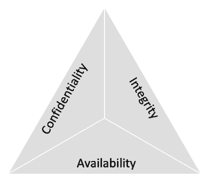

图 1.1: CIA 三角模型

* `机密性`(Confidentiality) 防止信息未经授权的泄露。它保持秘密信息的机密。

* `完整性`(Integrity) 防止信息或系统未经授权的更改。它确保我们的信息不受故意或意外更改的影响。

* `可用性`(Availability) 确保授权用户在需要时能够访问信息和系统。

| 记住这个！CIA 三角模型是我们在网络安全中所做一切工作的基础。它是 Security+ 考试目标中列出的基本概念之一，在参加考试时你应该对其非常熟悉。当你通过此书学习不同的安全威胁和控制措施时，尝试将每项内容与机密性、完整性和可用性这三个目标中的一个或多个联系起来。 |

| --- |

## 安全场景

CompTIA 在整个 Security+ 考试目标中使用了“给定场景（given a scenario）”这一短语。你需要熟悉安全场景，因为它们经常出现在考试题中。这仅意味着出题者会给你一个关于业务或安全状况的故事，然后问你在那种情况下会如何反应。场景通常会描述一个组织想要实现的目标。

当你看到一个向你讲述故事的考试题题时，你就遇到了一个基于场景的题型。你需要仔细阅读该场景，因为其中包含正确答案的线索。你可以做的最重要的事情之一是弄清楚三个主要的安全目标中的哪一个在驱动该场景——它是一个关于组织试图解决机密性、完整性或可用性问题的故事吗？这种思维方式将帮助你找到题目的正确答案。

接下来的章节将讨论与机密性、完整性和可用性相关的某些安全场景。

### 确保机密性

机密性防止信息未经授权的泄露。只有授权人员可以访问机密。你可以使用后续章节讨论的几种不同方法来确保机密性。

#### 加密

加密扰乱数据使其无法被未经授权的人读取。授权人员可以解密数据，但加密技术使得未经授权的人难以访问加密数据。第 10 章“理解加密和 PKI”将更深入地讨论加密，包括常用的加密算法，如高级加密标准（`AES`）。

例如，想象你需要通过电子邮件传输个人身份信息（`PII`），例如医疗信息或信用卡数据。你不希望任何未经授权的人访问这些数据，但一旦点击发送，你就无法再控制这些数据了。然而如果你在发送之前对邮件进行加密，就可以保护数据在网络传输过程中的机密性。

#### 访问控制

识别、验证和授权是三个核心身份和访问管理活动，有助于确保只有授权人员可以访问数据。假设你想让 Maggie 访问某些数据，但不让 Homer 访问相同的数据。你使用访问控制来授予和限制访问。以下列表介绍了访问控制的关键要素：

- **身份识别（Identification）**。用户通过唯一的用户名声称身份。例如，Maggie 和 Homer 都拥有由唯一用户名标识的独立用户账户。当 Maggie 使用她的账户时，她是在声称她账户的身份。

- **身份验证（Authentication）**。用户通过身份验证（如密码）证明自己的身份。例如，Maggie 知道她的密码，但不应该有其他人知道。当她用用户名和密码登录账户时，她声称了她的账户身份，并通过密码证明了她的身份。

- **授权（Authorization）**。接下来，你可以使用授权方法（如权限）来授予或限制对资源的访问。例如，你可以授予 Maggie 的账户对某些文件和文件夹的完全访问权限。同样，你可以确保 Homer 没有访问这些数据的权限。

| 记住这一点！ |

| :--- |

| 机密性确保只有经过授权的用户才能查看数据。保护数据机密性的最佳方法是对其进行加密。这包括任何类型的数据，例如个人身份信息（PII）、数据库中的数据以及移动设备上的数据。访问控制通过限制访问来帮助保护机密性。 |

## 提供完整性（Provide Integrity）

完整性确保数据没有发生更改。这包括确保数据没有被修改、篡改或损坏。理想情况下，只有授权的用户可以修改数据。然而，有时会发生未经授权或无意外的更改。这可能源于未经授权的用户、恶意软件（malware），以及系统和人为错误。当这种情况发生时，数据就丢失了完整性。

你可以使用哈希技术来强制执行完整性。第 10 章讨论了相关的哈希算法，例如安全哈希算法（`SHA`）的不同版本。简单来说，哈希是通过对数据（如文件或消息）执行哈希算法生成的字母数字字符串。哈希算法创建一个固定长度的、不可逆的输出。如果数据从不更改，生成的哈希值将始终相同。通过比较两个不同时间创建的哈希，你可以判断原始数据是否仍然相同。如果哈希相同，数据就相同；如果哈希不同，数据已发生更改。

例如，想象 Homer 正在向 Marge 发送一条消息，他们都希望确保消息保持完整性。Homer 的消息是：“价格是 $19.99。”他为这条消息创建了一个哈希。为了简单起见，假设哈希值是`123`。他然后将消息和哈希都发送给 Marge。

Marge 接收了消息和哈希。她（或她计算机上的软件）可以计算接收消息的哈希，并将其与 Homer 发送的哈希进行比较。如果接收消息的哈希是`123`（与发送的消息哈希相同），她就知道消息没有丢失数据完整性。然而，如果接收消息的哈希是不同的（例如`456`），她就知道收到的消息与 Homer 的消息不同。数据完整性丢失了。

哈希值的差异并不能告诉你修改了消息。它只是告诉你消息被修改了。这让你知道不应该信任该消息的完整性。

你可以将哈希用于消息（如电子邮件）以及任何其他类型的数据文件。然而，当你查看一个固定长度的哈希时，你无法判断它是从消息、文件还是其他数据源生成的。

哈希技术还可以验证文件在下载或传输时是否保持完整性。某些程序可以自动检查哈希，并判断文件在下载过程中是否丢失了即使一个比特。执行下载的程序将通过比较源哈希和目标哈希来检测这一点。如果程序检测到哈希不同，它就知道完整性已丢失，并向用户报告该问题。

另一个例子是网站管理员可以在网站上计算并发布文件的哈希。用户在下载文件后可以手动计算该文件的哈希，并与发布的哈希进行比较。如果病毒感染了 Web 服务器上的一个文件，受感染文件的哈希将与原始文件的哈希（以及在网站上发布的哈希）不同。你可以使用如`md5sum.exe`等免费软件来计算 MD5 哈希。如果你想看实际操作，请查看本书在`https://getcertifiedgetahead.com/`在线练习中的“创建和比较哈希实验”。

| 记住这一点！ |

| :--- |

| 完整性验证数据没有被修改。完整性的丢失可以通过未经授权或无意外的更改发生。哈希算法（如`SHA`）通过计算哈希来验证完整性。哈希仅仅是通过对文件或消息应用哈希算法生成的字母数字字符串。你之后可以对数据运行相同的算法，并应该得到相同的哈希值。通过比较哈希，你可以验证数据没有发生任何更改（授权的或未授权的）。如果哈希相同，数据未更改；如果哈希已更改，数据已更改。 |

## 提高可用性（Increase Availability）

可用性确保在需要时数据和服务是可用的。对于某些组织来说，这简单意味着数据和服务必须在周一至周五上午 8:00 到下午 5:00 之间可用。对于其他组织来说，这意味着他们预计每天 24 小时、每周 7 天、每年 365 天可用。

组织通常实施冗余和容错方法来确保关键系统具有高可用性。此外，组织还确保系统保持最新的补丁，以确保软件错误不会影响其可用性。

| 记住这一点！ |

| :--- |

| 可用性确保系统在需要时处于运行状态，并且通常会处理单点故障。你可以通过添加容错和冗余（如`RAID`、故障转移集群、备份和发电机）来增加可用性。 |

## 冗余与容错（Redundancy and Fault Tolerance）

冗余为关键系统增加了复制功能并提供容错。如果关键组件发生故障，冗余的复制允许服务继续运行。换句话说，具有容错能力的系统可以承受故障，并能忍受继续运行。

容错和冗余技术的共同目标是消除每个单点故障（`SPOF`）。如果`SPOF`故障，整个系统都会崩溃。例如，如果服务器只有一个驱动器，该驱动器就是`SPOF`，因为它的故障会导致服务器崩溃。

第 9 章“实施控制保护资产”更深入地讨论了许多容错和冗余技术。作为介绍，是一些常见的示例：

- 磁盘冗余。容错磁盘（如`RAID-1`镜像、`RAID-5`奇校验和`RAID-10`镜像）允许系统在磁盘故障时继续运行。

- 服务器冗余。故障转移集群包含冗余服务器，并确保即使服务器故障服务也能继续。在故障转移集群中，服务从集群中的故障服务器切换到同一集群中的冗余备用服务器。

- 网络冗余。负载均衡使用多个服务器来支持单一服务（例如高流量网站）。网卡（`NIC`）聚合通过在单台服务器中使用两个或多个网卡来提供冗余支持并增加带宽。

- 电源冗余。不间断电源（`UPS`）和发电机可以在市电电时为关键系统提供电力。

可扩展性（Scalability）和弹性（Elasticity）都有助于高可用性。可扩展性意味着能够增加系统或服务的容量以满足新需求。例如，如果你有一个使用三个 Web 服务器运行的网站，可扩展性的一种类型就是添加额外的服务器来处理工作。添加额外的服务器也称为`水平扩展`（horizontal scaling）。

垂直扩展（Vertical scaling）并不是增加更多服务器，而是向单个服务器添加资源，例如内存或处理能力。例如，一台服务器可能安装了 16 GB 的随机访问内存（`RAM`）。管理员可以通过手动添加额外的 16 GB `RAM`来向上扩展系统，使其达到 32 GB。然而，可扩展性通常受系统的限制。例如，服务器可能只支持 32 GB 的`RAM`。一旦达到 32 GB 的`RAM`，你就无法再扩展`RAM`了。

弹性通过让系统根据需要自动添加和删除资源来实现可扩展性的自动化。例如，该 Web 服务器现在可能需要三台服务器运行，但在高需求高峰期间可能需要四台或五台服务器。如果该网站在构建时考虑了弹性，那么它会在需要时自动添加服务器，并在不再需要时移除这些服务器。想象一下橡皮筋：拉伸它，它会自动伸长；松开它，它就会回到原始尺寸。

| 记住这一点！ | 冗余和容错方法提高了系统和数据的可用性。可扩展性是指手动向服务添加服务器或向系统添加资源以满足新需求。弹性是指根据需要自动添加或删除资源。 |

| --- | |

云资源通常具有弹性能力，使其能够自动适应这种增加或减少的需求。对于消费者来说，云资源的弹性往往看起来是无限的。

## 补丁更新（Patching）


另一种确保系统持续可用的方法是保持其补丁更新。软件 Bug 会导致各种问题，包括安全问题和随机崩溃。当软件供应商发现漏洞时，他们会开发并发布补丁或解决这些问题的代码。组织通常实施补丁管理计划，以确保系统保持最新的补丁状态。第 5 章“安全保护主机和数据”将更深入地介绍补丁和补丁管理。

## 理解韧性（Resiliency）

目前的趋势是增加系统的韧性，而不是追求可能的最高可用。这确保了系统是可靠的，但又没有与高可用系统相关的高昂成本。例如，系统可以实现 99.999% 的运行时间（五个九）。然而，这需要消除每一个可能的 `SPOF`（单点故障）并添加多个冗余。这些步骤显著提高了总拥有成本（`TCO`）。

韧性方法帮助系统自愈或以最小停机时间从故障中恢复。它们通常使用与高可用系统类似的技术。例如，使用韧性方法的系统可能会定期执行并测试全备、拥有备用电源（如不间断电源或发电机）、网络接口卡（`NIC`）聚合或冗余磁盘。如果断电、其中一个 `NIC` 停止接收流量或其中一个磁盘驱动器故障，系统可以快速恢复。

此外，韧性方法要求组件对失败进程进行重试。如果第一次失败了，它会再次尝试。例如，想象一个 Web 服务器由于某种原因比预期要慢，或者返回了错误消息。你可能不知道它为什么变慢或回复了错误消息。但是，系统会采取措施进行恢复，如果 Web 浏览器再次请求该页面，它将成功。某些 Web 浏览器会自动这样做。例如，如果你失去了 Internet 访问并使用 `Chrome` 浏览器访问 `google.com`，它会失败。但是，当你恢复 Internet 访问时，`Chrome` 会自动恢复并显示 Google 主页。

网络协议已经实施这一概念很久了。使用传输控制协议（`TCP`）时，数据包可能无法到达。如果发生这种情况，`TCP` 进程会简单请求源重发。我们将在第 3 章“探索网络技术和工具”中详细讨论 `TCP`。

## 资源可用性与安全限制

组织经常需要平衡资源可用性和安全限制。考虑使用加密来维护数据的机密性。如果加密让数据更安全，为什么不直接加密你能找到的每一条数据呢？原因是加密会消耗资源。

例如，上面的段落大约 265 个字符。以下是同一段落使用高级加密标准（`AES`）加密后的样子：


```
JLHsaXgsGg3p0nh+NiqnAqsteINHI503/eE43LBfC7mMeXtePI1K5n+XfCL3pD5dVSTdZtM64PgC9cot0DsllJzHqYsE0lCZp2i4eLplFr1Zk2Av7piOOc/yo7nQWialYV4LcRMA5eBXVHJbZgMgrJB5I9Z+uiM8zYIkmYLGPv4YRIAIt9BfPXvy8L3iKtrIXZ0qhJM/Lx4T9sDBL8f2GEb0YilF4t+ex+FoP/ry0OrUgTeCGRoAyxbMe+gxANRbPzBsSwlm83rTomUGcWZ4OCPn+HTVMWxXWkJFNXZEBinElpuyO6R4jY8Dmq1KZv2VgMkQjgUTv5YIghU7IZggQz7QMfqcWi5/Kps6mEQZuNMnq8l3316hxwUCBWAAm7gLiFqPNjm509mGYj4lb8xl3z9Sd0x0rL86Zzg
```

## 介绍基本风险概念

实施 IT 安全的基本目标之一是降低风险。因为风险如此重要，且许多章节都提到了风险要素，所以在这里提供简短的介绍是值得的。

风险是威胁利用漏洞导致损失的可能性或可能性。威胁是任何可能损害机密性、完整性或可用性的情况或事件。漏洞是一个弱点。它可以是硬件、软件、配置，甚至是操作系统的用户中的一个弱点。

如果威胁（如攻击者）利用了漏洞，可能会导致安全事件。安全事件是一次负面事件或一系列事件，它们会负面影响组织信息技术（`IT`）系统和数据的机密性、完整性或可用性。这包括蓄意攻击、恶意软件（`malware`）感染、意外数据丢失以及更多内容。

威胁可能来自组织内部，例如来自不满的员工（也称为恶意内部人员）。它们也可以来自组织外部，例如来自世界上任何地方的攻击者。威胁可以是自然发生的（例如飓风、海啸或龙卷风），也可以是人为的（例如犯罪编写的恶意软件）。威胁可以是故意的（例如来自攻击者），也可以是无意的（例如员工失误或系统错误）。

降低风险也被称为风险缓解。风险缓解降低了威胁利用漏洞的概率，或者在风险确实发生时对组织的影响。你通过实施控制措施（也称为对策措施和保护措施）来降低风险，书中描述的许多操作都是不同类型的控制措施。你无法阻止大多数威胁。例如，你无法阻止龙卷风，无法阻止犯罪分子编写恶意软件。然而，你可以通过减少针对威胁的脆弱性或减少威胁的影响来降低风险。

例如，访问控制确保只有授权的人员才能访问特定区域、系统或数据。如果员工产生不满情绪并想要造成伤害，访问控制通过减少他们可以访问的内容来减少潜在损害量。如果发生自然灾害，业务连续性和灾难恢复计划将有助于减少影响。同样，防病毒软件试图在恶意软件造成伤害之前将其拦截并阻止。

| 记住这个！风险是威胁利用漏洞的概率。风险缓解通过实施安全控制，降低威胁利用漏洞的概率或减少风险的影响。 |
| --- |

## 选择有效的安全控制

组织可以实施数百种、甚至数千种安全控制来降低风险。好消息是，你不需要成为所有可能的安全控制领域的专家也能通过 CompTIA Security+ 考试。然而，你确实需要对控制类别和控制类型的基本了解。

控制类别描述了控制措施是如何工作的。CompTIA 在目标中列出了以下控制类别：

* 技术控制使用硬件、软件和固件等技术来降低风险。
* 管理控制在功能上主要是行政性的。它们通常被记录在组织的安全策略中，并侧重于风险管理。
* 运营控制有助于确保组织的日常运营符合安全策略。这些控制由人员实施。
* 物理控制影响物理世界，例如门上的锁、围栏、安保人员以及其他你可以物理触碰的物体。

控制类型描述了控制措施试图实现的目标。CompTIA 在目标中列出了以下控制类型：

* 预防控制试图阻止事件的发生。
* 检测控制试图在事件发生后对其进行检测。
* 纠正控制试图在事件发生后恢复正常运行。
* 威慑性控制试图阻碍个人导致事件的发生。
* 补偿控制是在主控制不可行时使用的替代控制措施。
* 指示控制为个人提供说明，指导他们如何处理出现的与安全相关的情况。

| 记住这个！你可能会觉得这些关于类别和类型的讨论有些困惑。请记住，你遇到的每种控制都至少属于一个类别和一个至少一个类型。例如，防火墙是一种技术控制，因为它使用技术来实现其目标。它也是一种预防控制，因为它的目标是阻止未授权流量进入网络，防止事件的发生。 |
| --- |

## 控制类别

控制类别（技术、管理、运营和物理）描述了控制措施是如何工作的。技术控制使用技术来实现其目标。管理控制使用行政功能。运营控制由运营人员实施。物理控制使用物理保护措施。让我们来看其中的每一个类别。

### 技术控制

技术控制使用硬件、软件和固件等技术来减少脆弱性。管理员安装并配置技术控制，然后由该技术控制自动提供保护。在本书中，你将遇到许多技术控制的示例。以下列表提供了几个示例：

* 加密。加密是一种强有的技术控制，用于保护数据的机密性。这包括通过网络传输的数据，以及存储在服务器、桌面电脑和移动设备等设备上的数据。
* 防病毒软件。一旦安装，防病毒软件即可提供免受恶意软件感染的保护。第 6 章“比较威胁、脆弱性和常见攻击”深入涵盖了恶意软件和防病毒软件。
* 入侵检测系统（`IDSs`）和入侵预防系统（`IPSs`）。`IDSs` 和 `IPSs` 可以监控网络或主机是否有入侵，并对各种威胁提供持续保护。第 4 章“保护你的网络”涵盖了不同类型的 `IDSs` 和 `IPSs`。
* 防火墙。网络防火墙限制进入网络的流量。第 3 章“探索网络技术和工具”深入涵盖了防火墙。
* 最小权限。最小权限原则规定，仅授予个人或进程执行其分配的任务或功能所需的所需的权限，而不能更多。权限是权利和许可的结合。

### 管理控制

管理控制在功能上主要是行政性的，通常被记录在组织的安全策略中。这些控制使用规划和评估方法来审查组织降低和管理风险的能力。第 8 章“使用风险管理工具”涵盖了脆弱性评估和渗透测试，这些属于此类类别。例如，两种常见的管理控制是：

* 风险评估。这些有助于组织量化和定性组织内部的风险，以便团队成员能够关注严重风险。例如，定量风险评估使用成本和资产价值根据货币价值来量化风险。定性风险评估使用判断根据概率和影响对风险进行分类。
* 脆弱性评估。脆弱性评估试图发现当前的脆弱性。在必要时，实施额外的控制措施来降低这些脆弱性带来的风险。

| 记住这个！管理控制在功能上是行政性的，并记录在安全策略中。运营控制由执行日常运营的人员实施，以符合组织的整体安全计划。 |
| --- |

### 运营控制

运营控制有助于确保组织的日常运营符合整体安全计划。这些是由人员而非系统实施和执行的控制。运营控制包括以下家族：

* 意识和培训。培训降低风险的重要性不强调。培训有助于用户维护密码安全、遵循整洁办公策略、理解网络钓鱼和恶意软件等威胁等。
* 配置管理。配置管理通常使用基准来确保系统以安全、固化的状态启动。变更管理有助于确保变更不会导致意外的配置错误。第 5 章更详细地介绍了变更和配置管理。
* 介质保护。介质包括物理介质，如 USB 闪存、外部和内部驱动器以及备份带。这些介质可能包含敏感信息，必须防止其丢失或被盗。介质保护策略描述了你如何使用备份和加密来保护包含敏感信息的介质。这些概念在第 9 章有更详细的介绍。

# NIST 和 SP 800 文档

美国国家标准与技术研究院（NIST）是美国商务部的一部分。他们发布了 800 系列特别出版物（SPs），这些文件是安全社区的重要参考。许多 IT 安全专业人员使用这些文档来更好地设计安全系统和网络。此外，许多与安全相关的认证（CompTIA Security+ 认证之外）也直接或间接地引用的了 SP 800 文档。

`SP 800-53`《信息系统和组织的安全与隐私控制》包含了大量关于安全控制的信息。它包含三个讨论安全控制的章节，随后是三个附录。附录 C 是一个安全控制目录，提供了分为 20 个不同族类的数百个单独安全控制措施的详细信息。

值得注意的是，`SP 800-53` 的早期版本尝试将每项控制识别为管理类、操作类或技术类。然而，许多控制包含了不仅仅是这些分类中的某一种特征，导致情况变得复杂。为了简化问题，`NIST` 删除了这些引用。

如果你兴趣追求其他安全相关的认证或将 IT 安全作为一份职业，`SP 800` 文档非常值得花费。你可以在 `https://csrc.nist.gov/publications/sp800` 下载 `SP 800-53` 以及其他 `NIST` 安全标准。

## 物理控制

物理控制是任何你可以物理上接触到的控制措施。示例包括护柱和其他屏障、访问控制门间（有时称为防人门）、照明、标志牌、栅栏、传感器等。重要的是，要意识到可以将物理控制识别为其他控制类型。例如，锁等物理控制既是预防性控制，也是威慑性控制。锁上的门可以防止人员进入安全区域，并在个人知道门已锁的情况下威慑他们甚至不要尝试。

为了 Security+ 考试，你需要了解各种物理安全控制措施。你将在第 9 章中找到这些内容。

> **记住这个！** 安全控制分为管理类（记录在书面策略中）、操作类（在日常操作中执行）、技术类（通过技术实现）或物理类（影响物理世界）。

> **记住这个！** 技术控制利用技术来减少漏洞。示例包括加密、防病毒软件、`IDSs`、`IPSs`、防火墙和最小权限原则。物理安全和环境控制包括运动检测器和灭火系统。

## 控制类型

控制类型（预防性、威慑性、检测性、纠正性、补偿性和指令性）描述了控制措施希望实现的目标。例如，预防性控制试图防止安全事件的发生。检测性控制试图识别已经发生的安全事件，而纠正性控制试图清理事件产生的影响。

### 预防性控制

理想情况下，一个组织不会发生任何安全事件，这是预防性控制的主要目标——防止安全事件。你可能会看到预防性控制被称为 *preventative controls*，但这两个词的意思相同。一些示例包括：

* **加固 (Hardening)**。加固是使系统或应用程序比其默认配置更安全的做法。这使用了分层安全的深度防御策略。它包括禁用不必要的端口和服务、实施安全协议、保持系统补丁、使用强密码配合稳健的密码策略，以及禁用默认和不必要的账户。第 5 章深入涵盖了这些主题。
* **培训 (Training)**。确保用户意识到安全漏洞和威胁有助于防止事件发生。了解社会工程人员如何运作的用户更容易被欺骗。例如，缺乏教育的用户可能被欺骗向社会工程人员提供密码，但受过教育的用户会看穿这些战术并保持密码安全。
* **安保人员 (Security guards)**。安保人员防止并威慑许多攻击。例如，安保可以通过首先验证用户身份来防止未经授权的人进入建筑的安全区域。虽然社会工程人员可能会试图欺骗接待员让他进入安全区域，但安保的存在会威慑许多社会工程人员甚至不要尝试这些战术。
* **账户禁用流程 (Account disablement process)**。账户禁用流程确保在员工离开组织时禁用用户账户。这防止了包括前员工在内的任何人继续使用这些账户。第 2 章深入涵盖了账户禁用的相关内容。
* **入侵防御系统 (IPS)**。`IPS` 可以在恶意流量到达网络之前将其拦截。这防止了安全事件的发生。第 4 章深入涵盖了 `IPSs`。

> **记住这个！** 预防性控制试图防止安全事件。加固系统通过修改基本配置来增加安全性。安保人员可以防止未经授权的人员进入安全区域。变更管理流程有助于防止配置更改导致停机。账户禁用流程确保在用户离开组织时禁用账户。

### 威慑性控制 (Deterrent Controls)

威慑性控制试图阻碍威胁。某些威慑性控制试图阻碍潜在攻击者发动攻击，另一些则试图阻止员工违反安全策略。

你通常可以将许多威慑性控制描述为预防性控制。例如，想象一个组织雇佣了安保人员来控制建筑限制区域的访问。这名安保人员仅仅通过阻碍他们甚至不要尝试，就能威慑大多数人不要溜入。这种威慑防止了与未经授权访问相关的安全事件。列表列出了用于威慑威胁的一些物理安全控制措施：

* **警示标志 (Warning signs)**。设施外部的标志牌可能会警告潜在入侵者该设施正受监控。这些标志的唯一目的是威慑入侵者甚至不要尝试闯入设施。
* **登录幅 (Login banners)**。计算机系统上的登录幅是警示标志的数字版本。在用户输入用户名和密码之前，他们会看到一条消息，警告他们未经许可访问系统是犯罪。

### 检测性控制 (Detective Controls)

虽然预防和威慑性控制试图防止安全事件，但某些事件仍然会发生。检测性控制试图检测漏洞何时被利用并导致安全事件。关键点是，检测性控制在事件发生后发现它。检测性控制的一些示例是：

* **日志监控 (Log monitoring)**。多种不同的日志记录了系统和网络上的活动详情。例如，防火墙日志记录了防火墙拦截的所有流量详情。通过监控这些日志，可以检测到事件。某些自动日志监控方法可以自动检测潜在事件并在发生后立即报告。
* **安全信息和事件管理 (SIEM) 系统**。除了监控日志以检测任何单一事件外，你还可以使用 `SIEMs` 检测趋势并实时建立警报。通过分析过去的警报，你可以识别趋势，例如针对特定系统的攻击增加。
* **安全审计 (Security audit)**。安全审计可以检查组织的安全态势。例如，账户审计可以确定人员和技术策略是否正确执行了账户策略。
* 视频监控。闭路电视（`CCTV`）系统可以记录活动并检测已发生的事件。值得注意的是，视频监控也可以作为一种威慑控制手段。
* 运动检测。许多报警系统可以检测潜在入侵者的移动并触发报警。
* 入侵检测系统（`IDS`）。`IDS` 可以在恶意流量进入网络后对其进行检测。它通常会发出警报以通知 IT 人员潜在的攻击。

## 纠正控制 (Corrective Controls)

纠正控制试图在事件或问题发生后扭转其影响。其目的是在事件发生后尽快让一切恢复正常。它们负责恢复受事件影响的机密性、完整性和/或可用性。

纠正控制的一些示例包括：

* 备份和系统恢复。备份确保了人员在数据丢失或损坏时能够恢复数据。同样，系统恢复程序确保管理员可以在故障发生后恢复系统。第 9 章更深入地涵盖了备份和灾难恢复计划。
* 事件处理流程。事件处理流程定义了响应安全事件时应采取的步骤。这通常从事件响应策略和事件响应计划开始。第 11 章“实施策略以降低风险”更深入地涵盖了事件处理。

## 补偿控制 (Compensating Controls)

补偿控制是用来替代主控制的备用控制。例如，组织可能要求员工在进行系统身份验证时使用智能卡。然而，新员工可能需要时间才能收到智能卡。为了允许新员工访问网络并保持高水平的安全性，组织可能会选择实施基于时间的一次性密码（`TOTP`）作为一种补偿控制。补偿控制仍然提供了强有力的验证解决方案。

## 指令控制 (Directive Controls)

指令控制旨在为个人提供说明，告诉他们应该如何处理出现的安全相关情况。这些通常是提供指令的书面文档，而不是执行目标的技术机制。

* 策略、标准、程序和指南。安全专业人员使用多种类型的文档来指导行动。策略为组织提供了高层目标声明。标准描述了如何正确地配置系统、应用程序和安全控制。程序提供了实现目标的分步指导。指南提供了关于实现目标的建议。所有这些主题在第 11 章中都有讨论。
* 变更管理。变更管理确保更改不会导致意外停机。换句话说，管理员不是随心所欲地做出更改，而是将更改提交到变更管理过程中。请注意，变更管理是一种操作控制，试图防止事件发生。换句话说，它既是操作控制也是指令控制。

## 结合控制类别和类型

必须意识到，控制类别和控制类型之间并不是互互斥的。换句话说，你可以使用多个类别和多个类型来描述大多数控制措施。

例如，加密是一种预防性技术控制。它有助于防止数据机密性的丢失，因此它是一种预防性控制。你通过技术实现它，因此它是一种技术控制。如果你理解了控制类别，那么在考试中选择正确答案就不会有任何问题，即使 CompTIA 在问题中将它们结合（例如预防性技术控制）。

同样，灭火系统是一种物理技术控制。它是一种物理安全控制，因为你可以触碰它。但它也是一种技术控制，因为它利用技术进行检测、抑制或灭。

## 日志与监控 (Logging and Monitoring)

每个操作系统都提供生成和存储日志的能力。如果系统受到攻击，你可能可以通过查看操作系统日志了解攻击详情。取决于攻击类型，任何操作系统日志都可能有用。

### 操作系统/终端日志

每个操作系统都提供生成和存储日志的能力。你应该熟悉 Windows 和 Linux 系统的日志功能。

#### Windows 日志

Windows 系统有几种记录发生情况的常用日志。可以使用 `Event Viewer`（事件查看器）查看这些日志。主要的 Windows 日志包括：

* 安全日志。安全日志充当审计日志和访问日志的功能。它记录可审计的事件，例如成功或失败。成功表示审计事件已完成，例如用户登录或成功删除文件。失败意味着用户尝试执行某项操作但失败了，例如登录失败或尝试删除文件。
* 系统日志。操作系统使用系统日志记录与操作系统运行相关的事件。这可能包括系统启动和关机、服务启动和停止的信息、驱动程序加载或失败，或系统开发者认为重要的任何其他系统组件。
* 应用程序日志。应用程序日志记录由系统上的应用程序或程序发送的事件。任何应用程序都有能力在应用程序日志中写入事件。这包括警告、错误和常规消息。

图 1.2 显示了 `Event Viewer` 运行的示例。注意图中左侧的 `Windows Logs` 文件夹显示了 `Application`、`Security` 和 `System` 日志。在此图中，`Event Viewer` 正在显示来自 `Security` 日志的记录。

#### Linux 日志

Linux 系统将日志存储在 `/var/log/` 目录中。你可以使用 Linux 上的系统日志查看器或通过终端使用 `cat` 命令查看日志。例如，你可以使用以下命令查看身份日志（`auth.log`）：

```bash
cat /var/log/auth.log
```


以下列表显示了一些常见的 Linux 日志：

* `/var/log/syslog` 和/或 `/var/log/messages` 在不同的 Linux 操作系统版本之间有所不同。它们包含了各种通用系统消息。这包括启动期间记录的消息、与邮件、内核以及其他系统活动相关的消息。
* `/var/log/secure` 此日志包含与用户会话身份验证和授权相关的信息。图 1.3 显示了文本 `/var/log/secure` 文件的示例。图条目来自无效用户尝试（并失败）使用 SSH 连接到服务器。

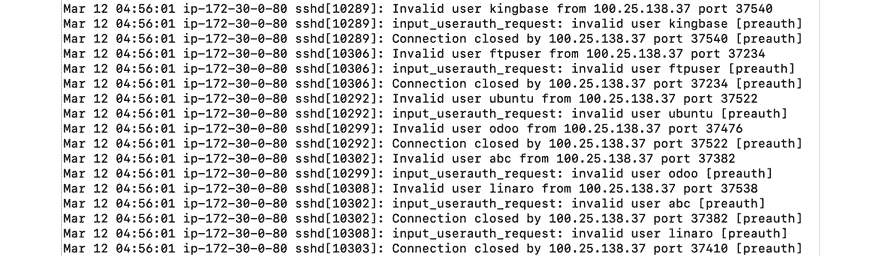

图 1.3: `/var/log/secure` 条目示例

## 网络日志

网络日志记录了网络上的流量。这些日志存在于路由器、防火墙、Web 服务器和网络入侵检测/防御系统等各种设备上。你通常操作这些设备记录特定信息，例如记录设备通过的所有流量、设备拦截的所有流量或两者兼有。这些日志在排查连接性问题以及识别潜在入侵或攻击时非常有用。

## 防火墙日志

防火墙是网络的边界卫士。它们决定哪些流量允许进入和离开网络，以及哪些流量将被拦截。你将在第 3 章学习更多关于防火墙的工作原理。防火墙也是日志信息的极佳来源，因为它们可以跟踪每次访问网络的尝试，并创建记录这些信息的详细日志。

### IDS/IPS 日志

入侵检测系统（`IDS`）和入侵防御系统（`IPS`）监控网络中的恶意活动。`IDS` 仅向管理员对可能的入侵发出警告，而 `IPS` 则更进一步尝试阻止可疑内容。由于它们在安全方面扮演着重要角色，`IDS` 和 `IPS` 系统也是安全日志数据的优秀来源。

### 数据包捕获

协议分析器（有时称为嗅探器）捕获网络流量，允许管理员查看和分析单个数据包。调查安全事件的调查人员可能会使用 `Wireshark` 等数据包捕获工具捕获与事件相关的网络流量，随后可以对其进行仔细检查以重建发生过的情况。

## 应用日志

虽然某些应用程序将日志信息存储在系统日志中（如 Windows 日志），但许多应用程序也会管理自己的日志文件。

例如，Web 服务器通常会记录对页面的请求。这些记录通常遵循万维网联盟（W3C）标准的通用日志格式。一个典型的条目包含以下数据：

* `host`: 请求页面的客户端的 IP 地址或主机名。
* `user-identifier`: 请求页面的用户名（如果已知）。
* `authuser`: 如果用户已登录，页面中请求的用户登录名。
* `date`: 请求的日期时间。
* `request`: 客户端发送的实际请求行。
* `status`: 返回给客户端的 HTTP 状态码。
* `bytes`: 回复的字节长度。

## 元数据

元数据是关于其他数据的数据。许多应用程序存储文件和消息的元数据，这对安全调查人员非常有帮助。例如，图 1.4 显示了电子邮件消息的部分元数据。每封电子邮件都包含有关邮件如何路由的详细信息，但这些信息通常对用户隐藏。

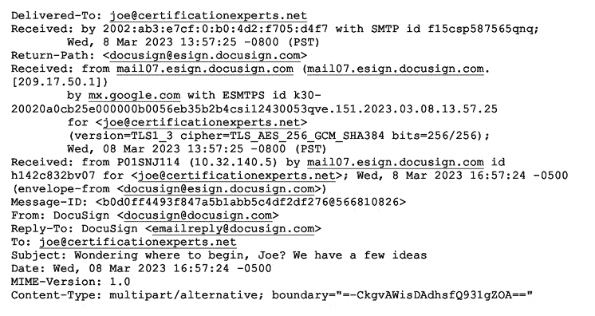

图 1.4: 电子邮件消息的元数据

同样，图像文件包含有关拍摄相机、地理位置、日期、时间和其他细节的元数据。图 1.5 显示了照片元数据的示例。

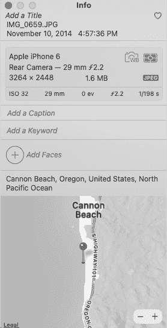

图 1.5: 照片的元数据

## 集中日志记录与监控

要定期检查网络内所有系统、应用程序和基础设施设备的日志是非常具有挑战性的。标准解决方案是使用集中式系统收集日志条目。让我们检查支持这项工作的技术和程序。

### SIEM 系统

安全信息和事件管理（`SIEM`）系统提供了一种集中解决方案，用于收集、分析和管理来自系统、应用程序和基础设施设备的数据。它结合了安全事件管理（`SEM`）和安全信息管理（`SIM`）解决方案。`SEM` 提供安全事件（如疑似安全事件）的实时监控、分析和通知。`SIM` 提供数据的长期存储，以及分析数据以寻找趋势或创建用于验证符合法律或法规所需的报告的方法。

`SIEM` 系统对于拥有海量数据和活动监控的大型企业非常有用。考虑一个拥有超过 1,000 台服务器的组织。当其中某一台服务器发生事件时，管理员需要尽快获知此信息。其优势在于 `SIEM` 系统使用脚本来自动化监控和报告。

供应商将 `SIEM` 作为可以安装在集中式系统上的应用程序以及专用硬件设备进行销售。然而，无论供应商如何捆绑，它通常具有共同的能力。以下列表列出了大多数 `SIEM` 共享的一些额外功能：

* `Log collectors`: `SIEM` 从整个网络中的设备收集日志数据并将这些日志存储在可搜索的数据库中。
* `Data inputs`: 日志条目来自各种源，例如防火墙、路由器、网络入侵检测防御系统。它们也可以来自组织想要监控的任何系统或应用程序，例如 Web 服务器、代理服务器和数据库服务器。
* `Log aggregation`: 聚合是指将多个不同的项目合并为单一的相似格式。`SIEM` 系统从多个系统收集数据，这些系统通常以不同的格式化日志条目。然而，`SIEM` 系统可以聚合数据并存储，以便分析和搜索。
* `Correlation engine`: 关联引擎是用于收集和分析网络内各种系统事件日志数据的软件组件。它通常聚合数据以寻找共同属性。然后它使用高级分析工具检测潜在安全事件的模式并发出警报。系统管理员随后可以调查警报。
* `Automated reports`: 大多数 `SIEM` 系统包含多个内置报告。这些报告通常按不同的类别分组，例如网络流量事件监控、设备事件（如边界防火墙上的事件）、威胁事件、登录/注销事件、特定法律的合规性等。此外，安全专业人员可以通过指定过滤器创建自己的报告。
* `User behavior analysis`: 用户行为分析（`UBA`）关注用户正在做什么，例如应用程序和网络活动。某些 `UBA` 过程监控关键文件，寻找谁访问了它们、做了什么以及访问这些文件的频率。`UBA` 通常寻找可能指示恶意意图的异常模式。
* `Security alerts`: `SIEM` 通常带有预定义的警报，可以对系统进行持续监控并提供可疑事件的通知。例如，如果它检测到服务器上的端口扫描，它可能会向管理员组发送电子邮件或在抬头显示器上显示警报。`SIEM` 还包括创建新警报的能力。

- **自动化触发器**。触发器会根据预定义次数的重复事件触发相应操作。例如，想象设置了一个登录失败触发器，阈值为五次。如果攻击者反复尝试使用 Secure Shell (SSH) 登录服务器，服务器的日志将显示这些失败登录尝试。当 `SIEM` 检测到超过五次失败的 SSH 登录时，它可以更改环境并停止攻击。它可能会修改防火墙以阻止这些 SSH 登录尝试，或向服务器发送脚本以临时禁用 SSH。`SIEM` 具有修改预定义触发器和创建新触发器的能力。

- **时间同步**。所有向 `SIEM` 发送数据的服务器都应该与同一时间保持同步。这在调查事件时变得尤为重要，以便让安全调查人员知道事件发生的时间。此外，大型组织可能拥有位于不同时区的地点。这些地点中的每一个都可能向一个单一的中央 `SIEM` 发送数据。如果服务器日志使用本地时间，`SIEM` 需要确保补偿这些时间偏移。网络时间协议（`NTP`）提供了一种保持组织内所有设备系统时间同步的方法。

- **归档**。`SIEM` 处理海量信息，无法将所有信息存储在活动存储中。那样成本太高了。相反，它们提供了将较旧日志移动到离线廉价存储中的能力，这些日志虽然无法被立即访问，但在以后需要时可以恢复。

| 告警调优 |
| --- |
| 触发器和告警面临的一个挑战是调整灵敏度级别，以限制误报的同时避免漏报。例如，想象 Homer 在登录时输入了错误的密码。这并不是一次攻击，而是一次诚实的失误。如果 `SIEM` 系统发出了告警，那就是一次误报。或者，想象一个系统正受到攻击，并在约五分钟内记录了 100 次失败登录尝试。如果 `SIEM` 系统没有发出告警，那就是一次漏报。在调整失败登录的灵敏度时，管理员会在 1 到 100 之间选择一个数字。 |

## SIEM 仪表板

汽车中的仪表板为驾驶员提供了驾驶时所需的视图。类似地，`SIEM` 仪表板为管理员提供了有意义活动的视图。这些视图随系统而异，通常是可自定义的。它们提供了持续监控和实时报告。在大型网络运营中心（`NOC`）中，`SIEM` 可能会在大屏幕抬头显示上显示告警。在较小的网络中，单台计算机可能会显示仪表板。`SIEM` 仪表板的一些常见元素列如下：

- **传感器**。许多 `SIEM` 系统使用部署在网络各系统上的代理程序。这些程序收集设备日志并将这些日志发送到 `SIEM` 系统。仪表板可以显示从这些代理程序接收的数据。

- **告警**。在 `SIEM` 系统中设置触发器后，当事件发生时它会发出告警。这些告警可能会触发特定的响应（例如向组发送电子邮件），但也会显示在仪表板上。

- **关联**。当日志条目到达 `SIEM` 系统时，它会对数据进行关联和分析。管理员可以根据需求配置仪表板，以多种方式显示这些数据。

- **趋势**。当 `SIEM` 系统分析数据时，它可以识别趋势。例如，如果突然出现高失败登录率，它可以识别该趋势并发出告警。许多 `SIEM` 系统通过图表显示趋势，允许用户在一张图片中消化大量信息。

## Syslog

`syslog` 协议是消息日志的标准。它允许设备向中央服务器发送日志消息。

### 第 1 章考试复习

在准备考试时，确保你理解了核心概念。

#### 理解核心目标

- **机密性**确保数据只有授权用户可见。`Encryption`（加密）是实现机密性的最佳选择。访问控制也能保护机密性。

- **完整性**保证数据没有通过未经授权的更改修改、篡改或损坏。`Hashing`（哈希）是确保完整性的常用方法。

- **可用性**确保数据和服务在需要时可用。一个常见目标是消除单点故障。通常会添加容错方法和冗余来支持高可用性。

`可扩展性`是系统通过垂直扩展（scaling up）或水平扩展（scaling out）处理增加负载的能力。`弹性`是系统通过动态添加或删除资源来处理增加负载的能力。云资源通常具有弹性能力，允许它们自动适应需求。恢复性方法帮助系统自我修复或以最短的停机时间从故障中恢复。组织在资源可用性和安全限制之间取得平衡。安全专业人员可能希望在处处应用安全控制，但执行人员有责任在不牺牲安全的前提下使成本最小。

#### 引入基本风险概念

- **风险**是威胁利用漏洞并导致损失的可能性。

- **威胁**是任何可能损害机密性、完整性或可用性的情况或事件。

- **漏洞**是一个弱点。它可以是硬件、软件、配置或操作系统的用户的弱点。

- **风险缓解**（Risk mitigation）通过降低威胁利用漏洞的几率或降低风险的影响来减少风险。安全控制可以降低风险。例如，杀毒软件是一种降低病毒感染风险的安全控制。安全专业人员的核心工作之一是选择一套有效的安全控制措施来管理不同类型的风险。

#### 理解安全控制

四类安全控制分类为管理类、操作类、技术类和物理类。

- **管理控制**主要是行政性的，包括风险和漏洞评估等项目。

- **操作控制**侧重于组织的日常运行。它们有助于确保组织符合其整体安全计划。一些示例包括安全意识和培训、配置管理和变更管理。

- **技术控制**利用技术来减少漏洞。`Encryption`（加密）、杀毒软件、`IDS`、`firewall`（防火墙）和最小权限原则都是技术控制。

- **物理控制**是任何你可以物理上触碰的控制。一些示例包括护柱和其他屏障、访问控制门室（有时称为人肉通道）、照明、围栏和标志牌。

- 六种控制类型为：预防、威慑、检测、纠正、补偿和指示。
- 预防性控制试图防止安全事件发生。示例包括系统加固、用户培训、安保、变更管理和账户禁用流程。
- 检测性控制试图检测漏洞何时被利用。示例包括日志监控、安全信息和事件管理 (`SIEM`) 系统、趋势分析、视频监控系统和运动检测系统。
- 威慑性控制试图通过威慑威胁来防止事件发生。示例包括锁和安保。注意，这些也可以被描述为预防性控制。其主要区别在于，它们试图阻止人们尝试利用漏洞。
- 纠正控制试图在事件或问题发生后扭转其影响。示例包括备份、系统恢复计划和事件处理流程。
- 补偿性控制是在无法可行或可能使用主控制措施时使用的替代控制措施。
- 指示性控制为个人提供说明，教他们他们应该如何处理出现的安全相关情况。

## 理解日志

- Windows 包含多个可以通过 Windows 事件查看器查看的日志。`Security` 日志充当安全日志、审计日志和访问日志。Windows 在 `System` 日志中记录与操作系统相关的事件。某些应用程序在 `Application` 日志中记录事件。
- Linux 系统将日志信息存储在 `/var/log` 目录下的文本文件中。`/var/log/syslog` 和/或 `/var/log/messages` 文件包含通用系统消息。`/var/log/secure` 文件记录身份验证和授权事件。
- 网络日志是网络活动的重要来源。网络日志的常见来源包括防火墙、入侵检测系统 (`IDS`)、入侵防御系统 (`IPS`) 和数据包捕获。
- 许多应用程序将日志记录在操作系统日志文件中，而另一些则维护自己的日志。Web 服务器通常存储接收并处理的每个请求记录。
- 某些应用程序跟踪并存储有关其处理数据的元数据。元数据的常见示例包括邮件头和图像元数据。
- 安全信息和事件管理 (`SIEM`) 系统为从多个源收集、分析和管理数据提供了集中解决方案。
- `syslog` 协议规定了日志条目的格式以及传输日志条目的细节。你可以部署一个集中 `syslog` 服务器来收集来自网络中各种设备的 `syslog` 条目。

## 第 1 章练习题

1. 你组织的管理层定义了一个用例来支持数据库中存储数据的机密性。以下哪种解决方案最好满足这一需求？
    1. 哈希处理
    2. 磁盘冗余
    3. 加密
    4. 补丁

2. Moe 管理他商店的网络设备，并维护所有受管理的路由器和交换机的配置文件副本。他每周为这些文件创建哈希值，并将其与上周对相同文件创建的哈希值进行比较。他最可能在支持哪种用例？
    1. 支持机密性
    2. 支持完整性
    3. 支持加密
    4. 支持可用性

3. 以下哪种加密算法可以从数据文件创建固定长度的输出，但不能用于重新创建原始数据文件？
    1. MD5
    2. AES
    3. IDS
    4. SIEM

4. 你的组织托管着一个销售数字产品的电子商务服务器。该服务器会随机经历高额销售额和使用量，导致资源使用激增。这些激增有时会导致服务器宕机。以下哪种是防止这些停机的最佳方法？
    1. 弹性 (Elasticity)
    2. 可扩展性 (Scalability)
    3. 规范化 (Normalization)
    4. 存储过程

5. 管理员最近安装了一个 `IDS` 以帮助减少安全事件的影响。以下哪项最好能识别 `IDS` 的控制类型？
    1. 预防性
    2. 物理
    3. 威慑
    4. 检测

6. Maggie 在 IT 部门的安全部门工作。她的主要职责是监控安全日志、分析 `SIEM` 报告的趋势并验证警报。以下哪种选择最好能识别她正在实施的主要安全控制？
    1. 补偿控制
    2. 预防性控制
    3. 检测控制
    4. 纠正控制

7. 你网络 DMZ 中的一台服务器最近受到攻击。防火墙日志显示，服务器受到了来自许多不同外部 IP 地址的攻击。它从这些地址接收了大量的请求，导致托管在服务器上的网站崩溃。哪种安全目标受到此类攻击的最直接影响？
    1. 完整性
    2. 非否认性
    3. 机密性
    4. 可用性

8. 你正在登录由你组织托管的服务。你输入了用户名，现在被要求完成指纹扫描。当你扫描指纹时，正在发生访问控制的哪种元素？
    1. 身份验证
    2. 授权
    3. 可用性
    4. 身份识别

9. 以下哪种技术通常不被认为是容错或冗余控制？
    1. UPS
    2. SIEM
    3. RAID
    4. NIC 组网

10. Kate 的经理要求她组织一个新流程，以对其组织的基础设施进行定期的漏洞评估。她正努力为这种扫描创建一个标准操作程序。哪种类别最能描述她正在创建的控制？
    1. 技术性
    2. 检测
    3. 物理
    4. 管理性

11. Lisa 正在登录一个系统，在输入用户名和密码之前，看到了下面的消息：

```
这是一个美国政府计算机系统，仅供授权人员出于授权业务访问和使用。未经授权访问或使用此计算机系统可能会导致违反者受到刑事、民事和/或行政处分。
```


Lisa 正在经历哪种控制？

1. 检测
2. 补偿
3. 威慑
4. 纠正

12. 你正在调查一起活跃的安全事件，并希望查看两个系统之间网络流量的内容。哪种数据源最好能提供此类信息？

1. 操作系统日志
2. 应用程序日志
3. 防火墙日志
4. 数据包捕获

13. Moe 被组织中许多不同安全系统产生的日志记录搞崩溃，希望使用一种可以将这些记录聚合在单一位置并进行关联的技术。哪种技术最符合他的需求？

1. `Syslog`
2. `SIEM`
3. `IPS`
4. 防火墙

14. Maggie 正在查看来自不同系统的日志条目，注意到这些系统的钟未同步，导致难以关联日志条目。她可以使用哪种协议来同步系统钟？

1. `NTP`
2. `FTP`
3. `SFTP`
4. `HTTPS`

15. 以下哪项描述了 Linux 系统日志条目的正确格式？

1. 事件查看器
2. `logger`
3. `SIEM`
4. `Syslog`

2. B 正确。他最可能正在使用支持完整性的用例。通过验证配置文件上的哈希值相同，他正在验证文件没有被更改。机密性通过加密、访问控制和隐写术来实施。加密是实施机密性的方法，它不使用哈希值。可用性确保系统在需要时处于正常运行状态。

3. A 正确。消息摘要 5（`MD5`）是一种哈希算法，它可以创建固定长度且不可逆的输出。哈希算法无法仅凭哈希值重新创建原始数据文件。高级加密标准（`AES`）是一种加密算法，你可以通过解密来重新创建原始数据文件。入侵检测系统（`IDS`）不是加密算法，而是一种检测性控制。安全信息和事件管理（`SIEM`）系统提供集中化的日志记录。

4. A 正确。弹性（Elasticity）是最佳选择，因为它允许服务器根据需求的变化动态扩展。可扩展性（Scalability）不是最佳答案，因为它是手动完成的；在这种情况下，高资源占用是随机的，手动添加资源无法足够快地响应随机的峰值。规范化（Normalization）是指组织数据库中的表和列以减少冗余数据并提高整体数据库性能。存储过程是一组作为一个整体执行的 SQL 语句，有助于防止 SQL 注入攻击。

5. D 正确。入侵检测系统（`IDS`）是一种检测性控制。它可以在恶意流量进入网络后进行检测。预防性控制（如入侵预防系统 `IPS`）试图防止恶意流量进入网络。`IDS` 使用的是技术，而不是物理控制。威慑性控制（Deterrent controls）试图阻碍威胁，但攻击者并不知道系统是否拥有 `IDS`，因此 `IDS` 无法威慑攻击。

6. C 正确。监控安全日志、分析来自安全信息和事件管理（`SIEM`）的趋势报告以及验证来自 `SIEM` 的警报都是检测性控制。检测性控制试图在安全事件发生后对其进行检测。补偿性控制（Compensating control）是在主安全控制不可行或尚未部署时使用的替代控制。预防性控制试图防止事件发生，但该场景并未具体描述任何预防性控制。纠正性控制（Corrective control）试图在安全事件发生后扭转其影响。

7. D 正确。这种攻击破坏了合法用户访问服务器上托管网站的能力，这是对该网站可用性的攻击。机密性的目标是防止未经授权的访问访问。完整性的目标是防止未经授权的更改。不可否认性（你将在第 10 章中学习）的目标是防止某人否认其为消息的来源。机密性、完整性和不可否认性的目标不受此攻击的影响。

8. A 正确。访问控制过程的三个步骤是识别、验证和授权。当你输入用户名时，你已经完成了识别步骤。你正在扫描指纹以证明你的身份主张，这是身份验证步骤。当系统在完成身份验证后决定你被允许访问的内容时，就会发生授权。

9. B 正确。安全信息和事件管理（`SIEM`）系统旨在提高组织监控和管理安全问题的能力。它通常不提供冗余或容错能力。不间断电源（`UPS`）在市用电短暂故障时提供备用电源，为电力提供容错能力。冗余磁盘阵列（`RAID`）允许单块磁盘故障而不丢失数据，为存储提供冗余和容错能力。网卡聚合（`NIC teaming`）允许使用多个网络接口卡（`NICs`），以便即使其中一张网卡故障，服务器仍能保持网络连接，提供网络冗余。

10. D 正确。这个问题有点棘，因为有几个可能的正确答案。你被要求选择“最佳”答案。当你看到问题中出现“最佳”（best）之类的词时，要特别注意，因为这是你需要非常仔细考虑每个备选项的线索。漏洞评估是一种用于降低风险的评估方法，是管理控制（managerial control）的一个例子。你也可以认为，由于使用了漏洞扫描器，它们也是技术控制的例子。这里管理控制是正确答案的线索是：没有提到用于完成评估的技术，而且重点在政策和程序上。此外，你应该注意，漏洞评估是检测性的，但检测是一种控制类型，而问题问的是控制类别。

11. C 正确。如本题所示警告横幅的目的是降低入侵者尝试攻击的可能性。这就是威慑性控制的目标。检测性控制旨在识别攻击，而警告横幅无法做到此点。纠正性控制试图在事件或问题发生后扭转其影响。警告横幅不会纠正事件。补偿性控制是代替主控制的替代控制。本题中没有迹象显示警告横幅被用来替代其他控制。

12. D 正确。调查活动安全事件的调查人员可能会使用 `Wireshark` 等数据包捕获工具捕捉与事件相关的网络流量，随后他们可以对这些进行详细检查以重建发生的情况。防火墙日志可能包含相互通信的系统记录，但它们通常不包含此类通信的内容。操作系统和应用程序日志不是此类信息的理想来源，因为它们仅涉及一个计算机或应用程序，并且无法访问网络流量的所有内容。

13. B 正确。安全信息和事件管理（`SIEM`）解决方案旨在聚合和关联日志记录。`Syslog` 服务器也执行日志条目的聚合，因为它们日志的集中收集点，但它们不具备 `SIEM` 典型的关联功能。入侵预防系统（`IPS`）和防火墙是日志条目的来源，而不是这些条目的聚合器。

14. A 正确。网络时间协议（`NTP`）用于同步系统时钟与中央时间源。文件传输协议（`FTP`）和安全文件传输协议（`SFTP`）用于传输文件而不是同步时钟。超文本传输协议安全版本（`HTTPS`）用于传输网页而不是同步时钟。

15. D 正确。`syslog` 协议（定义在 RFC 5424 中）识别了 Linux 日志条目的格式并描述了如何传输这些日志。注意 `syslog` 也是 Linux 系统上一个日志名称。`logger` 命令用于向 `syslog` 文件添加条目，但它不描述格式。安全信息和事件管理（`SIEM`）系统从多个源收集、聚合并关联日志。`Event Viewer` 是 Windows 系统上的日志查看工具。

# 第 2 章：理解身份访问管理

本章涵盖的 CompTIA Security+ 目标：

1.2 总结基础安全概念。

- 身份验证、授权和审计 (AAA) (人员身份验证、系统身份验证、授权模型)

2.4 给定场景，分析恶意活动迹象。

### 指标

- 指标（账户锁定、并发会话使用、被拦截内容、异常旅行、资源消耗、资源不可用、周期外日志、发布/记录、缺失日志）

### 2.5 解释用于保护企业的缓解技术的目的。

- 访问控制（访问控制列表 (ACL)、权限）

### 4.5 给定一个场景，修改企业能力以增强安全性。

- 操作系统安全 (SELinux)

### 4.6 给定一个场景，实施并维护身份和访问管理。

- 用户账户的配置/撤销
- 权限分配及其影响
- 身份证明
- 联邦 (Federation)
- 单点登录 (SSO) (开放授权 (OAuth)、安全断言标记语言 (SAML))
- 互操作性
- 证明
- 访问控制（强制性、任意性、基于角色的、基于规则的、基于属性的、时间时间的最小权限）
- 多因素身份验证（实现方式、生物识别、硬件/软件身份令牌、安全密钥、因素、你所知的、你拥有的、你特征的、你所处的）
- 密码概念（密码最佳实践、长度、复杂度、重用、过期、存储期、密码管理器、无密码）
- 特权访问管理工具（即时权限、密码库、临时账户）

身份和访问管理包含了许多 CompTIA Security+ 考试中会测试的重要概念。用户通过用户名声称身份，并通过身份验证（例如使用密码）来证明自己的身份。然后，他们将根据其证明的身份获得资源的访问权限。在本章中，你将学习各种身份验证概念和方法，以及用于管理账户的基本安全原则。本章将对某些访问控制方案进行比较作为结束。

#### 探索身份验证管理

身份验证通过某种凭据（如用户名和密码）证明身份。例如，当用户使用用户名或电子邮件地址等唯一标识符对其身份做出声称时，就发生了身份识别。然后用户通过身份验证（如密码）来证明自己的身份。在这种背景下，用户的凭据既指声称的身份，也指身份验证机制。

想一下这个过程在物理世界是如何运作的。我可能会走向银行柜员并说：“你好，我叫 Darril Gibson，我想从我的账户中提取 1000 美元。”任何清醒的银行柜员都不会直接说“好的”并把钱给我。我声称我是 Darril Gibson（身份识别），但我还没有证明这一声称（身份验证）。银行柜员可能会要求我出示执照以验证我的身份，然后再交付现金。

在数字世界中，用户也经历同样的身份识别和身份验证过程。他们只是使用不同的手段进行身份验证。你已经熟悉了使用密码来证明身份声称。在本章的后半部分，我们将查看其他基于“你所知的”、“你拥有的”、“你特征的”以及“你所处的”的身份验证技术。

身份验证不仅限于人。服务、进程、工作站、服务器和网络设备使用身份验证来证明自己的身份。例如，Web 服务器可能会向网站访问者提供其数字证书作为服务器身份的证明。当访问者的 Web 验证数字证书时，这就是身份验证的一个示例。浏览器验证了 Web 服务器的身份声称。

#### 比较身份识别与 AAA

身份验证、授权和审计 (AAA) 与身份识别共同工作，提供一个全面的访问管理系统。如果你理解了身份识别（通过用户名等声称身份）和身份验证（通过密码等证明身份），那么加入 AAA 的另外两个元素——授权和审计就会变得更容易。

如果用户可以证明自己的身份，并不意味着他们会自动获得系统内所有资源的访问权限。相反，用户根据其证明的身份获得访问资源的授权。这可以简单地授予用户读取共享文件夹中数据的权限。访问控制系统包含多个安全控制，以确保用户可以访问他们被授权使用的资源，而不再更多。

审计方法跟踪用户活动并将活动记录在日志中。例如，审计日志跟踪活动，管理员使用这些日志创建审计追踪。审计追踪允许安全专业人员重现安全事件发生之前的事件。

有效的访问控制始于强大的身份验证机制，例如强效的密码、智能卡、数字证书或生物识别。如果攻击者能够绕过身份验证过程，授权和审计过程将变得无效。

| 记住此点！ | 当用户声称身份（例如使用用户名或电子邮件地址）时，发生身份识别。当用户证明声称的身份（例如使用密码）且凭据通过验证（例如通过密码）时，发生身份验证。访问控制系统通过根据授予已证明身份的权限授予资源访问权限来实现授权。日志提供审计。 |
| --- |

#### 比较身份验证因素

用户和系统有许多不同的方法执行身份验证。我们将它们分为被称为“身份验证因素”的类别，以便更好地描述它们的工作原理。某些因素比其他因素能提供更强的用户身份保证，许多高安全系统要求使用一个以上的因素来完成身份验证过程。

CompTIA 描述的四个身份验证因素是：

- 你所知的，例如密码或个人识别码 (PIN)
- 你拥有的，例如智能卡、手机或 USB 令牌
- 你特征的，例如指纹或其他生物识别标识
- 你所处的，例如你的家或办公室

| 三个或四个因素？ | 大多数网络安全专业人员认可三种类型的强效身份验证因素：你所知的、你拥有的和你特征的。这些都是可以独立用于证明某人身份声称的类别。注意，上面列出的第四个因素“你所处的”并不在列表中。原因是位置本身并不是一种强有力的身份验证因素。例如，你会信任某人位于你家这一事实是作为他们就是你的证明吗？当然不了！基于位置的身份验证通常不单独使用，而是作为与与其他三个因素中的一个或多个因素结合时的额外保证。 |
| --- |

#### 你所知的

“你所知的”身份验证因素通常指共享密钥，例如密码或 `PIN`。这种因素是最低安全性的身份验证形式，因为知识可以被窃取。如果我能发现某人的密码，我就可以它来冒充他们。

与密码相关的最佳实践建议多年来发生了变化。`NIST SP 800-63B`《数字身份指南》建议用户创建易记且难以猜测的密码。微软和美国国土安全部 (DHS) 也采纳了其中几个相同的建议。当你阅读后续章节中的解释时，请考虑 NIST、微软和美国国土安全部目前的密码建议：

- 对所有密码进行哈希。
- 要求多因素身份验证。
- 不要强制强制重置密码。
- 要求密码至少八个字符。
- 检查常用密码并防止其使用。
- 告诉用户不要在多个网站上使用相同的密码。
- 允许所有特殊字符（包括空格），但不是强制。

在接下来的几个章节中，我们将查看组织实施的某些密码策略类型。你会发现，其中某些策略并不一定符合这些最佳实践，但在考试中你确实了解它们，因为它们在许多组织中仍然在使用。

第 10 章“理解密码学和 PKI”涵盖了哈希（Hashing）、加盐（Salting）和密钥扩展（Key stretching），以保护存储的密码。这些技术使得攻击者更难发现存储的密码。

## 密码长度与复杂度

密码最常见的要求之一是设置最小长度。密码越长，越难破解。例如，假设一个密码只由一个字符，且该字符始终是一个小写字母。那么只有 26 种可能的密码！如果你使用两个小写字母，可能的密码数量就会从 26 种增加到 `26 * 26 = 676`。密码越长，可能的组合越多。一个仅由小写字母组成的八位密码有超过 2000 亿种可能的值！

通过要求密码包含不同类型的字符也可以增强密码的强度。这增加了密码每个字符可能的数值数量。密码复杂度策略要求密码包含几种不同类型的字符。密码中常见的四种字符类型包括：

- 大写字母（26 个字母 A–Z）
- 小写字母（26 个字母 a–z）
- 数字（10 个数字 0–9）
- 特殊字符（如 `!`、`$` 和 `*`）

密码复杂性的另一个组成是确保密码不是容易被猜到的简单单词或名称。例如，如果我将密码设为“DarrilGibson!”，这符合八位或更多字符并使用三种不同字符类型的规则，但这并不是一个很好的密码选择！

## 密码过期/有效期

密码过期设置确定了用户何时必须更改密码。例如，60 天的密码过期意味着用户必须每两个月更改一次密码。如果他们没有提前更改密码，在过期后的下次登录时将被强制要求更改。

如今，密码安全的最佳实践是不设置密码过期策略，允许用户根据自己的意愿长期保留密码。这是基于这样一个观点：如果用户不需要不断更改密码，他们更有可能使用强效且安全的密码。这种建议仅在组织使用多因素身份验证（MFA）时才适用。

| 记住此！ | 复杂密码使用多种字符类型的混合。强密码使用多种字符类型的混合，且最小长度至少为八位。密码过期确定了必须更改密码的时间。 |
| --- |

## 密码历史记录与密码重复使用

许多用户倾向于永远使用同一个密码，仅仅是因为这样更容易记忆。即使技术性的密码策略强制用户更改密码，许多用户也会简单地将其改回原始密码。这违背了密码过期策略的！

密码历史系统会记住过去的密码并防止用户重复使用它们。密码策略设置通常会记住最后 24 个密码，并在用户使用完 24 个新密码之前，防止他们重复使用旧密码。

在使用密码历史记录功能时，通常还会使用最小密码年龄设置。假设此项被设置为 1 天，而密码历史设置为 24。在用户更改密码后，在一天之内他们不能再次更改。他们需要每天更改密码并持续 24 天，才能重新使用原始密码。否则，一个执意于要保留相同密码的狡猾用户只需立即更改 24 次密码，然后在该密码从历史记录中清除后将其恢复为原始密码！

## 密码管理器

密码管理器（或密码库）是一个设计用于存储你大部分密码的单一源。它不需要你背住许多不同的密码，你只需要记住打开密码库的密码即可。它以加密格式存储这些密码，防止未经授权的用户查看它们。

例如，Google Chrome 包含一个内置浏览器的密码管理器。一旦你登录 Google 并在另一个网站输入用户名和密码，Chrome 会询问你是否想要保存。点击“保存”，Chrome 就会为你存储这些凭据。下次你访问同一网站时，Chrome 将自动填入凭据。Chrome 还允许你在多个设备之间同步密码。当你启用此选项时，你的密码将存储在你的 Google 账户中。启动 Chrome 并登录 Google 后，你就可以访问存储在账户中的所有密码。

某些密码库是存储在单个计算机上的独立应用程序。一旦你用密码打开密码库，就可以将凭据存储其中，程序会在需要时自动填入凭据。当然，这将你所有密码都放在一个设备上，如果该设备丢失、被盗或损坏，你将失去对它们的访问。务必在安全的地方保留密码库的备份！

密码库使用强加密来保护其内容，防止窃取计算机的人访问密码库中的密码。

## 基于知识的验证

某些组织使用基于知识的验证（KBA）来验证个人的身份。它有两种类型：静态 KBA 和动态 KBA。

静态 KBA 通常用于在你忘记密码时验证你的身份。在创建账户后（或在你创建账户时），系统会提示你回答关于自己的问题，例如你第一只狗的名字或你母亲的姓。稍后，当你尝试找回忘记的密码时，会会提示你回答相同的问题。

动态 KBA 用于识别没有账户的个人。组织将其用于高风险交易，例如金融机构或医疗保健公司。网站会查询信用报告、车辆注册和财产记录等公共和私有数据源。然后构造只有用户才知道的多选题，并通常包含一个类似于“以上都不适用”的选项。示例包括：

- 你曾在以下哪些地址住过？
- 以下金额哪个最接近你的房贷月供？
- 你的房子是什么时候的？

用户通常只有有限的时间来回答这些问题。这限制了攻击者在互联网上搜索以识别准确答案的时间。

基于知识的验证也可能用于在用户首次创建账户时帮助确认其身份。这一过程被称为身份证明（Identity proofing）。身份证明是配置过程中的一个重要步骤，用于为加入组织的新用户创建账户。

## 实现账户锁定策略

账户将拥有锁定策略，防止用户猜测密码。如果用户输入错误密码次数过多（例如三次或五次），系统将锁定用户的账户。账户锁定策略相关的两个关键术语是：

- 账户锁定阈值（Account lockout threshold）。这是用户输入错误密码的最大次数。当用户超过阈值时，系统将锁定账户。
- 账户锁定持续时间。这表示账户被锁定的持续时间。可以设置为 30，表示系统将锁定账户 30 分钟。30 分钟后，系统将自动解锁账户。如果持续时间设置为 0，账户将保持锁定状态，直到管理员对其进行解锁。

账户锁定策略可以防御某些密码攻击，例如暴力破解攻击和字典攻击。第 10 章将介绍常见的密码攻击。

| 记住这一点！账户锁定策略可以防御某些密码攻击，例如暴力破解和字典攻击。许多应用程序和设备都有默认密码。在将应用程序或设备投入使用之前，应该更改这些默认密码。 |
| --- |

## 更改默认密码

某些系统和设备带有默认密码。一项基本的安全实践是在系统连接到网络之前更改这些默认设置。例如，许多无线路由器具有名为 `admin` 或 `administrator` 的默认账户，默认密码为 `admin`。如果你不更改密码，任何知道默认密码的人都可以登录并控制路由器。在这种情况下，攻击者甚至可以将你排除在自己的网络之外。

更改默认设置还包括在可能的情况下更改 `Administrator` 账户的默认名称。在许多系统中， `Administrator` 账户无法通过常规锁定策略锁定，因此攻击者可以继续尝试猜测管理员密码，而无被锁定的风险。将 `Administrator` 账户名称更改为其他内容（例如 `Not4U2Know`），可以降低攻击者的成功概率。攻击者在尝试猜测密码之前，需要知道管理员账户的新名称。

## 针对密码行为对用户进行培训

某些用户并不理解密码的价值或泄露密码可能带来的潜在损害。如果组织在内部使用密码，则需要对用户提供充分的密码安全培训。这包括创建强密码、不在其他系统中使用相同的密码，以及绝不将密码给他人。

例如，密码 `123456` 频繁出现在各种列表中，是目前最常用的密码。创建此密码的用户可能不知道这几乎与没有密码没有区别。此外，他们可能没有意识到通过使用诸如 `ICanCountTo6` 的简单短语，可以显著提高密码强度。少量的培训就能产生产生其远的效果。

## 你拥有的东西

`something you have` 认证因素指的是你可以物理持有的物品。本节介绍了该因素中的许多常见物品，包括智能卡、安全密钥、软件令牌和硬件令牌。它还涵盖了用于硬件和软件令牌的两种开源协议。

### 智能卡认证

智能卡是信用卡大小的卡片，嵌入了微芯片和证书。用户将智能卡插入智能卡读卡器中，就像将信用卡插入信用卡读卡器一样。智能卡读卡器读取卡的信息，包括来自嵌入数字证书的详情，这提供了基于证书的认证。

第 10 章将更详细地介绍证书，但作为介绍，它们是支持加密以增加安全性的数字文件。嵌入证书允许使用复杂的加密密钥，并提供比简单密码更安全的认证。此外，证书还可以用于数字签名和数据加密。智能卡提供了机密性、完整性、认证和非否认性。

智能卡的要求是：

- 嵌入证书。嵌入证书允许使用复杂的加密密钥，并提供比简单密码更安全的认证。
- 公钥基础设施（`PKI`）。第 10 章将更详细地介绍 `PKI`，但作为介绍，它们是支持加密以增加安全性的数字文件。


## 图 2.1：通用访问卡（来源：美国国防部）

```
Figure 2.1: Common Access Card (Source: Department of Defense)
```

智能卡提供了机密性、完整性、认证和非否认性。智能卡读卡器读取卡的信息，包括来自嵌入数字证书的详情，这提供了基于证书的认证。

智能卡通常与另一个认证因素一起使用。例如，`PIN`。因为智能卡是“你拥有的东西”，而 `PIN` 是“你所知道的密码”，这种组合提供了双因子认证。

> **记住这一点！** 账户锁定策略可以防御某些密码攻击，例如暴力破解和字典攻击。许多应用程序和设备都有默认密码。在将应用程序或设备投入使用之前，应该更改这些默认密码。

### 安全密钥

安全密钥是一种类似于汽车遥控钥匙大小的电子设备。你可以轻松地将其放在口袋或包里，或者将其连接到钥匙扣上。安全密钥用于对系统进行认证。

安全密钥包含完成认证过程的加密信息。在这种情况下，令牌具有 `USB` 连接器或无线接口，用于连接到电脑或手机。图 2.2 显示了挂在钥匙扣上的安全密钥示例。

```
Figure 2.2: Security key attached to a keychain (Source: Yubico)
```

### 硬件令牌

硬件令牌（或 `hardware token`）是一种类似于汽车遥控钥匙大小的电子设备。你可以轻松地将其放在口袋或包里，或者将其连接到钥匙扣上。令牌用于对系统进行认证。令牌包含一个液晶显示器（`LCD`），在屏幕上显示一个数字，如图 2.3 所示。该数字被称为一次性密码（`OTP`），用户将其提供给认证服务器，以证明他们当前确实持有该令牌。

```
Figure 2.3: Hardware token displaying a one-time password
```

### 软件令牌

软令牌（或 `software token`）是运行在用户智能手机上的应用程序，其生成一次性密码的方式与硬件令牌在 `LCD` 屏幕上显示的方式相同。图 2.4 显示了 Google Authenticator App 显示一次性密码的示例。

```
Figure 2.4: Soft token displaying a one-time password
```


Figure 2.4: Soft token displaying a one-time password

# HOTP 和 TOTP

此时，你可能在好奇硬令牌或软令牌（token）是如何知道显示哪些数字的，以及远程身份服务器又是知道令牌上显示的是哪些数字的。特别是令牌不需要连接网络，也不与身份服务器进行通信！

实际上，令牌与身份服务器保持同步其实有两种不同的方式：

- 使用`基于 HMAC 的一次性密码 (HOTP)`算法的令牌根据移动计数器更改其代码。每当使用代码时，身份服务器和令牌都会使用共享密钥通过该算法来生成下一个代码。由于它们拥有相同的共享密钥，因此生成的代码是相同的。你通常可以通过用户按下按钮生成下一个密码这一特征来识别`HOTP`令牌。
- 使用`基于时间的一次性密码 (TOTP)`算法的令牌根据当前时间更改其代码。你可以通过代码自动变化（通常每 30-60 秒变化一次）来识别`TOTP`令牌。

> **记住这一点！** `HOTP`和`TOTP`是用于创建一次性密码的开源标准。`HOTP`创建的一次性密码在被使用之前不会过期，而`TOTP`创建的一次性密码在 30-60 秒后过期。两者都可以作为身份验证的软令牌。

## SMS/推送通知

某些身份验证系统使用`短消息服务 (SMS)`向用户的手机发送一次性密码。例如，在你输入凭据后，系统可能会通过向你的手机发送代码向你发起挑战，并要求你在系统中输入该代码。这证明了你拥有该手机的访问权限。

不过要注意！`NIST SP-800-63B`（前文提到）指出`SMS`用于双步验证存在若干漏洞，并不建议使用它。通常情况下，移动设备在收到`SMS`时会在屏幕上显示文本。如果有人偷了移动设备，他们无需登录移动设备即可看到 PIN 码。此外，攻击者可能会劫持你的手机号码并将短信重定向到他们自己的设备上。

推送通知将消息发送到用户的另一个设备上，但它们不是包含代码，而是要求用户在手机上确认请求。想象 Lisa 在某个网站注册了她的智能手机。后来，当她访问该网站并输入用户名时，网站会向她的手机发送一条推送通知。她随后可以通过点击智能手机上的按钮来批准或拒绝访问。

## 你拥有的特征

`你拥有的特征`身份验证因素使用生物识别进行验证。生物识别通过测量用户的物理特征来确认其身份。在大多数情况下，生物识别是最强的身份验证形式，因为它们最难被攻击者伪造。你可能轻易偷走别人的密码，但偷走他们的视网膜要困难得多！

### 生物识别方法

生物识别使用物理特征（如指纹）进行身份验证。大多数生物识别系统使用两步过程。在第一步中，用户在身份验证系统中注册或登记。例如，身份验证系统首先采集用户的指纹，将其与用户的身份关联。之后，当用户想要访问系统时，他们使用指纹来证明自己的身份。生物识别有多种，包括：

- **指纹**：许多笔记本电脑包含指纹扫描仪或指纹读取器，它们在平板设备和智能手机上也很常见。同样，某些 USB 闪盘包含指纹扫描仪。它们可以存储多个指纹以共享对同一个 USB 设备的访问权限。执法机构已使用指纹几十年，但它们用于识别，而不是生物认证。
- **静脉匹配系统**：使用近红外光查看静脉图案来识别个人。大多数静脉识别系统测量个人手掌的静脉，因为手上的静脉比手指多。许多医院和医疗系统使用手掌扫描仪作为一种快速的识别患者的方法，防止患者识别错误。
- **视网膜成像系统**：扫描一只或双眼睛的视网膜，并利用眼底血管的模式进行识别。一些人反对使用这些扫描仪进行身份验证，因为视网膜扫描可能会发现某些医疗问题，而且你通常需要与扫描仪产生物理接触。
- **虹膜扫描仪**：使用红外摄像头技术捕捉瞳孔周围独特的虹膜图案进行识别。它们被用于世界上许多免护照过关口。它们可以在约 3 到 10 英寸外拍摄照片，从而避免物理接触。
- **面部识别系统**：根据面部特征识别人员。这包括眼睛、鼻子、嘴、脸骨和下颌的大小、形状和位置。例如，iPhone 使用`Face ID`面部识别系统。设置好后，你只需看一眼 iPhone 即可解锁它。
- **语音识别方法**：使用语音识别识别是谁在说话。由于口腔和喉咙的差异以及影响说话风格的行为模式，一个人的声音与另一个人不同。例如，苹果的`Siri`支持语音识别。
- **步态分析**：根据行走或跑步的方式识别个人。它测量一个人行走时脚部接触和离开地面的方式。某些方法主要关注脚部、膝盖和臀部。其他方法已扩展到通过检查个人的剪影序列来识别身份。然而，个人可以故意改变步态，做诸如跛脚这样简单的动作。相比之下，个人不能随心所欲改变指纹或虹膜的外观。

> **记住这一点！** 身份验证的第三因素（用生物识别定义的“你拥有的特征”）是最强的单一身份验证因素。生物识别方法包括指纹识别、静脉纹匹配、视网膜和虹膜扫描、面部识别、语音识别和步态分析。

- **误接受（False acceptance）。** 这是指生物识别系统错误地将未知用户识别为注册用户。误接受率（`FAR`）表示误接受发生的百分比。
- **误拒绝（False rejection）。** 这是指生物识别系统错误地拒绝注册用户。误拒绝率（`FRR`）表示误拒绝发生的百分比。
- **真接受（True acceptance）。** 这表示生物识别系统正确识别了注册用户。
- **真拒绝（True rejection）。** 这表示生物识别系统正确地拒绝了未知用户。

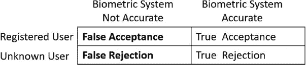

图 2.5：接受与拒绝矩阵

生物识别系统允许你调整发生错误的敏感性或阈值水平。提高敏感性会减少误匹配的数量并增加误拒绝的数量。相反，降低敏感性会增加误匹配并减少误拒绝。通过使用不同的敏感性绘制`FAR`和`FRR`图，你可以确定生物识别系统的效能。

图 2.6 显示了两个生物识别系统的交叉错误率（`CER`）（其中一个使用实线，另一个使用虚线）。`CER`是`FAR`与`FRR`交叉的点。较低的`CER`表示生物识别系统更准确。用实线表示的系统比虚线表示的系统更准确。

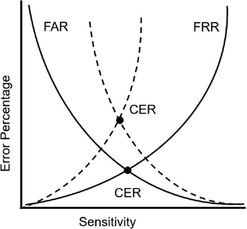

图 2.6：两个不同系统的交叉错误率

## 你所处的位置 (Somewhere You Are)

“你所处的位置”身份验证属性识别用户的位置。地理定位是用于识别用户位置的一组技术，也是该因素中最常用的方法。许多身份验证系统使用互联网协议（`IP`）地址进行地理定位。`IP`地址提供了有关国家、地区、州、城市，有时甚至是邮政编码的信息。

例如，我曾聘请了一个印度的虚拟助理为我进行一些数据输入。我在一个名为`Hootsuite`的在线应用程序中为该助理创建了账户，并将登录信息发送给了他。然而当他尝试登录时，`Hootsuite`识别出他的`IP`位于印度。这看起来很可疑，因此`Hootsuite`阻止了他的访问，并给我发了一封邮件，说有人从印度正尝试登录。他们还指导我如果他是合法用户，该如何授予他访问权限，但知道他们能自动检测并阻止这种访问，这让我感到很安心。

“你所处的位置”身份验证属性也可以用于识别不可能的旅行时间或风险登录情况。例如，想象 Lisa 在她斯普林菲尔的家里登录账户，而片刻之后，另一个人从`Certaheadistan`国登录了她的账户。除非 Lisa 拥有传送机器，否则她无法同时在两个地方登录。

值得注意的是，使用`IP`地址进行地理定位并不是万无一失的。网上有很多虚拟专用网络（`VPN`）`IP`地址更改器。例如，俄罗斯的用户可以使用美国的这些服务之一来访问某个网站。该网站将识别出`VPN`服务的`IP`地址，但看不到俄罗斯的`IP`地址。

在组织内部，可以使用计算机名称或系统的媒体访问控制（`MAC`）地址作为“你所处的位置”因素。例如，在`Microsoft Active Directory`域中，你可以配置账户，使用户只能通过一台特定的计算机登录网络。如果他们不在该计算机前，系统将完全阻止他们登录。

## 双因素与多因素身份验证

双因素身份验证（有时称为双重身份验证）使用两个不同的身份验证因素：你拥有的东西和你你知道的某种，或者你才知道的东西和你拥有的特征。双因素身份验证的示例包括：

- 软令牌（你拥有的东西）和密码（你才知道的东西）
- 指纹扫描（你的特征）和`PIN`（你才知道的东西）
- 安全密钥（你拥有的东西）和视网膜扫描（你的特征）

值得注意的是，在同一个因素中使用两种身份验证方法并不是双因素身份验证。例如，要求用户输入密码和一个可重用的`PIN`（都属于“你才知道的东西”因素）是单因素身份验证，而不是双因素身份验证。在这种情况下，可重用的`PIN`并不是通过智能手机发送给用户的。相反，用户输入一个只有他们知道的`PIN`值，就像密码一样。同样，使用指纹和视网膜扫描不是双因素身份验证，因为这两种方法都属于“你的特征”因素。

| 记住这一点！在身份验证的同一因素中使用两种或多种方法（例如`PIN`和密码）是单因素身份验证。双因素身份验证使用两个不同的身份验证因素，例如使用硬件令牌和`PIN`。多因素身份验证使用两个或多个因素。 |
| --- |

## 无密码身份验证

用户不喜欢密码，密码是身份验证最不安全的方式之一，因此许多组织正完全消除它们。无密码身份验证方法消除了密码并将其替换为其他身份验证因素，例如你拥有的东西或你的特征。

| 记住这一点！无密码身份验证并不一定是多因素身份验证。你可以使用单一的拥有物品因素或特征因素来使用无密码身份验证。 |
| --- |

## 身份验证日志文件

身份验证日志文件可以跟踪成功和失败的登录尝试。监控特权账户（如管理员）的登录活动。第一章讨论了安全信息和事件管理（`SIEM`）系统。通常会将身份验证日志项发送到`SIEM`系统进行分析和通知。

正如第 1 章所述，日志条目帮助管理员确定发生了什么、何时发生、在哪里发生以及是谁做的。对于身份验证日志条目：

- 发生了什么是登录成功或失败
- 何时发生是由时间戳决定的
- 在哪里发生通常是`IP`地址或计算机名称
- 是谁做的指的是用户账户

## 账户管理

账户管理涉及创建、管理、禁用和终止账户。当账户激活时，使用访问控制方法来控制用户可以做什么。此外，管理员使用访问控制来控制用户何时、何地以及如何登录。以下涵盖了账户管理的常见做法和用于账户管理的基本原则。

## 凭据策略与账户类型

凭据策略定义了不同人员、设备和账户的登录策略。这包括“你才知道的东西”因素中的项目（如密码）或其他因素或因素。组织通常对不同类型的账户应用不同的凭据策略。以下列表列出了不同的账户类型以及相关的凭据策略：

### 账户类型与管理

#### 账户类型

- **人员或终端用户账户**：大多数账户用于普通用户或组织内工作的人员。管理员创建这些账户，然后根据用户的工作职责分配适当的权限。为所有人员分配一个基础凭据策略是常见的。这可能是一个在本章前面定义的密码策略，定义了最小密码长度、密码历史和账户锁定策略等内容。
- **管理员和 root 账户**：管理员和 root 账户是特权账户，拥有比普通用户更多的权利和权限。例如，在 Windows 计算机上拥有管理员权限的人对该计算机具有完全控制权。Linux 系统拥有`root`账户，它授予额外的权限，类似于 Windows 系统上的管理员账户。凭据策略要求这些特权账户使用更强的验证方法，例如多因素身份验证。此外，特权访问管理技术（见下一节）应用额外的控制措施来保护这些账户。
- **服务账户**：某些应用程序和服务需要在账户的上下文中运行，服务账户满足了这一需求。例如，`SQL Server`是运行在服务器上的数据库应用程序，它需要访问服务器和网络上的资源。管理员创建一个普通用户账户，将其命名为类似`sqlservice`的名称，分配适当的权限，并配置`SQL Server`使用该账户。注意，这类似于普通的终端用户账户。唯一区别在于是由服务或应用程序使用的，而不是终端用户。凭据策略可能要求这些账户使用长且复杂的密码，但它们不应过期。如果密码过期，账户将无法登录，服务或应用程序将停止。
- **设备账户**：计算机和其他设备也拥有账户，尽管这并不总是显而易见的。例如，`Microsoft Active Directory`仅允许用户登录加入域的计算机。这些计算机拥有计算机账户，并由`Active Directory`管理它们的密码。
- **第三方账户**：第三方账户是来自外部实体并具有网络访问权的账户。例如，许多组织使用对网络具有管理员权限的安全应用程序。这些账户应该建立强力凭据策略，至少强制执行强密码策略。
- **访客账户**：Windows 操作系统包含一个`Guest`账户。如果你想在不创建新账户的情况下授予某人对计算机或网络的有限访问权限，这些账户非常有用。例如，想象一个组织与临时中介机构签约让某人进行数据录入。中介机构每天可能会派遣不同的人。为这个人启用`Guest`账户比每天创建一个新账户要简单。管理员通常会禁用`Guest`账户，仅在特殊情况下启用它。
- **共享和通用账户/凭据**：组织可以创建一个临时工共享的普通用户账户。普通工作中不建议使用共享账户。然而，如果临时中介机构每天都派遣不同的人，共享账户可能比访客账户提供更好的解决方案，因为可以为共享账户定制访问权限。基础凭据策略适用于共享和通用账户。

### 特权访问管理

特权访问管理（`PAM`）允许组织对具有提权权限的账户（如管理员或 root 级账户）实施更严格的安全控制。`PAM`实施了“即时权限”（just-in-time permissions）的概念。换句话说，管理员在需要之前并不拥有管理员权限。当他们需要时，他们的账户会发送一个获取特权的请求。底层的`PAM`系统会授予该请求，通常是通过将账户添加到具有特权权限的组中。在预设时间（如 15 分钟）后，他们的账户将自动从组中移除，从而撤销特权权限。

| 记住这个！ | 特权访问管理（`PAM`）系统对具有管理员或 root 级账户等具有提权权限的账户实施严格的安全控制。某些功能包括允许授权用户在不知道密码的情况下访问管理员账户、记录所有特权的使用情况，以及自动更改管理员账户密码。 |
| --- |

`PAM`系统还通过将密码存储在密码库中来保护管理员账户。在许多情况下，这些系统被设置为没有任何人类永远能看到或访问管理员账户的密码。相反，`PAM`系统会代表他们使用该密码。

除了在用户需要时提供管理员权限的“即时权限”外，`PAM`系统还可以创建临时账户。这些是具有管理员权限的账户，持续有限的时间，并在用户完成工作后被销毁。

`PAM`的某些功能包括：

- 允许在不知道密码的情况下访问特权账户
- 定期更改特权账户密码
- 限制用户使用特权账户的时间
- 允许用户提取凭据
- 记录所有凭据访问

如果攻击者能够以管理员身份登录，他们几乎可以做任何事情。理想情况下这种情况是不可能的，但存在许多攻击方法可以获取管理员密码，无论该密码有多长或复杂。`PAM`是针对此类攻击的防护。它减少了攻击者利用特权的机会。`PAM`系统通过日志和监控来显示这些账户何时被使用以及用户对其做了什么。

#### 要求管理员使用两个账户

通常要求管理员拥有两个账户。他们使用一个账户进行日常工作，该账户与普通用户具有相同的有限权限。另一个账户拥有执行管理工作所需的提权权限，他们仅在执行管理工作时使用它。这种做法的好处是减少了管理员账户受到攻击的风险。

例如，当恶意软件感染系统时，它通常会尝试使用权限提升技术获取额外的权利和权限。它可能利用应用程序或操作系统的漏洞或缺陷。或者，它可能简单地假设登录用户的权利权限。如果管理员以管理员账户登录，恶意软件就可以获取这些特权。相比之下，如果管理员以普通标准用户账户登录，恶意软件必须采取额外的步骤来提升其权限。

这也减少了日常工作对管理员账户的风险。假设 Homer 是一个管理员，他被紧急召去处理危机。他可能在离开时没有锁定计算机。如果他是以管理员账户登录的，路过的攻击者就可以访问系统并拥有管理员权限。虽然系统通常带有密码保护的屏幕保护程序，但这些程序通常在用户离开 10 分钟或更久后启动。

#### 禁止共享和通用账户

账户管理策略通常规定人员不应使用共享或通用账户。相反，每个用户至少有一个账户，且该账户仅供该用户访问。如果多个用户共享同一个账户，你就无法实施基本的授权控制。作为提醒，四个核心概念是：

- **身份识别 (Identification)**。用户使用用户名等标识符声明自己的身份。
- **身份验证 (Authentication)**。用户使用密码等验证方法证明其身份。
- **授权 (Authorization)**。根据其已证明的身份，授予用户访问资源的权限。
- **审计 (Accounting)**。日志使用用户声称的身份记录活动。

想象一下 Bart、Maggie 和 Lisa 都使用了`Guest`账户。如果你想让 Lisa 访问某些文件，你将授予`Guest`账户访问权限，但 Bart 和 Maggie 也会拥有相同的权限。如果 Bart 删除了文件，日志将显示是`Guest`账户删除了文件，但你将不知道究竟是谁删了它们。相比之下，如果用户拥有唯一的账户，你就可以单独地为他们授予资源权限。此外，日志会记录是谁执行了该操作。

请注意，单个临时用户使用`Guest`账户登录确实支持身份识别、身份验证、授权和审计。只有当多个用户共享同一个账户时，你才会失去这些控制。尽管如此，某些组织禁止出于任何目的使用`Guest`账户。

| **记住这一点！** 要求管理员使用两个账户（一个具有管理员权限，另一个具有普通用户权限）有助于防止权限提升攻击。用户不应使用共享账户。 |
| --- |

## 权限注销 (Deprovisioning)

权限注销是在用户离开组织时禁用其账户的过程。大多数组织要求管理员在员工离开组织时尽快禁用其用户账户。这一过程通常是自动化的，一旦用户在人力资源系统中被标记为非活动，系统就会禁用其账户。

至少在最初，禁用账户优于删除账户。如果管理员删除了账户，他们也会删除与账户相关的任何加密和安全密钥。然而，当账户被禁用时，这些密钥会被保留。例如，想象一名员工用他的账户加密了文件。操作系统使用加密密钥对这些文件进行加密和解密。如果管理员删了这个账户，除非组织拥有可以访问这些文件的密钥托管或恢复代理，否则这些文件可能永远处于加密状态。

账户禁用策略的一些内容包括：

- **离职员工 (Terminated employee)**。账户禁用策略规定，离职员工的账户应尽快禁用。这确保了离职员工不会变成在网络上大肆破坏的愤恨前员工。请注意，“离职”既指辞职的员工也指被解雇的员工。
- **休假 (Leave of absence)**。如果员工将长期缺，应在员工离开期间禁用账户。组织对“长期”的定义不同，有些组织将其定义为仅两周，而另一些组织将其延长长达两个月。
- **账户删除 (Account deletion)**。当组织确定该账户不再需要时，管理员会将其删除。例如，策略可能会指导管理员删除非活动 60 或 90 天的账户。

| **记住这一点！** 账户禁用策略确定了如何处理永久离职或休假员工的账户。大多数策略要求管理员尽快禁用账户，以确保离职员工无法使用该账户。禁用账户可以确保与账户相关的数据仍然可用。当账户被禁用时，与账户相关的安全密钥仍然可用，但如果账户被删除，这些安全密钥（以及它们加密的数据）将无法再次被访问。 |
| --- |

## 基于时间的登录 (Time-Based Logins)

基于时间的登录（有时称为时段限制）确保用户只能在特定时间内登录计算机。如果用户尝试在限制时间之外登录系统，系统将拒绝用户的访问。

例如，想象一家公司每天早上 8:00 到下午 5:00 运营。经理们决定不希望普通用户在周一至周五早上 6:00 到晚上 8:00 之外登录网络。你可以为用户账户设置时段限制来执行这一规定。如果用户尝试在限制时间之外登录（例如在周末期间），系统将阻止用户登录。

如果用户正在为某个项目加班，当限制时间到达时，系统不会将他们注销。例如，如果 Maggie 在周三晚上工作工作，系统不会在晚上 8:00 将她注销。然而，系统将阻止她创建任何新的网络连接。

## 账户审计 (Account Audits)

账户审计会查看分配给用户的权利和权限，有助于执行最小权限原则。审计识别授予用户的特权（权利和权限），并将其与用户所需的权限进行比较。它可以检测“权限蔓延”（privilege creep），这是一种违反最小权限原则的常见问题。权限蔓延（或权限膨胀）发生在用户因工作需求的变化而获得越来越多的权限，但不需要的权限从未被移除时。例如，想象 Lisa 在人力资源（HR）部门工作，因此她拥有访问 HR 数据的权限。后来，她转到了销售部门，管理员授予她访问销售数据的权限。然而，尽管她在执行销售部门工作时不需要 HR 数据，但没有人移除她对 HR 数据的访问权限。

组织通常使用基于角色的访问控制模型，这将在本章稍后部分描述。例如，当 Lisa 在 HR 部门工作时，她的账户将位于一个或多个 HR 部门安全组中，以授予她适当的 HR 工作权限。当她转到销售部门时，管理员会将她添加到相应的销售部门组，授予新的工作权限。组织还应建立账户管理控制，以确保管理员将其账户从 HR 部门安全组中移除。权限审计审查负责验证这些账户管理实践的执行。

大多数组织确保至少执行一次权限审计审查，某些组织执行得更频繁。目标是执行足够的频率以发现潜在问题并防止安全事件。然而，如果这些操作无法自动化，要求安全管理员频繁执行它们（例如每天或每周一次）将成为不必要的负担。

确认（Attestation）是一种审查用户权限的正式过程。在确认过程中，经理会正式审查每个用户的权限，并证明这些权限对于执行用户的职责是必要的。

| **记住这一点！** 使用审计在日志中记录用户活动。使用审计审查通过日志查看用户在做什么，并用于重建审计追踪。权限审计审查有助于确保用户仅拥有所需的权限而非更多，并可以检测权限蔓延问题。 |
| --- |

## 身份验证服务 (Comparing Authentication Services)

还有其他身份验证服务，它们超出了之前身份验证因素的范围。它们的共同目标是确保不跨网络发送未加密的凭据。换句话说，它们确保凭据不以明文发送。如果凭据以明文发送，攻击者可以使用协议分析器等工具来捕获并查看它们。以下章节将描述其中许多服务。

## 单点登录 (Single Sign-On)

单点登录（SSO）是指用户登录一次即可访问多个系统，而无需再次登录的能力。SSO 提高了安全性，因为用户只需要记住一组凭据，并且他们不太可能将它们写下来。对于用户来说，如果只需要登录一次，访问网络资源也会要方便得多。

例如，考虑一个需要访问网络内多个服务器来执行例行工作的用户。如果没有 SSO，该用户需要一组凭据进行本地登录，并为每台服务器额外准备一组凭据。许多用户为了记住这些凭据，会把它们写下来。

相反，在具有 SSO 能力的网络中，用户只需要登录一次网络。SSO 系统通常会创建某种类型的 SSO 安全令牌，并在整个登录会话期间使用它。每当用户访问网络资源时，SSO 系统都会使用该安全令牌进行身份验证。

SSO 需要强有力的身份验证才能生效。如果用户创建了弱密码，攻击者可能会猜中，从而获得访问多个系统的权限。有些人争论 SSO 增加了风险，因为如果攻击者获取了用户的凭据，他们就获得了访问多个系统的权限。

SSO 系统的威力在于它们与组织中使用的许多操作系统、设备、应用程序和服务之间的互操作性。这些服务可能都配置为依赖 SSO 系统进行用户识别、身份验证、授权和计费。

## LDAP

轻量目录访问协议（LDAP）是许多单点登录系统的核心组件。LDAP 允许用户和应用程序从组织的目录中检索有关用户的信息——目录是一个关于用户帐户、设备和其他对象的集中存储库。Windows 域使用 LDAP 处理来自活动目录（Active Directory）的信息查询。你将在第 3 章“探索网络技术和工具”中学习更多关于 LDAP 的知识。

## SSO 与联邦

某些 SSO 系统可以连接来自不同环境的身份验证机制，例如不同的操作系统或不同的网络。常用方法是使用联邦身份管理系统，它通常集成为联邦数据库。这种联邦数据库为非同构环境提供集中身份验证。

例如，想象一下斯普菲尔德核电厂与斯普菲尔德学区建立了合作关系，允许电厂员工访问学校资源。将这两个网络合并为一个网络是不可行的，也不符合愿景的。但是，你可以为这两个网络创建一个联邦。一旦建立联邦，核电厂员工将使用他们的电厂账户登录，然后访问共享的学校资源，而无需再次登录。

联邦需要一个所有成员都使用的联邦身份管理系统。在之前的示例中，联邦的成员是核电厂和学区。联邦成员对联邦身份的标准达成一致，然后根据标准交换信息。联邦身份将用户来自不同网络或操作系统的凭据连接起来，但联邦将其视为一个身份。

## SAML

安全断言标记语言（SAML）是一种基于可扩展标记语言（XML）的数据格式，用于 Web 浏览器上的 SSO。想象由两个不同组织托管的网站。通常情况下，用户必须提供不同的凭据来访问任何一个网站。然而，如果这些组织相互信任，它们可以使用 SAML 作为联邦身份管理系统。用户在一个网站进行身份验证，在访问第二个网站时无需再次进行身份验证。

许多基于 Web 的门户使用 SAML 进行 SSO。用户登录门户一次，然后门户将用户的身份验证证明传递给后端系统。只要一个组织已经对用户进行了身份验证，他们访问门户内的其他站点时就不需要再次进行身份验证。

SAML 定义了三个角色。在阅读这些角色时，请想象荷马（Homer），他在工作场所（核电厂）登录，然后访问斯普菲尔德学区网站上的继续教育课程：

- **主体（Principal）**：这通常是一个用户，例如荷马。用户登录一次。如有必要，主体向身份提供者请求身份。
- **身份提供者（Identity provider）**：身份提供者（`IdP`）为主体创建、维护和管理身份信息、身份验证和授权。在场景中，`IdP`可以是核电厂、斯普菲尔德学区或第三方。

| 记住！ | SAML 是一种基于 XML 的标准，用于在不同实体之间交换身份验证和授权信息。SAML 为 Web 应用程序提供 SSO。 |
| --- |

- **服务提供者（Service provider）**：服务提供者为主提供服务的实体。在这个例子，斯普菲尔德学区是荷马的服务提供者。它托管了通过 Web 门户可以访问的一个或多个网站。当荷马访问学校系统网站时，服务提供者会查询`IdP`以验证他是否拥有有效凭据，然后授予访问权限。

此过程在系统之间发送多条基于 XML 的消息。然而，这对用户来说通常是透明的。

## SAML 与授权

必须意识到，SSO 的主要目的是用户的识别和身份验证。用户声称一个身份并用凭据证明该身份。SSO 不提供授权。例如，假设核电厂和学区使用 SAML 创建了联邦。这并没有自动授予学区内每个人完全访问核电厂资源的权限。授权是完全分离的。

然而，许多联邦 SSO 系统（包括 SAML）包含了在系统之间传输授权数据的能力。换句话说，可以使用 SAML 进行单点登录身份验证和授权。

## OAuth

OAuth 是一种授权的开放标准，许多公司使用它提供对受保护资源的安全访问。它允许用户授权一个服务访问另一个服务的信息，而无需披露其登录凭据。

例如，Google 服务支持 OAuth。想象你正在注册一个名为 Doodle 的新调度服务，并希望该服务查看并编辑你 Google 日历上的条目。你不想给 Doodle Google 账户的密码，因为这将允许他们访问你的电子邮件和其他任何内容。相反，Doodle 请求通过图 2.7 所示的 OAuth 访问你 Google 帐户中的信息。


图 2.7: OAuth 弹出窗口授权访问 Google

| 记住！ | 因为名称具有歧义，很容易混淆 OAuth 的功能！记住 OAuth 中的“Auth”代表授权（authorization），而不是身份验证（authentication）！ |
| --- |

## 授权模型

访问控制确保只有经过身份验证和授权的实体才能访问资源。例如，它确保只有获得适当权限的验证用户才能访问服务器上的文件。这从确保用户被准确识别和身份验证开始。然后，你使用几种不同的方案授予访问。本节涵盖的授权模型包括：

- 基于角色的访问控制
- 基于规则的访问控制
- 自主性访问控制 (`DAC`)
- 强制性访问控制 (`MAC`)
- 基于属性的访问控制 (`ABAC`)

这些授权模型中的每一个都使得对网络内的用户应用访问策略变得更容易。通过进一步了解底层的设计原则，你将理解为什么某些规则是重要的，并能更好地准备以遵循安全原则。

通常，在使用任何一种模型时，你都会遇到以下术语：

- `Subjects`（主体）。`Subjects`通常是访问对象的用户或组。偶尔情况下，主体也可能是一个使用服务账户访问对象的服务。
- `Objects`（对象）。`Objects`是如文件、文件夹、共享目录和打印机等主体访问的项。访问控制有助于确定系统如何向对象授权。或者换句话说，访问控制方案决定了系统如何授予用户对文件和其他资源的访问权限。

# 基于角色的访问控制

基于角色的访问控制（`role-BAC`）使用角色来管理用户的权利和权限。这对于特定部门内执行相同工作功能的用户有用。管理员创建角色，然后将特定的权利和权限分配给这些角色（而不是分配给用户）。当管理员将用户添加到某个角色时，该用户就拥有了该角色的所有权利和权限。

## 根据工作和功能使用角色

想象你的组织有几个部门，例如财务部、销售部和 IT 部，每个部门都有一个托管其文件的独立服务器。你可以创建财务、`Sales`和`IT`角色，并根据他们工作所在的部门将这些角色分配给用户。接下来，你授予这些角色访问相应服务器的权限。例如，你将财务角色授予财务服务器，将`Sales`角色授予`Sales`服务器，依此类推。

`role-BAC`方案的另一个例子是 Microsoft Project Server。Project Server 可以托管由不同项目经理管理的多个项目。它包含以下角色：

- `Administrators`（管理员）。`Administrators`对服务器上的一切具有完全访问和控制权，包括在服务器上管理的所有项目。
- `Executives`（主管）。`Executives`可以访问服务器上持有的任何项目的数据，但没有修改服务器设置的权限。
- `Project Managers`（项目经理）。`Project managers`对自己的项目拥有完全控制权，但不控制其他项目经理拥有的项目。
- `Team Members`（团队成员）。`Team members`通常可以对项目经理分配他们的工作进行报告，但他们在任务范围之外的访问权限很小。

Microsoft Project Server 包含更多角色，但你可以通过这四个角色理解其意义。这些每个角色都有分配的权利和权限，要给某人相关的特权，你只需将用户的账户添加到该角色中。

## 使用矩阵记录角色

想想 Microsoft Project Server 的开发者。他们并不是直接开始创建角色的。相反，他们进行了一些规划，并确定了他们在应用程序中设想的角色。接下来，他们确定了每个角色所需的权限。用矩阵列出所有职位和每个角色的权限来记录基于角色的权限是常见做法，如表 2.1 所示。

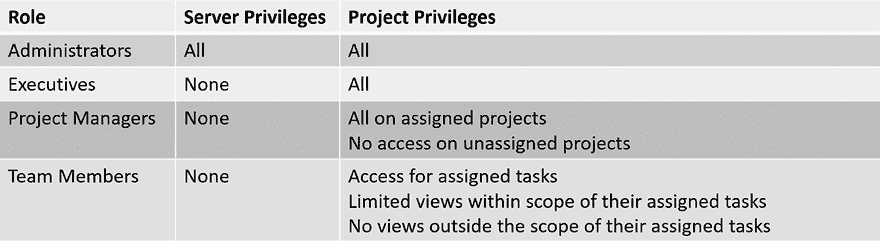

表 2.1：Project Server 的`Role-BAC`矩阵

`Role-BAC`也称为基于层级的或基于工作的：

- `Hierarchy-based`（基于层级）。在 Project Server 示例中，你可以看到顶层角色（如`Administrators`）的权限显著高于低层角色（如`Team Members`）。
- `Job-based`（基于工作）。这个示例显示了如何为销售部门使用一个组。

| 记住这一点！基于组的权限减少了访问管理的管理工作量。管理员将用户账户放入安全组并向组分配特权。组内的用户自动继承分配给组的权限。 |

## 通过基于组的特权建立访问

管理员通常使用组向用户授予访问权限。这种类型的组简化了管理。`role-BAC`的一种实现方式是 Windows 内置组。它们向组分配权利和权限。

内置组的一个例子是`Administrators`组。例如，如果你想授予 Marge 对计算机的完全控制权，你将她的账户添加到`Administrators`组。尽管内置组非常有用，但它们并满足组织中的所有需求。例如，如果你的组织想要分离备份和恢复职责，你可以创建一个可以备份的组和另一个可以恢复数据的组。

在 Windows 域中，管理员经常创建对应部门的组。例如，想象 Homer、Marge 和 Bart 在销售部工作，需要访问存储在名为`Sales`的共享文件夹中的数据。管理员通过图 2.8 所示的步骤简化管理工作：

1. 创建`Sales`组并将每个用户账户添加到`Sales`组。
2. 将`Sales`组添加到`Sales`文件夹。
3. 为`Sales`文件夹的`Sales`组分配适当的权限。

当公司增加新的销售人员时，管理员为他们创建账户并将账户放入`Sales`组。这些新销售人员现在有了访问分配给该组的所有内容的权限。如果任何用户在公司内部更改了职位并离开了销售部，管理员会将他们从`Sales`组中移除。这会自动防止用户访问授予给`Sales`组的任何资源。

组提供了另一个安全益处。想象一个用户被晋升离开了销售部，现在在市场部。如果你有一个`Marketing`组，你可以将此用户账户放入`Marketing`组并从`Sales`组中移除该账户。从`Sales`组中移除用户将移除从该组应用的所有用户权利和权限。然而，如果你没有使用组并直接将权限分配给用户，你可能不会忘记作为销售部员工分配了哪些资源。

# 基于规则的访问控制

基于规则的访问控制（`rule-BAC`）使用规则。最常见的例子是路由器和防火墙中的规则。然而，更高级的实现也会在应用程序内部触发规则。

路由器和防火墙使用访问控制列表（`ACLs`）中的规则。这些规则定义了设备允许进入网络的光流量，例如允许网络浏览器的超文本传输协议（HTTP）流量。这些规则通常是静态的。换句话说，由管理员创建规则，除非管理员再次更改它们，否则规则将保持不变。

然而，某些规则是动态的。例如，入侵防御系统可以检测到攻击，然后修改规则以拦截来自攻击者的流量。在这种情况下，攻击触发了规则的变化。

也可以为用户应用程序配置规则。例如，想象你希望在 Marge 不在时，给 Homer 赋予数据库额外的权限。你可以配置一个数据库规则，当系统识别出 Marge 不在时，触发这些权限的更改。

| 记住这个！基于规则的访问控制基于一组经过批准的指令，例如访问控制列表。某些基于规则的访问控制（BAC）系统使用为了响应事件而触发的规则，例如在检测到攻击后修改 ACL，或在某些情况下向用户授予额外权限。 |
| --- |

## 自主式访问控制

在自主式访问控制（`DAC`）方案中，对象（如文件和文件夹）拥有所有者，由所有者建立该对象的访问权限。许多操作系统（如 Windows 和大多数基于 Unix 的系统）都使用`DAC`方案。

`DAC`方案的一个常见示例是 Windows 中使用的新建文件系统（`NTFS`）。`NTFS`通过允许用户和管理员使用权限限制对文件和文件夹的访问来提供安全性。节节解释`NTFS`如何使用`DAC`方案。

### 文件系统权限

微软系统使用`NTFS`的文件系统权限来描述用户允许对文件和文件夹执行的操作。以下列表描述了基本的`NTFS`权限：

- `Write`写入。用户可以更改文件的内容，例如更改文本文件中的单词。这并没有赋予他们删除文件的能力，但他们可以删除内容。
- `Read`读取。`Read`权限允许用户打开并查看文件内容。
- `Read & execute`读取和执行。这允许用户运行任何可执行文件，包括脚本。
- `Modify`修改。`Modify`允许用户查看和更改文件，包括删除文件和文件夹或向文件夹中添加文件。
- `Full control`完全控制。用户可以对文件或文件夹进行任何操作并修改其权限。

可以对任何文件或文件夹分配`Allow`允许或`Deny`拒绝访问权限。然而，文件系统使用默认拒绝策略。如果未授予访问权限，系统默认拒绝访问。防火墙通常将此称为隐式拒绝。

### SIDs 和 DACLs

微软系统使用安全标识符（`SIDs`）来识别用户，尽管你很少看到`SID`。`SID`是一个以字母`S`开头并由一系列破折号分隔的长数字字符串。例如，一个`SID`可能像这样：`S-1-5-21-3991871189-223218`。系统不是直接显示`SID`，而是查找与`SID`关联的名称并显示该名称。同样，微软系统使用`SID`来识别组。

每个对象（如文件或文件夹）都包含一个自主式访问控制列表（`DACL`），它在使用`DAC`方案的系统中标识谁可以访问它。`DACL`是访问控制条目（`ACEs`）的列表。每个`ACE`由一个`SID`和授予该`SID`的权限组成。例如，命名为`Study Notes`的文件夹可能分配了以下权限：

- Lisa：完全控制
- Bart：读取
- Maggie：修改

这些条目中的每一个都是一个`ACE`，组合在一起，所有条目就一个`DACL`。你可以通过本章在线练习中的“查看 DACL 实验”来查看文件夹的`DACL`。

| 记住这个！`DAC`方案规定每个对象都有一个所有者，且所有者对对象拥有完全、显式的控制。微软`NTFS`使用`DAC`方案。 |
| --- |

如果用户创建了文件，他们被指定为所有者并对文件拥有显式控制权。作为所有者，用户可以通过向`DACL`添加用户或组账户并分配所需的权限来修改对象的权限。

`DAC`方案比下一节描述的`MAC`方案要灵活得多。`MAC`具有预定义的访问权限，并且需要管理员来进行更改。在`DAC`中，如果你想让另一个用户访问你拥有的文件，你只需进行更改，该用户即可访问。

## 强制性访问控制

强制性访问控制（`MAC`）方案使用标签（有时称为敏感性标签或安全标签）来确定访问。安全管理员为主体（用户）和对象（文件或文件夹）分配标签。当标签匹配时，系统可以授予主体访问对象的权限。当标签不匹配时，访问方案将阻止访问。

军事单位广泛使用这种方案来保护数据。你可能在电影中见过他们展示一个带有大红大黑色封面的文件夹，上面标有“机密”（Top Secret）。封面标识文件夹内包含数据的敏感性标签。拥有机密标签（机密权限）且有知情需要的用户可以访问机密文件夹的数据。

“知情需要”（Need to know）是一个需要理解的概念。仅仅因为个人拥有机密权限并不意味着他们应该自动获得所有机密数据的访问。相反，访问是根据知情需要受到限制的。

安全增强 Linux（`SELinux`）是少数使用强制访问控制方案的操作系统之一。它是为了演示如何将`MAC`方案应用于操作系统。相比之下，Windows 操作系统使用自主控制方案。

`SELinux`策略是一组覆盖 Linux 标准权限的规则。然而，即使存在`SELinux`策略，它并不一定会被执行。`SELinux`有三种模式：

- `Enforcing`强制模式将执行`SELinux`策略并忽略权限。换句话说，即使权限允许访问文件或目录，除非符合相关的`SELinux`策略，否则将被拒绝访问。
- `Permissive`许可模式不执行`SELinux`策略，而是使用权限。但是，系统会记录会被拦截的访问。这在测试策略时非常有用。
- `Disabled`禁用模式不执行`SELinux`策略，也不记录与策略相关的任何内容。

| 缩写在 CompTIA Security+ 的上下文中，MAC 实际上有三种不同的含义： 介质访问控制（`MAC`）地址是分配给网络接口卡（`NICs`）的物理地址。 | 强制访问控制（`MAC`）方案在本章后面讨论的几种访问控制方案之一。 | 消息认证码（`MAC`）提供的完整性类似于哈希的作用。 |

如果你很难区分所有它们，不要觉得孤单。本书的术语表列出并列出了相关缩写的简要描述。在做模拟测试题时，我鼓励你思考单词而不是缩写。知道它们代表什么会让你在正式考试中看到缩写时，问题变得简单得多。 |
| --- |

### 标签和格结构

`MAC`方案使用不同的安全级别对用户和数据进行分类。这些级别包含在格结构中，格结构定义了对象可能的安全级别以及用户被授权访问的安全级别。只有当用户的安全许可等于或高于对象的级别时，他们才被允许访问该对象。

图 2.9 显示了`MAC`方案如何利用格结构根据“知情需要”将访问划分为不同的区域。格结构首先定义了`Top Secret`（绝密）、`Secret`（秘密）、`Confidential`（机密）和`For Official Use`（官方可用）等级别。这些每个标签都定义了特定的安全边界。在这些内部，格结构定义了特定的隔离。例如，`Top Secret`层包含标记为`Nuclear Power Plant`（核电厂）、`007`和`Forbidden Donut`（禁止甜圈）的隔离。

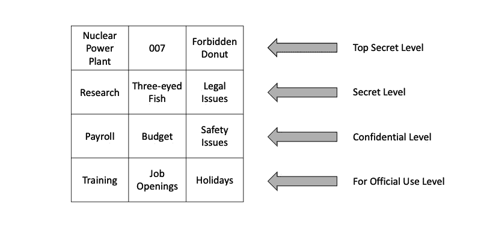

图 2.9: MAC 方案格结构

假设 Homer 拥有`Top Secret`权限和`Nuclear Power Plant`标签。这使他能够访问`Nuclear Power Plant`隔离内的数据。然而，除非他也拥有这些权限（以及相关的标签），否则他无法访问`007`或`Forbidden Donut`隔离中的数据。

高级别的权限包含低级别的权限。例如，由于 Homer 拥有`Top Secret`权限，可以被授予访问`Secret`和更低级别数据的权限。尽管如此，他只能根据他的“知情需要”访问这些较低级别的数据。

作为另一个例子，假设 Lisa 拥有`Secret`级别权限。管理员可以根据她的“知情需要”授予她访问`Secret`级别及更低级别数据的权限。例如，他们可以通过为她分配`Research`（研究）标签来授予访问`Research`数据的权限，但不一定授予访问`Three-eyed Fish`（三眼鱼）或`Legal Issues`（法律问题）数据的权限。此外，他们不能授予她访问任何`Top Secret`级别的数据。

### 建立访问

管理员负责建立访问，但只有权限更高的人才能定义主体和对象的访问。通常，安全专业人员会识别个人被授权访问的具体内容。此人还可以在需要时升级或降低个人的访问权限。请注意，安全专业人员通过书面完成这一切，而不是在计算机系统上分配权利和权限。相反，管理员根据安全专业人员的指示分配权利和权限。

| 记住这个！ | `MAC`方案对用户和数据使用敏感性标签。当需要根据“知情需要”限制访问时，通常使用它。敏感性标签通常反映了数据的分类分级和授予个人的权限。 |
| --- |

在确定用户可以访问什么内容的决策过程中，通常涉及多个审批层级。例如，在军队中，担任安全专业人员角色的军官会与更高级别的政府实体协调，以升级或降低权限。这些高级别实体负责批准或否决权限请求。

一旦个人被正式授予访问权限，网络管理员将负责根据安全专业人员识别的权限建立访问。从 IT 管理员的角度来看，所有的权限和访问特权都是预定义的。

如果有人需要不同的访问权限，管理员会将请求转发给安全专业人员，安全专业人员可能会批准或否决该请求。另一方面，安全专业人员可能会根据既定程序将请求转发给更高级别。这一过程需要时间，并且导致灵活性有限。

### 基于属性的访问控制

基于属性的访问控制（`ABAC`）系统评估属性并根据这些属性的值授予访问。属性可以是用户、环境或资源的几乎任何特征。`ABAC`使用策略来评估属性，并在系统检测到与策略匹配时授予访问。

作为一个简单的例子，Homer 是`Springfield Nuclear Power Plant`（斯普林菲核电厂）的核安全检查员。他的用户账户可能定义以下属性：`employee`（员工）、`inspector`（检查员）和`nuclear aware`（核意识）。工厂的一台文件服务器包含一个名为`Inspector`的共享，存储了核安全检查员常用的文档。针对该共享的`ABAC`策略可能会授予任何具有`employee`、`inspector`和`nuclear aware`属性的主体访问权限。

许多软件定义网络（`SDNs`）使用`ABAC`方案。控制流量的物理路由器上的规则，而是`ABAC`系统中的策略。这些策略通常使用自然语言语句。例如，对于一家雇佣研究人员的公司，`ABAC`策略规则可能是：“允许登录的研究人员通过主网络访问研究站点。”策略语句通常包含四个元素：

- **主体（Subject）**。这通常是一个用户。你可以使用任何用户属性作为属性，例如就业状态、组成员身份、工作角色、登录状态等。在示例中，主体被识别为已登录且是`researchers`组的成员。
- **对象（Object）**。这是用户尝试访问的资源（如文件、数据库或应用程序）。在示例中，对象是`research sites`。`research sites`对象将包括通过代理服务器访问 Internet 的权限，以及特定的研究站点 URL 列表。
- **操作（Action）**。操作是用户尝试执行的行为，例如读取或修改文件、访问特定网站。
- **环境（Environment）**。环境包括主体和对象之外的所有内容。这通常被称为访问请求的上下文。它可以包括时间、位置、协议、加密、设备和通信方法。在示例中，它将`main network`作为环境属性。

| 记住这个！ | `ABAC`方案使用定义的属性来授予访问。它通常用于软件定义网络（`SDNs`）。 |
| --- |

`ABAC`系统具有很强的灵活性，并且执行`DAC`和`MAC`。`ABAC`方案与`DAC`和`MAC`方案也有许多相似之处。在`DAC`方案中，所有者控制访问，而在`ABAC`方案中，所有者可以创建策略授予访问。`MAC`方案使用分配给主体和对象的标签，并在标签匹配时授予访问。`ABAC`方案使用识别主体和对象的属性，并在策略识别出匹配时授予访问。

如果你想进一步研究`ABAC`方案，请查阅`NIST SP 800-162`，“基于属性的访问控制 (ABAC) 定义与考量”。

### 分析认证指标

认证系统为寻找潜在恶意活动迹象的网络安全分析师提供了丰富的信息源。有时，这些活动的迹象隐藏在看似无的日志条中。在审查认证日志时，你应该寻找的一些关键点包括：

- **账户锁定**。注意由于多次尝试登录失败而被锁定的账户，这些失败的登录可能是恶意活动的迹象。
- **并发会话使用**。如果同一用户同时从不同位置登录到同一（或不同）系统，这可能表明有多个人在使用该账户。
- **不可能的旅行时间**。如果用户从一个位置完成登录，然后又从另一个地理位置登录，而没有足够的时间在这些位置之间旅行，这可能表明两个用户共享同一个账户。
- **被拦截的内容**。如果内容过滤器过滤了异常水平的恶意代码，那么值得进一步调查。
- **资源消耗**。如果处理器时间、内存、存储或其他资源被过度使用且没有解释，可能表明恶意代码正在系统上运行。
- **资源不可用**。如果服务突然变得不可，可能是恶意活动正在对其进行干扰。例如，网站可能因为 Web 服务器上运行着恶意代码而崩溃。
- **日志异常**。如果日志记录级别超出周期（意味着许多日志条目在异常时间出现，或者日志文件丢失），这可能是恶意活动的指示。

这些仅仅是当系统发生恶意活动时可能存在的指示类型的一些示例。你还应该关注网络安全新闻源，并留意已发布/记录的反映新类型恶意活动的指示。

# 第 2 章考试主题回顾

在准备考试时，请确保你理解本章涵盖的这些关键概念。

## 探索身份管理

- 身份验证（Authentication）允许实体通过另一个实体知的凭据来证明自己的身份。
- 识别（Identification）发生在用户声称或宣布某种身份时，例如使用`username`、电子邮件地址或生物识别。
- 身份验证（Authentication）发生在实体提供对其声称身份的证明（例如使用密码）时。另一个实体是验证器，它负责验证该身份。
- 授权（Authorization）根据证明的身份提供资源访问权限。
- 审计（Accounting）方法跟踪用户活动并将活动记录在日志中。
- 身份验证的四个要素是：
  - 你知道的，例如`username`和密码。
  - 你拥有的，例如智能卡或令牌（token）。
  - 你特征的，使用生物识别技术，如指纹、静脉扫描、面部扫描和步态分析。
  - 你所在的地方，例如你的家或办公室。
- 密码管理器为用户存储并简化了凭据的使用。当用户访问需要凭据的网站时，系统会自动检索存储的凭据并将其提交给该网站。
- 推送通知通常用于`2FA`。用户认为它们易用且无干扰性，因为他们可以通过点击屏幕上的按钮来验证他们的身份。
- 账户锁定策略在用户多次输入错误密码后锁定账户。这有助于防止暴力破解和字典攻击。
- 在将任何应用程序或设备投入使用之前，应更改其默认密码。
- 假接受率（`FAR`）识别了假接受发生的百分比。假拒绝率（`FRR`）识别了假拒绝发生的百分比。交叉错误率（`CER`）表示生物识别系统的质量或系统的有效率。`CER`越低越好。
- `HOTP`和`TOTP`是用于生成一次性密码的开源标准。`HOTP`生成在在使用前不会过期的一次性密码，而`TOTP`生成在指定时间段后过期（通常为 30-240 秒）的一次性密码。
- 单因素身份验证包括一个或多个使用相同要素的身份验证方法，例如`PIN`和密码（两者都是你知道的）。双因素（或二双因子）身份验证使用两个身份验证要素，例如令牌密钥（你拥有的）和`PIN`（你知道的）。多因素身份验证使用两个或更多要素，并且比任何形式的单因素身份验证都强。

## 账户管理

- 用户不应共享账户，大多数组织都确保禁用了`Guest`账户。共享账户会防止有效的识别、身份验证、授权和审计。
- 特权访问管理（`PAM`）对具有提升权限的账户（如`administrator`或`root`账户）实施严格的安全控制。这包括允许经过授权的用户在不知道密码的情况下访问`administrator`账户，限制用户访问特权的时间，并记录所有相关活动。
- 账户策略通常要求管理员拥有两个账户（一个`administrator`账户和一个标准用户账户），以防止权限提升和其他攻击。
- 账户禁用策略确保不活跃的账户被禁用。对于离职或被解雇的员工账户，应尽快禁用。
- 基于时间的登录（或基于限制的限制）防止用户在特定时间段内登录或访问网络资源。基于位置的策略防止用户从某些位置登录。
- 账户审计（Account audit）查看分配给用户的权利和权限，并有助于执行最小权限原则。

## 比较身份验证服务

- 单点登录（`SSO`）允许用户使用单一用户账户进行身份验证，并访问网络上的多个资源而无需再次身份验证。
- `SSO`可以通过联合数据库在互联网上提供中央身份验证。联合身份将用户来自不同网络或操作系统的凭据关联起来，但联邦将其视为一个身份。
- `SAML`是一种基于`XML`的标准，用于在不同实体之间交换身份验证和授权信息。`SAML`用于 Web 应用程序。
- `OAuth`是授权的开放标准。它允许用户使用其他账户（如`Google`、`Facebook`、`PayPal`、`Microsoft`或`Twitter`）登录。它使用`API`调用交换信息并使用令牌显示访问已授权。

## 比较访问控制方案

- 基于角色的访问控制（`role-BAC`）方案使用角色，通过根据分配的工作、功能或任务将用户放入角色来授予访问权限。在使用`role-BAC`时，一个将职位与所需权限相匹配的角色与权限矩阵作为规划文档是非常很有用的。
- 基于组的权限是`role-BAC`的一种形式。管理员创建组，将用户添加到组，然后向组分配权限。这简化了管理，因为管理员不需要单独为用户分配权限。
- 基于规则的访问控制（`rule-BAC`）方案基于一组经过批准的指令，例如防火墙中的`ACL`规则。某些`rule-BAC`实现使用响应事件而触发的规则，例如在检测到攻击后修改`ACLs`。
- 在裁量访问控制（`DAC`）方案中，每个对象都有所有者。所有者拥有显式访问权限并为任何其他用户建立访问权限。`NTFS`使用`DAC`方案，每个对象都有裁量访问列表（`DACL`）。`DACL`识别谁有访问权限以及他们被授予什么权限。
- 强制访问控制（`MAC`）使用安全或敏感性标签来标识对象（要保护的对象）和主体（用户）。它通常用于根据需要限制访问的情况。管理员根据预定义的安全标签建立访问。这些标签通常使用晶格（lattice）定义上下安全边界。
- 基于属性的访问控制（`ABAC`）评估属性并根据这些属性的值授予访问。它用于许多软件定义网络（`SDNs`）。

## 第 2 章练习题

1. 你的组织想要识别用于身份识别的生物识别方法。要求如下：
   - 被动地收集数据。
   - 跳过正式的注册流程。
   - 避免让主体知道数据正在被收集的明显方法。

以下哪些生物识别方法最好符合这些要求？（选择两个。）

1. 指纹
2. 视网膜
3. 虹膜
4. 面部
5. 掌静脉
6. 步态分析

2. 你的组织最近更新了一个员工在居家办公时登录的在线应用程序。员工从智能手机向该应用程序输入用户名和密码，该应用程序使用`GPS`记录他们的位置。使用的是哪种类型的身份验证？
   1. 单因子认证
   2. 双因子认证
   3. 你的特征
   4. 你拥有的物品

3. 你的组织的管理层想为居家办公的用户添加`2FA`安全防护。此外，管理层希望确保`2FA`密码在 30 秒后过期。以下哪个选项最能符合这一要求？
   1. HOTP
   2. TOTP
   3. SMS
   4. Kerberos

4. 你的组织的管理层决定为进入数据中心的身份验证实施生物识别解决方案。他们表示生物识别系统需要极高的准确性。以下哪项是提供生物识别系统准确性的最佳指示？
   1. 最低的`FRR`
   2. 最高的`FAR`
   3. 最低的`CER`
   4. 最高的`CER`

5. 马文·蒙罗纪念医院最近在从错误的患者身上切除肾脏后被起诉。医院高管希望实施一种可以减少与误认患者相关的医疗错误的方法。他们希望即使在患者昏的情况下，医疗人员也能识别患者。以下哪项是最佳解决方案？
   1. 步态分析
   2. 静脉扫描
   3. 视网膜扫描
   4. 语音识别

6. 用户定期使用用户名和密码登录。然而，管理层想为任何启动`gcga`应用的用户添加第二个身份验证因子。该方法需要用户友好且不干扰操作。以下哪项最能满足这些要求？
   1. 身份验证应用程序
   2. `TPM`
   3. `HSM`
   4. 推送通知

7. 你的组织在夏季雇佣学生提供临时帮助。他们需要访问网络资源，但仅限于工作时间内。管理层强调，保护贸易秘密和其他机密信息至关重要。以下哪些账户管理概念最有助于实现这些目标？
   1. 账户过期
   2. 账户锁定
   3. 时间限制
   4. 密码恢复
   5. 密码历史

8. 你需要为一名初级管理员提供适当的凭据，以便在域控制器发生灾难性故障后重建它。在以下选项中，哪种类型的账户最符合这一需求？
   1. 用户账户
   2. 通用账户
   3. 访客账户
   4. 服务账户

9. Lisa 正在审查组织的账户管理流程。她希望确保安全日志记录能够准确报告执行特定操作的人员身份。以下哪个步骤最能满足这一要求？
   1. 实施通用账户。
   2. 实施基于角色的权限。
   3. 使用`SSO`解决方案。
   4. 移除所有共享账户。

10. 最近的一次安全审计发现了几个似乎处于休眠状态的用户账户。虽然用户可以登录这些账户，但已经超过 60 天没有人登录了。你后来发现这些账户是属于每季度工作大约一周的承包商的。针对这种情况，最佳响应是什么？
    1. 移除账户的过期设置。
    2. 删除账户。
    3. 重置账户。
    4. 禁用账户

11. 一位软件人员正在创建一个访问存储在用户 Google Drive 中的文件的应用程序。用户授予应用程序访问其 Google 账户的最佳方式是什么？
    1. `OpenID Connect`
    2. 每次登录应用程序时提供其 Google 密码
    3. `OAuth`
    4. 将其 Google 密码存储在应用程序中

12. 你组织的 Web 开发人员正在创建一个与互联网上运行的其他应用程序交互的 Web 应用程序。他们希望应用程序能够从运行在信任伙伴网站域上的应用程序接收用户凭据。以下哪个是满足这一需求的最佳选择？
    1. `SSO`
    2. `SAML`
    3. `Kerberos`
    4. `RADIUS`

13. Artie 一直在 Ziffcorp 担任会计。然而，在与老板发生分歧后，他决定离开公司并提交了两周通知。他拥有一个允许其访问网络资源的用户账户。采取以下哪种步骤是最合适的？
    1. 在他宣布离开公司时，确保其账户被禁用。
    2. 立即终止其雇关系。
    3. 强制他休强制休假。
    4. 在离职面试期间确保其账户被禁用。

14. 你负责组织内用户的访问控制。某些部门的员工流失率很高，因此你想简化账户管理。以下哪个选项是最佳选择？
    1. 用户分配的权限
    2. 基于组的权限
    3. 域分配的权限
    4. 网络分配的权限

15. 管理员需要根据其工作功能授予用户访问文件服务器上不同共享的权限。以下哪种访问控制方案最能满足这一需求？
    1. 任意访问控制
    2. 强制性访问控制
    3. 基于角色的访问控制
    4. 基于规则的访问控制

## 第 2 章练习题答案

1. D 和 F 是正确的。可以在不通过注册过程收集面部扫描数据并进行步态分析。指纹、视网膜、虹膜和手静脉方法需要正式的注册过程。视网膜和虹膜扫描需要非常贴近眼睛且非常明显。静脉方法需要用户将手掌放在扫描仪上。虽然可以被动收集指纹，但仍需要注册过程。

2. B 是正确的。基于时间的一次性密码 (`TOTP`) 满足双因子认证 (`2FA`) 的。用户使用常规凭据（如用户名和密码）登录，然后必须输入额外的一次性密码。某些手机应用程序使用`TOTP`并按固定间隔刷新密码，通常为每 30-240 秒一次。基于 HMAC 的一次性密码 (`HOTP`) 创建的密码在在使用之前不会过期。短信服务 (`SMS`) 有时通过电子邮件或消息应用向用户发送一次性密码，但这些密码通常在至少 15 分钟后才会过期。

3. C 是正确的。较低的交叉错误率 (`CER`) 表示生物识别系统更准确。假接受率 (`FAR`) 和假拒绝率 (`FRR`) 根据生物识别系统的敏感性而异，本身并不指示准确性。较高的`CER`表示生物识别系统的准确性较低。`Kerberos`使用票据而非密码。

4. B 正确。使用手掌扫描仪实现的静脉扫描是可用选项中的最佳解决方案。患者将手掌放在扫描仪上进行生物识别识别，或者如果患者处于无意识状态，医护人员可以将患者的手掌放在扫描仪上。其他任何生物识别方法都无法在无意识的患者身上轻松进行。步态分析尝试根据人的移动方式来识别身份。视网膜扫描扫描眼睛的视网膜，但如果人无意识，这将非常困难。语音识别使用语音识别来识别身份。

5. D 正确。推送通知是用户友好且非干扰性的。用户在智能手机或平板电脑上接收通知，通常只需按一下按钮即可确认。身份验证应用程序不如推送通知那样用户友好。它需要用户登录手机、找到应用并输入代码。可信平台模块（`TPM`）可以实现全磁盘加密，这在有人访问笔记本电脑时可以保护数据，但它不能阻止访问。硬件安全模块（`HSM`）是一个可拆卸的设备，可以生成并存储用于服务器的`RSA`密钥。`TPM`或`HSM`与此问题均无关。

6. C 正确。应该实施时间段限制，以确保临时工只能在工作时间内访问网络资源。其他答案代表了良好的做法，但没有解决问题中提出的“人员需要访问网络资源，但仅限在工作期间”的需求。如果组织知道这些员工的最后一个工作日，则应实施账户过期设置。账户锁定会在多次输入错误密码后锁定账户。密码恢复允许用户恢复忘记的密码，或在忘记密码时更改密码。密码历史记录了之前使用过的密码，有助于防止用户使用相同的密码。

7. A 正确。在可用答案中，用户账户是最佳选择。更具体地说，它应该是一个具有管理权限的用户账户（也称为特权账户），这样管理员就可以添加域控制器了。通用账户（也称为共享账户）在两个或多个用户之间共享，不建议使用。访客账户默认禁用，授予访客账户管理权限是不恰当的。服务账户是为服务或应用程序创建的账户，而不是为人员创建。

8. D 正确。移除所有共享账户是可用选项中的答案。如果两个员工使用同一个账户，且其中一名员工恶意删除了数据库中的数据，则无法识别是哪个员工删除了数据。通用账户与共享账户相同，不应使用。基于角色的（或基于组的）权限为组的所有成员分配相同的权限，这简化了管理工作。单点登录（`SSO`）解决方案允许用户登录一次并访问多个资源。

9. D 正确。最佳响应是禁用这些账户，然后在承包商需要时再启用它们。理想情况下，账户应包含过期日期，以便它们在不再需要时自动过期，但场景中并未指示账户有过期日期。因为承包商需要定期访问账户，因此禁用它们比删除它们更好。重置账户意味着你正在更改密码，但这不是需要的。

10. C 正确。`OAuth`授权协议是专门为这种这种情况设计的。应用程序用户可以授予应用程序对其 Google 账户中资源的有限访问权限，而无需泄露其凭据。这保护了他们的账户安全，并限制了授予应用程序的访问权限。如果用户向应用程序泄露密码，将允许应用程序完全访问其账户。`OpenID Connect`用于使用来自另一个服务的凭据登录一个服务，它并不提供此场景所需的授权类型。

11. B 正确。安全断言标记语言（`SAML`）是一种用于 Web 应用程序的单点登录（`SSO`）解决方案，可以满足此要求。并非`SSO`解决方案都用于互联网，因此`SSO`不是最佳答案。`Kerberos`是用于内部网络（如 Microsoft Active Directory 域和 Unix Realm）的`SSO`解决方案。远程拨号用户服务（`RADIUS`）为某些远程访问、有线和无线网络解决方案提供身份验证、授权和审计（`AAA`）服务。

12. D 正确。离职面试期间被禁用。在员工离开之前进行离职面试是合适的。员工通常会提前两周或更长时间通知。如果他们的权限被立即撤销，他们将无法进行任何工作。虽然有些公司会在员工提出通知时终止雇关系，但从安全角度来看，这并没有解决与用户账户相关的操作。强制休假的目的是检测欺诈，但如果员工即将离开，任何潜在的欺诈将在员工离开时被发现。

13. B 正确。基于组的权限是基于角色的访问控制的形式，它们简化了管理工作。与其逐个为新员工分配权限，只需将新员工用户账户添加到适当的组中，以授予他们工作所需的权利和权限。用户分配的权限需要你单独管理每个用户的权限，并增加了账户管理的负担。域分配的权限和网络分配的权限不是有效的管理实践。

14. C 正确。基于角色的访问控制（`role-BAC`）方案是根据工作功能分配访问权限的最佳选择。自主访问控制（`DAC`）方案规定每个对象都有一个所有者，所有者对对象具有完全控制权，但它与工作功能无关。强制访问控制（`MAC`）方案使用标签和格来授予访问，而不是工作功能。基于规则的访问控制（`rule-BAC`）方案根据事件触发规则。

# 第 3 章：探索网络技术与工具

CompTIA Security+ 涵盖的章节：

## 1.2 总结基础安全概念。

- `零信任`（控制平面、自适应身份、威胁范围缩小、策略驱动的访问控制、策略管理员、策略引擎、数据平面、隐式信任区、主体/系统、策略执行点）

## 2.5 解释用于保护企业的缓解技术的目的。

- `隔离`
- `加固技术`（主机防火墙）

## 3.1 比较并对比不同架构的安全影响。

- `架构和基础设施概念`（网络基础设施、物理隔离、空隙、逻辑分段）

## 3.2 给场景，应用安全原则保护企业基础设施。

- `基础设施考虑因素`（设备放置、安全区域、攻击面、连接性、故障模式、故障开路、故障关锁、网络设备、跳板服务器、代理服务器、负载均衡器、防火墙类型、Web 应用防火墙 (WAF)、统一威胁管理 (UTM)、下一代防火墙 (NGFW)、第四层/七层）
- `安全通信/访问`（传输层安全 (TLS)、安全访问边缘 (SASE)）

## 3.3 比较并对比保护数据的概念和策略。

- `分段`

## 4.1 给场景，将常用的安全技术应用到计算资源。

- `加固目标`（交换机、路由器）

## 4.4 解释安全告警和监控的概念及工具。

- 工具（简单网络管理协议 (`SNMP`) 陷阱）

## 4.5 在给定场景下，修改企业能力以增强安全性。

- 防火墙（规则、访问控制列表、端口/协议、筛选子网）
- Web 过滤器（基于代理的、集中化代理、通用资源定位符 (`URL`) 扫描、内容分类、阻止规则、信誉）
- 操作系统安全（组策略）
- 安全协议的实现（协议选择、端口选择、传输方法）
- 电子邮件安全（基于域的消息验证、报告和符合性 (`DMARC`)、域密钥标识邮件 (`DKIM`)、发送者策略框架 (`SPF`)、网关）

## 4.6 在给定场景下，实施并维护身份访问管理。

- 单点登录 (`SSO`)（轻量级目录访问协议 (`LDAP`)）

CompTIA 建议你在参加 Security+ 考试之前具备一些网络知识。然而，许多人在没有深厚网络背景的情况下应对考试。例如，你可能花费了大量时间排查连接问题，但很少在路由器上操作访问控制列表 (`ACLs`) 或修改防火墙规则。本章回顾了安全网络内部使用基础网络概念、设备和网络拓扑结构。在适当的情况下，它将以安全为重点更深入地探讨这些主题。

## 复习基础网络概念

在处理网络上的任何相关安全问题之前，你需要对网络有基本的了解。本节对许多与安全相关的不同协议和网络概念进行了简要回顾。如果你对这些概念中的任何一个完全陌生，你可能需要找一本网络书籍来复习它们。

网络在计算机系统之间传输数据。它们连接了桌面级计算机、服务器、移动设备、基础设施组件以及任何需要网络访问的设备。它们使用一系列协议，描述如何将计算机使用的位和字节编码为不同类型网络使用的电信号、无线电波和光脉冲。

### OSI 模型

开放系统互连 (`OSI`) 模型是一种用于描述网络上发生的所有不同活动的理论性方法。该模型分为七层，从第 1 层（物理层）到第 7 层（应用层）。层数越低，你越接近网络的实际电线和布线；层数越高，你越接近终端用户以及运行在计算机系统上的软件。

| 记住这个！你可以使用记忆技巧来记住 OSI 层的顺序——造一个句子，其单词的首字母按模型七层的字母顺序排列。我最喜欢的句子是“Please Do Not Throw Sausage Pizza Away!（请不要扔香肠披萨！）”。其他人使用“All People Seem To Need Data Processing”。你可以选择任何适合你的方法！ |
| --- |

表 3.1 显示了 OSI 模型的七层。

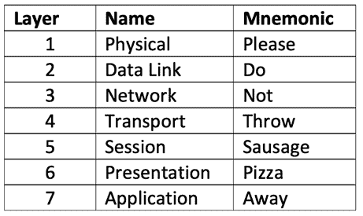

表 3.1: OSI 模型层

参加 Security+ 考试不需要对 OSI 模型有非常了解。如果你参加其他认证，将需要更详细地学习该模型。在准备过程中，你应该了解每一层功能的基本知识：

- 第 1 层：物理层主要涉及网络基础设备：铜线、光纤线和无线电波。
- 第 2 层：数据链路层是交换机所在地。它使用介质访问控制 (`MAC`) 将数据格式化为帧。
- 第 3 层：网络层引入了`IP`。路由器使用`IP`来路由数据。
- 第 4 层：传输层使用传输控制协议 (`TCP`) 和用户数据报协议 (`UDP`) 提供端到端通信。
- 第 5 层：会话层建立、管理和终止会话。
- 第 6 层：表示层将数据翻译成标准格式，提供加密、压缩。
- 第 7 层：应用层提供网络服务。

你会听到 Security+ 专业人员使用`OSI`这个词。这就是你对 OSI 模型需要知道的全部内容。如果你想学习更多，请查看 https://getcertifiedahead.com 的在线附录。

### 基础网络协议

网络协议为计算机通信所需的规则。某些传输控制协议/网协议 (`TCP/IP`) 协议，例如`TCP`以及其他协议包括超文本传输协议 (`HTTP`) 和简单邮件传输协议 (`SMTP`)。

`TCP/IP`不是一个单一协议，而是一套完整的协议。CompTIA 在历史上非常强调知名端口。例如，`HTTP`的默认端口是 80。目前的重点弱化了端口的重要性。然而，当你在路由器和无状态防火墙中实施访问控制列表 (`ACLs`) 时，你可能仍然需要知道它们。

以下列表描述了一些基础网络协议：

- 传输控制协议 (`TCP`) 提供面向连接的流量（保证交付）。`TCP`使用三次握手，图 3.1 显示了 TCP 握手过程。
- 用户数据报协议 (`UDP`) 提供无连接的会话（没有三次握手）。虽然`TCP`流量提供保证交付，但`UDP`尽力交付数据，而不使用额外流量来确保交付。许多基于网络的拒绝服务 (`DoS`) 攻击使用`UDP`。
- 网协议 (`IP`) 识别`TCP/IP`网络中的主机，并使用`IP`地址将流量从一个主机交付到另一个主机。


要启动 TCP 会话，客户端发送一个 SYN（同步）包。服务器用 SYN/ACK（同步/确认）包进行响应，客户端用 ACK 包完成握手的第三部分以建立连接。

```
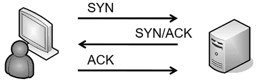
```

图 3.1: TCP 握手过程

- 互联网控制消息协议 (ICMP) 测试基本连通性并包括 `ping` 和 `tracert` 等工具。例如，`ping` 可以检查两个系统之间的基本连通性，而 `tracert` 可以跟踪两个系统之间的网络路径。许多拒绝服务 (DoS) 攻击使用 `ICMP`。由于 `ICMP` 在攻击中被频繁使用，在防火墙和路由器上阻止 `ICMP` 已变得很常见，这将禁用 `ping` 响应。阻止 `ICMP` 可以防止攻击者发现网络上的设备。例如，扫描可以 `ping` 子网中的每个 IP 地址。响应结果可以识别出该子网上运行着哪些系统。

- 地址解析协议 (ARP) 将 IPv4 地址解析为 MAC 地址。MAC 地址也称为物理地址或硬件地址，因为它们是由制造商分配给设备的网络接口卡 (NIC) 的。`TCP/IP` 使用地址数据包发送到目标网络，然后使用 MAC 地址将其引导到正确的主机。换句话说，一旦数据包到达目标子网，就需要 `ARP`。`ARP` 毒化攻击（第 7 章讨论）使用 `ARP` 数据包向客户端提供虚假的硬件地址更新，攻击者利用它们来重定向或中断网络流量。

## 为用例实现协议

网络不会自动支持所有可用协议。相反，IT 专业人员根据组织目标识别需求，并启用最佳协议来满足这些需求。CompTIA Security+ 目标中提到的许多协议都支持特定的用例，并在本中进行了讨论。

### 传输中数据用例

传输中的数据是任何通过网络发送的流量。当数据以明文发送时，攻击者可以使用数据包捕获工具读取它。你可以通过加密传输中的数据来保护个人身份信息 (PII) 以及任何其他敏感数据的机密性。请注意，你也可以对静态数据进行加密，静态数据是存储在任何类型介质上的数据。第 10 章“理解加密和 PKI”更深入地涵盖了几种特定的加密算法。

与文件传输相关的常用用例包括：通过网络传输数据、确保在网络上传输数据时的机密性，以及确保管理员使用安全连接到服务器。以下列表列出了不应再用于在网络上传输数据的不安全协议：

- 文件传输协议 (FTP) 向 FTP 服务器上传和下载文件。默认情况下，`FTP` 以明文传输数据，使得攻击者易于使用协议分析器捕获并读取 FTP 数据。

- 简单文件传输协议 (TFTP) 用于传输较少的数据，例如与网络设备通信时。许多攻击曾使用 `TFTP`，但它不是大多数网络上的必不可少的协议。由于此原因，管理员通常会禁用它。

- 安全套接层 (SSL) 曾是作为安全超文本传输协议 (HTTPS) 保护 HTTP 流量的主要方法。`SSL` 还可以加密其他类型的流量，例如 `SMTP` 和轻量级目录访问协议 (LDAP)。然而，`SSL` 已被破解，不建议使用。

通常你不应该在现代网络上使用 `FTP`、`TFTP` 或 `SSL`，因为它们是不安全的，且缺乏强加密。幸运的是，有几种安全的替代方案供你可以。以下是保护传输中数据的安全替代方案：

- 传输层安全 (TLS) 是 `SSL` 的指定替代方案，对于使用 `HTTPS` 的浏览器，应使用它代替 `SSL`。

- 互联网协议安全 (IPsec) 用于加密 IP 流量。第 4 章“保护你的网络”更深入地涵盖了 `IPsec`。

- 安全外壳 (SSH) 加密传输中的流量，并用于加密其他协议如 `FTP`。安全复制 (SCP) 基于 `SSH`，用于在网络上复制加密文件。`SSH` 使用 `TCP` 端口 `22`。

- 安全文件传输协议 (SFTP) 是 `FTP` 的安全实现。它是安全外壳 (`SSH`) 的扩展，使用 `SSH` 以加密格式传输文件。`SFTP` 使用 `TCP` 端口 `22` 传输数据。

- 安全文件传输协议 (FTPS) 是 `FTP` 的另一种安全实现。它使用 `TLS` 来加密 `FTP` 流量。

| SSL 对比 TLS |
| :--- |
| `SSL` 已破解，不建议使用。2014 年 9 月，Google 的一个团队发现了 `SSL` 的一个严重漏洞，他们将其命名为 POODLE 攻击。`POODLE` 是 Padding Oracle On Downgraded Legacy Encryption（降级遗留加密填充 oracle 攻击）的缩写。`SSL` 协议不再维护或打补丁，因此该漏洞仍然存在。这就是美国政府和其他许多组织禁止使用 `SSL` 保护任何敏感数据的原因之一。`TLS` 是推荐的替代方案。`TLS` 的设计使其可以在几乎任何之前使用 `SSL` 的实现中使用。 |

| 记住这个！ |
| :--- |
| 安全外壳 (`SSH`) 加密 `TCP` 端口 `22` 上的流量，用于在网络上传输加密文件。传输层安全 (`TLS`) 是 `SSL` 的替代方案，用于加密许多不同的协议，包括使用 `HTTPS` 的浏览器连接。安全 FTP (`SFTP`) 使用 `SSH` 加密流量。安全 FTP (`FTPS`) 使用 `TLS` 加密流量。 |

## 电子邮件和网页用例

电子邮件和网页流量是今天人们使用互联网的最常见方式之一。这些服务最初构建时并未考虑安全性。后来，引入了安全替代方案，提供加密和其他安全服务。就像 `TLS` 用安全替代方案取代了 `SSL` 一样，电子邮件和网页协议也进行了更新以添加安全控制。让我们来看看常见的电子邮件和网页协议及其安全版本。

- 简单邮件传输协议 (SMTP) 在客户端和服务器之间传输电子邮件。最初，`SMTP` 使用 `TCP` 端口 `25` 进行未加密传输。安全版本 SMTPS 使用加密并使用 `TCP` 端口 `587`。

- 邮局协议 (POP3) 从服务器传输电子邮件到终端用户。`POP3` 使用 `TCP` 端口 `110` 进行未加密。`POP3` 的安全版本名称相同，但使用 `TCP` 端口 `995` 进行加密。

- 互联网消息访问协议 (IMAP) 用于在服务器上存储电子邮件，并允许用户在服务器的文件夹中组织和管理电子邮件。`IMAP` 使用 `TCP` 端口 `143` 进行未加密连接，使用 `993` 进行加密。

- 超文本传输协议 (HTTP) 在网页服务器和浏览器之间传输网页流量。`HTTP` 使用未加密连接通过 `TCP` 端口 `80` 传输数据。安全超文本传输协议 (HTTPS) 通过 `TLS` 加密来保护数据免受窥探，并使用 `TCP` 端口 `443`。

| 记住这个！ |
| :--- |
| `SMTP`、`POP3` 和 `IMAP4` 是主要的电子邮件协议。加密和未加密流量的常用端口分别为：`SMTP` 使用端口 `25` 和 `587`，`POP3` 使用 `110` 和 `995`，`IMAP4` 使用 `143` 和 `993`。`HTTP` 和 `HTTPS` 分别使用端口 `80` 和 `443`。 |

## 增强电子邮件安全

保护电子邮件是一项复杂的任务，除了加密，你还应该考虑部署其他控制措施来进一步保护电子邮件，例如防止伪造邮件。SPF、DKIM 和 DMARC 都是电子邮件验证方法，通过验证发送者域名的身份并确保电子邮件在传输过程中未被修改，帮助防止电子邮件欺诈和滥用。

- 发送者策略框架 (SPF) 使用 DNS 记录定义哪些 IP 地址被授权代表域名发送电子邮件。

- 域名密钥标识邮件 (DKIM) 使用公钥加密对电子邮件的域名和内容进行签名和验证。

基于域的身份验证、报告和一致性检查 (DMARC) 在 `SPF` 和 `DKIM` 之上构建，允许域所有者设置如何处理未通过身份检查的电子邮件，并提供报告机制来监控和改进电子邮件身份验证性能。

`SPF`、`DKIM` 和 `DMARC` 共同提供了一个稳健的电子邮件身份验证框架，帮助用户免受垃圾邮件、钓鱼和其他类型电子邮件攻击的侵害。

你可能希望考虑使用电子邮件网关。这些网关是网络设备或软件应用程序，作为组织内部电子邮件系统与外部互联网之间的屏障，对入站和出站电子邮件进行过滤，以防止垃圾邮件、恶意软件和其他类型的威胁。

## 目录用例

网络操作系统通常使用目录服务来简化管理并实现安全身份验证。例如，许多组织使用 Microsoft Active Directory Domain Services (`AD DS`)。`AD DS` 是一个对象数据库，提供了一个中心访问点，用于管理用户、计算机和其他目录对象。

轻量级目录访问协议 (`LDAP`) 规定了查询目录（如 Microsoft `AD DS`）的格式和方法。`LDAP` 使用 `TCP` 端口 `389`。`LDAP Secure (LDAPS)` 使用 `TLS` 通过 `TCP` 端口 `636` 加密数据。

Windows 域使用基于 `LDAP` 的 `Active Directory`。对 `Active Directory` 的查询使用 `LDAP` 格式。同样，Unix 域使用 `LDAP` 来识别对象。`LDAP Secure (LDAPS)` 使用加密来保护 `LDAP` 传输。当客户端使用 `LDAPS` 连接服务器时，两个系统建立传输层安全 (`TLS`) 会话，`TLS` 加密两个系统之间发送的所有数据。

| 记住！目录服务（如 Microsoft Active Directory Domain Services (`AD DS`)）为网络提供身份验证和授权服务。`AD DS` 在查询目录时使用 `TLS` 加密 `LDAP`。 |
| --- |

## 语音和视频用例

组织通过网络传输语音和视频是很常见的，并且某些协议对语音和视频的效果比其他协议更好。在实时语音和视频流中，通常使用 `UDP` 代替 `TCP` 作为底层协议。

实时传输协议 (`RTP`) 通过 IP 网络传输音频和视频。这包括 IP 语音协议 (`VoIP`) 通信、流媒体、视频会议应用程序以及使用基于 Web 的按讲通话功能的设备。然而，组织通常希望保护这些传输。安全实时传输协议 (`SRTP`) 为 `RTP` 提供了加密、消息身份验证和完整性。

会话发起协议 (`SIP`) 用于发起、维护和终止语音、视频和消息会话。`SIP` 在建立会话时使用请求和响应消息。这些消息是文本格式，因此如果被捕获，很容易读取。在 `SIP` 建立会话后，由 `RTP` 或 `SRTP` 传输音频或视频。

`SIP` 消息不包含任何数据，但它们包含有关会话的元数据。这包括关于使用的设备、设备上使用的软件以及私有 IP 信息。许多 `VoIP` 系统支持 `SIP` 日志并可以记录这些 `SIP` 消息。这些日志对于检测基于 `SIP` 的攻击可能很有用。它们也可以用于法医调查，以确定是谁在拨打某些电话以及他们正在给谁打电话。

第 11 章“实施策略以降低风险”涵盖了事件响应和法医主题。在某些情况下，`VoIP` 日志文件和 `SIP` 日志文件在调查中都有用。`VoIP` 日志显示时间戳、拨号方号码、接收方号码、分机（如果使用）和未接来电。许多第三方 `VoIP` 电话管理应用程序支持录音。`SIP` 日志显示时间戳、发送者 IP 地址和接收者 IP 地址，某些第三方应用程序还可以捕获 `SIP` 消息。

## 远程访问用例

人员需要从远程位置访问系统的情况有很多。例如，想象一个服务器机房托管着数百台服务器，包括 Microsoft 域的域控制器。如果管理员需要创建用户账户或在组策略对象 (`GPO`) 中实施更改，他们很少去服务器机房。相反，他们会远程访问服务器并在桌面电脑上进行更改。

多年前，管理员在远程管理系统时经常使用 `Telnet`。然而，`Telnet` 以明文形式通过网络发送数据（包括用户名和密码），因此不建议使用。现如今，管理员通常使用 `SSH`（在之前的“传输中数据用例”节中讨论过）代替 `Telnet`。

管理员和客户端经常使用远程桌面协议 (`RDP`) 从远程位置连接到其他系统。Microsoft 在远程桌面服务和远程协助等不同解决方案中使用 `RDP`。`RDP` 使用 `TCP` 端口 `3389`。用户无法通过 `RDP` 连接到系统的常见原因是端口 `3389` 被主机防火墙或网络防火墙拦截了。

另一种支持远程访问用例的方法是使用虚拟专用网络 (`VPN`)。第 4 章更深入讨论了 `VPN`。

| 记住！管理员使用安全外壳 (`SSH`) 和远程桌面协议 (`RDP`) 等协议远程连接到服务器。在某些情况下，管理员使用虚拟专用网络连接到远程系统。 |
| --- |

## OpenSSH

`OpenSSH` 是一个工具套件，简化了使用 `SSH` 安全连接到远程服务器的操作。它还支持使用 `SCP` 和 `SFTP` 安全传输文件。虽然 `OpenSSH` 是开源的，但许多商业产品已将其集成到自身中。

想象 Maggie 想要从 Linux 系统连接到名为 `gcga` 的网络上的服务器。她可以使用命令：

```
ssh gcga
```

这将通过默认的 `SSH` 端口 `22` 和客户端上的用户名启动到远程服务器的 `SSH` 连接。也可以使用远程系统的账户启动连接。例如，以下命令使用远程系统的 root 账户启动 `SSH` 连接：

```
ssh root@gcga
```

此时远程服务器会提示她输入密码。然而，使用强密码至关重要，而且每次输入密码很麻烦。相反，`OpenSSH` 支持无密码 SSH 身份验证。你可以使用 `OpenSSH` 创建一对公钥。Maggie 将私钥保存在自己的系统中，并将公钥复制到远程服务器。以后当她连接到远程服务器时，系统会提示使用私钥进行验证。

在客户端（Maggie 的电脑）执行以下 OpenSSH 命令 (`ssh-keygen`) 将创建密钥对：

```
ssh-keygen -t rsa
```

这将创建一个匹配的公私钥对，类似于配合证书使用的公私钥对（第 10 章描述）。密钥位于两个独立的文件：

*   `id_rsa.pub`。这是公钥。你将其复制到远程服务器。
*   `id_rsa`。这是私钥。它存储在客户端且必须保持私密。

最后一步是使用 OpenSSH 命令 `ssh-copy-id` 将公钥复制到远程服务器。

```
ssh-copy-id root@gcga
```


该命令知道公钥文件的默认位置以及它在远程服务器上的目标位置。现在，当 Maggie 连接（使用 `ssh root@gcga`）时，`ssh` 将自动使用密钥对提供强身份验证，而无需她输入密码。

| 请记住！OpenSSH 是一组工具，简化了使用 SSH 安全连接到远程服务器的操作。`ssh-keygen` 命令创建公钥/私钥对，而 `ssh-copy-id` 命令将公钥复制到远程服务器。私钥必须始终保持私密。 |

# 时间同步用例

在许多情况下，系统需要使用相同的时间（至少是足够接近的时间）。常见的用例是确保系统具有准确的时间。例如，`Kerberos` 要求所有系统同步，且彼此之间的时间差在五分钟以内。

在微软域中，一个域控制器会定期使用 `Windows Time` 服务来查找运行网络时间协议（`NTP`）的可靠 Internet 服务器。`NTP` 是最常用的时间同步协议，允许系统将时间同步到几十毫秒以内。网络中的其他域控制器会定期与第一台域控制器同步时间。域中的所有计算机都与这些域控制器中的某一个同步时间。这一过程确保了所有计算机都拥有准确的时间。

# 网络地址分配用例

网络地址分配是指为你网络中的主机分配 IP 地址。你可以手动进行此操作，但大多数网络使用动态主机配置协议（`DHCP`）为主机动态分配 IP 地址。`DHCP` 还会分配其他 TCP/IP 信息，例如子网掩码、默认网关、DNS 服务器地址等。接下来的章节将对一些基础网络概念进行回顾。

## IPv4

`IPv4` 使用点分十进制表示的 32 位 IP 地址。例如，`192.168.1.5` 的 `IPv4` IP 地址是四个由点或点分隔的十进制数字。你也可以用 32 位二进制形式表示该地址。

所有的 Internet IP 地址都是公 IP 地址，而内部网络使用私 IP 地址。公 IP 地址受到严格控制。你不能随意使用任何公 IP 地址。

相反，你必须购买或租赁它。互联网服务提供商（`ISPs`）购买整个范围的 IP 地址并将其分配给客户。如果你从家里访问 Internet，很可能收到了来自 `ISP` 的公 IP 地址。

Internet 上的路由器包含丢丢弃任何来自或发往私 IP 地址的流量，因此你不能在 Internet 上分配私 IP 地址。`RFC 1918` 规定了以下私有地址范围：

*   `10.x.y.z`：`10.0.0.0` 到 `10.255.255.255`
*   `172.16.y.z–172.31.y.z`：`172.16.0.0` 到 `172.31.255.255`
*   `192.168.y.z`：`192.168.0.0` 到 `192.168.255.255`

这些是你可以在私有网络内分配的三个 `IPv4` 地址范围。

## IPv6

尽管 IP 地址的数量最初似乎无穷无尽，但互联网数字分配机构（`IANA`）于 2011 年 2 月分配了最后区块 `IPv4` 地址。从以后，互联网工程任务组（`IETF`）创建了 `IPv6`，它提供了比 `IPv4` 大多的地址空间。

`IPv6` 使用十六进制格式表示的 128 位 IP 地址。例如，`fe80:0000:0000:0000:02d4:3ff7:003f:de62` 的 `IPv6` IP 地址包含八组四个十六进制字符，用冒号分隔。每个十六进制字符由 4 位组成。

`IPv6` 使用唯一本地地址代替私 IP 地址。它们仅在私有网络内分配，而不会分配给 Internet 上的系统。唯一本地地址以前缀 `fc00` 开头。

# 域名解析用例

域名系统（`DNS`）的主要目的是域名解析。`DNS` 将主机名解析为 IP 地址。系统会不断向 `DNS` 查询，尽管这通常对用户来说是透明的。想象你想访问 `https://getcertifiedgetahead.com/`。你在网页浏览器中输入 URL 或点击页面上的链接，你的系统就会向 `DNS` 服务器查询该站点的 IP 地址。图 3.2 显示了你的系统与 `DNS` 之间发生了什么。

有时，你查询的 `DNS` 服务器知道知道答案并直接给出响应。其他时候，它会查询一个或多个其他 `DNS` 服务器来获取答案。当 `DNS` 服务器查询其他 `DNS` 服务器时，它会将答案放在缓存中，这样它就不需要重复相同的查询。同样，当客户端收到 `DNS` 服务器的答案时，它们会将答案存储在缓存中，这样它们就不需要重复查询。

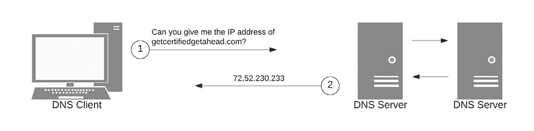

图 3.2: 基础 DNS 查询

`DNS` 服务器在区域中托管数据，你可以将其认为是数据库。区域文件包含多个记录，例如以下类型：

*   `A`：也称为主机记录。此记录持有主机名和 `IPv4` 地址，并且是 `DNS` 服务器中最常用的记录。`DNS` 客户端使用正向查找请求向 `DNS` 查询名称，`DNS` 使用此记录中的 `IPv4` 地址进行响应。
*   `AAAA`：此记录持有主机名和 `IPv6` 地址。它类似于 `A` 记录，只是用于 `IPv6` 的。
*   `PTR`：也称为指针记录。它是 `A` 记录的相反。`DNS` 客户端不是使用名称向 `DNS` 查询，而是使用地址向 `DNS` 查询。
*   `MX`：也称为邮件交换或邮件交换器。`MX` 记录识别用于电子邮件的邮件服务器。当有多个服务器时，`MX` 记录中优先级数最低的是主服务器。
*   `CNAME`：规范名称（或别名）允许单个系统与单个 IP 地址关联多个名称。例如，`getcertifiedgetahead.com` 域中名为 `Server1` 的服务器可能有一个别名 `FileServer1`。
*   `SOA`：区域起始（`SOA`）记录包含有关域或区域的信息及其设置。例如，它包含了 DNS 记录的 `TTL`（生存时间）设置。

# DNSSEC

`DNS` 的一个风险是 DNS 投毒，也称为 DNS 缓存投毒。成功后，攻击者用伪 IP 地址修改缓存。例如，想象攻击者想在用户每次访问 `msn.com` 时都将其引导至恶意网站。一种方法是修改 `msn.com` DNS 缓存中的 `A` 或 `AAAA` 记录。

防止 DNS 投毒的主要方法之一是使用域名安全扩展（`DNSSEC`）。`DNSSEC` 是 `DNS` 的一组扩展，为 DNS 响应提供验证。它在每条记录中添加了资源记录签名（`RRSIG`），通常称为数字签名。`RRSIG` 为 DNS 响应提供数据完整性和身份验证。如果 `DNS` 服务器收到带有数字签名记录的 `DNSSEC` 启用响应，`DNS` 服务器就知道该响应是有效的。

-   **单播 (Unicast)**。一对一流量。一个主机使用目标 IP 地址向另一个主机发送流量。具有目标 IP 地址的主机将处理数据包。同一网络上的其他主机可能会看到数据包，但它们不会进行处理，因为数据包不是给它们的。
-   **广播 (Broadcast)**。一对全流量。一个主机使用广播地址（如 `255.255.255.255`）向子网上的所有其他主机发送流量。每个接收广播流量的主机都会对其进行处理。交换机端口之间传递广播流量，但路由器不传递广播流量。

## Switches

交换机将计算机和其他设备连接到它的每个物理端口。当两台计算机相互通信时，它会创建内部的交换连接。

考虑下方的图 3.3。当交换机启动时，它除了知道有四个物理端口外，没有任何知识。想象第一条流量是 Lisa 的计算机与 Homer 的计算机之间 `TCP/IP` 会话的开始。

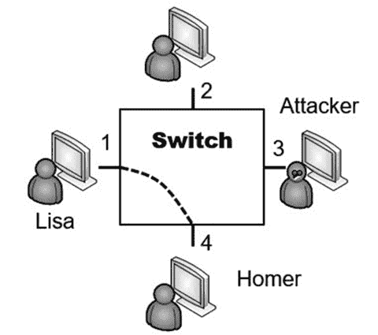

图 3.3: 交换机

当 Lisa 的计算机发送第一个数据包时，它包含了目标计算机的 MAC 地址。然而，因为交换机不知道 Homer 的计算机连接到哪个端口，它会将第一个数据包转发到交换机上的所有端口。

第一个数据包中包含了 Lisa 计算机的 MAC 地址。交换机将此信息记录在内部表中。然后，它将任何指向 Lisa MAC 地址的未来流量定向到 `port 1`，且仅指向 `port 1`。

当 Homer 的计算机接收到数据包时，它会响应。此返回数据包中嵌入了 Homer 计算机的 MAC 地址。交换机捕获 Homer 的 MAC 地址，并将其与内部表中的 `port 4` 记录。从现在起，Lisa 和 Homer 计算机之间的任何单播流量都只在 `ports 1` 和 `port 4` 之间进行内部交换。交换机会内部交换单播流量。然而，它们会将广播流量传递到所有端口。

之前的讨论大部分是基础网络知识，但你真正需要知道的是它在安全方面的何相关性。如果攻击者在连接到另一个端口（例如图 3.3 中的 `port 3`）的计算机上安装了协议分析器，那么协议分析器将无法捕获通过交换机去其他端口的单播流量。如果 Lisa 和 Homer 在 `ports 1` 和 `4` 上交换数据，则没有任何流量到达 `port 3`。协议分析器无法捕获未到达端口的流量。

相比之下，如果计算机是通过简单的集线器连接的，攻击者就可以捕获流量，因为单播流量会发送到集线器上的所有端口。这是组织用交换机替换集线器的主要安全原因。交换机降低了攻击者使用协议分析器获取数据的风险。当然，交换机也提高了网络效率。

## Hardening Switches

安全专业人员与网络专业人员紧密合作，以确保交换机的配置是安全的。这些设备处于网络的前线，如果它们不安全，很容易被攻击者破解。以安全的方式配置交换机和其他设备的过程被称为设备加固。

在接下来的几个章节中，我们将检查加固交换机的常用技术。

### Port Security

端口安全限制了连接到交换机物理端口的计算机。在最基础的层，管理员会禁用未使用的端口。例如，办公室中的单个 `RJ-45` 墙插连接到交换机上的特定物理端口。如果墙插未使用，管理员可以禁用该交换机端口。这防止了有人将笔记本电脑或其他计算机插入墙插并连接到网络。

| Comparing Ports and PortsA | 网络设备（如交换机或路由器）使用的物理端口与之前讨论的逻辑端口完全不同。你将电缆插入物理端口。逻辑端口是嵌入在数据包中的一个数字，用于标识特定的服务、服务连接端点、进程或协议。 |
| --- |

MAC 过滤是端口安全的另一个示例。在简单的实现中，交换机会记住连接到端口的第一个或两个 MAC 地址。然后它会阻止使用任何其他 MAC 地址的系统访问。你也可以手动配置每个端口，使其仅接受来自特定 MAC 地址的流量。这限制了每个端口的连接性到使用该 MAC 地址的特定设备。这可能非常耗力，但它提供了更高水平的安全性。

| **Remember This!** 端口安全包括禁用未使用的端口和限制每个端口的 MAC 地址数量。更高级的实现是将每个物理端口限制为仅允许一个特定的 MAC 地址。 |
| --- |

### Broadcast Storm and Loop Prevention

在某些情况下，网络可能会出现交换环路或桥接环路问题。这会导致流量拥塞网络并能有效使交换机失效。例如，如果用户用电缆将交换机的两个端口连接在一起，就会创建一个交换环路，交换机会通过交换机不断发送和重发单播传输。除了使交换机失效外，它还会降低整个网络的性能。

这对于许多网络管理员来说是小菜一，因为大多数现代交换机都安装并启用了生成树协议 (`STP`) 或更新的快速生成树 (`RSTP`)。它们为交换机提供了广播风暴防护和环路防护。然而，如果禁用了这些协议，交换机就会受到环路的影响。简单的解决方案是确保交换机包含 `STP` 或 `RSTP` 等环路保护。

生成树协议还保护网络免受潜在攻击者的侵害。例如，想象攻击者访问会议室并可以使用 `RJ-45` 墙插。如果没有启用环路保护，他可以用电缆将两个插座连接在一起，使网络性能降低到极其缓慢。

| **Remember This!** 广播风暴和环路防护（如 `STP` 或 `RSTP`）对于防止交换环路问题（例如当交换机的两个端口连接引起的问题）是必要的。 |
| --- |

### Bridge Protocol Data Unit Guard

`STP` 在网络中发送桥协议数据单元 (`BPDU`) 消息来检测环路。当检测到环路时，`STP` 会关闭或阻塞发送冗余流量的交换机端口。交换机使用非边缘端口相互交换 `BPDU` 消息。

边缘端口是连接到设备（如计算机、服务器或打印机）的交换机端口。这些设备不应生成 `BPDU` 消息。如果生成了，说明存在问题，例如恶意者发送了虚假的 `BPDU` 消息。

许多交换机支持在边缘端口启用的 `BPDU Guard` 功能。它监控端口是否有任何意外的 `BPDU` 消息。如果收到任何，它将禁用该端口，有效阻止 `BPDU` 攻击。

## Routers

路由器将多个网络段连接到单个网络，并在段之间路由流量。由于路由器不传递广播，它们有效地减少了任何单段上的流量。由路由器隔离的段有时被称为广播域。如果一个网络段上有太多的计算机，广播可能会导致过多的冲突并降低网络性能。将计算机移动到由路由器隔离的另一个段可以显著提高整体性能。同样，网络子网划分创建了独立的广播域。

`Cisco` 路由器很流行，但也存在许多品牌。大多数路由器是物理设备，物理路由器的效率最高。然而，也可以在具有多个 `NIC` 的计算机上添加路由软件。例如，`Windows Server` 产品可以通过向服务器添加额外服务来充当路由器。

正如我们实施强的安全控制来保护网络交换机一样，我们也希望加固路由器以保护它们免受攻击。让我们来看一些可以更好地保护路由器的技术。

## 路由器访问控制列表 (ACLs)

访问控制列表（`ACLs`）实现在路由器（以及防火墙）上的规则，用于识别哪些流量是被允许的，哪些流量是被拒绝的。`ACL` 中的规则为路由器提供了基于规则的管理，并控制入站和出站流量。

路由器 ACL 提供基本的包过滤。它们根据三个常见特征过滤数据：IP 地址、端口和协议：

*   **IP 地址和网络。**你可以在 `ACL` 中添加规则，根据 IP 地址阻止来自任何单个计算机的访问。如果你想阻止从一个子网到另一个子网的流量，可以使用子网 ID 来阻止流量。例如，销售部门可能位于 `192.168.1.0/24` 网络，而会计部门可能位于 `192.168.5.0/24` 网络。你可以使用路由器 `ACL` 防止这两个网络相互通信。
*   **端口。**你可以根据逻辑端口过滤流量。例如，如果你想阻止 HTTPS 流量，可以创建一个规则来阻止 `TCP` 端口 `443` 流量。注意，你可以选择阻止入站流量、出站流量或两者。换句话说，可以允许出站的 HTTPS 流量同时阻止入站的 HTTPS 流量。

### 隐式拒绝 (Implicit Deny)

隐式拒绝是一个需要理解的概念，特别是在 `ACLs` 的语境下。它表示所有未显式允许的流量都会被隐式拒绝。例如，想象你配置了路由器允许超文本传输协议（HTTP）访问 Web 服务器。现在路由器定义了一个显式规则来允许此类流量到达服务器。如果你不定义任何其他规则，隐式拒绝规则将阻止所有其他流量。防火墙（在本章稍后会讨论）也使用隐式拒绝规则。

隐式拒绝规则是 `ACL` 中的最后一条规则。某些设备会自动将隐式拒绝规则作为最后规则。其他设备则需要管理员手动将该规则放在 `ACL` 的末尾。隐式拒绝规则的语法在不同系统中有所不同，但可能类似于 `DENY ANY ANY` 或 `DENY ALL ALL`，其中 `ANY` 和 `ALL` 都指任何类型的流量。

虽然隐式拒绝是路由器和防火墙中常用的术语，但在日常语言中并不常见。简单来说，你可以将其理解为“默认拒绝”或“默认拦截”。换句话说，`ACL` 中的初始规则识别被允许的流量。最后一条规则（隐式拒绝）默认拒绝或拦截所有其他流量。

| 记住此点！ | 路由器和无状态防火墙（或包过滤防火墙）使用访问控制列表（`ACL`）执行基本过滤。`ACLs` 识别哪些流量是被允许的，哪些是被拦截的。`ACL` 可以根据网络、子网、IP 地址、端口和某些协议控制流量。隐式拒绝阻止所有未显式授权的访问。路由器和防火墙将隐式拒绝作为访问控制列表的最后规则。 |
| --- |

## 路由安全

`route` 命令用于在 Windows 和 Linux 系统上显示或修改路由表。通过 `route print`，你可以看到系统已知的所有其他网络的路径。如果路由表中没有指向特定网络的条目，系统将使用默认网关。默认网关是网络上路由器的 IP 地址，通常提供通往互联网的路径。如果你需要为不同的网络添加路径，可以使用 `route add` 命令。

你还可以使用 `route` 命令来验证路由安全。例如，路由表应该指向已知的默认网关。如果恶意者修改了系统的路由表，他们就可以将流量重定向到不同的路由器，并利用它在路径攻击（on-path attack）中拦截流量。你将在第 7 章学习更多关于路径攻击的知识。

## 简单网络管理协议

简单网络管理协议（`SNMP`）监控并管理网络设备，例如路由器或交换机。这包括使用 `SNMP` 修改设备配置，或让网络设备向中央网络管理系统报告状态。安装在设备上的 `SNMP` 代理通过被称为 `SNMP traps`（有时称为设备陷阱）的通知向 `SNMP` 管理器发送信息。

`SNMPv1` 和 `v2` 都存在漏洞，包括在网络上以明文形式发送密码，但 `SNMPv3` 在通过线缆传输凭据之前会对凭据进行加密。`SNMPv3` 支持的一个常见用例是提供网络设备的安全管理。`SNMPv3` 使用 `UDP` 端口 `161` 和 `162`。

| 记住此点！ | 管理员使用 `SNMPv3` 管理和监控网络设备，`SNMP` 使用 `UDP` 端口 `161` 和 `162`。`SNMPV3` 在将凭据发送到网络之前对其加密，比之前的版本更安全。 |
| --- |

## 防火墙

防火墙过滤单个主机或网络之间的入站和出站流量。换句话说，防火墙可以确保只有特定类型的流量允许进入网络或主机，并且只有特定类型的流量允许离开网络或主机。

网络防火墙的作用就像汽车上的防火墙。汽车上的防火墙位于发动机舱和客舱之间。如果发动机舱发生火灾，防火墙可以为客舱内的乘客提供一层保护。同样，网络中的防火墙会尝试将坏流量（通常是攻击者的形式）隔在网络之外。

当然，发动机有许多运动部件，如果人在其运行时不小心伸进去，可能会造成伤害。汽车的防火墙保护乘客免于接触任何运动部件。同样，网络也可以阻止用户访问管理员认为危险的地方。例如，缺乏安全的用户可能会无意中下载损坏的文件，但许多防火墙可以阻止潜在的恶意下载。

防火墙始于在“路由器和 ACL”节中描述的用于包过滤的基本路由能力，包括隐式拒绝规则的使用。更高级的防火墙则超越了简单的包过滤，包含了高级内容过滤。

### 基于主机的防火墙

基于主机的防火墙监控进出单个主机（如服务器或工作站）的流量。它监控通过 `NIC` 的流量，并可以防止通过 `NIC` 侵计算机。许多操作系统都包含了作为基于主机的防火墙使用的软件定义级防火墙。例如，微软在 Windows 操作系统中包含了 `Defender Firewall`。此外，还有许多第三方基于主机的防火墙可用。基于主机的防火墙允许你配置规则来允许或限制入站和出站流量。

基于主机的防火墙为系统防止意外入侵提供了宝贵的保护。许多组织在每个系统上使用基于主机的防火墙，并结合网络防火墙作为整体深度防御策略的一部分。

### 网络防火墙

基于主机的防火墙保护单个系统，而网络防火墙保护整个网络。网络防火墙通常是一个网络设备。这意味着它是作为硬件单元销售的，已经包含了运行防火墙所需的所有软件。网络防火墙也可以作为虚拟设备销售，准备好在贵组织的虚拟化平台上运行。

基于网络的防火墙具有两个或多个网络接口卡（`NICs`），并且所有流量都通过防火墙。防火墙控制进入和离开网络的流量。它通过根据防火墙规则对流量进行过滤，并仅允许授权的流量通过。大多数组织在其内网（或内部网络）与 Internet 之间的网络边界至少包含一个基于网络的防火墙。

| 记住这个！ | 基于主机的防火墙为单个主机（如服务器或工作站）提供保护。基于网络的防火墙运行在专用硬件上并为整个网络提供保护。您应该结合使用基于主机的防火墙和网络防火墙，以实现网络安全的深度防御方法。 |
| --- |

## 无状态防火墙规则

无状态防火墙使用在 `ACLs` 中实现的规则来识别允许和被阻塞的流量。它们将看到的每个网络数据包视为一个新事件，并且不跟踪任何关于先前的网络流量的信息（或“状态”）。这与路由器使用 `ACLs` 内的规则的方式类似。事实上，你可以将路由器看作是一个无状态防火墙。

防火墙使用隐式拒绝策略来阻塞所有未显式允许的流量。虽然根据你使用的硬件，`ACLs` 内的规则看起来略有不同，但它们通常包含以下元素：

*   **权限（Permission）**。你通常会看到 `PERMIT` 或 `ALLOW` 允许流量。大多数系统使用 `DENY` 来阻塞流量。
*   **协议（Protocol）**。通常在这里你会看到 `TCP` 或 `UDP`，特别是在阻塞特定的 `TCP` 或 `UDP` 端口时。如果你想使用同一个端口同时阻塞 `TCP` 和 `UDP` 流量，可以使用 `IP`。在这里使用 `ICMP` 会阻塞 `ICMP` 流量，从而有效 ping 和一些其他使用 `ICMP` 的诊断工具。
*   **源（Source）**。流量来自源 IP 地址。你识别一个 IP 地址以允许或阻塞来自单个 IP 地址或一个 IP 地址范围（例如来自单个子网）的流量。`any` 或 `all` 等通配符包含所有 IP 地址。
*   **目的（Destination）**。流量指向目的 IP 地址。你识别一个 IP 地址以允许或阻塞指向单个 IP 地址或一个 IP 地址范围（例如指向整个子网）的流量。`any` 或 `all` 等通配符包含所有 IP 地址。
*   **端口或协议（Port or protocol）**。通常你经常会在规则中看到如用于 `HTTPS` 的已知端口 `443`。然而，某些设备支持像 `HTTPS` 这样的代码来处理 `HTTPS` 流量。

| 记住这个！ | 防火墙在 `ACL` 结束使用 `deny any any`、`deny any` 或 `drop all` 语句来执行隐式拒绝策略。该语句强制防火墙阻塞之前未在 `ACL` 中允许的任何流量。隐式拒绝策略为防火墙提供了一个安全的起点。 |
| --- |

## 状态防火墙

状态防火墙检查流量并根据流量的上下文或状态做出决策。它跟踪已建立会话，根据流量在会话中的状态进行检查，并阻塞不是已建立会话部分的流量。例如，`TCP` 会话始于三次握手。如果状态防火墙检测到没有相应三次握手的 `TCP` 流量，它会将其识别为可疑流量并进行拦截。

现代基于网络的防火墙都是状态防火墙。它们运行在 `OSI` 模型的传输层，因此也通常称为第 `4` 层防火墙。

无状态防火墙的一个常见安全问题是 `ACLs` 配置不当。例如，如果 `ACL` 不包含隐式拒绝规则，它可能会允许几乎所有流量进入网络。

## Web 应用防火墙

Web 应用防火墙（`WAF`）是一种专门为保护 Web 应用设计的防火墙。Web 服务器托管 Web 应用，`WAF` 放置在 Web 服务器和客户端之间。`WAF` 可以是独立的设备，也可以是添加到设备上的软件，它可以保护服务器免受各种基于 Web 的攻击，例如跨站脚本（`XSS`）攻击。第 7 章“防止高级攻击”更深入地讨论了 `XSS` 攻击。

想象一个组织托管了一个电子商务网站来产生收入。服务器放置在筛选子网中（本章稍后讨论），但由于服务器处理的数据问题，它需要更多保护。所有发往服务器的流量首先通过 `WAF`，由 `WAF` 阻塞恶意流量。

请注意，你不会用 `WAF` 代替基于网络的防火墙。相反，它在网络防火墙的基础上为 Web 应用程序提供了额外的保护层。

| 记住这个！ | 无状态防火墙仅使用 `ACL` 阻塞流量，而状态防火墙也使用 `ACLs`，但也考虑数据包在会话中的状态。Web 应用防火墙为 Web 服务器提供强力保护。它们防御多种不同类型的攻击，重点关注 Web 应用攻击。 |
| --- |

## 下一代防火墙

下一代防火墙（`NGFW`）是一种高级防火墙，增加了第一代或第二代防火墙不具备的功能。第一代防火墙是数据包过滤防火墙，使用无状态防火墙规则，只能在评估单个数据包后允许或阻塞流量。第二代防火墙增加了状态防火墙规则。这允许防火墙额外根据其会话状态评估流量。

多年来，防火一直在稳步改进，如果每次改进都标记为新代，我们可能已经是第十九代了。幸运的是，我们只是使用 `NGFW` 来表示防火墙增加了第一、第二代防火墙的功能。

`NGFW` 执行深度包检查，将应用检查作为核心功能。`NGFW` 识别 Internet 上常用的应用协议，如 `FTP` 和 `HTTP`。通过使用深度包检查，`NGFW` 可以识别应用命令并检测潜在恶意流量。这允许它应用内容过滤和 URL 过滤。

`WAF` 和 `NGFW` 都分析 `OSI` 模型所有层的信息，一直到第 `7` 层应用层。因此，它们通常被称为第 7 层防火墙。

- **内网 (Intranet)**：内网是一个内部网络。人们使用内网相互之间进行通信和内容共享。虽然内网包含内部 Web 服务器很常见，但这并非强制性要求。
- **外网 (Extranet)**：外网是网络的一部分，可以由网络外部的授权实体访问。例如，组织允许对授权的业务伙伴、客户、供应商、供应商或其他人员进行有限的访问，这是很常见的。

网络边界在内网和互联网之间提供了一个边界。边界保护包含了多种保护网络边界的方法。将系统放置在不同区域的目标是限制它们之间的连通性，并减少组织的攻击面。

## 过滤子网 (Screened Subnet)

过滤子网，也称为非军事化区 (`DMZ`)，是私有网络与互联网之间的一个安全区域。攻击者会寻找互联网上的服务器，因此任何直接放置在互联网上的服务器风险最高。然而，过滤子网为这些面向互联网的服务器提供了一层保护，同时允许客户端连接到它们。

作为例如，图 3.4 显示了带有过滤子网的常见网络配置。过滤子网是两个防火墙（`FW1` 和 `FW2`）之间的区域，并托管了多个面向互联网的服务器。许多过滤子网都有两个防火墙，在互联网和内部网络之间创建一个缓冲区，如图 3.4 所示，尽管也存在其他的过滤子网配置。

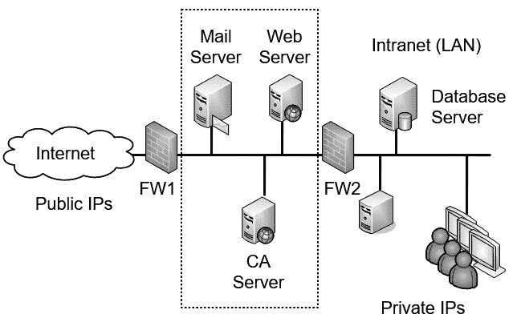

图 3.4：带有过滤子网的网络

在这种配置中，一个防火墙将过滤子网与互联网隔离开。第二个防火墙将过滤子网与内部网络隔离开。每个防火墙包含详细的规则，旨在过滤流量并保护内部网络和面向公众的服务器。一种说法是，过滤子网为过滤子网中托管的服务提供互联网访问，同时隔离了对内部网络的访问。

例如，`FW1` 可以设置规则，允许指向过滤子网中服务器的流量，但阻止指向 `FW2` 的未请求的流量。邮件服务器将通过 `FW1` 的端口 `25` 或端口 `587` 与互联网上的其他邮件服务器收发邮件，并通过 `FW2` 的端口 `25` 或端口 `587` 与内部客户端收发邮件。Web 服务器通过 `FW1` 的端口 `80` 和 `443` 为任何互联网用户托管网页，但 `FW2` 会拦截使用这些端口的入站流量。证书机构 (`CA`) 服务器通过通过 `FW1` 回答来验证互联网客户端的证书。

注意图 3.4，内网包含一个数据库服务器。Web 服务器可能使用该服务器为电子商务网站创建网页。数据库服务器可能存储产品数据、客户数据等更多内容。`FW2` 允许在端口 `1433` 上通过 Web 服务器（仅限 Web 服务器）和数据库服务器之间的流量。`FW2` 将拦截所有其他指向数据库服务器的互联网流量。

Web 服务器和数据库服务器也可能是外网的一部分。例如，想象 Web 服务器托管了一个业务伙伴可以使用其来下单的网站。Web 服务器在授予其完全访问权限之前，会先对他们进行身份验证。用户登录后，网站将连接到后端数据库服务器，允许他们浏览库存并下订单。由于该网站仅供授权的业务伙伴使用，因此它是一个外网。

过滤子网可以托管任何面向互联网的服务器，而不只是图中显示的那些。其他示例包括用于上传和下载文件的 `FTP` 服务器以及用于提供远程访问的虚拟专用网络 (`VPN`) 服务器。

| 记住此点！过滤子网（有时称为 `DMZ`）是互联网与内部网络之间的缓冲区。它允许访问服务，同时隔离了对内部网络的访问。换句话说，互联网客户端可以访问托管在过滤子网服务器上的服务，但过滤子网为内网（内部网络）提供了一层保护。 |
| --- |

## 网络地址转换网关 (Network Address Translation Gateway)

网络地址转换 (`NAT`) 是一种将公共 IP 地址转换为私有 IP 地址并将私有 IP 地址转换回公共地址的协议。网络地址转换网关托管 `NAT` 并为内部客户端提供私有 IP 地址访问路径。除了使用 `NAT` 网关外，也可以在面向互联网的防火墙上启用 `NAT`。常用的形式是网络地址和端口翻译，通常称为端口地址翻译 (`PAT`)。

这些转换技术的优点之一包括：
- 不需要为所有客户端购买公共 IP 地址。家庭或公司网络可以包含多台计算机，它们可以通过运行 `NAT` 的一台路由器访问互联网。需要更多带宽的大型公司可能会使用多个公共 IP 地址。
- `NAT` 将内部计算机隐藏在互联网之外。具有私有 IP 地址的计算机被隔离并隐藏起来。`NAT` 为这些私有计算机提供了一层保护，因为它们在从从上被攻击和利用。

`NAT` 的缺点之一是它与 `IPsec` 不兼容。你可以使用 `L2TP` 创建 `VPN` 隧道，并将其与 `IPsec` 使用以加密 `VPN` 流量。虽然有方法可以绕过 `NAT` 与 `IPsec` 的不兼容问题，但如果你的设计包含 `IPsec` 经过 `NAT`，你就需要仔细检查它。`NAT` 可以是 `静态 NAT` 或 `动态 NAT`：
- **静态 NAT (Static NAT)**：`Static NAT` 在一对一映射中使用单个公共 IP 地址。它将一个私有 IP 地址映射到一个公共 IP 地址。
- **动态 NAT (Dynamic NAT)**：`Dynamic NAT` 在一对多映射中使用多个公共 IP 地址。`Dynamic NAT` 根据负载决定哪个公共 IP 地址。例如，如果多个用户连接到一个公共 IP 地址，`NAT` 将下一个请求映射到另一个较少使用的公共 IP 地址。

| 记住此点！`NAT` 将公共 IP 地址转换为私有 IP 地址并将私有 IP 地址转换回公共地址。`NAT` 的一种形式是端口翻译。`Dynamic NAT` 使用多个公共 IP 地址，而 `static NAT` 使用单个公共 IP 地址。 |
| --- |

## 物理隔离与物理隔离 (Physical Isolation and Air Gaps)

## 引言

正如本章之前提到的，路由器和防火墙提供了基础的隔离和划分。路由器通过 `ACLs` 中的规则对网络之间的流量进行划分。管理员使用子网将较大的 IP 地址范围划分为较小的范围。然后他们在 `ACLs` 中实施规则来允许或阻塞流量。防火墙使用基础数据包过滤规则分离网络流量，也可以使用更复杂的方法阻止不良的流量。

还可以通过虚拟局域网 (`VLAN`) 在逻辑组的用户或计算机之间进行流量划分。VLAN 提供了逻辑隔离。

## 使用 VLAN 隔离流量

虚拟局域网 (`VLAN`) 使用交换机将几台计算机分到一个虚拟网络中。你可以根据部门、工作功能或其他管理需求对计算机进行分组。这提供了安全性，因为你可以隔离不同 `VLAN` 之间计算机的流量。

通常，路由器会根据物理位置将不同的计算机分到不同的子网中。例如，路由段中的计算机通常位于同一个办公室或同一楼层。然而，你可以使用交换机创建多个 `VLAN`，根据逻辑需求而非物理位置来分离计算机。此外，如果需要，管理员可以轻松重新配置交换机，从任何 `VLAN` 中添加或删除计算机。

例如，一组通常在不同部门工作的用户可能开始一个项目，该项目要求他们处于同一个子网中。你可以配置交换机在逻辑上将这些人员分在一起，即使这些计算机在物理上位于不同的办公室或建筑的不同楼层。当项目结束后，你只需重新配置交换机将网络恢复到原始配置。

### 东西向流量

| 在网络内部，东西向流量指的是服务器之间的流量。想象正在查看网络内服务器的网络拓扑图。这些图通常显示服务器为水平排列（或并排排列），因此服务器之间的流量向东向西传输。相比之下，网络拓扑图通常显示客户端位于服务器的上下，客户端与服务器之间的流量是南北向的。 |
| --- |

另一个例子是，VoIP 流流量可能会消耗大量带宽。增加使用此类流量的系统的可用性和可靠性的方法是将它们放在专用 `VLAN` 中。传输传统数据流量的其他系统可以放在单独的 `VLAN` 中。这将语音和数据流量分离到各自的 `VLAN` 中。

同样，你可以使用带有多个 `VLAN` 的单台交换机来分离用户流量。例如，如果你想分离人力资源部门和 IT 部门之间的流量，可以使用带有两个 `VLAN` 的单台交换机。`VLANs` 在逻辑上分离了两个不同部门之间的计算机，即使它们靠得很。

| 记住这一点！虚拟局域网 (`VLANs`) 在物理网络上分离或划分流量，你可以通过单个交换机创建多个 `VLAN`。一个 `VLAN` 可以逻辑上将几台不同的计算机分在一起，或者在不考虑物理位置的情况下逻辑地分离计算机。VLAN 还用于分离流量类型，例如一个 `VLAN` 上的语音流量和另一个 `VLAN` 上的数据流量。 |
| --- |

## 网络设备

网络设备是设计用于满足特定需求的专用系统。“设备”一词的意图是引起一种简单的感觉。例如，你不需要知道面包机的工作原理就能制作吐司。同样，你不需要知道计算机设备的操作细节就能使用它。供应商处理所有的内部细节，使管理员的工作变得更容易。

### 代理服务器

许多网络使用代理服务器（或正向代理服务器）转发来自客户端的服务请求（如 `HTTP` 或 `HTTPS`）。它们可以通过缓存内容来提高性能，某些代理服务器还可以过滤内容以限制用户对不适当网站的访问。代理服务器位于边界互联网和内网的网络边缘，如图 3.5 所示。

管理员配置内部客户端针对特定协议使用代理服务器。代理服务器接受请求，从互联网检索内容，然后将数据返回给客户端。大多数代理服务器仅作为 `HTTP` 和 `HTTPS` 的代理。然而，代理服务器也可以代理其他互联网协议，如 `FTP`。

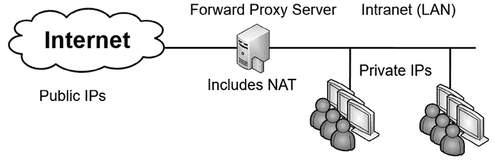

图 3.5: 代理服务器

### 缓存内容优化性能

代理服务器通过缓存从互联网收到的每个结果来提高互联网请求的性能。代理服务器缓存中的任何数据都不需要再次从检索来满足另一个客户端的请求。在这种背景下，缓存简单意味着“临时存储”。缓存可以是 `RAM` 的专用区域，或者在某些情况下是高性能磁盘子系统。

例如，如果 Lisa 获取了一个网页，代理服务器将把结果存储在缓存中。如果 Homer 稍后请求相同的页面，代理服务器将从缓存中提取页面并发送给 Homer。这减少了用于网页浏览的互联网带宽。

#### 内容过滤

代理服务器还可以检查用户请求，以确保在将请求传递给远程 Web 服务器之前符合组织的安全和内容策略。这被称为内容过滤，它允许组织创建限制网页使用的区块规则。

许多第三方公司出售 URL 过滤的订阅列表。这些网站在互联网上搜索网站，并根据公司通常想要阻止的内容对网站进行分类。类别可能包括已知包含恶意代码的网站，以及不良类型的内容，例如色情或赌博。这些过滤器在做出分类决策时可以依赖于几种不同的因素，包括出现在网站上的关键词和网站的信誉。

订阅列表可以被加载到代理服务器中，每当用户尝试访问 URL 过滤黑名单上的站点时，代理就会拦截该请求。通常，当用户尝试访问受限页面时，代理服务器会向用户显示警告页面。许多组织使用此页面提醒用户可接受的使用策略，有些组织还会提醒代理服务器正在监控他们的在线活动。

代理服务器包含日志，记录用户访问的每个站点。这些日志有助于识别频繁访问的站点并监控用户的网页浏览活动。

| 集中式 vs. 基于代理：大多数组织使用集中式代理服务器，这些服务器位于网络中的战略位置，可以在那里拦截并分析用户请求。然而，也可以使用基于代理的方法执行内容过滤，过滤器位于每个用户的计算机上。过滤器从组织的集中式策略服务器接收策略，然后在用户系统上直接执行。 |
| --- |

反向代理接受来自互联网的请求，通常针对单个 Web 服务器。它在客户端看来是一个 Web 服务器，但实际上是将请求转发到 Web 服务器并提供服务器返回的页面。图 3.6 显示了如何配置反向代理服务器来保护 Web 服务器。请注意，这种配置允许 Web 服务器位于第二个防火墙后的私有网络中。

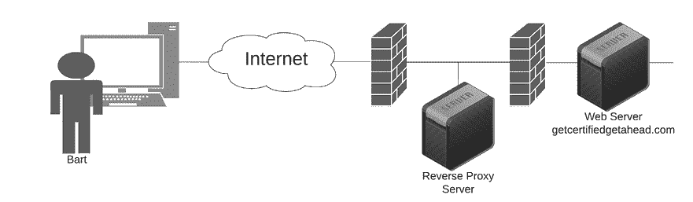

图 3.6：反向代理服务器

假设 Bart 想要访问 [`GetCertifiedGetAhead.com`](https://GetCertifiedGetAhead.com)。他在浏览器中输入 URL，连接到反向代理服务器。反向代理服务器连接到 Web 服务器并检索网页。然后反向代理将网页发送给 Bart。反向代理服务器像正向代理一样缓存网页，它可以提高网站的整体性能。

反向代理服务器可用于单个 Web 服务器或多个服务器的 Web 集群。当用于集群时，它可以充当负载均衡器。你会将负载均衡器放置在筛选子网（screened subnet）中以接收请求，然后使用负载均衡算法将请求转发到集群中的不同服务器。第 9 章“实施保护资产的控制措施”更深入地涵盖了负载均衡。

| 记住此点！代理服务器为客户端转发服务的请求。它提供缓存以提高性能并减少互联网带宽消耗。透明代理服务器在不修改请求的情况下接收并转发请求。非透明代理服务器使用 URL 过滤器限制访问某些网站。两种类型都可以记录用户活动。 |
| --- |

## 统一威胁管理

统一威胁管理（UTM）是一种结合多种安全控制的单一解决方案。UTM 的总体目标是在提供更好安全性的同时简化管理需求。在许多情况下，UTM 设备可以在不牺牲安全的情况下减少管理员的工作量。

当基于 IT 的威胁开始出现时，安全专家创建了各种解决方案来处理它们。当攻击者开始发布恶意软件感染计算机时，供应商创建了防病毒软件。攻击者开始攻击网络，作为回应，安全专家开发并不断改进了防火墙。当组织意识到需要控制用户访问哪些网站时，实现了带有 URL 过滤器的代理。

尽管这些解决方案是有效的，但它们也是复杂的。管理员经常发现单独管理这些解决方案具有挑战性。因此，UTM 安全设备变得流行，特别是在网络规模较小、预算有限的组织中。它们将多种安全解决方案的功能整合到单一设备中。例如，UTM 安全设备可能包含以下项目符号列出的多种功能：

*   **URL 过滤**。UTM 安全设备内的 URL 过滤器功能与代理服务器相同。它们根据 URL 阻止对网站的访问。通常会订阅服务并选择类别来阻止访问某组网站。管理员也可以手动配置 URL 过滤器以允许或阻止访问特定网站。
*   **恶意软件检查**。恶意软件通常通过垃圾邮件或恶意网页进入网络。UTM 设备的恶意软件检查组件会扫描传入数据中的已知恶意软件并将其拦截。组织通常会在邮件服务器和单个系统上扫描恶意软件，作为分层安全或深度防御解决方案的一部分。
*   **内容检查**。内容检查包含了不同内容过滤器的组合。它监控传入的数据流并尝试阻止任何恶意内容。它可以包含垃圾邮件过滤器来检查入邮件并拒绝垃圾邮件。它还可以阻止特定类型的传输（如流媒体音频和视频）以及特定的文件（如 zip 文件）。
*   **DDoS 缓解器**。DDoS 缓解器尝试检测并阻止 DDoS 攻击。这与入侵防御系统（IPS）阻止攻击的方式类似。第 4 章更深入地涵盖了 IPS。

| 记住此点！统一威胁管理 (UTM) 设备将多种安全控制整合到单一设备中。它可以检查数据流，并通常包含 URL 过滤、恶意软件检查和内容检查组件。许多 UTM 包含 DDoS 缓解器以阻止 DDoS 攻击。 |
| --- |

将 UTM 设备放置在网络边界，即互联网与内部网络（或私有网络）之间是常见做法。这允许它拦截并分析进出互联网的所有流量。然而，位置取决于 UTM 设备的使用方式。例如，如果将其用作代理服务器，可以放置在筛选子网内。管理员会配置客户端使用 UTM 设备作为代理服务器，确保所有相关流量通过它。

## 跳板机

跳板机（有时称为跳板箱）是一种加固服务器，用于访问和管理不同安全区域的设备。例如，如果管理员想从内部网络管理筛选子网中的服务器，可以使用跳板机。他们连接到跳板机，然后通过跳板机访问筛选子网中的服务器。

通常使用无密码 SSH 登录（此前在“OpenSSH”部分描述过）连接到跳板机，然后通过跳板机连接到远程服务器。假设 Maggie 在跳板机（命名为 `jump`）和筛选子网中的证书授权（CA）服务器（命名为 `ca1`）上拥有高权限。她可以使用命令：

```bash


`ssh -J maggie@jump maggie@ca1`

`-J` 选项告诉 `ssh` 连接到跳板机，然后使用 TCP 转发连接到 CA 服务器。虽然前面的示例使用跳板机连接到筛选子网中的服务器，也可以使用跳板机连接到内部网络，例如通过 VLAN 隔离的 SCADA 系统网络。

确保跳板机经过加固至关重要。理想情况下，它不应用于其他用途，因此不会运行任何其他服务。服务器上的任何额外服务都会为攻击者提供另一个目标。此外，目标系统应限制来自跳板机以外系统的连接。

| 记住此点！跳板机位于不同的安全区域之间，提供从一个区域设备到另一个区域设备的安全访问。它可以从内部网络对筛选子网中的设备提供安全访问。 |
| --- |

## 零信任

多年来，网络安全的核心哲学是使用防火墙和其他安全设备为网络设备构建隐式信任区域。属于组织的系统被放置在该安全边界内部，免受网络外部系统的侵害。边界内部的系统是信任的，因为它们被认为是“我们的”，而外部的系统是不信任的，因为它们被认为是“不是我们的”。

这种哲学很长以来运行良好，但其有效性正在消减。虽然组织仍然使用防火墙构建安全网络边界，但所有“我们的”东西都在边界内部的说法已不再成立。远程员工、旅行者以及云服务的使用模糊了内部和外部的界限。

网络安全的新哲学被称为零信任网络访问（ZTNA）。这种方法并不意味着对任何东西都不信任，而是指我们不根据网络位置做出信任决策。相反，我们关注于实施强大的身份验证系统，并根据用户的身份而非其系统位置创建基于策略的访问控制。其最终目标是实现缩小范围缩小，降低组织的风险。

图 3.7 显示了零信任方法的工作原理。当用户或系统想要访问资源时，零信任环境通过一个名为策略执行点（`PEP`）的系统做出该决策。

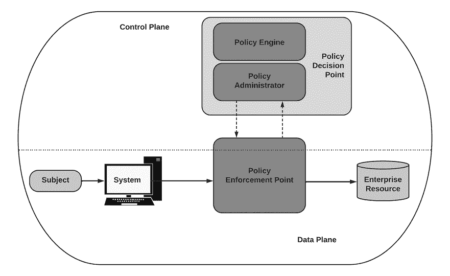

图 3.7：零信任网络访问（来源: NIST SP 800-207）

是否信任某个个人的决策可能基于自适应身份验证。系统会根据请求的上下文更改要求用户进行身份验证的方式。例如，在公司计算机系统上从公司办公室访问网络的主体可能仅被要求验证密码，而在咖啡馆使用个人设备的用户则可能需要进行多因素身份验证。

## 控制面 vs. 数据面

零信任环境使用逻辑或物理隔离来将两种不同的通信分开。用于控制和配置网络的通信发生在名为“控制面”的网络上，而终端用户和软件相互通信的通信发生在名为“数据面”的网络上。将控制面与数据面分离可以减少攻击者通过访问控制面来重新配置网络的可能性。

图 3.8 显示了控制面与数据面的分离，以及每个环境中存在的核心组件。

控制面的两个关键组件是：

*   策略引擎（`PE`）决定是否为给主体授予对资源的访问权限。`PE` 使用企业策略来授予、拒绝或撤销对资源的访问权限。
*   策略管理员（`PA`）负责将 `PE` 做出的决策通信给网络上执行这些决策的工具，这些工具被称为策略执行点（`PEP`）。

`PE` 和 `PA` 合统称为策略决策点（`PDP`）。

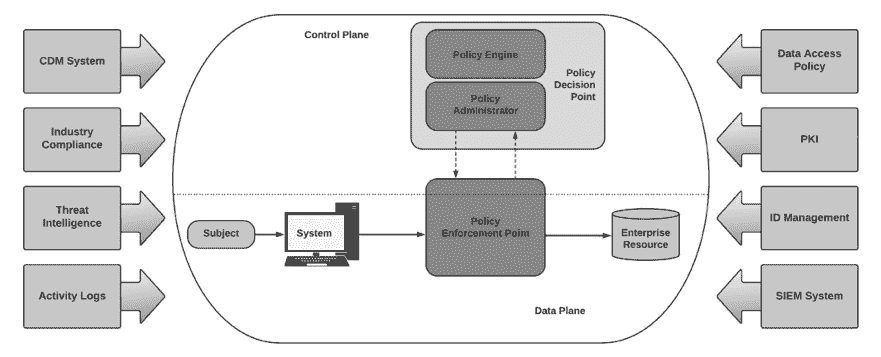

图 3.8：核心零信任组件（来源: NIST SP 800-207）

数据面包含了所有执行组织工作的的系统。数据面的核心组件包括：

*   想要访问资源的主体（用户）。
*   用户用于访问资源的系统。
*   用户想要访问的企业资源，例如文件、服务器或服务。
*   决定是否允许该访问的策略执行点（`PEP`）。注意，`PEP` 实际上跨越了控制面和数据面。这是唯一允许跨越该边界的系统，因为它必须接收来自控制面策略管理员的指令，然后在数据面上执行这些指令。

## 安全访问服务边缘

安全访问服务边缘（SASE）是一种与 ZTNA 密切相关的的设计哲学，它将网络和安全功能结合起来并作为集成云服务交付。SASE 是一种更广泛的哲学，它在零信任的基础上增加了额外的安全服务，包括：

*   防火墙服务
*   安全 Web 网关服务
*   反病毒服务
*   入侵防御服务
*   云访问安全代理（CASB）服务
*   数据泄露防护（DLP）服务

## 第 3 章考试考点回顾

在准备考试时，确保你理解本章涵盖的这些关键概念。

### 复习基础网络概念

*   OSI 模型使用七层来描述网络通信。从一到七命名为：物理层、数据链路、网络层、传输层、会话层、表示层和应用层。
*   传输控制协议（`TCP`）是一种面向连接的协议，提供保证交付；而用户数据报协议（`UDP`）是一种无连接协议，提供“尽力力””交付。
*   文件传输协议（`FTP`）用于通过网络传输文件，但 `FTP` 不加密传输。`SSH` 加密安全复制（`SCP`）和安全 FTP (`SFTP`)。`TLS` 加密 `FTPS`。
*   `SMTP` 使用 `TCP` 端口 25 或端口 587 发送邮件，后者端口用于通过 `TLS` 加密的邮件。`POP3` 使用 `TCP` 端口 110 或 `TCP` 端口 995 接收邮件。`IMAP4` 使用 `TCP` 端口 143 或端口 993 进行加密连接。
*   `HTTPS` 使用 `TCP` 端口 443 通过 `TLS` 加密基于浏览器的流量。
*   目录服务使用 `TCP` 端口 389 上的轻量级目录访问协议（LDAP）或 `TCP` 端口 636 上的 LDAP LDAP（LDAPS）。
*   管理员通常使用 `SSH` 而不是 `Telnet` 连接到远程系统，因为 `SSH` 会加密连接。管理员还使用远程桌面协议（`RDP`）通过 `TCP` 端口 3389 图形连接到远程系统。
*   网络时间协议（`NTP`）提供时间同步服务。
*   域名系统（`DNS`）提供域名解析。`DNS` 区域包括用于 `IPv4` 地址的 `A` 记录和用于 `IPv6` 地址的 `AAAA` 记录。`MX` 记录识别邮件服务器，优先级最低的 `MX` 记录是主邮件服务器。`DNS` 使用 `TCP` 端口 53 进行区域传输，使用 `UDP` 端口 53 进行 DNS 客户端查询。
*   域名系统安全扩展（`DNSSEC`）通过添加资源记录签名（`RRSIG`）为 `DNS` 响应提供验证。`RRSIG` 提供数据完整性和身份验证，并帮助防止 DNS 毒化攻击。

### 理解基础网络设备

*   交换机连接本地网络上的计算机。它们将介质访问控制（`MAC`）地址映射到物理端口。
*   端口安全限制对交换机端口的访问。它包括限制每个端口 `MAC` 地址数量并禁用未使用的端口。
*   路由器连接网络并根据目标 IP 地址引导流量。路由器（和防火墙）使用访问控制列表（`ACLs`）中的规则来允许或阻塞流量。
*   `route` 命令用于查看和操作路由表。
*   隐式拒绝表示除非显式允许，否则将被拒绝。它是 `ACL` 中的最后一条规则。
*   基于主机的防火墙过滤单个主机的入出流量。
*   基于网络的防火墙过滤网络的入出流量。它们被放置在网络的边界，例如互联网和内部网络之间。
*   无状态防火墙使用 `ACL` 中的规则控制网络之间的流量。`ACL` 可以根据端口、IP 地址、子网和某些协议阻塞流量。状态检测防火墙此外还根据会话内数据包的状态过滤流量。
*   Web 应用防火墙（`WAF`）保护 Web 服务器免受 Web 应用攻击。它通常放置在屏幕子网中，并向管理员报警可疑事件。
*   下一代防火墙（`NGFW`）执行深度包检测，在应用层分析流量。
*   状态检测防火墙也称为第 4 层防火墙。`NGFWs` 和 `WAFs` 都是第 7 层防火墙的示例。
*   安全设备可能是故障开启（即当设备故障时允许所有流量通过）或故障关闭（即当设备故障时不允许任何流量通过）。故障关闭设备提供更高的安全性。

### 实现网络设计

*   屏幕子网为从互联网访问的服务器提供了一层保护。
*   内网是一个内部网络。人们使用内网进行彼此通信和内容共享。外网是网络的一部分，允许来自网络外部的授权实体访问。
*   `NAT` 将公共 IP 地址翻译为私有 IP 地址，将私有地址翻译回公有，并向互联网上的用户隐藏内部网络上的 IP 地址。`NAT` 网关是实现 `NAT` 的设备。
*   网络使用各种方法来提供网络分段、分段和隔离。
*   物理隔绝（Air gap）为系统或网络提供物理隔离。系统或网络通过空气隙与其他系统或网络完全隔离。
*   路由器使用 `ACLs` 来控制流量，从而提供逻辑上的分离和分段。
*   正向代理服务器为客户端转发服务请求。它们可以缓存内容并记录用户的互联网活动。
*   反向代理服务器接受来自互联网的流量并将其转发给一个或多个内部 Web 服务器。反向代理服务器放置在受保护子网（screened subnet）中，而 Web 服务器可以位于内部网络。
*   统一威胁管理 (`UTM`) 安全设备包含多层保护，例如 URL 过滤、内容检查、恶意软件检查和分布式拒绝服务 (`DDoS`) 缓解。`UTMs` 通常发出报警并发送给管理员进行解释。
*   跳板服务器（Jump servers）放置在不同的安全区域之间，提供从一个区域的设备到另一个区域设备的安全访问。它们通常用于从内部网络管理受保护子网中的设备。

| 在线参考。记住，在线内容包含一些额外内容，例如实验室、基于性能的题目示例等。请访问 [`getcertifiedgetahead.com/`](https://getcertifiedgetahead.com/) 查看。 |

## 第 3 章练习题

1. 一位外部顾问对松饼屋市（Municipal House of Pancakes）的网络进行了审计。她发现使用一种旧协议来访问网络内交换机和路由器上基于浏览器的界面。她建议用安全协议替换该旧协议，以便使用相同的接口访问这些网络设备。应该实施以下哪种协议？
    1. `SSL` 的最新完全支持版本
    2. `TLS` 的最新完全支持版本
    3. `LDAPS` 的最新完全支持版本
    4. `SNMP` 的最新完全支持版本

2. 你们组织的安全策略要求通过内部网络传输的机密数据必须加密。以下哪个协议最能满足这一要求？
    1. `FTP`
    2. `SSH`
    3. `SNMPv3`
    4. `SRTP`

3. Maggie 需要从网络设备收集配置信息和网络统计数据。她想保护连接到这些设备时使用的凭据的机密性。以下哪个协议最能满足这一需求？
    1. `SSH`
    2. `FTPS`
    3. `SNMPv3`
    4. `TLS`

4. 以下哪个组件无法零信任网络的数据平面上进行通信？
    1. 主体 (Subject)
    2. 企业资源 (Enterprise resource)
    3. 策略执行点 (Policy enforcement point)
    4. 策略管理员 (Policy administrator)

5. 你正在配置一个 Web 服务器，该服务器将包含有关组织的信息并接收客户的订单。以下哪个网络位置是该服务器的最佳放置位置？
    1. 受保护子网 (Screened subnet)
    2. 内网 (Intranet)
    3. 外网 (Extranet)
    4. 互联网 (Internet)

6. Maggie 正在检查网络流量寻找使用不安全协议的迹象。她看到通信在几个不同的网络端口上进行。这些端口中哪一个可能包含不安全流量？
    1. 22
    2. 80
    3. 443
    4. 587

7. 任务是在组织受保护子网内的某些服务器上启用 `NTP`。通过此操作，你最可能在支持以下哪种用例？
    1. 加密音视频传输
    2. 提供时间同步
    3. 启用电子邮件使用
    4. 加密传输数据

8. 你们组织在整个内部网络使用了多个交换机。管理层希望实施一种安全控制，以防止对网络内这些交换机的未经访问。以下哪个选项最能满足这一需求？
    1. 禁用未使用的端口。
    2. 禁用 `STP`。
    3. 启用 `SSH`。
    4. 启用 `DHCP`。

9. 网络管理员远程管理网络设备。然而，最近的安全审计发现他们正在使用一种允许他们以明文通过网络发送凭据的协议。为了消除此漏洞，应该采用哪种最佳方法？
    1. 使用 `SNMPv2c`。
    2. 使用 `SSH`。
    3. 使用 `SSL`。
    4. 使用 `SFTP`。

10. 以下哪个设备最可能使用以下项目定义其操作？
    * `permit IP any any eq 80`
    * `permit IP any any eq 443`
    * `deny IP any any`
    1. 防火墙
    2. 代理服务器
    3. Web 服务器
    4. 跳板服务器

11. 组织的网络如图所示，你被要求验证防火墙 1 是否具有正确的设置。

所有防火墙都应执行以下要求：
* 远程管理仅使用安全协议。
* 阻止明文 Web 流量。

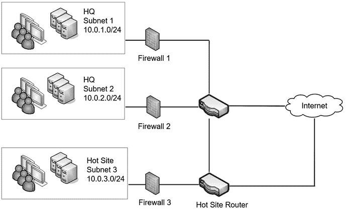

下表显示了防火墙 1 中配置的当前规则。

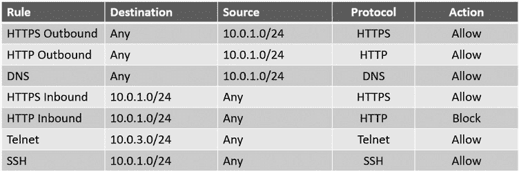

你被要求验证规则的配置是否正确。为了确保防火墙 1 符合要求，哪条规则（如果有）应该被更改？
1. HTTPS Outbound
2. HTTP Outbound
3. DNS
4. Telnet
5. SSH
6. 无。所有规则正确。

12. 春田核电厂（Springfield Nuclear Plant）有若干用于监控的独立计算机。员工使用本地账户登录这些计算机。组织的首席信息官（CIO）规定这些计算机不能连接到组织网络或访问互联网。以下哪个最能满足这一要求？
    1. 对计算机进行物理隔离（Air gap）。
    2. 将计算机放在受保护子网中。
    3. 为这些计算机创建一个隔离的网络。
    4. 将计算机放置在 `VLAN` 中。

13. 你在网络中增加了另一个路由器。该路由器提供了通往未公告的限制性网络的路径。然而，一名网络管理员需要定期访问该网络。他可以通过哪种方法配置其计算机访问该限制网络？
    1. 实现 `QoS` 技术。
    2. 添加 `VLAN`。
    3. 使用 `route` 命令。
    4. 在路由器上打开额外的端口。

14. 组织受保护子网中的几个服务器最近遭受了攻击。在分析日志后，你发现许多攻击使用了 TCP，但这些数据包并非已建立 TCP 会话的一部分。以下哪个设备将提供最佳解决方案以防止未来此类攻击？
    1. 无状态防火墙 (Stateless firewall)
    2. 状态检测防火墙 (Stateful firewall)
    3. 网络防火墙
    4. Web 应用防火墙

15. 你们的网络目前有一个专门的防火墙保护 Web 服务器。它目前在 `ACL` 中仅配置了以下两条规则：

```
PERMIT TCP ANY ANY 443
PERMIT TCP ANY ANY 80
```


你检测到通过防火墙有 DNS 请求和 DNS 区域传输请求，你需要阻止它们。以下哪项可以实现此目标？（选择两个。每个答案都是完整的解决方案。）

1. 在防火墙中添加规则：`DENY TCP ALL ALL 53`。
2. 在防火墙中添加规则：`DENY UDP ALL ALL 53`。

# 第 3 章

## 练习题答案

3. 向防火墙中添加以下规则：`DENY TCP ALL ALL 25`。

4. 向防火墙中添加以下规则：`DENY IP ALL ALL 53`。

5. 在 `ACL` 末尾添加一条隐式拒绝（implicit deny）规则。

1. B 正确。应该实现最新版本的传输层安全协议（`TLS`）来访问网络设备。场景提到需要相同的接口，唯一可能的选择是 `TLS` 或安全套接层（`SSL`）。然而，`SSL` 已被弃用，不应使用。轻量级目录访问安全协议（`LDAPS`）用于与 `Microsoft Active Directory` 等目录通信。简单网络管理协议第 3 版（`SNMPv3`）为 `SNMP` 增加了安全性，并加密了发送往网络设备的凭据，但它不支持通过浏览器界面进行访问。

2. B 正确。在网络上传输机密数据时，可以使用安全外壳（`SSH`）进行加密。安全文件传输协议（`SFTP`）使用 `SSH` 对文件传输协议（`FTP`）流量进行加密，但 `FTP` 是未加密的。简单网络管理协议第 3 版（`SNMPv3`）用于监控和管理网络设备，而不是在网络上传输数据。安全实时传输协议（`SRTP`）为语音和视频提供加密、消息认证和完整性保护，但并非所有数据。

3. C 正确。简单网络管理协议第 3 版（`SNMPv3`）是一种安全的协议，可以监控并从网络设备收集信息。它包含了强大的身份验证机制来保护凭据的机密性。列出的其他协议均用于监控网络设备。安全外壳（`SSH`）提供了连接设备的安全方法，但并不对其进行监控。安全文件传输协议（`FTPS`）用于使用传输层安全协议（`TLS`）加密传输中的大文件。`TLS` 常用于保护传输，但并不包含监控设备的方法。

4. D 正确。策略管理员（`PA`）完全存在于控制平面。它将决策发送给策略执行点（`PEP`），而 `PEP` 能够在控制平面和平数据面上进行通信。主体及其想要访问的企业资源仅在数据面上通信，并且可能访问控制平面。

5. A 正确。必须供公众访问的系统应始终放置在筛选子网（screened subnet）中。该网络设计用于存放需要公共访问但仍必须安全的系统。组织几乎不应该将系统直接放置在互联网上，因为它们无法受到防火墙的保护。内网和外域网是访问受限的私有网络，不适合作为公共 Web 服务器所在地。

6. B 正确。端口 `80` 用于未加密的超文本传输协议（`HTTP`）。安全的网络通信应使用位于端口 `443` 的加密版 HTTP 安全安全协议（`HTTPS`）。端口 `22` 用于安全外壳（`SSH`）的加密管理连接和数据传输。端口 `587` 用于简单邮件传输协议安全版（`SMTPS`）通过加密连接在服务器之间传输电子邮件消息。

7. B 正确。网络时间协议（`NTP`）提供时间同步服务，因此在筛选子网（有时称为非军事化区或 `DMZ`）的服务器上启用 `NTP` 可以满足此用例。安全实时传输协议（`SRTP`）为 IP 网络上的音频和视频提供加密、消息认证和完整性。简单邮件传输协议（`SMTP`）、邮局协议第 3 版（`POP3`）和互联网消息访问协议第 4 版（`IMAP4`）等协议用于电子邮件。加密数据与 `NTP` 提供的时间同步服务无关。

8. A 正确。可以通过禁用交换机上未使用的物理端口作为整体端口安全实践，防止未经授权的访问。这可以防止有人将电脑插入未启用的禁用端口时建立连接。生成树协议（`STP`）防止交换环路问题，并应当启用。安全外壳（`SSH`）加密流量并可连接到网络设备进行管理，但它不直接保护交换机。动态主机配置协议（`DHCP`）用于动态分配 IP 地址，与此场景无关。

9. B 正确。安全外壳（`SSH`）可用于连接许多网络设备，是给定选项中的最佳答案。它可以加密整个会话，包括凭据。场景表明管理员可能在使用简单网络管理协议第 1 版（`SNMPv1`）、`SNMPv2` 或 `SNMPv2c`。这些协议均以明文形式在网络上发送团体字符串。`SNMPv3`（未作为可选答案）在通过网络发送凭据之前对其进行加密。安全套接层（`SSL`）可以加密但已被弃用，不应使用。安全文件传输协议（`SFTP`）是 `FTP` 的安全实现，用于传输文件，而不是管理网络设备。

10. A 正确。这些是防火墙中访问控制列表（`ACL`）中的规则。前两条规则表示，从任何 IP 地址到任何 IP 地址、使用端口 `80` 或 `443` 的流量是被许可或允许的。最后一条规则也称为隐式拒绝规则，放置在 `ACL` 的末尾。它确保所有之前未被允许的流量都被拒绝。代理服务器不会使用 `ACL`，尽管它会分别使用端口 `80` 和 `443` 对应超文本传输协议（`HTTP`）和 HTTP 安全协议（`HTTPS`）。Web 服务器不会使用 `ACL`，尽管它也会使用端口 `80` 和 `443`。跳板机是放置在不同安全区域（例如内网和筛选子网）之间的服务器，用于管理另一个区域的设备。

11. B 正确。超文本传输协议（`HTTP`）规则应从 Allow 更改为 Block，以拦截明文 Web 流量。Telnet 规则具有错误的目标地址和操作类型。它应该是 `10.0.1.0/24` 并设置为 Block，因为它不是用于远程管理的安全协议。然而，由于地址错误（`10.0.3.0/24`），它对防火墙 1 不产生任何影响。

12. A 正确。可用选项的最佳选择是对计算机进行物理隔离（air gap）。物理隔离意味着隔离系统与其他系统之间存在空隙。筛选子网（有时称为非军事化区 `DMZ`）在互联网和内网之间提供缓冲，并将这些计算机连接到内网和互联网。场景并未指示计算机需要连接，因此不需要独立的隔离网络。将计算机放置在虚拟局域网（`VLAN`）中会将计算机连接到网络。

13. C 正确。`route` 命令用于显示和操作 Linux 计算机上的路由表。通过此命令，你可以通过此路由器为限制访问网络提供另一条网关路径。其他选项均无法添加路由路径。服务质量（`QoS`）技术允许管理员某些某些流量的优先级高于其他流量。虚拟局域网（`VLAN`）用于划分或隔离网络，因此配置它不会授予网络访问。路由器不具备供单个用户开启的端口。

14. B 是正确的。状态检测防火墙根据数据包在会话中的状态过滤流量。它会过滤掉不属于已建立传输控制协议（TCP）会话的数据包，会话从 TCP 三次握手开始。无状态防火墙根据 IP 地址、端口或协议 ID 过滤流量。虽然将网络防火墙放在筛选子网（有时称为非军事化区 DMZ）是合适的，但网络防火墙可以是无状态防火墙，也可以是状态检测防火墙。Web 应用防火墙（WAF）专门用于保护通常托管在 Web 服务器上的 Web 应用程序，但攻击针对的是多台服务器，而不仅仅是 Web 服务器。

15. D 和 E 是正确的。简单的方法是在访问控制列表（ACL）的末尾添加隐式拒绝规则，所有防火墙都应该具有此规则以阻止所有意外流量。你还可以使用 `DENY IP ALL ALL 53` 拒绝所有使用端口 53 的 IP 流量。域名系统（DNS）请求使用 UDP 53，而 DNS 区域传输使用 TCP 53，因此仅阻塞 TCP 53 或 UDP 53 无法阻止所有的 DNS 流量。端口 25 用于简单邮件传输协议（SMTP），与此问题无关。

# 第 4 章：保护你的网络

本章涵盖的 CompTIA Security+ 目标：

### 1.2 总结基础安全概念。
* 欺骗与干扰技术（蜜罐、蜜罐网络、蜜罐文件、蜜罐）

### 2.3 解释各种类型的漏洞。
* 零日漏洞（Zero-day）

### 2.4 给定场景，分析恶意活动指标。
* 网络攻击（无线）
* 物理攻击（射频识别识别 RFID 克隆）

### 3.2 给定场景，应用安全原则来保护企业基础设施。
* 基础设施考虑（设备属性、主动与被动、内联与分流/监控、入侵防御系统 (IPS)/入侵检测系统 (IDS)、传感器、端口安全、802.1X、可扩展身份验证协议 (EAP)）
* 安全通信/访问（虚拟专用网络 VPN、远程访问、隧道、互联网协议安全 (IPsec)）

### 4.1 给定场景，将常用安全技术应用于计算资源。
* 无线设备（安装考虑、实地调查、热图）
* 无线安全设置（Wi-Fi 保护访问 3 WPA3、AAA/远程拨号用户服务 RADIUS、加密协议、身份验证协议）

### 4.4 解释安全告警和监控概念及工具。
* 活动（告警响应与修复/验证、隔离）
* 工具（代理/无代理）

### 4.5 给定场景，修改企业能力以增强安全性。
* IDS/IPS（趋势、签名）
* 网络访问控制 (NAC)

在本章中，你将学习一些更高级的网络安全概念。主题包括入侵检测系统（IDS）、入侵防御系统（IPS）、用于保护无线网络的方法、常见的无线攻击以及虚拟专用网络（VPN）技术。

## 探索高级安全设备

第 3 章“探索网络技术和工具”讨论了基础网络技术和协议。本节探索了许多用于保护网络的先进安全设备。我们将讨论不同安全设备的属性以及如何将它们部署在网络中。

## 理解 IDS 和 IPS

入侵检测系统（IDS）监控网络，并在检测到系统或网络上的可疑事件时发送告警。入侵防御系统（IPS）对进行中的攻击做出反应并防止其到达系统和网络。

第 8 章“使用风险管理工具”更深入讨论了协议分析仪（或嗅探器），但作为介绍，管理员使用它们来捕获和分析在主机之间传输的网络流量。IDS 和 IPS 具有相同的能力。它们捕获流量并进行分析以检测潜在的攻击或异常。

IDS 和 IPS 都使用类似的检测方法作为侦测性安全控制。最大的区别在于它们对攻击的响应方式。本节先介绍 IDS，然后以一些关于 IPS 的信息结束，并对两者进行比较。然而，在学习本节时，值得记住，IDS 和 IPS 可以实施相同的监控和检测方法。

### HIDS

基于主机的入侵检测系统（HIDS）是安装在工作站或服务器等系统上的额外软件。它监控单个主机，可以检测潜在的攻击并分析关键操作系统文件。任何 IDS 的主要目标都是监控流量，然后向管理员告警可疑活动。对于 `HIDS` 来说，这些流量通过网络网卡（`NIC`）。

许多基于主机的 IDS 已经扩展到监控系统上的应用程序活动。例如，你可以在不同的面向互联网的服务器上（如 Web 服务器、邮件服务器和数据库服务器）安装 `HIDS`。除了监控到达服务器的网络流量外，`HIDS` 还可以监控服务器应用程序。

值得强调的是`HIDS` 可以帮助检测传统杀毒软件可能会漏掉的恶意软件（malware）。正因如此，许多组织在每个工作站上安装 `HIDS`，作为传统杀毒软件之外的额外保护层。就像服务器上的 `HIDS` 会监控网络流量一样，工作站 `HIDS` 会监控到达工作站的网络流量。然而，`HIDS` 还可以监控某些应用程序、日志文件和本地资源（如操作系统文件）。

其他组织中，管理员仅在认为需要时才安装 `HIDS`。例如，假设管理员担心某个带有专有数据的服务器面临的攻击风险增加。在这种情况下，管理员可能会选择在该系统上安装 `HIDS` 作为额外的保护层。

| 记住这一点！HIDS 可以监控单个主机（如服务器或工作站）的所有流量。在某些情况下，它可以检测杀毒软件漏掉的恶意活动。 |
| --- |

### NIDS

基于网络的入侵检测系统（NIDS）监控网络活动。管理员在交换机、路由器或防火墙等网络设备上安装 NIDS 传感器或收集器。这些传感器收集信息并报告到托管 NIDS 控制台的监控网络设备。

`NIDS` 无法检测单个系统或工作站的异常，除非异常会导致网络流量的变化。此外，`NIDS` 无法解密流量。换句话说，它只能对以明文或非加密传输的网络流量进行监控和评估。

图 4.1 显示了 NIDS 配置的示例。图中，传感器位于防火墙之前、防火墙之后以及路由器上。这些传感器收集并监控网络内子网的网络流量，并报告给 NIDS 控制台。NIDS 提供了整体监控和分析，并可以检测网络攻击。

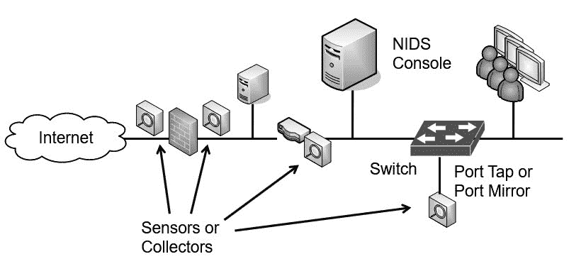

图 4.1: NIDS 传感器

图 4.1 还显示了内部交换机上的端口 TAP 或端口镜像。大多数交换机支持端口镜像（有时称为端口划分），允许管理员配置交换机将其收到的所有流量发送到单个端口。配置端口镜像后，你可以将其作为分流器，将所有交换机数据发送到传感器或收集器，并转发到 NIDS 控制台。同样，可以在路由器上配置端口 TAP，以捕获通过路由器的所有流量并发送到 IDS。

## 传感器和收集器的放置

传感器放置的位置取决于你想要测量的内容。例如，位于防火墙互联网外侧的传感器将看到所有流量。然而，位于防火墙内侧的传感器只能看到通过防火墙的流量。换句话说，防火墙会过滤某些攻击，内部传感器看不到这些攻击。

如果你想查看网络上的所有攻击，请在防火墙外侧放置传感器。如果你只想查看通过了的内容，请仅将传感器放置在内部网络中。如果你想两者都看到，请在两个位置都放置传感器。

| 记住这一点！ | NIDS 控制台安装在网络设备上。传感器安装在交换机、路由器或防火墙等网络设备上，用于监控网络流量并检测网络攻击。你也可以使用分接器（taps）或端口镜像（port mirrors）来捕流量。NIDS 无法监控加密流量，无法监控单个主机上的流量。 |
| --- |

### 检测方法

IDS 只能检测攻击，不能阻止攻击。相比之下，IPS 通过检测并在攻击到达目标之前阻止它们来防止攻击。在这种背景下，攻击是指破坏机密性、完整性或可用性的尝试。

两种主要的检测方法是基于特征的和基于启发式或行为的（也称为异常检测）。任何 IDS 都可以基于特征、异常或两者来检测攻击。`HIDS` 监控到达其 `NIC` 的网络流量，而 `NIDS` 监控整个网络的流量。

#### 基于特征的检测

基于特征的 IDS（有时称为基于定义的）使用已知漏洞或已知攻击模式的数据库。例如，某些工具允许攻击者只需输入受攻击系统的 IP 地址即可对服务器发起 SYN 洪攻击。攻击工具随后向目标系统发送大量的同步（`SYN`）数据包，但永远不会通过确认（`ACK`）数据包完成三次传输控制协议（`TCP`）握手。如果攻击未被拦截它可能会消耗系统资源并最终导致系统崩溃。

然而，这是一种已知攻击，具有特定的从一个 IP 到另一个 IP 的连续 `SYN` 数据包模式。当特征数据库包含攻击定义时，IDS 就能检测到这些模式。该过程与杀毒软件检测恶意软件的方式非常相似。你需要定期从供应商处更新 IDS 特征和杀毒定义，以防御当前的威胁。

#### 基于趋势的检测

基于趋势的检测（有时称为异常检测）首先从识别网络的常规运行或正常行为开始。它是通过在正常运行条件下创建性能基准来实现此的。

IDS 持续监控网络流量，并将当前网络行为与基准进行比较。当 IDS 检测到异常活动（超出基准中确定的正常范围）时，它会发出指示潜在攻击的警告。

基于趋势的检测与基于启发式的杀毒软件的工作原理相似。尽管内部方法不同，但两者都检查活动并检测超出基于特征的检测能力的异常活动。

基于趋势的检测在发现零日漏洞方面可能有效。零日漏洞通常被定义为厂商未知的漏洞，因此厂商尚未发布补丁。如果漏洞是未知的且没有补丁，那么它也不会有特征。

| SYN 洪攻击 | SYN 洪攻击是一种常见的拒绝服务（`DoS`）攻击。第 3 章描述了建立会话的三次握手。作为提醒，建立会话的三次握手。 |
| --- |

*（注：原文在 SYN Flood Attack 表格中存在大量的重复循环；已在保留核心定义的同时清理了冗余字符串）。*

### 数据源与趋势

任何类型的 IDS 都会使用各种数据源来收集活动信息。这包括各种日志，如防火墙日志、系统日志和应用程序日志。

第 1 章“精通安全基础”讨论了安全信息和事件管理（`SIEM`）系统以及它们如何收集和聚合数据。同样，IDS 包含聚合器来存储来自不同系统的日志项。IDS 可以分析这些日志项以提供趋势方面的洞察。这些趋势可以检测攻击模式并为改进网络防护提供洞察。

许多 IDS 可以实时监控日志。每当系统记录日志项时，IDS 都会检查该日志以判断其是否为感兴趣的项目。其他 IDS 会定期轮询相关日志并扫描感兴趣的项目。

#### 基于规则的报告

IDS 根据内部配置的规则对感兴趣的事件进行报告。并非所有事件都是攻击或实际问题，它们提供提供报告，指示事件可能是警告或报警。管理员进行调查以判断其是否有效。某些系统将报警和警告视为同一物。其他系统将报警视为潜在严重问题，将警告视为较小的问题。后者的系统目标是鼓励管理员对报警的关注优先级高于警告。

| 记住这一点！ | 基于特征的检测根据已知攻击或漏洞识别问题。基于特征的检测系统可以检测已知攻击类型。基于趋势的 IDS（也称为异常检测）可以检测异常活动。它们从正常行为的性能基准开始，并将网络流量与基准进行比较。当流量显著偏基准时，系统发送警告。 |
| --- |

实际的报告机制随系统和组织而异。例如，一个 IDS 可能将事件作为报警或警告写入日志，然后向管理员账户发送电子邮件。在大型网络运营中心（`NOC`）中，IDS 可能将警告发送到所有 NOC 人员都能看到的显示器上。关键在于管理员根据组织需求配置 IDS 内部的规则。

### 警告响应与验证

虽然 IDS 使用高级分析来检查流量，但它们有时也会犯错。安全专业人员需要在警报触发时做出响应并验证实际情况。他们正在寻找两种错误：`false positives`（误报）和 `false negatives`（漏报）。`false positive` 是对一个非威胁性、良性或无害的事件触发了警告或警报。`false negative` 是当攻击者实际上正在攻击网络，但系统没有检测到。这两者都不是理想的，但不可能同时消除两者。大多数 IDS 在事件超过阈值时会触发警告或报警。以下列表描述了 IDS 对攻击或感知攻击的四种可能响应。在阅读这些内容时请参考图 4.2：

* `False positive`。当没有实际攻击时，IDS 或 IPS 发送了报警或警报，就发生了 `false positive`。
* `False negative`。当存在攻击时，IDS 或 IPS 未能发送报警或警报，就发生了 `false negative`。
* `True negative`。当没有实际攻击时，IDS 或 IPS 未发送报警或警报，就发生了 `true negative`。
* `True positive`。当 IDS 或 IPS 在识别出攻击后发送了报警或警报，就发生了 `true positive`。

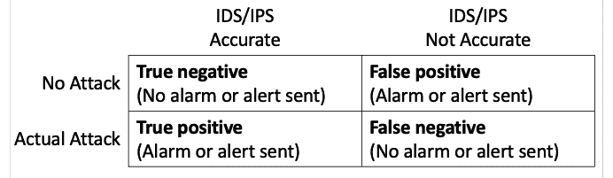

图 4.2：IDS/IPS 误报与漏报

考虑经典的 SYN 洪水攻击，攻击者保留了 TCP 三次握手的第三部分。主机会发送一个 `SYN` 数据包，服务器会响应 `SYN/ACK` 数据包。然而，攻击主机并没有用 `ACK` 数据包完成握手，而是从未发送 `ACK`，继续发送更多的 `SYN` 数据包。这导致服务器留下了开放连接，最终可能破坏服务。

如果系统接收到 1 个没有相应 `ACK` 包的 `SYN` 数据包，这是一种攻击吗？可能不是。这可能发生在正常运行期间。如果系统在不到 60 秒内从单个 IP 地址接收到超过 1000 个没有相应 `ACK` 包的 `SYN` 数据包，这是一种攻击吗？绝对是。

管理员在 IDS 内部配置规则，并设置 1 到 1000 之间的阈值来指示攻击。如果管理员将阈值设置得太低，会有太多的误报，并由于花费时间追逐幻影而产生巨大的工作负载。如果他们将阈值设置得太高，实际攻击将在管理员不知情的情况下通过。同样，他们还可以根据 IDS 的分析和能力配置许多设置。

大多数管理员都想知道他们的系统是否正受到攻击。这是 IDS 的主要目的。然而，一个不断大喊“狼来了！”的 IDS 在真狼攻击时会被忽略。将阈值设置得足够高以减少误报数量，同时足够低以对任何实际攻击发出警报，这是重要的。

阈值没有完美的数字。管理员根据网络活动水平和个人偏好，在不同的网络中调整阈值。

| 记住这一点！当攻击没有发生时，`false positive` 会错误地指示攻击正在发生。误报的高发生率会增加管理员的工作负载。`false negative` 是攻击发生了但系统没有检测到并报告。管理员通常将 IDS 阈值设置得足够高以最大限度地减少误报，同时足够低以防允许漏报发生。 |
| --- |

### IPS 与 IDS——内式与被动

入侵防御系统 (`IPSs`) 是 `IDSs` 的扩展。就像你可以拥有 `HIDS` 和 `NIDS` 一样，你可以拥有 `HIPS` 和 `NIPS`。与 `IDS` 相比，`IPS` 有如下：

* `IPS` 是内式的（in-line），可以检测、响应并防止攻击。
* `IDS` 是带外的（out-of-band），负责监控并响应攻击。
* `IPS` 是内式的，允许它拦截恶意流量。
* `IDS` 是带外的，仅在攻击开始后进行报告。
* `IPS` 是主动的，因为它是内式的。
* `IDS` 是被动的，因为它不是内式的。

| 记住这一点！入侵防御系统 (`IPS`) 放置在流量的内线中，可以检测、响应并防止攻击。`IDS` 监控并响应攻击。它不是内式的，而是被动地收集数据（也称为带外）。 |
| --- |

### 蜜罐

蜜蜜罐（Honeypot）是一个看起来很有诱人的服务器——至少它的设计目标是让攻击者觉得很有诱惑，就像蜂蜜对熊来说看起来很甜一样。它是一个开放的或看起来锁得非常粗糙的服务器，允许攻击者相对容易地访问。其意图是让服务器看起来像一个易攻目标，以便攻击者将时间花在蜜罐上，而不是在活跃网络上。简而言之，蜜罐会将攻击者从活跃网络中引开。

例如，蜜罐可以是一个设计成像活跃 Web 服务器的 Web 服务器。它将包含虚假数据，例如包含伪造信用卡交易数据的文件和文件夹。如果一个组织怀疑有恶意内部人员问题，它可以创建一个包含有关专有项目虚假信息的内部蜜罐。

蜜蜜罐通常具有一些攻击者可以轻易绕过的保护措施。如果管理员不使用任何安全防护，蜜罐对经验丰富的攻击者来说可能看起来可疑，他们可能会避开它。

安全人员经常使用蜜罐来收集有关攻击者的情报。攻击者会不断修改其方法以利用不同类型的攻击。一些复杂的攻击者在补丁发布之前就会发现零日漏洞。在某些情况下，安全专业人员观察到攻击者对蜜罐发起零日漏洞攻击。

蜜罐永远不会持有对组织有价值的数据。这些数据对攻击者来说可能看起来很有价值，但泄露是无害。蜜罐的一些目标是：

* 欺骗攻击者并将他们从活跃网络引开。如果攻击者在蜜罐中花费时间，他们就不会攻击活跃资源。
* 允许观察攻击者。当攻击者在蜜罐中时，安全专业人员可以观察攻击并学习攻击者的方法。蜜罐还可以帮助安全专业人员了解零日利用或此前未知的攻击。

## 蜜罐网 (Honeynets)

蜜罐网是独立网络或区域内的一组蜜罐，但从组织的主网络可以访问。安全人员经常使用单个物理服务器内的多个虚拟服务器来创建蜜罐网。该网络内的服务器是蜜罐，蜜罐网模拟了活跃网络的功能。

例如，你可以使用一个具有大量内存和处理能力的单一强大服务器。该服务器可以托管多个虚拟服务器，每个虚拟服务器都运行着操作系统和应用程序。托管六个虚拟服务器的物理服务器在子网上将显示为七个系统。从外部观察的攻击者无法轻易判断服务器是物理的还是虚拟的。

这种虚拟网络旨在欺骗攻击者并偏离对实际网络的攻击。如果攻击者在蜜罐网中，他就没有攻击活跃网络，管理员可以观察攻击者的行为。

孙子在《兵法》中著名的写道：“兵者，诡道也”，以及“知己知彼”。网络战争每天发生，处于网络和系统攻击前线的安全专业人员意识到，这些攻击在许多方面模拟了战争。蜜罐和蜜罐网为这些专业人员提供了在这场战争中使用的额外工具。

## 蜜罐文件 (Honeyfile)

蜜罐文件是设计用于吸引攻击者注意的文件。文件吸引攻击者的主要方式是通过名称。例如，命名为 `password.txt` 的文件可能包含密码。

经验丰富的管理员不会在安全上如此粗心，将包含实际凭据的文件命名为 `password.txt`。然而，你可能创建一个看起来包含密码的蜜罐文件，并将其放在攻击者可以找到的地方来欺骗一些攻击者。

## 蜜罐令牌 (Honeytokens)

数据对许多组织来说是宝贵的资产。你的产品计划、客户列表和员工记录可能是你拥有的最敏感、最重要的资产之一。攻击者知道这一点并可能尝试窃取你的信息。蜜罐文件试图将他们从寻找具有真实价值的数据引开，但有时他们仍然会发现。

蜜罐令牌有不同的目的。它们试图检测攻击者能够窃取数据的情况。例如，一个组织在其生产数据库中放置虚假的但易于检测的记录。如果如果他们他们怀疑数据被盗取，就可以搜索蜜罐令牌。如果他们在另一个数据集中发现了该虚假记录，就知道它被盗取了。

例如，你可以创建一个新的电子邮件地址 `JamesKate@getcertifiedgetahead.com` 并将其插入数据库中的一个虚假客户记录中。然后你再也不在任何地方使用该电子邮件地址。如果该邮箱收到了消息，你就知道该消息来自一次攻击者能够窃取你客户数据库的攻击。

| 记住这个！ | 蜜罐和蜜罐网试图欺骗并干扰攻击者。它们将攻击者从活跃网络引开，并允许安全人员观察攻击者正在使用的当前方法。蜜罐文件是一个具有名称（如 `password.txt`）并吸引攻击者注意的文件。蜜罐令牌是插入数据库以检测数据窃取的虚假记录。 |
| --- | |

## 保护无线网络安全

无线局域网 (WLANs) 是家庭和业务网络的重要部分。无线网络容易设置，可以在不布电缆的情况下快速连接几台计算机，显著降低成本。

然而，无线网络已成为一种流行的攻击向量，无线网络面临的挑战之一就是安全。多年来无线安全性有所提高，但无线网络仍然受到漏洞的影响，许多用户并不理解如何充分锁定无线网络。

## 复习无线基础

在深入研究无线安全之前，你必须理解与无线设备和网络的一些基本概念。如果你最近通过了 CompTIA Network+ 考试，这些主题对你可能非常熟悉，但它们仍然值得一看，以确保你从 CompTIA Security+ 考试的角度理解了它们。

无线接入点 (AP) 将无线客户端连接到有线网络。然而，许多 AP 现在也具有路由功能。供应商通常将具有路由功能的 AP 营销为无线路由器，这就是你通常看到它们的方式。两个区别是：

* 所有的无线路由器都是 AP。这些是具有额外功能——路由的 AP。
* 并不是所有的 AP 都是无线路由器。许多 AP 没有任何额外功能。它们为无线客户端到有线网络提供连接性，但不具备路由功能。

图 4.4 显示了无线路由器为多个系统提供连接的图。注意无线路由器既有交换机组件又有路由器组件，因此它同时为有线无线客户端提供服务。设备连接到交换机组件。路由器组件通过宽带调制解调器或类似设备（取决于互联网提供商 ISP 的要求）提供到互联网的连接。

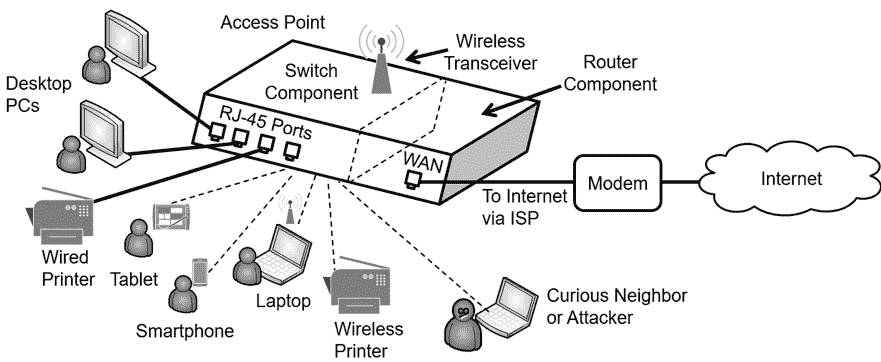

图 4.4: 具有路由功能的无线接入点（无线路由器）

大多数 AP 包括用于有线访问的物理端口（在图中标记为 `RJ-45 Ports`）和用于无线客户端的无线收发器。也就是说，某些用户可以使用普通的双绞电缆连接，而其他用户可以使用无线传输进行连接。所有有线端口和无线连接都通过无线路由器的交换组件连接。许多供应商将互联网连接标记为 `WAN`（广域网），但某些供应商将此端口标记为 `Internet`。

当如图 4.4 所示使用时，`AP` 还包含额外的服务和功能，例如路由、网络地址转换 (`NAT`)、端口地址翻译 (`PAT`)、动态主机配置协议 (`DHCP`) 等。这些额外服务缩短了 WLAN 所需的设置时间。

由于无线网络在已知频段上进行广播，其他无线用户通常可以看到它们。这包括授权用户、好奇的邻居以及攻击者。

## 频段选择与通道重叠

无线网络使用两个主要的频段：`2.4 GHz` 和 `5 GHz`。然而，无线设备并不恰好地在 `2.4` 或 `5 GHz` 上传输。相反，这两个频段有多个从大约 `2.4 GHz` 和 `5 GHz` 开始的通道。无线信号在 `2.4-GHz` 频率范围内传输最远，而你可以通过 `5-GHz` 频率获得最宽的带宽（传输最多的数据）。以下列表显示了一些无线标准以及它们使用的频段：

* `802.11b`, `2.4 GHz`
* `802.11g`, `2.4 GHz`
* `802.11n`, `2.4 GHz`, 和 `5 GHz`
* `802.11ac`, `5 GHz`
* `802.11ax`, `2.4 GHz` 和 `5 GHz`

没有一种适用于所有国家的标准，因此你会发现每个频段内的通道数量因国家而异。此外，这些通道中的某些与其他通道重叠。例如，图 4.5 显示了 `2.4 GHz` 范围范围内被 `802.11b`、`802.11g` 和 `802.11n` 使用的通道。

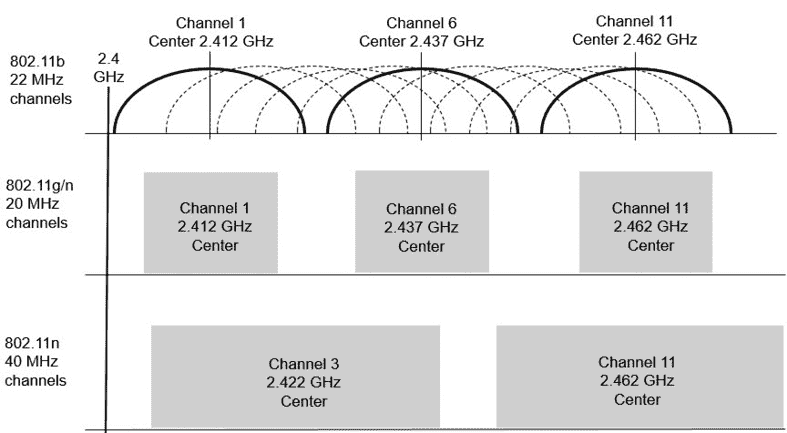

图 4.5：802.11 标准的通道与通道重叠

查看 `802.11b` 中的通道重叠是最简单的。通道 `1`、`6` 和 `11` 是实线，而其他通道使用虚线。`Channel 1` 与 `Channels 2` 到 `5` 重叠，`Channel 6` 与 `Channels 2` 到 `10` 重叠，`Channel 11` 与 `Channels 7` 到 `10` 重叠。想象一个设备正在使用 `Channel 6`。如果另一个无线设备正在使用重叠通道，它可能会影响 `Channel 6` 上流量的效率。图中显示的其他标准只显示部分通道，但它们也受到通道重叠问题的影响。

你选择的频段（`2.4 GHz` 或 `5 GHz`）取决于你使用的标准（`802.11 b`、`g`、`n`、`ac` 或 `ax`）。大多数无线设备会自动选择通道，但某些设备允许你更改通道以提高性能。例如，如果你在公寓楼中有一个无线路由器，你可能会发现由于附近其他无线路由器导致 `Channel 6` 嘈杂。通过将你的路由器更改到 `Channel 1`，你可以提高无线网络的性能。

## 接入点 SSID

无线网络通过服务集标识符 (`SSID`) 来标识，这仅仅是无线网络的名称。某些 `APs` 带有默认 `SSIDs`，尽管大多数厂商已不再采用这种做法。例如，一些旧版 Linksys `APs` 的默认 `SSID` 是“Linksys”。一些较新的 `APs` 在你首次安装时强制你输入 `SSID` 名称，并且不包含默认值。从深度防御的角度来看，如果 `SSID` 带有默认值，更改 `SSID` 名称是一个好主意。这种做法让攻击者无法获得关于 `AP` 的信息。

例如，如果攻击者看到一个 `SSID` 为 Linksys 的无线网络，攻击者就能确定该网络使用了 Linksys 的 `AP`。如果攻击者知道该 `AP` 的特定漏洞，他就可以开始利用这些漏洞。相反，如果你给你的 `AP` 分配名为“Success”的 `SSID`，攻击者将没有任何关于你 `AP` 的任何线索。

## MAC 过滤

第 3 章在交换机端口安全的背景下讨论了介质访问控制 (`MAC`) 过滤。你也可以许多无线路由器上启用 `MAC` 过滤。

`MAC` 地址（也称为物理地址或硬件地址）是一个用于识别网络接口卡 (`NICs`) 的 48 位十六进制地址。你通常会看到 `MAC` 地址显示为六对十六进制字符，例如 `00-16-EA-DD-A6-60`。每个 `NIC`（包括无线 `NICs`）都有一个 `MAC` 地址。大多数无线路由器允许你指定允许哪些 `MAC` 地址并阻止所有其他地址，或者你可以指定阻止哪些 `MAC` 地址并允许所有其他地址。

这听起来可能安全，但攻击者可以轻松绕过 `MAC` 过滤。使用无线嗅探器，攻击者可以识别无线网络中允许的 `MAC` 地址。一旦他知道哪些 `MAC` 地址是被允许的，他就可以更改系统的 `MAC` 地址来冒充被允许的 `MAC` 地址之一。

| 记住这个！MAC 过滤可以限制特定客户端访问无线网络。然而，攻击者可以使用嗅探器发现允许的 MAC 地址并绕过这种形式的网络访问控制。对于攻击者来说，伪造 MAC 地址相对简单。 |
| --- |

## MAC 地址克隆

`MAC` 地址克隆是指更改计算机或设备设备以与路由器广域网 (`WAN`) 端口相同的 `MAC` 地址。`MAC` 地址克隆有时解决家庭或办公室网络的连接问题。在 `MAC` 地址克隆攻击（有时称为 `MAC` 地址伪造攻击）中，攻击者更改其 `MAC` 地址以冒充授权系统的 `MAC` 地址。这将绕过 `MAC` 。

## 现场调查与热图

管理员在规划和部署无线网络时经常进行现场调查。现场调查检查无线环境以识别问题，例如噪声或其他相同频段的设备。此外，管理员和安全人员定期重复现场调查，以验证环境没有变化并检测潜在的安全问题。执行现场调查的一种方法是使用 WiFi 分析仪。WiFi 分析仪识别并分析频谱内的通道。它们通常允许你一次分析一个频率范围并查看每个通道的活动。有些工具提供每个通道的功率水平。其他现场调查工具会创建热图，通过颜色表示无线信号。例如，绿色可能表示无线信号最强的地方，红色可能表示最弱的地方。通过在组织内移动并记录无线活动，热图将显示无线信号最强的地方以及哪里可能有死角。

图 4.6 显示了两个组织的热图。组织 1 有很多未覆盖区域，而组织 2 几乎完全覆盖。

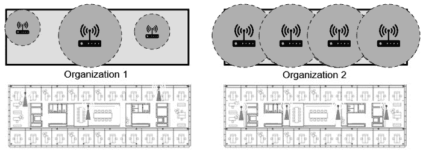

图 4.6：热图

无线足迹创建了组织内 AP 和热点的详细图表。通过将热图叠加到组织空间的基础建筑图上，就可以查看 AP 的位置以及死角和热点。

| 记住这个！现场调查检查无线环境以识别潜在问题区域。热图显示无线覆盖情况以及是否存在死角。无线足迹提供了组织内无线接入点、热点和死角的详细图表。 |
| --- |

## 接入点安装考量

在 AP 和无线设备上最常用的无线天线是全向（omni）天线。全向天线同时向所有方向传输和接收信号。这允许无线设备从任何方向连接到 AP。另一种类型的天线是定向天线。定向天线在单方向上传输并从同一方向接收信号。由于天线的功率集中在单一方向，定向天线的增益比全向天线大，并且它可以在更远的距离上传输和接收信号。

现场勘测的数据可以帮助管理员确定放置接入点（AP）的最佳位置。在部署 AP 后，管理员通常会再次进行现场勘测，以验证它们是否达到了预期的覆盖范围。

# 无线加密协议

由于无线网络通过空气广播，任何拥有无线收发器的人都可以拦截传输内容。在无线网络的早期，安全性是一个事后考虑的问题。因此，早期的无线加密协议如`有线传输隐私`（WEP`）和`Wi-Fi 保护访问`（WPA`）非常脆弱，攻击者很快就发现了利用它们的方法。`WEP` 和 `WPA` 已过时，不应继续使用。以下章节将讨论当前的无线加密协议。

## WPA2 和 CCMP

Wi-Fi 联盟开发了`第二代保护访问`（WPA2`）以取代更早的加密协议。`WPA2`（也称为 `IEEE 802.11i`）使用了强力加密协议，如`高级加密标准`（AES`）和`计数模式/CBC-MAC 协议`（CCMP`）。

尽管 `WPA2` 相比之前的无线加密技术提供了显著的安全性改进，但某些企业需要更强的安全性。你可以采取的另一个步骤是启用本章稍后描述的`企业模式`下的身份验证。

### 开放模式、PSK 和企业模式

`WPA2` 可以在`开放模式`、`预共享密钥`（`PSK`）或`企业模式`下运行。`开放模式`不使用任何安全防护。相反，所有数据都以明文形式传输，使得任何捕获数据的人都能轻松读取它。基本上，`开放模式`关闭了 `WPA2` 的所有安全功能！

使用 `PSK 模式`时，用户通过 `PSK` 或密码匿名访问无线网络。这并不能提供身份验证。提醒一下，身份验证是通过用户名和密码等凭据来证明用户的身份。用户用用户名声称身份，用密码证明身份。仅有密码而没有用户名仅提供了授权而未提供身份验证。

`企业模式`强制用户在获得无线网络访问之前使用唯一的凭据进行身份验证。`企业模式`使用 `802.1X` 标准，通常通过 `RADIUS` 服务器实现，该服务器访问账户数据库。如果用户没有正确的凭据，`企业模式`（使用 `802.1X` 服务器）将阻止其访问。此外，`802.1X` 服务器可以提供基于证书的身份验证以增加身份验证过程的安全性。身份验证协议（在本章稍后讨论）决定 `802.1X` 服务器是否将使用证书。

当你选择`企业模式`时，你需要输入三条信息：

* `RADIUS 服务器`。你输入分配给 `802.1X` 服务器的 IP 地址，这通常是一个 `RADIUS` 服务器。
* `RADIUS 端口`。你输入 `RADIUS` 服务器使用的端口。`RADIUS` 的官方默认端口是 `1812`。然而，某些厂商使用了其他端口，例如 `1645`。关键在于你在此输入的端口必须与服务器使用的端口相同。
* `共享密钥`。`共享密钥`类似于密码，你必须按照在 `RADIUS` 服务器上完全一致的内容在此输入。这与用户的密码不同。

在 `AP` 上配置 `WPA2 企业模式`后，`AP` 将所有连接尝试转发给 `RADIUS` 身份验证服务器。用户通过身份验证后，`RADIUS` 服务器告诉 `AP` 授予用户访问。

使用 `802.1X` 服务器的无线身份验证系统比大多数家庭网络所需的更高级，许多大型组织在使用它们。换句话说，大多数家庭网络使用 `PSK 模式`，但想要增加无线安全性的组织可能会使用 `企业模式`。`WPA2` 等安全协议与 `802.1X` 身份验证服务器的结合显著降低了攻击几率。请记住，`WPA2` 并不总是安全的，`开放模式`是不加密的，`企业模式`通过 `802.1X` 提供了安全性，`PSK` 模式`` `RADIUS````````企业模式`比 `个人模式`更安全。


# WPA3 和等效认证

`WPA3`和等效认证（`SAE`）现在广泛用于无线网络。这是最新的安全技术，它支持三种模式：


`增强开放模式` `WPA2` 的`不`它使用加密技术来保护未加密的通信。
`等效认证`（`SAE`）取代了`WPA2` 的`PSK` 模式。
`企业模式`在`WPA3` 中也支持`RADIUS` 服务器。

请记住！`WPA3` 使用`CCMP`（基于`AES`）取代了早期的加密协议。

# 身份验证协议

无线网络支持多种身份验证协议。许多协议基于`扩展身份验证协议`（`EAP`），这是一个提供通用身份验证方法的框架。`802.1X` 服务器通常使用这些方法来增加身份验证过程的安全性。此外，对于这些方法的一个关键点是它们是否支持或需要证书。某些方法：

*   `EAP`。`EAP` 为两个系统创建加密密钥的方法，即`对主密钥`（`PMK`）。系统然后使用`对传输密钥`（`PTK`）加密数据。`CCMP` 使用此密钥。
*   `保护 EAP`（`PEAP`）。`PEAP` 为`EAP` 提供了额外的保护。`EAP` 设计者假设`EAP` 将与物理的安全结合以确保通信通道是安全的。事实在操作中并非如此，但`PEAP` 通过将`EAP` 会话封装在`传输层安全`（`TLS`）隧道中来保护通信通道。`PEAP` 要求服务器上有证书，但客户端不需要。常见的实现是使用`微软握手身份验证协议版本 2`（`MS-CHAP2`）。
*   `EAP-FAST`。Cisco 设计了`通过安全隧道进行灵活身份验证`（`EAP-FAST`）作为`轻量级 EAP`（`LEAP`）的安全性替代方案。`EAP-FAST` 使用`保护访问凭据`（`PAC`）而不是证书。
*   `EAP-TLS`。`EAP 安全`（`EAP-TLS`）是最安全的`EAP` 标准之一。`PEAP` 和`EAP-TLS` 的主要区别在于`EAP-TLS` 要求`802.1X` 服务器和客户端都有证书。
*   `EAP-TTLS`。`EAP 隧道 TLS`（`EAP-TTLS`）是`EAP-TLS` 的扩展，允许系统在`TLS` 隧道中使用一些较旧的身份验证方法，如`密码认证协议`（`PAP`）。`EAP-TTLS` 要求服务器上有证书，但客户端不需要。
*   `RADIUS 联邦`。第二章“理解身份和访问管理”涵盖了用于单点登录（`SSO`）的联邦。提醒一下，联邦包括两个多个实体（例如公司），它们共享相同的身份管理系统。用户只需登录一次即可访问另一个实体的共享资源而无需再次登录。同样，可以使用`802.1X` 和`RADIUS` 服务器创建联邦。

请注意`EAP-FAST` 支持`PAC`（受保护访问凭据）而非证书。`PEAP` 和`EAP-TTLS` 要求服务器端拥有证书，但客户端不需要。`EAP-TLS` 则要求服务器和客户端都有证书。第 10 章“理解密码学和 PKI”将更深入地探讨证书，但作为介绍，证书有助于提供强身份验证和加密服务。证书机构（`CA`）必须发布证书，因此组织必须从公共`CA` 购买证书，或者在网络内部实现私有的`CA`。

# IEEE 802.1X 安全

第 3 章讨论了通过禁用未使用端口或使用 MAC 地址过滤来确保端口安全。另一种端口安全方法是使用`IEEE 802.1X`，这是一种基于端口的认证协议。它要求用户或设备在连接到特定的无线访问点或物理端口时进行认证。管理员可以在无线和有线网络中实现它，也可以与本章后面介绍的虚拟专用网络（`VPNs`）配合使用。`802.1X` 在客户端访问网络之前保护认证过程，并在客户端无法通过认证时阻止网络访问。`802.1X` 可以使用简单的用户名和密码进行认证，也可以使用证书进行基于证书的认证。

`802.1X` 服务器防止恶意设备连接到网络。考虑开放的`RJ-45` 墙上插座。尽管禁用它们是良好的端口安全实践，但你也可以配置`802.1X` 服务器要求这些端口进行认证。如果客户端无法通过认证，`802.1X` 服务器将阻止或限制其对网络的访问。

可以将`802.1X` 服务器与其他网络元素（如虚拟局域网`VLAN`）结合起来。例如，假设你想为访客提供 Internet 访问权限，但防止他们访问内部网络资源。你可以配置`802.1X` 服务器为授权客户端授予完全访问权限，但通过`VLAN` 将未授权的客户端重定向到网络的访客区域。

你可以通过以下方式实现`802.1X`：远程拨号认证服务（`RADIUS`）或`Diameter` 服务器，这将在本章后面部分讨论。这有助于在虚拟专用网络（`VPN`）客户端连接之前对其进行认证。你还可以在无线网络中实现`802.1X`，强制客户端在连接前进行认证。如果你想深入研究，`RFC 3580，“IEEE 802.1X 远程拨号认证服务使用指南”`详细描述了`802.1X`。

| 记住这一点！ | |
| :--- | :--- |
| 企业模式需要`802.1X` 服务器。 |
| `EAP-FAST` 支持`PAC`。 |
| `PEAP` 和`EAP-TTLS` 要求`802.1X` 服务器拥有证书。 |
| `EAP-TLS` 使用`TLS`，但要求`802.1X` 服务器和每个客户端都有证书。 |
| `802.1X` 服务器提供基于端口的认证，确保只有授权客户端可以连接，防止恶意设备连接。 |

# 控制器与访问点安全

在完成现场勘测并确定`APs` 的最佳位置后，物理安全也很重要。如果攻击者可以访问`AP`，就可以连接未经授权的设备来收集流量。此外，使用较新的加密协议如`WPA2` 和`WPA3` 是重要的。攻击者甚至可以将`AP` 重置为出厂设置。不应使用过时的无线协议如`WEP` 和`WPA`。

## 强制门户 (Captive Portals)

强制门户是一种技术解决方案，在允许使用器的器的访问网络之前，强制完成特定过程。组织通常将其作为热点，要求用户登录或同意条款。以下是三个常见示例：

*   **免费 Internet 访问：** 许多医院和其他医疗机构为患者和访客提供免费 Internet 服务。强制门户要求用户承认并遵守接受使用政策（`AUP`）。免费门户很少要求用户登录，而是要求他们勾选同意框并点击按钮继续。
*   **付费 Internet 访问：** 许多酒店、度假村、邮轮和航空公司提供按需付费的 Internet 服务。当用户尝试访问 Internet 时，会被重定向到强制门户。他们必须使用预创建账户登录或输入信用卡信息付费。
*   **`IEEE 802.1X` 的替代方案：** 添加`802.1X` 服务器可能价格昂贵，有时并非可行方案。组织可以使用强制门户作为替代方案，在授予访问权限前要求用户认证。

# 理解无线攻击

针对无线网络有多种已知攻击。使用强安全协议（如带有`CCMP` 的`WPA2` 或带有`SAE` 的`WPA3`）可以避免大多数攻击。相比之下，如果使用`TKIP`，`WPA` 会受到许多攻击。

### 取消攻击 (Disassociation Attacks)

取消攻击会将无线客户端从无线网络中移除。如果你了解无线设备和无线`APs` 的正常操作，就会更容易理解这种攻击。

无线客户端与无线`AP` 认证后，两个设备交换帧，使客户端关联。在任何时候，无线设备都可以向`AP` 发送取消帧以终止连接。该帧包含了无线客户端的`MAC` 地址。当`AP` 接收到取消帧时，它会释放连接内存。

在取消攻击中，攻击者使用伪造的受害者`MAC` 地址向`AP` 发送取消帧。`AP` 接收到帧后关闭连接。受害者现在断开了`AP`，必须再次通过认证过程重新连接。

有趣的是，某些酒店利用这种攻击防止客人使用自己的个人无线网络。例如，如果你有一个接入蜂窝移动网络的`iPhone`，你可以开启“个人热点”功能。这允许你与其他设备（如笔记本电脑）共享连接。某些酒店寻找这些个人无线网络并对其发动取消攻击。如果客户需要可靠的 Internet 访问，将被为酒店的无线服务付费。

### WiFi 安全设置 (Wi-Fi Protected Setup)

WiFi 安全设置（`WPS`）允许用户在不输入密码的情况下配置无线设备。相反，用户可以通过按下按钮或输入短 8 位个人识别码（`PIN`）来配置设备。

例如，用户可以通过按下`AP` 和无线设备上的按钮来配置新的无线设备。`AP` 将在约 30 秒内自动配置设备，无需其他操作。这些按钮可以是设备上的物理按钮，也可以是用户通过应用程序或网页点击的虚拟按钮。使用`PIN` 方法时，用户首先识别`AP` 上的 8 位`PIN`，然后在新的无线设备上输入该`PIN`。

遗憾的是，`WPS` 容易受到暴力破解。`WPS` 攻击会不断尝试不同的`PIN` 直到成功。例如，`Reaver` 是一个开源工具，允许攻击者在约 10 小时内发现`PIN`，通常速度更快。一旦发现`PIN`，它就可以发现`WPA2` 无线网络中的密码。然而，如果与`WPA3` 配合，`WPS` 是安全的。

安全专家建议在所有设备上禁用`WPS`。这通常可以通过`AP` 配置页面实现。

| **记住这一点！** 离散攻击（disassociation attack）可以有效地将无线客户端从无线网络中移除，强制其重新认证。WPS 允许用户通过输入八位 PIN 和/或按下设备上的按钮来配置无线设备。WPS 攻击会猜测所有可能的 PIN 直到找到正确的。它通常会在几小时内发现 PIN，并使用它发现密口密码。 |

## 非法接入点 (Rogue Access Point)

非法接入点（rogue AP）是指未经官方授权放置在网络中的接入点。它可能是员工为了绕过安全限制的，也可能是攻击者安装的。如果员工安装了非法接入点，该接入点未被妥善管理的概率更高，从而增加了网络的漏洞。这就是第 6 章“比较威胁、漏洞和常见攻击”中描述的影子 IT 示例。

广义地说，你可以将 rogue 理解为无赖之、骗子或恶棍。如果 rogue 是骗子或恶棍，那么非法接入点就不是管理员的朋友。你可能还会看到它们被称为伪造接入点，这同样清楚地表明它们不是合法的。

攻击者可能会将非法接入点连接到缺乏足够物理安全性的无线机房内的网络设备。该接入点充当嗅探器，捕获通过有线网络设备的流量，然后使用 AP 的无线功能广播这些流量。攻击者随后可以坐在停车场里捕获外泄的数据文件。数据外泄是指未经授权将数据从组织传输到攻击者控制的位置。

此外，攻击者还可能使用非法接入点连接到有线网络。其工作原理与普通用户通过无线网络连接到有线网络的方式相同。区别在于，攻击者配置了伪造接入点的所有安全设置，并可以将其用于恶意目的。

如果你发现未经授权的 AP，请尽快将其断开连接。当你发现任何攻击时，第一步是包含或隔离威胁。只需拔掉以太网线，就可以阻止未经授权的 AP 捕获网络流量。

## 恶性孪生 (Evil Twin)

恶性孪生（evil twin）是一个与合法接入点具有相同 SSID（或类似 SSID）的非法接入点。你可以将恶性孪生的 SSID 视为合法 AP SSID 的双胞胎。例如，许多公共场所（如咖啡馆、酒店和机场）提供免费 Wi-Fi。攻击者可以使用与公共 Wi-Fi 网络相同的 SSID 设置一个 AP，许多毫无防备的用户会连接到这个恶性孪生。

有些人发现很难区分非法接入点和恶性孪生。如果你将它们比作两对双胞胎，可能会更清楚。想象 Sherri 和 Terri 是同形双胞胎。以下哪项对她们的描述最准确？双胞胎还是姐妹？答案是双胞胎，因为这是最准确的描述。是的，她们是姐妹，但并非所有的姐妹都是双胞胎。

一旦用户连接到恶性孪生，无线流量将通过恶性孪生而不是合法 AP 传输。通常，攻击者会向用户展示虚假的登录页面以捕获用户名和密码。其他时候，他们只是简单的捕获连接中的流量（例如在网页文本框中输入的电子邮件或文本），并对其进行分析以检测他们可以利用的敏感信息。

虽然设置恶性孪生听起来很复杂，但实际上非常简单。攻击者可以将带有无线接入网卡的笔记本电脑配置为 AP。在它运行期间，攻击者看起来就像咖啡馆或机场候机区的其他用户一样。他们会打开笔记本电脑并似乎在工作，而你完全不知道他们正试图通过恶性孪生盗取你的凭据或其他个人数据。同样，攻击者可以在停车场或组织的另一个区域设置，并试图欺骗员工或访客。

管理员通常会使用无线扫描仪进行现场调查。除了检测频段上的噪声外，他们还可以检测非法 AP，包括恶性孪生。现场调查可以帮助他们识别接入点的物理位置，因为随着管理员距离越来越近，信号会变强。

| **记住这一点！** 非法接入点经常被用于数据外泄。恶性孪生是使用合法接入点相同 SSID（或类似 SSID）的非法接入点。 |

## 干扰攻击 (Jamming Attacks)

干扰攻击攻击者可以在无线网络使用的频率上发射噪声或另一种无线信号。这会干扰无线传输并严重降低性能。这种拒绝服务攻击通常被称为干扰，它可以阻止所有用户连接到无线网络。在某些情况下，干扰会导致用户失去与 AP 的连接并强制其重新连接。你可以增加信号功率。另一种克服攻击的方法是使用不同的频道。

## IV 攻击 (IV Attacks)

初始化向量（IV）是加密系统使用的一个数字，IV 攻击尝试在首先发现 IV 后获取预共享密钥。某些无线协议通过将 IV 与预共享密钥相结合来加密数据。当加密系统重用相同的 IV 时，IV 攻击可以很容易发现 IV。例如，早期无线安全协议 WEP 使用较小的 24 位数字作为 IV。这种小的 IV 导致了无线网络重用密钥，使得 WEP 容易破解。

在许多 IV 攻击中，攻击者使用包注入技术向数据流添加额外的包。AP 返回更多的包，增加了重用密钥的可能性。使用包注入的 IV 攻击缩短了破解 WEP 密钥的时间。值得注意的是，WEP 已废弃，不应使用。

## 近场通信攻击 (Near Field Communication Attacks)

近场通信（NFC）是移动设备上一组标准，允许它们在靠近其他设备时进行通信。例如，你可以与朋友分享照片、联系人或其他数据。一个人分享数据，在手机靠近后，另一个人选择进行下载。

许多销售点读卡器支持支持 NFC 技术的信用卡。与其刷卡或插入芯片读取数据，你只需将卡片置于读卡器上方。这通常被宣传为非接触式支付方式。某些手机应用程序支持支持 NFC 的手机进行支付。用户将手机在过读卡器上方进行支付。

在近场通信攻击中，攻击者使用 NFC 读器从另一个 NFC 设备中捕获数据。一种方法是窃听攻击。NFC 读器使用天线增强其范围并拦截两个设备之间的数据传输。例如，想象 Marge 在商店购物，而 Bart 带着自己的 NFC 读器在她身后。如果 Bart 能够增强其 NFC 读器的接收范围，他就可以捕获 Marge 的交易。NFC 攻击的主要迹象是信用卡账单上的未经授权的费用。

## RFID 攻击 (RFID Attacks)

无线频率识别 (`RFID`) 系统包含一个`RFID` 读器和放置在物体上的`RFID` 标签。它们用于跟踪和管理库存以及任何类型的贵重资产，包括物体和动物。

目前有几乎无穷尽的标签可用于多种用途。这包括植入动物体内的标签、任何类型产品的包装（如计算机）、药品、运输系统（如集装箱、铁路货运汽车和巴士）以及受控物质（如药品容器）。某些标签仅比米粒略大一点。

主动式`RFID` 标签自带电源，而被动式`RFID` 标签则包含电子设备，使其能够收集并使用功率来传输存储在设备上的数据。这类似于近距离卡（在第 9 章“实施保护资产的控制”中描述）从近距离卡读器接收电荷，然后将数据传输给读器。不同之处在于，`RFID` 发射器发送和接收标签的距离比近距离读器远得多。一些常见的`RFID` 攻击包括：

*   `Sniffing` 或 `edropping`。由于`RFID` 通过空气传输数据，攻击者可以通过监听来收集数据。一个关键要求是知道`RFID` 系统的频率并有一个调到该频率的接收器。攻击者还需要知道`RFID` 系统用于解释数据所使用的协议。
*   `RFID Cloning`。成功的窃听攻击允许攻击者进行克隆攻击。例如，攻击者可以配置一个虚假标签来模仿附在贵重物体上的标签。然后攻击者就可以偷走贵重物体，而不会被轻易察觉。
*   `denial-of-service (DoS)` 攻击试图中断服务。如果攻击者知道`RFID` 系统的频率，就可以启动干扰或阻塞攻击，用噪声淹没该频率。这会导致`RFID` 系统无法正常运行。

## 蓝牙攻击

`Bluetooth` 是一种用于个人局域网 (`PANs`) 和网络内部的短距离无线系统。`PAN` 是一个靠近单个人的设备网络。`Bluetooth` 设备包括智能手机、耳机和计算机设备。

`Bluetooth` 范围最初设计为约 10 米（约 30 英尺），但范围通常更远，并最终超出了个人的私人空间。攻击者已经发现了利用这些网络的方法。一些常见的攻击是`bluejacking`、`bluesnarfing` 和`bluebugging`：

*   `Bluejacking` 是向附近的`Bluetooth` 设备发送未经请求的消息的行为。`Bluejacking` 消息通常是文本，也可以是图像或声音。`Bluejacking` 相对无害，但在用户开始收到消息时会造成一些困扰。
*   `Bluesnarfing` 指对`Bluetooth` 设备的未经授权访问或信息信息。`bluesnarfing` 攻击可以访问信息，例如电子邮件、联系人列表、日历和短信。
*   `Bluebugging` 类似于`bluesnarfing`，但更进一步。除了获得手机的完全访问权限外，攻击者还安装了后门。攻击者可以让手机随时拨打攻击者，允许攻击者窃听房间内的对话。攻击者还可以窃听电话、启用呼叫转移、发送消息等。

当`Bluetooth` 设备首次配置时，它们处于`Discovery` 模式。`Bluetooth` 设备使用`MAC` 地址，在`Discovery` 模式下，`Bluetooth` 设备会广播其`MAC` 地址，允许其他设备看到并连接它。这在配对`Bluetooth` 设备时是必须的。

在早期版本的`Bluetooth` 中，此配对过程可以随时发生。然而，`Bluetooth` 设备仅在首次配置时处于`Discovery` 模式。此外，如果用户手动配对设备，它仍然容易受到这些攻击的影响。

记住！`Bluejacking` 是向附近的`Bluetooth` 设备发送未经请求的消息的行为。`Bluejacking` 消息通常是文本，也可以是图像或声音。`Bluesnarfing` 指对`Bluetooth` 设备的未经授权访问或信息信息。`Bluebugging` 类似于`bluesnarfing`，但更进一步。

## 无线重放攻击

在`replay attack` 中，攻击者捕获两个实体之间传输的数据，对其进行修改，然后尝试仿充其中一方。第 7 章“防止高级攻击”涵盖了重放攻击。然而，`WPA2` 和`WPA3` 能够抵抗重放攻击。

## 汽车巡游与空中巡游

`War driving` 是寻找易漏洞无线网络的行为。虽然`war driving` 在汽车中更常见，但你同样可以通过在大城市中行走来这样做。攻击者使用定向天线来发现信号弱的无线网络。

管理员有时将`war driving` 作为`wireless audit` 的一部分。`wireless audit` 是一种侦测控制手段，检查信号足迹、天线放置和无线流量的加密情况。这些审计对于检测无线网络中的缺陷非常有用。

`War flying` 类似于`war driving`。然而，人们不是步行或开车，而是乘坐私人飞机飞行。在某些情况下，人们在 2500 英尺的高度截获了无线传输。这些传输大部分使用`2.4 GHz`，其传输距离比`5-GHz` 长。此外，接入点与飞机之间没有多少干扰。然而，飞机由于飞行会迅速离开接入点的范围。

飞机的替代品是`drone`。无人机的技术定义是任何在无人控制的情况下自主飞行的飞机。然而，人们通常认为`drone` 是任何由遥控而非现场飞行员控制的飞机。通过添加一些硬件，`drone` 可以寻找无线网络。

攻击者还可以利用`drones` 进行侦察。第 8 章在渗透测试的范围内讨论了侦察。测试人员使用各种方法收集目标系统的信息。他们还可以使用`drones` 拍摄目标照片并扫描无线网络。

记住！管理员使用`war driving` 技术作为`wireless audit` 的一部分。`wireless audit` 检查无线信号足迹、功率水平、天线放置和无线流量的加密。使用`war driving` 进行无线审计可以检测非法接入点并识别未经授权的用户。`War flying` 与`war driving` 相似，但使用的是飞机或无人机。

## 使用 VPN 进行远程访问

虚拟专用网络 (`VPN`) 通常用于远程访问。远程访问`VPN` 允许用户通过公共网络访问私有网络。公共网络通常是互联网，也可以是电信公司的半私用租线路。由于电信公司通常会将同一条物理线路租给几家公司，因此租线路并不是真正的私有。

通过公共网络进行访问是 VPN 的核心安全关注问题。随着越来越多的人居家办公并通过直接访问 VPN 连接到公司网络，这些 VPN 已经成为一种流行的攻击向量。不同的隧道协议对流量进行封装和加密，以保护数据免受未经授权的泄露。隧道防止任何人读取通过其传输的数据。

## VPN 与 VPN 集中器

可以通过在服务器上启用服务来创建 VPN。例如，如果你有一台 Windows 服务器，可以启用`Direct Access VPN` 角色并配置`Routing and Remote Access` 控制台。该服务器可能具有一个或两个网络接口卡（`NICs`）。在存在两个`NICs` 的情况下，一个`NIC` 可以从互联网访问，而第二个`NIC` 则提供对私有网络的访问。如果你仅支持少数 VPN 客户端，这可能是完美的解决方案。

较大的组织通常会使用 VPN 集中器，这是一种用于 VPN 的专用设备。VPN 集中器包含了创建 VPN 所需的所有服务，包括强加密和身份验证技术，并且它支持许多客户端。

| 记住这一点！ | 虚拟私有网络（VPN）通过公共网络提供对私有网络的远程访问。VPN 集中器是用于 VPN 的专用设备。它们包含了创建支持许多客户端的安全性 VPN 所需的所有服务。 |
| --- | |

使用 VPN 集中器时，你通常将其放置在受保护子网中。互联网和受保护子网之间的防火墙会将 VPN 流量转发到 VPN 集中器。VPN 集中器会将所有私有 VPN 流量路由到受保护子网与内网之间的防火墙。

## 远程访问 VPN

图 4.7 显示了用户如何从远程位置连接到内部网络的示例。你可能会将其被称为远程访问 VPN 或直接访问 VPN。VPN 客户端首先使用宽带连接通过互联网服务提供商（`ISP`）连接互联网。连接后，VPN 客户端即可发起 VPN 连接。

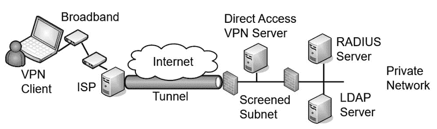

图 4.7：连接到 VPN 服务器

VPN 服务器位于受保护子网中，可以通过公共 IP 地址访问。这使得从互联网上的任何其他主机都可以访问。VPN 服务器需要对客户端进行身份验证，一种常用方法是使用内部远程认证拨号用户服务（`RADIUS`）服务器。当用户登录时，VPN 服务器会将用户的凭据发送给`RADIUS` 服务器。

虽然`RADIUS` 服务器可能拥有用户和密码数据库，但更常见的方法是将其凭据传递给另一个服务器进行验证。例如，在身份验证过程中，`RADIUS` 服务器可以将凭据传递给轻级目录访问协议（`LDAP`）服务器。在微软域中，`LDAP` 服务器是域控制器。

## 作为隧道协议的 IPsec

第 3 章介绍了互联网协议安全（`IPsec`）作为一种传输数据加密的方法。IPsec 支持`Tunnel mode`（隧道模式）和`Transport mode`（传输模式）。

隧道模式加密整个 IP 数据包，包括负载和数据包头，VPN 通常使用`Tunnel mode`。数据包头包含 IP 地址和 MAC 地址。使用`Tunnel mode` 的一个处是内部网络内使用的 IP 地址经过了加密，任何拦截流量的人都无法看到。如果攻击者拦截了流量，他们可以看到来自客户端的源 IP 地址和指向 VPN 服务器的目标地址。

传输模式仅加密 IP 数据包的负载，而不加密头。这种模式通常用于主机到机的通信。IPsec 提供了两种安全方式：

*   身份验证：IPsec 包含认证头（`AH`）。`AH` 使用协议`51`。
*   加密：IPsec 包含封装负载（`ESP`）。`ESP` 使用协议`50`。

### 作为隧道协议的 SSL/TLS

某些隧道协议使用传输层安全（`TLS`）来保护通道。例如，安全套接隧道协议（`SSTP`）通过`443` 加密 VPN 流量。使用`443` 提供了很大的活性，且很少需要开启额外的端口。在不存在 NAT 时，这是一个有效的替代方案。`OpenVPN` 和`OpenConnect` 是可以使用`TLS` 的两个开源应用程序。

虽然也可以使用安全套接层（`SSL`），但`SSL` 有已知的缺陷，`TLS` 是指定的替代方案。

## 分隧道与全隧道

想象 Lisa 使用她家中的电脑通过`IPsec` 连接到公司 VPN 服务器。VPN 使用`ESP`，因此隧道中的所有流量都是加密的。现在，Lisa 想进行搜索。她的电脑会直接连接到互联网进行搜索吗？还是她的电脑会通过 VPN 服务器建立连接？这取决于 VPN 的配置。

在分隧道中，VPN 管理员决定哪些流量应该使用加密隧道。例如，可以配置隧道仅加密发往私有 IP 地址的流量。如果 Lisa 在配置为分隧道模式的情况下使用 VPN 服务器进行互联网搜索，她的互联网搜索流量将不会通过加密隧道。相反，她的搜索将通过她的`ISP` 直接到达互联网网站。

在全隧道中，当用户连接到 VPN 时，所有流量都通过加密隧道传输。如果 Lisa 连接到 VPN，然后尝试连接到公共网站，流量将首先通过加密隧道，然后从私有网络内部输出到公共网站。

| 请记住！`IPsec` 是一种用于 VPN 的安全加密协议。`封装安全载荷` (`ESP`) 为 VPN 流量提供机密性、完整性和身份验证。`IPsec` 在 VPN 流量中使用`Tunnel mode`（隧道模式），并能通过协议 ID`50` 识别为`ESP`。它在端口`500` 上使用`IKE`。全隧道在用户连接到 VPN 后加密所有流量。分隧道则仅加密发往 VPN 私有网络的流量。 |
| --- |

## 点对点 VPN (Site-to-Site VPNs)

点对点 VPN 包含两个 VPN 服务器，它们作为地理上分离的两个网络的网关。例如，一个机构可以有两个地点：一个是总部，另一个是远程办事处。它可以使用两个 VPN 服务器作为网关将这两个地点连接起来，如图 4.8 所示。

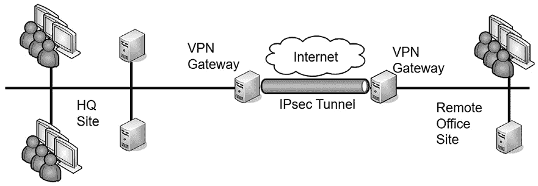

图 4.8: 点对点 VPN

点对点模型的优势在于它它连接了两个网络，而不需要用户执行额外步骤。远程办事处的用户可以轻松连接到总部的服务器，就像服务器就在远程办事处一样。连接到远程服务器可能比连接到本地服务器慢，但在其他情况下，对终端用户是透明的。

相比之下，在传统的远程访问 VPN（也称为主机到网关模型）中，终端用户直接连接到 VPN 服务器，并且对该过程非常清楚。

## 始终连接 VPN (Always-On VPN)

某些 VPN 是始终连接的 VPN。它们可以同时用于点对点 VPN 和直接访问 VPN。当与点对点 VPN 使用时，两个 VPN 网关会维持 VPN 连接。相比之下，某些点对点 VPN 使用按需连接。只有在需要时（例如用户连接到远程系统时）才会建立 VPN 连接。

几家供应商为直接访问 VPN 提供了始终连接 VPN。它们尝试在用户设备连接到 Internet 时立即创建 VPN 连接。对于家庭用户来说，这可能发生在用户开启台式 PC 或笔记本电脑之后立即。

在移动设备（如手机手机）上配置时，只要设备连接到 Internet 连接，设备就会随时连接到始终连接的 VPN。例如，如果用户访问带有免费 Wi-Fi 的咖啡馆并连接到网络，设备将自动连接到始终连接的 VPN。

## 作为隧道协议的 L2TP

二层隧道协议 (`L2TP`，Layer 2 Tunneling Protocol）是一种也用于 VPN 的隧道协议。最新版本是`L2TPv3`。然而，`L2TP` 的所有版本都不提供任何加密，因此它不会单独用于 VPN 流量。相反，数据使用另一种协议（如`IPsec`）进行加密，然后传递给`L2TP` 在 VPN 上进行传输。

## HTML5 VPN 门户

某些网络设备包含配置 HTML5 VPN 门户的功能。HTML5 VPN 允许用户使用网络浏览器连接到 VPN，这对于用户来说非常简单。它使用`TLS` 加密会话，但可能会非常消耗资源。通常，机构使用它来让一两个用户访问有限资源。例如，如果一个顾问管理 IP 语音 (`VoIP`) 私有分机交换机 (`PBX`)，机构可以使用 HTML5 VPN 让该顾问访问`PBX`。然而，其他员工将使用传统的 VPN 进行远程访问。

## 网络访问控制 (Network Access Control)

允许远程访问您的私有网络可能会使您的网络面临来自客户端的许多风险。如果用户使用受恶意软件感染的计算机登录 VPN，这台计算机就可以感染内部网络上的其他计算机。网络访问控制 (`NAC`) 方法通过检查计算机并在其未通过检查时阻止其访问网络，提供持续的安全监控。

大多数管理员对其网络中的计算机具有完全的控制权。例如，他们可以确保台式计算机安装了最新的防杀病毒软件，操作系统已应用了当前的补丁，并启用了防火墙。然而，管理员对员工在家里或在途中使用的计算机没有完全的控制权。

`NAC` 为这些其他计算机提供了一种控制措施。它确保客户端在访问网络之前符合预设的特征。`NAC` 系统通常使用“健康”作为比喻，表示客户端符合这些预设特征。就像医生可以隔离患某些疾病的患者一样，`NAC` 可以隔离或排除不符合预定义`NAC` 条件的不健康客户端。

### 主机健康检查 (Host Health Checks)

管理员为健康客户端设置预定义条件，满足这些预设条件的客户端可以访问网络。`NAC` 系统会隔离不符合条件的计算机。`NAC` 检查的常见健康状况包括：

* 客户端的防火墙已启用。
* 客户端的操作系统是最新的，并包含所有当前的补丁和修复。
* 客户端的防杀病毒软件是最新的，并包含所有更新的签名定义。

`NAC` 系统使用身份验证代理（有时称为健康代理）来检查`NAC` 客户端。这些代理是应用程序或服务，用于检查不同的计算机状况并将状态记录在健康状况中。当客户端连接到受`NAC` 控制的网络时，代理会报告`NAC` 客户端的健康状态。

| 请记住！网络访问控制 (`NAC`) 包含了检查客户端健康状况的方法（例如具有最新的防杀病毒软件），并可以限制不健康客户端访问修复网络。你可以将`NAC` 用于 VPN 客户端和内部客户端。 |
| --- |

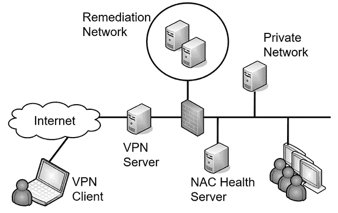

图 4.9: 使用网络访问控制

考虑图 4.9。当 VPN 客户端访问网络时，VPN 服务器查询`NAC` 服务器以确定健康条件。VPN 服务器还会查询客户端的健康状况。如果客户端满足所有健康要求，`NAC` 系统允许客户端访问网络。

然而，如果客户端不满足`NAC` 强制要求的健康条件，VPN 服务器会将客户端重定向到修复网络（也称为隔离网络）。修复网络包含了客户端可以使用以恢复健康的资源。例如，它包含当前批准的补丁、防杀病毒软件和更新的病毒签名。客户端可以使用这些资源改善健康状况，然后尝试再次网络。

虽然`NAC` 可以检查 VPN 客户端的健康状况，你也可以用它检查内部客户端的健康状况。例如，内部计算机可能会错过补丁并产生漏洞。`NAC` 将检测未打补丁的系统并隔离。如果你使用此功能，检测的准确性至关重要。`NAC` 系统的误报可能会隔离健康的客户端并阻止其访问网络。

同样，你的机构可能允许访客或员工将移动电脑接入墙插座以获取连接，或连接到无线网络。`NAC` 会检查客户端，如果它们不符合健康条件，可能允许通过网络访问 Internet，但与其他任何网络活动保持隔离。

## 代理与无代理 NAC (Agent Versus Agentless NAC)

客户端上的代理可以是永久的或临时的。永久代理（有时称为持久`NAC` 代理）安装在客户端上并驻留在客户端上。当客户端尝试远程登录时，`NAC` 会使用该代理。

可解析性代理（dissolvable agent）在客户端远程登录时会被下载并运行在客户端上。它收集所需信息，识别客户端是健康还是不健康，并将状态报告回 NAC 系统。某些可解析性 NAC 代理在向 NAC 系统报告状态后会立即自删除。另一些则在远程会话结束后自删除。许多 NAC 厂商将可解析性代理称为无代理能力（agentless capability），尽管这在某种程度上是一个不准确的说法。NAC 仍然在使用代理来检查客户端，但并没有在客户端上安装该代理。

无代理 NAC 系统通过远程扫描客户端，而无需在客户端上永久或临时地安装代码。这类似于漏洞扫描器扫描网络系统以寻找漏洞的方式。第 8 章将更深入地探讨漏洞扫描器。

# 身份验证与授权方法

实施 VPN 的一个重要步骤是确保只有经过授权的实体才能访问。授权始于身份验证，VPN 支持多种身份验证方法。以下章节描述了若干远程访问验证方法。

## PAP

密码验证协议（`PAP`）与点点协议（`PPP`）配合用于对客户端进行身份验证。`PAP` 的一个主要缺陷是它在网络上以明文发送密码，这构成了重大的安全风险。

`PPP` 主要用于拨号连接。信不由，曾几何有一段时间，人们认为有人窃听电话的想法是相当遥远的。由于这个原因，安全性在`PPP` 中是事后考虑的。如今，由于密码以明文传输或与提供加密的另一种协议配合使用，`PPP` 仅作为最后的选择使用。

## CHAP

挑战握手身份验证协议（`CHAP`）同样使用`PPP` 并对远程用户进行身份验证，但它比`PAP` 更安全。`CHAP` 的目标允许客户端在公共网络（如电话或互联网）上传输凭据，而不会允许攻击者拦截数据并在稍后将其用于攻击。

客户端和服务器都知道一个身份验证过程中使用的共享密钥（如密码）。然而，客户端不会像`PAP` 那样通过网络以明文发送共享密钥。相反，客户端在将共享密钥与服务器提供的`nonce`（临时随机数）结合后对其哈希处理。这种握手过程用于客户端最初尝试连接服务器时，以及连接过程中的不同时间点。

| 记住这个！|`PAP` 身份验证使用密码。一个主要缺陷是`PAP` 在网络上以明文发送信息，使其容易受到嗅探攻击。`CHAP` 比`PAP` 更安全，因为`CHAP` 不在网络上以明文发送密码。 |
| --- |

## RADIUS

远程认证拨号用户服务（`RADIUS`）是一种集中身份验证服务。不需要每个单独的 VPN 服务器都需要单独数据库来识别谁可以身份验证，VPN 服务器会将身份验证请求转发到中央`RADIUS` 服务器。`RADIUS` 还可以作为带有`WPA2` 或`WPA3` 企业模式的`802.1X` 服务器（在本章较早部分描述）。

假设你的公司在弗吉尼亚州海滩、亚特兰大和芝加哥设有分支。每个地点都有一个用户可以访问的 VPN 服务器。Bart 是一名推销员，可以连接到这些 VPN 服务器中的任何一个。在输入销售数据时，他连接到亚特兰大 VPN。当为移动设备使用公司赞助的始终连接 VPN 时，他连接到弗吉尼亚州海滩 VPN 服务器。Bart 有一个访问所有公司资源的账户，今天，他被提示更改密码。

如果每个 VPN 服务器都有一个带有 Bart 用户名和密码的独立数据库，那么这些数据库每一个都必须更新。这可能非常耗费精力并导致不必要的错误。

然而，公司可以使用集中的`RADIUS` 服务器，如图 4.10 所示。每个 VPN 服务器都配置了一个共享密钥（如密码），而`RADIUS` 服务器则为每个 VPN 服务器配置了匹配的共享密钥。


图 4.10: RADIUS 配置

每个 VPN 服务器都配置了一个共享密钥（如密码），而`RADIUS` 服务器则为每个 VPN 服务器配置了匹配的共享密钥。这是一个中心化的身份验证服务。而不是每个单独的 VPN 服务器都需要一个独立的数据库来识别谁可以身份验证，VPN 服务器会将身份验证请求转发到中央`RADIUS` 服务器。`RADIUS` 还可以作为带有`WPA2` 或`WPA3` 企业模式的`802.1X` 服务器（在本章较早部分描述）。

假设你的公司在弗吉尼亚州海滩、亚特兰大和芝加哥设有分支。每个地点都有一个用户可以访问的 VPN 服务器。Bart 是一名推销员，可以连接到这些 VPN 服务器中的任何一个。在输入销售数据时，他连接到亚特兰大 VPN。当为移动设备使用公司赞助的始终连接 VPN 时，他连接到弗吉尼亚州海滩 VPN 服务器。Bart 有一个访问所有公司资源的账户，今天，他被提示更改密码。

如果每个 VPN 服务器都有一个带有 Bart 用户名和密码的独立数据库，那么这些数据库每一个都必须更新。这可能非常耗费精力并导致不必要的错误。

然而，公司可以使用集中的`RADIUS` 服务器，如图 4.10 所示。每个 VPN 服务器都配置了一个共享密钥（如密码），而`RADIUS` 服务器则为每个 VPN 服务器配置了匹配的共享密钥。

这是一个中心化的身份验证服务。而不是每个单独的 VPN 服务器都需要一个独立的数据库来识别谁可以身份验证，VPN 服务器会将身份验证请求转发到中央`RADIUS` 服务器。`RADIUS` 还可以作为带有`WPA2` 或`WPA3` 企业模式的`802.1X` 服务器（在本章较早部分描述）。

这是一个中心化的身份验证服务。而不是每个单独的 VPN 服务器都需要一个独立的数据库来识别谁可以身份验证，VPN 服务器会将身份验证请求转发到中央`RADIUS` 服务器。`RADIUS` 还可以作为带有`WPA2` 或`WPA3` 企业模式的`802.1X` 服务器（在本章较早部分描述）。

这是一个中心化的身份验证服务。而不是每个单独的 VPN 服务器都需要一个独立的数据库来识别谁可以身份验证，VPN 服务器会将身份验证请求转发到中央`RADIUS` 服务器。`RADIUS` 还可以作为带有`WPA2` 或`WPA3` 企业模式的`802.1X` 服务器（在本章较早部分描述）。

这是一个中心化的身份验证服务。而不是每个单独的 VPN 服务器都需要一个独立的数据库来识别谁可以身份验证，VPN 服务器会将身份验证请求转发到中央`RADIUS` 服务器。`RADIUS` 还可以作为带有`WPA2` 或`WPA3` 企业模式的`802.1X` 服务器（在本章较早部分描述）。

这是一个中心化的身份验证服务。而不是每个单独的 VPN 服务器都需要一个独立的数据库来识别谁可以身份验证，VPN 服务器会将身份验证请求转发到中央`RADIUS` 服务器。`RADIUS` 还可以作为带有`WPA2` 或`WPA3` 企业模式的`802.1X` 服务器（在本章较早部分描述）。

这是一个中心化的身份验证服务。而不是每个单独的 VPN 服务器都需要一个独立的数据库来识别谁可以身份验证，VPN 服务器会将身份验证请求转发到中央`RADIUS` 服务器。`RADIUS` 还可以作为带有`WPA2` 或`WPA3` 企业模式的`802.1X` 服务器（在本章较早部分描述）。

这是一个中心化的身份验证服务。而不是每个单独的 VPN 服务器都需要一个独立的数据库来识别谁可以身份验证，VPN 服务器会将身份验证请求转发到中央`RADIUS` 服务器。`RADIUS` 还可以作为带有`WPA2` 或`WPA3` 企业模式的`802.1X` 服务器（在本章较早部分描述）。

这是一个中心化的身份验证服务。而不是每个单独的 VPN 服务器都需要一个独立的数据库来识别谁可以身份验证，VPN 服务器会将身份验证请求转发到中央`RADIUS` 服务器。`RADIUS` 还可以作为带有`WPA2` 或`WPA3` 企业模式的`802.1X` 服务器（在本章较早部分描述）。

这是一个中心化的身份验证服务。而不是每个单独的 VPN 服务器都需要一个独立的数据库来识别谁可以身份验证，VPN 服务器会将身份验证请求转发到中央`RADIUS` 服务器。`RADIUS` 还可以作为带有`WPA2` 或`WPA3` 企业模式的`802.1X` 服务器（在本章较早部分描述）。

（下文：翻译）

尽管 Cisco 创建了 TACACS+，它可以与 Kerberos 交互。这允许 Cisco VPN 集中器与 Microsoft Active Directory 环境交互。作为提醒，Microsoft Active Directory 使用 Kerberos 进行身份验证。在访问路由器或交换机的配置页面之前，可以使用 TACACS+ 作为网络设备的身份验证服务。TACACS+ 默认加密整个身份验证过程，并使用多次握手和响应。

（注：此处原文存在多处重复段落，已根据要求去除了重复内容的翻译逻辑。）

# 第 4 章考试考点复习

在准备考试时，请确保你理解本章涵盖的核心概念。

## 探索高级安全设备

*   入侵检测系统（`IDSs`）和入侵防御系统（`IPSs`）使用与协议分析器相同的功能检查流量。

*   基于主机入侵检测系统（`HIDS`）可以检测针对工作站和服务器等本地系统的攻击。`H` 监控主机上的本地资源，并检测某些传统杀病毒软件无法检测的恶意软件。基于网络入侵检测系统（`NIDS`）检测网络攻击。

*   基于特征码的 IDS 或 IPS 使用特征码来检测已知的攻击或漏洞。
*   基于趋势的 IDS（也称为基于异常的 IDS）需要一个基准，并根据异常情况或流量超出预期范围来检测攻击。
*   误报（False positive）是指在没有攻击发生的情况下，错误地触发警报并显示存在攻击。误报会增加管理员的工作负量。漏报（False negative）是指攻击正在进行，但未被报告。
*   IPS 与主动 IDS 类似，不同之处在于被部署在流量的链路中（有时称为带内模式），并可以在攻击到达内部网络之前将其拦截。IPS 可以主动监控数据流，检测恶意内容并防止其到达网络。相比之下，IDS 是带外且且被被的。
*   IDS 和 IPS 还可以保护内部私有网络，例如私有的监视控制和数据采集（SCADA）网络。
*   蜜罐（Honeypots）和蜜网（Honeynets）看起来具有有价值的数据，并试图将攻击者从活动网络中引开。安全人员利用它们来欺骗攻击者、干扰攻击并观察攻击者当前的攻击方法。蜜罐文件（Honeyfile）是一种旨在吸引攻击者注意的文件。蜜罐令牌（Honeytokens）是插入数据库的伪记录，用于检测数据窃取。

## 安全无线网络

*   无线接入点（APs）将无线客户端连接到有线网络。
*   服务集标识符（SSID）是无线网络的名称。禁用 SSID 广播可以向普通用户隐藏无线网络。
*   你可以使用介质访问控制（MAC）过滤限制对无线网络的访问。然而，攻击者可以发现授权的 MAC 地址并伪造授权的 MAC 地址。
*   场地调查（Site survey）检查无线环境以识别潜在的问题区域。无线足纹识别（Wireless footprinting）使用热图为您提供组织内部无线接入点、热点和死角的详细图表。
*   Wi-Fi 分析器显示各个单个无线频率通道上的信号强度。
*   WPA2 使用带有 CCMP 的 AES，并支持开放模式、预共享密钥（PSK）模式和企业模式。
*   企业模式比个人模式更安全，因为它增加了身份验证。它使用实现为`RADIUS` 服务器的`802.1X` 身份验证服务器。
*   WPA3 使用同步等身份验证（SAE）代替`PSK`。WPA3 支持企业模式，类似于 WPA2 企业模式。
*   开放模式不使用`PSK` 或`802.1X` 服务器。许多热点在为客户提供免费无线接入时使用开放模式。WPA3 提供了一种使用加密的安全的开放模式，而较早的协议提供的开放模式是不安全的，容易被窃听。
*   `802.1X` 服务器使用扩展身份验证协议（EAP）的版本之一，例如保护的 EAP（`PEAP`）、隧道传输层安全（`EAP-TTLS`）、`EAP-TLS` 或通过安全隧道进行灵活的身份验证（`EAP-FAST`）。
*   最安全的 EAP 方法是`EAP-TLS`，它要求服务器和每个客户端上都有证书。`PEAP` 和`EAP-TTLS` 要求服务器上有证书，但对客户端则不需要。
*   `802.1X` 服务器使用基于端口的身份验证提供强大的端口安全。它通过确保只有授权的客户端才能连接，从而防止非法设备连接到网络。
*   强制门户（Captive portal）强制无线客户端在获得网络访问权限之前完成流程，例如确认策略或支付访问费用。

## 理解无线攻击

*   解除关联攻击（Disassociation attack）可以有效地将无线客户端从无线网络中移除，强制无线客户端重新身份验证。
*   Wi-Fi 安全设置（WPS）允许用户通过按按钮或输入短 PIN 码来轻松配置无线设备。`WPS` 在配合`WPA2` 时是不安全的。`WPS` 攻击可以在几小时内发现 PIN 码，然后使用该 PIN 码发现密码。然而，WPA3 阻止了 WPS 攻击。
*   伪造接入点（Rogue AP）是未经官方授权放置在网络中的接入点。恶性孪生（Evil twin）是与合法接入点具有相同或相似`SSID` 的非法接入点。
*   干扰攻击（Jamming attack）向无线频率中充入噪声，阻塞无线流量。
*   初始化向量（`IV`）攻击尝试发现`IV` 并使用它来发现密码。
*   近场通信（`NFC`）攻击使用`NFC` 读取器从移动设备中读取数据。
*   射频识别（`RFID`）攻击包括窃听、重放和拒绝服务（DoS）。
*   蓝牙攻击（Bluejacking）向手机发送未经请求的消息。蓝牙嗅取（Bluesnarfing）是对蓝牙设备的未经授权访问或信息信息。将设备放置在当法拉笼的导电金属箱中可以阻止蓝牙攻击。
*   在无线重放攻击中，攻击者捕两个实体之间发送的数据，对其进行修改，然后通过重放数据来冒充一方。WPA2 和 WPA3 能够抵抗无线重放攻击。

## 使用 VPN 进行远程访问

*   虚拟专用网络（`VPN`）通过公共网络（如互联网）访问私有网络。
*   `IPsec` 是常用于`VPN` 的常用隧道协议，它可以保护隧道内的流量。`IPsec` 使用身份验证头（`AH`）提供身份验证和完整性。封装安全载荷（`ESP`）加密 VPN 流量并提供机密性、完整性和身份验证。
*   `IPsec` 隧道模式加密内部网络使用的整个 IP 数据包。`Ipsec` 传输模式仅加密负载，通常用于私有网络，但不用于 VPN。
*   全隧道（Full tunnel）在用户连接到`VPN` 后加密所有流量。分隧道（Split tunnel）仅加密发往 VPN 私有网络的流量。
*   站点到 VPN（Site-to-site VPNs）提供网络之间的安全访问。这些可以是按需的 VPN 或是始终开启的 VPN。
*   移动设备也可以使用始终开启的 VPN 在连接到公共热点时保护流量。
*   用于`VPN` 的其他协议包括`TLS`、`L2TP` 和`HTML5`。
*   网络访问控制（NAC）检查客户端的特定健康状况（如杀病毒软件），并将不健康的客户端重定向到修复网络。
*   永久 NAC 代理（也称为持久 NAC 代理）安装在客户端上并留在客户端上。可解析 NAC 代理在客户端登录时下载并运行，并在话结束后删除。
*   无代理 NAC 系统将扫描系统而不是在系统中安装代理。
*   远程访问认证用于用户从远程位置（例如通过`VPN` 连接）访问私有网络。
*   密码身份验证协议（`PAP`）使用密码或 PIN 码进行身份验证。一个重大缺陷是`PAP` 在网络上明文传输密码。
*   挑战握手身份验证协议（`CHAP`）比`PAP` 更安全，并在验证客户端时使用握手过程。
*   `RADIUS` 为多个远程访问服务提供集中身份验证。`RADIUS` 依赖共享密钥，默认仅在身份验证过程中加密密码。它可以配合`EAP` 加密整个会话。
*   Cisco`TACACS+` 用作`RADIUS` 的替代方案。`TACACS+` 使用`TCP`加密整个身份验证过程并支持多次挑战和响应。
*   `RADIUS` 和`TACACS+` 是身份验证、授权和审计（AAA）协议。

| 在线参考帮助您准备 Security+ 考试的更多资源可以在 [`getcertifiedgetahead.com`](https://getcertifiedgetahead.com) 获取。 |

| --- |

第 4 章练习题

# 1. 一个 HIDS 根据已知的攻击报告了系统上的漏洞。在研究了 HIDS 的告警后，你确定了推荐的解决方案并开始应用。正在使用的是哪种类型的 HIDS？

1. 基于网络的
2. 基于签名的
3. 基于启发式的
4. 基于异常的

# 2. 你正准备部署一个基于趋势的检测系统来监控网络活动。在以下选项中，你会先创建哪个？

1. BPDU 保护
2. 签名
3. 基准线 (Baseline)
4. 蜜罐

# 3. Lenny 注意到组织的公共网站上，管理员账户出现了大量的登录失败记录。在进一步调查后，他注意到大多数此类尝试都来自分配给外国的 IP 地址。他希望实施一种能够检测并防止类似攻击的解决方案。以下哪项是**最佳**选择？

1. 实现被动 NIDS。
2. 阻塞所有来自外国的流量。
3. 实现内置式 NIPS。
4. 禁用管理员账户。

# 4. Lisa 创建了一个名为`password.txt` 的文档，并在其中包含了两个高权限账户的用户名。然后她将该文件放在几台服务器的管理员账户桌面上。以下哪项**最能**解释她的这些行为？

1. 如果她忘记了密码，可以使用此文件检索密码。
2. 此文件将引导攻击者离开活跃网络。
3. 该文档是一个蜜饵文件 (honeyfile)。
4. 系统启动时，应用程序需要该文件。

# 5. 你的组织计划升级员工使用的无线网络。该网络将通过 TLS 对无线用户进行加密认证。他们**最可能**正在实现以下哪种协议？

1. EAP
2. PEAP
3. WPA2
4. WPA3

# 6. Lisa 正在创建组织内部无线访问点和热点的详细图表。这还有什么名称？

1. 远程访问 VPN
2. 无线足迹 (Wireless footprinting)
3. 信道重叠图
4. 架构图

# 7. 你正在帮助一个小企业主为她的客户设置公共无线热点。她希望客户可以在无需输入密码的情况下访问热点。以下哪项对于该热点来说**最合适**？

1. 使用开放模式 (Open mode)。
2. 使用 PSK。
3. 使用企业级模式 (Enterprise mode)。
4. 禁用 SSID 广播。

# 8. 网络管理员经常对网络进行测试以寻找漏洞。他最近发现一个被设置为开放的新访问点。在连接它后，他发现自己可以访问网络资源。对该设备的**最佳**解释是什么？

1. 恶性双生 (Evil twin)
2. 树莓派设备
3. 异常 AP (R AP)
4. APT

# 9. 你是一个小型组织的管理员。Homer 今天联系了你并报告了以下情况：

* 他在周一早上正常登录并访问了网络共享。
* 稍后，当他尝试访问互联网时，弹出的带有组织无线 SSID 的窗口提示他登录。
* 这样做之后，他再也无法访问互联网。
* 三天后，他发现自己的文件被加密了。

以下哪项**最可能**导致了这种情况？

1. 恶性双生
2. 异常 AP
3. 勒索软件
4. 强制性门户 (Captive portal)

## 练习题答案

### 第 1 题
B 正确。如果基于主机的入侵检测系统 (`HIDS`) 识别出已知问题，说明它在使用基于签名的检测（有时也称为基于定义的）。`HIDS` 不是基于网络的，但基于网络的入侵检测系统 (`NIDS`) 也可以使用签名。基于趋势（有时也称为基于异常或基于启发式）的检测系统通过将当前活动与基准线对比来识别问题。

### 第 2 题
C 正确。基于趋势（也称为基于异常的）检测系统将当前活动与之前创建的基准线进行比较。基于签名的系统（也称为基于定义的）使用已知攻击的签名进行检测。蜜罐是设计成对攻击者看起来很有价值的服务器，可以分散攻击。

### 第 3 题
C 正确。内置式网络入侵预防系统 (`NIPS`) 可以动态地检测、响应并防止攻击。内置式系统放置在流量的路径上，在 във场景下，它可以配置为检测登录尝试，并在违规 IP 地址的流量到达内部网络之前将其拦截。被动网络入侵检测系统 (`NIDS`) 不在流量的内置路径上，只能在流量到达内部网络后进行检测，因此它无法阻止攻击。

### 第 4 题
C 正确。蜜饵文件 (honeyfile) 是具有欺骗性名称（如`password.txt`）的文件，会欺骗攻击者并吸引其注意力。出于任何原因，将带有凭据的文件放在桌面上都是的。蜜罐或蜜网会将攻击者引导活跃网络。

### 第 5 题
B 正确。`PEAP`（保护 EAP 认证协议）通过 TLS 对用户提供加密认证。`EAP` 是框架本身，而`WPA2` 和`WPA3` 是无线安全协议。

### 第 6 题
B 正确。无线足迹 (Wireless footprinting) 是识别区域内无线访问点和热点的过程。

### 第 7 题
A 正确。使用`Open mode` 允许用户无需输入密码即可连接到热点。

### 第 8 题
C 正确。异常 AP (`Rogue AP`) 是在管理员不知的情况下安装在网络上的非法访问点，会产生安全风险。

### 第 9 题
C 正确。文件被加密了，这是`勒索软件`的特征。`恶性双生` (evil twin) 是一种模仿合法访问点的无线攻击。`异常 AP` (Rogue AP)是非法访问点。`强制性门户` (captive portal) 是用户在访问网络之前必须交互的网页。

### 5. B 正确。受保护的可扩展身份协议 (`PEAP`) 可用于无线认证，它使用传输层安全协议 (`TLS`) 在`TLS` 隧道内封装并加密认证会话。可扩展身份协议 (`EAP`) 是认证的基础框架。`EAP` 本身不提供加密，但它可以与其他加密协议结合使用。Wi-Fi 保护访问 2 (`WPA2`) 和 Wi-Fi 保护访问 3 (`WPA3`) 均不使用`TLS`。

### 6. B 正确。无线足迹绘制（Wireless footprinting）会创建组织内部无线接入点和热点的详细图表。它通常会显示热图以及如果存在话的死角。远程访问虚拟私有网络 (`VPN`) 提供对私有网络的访问，与此问题无关。Wi-Fi 分析工具提供显示通道重叠的图形，但不是无线接入点的图表。架构图通常叠加在热图上以创建无线足迹文档，但仅其本身，它显示的是建筑布局。

### 7. A 正确。对于不需要密码的公共无线热点，开放模式（Open mode）是给定选项中的最佳选择。预共享密钥 (`PSK`) 等于密码，而场景说明不想要密码。企业模式要求每个用户进行身份验证，通常配合`RADIUS` 服务器启用。如果你禁用了服务集标识符 (`SSID`) 广播，会让客户更难找到热点，但除非使用开放模式，否则它仍然需要密码。

### 8. C 正确。这描述了一个非法接入点 (`AP`)。非法`AP` 是未经过授权的（也称为影子 IT），但由于它已接入网络，因此提供了对内部网络的访问。在这一场景中，该接入点没有安全性，因此有人可以从停车场连接到它并访问内部网络。恶性孪生（Evil twin）与合法接入点相同或类似的服务集标识符 (`SSID`)，但文中未提到`SSID`。树莓派设备是一个嵌入式系统，可以配置为无线`AP`，但此场景中没有任何关于无线`AP` 类型的迹象。高级持续性威胁 (`APT`) 从外部位置攻击，不太连接到网络内部的物理无线`AP`。

### 9. A 正确。这描述了一个恶性孪生。通常情况下，用户无需重新登录即可访问互联网。因为他在登录后失去了对网络资源的访问，这表明他没有登录公司接入点 (`AP`)，而是登录了未经授权的`AP`。由于服务集标识符 (`SSID`) 与公司`SSID` 相同，表明该`AP` 是一个恶性孪生。恶性孪生是与合法`AP` 相同或类似`SSID` 的非法接入点，因此恶性孪生是更准确的描述。分布式拒绝服务 (`DDoS`) 攻击是多个攻击者对单一计算机的攻击，与此问题无关。强制性门户（Captive portal）强制 Web 浏览器用户在允许访问网络之前完成特定过程，例如同意可接受使用政策。

### 10. A 正确。无线干扰攻击是一种拒绝服务 (`DoS`) 攻击，可导致无线设备丢失与接入点的关联并使其与网络断开连接。它在现有无线网络使用的相同频率上传输噪声或其他无线信号。初始化向量 (`IV`) 攻击试图发现密码。重放攻击捕获流量并意在稍后重放，以冒充原始传输中的一方。蓝牙嗅取（Bluesnarfing）是一种试图访问蓝牙设备上信息的蓝牙攻击。

### 11. A 正确。成功的蓝牙嗅取攻击允许攻击者访问智能手机上的数据（包括电子邮件联系列表）。蓝牙劫持（Bluejacking）是向其他蓝牙设备发送未经请求的信息的做法。强制性门户不是攻击。相反，它强制用户确认使用策略或为访问付费。Wi-Fi 保护设置 (`WPS`) 攻击试图通过猜测 PIN 码发现接入点的`WPS` PIN。

### 12. B 正确。站点到虚拟私有网络 (`VPN`) 包含两个`VPN` 服务器，作为地理位置分离的两个网络的网关，例如主站网络和远程办公室网络。个人使用远程访问`VPN` 连接到主网络，例如在家里工作的员工。全隧道`VPN` (Full-tunnel`VPN`) 在用户连接到`VPN` 后加密所有进出互联网的流量。分隧道 (Split tunnel) 仅加密发往`VPN` 私有网络的流量。场景中未提供任何关于全隧道或分隧道`VPN` 的说明。

### 13. B 正确。全隧道在用户使用隧道连接到虚拟私有网络 (`VPN`) 后加密所有流量。分隧道仅加密发往`VPN` 私有网络的流量。从客户端直接到另一个互联网站点的流量是不加密的。IP 安全安全 (`IPsec`) 隧道模式加密内部网络使用的整个 IP 数据包。它加密了`VPN` 私有网络内使用的所有流量，但不是所有来自`VPN` 客户端的流量。`IPsec` 传输模式仅加密负载，用于私有网络内部，而不是`VPN` 流量。

### 14. B 正确。网络访问控制 (`NAC`) 技术可以检查虚拟私有网络 (`VPN`) 客户端的健康状况，包括具有最新的操作系统和防病毒软件。其他答案均不会检查`VPN` 客户端。网络地址翻译 (`NAT`) 允许具有私有 IP 地址的用户共享单个公共 IP。虚拟局域网 (`VLAN`) 可以划分客户端，但不能检查它们。筛选子网（Screened subnet）为面向互联网的服务器提供层保护，将其放在互联网和内部网络之间的缓冲区。

### 15. D 正确。无代理网络访问控制 (`NAC`) 系统通常用于员工设备，如果组织实施了自带设备 (`BYOD`) 策略，则是恰当的。永久性网络访问控制 (`NAC`) 代理安装在设备上，但这可能给员工设备带来问题。任何 NAC 代理都是健康代理。远程认证拨入服务 (`RADIUS`) 用于认证、授权和计数，而不是检查客户端。

## 第 5 章：主机与数据安全

本章涵盖 Security+ 目标：

### 1.4 解释使用适当加密解决方案的重要性。
* 加密（级别、全盘、分区、文件、卷、数据库、记录）
* 工具（信任平台模块 (`TPM`)、硬件安全模块 (`HSM`)、安全区域）

### 2.3 解释各种类型的漏洞。
* 基于操作系统 (`OS`) 的
* 硬件（固件、淘汰、遗留）
* 虚拟化（虚拟机 (`VM`) 逃逸、资源重用）
* 云端特定
* 配置错误
* 移动设备（侧载、越狱）

### 2.5 解释用于保护企业的缓解技术的目的。
* 分段
* 应用程序白名单
* 补丁
* 加密
* 配置强制执行
* 退役
* 硬化技术（加密、安装端点防护、主机入侵防御系统 (`HIPS`)、禁用端口/协议、更改默认密码、删除不必要的软件）

### 3.1 比较并对比不同模型的安全影响。

## 架构与基础设施概念

- 架构与基础设施概念（云、责任矩阵、混合考量、第三方供应商、基础设施即代码 (IaC)、无服务器、微服务、软件定义网络 (SDN)、本地部署、集中化与去中心化、容器化、虚拟化、物联网、工业控制系统 (ICS)/监控控制数据采集 (SCADA)、实时操作系统 (RTOS)、嵌入式系统、高可用）
- 考虑因素（可用性、弹性、成本、响应能力、可扩展性、部署易性、风险转移、恢复易性、补丁可用性、无法修补、电力、计算）

### 3.2 给定一个场景，将安全原则应用于企业基础设施。

- 安全通信/访问（软件定义广域网 (SD-WAN））

### 3.3 比较并保护数据的概念和策略。

- 通用数据考虑（地理位置）

### 3.4 解释安全架构中弹性和恢复重要性。

- 多云系统

### 4.1 给定一个场景，将常用安全技术应用于计算资源。

- 安全基线（建立、部署、维护）
- 目标加固（移动设备、工作站、云基础设施、服务器、ICS/SCADA、嵌入式系统、RTOS、物联网设备）
- 移动解决方案（移动设备管理 (MDM)、部署模型、自带设备 (BYOD)、公司所有个人授权 (COPE)、自选设备 (CYOD)、连接方法、蜂窝、Wi-Fi、蓝牙）

### 4.4 解释安全告警和监控的概念与工具。

- 工具（防病毒、数据泄露防护 (DLP))

### 4.5 给定一个场景，修改企业能力以增强安全性。

- DLP
- 终端检测与响应 (EDR)/扩展检测与响应 (XDR)

在本章中，你将学习用于安全实现系统的方法。这包括在部署时加固终端以及使用变更管理策略使其保持安全。

大多数现代组织至少在云端运行部分系统，本章总结了重要的云概念。现在大多数员工也使用移动设备（包括个人设备）来访问公司资源。这为组织带来了许多挑战，但移动设备管理工具帮助管理员处理这些挑战。本章还涵盖了嵌入式系统和物联网 (IoT) 设备的安全影响。

## 虚拟化

虚拟化是数据中心内常用的一种技术。它允许你在单个物理系统上托管一个或多个虚拟系统，或称为虚拟机 (`VMs`)。凭借今天的技术，你可以在单个物理系统中托管整个虚拟网络，组织正越来越多地使用虚拟化来降低成本。在讨论`VMs` 时，你应该理解以下术语：

- 虚拟机管理器 (Hypervisor)。`hypervisor` 是用于创建、运行和管理虚拟机的专用软件。多个软件供应商生产虚拟机管理器，包括`VMware` 产品、`Microsoft Hyper-V` 产品和`Oracle VM VirtualBox`。
- 宿主机 (Host)。托管`VMs` 的物理系统称为`host`。它比典型系统需要更多资源，例如多个高速多核处理器、大量的`RAM`、快速且充足的磁盘空间以及一个或多个快速网卡。虽然这些额外资源增加了`host` 的成本，但仍然比支付多个物理系统的费用便宜。它还需要少的电力、更少的冷却和更少的物理空间。`host` 系统运行`hypervisor` 软件。
- 客户机 (Guest)。运行在`host` 系统上的操作系统是`guests` 或`guest machines`。大多数`hypervisors` 支持多种不同的操作系统，包括各种`Microsoft` 操作系统和各种`Linux` 发行版。此外，大多数`hypervisors` 同时支持 32 位和 64 位操作系统。
- 云可扩展性 (Cloud Scalability)。可扩展性是指调整`VM` 计算能力的能力。你通过为其分配更多内存、处理器、磁盘空间或网络带宽来实现。扩展是一个手动过程，通常需要重启。换句话说，管理员将手动更改分配给`VM` 的资源。
- 云弹性 (Cloud Elasticity)。弹性是指根据负载动态更改分配给`VM` 资源的能力。例如，想象一个`VM` 的流量增加。监控软件感知到这种负载增加并自动增加`VM` 资源以处理它。这不需要重启。

当组织拥有许多未利用的服务器时，虚拟化通常提供最好的投资回报率 (`ROI`)。想象一个组织有九台物理服务器，每台服务器的处理器、内存和磁盘空间使用率低于 20%。通过虚拟化，你可以在两三台物理服务器上作为`guest virtual machines` 运行所有系统。它们将共享资源，你就可以节省钱。

## 瘦客户端与虚拟桌面基础

瘦客户端 (Thin client) 是一种具有足够资源启动并连接到服务器以运行特定应用程序或桌面的计算机。当瘦客户端是传统计算机时，它通常带有键盘、鼠标和屏幕，并可能支持其他外设备，如扬声器和`USB` 端口。服务器是位于本地或云端的强大服务器，支持多个瘦客户端。

虚拟桌面基础 (`VDI`) 在服务器上托管用户的桌面操作系统。虽然传统计算机通常在网络内访问`VDIs`，但也可以部署用户可以使用其移动设备访问的`VDI`。这允许用户访问安装在桌面桌面上的任何应用程序。当组织托管诸如虚拟私有网络 (`VPN`) 等远程访问解决方案时，只要用户有互联网访问权限，就可以从任何地方访问移动`VDI`。

## 容器化

容器化是虚拟化的一种，在隔离的容器或应用程序单元内运行服务或应用程序。图 5.1 显示了容器化的示例。注意容器并没有托管整个操作系统。相反，`host’s` 操作系统和内核运行每个容器内的服务或应用。然而，由于它们运行在独立的容器中，没有任何服务或应用程序可以干扰其他容器中的服务和应用程序。

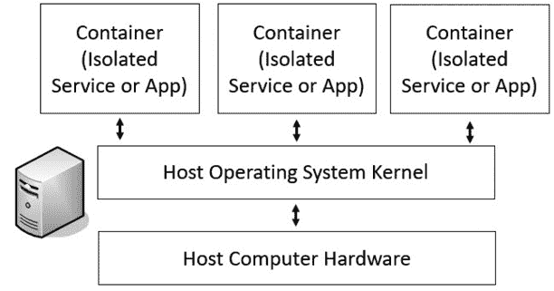

图 5.1: 容器化

容器化的优势是它使用的资源更少，并且比使用传统二型虚拟机管理器虚拟化的系统更高效。互联网服务提供商 (`ISPs`) 通常为需要特定应用程序的客户使用。一个缺点是容器必须使用`host` 的操作系统。例如，如果`host` 运行`Linux`，则所有容器都必须运行`Linux`。

## VM 逸逸

`VM escape` 是一种攻击，允许攻击者从虚拟客户系统内部访问主机系统。如前所述，主机系统运行一个名为`hypervisor` 的应用程序或进程来管理虚拟系统。在某些情况下，攻击者可以在虚拟系统上运行代码并与`hypervisor` 交互。这不应该被允许。

大多数虚拟机运行在具有高权限的物理服务器上，类似于管理员权限。成功的`VM escape` 攻击通常会让攻击者对主机系统以及运行在该主机上的每个客户虚拟机拥有无限控制权。

当供应商发现`VM escape` 漏洞时，他们会编写并发布补丁。与任何补丁一样，尽快测试并安装这些补丁是非常重要的。这包括保持物理服务器和虚拟机服务器的更新状态。

> **记住这一点！** 虚拟化允许多个虚拟机运行在单台物理服务器上，从而以较低的运营成本提供更高的网络安全韧性。保持系统更新到最新的补丁是防止虚拟机逃逸（VM escape）攻击的最佳防护。

# 避免虚拟机蔓延 (VM Sprawl)

当一个组织拥有许多未妥善管理的`VMs` 时，就会发生虚拟机蔓延。大多数组织都有特定的策略来确保物理服务器保持更新，并且人员只有在经过变更管理流程后才会对这些服务器进行更改。同样的策略也应适用于虚拟机服务器。

考虑这样一个情景：Bart 创建了一个运行微软 Windows Server 版本的`VM` 来测试一个软件应用程序。测试完成后后，他让该`VM` 一直运行。后来，微软发布了该服务器的安全补丁。IT 部门测试了这些补丁，并将其应用于所有需要的这些已知服务器。然而，由于 Bart 没有告诉任何人他创建了该`VM`，该虚拟机一直处于未补丁状态，容易受到攻击。

虚拟机蔓延的另一个挑战是每个`VM` 都会给服务器增加额外负载。如果人员在物理服务器上添加未经授权的`VMs`，它们可能会消耗系统资源。服务器可能会变慢并可能崩溃。

# 资源复用

在云计算语境下，资源复用风险指的是数据或资源在客户完成使用后，仍可能留在共享基础设施上，导致云服务的其他用户可能访问到这些内容。这可能导致数据泄露或暴露的风险，并可能让攻击者获得未经授权的访问敏感数据或系统的权限。

在云环境中，客户无法访问底层硬件，他们很难（或不可能！）执行与在自己的数据中心内执行同种类型的安全数据销毁。防止这种风险的最佳方法是与云服务供应商签订合同要求，要求他们在不再需要您的数据时安全地擦除这些数据。

# 复制

值得注意的是，虚拟机仅仅是文件。这些文件确实具有某些复杂性，但它们仍然只是文件。由于`VM` 是一组文件，因此通过将文件从一台物理服务器复制到另一台，复制`VM` 变得相对容易。如果原始`VM` 损坏，可以使用复制的`VM` 作为备份。

复制使得恢复故障的虚拟机变得简单。如果你创建了虚拟机文件的备份且原始服务器发生故障，你只需还原文件即可。你可以以分钟为单位衡量恢复复制的虚拟机所需的时间。相比之下，重建物理服务器可能需要数小时。

# 快照

快照为你提供在某一时间点的`VM` 副本，你可以将其作为备份。你仍然可以像往常一样使用该`VM`。然而，在拍摄快照后，虚拟机程序会记录对`VM` 的所有更改。如果`VM` 出现问题，你可以将`VM` 回滚到拍摄快照时的状态。

管理员通常在执行任何高风险操作之前对系统进行快照。高风险操作包括应用补丁或更新、测试安全控制以及安装新应用程序。理想情况下，这些操作不会引起任何问题，但偶尔会发生。通过在执行这些操作之前创建快照，管理员可以轻松将系统还原或回滚到具有已知配置的已知良好状态。

# 实现安全系统

安全系统设计概念有助于确保计算系统以安全状态部署和维护。在这种语境下，系统是指任何主机，如服务器、工作站、笔记本电脑、网络设备或移动设备。在理想世界中，系统从安全状态开始。遗憾的是，现实并非理想世界，管理员需要在部署前积极保护系统安全，并在部署后保持其安全。本节概述了用于保护主机的几个步骤。

## 终端安全软件

终端是计算设备，如服务器、虚拟机、桌面电脑、笔记本电脑、移动设备或物联网 (`IoT`) 设备。这些终端通常包含敏感信息，并提供处理敏感信息的服务器和其他资源的访问。它们还在全球范围内移动并连接许多不同的网络，使其容易受到攻击。因此，组织保护其终端免受各种攻击至关重要。让我们讨论四类常见的终端安全软件：

*   杀毒软件是组织中每个系统都应该运行的最基本的安全控制之一。该软件扫描终端是否存在病毒、蠕虫、木马病毒和其他恶意代码。当检测到感染时，杀毒软件通常可以介入并自动解决问题。你将在第 6 章“比较威胁、漏洞和常见攻击”中学习更多杀毒软件的知识。
*   终端检测与响应 (`EDR`) 是一种安全技术，专注于在终端层面检测并响应威胁，通常使用先进的行为分析技术识别可疑活动并在威胁造成损害之前将其拦截。
*   扩展检测与响应 (`XDR`) 是一种下一代安全技术，超越了终端，包含了其他类型的设备和系统，如网络设备、云基础设施和`IoT` 设备，为整个 IT 环境提供了更全面的视图，并能够实现更快的威胁检测和响应。
*   主机入侵防御系统 (`HIPS`) 将入侵防御概念应用于单个主机或终端，使用行为分析、文件完整性监控和应用程序控制等技术防止未经授权的访问、篡改或其他类型的攻击。

## 加固工作站和服务器

加固是指使操作系统 (`OS`) 或应用程序从默认安装变得更安全的实践。它有助于消除默认配置、错误配置和弱配置带来的漏洞。

在部署系统时，它们应该仅包含实现目的所需的应用程序、和服务和协议。如果系统上没有运行服务或协议，攻击者就无法攻击它。作为一个简单的例子，如果系统上没有运行且可用的`FTP`，那么它就不会受到任何文件传输协议 (`FTP`) 攻击。

虽然现在不像过去那样常见，但系统和软件有时仍会带有制造商设置的默认密码。这些默认密码通常由制造商发布在文档中，并在黑客社区中广为人知，因此在系统首次连接到网络之前，应当将其删除或更改。

第 8 章“使用风险管理工具”讨论了使用漏洞扫描器来发现系统中的漏洞。它还列出了与弱点配置相关的常见漏洞。通过消除弱点配置项，可以帮助管理员加固系统。

# 配置强制执行

配置管理实践有助于组织部署具有安全配置的系统，并强制要求这些安全配置保持有效。管理员经常在配置管理中使用基准和镜像（在后续章节中讨论）。变更管理实践（在本章稍后部分讨论）是配置管理实践的补充，有助于确保系统在整个生命周期内配置变化时仍然保持安全。

某些组织使用图表来展示配置管理流程。这些流程有时使用流程图来记录修改配置涉及的决策过程。

大型组织通常使用标准命名规范来识别标准配置。组织使用的标准并不如识别标准并一致地执行它那样重要。一种可能的选择是终端设备（如笔记本电脑、台式机或服务器）、部门或位置以及版本。例如，销售部门员工使用的台式机镜像的第三个主版本可以是`Desktop_Sales_3.0`。

# 安全基准与完整性测量

基准是一个已知的起点，组织通常使用安全基准为系统提供已知的起点。安全基准的主要益处之一是它们提升了系统的整体安全态势。配置薄弱的安全配置是一个常见的安全问题，但安全基准有助于消除这一问题。基准的使用分为三个步骤：

1.  建立初始基准配置。管理员使用各种工具以一致的安全状态部署系统。
2.  部署基准。基准可能在构建过程中最初被部署到系统上，也可能通过`Group Policy`（组策略）或其他配置管理工具推送到现有系统。
3.  维护基准。组织在变，安全形势也会随之变化。系统基准随着时间的推移而发生变化也是自然的。安全专业人员应根据需要修订基准，并按照组织的配置和变更管理策略推送更新。

## 使用主镜像进行基准配置

部署系统最常用的方法之一是从主镜像开始使用镜像。镜像是单个系统的快照，管理员将其部署到多个其他系统。镜像化已成为许多组织的一项实践，因为它在简化部署过程的同时确保了部署的安全性。图 5.2 及后续文本说明了捕捉和部署镜像的整体流程：

1.  管理员从一个空白源系统开始。他们安装并配置操作系统，安装并配置任何所需的应用程序，并修改安全设置。在进入下一步之前，管理员会进行大量的测试，以确保系统运行符合预期且是安全的。
2.  接下来，管理员捕捉镜像，这就成了他们的主镜像。`Symantec Ghost` 是一种流行的镜像应用程序，而`Windows Server` 版本包含了许多组织使用的免费工具，用于捕捉和部署镜像。捕捉到的镜像仅仅是存储在服务器上的文件或复制到外部介质（如`DVD` 或外部`USB drive`）。
3.  在步骤 3 中，管理员将镜像部署到多个系统。在网络内部使用时，管理员可以在初始部署期间将同一个镜像部署到几十个系统，或仅部署到单个系统以进行重建。镜像在目标系统上安装的配置与第 1 步创建的源系统完全相同。

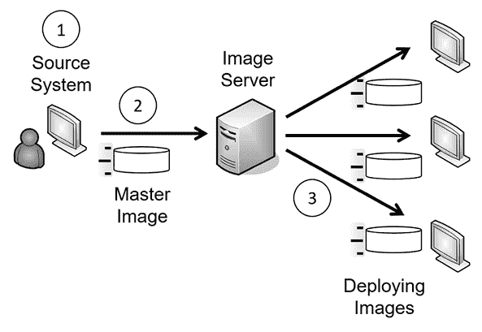

图 5.2：捕捉和部署镜像

管理员通常会花费大量时间来配置和测试源系统。他们遵循之前讨论的相同加固实践，并经常使用安全和配置基准。如果他们只是将镜像部署到少数系统（例如在教室环境中），可能只需要几个小时就能创建镜像。然而，如果他们要部署到组织内的数千个系统，可能需要几周或几个月的时间来创建和测试镜像。一旦创建了镜像，就可以以极少的管理工作快速部署。镜像化提供了两个重要的益处：

*   **安全的起点。** 镜像包含了系统强制要求的安全配置。部署系统的人员不需要记忆或遵循详尽的检查清单，就能确保新系统设置了所有详细的配置和安全设置。部署的镜像保留了原始镜像的所有设置。管理员在部署镜像后仍需配置某些设置，例如计算机名称。
*   **降低成本。** 部署镜像系统降低了整体维护成本并提高了可靠性。支持人员不需要学习几种不同的终端用户系统环境来协助用户。相反，他们只需要学习一种。在排排除故障时，支持人员的时间花在帮助终端用户上，而不是学习系统配置。经理将此理解为降低系统的总体成本（`TCO`）。

镜像化不仅限于桌面电脑。你可以对任何系统进行镜像，包括服务器。例如，考虑一个在大数据中心维护 50 台数据库服务器的组织。该组织可以使用镜像部署新服务器，或作为灾备计划的一部分来恢复故障服务器。部署镜像重建故障服务器比从头构建服务器快得多。如果管理员保持镜像更新，这有助于确保恢复的服务器从安全状态启动。

| 记住这一点！主镜像为系统提供了安全的起点。管理员有时使用模板或其他工具创建它们。然后，他们使用完整性测量来发现系统偏离基准的情况。 |
| --- |

补丁管理确保系统和应用程序始终保持最新的补丁状态。这是减少操作系统和应用程序漏洞的最有效的方法之一，因为它保护系统免受已知漏洞的影响。补丁管理包含一组方法论，并在识别、下载、测试、部署和验证补丁。

管理员通常在虚拟机等沙箱环境中测试更新。沙箱环境提供了一个隔离的环境。在对补丁进行测试后，管理员会对其其进行部署。他们通常不会手动部署补丁，相反，他们使用第三方工具以一种受控的方式部署补丁。例如，`Microsoft Configuration Manager` 是一种用于许多用途的系统管理工具，包括补丁管理。它会检查端点以确定补丁是否已安装。

除了部署补丁外，系统管理工具还包含一个验证组件，用于验证补丁的部署情况。它们定期查询系统并检索已安装的补丁和更新列表。然后它们将检索到的列表与已部署的补丁和更新列表进行比较，并提供差异报告。在某些网络中，管理员会将此与网络访问控制（`NAC`）技术相结合，将未补丁的系统隔离在隔离网络中，直到它们打上补丁。

不当或脆弱的补丁管理会导致攻击者可以利用的可预防性漏洞。这包括操作系统、应用程序和固件中的漏洞。

| 记住这一点！补丁管理程序确保操作系统、应用程序和固件始终保持最新的补丁状态。这保护系统免受已知漏洞的影响。变更管理定义了处理修改和升级的过程和记账结构。 |

## 变更管理

许多网络最大的敌人是不受约束的管理员。一个意图良好的管理员可能会为了修复一个问题而做出看似微小的更改，结果却在另一个地方引发了重大问题。配置错误可能会导致服务器宕机、禁用网络、停止电子邮件通信，甚至停止整个企业的网络流量。

例如，我曾见过在管理员在排排除打印机问题时发生过一次重大停机。在修改打印机的 IP 地址后，打印机开始工作了。听起来很成功，不是吗？遗憾的是，新的 IP 地址与分配给域名系统（`DNS`）服务器的地址相同，导致了 IP 地址冲突。该冲突阻止了`DNS` 服务器将名称解析为 IP 地址。这导致了严重的网络中断，直到另一位管理员发现并纠正了该问题。

这种自残性的灾难在 IT 早期相对常见。它们现在仍然发生，但拥有成熟变更管理流程的组织这类问题较少。变更管理定义了任何类型的系统修改或升级的过程，包括对应用程序的更改。它提供了两个关键目标：

*   确保 IT 系统的更改不会导致意外的停机或安全失败。
*   提供一种记账结构或方法来记录所有更改。

当建立了变更管理计划时，不鼓励管理员在不提交更改进行审核和批准的情况下进行配置更改。换句话说，他们不会在识别出潜在更改需求时立即进行更改。这包括对系统、应用程序、补丁或任何其他更改进行任何类型的配置更改。相反，他们在进行更改之前会遵循变更管理流程。

来自组织不同部门的专家会检查变更请求，并可以批准或推迟它们。流程通常会快速批准简单的更改。正式的变更评审委员会会定期审查推迟的请求，并可以批准、修改或拒绝变更。整个过程为已批准的更改提供了文档。例如，某些自动化变更管理系统为所有变更请求创建记账日志。系统跟踪请求从开始到实施的整个。管理员使用这些文档进行配置管理和灾难恢复。如果修改后的系统发生故障，变更和配置管理文档将识别如何恢复系统到故障前的状态。

变更管理不仅适用于计算设备。对于网络上的任何设备使用这些流程都是重要的，包括防火墙、代理服务器、数据泄露防护系统、移动设备管理系统、路由器和交换机。

## 应用允许阻止列表

应用程序允许列表（有时称为白名单）和应用程序阻止列表（有时称为拒绝列表或黑名单）是两种额外的端点安全解决方案。它们可以保护主机、服务器和移动设备。

应用程序允许列表是允许在系统上运行的应用程序列表。在确定允许列表后，系统将阻止所有其他应用程序。这是限制类型的一种。

相反，应用程序阻止列表是系统阻止的应用程序列表。例如，如果你发现用户正在安装名为`gcga.exe` 的游戏，你可以创建一个阻止列表并将`gcga.exe` 加入。然而，其他应用程序仍被允许。

许多移动设备管理（`MDM`）应用程序使用允许列表和阻止列表来允许或阻止应用程序。`MDM` 应用程序将在后文中讨论。

| 记住这一点！应用程序允许列表是授权软件列表，它阻止用户运行不在列表上的软件。应用程序阻止列表是未经授权的软件列表，它阻止用户运行列表中的软件。 |

| --- |

当用户由于允许列表或阻止列表而无法安装应用程序时，看到的消息有时很晦涩。当用户尝试安装未允许的应用程序时，系统通常会报告权限问题，或以模糊的错误失败。然而，应用程序日志通常会包含失败的详细信息。

某些系统支持隔离不符合允许或阻止列表的应用程序。例如，如果用户尝试安装不在允许列表上的应用程序，系统将隔离该应用程序，将其放在保护区域。被隔离的应用程序不会在系统上运行，但会被保留以便管理员对其进行检查。

## 磁盘加密

全盘加密（`FDE`）对整个磁盘进行加密。这既可以使用主要操作系统内置的技术（如 Windows`BitLocker` 或 macOS`FileVault`），也可以使用第三方应用程序完成。例如，`VeraCrypt` 是一种可以加密分区或整个存储设备的开源工具。

许多硬件供应商现在都制造自加密驱动器（`SED`），也称为硬件级`FDE` 驱动器。`SED` 包含在驱动器的加密电路。这些通常允许用户在设置驱动器时输入凭据。当用户启动系统时，他们输入凭据来解密驱动器并启动系统。

| 记住这一点！全盘加密（`FDE`）使用加密保护磁盘的所有内容。这可以通过专用软件完成，也可以通过专用硬件（即自加密驱动器`SED`）完成。 |

## 启动完整性

许多组织实施了启动完整性流程。这些流程会验证操作系统和启动加载系统的完整性。例如，它可以验证关键操作系统文件是否被篡改。

测量启动（Measured boot）会通过足够的启动过程阶段来执行这些检查，而不会允许用户与系统进行交互。如果它检测到系统已丢失完整性且不再可信，系统将无法启动。

## 启动安全与 UEFI

基本输入输出系统（`BIOS`）包含了为计算机提供启动基本指令的软件。它运行一些基础检查，定位操作系统并启动。`BIOS` 是一个你可以在物理上看到并触碰的硬件芯片，它包含了在计算机上执行代码的软件。固件被嵌入到硬件中。

较新的系统使用统一可扩展固件接口（`UEFI`）来替代`BIOS`。`UEFI` 执行的许多与`BIOS` 相同的功能，但提供了一些增强功能。例如，它可以从更大的磁盘启动，并且被设计为与 CPU 无关。

`BIOS` 和`UEFI` 都可以通过名为“闪刷”（flashing）的过程进行升级。闪刷用新的软件覆盖芯片内的固件。

## 可信平台模块

可信平台模块（`TPM`）是计算机主板上的一个硬件芯片，用于存储用于加密的加密密钥。大多数桌面和笔记本计算机都包含一个`TPM`。某些服务器允许可插拔和更换的`TPMs`。一旦启用，`TPM` 就提供全磁盘加密能力。它会保持硬盘加密和保护状态，直到系统完成系统验证和身份验证过程。

`TPM` 支持安全启动证明过程。当配置`TPM` 时，它会捕获用于启动计算机的关键文件的签名，并将签名报告安全地存储在`TPM` 内部。当系统启动时，安全启动过程会根据存储的签名对文件进行比对，以确保它们没有被更改。如果它检测到文件已被修改（例如被恶意软件修改），它将阻止启动过程以保护驱动器上的数据。

远程证明过程的工作与安全启动过程类似。然而，它不是通过与`TPM` 中存储的报告进行检查启动文件，而是使用一个独立的系统。同样，当配置`TPM` 时，它会捕获关键文件的签名，但会将此报告发送到远程系统。当系统启动时，它会检查文件并将当前报告发送到远程系统。远程系统验证文件是否相同，并证明（或确认）系统是安全的。

`TPM` 出厂时带有一个烧入内部的唯一加密密钥，该密钥用于非对称加密并可用于支持身份验证。此密钥提供了硬件根信任，一个已知的安全起点。私钥保持私密，并与公钥匹配。此外，`TPM` 还可以生成、存储和保护其他用于加密和解密磁盘的密钥。第 10 章“理解加密和 PKI”更深入地讨论了非对称加密以及公私钥。

如果系统包含`TPM`，你使用操作系统内的某个应用程序来启用它。例如，许多微软系统都包含`BitLocker`，你可以为包含`TPM` 的系统启用它。

`BitLocker` 使用`TPM` 作为平台验证过程的一部分，检测任何关键操作系统文件或进程是否被篡改。此外，用户需要提供身份验证，例如使用智能卡、密码或个人识别码（`PIN`）。在平台验证和用户身份验证过程完成之前，驱动器保持加密状态。

如果小偷偷了系统，驱动器仍保持加密和保护状态。攻击者将没有身份验证凭据，因此无法通过正常的启动过程访问驱动器。如果攻击者尝试修改操作系统以绕过安全控制，`TPM` 会检测到篡改并保持驱动器加密状态。如果小偷将驱动器移动到另一个系统，由于`TPM` 不可用，驱动器将将保持加密状态。

| 记住这个！ | 可信平台模块（`TPM`）是包含在硬件中的硬件芯片。它提供安全启动支持和远程证明。背书密钥是烧入内部的唯一密钥。 |
| --- |

## 硬件安全模块

硬件安全模块（`HSM`）是一种用于管理、生成并安全存储加密密钥的硬件设备。高性能`HSMs` 是作为网络设备存在的。

`microSD` `HSM` 是 15 mm 长 x 11 mm 宽 x 1 mm 厚的 .59 英寸 x .43 英寸 x .03 英寸。你可以在任何带有`microSD` 插的设备上安装`microSD` `HSM`。

`HSMs` 支持`TPM` 的安全方法。存储在`HSM` 中的加密密钥也支持身份验证解决方案。`HSM` 与`TPM` 的值得注意的区别在于，`HSMs` 是可拆卸的外部设备。相比之下，大多数`TPMs` 嵌入主板中，尽管某些可移除的`TPMs` 也在市场上。你可以轻松地为系统或网络添加`HSM`。如果系统没有带有`TPM`，除非系统有可用的`TPM` 头部，否则可能无法添加。`HSMs` 和`TPMs` 都通过存储和使用加密密钥提供安全加密能力。许多高性能服务器使用`HSMs` 来保护密钥。

| 记住这个！ | 硬件安全模块（`HSM`）是一种用于用于非对称加密的密钥的可拆卸或外部设备。许多基于服务器的应用程序使用`HSM` 来保护密钥。`microSD` `HSM` 是安装在`microSD` 卡上的`HSM` 设备，并可以安装在任何带有`microSD` 或`SD` 插槽的设备上。 |
| --- |

## 退役与处置

对需要的硬件进行退役是管理组织 IT 基础设施安全的关键环节。退役不再使用的硬件有助于防止对敏感数据的未经访问并降低攻击风险。然而，必须安全地执行退役过程，遵循既定的程序和指南，以减少数据泄露或暴露的风险。这包括擦除设备上的所有数据（包括临时文件和备份），并移除与设备相关的访问凭据和软件许可。此外，必须对硬件进行物理销毁或安全处置，以防止其在未经许可的情况下重新使用或改造。

遗留硬件是指不再制造或在行业内广泛使用的旧计算机硬件。这包括服务器、笔记本电脑、台式机以及曾经流行但已被更先进的技术取代的其他类型的设备。寿命（`EOL`）硬件是指已达到其使用寿命的硬件，可能是因为不再受制造商支持，或者因为太过时无法满足当前的技术标准。EOL 硬件不再接收软件更新或安全补丁，使其更容易受到攻击。为了减轻这些风险，组织应该采取三个行动：

- 为旧旧和已终止服务（EOL）硬件制定全面的管理计划，包括定期对硬件库存进行评估，以及对不再需要的设备进行退役计划。
- 通过实施防火墙、防病毒软件和入侵检测系统等安全控制措施，优先考虑这些设备的安全性，并密切监控其是否有可疑活动的迹象。
- 尽可能升级到较新的硬件和软件，以确保 IT 基础设施保持安全和不断更新。

## 保护数据

数据是任何组织管理的最宝贵的资源之一，仅次于其人员。你可能听过全球范围内组织发生的数据泄露事件。遗憾的是，数据泄露频频发生，并影响了数百万人。在最坏的情况下，网络犯罪分子利用盗取的数据清空银行账户，在信用卡上产生欺诈费用，并盗取个人身份。

失去对数据的控制会影响组织的声誉，通常还会影响其财务底线。攻击者的目标通常是窃取数据。如果攻击者能够渗透网络，他们通常会尝试收集属性数据将其发送到网络之外。在其他情况下，攻击者会采取导致可用性丢失的行动。例如，勒索软件会加密数据，使用户支付赎金，否则将无法访问数据。

第 11 章“实施策略以降低风险”涵盖了组织可以实施以保护数据的安全策略。安全策略有助于组织对其数据进行分类和标记。本节介绍了组织可以根据数据安全策略中 set 的要求来保护数据的许多安全控制措施。

使用安全的编码技术防止数据泄露或机密性丢失也很重要。机密性主要通过加密和强访问控制来保护。本章讨论了基于软件和硬件的加密方法，第 10 章涵盖了用于保护数据的特定加密算法。第 6 章更深入讨论了勒索软件。

## 数据防泄

数据外泄是将数据未经授权传输到组织之外的行为，这是一个备受关注的问题。在某些情况下，攻击者控制系统并使用恶意软件将数据传输到组织之外。恶意内部人员也可能传输数据。

组织通常使用数据防泄（`DLP`）技术和工具来防止数据外泄。它们可以阻止 USB 闪存器的使用并控制移动介质的使用。它们还可以检查传出的数据并检测许多类型的未经授权的数据传输。

在基于网络的`DLP` 中，所有离开网络的流量都通过一个可以检查流量的设备引导。管理员配置`DLP` 以寻找特定的单词、短语或字符字符串。例如，想象一个组织正在进行一个代号为“DOH”的秘密项目。与该项目相关的所有文档都包含该关键词。`DLP` 在搜索中包含此关键词，当它在电子邮件、附件或任何其他传出数据中检测到关键词时，它会将其拦截。管理员可以选择配置`DLP` 通知安全人员、发送者的用户或两者都通知。

基于软件的`DLP` 工作方式类似，但它安装在单个系统上，识别数据外泄企图并阻止其成功。

`DLP` 系统可以扫描所有电子邮件的文本和任何附件文件的内容，包括文档、电子表格、演示文稿和数据库。即使用户在发送之前将文件压缩为 zip 格式，`DLP` 也能通过简单地解压缩它来检查内容。

例如，我了解有一个组织，他们定期扫描所有发出的电子邮件以寻找个人身份信息（`PII`），例如社会安全号。基于网络的`DLP` 包含一个掩码，将社会安全号识别为以下格式的数字字符串：`###-##-####`。如果电子邮件或附件包含此数字字符串，`DLP` 会检测到它，拦截电子邮件并向安全管理员发送警报。

许多组织使用机密（Confidential）、`PII` 和属性（Proprietary）等术语对数据进行分类和标记。在`DLP` 程序很容易包含这些搜索词或组织认为重要的其他术语。

基于网络的`DLP` 系统不仅限于扫描电子邮件。许多系统可以扫描其他流量的内容，例如`FTP` 和`HTTP` 流量。复杂的的数据外泄攻击通常在发送数据之前对其加密，这使得`DLP` 系统检查数据变得更加困难。然而，通常可以配置`DLP` 系统来查找传出的加密数据，并在检测到时提醒安全管理员。

| 记住这一点！ | 数据外泄是将数据未经授权传输到网络之外。数据防泄（`DLP`）技术和工具可以阻止 USB 设备的使用以防止数据丢失，并监控传出的网络流量以检测未经授权的数据传输。 |
| --- | --- |

## 移动介质

移动介质是指任何你可以连接到计算机并轻松复制数据的存储系统。常见的移动介质包括 USB 闪存器、外部硬盘、SD 卡、CD 和 DVD。用户可以将它们插入系统，并在与系统之间轻松地复制数据。此外，如今的许多智能手机也包含使用相同类型内存的存储功能。

组织意识到移动介质可以成为攻击向量，因此组织通常会在安全策略声明中禁止使用 USB 驱动器。某些技术策略完全阻止 USB。USB 数据阻止可以防止用户向 USB 驱动器写入任何数据。某些 USB 数据阻止还会阻止系统从 USB 设备读取数据。这防止了恶意软件通过“实施控制以保护资产”中所讨论的移动介质传播。

## 使用加密保护机密性

正如第 1 章“掌握安全基础”中提到的，防止机密性丢失的主要方法之一是对数据进行加密。这包括对存储在任何类型设备上的静态数据进行加密，以及对通过任何类型传输介质传输的数据进行加密。对于攻击者来说，查看加密数据比查看未加密的数据困难得多。

你可以使用其他工具来限制对数据的访问，但这并不总是有效。例如，考虑微软`NTFS`，它允许你在访问控制列表（`ACLs`）中配置权限。你可以使用`NTFS` 为文件和文件夹设置权限以限制访问。然而，如果小偷偷了受`NTFS` 保护的笔记本电脑，访问这些文件是非常简单的。小偷只需将驱动移动到另一个系统作为额外驱动器，以管理员身份登录并接管文件所有权。加密没有那么容易绕过，因为小偷需要所需的解密密钥。

加密可以通过多种方式应用于数据。在本章的早些部分，你阅读了软件和自加密驱动（`SED`）如何对整个硬盘进行加密。加密也可以应用于驱动器上的分区或卷，或者应用于特定的文件或目录。你需要根据你的安全需求确定在组织中使用的适当加密级别。

## 数据库安全

另一种基于软件的加密形式是针对数据库。例如，如`Oracle Database` 或`Microsoft SQL Server` 等数据库管理系统可以加密数据库中存储的数据。虽然加密整个数据库是可能的，但更常见的是加密包含敏感信息的特定数据库字段（列）或记录（行）。

例如，想象一个包含名为`Customers` 表格的数据库。该表中的每条记录都有多个列，包括客户编号、姓氏、名字、信用卡号和安全代码。管理员不需要加密整个表，而是可以选择只加密每条记录中的`credit card number` 和`security code` 字段（列）。数据库字段（列）加密可以保护敏感数据，而不会浪费宝贵的处理能力去加密非敏感数据。

某些客户数据库以哈希值（hashes）或加盐哈希（salted hashes）的形式存储密码。第 10 节将更深入地讨论哈希和加盐技术，第 11 节将讨论令牌化（tokenization），另一种数据库安全技术。令牌化用替代值替换敏感数据元素。

# 保护使用中的数据

使用中的数据（Data-in-use）指的是系统或应用程序正在处理或访问的数据。这可能包括敏感数据，如密码、加密密钥和其他机密信息。保护使用中的数据是确保组织 IT 基础设施安全的关键方面，因为数据在处理和传输过程中容易受到攻击。

安全飞地区（Secure enclave），有时被称为可信执行环境（TEE），是一种安全技术，在系统或应用程序内部提供一个安全且隔离的区域用于处理敏感数据。安全飞地区使用基于硬件的安全机制，例如`Intel’s Software Guard Extensions (SGX)`，来创建一个与系统其他部分隔离的可信执行环境。这使得敏感数据即使在可能不安全的计算环境中也能被安全地处理和存储。

# 总结云概念

云计算是指通过不同于本地计算机的地点来访问计算资源。在大多数情况下，你通过互联网访问这些资源。

例如，如果你使用如`Gmail` 等基于 Web 的电子邮件，你就在使用云计算。更具体地说，基于 Web 的电子邮件是软件即服务（SaaS）云交付模型。你知道你正在通过互联网访问电子邮件，但并不知道托管你账户的物理服务器的位置。它可能位于弗吉尼亚州的一个数据中心，可能隐藏在犹他州，或者世界上任何其他地方。

云存储对个人和组织来说都非常流行。例如，`Apple` 提供了`iCloud` 存储，`Microsoft` 提供了`OneDrive`，`Google` 提供了`Google Drive`。你通常可以获得一些免费存储，或支付少量费用获得更多存储空间。

频繁使用的系统和网络通常依赖云计算资源来处理增加的网络流量。例如，考虑美国最大的购物日——黑色星期五，即感恩节的第二天，零售商们希望在这一天获利。几年前，`Amazon.com` 在感恩节周末的流量大到以至于其服务器几乎无法处理。不过，该公司吸取了教训。第二年，它利用云计算租用了专门供感恩节周末使用的服务器访问权限，尽管销售额增加了，但并没有出现任何问题。

正如许多伟大的创新者一样，`Amazon` 没有将这种情况视为问题，而是将其视为一个机会。如果它自己频繁使用的系统需要云计算，那么其他公司可能也有同样的需求。`Amazon` 现在通过其`Amazon Elastic Compute Cloud (Amazon EC2)` 服务向其他组织托管云服务。`Amazon EC2` 将虚拟化与云计算相结合，他们目前通过`Amazon EC2` 提供各种服务。

# 云交付模型

我们分类云服务提供的一种方法是根据它们为客户提供的资源类型。这些是云交付模型，主要有三种提供形式：软件即服务（SaaS）、平台即服务（PaaS）和基础设施即服务（IaaS）。

## 软件即服务

软件即服务（SaaS）包括通过网络提供的任何软件或应用程序。客户使用哪种 Web 浏览器或操作系统通常重要。他们可能使用`Microsoft Edge`、`Google Chrome`、`Mozilla Firefox` 或几乎任何 Web 浏览器。

如前所述，基于 Web 的电子邮件是 SaaS 的示例。这包括`Gmail`、`Yahoo! Mail` 等。该服务通过 Web 浏览器提供电子邮件的所有组件。

如果你有`Gmail` 账户，也可以使用`Google Workspace`，这是另一个 SaaS 示例。`Google Workspace` 通过 Web 浏览器访问文档、电子表格、演示文稿、图形和 PDF 文件。

不久前，我与一位才华的开发者合作过一个项目。他是一个运行`macOS` 的`Apple` 粉丝，而我是一个运行`Windows` 的`Microsoft` 用户，我们住在国家的不同地区。然而，我们通过`Google Docs` 发布和共享文档。

## 平台即服务

平台即服务（PaaS）为客户提供一个预配置的计算平台，他们可以根据需要使用。它为客户提供易于配置的操作系统，并结合适当的应用程序和按需计算。许多云供应商将此称为托管硬件解决方案。例如，我通过托管提供者使用其提供的产品在虚拟服务器上托管 [`https://getcertifiedahead.com/`](https://getcertifiedahead.com/)。

云托管提供者提供了许多功能，包括已安装的操作系统、用于 Web 服务器的核心软件包、作为 Web 服务器的`Apache`、防病毒软件、垃圾邮件保护等。此外，他们通过相关的更新和补丁保持操作系统最新。我管理用于网站的软件，包括软件更改和更新。然而，我不需要管理服务器本身。通常，当服务器出现问题时，托管提供者在我意识到问题之前就已经修复了。

在许多情况下，PaaS 服务的用户从不与实际硬件或操作系统交互。他们通过服务商提供的接口进行工作。无服务器计算（Serverless computing）是这种运行环境的一个很好的例子。在无服务器计算环境中，例如`Amazon’s Lambda` 服务，客户提供执行的软件代码以及执行指令，由云提供商处理其余所有工作。客户不需要担心硬件、虚拟机、操作系统或任何此类细节。

## 基础设施即服务

基础设施即服务（IaaS）允许组织外包其设备需求，包括硬件和所有支持操作。IaaS 服务提供者拥有设备，将其放置在其数据中心，并执行所有所需的硬件维护。客户本质上是租用设备，并通常按需付费。

许多云提供商将此称为自托管解决方案。他们提供对服务器的访问权限，并可能包含默认的操作系统安装，但客户必须根据自己的需求进行配置并安装额外软件。此外，客户还负责所有操作系统的更新和补丁。

如果一个组织发现很难在自己的数据中心管理和维护服务器，那么 IaaS 也会非常有用。通过外包这些需求，公司可以限制其硬件足迹。它们可以在虚拟化部分服务器的同时这样做，也可以作为其补充。通过`IaaS`，它们在数据中心内需要更少的服务器以及更少的资源（如电力的人员）来管理服务器。

| 记住这个！通过互联网提供的基于 Web 的电子邮件应用程序属于软件服务（SaaS）云技术。平台即服务（PaaS）为客户提供完全托管的平台，包括硬件、操作系统和有限的应用程序。供应商保持系统使用最新的更新。基础设施即服务（IaaS）为客户提供在自托管平台上访问硬件的权限。 |
| --- |

# 云部署模型

我们分类云服务的另一种方法是根据其云部署模型。这描述了它们位于何处以及谁可以使用它们。主要有四种云部署模型：公有云、私有云、社区云和混合云。

*   公有云服务由第三方公司（如 Amazon、Google、Microsoft 和 Apple）提供。它们向任何愿意付费的人提供类似的服务。它们向公众开放，因此被称为公有云。
*   私有云产品为单个客户的使用而创建。例如，谢尔比维尔核电厂可能决定它想在云中存储数据，但不想使用第三方供应商。相反，该电厂选择自托管自己的服务器，并通过互联网向内部员工提供这些服务器。组织也可以聘请服务提供商来为他们创建并运行一个私有云环境，供其专属使用。
*   社区云服务由一组具有共同利益的客户共享（例如共同的目标、安全需求或合规性考量）。举个例子，想象一下谢尔比维尔核电厂和斯普林菲德市内的几所学校决定在云中共享教育资源。它们各可以为该云提供资源，并且只有社区内的组织才能访问这些资源。

*   混合云环境结合了两种或两种其他部署模型的方案。它们可以是私有云、公有云或社区云的组合。它们保留独立的身份，以帮助保护私有云中的资源。然而，它们被桥在一起，通常是以对用户透明的方式进行连接的。

| 记住这个！公有云服务对任何希望使用它的客户可用。私有云仅供一个组织使用。两个或多个具有共同关注点的组织可以共享一个社区云。混合云是两个或多个云部署模型的组合。 |
| --- |

# 多云系统

多云系统结合了来自两个或多个云服务提供者的资源。这与混合云是一个不同的概念，混合云结合了两个或多个部署模型。

例如，如果一个组织使用了来自`Amazon Web Services` 和`Microsoft Azure` 的`IaaS` 方案，那么这就是多云环境，因为涉及了来自`Amazon` 和`Microsoft` 的资源。这并不是混合云部署，因为这两个服务提供商都是公有云提供商。

一些安全专业人员认为多云系统是一个很好的方法，因为它们增加了弹性和冗余。如果一个提供商发生故障，另一个提供商有望能保持运行。然而，重要的是要理解多云系统也为环境增加了复杂性。组织的 IT 团队必须熟悉并维护两个独立的环境。这增加了成本并增加了出错的风险。

# 应用程序编程接口

应用程序编程接口（`API`）是一种软件组件，允许开发者访问另一个应用程序、服务或操作系统中的功能或数据。开发者在 Web 应用程序、物联网（`IoT`）设备和云服务中使用`APIs` 是很常见的。

例如，`Amazon.com` 通过使用不同货运商提供的基于 Web 服务的`APIs` 提供包裹跟踪数据。输入是跟踪 ID，输出是货运商提供的所有跟踪数据。同样，`APIs` 与无线温控器等`IoT` 设备交互，以设置和调整温度。

`APIs` 容易受到攻击，因此开发者需要处理几个`API` 考虑因素，以确保`APIs` 不易受到常见漏洞攻击。这些包括：

*   身份验证。强身份验证方法将防止未经授权的实体使用`APIs`。使用的身份验证方法可能不同。例如，`API` 可能使用带有身份验证因子（如身份验证器）的密码。
*   授权。授权方法保护对`API` 的访问。例如，开发者可能有一级访问权限，而 Web 应用程序可能有另一个级别的访问权限。
*   传输层安全。`API` 在通过互联网传输任何流量时应使用强安全措施，如`TLS`。某些无线温控器的早期实现通过互联网发送数据，泄露了有关温控器所有者的信息。`TLS` 会加密流量。

未能解决这些问题会增加`API` 攻击成功的概率。`APIs` 通常用于访问数据。任何数据泄露都是使用`API` 进行潜在攻击的指标。API 检查和集成指的是对`API` 的安全可用性进行测试。

## 微服务与 API

微服务是设计用于良好完成某件事的代码模块。它们通常是小型代码模块，接收值、处理它们并返回输出响应。想想 Amazon 的例子，值是跟踪 ID，输出是跟踪数据。Amazon 必须为每个货运商使用不同的基于 Web 服务的`API`。

相比之下，单个微服务代码模块可以用于任何货运商。客户输入跟踪 ID，微服务`API` 将确定货运商。然后它会将跟踪 ID 发送给相应的货运商，接收跟踪数据，并将跟踪数据发送给客户。基于 Web 服务的`API` 绑定到特定的业务，例如示例中的各个货运商。相比之下，微服务模块没有绑定到任何特定业务。

## 托管安全服务提供商

托管安全服务提供商（`MSSP`）是为较小公司提供安全服务的第三方供应商。许多小公司利用它们在不向员工中增加大量安全专业的情况下，提高公司的整体安全态势。

在互联网早期，互联网服务提供商（ISP）为客户提供基础服务。他们有时向这些客户销售防火墙并对这些进行远程管理。托管安全服务提供商（MSSP）已将基础防火墙服务扩展到大型组织可能需要的任何服务。以下列表显示了 MSSP 可能提供的某些托管服务：

* 补丁管理
* 漏洞扫描
* 垃圾邮件和病毒过滤
* 数据泄露防护 (DLP)
* 虚拟专用网络连接
* 用于内容过滤的代理服务
* 入侵检测与防御系统
* 统一威胁管理 (UTM) 设备
* 高级防火墙，如下一代防火墙 (NGFWs)

MSSP 可能会销售托管组织内部的`NGFWs` 和`UTMs` 等设备，并进行远程管理。然而，也可以将此类设备托管在云端，并将所有组织流量重定向到云端连接。

| 记住这一点！ | 托管安全服务提供商（MSSP）是为组织提供安全服务的第三方供应商。托管服务提供商（MSP）提供组织所需的任何 IT 服务，包括由 MSSP 提供的安全服务。 |
| --- | --- |

托管服务提供商（MSP）类似于 MSSP。然而，MSP 不仅关注安全服务，它还提供组织所需的任何信息技术（IT）服务。

## 云服务提供商的责任

云服务模型中一个重要的考虑因素是分配给云服务提供商（CSP）和客户的责任差异。`CSP` 是一个通过一个或多个云端部署模型提供一个或多个云服务的实体。图 5.3 中的责任矩阵（部分源自美国国防部 (DoD) 的《云计算安全需求指南》中的图 2）显示了在`IaaS`、`PaaS` 和`SaaS` 模型中，客户客户与`CSP` 之间是如何划分责任的。这包含了维护责任和安全责任。

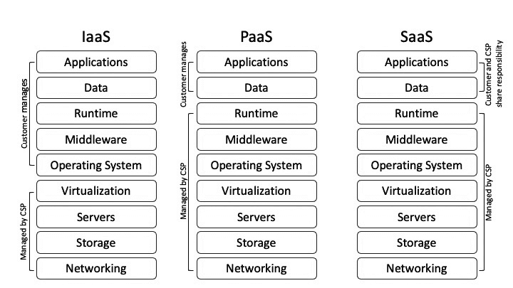

图 5.3: 云安全责任矩阵

例如，考虑`Gmail`：这是一种`SaaS` 产品。Google 负责维护一切以确保`Gmail` 的可用性。此外，Google 承担确保`Gmail` 安全的首要责任。如果你使用它，你仍然承担某些责任，例如确保使用与与其他在线账户不同的强密码来保护你的数据。

在`PaaS` 模型中，`CSP` 负责提供平台并确保其可用性。这包含了除客户提供的应用程序和数据以外的所有内容。你可能并不熟悉中间件和运行时组件。

中间件是添加到操作系统中以扩展其基本功能的的软件。例如，可以将`Apache` 添加到`Linux` 操作系统中，允许该系统作为 Web 服务器运行。运行时是一个托管环境，例如服务器上的容器。每个服务器的每个客户都可以访问操作系统的核心元素，但运行在容器内部。运行时环境将每个客户的容器从服务器上的其他容器隔离离开。

在`IaaS` 模型中，客户承担了更多责任，负责安装和维护操作系统以及任何运行时和中间件组件。在`IaaS` 模型中，`CSP` 通常会向客户租用整台服务器。这可以是物理服务器，也可以是虚拟服务器。`CSPs` 同样还负责服务的集成。这确保了云解决方案的所有元素都能协同工作。

## 云安全考虑因素

在选择 CSP 时，组织需要考虑各种云安全问题。在准备 Security+ 考试时，你应该熟悉以下每一项内容：

* **可用性**（Availability）。高可用性表示系统或服务保持运行且几乎零停机。这通常通过使用第 9 章讨论的多个负载均衡节点来实现。跨区域高可用表示节点位于不同的云位置，例如不同的地理位置。如果一个节点故障，其他节点可以承担其负载。
* **韧性**（Resilience）。韧性是指系统在面对不利条件或意外事件（如自然灾害或网络攻击）时保持其功能的能力。这是通过实施冗余和故障转移机制（如备份和灾备站点）来实现的，确保确保即使面临中断或故障也能继续运行。
* **成本**（Cost）。云服务的成本对任何组织来说都是重要的考虑因素。平衡服务成本与组织的预算及需求，并确保服务物有所值。
* **响应性**（Responsiveness）。响应性是指云服务响应请求和执行任务的速度和可靠性。这通常以响应时间和吞吐量来衡量，并通过使用缓存、负载均衡等技术进行优化。
* **可扩展性**（Scalability）。可扩展性是指云服务处理增加的数据、流量和用户请求而不产生性能下降的能力。这是通过使用弹性计算资源和自动伸缩机制实现的，这些机制可以根据需要动态分配资源以满足需求。
* **分段**（Segmentation）。正如局域网通过虚拟局域网 (VLANs) 和筛选子网支持分段一样，云网络也可以对计算机或网络进行分段。这对于将敏感数据和应用程序与网络与其他部分隔离以维护安全合规性至关重要。

## 本地与异地

组织可以在本地或异地使用云资源。本地表示所有资源都在组织的财产范围内进行拥有、运行和维护。本地环境通常仅用于支持私有云部署。然而，异地设备可以支持任何云部署模型。公有云始终是异地的。

### 本地

在本地化解决方案中，组织对所有云资源保留完全控制权，包括存储在本地云中的任何数据。这允许组织实施多种安全控制来保护本地云资源并提供网络安全防护。

组织还可以实施自己的身份验证和授权控制。这使得单点登录（SSO）变得更容易，而无需让员工为云资源准备单独账户。

然而，组织负责维护本地资源。除非组织已经拥有大型 IT 部门，否则本地云资源的维护可能会令其不堪。

在构建本地部署时，组织还必须选择使用集中式方法（即设备位于一个或少数大型数据中心）还是分散式方法（即设备分布在许多较小的数据中心）。集中式方法倾向于降低成本并简化管理，而分散式方法则减少了单点故障的影响。

### 异地

异地解决方案的主要优势之一是由`CSP` 执行维护。正如之前所述，在`SaaS` 模型中，`CSP` 承担维护云资源最大的责任。即使在`IaaS` 模型中，`CSP` 仍然确保硬件运行正常。

脱离本地的云资源的一个缺点是组织可能不知道数据存储在何处。如果数据存储在另一个国家，可能会导致法律影响，要求组织遵守不同国家的不同法律。然而，组织可以通过合同要求云服务提供商（CSP）仅将数据存储在单一国家。

数字取证（在第 11 章中讨论）在所有证据都在本地时已经足够具有挑战性了。当组织使用云资源时，它会增加额外的风险。每当组织与云提供商签订合同时，云提供商就变成了提供服务的第三方。这包括云提供商持有数据或提供任何类型的服务的情况。

# 云环境加固

对于任何使用云资源的组织来说，云安全都是关键问题。让我们来看看组织可以使用哪些不同的安全控制、工具和技术来加固其云环境并保护其数据。

## 云访问安全网关

云服务提供商采用原生控制措施来保护云资源。这对于某些客户来说可能足够了，但其他客户想要更多的安全功能，并寻求第三方解决方案，例如云访问安全网关（`CASB`）。

`CASB` 是部署在组织网络和云提供商之间的软件解决方案或服务。它通过监控流量和执行安全策略来提供安全。任何通过互联网访问的内容都是攻击向量，这包括云资源。然而，`CASB` 可以通过跨云服务提供商一致地执行安全策略来帮助组织降低风险。

## 云端数据泄露防护 (DLP)

组织内部人员将数据存储在云端是常见的。这使得从任何位置和几乎任何设备访问数据变得更容易。云端`DLP` 解决方案允许组织对存储在云端的数据实施策略。例如，组织可以实施策略来检测存储在云端的个人身份信息（`PII`）或保护健康信息（`PHI`）。检测到数据后，可以配置`DLP` 策略执行一个或多个操作，例如向安全管理员发送警报、阻止任何保存数据的尝试以及对数据进行隔离。

| 记住这一点！云端 DLP 可以对存储在云端的数据执行安全策略，例如确保个人身份信息 (`PII`）被加密。 |
| --- |

## 下一代安全 Web 网关

下一代安全 Web 网关（`SWG`）是代理服务器和无状态防火墙的结合。`SWG` 通常是云服务，但也可以是本地设备。客户端被配置为通过`SWG` 访问所有互联网资源，它过滤流量以防止威胁渗透网络。`SWG` 提供的某些服务包括：

* `URL 过滤` 防止用户访问未经授权的站点
* `数据包过滤` 检测并拦截恶意流量。
* `恶意软件检测与过滤` 阻止恶意软件。
* `网络级数据泄露防护 (`DLP`)`
* `沙箱技术` 用于检查威胁。

| 记住这一点！云访问安全网关（`CASB`）是部署在组织网络和云提供商之间的软件工具或服务。它通过监控流量和执行安全策略来提供安全。下一代安全 Web 网关（`SWG`）为客户端到互联网网站的流量提供代理服务，例如过滤 URL 和扫描恶意软件。 |
| --- |

## 云防火墙考虑

在云中创建虚拟网络时，有一些额外需要考虑的项目。正如物理网络需要防火墙来防止未经授权的访问，虚拟网络也需要防火墙。然而，在云环境中，情况会变得复杂一些。

你可以放心，云服务提供商已经有了非常复杂的防火墙来保护其网络免受攻击。这些防火墙过滤进入你云资源的流量，如果你想允许访问你的资源，就需要修改这些防火墙上的规则。但问题在于，云服务提供商并不会让你直接修改他们的防火墙规则！你可能会编写各种规则，这不仅会影响你的安全，还会影响其他客户的安全。

`Security groups`（安全组）为你提供了编写仅影响你的资源的防火墙规则的能力。云服务提供商使用他们的防火墙来执行你在`security groups` 中创建的规则，而不让你直接修改防火墙。这些`security groups` 应该仔细管理，因为虽然你的错误不会影响其他客户，但这些错误无疑会损害你自己系统的安全！

## 基础设施即代码

基础设施即代码（`IaC`）是指使用代码管理和配置数据中心，以定义`VMs` 和虚拟网络。它通过允许管理员运行脚本来创建虚拟对象，减少了创建复杂性。系统管理员偏于这种方法，因为它创建了可重用的代码并有助于自动化。

## 软件定义网络

软件定义网络（`SDN`）利用虚拟化技术路由流量，而不是使用硬件路由器和交换机。越来越多的云服务提供商将`SDNs` 作为整体`IaaS` 解决方案的一部分。

`SDN` 分离了网络中的数据平面和控制面。另一种方式是自适应巡航和碰撞回避系统。如果你的汽车将传感器数据发送到云端进行处理，你的汽车可能在收到任何响应之前就发生碰撞。

然而，车载处理器通过边缘计算监控传感器，处理数据并几乎立即减慢车速。这消除了延迟问题。

雾计算与边缘计算几乎是同一回事。主要的区别在于，雾计算使用一个靠近设备的网络，并可能有多个节点在雾网络内进行数据感知和处理。相比之下，边缘计算则在单个节点或设备上存储和处理数据。

### 云安全联盟
云安全联盟（`CSA`）是一个促进与云相关的最佳实践的非营利组织。它是一个基于成员的组织，拥有数千名志愿者致力于研究和其他项目。他们创建了云安全知识证书（`CCSK`）认证，该认证侧关注云安全。他们还创建了 CSA 云控制矩阵（`CCM`），这是一个一个网络安全控制框架。`CCM` 的`4.0` 版本在 17 个领域组织了 200 多个安全控制目标。`CCM` 中的许多安全控制措施与`SP-800-53 Revision 5`《信息系统和组织的安全与隐私控制》中的控制措施相似。主要的区别在于，`CCM` 专注于与云资源相关的安全控制，而`SP 800-53 Revision 5` 适用于所有的计算系统。

### 安全部署移动设备
移动设备给当今的组织带来了巨大的挑战。组织需要确定员工是否可以将移动设备连接到网络。如果是，组织需要识别管理与设备相关的安全方法、监控设备并执行安全策略。

#### 什么是移动设备？
在`CompTIA` `Security+` 考试的背景下，你可以将移动设备理解为智能手机或平板电脑。此外，`NIST` `SP 800-124`《企业移动设备安全管理指南》提到，移动设备具有额外的特征，例如至少有一个无线网络接口、本地数据存储、操作系统以及安装额外应用程序的能力。

移动设备通常具有其他可选功能。这包括其他网络选项，如`Bluetooth`、近场通信（`NFC`）、用于语音通信的蜂窝访问以及全球定位系统（`GPS`）服务。它们通常包括数字摄像头、录像机、麦克风以及将数据传输到传统计算机或其他移动设备的能力。

`NIST SP 800-124` 笔记本电脑和台式电脑，因为它们不包含许多移动设备才有的特征，例如`GPS` 以及监控设备移动的传感器（如加速度计`accelerometer` 和陀螺仪`gyro`）。`GPS` 即使在设备移动时也能确定设备的位置。`NIST` 的定义还排除了基础手机、数字摄像头和物联网（`IoT`）设备。这些设备没有操作系统，或者具有功能有限的操作系统。

### 移动设备部署模型
任何连接到组织网络的设备都代表着潜在的风险。作为一个简单的例子，如果有人将受感染的设备连接到网络，它可能会感染网络上的其他设备。为了限制这种风险，组织采取措施监控和管理移动设备。

如果组织拥有所有连接到网络的设备，那么监控和管理它们就很简单。然而，如果员工拥有这些设备（例如他们自己的智能手机），监控和管理设备就会变得更具挑战性。例如，员工想要使用自己的设备访问网络资源，但他们有时会反对组织监控和管理他们的个人设备。

以下列表列出了一些常见的移动设备部署模型。请注意，在某些模型中组织拥有设备，而在另一些模型中员工拥有设备：

*   **公司所有（Corporate-owned）**。在这种传统的部署模型中，组织购买设备并将其发给员工。
*   **COPE（公司所有，个人启用）**。`COPE` 与传统的公司所有模型类似，但主要区别是员工可以自由使用该设备，就像它是他们拥拥设备一样。这允许员工在将设备连接到组织网络的同时，还能将设备用于个人活动。因为组织拥有这些设备，因此更容易管理它们。
*   **BYOD（自备设备）**。一些组织允许员工携带自己的移动设备去上班并将其连接到网络。员工负责选择和支持该设备，并且在将设备连接到网络时，通常必须遵守`BYOD` 策略。虽然这对员工来说很简单，但在 IT 专业人员中，这有时被称为“自备灾难”（bring your own disaster）。由于员工可能拥有任何可能的设备，IT 部门往往需要在某种程度上对这些设备进行支持、监控和管理。
*   **CYOD（自选设备）**。为了避免与支持任何可能的移动设备相关的某些挑战，一些组织创建了一个许可设备列表，并在`CYOD` 策略中发布该列表。员工可以购买列表上的设备并带到工作中。这为 IT 部门提供了一个特定的设备列表，供其支持、监控和管理。有些人将`CYOD` 与`COPE` 混淆。在`COPE` 模型中，组织购买设备并可能给员工提供不同设备的选择。在`CYOD` 模型中，由员工购买设备。

> **记住这一点！** 公司所有、个人启用（`COPE`）设备归组织所有，但员工出于个人原因使用它们。自备设备（`BYOD`）策略允许员工将自己的个人设备连接到公司网络。自选设备（`CYOD`）策略包含一份已批准设备列表，员工可以购买并将其连接到网络。

### 连接方法和接收器
移动设备可以使用几种方法连接到网络和其他设备。它们包括：

*   **蜂窝（Cellular）**。智能手机（以及许多平板电脑）具有连接蜂窝网络的能力，例如长久演进（`LTE`）、第四代（`4G`）或`5G` 网络。你连接的网络类型取决于蜂窝供应商、位置和设备。新一代网络通常提供更快的传输速度和改进的语音通信。
*   **Wi-Fi**。移动设备几乎都有无线网络接口，你可以配置它以连接到无线网络。第 4 章讨论了常见的无线安全方法和无线协议。
*   **蓝牙（Bluetooth）**。大多数移动设备都支持`Bluetooth`。`Bluetooth` 是一种常用的个人局域网无线协议。例如，大多数手机支持使用`Bluetooth` 耳机进行免提。此外，某些技术使用`Bluetooth` 连接两个智能手机。第 4 章讨论了一些`Bluetooth` 攻击。

#### 移动设备管理
移动设备管理（`MDM`）包含了管理移动设备的技术。目标是确保这些设备具备安全控制措施以保持安全。一些供应商销售统一终端管理（`UEM`）解决方案来管理移动设备。

> **记住这一点！** 移动设备管理（`MDM`）工具有助于在移动设备上执行安全策略。这包括使用存储分段、容器化和全设备加密来保护数据。在使用`BYOD` 模型时，容器化非常有用。它们还包括执行强身份验证方法以防止未经授权的访问。

UEM 工具确保系统保持最新的补丁更新，安装了具有最新定义库的反病毒软件，并使用标准的安全实践进行安全保护。虽然这些工具最初主要关注的是桌面电脑和笔记本电脑，但它们已经扩展到包含许多移动设备。例如，`Microsoft Configuration Manager` 就包含了移动设备的支持，如基于 Apple iOS 的设备和基于 Android 的设备。

### MDM 解决方案帮助管理员管理移动设备。以下项目描述了许多适用于移动设备的 MDM 概念：

*   **应用管理。** MDM 工具可以限制在移动设备上运行的应用程序。它们通常使用应用程序允许列表来控制应用程序，并防止安装未经许可的应用程序。移动应用管理 (MAM) 工具通常内置在 MDM 工具中，但某些 MAM 工具仅专注于控制应用程序。
*   **全设备加密。** 加密可以防止多个平台（包括工作站、服务器、移动设备和数据传输）的机密性泄露。像全设备加密这样的加密方法可以提供设备安全、应用安全和数据安全。虽然组织可以确保公司拥设备使用全设备加密，但在员工使用自己的设备时，这并不总是可行。
*   **存储分段。** 在某些移动设备上，可以使用存储分段来隔离数据。例如，用户可能被要求对任何公司数据使用外部存储器，以降低设备丢失或被盗时数据丢失的风险。在设备内创建单独段也是可能的。用户可以将公司数据存储在加密段中，而将个人数据存储在设备的其他地方。
*   **内容管理。** 在创建分段存储空间后，确保其中存储了适当的内容非常重要。MDM 系统可以确保从组织源（如服务器）检索的所有内容都存储在加密段中。此外，内容管理还可以强制用户在访问此加密段内的数据时重新进行身份验证。
*   **容器化。** 本章前面的虚拟化部分讨论了容器虚拟化的使用。组织也可以在移动设备上实现容器化并对容器进行加密以保护，而无需加密整个设备。在容器中运行组织的应用程序可以隔离并保护该应用程序，包括其任何数据。当组织允许员工使用自己的设备时，这非常有用。
*   **密码和 PIN。** 移动设备通常支持密码或个人识别码 (PIN)。MDM 系统通常支持密码策略，类似于桌面系统使用的密码策略。唯一的局限性是某些移动设备仅支持 PIN，而另一些设备支持支持密码或 PIN。
*   **生物识别。** 第 2 章讨论了生物识别作为身份验证因素之一（你特有的特征）。许多移动设备现在都支持生物识别进行身份验证。例如，你可以教设备识别你的脸，然后使用面部识别进行身份验证，而不是输入密码或 PIN。
*   **屏幕锁定。** 大多数设备支持使用快速密码或密码来锁定设备。这类似于桌面系统上的密码保护屏幕保护程序，在指定的几分钟后自动锁定设备。它能防止他人轻易访问设备及其包含的数据。这通常与擦除功能结合使用。例如，如果有人偷了手机并输入 10 次错误的快速密码，只要启用了该功能，智能手机就会擦除手机上的所有数据。
*   **远程擦除。** 如果手机丢失并连接到 Wi-Fi 或蜂窝网络，远程擦除功能非常有用。它向设备发送远程信号以擦除或删除所有数据。主可以向手机发送远程擦除信号以删除手机上的所有数据。这将删除任何缓存数据（例如缓存的在线银行密码），并通过移除所有价值数据来实现设备的完全净化。
*   **地理定位。** 移动设备通常包含用于地理定位的`GPS` 功能。应用程序通常使用`GPS` 来识别设备的位置和移动。`GPS` 还可以定位丢失的设备。
*   **地理围栏。** 组织有时使用`GPS` 通过地理围栏技术创建虚拟围栏或地理边界。当设备位于虚拟围栏内时，应用程序可以响应。例如，组织可以配置移动应用，使其仅在设备位于虚拟围栏内时运行。同样，组织可以配置无线网络，使其仅为定义边界内的移动设备运行。
*   **GPS 标记。** `GPS` 标记（也称为地理标记）在向图片和视频等文件添加信息或在将它们发布到社交媒体网站时添加地理信息。例如，当你用开启了`GPS` 功能的手机拍摄照片时，照片应用程序会向照片添加纬度和经度坐标。考虑到朋友和家人，这是一个很棒的功能。然而，考虑到小偷和犯罪分子，他们可以利用这些数据。例如，如果 Lisa 经常在家里发布朋友家人的照片，这些照片就识别了她的地址。如果她以后开始从度假地发布照片，小偷就能意识到她不在了并入室行窃。
*   **上下文感知身份验证。** 上下感知身份验证使用多个元素来验证用户和设备。它可以包括用户的身份、地理位置、设备是否在地理围栏内的验证、网络、用户行为、时间以及以及设备类型和操作系统。这些元素有助于防止未经授权的用户访问应用程序或数据。
*   **推送通知。** 推送通知服务从应用程序向移动设备发送消息。例如，如果 Lisa 在智能手机上安装了 Facebook 应用并启用通知，Facebook 应用将向她发送通知。软件开发者可以配置即使设备处于屏幕锁定模式且应用程序未运行时也显示通知。MDM 应用可以发送通知提醒用户安全设置，或让他们知道其设备是否符合安全策略要求。

| 记住此！ | 远程擦除向丢失或被盗的设备发送信号以删除所有数据。地理定位使用全球定位系统 (GPS) 并帮助定位丢失或被盗的设备。地理围栏创建虚拟围栏或地理边界，用于检测设备是否在组织范围内。GPS 标记为图片等文件添加地理数据。上下文感知身份验证使用多个元素来验证用户和设备。 |
| --- |

### 加固移动设备

MDM 工具通常根据所有者的不同来管理设备。如果组织拥有设备，MDM 工具通常会下载并安装所有所需的应用程序并确保它们保持更新。

如果设备是员工所有的，MDM 工具将监控其合规性，如果设备不符合最低要求则阻止访问网络。例如，假设设备未打补或没有最新的反病毒软件。在这种情况下，MDM 软件与网络访问控制 (NAC) 技术协作，防止设备连接网络。以下段落识别了许多 MDM 可以监控和强制的常见问题。

#### 未授权的软件

组织通常希望用户仅从批准的源安装应用程序。例如，所有的 iPhone 和 iPad 设备都只会从 Apple App Store 获取应用。Apple 对这些应用程序的恶意软件测试非常严厉，任何试图通过 Apple 商店分发恶意软件的开发者通常会被封禁。同样，Google 为 Android 设备维护着 Google Play 站点。

第三方应用商店是指 Apple App Store 或 Google Play 之外的商店。从这些第三方应用商店获取的应用程序不像 App Store 或 Google Play 应用那样经过相同程度的审查，因此风险更高。Apple 让从第三方应用商店获取应用变得困难，但对于 Android 设备，从第三方商店获取应用相对容易。

越狱（Jailbreaking）是指移除 Apple 设备上的所有软件限制。设备越狱后，用户可以从任何第三方源安装软件。Root（Rooting）是修改 Android 设备以赋予用户 root 级（或完全管理员）访问权限的过程。Root 和越狱会给设备引入风险和漏洞，因此当 MDM（移动设备管理）检测到设备已被 root 或越狱时，它通常会阻止其访问所有网络。

移动设备通常将操作系统存储在板载内存中（如闪存内存），这种内存即使在断电也能保留数据。由于操作系统是软件而内存是硬件，这通常被称为固件。操作系统的更新通过空中下载（OTA）更新技术覆盖旧固件。固件 OTA 更新使设备保持最新状态。

也可以用自定义固件覆盖原有固件。有些人将此作为一种 Root Android 设备的另一种方法。该过程通常复杂且充满风险。然而，有些人会找到可下载的镜像并将其复制到设备中以覆盖固件。

还可以通过侧载（sideloading）在 Android 设备上安装应用程序。侧载是将应用程序数据包（APK）格式的应用程序包复制到设备中然后激活它的过程。设备必须设置为允许来自“未知源”的应用，这会显著削弱安全性。侧载对于开发者测试应用很有用，但在安装第三方应用时被认为是高风险的。

## 硬件控制

组织可能希望控制移动设备上的某些硬件，MDM 工具可以提供帮助。移动设备通常包括摄像头和录音麦克风。这些对普通用户有用，但可能对组织内的员工构成重大风险。

例如，攻击者已成功将恶意代码插入到某些第三方网站提供的应用中。当用户安装这些应用时，攻击者就可以远程连接到手机、拍照、录制音频等。

组织可以配置 MDM 软件禁用摄像头和录音麦克风以消除风险。理想情况下，MDM 工具仅在检测到设备位于预定义的地理围栏内时禁用摄像头和麦克风。遗憾的是，并非所有的 MDM 工具都基于地理位置禁用硬件。如果 MDM 工具不支持此功能，组织可能会禁止在某些区域持有智能手机。

## 未授权连接

组织管理层可能希望限制移动设备的连接能力。例如，如果移动设备可以连接主网络，管理层可能希望确保设备无法通过其他连接访问互联网。本节识别了其他可以使用 MDM 工具修改和阻止的连接。

大多数智能手机都支持热共享（tethering），允许你共享连接。许多设备支持 Wi-Fi、蓝牙和蜂窝数据连接。这些可以用来绕过网络控制。

| 记住！ |
| :--- |
| 热共享和移动热点允许设备访问互联网。MDM 工具可以阻止对热共享、移动热点和蜂窝数据的访问。 |

## 探索嵌入式系统

嵌入系统是任何具有专用功能并使用计算机系统执行该功能的设备。台式电脑、笔记本电脑和服务器都使用中央处理器（CPU）、操作系统和应用程序执行各种功能。同样，嵌入式系统使用 CPU、操作系统和一个或多个应用程序执行功能。

一个简单的例子是，无线多功能打印机（MFP）通常包含一个嵌入式系统。它运行一个你可以无线访问的网站以配置打印机。当然，你还可以向它发送打印任务、扫描文档并使用打印机复制文档。许多设备还传真功能，并通过电子邮件发送文档。

## 理解物联网

物联网（IoT）指的是与物理世界交互的各种技术。它们通常具有嵌入式系统，并通常连接到中央设备或应用，通过互联网、蓝牙或其他无线技术进行通信。

美国国家标准与技术研究院内部报告（NISTIR）8228《管理物联网 (IoT) 网络安全和隐私风险的考量》指出，物联网的完整范围尚未精确定义。这是因为这些技术涵盖了医疗、交通和家庭安全等广泛领域。

许多设备具有用于监测环境的传感器，如温度和湿度。然而，它们的功能远不止控制恒温器。许多组织使用物联网设备进行设施自动化，例如运动控制照明、安全摄像头和录像机、火灾检测和抑制系统等。

物联网技术还用于医疗系统、车辆、飞机和智能仪表等许多其他技术。物联网设备可以为疫苗提供远程温度监测，并采集患者的生命体征。越来越多的汽车使用嵌入式系统和物联网设备来控制汽车运行的所有方面。例如，汽车经常通过 OTA 更新进行自我更新。制造商可能会整合汽车中所有的嵌入式系统，使它们都能通过互联网访问，并被攻击者利用。

飞机利用 IoT 技术来跟踪飞机上几乎每个运动部件的维护和性能。飞机和无人机（UAVs）包含了嵌入系统。爱好者使用小型`UAVs` 进行远程拍摄。其他组织（如军事机构）则包含复杂的嵌入系统，用于侦察和投放武器。

智能电表被广泛用于电网。它们可以远程监控并记录能源消耗，并将数据分析结果发送到中央服务器。

### ICS 和 SCADA 系统

工业控制系统（`ICS`）通常指大型设施（如发电厂或水处理设施）内的系统。数据采集与监控控制（`SCADA`）系统通常通过监控`ICS` 并向其发送命令来控制它。理想情况下，这些系统被保护在无法访问互联网的隔离网络中。从另一个角度来看，互联网上的攻击者无法访问`SCADA` 系统或`ICS`。`ICS` 和`SCADA` 系统的常见用途包括：

*   制造业与工业。制造业和工业用途包括任何用于生产产品的工厂。系统可以监控每个处理阶段并实时报告异常。许多系统还可以发送信号，根据环境的变化调整工艺。
*   设施。设施用途包括监控温度和湿度并保持环境相对稳定。在水处理设施中，这些系统可以监控流程的每个阶段、报告问题并适应变化。
*   能源。能源用途包括油气加工、发电等。
*   物流。物流用途包括监控运输设施内的流程。

| 记住此点！数据采集与监控控制（`SCADA`）系统拥有控制工业控制系统（`ICS`）的嵌入系统，例如用于发电厂或水处理设施的系统。嵌入系统也用于许多特殊目的，例如医疗设备、汽车、飞机和无人机（`UAVs`）。 |
| --- |

一些`SCADA` 系统和`ICSs` 连接到公司网络。然而，它们通常被放置在隔离的虚拟局域网（`VLAN`）中，并且`VLAN` 由网络入侵防御系统（`NIPS`）保护以阻止不良的流量。第 3 节讨论了`VLANs`，第 4 节讨论了`NIPS`。

### 嵌入系统组件

嵌入系统具有多个共同工作以执行其功能的组件。

嵌入系统的关键组件之一是系统级芯片（`SoC`）。一个`SoC` 将计算机系统的许多组件集成到单个芯片上，包括处理器、内存、输入/输出接口和其他组件。这种集成使得嵌入系统能够保持紧凑和高效能，同时仍为其特定的应用提供必要的计算能力。`SoCs` 通常是针对特定应用进行定制的，这意味着它们是专门为某个嵌入式系统设计和构建的。

嵌入系统的另一个关键组件是实时操作系统（`RTOS`）。`RTOS` 是一种专为需要精确计时和确定性行为的嵌入系统设计的特殊操作系统。`RTOSs` 提供实时调度，这意味着它们可以保证某些任务将在特定的时间内完成。这对于许多嵌入系统（如医疗设备和汽车系统）至关重要，在这些系统中，计时对于安全和可靠性非常关键。`RTOSs` 的设计还注重高效和轻量化，具有较小的内存占用和低处理开销，非常适合资源有限的嵌入系统。

| 记住此点！嵌入式系统是任何具有专用功能并使用计算机系统来执行该功能的设备。它包含了物联网（`IoT`）类别中的任何设备，如可穿戴设备和家庭自动化系统。某些嵌入系统使用系统级芯片（`SoC`）。 |
| --- |

### 专用系统的加固

嵌入式、`IoT` 和`ICS/SCADA` 系统面临的挑战是保持其安全修复的更新。当供应商发现计算机和应用程序中的漏洞时，他们会编写并发布补丁。当你应用补丁时，系统就不再受到漏洞攻击。相比之下，嵌入式系统供应商在识别漏洞和创建修复补丁方面的动作并不那么积极。

此外，补丁管理是大多数组织 IT 管理员的日常工作内容。他们定期检查由主要软件和操作系统供应商发布的补丁，对它们进行测试并在必要时应用。相比之下，他们检查和应用`RTOS` 及类似组件更新的频率又是多少？

分段（Segmentation）是专用系统的另一种有效安全控制措施。由于很难安全地管理这些系统，因此它们应该被放置在分段网络中，在那里它们被严格锁定并免受外部攻击的侵害。

### 嵌入系统限制

嵌入系统具有若干限制其使用的限制条件。以下列表描述了这些限制：

*   计算。与完整的计算系统相比，嵌入系统的计算能力通常有限。因为它们体积很小，没有完整的 CPU。
*   加密局限性。由于处理能力有限，嵌入系统无法使用所有的加密协议。如果设计人员通过不加密数据来牺牲安全性，他们可能会无意中制造漏洞。
*   电力。嵌入式设备没有自己的电源，而是使用来自母设备的电力。在某些情况下，设备必须使用需要偶尔更换的电池。这导致了与计算能力的冲突。更强的计算能力会消耗更多电力，并要求更频繁地更换电池。
*   部署便利性。`IoT` 和`ICS/SCADA` 嵌入式系统通常部署在偏远且难以访问的位置，使得维护和更新更具挑战性。此外，许多嵌入式系统使用的实时操作系统（`RTOS`）需要专门的知识来部署和维护，这会增加部署时间和成本。
*   成本。可以通过牺牲安全等功能来最大限度地降低设备成本。增加功能会提高成本。在平衡成本与所需功能之间，管理人员和设计人员之间有时会是一项挑战。
*   无法补丁/补丁可用性。与桌面机和移动设备等大多数终端设备不同，嵌入式系统往往无法补丁。供应商并不总是提供修复设备的方法，即使他们提供了，也不总是及时编写和发布补丁。

第 5 节考试考点回顾

在准备考试时，请确保你理解了本章涵盖的关键概念。

总结虚拟化概念

*   虚拟化允许多个服务器在单个物理主机上运行。它还支持虚拟桌面。
*   虚拟桌面基础设施（`VDI`）在服务器上托管用户的桌面操作系统。瘦客户端（包括移动设备）可以连接到服务器并访问`VDI`。
*   容器虚拟化在隔离的容器或应用程序单元内运行服务或应用程序。容器使用主机内核。
*   虚拟机逃逸攻击（VM escape）允许攻击者从虚拟机访问宿主机系统。主要的保护措施是保持主机和虚拟机更新到最新。
*   虚拟机蔓延（VM sprawl）如果组织内部的人员不管理虚拟机，就会发生。

- 端点是计算设备，如服务器、桌面式电脑、笔记本电脑、移动设备或物联网（IoT）设备。端点检测与响应 (`EDR`) 对端点进行持续监控。扩展检测与响应 (`XDR`) 包含了其他类型的设备和系统。
- 加固（Hardening）是使操作系统或应用程序比其默认安装更安全的实践。
- 配置管理实践有助于组织部署具有安全配置的系统。
- 主镜像（Master image）为系统提供了一个安全的起点。主镜像通常使用模板或其他基准创建，以为系统提供安全的起点。完整性测量工具可以检测系统何时偏离基准。
- 补丁管理程序确保操作系统、应用程序和固件保持最新的补丁更新状态。这确保了它们免受已知漏洞的攻击。
- 变更管理策略定义了更改的过程，并有助于减少更改引起的意外停机。
- 应用程序白名单识别授权的软件但阻止所有其他软件。应用程序黑名单阻止未授权的软件但允许其他软件运行。
- 全盘加密 (`FDE`) 对整个磁盘加密。自加密驱动器 (`SED`) 在驱动器中内置了加密电路。
- 可信平台模块 (`TPM`) 是包含在许多桌面电脑、笔记本电脑和某些移动设备中的芯片，它支持全盘加密、安全启动过程并支持远程认证。TPM 内部烧有加密密钥，并提供硬件根信任。
- 硬件安全模块 (`HSM`) 是用于加密的可拆卸或外部设备。`HSM` 生成并存储`RSA` 加密密钥，并与服务器集成以提供基于硬件的加密。`microSD HSM` 是带有`HSM` 设备的`microSD` 芯片。
- 保护数据机性的主要方法是加密和强访问控制。文件系统安全包括使用加密保护文件和文件夹。
- 你对数据库中的单个列（如信用卡号）、整个数据库、单个文件、整个磁盘和可移动介质进行加密。
- 数据泄防护 (`DLP`) 技术和技术有助于防止数据丢失。它们可以阻止数据传输到 USB 设备，并通过分析通过电子邮件发出的数据以检测未经授权的传输。
- 数据外泄是将数据未经授权地传输到组织之外的行为。

# 总结云概念

- 云计算为组织提供了额外的资源。大多数云服务通过互联网或托管提供商提供。本地云由组织拥有并维护。
- 软件即服务 (`SaaS`) 包括基于 Web 的应用程序，如网页邮箱。
- 平台即服务 (`PaaS`) 为客户提供易于配置的操作系统和按需计算能力。供应商负责保持系统处于最新的补丁状态。
- 基础设施即服务 (`IaaS`) 通过云提供硬件资源。它可以帮助组织限制其硬件足迹规模并减少人员成本。
- 托管服务提供商 (`MSP`) 是为组织提供任何所需 IT 服务（包括安全服务）的第三方供应商。托管安全服务提供商 (`MSSP`) 专注于为组织提供安全服务。
- 云访问安全代理器 (`CASB`) 是部署在组织网络和云提供商之间的软件工具或服务。它监控所有网络流量并可以执行安全策略。
- 私有云专为单一组织的使用设计。
- 第三方供应商向任何需要的人出售公云服务的访问权限。
- 具有共同关注点的两个或多个组织可以共享一个社区云。
- 混合云是两个或多个云部署模型的结合。多云系统结合了两个或多个云服务提供者的资源。
- 基于云的`DLP` 系统可以对存储在云中的任何数据执行安全策略。
- 下一代安全 Web 网关为客户端到互联网网站的流量提供代理服务。它可以过滤 URL 并扫描恶意软件。
- 常见的云安全考虑因素包括可用性、弹性、成本、响应性、可扩展性和分段。
- 本地部署可以使用集中化方法（具有少量物理位置）或去中心化方法（具有许多物理位置）。场外解决方案利用云服务提供者。
- 代码即基础设施 (`IaC`) 指通过代码管理和配置`VMs` 和虚拟机网络。
- 软件定义网络 (`SDN`) 使用虚拟化技术路由流量，而不是使用硬件路由器和交换机。

# 安全部署移动设备

- 移动设备包括智能手机和平板电脑，运行移动操作系统。
- 公司拥有个人可用 (`COPE`) 移动设备由组织拥有，但员工可以出于个人原因使用它们。
- 自带设备 (`BYOD`) 策略允许员工将其移动设备连接到组织网络。选择自己的设备 (`CYOD`) 策略包含一份认可设备列表，并允许拥有这些设备的员工将其连接到网络。
- 虚拟桌面基础设施 (`VDI`) 是虚拟桌面，可以创建这些桌面以便用户能从移动设备访问它们。
- 移动设备可以通过蜂窝、`Wi-Fi` 和`Bluetooth` 连接到互联网、网络和其他设备。
- 移动设备管理 (`MDM`) 工具有助于确保设备满足最低安全要求。它们可以监控设备、执行安全策略，并在设备不符合要求时阻止网络访问。
- `MDM` 工具可以限制设备上的应用程序、分段并加密数据、执行强身份验证方法，并实施锁屏和远程清除等安全方法。在使用`BYOD` 模型时，容器化非常有用。
- 屏幕锁类似于桌面系统上的密码保护屏幕保护程序，它在一段时间后自动锁定设备。远程清除信号会删除丢失手机中的所有数据。
- 地理定位使用全球定位系统 (`GPS`) 识别设备位置。地理围栏使用`GPS` 创建虚拟边界或地理边界。组织使用地理围栏允许边界内的服务或设备访问，并阻止外部访问。
- 地理标记使用`GPS` 在社交媒体上发布文件（如照片）时添加地理信息。
- 第三方应用商店是移动设备主要商店之外的内容。苹果的`App Store` 是 Apple 设备的主要商店。`Google Play` 是安卓设备的主要商店。
- 越狱（Jailbreaking）移除苹果设备的所有软件限制，根（rooting）为安卓用户提供根级权限。自定义固件也可以 root 安卓设备。`MDM` 工具阻止越狱或根设备的网络访问。
- 侧载（Sideloading）是将应用程序拷贝到安卓设备而不是从在线商店安装的过程。
- 热点共享（Tethering）允许一个移动设备与其他设备共享其连接。`Wi-Fi Direct` 允许在没有无线路由器的情况下连接设备。

# 探索嵌入式系统

- 嵌入式系统是指具有专用功能并使用计算机系统执行该功能的任何设备。嵌入式系统的安全挑战是保持其更新。

*   物联网 (`IoT`) 设备与物理世界进行交互交互。它们通常具有嵌入式系统，并通常通过互联网、`Bluetooth`或其他无线技术进行通信。
*   数据监视控制与采集系统 (`SCADA`) 用于控制工业控制系统 (`ICS`)。`ICS` 用于电厂或水处理设施等大型设施。
*   `SCADA` 和`ICS` 系统通常位于孤立的网络中，无法访问互联网，并且通常受到网络入侵防御系统的保护。
*   单片系统 (`SoC`) 是一种包含完整计算系统的集成电路。
*   实时操作系统 (`RTOS`) 是一种在特定时间内对输入做出反应的操作系统。
*   与嵌入式系统相关的主要限制包括计算限制、加密限制、电源限制、部署便利性、成本以及无法修补/补丁可用性。
*   嵌入式系统包括有时被称为物联网 (`IoT`) 的智能设备，例如可穿戴技术和家用自动化设备。

| 在线参考：不要忘记查看 [`getcertifiedgetahead.com/`](https://getcertifiedgetahead.com/) 上的在线内容。 |
| --- |

## 第 5 章练习题

1.  攻击者最近利用了贵机构托管的 Web 服务器的漏洞。管理层要求管理员检查该服务器并消除其上的任何弱配置。以下哪项可以实现此目标？
    1.  安装`NIDS`
    2.  禁用不需要的服务
    3.  启用`root` 账户
    4.  实施`SSL` 加密

2.  一家机构开发并销售软件。他们偶尔更新软件以修复漏洞或添加额外功能。然而在在这些更新发布给客户之前，他们会在不同的环境中对其进行测试。以下哪项提供了测试更新的最佳方法？
    1.  基线配置
    2.  `BYOD`
    3.  `Sandbox`
    4.  变更管理

3.  网络管理员发现了来自内部计算机的疑似恶意流量，但仅在无人登录计算机时才会出现。你怀疑该系统感染了恶意软件，该软件会定期运行一个尝试通过远程网站运行的应用程序。在将计算机与主镜像的应用程序列表进行对比后，他们证实这很可能是问题所在。是什么允许他们做出此判断的？
    1.  版本控制
    2.  `Sandbox`
    3.  阻塞列表
    4.  完整性测量

4.  在调查最近的数据泄露时，调查人员在 Bart 的计算机上发现了恶意软件。杀病毒软件没有检测到它。日志显示一个具有管理员权限的用户安装了它。以下哪项在未来最有机会防止这种情况再次发生？
    1.  强制应用程序白名单
    2.  强制应用程序黑名单
    3.  实施`BYOD` 策略。
    4.  实施`DLP` 系统。

5.  公司的销售人员经常携带公司拥笔记本电脑出差。公司希望实施一种保护笔记本硬盘免受盗窃的解决方案。解决方案应在没有用户交互的情况下运行以便方便使用。以下哪项是满足这些需求的最佳选择？
    1.  `DLP`
    2.  `HSM`
    3.  `MDM`
    4.  `SED`

6.  贵机构的经理想为关键计算机实施安全启动过程。在启动过程中，每台计算机都应向远程系统发送数据以检查计算机的配置。以下哪项可以实现此目标？
    1.  `Trusted Platform Module`
    2.  `Hardware root of trust`
    3.  `Remote attestation`
    4.  `Tokenization`

7.  贵机构最近更新了安全策略，禁止使用外部存储。目标是减少内部人员威胁。以下哪种方法最有机会减少使用存储设备外泄数据的风险？
    1.  对员工进行策略培训。
    2.  监控防火墙日志以检测外泄。
    3.  阻止对可移动介质的写入权限。
    4.  实施基于网络的`DLP` 解决方案。

8.  贵机构的新 CTO Maggie 希望通过利用更多的云服务来降低成本。她指示使用云服务而不是购买即将进行的项目所需的硬件和软件。她还希望确保云提供商维护所有所需的硬件和软件，提供一个预配置的环境，可以在其中部署自己的代码。以下哪项描述了满足这些要求的云计算服务？
    1.  `aaS`
    2.  `PaaS`
    3.  `SaaS`
    4.  `XaaS`

9.  你被要求研究云服务的价格。云服务提供商需要提供服务器、存储和网络，其他无需提供。以下哪项可以满足你的需求？?
    1.  `aaS`
    2.  `PaaS`
    3.  `SaaS`
    4.  `XaaS`

10. 贵机构一直在使用更多的云资源，CIO Lisa 对安全表示担忧。她想添加一种逻辑位于组织网络和云提供商之间的服务。该服务将监控所有网络流量，并确保发送到云端存储的数据是加密的。以下哪项可以满足这些要求？
    1.  `CASB`
    2.  存储权限
    3.  存储加密策略
    4.  `Firewall`

11. 贵机构管理层想添加一种云服务，以过滤内部客户端与互联网之间的所有流量。解决方案至少应包含 URL 过滤、`DLP` 保护以及恶意软件检测和过滤。以下哪项可以满足这些要求？
    1.  下一代`SWG`
    2.  容器安全
    3.  云端分段
    4.  API 检查与集成

12. 贵机构计划实施`BYOD` 策略。然而，管理层想实施一种全面的解决方案，在实施`BYOD` 策略时保护组织的数据。以下哪项是满足这些需求的最佳选择？
    1.  `FDE`
    2.  `SED`
    3.  `MDM`
    4.  `MAM`

13. 贵机构最近实施了一项安全策略，要求所有终端计算设备都具有唯一标识符，以简化资产清单。管理员通过`RFID` 系统在服务器、台式电脑和笔记本电脑上实施了这一点。然而，他们还没有找到可靠的方法为公司拥智能手机和平板设备标记。以下哪种选择是最佳替代方案？
    1.  `VDI`
    2.  `MDM` 应用程序
    3.  `RFID` 标签
    4.  `GPS` 标记

14. 贵机构由于更换丢失或损坏移动设备的成本，正在从`COPE` 模型切换到`BYOD` 模式。在使用`BYOD` 模式时，保护组织数据的最佳选择是？
    1.  全盘加密
    2.  容器化
    3.  远程擦除
    4.  `Geolocation`

15. Bart 向 Wendell 展示他从第三方下载到 iPhone 上的新应用程序。Wendell 拥有相同型号的智能手机，但当他搜索该应用程序时，无法找到。在以下选项中，这种情况最可能的解释是什么？
    1.  `Jailbreaking`
    2.  `Tethering`
    3.  `Sideloading`
    4.  `Rooting`

1. **B** 正确。不必要的开放端口和服务是导致配置薄弱的常见因素，因此关闭不需要的端口并禁用不必要的服务至关重要。网络入侵检测系统（`NIDS`）可以帮助保护内部系统，但`NIDS` 不安装在服务器上，管理员负责检查服务器。不安全的 root 账户表示配置薄弱。如果 root 账户已禁用，启用它们不会增加服务器的安全性。安全套接层（`SSL`）是一种弱效的加密协议，不应在服务器上实施。

2. **C** 正确。沙箱提供了一种测试更新的简单方法。它提供了一个隔离的环境，并通常用于测试。基线配置是计算环境的起点。自备设备（`BYOD`）是指允许员工拥有的移动设备接入网络，与此问题无关。变更管理实践确保了变更在获得批准和记录之前不会被应用。

3. **D** 正确。主镜像是基线，管理员执行了完整性测量以识别基线偏差。通过比较基线中的应用程序列表与可疑计算机上运行的应用程序，可以识别出未经授权的应用程序。其他答案均未包含发现问题所需的故障排除步骤。版本控制在软件更新时跟踪软件版本。沙箱是系统的隔离区域，通常用于测试应用程序。阻止列表是禁止的应用程序的列表。

4. **A** 正确。强制应用程序允许列表（有时称为应用程序白名单）可以防止这种情况。应用程序允许列表识别了可以安装在计算机上的唯一应用程序，且不包含恶意软件。应用程序阻止列表识别了要阻止的应用程序，但由于恶意软件变化频繁，这种方法将毫无帮助。自备设备（`BYOD`）策略识别员工可以购买并连接到网络的移动设备，但与此问题无关。数据泄露防护（`DLP`）系统通常监控出口流量，无法阻止用户安装恶意应用程序。

5. **D** 正确。自加密驱动器（`SEDs`）是最佳解决方案。`SEDs` 内部内置了加密电路。它们在无需用户交互的情况下对数据进行加密和解密，尽管在启动时通常要求人员使用凭据解锁`SED`。数据泄露防护（`DLP`）解决方案通常监控出站流量，以防止机密信息流到组织外部。硬件安全模块（`HSM`）用于管理、生成和存储加密密钥。它通常用于网络而非笔记本电脑。移动设备管理（`MDM`）是指用于管理移动设备的设备。

6. **C** 正确。远程证明过程在启动周期期间检查计算机，并向远程系统发送报告。远程系统证明或确认该计算机是安全的。其他答案中均没有向远程系统发送数据的操作的。可信平台模块（`TPM`）是主板上的一个硬件芯片，提供本地安全启动过程。`TPM` 包含一个固化在硬件中的加密密钥，提供了硬件根信任。令牌化（Tokenization）将敏感数据替换为令牌或替代值，该令牌可以替代原始数据使用。

7. **C** 正确。阻止对可移动介质的写入权限是最佳选择。这可以通过在所有计算机上部署数据泄露防护（`DLP`）解决方案来实现。员工可能会有帮助，但无法阻止内部威胁。监控防火墙日志可能会检测到数据从网络外泄，但无法监控外部存储设备的使用。网络`DLP` 解决方案可能会检测并阻止数据从网络外泄，但它无法阻止用户将数据复制到可移动介质中。

8. **B** 正确。平台即服务（`PaaS`）为客户提供一个预配置的计算平台，包括硬件和软件。云提供商维护硬件以及指定的软件，如操作系统和 Web 服务器应用等关键应用程序。基础设施即服务（`IaaS`）是一种云计算选项，供应商提供对计算机的访问，但客户必须安装操作系统并维护系统。软件即服务（`SaaS`）提供特定应用程序的访问，如电子邮件。任何即服务（`XaaS`）指的是`IaaS`、`PaaS` 和`SaaS` 之外的云服务。

9. **A** 正确。基础设施即服务（`IaaS`）云模型为客户端提供硬件但不提供其他任何内容。平台即服务（`PaaS`）模型为客户提供包含操作系统某些应用程序的计算平台。软件即服务（`SaaS`）模型为客户提供一个或多个应用程序。任何即服务（`XaaS`）指的是`IaaS`、`PaaS` 和`SaaS` 之外的云服务，但此场景显然描述的是`IaaS`。

10. **A** 正确。云访问安全代理（`CASB`）置于网络和云提供商之间，可以满足首席信息官（`CIO`）的要求。它可以监控流量并执行安全策略，例如确保发送到云的数据是加密的。应在存储位置上设置权限以确保授权人员可以访问，但它们并不加密数据。可以创建存储加密策略来要求对数据加密，但它无法监控与云的所有流量。防火墙。

11. **A** 正确。下一代安全 Web 网关（`SWG`）为客户端访问网站提供代理服务，例如过滤统一资源定位符（`URLs`）并扫描恶意软件。容器安全作为云安全控制，通过将数据放在具有不同权限或加密控制的不同容器中来保护数据。网络分段隔离主机或网络，而云分段具有相同的功能，只是隔离发生在云内部。应用程序编程接口（`API`）检查和集成是指测试`API` 的可用性，但此场景对于`API` 来说太复杂了。

12. **C** 正确。移动设备管理（`MDM`）解决方案是最佳选择，因为它可以管理自备设备（`BYOD`）场景下与移动设备相关的多种风险。全盘加密（`FDE`）通常在`BYOD` 场景下不可行，因为它要求组织加密员工的设备。某些`FDE` 驱动器使用自加密驱动器（`SED`）技术，它们与`FDE` 驱动器的限制性相同。移动应用管理（`MAM`）仅管理移动设备上的应用程序，并不是全面的解决方案。

13. **B** 正确。移动设备管理（`MDM`）应用程序可以为智能手机和平板电脑等终端设备分配唯一的数字标识符。它利用此远程管理设备，该标识符也可简化资产清单。虚拟桌面基础设施（`VDI`）为用户（包括使用移动设备的用户）提供虚拟桌面，允许他们连接到托管桌面的服务器。射频识别（`RFID`）标签正用于其他设备，但场景说明这对于智能手机和平板电脑设备并非可靠的方法。全球定位系统（`GPS`）标记为照片添加地理数据，以指示拍摄位置。

14. B 正确。容器化是最佳选择。组织可以确保对某些容器中的组织数据进行加密，而不必加密用户数据。在自自带设备（BYOD）模型中，员工拥有设备，组织通常无法通过全磁盘加密对用户数据进行加密。在公司拥有、个人启用（COPE）模型中，组织可以使用全设备加密。远程擦除向丢失的设备发送信号以擦除数据，但如果设备损坏，它将无法擦除数据，攻击者可能从损坏的设备中恢复数据。地理定位技术可以帮助找到丢失设备，但它们无法保护数据。

15. A 正确。越狱（Jailbreaking）是最可能的原因。越狱 iPhone 可以移除所有软件限制，包括从 Apple App Store 以外源安装应用程序的能力。热点（Tethering）允许你将一个移动设备的 Internet 连接共享与其他移动设备。侧载（Sideloading）是从应用程序包（APK）安装应用程序包的过程，但在此语境下，侧载并不是相关术语。根根（Rooting）针对 Android 设备，为用户提供设备的根级访问。

# 第 6 章：比较威胁、漏洞和常见攻击

本章涵盖的 CompTIA Security+ 目标：

### 2.1 比较并对比常见的威胁者和动机。
* 威胁者（国家级、无技能攻击者、黑客行动分子、内部威胁、组织犯罪、影子 IT）
* 攻击者的属性（内部/外部、资源/资金、复杂程度/能力）
* 动机（数据外泄、间谍活动、服务中断、勒索、经济利益、哲学/政治信仰、伦理、报复、破坏/混乱、战争）

### 2.2 解释常见的攻击向量和攻击面。
* 基于消息的（电子邮件、短信服务 (SMS)、即时消息 (IM)）
* 基于图像的
* 基于文件的
* 语音通话
* 可移动设备
* 存在漏洞的软件（基于客户端 vs 无代理）
* 不支持的系统和应用程序
* 不安全的网络（无线、有线、蓝牙）
* 开放的服务端口
* 默认凭据
* 供应链（托管服务提供商 (MSP)、供应商、供应源）
* 人为向量/社会工程（网络钓鱼、语音钓鱼、短信钓鱼、误信息/虚假信息、仿冒、业务电子邮件欺骗、假托法、水坑攻击、品牌仿冒、抢注域名攻击）

### 2.4 在给定场景下，分析恶意活动指标。
* 恶意软件攻击（勒索软件、木马、蠕虫、间谍软件、臃肿软件、病毒、键盘记录器、逻辑炸弹、根内核程序）
* 网络攻击（恶意代码）

### 4.3 解释与漏洞管理相关的各种活动。
* 威胁馈（开源情报 (OSINT)、专有/第三方、信息共享组织、暗网）

### 4.5 在给定场景下，修改企业能力以增强安全性。
* 文件完整性监控

组织需要了解许多不同类型的威胁者，因此了解一些他们、他们的属性以及他们可能发起的攻击类型是有价值的。恶意软件（malware）和社会工程学是任何组织都会面临的两个常见攻击类别，但每个类别都具有某些复杂性。

## 理解威胁者
组织需要了解许多不同类型的威胁者，因此了解一些关于他们、他们的属性以及他们可能发起的攻击类型是有价值的。恶意软件（malware）和社会工程学是任何组织都会面临的两个常见攻击类别，但每个类别都具有某些复杂性。

## 威胁者类型
在考虑攻击时，重要的是知道存在像国家级这样的攻击者类型。`高级持续性威胁 (APT) 指一个有组织且复杂的威胁者群体`。国家级（政府）资助他们，并赋予他们特定的目标和任务。组织犯罪集团是参与犯罪的有组织个人。他们的首要动机是金钱。大多数 APT 通常由政府资助。它们运行时间很长，并且具有外泄数据。

## 组织犯罪
组织犯罪由一组一起工作的人组成。这些小组通常在由领导者和工人组成的层级结构中组织，就像普通的业务一样。根据犯罪集团的大小，它可以有几层管理。然而，与合法业务不同，该企业专注于犯罪活动。组织犯罪的首要动机是钱。他们几乎所有的努力都可以追溯到贪婪，目标是获取资金，无论他们如何获取。

例如，网络安全公司 Crowdstrike 记录了一个名为 Wizard Spider 的犯罪集团。Crowdstrike 报告说这是一个位于俄罗斯的犯罪小组。此外，他们发现了证据，证明该小组运行`Ryuk`，这是一种针对企业环境的著名勒索软件。勒索软件将在本章稍后部分进一步讨论。

| 记住这个！高级持续性威胁 (APT) 指一个有组织且复杂的威胁者群体。国家级（政府）资助他们，并赋予他们特定的目标和任务。组织犯罪集团是参与犯罪的有组织个人。他们的首要动机是金钱。 |

| --- |

多年前，黑客被认为是精通计算机并与他人分享知识的人。然而，这个定义在这些年来发生了变化。今天，媒体通常将黑客称为恶意个人，他们利用自己的技术专长发动攻击，并入侵系统或网络以获取个人利益。

无技能的攻击者使用现有的计算机脚本或代码来发动攻击。这些无技能的攻击者（也称为脚本小子）通常几乎没有专业知识或复杂性，资金也非常匮乏。许多人开玩笑说无聊的青少年是脚本小子，为了好玩而攻击网站或组织。然而，这些攻击者并没有年龄限制。更重要的一点是，他们仍然可以获得强大的脚本并发动危险的攻击。他们的动机各异，但他们通常是因为无聊或为了看看自己能做什么而发动攻击。

黑客分子（Hacktivist）作为活动运动的一部分或为了推进某项事业发起攻击。黑客分子通常不是为了自己的利益，而是为了提高人们对某项事业的意识。例如，“是的男人”（The Yes Men）是一个试图提高社会和政治问题意识的活动团体，他们会对某些组织发起虚假信息传播活动。

2019 年 1 月，“是的男人”创建了一个看起来像贝莱德（BlackRock）的假网站，贝莱德是当时拥有最多化石燃料公司的大型金融资产管理公司。他们发布了一封来自贝莱德首席官拉里·芬克（Larry Fink）的假信，称贝莱德要求其投资的任何公司都要使其业务模式符合《巴黎协定》，以应对气候变化。许多媒体被误导，并报道这封信是真实的。虽然这一骗局很快被揭穿，但它确实提高了人们的意识。

内部威胁（Insider threat）是指任何拥有权限访问组织内部资源的人。由内部威胁引起的常见安全问题包括组织资产机密性、完整性和可用性的丢失。威胁的程度取决于内部人员拥有的权限大小。例如，管理员拥有的 IT 系统访问权限比普通用户多得多。

恶意内部人员具有多样化的动机。例如，某些恶意内部人员受贪婪驱动，只想增加个人财富，而另一些人则想向组织报复。他们可能会窃取包含价值数据的文件，安装或运行恶意脚本，或将资金重定向到他们的个人账户。第 5 章“保护主机和数据”涵盖了数据流防护（DLP）技术以及某些防止用户将数据写入外部介质设备的 DLP 解决方案。

并非所有内部威胁都是恶意的。一个缺乏安全的用户可能会打开电子邮件中的恶意附件，无意中在整个组织中释放恶意软件。

竞争对手是指任何与另一个组织进行经济或商业竞争的组织。他们的动机通常是获取有关另一公司的专有信息。虽然使用开源情报收集信息是合法的，但贪婪有时会导致竞争对手越界从事非法活动。这可能仅仅是翻找竞争对手的垃圾桶，被称为“翻垃圾”（dumpster diving）。在某些情况下，竞争对手会雇用其他公司的员工，然后让这些新员工提供关于其前雇主的专有信息。

| 记住这一点！ | 不熟练的攻击者使用现有的计算机脚本或代码发起攻击。这些不熟练的攻击者通常缺乏专业知识、精通程度和资金。黑客分子作为活动运动的一部分或为了推进某项事业发起攻击。内部人员是指任何拥有权限访问组织内部资源的人，例如公司员工。DLP 解决方案可以防止用户将数据写入外部介质设备。 |
| --- |

### 攻击者属性

在上一节中，你发现世界上有许多不同类型的攻击者。你学习了国家支持的攻击者、不熟练的攻击者、黑客分子、有组织犯罪和内部威胁。我们还开始讨论这些攻击者之间的区别。让我们来看看区分不同类型攻击者的三个主要属性：

- **内部 vs. 外部** – 我们想到的大多数攻击者来自我们组织之外。国家级、黑客分子、有组织犯罪集团，甚至大多数不熟练的攻击者，都是威胁要伤害我们的外部力量。然而，内部威胁来自内部源，通常拥有特权访问权限，这使得他们变得特别危险。
- **资源/资金** – 不同类型的攻击者拥有的资源和资金水平不同。例如，一个不熟练的攻击者可能是一个爱好者，花一些空闲时间进行黑客活动，但并没有真正投入大量的时间或资金到他们的工作中。另一方面，国家支持的攻击者可能拥有大量的资金和整个团队来执行他们的工作。
- **精通程度/能力** – 随着资源水平的不同，不同的攻击者还具有不同的技能水平和可用的工具。不熟练的攻击者可能简单地下载互联网上提供的任何黑客工具，而国家级可能会开发出其他任何人无法拥有的极其复杂的网络武器。

| 记住这一点！ | 不同类型的攻击者具有不同的属性。主要区别在于攻击者是来自内部还是外部源、攻击者拥有的资源和资金，以及攻击者的精通程度和能力。 |
| --- |

### 威胁者动机

正如威胁者在属性上不同一样，他们在动机上也不同——即他们发起攻击的原因。让我们来看看一些最常见的威胁者动机：

- **数据外泄（Data exfiltration）** – 这只是一个高级说法，意味着某些攻击者正试图窃取信息。外泄简单意味着将数据从允许的区域移动到不允许的地方。许多攻击者的动机是窃取敏感信息。
- **破坏/混乱（Disruption/chaos）** – 其他攻击者想要引起破坏和混乱。他们可能试图在世界上留下自己的标记或推进另一个动机，但他们通过破坏个人和企业的生活及活动来实现。
- **财务利益（Financial gain）** – 许多攻击者受到财务利益前景的驱动。他们可能参与诸如窃取信用卡信息、实施欺诈或要求索金以换恢复对受影响系统或数据的访问权限。
- **勒索（Blackmail）** – 某些攻击者旨在获取有关个人或组织的敏感或尴尬信息，以勒索金钱或迫使他们遵守某些要求。这种动机通常涉及如果受害者不配合，就向公众发布这些信息的威胁。
- **服务中断（Service disruption）** – 针对系统可用性的攻击者通常尝试中断服务的运行。例如，试图阻止政治团体传播其议程的黑客分子可能会尝试关闭该团体的网站。
- **哲学/政治信仰（Philosophical/political beliefs）** – 某些攻击者受其意识形态信念或政治信仰的驱动。这些个人或群体可能针对他们认为与其价值观相悖的组织、政府或实体，旨在促进他们的事业或传播他们的信息。
- **伦理（Ethical）** – 一类较小的攻击者子集，被称为伦理黑客（有时称为白帽黑客），参与黑客活动是为了识别并报告安全漏洞。他们的动机是帮助改进他们所测试系统的安全性，而不是为了个人利益而利用这些系统。
- **报复（Revenge）** – 在某些情况下，攻击者可能寻求对他们认为欺负过他们的个人、组织或政府报复。这种动机可能涉及个人恩怨或不满，导致导致针对性的网络攻击，以对目标受害者造成伤害或破坏。
- **间谍（Espionage）** – 网络间谍活动通常由国家或其他资金充足的集团执行，他们试图通过从竞争组织或国家窃取敏感信息、知识产权或贸易秘密来获得战略优势。
- **战争（War）** – 网络战争是现代世界日益受到关注的问题，国家级利用网络攻击作为破坏、损坏或摧毁对手关键基础设施、系统或网络的手段。这些攻击可以被视为传统战争的延伸，因为它们有助于推进国家目标或削弱对手。

| 记住这一点！在参加 Security+ 考试时，您需要了解常见的威胁攻击者动机。CompTIA 列出的动机包括数据外泄、服务中断、勒索、财务利益、哲学/政治信仰、伦理黑客、报复、间谍活动和战争。 |

## 威胁向量与攻击面

威胁向量是攻击者用于访问计算机和网络的路径。如果成功，这些向量将允许攻击者利用漏洞。组织通常可能认为自己不是逻辑攻击目标。然而，事实日益明显，攻击者往往试图渗透较低级别的目标，以获取对高价值目标的访问。

本章讨论的某些威胁向量包括：

- **基于消息的 (Message-based)** – 攻击者经常发送带有恶意链接或附件的垃圾邮件。据估计，高达`91` 百分的攻击是从邮件开始的。这包括本章稍后介绍的钓鱼攻击、针对性钓鱼攻击和针对高管的攻击。
- **基于图像的 (Image-based)** – 攻击者可能通过在图像文件中嵌入恶意代码或使用隐写术在图像中隐藏数据来使用基于图像的攻击向量。当图像被下载或查看时，代码就会被执行，可能损害受害者的系统。
- **基于文件的 (File-based)** – 基于文件的攻击向量涉及隐藏在看似无害的文件（如文档或电子表格）中的恶意代码。当用户打开这些文件时，他们可能会在无意中执行隐藏代码，允许攻击者利用漏洞或获得未经授权的访问。
- **语音电话 (Voice call)** – 语音电话攻击向量包括基于电话的社会工程攻击，攻击者冒充受信任的个人或组织，操纵受害者透露敏感信息或授予对安全系统的访问权限。
- **可移动设备 (Removable device)** – 攻击者可以通过向可移动设备（如`USB` 驱动器或外部硬盘）中加载恶意软件。当毫无防备的用户将这些设备插入计算机时，恶意软件会自动执行，从而损害用户的系统。
- **基于软件的 (Software based)** – 攻击者可能针对软件应用程序中的漏洞，基于客户端的攻击（利用安装在用户设备上的软件）或无代理攻击（直接针对 Web 应用程序或服务）。不再接收安全更新的应用程序特别容易受到。
- **基于系统的 (System-based)** – 基于系统的攻击向量针对计算机系统中的漏洞，例如不受支持的操作系统、存在漏洞的应用程序、硬件问题、开放的服务端口或默认凭据。这些漏洞可以为攻击者获得未经授权的访问和系统控制提供入口。
- **基于网络的 (Network-based)** – 基于网络的攻击向量聚焦于利用网络基础设施的弱点，无论是通过不安全的有线或无线网络，还是存在漏洞的`Bluetooth` 连接。攻击者可能会监听网络流量、拦截敏感数据或获得对连接设备的访问权限。
- **供应链 (Supply-chain)** – 供应链攻击向量针对组织与其托管服务提供商 (`MSPs`)、供应商或供应源之间的关系。通过破坏受信任的第三方，攻击者可以渗透目标组织的系统或网络，绕过已有的安全措施。

第 4 章“保护您的网络”讨论了作为潜在威胁向量的直接访问虚拟私有网络 (`VPNs` )。第 5 章“保护主机和数据”讨论了无线、可移动媒体和云资源作为潜在威胁向量。第 8 章“使用风险管理工具”讨论了供应链作为潜在威胁向量。

组织的攻击面由其所暴露的所有威胁向量组成——攻击者可能攻击他们的所有方式。安全专业人员的主要职责之一就是减少攻击面。例如，如果一个组织在其网络上运行着一个旧的、未使用的 Web 服务器，该服务器可能会为攻击者提供进入组织网络的路径。该服务器没有任何合法用途，因此网络安全专业人员应该将其删除，从而减小组织的攻击面。

| 记住这一点！攻击者使用许多不同的威胁向量来访问组织。到目前为止，我们已经讨论了基于消息、基于图像和基于文件的攻击向量，以及语音电话、可移动设备、有漏洞的软件、不安全的网络、开放的服务端口、默认凭据和供应链。在本章稍后的部分，我们将讨论人类向量和社会工程攻击。 |

## 影子 IT (Shadow IT)

影子信息技术 (`IT`) 指的是组织内部任何未经授权的系统或应用程序，包括云服务。大多数组织都有特定的流程来批准新的系统和应用程序。然而，用户有时会在未经批准的情况下安装系统，这通常是为了绕过安全控制。影子 IT 增加了风险，因为这些系统并不总是得到良好的管理。

`IT` 部门通常会管理其控制的所有系统和应用程序。这包括保持它们更新和维护备份等。然而，如果这些系统和应用程序对`IT` 部门隐藏起来，它们将得不到管理，并容易受到新漏洞的影响。

| 记住这一点！影子 IT 指在组织内部未经授权或未批准的情况下使用的未经授权系统或应用程序。 |

## 确定恶意软件类型

恶意软件（malware）包括各种具有恶意意图的软件。恶意软件不是你会有意识地购买或下载并安装的软件。相反，它是通过诡计安装到你的系统中的。受感染的系统会表现出各种症状，例如运行变慢、启动未知进程、在没有用户操作的情况下发送邮件、随机重启等。

你可能会听到人们使用`virus`（病毒）一词来描述所有类型的恶意软件，但不准确。病毒是特定类型的恶意软件，而恶意软件包含许多其他类型的恶意软件，包括蠕虫、逻辑炸弹、木马、勒索软件、根内核程序、间谍软件等。

不同类型的恶意软件有不同的特征。通过识别这些特征，您有更大的机会确定攻击的类型。

### 病毒 (Viruses)

病毒是附加在宿主应用程序上的恶意代码。必须执行宿主应用程序才能运行，当宿主程序执行时，恶意代码也会执行。病毒通过寻找其他宿主应用程序进行感染来尝试复制自己。在某个时刻，病毒会激活并释放载荷。

通常，病毒的载荷是有破坏性的。它可能会删除文件、导致随机重启、将计算机加入僵尸网络或启用允许攻击者远程访问系统的后门。大多数病毒不会立即造成损害。相反，它们会先给病毒复制的时间。用户通常会执行病毒（尽管是出于情的），但有时操作系统会在用户交互后自动执行它。例如，当用户插入感染的`USB` 驱动器时，系统可能会自动执行病毒，感染系统。

### 蠕虫 (Worms)

蠕虫是指一种在没有宿主应用程序或用户交互协助在网络中传播的自我复制恶意软件。蠕虫留在内存中，可以使用不同的传输协议在网络上移动。

蠕虫引起的一个严重问题是它们消耗网络带宽。蠕虫可以复制数百次并扩散到网络中的所有系统。每个受感染的系统都会尝试寻找并感染网络上的其他系统，网络性能可能会变得极其缓慢。

### 逻辑炸弹 (Logic Bombs)

逻辑炸（logic bomb）是嵌入应用程序或脚本中的代码字符串，它会在响应特定事件时执行。该事件可能是特定的日期、时间或用户操作，例如当用户启动特定程序时。有一个经常被反复提到的故事：某公司因为经济低迷，决定裁掉一名工程师。他的老板们没见他做出太大贡献，所以认为没有了他们也行。然而在他离开后的几周内，公司开始出现各种无法解决的计算机问题。他们把他叫了回来，几周后一切又恢复了正常。几个月后，他们决定必须再次裁掉他。正如你猜的那样，在几周内，事情又出了问题。

（注：原文中后续存在大量重复的段落，根据“不要重复输出原文”的要求，此处仅翻译了核心内容部分。）

# 恶意软件类型

侵犯隐私的软件试图通过数据采集技术将用户与其金钱分离。它尝试收集信息以冒充用户、清空银行账户并盗取身份。例如，某些间谍软件包含了键盘记录器。间谍软件会定期读取键盘记录器存储的数据并发送给攻击者。在某些情况下，间谍软件允许攻击者远程控制用户的系统。

间谍软件通常与木马等其他软件一起包含。用户安装了一个应用程序，但在不知情的情况下获得了一些额外内容。间谍软件也可以通过路由下载感染系统。用户只需访问一个恶意网站，该网站包含会自动下载并将间谍软件安装到用户系统的代码。

| 记住这一点！ | 键盘记录器捕用户的击键并将其存储在文件中。根据键盘记录器的不同，该文件可以自动发送给攻击者或手动检索。间谍软件监控计算机并通常包含键盘记录器 |
| --- | |

## Rootkit（根内核包）

Rootkit 是一种程序或一组程序，通过获取系统的管理权限来为攻击者提供管理员权限和/或隐藏系统已被恶意代码感染或入侵的事实。用户可能会怀疑某些地方不对劲，但杀毒软件扫描和其他检查可能会显示一切正常，因为 Rootkit 隐藏了它的运行进程以避免检测。

除了修改内部操作系统进程外，Rootkit 经常修改系统文件，如`Registry`。在某些情况下，Rootkit 会修改系统访问，例如移除用户的管理员权限。

Rootkit 具有对操作系统的系统级访问权限。这有时被称为 root 级访问或内核级访问，表示它们具有与操作系统相同层级的访问权限。某些 Rootkit 使用钩子进程（hooked processes）或挂钩技术（hooking techniques）来拦截对系统的调用。在此语境下，挂钩是指拦截系统级函数调用、事件或消息。Rootkit 将钩子安装到内存中并利用它们来控制系统的行为。

杀毒软件通常调用操作系统来检测恶意软件，但 Rootkit 会阻止杀毒软件进行这些调用。这就是为什么杀毒软件有时会报告一切正常，即使系统已感染了 Rootkit。然而，杀毒软件通常可以通过检查系统随机访问存储器（`RAM`）的内容来检测被挂钩的进程。

检测 Rootkit 的另一种方法是进入安全模式或在系统启动前对其进行扫描，但这并不总是成功。必须记住，Rootkit 非常难以检测，因为它们可以隐藏大量的活动。恶意软件扫描器给出的“健康检查报告”可能是无效的。

必须记住，在任何类型的恶意软件背后，你可能都会发现一个参与犯罪活动的攻击者。成功在用户系统中安装了 Rootkit 的攻击者可能会使用 Rootkit 安装的后门远程登录用户的计算机。同样，攻击者可能会引导计算机连接到互联网上的计算机并发送数据。数据可以包括从键盘记录器收集的任何内容、收集的密码或存储用户计算机上的特定文件或文件类型。

| 记住这一点！ | Rootkit 具有系统级或内核访问权限，可以修改系统文件和系统访问。Rootkit 通过挂钩和类似技术隐藏其运行进程以避免检测。可以检查`RAM` 的工具可以发现这些隐藏的挂钩进程 |
| --- | |

## 勒索软件

勒索软件是一种加密用户文件并索要解密密钥恶意软件。勒索软件通常针对个人、城市和其他组织。

勒索软件通常通过路由下载、电子邮件或嵌入其他软件进行传播。如果受害者不支付，攻击者将威胁破坏数据。

| 记住这一点！ | 勒索软件是一种加密用户文件并索要解密密钥的恶意软件。勒索软件通常针对个人、城市和其他组织。 |
| --- | |

## 其他恶意软件类型

由于这些攻击为犯罪分子带来了巨额收益，逻辑上认为它们将继续下去。联邦调查局（`FBI`）和其他法律实体不鼓励支付赎金。然而，一些组织认为支付赎金比遭受停机更廉。。

| 记住这一点！ | 恶意软件包括各种恶意代码，包括病毒、蠕虫、木马等。病毒是附着在应用程序上并在程序启动时运行的恶意代码。蠕虫可以自我复制，不需要用户交互。 |
| --- | |

### 臃肿软件 (Bloatware)

臃肿软件描述了用户可能不需要程序，即使他们同意了下载。这些不受欢迎的程序中有些是合法的，但另一些是恶意的。这些额外内容通常被称为间谍软件、广告软件、垃圾软件或无用软件。

例如，如果你从`7-zip.org` 以外的网站下载并安装流行的压缩工具`7-Zip`，安装程序可能包含臃肿软件。某些臃肿软件对象是浏览器劫持者。它们在用户没有明确同意的情况下更改用户的浏览器设置。它们可能会更改主页、默认搜索引擎、添加额外的工具栏、在打开浏览器时打开额外的标签页并注入广告。某些浏览器劫持者会收集用户数据和行为（例如搜索查询中使用的词），并使用它们来显示不受欢迎的广告和其他付费链接，从而为浏览器劫持者的作者产生收入。通常，安装程序中提供的“使用条款”页面上的细则字体会解释这一点。然而，这些内容被埋得非常深，并用复杂的法律术语进行了模糊处理，导致大多数人忽略了它们。他们简单地点击“同意”并继续安装。更糟糕，某些臃肿软件会呈现多页条款和条件，要求用户要么全部阅读，要么取消安装所有内容（包括他们想要的软件）。 |

## 恶意软件攻击的潜在指标

恶意软件攻击有许多迹象。一些通用指标包括：

*   额外流量。恶意软件通常会为网络增加大量的额外流量。通过与已知常规流量进行对比，可以识别异常流量。
*   数据外泄。数据外泄是指未经授权将数据传输到网络之外。恶意软件经常尝试将数据（如凭据数据库）下载到攻击者控制的位置。数据泄露防护（`DLP`）技术通常可以在数据下载时检测到它们。 |

*   **加密流量**。某些恶意软件在尝试外泄数据之前会对数据进行加密。这可以绕过通常的 DLP（数据泄露防护）技术，因为 DLP 系统无法读取加密数据。然而，即使数据无法被识别，大量的加密数据也可能意味着数据正在外泄。
*   **指向特定 IP 的流量**。僵尸网络经常尝试连接到已知的命令控制服务器。然而，当 IP 已知，防火墙可以对发往服务器的流量进行黑名单处理。尝试访问黑名单 IP 是系统被入侵的强烈迹象。安全团队应该监控防火墙日志中的此类流量。
*   **外发垃圾邮件**。台式电脑通常不会发送大量电子邮件。当它们发送邮件时，通常是因为它们已被加入僵尸网络，并作为僵尸发送网络钓鱼邮件。

## 识别常见攻击

除了恶意软件，了解一些其他常见攻击也同样重要。社会工程学包含了攻击者用来欺骗用户的多种技术。此外，许多攻击者还使用电子邮件、即时消息和电话来实施攻击。

## 社会工程学与人类因素

人类因素也可能是网络安全风险的来源。其中最重要的是社会工程学：即利用社交战术来获取信息的做法。社会工程学通常是低技术的，它鼓励个人做一些他们平时不会做的事，或导致他们泄露某些信息（如用户凭据）。一些个人方法和技术包括：

*   使用奉承和欺骗
*   假冒权威身份
*   鼓励某人执行危险操作
*   鼓励某人透露敏感信息
*   冒充某人（例如授权的技术人员）
*   尾随或在不提供凭据的情况下紧跟授权人员

在电影《猫猫》（Catch Me If You Can）中，莱昂纳多·迪卡普里扮演了高效诈骗犯弗兰克·阿巴格内尔二世（Frank Abagnale Jr.）。他通过欺骗和奉承别人告诉他，学到了关于不同职业的深层秘密。他将所学知识结合，冒充飞行员和医生并进行复杂的伪造。

社会工程师会像`弗兰克·阿巴格内尔二世`那样面对面骗骗，也会使用其他方法。他们可能会使用电话、发送带有钓鱼策略的电子邮件，甚至在网站上使用一些技巧，例如诱骗某人安装恶意软件。

| 记住！社会工程学利用社交战术欺骗用户放弃信息或执行他们平时不会采取的行动。社会工程学攻击可以在面对面、通过电话、上网时以及通过电子邮件发生。 |
| --- |

请将此场景视为社会工程师使用电话的示例。`Bart` 正在忙于工作，接到了`黑客赫尔曼`的电话，后者自称是 IT 部门的成员。

`黑客赫尔曼`：“你好，Bart。我只是想提醒你，我们今天将对你的电脑进行升级，它将停机几小时。”
`Bart`：“等一下。我没听过这事。我今天需要电脑来完成一个项目。”
`黑客赫尔曼`：“你应该收到那封邮件的。抱歉，但我今天必须更新最后几台电脑。”
`Bart`：“没有其他办法吗？我真的需要我的电脑。”
`黑客赫尔曼`：“嗯……可以在你工作时通过网络进行升级。我们通常不这样做，因为我们需要用户的密码才能完成操作。”
`Bart`：“如果我还能用我的电脑工作，请那样操作吧。”
`黑客赫尔曼`：“好的，Bart。别告诉任何人我正在为你做这件事，但只要你把用户名和密码给我，我就通过网络完成它。”

这确实是一个真实的场景，除非安全意识和培训计划不断反复“绝不提供你的密码”这一宗旨，否则许多终端用户都会交密码。

然而，攻击者并不总是如此直白。他们通常不是直接向你索要密码，而是询问他们可以在密码重置系统中使用的问题来重置你的密码。熟练的诈骗犯可以提出此类问题。

# 尾随 (Tailgating)

尾随是指一个人在不显示凭证的情况下紧跟在另人后面的行为。例如，如果 Homer 使用胸卡进入某安全建筑，而 Francesca（弗朗西斯卡）在不使用胸卡的情况下紧跟 Homer 后面，那么 Francesca 正在进行尾随。

员工这样做往往出于方便和礼貌。他们通常不会为紧随其后的人关上门，而是为那个人开门，这被称为“搭车”（piggybacking）。然而，这实际上绕过了访问控制，如果员工发生尾随或搭车行为，非员工很容易就能跟在别人后面溜进去。

访问控制门厅（有时称为防人门，mantrap）可以防止尾随。它是一个带有两扇门的房间甚至建筑，在安全区域和非安全区域之间创建了一个巨大的缓冲区。进入和出口大门的访问受到严格控制，可以通过安保人员或如感应卡之类的访问卡来实现。安保人员可以按照流程检查每个人的凭证。

简单的旋转闸机（如地铁站或巴士站使用的那种）也能防止尾随。想象一下两个成年人试图同时通过这种旋转闸机，这几乎是不可能的。

# 翻垃圾桶 (Dumpster Diving)

翻垃圾桶是指搜索垃圾或回收容器以从丢弃的文档中获取信息。许多组织会将纸张粉碎或焚烧，而不是扔掉。

例如，公司目录的旧副本对攻击者可能非常有价值。他们可能会识别出组织内部关键人员的姓名、电话和职位。攻击者可能利用这些信息对高管进行“捕鲸鱼”攻击，或对组织内的任何人进行社会工程攻击。攻击者可以利用任何包含详细员工或客户信息的文档，通常能从这些看似无用的打印件和笔记中发现价值。

从个人角度来看，信用卡公司的预先批准贷款申请或空白支票对于试图获取资金或盗用身份的人来说可能非常有价值。包含任何个人身份信息 (`PII`）或受保护健康信息 (`PHI`）的文档应被粉碎或焚烧。

| 记住这一点！ | 尾随是一种社会工程策略，当一个用户在不使用凭证的情况下紧跟在另一个用户后面就会发生。访问控制门厅（有时称为防人门）每次只允许一个人通过。复杂的防人门可以在允许访问之前识别并验证个人。翻垃圾桶的人通过搜索垃圾寻找信息。粉碎或焚烧纸张而不是扔掉可以缓解这种威胁。 |
| --- | --- |

# 水池攻击 (Watering Hole Attacks)

水池攻击试图发现某群体可能访问的网站，然后在这些网站中植入恶意软件，以感染访问者。攻击者的目标是感染用户已经信任的网站，使他们更容易下载受感染的文件。

想象一只正在寻找猎物的狮子。在水池旁躲等猎物主动来比狮子追逐猎物容易得多。同样，攻击者可以使用各种技术渗透网络或设置陷阱等待猎物送上门。在这个类比中，用户访问的网站就是水池。

例如，假设攻击者想要渗透斯普林尔德核电厂。该电厂拥有强大的网络安全，攻击者到目前为止还没有成功。然而，攻击者获知员工经常访问首都大棒球队的网站，该网站的安全性有限。攻击者在棒球队网站上安装了恶意软件，当电厂员工访问该网站时，网站会尝试在员工的系统中下载恶意软件。

水池攻击通常感染带有零日漏洞的网站，从而增加其感染最终目标的机会。高级持续性威胁（APT）已将此作为渗透高知名度目标的方法。

# 商务邮件欺骗 (Business Email Compromise)

商务邮件欺骗 (`BEC`) 是一种针对性攻击，旨在利用组织内高级高管或其他关键人员的信任和权威。攻击者使用网络钓鱼、社会工程和电子邮件伪装等策略来冒充高管或其他权威人物（通常是`CEO` 或`CFO`），并请求敏感信息或授权欺诈财务交易。这些攻击极具说服力，因为攻击者通常会研究公司及其员工以编写听起来真实的信息，有时甚至模仿他们所冒充者的写作风格。

在典型的`BEC` 场景中，攻击者可能会向财务部门的员工发送电子邮件，要求紧急电汇或修改发票付款的银行账户详情。毫无防备的员工认为请求是合法的，可能会在不验证电子邮件真实性的情况下照办，导致组织遭受巨大的财务损失。在其他情况下，`BEC` 攻击可能涉及诱骗员工泄露机密，例如员工税记录或敏感客户数据。

为了降低`BEC` 攻击带来的风险，组织应该实施强有力的电子邮件安全措施，提供员工如何识别和应对可疑邮件的培训，并建立验证和授权敏感请求的清晰程序。此外，多因素身份验证和其他访问控制可以帮助防止电子邮件账户被未经授权的访问，进一步降低`BEC` 攻击成功的概率。

# 域名抢骗 (Typosquatting)

域名抢骗发生在某人购买了一个与合法域名名称相似的域名时。人们这样做通常出于恶意目的。例如，`CompTIA` 托管了`comptia.org` 网站。如果攻击者购买了在`comptia` 结尾轻微拼写错误的`comptai.org`，某些用户可能会无意中进入攻击者的网站，而不是合法网站。攻击者可能出于各种原因购买类似的域名，包括：

*   托管恶意网站。当用户访问恶意网站时，该网站可能会尝试在用户的系统中安装驱动程序恶意软件。
*   赚取广告收入。攻击者可以托管按点击付费广告。当访问者进入网站并点击广告时，广告商会向攻击者支付费用。
*   转售域名。攻击者可以相对便宜地购买域名，然后以高额利润将其转售给原始网站所有者。

# 品牌冒充 (Brand Impersonation)

品牌冒充是一种网络攻击类型，攻击者通过冒充知名且受信任的公司或品牌来欺骗其目标。这可能涉及使用公司的标志、设计元素甚至电子邮件地址来营造一种虚假的合法感。品牌冒充的主要目标是操纵目标，通常通过诱骗他们提供敏感信息、点击恶意链接或执行欺诈交易。这些攻击通常利用人们对既有品牌的信任，使目标更容易落入圈当。

品牌冒充的一个常见例子是钓鱼邮件，这种邮件伪装成来自知名科技公司（如苹果或微软）的邮件，声称用户的账户已被入侵或需要更新。邮件中可能包含一个指向虚假登录页的链接，旨在收集用户的凭据。另一个例子可能是来自大型银行的虚假客户支持信息，要求用户验证账户详情，或出于安全考虑将资金转移到另一个账户。

## 套取信息 (Eliciting Information)

`Elicitation`（套取）是在不直接询问的情况下获取信息的行为。社会工程师经常通过闲聊来收集信息，而不让目标察觉攻击者正试图收集信息。他们通常先尝试通过赞美或鼓励目标夸耀自己的成就来获得信任并建立良好关系。接下来，社会工程师会使用各种技巧来收集信息，例如：

*   **积极倾听**：人们通常很忙碌，并且专注于移动设备，当有人说话时，他们有时不会给予全部注意力。然而，当攻击者对目标投入全部注意力时，目标会被鼓励继续下去。
*   **反射性提问**：反射性提问展示了积极倾听，并鼓励目标多说话。它只是简单地将陈述作为问题重复。例如，目标可能会表示安全系统拦截了一封发出的邮件。攻击者可能会回答：“你连邮件都发不出去。”
*   **错误陈述**：攻击者给出一个虚假的陈述，希望目标纠正他。例如，攻击者可能会说：“我听说员工无法访问任何非政府网站。他们不能去亚马逊或脸书。进行某些 Google 搜索甚至会受到纪律。”
*   **括定法 (Bracketing)**：攻击者经常尝试通过给出一个特定的数字或数字范围来获取特定信息。例如，攻击者可能会说：“我听说光大厅就有十几个摄像头，”或者“我听说在下班后，光大厅里激活了 10 到 20 个运动检测器。”如果目标知道具体的数字，他可能会为了炫耀自己所知的知识或纠正攻击者而揭露它。

要意识到，这一节提供了一些用于套取信息的技巧，但还有很多技巧。销售人员通常接受过使用类似技巧的培训，以建立关系并获取用于交易的信息。情报机构和法律专业人士会接受深度套取信息培训。渗透测试人员也会结合其他社会工程技巧使用套取技术。

## 社交装术 (Pretexting)

`Pretexting` 是社会工程的一种形式，攻击者编造一个令人信服的故事或场景，操纵目标提供敏感信息或授予对受限系统或区域的访问权限。成功的成功的关键在于攻击者创建真实故事的能力，通常通过冒充受信任的人员（例如员工、供应商或客户）。通过这种方式，攻击者利用了目标的信任和乐于助意的愿，最终说服他们披露信息或执行他们通常不会执行的操作。

在装术攻击中，攻击者通常会对目标组织或个人进行彻底研究，收集可以支持其故事的信息。这种研究可能涉及研究目标的社交媒体简介、在线活动轨迹，甚至是翻垃圾桶寻找包含有价值数据的丢弃文档。信息越详细、准确，借口就越有说服力，使得目标更有可能配合攻击者的请求。

社交装术的一个常见例子是攻击者冒充 IT 支持技术人员，联系员工并声称其计算机或账户存在需要立即处理的问题。攻击者可能会要求员工的登录凭据或其他敏感信息以“解决”问题。或者，攻击者可能冒充供应商或承包商，要求访问安全区域（如数据中心或服务器机房）以进行“维护”或“升级”。

为了防御社交装术攻击，组织应该建立全面的安全意识计划，教育员工了解与社会工程相关的风险和战术。应该鼓励员工使用既定且安全的通信通道，验证任何请求敏感信息或访问受限区域的人员身份。此外，实施处理敏感信息和访问请求的严格政策和程序，有助于减少社交装术攻击对组织的潜在影响。

## 基于消息的攻击 (Message-Based Attacks)

攻击者多年来一直使用电子邮件发起攻击。其主要原因之一是因为他们太成功了。许多人并不理解一封简单的邮件对整个组织有多危险。在不了解危险的情况下，他们经常点击恶意邮件中的链接，从而让攻击者获得了访问整个网络的权限。邮件攻击包括垃圾邮件（Spam）、钓鱼邮件（Phishing）、短信钓鱼（Smishing）、语音钓鱼（Vishing）、鱼叉式钓鱼（Spear phishing）和大鲸鱼钓鱼（Whaling）。

### 垃圾邮件 (Spam)

`Spam` 是不受欢迎或未请求的邮件。虽然许多技术减少了垃圾邮件，但它仍然存在。有些垃圾邮件是无害的广告，而更多的是恶意的，可能包含恶意链接、恶意代码或恶意附件。即使不是恶意的，当它占你收到的所有邮件的一半时，也会浪费你大量的时间。

在某些情况下，合法公司会鼓励用户在他们想接收有关产品产品的邮件时选择订阅。当用户订阅邮件列表时，他们同意了条款。从表面上看，你会认为这意味着你同意接收该公司的邮件，事实确实如此。然而，条款通常包括允许其合作伙伴向你发送邮件，这意味着原始公司可以将你的电子邮件地址分享给其他人。

合法公司不会向你发送恶意垃圾邮件，但他们可能会发送比你想要的更多的邮件。法律要求他们必须包含退出（opt-out）功能，表示你不想再接收来自他们的任何邮件。一旦你退出了，就不应该再收到来自该公司的任何邮件。

犯罪分子使用各种方法收集电子邮件地址。他们从其他犯罪分子那里购买列表，从网站上抓取，某些恶意软件会扫描受感染电脑的地址录以收集电子邮件。由于他们是犯罪分子，他们不在乎法律，但他们可能会在发送的垃圾邮件中包含退出指令。然而，攻击者并不是利用此将你从他们的邮件列表中删除，而是以此作为你的电子邮件地址有效的确认。结果就是更多的垃圾邮件。

### 即时通讯垃圾邮件 (Spam over Instant Messaging)

即时通讯垃圾邮件（`SPIM`）是通过即时通讯（`IM`）通道发送的不受欢迎的消息。`IM` 是一种允许人们通过发送和接收短文本消息进行实时通信或聊天的技术。

原始的短信服务（`SMS`）仅限于 160 个文本字符。然而，先进的短信应用支持可能包含恶意软件的附件。一些诈骗者发送过带有恶意链接的`SPIM`。

手机和平板电脑等移动设备内置了默认短信应用程序。其他消息应用包括 Facebook Messenger、WhatsApp 和 Snapchat。垃圾邮件（Spam）发送到电子邮件地址，而垃圾短信（SPIM）则可以通过你的用户名或电话号码发送给你。面临的挑战是，SPIM 可以绕过典型的杀病毒软件和垃圾邮件过滤器。在 COVID-19 大流行期间，有两种诈骗类型在犯罪分子中非常流行。其中一种短信通知收件者他们与新冠病毒检测呈阳性的人有过接触，并鼓励他们采取进一步行动。短信包含一个恶意链接。如果点击，它可能会允许攻击者访问用户的移动设备。

在另一种诈骗中，收件者收到收到与美国公民刺激方案相关的消息。诈骗者声称他们可以通过收取费用来获得这笔钱，但从未要求过费用。一些诈骗者试图获取社会安全号码和银行账户号码等个人信息，然后利用这些信息进行身份盗用和欺诈。

## 钓鱼攻击

钓鱼攻击是指向用户发送电子邮件，目的是诱骗他们泄露个人信息或点击链接。钓鱼攻击通常会将用户引导至一个恶意网站，该网站在用户看来是一个合法的站点。其他时候，它包含一个恶意附件并鼓励用户打开它。

经典的例子是用户收到一封看起来像来自 eBay、PayPal、银行或其他知名公司的电子邮件。“钓鱼者”并不知道收件者是否在该公司拥有账户，这就像钓鱼者在抛出钓线时并不总是知道水里是否有鱼一样。然而，如果攻击者发送了足够多的电子邮件，接收邮件的人中很可能有人拥有账户并被欺骗。这封邮件可能像这样：

“我们注意到您的账户存在异常活动。为了保护您的隐私，除非您登录并验证凭据，否则我们将挂起您的账户。点击此处验证您的账户以防止被锁定。”

电子邮件通常包含与你在供应商网站上看到的相同的图形，或与供应商的真实邮件相同的样式。尽管它看起来像是真的的，但并非如此。合法公司不会要求你通过电子邮件重新验证凭据。如果你直接访问实际网站，你可能会被要求提供凭据之外的额外信息来证明身份，但合法公司不会发送电子邮件要求你点击链接并输入凭据来验证它们。

| 记住这一点！ | 垃圾邮件是不受欢迎的电子邮件。钓鱼攻击是恶意的垃圾邮件。攻击者试图诱骗用户泄露敏感或个人信息或点击链接。电子邮件中的链接也可能导致毫无防备的用户安装恶意软件。 |
| --- |

## 当心来自朋友的邮件

犯罪分子已经擅长伪装你的朋友。他们扫描社交媒体网站并识别你的朋友家人。然后他们向你发送看起来来自你的朋友或家人的电子邮件，但实际上并非。这已成为与社交媒体相关的常见安全问题。

例如，假设你和 Lisa Simpson 是朋友，她的电子邮件地址是`lisa@simpsons.com`。你可能会收到一封发件人栏中包含“Lisa Simpson”的邮件。然而，如果你仔细查看实际电子邮件地址，你会发现它是不同的，例如`homer@hacker.com`。底层的电子邮件地址可能属于某人，但伪造并不意味着由他们发送了这封邮件。要识别真正的发送者，你通常需要查看电子邮件地址的完整头信息。

我经常看到这样的邮件。它们似乎与我在社交媒体上发表的评论或“赞”有关。例如，在 Lisa Simpson 的 Facebook 页面上“赞”了一个 Facebook 帖子后，我后来收到一封发件人为 Lisa Simpson 且地址经过伪造的邮件。这些邮件通常包含单行内容，如“我想你可能喜欢这个”和一个恶意链接。点击链接通常会将用户带入一个尝试进行“路过下载”（drive-by download）的服务器。它可能包含一个猫或婴儿视频，但这只是为了在下载恶意代码时分散你的注意力。

另一种可能的场景是攻击者已把你朋友的电脑加入了僵尸网络。僵尸网络主现在正使用你朋友的电脑发送钓鱼邮件。

## 用于安装恶意软件的钓鱼攻击

一封钓鱼邮件看起来来自一家新闻机构，带有近期新闻事件的头条。如果用户点击邮件中的任何地方，就会弹出一个对话框，指示用户的`Adobe Flash` 版本过旧，无法查看故事。然后它问：“您想升级您的 Adobe Flash 版本吗？”如果用户点击“是”，它就会下载并安装恶意软件。这种假的“升级”骗局多年来一直使用成功，并在今天继续被使用。

另一封邮件的主题行是“我们劫持了你的宝宝”，内容如下：

“你必须向我们支付 50,000 美元。细节我们稍后发送。我们附上了你家人的照片。”

英语看起来很奇怪，收件者可能甚至没有宝宝，这让它一眼看上去是假的。然而，攻击者只是试图引起你的好奇心。附带的文件不是照片，而是恶意软件。如果用户点击照片查看，它可能会显示一张照片，但同时也会在用户的系统上安装恶意软件。

## 用于验证电子邮件地址的钓鱼攻击

用于验证电子邮件地址的一种简单方法是使用信标（beacons）。信标是包含在邮件中的链接，指向存储在互联网服务器上的图像。该链接包含一个识别收件者电子邮件地址的唯一代码。

为了让电子邮件应用程序显示图像，它必须从互联网服务器检索图像。当托管图像的服务器接收到请求时，它会标记该用户的电子邮件地址是有效的。这就是为什么大多数邮件程序默认不显示图像的原因之一。

## 获取金钱的钓鱼攻击

经典的尼日利亚骗局（也称为 419 骗局）继续盛行。你会收到一封邮件，某人声称亲戚或朋友拥有数百万。遗憾的是，发送者在没有你帮助的情况下拿不到这些钱。邮件说，如果你帮助提取资金，你将获得其中的很大一部分。

这种骗局通常要求受害者支付一小笔钱，以换巨款的承诺。然而，那笔巨款从未出现。相反，攻击者会想出他们他们更多钱的理由。许多情况下，诈骗者要求访问你的银行账户以存入份额，但他们用来清空你的银行账户。

这种骗局有无数变体。彩票骗局通知邮件收件者他们中奖了。受害者有时为了释放资金而支付小额费用，或提供银行信息以便存款。他们很快发现并没有奖金，而是失去了所有储蓄。

## 定向钓鱼攻击

定向钓鱼是一种有针对性的钓鱼形式。它不是无差别地将邮件发送给所有人，定向钓鱼攻击试图针对特定的用户组，甚至是单个用户。定向钓鱼攻击可能针对公司内部的员工或公司客户。

例如，攻击者可能会尝试在电子邮件中假装组织的首席执行官。更改邮件头信息相对简单，可以让发件人字段包含任何内容，包括 CEO 的姓名和职称。攻击者可以向所有员工发送电子邮件，要求他们回复密码。由于邮件看起来是来自 CEO 的，这些类型的钓鱼邮件会欺骗缺乏教育的用户。

阻止此类鱼叉式网络钓鱼攻击成功的的一种解决方案是使用数字签名。CEO 和公司其他任何人都可以用数字签名对电子邮件进行签名。这让人员对邮件的发送者具有很高水平的确定性。第 10 章“理解密码学和 PKI”深入探讨了数字签名。

## 捕鲸者攻击 (Whaling)

捕鲸者攻击是鱼叉式网络钓鱼的一种形式，旨在针对高层管理人员。拉斯维加斯的赌场将大大户称为“鲸鱼”，赌场经理愿意花费额外的时间精力将他们带进赌场。同样，攻击者将高层管理人员视为“鲸鱼”，攻击者愿意付出额外努力来捕获“鲸鱼”，因为回报可能非常巨大。成功后，攻击者将获得他们在其他地方无法获得的公司机密信息。

一些捕鲸者攻击针对组织的高级主管。另一些捕鲸者攻击则冒充这些高管，向高层员工发送恶意邮件。一名攻击者向希捷科技（Seagate）的人力部门发送了一封邮件，看起来像是来自公司 CEO。这封邮件索要`W-2` 税表和其他个人身份信息。人力部门公布了近 10,000 名员工的详情。

类似的攻击也发生在 Snapchat 内部。薪资团队收到一封看起来像是 Snapchat CEO 发出的邮件，要求提供薪资数据。薪资团队配合了，信息很快在互联网上泄露。

类似的捕鲸者攻击还伪装成来自商业改进局（Better Business Bureau）或司法部的投诉。高管对可能影响公司利润和声誉的问题非常敏感，这些投诉会引起他们的注意。虽然不常见，但某些捕鲸者攻击试图通过电话联络高管以获取数据。然而，许多高管都有助理筛选电话，以防止攻击者通过电话联系到高管。

| 记住这一点！鱼叉式网络钓鱼攻击针对特定的用户群体。它可能针对公司内部员工或客户。数字签名为收件者提供了关于邮件发送者的保证，并可以降低鱼叉式钓鱼的成功率。捕鲸者攻击针对高层管理人员或冒充高层管理人员。 |
| --- |

## 语音钓鱼 (Vishing)

语音钓鱼攻击利用电话系统欺骗用户放弃个人和财务信息。语音钓鱼通常使用 IP 语音（`VoIP`）技术，允许攻击者伪造主叫 ID，使其看起来像来自真实的公司。

在其中一种攻击形式中，机器留下一段语音信息，说你需要针对其中一张信用卡回电。在另一种形式中，你会收到一封包含相同信息的电子邮件。如果你拨打电话，会听到自动录音，给出一个关于政策的模糊借口，并提示你验证身份。录音会逐一地提示你提供更多信息，例如你的姓名、生日、社会安全号、信用卡号、有效期等。有时，录音会索要用户名和密码。录音表示，如果你提供了所有要求的信息，他们就验证了你的账户。而实际上，你只是交出了关于你自己的宝贵信息。

语音钓鱼的另一个例子是罪分子拨打的普通电话。一种流行的花路是来自一家自称“信用服务”的公司的来电，提议为你提供更低的信用卡利率。他们操纵主叫 ID，让其显示他们想要的任何内容。一种常见的手段是显示一个与你相同区号的号码，让他们看起来像本地的。他们经常宣布：“这是您的第二次也是最后一次通知”，试图引起紧迫感。

如果你接听了，自动系统会将你转接给真人，真人开始询问一系列“资格”问题，例如你有多少信用卡债务以及你的利率是多少。然后他们承诺可以帮助你降低债务并获得更好的利率。接下来，他们开始问一些个人问题。他们可能会向你索要社会安全号的后四位，以便“验证你的账户状态良好”。他们可能会向你索要信用卡上的代码，“以验证你仍然拥有它”。

最终，他们希望获得你的信用卡号、有效期和代码，以便他们可以使用它来产生欺诈账单。一些人报告过类似的来电者试图获取他们的银行信息，以便从他们的账户中转出资金。

如果你要求他们从列表中删除你或停止来电，他们会立即挂断。同样，当他们听到`criminal`、`thief` 以及其他我在书中不再提及的词汇时，他们也会挂断。有些人甚至会用侮辱回复。他们给我打得太频繁了，我我配合过几次。我很喜欢他们索要我的信用卡信息时。我回答说：“你能等一下吗，我把它拿过来？”然后我把电话放进抽屉里回去工作。有一次，他们在电话线上等了三个多小时等等我。

## 短信钓鱼 (Smishing)

短信钓鱼（SMS 和 phishing 的结合体）是一种使用短信而非电子邮件的钓鱼形式。某些短信钓鱼短信包含恶意附件，一些则试图欺骗用户放弃个人信息。

例如，一次短信钓鱼攻击向用户发送了一条条声称来自 Google 安全部门的短信。它报告了用户的 Google 账户存在可疑活动，并说 Google 将发送一个验证码。然后它鼓励用户回复短信提供验证码，并威胁如果用户不回复，将永久锁定用户的账户。Google 并没有发送这些。是攻击者发送的。在发送短信后不久，攻击者来到 Google 登录页面，输入用户的电子邮件地址，并点击`Forgot password` 链接。然后他点击向用户的手机发送了一个验证码。如果用户将此代码发送给攻击者，攻击者就可以更改账户密码并以用户的身份登录。

相同的方法也适用于任何实施了`2FA`（双重身份验证）的组织。如果用户回复了验证码，攻击者就可以劫持用户的账户。如果这是一个财务机构，攻击者可以迅速清空受害账户。

| 记住这一点！语音钓鱼是一种使用电话系统或 VoIP 的钓鱼形式。某些语音钓鱼尝试是完全自动的。另一些从自动电话开始，但攻击者在通话期间的某个时刻接管。短信钓鱼是一种使用短信的钓鱼形式。 |
| --- |

## 一点击让其进入

值得强调的是，一个未受教育的用户只需点击一下，就能让攻击者获得组织网络几乎无限的访问权限。考虑图 6.2。它概述了 APT（高级持续性威胁）发动攻击的过程。注意，攻击者位于全球任何地方，只需要访问互联网。攻击者控制互联网内的资源，例如由攻击者拥有并运行的服务器。他们可能与你处于同一个国家，也可能在另一个国家。在某些情况下，攻击者使用他人拥有但由他们控制的服务器，例如僵尸网络中的服务器或被破解的服务器。

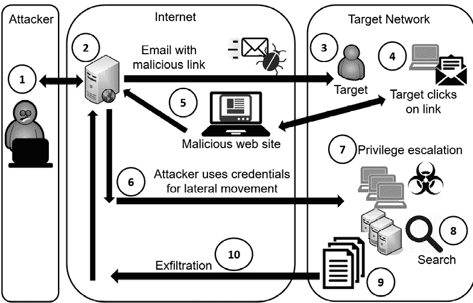

图 6.2：攻击步骤

目标位于目标组织的内部网络中。在阅读以下攻击步骤时，请参考图 6.2：

*   攻击者使用公开的情报来识别目标。一些典型来源是社交媒体网站和新闻媒体。其他时候，攻击者通过电话和电子邮件使用社交工程学策略来获取有关组织或该组织雇员的信息。

*   接下来，攻击者制作一封带有恶意链接的鱼叉式网络钓鱼电子邮件。邮件可能包含指向托管在另一个网站上的恶意软件链接，并鼓励用户点击链接。在许多情况下，此链接可以激活“路经下载”，在用户不知情的情况下将恶意软件安装到其计算机上。这种下载可以是任何种恶意软件，包括勒索软件。其他攻击则使用凭据收集技术，鼓励用户点击链接并在看起来像真的假网站上输入用户名和密码。虽然图中没有显示，但攻击者也可以包含一个附件并鼓励收件人打开附件而不是使用恶意链接。

*   攻击者从基于互联网的系统向目标发送鱼叉式网络钓鱼电子邮件。这封邮件包含一个恶意链接，并使用了旨在诱骗用户点击的词汇。

*   如果用户点击链接，将会将用户带到一个看起来合法的网站。该网站可能会尝试进行路经下载，或者模仿合法网站并鼓励用户输入用户名和密码。

*   如果恶意链接欺骗用户输入了凭据，网站会将信息发回给攻击者。假设恶意链接在用户的系统上安装了恶意软件，例如`RAT`。在这种情况下，攻击者利用它收集用户计算机上的信息（包括一旦发现的用户凭据），并将其发回给攻击者。

*   攻击者使用凭据访问目标系统。然后它利用目标系统进行横向移动。换句话说，它利用目标系统和目标用户凭据来访问网络内的其他系统。`Windows Management Instrumentation` (`WMI`) 和`PowerShell` 经常被用于扫描网络。

*   原始目标在网络中的访问权限可能有限。然而，攻击者使用权限提升技术来在网络内获得更多权限并访问更多资源，例如持有敏感数据的服务器。攻击者使用这些提升的权限在其他系统中安装恶意软件，并在网络内创建新的后门账户。

*   恶意软件在网络内搜索数据，例如计算机和服务器上的电子邮件和文件。

*   恶意软件收集所有感兴趣的数据，并通常将其划分为加密分块。

*   这些加密分块被从网络中外泄并传回给攻击者。

从初始感染开始，攻击者在网络内开始横向移动所需的时间通常少于两小时。此时，攻击者就可以开始数据外泄了。在勒索软件攻击中，恶意软件一旦在网络内定位到数据，就可以开始加密这些数据。然而，某些勒索软件会在开始加密之前尝试定位重要数据，例如在线备份。

## 拦截恶意软件和其他攻击

之前的几个章节描述了攻击者和犯罪分子用于发起新攻击的几种不同方法。恶意软件对任何组织都是一个重大威胁。管理员通常实施分层安全（或深度防御计划）来防止恶意软件。以下项目符号列出了一些用于防止恶意软件的常用安全控制措施：

*   邮件网关上的垃圾邮件过滤器。钓鱼攻击以恶意垃圾邮件的形式投递。邮件服务器上的垃圾邮件过滤器在邮件到达用户之前对其检测和过滤。某些网络首先将邮件路由到另一个设备以过滤掉垃圾邮件。如果用户从未收到恶意邮件，他们就没有点击该邮件中恶意链接的机会。

*   邮件网关上的反恶意软件。恶意邮件通常包含附件形式的恶意软件。邮件服务器上的反恶意软件可以检测并阻止它。该软件会剥离潜在恶意的附件。

*   工作站上的反恶意软件。恶意邮件通常包含附件形式的恶意软件。邮件服务器上的反恶意软件可以检测并阻止它。该软件会剥离潜在恶意的附件。

*   边界和防火墙。许多组织使用防火墙根据既定的安全规则监控并过滤入站流量。

## 垃圾邮件过滤器

组织通常使用垃圾邮件过滤器来阻止不需要的电子邮件。任何垃圾邮件过滤器的挑战在于过滤掉垃圾邮件，而不是将有效邮件标记为垃圾邮件。由于如此，大多数垃圾邮件过滤器倾向于保守，允许垃圾邮件通过。垃圾邮件过滤背后的科学仍在不断改进，犯罪分子也在持续适应。

垃圾邮件过滤器通常允许你将地址识别为安全或被拦截。

垃圾邮件过滤器通常允许你识别地址为安全或被拦截。你可以添加这些单独地址或整个域名。例如，如果你想确保在`homer` 从`springfield.com` 发送邮件时收到他的邮件，你可以将`homer@springfield.com` 识别为安全邮件地址。如果你想确保收到来自`springfield.com` 的所有邮件，你可以将`springfield.com` 指定为安全域名。同样，你可以阻止单个邮件地址`homer@springfield.com` 或整个域名`springfield.com`。

## 杀病毒软件与反恶意软件

反恶意软件可以防御许多类型的恶意软件。你经常会听到杀病毒软件这个术语，认为它只防御病毒。然而，界限已经模糊。病毒并非唯一的威胁。攻击者已使用不同类型的恶意软件改变了自己的策略，而杀病毒软件供应商也通过包含检测和阻止这些威胁的方法来适应。大多数杀病毒软件可以检测、阻止和删除多种恶意软件，例如病毒、木马、蠕虫、根内核、间谍软件和广告软件。杀病毒软件提供实时保护，并执行计划和手动扫描。实时保护持续监控系统。例如，当用户访问网站时，杀病毒软件会扫描下载的网站文件并尝试阻止恶意代码。同样，当用户下载或打开文件时，杀病毒软件会在打开之前对其扫描。计划扫描定期进行，例如每周一次。如果用户或技术人员检测到疑活动，可以执行手动扫描以检查系统。

如果杀病毒软件检测到恶意软件，它通常会隔离并通知用户。然而，杀病毒软件执行此操作的具体方法因供应商而异。分析和解释杀病毒软件输出的关键在于识别并阅读警告。有些人只是点击“确定”而不注意警报，可能会在无意中覆盖杀病毒软件的操作。

病毒和其他恶意软件具有已知的模式。特征码文件（也称为数据定义文件）定义了这些模式，杀毒软件通过扫描文件来匹配这些模式。当软件识别出匹配的模式时，它会将其报告为感染并采取行动，例如删除或隔离该文件。

被隔离的病毒在隔离期间对系统没有害，但它仍然可以用于分析。例如，安全专业人员可以将被隔离的病毒释放到一个不受保护但隔离的虚拟机环境中，进行研究和学习。

恶意软件开发人员会定期发布新病毒，因此定期更新特征码定义文件至关重要。大多数杀毒软件都包含自动检查并下载更新特征码定义文件的功能。它们通常每天检查几次更新。

手动下载并安装特征码文件也是可能的。管理员在更新无法访问互联网的系统时会这样做。在执行此操作时，管理员需要通过对比杀毒软件网站上发布的特征码文件哈值与下载的文件的哈值，来确保特征码文件没有丢失数据完整性。

## 基于启发式的检测

某些杀毒软件包含基于启发式的检测。基于启发式的检测尝试检测此前未知且没有特征码的病毒。这包括本章前面提到的零日漏洞。

基于启发式的分析在沙箱或虚拟环境中运行可疑代码，该环境专门设计用于保护实时环境，同时观察代码的行为。大多数病毒会参与恶意或可疑活动，这些活动在合法程序中是不会出现的。基于启发式的分析可以检测出这些活动。例如，多态恶意软件在创建副本时会为文件添加变化。任何应用程序对文件中添加此类变化是非常不寻常的，启发方法通常能成功检测多态恶意软件。

## 文件完整性监控

某些杀毒扫描程序使用文件完整性监控来检测被修改的系统文件。文件完整性检查程序计算系统文件的哈值作为基准。然后它定期重新计算这些文件的哈值，并与基准中的哈值进行比较。如果哈值发生任何变化，说明系统文件已被修改。当杀毒扫描程序检测到修改的文件时，它会发送警报。很多时候，这些警报可以检测出 rootkit 感染。

## 为什么社会工程有效

社会工程师通常使用一个或基于心理学的原理来增加攻击的有效性。通过向用户介绍不同的社会工程策略和这些底层原理，可以减少他们被骗的概率。接下来的章节将介绍这些主题。

### 权威

许多人被培养要尊重权威，当权威人士要求这么做时，他们更有可能遵守。例如，参与米尔格姆实验的志愿者即使能听见看不见的受试者痛苦的尖叫，仍然继续发送电击，仅仅是因为一个穿实验大褂的人告诉他们继续。他们并没有真的发送电击，尖叫声也是虚假的，但对志愿者来说一切似乎都是真实的。心理学家重复了这些实验并看到了类似的结果。利用权威在冒充、鲸钓鱼攻击（whaling）和电话诈骗（vishing）攻击中最有效：

*   **冒充**：某些社会工程师冒充他人让人们做某事。例如，许多人给用户打电话，声称他们为`Microsoft`、`IRS` 或或其他政府机构工作。其他时候，社会工程师会试图冒充权威人物，例如公司内部的高管或技术人员。
*   **鲸钓鱼攻击**：高管尊重法律实体等权威。许多鲸钓鱼攻击将恶意文件作为邮件附件发送，并将其标识为诉讼文件或传票，鼓励高管打开它们。
*   **电话诈骗**：某些攻击者使用电话冒充权威人物。

### 恐吓

在某些情况下，攻击者试图恐吓受害者采取行动。恐吓可能是通过欺凌手段，并且通常与冒充他人相结合。使用恐吓在冒充攻击和电话诈骗攻击中最有效。

例如，一个社会工程师可能会给高管的接待员打电话提出这样的请求：“辛森先生正要向潜在客户进行大型演示，但他的文件损坏了。他让我打电话给你，让你立即把文件发给我，这样我就可以为他的演讲做好准备。”如果接待员拒绝，社会工程师可以使用恐吓策略，说类似这样的话：“听着，如果你想对这笔百万美元的交易失败负责，那也可以。我会告诉他你不想帮忙。”

注意，这种策略可以同时使用多个原理。在这个例子中，攻击者将恐吓与紧迫性结合在一起。接待员没有多少时间回应。

### 共识

人们通常更愿意喜欢别人喜欢的东西。某些攻击者利用这一点，通过创建带有虚假证言的网站来推广产品。例如，犯罪分子建立了多个网站，上面有几十条条证言，列出了他们虚假杀毒软件的所有益处。如果用户在下载虚假杀毒软件之前搜索互联网，他们会遇到这些网站，并相信其他真人为该产品背书。

使用共识（有时称为社会证明）在木马程序和骗局中最有效。

### 稀缺性

当人们认为某件物品数量有限时，往往会被鼓励采取行动。作为稀缺性的例子，考虑苹果 iPhone。当苹果首次发布新版本时，它们通常会很快售罄。网络钓鱼邮件可以利用这一点，鼓励用户点击链接以获得新产品的专属访问权限。如果用户点击，他们将进入一个恶意网站。稀缺性在钓鱼攻击和木马攻击中通常有效。人们在不深思的情况下就会做出快速决定。

### 紧迫性

某些攻击使用紧迫性作为一种技术来鼓励人们行动。例如，勒索软件利用稀缺性原理并配合倒计时器，而倒计时器提供了紧迫感。受害者通常在丢失所有数据前有 72 小时支付。他们每看一次电脑，都会看到计时器在倒计时。

使用紧迫性在勒索软件、钓鱼鱼、电话诈骗和鲸钓鱼攻击中最有效。例如，带有恶意链接的钓鱼邮件可能表明以特定价格的产品数量有限，因此用户应该“立即点击”。同样，高管可能会被骗，认为传票需要立即采取行动。

记住这一点！社会工程师之所以有效，很多原因是因为他们使用基于心理学的技巧来克服用户的反对。这些技术包括将自己伪装成权威人物、使用恐吓、伪造稀缺性、营造紧迫感、建立熟悉感以及营造信任感。

### 熟悉感

如果你喜欢某人，你更有可能按照那个人的要求去做。这就是为什么许多大公司聘用受喜的名人。这也是为什么当名人卷入影响他们信誉的丑闻时，他们会解雇这些人。

一些社会工程工程师试图在发起攻击之前与受害者建立良好关系以建立一段关系。这种原则在肩部窥视和尾随攻击中最有效：

- `肩部窥视（Shoulder surfing）`。当人们对某人熟悉或喜欢他们时，他们更容易接受别人在他们身后窥视。相比之下，如果你不认识或不喜欢某人，你更有可能识别出肩部窥视并立即停止。
- `尾随（Tailgating）`。如果人们认识或喜欢某人，他们更有可能允许某人跟在他们后面。一些社会工程工程师使用一个简单的、消除戒备的微笑来让对方喜欢他们。

### 信任

除了熟悉之外，一些社会工程工程师试图在他们与受害者之间建立信任关系。这通常需要一点时间，但对犯罪分子来说，回报可能是值得的。语音诈骗（Vishing）`攻击经常使用这种方法。

例如，曾经有一个自称是安全专家的人给我打过电话。他说他在为某家名称中带有“Secure”字样的公司工作，他们注意到我的`computer`正在发送错误信息。他强调了两次他们部署并支持`Windows` 系统。公司名称和他们的经验是试图建立信任的尝试。

然后他引导我打开`Event Viewer` 并查看我系统中的某些错误。他要求我描述我看到了什么，并用一个老练演员的口吻说：“哦我的天呐！”他解释说这表明我的`computer`被严重感染了。然而，我知道这些错误是微不足道的。

在严肃地解释了我的`computer`给我造成了多大的麻烦之后，他又在声音中带上了微笑说道：“但这是你的幸运日。我会帮助你。”他提议在`malware` 永久损坏它之前，引导我完成修复我的`computer`的过程。

这一切都是为了建立信任。在这一刻，他发出了致命一。他让我打开`Run` 窗口并输入网站地址，并要求我点击`OK`。就在这里我停下来了。我没有点击`OK`。

我试图让他回答一些问题，但他一直在回避。最后，我听到了鼠标点击的声。。我与这个社会工程学犯共度的这段“幸运日”经历结束了。

那个链接可能会将我带到一个准备好了路过下载的恶意网站。攻击者可能会引导我完成在系统上安装恶意软件的过程。如果我的系统因错误而拒绝，我打赌他会准备好用安抚的声音说：“正常的。只需点击`OK`。相信我。”他花了很多很多时间在我身上。我怀疑他们这种骗局在许多其他人身上已经非常成功。

### 威胁情报来源

攻击者在发起攻击之前经常使用的一种常用方法是从开源情报（`OSINT`）中收集信息。渗透测试人员（在第 8 章中进行了详细讨论）也使用`OSINT` 方法收集有关目标的信息。这包括公众可以获得的信息，例如通过网站和社交媒体。例如，如果攻击者想要获取公司首席执行官（`CEO`）的名字，他们可能可以在公司网站上找到。同样，许多组织会在`Facebook` 和`Twitter` 等社交媒体网站上发布信息。

相比之下，封闭/专利情报是指知识产权等商业秘密。组织试图保持这些信息的机密，但攻击者有时会渗透进组织以窃取这些商业秘密。常见的`OSINT` 类型有：

- `漏洞数据库`。漏洞数据库记录了已知漏洞，许多公共数据库有助于自动化漏洞管理。两个例子是由美国标准与技术研究院（`NIST`）维护的国家漏洞数据库（`NVD`）以及由`MITRE Corporation` 维护的常见漏洞与披露（`CVE`）列表。
- `信任自动化情报交换协议（TAXII）`。`TAXII` 是一种定义了一系列信息交换的开放标准。
- `结构化威胁表达（STIX）`。`STIX` 是一种开放标准，定义了组织应该共享的威胁信息。
- `自动化指标共享（AIS）`。网络安全和基础设施局（`CISA`）维护自动化指标共享网站（`https://www.cisa.gov/ais`）。
- `暗网`。暗网是一个通过搜索引擎找不到的互联网区域。犯罪分子在暗网上存储和出售黑客工具、盗版材料。暗网网站提供已知漏洞的最新信息。
- `公私共享组织`。许多公私组织也参与信息共享。例如，`InfraGard` 是一个在联邦调查局（`FBI`）与特定行业之间共享信息的非营利组织。
- `入侵指标`。入侵指标（`IoC`）是网络攻击正在发生或已经发生的证据。明显的`IoC` 是来自杀毒软件或其他设备检测到的`malware` 或潜在攻击的确认警报。通常，`IoC` 并不明显，但警报指示了网络安全人员应该寻找什么。例如，`CISA` 发布了一份关于“AppleJeus: Celas Trade Pro”的恶意软件分析报告（AR21-04A）。报告中的`IoC` 包括用户可以下载`malware` 的`URL`、`malware` 中的特定文件名称等。网络安全人员可以使用这些数据搜索代理日志以查看用户是否访问了该`URL`，然后在系统中搜索特定文件。
- `预测分析`。预测攻击者下一步将做什么以及如何挫败他们的攻击。虽然网络安全人员在预测和阻止攻击方面日益进步，但值得注意的是，这需要他们预测未来。如果你有一台可以随心回到未来的`DeLorean` 时空机，这可能很容易。然而，由于没有`DeLorean`，预测分析仍然具有挑战性。
- `威胁地图`。威胁地图提供了活跃威胁的可视化表示。它们通常显示近期攻击的回放，而不是实时数据。此外，数据是匿名的，因此你不知道谁正在受到攻击，但你可以看到国家内的位置。`Redlegg`（`https://www.redlegg.com/blog/cyber-threat\-maps`）对其他组织维护的许多威胁地图进行了列表和描述。
- `文件/代码仓库`。许多仓库包含了预编写的代码，开发者可以将其用于各种用途，包括收集情报。例如，`GitHub` 为软件项目提供分布式版本控制和源代码管理。这允许多个开发者在同一个项目上协作工作。一些`GitHub` 项目是文件仓库。例如，Awesome Threat Intelligence 仓库（`https://github.com/hslatman/awesome-threat\-intelligence`）提供了威胁情报资源的的精选列表。

# 研究来源

网络安全人员在研究威胁时，可以参考几乎无尽的额外来源列表。第 8 章在威胁狩猎的背景下讨论了其中一些来源。以下项目介绍了额外的资源：

*   供应商网站。供应商网站是获取供应商产品可靠信息的良好来源。这对于任何漏洞以及用于修复漏洞的补丁来说尤为如此。
*   会议。许多组织举办专门分享网络安全信息的会议。这些会议通常持续三到五天，包括多位知识丰富的者，并设有各种培训课程，允许与会者选择他们想参加的工作讨会。
*   本地行业小组。本地行业小组是指在同一行业工作并决定协作共享信息的个人或组织。这类似于人们加入社交小组来建立人脉。
*   公共/私有信息共享中心。许多公共和私有组织也参与共享网络威胁信息。例如，`InfraGard` 是一个非营利组织，在联邦调查局 (`FBI`）与特定部门成员之间共享信息。
*   学术期刊。网络安全专业人员经常在学术期刊发表学术文章。这些文章通常用于记录对技术主题的研究，而且同行会在发表前对文章进行评审。这为他们增加了可信度。
*   征求意见 (`RFC`)。互联网工程任务组 (`IETF`) 出于各种目的发布名为`RFC` 的文档。其中许多是互联网标准，是技术规范的权威知识来源。例如，`RFC 6749` 描述了如何在互联网上创建和交换授权令牌。只要网站遵循`RFC 6749` 中的规范，它们就可以相对容易地交换授权令牌。
*   社交媒体。有些人通过社交媒体群组交换数据，这可能是很有用的。这允许人们与他们的同行就潜在威胁进行通信。然而，重要的是要社交媒体群组不是权威的，因此在采取社交媒体群组共享的信息之前对其进行验证是一个明智之举。

# 第 6 章考试主题复习

在准备考试时，确保你理解了本章涵盖的关键概念。

## 理解威胁行为者

*   国家级攻击者是由政府直接雇佣或赞助的攻击者。他们的目的是利用黑客工具促进国家的利益。
*   无技能攻击者使用现有的计算机脚本或代码来发起攻击。他们通常缺乏专业知识或复杂手段，且资金非常有限。
*   网络行动主义者作为活动运动的一部分或为了推进某项事业而发起攻击。
*   内部人员（如公司员工）拥有组织内部资源的合法访问权限。他们有时会出于贪或报复而变成恶意内部人员。`DLP` 解决方案可以防止用户将数据写入外部介质设备。
*   有组织犯罪是一个雇佣个人共同从事犯罪活动的企业。他们的主要动力是金钱。
*   `Shadow IT` 指在组织内部未经授权或批准而使用的非授权系统或应用程序。
*   威胁行为者的属性各不相同。他们可能是目标组织的内部或外部人员，并且他们具有不同的资源/资金水平以及复杂性/能力水平。
*   威胁行为者的动机也非常不同。常见的攻击动机包括数据外泄、间谍活动、服务中断、勒索、财务收益、哲学或政治信仰、伦理黑客攻击、报复、破坏或混乱以及战争。
*   网络安全专业人员和攻击者都会使用开源情报 (`OSINT`)。

## 确定恶意软件类型

*   恶意软件包括几种类型：`ransomware`（勒索软件）、`Trojans`（木马）、`worms`（蠕虫）、`spyware`（间谍软件）、`bloatware`（臃肿软件）、`viruses`（病毒）、`keyloggers`（键盘记录器）。
*   `Ransomware` 在返回控制权之前索。
*   `Trojan`（远程访问木马`RAT`）是一种看起来合法的恶意软件。
*   `worm` 具有自我复制能力，并在整个网络中传播。
*   `Spyware` 监控用户活动并将其报告给攻击者。
*   `Bloatware` 修改默认主页或搜索引擎。
*   `virus` 附着在宿主机上并复制到其他系统。
*   `Keyloggers` 跟踪系统上所有的键盘活动。
*   `logic bomb`（逻辑炸弹）响应事件（如日期、时间或条件）执行。
*   `Rootkits` 获取根级或内核级控制权并隐藏进程以避免检测。

## 识别常见攻击

*   社会工程利用社交策略来获取信息或欺骗用户执行他们不会采取的。社会工程攻击可以在现场、通过电话、上网以及通过电子邮件发生。
*   `Shoulder surfing`（窥视）是一种试图通过偶然观察获取未经授权信息的方法，例如从人的肩膀后面看或使用摄像头监控屏幕。滤光片可以防止窥视。
*   `hoax`（骗局）是一条通常通过电子邮件传播的消息，告知人们即将面临来自并不存在的病毒或安全威胁的毁灭。
*   `Tailgating`（尾随）是一个人紧跟另一个人后面而不显示凭证的做法。访问控制门厅（有时称为人笼）有助于防止尾随。
*   `Dumpster divers`（翻桶者）搜索垃圾寻找信息。粉碎或焚烧文档可以减少与翻桶相关的风险。
*   `Watering hole attacks`（水坑攻击）发现目标小组访问并信任的网站。攻击者随后修改这些网站以下载恶意软件。
*   社会工程师通过`pretexting`（虚构故事）在询问信息之前提供一个虚假场景。
*   `Spam`（垃圾邮件）是不受欢迎或未经请求的电子邮件。攻击者经常在不同类型的攻击中使用垃圾邮件。
*   `Phishing`（网络钓鱼）是向用户发送电子邮件以欺骗他们披露敏感信息、安装恶意软件或点击链接的做法。
*   `Spear phishing`（鱼叉式钓鱼）和`whaling`（大鲸鱼）是钓鱼的类型。鱼叉式钓鱼针对特定的用户组，而大鲸鱼针对高级高管。
*   `Vishing`（语音钓鱼）是一种使用电话语音的钓鱼形式，通常使用 IP 语音 (`VoIP`)。

# 阻塞恶意软件和其他攻击

- 垃圾邮件拦截软件尝试阻止未经请求的电子邮件。你可以配置垃圾邮件过滤器来拦截特定的电子邮件地址和电子邮局域名（domains）。
- 杀毒软件可以检测并阻止不同类型的恶意软件，例如蠕虫、病毒和木马。杀毒软件使用特征码来检测已知恶意软件，并使用启发式算法根据行为检测潜在的恶意软件。
- 在手动下载签名时，可以使用哈希值验证签名文件的完整性。杀毒软件通常包含文件完整性检查器，用于检测被根部包（rootkit）修改的文件。
- 社会工程师和其他犯罪分子利用多种基于心理学的原理来增加其攻击的有效性。这些原理包括权威、威慑、共识、稀缺、紧迫、熟悉和信任。

| 在线参考 | 你做过在线实验吗？访问`https://getcertifiedgetahead.com/` 查看在线内容获取一些额外材料。它们可能帮助你理解一些关键内容 |
| --- | --- |

## 第 6 章练习题

1. 一家科技公司最近发现其组织遭受了攻击，导致客户数据严重泄露。在调查攻击后，他们意识到攻击非常复杂，且可能源自国外。以下哪项识别了此次攻击中种可能的威胁源者？
    1. 黑客主义者 (Hacktivist)
    2. 国家级攻击者 (Nation-state)
    3. 竞争对手 (Competitors)
    4. 内部人员 (Insiders)

2. 攻击者在互联网上购买了一个利用程序。然后他利用该程序在结算期间修改了在线购物车中的某物品价格。以下哪项最能描述该攻击者？
    1. 内部人员 (Insider)
    2. 无技能的攻击者 (Unskilled attacker)
    3. 竞争对手 (Competitor)
    4. 黑客主义者 (Hacktivist)
    5. APT

3. Lisa 是一个数据库管理员。她接到一个电话，对方自称是某已知硬件供应商的代表。他说打电话给客户是为了通知他们所售的数据库服务器存在问题，但表示该问题只影响运行特定操作系统版本的服务器。他询问 Lisa 公司在数据库服务器上运行的是什么操作系统版本。以下哪项最能描述该场景中通话者所使用的策略？
    1. 虚构事实（Pretexting）
    2. 尾随（Tailgating）
    3. 网络钓鱼（Pharming）
    4. 短信钓鱼（Smishing）

4. Moe 正在调查一起攻击，攻击者似乎拥有关于一个不在在线的计算机用户的信息。在检查了用户的电脑后，他发现键盘和电脑之间连接了一个微小的 USB 设备。他最可能发现了什么？
    1. 读卡器 (Skimmer)
    2. 键盘记录器 (Keylogger)
    3. 窃听器 (Wiretap)
    4. 缓冲区溢出 (Buffer overflow)

5. Bart 登录电脑后，无法访问任何数据。相反，他的屏幕显示了一条消息，表示除非他付款，否则他的硬盘将被格式化，他将永久丢失数据访问。这意味着什么？
    1. 键盘记录器 (Keylogger)
    2. 勒索软件 (Ransomware)
    3. 后门 (Backdoor)
    4. 木马 (Trojan)

6. 最近，Monty Burns 赌场的一台电脑上的恶意软件在检测到 Homer 不再在该赌场工作后，销毁了几个重要文件。以下哪项最能识别这种恶意软件？
    1. 逻辑炸弹 (Logic bomb)
    2. 根部包 (Rootkit)
    3. 后门 (Backdoor)
    4. 间谍软件 (Spyware)

7. Maggie 正试图对某公司的软件开发人员进行攻击。她知道那些开发者经常访问同一个网站来分享编码技巧，并在该网站发布恶意软件以感染他们的系统。哪个术语最能描述这种攻击？
    1. 鱼叉钓鱼 (Whaling)
    2. 语音钓鱼 (Vishing)
    3. 水蛭攻击 (Watering hole)
    4. 虚构事实（Pretexting）

8. Homer 抱怨他的工作站有异常活动。调查后，管理员发现他的工作站使用不常用的端口连接到组织内部网络外的系统。管理员还发现该工作站运行着几个隐藏进程。以下哪项选择最能描述这种活动？
    1. 根部包 (Rootkit)
    2. 后门 (Backdoor)
    3. 垃圾邮件 (Spam)
    4. 木马 (Trojan)

9. Bart 从`https://passsecurityplus.com` 下载并安装了`Nmap` 安全扫描器。安装完成后，他注意到浏览器的主页和默认搜索引擎被更改了。该活动最可能的由于是什么？
    1. 臃肿软件 (Bloatware)
    2. 无文件病毒 (Fileless virus)
    3. 蠕虫 (Worm)
    4. 根部包 (Rootkit)

10. 你是`getcertifiedgetahead.com` 网站公司的安全专家。你最近了解到有人注册了类似的域名`cetcertifiedgetahead.com` 和`getcertifiedahead.com`。你应该怀疑发生了哪种类型的攻击？
    1. 勒索软件 (Ransomware)
    2. 域名抢注攻击 (Typosquatting)
    3. 根部包 (Rootkit)
    4. DNS 劫持 (DNS hijacking)

11. 一个穿着维修制服的男人走到你组织的前台。他说 CIO 叫他去修理电话问题，并需要进入布线间。前台人员要求该男子出示大楼准入通行证，然后证实了他在进入该安全区域的批准人员名单上。前台人员执行的检查将防止哪种攻击？
    1. 尾随 (Tailgating)
    2. 网络钓鱼 (Phishing)
    3. 身份仿充 (Impersonation)
    4. 鱼叉钓鱼 (Whaling)

12. 组织的安全策略要求员工将所有废弃纸质文件放在临时存储容器中。这些纸随后在焚化炉中烧毁。这些操作可能防止以下哪些攻击？
    1. 窥视 (Shoulder surfing)
    2. 尾随 (Tailgating)
    3. 短信钓鱼 (Smishing)
    4. 翻找垃圾 (Dumpster diving)

13. Lisa 是一个数据库管理员，她接到一个电话，对方自称是硬件供应商的技术人员。他说打电话给客户是为了通知他们所售的数据库服务器存在问题，但表示该问题只影响运行特定操作系统版本的服务器。他询问 Lisa 公司在数据库服务器上运行的是什么操作系统版本。以下哪个是 Lisa 的最佳反应？
    1. 告诉通话者服务器运行的操作系统和版本，以判断是否需要采取进一步行动。
    2. 感谢通话者并挂断，向主管汇报，并独立向供应商检查问题。
    3. 向通话者要电话号码，以便她在检查服务器后回电给他。
    4. 联系执法人员，因为这是一次虚构事实攻击。

14. Homer 是某银行的财务官 (CFO)，他收到一封来自公司首席执行官 (CEO) Lisa 的邮件。Lisa 表示她正在度假，丢失了装有所有现金和信用卡的包。她要求 Homer 转账 5000 美元到她的账户。以下哪项最能识别这种攻击？
    1. 网络钓鱼 (Phishing)
    2. 语音钓鱼 (Vishing)
    3. 短信钓鱼 (Smishing)
    4. 鱼叉钓鱼 (Whaling)

15. Homer 一直在寻找最新型号的手机。然而，他在任何地方都找不到货源。今天，他收到一封广告该手机的邮件。点击链接后，他的系统被感染了恶意软件。邮件发送者正在利用以下哪种原理？
    1. 权威 (Authority)
    2. 威慑 (Intimidation)
    3. 稀缺 (Scarcity)
    4. 信任 (Trust)

### 2
B 正确。无技能的攻击者通常会获取现成的利用程序，而不是编写代码。内部人员会从网络内部造成破坏，或在攻击时利用内部知识。竞争对手不太可能低价购买单个物品，他们可能对获取专有数据感兴趣。黑客行动主义（Hacktivists）作为活动运动的一部分发起攻击，而不是为了获得商品的更低价格。高级持续威胁（APT）通常是由国家赞助的国家行为者，他们会使用高级工具发起复杂的攻击，而不仅仅是降低商品的价格。

### 3
A 正确。通话者正在使用“设法”（pretexting）的社会工程策略，通过设定一个更有可能让某人提供信息的场景。如果他只是在没有预设场景的情况下询问服务器的操作系统版本，他的成功机会将会降低。尾随（Tailgating）是指一个人在不显示凭证的情况下紧跟在他人后面的行为。钓鱼攻击（pharming attack）试图操纵`DNS` 名称解析过程。短信钓鱼（Smishing）是一种使用短信的钓鱼攻击形式。

### 4
B 正确。键盘记录器（keylogger）是一种用于收集用户键盘活动并将其报告给攻击者的硬件设备或软件程序。Moe 发现的设备可能是硬件键盘记录器。窃读器（skimmer）的作用类似，但它被用于收集信用卡信息，而不是键盘活动。窃听器（wiretap）是连接到电话或数据线以收集网络流量。缓冲区溢出攻击向系统发送意外数据以访问系统内存或导致系统崩溃。

### 5
B 正确。勒索软件试图控制用户的系统或数据，然后要求支付费用（赎金）以取回控制权。键盘记录器捕捉用户的按键并将其存储在文件中。根据键盘记录器的不同，该文件可以自动发送给攻击者或被手动检索。Bart 的电脑可能感染了木马，该木马创建了一个后门。然而，并非所有的木马或后门账户都要求支付赎金作为勒索。

### 6
A 正确。逻辑炸弹（logic bomb）响应事件而执行。在这种场景中，逻辑炸弹在检测到 Homer 不再公司工作时释放了其载荷。根工具包（rootkit）不会响应事件。后门提供了访问系统的另一种方法，但它不会删除文件。间谍软件（Spyware）是在用户不知情或未同意的情况下安装在用户系统上的软件。

### 7
C 正确。水坑攻击（watering hole attack）将恶意软件放在目标已知经常访问的网站上。鲸钓鱼攻击（Whaling attacks）是针对高层目标的社会工程学攻击。语音钓鱼（Vishing）是一种使用语音电话的钓鱼攻击形式。设法（Pretexting）涉及编造一个故事来获得目标的信任。

### 8
A 正确。根工具包通常运行隐藏进程，并且通常尝试通过互联网连接到计算机。该场景并未涉及初始感染。虽然攻击者可能使用后门访问用户的计算机并安装根工具包，但后门不会运行隐藏进程。木马（Trojan）是一种看起来是有益的恶意软件，但它是恶意的。垃圾邮件（Spam）是不受欢迎的电子邮件，与此问题无关。

### 9
A 正确。臃肿软件（Bloatware）随所需的程序一起安装，臃肿软件经常通过更改主页和/或更改默认搜索引擎来劫持浏览器。因为用户从`nmap.org` 以外的网站下载了`Nmap`，可以想象该替代网站为`Nmap` 程序添加了臃肿软件。无文件病毒（fileless virus）是一种在内存中运行的恶意软件，通常在`PowerShell` 脚本中运行，而不是写入磁盘的文件。蠕虫（worm）是自我复制的恶意软件，在没有宿主应用程序或用户交互的情况下在整个网络中传播。根工具包（rootkit）是为系统提供根权限访问的程序或程序组。

### 10
B 正确。这描述了拼写域名攻击（typosquatting attack），即某人购买与合法域名相似的域名，希望吸引误输入原始域名的访问者。勒索软件通常加密数据，然后攻击者要求支付赎金，但在此场景中没有迹象表明要求赎金。根工具包是为系统提供根权限访问的程序或程序组，并会隐藏自己以规避检测。这里没有根工具包的证据。最后，`DNS` 劫持通过重定向`DNS` 记录窃取合法域名的流量。在这种攻击中并非如此，因为它使用了了一个不同的（但相似的）域名。

### 11
C 正确。这些检查是安全控制措施，有助于防止身份冒充（一种社会工程学攻击）。尾随（Tailgating）是指一个人在不显示凭证的情况下紧跟在他人后面的行为。钓鱼（Phishing）是指向用户发送电子邮件，目的是诱骗他们泄露个人信息或点击链接。鲸钓鱼（Whaling）是一种试图针对高层管理者的鱼叉式钓鱼。

### 12
D 正确。翻找垃圾桶（Dumpster diving）是在垃圾桶中寻找文档的行为，但粉碎或焚烧文档可以确保翻找者无法检索到任何纸质文档。窥视者（Shoulder surfers）试图查看监视器或其他屏幕上的内容，而不是纸张。尾随（Tailgating）是指通过跟随他人进入安全区域。短信钓鱼（Smishing）是一种使用短信的钓鱼攻击形式。

### 13
B 正确。这听起来是一次社会工程学攻击，通话者试图获取有关服务器的信息，因此结束电话、向主管报告通话并独立检查供应商的潜在问题是恰当的。通过一个电话向外部人员提供内部系统信息是不恰当的。没有必要询问电话，因为你不会回电并提供服务器信息。虽然通话者用一个看似合理的场景进行了设法（pretexting），但通话者并未犯罪，因此不需要联系执法人员。

### 14
D 正确。这可能是鲸钓鱼攻击，因为目标是高层执行人员（银行财务官）。虽然鲸钓鱼是钓鱼的一种，但鲸钓鱼更具体是更好的答案。语音钓鱼（Vishing）是使用电话的钓鱼，但此场景使用了电子邮件。短信钓鱼（Smishing）是一种使用短信的钓鱼。

### 15
C 正确。攻击者利用稀缺性来诱导用户点击链接。用户可能会意识到点击未知来源的链接是有风险的，但获得新手机的诱惑可能会让他们忽视风险。没有迹象表明该邮件来自任何特定机构。它并没有试图恐吓收件者，也没有迹象表明在建立信任。

## 第 7 章 防御高级攻击

本章涵盖 CompTIA Security 目标：

2.3 解释各种类型的漏洞。
- 应用程序（内存注入、缓冲区溢出、竞态条件、检查时间 (TOC)、使用时间 (TOU)）
- Web 基础（结构化查询语言 (SQLi)、跨站脚本 (XSS)）

2.4 给定场景，分析恶意活动的迹象。
- 网络攻击（分布式拒绝服务 (DDoS)、放大、反射反射、域名系统 (DNS) 攻击、中间人攻击 (On-path)、凭据重放）
- 应用程序攻击（注入、缓冲区溢出、重放、伪造、目录遍历）

4.1 给定场景，对计算资源应用常用的安全技术。
- 应用程序安全（输入验证、安全 Cookie、静态代码分析、代码签名）
- 沙箱（Sandboxing）

4.3 解释与漏洞管理相关的各种活动。

* 识别方法（应用安全、静态分析、动态分析、包监控）

## 4.5 针对特定场景，修改企业能力以增强安全性。

* DNS 过滤

## 4.7 解释自动化与编排在安全运营方面的重要性。

* 自动化和脚本的用例（用户配置、资源配置、护栏、安全组、工单创建、升级、启用/禁用服务和访问、持续集成与测试、集成以及应用程序编程接口 (API)）
* 益处（效率/节省时间、强制基线、标准基础设施配置、安全地扩展、员工留存、响应时间、劳动力倍增器）
* 其他考虑因素（复杂度、成本、单点故障、技术债、持续可维护性）

如果说 IT 世界中有一种东西无处不在，那就是攻击和攻击者。攻击者几乎无处不在。只要你有计算机系统，就无法逃脱他们。然而，你可以主动识别不同类型的攻击，并采取措施防止它们，或至少降低它们的效力。本章涵盖了来自不同来源的各种攻击，以及你如何利用自动化和编排来更好地保护你的 IT 运营。

## 识别网络攻击

本节总结了针对系统和网络发布的许多常见攻击，以及这些攻击的特征。需要意识到，对于书中列出的所有攻击都存在有效的防御措施。然而，攻击者正积极努力破解这些防御措施。随着他们的进展，安全专业人员会创建额外的防御措施，而攻击者则试图击败它们。这场战斗每天都在进行。

本节的目标是让你了解许多知名攻击。通过理解这些攻击，你将更好地准备理解新出现的改进型攻击以及增强的防御措施。

### 拒绝服务攻击

拒绝服务（DoS）攻击是一个攻击者针对一个目标发起的攻击。分布式拒绝服务（DDoS）攻击是两个或多个计算机针对单个目标发起的攻击。两者的目标都是耗尽资源，这会导致系统资源过载，并防止合法用户访问目标计算机上的服务。

例如，Web 服务器通过响应超文本传输协议（HTTP）请求来提供网页。DDoS 攻击可以通过每秒从数百个不同源发送数千个 HTTP 请求来使 Web 服务器过载。这些请求导致 Web 服务器过载，从而引发资源耗尽。在某个时刻，服务器将无法跟上请求。受攻击的计算机通常会显著变慢，防止合法用户查看网页。在资源耗尽的极端情况下，受攻击的计算机可能会崩溃。

基于网络的 DDoS 攻击的一个指标是受攻击计算机的网卡（`NIC`）上持续出现异常高网络流量。由于计算机正尝试响应这些流量，它无法快速对合法流量做出响应。DDoS 攻击的另一个指标是其他系统资源（如处理器或内存）的使用率异常高。

DDoS 攻击有两个主要变体：

* 反射 DDoS 攻击涉及攻击者使用伪造的源 IP 地址向第三方服务器发送请求，该地址看起来像是**的 IP 地址。当第三方服务器响应请求时，它会将响应发送给目标而不是攻击者，从而用未经请求的流量淹没目标。
* 放大 DDoS 攻击使用反射技术并结合放大技术，其中攻击者的一个小请求会从第三方服务器产生一个大得多的响应。这导致指向目标的流量更大，使目标更难以抵御攻击。

| 记住这个！ | 分布式拒绝服务（DDoS）攻击是多个计算机针对单个目标发起的攻击。DDoS 攻击通常包括持续的、异常高的网络流量以及内存和处理器时间的使用，导致资源耗尽。DDoS 攻击的主要变体包括反射攻击（涉及使用第三方服务器将流量重定向到目标）和放大攻击（结合反射技术与放大技术以生成指向目标的更大流量流量）。 |
| --- |

### SYN 洪水攻击

SYN 洪水攻击是一种针对互联网上服务器的常见 DoS 或 DDoS 攻击。它们对攻击者来说很容易发起，并可能导致严重问题。SYN 洪水攻击破坏了传输控制协议（`TCP`）握手过程，并阻止合法客户端连接。

TCP 会话在建立会话时使用三次握手。两个系统通常通过在 TCP 握手中交换三个包来启动 TCP 会话。例如，当客户端与服务器建立正常会话时，会执行以下步骤：

1. 客户端向服务器发送`SYN`（同步）包。
2. 服务器用`SYN/ACK`（同步/确认）包进行响应。
3. 客户端发送`ACK`（确认）包完成握手。建立会话后，两个系统交换数据。

然而，在 SYN 洪水攻击中，攻击者从不通过发送`ACK` 包来完成握手。此外，攻击者会发送大量的`SYN` 包，导致服务器产生多个半开放连接。图 7.1 比较了正常的 TCP 握手与 SYN 洪水攻击的开始。控制僵尸网络的攻击者可以在 DDoS 攻击中从数百或数千个不同的系统发起 SYN 洪水攻击。

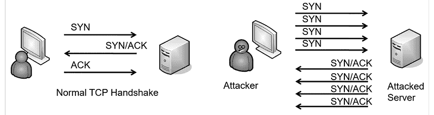

图 7.1：TCP 握手和 SYN 洪水攻击

在某些情况下，这些半开放连接会在服务器等待第三个包时消耗其资源并导致其崩溃。但通常情况下，服务器会限制这些半开放连接的数量。一旦达到限制，设备可能会删除半开放连接以允许新连接，或者删除半开放连接并在有限时间内阻塞所有新连接。例如，Linux 系统允许管理员为`SYN` 包设置阈值，在达到阈值后阻塞`SYN` 包。虽然这防止了 SYN 洪水攻击导致系统崩溃，但也拒绝了合法客户端的服务。

### 伪造

伪造攻击是指攻击者创建一个虚假的身份、证书、文件或其他对象，试图欺骗毫无防备的用户或系统。欺骗（Spoofing）是伪造的一种形式，当一个个人或实体冒充他人或其他事物时发生。常见的欺骗方法与电子邮件地址、IP 协议（`IP`）地址和媒体访问控制（`MAC`）地址有关。

在电子邮件地址欺骗中，攻击者更改发送者地址，使其看起来来自他人。有时他们还会更改`Reply-to` 地址。垃圾邮件和钓鱼邮件经常伪造这些电子邮件地址。

在 IP 欺骗中，攻击者更改源地址，使 IP 包看起来源自不同的源。这允许攻击者从单个系统发起攻击，而攻击看起来却来自不同的 IP 地址。

网络上的主机系统拥有`NIC` 分配的媒体访问控制（`MAC`）地址。这些地址是硬编码在`NIC` 中的。但在 MAC 欺骗攻击中，可以使用软件方法将不同的`MAC` 地址关联到`NIC` 上。

### 路径攻击

路径攻击（on-path attack，有时称为中间人攻击）是某种主动拦截和修改，或主动监控的形式。它使用一台独立的计算机接收来自会话双方的流量，并在两者之间转发流量。这两台计算机对攻击计算机一无所知，但攻击者可以随心所欲中断中断、插入恶意代码或仅仅进行窃听。

例如，想象 Maggie 和 Bart 正在通过网络使用他们的两台计算机交换信息。如果黑客 Harry 能从第三台计算机发起路径攻击，他就可以拦截所有的流量。Maggie 和 Bart 仍然会接收所有信息，因此他们没有察觉到攻击的存在。然而，黑客 Harry 也接收了所有信息。由于路径计算机可以控制整个对话，它很容易插入恶意代码并发送到计算机中。

复杂的路径攻击可以创建多个安全连接。Maggie 和 Bart 的计算机之间不再建立一个安全连接，而是 Maggie 与黑客 Harry 建立一个安全连接，而黑客 Harry 与 Bart 建立另一个安全连接。黑客 Harry 以加密格式接收数据，他的计算机对数据进行解密并存储，然后在发送之前再次进行加密。

由于流量通过了路径计算机，可能会导致延迟，特别是当它在对数据进行再次解密和加密时。这种延迟可能是路径攻击的强烈指示。此外，用于创建安全会话的计算机证书可能不是由信任的证书颁发机构发布的。用户将收到证书警告，只有在忽略警告的情况下才能继续。

如果管理员忽略警告，安全外壳 (SSH) 会话也容易受到路径攻击。当管理员使用`SSH` 连接到远程系统时，两个系统会建立加密密钥，并在随后的连接中使用这些密钥。这些密钥加密了 SSH 会话并提供身份验证。

想象 Lisa 与远程系统建立了 SSH 会话。`SSH` 创建了两个密钥（一个在她的系统上，一个在远程系统上）并创建了指纹来识别它们。这些指纹以 16 个十六进制对的形式表示，例如`1A:2B:3C:4E:5F:6A:7B:8C:9D:1E:2F:3A:4B:5C:6D:7E`。

当 Lisa 使用`SSH` 连接到服务器时，它期望看到相同的指纹。如果指纹不同，则表明管理员正在连接到不同的计算机。`SSH` 将发出类似于下面的警告：

```


@@@@@@@@@@@@@@@@@@@@@@@@@@@@@@@@@@ WARNING: REMOTE HOST IDENTIFICATION HAS CHANGED!

@@@@@@@@@@@@@@@@@@@@@@@@@@@@@@@@@@ IT IS POSSIBLE THAT SOMEONE IS DOING SOMETHING NASTY!

可能有人正在窃听你（中间人攻击）！远程主机发送的`RSA`密钥指纹为`1E:2F:3A:4B:5C:6D:7E:1A:2B:3C:4E:5F:6A:7B:8C:9D:`。


路径攻击也可能是所谓的“浏览器内者攻击”（attacker-in-the-browser attack）。这是一种代理木马，通过扩展程序感染脆弱的 Web 浏览器。成功的浏览器攻击可以捕获浏览器会话数据并修改交易。这包括用于捕获击键的记录器，以及发送和自 Web 浏览器的所有数据。其中某些攻击手段包括按键记录和表单抓取。一旦攻击者收集了用户银行的登录信息，他们就会使用其登录并将资金转到海外账户。

| 记住这个！路径攻击是主动窃听的一种形式。它捕获会话中另外两台计算机的数据。使用安全通道时，路径系统可能会使用不是由 CA 发的证书，并生成证书警告。如果之前建立的密钥发生变化，`SSH` 会发出警告。 |
| --- |

### SSL 剥离攻击 (SSL Stripping)

`SSL` 剥离攻击将加密的超文本传输协议安全 (`HTTPS`) 连接转换为未加密的超文本传输协议 (`HTTP`) 连接。如今，`HTTPS` 使用传输层安全 (`TLS`) 代替 `SSL`，但 `SSL` 剥离这一名称保留了下来。

`HTTPS` 会话是加密的，因此会话中发送的数据对于外部攻击者来说是不可读的。但在建立 `TLS` 之前，会话并未加密。如果攻击者可以拦截 `TLS` 协商的开始，攻击者可以将用户重定向到 `HTTP` 页面而不是 `HTTPS` 页面。

`SSL` 剥离攻击的主要指示位于浏览器本身。如果 URL 左侧显示“不安全”或 URL 包含 `HTTP` 而不是 `HTTPS`，则可能正在进行 `SSL` 剥离攻击。

### DNS 攻击

第 3 章“探索网络技术与工具”更深入地涵盖了域名系统 (`DNS`)，但作为提醒，`DNS` 将主机名解析为 IP 地址。这消除了我们必须记住网站 IP 地址的需求。相反，我们只需在浏览器中输入主机名即可连接。例如，如果你在 Web 浏览器的地址栏中输入 `getcertifiedgetahead.com`，你的系统会查询 `DNS` 服务器 IP 地址。`DNS` 返回正确的 IP 地址，你的系统使用该 IP 地址连接到网站。

### DNS 投毒攻击

`DNS` 投毒攻击试图修改或损坏存储在 `DNS` 服务器上的 `DNS` 数据。例如，成功的 `DNS` 投毒攻击可以修改与 `google.com` 关联的 IP 地址并将其替换。

URL 重定向是一种常用技术，用于将流量重定向到站点内的不同页面（网站重组）、URL 缩，甚至是完全不同的站点。例如，我拥有 `darrilgibson.com` 域名，我有时会用它来尝试不同的网络技术，如 `Python`。当我完成后，我会设置该站点将流量重定向到我的另一个站点。

在某些情况下，攻击者会利用 URL 重定向进行恶意活动。想象一个攻击者发现了一个网站的漏洞并获取了底层文件的访问权限。他可能实施 URL 重定向攻击，并将所有流量发送到另一个恶意的网站。URL 重定向成功的标志非常简单：你尝试访问一个网站，结果被重定向到了另一个网站。

## 域名劫持

在域名劫持攻击中，攻击者在未获得所有者许可的情况下更改了域名注册。攻击者通常通过社会工程技术获取对域名所有者邮箱账户的未经授权访问。

例如，想象 Homer 设置了一个名为 `homersimpson.com` 的域名。他在注册时使用自己的 `Gmail` 账户作为邮箱地址，尽管他现在很少检查自己的 `Gmail` 账户了。

攻击者关注他的 `Facebook` 页面，注意到他经常添加诸如“Doh!”之类的简单评论。稍后，他们尝试暴力破解并登录他的 `Gmail` 账户。他们尝试了密码 `Doh!Doh!` 并成功进入。然后，他们访问域名注册商并使用“忘记密码”功能。系统向 Homer 的 `Gmail` 账户发送了一个重置密码的链接。在注册商网站重置密码后，攻击者更改了域名所有权。他们还删除了所有跟踪他们操作的邮件。后来，Homer 发现他的网站被完全改变了，他再也无法访问它。

| 记住这一点！在域名劫持攻击中，攻击者在未获得所有者许可的情况下更改了域名注册。 |
| --- |

## DNS 过滤

管理员可能会使用 DNS 过滤来控制用户访问的网站。DNS 过滤使用已知恶意域名的列表，拒绝为这些恶意站点提供 IP 地址，或者为它们提供错误的结果。

DNS 汇洞（sinkhole）是一种对一个或多个域名使用错误结果过滤的 DNS 服务器。如果你在正常运行期间向网络浏览器输入域名，浏览器会查询 DNS 获取该网站并带你进入该站点。但是，如果 DNS 服务器对该域名设置了汇洞，你的请求将被拦截，你无法到达该站点。

调查机构已使用汇洞来破坏僵尸网络和恶意软件。受感染的计算机经常与命令与控制服务器通信，恶意软件中包含了这些服务器的域名。当局对恶意软件进行反向工程发现这些域名，然后与 DNS 拥有者协调，重定向发往这些域名的流量。这有效地防止了受感染计算机连接命令控制服务器获取指令。

## DNS 日志文件

DNS 日志文件记录 DNS 查询，例如每个将主机解析为 IP 地址的请求。这些日志目将包括发送请求的系统以及为主机返回的 IP 地址。

这些日志目对于识别潜在的恶意网站很有用。例如，想象 Bart 使用他的公司电脑电脑浏览了几个小时互联网。其中一个网站向他的系统下载了恶意软件，但他不知道是哪一个，也记不住他访问过的所有站点。通过搜索 DNS 日志文件，管理员可以根据他的 DNS 查询识别出他访问过的所有站点。

## 重放攻击

当攻击者重放已属于通信会话的数据时，就会发生重放攻击。攻击者首先捕获两个系统之间通过网络发送的数据。攻击者修改数据，然后尝试伪装原始会话中的一个客户端，并在会话重放中发送修改后的数据。重放攻击可以发生在有线和无线网络上。

例如，Maggie 和 Bart 可能会彼此发起会话。在通信期间，每个客户端使用身份凭据对对方进行身份验证。黑客 Harry 拦截了包括凭据在内的所有数据，随后伪装成 Bart 与 Maggie 发起对话。当 Maggie 的系统向 Hacker Harry 发起挑战时，他的系统发送了 Bart 的凭据。这是特定类型重放攻击的示例，称为凭据重放。

许多协议使用时间戳和序列号来防止重放攻击。例如，`Kerberos` 协议通过带有时间戳的票据防止重放攻击。

| 记住这一点！重放攻击捕获会话数据以伪装会话中的一方。时间戳、序列号和多因素认证是防御重放攻击的有效措施。 |
| --- |

## 总结安全编码概念

应用程序开发和部署概念对于应用开发人员来说非常重要。此外，管理开发项目的 IT 安全经理也应该理解这些概念，即使他们不编写代码。

除非开发者使用安全编码概念创建应用程序，否则应用程序通常为攻击者生成攻击提供了途径。本节涵盖了开发者创建安全应用程序时常用的常用安全技术和概念。

### 输入验证

开发者应该采用的最安全步骤之一是包含输入验证。输入验证是在在使用数据之前检查其有效性的做法。输入验证防止攻击者发送应用程序将使用的恶意代码，通过清理输入以移除恶意代码或拒绝输入来实现。

输入处理不当（缺乏输入验证）是 Web 应用程序常见的安全问题之一。它允许许多类型的攻击，如缓冲区溢出攻击、结构化查询语言 (`SQL`)注入、动态链接库 (`DLL`)注入和跨站脚本攻击。我们将在本文后面的部分讨论这些攻击，但让我们先深入研究输入验证。

考虑一个包含姓名文本框的 Web 表单。逻辑上，你可以预期一个有效的姓名只包含字母且长度不超过 25 个字母。开发者使用输入验证技术来确保用户的姓名符合此有效性检查。如果用户输入其他数据（如数字、分号或 HTML 代码），将无法通过有效性检查。应用程序不会使用这些数据，而是拒绝它们并向用户提供错误。

如果你曾在网页上填写过表单，可能可能见过输入验证检查和错误处理程序的使用。如果你没有填写所有必填文本框，或者在一个或多个框中输入了无效数据，网站并没有崩溃。相反，它重新显示页面并显示错误。网站通常会在缺失或无效数据的文本框旁边使用红色星号，并带有错误信息。输入验证执行的一些常见检查包括：

- 验证正确的字符。某些字段（如邮政编码）只使用数字，而其他字段（如州名）只使用字母。其他字段是混合的。例如，电话号码使用数字和连字符。开发者可以配置输入验证代码检查特定字符类型，甚至验证它们是否输入正确。例如，电话掩码 `###-###-####` 只接受三个数字、一个连字符、三个数字、一个连字符和四个数字。

- **阻止 HTML 代码。** 某些恶意攻击会将 HTML 代码嵌入输入中作为攻击的一部分。输入验证代码可以检测 HTML 代码（例如 `<` 和 `>` 字符）并不使用它们。
- **防止使用某些字符。** 某些攻击（如 SQL 注入攻击）使用特定字符，如破折号（`-`）、单引号（`‘`）和等号（`=`）。阻止这些字符有助于防止此类攻击。
- **实施边界或范围检查。** 这些检查确保值在预期的边界或范围内。例如，如果某个产品的最大购买数量为三个，则范围检查会验证数量为三个或更少。验证检查会将范围之外的数据识别为无效，应用程序将不会使用它。

## 客户端和服务器端输入验证

可以在客户端和服务器端执行输入验证。客户端执行意味着代码运行在客户端系统上，例如用户的网络浏览器。服务器端执行意味着代码运行在服务器上，例如 Web 服务器上。

客户端输入验证更快，但容易受到攻击。服务器端输入验证耗时较长，更安全，因为它确保了应用程序不会接收无效数据。许多应用程序两者都使用。想象 Homer 正在使用浏览器通过 Duff 网站购买最新版本的 Scrabbleships 游戏。客户一次购买不能超过三个。

在客户端输入验证中，验证代码包含在发送给 Homer 的 HTML 页面中。如果他输入的数量为四个或更多，HTML 代码将向其显示错误信息并在 Homer 输入正确数据之前不会将页面提交到服务器。

遗憾的是，客户端验证技术是可以被绕过的。许多浏览器允许用户在浏览器中禁用 `JavaScript`，从而绕过客户端验证。还可以使用 Web 代理在超文本传输协议 (`HTTP`) `POST` 命令中拦截客户端数据，并在转发到服务器之前对其进行修改。

服务器端输入验证在输入到达服务器时进行检查。这确保了用户没有绕过客户端检查。

同时使用客户端和服务器端验证可以兼顾速度和安全性。客户端验证在用户输入正确数据之前防止了与服务器的往返多次。服务器端验证是服务器使用数据之前的最终检查。

| 记住这一点！ | 缺乏输入验证是 Web 应用程序中最常见的安全问题之一。输入验证在使用输入数据前会验证其有效性，且端端验证比客户端验证更安全。输入验证可以防止许多攻击，例如缓冲区溢出、SQL 注入、动态链接库注入和跨站脚本攻击。 |
| --- |

## 其他输入验证技术

其他输入验证技术尝试在将 HTML 代码和 URL 发送到网络浏览器之前对其进行清理。这些方法有时被称为 HTML 转义或 HTML 编码。作为一个简单的例子，大于符号（`>`）可以使用 ASCII 替换字符（`&gt;`）进行编码。这样做并遵循不向网页中插入不可信数据的特定准则，有助于防止许多 Web 应用程序攻击，如跨站脚本、SQL 注入和目录遍历攻击。

大多数语言都包含了开发者可以使用来清理 HTML 代码的库。例如，OWASP 企业安全 API (`ESAPI`) 是一个适用于许多编程语言的免费开源库。它包含了一套丰富的安全工具，其中包括许多。

## 避免竞态条件

当两个或多个模块尝试同时访问资源时，可能会导致冲突。大多数开发者都意识到了。然而，当缺乏经验的开发者忽略这一点时，就会发生竞态条件。

举个简单的例子，想象你访问一个文件。操作系统检查其权限以验证是否有访问权限。如果攻击者行动足够快，攻击者可能会访问原始文件、修改它，甚至将其替换为恶意文件。当使用符号链接而不是直接路径时，有时会发生这种情况。

攻击者有时可以利用“检查时间到使用时间”（TOCTOU）竞态条件。这有时被称为状态攻击。它发生在我们称为“评估对象”（TOE）的系统上。

考虑一下飞机机票的类比。想象应用程序首先检查哪些座位是空的并提供可用座位（检查时间）。两个人选择了同一个座位。安全的应用程序会在预订座位之前再次检查（使用时间）。第一个完成结账流程的人将预留该座位。

## 正确的错误处理

错误处理和异常处理程序确保应用程序能够优雅地处理错误。它们捕获错误并向用户提供友好的反馈。当应用程序未捕获错误时，导致应用程序失败。在最坏的情况下，应用程序内部不当的错误处理会导致操作系统崩溃。使用有效的错误和异常处理程序可以保护底层系统的完整性。

不当的错误处理经常为攻击者提供有关应用程序的信息。当应用程序未捕获错误时，通常会提供攻击者可以用来攻击程序的调试信息。相比之下，当应用程序捕获错误时，它可以控制向用户显示哪些信息。

- 应该记录详细信息。关于错误的详细信息通常包含调试信息。通过记录这些信息，可以帮助开发者识别导致错误的原因以及如何解决它。

| 记住这一点！ | 错误和异常处理有助于保护操作系统的完整性，并控制向用户显示的错误。应用程序应该向用户显示通用错误消息，但记录详细信息。 |
| --- | |

## 代码混淆 (Code Obfuscation)

开发者通常花费大量时间编写代码。如果是 `JavaScript`，其他开发者很容易直接复制并使用代码。降低这种速度的一种方法是使用混淆方法。

混淆试图让内容变得模糊或难以理解，而代码混淆则试图让代码变得不可读。它的操作诸如重命名变量、将数字替换为表达式、将字符字符串替换为十六进制代码，以及删除空白和注释。例如，一个有意义的变量 `strFirstName` 可能会被重命名为 `94mdiwl`，而数字 `11` 可能会变为 `0xF01B – 0x73 – 0xEF9D`（结果仍然是十进制 `11`）。

值得注意的是，大多数安全专家都反对通过隐蔽性来作为维护安全的可靠方法。同样，代码混淆可能让大多数人难以理解代码。然而，有技能的人仍然可能解构代码。

## 软件多样性 (Software Diversity)

自动化软件多样性有时被用于模拟使用多种不同的核心语言。通常情况下，编译器会将用编程语言编写的代码转换为二进制可执行文件。编译器检查程序中的错误，并提供开发者可能想要检查的项目报告。一些常用的编译型编程语言包括 `C++`、`C#` 和 `Java`。自动化软件多样性方法使用一个模拟多种语言编译器的编译器。

换句话说，用 `C#` 编写并使用这种多编译器编译的程序将创建一个二进制可执行文件，该文件包含代码的所有函数和模块，就像它是用 `C#` 以及任何数量其他语言编写的一样。自动化软件多样性方法还为代码增加了一层随机性，使得同一个程序在不同系统上的行为略有不同，但仍然实现相同的结果。

这种想法是，这种自动化多样性提供了额外的保护层。在某个系统上成功的攻击在另一个使用相同多编译器编译程序的系统上将失败。

## 外包代码开发 (Outsourced Code Development)

并不是所有组织都有内部开发者。他们要么需要聘佣开发者，要么外包代码开发。在外包代码开发时，组织应该解决几个特定的安全问题。以下列表确定了一些需要考虑的漏洞：

- 确保代码按预期工作。列表顶端是确保代码正常工作。虽然潜在的开发者可能声称他们可以编写代码，但组织在接受代码之前应该对其彻底测试。
- 存在漏洞的代码。如果开发者不遵循安全代码的最佳实践，他们很容易创建出易受攻击的代码。不幸的是，组织可能在应用程序被利用后、为时已晚才发现糟糕的编码实践。
- 恶意代码。开发者可能会插入恶意代码，例如后门或逻辑炸弹。这些代码使用正常的测试程序可能很难检测。
- 缺乏更新。代码中安全漏洞很常见。然而，开发者通常能够更新代码以修复任何漏洞。如果外包代码开发的合同中没有提到更新，可能很难获得更新。

## 数据泄露 (Data Exposure)

大多数应用程序都处理数据，保护数据至关重要。安全编码技术采取措施来保护静态数据、传输中的数据和处理过程中的数据。如果数据没有得到保护，可能会导致数据泄露，将数据暴露给未经授权的实体。用加密保护静态数据和传输中的数据是常见的。如果应用程序处理加密数据，它通常会先进行解密。在内存中处理后，再次对其进行加密并存储。应用程序应该刷新内存缓冲区，以确保未经授权的实体无法访问解密的残留数据。

第 10 章“理解密码学和 PKI”讨论了静态数据、传输中的数据和处理中的数据。它还讨论了加密方法。

## HTTP 头部 (HTTP Headers)

HTTP 头部在 Web 服务器和客户端之间发送消息。客户端发送 HTTP 请求，服务器发送 HTTP 响应。这些消息包含多个部分。头部组通常由冒号（`:`）分隔。通用头部组适用于整个消息。请求头部组包含了浏览器信息。

开放网络安全项目 (OWASP) 托管了安全头部项目 (`https://owasp.org/www-project-secure-headers/`)，其中包含了响应头部中包含内容的详细建议。一些作为最佳实践常用的头部包括：

- `HTTP-Transport-Security`：告诉浏览器仅在通过 HTTPS 时显示页面。它包括 `max-age=SECONDS` 和 `includeSubDomains` 值。
- `Content-Security-Policy`：定义允许的内容源。它包括脚本、样式 (`CSS`)、图像、插件等的源。
- `X-Frame-Options`：告诉浏览器是否允许 X 框架。它们打开了漏洞。

## 安全 Cookie (Secure Cookie)

当用户访问网站时，网站通常创建 Cookie 并将其写入用户系统。Cookie 是一个小文件，可以包含开发者选择的任何内容。当用户返回网站时，应用程序读取 Cookie 并使用它来增强用户体验。不幸的是，攻击者有时可以读取 Cookie。

安全 Cookie 是设置了 `Secure` 属性的 Cookie。该 `Secure` 属性确保 Cookie 只通过加密通道（如 HTTPS）传输。保护了 Cookie 内容的机密性并防止攻击者读取。许多浏览器（如 `Chrome` 和 `Firefox`）如果 Cookie 设置了 `Secure` 属性，则不会通过 HTTP 传输 Cookie。

## 分析技术

- **静态代码分析**。静态代码分析在不执行代码的情况下对代码进行检查。执行手动代码审查的人员逐行检查代码以发现漏洞。也可以使用自动化工具，它们可以分析代码并标记潜在的缺陷。
- **手动代码审查**。手动代码审查是静态代码分析的一种，由人员逐行检查代码。它由编写代码的程序员以外的人执行，目标是识别潜在的漏洞。
- **动态代码分析**。动态代码分析在代码运行时对其进行检查。一种常用的方法是使用模糊测试（fuzzing）。模糊测试使用计算机程序向应用程序发送随机数据。在某些情况下，随机数据可能会导致程序崩溃或产生意外之外的结果，从而表明存在漏洞。其目标是在动态分析期间发现问题，以便在发布应用程序之前进行修复。
- **沙箱**。沙箱被用于在专门为测试创建的隔离区域内测试应用程序。该术语源于游乐场中的沙箱。孩子们可以在沙箱里玩，那里相对安全（父母可以很容易地监视他们）。同样，应用程序开发者可以在沙箱中测试应用程序，并知道他们所做的任何更改都不会影响沙箱之外的任何内容。虚拟机（VM）经常用于沙箱化。例如，Java 虚拟机包含一个沙箱以限制不受信任的应用程序。
- **包监控**。每位开发者都会以共享库和包的形式使用他人编写的代码。在整个组织中监控这些共享包的使用非常重要。当他人编写的代码出现漏洞时，您将能够识别所有使用了受影响包的情况并对其进行修复。

| 记住这一点！ | 静态代码分析在不运行的情况下对代码进行检查。在手动审查中，开发者逐行检查代码以寻找漏洞。动态代码分析在代码运行时对其进行检查。模糊测试技术向应用程序发送随机数据字符串以寻找漏洞。 |
| --- | |

## 软件版本控制

软件版本控制跟踪软件更新时的版本，包括谁在何时进行了了更新。许多先进的软件开发工具都内置了复杂的版本控制系统。开发者检出（check out）代码进行处理，完成后将其检回（check back in）系统。版本控制系统就可以记录开发者所做的每处更改。此外，这种版本控制过程通常允许开发者在需要时将更改回滚到之前的版本。

有效的版本控制过程还有助于消除未经授权的更改。如果开发者可以做出不受跟踪的更改，他们很容易导致意料之外的问题。

## 安全开发环境

安全的开发环境包含多个阶段，通常包含用于每个阶段的不同系统。例如，想象一个软件开发团队正在创建一个用于通过互联网销售产品的应用程序。此过程中使用的不同阶段如下：

- **开发**。在开发阶段，软件开发者使用隔离的开发环境来创建应用程序。它与生产环境隔离，以确保任何 Bug 都不会影响其他系统。这通常包括版本和更改控制以跟踪应用程序的开发。
- **测试**。测试人员在测试阶段对应用程序进行全面测试，并尝试发现任何 Bug 或错误。测试环境通常不模拟完整的生产环境，而是包含足够测试软件模块的硬件和软件。
- **发布（Staging）**。预发布环境模拟生产环境并用于后期测试。它提供了生产环境的一个完整但独立的副本。它试图发现可能对实时环境产生不利影响的 Bug。
- **生产（Production）**。在生产阶段，应用程序作为最终产品上线。它包含了支持应用程序并允许客户使用的所有内容。在例例中，它将包含在线 Web 服务器、可能存在的后端数据库服务器以及互联网访问。
- **质量保证（QA）**。质量保证是一个持续过程，贯穿从开发阶段到部署后的整个生命周期。它有助于确保应用程序保持高水平质量并符合原始需求。某些组织遵循特定的质量保证标准，例如由国际标准化组织（ISO）和国际电工委员会（IEC）发布的标准。

| 记住这一点！ | 安全的开发环境包含多个阶段。阶段在独立的非生产环境中完成。每个阶段都会使用质量保证方法。 |
| --- | |

## 数据库概念

几种安全编码技术和攻击直接应用于数据库。下文将介绍 SQL 查询的工作原理。SQL（读作 "sequel"）是用于与数据库通信的结构化查询语言。SQL 语句从数据库读取、插入、更新和删除数据。许多网站使用 SQL 语句与数据库交互，提供动态内容。

数据库是结构化数据集。它通常包含多个表，每个表包含多个列和行。例如，考虑图 7.2。它显示了用于书籍信息的数据库架构。Book 表（左侧）标识了列名。这些每一列标识了数据类型。例如，`INT` 代表整数，`VARCHAR` 代表变长字符字符串，`TEXT` 用于段落，而 `DECIMAL` 可以存储货币值。

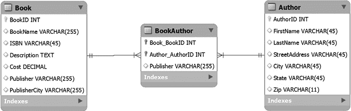

图 7.2：数据库架构

Author 表持有作者的信息，如姓名和地址。BookAuthor 表创建了 Book 表和 Author 表之间的关系。Publisher 列不应该在那里，但它有助于下一节的归一化讨论。

图 7.3 显示了 Author 表的三行。它还显示了列和行的区别。因为列标识数据类型，所以列有时被称为属性。同样，因为每行代表一条记录，行也称为记录或元组。

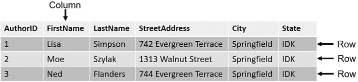

图 7.3：数据库表

数据库中的单个元素被称为字段。例如，Author 表第二行 FirstName 列中的字段是包含 Moe 值的字段。

## SQL 查询

与数据库相关的漏洞之一是 SQL 注入攻击。以下章节将介绍 SQL 查询如何工作、攻击者如何发起 SQL 注入攻击以及如何防止 SQL 注入攻击。

作为使用 SQL 查询网站的简单示例，考虑 Amazon.com。当你输入搜索词并点击 Go（如图 7.4 所示），Web 应用程序创建一个 SQL 查询，将其发送到数据库服务器，并将结果格式化为网页发送回给你。


图 7.4：使用 SQL 查询数据库的网页

在示例中，我选择了 Books 分类并输入了 Darril Gibson。结果显示了 Amazon 上销售的 Darril Gibson 编写的书。从 Amazon 发送到数据库的查询可能如下：

```
SELECT * FROM Books WHERE Author = 'Darril Gibson'
```


`SELECT * FROM Books WHERE Author ='Darril Gibson'`

`*` 是一个通配符，返回表中的所有列。注意，该查询包含了在网页表单中输入的搜索词（`Darril Gibson`），并将该搜索词包含在单引号中。如果网站简单地将搜索词插入到由单引号包围的 `SELECT` 语句中，它可以运行，但也非常容易受到 SQL 注入攻击。

## SQL 注入攻击

在 SQL 注入（SQLi）攻击中，攻击者向网页表单输入额外数据以生成不同的 SQL 语句。SQL 查询语言使用分号（`;`）表示 SQL 行的结束，并使用双连字符（`--`）作为被忽略的注释。利用这些知识，攻击者可以这样向 Web 表单输入不同的信息：

`Darril Gibson'; SELECT * FROM Customers;--`

如果 Web 应用程序将此数据字符串直接插入到同样的单引号的 `SELECT` 语句中，它看起来像这样：

```
SELECT * FROM Books WHERE Author ='Darril Gibson'; SELECT * FROM Customers;--'
```

第一行从数据库中检索数据，与之前一样。然而，分号标志着行的结束，数据库将接受另一个命令。下一行读取 `Customers` 表中的所有数据，使攻击者能够访问姓名、信用卡数据等更多内容。最后一行注释掉了第二个单引号，以防止出现 SQL 错误。

假设应用程序没有包含错误处理程序。在这种情况下，错误提供了有关应用程序所用数据库类型的详细信息，例如 Oracle、Microsoft SQL Server 或 MySQL 数据库。不同的数据库对 SQL 语句的格式略有不同，但一旦攻击者了解了数据库品牌，格式化该品牌所需的 SQL 语句就是件容易的事。攻击者随后通过 SQL 语句来访问数据库。这可能允许攻击者读取、修改、删除和/或损坏数据。

这种攻击对 Amazon 无效（请不要尝试），因为 Amazon 正在使用安全编码原则。我无法访问其代码，但我打赌开发者们正在使用输入验证和基于 SQL 的存储过程（在下一节中描述）。

许多 SQL 注入攻击使用 `or 1=1` 这种短语来创建一个真值条件。例如，如果一个在线数据库允许你通过搜索 `Customers` 表来查找特定记录，它可能期望你输入一个名字。如果你输入了 Homer Simpson，它将创建一个如下查询：

```
SELECT * FROM Customers WHERE name = 'Homer Simpson'
```

此查询将检索 Homer Simpson 的单条记录。然而，如果攻击者输入 `' or 1=1;--` 而不是 Homer Simpson，它将创建一个如下查询：

```
SELECT * FROM Customers WHERE name = '' or 1=1;--
```

虽然这是一个单一的 `SELECT` 语句，但 `or` 子句导致其行为像两个独立的 `SELECT` 语句：

```
SELECT * FROM Customers WHERE name = ''
SELECT * FROM Customers WHERE 1=1
```

第一个子句可能不会返回任何记录，因为表中不太可能存在姓名字段为空的记录。然而，因为数字 `1` 始终等于数字 `1`，第二个语句中的 `WHERE` 子句始终等于 True（真）。`SELECT` 语句将从 `Customers` 表检索所有记录。

在许多情况下，SQL 注入攻击首先通过向系统发送格式不正确的 SQL 语句来产生错误。然而，适当的错误处理可以防止攻击者从这些错误中获取信息。许多网站不会向用户显示错误，而是简单地呈现通用的错误网页，不提供任何细节。

## 防止 SQL 注入攻击

如前所述，输入验证为防止 SQL 注入攻击提供了强有力的保护。在使用 Web 表单输入的数据之前，Web 应用程序会验证数据的有效性。

此外，数据库开发者经常在动态网页中使用存储过程。存储过程是一组作为一个整体执行的 SQL 语句，类似于一个微程序。参数化存储过程接受名为“参数”的数据作为输入。它不是直接将用户的输入复制到 `SELECT` 语句中，而是将输入作为参数传递给存储过程。存储过程执行数据验证，但它以不同的方式处理参数（输入的数据），并防止 SQL 注入攻击。

考虑之前一个通过作者搜索书籍的例子，攻击者输入了以下文本：`Darril Gibson'; SELECT * From Customers;--`。Web 应用程序将此搜索字符串传递给存储过程。然后，存储过程在如下 `SELECT` 语句中使用整个搜索字符串：

```
SELECT * From Books Where Author ='Darril Gibson'; SELECT * From Customers;-- '
```

在这种情况下，用户的文本被解释为无害文本而非恶意的 SQL 语句。它将使用所有这些文本查找作者名为这些书籍：`Darril Gibson’; SELECT * From Customers;--`。书籍的作者名中没有嵌入 `SELECT` 语句，因此查询返回空。

取决于数据库服务器的锁定程度（或未锁定），SQL 注入攻击可能允许攻击者访问数据库结构、所有数据，甚至修改数据。在某些情况下，攻击者将产品价格从数百美元修改为仅几美元，购买了几件，然后将价格恢复正常。

| 记住这一点！ | 攻击者使用 SQL 注入攻击通过 Web 服务器向后端数据库传递查询。许多 SQL 注入攻击使用代码 `' or 1=1` 来欺骗数据库服务器提供信息。输入验证技术和存储过程有助于防止 SQL 注入攻击。 |
| --- | --- |

## 服务器日志

Web 服务器日志通常记录服务器上的活动。这些 Web 服务器日志将显示正常活动，例如来自用户的 HTTP 请求和服务器的响应。如果你的组织拥有或控制该服务器，管理员将拥有 Web 服务器日志。然而，管理员无法查看其他人的日志。例如，你无法访问 Google 服务器的日志。

这些日志还会记录异常流量，例如在本章关于 Web 服务器中描述的任何攻击。例如，如果你怀疑攻击者正在发起 SQL 注入攻击，你可以在日志中搜索 `' or 1=1` 实例。同样，你可以在日志中搜索其他潜在攻击的指标。

第一章“精通安全基础”介绍了集中日志记录方法，例如安全信息和事件管理（SIEM）系统。与其手动分析日志，通常是将日志记录发送到集中日志系统并在检测到可疑流量后配置发送告报。

## 其他应用程序攻击

除了 SQLi 攻击外，许多其他攻击针对托管在 Web 服务器上的服务器应用程序。Web 服务器经常接收用户数据，因此非常容易受到多种类型的攻击。

### 内存漏洞

许多应用程序攻击利用系统内存或缓冲区中的漏洞。正如此，开发者需要在代码中使用安全的内存管理技术。例如，糟糕的内存管理技术会导致内存泄漏或允许各种溢出问题。后续章节将描述与应用程序相关的内存问题。

### 内存泄漏

内存泄漏是计算机程序中的错误，会导致程序运行时间越长消耗的内存越多。在极端情况下，应用程序消耗的内存会导致操作系统崩溃。

内存泄漏通常是由应用程序预留短期使用的内存但从不释放内存导致的。例如，想象一个 Web 应用程序，它收集用户配置数据以个性化用户的浏览体验。然而，它在用户每次访问网页时收集这些数据，并且永远不释放用于存储这些数据的内存。内存泄漏的一个初步迹象是系统运行速度越来越慢，直到重启为止。可以通过操作系统工具（如 Windows 任务管理器）查看每个应用程序的内存占用来检测内存泄漏。

## 缓冲区溢出与缓冲区溢出攻击

当应用程序接收到的输入比预期的多或不同时，就会发生缓冲区溢出。结果是一个错误暴露了本应受保护且无法访问的系统内存。通常情况下，应用程序只能访问特定的内存区域，称为缓冲区（buffer）。缓冲区溢出允许访问应用程序缓冲区之外的内存位置，使攻击者能够向该内存区域写入恶意代码。

例如，应用程序可能预期接收一个 15 个字符的用户名字符串。如果它收到的字符超过 15 个，并尝试将数据存储在缓冲区中，就会导致缓冲区溢出并暴露系统内存。以下 HTTP GET 命令显示了向系统发送长字符串以创建缓冲区溢出的示例：

```
GET /index.php?username=ZZZZZZZZZZZZZZZZZZZZZZZZZZZZZZZZZZZZZZZ
```

缓冲区溢出暴露了一个漏洞，但它本身并不一定会导致破坏。然而，一旦攻击者发现了该漏洞，他们就会利用它并用自己的代码覆盖内存位置。这种技术被称为内存注入（memory injection）。

在更多情况下，攻击者的目标是将恶意代码插入到系统将执行的内存位置中。对于攻击者来说，要知道恶意代码存储的确切内存位置并不容易，这让计算机执行该代码变得困难。但是，攻击者可以通过合理的推测来接近目标。

虽然错误处理程序和输入验证在防止缓冲区溢出方面很有作用，但它们不能防止所有溢出。攻击者偶尔会发现漏洞，允许他们向应用程序发送特定的数据字符串，导致缓冲区溢出。当供应商发现缓冲区溢出漏洞时，他们通常会迅速发布补丁或热修复。从管理员的角度来看，解决方案非常简单：保持系统更新到最新的补丁。

## 整数溢出

如果应用程序接收到的数值超过了其处理的范围，就会发生整数溢出。结果是应用程序给出不准确的结果。例如，如果一个应用程序预留 8 位来存储一个数字，它可以存储 0 到 255 之间的任何值。如果应用程序尝试将两个值（例如 `95 × 59`）相并将（`5605`）存储在 8 位内存位置中，就会导致整数溢出。

双检内存缓冲区的大小是一个良好的习惯，以确保它们能够处理应用程序生成的任何数据。也可以使用输入验证技术来防止整数溢出问题。如果应用程序没有适当的错误和异常处理程序，这可能会导致整数溢出情况。

| 记住这一点！ | 当应用程序接收的数据超过其处理能力，或接收到暴露系统内存的意外数据时，就会发生缓冲区溢出。缓冲区溢出攻击通常包括 NOP 指令（如 `0x90`）后跟恶意代码。成功后，该攻击会导致系统执行恶意代码。输入验证有助于防止缓冲区溢出攻击。 |
| :--- | --- |

## 其他注入攻击

除了本章之前讨论的 SQL 注入攻击外，还有多种类型的注入攻击。它们包括动态链接库注入、轻量级目录访问协议（LDAP）注入和可扩展标记语言（XML）注入攻击。

### DLL 注入

应用程序通常使用动态链接库（DLL）或多个 DLL。DLL 是一个编译好的代码集，应用程序可以使用它而无需重新创建。例如，大多数编程语言都包含了基于数学的 DLL。开发者不需要编写代码来发现数字的平方根，而是包含相应的 DLL 并访问其中的平方根函数。

DLL 注入是一种向系统内存中注入 DLL 并导致其运行的攻击。例如，想象攻击者创建了一个名为 `malware.dll` 的 DLL，该其中包含几个恶意函数。在成功的 DLL 注入攻击中，攻击者将此恶意 DLL 挂载到运行进程中，在运行进程内分配内存，在分配的内存中连接 DLL，然后执行 DLL 中的函数。

### LDAP 注入

轻量级目录访问协议（`LDAP`）规定了查询网络中用户、计算机和其他对象数据库的格式和方法。例如，Microsoft Active Directory 使用 `LDAP` 来访问域内的对象。

当使用 Web 应用程序查询基于 `LDAP` 的数据库时，有时发生 LDAP 注入攻击。例如，想象一个桌面技术人员需要访问 Homer 的账户进行修改。技术人员在应用程序中输入 Homer 的用户名，应用程序构造一个 `LDAP` 查询以检索 Homer 的账户信息。

然而，想象桌面技术人员（或其他人）使用该应用程序输入不仅是 Homer 用户名以外的其他内容。在这种情况下，可能欺骗应用程序构造更长的 `LDAP` 查询，并访问比用户信息多得多的内容。

防止这种情况的最佳方法是在使用输入之前对其进行验证，正如之前的“输入验证”部分所讨论的那样。

### XML 注入

可扩展标记语言（`XML`）是一种常用用于传输数据的标记语言。它是可扩展的，这意味着它支持使用任何自定义标签来描述数据。许多在线应用程序使用 `XML` 传输数据。

例如，想象一个在线 Web 应用程序用于创建和传输用户信息。用户会被提示输入用户名和电子邮件地址。XML 数据可能如下：

```
<user>
<username>Homer</username>
<email>homer@simpson.com</email>
</user>
```

然而，想象用户为电子邮件地址输入了以下数据：

```
homer@simpson.com<user><username>Attacker</username> <email>attacker@gcgacert.com
```


如果未使用输入验证，这些额外数据将创建一个第二个用户账户。在某些情况下，接收数据的 XML 应用程序将创建第二个账户（在本例中 `Attacker`），但忽略第一个账户。

XML 注入的一个主要迹象是创建了意外的账户，但可能需要详细的日志记录和审计才能发现。最好的办法是使用强有力的输入验证防止 XML 注入。

## 目录遍历

目录遍历是一种特定类型的注入攻击，试图通过包含完整目录路径或遍历计算机上的目录结构来访问文件。

例如，在 Linux 系统中，`passwd` 文件包含了用户登录信息，它存储在 `/etc` 目录下，完整目录路径为 `/etc/passwd`。如果用户知道 Web 服务器将其内容存储在 `/var/www/` 目录中，他们就可以利用这一知识尝试访问密码文件。他们知道 Linux 系统使用 `..` 运算符来引用当前目录的上一级目录。因此，要从 `/var/www/` 到存储密码文件的 `/etc/`，他们需要向上移动两层，然后进入 `/etc/` 目录。他们可以尝试访问名为 `../../etc/passwd` 的文件来遍历目录结构。如果 Web 服务器没有阻止目录导航命令的使用，且文件系统未经过安全防护以防止此类访问，服务器可能会将 `/etc/passwd` 文件显示给攻击者。

# 跨站脚本攻击

跨站脚本攻击（XSS）是一种 Web 应用程序漏洞，允许攻击者向网页中注入脚本。这通常通过两种方式之一发生：

- **反射型 XSS 或非持久型**：这始于攻击者制作一封恶意邮件，然后鼓励用户点击。恶意 URL 通常放置在网络钓鱼邮件中，但也可能放置在公共网站上（例如注释中的链接）。当用户点击恶意 URL 时，它会向服务器发送 HTTP 请求。该请求包含恶意代码，服务器会在 HTTP 响应中将其发回给用户。
- **存储型 XSS 或持久型**：不是由用户将恶意代码发送到服务器，而是将其存储在数据库或其他 Web 应用程序信任的其他位置。Web 应用程序稍后可以检索恶意代码，例如管理员登录网站时。

防止 XSS 攻击的主要防护是在 Web 应用程序端采用复杂的输入验证技术。开发者应避免任何允许网页显示不可信数据的方法。此外，OWASP 强烈建议使用安全编码库。实施后，编码库将清理 HTML 代码并防止 XSS 攻击。OWASP 提供了 10 多条开发者可以遵循的规则来防止 XSS 攻击。

# 安全运维的自动化与编排

使用脚本技术进行自动化是很常见的。SIEM 系统包含了许多后台运行的脚本，用于收集和分析日志记录。检测到感兴趣的项目后，它们通常会触发脚本根据预定义的设置对条目做出响应。例如，脚本可能会针对特定的日志记录向管理员组发送电子邮件。

第 11 章“实施策略以缓解风险”讨论了安全编排、自动化和响应（SOAR）工具。这些工具使用预写的脚本来响应低级安全事件。有效的 SOAR 平台可以处理许多简单的行政和网络安全任务，而无需占用的时间。

# 自动化与脚本的用例

自动化和脚本在管理企业和组织的安全运维方面变得越来越重要。它们允许 IT 和安全团队精简流程、最小化人为错误，并确保在管理各种安全相关任务时采用一致的方法。准备 Security+ 考试时，你应该熟悉以下用例：

- **用户置备（User provisioning）**：自动化创建、更新和删除用户账户及权限的过程，可确保高效且安全地维护访问控制。这有助于防止未经授权的访问并维护最小权限原则。
- **资源置备（Resource provisioning）**：自动化用于创建、配置和停用虚拟机、存储和网络等资源。这有助于维护标准的、安全的环境，同时减少人为错误和配置漂移的可能。
- **护栏（Guardrails）**：建立自动化护栏来执行安全策略，并确保整个范围内始终遵循安全最佳实践。
- **安全组（Security groups）**：自动化可用于管理安全组，确保访问控制一致地应用于网络资源，并根据需要进行更新，以应对威胁格局的变化。
- **工单创建（Ticket creation）**：自动化工单创建可用于精简事件响应流程，确保问题被快速报告并分配给相应的团队进行解决。
- **升级（Escalation）**：自动化可根据预定义的标准将安全事件或事件升级给相应的人员或团队，缩短响应时间并减少安全威胁的潜在影响。
- **启用/禁用服务和访问**：可以根据用户角色、安全策略或风险评估等各种标准来启用或禁用服务和访问。这可以通过限制不必要的访问和减少潜在的攻击面来帮助维持安全环境。
- **持续集成与测试**：自动化对于持续集成和测试过程至关重要，这有助于确保代码以安全的方式经过持续审查、测试和部署。这有助于防止安全漏洞的引入并保持对安全标准的合规。
- **集成与应用程序编程接口（APIs）**：自动化可集成各种安全工具和平台，允许它们更有效地协同工作并实时共享信息。可以使用 API 来实现这些集成，允许数据的安全交换并简化安全运维。

| 记住这个！ | 安全运维中自动化和脚本的常见用例包括用户置备、资源置备、护栏、安全组、工单创建、升级、启用/禁用服务和访问、持续集成与测试以及使用 API 创建集成。 |
| --- |

# 自动化与脚本的优势

自动化和脚本在管理安全运维方面提供了许多优势，允许企业和组织在提高安全态的同时获得额外收益。以下是自动化和脚本的一些关键优势：

- **效率/节省时间**：自动化和脚本可以显著缩短从资源置备到响应安全事件各项任务所需。这允许 IT 和安全团队专注于更具战略性和高价值的活动。
- **强制执行基准**：自动化能够在组织基础设施中一致地执行安全基准和策略。这有助于确保所有系统和应用程序都以安全的方式进行配置，并及时解决任何偏差。
- **标准基础设施配置**：通过自动化基础设施组件的部署和管理，组织可以维护符合安全最佳实践的标准配置。减少了由于手动操作导致配置错误和漏洞的风险。
- **安全扩展**：自动化和脚本允许组织安全且高效地扩展业务。随着系统和用户的增加，自动化过程可以确保安全措施得到一致的应用和维护。
- **员工留存**：自动化重复性和耗时的任务可以提高员工的工作满意度，让他们能够专注于更具参与性和战略性的工作。这有助于提高员工留存率并建立更有活力的员工队伍。
- **响应时间**：自动化可以帮助提高组织对安全事件和漏洞的响应时间。自动化流程可以快速检测、报告并解决问题，最大限度地减少潜在影响并缩短响应时间。
- **劳力倍增器**：自动化和脚本充当劳力倍增器，允许 IT 和安全团队在不需要额外人员的情况下管理更多的系统和流程。这可以节省成本并更高效地分配资源。

| 记住这一点！ | 安全操作中实施自动化和脚本的主要优势包括：提高效率和节省时间、一致地执行基准、标准化的基础设施配置、安全的扩展、提高员工留存率、更快的响应时间以及作为劳力倍增器。 |
| --- |

## 其他考虑因素

虽然自动化和脚本提供了许多益处，但考虑与其实施相关的潜在缺点和挑战也是关重要的。在安全操作中实施自动化和脚本时，您应该记住以下关键考虑因素：

- **复杂性**：实施自动化和脚本可能会增加组织架构和流程的复杂性。确保增加的复杂性是可管理的，并且不会引入新的漏洞或挑战至关重要。
- **成本**：虽然自动化和脚本从长期来看可以节省成本，但对工具、基础设施和培训的初始投资可能是巨大的。组织在启动自动化项目之前，应该仔细权衡成本与收益。
- **单点故障**：在某些情况下，过度依赖自动化和脚本可能会导致单点故障。建立冗余和回退机制非常重要，以最大限度地减少自动化过程中潜在故障导致的中断风险。
- **技术债**：随着自动化和脚本工具的演进，可能需要更新或替换现有的脚本和集成。这可能导致技术债，即过时或维护不良的脚本会导致问题或漏洞。组织应该计划定期的维护和更新以最大限度地减少这种风险。
- **持续支持性**：确保自动化和脚本解决方案的可维护和可支持对于长期成功至关重要。这包括为团队成员提供培训和文档，并根据需要监控和更新脚本及工具。组织应该考虑维护其自动化基础设施所需的资源并进行相应分配。

| 记住这一点！ | 在安全操作中实施自动化和脚本时，必须考虑潜在的复杂性、成本、单点故障、技术债和持续支持性，以确保长期成功和可维护性。 |
| --- |

## 第 7 章考试考点回顾

在准备考试时，请确保您理解本章涵盖的关键概念。

### 识别网络攻击

- **DDoS 攻击**是来自多台计算机的 DoS 攻击。DDoS 攻击通常包括持续的异常高网络流量、高处理器使用率或高内存占用，导致资源耗尽。
- DDoS 攻击的主要变体包括**反射攻击**（涉及使用第三方服务器将流量重定向到目标）和**放大攻击**（将反射技术与放大技术相结合，产生针对目标的更大规模的流量）。
- **伪造攻击**发生在攻击者创建虚假身份、证书、文件或其他对象时，并试图欺骗毫无防备的用户或系统。`Spoofing`（欺骗）是伪造攻击的一个例子，当一个人或实体冒充或伪装成他人或其他物体时发生。
- **中间攻击（On-path attacks）**是拦截或主动监听的形式。复杂的中间攻击会建立安全通道，用户可能会看到指示中间攻击的证书警告。`SSH` 在检测到中间人攻击时会向用户发出警告。
- **安全套接层 (SSL) 剥离**是一种中间攻击，试图将加密的 HTTPS 会话转换为未加密的 HTTP 会话。
- **DNS 投毒攻击**破坏或修改存储在 DNS 服务器上的 DNS 数据，并可以将用户重定向到恶意网站。
- **农场攻击**试图通过在客户端系统上存储错误的 DNS 记录来操纵 DNS 名称解析过程。
- **URL 重定向**导致用户访问网站时 Web 浏览器跳转到不同的 URL。
- **域名劫持攻击**允许攻击者在未经所有者许可的情况下更改域名注册。所有者在失去网站访问权限后发现被劫持。
- **重放攻击**捕获会话中的数据。在对捕获的数据进行处理后，将其作为会话重放回网络。时间戳和序列号可以防止重放攻击。

### 总结安全编码概念

- Web 应用常见的编码错误是缺少**输入验证**。输入验证在数据传递给应用程序之前进行检查，防止许多类型的攻击，包括缓冲区溢出、`SQL 注入`、命令注入和跨站脚本攻击。
- **服务端输入验证**是最安全的。攻击者可以绕过客户端输入验证，但无法绕过服务端输入验证。通常会同时使用两者。
- **竞态条件**允许两个进程同时访问相同的数据，导致结果不一致。可以通过访问数据之前锁定数据来避免此类问题。
- 应用程序中的**错误处理程序**可以防止应用程序故障并保护操作系统的完整性。显示给用户的错误信息应该是通用的，但应用程序应该记录错误的详细信息。
- **代码签名**使用证书内的数字签名来验证和确认软件代码。
- **代码质量和测试技术**包括静态代码分析、动态分析（如 `fuzzing`）、压力测试、沙箱和模型验证。
- **SQL 注入攻击**提供有关数据库的信息，并允许攻击者读取、修改和删除数据库中的数据。它们通常使用短语 `' or 1=1` 来欺骗数据库服务器提供信息。输入验证和存储过程提供了针对 SQL 注入攻击的最优保护。
- **安全 Cookie**具有一个属性设置，指示 Web 浏览器仅通过加密连接发送它们，保护其免受监听攻击。
- **缓冲区溢出**发生在应用程序接收到的输入比预期的多或不同时。其结果是暴露了本应受保护且无法访问的系统内存。
- **目录遍历**是一种注入攻击，尝试通过包含完整目录路径或遍历计算机上的目录结构来访问文件。
- **跨站脚本 (XSS)** 是一种 Web 漏洞，允许攻击者在网页中注入脚本。

### 安全操作的自动化与编排

- 自动化和编排技术允许 IT 和安全团队简化流程、减少人为错误，并确保在管理各种安全任务时方法一致。
- 安全操作中自动化和脚本的常见用例包括用户配置、资源置备、护栏、安全组、工单创建、升级、启用/禁用服务和访问、持续集成和测试，以及使用 `APIs` 创建集成。
- 安全运营中自动化和脚本的关键优势包括：提高效率和节省时间、一致地执行基准、标准的基础设施配置、安全的扩展、提高员工留存率、更快的反应速度以及作为劳动力倍增器。
- 在安全运营中实施自动化和脚本时，必须考虑潜在的复杂性、成本、单点故障、技术债和持续的可维护性，以确保长期的成功和可维护性。

| 在线参考 |
| 记住，你可以在线获取更多可用资源。访问此处查看：[`getcertifiedgetahead.com`](https://getcertifiedgetahead.com)。 |
| --- |

# 第 7 章练习题

1. 入侵检测系统 (IDS) 针对流量增加发送了多次警报。调查后，你发现这是由于多个源的网络流量激增导致的。假设这是恶意行为，以下哪种解释是最可能的？
    1. ARP 毒化攻击
    2. DNS 毒化攻击
    3. 域名劫持攻击
    4. DDoS 攻击

2. 在调查 Web 服务器的性能问题时，你确认五分钟前的 CPU 使用率约为 10%。然而，现在显示过去两分钟的 CPU 使用率平均超过了 98%。以下哪项最准确地描述了该 Web 服务器正在经历的情况？
    1. 资源耗尽
    2. DDoS
    3. 缓冲区溢出攻击
    4. 内存泄漏

3. 一管理员经常使用 `SSH` 连接到服务器，没有任何问题。今天，当他连接到服务器时，看到了一个与图中类似的消息。以下哪项是此消息的最可能原因？
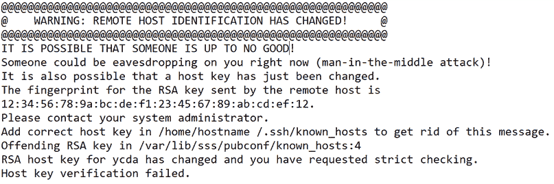
    1. 恶意访问点
    2. 路径攻击 (On-path attack)
    3. 跨站脚本
    4. SQL 注入

4. Homer 抱怨他的系统今天开始异常运行。你发现有恶意软件感染了他的系统，但你了解到他白天没有打开过任何电子邮件。他提到他整天都在浏览互联网。你可以检查哪项来查看恶意软件最可能源于何？
    1. Web 服务器日志
    2. 邮件服务器日志
    3. `PowerShell` 日志
    4. DNS 服务器日志

5. 在查看 Web 应用程序的日志时，安全分析师注意到它崩溃了多次，并报告了内存错误。崩溃后不久，日志显示不属于已知应用程序的恶意代码。以下哪项最可能正在发生？
    1. 缓冲区溢出
    2. DNS 毒化
    3. 权限提升
    4. 重放攻击

6. Web 开发者正在对一个由 Web 服务器访问的数据库应用程序实现错误处理。以下哪种方法是实现此功能的最佳方式？
    1. 显示详细的错误信息，但在日志中记录通用信息
    2. 显示通用的错误信息，但在日志中记录详细信息
    3. 显示通用的错误信息并在日志中记录通用信息
    4. 显示详细的错误信息并在日志中记录详细信息

7. 一位 Web 开发者正在为网站应用程序添加输入验证技术。开发者在此过程中应该实施以下哪项内容？
    1. 服务端验证
    2. 客户端验证
    3. 规范化技术
    4. 内存管理技术

8. YCDA 组织的开发者创建了一个用户可以在其计算机上下载并安装的应用程序。管理层希望为用户提供一种可靠的方法，以验证该应用程序在 YCDA 发布后未被修改。以下哪种方法提供了最佳解决方案？
    1. 代码签名
    2. 输入验证
    3. 混淆
    4. 存储过程

9. 你的组织正准备部署一个接受用户输入的 Web 应用程序。以下哪项最能测试该应用程序在维护可用性和数据完整性方面的可靠性？
    1. 静态代码分析
    2. 输入验证
    3. 错误处理
    4. 动态代码分析

10. 你正在寻找自动化可以提高安全运营效率的用例示例。以下哪项不是常见的自动化用例？
    1. 工单创建
    2. 事故升级
    3. 持续集成与测试
    4. 供应商评估

11. Homer 正在试图说服他的经理 Lisa 自动化可以改进他们的安全运营。以下哪项不是自动化的常见优势？
    1. 节省时间
    2. 提高员工留存率
    3. 更快的反应速度
    4. 技术债

12. 查看在线 Web 应用程序的日志，你看到有人在几个查询中输入了以下短语：`' or 1=1;--`。以下哪项提供了针对此类攻击的最佳保护？
    1. 规范化
    2. 适当的错误处理
    3. 移除死代码
    4. 存储过程

13. 你正在检查由在线 Web 应用程序生成的日志。你注意到以下短语出现在几个查询中：`' or 1=1; --`
    以下哪项是对此最可能的解释？
    1. 缓冲区溢出攻击
    2. DLL 注入攻击
    3. SQL 注入攻击
    4. 竞态条件

14. 你的组织创建了一个 Web 应用程序，将在测试完成后上线。应用程序测试人员看到网站使用了以下 URL：`https://getcertifiedgetahead.com/app/info.html`。测试人员向网站重新发送了以下 URL：`https://getcertifiedgetahead.com/app/../../etc/passwd`。测试人员正在检查哪种攻击？
    1. 目录遍历
    2. 缓冲区溢出
    3. 跨站脚本
    4. 竞态条件

# 第 7 章练习题答案

1. D 正确。分布式拒绝服务 (DDoS) 攻击会导致多个系统尝试连接服务器并耗尽目标资源，导致流量激增。地址解析协议 (ARP) 毒化攻击试图误导系统的媒体访问控制 (MAC) 地址。域名系统 (DNS) 毒化攻击试图在未经所有者许可的情况下更改域名注册。

2. A 正确。CPU 使用率平均达到 98% 表示资源耗尽。场景没有指示使用增加的原因，因此资源耗尽是最佳答案。分布式拒绝服务 (DDoS) 攻击可能会导致这种情况。然而，通过电子邮件发送的有效营销活动带来的流量波动也可能导致资源使用的激增。

3. B 正确。该信息表明存在潜在的路径上攻击。具体而言，它表明主机系统上的密钥已更改，这可能是因为管理员连接到了攻击系统，而不是真实的目标系统。其他所有答案都与错误的加密密钥无关。钓鱼访问点是未经授权的无线访问点。跨站脚本和 SQL 注入攻击是对 Web 应用程序的攻击，而在此场景中未使用 Web 应用程序。

4. D 正确。域名系统（`DNS`）日志将记录 DNS 查询，例如主机名被解析到的 IP 地址。日志条目将显示 Homer 在一天内访问的所有域名。其中一个最可能是向其系统下载了恶意软件的域名。Web 服务器会显示 Web 服务器上的活动，但你无法访问由他人控制的 Web 服务器。Homer 没有打开任何邮件，因此邮件服务器日志将没有帮助。`PowerShell` 日志可能会显示活动，但仅在恶意软件使用 `PowerShell` 的情况下如此。然而，`PowerShell` 日志不太显示是谁运行了 `PowerShell` 脚本。

5. A 正确。缓冲区溢出攻击通常会导致应用程序崩溃并暴露系统内存。攻击者随后将恶意代码写入暴露的内存中，并使用不同的技术让系统运行这些代码。其他所有攻击都不会将恶意代码插入内存中。`DNS` 投毒攻击试图误导系统对域名的正确 IP 地址的判断。权限提升技术试图赋予攻击者更多权利和权限。在重放攻击中，攻击者截获数据，并通常尝试使用截获的数据来伪装用户或系统。

6. B 正确。你应该显示通用的错误信息，但要记录关于错误的详细信息。向用户显示详细的错误信息通常会让他们感到困惑，并为攻击者提供可以用于系统的信息。记录通用信息会使日后排查问题变得更加困难。

7. A 正确。至少应该在服务器端执行输入验证。客户端验证可以与服务器端验证结合，但如果仅使用客户端输入验证，攻击者可以绕过它。归一化技术通过组织数据库中的表和列来减少冗余数据，但它与输入验证无关。内存管理是一种安全编码技术，有助于防止内存错误。

8. A 正确。代码签名为代码提供数字签名，验证代码发布者，并验证代码自发布者发布以来未被修改。其他所有答案均未验证应用程序未被修改。输入验证是在使用数据之前验证数据的有效性。代码混淆和代码伪装技术使代码更难以阅读。存储过程与 `SQL` 数据库配合使用，可用于输入验证。

9. D 正确。动态代码分析技术在应用程序执行期间对其进行测试，是可用答案中验证应用程序能够保持可用性和数据完整性的最佳选择。静态代码分析（如手动代码审查）是在不执行任何代码的情况下进行的，它不会测试其可靠性。输入验证是在使用数据之前检查数据有效性的做法，但这是在应用程序内部进行的，而不是作为测试应用程序的方法。错误处理技术也是在应用程序内部完成。

10. D 正确。安全操作中自动化和脚本的常见用例包括用户配置、资源配置、安全护栏、安全组、工单创建、事件升级、启用/禁用服务和访问、持续集成和测试，以及使用 `APIs` 创建集成。供应商评估通常是由人类分析师执行的手动过程，通常无法从自动化中获益。

11. D 正确。安全操作中自动化和脚本的主要收益包括提高效率和节省时间、一致执行基线、标准化的基础设施配置、安全的扩展、提高员工留存、更快的反应速度以及作为劳动力倍器。增加技术债是自动化的潜在劣势，而非收益。

12. D 正确。攻击者经常使用代码签名为代码提供数字签名，验证代码发布者，并验证代码自发布者发布以来未被修改。其他所有答案均未验证应用程序未被修改。输入验证是在使用数据之前验证数据的有效性。代码混淆和代码伪装技术使代码更难以阅读。存储过程与 `SQL` 数据库配合使用，可用于输入验证。

13. D 正确。动态代码分析技术在应用程序执行期间对其进行测试，是可用答案中验证应用程序能够保持可用性和数据完整性的最佳选择。静态代码分析（如手动代码审查）是在不执行任何代码的情况下进行的，它不会测试其可靠性。输入验证是在使用数据之前检查数据有效性的做法，但这是在应用程序内部进行的，而不是作为测试应用程序的方法。错误处理技术也是在应用程序内部完成。

14. D 正确。安全操作中自动化和脚本的常见用例包括用户配置、资源配置、安全护栏、安全组、工单创建、事件升级、启用/禁用服务和访问、持续集成和测试，以及使用 `APIs` 创建集成。供应商评估通常是由人类分析师执行的手动过程，通常无法从自动化中获益。

15. D 正确。安全操作中自动化和脚本的主要收益包括提高效率和节省时间、一致执行基线、标准化的基础设施配置、安全的扩展、提高员工留存、更快的反应速度以及作为劳动力倍器。增加技术债是自动化的潜在劣势，而非收益。

16. D 正确。攻击者经常使用代码签名为代码提供数字签名，验证代码发布者，并验证代码自发布者发布以来未被修改。其他所有答案均未验证应用程序未被修改。输入验证是在使用数据之前验证数据的有效性。代码混淆和代码伪装技术使代码更难以阅读。存储过程与 `SQL` 数据库配合使用，可用于输入验证。

17. D 正确。动态代码分析技术在应用程序执行期间对其进行测试，是可用答案中验证应用程序能够保持可用性和数据完整性的最佳选择。静态代码分析（如手动代码审查）是在不执行任何代码的情况下进行的，它不会测试其可靠性。输入验证是在使用数据之前检查数据有效性的做法，但这是在应用程序内部进行的，而不是作为测试应用程序的方法。错误处理技术也是在应用程序内部完成。

# 第 8 章

## 使用风险管理工具

本章涵盖 Security+ 目标：

### 1.2 总结基本安全概念。
- 差距分析

### 2.3 解释各种类型的漏洞。
- 供应链（服务提供商、硬件提供商、软件提供商）

### 2.4 给定场景，分析恶意活动指标。
- 权限提升

### 4.3 解释与漏洞管理相关的各种活动。
- 识别方法（漏洞扫描、渗透测试、负责任披露计划、漏洞赏计划、系统/流程审计）
- 分析（确认、误报、漏报、优先级、通用漏洞评分系统 (`CVSS`)、常见漏洞与披露 (`CVE`)、漏洞分类、暴露因子、环境变量、行业/组织影响、风险承受能力）
- 漏洞响应与修复（补丁、保险、分段、补偿控制、豁免与例外、修复验证、重扫描、审计、报告）

### 4.4 解释安全告警和监控工具及概念。
- 工具（安全内容自动化协议 (`SCAP`)、基准、NetFlow、漏洞扫描器）

### 4.9 给定场景，使用数据源支持调查。
- 数据源（漏洞扫描）

### 5.2 解释风险管理过程的要素。
- 风险识别
- 风险评估（随机、循环、一次性的、持续的）
- 风险分析（定性、定量、单次损失预期 (`SLE`)、年化损失预期 (`ALE`)、年化发生率 (`ARO`)、概率、可能性、暴露因子、影响）
- `风险清单`（关键风险指标、`风险所有者`、`风险阈值`）
- `风险容忍`
- `风险胃`（扩张型、保守型、中性）
- `风险管理策略`（转移、`接受`、`豁免`、`例外`、回避、缓解）
- `风险报告`

## 5.5 解释审计和评估的类型与目的

- `证明`
- `内部`（合规性、`审计委员会`、`自评估`）
- `外部`（监管、`检查`、`评估`、独立第三方审计）
- `渗透测试`（物理、攻击性、防御性、集成式、已知环境、部分已知环境、未知环境、侦察、被动、主动）

作为一名安全专业人员，你需要了解与威胁、漏洞、风险相关的不同安全问题，以及用于应对这些问题的可用工具。本章将深入探讨风险管理概念，包括风险评估方法。你将学习`漏洞扫描器`和`渗透测试员`，以及它们之间的主要区别。本章还涵盖了一些用于评估网络和管理风险的特定工具。

## 理解风险管理

风险是威胁利用漏洞的可能性。漏洞是系统、应用程序或流程中的弱点，而威胁是可能利用漏洞的潜在危险。风险的结果是对组织产生负面影响。

当我们评估任何风险时，会使用两个主要标准。首先，我们考虑风险的影响。这是指如果威胁利用了漏洞可能造成的损害程度。其次，我们考虑该风险发生的可能性或概率。这告诉我们预期风险发生的频率有多高（如果真的会发生的话）。

例如，一个没有更新最新杀病毒软件的系统容易受到`malware`的侵害。由恶意攻击者编写的`malware`就是威胁。`malware`到达受漏洞系统的可能性代表了风险。根据`malware`的行为，其影响可能是计算机无法启动、数据丢失，或网络内所有计算机被感染。然而，风险发生的概率并非 100%。一个没有互联网访问、没有网络连接或没有`USB`端口的孤立系统，遭受`malware`感染的可能性非常低。

对于连接互联网的系统，这种可能性会显著增加，如果用户访问危险网站并下载安装未经验实的文件，可能性会更高。

重要的一点是，你无法消除风险。当然，你可以通过拔掉电脑电源并将其埋起来完全避免信息技术（`IT`）风险。但这并没有什么用。相反，用户和组织通过实践风险管理来降低风险。

你每天都在实践风险管理。在道路和街道上开车或行走可能是一非常危险的活动。汽车来来往梭，对道路上的任何其他人构成了重大风险。然而，你通过谨慎和警惕来缓解这些风险。计算机和网络也是如此。组织使用不同类型的安全控制来缓解风险。

## 威胁

威胁是一种潜在的危险。在风险管理的背景下，威胁是指任何可能损害数据或系统的机密性、完整性可用性的情况或事件。威胁有多种形式，包括：

- **恶意人为威胁**。第 6 章“比较威胁、漏洞和常见攻击”讨论了各种类型的威胁者。他们包括相对缺乏经验和技能的攻击者、在有组织犯罪集团内部工作的职业犯罪分子，以及由政府支持的复杂高级持续性威胁（`APTs`）。这些都是恶意人为威胁。恶意人为威胁定期发起不同类型的攻击，包括网络攻击、系统攻击和发布`malware`。
- **意外人为威胁**。用户可能会意外删除或损坏数据，或意外访问他们不应访问的数据。即使是管理员也可能无意中导致系统停机。常见原因是良好的管理员为了修复一个问题而更改配置，但无意中导致了另一个问题。
- **环境威胁**。这包括长期停电，这可能导致化学品溢出、污染或环境中可能的其他威胁。它还包括自然威胁，如飓风、洪水、龙卷风、地震、滑坡、电暴风和其他类似事件。

威胁评估有助于组织识别和分类威胁。它试图预测针对组织资产的威胁以及威胁发生的可能性。威胁评估还试图识别这些威胁带来的潜在影响。一旦组织识别并优先考虑了威胁，就会确定安全控制措施来防止最严重的威胁。

## 风险识别

当安全专业人员开始风险管理流程时，他们会进行称为风险识别的练习。这个过程查看来自许多不同来源的信息，并试图列出可能影响组织的所有风险。你已经学习了一些用于识别风险的工具，例如`应用程序安全测试`和`威胁情报`。在本章稍后的部分，我们将探索其他技术，例如`漏洞扫描`、`渗透测试`、`负责性披露计划`以及对系统和流程的审计。所有这些信息为风险管理过程提供了输入。

## 风险类型

有多种风险类型或风险类别。它们包括：

- **内部**。内部风险是组织内部的任何风险。这包括员工以及组织内部使用的所有硬件和软件。内部风险通常是可预测的，可以通过标准的安全控制来缓解。
- **外部**。外部风险来自组织外部。这包括来自外部攻击者的任何威胁。它还包括任何自然威胁，如飓风、地震和龙卷风。虽然某些外部风险是可以预测的，但许多并不是。攻击者不断修改攻击方法并试图绕过现有的安全控制。
- **知识产权窃取**。知识产权（`IP`）包括版权、专利、商标和商业秘密。知识产权对组织非常有价值`IP`窃取代表了重大风险。
- **软件合规/许可**。组织在开发软件时通常会投入大量精力。他们通过销售软件许可来回资金。然而，如果个人或组织在未购买许可的情况下使用软件，开发公司就会亏损。同样，如果组织购买了许可但未对其保护，也会损失资金。想象你的组织为某个软件应用程序购买了 10 个许可，但几个人在未经授权的情况下使用了其中 5 个许可。稍后，你的主管给了你一个许可，但当你尝试使用时，应用程序报错说该许可已被使用。在这种情况下，该组织损失了 5 个许可的成本。
- **遗留系统和遗留平台**。与遗留系统和平台相关的主要风险是供应商不再支持。如果漏洞变得已知，供应商不发布补丁，那么任何使用遗留系统或软件的人都面临风险。

## 漏洞

漏洞是软件、硬件或流程中的缺陷或弱点，威胁可以利用它并导致安全泄露。漏洞的示例包括：

- **默认配置。** 系统加固包括将系统从默认硬件和软件配置进行更改，包括更改默认用户名和密码。如果系统未经过加固，将更容易受到攻击。第 5 章“主机与数据安全”将更深入地介绍系统加固。
- **缺乏恶意软件保护或未更新的定义。** 杀病毒和反恶意软件方法可以保护系统免受恶意软件侵害，但如果不使用并保持更新，系统就会容易受到恶意软件攻击。第 6 章涵盖了恶意软件类型以及保护系统免受恶意软件攻击的方法。
- **补丁管理不当或薄弱。** 如果系统没有及时更新补丁、热修复和服务包，就会容易受到软件、操作系统或固件漏洞和缺陷的影响。攻击者可以利用已知漏洞但未打补丁的操作系统、应用程序和固件。
- **缺乏防火墙。** 如果没有启用或正确配置主机防火墙和网络防火墙，系统更容易受到网络和互联网攻击。第 3 章“探索网络技术与工具”将更深入地介绍防火墙。
- **缺乏组织策略。** 如果没有实施岗位轮换、强制休假和最小权限策略，组织可能更容易受到员工欺诈和合谋的侵害。第 11 章“实施策略以降低风险”涵盖了组织策略。

并非所有漏洞都会被利用。例如，用户可能使用默认设置安装无线路由器。它非常容易受到攻击，但这并不意味着攻击者一定会发现并攻击它。换句话说，仅仅因为无线路由器从未被攻击过，并不意味着它没有漏洞。在任何时候，巡逻式攻击者（war driving attacker）都可能开车经过并利用该漏洞。

# 风险管理策略

风险管理是识别、分析、监控并将风险限制在可管理范围内的实践。它并不是消除风险，而是识别限制或减轻风险的方法。关于风险管理，你应该理解以下几个基本术语：

- **风险意识** 是承认风险存在且必须对其进行处理以减轻风险。高层人员需要承认风险的存在。在他们这样做之前，他们不会投入任何资源来管理风险。
- **固有风险** 指在采取控制措施来管理风险之前存在的风险。
- **剩余风险** 是在风险被管理或减轻至可接受水平后剩余的风险量。高层管理对剩余风险负责，并负责根据组织目标选择可接受的风险水平。他们决定投入哪些资源（如资金、硬件和时间）来管理风险。
- **控制风险** 指如果现有控制措施未能充分管理风险时存在的风险。想象一下系统安装了杀病毒软件，但没有可靠的方法保持其更新。需要额外的控制措施来充分管理这种风险。
- **风险偏好** 指组织愿意接受的风险量。这根据不同组织的目标和战略目标而有所不同。组织利用其风险偏好来确定其风险阈值：即在组织选择采取行动管理该风险之前，某种情况必须上升到的风险水平。风险偏好主要有三类：
    - 具有**扩张型风险偏好**的组织为了追求高回报而愿意承担高水平风险。例如，他们可能会对尖端安全技术投入巨资，或积极寻求新的业务机会，即使这些机会可能伴随着额外的安全风险。
    - 具有**保守型风险偏好**的组织倾向于低风险投资，并优先维护其当前的安全态。例如，他们可能侧于实施基本安全措施，或避免可能引入新安全风险的新技术。
    - 具有**中性风险偏好**的组织对风险承担采取平衡方法。例如，他们可能采用新技术，但在实施上采取谨慎态度，并投资于额外的安全措施以管理潜在风险。
- **风险容忍度** 与风险偏好密切相关。它指的是组织承受风险的能力。虽然风险偏好描述的是组织愿意承担多少风险，但风险容忍度描述的是他们承担的能力。例如，银行里现金较多的组织在遇到财务风险时具有更强的保持稳定能力。

组织有多种风险管理策略可用。它们包括：

- **回避。** 组织可以通过不提供服务或不参与高风险活动来回避风险。例如，组织可能会评估一个需要在防火墙上开启多个端口的应用程序，并判定为该应用程序风险过大。它可以通过停止使用该应用程序来回避风险。
- **减轻。** 组织实施控制措施来减少风险。这些控制要么减少漏洞，要么减少威胁的影响。例如，更新的杀病毒软件可以减轻恶意软件风险。同样，安保人员可以减少攻击者进入安全区域的风险。
- **接受。** 当控制措施的成本超过风险时，组织通常会接受该风险。例如，花费 100 美元的硬件锁来保护一个 15 美元的鼠标是没有意义的。相反，组织接受鼠标被偷的风险。同样，即使在实施了控制措施后，仍然存在剩余风险，组织接受这种剩余风险。当组织决定接受某种风险时，可能需要获得对管理组织的策略、法律或法规的豁免或例外。如果接受可能导致组织违反自身的策略和标准，组织可以对这些策略或标准发布豁免或例外。
- **转移。** 当组织将风险转移给另一个实体或至少与另一个实体共享风险时，这就是风险转移的例子。最常见的方法是购买保险。这部分财务风险从组织自身转移到了保险公司，公司将补偿组织与风险相关的成本或损失。
- **网络安全保险** 有助于企业和个人免受与网络安全事件相关的损失，例如数据泄露和网络损坏。传统的保险单通常排除网络安全风险，例如数据丢失或犯罪分子使用勒索软件勒索。组织购买网络安全保险来弥补传统保险留下的空白。

| 记住这个！ | 消除风险是不可能的，但你可以采取步骤来管理它。组织可以通过不提供服务或不参与高风险活动来回避风险。保险将风险转移给另一个实体。你可以通过实施控制措施来减轻风险，但当控制措施的成本超过风险成本时，组织就会接受剩余的（或残留）风险。 |
| --- |

# 风险评估类型

风险评估（或风险分析）是风险管理中的一项重要任务。它根据不同的数值或判断对风险进行量化或定性分析。风险评估可能是一次性的、或临时的评估，旨在为组织提供其所面临风险的即时视图。组织可能会选择定期进行这些风险评估以重新评估风险。例如，组织可能会进行年度风险评估活动。一些组织正在向持续风险评估流程转变，即随着业务和技术环境的变化，不断地重新评估并应对风险。

## 风险评估流程

风险评估从识别资产和资产价值开始。

资产包括组织重视的任何产品、系统、资源或过程，而资产价值（`AV`）确定了该资产对组织的价值。它通常是一个特定的金额。资产价值有助于组织关注高价值资产，并避免在低价值资产上浪费时间。

在识别资产价值后，风险评估随后识别威胁和漏洞，并确定威胁尝试利用漏洞的概率。风险评估试图识别潜在威胁的影响，识别潜在危害，并根据发生的概率和影响对风险进行优先级排序。最后，风险评估还包括关于实施哪些控制措施来减轻风险的建议。

对新系统或应用程序进行风险评估是很常见的。例如，如果组织正在考虑增加一项可以增加收入的新服务或应用程序，它通常会进行风险评估。这有助于其确定潜在风险是否会抵消潜在收益。

风险评估使用定量测量或定性测量。定量测量使用数字，例如代表成本和资产价值的货币数字。定性测量则使用判断。这两种方法的核心目标相同，都是帮助管理层根据优先级做出明智的决策。

## 风险控制评估

风险控制评估（有时称为风险和控制评估）检查组织的已知风险并评估现有控制措施的有效性。如果已有风险评估结果，风险控制评估将利用它来识别已知风险。然后它关注现有控制措施，以确定它们是否充分减轻了已知风险。

### 示例：恶意软件与反病毒软件

作为一个简单的例子，假设一次风险评估将恶意软件识别为一种风险。此外，假设组织在其邮件服务器上安装了反病毒软件，以阻止所有包含恶意软件的入邮件。风险控制评估可能会指出，恶意软件来自多个来源，因此仅在邮件服务器上使用反病毒软件不足以缓解恶意软件带来的风险。它可能建议在所有内部主机上安装反病毒软件，并使用网络设备扫描所有入站流量中的恶意流量。

### 风险控制自评估

风险控制自评估是一种风险控制评估，但由员工执行。相比之下，风险控制评估是由第三方执行的。进行自评估的危险在于，安装控制措施的同一员工可能被要求评估这些措施的有效性。

## 定量风险评估

定量风险评估使用特定的金额来衡量风险。该金额使得更容易对风险进行优先级排序。例如，一个潜在损失为 $30,000 的风险比潜在损失为 $1,000 的风险要重要得多。

我们通过识别两个重要因素开始对单个风险进行评估：资产价值（`AV`）和暴露因子（`EF`）。许多组织选择将资产的重置成本作为 `AV`，因为这是风险发生时组织将承担的成本。暴露因子是我们在预计在风险发生时会受损的资产部分。

### 示例：设备机架

例如，假设我们在办公大楼地下室有一架设备架，更换它的费用为 $1,000,000。我们可以说该设备的 `AV` 是 $1,000,000。我们可能担心洪水损坏该设备，因此随后会查看典型的洪水会损坏多少设备。我们可能会评估这种情况并决定洪水可能会破坏一半的设备。这将使我们获得 50% 的 `EF`。

### 计算预期损失

接下来，我们计算风险的单次损失预期（`SLE`）。`SLE` 是特定资产任何单次损失的成本。我们可以通过资产价值乘以暴露因子来计算：

```
SLE = AV × EF
```


`SLE = AV x EF`

在我们的示例中，我们知道 $1,000,000 的机架会有 50% 被洪水损坏，因此 `SLE` 是 $1,000,000 的 50%，即 $500,000。我们可以预计每当洪水发生时，都会造成 $500,000 的损失。

`SLE` 是风险影响的衡量标准。记住本章前面提到的，当我们评估风险时，会同时考虑影响和概率/可能性。洪水每年会发生十次吗？还是每十年一次？我们真的需要知道这些，以便对该风险做出明智的决策。

这引出了年化发生率（`ARO`）。`ARO` 表示损失在每年发生的次数。如果 `ARO` 小于 1，则 `ARO` 以百分比表示。例如，如果你预计地下室每十年发生一次洪水，则 `ARO` 为 10% 或 0.1。`ARO` 是概率/可能性的衡量标准。

最后，我们需要将影响和概率/可能性的衡量结合起来。这就是使用年化损失预期（`ALE`）的地方。我们使用公式计算此值：

```
ALE = SLE × ARO
```


在我们的示例中，`SLE` 为 $500,000，`ARO` 为 0.1。将两者相乘，我们得到 `ALE` 为 $50,000。我们可以预计在任何一年中，洪水的平均成本将是 $50,000。我们已经讨论过实际上我们预计每十年会有 $500,000 的损失。`ALE` 设计帮助我们对风险进行优先级排序并定量评估其影响。

## 示例：笔记本电脑被窃

让我们尝试另一个例子。假设你公司的员工平均每月丢失一台笔记本电脑。小偷在员工将电脑留在会议室、在客户现场以及培训室时偷走了这些电脑。每台笔记本电脑价值 $2,000，一旦丢失就彻底消失了。因此，`AV` 是 $2,000，`EF` 是 100%。

有人建议购买总价为 $1,000 的硬件锁来固定这些笔记本电脑。这些锁的工作原理类似于自行车锁，允许员工将电缆缠绕在家具上并连接到笔记本电脑上。小偷要么毁坏电脑来拆锁，要么在偷电脑时连家具一起带走。你的公司应该购买这些锁吗？经过简单分析，结论显而易见。

你已经确定这些笔记本电脑（包括硬件、软件和数据）的 `AV` 每台为 $2,000。这假设员工没有在系统中存储整个客户数据库或其他敏感数据，而这些会导致高得成本。你现在按以下方式计算 `SLE`、`ARO` 和 `ALE`：

- `SLE`：`AV` 为 $2,000，`EF` 为 100%。两者相乘我们得到 `SLE` 为 $2,000。
- `ARO`：员工每月丢失约一台笔记本电脑，所以 `ARO` 为 12。
- `ALE`：你计算 `ALE` 为 `SLE` × `ARO`，所以 $2,000 × 12 = $24,000。

安全专家估计，这些锁会将丢失或被盗笔记本电脑的数量从每年 12 台减少到每年仅 2 台。这使得 `ALE` 从 $24,000 减少到仅需 $4,000（每年节省 $20,000）。换句话说，组织可以花费 $1,000 来节省 $20,000。不需要火箭科学家也能看出这是一个明智的财政决策，净节省了 $19,000。买下它们吧。经理在做大多数此类决策时会使用以下两个简单的准则：

- 如果控制的成本低于节省的金额，则购买它。
- 如果控制的成本高于节省的金额，则接受该风险。

| 记住这一点！ | 定量风险评估使用特定的货币金额来识别成本和资产价值。`SLE` 识别每次损失的成本，`ARO` 识别典型一年内的事件次数，`ALE` 识别该风险带来的预期年度损失。你通过 `SLE × ARO` 计算 `ALE`。定性风险评估则利用判断根据发生概率（或可能性）和影响对风险进行分类。 |
| --- |

## 定性风险评估

定性风险评估利用判断根据发生概率（或可能性）和影响对风险进行分类。发生概率是一个事件发生的概率，例如威胁试图利用漏洞的可能性。影响是风险导致损害的程度。它包括事件事件的负面结果，例如系统或数据的机密性、完整性或可用性的丢失。

请注意，这与使用货币数字的定量评估所提供的确切数字有很大不同。你可以将“定量”理解为使用数量或数值，而“定性”则与质量有关，而这通常是一个判断问题。

某些定性风险评估使用调查问或焦点小组。他们征求专家提供最佳判断，然后对结果进行汇总。例如，一项调查可能会要求专家对与在互联网销售产品的 Web 服务器以及未连接互联网的图书馆工作站相关的风险概率和影响进行评分。专家们将使用低、中、高等词汇对它们进行评分。

他们可能会将 Web 服务器受到攻击的概率评为高，如果攻击导致 Web 服务器无法服务，那么影响也是高位。另一方面，图书馆工作站受到攻击的概率很低，尽管图书馆读者可能会感到不便，但影响也是低位。

为这些判断分配数字是很常见的。例如，你可以使用低、中、高等术语，并分别给它们赋予 1、5 和 10 的值。专家使用低、中、高来分配每个风险的概率和影响，并在汇总结果时，你将词汇转换为数字。这使得计算结果变得稍微容易。

在 Web 服务器和图书馆电脑的示例中，你可以通过将概率和影响相来计算风险：

- Web 服务器。高概率和高影响：`10 × 10 = 100`
- 图书馆电脑。低概率和低影响：`1 × 1 = 1`

管理层可以查看这些数字，并轻松确定如何分配资源来防止这些风险。他们为保护 Web 服务器分配的资源将多于图书馆电脑。定性风险评估面临的挑战之一是在概率和影响上达成共识。与可以通过事实验证的货币价值不同，概率和影响往往会引起争论。

## 风险报告

风险评估的最后阶段是风险报告。这识别了评估期间发现的风险以及建议的控制措施。作为一个简单的例子，对启用数据库的 Web 进行风险评估可能会发现它容易受到 `SQL injection attacks`。风险评估随后将建议使用输入验证技术和存储过程重写该 Web 应用以保护数据库。

管理层利用此来决定实施哪些控制措施以及接受哪些控制措施。在许多情况下，最终报告会记录管理决策。当然，管理层也可以决定不实施某项控制措施，而是接受该风险。

想想这份报告对于攻击者来说将有多有价值。他们不需要挖掘来识别漏洞或控制措施。相反，报告列出了所有细节。即使管理层批准了修复漏洞的控制措施，实施也需要一些时间。因此，保护风险评估报告至关重要。通常，只有执行管理和安全专业人员才能访问这些报告。

## 风险分析

风险评估使用各种技术来分析风险。泛而言之，风险分析识别可能对组织目标和目的产生负面影响的问题。然而，不同的学科对其定义略有不同。例如，项目管理专业人士会告诉你，风险分析识别的是可能影响项目结果和目标的潜在风险，而不是组织的目标和目的。

同样，以下术语在项目管理圈或财务管理专家那里可能有略有不同的定义。然而，这些定义在网络安全领域是有效的：

- 关键风险指标 (`KRIs`) 是用于衡量和监控与特定活动、过程或系统相关的风险水平的指标。`KRIs` 为组织提供了一种主动识别潜在风险并在其变成重大问题之前采取行动来减轻或管理它们的方法。`KRIs` 的示例可能包括此类衡量，例如每月检测到的安全事件数量、逾期安全补丁的百分比，或检测和响应安全事件的平均时间。这些指标可以帮助组织识别趋势、尽早发现潜在问题并采取纠正措施以尽地减少潜在风险的影响。
- 风险注册表 (`risk register`) 是组织用于识别、评估和管理风险的文档或工具。它通常包含已识别风险的列表，以及关于它们的概率、潜在影响和当前状态的信息。风险注册表有助于组织优先考虑、分配缓解资源并随时间监控进度。除了识别风险，风险注册表还分配了 `risk owners`，他们负责管理每个风险。`risk owners` 通常是具有有效管理风险专业的个人或团队。他们负责监控风险、实施缓解措施并报告风险状态。
- `风险矩阵`。`风险矩阵`将风险放置在行列图表中，显示概率和影响。作为一个简单的例子，它可以将发生概率数据与风险的影响进行绘图，如图 8.1 所示。

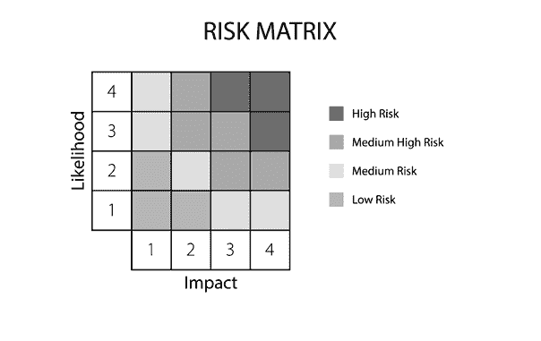

图 8.1: 风险矩阵

| 记住这一点！ | 风险注册表是一个列出风险已知信息（如 `risk owner`）的综合文档。它通常包含风险分以及降低风险分数的建议的安全控制措施。`风险矩阵`将风险绘制在图表中。 |
| --- |

## 供应链风险

供应链包含了生产和销售产品所需的所有元素。作为一个简单的例子，考虑 Lard Lad Donuts 店。他们需要面粉、糖、鸡蛋、牛奶、油和其他原料的稳定供应。他们还需要用于储存原材料的冰箱、制造甜甜的空间以及用于烹饪的炸锅。最后，他们需要向客户销售甜甜的方法。如果这些任何一项失效，公司将无法制作和销售甜甜。

重要的是意识到，供应链不仅是原材料的供应。它还包含了创建和分发成品所需的所有流程。对于 IT 组织而言，对供应链进行全面审查意味着查看每一个为你的技术环境提供基本组件的组织。这应该包括硬件供应商、软件供应商和服务提供商。

如果攻击者能够中断供应链，那么供应链就会变成一个攻击向量。如果攻击者想要停止一家甜甜圈店生产甜甜圈，并没有必要直接攻击甜甜圈店。相反，攻击者可以在供应链攻击中攻击供应链中的某一个第三方供应商。供应链攻击的一个潜在指标是供应链的中断。

组织只需通过确保其所需的所有物品都有多个来源，就可以消除供应链作为一种第三方风险的影响。虽然在寻找购买面粉和糖的替代来源时这相对简单，但当组织需要复杂材料时，可能会变得困难。

## 比较扫描与测试工具

安全管理员使用工具来测试他们的网络。工具的两个常见类别是检查弱点的**漏洞扫描器**，以及尝试利用漏洞的**渗透测试**。本节将更深入地介绍漏洞扫描器和渗透测试。

## 检查漏洞

漏洞是缺陷，通过减少漏洞，你可以降低风险。这听起来足够简单。然而，你如何识别出风险最大的漏洞呢？一些常见的方法是漏洞评估和漏洞扫描。

漏洞评估的总目标是评估系统和网络的安全态。它们识别系统、网络和组织内部的漏洞或弱点，是整体风险管理计划的一部分。

漏洞评估可以包含来自各种来源的信息。这包括审查安全策略和日志、访谈人员以及测试系统。评估通常使用多种扫描和渗透测试，这些在本文节中都将讨论。漏洞评估通常包含以下高级步骤：

- 识别资产和能力。
- 根据价值对资产进行优先级排序。
- 识别漏洞并对其进行优先级排序。
- 建议采取控制措施以缓解严重漏洞。

许多组织在内部进行漏洞评估。组织还会聘请外部安全专业人员完成外部评估。后续章节将讨论许多用于漏洞评估和漏洞扫描的常用工具。

### 网络扫描器

网络扫描器使用各种技术来收集网络内主机的信息。例如，`Nmap` 是一种流行的网络扫描工具，可以提供关于网络内主机的大量信息。网络扫描器通常使用以下方法：

- ARP ping 扫描。第 3 章讨论了地址解析协议（`ARP`）以及系统如何使用它将 IP 地址解析为介质访问控制（`MAC`）地址。任何接收到其 IP 地址的 `ARP` 包的主机都会响应其 `MAC` 地址。如果主机有响应，网络扫描器就知道该主机在使用该 IP 地址运行。
- Syn 隐形扫描。第 3 章讨论了传输控制协议（`TCP`）三次握手。提醒一下，一个主机发送一个 `SYN`（同步）包来启动 `TCP` 会话。另一个主机用一个 `SYN/ACK`（同步/确认）包进行响应。第一个主机随后通过一个 `ACK` 包完成握手以建立连接。syn 隐形扫描向扫描范围内的每个 IP 地址发送单个 `SYN` 包。如果主机有响应，扫描器就认为该主机在使用该 IP 地址运行。然而，扫描器通常不会用 `ACK` 包进行响应，而是发送一个 `RST`（重置）响应来关闭连接。
- 端口扫描。端口扫描检查是检查系统上的开放端口。每个开放端口都表示底层协议正在系统上运行。例如，如果端口 `443` 是开放的，则表示主机正在运行 `HTTPS`，这意味着它可能是一个 Web 服务器。端口扫描通常使用由互联网数字分配机构（`IANA`）识别为已知端口并在附录 D 中讨论的端口。
- 服务扫描。服务扫描类似于端口扫描，但它更进了一步。端口扫描识别开放端口并提供关于可能运行的协议或服务的提示。服务扫描则验证协议或服务。例如，如果端口扫描识别出端口 `443` 是开放的，服务扫描将发送一个 `HTTPS` 命令，例如 `Get /.`。如果端口 `443` 上运行着 `HTTPS`，它将对 `Get` 命令做出响应，以验证它是一个 Web 服务器。
- OS 检测。操作系统（`OS`）检测技术分析来自 IP 地址的数据包以识别操作系统。这通常被称为 `TCP/IP` 指纹识别。举一个简单的例子，`TCP` 窗口大小（`TCP` 会话第一个数据包中接收窗口的大小）不是固定的。不同的操作系统使用不同的大小。某些 Linux 版本使用 `5,840` 字节，某些 Cisco 路由器使用 `4,128` 字节，而不同的 Windows 版本使用 `8,192` 和 `65,535`。`OS` 检测技术不依赖于单一值，通常评估系统响应中包含的多个值。

### 漏洞扫描

安全管理员经常使用漏洞扫描器来识别哪些系统容易受到攻击。漏洞扫描器可以识别攻击者可以利用的各种弱点和已知安全问题。大多数漏洞扫描器将多个功能组合在单个软件包中。漏洞扫描通常包含以下操作：

- 识别漏洞。
- 识别配置错误。
- 被动测试安全控制。
- 识别缺乏安全控制的情况。

### 漏洞分类标准

- 漏洞扫描器利用已知漏洞的数据库或字典，并根据该数据库对系统进行测试。例如，`MITRE` 公司维护“通用漏洞与披露”（`CVE`）列表，这是一个公开已的安全漏洞和披露的字典。这与杀毒软件使用病毒特征检测恶意软件的方式相似。不同在于，`CVE` 是一个由美国政府资助的公共列表，而杀毒软件厂商维护自己的签名文件。
- 通用漏洞评分系统（`CVSS`）评估漏洞并分配 `0` 到 `10` 范围内的严重性评分，其中 `10` 为最严重。这有助于安全专业人员对缓解已知漏洞的工作进行排序。
- 漏洞扫描器使用的其他标准包括安全内容自动化协议（`SCAP`）。`SCAP` 设计旨在促进漏洞扫描器与其他安全及管理工具之间的通信。

## 漏洞优先级排序

在运行漏洞扫描后，组织可能会发现其环境中存在几十、数百甚至数千个漏洞。他们需要对这些漏洞进行优先级排序，以优先处理最重要的漏洞。他们通过许多不同的信息源来实现此：

- 漏洞分类。使用行业标准的分类系统来识别漏洞的类型和严重性。组织通常使用 `CVSS` 评分为此目的。
- 环境变量。每个组织都是不同的，运行在不同的技术环境中。在对漏洞进行排序时，请考虑该环境的性质。
- 行业/组织影响。不同的行业处理不同类型的数据，并具有不同的法规和敏感性。在在线银行环境中非常严重的漏洞，在用于监控水流的系统中可能远不那么令人担忧。
- 风险承受度/阈值。组织需要决定一个漏洞的风险水平上升到什么种程度时，他们才会对其进行处理。你不太可能处理每一个存在的漏洞，因此你必须使用阈值来确定哪些漏洞需要关注。

## 分析漏洞扫描输出

漏洞扫描会生成一份显示扫描结果的报告。扫描的输出通常会包含以下信息：

- 已发现并扫描的主机列表
- 每个主机上运行的应用程序详细列表
- 在每个主机上发现的开放端口和服务的详细列表
- 在任何被扫描主机上发现的漏洞列表
- 解决任何已发现漏洞的建议

某些漏洞扫描器具备在预先配置的时间时间自动运行的能力。管理员可以使用预定义的漏洞报告，或根据需求创建自定义报告。这些报告通常存储在日志中，管理员会定期进行日志审查。

在分析扫描输出时，将其与之前的扫描结果进行比较非常重要。在某些情况下，你可能会发现扫描报告了相同的漏洞。出现这种情况有两个主要原因：可能是补丁产生了意外的副作用，因此管理层决定接受该风险而不应用补丁；也可能是供应商尚未创建补丁。

## 被动测试安全控制措施

漏洞扫描的一个重要点是，它并不尝试利用任何漏洞。相反，漏洞扫描是一种识别弱点的被动尝试。这确保了测试不会干扰正常运行。安全管理员随后会评估漏洞，以确定哪些漏洞需要缓解。相比之下，渗透测试（在本章稍后的部分介绍）是一种尝试利用漏洞的主动测试。

| 记住这一点！漏洞扫描器可以识别漏洞、配置错误的系统以及缺乏安全控制的情况（如缺少最新的补丁）。漏洞扫描可以被配置为被动的，在测试期间对系统产生的影响很小。相比之下，渗透测试是侵入性的，并可能破坏系统。 |
| --- |

## 确认扫描结果

遗憾的是，扫描器并非完美。偶尔，它们会在漏洞实际上并不存在时报告该漏洞。换句话说，扫描可能指示系统存在已知漏洞，但报告是假的。这就是**误报**。例如，对服务器进行漏洞扫描可能会报告该服务器缺少与数据库应用程序相关的补丁，但该服务器并没有安装数据库应用程序。安全专业人员在运行漏洞扫描后面临的主要任务之一就是确认漏洞是否真实，并消除误报报告。

这类似于入侵检测系统 (`IDS`) 中的误报，即 `IDS` 对某个事件发出警报，但该事件并非实际入侵。同样，杀病毒扫描器可能会将有用的应用程序识别为恶意软件，即使它不包含任何恶意代码。误报会导致较高的管理开销，因为管理员必须对其进行调查。

扫描器也可能产生**漏报**。如果存在一个漏洞但扫描器没有检测到它，这就是漏报。例如，想象一下当补丁应用到应用程序服务器时，它导致应用程序崩溃。管理层决定接受不应用这些补丁的风险以保持应用程序运行。尽管缺少这些补丁，漏洞扫描器也没有报告补丁缺失。以下列表描述了扫描器扫描系统以寻找漏洞时的四种可能性。阅读时请参考图 8.2：

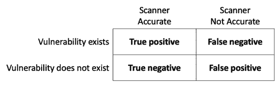

图 8.2：误报和漏报

- 误报（False positive）。当漏洞扫描器错误地报告漏洞存在，但该漏洞在扫描系统中并不存在时，就是误报。
- 漏报（False negative）。当漏洞存在，但扫描器没有检测到它也没有报告该漏洞时，就是漏报。
- 真报（True positive）。真报表示漏洞扫描器正确地识别了一个漏洞。
- 真阴性（True negative）。真阴性表示系统没有漏洞，且漏洞扫描器没有报告该漏洞。

## 凭证扫描与非凭证扫描

漏洞扫描器可以使用账户凭据作为凭证扫描运行运行，也可以在不使用任何用户凭据的情况下作为非凭证扫描运行。攻击者通常没有内部账户的凭据，因此当他们对系统运行扫描时，运行的是非凭证扫描。

安全管理员经常以管理员账户的权限运行凭证扫描。这允许扫描以比非凭证扫描深得多的层次检查安全问题。例如，凭证扫描可以列出已安装程序的软件版本。此外，由于凭证扫描可以访问系统的内部工作，它对被测试系统的影响较低，并且具有更准确的测试结果和更少的误报。

值得提到，攻击者通常在没有任何凭据的情况下开始，但使用权限提升技术来获取管理权限。这允许他们根据需要对网络运行凭证扫描。同样，尽管凭证扫描通常更准确，但管理员经常运行非凭证扫描，以查看没有凭据的攻击者会看到什么。

| 记住这一点！漏洞扫描的误报表示扫描检测到了漏洞，但该漏洞并不存在。凭证扫描在有效账户的上下文中运行，可以获取有关目标的更详细信息，例如已安装应用程序的软件版本。它们通常比非凭证扫描更准确，产生的误报更少。 |
| --- |

## 配置审查

配置合性扫描器对系统进行配置审查，以验证其配置是否正确。它们通常会使用一个识别系统正确配置的文件。在运行扫描时，扫描器将验证系统具有与配置文件定义的相同的配置。这也被称为配置验证。安全管理员经常配置这些工具使用自动化或脚本方法，以便它们按照设定的计划自动运行。

配置审查扫描通常需要作为凭证扫描运行。这有助于确保它们在扫描期间准确地读取系统的配置。

## 渗透测试

渗透测试主动评估系统或网络内部署的安全控制措施。它从侦察开始以了解目标，但更进了一步，通过模拟或执行攻击来尝试利用漏洞。渗透测试主要有四类：

# 渗透测试类型

1. **物理渗透测试**：此类测试侧重于识别组织物理安全措施中的漏洞。它涉及尝试未经授权地访问物理空间，例如建筑物、数据中心或其他安全区域。物理渗透测试可能涉及社会工程学、开锁或对安全措施进行物理绕过等策略。其目标是识别攻击者可能利用的物理安全控制缺陷。
2. **攻击性渗透测试**：此类测试涉及模拟对组织的网络、系统或应用程序进行真实攻击。它从攻击者的角度进行，旨在识别可能被利用以获取未经授权访问或对组织造成损害的漏洞。攻击性渗透测试通常包括漏洞扫描、对识别出的漏洞进行利用以及网络内部横向移动。
3. **防御性渗透测试**：此类测试涉及评估组织的安全控制，以识别其可能受攻击的区域。其目标是在攻击者利用之前识别安全控制中的缺陷。防御性渗透测试可能包括防火墙规则分析、配置审查或 Web 应用程序渗透测试等策略。
4. **综合渗透测试**：此类测试结合了物理、攻击性和防御性测试的元素，对组织的安全态势提供全面评估。它涉及对组织的物理和数字资产模拟真实攻击，以识别攻击者可能利用的漏洞。综合渗透测试通常由在物理安全、网络安全和应用安全方面拥有专业知识的专家团队进行。

## 风险与注意事项

由于渗透测试可能会利用漏洞，具有干扰实际运行和导致系统不稳定的风险。因此，严格定义测试边界非常重要。理想情况下，渗透测试将在执行可能导致损坏或停机的利用操作之前停止。然而，某些测试可能会产生意料之外的结果。

测试人员有时会在测试系统而非生产系统上执行渗透测试。例如，一个组织可能托管了一个可以在互联网上访问的 Web 应用程序。渗透测试人员或管理员不会在生产服务器上进行测试以影响客户，而是配置另一台运行相同 Web 应用程序的服务器。如果渗透测试导致测试服务器崩溃，它准确说明了安全漏洞，但不会影响客户。

| 记住这一点！ |
| :--- |
| 渗透测试是一种主动测试，可以评估已部署的安全控制并确定威胁的影响。它始于侦察，然后尝试通过攻击或模拟攻击来利用漏洞。 |

## 交互规则

在开始任何漏洞扫描或渗透测试之前，获得授权至关重要。这概述了交互规则或测试边界。如果测试在遵循了交互规则的情况下仍导致了停机，其后果可能会较小。

在大多数情况下，这种许可是书面形式。如果没有书面形式，许多安全专业人员不会执行任何测试。未经许可的渗透测试就是攻击，组织可能会将进行未经授权渗透测试的意图良好的管理员视为攻击者。在运行未经授权的扫描或渗透测试后，该管理员可能正在更新他的简历。

## 侦察

渗透测试人员使用多种方法进行侦察（有时称为足迹探测）。在侦察阶段，渗透测试人员（或攻击者）尝试尽可能多地了解网络。测试人员在收集目标信息时会同时使用被动侦察和主动网络侦察及发现技术。

### 被动与主动侦察

被动侦察使用开源情报（OSINT）收集有关目标系统、网络或组织的信息。这包括查看有关该目标的社交媒体来源、新闻报告甚至组织的网站。如果该组织拥有无线网络，则可能包括从网络被动收集信息，例如网络 SSID。注意，由于被动侦察不接触目标，因此它是合法的。

例如，`theHarvester` 是测试人员在渗透测试早期使用的一种被动侦察命令行工具。它使用 OSINT 方法收集如电子邮件地址、员工姓名、主机 IP 地址和 URL 等数据。它利用流行的（以及不流行的）搜索引擎进行查询，然后在一份详尽的报告中关联这些结果。

被动侦察不包括使用任何工具向目标发送信息并分析响应。然而，被动侦察可以包括使用工具从目标以外的系统收集信息。例如，你有时可以使用 `Whois` 查询网站（`https://www.whois.com`）获取有关域名持有者的信息。其他时候，你可以通过查询域名系统（`DNS`）服务器获取信息。

主动侦察方法使用工具接触目标。下一节将描述许多使用主动侦察方法收集网络信息的工具。

### 网络侦察与发现

网络侦察和发现方法使用工具向系统发送数据并分析其响应。这一阶段通常从使用各种扫描工具开始，如网络扫描器和漏洞扫描器。重要的是，网络侦察会接触目标，且几乎总是非法的。在先获得明确授权之前，绝不要开始。

本章前面的“网络扫描器”部分讨论了工具如何收集有关网络和单个系统的大量信息。这包括识别网络上活跃的所有 IP 地址、单个系统上活跃的端口和服务，以及在单个系统上运行的操作系统。在此阶段使用的某些工具包括：

- **IP 扫描器**：IP 扫描器（有时称为 ping 扫描器）在网络中搜索活跃的 IP 地址。它通常向网络中的范围 IP 地址发送 Internet 控制消息协议（`ICMP`）`ping`。如果主机有响应，网络扫描器就知道有一个该 IP 地址的主机正在运行。ping 扫描的一个问题是防火墙通常会拦截 `ICMP`，因此扫描结果可能是不一致的。
- **Nmap**：`Nmap` 是一种可以从命令行提示符运行的网络扫描器。它包含许多功能，包括识别网络上所有活跃主机、它们的 IP 地址、在每个主机上运行的协议和服务，，以及主机的操作系统。在运行命令时，你会包含扫描类型、选项和目标规范。
- **Netcat**：`Netcat`（`nc`）是管理员经常用于远程访问 Linux 系统的命令行工具。测试人员经常用它进行 Banner 提取（banner grabbing），这是一种用于获取远程系统信息的技术。Banner 提取将识别目标操作系统以及有关某些应用程序的信息。它还可用于传输文件和检查开放端口。
- **Scanless**：渗透测试人员经常使用 `scanless` 这种基于 Python 的命令行工具用于执行端口扫描。其优点是 `scanless` 使用在线网站（无论是否有网站所有者的许可）来执行扫描，这样扫描就不会来自测试人员的 IP 地址。相反，它们看起来源自网站的 IP 地址。
- `dnsenum`。`dnsenum` 命令将对域名枚举（或列出）域名命名系统（DNS）记录。它会列出持有记录的 DNS 服务器，并通过列出 `mx` 记录来识别邮件服务器（如果存在）。接下来，它会尝试进行 `AXFR` 传输以从持有记录的 DNS 服务器下载所有 DNS 记录。然而，DNS 服务器通常会阻止未经身份的 `AXFR` 传输，因此 `AXFR` 请求通常会失败。
- `Nessus`。`Nessus` 是由 Tenable Network Security 的漏洞扫描器。它使用插件对系统进行各种扫描，通常用于配置审查。`AutoNessus` 是一个免费工具，可用于自动化 `Nessus` 扫描。
- `hping`。你可以使用 `hping` 工具使用 `TCP`、`UDP` 或 `ICMP` 发送 ping 包。你也可以用它来扫描远程系统的开放端口。
- `Sn1per`。`Sn1per` 是一个强大的自动化扫描器，用于漏洞评估和在渗透测试期间收集目标信息。它将许多常用工具整合到一个应用程序中。它分为两个版本：社区版（Community）和专业版（Professional）。社区版执行漏洞评估，列出所有发现的漏洞和目标详细信息。专业版还包括利用漏洞的能力。
- `curl`。`curl` 命令用于从服务器传输数据并检索数据。统一资源定位符（URL）是网页的地址。渗透人员可以使用脚本识别网站的所有 URL 并使用 `curl`。大多数网站阻止未经授权的人员为其发布数据，但阻止 `curl` 请求并不容易。

## 足迹探测 (Footprinting) 与 指纹识别 (Fingerprinting)

渗透人员经常将足迹探测与指纹识别技术结合起来识别目标。网络足迹探测提供了网络的全局视图，包括网络上活跃的协议（IP）地址。指纹识别则关注单个系统并提供其详细信息。指纹识别识别操作系统，例如，是 `Linux` 系统还是 `Windows` 系统？指纹攻击向服务器发送协议查询或端口扫描并分析这些响应。这些响应可以验证服务正在运行，因为不同的操作系统对特定查询的响应方式不同。“网络扫描器”章节描述了许多扫描器如何以此识别操作系统。

## 初始利用 (Initial Exploitation)

在扫描目标后，渗透人员发现了漏洞。他们随后进一步行动，寻找可以利用的漏洞。例如，漏洞扫描可能会发现系统未安装补丁。漏洞允许攻击者（渗透人员）远程访问系统并安装恶意软件。有了这些知识，渗透人员可以使用已知方法利用漏洞。这赋予了渗透人员对系统的完全访问权限。他们可以在系统上安装额外的软件。

## 持久化 (Persistence)

持久化是指攻击者在不被发现的情况下在网络中维持数周、数月甚至几年的能力。渗透人员使用类似的技术在网络内维持持久化。维持持久化的常用技术是创建后门。例如，渗透人员可能会创建账户并远程访问它们。在某些情况下，渗透人员或攻击者也可以修改服务以连接回系统。例如，渗透人员可能会启用安全 Shell (`SSH`) 并登录系统。

## 横向移动 (Lateral Movement)

当攻击者首先利用用户的计算机时，通常拥有用户的凭据。攻击者使用这些凭据访问目标系统并利用目标系统进行横向移动。横向移动是指攻击者在网络中移动的方式。例如，Windows 管理接口 (`WMI`) 和 `PowerShell` 经常用于扫描 `Windows` 网络。在发现其他系统后，攻击者会寻找漏洞并尽可能利用它们。通过利用多个系统，攻击者有更大的机会在网络中维持持久化。

## 权限提升 (Privilege Escalation)

在许多渗透测试中，渗透人员首先获取低级系统或低级账户的访问权限。例如，渗透人员可能使用用户的账户访问计算机。该用户拥有网络访问权限，但没有管理员权限。然而，渗透人员使用各种技术获取其计算机及其网络的更多权限。

第 6 章讨论了攻击者经常使用的权限提升策略。“点击一下即可进入”章节讨论了高级持续性威胁 (APT) 如何使用远程访问木马 (`RATs`) 获取单个系统的访问权限。攻击者欺骗用户点击恶意链接，获得对单个计算机的访问。攻击者随后使用各种技术扫描网络寻找漏洞。通过利用这些漏洞，攻击者在网络上获得了越来越多的权限。渗透人员使用类似的策略。根据其授权范围，渗透人员可以使用其他方法获取对网络的更多访问权限。

## 跳转 (Pivoting)

跳转是在初始攻破后，使用各种工具访问网络上额外系统的过程。例如，想象一个渗透人员获取了公司网络内某台计算机的访问权限。该渗透人员可以进行跳转，并利用该计算机收集其他计算机的信息。该用户可能拥有装有核电站运行文件的网络共享权限。渗透人员可以使用该计算机收集这些数据，然后从该计算机将其传出网络。

渗透人员（和攻击者）可以使用跳转技术收集各种信息。许多时候，渗透人员必须首先使用权限提升技术来获得更多权限。然而，在此之后，渗透人员可以访问数据库（如用户帐户和密码数据库）、电子邮件以及存储在网络内的任何类型的数据。

> 记住！在利用系统后，渗透人员使用权限提升技术来获取目标系统的更多访问权限。跳转是利用被攻破的系统针对其他系统的过程。

## 已知、未知和部分已知测试环境

在开始测试之前，根据渗透人员的知识水平来识别测试是常见的。这些测试人员可能是内部员工，也可能是为第三方组织工作的外部安全专业人员。测试类型根据他们对环境的了解程度来定义。三种测试类型为：

- **未知环境测试**。渗透人员在开始未知环境测试（有时称为黑盒测试）之前对环境一无所知。相反，他们以与攻击者相同的知识进行测试。在测试新应用程序时，他们对该应用程序没有先前的经验。在测试网络时，他们在测试前不会获得任何关于网络信息或文档。这些测试人员通常使用模糊测试来检查应用程序漏洞。

# 环境测试类型

- **已知环境测试。** 测试人员在开始已知环境测试（有时称为白盒测试）之前，对环境有完全的了解。例如，他们可以访问产品文档、源代码，甚至可能拥有登录详情。
- **部分已知环境测试。** 测试人员在开始部分已知环境测试（有时称为灰盒测试）之前，对环境有部分了解。例如，他们可能可以访问某些网络文档，但不知道完整的网络布局。

| 请记住！ | 未知环境测试人员在进行渗透测试之前对系统一无所知。已知环境测试人员对环境有完全的了解，而部分已知环境测试人员有部分了解。 |
| :--- | --- |

## 清理

清理是渗透测试的最后步骤之一。它包括移除渗透测试人员活动的所有痕迹。当然，这取决于渗透测试人员在测试期间做了什么以及约定的规则。清理活动包括：

- 删除在网络系统中创建的任何用户账户
- 删除在系统中添加或安装的任何脚本或应用程序
- 删除在系统中创建的任何文件，例如日志或临时文件
- 重新配置测试人员在渗透测试期间修改的所有设置

这是一个详尽的列表，测试人员不应该依赖记忆。相反，测试人员的常见做法是在执行操作时创建一个操作日志。这使得回溯他们所有操作变得更加容易。

## 负责性披露计划

漏洞的负责性披露（Responsible Disclosure, RD）计划允许个人和组织向相关方报告他们发现的安全漏洞或弱点。负责性披露的目标是让安全问题在被攻击者利用之前得到解决，最终提高所有人的整体安全性。

RD 计划通常涉及一个协调过程，用于向相关方（如供应商、开发人员或安全团队）报告漏洞。该过程通常包括漏洞报告指南、报告的联系人，以及对响应和解决时间范围的预期。当漏洞被报告时，接收报告的组织预计将进行调查，并在必要时采取适当措施解决问题。

漏洞赏金计划是负责性披露计划的一种，它通过为有效提交提供资金或其他奖励来激励个人或组织报告漏洞。组织可以运行漏洞赏金计划，鼓励外部研究人员或黑客报告内部团队可能会错过的漏洞。某些漏洞赏金计划对公众开放，而另一些则仅限邀请。这创建了一个寻找漏洞的专家众包模型。

## 系统和流程审计

系统和流程审计是评估组织对行业标准、最佳实践和内部策略合规情况的重要工具。审计通常涉及对组织的系统、流程和程序进行审查，以识别不合规、效率低下或存在潜在风险的领域。

在审计过程中，审计师可能会使用各种工具和技术来收集信息，包括访谈、文档审查和系统扫描。因此，审计可以成为获取组织安全状况价值信息的来源，包括识别可能存在的漏洞。

## 侵入性测试与非侵入性测试

扫描可以是侵入性的，也可以是非侵入性的。你也可以将这些术语视为侵入式（invasive）和非侵入式（non-invasive）。使用侵入性方法的工具可能会破坏系统的运行。相比之下，使用非侵入性方法的工具不会损害系统。这些术语也适用于渗透测试（侵入性）和漏洞扫描（非侵入性）。

在比较渗透测试和漏洞扫描时，重要的是记住渗透测试是侵入性的且更具破坏性。它们涉及探测系统并尝试利用任何漏洞。漏洞扫描通常是非侵入性的且侵入性较小，因为它们并不尝试利用漏洞。

## 响应漏洞

一旦你识别了环境中存在的漏洞并决定处理它们，你就有几种可用选项。

### 修复漏洞

解决漏洞的最常见方法是为系统打补丁。软件补丁是修复漏洞和其他应用程序缺陷的更新。当软件供应商发现新漏洞时，他们会设计补丁并发布给客户。管理员应尽快应用补丁以修复漏洞。

有时并没有可用的补丁。也许供应商仍在修复漏洞，或者系统已超过支持日期，供应商将不再进行修复。在这种情况下，安全专业人员可能会停止运行系统，但这并非总是可行。业务需求可能要求运行漏洞系统。在这种情况下，你有几种选择：

- 部署补偿性控制。这是防止漏洞被利用的辅助安全控制。例如，如果 Web 应用程序存在 SQL 注入漏洞，可以使用旨在阻止 SQL 注入攻击到达应用程序的 Web 应用防火墙。
- 使用分段将系统放在隔离的网络中。这减少了外部人员访问系统的能力，降低了被攻击的风险。
- 对安全策略授予豁免，允许系统继续运行。通常只有与其他措施（如分段或补偿性控制）结合使用才是好主意。在不采取任何其他措施的情况下授予策略豁免并允许漏洞系统继续运行是非常危险的。

## 修复验证

修复漏洞后，你将希望确认纠正措施运行正常，并且漏洞已不再存在。你应该做的第一件事是重新扫描受影响的系统，并验证漏洞已消除。然后你可以更新漏洞报告，告知利益相关者漏洞已得到解决。

## 流量捕获

安全专业人员和攻击者可以使用多种工具。本章涵盖了漏洞扫描器，包括它们作为 Ping 扫描和端口扫描器的用途。然而，还有其他工具。本节将讨论用于捕获网络流量的工具。

### 数据包捕获与重放

数据包捕获是指捕获通过网络传输的数据包，数据包重放是指重新发送这些包。你可以使用协议分析器捕获数据包，它有时被称为嗅探或使用嗅探器。

协议分析仪为管理员和攻击者提供了分析和修改数据包头部及其有效负载的能力。它们通常在将数据包作为数据包重放重新发送出去之前对其进行修改。管理员可以使用协议分析仪来排错网络系统之间的通信问题，或者通过被操改或分段的数据包来识别潜在的攻击。

攻击者可以使用协议分析仪捕获跨越网络时以明文传输的数据。例如，未加密的凭据就是跨越网络以明文传输的用户名和密码。攻击者查看此类数据的方法之一是连接网络内未经授权的交换机以捕获流量，并将其转发到运行协议分析仪的系统。如果电缆没有受到保护，他们可能简单地连接到吊花板上方的交换机。`Wireshark` 是一个免费的协议分析仪，你可以从 Wireshark 网站下载：[`www.wireshark.org/`](https://www.wireshark.org/)

图 8.3 显示了 `Wireshark` 协议分析仪在捕获通过网络传输的数据包后的输出。它包含 155 个数据包，并在顶部的窗格中选择了第 121 个数据包。顶部窗格显示了源和目的 IP 地址以及服务器消息块 (`SMB`)协议。许多网络使用 `SMB` 在网络上发送文件，而此数据包包含了该文件的内容。中间窗格显示了该数据包的详细信息，其中网协议版本 4 头部信息部分展开。底部窗格以十六进制和 ASCII 字符显示数据包的所有内容（包括未加密的凭据）。

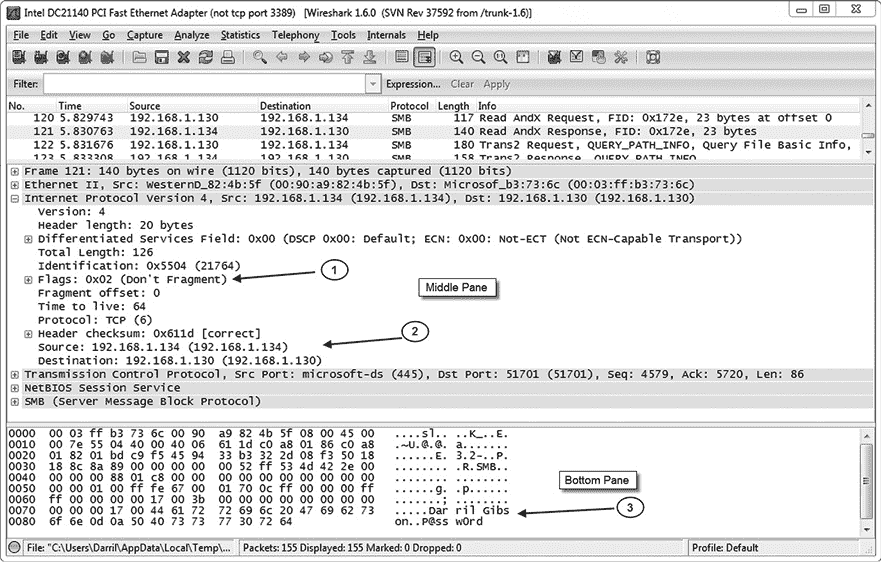

图 8.3: Wireshark 捕获

虽然分析数据包捕获可能很枯燥，但对于任何愿意花时间这样做的人来说，其中包含大量信息。偶尔，攻击者会操纵头部中的标志（箭头 1）以进行不同类型的攻击，协议分析仪允许你验证头部头部攻击。你还可以在 IP 头部字段中看到源和目的 IP 地址（箭头 2）。你可以展开 Ethernet II 部分以显示源和目的计算机的媒体访问控制 (`MAC`) 地址。

注意，你可以在底部窗格（箭头 3）中查看未加密的凭据——用户名（`DarrilGibson`）和密码（`P@ssw0rd`），因为 `SMB` 以明文发送用户名和密码。然而，如果应用程序在跨越网络发送数据之前加密了数据，它将是不可读的。

| 记住这一点！| 管理员使用协议分析仪来捕获、显示和分析通过网络发送的数据包。它在排排除系统之间的通信问题时非常有用。它对于检测操纵或分段数据包的攻击也有用。 |
| --- |

## Tcpreplay 和 Tcpdump

`Tcpreplay` 是一个工具包，用于编辑数据包捕获并并将编辑后的数据包发送到网络。它包含了 `tcpreplay`、`tcpprep`、`tcprewrite` 等等。它通常用于测试网络设备。

例如，管理员可以修改数据包以模拟已知攻击，然后将其发送到入侵检测系统 (`IDS`)。理想情况下，`IDS` 应该始终检测到已知攻击并发送警报。使用 `tcpreplay`，安全管理员可以证明 `IDS` 能够检测特定的攻击。

`tcpdump` 命令是一个命令行协议分析仪。它允许你像使用 `Wireshark` 一样捕获数据包。区别在于 `Wireshark` 是基于 Windows 的工具，而 `tcpdump` 是从命令行执行。许多管理员使用 `tcpdump` 捕获数据包，稍后使用 `Wireshark` 分析数据包捕获。

Kali Linux 包含了 `tcpdump`，和大多数 Linux 命令行工具一样，`tcpdump` 是大小敏感的。你需要以全小写输入 `tcpdump`。此外，开关必须以正确的大小输入。例如，

```


`-c`（小写 `c`）代表计数，表示捕获在接收到指定数量的数据包后停止。然而，`-C`（大写 `C`）代表大小，表示当文件达到指定的字节数时停止。


## NetFlow

`NetFlow` 是许多路由器和交换机上的一种功能，用于收集流量统计数据，并将其发送到 `NetFlow` 收集器。`NetFlow` 是一个标准，由思科创建，被其他供应商采用。`NetFlow` 收集器可以收集数据，人员可以使用它来分析网络流量。

协议分析仪如 `Wireshark` 允许你捕获并分析负载。相反，`NetFlow` 记录只显示计数。`NetFlow` 使用模板来识别包含的数据：

* 流的开始和结束时间戳
* 输入接口标识（路由器或交换机上）
* 输出接口标识（如果数据包被丢弃）
* 源信息（源 IP 地址和端口）
* 目的信息（目的 IP 地址和端口）
* 数据包计数和字节计数
* 协议（如 `TCP`、`UDP`、`ICMP` 或其他层 3 协议）

某些框架和标准仅适用于特定行业。例如，处理信用卡的组织通常需要遵守《支付卡行业数据安全标准》（`PCI DSS`）。`PCI DSS` 包含 12 项主要要求，以及针对不同类型实体的额外要求，组织遵循这些要求来保护信用卡数据。`PCI DSS` 并非万无一失，但它帮助降低了许多与信用卡欺诈相关的风险。

互联网安全中心（`CIS`）的使命是“通过开发、验证和推广及时的最佳实践解决方案，帮助个人、企业和政府免受泛滥的网络威胁，使这个互联的世界变得更安全。”他们提供了若干免费下载资源概述最佳实践，并维护网络安全威胁的最新信息。成员包括公司、政府机构和学术机构，成员可以访问额外的 `CIS` 资源。

## NIST 框架

美国国家标准与技术研究院（`NIST`）发布了两个重要的框架，被风险管理和网络安全专业人士广泛使用。这些框架在网络安全领域深受认可。

### NIST 风险管理框架

`NIST SP 800-37`《信息系统和组织的风险管理框架》涵盖了风险管理框架（`RMF`）。虽然美国联邦政府机构必须采用 `RMF`，但许多私营部门组织也采用了它。`RMF` 为组织提供了一个识别和缓解风险的七步流程。这七步分别是：

1. **准备**（Prepare）。在这一步骤中，组织会识别实施框架的关键角色，识别风险容忍策略，更新（或创建）风险评估，并识别已有的控制措施。还会创建一个持续监控策略。
2. **分类**（Categorize）。人员确定如果这些操作或资产的机密性、完整性和可用性丢失，会对操作或资产产生何种不利影响。这允许他们对系统划分优先级。
3. **选择**（Select）。人员选择并定制保护其操作和资产所需的控制措施。他们通常从基准开始，然后根据需要对基准进行定制。
4. **实施**（Implement）。在这一步骤中，人员实施所选的控制。如果需要更改，人员将进行记录。
5. **评估**（Assess）。接下来，人员评估控制措施以查看是否产生了预期结果。这包括验证它们是否正确实施并按预期运行。
6. **授权**（Authorize）。高级管理人员决定系统是否获得运行许可。该官员根据之前步骤的输出做出决策。政府机构对这一步骤的重视程度高于私营组织。
7. **监控**（Monitor）。监控是一个持续步骤，人员不断评估系统和环境的变化。这通常包括执行定期风险评估和分析风险响应。

### NIST 网络安全框架

`NIST 网络安全框架 (CSF)` 与 `RMF` 对齐。许多私营部门组织已采用它，以提高其预防、检测和响应网络攻击的能力。`CSF` 包含三个组件：

* **核心**（Core）。核心是组织可以选择的以实现预期结果的一系列活动。它包括五个功能：识别、保护、检测、响应和恢复。
* **层级**（Tiers）。层级有助于组织识别其如何看待风险。四个层级分别是：部分级（`Tier 1`）、风险知情（`Tier 2`）、可重复（`Tier 3`）和自适应（`Tier 4`）。`Tier 4` 是最高级，表示组织拥有（或希望拥有）成熟的风险管理计划。
* **配置文件**（Profile）。配置文件根据组织的需求和风险评估提供一份结果列表。当前配置文件描述网络安全活动的当前状态，而目标配置文件描述预期的结果。通过比较当前配置文件与目标配置文件，组织可以识别其风险管理计划中的差距。组织可以根据不同价值为不同系统使用不同的配置文件。

## 参考架构

在网络安全中，参考架构是一份或一组提供系列标准的文档。例如，软件参考架构文档记录了高层设计决策。它可能强调创建重用模块和遵循特定接口特定标准的必要性。某些软件参考架构文档列出了软件项目应该使用的程序、函数和方法。

你找不到一个能够满足所有项目需求的单一参考架构。相反，关键在于复杂的项目通常使用一种架构来标准化项目中的每个人的努力。

## 基准测试和配置指南

除了框架之外，你还可以使用各种指南来增加安全性。这包括基准测试或安全配置指南、特定平台或供应商的指南，以及通用指南。从表面上看，这非常简单。在配置 Windows 系统时，使用 Windows 指南来识别安全设置；在配置 Linux 系统时，使用 Linux 指南。

此外，在配置特定角色系统（如 Web 服务器、应用程序服务器或网络基础设施设备）时，请遵循该角色的相应指南。例如，Web 服务器需要开放 `80` 和 `443` 端口分别用于 HTTP 和 HTTPS。然而，数据库应用程序服务器通常不需要开放这些端口，因此应在数据库应用程序服务器上关闭它们。每个角色的独立指南都提供了此类信息。

## 审计与评估

业务领导和外部利益相关者通常希望确保其组织符合监管要求和行业标准最佳实践。审计和评估为他们提供了实现这一目标。

审计是对组织政策、程序和操作的正式评估。在网络安全领域，审计确认组织已采取了充分的安全控制措施，并且这些措施正在有效保护关键资产。

评估是对组织网络安全防御的非正式审查。评估可能包括漏洞扫描、渗透测试和对网络安全控制的审查。评估中使用的许多技术也可能在审计中发挥作用。

评估可能由许多不同的小组执行。组织可能会聘请具有特定专业知识的外部公司，也可以要求网络安全团队在内部进行评估。另一方面，审计要更加正式和结构化，并由独立于实施控制措施团队的团队执行。

审计主要分为两大类：

* **外部审计**（External audits）由独立审计师执行的正式检查。许多组织会接受年度财务审计以满足法律要求，而网络安全控制是这些审计的标准组成部分。外部审计的结果可能会提供给组织董事会的审计委员会、监管机构或其他利益相关者。
* **内部审计**（Internal audits）由组织内部的审计团队执行。大多数大型组织都有内部审计小组，在董事会审计委员会的指导下工作。他们执行多种类型的审计以确保符合法规，并进行其他自评估。

内部审计小组分配的常见任务之一是执行缺口分析。这是一种评估类型，审核人员选取一个标准（如 `ISO 27001`），然后将该标准中的要求与组织的正常运行进行比较。随后他们会记录组织未能完全达到标准的任何缺口，并将其识别为改进机会。

审计的结果是审计人员出具证明（attestation）。这是一份正式声明，确认组织内部已建立特定的安全控制和流程，并确保运行良好。这是一项重要的声明，因为审计机构正在拿自己的声誉做担保。

## 第 8 章考试考点复习

在准备考试时，请确保你理解本章涵盖的这些概念。

### 理解风险管理

* 风险是指威胁利用漏洞的可能性。威胁是可能损害机密性、完整性或可用性的潜在危险。漏洞是软件或硬件中的缺陷，或是流程中的弱点，威胁可以利用这些弱点导致安全违规。
* 风险使用影响和概率/可能性标准进行评估。影响是指如果威胁利用了漏洞可能造成的损害程度。概率/可能性告诉我们预计风险发生的频率。
* 风险管理试图将风险降低到组织可以接受的水平，剩余风险被称为残余风险。高层管理负责管理风险以及与残余风险相关的损失。
* 你可以通过不提供服务或不参与风险活动来避免风险。购买保险（如火险）是将风险转移给另一个实体。网络安全控制可以缓解或减少风险。当控制的成本超过风险时，通常会接受该风险。
* 风险胃口（Risk appetite）是指组织愿意接受的风险量。这根据组织的目标和战略目标而异。组织的风险胃口可能是扩张性的、保守的或中性的。
* 风险容忍（Risk tolerance）是指组织承受风险的能力。
* 风险评估根据不同的数值或判断对风险进行量化或定性描述。它从识别资产价值并对高价值项目进行优先排序开始。
* 定量风险评估使用数字，如成本和资产价值。你通过识别每个资产的资产价值 (`AV`) 开始定量分析。接下来，你确定风险每次发生时资产受损的百分比，这被称为暴露因子 (`EF`)。
* 单次损失预期 (`SLE`) 是任何单次损失的成本，通过 `AV` 乘以 `EF` 计算得出。年度发生率 (`ARO`) 指明损失每年发生的次数。你可以通过 `SLE` × `ARO` 计算年度损失预期 (`ALE`)。
* 定性风险评估使用判断，根据发生的概率和影响对风险进行优先排序。这些判断提供了主观的排名。
* 风险评估结果是敏感的。只有高管人员和安全专业人员应获得访问风险评估报告的权限。
* 风险注册（Risk register）是一份列出风险信息的详细文档。它通常包括风险分以及旨在降低风险分的建议安全控制措施。风险矩阵在图表上绘制风险分布。
* 供应链评估评估生产和销售产品所需的供应链。它包括原材料以及创建和分发成品所需的所有流程。供应链风险分析应该关注硬件提供商和软件提供商。

### 比较扫描与测试工具

* 端口扫描器扫描开放端口，并识别系统上运行的业务和服务协议。
* 漏洞扫描器测试安全控制以识别常见的配置错误。它们能够有效地发现易受攻击的系统，而无需实际对它们进行利用。
* 常见漏洞与披露 (`CVE`) 是公开已知漏洞的字典。漏洞评分系统 (`CVSS`) 评估漏洞并分配 0 到 10 之间的严重性评分，其中 10 最严重。
* 漏洞扫描的假阳性表示扫描检测到了漏洞，但该漏洞并不存在。假阴性表示漏洞存在，但扫描器没有检测到。
* 应该根据多项标准对漏洞进行优先排序，包括组织影响。
* 凭据扫描（Credentialed scans）在账户下运行，可以获取有关目标的更详细信息，例如已安装应用程序的软件版本。它们也比无凭据扫描更准确。
* 渗透测试是一种主动测试，尝试利用已发现的漏洞和安全控制措施。渗透测试可能侧重于物理、攻击性或防御性目标，也可能使用综合方法。
* 渗透测试人员在开始渗透测试之前应获得许可。参与规则说明（rules of engagement document）定义了测试的边界。
* 被动侦察从开源情报中收集信息。主动网络侦察和发现使用扫描技术。
* 在初始利用后，渗透测试人员使用权限提升技术来获取更多访问权限。渗透测试中的枢纽切换（Pivoting）是指利用被利用的系统访问其他系统的过程。
* 在未知环境测试中，测试人员在对环境一无所知的情况下进行渗透测试。已知环境测试表示测试人员完全了解环境，包括应用程序的文档和源代码。部分已知环境测试表示测试人员对环境有一定的了解。
* 扫描可以是侵入性的而非侵入性的。渗透测试是侵入性的（也称为入侵式），并可能干扰操作。漏洞测试是非侵入性的（也称为非入侵式）。
* 漏洞负责性计划允许个人和组织向相关方报告发现的安全漏洞或弱点。赏金计划是负责性计划的一种，通过对有效提交货币或其他奖励激励个人或组织报告漏洞。
* 修复漏洞的最常见方法是应用补丁。在无法进行补丁的情况下，可以使用补偿控制、分段或授予例外。
* 在修复漏洞后，应重新扫描受影响的系统，以验证修复有效且漏洞不再存在。

### 捕获网络流量

* 协议分析器（嗅探器）可以捕获并分析通过网络的数据。测试人员（和攻击者）使用协议分析器捕获跨网络的明文数据。
* 管理员使用协议分析器来排查通信问题，通过检查协议头来检测操纵或分段的数据包。
* 捕获的数据包显示流量类型（协议）、源和目的 IP 地址、源和目的 MAC 地址以及标志。

### 工具

* `Tcpreplay` 是一套实用程序，用于编辑数据包捕获并将编辑后的数据包发送到网络。`Tcpdump` 是一个命令行协议分析器。捕获到的数据包文件可以在 `Wireshark` 等图形化协议分析器中进行分析。
* `NetFlow` 采集路由器和交换机上的 IP 流量统计数据，并将其发送到 `NetFlow collector` 中。

### 理解框架与标准

* 框架是提供基础的参考。网络安全框架通常使用基本概念的结构，并对如何实施安全提供指导。
* 国际标准化组织 (`ISO`) 维护了一系列常用的网络安全标准。`ISO 27001` 涵盖信息安全管理。`ISO 27002` 涵盖信息安全技术。`ISO 27701` 涵盖隐私信息管理。`ISO 31000` 涵盖风险管理。
* 处理信用卡的组织通常遵守支付卡行业数据安全标准 (`PCI DSS`)。
* 美国国家标准与技术研究院 (`NIST`) 发布了非常流行的框架，包括其风险管理框架 (`RMF`) 和网络安全框架 (`CSF`)。
* 在配置特定系统时，应使用供应商特定的指南。

### 审计与评估

* 审计是对组织策略、程序和操作的正式评估。在网络安全领域，审计确认了组织已实施了适当的安全控制，且这些控制正有效地保护关键资产。
* 评估是对组织网络安全防御的较非正式的审查。评估可能包括漏洞扫描、渗透测试以及对网络安全控制的审查。评估中使用的许多技术也可能在审计中发挥作用。
* 外部审计是由独立审计师进行的正式检查。内部审计由组织内部的审计团队执行。
* 审计的结果是审计师出具的一份证明书（attestation）。这是一份正式声明，确认特定的安全控制和流程已在组织内部建立并正在有效运行。

| 在线参考 | 别忘记查看在线资源。它们包括额外的免费练习题、实验室以及其他帮助你通过 CompTIA Security+ 考试的资源。你可以通过以下地址访问它们：[`getcertifiedgetahead.com/`](https://getcertifiedgetahead.com/)。 |
| --- | --- |

## 第 8 章练习题

1. 你组织内的一个服务器在过去一年发生了六次硬件故障。IT 管理人员对该服务器的估值为 $4,000，每次故障导致了 10% 的损失。ALE（年度预期损失）是多少？
   1. $400
   2. $2,400
   3. $4,000
   4. $6,000

2. Maggie 正在对一个数据库服务器进行风险评估。在此过程中，她创建了一份显示该服务器所有已知风险的文档，以及每个风险的评分。下列哪项最能标识该文档的名称？
   1. 定性风险评估
   2. 定量风险评估
   3. 风险注册表
   4. 剩余风险

3. 你的组织托管了一个用于销售数字产品的电子商务网站。你被要求评估支持该网站的所有元素。你正在进行什么操作？
   1. 定量评估
   2. 定性评估
   3. 威胁狩猎
   4. 供应链评估

4. 你正在进行渗透测试以审查你组织安全控制的有效性。哪个术语最能描述你的工作？
   1. 审计
   2. 证明
   3. 评估
   4. 分析

5. Maggie 怀疑某个服务器可能运行着不必要的服务。以下哪个工具是识别服务器上运行服务的最佳恰当？
   1. `DNSEnum`
   2. IP 扫描器
   3. 被动侦察
   4. `Nmap`

6. 你想识别网络中某台服务器上运行的所有服务。以下哪个工具是实现这一目标的最佳恰当？
   1. 渗透测试
   2. 协议分析器
   3. 无凭据扫描
   4. 端口扫描器

7. 你最近对数据库服务器完成了漏洞扫描。扫描没有报告任何问题。然而，你知道它缺少一个补丁。未应用补丁是因为它会导致数据库应用程序出现问题。以下哪项最能描述这种情况？
   1. 漏报（False negative）
   2. 误报（False positive）
   3. 凭据扫描
   4. 无凭据扫描

8. 你怀疑一个被 Web 应用程序使用的数据库服务器没有更新到最新的补丁。采取以下哪项是验证服务器已安装最新补丁的最佳行动？
   1. 网络扫描
   2. 端口扫描
   3. 协议分析器
   4. 漏洞扫描

9. Lisa 定期对组织的网络运行漏洞扫描。最近，她收到了许多误报。以下哪些操作可以帮助减少误报？
   1. 以凭据扫描的方式运行扫描。
   2. 以无凭据扫描的方式运行扫描。
   3. 使用被动侦察运行扫描。
   4. 使用主动侦察运行扫描。

10. 你的组织聘请了外部渗透测试人员识别内部网络漏洞。在成功利用单台计算机的漏洞后，测试人员尝试访问网络内的其他系统。以下哪项最能描述他们当前的行为？
    1. 部分已知环境测试
    2. 持久化/维持
    3. 横向移动
    4. 权限提升

11. Bart 是你组织中的数据库管理员，他告诉过你最近发生的攻击，以及这些攻击是如何中断服务和连接的。作为回应，他表示他一直在使用 `Nmap` 运行扫描来识别漏洞。以下哪项是这种做法的错误？
    1. 数据库管理员偏离了本职。
    2. 没有先进行网络扫描。
    3. 扫描没有使用凭据进行。
    4. 未获得授权规则。

12. 你的组织外包开发了一个修改专利应用程序功能的模块。开发人员完成了模块，现在正对整个应用程序进行测试。开发人员正在进行哪种测试？
    1. 已知环境
    2. 未知环境
    3. 部分已知环境
    4. 红队

13. 你正在审查漏洞扫描的结果，很难确定优先处理哪些漏洞。什么标准工具可以帮助你识别最严重的漏洞？
    1. `CVSS`
    2. `CVE`
    3. `SCAP`
    4. MITRE

14. 你的组织正在建立一个在线销售产品的网站。管理层希望确保网站接受信用卡支付。他们最可能遵循哪些标准？
    1. `ISO 27001`
    2. `PCI DSS`
    3. `ISO 31000`
    4. SSAE SOC 2 Type I

15. 你正在为你的组织进行供应链评估。以下哪一组通常不会包含在此类评估中？
    1. 餐饮服务商
    2. 硬件供应商
    3. 软件供应商
    4. 服务供应商

## 第 8 章练习题答案

1. B 正确。年度预期损失（ALE）为 $2,400。它的计算公式是单次预期损失（SLE）乘以发生率（ARO）。每次故障导致了 10% 的损失（意味着修复它需要资产价值的 10%）。SLE 是 $4,000 的 10% ($400)，ARO 是 6。6 × $400 是 $2400。

2. C 正确。风险注册表列出了资产（例如数据库服务器）的所有已知风险，并且它通常包含风险分值（发生概率和风险影响的组合）。风险评估（包括定性和定量风险评估）可能会使用风险注册表，但它们本身并不是风险注册表。残余风险是指在应用安全控制缓解风险后剩余的风险。

3. D 正确。供应链评估评估了用于创建、销售和分发产品的所有元素。美国国家标准技术研究院（`NIST`）风险管理框架（`RMF`）（`NIST SP 800-37 r2`）提供了降低供应链风险的步骤。风险评估（包括定量和定性风险评估）负责评估风险，但不会评估支持电子商务网站所需的供应链。威胁狩猎（Threat hunting）是在自动化工具检测并报告威胁之前，在网络内部主动寻找威胁的过程。

4. C 正确。渗透测试是一种评估技术。它们可以作为审计的一部分使用，但它们本身不是审计。证明（Attestation）是审计员在审计完成后做出的正式声明。分析（Analysis）不是标准的审计/评估术语。

5. D 正确。`Nmap` 是一个网络扫描器，它可以检测运行在服务器上的协议和服务。`dnsenum` 命令将枚举（或列出）域名系统（`DNS`）记录。IP 扫描器检测网络上活跃的 IP，但不检测单个主机上运行的服务。被动侦察（Passive reconnaissance）使用开源情报（`OSINT`）而不是主动工具。

6. D 正确。端口扫描器识别系统上的开放端口，通常用于确定系统上运行哪些服务。漏洞扫描器通常包含端口扫描功能，并帮助识别潜在的弱点配置。渗透测试尝试利用漏洞。协议分析仪可以分析流量并发现正在使用的协议，但这比使用端口扫描器困难得多。非凭据扫描（Non-credentialed scan）指的是漏洞扫描，虽然漏洞扫描可能会揭示运行在服务器上的服务，但不会像端口扫描那样具体。

7. A 正确。如果漏洞扫描器没有报告已知漏洞，则发生漏报（False negative）。当漏洞扫描器报告了不存在的漏洞时，则会发生误报（False positive）。该场景未说明扫描是在账户上下文（`credentialed`）下运行还是匿名运行（`non-credentialed`），因此这些答案与问题无关。

8. D 正确。漏洞扫描确定系统是否有当前的补丁。其他答案都无法检测缺失的补丁。网络扫描将发现网络上的设备。它可能会查找并检测网络设备上的漏洞，但不会用于扫描单个服务器的补丁。端口扫描识别开放端口。协议分析仪（`sniffer`）捕获流量以进行分析。

9. A 正确。以凭据扫描（在有效账户上下文中）运行扫描允许扫描看到更多信息，通常会导致更少的误报。误报表示扫描报告了不存在的漏洞。非凭据扫描在没有任何用户凭据的情况下运行，准确性可能较低。选择被动或主动扫描都不会减少误报。

10. C 正确。横向移动（Lateral movement）是指在成功利用单个系统后在网络中移动采取的行动。部分已知环境测试（有时称为灰盒）表示测试人员具有某些知识。持久化（Persistence）是指在系统上维持存在。权限提升（Privilege escalation）是指获得更高的权限。

11. D 正确。给定场景，分析恶意活动指标。中继（Pivoting）是指攻击者通过受侵害的系统访问其他系统。虽然 Bart 是数据库管理员，执行扫描超出了他的正常职责范围，但 `Nmap` 可以进行网络扫描。场景是。

12. C 正确。开发人员正在进行部分已知环境测试（有时称为灰盒）。部分已知环境测试人员对应用程序有一定的了解。已知环境测试人员（有时称为白盒）对他们测试的产品或网络有完全了解。未知环境测试人员（有时称为黑盒）对他们测试的产品或网络一无所知，这将是不可行的。红队（Red team）指的是一种练习类型，红队成员是攻击系统的专家。

13. A 正确。通用漏洞评分系统（`CVSS`）评估漏洞并分配 0 到 10 之间的严重性评分，10 分最严重。MITRE 公司维护常见漏洞和披露（`CVE`）列表，它是公开已知安全漏洞的字典，但不包含严重性评分。安全内容自动化协议（`SCAP`）旨在有助于漏洞扫描器与管理工具之间的通信。

14. B 正确。在使用信用卡时，公司将遵守支付卡行业数据安全标准（`PCI DSS`）。国际标准组织（`ISO 27001`）提供了信息安全管理系统（`ISMS`）要求的信息。`ISO 31000` 是与风险管理相关的标准族。证明业务报告标准声明（`SSAE`）系统和组织控制（`SOC`）2 Type I 报告描述了组织的系统，并涵盖了特定日期安全控制的设计有效性。

15. A 正确。供应链评估应包含任何为交付贵组织的产品和服务提供关键性货物或服务的组织。这包括硬件提供商、软件提供商和服务提供商。虽然吃午饭很重要，但餐饮供应商通常不会被视为供应链的关键部分。

## 第 9 章：实施控制保护资产

本章涵盖的 CompTIA Security+ 目标：

### 1.2 总结基本安全概念。
* 物理安全（护柱 `Bollards`、安检门厅 `Access control vestibule`、围栏 `Fencing`、视频监控 `Video surveillance`、保安 `Security guard`、门禁卡 `Access badge`、照明 `Lighting`、传感器 `Sensors`、红外 `Infrared`、压力 `Pressure`、微波 `Microwave`、超声波 `Ultrasonic`）

### 2.4 给定场景，分析恶意活动指标。
* 物理攻击（暴力破解 `Brute force`、环境 `Environmental`）

### 3.1 比较对比不同架构模型的安全影响。
* 架构和基础设施概念（高可用 `High availability`）

### 3.3 比较对比保护数据的概念和策略。
* 通用数据考虑（数据主权 `Data sovereignty`）

### 3.4 解释韧性和恢复在安全架构中的重要性。
* 高可用性（负载均衡 vs. 集群）
* 站点考量（热备、冷备、温备、地理分散）
* 平台多样性
* 业务连续性
* 容量规划（人员、技术、基础设施）
* 测试（桌面推演练、故障转移、模拟、并行处理）
* 备份（现场/异地、频率、加密、快照、恢复、复制、日志记录）
* 电源（发电机、不间断电源 (UPS)）

### 4.2 解释妥当的硬件、软件和数据资产管理对安全产生的影响。
* 获取/采购流程
* 分配/核算（所有权、分类）
* 监控/资产跟踪（库存清点、枚举）

### 5.2 解释风险管理过程的要素。
* 业务影响分析（恢复时间目标 RTO、恢复点目标 RPO、平均修复时间 MTTR、平均故障间隔时间 MTBF）

你无法消除组织资产面临的风险。然而，通过实施安全控制，你可以减少许多威胁的影响。通常采用分层策略，结合多种控制措施、供应商和技术来实施多项控制。物理安全控制有助于保护对安全区域的访问。冗余和容错策略有助于消除关键系统的单点故障。备份确保即使数据丢失，数据仍然可用。更深入的业务连续性策略有助于确保即使灾难破坏了主要的业务所在地，关键任务功能也能继续运行。本章涵盖了这些概念。

### 比较物理安全控制

物理安全控制是你物理上可以接触到的东西，例如硬件锁、围栏、识别证和监控摄像头。物理访问控制是物理控制的一个子类，试图控制进入和退出。组织通常在不同的边界实施不同的控制措施，例如：

* **边界**：军事基地和其他许多组织会在其土地的周围建立围栏。他们通常会在大门处安排安保人员以控制访问。在某些情况下，组织会设置路障来阻止车辆。
* **建筑**：建筑通常对安全和防护有额外的控制措施。例如，安保人员和锁好的门限制了进入，使只有授权人员才能进入。许多建筑配备了照明和视频摄像头来监控出入口。
* **安全工作区域**：当员工执行机密或限制访问的任务时，某些公司会限制对特定工作区域的访问。在某些情况下，组织会限制对所有内部工作区域的访问。换句话说，游客可以进入建筑大堂，但在没有护送的情况下无法进入内部工作区域。
* **服务器房**：服务器和路由器、交换机等网络设备通常存储在只有适当 IT 人员才能访问的区域。这些空间可能被指定为服务器房或布线间。组织通常为这些房间提供额外的物理安全，以防止攻击者接触设备。例如，锁定布线间可以防止攻击者安装非法的监控硬件（如协议分析仪）来拦截网络流量。
* **硬件**：额外的物理安全控制保护单个系统。例如，服务器房通常设有锁柜，以保护安装在机柜内的服务器和其他设备。线锁保护笔记本电脑，较小设备可以存储在保险中。

许多组织使用伪装技术（有时称为工业伪装）来隐藏建筑、建筑的一部分以及各种其他物品。广义地说，伪装是使用材料隐藏物品或将其伪装成其他东西。

景观设计可以伪装建筑或其部分。想象一圈坚固的安全围栏围绕着一个组织。组织可以用高灌木、观赏草或多年生植物等景观来掩盖它。这提供了美学效益，并掩盖了该组织投资了如此坚固围栏的事实。

### 访问证

可以使用感应卡或智能卡作为访问证来确保区域访问的安全。感应卡是信用卡大小的小卡片，在靠近感应卡读卡器时激活。许多组织将它们用于访问点，例如建筑入口或建筑内受控区域的入口。门使用电子锁，只有当用户将感应卡通过读卡器前时，锁才会解锁。

同样，可以使用智能卡或物理令牌（在第 2 章“理解身份和访问管理”中描述）进行门禁。在某些情况下，智能卡包含了感应卡元件。在其他情况下，用户必须将智能卡插入智能卡读卡器以获得访问权限。

你可能见过结合信用卡读卡器实现的感应卡阅读器。许多自助加油站和快餐店都使用它们。你不需要将信用卡刷磁性读卡器，只需将其通过读卡器前（靠近读卡器），读卡器就会提取你的信用卡信息。

这些在其他地方也变得流行。例如，如果你住在沃尔特迪士尼世界的物业，他们可以为你发放一个包含感应卡功能的手环。要进入酒店房间，你只需在门前挥动手环。如果你想买食物、纪念品或支付几乎任何费用，只需在读卡器前挥动手环即可完成购买。

卡片（和手环）不需要自己的电源。相反，卡片中的电子元件包含一个电容器和一个线圈，可以接受来自感应卡读卡器的充电。当你将卡片靠近读卡器时，读卡器会激发线圈并在电容器中储存电荷。充电后，卡片使用无线频率将信息传输到读卡器。当与门禁系统配合时，感应卡可以发送一个简单的信号来解锁。某些系统包含用户的详细信息，并记录用户进入或离开区域的时间。在这样使用时，通常会将感应卡读卡器与键盘结合，要求用户输入个人识别码（PIN）。这通过多因素身份识别识别并验证用户。用户拥有某种东西（感应卡）并知道某种东西（PIN）。

许多组织使用感应卡配合转闸机来提供一次一个人的访问。这些闸机与地铁、体育场和游乐园入口处的闸机是同一种类型。

| 记住这个！ | 感应卡通常是信用卡大小的访问卡。用户将卡片靠近感应卡读卡器，读卡器随后读取卡片上的数据。某些访问控制点使用带有 PIN 的感应卡进行身份验证。 |
| --- | --- |

安保人员也可以采取较不活跃的角色来威慑安全事件的发生。例如，安保人员可以通过观察使用感应卡进入安全区域的人员来威慑“尾随”（tailgating）事件。第 6 章“比较威胁、漏洞和常见攻击”讨论了尾随问题。在某些情况下，安保人员会在访客日志中记录访问情况。这为任何访客提供了书面记录。

许多机构并不使用安保人员，而是使用接待台或接待区来控制访问。访客在允许进入安全区域之前，需要向接待员办理签到。虽然接待员不是安保人员，但他们通常可以通过简短电话快速联系到安全人员。

### 使用视频监控监控区域

各机构越来越多地在工作场所及周边区域使用监控摄像头进行视频监控。这包括建筑外的区域，如停车场以及所有建筑的入口和出口。此外，许多机构还使用摄像头监控高安全区域的入口，例如数据中心或服务器房的入口。

闭路电视（`CCTV`）系统将信号从视频摄像头传输到类似于电视的显示器上。除了提供安全保障，`CCTV` 系统还能通过威慑威胁来增强安全性。

机构经常在工作环境中使用视频摄像头来保护员工并增强工作场所的安全性。除了实时监控外，大多数系统还包含录像功能，并可以验证是否有人偷取公司资产。通过记录活动，视频可以在日后回放用于调查，甚至是起诉。

视频监控为人的位置和活动提供了强有力的证据。数字访问日志虽然提供了记录，但这些日志是可以被规过的。例如，如果巴特（Bart）使用了你的感应卡进入安全空间，日志将显示是你进入了，而不是巴特。相比之下，如果视频显示巴特在某天的特定时间进入了房间，巴特很难反驳这段视频。

将 `CCTV` 系统作为一种补偿性控制措施也是可能的。设想一个机构想要实施一套门禁系统，要求用户使用智能卡进入安全区域。然而，这可能需要几个月才能实施。该机构可以实施 `CCTV` 系统来记录访问情况，直到卡禁系统安装完成。

摄像头可以连接到运动检测系统，以便它们只在检测到运动时才开启。这作为一种防盗检测系统可以非常有效。

目标检测利用摄像头图像和软件来检测特定物体。有些设备可以检测静态图像，但更常见的是分析视频帧以检测常见物体可预测移动。例如，某些汽车使用此技术来检测走入车辆路径的行人。

| 记住这一点！ | 视频监控为人的位置和活动提供了可靠的证据。它可以识别谁进入和离开安全区域，并可以记录资产的盗窃行为。许多摄像头包含运动检测和目标检测功能。在某些情况下，CCTV 系统可以用作补偿性控制。 |
| --- | --- |

### 传感器

许多物理安全控制使用传感器来检测环境的变化。将传感器与摄像头、报警器、火灾检测等结合使用是常见的。许多机构使用的常用传感器类型包括：

* **运动检测**：许多机构将自动化、调光器和运动传感器相结合，在不牺牲安全性的前提下节省电费。灯光在黄昏时自动开启，但处于低亮度调光模式。当运动传感器检测到任何移动时，灯光会全功率开启，并在黎明时自动关闭。运动检测传感器还可以触发报警。当然，它们只在区域空闲时启用。
* **噪声检测**：噪声检测传感器可以检测任何噪音或当噪音超过特定水平时。它们的工作方式类似于运动检测传感器，并在任何声音时发出提醒以控制灯光或触发报警。某些 Airbnb 房东不希望租客在他们的房子里举办派对。他们可以使用噪声传感器来检测噪声水平何时超过特定水平。某些噪声传感器可以检测特定的声音，例如烟雾报警器声或玻璃破碎声。
* **红外**：红外传感器检测由人、动物或物体发出的红外辐射形式的热信号。这些传感器通常用于安全目的，因为即使在完全黑暗中也能检测到人或动物的存在。它们通常被集成到监控摄像头和报警系统中，以提高它们的检测能力。
* **压力**：压力传感器设计用于检测表面或特定区域压力的变化。这些传感器可以检测是否有人走在地板上或踩在垫子上。它们还可以用于监控门窗是否有强行闯入的尝试。此外，压力传感器可以用于访问控制系统，以确保只有授权人员才能进入限制区域。
* **微波**：微波传感器利用微波技术检测特定区域内的运动。这些传感器发射微波信号并测量反射信号，以检测环境的任何变化，例如人的存在或移动物体的移动。微波传感器通常与其他类型的传感器结合使用以增强安全系统并减少误报。
* **超声波**：超声波传感器发射高频声波，并测量声波在击物体或表面后返回所需的时间。这些传感器用于检测人或物体的存在，还可以测量距离。超声波传感器常用于停车辅助系统、机器人导航和入侵检测系统。

| 记住这一点！ | 传感器监控环境并可以检测变化。常见的传感器类型包括运动检测和噪声检测，以及用于监控红外温度、压力、微波和超声波的传感器。 |
| --- | --- |

### 围栏、照明和报警器

围栏为物业提供屏障并威慑人员不要进入。在使用围栏时，通过特定的大门来控制该区域的访问是常见的。安保人员通常监控这些大门，并确保只有授权人员才能进入。当需要额外的安全性时，机构有时会配置双门，允许进入一个区域，并在允许完全访问前检查凭证。这有效地创建了一个防止完全访问的笼子，同时也防止了未经授权人员的逃脱。

在建筑的所有入口安装灯光可以威慑攻击者尝试破入。同样，在任何内部限制区域的入口处照明可以威慑人员尝试进入。许多机构将自动化、调光器和运动传感器相结合，在不牺牲安全性的前提下节省电费。灯光在黄昏时自动开启，但处于低亮度调光模式。当运动传感器检测到任何移动时，灯光会全功率开启。它们在黎明时自动关闭。

保护灯光很重要。例如，如果攻击者可以移除灯泡，控制就会失效。要么将灯光放置得足够高无法触及，要么用金属罩保护它们。

报警器提供了额外的物理安全保护。这包括检测火灾的报警器和检测未经授权访问的报警器。火灾报警器检测烟雾和热量并触发灭火系统。防盗系统监控门窗等切入点，检测它们何时被打开。

你还可以将运动检测系统与防盗系统相结合。它们可以检测监测区域内的移动并触发警报。显然，你不会一直开启运动检测系统。相反，你会在人们不在该区域工作时开启它们，例如在夜间或周末。

### 使用路障确保安全

在某些情况下，仅靠围栏不足以威慑潜在的攻击者。为了增强围栏和其他物理安全措施，各机构会建造更坚固的路障。例如，军事基地通常会建造坚固的之字形路障，要求车辆减速才能通过。这可以防止攻击者试图开车冲撞大门。

企业和机构需要呈现出亲和的外观，因此不能使用这种剧烈的路障。然而，他们经常使用护柱（bollards），这是一种由钢筋混凝土和/或钢制成的短垂直柱。他们通常将护柱放置在入口前，间距约三到四英尺，并将其涂成与建筑匹配的颜色，使其融入环境。你可能多次走过一组护柱，而完全没有想过它们。然而，那些考虑开车汽车或卡车冲进入口的窃盗者却能看到它们。

许多窃盗曾直接开车穿过建筑正门，然后偷走所触及的一切。根据墙壁的强度，犯罪分子甚至可能用卡车撞破墙壁。战略性放置的护柱将有助于防止此类攻击。

### 访问控制门厅（安检室）

访问控制门是数据中心安全的关键组成部分。作为防止未经授权进入的第一道防线，这些安全入口在外部世界与数据中心内部存储的价值资产之间提供了物理屏障。通过实施严格的访问控制措施，数据中心运营人员可以降低未经授权的人、潜在入侵者甚至具有恶意的内部人员带来的风险。

访问控制门由两组相互锁定的门组成，旨在创建一个安全的隔间，允许一次仅一人进入。这些入口点通常配备了先进的安全措施，如生物识别扫描仪、`RFID` 卡读器，甚至是面部识别系统。这些系统验证寻求访问人员的身份，确保只有授权人员才能进入。访问控制门通过在人员尝试绕过安全时将其困在两组门之间，来防止尾随（tailgating）并威慑未经授权的进入。

### 资产管理

资产管理是在其整个生命周期内跟踪价值资产的过程。资产管理计划应涵盖硬件、软件和数据资产。从安全的角度来看，这些资产管理计划确保组织了解自己拥有哪些资产、这些资产位于何处以及如何保护它们。任何资产管理计划的核心活动包括：

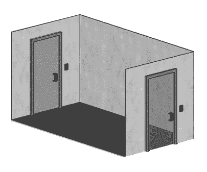

图 9.1: 访问控制门

* 获取/采购流程：提供一致的程序，用于识别对新资产的需求、评估满足安全、财务和业务要求的可能选项，并有效地对新供应商进行入驻管理。
* 分配/核算流程：将每项资产分配给一个具名的所有者（由其对资产负责），并建立一个识别每项资产对组织敏感性和重要性的分类系统。
* 监控和资产跟踪流程：维护组织所有资产的清单及其当前位置。该过程也受益于定期的资产清点，审计员会检查组织拥有的资产并更新清单。

#### 硬件资产管理

组织通常实施硬件资产管理流程来跟踪服务器、台式电脑、笔记本电脑、路由器、交换机和其他硬件资产。有效的资产管理系统可以帮助减少多种漏洞：

* 架构和设计缺陷：资产管理通过确保购买通过审批流程，帮助减少架构和设计缺陷。审批流程不仅仅是比较成本，它还评估购买项目以确保其符合整体网络架构。未经批准的资产往往会因为增加未管理的额外资源而削弱安全性。
* 系统蔓延和未记录资产：当组织拥有的系统比需要的多，且其拥有的系统未充分利用时，就会发生系统蔓延。资产管理于硬件购买之前，通过评估购买来防止系统蔓延。此外，在购买完成后，资产管理流程确保硬件被添加到资产管理跟踪系统中。这确保了资产从诞生到终结都得到管理和跟踪。

许多组织使用自动化方法进行库存控制。例如，射频识别（`RFID`）方法可以跟踪设备的移动。这些设备与商店用于防止偷窃的类型相同。如果有人在未付款的情况下离开，当窃偷靠近出口门时，`RFID` 设备会传输信号并触发警报。组织并不一定有报警器，但他们可以在设备上放置 `RFID` 标签来跟踪设备移动。

移动设备很容易丢失，因此组织经常使用资产跟踪方法来减少损失。例如，当用户接收到移动设备时，资产跟踪方法会记录它。同样，如果用户离开公司，资产跟踪方法会确保用户归设备。

#### 软件资产管理

软件资产管理涉及跟踪和管理组织内的软件许可、安装和使用。它有助于符合许可协议、优化软件使用，并最大限度地减少与未修复或未经授权软件相关的安全漏洞风险。有效的软件资产管理包括获取、分类和更新软件的流程，以及监控使用情况并在必要时维护许可。

#### 数据资产管理

数据管理关注组织的数据资产，包括数据库、文件和其他信息库。它涉及定义所有权、分类和访问控制，以及确保数据的完整性、可用性和机密性。数据管理的关键方面包括数据治理、数据质量管理和数据生命周期管理。这些过程有助于组织维护准确、最新且安全的数据资产，实现更好的决策并减少数据泄露或丢失的风险。

### 平台多样性

深度防御（称为分层安全）是指实施多层保护的安全实践。你不能仅仅采取一种措施（如在建筑入口安装锁）就认为自己受到了保护。你必须在多个层面上实施安全措施。这样，如果某一层失效，你仍然有额外的层次来保护你。

如果你开车去当地的沃尔玛，在仪表台上放一张五美元钞，把钥匙留在车里并保持启动，那么当你从商店出来时，汽车很可能不在了。相反，如果你确保从窗外看不到任何价值物品、锁好车门、配备了报警系统，并在窗户上贴有报警系统的贴纸，那么被盗窃的可能性就会降低。并非不可能，但可能性会变小。

应用分层安全的方法之一是多样化。这包括使用不同的供应商、不同的技术和不同的控制措施。

#### 供应商多样化

供应商多样化是指实施来自不同供应商的安全控制措施以增强安全性。例如，第 3 章“探索网络技术与工具”描述了筛选子网（有时称为非军事化区）。许多筛选子网使用两个防火墙，而供应商多样化要求使用不同供应商的防火墙。例如，一个防火墙可以是 `Cisco` 防火墙，另一台可以是 `Check Point` 防火墙。如果在其中一个防火墙中发现了漏洞，攻击者可能会利用它。然而，两台防火墙不太可能同时出现漏洞。

#### 技术多样化

技术多样化是指使用不同技术来保护环境的实践。例如，一个机构可能会选择一个数据服务器房。他们可能从限制访问点开始，在门上添加生物识别锁，并使用 `CCTV` 系统监控访问点。

#### 控制多样化

控制多样化是指使用不同类别的安全控制措施，例如技术控制、物理控制、管理控制和操作控制。例如，技术安全控制（如 `firewalls`、入侵检测系统 `IDSs` 和代理服务器）有助于保护网络。物理安全控制可以为服务器房或其他设备所在的区域提供额外保护。管理和操作控制（如 `vulnerability assessments` 和渗透测试）可以帮助验证这些控制措施是否按预期工作。

### 物理攻击

我们使用物理安全控制来防御物理攻击。我们的对手有许多工具可用，试图破坏我们的物理安全。

#### 刷卡盗刷与卡片克隆

信用卡盗刷是在销售点捕获信用卡数据的行为。攻击者通常在自动取款机 (`ATMs`) 或用户刷取信用卡的加油站放置刷卡器。刷卡器会捕获磁条上的数据，但又允许交易通过。信用卡刷卡器的某些迹象包括：安全封条破损、信用卡读卡器松动，或者读卡器延伸到面板之外的读卡器。

卡片克隆是指使用从磁条中捕获的数据复制信用卡。攻击者将数据复制到空白卡上，或覆盖被盗用卡片上的数据。当使用信用卡的磁条时，做到这一点相对容易。然而，信用卡中芯片的使用使得复制变得困难得多，因为芯片会加密数据。克隆信用卡的主要特征是未经授权或欺诈性的费用。

#### 暴力攻击

针对物理安全的暴力攻击试图直接撞破物理安全控制。例如，有人可能会尝试开车撞入大物的正门以进入设施。或者，暴力攻击的程度可能没那么剧烈，例如站在保护房间访问的键盘设备前，尝试所有可能的四位数字密码组合。

暴力攻击非常简单，但它们可能是有效的。在具有良好安全监控计划的机构中，这些攻击通常易于检测。

#### 环境攻击

记住，并不是所有的攻击都试图获取系统或设施的访问权限。某些攻击仅仅是为了破坏资源的合法使用。数据中心需要经过仔细的电源和环境条件。如果攻击者能够通过切断设施电源、提高温度导致设备过热、洪水淹没或引起类似的灾难来破坏这些条件，那么这些环境攻击可能会造成巨大的破坏。

### 添加冗余与容错能力

计算机、子系统和网络的一个永恒特性是它们会故障。这是你唯一可以信赖的少数事情之一。这不是“是否”会故障的问题，而是“何时”故障的问题。然而，通过在系统和网络中添加冗余，即使在系统故障时也能增加系统的可靠性。通过提高可靠性，你增加了系统的恢复能力或可用性。

冗余为关键系统组件和网络增加了复制，并提供了容错能力。如果关键组件发生故障，复制允许服务像从未发生过故障一样继续运行。换句话说，具有容错能力的系统可以发生故障，但它可以容忍并继续运行。机构通常添加冗余来消除单点故障：

* 使用 `RAID` 的磁盘冗余
* 使用 `NIC teaming` 的网卡冗余
* 通过添加 `load balancers` 实现服务器冗余
* 通过添加双电源、发电机和/或 `UPSes` 实现电源冗余
* 通过添加热备、冷备或温备机站点实现站点冗余

#### 单点故障

单点故障是系统中的一个组件，当该组件故障时，可能会导致整个系统故障。在设计冗余时，机构会检查不同的组件以确定它们是否为单点故障。如果是，他们将采取措施提供冗余或容错能力。目标是增加系统的可靠性和可用性。单点故障的示例包括：

* `Disk`。如果服务器使用单个驱动器，当单个驱动器故障时，系统将崩溃。廉价磁盘阵列 (`RAID`) 为硬盘提供了容错能力，并且是为系统添加容错能力的一种相对便宜的方法。
* `Server`。如果一个服务器提供关键服务且其故障导致服务停止，它就是一个单点故障。`Load balancing` 为关键服务器提供了容错能力。
* `Power`。如果一个机构对关键系统只有一个电源源，那么该电源就是单点故障。然而，不间断电源 (`UPSes`) 和发电机等元件为停电提供了容错能力。
* `Personnel`。如果机构内部某些任务只有一个人能执行，那么这个人就成了一个单点故障。例如，想象一个机构购买了一架先进的遥控直升机，用于在风暴或灾难后评估损坏。`Arnie Pye` 是唯一如何驾驶这种直升机的人。他在上周中彩票后辞职了，没人能联系上他。由于没有人会开直升机，该机构无法按计划进行评估。同样，想象 `Nelson` 是 IT 部门唯一知道运行漏洞扫描的人。如果 `Nelson` 不可用，该机构就不再运行漏洞扫描。

尽管 IT 人员意识到单点故障的风险，但他们往往在灾难发生之前忽视了它们。然而，业务连续性计划（在本章后面介绍）等工具可以帮助机构识别关键服务并解决单点故障。

| 记住！ | 单点故障是系统中的任何一个故障会导致整个系统故障的组件。`RAID`、`load balancing`、`UPSes` 和发电机消除了许多单点故障。如果只有一个人知道如何执行特定任务，这个人就会成为一个单点故障。 |
| --- | --- |

#### 磁盘冗余

任何系统都有四种主要资源：处理器、内存、磁盘和网络接口。在这些中，磁盘是最慢且最容易故障的。因此，管理员经常升级磁盘子系统以提高其性能和冗余性。

冗余磁盘阵列（RAID）子系统为磁盘提供了容错能力，并提高了系统可用性。即使磁盘发生故障，大多数 RAID 子系统也能容忍此类故障，系统将继续运行。随着驱动器价格下降和磁盘容量的稳定增长，RAID 系统变得越来越廉价。后续章节将讨论常见的 RAID 级别以及它们如何有助于 IT 韧性。

#### RAID-0

`RAID-0`（分带）在某种程度上是一个误称，因为它不提供任何冗余或容错能力。它包含两个或多个物理磁盘。存储在 `RAID-0` 阵列上的文件分布在每块磁盘上。

`RAID-0` 的优点是提高了读写性能。由于文件分布在多个物理磁盘上，文件的不同部分可以同时从每个磁盘读取或写入。如果你在 `RAID-0` 中使用了三个 500-GB 的驱动器，你就拥有 1,500 GB (1.5 TB) 的存储空间。

#### RAID-1

`RAID-1`（镜像）使用两块磁盘。写入其中一个磁盘的数据也会写入第二块磁盘。如果其中一块磁盘发生故障，另一块磁盘仍然拥有所有数据，因此系统可以继续运行而不会丢失任何数据。考虑到这一点，如果你对系统中所有的驱动器进行镜像，你实际上可以丢失一半驱动器并继续运行。

你可以向 `RAID-1` 配置中添加额外的磁盘控制器，以消除磁盘控制器作为单点故障的。在这种配置下，每块磁盘都有自己的磁盘控制器。在镜像中添加第二个磁盘控制器称为磁盘双工（disk duplexing）。

如果你在 `RAID-1` 中使用了两个 500-GB 的驱动器，你就拥有 500 GB 的存储空间。另外 500 GB 的存储空间被专门用于容错的镜像卷。`RAID-2`、`RAID-3` 和 `RAID-4` 很少使用。

#### RAID-5 和 RAID-6

`RAID-5` 由三个或更多组合在一起的分带磁盘组成，类似于 `RAID-0`。然而，等同于一个驱动器的容量包含了校验信息。这些校验信息分布在 `RAID-5` 的每块磁盘上，并提供容错能力。如果其中一个磁盘发生故障，磁盘子系统可以读取剩余磁盘的信息并重新创建原始数据。如果 `RAID-5` 中的两个磁盘发生故障，数据将会丢失。

`RAID-6` 是 `RAID-5` 的扩展。主要的区别在于它使用额外的校验块并需要额外的磁盘。一个巨大的优势是，即使两个磁盘驱动器损坏，`RAID-6` 磁盘子系统也会继续运行。`RAID-6` 至少需要四块磁盘。

#### RAID-10

`RAID-10` 配置结合了镜像（`RAID-1`）和分带（`RAID-0`）的特性。`RAID-10` 有时被称为 `RAID 1+0`。`RAID-10` 的变体 `RAID-01` 或 `RAID 0+1` 同样结合了镜像和分带功能，但实现驱动器的方式不同。

`RAID-10` 的驱动器最小数目四个。添加更多驱动器时，每次增加两个（或二的倍数，如四个、六个等）。如果你在 `RAID-10` 中使用了四个 500-GB 的驱动器，你就拥有 1 TB 的可用存储空间。

| 记住这个！ | RAID 子系统（如 `RAID-1`、`RAID-5` 和 `RAID-6`）提供了容错能力并增加了数据可用性。`RAID-1` 和 `RAID-5` 可以承受单盘故障，而 `RAID-6` 可以承受双盘故障。 |
| --- | --- |

### 服务器冗余与高可用性

高可用性是指需要保持几乎零停机时间运行的系统或服务。通过实施冗余和容错方法，可以实现 99.999% 的运行时间，这通常被称为“五个九”。这等同于每年少于 6 分钟的停机时间：`60 minutes × 24 hours × 365 days × .00001 = 5.256 minutes`。

五个九是可以实现的，但它是昂贵的。然而，如果宕机的潜在成本很高，那么冗余技术的高昂成本就是合理的。例如，某些网站产生大量的收入，网站不可用的每分钟都代表金钱的损失。高容量负载均衡器确保了即使服务器发生故障，服务始终可用。

#### 主/主负载均衡器

主/主负载均衡器可以优化并分配数据负载到多台计算机或多个网络中。例如，如果一个组织托管了一个热门网站，它可以在 Web 集群中使用多个托管相同网站的服务器。负载均衡软件将流量平均分配到 Web 集群中的所有服务器，这些服务器通常位于 DMZ（隔离化区域）。主/主负载均衡是实现“集群”（clustering）概念的方法之一，在集群中，多个不同的服务器协同工作，对终端用户表现为一个单一资源。

“负载均衡器”一词听起来像是一件硬件，但负载均衡器可以是硬件也可以是软件。基于硬件的负载均衡器接收流量并根据处理器利用率和当前到服务器的连接数等因素将其引导至服务器。基于软件的负载均衡器使用在每台服务器上的软件来平衡负载。负载均衡主要提供扩展性，但也有助于高可用性。扩展性是指服务处理更多客户端的能力。负载均衡确保了在服务器发生故障时服务依然可用。

考虑一个每分钟可以服务 100 个客户端的服务器，但如果有超过 100 个客户端连接，性能就会下降。你需要向上扩展或横向扩展。

图 9.2 显示了 Web 集群中配置有多个服务器的负载均衡器示例。每个 Web 服务器包含相同的应用程序。负载均衡器使用调度技术决定请求的位置。某些负载均衡器以轮询（round-robin）方式发送请求。负载均衡器将第一个请求发送到 `Server 1`，第二个请求发送到 `Server 2`，依此类推。其他负载均衡器检测服务器负载并将新客户端发送到负载最少的服务器。


图 9.2: 负载均衡器

有些负载均衡器使用源地址亲性（source address affinity）来引导请求。源地址亲性根据请求者的 IP 地址将请求发送到同一服务器，并为用户提供会话保持。例如，想象 Homer 发送请求检索网页。负载均衡器记录了他的 IP 地址并将其发送到 `Server 3`。当他与页面交互并发送另一个请求时，负载均衡器识别了他的 IP 地址并再次将其发送到 `Server 3`。源地址亲性有效地将用户锁定到特定服务器。

基于软件的负载均衡器使用虚拟 IP 地址。例如，假设网站的 IP 地址为 `72.52.206.134`。此 IP 地址没有分配给特定的服务器。相反，客户端向此 IP 地址发送请求，负载均衡软件通过私有 IP 地址将请求重定向到 Web 集群中的一个服务器。在这种情况下，该 IP 地址被称为虚拟 IP。许多负载均衡器的额外优势是它们可以检测服务器是否故障。如果服务器停止响应，负载均衡软件将不再向该服务器发送客户端。这有助于提高整体高可用性。

#### 主/备负载均衡器

负载均衡器也可以配置为主/备配置。在主/备配置中，一台服务器是活跃的，另一台服务器是备闲的。如果活动服务器发生故障，备用服务器将接管。

考虑图 9.3，它显示了一个双节点的主/备用型配置。（负载均衡器可以包含两个以上的节点，但为了简单起见，这些示例仅使用了两个节点。）两个节点都是独立的服务器，并且它们都可以访问主服务器所使用的外部数据存储。此外，这两个节点之间有一个监控连接，用于检查彼此的健康状况或心跳。

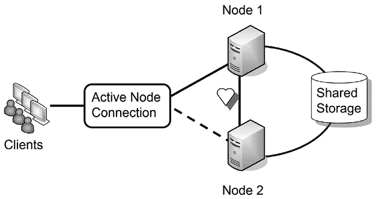

图 9.3: 主/备用型配置

假设 `Node 1` 是主节点。当任何客户端连接时，负载均衡器会确保客户端连接到主节点。如果 `Node 1` 失败，`Node 2` 通过心跳连接感知到故障并将自身配置为主节点。由于两个节点都可以访问共享存储，因此客户端不会丢失数据。客户端可能会注意到瞬间的抖动或停顿，但服务会继续。

你可能会注意到图 9.3 中的共享存储代表了单点故障。这种存储使用健壮的 `RAID-10` 并不罕见。这确保了即使共享存储中的某个硬盘故障，服务也会继续。此外，如果两个节点都接入同一个电网，那么电源就代表了单点故障。它们可以分别使用独立的 `UPS` 进行保护，并使用独立的电网。

| 记住这一点！ | 负载均衡通过在多个服务器之间分担负载来增加服务的整体处理能力。配置可以是主/备用或主/主。调度方法包括轮询和源 IP 地址亲和性。源 IP 地址亲和性调度确保客户端在整个会话期间被重定向到同一台服务器。 |
| --- | --- |

### NIC 绑定

NIC 绑定允许你将两个或多个物理网络适配器组合为一个基于软件的虚拟网络适配器。这提供了更高的性能，因为 `NIC` 团队处理所有单个 `NIC` 的带宽，就像 `NIC` 团队是一个单一物理网络适配器一样。此外，`NIC` 团队使用负载均衡算法将输出流量均匀地分布在各个 `NIC` 上。

`NIC` 团队还消除了任何物理 `NIC` 作为单点故障。如果 `NIC` 团队中的一个 `NIC` 故障，软件会检测到故障并在逻辑上移除该团队故障的 `NIC`。

### 电源冗余

在审查冗余时，电源是一个需要考虑的关键公用事业。对于关键任务系统，可以使用不间断电源、发电机和管理电源单元 (`PDUs`) 来提供容错能力和高可用性：

* **不间断电源**。不间断电源 (`UPS`) 提供短期电力并可以防止电压波动。`UPS` 系统为计算设备提供了足够的时间来执行逻辑关机，或保持其供电，直到更长电源系统上线。
* **双电源**。在电源冗余的背景下，双电源（或冗余电源）是第二个电源，当主电源发生故障时，它可以为设备供电。在正常运行期间，每个电源都为设备提供电力。大多数冗余电源都是可热插拔的，允许管理员在不切断系统电源的情况下更换故障设备。
* **发电机**。发电机在长时间停电期间提供长期电力。例如，在飓风和洪水等自然灾害期间，社区可能会经历几天甚至几周的停电。发电机可以在这些停电期间为关键系统提供电力。
* **管理电源单元**。数据中心内的服务器机架装有多个计算设备，在机架内使用电源单元 (`PDUs`) 为设备供电是很常见的。基础 `PDUs` 向设备分配电力，类似于插线板通过多个插座提供电力。管理型 `PDUs`（有时称为交换式 `PDUs`）监控电源质量（如电压、电流和功耗），并将这些测量值报告到中央监控控制。这允许管理员使用单一应用程序监控数据中心内所有机架的电源。

### 使用备份保护数据

备份是创建的数据副本，以确保如果原始数据丢失或损坏，可以进行恢复。事实是，如果你从事计算机工作的时间足够长，你就会丢失数据。重大灾难和轻微不便之间的区别在于是否存在可用的备份。

勒索软件在近年来呈爆炸式增长。攻击者感染单个系统，然后在整个网络中移动寻找数据文件。如第 6 章所述，攻击者一直在对医院、城市和学校发起的勒索软件攻击，有效地瘫痪了这些网络。主要的保护措施是防止勒索软件攻击。然而，一旦它们成功，最好的纠正控制就是对所有关键数据的最新备份。

重要的是要意识到冗余和备份并不是一回事。使用 `RAID-1` 或 `RAID-10` 保护数据并不能消除对备份的需求。如果火毁了服务器，所有数据都消失了。

#### 备份介质

最常用的备份介质是磁带。磁带存储更多数据且价格更便宜。用于备份的其他类型介质还有：

* **磁盘**。备份也可以存储在磁盘上。一个优点是磁盘访问比磁带快得多。然而，磁盘更贵。磁盘可以位于服务器上或简单的 USB 驱动器上。
* **网络附属存储**。网络附属存储 (`NAS`) 是一种用于文件存储的专用计算机，可以在网络上访问。它有多个驱动器，并且通常运行精简版的 Linux，以简化操作并降低成本。`NAS` 提供文件级数据存储，允许用户访问 `NAS` 设备上的文件，并将备份文件复制到 `NAS` 设备中。`NAS` 使用标准的以太网连接。
* **存储区域网络**。存储区域网络 (`SAN`) 通过全网提供块级数据存储。组织使用 `SAN` 提供磁盘阵列或磁带库的高速访问。`SAN` 还可以用于数据的实时复制。一旦数据在其主位置发生变化，它就会复制到 `SAN`。`SAN` 通常使用光纤通道连接，也可以使用以太网。
* **云存储**。还可以使用主要云供应商（如 `AWS`、Microsoft 和 Google）的服务在云中存储备份。第 5 章“安全主机和数据”更深入地讨论了云概念。

#### 在线备份

离线备份使用网络内的传统备份介质，如磁带、本地磁盘、NAS 中的驱动器，甚至 SAN 中的备份目标。离线备份为组织提供了方便的备份访问、对备份介质的更好的控制以及较快的备份恢复能力。遗憾的是，备份介质可能会损坏、被毁甚至被盗。

相比之下，在线备份存储在云端。大多数云供应商提供允许您通过 Internet 从任何地方访问的数据存储。即使自然灾害破坏了所有备份，它们在云端仍然可用。此外，大多数云供应商会自动对数据进行加密，防止未经授权的访问。

备份工具支持多种类型的备份。尽管第三方备份程序在执行内容和方式上可能非常复杂，但你仍然应该对基础知识有充分的理解。作为介绍，此类工具通常使用以下备份类型：

* **全备份 (Full backup)**：全备份（或普通备份）会备份所有选定的数据。
* **差异备份 (Differential backup)**：这备份自上一次全备份以来发生的所有变化或不同的数据。
* **增量备份 (Incremental backup)**：这备份自上一次全备份或增量备份以来发生的所有变化数据。
* **快照和镜像备份 (Snapshot and image backup)**：快照备份捕捉某个时间点的数据。它有时被称为镜像备份。

#### 全备份

全备份会备份备份中指定的所有数据。例如，你的 `D:` 盘上可能有一个几个文件夹。如果你在备份程序中指定了这些文件夹，备份程序就会备份这些文件夹中的所有数据。虽然每天进行全备份是可行的，但在大多数生产环境中很少这样做。这是由于两个限制因素：

* **时间 (Time)**：全备份可能需要几个小时才能完成，并可能干扰操作。然而，管理员并不总是拥有无限的时间来执行备份和其他系统维护。例如，如果系统 `24/7` 在线运行，管理员可能需要将全备份时间限制在周日清晨，以最小地减少对用户的影响。
* **金钱 (Money)**：备份需要存储在某些类型的介质上，例如磁带或硬盘。每天执行全备份需要更多的介质，成本可能高到无法接受。相反，组织通常会将全备份与差异备份或增量备份相结合。

增量和差异备份策略必须从全备份开始。

#### 恢复全备份

全备份是最容易、最快的恢复方式。你只需要恢复单个全备份即可完成。如果你将备份存储在磁带上，你只需要恢复单盘磁带。然而，大多数组织需要平衡时间和金钱，使用全/差异或全/增量备份策略。

#### 差异备份

差异备份策略从全备份开始。在全备份之后，差异备份会备份自上一次全备份以来发生的变化或不同的数据。

例如，全/差异策略可以从周日晚上的全备份开始。周一晚上，差异备份将备份自周日上次全备份以来更改的所有文件。周二晚上，差异备份将再次备份自上一次全备份以来更改的所有文件。这种循环持续到周日，另一个全备份将再次启动该过程。随着一周的进行，差异备份的大小会持续增长。

##### 全/差异备份集的恢复顺序

假设管理员将每份备份存储在不同的磁带上。如果系统在周三早上崩溃，他们需要多少盘磁带来恢复数据？

答案是两盘。他们会首先恢复周日的全备份。由于周二晚上的差异备份包含了周日上次全备份之后更改的所有文件，他们随后将恢复该磁带，以恢复直到周二晚上的所有更改。

#### 增量备份

增量备份策略也从全备份开始。在全备份之后，增量备份会备份自上次备份以来发生的变化数据。这包括上一次全备份或上一次增量备份。

例如，全/增量策略可以从周日晚上的全备份开始。周一晚上，增量备份将备份自周日上次全备份以来更改的所有文件。周二晚上，增量备份将备份自周一晚上增量备份以来更改的所有文件。同样，周三晚上的备份将备份自周二晚上上次增量备份以来更改的所有文件。这种循环持续到周日，另一个全备份将再次启动该过程。随着一周的进行，增量备份的大小保持基本不变。

##### 全/增量备份集的恢复顺序

假设管理员将每份备份存储在不同的磁带上。如果系统在周四早上崩溃，他们需要多少盘磁带来恢复数据？

答案是四盘。他们会首先恢复周日的全备份。因为增量备份按时间顺序备份了每天更改的数据，他们必须按顺序恢复这些增量备份。有时人们误认为最近的增量备份包含所有数据。尽管它可能包含某些数据，但并不是全部。

例如，想象你每天都处理同一个项目文件，系统在周四早上崩溃了。在这种情况下，最近的增量备份将包含该文件的最新版本。然而，如果你在周一编写了报告直到下周一都没有动过它？只有周一的增量备份会包含最新版本。

| 记住！ | 如果你有无限的时间和金钱，全备份提供的恢复速度快。全/增量策略减少了执行备份的时间。全/差异策略减少了恢复备份的时间。 |
| --- | --- |

复制（Replication）是在实时或近实时范围内创建数据或系统精确副本的过程。这种技术通常用于维护一个备站点或备系统，在主站点故障或数据损坏时，该系统可以快速上线。根据组织的需求，复制可以在不同的级别进行，例如存储层、文件层或应用层。

日志记录（Journaling）是一种备份技术，它在单独的日志（也称为期刊）中按顺序记录数据或文件的更改。在系统故障或数据损坏的情况下，可以使用日志，通过将日志中记录的更改应用到之前的备份中，从而将数据恢复到其最新状态。在处理数据库、文件系统或其他对数据一致性和完整性至关重要的应用程序时，日志记录尤为有用。

#### 备份频率

你希望确保执行备份的频率足够，以便在数据发生变化时捕获它们——备份的频率非常重要。当你恢复备份时，你只能恢复到上次备份时点的数据。这不可避免地意味着你将丢失自最近一次备份以来发生变化的一些数据。备份频率越高，丢失的数据就越少。当然，权衡是备份会占用空间并花费时间，因此增加备份频率是有成本的。在本章章后部分，你将学习更多关于恢复点目标（`RPO`）的内容，它可以衡量潜在的数据丢失。

#### 测试备份

我听过很多恐怖故事，其中人员定期执行备份并认为一切正常。但最终，发生了某些事情，他们需要恢复某些数据。不幸的是，他们发现没有一个备份包含有效数据。人们一直都在走过场，但过程中的某些环节存在缺陷。

验证备份的唯一方法是执行测试恢复。执行测试恢复无非是从备份中恢复数据并验证其完整性。如果你想验证是否可以恢复整个备份，就对备份进行完整恢复。如果你想验证是否可以恢复单个文件，就对单个文件进行测试恢复。将数据恢复到与原始源位置不同的位置是常见的做法。这仍然验证了备份的质量。

举一个简单的例子，管理员可以提取一个随机备份并尝试恢复它。这项测试有两种可能的结果，且两种都是好的：

* 测试成功。太棒了！你知道备份过程运行正常。你并不一定知道每条磁带都是有效的，但至少你知道流程是可靠的，而且至少你的部分备份是可以工作的。
* 测试失败。太棒了！你知道在危机发生之前可以修复问题。如果你在实际丢失数据后才发现问题，它将无法帮助你恢复数据。

定期执行测试恢复的额外好处是，它让管理员熟悉整个流程。他们第一次执行恢复不应该是在危机时刻，而且还有几位高级经理在他们身后监视。

| 记住这一点！ | 测试恢复是测试公司备份数据完整性的最佳方法。备份媒体应受到与备份数据相同级别的保护。备份的地理考虑包括离地存储备份、选择最佳地点，以及考虑法律影响和数据主权。 |
| --- | --- |

#### 备份与地理因素

组织通常会制定备份策略来回答与备份的关键问题。备份策略是一份书面文档，通常会确定备份哪些数据、备份频率是多少、如何测试备份以及保留备份多久。此外，处理特殊的地理因素也很重要，例如：

* **离地存储与本地存储（Offsite vs onsite storage）**。备份至少应有一份存储在离地。在不同的地理位置存储备份可以保护它们免受火灾或洪水等灾害的影响。即使灾害摧毁了站点，组织仍然拥有关键数据的另一份副本。你可能还希望在本地保留一份备份，因为它们更容易访问，如果你需要恢复它们包含的数据，这将加快你的恢复速度。
* **距离（Distance）**。许多组织对地理分散或主站点与离地地点之间的距离有特定要求。在某些情况下，目标是让离地地点相对较近，以便人员轻松检索备份。但在其他情况下，离地地点必须很远，例如 25 英里或更远。这确保摧毁主地点的灾害不会影响备份位置。
* **地点选择（Location selection）**。地点通常取决于环境问题。例如，考虑一家位于加利福尼亚州圣安德烈断层附近的组织。离地备份地点应该足够远，使主站点地震不会影响离地地点。
* **法律影响（Legal implications）**。与备份相关的法律影响取决于备份中存储的数据。例如，如果备份包含个人身份信息（`PII`）或受保护健康信息（`PHI`），则需要根据相关法律对备份进行保护。
* **数据主权（Data sovereignty）**。数据主权是指数据离地存储时的法律影响。如果备份存储在不同的国家，它们将受该国家法律的约束。如果备份存储在云端且服务器位于另一个国家，这可能会引起关注。例如，想象一家组织位于美国。它定期进行备份并存储在云提供商处。该云提供商在美国、加拿大和墨西哥都有服务器。如果该组织的备份存储在其他国家，该组织可能会受到额外的法律法规限制。
* **加密（Encryption）**。保护备份中的敏感数据对于维护机密性和防止未经授权的访问至关重要。加密在传输和静态数据保护中起着至关重要的作用。组织应实施强加密算法并仔细管理密钥，以确保只有授权人员可以解密备份数据。这为备份过程增加了额外的安全层，即使物理备份介质被盗取或破解，也能降低数据泄露的风险。

### 业务连续性要素

业务连续性规划帮助组织预测并应对关键服务或功能的潜在中断。目标是确保关键业务运营继续，组织能够生存。组织通常会制定业务连续性计划（`BCP`）。该计划包含了灾难恢复元素，提供了在中断后将关键功能恢复运行的步骤。灾难和中断可能来自许多来源，包括：

* **环境（Environmental）**。这包括自然灾害，如飓风、洪水、龙卷风和地震。它也可以包括由雷电而非人为引发的火灾。在大规模上，它还可以包括重大的环境灾难，例如 2011 年地震海啸引发的福岛核电厂核熔事故。

#### 灾难类型

* **人为灾难**：人为灾难是指人类活动引起的灾难。这包括火灾（由人员引起）和由于人为失误导致的火车事故，例如 2015 年 5 月的 Amtrak 火车脱轨事故。在组织内部，人为错误可能导致硬件和软件故障以及数据丢失。攻击也是人为的。
* **内部与外部**：内部灾难发生在组织内部。例如，组织数据中心内部的火灾属于内部灾难，可能导致硬件故障和数据丢失。相比之下，外部灾难是指发生在组织之外但仍会影响该组织的灾难。例如，组织附近的山火可能会损坏公用线路，从而影响电力或通信线路的稳定性。

应对所有这些可能的灾难源需要大量的时间和精力。目标是预测相关的灾难及其影响，然后制定恢复策略来减轻这些影响。组织完成的第一工作之一是业务影响分析。

#### 业务影响分析概念

业务影响分析（`BIA`）是业务连续计划（`BCP`）的重要部分。它帮助组织识别对组织成功至关重要的关键系统和组件。这些关键系统支持任务关键型功能。任务关键型功能是指灾难发生后必须继续或快速恢复的活动。`BIA`还帮助识别脆弱的业务流程，即支持任务关键型功能的流程。

例如，想象一家拥有在线电子商务业务的组织。基础的任务关键型功能可能包括提供网页、提供购物车路径、接受购买、发送电子邮件确认以及向客户发货。单是购物车路径本身就是一个业务流程。由于它对电子商务销售的任务至关重要，管理层可能会将其视为一个需要保护的脆弱业务流程。客户需要查看产品、选择产品、输入客户信息、输入信用卡数据并完成购买。支持网站的一些关键系统是 Web 服务器和托管在一个台或多个数据库服务器上的后端数据库应用程序。

如果关键系统和组件故障且无法快速恢复，将影响任务关键型功能。如果这种情况持续时间过长，组织可能无法生存。

例如，想象一个机构通过网站销售产品，每小时在线销售可产生 10,000 美元的收入。他们可能决定 Web 服务器的最大可停机时间为五分钟。这导致 `RTO` 为五分钟，意味着任何停机时间必须限制在五分钟以内。

想象该机构有一个仅供内部员工使用的数据库服务器，不用于在线销售。虽然该服务器可能很有价值，但它并非至关重要。管理层可能决定接受长达 24 小时的停机，导致 `RTO` 为 24 小时。

#### 恢复点目标

恢复点目标（`RPO`）确定了一个可以接受数据丢失点。想象一台托管存档数据的服务器，这些数据每周变化很少。管理层可能认为某些数据丢失是可以接受的，但他们始终希望至少恢复上周的数据。在这种情况下，`RPO` 为一周。

如果 `RPO` 为一周，管理员将确保他们至少有每周一次备份。在发生故障时，他们将能够恢复最近的备份并满足 `RPO`。

在某些情况下，`RPO` 可以精确到故障发生时的分钟。例如，记录客户交易的在线数据库的任何数据丢失可能是不可接受的。在这种情况下，机构可以使用各种技术来确保管理员能够恢复到故障发生的那一刻的数据。

| 记住这一点！ | 恢复时间目标（`RTO`）确定了系统在停机后恢复所需的最长时间。它源自 `BIA` 中确定的最大允许停机时间。恢复点目标（`RPO`）指的是你能够承受丢失的数据量。 |
| --- | --- |

#### 比较 MTBF 和 MTTR

在进行 `BIA` 时，专家通常会尝试预测故障的可能性。例如，`RAID` 配置中的硬盘发生故障的可能性有多大？通常使用以下两个术语来预测潜在故障：

* 平均故障间隔时间（`MTBF`）。`MTBF` 提供了系统可靠性的衡量标准，通常以小时为单位。具体来说，`MTBF` 识别了故障之间的平均时间（算术平均值）。`MTBF` 数字越高，表示产品或系统的可靠性越高。管理员和安全专家试图识别关键系统的 `MTBF`，目标是预测潜在的停机。

* 平均修复时间（`MTTR`）。`MTTR` 识别了恢复故障系统所需的平均时间（算术平均值）。在某些情况下，人们将 `MTTR` 理解为平均恢复时间，两者的本质是相同的。拥有维护合同的机构通常会将 `MTTR` 作为合同的一部分进行规定。供应商同意平均在 `MTTR` 时间内恢复故障系统。`MTTR` 并不保证每次都能在 `MTTR` 内恢复系统。有时可能需要更长的时间，有时可能更快一点，而平均值则由 `MTTR` 定义。

| 记住这一点！ | 平均故障间隔时间（`MTBF`）提供了系统可靠性的衡量标准，并可以提供系统发生停机频率的估算。平均修复时间（`MTTR`）指的是恢复系统所需的时间。 |
| --- | --- |

#### 业务连续性计划

业务连续性计划（`COOP`）侧重于在关键停机后在恢复地恢复任务关键职能。例如，假设飓风或其他灾难导致公司无法在主位置运营。在这种情况下，机构可以在管理层之前确定的作为恢复地的备选位置继续运行任务关键职能。故障转移（`Failover`）是将任务关键职能转移到备选地的过程。

##### 站点韧性

恢复地是机构用于站点韧性的备选处理站点。如果一个站点遭受了灾难性故障，备选站点可以在灾难后接管。三种主要类型的恢复地是热备（`hot sites`）、冷备（`cold sites`）和温备（`warm sites`）。这些备选位置可以是建筑内的办公空间、整座大楼，甚至是一组建筑。其他类型的恢复地还有移动站点（`mobile sites`）和镜像站点（`mirrored sites`）。

在规划你的恢复地位置时，考虑到地理分散性非常重要。你绝对不希望恢复地位于主站点附近，否则同一灾难可能会影响两个位置！同样，如果你有多个恢复地，请确保将它们放置得足够远，使得它们不太可能在相同的情况下同时故障。

###### 热备

热备将每天 24 小时、每周天运行，并能够在主站点发生故障后迅速接管主站点的功能。它将包含主站点的所有设备、软件和通信能力，并且所有数据都是最新的。在许多情况下，备份磁带的副本存储在热备作为异地地点。

在许多情况下，热备是另一个具有在灾难期间承担运营能力的活跃业务地点。例如，一家金融机构可以在两个不同的城市拥有地点。第二个地点提供非关键支持服务，但也包含了承担首个地点功能所需的所有资源。

对热备的某些定义表明它们可以瞬间接管，尽管这并不一致。在大多数情况下，将操作转移到热备需要一些时间，这可能从几分钟到一小时不等。

显然，热备是满足高可用性要求的最有效的灾难恢复解决方案。如果机构必须保留高可用性要求的关键系统，热备是最佳选择。然而，热备的维护和更新成本最高。

| 记住这一点！ | 热备包含了主站点的人员、设备、软件和通信能力，且数据最新。与温备和冷备相比，热备提供的恢复时间最短。它是最有效的灾难恢复解决方案，但维护成本最高。 |
| --- | --- |

###### 冷备

冷备只需要电力和其他连接，不需要其他。通常情况下，只要它有屋顶、电力、自来水和未激活的互联网访问就可以了。组织在激活站点时会将所有设备、软件和数据带到现场。

我经常在当地的军基地散步，偶尔会看到士兵激活冷备的极端例子。在大多数周末，空地是空的。在其他周末，士兵们将一个或多个场地变成了带有帐篷、天线、电缆、发电机和移动厕所的完全运行站点。

由于军基地上有几座建筑，他们不需要在田野中操作，但他们实际上是在测试自己在任何任何地方建立冷备的能力。如果他们可以在野外做到，他们就可以在沙漠或任何其他需要的地方做到。冷备的维护成本最低，但也最难测试。

###### 温备

你可以将温备看作是“金标准”解决方案——既不热也不冷，恰好。热备对于大多数机构来说通常太贵了，而冷备有时配置完全运行所需的时间太长。然而，温备提供了一个机构可以根据需求定制的折中方案。

例如，组织可以将所有必要的硬件放置在热备站点（warm site）地点，但不包含最新的数据。如果发生灾难，组织可以将数据拷贝到热备站点并接管运营。

##### 恢复顺序

灾难发生后，组织将按照流程将系统恢复到主站点。作为一项最佳实践，在灾难发生后，应首先恢复关键功能。在灾难发生后，需要将功能返回主站点。在恢复关键功能时，可能会发现某些问题。在灾难发生时，将按顺序恢复关键功能。

| 请记住！ |
| :--- |
| 冷站点（cold site）在灾难发生后可以提供支持，但它是最昂贵的。灾难恢复计划（DRP）确定了在灾难发生后如何恢复系统。热备站点（warm site）在灾难发生期间提供支持。 |

##### 灾难恢复

灾难恢复计划（DRP）确定了在灾难发生后如何恢复系统。灾难恢复是业务连续性计划（BCP）的一部分。灾难恢复通常会通过业务影响分析来确定关键性系统。在某些情况下，业务连续性计划（BCP）会在灾难发生后识别哪些功能。在灾难发生后，灾难恢复计划（DRP）会识别哪些功能。例如，在灾难发生后，业务连续性计划（BCP）会识别哪些功能。

在灾难发生后，灾难恢复计划（DRP）会识别哪些功能。

在灾难发生后，业务连续性计划（BCP）会识别哪些功能。

例如，在灾难发生后，业务连续性计划（BCP）会识别哪些功能。

在灾难发生后，灾难恢复计划（DRP）会识别哪些功能。

在灾难发生后，业务连续性计划（BCP）会识别哪些功能。

在灾难发生后，灾难恢复计划（DRP）会识别哪些功能。

在灾难发生后，灾难恢复计划（DRP）会识别哪些功能。

在灾难发生后，业务连续性计划（BCP）会识别哪些功能。

在灾难发生后，灾难恢复计划（DRP）会识别哪些功能。

在灾难发生后，业务连续性计划（BCP）会识别哪些功能。

在灾难发生后，灾难恢复计划（DRP）会识别哪些功能。

在灾难发生后，业务连续性计划（BCP）会识别哪些功能。

在灾难发生后，灾难恢复计划（DRP）会识别哪些功能。

在灾难发生后，业务连续性计划（BCP）会识别哪些功能。

在灾难发生后，灾难恢复计划（DRP）会识别哪些功能。

在灾难发生后，业务连续性计划（BCP）会识别哪些功能。

在灾难发生后，灾难恢复计划（DRP）会识别哪些功能。

在灾难发生后，业务连续性计划（BCP）会识别哪些功能。

在灾难发生后，灾难恢复计划（DRP）会识别哪些功能。

在灾难发生后，业务连续性计划（BCP）会识别哪些功能。

在灾难发生后，灾难恢复计划（DRP）会识别哪些功能。

在灾难发生后，业务连续性计划（BCP）会识别哪些功能。

在灾难发生后，灾难恢复计划（DRP）会识别哪些功能。

在灾难发生后，业务连续性计划（BCP）会识别哪些功能。

在灾难发生后，灾难恢复计划（DRP）会识别哪些功能。

到此为止，我们讨论的所有测试都是理论性的练习。它们涉及人员对灾难恢复的讨论，但并不意味着他们会在真实灾难中采取相应的行动。并行处理（Parallel processing）通过在测试期间激活灾难恢复站点，确保该站点实际运行。在并行处理测试中，恢复站点启动并与站点同时运行（并行）。这允许测试人员确认一切都运行正常。

#### 故障转移测试 (Fail Over Tests)

故障转移测试是灾难恢复计划的终极测试。这类测试也称为全中断测试，其原理是通过实际关闭主站点并测试恢复站点是否能正确处理负载来工作。当然，故障转移测试失败可能会对组织造成巨大的破坏，因此应该仔细地进行计划和安排。然而，请记住，由于故障转移测试失败导致的“自残”，可能并不像在实际灾难中发现恢复站点无法工作那样糟糕！

| 记住这一点！ |
| 你可以通过测试验证业务连续性计划。演练台练习（Tabletop exercises）仅基于讨论，通常在会议环境中进行。模拟（Simulations）是使用模拟环境进行的实操练习。并行处理激活灾难恢复站点并使其与主站点并行运行。故障转移测试通过关闭主站点来确定故障转移站点是否正常工作。 |

#### 容量规划 (Capacity Planning)

容量规划是确定为了满足组织运营和增长需求所需资源的过程。它涉及分析和预测组织的资源需求。通过确保配备充足的资源，容量规划有助于维护业务连续性、优化性能并避免中断。让我们来看看企业应该进行容量规划的三个主要领域：

##### 人员 (People)

评估支持业务运营的人力资源是容量规划的关键方面。这涉及分析当前员工的技能、识别技能差距，并根据预期的增长、新项目或业务环境的变化预测未来需求。劳动力规划包括招聘、培训和留住合适的人，以确保组织拥有必要的专业知识和人员水平来实现其目标。

##### 技术 (Technology)

技术的容量规划涉及确定支持组织运营和增长所需的硬件、软件和网络资源。这包括估算处理当前负载和适应未来需求所需的计算能力、存储和带宽。定期审查和更新技术基础设施有助于避免瓶颈、确保高可用性并保持最佳性能水平。

##### 基础设施 (Infrastructure)

基础设施容量规划是指对物理设施（如数据中心、办公室空间和其他关键资产）进行评估和管理，以支持组织的运营。这涉及分析当前的基础设施容量、识别潜在限制，并根据预测的增长或业务环境的变化进行未来需求规划。有效的基础设施规划确保组织拥有必要的空间、电力、冷却和其他基本资源，以维持业务连续性并支持增长。

### 第 9 章考试主题复习

在准备考试时，请确保你理解本章涵盖的关键概念。

#### 比较物理安全控制

* 物理安全控制是你物理上触及的控制措施。它们通常控制出入口，并包括各种类型的锁。数据中心和服务器机房等受控区域应只有一个出入口。
* 电脑锁保护训练实验室中的笔记本电脑等移动计算机。小型设备可以存储在保险箱或锁定的办公柜中，以防止未使用资源被盗。
* 访问卡可以以电子方式解锁，并帮助防止未经授权的人员进入安全区域。感应卡本身并防止未经授权的人员进入。
* 安保人员是预防性控制，他们可以识别用户。
* 摄像头和闭路电视（`CCTV`）提供视频监控并可以识别活动。
* 传感器可以检测环境的变化，如运动、噪音和温度。
* 围栏、照明和报警器通常与物理安全一同实施。
* 屏障比围栏提供更强的物理安全。柱（Bollards）是有效的屏障，允许人员通过但阻止车辆。
* 门厅（Vestibules）由两组相互锁定的门组成，旨在创建一个安全间隔，允许一次进入一人。
* 资产管理流程包括获取/采购流程、分配/记账流程以及监控/资产跟踪流程。
* 组织使用多样化方法提供分层安全。供应商多样化是实施来自不同供应商的安全控制措施以增加安全性。技术多样化使用不同的技术来保护环境，而控制多样化则使用不同的安全控制类型，例如技术控制、管理控制、操作控制和物理控制。
* 物理安全控制可能受到暴力破解攻击，即某人简单地撞破控制设施。设施还可能受到环境攻击，攻击者通过改变温度、湿度或其他条件来禁用设备。

#### 增加冗余和容错性 (Redundancy and Fault Tolerance)

* 单点故障（Single point of failure）是指任何一旦发生就会导致整个系统故障的组件。它通常指的是硬件，但也可能是一个人。如果某人是执行某项任务的人，这个人就是单点故障。
* RAID 磁盘子系统提供容错性并增加可用性。RAID-1（镜像）使用两块磁盘。RAID-5 使用三块或更多磁盘，可以承受一块磁盘的故障。RAID-6 和 RAID-10 使用四块或更多磁盘，可以承受两块磁盘的故障。
* 负载均衡器将处理负载分散在多个服务器上。在主主（active/active）配置中，所有服务器都在积极处理请求。在主备（active/passive）配置中，至少有一个服务器处于非激活状态，而是监控活动并准备接管故障服务器。
* 亲和性调度（Affinity scheduling）根据客户端的 IP 地址将请求发送到同一服务器。这在客户端需要整个在线会话访问同一服务器时非常有用。轮询调度（Round-robin scheduling）按照预定义的顺序将请求发送到服务器。

* `NIC` 组网将两个或多个物理网络适配器组合成单一的软件网络适配器。它为出站流量提供负载均衡，并在其中一个 `NIC` 发生故障时提供容错能力。
* 电源冗余包括 `UPS`、双电源和发电机。托管式 `PDUs` 监控传输到服务器机架内设备的电源质量。

#### 使用备份保护数据

* 离线备份使用传统的备份介质，如磁带、本地磁盘、`NAS` 中的驱动器，甚至是 `SAN` 内的备份目标。在线备份存储在云端。
* 传统的备份方法包括`全备`、`全备/差异备`、`全备/增量`、`快照`和`镜像`策略。仅`全备`备份策略即可获得最快的恢复时间。
* `全备/增量`备份策略最大限度地减少执行每日备份所需的时间。`全备/差异`备份策略则最大限度地减少恢复备份所需的时间。
* 备份副本应保存在异地，并且距离要足够远，以至于影响主站的灾难不会影响备份。考虑主站与异地位置之间的距离非常重要。
* 数据备份的位置影响数据主权。如果备份存储在另一个国家，则备份数据现在受该国家法律法规的约束。
* 备份应当加密，以防止在备份介质丢失或被盗时其包含的敏感数据遭到泄露。

#### 比较业务连续性要素

* 业务影响分析 (`BIA`) 是业务连续性计划 (`BCP`) 的一部分，它识别对组织成功至关重要的关键功能、关键系统和脆弱业务流程。
* `BIA` 确定了这些系统和组件的最大停机时间。它考虑了可能影响这些系统和组件的各种场景，以及事件对生命、财产、安全、财务和声誉的影响。
* 恢复时间目标 (`RTO`) 确定了发生故障后恢复系统所需的最长时间。恢复点目标 (`RPO`) 指你能够承受的数据丢失量。
* 平均故障间隔时间 (`MTBF`) 确定了故障之间的平均时间（算术平均值）。平均修复时间 (`MTTR`) 确定了恢复故障系统所需的平均时间（算术平均值）。
* 业务连续性规划识别替代处理站点（用于站点韧性）和替代业务实践。恢复站点在重大灾难后为业务功能提供替代位置。
* `热备机` 包含 60 分钟内运行所需的所有内容，是最有效的恢复解决方案，但也是最贵的。`冷备机` 具有电力的连接需求，外别无他物，维护成本最低。`温备机` 是热备机和冷备机之间的折中方案。
* 灾难恢复计划 (`DRP`) 确定了灾难后如何恢复关键系统，并通常会对故障后要恢复的服务进行优先级排序。
* 定期测试验证了业务连续性计划的有效性。演练验证了恢复单个系统、激活备用站点以及记录计划内其他操作的步骤。`桌面推演练` 仅基于讨论。`模拟演练` 是功能性演练，允许人员在模拟的运行环境中测试计划。`并行处理` 通过在测试期间激活灾难恢复站点来确保该站点确实在工作。`故障转移测试` 实际关闭主站并测试恢复站点是否能妥善处理负载。

| 在线参考 | 你知道拥有这本书就可以访问免费实验室吗？查看 `https://getcertifiedgetahead.com/` 的在线额外资源 |
| --- | --- |

### 第 9 章练习题

1. 员工通过在门处输入密码代码访问数据中心。然而，所有人都使用相同的代码，因此无法识别个人。在最近发生一起安全事件后，管理层决定实施门卡系统，以识别进出此安全区域的人员。然而，安装可能需要六个月或更久。以下哪些选项是组织可以立即安装的以识别进出安全区域的人员？
   1. `门控制道室`
   2. `访问列表`
   3. `CCTV`（闭路电视）
   4. `护路柱`
   5. `补偿性控制`

2. 你当地的图书馆计划购买新的笔记本电脑，供读者进行互联网检索。然而，管理层担心可能发生盗窃。以下哪项是防止这些笔记本电脑被盗窃的最佳选择？
   1. `门控制道室`
   2. `反恶意软件`
   3. `线锁`
   4. `磁盘加密`

3. 以下哪种备份类型备份了自上次全备以来更改的所有数据，且仅备份自上次全备以来更改的数据？
   1. `全量备份`
   2. `差异备份`
   3. `快照备份`
   4. `增量备份`

4. 你需要保护对数据中心的访问。以下哪些选项可以提供满足此需求的最佳物理安全？（选择三项。）
   1. `生物识别`
   2. `线锁`
   3. `门控制道室`
   4. `CCTV`
   5. `HVAC`（暖暖空调系统）

5. 你需要为你组织筛选子网中的一个关键服务器添加磁盘冗余。管理层希望确保它支持双驱动器故障。以下哪项是满足该要求的最佳解决方案？
   1. `RAID-0`
   2. `RAID-1`
   3. `RAID-5`
   4. `RAID-6`

6. 你的组织执行全备和增量备份。你每星期晚上执行一次全备，并在其他日期的晚上执行增量备。你的系统在周四早上发生故障。你应该先恢复哪种备份？
   1. `周日的全备`
   2. `周一的增量备`
   3. `周二的增量备`
   4. `周三的增量备`

7. 你担心备份带在安运人员运往远程地时丢失。哪种控制可以帮助你防止信息的非法泄露？
   1. `维护一套备份带`
   2. `增加一名安运人员`
   3. `加密`
   4. `以上所有`

8. 你的组织计划部署一个新的电子商务网站。管理层预计网站的后端应用程序有大量的处理需求。当前设计将使用一个 Web 服务器和多个应用程序服务器。此外，在会话开始时，用户将连接到一个应用程序服务器并在整个会话期间保持连接。以下哪项最佳描述了应用程序服务器的配置？
   1. `负载均衡`
   2. `活动/活动`
   3. `活动/备用`
   4. `持久性`

9. 你的组织最近实施了两个服务器的活动/备用负载均衡配置。这支持哪种安全目标？
   1. `混淆`
   2. `完整性`
   3. `机密性`
   4. `韧性`

10. 你的数据库备份策略包括每周六凌晨 12:01 执行的全备以及每天凌晨 12:01 执行的差异备。如果数据库在周四下午发生故障，恢复它需要多少备份？
    1. `1`
    2. `2`
    3. `3`
    4. `5`

11. 在阅读了针对医疗行业的勒索软件攻击增加的消息后，医院管理希望增强组织应对此类攻击的韧性。IT 人员可以实施哪些措施来提高从成功的勒索软件攻击中恢复的能力？
    1. 使用邮件过滤来阻止恶意邮件
    2. 对全量备份进行定期测试和验证
    3. 确保所有系统都已打补丁
    4. 增加针对勒索软件和其他其他风险的终端培训

12. 贵组织聘请了一位安全顾问创建 `BIA`（业务影响分析）。她正试图识别如果停止运行可能会导致收入损失的流程。以下哪项最准确描述了她正在识别的内容？
    1. 单点故障
    2. 关键系统
    3. 任务关键功能
    4. `MTBF`

13. 在最近发生一次导致数据泄露的攻击后，一位高管正在分析财务损失。她确定攻击可能导致至少 100 万美元的损失。她希望确保这些信息被记录下来以供未来规划。她最可能使用以下文档？
    1. `DRP`
    2. `BIA`
    3. `MTTR`
    4. `RTO`

14. 一项目经理正在审查一份业务影响分析。报告显示一个关键网站可以忍最多三小时的停机。管理员已确定了几个需要增加冗余以满足这一最大停机要求的系统。在以下选项中，哪个术语指的是这三小时的最大停机时间？
    1. `RPO`
    2. `MTTR`
    3. `MTBF`
    4. `RTO`
    5. `DRP`

15. Lisa 与部门负责人安排了每季度会议，讨论他们将如何应对自然灾害或网络攻击等各种情况。在会议期间，她提出了一个场景并要求与会者指示响应。同时，在会议期间，她在场景中加入了类似于现场活动可能发生的变化，并鼓励与会者讨论他们的响应。这描述的是什么？
    1. 模拟
    2. 桌面演练（Tabletop exercise）
    3. 应急响应
    4. 测试站点韧性

### 第 9 章练习题答案

1. C 正确。闭路电视（CCTV`）或类似的视频监控系统可以监控入口并记录谁进出区域。访问控制门廊（有时称为 `mantrap`）可以防止尾随进入，但它并不一定能识别个人，而且无法立即安装，因为需要施工。如果安保人员识别用户并根据访问列表允许访问，那么访问列表是很有用的，但访问列表本身并不识别用户。护路柱是保护建筑入口的一种屏障。在安装钥匙卡系统之前使用 `CCTV` 是一种补偿措施的示例，但并非所有补偿措施都能识别人员。

2. C 正确。电锁连接到计算机上并缠绕在家具上以固定它，从而威慑并防止盗窃。这就像用于将自行车固定在自行车架上的车锁一样。访问控制门廊（有时称为 `mantrap`）可以防止尾随进入，但与此问题无关。反恶意软件保护系统免受病毒和其他恶意软件的影响。如果计算机上有机密信息，磁盘加密是有用的，但在公共计算机上放置机密信息是不恰当的。

3. B 正确。差异备份备份自上一次全量备份以来所有更改的数据。增量备份备份自上一次全量或增量备份以来所有更改的数据。快照备份复制被快照的卷上的所有数据。全量备份备份所有数据，无论执行过其他何种备份。

4. A、C、和 D 正确。用于访问控制的生物识别阅读器、访问控制门廊（有时称为 `mantrap`）和闭路电视（`CCTV`）系统都为访问数据中心提供了强大的物理安全。电锁是笔记本电脑等移动设备的有效盗窃威慑手段，但它们不保护数据中心。暖通风和空调（`HVAC`）系统可以控制数据中心的环境，但它们不能保护访问。

5. D 正确。廉价磁盘冗余阵列 6（`RAID-6`）是可用答案中的最佳解决方案。它支持双驱动故障，这意味着两块硬盘可以在 `RAID-6` 中失效，磁盘子系统将继续运行。`RAID-0`（磁盘分层）没有任何容错能力，如果单块硬盘故障，将完全失效。`RAID-1`（磁盘镜像）仅使用两块硬盘。如果 `RAID-1` 中的某块硬盘故障，数据会被保留，但如果两块硬盘故障，所有数据将丢失。`RAID-5`（带校验的分层）在单硬盘故障时将继续运行，但如果两块硬盘故障，所有数据将丢失。

6. A 正确。由于你正在执行全量和增量备份，你需要恢复所有这些备份。在恢复增量备份时，你总是从恢复最近的全量备份开始。在这种情况下，那就是周日的备份。然后你继续按照从旧到新的顺序恢复发生的每次增量备份。因此，你将首先恢复周日的全量备份，然后是周一的增量备份、周二的增量备份，最后是周三的增量备份。

7. C 正确。加密是一种防止敏感信息丢失的安全安全措施。你这里的目标是防止未经授权的泄露，而加密是唯一符合该目标的控制措施。增加第二组磁带或增加第二名快递员可能会减少永久丢失数据的风险，但这些选项无法防止敏感信息的泄露。

8. D 正确。这描述了使用持久性（persistence）的负载均衡配置，使用户在整个会话期间连接到同一个应用程序。所有答案都与负载均衡有关，但场景描述的是带有持久性的负载均衡，因此持久性比负载均衡更准确。活动/活动负载均衡配置表示所有服务器都在处理用户请求。活动/被动负载均衡配置至少有一个服务器未活动提供服务，但在另一个服务器故障时可以接管。然而，场景没有提供足够的信息来确定应用程序是否被配置为活动/活动或活动/被动。

9. D 正确。活动/被动负载均衡配置支持韧性和高可用性。活动/被动负载均衡配置使用冗余服务器确保当一个服务器故障时服务继续运行。混淆方法试图让某变得模糊或难以理解，与负载均衡无关。完整性方法确保数据未被修改。机密性方法（如加密）防止数据的未经授权泄露。

10. B 正确。需要两次备份：周日凌晨 12:01 执行的全量备份和周四凌晨 12:01 执行的差异备份。如果你只执行一次备份，将是全量备份。在先恢复全量备份之前，无法恢复差异备份。这不会包括在本周内发生的所有更改。如果你使用的是全量/增量策略，你需要应用五个备份：全量备份以及每天（周一、周二、周三和周四）执行的增量备份。

11. B 正确。对全备进行定期测试和验证将增强组织应对勒索软件攻击的韧性。韧性技术有助于确保组织从安全事件中恢复，并在故障发生后尽可能地减少停机时间。其他答案均指故障发生前采取的预防性方法。电子邮件过滤拦截垃圾邮件和恶意邮件，并有助于防止勒索软件攻击。保持系统补丁更新有助于确保它们免受已知漏洞的影响。培训用户可以减少他们对恶意邮件做出不当反应的可能性。

12. C 正确。安全顾问正在识别任务关键功能，这是业务影响分析（BIA）的关键部分。单点故障是系统中的一个组件，如果该组件故障，可能会导致整个系统故障。消除关键系统的单点故障是常见的，但并非所有的单点故障都支持任务关键功能。关键系统支持任务关键功能。然而，如果已经消除了单点故障，关键系统可能会故障，但任务关键功能将继续运行。平均故障间隔时间（MTBF）确定了故障之间的平均（算术平均值）时间。

13. B 正确。业务影响分析（BIA）包含有关潜在损失的信息，在列出的文档中，它是最可能记录此类损失的文档。灾难恢复计划（DRP）包含了用于从故障中恢复的方法。平均修复时间（MTTR）确定了恢复故障系统所需的平均（算术平均值）时间。恢复时间目标（RTO）确定了故障后恢复系统应花费的最大时间。

14. D 正确。恢复时间目标（RTO）确定了故障后恢复系统可能花费的最大时间。由于业务影响分析指出网站只能容忍三小时的停机，这同时也确定了 RTO。恢复点目标（RPO）确定了数据丢失的时间点，但它不是停机时间。平均修复时间（MTTR）指标确定了恢复故障系统所需的平均（算术平均值）时间，而不是系统可以机的最大时间。平均故障间隔时间（MTBF）指标提供了系统可靠性的衡量，通常以小时表示。灾难恢复计划（DRP）详细说明了不同类型灾难后要采取的恢复步骤。

15. B 正确。这是一个桌面演练。桌面演练是基于讨论的，参与者讨论他们对各种场景的响应。模拟是实操练习，而不是会议。事件响应是指响应事件时采取的实际步骤（准备、检测、分析、封锁、根除、恢复、教训），而不是讨论采取步骤的会议。站点韧性通过查看在必要时备用站点（如热备、冷备或温备）能否接管来测试，但该场景并未讨论备用站点。

## 第 10 章：理解密码学与 PKI

本章涵盖的 CompTIA Security+ 目标：

### 1.2 总结基础安全概念。
* 不可否认性

### 1.4 解释使用适当加密解决方案的重要性。
* 公钥基础设施结构 (PKI)（公钥、私钥、密钥托管）
* 加密（传输/通信、非对称、对称、密钥交换、算法、密钥长度）
* 工具（密钥管理系统）
* 混淆（隐写术、令牌化、数据脱敏）
* 哈希
* 加盐
* 数字签名
* 密钥加伸
* 区块链
* 公共账本
* 证书（证书颁发机构、证书吊销列表 (CRLs)、在线证书状态协议 (OCSP)、自签名、第三方、信任根、证书签名请求 (CSR) 生成、通配符）

### 2.3 解释各种类型的漏洞。
* 密码学

### 2.4 在给定场景下，分析恶意活动指标。
* 密码学攻击（降级、碰撞、生日攻击）
* 密码攻击（喷洒、暴力破解）

### 3.3 比较对比保护数据的概念和策略。
* 通用数据考虑（数据状态、静态数据、传输中数据、使用中）
* 数据安全方法（加密、哈希、掩码、令牌化、混淆）

密码学和公钥基础设施（PKI）的主题对许多考者来说具有挑战性，主要因为它们包含了许多系统管理员不熟悉的话题。在处理这些主题时，不要忽视基础。本章的第一部分“密码学概念简介”概述并总结了这些基础知识。如果你现在还不清楚它们，不要担心——在你完成本章后，你应该就能理解了。密码通常会进行哈希处理，密码攻击经常试图利用哈希的弱点。在解释了哈希之后，将探讨密码攻击。其他章节将深入研究哈希、加密和公钥基础设施（PKI）组件的细节。

### 密码学概念简介

密码学包含了你参加 CompTIA Security+ 考试需要掌握几个重要概念，但这些主题对许多信息技术（IT）专业人员来说通常全新的。

作为介绍，以下项目列出了核心密码学概念。请记住，这只是概述。如果这些项目现在对你没有意义，在你完成本章后它们应该会有意义：

* 完整性确保数据未被修改。通过哈希对比可以验证数据是否保留了完整性。
* 哈希（Hash）是根据对数据（如消息、软件补丁或文件）进行数学计算得出的字母数字字符串。
* 哈希创建一个固定长度的位串或十六进制字符字符串，这些字符串无法通过反向重新创建原始数据。
* 目前使用的一种常用哈希算法是 `SHA-3`。
* 机密性确保只有授权用户才能查看数据。加密保护数据的机密性。
* 加密通过扰乱数据，使其在被拦截时无法读取。加密通常包含一个算法和一个密钥。
* 对称加密使用同一个密钥对数据进行加密和解密。大多数对称算法使用块加密或流加密。
* 流加密一次加密 1 位数据。
* 块加密按块加密数据。
* 非对称加密使用两个密钥（公钥和私钥），形成匹配对。
* 非对称加密需要公钥基础设施（PKI）来颁发证书。
* 使用公钥加密的内容只能通过匹配的私钥解密。
* 使用私钥加密的内容只能通过匹配的公钥解密。
* 隐写术通过将数据隐藏在其他文件中提供某种程度的机密性。例如，可以将数据嵌入图片文件的空白区域。
* 身份验证确认身份。
* 不可否认性防止一方成功地否认执行过某项操作。
* 数字签名提供认证、不可否认性和完整性。
* 用户使用数字签名签署邮件，数字签名是用发送者私钥加密的邮件内容的哈希。
* 只有发送者的公钥可以解密数字签名以显示哈希，从而验证该哈希是用发送者的私钥加密的。

### 通过哈希提供完整性

你可以通过哈希校验来验证完整性。哈希是对文件或消息等数据执行的一种数学算法，用于产生成一个固定长度的十六进制字符字符串，称为 `hash`（哈希）。`hash` 用于验证数据未被修改、篡改或损坏。换句话说，你可以验证数据是否保持了完整性。

`hash` 的一个关键点是，无论你对相同的数据执行多少次特定的哈希算法，只要数据相同，生成的 `hash` 始终是相同的。

哈希值至少会被创建两次以便进行比较。例如，想象一家软件公司正在为应用程序发布一个客户可以下载的补丁。他们可以计算该补丁的 `hash`，并在公司网站上同时发布补丁文件的链接和其 `hash`。他们可能会这样列出：

* 补丁文件：`Patch_v2_3.zip`
* `SHA-3-256` 哈希：`d4723ac6f72daea2c779…3ac113863c`

安全哈希算法 3 (`SHA-3`) 哈希是以十六进制显示的计算数值。`SHA-3-256` 哈希通常显示为 64 个十六进制字符，但为了简洁我对其进行了缩短。客户可以下载补丁文件，然后对下载的文件计算 `hash`。如果计算出的 `hash` 与网站上发布的 `hash` 相同，则证明该文件保留了完整性。换句话说，文件没有发生过变化。

| 记住这一点！ | 哈希校验可以验证电子邮件、下载的文件和存储在磁盘上的文件数据的完整性。`hash` 是用哈希算法创建的十六进制数字。 |
| --- | --- |

#### 哈希与校验和 (Hash Versus Checksum)

哈希和校验和非常相似，但存在一些差异。通常情况下，哈希是长得多的数字，用于强加密实现。`checksum`（校验和）通常是一小小段数据，有时只有 1 或 2 位，用于快速验证数据的完整性。

作为 `checksum` 的一个例子，第 9 章“实施保护资产的控制”中描述的 `RAID-5` 磁盘子系统每个字节使用一个校验位，可以识别损坏的数据。

同样，信用卡的初始检查通常使用 `checksum`。在一个 16 位的信用卡中，前 6 位数字识别发卡机构，接 9 位代表账户号码，第 16 位是校验位或 `checksum`。想象 Homer 在线输入他的信用卡号时，不小心输输了错误的数字。检查此问题的方法之一是计算两次 `checksum`。首先是不带校验位进行计算，然后是带有校验位进行计算。如果两次计算结果相同，说明卡号输入正确。如果结果不同，应用程序通常会在尝试提交扣款之前显示错误信息。

`checksums` 并非旨在实现加密学安全。相反，它们在数据完整性丢失时提供一个快速的指示。相比之下，如 `SHA-3` 等强效哈希算法是加密学安全的。

#### MD5

消息摘要 5 (`MD5`) 是一种常见的哈希算法，产生 128 位的 `hash` 值。哈希通常以十六进制格式显示，而不是 1 和 0 的流。例如，`MD5` 哈希显示为 32 个十六进制字符，而不是 128 位。十六进制字符由 4 位组成，并使用数字 0 到 9 和字母 a 到 f。

`MD5` 自 1992 年起一直在使用。专家在 2004 年及之后的几年中发现了 `MD5` 存在严重漏洞。随着计算机处理能力的提高，利用这些漏洞变得越发容易。安全专家现在认为 `MD5` 已经被破解，并建议不要将其用于加密哈希。

然而，它有时仍被用作快速的 `checksum` 来验证文件的完整性。这包括电子邮件、存储在磁盘上的文件、从互联网下载的文件、可执行文件等。“哈希文件（Hashing Files）”部分展示了你如何手动计算哈希。

#### 安全哈希算法 (Secure Hash Algorithms)

安全哈希算法 (`SHA`) 是一组哈希算法，其变体被分为四个标准——`SHA-0`、`SHA-1`、`SHA-2` 和 `SHA-3`：

* `SHA-0` 存在缺陷且未被使用。
* `SHA-1` 是更新版本，创建 160 位的哈希。它与 `MD5` 算法类似。由于发现了漏洞，它已不再批准用于大多数加密用途。
* `SHA-2` 改进了 `SHA-1` 以克服潜在的缺陷。它包含四个版本。`SHA-256` 创建 256 位的哈希，`SHA-512` 创建 512 位的哈希。`SHA-224`（224 位哈希）和 `SHA-384`（384 位哈希）分别创建 `SHA-256` 和 `SHA-512` 的截断版本。
* `SHA-3`（称为 `Keccak`）是 `SHA-2` 的替代方案。美国国家安全局 (`NSA`) 创建了 `SHA-1` 和 `SHA-2`。`SHA-3` 在 NSA 之外创建，并在一次非 NSA 的公开竞争中被选中。它可以创建与 `SHA-2` 相同的哈希（224 位、256 位、384 位和 512 位）。

正如 `MD5` 用于验证文件完整性一样，`SHA` 也验证文件完整性。

此外，还有几个应用程序可以用于手动计算哈希。例如，`sha256sum.exe` 是一个任何人都可以使用的创建文件哈希的免费程序。

我最近下载的一个 Kali Linux 镜像具有以下哈希值：

`acf455e6f9ab0720df0abed15799223c2445882b44dfcc3f2216f9464db7915`

`kali.org` 的管理员计算了该镜像的哈希，并发布了镜像和哈希值。

在下载镜像文件后，我对下载的文件计算了哈希。幸运的是，它们是相同的。这证明我下载的文件确实是 `kali.org` 管理员在网站上发布的文件。如果我的哈希值不同，将说明镜像文件失去了完整性。要么它在发布后被修改了，要么在下载过程中丢失了一些比特位。无论何种，都不应该信任该文件，也不应该使用。图 10.1 显示了这一点。通过对文件运行 `sha256sum` 命令，我计算了哈希。我首先使用 `dir` 命令列出目录中的文件。然后我对 Kali Linux 文件运行了三次 `sha256sum`。每次 `sha256sum` 计算出的哈希都是相同的，如图 10.1 所示。

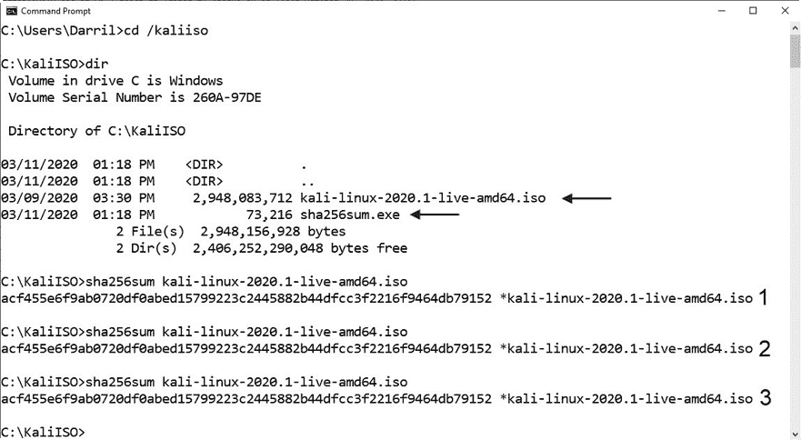

图 10.1：使用 `sha256sum` 计算哈希

图 10.1 展示了两个重要的几点：

* 无论你使用相同的哈希算法计算多少次，哈希值始终是相同的。在图中，我运行了三次 `sha256sum`，但即使我运行 3,000 次，它也会给我相同的结果。
* 哈希处理验证了文件是否保持了完整性。因为计算出的哈希与下载网站上发布的哈希相同，这证明了文件没有丢失完整性。

值得强调的是，哈希是单向函数。换句话说，你可以对文件或消息计算哈希，但无法使用哈希来还原原始数据。无论原始数据的大小如何，哈希算法总是创建一个固定大小的比特字符串。哈希不会提供关于文件大小、文件类型或任何其他线索。

例如，消息“I will pass the Security+ exam”的 `SHA-1` 哈希为：

`765591c4611be5e03bea41882ffdaa159352cf49`

然而，你无法通过观察哈希来识别出消息，甚至不知道它是一个六单词消息的哈希。同样，你无法通过观察图 10.1 所示的哈希来知道它是从一个 2.9 GB 的可执行文件计算出来的。

如果你想自己处理哈希，请查看此书在线资源中的实验，地址为：[`getcertifiedgetahead.com/`](https://getcertifiedgetahead.com/)。

#### 消息哈希处理

哈希处理为消息提供了完整性。它向接收消息的人提供保证，确保消息没有被修改。想象 Lisa 正在向 Bart 发送消息，如图 10.2 所示。消息内容是“The price is $75.”这条消息不是秘密，因此不需要加密。然而，我们确实想提供完整性，因此本解释仅关注哈希处理。

Lisa 电脑上的一个应用程序计算出的 `MD5` 哈希为：

`D9B93C99B62646ABD06C887039053F56`

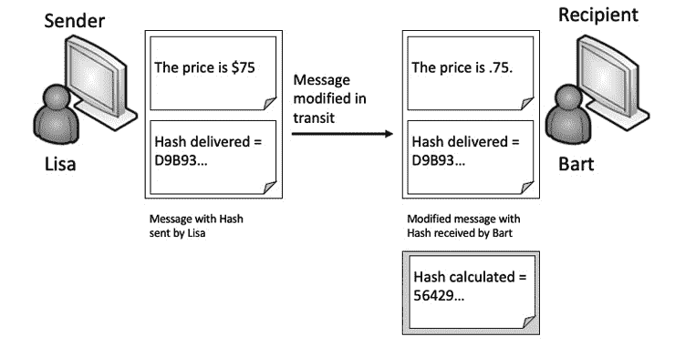

图 10.2：简化的哈希过程

在图中，我将完整哈希简化为了前五个字符“D9B93”。Lisa 然后将消息和哈希发送给 Bart。

在这个例子中，消息在到达 Bart 之前被修改了。当 Bart 接收到消息和原始哈希时，消息变成了“The price is .75.”注意消息在传输过程中被修改了，但哈希没有被修改。

Bart 电脑上的程序对收到的消息计算出的 `MD5` 哈希为：

`564294439E1617F5628A3E3EB75643FE`

程序随后将收到的哈希与计算出的哈希进行比较：

* 在 Lisa 电脑上创建并被 Bart 电脑接收的哈希是：`D9B93C99B62646ABD06C887039053F56`
* 在 Bart 电脑上创建的哈希是：`564294439E1617F5628A3E3EB75643FE`

显然，哈希是不同的，所以你知道消息丢失了完整性。Bart 电脑上的程序会报告此差异。Bart 并不知道是什么导致的问题。可能是恶意攻击者更改了消息，也可能是技术问题。然而，Bart 知道收到的消息与发送的消息不同，他不应该信任它。

| 记住 | 哈希处理为消息提供了完整性。它向接收消息的人提供保证，确保消息没有被修改。想象 Lisa 正在向 Bart 发送消息，如图 10.2 所示。消息内容是“The price is $75.”这条消息不是秘密，因此不需要加密。然而，我们确实想提供完整性，因此本解释仅关注哈希处理。 |
| Lisa 电脑上的一个应用程序计算出的 `MD5` 哈希为：`D9B93C99B62646ABD06C887039053F56` |
|  |
| 图 10.2：简化的哈希过程 | 在图中，我将完整哈希简化为了前五个字符“D9B93”。Lisa 然后将消息和哈希发送给 Bart。 |
| 在这个例子中，消息在到达 Bart 之前被修改了。当 Bart 接收到消息和原始哈希时，消息变成了“The price is .75.”注意消息在传输过程中被修改了，但哈希没有被修改。 |
| Bart 电脑上的程序对收到的消息计算出的 `MD5` 哈希为：`564294439E1617F5628A3E3EB75643FE` |
| 程序随后将收到的哈希与计算出的哈希进行比较： | |
*   在 Lisa 电脑上创建并被 Bart 电脑接收的哈希是：`D9B93C99B62646ABD06C887039053F56` |
*   在 Bart 电脑上创建的哈希是：`564294439E1617F5628A3E3EB75643FE` |
| 显然，哈希是不同的，所以你知道消息丢失了完整性。Bart 电脑上的程序会报告此差异。Bart 并不知道是什么导致的问题。可能是恶意攻击者更改了消息，也可能是技术问题。然而，Bart 知道收到的消息与发送的消息不同，他不应该信任它。 |
| 使用 HMAC | 值得强调的是，哈希是单向函数。换句话说，你可以对文件或消息计算哈希，但无法使用哈希来还原原始数据。哈希算法总是创建一个固定大小的比特字符串，无论原始数据的大小如何。哈希不会提供关于文件大小、文件类型或任何其他线索。 |
| 例如，消息“I will pass the Security+ exam”的 `SHA-1` 哈希为：`765591c4611be5e03bea41882ffdaa159352cf49` |
| 然而，你无法通过观察哈希来识别出消息，甚至不知道它是一个六单词消息的哈希。同样，你无法通过观察图 10.1 所示的哈希来知道它是从一个 2.9 GB 的可执行文件计算出来的。 |
| 如果你想自己处理哈希，请查看此书在线资源中的实验，地址为：[`getcertifiedgetahead.com/`](https://getcertifiedgetahead.com/)。 |
| 消息哈希处理 | 哈希处理为消息提供了完整性。它向接收消息的人提供保证，确保消息没有被修改。想象 Lisa 正在向 Bart 发送消息，如图 10.2 所示。消息内容是“The price is $75.”这条消息不是秘密，因此不需要加密。然而，我们确实想提供完整性，因此本解释仅关注哈希处理。 |
| Lisa 电脑上的一个应用程序计算出的 `MD5` 哈希为：`D9B93C99B62646ABD06C887039053F56` |
|  |
| 图 10.2：简化的哈希过程 | 在图中，我将完整哈希简化为了前五个字符“D9B93”。Lisa 然后将消息和哈希发送给 Bart。 |
| 在这个例子中，消息在到达 Bart 之前被修改了。当 Bart 接收到消息和原始哈希时，消息变成了“The price is .75.”注意消息在传输过程中被修改了，但哈希没有被修改。 |
| Bart 电脑上的程序对收到的消息计算出的 `MD5` 哈希为：`564294439E1617F5628A3E3EB75643FE` |
| 程序随后将收到的哈希与计算出的哈希进行比较： | |
*   在 Lisa 电脑上创建并被 Bart 电脑接收的哈希是：`D9B93C99B62646ABD06C887039053F56` |
*   在 Bart 电脑上创建的哈希是：`564294439E1617F5628A3E3EB75643FE` |
| 显然，哈希是不同的，所以你知道消息丢失了完整性。Bart 电脑上的程序会报告此差异。Bart 并不知道是什么导致的问题。可能是恶意攻击者更改了消息，也可能是技术问题。然而，Bart 知道收到的消息与发送的消息不同，他不应该信任它。 |
| 使用 HMAC | 值得强调的是，哈希是单向函数。换句话说，你可以对文件或消息计算哈希，但无法使用哈希来还原原始数据。哈希算法总是创建一个固定大小的比特字符串，无论原始数据的大小如何。哈希不会提供关于文件大小、文件类型或任何其他线索。 |
| 例如，消息“I will pass the Security+ exam”的 `SHA-1` 哈希为：... (此处为重复处理) |
| 这种处理方式由于格式解析出现了混乱，我将重新为您提供基于原文内容的清晰翻译。 |

此外，还有几个应用程序可以用于手动计算哈希。例如，`sha256sum.exe` 是一个任何人都可以使用的创建文件哈希的免费程序。

我最近下载的一个 Kali Linux 镜像具有以下哈希值：

`acf455e6f9ab0720df0abed15799223c2445882b44dfcc3f2216f9464db7915`

`kali.org` 的管理员计算了该镜像的哈希，并发布了镜像和哈希值。

在下载镜像文件后，我对下载的文件计算了哈希。幸运的是，它们是相同的。这证明我下载的文件确实是 `kali.org` 管理员在网站上发布的文件。如果我的哈希值不同，将说明镜像文件失去了完整性。要么它在发布后被修改了，要么在下载过程中丢失了一些比特位。无论何种，都不应该信任该文件，也不应该使用。图 10.1 显示了这一点。通过对文件运行 `sha256sum` 命令，我计算了哈希。我首先使用 `dir` 命令列出目录中的文件。然后我对 Kali Linux 文件运行了三次 `sha256sum`。每次 `sha256sum` 计算出的哈希都是相同的，如图 10.1 所示。


图 10.1：使用 `sha256sum` 计算哈希

图 10.1 展示了两个重要的几点：

* 无论你使用相同的哈希算法计算多少次，哈希值始终是相同的。在图中，我运行了三次 `sha256sum`，但即使我运行 3,000 次，它也会给我相同的结果。
* 哈希处理验证了文件是否保持了完整性。因为计算出的哈希与下载网站上发布的哈希相同，这证明了文件没有丢失完整性。

值得强调的是，哈希是单向函数。换句话说，你可以对文件或消息计算哈希，但无法使用哈希来还原原始数据。哈希算法总是创建一个固定大小的比特字符串，无论原始数据的大小如何。哈希不会提供关于文件大小、文件类型或任何其他线索。

例如，消息“I will pass the Security+ exam”的 `SHA-1` 哈希为：

`765591c4611be5e03bea41882ffdaa159352cf49`

然而，你无法通过观察哈希来识别出消息，甚至不知道它是一个六单词消息的哈希。同样，你无法通过观察图 10.1 所示的哈希来知道它是从一个 2.9 GB 的可执行文件计算出来的。

如果你想自己处理哈希，请查看此书在线资源中的实验，地址为：[`getcertifiedgetahead.com/`](https://getcertifiedgetahead.com/)。

#### 消息哈希处理

哈希处理为消息提供了完整性。它向接收消息的人提供保证，确保消息没有被修改。想象 Lisa 正在向 Bart 发送消息，如图 10.2 所示。消息内容是“The price is $75.”这条消息不是秘密，因此不需要加密。然而，我们确实想提供完整性，因此本解释仅关注哈希处理。

Lisa 电脑上的一个应用程序计算出的 `MD5` 哈希为：

`D9B93C99B62646ABD06C887039053F56`


图 10.2：简化的哈希过程

在图中，我将完整哈希简化为了前五个字符“D9B93”。Lisa 然后将消息和哈希发送给 Bart。

在这个例子中，消息在到达 Bart 之前被修改了。当 Bart 接收到消息和原始哈希时，消息变成了“The price is .75.”注意消息在传输过程中被修改了，但哈希没有被修改。

Bart 电脑上的程序对收到的消息计算出的 `MD5` 哈希为：

`564294439E1617F5628A3E3EB75643FE`

程序随后将收到的哈希与计算出的哈希进行比较：

* 在 Lisa 电脑上创建并被 Bart 电脑接收的哈希是：`D9B93C99B62646ABD06C887039053F56`
* 在 Bart 电脑上创建的哈希是：`564294439E1617F5628A3E3EB75643FE`

显然，哈希是不同的，所以你知道消息丢失了完整性。Bart 电脑上的程序会报告此差异。Bart 并不知道是什么导致的问题。可能是恶意攻击者更改了消息，也可能是技术问题。然而，Bart 知道收到的消息与发送的消息不同，他不应该信任它。

| 记住 | 哈希处理为消息提供了完整性。它向接收消息的人提供保证，确保消息没有被修改。想象 Lisa 正在向 Bart 发送消息，如图 10.2 所示。消息内容是“The price is $75.”这条消息不是秘密，因此不需要加密。然而，我们确实想提供完整性，因此本解释仅关注哈希处理。 |
| Lisa 电脑上的一个应用程序计算出的 `MD5` 哈希为：`D9B93C99B62646ABD06C887039053F56` |
|  |
| 图 10.2：简化的哈希过程 | 在图中，我将完整哈希简化为了前五个字符“D9B93”。Lisa 然后将消息和哈希发送给 Bart。 |
| 在这个例子中，消息在到达 Bart 之前被修改了。当 Bart 接收到消息和原始哈希时，消息变成了“The price is .75.”注意消息在传输过程中被修改了，但哈希没有被修改。 |
| Bart 电脑上的程序对收到的消息计算出的 `MD5` 哈希为：`564294439E1617F5628A3E3EB75643FE` |
| 程序随后将收到的哈希与计算出的哈希进行比较： | |
*   在 Lisa 电脑上创建并被 Bart 电脑接收的哈希是：`D9B93C99B62646ABD06C887039053F56` |
*   在 Bart 电脑上创建的哈希是：`564294439E1617F5628A3E3EB75643FE` |
| 显然，哈希是不同的，所以你知道消息丢失了完整性。Bart 电脑上的程序会报告此差异。Bart 并并不不知道是什么导致的问题。可能是恶意攻击者更改了消息，也可能是技术问题。然而，Bart 知道收到的消息与发送的消息不同，他不应该信任它。 |
| 使用 HMAC | 值得强调的是，哈希是单向函数。换句话说，你可以对文件或消息计算哈希，但无法使用哈希来还原原始数据。哈希算法总是创建一个固定大小的比特字符串，无论原始数据的大小如何。哈希不会提供关于文件大小、文件类型或任何其他线索。 |

正因为如此，只有像 `SHA-3` 这样强大的哈希算法才会被用于密码哈希。然而，即使这样也不够，正如本章后面描述的，密码通常会加盐。

#### 理解哈希碰撞

当哈希算法对不同的输入创建相同的哈希值时，就会发生哈希碰撞。这不是我们想要的。

例如，想象一个简单的哈希算法生成三位数的哈希。密码“success”可能会创建一个哈希值 `123`，而密码“passed”也可能创建一个相同的哈希值 `123`。这被称为哈希碰撞。在这种情况下，攻击者可以使用“success”或“passed”作为密码，且两者都能成功。攻击者不需要猜测正确的密码，只需要一个能产生相同哈值的密码即可。

`MD5` 极易受到哈希碰撞攻击，这就是为什么它不再被推荐用于加密哈希。

#### 理解密码攻击

密码攻击试图发现或绕过用于系统、网络以及不同类型文件身份验证的密码。某些密码攻击是高级的、复杂的密码学攻击，而另一些则是简单的暴力破解攻击。

##### 在线密码攻击

在线密码攻击试图从在线系统中发现密码。例如，攻击者可以尝试通过反复猜测用户名和密码来登录账户。有很多工具可供攻击者使用以自动化此过程。例如，`ncrack` 是一个可以运行在线暴力破解密码攻击的免费工具。

##### 离线密码攻击

离线密码攻击试图从捕获的数据库或捕获的数据包扫描中发现密码。例如，当攻击者黑入系统或网络导致数据泄露时，他们可以下载整个数据库。然后他们执行离线攻击来发现这些下载数据库中包含的密码。

在线密码攻击的主要指标可以在记录成功和失败登录的系统日志中找到。这些日志将显示反复猜测密码尝试。在 Windows 系统中，这记录在“事件查看器”中“安全（Security）”日志的 `Event ID 4625` 中。如果攻击者输入错误密码次数过多，系统将锁定用户账户。这被记录为 `Event ID 4740`。在线实验室将向你展示如何创建自定义过滤器来查看这些事件。

##### 字典攻击

字典攻击是原始密码攻击之一。它使用一个单词字典，并尝试字典中的每一个单词以看其是否有效。在此语境下，字典仅仅是单词和字符组合的列表。

这些攻击中使用的字典随时间演变，以反映用户行为。今天，它们包含了许多缺乏安全意识的用户为账户配置的常用密码。例如，尽管 `12345` 不是一个字典单词，但许多人将其作为密码，因此这类字符集已添加到许多被字典攻击工具所使用的字典中。

使用复杂密码可以阻止这些攻击。

##### 暴力破解攻击

暴力破解攻击试图猜测所有可能的字符组合。阻止离线暴力破解的首要步骤之一是使用复杂密码，并以加密或哈希格式存储密码。复杂密码包括大写字母、小写字母、数字和特殊字符的混合。此外，较长的密码比短密码更难破解。

##### 密码喷洒攻击

密码喷洒攻击（Password Spraying Attack）是一种特殊的暴力破解或字典攻击，旨在避免被锁定。自动化程序从一个大型目标用户账户列表开始。然后它选择一个密码并对列表中的每个账户进行尝试。接着它选择另一个密码并再次循环列表。

第 2 章“理解身份和访问管理”讨论了 Windows 系统中使用的账户锁定策略。它们对于在线暴力破解和字典攻击是有效的。账户锁定设置会在用户在短时间内输入预设次数错误密码后锁定账户。例如，如果用户在 30 分钟内输入了 3 次错误密码，锁定策略将锁定账户。由于喷洒攻击循环遍历很长的账户列表，在两次击中同一个账户之前需要一段时间。这通常超过了账户锁定设置的时间限制，从而有效地绕过了账户锁定策略。然而，你仍然会看到 `Event ID 4625` 表明登录尝试失败，但每个条目之间会有时间间隔。

| 记住此！ | 在线攻击猜测在线系统的密码。离线攻击猜测存储在下载文件（如数据库）中的密码。日志将通过 `Event ID 4625` 显示大量失败的登录尝试，和/或通过 `Event ID 4740` 显示多个账户被锁定。喷洒攻击试图避免账户锁定策略，但日志仍会显示大量失败登录尝试，只是每个条目之间有时间间隔。 |
| --- | --- |

#### 传递哈希攻击 (Pass the Hash)

在传递哈希攻击中，攻击者发现用户密码的哈希值，然后使用它作为用户登录系统。任何在网络上以明文格式传递哈希的身份验证协议都容易受到攻击。它与 Microsoft LAN Manager (`LM`) 和 NT LAN Manager (`NTLM`) 有广泛关联，这是两种用于验证 Microsoft 客户端的旧安全协议。然而，这种攻击在其他协议（如 `Kerberos`）上也取得了成功。

攻击者首先尝试获取系统的管理权限，通过作为本地 `Administrators` 组的成员访问或获取某些等效权限。如果用户使用具有管理员权限的账户登录，这轻而易举。如果计算机感染了恶意软件，攻击者将拥有登录用户相同的权限。

一旦攻击者获得这些权限，他们利用它们窃取存储在计算机多个位置的密码哈希，例如帐户管理器 (`SAM`) 数据库、本地安全权威子系统服务 (`LSASS`) 进程、凭据管理器 (`CredMan`) 存储器以及存储在注册表中的 LSA Secrets。

传递哈希攻击的一个强力指标是 Windows“安全”日志中的 `Event ID 4624` 显示使用 `NTLM` 作为身份验证包，和/或使用 `NT LAN Manager 安全支持程序 (NTLMSSP)` 作为登录进程。这可以与 `Event ID 4672` 关联，以确定用于此连接的权限。普通用户在连接其他计算机时不会使用管理员权限。然而，活跃的传递哈希攻击在网络移动到相似计算机时会使用管理员权限。在线实验室将向你展示如何搜索和检测这些事件。

| 记住此！ | 密码通常以哈希形式存储。传递哈希攻击尝试使用拦截的哈希值访问账户。这些攻击可以通过 `Event ID 4624` 中的登录进程 `NTLMSSP` 和/或身份验证包 `NTLM` 被检测到。 |
| --- | --- |

#### 生日攻击

生日攻击的名称源于数学概率论中的生日悖论。生日悖论指出，对于任何一个包含 23 个人的随机小组，有 50% 的概率其中 2 个人的生日相同。这并不是指同一年，而是一年中的 366 天中的某一天（包括 2 月 29 日）。

在生日攻击（birthday attack）中，攻击者尝试创建一个产生与用户实际密码相同哈希值的密码。正如之前所述，这被称为哈希碰撞（hash collision）。利用生日悖论的知识，攻击者在发现碰撞之前不需要猜测所有可能的密码。如果密码只有 366 种可能之一，攻击者在仅尝试 23 次后就有 50% 的概率猜中。

针对哈希的生日攻击可以通过增加哈希中使用的位数来增加可能的哈希数量从而抵御。例如，`MD5` 算法使用 128 位，容易受到生日攻击的影响。`SHA-3` 可以使用多达 512 位，且不受生日攻击的影响。

| 记住这一点！ | 生日攻击利用了哈希算法中的碰撞。当哈希算法对不同的密码创建相同的哈希时，就会发生哈希碰撞。加盐（Salting）在哈希之前向密码添加随机文本，可以防止许多密码攻击，包括彩虹表攻击。 |
| --- | --- |

#### 彩虹表攻击

彩虹表攻击是一种尝试从哈希值发现密码的攻击。彩虹表是一个巨大的数据库，包含了所有可能的密码及其预计算的哈希值。观察某些密码破解程序在没有彩虹表的情况下如何发现密码的过程有助于理解。假设攻击者拥有一个密码的哈希值。应用程序可以使用以下步骤发现与哈希匹配的密码：

1. 应用程序猜测一个密码（或使用字典中的密码）。
2. 应用程序对猜测的密码进行哈希处理。
3. 应用程序将原始密码哈希与猜测的密码哈希进行比较。如果它们相同，应用程序现在知道了密码。
4. 如果它们不同，应用程序将重复步骤 1 到 3 步，直到找到匹配项为止。

从计算的角度来看，这些步骤中最耗时的部分是第 2 步中对猜测的密码进行哈希处理。然而，通过使用彩虹表，应用程序消除了这一步。彩虹表是密码及其计算出的哈希值的巨大数据库。某些彩虹表的大小达 690 GB，包含了长度九个字符以内所有可能的组合的哈希值。使用更多字符还可以获得更大的彩虹表。

彩虹表攻击通常在被盗或受损的数据库上离线进行。在彩虹表攻击中，应用程序只需将数据库中每个密码的哈希与彩虹表中存储的哈希进行比较。当应用程序找到匹配项时，它就能识别出创建哈希的密码（或至少是能够还原原始密码哈值的文本）。诚然，这是对彩虹表攻击的简单解释，但除非你计划编写算法来创建自己的彩虹表攻击软件，否则这种解释足够了。

#### 密码加盐

密码加盐是防止彩虹表攻击的常用方法，用于暴力破解和字典攻击等其他密码攻击。盐（salt）是一组随机数据，例如两个额外的字符。密码加盐在哈希处理之前向密码添加这些额外字符。这些额外字符增加了密码的复杂度，并产生与系统仅使用原始密码时创建的不同的哈希。这导致与彩虹表比较哈希的密码攻击失败。

#### 密钥扩展

密钥扩展（Key stretching）是一种用于增加存储密码强度的高级技术。密钥扩展并不是在哈希之前简单地向密码添加盐，而是对加盐后的密码应用加密扩展算法。密钥扩展的优势在于它会消耗更多的时间和计算资源——让试图猜测密码的攻击者感到沮败。

三种常见的密钥扩展技术是 `bcrypt`、基于密码的密钥派生函数 2（`PBKDF2`）和 `Argon2`。

##### Bcrypt

`bcrypt` 基于 `Blowfish` 块密码，用于许多 Unix 和 Linux 发行版以保护存储在影子密码文件（shadow password file）中的密码。`bcrypt` 在使用 `Blowfish` 加密之前通过添加额外的随机位对密码加盐。`bcrypt` 可以多次通过此过程，以进一步防止发现密码的尝试。结果是一个 60 字符的字符串。

例如，如果你的密码是 `IL0ve$ecurity`，应用程序可以使用 `bcrypt` 和盐对其进行加密。它看起来像这样，应用程序将其存储在数据库中：

```
$2a$10$N9qo8uLOickgx2ZMRZoMyeIjZAgcfl7p92ldGxad68LJZdL17lhWy
```


`$2b$12$HXIKtJr93DH59BzzKQhehOI9pGjRA/03ENcFRby1jH7nXwt1Tn0kG`


随后，当用户使用用户名和密码进行身份验证时，应用程序对提供的密码运行`bcrypt`并将其与存储的`bcrypt`加密密码进行比较。如果提供的密码的`bcrypt`结果与存储的`bcrypt`结果相同，则用户通过身份验证。作为额外措施，可以在盐中添加一些胡椒（pepper）以进一步随机化`bcrypt`字符串。在这种背景下，胡椒是另一组存储在其他的随机位。

| 记住这一点！ | `bcrypt`、`PBKDF2`和`Argon2`是有助于防止暴力破解和彩虹表攻击的密钥扩展技术。它们使用额外的位对密码加盐，然后通过加密算法发送结果。 |
| --- |

### PBKDF2

`PBKDF2`使用至少64位的盐并使用如`HMAC`等伪随机函数来保护密码。许多算法，如无线网络安全访问2（`WPA2`）、苹果的`iOS`移动操作系统和思科`IOS`操作系统使用`PBKDF2`来增加密码的安全性。某些应用程序将密码通过`PBKDF2`发送多达1,000,000次以创建哈希。生成的哈希大小取决于`PBKDF2`的实现方式。128位、256位和512位是最常见的。

`PBKDF2`的弱点是它可以配置为使用较少的计算时间和内存。虽然这看起来对用户有利，但也让攻击者更容易，使其能够在短时间内猜测许多密码。

### Argon2

2015年密码哈希竞赛（PHC）选择了`Argon2`作为替代密钥扩展算法。与`bcrypt`和`PBKDF2`一样，`Argon2`使用密码和盐多次算法。`Argon2`在每个新版本中通过小写字母如`Argon2d`和`Argon2i`得到了改进。

| 记住这一点！ | 加密提供机密性并有助于确保授权用户可以看到数据。这适用于任何静态数据（如存储在数据库中的数据）或传输中的数据。 |
| --- |

## 使用加密提供机密性

加密提供机密性并防止数据的未经授权泄露。明文是人类可读的数据。加密算法将数据混乱，创建出不可读的密文。攻击者无法读取网络上传输的加密流量或存储在系统中的加密数据。相比之下，如果以明文发送数据，攻击者可以使用协议分析器捕获并读取数据。

静态数据（at rest）是指存储在介质上的任何数据，加密敏感数据是常见的。例如，可以加密数据库中的单个字段（如持有客户信用卡数据的字段）、单个文件、文件夹或整个磁盘。

传输中数据（in transit）或移动中数据（in motion）是指在网络上传输的任何数据，对敏感数据进行加密是常见的。例如，电子商务网站通常使用安全超文本传输协议（`HTTPS`）会话加密包含信用卡数据的交易。如果攻击者拦截了这些传输，他们只能看到密文。

使用中数据指的是正在被计算机使用的数据。由于计算机需要处理这些数据，因此在在使用过程中是不加密的。如果数据是加密的，应用程序在使用时会将其解密并存储在内存中。如果应用程序更改了数据，它会在保存之前再次对其加密。此外，应用程序通常在处理数据后会采取额外步骤清除内存中的敏感数据。两种主要的加密方法是对称加密和非对称加密。对称加密使用相同的密钥对数据进行加密和解密。非对称加密使用公钥和私钥匹配密钥对对数据进行加密和解密。这些加密方法包含两个元素：

- `Algorithm`。算法对数据进行数学计算。算法始终是相同的。
- `Key`。密钥是一个为加密提供变数的数字。它通常被保密和/或经常更换。

## 对称加密

对称加密使用相同的密钥对数据进行加密和解密。换句话说，如果你使用密钥3对数据进行加密，那么就使用相同的密钥3对对其进行解密。对称加密也称为密钥加密或会话密钥加密。举个简单的例子，当我小时候，我和一个朋友经常互相传递编码后的信息。我们的算法是：

- `Encryption algorithm`。向前移动X格进行加密。
- `Decryption algorithm`。向后移动X格进行解密。

在去上学的路上，我们会确定当天使用的密钥（`X`）。例如，我们某一天可能使用了密钥3。如果我想加密一条消息，我会将每个字符向前移动三格，而他通过向后移动三格来解密消息。假设需要发送消息“PASS”：

- “P”之后的三个字符是“S”——从P开始（Q, R, S）
- “A”之后的三个字符是“D”——从A开始（B, C, D）
- “S”之后的三个字符是“V”——从S开始（T, U, V）
- “S”之后的三个字符是“V”——从S开始（T, U, V）

加密后的消息为`SDVV`。我的朋友通过向后移动三格对其解密，并得知“PASS”是原始消息。

我们使用的是简单的字母替换密码。替换密码使用固定系统将明文替换为密文。在例中，“PASS”是明文，“SDVV”是密文，而固定系统是三个字母。`ROT13`（旋转13位的缩写）密码使用相同的替换算法，但始终使用密钥13。要加密消息，你会将每个字母旋转13位。要解密消息，你将把每个字母旋转13位。然而，由于`ROT13`同时使用了相同的算法和相同的密钥，它并没有提供真正的加密，而只是对数据进行了混淆。

混淆方法试图让某些事物变得模糊或难以理解。这有时被称为“通过隐性实现安全”。然而，通过隐性实现安全很少是维护安全的可靠方法。

使用密钥旋转字母说明了，如果加密和解密不使用相同的密钥，对称加密方法将会失效。如果我用密钥3加密了消息，而我的朋友尝试用密钥6对其进行解密，他将得到一个完全不同的消息。

复杂的对称加密技术使用了算法和密钥的相同组件。但是，这些算法和密钥要要复杂得多。例如，高级加密标准（`AES`）对称算法通常使用128位密钥，但可以使用192位或256位的密钥。

| 记住这个！ | 对称加密使用相同的密钥对数据进行加密和解密。例如，在传输加密数据时，对称加密算法在传输媒体的两端使用相同的密钥对数据进行加密和解密。 |
| --- |

| 将对称加密与门钥匙对比 | 有时，安全专业人员会将对称密钥与钥匙进行比较，这种类比有助于一些人更好地理解对称加密。例如，想象Marge搬进新家。她会收到一把可以用来锁和打开家门的单钥匙。当然，Marge不能用这把钥匙打开Flanders一家的门。后来，Marge嫁给了Homer，Homer搬进了Marge的家。Marge可以为她的家里钥匙制作一个副本并给Homer。Homer现在可以使用该密钥副本来锁和打开房屋。通过共享相同密钥的副本，无论是Marge还是Homer锁门都没有关系；他们都可以解锁。同样，对称加密使用单个密钥对数据进行加密和解密。如果共享了对称密钥的副本，拥有该密钥的其他也可以对数据进行加密和解密。 |
| --- |

想象两个服务器使用`AES`对称加密互相发送加密流量。它们对这些数据使用相同的`AES`算法和相同的密钥。数据在其中一个服务器上使用`AES`和密钥进行加密，通过线路或其他传输介质发送，并在另一个服务器上使用相同的密钥对其进行解密。同样，如果数据库包含加密数据，加密这些数据的密钥与解密这些数据的密钥相同。

然而，对称加密并不是使用相同的密钥来加密和解密所有数据。例如，我和朋友每天都使用不同的密钥。在去上学的路上，我们决定当天使用的密钥。第二天，我们又选了一个不同的密钥。如果有人昨天破解了我们的代码，他们今天无法使用相同的密钥破解我们今天的代码。

对称加密算法更换密钥的频率比每天一次高得多。例如，想象一个算法使用密钥`123`来加密一个项目文件。然后它可以使用密钥`456`来加密一个电子表格文件。密钥`123`只能解密项目文件，而密钥`456`只能解密电子表格文件。

反之，如果对称加密始终使用相同的密钥`123`，它会增加巨大的漏洞。首先，当密钥被重用时，加密更容易被破解。其次，一旦密钥被破解，所有使用该密钥加密的数据都将受到威胁。如果攻击者发现了密钥`123`，他们不仅可以访问项目文件，还可以访问电子表格文件以及任何使用此相同密钥加密的其他数据。

## 块加密与流加密

大多数对称算法密码套要么使用块加密或流加密。它们都是对称的，因此它们都使用相同的密钥对数据进行加密或解密。然而，它们划分数据的方式不同。

块加密以特定大小的块加密数据，例如64位块或128位块。块加密将大文件或消息划分为这些块，然后单独加密每个块。流加密以位流或字节流的形式加密数据，而不是将其分为块。

通常情况下，当数据大小未知或连续流发送时（例如在网络上流传输音频和视频），流加密比块加密更高效。当数据大小已知时（例如加密文件或特定大小的数据库字段），块加密更高效。

使用流加密时一个重要的原则是绝不重用加密密钥。如果重用密钥，加密就更容易被破解。

| 记住这个！ | 流加密以流的形式一次加密一个位或一个字节。块加密以特定大小的块（如64位或128位块）加密数据。在加密连续流数据时，流加密比块加密更高效。 |
| --- |

## 常见的对称算法

以下章节描述了一些常用的对称算法。这并不是所有对称加密算法的详尽列表，而是一些常用算法的简要列表。

### AES

高级加密标准（`AES`）是一种强对称分组密码算法，它以128位块加密数据。美国国家标准与技术研究所（`NIST`）在对几种不同的算法进行长时间评估后，从`Rijndael`加密算法中采用了`AES`。

`AES`可以128位、192位或256位的密钥，有时被称为`AES-128`、`AES-192`或`AES-256`以标识密钥中使用的位数。位数越高，发现密钥和解密数据就越困难。`AES-128`提供了强力保护，而`AES-256`提供了更强的保护。

通常情况下，任何加密的密钥大小直接对应密钥强度。对于特定算法，密钥越长，密钥强度越强。由于其优势，`AES`已被广泛应用于。例如，许多在USB驱动器上加密数据的应用程序使用了`AES`。`AES`的某些优势包括：

- 速度快。`AES`使用优雅的数学公式，只需一次即可对数据进行加密和解密。相比之下，`3DES`（本章稍后提到）需要多次才能完成数据的加密和解密。
- 高效。`AES`的资源消耗低于`3DES`等其他加密算法。即使在USB闪盘等小型设备上加密数据，`AES`也能快速地加密和解密。
- 安全。`AES`为数据提供了强加密，提供了高水平的机密性。

## 3DES

`3DES`（读作“三重DES”）是一种对称分组密码，旨在改进旧版数据加密标准（`DES`）的已知缺陷。简单来说，它使用`DES`算法通过三个独立的步骤对数据进行加密，并使用多个密钥。`3DES`以64位块加密数据。

尽管`3DES`是一种强算法，但它现在的使用频率不如`AES`高。`AES`的资源消耗要少得多。然而，如果硬件不支持`AES`，`3DES`是一个合适的替代方案。`3DES`使用112位或168位的密钥。

## Blowfish和Twofish

`Blowfish`是一种今天仍在使用使用的强对称分组密码。它以64位块加密数据，并支持32到448位之间的密钥大小。Bruce Schneier（IT安全领域广受尊敬的权威）将`Blowfish`设计为一种替代`DES`的通用算法。

有趣的是，在某些情况下，`Blowfish`比`AES`快。这在比较`Blowfish`和`AES-256`时尤为明显。部分原因在于，`Blowfish`使用较小的64位块加密数据，而`AES`使用128位块加密数据。

`Twofish`与`Blowfish`存在某种联系，但它以128位块加密数据，并支持128位、192位或256位的密钥。它也是`NIST`评估的入围算法之一。

| 记住这一点！ | `AES`是一种以128位块加密数据的强对称分组密码。`AES`使用128位、192位或256位密钥。`3DES`是一种以64位块加密数据的分组密码。`3DES`最初设计用于替代`DES`，但`NIST`选择了`AES`作为当前标准。然而，`3DES`仍用于某些应用程序，例如当旧版硬件不支持`AES`时。 |
| --- |

## 非对称加密

非对称加密使用一对匹配的密钥来加密和解密数据——一个公钥和一个私钥。关于这些密钥，有几个重要的点需要记住：

- 如果用公钥加密信息，只有匹配的私钥可以解密该信息。
- 如果用私钥加密信息，只有匹配的公钥可以解密该信息。
- 私钥始终保持私密，绝不共享。
- 公钥通过嵌入共享的数字证书来自由共享。

尽管非对称加密非常强大，但它也非常消耗资源。加密和解密数据需要大量的处理能力，尤其是与对称加密相比。大多数使用非对称加密的加密协议仅将其用于密钥交换。

### 密钥交换

密钥交换是一种用于在两个实体之间共享加密密钥的加密方法。在此背景下，非对称加密使用密钥交换来共享对称密钥。然后，加密协议使用对称加密来加密和解密数据，因为对称加密的效率要得多。

关键在于，两个实体需要能够识别出一个双方都知道并且可以使用的对称密钥。然而，交换过程必须经过加密，以确保没有其他人知道该对称密钥。本章稍后的“使用TLS加密HTTPS流量”部分将更深入地探讨密钥交换方法。

如果不理解匹配的公私钥对之间的关系，与非对称加密相关的一些高级主题将变得难以理解。然而，由于你看不见这些密钥，这些概念对某些人来说很难掌握。Rayburn盒子演示了你如何使用物理钥匙来实现与这些公、私钥相同的目的。

## Rayburn盒子

我经常在教室里提到Rayburn盒子，以帮助人们理解公私钥的用法。Rayburn盒子是一个允许人们长距离安全传输物品的箱子。它有两把钥匙。一把钥匙可以锁上箱但不能打开箱；另一把钥匙可以打开箱但不能锁箱。

- 只有一把密钥的副本——把它想象成私钥。
- 另一个密钥有多个副本并可以分发——把这些想象成公钥。

| 记住这一点！ | 只有私钥可以解密公钥加密的信息。只有公钥可以解密私钥加密的信息。非对称加密方法的一个关键要素是它们需要数字证书和公钥基础设施（PKI）。 |
| --- |

盒子有两个不同的版本。在一个版本中，它用于以机密方式发送秘密以防止未经授权的披露。在另一个版本中，它用于发送带有身份验证的消息，让你知道发送者以及消息在传输过程中没有被篡改。

### 用于发送秘密的Rayburn盒子

假设我想给你一些专利信息和一个发明的模型。显然，我们不希望其他人能够访问这些信息或模型。我可以给你寄一个空箱，并附带一把用于锁箱的钥匙。你把所有东西放在箱子里，然后用我给你的公钥将其锁。

这把钥匙无法打开箱，因此即使其他人有我给你的公钥副本，他们也无法用它打开箱。当我从你那里收到箱时，我可以使用唯一能打开箱的钥匙——我的私钥来打开它。

这与公私密钥如何在互联网上发送加密数据以确保机密性相似。公钥加密信息。用公钥加密的信息只能用匹配的私钥解密。公钥有多个副本，但私钥只有一把，且私钥始终保持私密。

当这样使用时，私钥会锁定Rayburn箱子，但它无法打开箱子。相反，只有匹配的公钥才能打开它。公钥存在多个副本，任何拥有公钥的人都可以打开箱子。然而，在用匹配的公钥打开箱子后，无法用公钥再次将其锁定。

想象你和我是战斗中的盟友。我想给你发一条内容为“SY0-701”的消息，这是一段告诉你在特定时间发起特定攻击的代码。我们并不在乎是否有人读了这条消息，因为这是一段代码。但是，我们需要你有一个确定的保证，即这条消息确实是我发送的。

我写下消息，将其放在箱子里，并用我的私钥将其锁定。当你收到它时，可以使用匹配的公钥将其打开。正因为公钥可以打开它，所以你知道这是我的箱子，而且它是用我的私钥锁定的——你我知道是我发送了这条消息。

如果敌方间谍拦截了箱子并用公钥打开了它，间谍将无法再次使用公钥将其锁定，因此你收到的是一个打开状态的箱子。间谍可以将消息替换为其他内容。然而，一个里面有消息的打开箱并不能证明是我发送的。你确认信息是我发送的唯一方法，是你收到一个可以使用匹配的公钥打开的锁定箱子。

这与数字签名使用公钥和私钥的方式类似。本章稍后提到的“使用数字签名签名邮件”部分将更深入地解释数字签名。简而言之，我可以给你发送一条用我的私钥进行数字签名的消息。如果你能用我匹配的公钥解密数字签名，你就知道它是用我的私钥加密（或签名）过的。因为私钥只存在一份，而我是唯一能访问它的人，所以你知道是我发送了这条消息。

## 揭秘Rayburn箱子

在尝试尝试寻找Rayburn箱子之前，让我来澄清一点。Rayburn箱子只是我想象的产物。Rayburn是我的中间名。

我还没有发现过公钥/私钥如何工作的真实案例，所以我创建了Rayburn箱子作为一个比喻，帮助人们视觉化公钥/私钥是如何工作的。如果你愿意，尽管自己制作一个。

## 证书

非对称加密的一个要素是数字证书。数字证书是一种数字文档，通常包含公钥以及证书所有者的信息。证书颁发机构（CA）负责发行和管理证书。数字证书用于非对称加密之外多种用途，包括身份验证和数字签名。

图10.4显示了一个选择了公钥的示例数字证书。用户和应用程序共享数字证书文件以共享公钥。他们不共享私钥。

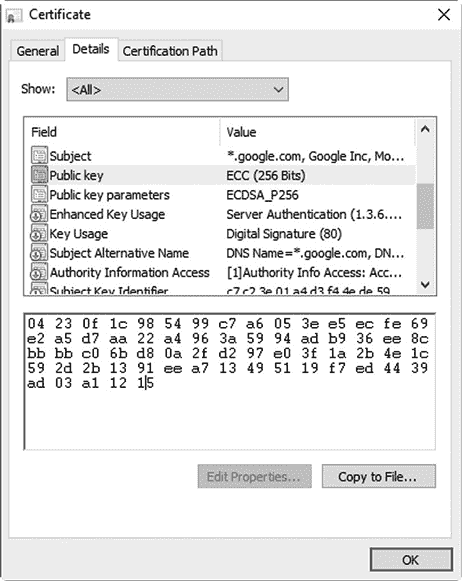

图10.4: 选择了公钥的证书

| 记住此！数字证书是非对称加密的重要部分。数字证书包含公钥，以及关于证书所有者和颁发证书的证书颁发机构（CA）的细节。证书所有者通过共享数字证书副本来共享他们的公钥。 |
| --- |

数字证书中的信息远比公钥多，但图中并非都可见。数字证书中的常见元素包括：

- 序列号（Serial number）。序列号标识由CA颁发的证书。它不是全球唯一的，而是通过颁发CA保持唯一。CA使用此序列号来验证证书。如果CA吊销了证书，它会将此序列号发布在证书吊销列表（CRL）中。
- 颁发者（Issuer）。这标识颁发证书的CA。
- 有效日期（Validity dates）。证书包含“有效起始”和“有效截止”日期。这些日期标识了有效期和过期日期。
- 主体（Subject）。这标识证书的所有者。在图中，它将主体标识为Google, Inc，并表示这是一个通配符证书，适用于所有具有google.com根域名的网站。
- 公钥（Public key）。非对称加密将公钥与匹配的私钥结合使用。
- 密钥用途（Key usage）。某些证书仅用于加密或身份验证，而其他证书支持多种用途。
- 证书属性使用区别名称（Distinguished Name）属性来标识颁发者。一些常见属性包括：
  - `CN`: 通用名（也称为全限定域名名，例如letsencrypt.org）
  - `O`: 组织（例如Internet Security Research Group）
  - `L`: 地地（例如Mountain View）
  - `S`: 州或省份名称（例如CA）
  - `C`: 国家名称（例如US）

## 临时密钥

Ephemeral（临时）指的是持续时间很短的东西。在密码学背景下，临时密钥的寿命很短，并且每个会话都会重新创建。相反，静态密钥是半永久的，在长时间保持不变。

临时密钥对包括一个临时私钥和一个临时公钥。系统为单个会话使用这些密钥对，然后将其丢弃。某些版本的Diffie-Hellman使用临时密钥。

证书基于基于静态密钥。证书包含一个与私钥匹配的嵌入式公钥，且该密钥对在证书的整个有效期内有效（例如一年）。证书有过期日期，系统会继续使用这些密钥，直到证书过期。静态密钥的一个优点是，正如本章稍后“验证证书”部分讨论的，CA可以对它们进行验证。

完美前向安全性（Perfect forward secrecy）是临时密钥在非对称加密中遵循的一个重要特性。完美前向安全性表示加密系统为每个会话生成随机公钥，并且不使用确定性算法来实现。换句话说，给定相同的输入，算法将创建不同的公钥。这有助于确保系统不重用密钥。结果是，密钥的泄露不会导致任何过去的密钥泄露。

## 椭曲线密码学

椭曲线密码学（ECC）消耗的计算能力不像其他加密方法那样大。它使用数学方程来构建椭圆曲线。然后在曲上绘制点来创建密钥。一个主要的优势是，与非ECC密钥相比，ECC密钥可以小得多。

数字签名（在本章稍后描述）通常用于签名邮件。数字签名算法（DSA）使用由PKI管理的密钥对，并将公钥分发在证书中。椭曲线数字签名算法（ECDSA）也可用于数字签名。一个256位的椭曲线公钥被认为提供了与DSA使用的3072位密钥相同的安全效益。

正因如此，ECC经常被用于低功耗设备的常见用例。例如，ECC有时用于小型无线设备，因为实现所需的安全性不需要大量的处理能力。

## 密钥长度

由于算法始终保持不变，增强任何特定算法的方法就是增加密钥的长度。例如，考虑RSA（Rivest-Shamir-Adleman），它是互联网上主要的公钥密码算法。它支持1024、2048和4096位的密钥大小。然而，目前NIST考虑到安全考虑，建议组织不再使用1024位密钥。目前的建议最小密钥长度是2048位。

有时我们并不真的需要加密数据，我们只是想让数据隐藏在众眼之中，或者让任何人无法从我们受保护的数据中检索敏感信息。混淆（Obfuscation）是指故意让某些事物变得模糊、困惑或难以理解的行为。它通常用于隐藏、扭曲或模糊信息、想法或意图，以误导或欺骗。

我们将查看几种不同的混淆技术：隐术（steganography）、令牌化（tokenization）和掩码（masking）。

## 隐术

隐术是将数据隐藏在其他数据之中，或者正如有些人所说，是将数据隐藏在众眼之中。其目标是隐藏数据，使没有人怀疑存在隐藏的消息。但如果其他人知道寻找什么，就能检索信息。它没有加密数据，因此不能被分类为对称或非对称加密。然而，它可以利用混淆有效地隐藏信息。混淆方法试图使事物变得模糊或难以理解。

安全专业人员使用隐分析技术（steganalysis）来检测隐术，最常用的方法是使用哈希。如果文件的比特位被修改，哈希算法就会创建一个不同的哈希。通过定期获取不同文件的哈希值并与之前的哈希进行比较，很容易检测出文件何时被修改。

用于隐术的文件有三种类型：音频文件、图像文件和视频文件。

### 音频隐术

音频隐术利用了人类耳朵的局限性。理想情况下，人耳可以检测频率范围在20 Hz到20 kHz之间的声音。大多数人无法检测18 kHz到20 kHz之间的声音，但大多数麦克风可以检测这些声音。这些通常被称为音频信标（audio beacons），用于识别用户活动。

位于印度的广告公司SilverPush利用此来跟踪用户。它的软件开发包（`SDK`）包含听音频信标的能力，一旦安装了应用程序，程序就会不断监听这些声音。某些电视广告包含音频信标，当用户设备听到信标时，SilverPush应用会向SilverPush服务器汇报。这帮助他们确定了用户在看什么广告，并确定在看什么节目。

SilverPush声称已于2016年停止了此类操作，但其他应用开发者仍在使用SilverPush的`SDK`。2017年，研究人员发现超过200个包含此`SDK`的Android应用在Google Play上下载了数百万次。

一些音频信标被营销人员在商店内使用。他们跟踪购物者在大型商店内移动的位置。然后应用程序根据购物者的位置发送广告或优惠券。

这项技术还可以用于执行跨设备跟踪，以确定哪些设备属于某个人。应用程序从一个设备发送音频信标。当另一个设备反复听到同一个信标时，则表明它属于同一个用户。

### 图像隐术

图像隐术是将数据隐藏在如`.jpeg`或`.gif`文件等图像文件中的实践。实现这种方法的两种常见方法是操作文件的比特位或在空白区域隐藏数据。

你可以通过修改文件中某些单个字节的最低有效位（least significant bit）向文件中嵌入消息。因为你修改的是最低有效位，查看图像的人不会察觉到文件的变化。例如，想象图像中的一个像素是红色的（`RGB`值为`255, 0, 0`）。如果你将红色的最低有效位从`255`更改为`254`，赋予像素值`254, 0, 0`，这种变化在显示器上是无法感知的。如果图像文件很大，则可以在其中隐藏一个大文件。

许多文件在文件簇的末尾有闲空间（称为空白区域）。想象一个存储在两个`4-KB`簇中的小型`6-KB`文件。它有额外的`2 KB`未使用空间，可以用消息填充这些空白区域。使用这种方法的处是可以在不改变文件大小的情况下嵌入消息。

### 视频隐术

视频隐术是图像隐术的扩展，它将消息嵌入视频中。通过Facebook、YouTube和TikTok等网站，视频已变得非常流行。由于视频文件通常很大，常用方法是修改文件中某些字节的最低有效位来嵌入消息。视频隐术的缺点是会导致音频产生噪声。为了避免这种情况，许多视频隐术方法只修改视频文件的图像部分而保持音频部分完整。

## 令牌化

令牌化是一种混淆技术，涉及将敏感数据替换为非敏感的占位符或令牌。这些令牌保留了关于原始数据的本质信息，而不暴露任何敏感信息。令牌化通常用于支付处理和保护个人身份信息（`PII`）的场景。其目标是减少未经授权访问或数据泄露的风险，同时允许系统使用非敏感令牌运行。

例如，信用卡号可以被令牌化以保护敏感的持卡人信息。不再存储实际卡号，而是生成一个随机令牌并存储在该位置。原始卡号被安全地存储在独立的数据库或令牌库（token vault）中，将令牌映射回相应的原始数据。这样，即使包含令牌的数据库被破解，攻击者也无法访问真实的信用卡号。

## 掩码

掩码是另一种混淆技术，通过用字符、符号或其他数据部分或完全隐藏敏感数据来保护它。掩码的主要目标是防止未经授权的用户查看或访问敏感信息，同时允许授权用户根据需要访问并处理数据。掩码通常用于与第三方共享数据或出于开发和测试目的目的。

例如，当用户登录在线银行系统时，银行可能会显示用户的账号，并将部分数字替换为`*`或`X`等字符（例如，`123****1208`）。这样，即使有人瞥一眼屏幕，也无法看到完整的账号。

掩码的另一个例子是密码字段，其中输入的字符被点或星号替换，以防止任何人看到正在输入的实际密码。

| 记住这个！ | 隐术、令牌化和掩码是保护敏感数据的混淆技术示例。隐术将消息或数据隐藏在其他文件中。令牌化将敏感数据替换为非敏感令牌，在不暴露敏感细节的情况下保留本质信息。掩码用字符、符号或其他数据部分或完全隐藏敏感数据。 |
| --- |

## 使用加密协议

对哈希、对称加密和非对称加密有了基本了解后，更容易掌握密码学是如何使用的。许多应用程序使用这些方法的组合，理解它们是如何交织的非常重要。

在之前描述公钥和私钥时，强调了一个密钥加密，另一个密钥解密。一个常见问题是“哪个加密，哪个解密？”答案取决于你想要实现什么。以下章节描述了细节，但作为概述，这些是与密钥相关的要点：

- **电子邮件数字签名**：
  - 发送者的`private key`进行加密（或签名）。
  - 发送者的`public key`解密。
- **电子邮件加密**：
  - 接收者的`public key`进行加密。
  - 接收者的`private key`解密。
- **网站加密**：
  - 网站的公钥用于加密。
  - 网站的私钥用于解密。
  - 对称密钥用于加密网站会话中的数据。

电子邮件和网站加密通常结合使用非对称加密和对称加密。它们使用非对称加密进行密钥交换，从而私下共享对称密钥。对称加密则用于对数据进行加密。

| 记住这个！知道哪个密钥用于加密、哪个密钥用于解密将有助于你回答考试中的某些问题。例如，只要知道私钥正在加密，你就知道它被用于数字签名。 |
| --- |

# 保护电子邮件

密码学为你在处理电子邮件时提供了两种主要的安全方法：数字签名和加密。这些是独立的步骤，但你可以对同一封邮件进行数字签名和加密。

## 使用数字签名对邮件进行签名

数字签名的概念类似于纸打印文档上的手写签名（后者用于识别身份），但数字签名提供了更多的安全益处。数字签名算法（`DSA`）使用消息的加密哈希值。哈希值使用发送者的私钥进行加密。如果数字签名邮件的接收者可以解密数字签名以显示哈希值，它将提供以下三项安全益处：

- **身份验证**。这识别了电子邮件的发送者。电子邮件接收者可以确保邮件确实来自其显示的发件人。例如，如果一位高管对邮件进行了数字签名，接收者就知道邮件来自该高管，而不是来自冒充该高管的攻击者。
- **不可否认性**。发送者以后无法否认发送过该消息。这在在线交易中通常是要求的。例如，想象Homer使用带有数字签名的邮件发送了一份卖出股票的订单。如果交易完成后股票上涨了，他就无法否认这笔交易。
- **完整性**。这确保了消息没有被修改或损坏。接收者知道他们收到的消息与发送的消息是一致的。

如果你理解本章中讨论的其他密码学概念，数字签名将变得更易理解。作为简短的回顾，这些概念包括：

- **哈希**。数字签名从创建消息的哈希值开始。哈希值简单来说是通过对消息执行哈希算法而生成的十六进制数字。
- **证书**。数字签名需要证书，而证书包含了发送者的公钥。
- **公钥/私钥**。在数字签名中，发送者使用自己的私钥加密消息的哈希值。接收者使用发送者的公钥解密数字签名，以显示消息的哈希值。公钥通常分布在`S/MIME.p7s`格式的文件中。

| 记住这个！数字签名是消息的加密哈希值。发送者的私钥加密消息的哈希值以创建数字签名。接收者使用发送者的公钥解密数字签名以显示哈希值。如果成功，它将提供身份验证、不可否认性和完整性。身份验证识别发送者。完整性验证消息未被修改。不可否认性防止发送者在以后否认他们曾发送过电子邮件。 |
| --- |

图10.5显示了该过程的概述。在图中，Lisa正在向Bart发送带有数字签名的消息。注意，消息“我通过了”并不是秘密。如果是秘密的话，Lisa就会对其进行加密，这是一个独立的过程。本解释的重点仅在于数字签名。

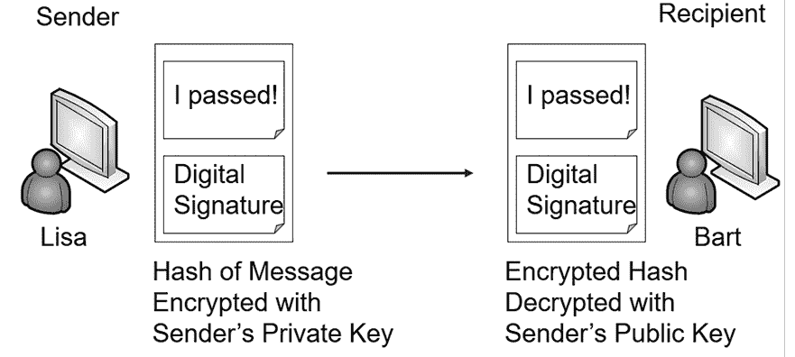

图10.5：数字签名过程

Lisa在电子邮件程序（如Microsoft Outlook）中创建她的消息。一旦配置好电子邮件程序，她只需要点击一个按钮对消息进行数字签名。以下是她点击按钮时发生的情况：

1. 应用程序对消息进行哈希处理。
2. 应用程序获取Lisa的私钥并使用该私钥对哈希进行加密。
3. 应用程序将加密后的哈希值（即数字签名）和未加密的消息一起发送给Bart。

大多数电子邮件应用程序并非仅使用对称加密，而是使用非对称加密来私密共享会话密钥。然后使用该会话密钥通过加密加密加密。例如，想象Lisa正在给Bart发送加密消息。图10.6显示了加密消息和加密对称密钥的过程。图10.7显示了发送加密消息和加密会话密钥的过程，并标识了接收者如何解密数据：

1. Lisa的系统确定了一个加密邮件的对称密钥。在本例中，假设这是一个为53的简单对称密钥，尽管像`AES`这样的对称算法会使用128位或更大的密钥。
2. Lisa使用为53的对称密钥加密邮件内容。
3. Lisa获取Bart的数字证书副本，其中包含他的公钥。
4. 她使用Bart的公钥对为53的对称密钥进行加密。
5. Lisa将加密后的邮件和加密后的对称密钥发送给Bart。
6. Bart使用他的私钥解密对称密钥。
7. 然后他使用解密后的对称密钥解密邮件。

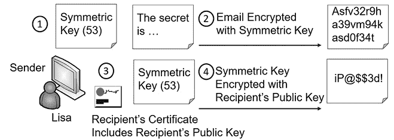

图10.6: 加密邮件

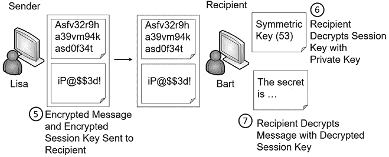

图10.7: 解密邮件

拦截Lisa发送邮件的未经授权用户将无法读取它，因为它是用密钥加密的。此外，他们无法读取对称密钥，因为是用Bart的公钥加密的，只有Bart的私钥可以解密它。

## S/MIME

安全/多用途邮件扩展（`S/MIME`）是用于对电子邮件进行数字签名和加密的最流行的标准之一。大多数支持加密和数字签名的电子邮件应用程序都使用`S/MIME`标准。

`S/MIME`同时使用非对称加密和对称加密。它可以加密静态数据（存储在驱动器上）和传输中数据（通过网络发送的数据）。当前版本使用加密消息语法（`CMS`），它允许使用多种不同的哈希算法和加密算法。许多非对称算法使用证书并需要`PKI`来分发和管理证书。在实现`S/MIME`时，你通常使用以下端口：

- 用于传输层安全协议（`TLS`）的邮局协议3（`POP3`）端口995，或`POP3-over-TLS`
- 用于传输层安全协议（`TLS`）的简单邮件传输协议（`SMTP`）端口587，或`SMTP-over-TLS`
- 用于传输层安全协议（`TLS`）的互联网消息访问协议（`IMAP`）端口993，或`IMAP-over-TLS`

## HTTPS传输加密

传输加密方法加密传输数据以确保传输数据的机密。这包括通过互联网和内部网络传输的数据。例如，第三章“探索网络技术与工具”讨论了使用安全外壳（`SSH`）加密流量，例如安全文件传输协议（`SFTP`）。本节重点关注用于`HTTPS`的传输加密方法。

### TLS与SSL

传输层安全（`TLS`）和安全套接层（`SSL`）是常用于加密互联网传输数据的加密协议。`SSL`存在严重漏洞，不应再使用。然而，许多人习惯将`TLS`称为`SSL/TLS`，仿佛它们是同一种。如果你看到这种，可以将几乎所有对`SSL`的引用视为对`TLS`的引用。

使用`TLS`加密`HTTPS`以确保互联网传输数据的机密性是常见的。也可以用于加密其他传输，例如安全文件传输协议（`FTPS`）。

`TLS`提供基于证书的认证，并在会话期间通过对称和非对称加密相结合加密数据。它使用非对称加密进行密钥交换（私密共享会话密钥），并使用对称加密加密网页显示和会话期间传输的数据。下一节将展示这一过程。

记住`TLS`需要证书很重要。证书颁发机构（`CA`）发行并管理证书，因此需要`CA`来支持`TLS`。这些`CA`可以是内部的或外部第三方`CA`。

| 记住这个！ | `TLS`是`SSL`的替代方案。`TLS`需要由证书颁发机构（`CA`）颁发的证书。`TLS`加密`HTTPS`流量，也可以加密其他流量。 |
| --- |

## 使用TLS加密HTTPS流量

HTTP安全（`HTTPS`）常用于互联网上以保护网络流量。它通常使用`TLS`加密流量，同时使用非对称和对称加密。如果你能理解`HTTPS`如何结合非对称和对称加密的基础知识，你就掌握了大多数同时使用这两种加密的协议所需的知识。

由于非对称加密加密大量数据的效率不高，因此使用对称加密来加密会话数据。然而，客户端和服务器在使用之前都必须知道这个对称密钥是什么。他们不能在互联网上互相耳语。这就像电视上的演员使用大声的耳语（或称舞台耳语）来分享秘密。数百万电视观众也能听到这个秘密。

相反，`HTTPS`使用非对称加密通过安全的密钥交换方法传输对称密钥。然后它使用对称密钥通过对称加密加密`HTTPS`会话中的所有数据。图10.8和后续步骤显示了建立和使用`HTTPS`会话的整体过程。在阅读这些步骤时，请尽量记住这两个重要概念：

- `TLS`使用非对称加密安全地共享对称密钥。
- `TLS`使用对称加密来加密会话数据。

简化的TLS握手过程由以下步骤组成：

1. 客户端通过请求`HTTPS`会话开始该过程。这可以通过在URL中输入`HTTPS`地址或通过点击`HTTPS`链接来实现。
2. 服务器通过发送服务器证书做出响应。该证书包含服务器的公钥。匹配的私钥位于服务器上，且仅供服务器访问。
3. 客户端创建一个对称密钥并用服务器的公钥对其进行加密。例如，假设对称密钥为53（但在实际会话中它会复杂得多）。客户端使用服务器的公钥对为53的对称密钥进行加密，生成密文`UcaNP@$$`。此对称密钥将用于加密`HTTPS`会话中的数据，因此它有时被称为会话密钥。
4. 客户端将加密的会话密钥（`UcaNP@$$`）发送到Web服务器。只有服务器的私钥可以解密它。如果攻击者拦截了加密的密钥，他们将无法解密，因为他们没有访问服务器私钥的权限。
5. 服务器接收加密的会话密钥并使用服务器私钥将其解密。此时，客户端和服务器都知道了会话密钥。
6. 所有会话数据都使用此对称会话密钥通过对称加密进行加密。

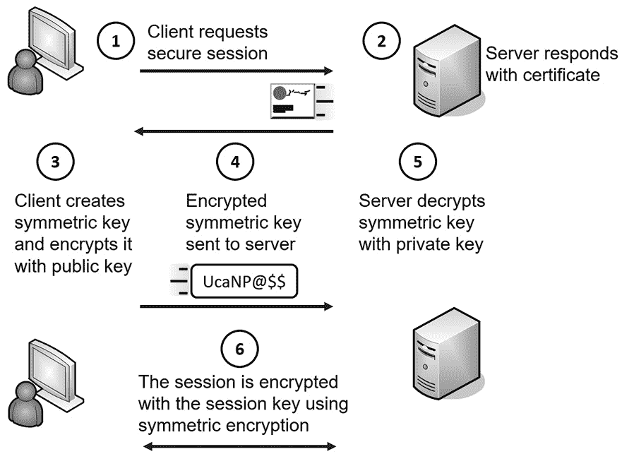

图10.8: 用于HTTPS的简化TLS握手过程

## 弱弱实现中的降级攻击

降级攻击是一种强制系统降低其安全级别的攻击。攻击者随之利用较弱的安全控制措施。由于密码套件的实现薄弱，它通常与加密攻击相关。

一个例子是传输层安全协议（`TLS`）和安全套接层协议（`SSL`）。假设一台服务器同时安装了`SSL`和`TLS`。如果客户端无法使用`TLS`，服务器将降低其安全性并使用`SSL`以适应该客户端。

攻击者通过配置其系统使其无法使用`TLS`来利用这一漏洞。当他们与服务器通信时，服务器会降级安全性，使用`SSL`而不是`TLS`。这允许攻击者发起基于`SSL`的攻击，例如针对降级旧版加密的填充Oracle攻击（`POODLE`）。在服务器降级到`SSL`后，攻击者就可以发起路径攻击（也称为“中间人”攻击）。

确保网站不使用`SSL`的一种方法是确保`SSL`处于被禁用的状态。禁用`SSL`可以防止任何基于`SSL`的降级攻击。同样，对于具有已知漏洞的加密套件（例如使用其他过时的加密算法），也应该被禁用。如果服务器上启用了弱加密套件，将会增加漏洞。

| 记住这一点！ | 管理员应该禁用服务器上的弱加密套件和弱协议。当服务器同时拥有强、弱加密套件时，攻击者可以发起降级攻击，绕过强加密套件并利用弱加密套件。 |
| --- |

# 区块链

区块链通常被定义为分布式、去中心化的公共账本。换句话说，它是一种公开的记录技术。银行通常使用账本来记录存款和取款等交易，而区块链开放公共账本相似。`block`（区块）指的是数字信息（账本），例如交易，而`chain`（链）指的是公共数据库。它们共同创建了一个公共记录数据库。每个`block`包含三个部分：

- 关于单笔或多次交易的信息，例如日期、时间和金额。
- 参与交易双方的信息。然而，这不包括实际名称，而是使用数字签名。
- 一个唯一的哈希值，用于区分该`block`其他区块。

在发生四种情况后，`block`会被添加到区块链中：

1. 发生了一笔交易。
2. 交易已通过计算机网络的验证。
3. 交易被准确地记录在`block`中。
4. 为`block`分配了一个唯一的哈希值。

`block`还包含了在此之前添加的最近一个`block`的哈希值。这就是创建`chain`的原因。每个`block`都有唯一的哈希值，每个`block`都有前一个区块的哈希值。这些连接的哈希值形成了“链”。

比特币是一种使用区块链的加密货币。验证和记录交易的计算机网络被称为矿工。然而，维护所有这些计算机需要费用，矿工通过交易费和奖励（`bitcoin`形式）赚钱。奖励发放给区块，每个`block`包含多笔交易。

`block reward`（区块奖励）起始为每个`block`50个比特币。在挖掘21,000个区块后，奖励减半，这大约每四年发生一次。2020年5月，奖励再次减半，降至每个`block`6.25个比特币。最终，奖励将停止，不再产生新的`bitcoins`。然而，矿工仍然可以通过交易费盈利。

# 识别局限性

在评估不同的算法时，考虑它们可能的局限性是非常重要的。当你理解这些局限性时，就能更容易识别出满足特定要求的最佳算法。以下章节识别了许多需要考虑的常见局限性。

## 资源与安全限制

组织经常需要在资源可用性与安全限制之间平衡。考虑使用加密来维护数据的机密性。如果这可行，为什么不直接加密所有数据呢？原因是加密会消耗资源。

例如，上面的段落明文约为260个字符。使用一种算法加密后，密文大约有360个字符。这增加了约40%，在许多加密方法中这是典型的。如果公司决定加密所有数据，意味着它将需要额外约40%的磁盘空间来存储数据。此外，在处理数据时会消耗更多内存。最后，加密和解密数据还需要额外的处理时间和处理能力。

安全专家可能会认为额外资源的成本是值得的，但寻求增加公司价值的高管并不认为。相反，高管有责任在不牺牲安全性的情况下将成本至最低。他们通过在资源成本和安全需求之间寻找最佳平衡来实现。

## 速度与时间

速度指的是算法计算结果所需的时间。例如，加密算法通常对数据进行几轮或迭代。算法执行一轮的速度快慢以及执行的轮数决定了其速度。在加密和解密数据时，你通常希望算法快速。

在对密码进行加盐和哈希处理时，较慢的算法是理想的。验证单个密码时，较慢的速度并不明显。然而，较慢的速度可以阻止那些试图从数万（或更多）种可能性猜测正确密码的攻击者。

## 大小与计算开销

密码学中的“大小”通常与算法执行所需的内存空间有关。在大多数桌面电脑和服务器上，所需的尺寸是微不足道的。然而，许多小型设备没有足够的内存和处理能力来运行相同的算法。轻量级加密方法更小，所需的开销也更小。

在某些情况下，大小相对于输入输出的大小。这在加密数据时很重要。如之前所述，加密数据大于未加密数据，并且需要更多的存储空间。

## 熵

熵指的是加密算法的随机性。更高水平的随机性在使用算法时意味着更高的安全性。缺乏熵会导致算法变弱，并更容易被破解。

加密算法是公开的，以便任何人访问。这导致了密码分析人员进行大量的测试。当他们发现缺陷或漏洞时，会发布他们的发现。其他密码分析人员会对他们的工作进行同行评审，试图证明或反驳这些发现。弱算法会被废弃并最终不再使用。

例如，`SHA-1`被发现了密码学缺陷。自2010年以来，它未被批准用于用途。

## 可预测性

通常，可预测性指的是根据重复相同事件预测可能发生什么。在应用于密码学时，它通常与创建加密密钥的随机数生成器有关。

随机数生成器分为伪随机生成器或真随机生成器。伪随机生成器使用确定性算法。换句话说，给定相同的输入，伪随机生成器会产生相同的输出。如果攻击者知道用于通过伪随机生成器创建加密密钥的输入，将增加他们预测密钥的概率。

真随机生成器通常使用环境因素（如大气噪声）作为输入。在得当的情况下，这些源可以为随机数生成器和加密算法引入真正的熵。

即使是最强大的算法，在使用较弱密钥时也容易被破解。弱密钥是指较短或较小的密钥。当使用弱密钥时，会增加攻击者解密并读取数据的可能性。例如，`NIST`自2010年起就建议在使用`RSA`时至少使用2048位的密钥。此时，1024位密钥是弱的，不应被使用。

## 寿命（Longevity）

寿命指的是你预计可以使用某个算法的时间。这通常与处理能力的预期改进有关。仅从密钥来看，`RSA`提供了一个很好的例子。通过加倍密钥的大小，可以增加算法的寿命。

然而，并不是所有的加密算法都支持更大的密钥。例如，数据加密标准（`DES`）仅支持56位的密钥。美国政府于1976年11月将其作为联邦标准批准。`AES`于2001年被选为`DES`的继者，美国政府于2005年取消了对`DES`的批准。它不再被推荐使用。

## 重用（Reuse）

在使用对称加密时，不应重用相同的密钥。这对于流密码器来说尤为如此。如果任何密钥在同一个流中被使用两次，该算法就会受到攻击。这就是早期无线网络实现中使用的旧有线等效隐私（`WEP`）算法存在的问题。由于密钥在同一个流中被重用，它很容易受到攻击。事实上，攻击者创建了应用程序，使得攻击者轻而易举地发现基于`WEP`的无线网络所需的密码。`WEP`已于2004年废弃。

## 明文攻击（Plaintext Attack）

如果攻击者拥有某些已知明文数据以及由该明文生成的密文，就可以进行明文攻击（也称为已知明文攻击）。例如，如果攻击者捕获了一条加密消息（密文）并知道消息的未加密明文，他就可以利用这两组数据来发现加密和解密方法。如果成功，他可以使用相同的解密方法处理其他密文。

选择明文攻击也类似，但攻击者无法访问所有明文。例如，想象一家公司在每封邮件的末尾都包含以下句子：

> “本邮件中包含的信息以及任何附件可能包含有关Pay & Park & Pay停车库的专有信息。如果你不是这些信息的预期接收者，则禁止使用这些信息。”

如果整个消息都经过加密，攻击者可以尝试各种方法来解密选择的明文（每封邮件中包含的最后两个句子）。当他成功时，可以使用相同的方法解密整个消息。

在仅密文攻击中，攻击者没有任何关于明文的任何信息。如果攻击者拥有资源和时间，已知明文攻击和选择明文攻击几乎总是成功的。然而，仅密文攻击（也称为已知密文攻击）通常只对弱加密算法有效。通过不使用旧的和废弃的加密算法可以防止此类攻击。

## 探索PKI组件（Exploring PKI Components）

公密钥基础设施（`PKI`）是一组用于请求、创建、管理、存储、分发和吊销数字证书的技术。非对称加密取决于使用数字证书来实现各种用途，例如保护电子邮件和使用`TLS`保护互联网流量。例如，`HTTPS`会话保护互联网信用卡交易，而这些交易依赖于`PKI`。

`PKI`的一个主要优势是它允许两个人或实体在之前互不认识的情况下安全地通信。换句话说，它允许他们通过互联网等不安全的公共介质进行安全通信。

例如，即使你从未这样做过，也可以与`Amazon.com`建立安全会话。`Amazon`使用由受信任的证书颁发机构（`CA`）发布的证书。正如之前的“使用`TLS`加密`HTTPS`流量”部分所示，证书提供了建立安全会话的能力。`PKI`的关键要素是证书颁发机构。

### 证书颁发机构（Certificate Authority）

证书颁发机构（`CA`）负责、管理、验证和吊销证书。`CA`可以很大，例如公共`CA` `Comodo`或`DigiCert`。`CA`也可以很小，例如运行在私有网络服务器上的单个服务。

公共`CA`通过出售证书盈利。为了使这种模式运行，公共`CA`必须是受信任的。如果`CA`受信任，那么由该`CA`发布的所有证书都是受信任的。这种信任通过“信任根”（root of trust）的概念建立，其中`CA`是一个受信任的实体，为安全系统和过程提供了坚实的基础。

这类似于驾照被信任的方式。机动管理局（`DMV`）在验证个人身份后颁发驾照。如果你想兑取支票，你可能会出示驾照证明你的身份。企业信任`DMV`，因此它们也信任驾照。相反，如果你从`Gibson's Instant IDs`购买了身份ID，企业可能不会信任它。虽然我们可能信任`DMV`，但计算机为什么会信任`CA`呢？答案基于证书信任路径。

### 证书信任模型（Certificate Trust Models）

`CA`通过将其根证书副本放在操作系统的受信任根证书存储库中获得信任。主流网络浏览器也有受信任的根证书存储库。根证书是`CA`创建的用于标识其自身的第一个证书，而该存储库只是这些根证书的集合。如果`CA`的根证书位于此存储库中，由该`CA`发布的所有证书都是受信任的。

图10.9显示了Windows计算机上的受信任根证书颁发机构存储库。你可以看到来自许多不同`CA`的许多证书。在图中，我选择了来自`COMODO RSA Certification Authority`的其中一个证书。

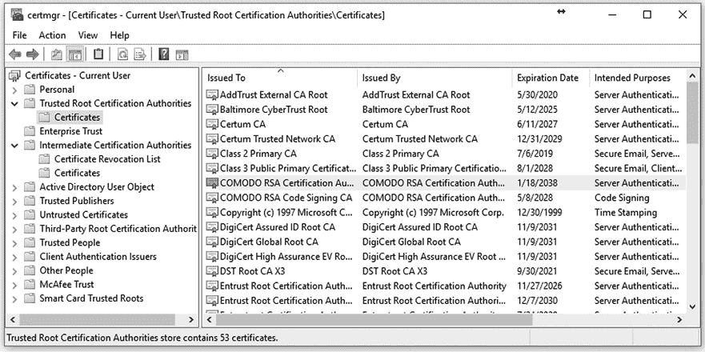

图10.9: 受信任根证书颁发机构

`DigiCert`和`Comodo`等公共`CA`与网络浏览器开发者协商，将它们的证书包含在网络浏览器中。这样，它们卖给企业的任何证书都会被自动信任。

常见的信任模型是层级信任模型。在这种模型中，公共`CA`、私有`CA`或政府机构创建第一个`CA`，称为根`CA`，作为信任锚点。还会创建一个或多个中间`CA`，因为根`CA`保持离线以确保自身的安全和保存。如果你回看图10.9，你可以看到它包含一个存储中间CA证书的部分。层级信任模型的工作原理如下：

- 自签名根`CA`向一个或多个中间`CA`发证书并对其公钥进行签名。
- 中间`CA`向实体实体颁发叶证书。
- 颁发给实体（如组织、政府或终端用户）的叶证书可用于应用程序代码签名、数字签名、VPN、用于加密网站会话的`HTTPS`、用于加密电子邮件的`S/MIME`或身份验证/认证。

证书链将从根`CA`到颁发给实体实体的所有证书组合在一起。例如，图10.10显示了发给`google.com`的通配符证书的证书链。证书链包含所有三个证书。在小型组织中，根`CA`可以直接向设备和终端用户发放证书。尽管，将根证书保持在线会使其面临网络攻击的可能性。

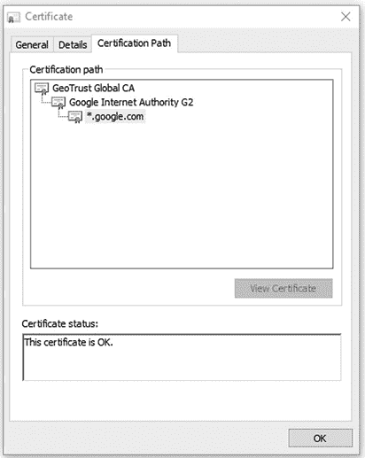

图10.10: 证书路径

### 注册机构与CSR

用户和系统通过注册过程向CA请求数字证书。在某些情况下，用户手动在网站表单中输入信息。在其他情况下，用户会向CA发送一个特定格式的文件。

例如，假设我想为GetCertifiedGetAhead.com购买一个数字证书以实现安全的HTTPS会话。我首先会创建一个公钥和私钥对。目前有很多程序可以自动化此过程。例如，`OpenSSL`是一个在许多Linux发行版中可以通过命令行访问的软件库。它可以在一个命令中创建公钥/私钥对，并允许通过第二个命令将公钥导出到文件中。从技术上讲，`OpenSSL`和类似的应用程序先创建私钥。然而，这些应用程序似乎是同时创建这两个密钥的。

然后，我会为数字证书生成证书签名请求（CSR），包括证书的用途以及关于网站、公钥和我的信息。大多数CA要求CSR必须使用公钥加密标准（PKCS）#10进行格式化。CSR包含公钥，但不包含私钥。CA通常会发布一个证书模板，准确显示如何格式化CSR。

在收到CSR后，CA会验证我的身份并使用公钥创建一个数字证书。验证过程根据数字证书的使用情况而异。在某些情况下，它包括广泛的检查，而在其他情况下，验证来自于我购买证书时使用的信用卡。

然后，我可以使用该数字证书和私钥注册我的网站上。每当有人发起HTTPS连接时，网站都会发送包含其公钥的数字证书。通过客户端和服务器之间的协商和交换，将建立一个安全的会话。

在大型组织中，注册机构（RA）可以通过收集数字证书注册信息来协助CA。RA从不颁发证书。相反，它仅协助注册过程。

| 记住此！ | 你通常使用证书签名请求（CSR）请求证书。第一步是创建基于RSA的私钥，该私钥用于创建公钥。然后你将公钥包含在CSR中，CA将公钥嵌入数字证书中。私钥不会发送给CA。 |
| --- |

## 在线CA与离线CA

如果CA是线线的（意味着可以通过网络访问），则可能可以使用自动化过程提交CSR。然而，组织可能会将某些CA保持离线状态以保护它们免受攻击。离线CA只能手动接受CSR。

大型组织通常将根CA保持离线，以降低被破解的风险。根CA向在线且可访问的中间CA颁发证书。如果中间CA被攻破，整个认证链就不会受到破坏。根CA可以颁发新证书来替换被攻破的证书。然而，如果根CA被攻破，整个认证链都将损坏。

## 更新和撤销证书

与数字证书相关的两个常见配置更改是更新和撤销。证书通常根据`Valid From`（有效起始）和`Valid To`（有效期）日期过期，并可以通过替换为更新的证书进行更新。如果证书被攻破，CA可以撤销它。

许多网站使用来自Let's Encrypt的数字证书，这是一个非营利证书机构，提供免费的基于TLS的证书。这些证书的有效期为90天，但可以使用自动化过程来自动更新证书，而无需额外的网站管理员交互。

在需要时，CA可以在证书过期之前撤销数字证书。例如，如果私钥以某种方式泄露给公众，该密钥对就会被攻破。它不再提供足够的安全性，因为私钥不再是私密的。同样地，如果CA本身通过安全漏洞被攻破，由CA颁发的证书也可能被破坏，因此CA可以撤销证书。

通常，每当CA不希望任何人使用证书时，CA就会撤销它。虽然最常见的原因是密钥泄露或CA被攻破，但还有其他原因。CA在撤销证书时可以使用以下任何原因：

- 私钥被攻破
- CA被攻破
- 证书属性变更
- 被其他证书取代
- 停止运行
- 证书持有者请求

### 证书撤销列表

CA使用证书撤销列表（CRL）来撤销数字证书。CRL是一个包含已撤销证书的列表，通过序列号识别。例如，图10.11显示了如何下载和查看CRL。

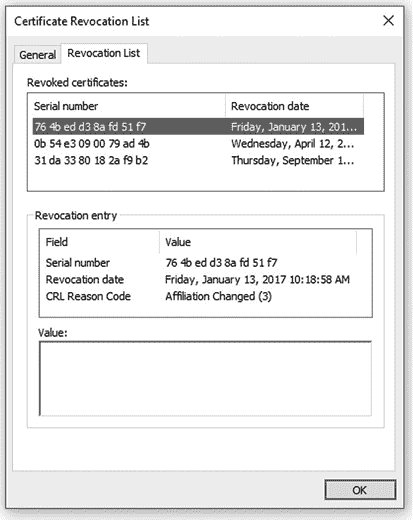

图10.11: 证书撤销列表

| 记住此！ | CA通常出于多种原因撤销证书，例如密钥被攻破或CA被攻破。证书撤销列表（CRL）包含了被撤销证书，它是公开的。使用CRL的替代方案是在线状态协议（OCSP），它可以返回“良好”、“已撤销”或“未知”。 |
| --- |

## 验证证书

在客户端使用证书之前，首先通过某些检查来验证其有效性。许多不同的证书问题会导致证书无效。浏览器通常会显示错误并建议用户不要使用该证书。检测到证书问题的应用程序可能会显示错误。

- 已过期。第一个检查是确保它未过期。如果证书过期，计算机系统通常会向用户发出错误。
- 证书不可信。下一个检查是查看证书是否由受信任的CA颁发。例如，Windows系统将查看受信任的根证书颁发机构存储以及之前图10.9所示的中间证书存储。如果系统没有CA数字证书的副本，它将指示证书不可信。用户可以忽略此警告，尽管通常会有建议用户不要继续的警告。
- 已撤销。客户端还通过CA验证证书以确保其未被撤销。

验证证书的一种常用方法是请求CRL副本，如图10.12所示。以下步骤概述了该过程：

1. 客户端发起需要证书的会话，例如HTTPS会话。
2. 服务器响应包含公钥的证书副本。
3. 客户端向CA请求CRL副本。
4. CA响应CRL副本。


图10.12: 验证证书

客户端随后将证书的序列号与CRL中的序列号列表进行比对。如果证书由于任何原因被撤销，应用程序将向用户发出错误消息。

CRL在第一次下载后通常会被缓存。客户端不再请求另一个CRL副本，而是使用缓存的副本。这减少了客户端和CA之间传输的流量。

验证证书的另一种方法是在线证书状态协议（`OCSP`）。`OCSP`允许客户端通过证书序列号查询`CA`。随后`CA`返回“良好（good）”、“已撤销（revoked）”或“未知（unknown）”响应。“未知”响应可能表示证书是伪造的。

由于`OCSP`提供实时响应，它是支持低延迟常用用例的绝示例。如果`CA`撤销了一个证书，使用`OCSP`的客户端会立即获。相比之下，如果客户端使用的是缓存的`CRL`，在下载另一个`CRL`副本之前，它们将不知道该证书已被撤销。

随着时间的推移，机构发现`OCSP`为`CA`产生了大量的实时流量，因为它要求`CA`响应每一个请求。OCSP封送（OCSP stapling）解决了这个问题。证书呈现者从`CA`获取一个带有时间戳的`OCSP response`。在发送之前，`CA`会对其进行数字签名。然后，证书呈现者在`TLS`握手过程中将带有时间戳的`OCSP response`附加（或比喻为“钉住”）到证书上。这消除了客户端查询`CA`的需求。

| 记住这个！ | 证书封送是`OCSP`的替代方案。证书呈现者（如Web服务器）将带有`CA`数字签名的时间戳`OCSP response`附加到证书。这减少了与`CA`之间的`OCSP`流量。 |
| --- |

## 证书固定（Certificate Pinning）

证书固定是一种旨在防止攻击者使用伪造证书冒充网站的安全机制。当在网站服务器上配置时，服务器将通过额外的头部响应客户端的`HTTPS`请求。此额外头部包含从网站使用的有效公密钥派生的哈希列表。它还包含一个`max-age`字段，指定客户端存储和使用数据的时间。

当客户端再次连接到同一个网站时，它们会重新计算哈希，并将重新计算的哈希与存储的哈希进行比较。如果哈希匹配，验证验证连接到了同一个网站。

网站管理员为网站使用的一个或多个证书创建哈希值。这可以是网站证书使用的公密钥。也可以包括证书链中任何证书的公密钥，例如来自根`CA`证书的公密钥，和/或来自中间`CA`证书的公密钥。最后，必须包含一个备份密钥，当当前密钥失效时可以使用该密钥。

## 密钥托管（Key Escrow）

密钥托管是将私钥副本放置在安全环境中的过程。这对于恢复很有用。如果原始密钥丢失，机构将检索密钥副本以访问数据。密钥托管不是强制要求的，但如果机构认为数据丢失是不可接受的，它将实施密钥托管流程。

在某些情况下，机构会向第三方提供密钥副本。另一种方法是在组织内部指定负责密钥托管的员工。这些员工维护并保护密钥副本，如果原始密钥丢失，他们会向管理员或用户调出密钥副本。

密钥恢复代理（Key recovery agent）是一个可以恢复或还原加密密钥的指定人员。在`PKI`语文中，恢复代理可以恢复私钥以访问加密数据。恢复代理可能可能是安全专业人员、管理员或公司指定的任何人员。

在某些情况下，恢复代理可以使用不同的密钥恢复加密数据。例如，`Microsoft BitLocker`支持对整个驱动器进行加密。在创建`BitLocker`加密驱动器时，可以添加数据恢复代理字段。在这种情况下，`BitLocker`使用两个密钥。用户持有一个密钥并在日常使用期间解锁驱动器。第二个密钥仅供恢复代理访问，并当原始密钥丢失或无法访问时用于恢复。

## 密钥管理（Key Management）

`PKI`内的密钥管理是指管理`PKI`中使用的公钥和私钥的所有步骤。这包括保持私钥机密性、在证书中分发公钥以及在密钥泄露时撤销证书。适当的密钥管理对于任何`PKI`的安全完整性至关重要，因为它确保了加密数据和通信的真实性、机密性和完整性。

密钥管理系统（`KMS`）是一个负责安全管理各种安全应用程序加密密钥的中央系统或服务。`KMS`的主要目标是为加密密钥的整个周期提供一个稳健安全的框架，包括密钥的生成、分发、存储、轮换、撤销以及终止或销毁。实施`KMS`有助于组织控制其加密密钥并减少与未经授权访问或误用相关的风险。

`KMS`处理的任务包括：

- **密钥生成**。`KMS`使用强大的行业标准算法生成加密密钥，以确保密钥的安全和随机。在生成密钥时，使用可靠的熵源或随机源至关重要，以防止任何模式或可预测性。
- **密钥存储**。`KMS`安全地存储加密密钥，通常在硬件安全模块（`HSMs`）或其他防篡存储设备中。这种安全存储防止未经授权的访问并保护密钥不被盗取或误用。
- **密钥分发**。`KMS`以证书的形式安全地分发公钥，同时保持私钥机密。包含公钥的证书由受信任的证书颁发机构（`CA`）签名，确保其真实性和完整性。`KMS`还可能处理对称密钥的分发，确保它们在双方之间安全传输。
- **密钥轮换**。定期密钥轮换是密钥管理中的一项基本实践。自动化自动化过程涉及生成新密钥、用新密钥替换旧密钥以及更新系统和应用程序使用新密钥。这种做法有助于随着时间的推移减少未经授权访问或密钥泄露的风险。
- **密钥终止/撤销/销毁**。当加密密钥不再需要或已泄露时，`KMS`确保其得到适当的终止或销毁。此过程涉及从系统中安全地移除密钥并确保无法无法再次访问或使用。

## 比较证书类型

有时根据其用途识别证书。以下项目符号描述了一些常见的证书类型：

- **机器/计算机**。颁发给设备或计算机的证书通常称为机器证书或计算机证书。该证书通常用于在域内标识计算机。
- **用户**。证书也可以颁发给用户。它们可用于加密、身份验证、智能卡等。例如，微软系统可以创建用户证书，允许用户使用加密文件系统（`EFS`）加密数据。
- **电子邮件**。电子邮件证书用于电子邮件的加密和数字签名，正如本章较早所述。
- **代码签名**。开发者经常使用代码签名证书来验证可执行应用程序或脚本的真实性。代码签名证书验证代码未被修改。例如，PowerShell脚本可以使用代码签名证书证明脚本在运行前未被修改。
- **自签名**。自签名证书不是由受信任的`CA`发布的。企业内部的私有`CA`经常创建自签名证书。这些证书默认不受信任的。然而，管理员可以使用自动化手段将自签名证书的副本放入企业计算机的信任根`CA`存储中。来自私有`CA`的自签名证书消除了从公共`CA`购买证书的费用。
- **根**。根证书是由根`CA`发布的最高级证书或自签名锚定证书。
- **通配符**。通配符证书以星号（`*`）开头，如果每个域名具有相同的根域名，则可以用于多个子域名。例如，Google使用了发给`*.google.com`的通配符证书。该证书也可以用于其他的Google域名，例如`accounts.google.com`和`support.google.com`。通配符证书可以减少管理多个证书带来的行政负担。
- **主体备用名称**。主体备用名称（`SAN`）证书用于具有不同名称但属于同一组织的多个域名。例如，Google使用了`*.google.com`、`*.android.com`、`*.cloud.google.com`等`SANs`。它通常用于具有相同基础域名但不同顶级域名的系统。例如，如果Google使用`google.com`和`google.net`这样的名称，它可以使用一个`SAN`证书同时用于这两个域名。
- **域名验证**。域名验证证书表示证书请求者对`DNS`域名具有某些控制权。`CA`会采取额外步骤联系请求者，例如通过电子邮件或电话。其目的是向客户端提供额外的证据，证明证书和该组织是可靠的。
- **扩展验证**。扩展验证（`EV`）证书使用了域名验证之外的额外步骤。当使用扩展验证证书时，某些浏览器会在URL之前显示公司名称。`EV`证书的使用量正在下降。大多数网络浏览器已停止在URL中包含名称。部分原因在于，公司名称缺失对许多用户来说没有意义。想一想点击钓鱼邮件的用户，他可能不知道要在URL中寻找公司名称，因此名称的缺失并不会引起他的警觉。

### 比较证书格式

大多数证书使用`X.509 v3`格式之一。主要的异常是用于分发证书吊销列表的证书，它们使用了`X.509 v2`格式。

证书通常以二进制文件或`BASE64`美国信息交换代码（`ASCII`）编码的文件存储。二进制文件以`1`和`0`的形式存储。`BASE64`编码将二进制数据转换为`ASCII`字符串格式。此外，某些证书还被加密以提供额外的机密性。

证书的基础格式是规范编码规则（`CER`）或区分编码规则（`DER`）。`CER`和`DER`格式由国际电信联盟标准部门（`ITU-T`）在`X.690`标准中定义。它们使用抽象语法表示一（`ASN.1`）格式的变体，该格式定义了密码学中常用的数据结构。`CER`是`ASCII`格式，而`DER`是二进制格式。某些证书包含头部和页脚以识别内容。例如，以下文本显示了证书的头部和页脚：

```
-----BEGIN CERTIFICATE-----
MIIFazCCA1OgAwIBAgIRAIIQz7DSQONZRGPgu2OCiwAwDQYJKoZIhvcNAQELBQAw
TzELMAkGA1UEBhMCVVMxKTAnBgNVBAoTIEludGVybmV0IFNlY3VyaXR5IFJlc2Vh
cmNoIEdyb3VwMRUwEwYDVQQDEwxJU1RHIFJvb3QgWDEwHhcNMTUwNjA0MTEwNDM4
WhcNMzUwNjA0MTEwNDM4WjBPMQswCQYDVQQGEwJVUzEpMCcGA1UEChMgSW50ZXJu
ZXQgU2VjdXJpdHkgUmVzZWFyY2ggR3JvdXAxFTATBgNVBAMTDElTVEcgUm9vdCBY
MTCCAiIwDQYJKoZIhvcNAQEBBQADggIPADCCAgoCggIBAK3nJ5DYe8wXrKJ8wLbG
...
-----END CERTIFICATE-----
```


```
-----BEGIN CERTIFICATE-----

MIIDdTCCAl2gAwIBAgILBAAAAAABFUtaw5Qw

...

-----END CERTIFICATE-----
```


`hash` 是一个固定长度的十六进制字符字符串，无法通过反向还原重新创建原始数据。

`checksum`（校验和）与 `hash` 类似，但通常较小。它用于验证数据的完整性，但并非为了提供密码学安全性。

哈希算法是用于创建 `hash` 的单向函数。你无法通过反转该过程重新创建原始数据。

当哈希算法对不同的输入创建相同的 `hash` 时，就会发生 `hash collision`（哈希碰撞）。

常见的哈希算法包括 `Message Digest 5 (MD5)`、`Secure Hash Algorithms (SHA)` 和 `基于哈希的消息认证码 (HMAC)`。`HMAC` 同时提供了消息的完整性和真实性。

# 理解密码攻击

密码攻击试图发现密码。在线密码攻击尝试从在线系统中发现密码。离线密码攻击则尝试从捕获的数据库或捕获的数据包扫描中发现密码。

密码通常以 `hash` 的形式存储。弱的哈希算法容易受到碰撞影响，这会导致不同的密码产生相同的 `hash`。

暴力破解攻击尝试猜测所有可能的字符组合，而字典攻击则使用文件中存储的所有单词和字符组合。账户锁定策略可以阻止在线暴力破解攻击，而复杂的密码可以阻止离线密码攻击。

鱼罐式攻击（spraying attack）试图绕过账户锁定策略。自动化程序从一个大型目标账户列表开始，然后选取一个密码并尝试列表中的每个账户。接着，它选取另一个密码并再次遍历列表。

在 `pass the hash`（哈希值传递）攻击中，攻击者发现用户密码的 `hash`，然后利用它以该用户的身份登录系统。

在 `birthday attack`（生日日攻击）中，攻击者尝试创建一个与用户实际密码产生相同 `hash` 的密码。

`Password salting`（密码加盐）在哈希处理之前向密码添加额外的字符，可以防止许多类型的攻击，包括字典攻击、暴力破解和彩虹表攻击。

三种常用的密钥扩展技术是 `bcrypt`、`Password-Based Key Derivation Function 2 (PBKDF2)` 和 `Argon2`。它们保护密码免受暴力破解和彩虹表攻击。

# 通过加密提供机密性

机密性确保只有授权用户才能查看数据。

加密提供了数据机密性，包括静态数据加密（存储在磁盘上的任何类型的数据）或传输中数据加密（任何正在传输的数据）。

对称加密使用相同的密钥对数据进行加密和解密。

`Block ciphers`（分组密码）以固定大小块加密数据。`Advanced Encryption Standard (AES)` 以 128 位块加密数据，而 `3DES` 以 64 位块加密数据。

`Stream ciphers`（流密码）每次加密 1 位或 1 字节的数据。

非对称加密使用公钥加密并使用私钥解密。

完美前向安全性（Perfect Forward Secrecy）确保即使长期密钥被泄露，过去的会话密钥依然保持安全。

`Elliptic Curve Cryptography (ECC)`（椭圆曲线密码学）是一种基于有限域上椭圆曲线代数结构的公钥加密方法。

通配符证书使用星号 `*` 用于子域名，以减少管理证书的行政负担。备用名称 (`SAN`) 证书可用于具有不同域名的多个域名。

`CER` 是 ASCII 格式，而 `DER` 是二进制格式。

`PEM` 是最常用的证书格式，几乎可以用于任何类型的证书。

`P7B` 文件通常用于共享公钥。`P12` 和 `PFX` 文件通常用于存储私钥。

| 在线参考 | 请记住，在 [`getcertifiedgetahead.com/`](https://getcertifiedgetahead.com/) 还有额外的资源。资源包括实验室、样本性能测试题等。 |
| --- | --- |

# 第 10 章练习题

1. `GCGA` 是一家软件开发公司，偶尔通过重大更新和微小补丁来更新其软件。管理员将这些更新加载到公司网站，并附带每个更新关联的哈希值。以下哪项**最能**描述该哈希值的作用？
   1. 更新和补丁的可用性
   2. 更新和补丁的完整性
   3. 更新和补丁的机密性
   4. 应用程序的完整性

2. 你组织的用户使用数字签名对电子邮件进行签名。以下哪项为这些数字签名提供了完整性？
   1. 哈希
   2. 加密
   3. 不可否认性
   4. 私钥

3. 在查看组织托管的 Web 服务器日志时，你发现 `FTP` 账户多次登录失败，但大约每隔 30 分钟发生一次。你还看到在 `FTP` 账户登录失败后，立即对 `SSH` 账户尝试相同的密码。以下哪项**最能**描述发生了什么？
   1. 暴力破解攻击
   2. 字典攻击
   3. 明文攻击
   4. 喷洒攻击

4. 一个在线应用程序要求用户使用电子邮件地址和密码登录。该应用程序以哈希格式加密密码。添加以下哪项可以减少攻击者发现这些密码的概率？
   1. 彩虹表
   2. 盐值 (Salt)
   3. 数字签名
   4. 输入验证

5. 块密码和流密码之间的主要区别是什么？
   1. 流密码每次加密 1 位或 1 字节数据。
   2. 块密码每次加密 1 位或 1 字节数据。
   3. 流密码用于对称加密，但块密码用于非对称加密。
   4. 块密码用于对称加密，但流密码用于非对称加密。

6. 一名开发者正在创建一个在移动设备上对数据进行加密和解密的应用程序。这些设备没有太多的处理能力。以下哪种密码学方法的开销**最少**，并能为这些移动设备提供加密？
   1. 椭圆曲线加密
   2. 完美前向安全性
   3. 加盐 (Salting)
   4. 数字签名

7. 你正在配置一个销售人员通过互联网使用的 Web 服务器。传输到和离开服务器的数据需要加密，因此你的任务是为服务器申请证书。为了申请证书，你**最可能**创建以下哪种项？
   1. CA
   2. CRL
   3. CSR
   4. OCSP

8. 组织内的用户经常使用 HTTPS 访问公共 Web 服务器。管理层希望确保即使公共 CA 临时不可用，用户也能验证证书是否有效。为了满足这一需求，应该实施以下哪项？
   1. OCSP
   2. CRL
   3. 私有 CA
   4. CSR

9. 你的组织托管了一个仅供员工使用的内部网站。该网站使用由私有 CA 发布的证书，网络每周从 CA 下载一次 `CRL`。然而，在最近发生一次泄露后，安全管理员想使用一种 `CRL` 的实时替代方案。以下哪项**最能**满足这一需求？
   1. SAN
   2. CSR
   3. RA
   4. OCSP

10. 一个组织在用于电子商务的 Web 集群中托管了多个 Web 服务器。由于最近的攻击，管理层担心攻击者可能会尝试重定向网站流量，允许攻击者冒充其电子商务网站。以下哪种方法可以解决这个问题？
    1. 证书固定 (Stapling)
    2. 完美前向安全性
    3. 钉 (Pinning)
    4. 密钥拉伸 (Key stretching)

11. 管理层强制你组织内的所有人员必须使用数字签名。这支持以下哪些用例？
    1. 支持机密性
    2. 支持可用性
    3. 支持混淆
    4. 支持不可否认性

12. 一个 DLP 系统检测到机密数据通过 Bart 的账户通过电子邮件发送。然而，他否认发送过邮件。管理层想实施一种方法，防止 Bart 以后否认责任。他们正试图执行以下哪项？
    1. 机密性
    2. 加密
    3. 访问控制
    4. 不可否认性

13. 你的组织最近更新了安全策略，并强制所有高管发送的电子邮件必须包含数字签名。该策略解决了哪种安全目标？
    1. 机密性
    2. 哈希
    3. 混淆
    4. 身份验证

14. 你的任务是获取证书价格。你需要找到一个可以提供用于多个域名的证书来源。以下哪个证书是**最佳**的？
    1. SAN
    2. 域名验证
    3. 扩展验证
    4. 通配符

15. 你的组织最近丢失了解密密钥，导致加密数据丢失。首席信息官 (`CIO`) 强制要求创建密钥托管。以下加密密钥**最可能**存储在密钥托管中？
    1. 公钥
    2. 私钥
    3. 临时密钥
    4. 会话密钥

# 第 10 章练习答案

1. B 是对的。哈希值为更新和补丁提供了完整性，使用户可以验证它们未被修改。安装更新和补丁增加了应用程序的可用性。

2. A 是对的。哈希为数字签名和其他数据提供完整性。数字签名是使用发送者私钥加密的消息哈希，但加密本身并不提供完整性。数字签名提供了不可否认性，但不可否认性不提供完整性。

3. D 是对的。这表明是密码喷洒攻击。它遍历账户列表，每次对一个账户尝试密码，然后对另一个账户尝试相同的密码。在这种情况下，攻击者在返回 Web 服务器之前可能正在尝试其他服务器。暴力破解攻击尝试猜测密码所有可能的字符组合，而字典攻击则使用单词字典尝试发现正确密码。喷洒攻击在猜测密码时可以使用暴力破解方法或字典方法；但这些方法不会遍历用户账户列表。

4. B 正确。密码盐值（Password salt）是在哈希处理之前添加到密码中的额外随机字符，它可以降低密码攻击的成功率。彩虹表被攻击者使用，包含预计算的哈希值，而加盐正是为了专门防止彩虹表攻击。数字签名提供身份验证、不可否认性和完整性，但它不能保护密码。输入验证技术在数据数据之前验证其有效性，它们与保护哈希后的密码无关。

5. A 正确。流加密器每次加密一个位或一个字节的数据，在数据大小未知时（如流媒体音频或视频）效率更高。块加密器则以特定大小的块加密数据，例如 64 位块或 128 位块。两者都常与对称加密算法配合使用。

6. A 正确。椭圆曲线密码学（ECC）的开销极小，通常用于移动设备的加密。完全正向安全性（Perfect forward secrecy）涉及会话密钥，并确保即使私钥以后泄露，会话密钥也不会被破解。加盐是在哈希处理之前向密码添加随机字符以防止彩虹表攻击。数字签名提供完整性、身份验证和不可否认性，但不提供加密。

7. C 正确。你可以通过创建证书签名请求（CSR）来请求证书。它使用特定的格式来请求证书。你将 `CSR` 提交给证书权威（CA），但请求必须是 `CSR` 格式。证书吊销列表（CRL）是已吊销证书的列表。在线证书状态协议（OCSP）是验证证书的替代方法，用于指示证书是有效的、已吊销还是未。

8. B 正确。证书吊销列表（CRL）可以满足这一需求，因为 CRL 是被缓存的。由于任何类型的连接中断或 CA 宕机无法访问公共证书颁发机构（CA），只要缓存时间未过期，就可以缓存的 `CRL`。在线证书状态协议（OCSP）是实时工作的，客户端使用证书序列号查询 `CA`。如果 `CA` 无法访问，则无法验证证书。私有 `CA` 用于组织内部，无法验证来自公共 `CA` 的证书。你通过证书签名请求（CSR）请求证书，但 `CSR` 并不验证已颁发的证书。

9. D 正确。在线证书状态协议（OCSP）提供实时响应以验证证书颁发机构（CA）颁发的证书。证书吊销列表（CRL）包含已吊销证书的列表，但如果每周只下载一次，它可能会很快过期。其他答案均不能验证证书。在证书语境下，主体备用名称（SAN）证书用于具有不同名称但属于同一组织的多个域名。证书签名请求（CSR）用于请求证书。注册机构（RA）为 `CA` 接收 CSR。

10. C 正确。证书固定（Certificate pinning）为客户端提供了一份公钥哈希值列表，客户端可以使用该列表来检测网站伪装尝试。证书封送（Stapling）通过在证书中附加带有时间戳和数字签名的 OCSP 响应来减少在线证书状态协议（OCSP）的流量。完全正向安全性确保一个会话密钥的泄露不会损害过去使用的其他会话密钥。密钥扩展技术（Key stretching）向密码中添加额外的位（盐），使其更难破解。

11. D 正确。数字签名将支持不可否认性的用例。数字签名还提供完整性和身份验证，但这些不是选项中的答案。数字签名不加密数据，因此不支持支持机密性的用例。冗余和容错解决方案将增加可用性。隐写术（Steganography）是支持混淆的一种方式。

12. D 正确。数字签名等不可否认方法防止用户否认执行了某项操作。在这种情况下，如果数据丢失防护（DLP）系统检测到发出的邮件且该邮件使用 Bart 的账户通过数字签名进行了签名，他就无法否认发送过它。加密方法保护机密性。访问控制方法保护对数据的访问。

13. D 正确。数字签名是消息的加密哈希值，可以用于提供身份验证、完整性和不可否认性。身份验证识别邮件发送者。加密提供机密性并防止未经授权的披露。混淆方法试图让内容更难以阅读，但数字签名并不提供混淆。哈希是一种提供完整性的方法，但哈希本身并不是一个安全目标。

14. A 正确。主体备用名称（SAN）证书用于具有不同名称但属于同一组织的多个域名。域名验证证书表明证书请求者对域名系统（DNS）域名具有某些控制权。扩展验证证书使用了领域验证之外的额外步骤。通配符证书以星号（\*）开头，可以用于多个子域名，但每个子域名必须具有相同的根域名。

15. B 正确。私钥的副本通常存储在密钥托管（key escrow）中，以便如果原始私钥无法访问，就可以恢复私钥加密的数据。公钥对任何人可见，因此不需要存储在密钥托管中。临时密钥（ephemeral key）寿命短，且每个会话都会重新创建。会话密钥用于单个会话，因此不会存储在密钥托管中。

# 第 11 章

## 执行策略以降低风险

本章涵盖的 CompTIA Security+ 目标：

### 1.3 解释变更管理流程及其对安全的影响。

- 影响安全的业务流程（审批流程、所有权、利益相关者、影响分析、测试结果、回滚计划、维护窗口、标准操作程序）
- 技术影响（允许列表/拒绝列表、限制活动、停机、服务重启、应用程序重启、遗留应用程序、依赖关系）
- 文档（更新图表、更新策略/程序）
- 版本控制

### 3.3 比较并对比保护数据的概念和策略。

- 数据类型（受管的、贸易秘密、知识产权、法律信息、财务信息、人类可/不可读）
- 数据分类（敏感、机密、公开、限制、隐私、关键）
- 安全数据的方法（地理限制、权限限制）

### 4.2 解释适当硬件、软件和数据资产管理对安全的影响。

- 处置/退役（清理、破坏、认证、数据保留）

### 4.8 解释适当的事件响应活动。

- 流程（准备、检测、分析、抑制、根除、恢复、教训）
- 培训
- 测试（演练、模拟）
- 根因分析
- 威胁狩猎
- 数字取证（法律保留、监管链、获取、报告、保护、电子发现）

### 5.1 总结有效安全治理的要素。

- 指南
- 策略（可接受使用策略 AUP、信息安全策略、业务连续性、灾难恢复、事件响应、软件开发生命周期 SDLC、变更管理）
- 标准（密码、访问控制、物理安全、加密）
- 程序（变更管理、入职/离职、剧本）
- 外部因素（监管、法律、行业、本地/区域、国家、全球）
- 监控与修订
- 治理结构类型（董事会、委员会、政府实体、集中/去中心化）
- 系统和数据的角色与职责（所有者、控制者、处理者、保管者/数据管理员）

### 5.3 解释与第三方风险评估和管理相关的流程。

- 供应商评估（渗透测试、审计权、内部审计证明、独立评估、供应链分析）
- 供应商选择（尽职调查、利益冲突）
- 协议类型（服务水平协议 (SLA)、协议备录 (MOA)、谅解备录 (MOU)、主服务协议 (MSA)、工作订单 (WO)/工作说明书 (SOW)、保密协议 (NDA)、合作伙伴协议 (BPA)）
- 供应商监控
- 问卷
- 参与规则

### 5.4 总结有效安全合规的要素。

- 合规报告（内部、外部）
- 不合规的后果（罚款、制裁、声誉损害、执照吊、合同影响）
- 合规监控（尽职调查/注意、证明与确认、内部与外部、自动化）
- 隐私（法律影响、本地/区域、国家、全球、数据主体、控制者与处理者、所有权、数据清单与保留、被遗忘权）

### 5.6 针对给定场景，实施安全意识实践。

- 钓鱼（活动、识别钓鱼尝试、对已报告的可疑消息做出响应）
- 异常行为识别（风险、意外、无意）
- 用户指导与培训（策略/手册、情境意识、内部威胁、密码管理、可移动媒体和电缆、社会工程、操作安全、混合/远程工作环境）
- 报告与监控（初始、定期）

### 开发与执行

组织制定书面安全策略以帮助应对它们面临的各种风险。这些策略为在整个组织范围内实施安全的专业人员指导原则。在本章中，我们将介绍安全策略和相关文档涵盖的许多问题。我们将涵盖的主题包括变更管理、数据保护、事件响应、安全治理、合规和意识。

## 变更管理

在技术领域，变化无处不在。开发者更新应用程序以添加新功能并解决安全问题。管理员为系统增加容量并进行主要升级。应用程序所有者修改配置设置并添加删除新的云服务。所有这些变化都有带来巨大业务价值的潜力，但如果管理不当，也可能中断。

变更管理计划试图为技术变化的混乱带来秩序。它们提供了一个正式流程，以批准和执行变更，并确保这种方式与所有利益相关者协调一致，并旨在最大限度地减少与变更相关的风险。

## 业务流程

在你为组织设计变更管理计划时，应该处理几个重要的业务流程问题：

- 变更的正式批准流程确保每个提议的变更在发生前都经过管理层的适当审查和通过。
- 所有权声明通过指定主要所有者来明确定义谁负责每个变更，该所有者将是变更的关键决策者和发起人。
- 利益相关者分析识别组织内部和外部可能受变更影响的所有个人和群体。这种分析允许变更团队推进变更。
- 影响分析审查变更的潜在影响，包括无意的副作用。
- 测试通过在部署变更之前在测试环境中执行变更，来确认变更将按预期工作。
- 回滚计划为变更发生故障时团队应遵循的详细步骤序列。回滚计划描述了系统如何尽可能快地恢复到先前的运行状态。
- 维护窗口提供了定义良好且协调的时间，让利益相关者意识到系统可能会中断。

所有这些要素都应该成为变更管理的一部分。

## 技术影响

变更管理计划必须考虑任何变更的技术影响，并跨团队和技术进行协调，以确保变更平稳发生且没有不必要的中断。应该包含的某些活动包括：

- 更新任何安全控制，例如防火墙规则、允许/拒绝列表、访问控制列表以及可能为了适应变更而需要调整的其他策略。
- 识别变更发生后可能必要的限制活动。例如，组织可能决定在对系统进行重大变更的 48 小时内冻结财务系统中的新条目。
- 向关键利益相关者传达停机预期，以便他们规划停机对其业务活动的影响。
- 通过对风险活动设置控制（例如应用程序和服务的重启以及对可能没有适当支持的旧应用程序的修改），尽可能减少中断。
- 跟踪系统与服务之间的依赖关系，以识别当前和未来变更的下游影响。

## 文档与版本控制

文档是任何信息技术环境的关键组成部分。它为团队成员提供了一个关于系统和应用程序设计与配置方式的信息库。文档为当前和未来的团队成员提供了参考，但现实情况是 IT 人员通常不喜欢保持文档更新，因为这是一项枯燥的工作。

变更管理流程应确保在所有文档和图表更新以反映变更影响之前，不关闭变更。

版本控制是一种用于跟踪软件代码当前版本以及系统/应用程序的正式流程。在进行更改时，开发者修改代码并将其提交到版本控制系统，该系统会解决他们的更改与其他开发者更改之间的冲突，并跟踪当前的生产和测试版本。大多数组织使用集成到软件开发流程中的正式版本控制系统。

## 数据保护

每家公司都有秘密。保守这些秘密往往决定了成功与失败。公司可能拥有宝贵的研发数据、客户数据库、产品专有信息等。如果公司不能保持私有和专有秘密，将直接影响其底线。

数据策略有助于保护数据并防止数据泄露。本节涵盖了数据策略可能包含的许多不同元素。

## 理解数据类型

组织必须保护许多类型的数据。让我们来看看组织维护的一些常见的敏感数据类型：

- 受监管数据是受组织必须遵守的外部法律法规约束的数据。例如，支付卡行业数据安全标准（`PCI DSS`）规范了信用卡信息的使用，各种国家、州和法律规范了个人身份信息（`PII`）的使用。
- 财务信息是任何与组织或个人货币交易有关的数据。此类数据也可能属于受监管数据的类别。例如，美国的金融机构受《格拉姆-利奇-布莱尔法案》（`GLBA`）监管，该法限制了个人财务信息的使用。
- 知识产权对于组织运营业务至关重要的信息。知识产权可能包括受版权、商标法和/或专利法保护的数据。商业秘密是知识产权的一种，由于其对竞争对手保密，因此对组织来说仍然具有敏感性和价值。例如，可口可乐或肯德基炸鸡的著名秘密配方被视为商业秘密。
- 法律信息是组织维护的最敏感的信息之一。律师-客户特权保护这些信息的机密性，只要这些信息得到适当的防止泄露。法律信息可能包括有关当前或未来诉讼或其他法律策略的数据。未经授权披露此类信息可能会使组织面临风险。

在评估数据类型时，重要的是记住并非所有信息都以人类可读的形式存在。许多数据库和应用程序以二进制格式存储信息，这种格式是人类不可读的。这并不意味着数据是不敏感的，因为如果没有加密，任何拥有相关应用程序的人都可以访问数据。

## 分类数据类型

作为最佳实践，组织会花时间识别和分类它们使用的数据。数据分类系统为识别数据的敏感性和重要性提供了正式类别。分类确保用户理解数据的价值，且分类有助于保护敏感数据。分类可以适用于任何形式的数据，例如打印件和数据文件。

例如，美国政府使用 `Top Secret`（绝极机密）、`Secret`（机密）、`Confidential`（机密）和 `Unclassified`（未分类）等分类来识别政府数据的敏感性。私有公司通常使用 `Public`（公开）、`Private`（私有）、`Confidential`（机密）和 `Restricted`（限制）等术语。美国政府使用以下三个级别识别机密信息：

- `Top secret`。如果此类类别的数据泄露给未经授权的实体，可能会对国家安全造成极其严重的损害。
- `Secret`。如果此类类别的数据泄露给未经授权的实体，可能会对国家安全造成严重损害。
- `Confidential`。如果此类类别的数据泄露给未经授权的实体，可能会对国家安全造成损害。

注意，虽然美国政府发布了这些分类的标准，但并没有所有私有组织都使用的发布标准。私有组织可以使用许多不同的术语。组织使用的分类并不如“它们使用了分类”这一事实重要。组织花时间分析数据、对其进行分类，并为用户提供培训，以确保用户能够识别数据的价值。他们还将这些分类包含在数据策略中。

任何拥有敏感数据的组织都需要采取措施来保护它。在此背景下，敏感数据是指任何非公开的且组织希望防止未经授权访问的任何数据。它可能是关键业务信息、财务数据、商业秘密、客户数据或员工数据。组织可能出于道德、伦理原因或监管和法律原因而想要保护敏感数据。以下项目符号显示了私有公司可能使用的某些标识符：

- `Public data`（公开数据）任何人都可以获取。它可能在手册、新闻稿或网站上。
- `Private data`（私有数据）是关于应当保持私密的个人信息。IT 安全中的两个经典示例是个人身份信息（`PII`）和保护健康信息（`PHI`）。
- `Confidential data`（机密数据）是组织打算对某些人群保密的信息。例如，大多数公司认为工资数据是机密的。财务部门的人员和某些高管可以访问数据，但他们对其保密。
- `Restricted data`（限制数据）是受义务约束的数据的另一种术语。根据情况，机密数据可能是限制数据。

## 数据保护

数据类型和分类应被作为组织保护敏感数据的指导因素。特定数据集的限制性越高，应该实施的措施就越多。在书中，你已经学习了组织保护数据的许多方法，从使用强加密到部署数据泄露防护（`DLP`）系统。

组织还应对数据设置权限限制以限制授权用户访问，在某些情况下还可能设置地理限制，防止定义区域之外的用户访问某些信息。例如，跨国组织可能设有地理限制，防止欧盟之外的用户访问欧盟居民的数据，因为这种访问可能违反欧洲法律。

## 数据留存

数据留存策略确定数据保留多久，有时还会指定存储位置。这减少了保留数据所需的资源，如硬盘空间或备份磁带。留存策略有助于减少法律责任。例如，假设公司的留存策略规定只保留一年的电子邮件，那么要求提供所有电子邮件的法院只能收到过去一年的邮件。相反，如果组织没有留存策略，它们可能需要根据要求提供过去 10 年或更久的电子邮件。这可能需要管理员进行大量工作来恢复存档或搜索特定电子邮件。此外，调查可能会发现以前的尴尬证据。留存策略有助于避免这些问题。

某些法律规定了特定期限的数据期限，例如三年或更久。良好的数据治理实践确保了这些期限得到理解和遵守。

## 数据清理

数据清理方法确保在处置设备之前从设备中移除或销毁数据。计算设备的生命周期从投入使用开始，到报废时结束。信息也有生命周期。它从数据创建开始，在数据不再需要时结束。然而，如果计算设备在生命周期结束时未进行清理，未经授权的实体可能会访问这些数据。

组织可能会捐赠硬件设备、回收它们，或者有时直接将其丢弃。数据清理程序可确保设备不包含任何可能对组织外的人员有用、或在未经授权的人获取后会对组织造成损害的数据。

组织通常有一份清单，以确保人员在处置系统之前对系统进行清理。其目标是确保人员从系统中移除所有可用数据。

硬盘代表着最大的风险，因为它存储的信息最多，因此在报废旧硬盘时采取额外步骤至关重要。仅仅在硬盘上删除文件并不会删除它。相反，它会将该文件标记为删除，并释放空间供使用。同样，格式化磁盘驱动器也不会擦除数据。有很多恢复应用程序可以恢复被删除的数据、文件残留以及来自格式化驱动器的数据。

数据销毁不仅局限于硬盘。组织通常对包含任何类型敏感数据的纸张制定政策。粉碎或焚烧这些纸张可以防止它们落入法分子之手。如果人员只是将这些纸丢掉，翻垃圾者就可以搜垃圾并获取有价值的信息。组织还需要采取措施销毁其他类型的数据（如备份带）以及其他类型的设备（如移动介质）。用于销毁数据和清理介质的常用方法包括：

- **文件粉碎**：某些应用程序使用粉碎技术移除文件的所有残留。它们通过反复在文件所在空间覆盖 1 和 0s 来实现这一点。
- **擦除（Wiping）**：擦除是指完全移除磁盘上所有数据残留的过程。磁盘擦除工具可能会使用位级覆盖过程，多次写入不同模式的 1 和 0s，并确保磁盘上的数据不可读。
- **擦除和重写**：固态硬盘（`SSDs`）需要特殊的清理程序。由于它们使用闪存而非磁性存储盘器，传统的驱动器擦除工具是无效的。有些组织要求人员通过物理方式销毁 `SSDs`，作为唯一可接受的清理方法。
- **纸碎碎**：你可以通过碎纸机物理地粉碎纸张。这样做时，最好使用断切式碎纸机将纸张切成细颗粒。大型物理粉碎机甚至可以破坏其他硬件，例如从硬盘中拆下的盘片。
- **焚烧**：许多组织在焚化炉中焚烧材料。显然，这可以用于打印材料，但对所有材料的效果并不理想。
- **制浆**：制浆是粉碎纸张后采取的额外步骤。它将粉碎的纸张变成浆状或糊。
- **粉碎**：粉碎是通过将介质磨成细小颗粒来物理破坏其以进行清理的过程。光介质通常会被粉碎，因为它们对去磁方法免疫，且许多碎纸机无法处理光介质的大小。也可以从磁盘驱动器中取出盘片并对其进行物理破坏。
- **去磁**：去磁机是一种非常强大的电子磁铁。让磁性介质通过去磁场会使磁带和磁性磁盘驱动器上的数据变得不可读。去磁磁带会清除磁带使其可以重复使用。去磁磁性硬盘则会破坏驱动器，使其无法重复使用。去磁仅对磁性硬盘有效，对固态硬盘（`SSD`）无效。
- **第三方解决方案**：许多公司提供数据销毁服务。例如，你可以将文档送到几乎任何一家美国联合包裹（`UPS`）网点，他们会为你粉碎它们。许多其他公司（如 `Shred-it`）可以销从纸质文档到硬盘的所有物品。

还需要提到，硬盘和其他介质可能存在电脑以外的设备中。例如，许多复印机包含磁盘驱动器，它们可以存储员工最近复制或打印的文件。如果人员在处置这些设备之前没有清理驱动器，可能会导致机密性丢失。

在数据销毁过程结束，负责销毁数据的人可能被要求提供书面证明或销毁证书（`COD`），证明销毁已正确执行。当工作由第三方承包商完成和/或在场外进行时，情况尤其如此。

# 事件响应

许多组织创建事件响应政策以帮助人员识别和响应事件。安全事件是对组织内数据或系统的机密性、完整性或可用产生不利影响的事件或一系列事件，或者具有这种影响的潜力。

例如，数据泄露是一种未经授权的实体访问数据的安全事件。常见的数据泄露发生在攻击者获得网络访问权限、发现持有数据的漏洞系统并将其外泄或提取之后。

安全事件的其他示例还包括网络攻击、恶意软件发布、安全策略违规以及对系统的不当使用。例如，导致数据泄露的攻击就是一起安全事件。一旦组织识别出安全事件，将根据事件响应政策进行响应。

组织定期审查和更新事件响应政策。审查可能按常规计划进行（例如每年一次），或者在发生事件后通过对事件进行教训回顾来针对性地进行。

`NIST SP 800-61 Revision 2`，“计算机安全事件处理指南”提供了响应事件的全面指导。它长 79 页，因此显然比本节更深入，但如果你想深入研究这些主题之一，它是一个极佳的资源。你可以在 `https://nvlpubs.nist.gov/nistpubs/SpecialPublications/NIST.SP.800-61r2.pdf` 找到副本。

# 事件响应计划

事件响应计划比事件响应策略细节更多。它为组织提供了一个正式、协调的计划，人员在响应事件时可以使用。事件响应计划中包含的一些常见元素包括：

- **事件类型定义**：此部分帮助员工识别事件（可能也可能不是安全事件）与实际事件之间的区别。某些事件类型包括来自僵尸网络的攻击、通过电子邮件投送的恶意软件、数据泄露以及犯罪分子加密组织数据后的勒索要求。计划可能会使用特定的类别定义对这些事件类型分组，例如攻击、恶意软件感染和数据泄露。
- **事件响应团队**：事件响应团队由具有不同领域专业知识的员工组成。组织通常将该团队称为事件响应团队、计算机事件响应团队（`CIRT`）或安全事件响应团队。他们共同拥有响应事件的知识和技能。由于事件的复杂性，团队通常接受过广泛的培训。培训包括等概念：如何识别和验证事件、如何进行分级、通信和遏制、如何收集和保护证据、如何从事件中恢复，以及如何通过回顾性分析事件并报告发现来做好更好的准备。

## 角色与职责

许多事件响应计划都会为事件响应团队确定特定的角色及其职责。例如，一个事件响应团队可能包括：一名拥有足够权限来完成任务的高层管理人员、一名具备理解问题所需的技术专业知识的网络管理员或工程师、一名通晓如何收集和分析证据的安全专家，以及一名可能在必要时向公众传递信息的沟通专家。

## 沟通计划

沟通计划是事件响应计划的一部分，它为如何就与事件相关的问题进行沟通提供了指导。与事件响应计划中的所有其他元素一样，在事件发生之前制定沟通计划是至关重要的。如果没有现成的计划，可能会让错误的人与媒体交谈，并留下一该事件正导致组织内部陷入混乱的印象。沟通计划通常会包含以下元素：

- **第一响应人员**。初始响应人员（如帮助热线技术人员）应该知道何时向事件响应实体通报事件以及应该联系谁。虽然单次恶意软件感染可能看起来并不严重，但它很可能是重大攻击或数据泄露的早期迹象。如果第一响应人员能报告所有事件，将增加尽早发现并挫败事件的可能性。
- **内部沟通**。事件响应团队应该知道何时向高层人员通报事件。例如，没有必要向首席执行官通报每一个事件。作为示例，向高层人员通报事件是不必要的……（此处根据原文逻辑翻译，注：原文该段落逻辑略显跳跃，翻译已，了了以了句的对应性）。
- **报告要求**。在事件发生后，隔离人员人员需要需要…………。
- **法律执行**。在事件发生后，安全人员通常通常执行执行执行………………。
- **客户沟通**。在在情况下发生，，客户客户，，客户客户，客户客户客户客户…………。
- **教训总结**。在处理事件后，安全人员会人员会进行教训。

## 事件响应过程

事件响应包括多个阶段。它从制定响应和和响应。。响应响应响应阶段包括：

- **准备**。该阶段发生发生发生发生发生发生提供提供提供。。。。。。。**。******。
- **检测**。在正常运行期间，安全团队监控网络、系统、应用程序和用户行为。
- **分析**。并非所有检测到的事件都是安全事件，因此当潜在事件被报告时，人员会花时间验证其真实性。
- **控制**。在事件分析和验证后。
- **根除**。在控制事件后，通常需要从攻击中移除。
- **恢复**。在恢复过程中，管理员将所有受影响的系统恢复到正常运行状态并验证其。
- **教训总结**。在处理事件后，安全人员会进行教训总结。

# 记住这一点！

事件响应流程的第一步是准备。接下来，组织会检测发生的安全事件并分析其影响。在识别事件后，人员会尝试控制问题，以在维持业务运行的同时保护关键系统。清除工作试图从攻击中移除所有恶意组件，恢复工作则将受影响的系统恢复到正常运行。通过回顾教训，人员可以分析事件及响应措施，以防止未来再次发生。

## 事件响应培训与测试

培训和测试在确保事件响应计划的有效性方面起着重要作用。这包括桌面演练（Tabletop exercises）和模拟训练，两者都提供了不同但互补的培训维度。

桌面演练是一种基于场景的培训类型，参与者在无威胁的环境中讨论和分析假设的事件。这就像下国际象棋，你需要预测对手的走法并据此制定策略。在网络安全背景下，桌面演练可能涉及模拟网络钓鱼攻击或数据泄露。随后，事件响应团队将根据现有的事件响应计划，讨论他们在应对事件时将采取的步骤。目标是识别计划中的漏洞，并根据演练中获得的见解对其完善。

另一方面，模拟是一种更注重实践的培训形式。模拟不是讨论假设情景，而是尽可能地重现现实世界的事件。这为事件响应团队提供了应对事件的实践经验。对于培训人员处理在现场环境中难以复制的复杂或异常事件，模拟训练尤为宝有价值。

桌面演练和模拟训练对于确保有效的事件响应都至关重要。桌面演练允许团队讨论策略并完善计划，而模拟则为团队提供了在实践应用计划的机会。通过开展定期的培训和测试，组织可以为不可避免将面临的现实事件做好更好的准备。

## 威胁狩猎

威胁狩猎（Threat hunting）就像是在数字世界当侦探。熟练的计算机安全专家主动寻找可能绕过常规安全系统的隐蔽网络威胁。这些专家不再仅仅等待警报响起，而是出去寻找可能暗示网络入侵者正在作恶的线索。

威胁狩猎的目标是尽快捕获这些网络入侵者。发现他们的速度越快，他们造成的破坏就越小。这很重要，因为有时这些网络入侵者会潜入网络并躲在其中，在长时间不被发现的情况下引发问题。

为了追踪这些隐藏的威胁，威胁狩猎者使用特殊工具和技术的组合。他们可能会使用威胁情报馈送，这些馈送提供定期更新的网络威胁“通缉名单”。他们还会使用智能系统来识别用户或计算机的异常行为，这可能暗示网络入侵者正在作案。

## 理解数字取证

组织在事件发生后收集信息时会实施数字取证技术。这些技术帮助组织收集和分析数据作为用于起诉犯罪的证据。通常情况下，取证评估假设收集的数据将作为法庭证据。因此，取证实践确保证据在收集或分析数字数据期间受到控制且不被修改。

一旦事件被控制或隔离，下一步就是取证评估。当你听到“取证”时在想什么？许多人会想到电视节目 CSI（犯罪现场调查的缩写）及其所有的衍生剧。这些节目展示了科学在刑事调查中的卓越能力。

计算机取证技术分析来自中的证据以收集计算机事件的细节，类似于 CSI 人员分析犯罪现场证据。取证专家使用各种不同的工具来收集和分析计算机证据。虽然你可能不是收集或分析证据的计算机取证专家，但你应该了解一些与收集和保护证据相关的基本概念。

## 获取与保护

在执行数字取证的数据获取时，遵循特定的程序以确保数据不被修改非常重要。在许多情况下，这确保了证据在法律诉讼需要时得到保护。以下章节提供了有关常用程序的更多信息。

### 易失性顺序

易失性顺序（Order of volatility）是指你应该收集证据的顺序。“易失”（Volatile）并不意味着它是爆炸性的，而是指它不是永久的。通常，你应该从最易失的开始收集，到最不易失的。

例如，随机内存（`RAM`）中的数据在计算机电源后将会丢失。因此，如果你怀疑计算机可能涉及安全事件并可能存有价值证据，意识到不应该关闭计算机是非常重要的。

处理器只能处理 `RAM` 中的数据，因此 `RAM` 中的所有数据都指示了系统正在做什么。这包括用户一直在处理的数据、系统进程、网络进程、应用程序残留物等等。

如果一个新手技员关闭了计算机，证据就会丢失。相比之下，磁盘上的数据仍然留在驱动器上。这包括任何文件和如磁盘上的主引导记录（MBR）等底层数据。从最易失到最不易失的顺序为：

- 缓存（Cache）：这是缓存内存中的数据，包括处理器缓存和硬盘缓存。缓存中的数据会在使用新数据时被移除。
- RAM：`RAM` 中的数据由操作系统（`OS`）和应用程序使用。
- 交换文件或分页文件（Swap file or pagefile）：交换文件（有时称为分页文件）是 `RAM` 的扩展，存储在系统硬盘上。然而，分页文件不是典型文件，系统在重启时会重建分页文件。这使得分页文件比存储在硬盘上的其他文件更易易失。
- 磁盘（Disk）：数据文件存储在本地磁盘驱动器上，在系统重启后它们仍然留在那里。
- 连接设备：如 USB 驱动器在系统关机时也会持有数据。
- 网络（Network）：网络通常有用户可以的服务器和共享文件夹，用于存储日志文件。这些远程系统通常有更稳健的备份策略，使其是最不易失的。

## 记住这一点！

在为取证分析收集数据时，你应该从最易失到最不易失进行收集。易失性顺序是缓存内存、普通 RAM、交换文件（或分页文件）、硬盘数据以及存储在网络系统上的数据。

## 数据获取

在执行证据的数据获取时，遵循特定的程序以确保证据不被修改非常重要。遵循易失性顺序，可以防止在收集数据之前将其破坏。了解额外的取证数据位置也很重要。

安全专家有时会使用快照来捕获用于取证分析的数据。各种工具可以捕获内存（包括缓存内存）、磁盘内容、云存储等内容的快照。


`memory`（包括缓存内存）、磁盘内容、基于云的存储等等。


取证痕物（Forensic artifacts）是设备上普通用户察觉不到的数据，但数字取证专家可以识别并提取它们。通常情况下，日志和数据文件显示的是直接内容，但痕物并不容易看到。示例包括：

- 网页浏览历史。这包括访问过的页面和搜索记录。
- 回收箱。你可以查看删除文件的内容和被删除文件的元数据。
- Windows 错误报告。这些通常可以让你了解系统崩溃时运行了哪些程序。
- 远程桌面协议 (RDP) 缓存。如果攻击者在网络中横向移动，或者攻击者从互联网服务器连接到系统时，这些可以提供有用信息。

操作系统取证（OS forensics）是指从操作系统收集数据的过程。这包括缓存、`RAM`、交换文件和痕物等内容。取决于具体的操作系统，它还可能包含更多内容。例如，`Windows Registry`（Windows 注册表）包含了大量关于安装应用程序的信息，并存储了用户数据以增强用户体验。Linux 没有注册表，但许多 Linux 应用程序将数据存储在基于文本的配置文件。

固件取证方法在取证专家怀疑恶意软件已感染固件时非常有用。它始于提取固件代码。然后尝试对代码进行反向工程以发现其在做什么。在某些情况下，固件中嵌入了攻击者可以利用的后门；在另一些情况下，固件中嵌入了恶意代码。

## 取证工具

取证专家有多种工具可用于获取、保护和分析证据。这些工具使用特殊技术来确保在取证专家收集数据时数据不会被更改。

### 捕获数据

捕获数据的取证镜像（Forensic image）将在不修改任何数据的情况下收集数据。这包括缓存内、`RAM` 以及整个磁盘驱动器中的数据。某些工具使用位拷贝（bit-by-bit copy）方法，可以在不修改数据的情况下读取数据。其他方法包括连接到系统的硬件设备，如 `write-blocker`（写保护器），在复制过程中对系统进行写保护。

这些方法捕获磁盘的全部内容，包括系统文件、用户文件以及标记为删除但未被覆盖的文件。同样，许多工具（如 `FTK Imager`）具有捕捉易失内存中的数据并将其保存为镜像的能力。

获取镜像后，专家会创建一个副本并分析该副本。他们不分析原始磁盘，通常甚至不分析原始镜像。他们理解为通过直接分析磁盘内容可能会修改内容。通过创建和分析取证副本，他们永远不会修改原始证据。

用于取证的最古老的磁盘镜像工具之一是 `dd` 命令（data duplicator 的缩写），它在 Linux 系统（包括 `Kali Linux`）可用。它也可以安装在 Windows 系统上。

Kali Linux 包含了 `Volatility Framework`（Volatility 框架），这是一套用于捕获和提取内存内容及数字痕物的开源工具集。

Kali 包含的工具之一是 `memdump`（memory dumper 的缩写），它可以将任何可寻的内存空间转储到终端，或将输出重定向到转储文件。

`WinHex` 是一个基于 Windows 的十六进制编辑器，用于证据收集、数据分析、编辑、数据恢复和数据删除。它可以处理所有驱动器（如硬盘、CD 和 DVD）上的数据。它还可以直接与内存协同工作。它是一个专有工具。

`FTK Imager` 是由 Exterro 销售的取证 `Forensic Toolkit` (`FTK`) 产品套的一部分。它可以将磁盘镜像捕获为单个文件或多个文件，并以各种格式保存镜像。它还提供了创建单个文件夹或文件的镜像选项。捕获镜像后，它允许你查看和分析镜像中的数据。

`Autopsy` 是一个图形用户界面（GUI）数字取证平台。它允许用户添加来自 `The Sleuth Kit` (`TSK`) 的命令行工具。`The Sleuth Kit` 包含了用于分析 Windows、Linux 和 macOS 操作系统上数据的取证工具。

### 验证完整性

哈希值（Hashes）和校验和（checksums）是取证分析中的重要元素，用于证明所收集的数据保持了完整性。第 10 章“理解密码学和 PKI”涵盖了哈希值和校验和。提醒一下，哈希值只是一个总结较大数据文件的字符字符串。你可以对数据执行任意次数特定的哈希算法，只要数据相同，哈希值就会相同。第 10 章的重点是在文件和消息中使用哈希值。捕获的取证镜像（来自 `RAM` 或磁盘）仅仅只是一个文件，你可以通过对取证镜像进行哈希处理来确保镜像的完整性。

例如，在连接 `write-blocker` 捕获磁盘镜像后，专家可以为镜像创建哈希值或校验和。专家随后对镜像进行写保护，以防止分析过程中发生意外修改。随后，专家可以获取镜像的另一个哈希值并与原始哈希值进行比较。如果两个哈希值相同，则证明镜像是相同的，分析没有修改它。

取证分析师有时会制作镜像的副本进行分析，而不是分析捕获的第一张镜像。如果他们需要验证副本的完整性，会对其运行哈希算法。再次，如果哈希值相同，则说明分析的数据与捕获的数据相同。

同样，某些工具允许你为整个驱动器创建哈希值。这些可以验证镜像过程没有修改数据。例如，你可以在获取镜像前后对驱动器创建哈希。如果哈希值相同，说明镜像过程没有修改驱动器。

## 法律留存与电子发现

法律留存（Legal holds）是指维护不同类型数据的法律义务。例如，假设 `ZiffCorp` 被起诉，证券交易委员会（SEC）正在调查 `ZiffCorp`。当 `ZiffCorp` 预计可能发生诉讼时，他们义务向员工发布法律留存，防止其销毁与案件相关的数字或纸质记录。`ZiffCorp` 现在需要采取措施保护数据。

这些数据可能包括电子邮件、数据库、日志、备份带、文件共享和文档库中的数据，以及公司台式电脑、笔记本电脑、平板电脑和手机的数据。管理层需要采取的第一步是指示数据保管人员保护这些数据。从表面上看这听起来很容易，但可能非常复杂，特别是当数据保管人员不清楚需要哪些数据时。他们可能会保留过多数据，导致存储成本过高；他们可能会保留过少数据，导致公司面临更大的诉讼。

电子发现（eDiscovery）是指对电子存储信息的识别和收集。这包括任何类型的文件，包括电子邮件、语音、社交媒体帖子以及网站数据。

在收集这些数据时，保护所有文件的元数据至关重要。元数据是关于数据的数据，而不是数据本身。通常使用数字取证流程来收集数据。这确保了文件及其相关元数据在收集过程中不会被修改。以下列表列出了调查期间某些有元数据：

- 文件。文件元数据包括文件创建时间、创建者、修改时间以及最后访问时间等项目。
- 电子邮件。电子邮件元数据包括标头、发件人、收件人以及发送时间等项目。
- **Web**: `Web metadata` 包含网页头部（或 head）中的项目，例如标题、字符集以及开发者在 `meta tag` 中添加的任何其他信息。
- **Mobile**: `Mobile device metadata` 往往是调查人员的证据宝库。它包含了用户的位置（通过应用程序跟踪）、他们给谁打了电话、谁给他们打了电话、他们给谁发了信息、谁给了他们、网站历史等。

# 文档与证据的可信性

在收集文档和证据时，必须遵循特定的程序以确保证据在法庭上具有可信性。如果人员不遵守适当程序，证据将不具有可信性。遵循适当程序还可以确保人员在收集后控制证据，保持其未被修改的原始状态。

这些证据通常支持不可否认性。它包含了个人参与事件的证明，防止他们以令人信服的方式否认自己参与过。

诚然，并非每个安全事件都会诉到法庭。然而，在调查初期，几乎不可能知道它是否会上庭。因此，将每个事件都视为可能上庭的事件来对待，并让人员遵循所有相关程序是非常重要的。

监管链（Chain of custody）是一个过程，它确保证据在收集后得到了控制和妥善处理。法医专家在首次收集证据时就会建立监管链。

安全专业人员使用 `chain of custody form`（监管链表）来记录这种控制。`chain of custody form` 记录了每一位持有过作为证据的物理资产的人员。它显示了自收集以来谁拥有证据，以及证据存储在何处。此外，人员通常作为监管链流程的一部分对证据进行标记。适当的监管链流程确保了在法庭上提交的证据与安全专业人员收集的证据是同一份。

例如，假设 Homer 在调查中收集了一个硬盘驱动。然而，他没有建立监管链，而是将硬盘存放在办公桌上，打算第二天再分析。是否可能有人在半夜修改了硬盘的内容？答案是肯定的。相反，他应该立即建立监管链，并将硬盘锁在安全的存储位置。

如果证据没有被控制，某人就可以对其进行修改、篡改或损坏。如果缺乏适当的控制，甚至缺乏证明人员保持了适当控制的文档，法庭将裁定证据不可信。然而，监管链为人员妥善处理证据提供了证明。

# 报告

在分析所有相关证据后，数字法医专家会创建一份报告来记录他们的发现。

这些报告通常记录了攻击中使用的战术、技术和程序（`TTP`）。对报告没有特定要求，但你可能会看到一些常见内容，例如：

- 列出发现和建议的执行摘要
- 调查中使用的法医工具列表
- 已收集和分析的证据列表
- 从分析每份证据中得出的发现
- 基于发现的建议

数字法医分析报告并不是为了成为一份法律文件。然而，如果案件进入法庭，法律人员将审查每一行内容。报告需要在使用技术上是准确的，并关注能够证明建议合理性的发现。如果其他专家在报告的发现中发现任何错误，可能会导致整份报告被视为是有污染的。

# 理解 SOAR

事件响应的一个趋势是使用安全编排、自动化和响应（`SOAR`）工具来自动响应低级安全事件。关键在于 `SOAR` 工具会自动响应，这让管理员能够专注于其他管理和网络安全任务。`SOAR platform` 通常是多个可以协同工作以检测和响应可疑活动的工具组合。

举一个简单的例子，`SOAR` 工具可以检查并响应钓鱼邮件，减少人员调查这些邮件所需的时间。通过查看邮件元素（如头部、嵌入的 URL 和附件），可以检测出可疑邮件。这些邮件可以转发到其他工具进行进一步调查。例如，`SOAR` 工具可以在沙箱中打开附件并观察活动。另一个 `SOAR` 工具可能会分析头部，寻找钓鱼邮件中常见的差异，如伪造的电子邮件地址。

当 `SOAR platform` 验证电子邮件为恶意邮件时，它可以自动响应。响应取决于组织可用的工具和内部指南。它可能包括隔离或删除邮件，并阻止对嵌入 URL 的访问。

同样，具有互联网流量的网络经常遇到大量潜在恶意流量。当工具发出警报时，管理员通常必须通过相同的步骤来验证威胁是否真实。如果是，他们通常重复相同的步骤来缓解威胁。相比之下，`SOAR platform` 可以自动执行这些步骤来验证威胁是否真实，如果是真实的，则实施适当步骤进行缓解。

`SOAR platforms` 使用 `playbooks`（剧本）和 `runbooks`（运行手册）。通俗来说，`playbook` 提供通用的指南，而 `runbook` 提供实施 `playbook` 指南的技术细节。

## Playbooks

例如，针对钓鱼的 `playbook` 可能包含一个在怀疑的钓鱼邮件中需要检查的清单。它可能会寻找 `Reply to` 和 `From` 地址之间的差异，这表明该邮件是伪造的。如果它有附件，它可能规定邮件需要转发到另一个系统，该系统会在沙箱中打开附件。

这些步骤记录了对于已知事件应遵循的正式程序。它们通常识别了人类管理员对每个可疑事件应该采取的相同步骤。当然，即使有清单人类也会出错，但自动化 `playbook` 可以减少潜在的人为错误。`NIST SP 800-184` 的 `Appendix A` 提供了 `playbook` 中包含的项目清单。

虽然某些 `playbooks` 可以触发自动化操作，但它们通常记录响应该操作应采取的步骤，并让 `runbook` 自动化响应。

## Runbooks

`Runbooks` 使用组织内部的工具实现 `playbooks` 中记录的指南。例如，如果钓鱼邮件的头部存在表明其为钓鱼邮件的差异，它可以实施规则来隔离或删除邮件。如果它有附件，它可以将邮件转发到一个可以在沙箱中自动打开附件的系统。

理想情况下，`runbook` 可以自动响应所有潜在事件。然而，有时 `runbook` 可能会将任务分配给管理员进行调查。

| 记住这个！ | 安全编排、自动化和响应 (SOAR) 平台使用内部工具自动响应低级安全事件，减少管理员的工作量。SOAR playbook 为可疑事件提供了一个待检查事项清单。SOAR runbook 使用组织内可用工具实现 playbook 清单。 |
| --- | --- |

# 安全治理

安全治理是组织高层管理部门建立的一系列责任和流程，用于指导、评估和控制组织的安全工作。它为组织安全方面的决策提供了框架和结构。安全治理涉及设定安全的战略方向、将安全目标与组织的更广泛目标保持对齐，并确保安全风险得到妥当管理。

## 治理结构

组织的治理结构可能包括各种董事会、委员会和政府实体，每个实体在塑造安全实践方面都发挥着独特的作用。这种结构可以是集中的或分散的，取决于组织的规模和复杂度。

董事会通常由组织内部的高管和高层人员组成，他们负责对安全策略和战略做出关键决策。委员会通常是专门小组，专注于安全的特定方面，例如风险管理或合规性。如果组织在受高度监管的行业运营，或者处理受保护的健康信息或国家安全事项等敏感数据，政府实体也可能参与其中。

集中式治理结构将决策权集中在组织的顶部。这种方法可以确保整个组织范围内安全策略和实践的一致性。相比之下，分散结构允许组织的不同部门做出自己的安全决策。虽然这能够对局部挑战做出快速响应，但也可能导致安全实践的不一致。

## 外部因素

在建立和管理安全治理时，组织需要考虑一系列外部因素。这些可能包括监管要求、法律义务、行业标准以及本地、区域、国家和全球范围的安全环境。

监管要求由政府机构实施，并规定组织需要遵循特定的安全措施或标准。法律考虑可能涉及数据隐私法等问题，这些会对组织处理个人数据的方式产生重大影响。

行业标准通常由专业协会制定，可以为安全最佳实践提供基准。本地、区域、国家和全球安全环境可能会影响组织的安全战略。例如，某个地区或国家网络威胁的流行可能会影响组织决定实施的安全措施类型。

## 安全策略

安全策略是列出公司内部安全计划的书面文档。它们是用于减少和管理风险的许多管理措施之一。如果创建得足够早，它们有助于确保人员在公司各种系统的整个生命周期内实施安全。当员工遵循策略和程序时，他们有助于防止事故、数据丢失和盗窃。

策略包括简短的高层声明，根据组织的整体信念和原则确定目标。在创建策略后，组织内部的人员会创建程序来支持这些策略。虽然策略通常是高层声明，但程序提供了策略实施的细节。

安全策略可以是一个单一的大文档，也可以分为若干个较小的文档，取决于公司的需求。以下章节识别了安全策略的许多常见元素。

让我们来看看大多数组织中常见的某些安全策略：

- **可接受使用策略 (AUP)** 描述了计算机系统和网络的用途、用户如何访问它们以及用户在访问系统时的责任。组织通常要求用户在入职时以及结合年度安全培训阅读并签署一份表明他们已理解可接受使用策略的文档。其他方法（如登录横幅或定期发送电子邮件）有助于强化 `AUP`。
- **信息安全策略** 保护组织的数据和信息系统。它们定义了管理、保护和分配信息的规则。它们可能包括关于密码复杂性的规则、处理敏感数据的规则以及安全使用互联网的指南。
- **业务连续性和灾难恢复策略** 概述了组织在发生重大中断或灾难时应采取的继续运营的步骤。它们包含了数据备份、数据恢复和 IT 基础设施恢复的计划。它们还概述了人员在灾难期间和之后的角色和职责。
- **事件响应策略** 提供了组织如何响应安全事件（如数据泄露或网络攻击）的规则。它们概述了发生事件时应采取的步骤、谁负责每个步骤，以及在事件期间和之后如何进行通信。它们还概述了分析事件以防止未来发生类似事件的程序。
- **软件开发生命周期 (SDLC) 策略** 为组织内部应如何开发软件提供了结构。它们概述了软件开发的各个阶段，并详细说明了每个阶段应采取的安全措施。它们还可能提供代码质量标准和测试程序。
- **变更管理策略** 概述了组织内部应如何管理 IT 系统、应用程序和网络的变更。它们指定了如何请求变更、谁需要批准、如何测试和实施变更，以及如何记录整个过程。这些策略有助于确保变更不会无意中引入安全漏洞或中断运营。

## 安全标准

安全策略通常是高层文档，列出通用要求而不涉及具体细节。这使得它们在技术和业务变化时保持相对稳定。相反，安全标准则是细节出现的地方。安全标准概述了安全的维护和业务需求。

常见的安全标准包括：

- **密码标准** 规定了在组织内创建安全密码的要求。它们可能包括关于密码最小和最大长度的规则、复杂性要求（如使用大写和小字母、数字和特殊字符）、密码过期间隔，以及禁止使用易于猜测或常用密码的限制。
- **访问控制标准** 规定了谁可以以及在什么范围内访问组织的信息系统和资源。它们可能指定用户角色、强制性访问控制、裁量性访问控制和最小权限原则。它们还可能详细说明了授予、修改和撤销访问权限的程序。
- **物理安全标准** 概述了保护建筑、服务器房、数据中心和设备等物理资产的要求。它们可以包括门锁、警报系统、安全监控摄像头、访客管理以及防止火灾和洪灾等环境危害的标准。
- **加密标准** 概述了在组织内加密敏感数据时应使用的方法和协议。它们可能指定批准的加密算法、密钥长度、密钥管理实践以及对静态数据、传输中数据和使用中数据加密的程序。

## 安全程序

如前所述，安全策略是高层声明，而安全标准则深入到要求的技术细节。安全程序进一步到了更深层次的细节上，为执行安全相关任务提供非常具体的分步操作说明。

安全程序的某些示例包括：

- 变更管理程序描述了如何在组织的变更管理计划下执行请求、审批和变更实施。
- 入职程序描述了如何授予新入职员工对组织计算资源的访问权限。这包括为员工提供用户账户并授予适当资源的访问权限。入职过程中的一个关键考虑因素是遵循**最小权限原则**。换句话说，授予新员工其工作所需的访问权限是合适的，但不能多给任何权限。
- 离职程序描述了在员工离开公司时如何移除其访问权限。这包括根据公司政策禁用或删除用户账户。它包括收集设备（如公司拥有的智能手机、平板电脑或笔记本电脑）以及组织发给员工的安全胸章或感应卡。这不仅仅是一个成本问题。设备通常包含专有数据，公司需要采取措施保护这些数据。此外，智能卡和感应卡允许个人进入受保护区域。

# 安全指南

虽然安全策略、标准和程序是员工必须遵守的，但安全指南是可选的最佳实践集合，可以帮助员工开展工作。你可以将策略、标准和程序视为组织内部网络安全的“道路规则”。而指南，则仅仅是友好的建议。

例如，安全指南可能会向员工提供关于如何在笔记本设备上实施实施加密的建议。可能有多种不同的方法来满足组织加密策略和标准的要求，但指南分享了关于完成工作最有效方法的智慧。

# 数据治理

数据治理是指组织用于管理、处理和保护数据的流程。在基础层面，组织尝试确保数据以一致的方式存储，即使在不同的数据库中也是如此。这提高了数据质量，并允许组织整合来自多个数据库的数据，并高效地进行深度分析。然而，数据治理包含的内容远不止数据一致性。它还包括用于管理组织所用数据的可用性、可用性、完整性和安全性的方法。

关键数据对于组织任务的成功至关重要的数据。这可以是整个组织的首要任务，也可以组织内任何特定功能的任务。适当的数据治理实践可以确保识别组织内的关键数据元素。一旦识别，就可以实施额外的数据治理流程来管理关键数据的可用性、可用性、完整性和安全性。

| 记住这个！ | 数据治理是指组织用于管理、处理和保护数据的流程。某些数据治理方法有助于确保或提高数据质量。其他方法受法规和法律驱动。适当的数据治理实践可以确保识别关键数据元素。 |
| --- | --- |

# 数据角色

在数据治理的世界中，理解参与处理和保护数据的各种角色至关重要。每个角色都有其独特的职责和功能，对数据的整体安全完整性做出贡献。让我们探索这些角色及其特定职责，以及对数据治理和安全的影响：

- 数据所有者（Data owner）。数据所有者对组织内的特定类型数据负主要责任。数据所有者通常是负责数据监督区域的高级执行官。数据所有者确保数据被正确分类，并确保其标签与分类匹配。他们还负责确保适当的安全控制保护数据。虽然他们经常将日常任务委托给数据管家（data stewards）和数据保管（data custodians），但他们不能委托自己的高级责任。
- 数据管家（Data steward）。数据所有者通常拥有高级职位，无法承担数据治理的日常工作。由于由于原因，他们通常会将权限委托给团队中的数据管家，由他们负责执行数据所有者要求的意图。
- 数据保管者（Data custodian）。数据保管者负责日常常规任务，如数据备份、数据存储和业务规则实施。例如，数据库管理员（`DBA`）将是其 `DBA` 管理的数据库中所有数据的数据保管者。数据保管者通常是 IT 专业人员，而数据管家通常是业务经理。
- 数据控制者（Data controller）。如果你的组织从员工那里收集信息以执行薪资业务操作，那么你的组织就是该员工信息的数据控制者。
- 数据处理器（Data processor）。数据处理器是第三方组织，他们代表数据控制者使用并操作数据。薪资公司会接受来自数据控制者的个人数据，并使用这些数据来处理薪资功能。

# 监控与修订

有效的安全治理不是一项一次性的任务。相反，它涉及定期的监控和修订，以确保组织的安全工作持续与其目标保持一致，并跟上不断变化的威胁和法规变化。监控涉及持续检查组织安全措施的有效性，而修订涉及根据监控结果需要调整策略、标准和程序。

监控可能涉及各种活动，包括例行安全审计、访问日志的定期审查、持续的漏洞扫描以及事件响应指标的分析。从这些活动中获得的见解可以突出组织安全措施运作良好的领域，并识别出需要改进的领域。

修订是根据监控获得的见解更新安全治理文档和实践的过程。可能由于几个原因需要修订。例如，如果监控显示某项安全措施未能有效缓解风险，则可能需要更新相关的策略或标准。或者如果有新的法规要求出现，组织可能需要修订其策略、标准或程序以确保合规。此外，如果组织的战略目标或运营环境发生变化，其安全治理可能需要修订以保持一致。

通过定期的监控和修订，组织可以确保其安全治理保持相关性、有效性和合规，并继续支持组织的整体目标和战略。

# 第三方风险管理

组织出于各种原因与外部实体（通常称为第三方）进行交互，例如购买用品、建立合作伙伴关系等。这些关系往往会引入需要管理的风险，安全策略有时会解决这些风险。

## 供应链与供应商

供应链包含了生产和销售产品和服务所需的所有元素。在某些情况下，供应链会成为一种攻击向量。通过利用供应链中的漏洞，攻击者可以影响主主组织。组织应定期进行供应链分析，识别构成其供应链的所有供应商，并评估与这些关系相关的任何风险。

## 供应链策略

供应链策略根据供应商的不同而异。供应商是供应链中为组织提供商品或服务的实体。通常情况下，最好的做法是将供应商对内部网络或数据的访问权限限制在仅供其所需的范围范围内，而供应商管理系统则为供应商提供受限的访问权限。供应商通常需要向组织提供反馈（例如订单状态），供应商管理系统则为供应商提供有限的系统集成功能。例如，某些组织使用基于 Web 的应用程序，允许供应商输入数据。这些 Web 应用程序通过凭据限制访问权限。此外，这些 Web 应用程序与内部系统的集成有限。

组织有时会实施要求供应商多样化的策略，以提供网络安全韧性。对于同一项供应链使用多个一个供应商，可以在该供应商无法提供产品或服务时降低组织的风险。

供应链策略还将提供有关限制供应商访问组织网络和数据的指南。其目标是限制当攻击者利用供应商时对组织造成的损害。供应商管理策略包括限制系统集成以及了解供应商支持停止的时间。

在与供应商合作时，意识到生命终结（EOL）和服务寿命终结（EOSL）策略也很重要。EOL 通常指产品不再提供销售的日期。你可以将其认为是产品的保质期。EOSL 指你预计将失去供应商支持的日期，因为供应商不再为该产品创建补丁或升级以解决漏洞。

| 攻击供应商导致客户数据暴露 |
| --- |
| M. J. Brunner, Inc. 是一家软件开发和营销机构，也是许多实的供应商。他们开发并维护了 SEI Investments Co. 的在线注册门户，而 SEI Investments Co. 是包括太平洋投资管理公司 (PIMCO)、Fortress Investment Group LLC 等其他客户的供应商。2020 年 5 月，攻击者对 M. J. Brunner, Inc. 发起了成功的勒索软件攻击。在加密数据之前，攻击者外泄了数据，并获取了来自 SEI Investments Co. 及其客户的客户数据。在这种情况下，攻击者访问了 PIMCO 的投资者数据，但这并非由于 PIMCO 的漏洞。这甚至不是由于其供应商 SEI Investments Co. 的漏洞。相反，这次针对 M. J. Brunner, Inc. 的勒索软件攻击导致了数据泄露。据报道，攻击者收集了姓名、用户名、电子邮件、物理地址和电话号码等信息。虽然攻击者在这次数据泄露中可能没有收集密码，但他们仍然可以使用其他信息在短信诈骗、语音诈骗或钓鱼攻击中针对个人。 |

## 供应商评估

云供应商预计将实施严谨的保护措施，以保护其维护的数据，并确保其提供的服务的安全性。然而，这并不总是显而易见的，促使客户日益要求合同中包含审计条款。该条款允许客户聘请审计师审查云提供商的记录和系统。

审计可以帮助客户确保云供应商正在执行充分的安全措施。除了审计之外，客户还可以请求内部审计的证据，在内部审计中，提供商评估其自身的安全措施和实践，证明其对维护安全完整性的承诺。

渗透测试也可以包含在供应商评估过程中。渗透测试是对系统进行模拟网络攻击，以检查漏洞。这允许云提供商在恶意分子利用它们之前识别并解决潜在的安全弱点。

客户还可能要求独立评估，以对云提供商的安全措施提供客观的评估。独立评估可以提供额外的保证，确保云提供商遵循行业标准的安保实践。

除了这些评估之外，使用安全问卷也是有益的。这些是云供应商必须完成的全面问卷，详细说明了其已实施的安全实践和措施。这让客户能够清晰查看提供商的安全基础设施，并有助于做出明智决策。

客户还应该对云提供商的服务进行持续监控。这种持续的警惕有助于确保提供商保持一致的安全态势，及时应对任何新威胁，并不断满足客户的安全预期。

将这些元素纳入供应商评估中，可以对云提供商的安全格局产生全面的理解。这有助于客户验证云提供商是否实施了宣传的安全控制，并保持着高标准的数据保护和服务安全。

## 供应商选择

在选择新供应商时，尽职调查是一个关键步骤，以确保你与一个可靠且胜任的提供者合作。进行尽职调查涉及对潜在供应商的能力、资质、声誉和财务状况进行彻底评估。

从评估供应商在市场上的历史和声誉开始。考虑诸等因素，如他们的经验年限、客户范围他们提供的任何案例研究或证言。此外，考虑他们的财务状况，作为其其提供稳定、长期服务能力的标志。

作为尽职调查的一部分，审查潜在供应商的安全和合规实践。检查他们对必要标准和法规的遵守情况，并评估他们对安全违规（如果有）的响应。审查他们的数据处理和隐私政策也是关重要的，以确保这些政策与你组织的要求和价值观一致。

正如上一节讨论的，渗透测试和独立评估也是尽职调查中不可或缺的一部分。这些评估提供了供应商安全态势和应对网络威胁准备的真实视角。

在进行尽职调查的同时，评估潜在的利益冲突至关重要。如果供应商拥有可能影响其决策或损害其优先考虑你组织需求能力的业务关系，就可能产生利益冲突。例如，供应商可能与竞争对手有关联，或者可能正在向与你组织目标或原则相冲突的实体提供服务。

确保供应商披露所有此类关系，并评估它们是否会对你的组织构成风险。拥有合同条款来解决这些潜在冲突，并在发生冲突时提供解决方案或退出策略是非常重要的。

## 供应商协议

组织通常利用不同类型的协议来帮助识别各种责任。组织在与其他组织合作时会使用它们，但在与同一组织内的不同部门合作时也可以使用它们。这些包括：

- **服务水平协议 (SLA)**。`SLA` 是公司与供应商之间的一种协议，规定了性能预期，例如最低运行时间和最大停机时间。组织在从服务提供商（如互联网服务提供商 ISP）处签约服务时会使用 `SLAs`。许多 `SLAs` 规定，如果供应商无法满足约预期，将面临金钱罚款。
- **谅解备录 (MOU)**。`MOU` 有时称为协议备忘录 (MOA)，表示两个或多个双方之间的理解，表明他们意图共同为一个共同目标努力。你也可以将 `MOU` 与 `SLA` 进行比较，因为它定义了各方的责任。然而，它比 `SLA` 不那么正式，且不包含金钱罚款。
- **业务伙伴协议 (BPA)**。`BPA` 是一份书面协议，详细说明了业务伙伴之间的关系，包括他们对合伙关系的义务。它通常会确定每个伙伴将承担的利润或损失份额、彼此的责任，以及当伙伴选择退出合伙关系时该怎么办。`BPA` 的主要优点之一是在冲突发生时能够帮助解决冲突。
- **保密协议 (NDA)** 用于两个实体之间，以确保专利数据不会泄露给未经授权的实体。例如，想象 `BizzFad` 想与 `Costington’s` 合作一个项目。`BizzFad` 管理层意识到他们需要与 `Costington’s` 的人员共享专利数据，但他们希望确保数据传输受到限制。`NDA` 是一份法律文件，如果共享了专利数据，`BizzFad` 可以 `Costington’s` 承担法律责任。同样，许多组织使用 `NDA` 禁止员工在在职期间或离开组织后共享专利数据。在离职或离职面试期间提醒员工现有的 `NDA` 是很常见的。
- **主服务协议 (MSA)** 为你将反复合作的供应商协议提供了结构化支持。你不需要为每个项目编写独立的完整合同，而是编写一份包含所有通用条款的单一 `MSA`。然后，当你为供应商有一个新项目时，你只需要编写一份简单的工作订单 (WO) 或工作说明 (SOW)，其中包含该特定项目的细节并引用 `MSA` 中的通用条款。
- **参与规则 (Rules of engagement)** 在供应商代表你进行安全测试活动时尤为重要。参与规则规定了供应商在测试期间被允许和不允许做的事情。

## 安全合规

安全专业人员经常发现自己负责确保其所属组织遵守各种影响系统和数据安全的法律和外部法规。这些法律通常是为了保护个人隐私而编写的，并对保护数据以及在信息可能发生潜在泄露时向数据主体（即收集数据的个人）发出通知做出了详细要求。

在参加 Security+ 考试时，你不需要了解各种安全法律和法规的细节，所以让我们快速从高层次角度看看其中最重要的四个：

- **健康保险可流动性与责任法案 (HIPAA)**。`HIPAA` 强制组织保护健康信息。这包括医生、医院或任何医疗机构可能持有的与个人健康相关的任何信息。它适用于组织持有的与向员工提供的健康计划相关的任何信息。违反法律的罚款最高可达 430 万美元。
- **格拉姆-莱奇-布莱法案 (GLBA)**。这被称为金融服务现代化法，包含了金融隐私规则。该规则要求金融机构向消费者提供隐私通知，解释他们收集了哪些信息以及如何使用这些信息。
- **通用数据保护条例 (GDPR)**。这是一项欧盟 (EU) 指令，强制保护居住在欧盟的个人的隐私数据。它适用于任何收集和维护此类数据的组织，无论该组织位于何处。
- **支付行业数据安全标准 (PCI DSS)** 实际上并不是法律，而是发行信用卡的银行与接受这些卡的商户之间的一种私人合同关系。`PCI DSS` 概述了处理持卡人数据的一系列严格安全要求。

虽然本节概述了四个与数据相关的特定法规，但还有其他法规。关键在于组织必须知道哪些法律适用于它们，并实施数据治理方法以遵守法律。这包括任何国家、领地或州法律。

未能遵守法规的后果取决于法规的性质和管辖权的异异。这些后果可能包括罚款和其他制裁，以及失去业务或专业执照。众所周知违反安全法律的企业可能会遭受声誉损害，并可能根据他们与客户和供应商签订的合同面临处罚。

## 合规监控与报告

在组织内部实施合规计划至关重要，但任务并不仅于此。成功的合规计划中一个同样重要的方面涉及持续的监控和报告。这一过程对于维持稳定的合规状态、识别潜在问题以及确保问责和透明至关重要。

内部和外部监控与报告是有效的合规监控系统的两个主要组成。内部监控包括内部团队或委员会的定期审计和审查，确保公司的运营符合既定政策和标准。另一方面，外部监控由第三方组织或行业监管机构进行，他们可以对组织的合规状态提供不受偏见的观点。采用这两种方法是有益的，因为它们相辅成成，实现了对公司合规状态的全面审查。

尽职调查（Due diligence）和尽职责任（Due care）是这一过程的关键方面。尽职调查是指为了确保组织了解适用于其运营的所有法律要求而采取的行动。它涉及理解与业务相关的风险、法规和标准，并采取必要的步骤与其保持一致。同时，尽职责任是确保组织遵守这些要求并及时处理任何发现的不合规情况的持续努力。

证明（Attestation）和认可（Acknowledgement）构成了合规监控和报告过程的另一个关键部分。证明是指由组织内部人员或第三方对组织遵守相关规则和法规进行验证。另一方面，认可是指员工和其他利益相关者对这些合规标准的承认和接受。这些过程有助于在组织内部建立合规文化，强调每个人在维护组织合规状态方面的责任。

最后，自动化在现代合规监控和报告中的作用不言而喻。自动化工具可以帮助简化和标准化合规流程，减少因手动操作可能导致的错误。它们可以促进实时报告，从而更容易地识别和快速处理不合规问题。此外，自动化还可以协助维护合规努力的准确记录，这在发生合规审计时证明尽职调查至关重要。

## 隐私

隐私在当今的数字世界是一个备受关注的问题。每天产生、收集和存储的海量数据。组织处理隐私的方法必须考虑到一系列复杂的本地、地区、国家和全球法规。每个司法管辖区都可能有其独特的隐私法，企业面临的挑战在于如何解释并遵守所有相关法规。

当地和地区的隐私法往往反映了特定地区的关注点和文化态度。例如，美国的一些州（如加利福尼亚州通过其《加州消费者隐私法案》`CCPA`）已经制定了超越联邦层面的隐私条例。同样，欧盟等地区也颁布了全面的隐私法，如《通用数据保护条例》（`GDPR`），这些法律适用于该地区内的多个国家。

在国家层面，各国拥有不同的隐私法规，反映了其社会和政府结构。例如，美国主要采取针对特定行业的隐私监管方法，重点关注医疗保健（`HIPAA`）和金融服务（`GLBA`）等行业。相比之下，加拿大和澳大利亚等国拥有更全面、通用的隐私法。

由于全球对隐私的观点不同，全球隐私法规尚不那么具体。然而，许多国家遵循一些国际原则和准则，例如经济合作发展组织（`OECD`）提供的指南。经营国际的企业需要留意这些多样化的隐私格局，并据此设计其隐私政策。

许多现代隐私法规的一个重要方面是“被遗忘权”的概念。这一权利包含在 `GDPR` 等法律中，赋予个人在特定情况下要求公司从记录中删除其个人数据的权利。该权利的实施可能是复杂的，涉及数据删除方面的技术挑战，以及与其他权利（如言论自由和公众知情权）之间的平衡。然而，它反映了人们对个人控制个人数据日益增长的重视，这一主题可能会塑造全球未来的隐私法规。

## 数据清单与留存

了解你的数据在组织中的存储位置对于确保数据安全和确保遵守隐私规则至关重要。这就是为什么拥有一套良好的数据跟踪系统（即数据清单）是必不可少的。数据清单是一份详细列表，列出了重要数据存储何、谁可以访问以及为什么要使用。它就像是公司所有数据的地图，是隐私和安全计划的起点。

如果对重要数据的存储位置没有清晰的认识，几乎无法确保其安全。保护数据的第一步是知道它的位置。此外，数据清单有助于公司遵循诸如 `GDPR` 或 `CCPA` 等隐私规则，这些规则要求公司知道他们拥有哪些个人数据以及存储在何处。

数据清单还有助于发现过时的、不需要或占用了可以用于其他用途空间的数据。这类数据可以得到更好的管理，并在必要时以安全的方式从系统中删除。

一旦建立了良好的数据清单，接要要事项就是制定关于数据保留多久的规则。这些被称为数据留存策略。留存策略规定了数据应该保留多久，以及在不再需要时如何安全地处理它。这些规则对于隐私和安全都很重要，因为它们限制了发生数据泄露时可能暴露的数据量。此外，许多隐私规则要求在数据不再需要时将其删除，因此数据留存策略有助于公司遵守法律。

## 安全意识

安全意识是组织安全不可或缺的一部分。这包括对人员进行安全策略的培训，以及帮助确保人员跟上当前技术和威胁的培训。

当用户理解与其行为相关的风险时，他们采取冒险行为的可能性就会降低。举一个简单的例子，攻击者不断发送带有恶意链接的钓鱼邮件。如果用户参与了风险行为（例如点击这些链接），就可能为攻击者进入组织网络提供路径。然而，向用户提供有关常见威胁和新兴威胁的定期培训，有助于他们避免这些攻击。

人们的学习方式各不相同。基于此，使用多样化的培训技术以确保组织内的所有员工都能理解网络安全威胁至关重要。以下章节描述了一些常用的培训方法。

### 基于计算机的培训

基于计算机的培训（`CBT`）是指个人与计算机上的应用程序进行交互的任何培训。它可以是安装在单台计算机上的课程，也可以是通过互联网或局域网提供的网络化培训。

`CBT` 的优点之一是学生可以按照自己的节奏进行学习。某人可能喜欢某个主题并迅速吸收，而另一个人可能需要花费时间。一些 `CBT` 课件包含视频，允许学生根据需要暂停和回放视频，并在需要时反复观看。同样，学生通常可以根据意愿随时地复习任何文本页面。

`CBT` 课件通常包含测验或测试，以便学生评估自己对材料的理解程度。当组织购买 `CBT` 课件时，他们通常要求学生通过这些测验或测试，以证明他们学习了课件并理解了该主题。

工业控制系统网络应急响应小组（`ICS-CERT`）通过其网站提供了大量免费培训。他们的重点是防止针对工业控制系统（`ICSs`）的攻击。然而，许多组织的攻击起始方式是相同的。例如，鱼叉式钓鱼攻击对任何组织都是一种风险，无论其是否拥有 `ICS`。你可以在此处访问培训：`https://ics-training.inl.gov/learn/`。

### 钓鱼攻击

攻击者不断发起钓鱼活动，试图欺骗用户点击恶意链接或打开恶意附件。他们不断尝试新方法并改进战术。当网络安全人员获知新的钓鱼活动时，他们通常会通知用户这些新的活动和方法。任何安全意识计划的一个重要部分都是培训用户如何识别钓鱼尝试并响应可疑信息。

如果组织内的一名员工点击了邮件中的恶意链接或回复了私人信息，可能就足够让攻击者接管整个网络。有些组织想知道他们的员工是否会被钓鱼邮件欺骗。钓鱼模拟向员工发送虚假的钓鱼邮件，以看是否有人点击链接或回复。

组织通常会聘请外部安全公司帮助进行钓鱼模拟。一些安全公司提供在线应用程序的访问权限，组织的代表可以使用该程序。代表可以选择向谁发送钓鱼邮件（例如所有人或特定小组）、发送邮件的频率（例如一次或每月一次）、何时开始模拟以及更多设置。这些在线应用程序通常有多个供代表选择的模板，例如带有附件的邮件、带有 URL 的邮件，以及要求他们回复信息的邮件。

这最终会形成一份报告，记录任何不当的回应。它能让管理层深入了解当前培训的有效性（或无效性）。

## 识别异常行为

有时，高风险或异常的行为可能预示着安全问题。这可能是某人正在做他们平时不会做的事情，例如访问其工作通常不需要的数据，也可能是计算机或网络运行异常。这就是为什么了解贵组织中正常行为的状况至关重要，这样你就能发现任何反常的情况。无意的操作也可能导致问题。例如，某人可能不小心点击了危险链接，或者在没有意识到的情况下共享了敏感数据。培训人员识别并报告此类行为是安全意识的关键部分。

## 用户指南与培训

用户通常不是安全专家，他们需要指导和培训来帮助他们他们在数字世界中航行。这些信息可以帮助他们对自己的数字活动保持情境意识。这意味着他们意识到了周围正在发生的事情。培训应该强化安全信息，并帮助用户理解政策和手册中可能发现的信息。

用户培训中应该涵盖的一些特定问题包括：

- **内部威胁**。这指的是来自组织内部人员对组织造成的潜在损害威胁。这可能是一个不满的员工、一个粗心的员工，甚至是一个不了解情况的、无意中成为攻击者棋子的员工。培训应包括潜在内部威胁的迹象以及报告此类活动的步骤。
- **密码管理**。最简单但最重要的安全实践之一就是强力密码管理。用户需要理解创建强且唯一的密码并定期更新它们的重要性。培训还应涵盖密码管理器的使用，这可以帮助用户安全地管理多个密码。
- **可移动介质和电缆**。这些可能构成重大的安全风险，因为它们被用于引入恶意软件或导出敏感数据。应该培训用户小心处理此类设备，避免使用不可信的设备，并了解报告丢失或发现设备的程序。
- **社会工程学**。培训应该解释常见的社会工程攻击类型，例如网络钓鱼和身份冒充，以及如何识别和应对这些攻击。
- **运营安全**。培训应涵盖限制在社交媒体上共享的信息、避免在公共场合讨论敏感事项以及妥善处置敏感信息的重要性。
- **混合/远程工作环境**。随着许多员工在家或其他远程地点工作，新的安全挑战已经出现。培训应涵盖如何安全保护家庭网络、`VPNs` 的使用、在不使用时保护物理设备的重要性，以及针对远程办公的其他安全最佳实践。

## 安全意识计划的开发与执行

管理安全意识计划意味着定期检查计划的运行情况，并根据需要进行更新。这可能涉及报告和监控活动以查看哪些是有效的，哪些是无效，然后根据你的发现进行更改。这可能意味着启动新的倡议，或改进现有的计划。例如，你可能会发现对特定主题需要更多培训，或者某种类型的攻击正变得越来越常见并需要处理。你还需要确保计划是按计划执行的。这可能涉及诸许多工作，如确保培训课程按时进行、人们参加了课程，并且他们学习了他们需要的内容。自动化在管理安全意识计划中也可以发挥作用，例如帮助跟踪进度并标记需要关注的领域。

## 第 11 章考试考点回顾

在准备考试时，请确保你理解了本章涵盖的这些关键概念。

### 变更管理

- 变更管理计划提供了一个正式流程，以与所有利益相关者协调的方式批准并实施变更，并旨在最大限度地减少与变更相关的风险。
- 变更管理计划涵盖的业务流程问题包括审批流程、所有权、利益相关者分析、影响分析、测试、回滚计划以及维护窗口和标准操作程序的使用。
- 变更管理计划的技术影响包括更新安全控制、识别受限活动、沟通停机预期、跟踪依赖关系，以及通过管理应用程序和服务的重启来避免中断。
- 变更管理流程应确保在所有文档和图表都更新以反映变更影响之前，变更不应关闭。
- 版本控制是一个用于跟踪软件代码和配置版本的正式流程。

### 数据保护

- 受监管的数据是指受外部法律和法规约束的数据。
- 财务信息是指任何与组织或个人货币交易的数据。
- 知识产权是指对组织运营方式至关重要的信息。知识产权可能由版权、商标和或专利法保护。商业秘密是知识产权的一种，由于其对竞争对手保密而具有敏感性和价值。
- 数据分类系统为识别数据的敏感性和重要性提供了正式类别。分类确保用户理解数据的价值，并有助于保护敏感数据。
- 公共数据是任何人都可以获取的数据。它可能出现在手册、新闻稿或网站上。隐私数据是应该保持私隐的个人信息。
- 机密数据是组织希望在特定群体内保密的信息。限制数据是受外部义务约束的监管数据的另一种说法。根据情况，机密数据也可能是限制数据。
- 数据留存政策识别数据保留多久，有时会指定存储在何处。
- 数据清理方法确保在处置设备之前从设备中删除或销毁数据。

### 事件响应

- 事件响应策略定义了事件和响应程序。组织定期审查并更新，并在回顾实际事件的教训后进行更新。
- 沟通计划识别了在事件发生时通知谁。它还概述了各种人员的角色和职责，包括一个与媒体沟通的沟通专家。
- 事件响应的第一步是准备。它包括创建和维护事件响应策略，并包括实施安全控制以防止恶意感染等预防措施。
- 检测到潜在事件后，人员进行分析以确认安全事件正在发生。接下来，他们尝试遏制或隔离问题。将计算机断开网络将其隔离。
- 清除尝试删除事件后留下的所有恶意组件。恢复将系统还原到原始状态。根据事件的范围，管理员可能会完全重建系统，包括应用所有更新和补丁。
- 对教训的回顾有助于组织防止事件再次发生。
- 桌面演练是一种基于情景的培训类型，参与者在无威胁的环境中讨论和分析假设的事件。模拟则尽可能地重现现实世界的事件。

# 理解数字取证

- 在收集文档和证据时，遵循特定的程序非常重要，以确保证据在法庭上具有效力。
- 监管链（Chain of custody）提供了保证，确保人员在收集证据后妥善地控制和处理。它可能始于附在物理物品上的标签，随后是一份监管链表格，记录了每个处理过证据的人员及其处理时间。
- 法律留存（Legal hold）是指为了维护不同类型数据作为证据的法律义务。电子发现（或 `eDiscovery`）是指对电子存储信息的识别和收集。法律留存要求组织保护现有数据作为证据。
- 事件日志通常通过查看日志条目的时间戳，帮助调查人员重构事件的时间线。然而，调查人员需要根据日志所使用的时区考虑任何时间偏移。
- 调查人员会就其发现的调查提供报告。报告中通常包括攻击者使用的战术、技术和程序（TTPs）以及基于结果得出的建议。
- 系统数据从最易失到最不易失的顺序为：缓存内存、普通 RAM、交换或分页文件以及硬盘数据。
- 快照可以捕获来自几乎任何位置的数据，且快照可用于取证分析。
- 取证产物（Forensic artifacts）是大多数用户感知不到的数据，但数字取证专家可以提取并分析这些产物。
- 硬盘镜像创建取证副本，并防止取证捕获和分析修改原始证据。取证镜像是数据的位位复制，在捕获过程中不会修改数据。
- 哈希值或校验和被用于验证被捕获数据的完整性。它们证明了捕获过程没有修改数据。
- 安全编排、自动化和响应（`SOAR`）平台利用内部工具自动响应低级安全事件，减少了管理员的工作量。
- `SOAR` 剧本（Playbook）提供了针对疑似事件的待检查事项检查单。
- `SOAR` 运行手册（Runbook）利用组织内部的可用工具实现剧本清单。

# 安全治理

- 安全治理是由组织高层管理建立的一系列责任和流程，用于指导、评估和控制组织的安全工作。
- 董事会通常由组织内部的高管和高级人员组成，他们对安全策略和战略做出关键决策。委员会通常是专注于安全特定方面的专门小组，如风险管理或合规。如果组织在受高度监管的行业运营，或者处理敏感数据（如保护的健康信息或国家安全事务），政府实体可能会参与其中。
- 中心化治理结构将决策权集中在组织顶层。去中心化结构允许组织的不同部分做出自己的安全决策。
- 在建立和管理安全治理时，组织需要考虑一系列外部因素。这些因素可能包括监管要求、法律义务、行业标准以及本地、地区、国家和全球范围的安全环境。
- 书面安全策略是行政控制措施，用于识别组织的整体安全计划并降低整体风险。程序识别用于执行安全策略的安全控制措施。
- 常见的安全策略包括可接受使用策略（`AUP`）、信息安全策略、业务连续性和灾难恢复策略、事件响应策略、软件开发生命周期（`SDLC`）策略以及变更管理策略。
- 安全标准概述了安全的技术和业务要求。常见的安全标准包括密码标准、访问控制标准、物理安全标准和加密标准。
- 安全程序为执行安全相关任务提供了非常具体的步骤说明。
- 安全指南为实现安全目标提供建议。常见的安全程序包括变更管理程序和员工入职/离职程序。
- 安全指南是可选的建议，而对策略、程序和标准的遵守是强制性的。
- 数据所有者对组织内的特定类型数据负主要责任。数据所有者通常是负责该领域并对数据进行的高管。
- 数据所有者通常担任高级职位，无法从事数据治理的日常工作。因此，他们通常会将权限委托给团队中的数据管家（Data stewards），由这些数据管家负责执行数据所有者要求的意图。
- 数据托管者（Data custodian）负责日常任务，如数据备份、数据存储和业务规则的实施。
- 数据控制者（Data controller）是负责某个数据集的组织。数据处理器（Data processor）代表数据控制者处理信息。

# 第三方风险管理

- 供应链包含了生产和销售产品所需的所有要素。组织应定期进行供应链分析，识别构成其供应链的所有供应商，并评估与这些关系相关的任何风险。
- 用于评估和管理供应商关系的安全控制措施包括审计权条款、渗透测试、收集内部审计证据以及进行独立评估。
- 尽职调查涉及对潜在供应商的能力、资质、声誉和财务状况进行彻底评估。
- 如果供应商的业务关系可能影响其决策，或损害其优先考虑贵组织需求的能力，则可能会产生利益冲突。
- 服务水平协议（`SLA`）是公司与供应商之间的协议，规定了性能预期，例如最小运行时间和最长停机时间。
- 谅解备录（`MOUs`）表示两个或多个双方之间的理解，表明他们意图为共同目标而共同工作。
- 业务伙伴协议（`BPA`）是一份书面协议，详细说明业务伙伴之间的关系，包括他们对伙伴关系的义务。
- 非披露协议（`NDA`）用于两个实体之间，以确保专有数据不会向未经授权的实体。
- 主服务协议（`MSA`）为你反复合作的供应商提供了协议结构。然后，当你为供应商有一个新项目时，只需编写简单的工作订单（`WO`）或工作说明（`SOW`），其中包含特定项目的细节并引用 `MSA` 中的通用条款。

# 安全合规

- 合规计划确保组织遵守其所有的法律和合同义务。
- 尽职调查是指为确保组织了解适用于其运营的所有法律要求而采取的行动。它涉及理解与业务相关的风险、法规和标准，并采取必要步骤与之保持一致。而尽责义务（Due care）则是确保组织遵守这些要求并及时处理任何发现的违合规行为的持续努力。
- **证明（Attestation）**是指组织内部人员或第三方对组织是否符合相关规则制度进行的验证。**确认（Acknowledgement）**是指员工和其他利益相关者对这些合规标准的认可与接受。
- **被遗忘权（The right to be forgotten）**赋予个人在特定情况下要求从公司记录中删除其个人数据的权利。
- **数据清单（Data inventory）**是关于重要数据存储位置、谁可以访问以及为什么要使用的详细列表。**数据保留策略（Data retention policies）**规定了数据应该保留多久以及在不再需要时如何安全地将其。

## 安全意识

- 用户培训包括对人员进行安全策略培训，并通过对用户进行当前技术和威胁培训来降低风险。
- **计算机培训（CBT）**允许学生按照自己的节奏进行学习。
- 培训计划应帮助用户识别并妥善应对钓鱼攻击。钓鱼模拟模仿了攻击者使用的钓鱼活动类型，并允许组织安全地检查员工是否会对钓鱼邮件做出反应。
- 应该培训用户识别异常行为，例如高风险、意外或无意的活动。
- 安全意识培训应涵盖各种相关问题，包括内部威胁、密码管理、可移动介质和电缆、社会工程、操作安全以及远程/混合工作环境。

| 在线参考 | 你是否使用了随书附送的额外材料？请访问 https://getcertifiedgetahead.com/ 查看在线附加 |
| --- | --- |

## 第 11 章练习题

1. 贵组织的管理层希望确保用户在访问组织的计算机系统和网络时理解行为规则。以下哪项最能描述他们为了满足这一要求将实施什么？
    1. `AUP`
    2. `NDA`
    3. `SLA`
    4. `MSA`

2. 关于变更管理的陈述中哪项是？
    1. 变更管理主要侧重于防止安全问题。
    2. 变更管理应该进行相关者分析。
    3. 变更管理应该进行影响分析。
    4. 变更管理应该要求测试和回滚计划。

3. Lisa 正在协调一项 IT 系统的微调，该变更优先级中等，且只需要很短的时间完成。完成此更改的最佳时间是什么？
    1. 在维护窗口期间
    2. 立即
    3. 在系统空闲的第一个可用时间
    4. 此更改应安排在下周末

4. Nelson 正在审查其组织维护的信息类型。他发现一台服务器包含未广泛的敏感产品计划。哪个术语最能描述此类信息？
    1. 知识产权
    2. 财务信息
    3. 商业秘密
    4. 法律信息

5. 贵组织最近遭受了昂贵的恶意软件攻击。管理层希望采取措施防止未来遭受恶意软件损害。在常见的事件响应过程中，以下哪个阶段是处理此问题的最佳阶段？
    1. 准备
    2. 监测
    3. 遏制
    4. 消除

6. 一个事件响应团队正在遵循典型的事件响应程序。以下哪种阶段是分析事件以识别防止事件再次发生的步骤的最佳选择？
    1. 准备
    2. 监测
    3. 消除
    4. 教训总结

7. 在最近发生一起导致重大损失的网络安全事件后，贵组织决定制定一份事件响应安全策略。当事件需要没收物理资产时，策略中包含以下哪个选项是最佳选择？
    1. 确保首先获取哈希。
    2. 保持易失性顺序。
    3. 记录每个获得过该物理资产的人。
    4. 要求在没收资产时对所有现场证人进行采访。

8. Moe 不确定他是否可以删除他在工作中不再使用的旧数据集。他应该咨询哪份文档以获得关于该问题的最佳指导？
    1. 数据保留策略
    2. 可接受使用策略
    3. 信息安全策略
    4. 灾难恢复策略

9. Homer 给帮助台投诉他的计算机随机报错。网络安全人员怀疑他的系统感染了恶意软件，并决定使用数字取证方法获取系统数据。在关闭系统之前应该收集哪些内容？（选择两个）
    1. 磁盘镜像
    2. RAM
    3. OS
    4. ROM
    5. 缓存

10. 在最近的一起事件后，一名法医分析师被给了几个硬盘进行分析。她应该应该执行哪项操作？
    1. 捕捉镜像以确保完整性。
    2. 为了溯源获取哈希。
    3. 查看磁盘上的日志。
    4. 建立监管链文档。

11. 以下哪方法不适用于销毁纸质记录？
    1. 燃烧
    2. 碎纸
    3. 纸浆化
    4. 消磁

12. Shirley 正在搜寻信息系统以寻找入侵者已入侵系统的迹象。哪个术语最能描述这种活动？
    1. 威胁狩猎
    2. 模拟
    3. 台上演练
    4. 消除

13. 组织最早何时必须发布法律留存？
    1. 当收到诉讼时
    2. 当应法院要求时
    3. 当他们认为可能会诉讼时
    4. 当他们从事任何业务活动时

### 4. C 正确。这个问题有点棘手，因为有两个可能的正确答案。该信息确实属于知识产权，但它也是商业秘密，商业秘密是知识产权的一种特定类型。由于商业秘密是一个更具体的答案，因此它是更好的选择。没有迹象表明这些信息符合法律或财务信息的范畴。

### 5. A 正确。准备阶段是常见事件响应程序的第一阶段，旨在防止安全事件的发生。事件识别发生在潜在事件发生之后，团队确认其确实为事件。遏制试图通过防止事件扩散来限制损害，但它不能阻止原始事件的发生。根除是在事件被遏制后，尝试移除事件的所有恶意元素。按顺序六个步骤分别是：准备、检测、分析、遏制、根除、恢复和教训。

### 6. D 正确。你应该在事件响应的教训阶段分析事件，以识别防止再次发生的步骤。准备是在事件发生前完成的计划步骤，用于防止事件发生并识别响应事件的方法。检测是在听到潜在事件消息后的第一步，用于验证其确实为事件。根除是在遏制事件后，尝试移除事件的所有恶意元素。

### 7. C 正确。对任何没收的物理物品保持保管链（chain of custody）是非常重要的，保管链记录了在最初最初没收后接管该资产的所有员。在获取磁盘镜像之前应该取哈希值，但在没收设备之前不需要取哈希值。安全人员应该意识到易失顺序并保护易失数据，但没有方法可以维护易失顺序。对任何观察到事件的任何人进行采访是重要的，但没有必要对没收资产时现场的人进行采访。

### 8. A 正确。数据保留策略的目的是记录保存和销毁信息的要求，它可能是最包含 Moe 所需信息的文档。可接受使用策略描述了 Moe 使用计算机系统的方法。信息安全策略包含管理组织信息安全计划的信息，而灾难恢复策略包含灾难恢复计划的类似信息。

### 9. B 和 E 正确。随机访问内存（`RAM`）和缓存是列出的项目中最易变的，应该在系统关闭之前收集。你可以在关电后收集磁盘镜像和操作系统（`OS`）。只读存储器（`ROM`）在断电后仍会被保留。虽然列表中没有出 `swap/pagefile`，但也应该被收集。如果系统在关闭后重新启动，`swap/pagefile` 将覆盖。

### 10. B 正确。取证分析师获取哈希值来证明副本的来源。哈希（或校验和）提供了副本与原始文件相同且未丢失完整性的证明。不应在创建哈希值之前捕获驱动镜像，仅有驱动镜像不能提供完整性，也不能证明其与原始文件相同。查看原始磁盘上的任何数据都可能会修改数据，因此不应这样做。收集证据时会创建保管链文档，因此它应该已经存在了。

### 11. D 正确。去磁利用强磁场破坏电子信息，对纸质记录无效。焚烧、造纸和粉碎都是销毁纸质记录的有效工具。

### 12. A 正确。这是威胁猎（threat hunting）的一个示例：在系统中搜索可能表明系统已被入侵的线索。模拟和桌面演练是用于评估组织事件响应过程的测试，不用于识别受入侵的迹象。根除用于移除过去安全事件的痕迹，而不是寻找事件的证据。

### 13. C 正确。当组织认为可能发生诉讼时，必须发布法律保留（legal hold）并保留证据。在他们收到诉讼之前，不需要发布法律保留。

### 14. B 正确。所有者（Owners）负责数据的正确分类、确保标记正确以及实施安全控制。保管员（custodian）负责备份数据等日常工作。用户需要接受常见威胁（如钓鱼攻击）的培训，这不是所有者的责任。

### 15. A、B 和 D 正确。策略、标准和程序都是组织必须遵守的强制性文档。指南提供建议且不要求遵守。

## 后测验

1. 你的组织托管一个电子商务服务器。服务器在 11 月中至 12 月底期间随机出现高流量，这在过去导致了故障。你应该实施哪种措施来防止这些故障？
    1. 存储过程
    2. 可扩展性
    3. 版本控制
    4. 内存管理

2. 目前员工使用用户名密码登录，管理希望通过实施智能卡增加登录安全性。但部门预计需要很长时间才能购买设备并为每个人发放智能卡。你需要确定一个在智能卡实施前提供相当安全性的解决方案。以下哪项是补偿措施？
    1. 实施账户锁定策略。
    2. 增加密码策略要求。
    3. 实现 `TOTP` 解决方案。
    4. 要求用户频繁更改密码。

3. 你的组织是一家文件销毁公司，你有各种客户雇佣你处理包含个人信息的文件。以下术语最能描述你组织的角色？
    1. 数据处理器（Data processor）
    2. 数据控制者（Data controller）
    3. 数据所有者（Data owner）
    4. 数据主体（Data subject）

4. Maggie 正准备为一个新客户进行渗透测试。她已获得适当许可并记录了约定规则。测试开始时，客户为她提供了测试环境的完整文档访问。她正在进行何种类型的测试？
    1. 未知环境
    2. 部分已知环境
    3. 半熟悉环境
    4. 已环境

5. 你正在与团队合作开发安全意识计划，你正在编写相关内容，教育经理监控其员工异常行为的重要性。你正试图防止哪种类型的威胁？
    1. 国家级威胁
    2. 内部威胁
    3. 无技能攻击者
    4. 社会工程人员

6. Marge 正在为她的组织开发新的变更管理计划。她希望确保所有可能受变更影响的人都能提前获知即将变更。她应该进行哪项变更管理活动？
    1. 审批
    2. 影响分析
    3. 利益相关者分析
    4. 回滚

### 7. Homer 正在努力引入一个新的供应商，该供应商将为他的组织提供 IaaS 云服务。他希望记录下对基础设施可用性的预期，并包含对未能满足这些预期的惩罚措施。对于这项任务，他应该使用哪种文档？

1. `SLA`
2. `MOU`
3. `NDA`
4. `MSA`

### 8. 管理层希望增加通过 `VPN` 访问网络的用户的安全性。他们计划实施一种方法，要求用户在智能手机上安装应用程序。该应用程序将生成一个密钥，用户除了输入用户名和密码外还需要输入密钥。对这种额外验证方法的最佳描述是什么？

1. 你所知的（Something you know）
2. 你所拥有的（Something you have）
3. 你所是的（Something you are）
4. 你所在地（Somewhere you are）

### 9. 用户通常使用智能卡、用户名和密码登录。管理层希望管理员使用第三种身份验证因子。以下哪项将满足这一需求？

1. `PIN`
2. `Token`
3. `Fingerprints`
4. `Push notification`

### 10. 开发人员计划使用基于角色的访问控制（RBAC）开发一个应用程序。在他们的规划中，最可能包含以下哪项内容？

1. 反映分类级别的标签列表
2. 应用程序必须能够触发的规则列表
3. 所有者列表
4. 功能与所需权限匹配的矩阵

### 11. 你的组织实施了一个在中央数据库中存储用户凭据的系统。用户使用其凭据登录一次。然后他们就可以无需再次登录即可访问组织内的其他系统。以下哪哪项描述了这种技术？

1. `Federation`
2. `SAML`
3. `SSO`
4. `OAuth`

### 12. Mapple 组织正在建立帮助台团队来协助员工解决账户问题。该团队成员需要创建和修改用户账户，并偶尔重置用户密码。实现这一目标的最佳方式是：

1. 为每个帮助台员工单独授予适当的权限。
2. 将帮助台团队的每个成员添加到域管理员组中。
3. 将帮助台团队的成员添加到具有适当权限的安全组中。
4. 为帮助台团队的成员分配属性，并赋予这些属性适当的权限。

### 13. 你的组织的安全策略规定管理员应遵循最小权限原则。以下哪些工具可以确保管理员遵循该策略？

1. `Account audits`
2. `Risk assessment`
3. `Vulnerability assessment`
4. `Threat assessment`

### 14. Lisa 负责管理和监控网络中的网络设备，如路由器和交换机。她最可能使用哪种协议？

1. `NAT`
2. `SRTP`
3. `SNMPv3`
4. `DNSSEC`

### 15. 你的组织网络如图所示，你被要求验证防火墙 2 的设置正确。


所有防火墙都应执行以下要求：

- 仅使用安全协议进行远程管理。
- 阻塞明文网络流量。

下表显示了防火墙 2 中配置的当前规则。


防火墙 2 中应该更改哪条规则（如果有的话）？

1. `HTTPS Outbound`
2. `HTTP Outbound`
3. `DNS`
4. `Telnet`
5. `SSH`
6. 无。所有规则都是正确的。

### 1. 你的组织最近与联邦政府签署了一份合同。开发人员正在精调一个处理敏感数据的应用程序。合同规定所有使用该应用程序的计算机都必须经过隔离。以下哪项最能满足这一需求？

1. 在筛选子网（screened subnet）中创建堡垒机。
2. 实施边界防火墙。
3. 创建物理隔离（air-gapped network）。
4. 实施 `IPS`。

### 2. 你的组织处理欧盟居民的个人信息。你最近收到一位欧盟公民的请求，要求删除你关于其维护的所有个人信息。该主体正在行使哪种权利？

1. 更正权
2. 同意权
3. 知情权
4. 被遗忘权

### 3. 你的组织托管了一个 Web 服务器，网络内的员工可以访问，其他人也可以通过互联网访问。管理层希望提高其安全性。你的任务是将所有面向网络的流量与内部流量分离。以下哪项提供了最佳解决方案？

1. 筛选子网（screened subnet）
2. `VLAN`
3. 防火墙
4. `WAF`

### 4. 开发人员最近在名为 `GCGA1` 的服务器上配置了一个新服务。`GCGA1` 位于筛选子网中并通过互联网访问。测试显示该服务从内部系统可以工作，但从互联网无法工作。以下哪项最可能是配置项？

1. 新服务
2. 一个 `ACL`
3. `GCGA1` 服务器

### 5. Bart 最近错误地连接了交换机导致了交换环路，导致组织的部分网络崩溃。管理层希望实施一种防止未来发生这种情况的解决方案。以下哪项是满足这一需求的最佳选择？

1. 洪泛防护（Flood guard）
2. `SNMPv3`
3. `SRTP`
4. `RSTP`

### 6. 你的组织正在接受董事会要求的安全控制正式审查，该审查由一家独立审计公司进行。哪个术语最能描述这种情况？

1. 评估（Assessment）
2. 外部审计（External audit）
3. 内部审计（Internal audit）
4. 监管审计（Regulatory audit）

### 7. 以下哪项是探测性控制（detective control）的示例？

1. 重新配置 `IPS` 以监控流量而非阻塞流量
2. 包含异地备份的备份解决方案
3. 安保人员
4. 缆锁

### 8. 你的组织计划实施使用 WPA2 企业版的无线网络。在以下选项中，哪些是必需？

1. 一个身份验证服务器，其上安装了数字证书
2. 一个安装了 `DHCP` 的身份验证服务器
3. 一个安装了 `DNS` 的身份验证服务器
4. 一个在访问点上运行 `WPS` 的身份验证服务器

### 9. Bart 在咖啡馆用智能手机查看电子邮件和消息。随后他开始收到几条推广某政党并鼓励他访问网站的短信。离开咖啡馆后，他没有再收到过任何消息。这描述了什么？

1. 蓝牙窃取（Bluesnarfing）
2. 蓝牙劫持（Bluejacking）
3. 恶意软件（Malware）
4. WPS 攻击

### 10. 组织管理层希望员工从远程位置（包括家里）访问内部网络资源。以下哪项是满足这一需求的最佳选择？

1. `NAC`
2. `VPN`
3. `IDS`
4. `IPS`

### 11. 安全专家希望减少与更新关键操作系统相关的风险。以下哪项最能实现这一目标？

1. 在补丁发布时实施补丁。
2. 实施变更管理策略。
3. 仅使用受信任的操作系统。
4. 实施具有安全配置操作系统。

## 12. 你的组织有一个用于处理高度机密材料的分段网络。管理层希望防止用户从该网络中的任何计算机将文档复制到 USB 闪存。以下哪种工具可以实现这一目标？

1. `DLP`
2. `HSM`
3. `COPE`
4. `SED`

## 13. 你的组织使用后端数据库托管了一个电子商务网站。该数据库存储了产品数据和客户数据，包括信用卡号。保护信用卡数据的**最佳**方式是什么？

1. 全数据库加密
2. 全磁盘加密
3. 数据库列加密
4. 文件级加密

## 14. 斯普林菲尔核能发电厂创建并维护了一个用于教授核物理基础的在线应用程序。只有斯普林菲尔小学的学生和教师可以通过云访问此应用程序。这是哪种类型的云服务模型？

1. `IaaS`
2. `PaaS`
3. `SaaS`
4. `XaaS`

## 15. 你的组织实施了 CYOD（选择性设备）安全策略。该策略强制使用安全控制措施来保护设备，以及设备在丢失或被盗时的任何数据。以下哪项**最能**实现这一目标？

1. 屏幕锁和 GPS 标记
2. 补丁管理和变更管理
3. 屏幕锁和设备加密
4. 全设备加密和 `XaaS`

## 16. 你公司的管理层希望实施一种根据多个元素授权员工访问网络的方法。这些元素包括员工的身份、位置、时间以及员工使用的设备类型。以下哪项**最能**满足这一需求？

1. `Geofencing`（地理围）
2. `Containerization`（容器化）
3. `Tethering`（热点共享）

## 17. 人员应该从他们的移动设备运行 BizzFadd 应用。然而，某些功能应仅在员工位于公司范围内时才能运行。当员工离开该范围时，对这些功能的访问应被阻止。以下哪种答案提供了实现该目标的**最佳**解决方案？

1. `Geofencing`（地理围）
2. `Geolocation`（地理定位）
3. `GPS tagging`
4. `Containerization`（容器化）

## 18. 一个大城市正在使用 SCADA 系统来管理水处理厂。城市经理要求 IT 人员实施安全控制措施，以降低针对受 SCADA 控制的 ICS 的网络安全攻击风险。以下哪种安全控制措施对保护该系统**最相关**？

1. `DLP`
2. `TPM`
3. `FPGA`
4. `NIPS`

## 19. IT 审计人员在网络中发现了几个未管理的虚拟机（VM）。他们发现这些是管理员为了测试而创建的，但在测试完成后没有删除。为了防止未来发生此类情况，应该实施以下哪项？

1. 与 VM 泛膨胀（VM sprawl）相关的策略
2. 与 VM 逃逸保护相关的策略
3. 与 `XaaS` 相关的策略
4. 与 `SDNs` 相关的策略

## 20. Bart 最近使用他在互联网上找到的脚本对公司网站发起了攻击。以下哪项**最准确地**描述了 Bart 作为威胁源的身份？

1. 内部威胁
2. 黑客行动主义（Hacktivist）
3. 无技能的攻击者
4. 影子 IT

## 21. 马文·门罗纪念医院最近遭受了严重的攻击，导致员工无法访问任何计算机数据。攻击者在网络中散布了 ReadMe 文件，这些文件出现在用户的屏幕上。文件显示攻击者加密了所有数据，在攻击者收到巨额款项之前，数据将保持加密状态。以下哪项识别了此类攻击中**最可能**的威胁源？

1. 有组织犯罪
2. 勒索软件
3. 竞争对手
4. 黑客行动主义

## 22. 你组织中的的一名销售员 Gil Gunderson 在他的工作电脑上收到一封包含恶意链接的电子邮件。点击链接后，他的计算机感染了恶意软件。其计算机上安装的杀毒软件、组织的邮件服务器或组织的 UTM 设备都没有检测到该恶意软件。在感染计算机后，恶意软件搜索了网络并加密了 Gil 可以访问的所有网络共享中的数据。以下哪项**最准确地**描述了这种情况是如何发生的？

1. 该恶意软件代表一个零日漏洞。
2. 杀毒软件指示了假误报。
3. 恶意软件感染是后门的结果。
4. 未实施最小权限原则。

## 23. Web 服务器上的日志显示它正在接收来自互联网多个源的大量 SYN 数据包，但没有收到相应的 ACK 数据包。在以下选项中，这些数据包的**最可能**来源是什么？

1. `DDoS`
2. 勒索软件
3. 蠕虫
4. 机器人（Bots）

## 24. 管理层最近要求重新调整显示器的位置，确保无法从窗户外部看到。此外，指示用户在显示器上放置屏幕过滤器。这项政策的目的是什么？

1. 减少钓鱼攻击的成功率
2. 减少窥视（shoulder surfing）的成功率
3. 减少垃圾翻找（dumpster diving）的成功率
4. 减少前攻击（prepending）的成功率

## 25. Bart 的主管告诉他清理桌面以符合组织的清洁桌面策略。在清理时，他将几张包含 PII（个人身份信息）的纸扔进了垃圾桶。哪种类型的攻击可以利用这一点？

1. `SPIM`
2. 垃圾翻找（Dumpster diving）
3. 窥视（Shoulder surfing）
4. 尾随（Tailgating）

## 26. 你组织的 CFO 最近收到一封电子邮件，显示该组织正被起诉。此外，邮件特别点名了她是该诉讼的被告。邮件包含一个描述为传票的附件，并鼓励她打开以获取更多信息。以下哪项**最准确地**描述了发送者所使用的社会工程学原理？

1. 捕鲸攻击（Whaling）
2. 钓鱼攻击（Phishing）
3. 权威性（Authority）
4. 共识（Consensus）

## 27. 用户对 Web 服务器的间性连接表示不满。在检查日志后，你发现来自公共 IP 地址的大量连接尝试。你意识到这些连接尝试正在导致服务器过载，使其无法响应其他连接。发生以下情况**最可能**？

1. `DDoS` 攻击
2. DNS 毒化攻击
3. 重放攻击
4. ARP 毒化攻击

## 28. 你数据库服务器之一上的应用程序最近崩溃了几次。通过检查详细的调试日志，你发现就在崩溃之前，数据库应用程序正在接收长系列异常字符。最可能发生了什么？

1. SQL 注入
2. 缓冲区溢出
3. XML 注入
4. 零日漏洞（Zero-day）

## 29. 你的组织最近经历了严重的数据泄露。经过调查，网络安全专业人员发现初始攻击源于一个内部开发的应用程序。通常用户只能通过登录访问该应用程序。然而，该应用程序允许攻击者在不需要登录的情况下访问应用程序。以下哪项措施**最有可能**防止这种攻击？

1. 静态代码分析
2. 后门
3. `DDoS` 保护
4. 键盘记录器

## 30. 一种软件开发流程每天多次合并开发人员针对项目的代码更改。它使用自动化来验证代码，并使用版本控制过程跟踪更改。以下哪项**最准确地**描述了这一过程？

1. 持续集成（Continuous integration）
2. 持续验证（Continuous validation）
3. 持续交付（Continuous delivery）
4. 持续监控（Continuous monitoring）

### 31. Martin 正在进行风险评估。他正试图识别特定类型事件在过去一年发生的次数。以下哪项最能准确识别这一指标？
1. `ALE`
2. `ARO`
3. `SLE`
4. `RPO`

### 32. Lisa 最近收到了一份安全告警。她正在利用它审查日志，并寻找安全告警中提到的活动。以下哪项最能描述她正在进行的操作？
1. `创建 OSINT`
2. `威胁狩猎 (Threat hunting)`
3. `渗透测试`
4. `执行侦察`

### 33. 你最近对网络执行了漏洞扫描。报告显示有几台服务器缺少关键的操作系统补丁。然而，在检查服务器后，你证实了这些服务器已安装了这些补丁。以下哪项最能描述这种情况？
1. `漏阴性 (False negative)`
2. `服务器配置错误`
3. `误报性 (False positive)`
4. `无凭据扫描`

### 34. 一位外部安全审计员最近完成了一项安全评估。他发现某个系统存在漏洞，而之前的两次安全评估都检测到了它。以下哪项最能解释这种现象？
1. `扫描器正在报告漏阴性。`
2. `供应商尚未创建安全补丁。`
3. `扫描是以凭据扫描运行的。`
4. `系统配置错误。`

### 35. IT 管理员为员工创建了一个 VPN 以供他们在居家办公时使用。VPN 配置为提供 AAA 服务。以下哪项将提交给 AAA 系统进行识别？
1. `密码`
2. `权限`
3. `用户名`
4. `隧道证书`
5. `硬件令牌`

### 36. 你正在运行一个漏洞扫描器，其访问级别使其有最大的概率检测到漏洞。以下哪项最能描述你正在运行的扫描类型？
1. `无凭据扫描`
2. `端口扫描`
3. `非侵入性扫描`
4. `凭据扫描`

### 37. 你怀疑有攻击者一直在向服务器发送特制的 TCP 数据包以试图利用漏洞。你决定捕获发送到该服务器的 TCP 数据包以备后分析，并想使用命令行工具来实现。以下哪种工具最能满足你的需求？
1. `Tcpreplay`
2. `Tcpdump`
3. `Netcat`
4. `Wiredump`

### 38. 你的公司想通过增加包含人脸识别的额外物理安全控制来控制对限制区域的访问。以下哪项提供了最佳解决方案？
1. `护柱 (Bollards)`
2. `保安`
3. `视网膜扫描仪`
4. `摄像头`

### 39. 小偷最近在半夜用卡车撞破了你组织某栋大的入口。随后他们偷走了大量的 IT 设备。以下哪种选择可以防止这种情况再次发生？
1. `护柱 (Bollards)`
2. `保安`
3. `闭路电视 (CCTV)`
4. `报警器`

### 40. Fileserver1 托管了你组织用户访问的多个文件，确保他们始终访问这些文件至关重要。管理层希望实施解决方案以增强网络安全弹性。以下哪项是满足该要求的成本最低的解决方案？
1. `活动/活动负载均衡`
2. `活动/被动负载均衡`
3. `RAID`
4. `热备站点 (Warm site)`

### 41. 一家咖啡馆最近停止广播其无线网络的 SSID (coffeewifi)。取而代之，付费客户可以在收据上看到它，并用它连接到咖啡馆的无线网络。今天，Lisa 打开了笔记本电脑，看到了 SSID coffewifi 并连接了它。以下哪种攻击可能正在发生？
1. `伪造接入点 (Rogue AP)`
2. `双生攻击 (Evil twin)`
3. `干扰攻击 (Jamming)`
4. `蓝牙钓鱼 (Bluejacking)`

### 42. Compu-Global-Mega 托管一个销售产品的网站。营销人员实施了多次成功的攻击。服务器已过载，导致响应缓慢。管理层希望实施一种能够提供网络安全弹性的方案。以下哪项是最佳选择？
1. `PDUs`
2. `证书`
3. `Web 防火`
4. `负载均衡`

### 43. 数据库的备份策略规定执行所需的时间应降至最低。以下哪种备份计划最能满足这一需求？
1. 全量备份和差异备份
2. 视量备份和增量备份
3. 全量备份和增量备份
4. 差异备份和增量备份

### 44. 一位安全分析师正在创建一份包含重大故障预期货币损失的文件。她正在计算对生命、财产、财务和声誉的影响。她可能正在编写哪种文档？
1. `BCP`
2. `BIA`
3. `MTBF`
4. `RPO`

### 45. 你正在帮助风险管理团队更新业务影响分析。对于某个系统，要求 RTO 为五小时，RPO 为一天。以下哪项可以满足这一要求？
1. `确保系统在五小时内恢复，且数据丢失不超过一天。`
2. `确保系统在一天内恢复，且数据丢失不超过五小时。`
3. `确保系统在五小时到一天之间恢复。`
4. `确保关键系统在五小时内恢复，非关键系统在一天内恢复。`

### 46. Marge 正在为你的组织更新业务影响分析 (BIA)。她需要记录故障后恢复服务器到运行状态的时间。她将使用哪个术语？
1. `MTTR`
2. `MTBF`
3. `SLE`
4. `ARO`

### 47. Lisa 需要通过电子邮件传输个人身份信息 (PII)，并希望保持其机密性。以下哪种选择是最佳解决方案？
1. `使用哈希值。`
2. `发送前加密。`
3. `用数字签名保护。`
4. `使用 RAID。`

### 48. 你组织的员工最近收到一封似乎来自组织 CEO 的邮件。邮件提到 IT 人员正在调试身份验证问题，需要员工回复邮件提供凭据。这是一个为了用户培训设计的钓鱼活动，伪造了 CEO 的邮件。高管希望确保任何看起来来自高管的邮件确实来自他们。应该实施哪种措施？
1. `数字签名`
2. `垃圾邮件过滤器`
3. `角色培训`
4. `启发式检测`

### 49. 作为管理员，你收到网络中一台服务器的防病毒告警，显示其中一个文件的哈希值为已知恶意软件。该文件是从组织的补丁管理系统推送到服务器的，并计划在第二天早晨应用。防病毒软件指示服务器上的文件和恶意软件哈希值为：
* 文件：`gcga_upgrade.exe`
* 哈希值：`bd64571e26035d95e5e9232b4aff915`

检查补丁管理系统的日志，你看到以下信息：

| 状态 | 更新名称 | 哈希值 |
| --- | --- | --- |
| 已推送 | `gcga_upgrade.exe` | `b815571e26035d95e5e9232b4aff48db` |

以下哪项指示了最可能发生了什么？

1. 文件在推送到服务器后被感染了。
2. 文件在推送到服务器之前被嵌入了 `crypto-malware`。
3. 文件被列在补丁管理系统的黑名单中。
4. 文件在补丁管理系统下载它时被感染了。

1. Tony 在一个图像文件中隐藏了多个纯文文档。然后，他将该图像文件发送给 Louie。下列哪项最能描述他这些行为的目的？

    1. 支持隐写术
    2. 支持完整性
    3. 支持韧性
    4. 支持混淆

2. Lisa 和 Bart 需要通过非安全通道在互联网上交换电子邮件。这些电子邮件需要提供不可否认性。他们决定在自己的每台电脑上使用证书。他们将使用什么来对电子邮件进行签名？

    1. `CRL`
    2. `OCSP`
    3. `CSR`
    4. `CA`
    5. `DSA`

3. 管理员注意到向中间 `CA` 发送了大量的 `OCSP` 流量。他们想减少这种流量。下列哪项是满足这一需求的最佳选择？

    1. 锁定（Pinning）
    2. 数字签名
    3. 封送（Stapling）
    4. 哈希

4. 一公司运营着使用证书进行 `HTTPS` 的电子商务网站。管理层希望确保即使互联网部分出现长时间停机，用户也能验证这些证书的有效性。下列哪项提供了最佳解决方案？

    1. `OCSP`
    2. `PEM`
    3. `SAN`
    4. `CRL`

5. 一安全审计员发现财务部门的几名员工可以打印和签名支票。在最终报告中，她建议限制打印支票的人数和签名支票的人数。她还建议不要授权任何人既打印又签名支票。这描述哪种安全控制类型？

    1. 预防性
    2. 探测性
    3. 性
    4. 补偿性

6. Bart 最近辞职并离开了你们的组织。后来，IT 人员确定他在离开组织后删除了服务器共享上的几个文件和文件夹。此外，他们确定他是在组织关闭的周末执行此操作的。下列哪种账户管理实践最能防止他的行为？

    1. 入职流程
    2. 时段限制
    3. 账户审计
    4. 离职流程

7. 你们的组织聘请了第三方安全专业人员评估漏洞。该安全专业人员发现一台服务器运行着未更新八年的应用程序。管理层决定保持该应用程序在线，因为供应商没有提供更新版本。下列哪项最能描述为什么该应用程序没有更新版本？

    1. `MSA`
    2. `AUP`
    3. `MSSP`
    4. `EOL`

8. 一帮助台专业人员开始接到员工打来的几个关于恶意软件的电话。使用常用的事件响应程序，她对这些电话的第一个反应应该是什么？

    1. 准备
    2. 探测
    3. 根除
    4. 恢复

9. Homer 报告了其电脑上的可疑活动。在调查后，你证实了他的电脑被恶意软件感染了。你**应该**采取的步骤是哪一个？

    1. 探测
    2. 准备
    3. 抑制
    4. 根除

10. 安全人员在一次安全事件后没收了 Bart 的工作站。管理员移除了硬盘进行取证分析，但在捕获硬盘镜像之前被叫去排除故障故障。他们在返回开始分析之前让硬盘处于无人看管的状态了几个小时。后来，法律人员表示分析结果在法庭上将是不可信的。缺乏可信性的最可能的原因是什么？

    1. 未识别证人。
    2. 未维护监管链。
    3. 未维护数据易失性顺序。
    4. 硬盘分析未完成。

11. 你们的组织卷入了一诉讼，法官发布了法院命令，要求你们组织保留过去三年的所有电子邮件。你们的数据保留策略规定邮件仅保留过去 12 个月的。调查后，管理员意识到备份中包含过去三年的电子邮件。他们应该如何处理这些备份？

    1. 应该删除 12 个月之前的备份以符合数据保留策略。
    2. 应该保护过去 12 个月的备份以符合法律留存。
    3. 应该保护过去两年的备份以符合法律留存。
    4. 应该保护过去三年的备份以符合法律留存。

1. Goody New Shoes 零售连锁的管理层决定允许员工使用个人移动设备连接到内部网络。然而，该组织在这些设备上遇到了问题，包括：

    * 员工没有保持设备更新状态。
    * 设备之间没有标准化。
    * 组织对这些设备没有足够的控制。

管理层希望实施一种移动设备部署模型来克服这些问题，同时仍允许员工使用自己的设备。下列哪项是最佳选择？

1. `BYOD`
2. `COPE`
3. `CYOD`
4. `IaaS`

1. Homer 收到一封邮件，告诉他中中了彩票。为了领取奖金，他需要通过提供姓名、电话号码、地址和出生日期来确认身份。邮件声称，他在提供这些信息后将获得奖金。这描述了什么？

    1. 针对性网络钓鱼
    2. 网络钓鱼
    3. 短信钓鱼
    4. 高级钓鱼

1. 你们的组织托管了一个销售数字产品的 应用程序。客户还可以对他们的购买发表评论。管理层怀疑攻击者正在寻找可以利用的漏洞。下列哪项最能测试该应用程序的安全韧性？

    1. 模糊测试（Fuzzing）
    2. 输入验证
    3. 错误处理
    4. 反恶意软件

2. 你的 `SIEM` 系统发送了一个与多次登录失败相关的警报。查看日志，你注意到有 100 个不同账户登录失败。日志显示这些账户在登录失败三个小时后再次登录失败。下列哪项最能描述这种活动？

    1. 暴力破解攻击
    2. 字典攻击
    3. 撞库攻击
    4. 账户锁定攻击

3. 你们的组织最近制定了事件响应策略并开始实施事件响应计划。下列哪项是事件响应过程的第一步？

    1. 准备
    2. 探测
    3. 抑制
    4. 根除

4. 你们的组织聘请了外部服务提供商响应安全事件并提供取证分析服务。你想在合同中加入关于他们的特定条款，包括到达现场的时间。下列哪种文档最适合实现这一目标？

    1. `AUP`
    2. `NDA`
    3. `SLA`
    4. `MSA`

5. 一取证专家正准备分析硬盘。专家应该**首先**执行什么操作？

    1. 捕获磁盘镜像。
    2. 识别易失性顺序。
    3. 复制内存内容。
    4. 创建监管链文档。

6. Ned 经营着一家为左手设计产品的小企业。他希望为他的公司购买一种将多种安全技术集成到设备中且具有性价比的安全设备。下列哪项最能满足他的需求？

    1. `UTM`
    2. `NGFW`
    3. `SIEM`
    4. `IPS`

## 7. 你的组织聘请了一个外部供应商销毁包含敏感信息的电子介质，并且你希望向他人证明数据已确认删除。为了实现这一目标，你可以要求供应商提供什么活动？
1. 净化 (Sanitization)
2. 粉碎 (Pulverization)
3. 认证 (Certification)
4. 保留 (Retention)

## 8. 哪种标准允许漏洞扫描器更容易与其他安全工具通信以促进自动化？
1. SCAP
2. CVE
3. CVSS
4. OSI

## 9. Waylon 正在搜索组织的网络和系统，寻找入侵者成功破解设备的迹象。哪个术语最能描述他的活动？
1. 威胁情报 (Threat intelligence)
2. 侦察 (Reconnaissance)
3. 渗透测试 (Penetration testing)
4. 威胁狩猎 (Threat hunting)

## 10. Willie 最近加入了一个新组织。在了解组织的风险偏好的过程中，他了解到当潜在回报很高时，组织愿意承担重大风险。哪个术语最能描述这种风险偏好？
1. 不合理 (Unjustified)
2. 扩张性 (Expansionary)
3. 保守 (Conservative)
4. 中立 (Neutral)

## 11. 以下哪种控制措施旨在于瞬时断电期间为电子设备提供电源？
1. 双电源 (Dual power supplies)
2. 不间断电源 (UPS)
3. 发电机 (Generator)
4. 太阳能电源 (Solar power)

## 12. 以下哪种类型的灾难恢复测试最有可能中断正常业务运营？
1. 故障转移 (Fail over)
2. 模拟 (Simulation)
3. 并行处理 (Parallel processing)
4. 演练 (Walkthrough)

## 13. Edna 希望通过要求身份验证来限制连接到其线线的设备。什么技术最能帮助她实现这一目标？
1. TLS
2. WEP
3. 802.1X
4. WPA3

# 后评估答案

1. **B 正确。** 扩展性 (Scalability) 是最佳选择，因为它允许管理员根据需要手动向上或向扩展服务器，以应对这种可预测的高资源消耗。存储过程是一组整体执行的 `SQL` 语句，有助于防止 SQL 注入攻击。版本控制在软件更新时跟踪版本，与此问题无关。内存管理技术有助于确保应用程序不会导致内存泄漏或整数溢出等内存问题。此问题来自考试目标 3.1，“比较和对比不同架构模型的安全影响”，涵盖了第 5 章。

2. **C 正确。** 基于时间的一次性密码 (`TOTP`) 解决方案可以作为一种补偿性控制来实施。它可以通过硬件令牌或智能手机上的 App 来实现。智能卡提供双因素身份验证，因此补偿性控制应提供双因素控制，而 `TOTP` 满足了这一需求。其他备选项均未提供额外的身份验证因素。账户锁定策略在多次输入错误密码后锁定用户。密码策略可用于增加密码安全性。要求用户更频繁地更改密码属于密码策略中的密码过期。此问题来自考试目标 4.6，“给定一个情景，实施并维护身份和访问管理”，涵盖了第 1 章。

3. **A 正确。** 在此场景中，你最被描述为数据处理器，因为你正在代表另一个作为实际数据控制者的组织处理数据。数据控制者是对数据承担主要责任的个人或组织。数据所有者是数据控制者组织内部负责特定类型数据的个人。数据主体是被收集个人身份识别信息的个人。此问题来自考试目标 5.4，“总结有效安全合规的要素”，涵盖了第 11 章。

4. **D 正确。** Maggie 拥有该环境文档的完全访问权限，因此这是一个已知环境测试。在未知环境测试中，测试人员无法获得有关测试环境的任何信息。在部分已知环境测试中，测试人员可以获得有限的信息。半熟悉环境测试（Semifamiliar environment testing）是一个虚构的术语，并不是渗透测试的一种。此问题来自考试目标 5.5，“解释审计和评估的类型和目的”，涵盖了第 8 章。

5. **B 正确。** 管理人员应该监控员工行为，以防发生内部威胁，即恶意员工采取破坏安全的恶意行动。这种意识提升活动并非专门针对复杂的国家级攻击者、无技能的攻击者或社会工程尝试。此问题来自考试目标 5.6，“给定一个情景，实施安全意识实践”，涵盖了第 11 章。

6. **C 正确。** 这些活动都是变更管理过程的重要部分，但利益相关者分析（stakeholder analysis）是识别组织内外部可能受变更影响的所有个人和小组的活动。批准仅在满足其他步骤且变更准备好部署后才会进行。影响分析（impact analysis）审查变更的影响，并在利益相关者分析之后。回滚计划（backout plan）提供了团队在变更出错时应遵循的详细步骤序列。此问题来自考试目标 1.3，“解释变更管理过程的重要性及其对安全的影响”，涵盖了第 11 章。

7. **A 正确。** 服务水平协议 (`SLA`) 是公司与供应商之间的协议，规定了性能预期，例如最小可用时间和最大停机时间水平。谅解备录 (`MOU`) 了两个或多个双方之间的理解，表示他们意图朝着共同目标努力。非保密协议 (`NDA`) 用于两个实体之间，以确保专利数据不会泄露给未经的实体。主服务协议 (`MSA`) 为反复合作的供应商提供了结构化支持。此问题来自考试目标 5.3，“解释与第三方风险评估和管理相关的流程”，涵盖了第 11 章。

8. **B 正确。** 这是“你拥有”身份验证因素。用户需要拥有一部安装了身份验证程序的智能手机。应用程序生成一组数字，但在应用程序生成之前用户并不知道这些数字。生物识别属于“你特征”因素，但文中未提到生物识别方法。“你所处位置”因素要求用户位于特定的地理位置，例如公司办公室。密码是“你知道”因素的例子，但这不是该问题所要问的。此问题来自考试目标 4.6，“给定一个情景，实施并维护身份和访问管理”，涵盖了第 2 章。

9. **C 正确。** 指纹属于“你特征”身份验证因素，并能满足这一需求。其他答案均属于“你拥有”因素（已由智能卡提供）或“你知道”因素（已由密码提供）。个人识别码 (`PIN`)属于“你知道”因素。令牌和推送通知属于“你拥有”因素。此问题来自考试目标 4.6，“给定一个情景，实施并维护身份和访问管理”，涵盖了第 2 章。

### 10
D 正确。将每个功能、角色或职位与其所需的访问权限相匹配的矩阵，是基于角色的访问控制（RBAC）模型的常用规划文档。强制访问控制（`MAC`）模型使用敏感标签和分类级别。基于规则的访问控制模型使用规则，但基于角色的访问控制模型不使用规则。自主访问控制（`DAC`）模型规定每个对象都有一个所有者，并且可能在列表中标识所有者。此题来自考试目标 4.6，“给定场景，实施并维护身份和访问管理”，涵盖在第 2 章中。

### 11
C 正确。这描述了一种单点登录（SSO）解决方案，其中用户只需登录一次。虽然联合支持 SSO，但并非所有的 SSO 系统都使用联合。安全断言标记语言（`SAML`）是一种用于 Web 应用程序的 SSO 解决方案，但并非所有 SSO 解决方案都使用 SAML。`OAuth`（开放授权）是一种用于基于 HTTP 的应用的授权协议，而非内部组织。此题来自考试目标 4.6，“给定场景，实施并维护身份和访问管理”，涵盖在第 2 章中。

### 12
C 正确。可用选项中的最佳解决方案是将帮助台团队的成员添加到一个具有适当权限的安全组中。单独为用户分配权限会增加管理工作量。赋予成员管理员权限违反了最小权限原则，因为这给予了他们过多的权限。基于属性的访问控制模型可以使用属性授予访问，但如果逐个进行，将增加管理工作量。此题来自考试目标 4.6，“给定场景，实施并维护身份和访问管理”，涵盖在第 2 章中。

### 13
A 正确。账户审计通过验证用户拥有其工作所需的权限（且没有更多），来验证是否遵循了最小权限原则。风险、漏洞和威胁评估则会评估当前风险。虽然它们可能会验证是否遵循了最小权限原则，但它们要做的工作远多于此。此题来自考试目标 2.5，“解释用于保护企业的缓解技术的目的”，涵盖在第 1 章中。

### 14
C 正确。简单网络管理协议第 3 版（`SNMPv3`）用于安全地管理和监控网络设备。其他选项均与管理和监控网络设备无关。网络地址转换（`NAT`）将公共 IP 地址转换为私有 IP 地址，并将私有地址转换回公共地址。安全实时传输协议（`SRTP`）保护语音和其他流媒体传输的安全。域名系统安全扩展（`DNSSEC`）有助于防止 DNS 缓存污染攻击。此题来自考试目标 4.4，“解释安全告警和监控概念及工具”，涵盖在第 3 章中。

### 15
D 正确。Telnet 规则应该更改为阻止 Telnet 流量。Telnet 以明文发送凭据和其他数据，不应被使用。安全外壳（`SSH`）会加密流量，应该代替 Telnet。所有其他规则都是正确的。此题来自考试目标 4.5，“给定场景，修改企业能力以增强安全”，涵盖在第 3 章中。

### 16
C 正确。物理隔离网络（Air-gapped network）最能满足这一需求。物理隔离表示网络通过空间或空气与其他网络隔离。应用程序将在该隔离网络中开发和编译。其他所有答案与 Internet 都有某种程度的连接，且无法提供最佳保护。垒机主机是加固的服务器，可以通过 Internet 访问，可能直接位于 Internet 上，也位于受保护的子网内（有时称为非军事区或 `DMZ`）。边界防火墙（有时称为边界防火墙）部署在 Internet 与内部网络之间的网络边缘或受保护的子网。入侵防御系统（`IPS`）通常串联在 Internet 与内部网络之间的流量中，尝试检测并拦截攻击。此题来自考试目标 3.1，“对比分析不同架构模型的安全影响”，涵盖在第 3 章中。

### 17
D 正确。欧盟（`EU`）通用数据保护条例（`GDPR`）为欧盟居民提供了广泛的权利，要求数据控制器删除其维护的关于数据主体的任何个人身份信息（`PII`）。这种权利被称为被遗权。通知权规定数据控制器必须告知数据主体数据处理活动。更正权规定数据控制器必须纠正个人身份信息中的任何错误。同意权规定数据主体必须同意数据收集和处理。此题来自考试目标 5.4，“总结有效安全合规的要素”，涵盖在第 11 章中。

### 18
A 正确。受保护的子网（有时称为非军事区，`DMZ`）是私有网络与 Internet 之间的缓冲区域，它将 Web 服务器面向的流量与内部网络隔离。你可以使用虚拟局域网（`VLAN`）根据工作功能或其他管理需求将计算机分组，但它是在内部网络创建的。防火墙确实为 Web 服务器提供保护，但不一定将面向 Web 的流量与内部网络隔离。Web 应用防火墙（`WAF`）保护 Web 服务器免受入站攻击，但不一定将 Internet 和内部网络流量隔离。此题来自考试目标 4.5，“给定场景，修改企业能力以增强安全”，涵盖在第 3 章中。

### 19
B 正确。可用选项中最可能的问题是访问控制列表（`ACL`）配置错误。服务器位于受保护的子网（有时称为非军事区或 `DMZ`）中，最可能的问题是边界防火墙（Internet 与受保护子网之间）上的 `ACL` 配置错误。当内部系统访问时服务正常，因此不太可能是该服务的问题。此外，`GCGA1` 服务器对内部系统有效，表明其运行正常。没有迹象表明正在使用虚拟局域网（`VLAN`）。此题来自考试目标 2.5，“解释用于保护企业的缓解技术的目的”，涵盖在第 3 章中。

### 20
D 正确。快速生成树协议（`RSTP`）防止交换环路问题，应在交换机上启用以满足这一需求。虽然没有作为可能的答案，但旧的生成树协议（`STP`）也提供环路保护。交换机上的泛洪保护有助于防止访问控制（`MAC`）泛洪攻击。简单网络管理协议第 3 版（`SNMPv3`）用于管理和监控网络设备。安全实时传输协议（`SRTP`）为视频和语音数据提供加密、消息认证和完整性。此题来自考试目标 4.1，“给定场景，为计算资源应用常用安全技术”，涵盖在第 3 章中。

## 21
`B` 是正确的。此审查由一家独立的外部审计公司进行，因此它是外部审计的一个示例。评估（Assessments）是非正式审查，而不是正式检查。内部审计（Internal audits）由组织内部的审计团队执行。监管审计（Regulatory audits）是根据特定的法律或合同要求进行的，而题目中没有描述此类要求。此题来自考试目标 5.5，“解释审计和评估的类型和目的”，涵盖于第 8 章。

## 22
`A` 是正确的。入侵防御系统（`IPS`）通常放置在流量链路上以拦截恶意流量。然而，它可以被重新配置为监控流量，有效地充当入侵检测系统（`IDS`）。备份解决方案是纠正或恢复性控制。安保人员是预防性和威慑性控制。设备锁是防止笔记本电脑等设备被盗的物理控制。此题来自考试目标 1.1，“比较和对比不同类型的安全控制”，涵盖于第 1 章。

## 23
`A` 是正确的。`WPA2 Enterprise` 需要一个 `802.1x` 认证服务器，大多数实现要求在服务器上安装数字证书。网络可能会有动态主机配置协议（`DHCP`）和域名系统（`DNS`）服务，但没有必要在认证服务器上安装它们。Wi-Fi 安全设置（`WPS`）让无线设备的设置变得更简单，但它与 `WPA2 Enterprise` 无关。此题来自考试目标 4.1，“给定场景，将常用的安全技术应用于计算资源”，涵盖于第 4 章。

## 24
`B` 是正确的。蓝牙劫持（`Bluejacking`）向其他蓝牙设备发送未经请求信息的行为。从手机手机发送到另一部手机时，其范围有限，约 30 英，因此攻击者离开后无法发送额外消息。蓝牙窃取（`Bluesnarfing`）允许攻击者访问智能手机上的数据（包括电子邮件联系人列表），但场景中仅表明用户正在接收不需要的消息。当一个人离开咖啡馆后，恶意软件并不会停止。Wi-Fi 安全设置（`WPS`）攻击试图通过猜测 PIN 码来发现接入点的 `WPS PIN`，但这与智能手机消息无关。此题来自考试目标 2.2，“解释常见的威胁向量和攻击面”，涵盖于第 4 章。

## 25
`B` 是正确的。虚拟私有网络（`VPN`）通过远程位置通过互联网等公共网络访问私有网络，是满足这一要求的最佳选择。网络访问控制（`NAC`）方法可以在允许 `VPN` 客户端访问网络之前检查其健康状况，但它并不直接提供访问。入侵检测系统（`IDSs`）和入侵防御系统（`IPS`）保护网络，但不提供远程访问。此题来自考试目标 3.2，“给定场景，应用安全原则来保护企业基础设施”，涵盖于第 4 章。

## 26
`B` 是正确的。变更管理策略有助于降低与对系统进行任何更改（包括更新）相关的风险。补丁在实施之前应该经过测试和评估，在补丁发布时立即实施有时会导致意料之外的后果。使用受信任的操作系统或具有安全配置的操作系统并没有解决如何更新它们的问题。此题来自考试目标 1.3，“解释变更管理流程及其对安全的影响”，涵盖于第 5 章。

## 27
`A` 是正确的。数据泄露防护（`DLP`）解决方案可以防止用户将文档拷贝到 `USB drive` 上。其他答案都无法控制 `USB drive`。硬件安全模块（`HSM`）是一种外部安全设备，用于管理、生成和安全地存储加密密钥。`COPE`（公司所有，个人使用）是一种移动设备部署模型。自加密驱动器（`SED`）包含了加密驱动器上所有数据的硬件和软件，并安全地存储加密密钥。此题来自考试目标 4.5，“给定场景，修改企业能力以增强安全性”，涵盖于第 5 章。

## 28
`C` 是正确的。数据库列（或 `field`）加密是最佳选择，因为它可以用于加密持有信用卡数据的字段，而无需加密不需要加密的字段。由于加密所有内容所需的资源与仅保护信用卡数据的安全诉求相比，全数据库加密和全磁盘加密是不恰当的。在数据库上使用文件级加密是不恰当的，通常会导致数据库应用程序无法访问。此题来自考试目标 1.4，“解释使用适当加密解决方案的重要性”，涵盖于第 5 章。

## 29
`C` 是正确的。这是软件即服务（`SaaS`）模型。软件是在线应用程序，由云提供商（示例中的斯普林菲尔核电厂）维护。基础设施即服务（`IaaS`）通过云为客户提供硬件。客户负责安装操作系统和任何应用程序。平台即服务（`PaaS`）是一个计算平台。一切即服务（`XaaS`）指的是 `IaaS`、`PaaS` 和 `SaaS` 之外的云服务，但此场景明确描述了 `SaaS` 模型。此题来自考试目标 3.1，“比较和对比不同架构模型的影响”，涵盖于第 5 章。

## 30
`C` 是正确的。屏幕锁通过增加他人访问设备的难度，为丢失的设备提供保护。设备加密保护数据的机密性。全球定位系统（`GPS`）标记包含了图片和其他文件的位置信息，但无法帮助保护丢失或被盗的设备。补丁管理保持设备处于最新状态，变更管理有助于防止未经授权更改导致的故障。一切即服务（`XaaS`）指的是 `IaaS`、`PaaS` 和 `SaaS` 之外的云服务。此题来自考试目标 4.1，“给定场景，将常用的安全技术应用于计算资源”，涵盖于第 5 章。

## 31
`D` 是正确的。基于属性的访问控制（`ABAC`）可以使用多个元素（包括身份、地理位置、时间和设备类型）来验证用户和移动设备。其他答案均不满足题的所有要求。地理围栏（Geofence）创建一个虚拟围栏或地理边界，可以与基于属性的访问控制配合使用。容器化隔离应用程序，保护其及其数据。热点共享（Tethering）允许一台设备与其他设备共享其连接。此题来自考试目标 4.6，“给定场景，实施并维护身份访问管理”，涵盖于第 2 章。

## 32
`A` 是正确的。地理围栏可用于创建虚拟围栏或地理边界，勾勒公司的范围。地理定位（Geolocation）用于识别物体（如移动设备）的位置。地理围栏将利用地理定位来判断移动设备是否在地理边界内，但没有地理围栏的地理定位无法检测用户是否在公司范围内。全球定位系统（`GPS`）标记在文件中添加地理数据（如经纬度数据），以指示文件创建的位置，与本题无关。容器化在容器中运行应用程序以实现隔离。此题来自考试目标 3.3，“比较和对比保护数据的概念和策略”，涵盖于第 5 章。

### 33
D 是正确的。在列出的安全措施中，网络入侵防御系统（NIPS）是减少与数据采集与监控控制（SCADA）系统或由 SCADA 系统控制的工业控制系统（ICS）网络攻击风险最相关的安全控制。SCADA 系统应该处于隔离网络中，而 NIPS 有助于提供这种隔离。数据泄露防护（DLP）系统有助于防止数据丢失，但无法保护 SCADA 系统免受潜在攻击。信任平台模块（TPM）是计算机主板上的一个硬件芯片，用于存储用于加密的加密密钥。现场可逻辑门阵列（FPGA）是一种售出后可以配置的集成电路，与此问题无关。此题来自考试目标 3.2，“给定特定场景，应用安全原则来保护企业基础设施”，涵盖于第 5 章。

### 34
A 是正确的。虚拟机（VM）泛滥发生在组织拥有许多未经过妥当管理的 VM 的情况下，而针对 VM 泛滥的策略可以减少或消除它们。未受监控的 VM 通常不会更新，并且容易受到攻击。与 VM 逃逸防护相关的策略解决了导致成功的 VM 逃逸攻击问题，例如未保持 VM 更新。任何即服务（XaaS）指的是 IaaS、PaaS 和 SaaS 之外的云服务，与 VM 无关。软件定义网络（SDN）使用代码而非硬件路由器和交换机创建基础设施，与 VM 无关。此题来自考试目标 3.1，“比较和对比不同架构模型的安全影响”，涵盖于第 5 章。

### 35
C 是正确的。在这种场景中，Bart 扮演的是一个无技能的攻击者，因为他只是使用现有的脚本，而没有应用任何真正的个人知识。内部人员为组织工作，但没有迹象表明 Bart 是他所攻击的公司的员工。黑客行动主义（hacktivist）作为激进运动的一部分发起攻击，但此场景并未表明 Bart 的行为试图提高对某项事业的意识。影子信息技术（IT）指的是非 IT 部门部署的 IT 系统，以绕过大型组织中央 IT 部门部署的 IT 缺陷。此题来自考试目标 2.1，“比较和对比常见的威胁者和动机”，涵盖于第 6 章。

### 36
A 是正确的。组织犯罪集团最可能发起了这次攻击，因为他们的动机主要是金钱。虽然场景描述了勒索软件，但勒索软件是恶意软件，而非威胁者。竞争对手通常想要获得专有信息，但医院竞争对手通过瘫医院网络并试图向另一家医院索钱而危及生命的情况是罕见的。黑客行动主义者通常发起攻击是为了推进某项事业，而不是为了索钱。此题来自考试目标 2.1，“比较和对比常见的威胁者和动机”，涵盖于第 6 章。

### 37
A 是正确的。该恶意软件可能是零日攻击，因为杀毒软件、电子邮件服务器或统一威胁管理（UTM）设备均未检测到该恶意软件。杀毒软件不知道零日漏洞，因此无法检测到它。误报发生在杀毒软件在文件并非恶意时发出警报显示文件恶意的情况下。然而，没有任何迹象表明杀毒软件发出了警报。恶意软件通常会安装后门，允许攻击者在没有用户干预的情况下访问感染的系统，但场景表明 Gil 点击了恶意链接导致了感染。如果恶意软件加密了所有网络共享，说明 Gil 的权限过多，且没有执行最小权限原则。然而，场景表明恶意软件仅加密了 Gil 可以访问的共享。此题来自考试目标 2.3，“解释各种类型的漏洞”，涵盖于第 4 章。

### 38
D 是正确的。这些数据包最可能来自僵尸网络中的机器人，它们正在发起一种分布式拒绝服务（DDoS）攻击。攻击者发送 SYN 数据包，Web 服务器响应 SYN/ACK 数据包，但攻击者并未完成 TCP 握手的 ACK 数据包。虽然这是一种 DDoS 攻击，但问题问的是数据包的来源，而不是攻击类型。勒索软件加密系统数据，而不是发送数据包。蠕虫是一种在网络中自我复制的恶意软件。此题来自考试目标 2.4，“给定特定场景，分析恶意活动指标”，涵盖于第 7 章。

### 39
B 是正确的。窥视（shoulder surfing）是通过从他人肩后查看数据的行为，包括查看显示器。调整显示器位置使其无法通过窗看到或在显示器上放置过滤器可以减少这种威胁。网络钓鱼是一种电子邮件攻击。翻垃圾（dumpster diving）是指翻找垃圾或回收桶寻找有价值的文档。前置（prepending）简单意味着在某物的开头添加某些内容，社交工程师经常在查询中添加有效信息使其看起来有效。此题来自考试目标 2.2，“解释常见的威胁向量和攻击面”，涵盖于第 6 章。

### 40
B 是正确的。翻垃圾者在垃圾或回收桶中寻找有价值的文件，例如包含个人身份信息（PII）的文件。纸张应粉碎或焚烧。即时垃圾（SPIM）是指发送到移动设备的垃圾短信。窥视者试图查看显示器或屏幕，而不是扔在垃圾或回收桶中的纸张。尾随（tailgating）是在不使用正确凭证的情况下跟随他人。此题来自考试目标 2.2，“解释常见的威胁向量和攻击面”，涵盖于第 6 章。

### 41
C 是正确的。发送者在这种场景中使用权威社交工程原则。首席财务官（CFO）会尊重法律权威并可能倾向于打开此类权威的附件。场景描述了鲸钓，这是一种特定的网络钓鱼攻击。然而，鲸钓和钓鱼是攻击，而非社交工程原则。共识社交工程原则试图证明其他人喜欢某产品，但这与此场景无关。此题来自考试目标 2.2，“解释常见的威胁向量和攻击面”，涵盖于第 6 章。

### 42
A 是正确的。分布式拒绝服务（DDoS）攻击包括来自多个系统的攻击，目标是耗尽目标资源，此场景表明来自不同 IP 地址的多次连接尝试。域名系统（DNS）中毒攻击试图将浏览器重定向到恶意 URL。重放攻击并非过载系统，而是允许攻击者拦截数据并用其冒充用户或系统。地址解析协议（ARP）中毒攻击给客户端提供错误的硬件地址更新，攻击者利用它来重定向或拦截网络流量。此题来自考试目标 2.4，“给定特定场景，分析恶意活动指标”，涵盖于第 7 章。

### 43
`B` 正确。缓冲区溢出攻击包括一系列旨在填充分配内存区域的异常字符。如果攻击成功，它们会导致应用程序崩溃并暴露内存，允许攻击者在系统上运行恶意代码。SQL 注入攻击和可扩展标记语言 (XML) 注入攻击不使用这种方法。零日攻击是未知或未记录的，但使用 `NOP` 命令的攻击是已知的。此题来自考试目标 2.4，“给定场景，分析恶意活动指标”，并涵盖于第 7 章。

### 44
`A` 正确。静态代码分析具有防止此类攻击的最佳机会。该场景描述了内部开发应用程序中的后门，但后门是一个允许攻击发生的漏洞，并不能阻止攻击。分布式拒绝服务 (`DDoS`) 保护可以帮助阻止 `DDoS` 攻击，但没有迹象表明这是一个 `DDoS` 攻击。键盘记录器记录用户的按键，因此无法阻止攻击。此题来自考试目标 4.1，“给定场景，对计算资源应用常用的安全技术”，并涵盖于第 7 章。

### 45
`A` 正确。描述描述的是持续集成，它合并来自多个开发者的更改并使用版本控制过程来跟踪更改。持续验证在每次更改后重新验证代码，并通常是 `CI` 的一部分，但持续验证本身并不包含版本控制。持续交付在 `CI` 之后，并提供了一个将更改交付到测试或暂存环境的自动化过程。持续监控监控代码更改以检测合规问题和安全威胁。此题来自考试目标 4.7，“解释与安全操作相关的自动化和编排的重要性”，并涵盖于第 7 章。

### 46
`B` 正确。年度发生率 (`ARO`) 是识别特定类型事件在一年内发生次数的最佳选择。年度损失预期 (`ALE`) 识别一年的预期金额损失，单次损失预期 (`SLE`) 识别单次事件的预期金额损失。`ALE = SLE × ARO`，如果你知道这些值中的任何两个，就可以确定第三个值。例如，`ARO = ALE / SLE`。恢复点目标 (`RPO`) 识别数据丢失是可以接受的时间点，但它不是指事件发生的次数。此题来自考试目标 5.2，“解释风险管理过程的要素”，并涵盖于第 8 章。

### 47
`B` 正确。威胁狩寻是在网络内部主动寻找威胁的过程，安全告警提供了威胁信息，包括它们的战术、技术和程序 (`TTPs`)。安全告警是威胁狩寻中使用的开源情报 (`OSINT`) 类型之一，但她是在阅读 `OSINT`，而不是在创建它。渗透测试主动评估系统或网络中部署的安全控制。它远比查看日志要复杂得多。侦察方法试图尽可能多地了解目标，但 Lisa 正在检查自己的网络。此题来自考试目标 4.8，“解释适当的事件响应活动”，并涵盖于第 11 章。

### 48
`C` 正确。在这种场景中，漏洞扫描器报告了误报（false positive），表明服务器存在漏洞，但服务器并没有该漏洞。如果漏洞扫描器未报告已知的漏洞，就会发生漏报（false negative）。没有迹象表明服务器配置错误。漏洞扫描器报告了误报，表明服务器存在漏洞，但服务器并没有该漏洞。如果漏洞扫描器未报告已知的漏洞，就会发生漏报。没有迹象表明服务器配置错误。此题来自考试目标 4.3，“解释漏洞管理的各种活动”，并涵盖于第 8 章。

### 49
`B` 正确。如果漏洞扫描器未报告已知的漏洞，就会发生漏报。带凭据扫描（credentialed scan）比无凭据扫描更准确。如果漏洞扫描器未报告已知的漏洞，就会发生漏报。没有迹象表明服务器配置错误。此题来自考试目标 4.3，“解释漏洞管理的各种活动”，并涵盖于第 8 章。

### 50
`C` 正确。`AAA`（身份验证、授权和审计）。用户通常输入 `username` 进行身份验证。虚拟专用网络 (`VPN`) 会加密通过 `VPN` 发送的流量，但不提供身份识别。硬件令牌通常用作身份验证身份方法，但它不提供身份识别。此题来自考试目标 1.2，“总结基础安全概念”，并涵盖于第 2 章。

### 51
`D` 正确。带凭据扫描以高权限运行，在检测漏洞方面比无凭据扫描更好。端口扫描检测服务器上的开放端口。漏洞扫描器通常是非侵入性的，但这并不会赋予扫描器任何访问级别。此题来自考试目标 4.3，“解释漏洞管理的各种活动”，并涵盖于第 8 章。

### 52
`B` 正确。`tcpdump` 命令行工具是给定选项中的最佳选择。它是一个命令行数据包分析器（或协议分析器），其主要目的是捕获数据包。`tcpreplay` 是一组用于编辑和重新发送数据包捕的工具，而不是捕获包。`netcat` 用于远程访问系统并可用于获取 banner，但它不捕获包。`wiredump` 不是有效的工具名称。`wireshark` 是可以从命令行启动的图形界面数据包分析器，但 `tcpdump` 包含了更多的选项。此题来自考试目标 4.9，“给定场景，使用数据源支持调查”，并涵盖于第 8 章。

### 53
`B` 正确。保安可以通过人脸识别和在允许进入前检查身份来保护受限区域的访问。在某些情况下，保安可能会认出人，在其他情况下，他们可能会将人的脸部与其安全证进行对比。其他答案中没有使用人脸识别。护柱（Bollards）是阻止车辆的有效屏障，但不能阻止人员。视网膜扫描仪是有效的生物识别访问设备，但它们只扫描眼睛的一部分，而不是整个脸。摄像头可以监控进出区域的人，但它们并不控制访问。此题来自考试目标 1.2，“总结基础安全概念”，并涵盖于第 9 章。

### 54
`A` 正确。`Bollards`（护柱）是能够阻止车辆的有效屏障。守卫可以限制人员进入，但无法阻止卡车撞击建筑。闭路电视（`CCTV`）或类似的视频监控系统可以监控入口，但它们无法阻止攻击。卡车撞击入口后报警器可能会响，但它们无法阻止攻击。此题来自考试目标 1.2，“总结基本安全概念”，涵盖于第 9 章。

### 55
`C` 正确。独立磁盘冗余阵列（`RAID`）子系统是磁盘容错的一种相对低成本的。通过提供容错能力，它提高了可用性和恢复能力。负载均衡（`active/active` 和 `active/passive`）需要额外的服务器，其成本远高于 `RAID`。热备机场（Warm site）是一个单独的地点，成本也可能很昂贵。此题来自考试目标 3.1，“比较和对比不同架构模型的安全影响”，涵盖于第 1 章。

### 56
`B` 正确。邪恶孪生攻击（Evil twin）是一个与合法接入点具有相同或相似服务集标识符（`SSID`）的恶意接入点（`AP`）。真实的 SSID `coffeewifi` 关闭了广播，但邪恶孪生 SSID `coffewifi` 正在广播，允许用户看到它。虽然它也是一个恶意 `AP`，但由于它与真实的 SSID 相似，因此“邪恶孪生”是更准确的答案。干扰通常会防止任何人连接到无线网络。蓝牙劫持（Bluejacking）与 `Bluetooth` 有关，与无线网络无关。此题来自考试目标 2.2 “解释常见的威胁向量和攻击面”，涵盖于第 4 章。

### 57
`D` 正确。负载均衡在多个服务器之间转移负载，并在需要时通过添加额外的节点增加站可用性，从而提供网络恢复能力。管理式电源单元（`PDUs`）用于远程监控数据中心的能量消耗。证书可以用于身份识别、认证、机密性和完整性，但它们不会因为服务器资源过载而提供恢复能力。Web 应用防火墙有助于保护 Web 服务器免受攻击，但它不会增加正常客户端请求的可用性。此题来自考试目标 3.4，“解释安全架构中恢复能力和恢复的重要性”，涵盖于第 9 章。

### 58
`C` 正确。全量/增量备份策略是最佳选择，即某一天进行全量备份，其他日子进行增量备份。与其他方法相比，增量备份所需的时间较短。每天进行全量备份每天都需要花费最多时间。差异备份随着周的推移变得越来越，备份时间比增量备份长。备份必须从全量备份开始，因此差异/增量备份策略是不可行的。此题来自考试目标 3.4，“解释安全架构中恢复能力和恢复的重要性”，涵盖于第 9 章。

### 59
`B` 正确。业务影响分析（`BIA`）包含了潜在金钱损失的信息，以及基本和关键功能、恢复计划等信息。在列出的文档中，它是最可能包含这些信息的。业务连续性计划（`BCP`）包含 `BIA`，但 `BIA` 比 `BCP` 更可能包含这些信息。平均故障间隔时间（`MTBF`）提供了系统可靠性的衡量。恢复点目标（`RPO`）指的是你可以丢失的数据量。此题来自考试目标 3.4，“解释的...”，涵盖于第 9 章。

### 60
`A` 正确。恢复时间目标（`RTO`）确定了发生故障后恢复系统所需的最长时间。恢复点目标（`RPO`）指的是你可以丢失的数据。`RTO` 只指时间，不指数据。`RPO` 指的是数据点，而不是时间。此题来自考试目标 3.4, ... 涵盖于第 9 章。

### 61
`A` 正确。平均修复时间（`MTTR`）确定了恢复故障系统所需的平均时间。单次损失预期（`SLE`）确定了单次损失的成本。年度发生率（`ARO`）确定了预计预计损失次数。将 `SLE` 乘以 `ARO` 得到年度损失预期（`ALE`）。此题来自考试目标 3.1，“比较...”，涵盖于第 9 章。

### 62
`B` 正确。加密用于维护任何数据的机密性，包括个人身份信息（`PII`）。哈希（Hashes）提供完整性，而不是机密性。数字签名提供认证、不可否认性和完整性。独立磁盘冗余阵列（`RAID`）提供了更高的可用性。此题来自考试目标 3.1，“比较...”，涵盖于第 1 章。

### 63
`A` 正确。数字签名提供了关于谁发送了电子邮件的保证，并符合此场景的目标。虽然垃圾邮件过滤器可能会过滤掉鱼叉式钓鱼攻击，但它不能提供关于谁发送了电子邮件的保证。基于角色的培训根据员工的角色提供针对性培训，但任何类型的培训都无法提供关于谁发送了电子邮件的保证。某些病毒软件包含了基于启发式的检测。启发式检测尝试检测以前未知且没有病毒特征的病毒。此题来自考试目标 1.4, ... 涵盖于第 10 章。

### 64
`A` 正确。在给出的选项中，文件最可能是推送到服务器后被感染的。这是因为文件在服务器上的哈希值与在补丁管理系统上的哈希不同。场景没有指示恶意软件的感染类型，因此无法判断它是加密恶意软件或其他类型的恶意软件。黑名单会阻止文件，因此如果文件在补丁管理系统的黑名单中，补丁管理系统就不会将其推送到系统。如果它在推送到服务器之前被感染，那么它的哈希值将相同。此题来自考试目标 1.4, ... 涵盖于第 10 章。

### 65
`D` 正确。在数据中隐藏数据是支持混淆用例的一种方式，Tony 试图在图像文件中发送文本文件，以掩盖他的意图。在此场景中，Tony 使用信息隐术（steganography）在图像文件中隐藏文件，但那是方法，而不是目的。哈希方法和数字签名支持完整性。冗余和容错方法增加可用性，从而支持恢复能力。此题来自考试目标 1.4, ... 涵盖于第 10 章。

### 66
E 正确。数字签名算法 (`DSA`) 用于创建数字签名，他们将使用数字签名对他们的电子邮件进行签名。证书吊销列表 (`CRL`) 是一份被吊销证书的列表。在线证书状态协议 (`OCSP`) 是 `CRL` 的替代方案，并提供指示证书有效性的实时响应。证书签名请求 (`CSR`) 用于请求证书。证书颁发机构 (`CA`) 管理证书并会对颁发给用户的证书进行签名。创建数字签名需要证书，但证书本身不能对电子邮件进行签名。此题来自考试目标 1.4，“解释使用适当加密解决方案的重要性”，并涵盖第 10 章。

### 67
C 正确。在线证书状态协议 (`OCSP`) 封字减少了发送到证书颁发机构 (`CA`) 的 `OCSP` 流量。证书演示者在证书上附加带有时间戳和数字签名的 `OCSP` 响应。公钥固定（Public key pinning）在来自 Web 服务器的 HTTPS 响应中包含一个公钥哈希列表。虽然固定策略有助于验证证书，但它与 `OCSP` 无关。数字签名（用于不可否认性）或哈希（用于完整性）都不会减少 `OCSP` 流量。此题来自考试目标 1.4，“解释使用适当加密解决方案的重要性”，并涵盖第 10 章。

### 68
D 正确。证书吊销列表 (`CRL`) 在这种场景下提供了最佳解决方案。在检索 `CRL` 后，系统将其副本保存在缓存中。系统不需要在每次需要验证证书时都下载相同的 `CRL`，只需查看缓存中的 `CRL` 副本即可。在线证书状态协议 (`OCSP`) 是 `CRL` 的替代方案，并提供用于验证证书的实时响应。由于 `OCSP` 是实时响应的，它容易受到网络中断的影响。隐私增强邮件 (`PEM`) 证书不用于验证其他证书。主体备用名称 (`SAN`) 证书用于具有不同名称但属于同一组织的多个域名。此题来自考试目标 1.4，“解释使用适当加密解决方案的重要性”，并涵盖第 10 章。

### 69
A 正确。这是一个预防性控制的示例，因为它防止了任何个人执行可能允许其实施欺诈的多项工作职。检测性控制用于识别已发生的事件，而纠正性控制旨在解决事件。当无法使用标准技术满足控制目标时，会使用补偿性控制。此题来自考试目标 1.1，“比较和对比各种安全控制”，并涵盖第 1 章。

### 70
D 正确。离职（Offboarding）是员工离开组织时移除其访问权限的过程，这通常在离职面试期间完成。由于员工在离开组织后删除了文件和共享内容，表明没有执行离职流程。入职（Onboarding）是在员工首次录用时授予其适当权限的过程。时间段限制可能防止员工在组织关闭的周末访问资源。然而，没有任何迹象表明组织想要限制员工在非工作时间访问资源。账户审计可能会识别该账户，但速度没有离职面试期间进行的离职流程快。此外，审计通常是定期进行的（例如每月）。此题来自考试目标 5.1，“总结有效安全治理的要素”，并涵盖第 11 章。

### 71
D 正确。当系统达到寿命终点 (`EOL`) 时，供应商不再提供销售，并停止对其发布更新。此场景表明管理层已经权衡了风险并决定保留该应用程序。虽然没有作为可能的答案，但服务终结 (`EOSL`) 会更具体。`EOSL` 是供应商不再支持某产品且不再创建补丁或升级的日期。其他答案与问题无关。测量系统分析 (`MSA`) 评估用于测量的流程和工具。可接受使用政策 (`AUP`) 定义了员工在使用 IT 系统时的适当系统使用规范。托管安全服务提供商 (`MSSP`) 是为较小公司提供安全服务的第三方供应商。此题来自考试目标 2.3，“解释各种类型的漏洞”，并涵盖第 11 章。

### 72
B 正确。在此阶段，第一响应是事件检测。准备阶段在事件发生前进行，包括防止事件的步骤。在检测到这是一个有效事件（恶意软件感染）后，接下来的步骤是分析、遏制、根除、恢复和教训总结。此题来自考试目标 4.8，“解释适当的事件响应活动”，并涵盖第 11 章。

### 73
C 正确。在检测并分析事件后，下一步是遏制。该场景表明你已识别出事件为恶意软件感染。准备是事件响应过程的第一步。根除在在遏制事件后尝试移除事件的所有元素。事件响应过程的最后两个步骤是恢复和教训总结。此题来自考试目标 4.8，“解释适当的事件响应活动”，并涵盖第 11 章。

### 74
B 正确。没有维护监管链（Chain of custody），因为硬盘在捕镜像之前被无人看管了几个小时。文中未提到证人，但如果维护了监管链，则硬盘不需要证人。易失性顺序与此场景无关，硬盘也不是易失性存储器。分析将在捕镜像后进行，但没有任何迹象表明分析未进行或未完成。此题来自考试目标 4.8，“解释适当的事件响应活动”，并涵盖第 11 章。

### 75
D 正确。法院命令规定对过去三年的电子邮件进行法律留存（legal hold），因此应保留过去三年所有的备份。如果备份在法院命令之前已被销毁，它们将无法可用，因此法律留存对它们无效。在法院命令下后删除它们是非法的。只保护过去 12 个月或过去两年的备份不符合法院命令。此题来自考试目标 4.8，“解释适当的事件响应活动”，并涵盖第 11 章。

### 76
C 正确。自选设备 (`CYOD`) 移动设备部署模型包含一份员工可以购买并连接到网络的许可设备列表。IT 管理部门随后可以实施移动设备管理 (`MDM`) 系统，为这些设备提供标准化管理。目前的策略是自自带设备 (`BYOD`) 策略，但由于缺乏标准化，IT 部门很难充分管理这些设备并确保它们不会为网络引入漏洞。公司所有且个人许可 (`COPE`) 策略表示设备属于组织而非员工。基础设施即服务 (`IaaS`) 是一种云计算选项，供应商提供计算机的访问权限，但客户必须安装操作系统并维护系统。此题来自考试目标 4.1 “给定场景，将常用安全技术应用于计算资源”，并涵盖第 5 章。

### 77
B 正确。这描述的是一种试图诱骗用户暴露个人信息的钓鱼邮件。鱼叉式钓鱼（Spear phishing）针对具有共同联系的人群，例如公司员工。短信钓鱼（Smishing）是一种使用短信的钓鱼形式。捕鲸式钓鱼（Whaling）是一种针对组织内高层管理人员的鱼叉式钓鱼。此题来自考试目标 2.2 “解释常见的威胁向量和攻击面”，涵盖了第 6 章内容。

### 78
A 正确。模糊测试（Fuzzing）是一种动态代码分析类型，它可以测试应用程序的网络安全韧性。模糊测试向应用程序发送随机数据，以验证这些随机数据不会导致应用程序崩溃或使系统遭受数据泄露。输入验证和错误处理技术可以保护应用程序，但不会对其进行测试。反病毒软件保护系统免受恶意软件攻击，但它不会测试系统。此题来自考试目标 4.3 “解释与漏洞相关的各种活动”，涵盖了第 7 章内容。

### 79
C 正确。这描述的是填充攻击（Spraying attack）。安全信息和事件管理（`SIEM`）日志将显示攻击正在遍历一个长账户列表，一次对一个账户猜测一个密码。暴力破解（Brute force attack）尝试猜测密码所有可能的字符组合，而字典攻击（Dictionary attack）则使用单词字典来尝试发现正确的密码。然而，暴力破解攻击或字典攻击都不会遍历用户账户列表。填充攻击试图绕过账户锁定策略。账户锁定攻击在这一场景中并不相关。此题来自考试目标 2.4 “在给定场景下，分析恶意活动迹象”，涵盖了第 10 章内容。

### 80
A 正确。事件响应过程的第一步是准备（Preparation）。当发生潜在事件时，下一步是检测（Detection），然后是分析（Analysis）。如果该事件属于安全事件，那么第四步是封封锁/遏制（Containment），用以隔离事件并限制损害。接下来，人员将采取措施消除导致事件的所有因素，例如恶意软件或被破解的账户。事件响应过程的最后两个步骤是恢复（Recovery）和教训总结（Lessons learned）。此题来自考试目标 4.8 “解释适当的事件响应活动”，涵盖了第 11 章内容。

### 81
C 正确。服务水平协议（`SLA`）是公司与供应商之间的协议，规定了性能预期，例如响应时间。主服务协议（`MSA`）可能指定通用条款，但 `SLA` 会包含具体的性能细节。可接受使用政策（`AUP`）告知用户在使用计算机系统和网络时公司的预期，并定义了可接受的行为规则。非披露协议（`NDA`）确保个人不会与他人共享专有数据。此题来自考试目标 5.3 “解释与第三方风险评估和管理相关的流程”，涵盖了第 11 章内容。

### 82
A 正确。在分析硬盘之前，取证专家应该先捕获硬盘的镜像（Image），然后对镜像进行分析。这可以保护原始磁盘免受意外修改，并将其作为可用的证据保留。虽然选项中没有提供此项，但在捕获镜像之前应该创建原始驱动器的哈希值（Hash）。易失性顺序（Order of volatility）确定了哪些数据最易变（如缓存），哪些数据最不稳定的（如硬盘）。尽管取证调查人员可能会在调查早期复制内存内容，但本场景侧重于硬盘。在首次收集证据时应创建监管链（Chain of custody）文档。此题来自考试目标 4.8 “解释适当的事件响应活动”，涵盖了第 11 章内容。

### 83
A 正确。统一威胁管理（`UTM`）设备将多种不同的安全技术集成到单一性价比中，通常供小型企业使用。下一代防火墙（`NGFW`）、安全信息和事件管理（`SIEM`）平台以及入侵预防系统（`IPS`）都是强大企业安全基础设施的一部分，但它们是专用设备。这三个产品的功能都可以在 `UTM` 中找到。此题来自考试目标 3.2 “在给定场景下，应用安全原则保护企业基础设施”，涵盖了第 3 章内容。

### 84
C 正确。认证为数据销毁服务的客户提供书面保证，证明执行了适当的破坏程序。粉碎（Pulverization）和净化（Sanitization）是特定的破坏技术，但它们本身并不能提供数据已删除的证据。保留（Retention）是将数据保留一段时间的过程，并不会销毁数据。此题来自考试目标 4.2 “解释适当硬件、软件和数据资产管理的安全影响”，涵盖了第 11 章内容。

### 85
A 正确。安全内容自动化协议（`SCAP`）旨在有助于促进漏洞扫描器与其他安全及管理工具之间的通信。常见漏洞与暴露（`CVE`）列表是公开已知安全漏洞和暴露的字典。通用漏洞评分系统（`CVSS`）评估漏洞并分配 0 到 10 之间的严重性评分，其中 10 分最严重。开放系统互连（`OSI`）模型是用于网络通信的理论模型。此题来自目标 4.4 “解释安全告警和监控概念及工具”，涵盖了第 8 章内容。

### 86
D 正确。这是威胁狩（Threat hunting）的一个示例：在环境中搜索已存在入侵的迹象。威胁情报（Threat intelligence）收集有关已知威胁的信息，但不会主动搜索它们是否存在。侦察（Reconnaissance）是攻击者为了获取目标信息而进行的活动。渗透测试（Penetration testing）通过主动测试安全控制来识别弱点。此题来自考试目标 4.8 “解释适当的事件响应活动”，涵盖了第 11 章内容。

### 87
B 正确。具有扩张型风险偏好（Expansionary risk appetite）的企业愿意为了高回报承担高水平风险。具有保守型风险偏好（Conservative risk appetite）的企业倾向于低风险投资，并优先维护当前的安全态势。具有中性风险偏好（Neutral risk appetite）的企业在承担风险方面采取平衡。Willie 在更好地了解组织及其领导层之前，不应对组织的风险偏好是否合理做出判断。此题来自考试目标 5.2 “解释风险管理过程要素”，涵盖了第 8 章内容。

### 88
B 正确。不间电源（`UPS`）包含大电池，旨在覆盖短暂停电。发电机（Generators）可能用于长时间停电，但它们启动需要一些时间，无法立即覆盖短暂停电。双电源（Dual power supplies）可以防止单个电源故障，但无法防止设备电源的中断。太阳能能是一种发电技术，而非安全控制。此题来自目标 3.4 “解释安全架构中韧性和恢复的重要性”，涵盖了第 9 章内容。

### 89. A 正确。
故障转移测试会停止主设施的操作并将其转移到备用处理设施。如果测试失败，可能会中断正常业务。并行处理测试也会激活备用处理设施，但仅作为测试，同时所有正常处理仍在主设施继续进行。模拟（simulations）或演练（walkthroughs）都不会激活任何备用站点，且不会中断正常业务。此题来自考试目标 3.4，“解释安全架构中韧性和恢复的重要性”，并涵盖于第 9 章。

### 90. C 正确。
`802.1X` 身份验证可以限制对有线网络和无线网络的访问。虽然 Wi-Fi 保护访问 v3 (`WPA3`) 和有线等效隐私 (`WEP`) 技术可以限制对访问的访问，但这些技术仅适用于无线网络，不用于有线网络。此外，`WEP` 协议已经过时且不安全。传输层安全 (`TLS`) 用于保护在网络中传输的流量，而不会对网络客户端进行身份验证。此题来自考试目标 3.2，“给定场景，应用安全原则来保护企业基础设施”，并涵盖于第 4 章。

