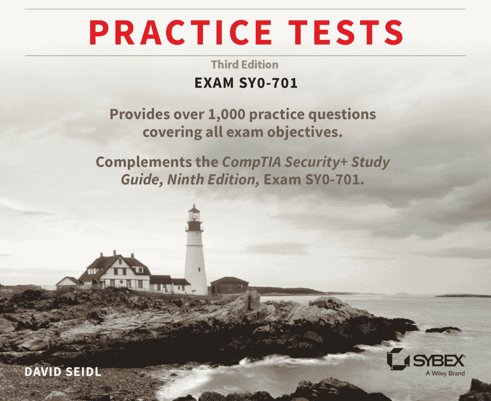
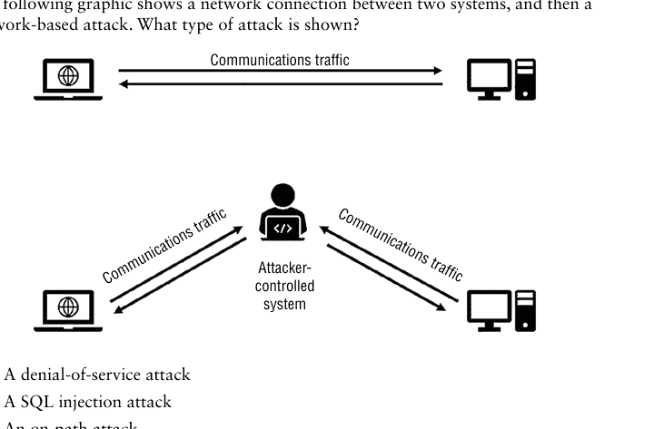
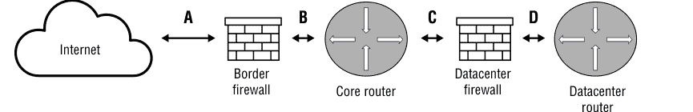
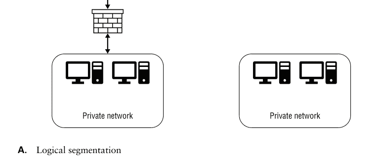
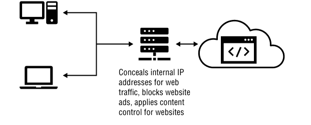
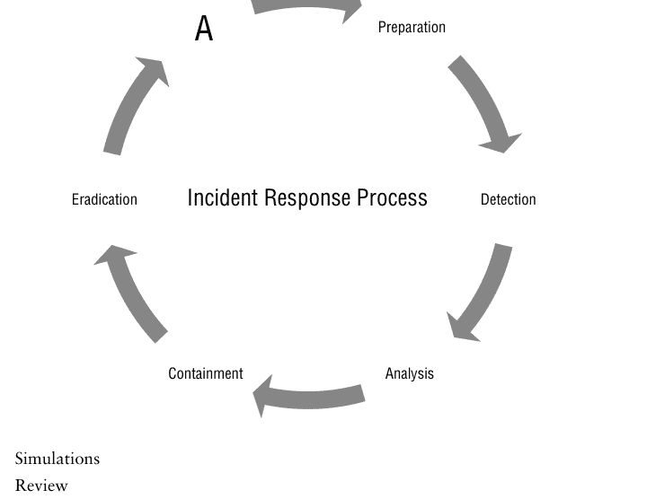
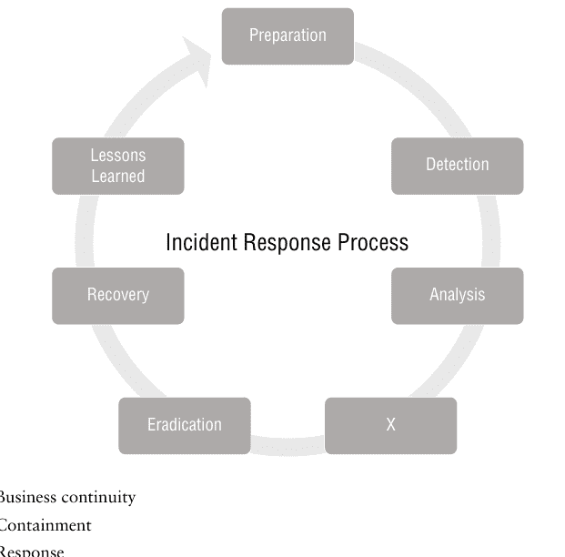
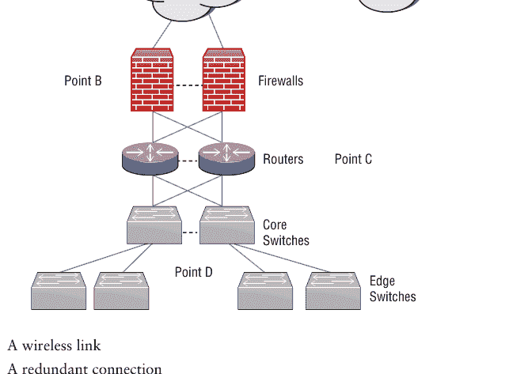
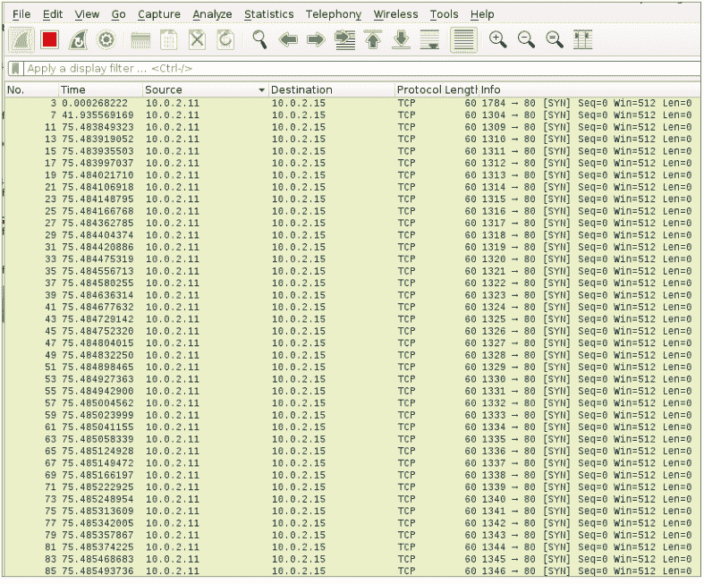
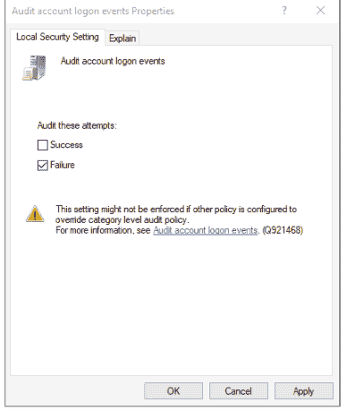

# CompTIA Security+ 练习测试：SY0-701 考试


节省 10%




本书献给 Mike Chapple，他帮助我在写作领域起步。在一起写作近十年后，这是我第一本完全独立的项目。Mike，一如既往，感谢你近十年前帮助我起步，感谢你在途中不断鼓励我，并在我们每次合作新书时继续挑战我做得更多。
—David

## 致谢

像这样的图书涉及许多人从概念到最终印刷和电子版的无数小时时间和精力。Wiley 团队的辛勤工作和奉献精神始终可见。我特别要感谢并致谢高级收购编辑 Kenyon Brown，他一次又一次地成为合作愉快的伙伴。

我也非常感谢本书的编辑和制作团队，包括项目编辑 Lily Miller，她不仅是合作的绝对愉快对象，而且在工作的各个方面都带来深厚的专业知识；技术编辑 Chris Crayton，他在全书中提供了富有洞察力的建议并给予了精彩反馈；以及制作编辑 Archana Pragash，她指导我完成了版面、格式和最终清理，制作出了一本优秀的图书。我还要感谢众多幕后贡献者，包括图形、制作和技术团队，他们将图书和配套材料打造成成品。

我的代理 Carole Jelen 来自 Waterside Productions，继续为我们在写作生涯中提供美好的机会、建议和帮助。

最后，我要感谢我的朋友和家人，他们在我撰写、编辑并将这样一本书付印所需的深夜、忙碌周末和长时间工作期间给予了我支持。

## 作者简介

**David Seidl** 是 Miami University 的信息技术副总裁兼首席信息官，负责全校的信息技术。在他的 IT 职业生涯中，他担任过多种技术和信息安全职务，包括担任 University of Notre Dame 校园技术服务高级总监，在那里他共同领导了 Notre Dame 向云的迁移并监督云运营、ERP、数据库、身份管理以及广泛的其他技术和服务。在他在 Notre Dame 的高级领导职务之前，他曾担任 Notre Dame 的信息安全总监并领导 Notre Dame 的信息安全项目。他曾在 Notre Dame 的 Mendoza 商学院担任讲师，教授信息安全和网络本科课程，并撰写了 21 本关于安全认证和网络战的书籍，包括合著 *CISSP (ISC)² 官方练习测试*（Sybex，2021）以及当前和前几版的 *CompTIA CySA+ 学习指南：考试 CS0-003*（Wiley，2023，Chapple/Seidl）和 *CompTIA CySA+ 练习测试：考试 CS0-003*（Wiley，2023，Chapple/Seidl）。

David 拥有 Eastern Michigan University 的传播技术学士学位和信息安全硕士学位，并持有 CISSP、CySA+、Pentest+、GPEN 和 GCIH 认证。

## 技术编辑简介

Chris Crayton，MCSE、CISSP、CASP+、CySA+、Cloud+、S+、N+、A+，是一名技术顾问、培训师、作者和业界领先的技术编辑。他曾担任计算机技术和网络讲师、信息安全总监、网络管理员、网络工程师和 PC 专家。Chris 曾担任多家领先出版公司众多技术书籍的技术编辑和内容贡献者。他还获得了许多专业和教学奖项。

## 介绍

CompTIA® Security+® Practice Tests: Exam SY0-701, Third Edition 是 CompTIA® Security+® Study Guide: Exam SY0-701, Ninth Edition (Wiley, 2023, Chapple/Seidl) 的完美配套卷。如果您想在参加 Security+ 考试前测试自己的知识，本书将通过提供涵盖 Security+ 各领域的超过 1,000 道题目以及对正确和错误答案的易于理解的解释来帮助您。

如果您刚开始为 Security+ 考试做准备，我们强烈建议您使用 CompTIA Security+ Study Guide, Ninth Edition 来帮助您了解 Security+ 考试涵盖的各个领域。一旦您准备好测试自己的知识，请使用本书帮助您找到可能需要更多学习的地方或练习考试本身。

由于这是 Security+ Study Guide 的配套读物，本书的设计与参加 Security+ 考试相似。书本身分为五个以领域为中心的章节，每个章节都有关于该领域的问题。

如果您能正确回答某个领域 90% 或以上的问题，您可以放心进入下一章。如果您无法正确回答这么多问题，请重读该章节并再次尝试题目。您的分数应该会提高。


不要只学习题目和答案！实际考试中的题目与本书中包含的练习题不同。考试旨在测试您对概念或目标的了解，因此请使用本书来学习题目背后的目标。

## The Security+ Exam

Security+ 考试旨在成为面向网络安全专业人员和有意进入该领域人员的厂商中立认证。CompTIA 建议以下角色的现任或有志从业者获得此认证，包括：

- Systems administrator
- Security administrator
- Tier II support technician
- IT support manager
- Cybersecurity analyst
- Business analyst

考试涵盖五个主要领域：

- Domain 1.0 General Security Concepts
- Domain 2.0 Threats, Vulnerabilities, and Mitigations
- Domain 3.0 Security Architecture
- Domain 4.0 Security Operations
- Domain 5.0 Security Program Management and Oversight

这五个领域涵盖了从防火墙设计到事件响应和取证的广泛主题，同时重点关注基于场景的学习。这就是为什么 CompTIA 建议参加考试的人员同时拥有 CompTIA Network+ 认证和至少两年的实践工作经验，尽管许多人在进入第一个网络安全职位之前就通过了考试。

Security+ 考试采用 CompTIA 所称的“performance-based assessment。”格式。这意味着考试将标准多项选择题与其他交互式题型结合。您的考试可能包括多种题型，例如多项选择、填空、多选、拖放和基于图像的问题。

考试在美国的费用为 $392，其他全球地区的价格大致相当。有关 Security+ 考试的更多详细信息以及如何参加考试，请参阅此处：

```
www.comptia.org/certifications/security
```

如果您是学生，请注意，如果您能提供有效的学生证和一个 .edu 电子邮件地址，CompTIA 会提供学生折扣。

NOTE 本书包含 Security+ 考试的折扣代码——请确保使用它！

您有 90 分钟参加考试，在此期间将被要求回答多达 90 道题。您的考试将在 100 到 900 的范围内评分，通过分数为 750。

您还应该知道，CompTIA 以在所有考试中包含模糊问题而闻名。您可能会看到一个问题，其中四个可能答案中有两个是正确的——但您只能选择一个。请利用您的知识、逻辑和直觉选择最佳答案然后继续。有时，问题的措辞方式会让英语专业学生感到尴尬——这里有一个错别字，那里有一个错误的动词。不要让这让您沮丧；回答问题然后继续下一个。


CompTIA 经常进行所谓的 *item seeding*，即在考试中加入未计分问题的做法。它这样做是为了收集心理测量数据，然后在开发考试新版本时使用。在参加考试之前，您会被告知考试可能包含这些未计分问题。因此，如果您遇到一个似乎无法对应任何考试目标的问题——或者说，似乎不属于考试的问题——它很可能是一个种子题。然而，您永远无法确定一个问题是否被种子化，因此请始终尽力回答每一个问题。

## Taking the Exam

一旦您完全准备好参加考试，您可以访问 CompTIA 网站购买考试凭证：

```
www.comptia.org/testing/exam-vouchers/buy-exam
```

CompTIA 提供现场监考考试和在线考试。在线考试使用远程监考，全天候 24/7 可用。如果您选择在线考试，您需要确保您的系统符合 Pearson VUE 所述的技术要求，运行系统测试，确保您拥有无干扰的测试地点，并准备好合适的身份证件。


考试期间可能会出现问题，包括技术故障和其他问题。如果出现问题，您最好的做法是直接与 Pearson VUE 取得联系，以确定可以采取什么措施解决问题。

CompTIA 与 Pearson VUE 的测试中心合作进行现场考试，因此如果您打算参加现场考试，下一步将是找到附近的测试中心。在美国，您可以根据地址或您的 ZIP code 进行查找，而非美国的考生可能更容易输入城市和国家。您可以在 Pearson Vue 网站上搜索附近的测试中心，在那里您需要导航到“Find a Test Center。”

```
www.pearsonvue.com/comptia
```

一旦您确定想在哪里参加考试，您需要创建一个 CompTIA single sign-on 账户。完成此操作后，您将能够通过链接通过 Pearson VUE 安排考试。如果您已有账户，您可以直接访问 Pearson VUE：

```
http://home.pearsonvue.com/comptia/onvue
```

在考试当天，携带两种符合 Pearson VUE 网站上身份识别要求的身份证件，并确保在考试开始前足够早到达。请记住，您不能带笔记、电子设备（包括智能手机和手表）或其他材料进入，并且考试可能还有其他要求。请务必在考试当天之前查看这些要求，以便您完全准备好应对考试本身以及测试流程和设施规则。

## After the Security+ Exam

一旦您参加完考试，您会立即收到成绩通知，因此您会立即知道是否通过考试。您应将成绩报告与考试注册记录以及用于注册考试的电子邮件地址一起保存。

## Maintaining Your Certification

CompTIA 认证必须定期续期。要续期您的认证，您可以通過最新版本的考试，获得符合条件的更高级别 CompTIA 或行业认证，完成 CompTIA CertMaster CE 课程，或完成足够的继续教育活动以获得足够的继续教育学分（CEUs）来续期。

CompTIA 通过其网站提供续期信息，网址为：

```
www.comptia.org/continuing-education
```

有关 CertMaster CE 课程的信息可在以下网址找到：

```
www.comptia.org/continuing-education/choose/
renew-with-a-single-activity/complete-a-comptia-certmaster-ce-course
```

当您注册续期认证时，您将被要求同意 CE 计划的 Candidate Agreement，支付续期费用，并提交所选续期方法所需的材料。

您可以在以下网址找到可用于获取 CEUs 以续期 Security+ 认证的行业认证的完整列表：

```
www.comptia.org/continuing-education/choose/
renew-with-a-single-activity/earn-a-higher-level-comptia-certification
```

## Using This Book to Practice

本书由七章组成，包含超过 1,100 道练习测试题。前五章每章涵盖一个领域，包含各种题目，可帮助您测试对基于现实世界、场景和最佳实践的安全知识的了解。最后两章是完整的模拟考试，可作为计时练习测试，帮助您确定是否已准备好参加 Security+ 考试。

我们建议先参加第一次模拟考试，以帮助确定您可能需要花费更多学习时间的地方，然后使用特定领域的章节来测试您的领域

在知识薄弱之处。一旦准备就绪，请参加第二次模拟考试，以确保您已涵盖所有材料并准备好参加 Security+ 考试。

在本书中练习题目时，您会遇到可能不熟悉的工具和技术。如果您发现存在持续的知识差距或某个领域特别具有挑战性，我们建议您花一些时间阅读深入探讨该领域的书籍和材料。这种方法可以帮助您填补空白，并使您为考试做好更充分的准备。

> 注意
> 要访问我们的交互式题库和在线学习环境，只需访问 www.wiley.com/go/sybextestprep，注册以获取您的唯一 PIN，激活后即可立即获得一年的免费访问权限，可访问包含两场模拟考试和数百道按领域划分的题目的交互式题库。总计超过 1,100 道题目！

> 注意
> 与所有考试一样，Security+® 认证会定期更新，并最终可能被退役或替换。在 CompTIA® 不再提供此考试后的某个时间点，我们的旧版书籍和在线工具将被退役。如果您在考试退役后购买了本书，或在考试退役后尝试在 Sybex 在线学习环境中注册，请注意，我们不保证一旦考试不再提供，本考试的在线 Sybex 工具仍可用。

## SY0-701 考试目标

CompTIA 尽最大努力确保其认证项目准确反映 IT 行业的最佳实践。他们通过为每个考试项目设立委员会来实现这一点。每个委员会由一小群 IT 专业人员、培训提供商和出版商组成，他们负责确定考试的基础能力水平并确定适当的目标受众水平。

一旦确定这些因素，CompTIA 就会将此信息与一组精心挑选的主题专家（SMEs）分享。这些人是认证项目的真正大脑。SME 会审查委员会的发现，对其进行完善，并将其塑造为本节之后的这些目标。CompTIA 将此过程称为工作任务分析（JTA）。

最后，CompTIA 会进行调查，以确保目标和权重真正反映工作要求。只有这样，SME 才能着手编写考试所需的数百道题目。即便如此，在许多情况下，在考试准备好以最终状态上线之前，他们仍需回到起草板进行进一步的完善。请放心，您即将学习的内容将在您参加考试后很长时间内为您服务。

CompTIA 还为每个考试目标发布相对权重。下面的表格列出了五个 Security+ 目标域以及它们在考试中所占的比例。

| 域 | 考试占比 |
|---|---|
| 1.0 通用安全概念 | 12% |
| 2.0 威胁、漏洞和缓解措施 | 22% |
| 3.0 安全架构 | 18% |
| 4.0 安全运营 | 28% |
| 5.0 安全项目管理与监督 | 20% |

## SY0-701 认证考试
目标映射

| 目标 | 章节 |
|---|---|
| **1.0 通用安全概念** | |
| 1.1 比较和对比各种类型的安全控制。 | 1 |
| 1.2 总结基本安全概念。 | 1 |
| 1.3 解释变更管理流程的重要性及其对安全的影响。 | 1 |
| 1.4 解释使用适当加密解决方案的重要性。 | 1 |
| **2.0 威胁、漏洞和缓解措施** | |
| 2.1 比较和对比常见威胁行为者和动机。 | 2 |
| 2.2 解释常见的威胁向量和攻击面。 | 2 |
| 2.3 解释各种类型的漏洞。 | 2 |
| 2.4 根据场景，分析恶意活动的指标。 | 2 |
| 2.5 解释用于保护企业的安全缓解技术的目的。 | 2 |
| **3.0 安全架构** | |
| 3.1 比较和对比不同架构模型的安全影响。 | 3 |

| 目标 | 章节 |
|---|---|
| 3.2 根据场景，应用安全原则来保护企业基础设施。 | 3 |
| 3.3 比较和对比保护数据的概念和策略。 | 3 |
| 3.4 解释安全架构中弹性和恢复的重要性。 | 3 |
| **4.0 安全运营** | |
| 4.1 根据场景，将常见安全技术应用于计算资源。 | 4 |
| 4.2 解释适当的硬件、软件和数据资产管理的安全影响。 | 4 |
| 4.3 解释与漏洞管理相关的各种活动。 | 4 |
| 4.4 解释安全警报和监控概念及工具。 | 4 |
| 4.5 根据场景，修改企业能力以增强安全性。 | 4 |
| 4.6 根据场景，实现和维护身份和访问管理。 | 4 |
| 4.7 解释与安全运营相关的自动化和编排的重要性。 | 4 |
| 4.8 解释适当的事件响应活动。 | 4 |
| 4.9 根据场景，使用数据源支持调查。 | 4 |
| **5.0 安全项目管理与监督** | |
| 5.1 总结有效安全治理的元素。 | 5 |
| 5.2 解释风险管理流程的元素。 | 5 |
| 5.3 解释与第三方风险评估和管理相关的流程。 | 5 |
| 5.4 总结有效安全合规的元素。 | 5 |
| 5.5 解释审计和评估的类型和目的。 | 5 |


考试目标可能随时在 CompTIA 酌情决定下更改，恕不另行通知。请访问 CompTIA 网站（www.comptia.org）获取最新的考试目标列表。

## 如何联系出版商

如果您认为本书中存在错误，请告知我们。在 John Wiley & Sons，我们了解为客户提供准确内容的重要性，但即使我们尽最大努力，仍可能出现错误。

如需提交可能的勘误，请通过电子邮件发送至我们的客户服务团队 wileysupport@wiley.com，主题行请写为“Possible Book Errata Submission”。


# 第 1 章

## 域 1.0：通用安全概念

本章涵盖的 CompTIA Security+ 考试 SY0-701 主题包括以下内容：

- ✓ 域 1.0：通用安全概念
- - 1.1 比较和对比各种类型的安全控制
  - 类别（技术、管理、运营、物理）
  - 控制类型（预防性、威慑性、检测性、纠正性、补偿性、指导性）
- - 1.2 总结基本安全概念
  - 保密性、完整性和可用性（CIA）
  - 不可否认性
  - 身份验证、授权和记账（AAA）（身份验证人员、身份验证系统、授权模型）
  - 缺口分析
  - 零信任（控制平面、数据平面）
  - 物理安全（防撞柱、门禁前室、围栏、视频监控、保安、门禁卡、照明、传感器）
  - 欺骗和干扰技术（蜜罐、蜜网、蜜文件、蜜令牌）
- - 1.3 解释变更管理流程的重要性及其对安全的影响
  - 影响安全运营的业务流程（审批流程、所有权、利益相关者、影响分析、测试结果、回滚计划、维护窗口、标准操作程序）


- - 技术影响（允许列表/拒绝列表、受限活动、停机时间、服务重启、应用程序重启、遗留应用程序、依赖关系）
- - 文档（更新图表、更新策略/程序）
- - 版本控制
- - 1.4 解释使用适当加密解决方案的重要性
  - 公钥基础设施（PKI）（公钥、私钥、密钥托管）
  - 加密（级别、传输/通信、非对称、对称、密钥交换、算法、密钥长度）
  - 工具（可信平台模块 [TPM]、硬件安全模块 [HSM]、密钥管理系统、安全飞地）
  - 混淆（隐写术、标记化、数据屏蔽）
  - 哈希
  - 加盐
  - 数字签名
  - 密钥拉伸
  - 区块链
  - 公开账本
  - 证书（证书颁发机构、证书吊销列表 [CRLs]、在线证书状态协议 [OCSP]、自签名、第三方、信任根、证书签名请求 [CSR] 生成、通配符）


1. Felicia 想要部署一种加密解决方案，该方案在文件在文件共享之间复制时在传输中以及静态时都能保护文件，并且还需要支持细粒度、按用户的安全性。她应该选择哪种类型的解决方案？
- A. 分区加密
- B. 文件加密
- C. 全盘加密
- D. 记录级加密

2. Valerie 想要使用证书来处理她网站的多个子域，包括 `sales.example.com` 和 `support.example.com` 子域。她应该使用哪种类型的证书？
- A. 自签名证书
- B. 信任根证书
- C. CRL 证书
- D. 通配符证书

3. 缺口分析期间分析什么信息？
- A. 控制目标以及旨在实现目标的控制措施
- B. 物理隔离的网络及其潜在连接点
- C. 补偿性控制措施以及它们所替代的控制措施
- D. 安全程序以及它们旨在支持的策略

4. Susan 的团队建议对生产环境面向客户的应用进行应用程序重启，作为安全更新紧急补丁的一部分。进行应用程序重启时最常见的技术影响担忧是什么？
- A. 重启引起的应用程序配置更改
- B. 补丁是否能正确应用
- C. 重启期间缺乏安全控制
- D. 重启期间的停机时间

5. 使用像 `git` 这样的工具最常与什么关键变更管理流程相关联？
- A. 制定回滚计划
- B. 利益相关者分析
- C. 版本控制
- D. 标准操作程序（SOPs）

6. Jacob 担心其组织某项服务使用的密码强度不足，他希望通过使暴力破解攻击期间测试可能密钥更困难来使其更难破解。这种技术叫什么？
- A. 主密钥
- B. 密钥拉伸
- C. 密钥轮换
- D. 密码短语加固

7. 日志监控是以下哪种控制类别的示例？
- A. 技术
- B. 管理
- C. 操作
- D. 物理

8. Rick 希望使攻击者对他的密码文件进行离线暴力破解攻击变得非常困难。以下哪项不是使密码更难破解的常见技术？
- A. 使用盐值
- B. 使用胡椒值
- C. 使用专用密码哈希算法
- D. 使用对称加密加密密码明文

9. Diffie–Hellman 和 RSA 都是什么重要加密相关解决方案的示例？
- A. 重新密钥
- B. 证书吊销协议
- C. 密钥交换算法
- D. 密钥生成算法

10. Sally 希望确保她的变更管理流程包含变更失败时该怎么办的程序。她应该创建什么来处理这种可能性？
- A. 影响分析
- B. 回滚计划
- C. 回归测试
- D. 维护窗口

11. Theresa 担心由于意外问题，她安排的维护窗口可能会超出分配的时间。她担心的是 CIA 三要素中的哪一个？
- A. 关键性
- B. 可访问性
- C. 完整性
- D. 可用性

12. Alaina 担心车辆可能会撞击她组织的备用发电机。她应该安装什么来防止安装在她建筑物外靠近停车场的发电机发生意外和蓄意的车辆撞击？
- A. 减速带
- B. 门禁控制前室
- C. 防撞柱
- D. 链式围栏

13. Ben 部署了一个数据防泄漏（DLP）工具，该工具检查数据并在包含数据的电子邮件发送到组织外部之前标记特定数据类型以供审查。哪种控制类型最能描述这种类型的解决方案？
- A. 管理
- B. 检测
- C. 纠正
- D. 预防

14. 策略或程序属于什么类型的控制？
- A. 指导性
- B. 纠正性
- C. 检测性
- D. 预防性

15. Murali 部署了文件完整性监控工具，并配置了警报以在文件被修改时通知他。哪种控制类型最能描述此解决方案？
- A. 预防性
- B. 威慑性
- C. 指导性
- D. 检测性

16. Charles 希望减少泄露凭证的威胁范围。以下哪种安全控制最适合满足这一需求？
- A. 单点登录
- B. 联邦身份认证
- C. 零信任
- D. 多因素认证（MFA）

17. Carol 想要混淆她数据库中包含的数据。她希望能够引用数据元素而不暴露实际数据。她应该选择哪种类型的混淆选项？
- A. 令牌化
- B. 加密
- C. 数据屏蔽
- D. 数据随机化

18. 使用公钥加密在两个人之间解密由另一人发送的信息时使用什么密钥？
- A. 接收者的私钥
- B. 接收者的公钥
- C. 发送者的私钥
- D. 发送者的公钥

19. Selah 的组织最近遭受了泄露，她组织的证书的私钥被暴露。她应该立即做什么？
- A. 重新颁发证书并更改主机名和其他详细信息。
- B. 用自签名证书替换证书，直到供应商可以替换它们。
- C. 吊销证书并将其列入证书吊销列表。
- D. 用通配符证书替换证书。

20. 以下哪项不是与补丁和系统更新导致的停机相关的重大问题？
- A. 攻击者在系统或服务离线时入侵系统或服务
- B. 重启或关机过程中安全系统或功能离线
- C. 意外延长停机时间
- D. 与停机相关的系统或服务之间的依赖关系

21. Joanna 希望确保她应用程序中每个组件的最新版本都已部署。哪种变更管理流程最有助于满足这一要求？
- A. 依赖关系映射
- B. 版本控制
- C. 影响分析
- D. 允许和拒绝列表

22. Greg 希望实施版本控制系统，以确保更改以不会给其组织的关键软件带来问题的方式进行。以下哪项不是为软件源代码设计的版本控制系统的常见功能？
- A. 原子操作
- B. 文件锁定
- C. 回归测试
- D. 标记和标签

23. Christina 希望实施一种物理安全控制，该控制在应用方式上具有最大的灵活性，因为她知道有时可能需要对安全实践做出例外。以下哪种解决方案具有最大的灵活性？
- A. 视频监控
- B. 安全警卫
- C. 门禁卡
- D. 门禁控制前室

24. Lisa 希望确保如果设备被锁定或关闭，设备被盗不会导致设备上数据的泄露。她应该选择哪种类型的加密来最好地确保这一点？
- A. 卷级加密
- B. 全盘加密
- C. 文件级加密
- D. 分区级加密

25. Mahmoud 被要求为公司用户可以访问的网站实施允许列表。由于此请求，他应向管理层提出什么担忧？
- A. 允许列表不能用于网站。
- B. 允许列表过于宽松，很可能允许访问不需要的网站。
- C. 对网站使用允许列表需要花费大量时间维护。
- D. 对网站使用允许列表很容易被绕过。

26. 以下哪种变更管理流程通常不直接涉及 IT 组织以外的利益相关者？
- A. 影响分析
- B. 制定回滚计划
- C. 变更审批流程
- D. 确定维护窗口

27. 用于生成、存储和管理加密密钥的硬件组件是什么？
- A. CPU
- B. NSA
- C. TPM
- D. CCA

28. Chris 想要检查证书是否已被吊销。他可以使用什么协议来验证证书的当前状态？
- A. TLS
- B. OCRS
- C. SSL
- D. OCSP

29. Brian 的组织使用一种流程，其中安全模块启动系统，然后在每个启动阶段进行时监控它们。它验证每个签名的启动阶段，并在完成后报告启动过程是否正确。用于验证这些阶段的安全模块叫什么？
- A. 安全启动管理器
- B. 信任根
- C. 启动哈希
- D. 加密启动管理器

30. 漏洞扫描显示 Alice 负责的一个嵌入式设备存在漏洞。她知道供应商已不再营业，并且该设备没有更新的固件或软件更新。为了解决问题，Alice 在设备和网络其余部分之间放置防火墙，并创建规则防止易受攻击的服务对其他设备可用。Alice 部署了什么类型的控制？
- A. 指导性控制
- B. 补偿性控制
- C. 检测性控制
- D. 程序性控制


31. Jason 知道他的 Apple 系统使用其 SoC（系统级芯片）的一个独立部分来存储密钥和生物识别信息。这个专用组件叫什么？
- A. TPM
- B. HSM
- C. 安全飞地
- D. 筛选子网

32. 用于描述组织为每次变更所使用的流程，以确保使用一致流程的变更管理术语是什么？
- A. 标准操作程序
- B. 变更计划
- C. 固定操作程序
- D. 回滚计划

33. Jack 知道有三种常见的数据库加密类型。以下哪一项不是常见的数据库加密类型？
- A. 基于敏感性的加密
- B. 透明数据加密
- C. 字段级加密
- D. 列级加密

34. Ujamaa 希望作为其安全工作的一部分进行差距分析。以下哪一项最能描述他将分析的内容？
- A. 哪些服务未正确配置
- B. 所有系统是否已安装当前补丁
- C. 已实施的安全计划与最佳实践的对比
- D. 法律要求与安全计划的对比

35. Brandon 想要部署一种检测控制措施来帮助他应对物理安全威胁。以下哪一项符合他的需求？
- A. 围栏
- B. 照明
- C. 视频监控
- D. 防撞柱

36. Jack 部署了一个对攻击者来说看起来像是易受攻击系统的系统。该系统专门设计用于捕获攻击的信息和数据以供后续分析。Jack 部署了什么类型的工具？
- A. 陷阱
- B. 蜜罐
- C. 蜂巢
- D. 入侵检测系统

37. Renee 希望确保她的日志支持不可否认性。她应怎么做以确保这一点？
- A. 先加密日志，然后哈希。
- B. 先哈希日志，然后对其进行数字签名。
- C. 先对日志文件进行数字签名，然后加密它。
- D. 先哈希，然后加密日志。

38. Isaac 想要部署传感器来检测设施中的入侵者，但他担心传感器过于敏感。在开放式办公环境中，哪种传感器最适合检测入侵者，且不会产生显著费用或灵敏度问题？
- A. 红外
- B. 压力
- C. 微波
- D. 超声波

39. Wayne 希望在他的 AAA 流程中允许系统声明身份。以下哪一项最常用于识别个人和系统？
- A. 令牌
- B. 智能卡
- C. 证书
- D. 用户名

40. 在变更管理流程的背景下，像数据库和网络连接、身份验证系统访问以及网络时间可用性这样的考虑因素被视为什么？
- A. 允许的服务
- B. 标准操作程序
- C. 被拒绝的服务
- D. 依赖关系

41. 在零信任环境中，策略引擎发挥什么作用？
- A. 它根据用户行为创建新的管理策略。
- B. 它根据管理员创建的策略和安全系统数据授予访问权限。
- C. 它通过监控客户端和服务器之间的连接来执行策略。
- D. 它根据使用模式建议新的管理策略供组织采用。

42. 以下哪一项不是变更管理实践中常见的变更后活动？
- A. 更新图表
- B. 更新程序
- C. 更新策略
- D. 更新合同

43. 作为变更窗口准备的一部分，Alaina 不应限制以下哪项活动？
- A. 补丁
- B. 向上或向下扩展集群系统
- C. 更改主机名
- D. 修改数据库配置

44. 定义区块链账本的两个关键特征是什么？
- A. 它们是不可变的且不可转移的。
- B. 它们是共享的，并且可以通过所有参与者的投票进行修改。
- C. 它们是每个参与者独有的并且是原子的。
- D. 它们是共享的且不可变的。

45. Damian 在他的 Linux 服务器上发出以下命令：

```
openssl req -new -newkey rsa:2048 -nodes -keyout exampleserver.key -out exampleserver.csr
```

他做了什么？
- A. 创建了证书签名请求
- B. 创建了证书吊销请求
- C. 签署了证书签名请求
- D. 更新了证书的 OCSP 记录

46. Nick 的组织将每周六晚上 2 点至 4 点预留用于计划维护。这种预留时间通常被称为什么？
- A. 分配的停机时间
- B. 维护窗口
- C. 未计划中断
- D. 允许的中断

47. Megan 希望作为其变更管理流程的一部分评估变更的影响。以下哪一项最有可能帮助她评估影响？
- A. 回滚计划
- B. 预计停机时间的估计
- C. 利益相关者列表
- D. 受影响系统的依赖关系列表

48. Jared 希望估计计划变更将导致的停机时间。以下哪种方法最有效地帮助他估计停机时间？
- A. 平均其他最近变更的停机时间。
- B. 联系供应商获取变更时间估计。
- C. 在测试环境中执行变更。
- D. 使用固定的维护窗口。

49. 所有参与者使用相同密钥的加密方法被称为以下哪种类型的加密？
- A. 共享哈希
- B. 非对称加密
- C. 对称加密
- D. 通用加密

50. 非对称加密通过使用公钥解决了什么重要的加密挑战？
- A. 恶意双胞胎
- B. 碰撞抗性
- C. 密钥长度
- D. 密钥交换

51. Rick 的云服务提供商提供专用硬件安全模块。以下哪项功能它不太可能提供？
- A. 验证安全启动过程
- B. 密钥生成
- C. 加密和解密数据
- D. 创建数字签名

52. Michelle 认为她在攻击者的文件目录中发现的一张图像中隐藏了额外信息。这种类型的混淆被称为什么？
- A. 隐写术
- B. 图像哈希
- C. PNG 扭曲
- D. 图像阻塞

53. 以下哪一项不是常见的传输加密协议？
- A. TLS
- B. IPSec
- C. SAML
- D. SSH

54. 记录级加密最常与什么技术相关联？
- A. 存储的音频文件
- B. 数据库
- C. 物理磁盘
- D. 可移动存储

55. Yasmine 在加密机器后将 Windows BitLocker 密钥提交到中央存储库。中央存储库允许上传文件但不能读取，并且受保护，需要特殊权限才能访问。Yasmine 的公司使用的是什么类型的解决方案？
- A. 硬件安全模块
- B. 完美前向保密
- C. 密钥托管
- D. 私钥

56. Valerie 希望使用她的 AAA 系统对系统进行身份验证。以下哪个选项最适合系统身份验证？
- A. 非对称身份验证
- B. 基于证书的身份验证
- C. 对称身份验证
- D. 基于 PIN 的身份验证

57. Valentine 想要检测入侵者是否访问了安全的文件服务器。以下哪种技术与数据丢失防护工具配合使用最能识别数据外泄？
- A. 蜜罐
- B. 蜜网
- C. 蜜文件
- D. 蜜令牌

58. Jason 建议作为安全升级的一部分在建筑物外部增设照明。照明属于什么类型的控制？
- A. 运行
- B. 威慑
- C. 纠正
- D. 技术

59. 以下哪种控制措施通常实施成本最高？
- A. 防撞柱
- B. 门禁控制门厅
- C. 安全警卫
- D. 门禁徽章

60. Frankie 想要通过将其与原始副本进行比较来验证文件的完整性。以下哪个解决方案既满足此要求又避免了已知的安全问题？
- A. 使用 MD5 对原始文件和当前文件进行哈希并比较哈希值。
- B. 使用 SHA-1 对原始文件和当前文件进行哈希并比较哈希值。
- C. 使用 SHA-256 对原始文件和当前文件进行哈希并比较哈希值。
- D. 使用 AES 对原始文件和当前文件进行哈希并比较哈希值。


61. Joanna 的组织有一项政策，要求如果确定账户已被成功钓鱼，则立即重置用户的密码以锁定账户。这是什么类型的控制？
- A. 侦测控制
- B. 指导性控制
- C. 补偿性控制
- D. 预防性控制

62. Jackie 想为她的网络实施 AAA 系统。哪种 AAA 协议常用于网络设备？
- A. OpenID
- B. SAML
- C. RADIUS
- D. TANGENT

63. Scott 想在他的零信任环境的策略引擎中自动化策略创建。以下哪一项不是自动化数据和事件驱动策略管理的典型组件？
- A. SIEM
- B. 威胁情报源
- C. 红外传感器数据
- D. EDR 工具

64. Valerie 的组织部署了零信任解决方案，当 Valerie 尝试访问文件服务器时，她收到了身份验证提示。她正在与零信任架构的哪个组件交互？
- A. 策略执行点
- B. 策略管理员
- C. 策略引擎
- D. 信任管理器

65. Matt 正在根据 NIST 零信任成熟度模型评估其组织的零信任模型。以下哪一项不是零信任系统的常见要素，且不会作为模型的一部分进行评估？
- A. 身份
- B. 业务模型
- C. 网络
- D. 设备

66. Quentin 想部署单点登录系统以允许其用户登录云服务。他最有可能部署以下哪种技术？
- A. OpenID
- B. Kerberos
- C. LDAP
- D. TACACS+

67. Marty 想部署纠正性控制来处理最近被入侵的系统。以下哪一项可被视为纠正性控制？
- A. 修补导致入侵发生的漏洞
- B. 部署全盘加密
- C. 部署端点检测与响应（EDR）工具
- D. 启用日志记录并将日志发送到 SIEM

68. 对称加密不支持什么重要的加密功能？
- A. 保密性
- B. 完整性
- C. 不可否认性
- D. 身份验证

69. Theresa 想使用云托管的安全解决方案来安全地存储和管理密钥。她应选择什么类型的解决方案？
- A. TPM
- B. CA
- C. KMS
- D. CSR

70. Joanna 在电子商务网站上查看她的账户信息时，发现她的信用卡号码显示为 XXXX-XXXX-XXXX-1234。使用了什么类型的数据混淆？
- A. 哈希
- B. 数据屏蔽
- C. 字段加密
- D. 令牌化

71. Amanda 的组织想使用去中心化区块链来存储数据。关于去中心化区块链，以下哪项是正确的？
- A. 没有个人或团体控制区块链。
- B. 只有与加密货币相关的数据可以存储在区块链中。
- C. 区块链数据可以在原始提交者存储后被更改。
- D. 区块链账本存储在由区块链参与者定期选举选出的中央服务器上。

72. 在 CA 层次结构中，从属 CA 有什么作用？
- A. 从属 CA 根据子域签发证书。
- B. 从属 CA 在避免成为根 CA 的成本的同时提供对证书签发的控制。
- C. 从属 CA 验证根 CA 活动以确保可审计性。
- D. 从属 CA 在将证书签名请求转发给根 CA 之前对其进行审查。

73. 以下哪种传感器类型常用于检测脚步？
- A. 红外
- B. 压力
- C. 微波
- D. 超声波

74. 以下哪一项不是管理控制？
- A. 风险评估
- B. 在变更管理流程中纳入安全
- C. 安全规划演练
- D. 实施防火墙

75. 第三方证书对云服务客户有什么用途？
- A. 通过使用自带证书来降低成本。
- B. 它们允许使用服务提供商域之外的域的证书。
- C. 它们为客户提供对加密安全的控制。
- D. 它们允许在 TLS 版本选择上更灵活。

76. 以下哪一项不是关注可用性的常见控制？
- A. 不间断电源系统
- B. 冗余互联网连接
- C. 磁盘加密
- D. 负载均衡器

77. 什么术语描述了网络上旨在捕获网络安全威胁信息的蜜罐集合？
- A. 蜜罐农场
- B. 蜜网
- C. 蜜集群
- D. 黑网

78. Skip 想实施威慑控制以防止其组织的物理安全问题。他应选择以下哪种控制？
- A. 围栏
- B. 发电机
- C. 访问徽章
- D. 摄像系统

79. 在证书链中，谁占据信任根的位置？
- A. 加固的硬件设备
- B. TPM
- C. 根证书
- D. 通配符证书

80. Jill 需要向其组织解释开放公共账本的概念，因为管理层希望采用基于区块链的系统。她应告诉他们关于账本访问权限的什么信息？
- A. 成员必须由所有现有成员投票添加。
- B. 任何人都可以随时加入。
- C. 成员必须由超过 51% 的现有成员投票添加。
- D. 账本是公开的，但成员资格是私有的，并由账本创建者控制。

81. Olivia 想在她的测试环境中使用自签名证书为其组织的服务提供支持，以节省商业证书的费用。她的团队应就测试环境中使用自签名证书给出什么警告？
- A. 证书信任根验证尝试将失败，如果实施的话。
- B. 自签名证书不能用于外部用户以支持 SSL。
- C. 自签名证书不能用于内部用户以支持 SSL。
- D. 浏览器不允许在浏览网站时使用自签名证书。

82. Amanda 担心在她待处理的变更期间可能发现的依赖问题。她应实施什么实践以帮助确保不会遇到意外的依赖问题？
- A. 在变更前更新组织政策和程序。
- B. 在变更前更新功能图。
- C. 在测试环境中验证变更。
- D. 记录可能产生依赖的遗留应用程序。

83. Lucca 实施了一种身份验证方案，该方案在身份验证过程中依赖于票据授予票据。他实施了什么常见的身份验证服务？
- A. TACACS+
- B. Kerberos
- C. MS-CHAP
- D. EAP

84. Jocelyn 想为其组织选择一种现代加密算法。以下哪一项是目前推荐的加密算法？
- A. AES-256
- B. SHA1
- C. DES
- D. Blowfish

85. Elizabeth 想按类别对以下控制进行分类。什么类别最能描述照明、围栏、防撞柱和门禁门廊？
- A. 技术
- B. 管理
- C. 运行
- D. 物理

86. Jack 想确保他通过电子邮件发送给第三方的文件的完整性。他如何向之前没有做过生意的组织提供文件的完整性？
- A. 加密文件并发送给他们。
- B. 对文件进行数字签名。
- C. 在单独的电子邮件中发送文件的哈希值。
- D. 在单独的电子邮件中发送文件大小和原始名称。

87. Annie 注意到她的浏览器显示她正在访问的网站的证书无效。经过一些检查后，她发现该证书在 CA 的证书吊销列表上。以下哪一项不是证书出现在 CRL 上的原因？
- A. CA 受损。
- B. 证书的私钥受损。
- C. 证书是用被盗的密钥签名的。
- D. 证书已过期。

88. Mohinder 想使用现代、安全哈希算法来验证文件是否与已知良好的原始文件一致。他应选择以下哪种哈希算法？
- A. MD5
- B. SHA-1
- C. AES-256
- D. SHA-256

89. Derrick 想验证使用非对称加密发送的加密并数字签名的消息。他需要发送方提供什么来验证消息？
- A. 发送方的私钥
- B. Derrick 的私钥
- C. 发送方的公钥
- D. Derrick 的公钥

90. Susan 的团队安装的主要补丁发布失败，导致服务无法工作。根据变更管理最佳实践，她的团队应做什么？
- A. 宣布中断。
- B. 遵循记录的回滚计划。
- C. 从备份恢复到上一个版本。
- D. 卸载补丁并验证服务功能。

91. Angela 的组织管理的 Web 服务器最近被入侵，攻击者访问了 SSL 证书的私钥。Angela 的团队已完成补救，并创建了新的 CSR，包括他们已保护的新私钥。在这种情况下，创建新密钥和证书最好描述为什么类型的控制？
- A. 纠正性
- B. 补偿性
- C. 威慑性
- D. 侦测性


92. Mikayla 的零信任系统已收到带有身份的访问请求，并且已满足访问的基本条件。在提供所请求资源的访问权限之前，系统下一步应该做什么？
- A. 检查远程系统的安全状态。
- B. 使用 MFA 要求重新验证。
- C. 检查用户的权限以确保他们可以访问资源。
- D. 确定其对请求的信任程度。

93. Charles 在一个隔离的网络段上设置了一个 RDP 服务器，并在其上放置了一个名为 passwords.xlsx 的文件。然后他配置 IPS 和 DLP 系统监控该文件离开网络段。Charles 部署了什么类型的工具？
- A. 蜜罐文件
- B. SQL 陷阱
- C. 红旗
- D. 触发文件

94. Lucca 正在使用预计算的彩虹表尝试破解数据泄露中的哈希密码。他知道两个用户使用相同的密码，但哈希值不匹配。Lucca 最可能遇到了什么密码哈希安全技术？
- A. 密码加密
- B. 加盐
- C. 哈希轮换
- D. 密码不匹配

95. 哪种操作系统通常与安全飞地相关联？
- A. Windows
- B. iOS
- C. Linux
- D. Android

96. Isaac 担心用户创建的密码太短，如果哈希值被泄露很容易被暴力破解。与其让用户记住更长的密码，他希望实施一种技术解决方案来帮助使哈希更抗破解。他可以使用什么解决方案来帮助解决这个问题？
- A. 实施传递哈希算法。
- B. 使用抗碰撞哈希算法。
- C. 实施密钥拉伸技术。
- D. 加密密码而不是哈希它们。

97. Christina 希望为她的组织实施印有照片 ID 的访问徽章，但她希望使用无线读卡器。像这种情况下通常实施什么访问徽章技术？
- A. Wi-Fi 启用访问徽章
- B. RFID 访问徽章
- C. Bluetooth 启用访问徽章
- D. NFC 访问徽章

98. Kendra 的漏洞管理团队发现，几年前部署用于监控关键冷藏设备温度的物联网 (IoT) 设备容易受到新攻击。审查问题后，她的团队发现这些设备已不再受支持且制造商已倒闭。他们建议将设备移至隔离网络以帮助保护它们。Kendra 的团队建议了什么类型的控制？
- A. 纠正性控制
- B. 补偿性控制
- C. 保密性控制
- D. 协调性控制

99. 以下哪一项不是零信任自适应身份验证中的常见因素？
- A. 用户登录的位置
- B. 用户是否最近从另一台设备登录
- C. 用户登录的设备
- D. 设备是否配置正确

100. Juan 的组织正在设计其零信任模型。以下哪项陈述对网络安全区域是正确的？
- A. 所有通信都是安全的，无论其发生的网络安全区域如何。
- B. 低信任区域的通信会获得额外的安全保护。
- C. 高信任区域的通信会获得更少的安全保护。
- D. 所有零信任网络都被视为安全区域。

101. 微波传感器相对于红外传感器有什么优势？
- A. 它们可以检测热信号。
- B. 它们比红外传感器便宜。
- C. 它们可以穿透某些类型的墙壁。
- D. 它们不会干扰敏感设备。

102. Isaac 正在进行物理渗透测试，想要绕过门禁前室。他必须完成什么？
- A. 他需要说服个人允许他跟随他们通过一扇门。
- B. 他需要获取个人的访问卡。
- C. 他需要说服个人允许他跟随他们连续通过两扇门。
- D. 他需要获取个人的访问 PIN。

103. Rachel 希望选择一种混淆方法，允许她的客户服务代表在不提供完整客户数据访问权限的情况下验证客户身份。她应该选择什么？
- A. 令牌化
- B. 数据屏蔽
- C. 隐写术
- D. 哈希

104. Valerie 的经理已通知她必须为她的开发团队的工作实施版本控制。以下哪一项不是版本控制的常见安全相关原因？
- A. 帮助修补
- B. 跟踪每个贡献者的工作量
- C. 确保部署正确的版本
- D. 帮助变更管理

105. Jackie 的变更管理流程涉及向利益相关者报告功能验证测试结果。以下哪一项不是应用程序升级的常见利益相关者或利益相关者群体？
- A. 应用程序管理员
- B. 服务所有者
- C. 系统管理员
- D. 审计员

106. 四个人使用非对称加密安全通信需要多少个密钥对？
- A. 1
- B. 4
- C. 8
- D. 12

107. Michelle 希望在云服务中存储组织的机密。她希望为组织确保最高级别的安全性，并且愿意花更多钱来提供这种安全性。她应该寻找什么解决方案？
- A. 共享云 TPM
- B. 共享云 HSM
- C. 专用硬件云 TPM
- D. 专用硬件云 HSM

108. Murali 想对文件进行数字签名。他需要什么密钥来签名？
- A. 收件人的私钥
- B. 他的私钥
- C. 收件人的公钥
- D. 他的公钥

109. 在 OCSP 请求中，证书被正确识别所需的信息是什么？
- A. 域名
- B. 原始请求者的姓名
- C. 证书的序列号
- D. 开放公共账本条目的标识符

110. Rick 检查他正在查看的站点的证书，发现其显示为 `*.example.com`。这是什么类型的证书，为什么使用它？
- A. 它是自签名证书，用于测试目的。
- B. 它是通配符证书，用于测试目的。
- C. 它是通配符证书，用于多个子域。
- D. 它是自签名证书，用于多个子域。

111. John 想写一个程序，说明如果员工因钓鱼攻击而无意中泄露密码该怎么办。John 正在考虑什么类型的控制？
- A. 指导性控制
- B. 主动性控制
- C. 威慑性控制
- D. 预防性控制

112. Adam 被要求为他的服务器可以访问的网站实施允许列表。关于允许列表的实施，他应该提出什么担忧？
- A. 允许列表可能难以管理，如果未添加所需的站点会导致故障。
- B. 允许列表不会阻止未在允许列表上的站点被访问。
- C. 允许列表无法配置为允许访问整个域，造成大量开销。
- D. 允许列表容易出错，允许添加不需要的站点。

113. Jim 想为他的无线网络实施身份验证框架。以下哪一项最常用于无线网络身份验证？
- A. EAP
- B. MS-CHAP
- C. Kerberos
- D. LDAP

114. Gary 正在准备补丁后应用程序重启的变更管理文档。应用程序重启后应立即执行什么步骤？
- A. 验证测试
- B. 记录变更发生
- C. 更新版本控制
- D. 漏洞扫描

115. Anna 被告知她的组织已在仓库部署了微波传感器。微波传感器最常用于检测什么？
- A. 运动
- B. 玻璃破碎
- C. 热信号
- D. 压力

116. 使用全盘加密的驱动器上的数据在何时风险最大？
- A. 系统启动过程中
- B. 系统关闭时
- C. 系统登录并使用时
- D. 系统关机时

117. Alex 已为组织发放给员工的笔记本电脑配置了全盘加密。这主要支持什么网络安全目标？
- A. 保密性
- B. 可用性
- C. 真实性
- D. 完整性

118. 什么流程审查组织、系统或服务的控制目标，以确定控制措施是否未满足控制目标？
- A. 渗透测试
- B. 缺口分析
- C. 布尔分析
- D. 风险分析


119. Frank 配置访问控制列表以确保只有特定 IP 地址能够连接到服务。他部署了什么类型的控制？
- A. 管理型
- B. 物理型
- C. 技术型
- D. 操作型

120. Annie 最近为她的组织实施了视频监控系统。对于未受监控的视频监控系统，新的持续成本的最大驱动因素是什么？
- A. 摄像头维护
- B. 存储的持续成本
- C. 安全警卫
- D. 许可

121. Henry 的组织最近遭受了勒索软件攻击，正在从安全的备份系统恢复备份。Henry 使用的是什么类型的安全控制？
- A. 预防性控制
- B. 指导性控制
- C. 补偿性控制
- D. 纠正性控制

122. 哪种数据混淆技术依赖于查找表，允许你将要保护的数据与随机生成的值匹配，以确保实际值不易访问？
- A. 哈希
- B. 令牌化
- C. 随机化
- D. 掩码

123. 什么挑战推动了密钥交换机制的需求？
- A. 对称加密所需的密钥数量
- B. 确定密钥是否为公开密钥的需求
- C. 以防止他人获取副本的方式交换密钥的需求
- D. 在交易后将密钥安全地归还给所有者的需求

124. Jackie 在团队准备实施的大规模变更之前进行影响分析。以下哪个群体通常不属于影响分析的一部分？
- A. 利益相关者
- B. 系统管理员
- C. 服务所有者
- D. 法律顾问

125. Ilya 想创建一个证书签名请求。以下哪一项不是 CSR 的典型组成部分？
A. 服务器的通用名称
B. 组织的法律名称
C. 联系电子邮件地址
D. 组织的电话号码

126. 在 Tony 存储密码哈希之前，他附加一个使用他创建的算法生成的对每个密码唯一的字符字符串。Tony 使用什么技术来帮助保护他的密码哈希？
A. 令牌化
B. 隐写术
C. 加盐
D. 密钥拉伸

127. 以下哪一项不是在区块链中输入交易时采取的步骤？
A. 确定区块的值。
B. 交易被发送到点对点计算机网络。
C. 交易使用方程式进行验证。
D. 交易历史作为区块链的一部分得以维护。

128. Kent 想加密传输中的网络流量。哪种加密协议最常用于为现有协议添加加密？
A. S/MIME
B. TLS
C. MPLS
D. SSH

129. 以下哪一项不是与遗留应用程序相关的变更管理流程中的常见问题？
A. 缺乏供应商支持
B. 缺乏补丁和更新
C. 持续的许可成本
D. 第三方或顾问专业知识的可用性

130. Elaine 想记录变更管理流程中依赖关系带来的技术问题。当在变更管理中遇到依赖关系时，以下哪个问题是最常见的？
A. 记录依赖关系以确保它们得到处理
B. 作为变更的一部分移除依赖关系
C. 除了主应用程序外，还要修补依赖关系
D. 更新与依赖关系相关的图表

131. Gary 为他的数据库实施了记录级加密。在记录级加密的典型实现中，他将使用多少个密钥？
- A. 每条记录一个密钥
- B. 每列一个密钥
- C. 每表一个密钥
- D. 每个数据库一个密钥

132. Justin 的笔记本电脑是其组织零信任架构的一部分。在零信任设计中，用于指代笔记本电脑、台式机或移动设备等设备的术语是什么？
- A. 主体
- B. 策略引擎
- C. 服务提供商
- D. 策略应用点

133. Susan 的组织部署了零信任架构。以下哪个零信任控制平面组件使用规则根据系统的安全状态、威胁数据和类似信息来确定谁可以访问服务？
- A. 自适应授权
- B. 威胁范围缩小
- C. 基于策略的访问控制
- D. 安全区域

134. Scott 想在自己创建的应用程序中实施 OCSP。他将实施什么？
- A. 纠正性控制安全流程
- B. 证书状态检查
- C. 传输加密
- D. 全盘加密

135. 以下哪一项不是实施密钥托管的常见原因？
- A. 法规合规
- B. 出于管理原因提供对加密数据的访问
- C. 在紧急情况下提供对加密数据的访问
- D. 防止用户离开后需要进行密钥轮换

136. Yariv 发现他通过电子邮件发送了私钥而不是公钥，从而将其私钥暴露给了组织中的其他用户。他应该怎么做？
- A. 请其他用户删除他们可能拥有的私钥的任何副本。
- B. 立即将他的密钥添加到 CRL 并重新颁发密钥。
- C. 创建新的密钥对并通知其他人他已更换密钥对。
- D. 只要私钥未被恶意使用，就继续正常操作。

137. 如果出现错误且在区块链的开放公共账本中输入了不正确的交易会发生什么？
A. 一旦发现，交易将被撤销，并且原始交易将从记录中删除。
B. 必须处理新交易，并且两个交易都保留在记录中。
C. 原始交易将被更新并成为新记录。
D. 必须挖掘一个错误区块并用交易编号和错误详情进行标记。

138. 以下哪项活动通常不会导致需要更新政策和程序？
A. 部署新应用程序
B. 为现有应用程序安装补丁
C. 在事件后进行经验教训练习
D. 法规变化

139. Hrant 的组织希望确保员工在其物理访问控制方案中使用他们知道的东西和他们拥有的东西。以下哪种解决方案满足该要求？
A. 安全警卫和访问徽章
B. 钥匙和门禁前室
C. 访问徽章和 PIN
D. 安全警卫和门禁前室

140. Julia 想使用传感器系统检测入侵者是否进入某个空间。以下哪一项通常不用于检测入侵者？
A. 红外传感器
B. 压力传感器
C. 微波传感器
D. 超声波传感器

141. 以下哪一项对于安全的加密哈希系统是不正确的？
A. 哈希是一个单向函数。
B. 哈希生成固定长度的输出。
C. 哈希可能为多个输入生成相同的输出。
D. 哈希通常用于验证文件的完整性。

142. Casey 想防止对她数据中心的尾随攻击。她应该实施哪种类型的物理安全解决方案？
A. 视频监控
B. 防撞柱
C. 门禁前室
D. 访问徽章

143. 当 Casey 继续努力保护她的数据中心时，她决定部署访问徽章。哪种技术能最大程度地保证被盗或克隆的访问徽章不会让攻击者获得访问权限？
- A. 使用基于条码的徽章。
- B. 要求徽章连同 PIN 一起使用。
- C. 使用基于 RFID 的徽章。
- D. 在徽章上包含用户照片。

144. 什么术语描述了与证明签名是由给定私钥的所有者提供的相关的数字签名的功能？
- A. 基于账本的验证
- B. 不可否认性
- C. 密钥拉伸
- D. 身份验证

145. John 想将他的公钥发送给另一用户。需要哪些步骤？
- A. 密钥必须使用 Diffie–Hellman 发送。
- B. 密钥可以简单地通过电子邮件或其他方式发送。
- C. 密钥必须使用 RSA 发送。
- D. 密钥必须先签名，然后通过电子邮件或其他方式发送。

146. Tracy 想使用她能使用的最安全的加盐解决方案。以下哪个选项将提供最安全的盐？
- A. 设置盐值并将其存储在数据库中。
- B. 设置盐值并将其存储在程序代码中。
- C. 为每个哈希条目生成唯一的盐。
- D. 每次使用值时生成唯一的盐值。

147. Bob 对其组织进行定期风险评估。这属于什么类别的安全控制？
- A. 技术型
- B. 管理型
- C. 操作型
- D. 物理型

148. 在发生入侵后，Jackie 从她负责的服务器中删除恶意软件。她应将其归类为什么类型的控制？
- A. 预防性
- B. 纠正性
- C. 补偿性
- D. 威慑性


149. 根 SSL (TLS) 证书能做什么？
- A. 从 CRL 中移除证书
- B. 生成签名密钥并用其签署新证书
- C. 授权新的 CA 用户
- D. 允许密钥拉伸

150. Christina 希望在她的 AAA 实现中对个人进行身份验证。她需要做什么来验证用户？
- A. 将用户与角色匹配并确保分配了权限。
- B. 为每个用户进行生物识别注册。
- C. 为她创建的每个用户使用身份证明。
- D. 确保用户提供身份和一个或多个身份验证因素。

# 第 2 章


## 域 2.0：威胁、漏洞和缓解措施

本章涵盖的 CompTIA Security+ 考试 SY0-701 主题包括以下内容：

✓ 域 2.0：威胁、漏洞和缓解措施

### 2.1 比较和对比常见的威胁行为者和动机
- 威胁行为者（国家行为者、技能不足的攻击者、黑客行动主义者、内部威胁、有组织犯罪、影子 IT）
- 行为者属性（内部/外部、资源/资金、精通程度/能力）
- 动机（数据外泄、间谍活动、服务中断、勒索、经济利益、哲学/政治信仰、道德、报复、破坏/混乱、战争）

### 2.2 解释常见的威胁向量和攻击面
- 消息型（电子邮件、短信服务 [SMS]、即时消息 [IM]）
- 基于图像
- 基于文件
- 语音通话
- 可移动设备
- 易受攻击的软件（基于客户端与无代理）
- 不受支持的系统和应用程序
- 不安全网络（无线、有线、蓝牙）
- 开放服务端口
- 默认凭据
- 供应链（托管服务提供商 [MSPs]、供应商）
- 人为载体/社会工程（网络钓鱼、语音钓鱼、短信钓鱼、虚假信息/错误信息、冒充、企业电子邮件泄露、预文本、水坑攻击、品牌冒充、错别字抢注）


### 2.3 解释各种类型的漏洞
- 应用程序（内存注入、缓冲区溢出、竞争条件、检查时 [TOC]、使用时 [TOU]、恶意更新）
- 基于操作系统 (OS)
- 基于 Web（结构化查询语言注入 [SQLi]、跨站脚本 [XSS]）
- 硬件（固件、寿命终止、旧版）
- 虚拟化（虚拟机 [VM] 转义、资源重用）
- 云特定
- 供应链（服务提供商、硬件提供商、软件提供商）
- 加密
- 误配置
- 移动设备（侧载、越狱）
- 零日

### 2.4 根据场景分析恶意活动的指标
- 恶意软件攻击（勒索软件、特洛伊木马、蠕虫、间谍软件、臃肿软件、病毒、键盘记录器、逻辑炸弹、Rootkit）
- 物理攻击（暴力破解、射频识别 [RFID] 克隆、环境）
- 网络攻击（分布式拒绝服务 [DDoS]、放大、反射、域名系统 [DNS] 攻击、无线、中间路径、凭据重放、恶意代码）


- 应用程序攻击（注入、缓冲区溢出、重放、权限提升、伪造、目录遍历）
- 加密攻击（降级、碰撞、生日）
- 密码攻击（喷洒、暴力破解）
- 指标（账户锁定、并发会话使用、阻止内容、不可能旅行、资源消耗、资源不可访问、非周期日志记录、已发布/已记录、缺少日志）

### 2.5 解释用于保护企业的安全缓解技术的目的
- 分段
- 访问控制（访问控制列表 [ACL]、权限）
- 应用程序允许列表
- 隔离
- 修补
- 加密
- 监控
- 最小权限
- 配置强制
- 退役
- 加固技术（加密、安装端点保护、基于主机的防火墙、基于主机的入侵防御系统 [HIPS]、禁用端口/协议、更改默认密码、删除不必要的软件）

1. Brent 的组织正在分析可能针对其基础设施和系统的威胁行为者。以下哪一项最可能是国家行为者的动机？
- A. 经济利益
- B. 勒索
- C. 间谍活动
- D. 勒索

2. Ahmed 是某大型保险公司的销售经理。他收到一封鼓励他点击链接并填写调查问卷的电子邮件。他对该邮件持怀疑态度，但邮件中提到了一个主要的保险协会，这让他认为它可能是合法的。以下哪一项最能描述此攻击？
- A. 网络钓鱼
- B. 社会工程
- C. 精准钓鱼
- D. 特洛伊木马

3. 你是中型银行的安全管理员。你在银行的数据库服务器上发现了一段不应该存在的软件。看起来如果特定员工被解雇，该软件将开始删除数据库文件。这最好描述为什么？
- A. 蠕虫
- B. 逻辑炸弹
- C. 特洛伊木马
- D. Rootkit

4. Yarif 工作所在的公司使用第三方 IT 支持公司管理其云托管 Web 应用程序基础设施。Yarif 如何最好地解决通过托管服务提供商 (MSP) 潜在威胁向量的担忧？
- A. 进行定期漏洞扫描。
- B. 使用共享事件响应演练进行准备。
- C. 确保对问题有适当的合同覆盖。
- D. 要求 MSP 进行年度渗透测试。

5. Jill 的组织收到了一份关于缺陷的咨询，该缺陷可能允许在虚拟机上运行的软件在运行 VM Hypervisor 的系统上执行代码。这是什么类型的漏洞？
- A. 资源重用问题
- B. VM 转义问题
- C. 越狱问题
- D. 侧载问题

6. Helen 担心她负责的工作站遭受勒索软件攻击。以下哪种加固选项最适合保护她的组织免受勒索软件攻击？
- A. 安装基于主机的防火墙
- B. 安装端点保护软件
- C. 安装基于主机的 IPS 软件
- D. 删除不必要的软件

7. Gary 工作所在的公司部署了无线网络。以下哪种网络选项最安全？
- A. WPA-2 个人版
- B. WPA-3
- C. WPA-2 企业版
- D. WPA-4

8. 哪种类型的攻击依赖于攻击者将 JavaScript 输入到旨在供用户输入文本供其他用户查看的文本区域？
- A. SQL 注入
- B. 点击劫持
- C. 跨站脚本
- D. 蓝牙劫持

9. 异常的出站网络流量、地理异常以及数据库读取量的增加都是威胁情报的关键要素的哪些例子？
- A. 预测分析
- B. OSINT
- C. 泄露指标
- D. 威胁地图

10. Julie 想进行重放攻击。哪种类型的攻击最常与成功的重放攻击相关联？
- A. SQL 注入
- B. 中间路径攻击
- C. 暴力破解
- D. DDoS

11. Valerie 正在调查最近的事件并检查 Linux 系统上的 /var/log。她发现 audit.log 文件为空，尽管系统运行时间显示超过一个月。她最可能遇到了什么？
- A. 被清除的日志
- B. 最近的重启
- C. 系统错误
- D. 查看日志的权限不正确

12. Jack 在渗透测试准备期间，在目标组织员工经常访问的网站上购买广告。一旦他的广告开始显示，他就用攻击代码替换底层代码，将访客重定向到与组织自己的内部网站匹配的登录页面。Jack 尝试了哪种类型的攻击？
- A. 虚假信息攻击
- B. 水坑攻击
- C. 误导信息攻击
- D. 企业网站入侵攻击

13. 以下哪一项不是与硬件供应商供应链相关的常见问题？
- A. 硬件上预装恶意软件
- B. 硬件供应不足
- C. 第三方硬件修改
- D. 恶意固件修改

14. Ben 想进行凭据重放攻击。他首先应该做什么来启用该攻击？
- A. 创建钓鱼邮件。
- B. 进行中间路径攻击。
- C. 使用暴力破解密码攻击。
- D. 进行注入攻击。

15. Nick 正在评估内部威胁行为者并考虑可能驱动他们的动机。以下哪一项最可能是内部威胁行为者的动机？
- A. 间谍活动
- B. 勒索
- C. 战争
- D. 政治信仰

16. Yasmine 正在审查客户计算机上安装的软件，注意到多个浏览器工具栏、天气应用程序和社交媒体应用程序是预装的。最常用来描述这种软件的术语是什么？
- A. MSPs
- B. 臃肿软件
- C. 勒索软件
- D. Rootware


17. Ilya 在审查日志时注意到，他的其中一名员工在下午2点从中国家中登录，然后一小时后从英国登录。他应该将此标记为什么样的入侵指标？
- A. 并发会话使用
- B. 资源不可访问
- C. 不可能旅行
- D. 分段

18. Adam 的组织已部署 RFID 徽章作为其访问控制系统的一部分。Adam 使用 RFID 徽章时需要输入 6 位 PIN 码，并不喜欢这额外的步骤。PIN 的目的是阻止哪种类型的攻击？
- A. 搭便车
- B. 路径上攻击
- C. 并发访问
- D. 徽章克隆

19. Jen 最近收到一封看似来自其供应商之一的电子邮件，要求更改付款方式到另一个账户。她通常与 mike_smith@example.com 合作，但在进一步审查时注意到电子邮件来自 mike_smith@example.com。这是什么类型的社会工程攻击？
- A. 语音钓鱼
- B. 商务电子邮件诈骗
- C. 短信钓鱼
- D. 假借身份

20. 安全专业人员对旧硬件的主要担忧是什么？
- A. 其故障的可能性
- B. 缺乏补丁和更新
- C. 缺乏厂商支持
- D. 无法支持现代协议

21. Coleen 是在线拍卖网站的网络安全管理员。少数用户抱怨访问网站时网站似乎不是正确的站点。Coleen 检查后发现她可以毫无问题地访问该网站，甚至从网络外的计算机访问。她还检查了 Web 服务器日志，没有记录显示这些用户曾经连接过。以下哪一项最能解释这种情况？
- A. 拼写错误抢注
- B. SQL 注入
- C. 跨站脚本
- D. 跨站请求伪造

22. Mike 所在的组织发现其域名之一正在将流量导向竞争对手的网站。Mike 检查时发现域名信息已被更改，包括域名的联系人和其它管理详情。如果域名未过期，最可能发生了什么？
- A. DNS 劫持
- B. 路径上攻击
- C. 域名劫持
- D. 零日攻击

23. Lucia 的组织已在其 Web 应用程序中采用了第三方供应商提供的开源软件。她对其软件供应链应表达什么担忧？
- A. 缺乏厂商支持
- B. 缺乏代码可审计性
- C. 对开源依赖缺乏控制
- D. 缺乏更新

24. Alice 想防止服务器端请求伪造（SSRF）攻击。以下哪一项无助于防止它们？
- A. 从提交的 HTTP 查询中删除所有 SQL 代码
- B. 阻止类似 127.0.01 和 localhost 的主机名
- C. 阻止敏感 URL 如 /admin
- D. 应用基于允许列表的输入过滤器

25. Tracy 想保护其组织中的桌面和笔记本系统免受网络攻击。她希望部署一种工具，该工具可以根据签名、启发式和异常主动阻止攻击。她应部署什么类型的工具？
- A. 防火墙
- B. 反恶意软件
- C. 主机入侵检测系统
- D. 主机入侵防御系统

26. Mahmoud 负责管理一所大型大学的安全。他刚刚对网络进行了威胁分析，并根据过去的事件和对类似网络的研究，确定其网络最普遍的威胁是攻击者希望入侵系统，只是为了证明他们能做到或进行一些低级别的犯罪，例如更改成绩。哪种术语最能描述这种类型的攻击者？
- A. 黑客活动人士
- B. 国家行为者
- C. 内部人员
- D. 无技能攻击者

27. 钓鱼与普通垃圾邮件有何不同？
- A. 它仅发送给特定目标个人。
- B. 其目的是获取凭据或其他数据。
- C. 它通过短信发送。
- D. 消息中包含恶意软件。

28. Selah 在其采购征求建议书流程中加入了一个问题，询问供应商经营了多长时间以及供应商有多少现有客户。这种做法旨在帮助防止什么常见问题？
- A. 供应链安全问题
- B. 缺乏厂商支持
- C. 外包代码开发问题
- D. 系统集成问题

29. Frank 是小型学院的网络管理员。他发现网络上的几台机器感染了恶意软件。该恶意软件正向网络外部的目标发送大量数据包。什么最能描述这次攻击？
- A. SYN 洪泛
- B. 分布式拒绝服务
- C. 僵尸网络
- D. 后门

30. 你公司的一名销售经理抱怨他的电脑性能缓慢。经过彻底调查后，你发现他的电脑上有间谍软件。他坚持说他最近下载的唯一东西是一个免费的股票交易应用程序。什么最能解释这种情况？
- A. 逻辑炸弹
- B. 特洛伊木马
- C. Rootkit
- D. 宏病毒

31. 哪种威胁行为者最可能出于政治信仰而被动机驱动？
- A. 黑客活动人士
- B. 有组织犯罪
- C. 无技能攻击者
- D. 内部威胁

32. 哪种类型的威胁行为者最可能对其恶意活动有盈利动机？
- A. 国家行为者
- B. 黑客活动人士
- C. 无技能攻击者
- D. 有组织犯罪

33. 你注意到在拥挤的区域时，有时会收到一连串不需要的短信。离开该区域后，短信就会停止。什么描述了这次攻击？
- A. 蓝牙劫持
- B. 蓝牙窃取
- C. 恶意双胞胎
- D. 非法接入点

34. Dennis 使用路径上攻击使系统将流量发送到他的系统，然后再将其转发到流量目标的实际服务器。流量通过他的系统时，他可以看到什么信息？
- A. 所有发往远程系统的流量
- B. 所有发往本地系统的流量
- C. 仅未加密的流量
- D. 仅发往他系统的未加密流量

35. Andrea 最近接到一个自称来自她银行的电话。来电者要求提供包括她的账号和社会安全号码在内的信息以验证她的身份。Andrea 是哪种社会工程攻击的目标？
- A. 短信钓鱼
- B. 品牌冒充
- C. 水坑攻击
- D. 商务电子邮件诈骗攻击

36. Jake 的漏洞扫描器报告称其组织运行的软件容易受到加密降级攻击。Jake 对此潜在问题应有什么担忧？
- A. 攻击者可能能够强制使用较弱的加密算法，使数据更容易访问。
- B. 攻击者可能能够强制使用较弱的哈希，使恢复密码更容易。
- C. 攻击者可能能够强制使用软件的旧版本，包括之前已修补的漏洞。
- D. 攻击者可能能够强制关闭加密，导致信息以明文发送。

37. Rick 在其虚拟化环境中使用了三类主要数据和应用程序：高度敏感；业务敏感；以及未分类或公开信息。他希望确保在发生泄露时不同敏感性的数据和应用程序不会受到损害。哪种缓解技术最适合这种要求？
- A. 应用程序允许列表
- B. 监控
- C. 最小权限
- D. 分段

38. 你公司用户报告有人打电话到他们的分机，声称正在为一家大型供应商做调查。根据调查中提出的问题，你怀疑这是为了从公司员工那里获取信息的骗局。什么最能描述这种情况？
- A. 精准钓鱼
- B. 语音钓鱼
- C. 战争拨号
- D. 机器人呼叫

39. 作为零信任环境的一部分，Quentin 通过签出流程获得他仅在需要时需要的权限，并在完成后被移除。哪种缓解技术最能描述此解决方案？
- A. 分段
- B. 隔离
- C. 最小权限
- D. 配置强制

40. 在执行无线网络扫描时，Lisa 发现一个不使用 WPA-2 或 WPA-3 的网络。她可以从使用该网络的设备中恢复什么网络流量信息？
- A. 所有网络流量
- B. 网络数据包头，但不是数据包数据
- C. 网络数据包数据，但不是头
- D. DNS 和 DHCP 查询，但不是网络数据包数据

41. Jared 负责其公司的网络安全。他发现一台电脑上的行为肯定看起来像病毒。他甚至已识别出他认为可能是病毒的文件。然而，使用三种不同的防病毒程序，他发现没有一个能检测到该文件。以下哪一种最可能正在发生？
- A. 该电脑有远程访问木马。
- B. 该电脑有零日漏洞利用。
- C. 该电脑有蠕虫。
- D. 该电脑有 rootkit。

42. John 发现攻击者正试图通过使用软件来获取网络密码，该软件每次尝试密码时都会尝试一系列带有微小更改的密码。这是什么类型的攻击？
- A. 字典攻击
- B. 彩虹表
- C. 暴力破解
- D. 会话劫持


43. Farès 是生产先进路由器和交换机的公司的网络安全管理员。他发现公司网络在一段时间内遭受了由政府资助的攻击者发起的一系列高级攻击。最能描述这种攻击的是什么？
- A. DDoS
- B. 暴力破解
- C. 国家级攻击
- D. 解关联攻击

44. 钓鱼攻击通常不打算获取哪种类型的信息？
- A. 密码
- B. 电子邮件地址
- C. 信用卡号码
- D. 个人信息

45. Scott 发现自己负责的其中一台系统上安装了恶意软件。不久之后，发现该系统所分配用户的密码正被攻击者使用。Scott 应该在受感染系统上查找哪种类型的恶意程序？
- A. rootkit
- B. 键盘记录器
- C. 蠕虫
- D. 以上都不是

46. Nick 通过一家灰色市场供应商采购网络设备，该供应商在没有与网络设备制造商正式关系的情况下将其进口到他的地区。Nick 在评估供应链风险时应识别出什么风险？
- A. 缺乏厂商支持
- B. 缺乏保修覆盖
- C. 无法验证设备的来源
- D. 以上全部

47. Naomi 正在为一名经常需要连接不可信酒店网络的销售人员准备一台笔记本电脑。她可以使用什么加固技术来提供对不可信网络上基于网络的攻击的最大保护？
- A. 安装端点检测和响应工具。
- B. 安装基于主机的防火墙。
- C. 安装扩展检测和响应工具。
- D. 安装磁盘加密工具。

48. 在对网络进行漏洞扫描时，Susan 发现一名市场工作人员自行搭建了一台运行专用营销工具的服务器。经询问，该服务器因缺少补丁而存在漏洞，Susan 发现团队之所以自行搭建，是因为现有工具无法满足需求。Susan 遇到的是哪种类型的威胁行为者？
- A. 无技能攻击者
- B. 内部威胁
- C. 影子 IT
- D. 黑客活动分子

49. 以下哪项指标最常与拒绝服务攻击相关联？
- A. 资源不可访问
- B. 不可能旅行
- C. 缺失日志
- D. 内容被阻止

50. Henry 想退役一台曾用于存储敏感数据的服务器。他应采取什么步骤以确保退役过程保护组织的数据？
- A. 在退役过程中重新格式化驱动器。
- B. 在退役过程中物理销毁驱动器。
- C. 在退役过程中将系统从组织清单中移除。
- D. 在退役过程中物理销毁整个系统。

51. Renee 的企业环境中有大量工作站和服务器，她希望更有效地监控它们的日志。以下列表中哪种解决方案最适合在大型环境中识别和警报问题？
- A. 集中式日志
- B. SIEM
- C. IPS
- D. EDR

52. Patrick 正在审查其小型企业的潜在攻击面，并最近为其三个地点部署了新的网络打印机。他应采取什么首要行动来开始妥善保护其 Web 管理界面？
- A. 更新固件。
- B. 更改其默认 IP 地址。
- C. 更改默认管理员密码。
- D. 禁用不必要的服务。

53. Paul 对一台新的网络连接设备执行了 nmap 扫描。他注意到 TCP 端口 22、80 和 443 是开放的。如果他的加固指南只允许加密的管理接口，他应从此列表中禁用哪个或哪些端口？
- A. 22
- B. 80
- C. 22 和 80
- D. 80 和 443

54. 下图显示了两个系统之间的网络连接，然后是基于网络的攻击。显示的是什么类型的攻击？



- A. 拒绝服务攻击
- B. SQL 注入攻击
- C. 在路径上攻击
- D. 目录遍历攻击

55. 以下哪种协议最常与凭据中继攻击相关联？
- A. RDP
- B. NTLM
- C. SQL
- D. TLS

56. 在最近发生笔记本电脑被盗后，Jaime 的组织担心因设备丢失导致的数据泄露。哪种端点加固技术最适合防止这种情况？
- A. 加密
- B. 基于主机的 IPS
- C. 禁用端口和协议
- D. 更改默认密码

57. Derek 想对数字签名进行生日攻击。以下哪项最能描述他为实现目标所需采取的过程？
- A. 他需要准备一份正确的文件和一份恶意文件，并找到方法修改正确的文件，直到其加密内容与恶意文件匹配。
- B. 他需要确保正确文件和恶意文件中的所有日期都匹配。
- C. 他需要确保正确文件和恶意文件的长度和创建日期匹配。
- D. 他需要准备一份正确的文件和一份恶意文件，然后找到方法修改恶意文件，直到其哈希值与正确文件的哈希值匹配。

58. Ashley 的组织最近遭到攻击并遭受了 DNS 中断。在调查时，她发现对 DNS 服务器的请求被发送到开放的 DNS 解析器，使用伪造的 IP 地址发出请求，这些请求会导致 DNS 解析器向看似发出请求的 IP 地址发送非常大的响应。什么类型的攻击针对了 Ashley 的组织？
- A. 反射式 DDoS
- B. DNS 洪水攻击
- C. 镜像 DDoS
- D. 超大查询攻击

59. 当两个文件具有相同的哈希值时，用什么术语来描述这个问题？
- A. 生日攻击
- B. 哈希碰撞
- C. 百乐
- D. 匹配哈希攻击

60. Kara 想防止最常见的基于固件的利用手段。以下哪项不是使用固件的设备厂商常见的固件防御机制？
- A. 使用签名的固件更新
- B. 对用户输入使用输入验证
- C. 加密固件
- D. 固件的代码审查流程

61. Annie 的组织几个月来一直面临负面的社交媒体活动，难以应对。大量关于公司的机器人帖子提供了有关公司的错误信息。Annie 的公司面临的是什么类型的攻击？
- A. 误信息活动
- B. 预设诈骗活动
- C. 冒充活动
- D. 假信息活动

62. Ines 担心通过 Discord 和 Slack 等工具的消息传递成为攻击向量。她可以做什么来最有效地限制此类威胁的攻击面？
- A. 向所有工作站和设备部署 EDR 工具。
- B. 部署组织通信工具或实例，而不是使用公共工具。
- C. 部署消息感知防火墙。
- D. 部署消息感知 IPS 系统。

63. Ana 的供应商通知她，她的组织使用的硬件被视为已停产。Ana 应该怎么做？
- A. 确定替换硬件并立即购买。
- B. 从第三方供应商处购买延长支持合同。
- C. 在设备达到支持终止之前开始淘汰计划。
- D. 安装最终补丁然后将硬件从网络中隔离。

64. Windows 处理 autorun.inf 文件的方式对哪种威胁向量影响最大？
- A. 可移动设备
- B. 开放服务端口
- C. 不安全 Wi-Fi
- D. 水坑攻击

65. Raj 想减少新购买笔记本电脑的攻击面。哪种加固技术可以帮助他减少远程利用的可能性，同时减少系统需要进行的持续补丁管理量？
- A. 加密系统的启动驱动器。
- B. 安装 EDR 软件。
- C. 移除不必要的软件。
- D. 更改任何默认密码。

66. Mary 发现公司使用的 Web 应用程序并不总是正确处理多线程，特别是在多个线程访问同一变量时。这可能允许发现此漏洞的攻击者利用它并使服务器崩溃。Mary 发现的是什么类型的错误？
- A. 缓冲区溢出
- B. 逻辑炸弹
- C. 竞态条件
- D. 错误的错误处理

67. Allan 想检测暴力物理攻击。如果他想检测最广泛的物理攻击，他应该怎么做？
- A. 部署受监控的安全摄像系统。
- B. 聘请警卫巡逻设施。
- C. 定期检查设施。
- D. 设置报警系统。


68. 以下哪一项不是与基于 SMS 的攻击相关联的常见威胁向量？

- A. 恶意链接
- B. 基于 SMS 的钓鱼
- C. 通过 SMS 发送的图像
- D. MFA 利用

69. 在例行审查日志时，Jennifer 发现一个每小时复制文件到另一台服务器的定期脚本在过去一小时内运行了多次。她应将此归类为什么样的入侵指标？

- A. 并发会话使用
- B. 非周期日志记录
- C. 缺失日志
- D. 不可能旅行

70. Pete 使用一种技术，将代码注入到另一个进程使用的内存中，以便他控制主机程序的行为。对于 Windows 动态链接库，这种技术叫什么？

- A. WinBuff 攻击
- B. DLL 注入
- C. SYRINGE 攻击
- D. 内存遍历攻击

71. Kathleen 想使用她的 Cisco 网络设备控制子网之间的网络流量。她可以使用什么内置功能根据端口、协议和 IP 地址允许或拒绝流量？

- A. HIPS
- B. ACL
- C. 最小权限列表
- D. VLAN

72. 在企业环境中，加密作为一种控制措施的主要目的是什么？

- A. 保持可用性
- B. 支持物理安全
- C. 保持最小权限
- D. 保持保密性

73. 什么类型的攻击利用网站对已认证用户的信任，通过伪造来自受信任用户的请求来攻击该网站？

- A. 跨站脚本
- B. 跨站请求伪造
- C. 蓝牙劫持
- D. 邪恶双胞胎

74. Dana 希望在她的威胁狩猎活动中利用有文档记录和已发布的 IoC。她应该寻找什么以便与她的 SIEM 或其他安全工具集成？

- A. 威胁情报源
- B. 实时黑洞列表
- C. 漏洞源
- D. IP 信誉源

75. Joseph 正在应对的恶意软件由于中央共享文件共享，已复制到其环境中的工作站。Joseph 最可能在对抗什么类型的恶意软件？

- A. 特洛伊木马
- B. 病毒
- C. 键盘记录器
- D. Rootkit

76. 你负责 Acme Corporation 的软件测试。你希望检查所有软件是否存在可能被攻击者利用以进入软件或你的网络的漏洞。你发现一个 Web 应用程序允许用户尝试将 64 位值放入 4 字节整数变量中。这是什么类型的缺陷？

- A. 内存溢出
- B. 缓冲区溢出
- C. 变量溢出
- D. 整数溢出

77. Keith 所在的公司使用一种退避算法，在每次登录失败后增加允许登录尝试的时间间隔。Keith 最近尝试登录，发现他的账户 15 分钟内无法再次登录。Keith 组织的 安全管理员应做什么来查找潜在的恶意活动指标？

- A. 查看身份验证日志。
- B. 采访 Keith 关于他最近的登录情况。
- C. 更改 Keith 的密码并检查错误日志。
- D. 报告事件并启动事件响应流程。

78. Grayson 的组织担心其数据中心遭受环境攻击。在这种情况下，哪种类型的监控最适合检测环境攻击？

- A. 视频摄像头
- B. 入侵报警系统
- C. 温度监控传感器
- D. 日志分析

79. Jack 的 HR 团队使用其 HR 费用账户信用卡为 SaaS 工具付费，而未告知中央 IT。这使 Jack 的 HR 团队成为什么类型的威胁行为者？

- A. 影子 IT
- B. 非故意威胁
- C. 内部间谍行为者
- D. 内部威胁

80. Amanda 正在评估其组织最近采用的 IaaS 供应商可能出现的问题。如果她的系统管理员未能有效管理 AWS 中的安全组，她应该担心什么云漏洞？

- A. 不安全的 API
- B. 误配置
- C. 恶意内部人员
- D. 基于 MFA 的攻击

81. Jared 的组织运行 Linux 服务器，最近的漏洞扫描显示服务器容易受到以下描述的问题的影响：

```
CVE-2018-5703: tcp_v6_syn_recv_sock function in net/ipv6/tcp_ipv6.c in the Linux kernel through 4.14.11 allows attackers to cause a denial of service (slab out-of-bounds write)
```

Jared 解决此类内核漏洞的最佳选择是什么？

- A. 补丁应用程序。
- B. 安装具有适当规则的 HIPS。
- C. 将系统与互联网隔离以降低风险。
- D. 补丁操作系统。

82. 密码学碰撞攻击的可能结果是什么？

- A. 攻击者可以在没有私钥的情况下解密文件。
- B. 两个文件具有相同的加密输出但文件不同。
- C. 两个文件具有相同的哈希值但内容不同。
- D. 攻击者可以在没有公钥的情况下解密文件。

83. Sarah 正在与一家小型企业合作，注意到他们使用消费级无线路由器为业务服务。作为保护设备的一部分，她应首先验证哪一项常见的加固清单项目？

- A. 删除不必要的软件
- B. 运行漏洞扫描
- C. 确保已更改默认密码
- D. 确保未使用的端口已禁用

84. 什么技术最有效地防止虚拟环境中存储的资源重用问题？

- A. 固件更新
- B. 卷加密
- C. 最小化集群大小
- D. 重新格式化驱动器

85. Michelle 正在为她的组织建模威胁行为者动机，并希望描述勒索软件行为者。什么动机通常与勒索软件无关？

- A. 数据外泄
- B. 勒索
- C. 报复
- D. 财务收益

86. 以下哪一项通常用于分布式拒绝服务（DDoS）攻击？

- A. 钓鱼
- B. 广告软件
- C. 僵尸网络
- D. 特洛伊木马

87. Amanda 发现其组织的一名员工在其会计软件服务器上安装了远程访问特洛伊木马并远程访问过。她发现了什么类型的威胁？

- A. 零日
- B. 内部威胁
- C. 误配置
- D. 弱加密

88. 2016 年美国总统竞选期间俄罗斯特工在 Facebook 和 Twitter 上的帖子是何种努力的例子？

- A. 冒充
- B. 假信息
- C. 非对称战争
- D. 水坑攻击

89. 以下哪种威胁行为者最有可能与高级持续性威胁（APT）相关联？

- A. 黑客行动主义者
- B. 国家行为者
- C. 无技能攻击者
- D. 内部威胁

90. Erica 想对系统进行放大 DDoS 攻击。她的攻击需要哪一个关键步骤？

- A. 反转目标的 IP 地址
- B. 伪造目标的 IP 地址
- C. 进行路径攻击以将流量发送到目标
- D. 伪造来自放大系统的响应到目标

91. Daryl 正在调查其公司 Web 服务器最近的入侵。攻击者使用了复杂的技巧，然后篡改了网站，留下谴责公司公共政策的消息。他和他的团队正试图确定最可能犯下入侵的行为者类型。根据提供的信息，最可能的威胁行为者是谁？

- A. 脚本小子
- B. 国家行为者
- C. 有组织犯罪
- D. 黑客行动主义者

92. 以下哪种人类载体最有可能成为基于语音呼叫的攻击的一部分？

- A. 水坑攻击
- B. 伪装
- C. 假信息
- D. BEC

93. 基于代理客户端和无代理软件部署之间的威胁向量主要区别是什么？

- A. 无代理软件不消耗资源，因此不会导致基于资源消耗的拒绝服务情况。
- B. 基于客户端的软件提供更好的系统资源视图，并且能够更好地管理其资源消耗以避免问题。
- C. 无代理软件没有可能容易受到攻击的代理。
- D. 基于客户端的软件允许更大的安全性，因为它可以被修补。

94. Angela 检查她网站的身份验证日志，发现来自许多不同账户使用相同密码集的尝试。这种攻击技术叫什么？

- A. 爆破
- B. 密码喷洒
- C. 有限登录攻击
- D. 账户旋转


95. Charles 发现攻击者利用了公司运行的 Web 应用程序中的漏洞，然后利用该漏洞在 Web 服务器上获得 root 权限。他发现的是什么类型的攻击？
- A. 跨站脚本
- B. 权限提升
- C. SQL 注入
- D. 竞态条件

96. 以下哪项最能描述零日漏洞？
- A. 厂商尚未意识到的漏洞
- B. 尚未被入侵的漏洞
- C. 可以迅速被利用的漏洞（即在零天内）
- D. 会让攻击者获得短暂访问权限的漏洞（即零天）

97. 你发现网络的域名服务器中存在条目，将合法域名指向未知且可能有害的 IP 地址。什么最能描述这种类型的攻击？
- A. 后门
- B. 高级持续性威胁
- C. DNS 污染
- D. 特洛伊木马

98. 什么技术驱动基于图像的威胁向量？
- A. 加密
- B. 哈希
- C. 伪造
- D. 隐写术

99. Eric 正在进行渗透测试，想为某个组织的应用程序发布恶意更新。该组织使用公钥加密对更新进行签名。Eric 需要什么才能交付系统会接受的更新？
- A. 签名证书的私钥
- B. 与合法更新的哈希值发生冲突
- C. 签名证书的公钥
- D. 与恶意更新的哈希值发生冲突

100. Mike 是小型金融服务公司的网络管理员。他收到一个弹出窗口，称他的文件已被加密，必须支付 0.5 个比特币才能解密。他尝试检查相关文件，但文件扩展名已更改，无法打开。什么最能描述这种情况？
- A. Mike 的机器有 rootkit。
- B. Mike 的机器有勒索软件。
- C. Mike 的机器有逻辑炸弹。
- D. Mike 的机器成为网络钓鱼的攻击目标。

101. 贵公司正在推行新的安全意识培训计划。你负责向终端用户普及各种威胁，包括社会工程学。以下哪项最能定义社会工程学？
- A. 非法复制软件
- B. 从丢弃的手册和打印件中收集信息
- C. 利用人际技巧获取专有信息
- D. 钓鱼邮件

102. 哪种类型的恶意行为者通常可用的资源最少？
- A. 国家行为者
- B. 无技能行为者
- C. 黑客行动主义者
- D. 有组织犯罪

103. Jorge 想向其组织的领导层简报常见的电子邮件威胁向量。以下哪种常见威胁不应包含在他的演示中？
- A. 钓鱼
- B. 通过电子邮件发送的恶意软件
- C. 电子邮件伪造
- D. 跨站脚本

104. Jared 在多名用户的 workstation 上发现了恶意软件。这种特定的恶意软件为外部黑客提供对 workstation 的管理员权限。什么最能描述这种恶意软件？
- A. 特洛伊木马
- B. 逻辑炸弹
- C. 多态病毒
- D. Rootkit

105. Michelle 发现组织内的多个系统正在连接到 TCP 端口 6667 上的不断变化的远程系统。如果她认为该流量不合法且系统感染了恶意软件，最可能的原因是什么？
- A. Web 流量的备用服务端口
- B. 通过 IRC 的僵尸网络命令与控制
- C. 通过点对点网络下载
- D. 远程访问特洛伊木马

106. Susan 对小型企业网络进行漏洞扫描，发现组织的家用无线路由器其 Web 服务器存在漏洞。她在发现中应解决什么问题？
- A. 固件补丁管理
- B. 默认配置问题
- C. 未受保护的管理员账户
- D. 弱加密设置

107. 哪种类型的钓鱼攻击通过短信进行？
- A. 蓝牙劫持
- B. 短信钓鱼
- C. 电话劫持
- D. 短信捕鲸

108. John 正在分析公司网络上的最近一次恶意软件感染。他发现了一种恶意软件，可以通过易受攻击的网络服务迅速传播，且不需要用户交互。什么最能描述这种恶意软件？
- A. 蠕虫
- B. 病毒
- C. 逻辑炸弹
- D. 特洛伊木马

109. 在审查组织网站的 Web 日志时，Kathleen 发现了此处所示的条目：
```
GET http://example.com/viewarticle.php?view=../../../config.txt HTTP/1.1
```
她可能发现了什么类型的攻击？
- A. 目录遍历攻击
- B. Web 应用程序缓冲区溢出
- C. 目录递归攻击
- D. Slashdot 攻击

110. 哪些两个文件通常使用离线暴力破解攻击？
- A. Windows 注册表和 Linux /etc/passwd 文件
- B. Windows SAM 和 Linux /etc/passwd 文件
- C. Windows SAM 和 Linux /etc/shadow 文件
- D. Windows 注册表和 Linux /etc/shadow 文件

111. 你注意到在拥挤的区域时，手机数据被窃取。后续调查显示手机存在一个无法解释的蓝牙连接。这描述了什么攻击？
- A. 蓝牙劫持
- B. 蓝牙嗅探
- C. 恶意双胞胎攻击
- D. 远程访问特洛伊木马

112. 以下哪种情况与竞态条件无关？
- A. 检查时间
- B. 更改时间
- C. 评估目标
- D. 使用时间

113. Gabby 想保护一个已知存在漏洞的旧平台。以下哪项不是可以用来解决此问题的常见隔离或分段选项？
- A. 将其与网络断开。
- B. 将设备置于专用防火墙后并限制入站和出站流量。
- C. 依赖过时的操作系统来迷惑攻击者。
- D. 将设备移至受保护的 VLAN。

114. 在对网络上的系统运行 nmap 后，Lucca 看到 TCP 端口 23 是开放的并且上面运行着一个服务。他应识别什么问题和解决方案？
- A. 低端口不应向互联网开放，应禁用。
- B. Telnet 是不安全的协议，应禁用。
- C. SSH 是不安全的协议，应禁用。
- D. 端口 1-1024 是众所周知的端口，必须进行防火墙保护。

115. Charles 使用 chmod 命令将 Linux 系统上 /etc 目录的权限设置为 777。如果 Alex 后来发现了这一点，他应如何报告其发现？
- A. 开放或弱权限
- B. 不当的文件处理
- C. 权限提升攻击
- D. 以上都不是

116. 在什么情况下并发会话最常被视为入侵指标？
- A. 当它们发生在同一系统上时
- B. 当它们发生在分配给同一用户的两个不同系统上时
- C. 当它们在同一时间发生在两个不同位置时
- D. 当它们在同一位置同一时间发生时

117. 在渗透测试期间，Angela 穿上知名快递服务的制服进入目标办公室。她声称有一份送给她知道在场的 C 级员工的包裹，并坚持该包裹必须由该人签收。她使用了什么社会工程技术？
- A. 冒充
- B. 捕鲸
- C. 水坑攻击
- D. 前置

118. Frank 的组织在共享责任云环境中运行。Frank 可以做什么来确定他是否遭受针对其云托管环境的拒绝服务（DoS）攻击？
- A. 什么都不做；云服务不提供安全工具。
- B. 致电云服务提供商让他们停止 DoS 攻击。
- C. 查看云服务提供商的安全工具，并在存在时启用日志记录和反 DoS 工具。
- D. 致电云服务提供商的互联网服务提供商（ISP）并要求他们启用 DoS 防护。

119. 黑客行动主义者的典型目标意图或目标是什么？
- A. 提高他们的声誉
- B. 财务收益
- C. 发表政治声明
- D. 收集高价值数据

120. Ryan 需要验证其系统上没有不必要的端口和服务可用，但他无法运行漏洞扫描器。他的最佳选择是什么？
- A. 被动网络流量捕获以检测服务
- B. 配置审查
- C. 主动网络流量捕获以检测服务
- D. 日志审查

121. John 是 Acme 公司的网络管理员。他发现有人注册了一个域名，其拼写与公司域名仅相差一个字母。拼写错误的 URL 的网站是一个钓鱼网站。什么最能描述这种攻击？
- A. 会话劫持
- B. 跨站请求伪造
- C. 拼写错误抢注
- D. 点击劫持

122. 以下哪项最能描述当特定条件满足时（即如果条件满足则执行）会执行某些恶意活动的恶意软件？
- A. 启动扇区病毒
- B. 逻辑炸弹
- C. 缓冲区溢出
- D. 稀疏感染病毒


123. Una 的公司正在评估其供应链的威胁，并希望考虑其服务器硬件供应商可能带来的最可能问题。以下哪一项不是组织在评估硬件提供商时常见的关注点？
- A. 恶意硬件设计
- B. 注入恶意固件
- C. 无法及时交付硬件
- D. 默认操作系统镜像中添加的恶意软件

124. Helen 希望防止员工在其 Android 设备上侧载应用程序。哪种类型的工具最适合防止此类问题，而不会降低设备的其他功能？
- A. 禁用 Google Play 商店。
- B. 禁用制造商的商店。
- C. 使用 EDR 工具。
- D. 使用 MDM 解决方案。

125. Tori 认为她正在调查的系统上可能驻留有 rootkit。哪种行为最可能表明 rootkit 的存在？
- A. 异常网络流量
- B. 网络扫描
- C. 显示勒索通知
- D. 删除文件

126. Neil 希望部署一个主机入侵防御系统，该系统将使用第三方威胁情报源来保护其数据中心中的服务器。在做出决定之前，他的系统管理员可能会对 HIPS 表达什么担忧？
- A. HIPS 可能会阻止流量，导致中断或故障。
- B. HIPS 可能会阻止最小权限配置。
- C. HIPS 可能会绕过应用程序允许列表。
- D. HIPS 可能会使分段使用效果降低。

127. 按其典型的精通程度从最精通到最不精通对以下威胁行为者进行排序：黑客行动主义者、国家行为者、有组织犯罪、影子 IT
- A. 黑客行动主义者、影子 IT、有组织犯罪、国家行为者
- B. 国家行为者、有组织犯罪、黑客行动主义者、影子 IT
- C. 有组织犯罪、黑客行动主义者、影子 IT、国家行为者
- D. 影子 IT、黑客行动主义者、有组织犯罪、国家行为者

128. 最常见的文件型威胁向量是什么？
- A. 钓鱼
- B. BEC
- C. 恶意软件
- D. XSS

129. Drew 希望解决一个最近的 Windows 漏洞，其 CVE 评分为 9.6。他解决该漏洞的第一步应该是什么？
- A. 隔离受影响的系统。
- B. 禁用该服务。
- C. 检查是否有补丁可用。
- D. 安装基于主机的防火墙。

130. Clay 正在退役一台服务器，并希望确保系统得到妥善退役。驱动器被擦除或销毁后，通常下一步是什么？
- A. 擦除内存
- B. 将系统从清单中移除
- C. 将系统从管理中移除
- D. 移除内存

131. Joe 最近运行了端口扫描，发现 TCP 端口 1433 上运行着一个服务。他会对该服务预期什么类型的攻击？
- A. 基于 Web 的攻击
- B. 打印服务器攻击
- C. Oracle 数据库服务器攻击
- D. Microsoft SQL Server 攻击

132. 通过在创建时加密存储卷可以防止哪种类型的虚拟化攻击？
- A. VM 转义
- B. 生日攻击
- C. Pass-the-hash
- D. 资源重用

133. Tyler 发现其组织部署的软件会将工作站的信息发送回中央服务器。在捕获正在发送的网络流量后，他发现其中包括工作站的 IP 地址、操作系统、屏幕分辨率以及其他已安装软件的信息。Tyler 应该将此分类为什么类型的恶意软件？
- A. 特洛伊木马
- B. 臃肿软件
- C. 键盘记录器
- D. 间谍软件

134. Eden 想要检查安装在其 Windows 工作站上的新安全工具相关的错误。Windows 中哪个日志文件包含已安装软件的错误？
- A. 应用程序日志
- B. 安全日志
- C. 安装日志
- D. 系统日志

135. Trent 的公司最近发现其 DNS 信息通过其注册商被更改。调查显示一名管理员的工作站遭到入侵，并且域名管理账户详情存储在该工作站上。这是什么类型的基于 DNS 的攻击？
- A. 基于 DNS 的 DoS 攻击
- B. DNS 劫持攻击
- C. DNS 放大攻击
- D. 基于 DNS 的 DDoS 攻击

136. Giovanni 想要检查 Linux 服务器上的两次登录是否发生了不可能的旅行情况。他应该检查什么日志来证实或推翻他的理论？
- A. /var/log/messages
- B. /var/log/auth.log
- C. /var/log/cron.log
- D. /var/log/travel

137. Microsoft 的 Intune 以及 Jamf 等工具是提供何种缓解功能的工具的示例？
- A. 退役
- B. 配置强制
- C. 分段
- D. HIPS

138. Nora 最近想查找有关一项科学发现的信息，并查询了一个 AI 大语言模型，要求提供摘要和参考文献。AI 模型提供了该发现的摘要和若干引用。在 Nora 搜索 AI 引用的文章后，她发现这些文章并不存在。这应如何分类？
- A. 作为钓鱼
- B. 作为错误信息
- C. 作为虚假信息
- D. 作为品牌冒充

139. Sandeep 希望解决针对其帮助台的冒充攻击的潜在风险。哪种技术最有可能防止冒充攻击对她的支持人员成功？
- A. 要求来电者使用非公开信息验证其身份。
- B. 避免在外部发布帮助台的电话号码。
- C. 要求用户完成意识培训。
- D. 要求来电者提供回电号码并在完成任务前回电。

140. Bob 正在对客户环境进行渗透测试，他发现 TCP 端口 515 对 Internet 开放。他应向客户报告什么作为潜在的攻击面？
- A. 暴露的 Internet 连接摄像头
- B. 暴露的打印服务器
- C. 暴露的 IoT 设备
- D. 暴露的 UPS 管理系统

141. 以下哪一项不是常见的密码学漏洞？
- A. 降级攻击
- B. 魔术密钥攻击
- C. 冲突攻击
- D. 生日攻击

142. Louis 正在调查其网络上其中一台计算机的恶意软件事件。他发现了未知软件，似乎正在打开一个端口，允许某人远程连接到该计算机。该软件似乎是在一个小型共享软件应用程序同时安装时安装的。以下哪一项最能描述这种恶意软件？
- A. 特洛伊木马
- B. 蠕虫
- C. 逻辑炸弹
- D. Rootkit

143. 以下哪种动机通常与高级持续性威胁行为者无关？
- A. 道德
- B. 战争
- C. 数据外泄
- D. 间谍活动

144. Eve 希望防止 DLL 注入攻击。以下哪种做法可以帮助她防止 DLL 注入？
- A. 不允许用户运行 DLL。
- B. 避免使用 DLL。
- C. 使用完全限定路径加载 DLL 而不是搜索路径。
- D. 使用 DLL 漏洞扫描器。

145. Mackenzie 希望保护其组织免受固件漏洞的影响。哪种做法最有效地防止恶意固件被意外下载和安装？
- A. 仅使用经过数字签名和验证的固件。
- B. 使用防病毒工具扫描固件。
- C. 仅使用加密固件。
- D. 避免更新固件且仅使用原始固件。

146. Zoie 想要检查其 Web 应用程序的并发会话使用情况。她应在何处查找这些指标？
- A. 她的防火墙日志
- B. 她的防病毒 (AV) 日志
- C. 她的身份验证日志
- D. 她的 Web 应用程序服务器日志

147. Valerie 知道其环境中的一个系统已被入侵，并希望立即采取行动。如果她担心该系统会影响网络上的其他主机，她应选择以下哪个选项？
- A. 向系统部署反恶意软件工具并扫描它。
- B. 立即隔离该系统。
- C. 立即向系统部署任何缺失的补丁。
- D. 更改默认密码并检查意外用户账户。

148. Casey 担心其 Apache Web 服务器遭受降级攻击。她应怎么做才能最有效地防止降级攻击？
- A. 防止 TLS 回退。
- B. 要求使用当前 Web 浏览器。
- C. 运行最新版本的 Apache。
- D. 使用入侵检测系统。

149. 基于向目标变量发送比其实际能容纳更多数据而进行的攻击类型是什么？
- A. 蓝牙窃取
- B. 缓冲区溢出
- C. 蓝牙欺骗
- D. 跨站脚本


150. 以下哪一种攻击是基于网站对已认证用户的信任来攻击网站的？
- A. XSS
- B. XSRF
- C. 缓冲区溢出
- D. 目录遍历

151. Mary 想加强她负责的工作站以抵御恶意软件攻击。以下哪一项不是对此的常见解决方案？
- A. 安装 EDR
- B. 限制管理访问
- C. 安装防病毒软件
- D. 使用磁盘加密

152. 间谍软件是何种类型恶意软件的例子？
- A. 木马
- B. 不需要的程序
- C. RAT
- D. 勒索软件

153. Olivia 在云环境中部署了一台新的虚拟机，并进行取证练习以实践云取证活动。她开始分析驱动器时发现新部署的驱动器上存在数据。Olivia 遇到了什么问题？
- A. 虚拟机逃逸问题
- B. 证据保管链不当
- C. 资源重用问题
- D. 法律保留不当

154. Chuck 想帮助他的组织抵御商业电子邮件欺诈（BEC）攻击。以下哪一项不是防御 BEC 的常见最佳实践？
- A. 删除所有电子邮件的附件。
- B. 使用双因素认证。
- C. 仔细审查可疑电子邮件中的拼写错误和其他指标。
- D. 不要点击非请求邮件中的 URL——手动访问 URL。

155. 一名渗透测试员致电目标组织的员工，自称是 IT 支持团队成员。她询问员工是否遇到系统问题，然后继续询问个人的详细信息，声称她需要验证自己是否在与正确的人交谈。这是什么类型的社会工程攻击？
- A. 假借身份
- B. 水坑攻击
- C. 钓鱼
- D. 肩窥

156. 哪种攻击通过感染该群体已知经常访问的一个或多个网站来针对特定用户群体？
- A. 水冷器攻击
- B. 钓鱼网攻击
- C. 水坑攻击
- D. 钓鱼池攻击

157. 当多线程应用程序未正确处理多个线程访问一个公共值，且一个线程可以在另一个线程依赖该数据时更改数据时，这是什么缺陷？
- A. 内存泄漏
- B. 缓冲区溢出
- C. 整数溢出
- D. 检查时/使用时

158. Geoff 认为其网络上的工作站可能成为中间人攻击的目标。什么指标最可能表明本地网络段发生了这种类型的攻击？
- A. 外部 DNS 解析显示不正确的结果。
- B. ARP 表显示网关的替代地址。
- C. 加密流量被强制使用安全性较低的算法。
- D. 网站的 URL 已被修改。

159. Kathleen 的 IPS 标记了来自两个 IP 地址的流量，如下所示：
```
Source IP: 10.11.94.111
http://example.com/home/show.php?SESSIONID=a3fghbby
Source IP: 192.168.5.34
http://example.com/home/show.php?SESSIONID=a3fghbby
```
她应将此调查为哪种类型的攻击？
- A. SQL 注入攻击
- B. 跨站脚本攻击
- C. 会话重放攻击
- D. 服务端请求伪造攻击

160. Andy 是使用应用程序允许列表来控制工作站上使用哪些应用程序的组织中的终端用户。如果 Andy 想在其工作站上安装应用程序，他需要做什么？
- A. 下载应用程序，然后使用管理员账户运行安装程序。
- B. 手动将应用程序安装程序添加到其工作站的允许列表中。
- C. 请求将应用程序添加到允许列表并由其组织的管理员安装。
- D. 使用越狱安装应用程序。

161. Frank 正在旅行，想连接到酒店中不安全的有线网络。以下哪一项不是他在不安全的酒店有线网络上应考虑如何预防的常见威胁？
- A. 网络数据包捕获
- B. 基于网络的攻击
- C. 恶意双胞胎
- D. 蠕虫

162. 攻击者试图访问你的网络。他向网络上的用户发送一个新游戏的链接，其中包含被破解的许可证代码程序。然而，游戏文件还包含软件，该软件将使攻击者能够访问安装了它的任何机器。这是什么类型的攻击？
- A. Rootkit
- B. 特洛伊木马
- C. 间谍软件
- D. 启动扇区病毒

163. Rae 的公司最近收到一名前员工的电子邮件，威胁如果组织不支付遣散费，就释放该员工在离开组织前复制的公司数据。她应将此归类为哪种威胁行为者动机？
- A. 间谍活动
- B. 报复
- C. 勒索
- D. 服务中断

164. Jack 想向他的 Android 手机侧载应用程序。他首先需要做什么来允许此操作？
- A. 越狱手机。
- B. 将文件传输到手机。
- C. 安装包管理器。
- D. 禁用反恶意软件保护。

165. Jill 正在进行渗透测试，并对易受攻击的 Web 应用程序使用以下查询。如果成功，她会看到什么数据？
```
SELECT * FROM users WHERE category = 'customers' OR 1=1--'
```
- A. 所有客户的列表
- B. userID 为 1 或更大的所有客户的列表
- C. userID 为 1 的所有客户的列表
- D. 所有用户的列表

166. Greg 保护新 Linux 设备的安全清单包括禁用不必要的端口和协议。这主要起到什么作用？
- A. 它加快了端口扫描。
- B. 它减少了日志事件的数量。
- C. 它防止使用默认端口。
- D. 它减少了设备的攻击面。

167. Nathaniel 的组织最近部署了多因素认证（MFA），要求提供密码和 MFA 代码才能认证到关键服务。尽管如此，攻击者最近还是使用用户的密码和 MFA 代码登录了管理控制台。以下哪种类型的恶意软件最有可能让攻击者成功实施这种类型的攻击？
- A. 病毒
- B. 蠕虫
- C. 逻辑炸弹
- D. 键盘记录器

168. 以下哪一项不是有组织犯罪威胁行为者的常见属性？
- A. 内部
- B. 资源充足
- C. 精通
- D. 外部

169. Darryl 向 Valerie 展示他的 iPhone 并解释说，他侄女在设备上安装了一个名为 Cydia 的包管理器，允许他安装通过 Apple App Store 不可用的应用程序。Valerie 知道他的 iPhone 如何？
- A. 它已被恶意软件感染。
- B. 它可以通过 SSH 远程控制。
- C. 它可以通过 Web 界面远程控制。
- D. 它已被越狱。

170. Isaac 正在审查其组织使用的 IPS 规则，注意到规则阻止在 HTTP 查询中使用 ' 以及 OR 1=1。Isaac 的组织试图阻止哪种类型的攻击？
- A. 缓冲区溢出攻击
- B. SQL 注入攻击
- C. 重放攻击
- D. 目录遍历攻击

171. Vicki 正与她的团队一起审查常见的 BEC 攻击方法。以下哪一项不是常见的 BEC 技术？
- A. 使用受损的电子邮件账户
- B. 使用略有修改的伪造电子邮件地址
- C. 从用户的个人电子邮件账户发送电子邮件
- D. 使用恶意软件访问电子邮件账户

172. Craig 想控制员工可以在其发放的笔记本电脑上安装的应用程序。如果他想要最大的控制级别，并且不担心灵活性或管理解决方案的开销，以下哪一项最能满足他的需求？
- A. 访问控制列表
- B. 应用程序允许列表
- C. 应用程序拒绝列表
- D. 分段

173. Ron 想防止用户在两个网络段之间使用 SSH。以下哪个 ACL 将防止 10.10.10.0/24 段中的用户使用 SSH 连接到 10.10.20.0/24 网络段？
- A. PERMIT IP 10.10.10.0/24 * 10.10.20.0/24 22
- B. DENY IP 10.10.10.0/24 * 10.10.20.0/24 22
- C. PERMIT IP 10.10.20.0/24 * 10.10.10.0/24 22
- D. DENY IP 10.10.20.0/24 * 10.10.10.0/24 22

174. Sam 的组织使用 DNS 黑洞来防止访问已知恶意站点。组织依赖于声誉服务 feed 来添加已知的恶意域名和 IP 地址。原本会指向这些站点的 DNS 查询会被发送到内部重定向站点，告知用户该站点无法访问。Sam 查看日志以确定系统是否定期尝试访问这些被阻止的站点。Sam 正在寻找哪种类型的入侵指标？
- A. 被阻止的内容
- B. 资源不可访问
- C. 缺失的日志
- D. 已发布或记录的指标

175. Christina 正在审查她负责的 Linux 系统，注意到 /usr 文件系统已使用 80%。经审查后，她注意到单个用户的主目录中有数百个最近添加的文件。她应将此归类为哪种类型的入侵指标？
- A. 资源不可访问
- B. 被阻止的内容
- C. 不可能旅行
- D. 资源消耗


176. 用于描述在消费者购买电脑时通常会安装的、但通常无害的程序的术语是什么？
- A. 间谍软件
- B. 膨胀软件
- C. 逻辑炸弹
- D. 固件

177. 迈克尔正在对一台受损的工作站进行取证分析，并在 Windows 工作站的 `\system32` 文件夹中发现了一个 `cmd.exe` 的副本，该副本与真正的 `cmd.exe` 文件不匹配。当他查看该文件时，发现它能够以管理员身份运行。他发现了什么类型的攻击？
- A. 缓冲区溢出攻击
- B. 特洛伊木马攻击
- C. 权限提升攻击
- D. 重放攻击

178. 在审查日志时，克里斯看到一条包含以下条目的 Apache 网页日志：
`https://www.example.com/viewer.php?filename=../../../../../etc/passwd%00.png`
克里斯最有可能发现了什么类型的攻击，它会返回什么文件？
- A. 重放攻击，`password00.png`
- B. 目录遍历攻击，`password00.png`
- C. 重放攻击，`passwd`
- D. 目录遍历攻击，`passwd`

179. 依赖 VLAN 来分隔系统的常见缓解技术是什么？
- A. 加密
- B. 分段
- C. 不可能旅行
- D. HIPS

180. 马克的同事最近发现他可以使用 Linux `su` 命令以其同事之一的身份运行程序。这是什么类型的攻击？
- A. 重放攻击
- B. 垂直权限提升攻击
- C. 水平权限提升攻击
- D. 伪造攻击

181. 杰森正在监控他的网络，注意到数百个不同的 IP 地址正在向他组织的一台服务器发送请求。这些请求很小，当他检查时，他看到一个简单的 HTTP GET 命令请求文件。当服务器响应时，它会发送回一个非常大的响应。可能正在发生什么类型的攻击，它试图实现什么目标？
- A. DoS 攻击并利用易受攻击的服务
- B. DDoS 和缓冲区溢出
- C. DDoS 和资源耗尽
- D. DoS 攻击和中间人攻击

182. 丹最近正在排查一台 Web 服务器，并在组织数据中心防火墙的规则集开头部署了一条防火墙规则。该规则如下：
```
ALLOW FROM ANY:TCP 80 TO ANY:ANY
```
丹工作场所的安全团队应将此标记为什么类型漏洞？
- A. 越狱
- B. 竞态条件
- C. 误配置
- D. 注入攻击

183. 布莱恩希望保护作为其组织业务实践的一部分定期通过电子邮件发送的文件。哪种类型的加密最适合这种用途？
- A. 全盘加密
- B. 文件级加密
- C. 卷加密
- D. 传输加密

184. 奥利维亚已为她的环境部署了 Microsoft 的 Intune。她为其设备获得了什么功能？
- A. 恶意软件检测和响应
- B. 配置强制执行
- C. 代码版本控制
- D. Web 应用防火墙

185. 吉尔担心其组织服务提供商遭受供应链攻击。在她记录供应链风险时，她对她的软件即服务（SaaS）服务提供商最应关注的是以下哪一项？
- A. SaaS 供应商被入侵，导致访问她的数据
- B. 对 SaaS 供应商的攻击，导致数小时的停机时间
- C. SaaS 供应商交付硬件的可用性不足
- D. 供应商提供的工具中的软件漏洞

186. 伊丽莎白正在调查公司的一次网络入侵。她发现一个程序能够通过使用目标进程加载特定库，在另一个进程的地址空间中执行代码。什么最能描述这次攻击？
- A. 逻辑炸弹
- B. 会话劫持
- C. 缓冲区溢出
- D. DLL 注入

187. 安妮希望防止其组织业务应用程序中发生的 TOC/TOU 问题。该问题发生在作为应用程序一部分运行的脚本访问共享数据文件时。有时脚本的一个实例打开文件，检查库存是否足以满足客户需求，然后等待客户交互。同时，脚本的另一个实例进行检查，看到库存充足，并将该信息提供给另一位客户。如果两名客户都下订单，安妮的组织将无法满足需求。如果安妮希望继续扩大其业务对该应用程序的使用，以下哪种选项是防止此问题的最佳方法？
- A. 每次使用后删除资源。
- B. 只运行一个进程实例。
- C. 制作资源的多个副本，使每个进程都有自己的副本。
- D. 在进程完成使用前锁定资源。

# 第 3 章


## 领域 3.0：安全架构

本章涵盖的 CompTIA Security+ 考试 SY0-701 主题包括以下内容：

- ✓ 3.1 比较和对比不同架构模型的安全影响
架构和基础设施概念
  - 云（责任矩阵、混合考虑、第三方供应商）
  - 基础设施即代码（IaC）
  - 无服务器
  - 微服务
  - 网络基础设施（物理隔离、空气隔离、逻辑分段、软件定义网络 [SDN]）
  - 本地部署
  - 集中式与分布式
  - 容器化
  - 虚拟化
  - 物联网
  - 工业控制系统（ICS）/监控控制和数据采集（SCADA）
  - 实时操作系统（RTOS）
  - 嵌入式系统
  - 高可用性
  - 考虑因素（可用性、弹性、成本、响应能力、可扩展性、部署便捷性、风险转移、恢复便捷性、补丁可用性、无法修补、电力、计算）


### ✓ 3.2 根据场景，应用安全原则来保护企业基础设施
- 基础设施考虑
  - 设备放置
  - 安全区域
  - 攻击面
  - 连接性
  - 故障模式（失效打开、失效关闭）
  - 设备属性（主动与被动、内联与抽取/监控）
  - 网络设备（跳板服务器、代理服务器、入侵防护系统 [IPS]/入侵检测系统 [IDS]、负载均衡器、传感器）
  - 端口安全（802.1X、可扩展认证协议 [EAP]）
  - 防火墙类型（Web 应用防火墙 [WAF]、统一威胁管理 [UTM]、下一代防火墙 [NGFW]、第 4 层/第 7 层）
- 安全通信/访问
  - 虚拟专用网络（VPN）
  - 远程访问
  - 隧道（传输层安全 [TLS]、互联网协议安全 [IPSec]）
  - 软件定义广域网（SD-WAN）
  - 安全访问服务边缘（SASE）
- 有效控制措施的选择

### ✓ 3.3 比较和对比保护数据的概念和策略
- 数据类型
  - 受监管
  - 商业秘密
  - 知识产权


- 法律信息
- 财务信息
- 人类可读和非人类可读
- 数据分类
  - 敏感
  - 保密
  - 公开
  - 受限
  - 私有
  - 关键
- 一般数据考虑
  - 数据状态（静态数据、传输中数据、使用中数据）
  - 数据主权
  - 地理位置
- 保护数据的方法
  - 地理限制
  - 加密
  - 哈希
  - 掩码
  - 令牌化
  - 混淆
  - 分段
  - 权限限制

### ✓ 3.4 解释弹性与恢复在安全架构中的重要性
- 高可用性
  - 负载均衡与集群
- 站点考虑
  - 热备
  - 冷备


- 温暖
- 地理分散
- 平台多样性
- 多云系统
- 业务连续性
- 容量规划
  - 人力
  - 技术
  - 基础设施
- 测试
  - 桌面演练
  - 故障转移
  - 模拟
  - 并行处理
- 备份
  - 现场/异地
  - 频率
  - 加密
  - 快照
  - 恢复
  - 复制
  - 日志记录
- 电源
  - 发电机
  - 不间断电源 (UPS)

1. Nancy 希望采用一种备份策略，以满足其组织对在需要从备份恢复的场景下可能丢失的数据量的期望，并希望为恢复所需的时间建立指导方针。她应设定的两个关键目标是什么？
- A. 一个 RPO 和一个 RTO
- B. 一个 RFBT 和一个 RPO
- C. 一个 RPO 和一个 MTBF
- D. 一个 MTBF 和一个 RFBT

2. John 在其网络上运行 IDS。用户有时报告 IDS 将合法流量标记为攻击。这描述的是什么？
- A. 误报
- B. 漏报
- C. 误触发
- D. 假旗

3. Enrique 担心备份数据被恶意软件感染。公司将关键服务器备份到备份服务器上的数字存储中。以下哪项最能有效防止备份数据被恶意软件感染？
- A. 将备份服务器放置在单独的 VLAN 上。
- B. 对备份服务器进行物理隔离。
- C. 将备份服务器放置在不同的网络段上。
- D. 使用蜜网。

4. 用于控制和监控发电厂电力发电系统的是什么类型的系统？
- A. IPG
- B. SEED
- C. SCADA
- D. ICD

5. Geoff 希望与一家公司签订合同，获得配备齐全且随时可用的数据中心空间，以便在发生灾难时可以将数据带到该地点。他正在寻找哪种类型的灾难恢复站点？
- A. 热站点
- B. 冷站点
- C. 温站点
- D. RTO 站点

6. Olivia 需要确保 IoT 设备在售出后其操作系统不会被第三方修改。她应实施什么解决方案以确保这种情况不会发生？
- A. 设置默认密码。
- B. 要求使用签名和加密的固件。
- C. 检查新固件版本的 MD5sum。
- D. 定期修补。

7. Maria 是制造公司的安全工程师。在最近一次调查中，她发现工程师的受损工作站被用于在工程师未登录时连接到 SCADA 系统。该工程师负责管理 SCADA 系统，不能阻止其连接。Maria 应采取什么措施来减轻此威胁？
- A. 在工程师的系统上安装基于主机的防病毒/反恶意软件。
- B. 在 SCADA 系统上实施账户使用审计。
- C. 在 SCADA 系统上实施 NIPS。
- D. 在工程师的系统上使用 FDE。

8. Mike 是安全分析师，刚刚从虚拟服务器中移除了恶意软件。他会使用虚拟化的什么功能将虚拟服务器恢复到上次已知良好的状态？
- A. 沙箱
- B. 超visor
- C. 快照
- D. 弹性

9. 以下哪项不是无服务器架构的优势？
- A. 它不需要系统管理员。
- B. 随着函数调用频率增加，它可以扩展。
- C. 随着函数调用频率降低，它可以扩展。
- D. 它非常适合复杂应用程序。

10. 实施 SDN 的最重要好处是什么？
- A. 它将阻止恶意软件。
- B. 它提供可扩展性。
- C. 它将检测入侵。
- D. 它将防止会话劫持。

11. Derek 被要求将组织的面向服务架构实现为一组微服务。他需要实现什么？
- A. 一组松散耦合且具有特定目的的服务
- B. 一组运行在非常小的系统上的服务
- C. 一组紧密耦合的服务，使用定制协议以确保连续运行
- D. 一组使用第三方应用程序的服务，在启用了行业标准协议的连接网络中

12. Abigail 负责大型跨国公司的数据中心。她必须支持分布在不同地理区域的多个数据中心。她以何种最有效的方式在整个企业中一致地管理这些中心？
- A. 为每个中心聘请数据中心经理。
- B. 实施企业范围的 SDN。
- C. 实施基础设施即代码 (IaC)。
- D. 自动化配置和取消配置。

13. Naomi 希望保护实时操作系统 (RTOS)。以下哪种技术最适合提供 RTOS 安全？
- A. 禁用网络浏览器。
- B. 安装主机防火墙。
- C. 使用安全固件。
- D. 安装反恶意软件。

14. Ben 被要求解释其组织正在考虑构建和销售的嵌入式系统的安全影响。以下哪项不是嵌入式系统的典型问题？
- A. 处理器功率有限
- B. 无法修补
- C. 缺乏身份验证能力
- D. 缺乏大容量存储

15. Madhuri 配置了备份，将备份自上次完整备份以来系统所做的所有更改。她设置了哪种类型的备份？
- A. 一个快照
- B. 完整备份
- C. 增量备份
- D. 差异备份

16. Devin 正在构建云系统，希望确保它能够通过自动配置或取消配置资源来适应工作负载的变化。他的目标是确保环境不过度配置或配置不足，并且他能高效地在基础设施上花费资金。什么概念描述了这一点？
- A. 垂直可扩展性
- B. 弹性
- C. 水平可扩展性
- D. 规范化

17. Nathaniel 希望提高数据中心服务器的容错能力。如果他希望确保停电不会导致服务器断电，他应从以下列表中部署的第一项控制措施是什么？
- A. UPS
- B. 发电机
- C. 双电源
- D. 受管电源单元 (PDU)

18. George 是发电厂的网络管理员。他注意到上周几台涡轮机的循环中出现了异常的加速。在调查后，他发现一个可执行文件被上传到系统控制控制台并导致了这种情况。以下哪项最能有效防止这种情况今后影响 SCADA 系统？
A. 实施 SDN。
B. 改进补丁管理。
C. 将 SCADA 系统放置在单独的 VLAN 上。
D. 实施加密数据传输。

19. Mia 是银行的网络管理员。她负责与公司客户网站的安全通信。以下哪项最适合她实施？
A. SSL
B. PPTP
C. IPSec
D. TLS

20. Nora 已租用一栋建筑，以便在组织发生灾难时可以访问带宽和电力。她建立了哪种类型的站点？
A. 热站点
B. 冷站点
C. 温站点
D. MOU 站点

21. Mike 担心其组织捕获和维护的数据的数据主权。什么最能描述他的担忧？
A. 谁拥有托管在云提供商基础设施中的系统上捕获的数据？
B. Mike 的组织能否对服务的一部分数据做出决策，还是数据属于用户？
C. 数据是否位于受存储所在国家法律管辖的国家？
D. 数据本身是否有权利，还是数据所有者决定对其适用的权利？

22. 低功耗设备上加密的关键限制因素是什么？
A. 系统在内存、CPU 和存储方面存在限制。
B. 由于无法分解质数，设备无法支持公钥加密。
C. 缺乏芯片组对加密的支持。
D. 低功耗设备的法律限制阻止了加密的支持。


23. Elaine 希望为自然灾害采用适当的响应和恢复控制措施。面对龙卷风引发的数小时停电，她应使用哪种类型的控制措施来做好准备？

A. 热站点
B. 发电机
C. PDU
D. UPS

24. Tim 希望确保他的 Web 服务器在流量增加时能够水平扩展，同时允许在不造成中断的情况下进行修补或升级。他应部署哪种类型的网络设备？

A. 防火墙
B. 交换机
C. 水平扩展器
D. 网络负载均衡器

25. Nathaniel 为他的制造工厂部署了控制基础设施，且与其它网络没有网络连接。描述这种配置类型的术语是什么？

A. 屏蔽子网
B. 空气隔离
C. 保管
D. 热通道

26. Chris 准备实施启用 802.1X 的无线基础设施。他知道自己想要使用基于可扩展认证协议（EAP）的协议，且不需要客户端证书。以下哪个选项他应该选择？

A. EAP-MD5
B. PEAP
C. LEAP
D. EAP-TLS

27. Olivia 正在实施负载均衡的 Web 应用集群。她的组织已有冗余的一对负载均衡器，但每个单元单独无法处理集群的最大设计吞吐量。Olivia 建议将负载均衡器以主动/主动设计实施。作为此建议的一部分，她应提出什么担忧？

A. 负载均衡器集群无法在不中断服务的情况下进行修补。
B. 负载均衡器集群容易受到拒绝服务攻击。
C. 如果其中一个负载均衡器发生故障，可能导致服务性能下降。
D. 负载均衡器无法处理吞吐量，因为有两个活动节点。

28. Mark 负责管理他公司的负载均衡器，并希望使用一种负载均衡调度技术，该技术会考虑当前服务器负载和活动会话。他应选择以下哪种技术？

A. 轮询
B. 加权响应时间
C. 最少连接
D. 源 IP 哈希

29. Ramon 正在构建新的 Web 服务，并考虑服务的哪些部分应使用传输层安全（TLS）。应用程序的组件包括：

1. 身份验证
2. 支付表单
3. 用户数据，包括地址和购物车
4. 用户评论和评价部分

他应在何处实施 TLS？

A. 在第 1 和 2 点，以及 4
B. 在第 2 和 3 点，以及 4
C. 在第 1、2 和 3 点
D. 在基础设施的所有点

30. 哪种设备最有可能处理以下规则？

PERMIT IP ANY EQ 443
DENY IP ANY ANY

A. NIPS
B. HIPS
C. 内容过滤器
D. 防火墙

31. Charles 想要使用 IPSec，并且需要能够根据流量发送到的远程系统端口来确定 IPSec 策略。他应使用哪种 IPSec 模式？

A. IPSec 隧道模式
B. IPSec PSK 模式
C. IPSec IKE 模式
D. IPSec 传输模式

32. 大多数地理围栏应用程序使用哪两种连接方法？

A. 蜂窝网络和 GPS
B. USB 和蓝牙
C. GPS 和 Wi-Fi
D. 蜂窝网络和蓝牙

33. Jason 希望为主要依赖托管 Web 应用程序的组织用户实施远程访问虚拟专用网络（VPN）。如果他想避免向终端用户系统部署客户端软件，哪种常见的 VPN 类型最适合？

A. TLS VPN
B. RDP（远程桌面协议）VPN
C. Internet 控制消息协议（ICMP）VPN
D. IPSec VPN

34. 二进制数据是何种类型数据的示例？

A. 非人类可读
B. 已加密
C. 人类可读
D. 已屏蔽

35. 负载均衡器为外部连接提供什么 IP 地址以连接到负载均衡组中的 Web 服务器？

A. 每个服务器的 IP 地址，按优先级排序
B. 负载均衡器的 IP 地址
C. 每个服务器的 IP 地址，按轮询顺序
D. 虚拟 IP 地址

36. Matt 已在他的大楼网络交换机上启用端口安全。端口安全做什么？

A. 按 MAC 地址过滤
B. 防止路由协议更新从受保护端口发送
C. 建立私有 VLAN
D. 防止重复 MAC 地址连接到网络

37. Tom 负责他公司的 VPN 连接。他的公司对 VPN 使用 IPSec。AH 在 IPSec 中的主要目的是什么？

A. 加密整个数据包。
B. 仅加密头部。
C. 鉴别整个数据包。
D. 仅鉴别头部。

38. Abigail 负责在她的网络上设置基于网络的入侵防御系统（NIPS）。NIPS 位于某个特定的网络段。她正在寻找一种被动方法来获取所有流向 NIPS 网络段的流量的副本，以便其分析流量。以下哪项是她最好的选择？

A. 使用网络分路器
B. 使用端口镜像
C. 将 NIPS 设置在连接到所有其它段的 VLAN 上
D. 在每个段上设置 NIPS

39. Janice 正在向新网络管理员解释 IPSec 的工作原理。她正试图解释 IKE 的作用。以下哪项最接近 IPSec 中 IKE 的作用？

A. 它加密数据包。
B. 它建立安全关联。
C. 它鉴别数据包。
D. 它建立隧道。

40. Emily 管理她网络的 IDS/IPS。她已安装并正确配置了基于网络的入侵防御系统（NIPS）。它没有检测到某个特定网络段上的明显攻击。她已验证 NIPS 已正确配置并且工作正常。她解决此问题的最有效方法是什么？

A. 为该段实施端口镜像/监控模式。
B. 在该段安装 NIPS。
C. 升级到更有效的 NIPS。
D. 将该段隔离到其自己的 VLAN 上。

41. 你负责一个电子商务网站。该网站托管在集群中。以下哪种技术最有助于确保可用性？

A. VPN 集中器
B. 汇聚交换
C. SSL 加速器
D. 负载均衡

42. Ryan 担心他公司 Web 应用程序的安全性。由于该应用程序处理机密数据，他最担心数据泄露。对他来说实施以下哪项最重要？

A. WAF
B. TLS
C. NIPS
D. NIDS

43. Claire 已被通知 Web 应用程序存在零日漏洞。她拥有利用代码，包括正在被积极利用的 SQL 注入攻击。如果她需要应用程序继续运行，她如何快速反应以防止此问题影响她的环境？

A. 向她的 IDS 部署检测规则。
B. 在逆向工程后手动更新应用程序代码。
C. 通过她的 WAF 部署修复。
D. 安装厂商提供的补丁。

44. Christina 希望确保她的负载均衡器保持会话持久性。她试图做什么？

A. 确保客户端的所有请求在给定会话或事务期间都发送到同一服务器。
B. 每当客户端通过负载均衡器连接时，为其分配相同的内部 IP 地址。
C. 确保在它是主服务器的时间内，所有事务都按轮询方式发送到当前服务器。
D. 每当负载均衡器分配的服务器是主服务器时，为所有服务器分配相同的外部 IP 地址。

45. 下一代防火墙包含许多前沿功能。以下哪项不是常见的下一代防火墙功能？

A. 地理位置
B. IPS 和/或 IDS
C. 沙箱
D. SQL 注入

46. Patrick 被要求为他的组织识别 UTM 设备。以下哪项功能不是 UTM 设备的常见功能？

A. IDS 和/或 IPS
B. 反病毒/反恶意软件
C. MDM
D. DLP

47. Theresa 实施基于网络的 IDS。她可以对通过 IDS 的流量做什么？

A. 根据规则审查流量并检测并提醒关于不需要或不期望的流量。
B. 根据规则审查流量并根据这些规则检测并阻止流量。
C. 检测发送到外部世界的敏感数据并在通过 IDS 时加密它。
D. 以上所有。

48. Murali 正在构建他组织的容器安全最佳实践文档，并希望确保涵盖容器安全的最常见项目。以下哪项不是容器特有的关注点？

A. 容器主机的安全性
B. 容器管理栈的安全
C. 内部威胁
D. 监控容器进出网络流量以查找威胁和攻击


49. Fred 设置了他的身份验证和授权系统，对已认证用户应用以下规则：

未从受信任网络内部登录的用户必须使用多因素身份验证。

在 15 分钟内从相距超过 100 英里的地理位置登录的用户将被拒绝。

Fred 使用的是什么类型的访问控制？

A. 地理位置限制
B. 基于时间的登录
C. 监督控制
D. 基于角色的访问

50. Maria 负责一家小型公司的安全工作。她担心未经授权的设备连接到网络。她正在寻找一种设备身份验证流程。以下哪项最适合她？

A. CHAP
B. Kerberos
C. 802.11i
D. 802.1X

51. Jason 正在考虑部署网络入侵防御系统 (IPS)，希望能够检测高级持续性威胁 (APT)。在 APT 收集了正常操作的基线信息后，哪种 IPS 检测方法最有可能检测到其行为？

A. 基于签名的 IPS 检测
B. 基于启发式的 IPS 检测
C. 恶意工具哈希 IPS 检测
D. 基于异常的 IPS 检测

52. Mila 想为文件生成唯一的数字指纹，需要在校验和和哈希之间进行选择。她应该选择哪一个以及为什么应该选择它？

A. 哈希，因为它对文件是唯一的
B. 校验和，因为它验证文件的内容
C. 哈希，因为它可以被逆向以验证文件
D. 校验和，因为它比哈希更不容易发生冲突

53. Mila 给她的团队一个场景，然后询问他们会如何应对，预计会遇到什么问题，以及如何处理这些问题。她进行了哪种类型的演练？

A. 桌面演练
B. 演练走查
C. 模拟演练
D. 实际演练

54. Jerome 需要向管理层解释高可用性和容错性之间的关键区别。两者之间主要区别是什么？

A. 高可用性旨在几乎完全避免服务中断，而容错环境具有最小的服务中断。
B. 高可用性提供服务，而容错处理问题。
C. 高可用性关注数据，而容错关注基础设施。
D. 高可用性具有最小的服务中断，而容错环境旨在几乎完全避免服务中断。

55. 地理分散旨在帮助 CIA 三要素中的哪一个？

A. 保密性
B. 完整性
C. 保证
D. 可用性

56. Valentine 想选择一种合适的混淆方法，让她的客户服务代表能够验证信用卡号码，而不向员工暴露完整号码。她应该选择哪种混淆方法？

A. 掩码
B. 令牌化
C. 隐写术
D. 哈希

57. Mateo 想为他的数据中心进行一次故障转移测试。他需要做什么才能实现这一点？

A. 关闭数据中心中的所有系统。
B. 模拟数据中心停机期间会发生的情况。
C. 使用他的网络或其他系统强制进行故障转移。
D. 导致关键系统停机。

58. Casey 的组织拥有专有的信息模型，用于分析其运营的市场。什么数据类型最能描述此信息？

A. 商业秘密
B. 受监管
C. 财务信息
D. 公共信息

59. Nicole 想保护她的 SMTP 电子邮件交换在传输过程中不被他人读取。她可以实施什么来保护 SMTP？

A. SPF
B. TLS
C. DKIM
D. EXIF

60. Brandon 在用于 IoT 设备的 VLAN 中部署了一台服务器。然后他创建防火墙规则，允许系统管理网络中的用户通过 SSH 连接到该服务器，以便他们可以管理受保护网络段中的系统。Brandon 部署了哪种类型的解决方案？

A. UTM
B. 跳板服务器
C. ICS 服务器
D. VPN

61. 通常使用什么协议通过不可信网络在企业网络之间建立安全隧道？

A. RTOS
B. SHA-1
C. IPSec
D. RSA

62. Asher 的组织根据对其网站使用情况、购买习惯以及购买新产品的能力的分析创建了潜在客户名单。像这样的名单是什么类型的数据？

A. 法律信息
B. 商业秘密
C. 受监管数据
D. 分级数据

63. Eva 想部署一种网络安全设备，提供防火墙服务以及 IPS 和电子邮件过滤。她应该部署哪种设备？

A. UTM
B. FWSM
C. WAF
D. ELB

64. Ramon 想为他的组织进行一次潜在干扰最小的演练。以下哪种测试方法最不可能导致服务交付的潜在问题？

A. 桌面演练
B. 故障转移演练
C. 模拟演练
D. 并行处理演练

65. Cassandra 正在考虑从本地部署过渡到混合云环境。以下哪项问题她需要考虑，而在以前的单一本地数据中心中是不需要的？

A. RPO
B. 数据主权
C. RTO
D. 电力弹性

66. Nick 想保护 Microsoft Excel 文件在网络中传输时的安全。以下哪项不是他可以用来保护传输中数据的方法？

A. TLS
B. VPN
C. 文件加密
D. 磁盘加密

67. Dani 想保护从她网络上的 SCADA 设备发送到云托管控制器的 HTTP 流量。这些设备本身不支持 HTTPS 连接。她可以怎么做来透明地保护数据？

A. 为每个 SCADA 设备到远程服务器设置 VPN 连接。
B. 在设备和服务器之间设置启用 TLS 的代理。
C. 设置 SD-WAN。
D. 在每个 SCADA 设备上安装 X.509 证书。

68. Selah 的组织正在进行模拟演练。以下哪项不是模拟的常见要素？

A. 通知流程的测试
B. 程序的测试
C. 故障转移能力的测试
D. 通信系统的测试

69. 以下哪项不是保护传输中数据常用的做法？

A. 加密
B. TLS
C. 地理定位
D. VPN

70. Olivia 想部署一台新的防火墙。如果她重视在第 7 层运行的能力，她应该选择哪种类型的防火墙？

A. WAF
B. NGFW
C. 状态防火墙
D. 包过滤器

71. Marcellus 想确保他的组织有足够的容量来处理 Web 服务器的故障。他可以部署什么类型的技术来确保单个 Web 服务器故障能够优雅处理，而不使用过于复杂的解决方案？

A. 平台多样性
B. 多云系统
C. 负载均衡器
D. 温备站

72. 内联网络分流器的典型首选故障模式是什么？

A. 故障打开
B. 故障转移
C. 故障关闭
D. 故障重置

73. SASE 实现的核心关键网络技术是什么？

A. TLS
B. VLAN
C. IPSec
D. SD-WAN

74. Mikayla 想防止未经授权的用户将网络设备插入她的有线网络。如果她需要在公共区域提供以太网插孔供员工在设施内移动时插入设备，同时也希望确保这些设备安全，哪种控制措施最有效？

A. NAC
B. 端口安全
C. IPS
D. 跳板服务器

75. Mark 的组织准备转向基础设施即代码模式。他担心如果代码更改导致问题该怎么办。哪种常见的 IaC 实践对此帮助最大？

A. 威胁建模
B. 最小权限
C. 版本控制
D. 工件签名

76. Alex 所在的公司准备采用平台即服务工具来满足其客户关系管理需求。Alex 知道在 PaaS 环境中第三方供应商负责部分但不是全部安全。以下哪项由 PaaS 供应商负责？

A. 网络安全
B. 终端安全
C. 用户账户安全
D. 应用安全

77. Nick 的组织在其主要数据中心存放关键数据的磁带备份。在发生重大灾难时可能出现什么弹性问题？

A. 磁带可能未经过验证，可能无法恢复。
B. 单一灾难可能同时摧毁设施和磁带。
C. 磁带可能无法达到备份预期的使用寿命。
D. 磁带相对较慢，可能不允许及时恢复。


78. Charles 想采用一种加密工具。为了确保他使用当前安全的标准来保护数据，他应该寻找该工具支持哪种加密标准？
- A. AES-512
- B. AES-256
- C. AES-128
- D. AES-192

79. 以下哪一项不是实时操作系统的常见安全问题？
- A. 无法安装安全工具
- B. 缺乏更新或补丁
- C. 恶意软件感染的可能性
- D. 漏洞问题

80. Chris 想创建一个令牌来替代数据库中的数据。以下哪一项不是令牌的常见属性？
- A. 它们本身没有可利用的含义。
- B. 它们很容易可逆以识别原始数据，即使没有令牌化方案。
- C. 它们经常依赖于单向哈希函数。
- D. 令牌必须映射到匹配的原始数据。

81. Pete 的组织发生系统故障，Pete 想从备份中恢复。以下哪种备份方法通常会带来最快的恢复时间？
- A. 快照
- B. 复制
- C. 日志记录
- D. 磁带备份

82. Henry 从他的工作站访问数据库服务器。数据在网络上时，最能描述数据状态的是什么？
- A. 静止数据
- B. 使用中数据
- C. 线上数据
- D. 传输中数据

83. Theresa 的组织在多个国家运营。她知道在他们运营的每个国家，都有不同的法律适用于其组织对数据的使用。什么概念描述了这种情况？
- A. 混淆
- B. 法律保留
- C. 数据主权
- D. 地理限制

84. Hrant 正在部署一个支持 IPS 用于监控的网络分流器。如果他想确保即使分流器和 IPS 失败，其组织的<|message|> 84. Hrant 正在部署一个支持 IPS 用于监控的网络分流器。如果他想确保即使分流器和 IPS 失败，其组织的安全性保持不变，并且更倾向于停机而不是缺乏监控，他应该选择什么类型的故障模式和监控部署？
- A. 内联，故障关闭
- B. 内联，故障开启
- C. 分流，故障关闭
- D. 分流，故障开启

85. Troy 想物理隔离一个设备。他需要做什么来实现这一点？
- A. 将其移至安全 VLAN。
- B. 实施 802.1X。
- C. 创建物理断网。
- D. 拔掉设备的电源和网络。

86. Yasmine 想确保其组织的基础设施设计中主站点具有适当的连接性。作为确保物理灾难不会使公司运营瘫痪的一部分，她应该审查以下哪项问题？
- A. 服务提供商路径多样性
- B. 确保同时使用光纤和铜缆连接
- C. 实施 SD-WAN
- D. 地理分散

87. Carlos 使用远程桌面工具通过保护其组织数据库服务器的防火墙连接到服务器。然后他使用服务器上的软件来管理数据库服务器。Carlos 使用的是什么类型的解决方案？
- A. 网络分流器
- B. SASE
- C. SD-WAN
- D. 跳板服务器

88. Alaina 正在规划在自然灾害导致主站点瘫痪的情况下其热站的人员配置。在这种情况下，什么问题最有可能影响她对人员的能力规划？
- A. 员工是否能够到达站点
- B. 员工是否会受到灾害影响
- C. 站点是否会受到灾害影响
- D. 发电机燃料是否可用

89. 以下哪一项不是常见的事件响应演练类型？
- A. 演练
- B. 模拟
- C. 桌面推演
- D. 逐步演练

90. Jack 想确保文件未被更改。他可以使用什么技术将文件当前版本与原始副本进行比较？
- A. 加密。
- B. 检查文件大小。
- C. 检查文件元数据。
- D. 比较文件的哈希值。

91. Yuri 想使用异地备份位置。异地备份位置会给组织带来什么挑战？
- A. 难以验证备份的完整性。
- B. 检索备份可能会减慢恢复速度。
- C. 备份无法轻松更新。
- D. 异地备份可能受到同一场灾难的影响。

92. 以下哪一项是弹性技术容量规划的常见部分？
- A. 跨培训员工
- B. 使用负载均衡器
- C. 使用多个地理分散的数据中心
- D. 部署不间断电源

93. 以下哪种数据类型最能描述欧盟《通用数据保护条例》所涵盖的数据？
- A. 商业秘密
- B. 知识产权
- C. 受监管数据
- D. 法律信息

94. 使用日志记录作为备份恢复过程的一部分的最大缺点是什么？
- A. 可能丢失更大量的数据。
- B. 从日志恢复所需的时间。
- C. 日志无法加密以确保安全。
- D. 日志记录不支持实时数据库。

95. Jill 想为其组织设计高可用性。以下哪种设计元素最能支持现场数据中心的<|message|> 95. Jill 想为其组织设计高可用性。以下哪种设计元素最能支持高可用性环境中现场数据中心的电力弹性？
- A. 使用发电机
- B. 使用 UPS 系统
- C. 使用后备发电机的 UPS 系统
- D. 使用在单独电网上的热站

96. Valerie 担心其组织用来确保非必要查看客户数据的员工看不到客户数据的混淆技术可能容易受到客户端篡改的影响。以下哪种技术最有可能因客户端篡改而导致去混淆？
- A. 屏蔽
- B. 令牌化
- C. 加密
- D. 哈希

97. 以下哪一项不是常用的业务数据分类？
- A. 敏感
- B. 保密
- C. 绝密
- D. 公开

98. Malia 正在审查其 ICS 部署的潜在考虑因素。以下哪一项通常不是 Malia 可以控制或更改的嵌入式设备的考虑因素？
- A. 部署难易度
- B. 补丁可用性
- C. 风险转移
- D. 计算能力

99. OSI 模型中第 7 层是什么？
- A. 物理层
- B. 应用层
- C. 传输层
- D. 会话层

100. 网络连接设备内置于洗衣机、微波炉和其他家用电器中，是什么类型的网络设备的例子？
- A. ICS
- B. SCADA
- C. 嵌入式系统
- D. 虚拟化

101. 什么术语最能描述一组松散耦合、细粒度的服务，通过轻量级协议通信，使组织能够在无需额外依赖或基础设施的情况下轻松构建新服务？
- A. 容器化
- B. 物联网
- C. 软件定义基础设施
- D. 微服务

102. 什么类型的备份用于用在完整备份后进行的更改来更新完整备份？
- A. 增量
- B. 部分
- C. 每日
- D. 快照

103. 作为其组织的演练的一部分，Sharon 给一名团队成员打电话，要求他们检查关键系统的状态。该团队成员知道演练，但并未实际验证系统，而是根据情景回应特定系统已宕机。Sharon 最有可能参与的是什么类型的演练？
- A. 桌面演练
- B. 故障转移演练
- C. 模拟演练
- D. 并行处理测试

104. Zhuri 想确保其组织的数据中心在长时间停电期间保持在线。什么电力弹性选项最适合长时间停电？
- A. 发电机
- B. 太阳能
- C. UPS
- D. PDUs

105. Cesar 想确保其组织的 SCADA 和 ICS 设备保持安全。确保网络攻击无法影响其运营关键基础设施的最有效方法是什么？
- A. 分离的 VLAN
- B. TLS
- C. 物理隔离
- D. SDN

106. 在启用端口安全的情况下，用于验证哪些系统被允许使用以太网端口的关键数据元素是什么？
- A. 它们的 IP 地址
- B. 网络卡的制造商
- C. 用户的密码
- D. 它们的 MAC 地址

107. 以下哪一项不是发电机为其设计支持停电期间的数据中心供电时，长时间停电的常见问题？
- A. 燃料可用性
- B. 发电机维护
- C. 发电机容量
- D. 物理冗余


## 108. Rafael 想保护他的数据不被未经授权的用户访问。以下哪项不适合防止内部威胁攻击？
- A. 加密
- B. 地理限制
- C. 令牌化
- D. 权限限制

## 109. Malia 想保护使用中的数据。以下哪种技术不是确保使用中数据得到保护的良好解决方案？
- A. 加密
- B. 控制对数据的访问
- C. 对数据进行哈希
- D. 限制数据处理的地点

## 110. Lisa 希望确保她组织的数据中心能够妥善处理短暂的电力中断和暂时性欠压事件。哪种电力弹性解决方案最适合她的需求？
- A. 发电机
- B. UPS 系统
- C. PDU
- D. 太阳能

## 111. Valentine 已将她的应用程序容器化。以下哪项不会成为容器的一部分？
- A. 操作系统
- B. 应用程序
- C. 所需库
- D. 配置文件

## 112. Jaime 希望为她的组织管理连接，包括 MPLS 和宽带互联网服务。她应选择什么技术以使用基于软件的控制系统管理多种连接类型？
- A. SASE
- B. SDN
- C. SD-WAN
- D. VSAN

## 113. Cassandra 希望部署一种能够检测和阻止攻击的网络安全设备。如果她想根据行为和威胁情报 feed 阻止攻击，她应使用哪种类型的网络安全设备？
- A. 入侵检测系统
- B. 代理服务器
- C. 入侵防御系统
- D. 跳板服务器

## 114. 合同、NDA 和 SOW 都是什么类型数据的例子？
- A. 法律信息
- B. 商业秘密
- C. 受监管的
- D. 财务

## 115. Jackson 已部署了下一代防火墙。以下哪项功能最有可能帮助他防止新攻击，而无需创建单独的规则来阻止它们？
- A. 威胁情报 feed
- B. 应用感知
- C. 深度包检测
- D. 高吞吐量

## 116. 以下哪项不是 IPSec VPN 提供的？
- A. 保密性
- B. 身份验证
- C. 可用性
- D. 完整性

## 117. 哪些技术最常用于帮助执行地理限制？
- A. Wi-Fi 和蓝牙
- B. GPS 和 Wi-Fi
- C. GPS 和加密
- D. DNS 和 GPS

## 118. 在云责任矩阵中，在 IaaS 环境中提供商始终负责哪三个领域？
- A. 数据、设备和账户
- B. 身份、应用程序和网络控制
- C. 操作系统、应用程序和物理主机
- D. 数据中心、网络和物理主机

## 119. Kirk 的组织与云服务提供商签约。Kirk 对其云服务提供商使用的第三方供应商感到担忧。Kirk 如何最好地解决这些担忧？
- A. 通过与第三方供应商直接签订合同
- B. 要求定期审计第三方供应商
- C. 通过与云服务提供商的合同
- D. 通过对第三方供应商执行漏洞扫描

## 120. Frankie 希望连接两个远程站点，使它们看起来位于同一本地网络段。如果她希望在流量穿越公共互联网时仍然保持安全，哪种类型的解决方案最适合此需求？
- A. 在两个位置之间建立 VLAN。
- B. 使用 TLS 对两个位置之间提供的每个服务进行封装。
- C. 在两个位置之间设置 VPN 隧道。
- D. 将数据重新分类为公开数据并正常发送。

## 121. 以下哪项最能描述复制作为弹性策略？
- A. 它制作实时数据的完整备份副本，如果需要可以从介质恢复，然后可以重放日志更改以追赶到故障时刻。
- B. 它以异步或同步方式创建实时数据的连续副本。
- C. 它使用一系列快照为虚拟机提供灾难恢复。
- D. 它需要高速介质来跟上实时数据。

## 122. Sade 为一家大型组织工作，该组织希望确保其连接得到妥善保护。如果吞吐量和高级安全功能都是选择的重要因素，她应选择哪种类型的安全设备？
- A. UTM 设备
- B. NGFW 设备
- C. WAF
- D. 代理服务器

## 123. Barb 的组织恢复点目标为 6 小时。为了满足此 RPO，Barb 至少应多久进行一次增量备份？
- A. 每小时一次
- B. 每 6 小时一次
- C. 每 12 小时一次
- D. 每天一次

## 124. Geoff 的数据存储在云服务的数据库中。数据处于什么数据状态？
- A. 静止状态
- B. 传输中
- C. 使用中
- D. 主权

## 125. Tara 的 Web 开发团队编写了代码，允许敏感客户信息对没有正确权限的用户隐藏。当没有适当权限查看敏感信息的人使用该应用程序时，数据显示为一系列星号：
Account number: * * * * _ * * * * * _ * *

Tara 的团队采用了什么数据混淆技术来帮助保护她组织的数据？
- A. 加密
- B. 数据分类
- C. 哈希
- D. 屏蔽

## 126. Ed 正在为他的组织制定业务连续性计划（COOP）。COOP 解决哪三种情况？
- A. 人员损失、系统损失、可用性损失
- B. 自然灾害、人为灾害、错误或失误
- C. 无法访问设施、设施损坏、自然灾害
- D. 无法访问设施、人员损失和服务损失

## 127. 以下哪项正确描述了为监控而在交换机或路由器上配置的 SPAN 端口？
- A. 主动且内联
- B. 被动且内联
- C. 主动且为监控
- D. 被动且为监控

## 128. Renee 希望选择一种控制措施来保护她的组织免受 SQL 注入攻击。以下哪项可能是针对事先未通知且需要非常快速响应的攻击最有效的控制措施？
- A. Web 应用程序渗透测试
- B. WAF
- C. 静态代码审查
- D. SASE

## 129. Maria 希望部署一个 Web 应用程序防火墙来阻止针对她组织的新的攻击。她应怎么做以确保她的 Web 应用程序防火墙规则尽可能最新？
- A. 根据电子邮件更新手动添加新规则。
- B. 根据 OWASP Top 10 部署规则。
- C. 订阅威胁情报 feed 并根据 feed 部署规则。
- D. 订阅供应商的管理式 WAF 规则服务。

## 130. Gary 的组织为客户、员工和物联网建筑自动化设备提供 Wi-Fi 网络连接。如果他需要三个组在某些时候能够访问相同的资源，但三个用户组之间不能相互连接，他应实施什么？
- A. 故障关闭网络
- B. 安全区域
- C. 数据分类
- D. 故障打开网络

## 131. Kendra 正在设计 Web 应用程序基础设施，并希望使用负载均衡集群。以下哪项考虑因素不是通过使用负载均衡器直接解决的？
- A. 可用性
- B. 响应能力
- C. 可扩展性
- D. 风险转移

## 132. Angie 正在登录服务器。她的身份验证信息处于什么数据状态？
- A. 存储中的数据
- B. 静止数据
- C. 验证中的数据
- D. 使用中的数据

## 133. Patrick 希望部署一种尽可能易于终端用户使用的虚拟专用网络（VPN）技术。他应部署哪种类型的 VPN？
- A. IPSec VPN
- B. SSL/TLS VPN
- C. HTML5 L2TP VPN
- D. SAML VPN

## 134. 冗余集群中的服务器通常不会放置在同一个服务器机架中，以防漏水或其他影响机架的问题。这种设计决策描述了什么考虑因素？
- A. 连接性
- B. 地理分散
- C. 设备放置
- D. 攻击面

## 135. Akio 正在考虑采用去中心化模型来管理她组织的多个数据中心。这可能为她的组织提供什么关键优势？
- A. 成本降低
- B. 弹性增强
- C. 复杂性降低
- D. 复杂性增加

## 136. Kim 的组织运行云托管的 IaaS 环境，并使用基础设施即代码模型部署系统。已发现其组织使用的 Web 服务器软件存在漏洞。她的团队应使用什么流程来修复该漏洞？
- A. 手动修补每个 Web 服务器。
- B. 更新服务器的基础镜像并重新部署 Web 服务器。


C. 将补丁添加到服务器的代码仓库中，将负载转移到其他服务器，并通过重新实例化用已修补的版本替换未修补的服务器。

D. 更新底层基础镜像，从正在运行的服务器上卸载负载，并用新实例替换。

137. Jason 的组织希望对组织定期使用的数据进行分类。该数据为客户数据，如果被泄露可能会对公司造成损害。以下哪种数据分类最适合此类数据？
- A. 机密
- B. 受限
- C. 关键
- D. 公开

138. 以下哪项不是遗留设备的常见考虑因素？
- A. 成本
- B. 恢复的便捷性
- C. 补丁可用性
- D. 无法修补

139. 以下哪项不是 UTM 设备常见的服务？
- A. 防火墙
- B. SD-WAN
- C. IPS
- D. 防病毒/反恶意软件

140. Nick 希望为其组织启用远程访问，并希望用户在连接时拥有简单体验且开销不大。他应实施哪种类型的解决方案？
- A. TLS VPN
- B. SD-WAN
- C. SDN
- D. IPSec VPN

141. Jaime 已在其新建筑中部署了智能照明和恒温器。如果她想加固这些设备，哪种技术将产生最大影响？
- A. 应用行业标准基线配置
- B. 将设备移至单独的安全区域
- C. 在部署时完全修补设备
- D. 定期进行漏洞扫描，然后修复设备

142. Chuck 部署了一个基于云的安全环境，结合了 SD-WAN、零信任、云访问安全代理（CASB）和防火墙服务，以取代传统 VPN。他部署的是哪种服务？
- A. SaaS
- B. SASE
- C. SONET
- D. SCM

143. Lucca 希望完全验证其组织的热备站点在中断情况下按需运行的能力。为确保热备站点如同实际灾难发生一样得到完全测试，他应运行哪种类型的测试？
- A. 故障转移
- B. 模拟
- C. 桌面演练
- D. 并行处理

144. Christina 的组织购买了一处远程设施，计划在重大灾难时使用。该建筑拥有包括互联网连接在内的基本公用设施，但未做其他准备。这是什么类型的站点？
- A. 温备站点
- B. 热备站点
- C. 冷备站点
- D. 分散站点

145. 以下哪项通常不是桌面演练的一部分？
- A. 角色讨论
- B. 可能采取行动的讨论
- C. 对资源的模拟呼叫
- D. 引导式对话

146. Helen 在其组织中部署了 Cisco 和 Juniper 路由器，以确保某厂商产品中的漏洞不会导致其组织完全中断。这种设计类型称为？
- A. 平台无关
- B. 平台多样性
- C. 多云
- D. 并行处理

147. Kaito 部署了一个系统，接受来自 Web 浏览器的流量并根据每个服务器的连接数将其分发到系统。他已根据服务器的强大程度为每个服务器分配了评级。每次有新请求到来时，请求会被发送到连接数最少的系统，同时考虑每个服务器的相对评级。Kaito 使用的是哪种类型的负载均衡？
- A. 源 IP 哈希
- B. 基于资源
- C. 加权最少连接
- D. 轮询

148. Jessica 对一台多功能打印机进行了端口扫描，发现该设备在端口 80、443、515 和 9100 上提供服务。以下哪个术语最能描述这种情况？
- A. 打印机的攻击面
- B. 打印机的安全区域
- C. 打印机的可扩展性
- D. 打印机的弹性

149. Geoff 正在考虑部署本地基础设施还是云托管基础设施。他的最重要的需求按顺序为：
可扩展性的便捷性
管理开销
成本
如果 Geoff 想运行一个可以处理非常大负载的容器化服务，他应选择什么模型？
- A. SaaS
- B. PaaS
- C. IaaS
- D. 本地部署

150. 银行账号、信用卡号码和发票信息都是什么类型数据的例子？
- A. 知识产权
- B. 财务
- C. 公开
- D. 商业秘密

151. John 部署了三台服务器，它们都响应为同一设备以提供他运行的服务。什么术语最能描述此配置？
- A. 负载均衡
- B. 集群
- C. 故障开启
- D. 故障关闭

152. Alaina 的组织需要遵守 PCI DSS 标准。她最可能处理的是什么类型的数据？
- A. 知识产权
- B. 商业秘密
- C. 财务信息
- D. 受监管信息

153. Theresa 想备份她的虚拟化环境。虚拟机最常使用哪种备份方案？
- A. 日志记录
- B. 快照
- C. 复制
- D. 祖父/父亲/儿子

154. 组织可能选择并行处理测试场景而非故障转移测试场景的主要原因是什么？
- A. 并行处理允许更高的吞吐量。
- B. 故障转移不能完全测试冗余系统。
- C. 故障转移要求组织制造重大问题以允许故障转移发生。
- D. 并行处理通常在没有中断的情况下处理问题。

155. Brent 想使用 IPS 监控流量。他需要防止攻击流量影响其数据中心，并希望最大限度地减少 IPS 设备需要过滤的流量数量。根据以下图示，设备应放置在何处以最好地满足这些要求？



- A. 位置 A
- B. 位置 B
- C. 位置 C
- D. 位置 D

156. Marco 准备向其组织的领导简报关于采用混合云设计可能带来的挑战。以下哪项是他应重点强调的主要问题？
- A. 管辖权挑战
- B. 复杂性增加
- C. 成本增加
- D. 合规挑战

157. Julia 正在作为基础设施容量规划的一部分设计其组织的外部连接。她知道组织通常从其主站点使用大约 7 千兆位每秒的连接。Julia 有以下连接选项，她应选择哪一个？
- A. 10 Gbps 主连接和 5 Gbps 备份连接
- B. 5 Gbps 主连接和 5 Gbps 备份连接
- C. 100 Gbps 主连接和 10 Gbps 备份连接
- D. 10 Gbps 主连接和 10 Gbps 备份连接

158. Daria 希望建立一个灾难恢复站点，以便在发生灾难时立即接管其组织的主数据中心。她应建设哪种站点？
- A. 热备站点
- B. 温备站点
- C. 冷备站点
- D. 分散站点

159. Cathy 想为其中型公司总部大楼网络构建高可用性基础设施。以下哪项不是高可用性网络核心的常见要素？
- A. 冗余路由器
- B. 发电机
- C. 地理分散
- D. 多个连接提供商

160. GDPR、HIPAA、FERPA 和 GLBA 都影响什么类型的数据？
- A. 知识产权
- B. 分级数据
- C. 受监管数据
- D. 商业秘密

161. Jacob 担心针对其虚拟机的攻击会针对 hypervisor。什么术语描述了这种类型的攻击？
- A. VM 逃逸
- B. Hypervisor 提升
- C. VM shell 攻击
- D. 容器入侵

162. Jill 知道 IPSec 使用多种常见协议。以下哪项不是关键的 IPSec 协议？
- A. AH
- B. ISA
- C. ESP
- D. IKE


163. IDS 是什么类型的网络设备的例子？
- A. 主动
- B. 物理隔离
- C. 失效关闭
- D. 被动

164. 为什么不能使用哈希来安全存储需要以原始形式访问的数据？
- A. 哈希逆向花费时间太长。
- B. 哈希使用对称加密。
- C. 哈希使用单向函数。
- D. 哈希使用非对称加密。

165. Jerome 想使用一种混淆方法来保护数据库中的数据。他的组织处理敏感客户数据，不想冒数据通过其 Web 应用程序泄露的风险，但仍希望在应用程序中使用其余客户数据。他应该使用什么混淆过程或工具来确保数据可以在保持安全的同时与客户匹配？
- A. 使用隐写程序修改数据，然后将该数据用于 Web 应用程序。
- B. 使用掩码算法完全掩盖数据，然后使用单个数据库。
- C. 对数据进行令牌化，并在为 Web 应用程序设置的数据库中使用令牌化数据。
- D. 在原始数据库中对数据进行哈希处理，然后使用该数据库用于 Web 应用程序。

166. Jules 正在为她的组织规划 SCADA 部署。以下哪一项在 SCADA 系统生命周期中最有可能成为主要关注点？
- A. 成本
- B. 可扩展性
- C. 无法修补
- D. 可用性

167. Susan 使用软件定义网络部署了网络。在这种架构中，她的网络哪个部分最关键需要保护？
- A. 路由器
- B. 交换机
- C. SDN 控制器
- D. SD-WAN 连接

168. 能够为设备或系统获得第三方支持是以下哪种考虑的例子？
- A. 可用性
- B. 风险转移
- C. 计算
- D. 响应性

169. Yarif 想在他的网络中创建安全区域。以下哪种技术最适合基于角色和用户身份来做到这一点？
- A. NAC 和 VLAN
- B. 802.1X 和容器化
- C. SDN 和 MAC 地址过滤
- D. SD-WAN 和 VLAN

170. Elle 正在为她的组织进行演练，想要运行尽可能接近实际事件的演练。她应该运行什么类型的事件来帮助她的组织获得这种真实世界的实践？
- A. 模拟
- B. 桌面演练
- C. 演练走查
- D. 攻防演练

171. 无服务器模型提供什么安全优势？
- A. 成本节约
- B. 无需修补基础设施
- C. 无易受攻击的函数
- D. 无需记录事件

172. Laura 正在规划业务连续性。在其主要设施所在地区发生大规模自然灾害的情况下，她的热备站点需要处理什么人员问题？
- A. 设施电力不足
- B. 无法验证人员身份
- C. 内部威胁
- D. 缺乏可用人员

173. 以下哪一项不是在网络上强制执行分段的常见手段？
- A. ACL
- B. VLAN
- C. 防火墙
- D. 物理隔离

174. 二进制文件是以下哪种类型数据的例子？
- A. 人可读
- B. 受限
- C. 非人可读
- D. 机密

175. Erin 为她的数据库使用日志备份方案。系统中断后她需要从备份中恢复。如果她的组织使用每天午夜运行的每日备份方案，而问题发生在凌晨 2 点，Erin 可能丢失多少数据？
- A. 两小时数据
- B. 一天两小时数据
- C. 一周数据
- D. 很少或没有数据

176. 以下哪一项通常用于管理 ICS？
- A. SDN
- B. SCADA
- C. Active Directory
- D. SD-WAN

177. Maria 的组织使用云备份提供商并为其 IaaS 基础设施和数据执行加密备份。如果需要恢复数据，Maria 需要做什么？
- A. 向供应商索取恢复密钥。
- B. 提供恢复密钥。
- C. 从备份中恢复恢复密钥并使用它。
- D. 生成新的恢复密钥并从备份恢复。

178. 备份和复制之间有哪些两个主要区别？
- A. 复制是周期性的，但使用数据前不需要恢复过程。
- B. 备份是连续的，但使用数据前需要恢复过程。
- C. 备份是周期性的，且使用数据前不需要恢复。
- D. 复制是连续的，且使用数据前不需要恢复过程。

179. Erin 的组织使用一个备份计划，每周创建一次完整备份，然后在其他每一天创建一次差分备份。如果完整备份是在四天前完成的，而 Erin 需要从中恢复，她总共需要恢复多少个备份？
- A. 一个
- B. 两个
- C. 三个
- D. 四个

180. IPSec VPN 在保护流量时与 TLS VPN 相比有什么优势？
- A. 它在网络层而非传输层运行。
- B. 它支持更强的加密类型。
- C. 它不依赖隧道。
- D. 它与 TLS 相比没有优势，且在可能的情况下应改用 TLS。

181. Vera 想为她的组织管理多个商业互联网服务以确保连接。她应该选择什么技术来管理和维护此项？
- A. SASE
- B. SDN
- C. IPsec
- D. SD-WAN

182. Katie 正在考虑部署嵌入式设备。以下哪种限制最常与嵌入式设备相关联？
- A. 计算能力限制
- B. 响应性限制
- C. 可用性问题
- D. 成本问题

183. 什么术语最能描述公司员工创建的无形资产，如设计和概念？
- A. 商业秘密
- B. 敏感数据
- C. 知识产权
- D. 商标

184. Jaime 担心她的新应用程序可能产生的日志量。她应该关注哪项容量规划？
- A. 计算
- B. 功率
- C. 存储
- D. 人力

185. Henry 的组织依赖多个地区的远程工作人员。每个地区都有一个办公室，工作人员在那里兼职工作，而组织的核心服务依赖于各种 SaaS 提供商。什么网络模型最能描述这种使用模式？
- A. 集中式
- B. 分布式
- C. 本地部署
- D. 逻辑分段

186. Tom 想将地理位置限制作为其安全设计的一部分。什么类型的工具通常用于管理移动设备的地理位置限制？
- A. EDR
- B. MDM
- C. 802.1X
- D. VPN

187. Jack 为他的组织部署了负载均衡器。当建立新连接时，负载均衡器将连接分配给列表中的下一个服务器，随着时间的推移在分配连接时遍历列表。正在使用什么类型的负载均衡算法？
- A. 基于容量
- B. 轮询
- C. 最少负载
- D. 用户绑定

188. 保护静态数据的最佳方法是什么？
- A. 分类
- B. 分段
- C. 加密
- D. 哈希

189. Kathleen 想监控她数据中心的环境状态。她应该投资什么解决方案来满足这一需求？
- A. HVAC 系统
- B. UPS 系统
- C. 环境传感器设备
- D. 负载均衡器

190. Danielle 的组织经历了完全断电。数据中心目前运行在 UPS 上。如果 UPS 是她组织唯一的电力弹性控制，Danielle 应该担心什么？
- A. 发电机可能无法启动。
- B. UPS 电池可能在停电结束前耗尽。
- C. 发电机在长时间停电中可能耗尽燃料。
- D. UPS 可能无法处理恢复供电时的浪涌。

191. Valerie 想将她公司的一个远程位置连接到组织的 main 网络。她可以使用什么类型的解决方案来实现网络之间持久的连接，并通过普通互联网连接安全地隧道传输数据？
- A. TLS VPN
- B. Web 代理
- C. IPSec VPN
- D. 802.1X 隧道

192. 端口安全使用什么来确定哪些机器或设备可以连接到网络端口？
- A. 用户 ID 列表
- B. 每个用户的多因素令牌代码
- C. MAC 地址列表
- D. IP 地址列表


193. Valerie希望为外出旅行或远程工作的用户提供对其组织应用程序的远程访问。她希望确保用户能够安全地处理组织数据，同时也希望提供最简单、最易用的安全访问方式。Valerie应该实施什么？
- A. IPSec VPN
- B. 跳转服务器
- C. TLS VPN
- D. SD-WAN 控制器

194. 以下哪一项不是快照的一部分？
- A. 底层超visor的配置
- B. 虚拟机的电源状态
- C. 虚拟机的内存状态
- D. 虚拟机的磁盘

195. 地理位置在与数据相关的考虑中扮演什么角色？
- A. 它决定数据是否处于静止状态。
- B. 它影响数据主权问题。
- C. 它决定数据是否正在使用。
- D. 它决定数据的重要性。

196. Dane为一家能源提供商工作，该公司使用控制系统管理遍布大地理区域的设备，该系统监控和控制电力基础设施。该系统从中央指挥中心运行，并使用蜂窝、宽带和其他连接方式将设备连接到控制中心。Dane的公司使用的是什么类型的系统？
- A. 实时操作系统
- B. 嵌入式系统
- C. 物联网
- D. SCADA

197. Jorge希望评估其组织可通过互联网访问的攻击面。以下哪种方法最有可能提供完整的了解？
- A. 开源情报（OSINT）审查
- B. 威胁情报源
- C. 漏洞扫描
- D. 渗透测试

198. Brent在整个组织中部署了多个品牌的物联网设备，以确保如果一种类型的设备或设备供应商出现问题，其他设备仍能正常运行。对于这种注重平台多样性的设计，他应解决的最大问题是什么？
- A. 管理复杂性
- B. 可用性
- C. 弹性
- D. 部署便捷性

199. Mark希望保护使用中的数据。以下哪个选项应选择来保护使用中的数据？
- A. 哈希
- B. 安全飞地
- C. 容器化
- D. 数据隧道

200. 下图显示了两个简化的设计概念。模型2显示的是什么安全架构？



- A. 逻辑分段
- B. 空气隔离
- C. 无服务器
- D. 本地部署

201. 掩码、加密和令牌化都是什么的例子？
- A. 数据加密方法
- B. 数据分类方法
- C. 数据混淆方法
- D. 数据标记方法

202. Liana希望部署负载均衡器，并希望确保如果会话中断，用户有最大的机会重新连接到同一台服务器。她应选择什么算法？
- A. 轮询
- B. IP哈希
- C. 加权最少连接
- D. 基于资源

203. Kyle希望对插入其网络的用户进行身份验证，然后根据其角色将他们分配到VLAN。他可以使用什么技术来实现这一点？
- A. 802.1X
- B. 端口安全
- C. VLAN标记
- D. EAP

204. 使用VLAN是何种类型的分段的例子？
- A. 空气隔离
- B. 逻辑分段
- C. 物理分段
- D. 物理隔离

205. Lucca已部署了SD-WAN控制器。以下哪种类型的连接通常不会通过SD-WAN解决方案进行管理？
- A. Wi-Fi
- B. MPLS
- C. 宽带
- D. LTE

206. Kirk公司面向互联网的网站上的信息需要在其组织范围的数据分类流程中进行分类。他应应用什么分类？
- A. 公开
- B. 内部
- C. 秘密
- D. 限制

207. Jim希望为高可用性（HA）设计其网络。网络HA设计中通常采取的第一步是什么？
- A. 配置热站点。
- B. 购买冗余硬件。
- C. 识别单点故障。
- D. 实施集群。

208. Theo希望确保其IaC环境中的工件未被篡改。他应在其版本控制签入系统的一部分中要求什么？
- A. 工件签名
- B. 容器镜像扫描
- C. 依赖项检查
- D. 静态分析

209. Angela正在考虑将加密作为应用于其备份的安全控制的一部分。在发生重大灾难的情况下，关于拥有加密备份，她应解决什么问题？
- A. 解密备份所需的时间
- B. 加密备份的成本
- C. 确保在灾难中密钥可恢复
- D. 加密为备份添加的空间量

210. 以下哪一项不是物联网设备的常见安全问题？
- A. 不安全通信
- B. 数据泄露
- C. 勒索软件
- D. 设备漏洞

211. Jack担心可能中断其IaaS供应商云环境服务的停机。以下哪个选项最有可能避免因其当前IaaS供应商停机而导致的服务中断？
- A. 部署到多个可用区（AZ）
- B. 部署到多个区域
- C. 部署到多个云供应商
- D. 要求有关正常运行时间的合同条款

212. Chuck负责一个本地数据中心。他希望确保数据中心具有适当的网络连接以确保弹性和性能。以下哪一项对满足该要求的影响最大？
- A. 与单一供应商签订更高带宽连接的合同。
- B. 部署UPS。
- C. 与两家独立的网络服务提供商签订合同。
- D. 安装发电机。

213. Ben已根据用例和敏感性对数据进行分组，并根据这些分组应用了不同的安全实践。他使用的是什么数据安全技术？
- A. 分段
- B. 混淆
- C. 掩码
- D. 令牌化

214. Monica希望防止用户共享数据，并且更注重控制而不是灵活性。哪种类型的访问控制模型最适合确保对文件访问的集中控制？
- A. 基于角色的自主访问控制
- B. 自主访问控制
- C. 强制访问控制
- D. 基于规则的自主访问控制

215. Tara正在监控其组织网站来自当地公共图书馆的网络流量，并注意到所有登录似乎都来自同一个IP地址。她知道图书馆为公众提供多个工作站以及公共Wi-Fi。可能使用的是什么类型的网络设备？
- A. 跳转服务器
- B. 代理服务器
- C. 负载均衡器
- D. DLP系统

216. 根据云责任矩阵，PaaS环境中通常共享哪三个责任？
- A. 身份基础设施、应用程序和网络控制
- B. 数据、设备和账户
- C. 物理主机、物理网络和物理数据中心
- D. 操作系统、应用程序和数据

217. Marco希望为其公司构建一套金融交易服务。这些服务需要能够快速扩展到非常大量的交易，并且需要能够在没有对架构其他组件的重大依赖的情况下运行。他应选择什么架构以最好地满足这些需求？
- A. 容器化
- B. 虚拟化
- C. 微服务
- D. SCADA

218. 监控端口相对于内联网络分路器有什么主要优势？
- A. 它更容易配置。
- B. 它具有更高的性能。
- C. 它更安全。
- D. 如果它失败，不会影响网络。

219. 以下哪一项通常不适用于嵌入式系统？
- A. 它们提供安装额外软件的能力。
- B. 它们具有长寿命。
- C. 它们具有内存和CPU限制。
- D. 它们不是为终端用户配置和控制而设计的。

220. Naomi希望能够轻松地在云服务提供商之间移动其应用程序，并使用自动化以允许部署应用程序。什么技术最能允许应用程序与其所需的库和其他组件捆绑在一起，而无需像操作系统那样的额外开销？
- A. 容器化
- B. 快照
- C. 嵌入式系统
- D. 分段

221. 什么术语描述了国家制定法律控制其境内数据使用的权利？
- A. 数据分类
- B. 条约义务
- C. 条约权利
- D. 数据主权

222. Ian的组织使用一个仅允许本地证书签名的根证书颁发机构。所有证书都通过USB驱动器传输，因为系统未连接到网络。使用的是什么类型的安全设计？
- A. 端口安全
- B. 空气隔离设计
- C. 纵深防御
- D. 零信任设计

223. Jayne工作的公司已将其Web应用程序基础设施迁移到无服务器模型。Jayne的安全团队已告知她，他们认为该应用程序正在遭受大规模的基于资源耗尽的分布式拒绝服务攻击。如果应用程序在微软的无服务器Azure环境中运行，Jayne关于该攻击最关键的担忧是什么？
- A. 数据丢失
- B. 资源使用的成本
- C. 无法审查日志
- D. 应用程序中的漏洞


224. Elaine 知道在 802.1X 启用端口之前，仅允许 EAP 流量通过端口。这允许什么？
- A. 漏洞扫描
- B. 身份验证
- C. 端口扫描
- D. 系统安全状态验证

225. Tristan 部署了下图中所示的网络设备。组织的网页浏览流量通过它定向，并且流量按图像中所述进行过滤。显示的是什么类型的网络设备？



- A. Web 应用防火墙
- B. 代理服务器
- C. 跳板服务器
- D. 负载均衡器

226. Parvati 想配置她的 Web 应用防火墙以防止基本的 SQL 注入攻击。她可以使用以下哪条规则来实现这一点？
- A. 过滤掉所有 OR 语句。
- B. 过滤掉单引号。
- C. 阻止所有 SQL 语句。
- D. 阻止所有 AND 语句。

## Domain 4.0: Security Operations
# Chapter 4
本章涵盖的 CompTIA Security+ 考试 SY0-701 主题包括以下内容：

### 4.1 根据场景，应用通用安全技术保护计算资源
- 安全基线
  - 建立
  - 部署
  - 维护
- 加固目标
  - 移动设备
  - 工作站
  - 交换机
  - 路由器
  - 云基础设施
  - 服务器
  - ICS/SCADA
  - 嵌入式系统
  - RTOS
  - 物联网设备
- 无线设备
  - 安装考虑因素
    - 现场勘查
    - 热力图
- 移动解决方案
  - 移动设备管理 (MDM)


- 部署模型
  - 自带设备 (BYOD)
  - 企业所有、个人启用 (COPE)
  - 自选设备 (CYOD)
- 连接方法
  - 蜂窝网络
  - Wi-Fi
  - 蓝牙
- 无线安全设置
  - Wi-Fi 保护访问 3 (WPA3)
  - AAA/远程身份验证拨入用户服务 (RADIUS)
  - 加密协议
  - 身份验证协议
- 应用安全
  - 输入验证
  - 安全 Cookie
  - 静态代码分析
  - 代码签名
- 沙箱
- 监控

### 4.2 解释适当硬件、软件和数据资产管理的安全影响
- 获取/采购流程
- 分配/核算
  - 所有权
  - 分类
- 监控/资产跟踪
  - 库存
  - 枚举


- 处置/退役
  - 清理
  - 销毁
  - 认证
  - 数据保留

### 4.3 解释与漏洞管理相关的各种活动
- 识别方法
  - 漏洞扫描
  - 应用安全
    - 静态分析
    - 动态分析
    - 包监控
  - 威胁情报源
    - 开源情报 (OSINT)
    - 专有/第三方
    - 信息共享组织
    - 暗网
  - 渗透测试
  - 负责披露计划
    - 漏洞赏金计划
    - 系统/流程审计
  - 分析
    - 确认
      - 误报
      - 漏报
    - 优先级排序
    - 通用漏洞评分系统 (CVSS)
    - 通用漏洞披露 (CVE)
    - 漏洞分类


- 暴露因素
- 环境变量
- 行业/组织影响
- 风险承受能力
- 漏洞响应和修复
  - 补丁
  - 保险
  - 分段
  - 补偿控制
  - 例外和豁免
- 修复验证
  - 重新扫描
  - 审计
  - 验证
- 报告

### 4.4 解释安全警报和监控概念及工具
- 监控计算资源
  - 系统
  - 应用
  - 基础设施
- 活动
  - 日志聚合
  - 警报
  - 扫描
  - 报告
  - 归档
  - 警报响应和修复/验证
    - 隔离
    - 警报调优


- 工具
  - 安全内容自动化协议 (SCAP)
  - 基准
  - 代理/无代理
  - 安全信息和事件管理 (SIEM)
  - 反病毒
  - 数据防泄漏 (DLP)
  - 简单网络管理协议 (SNMP) 陷阱
  - NetFlow
  - 漏洞扫描器

### 4.5 根据场景，修改企业能力以增强安全性
- 防火墙
  - 规则
  - 访问列表
  - 端口/协议
  - 筛选子网
- IDS/IPS
  - 趋势
  - 签名
- Web 过滤
  - 基于代理
  - 集中式代理
  - 通用资源定位符 (URL) 扫描
  - 内容分类
  - 阻止规则
  - 声誉
- 操作系统安全


- 组策略
- SELinux
- 安全协议实施
  - 协议选择
  - 端口选择
  - 传输方法
- DNS 过滤
- 电子邮件安全
  - 基于域的消息身份验证报告和一致性 (DMARC)
  - 域名密钥识别邮件 (DKIM)
  - 发件人策略框架 (SPF)
  - 网关
- 文件完整性监控
- DLP
- 网络访问控制 (NAC)
- 端点检测和响应 (EDR)/扩展检测和响应 (XDR)
- 用户行为分析

### 4.6 根据场景，实现和维护身份和访问管理
- 用户账户的配置/去配置
- 权限分配及其影响
- 身份证明
- 联邦
- 单点登录 (SSO)
  - 轻型目录访问协议 (LDAP)
  - 开放授权 (OAuth)
  - 安全断言标记语言 (SAML)
- 互操作性


- 证明
- 访问控制
  - 强制
  - 自主
  - 基于角色
  - 基于规则
  - 基于属性
  - 时间限制
  - 最小权限
- 多因素身份验证
  - 实现方式
    - 生物识别
    - 硬/软身份验证令牌
    - 安全密钥
  - 因素
    - 你知道的
    - 你拥有的
    - 你本人的
    - 你所在的位置
- 密码概念
  - 密码最佳实践
    - 长度
    - 复杂度
    - 重用
    - 过期
    - 年龄
  - 密码管理器
  - 无密码
- 特权访问管理工具


- 即时权限
- 密码保险库
- 短暂凭证

### 4.7 解释与安全运营相关的自动化和编排的重要性
- 自动化和脚本的使用案例
  - 用户配置
  - 资源配置
  - 护栏
  - 安全组
  - 工单创建
  - 升级
  - 启用/禁用服务和访问
  - 持续集成和测试
  - 集成和应用程序编程接口 (API)
- 优势
  - 效率/节省时间
  - 强制执行基线
  - 标准基础设施配置
  - 安全扩展
  - 员工保留
  - 反应时间
  - 劳动力倍增
- 其他考虑因素
  - 复杂性
  - 成本
  - 单点故障
  - 技术债务
  - 持续可支持性


### ✓ 4.8 解释适当的事件响应活动

- 流程
  - 准备
  - 检测
  - 分析
  - 遏制
  - 根除
  - 恢复
  - 经验教训
- 培训
- 测试
  - 桌面演练
  - 模拟
- 根本原因分析
- 威胁狩猎
- 数字取证
  - 法律保留
  - 证据保管链
  - 获取
  - 报告
  - 保留
  - 电子取证

### ✓ 4.9 根据场景，使用数据源支持调查

- 日志数据
  - 防火墙日志
  - 应用日志
  - 端点日志
  - 操作系统特定安全日志


- IPS/IDS 日志
- 网络日志
- 元数据
- 数据源
  - 漏洞扫描
  - 自动化报告
  - 仪表板
  - 数据包捕获

1. John 想加固他组织的路由器。如果设备目前没有已知漏洞或问题，以下哪种加固选项将提供最大的好处？

A. 将其管理接口迁移到受保护的 VLAN
B. 禁用不必要的服务
C. 为操作系统安装最新的补丁级别
D. 启用基于 SNMP 的日志记录

2. Jackson 正在审查他组织的日志，发现多个新用户账户在工作时间后使用管理员凭据创建。什么术语描述了像这样搜索潜在问题？

A. IoC 创建
B. 威胁狩猎
C. 根本原因分析
D. 根除

3. Cynthia 担心针对她公司为客户提供的应用程序编程接口 (API) 的攻击。她应该建议什么以确保 API 仅由已付费服务的客户使用？

A. 要求身份验证。
B. 安装并配置防火墙。
C. 按 IP 地址过滤。
D. 安装并使用 IPS。

4. Greg 想进入一个由网络准入控制 (NAC) 系统保护的网络，该系统识别系统的硬件地址。他如何绕过此保护？

A. 伪造合法的 IP 地址。
B. 对 NAC 系统进行拒绝服务攻击。
C. 使用 MAC 克隆克隆合法的 MAC 地址。
D. 以上都不是。

5. Melissa 的组织部署了一台使用三个接口提供服务的防火墙。第一个接口连接到 Internet，第二个连接到组织 Web 服务器所在的网络，第三个连接到组织工作站连接的受保护网络。Melissa 的组织部署了什么类型的防火墙架构？

A. 一个 ACL
B. 一个屏蔽子网
C. 一个二进制防火墙
D. 一个多宿主、多路由 NGFW

6. CVE 是什么类型 feed 的示例？
A. 威胁情报 feed
B. 漏洞 feed
C. 关键基础设施列表 feed
D. 关键虚拟化漏洞 feed

7. Amanda 扫描一台她认为已完全修补的 Red Hat Linux 服务器，发现服务器上的 Apache 版本被报告为易受几个月前的漏洞利用影响。当她检查是否缺少补丁时，Apache 已完全修补。发生了什么？
A. 误报
B. 自动更新失败
C. 漏报
D. Apache 版本不匹配

8. Telnet、RSH 和 FTP 都是什么的示例？
A. 文件传输协议
B. 不安全协议
C. 核心协议
D. 开放端口

9. 什么术语描述了从公开可用来源收集的数据，可用于情报背景？
A. OPSEC
B. OSINT
C. STIX
D. IntCon

10. Patrick 已订阅了一个商业威胁情报 feed，该 feed 仅提供给经过审查并支付月费的订阅者。行业中用来指代这种威胁情报的术语是什么？
A. 专有威胁情报
B. OSINT
C. ELINT
D. 企业威胁情报

11. Susan 因向参与识别问题计划的供应商报告漏洞而获得 10,000 美元。通常用来描述这种付款的术语是什么？

A. 勒索
B. 零日披露
C. 漏洞赏金
D. 发薪日

12. Ben 使用最新的定义对一个系统运行漏洞扫描，他知道 Web 服务器运行的版本存在漏洞。漏洞扫描在报告中未显示该问题。Ben 遇到了什么？

A. 静默补丁
B. 缺失的漏洞更新
C. 漏报
D. 误报

13. Angela 审查公告和 advisory 以确定她的组织可能面临哪些威胁。这与什么类型的活动相关？

A. 事件响应
B. 威胁狩猎
C. 渗透测试
D. 漏洞扫描

14. Frank 使用云托管服务的 Web 发布服务，而不是运行自己的 Web 服务器。Frank 需要查看哪里来审查他的日志以查看他的应用程序创建了哪些类型的流量？

A. Syslog
B. Apache 日志
C. 云服务的 Web 日志
D. 以上都不是

15. 以下图形显示了 OpenVAS 漏洞扫描的报告。Charles 应该首先做什么来确定所示漏洞的最佳修复方法？

ID: f64e51b3-7448-4e95-a6a4-cb11861360b5
Created: Mon Apr 27 00:10:10 2020
Modified: Mon Apr 27 00:10:10 2020
Owner: securityplus

### 结果：PHP-CGI 设置在解析 php 文件的查询字符串参数时存在漏洞。

| 漏洞 | 严重程度 | QoD | 主机 | 位置 | 操作 |
|---|---|---|---|---|---|
| PHP-CGI 设置在解析 php 文件的查询字符串参数时存在漏洞。 | 7.9 (高) | 95% | 10.0.2.4 | 80/tcp |  |

**摘要**
PHP 易受信息泄露漏洞影响。

**漏洞检测结果**
漏洞 URL: http://10.0.2.4/cgi-bin/php

**影响**
利用此问题允许远程攻击者查看服务器进程上下文中的文件源代码。这可能允许攻击者获取敏感信息并在受影响的计算机上运行任意 PHP 代码。其他攻击也可能发生。

**解决方案**
**解决方案类型：** 厂商修复
PHP 已发布版本 5.4.3 和 5.3.13 以解决此漏洞。PHP 建议用户升级到最新版本的 PHP。

**漏洞洞察**
当 PHP 在基于 CGI 的设置中使用（例如 Apache 的 mod_cgid）时，php-cgi 将处理的查询字符串参数作为命令行参数接收，这允许命令行开关，例如 -s、-d 或 -c 被传递给 php-cgi 二进制文件，这可以被利用来泄露源代码并获得任意代码执行。

-s 命令的示例，允许攻击者查看 index.php 的源代码如下：
http://example.com/index.php?-s

**漏洞检测方法**
详情：PHP-CGI 设置在解析 query string 参数从 ph... 时的漏洞 (OID: 1.3.6.1.4.1.25623.1.0.103482)
使用的版本：2019-11-08T10:10:55+0000

**参考**
CVE: CVE-2012-1823, CVE-2012-2311, CVE-2012-2336, CVE-2012-2335

A. 禁用 PHP-CGI。
B. 将 PHP 升级到 5.4 版本。
C. 查看所列 CVE 中的漏洞描述。
D. 禁用 Web 服务器。

16. Ian 运行漏洞扫描，扫描指出 TCP 端口 8080 上运行着一个服务。什么类型的服务最有可能在该端口上运行？

A. SSH
B. RDP
C. MySQL
D. HTTP

17. Carolyn 对网络设备运行漏洞扫描，发现设备在 TCP 端口 22 和 443 上运行服务。她最有可能发现了什么服务？

A. Telnet 和 Web 服务器
B. FTP 和 Windows 文件共享
C. SSH 和 Web 服务器
D. SSH 和 Windows 文件共享

18. Susan 负责她公司的应用程序开发。她希望所有 Web 应用程序在上线部署前都经过测试。她希望使用与实时服务器相同的测试系统。这叫什么？

A. 生产服务器
B. 开发服务器
C. 测试服务器
D. 部署前服务器

19. Alexandra 准备对她组织中的开发人员已完成的代码运行自动安全测试。如果下一步是将代码部署到生产环境，她最有可能在哪个环境中运行它们？

A. 开发
B. 测试
C. 暂存
D. 生产

20. Chris 希望限制谁可以使用他公司提供的 API，并能够将 API 使用情况唯一记录到他们提供访问权限的每个组织。最常用于此目的的解决方案是什么？

A. 为每个公司的公共 IP 地址设置规则的防火墙
B. 每个公司的用户凭据
C. API 密钥
D. API 密码

21. Angela 希望确保她组织中的 IoT 设备在部署时具有安全配置，并且已准备好进行特定用途的进一步配置。什么术语用于描述作为其配置管理计划一部分使用的这些标准配置？

A. 基线配置
B. 基本设置列表
C. 预安装清单
D. 设置指南


22. Chris 遵循 CIS Windows Server 2022 基准，发现它建议将计算机配置\策略\管理模板\Windows 组件\搜索\允许索引加密文件设置为已禁用。这将有助于防止什么潜在问题？
- A. 数据泄露
- B. 拒绝服务
- C. 不安全服务
- D. 深网访问

23. Elizabeth 想实施基于云的授权系统。她最有可能为此目的使用以下哪种协议？
- A. OpenID
- B. Kerberos
- C. SAML
- D. OAuth

24. Tony 想在其组织中实施生物识别系统用于入口访问。以下哪种系统最可能被其组织员工接受？
- A. 指纹
- B. 视网膜
- C. 虹膜
- D. 语音

25. 用于多因素身份验证的静态代码的主要威胁模型是什么？
- A. 暴力破解
- B. 冲突
- C. 窃取
- D. 时钟不匹配

26. Nadine 的组织存储和使用敏感信息，包括社会安全号码。最近发生一次入侵后，她被要求实施技术以帮助防止这些敏感数据离开公司的系统和网络。Nadine 应该实施哪种技术？
- A. 有状态防火墙
- B. OEM
- C. DLP
- D. SIEM

27. 社交登录，即能够使用来自 Google、Facebook 或 Microsoft 账户等网站的现有身份，是以下哪种概念的示例？
- A. 联合身份认证
- B. AAA
- C. 权限蠕变
- D. 身份和访问管理

28. Charles 已配置其多因素系统要求同时输入 PIN 和密码。一旦他提供这两项以及用户名，他实际拥有多少个有效因素？
- A. 一个
- B. 两个
- C. 三个
- D. 四个

29. Naomi 正在设计其组织的无线网络，希望确保设计将接入点放置在能够提供最佳覆盖的区域。她还希望在设计中规划任何射频干扰源。Naomi 首先应该做什么？
- A. 联系 FCC 获取无线地图。
- B. 进行现场勘查。
- C. 禁用所有现有接入点。
- D. 进行端口扫描以查找所有现有接入点。

30. Charlene 想向其组织各地的移动设备分发其组织的标准营销信息。哪种 MDM 功能最适合此任务？
- A. 应用管理
- B. 远程擦除
- C. 内容管理
- D. 推送通知

31. Denny 想为其组织部署防病毒软件，并希望确保它能阻止最多的恶意软件。Denny 应该选择哪种部署模型？
- A. 在单个 PC 和服务器上安装同一厂商的防病毒软件，以在可见性、支持和安全性之间取得最佳平衡。
- B. 在所有 PC 和服务器上安装多个厂商的防病毒软件以最大化覆盖范围。
- C. 在 PC 上安装一个厂商的防病毒软件，在服务器上安装另一个厂商的防病毒软件，以提高捕获恶意软件的机会。
- D. 仅在工作站上安装防病毒软件，以避免服务器性能潜在问题。

32. Madhuri 的 Web 应用程序将输入到字段中的数字通过专门的输入方式转换，然后应用严格的异常处理。它还为允许的输入设置最小和最大长度，并为月份或日期等输入使用预定义的允许值数组。什么术语描述了 Madhuri 应用程序正在执行的操作？
- A. 缓冲区溢出预防
- B. 字符串注入
- C. 输入验证
- D. 模式验证

33. 你正在向高级管理层概述实施无线网络的计划。如果不想使用企业身份验证，但希望为用户提供无需共享密码或密码短语的安全身份验证，应采用什么无线安全标准？
- A. WPA3
- B. WPA
- C. WPA2
- D. WEP

34. 你是大型公司的首席安全官（CSO）。你在一台工作站上发现了恶意软件。你担心恶意软件可能具有多种功能，并且可能导致计算机出现你目前无法检测到的更多安全问题。测试此恶意软件的最佳方法是什么？
- A. 在测试之前让恶意软件保留在该工作站上。
- B. 将恶意软件放入沙箱环境进行测试。
- C. 分析或测试它并不重要；只需将其从机器上移除即可。
- D. 将恶意软件放置在蜜罐中进行测试。

35. Isaac 正在审查其组织面向客户的 Web 应用程序的安全编码实践文档，并希望确保其输入验证建议是合适的。以下哪项不是输入验证的常见最佳实践？
- A. 确保验证发生在受信任的服务器上。
- B. 在处理之前验证所有客户端提供的数据。
- C. 验证预期的数据类型和范围。
- D. 确保验证发生在受信任的客户端上。

36. Isaac 希望防止公司移动设备在公司建筑物和企业园区外使用。他应使用什么移动设备管理（MDM）功能来实现这一点？
- A. 补丁管理
- B. IP 过滤
- C. 地理围栏
- D. 网络限制

37. Sophia 想测试她公司的 Web 应用程序是否正确处理业务逻辑。哪种测试方法对此最有效？
- A. 静态代码分析
- B. 模糊测试
- C. 基线测试
- D. 版本控制

38. 端点检测和响应具有三个主要组件，构成其提供端点可见性的能力。以下哪项不是这三个部分之一？
- A. 数据搜索
- B. 恶意软件分析
- C. 数据探索
- D. 可疑活动检测

39. Carl 被要求为服务器设置访问控制。要求规定，较低权限级别的用户不应能够查看或访问较高权限级别的文件或数据。哪种访问控制模型最适合这些要求？
- A. MAC
- B. DAC
- C. RBAC
- D. SAML

40. Jack 想部署网络访问控制（NAC）系统，以阻止未完全修补的系统连接到他的网络。如果他想要系统配置、防病毒版本和补丁级别的完整详细信息，哪种 NAC 部署最有可能满足他的需求？
- A. 无代理，准入前
- B. 基于代理，准入前
- C. 无代理，准入后
- D. 基于代理，准入后

41. Eric 想提供公司购买的设备，但其组织更倾向于为终端用户提供可在中央管理和维护的设备选择。哪种移动设备部署模型最适合这一需求？
- A. BYOD
- B. COPE
- C. CYOD
- D. VDI

42. Claire 担心攻击者获取她公司网络设备及其配置的信息。她应实施哪种协议最有助于减轻此风险，同时提供网络设备的管理和报告？
- A. RADIUS
- B. TLS
- C. SNMPv3
- D. SFTP

43. Eric 负责其组织的移动设备安全。他们使用现代移动设备管理（MDM）工具管理 BYOD 移动设备环境。Eric 需要确保其组织向这些移动设备用户提供的应用程序和数据尽可能安全。以下哪种技术能为他提供最佳安全性？
- A. 存储分割
- B. 容器化
- C. 全设备加密
- D. 远程擦除

44. Tara 担心其组织员工发送包含敏感信息（如客户社会安全号码（SSN））的电子邮件。她可以实施哪种类型的解决方案来帮助防止此类敏感数据被意外泄露？
- A. FDE
- B. DLP
- C. S/MIME
- D. POP3S

45. Mason 负责一家拥有外出销售人员的公司的安全。该公司一直使用 ABAC 进行网络访问控制。以下哪项是 ABAC 特有的问题，可能导致其错误拒绝登录？
- A. 地理位置。
- B. 密码错误。
- C. 远程访问不被 ABAC 允许。
- D. 防火墙通常会阻止 ABAC。

46. Darrell 担心其网络上的用户需要记住太多密码，可能会写下密码，从而造成重大安全风险。以下哪项最有助于缓解此问题？
- A. 多因素身份验证
- B. SSO
- C. SAML
- D. LDAP

47. Frank 是大型公司的安全管理员。偶尔，用户需要访问其无权访问的特定资源。在这种情况下，哪种访问控制方法最有帮助？
- A. 强制访问控制（MAC）
- B. 自主访问控制（DAC）
- C. 基于角色的访问控制
- D. 基于规则的访问控制


48. Oliver 需要解释 Windows 和 Linux 文件系统使用的访问控制方案。它们默认实现什么访问控制方案？

- A. 基于角色的访问控制
- B. 强制访问控制
- C. 基于规则的访问控制
- D. 自主访问控制

49. Stefan 刚刚成为大学的新安全官。他担心在校园晚间工作的学生员工可能会尝试使用教职员工的凭证登录。以下哪项最能有效防止这种情况？

- A. 时间段限制
- B. 使用审计
- C. 密码长度
- D. 凭证管理

50. Chloe 注意到公司网络上的用户经常使用由常见单词组成的简单密码。因此，他们的密码很弱。Chloe 如何最好地缓解此问题？

- A. 增加最小密码长度。
- B. 让用户更频繁地更改密码。
- C. 要求密码复杂度。
- D. 实施单点登录（SSO）。

51. 正在制定全公司范围的政策来定义各种安全级别。以下哪种访问控制系统会为信息使用已记录的安全级别，如机密或秘密？

- A. RBAC
- B. MAC
- C. DAC
- D. BAC

52. 您网络中的用户能够为自己的共享资源分配权限。以下哪种访问控制模型用于您的网络？

- A. DAC
- B. RBAC
- C. MAC
- D. ABAC

53. Cynthia 正在准备一台新服务器进行部署，她的流程包括关闭不必要的服务、将安全设置调整为与组织基线配置相匹配、以及安装补丁和更新。此流程被称为什么？
- A. 操作系统加固
- B. 安全提升
- C. 配置管理
- D. 端点锁定

54. John 正在作为安全审计的一部分对网络进行端口扫描。他注意到域控制器正在使用安全 LDAP。以下哪个端口会让他得出这一结论？
- A. 53
- B. 389
- C. 443
- D. 636

55. 以下哪种访问控制方法根据用户在组织中的职位授予权限？
- A. MAC
- B. RBAC
- C. DAC
- D. ABAC

56. Gary 正在设计他的云基础设施，需要为他运行的虚拟系统提供类似防火墙的功能。以下哪种云功能充当虚拟防火墙？
- A. 安全组
- B. 动态资源分配
- C. VPC 端点
- D. 实例感知

57. Henry 是 Acme 公司的员工。公司要求他每三个月更改一次密码。他记不住新密码，所以一直在两个密码之间切换。哪种策略最能有效防止这种情况？
- A. 密码复杂度
- B. 密码历史
- C. 密码长度
- D. 多因素认证

58. Tracy 想限制用户可以登录独立 Windows 工作站的时间。Tracy 应怎么做以满足此要求？
- A. 设置登录时间限制。
- B. 在不应使用的时间段自动关闭系统。
- C. 聘请保安人员监控该区域。
- D. 在系统不应使用的时间段禁用远程登录。

59. Lucas 正在寻找一种基于 XML 的开放标准来交换身份验证信息。以下哪项最能满足他的需求？

- A. SAML
- B. OAuth
- C. RADIUS
- D. NTLM

60. Murali 准备从取证调查中的目标设备和系统获取数据。根据易失性顺序，以下哪种设备最不易失？

- A. 备份
- B. CPU 缓存
- C. 本地磁盘
- D. RAM

61. 在以下图像中，事件响应流程的哪个阶段应放在点 A？



- A. 模拟
- B. 审查
- C. 恢复
- D. 补丁

62. Brent 想使用一个工具来帮助他分析恶意软件和攻击，并希望涵盖对手使用的广泛战术和工具。以下哪项在技术工具中广泛实施，并且涵盖技术和战术而无需特定的操作顺序？

- A. CIS 基准
- B. 暗网分析项目
- C. MITRE ATT&CK 框架
- D. CVSS 标准

63. Ted 需要为取证目的保留一台服务器。以下哪项他不应该做？

- A. 关闭系统以确保数据不发生变化。
- B. 在系统运行时移除驱动器以确保数据不发生变化。
- C. 让机器保持连接到网络，以便用户可以继续使用它。
- D. 以上所有。

64. Jessica 想查看她的 Windows 系统发送的网络流量，以确定是否从系统中上传了包含敏感数据的文件。她可以使用什么 Windows 日志文件来查找此信息？

- A. 应用程序日志
- B. 网络日志
- C. 安全日志
- D. 以上均无

65. 用于描述数字取证工作中证据的控制、分析、转移和最终处置的文档记录的术语是什么？

- A. 证据日志
- B. 纸质轨迹
- C. 证据保管链
- D. 数字足迹

66. Nathan 需要知道事件发生了多少次，并想检查日志文件中的该事件。如果每次出现都在 logfile.txt 日志文件中独立记录，并且使用唯一的事件 ID event101，以下哪个 grep 命令会告诉他事件发生了多少次？

- A. `grep logfile.txt -n 'event101'`
- B. `grep -c 'event101' logfile.txt`
- C. `grep logfile.txt -c 'event101'`
- D. `grep -c event101 -i logfile.txt`

67. Eric 想确定在入侵期间使用了多少带宽以及流量被导向何处。在事件发生前他可以实施什么技术来帮助他看到这些细节并拥有有效的带宽监控解决方案？
- A. 防火墙
- B. NetFlow
- C. Packetflow
- D. DLP

68. Naomi 作为取证流程的一部分获取了驱动器的镜像。她想确保驱动器镜像与原始镜像匹配。她应创建并记录什么来验证这一点？
- A. 创建第三个镜像以与原始镜像和新镜像进行比较
- B. 目录列表以显示目录匹配
- C. 两个驱动器的照片以显示它们匹配
- D. 驱动器的哈希值以显示它们的哈希值匹配

69. Ryan 被要求在其网络上运行 Nessus。他被要求运行什么类型的工具？
- A. 模糊测试器
- B. 漏洞扫描器
- C. WAF
- D. 协议分析器

70. Michelle 想检查基于 RedHat Linux 的系统上的身份验证失败。她应在何处查找这些事件日志？
- A. /var/log/auth.log
- B. /var/log/fail
- C. /var/log/events
- D. /var/log/secure

71. Nelson 在他负责的其中一台系统上发现了恶意软件，并想在安全环境中测试它。以下哪个工具最适合该测试？
- A. strings
- B. scanless
- C. Cuckoo
- D. Sn1per

72. Lucca 想查看与 JPEG 文件相关的元数据。他需要做什么来查看它？
- A. 将 JPEG 更改为 GIF 以查看元数据。
- B. 从原始作者处下载元数据文件。
- C. 使用元数据查看器。
- D. 分析文件的哈希值。

73. Jason 正在进行取证调查，除了驱动器和文件外还检索了工件。他应如何记录他获取的工件？

- A. 使用 dd 对其进行镜像并确保生成有效的 MD5sum。
- B. 为其拍照、标记并将其添加到证据保管链文档中。
- C. 联系执法部门以妥善处理工件。
- D. 聘请法律顾问以建议他在调查中如何处理工件。

74. Joseph 正在撰写取证报告，并希望确保包含适当的细节。在讨论系统分析时，以下哪项通常不会包含？

- A. 系统时钟时间设置的验证
- B. 使用的操作系统
- C. 创建镜像使用的方法
- D. 系统取自的人员的照片

75. Elaine 想使用取证获取的硬盘内容确定用户最近访问了哪些网站。以下哪个位置对她的调查没有用？

- A. 浏览器缓存
- B. 浏览器历史记录
- C. 浏览器的书签
- D. 会话数据

76. Susan 发现了大约五个月前发生的入侵证据。她想进行事件调查，但担心数据是否还存在。什么政策指导大多数组织保留日志和其他数据多长时间？

- A. 组织的数据分类政策
- B. 组织的备份政策
- C. 组织的保留政策
- D. 组织的法律保留政策

77. Alaina 将她的反恶意软件解决方案设置为将感染的文件移动到安全存储位置而不从系统中删除它们。她启用了什么类型的设置？

- A. 清除
- B. 深度冻结
- C. 隔离
- D. 保留

78. Chuck 所工作的组织中的一名高级副总裁最近丢失了一部手机，其中包含敏感的商业计划以及供应商、设计和其他重要材料的信息。在采访副总裁后，Chuck 发现该手机未设置密码且未加密，并且无法远程擦除。


Chuck 应该为他的公司推荐什么类型的控制措施来帮助防止类似的未来问题？
- A. 对受影响的手机使用遏制技术。
- B. 部署 DLP 系统。
- C. 部署 MDM 系统。
- D. 隔离受影响的手机。

79. Charles 希望确保他进行的取证工作不可否认。他如何验证他的证明和文档以确保不可否认性？
- A. 加密所有取证输出。
- B. 对记录进行数字签名。
- C. 为所有镜像创建 MD5 校验和。
- D. 以上所有。

80. Megan 需要作为事件响应工作的一部分对托管在 VMware 环境中的虚拟机 (VM) 进行取证调查。她收集 VM 的最佳方式是什么？
- A. 使用 VMware 内置工具作为快照
- B. 使用 dd 将 VM 复制到外部驱动器
- C. 使用 dd 将 VM 复制到内部驱动器
- D. 在移除服务器驱动器后使用取证成像设备

81. 以下哪个群体通常不是事件响应团队的一部分？
- A. 执法部门
- B. 安全分析师
- C. 管理层
- D. 通讯人员

82. Bob 需要在两个安全区域之间阻止 Secure Shell (SSH) 流量。以下哪个 Linux iptables 防火墙规则将阻止从 10.0.10.0/24 网络到运行该规则的系统的该流量？
- A. `iptables -A INPUT -p tcp --dport 22 -i eth0 -s 10.0.10.0/24 -j DROP`
- B. `iptables -D OUTPUT -p udp -dport 21 -i eth0 -s 10.0.10.255 -j DROP`
- C. `iptables -A OUTPUT -p udp --dport 22 -i eth0 -s 10.0.10.255 -j BLOCK`
- D. `iptables -D INPUT -p udp --dport 21 -I eth0 -s 10.0.10.0/24 -j DROP`

83. Maria 负责的 Windows 系统一直出现服务中断。 中断与数据中心另一台系统上运行的进程相对应，Maria 认为可能向 Windows 系统发送了意外流量。 Maria 应该使用以下哪种数据源最好地了解正在发生的事情？
- A. 执行数据包捕获。
- B. 启用网络防火墙。
- C. 使用 SIEM 日志。
- D. 执行取证驱动器复制。

84. Amanda 的组织目前没有事件响应计划。 以下哪个理由不是她应该向管理层提出的支持创建该计划的理由？
- A. 它将防止事件发生。
- B. 它将帮助响应者在压力下适当反应。
- C. 它将为组织做好事件准备。
- D. 出于法律或合规原因，可能需要它。

85. 以下哪个场景最不可能导致数据恢复成为可能？
- A. 文件从磁盘中删除。
- B. 文件被更小的文件覆盖。
- C. 硬盘被快速格式化。
- D. 磁盘被消磁。

86. Henry 在为取证调查做准备时录制了从系统移除驱动器的视频。 Henry 录制视频的最可能原因是什么？
- A. 满足易失性顺序
- B. 确立超出合理怀疑的罪行
- C. 确保数据保存
- D. 记录驱动器的保管链和来源

87. Charlene 想要设置一个工具，以便她可以看到给定 IP 地址连接到的所有系统以及按端口和协议发送到该 IP 的数据量。 以下哪个工具不适合满足该需求？
- A. IPFIX
- B. IPSec
- C. sFlow
- D. NetFlow

88. 像 PRTG 和 Cacti 这样监控 SNMP 信息的工具用于为事件调查提供什么类型的信息？
- A. 身份验证日志
- B. 带宽监控
- C. 系统日志信息
- D. 电子邮件元数据

89. Charles 工作所在的公司最近发生了一起被盗的公司手机导致数据泄露的事件。 Charles 希望防止类似性质的未来事件。 以下哪种缓解技术最有效？
- A. 通过 MDM 启用 FDE。
- B. 防火墙更改。
- C. DLP 规则。
- D. 新的 URL 过滤规则。

90. 以下图像中点 X 缺少的是哪个事件响应步骤？



- A. 业务连续性
- B. 遏制
- C. 响应
- D. 发现

91. Jill 因其取证技能而被要求执行数据恢复。 她应该告诉要求执行数据恢复的人什么，以给她最好的机会恢复意外删除的丢失文件？
- A. 立即使用复位开关重新启动以创建丢失文件内存转储。
- B. 关闭安全删除以便文件更容易恢复。
- C. 不要保存任何文件或对系统进行任何更改。
- D. 以上所有。

92. Veronica 已完成其组织事件响应计划的恢复阶段。 她接下来应该进入哪个阶段？
- A. 准备
- B. 经验教训
- C. 恢复
- D. 文档

93. Michelle 被要求清理多块驱动器，以确保系统退役时敏感数据不会暴露。 以下哪项不是清理硬盘的有效方法？
- A. 物理销毁
- B. 消磁
- C. 快速格式化驱动器
- D. 零填充擦除驱动器

94. Bart 正在调查一起事件，需要识别 Microsoft Office 文档的创建者。 他会在哪里找到这种类型的信息？
- A. 在文件名中
- B. 在 Microsoft Office 日志文件中
- C. 在 Windows 应用程序日志中
- D. 在文件元数据中

95. Nathaniel 希望允许 Chrome 通过 Windows Defender 防火墙。 他需要进行什么类型的防火墙规则更改来允许此操作？
- A. 允许系统到互联网的 TCP 80 和 443 流量。
- B. 将 Chrome 添加到 Windows Defender 防火墙允许的应用程序中。
- C. 允许互联网到系统的 TCP 80 和 443 流量。
- D. 以上所有。

96. 用于生成关于发生了什么的报告的关键取证工具依赖于正确设置系统时钟才能正常工作？
- A. 磁盘哈希
- B. 时间线分析
- C. 取证磁盘采集
- D. 文件元数据分析

97. Valerie 正在编写其组织的取证手册，并且知道她所在的州有数据泄露通知法。 以下哪个关键项目最可能受到该法律的影响？
- A. Valerie 是否因取证调查帮助而报警
- B. 她必须通知客户敏感数据泄露的最长时间
- C. 她的员工必须保持的认证类型和级别
- D. 她可以通知的泄露事件的最大居民数量

98. 作为泄露响应的一个部分，Naomi 发现社会安全号码 (SSNs) 通过电子邮件在她公司总部的某台工作站被攻击者控制后被发送在一张电子表格中。 Naomi 希望确保不会再从她的环境中发送更多 SSNs。 哪种缓解技术最有可能在尽可能正常地允许操作继续的同时防止这种情况？
- A. 在电子邮件网关安装的反恶意软件
- B. 阻止所有外发电子邮件的防火墙
- C. 阻止电子邮件中 SSNs 的 DLP 规则
- D. 阻止电子邮件中 SSNs 的 IDS 规则

99. Troy 想要查看他收到的电子邮件的元数据，以确定电子邮件是从哪个系统或服务器发送的。 他可以在哪里找到此信息？
- A. 在电子邮件消息的页脚中
- B. 在收件人字段中
- C. 在电子邮件消息的头中
- D. 在发件人字段中

100. Isabelle 想要收集有关主机连接到的系统、发送的流量量以及类似细节的信息。 以下哪个选项不允许她执行该任务？
- A. IPFIX
- B. NetFlow
- C. NXLog
- D. sFlow

101. Valerie 想要检查她的 Linux 系统上的 Web 应用程序是否发生了 SQL 注入攻击。 她应该检查哪个日志文件以获取此类型的信息？
- A. 安全日志
- B. DNS 日志
- C. 身份验证日志
- D. Web 服务器日志

102. Jean 的公司正在准备与另一家公司进行诉讼，该公司被认为对 Jean 的组织造成了损害。 Jean 的律师应该采取什么类型的法律行动，以确保公司保留与法律案件相关的文件和信息？
- A. 保管链要求信
- B. 电子取证通知
- C. 法律保留通知
- D. 易失性顺序


## 103. 什么类型的缓解措施会将恶意文件或应用程序放置在安全位置以供将来审查或研究？
- A. 遏制
- B. 隔离检疫
- C. 隔离
- D. 删除

## 104. 事件响应流程的哪个阶段通常涉及添加防火墙规则和修补系统以应对事件？
- A. 准备
- B. 检测
- C. 恢复
- D. 分析

## 105. Tim 想使用组织的安全信息和事件管理（SIEM）设备检查组织中恶意软件感染的状态。哪个 SIEM 仪表板会告诉他过去几天恶意软件感染是否比正常情况下更多？
- A. 警报仪表板
- B. 传感器仪表板
- C. 趋势仪表板
- D. 带宽仪表板

## 106. Michelle 被要求在系统安全流程中使用 Windows 的 CIS 基准。 她将使用什么信息？
- A. 有关 Windows 默认状态下安全性如何的信息
- B. 一组推荐的安全配置以保护 Windows
- C. Windows 系统的性能基准工具，包括网络速度和防火墙吞吐量
- D. 各制造商提供的 Windows 系统漏洞扫描数据

## 107. 您组织的所有流量都通过单一连接流向互联网。 以下哪个术语最能描述这种情况？
- A. 云计算
- B. 负载均衡
- C. 单点故障
- D. 虚拟化

## 108. Nina 的任务是在进入其数据中心且成本超过 500 美元的每件新设备上放置射频识别（RFID）标签。 什么类型的组织政策最有可能包含这种要求？
- A. 变更管理政策
- B. 事件响应政策
- C. 资产管理政策
- D. 可接受使用政策

## 109. Megan 正在查看其组织的数据中心网络图，如下图所示。 她在图表上对点 A 应该注意什么？

- A. 无线链路
- B. 冗余连接
- C. 有线链路
- D. 单点故障

## 110. Juan 的团队负责应对潜在的钓鱼攻击，并向其组织宣传 infosec@example.com 电子邮件地址以发送潜在钓鱼攻击示例。 以下哪一项不是 Juan 团队通过根据这些电子邮件自动在支持工具中创建票证所获得的好处？
- A. 跟踪是否已解决的能力
- B. 自动钓鱼预防
- C. 将多个电子邮件关联为单个事件的能力
- D. 触发额外操作的能力

## 111. Valerie 想实施一个电子邮件安全框架，以帮助确保只有授权系统代表她的域发送电子邮件。 她应该实施以下哪一项？
- A. DKIM
- B. DMARC
- C. STP
- D. SPF

## 112. Jake 正在调查服务中断，并使用 Wireshark 数据包捕获注意到以下流量。 以下哪个问题最有可能发生？

- A. 电子邮件钓鱼活动
- B. SQL 注入攻击
- C. 网络连接中断
- D. 拒绝服务攻击

## 113. Gary 想部署一个工具，以便他能够识别并有效应对可能针对其公司拥有的系统的勒索软件。 他知道他可能需要根据行为而不是仅使用签名来识别威胁，并且他希望对数据具有仪表板式的视图。 Gary 应选择什么工具来满足这一需求？
- A. IPS
- B. NAC
- C. DLP
- D. EDR

## 114. Carl 想测试其组织的事件响应流程。 他为其安全团队进行桌面演练。 以下哪一项最能描述这种类型的演练？
- A. 引入一个场景，团队的每个成员采取他们将用于应对该场景的行动。
- B. 第三方渗透测试人员与安全团队合作解决他们在渗透测试期间发现的问题。
- C. 安全团队聚会讨论在给定场景下他们会做什么，并记录什么有效什么无效。
- D. 组织的数据中心被手动强制故障转移到备用站点以测试场景的目标。

## 115. Michelle 想确定在事件发生后攻击者为何能够使她的组织的 Web 服务器集群离线。 她和她的团队应遵循什么流程来确定这一点？
- A. 威胁狩猎
- B. 根本原因分析
- C. 经验教训分析
- D. 恢复

## 116. Randy 想加强其组织使用的移动设备。 以下哪一项不是典型的移动设备加固步骤？
- A. 禁用蓝牙。
- B. 使用强屏幕锁定密码。
- C. 安装软件更新。
- D. 越狱设备。

## 117. Lucca 想确保其组织的移动设备连接安全。 以下哪个连接选项是最安全的选择？
- A. WPA2 个人版
- B. WPA3 个人版
- C. WPA3 企业版
- D. WPA4 企业版

## 118. 由于事件或损失事件而损失的资产价值的百分比称为什么？
- A. 资产折旧
- B. 暴露因子
- C. 年度损失事件
- D. 资产估值调整

## 119. Derek 的组织最近设置了一个通知流程，当其负责的系统上发生安全异常日志事件时，向系统管理员发送短信。 不幸的是，由于用户输入密码错误导致登录失败时日志事件发生，Derek 及其团队在一天中的任何时间都收到了数十个警报。 Derek 及其团队接下来应该做什么来帮助解决这个问题？
- A. 设置警报阈值。
- B. 进行警报调优。
- C. 禁用警报。
- D. 将警报移至电子邮件。

## 120. Jill 想配置她的 IPS 以检测针对其组织运行的开源 Web 应用程序日益常见的 SQL 注入攻击。 她需要什么信息来为该攻击创建签名？
- A. 源 IP 地址
- B. SQL 代码
- C. 攻击的哈希值
- D. 源端口

## 121. Ben 的组织聘请了一名新的 HR 主管 Jack。 当 Jack 被聘用时，Ben 被要求为 Jack 提供与另一名 HR 主管 Erin 相同的权利和权限。 如果组织希望遵循身份和访问管理最佳实践，Ben 应该在此过程中确定什么最重要的问题？
- A. Jack 的账户应根据他的角色进行配置，而不是根据 Erin 的权利。
- B. Jack 可能不够资深，无法访问与 Erin 相同的系统。
- C. Erin 可能与 Jack 不同的人员合作。
- D. Jack 不应访问 Erin 的文件。

## 122. Ian 想向其组织部署多因素令牌。 以下哪一项提供最大的安全性？
- A. 硬件令牌
- B. 基于应用程序的令牌
- C. SMS 多因素
- D. 扩展密码长度

## 123. Gurvinder 想向其组织的领导解释投资自动化安全工作流程的优势。 最近的审计发现显示，系统并非全部完全修补，并且使用相同操作系统的系统之间的设置可能有所不同。 他应向领导强调自动化的哪个常见好处？
- A. 强制执行基线
- B. 以安全的方式扩展
- C. 提高反应时间
- D. 自动化作为劳动力倍增器的作用

## 124. Jake 想了解安全事件的根本原因。 他知道发生了许多事件，但他希望让其他员工参与定义根本原因。 他应该使用什么常见的根本原因分析（RCA）技术？
- A. 五个 W
- B. 鱼骨图
- C. 五个为什么
- D. 递归分析

## 125. Amanda 正在测试其公司的事件响应流程，并让其员工执行实际的恢复操作而不影响生产，以验证完成这些操作需要多长时间。 她进行了什么类型的事件？
- A. 故障转移测试
- B. 模拟
- C. 计划审查
- D. 桌面演练

## 126. Liam 的公司已接到即将采取法律行动的通知，并被告知对相关项目进行法律保留。 Liam 的公司必须做什么？
- A. 继续其正常运营，包括与数据生命周期相关的活动。
- B. 确定受保留覆盖的数据并保留它，无论正常的生命周期或活动如何。
- C. 聘请一家律师事务所来保存法律保留所需的数据。
- D. 联系执法部门以便他们收集法律保留所需的数据。

## 127. Paul 想将组织的 Web 应用程序与 Google 和 Microsoft 等常见的云身份提供商集成。 如果他想最大化互操作性，他应该选择什么身份验证标准？
- A. OAuth
- B. Kerberos
- C. LDAP
- D. Active Directory


128. Jim希望确保位于其组织伦敦办公室的用户能够进入大楼。他应选择哪种类型的访问控制方案最适合这一特定需求？
- A. 基于规则的BAC
- B. ABAC
- C. 基于角色的BAC
- D. MAC

129. Dane希望为其组织实施无密码身份验证。他应向用户发放何种类型的设备来支持这种身份验证方式？
- A. 密码管理器
- B. RFID卡
- C. 安全密钥
- D. 生物识别令牌

130. 确保像echo、time、rsh和telnet这样的inetd服务未启用都是什么类型操作的例子？
- A. 防止SQL注入
- B. 加固Linux系统
- C. 加固Windows系统
- D. 修补不安全服务

131. 哪种移动设备部署模式为组织提供最少的控制，并让终端用户拥有最大的选择权？
- A. BYOD
- B. COPE
- C. CYOD
- D. COBO

132. Akio在Web应用程序向用户发送新Cookie的过程中设置了Secure Cookie属性。该属性有什么作用？
- A. 它在存储时加密Cookie的内容。
- B. 它将Cookie存储在服务器上而不是远程设备上。
- C. 它在Cookie使用后将其删除。
- D. 它要求Cookie只能通过HTTPS发送。

133. Helen想要签署她的代码。代码签名输出会是什么？
- A. 使用她的私钥加密的代码副本
- B. 使用她的私钥对软件进行签名的哈希值
- C. 使用她的公钥对软件进行签名的哈希值
- D. 使用她的公钥加密的代码副本

134. Naomi的组织最近收购了另一家公司。Naomi担心资产跟踪和清单问题，因为被收购公司没有其系统和设备的清单。从硬件资产管理的角度来看，她应表达什么主要安全问题？
- A. 可能没有适当的硬件生命周期流程。
- B. 没有清单可能无法获得制造商支持。
- C. 无法得知系统是否丢失。
- D. 没有清单，漏洞扫描可能不准确。

135. 作为其CI/CD流水线流程的一部分，Felix手动审查源代码以识别任何缺陷或安全问题。Felix遵循的是什么类型的流程？
- A. 动态分析
- B. 敏捷代码开发
- C. 静态分析
- D. 内部审查

136. 作为研究的一部分，Pedro使用TOR浏览器访问威胁行为者的网站。他能够看到有关最近泄露的信息，并可以下载威胁行为者提供的数据转储。Pedro使用的是什么信息来源？
- A. 暗网
- B. 信息共享组织
- C. 专有信息
- D. 威胁情报源

137. Alaina已完成事件响应流程中的清除和恢复步骤。这两个阶段之后通常会进行什么步骤？
- A. 经验教训总结会议
- B. 检测
- C. 培训
- D. 桌面演练

138. Lucca知道CVSS环境评分由三个组成部分构成，其中包括影响指标。他需要考虑影响指标评分的哪三个组成部分？
- A. 保密性、完整性和可用性
- B. 网络、磁盘和内存
- C. 严重性、可能性和影响
- D. 概率、影响和成本

139. 通常使用什么工具来测量和监控安全设置以符合NIST 800-53控制措施？
- A. SAML
- B. CVE
- C. CVSS
- D. SCAP

140. Adam已实施WPA3企业网络。保护Wi-Fi连接中传输的数据将使用什么类型的加密？
- A. AES
- B. 3DES
- C. SHA-1
- D. SHA-256

141. Tom想要为网络设备设置身份验证服务。以下哪一项通常用于企业网络设备的身份验证？
- A. Kerberos
- B. SAML
- C. TKIP
- D. OpenID

142. Ian想要测试嵌入式设备Web服务器是否存在与Web服务器软件版本相关的潜在安全问题。他应选择什么工具才能在其组织庞大的物联网设备网络中最有效地进行此操作？
- A. Web应用防火墙
- B. 渗透测试
- C. 漏洞扫描器
- D. 端口扫描器

143. Tom希望其邮件服务器拒绝未经过身份验证以防止欺骗的邮件。他应实施以下哪一项？
- A. SPF
- B. DMARC
- C. DKIM
- D. TLS

144. Wayne发现了一台易受攻击的服务器，该服务器是其组织关键基础设施的一部分，但已不再受厂商支持且不存在额外补丁。每次Wayne使用漏洞扫描器扫描该服务器时，设备上的服务都会崩溃。Wayne应怎么做？
- A. 将服务器报告为易受攻击并建议立即更换。
- B. 禁用设备上的网络连接并隔离服务器以保护它。
- C. 寻找第三方保险提供商为组织对服务器的潜在问题提供保险。
- D. 记录豁免，将服务器从自动扫描中移除，并实施补偿性控制措施。

145. Valentine的组织希望确保注册其Web服务的用户就是他们声称的人。作为流程的一部分，他们会要求提供出生日期、社会安全号码和以前地址等信息。Valentine的组织正在进行什么类型的活动？
- A. 账户配置
- B. 身份证明
- C. 注销用户账户
- D. 社会身份

146. Sam已完成关键漏洞的修补。为了确保修补已正确进行，通常接下来会执行什么步骤？
- A. 记录误报
- B. 重启系统
- C. 重新扫描系统
- D. 执行审计

147. Joan的组织最近在其信用卡处理环境中修复了问题。如果Joan想要能够证明环境的安全性，她可能需要采取什么行动来向客户证明环境的安全性？
- A. 让第三方审计员验证修复工作。
- B. 重新扫描系统并记录扫描之间的差异。
- C. 重新扫描系统并向客户提供更新的报告。
- D. 允许客户扫描系统以验证更改。

148. Alan希望配置其防火墙以允许在屏蔽子网设计中从Web应用程序服务器到数据库服务器的Microsoft SQL流量。他应打开的最小端口集是什么？
- A. TCP 3389 和 1433
- B. TCP 1433
- C. TCP 8080
- D. TCP 139 和 445

149. 以下哪个术语指的是为安全建立标准的过程？
- A. 基线设定
- B. 安全评估
- C. 加固
- D. 规范化

150. Zhen的新组织已告知他他们对其移动设备采用了COPE模式。这告诉Zhen关于他可以用该设备做什么？
- A. 他可以选择使用的设备，但组织拥有它。
- B. 他将被提供设备，但可以用于合理的个人用途。
- C. 他将被提供设备，只能用于业务目的。
- D. 他必须自带设备，但可以用于个人和业务用途。

151. Windows任务管理器可以通过什么技术来识别恶意软件？
- A. 动态分析
- B. 进程审计
- C. CVSS匹配
- D. 漏洞扫描

152. Ujama想要部署一种网络设备，使他能够对电子邮件使用基于策略的控制，并在电子邮件交付给用户之前提供针对钓鱼攻击的主动防御。以下哪种设备最适合此目的？
- A. Web应用防火墙
- B. 电子邮件安全网关
- C. DKIM设备
- D. DMARC设备

153. Allison希望聚合她的日志并使其自动关联和报告。她应为其组织获取什么类型的工具？
- A. MDM
- B. 跳板服务器
- C. SDN
- D. SIEM

154. Natasha的员工一直在抱怨必须手动完成以保护终端设备然后部署的重复性任务。Natasha可以要求她的团队做什么来解决这个问题？
- A. 利用自动化和脚本。
- B. 部署更少的设备。
- C. 利用基线。
- D. 将设备移至云端。

155. 以下哪种方法通常能提供对公司拥有的系统上存在漏洞的最大洞察？
- A. 渗透测试
- B. 已认证扫描
- C. 未认证扫描
- D. 端口扫描


156. 隔离和检疫在事件响应流程的哪个阶段都是常见选项？
- A. 检测
- B. 分析
- C. 遏制
- D. 根除

157. Rick 正在审查 Linux 系统权限，发现一个目录设置为：
-rwxr--r--
谁将有权访问该目录以读取文件？
- A. 用户
- B. 用户及其组
- C. 所有用户
- D. 除了 root 之外的任何用户都没有

158. Beena 因担任数据管理员而被授予其组织客户信息的访问权限；她的访问时间在上午 8 点至下午 5 点之间，并且是从通过安全检查的已知工作站进行的。正在使用什么类型的访问控制方案？
- A. 基于规则的访问控制
- B. 基于角色的访问控制
- C. 强制访问控制
- D. 基于属性的访问控制

159. Juan 想使用他的入侵检测系统来检测异常行为。哪种检测技术最有效地帮助他识别未知的新攻击？
- A. 趋势分析
- B. 基于签名的检测
- C. 基于 IP 的检测
- D. 基于端口的检测

160. Geenah 想确定其建筑物中 Wi-Fi 信号最弱的位置。她应该创建什么来直观显示其建筑物中信号覆盖和强度？
- A. 一次战争漫步
- B. 光谱分析
- C. SSID 绘图
- D. 热力图

161. 什么术语描述了个人应仅被授予完成其角色或任务所需最低权限的概念？
- A. 零信任
- B. 配置
- C. 最小权限
- D. 取消配置

162. Joanna 想解释自动化对用户和资源配置的优势。以下哪一项不是自动化相对于手动配置流程在配置方面的优势？
- A. 自动化确保配置过程的一致性。
- B. 自动化提供更快的配置。
- C. 自动化减少配置中的错误。
- D. 自动化提供配置的可审计性。

163. 漏洞赏金计划是何种类型计划的示例？
- A. 合同渗透测试
- B. 负责披露
- C. 第三方赏金
- D. 受信任威胁

164. Jack 根据 CIS IOS 基准对 Cisco 交换机进行加固。作为配置过程的一部分，他配置了包括 ntp authenticate 和 ntp trusted-key 在内的设置。Jack 为什么要在其网络交换机上配置此项？
- A. 为确保交换机已启用网络终端协议
- B. 为防止攻击者修改日志
- C. 为防止攻击者捕获网络时间流量
- D. 为确保网络时间来自受信任的来源

165. Tony 想使用蜂窝连接将数据传输到其组织。他应该怎么做以确保其数据尽可能安全？
- A. 确保他已连接到其蜂窝提供商的基站。
- B. 完全修补手机。
- C. 使用 VPN。
- D. 向手机部署安全基线。

166. Isabella 工作的医院利用 Health-ISAC 的威胁信息作为其安全团队工作的一部分。Health-ISAC 是什么类型的威胁信息提供商？
- A. 一个 OSINT 提供商
- B. 一个暗网来源
- C. 一个信息共享组织
- D. 一个专有威胁数据来源

167. Mark 在为安全在线服务创建用户账户时出示了他的驾驶执照。什么流程需要此类信息来验证身份的所有权？
- A. 证明
- B. 配置
- C. SSO
- D. 取消配置

168. Hector 对蓝牙安全感到担忧。以下哪一项是关于蓝牙的合法安全问题？
- A. 它未加密。
- B. 蓝牙仅在短距离内有用。
- C. 可能发生蓝牙劫持。
- D. 蓝牙设备可以被指纹识别。

169. 特权访问管理（PAM）工具为企业访问管理提供功能。以下哪一项不是常见的 PAM 组件？
- A. 即时权限
- B. 密码保险库
- C. 临时凭证
- D. 密码持久性

170. 端口扫描在资产跟踪中发挥什么作用？
- A. 资产枚举。
- B. 它们提供 OSINT。
- C. 资产版本跟踪。
- D. 它们在资产跟踪中不起作用。

171. 指纹是何种类型的身份验证因素的示例？
- A. 你所知道的
- B. 你所拥有的
- C. 你所是的
- D. 你所处的地点

172. Dana 想确保她对开源软件的软件采购流程尽可能安全。她应该怎么做来验证开源软件的安全性？
- A. 确保软件源代码被托管。
- B. 审查软件的源代码。
- C. 检查依赖项是否存在已知漏洞。
- D. 从软件供应商处购买软件。

173. Sharon 想实施 WPA3 企业版。无线设备与接入点关联后，她需要使用什么技术进行授权？
- A. LDAP
- B. 802.1X
- C. Kerberos
- D. SAML

174. Windows 中的密码历史记录和密码最短使用期限设置有什么用途？
- A. 防止攻击者重置密码
- B. 防止暴力破解攻击
- C. 防止密码重用
- D. 确保适当的密码过期

175. CVSS 分数基于哪三组指标数据？
- A. 范围、影响、环境
- B. 基础、时间、环境
- C. 风险、威胁、影响
- D. 时间、风险、范围

176. Quentin 想停用固态硬盘（SSD）。如果他想绝对确定数据无法恢复，他应该遵循什么流程？
- A. 零擦写
- B. 销毁
- C. 净化
- D. 重新格式化

177. 组织希望加固物联网设备时通常会遇到什么挑战？
- A. 设备的安全选项有限。
- B. 设备无法运行当前操作系统。
- C. 安全的行业基准未及时更新。
- D. 中央管理工具仅支持新设备。

178. Guillermo 想为其组织的 Linux 系统建立安全基线。在选择最符合其组织常用 Linux 发行版的 CIS 基准后，他下一步应该做什么？
- A. 将基准部署到测试系统以查看其在正常使用中的表现。
- B. 安装 SELinux 以允许完全实施基线。
- C. 审查基线以确定任何不适合组织使用的设置。
- D. 确定将基线部署到 Linux 系统的部署方法。

179. Renee 已实施 WPA3 企业版，并希望使用 EAP 协议进行安全身份验证。她应该实施哪个 EAP 版本？
- A. LEAP
- B. EAP-TLS
- C. EAP-PSK
- D. EAP-PWD

180. Chris 工作的组织最近收购了另一家公司。作为收购的一部分，Chris 正在准备处理新收购公司使用的数据，包括在他的数据丢失防护（DLP）系统中设置处理规则。在数据被 DLP 系统保护之前通常需要什么步骤？
- A. 对数据进行哈希并创建签名
- B. 加密数据
- C. 对数据进行分类和标记
- D. 对数据应用强制访问控制方案

181. Mark 想有一种方法来确定攻击者是否修改了关键 Web 应用程序服务器上的文件。如果他想能够检查此类更改，他应该部署什么类型的工具？
- A. 驱动器加密
- B. 文件可用性监控
- C. 文件加密
- D. 文件完整性监控

182. Katie 的组织使用一个 IoC 订阅源来帮助她识别新威胁。最近的订阅源更新包括 Emotet 恶意软件的以下哈希值：
cecc5bba6193d744837e689e68bc25c43eda7235
Katie 最有可能在哪里使用此哈希值来识别潜在攻击？
- A. 通过她的 EDR 工具
- B. 通过她的防火墙
- C. 通过她的系统日志
- D. 以上所有

183. 以下哪种工具最适合为整个企业部署和维护 Windows 系统的安全基线？
- A. PowerShell
- B. 组策略
- C. 手动配置
- D. 基于脚本的部署

184. Perry 想确保不安全的协议在通过其本地网络传输时得到保护。他可以采用什么解决方案来确保此流量得到保护？
- A. 使用 SD-WAN。
- B. 使用 TLS 包装协议。
- C. 使用 AES 加密发送的所有文件。
- D. 使用 SHA-1 加密发送的所有文件。

185. Annie 想实施无密码身份验证系统。以下哪一项不符合她的需求？
- A. Windows Hello
- B. 基于 PIN 的因素
- C. 手机身份验证器应用程序
- D. FIDO2 安全密钥


186. Laura 想加固她组织用于管理关键基础设施的 ICS 和 SCADA 设备。这些设备老旧且不受支持，没有最近的更新。哪些加固技术最有可能可用于帮助处理这些设备？
- A. 隔离
- B. 分段
- C. 添加基于主机的防火墙
- D. 配置基于主机的入侵防御系统

187. Bob 使用 IoC feed 使他的 SIEM 能够识别和关联常见的恶意活动。事件响应流程的哪个阶段最能描述这一点？
- A. 准备
- B. 检测
- C. 遏制
- D. 根除

188. Yael 的组织收到了非常具有说服力的钓鱼邮件，导致员工点击了恶意链接。如果 Yael 无法从收件箱中删除邮件，以下哪个选项可以让她快速防止用户受到损害？
- A. 使用邮件中的 URL 设置 DNS 过滤。
- B. 禁用组织的互联网连接。
- C. 阻止来自钓鱼邮件源 IP 的入站流量。
- D. 为邮件启用声誉服务。

189. Nick 正在审查他的系统配置并注意到系统上的登录事件审核设置如示例图所示。关于该设置他应表达什么担忧？



- A. 日志文件可能会迅速填满。
- B. 成功认证将不会被记录。
- C. 失败认证将不会被记录。
- D. 策略可能无法得到正确执行。

190. Brian 正在审查漏洞扫描中发现的漏洞。他看到一个漏洞的评分为 3.0。基于其评分，他对该漏洞了解什么？
- A. 它是高严重性漏洞，应尽快处理。
- B. 它是低严重性漏洞，可能不需要处理。
- C. 它是中等严重性漏洞，应在处理前进行审查。
- D. 它是严重漏洞，应立即处理。

191. Nick 想允许邮件服务器验证从他的服务器发出的邮件确实来自它们。他应采用什么邮件安全框架来实现这一点？
- A. DKIM
- B. DMARC
- C. SPF
- D. SMTP

192. Jack 想配置 Linux 系统以使用强制访问控制。他应选择什么工具，该工具通常用于提供此功能？
- A. 组策略
- B. CIS 基准
- C. SELinux
- D. 容器化

193. 与开源工具结合使用以确保依赖项安全的常见流程是什么？
- A. 静态分析
- B. 包监控
- C. Fagan 测试
- D. 端口扫描

194. Yarif 想加固他的 SaaS 云基础设施。以下哪种加固技术他最有可能在 SaaS 环境中实施？
- A. 基于主机的防火墙
- B. 最小权限
- C. 操作系统安全配置
- D. 系统的物理安全

195. 以下哪项不是用于解决漏洞的技术控制？
- A. 保险
- B. 补丁
- C. 分段
- D. 防火墙

196. Kelsey 的组织已为服务器建立了资产和库存管理流程。以下哪项不是资产跟踪的常见部分？
- A. 数据分类
- B. 识别所有者
- C. 记录获取日期
- D. 清理

197. Kirk 需要允许系统管理员在紧急情况下访问 root 密码。他可以实施什么类型的解决方案以允许他们在需要时签出密码，同时跟踪这些签出并要求使用后更改密码？
- A. EAP
- B. 多因素认证
- C. 企业密码管理器
- D. 无密码

198. Selah 想防止组织中的员工在办公室访问恶意网站。如果她想使用最新威胁数据，她应利用什么 Web 过滤功能？
- A. 基于代理的 Web 过滤
- B. 声誉工具
- C. 集中式 Web 过滤代理
- D. URL 扫描

199. Joe 已在 Cisco 网络设备上配置了 ACL。他配置的 ACL 如下：

此 ACL 执行什么操作？

```
interface ethernet0
 ip access-group 111 in
!
access-list 111 deny tcp any any eq http
access-list 111 permit ip any any
access-list 111 deny tcp any any eq https
```

- A. 阻止 HTTP 流量
- B. 阻止 HTTP 和 HTTPS 流量
- C. 防止 Web 应用程序攻击
- D. 允许检查 Web 流量

200. 使用机器学习和算法分析用户行为以识别异常行为是何种专用工具的特性？
- A. UEBA
- B. SIEM
- C. EDR
- D. DMARC

201. Windows 中设置密码历史记录的能力支持什么密码最佳实践？
- A. 密码长度
- B. 密码复杂度
- C. 密码重用
- D. 密码年龄

202. Donna 正在审查在 Windows 系统上发现的脚本。以下脚本执行什么操作？

```
$ip = "10.1.1.101"
$svc_name = "WinDefend"
get-service -ComputerName $ip | Where-Object {$_ .Name -eq $svc_name} | Stop-Service | Set-Service -StartupType Disabled
```

- A. 停止 Windows Defender 服务
- B. 启动 Windows Defender 服务
- C. 停止并禁用 Windows Defender 服务
- D. 启用 Windows Defender 服务

203. Batu 被要求构建脚本，以便通过组织的新帮助台工具实现自动工单创建。在考虑脚本的生命周期时，他应解决以下哪项问题以确保脚本不会随着时间的推移成为问题？
- A. 其初始创建成本
- B. 其持续可维护性
- C. 现有技术债务
- D. 它们是否是一个单点故障

204. Alex 负责他组织的漏洞管理计划。最近的漏洞扫描显示，用于建筑自动化的物联网设备容易受到其内置 Web 服务器的已知问题的影响。在查看制造商网站后，Alex 无法找到更新的操作系统或软件更新。他选择将物联网设备移至受保护的 VLAN 并要求使用跳板服务器访问它们。他使用了什么漏洞补救选项？
- A. 补偿控制
- B. 补丁
- C. 保险
- D. 豁免

205. 擦除驱动器并从已知良好的介质重新安装是事件响应选项的什么示例？
- A. 恢复
- B. 遏制
- C. 根除
- D. 根本原因消除

206. Melissa 的公司希望与第三方组织签订合同以监督其硬件退役和处置流程。她应要求该公司做什么来证明处置流程已正确完成？
- A. 认证。
- B. 遵循数据保留策略。
- C. 提供照片证据。
- D. 保留设备日志。

207. Sally 想确定一种方法来优先处理漏洞扫描器发现的漏洞。以下哪个选项将允许她在考虑自己组织需求的同时有效地优先处理漏洞？
- A. 使用 CVSS 基础和临时指标。
- B. 使用定性风险评估流程。
- C. 使用包含环境指标的 CVSS 分数。
- D. 使用定量风险评估流程。

208. Henry 想防止组织外部的密码重用影响员工使用的账户。如果密码在组织外部被重用并因第三方网站或服务的安全问题而泄露，以下哪个密码设置可能产生最大影响？
- A. 密码过期策略
- B. 密码长度策略
- C. 密码复杂度策略
- D. 密码最短使用期策略

209. Fuzzing 是哪种代码分析的示例？
- A. 静态分析
- B. 代码审查
- C. 渗透测试
- D. 动态分析

210. Steve 的组织担心他们购买的设备在到达组织之前被修改的可能性。以下哪个解决方案最有助于防止此潜在问题？
- A. 从增值经销商购买
- B. 直接从 OEM 购买


- C. 从灰色市场卖家购买
- D. 从本地转售商购买

211. 尝试防止暴力破解密码时，哪种密码设置的影响最大？
- A. 密码历史设置
- B. 密码长度增加
- C. 密码过期设置
- D. 密码长度减少

212. Jill 想要识别潜在的基于网络的分布式拒绝服务 (DDoS) 攻击。以下哪种日志来源最有可能提供信息以帮助她识别该攻击？
- A. 操作系统特定安全日志
- B. 端点日志
- C. IDS/IPS 日志
- D. 身份验证日志

213. Jake 已为其网络配置了 WPA3 个人版。什么功能使 WPA3 比 WPA2 的 PSK 模式更安全？
- A. SAE
- B. PKI
- C. TLS
- D. EAP

214. Molly 想要在她的环境中加固嵌入式系统。以下哪种选项最有可能可用？
- A. 加固基准。
- B. 集中管理工具。
- C. 附加安全软件。
- D. 无；嵌入式系统加固选项非常有限。

215. Jean 希望在用户账户创建流程中使用身份证明流程。以下哪项最有可能用于身份证明？
- A. 一个 Google 电子邮件账户
- B. 一个州或国家颁发的身份证件
- C. 一个 Facebook 账户
- D. 一张信用卡


# 第 5 章

## Domain 5.0: Security Program Management and Oversight

本章涵盖的 CompTIA Security+ 考试 SY0-701 主题如下：

### ✓ 5.1 总结有效安全治理要素
- 指南
- 政策
  - 可接受使用政策 (AUP)
  - 信息安全政策
  - 业务连续性
  - 灾难恢复
  - 事件响应
  - 软件开发生命周期 (SDLC)
  - 变更管理
- 标准
  - 密码
  - 访问控制
  - 物理安全
  - 加密
- 程序
  - 变更管理
  - 入职/离职
  - 剧本


- 外部考虑因素
  - 监管
  - 法律
  - 行业
  - 地方/区域
  - 国家
  - 全球
- 监控和修订
- 治理结构类型
  - 董事会
  - 委员会
  - 政府机构
  - 集中/分散
- 系统和数据的角色与职责
  - 所有者
  - 控制器
  - 处理者
  - 托管人/管理者

### ✓ 5.2 解释风险管理流程要素
- 风险识别
- 风险评估
  - 临时
  - 周期性
  - 一次性
  - 持续
- 风险分析
  - 定性
  - 定量
  - 单次损失期望值 (SLE)


- 年度损失期望值 (ALE)
- 年度发生率 (ARO)
- 概率
- 可能性
- 暴露因子
- 影响
- 风险登记册
  - 关键风险指标
  - 风险所有者
  - 风险阈值
- 风险容忍度
- 风险偏好
  - 扩张型
  - 保守型
  - 中性
- 风险管理策略
  - 转移
  - 接受
    - 豁免
    - 例外
  - 规避
  - 缓解
- 风险报告
- 业务影响分析
  - 恢复时间目标 (RTO)
  - 恢复点目标 (RPO)
  - 平均修复时间 (MTTR)
- 平均故障间隔时间 (MTBF)


### ✓ 5.3 解释与第三方风险评估和管理相关的流程
- 供应商评估
  - 渗透测试
  - 审计权条款
  - 内部审计证据
  - 独立评估
  - 供应链分析
- 供应商选择
  - 尽职调查
  - 利益冲突
- 协议类型
  - 服务等级协议 (SLA)
  - 协议备忘录 (MOA)
  - 谅解备忘录 (MOU)
  - 主服务协议 (MSA)
  - 工作订单 (WO)/工作说明书 (SOW)
  - 不披露协议 (NDA)
  - 商业合作伙伴协议 (BPA)
- 供应商监控
- 问卷
- 交战规则

### ✓ 5.4 总结有效安全合规要素
- 合规报告
  - 内部
  - 外部
- 不合规后果
  - 罚款
  - 制裁
  - 声誉损害


- 许可证丧失
- 合同影响
- 合规监控
  - 尽职调查/注意义务
  - 证明和确认
  - 内部和外部
  - 自动化
- 隐私
  - 法律影响
    - 地方/区域
    - 国家
    - 全球
  - 数据主体
  - 控制器与处理者
  - 所有权
  - 数据清单和保留
  - 被遗忘权

### ✓ 5.5 解释审计和评估的类型和目的
- 证明
- 内部
  - 合规
  - 审计委员会
  - 自我评估
- 外部
  - 监管
  - 检查
  - 评估
  - 独立第三方审计
- 渗透测试
  - 物理


- 进攻性
- 防御性
- 综合
- 已知环境
- 部分已知环境
- 未知环境
- 侦察
  - 被动
  - 主动

### ✓ 5.6 根据场景实施安全意识实践
- 钓鱼
  - 活动
  - 识别钓鱼尝试
  - 对报告的可疑消息做出响应
- 异常行为识别
  - 冒险
  - 意外
  - 非故意
- 用户指导培训
  - 政策/手册
  - 状况意识
  - 内部威胁
  - 密码管理
  - 可移动介质和电缆
  - 社会工程
  - 操作安全
  - 混合/远程工作环境


- 报告和监控
  - 初始
  - 周期性
- 开发
- 教育

**1.** Scott 工作所在的公司发生了数据泄露，数千名客户的个人信息被泄露。以下哪个影响类别不是该场景中描述的关注点？
A. 声誉
B. 财务
C. 可用性损失
D. 数据丢失

**2.** Sameer 想要评估其团队建议的关键风险指标 (KRIs) 是否适合其组织。以下哪项不是有用 KRI 的常见特征？
A. 可操作
B. 可衡量
C. 相关
D. 低成本

**3.** Jill 的组织希望在事件或事故发生后 4 小时内使服务和系统恢复在线并正常运行。什么术语最能描述这一目标？
A. 一个 RTO
B. 一个 MTTR
C. 一个 RPO
D. 一个 MTBF

**4.** Eric 的组织创建了一份政策文件，描述用户可以和不可以如何使用组织的网络、系统和服务。他创建了什么类型的政策？
A. 业务连续性政策。
B. 一个可接受使用政策。
C. 一个事件响应政策。
D. 这是一个标准，而不是政策。

**5.** Angie 正在进行渗透测试，并使用 Shodan 搜索引擎收集了有关目标的信息。她执行了什么类型的侦察？
A. 主动
B. 商业
C. 基于扫描器
D. 被动

**6.** 数据处理者在组织中扮演什么角色？
A. 他们决定如何处理数据。
B. 他们拥有数据。
C. 他们代表控制器处理数据。
D. 他们与第三方签订合同使用数据。


7. Ginger 的个人数据被一个组织使用，包括可识别信息如她的姓名、地址和社会安全号码。什么术语最能描述 Ginger？
A. 数据所有者
B. 数据控制者
C. 数据处理者
D. 数据主体

8. Hong 的公司定期进行风险评估。作为评估流程的一部分，他们召集了一组专家，根据自己的知识和经验将风险评估为从低到高的等级。Hong 的公司正在进行哪种类型的风险评估？
A. 特设
B. 定量
C. 定性
D. 持续

9. 在定性风险评估中，可能性是如何衡量的？
A. 如高、中、低的等级
B. 0 到 1 的数值等级
C. 通过计算每年损失事件数
D. 1 到 100 的数值等级

10. Grace 想要建立一个治理结构，该结构将利用由她组织支付费用的第三方专家。她应该选择什么治理结构？
A. 董事会制
B. 委员会制
C. 政府制
D. 市场制

11. Carmen 的组织希望购买网络安全保险以抵消潜在泄露的成本。她的组织采用了什么风险管理策略？
A. 转移
B. 接受
C. 规避
D. 缓解

12. Marissa 被招募到一个为组织提供监督的团体，但该团体不参与组织的日常运营。该团体专注于组织的战略和方向，每年召开几次会议。Marissa 属于什么类型的治理团体？
A. 激进投资者的团体
B. 一个委员会
C. 一个董事会
D. 一个监管机构

13. Selah 组织的治理下放给业务单元。这使各单元能够确定如何将其运营需求与其治理流程相平衡。这是什么类型的治理？
A. 集中式
B. 董事会制
C. 分散式
D. 委员会制

14. Sharon 的组织希望了解因收购新子公司而将面临的风险，但需要快速进行评估，同时利用其行业专业知识。Sharon 应该推荐以下哪种风险评估选项来解决这一需求？
A. 进行一次特设风险评估。
B. 进行一次一次性风险评估。
C. 进行第三方风险评估。
D. 建立持续风险评估流程。

15. 什么术语描述了代表数据控制者采取行动的第三方？
A. 数据主体
B. 数据所有者
C. 数据处理者
D. 数据管理员

16. 以下哪一项将为客户提供机会，聘请第三方交付由第三方评估员创建的 SOC 2、Type 1 报告？
A. 渗透测试协议
B. 风险评估协议
C. 漏洞扫描条款
D. 审计权条款

17. Isaac 被要求担任其组织客户数据的 data owner。以下哪一项不是该角色的典型部分？
A. 处理数据
B. 对数据进行分类
C. 保护数据
D. 确保数据质量

18. Pedro 的组织使用工业机械，其运行的 RTOS 已不再受支持。其组织的政策要求如果系统无法因安全问题而修补，则必须将其停用，而 RTOS 存在已知漏洞。这些机器非常昂贵，是组织工业流程的核心部分。如果 Pedro 想要保留设备，尽管存在风险，他应遵循什么风险流程？
A. 转移风险。
B. 寻求例外。
C. 记录风险。
D. 缓解风险。

19. Jake 的团队开始处理与客户相关的新数据，包括其个人身份信息。Jake 承担了一个新角色，其职责包括对关于客户收集的每个数据元素进行分类。Jake 在数据处理流程中的角色是什么？
A. 控制者
B. 托管人
C. 所有者
D. 处理者

20. 以下哪一项措施不常作为业务影响分析的一部分使用？
A. RTO
B. MTTR
C. ARO
D. MTBF

21. 作为其组织营销工作的一部分，Julie 的团队收集有关客户和其他访问其网站人员的的信息。Julie 聘请了一家分析公司，该公司使用收集的数据来识别趋势和潜在的新市场机会。第三方公司扮演什么数据角色？
A. 数据所有者
B. 数据处理者
C. 数据控制者
D. 数据托管人

22. Neil 的组织签署了一份合同，其中保证 99.9% 的正常运行时间。Neil 的组织创建了什么类型的协议？
A. 一份 MSA
B. 一份 NDA
C. 一份 MTBF
D. 一份 SLA

23. 以下哪一项最能描述数据控制者？
A. 管理托管人之间的数据流
B. 在收集或创建时创建和格式化数据
C. 处理数据的任何系统
D. 确定处理数据的目的和方法

24. 作为其职责的一部分，Augie 负责与数据相关的业务规则的实施，以及数据的存储和使用。Augie 担任什么数据相关角色？
A. 数据所有者
B. 数据托管人
C. 数据处理者
D. 数据主体

25. 以下哪一项处罚最通常是对国家而不是公司施加的？
A. 罚款
B. 吊销执照
C. 制裁
D. 强制报告

26. 以下哪一项不是 commonly 用来描述风险偏好的术语？
A. 故意
B. 中性
C. 扩张性
D. 保守

27. 数据管理员做什么？
A. 创建数据。
B. 执行数据使用和安全政策。
C. 解释数据的合规要求。
D. 在整个生命周期中监督数据。

28. Marcus 确定组织拥有的数据用于特定目的以及如何处理。他的组织中他有什么数据角色？
A. 他是数据控制者。
B. 他是监督机构。
C. 他是数据保护官。
D. 他是数据处理者。

29. Colleen 的组织部署了 Web 应用防火墙（WAF），以保护其 Web 服务免受已知 SQL 注入攻击的影响。组织采用了什么风险管理策略？
A. 转移
B. 接受
C. 规避
D. 缓解

30. 要求所有 Web 流量通过 HTTPS 发送是何种类型标准的示例？
A. 访问控制
B. 加密
C. 密码
D. 物理安全

31. 为什么云 IaaS 供应商不太可能同意在其合同中包含审计权条款？
A. 对其其他客户的风险太大了。
B. 评估成本太高。
C. 他们可能无法通过审计。
D. 他们有竞争性的监管要求。

32. Chuck 的组织要求用户账户只能在员工工作时间内登录。什么类型的标准会推动这种设置？
A. 访问控制
B. 加密
C. 密码
D. 物理安全

33. Frankie 想要建立其组织的加密标准。如果加密强度是关键特性，她应为一般用途推荐哪种默认加密算法？
A. AES-128
B. SHA-1
C. AES-256
D. SHA-2

34. Jill 的组织已为其组织选择了 Agile 和 CI/CD 流程。什么类型的政策会记录此选择？
A. 业务连续性
B. 灾难恢复
C. 事件响应
D. 软件开发生命周期

35. Megan 的组织希望创建变更管理政策。以下哪一项不是变更政策中常见的变更类型？
A. 预授权变更
B. 紧急变更
C. 立法变更
D. 标准变更

36. Liz 想要评估其业务的关键功能，并确保这些功能中的系统得到评估，以确定它们可能失败的频率、恢复所需的时间以及将采用的恢复目标。她应参与什么流程？
A. 定量风险评估
B. 业务影响分析
C. 定性风险评估
D. 渗透测试

37. 什么描述了政策和标准之间的关键区别？
A. 政策由第三方定义；标准由组织定义。
B. 政策由组织定义；标准由第三方定义。
C. 政策是意图的陈述；标准定义规则如何帮助执行政策。
D. 政策具有法律约束力；标准是可选的。

38. Sophie 希望确保其供应商满足其 SLA。Sophie 需要做什么？
A. 确保合同中定义了绩效目标并附带适当的处罚。
B. 为她的团队建立关键绩效指标（KPI）并定期评估它们。
C. 确保在执行维护时不降低安全级别。
D. 确定是否满足供应链级别以满足需求。

39. Tuan 正在评估风险，并且知道他需要能够向管理层解释风险。描述风险的两个因素是什么？
A. 影响和接受
B. 可能性和 ALE
C. 概率和影响
D. 概率和 SLE

40. Marco 想要对渗透测试的目标进行主动侦察。基于这一愿望，以下哪一项是适当的操作？
A. 在 Shodan 中查找信息
B. 进行 nmap 扫描
C. 查询组织的本地 DNS
D. 使用公共记录收集信息

41. Beth 是她公司的数据所有者。以下哪一项不是数据所有者角色的典型部分？
A. 他们对数据进行分类。
B. 他们负责处理数据。
C. 他们负责保护数据。
D. 他们负责数据质量。


42. NIST SP 800-63B《数字身份指南》提供了关于密码和密码标准的建议。为什么指南建议不要在密码重置和恢复等流程中使用基于知识的身份验证，如“你母亲的娘家姓是什么？”
A. 用户可能记不住答案。
B. 基于知识的身份验证信息通常可以通过搜索和社交媒体轻松发现。
C. 基于知识的身份验证信息不是 MFA 的有效因子。
D. 攻击者可以从被攻破的身份验证存储中轻松恢复基于知识的信息。

43. Leon 工作所在的公司经历了重大恶意软件感染，并已对其网络进行分段以防止进一步扩散。他们选择了哪种风险缓解策略？
A. 规避
B. 转移
C. 接受
D. 缓解

44. 不使用提示、防止密码过期、仅以哈希加盐形式存储密码以及使用最小密码长度设置都是什么的例子？
A. 密码标准
B. 多因素身份验证
C. 建立基于知识的密码
D. 生物识别

45. Anastasia 为一个要求非常严格的风险控制且必须满足重大监管要求的政府机构工作。她应期望其组织采用哪种风险偏好模型？
A. 扩张型
B. 保守型
C. 权威型
D. 立法型

46. Jack 最近加入了其组织的安保团队。发现一台系统很可能受到勒索软件影响，Jack 被提供了一份描述组织勒索软件处理实践的文件。他被提供的是哪种常见的安保文件？
A. 事件响应政策
B. 勒索软件食谱
C. 勒索软件手册
D. 灾难恢复手册

47. Connie 想向其组织的领导解释违反数据法规的后果。以下哪一项是非合规法规最常见的法定后果？
A. 数据泄露
B. 声誉受损
C. 合同影响
D. 罚款

48. Hank 想为其事件响应流程创建一份手册。他将创建什么？
A. 事件响应的详细流程
B. 描述事件响应的法律文件
C. 事件响应的高层级目的声明
D. 描述通用事件响应（IR）流程的文件

49. 组织在与将有权访问数据的第三方或个人合作时，想要保护其专有数据时会使用哪种类型的协议？
A. SLA
B. NDA
C. MSA
D. BPA

50. Oliver 已加入一家组织，已完成员工入职培训，已收到其用户名和密码，并已审阅新员工安全培训。他参与了什么流程？
A. 身份证明
B. 强制访问控制
C. 入职
D. 生物识别注册

51. 哪项 GDPR 条款允许个人要求组织删除其个人数据？
A. 被遗忘权
B. 删除权
C. 隐私权
D. 所有权

52. Damian 已向其管理层提供了全面的风险登记册，其中包括员工使用手机拍摄屏幕上显示的敏感信息的风险，违反了政策。Damian 的建议是禁止员工在办公室内携带个人手机，但管理层否决了该建议并允许使用手机。其组织的领导选择了哪种风险管理策略？
A. 转移
B. 接受
C. 规避
D. 缓解

53. 以下哪一项不是离职流程的典型部分？
- A. 归还公司设备
- B. 为离职员工复制文件到 USB 驱动器
- C. 禁用或移除账户
- D. 更改共享账户密码

54. Daryl 希望确保其组织在平衡风险和目标。应建议组织采用哪种风险偏好模型？
- A. 保守型
- B. 扩张型
- C. 反应型
- D. 中性型

55. Charlene 准备进行渗透测试，并已获得其组织关于所涉及系统、服务和配置的所有信息访问权限。她正在进行哪种类型的渗透测试？
- A. 部分已知环境测试
- B. 未知环境测试
- C. 已知环境测试
- D. 第三方测试

56. Omar 工作所在的公司希望与第三方公司共同开发移动应用程序。他们双方应签署哪种类型的协议作为此项工作的一部分？
- A. SLA
- B. NDA
- C. MSA
- D. BPA

57. Alex 想聘请一名渗透测试员来模拟攻击者对其环境的潜在攻击。哪种类型的测试最符合此模型？
- A. 部分已知环境测试
- B. 未知环境测试
- C. 已知环境测试
- D. 第三方测试

58. 什么术语描述了风险发生的可能性？
- A. 影响
- B. 可能性
- C. 潜在
- D. 发生率

59. Killian 的组织希望进行一次渗透测试，以提供有关其组织的最大信息量并优化渗透测试员的时间。应进行哪种类型的测试？
- A. 部分已知环境测试
- B. 未知环境测试
- C. 已知环境测试
- D. 第三方测试

60. Justin 的组织最近接受了第三方审计，确定其数据处理流程不符合 GDPR。 由于现有系统和软件，变得合规需要近一年时间。如果他们明知不合规仍继续运营，其组织选择的是哪种风险管理策略？
- A. 转移
- B. 例外
- C. 规避
- D. 缓解

61. 为监管合规而要求的风险评估最常在以下哪种模式下进行？
- A. 作为临时风险评估
- B. 作为一次性风险评估
- C. 作为周期性风险评估
- D. 作为持续性风险评估

62. Jack 的组织已聘请渗透测试员进行年度渗透测试。作为合同的一部分，测试员被提供了一份目标系统、操作系统和软件的清单供测试。Jack 的组织正在进行哪种类型的渗透测试？
- A. 部分已知环境测试
- B. 未知环境测试
- C. 已知环境测试
- D. 第三方测试

63. Jim 工作所在的公司愿意接受重大风险以求扩张。Jim 应如何描述该组织的风险偏好？
- A. 保守型
- B. 扩张型
- C. 有限型
- D. 中性型

64. 作为渗透测试的早期阶段，Hui 已研究了目标组织的域名和 IP 地址，并进行了端口扫描。Hui 正在从事哪种类型的活动？
- A. 侦察
- B. 未知环境测试
- C. 已知环境测试
- D. OSINT 收集

65. 行使了 GDPR 被遗忘权的人担任什么角色？
- A. 数据主体
- B. 数据控制者
- C. 数据处理者
- D. 数据所有者

66. 风险计算中暴露因子（EF）如何表示？
- A. 作为 ALE 乘以 ARO 的计算
- B. 作为损失的可能性
- C. 作为潜在损失百分比
- D. 作为 SLE 乘以 ARO 的计算

67. 作为其渗透测试流程的一部分，Nick 计划尾随目标公司的员工进入安全区域。Nick 正在从事哪种类型的渗透测试？
- A. 防御性
- B. 进攻性
- C. 物理性
- D. 综合性

68. Valerie 的组织希望确保其门禁系统、身份证系统和警卫在阻止非授权进入方面有效。应使用哪种类型的渗透测试来验证这一点？
- A. 物理性
- B. 进攻性
- C. 防御性
- D. 综合性

69. Jason 的组织聘请了一家专门使用国家行为者常用的技术进行渗透测试的渗透测试公司，包括使用社会工程技术、先进工具以及将为其基础设施提供重大立足点的方法。以下哪种类型的渗透测试最能描述这一点？
- A. 物理性
- B. 进攻性
- C. 防御性
- D. 综合性


70. Joshua 的组织需要遵守欧盟的 GDPR。作为其年度评估的一部分，他们进行 GDPR 合规审查并从审计师处收到报告。这是什么类型的评估？
- A. 渗透测试
- B. 监管评估
- C. 内部审计
- D. 基于鉴证的评估

71. Alexandria 希望在勒索软件的初始感染阶段降低风险。她应采用以下哪种策略？
- A. 部署 EDR 工具。
- B. 购买网络安全保险。
- C. 使用安全且防勒索软件的备份。
- D. 继续照常运营。

72. Shane 的组织已确定为支持其战略计划，每年可接受的风险相关损失最高为 1,000 万美元。以下哪个术语最能描述这一点？
- A. 风险接受
- B. 风险偏好
- C. 临时风险
- D. 保守的风险容忍度

73. Eric 管理其组织的内部安全团队，并希望利用渗透测试作为团队测试的一部分，使其能够应对模拟攻击。哪种模型最能描述这一点？
- A. 物理
- B. 进攻
- C. 防御
- D. 综合

74. Henry 的组织将渗透测试作为其持续安全实践的一部分，使用攻击者技术以及蓝队演练来不断改进安全。Henry 的组织使用哪种渗透测试方法？
- A. 物理
- B. 进攻
- C. 防御
- D. 综合

75. Jackie 是一名审计员，已完成 SOC 2 Type 2 审计。然后她的公司提供关于组织审计结果和态势的声明。这个过程被称为什么？
- A. 渗透测试
- B. 审计签署
- C. 监管防御
- D. 鉴证

76. Joe 是一名审计员，受雇于一个组织，审计其自身的做法。Joe 执行的是哪种类型的审计？
- A. 内部
- B. 监管
- C. 外部
- D. 合规

77. Irene 的组织需要遵循 PCI DSS 标准。如果她聘请第三方进行评估，她正在进行哪种类型的审计？
- A. 内部监管审计
- B. 外部监管审计
- C. 内部合规审计
- D. 外部合规审计

78. Anton 的组织处理信用卡，但规模较小。作为其与 PCI DSS 相关的年度要求的一部分，Anton 填写了一份关于其 PCI DSS 合规性的表格并提交给其收单银行。他的组织进行了哪种类型的评估？
- A. 内部监管审计
- B. 自我评估
- C. 独立第三方审计
- D. 外部合规审计

79. 通常哪个组织为公司设立审计委员会？
- A. 安全办公室
- B. 股东
- C. 董事会
- D. 第三方评估员

80. 哪种类型的风险评估流程最常与 CI/CD 流水线模型相关联？
- A. 临时风险评估
- B. 一次性风险评估
- C. 第三方风险评估
- D. 持续风险评估

81. Cristobal 希望确保他公司考虑聘用的供应商已进行可靠的 SOC 2 Type 2 审计，并且能够揭示任何关键问题。他应确保已完成什么？
- A. 由首席执行官鉴证的内部审计
- B. 独立第三方审计
- C. 自我评估
- D. 带鉴证的第三方渗透测试

82. Kim 的组织评估了可能影响其数据中心的洪水风险，并确定其可能发生的频率及其发生时的成本是不可接受的。鉴于此，该组织已决定在明年搬迁其数据中心。发生了什么？
- A. 风险降至其风险阈值以下。
- B. 风险评估失败。
- C. 发生了控制失败。
- D. 风险超过了其风险阈值。

83. Vanessa 的组织是一家美国的医疗保健组织，需要遵守 HIPAA。他们应进行哪种类型的外部评估？
- A. 监管
- B. 进攻
- C. 已知环境
- D. 物理

84. Jaime 希望建立其组织的变更管理政策。政策应包括什么？
- A. 组织将如何审查、批准和实施拟议变更的高层描述
- B. 变更审查和批准的详细流程
- C. 变更请求应如何创建、格式化、审查和批准的描述
- D. 变更的监管要求概述

85. Marek 的组织有一个系统需要偏离既定的安全流程。他应遵循什么最佳实践以确保正确执行？
- A. 他应进行风险评估并记录结果。
- B. 他应将系统从网络段中移除以保护它。
- C. 他应确保偏离通过变更管理流程获得批准。
- D. 以上所有。

86. 业务连续性计划和业务连续性政策之间的关键区别是什么？
- A. 计划描述组织将如何响应，而政策概述组织业务连续性工作的高层意图。
- B. 计划包括响应的每个部分的详细步骤，包括如何恢复系统和调查问题，而政策概述组织业务连续性工作的高层意图。
- C. 计划描述组织业务连续性工作的高层意图，而事件响应政策描述组织将如何响应。
- D. 它们相同；术语可以互换。

87. Christina 已准备了一份文件，其中包含关于其组织将如何处理重大事件以及其对事件的总体立场的高层声明。她创建了什么？
- A. 事件响应流程
- B. 运行手册
- C. 事件响应政策
- D. 事件响应标准

88. Terry 希望从他曾互动过的组织中删除其所有账户数据。如果他是欧盟公民，他可以利用哪项 GDPR 权利？
- A. 数据管理
- B. 个人数据所有权
- C. 被遗忘权
- D. 他的 HIPAA 权利

89. 概率和影响用于评估哪个关键安全项目？
- A. 成本
- B. 风险
- C. 漏洞
- D. 审计发现

90. Gary 希望确定风险发生的概率。如果他进行定性风险评估，他应基于什么进行评估？
- A. 使用行业统计数据的计算发生率
- B. 有经验的员工团队的评级
- C. 过去一年内其竞争对手发生次数
- D. 其保险经纪人提供的精算表

91. 以下哪项不是渗透测试参与规则的常见要素？
- A. 敏感和渗透测试相关数据的处理
- B. 密码列表
- C. 范围内 IP 或域名的列表
- D. 紧急联系人列表

92. Maeve 准备与第三方安全服务提供商签署渗透测试合同。安全服务提供商提供一份问卷，询问可以和不可以测试的系统范围、渗透测试可以和不可以进行的安排和时间，以及如果发现预先存在的入侵应如何处理。第三方服务提供商正在组装什么文件？
- A. 审计权条款
- B. 服务水平协议
- C. 谅解备忘录
- D. 参与规则

93. Alaina 希望描述其组织将接受或尝试缓解或以其他方式处理风险的影响和概率水平。什么术语描述了这一点？
- A. 风险阈值
- B. 临时风险水平
- C. 第三方风险水平
- D. 风险偏好

94. Alaina 被要求为其组织创建一份 AUP。她应包括以下哪项？
- A. 列出允许访问特定资源的时间和角色的访问和使用政策
- B. 描述组织打算如何处理变更及相关职能的文件
- C. 描述何时以及如何部署防病毒 AV 更新的防病毒更新政策
- D. 组织用户可接受使用的描述

95. Kyle 的组织是一家非常知名、跨国性的组织。最近一次数据泄露暴露了数百万客户的数据，包括他们所有的账户信息。作为泄露的一部分，Kyle 的公司被发现未遵循常见的安全实践，事实上是以故意粗心的方式运营的。当他考虑其客户群时，他应强调以下哪种后果对组织持续运营最关键？
- A. 罚款
- B. 尽职调查
- C. 声誉损害
- D. 合同影响

96. 组织在签署 MSA 后创建哪种类型的协议来描述将创建或执行的特定任务或交付成果？
- A. 备忘录
- B. 工作说明书
- C. 验收清单
- D. 采购协议

97. Jack 的组织最近收到一批 SSD 并开始部署它们。什么信息最有助于 Jack 评估设备的使用寿命？
- A. RTO
- B. MTTR
- C. RPO
- D. MTBF


98. Jason 组织最近购买的硬盘的 MTBF 为 300,000 小时。Jason 何时可以预期第一块硬盘发生故障？

A. 在 150,000 小时
B. 在 300,000 小时
C. 在 450,000 小时
D. 以上都不是

99. Melissa 的组织希望建立一个指标来定义如果出现问题可能丢失多少数据。他们应该设置什么？

A. 一个 RTO
B. 一个 MTTR
C. 一个 RPO
D. 一个 MTBF

100. 用于对异常行为进行分类的常用术语是什么？

A. 风险、意外和非故意
B. 经常性、偶发性和唯一性
C. 非故意、内部和意外
D. 主动、被动和集成

101. Greg 正在审查一台服务器，注意到它既运行着过时的软件，又是组织严重依赖的服务。他召集一个团队来确定运行该服务器的风险以及如果当天将其停用会发生什么问题。他进行了哪种类型的评估？

A. 临时风险评估
B. 一次性风险评估
C. 第三方风险评估
D. 持续风险评估

102. Olivia 的组织在数据中心运营服务器，为全国各地的客户提供支持。在 Olivia 确定服务等级协议时，确定服务器在主板故障时能多快恢复运行的最重要信息是什么？

A. 一个 RTO
B. 一个 MTTR
C. 一个 RPO
D. 一个 MTBF

103. Irina 的组织希望与其中一家供应商合作，并希望与他们建立持续的关系。组织之间应创建哪种类型的协议，以便他们在确定需要服务提供商组织提供哪些服务时可以创建 SOW？

A. 一份 MOU
B. 一份 SLA
C. 一份 MSA
D. 一份 BPA

104. Dani 的组织依赖日志记录来帮助保护通过其数据库发生的交易。以下哪一项受日志记录影响最大？

A. 一个 RTO
B. 一个 MTTR
C. 一个 RPO
D. 一个 MTBF

105. Henry 的组织将其 RTO 设为 12 小时。这意味着什么？

A. 停机时间必须少于 6 小时。
B. 从停机中恢复应少于 12 小时。
C. 超过 12 小时的停机将需要故障转移到暖站点。
D. 第三方服务的 SLA 应指定 12 小时的 MTBF。

106. Valerie 知道她组织的数据中心电力基础设施的 MTTR 为 24 小时。如果她的电力基础设施出现关键组件故障，并且组织有一个激活时间为 12 小时的暖站点，并且需要尽快恢复在线，她应该怎么做？

A. 等待看看恢复是否能在 24 小时内完成。
B. 立即开始转移到暖站点。
C. 等待看看恢复是否能在 12 小时内完成。
D. 等待 12 小时，然后开始转移到暖站点。

107. Peter 的风险评估流程包括单次损失期望值、风险的年发生率和年化损失期望值的计算。Peter 正在进行哪种类型的风险评估？

A. 定量
B. 计算
C. 定性
D. 已注册

108. 用于列举和评定组织风险的组织文件是什么？

A. 风险承受能力计划
B. 风险登记册
C. 定量登记册
D. 定性评估报告

109. Amanda 的组织希望进行风险评估，并且需要在严格细节之上优先考虑流程的及时完成。她应该建议她的组织选择哪种类型的评估？

A. 内部
B. 外部
C. 定性
D. 定量

110. Chuck 希望进行定量风险评估。以下哪一项他需要能够确定服务器的单次损失期望值？

A. 其购买日期
B. 管理服务器的部门
C. 服务器使用的操作系统
D. 服务器的成本

111. Shawna 的组织已采取合理措施满足其数据处理合规要求。这个过程或努力被称为什么？

A. 数据管理
B. 尽职调查
C. 证明
D. 数据制裁

112. Jeremy 知道他的客户数据价值为 $500,000，如果数据被泄露，其价值将减少 25%。该数据的 SLE 是多少？

A. $25,000
B. $125,000
C. $250,000
D. $375,000

113. Ian 想要计算资产的年化损失期望值。他需要知道哪两个值？

A. SLE 和 ARO
B. ARO 和 MTBF
C. SLE 和 RPO
D. MTBF 和 RTO

114. Waylon 负责确保与组织主要应用程序中使用的客户数据相关的风险得到适当管理。他的角色是什么？

A. 董事会成员
B. 数据处理者
C. 审计员
D. 风险所有者

115. Nathaniel 的组织正在审查可能因违反适用于其公司的法规而产生的问题。以下哪一项会造成最严重的运营损害？

A. 声誉损害
B. 许可证丧失
C. 罚款
D. 合同影响

116. Susan 想要计算价值为 $50,000、暴露因子为 50%、年发生率为 2 的资产的年化损失期望值。该资产的年化损失期望值是多少？

A. $5,000
B. $25,000
C. $50,000
D. $100,000

117. Tim 的组织知道一次重大泄露每四年发生一次，导致其组织损失 $250,000。Tim 在其风险计算中应使用什么年发生率？

A. .25
B. $75,000
C. .75
D. $50,000

118. Charlene 想要计算风险事件的年化损失期望值。她需要知道哪两个因素来计算风险的 ALE？

A. ARO 和 TCO
B. SLE 和 RPO
C. TCO 和 RPO
D. ARO 和 SLE

119. John 正在对客户网络进行渗透测试。他目前正在从 archive.org、netcraft.com、社交媒体和信息网站等来源收集信息。什么最能描述这个阶段？

A. 主动侦察
B. 被动侦察
C. 初始利用
D. 枢纽

120. Juan 负责一家大型金融机构的事件响应。他发现公司 Wi-Fi 已被入侵。攻击者使用了随无线接入点（WAP）提供的相同登录凭据。攻击者能够使用这些凭据访问 WAP 管理控制台并进行更改。以下哪一项最能描述导致此漏洞存在的标准或程序缺乏？

A. 配置不当的账户
B. 用户未经培训
C. 使用默认设置
D. 未修补系统

121. 主动侦察和被动侦察的主要区别是什么？

A. 主动侦察将手动进行，被动侦察使用工具。
B. 主动侦察在未知环境测试中进行，被动侦察在已知环境测试中进行。
C. 主动侦察通常由攻击者进行，被动侦察由测试人员进行。
D. 主动侦察实际上会连接到网络并且可能被检测到；被动侦察不会。

122. 测试的类型和范围、客户联系方式、敏感数据如何处理、状态会议和报告的类型和频率都是渗透测试的什么工件的常见元素？

A. 未知环境（黑盒）大纲
B. 参与规则
C. 已知环境（白盒）大纲
D. 收尾报告

123. Charlene 被要求为她的组织编写业务连续性（BC）计划。以下哪一项业务连续性计划最能处理？

A. 如何在人为灾害期间做出响应
B. 如何在系统停机期间保持组织运行
C. 如何在自然灾害期间做出响应
D. 以上所有

124. Alaina 的公司正在考虑与云服务提供商签订合同，并希望确定其服务的安全性。以下哪一项是她可能用来评估它的方法？

A. 请求许可对供应商的生产服务进行漏洞扫描。
B. 对组织进行审计。
C. 审查现有的 SOC 审计。
D. 聘请第三方对组织进行审计。

125. Gurvinder 的企业数据中心位于 FEMA 已确定为 100 年洪泛区的一部分的地区。他知道在任何一年中，他的 数据中心都可能完全被淹没并在水下，他希望确保他的组织知道如果发生这种情况该怎么做。他应该编写哪种类型的计划？

A. 运营连续性计划
B. 业务连续性计划
C. 洪水保险计划
D. 灾难恢复计划


126. 以下哪种环境最不可能在合同中允许审计权条款？
- A. 您所在州的数据中心托管设施
- B. 用于企业总部的租赁设施
- C. 云服务器提供商
- D. 同一国家但不同州的数据中心托管设施

127. Ben 写下了他的组织在发生加密恶意软件感染时将执行的步骤清单。他创建了哪种类型的响应文档？
- A. 战术手册
- B. 灾难恢复计划
- C. 业务连续性计划
- D. 运行手册

128. Caroline 被要求寻找一项国际标准来指导她公司在实施信息安全管理体系方面的选择。以下哪一项对她来说是最好的选择？
- A. ISO 27002
- B. ISO 27701
- C. NIST 800-12
- D. NIST 800-53

129. 以下哪个原则规定不应同时对计算机系统进行多次更改？
- A. 尽职调查
- B. 可接受使用
- C. 变更管理
- D. 合理注意

130. 您是一名安全工程师，发现一名员工使用公司计算机系统运营其小型企业。该员工在其公司电脑上安装了个人软件，并使用计算机硬件，例如 USB 端口。您会建议公司实施什么政策以防止公司数据和网络被入侵的任何风险？
- A. 可接受使用政策
- B. 清洁办公桌政策
- C. 强制休假政策
- D. 工作轮换政策

131. 用于信用卡安全的是什么标准？
- A. GDPR
- B. COPPA
- C. PCI DSS
- D. CIS

132. 以下哪种技术试图预测威胁发生的可能性，并在发生损失时分配货币价值？
- A. 变更管理
- B. 漏洞评估
- C. 定性风险评估
- D. 定量风险评估

133. 以下哪种协议比传统合同不那么正式，但对所有相关方仍具有一定程度的重要性？
- A. SLA
- B. BPA
- C. ISA
- D. MOU

134. 您拥有一项价值为 $16,000 的资产，影响该资产的风险的暴露因子为 35%，年化发生率为 75%。SLE 是多少？
- A. $5,600
- B. $5,000
- C. $4,200
- D. $3,000

135. 您是公司的安全管理员，您识别出一个安全风险。您决定继续执行当前的安全计划。然而，您制定了应急计划以防安全风险发生。您展示的是以下哪种风险响应技术？
- A. 接受
- B. 转移
- C. 规避
- D. 缓解

136. 以下哪一项不是常见的安全策略类型？
- A. 可接受使用政策
- B. 业务连续性
- C. 事件响应
- D. 停车政策

137. 您的安全经理希望根据成本决定缓解哪些风险。这是什么的一个例子？
- A. 定量风险评估
- B. 定性风险评估
- C. 业务影响分析
- D. 威胁评估

138. 贵公司已将专有流程外包给 Acme Corporation。由于技术问题，Acme 希望引入第三方供应商来帮助解决技术问题。Acme 在向第三方发送数据之前必须考虑以下哪一项？
- A. 此数据在发送给第三方供应商之前应进行加密。
- B. 这可能构成未经授权的数据共享。
- C. 这可能违反特权用户基于角色的意识培训。
- D. 这可能违反保密协议。

139. 以下哪一项通常包含在 BPA 中？
- A. 详细说明客户与服务提供商之间期望的明确声明
- B. 协议规定特定功能或服务将按商定的性能水平交付
- C. 利润和损失的分享以及合作伙伴的增加或移除
- D. 与互联 IT 系统相关的安全要求

140. 一名安全管理员正在审查公司的连续性计划，其中规定 RTO 为四小时，RPO 为一天。以下哪一项是该计划描述的？
- A. 系统应在一天内恢复，并且应保持至少四小时的运行。
- B. 系统应在四小时内恢复，并且不得晚于事件发生后一天。
- C. 系统应在一天内恢复，并且最多丢失四小时的数据。
- D. 系统应在四小时内恢复，最多丢失一天的数据。

141. 关于数据保留政策，以下哪项陈述是正确的？
- A. 法规要求财务交易存储七年。
- B. 员工在不使用时必须取走并锁好所有敏感和机密文件。
- C. 它描述了管理对网络所做的配置更改的正式流程。
- D. 它是一份法律文件，描述了各方之间的相互协议。

142. 如何计算由于威胁可能发生的年度损失期望值（ALE）？
- A. 暴露因子（EF）/ 单次损失期望值（SLE）
- B. 单次损失期望值（SLE）× 年发生率（ARO）
- C. 资产价值（AV）× 暴露因子（EF）
- D. 单次损失期望值（SLE）/ 暴露因子（EF）

143. 您是公司的安全管理员，您识别出一个您没有内部技能来解决的安全风险。您决定获取合同资源。承包商将负责处理和管理此安全风险。您展示的是以下哪种风险响应技术？
- A. 接受
- B. 缓解
- C. 转移
- D. 规避

144. 您是公司私有云的服务器管理员。为了为员工提供服务，您被指示在服务器中使用可靠的硬盘来托管虚拟环境。以下哪一项最能描述硬盘的可靠性？
- A. MTTR
- B. RPO
- C. MTBF
- D. ALE

145. 以下哪一项最能描述定量风险分析相对于定性风险分析的关键挑战？
- A. 定量风险分析需要详细的财务数据。
- B. 定量风险分析有时是主观的。
- C. 定量风险分析需要对系统和基础设施的专业知识。
- D. 定量风险为基于风险的问题提供明确的答案。

146. 对残余风险进行分类对以下哪种风险响应技术最重要？
- A. 风险缓解
- B. 风险接受
- C. 风险规避
- D. 风险转移

147. 您是 IT 经理，您的员工之一询问谁分配数据标签。以下哪一项分配数据标签？
- A. 所有者
- B. 托管人
- C. 隐私官
- D. 系统管理员

148. 一名安全分析师正在分析如果客户数据库被入侵公司可能产生的成本。数据库包含 2,500 条个人身份信息（PII）记录。研究表明每条记录的成本为 $300。数据库在下一年度被入侵的可能性仅为 5%。以下哪一项将是安全漏洞的 ALE？
- A. $15,000
- B. $37,500
- C. $150,000
- D. $750,000

149. 以下哪个概念定义了公司对系统恢复和可接受数据丢失的目标？
- A. MTBF
- B. MTTR
- C. RPO
- D. ARO

150. 您是一名网络管理员，已被赋予为公司新聘员工创建用户账户的职责。这些员工被添加到身份和访问管理（IAM）系统中并分配了移动设备。您正在执行什么流程？
- A. 离职流程
- B. 系统所有者
- C. 入职流程
- D. 高管用户

151. Visa 公布的“如果被入侵该怎么办”文档包括在事件发生后 3 天内通知 Visa、向其他相关方提供通知以及在保留证据的同时进行取证调查的要求。这是什么类型的文档？
- A. 政策
- B. 战术手册
- C. 清单
- D. 流程

152. 组织的信息安全政策框架通常包含哪四种类型的文档？
- A. 风险登记册、审计报告、漏洞扫描和渗透测试报告
- B. 政策、标准、流程和指南
- C. 法律、政策、标准和实践
- D. 政策、实践、流程和战术手册

153. 以下哪个术语用于衡量系统或设备的可维护性？
- A. MTBF
- B. MTTF
- C. MTTR
- D. MITM

154. Helen 的组织为其整个客户群提供电话支持作为关键业务功能。她制定了一项计划，以确保在发生龙卷风时其组织的 Voice over IP（VoIP）电话能够恢复。她创建了哪种类型的计划？
- A. 灾难恢复计划
- B. RPO 计划
- C. 事件响应计划
- D. MTBF 计划


155. Greg 拥有被归类为健康信息的数据，该组织将其作为公司人力资源数据的一部分使用。以下哪项陈述对他公司的安全政策是正确的？
- A. 健康信息必须加密。
- B. Greg 应审查相关法律，以确保健康信息得到妥善处理。
- C. 公司禁止存储健康信息，必须外包给第三方。
- D. 以上全部。

156. 如果发生包含个人身份信息（PII）的数据泄露，个人最可能经历什么类型的影响？
- A. 知识产权盗窃
- B. 声誉受损
- C. 罚款
- D. 身份盗窃

157. Isaac 已被要求编写他组织的访问控制标准。服务账户通常会实施什么政策？
- A. 它们只能发放给系统管理员。
- B. 它们必须使用多因素身份验证。
- C. 它们不能使用交互式登录。
- D. 以上全部。

158. Emma 正在审查对她组织的第三方风险，而她组织的采购官 Nate 指出，由于特定配置的 SSD（固态硬盘）和特定 CPU（中央处理器）供应不足，公司从硬件供应商处采购的部分笔记本电脑被延迟交付。Emma 应将此描述为什么类型风险？
- A. 财务风险
- B. 缺乏供应商支持
- C. 系统集成
- D. 供应链

159. 在补丁发布后立即修补系统是以下哪种风险管理策略的示例？
- A. 接受
- B. 规避
- C. 缓解
- D. 转移

160. 像欧盟《通用数据保护条例》GDPR 这样的法规的哪个关键要素促使组织将其纳入整体风险态势评估？
- A. 潜在罚款
- B. 其年度损失期望值（ALE）
- C. 其恢复时间目标（RTO）
- D. 发生的可能性

161. 灾难恢复计划涵盖了处理灾难的哪些阶段？
- A. 灾难发生前该做什么
- B. 灾难发生期间该做什么
- C. 灾难发生后该做什么
- D. 以上全部

162. Naomi 的组织最近发生了信用卡信息泄露。经调查发现，她的组织无意中并未完全符合 PCI DSS 并且目前仍未完全符合。以下哪种处罚是她的组织最有可能遭受的？
- A. 刑事指控
- B. 罚款
- C. 终止信用卡处理协议
- D. 以上全部

163. 哪项法律或法规要求组织中设立数据保护官 DPO？
- A. FISMA
- B. COPPA
- C. PCI DSS
- D. GDPR

164. 贵公司正在考虑将邮件服务器迁移到托管公司。这将有助于降低本地站点的硬件和服务器管理员成本。以下哪份文件会正式说明可靠性以及如果未达到可靠性时的补救措施？
- A. MOU
- B. SLA
- C. ISA
- D. BPA

165. 风险严重性使用以下所示的方程式计算。应为 X 代替什么信息？

风险严重性 = X * 影响
- A. 内在风险
- B. MTTR（平均修复时间）
- C. 发生的可能性
- D. RTO（恢复时间目标）

166. 资产价值如何确定？
- A. 项目的原始成本
- B. 项目的折旧成本
- C. 项目的重置成本
- D. 根据组织偏好，以上任何一种

167. 使用什么流程来帮助识别关键系统？
- A. BIA（业务影响分析）
- B. MTBF（平均故障间隔时间）
- C. RTO（恢复时间目标）
- D. ICD

168. Zarmeena 想将泄露风险转移给另一个组织。她应使用以下哪种选项来转移风险？
- A. 向她的管理层解释泄露将会发生。
- B. 将未来的泄露归咎于竞争对手。
- C. 将她组织的数据出售给另一个组织。
- D. 购买网络安全保险。

169. 泄露的财务成本是风险计算中哪种组成部分的示例？
- A. 概率
- B. 风险严重性
- C. 影响
- D. 以上全部

170. Joanna 的渗透测试目标是一个未知环境，该环境与互联网隔离并且需要 VPN 访问。她需要执行什么类型的测试来从系统中收集漏洞信息？
- A. 被动侦察
- B. OSINT 侦察
- C. 主动侦察
- D. 已知环境侦察

171. Olivia 的云服务提供商声称提供零数据丢失的存储，并且 Olivia 的公司希望利用该服务，因为数据丢失对业务来说成本极高。Olivia 可以实施什么业务协议来帮助确保供应商所宣传的可靠性得以维持？
- A. 一份谅解备忘录
- B. 一份服务水平协议
- C. 一份主服务协议
- D. 一份业务连续性协议

172. SLE 如何计算？
- A. AV * EF
- B. RTO * AV
- C. MTTR * EF
- D. AV * ARO

173. Wayne 已估计他组织中某项风险的 ARO 为 3。Wayne 认为该事件多久会发生一次？
- A. 每 3 个月一次
- B. 每年三次
- C. 每三年一次
- D. 每年一次，持续三年

174. Elle 为一家处理全球企业信用卡交易的信用卡公司工作。她公司的隐私数据角色是什么？
- A. 数据控制者
- B. 数据管理员
- C. 数据保管者
- D. 数据处理者

175. Nicole 确定她组织如何处理其收集的有关客户的数据，并决定个人信息的处理方式和原因。Nicole 在她组织中扮演什么角色？
- A. 数据管理员
- B. 数据保管者
- C. 数据控制者
- D. 数据使用者

176. Kirk 的组织一直在遭受针对其主要网站的大规模拒绝服务（DoS）攻击。Kirk 与其互联网服务提供商签订合同以增加组织的带宽，并扩展网站的服务器池以处理比任何之前的 DoS 攻击都多得多的流量。他采用了什么类型的风险管理策略？
- A. 接受
- B. 规避
- C. 转移
- D. 缓解

177. Angela 离开她之前的组织后，她发现自己仍然可以访问共享驱动器并登录其电子邮件账户。离开时可能遗忘了什么关键流程？
- A. 离职面谈
- B. 工作轮换
- C. 离职流程
- D. 治理

178. Kelly 的组织创建了概述 IR 流程高层目标的事件响应政策。接下来，她希望创建详细文件来描述处理拒绝服务攻击等特定事件类型的步骤。她应创建什么文件？
- A. 标准
- B. 剧本
- C. 法规
- D. 指南

179. Mohammed 想向他组织的 senior 领导层展示其风险管理流程随时间推移的影响。哪种风险报告方法能以易于消化的可视化格式有效传达这一点？
- A. 临时报告
- B. 风险登记册
- C. 风险趋势分析
- D. 风险事件报告

180. 出示证明第三方组织已根据 ISO 27001 验证供应商实践的认证是以下哪种做法的示例？
- A. 内部审计
- B. 供应商评估
- C. 漏洞扫描
- D. 数据清单

181. IaaS 供应商对客户进行渗透测试的常见限制是什么？
- A. 只能由第三方执行。
- B. 必须预先安排。
- C. 只能由客户自己执行。
- D. 必须在发生后立即发送通知。

182. Chandra 正在提供有关识别网络钓鱼活动的指导。以下哪项不是识别网络钓鱼电子邮件的常见方法？
- A. 它制造虚假的紧迫感。
- B. 收件人的 IP 地址。
- C. 附件已加密并受密码保护。
- D. 电子邮件声称您的密码存在问题。

183. Juan 的公司训练用户谨慎透露有关安全控制、实践、配置以及公司部署的工具和软件的信息。这种做法被称为什么？
- A. 意识培训
- B. 社会工程
- C. 内部威胁
- D. 操作安全


184. Mark 的组织在欧盟运营并在多个国家销售产品。它希望根据会影响它的法规确定其合规要求。它应重点审查法律影响的以下哪个地区？
- A. 地方
- B. 国家
- C. 全球
- D. 以上全部

185. 当供应商存在可能以不符合其中一个客户最佳利益的方式影响其行为的竞争利益时，会发生什么？
- A. 内部威胁
- B. 备忘录违规
- C. 利益冲突
- D. 工作说明书违规

186. Selma 的组织允许各个业务部门自行管理其网络安全需求和实践。他们采用了哪种类型的治理结构？
- A. 集中式
- B. 董事会制
- C. 委员会制
- D. 分散式

187. 美国财政部监管银行及其行为，包括与安全相关的法规。什么术语最能描述这种类型的治理结构？
- A. 基于政府实体
- B. 股东驱动
- C. 董事会制
- D. 集中式

188. Sandra 想合作的公司不提供第三方审计声明。如果 Sandra 想与他们合作，在签署合同之前作为供应商评估流程的一部分，她应要求什么以便获得最有用的数据？
- A. 审计权条款
- B. 供应链分析
- C. 内部审计证据
- D. 尽职调查声明

189. Leigh 想为新用户提供有关其组织安全目标和高级实践的信息。组织通常提供什么来实现这一目标？
- A. 审计报告
- B. 政策手册
- C. 运行手册
- D. 用户意识培训

190. Jodi 想让她的员工为防御社会工程做好准备。她应投资什么来帮助员工应对这一威胁？
- A. EDR 工具
- B. 意识培训
- C. 下一代防火墙
- D. 安全策略

191. 审计和检查有何不同？
- A. 检查更简单且成本更低。
- B. 审计是外部的，检查是内部的。
- C. 审计是内部的，检查是外部的。
- D. 审计更简单且成本更低。

192. Evangeline 想开发一个安全培训计划。她首先应该做什么？
- A. 确定培训的呈现方式。
- B. 建立预算。
- C. 审查培训的监管要求。
- D. 评估组织面临的威胁和风险。

193. Angelo 正在设计其组织的安全治理小组并成立了一个委员会。以下哪项不是内部安全治理委员会的典型成员？
- A. 主题专家
- B. 监管机构
- C. 管理层
- D. 内部法律顾问

194. Dana 想评估监管对她组织安全策略的影响。以下哪项不是她需要评估的典型监管影响？
- A. 全球
- B. 国家
- C. 地方
- D. 企业

195. Marty 想确保其安全策略是最新的且有效。在他审查组织的安全策略时，以下哪个数据源最不可能有用？
- A. 安全系统日志和报告
- B. 员工反馈
- C. 保密协议
- D. 监管审查

196. 什么术语描述了正式文件，概述了两个组织之间协议的条款和细节，包括各自的角色和责任？
- A. 工作说明书
- B. 商业合作伙伴协议
- C. 协议备忘录
- D. 服务水平协议

197. Victoria 想了解潜在供应商的安全实践。以下哪种方式是她从多个潜在供应商收集该信息的最简单方法？
- A. 第三方审计
- B. 问卷调查
- C. 渗透测试
- D. OSINT

198. 什么两个因素最常驱动外部合规报告？
- A. 监管机构和合同义务
- B. 内部和外部审计
- C. 合同要求和董事会报告
- D. 监管机构和关键绩效指标

199. Blaine 想确保其组织始终满足 PCI DSS 要求。他应实施什么来实现这一目标？
- A. 年度 PCI DSS 内部审计
- B. 自动化合规监控
- C. 年度 PCI DSS 外部审计
- D. 合规关键绩效指标

200. Ujama 正在审查日志，注意到其中一名用户多次登录失败。在致电用户后，他发现用户多次输入密码错误。他应将这种异常行为归类为什么类型？
- A. 内部人员
- B. 风险
- C. 非故意
- D. 意外

201. 常见的密码管理实践包括以下哪一项？
- A. 禁用多因素认证
- B. 在多个站点重复使用密码
- C. 启用密码提示
- D. 仅在必要时更改密码

202. Mark 负责其组织安全意识计划的执行。他为什么可能会部署多种培训方法，如研讨会、在线培训和模拟作为培训的一部分？
- A. 为满足合规要求
- B. 针对学习偏好
- C. 降低培训成本
- D. 满足关键绩效指标

203. Natasha 想为她的组织建立供应商监控实践。她应建立什么以确保供应商按预期执行？
- A. 谅解备忘录
- B. 持续合规审计
- C. 监管要求
- D. 关键绩效指标

204. Mikayla 在公共场所远程工作，并接受过培训以确保他人无法看到她的屏幕或键盘。用来描述此行为的术语是什么？
- A. 内部威胁
- B. 状况意识
- C. 社会工程
- D. 非故意风险行为

205. 哪个数据角色通常在组织中最为高级？
- A. 数据处理者
- B. 数据控制者
- C. 数据所有者
- D. 数据管理员

206. 以下哪项不是常见的混合工作环境安全实践？
- A. 使用 VPN
- B. 使用安全 Wi-Fi 网络
- C. 确保物理安全
- D. 部署安全摄像头

207. 以下哪项不是外部合规报告的常见驱动因素？
- A. 合同
- B. 监管
- C. 声誉
- D. 许可

208. Justin 想让与他的组织有主服务协议的承包商完成工作。他应准备什么来充分记录所需工作？
- A. 工作订单
- B. 服务水平协议
- C. 谅解备忘录
- D. 协议备忘录

209. 什么指标用于描述设备使用中的平均功能寿命？
- A. 恢复时间目标
- B. 平均修复时间
- C. 恢复点目标
- D. 平均故障间隔时间

210. Jackie 想使用 ISO 标准来帮助她选择和实施信息安全控制并制定信息安全管理指南。她应使用哪个 ISO 标准？
- A. ISO 27001
- B. ISO 27701
- C. ISO 27002
- D. ISO 31000

211. 为大多数组织建立如围栏高度之类的要求是哪个标准的一部分？
- A. 物理安全
- B. 访问控制
- C. 业务连续性
- D. 入职

212. 在上市公司中，通常哪个组织选举组织的董事会？
- A. 员工
- B. 首席执行官
- C. 股东
- D. 所有相关利益相关者

213. Greg 想对他观察到的异常行为进行分类。该行为涉及用户的工作站向异地 Web 服务器发送大量数据。他应如何对该行为进行分类？
- A. 风险
- B. 意外
- C. 非故意
- D. 内部威胁

214. Amber 负责其组织对 PCI DSS 的合规性，并希望确保满足持续合规监控要求。以下哪个选项最有助于她实现持续合规？
- A. 进行季度审计。
- B. 在扫描和管理工具中使用合规监控功能。
- C. 定期进行合规要求培训。
- D. 要求审计师出具合规证明。

215. Dion 为其组织聘请的第三方审计师已完成审计。在收到 Dion 公司管理层的确认后，审计公司采取什么行动？
- A. 合规报告发送给第三方。
- B. 监管声明发送给客户。
- C. 审计师提供证明。
- D. 后续漏洞扫描将验证发现。

216. Latisha 正在进行安全审查，注意到其中一名用户始终从智利使用其组织的 VPN，而该员工驻扎在美国。审查日志后，她注意到该用户有时同时从美国和智利的远程位置登录，并认为用户可能允许第三方访问其 VPN 账户以执行其全部或部分工作任务。什么类型的威胁最准确地描述了这种情况？
- A. 异常
- B. 内部人员
- C. 社会工程
- D. 国家行为者

217. Marzita 想应对向组织发送恶意软件链接的钓鱼活动。她可以使用什么有效策略快速应对这些活动？
- A. 部署 WAF 以阻止可疑链接。
- B. 订阅威胁情报源并自动阻止钓鱼活动 URL。
- C. 在用户报告时手动阻止钓鱼 URL。
- D. 实施用户意识培训。

218. Amanda 发现其组织的一名员工在其会计软件服务器上安装了远程访问木马并远程访问过。她发现了什么类型的威胁？
- A. 零日
- B. 内部威胁
- C. 误配置
- D. 弱加密


219. Phil 最近收到一封声称来自人力资源部的邮件，其中附带了一个链接，链接指向一份包含每位员工薪酬的清单。Phil 因为好奇想了解自己部门其他人的薪酬，而在未检查 URL 的情况下点击了该链接。这种行为应如何分类？

A. 冒险的
B. 不负责任的
C. 出乎意料的
D. 非故意的

220. Ben 如果想评估其信息安全意识的初始状态，应该怎么做？

A. 基于 ISO 27001 等标准实施安全意识培训。
B. 进行基线分析以确定其起始状态。
C. 基于 NIST 标准实施安全意识培训。
D. 进行渗透测试以确定员工对安全问题的响应情况。

221. 在一次事件调查中，Naomi 注意到公司大楼公共区域的一台系统上插入了第二个键盘。事件发生后不久，该系统感染了恶意软件，导致数据泄露。Naomi 在现场调查中应寻找什么？

A. 特洛伊木马下载
B. 恶意 USB 电缆或驱动器
C. 蠕虫
D. 以上均不是

222. Jill 希望培训用户妥善应对可疑电子邮件。以下哪项能为她的组织提供最有用的用户反馈？

A. 要求用户使用举报按钮向电子邮件提供商举报该邮件。
B. 要求用户向内部安全团队举报该邮件。
C. 要求用户删除邮件以避免进一步问题。
D. 要求用户点击邮件和链接以探索潜在的安全问题。

223. Marcia 希望评估其安全意识计划的有效性。她应该怎么做？

A. 建立并监控意识 KPI。
B. 要求第三方意识审计。
C. 定期进行安全意识调查。
D. 跟踪事件率与培训参与度。

224. Myles 希望描述不遵守法规对其组织业务的影响。如果其组织不合规，与客户相关的最可能出现的影响是什么？

A. 罚款
B. 合同影响
C. 吊销许可证
D. 制裁

225. Sabrina 希望对用户进行密码管理最佳实践培训。以下哪个选项对其组织的密码安全影响最大？

- A. 实施生物识别认证因素
- B. 每年进行密码最佳实践培训
- C. 采用 NIST 密码长度和复杂性标准
- D. 要求员工使用企业密码管理器

226. Jill 希望向高级管理层解释其组织的风险，但她知道风险登记册冗长且详细。常用于向高级领导传达风险登记册中最重要的高层信息的文件类型是什么？

- A. 风险矩阵
- B. SLE 报告
- C. ALE 报告
- D. 风险 KPI 列表

227. 以下哪项最能描述指南？

- A. 它们概述了指导企业范围内安全工作执行的原则和规则。
- B. 它们为寻求遵守政策和标准的组织提供建议。
- C. 它们提供强制性要求，描述组织将如何执行其信息安全政策。
- D. 它们是个人和组织在特定情况下必须遵循的详细、分步流程。

# 附录
## 复习题答案


### 第 1 章：领域 1.0：通用安全概念
- 1. B. 文件加密满足了所述的所有需求。 全盘加密部署和管理更简单，但不能保护传输中的单个文件，也不能有效支持多用户场景。 分区级加密存在相同挑战，只是作用于分区而非全盘。 记录级加密通常用于数据库中保护单个记录或条目。
- 2. D. 通配符证书用于用单个证书处理多个子域。 自签名证书不会被浏览器和其他服务识别，会给客户造成困惑。 根信任证书和 CRL 证书不是证书类型。
- 3. A. 缺口分析考虑控制目标以及旨在实现这些目标的控制措施。
- 4. D. 在大多数生产环境中，考虑应用程序重启时，停机是主要关注点。 许多应用程序架构设计为允许在不造成中断或停机的情况下重启单个系统或服务。 配置更改不应由重启引起，补丁通常能正确应用，并且在整个过程中应实施安全控制。
- 5. C. 组织经常使用像 git 这样的工具来构建支持其版本控制需求的存储库。 回滚计划可能会指出需要返回到先前版本，但需要包括如何操作。 利益相关者分析和 SOP 并不会因使用 git 而得到特别支持或改进。
- 6. B. 密钥拉伸使潜在的弱密钥更能抵抗暴力破解，通常涉及重复使用哈希或分组密码以使原始值更难破解。 密钥轮换是在定期基础上更改密钥以限制潜在暴露影响的过程。 主密钥和密码短语加固不是信息安全中常用的概念，尽管主密钥用于物理锁。
- 7. C. 如日志监控、变更管理流程和漏洞管理等运营控制措施，均旨在支持以安全方式管理和使用技术。
- 8. D. 保留实际密码不是最佳实践，因此加密密码明文不是使密码更难破解的常见技术。 由于应用程序需要加密密钥来读取密码，任何拥有该密钥的人都可以解密密码。 使用盐、胡椒以及专为密码设计的加密哈希算法都是防止离线暴力攻击的常见最佳实践。
- 9. C. Diffie-Hellman 和 RSA 都是密钥交换算法，旨在安全地允许未曾通信过的用户或系统之间进行密钥交换。
- 10. B. 回滚计划记录在变更失败时如何返回到变更前的状态。 它们可能涉及撤销更改、从备份恢复或采取其他步骤，并且必须包含适当详细程度以确保变更可以撤销。 影响分析考察变更的潜在影响，回归测试确保旧问题不会在新更新中引入，而维护窗口则安排在适当的沟通、人员配置和其他所需要素下允许停机或其他维护活动。
- 11. D. CIA 三要素是保密性、可用性和完整性。 Theresa 延长的中断窗口将影响其应用程序和服务的可用性。
- 12. C. 防撞柱用于保护基础设施和建筑物，通常是混凝土或钢制柱、种植箱或类似结构，旨在防止车辆撞击其所保护的对象。 减速带不会防止撞击，尽管可能减缓撞击。 门禁前室用于确保只有授权人员进入空间，而链式围栏通常不足以提供此类控制。
- 13. D. 这是一种预防性控制，旨在防止敏感数据被发送到组织外部。 管理控制是程序性机制，纠正控制补救已发生的安全问题，而侦测控制识别已发生的安全事件。
- 14. A. 政策和程序是指导性控制的例子，告知员工和其他人员应做什么以实现安全目标。 纠正控制补救已存在的 安全问题，侦测控制识别已发生的安全事件，而预防控制试图在安全问题发生前阻止其发生。
- 15. D. 该解决方案监控更改，因此是一种侦测控制。 它不会阻止更改，且入侵者和恶意行为者不太可能知道它，使其成为较差的威慑手段。 由于它不是政策或实践，因此不是指导性控制。
- 16. C. Zero Trust 设计实施持续验证，这是一种有效控制，用于限制受损凭证的威胁范围。 虽然多因素认证在这种情况下可能是一种有用的控制，但完全实施的 Zero Trust 设计将提供比仅 MFA 更大的控制。 单点登录和联合在凭证受损场景中都可能增加威胁范围。
- 17. A. 令牌用与数据具体关联的值替换数据，允许在不暴露字段的情况下引用和使用。 加密不用于此目的，数据屏蔽隐藏数据字段的元素，如信用卡号码的数字，而数据随机化不是混淆方法。
- 18. A. 发送者使用接收者的公钥加密消息，然后接收者使用其私钥解密消息。 这确保接收者是唯一能够解密使用公钥加密发送的消息的人。
- 19. C. 如果证书可能已被泄露，组织应立即吊销证书并将其列入证书吊销列表 (CRL)。 然后他们需要用新证书替换证书，但更改主机名不是必需的，因为证书本身将是新的。 其他选项不是典型做法。


20. A. 攻击者不太可能在系统或服务离线时入侵系统或服务。但如果在重启或关机过程中关键安全进程在某段时间内未在线，他们可能会利用该过程。计划补丁和系统更新时还必须考虑意外停机以及系统之间的依赖关系。

21. B. 版本控制很重要，以确保部署的是当前且正确的应用程序或组件版本。依赖关系映射可能很重要，以确保更改的版本不会引起其他问题，但它并非专门用于确保部署的就是当前版本。影响分析和允许/拒绝列表与此要求没有直接关系。

22. C. 版本控制系统跟踪版本，但本身不执行测试。原子操作可确保诸如提交之类的操作不会覆盖正在进行的其他提交。文件锁定允许开发人员在文件正在被处理时签出文件，而标记和标签有助于开发人员跟踪文件和版本。

23. B. 安全警卫很昂贵，但在组织需要对安全事件和意外需求应用智能和推理时，它们提供了最大的灵活性。Christina 知道警卫通常能够识别出固定传感器或控制装置无法识别的问题。

24. B. 如果设备被锁定或关闭，全盘加密在这种情况下提供了最强的安全性。卷级和分区级加密可能会使某些驱动器信息甚至整个卷或分区保持未加密状态，而文件级加密通常是选择性的，而不是覆盖驱动器上的每个文件。

25. C. 在大多数组织中，尝试对网站使用允许列表会花费大量时间。Mahmoud 知道允许列表可以为网站设置，通常在中央网络安全设备级别（如防火墙）设置。可能可以绕过允许列表，但如果需要的话，这在很大程度上可以被阻止。允许列表除非这样配置，否则不会过于宽松。

26. B. 管理员和系统所有者通常会制定回滚计划。利益相关者参与影响分析，因为他们帮助技术人员了解更改对业务领域的影响。他们参与变更审批流程，并帮助确定维护窗口，以确保对业务的影响最小化。

27. C. TPM，或可信平台模块，是一种基于硬件的加密处理器，用于生成、存储和管理加密密钥。它还用于帮助确保平台完整性，通过允许以安全方式进行启动验证过程。CPU 是系统的[content]
20. A. 攻击者不太可能在系统或服务离线时入侵系统或服务。但如果在重启或关机过程中关键安全进程在某段时间内未在线，他们可能会利用该过程。计划补丁和系统更新时还必须考虑意外停机以及系统之间的依赖关系。

21. B. 版本控制很重要，以确保部署的是当前且正确的应用程序或组件版本。依赖关系映射可能很重要，以确保更改的版本不会引起其他问题，但它并非专门用于确保部署的就是当前版本。影响分析和允许/拒绝列表与此要求没有直接关系。

22. C. 版本控制系统跟踪版本，但本身不执行测试。原子操作可确保诸如提交之类的操作不会覆盖正在进行的其他提交。文件锁定允许开发人员在文件正在被处理时签出文件，而标记和标签有助于开发人员跟踪文件和版本。

23. B. 安全警卫很昂贵，但在组织需要对安全事件和意外需求应用智能和推理时，它们提供了最大的灵活性。Christina 知道警卫通常能够识别出固定传感器或控制装置无法识别的问题。

24. B. 如果设备被锁定或关闭，全盘加密在这种情况下提供了最强的安全性。卷级和分区级加密可能会使某些驱动器信息甚至整个卷或分区保持未加密状态，而文件级加密通常是选择性的，而不是覆盖驱动器上的每个文件。

25. C. 在大多数组织中，尝试对网站使用允许列表会花费大量时间。Mahmoud 知道允许列表可以为网站设置，通常在中央网络安全设备级别（如防火墙）设置。可能可以绕过允许列表，但如果需要的话，这在很大程度上可以被阻止。允许列表除非这样配置，否则不会过于宽松。

26. B. 管理员和系统所有者通常会制定回滚计划。利益相关者参与影响分析，因为他们帮助技术人员了解更改对业务领域的影响。他们参与变更审批流程，并帮助确定维护窗口，以确保对业务的影响最小化。

27. C. TPM，或可信平台模块，是一种基于硬件的加密处理器，用于生成、存储和管理加密密钥。它还用于帮助确保平台完整性，通过允许以安全方式进行启动验证过程。CPU 是系统的[content]
20. A. 攻击者不太可能在系统或服务离线时入侵系统或服务。但如果在重启或关机过程中关键安全进程在某段时间内未在线，他们可能会利用该过程。计划补丁和系统更新时还必须考虑意外停机以及系统之间的依赖关系。

21. B. 版本控制很重要，以确保部署的是当前且正确的应用程序或组件版本。依赖关系映射可能很重要，以确保更改的版本不会引起其他问题，但它并非专门用于确保部署的就是当前版本。影响分析和允许/拒绝列表与此要求没有直接关系。

22. C. 版本控制系统跟踪版本，但本身不执行测试。原子操作可确保诸如提交之类的操作不会覆盖正在进行的其他提交。文件锁定允许开发人员在文件正在被处理时签出文件，而标记和标签有助于开发人员跟踪文件和版本。

23. B. 安全警卫很昂贵，但在组织需要对安全事件和意外需求应用智能和推理时，它们提供了最大的灵活性。Christina 知道警卫通常能够识别出固定传感器或控制装置无法识别的问题。

24. B. 如果设备被锁定或关闭，全盘加密在这种情况下提供了最强的安全性。卷级和分区级加密可能会使某些驱动器信息甚至整个卷或分区保持未加密状态，而文件级加密通常是选择性的，而不是覆盖驱动器上的每个文件。

25. C. 在大多数组织中，尝试对网站使用允许列表会花费大量时间。Mahmoud 知道允许列表可以为网站设置，通常在中央网络安全设备级别（如防火墙）设置。可能可以绕过允许列表，但如果需要的话，这在很大程度上可以被阻止。允许列表除非这样配置，否则不会过于宽松。

26. B. 管理员和系统所有者通常会制定回滚计划。利益相关者参与影响分析，因为他们帮助技术人员了解更改对业务领域的影响。他们参与变更审批流程，并帮助确定维护窗口，以确保对业务的影响最小化。

27. C. TPM，或可信平台模块，是一种基于硬件的加密处理器，用于生成、存储和管理加密密钥。它还用于帮助确保平台完整性，通过允许以安全方式进行启动验证过程。CPU 是系统的

影响评估旨在确定其他系统是否可能受影响，但预计的停机时间仍是最重要的因素。

48. C. 组织通常在测试环境中执行变更，以便进行准确的时间估算并确定变更是否存在问题，例如未记录的依赖关系或补丁问题。平均停机时间是衡量特定变更所需时间的糟糕指标，固定的维护窗口并不能保证变更会在该时间内完成，而且供应商很少完全了解组织所处的环境。

49. C. 对称加密在交换中使用相同的密钥供所有参与方使用。非对称加密使用公钥和私钥，其中公钥被共享而私钥被保留。共享哈希和通用加密并不是通常用来描述加密的术语。

50. D. 非对称加密使密钥交换成为可能，因为公钥就是公钥：公开的。它们可以在不导致密码学安全或不可否认性丧失的情况下共享。它们无助于抗碰撞性、密钥长度或恶意双胞胎（即恶意无线接入点）。

51. A. TPM 用于验证安全启动过程。硬件安全模块（HSM）用于密钥生成、存储和管理，以及加密和解密数据并创建和验证数字签名。

52. A. 隐写术是将额外数据隐藏在图像中的艺术。Michelle 可以使用隐写术检测工具尝试查找数据，但攻击者也可能使用自定义工具来避免检测。其他选项是为此题编造的。

53. C. SAML 是安全断言标记语言，用于在身份提供者和服务提供者之间交换身份验证和授权数据。TLS、IPSec 和 SSH 都是常见的传输加密协议。

54. B. 记录级加密通常与数据库相关联，在数据库中它使用唯一的加密密钥加密每条记录，从而使其比数据库级加密更安全。

55. C. Yasmine 的公司实施了密钥托管流程，其中加密密钥由组织保留，以防驱动器上的文件需要由具有适当权限的人员访问。硬件安全模块（HSM）是一种硬件设备，用于创建和存储加密密钥，以及其他加密相关功能。完美前向保密（PFS）是用于加密系统的术语，该系统频繁更换密钥，以确保即使密钥被破解，攻击者对数据的访问也仅限于一个有限的时间窗口。私钥是非对称加密方案的一部分，并不反映 Yasmine 组织使用的完整解决方案。

56. B. 证书通常用于 AAA 系统中的系统身份验证。虽然非对称和对称是加密形式，但它们不是身份验证方案，而且基于 PIN 的身份验证通常不用于系统身份验证。

57. C. 蜜罐文件是故意设计成看起来有吸引力的文件，同时配置为由数据丢失防护和入侵预防/检测系统检测。蜜罐是有意脆弱的系统，用于监控攻击者行为和技术以供分析。蜜网是配置为有意脆弱的网络，在网络层面上与蜜罐类似运行。蜜令牌是实际上未使用的凭据，但会被监控使用情况，以防攻击者能够捕获它们。

58. B. 照明是一种威慑控制类型，通常会被归类为物理控制。

59. C. 任何需要持续人工在场（如保安）的控制措施，其持续成本可能高于可以部署并在无需人工干预或在场的情况下运行的控制措施。

60. C. SHA-256 是当前的安全哈希标准。虽然恶意行为者利用 MD5 和 SHA-1 中已知缺陷的可能性不大，但在大多数正常操作中，只要可用，SHA-256 仍是首选选项。高级加密标准（AES）用于加密，而不是哈希。

61. B. 政策是指导性控制的示例。这也可以被视为纠正性控制，但这不是所列选项之一。侦测控制识别已经发生的事件，此处并未检测到被入侵的账户——它指示事后必须发生的事情。补偿性控制通过缓解由于安全策略中的例外而产生的风险，例如由于无法实施特定的技术控制（如修补）而违反策略。预防性控制试图在安全问题发生前阻止它。在这里，问题已经发生。指导性控制的策略告诉员工该做什么，而锁定账户的行动是纠正性控制。

62. C. RADIUS 通常用于网络设备的 AAA。OpenID 和 SAML 更常与联邦服务相关联，而 TANGENT 不是 AAA 协议或服务器。

63. C. 物理安全传感器通常不是零信任策略引擎输入的一部分。零信任环境主要关注网络和系统访问，而非物理安全和访问。

64. A. Valerie 正在与策略执行点交互，即在允许访问资源之前通过要求身份验证和授权来验证信任的代理和资源侧元素。策略执行点将通过策略引擎验证她的访问权限，该引擎将由策略管理员配置。信任管理器不是零信任模型中的典型组件。

65. B. 身份、设备、网络、应用程序和工作负载以及数据都作为 NIST 零信任成熟度模型的一部分进行评估。该模型不评估组织的业务模式或实践。

66. A. OpenID 是用于去中心化身份验证的开放标准，被许多云服务提供商使用。Kerberos、LDAP 和 TACACS+ 通常都与现场使用相关联。

67. A. 纠正性控制试图补救已经发生的安全问题。修补导致攻击成功的漏洞是纠正性控制的一个例子。部署全盘加密或 EDR 工具都是预防性控制的例子，而日志记录和日志监控是侦测性控制的例子。需要注意的是，在许多情况下，控制措施可被识别为多种潜在的控制类型。在控制措施可能适用于多种控制类型的情况下，应寻找最明显正确的控制类型。

68. C. 对称加密不支持不可否认性，因为双方使用相同的密钥。对称和非对称加密都可以提供保密性、完整性和身份验证。

69. C. KMS，即密钥管理系统，是一种允许安全存储和管理密钥和证书等机密的解决方案。集中化 KMS 使组织能够有效管理其机密，包括跟踪其生命周期和轮换。TPM 用于物理系统的硬件安全，CA 是用于创建和签署证书的证书颁发机构，CSR 是证书签名请求。

70. B. 数据屏蔽隐藏数据字段或条目的元素，防止其全部被看到，但在未使用屏蔽时仍可通过数据库访问。令牌化用引用值替换值——通常是哈希，可用于在不使用实际条目的情况下引用该值。哈希是一个单向函数，产生任意长度的输入。字段加密不是一个常用术语。

71. A. 在去中心化的区块链中，没有个人或团体控制区块链。区块链可以存储多种类型的数据，包括但不限于交易。区块链交易一旦写入即永久存在，新的交易或更新需要记录，而不是修改现有交易。区块链交易存储在由参与者维护的区块链上，而不是由选举选出的中央服务器上。

72. B. 子 CA 避免了维护根 CA 的成本，同时提供对签发证书的控制，并允许对不同类型的证书（如 SSL 和 S/MIME）提供专门支持。子 CA 可以为任何允许的域名或子域名签发证书，无需确保可审计性，并且可以自行签署证书。

73. B. 压力传感器可以部署在安全区域检测脚步声。红外和微波传感器更常用于检测运动，而超声波传感器很少用于安全目的。

74. D. 防火墙是技术控制，而不是关注风险管理过程机制的管理控制。

75. C. 第三方证书允许客户完全控制证书，包括私钥和证书签名请求。通过自带证书，加密流量无法被云提供商解密。使用提供商提供或创建的证书，如果提供商恶意或被入侵，并且由提供商管理的私钥被泄露，则会带来潜在风险。自带证书不一定能降低成本。提供商通常允许根据需要并在服务支持范围内为客户域名和子域名提供证书签名请求。


76. C. 磁盘加密通常用于确保数据的保密性。UPS、负载均衡器和冗余的互联网连接都支持可用性。

77. B. 蜜网是由经过仪器化并受监控的诱饵系统和设备组成的集合，为组织和个人提供有关威胁行为者如何攻击目标系统的信息。蜜农场和蜜集群不是行业术语，而暗网是未使用的网络空间段，不应接收流量。暗网会被监控以帮助识别扫描和其他攻击，因为流量不应流向它们。

78. A. 围栏被视为威慑措施，因为它会阻止潜在入侵者进入设施。发电机用于确保可用性，并且是一种预防性控制。访问徽章在大多数情况下是技术性和预防性控制。摄像系统是侦测性的技术控制。

79. C. 根证书，或证书链的顶级证书，是该链的信任根，必须妥善保管，以便整个证书和 CA 层级可被信任。加固的硬件设备可用于存储它，但它们本身并不是真正的根。TPM 用于存储系统特定的安全数据，而通配符证书可覆盖组织的多个子域。

80. B. 根据定义，开放的公共账本是开放且公开的——任何人都可以随时加入。无需投票，一旦账本公开，创建者就不再控制账本。

81. A. 某些软件可能会尝试验证正在使用的证书并可能失败。这也可能导致生产证书与测试证书之间出现意外的差异，这对于旨在镜像生产的测试环境来说是不理想的。内部用户和外部用户仍可成功使用自签名证书用于 SSL，但他们会在现代浏览器中收到警告。通常可以指示浏览器绕过警告，或根据需要将自签名证书添加到系统证书链中，尽管这需要系统管理团队额外的工作，可能并不理想。

82. C. 确保所有依赖项都已满足的最有效方法是，在匹配的测试环境中执行更改，以确保所有问题都已识别并解决。更新策略、程序以及图表通常是在导致需要更新的重大更改之后进行的。可能产生依赖关系的遗留应用程序并不是依赖问题唯一的潜在来源。

83. B. Kerberos 使用身份验证票据和票据授予票据来为客户端向服务出示以访问它们的服务授予会话密钥。TACACS+、MS-CHAP 和 EAP 不使用这种基于票据的方法。

84. A. AES-256 是列表中唯一目前推荐的加密解决方案。SHA-1 是一种哈希算法。DES 和 Blowfish 都有漏洞，已在现代使用中被取代。

85. D. 照明、围栏、防撞柱和门禁前室都是物理控制的例子。

86. B. Jack 应该对文件进行数字签名并向另一组织提供他的公钥。这将使他们能够验证他的签名以及签名文件的完整性。加密文件不能确保其完整性，但确实保护其保密性。发送哈希不能确保电子邮件未被修改，而发送文件大小和名称也不能确保文件未被更改。

87. D. 证书会过期，但过期不会将其列入 CRL。这在大多数情况下避免了极长的 CRL，并且过期的证书包含足够的信息可知证书已过期，而无需列入 CRL。将证书添加到 CRL 的原因包括 CA 被入侵、证书的私钥被入侵、错误颁发的证书、需要重新颁发证书的证书详细信息更改，或被欺诈性签名的证书，通常是由被利用或实践不佳的下属 CA 签署的。

88. D. SHA-256 是列出的唯一被认为截至本书出版时仍当前且安全的哈希算法。MD5 和 SHA-1 都有已知的安全问题，而 AES-256 是一种加密算法。

89. C. 要验证消息是否由发送方签名，接收方需要发送方的公钥。

90. B. 在此场景中，创建完整的回滚计划并在更改窗口期间无法解决的问题出现时实施该计划，是公认的最佳实践。这可能涉及从备份恢复或卸载补丁，但在所有情况下这些选项不一定是正确答案。同样，宣布停机可能是必要的，但遵循回滚计划并有效沟通是最好的选择。

91. A. 这是一种纠正性控制，因为它在事件发生后补救安全问题。补偿性控制会尝试减轻因对安全策略的例外而产生的风险。威慑性控制试图阻止攻击者违反安全策略，而侦测性控制识别已经发生的安全事件。

92. D. 一旦满足基本标准，零信任系统应验证其对收到的请求的信任程度。这可能涉及将访问与用户已知的访问模式进行核对、验证当前威胁情报信息，或检查其他有助于确保请求的安全性和真实性的细节。

93. A. 尽管许多蜜文件使用金丝雀令牌，仅仅监控在正常情况下不应被访问的系统中的已知文件是否被移出，也是一种构建蜜罐和基于蜜文件检测系统的有效方法。Charles 可以使用该文件和隔离系统来检测试图外泄该文件的攻击者。其他答案是为此问题编造的。

94. B. 加盐使用一个唯一的随机生成的字符串，在密码哈希前添加到每个密码中。这意味着即使匹配的密码也不会具有相同的哈希值。这防止了彩虹表对密码哈希的有效使用，因为它为预计算哈希增加了计算负载。

95. B. 安全飞地由 Apple 设备用于安全存储诸如加密密钥等安全信息。

96. C. 实施密钥拉伸技术可以帮助短的——因此较弱的——密码抵御暴力哈希破解技术。它们不会帮助抵御暴力密码猜测攻击，因此 Isaac 需要实施其他控制措施来防范那种类型的攻击。传递哈希攻击会重用哈希，因此不是用于防止对哈希密码进行暴力攻击的技术。抗碰撞性是有效哈希算法的要求，应成为任何密码哈希存储实现的一部分。加密密码不是推荐的做法，因为它使密码保留在组织手中而不是哈希，并且要求组织在密码使用时解密密码以进行检查，从而造成频繁的暴露机会。

97. B. RFID 徽章是最常见的无线识别徽章。Wi-Fi 和蓝牙都需要设备额外供电，因此不适合徽章使用，而 NFC 启用徽章目前尚未普及，尽管它们越来越多地用于移动设备启用徽章。

98. B. 补偿性控制有助于减轻因安全策略例外而产生的风险。在这里，这些设备无法修补或修复，但对组织的运营很重要。将其移至受保护的网络将有助于弥补缺乏修补的情况。由于没有发生安全问题，这不是纠正性控制。保密性和协调控制不是 Security+ 考试的控制类型。

99. B. 自适应身份验证会查看登录的上下文，包括他们登录的位置——地理上以及从网络信任角度来看，他们登录的设备是什么，以及设备是否配置正确。在现代多设备使用中，用户是否最近从另一台设备登录可能不太会被考虑，但如果设备位于不同国家，则很可能会触发警报！

100. A. 零信任架构的基本原则之一是所有通信都得到保护，无论其发生在哪个安全区域或信任区域。都不应要求额外的安全措施，也不应在更高信任区域中降低通信的安全性。所有零信任网络都被视为潜在风险区域——因此零信任中的“零”！

101. C. 微波传感器工作在红外传感器无法工作的温度范围内，并且可以穿透墙壁和一些小空间，从而实现更完整的覆盖。微波传感器无法检测热信号，不比红外传感器便宜，并且可能干扰某些类型的敏感设备。

102. C. 门禁前室旨在使有人跟随你通过安全门变得明显，并且可能一次只能容纳一个人通过。较大的前室依赖于工作人员注意到跟随他们通过的人没有提供凭证，并确保在每次访问尝试之间门关闭。

103. B. 数据屏蔽仅显示字段的一部分，通常与信用卡号码或社会安全号码等详细信息一起使用，其中仅最后四位数字会为验证目的而显示。

104. B. 虽然版本控制对安全有许多有益的影响，但跟踪工作量不是版本控制的安全相关问题。


105. D. 虽然审计人员在审计期间可能会请求应用程序版本信息，但在正常的应用程序更新和补丁周期中，他们通常不会被通知。应用程序管理员、服务所有者和系统管理员都会被常规通知功能验证测试结果，以便他们采取进一步行动或知道服务更新已完成。

106. B. 在非对称加密系统中，每个人都有自己的密钥对；因此，要使四个人使用非对称加密安全通信，需要四个密钥对。

107. D. 专用的、基于硬件的、云托管硬件安全模块（HSM）是 Michelle 需求的合适解决方案。云提供商通常作为服务提供共享 HSM，这可能会因共享的底层硬件而增加感知风险。专用硬件通常以更高的成本提供。受信任平台模块（TPM）用于提供安全启动和相关服务，而不是用于存储组织的密钥。

108. B. 要签署文件，Murali 需要使用他自己的私钥。接收方随后可以使用其公钥来验证签名。

109. C. OCSP 请求必须包含证书的序列号，以便 OCSP 响应器检查 CA 数据库中证书及其状态。它不需要域名或请求者姓名。开放公共账本是区块链的一部分，而不是 OCSP。

110. C. 通配符证书中包含一个 *，表示它们可用于任何子域。例如，在此问题中，通配符将匹配任何 *.example.com 子域，如 test.example.com 和 sales.example.com。自签名证书不会链接到根或中间 CA，因此无法通过 CA 验证。

111. A. 政策和程序是指导性控制的示例。威慑控制试图阻止攻击者采取行动。预防性控制试图阻止安全问题发生。主动控制不是 Security+ 考试中使用的控制类别。

112. A. 随着时间的推移，允许列表可能难以管理，特别是当制造商和供应商添加额外的下载和更新站点及子域时。这会给管理员带来额外工作，如果不仔细监控，可能会导致更新和补丁出现错误或问题。允许列表确实会阻止未在列表上的站点被访问，可以配置通配符以允许整个域或子域（如果需要），并且只允许已添加的站点，这意味着任何与不需要的站点相关的问题都是允许列表管理员的责任。

113. A. EAP 通常用于无线网络的身份验证。MS-CHAP 与基于 PPTP 的 VPN 一起使用，Kerberos 用于组织范围的身份验证，LDAP 在 Microsoft Active Directory 域的身份验证中作为一部分使用，此外还有其他用途。

114. A. 验证测试应在应用程序重启后进行，以确保重启后应用程序按预期工作。文档记录和更新版本信息可以在验证后进行，因为如果验证失败，更改可能需要回滚。漏洞扫描应在测试环境中实施之前（如有需要）进行，然后应作为持续安全运营的一部分进行。

115. A. 微波传感器通常用于检测运动，相对于红外传感器具有优势，因为它们可以在更广的温度范围内工作，并且可以穿过一些红外无法穿透的障碍物。它们不会捕获音频，因此不用于玻璃破碎传感器，它们不会像红外传感器那样捕获热数据，并且它们不是压力传感器。

116. C. 为了使用驱动器，它必须可供操作系统访问，这意味着当系统登录并在使用时可以访问数据。当全盘加密系统正在启动且未登录或正在关闭时，它们通常不会处于更大的风险状态，并且在关闭时最安全。

117. A. 全盘加密主要通过防止在驱动器被盗或以其他方式暴露时未经授权访问来支持保密性。三个目标是保密性、完整性和可用性，这意味着真实性不是可能的答案。加密不会增加可用性，完整性确保数据未被意外或恶意更改。因此，加密可以提供帮助，但保密性是更强的答案。

118. B. 差距分析用于确定控制措施是否满足服务、组织或系统的控制目标。渗透测试模拟攻击者试图获得访问权限或突破系统和其他控制。布尔分析不是安全术语，风险分析是风险评估的一部分。

119. C. 访问控制列表最好描述为技术控制。管理控制是程序性机制；物理控制是对物理世界产生影响的控制，如锁或围栏；运营控制是用于以安全方式管理技术的流程，如 Frank 很可能遵循的变更管理流程以更改访问控制列表。

120. B. 视频监控系统存储会根据视频保留时间、灵敏度级别、视频分辨率以及摄像机覆盖区域的繁忙程度等决策产生额外成本。如果添加额外摄像机，许可可能会增长，但问题中没有信息表明实施规模发生变化。由于这是一个未监控的系统，没有警卫参与，并且摄像机维护对于新部署的系统来说不是典型问题。

121. D. 从备份恢复有助于补救安全问题，使其成为纠正性控制。对于 Henry 的情况，预防性控制可能包括端点检测和响应（EDR）工具，指导性控制将包括针对勒索软件事件的政策和程序，如果需要对安全政策做出例外，则会使用补偿性控制。

122. B. 令牌化通常使用随机生成的值来替换现有的已知值。令牌存储在查找表中，如果需要，可以将令牌与表进行检查。哈希依赖于哈希函数，这里未提及；随机化不是数据混淆技术；掩码用替换字符替换敏感字段的部分或全部，以确保显示时数据不可读。

123. C. 密钥交换算法侧重于如何安全地交换密钥，以便他人无法获得密钥的副本。非对称加密用于代替对称加密，以解决大量对称密钥的问题；在非对称系统中，密钥要么是公钥要么是私钥，判断其是否为公钥不被视为问题；并且密钥不会返回给其所有者，因为只有公钥应该被交换。

124. D. 法律顾问通常不是变更管理流程的一部分。利益相关者、服务所有者和系统管理员通常参与影响分析会议。

125. D. 证书请求包括通用名称（CN）；组织（O）；组织单位（OU）；城市或地区（L）；州、县或地区（S）；国家（C）；以及组织联系电子邮件地址。

126. C. Tony 正在对密码进行加盐，这涉及在密码被哈希之前添加一串字符。这会创建唯一的哈希，即使密码本身容易猜测或常见。

127. A. 虽然加密货币是区块链技术常见的用途，但它并不是唯一的用途。区块的值不是作为交易的一部分确定的——事实上，即使在加密货币用途中，价值也是由卖家和买家在交易所交换加密货币时设定的价格决定的。

128. B. TLS，即传输层安全，是一种用于保护传输中网络流量的加密协议。S/MIME，即安全 MIME，用于电子邮件的数字签名和加密。MPLS 是多协议标签交换，是一种网络路由技术。SSH 是安全 Shell，用于加密命令行访问，并在某些情况下用于隧道传输其他协议。

129. C. 遗留应用程序通常不受支持，不接收新的补丁或更新，并且顾问和专家的基础在缩小或不存在。遗留应用程序的许可通常不可用；这使得持续的许可成本成为较少关注的问题。

130. A. 变更管理流程通常侧重于记录依赖关系并确保其得到满足。这可能涉及确保安装了适当的版本或应用程序按特定顺序重启，或确保系统成功运行所需的服务可用。移除依赖关系不太可能，补丁可能需要也可能不需要，而更新图表的重要性不如确保依赖关系被理解并满足。

131. A. 记录级加密依赖于每个记录的唯一密钥，在典型使用中保持记录对用户或账户的私密性。

132. A. Justin 的笔记本电脑是一个主体。用户、应用程序或设备等主体默认不被信任。Justin 的系统也可能是一个策略执行点，而不是策略应用点，并且将运行零信任客户端应用程序，该应用程序将与零信任框架交互，以确定系统是否安全，作为身份验证和授权流程的一部分。策略引擎评估策略并使用威胁信息和其他数据来确定是否应授予访问权限，具体取决于请求的时间、地点和系统。服务提供商是联邦中使用的概念，而不是零信任环境中使用的概念。


133. C. 策略驱动的访问控制侧重于使用规则，根据安全状态和其他信息来确定谁可以访问服务。自适应授权根据设备状态、用户行为和位置等因素调整授权级别。威胁范围缩减是零信任中的一个关键概念，其重点在于确保威胁进入安全环境后可供攻击的目标更少。安全区域不再是零信任的关键概念，因为持续验证意味着所有交互都受到保护并经过验证。

134. B. OCSP，即在线证书状态协议，提供了一种检查证书状态的方法，包括证书是否已被吊销。

135. D. 即使用户密钥已托管，当用户离开时也应进行密钥轮换。法规合规以及为组织数据提供管理或紧急访问权限是实施密钥托管的常见原因。

136. C. 一旦私钥暴露，就不应再将其视为安全，即使是在由受信任用户组成的组织中也是如此。由于 Yariv 通过电子邮件暴露了他的私钥，他无法确保该私钥不会出现在其他用户的电子邮件存档中，因此他必须立即创建新的密钥对，并告知与其共事的人员他的新公钥。

137. B. 由于交易记录后区块链不会更改，因此必须记录一笔新交易，并且这两笔交易都作为账本的一部分保留在记录中。

138. B. 补丁和更新较不可能导致需要更新策略和程序。新应用程序、经验教训演练和法规变化都可能导致策略和程序发生变化。

139. C. 门禁卡是“你所拥有的东西”的一个例子，而 PIN 码是“你所知道的东西”的一个例子。将两者结合是一种常见要求，有助于防止丢失的门禁卡为安全设施提供访问权限。设有警卫的安全台成本更高，但如果警卫训练有素且尽职，可能更有效，不过 Hrant 所在组织的需求通过门禁卡和 PIN 码即可得到恰当满足。

140. C. 微波传感器不常用于检测入侵者。红外和超声波传感器较为常用，压力传感器可能在特殊情况下使用。

141. C. 安全加密哈希系统不应对两个不同输入生成相同输出。然而，它们应是单向函数并生成固定长度输出，并且通常用于验证文件的完整性。

142. C. 访问控制门斗旨在阻止尾随攻击，这种攻击发生在有人跟随授权用户进入某个空间时。门禁卡不能防止这种情况，因为尾随依赖于通过有访问权限的人已打开的门。视频监控可能让你看到攻击，但不会阻止它，而防撞柱用于防止车辆通过某个空间。

143. B. 要求输入 PIN 是最佳选项，除非有警卫验证使用门禁卡的人与门禁卡相符。即便如此，如果门禁卡没有全息密封等防止其被修改的其他元素，PIN 可能比照片更好。条形码和 RFID 徽章仍可被克隆，并且不如同时要求基于知识的标识符和基于持有的标识符有效。

144. B. 数字签名的一个特性是不可否认性。已签名的文件或消息可以被证明来自签名者，从而证明其合法性。密钥拉伸描述了用于使弱密钥更难被破解的技术。认证是验证某人确实是其所声称身份的过程，但并不特定于数字签名。基于账本的验证是为本题虚构的。

145. B. 如果需要，公钥可以直接发送给另一位用户。通过密钥服务器甚至电子邮件签名提供公钥很常见，尽管可能希望甚至要求对密钥属于某个人进行额外验证。

146. C. 为每个哈希条目生成唯一盐是所列选项中最安全的选择。在数据库或代码中存储固定盐会降低加盐信息的复杂性，使攻击者有可能获取单个盐，然后攻击存储的哈希。由于变化率，每次使用值时都生成唯一盐是不切实际的。

147. B. 风险评估是管理控制的一个例子，管理控制包括与风险管理过程相关的程序机制。技术控制使用技术手段来实施机密性、完整性和可用性。锁和围栏等物理控制影响物理世界。操作控制包括为以安全方式管理技术而制定的流程。

148. B. 删除恶意软件是纠正控制的一个例子，纠正控制旨在修复已经发生的安全问题。预防控制旨在阻止安全问题发生。补偿控制旨在缓解与安全策略豁免相关的风险，例如由于系统无法打补丁而将其迁移到安全网段。威慑控制试图阻止恶意行为者违反安全策略。

149. B. 根证书位于 CA 层次结构中的信任根，并允许创建签名密钥以及使用签名密钥来签署证书。它们不用于授权新的 CA 用户或从 CRL 中移除证书。密钥拉伸用于增强弱密钥，而不是作为加密证书的一部分。

150. D. 认证要求用户提供（声明）身份，然后提供一个或多个认证因素，如密码、生物识别因素或多因素代码。授权依赖于将用户和角色匹配，以允许用户在通过认证后执行任务。生物识别注册和身份证明可能是期望的，但对于任何给定的认证系统并不一定必需。

### 第 2 章：领域 2.0：威胁、漏洞和缓解措施

1. C. 民族国家行为者通常是高级持续性威胁（APT），其动机通常包括间谍活动、数据外泄、破坏/混乱和战争。经济利益更常与有组织犯罪相关，勒索与内部威胁相关，道德动机与黑客活动分子相关。

2. C. 鱼叉式网络钓鱼针对特定群体，在本例中是保险专业人员。尽管这是网络钓鱼的一种形式，但在这样的题目中你需要选择更具体的答案。网络钓鱼利用社会工程技巧来成功，但再次说明，它是比鱼叉式网络钓鱼更宽泛的答案，因此不是正确选择。最后，特洛伊木马伪装成合法或令人想要的程序或文件，而本场景并未描述这一点。

3. B. 逻辑炸弹是一种恶意软件，在满足某种条件时执行其恶意活动。蠕虫是一种自我传播的恶意软件。特洛伊木马是附加到合法程序上的恶意软件，而根套件是获取根或管理权限的恶意软件。

4. C. 使用适当的合同条款通常是处理第三方供应商风险的最佳可用选项。这些条款可以包括安全实践等内容，例如渗透测试、事件响应演练和漏洞扫描，还可以包含足够的处罚措施，以确保负责任的公司持续合规。

5. B. 这是虚拟机（VM）逃逸漏洞的一个例子。越狱和侧载是用于描述与移动设备相关的违反安全手段的术语，而资源重用是 VM 关注的问题，如果在将资源分配给另一个 VM 之前未正确清除数据。

6. B. 端点保护软件，如端点检测与响应（EDR）或扩展检测与响应（XDR）工具，将提供针对勒索软件的最大保护。防火墙和入侵防御系统（IPS）较不可能阻止勒索软件被安装，删除不必要的软件可能会减少攻击面，但大多数勒索软件是通过利用用户的攻击安装的。

7. B. Wi-Fi 保护访问 3（WPA-3）是列表中最现代、最安全的选项。截至撰写本文时，WPA-4 尚不存在。WPA-2 企业版需要认证服务器，并且不如 WPA-3 安全，而 WPA-2 个人版允许使用单一固定密码。

8. C. 跨站脚本（XSS）涉及将脚本输入到其他用户将查看的文本区域中。SQL 注入（SQLi）不是关于输入脚本，而是输入 SQL 命令。点击劫持是关于诱骗用户点击错误的东西。蓝牙劫持是一种蓝牙攻击。

9. C. 有许多妥协指标（IoC），包括异常的出站网络流量、地理异常（例如来自某人通常不工作的国家的登录），或数据库读取量增加到超出正常流量模式。预测分析是使用数据集进行的分析工作，试图确定趋势和可能的攻击向量，以便分析师能够将精力集中在最需要和最有效的地方。OSINT 是开源情报，威胁地图通常是威胁来源和去向的实时或近实时可视化。

10. B. 将流量路由通过攻击者控制的系统或设备的路径攻击，使攻击者既能接收又能修改流量，从而使重放攻击更可能成功。SQL 注入攻击与 Web 应用程序和数据库相关。暴力破解和分布式拒绝服务（DDoS）攻击通常与重放攻击无关。


- 11. A. 由于瓦莱丽正在调查一起事件，她应立即考虑日志可能被清除的可能性。这很可能意味着入侵者已获得系统的特权访问权限，这更应该让她担心！重启不会清除 audit.log，而且瓦莱丽应具有执行其职能所需的权限。系统错误可能解释 audit.log 为空的情况，但可能性不大，而在调查中发现空日志是一个令人担忧的迹象。

- 12. B. 杰克尝试了一种利用经常访问的网站来针对特定人群的“水坑攻击”。在此案例中，他针对的是其渗透测试目标的用户。错误信息和虚假信息用于改变观点或提供虚假信息，而虽然商务电子邮件诈骗攻击是 Security+ 考试大纲的一部分，但商务网站入侵攻击则不是。

- 13. C. 虽然恶意软件、修改过的固件以及可用性不足是硬件供应链的常见问题，但硬件修改仍然相对不常见。

- 14. B. 中间人攻击用于捕获然后重放有效的凭据供攻击者使用。在某些情况下，会使用会话令牌来抵御此类攻击。钓鱼邮件和暴力破解密码攻击可以帮助获取凭据，但不涉及凭据重放。注入攻击通常针对数据库服务器进行。

- 15. B. 内部威胁行为者的常见动机包括勒索、经济利益和道德原因。国家级威胁更可能对间谍活动和战争感兴趣，而黑客行动主义者则关注政治信仰。

- 16. B. 这些都是臃肿软件的常见示例，即制造商安装的以及作为所需应用程序安装过程的一部分安装的、无用但通常无害的软件。MSPs 是托管服务提供商，勒索软件是试图勒索文件的恶意软件，而 rootware 是为此题编造的。

- 17. C. 不可能旅行描述的是登录或其他操作发生在物理位置相距太远、无法在操作发生前往返的场景。这里从中国到英国一小时内不可能旅行，伊利亚可能需要与员工核实，因为未描述 VPN 使用情况。员工账户可能已被入侵或正在发生其他可疑活动。

- 18. D. 射频识别（RFID）徽章可以被克隆，但添加 PIN 等额外因素意味着仅凭徽章不足以获得访问权限。尾随是指跟随授权用户通过安全门或闸门。中间人攻击将攻击者注入交易或网络连接的中间，使其能够查看并可能修改流量。同时会话使用或访问是入侵指标（IoC），关注多个系统或用户使用相同凭据的情况。

- 19. B. 商务电子邮件诈骗（BEC）诈骗看起来来自合法来源，并提出看似合理的请求，例如将付款更改为不同的电汇方式。Vishing 通过语音进行，smishing 通过 SMS 进行，而 pretexting 使用借口或理由说明必须采取请求的行动。

- 20. B. 对于安全专业人员而言，关于旧硬件的主要担忧是缺乏补丁和更新，这意味着安全修复和更新将不存在。虽然硬件可能会故障，但这通常会导致更换为更现代、可支持的选项，并且是系统管理员和所有者的担忧。缺乏厂商支持和无法支持现代协议主要是所有者和系统管理员的担忧。

- 21. A. 从描述来看，他们似乎没有连接到真正的 Web 服务器，而是假服务器。这表明是拼写抢注：拥有与真实网站名称非常相似的 URL，以便当用户误输入真实网站的 URL 时会进入假网站。

- 22. C. 域名劫持或域名盗窃发生在域名的注册或其他信息在原始注册人未授权的情况下被更改时。这可能是由于账户被入侵或域名注册商的安全漏洞所致。常见问题是过期域名被第三方购买，这看起来像是被劫持的域名，但如果域名未续费，则是合法的情况！DNS 劫持向 DNS 服务器插入虚假信息，中间人攻击通过使流量经过受损的中点来捕获或修改流量，而零日攻击对产品厂商而言是未知的，因此没有补丁可供修复。

- 23. C. 开源软件依赖是考虑开源供应链问题时的主要挑战。在此案例中，露西亚使用的是可以提供支持的第三方供应商，开源代码可审计，并且在有供应商参与的情况下更可能进行更新。

- 24. A. 服务器端请求伪造（SSRF）尝试通常试图让 HTTP 数据通过，而不会包含 SQL 注入。阻止敏感主机名、IP地址和 URL 都是防止 SSRF 的有效方法，使用基于允许列表的输入过滤器也是如此。

- 25. D. 主机入侵防御系统（HIPS）可以监控、识别并阻止网络流量，该系统显示网络流量以使用签名识别攻击、可疑行为和已知不良模式。防火墙根据规则阻止流量；反恶意软件工具专门设计用于阻止恶意软件，而非攻击和可疑网络行为；主机入侵检测系统（HIDS）只能检测这些行为，不能阻止。

- 26. D. 不熟练的攻击者，通常称为脚本小子，倾向于以不 sophisticated 的方式使用现成工具。黑客行动主义者基于政治动机采取行动，内部人员在组织内部运作，而国家行为者通常能力很强且资源充足。

- 27. B. 钓鱼旨在获取数据，最常见的是凭据或其他对攻击者有用的信息。垃圾邮件是 unwanted 电子邮件的更广泛术语，尽管该术语通常一般用于描述 unwanted 通信。Spear phishing 针对特定个人，而 whaling 针对组织中的高层如 CEO。Smishing 通过 SMS（短信）发送。恶意软件可以在这些情况中的任何一种中发送，但没有特定的相关术语意味着“包含恶意软件的垃圾邮件”。

- 28. B. 不再有厂商支持的系统和软件可能构成重大安全风险，确保厂商将继续存在并提供支持是许多采购流程的重要部分。塞拉的问题旨在评估公司的寿命和可行性，以及从他们处购买是否会使她的组织长期拥有可用的产品。

- 29. B. 他的机器是分布式拒绝服务（DDoS）攻击的一部分。此场景描述的是通用 DDoS，而非 SYN flood 等特定攻击，后者涉及在没有完整三次握手的情况下发送大量 SYN 数据包。这些机器可能是僵尸网络的一部分，也可能只是具有触发器使其在特定时间发起攻击。此场景的真正关键是 DDoS 攻击。最后，后门为攻击者提供对目标系统的访问权限。

- 30. B. 木马将恶意程序附加到合法程序上。当用户下载并安装合法程序时，他们会获得恶意软件。逻辑炸弹是当某些条件满足时才会作恶的恶意软件。Rootkit 是获取管理员或 root 访问权限的恶意软件。宏病毒是嵌入文档中的宏病毒。

- 31. A. 黑客行动主义者以其政治动机为定义。有组织犯罪最常与经济利益动机相关。虽然不熟练的攻击者和内部威胁可能具有政治动机，但黑客行动主义者仍是此列表中最可能的情况。

- 32. D. 有组织犯罪可能生产、销售和支持恶意软件工具，或自行部署它们。加密恶意软件和其他软件包是犯罪集团经常创建和使用的工具的例子。国家行为者更可能与旨在实现支持其的国家目标的高级持续性威胁（APT）相关联。黑客行动主义者通常具有政治动机，而不熟练的攻击者（脚本小子）可能只是为了认可或娱乐。

- 33. A. 蓝牙劫持涉及在蓝牙设备在范围内时发送未经请求的短信。蓝牙窃取涉及从蓝牙设备获取数据。恶意双胞胎攻击使用名称与合法接入点相似或相同的 rogue 接入点。

- 34. A. 中间人攻击将本应通过网络网关的全部流量重定向通过攻击者的系统。丹尼斯将能够看到所有发往远程系统的流量，但其中一些可能是加密的。

- 35. B. 当恶意行为者声称代表公司或组织以实现其目标时，这是品牌冒充攻击的例子。这里是 vishing 攻击和品牌冒充攻击的结合。Smishing 通过 SMS 发生，水坑攻击针对其预期受害者常访问的网站，而商务电子邮件诈骗试图获取访问权限或利用电子邮件账户。

- 36. A. 如 POODLE、FREAK 和 Logjam 等密码降级攻击都依赖于导致软件使用较弱加密选项的漏洞。这可能允许攻击者捕获使用较弱加密加密的流量，从而可能解密流量并读取其内容。它们不会允许更改哈希以恢复密码、软件回滚到旧版本或加密完全关闭。


37. D. 分段可用于分隔不同敏感级别的系统和应用程序。一个被分段组的入侵不应自动意味着其他分组立即处于危险之中。应用程序允许列表控制可以安装哪些应用程序，但不会在系统和应用程序之间引入分离。监控可以提供可见性，但不能满足 Rick 的目标。最小权限是一种有效的实践，以确保仅放置所需的权限，但同样这也不能满足目标。

38. B. 这是 vishing，即使用语音电话进行网络钓鱼。Spear phishing 是针对一小群特定人群。War dialing 是拨打号码希望计算机调制解调器应答。Robocalling 用于进行未经请求的电话营销呼叫。

39. C. 这是最小权限实现的示例，其中仅发放所需的权限。签出流程是最小权限环境的现代补充，在该环境中，甚至需要的权限也仅临时发放，使最小权限更加安全。分段和隔离用于分隔系统或环境，而配置强制用于确保配置继续按预期设置。

40. A. 不安全、未加密、未受保护的无线网络将使其所有流量暴露。如果网络未使用 WPA-2 或 WPA-3，即使使用 WEP 等旧协议，也很容易观察网络流量。

41. B. 零日漏洞是新的，它们不在防病毒 (AV) 程序的病毒定义中。这使得它们难以被检测，除非通过其行为。远程访问木马 (RATs)、蠕虫和 rootkit 更有可能被 AV 程序检测到。

42. C. Brute force 每次尝试所有可能的组合并每次进行小改动。字典攻击使用被认为可能是密码的单词列表。彩虹表是预先计算的哈希表。会话劫持是指攻击者接管经过身份验证的会话。

43. C. 国家级高级持续性威胁 (APT) 涉及在一段时间内进行的复杂（即高级）攻击（即持续）。分布式拒绝服务 (DDoS) 可能是 APT 的一部分，但本身不太可能成为 APT。Brute force 尝试每一种可能的随机组合来获取密码或加密密钥。在解除关联攻击中，攻击者试图迫使受害者与资源解除关联。

44. B. 网络钓鱼通常不用于获取电子邮件地址。网络钓鱼邮件在大多数情况下针对的是个人信息和敏感信息，如密码和信用卡号码。

45. B. 键盘记录器是一种用于捕获击键的软件或硬件工具。键盘记录器通常被攻击者用来捕获凭据和其他敏感信息。Rootkit 用于在系统上获取和维护管理权限，而蠕虫是一种自我传播的恶意软件形式，经常针对网络上的易受攻击服务以进行传播。

46. D. 通过灰色市场采购可能导致缺乏厂商支持、缺乏保修覆盖以及无法验证设备来源。Nick 应该表达对供应链的担忧，如果他的设备需要来自可信来源或具有真正支持的供应商，他可能需要改变组织的采购做法。

47. B. 基于主机的防火墙是部署到不受信任网络的系统的一道极佳的第一道防线。EDR 和 XDR 对于防止恶意软件安装（如勒索软件）很有用，但它们并不能直接抵御基于网络的攻击，而磁盘加密是一种保密控制，不是防止基于网络攻击的有用工具。

48. C. 市场团队创建了一个影子 IT 解决方案——一种在没有中央或正式 IT 支持的情况下实施的解决方案，通常是在没有 IT 协助或知情的情况下完成的。这会因缺乏支持而给组织带来风险，并可能带来许可和合规等额外风险。团队无意制造问题，也并非积极反对组织，这意味着他们不是无技能的攻击者、内部威胁或黑客活动人士。

49. A. 资源无法访问是拒绝服务攻击的常见症状。不可能旅行通常通过关联在日志事件中发现。缺少日志经常是被入侵账户删除日志的指标，而被阻止的内容最有可能是由于声誉服务使用所致。

50. B. 由于驱动器存储了敏感数据且未提及加密，因此应物理销毁驱动器以确保不会发生数据泄露。为确保这一点，没有必要销毁整个系统。重新格式化驱动器不会擦除数据，简单地将系统从库存中移除通常是流程的一部分，但并不能保护组织数据。

51. B. 安全信息和事件管理工具 (SIEM) 旨在摄取和分析大量日志，然后对问题和事件发出警报。集中式日志记录很有用，但需要额外的工具来警报问题。IPS 用于检测并可能响应基于网络的攻击，而不是收集和分析日志，而 EDR 工具对于监控端点很有用，而不是大规模日志摄取和分析。

52. C. Patrick 知道他应该做的第一件事是更改管理员密码。任何进一步的安全更改，包括更新固件和禁用不必要的服务，都可以在管理账户得到妥善保护后进行。更改默认 IP 地址不一定能提高设备的安全性。

53. B. Paul 知道 SSH 通常使用端口 22，HTTP 使用端口 80，HTTPS 使用端口 443。HTTP 是该列表中唯一的未加密协议，因此他应该禁用端口 80。

54. C. 中间人攻击会重定向流量以允许攻击者查看并可能修改流量，如图形所示。SQL 注入是通过将 SQL 插入 Web 查询或应用程序流量来完成的，拒绝服务将针对服务且未显示任何迹象，而目录遍历攻击通常会显示类似 . . / . / 的目录操作。

55. B. 虽然已过时，NTLM 在历史上是凭据中继攻击最常见的目标之一。RDP、SQL 和 TLS 与凭据中继攻击的关联较少。现代协议实现加密、会话 ID 和一次性密码以防止此类攻击。

56. A. 加密是防止系统被盗时数据丢失的适当解决方案。HIPS、禁用端口和协议以及更改默认密码都不会防止从驱动器获取数据。

57. D. Derek 知道攻击数字签名要求原始文档和恶意文档的哈希值匹配。他将修改恶意文档，直到找到在保留匹配哈希的同时传达所需更改的方法。这种类型的攻击就是为什么哈希算法需要抵抗生日攻击的原因。

58. A. Ashley 的组织是反射（和放大）DDoS 的目标，攻击者利用 DNS 查询将少量伪造流量变成发送到其服务器的极大量数据。DNS 洪水、镜像 DDoS 和超大查询攻击是为此问题编造的。

59. B. 当两个文件具有相同的哈希值时就会发生碰撞。安全的哈希解决方案具有抗碰撞性，这意味着除非选择了不安全或过时的哈希算法（如 MD5），否则基于碰撞的哈希攻击应该不太可能。生日攻击利用随机攻击集中碰撞的可能性，而不是通过线性遍历解集。Bingo 攻击和 match-the-hash 都是为此问题编造的。

60. C. 固件通常未加密，但通常是数字签名的。使用输入验证和代码审查都有助于保持固件安全。

61. D. Annie 的公司正面临一场虚假信息宣传活动。如果用户只是弄错事实，这将是错误信息，但由于机器人故意歪曲信息，因此是虚假信息。Pretexting 会试图利用人类行为来解释为什么某事需要发生或为什么攻击者要求某事。冒充发生在攻击者假装成自己不是的人时。

62. B. 在许多情况下，限制消息应用程序攻击面的最佳选择是使用受信任的、内部管理的组织实例，而不是公共工具或实例。EDR、防火墙和 IPS 对于基于消息的攻击效果不佳。

63. C. 停产公告通常意味着设备不再生产或销售。设备通常会有更长的支持寿命，因此 Ana 可以继续使用它，但应计划在停止支持时该怎么做。届时，根据 Ana 的需求，更换它、隔离它或购买第三方支持都是可能的解决方案。

64. A. 可移动设备，如 USB 闪存驱动器、数码相框，甚至带内置存储的键盘和鼠标都依赖 autorun.inf 文件自动运行它们提供的软件。虽然该功能通常侧重于打印、打开文件夹或运行媒体播放器，但也可以被利用来自动运行恶意软件。因此，许多组织禁止使用可移动驱动器或禁止 autorun 工作。开放服务端口通常与应用程序和服务相关联，而 autorun 不会设置或运行这些，也不会影响 Wi-Fi。水坑攻击要求攻击者入侵或获得访问目标常访问的网站，以便向其目标投递恶意软件。


65. C. Raj 知道移除不必要的软件可以减少系统的攻击面，同时也意味着他无需再修补和维护已移除的软件。加密驱动器、安装 EDR 以及更改默认密码不会减少补丁管理，但 EDR 和更改默认密码可以帮助防止远程利用。

66. C. 当应用程序中的多个线程使用同一个变量且情况未得到妥善处理时，就可能发生竞争条件。缓冲区溢出是指尝试向缓冲区中写入超出其设计容量的数据。逻辑炸弹是一种恶意软件，当满足某种逻辑条件时会执行其恶意行为。顾名思义，不当的错误处理是指软件内部缺乏充分或适当的错误处理机制。

67. A. 受监控的摄像系统能够检测最广泛的攻击类型。警卫只能在现场时检测到暴力攻击，而摄像机可以同时覆盖更多空间。检查可能会遗漏攻击，而摄像录像和监控可以显示失败和成功的攻击。报警系统无法检测内部人员的攻击，因为内部人员可能会进入其有权访问的区域以进行恶意操作。

68. C. 通过短信传播，图片并不是常见的威胁载体。恶意链接、短信钓鱼以及多因素认证（MFA）利用，包括持续发送 MFA 通知直到收件人批准 MFA 请求，都是常见的与短信相关的威胁载体。

69. B. Jennifer 应该将其记录为非周期性日志。这可能只是脚本存在缺陷或其他无害问题，也可能表明攻击者正在探索脚本以识别可以获取的信息。并发会话使用是指会话从多个浏览器或系统同时使用，缺失日志是指日志完全缺失或为空，而不是以高于预期的频率出现，而不可能的旅行是指同一用户在不同地点发生事件或登录，而该用户在事件之间不可能在该时间内旅行。

70. B. DLL 注入会强制进程加载并运行动态链接库（DLL）中的代码，而该代码原本并未被应用程序或软件使用。这可以用来修改程序的行为或通过应用程序执行恶意操作。WinBuff、SYRINGE 和内存遍历都是为本次问题编造的。

71. B. 访问控制列表（ACL）根据包含协议、IP地址、端口和其他细节的规则允许或拒绝流量。它们无法理解数据包内容，只是根据这些基本规则评估流量。HIPS 是基于主机的入侵防御系统，并不安装在子网之间。最小权限是一个概念，而不是应用程序或安全工具，VLAN 用于分割流量，但本身并不以这种方式控制流量。相反，VLAN 通常与 ACL 结合使用以控制网络流量并确保隔离。

72. D. 加密用于保护机密性。可用性控制旨在确保资产保持可访问和可用，而在某些情况下加密反而会损害可用性，例如密钥丢失或加密文件损坏时。加密不会直接用于保护最小权限，也不会保护物理安全。

73. B. 跨站请求伪造（XSRF 或 CSRF）向网站发送伪造请求，声称来自受信任的已认证用户。跨站脚本（XSS）利用用户对网站的信任并将脚本嵌入该网站。蓝牙劫持是一种蓝牙攻击。此场景中没有任何内容需要或描述恶意双胞胎攻击，即使用恶意接入点复制合法 AP 的攻击。

74. A. 商业和私有的威胁情报源都可以被 SIEM、EDR 和 XDR 等安全工具使用，以提供有关入侵指标的最新信息。实时黑洞列表（RBL）和 IP 信誉源是特定威胁源的示例，但不如威胁情报源广泛。漏洞定义通常与漏洞扫描器集成，但同样是比威胁情报源更狭窄的选择。

75. B. Joseph 最有可能正在对抗病毒，病毒能够复制到新位置。特洛伊木马是伪装成期望软件的恶意软件，键盘记录器捕获击键记录，而 rootkit 的目的是让攻击者保留对受感染系统的访问权限。

76. D. 将较大的整数值放入较小的整数变量中是整数溢出。内存溢出不是行业用语，而内存泄漏是指分配内存后未释放。缓冲区溢出通常涉及数组。变量溢出在行业中不是一个术语。

77. A. 在了解更多信息之前，安全管理员的最佳做法是查看身份验证日志，以收集可指示是否发生问题或安全事件的信息。虽然 Keith 并未表示他有登录失败的情况，但可能其他用户误输入了用户 ID 或发生了其他情况。采访 Keith 可能会有所帮助，但在发生恶意或意外情况时提供的信息较少，且采访过程会延迟分析。更改密码并非立即必要，因为失败的登录会增加时间，而不是成功的登录。在没有更多信息的情况下，启动事件响应（IR）流程可能不合适。如果能证明攻击发生且成功，则应启动 IR 流程。

78. C. 环境监控涉及温度、水或洪水传感器等，以及其他检测能力，帮助组织了解是否发生了自然灾害或其他环境问题。视频摄像机无法检测其中许多情况，通常也不会部署在能够检测到地板下泄漏或洪水等情况的地方。入侵报警系统不提供此类检测，而日志分析需要环境监控传感器。

79. A. Jack 的团队通过在未通知或未与中央 IT 协作的情况下购买和使用软件，创建了影子 IT 场景。他们可能是无意的威胁，但该术语不用于描述威胁行为者。他们不是故意威胁，因此不是内部威胁，而内部间谍行为者也不是 Security+ 考试中使用的术语。

80. B. 安全组在亚马逊网络服务（AWS）中像防火墙规则一样使用，由于 Amanda 的系统管理员未有效管理安全组，这最可能导致配置错误问题。应用程序编程接口（API）由厂商提供，因此其安全性通常是厂商问题或配置错误问题。未提及恶意内部人员，且安全组配置错误不会导致基于多因素认证（MFA）的攻击。

81. D. Linux 内核是操作系统的一部分，需要通过操作系统补丁处理。没有应用程序需要修补，安装 HIPS 可能会有所帮助，但该问题日期为 2018 年，意味着补丁可能已存在。如果没有补丁且这是新漏洞，隔离可能是降低风险的有用即时响应。

82. C. 哈希碰撞攻击针对哈希，尝试生成一个文件，该文件在哈希算法输出上与不同内容相同，而攻击者可以控制该内容。

83. C. 保护消费级路由器的第一步是更改默认密码。完成此操作后，更新固件、关闭不必要的服务以及运行漏洞扫描都是常见步骤。路由器通常不会运行不必要的软件。

84. B. 确保虚拟环境中使用的任何卷在创建时都已加密，将防止重复使用问题，因为即使在驱动空间重新分配时加密数据可访问，数据也将无法恢复。固件更新、簇大小和重新格式化并不能妥善解决此问题。

85. C. 数据外泄、勒索和经济利益都是勒索软件行为者的常见动机。复仇不是勒索软件行为者的常见动机。

86. C. 僵尸网络常用于发起 DDoS 攻击，攻击来自僵尸网络中的所有计算机同时进行。网络钓鱼攻击试图让用户泄露信息、点击链接或打开附件。广告软件由不受欢迎的弹出广告组成。特洛伊木马将恶意软件附加到合法程序上。

87. B. Amanda 发现了内部威胁。内部威胁很难发现，因为恶意管理员或其他特权用户通常能够隐藏其行为，甚至可能是负责追踪此类威胁的人员！这不是零日攻击——未提及漏洞，没有配置错误，因为这是故意行为，且未提及或讨论加密。

88. B. 虚假信息活动旨在实现攻击者或活动所有者的目标。它们利用社交媒体，使用机器人和发帖者群体来支持与活动目标一致的想法、概念或信仰。冒充是一种社会工程攻击类型，攻击者假装成他人。水坑攻击将恶意软件或恶意代码放置在目标群体经常访问的网站上。不对称战争是指实力或能力差异显著的群体之间的战争。

89. B. 国家行为者通常拥有更大的资源和技能，使其成为更重大的威胁，也更可能与高级持续性威胁行为者相关联。技术不熟练的攻击者，也称为脚本小子、黑客行动主义者和内部威胁，通常能力较弱，且都远不太可能与 APT 相关联。

90. B. 放大攻击通常使用伪造的用户数据报协议（UDP）查询发送到服务器，以增加发送到目标的响应流量。Erica 的流程可能涉及识别她可以用小查询获得的大型 DNS 响应，然后在发送给 DNS 服务器的数据包中伪造目标系统的 IP 地址。他们随后会响应

大型响应放大了她的请求，并通过使用多个服务器放大她的流量，从而造成分布式拒绝服务攻击。这不需要反向 IP 地址、进行中间路径攻击或伪造服务器的响应。

91. D. 网站被篡改的方式与公司的公众形象相关，表明攻击者很可能是在从事黑客行动主义，以表达政治或信仰立场。脚本、国家行为体和有组织犯罪行为体都无法解释与公司政策相悖的声明，这就是为什么黑客行动主义是真正原因。

92. B. 伪装和冒充是基于语音呼叫攻击中的常见要素。水坑攻击利用常访问的网站，虚假信息是指故意提供错误信息以改变公众舆论，可能属于语音活动的一部分，但不是最常见的要素，而商业电子邮件泄露（BEC）需要使用电子邮件，而不是语音呼叫。

93. C. 无代理软件没有可被攻击目标的代理安装。这意味着服务器或控制系统是攻击者唯一的攻击目标。无代理软件在服务器或控制平面执行查询和操作时仍会消耗资源。基于客户端的软件通常对系统有更好的洞察力，如果是安全工具，还可能提供额外的安全功能。基于客户端的软件和无代理软件都可以进行修补以解决安全问题。

94. B. 密码喷洒是一种特定的暴力攻击类型，使用较小的常用密码列表针对多个账户尝试登录。虽然暴力破解在技术上是正确的，但这里最匹配的是密码喷洒。当你在考试中遇到此类问题时，请确保提供最准确的答案，而不是仅合适但可能不是最佳答案的答案。有限登录攻击是编造的答案，而旋转账户是指更改账户密码，通常因为被入侵或为了防止用户重新登录，同时保留账户。

95. B. 特权提升攻击可以水平发生，攻击者获得与他人相似的权限级别，或垂直发生，攻击者获得更高级的权限。在这种情况下，Charles 发现了一次垂直特权提升攻击，使攻击者获得了管理权限。跨站脚本和 SQL 注入都是常见的 Web 应用程序攻击类型，而竞争条件发生在数据在被检查和被使用之间可以被更改时。

96. A. 零日漏洞利用或攻击发生在厂商尚未知晓之前。其余答案并不能准确描述零日攻击——仅仅因为尚未被入侵并不意味着它是零日，也并非零日必然可以快速利用。最后，零日攻击并不指定攻击者可能拥有访问权限的时间长短。

97. C. DNS 污染发生在虚假 DNS 信息被插入到合法 DNS 服务器中，导致流量被重定向到不需要或恶意站点时。后门通过绕过正常身份验证提供对系统的访问。APT 是高级持续性威胁。特洛伊木马将恶意程序与合法程序绑定。

98. D. 图像可以包含数据，包括使用称为隐写术的技术嵌入到图像中而不损失图像完整性的恶意软件或被窃取的组织信息。加密、哈希和伪造并不是基于图像的威胁向量的直接驱动因素，尽管加密很可能被用作额外层，以保护数据免受希望隐藏其所隐藏内容的更高级威胁行为者的侵害。

99. A. 为了交付使用签名证书的恶意更新，Eric 需要获得签名证书的私钥。公钥正是如此——公开的——拥有它并不会让 Eric 签署更新。哈希和碰撞对于这种类型的漏洞利用是不需要的。

100. B. 这是勒索软件的一个例子，它要求支付费用以恢复你的数据。Rootkit 提供对管理员/root 权限的访问。逻辑炸弹在满足某些条件时执行其恶意活动。此场景并未描述捕鲸，即针对组织领导者的钓鱼攻击类型。

101. C. 社会工程学是关于利用人际交往技巧获取你原本无法访问的信息。非法复制软件不是社会工程学，收集丢弃的手册和打印件也不是，这描述的是垃圾箱挖掘。钓鱼邮件使用了一些社会工程学，但那只是社会工程学的一个例子，而不是定义。

102. B. 不熟练的行为者是所列常见威胁行为者中资源最少的。一般来说，它们从资源最丰富的国家行为体，到有组织犯罪，到黑客行动主义者，到内部行为者，再到不熟练的行为者，即通常所知的脚本小子，作为能力最弱、资源最少的行为者。对于这种量表，特定行为者之间存在一些差异的空间，但对于考试，你应该按此顺序跟踪它们。

103. D. 常见的电子邮件威胁包括钓鱼、电子邮件欺骗和通过电子邮件发送的恶意软件。跨站脚本是通过受信任的网站进行的，脚本被注入到用户可见的代码中，导致用户使用其凭据运行脚本。

104. D. Rootkit 提供对系统的管理访问，因此 rootkit 中的“root”。特洛伊木马将恶意软件与合法程序结合。逻辑炸弹在满足某些条件时执行其恶意活动。复合病毒感染引导扇区和文件。

105. B. 这个问题结合了两方面的知识：僵尸网络命令与控制的工作方式，以及 IRC 的默认端口是 TCP 6667。虽然这可能是其他答案之一，但根据现有信息，最可能的答案是使用 Internet Relay Chat（IRC）作为命令与控制通道的僵尸网络。6667 不是常见的替代 Web 流量端口，点对点网络流量在现代感染中通常通过 HTTP 或 HTTPS 进行，而远程访问特洛伊木马很可能表现不同并使用其他端口。

106. A. 消费级无线路由器的软件更新通常作为固件更新应用，Susan 应该建议企业主定期升级其无线路由器固件。如果没有可用更新，他们可能需要购买一台将继续接收更新的路由器并适当地配置它。这不是默认配置问题，也不是未受保护的管理账户——两者均未提及，也不是加密。

107. B. Security+ 考试中用于通过短信进行钓鱼的词是“smishing”，该术语结合了 SMS 和钓鱼。Bluejacking 向蓝牙设备发送未经请求的短信，而 phonejacking 和 text whaling 是为这个问题编造的。

108. A. 蠕虫通过漏洞自行传播，使其成为蠕虫的一个例子。病毒是自我复制的软件。逻辑炸弹在满足某些条件时执行其恶意活动。特洛伊木马将恶意软件与合法程序结合。

109. A. 目录遍历攻击试图通过在目录结构中移动来利用可以读取目录和文件的工具。示例将尝试读取 Web 应用程序本身工作目录上方三层的文件 config.txt。添加常见的目录名称或常见文件名可以使攻击者（或渗透测试人员）在未妥善保护的情况下读取可访问目录中的其他文件。剩余的选项是为这个问题编造的，尽管 Slashdot 是一个真实的网站。

110. C. Windows 安全账户管理器（SAM）文件和 Linux 系统的 /etc/shadow 文件都包含密码，是离线暴力破解攻击的热门目标。

111. B. 蓝牙窃取涉及在蓝牙设备在范围内时访问其数据。蓝牙劫持涉及在蓝牙设备在范围内时向其发送未经请求的短信。邪恶双胞胎攻击使用名称与合法接入点相似或相同的 rogue 接入点。此场景中没有任何内容指向远程访问特洛伊木马是被盗数据的起因。

112. B. 与竞争条件相关的三种常见情况是：检查时间（TOC）、使用时间（TOU）和评估目标。更改时间通常与竞争条件无关。

113. C. 依赖过时的操作系统来迷惑攻击者并不是保护易受攻击的遗留平台常用的隔离或分段选项。许多组织拥有无法修补或升级但仍是其业务重要组成部分的遗留平台。安全专业人员经常被要求提出在保持系统运行的同时保护系统的方法。常见选项包括将设备移至隔离的虚拟局域网（VLAN）、断开设备与网络的连接并确保其不会重新接入，以及使用防火墙或其他安全设备以确保遗留系统免受攻击并不能浏览互联网或执行可能导致入侵的其他操作。

114. B. TCP 端口 23 通常与 Telnet 相关联，Telnet 是一种未加密的远程 shell 协议。由于 Telnet 以明文（清晰/纯文本）发送其身份验证和其他流量，因此不应使用，Lucca 应该将其识别为涉及不安全协议的配置问题。

115. A. Linux 权限可以数字设置，777 设置用户、组和其他人对整个 /etc 目录都有读、写和执行权限——这是一个非常不安全，因此开放或弱的权限。当权限不起作用时，设置此类权限是一种常见变通方法，但可能暴露数据或使二进制文件可被不应访问的用户执行。当你为系统设置权限时，请记住根据最小权限原则设置：仅应配置角色或任务所需的权限。

116. C. 并发会话在某些应用程序中可能相对常见，因此在评估事件是否为 IoC 时，额外数据很重要。如果事件发生在两个不同位置，特别是如果它们之间的旅行会被归类为不可能旅行，则更可能是入侵或滥用的指标。


117. A. 安吉拉冒充了快递服务的实际员工以获取进入公司的权限。公司制服是面对面社会工程学中非常有用的要素。网络钓鱼中的“捕鲸”攻击针对的是组织中的领导者。水坑攻击会在目标群体经常使用的网站上部署恶意软件或其他攻击工具。前缀添加并不是一个常见的网络安全术语。

118. C. 弗兰克的最佳选择是审查其云托管提供商提供的抗拒绝服务和其他安全工具，并适当使用它们。主要的<|message|>基础设施即服务（IaaS）提供商拥有多种安全工具，可以帮助检测和防止 DoS 攻击导致在其基础设施上托管的网站宕机。联系云服务提供商的 ISP 是行不通的，因为 ISP 与云提供商合作，而不是与弗兰克合作！云服务提供商可能能够协助弗兰克，但他们最有可能指示他使用他们已提供的现有工具。

119. C. 黑客行动主义者最常见的动机是发表政治声明。声誉提升通常与不熟练的攻击者/脚本小子相关，而经济利益最常见的是有组织犯罪或内部威胁的目标。收集高价值数据是国家行为体和有组织犯罪的典型特征。

120. B. 配置审查，无论使用自动化工具还是手动验证，都可以作为一种有用的主动方式来确保不必要的端口和服务无法访问。配置管理工具也有助于确保预期配置已到位。被动或主动的网络数据包捕获都不会显示未被访问的服务，这意味着开放端口可能会被遗漏，日志审查也不会显示所有开放端口。

121. C. 这是典型的拼写抢注示例。网站仅相差一两个字母，攻击者希望真实网站的用户输入 URL 时出现拼写错误，从而被引导至其伪造网站。会话劫持是接管已认证的会话。跨站请求伪造向网站发送伪造请求，声称来自受信任的已认证用户。点击劫持试图诱使用户点击他们本意之外的东西。

122. B. 逻辑炸弹在特定条件或条件满足时执行恶意操作。引导扇区病毒感染硬盘的引导扇区。缓冲区溢出发生在攻击者尝试向变量中写入超出其容量的数据时。稀疏感染病毒会间歇性地执行其恶意活动以使其更难被检测。

123. A. 虽然恶意硬件确实存在，但由于攻击的复杂性以及大多数硬件提供商希望避免因硬件被入侵而造成的声誉损害，很少有组织将其视为常见威胁。恶意固件和添加到操作系统映像中的软件以及无法及时交付硬件都是与硬件提供商相关的常见问题。

124. D. 移动设备管理（MDM）解决方案将允许集中管理设置和软件，使海伦既能控制侧载权限，又能防止不需要的应用程序被安装。禁用硬件厂商商店或 Google 商店并不能阻止从外部介质（如 microSD 卡）进行侧载，这可能会降低设备的可用性。EDR 有助于识别恶意软件，但不管理设备并防止侧载。

125. A. Rootkit 的设计目的是在用户未察觉的情况下帮助保留对系统的控制和访问。这意味着网络扫描、显示勒索通知或删除文件等侵入性行为对于 rootkit 来说是不寻常的。rootkit 之外的其他恶意软件组件可能会将其作为恶意行为者工具包的一部分执行这些操作。

126. A. 如果流量匹配现有规则，或使用了威胁情报源且该情报源中有匹配该流量的检测结果，HIPS 可能会阻止合法流量。这意味着在数据中心部署 HIPS 且中断可能导致重大停机的组织，会谨慎制定规则以及如何使用威胁情报源数据。HIPS 不会阻止最小权限原则，通常也不与应用程序允许列表交互，分段不应影响 HIPS。

127. B. 国家行为体通常是组织将面临的最复杂的对手。有组织犯罪总体上是第二复杂的行为体，其次是黑客行动主义者，然后是影子 IT。

128. C. 恶意软件是涉及文件的最常见威胁向量。通过文件发生的商务邮件和与网络钓鱼相关的入侵通常是由于恶意软件造成的。跨站脚本依赖于在网页中嵌入代码，用户在查看时运行该代码，并以其登录账户执行操作。

129. C. 对于大多数组织而言，处理已知漏洞的第一步是检查是否有补丁可用。组织还将评估与补丁相关的潜在风险：它是否已被广泛部署和测试，是否存在已知问题，以及因修补而导致中断的可能性如何？如果存在已知问题，可以采用其他解决方案，如隔离或部署额外的安全控制，例如基于主机的防火墙或防火墙规则，甚至在可能的情况下禁用该服务。

130. B. 系统通常在关闭后并在磁盘被擦除前从管理中移除。一旦它们关闭且不会重新投入服务，就会进行擦除，然后从库存中移除。内存擦除和移除不是退役流程中的典型步骤。

131. D. TCP 1433 是 Microsoft SQL 的默认服务端口。乔需要采取适当的措施保护其 SQL 服务器，包括修补、正确配置、防火墙规则和网络分段。

132. D. 加密可防止资源重用攻击发生，因为在资源被释放并重新分配给第三方后，攻击者将无法访问数据。VM 转义攻击针对的是底层 VM 基础设施，如果存在漏洞，仍可能发生。传递哈希攻击用于针对身份验证系统，当哈希值可以被捕获并发送以验证会话时使用，而生日攻击利用猜测比线性遍历哈希解集更快找到有效碰撞的可能性。

133. D. 泰勒遇到了间谍软件，这是一种收集信息并发送回第三方的软件。虽然间谍软件比其他类型的恶意软件更不具直接恶意性，甚至在安装过程中可能要求用户同意作为点击许可的一部分释放信息，但它仍被视为恶意软件，因为它会将用户、系统和网络的信息发送给非预期或不希望的第三方。特洛伊木马旨在看起来像所需或合法的软件但具有恶意；臃肿软件是预装的、不需要且占用磁盘空间、CPU 和内存的软件；键盘记录器捕获键盘按键以本地保留或发送给恶意行为者。

134. A. 应用程序日志通常包含有关安装在 Windows 工作站上的软件的信息，包括艾登试图识别的错误。安全日志包含登录和文件删除等安全事件。设置日志包含有关 Windows 安装的信息，系统日志包含启动错误等系统相关事件。

135. B. DNS 劫持可以通过多种方式发生，包括通过注册商、更改组织的 DNS 服务器或通过更改本地 hosts 文件。基于 DNS 的 DoS 攻击旨在禁用或阻止 DNS 工作，而基于 DNS 的 DDoS 攻击往往通过发送伪造的、结果庞大的 DNS 查询进行放大和反射，从而拖慢目标系统或组织的网络连接。

136. B. auth.log 或 secure 文件包含 Linux 系统的身份验证日志，其中包含用户 ID、身份验证时间以及用户连接的 IP 地址等信息。乔瓦尼可以利用 IP 地址和时间以及地理 IP 系统来检查不可能的旅行。/messages 包含通用日志消息，cron.log 包含 cron 作业信息。/travel 不是典型的 Linux 日志文件。

137. B. Intune 和 Jamf 提供广泛的加固功能，包括配置强制执行。

138. B. 误导信息是不正确的信息，但不像虚假信息那样是有意为之。无论信息以何种方式提供，这都是成立的。网络钓鱼用于收集凭据和其他敏感信息，而品牌冒充攻击则专注于看起来像合法品牌或公司。

139. A. 要求来电者使用非公开信息验证其身份可以帮助防止冒充攻击。不在外部公布支持号码意味着内部用户仍会拥有它，并且它可能会泄露或被找到。要求用户提供回电号码仅在商务号码被使用时才有效，这往往会阻止支持对旅行用户和其他可能不在办公桌前或因技术问题无法使用软电话的用户有效。用户意识培训无法保护帮助台工作人员免于犯错。

140. B. TCP 端口 515 是 LPR 端口，通常用于打印服务。鲍勃知道将打印机暴露到互联网上不是常见做法，应建议将打印服务器与互联网隔离，以便只有需要内部系统才能向其发送打印作业。

141. B. Security+ 考试大纲要求考生熟悉三种类型的攻击：降级攻击，要求使用较弱的加密类型；碰撞攻击，专注于在哈希中寻找碰撞，从而允许对通常会用哈希验证的文件进行任意更改；以及生日攻击，允许非线性猜测比简单地遍历密钥空间更有可能找到解决方案。魔术密钥攻击是为此问题编造的。


142. A. 这是一个远程访问木马，即一种恶意软件，允许某人远程访问系统。蠕虫会通过漏洞自行传播，而逻辑炸弹则在满足某些逻辑条件时运行。最后，rootkit 提供对系统的 root 或管理员访问权限。

143. A. 道德问题通常与黑客行动主义者和一些内部威胁相关。APT 通常是国家行为者，常与战争、数据外泄和间谍行动相关联。

144. C. DLL 注入要求 DLL 动态加载，并且能够将恶意 DLL 放置在将被加载的位置对该类型攻击的成功至关重要。这意味着使用完全限定的 DLL 路径可以帮助防止攻击成功。阻止用户及其运行的程序加载 DLL 或完全避免使用 DLL 会导致 Windows 功能问题，DLL 漏洞扫描程序不是常见解决方案，避免使用 DLL 并不是常见做法，因为 DLL 是 Windows 系统的关键组成部分。

145. A. 固件提供商通常提供可在使用前验证的数字签名固件。Mackenzie 应确保其组织的实践包括在安装前验证固件签名。防病毒软件通常无法检测固件文件中的恶意代码，未带数字签名的加密固件提供的保护与数字签名固件不同，固件更新应安装以防止漏洞被利用。

146. D. Zoie 的最佳选择是查看 Web 应用程序服务器日志，以识别来自不同 IP 地址的相同会话 ID。她不会在防火墙、AV 或身份验证日志中看到会话 ID。

147. B. 在 Valerie 能够调查系统之前，隔离系统是她应选择的最佳选项。隔离将防止系统影响其他系统，也会防止攻击者访问它。反恶意软件和修补是在调查和响应流程的更进一步阶段有用的选项。更改默认密码和检查意外用户账户是良好实践，但在系统被入侵时无法帮助保护其他系统。

148. A. 防止加密中使用回退选项可能会阻止某些客户端连接，但最有效地防止降级攻击。可能需要当前浏览器，但要求这样做并不能防止攻击者在允许回退选项时使用降级攻击。当前 Web 服务器软件并不能防止设置薄弱。IDS 可以检测降级尝试但无法阻止它们。

149. B. 缓冲区溢出攻击将比字段或缓冲区所能接受的更多数据塞入其中，溢出到其他内存位置，导致系统或应用程序崩溃或可能允许代码插入到可执行位置。蓝牙窃取和蓝牙垃圾信息都是蓝牙攻击。跨站脚本攻击允许攻击者向其他用户查看的页面注入脚本。

150. B. 跨站请求伪造（XSRF 或 CSRF）向网站发送伪造请求，假装来自受信任用户。跨站脚本（XSS）是将脚本注入网站以利用用户。缓冲区溢出试图将比变量所能容纳更多的数据放入变量中。目录遍历试图通过 URL 操作更改目录以访问 Web 服务器或应用程序通常不应可访问的文件。

151. D. 磁盘加密在大多数情况下并不能防止恶意软件攻击。使用端点检测和响应工具、防病毒工具以及限制管理员访问都是对抗恶意软件的常见方法。

152. B. 间谍软件和广告软件都是不需要程序的常见示例。虽然并非直接恶意，但它们会带来用户隐私风险，并造成弹出窗口等烦恼或其他不需要的行为。木马看起来像是合法程序或与其配对，RAT 提供远程访问且是木马的子类别，而勒索软件要求支付或采取其他行动以避免文件或声誉受损。

153. C. Olivia 遇到资源重用问题。很可能驱动器在未安全擦除的情况下被重新分配，且前用户未加密其驱动器。虽然现在使用主要云服务提供商时这种情况不太可能，但过去曾被观察到，仍可能发生。问题中没有迹象表明发生了会导致软件在主机 hypervisor 上运行的 VM 逃逸，也没有描述保管链或法律保留方面的程序问题。

154. A. 虽然附件是 BEC 攻击的常见载体，但删除所有附件并不是常见做法。相反，应教导用户在点击和打开附件时要谨慎，特别是未经请求的电子邮件。使用双因素认证、审查可疑电子邮件以查找 BEC 的潜在指标，以及不点击 URL 而是手动访问网站，都是常见的反 BEC 做法。

155. A. 伪装借口是一种社会工程类型，涉及使用虚假动机和撒谎以获取信息。在这里，渗透测试员对自己的角色和打电话的原因撒了谎（冒充身份），然后在索取个人信息前与用户建立了一些信任。水坑攻击利用目标用户都使用的网站并在上面放置恶意软件以实现其目的。钓鱼是试图获取凭据或其他信息的过程，通常通过电子邮件或类似手段。肩窥涉及从个人身后窥视或以其他方式观察他们输入敏感信息如密码。

156. C. 水坑攻击通过关注访问特定网站等共同共享行为来针对群体。如果攻击者能够入侵该网站或通过该网站投递定向攻击，他们就可以针对该群体。水冷器、钓鱼网和钓鱼池攻击都是为这个问题编造的。

157. D. 如果访问处理不当，可能存在时间检查（TOC）/时间使用（TOU）条件，即内存被检查、更改，然后使用。内存泄漏发生在内存被分配但未释放时。缓冲区溢出是指将比变量所能容纳更多的数据放入变量中。整数溢出发生在尝试将过大整数放入变量中时，例如尝试将 64 位整数放入 32 位变量中。

158. B. 本地中间人攻击通常涉及在网关本身响应之前用不同的网关 MAC 地址响应 ARP 请求，或通过修改本地 hosts 文件。外部 DNS 不应解析本地网络 DNS 信息。使用安全性较低算法的加密流量是降级攻击。网站 URL 被修改可能是拼写劫持或其他攻击的示例。

159. C. 会话 ID 应对不同的用户和系统唯一。一种非常基础的会话重放攻击涉及向受害者提供会话 ID，然后在他们使用链接并自行认证后使用该会话 ID。会话超时和加密会话数据等保护措施，以及在会话密钥中编码源 IP、主机名或其他识别信息，都可以帮助防止会话重放攻击。

160. C. 在使用应用程序允许列表的环境中，最终用户无法将其工作站上未在允许列表中的应用程序添加。由于 Andy 是最终用户而非管理员，他无法以管理员身份安装应用程序，也无法将应用程序添加到允许列表。Andy 需要请求将应用程序添加，然后管理员需要安装该应用程序。越狱用于移动设备，而不是工作站。

161. C. 恶意双胞胎是无线网络的威胁，而不是有线网络。Frank 应该考虑如何保护所有流量安全，很可能通过使用 VPN 将所有流量隧道传输到受信任的网络出口点，且蠕虫和基于网络的攻击都可能来自受感染或恶意系统。

162. B. 此示例中的恶意软件是特洛伊木马——它假装成令人向往的东西，或至少是无害的，并安装恶意软件作为所需软件的附加或替代。rootkit 提供 root 或管理员访问权限，间谍软件是记录用户活动的恶意软件，而引导扇区病毒是感染硬盘引导扇区的病毒。

163. C. 前员工威胁泄露数据，使其构成勒索。间谍活动——包括国家驱动和企业驱动——通常涉及数据或其他信息的窃取，且没有描述报复或试图破坏服务的企图。

164. B. 侧载可能简单到在手机上加载文件，尽管某些捆绑包和应用程序需要安装程序或其他工具。越狱、禁用反恶意软件保护，甚至安装包管理器对于 Android 侧载应用程序并非必需，但可能会进行。越狱和包管理器通常用于 iOS 设备。

165. D. 如果此查询成功，它将匹配所有类别，因为它查找匹配 customers 或 TRUE 的类别，而这正是 OR 1=1 的解析方式。这意味着任何类别都将匹配，为 Jill 提供所有用户的列表，而不仅仅是所有客户或具有特定 userID 的客户。

166. D. 禁用不必要的端口和协议可减少设备或系统的攻击面。攻击者拥有的目标越少，他们成功找到可行目标的可能性就越小。减少端口和协议会加快端口扫描并减少记录事件的数量，但这不是更改的主要目的。默认端口是根据常见做法为服务设置的，端口和协议不会被禁用以节省默认端口。


167. D. 攻击者越来越多地依赖能够捕获键盘输入信息并将其发送给他们的键盘记录器，从而能够在用户使用 MFA 代码之前迅速使用该信息登录。病毒、蠕虫和逻辑炸弹并非设计用于提供此功能。

168. A. 有组织犯罪行为者通常是外部而非内部行为者。他们通常资源充足且手段高明。

169. D. Cydia 和 Sileo 等软件包管理器用于向越狱的 iPhone 添加应用程序和其他功能。如果该手机是组织拥有的手机或包含组织数据，Valerie 可能需要根据组织政策采取行动。Cydia 和其他软件包管理器默认不会开放远程管理工具，也不是恶意软件，尽管它们可能不被许多组织设备允许使用。

170. B. 简单的 SQL 注入攻击通常依赖于单引号或布尔条件（如 OR 1=1）作为其攻击的一部分。虽然这些是简单示例且存在更复杂的选项，但以撒的组织明智地防止了简单攻击。缓冲区溢出攻击针对内存位置或变量，重放攻击重新发送合法流量，而目录遍历攻击试图访问其他文件结构。

171. C. 从用户的个人电子邮件账户向其发送电子邮件不是常见的 BEC 攻击手段，但使用被入侵的账户、通过略微修改的电子邮件地址伪造电子邮件，以及使用恶意软件获取账户访问权限并发送电子邮件都是常见技术。

172. B. 应用程序允许列表提供了对设备上安装哪些应用程序的最大控制。应用程序拒绝列表对于防止特定软件被安装很有用，但无法处理用户可能找到并使用的各种可能应用程序。访问控制列表（ACL）像防火墙规则一样用于对网络流量应用规则，而分段用于根据数据敏感性或信任级别等各种因素分离系统。

173. B. Ron 希望拒绝任何源端口访问 10.10.20.0/24 网络上的系统，其服务端口为 SSH 的 TCP 22。

174. A. Sam 正在使用阻止内容日志来确定哪些系统可能被入侵并尝试连接恶意域名，以及用户是否试图访问这些 IP 地址或域名。这可以帮助 Sam 干预个别用户，也有助于识别受感染的系统。资源不可访问通常是一个非故意指标，而非如本文所述的安全措施的结果。没有日志丢失，也没有在问题中描述或公布的具体入侵指标。

175. D. 虽然资源消耗本身可能不表示入侵，但意外的资源消耗可能表明意外或不受欢迎的活动。Christina 应该寻找其他入侵指标来确定是否需要宣布安全事件。资源不可访问需要资源不可用或无法工作，而在 80% 已满时 Linux 文件系统仍可工作。没有内容的描述，也没有阻止内容访问，因此这不是阻止内容。不可能旅行发生在登录或其他资源使用在两个地点发生的时间不允许在地点之间旅行时。

176. B. Bloatware 是用于描述制造商在许多 PC 上安装的不必要且不受欢迎的程序的通用术语。间谍软件危害更大，会将有关用户、其浏览习惯或计算机的信息发送回软件供应商或其他组织。逻辑炸弹是在特定情况（如时间、日期或其他触发条件）下采取行动的恶意软件，而固件是在硬件之上运行以提供基本底层功能的软件。

177. C. 从意外或不常见的地点以特权用户（如管理员）的身份运行程序的能力是特权提升攻击的常见指标。缓冲区溢出会将数据推送到变量中以尝试使其执行所需操作，特洛伊木马看起来像所需或期望的文件但实际上是恶意软件，而重放攻击会再次发送成功的身份验证或其他信息以获取系统访问权限。

178. D. 这是目录遍历攻击。特征 /../.. / 是你应该注意的第一个指标。%00 是一个空字节，意味着许多应用程序在遇到它时会停止读取。你在考试时可能不知道这个细节，但你应该知道攻击者会寻找 passwd 文件，而不是密码的 PNG！

179. B. VLAN 通常用于通过将网络置于单独的逻辑网络中来提供网络分段。加密不需要也不使用 VLAN，不可能旅行描述了在旅行不可能发生的时间范围内来自不同物理位置的登录和其他活动，而 HIPS 是主机入侵防御系统。

180. C. 水平特权提升发生在相似级别的用户能够使用同级用户特权或账户时。在这里，Mark 的同事能够充当另一个相似用户。垂直特权提升侧重于更大的特权，如管理权限。重放攻击重新发送流量以进行身份验证或以其他方式重复交易。伪造攻击（如跨站请求伪造（XSRF））利用受信任的会话，允许恶意应用程序由于浏览器和 Web 应用程序之间的信任而采取行动。

181. C. 这很可能是分布式拒绝服务（DDoS）攻击，因为它来自许多不同的 IP 地址。使用小请求生成大响应是资源耗尽攻击的一个例子。由于它来自许多地址而不是一个或少数几个地址，因此更恰当地称为 DDoS 而不是简单的拒绝服务（DoS）攻击。没有迹象表明该服务存在漏洞，请求很小，除了对文件的 HTTP GET 外没有提及特定有效载荷，并且没有如预期在路径上攻击中出现的流量重定向。

182. C. 在故障排除时，允许所有 TCP 80 流量访问任何内部系统是防火墙的常见错误配置。在防火墙规则集中放置过于宽泛的规则，尤其是在规则集早期（顶部）处理时是危险的，即使这比安全从业者愿意考虑的次数更多！越狱是在基于 iOS 的移动设备上进行的以绕过安全；竞争条件发生在变量、内存位置或其他资源的时间检查（TOC）和时间使用（TOU）允许在不应该更改时发生更改；注入攻击通常针对内存、代码或其他资源进行，而不是防火墙规则。

183. B. 文件级加密将允许 Brian 的组织加密单个文件而不是整个磁盘或卷，并且即使文件不在传输中也能保护文件，这与使用 TLS 的传输加密不同。

184. B. Intune，前身为 Microsoft Endpoint Manager 和 SCCM，提供配置管理、移动应用程序管理以及其他集中系统、软件和设备管理功能。它不会检测和响应恶意软件，但可以为 Defender 部署配置。它不是像 git 那样的代码存储库和版本控制工具，也不提供 Web 应用程序防火墙。

185. A. 数据泄露通常比停机时间风险更大，特别是当停机时间仅限于数小时时。SaaS 供应商通常不销售或交付硬件，因为它们提供服务。软件漏洞可能存在，但如果没有已知影响，导致数据丢失的入侵仍然是最重要的问题。

186. D. 在 DLL 注入中，恶意软件试图将代码注入内存中库的运行进程中。这是一种相当高级的攻击。逻辑炸弹在满足某些条件时会执行其恶意行为。会话劫持是接管经过身份验证的会话。缓冲区溢出是通过向变量发送超出其容量的更多数据来完成的。

187. D. 在操作完成前锁定资源是防止 TOC/TOU 问题的一种常见方法。每次使用后删除资源不允许资源保持持久，从而阻止应用程序持续使用它们。运行进程的单个实例将严重限制 Annie 的业务扩展服务的能力。制作多个副本不允许共享资源。

### 第 3 章：领域 3.0：安全架构

1. A. 组织设定恢复点目标（RPO），描述在数据丢失事件中可接受丢失的数据量，以及恢复时间目标（RTO），描述恢复数据所需的最大时间。这两个目标共同有助于指导备份策略和基础设施设计与实施。MTBF（平均故障前时间）描述了硬盘、电源或网络交换机等设备在通电运行小时数下平均故障前的时间。RFBT 是为这个问题编造的。

2. A. 当入侵检测系统（IDS）或防病毒/反恶意软件将合法流量误认为是攻击时，这称为误报。误报是当 IDS 将攻击误认为合法流量时。它是误报的相反。选项 C 和 D 都不正确。虽然这些在语法上可能是正确的，但这些不是行业中使用的术语。在军事行动中，假旗行动试图将责任转移到另一个组织或对手，因此称为“假旗”。

3. B. 空间隔离是指服务器不在网络上。这意味着字面上服务器和网络之间存在“空气”。这可以防止恶意软件感染备份服务器。单独的虚拟局域网（VLAN）或物理网络段可以

增强安全性但不如物理隔离有效。蜜网用于检测针对网络的攻击，但在这种情况下并不能有效防御恶意软件。

4. C. SCADA，即监控与数据采集系统，常用于管理发电厂等设施。剩余的选项都是编造的。

5. C. Geoff 正在寻找一个温备站，它拥有他所需的部分或全部基础设施和系统，但没有数据。如果发生灾难，Geoff 可以将他需要的或想要的任何设备以及组织的数据带到该站点以恢复运营。热备站是一个完全功能的环境，拥有运营组织所需的所有硬件、软件和数据。它们维护和运行成本高昂，但被不能承担停机风险的组织使用。冷备站是可以上线的位置但没有系统；冷备站通常可以访问电力和带宽，但在灾难后需要完全配备才能运行，因为它们只是租赁空间。RTO 是恢复时间目标，用于衡量恢复运营所需的时间；它不是一种灾难恢复站点类型。

6. B. 如果 Olivia 想确保第三方无法修改物联网（IoT）设备的操作系统，要求操作系统更新使用签名和加密固件是一种有效的方法，可以阻止除最先进威胁之外的所有威胁。设置默认密码意味着通用密码会被知晓。检查新固件版本的 MD5sum 有助于管理员验证固件的合法性，但签名和加密固件是更强的控制措施。最后，定期修补可能有助于保护设备，但不会防止操作系统修改。

7. B. Maria 应该对 SCADA 系统上的账户使用情况实施持续审计。这将提供警告，表明某人的账户在他们实际未使用时被使用。基于主机的防病毒/反恶意软件几乎从来不是坏主意，但此场景并未表明入侵是由于恶意软件造成的，因此反恶意软件可能无法解决威胁。由于工程师可以访问 SCADA 系统，网络入侵防御系统（NIPS）不太可能阻止他们访问系统，而全盘加密（FDE）无法缓解此威胁，因为系统处于运行状态，意味着磁盘在使用时会解密。

8. C. 快照是虚拟机（VM）在某一时间点的映像。定期对虚拟系统进行快照是标准做法，以便可以将系统恢复到上次已知良好的状态。沙箱是将系统或软件隔离的过程。Hypervisor 是虚拟环境与硬件交互的机制，而弹性是系统扩展的能力。

9. D. 无服务器架构不需要系统管理员，因为提供商管理底层函数即服务（FaaS）能力。它也可以根据需要扩展或缩减，使其非常灵活。无服务器架构通常不适合复杂应用程序，而更倾向于适用于微服务。

10. B. 软件定义网络（SDN）使网络具有很强的可扩展性。添加新资源或移除不需要的资源相对容易，并且有助于高可用性工作。SDN 不能阻止恶意软件、检测入侵或防止会话劫持。

11. A. 微服务架构将应用程序构建为一组松散耦合的服务，这些服务使用轻量级协议提供特定功能。它并不专门定义系统的大小，但它不是紧密耦合的环境。协议选择通常基于开放标准，但重点是轻量级协议。服务必须是内部或第三方专属没有要求。

12. C. 正确答案是实施 IaC。基础设施即代码（IaC）是通过机器可读的定义文件而不是物理硬件配置或交互式配置工具来管理和配置计算机数据中心的过程。无论数据中心使用物理机还是虚拟机，这都是管理数据中心的有效方式。虽然可能需要数据中心管理员，但这不一定能在企业范围内提供一致的管理。软件定义网络（SDN）无法解决此问题，但如果 Abigail 需要根据使用情况和性能配置和管理她的网络，它会有所帮助。最后，这个问题不仅仅是关于配置；它关乎管理。

13. C. 使用安全固件以及使用具有时间和空间划分的 RTOS 都是帮助确保 RTOS 安全的常见方法。与传统操作系统不同，实时操作系统用于需要立即处理输入的应用程序。这意味着添加防火墙和反恶意软件等额外负载不是 RTOS 应用程序的典型组件。出于类似原因，你不太可能在大多数运行 RTOS 的设备上找到网络浏览器。

14. D. 嵌入式系统会带来广泛的安全影响，其中许多是由其经常构建的处理器和硬件的有限能力驱动的。低功耗设计可能缺乏计算能力，因此在实现强加密、网络连接和其他类似问题方面存在挑战。修补嵌入式系统具有挑战性，既因为它们部署的位置，也因为它们缺乏连接性——事实上，在许多环境中，你可能不希望设备连接到你的网络。由于许多设备没有屏幕、键盘或网络连接，身份验证也是一个问题。然而，很少有嵌入式设备需要大容量存储，使得缺乏大容量存储通常不是一个主要问题。

15. D. 差异备份备份自上次完整备份以来的所有更改。增量备份备份自上次增量备份以来的所有更改。快照以位级捕获机器状态和完整驱动器，而完整备份是系统的完整副本，但通常不包括内存状态。

16. B. 弹性是云计算概念，它将资源与需求匹配，以确保基础设施与环境需求紧密匹配。可扩展性是根据需要增长或缩小的能力，但不直接包含与工作负载匹配的概念。规范化是代码开发概念，用于确保数据处于一致的形式。

17. A. 不间断电源（UPS）应该是 Nathaniel 的首要任务。确保在停电期间电力不中断并且可以在短时间内维持，直到备用电源如发电机上线是至关重要的，而 UPS 可以提供这种能力。发电机单独使用上线时间更长，会导致停电。双电源可以通过允许多个电源并避免电源故障时出现问题来帮助建立弹性，但这不是问题的重点。托管式电源分配单元（PDU）提供远程管理和电力监控，但不会在停电时防止电力损失。

18. C. 将 SCADA（监控与数据采集）系统与主网络分离使得 SCADA 系统不太可能从主网络受到影响。这包括恶意软件以及人为操作。软件定义网络（SDN）会使隔离 SCADA 系统变得更容易，但不会真正隔离它。补丁管理始终很重要，但在这种情况下，它不会防止问题发生。加密数据传输，如 TLS，对这种情况没有影响。

19. D. 传输层安全（TLS）提供了一种可靠的加密网络流量的方式。它支持相互认证并且被认为安全。虽然安全套接层（SSL）可以加密网络流量，但 TLS 于 1999 年作为其继任者创建。虽然许多网络管理员仍使用 SSL 术语，但在大多数情况下，今天你使用的是 TLS，而不是过时的 SSL。点对点隧道协议（PPTP）和互联网协议安全（IPSec）是建立 VPN 的协议，而不是用于加密网络流量的协议。

20. B. Nora 建立了一个冷备站。冷备站是可以上线的位置但没有系统；冷备站通常可以访问电力和带宽，但在灾难后需要完全配备才能运行，因为它们只是租赁空间。温备站拥有 Nora 需要的部分或全部基础设施和系统，但没有数据。热备站是一个完全功能的环境，拥有运营组织所需的所有硬件、软件和数据。它们维护和运行成本高昂，但被不能承担停机风险的组织使用。MOU 是谅解备忘录，不是灾难恢复站点类型。

21. C. 数据主权是指在某国收集和存储的数据受该国法律管辖的概念。对于可能将数据存储在多个国家的跨国云服务和提供商而言，这可能是一个复杂问题。它还可能因各国关于数据、数据隐私等问题的法律差异而产生合规和其他挑战。

22. A. 低功耗设备通常具有有限的处理器速度、内存和存储，这意味着加密可能具有挑战性。幸运的是，存在实现低功耗加密处理能力的解决方案，并且处理器设计的持续进步不断使低功耗处理器更快、更高效。法律限制通常不考虑设备是否为低功耗设备，并且公钥加密可以在各种 CPU 和嵌入式系统上实现，因此分解质数不太可能成为问题。

23. B. 发电机是多小时停电的最合适答案。虽然热备站可以让她的组织保持在线，但热备站的成本远高于发电机。PDU，即电源分配单元，用于管理和分配电力，而不是处理停电。最后，不间断电源系统通常不是为处理长时间停电而设计的。相反，它们调节电力并确保系统保持在线足够长的时间，以便发电机接管供电。


24. D. 网络负载均衡器在系统之间分配流量，允许系统添加或移除，并通过在需要对系统进行维护时排空连接并将其从池中移除，使修补和升级变得更容易。它们还可以帮助监控系统的性能、报告问题，并确保负载与它们前方的系统能力相匹配。防火墙用于安全，交换机是一种用于将流量传输到正确系统的网络设备，而水平扩展器是为这个问题编造的。

25. B. Nathaniel 创建了一个物理隔离，即气隙，这种物理隔离需要在两个环境之间手动传输文件、补丁和其他数据。这有助于确保攻击者无法访问关键系统，并且内部人员无法轻易地从环境中导出数据。屏蔽子网，也称为非军事区（DMZ），是一个暴露于外部世界或其他信任度较低区域的独立网络段或区域。保险库是一个安全空间或房间。热通道和冷通道是服务器机房或数据中心中使用的设备布置，用于高效循环空气并保持服务器机架和其他设备凉爽。

26. B. 最能满足所述需求的选项是 PEAP，即受保护的可扩展认证协议。PEAP 依赖于服务器端证书和隧道来确保通信安全。EAP-MD5 不推荐用于无线网络，并且不支持无线客户端和网络的相互认证。LEAP，即轻量级可扩展认证协议，使用 WEP 密钥进行加密，由于安全问题不被推荐。最后，EAP-TLS，或 EAP 传输层安全，要求客户端和服务器都使用证书，消耗更多管理开销。

27. C. Olivia 应该让她的组织意识到，其中一个活动节点出现故障会导致最大吞吐量降低以及服务降级的风险。由于服务很少以最大容量运行，并且许多服务可以安排维护窗口，这并不意味着负载均衡器无法进行修补。此设计中没有任何内容会使负载均衡器比在任何其他设计下更容易受到拒绝服务攻击。通常拥有两个活动节点会比单个节点提高吞吐量。

28. C. 基于最少连接的负载均衡会考虑负载，并将下一个请求发送到活动会话最少的服务器。轮询只是按顺序将请求分发给每个服务器，而加权时间则使用健康检查持续确定哪个服务器响应最快，然后将流量发送到该服务器。最后，源 IP 哈希使用源 IP 地址和目标 IP 地址生成哈希键，然后使用该键跟踪会话，允许中断的会话重新分配到同一服务器，从而使会话得以继续。

29. D. 最安全、最可靠的答案是 Ramon 应该为整个站点简单地实施 TLS。虽然 TLS 确实会带来一些开销，但现代系统可以处理大量同时的 TLS 连接，使得在几乎所有情况下安全网站都成为一个简单的答案。

30. D. 防火墙有两种类型的规则。一类是允许特定端口上的特定流量。另一类规则是拒绝流量。这里显示的是典型的防火墙规则。选项 A、B 和 C 是错误的。所示规则显然是防火墙规则。

31. D. 与 IPSec 的隧道模式不同，IPSec 传输模式允许每个端口使用不同的策略。传输模式数据包外层报头中的 IP 地址用于确定应用于数据包的策略。IPSec 没有 PSK 模式，但 WPA2 有。IKE 用于在 IPSec 中设置安全关联，但不允许这种模式设置。

32. C. 全球定位系统（GPS）数据和本地 Wi-Fi 网络数据是帮助地理围栏应用程序确定其位置的两种最常用的协议。当已知 Wi-Fi 信号被获取或丢失时，地理围栏应用程序知道它在该网络范围内。GPS 数据更有用，因为它可以在大多数位置工作并提供准确的位置数据。虽然蓝牙有时用于地理围栏，但其有限的范围使其成为第三选择。蜂窝信息需要准确的基于基站的三角测量，这意味着它通常不用于地理围栏应用程序，当然 USB 是一种有线协议。

33. A. 当易用性很重要且 Web 应用程序是主要使用模式时，通常会选择传输层安全（TLS）VPN。RDP 是一种远程访问工具，而不是 VPN 工具，ICMP 用于 ping 等操作，而不是 VPN。IPSec VPN 用于站点到站点 VPN 以及需要其他协议的用途，因为它们使端点系统看起来位于远程网络上。

34. A. 二进制数据是一种非人类可读的数据形式。加密数据可能采用二进制格式，但并非所有二进制数据都是加密的。二进制数据不可读，也不是经过掩码处理的，掩码会隐藏数据元素以允许在不暴露底层数据的情况下使用。

35. D. 负载均衡器提供虚拟 IP，即 VIP。发送到 VIP 的流量根据该池使用的负载均衡方案被定向到池中的服务器——通常是轮询方案，但还包括优先级顺序和容量跟踪或评级的其他版本也很常见。负载均衡器的 IP 地址通常用于管理系统，而集群主机的单个 IP 地址被负载均衡器屏蔽，以防止流量持续流向这些主机，从而造成故障或负载点。

36. A. 端口安全按 MAC 地址过滤，允许允许列表中的 MAC 地址连接到端口并阻止阻止列表中的 MAC 地址。端口安全可以是静态的，使用预定列表或动态允许特定数量的地址连接，也可以以静态和动态模式的组合模式运行。

37. C. 认证头（AH）提供完整的报文完整性，对报文和报头进行认证。认证头不提供任何加密，并且认证头对整个报文进行认证，而不仅仅是报头。

38. A. 网络分流器将所有流量复制到另一个目的地，允许在没有设备内联的情况下查看流量。它们是将网络流量传输到中央位置的完全被动方法。端口镜像可以将所有流量发送到基于网络的入侵防御系统（NIPS），但并非完全被动。它需要使用交换机上的资源来路由流量的副本。不正确的交换机配置可能导致环路。配置环路检测可以防止环路端口。在每个段上放置网络 NIPS 可能非常昂贵并且需要大量的配置工作。在每个段上设置 NIPS 也会大幅增加管理工作。

39. B. 互联网密钥交换（IKE）用于在隧道的每个端点设置安全关联（SA）。安全关联包含隧道的全部设置（即加密算法、哈希）。IKE 不直接参与加密或认证。IKE 本身不建立隧道——它建立 SA。

40. A. NIPS 看不到该网络段上的流量。通过实施端口镜像，可以将该段的流量复制到安装了 NIPS 的段。在该段上安装网络 IPS 需要额外的资源。这可行，但不是最有效的方法。此场景中没有任何内容表明 NIPS 不足。它只是看不到所有流量。最后，将该段隔离到其自己的 VLAN 会隔离该网络段，但仍不会允许 NIPS 分析该段的流量。

41. D. 对集群进行负载均衡将防止任何单个服务器过载。如果某个服务器离线，其他服务器可以承担其工作负载。VPN 集中器顾名思义用于启动虚拟专用网络（VPN）。聚合交换可以将更多带宽分流到服务器，但不会缓解一个或多个服务器离线的威胁。SSL 加速器是一种将传输层安全（TLS）和安全套接层（SSL）的处理器密集型公钥加密卸载到硬件加速器的方法。

42. B. 正确答案是使用传输层安全（TLS）加密到此应用程序的所有 Web 流量。这是任何网站都应采取的最基本的安全措施之一。Web 应用程序防火墙（WAF）可能是一个好主意，但它不是 Ryan 最需要实施的东西。虽然基于网络的入侵防御系统（NIPS）或基于网络的入侵检测系统（NIDS）可能是一个好主意，但在配置 TLS 之后才应考虑这些。

43. C. Claire 最好的选择是通过她的 Web 应用程序防火墙（WAF）部署检测和修复，以检测 SQL 注入（SQLi）尝试并阻止它。入侵检测系统（IDS）只能检测攻击而不能阻止它们。手动在逆向工程后更新应用程序代码需要时间，而且她可能甚至没有源代码或修改能力。最后，即使在最好的情况下，厂商对零日的补丁通常也需要一些时间发布，这意味着如果 Claire 选择该选项，她可能需要等待相当长的时间才能获得补丁。

44. A. 会话持久性确保客户端的交易或会话的所有流量都流向同一服务器或服务。剩余的选项没有正确描述会话持久性的工作原理。

45. D. 尽管下一代防火墙（NGFW）提供许多防御能力，但 SQL 注入（SQLi）是一种攻击而不是防御。除了地理定位、入侵检测系统（IDS）和入侵防御系统（IPS）以及沙箱功能外，许多下一代防火墙还包括 Web 应用程序防火墙、负载均衡、IP 信誉和 URL 过滤以及反恶意软件和防病毒功能。

46. C. UTM，即统一威胁管理设备，通常用作防火墙、入侵检测系统（IDS）/入侵防御系统（IPS）、防病毒/反恶意软件、Web 代理、Web 应用程序和深度包检测、安全电子邮件网关、数据丢失防护

（DLP）、安全信息和事件管理（SIEM），甚至虚拟专用网络（VPN）设备。它们并不是移动设备管理（MDM）或通用终端管理设备，因为它们的主要关注点是网络安全，而非系统或设备管理。

47. A. 入侵检测系统（IDS）只能根据其拥有的检测规则和签名来检测非期望和恶意流量。它们无法阻止或修改流量。放置在线路中的入侵防御系统（IPS）可以对该流量采取行动。因此，当阻止网络流量不可接受时，或当使用 tap 或其他网络设备克隆流量进行检查时，通常会使用 IDS。

48. C. 尽管内部威胁令人担忧，但对于容器而言与其他系统并无不同。确保容器主机安全、保护管理栈以及确保进出容器的网络流量安全，都是常见的容器安全问题。

49. A. 这是使用地理限制来保护数据的示例。Fred 有规则要求离站人员以及可能进行不可能旅行的用户进行额外身份验证。时间不是这两个规则的一部分，没有角色描述，且监督控制不是用于此的术语。

50. D. 802.1X 是基于端口的网络访问控制的 IEEE 标准。该协议经常用于对设备进行身份验证。挑战握手身份验证协议（CHAP）是一种身份验证协议，但不是设备身份验证的最佳选择。Kerberos 是一种身份验证协议，但也不是设备身份验证的最佳选择。802.11i 是 Wi-Fi 安全标准，已在 WPA2 和 WPA3 中完全实现。它不是一种设备身份验证程序。

51. D. 基于异常的检测系统为网络建立行为基线，然后评估与这些基线的差异。它们可能在此基础上使用启发式能力，但问题具体询问的是基线操作指向基于异常的系统。基于启发式的检测寻找通常具有恶意的行为，而基于签名或基于哈希的检测寻找已知的恶意工具或文件。

52. A. Mila 应该选择哈希，因为哈希设计为对每个可能的输入都是唯一的。这意味着多个文件可能具有相同的校验和值，而哈希算法对运行的每个文件都是唯一的。

53. A. 桌面演练用于讨论流程。与侧重于逐步回顾事件的演练不同，Mila 将更关注团队如何响应以及从这些回答中学习。桌面演练可能涉及对情况进行推演。模拟实际上会仿真事件或事故，无论规模大小。演习未被定义为 Security+ 考试大纲的一部分。

54. D. 高可用性设计成本较低，因为它们试图最小化服务中断，而容错设计则力求几乎完全避免服务中断，因此成本显著更高。两者都关注服务可用性，通常使用硬件和软件工具来实现目标。

55. D. 地理分散旨在通过确保单一灾难不会使多个数据中心或其他设施离线来帮助可用性。它不会直接影响保密性或完整性，且保证不是 CIA 三元组的一部分。

56. A. 掩码会用替代字符替换部分字符，允许在不暴露整个数据字段的情况下执行诸如验证信用卡号之类的任务。令牌化用替换值替换值，允许在不暴露实际值的情况下访问数据。隐写术将数据隐藏在图像中，在此场景中不是有用的解决方案。哈希是一种数学技术，分析文件并为该文件计算唯一的指纹，即消息摘要或哈希。

57. C. 数据中心应具有可在紧急情况下手动执行的故障转移流程。Mateo 应使用该流程故障转移到其组织的故障转移站点。不建议关闭数据中心中的每个系统，因为这可能导致其他意外故障。模拟不是故障转移测试，且创建关键系统的中断通常不会导致整个数据中心故障转移。

58. A. 商业秘密是具有商业价值且仅限于少数个人知晓的知识产权。受监管信息受法律控制或对其有法律要求。财务信息涉及与货币交易或账户相关的内容。公共信息不受控制，可供公众获取，或可在不造成危害或担忧的情况下获取。

59. B. 实施传输层安全（TLS）对简单邮件传输协议（SMTP）进行封装将允许流量在传输中加密，防止其被读取。发件人策略框架（SPF）和域名密钥识别邮件（DKIM）均用于防止欺骗，而可交换图像文件格式（EXIF）是图像文件中找到的信息。

60. B. 跳板服务器用于访问安全区域，通常受到严格控制和监控，因为它们是从不可信环境进入的单一入口点。统一威胁管理（UTM）是一种安全设备，将防火墙功能与其他多种安全功能结合。ICS 代表工业控制系统。这不是 ICS，尽管其允许连接的物联网设备可能是一种 ICS 形式。VPN 或虚拟专用网络在网络流量通过不可信网络传输时对其进行封装和保护。

61. C. IPSec 虚拟专用网络通常建立以通过公共或不可信网络隧道传输。RTOS 或实时操作系统用于嵌入式系统。SHA-1 是一种哈希算法，RSA 是一种加密算法，用于 IPSec 的身份验证过程。IPSec 隧道本身通常使用 AES，但也可能使用其他算法。

62. B. 对竞争对手具有价值且为保持竞争优势而保密的知识产权是商业秘密。法律信息通常与合同、法规或类似事项相关。受监管数据受法律覆盖，而机密数据由政府使用。

63. A. 统一威胁管理（UTM）设备将防火墙、IDS 或 IPS、防病毒/反恶意软件、邮件过滤、WAF 等多种安全服务组合成单一解决方案。FWSM 或防火墙服务模块是较旧的基于 Cisco 机箱的防火墙；WAF 是 Web 应用防火墙；ELB 是 Elastic Load Balancer，是通过 AWS 提供的负载均衡服务。

64. A. 桌面演练不涉及实际技术系统，而是在房间内进行推演。这意味着它们最不可能造成干扰。故障转移和并行处理演练可能对实时系统产生实际影响，而模拟演练需要谨慎，因为如果员工未完全意识到场景为演练，或意外执行可能造成实际影响的命令，模拟的呼叫和操作可能会无意中成为现实。

65. B. 数据主权是组织将服务和数据托管在其本地区域之外（包括跨州或国家边界）时出现的新问题。恢复点目标（RPO）、恢复时间目标（RTO）和电力韧性都是本地数据中心的常见问题。

66. D. 磁盘加密用于保护静态数据，而非使用中数据或传输中数据。TLS、VPN 和文件加密均可用于保护通过网络发送的文件。

67. B. 设备与服务器之间启用 TLS 的代理不需要在设备上安装任何其他内容，而这对于 SCADA 设备通常是不可能的。这意味着 VPN 连接和 X.509 证书不太可能工作。SD-WAN 有助于管理外部连接，而非直接在此场景中保护流量。

68. C. 模拟尝试避免造成潜在中断并努力模拟场景。它们可能验证通知流程、通信系统和程序是否都有效。

69. C. 地理位置用于控制数据可从何处访问，但不保护传输中的数据。加密数据、通过 TLS 封装或使用 VPN 都是保护传输中数据的常见方法。

70. B. 下一代防火墙（NGFW）通常提供在传输层（第 4 层）和应用层（第 7 层）检查流量的能力。这意味着 NGFW 最能满足需求。Web 应用防火墙也在此层级工作，但仅关注 Web 应用，未能完全满足问题中广泛的应用检查要求。状态防火墙和数据包过滤器均仅在第 4 层运行。

71. C. 负载均衡器可以通过将负载转移到集群中正常运行的 Web 服务器来优雅地处理单个 Web 服务器故障。在可扩展环境中，这也可能导致实例化更多服务器。平台多样性有助于防止单个供应商、平台或系统中的故障或漏洞。多云系统在此情况下可能有帮助，但比处理单个 Web 服务器故障的相对简单需求复杂得多。热备站点适用于数据中心故障，而非单个 Web 服务器故障。

72. A. 内联网络 tap 通常配置为故障打开，因为它们用于创建网络流量的副本。提供内联安全性的设备，如 IPS 系统，可能


73. D. 软件定义广域网（SD-WANs）是安全访问、安全边缘技术的核心组件。零信任功能、云访问安全代理和防火墙等额外工具都结合起来构建完整的 SASE 实现。

74. A. 网络访问控制（NAC）既能够分析设备安全状况，又能够验证特定用户是否被授权将设备插入特定的以太网插孔，这使其成为 Mikayla 用例的最佳解决方案。端口安全识别的 MAC 地址列表既可能容易受到 MAC 欺骗攻击，又不符合所述的设备安全检查要求。IPS 可以帮助防止网络攻击，但不能控制端口级访问，而跳板服务器用于允许访问受保护的网络段，而不是保护单个网络插孔。

75. C. 版本控制将允许 Mark 组织的员工识别不良版本，并在需要时回滚到之前已知的良好版本。威胁建模、最小权限和工件签名都是 IaC 的常见最佳实践，但不会直接影响版本更改。

76. A. PaaS 供应商负责底层服务和平台，包括其运行的网络、系统和基础设施，包括其安全性。客户对其平台的使用负责，包括端点、用户以及在平台上构建的应用程序，同样包括其安全性。

77. B. 弹性最大的问题在于将备份放置在与被备份设备或系统相同的设施中，这意味着单一灾难可能同时摧毁两者。Nick 应该考虑异地备份存储。磁带恢复可能很慢，但这是一个恢复时间范围问题，而不是弹性问题。磁带寿命通常相当长，并且对于大多数组织而言，备份通常在一年以内的时间段内轮换。最后，备份验证可能是一个问题，但问题中没有描述会导致关于测试的结论。

78. B. AES-256 是当前加密的主流标准。AES 128 和 192 都安全性较低，而 AES-512 并不是已实现或常用的标准。

79. C. 虽然 RTOS 存在漏洞问题、无法安装安全工具以及 RTOS 设备缺乏补丁都是常见的安全问题，但它们并不常成为恶意软件感染的目标。

80. B. 令牌不应易于逆向。相反，它们应需要访问原始令牌化函数或映射到原始数据。令牌不应具有内在含义或价值，并且在生成过程中经常依赖哈希函数来确保这一点。

81. B. 复制通常是恢复最快的方式，因为副本系统正在运行并准备接管。快照恢复通常是第二快的，其次是从其他存储恢复。日志记录可能会引入额外的延迟，具体取决于距离上次备份已过去多长时间，因为日志会从发生的时间重放到故障时间。

82. D. Security+ 考试大纲认可三种数据状态：静态数据、传输中数据和使用中数据。当 Henry 访问数据并通过网络传输时，它是传输中数据。当他使用数据，包括修改或以其他方式使用时，它是使用中数据。当它驻留在数据库存储的驱动器上时，它是静态数据。数据在电线上不是此的常用术语——数据在运动中和数据在传输中在行业使用中都很常见，而 Security+ 考试大纲使用数据在传输中。

83. C. 数据主权意味着政府能够通过法律和法规控制其边界内的数据。Theresa 的组织需要遵守其运营所在每个国家/地区的法律。混淆是指使某物难以理解或阅读。法律保留用于在发生或待决法律行动时要求保留数据。地理限制用于限制数据可从何处访问，是组织作为数据安全工作的一部分使用的技术控制。

84. A. Hrant 使用 IPS 意味着他希望在线以便能够阻止流量。由于他更希望故障保持安全而不是可能允许攻击通过，他应选择故障关闭实现。

85. C. 物理隔离需要创建空中间隙。这意味着将设备从网络中拔下。安全的 VLAN 无法实现这一点，802.1X 也不能。物理隔离不需要将设备从电源拔下。

86. A. 路径多样性确保通往设施的连接不走同一路径。这有助于防止网络管理员最担心的时刻，即单一事故——或位置错误的施工设备——破坏多条光纤或铜缆路径，导致组织离线。线缆类型的多样性不是要求或需求，SD-WAN 不能直接解决物理灾难，并且在单个站点无法实现地理分散。

87. D. Carlos 使用的跳板服务器用于从防火墙外部的不受信任或信任度较低的区域连接。网络 tap 用于提供网络流量的副本以供分析。SASE 结合 SD-WAN 和其他安全技术，为企业无论系统位于何处都提供网络安全服务。SD-WAN（软件定义广域网）用于通过通用互联网提供商和其他服务管理网络连接。

88. B. 灾难运营的容量规划需要考虑对员工本身的影响。虽然现代运营通常可以远程进行，减少了需要能够 physically 到达现场的员工数量，但在灾难情况下，员工可能没有电力、互联网访问，甚至没有住所。远程站点的运营能力不是员工容量规划问题，发电机的燃料供应方式也不是。

89. A. 大多数组织典型的演练类型包括模拟实际事件响应流程的模拟、引导员工[content]
73. D. 软件定义广域网（SD-WANs）是安全访问、安全边缘技术的核心组件。零信任功能、云访问安全代理和防火墙等额外工具都结合起来构建完整的 SASE 实现。

74. A. 网络访问控制（NAC）既能够分析设备安全状况，又能够验证特定用户是否被授权将设备插入特定的以太网插孔，这使其成为 Mikayla 用例的最佳解决方案。端口安全识别的 MAC 地址列表既可能容易受到 MAC 欺骗攻击，又不符合所述的设备安全检查要求。IPS 可以帮助防止网络攻击，但不能控制端口级访问，而跳板服务器用于允许访问受保护的网络段，而不是保护单个网络插孔。

75. C. 版本控制将允许 Mark 组织的员工识别不良版本，并在需要时回滚到之前已知的良好版本。威胁建模、最小权限和工件签名都是 IaC 的常见最佳实践，但不会直接影响版本更改。

76. A. PaaS 供应商负责底层服务和平台，包括其运行的网络、系统和基础设施，包括其安全性。客户对其平台的使用负责，包括端点、用户以及在平台上构建的应用程序，同样包括其安全性。

77. B. 弹性最大的问题在于将备份放置在与被备份设备或系统相同的设施中，这意味着单一灾难可能同时摧毁两者。Nick 应该考虑异地备份存储。磁带恢复可能很慢，但这是一个恢复时间范围问题，而不是弹性问题。磁带寿命通常相当长，并且对于大多数组织而言，备份通常在一年以内的时间段内轮换。最后，备份验证可能是一个问题，但问题中没有描述会导致关于测试的结论。

78. B. AES-256 是当前加密的主流标准。AES 128 和 192 都安全性较低，而 AES-512 并不是已实现或常用的标准。

79. C. 虽然 RTOS 存在漏洞问题、无法安装安全工具以及 RTOS 设备缺乏补丁都是常见的安全问题，但它们并不常成为恶意软件感染的目标。

80. B. 令牌不应易于逆向。相反，它们应需要访问原始令牌化函数或映射到原始数据。令牌不应具有内在含义或价值，并且在生成过程中经常依赖哈希函数来确保这一点。

81. B. 复制通常是恢复最快的方式，因为副本系统正在运行并准备接管。快照恢复通常是第二快的，其次是从其他存储恢复。日志记录可能会引入额外的延迟，具体取决于距离上次备份已过去多长时间，因为日志会从发生的时间重放到故障时间。

82. D. Security+ 考试大纲认可三种数据状态：静态数据、传输中数据和使用中数据。当 Henry 访问数据并通过网络传输时，它是传输中数据。当他使用数据，包括修改或以其他方式使用时，它是使用中数据。当它驻留在数据库存储的驱动器上时，它是静态数据。数据在电线上不是此的常用术语——数据在运动中和数据在传输中在行业使用中都很常见，而 Security+ 考试大纲使用数据在传输中。

83. C. 数据主权意味着政府能够通过法律和法规控制其边界内的数据。Theresa 的组织需要遵守其运营所在每个国家/地区的法律。混淆是指使某物难以理解或阅读。法律保留用于在发生或待决法律行动时要求保留数据。地理限制用于限制数据可从何处访问，是组织作为数据安全工作的一部分使用的技术控制。

84. A. Hrant 使用 IPS 意味着他希望在线以便能够阻止流量。由于他更希望故障保持安全而不是可能允许攻击通过，他应选择故障关闭实现。

85. C. 物理隔离需要创建空中间隙。这意味着将设备从网络中拔下。安全的 VLAN 无法实现这一点，802.1X 也不能。物理隔离不需要将设备从电源拔下。

86. A. 路径多样性确保通往设施的连接不走同一路径。这有助于防止网络管理员最担心的时刻，即单一事故——或位置错误的施工设备——破坏多条光纤或铜缆路径，导致组织离线。线缆类型的多样性不是要求或需求，SD-WAN 不能直接解决物理灾难，并且在单个站点无法实现地理分散。

87. D. Carlos 使用的跳板服务器用于从防火墙外部的不受信任或信任度较低的区域连接。网络 tap 用于提供网络流量的副本以供分析。SASE 结合 SD-WAN 和其他安全技术，为企业无论系统位于何处都提供网络安全服务。SD-WAN（软件定义广域网）用于通过通用互联网提供商和其他服务管理网络连接。

88. B. 灾难运营的容量规划需要考虑对员工本身的影响。虽然现代运营通常可以远程进行，减少了需要能够 physically 到达现场的员工数量，但在灾难情况下，员工可能没有电力、互联网访问，甚至没有住所。远程站点的运营能力不是员工容量规划问题，发电机的燃料供应方式也不是。

89. A. 大多数组织典型的演练类型包括模拟实际事件响应流程的模拟、引导员工通过事件的演练，以及在不采取实际行动的情况下进行推演的桌面演练。演习被归类为更专注于特定行动或功能的，并且较少见，因为它们可能导致无意的行动或错误，并且不能涵盖事件的全部范围。

90. D. 比较哈希是一种有效确定文件是否与原始文件不同的方式。虽然文件长度可能相同且元数据可以被修改，但哈希仍会显示更改。加密文件不会比较它们，不应用于此目的。

91. B. 异地备份位置通常选择为不会受到同一场灾难影响。这意味着如果备份需要物理取回或必须通过互联网连接下载，恢复可能很慢。备份完整性通常在备份过程中进行验证，并且可以轻松检查。异地备份通常在备份过程中进行更新，这不应成为问题。

92. B. 负载均衡器通常用于通过允许应用程序和服务器进行集群来提供弹性。跨培训员工是人员或员工方面的容量规划解决方案。地理分散的数据中心和 UPS 都是基础设施弹性选项的示例。

93. C. 欧洲联盟的《通用数据保护条例》（GDPR）是一项隐私法规，因此，受 GDPR 约束的数据是受监管数据。GDPR 确实包含有关不损害他人权利的语言，包括知识产权，特别是软件方面的权利，但最佳答案仍然是这属于受监管数据。商业秘密和法律信息不足以描述此数据。

94. B. 日志记录会重放事务，如果上次备份与数据丢失事件之间的时间更长且事务量很高，则可能需要较长时间。日志通常最大限度地减少丢失的事务数据量；它们可以被加密，尽管必须谨慎确保它们可以被恢复；并且日志记录与实时数据库一起使用，以确保事务可以恢复到尽可能接近数据丢失事件发生的时间点。

95. C. 使用 UPS 与发电机将允许系统在停电期间保持在线，即使停电持续一段时间。发电机单独使用无法快速启动以避免停电，而 UPS 系统在长时间停电中会耗尽电池电量。暖站需要设置时间才能上线，导致停机。

96. A. 掩码可能在客户端代码中进行，导致数据暴露的潜在风险。安全设计要求掩码在服务器端代码中进行，而不是在客户端 Web 应用程序中。令牌化通常依赖于单独的数据库或字段，使其不太可能成为问题。加密和哈希都不太可能出现客户端篡改问题，使其安全性较低。

97. C. 绝密和机密是政府分类的示例。企业通常使用敏感、机密和公开等分类。

98. D. 计算很少是嵌入式系统的重大问题。它们被设计为在长时间内执行特定功能，并且不会添加额外的软件或功能。部署的难易程度、是否可以修补和更新、供应商保证或承诺的支持寿命，以及通过聘请第三方供应商进行风险转移，都是 Malia 可以通过选择过程控制的主要工业控制系统部署的可能问题。


99. B. 第7层是应用层。按顺序各层为：1 – 物理层，2 – 数据链路层，3 – 网络层，4 – 传输层，5 – 会话层，6 – 表示层，以及 7 – 应用层。Security+ 考试大纲仅在网络安全设备可在这些层运行的背景下关注第 4 层和第 7 层。

100. C. 这些都是嵌入式系统的例子，内置于设备中以使其正常运行的计算机。其他例子包括内置于汽车、数码相机和恒温器中的计算机。它们通常接收更少（或没有）更新，并且需要在很长一段时间内作为其他设备或系统的一部分运行。

101. D. 微服务是松耦合且细粒度的，旨在易于部署且无需显著的开销或依赖。它们依赖于轻量级协议如 HTTP，以便在常见基础设施中更易于部署。容器用于允许应用程序在不迁移完整操作系统但带有所需库和组件以实现功能的情况下轻松部署。物联网（IoT）描述了各种类型的互联网使能设备，包括嵌入式系统。软件定义基础设施通常用于云服务。

102. A. 增量备份仅包括自上次完整备份以来更改的数据。要使用增量备份恢复备份，首先恢复完整备份，然后按从最旧到最新的顺序应用增量备份。部分备份描述了仅备份系统中的某些数据或部分。每日备份就是每日备份，可能是完整备份或增量备份。快照是系统或设备数据和内存的某一时刻映像。

103. C. Sharon 很可能参与的是模拟演练，组织在其中测试他们将如何应对某种情景，而不采取实际行动。这比故障转移或并行处理测试更安全，但比桌面演练更接近真实事件。

104. A. 发电机被需要处理长时间停电的组织使用。它们通常与 UPS 系统配对，UPS 系统处理即时停电，使发电机有时间启动并稳定。单独的太阳能不是一个好的解决方案，除非有显著的电池系统，而且与太阳能配对的数据中心规模电池系统尚未普及。PDU（电源分配单元）用于在数据中心分配和控制电力，但不提供发电或备份能力。

105. C. 对 SCADA 和 ICS 系统的网络进行物理隔离可以防止来自网络外部的攻击。在发电站等关键基础设施中，这是确保外部攻击无法导致关键物理基础设施停机的常见技术。单独的 VLAN 是常见的逻辑控制，但针对网络的攻击或使用 VLAN 跳转技术可能会让攻击者绕过隔离。TLS 有助于保护流量，但不符合所述的安全要求，而 SDN 有助于管理网络，但同样不符合问题中的增强安全要求。

106. D. 硬件地址，即 MAC 地址，用于端口安全以确定哪些系统可以连接到端口。端口安全不使用其 IP 地址、网卡制造商和用户的密码。

107. C. 发电机通常按其支持的数据中心大小配置，因此容量很少是主要问题。燃料可用性、长时间运行的维护和维护周期，以及确保物理冗余以便在长时间停电的维护周期中备用发电机可以接管，都是常见问题。

108. B. 地理限制对于内部威胁很少有帮助，因为在大多数组织中，内部人员很可能已经与授权用户位于同一位置。加密、令牌化和权限限制都可用于确保只有授权用户能够访问数据。

109. C. 通过安全飞地和受限处理环境使用加密、控制对数据的访问以及限制数据处理位置都是有用的控制措施。对数据进行哈希处理不会使其保持可用形式，因为哈希会转换数据，因此不是有用的解决方案。

110. B. UPS 系统非常适合处理短暂停电和临时欠压事件。它们位于系统和电网电源之间，确保提供干净、可靠的电力。发电机需要启动时间，这意味着 UPS + 发电机解决方案用于较长时间的停电。PDU（电源分配单元）用于在数据中心分配和管理电力。太阳能越来越多地被数据中心用于抵消其电力消耗，但在夜间并不是解决方案。

111. A. 容器不包含操作系统，但包含应用程序、库和配置文件。

112. C. SD-WAN，即软件定义广域网，是一种虚拟广域网架构，依赖于基于软件的控制器来管理多种连接和连接类型。MPLS、LTE 和宽带通常使用 SD-WAN 技术进行管理。SASE，即安全访问服务边缘，用于在系统和用户分布在许多位置和网络的现代环境中提供端到端安全。SDN，即软件定义网络，是一种基于代码的网络管理方案。然而，SD-WAN 是针对依赖于 MPLS 和宽带等而非本地网络的广域网的正确答案。VSAN，即虚拟 SAN，是虚拟存储区域网络。

113. C. IPS，即入侵防御系统，可以根据行为和威胁情报数据阻止攻击。IDS 可以使用相同的信息检测攻击，但无法阻止它们。代理服务器用于过滤内容，但不符合此要求，而跳板服务器用于安全访问更高信任环境。

114. A. 合同、保密协议（NDAs）和工作说明书（SOWs）都是法律信息的例子。它们可能包含商业秘密或财务信息，但不一定。受监管数据受法律监管，与法律信息不同。

115. A. 使用威胁情报源允许管理员拥有规则，利用 IP 信誉和其他服务自动阻止新威胁。这些检测可能依赖于应用感知或深度包检测，但如果没有情报源信息，就必须制定新规则来应对特定新威胁。高吞吐量使 NGFW 设备能够处理大量负载以及深度包检测和应用感知的需求。

116. C. IPSec VPN 提供加密，从而通过哈希实现机密性和完整性。它们还提供身份验证，因为 VPN 连接过程的双方都会进行身份验证。可用性不是 IPSec 连接的功能，必须设计并构建到 IPSec VPN 所依赖的硬件和网络基础设施中。

117. B. GPS 和 Wi-Fi 通常用于通过确定单个设备的位置来执行地理围栏。在某些情况下也可能使用蓝牙，但 Wi-Fi 和 GPS 是主要选项。DNS 不用于地理限制，加密也不用于。

118. D. 基础设施即服务（IaaS）提供商负责底层基础设施，包括数据中心、网络和物理主机。在某些情况下，他们还可能负责某些操作系统、网络控制、应用程序和身份与访问管理（IAM）基础设施。客户始终负责数据和账户，但也可能负责应用程序、网络控制和操作系统。

119. C. 确保第三方供应商符合适当标准最好通过与直接供应商的合同来实现。由于第三方供应商与 Kirk 的云提供商签订合同，而不是与 Kirk 的组织签订合同，唯一能够影响他们的方式是通过云服务提供商。审计和漏洞扫描通常不会被没有与供应商签订合同的组织允许。

120. C. VPN，即虚拟专用网络，通常在两个位置之间建立，以提供安全连接，使网络看起来处于同一网络段。如果需要，可以随后使用 VLAN，但单独的 VLAN 不提供加密，也无法在公共连接上设置。封装每个服务的 TLS 会提供安全性，但不会使两个站点看起来处于同一网络段。重新分类数据也不会保护数据或使网络看起来处于同一段。

121. B. 复制可以是同步或异步的，但重点是保持实时数据的最新副本。它不需要高速介质，但需要存储介质足够快以跟上生产环境的变化速度。复制不依赖于日志记录或快照。

122. B. NGFW 设备通常部署在需要吞吐量和高级安全功能的地方。UTM 设备在中小型组织中更常见，可以设置并且通常需要较少的管理和配置。WAF 适用于 Web 服务，但不足以保护整个组织的互联网连接。代理服务器对于过滤流量很有用，但存在功能有限的相同问题。

123. B. Barb 需要至少每 6 小时备份一次数据以满足 6 小时的 RPO，并且 Barb 甚至可能会选择更频繁地运行备份以确保可以满足 RPO。每小时运行备份显著超过了该目标，并且可能对性能、恢复时间有其他影响，因此更激进的时间框架需要仔细审查。每 12 小时或 24 小时备份将无法满足 Barb 公司设定的 RPO。


124. A. 由于数据并未在系统之间或通过网络主动移动，也未被处理，因此它是静态数据。如果数据库正在被主动访问，数据在发送到应用服务器时可能处于传输中，并在服务器处理时被使用。数据主权是指国家可以对其边境内的数据进行监管的概念。

125. D. 掩码会用替代字符替换部分字符，从而允许在不暴露整个数据字段的情况下执行诸如验证信用卡号码之类的任务。加密和哈希会转换数据，而不是用替代字符替换。数据分类是相关的，但它不是数据混淆技术。

126. D. COOP 计划解决对部分或全部设施、人员或服务的访问丢失问题。其他因素可能导致这些损失，但重点是持续运营，解决组织业务或目的的关键组成部分——设施、员工和服务。

127. C. 配置在网络交换机或路由器上的交换机端口分析器（SPAN）端口，也称为镜像端口，因设备已通电而处于激活状态，并且是监控端口，因为它们只是复制流量而不是内联。

128. B. WAF 的主要优势之一是可以利用供应商提供的威胁和规则源，快速响应新威胁和攻击。同时，在许多情况下，Renee 还可以比部署代码修复更快地构建 WAF 规则。渗透测试和静态代码审查都是缓慢的过程，不适合上述快速响应。SASE 用于保护分布在多个位置的各种终端，而不是针对 Web 服务的 SQL 注入（SQLi）。

129. D. 许多供应商提供托管服务，提供可阻止流行和新型攻击的规则。Maria 可以订阅该服务，但需要意识到有时规则可能会因意外阻止合法流量而导致中断或问题。手动部署规则速度慢且需要精心设计。开放 Web 应用安全项目（OWASP）十大风险是一个简短的列表，且更新速度不快。威胁源对于编写规则很有用，但在大多数情况下，由于攻击种类繁多且新威胁不断，其效果不如托管服务。

130. B. 每个网络段都应被视为一个单独的安全区域，可根据其持续使用情况进行适当管理和保护。网络通常不被视为失效打开或失效关闭——设备才是。数据分类用于标记数据。

131. D. 负载均衡器可以通过自动从负载均衡组中移除故障节点来帮助提高可用性。它们可以通过将负载分配给负载均衡池中负载最轻的系统来帮助提高响应速度，并通过允许系统透明地添加到池中或从池中移除来帮助提高可扩展性。它们并不能直接帮助风险转移，因为风险转移通常需要合同或保险。

132. D. 当 Angie 登录时，她的身份验证数据正在被处理，使其成为使用中的数据。静态数据是指存储且未处于活跃使用或处理中的数据。数据存储和数据验证是为本问题编造的，通常不被视为数据状态。

133. B. 基于 TLS 的 VPN（通常称为基于 SSL 的 VPN，尽管 SSL 已过时）为用户提供了最简单的使用 VPN 的方式，因为它不需要客户端。SSL VPN 仅适用于特定应用程序，而不是使系统看起来完全位于远程网络上。HTML5 不是 VPN 技术，但某些 VPN 门户可能使用 HTML5 构建。安全断言标记语言（SAML）不是 VPN 技术。IPSec VPN 需要客户端或配置，因此在大多数情况下对终端用户来说更难使用。

134. C. 设备放置可能因物理风险或因延迟、服务访问或其他考虑而重要。连接性问题集中在组织是否能够获得网络连接以及是否满足组织的需求，包括吞吐量和可靠性。地理分散是指地点之间的距离，有助于确保单一灾难不会使组织离线。攻击面是攻击者可能利用的服务、端口和物理访问的集合。

135. B. 去中心化方法可以提供更高的弹性，因为单个位置的管理平面或服务的故障或被入侵不会影响其他位置。不幸的是，这通常伴随着成本和复杂性的增加。增加的复杂性不是优势。

136. C. 在基础设施即代码（IaC）环境中，更新定义完全修补服务器的代码，然后一次替换集群中的一台服务器，将是最不具破坏性的选项，同时也能确保未来的实例安装了补丁。每次发布补丁时重建基础镜像效率不高，而手动修补在 IaC 环境中不是最佳实践，可能会导致人为错误。

137. A. 数据不应被发布或暴露，可能会造成危害。这意味着从可用术语列表中，机密最能描述此数据。受限数据通常仅限于员工的子集，但问题中并未反映这一点。数据也没有被描述为对组织运营至关重要；相反，重点在于保密性。由于此数据必须保持机密，因此它不是公开数据。

138. A. 传统设备通常无法购买，因此其成本变得无关紧要。是否可以恢复、是否有补丁可用以及缺乏补丁可能导致的问题，都是传统设备的常见问题。

139. B. UTM 设备通常提供防火墙、IPS、防病毒/反恶意软件以及各种其他服务。它们也是 SD-WAN 架构的常见组成部分，但本身并不提供 SD-WAN 服务。

140. A. TLS VPN 通常更容易设置，并且不需要安装客户端，不像 IPSec VPN。SD-WAN 用于管理外部连接，软件定义网络（SDN）用于管理网络及其性能，而不是允许用户远程访问。

141. B. 将设备移至隔离的网络段，该段具有适当的控制措施来保护可能无法得到保护或可能无法定期修补的设备，这是可用的最佳选择。基线、修补以及扫描和修复只有在设备能够得到保护、修补并得到其他保护时才有帮助。物联网设备通常无法通过这种方式得到保护，特别是随着设备老化，而照明和恒温器具有相对较长的使用寿命。

142. B. 安全访问服务边缘（SASE）部署将 SD-WAN 与各种云托管安全服务相结合，包括零信任和 CASB 工具来替代 VPN。这提供了一种面向边缘设备的、端到端安全的安全架构。SaaS 涉及其中，但不是足够具体的答案。SONET 是用于光纤网络的通信协议。供应链管理（SCM）在此上下文中不是使用的术语。

143. A. 故障切换测试超越了并行处理，并完全接管正在运行的服务。这是复杂且风险最高的测试模式，但也是唯一在真实演练中完全测试故障场景的模式。模拟和桌面演练更抽象，不会测试站点，而是专注于实践和行为。

144. C. 冷站点是准备在灾难中使用的空间，但没有设备或其他必要物品来在需要时快速接管生产。温站点会有一些准备使用的硬件，但硬件未配置或未准备好立即恢复服务。热站点准备立即接管组织的处理，基础设施与生产站点并行运行。地理分散用于确保单一灾难不会影响多个站点。

145. C. 桌面演练不是模拟，通常不涉及对资源的模拟呼叫。模拟是不同类型的演练，如果员工不知道正在进行演练，则可能导致中断。

146. B. 这种类型的架构利用了平台多样性的概念。拥有多个供应商和平台有助于确保单个供应商的故障或漏洞不会阻止组织继续运行。平台无关不在 Security+ 考试中，但通常意味着组织对选择或使用的平台没有既得利益。多云环境在多个云供应商的工具中运行，但此问题涉及物理路由器硬件。并行处理是一种故障测试模式，其中在测试期间两个或多个站点同时运行。

147. C. Kaito 使用的是加权最少连接负载均衡方法，该方法根据服务器权重和连接数量进行流量分配。源 IP 哈希使用源 IP 地址和目标 IP 地址的哈希值来确定哪个服务器接收连接。这也允许中断的会话转到同一服务器。基于资源的负载均衡考虑了服务器的 CPU、内存和网络带宽等资源的可用性。轮询负载均衡只是通过遍历服务器列表来按顺序分配传入的连接。

148. A. 攻击面是攻击可能发生的潜在点。对于设备，这通常是开放的服务。对于组织，攻击面可能包括开放端口和服务、物理安全问题以及人为因素。安全区域是组织根据安全分类对不同设备和系统进行分类和管理的方式。可扩展性描述服务或系统是否能够随需求或负载增长或缩小。弹性描述系统或服务是否能够容忍可能导致停机的故障。


149. C. 一种由第三方提供商专注于容器化服务的扩展性和管理的托管在云中的基础设施即服务（IaaS）模型将满足 Geoff 的需求。当从低负载扩展到非常大负载是常见事件时，在云环境中增长或缩小的能力也可以在成本上提供显著节省，而无需为能够处理完整扩展事件的本地选项付费。软件即服务（SaaS）和平台即服务（PaaS）提供完整的应用程序或平台，而不是容器化环境。

150. B. 财务数据包括交易、账户以及与财务相关的许多其他类型的信息。知识产权是人类创造的广泛数据类别。公共信息是公众可获取的信息，而商业秘密则为竞争优势或其他目的而仅对公司内有限数量的个人保密。

151. B. 集群涉及使用两个或多个系统提供服务，就好像它们是单个服务器一样。负载均衡将工作负载分散到多个独立系统，并在其前端使用负载均衡设备或服务来分配负载。失效开启意味着如果网络设备发生故障，流量仍会通过它传递。失效关闭设备在故障时会停止流量。关于失效开启和失效关闭的决策在大多数情况下基于安全性，如果组织依赖该设备进行安全，则失效关闭更安全。

152. C. PCI DSS 是信用卡数据安全标准，这意味着 Alaina 最有可能处理的是财务信息。PCI DSS 不直接涉及知识产权或商业秘密，而且它不是一项法规。

153. B. 快照用于复制虚拟机的同时数据和机器状态。日志记录用于数据库和类似用途，在出现问题时重放操作可用于恢复。复制以同步或异步方式复制数据，使单独的副本始终可用。祖父/父亲/儿子是一种备份周期，常用于磁带备份。

154. D. 并行处理允许在不离线的情况下对系统进行测试。这意味着在备份系统或设施出现问题时，主要设施仍可继续运行。并行处理确实可以提高吞吐量，但组织不应依赖此方法，因为并行处理环境需要在主用或备份系统发生故障时能够处理组织的全部负载。故障转移确实会测试冗余系统，并且不需要组织制造重大问题。相反，手动故障转移过程用于进行故障转移测试。

155. D. 将 IPS 内联放置在 D 位置将减少其需要过滤的流量，同时仍允许其过滤发往数据中心的流量。A、B 和 C 点的流量都会更多，尽管 A 点的流量最多，C 和 D 点的流量可能会减少。

156. B. 增加的复杂性可能包括管辖权挑战、成本增加和监管挑战，以及可见性挑战、管理开销增加，以及在多个地点和模式下运营带来的各种额外挑战。

157. D. 通常，故障转移连接应能够处理组织的全部吞吐量。为 100 Gbps 过度配置通常会产生显著更高的成本，不仅是连接成本，还包括能够处理高速的网络设备成本，而在 5 Gbps 时配置不足意味着在故障转移场景中流量需要被减少。

158. A. 热站点已准备好立即接管组织的处理工作，并且基础设施与生产站点并行运行。温站点会有一些硬件准备就绪，但硬件未配置或未准备好立即恢复服务。冷站点是准备在灾难中使用但没有设备或其他必要物品的空间，以便在需要时快速接管生产。分散站点一词并不常用，但地理分散的概念描述了站点之间的距离足够远，以使单一灾难同时影响两者的可能性很低。

159. C. 对于单栋建筑的网络核心而言，地理分散不太可能。冗余、电源备份和多种连接选项通常是设计高可用网络的一部分。

160. C. 《通用数据保护条例》（GDPR）、《健康保险流通与责任法案》（HIPAA）、《家庭教育权利和隐私法案》（FERPA）以及《格雷姆-里奇-布莱利法案》（GLBA）都是法规，这意味着它们涵盖的数据是受监管数据。知识产权是人类创造力的结果， classified data 是政府使用的分类指定，商业秘密是访问受限的专有数据，通常由组织用于竞争优势。

161. A. 虚拟机（VM）逃逸攻击试图通过虚拟机访问或控制底层 hypervisor。虽然不常见，但如果发生，由于单个 hypervisor 主机上运行的系统数量（尤其是在云或共享环境中），可能会导致严重问题。其他选项是为该问题编造的。

162. B. AH（认证头）、ESP（封装安全载荷）和 IKE（互联网密钥交换）都是重要的 IPSec（互联网协议安全）协议。ISA 不是 IPSec 协议。

163. D. 入侵检测系统被视为被动系统，因为它们无法阻止流量。防火墙、IPS 和代理等主动系统都能够直接交互并停止或允许流量。物理隔离设备没有与网络的物理连接，或它们位于未连接到其他网络的独立网络上。失效关闭设备在故障时会停止流量。大多数 IPS 系统未部署在内联，因为它们不需要交互，而内联部署只会造成另一个潜在故障点。

164. C. 哈希使用单向函数，不应可逆。这意味着你可以使用哈希安全地存储密码，因为你可以对密码进行哈希，然后比较哈希，而无需知道密码本身。然而，如果对数据库字段进行哈希，就无法从哈希值得知原始数据是什么。哈希不应可逆，并且不使用对称或非对称加密。

165. C. 在单独的数据库中对数据进行标记化将允许同时使用原始未更改的数据库和受保护的数据库。这在保留所需数据完整性的同时降低了风险。隐写术将数据隐藏在图像中，不适合此用例。掩码仅隐藏数据，在许多情况下并不能保护其免受针对底层应用程序或数据库的攻击。对原始数据库进行哈希会转换数据，而使用单一数据库仍然存在风险。

166. C. SCADA 和 ICS 系统通常因缺乏补丁和更新而受苦。成本通常在较长的时间段内摊销，而 SCADA 和 ICS 系统对组织功能至关重要。可扩展性很少是嵌入式设备的关注点，而 SCADA 和 ICS 设备专为长生命周期和可靠性而设计。

167. C. 在 SDN 环境中，SDN 控制器管理并控制所有网络设备，包括交换机和路由器。这意味着 SDN 控制器的被攻破将导致整个网络被攻破。问题中未提及 SD-WAN，因此我们不知道 SD-WAN 在场景中的连接性或相对重要性。

168. B. 第三方支持可用性是风险转移的一个例子，其中支持合同将风险转移给承包商。可用性和响应性可能是承包商的考虑因素，但获得支持的能力并不意味着这两者。计算通常是主要关注点，因为嵌入式设备或硬件解决方案可能没有足够的计算能力来满足新需求。

169. A. 网络访问控制（NAC）工具可以根据用户组或角色进行身份验证和授权，并且 VLAN 在用户进入网络后根据这些角色分离组，这完全符合 Yarif 的需求。802.1X 在此方面也可能有所帮助，但容器化用于允许在不担心应用程序环境的情况下部署应用程序。SDN 和 MAC 地址过滤不考虑用户身份验证和身份，仅考虑机器硬件地址。SD-WAN 用于外部连接，而非内部网络。

170. A. 模拟是你可以在没有真实事件的情况下最接近真实世界事件的方式。桌面演练让人员讨论场景，而演练则通过检查清单和程序。战棋不是常见的演练类型。

171. B. 无服务器部署消除了修补底层基础设施的需求。它们仍可能存在易受攻击的函数，并且应进行日志记录。成本节约不是直接的安全优势。

172. D. 在大规模灾难场景中，人员可能不愿或无法上班。组织在人员居住和工作地区规划灾难时，通常需要确定在影响员工的场景中确保人员配备的方法。设施断电不是人员问题。身份验证应成为热站点能力的一部分。内部威胁在灾难期间不是常见关注点。

173. D. ACL、VLAN 和防火墙通常用于实现网络分段。由于物理隔离带来的运营挑战，它们很少被实施，仅在绝对必要时才使用。


174. C. 二进制文件如可执行程序是非人类可读数据的例子。这也是像 XML 这样的编码方案被创建的原因之一，用于可以让机器和人类同时读取和交互的数据文件。受限和机密都是企业可能用来描述其组织数据的分类方案。

175. D. 日志记录会跟踪事务的发生情况。除非日志本身丢失，否则 Melissa 应该能够恢复备份，然后重放日志，以确保组织损失的数据非常少。

176. B. SCADA 系统通常用于管理工业控制系统（ICS）。SDN 和 SD-WAN 分别用于管理和连接网络，而 Active Directory 则用于在域环境中管理 Windows 服务器和工作站。

177. B. 加密备份需要加密密钥，因此 Maria 的组织需要以不依赖备份的安全方式保存和保护恢复密钥。这通常通过将密钥的多个物理副本存储在具有地理多样性的安全位置来实现，或使用物理和云安全存储，如密钥管理系统（KMS）。

178. D. 复制是一个连续的过程，正因如此，它不需要像恢复差异备份或日志这样的恢复过程即可使用数据。备份是周期性的，通常需要额外的恢复工作才能使用。

179. D. Erin 需要恢复完整备份，然后应用剩余三天的差异备份，共计四个备份。

180. A. IPSec VPN 在网络层而不是传输层运行。这意味着潜在攻击者可以看到的信息更少。两者都支持强加密，IPSec VPN 确实支持隧道，而在大多数用例中不依赖隧道并不是优势。

181. D. Vera 可以使用 SD-WAN，即软件定义广域网，来动态管理多个连接，确保其组织的连接性和性能。SASE 用于在具有复杂和移动边界的现代组织中保护网络和设备连接。SDN 是软件定义网络，以代码方式管理网络。IPSec 是一套用于保护网络流量的协议。

182. A. 嵌入式设备通常具有最小的 CPU、内存和存储。它们优先考虑核心功能的响应能力，因此设备的可用性和响应能力通常得到满足。嵌入式设备的成本通常与其所属的较大设备相关联，而非嵌入式设备本身，因为它们用于监控或操作系统。

183. C. 知识产权是人类思想的无形创造。专利、版权、商标和商业秘密都是知识产权的例子。知识产权不一定是敏感数据，但可能是。

184. C. 存储容量应成为 Jaime 基础设施规划的一部分，以确保大量日志不会压垮其基础设施。计算通常不是日志的问题，但在其设计流程后期的日志分析中可能是问题。人员和电力不会直接受日志记录影响，但日后进行日志分析也可能需要人员。

185. B. 该组织采用的是去中心化模式，没有数据中心或主要托管或运营设施。随着远程工作者构成公司的大部分以及灵活的工作地点，这种设计对公司来说是有意义的，但也增加了复杂性，因为无论它们在哪个网络上，终端都需要得到保护。集中式设计可以在一定程度上简化这一点，但现代应用堆栈和工作条件往往使这种情况不太可能。这不是本地设计，因为员工和云工具都是远程的。问题中没有描述分段。

186. B. 移动设备管理（MDM）工具通常用于通过使用 GPS 和 Wi-Fi 确定设备位置并限制其访问敏感系统或数据，如果设备不在允许的地理边界内。这通常与在特定办公楼内且具有已知 Wi-Fi 的情况相符，以满足高度敏感访问或工作时间要求。终端检测和响应（EDR）用于对抗勒索软件和其他恶意软件，802.1X 用于控制对网络的访问，而 VPN 用于通过不可信网络提供站点到站点连接以及对设备进行位置转移。

187. B. 轮询负载均衡算法通过将传入连接分配给列表中的服务器或服务来分散负载。这有助于均匀分配负载，即使没有意识到每个连接产生的相对负载或服务器的负载情况，也只是依靠连接随时间推移而趋于平衡。基于负载和基于容量的模型使用更多关于服务器或服务状态的知识。用户绑定不是负载均衡模型。

188. C. 加密是保护静态数据的最有效方法。分类有助于确保数据以适当的方式处理，但并不能直接保护数据。分段可以帮助将数据保留在正确的位置并围绕其设置适当的控制，但如果服务器或数据存储可访问，则同样不能直接保护数据。哈希是一个单向函数，并且不会使数据保持在大多数依赖数据完整且保持原始形式的目的可用的状态。

189. C. 环境传感器设备经常部署到数据中心和网络机柜，以监控潜在问题，如高温。供暖、通风和空调（HVAC）系统监控和控制温度，但数据中心通常会增加额外的监控工具，以防 HVAC 系统故障或其他问题出现。UPS 系统不用于环境监控，而负载均衡器用于将负载分配给服务器和服务。

190. B. 组织通常会部署 UPS 和发电机（或多台发电机！）。长时间停电会耗尽 UPS 所依赖的电池。由于 UPS 系统通常旨在运行数分钟而非数小时，对于数据中心而言，这应是 Danielle 的首要关注点。没有提到发电机，事实上 UPS 是她唯一的电力弹性控制。虽然 UPS 在电力恢复时可能会出现浪涌问题，但即使在维护良好的电网中，电压暂时下降和停电也不罕见，UPS 系统设计为在正常情况下处理这些情况，同时保护其提供应急电源的系统。

191. C. IPSec VPN 是组织需要在两个位置之间创建安全 VPN 隧道时的常见选择。VPN 连接由两个位置的网络设备建立，流量能够通过普通互联网连接安全传输。TLS VPN 更常用于个人连接到组织的网络。Web 代理用于过滤和控制 Web 流量，而非此目的。802.1X 用于对网络进行身份验证并保护其免受未经授权的连接，而非创建安全的多站点隧道。

192. C. 端口安全将允许的硬件（MAC）地址列表与端口关联，仅允许具有许可 MAC 地址的系统连接到网络端口并通过其发送流量。802.1X 使用身份验证，可能包括用户 ID 和多因素。IP地址不是端口安全过滤系统的方式。

193. C. TLS VPN 可通过浏览器提供更轻松的用户体验，无需安装额外软件或像 IPSec VPN 通常所需的额外配置。跳板服务器用于访问安全区域，但对于旅行和远程员工来说并不理想——在这种情况下，通常使用 VPN 来访问跳板服务器。SD-WAN 有助于管理连接选项，而非针对个人用户。

194. A. 虚拟机的电源状态、内存状态和磁盘都作为快照的一部分被捕获。底层 hypervisor 的配置不会被快照捕获。

195. B. 数据主权问题由数据所在位置驱动，地理位置可以帮助了解适用的法律或法规。数据可以在任何给定位置处于静态、使用中或传输中。数据关键性由组织决定，而非其位置。

196. D. SCADA 通过将中央和本地控制系统与通信系统相结合来管理复杂系统，以管理大规模工业流程。所述的终端设备可能是嵌入式系统、物联网（IoT）或实时操作系统（RTOS），但它们共同构成 SCADA 系统。

197. D. 渗透测试通常包括漏洞扫描以及其他活动，可以更全面地了解组织的面向互联网的攻击面。仅靠 OSINT 无法提供技术测试。威胁情报 feed 不提供有关特定组织攻击面的信息，而漏洞扫描可能无法揭示其他问题，如应用程序问题。

198. A. IoT 设备通常部署时间长，这意味着随着时间的推移，管理多设备和多厂商环境的复杂性是最大的关注点。部署便捷性的初始关注点会存在，但可以克服。可用性和弹性通常都受益于平台多样性，因为一个设备或厂商发现的故障或问题不应影响其他设备。

199. B. 安全飞地是保护使用中数据的一种方式。这依赖于安全硬件来存储正在使用的数据，并且仅允许在飞地中运行的进程访问数据。哈希、容器化和使用隧道不能为使用中的数据提供安全性。


200. B. 模型 2 中的两个网络安全区域之间没有连接。这是采用物理隔离的断网模型。逻辑分段会显示 VLAN 或其他逻辑分段选项。图中显示了服务器，很容易排除无服务器作为选项，并且没有说明这是在本地还是异地设计。

201. C. 掩码、加密和令牌化都是保护数据免受泄露的数据混淆方法示例。这些都不是加密或分类方法，也都不是标记方法，尽管分类通常涉及对数据进行标记，如果数据将使用自动化方法进行管理或监控。

202. B. IP hash 依赖于客户端和服务器 IP 地址的哈希值来将它们关联到服务器。即使你不熟悉负载均衡技术，你也可以排除轮询，它只是按顺序通过列表分发会话；加权最少连接，它会查看哪些服务器的流量最少以及分配给服务器的权重；以及基于资源的负载均衡，它会查看服务器的负载有多重。

203. A. 802.1X 允许通过 EAP 进行身份验证，然后根据角色或其他属性分配到 VLAN。EAP 本身不执行此功能，端口安全利用 MAC 地址来确定系统是否允许连接，而 VLAN 标记是为特定 VLAN 标记流量的方式之一，但本身并不直接支持身份验证或基于角色的标签。

204. B. 逻辑分段使用软件来定义和创建分段。VLAN 是使用 VLAN 标签在网络层定义的。断网会移除系统或系统与其它网络之间的网络连接，以防止通过网络访问。物理分段需要单独的网络基础设施。物理隔离通常意味着将系统从网络中移除。

205. A. Wi-Fi 和其他本地网络解决方案通常不是 SD-WAN 实现的一部分。SD-WAN 专注于广域网，这些网络位于组织本地网络边界之外，因此像 MPLS、宽带和 LTE 这样的技术会与 SD-WAN 控制器一起使用。

206. A. 可以在无需限制或身份验证的情况下获取的信息，并且可以在面向互联网的网站上获取的信息应被视为公共信息。内部、机密和受限信息都需要额外的控制和处理实践。

207. C. 识别单点故障是网络高可用性设计中的常见第一步。这使网络设计人员能够计划故障以及如何避免它们。配置热站点、实施集群和购买冗余硬件都发生在设计过程的更后期，当需求被识别并确定优先级时。

208. A. 在构建和验证过程完成后对工件进行签名有助于确保它们未被修改，并且工件已通过组织的检查。容器镜像扫描有助于查找诸如恶意软件和依赖问题之类的问题。依赖检查可以验证诸如开源工具风险或问题之类的内容。静态分析需要手动审查代码。

209. C. 组织加密其备份的主要关注点是灾难发生时密钥是否可用。确保密钥以在备份可恢复时可恢复的方式存储至关重要。现代备份加密通常不会在备份上增加有意义的时间，也不会增加成本或空间到足以成为主要关注点的程度。

210. C. 勒索软件问题通常出现在台式机、笔记本电脑、移动设备和服务器上，而不是物联网设备。物联网设备通常没有补丁或未打补丁，会将数据发送到可能不希望的第三方，并且可能不使用安全通信。

211. C. 在单个供应商的停机是主要关注的情况下，多云部署可能是合适的。当应用程序容器化或以其他方式易于移植时更为常见。应用程序或服务对当前云供应商的定制程度越高，迁移到其他云供应商就越困难，成本也越高。此外，多云会带来额外的管理服务成本，使得多云成为组织谨慎采取的选择。在多个可用区或区域部署无法避免 IaaS 供应商发生云范围问题时的停机，合同义务也不会阻止停机——它们通常只会在停机时间超过合同允许的时间时提供罚款。

212. C. 在此场景中，通过与两个独立的网络服务提供商签订合同，可以最好地满足弹性和性能要求。这既能提供弹性，也有可能通过两个连接发送流量以获得更高的性能。发电机和 UPS 都可以帮助电力弹性，但此问题的重点是网络连接。

213. A. 数据分段根据使用案例、敏感性、角色以及信息类型或分类等因素对数据进行分离。混淆试图隐藏或掩盖信息。掩码在显示时会用其他数据（如星号或 X）替换信息，允许出于业务目的显示部分数据。令牌化用替代值替换数据，通常基于哈希算法，允许替代值用作索引或引用，而无需实际数据可见。

214. C. 强制访问控制（MAC）用于用户不应具有授予文件访问权限能力的场景。基于角色的访问控制和基于规则的访问控制都提供更大的灵活性，并且在需要时比强制访问控制更常用。自主访问控制（DAC）允许用户向其他用户授予访问权限，也不符合要求。

215. B. 代理服务器可能在需要能够过滤搜索的环境中使用，例如公共工作站的图书馆。跳板服务器用于访问更安全的区域，负载均衡器通常用于允许多个系统提供服务，而 DLP 系统用于防止未经授权的数据外泄。

216. A. 在平台即服务（PaaS）环境中，客户和提供商通常共同负责身份和目录基础设施、应用程序以及网络控制。客户负责数据、设备和账户，提供商负责底层系统，包括操作系统和物理基础设施。

217. C. 微服务设计将允许每个组件或服务单独且轻量，使其能够独立开发，从而更容易修复而无需复杂的依赖关系。容器化将允许应用程序轻松部署到不同的服务环境，但容器化的重点是可移植性，而不是所列的设计要求。虚拟化需要更多资源，因为操作系统被虚拟化，但它同样缺乏直接解决问题中所述需求的手段。SCADA 代表监督控制和数据采集，用于管理复杂的工业或控制环境，而不是问题中描述的服务环境。

218. D. 监控端口相对于内联网络分路器的最大优势是，如果监控端口失败，它不会影响网络流量流。如果内联设备失败，即使设计为避免这种情况，也可能影响网络流量。内联分路器不必依赖交换机的性能，这意味着它们通常性能更高；它们可以是被动的，这意味着它们不能像交换机的操作系统那样被攻击；并且由于内联被动设备只是复制流量，因此它们通常更容易配置，因为你只需将它们插入即可。

219. A. 嵌入式系统通常用于长时间，使用相对低功耗的 CPU 且内存和存储有限，并且通常不是用户可配置或以有意义的方式可管理的。它们通常没有安装额外软件的能力，因为它们是专门为满足特定需求而构建的。

220. A. 容器化技术将应用程序所需的库和其他组件捆绑在一起，形成轻量级软件包格式，可以轻松部署到提供商的容器化服务。快照用于在给定时间点捕获虚拟机的状态和数据。嵌入式系统是内置于设备或系统中的计算机。分段是将网络或系统划分为单独部分的概念，通常在它们之间存在安全和其他边界。

221. D. 数据主权是国家制定控制其边界内数据使用的法律的权利。这意味着组织必须遵守其在运营所在国家存储、处理或以其他方式处理数据时的各国法律。数据分类是对数据进行分类以设定其周围的处理或其他流程和实践的过程。条约不在 Security+ 考试范围内。

222. B. 这是断网设计的示例，其中没有网络连接。这可以防止针对高价值证书颁发机构服务器的基于网络的攻击成为可能。端口安全用于启用或禁用网络端口。纵深防御是一种设计概念，依赖于多层防御以确保安全。零信任需要持续的身份验证和权限验证，以为网络或系统架构提供持续的安全性。

223. B. 使用资源的大规模拒绝服务攻击可能代价高昂。微软的云能够扩展以满足需求，但 Jayne 的组织可能会花费大量资金而没有任何合法客户受益。数据丢失可能性不大，因为应用程序被大量使用而应用程序数据没有底层问题。日志文件仍会被创建，但日志的大小和规模可能会推动成本。场景中没有任何内容证明存在漏洞，并且资源耗尽攻击不需要漏洞即可成功。


224. B. EAP（可扩展认证协议）用于在端口对其他流量启用之前进行 802.1X 认证。EAP 不允许漏洞或端口扫描，也不提供系统安全状态验证。

225. B. 所示的功能是代理服务器的典型功能。代理可用于应用内容控制并隐藏内部用户的 IP 地址。Web 应用防火墙过滤 Web 流量，但专门针对攻击和恶意行为。跳板服务器用于在低信任和高信任区域之间提供访问权限，而这在图像或问题中未显示或描述。负载均衡器用于在服务器之间分配流量负载，而这在图像中未显示，也未在问题中体现。

226. B. 虽然阻止单引号并不能阻止所有 SQL 注入，但它会阻止许多基本的注入攻击。阻止使用 SQL 或 AND 和 OR 语句可能会破坏某些应用程序，尽管安全的 Web 应用程序应使用存储查询。

### 第 4 章：领域 4.0：安全运营

1. A. 虽然这些都是最佳实践，但将设备的管理界面移至受保护的 VLAN 将提供最显著的安全改进，因为目前没有已知问题或漏洞。如果有，修补或禁用服务会迅速上升到列表中。

2. B. 威胁狩猎是搜索威胁的过程，通常使用 IoC、威胁情报、技术工具和专业知识来识别可能影响组织的威胁。IoC 创建涉及记录和定义入侵指标。根本原因分析查找问题或事件的根本原因，而清除则是完全移除威胁或恶意活动的痕迹。

3. A. 确保 API 仅被合法用户使用的最简单方法是要求使用身份验证。API 密钥是其中最常用的方法之一。如果 API 密钥丢失或被盗，密钥可以被作废并重新发放，并且由于 API 密钥可以与使用情况匹配，Cynthia 的公司也可以根据使用模式向客户收费（如果他们愿意）。防火墙或 IP 限制可能有所帮助，但它们可能很脆弱；客户 IP 地址可能会更改。入侵防御系统（IPS）可以检测和阻止攻击，但使用 IPS 时很难区分合法使用和非客户使用。

4. C. 如果 Greg 能在网络上识别出一个合法的媒体访问控制（MAC）地址，他就可以克隆它。Greg 可以通过检查某些设备上的 MAC 标签或如果他能物理访问网络则通过捕获网络流量来实现这一点。

5. B. 筛选子网设计使用具有三个接口的防火墙，一个用于互联网或不受信任的网络，一个用于受保护但面向前端的网络，一个用于屏蔽或受保护的网络。ACL（访问控制列表）使用规则来控制访问。该设计可能使用 ACL，但仅凭 ACL 并不能描述它。二进制防火墙是为此问题编造的，而 NGFW 虽然可能是多宿主的，但“多路由”不是用来描述此设计的术语。

6. B. 通用漏洞和暴露（CVE）列表包含描述并提供公开已知网络安全漏洞的参考的条目。CVE 源将提供有关新漏洞的更新信息以及一个有用的索引编号，以便与其他服务交叉引用。

7. A. 这是一个误报的例子。误报可能导致显示一个实际上不存在的漏洞。这有时发生在安装补丁或修复后，但应用程序没有以显示更改的方式发生变化，并且在以版本号作为漏洞主要检查的更新中出现过问题。当漏洞扫描器看到易受攻击的版本号，但已安装的补丁并未更新它时，就可能出现误报。误报将报告一个补丁或修复，而实际上存在漏洞。未提及自动更新，也未提及特定的 Apache 版本。

8. B. 这些协议都是不安全的。FTP 在某些用途中已被安全版本取代（SFTP/FTPS），而 Telnet 在现代应用中已被 SSH 取代。RSH 已过时，应仅在真正古老的系统上看到。如果您发现系统或设备暴露了这些协议，您需要进一步深入调查，以确定为什么它们被暴露，以及如果出于正当原因必须保持开放，如何保护它们。

9. B. OSINT，即开源情报，是从搜索引擎、网站、域名注册商等公共来源获得的情报信息。OPSEC，即操作安全，指的是一种习惯，例如不披露不必要的信息。STIX 是结构化威胁情报交换协议，而 IntCon 是为此问题编造的。

10. A. 专有或封闭威胁情报是指不公开可用的威胁情报。OSINT，即开源威胁情报，可自由获取。ELINT 是电子和信号情报的军事术语。企业威胁情报是为此问题编造的。

11. C. 错误赏金越来越常见，并且可能相当有利可图。错误赏金网站将漏洞研究人员与愿意为其软件或服务问题信息付费的组织匹配。勒索有时会被攻击者要求，但这不是勒索，因为它是作为奖励系统的一部分自愿支付的。零日披露发生在漏洞被披露时，组织之前未被告知且未被允许修复问题。最后，你可能会觉得 10,000 美元是一笔收入，但该术语不作为技术术语使用，也不出现在考试中。

12. C. 当运行扫描时，漏洞扫描系统出现误报时，如果存在问题但未被识别，就会发生误报。这可能是由于配置选项、防火墙或其他安全设置，或漏洞扫描器无法检测到该问题。缺少漏洞更新可能是个问题，如果问题没有明确说明定义已完全更新。除非漏洞如此之新以至于没有定义，否则缺少更新不应该是问题。静默修补是指一种修补技术，不向用户显示正在进行修补的消息。误报会导致显示一个实际上不存在的漏洞。这有时发生在安装补丁或修复后，但应用程序没有以显示更改的方式发生变化。

13. B. 威胁狩猎可能涉及多种活动，例如情报融合，结合多个数据源和威胁源，并审查咨询和公告，以了解组织或行业的威胁环境。事件响应在事件发生后进行，渗透测试从攻击者角度测试安全，漏洞扫描则通过技术手段（如连接服务或检查本地版本信息）进行测试以识别漏洞。

14. C. 由于 Frank 使用的是云服务提供商的 Web 服务，他需要查看他们捕获的日志。如果他尚未配置它们，他需要这样做，然后他需要一个服务或功能来分析它们，以了解他关心的流量类型。Syslog 和 Apache 日志都存在于传统的 Web 主机上，如果 Frank 在基础设施即服务（IaaS）环境中运行自己的 Web 服务器，它们是合适的。

15. C. 虽然立即升级可能很诱人，但阅读和理解漏洞的 CVE 是一种良好的最佳实践。一旦 Charles 理解了问题，他就可以根据该特定问题的建议进行补救。禁用 PHP 或 Web 服务器会破坏服务，在这种情况下，只有高于 5.4 的 PHP 新版本才有 Charles 需要的补丁。

16. D. 虽然 80 和 443 是最常见的 HTTP 端口，但在需要非标准端口时，在 8080 端口运行额外的 Web 服务器是常见做法。SSH 预计在 22 端口，RDP 在 3389 端口，MySQL 在 3306 端口。

17. C. 在运行漏洞扫描时，发现网络设备在 22 端口运行 SSH，Web 服务器在 TCP 443 端口运行是非常典型的发现。在没有已证实问题的情况下，Carolyn 只需记录她看到了这些服务。Telnet 运行在 21 端口，未加密的 Web 服务器在大多数情况下运行在 TCP 80 端口，Windows 文件共享使用多种端口，包括 TCP 端口 135–139 和 445。

18. C. 测试服务器应与生产服务器相同。这可以在部署应用程序之前用于功能测试和安全测试。生产服务器是实时服务器。开发服务器是程序员在开发 Web 应用程序期间使用的服务器，而预部署服务器不是行业中通常使用的术语。

19. C. 分阶段环境，有时称为预生产环境，通常用于在代码作为部署管道的一部分进入生产环境之前进行最终质量保证（QA）和验证。分阶段环境与生产环境密切相似，允许进行逼真的测试和验证。开发和测试环境用于创建代码并在开发过程中进行测试。

20. C. 应用程序编程接口（API）密钥经常用于满足此需求。API 密钥可以发放给个人或组织，然后 API 的使用可以追踪到每个 API 密钥。如果 API 密钥被泄露或滥用，可以撤销它并发放新的 API 密钥。编写为使用公共 IP 地址的防火墙规则可能很脆弱，因为 IP 地址可能会更改或组织可能有广泛的地址范围在使用，使得很难验证哪些系统或用户正在使用 API。凭据，包括密码，并不像 API 密钥那样经常使用。


21. A. 基线配置，根据 NIST 800-53：“基线配置为信息系统的未来构建、发布和/或变更提供基础。基线配置包括有关信息系统组件的信息（例如，安装在工作站、笔记本电脑、服务器、网络组件或移动设备上的标准软件包；操作系统和应用程序的当前版本号和补丁信息；以及配置设置/参数）、网络拓扑，以及这些组件在系统架构中的逻辑位置。维护基线配置需要随着组织信息系统随时间变化而创建新的基线。信息系统的基线配置反映了当前的企业架构。”

22. A. 对加密文件进行索引意味着会存储未加密的索引，可能暴露加密文件的内容。禁用加密文件的索引服务有助于保护它们。除非发现索引服务中的漏洞且未提及，否则此操作不存在拒绝服务场景。该服务不会通过网络暴露，且暗网访问不会通过索引服务实现。

23. D. OAuth 是用于云服务的常见授权服务。它允许用户决定将信息托付给哪些网站或应用程序，而无需向其提供用户密码。OpenID 通常与 OAuth 配对作为身份验证层。Kerberos 更常用于现场身份验证，而 SAML 是安全断言标记语言。

24. A. 指纹读取系统是目前用于入口访问和其他用途的常见生物识别系统中接受度最广的系统。面部识别系统使用日益增多，并且由于其在手机中的广泛部署，也可能更受用户群体接受，但它们未列为选项。视网膜和虹膜扫描的接受度较低，而语音系统相对较为少见，且频繁使用时更具干扰性。

25. C. 静态代码通常记录在安全位置，但如果未妥善保护或以其他方式暴露，则可能被窃取。暴力破解尝试应通过退避算法和其他技术检测并阻止，以防止针对多因素身份验证系统的攻击。哈希算法存在碰撞问题，而非静态多因素代码，且时钟不匹配问题发生在基于时间的一次性密码（TOTP）代码中。

26. C. 此列表中最佳答案是 DLP，即数据丢失防护技术。DLP 旨在使用各种技术和手段保护数据不被暴露或从网络泄漏。有状态防火墙用于控制发送到系统或从系统发送的流量，但不会检测敏感数据。OEM 是原始设备制造商，而安全信息和事件管理（SIEM）可以帮助跟踪事件和事故，但不会直接保护数据本身。

27. A. 社交登录是使用身份的联邦化方法的示例。身份提供者与服务提供者的结合以及授权管理是联邦化的关键部分。AAA（身份验证、授权和记账）通常与 RADIUS 等协议相关联。特权蠕变发生在员工更换工作岗位且其特权未调整以仅匹配其当前角色时。IAM 是更广泛的身份和访问管理实践集合。虽然 IAM 可能涉及联邦身份，但此问题并未直接描述 IAM。

28. A. 虽然看起来 Charles 提供了两个因素，事实上他仅提供了两种他知道的东西的类型以及他的身份。要真正实施多因素环境，他应使用“你拥有的东西”、“你知道的东西”和“你本身”中的多于一种。

29. B. 站点勘测是确定接入点应放置位置以获得最佳覆盖范围并识别现有射频干扰源的过程，包括预先存在的无线网络和其他可能使用相同无线电频率频谱的设备。通过进行站点勘测，Naomi 可以指导其接入点的放置位置，并创建最适合其组织的信道设计。

30. C. 移动设备管理（MDM）套件通常提供管理设备上的内容以及应用程序的能力。使用内容管理工具可以让 Charlene 将文件、文档和媒体分发到其组织员工所使用的设备上。应用程序管理对应用很有用。远程擦除可以在设备丢失或被盗，或员工离开组织时从设备中删除数据和应用程序。推送通知在需要向设备用户提供信息时很有用。

31. C. 在此场景中，Denny 特别需要确保阻止最多的恶意软件。在这种情况下，供应商多样性是检测更多恶意软件的最佳方式，在电子邮件服务器等服务器上安装不同供应商的防病毒（AV）软件包，然后为 PC 安装受管理的软件包，在几乎所有情况下都会导致最多的检测。在同一系统上安装多个 AV 软件包很少被推荐，因为这通常会导致性能问题和软件包之间的冲突——事实上，有时 AV 软件包因其为检测恶意活动而在操作系统中放置的深度钩子，已被发现会检测到其他 AV 软件包！

32. C. 该应用程序包含输入验证技术，用于确保意外或恶意输入不会导致应用程序出现问题。输入验证技术会删除控制字符、验证数据，并在输入被应用程序处理或存储以供将来使用之前执行各种其他操作来清理输入。此验证可能有助于防止缓冲区溢出，但此处描述的其他技术不用于缓冲区溢出预防。字符串注入实际上是此方法有助于防止的内容，而模式验证会检查数据以确保请求与模式匹配，但再次强调，这比描述中发生的广泛输入验证范围更狭窄。

33. A. WPA3 支持 SAE，即等同方同时认证，提供更安全的认证方式，可限制暴力攻击的可能性并允许个人使用不同的密码。WPA 的安全性不如 WPA2，而 WEP 是最旧的、安全性最差的无线安全协议。WPA2 的安全性不如 WPA3，但由于广泛部署仍在使用。

34. B. 正确答案是使用沙箱环境来测试恶意软件并确定其完整功能。沙箱系统可以是隔离的虚拟机（VM）或完全隔离于网络的实际物理机。将恶意软件留在生产系统上永远不是正确的做法。你应测试或分析恶意软件以确定其确切是什么恶意软件，从而让你能够正确应对威胁。蜜罐用于诱骗和捕获攻击者，而非用于测试恶意软件。

35. D. Isaac 知道信任客户端系统是安全的并不是一个好主意，因此确保在受信任的客户端上进行验证并不是合适的建议。确保在受信任的服务器上进行验证、客户端数据得到验证，以及数据类型和范围合理，都是他可以推荐的良好最佳实践。

36. C. Isaac 可以配置一个地理围栏来定义其公司建筑和校园。然后他可以设置一个地理围栏策略，仅允许设备在该地理围栏区域内工作。补丁管理、IP 过滤和网络限制都不适合此解决方案。

37. A. 静态代码分析可以通过利用专家知识和对所涉及业务流程和逻辑的理解来帮助识别业务逻辑问题。模糊测试是一种测试人员故意在输入字段中输入错误值以查看应用程序如何处理的技术，但并不直接测试业务逻辑。基线化是建立安全标准的过程，而版本控制只是跟踪代码中的更改——它不会测试代码。

38. B. 终端检测和响应（EDR）侧重于识别异常和问题，但它并非设计为恶意软件分析工具。相反，搜索和探索数据、识别可疑活动以及协调响应的能力构成了 EDR 工具。

39. A. 强制访问控制（MAC）是正确的解决方案。它不会允许权限较低的用户甚至查看更高权限级别的数据。自主访问控制（DAC）由每个数据所有者自行配置其安全设置。基于角色的访问控制（RBAC）可以配置以满足需求，但它不是这些要求的最佳解决方案。安全断言标记语言（SAML）不是访问控制模型。

40. B. 基于代理的准入前系统将提供对使用代理的系统配置的更深入了解，而使用准入前模型将允许在系统被允许连接到网络之前测试系统配置。无代理 NAC 使用扫描和/或网络清单技术，通常不会对系统上运行的配置和软件版本有同等深度的了解。准入后系统基于用户获得网络准入后的行为做出执行决策，而非在获得准入之前，从而可以快速排除其中两个选项。

41. C. CYOD，即自选设备，允许用户选择由公司拥有并支付的设备。选择可能限于一组设备，或用户可以根据组织的部署决策选择几乎任何设备。BYOD 允许用户自带设备，而 COPE，即公司拥有、个人启用，则向用户提供设备供其个人使用。VDI 使用虚拟桌面基础设施作为访问层，适用于任何在专门需求或安全要求可能需要访问远程桌面或应用程序服务的安全模型。

42. C. 如果 Claire 使用简单网络管理协议（SNMP）来管理和监控其网络设备，她应确保使用 SNMPv3 并且其配置正确。SNMPv3 可以提供有关其网络设备状态和配置的信息。远程身份验证拨入用户服务（RADIUS）可能用于网络身份验证，但传输层安全（TLS）和 SSH 文件传输协议（SFTP）并非专门用于所述目的。


- **43. B.** 容器化将允许 Eric 公司的工具和数据在基于应用程序的容器中运行，将数据和程序与自管的自带设备（BYOD）设备隔离开来。存储分段可能有所帮助，但操作系统本身以及应用程序仍然会是一个问题。Eric 应该推荐全设备加密（FDE）作为安全最佳实践，但加密容器及其包含的数据可以提供合理的安全层，即使设备本身未完全加密。如果设备丢失或被盗，远程擦除很有帮助，但最终用户可能不希望整个设备被擦除，而且有绕过远程擦除的方法，包括阻断蜂窝和 Wi-Fi 信号。

- **44. B.** 数据防泄漏（DLP）工具允许对敏感数据进行标记和监控，以便在用户尝试发送数据时，用户会收到通知，管理员会被告知，并且在必要时，数据在发送前可以使用加密或其他保护方法进行保护。全盘加密（FDE）将保护静态数据，而 S/MIME 和 POP3S 将保护从服务器检索的邮件，但不会阻止 SSN 被发送。

- **45. A.** 基于属性的访问控制（ABAC）除了登录用户名和密码之外，还会查看一组属性，以决定是否授予访问权限。所检查的属性之一是人员的位置。由于该公司的用户经常出差，他们经常会在新位置，这可能导致 ABAC 拒绝他们的登录。错误的密码当然可以阻止登录，但这并非 ABAC 所特有。ABAC 不会阻止远程访问，防火墙可以配置为允许或禁止任何所需的流量。

- **46. B.** 单点登录（SSO）专门用于解决此风险，是最有帮助的方法。用户只需记住一个登录名；因此，他们不需要记下密码。OAuth（Open Authorization）是用于基于令牌的 Internet 身份验证和授权的开放标准。它不会消除使用或需要多个密码。多因素身份验证有助于防止因密码丢失造成的风险，但其本身并不能消除对多个密码的需求。安全断言标记语言（SAML）和轻量目录访问协议（LDAP）都不会阻止用户需要记住多个密码。

- **47. D.** 基于规则的访问控制将一组规则应用于访问请求。根据规则的应用，用户可能会获得对特定资源的访问权限，即使未明确授予该权限。MAC、DAC 和基于角色的访问控制不会授予用户访问权限，除非该用户已经被明确授予该访问权限。

- **48. D.** Windows 和 Linux 文件系统都基于自主访问控制方案，其中文件和目录所有者可以确定谁可以访问、更改或以其他方式处理其控制下的文件。基于角色的访问控制系统根据分配给用户的角色来确定权限。基于规则的访问控制系统使用一系列规则来确定可以发生哪些操作，而强制访问控制系统在操作系统级别强制实施控制。

- **49. A.** 将每个教职员工账户限制为仅在该特定教职员工通常在校园时可用，将阻止有人在下班后使用该账户登录，即使他们知道密码。使用情况审计可能会检测到账户滥用，但无法防止。较长的密码是有效的安全措施，但较长的密码仍可能被盗。凭证管理始终是一个好主意，但它无法解决这个特定问题。

- **50. C.** 密码复杂性要求密码包含大写字母、小写字母、数字和特殊字符的组合。这是纠正问题中描述问题的最佳方法。较长的密码是很好的安全措施，但无法纠正此处提出的问题。更改密码不会使这些密码更强，而 SSO 对密码强度没有任何影响。

- **51. B.** 强制访问控制（MAC）基于与正在访问的信息相关联的文档化安全级别。基于角色的访问控制（RBAC）基于用户所处的角色。自主访问控制（DAC）允许数据所有者设置访问控制。BAC 不是一种访问控制模型。

- **52. A.** 自主访问控制（DAC）允许数据所有者分配权限。基于角色的访问控制（RBAC）根据用户所处的角色分配访问权限。强制访问控制（MAC）更严格，并在操作系统级别强制实施控制。基于属性的访问控制（ABAC）除了用户名和密码外，还会考虑位置、时间和计算机等各种属性。

- **53. A.** OS 加固是通过打补丁、更新和配置操作系统以使其安全的过程。配置管理是管理系统配置的持续过程，而不是这一初始安全步骤。安全提升和终端锁定都是为本题编造的。

- **54. D.** 安全轻量目录访问协议（LDAPS）默认使用端口 636。DNS 使用端口 53，LDAP 使用 389，安全 HTTP 使用端口 443。

- **55. B.** 基于角色的访问控制（RBAC）根据用户在组织中的职位授予权限。强制访问控制（MAC）使用安全分类来授予权限。自主访问控制（DAC）允许数据所有者设置权限。基于属性的访问控制（ABAC）除了用户名和密码外，还会考虑位置、时间和计算机等各种属性。

- **56. A.** 安全组是实例的虚拟防火墙，允许对实例间流量应用规则。动态资源分配是一种概念，允许根据需要应用资源，包括即时扩展和缩减基础设施和系统。虚拟私有云（VPC）端点是一种在没有 Internet 网关的情况下连接到云提供商内部服务的方式。最后，实例感知是一种概念，意味着工具知道实例之间的差异，而不是将缩放组中的每个实例视为相同。在缩放组的事件响应过程和安全监控中，这可能很重要，因为如果没有实例感知，资源可能看起来都一样。

- **57. B.** 如果系统维护密码历史记录，那将防止任何用户重用旧密码。密码复杂性和长度是常见的安全设置，但无法防止所述行为。多因素身份验证有助于防止暴力破解攻击并减少被盗密码的潜在影响，但对本场景无济于事。

- **58. A.** 设置登录时间限制是控制系统可用时间的常见方法。关闭系统并不能防止其重新开启。与简单的技术控制（限制登录）相比，守卫成本高昂，禁用远程登录也不能防止本地登录。

- **59. A.** 安全断言标记语言（SAML）是一种基于 XML 的开放标准格式，用于在各方之间交换身份验证和授权数据。OAuth 允许第三方服务使用最终用户的账户信息，而无需暴露用户密码。RADIUS 是一种远程访问协议。新技术 LAN 管理器（NTLM）不是基于 XML 的。

- **60. A.** 备份被认为是最不易挥发的存储类型，因为它们变化速度要慢得多，并且事实上可能会被故意长期保留而不做更改。在此列表中，CPU 缓存会变化最频繁，然后是 RAM，然后是本地磁盘内容。

- **61. C.** 在问题根除完成后，恢复可以开始。恢复可以包括服务恢复和恢复正常运营。

- **62. C.** MITRE ATT&CK 框架侧重于技术和战术。CIS 基准是安全配置基线，暗网分析项目是为本题编造的，而 CVSS 标准是漏洞评分系统，不是分析恶意软件和攻击的有用框架。

- **63. D.** 为了正确保护系统，Ted 需要确保系统不会发生更改。关闭系统会导致内存中的任何内容丢失，这些内容可能对调查有用。在系统运行时移除驱动器可能导致数据丢失。相反，可能需要对机器及其内存进行实时镜像。允许用户继续使用机器会导致更改，这也会损害 Ted 进行取证调查的能力。

- **64. D.** Windows 不会以显示文件是否已上传的粒度记录网络流量。可以捕获基本流量统计信息，但如果没有额外的传感器和信息收集能力，Jessica 将无法确定文件是否从 Windows 系统发送。

- **65. C.** 取证活动中的保管链会跟踪任何时候谁持有设备、数据或其他取证证物，转移发生的时间，谁执行了分析，以及在取证流程结束时项目、系统或设备去了哪里。执法机构可以维护证据日志以跟踪收集的证据。纸质痕迹和数字足迹不是数字取证中使用的技术术语。

- **66. B.** grep 的 -c 标志计算文件中给定字符串的出现次数。-n 标志显示匹配的行和行号。即使你不确定哪个标志是哪个，语法对于此类问题也应该有所帮助。使用 grep 时，模式在文件名之前，这让你可以立即排除两个选项。

- **67. B.** 使用 NetFlow 或 sFlow 的网络流将提供 Eric 想要的信息，包括使用了多少流量、何时使用以及流量被导向何处。防火墙或数据防泄漏（DLP）不会显示带宽细节，尽管防火墙可能会显示事件的连接信息。Packetflow 是为本题编造的，不是为此目的使用的技术。


68. D. 使用 MD5 或 SHA1 进行哈希通常用于验证取证镜像是否与原始驱动器匹配。许多取证复制设备在完成镜像过程时会自动为两个驱动器生成哈希，以确保存在针对取证工件的文档链。第三个镜像可能有用，但无法验证这一点。目录列表不能证明驱动器匹配，照片虽然有助于记录驱动器和序列号，也不能验证驱动器的内容。

69. B. Nessus 是一种流行的漏洞扫描工具。它不是模糊测试工具、Web 应用防火墙（WAF）或协议分析器。

70. D. Red Hat 将身份验证日志信息存储在 /var/log/secure 中，而不是像 Debian 和 Ubuntu 系统所使用的 /var/log/auth.log。了解主要发行版之间的差异可以帮助加快您的取证和事件调查速度，一致性是组织在可能的情况下通常为其基础架构选择单一 Linux 发行版的原因之一。

71. C. Cuckoo（又称 Cuckoo 沙箱）是一种恶意软件分析沙箱，可以安全地运行恶意软件，然后分析并报告其行为。strings 是一个命令行工具，用于从二进制数据中提取字符串。scanless 被描述为一种端口抓取工具，它通过使用网站和服务为你运行扫描来检索端口信息，而无需运行端口扫描。Sn1per 是一个渗透测试框架。

72. C. 元数据查看工具将允许 Lucca 查看嵌入在文件本身中的元数据。元数据不是单独下载的，也无法通过 JPEG 文件的哈希获取。

73. B. 在调查中获取工件时，应将其记录并文档化为与调查相关的证据的一部分。工件可能包括写有密码的纸片、与漏洞利用或攻击相关的工具或技术、智能卡，或调查中的任何其他元素。

74. D. 取证报告应包含适当的技术细节。对系统的分析不包括提供系统来源人员的照片。

75. C. 浏览器缓存、历史记录和会话信息都将包含最近访问网站的信息。书签可能表明用户在某个时间点访问过某些网站，但书签可以在完全没有访问网站的情况下添加。

76. C. 组织为不同的数据类型和系统定义保留策略。许多组织使用 30 天、45 天、90 天、180 天或 365 天的保留策略，由于法律或合规原因，某些信息需要保留更长时间。Susan 的组织可能会根据存储限制和业务需求将日志保留短至 30 天。数据分类策略通常会影响数据的保护和处理方式。备份策略决定备份的保留和轮换时间，如果日志被备份，可能会对数据产生影响，但由于备份日志所占用的空间与备份日志的价值相比，这是一种较少见的做法。法律保留做法很常见，但由于法律设定了要求，通常不会为法律保留定义策略。

77. C. 隔离过程或设置会保留恶意或危险的文件和程序，而不允许它们运行。这样可以让防御人员检索它们以供进一步分析，如果确定它们不具有恶意，或者如果可以从所需文件中删除恶意组件，则可以将其归还使用。清除、深度冻结和保留不是用来描述此行为或设置的术语。

78. C. Chuck 应该推荐移动设备管理（MDM）系统，以确保未来可以管理和保护组织设备。数据防泄漏（DLP）无法阻止丢失的手机成为潜在的数据泄漏源，隔离手机对于实际会被使用的设备来说不是现实场景，遏制也不行，因为手机一旦丢失就不在组织的控制之下。

79. B. Charles 在处理其取证工件以提供不可否认性时，最重要的操作是对他在证据记录中创建的工件和信息进行数字签名。加密输出将确保其机密性，但本身无法提供不可否认性。镜像的 MD5 校验和通常会被收集，但随后必须对其签名，以便可以验证它们以确保未被修改。

80. A. 从运行中的虚拟机监控程序捕获虚拟机的最佳方法通常是使用内置工具获取系统快照。镜像工具通常无法捕获机器状态，dd 并非用于捕获虚拟机。由于可能存在 RAID 以及其他特定的服务器配置项，移除服务器驱动器可能会面临挑战，并且这样做可能会影响系统上所有其他运行中的虚拟机和服务。

81. A. 执法机构通常不是组织事件响应团队的一部分，但事件响应团队通常会与当地执法官员保持关系。安全分析师、管理层、通信人员以及技术专家通常都是核心事件响应团队的成员。

82. A. 即使你不熟悉 iptables，也可以阅读这些规则并推测哪条规则包含正确的细节。DROP 用于阻塞是合理的，而且你应该知道 SSH 是端口 22 上的 TCP 服务。

83. A. 数据包捕获将显示连接到服务的尝试，并将帮助 Maria 确定系统是否存在意外流量。网络防火墙可以阻止流量，但分析实际流量本身最好使用数据包捕获。日志作为分析的一部分可能有用，但同样，数据包捕获将提供更多信息。取证磁盘镜像对审查网络流量没有帮助。

84. A. 事件响应计划不能防止事件发生，但它们确实有助于响应人员做出适当反应，并使组织为事件做好准备，出于法律或合规原因可能被要求制定。

85. D. 对驱动器进行消磁使用强磁场将其擦除，最不可能导致可恢复的数据。已删除的文件通常可以恢复，因为只有文件索引信息会被删除，直到需要该空间并被覆盖为止。快速格式化的工作方式类似，会留下残留数据，而被较小文件覆盖的文件也会留下可恢复和分析的数据碎片。

86. D. Henry 最有可能使用视频的目的是记录取证过程，这是他获取的取证数据的保管链和来源的一部分。易失性顺序有助于确定他将首先镜像哪些设备或驱动器。没有犯罪行为正在发生，因此确定罪责与此场景无关，视频也不能确保在取证过程中驱动器上的数据被保留。

87. B. IPSec 不是用于捕获网络流量的工具。sFlow、NetFlow 和 IPFIX 都用于捕获网络流量信息，这将提供 Charlene 需要的信息。

88. B. PRTG 和 Cacti 都是网络监控工具，可提供带宽监控信息。带宽监控器可以帮助识别数据外泄、沉重和异常的带宽使用情况，以及其他对事件识别和事件调查都有帮助的信息。如果在考试中遇到此类问题，即使你不熟悉这两种工具，也可以利用你对简单网络管理协议（SNMP）用途的了解，来识别哪个类别最可能是正确的。

89. A. 可以将多种配置更改推送到移动设备以提供帮助：设置密码、通过组织部署的移动设备管理（MDM）在移动设备上启用全盘加密（FDE），甚至阻止某些敏感文件在这些设备上被下载或保存，这些都可能有帮助。防火墙规则、数据防泄漏（DLP）规则和 URL 过滤器无法防止被盗设备被访问以及数据被泄露。

90. B. Security+ 考试大纲讨论了七个事件响应过程步骤：准备、检测、分析、遏制、根除、恢复和经验教训。

91. C. Jill 希望系统上发生尽可能少的更改，因此她应指导用户不要保存任何文件或进行任何更改。重启系统不会创建内存转储，并且如果正在等待安装的补丁或其他更改设置为在重启期间发生，重启可能会导致新文件被写入或更改。关闭安全删除或进行其他更改不会影响在该设置更改之前已删除的文件。

92. B. Security+ 考试大纲使用的事件响应流程是准备、检测、分析、遏制、根除、恢复和经验教训。Veronica 应该进入经验教训阶段。

93. C. 快速格式化仅删除文件索引，而不是删除和覆盖文件，因此不适合用于数据清除。物理销毁将确保数据不可读，消磁和零擦除也是如此。

94. D. Microsoft Office 将文件创建者姓名、编辑者、创建和更改日期以及其他有用信息等放在存储在每个 Office 文档中的文件元数据中。Bart 可以直接打开 Office 文档来查看此信息，也可以使用取证或文件元数据工具来查看它。文件名可能包含创建者的姓名，但只有在创建者包含的情况下才会。Microsoft Office 不会创建或维护日志，Windows 的应用程序日志不包含此信息。


- **95. B.** Windows Defender 防火墙基于每个应用程序模型运行，并可以根据系统处于受信任专用网络还是公共网络来筛选流量。Nathaniel 应该在防火墙中按名称允许 Chrome，这将允许它发送流量，而无需指定端口或协议。

- **96. B.** 构建时间线，尤其是从多个系统构建，依赖于准确设置的系统时钟或添加手动配置的偏移量。磁盘哈希和取证采集不需要准确的系统时钟，即使没有准确的时钟，也可以审查文件元数据，尽管准确的时钟信息或了解偏移量对分析很有用。

- **97. B.** 数据泄露通知法通常规定在需要通知前可经过的最长时间。它们还通常包含通知阈值，即在必须通知州或其他机构之前，受暴露个人数量的最大值。它们不包含可通知的个人最大数量，也不通常对法医调查中警方介入或认证类型或级别有具体要求。

- **98. C.** 能够扫描和审查电子邮件中 SSN 样式数据的数据防泄漏（DLP）工具是此处列出的最有效工具。Naomi 可能希望将该工具设置为阻止所有包含潜在 SSN 的电子邮件，然后手动审查这些电子邮件，以确保不再有其他电子邮件离开，同时允许合法电子邮件通过。入侵检测系统（IDS）作为答案可能看起来很诱人，但 IDS 只能检测而不能阻止流量，这将允许 SSN 离开组织。反恶意软件和防火墙无法阻止此类事件。

- **99. C.** 电子邮件标题包含大量元数据，包括电子邮件的发送源。From: 字段列出发件人，但不指示电子邮件实际从哪里发送。To: 字段列出电子邮件的接收者，而页脚不用于存储电子邮件的此类信息。

- **100. C.** NXLog 是一种日志收集和集中化工具。IPFIX、NetFlow 和 sFlow 都会收集有关网络流量的数据，包括源、目标、端口、协议以及要收集的发送数据量。

- **101. D.** SQL 注入（SQLi）尝试作为 HTTP 或 HTTPS 请求发送到 Web 服务器，这意味着 Valerie 将能够在 Web 服务器日志中看到这些攻击。域名系统（DNS）日志（如果可用）不会显示这些内容。身份验证日志显示登录，而不显示 Web 或 SQL Server 查询或请求。与 Windows 不同，Linux 没有安全日志文件，尽管某些系统有安全日志。

- **102. C.** 法律保留通知将告知公司必须保护和保存与案件相关的信息。其他选项均不是此过程中使用的术语。

- **103. B.** 隔离设置将恶意或可疑文件放置在安全位置，并将其保留在那里，直到设定的时间段过去，或管理员采取措施处理它。这可以允许您进一步分析文件，或在误报或文件用于其他目的时将其恢复。遏制用于限制事件或攻击的范围，隔离使系统或设备无法连接到或访问其他系统，而删除文件不会保留它。

- **104. C.** 恢复阶段通常涉及添加防火墙规则和修补系统，以及重建系统。尽管准备阶段可能涉及配置防火墙规则或定期修补，但它不是针对事件做出响应。检测试图识别事件和问题，而分析涉及调查事件。

- **105. C.** Tim 应该查看恶意软件检测的趋势信息，以检查是否检测到的感染比最近几周更多。这可以是变化的有用指标，可能是由于新的恶意软件技术或软件包；导致工作人员点击恶意链接或打开恶意电子邮件的成功攻击；或组织的其他进入路径。然后，Tim 可以与报告恶意软件的系统用户联系，查看发生了什么情况。警报可能会显示感染情况，但不如趋势容易随时间显示数据。传感器将显示数据收集的单个位置，带宽仪表板可以显示哪些系统使用更多或更少带宽的有用信息，但在此情况下，趋势仪表板仍然是 Tim 应该查看的正确位置。

- **106. B.** 互联网安全中心（CIS）基准为如何保护操作系统、应用程序或其他受覆盖技术提供建议。Michelle 将找到 Windows 特定的安全配置指南和技术。

- **107. C.** 单点故障（SPOF）是单个弱点，可能导致整个系统崩溃并阻止其工作。云计算允许通过 Internet 交付托管服务。负载平衡将流量或其他负载分布到多个系统或服务器之间。虚拟化使用系统来托管共享底层资源（如 RAM、硬盘和 CPU）的虚拟机。

- **108. C.** 资产管理策略通常包括资产生命周期的所有阶段，如所述的资产标签在许多组织中用于跟踪资产。变更管理、事件响应和可接受使用策略不需要资产标记。

- **109. D.** 图示显示了一个具有防火墙、路由器和核心交换机对的完全冗余内部网络，但只有一个到 Internet 的连接。这意味着 Megan 应该考虑，如果该链路中断或受到干扰，她的组织将如何连接到外部世界。没有指示这是有线链路还是无线链路，并且图像未显示冗余链路。

- **110. B.** 支持工具通常需要额外步骤或集成来对工单采取行动，并且通常有人参与，以确保合法电子邮件不会导致创建不需要的规则或响应。Juan 的团队可以使用票务系统来跟踪电子邮件是否得到处理，对它们进行关联，并可能触发其他操作。

- **111. D.** 发件人策略框架（SPF）在域的 DNS TXT 记录中列出允许发送电子邮件的系统 IP 地址。DKIM（DomainKeys 标识邮件）使用公钥对验证域的身份，验证发件人的真实性。DMARC（基于域的消息身份验证、报告和一致性）控制邮箱提供商如何处理未经身份验证的消息，包括隔离或拒绝消息。STP 不是电子邮件安全框架。

- **112. D.** 数据包捕获显示大量 SYN 数据包，表明可能存在 SYN 洪水攻击，这是一种拒绝服务攻击。没有信息表明存在用于网络钓鱼活动的 SMTP 流量，也没有针对应用程序的 SQL 注入的 HTTP 流量。虽然连接丢失时通常会看到 SYN 流量，但此流量以快速速度重复，而不是典型的重新连接尝试。

- **113. D.** 端点检测和响应（EDR）工具将基于行为的检测功能与集中式仪表板和高级响应功能相结合。入侵防御系统（IPS）可以检测网络威胁，但不太适合检测端点系统上的行为。网络访问控制（NAC）用于限制谁可以连接到网络。数据防泄漏（DLP）系统监控数据外泄，以及无意或故意发送到组织外部的不应该发送的数据。

- **114. C.** 桌面演练涉及团队坐下来讨论演练。团队不执行操作，甚至不模拟它们，第三方渗透测试人员不审查他们的数据，并且不会发生实际的故障转移。

- **115. B.** 根本原因分析是一种用于确定问题根本原因的过程，例如攻击者为何能够成功攻下 Michelle 的 Web 服务器集群。威胁搜猎用于使用各种技术主动查找威胁，包括 OSINT 和利用妥协指标。汲取教训流程会寻找来自事件和事故的经验教训，以使组织能够改进其流程和程序。恢复是事件响应过程的一部分，但侧重于将组织恢复到正常运营。

- **116. D.** 越狱不是典型的强化过程，而是用于绕过设备安全性以允许对设备进行额外控制。虽然个人可以越狱设备，但组织很少允许。NSA 在 https://media.defense.gov/2021/Sep/16/2002855921/-1/-1/0/MOBILE_DEVICE_BEST_PRACTICES_FINAL_V3%20-%20COPY.PDF 提供了一份移动设备安全实践指南，其中包括许多实践，例如禁用蓝牙、使用强密码以及保持设备软件为最新版本。

- **117. C.** WPA3 Enterprise 是最安全的选项。它提供集中身份验证以及加密。WPA4 尚未发布。WPA2 和 WPA3 Personal 不是集中式管理，这使得 Lucca 的组织对谁连接的控制较少。

- **118. B.** 资产的暴露系数（EF）是在损失或损坏场景中会丢失的资产价值。折旧是一项财务术语，用于在给定寿命期内减记资本项目的成本；年损失期望是风险相关术语，而不是年度损失事件；资产估值调整是为此问题编造的。

- **119. B.** Derek 的团队需要仔细考虑应发送哪些警报、原因以及频率。这将需要警报调优。仅设置警报阈值可能会错过关键事件，禁用警报无法实现启用此类通知的目标，并且将警报移动到电子邮件通常会导致响应不够及时。


- 120. B. 如果 Jill 拥有 SQL 代码示例，她可以构建签名。IPS 签名需要数据来匹配潜在攻击流量。源 IP 地址只能匹配特定的潜在攻击者，而不是众多不同的潜在来源。攻击的哈希值只能检测攻击的一个特定版本，但 SQL 注入（SQLi）攻击可能有多个版本或配置。源端口会随每个请求而变化，在大多数情况下并不有用。

- 121. A. 虽然所有这些都是潜在问题，但不应将 Jack 的账户配置为与 Erin 匹配。相反，基于角色的配置是 IAM 最佳实践。Jack 的资历、他合作的员工以及文件访问权限都应由其角色决定。

- 122. A. 硬件令牌提供最高级别的安全性，因为使用时必须实际存在。基于应用程序的令牌在许多情况下比短信更安全，因为短信可能被重定向，或通过 SIM 卡更换等攻击访问。延长密码长度不提供第二因素，而且在这些选项中远远是最不安全的。

- 123. A. 缺乏一致性问题可以通过在整个组织中强制执行基线来解决。Gurvinder 应该强调这一点，然后解释安全自动化的其他常见优势，包括以安全方式扩展、提高响应时间、自动化作为员工倍增器的影响、效率、员工保留优势，以及更轻松地标准化基础设施配置的能力。

- 124. C. 五问法非常适合访谈，因为每次给出答案后都会问“为什么”，以找到根本原因。五 W 法是新闻业中关于 who、what、when、where、why 的常见参考，而不是根本原因分析工具。鱼骨图常用于根本原因分析（RCA），但对于访谈过程不那么有用。它们更可能在访谈后使用，以查看答案和事件如何拼合。递归分析不是 RCA 过程。

- 125. B. Amanda 已进行模拟或演练，模拟实际恢复操作以确保恢复计划按预期工作。故障转移测试将生产环境移至备份环境（如热站点），而计划审查只是对响应计划的审查。桌面演练涉及讨论场景以及将要采取的措施，而不采取任何实际行动。

- 126. B. 法律保留要求组织和个人在收到保留通知后，保留与待决或活跃诉讼相关的数据，而不顾其正常的数据生命周期。这意味着 Liam 需要识别并保留数据，而擦除驱动器或重复使用备份介质等正常流程可能无法实施。这不一定意味着 Liam 的公司必须聘请律师来保留数据，而且执法部门通常不参与法律保留。

- 127. A. OAuth 是一种广受云身份提供商支持的开放标准。Kerberos 用于内部使用，而不是用于外部集成；LDAP 用于某些服务，但与 OAuth、SAML 和基于 OpenID 的集成等选项相比，已不再是这种与云服务提供商集成的常见选择；Active Directory 由 Microsoft 使用，但互操作性不如其他选项。

- 128. B. 基于属性的访问控制（ABAC）根据用户的位置、年龄、职级或其他属性等属性提供访问权限。基于规则的访问控制使用定义的规则来做出访问决策。基于角色的访问控制使用用户在组织中的角色来做出访问控制决策，而强制访问控制（MAC）使用集中控制来强制执行访问控制。

- 129. C. 安全密钥通常用于无密码身份验证，因为它们可以提供物理令牌和加密登录凭证，这些凭证使用密码、指纹阅读器或摄像头解锁。密码管理器不提供此功能，但可以安全地存储和管理密码。RFID 卡仅仅是你拥有的东西，而生物识别通常不是令牌——它们是存储以匹配用户生物特征签名的数据。

- 130. B. 较旧且不安全的服务（如 chargen、daytime、echo、time、rsh 和 telnet）在 Linux 发行版中均由 inetd 管理。禁用这些服务是安全加固基准（如 CIS 基准）中的常见项目。这些服务不是 Windows 服务，与 SQL 无关，禁用它们也不是一种修补类型。

- 131. A. 自带设备（BYOD）将设备选择权交给最终用户。由于设备属于最终用户，这通常意味着组织对设备几乎没有或没有控制权。企业所有个人启用（COPE）允许用户使用组织拥有的设备进行个人用途。自选设备（CYOD）让用户选择由组织拥有的设备。COBO（公司所有，仅供业务使用）是一种仅允许使用企业提供设备进行业务用途的模型。

- 132. D. 安全 Cookie 属性旨在保持传输过程中的 Cookie 安全。这意味着它要求安全 Cookie 仅通过 HTTPS 发送。它不会加密静态 Cookie、将其存储在服务器而不是远程系统上，也不会在使用后删除 Cookie。

- 133. B. 代码签名使用签名组织或个人的私钥对代码哈希值进行签名。这样可以使用组织或个人的公钥来验证代码。代码签名不涉及加密代码。

- 134. C. 没有资产清单，组织可能会放错、丢失设备，甚至设备被盗。这可能导致数据泄露，或者仅仅是资产损失。硬件生命周期流程是运营问题；制造商支持通常与单个设备相关；漏洞扫描在没有清单的情况下也可进行，但 Naomi 可能在物理定位设备之前不知道设备本身是什么。

- 135. C. 代码的静态分析流程涉及审查源代码本身。动态分析流程使用运行中的代码。敏捷是一种项目管理框架，内部审查不是用来描述此过程的术语。

- 136. A. 可使用 Tor 访问的网站被认为属于暗网。像 ISACs 这样的信息共享组织在行业垂直领域或参与的其他组织之间共享信息。专有信息由供应商提供，通常作为合同或服务的一部分。威胁情报源可能是公共的或私有的，并以安全工具可使用的易于消化的格式提供关于威胁的信息。

- 137. A. 经验教训会议通常在事件响应过程结束时进行。一旦根除和恢复完成，事件响应流程通常会结束，可以对响应工作进行审查。然后，经验教训将作为准备过程的一部分，以便为下一次事件做好准备。这可能涉及更多培训、桌面演练或额外的检测方法。

- 138. A. CVSS 环境评分的影响指标考虑了机密性、完整性和可用性风险，每项风险评级为高、中、低。它不是对网络、磁盘、内存、严重性、可能性、概率或成本的直接评级。

- 139. D. 安全内容自动化协议（SCAP）经常用于监控和测量基于 NIST 800-53 的控制。SAML 用于授权和身份验证，CVE 和 CVSS 用于识别和排名漏洞。

- 140. A. WPA3 Enterprise 使用高级加密标准（AES），可使用 128 位、192 位和 256 位密钥。它不支持 3DES，SHA-1 和 SHA-256 均为哈希算法。

- 141. A. Kerberos 是网络设备中少数常用 AAA 协议之一。SAML 和 OpenID 更常用于联合服务，TKIP 是一种加密方法。

- 142. C. 漏洞扫描器非常适合此类任务，可以配置为专门测试属于 IoT 设备的 Web 服务器，以提高扫描速度。WAF 用于保护 Web 应用程序和服务器，而不是用于评估漏洞和安全问题。渗透测试可以发现这些问题，但通常不够快或不可扩展。端口扫描器识别开放端口和服务，但不如专用漏洞扫描工具有效地识别漏洞。

- 143. B. DMARC（基于域的消息身份验证、报告和一致性）控制邮箱提供商如何处理未经过身份验证的消息，包括隔离、拒绝或对消息不采取任何操作。SPF（发件人策略框架）在域的 DNS TXT 记录中列出允许发送电子邮件的系统 IP 地址。域密钥识别邮件（DKIM）使用公钥对验证域的身份，验证发件人的真实性。TLS（传输层安全）用于加密传输中的数据。

- 144. D. 在大多数组织中，Wayne 的下一步应该是记录豁免，理由是服务器的关键性及其特殊情况。将服务器从扫描中移除将防止其在每次扫描时有效受到拒绝服务攻击的影响，但这也意味着如果可能，应实施补偿控制。将服务器报告为易受攻击并建议更换它，既不能修复服务器也不能保护它，并且将继续允许其基于未来扫描失败。禁用设备的网络连接也会导致服务中断。保险无法防止服务中断或保护设备。

- 145. B. 身份证明用于验证用户对身份的声明。在这里，Valentine 的公司使用只有该身份的合法所有者才能轻松访问的信息。配置是创建帐户并为其提供


适当的资源和权限。取消配置会移除账户和权限。社交身份是指使用现有用户账户（例如通过 Facebook 或 Google 找到的账户）为其他组织（如 Valentine’s）的现有用户创建账户的过程。

- 146. C. 组织通常会在打补丁后立即重新扫描系统，以确保补丁生效。虽然这并非绝对可靠的补丁验证手段，但它有助于快速确认补丁在多台机器上是否有效。请注意，如果补丁已成功安装，但系统仍显示为易受攻击，可能会出现误报。可以重启系统，但重启不一定能验证补丁安装是否成功；也可以执行审计，但这不是常见的下一步。

- 147. A. 第三方审计文档对于希望向客户证明其拥有安全环境的组织而言是一种常见做法。重新扫描系统并提供漏洞扫描结果并不是常见做法，允许客户自行扫描生产系统也不是常见做法。

- 148. B. TCP 端口 1433 是 Microsoft SQL Server 连接所需的最低端口要求。TCP 3389 用于远程桌面协议（RDP）。TCP 8080 是 Web 服务器常用的备用端口，TCP 139 和 445 用于 SMB 连接。

- 149. A. 基线化是建立安全标准的过程。偏离原始基线配置的情况称为基线偏差。安全评估或审计会检查安全性，但不会建立安全标准。加固是保护给定系统的过程，但它不会建立安全标准。规范化是从数据库中删除冗余条目的过程。

- 150. B. COPE（公司拥有、个人启用）模式允许员工将组织拥有的设备用于合理的个人用途。CYOD（自选设备）允许用户从已批准设备列表中选择公司拥有的设备。COBO（公司拥有、仅限业务）就是字面意思——用户只能将设备用于业务目的。BYOD 要求用户自带设备，这通常使组织对设备的控制有限甚至完全没有控制。

- 151. B. 进程审计涉及审查进程，以识别未知或意外进程。在事件响应场景中，这通常最初通过任务管理器完成。动态分析是一种使用运行中代码的代码审查过程。CVSS 匹配是为本题虚构的；漏洞扫描测试开放服务，不涉及任务管理器。

- 152. B. 电子邮件安全网关是提供反垃圾邮件、反钓鱼及其他电子邮件安全相关服务的设备或软件虚拟设备。它们专门构建，恰好提供 Ujama 所需的能力。WAF（Web 应用防火墙）用于保护 Web 应用。DKIM 和 DMARC 都是电子邮件安全框架，但它们本身并不是作为设备实现的。

- 153. D. SIEM（安全信息和事件管理）工具旨在聚合、分析、关联、告警和报告日志条目。MDM（移动设备管理）用于管理移动设备，跳板服务器提供从较不安全区域到较安全区域的访问，SDN 是软件定义网络。

- 154. A. 利用自动化和脚本提高员工满意度和留任率，同时提升效率并节省时间，在此类情况下是一种常见策略。部署更少的设备只有在组织需要更少设备时才有效；基线在与自动化和脚本配合部署时最有用；物理终端设备通常无法迁移到云端。

- 155. B. 经过身份验证的扫描可以识别未认证扫描无法发现的漏洞。渗透测试人员可能无法获得等同于已认证扫描的访问权限，因此已认证扫描更可能提供详细数据。端口扫描不提供深入的漏洞数据。

- 156. C. 隔离与孤立都常用于事件的遏制阶段，以确保受影响的系统无法影响其他系统或组织的其他部分。文件也可能被隔离，以防止恶意软件造成进一步影响。检测和分析通常不涉及隔离与孤立，但隔离与孤立可能会延续到根除阶段，之后系统才恢复正常运行。

- 157. C. Linux 权限按从左到右的顺序分别对应用户、组和其他用户。每个位置都有 r，这意味着所有人都可以读取目录内容。只有用户可以写入和执行目录中的文件。

- 158. A. 一组定义谁可以访问数据的规则决定了 Beena 是否被授予访问权限。在这里，规则会评估她的角色、一天中的时间以及工作站状态。这不是通过像 MAC 所使用的分类或许可系统来实现的，也不仅仅依赖 Beena 的位置或其他关于她的信息这样的单一属性。

- 159. A. 趋势分析通常作为基于行为的检测的一部分使用，这有助于识别新攻击。特征签名需要了解现有攻击才能匹配签名。基于 IP 和端口的检测对已知攻击有用，但通常对未知攻击无用。

- 160. D. 热图用于显示信号强度和覆盖范围，使组织能够识别覆盖可能较差或多种信号可能冲突的区域。War walking（以及 war driving）是用于将无线接入点映射到地理位置的技术。频谱分析和 SSID 图不是用于此类活动的术语。

- 161. C. 最小权限原则是指只提供完成角色或任务所需的最低权利或权限。零信任要求持续身份验证和授权，最小权限是零信任环境的一部分，但零信任超越了最小权限。配置和取消配置是账户生命周期的一部分，配置应遵循最小权限原则。

- 162. D. 自动化为配置流程提供了许多优势，包括提高一致性、减少出错可能性以及加快配置速度。它并没有以手工流程无法做到的方式特别解决可审计性问题。无论配置如何完成，都应为所有事件创建审计日志和跟踪记录，而不仅仅是自动化事件。

- 163. B. 漏洞赏金计划通常是负责任披露计划的一部分，旨在为第三方提供报告安全问题的途径，并激励他们以负责任的方式报告。漏洞赏金有助于识别缺陷，但通常不属于合同约定的渗透测试工作。第三方赏金并不是描述它们的典型方式，可信威胁计划是为本题虚构的。

- 164. D. 即使你不熟悉具体的 Cisco IOS 命令和配置，也可以很快判断这是与网络时间协议（NTP）相关的设置。对 NTP 进行身份验证并确保启用了可信密钥，有助于确保网络时间是可信且安全的。这可防止攻击者实施依赖修改网络时间或让交换机在日志中记录错误时间的攻击。不存在网络终端协议；这不会影响日志；网络时间流量未加密。

- 165. C. 在任何不可信或可能不可信的网络连接上使用 VPN 都是最佳实践。为手机打补丁和部署安全基线有利于手机安全，但它们不会直接有助于传输中数据的安全。

- 166. C. ISAC（信息共享与分析中心）是为连接医疗保健、政府、公用事业和高等教育等垂直领域组织而建立的信息共享组织。虽然它们可能提供 OSINT 信息，但其作用远不止于此。它们通常不是通过暗网找到的，访问其信息也不需要 TOR，而且它们不是商业或专有威胁数据源。

- 167. A. 证明（Attestation）是对所有权或某人与其声称身份相符的验证。在本例中，Mark 出示驾照以证明自己的身份。配置是创建账户并授予权限，取消配置是移除账户及账户权限。SSO 是单点登录。

- 168. D. 蓝牙设备相对容易进行指纹识别，因此很容易识别开启蓝牙的个别用户。现代蓝牙流量是加密的，其相对较短的范围不是安全问题，而 Bluejacking 发送不需要的垃圾信息，这不是直接的数据安全问题。

- 169. D. PAM 工具提供多种能力，包括即时权限、密码保管和临时凭证。密码持久化是为本题虚构的，并不是典型功能。

- 170. A. 当不存在资产清单时，端口扫描有助于枚举资产。它们不提供 OSINT；OSINT 是被动信息收集过程，而扫描是主动过程。通过端口扫描进行版本跟踪不准确，且不能提供完整信息。通过端口扫描识别资产是资产管理中相当常见的一部分，尤其是在初始发现阶段。

- 171. C. 指纹是生物识别因素，属于“你所是”的因素。“你所知道”的因素是知识因素，例如密码或 PIN。“你所拥有”的因素是硬件令牌、RFID 卡或其他类似因素。“你所在之处”是基于位置的地理因素，例如 GPS 坐标。


- 172. C. 对开源软件进行依赖检查是一项常见的最佳实践，有助于确保底层组件不存在已知的安全漏洞。Dana 可以使用现有的依赖安全检查应用程序和工具来协助这一过程。软件源代码托管通常用于确保在公司倒闭或发生其他可能危及依赖该代码的公司的不利事件时，组织能够获得软件代码。审查整个应用程序的源代码超出了大多数组织的范围和能力，尤其是在包含其他依赖项时。从已知供应商处购买软件可能有所帮助，但并不一定确保软件是安全的，也不能确保依赖项不会引入或包含已知问题。

- 173. B. Sharon 知道企业模式身份验证通常通过 802.1X 完成。LDAP 和 Kerberos 通常不用于此目的，而 SAML 更常见于联合身份和云服务中。

- 174. C. Windows 同时支持密码历史和最短密码使用期限，以帮助防止用户只是反复重置密码，直到能够重新使用其偏好的密码。这并不能防止攻击者重置密码或使用暴力破解攻击，也不能确保密码过期。

- 175. B. CVSS 分数基于基础指标，例如攻击途径、复杂性、范围、所需用户交互和所需权限；时间组指标，包括漏洞利用代码成熟度、修复级别和报告置信度；以及环境组指标，包括机密性、可用性和完整性要求。虽然范围、影响、风险和威胁都对这些要素起作用，但 CVSS 将这三个指标组称为基础组、时间组和环境组。

- 176. B. 在需要保证数据无法恢复的场景中，物理销毁是一种常见选择。零填充擦除和重新格式化都会在 SSD 上留下残留数据，而清理流程具有合理的安全性，但并不能始终保证完全删除数据。

- 177. A. IoT 设备通常安全选项非常有限，甚至可能没有。这意味着使用内置工具和配置来加固它们即使并非不可能，也受到很大限制。IoT 设备通常使用自己的操作系统；基准很少可用，而且不只是过时；许多 IoT 设备的集中管理也常常不可用。

- 178. C. 在选择基准后，审查任何基线以确定其是否适合组织以及组织的系统和服务如何运行，是适当的下一步。根据所使用的发行版，某些功能可能需要部署 SELinux，但题目中没有任何内容表明这是必需的。一旦基准已根据用途和适用性进行修改，就可以对其进行测试，并在必要时进一步修改。最后，可以部署和管理它。

- 179. B. EAP-TLS 作为安全身份验证实现的一部分，提供基于 TLS 的传输层安全。LEAP 是轻量级可扩展身份验证协议，在 802.11i 之前曾被使用，但如今已在很大程度上过时。EAP-PSK 使用预共享密钥进行双向身份验证，且不依赖公钥加密，但 WPA3 部署不支持它。EAP-PWD 使用共享密码进行身份验证，与 EAP-PSK 一样，WPA3 不支持它。

- 180. C. DLP 系统通常依赖分类、标记和元数据来帮助识别组织处理的敏感数据，这些数据可能被泄露或被无意发送到组织外部。哈希和创建签名更常与文件系统监控工具相关联。DLP 不要求加密数据，而且加密实际上可能使 DLP 更难识别数据。对数据应用强制访问控制方案并不是为基于 DLP 的保护做准备的典型步骤。

- 181. D. 文件完整性监控工具使用哈希来验证文件与其原始内容匹配。如果文件发生变化，哈希将不匹配，从而使工具能够提醒管理员发生了更改。驱动器加密和文件加密都保护数据的机密性，但如果没有签名，就无法指示更改。文件可用性监控不是一种典型工具，尽管系统或服务可用性监控是。

- 182. A. 端点检测与响应（EDR）工具最有可能使用哈希来匹配此类已知恶意文件。防火墙可能提供该能力，但系统日志不能，因此排除了“以上所有”选项。

- 183. B. 组策略是在整个 Windows 组织中部署基线的最常见方式。组策略对象（GPO）在整个 Active Directory 组织中设置和管理，允许针对组或特定目的进行修改，同时从组织结构顶层继承大多数设置。PowerShell 是一种脚本工具，PowerShell 和组策略通常都用于特定目的，但在大规模场景下通常更倾向于使用 GPO。不建议对整个组织进行手动配置。

- 184. B. 确保通过不安全协议发送的流量保持安全的一种常见技术是使用 TLS 对其进行封装。SD-WAN 用于管理外部连接，且题目没有提到文件，只提到不安全协议。即使文件已加密，其余流量也可能泄露信息。哈希会使数据无法恢复，因此在几乎所有情况下都不适用于这种用途。

- 185. B. 无密码身份验证通过使用来自设备或令牌的身份证明，避免让用户提供密码或 PIN。Windows Hello、基于手机的验证器应用程序和 FIDO2 安全密钥都支持这一点，但输入 PIN 则不支持。

- 186. B. 由于 ICS 和 SCADA 设备的设计本身就需要连接性，Laura 知道使用网络分段将这些设备置于安全网络中很可能是她最佳的加固选项。隔离这些设备会破坏 ICS/SCADA 系统的功能。ICS 和 SCADA 设备通常都不支持基于主机的防火墙或基于主机的 IPS。

- 187. B. 事件响应流程中的检测和分析阶段通常都利用 IoC 来检测并关联信息，以识别事件。准备阶段可能涉及设置威胁情报源和构建自动化，以帮助通知安全管理员问题。遏制和根除阶段可能利用威胁数据来帮助理解威胁行为者的常见操作，但 SIEM 检测和关联事件通常不是遏制或根除阶段的一部分。

- 188. A. 根据电子邮件中的 URL 启用 DNS 过滤是所列选项中最有效的。禁用组织的互联网连接会导致额外的中断。对于已经收到的电子邮件，阻止其源 IP 不会有效，在电子邮件已经收到后再为电子邮件启用信誉服务也不会有效。

- 189. B. 根据这些设置，成功的身份验证将不会被记录。在调查事件时，能够同时访问成功和失败的记录可能很有用，尤其是在攻击者窃取了凭据的情况下。基于文本的日志文件在大多数工作站和服务器上占用的空间极小，不应成为重大问题。虽然消息指出该策略可能被覆盖，但 Nick 主要关心的应该是缺失日志数据。

- 190. B. CVSS 分数范围为 0 到 10.0，其中 10.0 为最严重。0.1–3.9 的分数被视为低等级，这意味着 Brian 可以从容地审查并修复风险。4.0–6.9 的分数为中等级，7.0–8.9 为高等级，9.0–10.0 为严重等级。

- 191. A. DKIM（DomainKeys Identified Mail）使用公钥对验证域的身份，从而验证发送者的真实性。DMARC（基于域的消息身份验证、报告和一致性）控制邮箱提供商如何处理未通过身份验证的邮件，包括隔离、拒绝或投递邮件。发件人策略框架（SPF）在域的 DNS TXT 记录中列出允许发送电子邮件的系统 IP 地址。STP 不是电子邮件安全框架。简单邮件传输协议（SMTP）是默认的电子邮件协议。

- 192. C. SELinux 是一个 Linux 内核模块，提供多种安全能力和访问控制方法，包括对 Linux 系统 MAC（强制访问控制）的支持。组策略是 Windows 工具，CIS 基准为系统提供安全配置建议，但不直接提供强制访问控制，而容器化用于使应用程序安装具有可移植性。

- 193. B. 包监控工具审查构成开源工具的依赖项和包，以识别存在漏洞的组件。静态分析是对代码的人工审查。Fagan 测试是一种正式的代码分析过程。端口扫描不用于监控依赖项安全。

- 194. B. SaaS 环境允许客户管理信息、数据、设备、账户和身份。这意味着可以通过使用账户和身份来确保采用最小权限。基于主机的防火墙、操作系统配置和物理安全均由 SaaS 提供商负责。

- 195. A. 与所列其他控制措施不同，保险只是以一定成本将风险转移给另一个组织。它不采取任何行动来防止风险发生。补丁管理、网络分段和防火墙都是技术控制措施。

- 196. D. 清理是退役和处置流程的一部分，而不是资产管理的一部分。跟踪系统上使用的数据分类、识别所有者以及记录采购日期以用于保修和生命周期跟踪，都是该流程的常见部分。

- 197. C. 企业密码管理器正好提供此类功能，允许安全地存储密码并跟踪密码的使用。EAP 是一种身份验证协议；多因素身份验证增加一个或多个因素，提高安全性，但不提供所述功能；无密码验证并非为借出和重置功能而设计。


198. B. 使用信誉工具提供的威胁数据最能满足Selah的需求。基于代理的网页过滤用于系统将处于移动状态或连接到非集中控制的网络的情况。集中式网页过滤代理和URL扫描是有用的通用控制措施，但信誉工具能更直接地满足这一特定需求。

199. A. ACL按照其列出顺序进行解释。如果此ACL旨在阻止HTTPS，则其编写并不正确，因为该ACL顺序中包含一条在阻止HTTP的规则被处理之后允许任何流量的规则。这意味着流量将首先被检查是否为HTTP流量。如果不是，它将被允许，从而绕过HTTPS阻止。它不会阻止Web应用程序攻击，因为HTTPS可以穿过ACL，并且没有设置用于检查Web流量的特定配置。

200. A. 用户和实体行为分析（UEBA）工具专门设计用于使用基于行为的分析工具，这些工具利用机器学习和算法分析。SIEM用于关联事件和日志数据，作为持续监控的一部分。EDR专注于端点上的恶意行为检测。DMARC用于电子邮件安全。

201. C. 密码历史记录旨在防止在Windows中重复使用密码。它通常与最短密码使用期限搭配使用，以防止用户简单地多次重置密码直到可以重新使用密码，更长的历史记录也旨在使这变得更加困难。它不会影响密码长度或复杂性。

202. C. 此脚本将停止并禁用IP地址为10.1.1.101的系统上的Windows Defender服务。您可以通过脚本中的Stop-Service和StartupType Disabled值来确定它可能执行的操作。它不会启动Windows Defender，也不会启用该服务。

203. B. 由于Batu被要求考虑脚本的使用寿命，确保它们能够以持续的方式进行维护支持是最大的担忧。与这类脚本的持续收益相比，初始成本通常很小。现有的技术债务对于使用新工具自动创建工单来说不是主要担忧，虽然单点故障可能是一个问题，但自动化工单中断是时间点上的问题，而非以生命周期为中心的问题。

204. A. Alex使用了补偿性控制，因为他无法修复潜在的漏洞。这通过防止设备在网络上对不受信任的设备和用户可用来降低风险。他无法打补丁，没有购买保险，也没有获得或注册豁免。

205. C. 清除工作侧重于完全移除入侵或事件的所有痕迹。擦除驱动器以确保没有残留的恶意软件或其他痕迹，然后使用已知良好的介质重新安装，是清除过程的示例。在系统被修复后将其恢复服务发生在清除之后。遏制工作试图限制事件的潜在传播或持续影响，根本原因分析用于确定问题、事件或事故的根本原因。根因消除不是此处的常用术语。

206. A. 销毁认证可以包括照片证据、日志和其他数据，以证明处置合同已得到遵守。数据保留策略在内部应用，而非应用于签约进行处置的第三方公司。

207. C. CVSS环境评分帮助组织将自身的需求和风险纳入考量。这意味着Sally可以使用数字评分来确定风险的优先级，同时考虑其组织的需求和独特的威胁模型。定性和定量风险评估是有用的，但它们不太适合及时利用漏洞扫描器生成的数据。

208. A. 密码过期策略有助于减少密码可能被暴露的时间长度。Henry知道，如果他的员工定期更改密码，可以帮助避免在其他网站上重复使用的问题。他还知道多因素认证是更有效的解决方案，他也应该将时间花在这方面。如果密码在其他地方已被泄露，密码长度和复杂性并不重要，而最短使用期限策略用于防止组织内通过反复重置密码回到最初想要的密码来重复使用密码。请注意，此类策略不会阻止用户在组织外部的第三方网站上重复使用密码！

209. D. 模糊测试，即向程序输入意外和随机输入以观察其行为的过程，是动态分析的一个示例，其中代码会被实际运行以进行测试。静态分析涉及审查代码，代码审查也是如此。模糊测试通常作为软件测试的一部分而非渗透测试进行，但渗透测试人员可能会使用它。

210. B. 确保供应链安全可能具有挑战性，但直接从供应商处购买可以消除设备被修改的机会。受信任的增值经销商是第二好的选择。从灰色市场或经销商处购买通常会增加设备被修改的机会。

211. B. 增加密码长度使其更难破解。减少密码长度会使密码更容易被破解。密码历史记录和过期不会影响暴力破解攻击，除非过期恰好发生在尝试破解密码的时间段内。

212. C. IDS和IPS设备是此列表中唯一的网络安全设备。用于识别潜在DDoS攻击的其他常见日志包括网络日志和防火墙日志。如果DDoS与应用程序相关，应用程序和Web服务器日志可能有用。操作系统特定的安全日志、端点日志和身份验证日志不是为基于网络的DDoS攻击查找有用信息的典型位置。

213. A. SAE（等同同时认证）提供了一种安全认证模式，取代了WPA2的预共享密钥会话密钥协商过程。PKI是公钥加密，不是所使用的解决方案。TLS是传输层安全协议，用于加密传输中的数据，而EAP是一种认证协议。

214. D. 嵌入式系统由于其专用功能，通常很少（如果有的话）有加固选项。针对它们的基准很少可用，而且大多数不是为集中管理或添加安全软件而设计的。

### 第 5 章：领域 5.0：安全计划管理与监督

215. B. 身份核验使用有关用户的信息来证明他们确实是其所声称的人。州或国家颁发的身份证件是比Facebook或Google账户更好的证明，因为后者可以任意创建而无需验证。信用卡不是一种身份形式。

1. C. 此描述不包含任何可用性风险，因为没有关于系统或服务宕机或离线的情况。这种情况可能会导致Scott的公司遭受声誉、财务和数据损失方面的影响。

2. D. KRI（关键风险指标）需要是可操作的，以便组织可以使用它们来控制或管理风险；它们需要是可衡量的，以便可以进行评估；并且它们必须与所衡量的风险相关。它们不一定需要成本低廉，因为组织可能会根据其风险和业务模式在成本上做出选择。

3. A. 恢复时间目标（RTO）由组织设定，用于描述中断后将系统或服务恢复到正常功能所需的时间。平均修复时间（MTTR）是修复系统或设备的平均时间。恢复点目标（RPO）描述了在停机或问题事件中可以丢失多少数据，而平均故障间隔时间（MTBF）是衡量系统可靠性的指标。它是系统故障之间预计经过的时间量。

4. B. 可接受使用策略（AUP）描述了用户可以使用组织资源、系统和服务的用途和方式。业务连续性策略描述了组织如何处理业务连续性，事件响应策略则侧重于组织如何响应事件。标准充当实现意图的规则，而策略描述组织的意图。此策略描述的是意图，而非具体的实施方式。

5. D. Angie进行了被动侦察。她没有执行扫描或以其他方式采取直接的主动行动来收集信息。相反，她使用了现有的Shodan引擎来收集信息。虽然Shodan是商业产品，确实通过扫描收集信息，但像Shodan这样的数据库被认为是被动侦察，并且Security+考试目标认可两种类型的侦察：主动和被动。

6. C. 数据处理者正是做这件事的——他们代表数据控制者处理数据，数据控制者决定数据如何处理以及用于什么目的。他们不拥有数据，而且他们通常是签约来处理数据的，而不是自己与第三方签订合同。

7. D. Ginger是一名数据主体，即可以通过其个人身份信息（PII）识别的人。数据所有者负责数据的保护、使用和质量

数据集的。数据控制者决定数据将如何使用，而处理者执行实际的数据处理。

- 8. C. 定性风险评估利用知识和专业技能来评估风险，而不是像定量评估流程那样分配数值并进行计算。临时风险评估是在需要针对特定、即时需求评估风险时进行的，不同于所述的计划性、定期风险评估。持续风险评估是持续进行的，而计划性、定期风险评估则是定期开展的。

- 9. A. 定性风险评估用高、中、低等描述性等级来衡量可能性。定量评估则在可能的情况下使用已知事件发生率，在数值尺度上衡量可能性。

- 10. A. 董事会通常包括外部成员，他们可能具备行业或其他经验与专业知识，将为组织带来益处；他们有时（但并非总是）会因在董事会的工作而获得报酬。委员会通常由内部员工组成；基于政府的治理通过法律或作为公共服务的一部分来实现。基于市场的治理不是 Security+ 考试目标中列出的治理类型。

- 11. A. 风险转移方案将风险成本转移到另一个组织，例如通过保险。接受涉及管理层承认风险及其影响可能发生，并且组织尽管存在这种可能性仍将继续推进。规避旨在防止风险发生。缓解致力于限制风险的影响。

- 12. C. 董事会为组织提供战略监督和方向。董事会可以组建小组委员会来完成特定任务或对特定领域提供监督。监管机构依据法律对行业进行监督。激进投资者团体不在考试范围内，但通常他们拥有组织股票，并试图通过激进主义和持股来引导组织。

- 13. C. 这种治理方法是一种去中心化方法，每个单位或领域提供自己的治理。虽然灵活，但由于独特情况和需求导致缺乏一致性并带来管理开销，这可能存在问题。集中式设计不授予权力，而是将权力置于中心地点、组织或个人。文中没有提到董事会或委员会。

- 14. B. 针对此次收购的一次性风险评估最能满足 Sharon 的需求。临时评估不太正式，通常用于快速评估系统或其他潜在风险。文中没有列出第三方评估的要求，而且第三方评估既昂贵又耗时。持续风险评估工作通常内置于持续流程中，不适合这种一次性审查。

- 15. C. 数据处理者代表控制者处理数据。数据主体是数据所描述的个体或组织。数据所有者创建数据并对数据负责，而“数据管理员”在此语境中并不是一个广泛或一致使用的术语。

- 16. D. 审计权条款赋予客户对其供应商进行审计的权利，例如执行 SOC 2 Type 1 评估。SOC 2 Type 1 报告不是渗透测试报告、漏洞扫描报告或风险评估报告。

- 17. A. 数据所有者对数据负责，包括对数据分类、保护数据、监督数据使用并确保整体数据质量。然而，他们不负责直接处理数据。

- 18. B. 当组织接受风险、尽管未遵循典型组织政策或流程时，会授予风险例外。这不是转移或缓解，而且仅仅记录风险并不会使其被接受。

- 19. C. 数据所有者对数据分类、保护、监督使用并确保数据质量。控制者负责数据使用的程序和目的，通常被描述为“为什么”和“如何”。保管人是处理数据的工作人员和团队，处理者代表控制者处理数据。

- 20. C. Security+ 考试目标中包含四种常用的业务影响分析 (BIA) 指标：恢复时间目标 (RTO)、恢复点目标 (RPO)、平均修复时间 (MTTR) 和平均故障间隔时间 (MTBF)。ARO，即年发生率，与风险评估相关，而不是 BIA。

- 21. B. 数据处理者为数据控制者处理数据。在此场景中，Julie 或其一名员工是数据控制者，第三方组织是处理者。他们不拥有数据，也不是持续负责数据的保管人。

- 22. D. 服务水平协议 (SLA) 规定预期服务水平以及未履约的处罚。主服务协议 (MSA) 是一项宽泛协议，额外工作可在此协议下执行。NDA，即保密协议，规定哪些信息可以以及不可以共享或披露。平均故障间隔时间 (MTBF) 是衡量系统可靠性的指标。它是指系统故障之间预计经过的时间量。

- 23. D. 数据控制者决定数据处理的目的和方法。他们可以是个人、团体或组织。这是由《通用数据保护条例》(GDPR) 定义的。这可能涉及数据如何流动、数据的格式或其他细节，但控制者最佳且法律定义的角色是由 GDPR 设定的角色。

- 24. B. Augie 是数据保管人。在此角色中，他负责数据在业务中的使用，包括存储和妥善处理数据。数据所有者对数据负责并承担责任，还要确保保管人和其他人妥善处理数据。数据处理者执行实际的数据处理，可以是个人、组织或团体。数据主体是数据所描述或涉及的 people。

- 25. C. 制裁通常针对国家，而不是公司或个人。罚款和吊销许可证通常针对公司和个人，而强制报告不是 Security+ 考试中包含的处罚。

- 26. A. Security+ 考试目标中用于风险偏好的术语包括保守型、中立型和扩张型。有意型不是用于风险偏好的术语。

- 27. B. 数据管家负责其掌管的数据。这意味着他们执行数据使用和安全政策，并确保数据得到妥善处理。创建数据通常由数据所有者完成，他们还解释和制定数据安全政策。多个角色在整个数据生命周期中监督数据，而不仅仅是数据管家。

- 28. A. 数据控制者决定使用哪些数据以及如何处理数据。监管机构是欧盟 (EU) 内的公共机构，负责监督对《通用数据保护条例》(GDPR) 的合规情况。数据保护官是 GDPR 要求的，负责监督数据保护策略及其实施。数据处理者正是做这件事——他们代表数据控制者处理数据，而数据控制者决定数据处理方式及其用途。他们不拥有数据，通常是受合同委托处理数据，而不是自己与第三方签订合同。

- 29. C. 规避旨在防止风险发生。在此案例中，WAF 是一种防止攻击的方法，从而规避风险。风险转移方案将风险成本转移到另一个组织，例如通过保险。接受涉及管理层承认风险及其影响可能发生，并且组织尽管存在这种可能性仍将继续推进。缓解致力于限制风险的影响。

- 30. B. 使用 TLS 的 HTTPS 是传输中数据加密的一种形式。加密标准通常要求使用加密的特定方式、加密算法、加密设置或配置，或必须使用加密的时间和地点。访问控制标准关注访问如何被控制、由谁控制以及谁受到影响。密码标准定义与密码相关的设置和要求，物理安全标准则处理物理安全要求。

- 31. A. 云供应商很少同意审计权条款，而是选择提供自己的第三方审计结果。这降低了审计或评估对其其他客户造成问题的可能性。审计权条款所涵盖的第三方审计费用通常由客户承担，而不是供应商。大型供应商不太可能无法通过审计；监管要求更可能要求进行审计，而法规很少限制可审计性。

- 32. A. 访问控制标准通常定义用户如何以及何时可以访问或使用系统和服务。定义仅允许用户在工作时间访问是访问控制标准的一个例子。加密标准通常要求使用加密的特定方式、加密算法、加密设置或配置，或必须使用加密的时间和地点。密码标准定义与密码相关的设置和要求，物理安全标准则处理物理安全要求。

- 33. C. 截至本文撰写时，高级加密标准 (AES) 是最普遍接受和使用的加密标准。选择更长的密钥长度（如 256 位而非 128 位选项）可提供更强的抗暴力破解能力。SHA-1 和 SHA-2 是哈希算法，不是加密算法。

- 34. D. 敏捷方法以及持续集成/持续交付 (CI/CD) 流水线描述的是软件开发生命周期。业务连续性、灾难恢复和事件响应政策可能会提到敏捷流程及其对 CI/CD 流水线的影响，但这不是这类政策的主要关注点。


- 35. C. 变更管理实践通常包括预先批准的变更、紧急变更和标准变更等选项。由法律法规或其他外部因素要求的变更通常不会内置到大多数变更管理流程中。

- 36. B. 业务影响分析（BIA）是一种正式流程，用于识别关键任务功能，并确保识别和评估支持这些功能的关键系统。风险评估旨在识别风险及其概率和影响，而渗透测试则试图模拟攻击者可能如何获得对系统和服务的访问权限或以其他方式影响它们。

- 37. C. 政策是组织意图的声明。标准则通过规则来帮助组织实现该意图。政策通常由组织制定，而标准可能采用第三方制定或由组织自行创建。政策可能由法律定义，但并非必须如此。

- 38. A. 服务水平协议规定了预期的服务水平以及未履行时的处罚。这意味着苏菲需要确定她的供应商是否达到了承诺的交付水平或可用性水平，如果没有达到，则索取合同中定义的相应处罚。其中可能涉及KPI，但这些KPI是针对供应商的绩效进行衡量，而不是她团队的绩效。安全水平和供应链可用性水平并不是SLA可能涵盖的唯一项目。

- 39. C. 概率和影响用于描述风险。ALE是年预期损失，即风险每年可能给组织造成的成本；SLE是单次预期损失，即单个风险发生时的成本。接受是一种风险处理过程，而不是描述风险的方式。

- 40. B. 这里列出的唯一主动侦察任务是nmap扫描。在Shodan中查找信息、查询本地DNS以及使用公共记录都属于被动信息收集，不会主动探测组织。

- 41. B. 数据所有者负责对数据进行分类、监督使用和保护，但通常不直接负责处理数据。

- 42. B. 基于知识的认证信息通常可以通过社交媒体或搜索轻松获取。因此，将其用于密码恢复流程会给组织带来问题。用户通常会记住基于知识的认证问题的答案。虽然基于知识的认证通常不用于多因素认证，但“你所知道的信息”是一种合法的选项；此外，基于知识的认证信息可能从遭到入侵的组织中被获取，但这并不是一种常见的威胁模型。

- 43. D. 缓解措施旨在限制风险的影响，例如采取行动对网络进行分段以防止恶意软件进一步传播。规避旨在防止风险发生。风险转移选项将风险成本转移给另一个组织，例如通过保险。接受则涉及管理层承认风险及其影响可能发生，并且组织愿意在存在这种可能性的情况下继续前进。

- 44. A. 密码标准通常包括NIST 800-63B建议、不使用密码提示、不使密码过期、以安全方式存储密码，以及为用户生成的密码设置至少8个字符的最小长度。

- 45. B. 关注降低风险且有重大合规要求的组织可能会采取保守的风险偏好。当合规和降低风险是组织的主要目标时，扩张性风险偏好很少见。“威权型”和“立法型”通常不是用于描述风险偏好的术语。

- 46. C. 针对安全事件的详细组织实践指南称为行动手册（playbook）。在本例中，杰克收到了组织的勒索软件行动手册。政策会包含高层次意向声明，“cookbook”不是这类文档的常用术语，并且这种情况涉及勒索软件，而不是灾难恢复场景。

- 47. D. 法规最常见的处罚方式是对不合规组织处以罚款和制裁。数据泄露和声誉损害可能发生，但不是由法规强制执行的。合同影响也可能发生，但同样不是由法规直接强制执行的。

- 48. A. 行动手册（playbook）是描述如何响应某类事件或事态的详细文档。一个例子是CISA的《网络安全事件与漏洞响应行动手册》，其中包含识别异常活动、识别根本原因以及分析常见对手TTPs等步骤（www.cisa.gov/sites/default/files/publications/Federal_Government_Cybersecurity_Incident_and_Vulnerability_Response_Playbooks_508C.pdf）。它们不是法律文件，与政策这类高层级文件相比更加详细，并且比通用的事件响应（IR）流程文档更详细。

- 49. B. 保密协议（NDA）用于保护敏感数据。服务水平协议（SLA）确定服务水平以及未达到时的处罚。主服务协议（MSA）是基础性文件，确定组织之间如何合作，作为SOW（工作说明书）所涵盖具体工作的基础。业务合作伙伴协议（BPA）用于两个组织希望以合作伙伴关系开展业务的情况。

- 50. C. 入职流程通常包括新员工入职引导、创建用户账户并为员工账户分配权限，以及确保员工完成安全培训。身份核验可能是该流程的一部分，但这里没有提及。强制访问控制是一种访问控制模型，而生物特征登记涉及采集个人的生物特征标记或档案信息。

- 51. A. GDPR（《通用数据保护条例》）规定了被遗忘权，允许个人请求删除其数据。删除权、隐私权和所有权是为了本题而编造的选项。

- 52. B. 接受涉及管理层承认风险及其影响可能发生，并且组织愿意在存在这种可能性的情况下继续前进。风险转移选项将风险成本转移给另一个组织，例如通过保险。规避旨在防止风险发生。缓解旨在限制风险的影响，例如采取行动防止恶意软件进一步传播。

- 53. B. 让离职员工带走组织数据并非常见做法。事实上，组织通常会要求员工证明他们已归还所有组织设备和数据。归还公司设备、禁用或删除离职员工的账户，以及更改共享账户上的任何密码，都是常见的离职流程实践。

- 54. D. 中性风险偏好会在组织目标与风险之间取得平衡。保守型风险偏好优先考虑降低风险而非实现其他目标，扩张型风险偏好则为了实现目标而接受风险。“反应式（reactionary）”并不是对风险偏好的典型描述。

- 55. C. 已知环境测试向测试人员提供完整信息，使其能够使用有关环境的信息而无需自行发现。部分已知环境测试向测试人员提供有关环境的部分但不全部信息。未知环境测试模拟攻击者会遇到的情况，不提供信息；相反，测试人员必须自行发现。第三方测试由外部团体或个人执行，可能是已知、未知或部分知识测试。

- 56. D. BPA，即业务合作伙伴协议，用于两个组织希望以合作伙伴关系开展业务的情况。SLA，即服务水平协议，确定服务水平以及未达到时的处罚。NDA，即保密协议，用于保护敏感数据。MSA，即主服务协议，是基础性文件，确定组织之间如何合作，作为SOW（工作说明书）所涵盖具体工作的基础。

- 57. B. 未知环境测试模拟攻击者会遇到的情况，不提供信息；相反，测试人员必须自行发现。已知环境测试向测试人员提供完整信息，使其能够使用有关环境的信息而无需自行发现。部分已知环境测试向测试人员提供有关环境的部分但不全部信息。第三方测试由外部团体或个人执行，可能是已知、未知或部分知识测试。

- 58. B. 可能性描述风险发生的概率。影响描述风险发生后的后果；“潜在可能性”并不是该领域中使用的术语，而发生率是指风险每年发生的频率。

- 59. C. 已知环境测试向测试人员提供完整信息，使其能够使用有关环境的信息而无需自行发现。这意味着在大多数情况下，测试将更高效，并提供更多信息。部分已知环境测试向测试人员提供有关环境的部分但不全部信息。未知环境测试模拟攻击者会遇到的情况，不提供信息；相反，测试人员必须自行发现。第三方测试由外部团体或个人执行，可能是已知、未知或部分知识测试。

- 60. B. 风险例外识别组织可能不符合政策或法规的风险领域，并且可能因为无法及时解决或为开展业务所必需而得到认可。风险转移选项将风险成本转移给另一个组织，例如通过保险。风险规避

涉及防止风险的发生。缓解旨在限制风险的影响，例如采取行动防止恶意软件进一步传播。

- 61. C. 法规合规通常要求定期进行风险评估，通常每年一次。临时性的、一次性的和持续性的风险评估用于其他目的以服务于组织，但在法规合规中不那么常见。

- 62. A. 部分已知环境测试为测试人员提供部分但不是全部的环境信息。在这种情况下，对系统、IP和服务的了解是部分知识的示例。已知环境测试向测试人员提供完整信息，允许他们在不需要发现环境的情况下使用环境信息。未知环境测试模拟攻击者将遇到的情况，不提供信息；相反，测试人员需要自行发现。第三方测试由外部团队或个人进行，可以是已知、未知或部分知识测试。

- 63. B. 愿意接受重大风险的组织已采用扩张性风险偏好。中性风险偏好平衡风险与其他因素，保守性风险偏好寻求限制风险而非优先考虑其他目标或目的，而“有限”不是Security+考试目标在此领域中使用的术语。

- 64. A. 信息收集和扫描共同构成了侦察的常见要素。由于这既涉及扫描也涉及OSINT收集，因此这是侦察，而不是通过OSINT进行的被动信息收集。已知环境测试向测试人员提供完整信息，允许他们在不需要发现环境的情况下使用环境信息。未知环境测试模拟攻击者将遇到的情况，不提供信息；相反，测试人员需要自行发现。

- 65. A. 使用GDPR“被遗忘权”的个人是数据主体，即可通过其个人身份信息被识别的人。数据控制者决定数据将如何使用，而处理者执行实际的数据处理。数据所有者负责数据集的保护、使用和质量。

- 66. C. 暴露因子是指由于事件导致资产价值损失的百分比。ALE是年度损失期望值，ARO是年度发生率。SLE是单次损失期望值。计算这些值可以得出事件的成本，但EF是风险的影响，不使用这些值进行计算，也不涉及风险的可能性。

- 67. C. 物理安全测试涉及测试组织的物理安全防御和实践，包括警卫、锁和门以及其他物理安全组件。进攻性渗透测试涉及模拟攻击者行为，而防御性渗透测试寻求从防御者角度学习。集成渗透测试结合两者。

- 68. D. 集成渗透测试结合进攻性和防御性渗透测试，测试警卫并尝试突破访问控制是集成测试的示例。物理安全测试涉及测试组织的物理安全防御和实践，包括警卫、锁和门以及其他物理安全组件（如访问控制前室）。进攻性渗透测试涉及模拟攻击者行为，而防御性渗透测试寻求从防御者角度学习。

- 69. B. 进攻性渗透测试涉及模拟攻击者行为，包括像本题所述那样具有先进能力的国家行为体。物理安全测试涉及测试组织的物理安全防御和实践，包括警卫、锁和门以及其他物理安全组件（如访问控制前室）。防御性渗透测试寻求从防御者角度学习。集成渗透测试结合两者。

- 70. B. GDPR是一项法规，因此这是法规评估或审计。未提及渗透测试，审计人员未被描述为内部或外部，也未提及证明。

- 71. A. 安全且能抵御勒索软件的备份可以缓解勒索软件的影响，但无法像终端检测与响应（EDR）工具那样阻止其影响系统。由于Alexandria关注的是立即缓解，她的最佳答案是EDR。网络安全保险是转移风险的一种手段，而照常运营则是一种风险接受策略。

- 72. B. Shane所在的组织已确定其风险偏好。他们愿意接受一定风险，但也可以选择缓解、转移或以其他方式处理风险以匹配其偏好。临时性描述的是风险评估，而非风险偏好或阈值，也没有办法判断这是保守型、中性型还是扩张型风险偏好。

- 73. C. 防御性渗透测试旨在让组织以防御者身份学习。进攻性渗透测试涉及模拟攻击者行为，包括像本题所述那样具有先进能力的国家行为体。物理安全测试涉及测试组织的物理安全防御和实践，包括警卫、锁和门以及其他物理安全组件（如访问控制前室）。集成渗透测试结合两者。

- 74. D. 集成渗透测试结合进攻和防御技术，通常会持续融入组织的实践中。进攻性渗透测试涉及模拟攻击者行为，包括像本题所述那样具有先进能力的国家行为体。防御性渗透测试旨在让组织以防御者身份学习。物理安全测试涉及测试组织的物理安全防御和实践，包括警卫、锁和门以及其他物理安全组件（如访问控制前室）。

- 75. D. 审计师作为证明过程的一部分，对组织的态势提供声明。这为审计师已审查组织的实践并认为其合适或已发现缺陷提供了保证。渗透测试是测试组织安全性的过程，不属于审计。审计签核发生在管理层签署审计以确认其了解结果时。法规防御是本题编造的术语。

- 76. A. 没有更多关于Joe进行的具体审计的信息，我们只知道他是一名内部审计师。作为他所任职公司的员工，他被视为内部审计师。外部审计由第三方进行。法规审计评估对法律的合规性，而合规审计可能审查法律或其他合规目标。

- 77. D. 支付卡行业数据安全标准（PCI DSS）是行业标准，而非法律，因此这是合规审计，而非法规审计。第三方审计师使其成为外部审计，而非内部审计。

- 78. B. 填写表格证明本组织的合规状态是自我评估的示例。这不属于审计活动，PCI DSS不是法规，且没有第三方参与使其成为外部审计或独立的第三方审计。

- 79. C. 审计委员会通常是组织董事会的一部分，负责监督与财务报告相关的活动。在美国证券交易所上市的公司必须设立审计委员会。股东、第三方评估师和安全部门通常不是审计委员会的所在地。

- 80. D. 持续集成/持续交付（CI/CD）管道持续部署软件，因此非常适合持续风险评估技术。临时性、一次性和第三方评估不适合CI/CD模式所需的持续、快速评估节奏。

- 81. B. 像SOC 2 Type 2审计这样的外部审计应由独立的第三方进行才能被视为有效。无论由谁签署，内部审计都不用于此目的，自我评估亦是如此。渗透测试不会生成SOC 2审计报告。

- 82. D. 组织的风险阈值是其从接受风险转为寻求处理风险的水平。在此案例中，风险已超过组织的风险阈值，导致制定了规避风险的计划。风险并未降至阈值以下，风险评估成功帮助组织识别了问题，且没有控制失效。

- 83. A. 《健康保险可携性和责任法案》（HIPAA）是一项法规，必须遵守法律的组织需要进行法规评估。进攻性测试是一种模拟实际攻击者的渗透测试模型。已知环境测试作为渗透测试的一部分，利用对组织的完整了解。物理测试验证物理安全控制。

- 84. A. 政策是对组织意图和对其主题理解的高层次描述。程序将详细描述如何进行变更，而标准将描述如何创建、执行和批准变更。法规要求最可能成为标准或程序的一部分。

- 85. C. Marek应遵循其组织的变更管理流程以记录所需变更，并确保其定期审查。这可能不需要风险评估，因为它可能是简单的要求或已被评估过。未描述所需的安全偏差类型，因此不清楚从网络中移除系统是否必要。

- 86. A. 业务连续性计划涉及组织将如何响应，包括引用可能详细说明如何逐步处理恢复或其他工作的运行手册，但本身不包含这种详细程度。业务连续性政策在高层面描述组织的意图，并可能引用业务连续性计划。两者并不相同，因为政策比计划更具高层次性。


- **87.** C. 政策之所以与程序和规范不同，是因为它们包含的是高层次的意图声明，而非具体的实践操作。程序记录了组织将要使用的实践方法，而规范则设定了期望值或关于具体配置或“如何执行或设置某项任务”的详细信息。

- **88.** C. 欧盟的《通用数据保护条例》（GDPR）赋予了“被遗忘权”，这使得特里（Terry）可以请求组织从其系统中删除他的所有数据。HIPAA 是美国法规；数据管理是一个组织角色，而非一项权利；并且个人数据所有权也不是一项权利。

- **89.** B. 风险敞是通过概率乘以影响值来计算的。成本通常以货币、时间或其他成本指标来衡量；漏洞通常使用 CVSS 评分来衡量；而审计发现可能带有严重性评级。

- **90.** B. 定性风险评估依赖于拥有相关知识的专家或员工，根据他们的经验、技能和知识提供评级。在定性风险评估中，概率的一个常见评级可能是低、中或高，而不是基于统计数据或大数据集的 0–100 评级。

- **91.** B. 交战规则（Rules of Engagement）决定了渗透测试人员将如何执行任务。对于全知情或部分知情测试，密码可能是测试前提供信息的一部分，但它不属于交战规则的内容。

- **92.** D. 为渗透测试工作创建的交战规则包含各种信息，包括范围、时间表、发现预先存在的妥协时该怎么办、如何处理托管于第三方的工具和环境的要求、如何处理敏感数据以及与渗透测试相关的数据，以及在紧急情况下联系谁。合同中包含审计权条款，允许作为合同的一部分进行审计。SLA（服务等级协议）用于设定服务级别以及未达标时的惩罚措施；MOU（谅解备忘录）则记录组织的意愿和合作意向。

- **93.** A. 组织的风险阈值是指从接受风险转向寻求处理风险的水平。他们的风险偏好是指组织为了实现其目标愿意接受的风险量。“临时风险水平”和“第三方风险水平”是为了这道题而虚构的概念。

- **94.** D. AUP，即可接受使用政策，描述了组织资源、系统和服务的使用方式和应当如何使用。

- **95.** C. 大型数据泄露，特别是当组织存在过失时，可能对组织声誉产生重大影响，导致长期损害。罚款和合同影响可能很显著，但通常能相对迅速地解决。尽职调查虽然未被展示，但它不是一种影响——相反，它是组织责任的一部分。

- **96.** B. 工作说明书（SOW）或工单（WO）旨在列出将在总主服务协议（MSA）下执行的任务和交付物。MOU（谅解备忘录）声明了两个组织希望如何合作；商业伙伴协议（BPA）在两个组织之间建立伙伴关系；而待办事项清单（punch lists）虽然未包含在 Security+ 考试大纲中，但它们是承包商获得付款前必须完成的任务列表。

- **97.** D. 杰克应使用制造商发布的平均故障间隔时间（MTBF），这是系统可靠性的衡量指标。它是两次系统故障之间预期经过的时间。虽然组织通常会在其 MTBF 评级到期前更换设备，但了解设备平均应持续多久对于长期应用和预算规划是有用的。恢复时间目标（RTO）由组织设定，用于描述在中断后将系统或服务恢复正常功能可能需要多长时间。平均修复时间（MTTR）是修复系统或设备所需的平均时间。恢复点目标（RPO）描述了在发生故障或问题时可能会丢失多少数据。

- **98.** D. 平均故障间隔时间（MTBF）是系统可靠性的衡量指标。它是两次系统故障之间预期经过的时间，但它只是一个平均值。杰森（Jason）应该预期驱动器会失效，且其平均服务寿命为 300,000 小时。这意味着大约一半的驱动器可能在 300,000 小时之前失效，另一半则在该数值之后失效。

- **99.** C. 恢复点目标（RPO）描述了在发生故障或问题时可能会丢失多少数据。恢复时间目标（RTO）由组织设定，用于描述在中断后将系统或服务恢复正常功能可能需要多长时间。平均修复时间（MTTR）是修复系统或设备所需的平均时间。平均故障间隔时间（MTBF）是系统可靠性的衡量指标。它是两次系统故障之间预期经过的时间。

- **100.** A. Security+ 考试目标列出了你需要熟悉的三种异常行为分类：高风险的、意想不到的和非故意的。列表中提到的其他术语并非考试对异常行为的分类方式。

- **101.** A. 格雷格（Greg）通过在没有正式流程或程序的情况下迅速召集团队，进行了一次临时评估。相反，他试图快速评估风险并采取行动。一次性评估通常遵循既定方法，但只执行一次。第三方风险评估使用外部团队或人员，而持续风险评估则是持续进行的。

- **102.** B. 平均修复时间（MTTR）是修复系统或设备所需的平均时间，奥利维亚（Olivia）需要知道这一点，以确定她在依赖服务器维修时间表的 SLA（服务等级协议）中能提供什么承诺。恢复时间目标（RTO）由组织设定，用于描述在中断后将系统或服务恢复正常功能可能需要多长时间；它并不决定服务器能多快修好，而是设定了一个目标，在确定该目标时需要考虑维修和恢复时间等因素。恢复点目标（RPO）描述了在发生故障或问题时可能会丢失多少数据，而平均故障间隔时间（MTBF）是系统可靠性的衡量指标。它是两次系统故障之间预期经过的时间。

- **103.** C. 决定两个组织如何合作的潜在协议是主服务协议（MSA）。MOU（谅解备忘录）声明了两个组织希望如何合作；商业伙伴协议（BPA）在两个组织之间建立伙伴关系；SLA（服务等级协议）设定服务级别期望及未达标时的惩罚措施；而商业伙伴协议（BPA）将两个组织确立为伙伴，而非建立如 SOW 所述的服务工作关系。

- **104.** C. 恢复点目标（RPO）描述了在发生故障或问题时可能会丢失多少数据，而日志记录（Journaling）允许在数据库恢复后通过重放交易来恢复数据库交易。日志记录可能会减慢恢复时间目标，因为动作是被重放的。恢复时间目标（RTO）由组织设定，用于描述在中断后将系统或服务恢复正常功能可能需要多长时间。平均修复时间（MTTR）是修复系统或设备所需的平均时间。平均故障间隔时间（MTBF）是系统可靠性的衡量指标。它是两次系统故障之间预期经过的时间。

- **105.** B. 恢复时间目标（RTO）由组织设定，用于描述在中断后将系统或服务恢复正常功能可能需要多长时间。12 小时的 RTO 意味着从故障中恢复的时间应少于 12 小时。切换到热站点通常需要一些时间，这意味着如果在 12 小时后才开始切换，将无法满足 RTO，而且 MTBF 是平均故障间隔时间，而非恢复时间段。平均每 12 小时发生一次故障对于几乎任何技术服务或系统来说都是不可接受的！

- **106.** B. 瓦莱丽（Valerie）应立即开始向热站点迁移。她已知迁移到她的热站点所需的时间是她数据中心电力基础设施平均修复时间的一半。这意味着在大多数情况下，迁移将使停机时间至少缩短 12 小时。如果实际修复时间证明短于 12 小时，她可以简单地停止迁移。在平均情况下，等待并不能让她比 24 小时更早恢复运行，而且推迟做决定会减少她通过迁移到热站点获得的额外优势。

- **107.** A. 定量风险评估分配数值并进行计算以确定相对风险。定性风险评估利用知识和专业知识来评估风险。“计算风险”并不是用来描述此类评估过程的常用术语，而风险登记册列出的是组织已识别的风险，但不一定涉及计算。

- **108.** B. 风险登记册列出组织的风险及其评级，以及组织用于跟踪或描述风险的其他信息。风险偏好计划、定量登记册和定性评估报告是为了这道题而虚构的概念。

- **109.** C. 定性风险评估利用知识和专业知识来评估风险，因此通常比定量风险评估更快且更有可能完成。定量风险评估分配数值并进行计算以确定相对风险。与选择定量还是定性风险评估相比，选择内部或外部风险评估并不是速度的主要驱动因素。

- **110.** D. SLE（单次损失期望值）使用资产价值（AV）和暴露系数（EF）来确定 SLE。购买日期、管理该服务器的部门及其操作系统并不是计算的一部分。

- **111.** B. 采取合理措施以满足法律要求（如遵守法规）的行为被称为尽职调查。数据管理可能是这些行动的一部分，但它侧重于数据监督和治理，且不一定专门针对法规。


- 112. B. 单次损失预期（SLE）通过将资产价值（AV）乘以暴露因子（EF）计算得出。在此例中，这意味着一次损失事件期间的潜在损失为125,000美元。

- 113. A. 年化损失预期（ALE）通过将年发生率（ARO）乘以单次损失预期（SLE）计算得出。如果一项价值1,000,000美元的资产的单次损失预期为100,000美元，且年发生率为0.5——换句话说，平均每两年发生一次——那么ALE为50,000美元。

- 114. D. Waylon是风险负责人。他负责确保与数据和应用程序相关的风险得到适当管理。董事会成员对组织负有总体责任。数据处理者承担数据角色，而不是风险所有权角色；审计人员依据标准与实践评估组织，而不是拥有风险。

- 115. B. 如果没有运营许可证，Nathaniel的组织将无法开展业务。如果组织能够继续开展业务，声誉损害、罚款和合同影响都可以应对。

- 116. C. Susan可以通过将资产价值（AV）乘以暴露因子（EF）计算单次损失预期（SLE），结果为25,000美元。如果这种损失一年发生两次，那么年化损失预期（ALE）为50,000美元。

- 117. A. 年发生率通过确定事件一年中平均发生多少次来计算。如果一年发生少于一次，则发生率是根据该频率得出的分数。这里事件每四年发生一次，即在给定年份中发生率为0.25。

- 118. D. 年化损失预期通过将年化发生率（ARO）乘以单次损失预期（SLE）计算得出。总拥有成本（TCO）和恢复点目标（RPO）不属于此类风险计算的一部分。

- 119. B. 被动侦察是指不实际连接目标而进行的任何侦察。在此例中，John通过利用常见的第三方信息来源收集目标信息，实施了一种OSINT（开源情报）形式。主动侦察涉及与目标网络通信，例如进行端口扫描。初始利用不是信息收集；它实际上是闯入目标网络。枢轴（pivot）是指攻破一个系统并利用它转移到另一个系统。

- 120. C. 使用默认设置是一种弱配置形式，表明组织没有有效使用基线，可能没有适当的流程和标准。许多漏洞扫描器和攻击工具内置了用于测试的默认设置，而且通过快速互联网搜索，大多数设备的默认设置很容易获取。配置账户不是问题；使用默认凭据和设置才是问题。尽管培训用户很重要，但这不是本场景中的问题。修补系统很重要，但这不会改变默认设置。

- 121. D. 主动侦察使用端口扫描等技术连接到网络。主动和被动侦察都可以手动完成或使用工具完成。未知环境和已知环境测试指的是提供给测试人员的信息量。攻击者和测试人员都会使用这两种侦察。

- 122. B. 渗透测试的测试规则通常包括测试类型和范围、客户联系信息以及应在何时通知团队的要求、敏感数据处理要求，以及定期状态会议和报告的详细信息。其余选项是为本题编造的。

- 123. B. 与旨在帮助组织从人为或自然灾害中恢复的灾难恢复计划不同，业务连续性计划关注的是在业务中断时如何保持业务运行。因此，Charlene的BC计划将详细说明系统中断时如何保持组织运行。

- 124. C. 许多云服务提供商不允许由客户驱动的审计，无论审计方是客户还是第三方。它们通常还禁止对其生产环境进行漏洞扫描，以避免服务中断。相反，许多提供商以服务组织控制（SOC）报告或类似审计产物的形式提供第三方审计结果。

- 125. D. 灾难恢复计划涉及在人为或自然灾害期间该做什么。完全淹没数据中心的洪水将需要大量恢复工作，Gurvinder将需要一份可靠的灾难恢复计划——也许还需要尽快启用新的数据中心位置！美国联邦政府机构需要COOP（连续运营计划），但企业并不要求。业务连续性计划会涵盖如何保持业务运行，但它不涵盖如此规模自然灾害中的所有要求，而洪水保险计划也不是Security+考试目标中使用的术语。

- 126. C. 对于数据中心托管和设施租赁合同，无论地点如何，审计权条款通常作为服务和租赁合同的一部分被接受。然而，云服务提供商不太可能签署审计权合同。相反，它们可能向客户甚至潜在客户提供第三方审计数据。

- 127. A. 行动手册列出组织在响应流程中将要采取的行动。运行手册列出执行通知、移除恶意软件或类似任务等操作所需的步骤。行动手册倾向于用于记录流程，而运行手册倾向于用于特定操作。灾难恢复（DR）计划用于从灾难中恢复，业务连续性（BC）计划用于确保组织继续运作。

- 128. A. Caroline应选择ISO 27002。ISO 27002是实施和维护信息安全系统的国际标准。ISO 27701是隐私信息管理系统的国际标准安全技术；NIST 800-12是通用安全标准，而且是美国标准，不是国际标准；NIST 800-53是面向信息系统和组织的安全与隐私控制集合。

- 129. C. 变更管理是记录对公司网络和计算机所做所有变更的过程。避免同时进行变更，可以使跟踪可能发生的任何问题变得简单得多。尽职调查是调查和验证特定行为准确性的过程。可接受使用政策说明组织内使用技术时允许哪些行动和实践。应有谨慎是合理方为避免对他人造成伤害而做出的努力。它是人在特定条件下合理预期会做出的判断、谨慎、决心和行动水平。

- 130. A. 可接受使用政策（AUP）是一份说明用户在公司网络或互联网上可以或不可以访问什么的文件。清桌政策确保所有敏感/机密文件在不使用时从终端用户工作站移除并锁好。强制休假政策被公司用于检测欺诈，通过让熟悉职责的第二个人帮助发现任何非法活动。岗位轮换是一项描述在不同任务之间调动员工的实践的政策。岗位轮换可以帮助检测欺诈，因为员工不能长期执行相同的操作。

- 131. C. PCI DSS，即支付卡行业数据安全标准，是由信用卡供应商强制要求的安全标准。支付卡行业安全标准委员会负责该标准的更新和变更。GDPR，即通用数据保护条例，是欧盟（EU）的数据隐私和安全标准。COPPA是《儿童在线隐私保护法》，是一部美国联邦法律。CIS是互联网安全中心，不是法律或法规。

- 132. D. 定量风险评估是为事件发生概率及事件影响分配数值的过程。变更管理是管理对网络所做配置变更的过程。漏洞评估尝试识别、量化系统弱点并对其进行排序。定性风险评估是使用低、中、高等评级对哪种风险最危险进行排序的过程。

- 133. D. 谅解备忘录（MOU）是一种通常不具法律约束力的协议。该协议旨在互惠互利，不涉及法院或金钱。SLA（服务水平协议）定义客户期望从服务提供商获得的服务水平。服务水平定义应在每个领域具体且可衡量。BPA（业务合作伙伴协议）是合作伙伴之间的法律协议。它确立合作伙伴关系的条款、条件和期望。ISA（互联安全协议）规定组织间互联的技术和安全要求。

- 134. A. 单次损失预期（SLE）是资产价值（16,000美元）与暴露因子（0.35）的乘积，即5,600美元。

- 135. A. 风险接受是一种承认、识别并接受风险足够不可能发生、或影响有限以至于无需纠正性控制的策略。风险转移是将风险转移给承担恢复和复原责任的托管服务提供商，或通过购买保险来覆盖风险所产生的成本的行为。风险规避是移除可能增加特定风险的漏洞，从而完全避免该风险。风险缓解是公司实施控制以减少系统中的漏洞或弱点。它还可以降低威胁的影响。

- 136. D. 停车政策通常概述员工和访客的停车规定。这包括为员工分配停车位的标准和程序，不属于组织安全政策的一部分。相反，它是一项运营或业务政策。可接受使用政策（AUP）描述了用户使用某项……的限制和指南。


组织的物理资源和知识资源。这包括允许或限制员工在工作时间使用个人电子邮件。业务连续性政策描述组织如何开展业务连续性工作，事件响应（IR）政策记录组织的事件响应意图和高层目标。

- 137. A. 定量风险评估是给事件发生概率及事件影响赋予成本和发生频率等数值的过程，从而直接评估风险发生的成本。定性风险评估是对哪些风险最具危险性进行分级（如低、中、高）的过程。业务影响分析（BIA）用于评估关键系统运行中断时业务可能遭受的影响。这种中断可能是事故、紧急情况或灾难造成的。威胁评估是识别和分类不同威胁（如环境威胁和人为威胁）的过程。它还试图识别这些威胁的潜在影响。
- 138. D. 保密协议（NDA）保护敏感数据和知识数据不落入不当之人手中。NDA 是公司与第三方供应商之间的一份法律合同，约定不按协议披露信息。发送的加密数据如果第三方供应商拥有相应证书或密钥，仍可被解密，但这并不能限制对数据的访问。违反 NDA 将构成未经授权的数据共享，而违反特权用户基于角色的意识培训与共享专有信息无关。
- 139. C. 利润和亏损的分担、合伙人的增加或移除，以及各合伙人的责任，通常包含在 BPA（业务伙伴协议）中。公司与其互联网服务提供商等当事方之间的期望通常见于服务水平协议（SLA）。这些期望包括合同服务期间提供的性能水平。SLA 提供明确手段，用于确定特定功能或服务是否按照约定的性能水平提供。与互连 IT 系统相关的安全要求通常见于互连安全协议（ISA）。
- 140. D. 系统应在四小时内恢复，且至少损失一天的数据量。RTO（恢复时间目标）是灾难后为满足业务连续性而必须恢复流程或服务的时间量。它定义了在接到流程中断通知后需要多长时间恢复。恢复点目标（RPO）规定在数据损失量可能超过组织对数据损失的最大容忍度之前可以经过的时间。
- 141. A. 数据保留政策定义组织将保留数据多长时间。移除未使用的敏感文件是清桌政策。管理配置变更的正式流程是变更管理，而谅解备忘录由描述双方共同协议的法律文件组成。
- 142. B. ALE（年度损失期望）是 ARO（年发生率）与 SLE（单次损失期望）的乘积，数学表达式为 ALE = ARO × SLE。单次损失期望是任何单次损失的成本，数学表达式为 SLE = AV（资产价值）× EF（暴露因子）。
- 143. C. 风险转移是将风险转移给托管提供商的行为，由后者承担恢复和复原的责任，或通过购买保险来覆盖风险产生的成本。风险接受是一种策略，即认识到、识别并接受发生可能性足够低、或影响有限到无需采取纠正控制的风险。风险缓解是公司实施控制措施以降低系统中的漏洞或弱点的过程。它还可以降低威胁的影响。风险规避是移除可能增加特定风险的漏洞，从而完全避免该风险。
- 144. C. 平均故障间隔时间（MTBF）是衡量系统或组件可靠性的指标。它是在系统或设备故障之间预计经过的时间量。MTTR（平均修复时间）是故障设备或组件被修复或更换所需的平均时间。RPO（恢复点目标）是公司可以容忍备份之间丢失数据无法恢复的时间段。ALE（年度损失期望）是年发生率（ARO）与单次损失期望（SLE）的乘积。
- 145. A. 定量风险分析需要复杂计算，并且更耗时，因为它需要详细的财务数据和计算。定量风险评估通常是主观的，并且需要系统和基础设施方面的专业知识，而这两类评估都可以为基于风险的问题提供明确答案。
- 146. B. 风险接受是一种策略，即认识到、识别并接受发生可能性足够低、或影响有限到无需采取纠正控制的风险。风险缓解是公司实施控制措施以降低系统中的漏洞或弱点的过程。它还可以降低威胁的影响。风险规避是移除可能增加特定风险的漏洞，从而完全避免该风险。风险转移是将风险转移给其他组织（如保险公司或托管公司）的行为，由这些组织承担恢复和复原的责任，或通过购买保险来覆盖风险产生的成本。
- 147. A. 数据所有者给数据分配“绝密”等标签。数据保管人给数据分配安全控制措施。隐私官确保公司遵守隐私法律和法规。系统管理员负责 IT 系统的整体运行。
- 148. B. ALE（年度损失期望）= SLE（单次损失期望）× ARO（年化发生率）。SLE 等于 $750,000（2,500 条记录 × $300），ARO 等于 5%，因此 $750,000 乘以 5% 等于 $37,500。
- 149. C. RPO（恢复点目标）规定允许的数据丢失量。它是在中断期间可以经过的时间，超过该时间后，该期间丢失的数据量将超过业务连续性规划的最大可接受阈值。MTBF（平均故障间隔时间）是设备或组件的额定值，用于预测故障之间的预计时间。MTTR（平均修复时间）是故障设备或组件被修复或更换所需的平均时间。ARO（年发生率）是威胁在一年时间范围内发生的估计可能性的比率。
- 150. C. 入职（Onboarding）是将员工添加到公司身份与访问管理系统中的过程。离职（Offboarding）是将员工从公司身份与访问管理系统中移除的过程。系统所有者是负责管理一个或多个系统的人员，其职责可包括修补和更新操作系统。高管用户是为本题虚构的角色。
- 151. D. 这是一份程序，它以通用术语记录了你应该做什么。政策阐明组织的意图，而该程序比政策更具体。操作手册（playbook）具有具体、详细的行动，而该程序不包含那种详细程度。检查清单是完成任务的逐步指南，而本文档概述所需步骤，并非逐步细节。
- 152. B. 组织政策框架通常包含政策、支持并扩展该政策的标准和程序，以及指南。风险登记册、审计报告、漏洞扫描和渗透测试报告都是组织为支持信息安全实践而生成的产物。法律不是政策框架的一部分，但可能影响政策框架。
- 153. C. 系统或设备的平均修复时间（MTTR）是系统或设备发生故障后修复它所需的平均时间。MTTR 作为业务连续性规划的一部分使用，用于确定如果故障和修复将超过最大可容忍中断时间，系统是否需要额外冗余或采取其他方案。它的计算方法是将总维护时间除以总维修次数。MTBF 是平均故障间隔时间，MTTF 是平均失效前时间，MITM 是一种路径攻击（on-path attack）。
- 154. A. Helen 已制定灾难恢复计划（DRP）。RPO（恢复点目标）用于确定如果发生事件或事故可能丢失多少数据；事件响应计划关注事件，而非中断或灾难；MTBF（平均故障间隔时间）不是一种计划类型。
- 155. B. 个人健康信息（PHI）可能受州、地方或联邦法律管辖，Greg 的组织应确保在存储、处理或处置健康信息之前了解任何适用法律。
- 156. D. 如果个人的个人可识别信息（PII）被盗或泄露，该个人最有可能面临身份盗用问题。
- 157. C. 常见做法是禁止服务账户以交互方式登录 GUI 或 shell。将服务账户用于交互式登录，或尝试以服务账户登录，应立即被标记并作为失陷指标（IoC）发出告警。
- 158. D. Emma 应将其归类为供应链风险。当组织无法获得运营所需的系统、设备和物资时，这可能对其开展业务的能力产生重大影响。这可能造成财务风险，但财务风险并不是这里的直接风险。没有迹象表明供应商不会支持这些系统，描述中也没有关于是否存在集成问题的信息。
- 159. B. 打补丁是一种规避形式，因为它致力于从环境中移除风险。接受需要打补丁的缺陷将意味着让软件保持未修补状态；缓解策略可能包括防火墙、入侵防御系统（IPS）或 Web 应用防火墙（WAF）设备；转移选项包括第三方托管或服务。


### 160. A.

违反《通用数据保护条例》(GDPR)等法规可能导致的罚款会对组织产生重大影响，甚至可能导致其停业。因此，组织会将法规合规性作为其风险态势的一部分进行跟踪。

### 161. D.

灾难恢复需要预先规划和准备，在灾难期间应对问题以尽量减少影响，以及灾难后的响应活动。因此，完整的灾难恢复计划应包括灾难前、中、后可能发生或将会发生的行动，而不仅仅是事后的恢复过程。

### 162. B.

尽管数据泄露可能导致卡处理协议终止，但她所在组织不合规的事实最可能导致罚款。PCI DSS，即支付卡行业数据安全标准，是供应商标准而非法律，这种情况下通常不会提出刑事指控。

### 163. D.

《通用数据保护条例》(GDPR)要求设立数据保护官(DPO)。他们监督组织的数据保护策略和实施，并确保组织遵守GDPR。

### 164. B.

服务等级协议(SLA)定义了客户期望从服务提供商处获得的服务级别。服务级别定义在各个领域应具体且可衡量。

- 谅解备忘录(MOU)是描述各方之间相互协议的法律文件。
- 互连安全协议(ISA)是规定组织间互连的技术和安全要求的协议。
- 业务合作伙伴协议(BPA)是合作伙伴之间的法律协议。它确立了合作伙伴关系的条款、条件和期望。

### 165. C.

发生可能性（概率）乘以影响，用于确定风险的严重性。

### 166. D.

组织可以确定如何确定资产价值，但在许多情况下一致性很重要。因此，可以使用原始成本、替换成本或折旧成本。

### 167. A.

业务影响分析(BIA)通过确定哪些系统不可用时会产生最大影响，来帮助识别关键系统。

- MTBF是平均故障间隔时间。
- RTO是恢复时间目标。
- ICD是本题编造的缩写。

### 168. D.

转移泄露风险最常见的方式是购买网络安全保险。

- 接受泄露很少被视为有效的风险处理流程。
- 将泄露归咎于竞争对手实际上并未转移风险。
- 向另一组织出售数据不是风险处理流程，但可能是业务流程。

### 169. C.

泄露成本是泄露影响的一个示例。概率是风险发生的可能性，风险严重程度是通过将概率和影响相乘来计算的。

### 170. C.

对于无法从互联网扫描的系统，收集漏洞信息需要作为渗透测试工作的一部分进行主动侦察。OSINT和被动侦察不涉及主动扫描，而已知环境提供了对环境的完整了解。

### 171. B.

Olivia 应与其提供商建立服务等级协议(SLA)，以确保其达到预期服务水平。如果未达到，通常会包含财务或其他处罚。Olivia 应确保这些处罚对其供应商有意义，以确保他们有动力遵守 SLA。

- MOU 是谅解备忘录，解释两个组织之间的关系。
- MSA 是主服务协议，在其下建立业务关系，附加工作订单或其他文档描述实际完成的工作。
- BPA 是业务合作伙伴协议，当公司希望合作开展工作时使用，可能概述合作伙伴关系中利润或责任的分配。

### 172. A.

单次损失期望值(SLE)描述了单次风险事件可能造成的成本。它是通过资产价值(AV)乘以暴露系数(EF)计算得出的，EF 是如果损失发生，预计会发生损害的成本百分比。

- MTTR 是平均修复时间。
- ARO 是年发生率。
- RTO 是恢复时间目标。
- 这些都不是 SLE 方程的一部分。

### 173. B.

年发生率(ARO)表示事件一年内发生的次数。Wayne 估计正在评估的风险事件每年会发生三次。

### 174. D.

- 数据处理者是为数据控制者处理数据的服务提供商。
- 数据控制者或数据所有者是收集和控制数据的组织或个人。
- 数据管家执行数据控制者的意图，并被委派数据责任。
- 数据托管人是受托存储、管理或保护数据的人员。

### 175. C.

Nicole 是数据控制者，有时也称为数据所有者。她确定处理个人信息的原因以及处理方式。

- 数据管家执行数据控制者的意图。
- 数据托管人负责保护信息。
- 数据消费者不是常见的数据隐私角色。

### 176. D.

Kirk 通过增加针对 DoS 攻击的资源来降低其组织的风险，试图确保攻击不会成功。

- 接受意味着只是让攻击发生，知道它们可能会停止。
- 避免可能涉及找到一种方法，确保攻击无法发生。
- 转移可以利用第三方镜像或反 DoS 托管服务。

### 177. C.

离职流程旨在确保在组织成员离开时，移除账户和访问权限，并从员工处收回所有材料、计算机和数据。

- 离职面谈是 HR 流程。
- 工作轮换有助于防止个人长期进行欺诈活动。
- 治理通过建立对组织所使用数据的流程、流程和分类的高级别控制，来帮助管理和维护数据。

### 178. B.

剧本提供了针对特定主题（例如拒绝服务攻击）的详细分步说明。

- 标准描述组织希望使用的设置或要求。
- 法规是法律，不是由组织制定的。
- 指南为寻求遵守政策和标准的组织提供建议。

### 179. C.

风险趋势分析显示风险随时间的变化，使高级领导能够快速轻松地了解风险在哪里得到处理，以及哪里可能在增加或未得到所需关注。

- 临时报告在需要特定领域风险信息时使用，通常是针对特定需求。
- 风险登记册详细列出组织的风险，不是快速、可视化的工具。
- 风险事件报告详细说明与风险相关的特定事件。

### 180. B.

第三方对组织努力满足 ISO 标准的评估是供应商评估的示例。

- 内部审计将利用内部员工进行审计。
- 漏洞扫描使用技术工具识别漏洞。
- 数据清单识别数据及其位置和用途。

### 181. B.

供应商通常要求客户与他们合作预先安排测试，以便他们知情。他们通常不会对客户或第三方是否进行测试施加限制，事后通知而非事先通知也不是典型要求。

### 182. B.

收件人的 IP 地址不是识别网络钓鱼电子邮件的常见方式。然而，源系统、域或 IP 可能指示恶意发件人！网络钓鱼通常着重于制造虚假紧迫感，使用加密和密码保护的文件绕过过滤器，并可能声称您的密码出现问题。

### 183. D.

运营安全是教育用户保护敏感信息重要性的实践，包括安全实践、配置和其他细节。

- 安全意识培训是描述所有安全意识要素的广义术语。
- 社交工程是攻击者利用人类行为和实践以牟取私益的手段。
- 内部威胁是由组织内部人员创建的威胁。

### 184. D.

在欧盟(EU)运营并在多个国家销售的组织意味着公司需要评估地方、国家和全球层面的法律影响。

### 185. C.

当组织存在可能以不符合客户最佳利益的方式影响其行为的竞争性利益时，就会发生利益冲突。

- 内部威胁是因为内部人员故意或无意地创建问题或威胁而发生。
- MOU 和 SOW 违规都是合同违规，也可能是利益冲突，但不局限于此。

### 186. D.

分散式治理允许单个业务单元自行管理，而不是由中央组织管理。问题中未描述董事会或委员会。


- 187. A. 财政部是一个政府实体，因此这种治理是基于政府实体的。股东和董事会可能发挥作用，但并非通过财政部。集中式治理发生在组织内部，而非来自外部实体。

- 188. C. 要求提供内部审计证据并评估这些证据是桑德拉的最佳选择。虽然合同中的审计权条款可能很重要，但它只在合同签署后有用，而非在建立合作关系之前。供应链分析在特定情况下可能有用，但问题中没有任何内容表明特定的供应链要求或担忧。尽职调查是执行出来的，而非声明出来的。

- 189. B. 政策手册用于提供关于高层安全实践和目标的信息。审计报告在组织中可能无法广泛获取，运行手册是针对流程或任务的详细操作指南，而用户意识培训侧重于安全意识，而非高层目标和政策。

- 190. B. 意识培训仍然是防范针对个别员工的社会工程学攻击的最佳保护措施。虽然意识培训无法阻止所有攻击，但保护个人需要他们定期接受培训。端点检测与响应（EDR）和下一代防火墙（NGFW）都是无法直接阻止社会工程学的技术工具，而安全策略有助于组织建立其安全方法，但无法直接阻止个人对社会工程学攻击的反应。

- 191. A. 检查比审计更简单，范围通常更小，成本也更低。两者都有助于提供保证，但所适用的标准不同。

- 192. D. 制定安全培训计划的第一步是确定组织面临哪些风险和威胁。一旦了解了这些，就可以制定适当的计划，包括获取预算、确定培训的呈现方式，以及确保满足任何监管要求。

- 193. B. 内部治理委员会通常不包括监管机构等外部实体。主题专家（SME）、管理层和法律顾问通常都是安全治理委员会的成员。

- 194. D. 全球、国家和地方法规可能会影响丹娜的安全策略，但企业并不制定法规。相反，它们会通过合同义务影响该策略。

- 195. C. 员工对政策的反馈、整合新增和变更的法规、以及验证安全工具的报告，都是用于更新安全策略的常见要素。保密协议（NDA）旨在通过合同义务保护数据安全，并非策略更新的典型要素。

- 196. C. 协议备忘录（MOA）是一份正式文件，概述两个组织之间协议的条款和细节，包括各自将承担的角色和职责。工作说明书（SOW）描述了在总服务协议下某项工作将涉及的具体工作。服务水平协议（SLA）是书面合同，规定了供应商将提供的服务条件以及供应商未能满足 SLA 时客户可获得的补救措施。业务伙伴协议（BPA）用于组织同意以合作伙伴关系进行相互业务往来时。

- 197. B. 公司通常会向潜在供应商发送问卷，以在采购其产品或接受其服务之前收集有关安全实践的信息。这比要求审计或渗透测试更简单，而且在大多数情况下，开源情报（OSINT）无法提供有关实践的组织性回答。

- 198. A. 合规性的外部报告通常是由满足法规或合同义务的需求驱动的。审计是评估合规性而非驱动报告，董事会报告被视为内部报告，而 KPI 通常是内部衡量指标。

- 199. B. 当组织希望确保持续达到合规目标时，自动化合规监控是一个关键工具。年度审计无法确保全年合规，无论审计是内部还是外部的。合规 KPI 为组织提供了合规目标和衡量标准，但如果没有底层工具，它们只是在检查或更新时了解合规状态的一种方式。

- 200. C. 此类错误被归类为无意的异常行为。风险行为和意外行为是 Security+ 考试大纲中的另外两个分类。内部攻击或威胁是有意或无意的恶意活动，而输错密码并不属于此类。

- 201. D. NIST 不再建议要求定期更改密码，而是建议仅在必要时才更改密码。这有助于防止密码重用，并避免诱导用户对密码进行轻微修改。禁用 MFA、重用密码和使用密码提示都是应避免的做法。

- 202. B. 组织通常使用多种形式进行意识培训，以满足不同的学习偏好和风格。合规要求通常不指定如何实现意识，只要求已经发生并可验证。多种培训模式往往会增加成本而非降低，安全意识的 KPI 关注的是影响，而非模式。

- 203. D. 组织通常会建立关键绩效指标（KPI），这些指标可能在总服务协议（MSA）、服务水平协议（SLA）或工作说明书（SOW）中描述。这些有助于衡量和监控供应商的绩效。谅解备忘录（MOU）用于记录组织希望如何合作，而非建立绩效衡量标准。合规审计和监管要求只是绩效管理的一部分。

- 204. B. 应培训员工保持态势感知，留意周围环境及身边人员的行为。内部威胁是指采取恶意行动的内部人员。社会工程学利用人类行为实施恶意活动，而无意的风险行为通常是由用户造成的意外威胁。

- 205. C. 数据所有者通常是组织中最资深的数据相关角色，对数据承担广泛责任，包括对数据管家、控制者和处理者的监督角色。

- 206. D. 部署安全摄像头不是混合办公环境的常见选项。使用 VPN、安全 Wi-Fi 和适当的物理安全都是常见选项。

- 207. C. 合同、法规和许可都驱动外部合规报告。如果组织不合规，声誉可能会受损，但这不会驱动报告。

- 208. A. 工作订单（WO）和工作说明书（SOW）用于记录在总服务协议（MSA）下执行的特定任务和交付物。服务水平协议（SLA）、谅解备忘录（MOU）和协议备忘录（MOA）不用于此目的。

- 209. D. 平均故障间隔时间（MTBF）描述设备发生故障前的平均时间，或系统两次故障之间的平均时间。恢复时间目标（RTO）由组织设定，用于描述中断后系统或服务恢复正常功能所需的时间。平均修复时间（MTTR）是修复系统或设备所需的平均时间。恢复点目标（RPO）描述在发生中断或问题时可丢失的数据量。

- 210. C. ISO 27002 描述了控制措施，并帮助选择和实施控制措施，同时为制定信息安全管理指南提供指导。ISO 27001 为 14 个不同类别确立了控制目标，包括人力资源安全、资产管理和运行安全等。ISO 27701 专注于管理隐私控制，ISO 31000 为风险管理提供指南。

- 211. A. 物理安全标准为物理安全控制措施（如围栏、锁、门和摄像头）设定要求。访问控制策略可能基于逻辑或物理控制，但围栏高度并非访问控制。业务连续性和入职培训不会影响围栏高度，也不依赖于它。

- 212. C. 董事会通常由股东选举产生。员工、首席执行官（CEO）和非股东通常没有选举或任命董事会成员的权力。

- 213. B. 在了解更多细节之前，格雷格应将此行为归类为意外行为。发送大量数据可能是故意的，也可能是合法的，因此并不构成风险；如果是故意的且属于业务需求的一部分，则不会构成内部威胁。

- 214. C. 使用现有工具监控可能使组织偏离合规状态的变更，是帮助确保持续合规的常见做法。季度审计是时点检查，无法确保持续合规。培训有助于让员工保持意识，但仍需额外行动来确保合规，而证明只能提供某个时点的声明，无法确保持续合规。

- 215. C. 在管理层确认审计结果后，审计师将根据其工作和知识证明审计是完整且准确的。合规和监管报告可能会或可能不会发生，具体取决于审计的原因和组织的需求。审计完成后，公司可能会进行进一步的扫描和其他工作，但这并非必然。


216. B. 拉蒂莎公司的员工可以被视为内部威胁，因为他们已向第三方提供访问权限。大多数组织会因违反其可接受使用策略（AUP）而终止此类员工的雇佣。该行为属于异常，但内部威胁是更准确的描述。未发现社会工程学迹象，也未描述国家行为者。

217. B. 在威胁情报源中阻止钓鱼活动URL进入时使用威胁情报源，是快速响应的一种主动方式。Web应用程序防火墙（WAF）用于保护应用程序，而非作为边缘设备阻止出站流量。手动阻止虽常被使用，但比基于威胁情报的响应实施更慢。开展用户安全意识培训是最佳实践，但不能直接应对钓鱼活动。

218. B. 阿曼达已发现一起内部威胁。内部威胁难以发现，因为恶意管理员或其他特权用户通常有能力隐藏其行为，或者实际上就是负责搜寻此类威胁的人！这并非零日漏洞——未提及任何漏洞，也不存在配置错误，因为这是一次蓄意行为，且未提及或讨论加密。

219. A. 此类行为将被视为有风险，因为点击未知且非预期的链接是遭受钓鱼攻击的常见方式。非预期通常描述与用户惯常行为不符的行为，而我们不知道该用户是否通常如此行事。Security+考试大纲不将“不负责任”作为类别，且该点击是故意的。

220. B. 建立安全意识基线很重要，以便Ben能够确定某项计划产生了什么（如果有）影响。这将推动KPI，并影响为发展该计划所采取的行动和步骤。许多标准建议实施安全计划，但它们不确定初始意识状态。渗透测试可以提供问题所在的信息，但也无法提供广泛的基线评估。

221. B. 像BadUSB这样的恶意工具在插入时可以将USB线缆或驱动器伪装成键盘。渗透测试人员通过将恶意拇指驱动器丢弃在靠近预期目标的停车场来使用它们。木马或蠕虫是一种可能性，但涉及键盘的线索将指向USB设备是Naomi首先应查看的位置。

222. B. 一种常见做法是将可疑消息报告给内部安全团队，以便他们针对钓鱼和其他潜在安全问题采取行动。向第三方报告无法提供相同的可见性，删除消息也不能。要求用户点击消息违背了安全最佳实践！

223. A. 建立安全意识KPI（包括事件率、培训参与度、对安全意识调查的响应及其他可衡量指标）是列出的选项中最广泛且最有用的。第三方意识审计通常不是做到这一点的典型方法，而开展调查和跟踪事件率都将成为常见意识KPI的一部分。

224. B. 迈尔斯应关注合同影响，作为其客户关系的一部分。不遵守法规可能导致他无法履行合同，或违反要求其公司合规的合同条款。罚款、丧失许可证和制裁也可能发生，但它们对客户的直接影响较小，且并非必然发生。

225. D. 企业密码管理器可以帮助用户在无需记住密码的情况下更轻松地使用适当密码。这将减少密码重复使用，增强密码强度，并提供密码管理能力，包括防止密码重复使用。生物识别、培训以及采用NIST密码复杂度和长度标准不会产生相同的广泛影响。

226. A. 风险矩阵常用于为高级管理层总结风险登记册。SLE和ALE报告并非常见文档，尽管ALE和SLE报告常作为定量风险评估和报告的一部分使用。风险KPI用于跟踪风险管理进展，而非提供风险登记册的摘要。

227. B. 指南为寻求遵守政策和标准的组织提供建议。政策概述了指导整个企业安全工作执行的原则和规则。标准提供了描述组织如何执行其信息安全政策的强制性要求。

# Index

## A

- 可接受使用策略（AUPs）, 176, 192, 198, 309, 319, 323, 324–325
- 接受, 184, 310, 313, 314
- 访问徽章, 19, 26, 27, 228, 232
- 访问控制列表（ACLs）, 23, 45, 64, 164, 230, 241, 253, 276, 283, 307
- 访问控制标准, 181, 312
- 访问控制门厅, 20, 26, 228, 232
- 活动目录（Active Directory）, 277, 298
- 主动侦察, 182, 197, 205, 313, 322, 329
- 临时报告, 330
- 临时风险评估, 193, 310, 317, 320
- 自适应身份验证, 19, 228
- 管理访问, 251
- 管理员密码, 41, 239
- 高级加密标准（AES）, 154, 181, 300, 312
- 高级持续性威胁（APTs）, 58, 82, 233, 238, 243, 244, 250
- 广告软件, 243, 251
- AES-256, 16, 87, 226, 265
- 无代理软件, 49, 244
- 聚合交换, 261
- 敏捷（Agile）, 181, 299, 312
- 气隙, 73, 77, 88, 108, 112, 255–256, 259, 266, 280, 282
- 报警系统, 241
- 警报调优, 150, 297
- 允许列表, 7, 21, 220, 229
- Amazon Web Services（AWS）, 47, 242
- 放大攻击, 243–244
- 年度损失期望/年度化损失期望（ALE）, 196, 200, 201, 297, 313, 316, 322, 325, 326
- 年发生率（ARO）, 179, 195, 196, 200, 205, 311, 316, 322, 325, 326, 329
- 异常行为, 193, 210, 212, 320, 332, 333
- 基于异常的检测系统, 82, 262
- 防BEC实践, 60, 251
- 防拒绝服务, 54, 247
- 反恶意软件工具, 236, 250, 252
- 防病毒（AV）工具/包, 131, 251, 287
- Apache日志, 285
- API密钥, 129, 285
- 应用程序允许列表, 64, 238, 253
- 应用程序日志, 57, 249
- 应用程序管理, 287
- 应用程序编程接口（APIs）, 125, 129, 242, 283, 285
- 应用程序重启, 3, 218
- 基于应用程序的令牌, 298
- 应用程序，添加/安装, 61, 252
- 制品管理, 140, 292
- 制品签名, 110, 141, 280, 293
- 资产管理, 146–147, 296
- 资产跟踪和清点, 153, 164, 299, 306
- 资产价值（AV）, 196, 199, 200, 205, 321, 322, 324, 325, 328, 329
- 非对称加密, 17, 20, 227, 229
- 非对称作战, 243
- 原子操作, 6, 220
- 攻击面, 99, 272, 273
- 证明, 158, 188, 303, 317
- 基于属性的访问控制（ABAC）, 134, 152, 289, 290, 299
- 审计委员会, 189, 318
- 审计报告, 331
- 审计签批, 317
- 审计日志, 33, 235
- 审计/审计员, 20, 181, 188, 189, 208, 209, 213, 229, 312, 317, 318, 331, 333
- 经过身份验证的扫描, 156, 302
- 身份验证, 12, 16, 19, 22, 28, 113, 125, 162–163, 224, 226, 228, 229, 233, 270, 283, 305, 306
- 身份验证、授权和记账（AAA）, 9, 12, 13, 28, 222, 223, 224, 233, 286
- 身份验证头（AHs）, 79, 101, 260, 275
- 身份验证日志/Auth日志, 46, 242, 249, 295
- 身份验证系统访问, 9, 222
- 自动化合规监控, 210, 332
- 自动化, 151, 154, 156, 158, 298, 300, 302
- 自动运行, 240
- 可用性, 4, 83, 93, 219, 263, 276
- 可用性控制, 241
- 可用性损失, 176, 309
- 回避, 180, 310, 312, 313, 314
- 安全意识培训, 211, 330, 331, 332, 334

## B

- 后门, 244
- 回退计划, 4, 7, 218–219, 220
- 备用发电机, 4, 219
- 备份策略, 292
- 备份, 86, 88, 91, 94, 100, 104, 110, 137, 265, 267, 268, 270, 274, 277, 281, 291, 317

## C

- 徽章克隆, 35
- BadUSB, 334
- 带宽监视器, 142, 294
- 基线配置, 129, 286
- 基线化, 155, 160, 214, 288, 301, 304, 334
- 二进制数据, 79, 260
- 二进制文件, 103, 277
- 生物识别注册, 314
- 生物识别, 159, 299, 303
- 生日攻击, 43, 58, 240, 248, 249
- 勒索, 34, 62, 243, 252
- blowware, 34, 65, 235, 248–249, 254
- 区块链, 10, 14, 24, 222, 225, 231, 232
- 阻止的内容, 64, 239, 253
- 蓝牙劫持, 38, 234, 237, 242, 245, 246, 250
- 蓝牙窃取, 52, 237, 246, 250
- 蓝牙, 159, 260, 270, 303
- 董事会, 177, 212, 310, 333
- 防撞桩, 4, 219
- 书签, 140, 292
- 启动过程, 7, 221
- 引导扇区病毒, 247, 252
- 僵尸网络, 48, 51, 243, 245
- 品牌冒充攻击, 38, 237, 249
- 自带设备（BYOD）, 134, 152, 288, 289, 299
- 浏览器缓存, 140, 292
- 浏览器历史记录, 140, 292
- 暴力攻击, 4, 18, 39, 44, 52, 218, 234, 235, 238, 244, 246, 286
- 缓冲区溢出, 59, 241, 242, 247, 250, 251, 253, 254
- 漏洞赏金, 158, 284, 303
- 业务分类, 267, 277
- 业务连续性（BC）计划, 190, 318, 323
- 业务连续性策略, 190, 197, 309, 318, 323, 324–325
- 业务数据分类, 90
- 商业电子邮件妥协（BEC）, 35, 60, 64, 200, 235, 244, 248, 251, 253
- 业务影响分析（BIA）, 179, 182, 205, 311, 313, 325, 328
- 业务伙伴协议（BPAs）, 185, 315, 319, 320, 324, 325, 328, 329, 331–332
- 业务网站妥协攻击, 235
- -c 标志, 138, 291
- Cacti, 142, 294
- 容量规划, 88, 266
- 蜂窝信息, 260
- 互联网安全中心（CIS）, 324
- 互联网安全中心（CIS）基准, 22A, 146, 291, 296, 306
- 集中式设计, 278, 310
- 集中式治理, 331
- 集中式日志, 239
- 证书颁发机构（CA）, 14, 225
- 证书吊销列表（CRL）, 17, 227
- 证书签名请求（CSR）, 10, 24, 222, 231
- 证书, 7, 9, 12, 17, 24, 220, 222, 224, 227, 231
- 销毁证明, 166, 308
- 保管链, 138, 142, 291, 294
- 质询握手身份验证协议（CHAP）, 262
- 变更管理, 3, 4, 6, 7, 8, 9, 10, 17, 20, 22, 24, 181, 190, 198, 218, 220, 221, 222–223, 227, 229, 231, 313, 318, 323, 324, 325
- 变更窗口, 10, 222
- 检查表, 327
- 儿童在线隐私保护法（COPPA）, 324
- 自选设备（CYOD）, 133, 288, 299
- Chrome, 144, 295
- CIA三要素, 4, 219
- CIS Windows Server 2022基准, 130
- CISA的网络安全事件和漏洞响应手册, 314
- 分类, 90, 267, 271, 277, 278, 282
- 机密数据, 263, 275
- 清桌政策, 324, 325
- 点击劫持, 234, 247
- 基于客户端的软件, 49, 244
- 封闭威胁情报, 284
- 云责任矩阵, 93, 270
- 云供应商, 181, 312
- 集群, 99, 274
- 代码签名, 152, 299
- 冷站点, 75, 98, 256, 258, 273, 275
- 碰撞攻击/碰撞, 43, 47, 58, 240, 243, 249, 286
- 委员会, 310
- 常见漏洞和披露（CVE）列表, 126, 127–128, 284, 285, 300
- 常见漏洞评分系统（CVSS）环境分, 153, 160, 163, 166, 300, 304, 306, 308
- 常见漏洞评分系统（CVSS）标准, 291
- 公司拥有、仅限业务（COBO）, 299
- 补偿控制, 7, 19, 165, 221, 228, 307
- 合规性, 186, 208, 210, 211, 213, 316, 330, 332, 333
- 计算, 90, 267, 276, 277
- 并发会话, 53, 59, 241, 246, 250
- 机密数据, 97, 272
- 机密性, 22, 45, 230, 241, 270
- 配置, 196–197, 322
- 配置强制, 57, 66, 238, 249, 255
- 配置管理, 290
- 配置审查, 54, 247
- 利益冲突, 208, 330


- 连接性, 101, 272, 274
- 容器镜像扫描, 280
- 容器/容器化, 81, 92, 112, 134, 262, 268, 269, 282, 289
- 遏制, 157, 295, 303, 307
- 内容管理, 131, 287
- 运营连续性计划（COOP）, 95, 271
- 持续集成/持续交付（CI/CD）, 181, 312, 318
- 持续风险评估, 310, 320
- 合同, 269
- 控制类别, 4, 7, 16, 17, 19, 21, 23, 27, 218, 221, 226, 227, 228, 229, 230, 233
- 控制器, 311
- 控制措施, 12, 15, 224, 225, 226
- 企业拥有、个人启用（COPE）, 156, 288, 299, 301
- 纠正性控制, 14, 17, 23, 27, 225, 227, 230, 233
- 凭证管理, 289
- 跨站请求伪造（XSRF或CXRF）, 45, 60, 242, 247, 251, 254
- 跨站脚本（XSS）, 33, 51, 234, 242, 244, 245, 248, 250, 251
- 加密恶意软件, 237
- 密码降级攻击, 38, 237
- 密码哈希系统, 26, 232
- 密码密钥, 7, 220
- 密码协议, 24, 231
- Cuckoo（或Cuckoo沙箱）, 139, 292
- 保管人, 311
- 网络安全保险, 205, 328
- 网络安全目标, 22, 230
- Cydia, 63, 253
- 暗网, 153, 299
- 静态数据, 94, 106, 266, 271, 278
- 数据泄露, 143, 144, 145, 176, 192, 204, 205, 214, 294, 295, 309, 319, 328, 329, 334
- 数据中心, 263
- 数据分类, 271, 282, 292
- 数据消费者, 205, 329
- 数据控制, 269
- 数据控制者, 179, 180, 309–310, 311, 312, 316, 329
- 数据关键性, 279
- 数据保管人, 180, 311, 326, 329
- 数据外泄, 12, 224, 243
- 数据暴露, 66, 255
- 传输中数据, 87, 266
- 使用中数据, 96, 266, 271
- 数据泄漏, 130, 286
- 数据丢失防护（DLP）, 5, 130, 134, 145, 160–161, 219, 286, 289, 293, 295, 297, 305
- 数据脱敏, 14, 20, 225, 228
- 数据所有者, 178, 179, 182, 201, 211, 309–310, 310, 311, 313, 316, 326, 329, 333
- 数据处理者, 176, 178, 179, 205, 309, 310, 311, 312, 329
- 数据保护, 85, 264, 279
- 数据保护官（DPO）, 204, 312, 328
- 数据恢复, 142, 143, 293, 294
- 数据保留策略, 200, 325
- 数据主权, 75, 84, 87, 107, 112, 258, 264, 266, 271, 279, 282
- 数据管理员, 180, 312, 329
- 数据主体, 177, 187, 309–310, 311, 316
- 数据库和网络连接性, 9, 222
- 数据库加密, 8, 221
- 去中心化方法, 96, 105, 178, 208, 272, 278, 310
- 去中心化区块链, 14, 225
- 去中心化治理, 330
- 默认设置, 196–197, 322
- 纵深防御, 282
- 防御性渗透测试, 188, 316, 317
- 消磁, 142, 293, 294
- 隔离区（DMZ）, 259
- 拒绝服务（DoS）攻击, 41, 54, 112, 148, 205, 239, 247, 282, 297, 329
- 依赖项, 9, 16, 24, 222, 226, 231, 236
- 依赖检查, 159, 280, 304
- 弃用, 297
- 取消配置, 300–301, 302
- 检测性控制, 5, 8, 219, 221
- 威慑性控制, 12, 15, 224, 226
- 开发环境, 285
- 开发服务器, 285
- 设备认证, 82, 262
- 设备放置, 96, 272
- 字典攻击, 238
- 差异备份, 75, 257
- Diffie-Hellman, 4, 218
- 数字取证, 138, 291
- 数字签名, 27, 43, 233, 240
- 指导性控制, 5, 13, 21, 219, 224, 229
- 目录遍历攻击, 52, 65, 239, 246, 251, 253, 254
- 灾难运营, 88, 266
- 灾难规划, 103, 276
- 灾难恢复计划（DRP）, 197, 202, 204, 323, 327, 328
- 灾难恢复站点, 100, 274
- Discord, 44
- 自主访问控制（DAC）, 134, 135, 281, 288, 289, 290
- 虚假信息, 43, 48, 235, 240, 243, 244, 249
- 磁盘加密, 15, 60, 85, 226, 239, 251, 264. 另见全盘加密（FDE）
- 分布式拒绝服务（DDoS）攻击, 37, 43, 48, 49, 66, 234, 237, 238, 240, 243–244, 254
- DLL注入, 45, 59, 67, 241, 250, 255
- DLP系统, 281
- DNS过滤, 162, 305
- DNS劫持, 57, 236, 249
- DNS中断, 43
- DNS投毒, 50, 244
- 域名劫持/域名盗用, 36, 236
- 域名系统（DNS）日志, 270, 290, 295
- 基于域的消息认证、报告与一致性（DMARC）, 154, 296, 300, 301, 306, 307
- 域名密钥识别邮件（DKIM）, 163, 263, 296, 300, 301, 306
- 降级攻击, 58, 59, 249, 250
- 停机时间, 6, 10, 220, 223
- 演练, 88, 266
- DROP, 141, 293
- 注意义务, 323
- 尽职调查, 195, 321, 323, 331
- 动态分析, 166, 301, 308
- 动态资源分配, 290
- 动态链接库（DLL）, 45, 241
- EAP-MD5, 259
- EAP-PSK, 304
- EAP-PWD, 304
- EAP-TLS, 160, 259, 304
- 802.1X, 82, 109, 113, 159, 262, 276, 278, 279, 280, 283, 304
- 802.11i, 262
- 弹性负载均衡器（ELB）, 264
- 弹性, 75, 257
- 电子情报（ELINT）, 284
- 电子邮件安全网关, 156, 301
- 电子邮件威胁, 245
- 电子邮件, 145, 295
- 嵌入式设备, 105, 277
- 嵌入式系统, 75, 90, 112, 167, 257, 267, 268, 282, 308
- 封装安全载荷（ESP）, 275
- 加密, 3, 6, 8, 11, 14, 16, 25, 42, 45, 59, 80, 86, 106, 110, 218, 220, 221, 223, 225, 226, 231, 240, 241, 243, 244, 248, 261, 265, 269, 270, 271, 278, 281. 另见非对称加密；数据库加密；磁盘加密；文件级加密；全设备加密（FDE）；全盘加密（FDE）；传输加密；卷加密
- 加密密钥, 104, 277
- 加密标准, 181, 312
- 生命周期终止公告, 44, 240
- 端点检测与响应（EDR）, 133, 149, 161, 188, 234, 239, 247, 251, 278, 288, 297, 305, 307, 317, 331
- 端点保护软件, 33, 234
- 企业密码管理器, 215, 335
- 环境测试, 315
- 环境监测, 46, 106, 242, 278
- 根除, 166, 283, 307
- 错误处理不当, 241
- 间谍活动, 252
- /etc/shadow文件, 52, 246
- 伦理问题, 58, 250
- 证据日志, 291
- 邪恶双胞胎攻击, 62, 237, 242, 246, 252
- 审查, 209, 331
- 可交换图像文件格式（EXIF）, 263
- 豁免的文件记录, 154–155, 300
- 离职面谈, 329
- 暴露因子（EF）, 150, 187, 196, 199, 200, 205, 297, 316, 321, 322, 324, 325, 329
- 扩展检测与响应（XDR）, 234, 239
- 可扩展认证协议（EAP）, 22, 113, 229, 280, 283, 306, 308
- 面部识别系统, 286
- 故障关闭设备, 274
- 故障关闭实现, 88, 266
- 故障打开, 86, 264–265
- 故障转移连接, 100, 275
- 故障转移过程, 83, 98, 100, 263, 264–265, 273, 274
- 故障转移测试, 298
- 假阴性, 127, 255, 284
- 假阳性, 73, 126, 255, 284
- 《家庭教育权利和隐私法》（FERPA）, 101, 275
- 容错设计, 83, 262
- 联邦方法/联邦, 130, 286
- 围栏, 15, 226
- 文件加密, 3, 218
- 文件完整性监控, 5, 12, 17, 161, 219, 224, 226–227, 305
- 文件锁定, 6, 220
- 基于文件的威胁向量, 56, 248
- 文件级加密, 66, 255
- 文件的数字签名, 21, 229
- 过滤流量, 100, 274
- 财务数据, 99, 274
- 经济利益, 243
- 财务信息, 100, 263, 274
- 罚款, 184, 204, 311, 314, 328
- 指纹读取器系统, 130, 286
- 指纹, 159, 303
- 防火墙服务模块（FWSM）, 264
- 防火墙, 15, 78, 103, 225, 236, 259, 276, 306
- 固件, 43, 51, 59, 73, 240, 245, 250, 254, 256
- 鱼骨图, 298
- 五个为什么流程, 151, 298
- 取证活动, 138, 141, 142, 291, 293, 294
- 取证镜像, 139, 292
- 取证报告, 140, 292
- 伪造攻击, 254
- FREAK, 237
- FTP, 126, 284
- 完全备份, 257
- 全设备加密（FDE）, 289
- 全盘加密（FDE）, 6, 22, 143, 220, 230, 256, 289, 294
- 完全冗余内部网络, 296
- 函数即服务（FaaS）, 256
- 模糊测试, 166, 288, 308
- 差距分析, 3, 8, 22, 218, 221, 230
- 《通用数据保护条例》（GDPR）, 89, 101, 184, 187, 188, 191, 204, 267, 275, 311, 312, 314, 316, 317, 319, 324, 328
- 发电机, 76, 91, 106, 258, 268, 269, 278
- 地理围栏, 78, 132, 260, 288
- 地理分散, 263, 272, 273, 275
- 地理限制, 82, 83, 92, 93, 101, 262, 266, 269, 270
- 地理位置定位, 85, 264
- git, 3, 218
- 全球定位系统（GPS）, 78, 93, 260, 270
- 治理, 208, 209, 310, 329, 330, 331
- 政府数据分类, 90, 267
- 基于政府实体的, 208, 331
- 基于政府的治理, 310
- 《格雷姆-里奇-比利雷法》（GLBA）, 101, 275
- 祖父/父/子, 274
- 灰色市场, 40, 238
- grep, 138, 291
- 组策略, 306
- 组策略对象（GPOs）, 161, 305
- 指南, 215, 330, 335
- 黑客行动主义/黑客行动主义者, 37, 49, 54, 55, 237, 243, 244, 247, 248
- 加固技术, 40, 44, 47, 57, 60, 97, 149, 152, 160, 162, 163, 249, 272–273, 290, 297, 299, 301, 304, 305, 306
- 硬件地址, 106, 268, 279
- 硬件提供商评估, 55, 247
- 硬件安全模块, 11, 223
- 硬件供应链, 34, 235
- 硬件令牌, 150, 298
- 哈希/哈希值, 82, 88, 262, 267
- 哈希, 102, 263, 271, 275, 276, 278, 292
- 哈希算法, 17, 227, 240, 262
- 《健康保险流通与责任法案》（HIPAA）, 101, 190, 275, 318, 319
- 热图, 157, 302
- 基于启发式的检测, 262
- 高可用性设计, 83, 109, 262, 280
- HIPS, 55, 241, 248, 254
- 蜜罐文件, 12, 18, 224, 227
- 蜜网, 15, 226, 255–256
- 蜜罐, 8, 15, 221, 226, 287
- 横向权限提升, 65, 254
- 基于主机的防火墙, 40, 239
- 基于主机的入侵检测系统（HIDS）, 236
- 基于主机的入侵防御系统（HIPS）, 36, 236
- 冷热通道, 259
- 热站点, 101, 256, 258, 273, 275
- HSM, 21, 229
- HTTP, 128, 239, 285, 290
- HTTPS, 181, 239, 312
- 虚拟机管理程序, 256
- ICMP, 260
- 身份与访问管理（IAM）, 150, 286, 298, 326–327
- 身份证明, 155, 167, 300–301, 309, 314
- 身份盗窃, 203, 327
- 基于图像的威胁向量, 50, 244
- 影响分析, 23, 231
- 冒充, 53, 58, 240, 243, 244, 247, 249
- 不可能旅行, 35, 235, 239, 241, 254
- 事件响应（IR）计划, 142, 293, 327
- 事件响应（IR）策略, 191, 207, 319, 324–325, 330
- 事件响应（IR）流程, 88, 137, 143, 144, 146, 149, 153, 162, 242, 266, 291, 294, 296, 297, 299, 305
- 事件响应（IR）团队, 141, 293
- 复杂性增加, 100, 274
- 增量备份, 257
- 索引, 130, 286
- 失陷指标（IoCs）, 33, 64, 234, 235, 253, 283
- 工业控制系统（ICS）, 162, 263, 276, 305
- 工业控制系统（ICSs）, 104, 277
- 信息共享与分析中心（ISACs）, 158, 299, 303
- 红外传感器, 9, 13, 19, 222, 224, 228
- 基础设施即代码（IaC）, 74–75, 86, 96–97, 257, 265, 272
- 基础设施即服务（IaaS）, 93, 99, 207, 270, 274, 330
- 初始利用, 322
- 注入攻击, 235, 254


- 内联网络分路器，86，264–265
- 输入验证技术，131，287
- 内部威胁，81，91，213，243，262，269，330，332，334
- 检查，241
- 实例感知，290
- 保险，164，306
- 整数溢出，46，242，251
- 集成渗透测试，187，188，316，317
- 完整性，270
- 知识产权，105，274，275，277
- 互连安全协议（ISA），324，325，328
- 内部审计，208，331
- 内部治理委员会，209，331
- 内部安全团队，214，334
- 内部威胁行为者，34，235
- 互联网密钥交换（IKE），80，261，275
- 物联网（IoT）设备，73，107，129，160，165，256，268，279，286，304，307
- 互联网协议安全（IPSec），78，79，84，86，93，101，142，258，260，263，270，275，277，294
- 互联网中继聊天（IRC），51，245
- 入侵报警系统，242
- 入侵检测系统（IDS），81，102，157，167，255，261，262，269，275，295，302，308
- 入侵防御系统（IPS），82，92，167，262，269，297，308
- Intune，57，66，249，255
- iOS，18，228
- IP 哈希，109，280
- IP 信誉源，242
- IPFIX，294，295
- IPS，88，239，265，266
- IPSec VPN，104，106，277，279
- iptables，141，293
- 虹膜扫描，286
- ISO 27001，333
- ISO 27002，198，212，323，333
- ISO 27701，323
- ISO 31000，333
- 隔离，59，157，238，250，295，302

## J

- 越狱，63，149，234，252，253，254，297
- Jamf，57，249
- 岗位轮换，324，329
- 日志记录，89，104，265–266，267，274，277
- 跳板服务器，84，88，263，265，266，269，281，283，301

## K

- Kerberos，16，154，226，262，286，300
- 内核漏洞，47，243
- 密钥托管，12，25，223，232
- 密钥交换，4，11，23，218，223，230
- 密钥管理系统（KMS），14，225，277
- 关键绩效指标（KPIs），211，214，313，332，334
- 关键风险指标（KRIs），176，309
- 密钥拉伸，3，18，24，218，228，231
- 键盘记录器，40，63，238，242，248–249，253
- 密钥对，20，229
- 密钥，5，6，7，17，21，25，27，50，129，152，219，220，227，229，232，233，245，285，299
- 基于知识的认证信息，183，313
- 已知环境测试，185，186，315，316，318，322

## L

- 标记，6，220
- 第1层（物理层），268
- 第2层（数据链路层），268
- 第3层（网络层），268
- 第4层（传输层），268
- 第5层（会话层），268
- 第6层（表示层），268
- 第7层（应用层），90，268
- 基于最少连接的负载均衡，78，259
- 最小权限，39，157，163，238，241，302，306
- 遗留应用程序，24，231
- 遗留设备，97，272
- 遗留硬件，35，236
- 遗留平台，53，246
- 法律保留，145，151，266，292，295，298
- 法律信息，93，263，269
- 经验教训，153，297，300
- 照明，12，224
- 轻量级目录访问协议（LDAP），136，289，290，298
- 轻量级可扩展认证协议（LEAP），259，304
- Linux 权限，53，246
- Linux 系统，57，152，249，299，302
- 负载均衡器/负载均衡，77，78，79，80，81，85，89，96，98–99，106，109，259，260，261，264，267，271，273，274，278，280，281，283
- 日志分析，242
- 日志监控，4，218
- 逻辑炸弹，32，54，234，241，245，247，250，254
- 逻辑分段，109，280
- 登录时间限制，136–137，290
- 登录，203，327
- Logjam，237
- 日志，46，57，59，127，239，241，242，249，250，264，285，291，295
- 循环，260
- 许可证丢失，196，311，322
- 低功耗设备，75，258
- LPR 端口，249

## M

- 计划性维护，10，222
- 维护窗口，10，222
- 恶意软件，37，51，52，54，56，58，73，131，132，139，146，245，247，248–249，250，287，292，296
- 受管配电单元（PDU），257–258
- 托管服务提供商（MSP），32，235
- 管理控制，5，27，219，233
- 强制访问控制（MAC），79，91，106，111，133，135，260，265，268，279，281，288，289，290，299，314
- 强制休假政策，324
- 手动阻止，334
- 掩码，83，90，95，263，267，271，276，281
- 主服务协议（MSA），193–194，311，314，315，319，320，329
- MD5sum，256，293
- 平均故障前时间（MTBF），255
- 平均故障间隔时间（MTBF），192，193，201，212，309，311，320，321，326，327，333
- 平均失效时间（MTTF），327
- 平均修复时间（MTTR），193，194，202，309，311，320，321，326，327，329，333
- 媒体访问控制（MAC）地址，125，283
- 谅解备忘录（MOU），199，210，258，319，320，324，325，328，329，331–332
- 内存泄漏，242，251
- 基于消息的攻击，44，240
- 元数据，139，145，292，295
- 微服务架构，74，257
- 微服务，90，111，268，282
- Microsoft Endpoint Manager，255
- Microsoft Office，144，294
- Microsoft SQL Server 攻击，56，248
- 微波传感器，19，22，26，228，230，232
- 镜像端口，271
- 配置错误，47，242，254
- 错误信息，57，235，240，249
- 日志缺失，239，241
- 缓解，38，65，183，254，310，313，314，315–316，326
- MITM，327
- MITRE ATT&CK 框架，138，291
- 移动设备管理（MDM），55，105，131，132，134，140–141，143，247，278，287，288，289，293，294，301
- 受监控摄像系统，44，241
- 监控，238
- 监控端口，111，282
- 多云部署，110，281
- 多云系统，264，273
- 多因素认证（MFA），63，253
- 多方环境，131，136，287，290，306
- 多部分病毒，245
- 多线程，44

## N

- -n 标志，291
- 民族国家行为者/攻击，32，40，48，55，233，243，248
- Nessus，139，292
- NetFlow，139，291，294，295
- 网络访问控制（NAC），86，103，125，265，276，283，288，297
- 网络负载均衡器，77，259
- 网络安全，86，265
- 网络安全区域，19，228
- 网络分路器，282
- 网络分路器，79，111，260，266
- 网络时间可用性，9，222
- 网络时间协议（NTP），158，303
- 基于网络的入侵检测系统（NIDS），261
- 基于网络的入侵防御系统（NIPS），79，80，256，260，261
- 新技术局域网管理器（NTLM），42，239，291
- 下一代防火墙（NGFWs），81，85，93，94，261，264，269，270，331
- NIST 800-12，323
- NIST 800-53，323
- NIST SP 800-63B《数字身份指南》，183，313
- NIST 零信任成熟度模型，13，224
- nmap 扫描，182，313
- 不合规，184，214，314，335
- 保密协议（NDAs），184，200，269，311，314，315，325，331
- 非人类可读数据，103，277
- 不可否认性，9，14，27，141，221，225，233，293
- 规范化，257，301
- 通知法，144，295
- NXLog，145，295

## O

- 混淆，5，11，14，20，23，90，94–95，102，108，219，223，225，228，230，266，267，271，276，280，281
- 离职流程，185，206，315，326–327，329
- 攻击性渗透测试，187，316，317，318
- 入职流程，184，202，314，326–327
- 一次性风险评估，178，310，320
- 在线证书状态协议（OCSP），7，21，25，220，229，232
- 路径上攻击，33，34，38，42，61，234，235，237，239，252，327
- 开放授权（OAuth），130，151，286，289，291，298
- 公开公共账本，16，226
- 开放服务端口，240
- 开源情报（OSINT），126，234，279，284，303，316
- 开源软件，36，159，236，304
- 开放全球应用程序安全项目（OWASP），271
- OpenID，13，224，286，300
- 操作系统，18，228
- 运营安全（OPSEC），207，284，330
- 易失性顺序，294
- 有组织犯罪，37，55，63，237，248，253
- 原始设备制造商（OEM），286
- 操作系统加固，136，290
- 非周期日志记录，45，241

## P

- PaaS 供应商，86，265
- 包管理器，252，253
- 包监控，163，306
- 数据包捕获，142，148，293，297
- 数据包过滤器，264
- 并行进程，100，264，273，274
- 停车政策，199，324–325
- 部分已知环境测试，186，315，316
- 被动侦察，176，196，197，309，322
- 传递哈希攻击，248
- 密码过期策略，166，308
- 密码长度，167，308
- 密码管理器，164，215，299，306，335
- 密码喷洒，49，244
- 密码标准，183，312，313–314
- 无密码认证，161，305，306
- 密码，3，13，18，21，24，41，47，135，136，160，165，166，210，218，224，227，228，229，231，239，243，289，290，304，307，308，332
- 补丁管理，258
- 补丁发布，17，227
- 打补丁，6，14，47，56，96–97，155，203，225，243，248，250，256，261，272，301，306，327
- 路径多样性，88，266
- 支付卡行业数据安全标准（PCI DSS），100，189，198，213，274，318，324，328
- 渗透测试/测试，50，53，58，62，107，187，188，191，197，252，271，279，302，313，316，317，319，323。另见防御性渗透测试；集成渗透测试；攻击性渗透测试；物理渗透测试
- 渗透测试，300
- 性能，110，281
- 权限，53，246，302
- 个人健康信息（PHI），203，327
- 个人可识别信息（PII），203，309–310，327
- 钓鱼，32，37，40，52，147，162，207，213，234，235，236，238，243，245，248，249，251，296，305，330，334
- 物理访问控制，26，232
- 物理控制，16，226
- 物理销毁，41，160，239，294，304
- 物理隔离，88，91，266，268，280
- 物理渗透测试，20，228
- 物理安全控制，6，220
- 物理安全标准，212，333
- 物理安全测试，187，316，317，318
- 尾随进入，235
- PIN 码，26，35，232
- 枢轴，322
- 平台多样性，98，264，273
- 平台即服务（PaaS），111，274，281
- 操作手册，183，184，198，207，314，323，327，330
- 点对点隧道协议（PPTP），258
- 策略，182，190，191，198，199，309，313，314，318，319，324–325，327，335
- 策略执行点，13，224
- 策略引擎，9，222
- 策略框架，202，327
- 策略手册，208，331
- 策略管理，13，224
- 策略更新，26，232
- 策略驱动的访问控制，25，232
- POODLE，237
- POP3S，289
- 端口 22，239
- 端口 23，246
- 端口 80，42，239
- 端口 443，239
- 端口 636，136，290
- 端口镜像，260
- 端口扫描器，300
- 端口扫描，302，303，306
- 端口安全，79，106，159，260，265，268，279，282
- 端口，63，252
- 准入后系统，288
- 变更后活动，9，222
- 配电单元（PDU），258，268，269
- 停电，91，106，268，278
- 电力恢复能力，264
- PowerShell，305
- 预准入系统，133，288
- 预部署服务器，285
- 预测分析，234
- 预装软件，34
- 预生产环境，285
- 压力传感器，15，225
- 借口诱导，49，60，240，244，251
- 预防性控制，5，219
- 打印服务器，58，249
- 隐私官，326
- 私钥，6，21，25，50，219，229，232，245
- 特权访问管理（PAM）工具，159，303
- 权限蔓延，286
- 权限提升攻击，50，65，244，254
- 程序，26，202，232，318，319，327
- 进程审计，156，301


## P

- 生产服务器, 285
- 专有信息/情报, 126–127, 284, 299
- 受保护的可扩展身份验证协议 (PEAP), 77, 259
- 协议, 63, 252
- 来源, 142, 294
- 预配置, 158, 300–301, 302
- 代理服务器, 111, 113, 269, 270, 281, 283
- PRTG, 142, 294
- 公开信息, 109, 263, 274, 280
- 公钥加密 (PKI), 308
- 公钥, 25, 27, 232, 233, 245
- 推送通知, 287

## Q

- 定性风险评估, 177, 191, 195, 310, 319, 321, 324, 325
- 质量保证 (QA), 285
- 定量风险评估, 194, 195, 198, 199, 201, 310, 321, 324, 325, 326
- 隔离流程, 140, 146, 157, 293, 295, 302
- 查询, 62, 252
- 向潜在供应商发放的问卷, 210, 332
- 快速格式化, 144, 294

## R

- 竞态条件, 44, 52, 241, 244, 246, 254
- 射频识别 (RFID) 徽章, 19, 35, 146–147, 228, 235, 296, 299
- 彩虹表, 238
- 赎金, 127, 284
- 勒索软件, 23, 33, 48, 50, 110, 230, 235, 243, 245, 251, 281
- 实时黑名单 (RBL), 242
- 实时操作系统 (RTOS), 75, 87, 257, 263, 265
- 最近访问的网站, 292
- 收件人私钥, 5, 219
- 侦察, 187, 196, 316, 322
- 记录级加密, 11, 25, 223, 231
- 恢复, 137, 291
- 恢复点目标 (RPOs), 73, 94, 193, 194, 202, 255, 264, 270, 309, 311, 320, 321, 322, 325, 326, 327, 333
- 恢复时间目标 (RTOs), 73, 176, 178–179, 194, 200, 255, 256, 264, 309, 311, 320, 321, 325, 329, 333
- Red Hat, 139, 292
- 受监管数据, 89, 101, 263, 267, 275
- 法规, 190, 209, 314, 318, 330, 331
- 监管机构, 310
- 法规评估, 188, 317
- 法规遵从, 186, 316
- 法规要求, 318
- 远程拨号用户认证服务 (RADIUS), 13, 224, 288, 291
- 远程桌面协议 (RDP), 239, 260, 301
- 远程擦除, 287, 289
- 远程访问木马 (RATs), 238, 250, 251
- 可移动设备, 44, 240
- 重放攻击, 33, 253, 254
- 复制, 87, 94, 104, 265–266, 270, 274, 277
- 声誉工具, 164, 306
- 声誉损害, 192, 319
- 弹性, 86, 89, 94, 110, 265, 267, 270, 272, 273, 281
- 资源消耗/耗尽, 64, 66, 253, 254
- 资源不可访问性, 41, 239, 253
- 资源重用问题, 60, 251
- 负责任的披露, 158, 303
- 响应性, 276
- 还原, 265–266
- 受限数据, 272
- 保留策略, 140, 292
- 视网膜扫描, 286
- 报复, 48, 243
- 被遗忘权, 184, 191, 314, 319
- 审计权利条款, 178, 181, 198, 310, 312, 319, 323, 331
- 风险接受, 199, 201, 324, 326
- 风险偏好, 180, 183, 185, 188, 311, 314, 315, 316, 317, 319, 321
- 风险评估, 178, 186, 310, 313, 316。另见 临时风险评估; 持续风险评估; 一次性风险评估; 定性风险评估; 定量风险评估; 第三方风险评估
- 风险规避, 315–316, 326
- 风险事件报告, 330
- 风险例外, 178–179, 186, 311, 315–316
- 风险暴露, 191, 319
- 风险管理, 177, 180, 310, 312, 329
- 风险矩阵, 215, 335
- 风险缓解, 326
- 风险负责人, 195, 322
- 风险登记册, 194, 321, 330
- 风险严重程度, 204, 328
- 风险阈值, 190, 192, 318, 319
- 风险转移, 96, 102, 177, 186, 200–201, 271, 276, 310, 313, 314, 315–316, 326
- 风险趋势分析, 207, 330
- 风险, 182, 185, 313, 315
- 高风险行为, 214, 334
- 自动语音呼叫, 238
- 基于角色的访问控制 (RBAC), 136, 281, 288, 289, 290, 299
- 根本原因分析, 149, 283, 297
- 根证书, 15, 226
- 信任根, 7, 15, 221, 226
- 根套件, 51, 55, 234, 238, 242, 245, 248, 250, 252
- 轮询, 259
- 路由器, 47, 243
- RSA, 4, 218, 263
- RSH, 126, 284
- 基于规则的访问控制, 134, 157, 281, 289, 299, 302
- 参与规则, 191, 197, 319, 323
- 运行手册, 331

## S

- 加盐, 18, 24, 27, 227, 231, 233
- 制裁, 180, 311, 314
- 沙箱化, 132, 256, 287
- 消毒, 144, 164, 294, 306
- 可扩展性, 74, 257, 273
- 缩放, 10, 222
- 无扫描, 292
- SCCM, 255
- 架构验证, 287
- 筛选子网, 125–126, 259, 283
- 脚本小子, 36, 236, 243, 245
- 脚本/脚本编写, 156, 165, 302, 307
- 机密 (政府分类), 267
- 机密, 14, 21, 83, 84, 225, 229, 263, 274, 275
- 安全访问服务边缘 (SASE), 98, 266, 271, 273, 277
- 安全 Cookie 属性, 152, 299
- 安全飞地, 8, 18, 108, 221, 228, 279
- 安全外壳协议 (SSH), 64, 129, 141, 239, 253, 284, 285, 293
- 安全套接层 (SSL), 258
- 安全断言标记语言 (SAML), 11, 137, 223, 286, 289, 291, 300
- 安全自动化, 151, 298
- 安全意识, 214, 334
- 安全摄像头, 211, 333
- 安全内容自动化协议 (SCAP), 154, 300
- 安全控制, 5, 219
- 安全评估, 301
- 安全治理委员会, 331
- 安全组配置错误, 242
- 安全组, 47, 136, 242, 290
- 安全警卫, 6, 12, 220, 224, 241
- 安全信息和事件管理 (SIEM) 工具, 41, 156, 239, 286, 301, 307
- 安全密钥, 152, 299
- 安全日志, 249
- 安全策略, 209, 331
- 安全培训计划, 209, 331
- 安全区域, 95, 108, 271, 273, 280
- 分段, 38, 65, 103, 109, 110, 162, 238, 253, 254, 276, 278, 280, 281, 282, 305, 306
- 自我评估, 189, 318
- 自签名证书, 16, 226
- SELinux, 163, 306
- 发送策略框架 (SPF), 148, 263, 296, 300, 306
- 基于敏感度的加密, 8, 221
- 传感器, 9, 15, 26, 222, 225, 232
- 无服务器架构, 74, 256
- 无服务器部署, 103, 276
- 服务器端请求伪造 (SSRF), 36, 236
- 服务帐户, 203, 327
- 服务级别协议 (SLAs), 179, 182, 204, 205, 311, 313, 314, 315, 319, 320, 324, 325, 328, 329, 331–332
- 会话劫持, 238, 247
- 会话信息, 140, 292
- 会话持久性, 81, 261
- 会话重放攻击, 61, 252
- 设置, 293
- 安装日志, 249
- sFlow, 291, 294, 295
- SFTP/FTPS, 284
- SHA-1, 263, 292
- SHA-256, 17, 227
- 影子 IT 场景/解决方案, 41, 47, 55, 239, 242, 248
- Shodan, 309, 313
- 肩部偷窥, 251
- 侧载, 55, 62, 234, 247, 252
- 签名证书, 245
- 静默补丁, 284
- Sileo, 63, 253
- 简单邮件传输协议 (SMTP), 83, 263, 306
- 简单网络管理协议 (SNMP), 133, 288
- 模拟, 85, 91, 103, 151, 262, 264, 266, 268, 273, 276, 298
- 对等同时身份验证 (SAE), 167, 287, 308
- 单次损失期望值 (SLE), 195, 199, 200, 205, 313, 316, 321, 322, 324, 325, 326, 329
- 单点故障 (SPOF), 146, 147, 296
- 单引号, 阻止, 113, 283
- 单点登录 (SSO), 13, 134, 224, 289
- 现场勘查, 131, 287
- 情境意识, 211, 332
- Slack, 44
- S/MIME, 289
- 短信钓鱼, 52, 236, 245
- 与 SMS 相关的威胁向量, 45, 241
- Sniper, 292
- 快照, 74, 100, 107, 256, 257, 265–266, 268, 274, 279, 282
- 片上系统 (SoC), 8, 221
- SOC 2, 类型 1 评估/审计, 310, 318
- SOC 2, 类型 2 审计, 188, 189, 317
- SOC 审计, 197, 323
- 社会工程学, 38, 51, 245, 247, 251, 330, 332
- 社交身份, 300–301
- 社交登录, 130, 286
- 软件, 44, 49, 241, 244
- 软件供应链, 36
- 软件即服务 (SaaS), 163, 274, 306
- 软件定义基础架构, 268
- 软件定义网络 (SDN), 74, 102, 256, 258, 268, 272, 276, 277, 301
- 软件定义广域网 (SD-WANs), 86, 92, 97, 105, 109, 264, 265, 266, 269, 272, 273, 277, 280, 305
- 太阳能, 268, 269
- 固态硬盘 (SSDs), 160, 304
- SONET, 273
- 源 IP 哈希, 259
- 垃圾邮件, 37, 236
- 稀疏感染病毒, 247
- 鱼叉式钓鱼, 32, 234, 236, 238
- 旋转, 244
- 欺骗, 49, 243–244, 245
- 间谍软件, 56, 60, 248–249, 251, 252, 254
- SQL, 239
  - 代码, 150, 298
- SQL 注入 (SQLi), 63, 80, 81, 113, 145, 150, 234, 239, 244, 253, 261, 283, 295, 299
- SSH 文件传输协议 (SFTP), 284, 288
- SSL (TLS) 证书, 28, 233
- SSL 加速器, 261
- 基于 SSL 的 VPN, 96, 272
- 暂存环境, 129, 285
- 利益相关者, 20, 229
- 标准操作程序, 8, 221
- 标准, 182, 309, 313, 318, 319, 330, 335
- 国家行为体, 237
- 有状态防火墙, 264, 286
- 工作说明书 (SOWs), 192, 269, 314, 319, 331–332, 333
- 静态分析, 153, 280, 299, 306
- 静态代码/静态代码分析, 130, 132, 271, 286, 288
- 隐写术, 11, 24, 50, 223, 231, 244, 263, 276
- 存储容量, 105, 277
- 字符串注入, 287
- 字符串, 292
- 结构化威胁情报交换 (STIX), 284
- 主题, 25, 231
- 下级证书颁发机构 (CAs), 14, 225
- 监控控制与数据采集系统 (SCADA), 73, 74, 75, 85, 102, 104, 107, 162, 256, 258, 264, 276, 277, 279, 282, 305
- 供应链分析, 331
- 供应链攻击, 66
- 供应链风险, 203, 327
- 供应链安全, 166–167, 308
- 交换机端口分析器 (SPAN) 端口, 95, 271
- 交换机, 259
- 对称身份验证, 12, 223
- 对称加密, 11, 14, 223, 225
- Syslog, 285
- 系统管理员, 326
- 系统日志, 249
- 系统所有者, 326–327
- 系统更新, 6
- 系统, 从管理中删除, 56, 248

## T

- 桌面演练, 82, 84, 98, 149, 262, 264, 266, 273, 276, 297, 298
- 标记, 6, 220
- 尾随, 26, 232
- 评估目标, 52, 246
- TCP 端口 22, 129
- TCP 端口 23, 53, 246
- TCP 端口 139, 301
- TCP 端口 443, 129, 285
- TCP 端口 515, 58, 249
- TCP 端口 1433, 56, 155, 248, 301
- TCP 端口 3389, 301
- TCP 端口 6667, 51
- TCP 端口 8080, 128, 301
- 技术控制, 23, 164, 230, 306
- Telnet, 53, 126, 246, 284, 285
- 温度监控传感器, 46, 242
- 测试环境, 285
- 测试服务器, 129, 285
- 盗窃, 130, 286
- 第三方评估, 207, 310, 320, 330
- 第三方审计文档, 155, 301
- 第三方证书, 15, 225
- 第三方测试, 315, 316
- 第三方供应商, 32, 93, 234, 270
- 威胁行为体, 37, 55, 248
- 威胁分析, 36
- 威胁评估, 325
- 威胁情报源, 46, 93, 242, 269, 271, 279, 299, 334
- 威胁搜捕, 125, 127, 283, 285, 297
- 时间线, 144, 295
- 检查时间 (TOC), 52, 61, 67, 246, 251, 255
- 访问时间限制, 134, 289
- 使用时间 (TOU), 52, 61, 67, 246, 251, 255
- TKIP, 300
- TLS VPN/基于 TLS 的 VPN, 96, 97, 104, 107, 272, 277, 279
- 启用 TLS 的代理, 85, 264
- 令牌/令牌化, 5, 23, 24, 87, 102, 150, 219, 230, 231, 263, 265, 267, 276, 281, 298
- 绝密, 90, 267
- TOR, 153, 299
- 总拥有成本 (TCO), 196, 322
- 商业秘密, 83, 84, 263, 274, 275
- 违规风险转移, 205, 328
- 传输加密, 11, 223


### T 条目

- 传输层安全（TLS），24, 75, 78, 80, 83, 161, 231, 239, 258, 259, 260, 261, 263, 268, 270, 288, 300, 304, 305, 308
- 趋势分析，157, 302
- 趋势仪表板，146, 296
- 特洛伊木马/木马，37, 48, 58, 62, 234, 237, 242, 243, 244, 245, 248–249, 250, 251, 252, 254
- 可信平台模块（TPM），7, 11, 220, 223
- 典型防火墙规则，259
- 域名抢注，35, 54, 236, 247

## U

- 统一威胁管理（UTM），81, 84, 97, 261–262, 263, 264, 270, 272
- 不间断电源（UPS），75, 89, 92, 106, 257–258, 267, 269, 278
- 未知环境测试，185, 315, 316, 322
- 不安全协议，126, 284
- 无技能行为者/攻击者，36, 51, 236, 243, 245
- 不需要的程序，60, 251
- 使用审计，289
- USB，260
- 用户和实体行为分析（UEBA），165, 307
- 用户安全意识培训，331, 334
- 用户数据报协议（UDP），243

## V

- 验证/验证测试，22, 132, 229, 288
- /var/log/auth.log，57, 249
- 保管库，259
- 供应商评估，207, 330
- 供应商多样性，131, 287
- 供应商支持，37, 40, 237, 238
- 版本控制，6, 20, 86, 220, 228, 265
- 版本跟踪，303
- 垂直权限提升攻击，244, 254
- 视频监控，8, 23, 221, 230, 242
- 虚拟桌面基础设施（VDI），288
- 虚拟IP（VIP），79, 260
- 虚拟局域网（VLAN），65, 109, 125, 241, 246, 254, 255–256, 268, 270, 276, 280, 283
- 虚拟机（VM），32, 53, 56, 101, 141, 234, 248, 256, 275, 293
- 虚拟私有云（VPC）端点，290
- 虚拟专用网络（VPN），79, 94, 96, 158, 260, 261, 270, 278, 279, 303
- 虚拟化/虚拟化攻击，56, 74, 248, 256, 282
- 病毒，46, 242, 245
- 语音钓鱼（vishing），39, 238
- 语音系统，286
- 卷加密，48, 243
- 漏洞，56, 96–97, 156, 242, 248, 272, 302
- 漏洞评估，324
- 漏洞扫描，51, 127, 127–128, 129, 154, 163, 279, 284, 285, 300, 306

## W

- 走查，262, 266, 276, 298
- 战争拨号，238
- 战争步行（和战争驾驶），302
- 温备站点，73, 194, 256, 258, 264, 273, 275, 321
- 水坑攻击，34, 61, 235, 240, 243, 244, 251
- Web 应用防火墙（WAF），95, 113, 261, 264, 270, 271, 283, 300, 301, 334
- Web 应用服务器日志，59, 250, 264
- Web 过滤，164, 307
- Web 代理，279
- Web 服务器日志，145, 295
- 加权最小连接，98–99, 273
- 加权时间，259
- 捕鲸攻击，245, 247
- Wi-Fi 网络，78, 93, 260, 270
- Wi-Fi 保护访问 3（WPA-3），33, 234
- 通配符证书，3, 21, 218, 229
- Windows，160, 304
- Windows BitLocker 密钥，12, 223
- Windows Defender 防火墙，144, 165, 295, 307
- Windows 日志文件，138, 291
- Windows 安全账户管理器（SAM）文件，52, 246
- Windows 任务管理器，156, 301
- 被擦除的日志，33
- 无线网络，暴露的流量，39, 238
- 无线安全标准，132, 287
- 工作单（WOs），212, 319, 333
- 蠕虫，52, 234, 238, 245, 250
- WPA-2 企业版，234
- WPA-2 个人版，234
- WPA3，132, 167, 287, 308
- WPA3 企业版，149, 154, 159, 160, 297, 300, 304

## Z

- 零信任，5, 219, 282, 302
- 零擦除，294
- 零日攻击/漏洞利用，39, 48, 50, 80, 236, 238, 243, 244, 261
- 零日漏洞披露，284
- 零信任环境/解决方案，9, 13, 18, 19, 25, 39, 222, 224, 227, 228, 231

## 在线测试题库

为了帮助您备考 CompTIA Security+ 认证考试，请注册以在激活后获得一年免费的在线交互式测试题库访问权限——随本书购买附赠！本书中的所有章节复习题和模拟测试都包含在在线测试题库中，因此您可以在限时和计分的环境中进行练习。

### 注册并访问在线测试题库

要注册您的图书并访问在线测试题库，请按照以下步骤操作：

- 1. 前往 www.wiley.com/go/sybextestprep。您将看到“如何注册您的图书以进行在线访问”的说明。
- 2. 点击“此处注册”，然后从列表中选择您的图书。
- 3. 完成所需的注册信息，包括回答安全验证以证明您拥有该书。您将通过电子邮件收到一个 PIN 码。
- 4. 按照电子邮件中的说明操作，或前往 www.wiley.com/go/sybextestprep。
- 5. 在该页面上找到您的书，然后点击旁边的“注册或登录”链接。然后输入您收到的 PIN 码，并点击“激活 PIN”按钮。
- 6. 在“创建账户或登录”页面上，输入您的用户名和密码，然后点击“登录”；如果您还没有账户，请创建一个新账户。
- 7. 此时，您应该已进入测试题库网站，并且您的新测试题库会列在页面顶部。如果那里没有显示，请刷新页面或注销后重新登录。

## WILEY 最终用户许可协议

前往 www.wiley.com/go/eula 访问 Wiley 的电子书 EULA。

