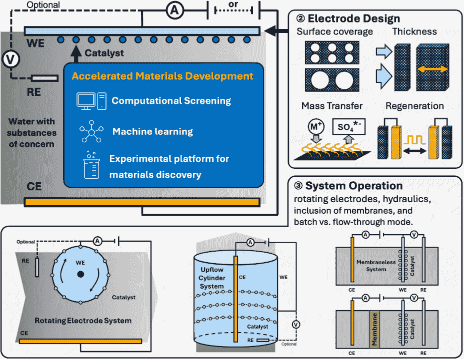
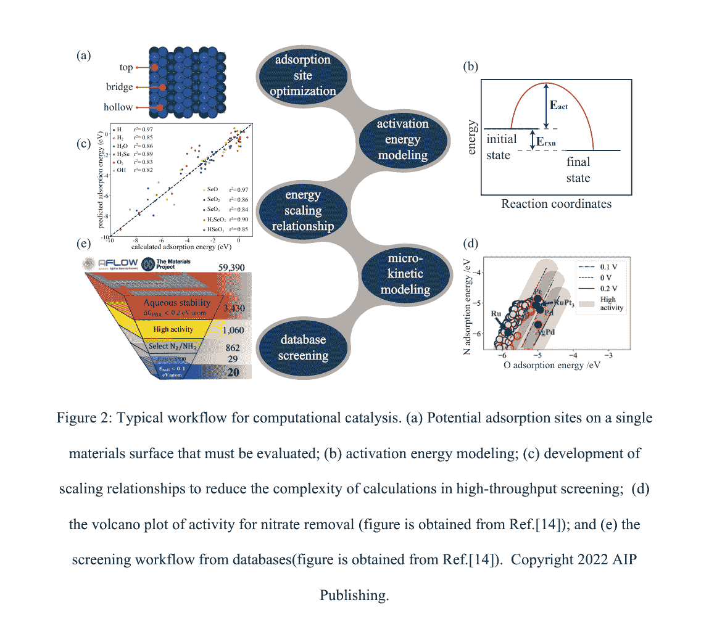
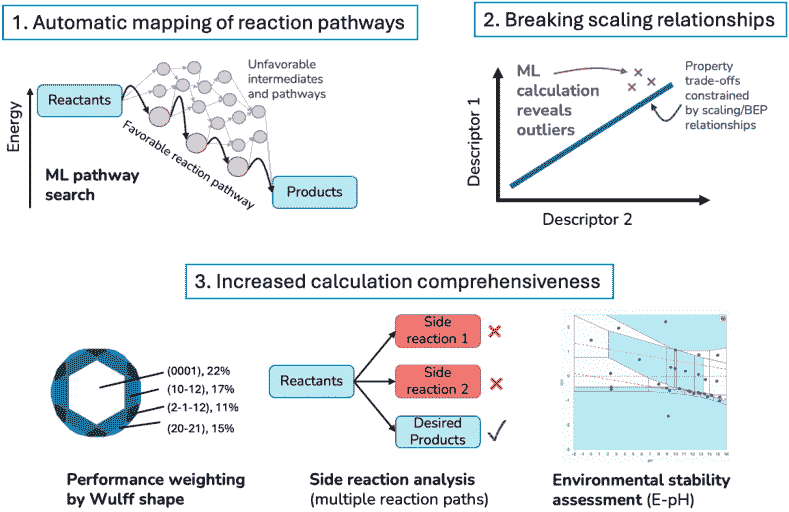

# 计算催化与机器学习在水处理技术中的应用

## 1. 摘要

电催化可以为水处理提供新途径。例如，电还原是一种新兴的用于处理水中受关注含氧阴离子的技术。然而，识别高性能、成本效益高的催化剂仍然是规模化部署的主要障碍。本文讨论了计算建模和机器学习如何加速新型催化剂材料的搜索。文章描述了传统计算化学工作流程（其基本形式已应用至少二十年）如何通过新开发的、基于数百万个示例训练的机器学习力场在广度和深度上得到扩展。文章还讨论了理论和机器学习流程如何有效地与实验合成和表征平台集成，以快速识别和验证新的催化剂化学体系。

## 2. 电催化在水净化中的引言与机遇

确保全球获得清洁用水是21世纪的重大挑战，需要新的水处理工艺。随着太阳能和风能等分布式可再生电源的迅速部署，有机会开发同样电气化、模块化和分布式的新型经济高效水处理工艺。

电气化水净化利用电能作为热力学驱动力，高效地从水中分离和转化受关注物质[1]。与传统物理化学水处理相比，电气化技术需要最少的化学药剂投入和后处理管理，从而降低运营成本和二次污染[2]。

电气化净化方法可以利用非法拉第和法拉第机制。基于非法拉第机制（*即*，无电荷转移）的工艺，如电吸附和电迁移，包括电渗析（ED）、电去离子（EDI）和电容去离子（CDI）等技术。这些工艺利用电场分离受关注物质，广泛应用于海水淡化和生产高品质水[3]。非法拉第水处理技术通常在较低的系统电压（< 1.2 V）[4]下运行，从而实现具有竞争力的能耗（低至0.1 kWh m-3水）[5]。

相比之下，以法拉第（*即*，电荷转移）机制为中心的电气化水处理工艺，如电还原和电氧化，通过氧化还原反应在将受关注物质转化为危害较小、更有价值或可分离形态方面发挥着关键作用。这些工艺包括电解、电镀、电絮凝和电气浮，它们在有机污染物降解、重金属沉淀和悬浮颗粒去除中至关重要[1]。已有公司推出模块化紧凑型电絮凝系统，为工业废水处理提供经济高效的解决方案，以去除浊度、金属、油类、细菌等[6]。与非法拉第处理工艺相比，法拉第技术在更宽的电压范围（最高4.0 V）[7]内运行，导致能量输入显著高于热力学预测值，有时比非法拉第工艺高出两个数量级[8]。

图1：实现电催化水处理面临的挑战，包括材料（本文重点）、电极和反应器设计。所用缩略词：WE（工作电极）、RE（参比电极）和CE（对电极）。

## 3. 催化剂的理论筛选：当前实践与局限

理论筛选技术在催化剂设计中的应用已发展了数十年，从析氢/析氧反应、硝酸盐还原到甲烷/乙醇生成等多个类别不断扩展[12-15]。这些广泛应用凸显了计算技术（通常基于密度泛函理论，即DFT计算）在虚拟催化剂识别方面的能力[16]。

DFT计算在原子尺度上模拟反应；所得计算反应参数（*例如*，热力学驱动力、活化能）可通过微观动力学建模技术映射到宏观催化剂性能。建模的总体目标是快速模拟哪些材料（*即*，化学组成、表面结构）能够促进所需的表面反应，同时避免任何非预期的副反应。在模拟中表现优异的材料将被优先用于实验研究。

要进行计算催化设计，第一步是确定所需电催化过程的相关表面反应序列。接下来，计算催化剂设计的基本步骤在**图2**中概述。首先，针对目标表面和反应物种计算吸附能和反应势垒（**图2a**）。一般来说，根据萨巴捷原理，反应物在催化剂表面的吸附能既不应太弱也不应太强；最高催化活性往往出现在吸附能接近零时[15, 17]，这反映在所谓的“火山型曲线”中，该曲线显示催化活性随吸附强度的变化呈现出明显的峰值。这种平衡直接影响反应路径步骤的活化能[18]，可通过DFT计算中的爬坡弹性带（NEB）方法精确计算（**图2b**）。

其他因素如pH、施加电位和表面覆盖度也会显著影响催化效率[18]。这些效应可以纳入DFT计算，并作为微观动力学建模[19]技术的输入，利用微观信息得出宏观反应速率（**图2d**）。在将微观参数与宏观性能的关联绘制出来后，最有前景的催化剂组成和表面

图2：计算催化的典型工作流程。(a) 必须评估的单一材料表面上的潜在吸附位点；(b) 活化能建模；(c) 建立比例关系以降低高通量筛选中的计算复杂度；(d) 硝酸盐去除的活性火山型曲线（图引自文献[14]）；以及(e) 从数据库进行筛选的工作流程（图引自文献[14]）。版权所有 2022 AIP Publishing。

## 4. 机器学习扩展能力的机遇

机器学习正在迅速改变包括计算催化在内的许多研究领域。如今，基于历史计算数据库训练的机器学习模型计算吸附能的速度比同等密度泛函理论过程快3个数量级，同时保持合理的精度[21]。因此，机器学习模型的存在创造了许多新的机会，以扩大计算筛选在催化剂识别中的范围。事实上，这种转变已经开始[22]，并且许多可能性的要素正在实践中得到应用[14]。

图3：机器学习势函数的发展可以改进计算筛选工作流程的3个领域示意图。

当今最先进的机器学习势通常采用图神经网络的形式[23]，其中所提出材料的原子表示为节点，相邻原子通过边连接。通过神经网络的连续层，原子通过其边相互作用以更新其属性。例如，与氧原子相邻的原子可能接收到与钯原子相邻的原子不同的更新。随着通过更多层施加更多更新，原子与其邻居之间的更长程相互作用被捕获。在该过程结束时，对构型的总能量进行预测。

开发准确且可迁移的机器学习势函数需要大规模的训练数据集，以便神经网络从中学习模式。目前最大的此类数据集来自开放催化剂项目（OCP）（https://opencatalystproject.org）。截至撰写本文时的最新版本 OC22[24]，包含超过 62,000 条 DFT 弛豫轨迹，由近 1,000 万次单点计算组成，可用于训练。如此巨大的计算时间和研究人员投入，使得训练出的机器学习势函数与 DFT[21] 相比，平均绝对误差（MAE）可低至 0.18 eV。这使其足以在许多实际筛选场景中作为 DFT 的“直接替代”方案。然而，如**图 3** 所概述，应用这些机器学习模型还存在许多其他机会[25]。

第一个机会是自动映射目标总反应的反应路径。目前，拟议的反应路径（*即*，在表面发生各种氧化和还原反应时形成的中间体序列）必须预先映射，以确定需要执行的计算。建立反应路径可能需要结合专家知识、全面表征以及对假设的计算检验。此外，此类路径可能随环境和施加条件（pH、电压）的变化而改变。展望未来，机器学习可用于自动枚举可能的反应路径，并通过化学反应网络[26]或其他技术自动确定热力学上有利的路径。利用机器学习枚举各种可能性并排序，将减少解决催化问题时对前期化学直觉的需求。然而，目前这一愿景的主要限制在于确定反应的活化能；活化能的数据点最多只有数千个。未来，利用扩展数据集在更远离平衡态和更接近过渡态结构处训练的更具通用性的机器学习模型，可能有助于消除这一限制。

应用机器学习的第二个机会是提高传统工作流程的准确性。如前所述，标准的计算筛选工作流程通常跳过显式的 DFT 计算，转而采用简化方法，例如用比例关系模拟吸附能，用 BEP 关系模拟反应动力学。与 DFT 计算不同，这些简化方法在简单描述符与更复杂的性质之间强加了刚性关系，使得识别不遵循通常趋势的那部分材料变得困难。事实上，行为无法被拟合的描述符关系充分描述的材料，往往可能正是对催化而言最有趣的材料。机器学习模型可能使完全摒弃比例关系成为可能，取而代之的是能更好地模拟催化剂材料复杂行为的机器学习预测。

第三个机会是扩展所计算内容的复杂度和深度。通常，催化材料许多本可计算的方面仍因计算成本和研究人员时间而被跳过。这包括计算 Wulff 形貌和主导表面（包括高指数表面的影响）、计算性能随表面覆盖度的变化，以及计算与其他物种的副反应。机器学习势函数为更常规地计算此类行为以及为更多候选材料进行计算提供了机会。

然而，尽管深度学习和神经网络在计算化学中展现了广阔前景，挑战依然存在。通用机器学习模型仍然难以应对非均匀误差（取决于吸附质和表面化学），并且在分布外泛化方面存在困难[27]。改进模型可能需要更多的训练数据以及对模型架构的潜在调整。此外，模型解释对最先进的模型而言仍是一个挑战。尽管目前已经能进行有限的解释[28]，但当今的机器学习模型在很大程度上仍是“黑箱”。提升模型的可解释性可能有助于

- [5] L. Gurreri, A. Tamburini, A. Cipollina, G. Micale，用于环境保护和资源回收的电渗析废水处理应用：进展与前景的系统综述，Membranes (Basel) 10 (2020) 146。[https://doi.org/10.3390/membranes10070146](https://doi.org/10.3390/membranes10070146)。

- [6] WaterTectonics，WaterTectonics 电絮凝，https://www.watertectonics.com/approach/packaged-systems/electrocoagulation/2024（访问日期：2024-04-16）。

- [7] M. Mirabediny, J. Sun, T.T. Yu, B. Akermark, B. Das, N. Kumar，电化学氧化方法有效降解 PFAS——近期进展与需求，Chemosphere 321 (2023) 138109。[https://doi.org/10.1016/j.chemosphere.2023.138109](https://doi.org/10.1016/j.chemosphere.2023.138109)。

- [8] M. Veciana, J. Braunig, A. Farhat, M.L. Pype, S. Freguia, G. Carvalho, J. Keller, P. Ledezma，从受污染水和废水中去除 PFAS 的电化学氧化工艺：迈向实际应用的基础、差距与机遇，J Hazard Mater 434 (2022) 128886。[https://doi.org/10.1016/j.jhazmat.2022.128886](https://doi.org/10.1016/j.jhazmat.2022.128886)。

- [9] S.O. Zou, M.S. Mauter，水溶液中硒还原的直接电化学路径，ACS Sustainable Chemistry & Engineering 9 (2021) 2027-2036。[https://doi.org/10.1021/acssuschemeng.0c06585](https://doi.org/10.1021/acssuschemeng.0c06585)。

- *[10] F.Q. Liu, S.T. Jiang, S.J. You, Y.B. Liu，电化学去除水中全氟化合物的最新进展：综述，Frontiers of Environmental Science & Engineering 17 (2023) 18。[https://doi.org/10.1007/s11783-023-1618-z](https://doi.org/10.1007/s11783-023-1618-z)。

  **该工作全面总结了电化学 PFAS 处理领域的知识现状，涵盖了电氧化、电吸附、电絮凝及耦合技术。**

- [11] N. Singh, B.R. Goldsmith，电催化在水污染物修复中的作用，ACS Catalysis 10 (2020) 3365–3371。https://doi.org/10.1021/acscatal.9b04167。

- [12] J. Greeley, M. Mavrikakis，基于第一性原理设计的合金催化剂，Nat Mater 3 (2004) 810-5。[https://doi.org/10.1038/nmat1223](https://doi.org/10.1038/nmat1223)。

- *[13] J. Greeley，理论多相催化：比例关系与计算催化剂设计，Annu Rev Chem Biomol Eng 7 (2016) 605-35。[https://doi.org/10.1146/annurev-chembioeng-080615-034413](https://doi.org/10.1146/annurev-chembioeng-080615-034413)。

  **该工作综述了表面与催化 DFT 研究中所使用的比例关系。该综述涵盖了从纯金属到金属氧化物表面的各种结构，涉及多个类别的分子。**

- *[14] R. Tran, D. Wang, R. Kingsbury, A. Palizhati, K.A. Persson, A. Jain, Z.W. Ulissi，利用机器学习筛选用于水净化的双金属电催化剂，J Chem Phys 157 (2022) 074102。[https://doi.org/10.1063/5.0092948](https://doi.org/10.1063/5.0092948)。

  **作者将机器学习与基于计算的筛选策略相结合，成功从 59,390 种双金属电催化剂中识别出 20 种用于 NO₃⁻ 转化的经济高效材料。**

- *[15] J.X. Liu, D. Richards, N. Singh, B.R. Goldsmith，过渡金属上电催化硝酸盐还原的活性与选择性趋势，ACS Catalysis 9 (2019) 7052-7064。[https://doi.org/10.1021/acscatal.9b02179](https://doi.org/10.1021/acscatal.9b02179)。

  **该工作系统展示了利用 DFT 计算建立能量比例关系和 BEP 关系的综合研究，旨在对催化剂材料进行高通量预测，并进行了进一步的实验验证。**

- [16] A. Jain, Y. Shin, K.A. Persson, 利用密度泛函理论对能源材料进行计算预测，*自然综述·材料* 1 (2016) 1–13. https://doi.org/10.1038/natrevmats.2015.4.

- [17] H. Shi, T. Zhou, 面向先进化学加工的异相催化剂和气体分离材料的计算设计，*化学科学与工程前沿* 15 (2021) 49–59. https://doi.org/10.1007/s11705-020-1959-0.

- [18] H. Ooka, J. Huang, K.S. Exner, 电催化中的萨巴蒂尔原理：基础、局限与扩展，*能源研究前沿* 9 (2021) 654460. https://doi.org/10.3389/fenrg.2021.654460.

- [19] A.H. Motagamwala, J.A. Dumesic, 微动力学建模：理性催化剂设计的工具，*化学评论* 121 (2021) 1049–1076. https://doi.org/10.1021/acs.chemrev.0c00394.

- [20] A. Jain, K.A. Persson, G. Ceder, 研究更新：材料基因组计划：数据共享与协作性从头算数据库的影响，*APL材料* 4 (2016) 053102. https://doi.org/10.1063/1.4944683.

- [21] J. Palizhati, N. Baskin, M. Shuaibi, B.M. Wood, B. Wander, A. Das, M. Uyttendaele, C.L. Zitnick, Z.W. Ulissi, AdsorbML：使用可泛化机器学习势的吸附能计算效率飞跃，*npj计算材料学* 9 (2023) 172. https://doi.org/10.1038/s41524-023-01121-5.

- [22] H. Mai, T.C. Le, D. Chen, D.A. Winkler, R.A. Caruso, 机器学习的电催化剂和光催化剂设计与发现，*化学评论* 122 (2022) 13478–13515. https://doi.org/10.1021/acs.chemrev.2c00061.

- *[23] T. Xie, J.C. Grossman, 用于材料性能准确可解释预测的晶体图卷积神经网络，*物理评论快报* 120 (2018) 145301. https://doi.org/10.1103/PhysRevLett.120.145301.*

  **这项工作引入了晶体图神经网络来预测材料性能；该表示方法支撑了当今最先进的机器学习模型。**

- *[24] R. Tran, J. Lan, M. Shuaibi, B.M. Wood, S. Goyal, A. Das, J. Heras-Domingo, A. Kolluru, A. Rizvi, N. Shoghi, A. Sriram, F. Therrien, J. Abed, O. Voznyy, E.H. Sargent, Z. Ulissi, C.L. Zitnick, 开放催化剂2022（OC22）数据集与氧化物电催化剂的挑战，*ACS催化* 13 (2023) 3066–3084. https://doi.org/10.1021/acscatal.2c05426.*

  **这项工作描述了当前可用于机器学习势训练的最全面的数据集。**

- [25] F. Göltl, 异相催化剂计算设计的三大挑战，*物理化学杂志C* 126 (2022) 3305–3313. https://doi.org/10.1021/acs.jpcc.1c10291.

- [26] J.T. Margraf, H. Jung, C. Scheurer, K. Reuter, 利用机器学习探索催化反应网络，*自然催化* 6 (2023) 112–121. https://doi.org/10.1038/s41929-022-00896-y.

- [27] A. Kolluru, M. Shuaibi, J. Palizhati, N. Shoghi, A. Das, B. Wood, C.L. Zitnick, J.R. Kitchin, Z.W. Ulissi, 开发用于催化剂发现的可泛化大规模机器学习模型面临的开放性挑战，*ACS催化* 12 (2022) 8572–8581. https://doi.org/10.1021/acscatal.2c02291.

- [28] J.A. Esterhuizen, B.R. Goldsmith, S. Linic, 用于异相催化知识生成的可解释机器学习，*自然催化* 5 (2022) 175–184. https://doi.org/10.1038/s41929-022-00744-z.
