# 连接认知网络的计算智能：进展与应用

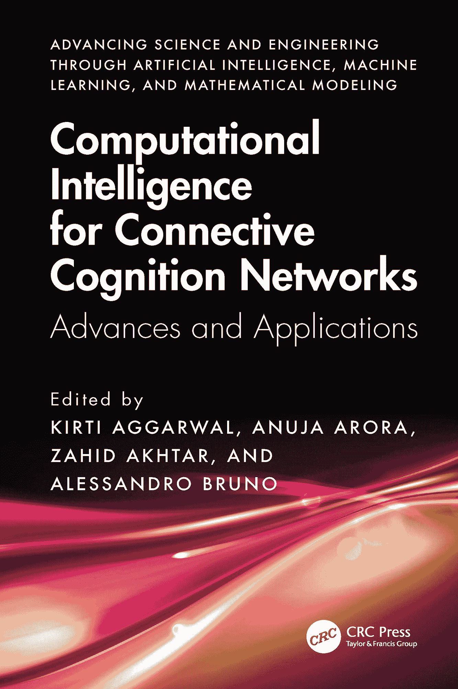

# 前言

嘿，你好！欢迎阅读《连接认知网络的计算智能：进展与应用》第一版！这本书的出版恰逢其时——正值计算智能蓬勃发展之际，它融合了巧妙的算法、庞大的网络以及真正关乎人们生活的理念。它正在改变我们审视世界的方式，以及我们应对棘手问题的手段。在我看来，“连接认知网络”关乎那个最佳交汇点：机器开始像我们一样思考，而网络将一切串联起来，让我们能够跨越各个领域应对挑战。

在本书中，你将看到新思想与实战经验的结合。章节内容涵盖从利用花哨的建模和机器学习技巧优化心电图分析，到探索量子网络的狂野可能性。涉猎广泛——比如用遗传算法增强图像、无人机安全架构、辨别照片和视频真伪。每一章都在推动智能技术能力的极限。不仅如此——我们还探讨了 AI 如何让道路更安全、处理多语言文档、嗅探假新闻，甚至利用大语言模型帮助教师备课。这一切都关乎颠覆性的潜力。

这本书并非凭空而来——它是一群杰出的研究人员、实战专家和深度思考者倾注心血的成果。他们不仅推动了连接认知网络背后的理论发展，还展示了如何利用它解决现实世界中的实际问题。作为编辑，我们试图将这些线索编织成一个连贯的整体——既有深度又不晦涩难懂，因此无论你是该领域的专家还是仅出于好奇，都能从中有所收获。

编撰此书是一段相当精彩的旅程，充满了“顿悟”时刻和反复的讨论。我无法对作者们贡献的真才实学表达足够的感谢，也感谢审稿人捕捉到了我们遗漏的问题并让一切更加严谨。还要大力感谢出版团队始终支持我们，最终将本书呈现在读者面前。

我们希望《连接认知网络：进展与应用》能点燃一把火——也许它能教会你新知识，激发你的思考，甚至推动你去质疑这些技术将走向何方。无论你是研究人员、行业专家，还是初涉此道的学生，我们都希望你能看到当下正在发生的变化，并窥见未来的轮廓。这些工具和理念正在数据、机器与人类思维之间编织新的联系——打开着我们才刚刚开始窥探的大门。

那么，翻开本书，阅读吧，并与我们一同踏上这场深入连接认知网络的旅程。非常高兴能有你在此！

# 致谢

汇编《连接认知网络的计算智能：进展与应用》是一项团队工作，我衷心感谢每一位为此付出努力的人。没有一大群人投入时间、才华和鼓励，这本书就不会呈现现在的面貌。

首先，衷心感谢所有倾注心血撰写章节的作者们。你们带来了如此广泛的思想和专业知识——涵盖从心电图分析到量子网络乃至更远的领域。能见证你们的工作汇聚成型、塑造这部文集，是我的荣幸。你们乐于分享、修正和打磨，成就了这部特别的作品。

我也要向我们的审稿人致以崇高敬意。你们是幕后英雄，以敏锐的目光和深思熟虑的反馈审阅初稿。你们的建议不仅修正了细节，也帮助我们锐化了大局。感谢你们时刻督促我们精益求精。

最后，向更广泛的研究社区以及所有在推动计算智能边界的人们致敬。正是你们的好奇心和驱动力，让像这样的书籍出版变得有意义——你们为我们这样的项目指明了方向。还有我的家人和朋友们——谢谢你们包容我沉浸在这个项目中消失不见。无论是一句善意的鼓励，还是只是听我唠叨网络和 AI，你们的支持让我坚持了下来。

这是一段疯狂的旅程，我无比感激每一位同行者。为你们所有人干杯——感谢你们成就了《连接认知网络》！

# 编辑简介

**Kirti Aggarwal** 现任印度 Jaypee 信息技术学院计算机科学与工程系高级助理教授。她于 2023 年 9 月在 Jaypee 理工学院获得计算机科学与工程博士学位。拥有 10 年以上学术经验。研究兴趣包括社交网络、自然启发计算、优化算法、数据库管理系统、离散数学、计算机网络、编译器设计和 Java 编程。在国际期刊和会议上发表多篇论文。

**Anuja Arora** 现任印度诺伊达 Jaypee 信息技术学院计算机科学与工程系教授。她拥有 19 年的学术与研究经验以及 1.5 年的行业经验。她于 2013 年 12 月在印度 Banasthali 大学 Apaji 数学与应用计算机技术学院获得计算机科学博士学位。她是 IEEE 高级会员、ACM 会员、SIAM 会员、INSTICC 会员以及 IAENG 终身会员。她在同行评审的国际期刊、书籍章节和会议上发表了 100 多篇研究论文。三名学生在她的指导下获得博士学位，另有三名正在攻读中。她的研究兴趣包括深度学习、人工神经网络、社交网络分析与挖掘、可持续计算、数据科学、机器学习、数据挖掘、Web 智能、Web 应用开发与 Web 技术、软件工程、软件测试和信息检索系统。Arora 博士曾以组织者、分会主席、国家顾问委员会成员和国际程序委员会成员的身份参与多个国际会议。她是众多 IGI、Inderscience 和 Bentham 国际期刊的编委会成员。她是许多知名同行评审 IEEE 期刊的审稿人——TKDE、TNSM、IEEE Transaction of Cybernetics 等。她也是各类国际期刊的审稿人。

**Zahid Akhtar** 于意大利卡利亚里大学获得电子与计算机工程博士学位。他目前担任美国纽约州立大学理工学院网络与计算机安全部助理教授。此前，他曾任美国孟菲斯大学研究助理教授，以及加拿大魁北克大学 INRSEMT、意大利乌迪内大学、土耳其 Bahcesehir 大学和卡利亚里大学的博士后研究员。他的研究兴趣包括计算机视觉和机器学习，并将其应用于网络安全、生物识别、情感识别、图像与视频处理以及视听多媒体质量评估。

**Alessandro Bruno** 在巴勒莫大学 DINFO 获得计算机工程博士学位。他现任意大利米兰 IULM 大学商业、法律、经济与消费者行为系任期制助理教授。加入 IULM 大学之前，Alessandro 曾任意大利米兰人文大学助理教授。他在 2021 年和 2022 年担任伯恩茅斯大学计算机与信息学系计算机讲师。他曾在英国 NCCA（国家计算机动画中心）、意大利 INAF IASF（国家天体物理研究所）、巴勒莫大学和意大利 IZS（西西里实验动物防疫研究所）担任博士后职位。他曾作为研究访问者前往英国伦敦大学学院（UCL）Mullard 空间科学实验室（MSSL），在 Jan-Peter Muller 教授领导的成像组工作。他发表了 50 多篇国际文章，并担任国际期刊副编辑。Alessandro 目前是由 NGI-Search 联盟资助的 HeReFaNMi（健康相关假新闻缓解）项目的首席研究员。他的研究兴趣包括计算机视觉、人工智能和图像分析。他主要涉及视觉注意力与视觉显著性、生物医学成像、人群行为分析、图像与视频取证、遥感和人机交互。

# 贡献者

*   **Apeksha Aggarwal**
    *   印度理工学院
    *   印度鲁尔基
*   **Kirti Aggarwal**
    *   Jaypee 信息技术学院
    *   印度诺伊达
*   **Preety Aneja**
    *   Jalandhar DAV 学院
    *   Guru Nanak Dev 大学
    *   印度旁遮普邦
*   **Anuja Arora**
    *   Jaypee 信息技术学院
    *   印度诺伊达
*   **Ruby Beniwal**
    *   Jaypee 信息技术学院
    *   印度诺伊达
*   **Simran Bhardwaj**
    *   Jaypee 信息技术学院
    *   印度诺伊达
*   **Nitesh Bharot**
    *   数据科学研究院
    *   戈尔韦大学
    *   爱尔兰戈尔韦
*   **Surekha Bhusnur**
    *   Bhilai 技术学院
    *   印度恰蒂斯加尔邦杜尔格
*   **Harshita Chandwani**
    *   Jaypee 信息技术学院
    *   印度诺伊达
*   **Mukta Goyal**
    *   Jaypee 信息技术学院
    *   印度诺伊达
*   **Meenal Jain**
    *   Jaypee 信息技术学院
    *   印度诺伊达
*   **Shruti Kalra**
    *   Jaypee 信息技术学院
    *   印度诺伊达
*   **Kartikey**
    *   Jaypee 信息技术学院
    *   印度诺伊达
*   **Amanpreet Kaur**
    *   Jaypee 信息技术学院
    *   印度诺伊达
*   **Pawan Kumar**
    *   印度理工学院
    *   印度孟买
*   **Sangeeta Lal**
    *   计算机科学与数学学院
    *   基尔大学
    *   英格兰
*   **Alka Mishra**
    *   Bhilai 技术学院
    *   印度恰蒂斯加尔邦杜尔格
*   **Santosh Kumar Mishra**
    *   Bhilai 技术学院
    *   印度恰蒂斯加尔邦杜尔格
*   **Monika**
    *   Jaypee 信息技术学院
    *   印度诺伊达
*   **R. K. Pateriya**
    *   毛拉纳·阿扎德国家理工学院
    *   印度博帕尔
*   **Nikhil Rathoure**
    *   毛拉纳·阿扎德国家理工学院
    *   印度博帕尔
*   **Neetu Sardana**
    *   Jaypee 信息技术学院
    *   印度诺伊达
*   **Pushpendra Singh**
    *   Bhilai 技术学院
    *   印度恰蒂斯加尔邦杜尔格
*   **Adwitiya Sinha**
    *   TERI 高等研究学院
    *   印度新德里
*   **Deepak Singh Tomar**
    *   毛拉纳·阿扎德国家理工学院
    *   印度博帕尔
*   **Deepika Varshney**
    *   Jaypee 信息技术学院
    *   印度诺伊达
*   **Priyanka Verma**
    *   利默里克大学
    *   爱尔兰
*   **Ankit Vidyarthi**
    *   Jaypee 信息技术学院
    *   印度诺伊达
*   **Yun Hwa Wong (Jenny)**
    *   计算机科学与数学学院
    *   基尔大学
    *   英格兰

# 第 1 章：通过参数化四次样条建模与机器学习分类增强 ECG 分析

Alka Mishra, Surekha Bhusnur, Santosh Kumar Mishra, Pushpendra Singh

DOI：[10.1201/9781003569619-1](http://doi.org/10.1201/9781003569619-1)

## 1.1 引言

心电图（ECG）信号在诊断各种心脏异常和监测心脏健康方面发挥着至关重要的作用。这些信号代表心脏的电活动，能为心脏功能提供有价值的见解，并有助于检测心律失常、缺血和心肌梗死等疾病 [[1]](#ch11.xhtml#r001)，[[2]](#ch11.xhtml#r002)。因此，在临床实践中，准确分析和解读 ECG 信号至关重要。

传统上，ECG 信号由受过训练的医疗专业人员通过目视分析来识别异常。然而，这一过程耗时且主观，导致诊断结果存在差异 [[3]](#ch11.xhtml#r003)。为克服这些局限性，利用信号处理和机器学习技术的进步，开发用于 ECG 分析的自动化方法的兴趣日益浓厚。ECG 研究的一个重点领域是开发能够复制 ECG 信号复杂形态的精确模型 [[4]](#ch11.xhtml#r004)。这些模型对于算法开发、医疗器械测试和教育等各种应用至关重要。

## 1.2 方法论

参数化四次样条是一种数学曲线拟合技术，用于以平滑且连续的方式插值数据点。在心电图建模的背景下，它涉及基于一组控制点创建心电图波形的数学表示 [24]。其工作原理如下：

1.  **控制点选择**：控制点沿心电图波形进行战略性放置，以捕捉峰值、谷值和拐点等重要形态学特征。控制点的数量和位置至关重要，因为它们决定了样条曲线在表示原始心电图信号时的准确性。

2.  **四次多项式插值**：使用四次多项式在相邻控制点之间进行插值。这种广义多项式函数的形式为：

```
f(x) = a x⁴ + b x³ + c x² + d x + e (1.1)
```

其中在公式 (1.1) 中，`a`、`b`、`c`、`d` 和 `e` 是由插值过程确定的系数。

3.  **曲线平滑**：对样条曲线进行平滑处理，以确保连续性并最小化振荡。这是通过调整每个控制点处的张力来实现的，从而有效地控制曲线的曲率。

4.  **参数化**：调整节点向量和张力值等参数，以微调样条曲线并提高其对原始心电图波形的保真度。这使得对插值过程有更大的控制权，并确保生成的曲线紧密匹配潜在的心脏活动。

5.  **合成心电图信号生成**：一旦样条曲线经过优化，即可通过在控制点之间插值来生成合成心电图信号。这些合成信号可以模拟正常和异常的心电图模式，为研究、算法开发和教学目的提供了宝贵的工具 [24–26]。

总体而言，参数化四次样条为心电图建模提供了一种灵活高效的方法，允许创建与真实数据非常相似的逼真合成信号。

### 1.2.1 心电图建模基本要求的细分

合成心电图生成在生物医学工程和心脏病学领域具有多种宝贵用途：

*   **数据增强**：合成心电图生成允许研究人员通过生成具有不同特征的额外样本来增强现有数据集。这种增强后的数据集可以提高在有限数据上训练的机器学习模型的鲁棒性和泛化能力。

*   **异常检测**：通过生成具有已知异常的合成心电图信号，研究人员可以训练机器学习模型准确检测和分类这些状况。这使得开发用于心脏异常早期检测的自动化诊断工具成为可能。

*   **模型验证**：合成心电图信号为测试和验证心电图分析算法和模型提供了一个受控环境。研究人员可以模拟各种生理场景，并在不同条件下评估其算法的性能。

*   **隐私保护**：生成合成心电图数据有助于解决共享真实患者数据相关的隐私问题。合成数据集可用于算法开发和测试，而不会损害患者隐私或机密性。

*   **教育与培训**：合成心电图信号对于教学目的极具价值，允许学生和医疗专业人员在无风险的环境中练习心电图解读技能。合成数据集可以模拟各种心脏状况，为学习者提供多样化的学习体验。

*   **研究探索**：合成心电图生成为探索心脏病学和生物医学工程中的新颖研究问题和假设开辟了机会。研究人员可以研究特定心电图特征对诊断准确性的影响，或研究不同信号处理技术的有效性 [14–16]。

总体而言，合成心电图生成在推动心脏病学的研究和创新中发挥着关键作用，促进了更准确的诊断工具、预测模型和个性化医疗解决方案的开发。

## 1.3 结果

## 1.4 结论

合成心电图生成在推动心脏病学研究与创新方面发挥着关键作用。通过利用这一技术，研究人员可以推动更精准诊断工具、预测模型以及针对个体患者需求量身定制的个性化医疗解决方案的发展。本文重点介绍了利用参数化四次样条法进行的心电图建模，并辅以应用于生成数据库的机器学习分类。通过这种方法，该研究旨在加深我们对心电图信号的理解，并提升自动化分类能力。

采用了包括 `KNN`、`Naïve Bayes` 和 `AdaBoost` 在内的机器学习技术来分析衍生的心电图数据库。这些方法在自动化分类任务方面展现出巨大潜力，从而简化了诊断流程。值得注意的是，在这三种技术中，`Naïve Bayes` 表现得尤为有前景，其准确度优于其他两种方法。总体而言，研究结果凸显了将心电图建模与机器学习分类技术相结合的有效性。这种综合方法有望通过实现更精准的诊断、预测洞察和量身定制的治疗策略，彻底改变心脏医疗保健。因此，持续探索和完善这些方法对于推动心脏病学领域的未来进步至关重要。

## 声明

**伦理批准**：不适用。

**利益冲突：** 作者不存在利益冲突。

**资助：** 不适用。

**数据和材料可用性：** 经合理请求，可从通讯作者处获取数据集。

**代码可用性：** 经合理请求，可从通讯作者处获取代码。

## 参考文献

*   [1] Mishra, A., & Bhusnur, S. (2022). 合成心电信号生成方法综述与分析。国际信号处理系统期刊，*10*，14–17。
*   [2] Agrawal, A. K., Mishra, A., & Kumar, R. (2014). 基于高效变换的心电信号压缩。工程与技术创新国际期刊 (IJIET)，*4*(1)，13–19。
*   [3] Dössel, O., Luongo, G., Nagel, C., & Loewe, A. (2021). 用于心电图解读的心脏计算机建模——综述。Hearts，*2*(3)，350–368。
*   [4] Khaleelu Rehman, B., Kumar, A., & Sharma, P. (2018). 面向心跳应用的心电信号建模与仿真。载于《智能通信、控制与设备：ICICCD 2017 会议论文集》（第 503–511 页）。Springer Singapore。
*   [5] Mishra, A., & Bhusnur, S. (2022, October). 真实心电信号的一种新型自适应建模与去噪方法。载于 2022 IEEE 第 3 届技术进步全球会议 (GCAT) (pp. 1–6)。IEEE。
*   [6] Wilber, H., Damle, A., & Townsend, A. (2022). 基于三角有理函数的信号处理数据驱动算法。SIAM 科学计算期刊，*44*(3)，C185–C209。
*   [7] Kundu, P. G. (2015). 基于高斯和傅里叶模型的心电图合成。载于 IEEE 计算智能与通信网络研究国际会议 (ICRCICN)，(pp. 312–317)。
*   [8] Delaney, A. M., Brophy, E., & Ward, T. E. (2019). 使用生成对抗网络合成逼真心电图。arXiv 预印本 arXiv:1909.09150。


*   [9] Hazra, D., & Byun, Y. C. (2020). SynSigGAN: generative adversarial networks for synthetic biomedical signal generation. *Biology*, *9*(12), 441.
*   [10] Wulan, N., Wang, W., Sun, P., Wang, K., Xia, Y., & Zhang, H. (2020). Generating electrocardiogram signals by deep learning. *Neurocomputing*, *404*, 122–136.
*   [11] Edmond Adib, F. A., & Prevost, J. J. (2021). Synthetic ECG signal generation using generative neural networks. *PloS One*, *20*(3), e0271270.
*   [12] Gerasimov, A. K., & Pedonova, Z. N. (2022). Development of hardware and software for generating test ECG signals. *Biomedical Engineering*, *55*(5), 315–319.
*   [13] Dolinský, P., Andráš, I., Michaeli, L., & Šaliga, J. (2020). An ECG signal model based on a parametric description of the characteristic waves. *Acta IMEKO*, *9*(2). https://acta.imeko.org/index.php/acta-imeko/article/view/IMEKO-ACTA-09%20%282020%29-02-02
*   [14] Mishra, A., Bhusnur, S., & Mishra, S. (2023). A neoteric parametric representation and classification of ECG signal. *Circuits, Systems, and Signal Processing*, *42*(9), 5725–5738.
*   [15] Mishra, A., & Bhusnur, S. (2023). A piecewise spline approach for modeling of ECG signals. *Biomedical Physics & Engineering Express*, *9*(6), 065017.
*   [16] Mishra, A., Bhusnur, S., & Mishra, S. K. (2022). Advancing health sciences and biomedical technology: A parametric spline based ECG modeling. *Everyman's Science*, *57*(2).
*   [17] Mishra, A., Bhusnur, S., Mishra, S. K., & Singh, P. (2023). Innovative ECG signal modeling: Unleashing the potential of the parametric spline approach for advancing global health challenges. *Journal of Technical Education*, *46*, 160.
*   [18] Mathews, S. M., Kambhamettu, C., and Barner, K. E. (2018). "A novel application of deep learning for single-lead ECG classification." *Computers in Biology and Medicine*, *99*, 53–62.
*   [19] Ebrahimi, Z., Loni, M., Daneshtalab, M., & Gharehbaghi, A. (2020). A review on deep learning methods for ECG arrhythmia classification. *Expert Systems with Applications: X*, *7*, 100033.
*   [20] Houssein, E. H., Kilany, M., & Hassanien, A. E. (2017). ECG signals classification: a review. *International Journal of Intelligent Engineering Informatics*, *5*(4), 376–396.
*   [21] Jambukia, S. H., Dabhi, V. K., & Prajapati, H. B. (2015). Classification of ECG signals using machine learning techniques: a survey. In *2015 International Conference on Advances in Computer Engineering and Applications* (pp. 714–721). IEEE.
*   [22] Ishak, A., Ginting, A., Siregar, K., & Junika, C. (2020, December). Classification of heart disease using decision tree algorithm. In *IOP Conference Series: Materials Science and Engineering* (Vol. 1003, No. 1, p. 012119). IOP Publishing.
*   [23] Selek, M. B., Yesilkaya, B., Egeli, S. S., & Isler, Y. (2021). The effect of principal component analysis in the diagnosis of congestive heart failure via heart rate variability analysis. *Proceedings of the Institution of Mechanical Engineers, Part H: Journal of Engineering in Medicine*, *235*(12), 1479–1488.
*   [24] Ibrahim, Z. (1991). *CAD/CAM Theory and Practice*. McGraw-Hill Higher Education.
*   [25] Li, J., & Liu, C. (2022). Cubic trigonometric Hermite interpolation curve: construction, properties, and shape optimization. *Journal of Function Spaces*, *2022*(1), 7525056.
*   [26] Mishra, A., Bhusnur, S., Mishra, S. K., & Singh, P. (2024). Exploring a new frontier in cardiac diagnosis: ECG analysis enhanced by machine learning and parametric quartic spline modeling. *Journal of Electrocardiology*, *85*, 19–24.
*   [27] Goldberger, A. L., Amaral, L. A., Glass, L., Hausdorff, J. M., Ivanov, P. C., Mark, R. G., Mietus, J. E., Moody, G. B., Peng, C. K., & Stanley, H. E. (2000). PhysioBank, PhysioToolkit, and PhysioNet: components of a new research resource for complex physiologic signals. *Circulation*, *101*(23), 215–e220.

# 第 2 章 量子网络范式

Preety Aneja

DOI: [10.1201/9781003569619-2](http://doi.org/10.1201/9781003569619-2)

## 2.1 简介

我们的宇宙在微观层面展现出迷人的行为，自然界中有许多现象难以解释。我们是否思考过为什么量子计算机的性能优于典型计算机？它拥有哪些独特特性？所有这些问题的答案都隐藏在对自然基本原理的理解之中。被称为量子力学的物理学分支（Konishi and Paffuti 2009）解释了微观层面粒子的行为和动力学。

随着量子力学研究和进步的迅速发展，量子计算机、量子网络，乃至量子互联网的存在已成为可能。量子计算相较于传统或经典计算具有显著优势。量子计算利用量子力学的基本概念，如纠缠、叠加态等（Wineland 2013），与传统计算方法相比，在解决物流、药物设计、银行业务、统计科学、安全通信等复杂问题方面具有显著优势。量子计算机的实现仅得益于量子软件设计、量子硬件研究、量子算法创造等方面的显著发展。

经典计算机中的信息基本单位是二进制数字。每个二进制数字只能处于两种状态，即 0 或 1。另一方面，量子计算机中量子信息的基本单位是量子比特。量子比特可以在各种物理系统中制备，例如原子的电子能级、光子的光学自由度、电子或原子核的自旋态等（Bennett and DiVincenzo 2000; Bouwmeester and Zeilinger 2000）。量子比特的特性通常基于粒子的物理属性，例如电子的自旋，因此其表现形式多种多样。众所周知，电子可以具有向上自旋或向下自旋，但在量子力学中，电子存在于同时具有两个方向自旋的状态的概率是存在的。这一概念被称为量子力学中的两态叠加。根据经典物理学，这一概念听起来与我们的普遍观察相悖。然而，粒子表现出的这种奇特行为在各方面都将大有裨益。例如，量子比特能存储比传统比特多得多的信息。经典比特只能取值 0 和 1。用两个比特，存在四种可能的组合：00、01、10 或 11。而在量子计算中，由于叠加特性，量子比特可以同时取值 0 和 1。因此，两个量子比特可以同时存在所有四种组合（00、01、10、11）。量子计算中的这一特性极大地增加了量子比特存储的信息量。

量子计算机执行的操作甚至比最快的超级计算机还要快。量子计算在通信系统中也提供了增强的安全性。但随之而来的问题是，是什么使得量子信息的传输成为可能？量子信息以量子比特的形式，从一个量子处理器传输到另一个处理器，跨越长距离。这通过量子网络实现，量子网络构成了量子通信的重要组成部分。量子计算机可提供增强的安全性，并可能对当前的加密方法构成潜在威胁（Klima et al. 2018）。由于信息通过量子比特传输，任何篡改信息的尝试都会影响所涉粒子的量子态。因此，量子网络在安全通信方面提供了前所未有的能力。

此外，量子存储器在量子网络中发挥着关键作用，进而保护量子通信中量子比特的独特性质。这些技术正在飞速发展和演变，彻底改变着计算、数据处理与传输以及网络安全领域。实现量子霸权的目标在当今时代正成为现实，因为各种公司和研究机构已经设计并开发出了拥有 50 多个量子比特的量子计算机。这些量子计算机解决复杂问题所需的计算时间已缩短至秒级，而用传统计算机解决则需要数年。量子计算以及量子网络的未来非常光明。

本章通过将量子计算机、量子比特、量子电路算法等各种量子要素视为一个相互关联的系统而非孤立的组件，为量子网络提供了新的视角，以构建一个内聚的量子网络。本章重点介绍了各种量子技术的集成，以变革现有的通信框架，并提供了一条实现具有增强安全性的量子互联网的路线图。第 2.2 节详细讨论了量子网络的基础，重点关注量子计算以及叠加、纠缠、干涉等独特性质。第 2.3 节讨论了量子密钥分发（QKD）、量子隐形传态等量子网络范式及其在未来通信系统中的关键作用。第 2.4 节涵盖了量子网络的应用和当前的最新研究。第 2.5 节和第 2.6 节将讨论将量子计算集成到基于量子的网络范式中的机遇与挑战。最后一节总结全章并探讨未来方向。

## 2.2 量子网络基础

量子网络是基于量子力学原理而非经典物理学设计的、用于传输和处理信息的系统。本节探讨量子网络背后的基本组件和原理，为理解这些系统如何实现安全通信、分布式计算和先进量子传感奠定基础，具体如下：

### 2.2.1 量子计算与量子比特

量子力学原理构成了量子计算的基础，使其能够从根本上以不同于经典计算的方式执行计算。量子计算机的运行依赖于叠加和纠缠等量子效应，这类似于经典计算机的运行依赖于半导体材料中电子的行为（Langlois 2002）。在传统数字计算中，信息的基本单位是二进制位，只能取 0 或 1 两个值。在量子计算中，基本单位称为量子比特（图 2.1），它可以取值“0”或“1”，也可以同时处于这两种状态的叠加态（Nielsen and Chuang 2010；Nadj-Perge et al. 2010；Hendrickx et al. 2020）。量子计算通过利用量子力学的独特原理，极大地改变了计算技术领域，使其在特定任务上超越经典计算机。量子计算在密码学、材料科学、医疗保健、物流、气候建模等各个领域都有广泛应用。

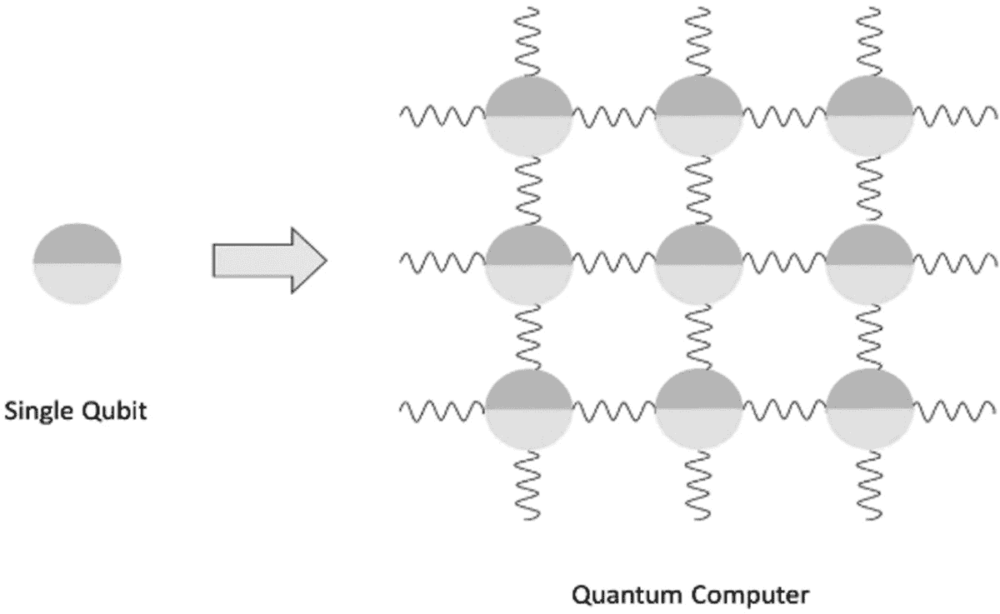

**图 2.1** 从量子比特到量子计算机。

### 2.2.2 叠加态

在量子力学中，叠加态是量子比特表现出的一种独特性质。这意味着量子比特可以同时处于“0”和“1”的叠加态，而经典比特一次只能取值 0 或 1（图 2.2）。从数学上讲，这一性质可表示为

```
|ψ⟩ = a|0⟩ + b|1⟩
```

其中 `|ψ⟩` 是波函数，`a` 和 `b` 是复数，分别表示相应状态的概率振幅（Nielsen and Chuang 2010）。这些概率振幅的模平方给出了量子比特处于特定状态的概率，且必须满足归一化条件：

```
|a|² + |b|² = 1
```

因此，由于这一独特的叠加性质，量子计算机可以存储和处理大量信息，因为可用的计算空间变得巨大。对于拥有 `N` 个量子比特的系统，计算维度呈指数级增长为 `2^N`。这种指数级增长表明，即使只有少量的量子比特，量子计算机也能存储和处理大量信息。这一特性使量子计算机能够解决许多复杂问题，如大数分解、量子系统模拟等，这与经典计算方法形成鲜明对比。

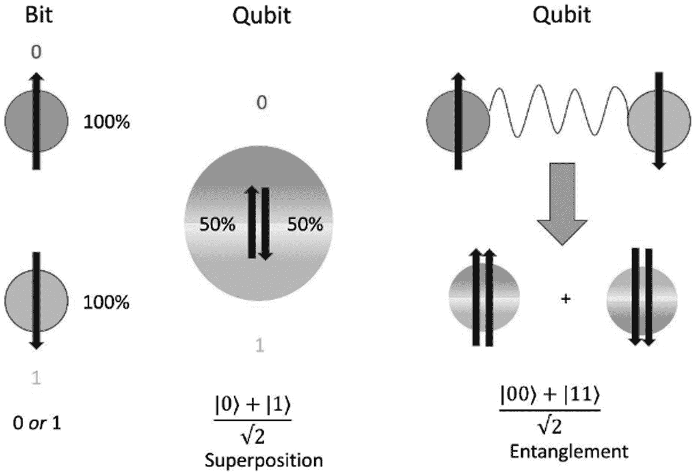

**图 2.2** 比特与量子比特的示意图。

### 2.2.3 纠缠

纠缠是量子计算中利用的另一种独特性质（Bennett and DiVincenzo 2000）。量子比特可以处于纠缠态，这与完全相互独立的经典比特不同。量子比特的这种纠缠态在两个量子比特之间建立了直接联系，即使它们在物理上相距遥远。这意味着如果探测两个量子比特中的一个，另一个会因纠缠而受到影响。对一个纠缠量子比特的测量将瞬间影响另一个量子比特的状态，即使这些量子比特相距很远。因此，处于纠缠态的量子比特将具有经典比特不具备的相关性。纠缠的量子比特系统必须作为一个整体来描述，而非独立地描述（图 2.2）。从数学上讲，两个量子比特的纠缠态表示为：

```
|ψ⟩ = a|00⟩ + b|01⟩ + c|10⟩ + d|11⟩
```

其中 `a`、`b`、`c` 和 `d` 是复数概率振幅。多个量子比特在长距离上的这种互联成为量子计算中的宝贵资产，在稠密编码、量子隐形传态、量子密钥分发（QKD）和量子模拟等方面有应用（Gill 2021）。纠缠量子比特之间的相关性无法用经典物理学解释，因此可以实现更复杂、更快速的计算。

### 2.2.4 量子干涉

量子态可能以类似波的干涉方式表现出干涉现象，从而产生极大值和极小值（Kipnis 2012）。量子干涉可导致某些结果被放大，而其他结果被抵消，这类似于波动理论中的相长干涉和相消干涉。量子干涉原理在量子算法中很有用，可增强正确解的概率，同时降低错误解的概率。这一特性可提升相对于经典技术的计算能力和效率。

### 2.2.5 测量

量子计算的最后阶段是测量，这最终会将量子比特从叠加态坍缩为确定的状态 0 或 1 之一。测量过程通过破坏量子比特的叠加态使其变为确定态，最终导致从量子系统获得经典输出。量子算法通常保证正确的结果，但该过程的随机性甚至可能导致无法采样到正确结果。因此，在量子计算机的数据处理后，需要一些经典技术从原始结果中获得最终的正确输出。

### 2.2.6 量子门与量子电路

用于执行量子计算的经典门的量子版本称为量子门。与经典门不同，量子门作用于叠加态，从而实现量子并行性。量子门通过幂等运算作用于量子比特以操纵量子比特的状态，同时保持叠加、纠缠等量子特性。量子门是可逆的，能够执行逆向计算和复杂计算。这些门可以是单量子比特门，也可以是多量子比特门。示例包括单量子比特门，如 `Pauli-X`（类似于经典 NOT 门）、`Pauli-Y`、`Pauli-Z`、`Hadamard (H)` 和 `Phase (S)` 门；双量子比特门，如 `Controlled-NOT (CNOT)` 门，它翻转量子比特的状态，从而实现仅靠经典门无法完成的操作。一系列量子门可以执行复杂算法，从而形成量子电路。

### 2.2.7 量子算法


量子电路构成了实现量子算法的基础，量子算法随后被应用于一个或多个量子比特以解决特定问题。量子算法的示例包括用于整数分解的 `Shor 算法`、用于搜索数据库的 `Grover 算法` 等。与经典算法相比，这两种算法都提供了更快的加速（Shor 1999; Grover 1996）。

## 2.3 基于量子的网络范式：量子通信的下一个前沿

尽管通用量子计算机或模拟器仍在开发中，但研究人员正致力于将这些量子计算机连接起来以构建量子网络。基于量子的网络范式是量子物理与信息技术交叉的新兴领域，将在计算、通信和数据传输方面产生变革性影响，提供无与伦比的安全性和计算能力。每种范式都有其独特的角色、机制、应用、挑战和优势。这些范式的成功实施将在全球通信网络和信息处理的未来发挥关键作用。通过讨论其要素，可以更好地理解量子网络，如下所示：

*   量子网络配备至少拥有一个量子比特的量子处理器。小型量子计算机称为量子处理器，可在量子比特上执行量子逻辑门。应用程序运行在这些量子处理器上，拥有一个量子比特的处理器称为端节点。根据应用需求，也可能拥有多量子比特的量子处理器。
*   传输量子比特需要通信线路，电信线可用于此目的。
*   在量子网络中，借助光开关将量子比特传送至所需处理器，以优化通信过程。
*   第四，通过量子中继器可实现量子比特的长距离传输，以避免损耗（Gu et al. 2024）。

该领域的关键方面和技术包括：

### 2.3.1 量子密钥分发

QKD 网络是量子网络的一个典型示例，它不需要纠缠量子节点。与经典加密方法不同，QKD 基于信息论安全，利用量子力学基本定律，因此能抵御未来计算能力的任何进步（Xu et al. 2020; Zhang et al. 2018）。在 QKD 网络中，量子信道（光纤或自由空间链路）用于在双方之间分发量子密钥。这些密钥用于加密和解密通过通信信道传输的消息。由于量子测量行为会干扰量子态，任何窃听尝试均可被检测到。Bennett and Brassard (1984) 提出了 `BB84 协议`，该协议利用光子的四种偏振态对比特进行编码。随后，又提出并开发了越来越多的协议，如 `E91` 等（Zhang et al. 2024）。

### 2.3.2 量子隐形传态

这是一个过程，借助经典通信，允许将粒子的量子态直接从一个位置传输到另一个位置，而无需物理传输粒子本身（Olmschenk et al. 2009）。这种量子网络使用纠缠的量子节点，在其中可以直接处理和传输量子比特。这种范式创建了一个稳健且多功能的网络，提供无与伦比的安全性和计算能力（Devulapalli et al. 2024）。

### 2.3.3 基于云的量子计算

基于云的量子计算通过互联网提供对量子模拟器和处理器的访问（Soeparno and Perbangsa 2021）。因此，用户无需使用本地量子硬件即可执行量子计算。这种量子网络范式拓宽了量子计算资源的获取途径，从而加速了该领域更多的研究和进步（Golec et al. 2024）。

### 2.3.4 纠缠使能通信

纠缠使能通信利用处于纠缠态的量子比特建立具有增强安全性的通信链路。该网络范式确保任何干扰或窃听尝试均可被检测到，从而为安全数据传输提供了稳健的基础（Nötzel 2020）。

### 2.3.5 量子中继器

量子中继器可以通过纠正因退相干或噪声导致的损耗和错误，在不直接测量量子信息的情况下扩展量子通信的范围（Azuma et al. 2023）。这些设备用于实现量子信息在更长距离上的可靠传输，而不会出现显著的损耗或信号退化。在局域网甚至某些距离较短的城域网中，由于量子比特保真度易于维持，因此不需要量子中继器。然而，随着量子网络扩展至覆盖国家、地区等更大的地理区域（如广域网（WAN）、更大的城域网等），量子中继器的实施变得至关重要。量子中继器的工作原理是将传输路径分解为较短的片段，以便在这些片段上维持量子比特保真度。在每个片段上创建纠缠量子比特对。在相邻片段之间建立纠缠，然后通过纠缠交换将其延伸至更长距离，以保持量子态的纯度和完整性。量子存储器是量子中继器的核心组件，因为它可以存储量子比特并在稍后释放。这将实现不同片段上纠缠的同步（Azuma et al. 2023）。

### 2.3.6 量子互联网

互联网在连接全球人们方面发挥着不可或缺的作用，因此已成为我们日常生活的重要组成部分。然而，当前的互联网基础设施更容易遭受网络攻击，对敏感信息构成威胁（Aslan et al. 2023；Carlo and Obergfaell 2024）。量子互联网可以解决这一问题。量子互联网是一个理论概念，指相互连接的量子计算机和其他量子设备，使得信息可以通过量子信号进行发送和接收（Wehner et al. 2018）。借助与经典互联网共存的量子互联网，可以解决许多复杂问题。量子互联网的动力源于经典互联网对我们社会产生的变革性影响。量子互联网的发展将对安全、科学发现和计算产生深远影响。量子互联网可跨越多个领域，包括测量学、分布式量子计算和量子增强安全通信，有可能彻底改变金融风险分析、数据加密和材料科学等领域（Cacciapuoti et al. 2019）。

## 2.4 量子网络中的实际应用与最新研究

迄今为止，尚无人成功开发出大规模且持续运行的量子网络，但正如表 2.1 所述，在这一方向上已取得诸多进展。

**表 2.1** 量子网络的应用

| 年份 | 量子网络领域的突破 | 涉及机构 | 描述 |
| --- | --- | --- | --- |
| 2016 | “墨子号”卫星 | 中国科学院 | 由中国发射，实现了 4,600 公里跨度的量子密钥分发（QKD）（Jianlan 2016） |
| 2017 | 基于卫星的量子网络 | 中国科学技术大学 | 科学家演示了在卫星与地面站之间 700 英里距离上传输纠缠光子。该实验的主要缺点是光子回收率低，即每 600 万个光子中仅回收 1 个（Nellis n.d.；Yin et al. 2017） |
| 2017 | 京沪量子通信网络 | 中国电信、国防科技大学 | 世界首个用于集成 QKD 的长距离量子保密通信光纤网络，跨度超 2,000 公里。增强了金融和政府部门敏感信息的数据安全（Na 2017） |
| 2019 | 布鲁克海文国家实验室量子网络 | 布鲁克海文国家实验室、石溪大学、美国能源部 | 使用便携式量子纠缠源和光纤实现了 10 英里距离的纠缠，后扩展至 80 英里（Nellis n.d.） |
| 2019 | 量子互联网联盟 | 多所欧洲大学和研究机构 | 发起的合作项目，旨在欧洲开发量子互联网。促进对量子通信节点和中继器的研究，以构建功能性量子互联网（Quantum Internet Alliance n.d.） |
| 2020 | 52 英里量子环路 | 芝加哥大学、阿贡国家实验室 | 演示了量子网络的核心功能，利用现有光纤成功测试了 52 英里量子环路（Lerner 2020） |
| 2021 | 加州理工学院和 NASA 量子通信测试平台 | 加州理工学院、NASA | 开发了用于光纤和自由空间光链路安全信息传输的测试平台。探索量子网络在太空探索安全通信中的实际应用（CQNET 2020） |
| 2022 | 扩展后的芝加哥量子网络 | 芝加哥大学、阿贡国家实验室 | 扩展了 35 英里，总长约 124 英里光纤，成为美国最长量子网络之一。增强了美国量子网络的能力和覆盖范围（Hu 2022） |
| 2022 | 瑞士量子倡议 | 瑞士联邦理工学院（苏黎世联邦理工学院） | 在瑞士实施了首个国家量子通信网络，连接关键机构。促进机构间的安全数据共享和研究合作，增强国家网络安全（Swiss Quantum Initiative n.d.） |
| 2022 | 量子加密 5G 网络 | 布里斯托大学、多家电信公司 | 利用量子技术增强 5G 网络的安全协议，防御潜在网络威胁（Quantum Secured 5G Network n.d.） |
| 2022 | “济南 1 号”卫星 | 中国科学院 | 这是第二颗量子卫星，量子密钥生成速度比“墨子号”快两到三倍，但重量仅为“墨子号”的六分之一（Chen 2022） |

## 2.5 量子计算在基于量子的网络范式中的机遇

将量子计算集成到基于量子的网络范式中，是一项具有革命性潜力的突破性发展，可彻底改变信息处理。量子计算能显著增强量子网络的能力，从而实现更安全、更高效的通信。让我们探讨其中一些机遇：

1.  **增强的计算能力**：量子计算机执行复杂计算的速度比经典计算机更快（Farhi et al. 2014）。量子计算机的这一特性可为密码学、优化和药物发现等行业带来变革性影响。
2.  **增强的安全性**：量子网络基于量子力学基本原理，确保任何窃取信息的尝试都能被轻易检测到。量子网络（如 QKD）已极大地增强了通信网络的安全性（von Burg et al. 2021）。量子计算实现了更复杂的加密方法，这些方法在经典手段下几乎无法破解，从而提升了安全特性。
3.  **高效信息处理**：量子算法可以优化网络协议，并有减少数据传输延迟的趋势（Gisin et al. 2002; Djordjevic 2012）。这将总体上提高量子网络以最小延迟传输数据的能力。量子计算，进而量子网络，可以实现数据更高效的处理和传输。
4.  **量子传感器**：量子网络旨在跨长距离互联量子设备，因此在医学成像到环境监测等领域都有应用，且具备增强的传感能力（Landman et al. 2022）。
5.  **网络设计的新范式**：量子物理学的进步促成了基于此的新型网络架构的发展。例如，通信系统深受量子中继器和量子路由器发展的影响，它们可以扩展通信范围，从而提高量子通信的可靠性。
6.  **科学研究**：量子网络可以通过实现量子资源的共享访问和连接量子实验室来加速协作研究。总体而言，基于量子的网络范式有潜力彻底改变经典技术无法实现的通信和计算。

## 2.6 挑战

量子计算在基于量子的网络中的作用令人振奋。但也存在如下所述的挑战：

1.  **量子退相干**：量子信息因与环境相互作用而衰减的现象称为量子退相干（Schlosshauer 2019）。量子态在与环境相互作用时极易发生退相干。这可能导致信息丢失，因此主要挑战是通过开发先进的隔离技术和材料来保护量子态的纯度。
2.  **量子与经典集成**：将量子网络与现有经典网络集成以创建混合系统带来了新的挑战（Shi and Malaney 2023; Reilly 2019）。集成包括为量子和经典系统之间的无缝交互设计接口和协议（DiAdamo et al. 2022）。
3.  **大气干扰**：自由空间量子通信极大地受天气条件和大气湍流影响。
4.  **安全性**：量子网络需要通过持续监控安全协议、开发安全加密方法和进行严格测试来防范攻击。
5.  **开发高效量子中继器**：量子中继器用于扩展量子通信的范围，但构建能够执行纠缠交换且在不丢失信息的情况下保持量子态纯度的稳健高效中继器十分困难。量子中继器依赖量子存储器来存储和重发纠缠态。然而，当前的量子存储器面临相干时间有限（其能可靠保持量子态的时长）和存储效率低的问题，这限制了网络的可扩展性（Dusanowski and Thompson 2023）。此外，在大规模量子网络中，扩展众多中继器并实现这些中继器之间的同步是一个复杂的挑战。
6.  **大规模集成的成本与可扩展性**：小型量子网络在扩展到更大规模的实用量子网络时需要技术进步。这包括开发可扩展架构、标准化协议和模块化量子网络组件，这也需要投资和基础设施。量子硬件仍在开发中，只有拥有强大得多的硬件才能解决现实世界的问题（Monroe and Kim 2013）。
7.  **跨学科协作**：量子网络的研究与开发需要量子物理、计算机科学、工程等各领域的专业知识，因此需要促进跨学科协作。
8.  **标准与协议**：量子网络的发展缺乏用于量子通信的标准化协议和法规。

## 2.7 结论与未来展望

量子计算，进而量子网络，拥有许多现实应用。随着利用量子力学原理的量子计算的出现，经典计算发生了范式转移，因为量子计算实现了经典方法无法完成的计算。量子计算的基础建立在量子比特和量子门之上，这反过来又为解决复杂问题提供了前所未有的速度和效率。因此，基于量子的网络范式代表了计算、通信技术和信息处理的变革性转变，旨在实现增强的安全性、速度和计算能力。量子计算的潜力令人振奋，同时也充满挑战。量子网络面临许多挑战，如长距离保持纠缠、将量子节点与现有经典基础设施集成的技术、以及由退相干和噪声引起的错误。但该领域正在进行的研究和开发工作有望释放量子网络的全部潜力，使量子通信成为全球互联的基石。关键方向包括用于将量子系统与经典基础设施集成的混合量子-经典协议、用于互操作性的标准化通信协议、量子机器学习（Karthikeyan et al. 2024）和 AI 驱动的网络优化（Khang and Rath 2024）以动态适应网络状况。必须强调的是，国际协作和标准制定以实现全球量子互联网基础设施是当务之急。通过拥抱基于量子的网络范式，我们可以开启一个更安全、互联互通且技术更先进的未来。

## 参考文献

*   Aslan, Ömer, Semih Serkant Aktuğ, Merve Ozkan-Okay, Abdullah Asim Yilmaz, and Erdal Akin. 2023. “A comprehensive review of cyber security vulnerabilities, threats, attacks, and solutions.” *Electronics* 12, no. 6: 1333.
*   Azuma, Koji, Sophia E. Economou, David Elkouss, Paul Hilaire, Liang Jiang, Hoi-Kwong Lo, and Ilan Tzitrin. 2023. “Quantum repeaters: From quantum networks to the quantum internet.” *Reviews of Modern Physics* 95, no. 4: 045006.
*   Bennett, Charles H., and David P. DiVincenzo. 2000. “Quantum information and computation.” *Nature* 404, no. 6775: 247–255.
*   Bennett, Charles H., and Gilles Brassard. 1984. “Proceedings of the IEEE international conference on computers, systems and signal processing,” Bangalore, India, 175–179.
*   Bouwmeester, Dirk, and Anton Zeilinger. 2000. “The physics of quantum information: basic concepts.” In *The physics of quantum information: quantum cryptography, quantum teleportation, quantum computation*, pp. 1–14. Springer Berlin Heidelberg.
*   Cacciapuoti, Angela Sara, Marcello Caleffi, Francesco Tafuri, Francesco Saverio Cataliotti, Stefano Gherardini, and Giuseppe Bianchi. 2019. “Quantum internet: Networking challenges in distributed quantum computing.” *IEEE Network* 34, no. 1: 137–143.
*   Carlo, Antonio, and Kim Obergfaell. 2024. “Cyberattacks on critical infrastructures and satellite communications.” *International Journal of Critical Infrastructure Protection* 46: 100701.
*   Chen, Stephen. 2022. “China launches new satellite in ‘important step’ towards global quantum communications network.” *SCMP*. 访问日期：2024 年 10 月 28 日。[www.scmp.com/news/china/science/article/3186802/china-launches-new-satellite-important-step-towards-global](http://www.scmp.com/news/china/science/article/3186802/china-launches-new-satellite-important-step-towards-global)。
*   CQNET. 2020. “Quantum Internet Tested at Caltech and Fermilab.” 访问日期：2024 年 10 月 28 日。[www.caltech.edu/about/news/quantum-internet-tested-caltech-and-fermilab](http://www.caltech.edu/about/news/quantum-internet-tested-caltech-and-fermilab)。
*   Devulapalli, Dhruv, Eddie Schoute, Aniruddha Bapat, Andrew M. Childs, and Alexey V. Gorshkov. 2024. “Quantum routing with teleportation.” *Physical Review Research* 6, no. 3: 033313.


## 参考文献

*   DiAdamo, Stephen, Bing Qi, Glen Miller, Ramana Kompella, and Alireza Shabani. 2022. “Packet switching in quantum networks: A path to the quantum internet.” *Physical Review Research* 4, no. 4: 043064。
*   Djordjevic, Ivan. 2012. *Quantum information processing and quantum error correction: an engineering approach*. Academic Press。
*   Dusanowski, Łukasz, and Jeff D. Thompson. 2023. “A step closer to repeaters for quantum networks.” *Nature*. [`doi.org/10.1038/d41586-023-02283-4`](https://doi.org/10.1038/d41586-023-02283-4)。
*   Farhi, Edward, Jeffrey Goldstone, and Sam Gutmann. 2014. “A quantum approximate optimization algorithm.” *arXiv preprint arXiv:1411.4028*。
*   Gill, Sukhpal Singh. 2024. “Quantum and blockchain based serverless edge computing: A vision, model, new trends and future directions.” *Internet Technology Letters* 7, no. 1: e275。
*   Gisin, Nicolas, Grégoire Ribordy, Wolfgang Tittel, and Hugo Zbinden. 2002. “Quantum cryptography.” *Reviews of Modern Physics* 74, no. 1: 145。
*   Golec, Muhammed, Emir Sahin Hatay, Mustafa Golec, Murat Uyar, Merve Golec, and Sukhpal Singh Gill. 2024. “Quantum cloud computing: Trends and challenges.” *Journal of Economy and Technology* 2: 190–199。
*   Grover, Lov K. 1996. “A fast quantum mechanical algorithm for database search.” In *Proceedings of the twenty-eighth annual ACM symposium on Theory of computing*, pp. 212–219. New York: Association for Computing Machinery。
*   Gu, Fenglei, Shankar G. Menon, David Maier, Antariksha Das, Tanmoy Chakraborty, Wolfgang Tittel, Hannes Bernien, and Johannes Borregaard. 2024. “Hybrid quantum repeaters with ensemble-based quantum memories and single-spin photon transducers.” [`doi.org/10.21203/rs.3.rs-4329745/v1`](https://doi.org/10.21203/rs.3.rs-4329745/v1)。
*   Hendrickx, N. W., W. I. L. Lawrie, L. Petit, A. Sammak, G. Scappucci, and M. Veldhorst. 2020. “A single-hole spin qubit.” *Nature Communications* 11, no. 1: 3478。
*   Hu, Charlotte. 2022. “Chicago now has a 124-mile quantum network. This is what it’s for.” 访问日期：2024 年 10 月 28 日。[www.popsci.com/technology/chicago-quantum-network/](http://www.popsci.com/technology/chicago-quantum-network/)。
*   Jianlan, S. O. N. G. 2016. “Micius Heralds an era of quantum communications.” *Bulletin of the Chinese Academy of Sciences* 30, no. 3: 151–154。
*   Karthikeyan, S., M. Akila, D. Sumathi, and T. Poongodi, eds. 2024. *Quantum machine learning: A modern approach* (1st ed.). Chapman and Hall/CRC。[`doi.org/10.1201/9781003429654`](https://doi.org/10.1201/9781003429654)。
*   Khang, Alex, and Kali Charan Rath, eds. 2024. *The quantum evolution: Application of AI and robotics in the future of quantum technology*. CRC Press。
*   Kipnis, Nahum. 2012. *History of the Principle of Interference of Light*. Vol. 5. Birkhäuser。
*   Klima, Richard E., Richard Klima, Neil P. Sigmon, and Neil Sigmon. 2018. *Cryptology: Classical and modern*. Chapman and Hall/CRC。
*   Konishi, Kenichi, and Giampiero Paffuti. 2009. *Quantum mechanics: A new introduction*. OUP Oxford。
*   Landman, Jonas, Natansh Mathur, Yun Yvonna Li, Martin Strahm, Skander Kazdaghli, Anupam Prakash, and Iordanis Kerenidis. 2022. “Quantum methods for neural networks and application to medical image classification.” *Quantum* 6: 881。
*   Langlois, Richard N. 2002. “Computers and semiconductors.” In *Technological innovation and economic performance*, pp. 265–284, B. Steil, D.G. Victor and R.R. Nelson (eds.). Princeton, New Jersey: Princeton University Press。
*   Lerner, Louise. 2020. “Argonne and UChicago scientists take important step in developing national quantum internet.” 访问日期：2024 年 10 月 28 日。[www.anl.gov/article/argonne-and-uchicago-scientists-take-important-step-in-developing-national-quantum-internet](http://www.anl.gov/article/argonne-and-uchicago-scientists-take-important-step-in-developing-national-quantum-internet)。
*   Monroe, Christopher, and Jungsang Kim. 2013. “Scaling the ion trap quantum processor.” *Science* 339, no. 6124: 1164–1169。
*   Na, Chen. 2017. “Beijing-Shanghai quantum communication network put into use.” 访问日期：2024 年 10 月 28 日。[`english.cas.cn/newsroom/archive/news_archive/nu2017/201703/t20170324_175288.shtml`](https://english.cas.cn/newsroom/archive/news_archive/nu2017/201703/t20170324_175288.shtml)。
*   Nadj-Perge, S., S. M. Frolov, E. P. A. M. Bakkers, and Leo P. Kouwenhoven. 2010. “Spin–orbit qubit in a semiconductor nanowire.” *Nature* 468, no. 7327: 1084–1087。
*   Nellis, Andrew. n.d. “The quantum internet, explained.” 访问日期：2024 年 10 月 28 日。[`news.uchicago.edu/explainer/quantum-internet-explained`](https://news.uchicago.edu/explainer/quantum-internet-explained)。
*   Nielsen, Michael A., and Isaac L. Chuang. 2010. *Quantum computation and quantum information*. Cambridge University Press。
*   Nötzel, Janis. 2020. “Entanglement-enabled communication.” *IEEE Journal on Selected Areas in Information Theory* 1, no. 2: 401–415。
*   Olmschenk, Steven, D. N. Matsukevich, P. Maunz, D. Hayes, L-M. Duan, and C. Monroe. 2009. “Quantum teleportation between distant matter qubits.” *Science* 323, no. 5913: 486–489。
*   Quantum Internet Alliance. n.d. 访问日期：2024 年 10 月 28 日。[`qutech.nl/qia/`](https://qutech.nl/qia/)。
*   Quantum Secured 5G Network. n.d. 访问日期：2024 年 10 月 28 日。[www.bristol.ac.uk/media-library/sites/engineering/research/smart-internet-lab/Leaflet_Quantum%20Secured_20190120.pdf](http://www.bristol.ac.uk/media-library/sites/engineering/research/smart-internet-lab/Leaflet_Quantum%20Secured_20190120.pdf)。
*   Reilly, D. J. 2019. “Challenges in scaling-up the control interface of a quantum computer.” In *2019 IEEE International Electron Devices Meeting (IEDM)*, pp. 31–7. IEEE。
*   Schlosshauer, Maximilian. 2019. “Quantum decoherence.” *Physics Reports* 831: 1–57。
*   Shi, Wenbo, and Robert Malaney. 2023. “Quantum routing for emerging quantum networks.” *IEEE Network* 38(1): 140–146。
*   Shor, Peter W. 1999. “Polynomial-time algorithms for prime factorization and discrete logarithms on a quantum computer.” *SIAM Review* 41, no. 2: 303–332。
*   Soeparno, Haryono, and Anzaludin Samsinga Perbangsa. 2021. “Cloud quantum computing concept and development: A systematic literature review.” *Procedia Computer Science* 179: 944–954。
*   Swiss Quantum Initiative. n.d. 访问日期：2024 年 10 月 28 日。[`qc.ethz.ch/community-and-initiatives/network/swiss-quantum-initiative.html`](https://qc.ethz.ch/community-and-initiatives/network/swiss-quantum-initiative.html)。
*   von Burg, Vera, Guang Hao Low, Thomas Häner, Damian S. Steiger, Markus Reiher, Martin Roetteler, and Matthias Troyer. 2021. "Quantum computing enhanced computational catalysis." *Physical Review Research* 3, no. 3: 033055。
*   Wehner, Stephanie, David Elkouss, and Ronald Hanson. 2018. "Quantum internet: A vision for the road ahead." *Science* 362, no. 6412: eaam9288。
*   Wineland, David J. 2013. "Nobel Lecture: Superposition, entanglement, and raising Schrödinger's cat." *Reviews of Modern Physics* 85, no. 3: 1103–1114。
*   Xu, Feihu, Xiongfeng Ma, Qiang Zhang, Hoi-Kwong Lo, and Jian-Wei Pan. 2020. "Secure quantum key distribution with realistic devices." *Reviews of Modern Physics* 92, no. 2: 025002。
*   Yin, Juan, Yuan Cao, Yu-Huai Li, Sheng-Kai Liao, Liang Zhang, Ji-Gang Ren, Wen-Qi Cai et al. 2017. "Satellite-based entanglement distribution over 1200 kilometers." *Science* 356, no. 6343: 1140–1144。
*   Zhang, Qiang, Feihu Xu, Yu-Ao Chen, Cheng-Zhi Peng, and Jian-Wei Pan. 2018. "Large scale quantum key distribution: challenges and solutions." *Optics Express* 26, no. 18: 24260–24273。
*   Zhang, Yichen, Yiming Bian, Zhengyu Li, Song Yu, and Hong Guo. 2024. "Continuous-variable quantum key distribution system: Past, present, and future." *Applied Physics Reviews* 11, no. 1: 011318. [`doi.org/10.1063/5.0179566`](https://doi.org/10.1063/5.0179566)。

# 第 3 章：基于遗传算法的医学图像增强优化框架

Kirti Aggarwal and Meenal Jain


DOI: [10.1201/9781003569619-3](http://doi.org/10.1201/9781003569619-3)

### 3.1 引言

增强医学图像增强的临床能力对于图像分析至关重要。本研究的目标是应用遗传算法（`GA`）来生成增强后的图像。基本思路是将初始图像输入 `GA` 以生成清晰、高质量的重现图像，然后进一步增强。本研究旨在利用一种考虑所有限制条件以产生更好结果的前沿算法，创建一个生成最佳可能图像的框架。为实现准确高效的图像增强，它采用了 `GA`。我们从读取图像和准备适应度函数开始。这种随机生成的图像通过交叉和变异，在许多代中利用 `GA` 持续进化，直到找到最优解。具有双峰强度分布，这可以增强图像数据中感兴趣区域（`ROI`）的视觉效果。

在处理之前，图像增强可提高原始数据的质量和信息含量。传统技术包括对比度增强、空间滤波和密度分层。在对比度增强或拉伸中，应用线性变换来扩展灰度级的范围。空间滤波改善自然发生的线性特征，如断层。密度分层将连续的灰度范围分割成一系列密度区间，每个区间用特定的颜色或符号表示。

近年来，为了协助临床医生做出准确诊断，对医学图像改进的需求不断扩大；因此，医学图像处理为提升医学图像以实现疾病的正确诊断提供了帮助 [[1]](#ch13.xhtml#r080)。改善图像质量始终是医学图像处理的主要目标之一。图像增强提高了图像供人眼观看的清晰度。

增强技术包括去除图像中的模糊和噪声、增加对比度以及显示细节 [[2]](#ch13.xhtml#r081)。在捕获图像时，部分信息会丢失，导致图像模糊或信息量减少，并不总是清晰可见。医学图像光照不足，图像的许多关键部分不可见，导致视觉模糊和难以察觉的对比度。

医学研究数据包含大量信息，在某些情况下，无法使用传统统计方法简单地检查，甚至根本无法检查。本可从算法中受益以解决困难医学问题的医生却不知其存在。因此，我们希望利用 `GA` 及其医学应用。`GA` 在放射学等多个医学专业中的应用具有引人入胜的意义。本文介绍了 `GA` 在疾病筛查、诊断、治疗规划、药物警戒、预后和医疗管理中的用途，并让医生设想如何在自己的实践中应用这种元启发式方法。图 3.1 表示 `GA` 的流程循环。算法在 3.3 节 中有详细定义。

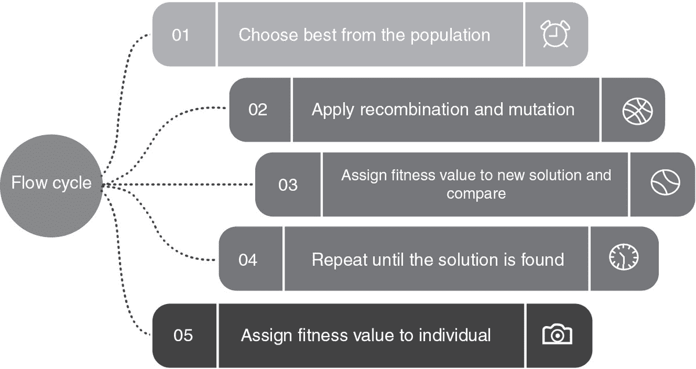

**图 3.1** 遗传算法的流程循环。

在本研究工作中，我们将深入研究 `GA` 的工作原理以及如何将其用于优化图像增强过程。我们渴望为医疗保健领域开辟一条新路径，使解决方案能够通过 `GA` 实现。图像增强问题可以由多个因素表征，这使得参数选择问题变得困难。

本章提出了一个框架，该框架在连接认知网络的背景下应用 `GA`，以优化跨各个领域的图像增强。通过利用计算智能的力量，该框架将跨学科知识——从人工智能到图像处理——连接成一个旨在提高图像质量的集成系统。`GA` 作为计算智能的核心组件，被用于解决图像增强中涉及的复杂优化挑战，提供适应性强且可扩展的解决方案。本章重点介绍了这些算法如何模拟进化过程以迭代改进图像质量，反映了连接认知网络链接多样化认知过程和专业知识的自适应本质。这种方法通过展示如何利用连接认知来开发用于图像增强的创新解决方案，促进了计算智能的进步，最终改善了不同应用中的视觉结果。

### 3.2 文献综述

现有的大多数图像增强方法都是与特定类型图像相关的经验或启发式方法，旨在增强在采集过程中退化的图像的对比度水平。优化问题在于确定能够增强每个不同输入图像的理想灰度级。一些方法采用群体智能技术。粒子群优化（`PSO`）被用于多目标直方图均衡化，以在保持亮度的同时提高对比度。一些工作利用人工蜂群（`ABC`）算法，在优化框架内使用相似的候选解编码和直方图映射策略。

#### 自然启发优化策略在图像处理中的应用

在图像处理领域，自然启发优化策略至关重要。它们改进了图像增强、复原、图像分割 [[3]](#ch13.xhtml#r082)、图像边缘检测、图像生成、图像融合、图像模式识别、图像阈值处理等功能。迄今为止，针对各种图像处理应用已提出了众多优化策略。

进化算法 [[4]](#ch13.xhtml#r083) 从繁殖、突变、重组和选择等生物过程中汲取灵感。优化技术对于从一组可能性中识别出最准确或最优解至关重要。在涉及多个个体的场景中，每个个体可能都有自己的最优解，而全局最优则代表所有局部最优中的顶尖解。进化算法利用适应度函数，已在许多具有挑战性的问题求解任务中获胜，而将这些算法作为问题求解工具的领域被称为进化计算。适应度函数是进化计算的关键组成部分，增强目标函数将产生理想解。

萤火虫是一种昆虫，具有在黑暗中通过闪烁发光的固有能力。这一生物学特征启发了萤火虫优化算法的开发 [[5]](#ch13.xhtml#r084)。萤火虫优化算法被用于增强 CT/MR 图像的模糊聚类 [[6]](#ch13.xhtml#r085)。分割过程涉及隔离感兴趣的目标区域。解剖器官和肿瘤、囊肿及其他异常等不规则结构在医学成像中至关重要，供临床医生诊断远程医疗应用中的疾病。经典分割方法包括阈值处理、区域生长和边缘检测。聚类作为一种无监督学习方法，将相似数据点归为一类，而模糊分区则基于模糊隶属度值整合可比像素。然而，传统模糊 C 均值（`FCM`）算法对聚类质心初始化不敏感，频繁导致局部极小值问题。因此，优化过程在聚类质心初始化期间变得更加重要，可提升 `FCM` 算法的性能。在本研究中，针对 CT/MR 医学图像分割，萤火虫优化与 `FCM` 方法结合使用。

非线性张量扩散滤波器用于在预处理阶段去除伪影和去噪，通过减少总体处理像素数量有效降低了计算时间。当与 `FCM` 结合时，萤火虫优化产生的效果优于 `FCM` 与其他方法（如布谷鸟搜索 [[7]](#ch13.xhtml#r086)、`ABC` [[8]](#ch13.xhtml#r087) 和模拟退火方法 [[9]](#ch13.xhtml#r088)）结合时的表现。聚类有效性性能准则用于确定最佳聚类数量。在医学数据的存储和传输中，图像压缩至关重要。医学照片常采用无损压缩方法，尽管在重建图像质量保持较高且具有最优压缩比的场景中，会采用有损矢量量化（`VQ`）算法。蝙蝠优化算法 [[10]](#ch13.xhtml#r089) 受蝙蝠利用回声定位寻找猎物和避开障碍物习性的启发。在 `VQ` 算法中，蝙蝠优化过程用于寻找最佳码本设计。对于腹部 CT 图像，`BAT-VQ` 压缩技术与经典 `VQ`、上下文矢量量化（`CVQ`）和 `JPEG` 无损系统进行了比较。

Beni 和 Wang [[11]](#ch13.xhtml#r090) 发明了群体智能算法。它由代理或个体组成，它们对彼此和环境有局部兴趣。它们遵循个体规则；没有集中控制系统，因此独立行动。局部代理交互将产生全局行为，这意味着全局智能。Mirjalili 等人 [[12]](#ch13.xhtml#r091) 基于灰狼的领导力和狩猎风格引入了该算法。灰狼被称为顶级掠食者，因为它们处于食物链顶端。群体成员遵循高度严格的社会支配等级。第一层级是 `alpha`，它们是领导者，负责做出关于狩猎、休息等事项的判断。第二层级是 `beta`。这些个体作为 `alpha` 决策层的从属。当 `alpha` 变老或死亡时，`beta` 候选者将接替其位置。第三层级称为 `delta`，它支配 `omega`。等级最低的是 `Omega`。`alpha` 和 `beta` 狼都将 `delta` 狼作为从属。在 `GWO` 中，最优解为 `alpha`，其次是 `beta`，最后是 `delta`。其余均视为 `Omega`。因此，`alpha`、`beta`、`delta` 和 `omega` 将用于指导狩猎。

`ABC` 优化方法基于蜜蜂行为，由 Karaboga [[13]](#ch13.xhtml#r092) 提出。该模式中存在三群蜜蜂：雇佣蜂、观察蜂和侦察蜂。雇佣蜂外出觅食并向蜂巢报告。观察蜂根据雇佣蜂提供的信息选择最佳食物来源。即每只雇佣蜂都拥有特定食物来源的信息。侦察蜂是其食物来源被拒绝的雇佣蜂。Kennedy 和 Eberhart [[14]](#ch13.xhtml#r093) 通过观察鱼群和鸟群移动行为提出了 `PSO`。`PSO` 将使用指定参数迭代，直到为候选者找到更好解。通过考虑惯性、个人影响和社会影响，粒子（也称候选者）可改善其位置。`PSO` 最常用于控制系统的功能优化和最优控制。`PSO` 用于求解非线性优化问题，因其易于实现且参数较少。它适应各种用途。

我们研究的关键发现在于：`PSO` 中个体无法被创建或删除。个体仅在跟踪其随时间变化的适应度地形中移动。这类似于鸟群或其他动物的交流。其次，适应度比例选择和遗传重组发生在 `GA` 中。`PSO` 的对应机制是最优选择和粒子移动。两种方法都必须微调才能在特定问题领域发挥作用。为实现更快收敛，`PSO` 技术要求输入向量归一化。`GA` 可处理连续和离散值。在计算资源方面，`GA` 快速、易于部署且具成本效益。`ACO` 更贪婪，但产生更优结果，尤其是处理大规模问题时。每种方法都有其自身的力学机制和表征要素。`GA` 中是交叉和模式。`ACO` 中使用基于边的结构和边权重。

## 表 3.1 文献综述总结 [[⏎]](#ch13.xhtml#t6b)

| 研究 | 方法 | 应用 | 关键发现 |
| --- | --- | --- | --- |
| Draa 和 Bouaziz [[2]](#ch13.xhtml#r081) | 人工蜂群（`ABC`）算法 | 图像对比度增强 | 利用群体智能方法显著改善了医学图像对比度 |
| Qin 等人 [[3]](#ch13.xhtml#r082) | 基于云模型的直方图分析 | 图像分割 | 利用基于直方图的技术有效分割医学图像，特别适用于诊断应用 |
| Kumar et al. [[6]](#ch13.xhtml#r085) | 萤火虫优化 + 模糊聚类 | CT/MR 图像分割 | 通过将萤火虫优化与模糊聚类相结合以提高清晰度，增强了图像分割 |
| Rajabioun [[7]](#ch13.xhtml#r086) | 杜鹃优化算法 | 医学图像处理 | 应用杜鹃优化实现高维医学图像的高效处理 |
| Karaboga and Basturk [[8]](#ch13.xhtml#r087) | 人工蜂群算法 (ABC) | 函数优化、控制系统 | 强调了 ABC 在解决控制系统中的非线性优化问题方面的有效性 |
| Kennedy and Eberhart [[14]](#ch13.xhtml#r093) | 粒子群优化 (PSO) | 图像优化 | 证明了 PSO 能够以比其他技术更少的参数优化图像处理任务 |
| Karaboga [[13]](#ch13.xhtml#r092) | 人工蜂群算法 (ABC) | 图像优化 | 提出用 ABC 处理高维图像数据，在图像对比度增强方面取得了有希望的结果 |

### 3.3 遗传算法

`GA` 从根本上受到查尔斯·达尔文自然选择过程的启发，它们接受输入并通过从各种潜在解决方案中进行选择来生成输出。`GA` 最初由 John Holland [[15]](#ch13.xhtml#r094) 采用。`GA` 旨在模拟进化所需的自然系统过程。为了找到最佳答案，`GA` 能在全局空间中高效搜索。`GA` 在增强对比度方面更为成功，并能生成自然外观的照片。`GA` 是一种受自然选择机制原理和遗传系统启发的搜索技术。这些算法高度并行且灵活，将“适者生存”的概念与字符串结构中的系统且随机的信息交换相结合。这种方法产生了一种搜索策略，模仿了人类解决问题时所发现的部分创造力。它们有效地利用先前的数据来预测并探索预期结果更好的新搜索区域，对可能的解决方案迭代应用受遗传学启发的算子。

#### 算法 1：遗传算法伪代码

```
g = 0 /*初始化代计数器*/
P = 初始化种群/*p 个个体的随机生成 */
重复 直到 结束条件

F = 繁殖(P)/*通过轮盘赌选择 p 个父代*/

S = 交叉(F)

M = 变异 (S)/*以概率 mc 改变个体位*/

P = 更新种群(M)/*M 复制到 P(P=M)*/

g = g + 1/*代计数器加 1*/
```

与传统搜索策略不同，`GA` 同时处理多个点，而非单个点。理论和实验均表明，`GA` 能在复杂空间中提供可靠的搜索。模式识别和图像处理提出了许多挑战，要求在复杂空间中执行高效搜索以识别最优解。`GA` 对有限数量的字符串使用三种基本过程来发现全局近似最优解。繁殖/选择、交叉和变异是这三个算子。

#### 3.3.1 父代选择策略

##### 3.3.1.1 锦标赛选择

`GA` 中使用的选择策略之一是锦标赛选择。在此策略中，从当前代中选择顶尖候选者。随后，选出的最佳候选者进入下一代。在 K 路锦标赛选择中，选择 top k 个个体，它们相互竞争 [[16]](#ch13.xhtml#r095)。在选定的候选者中，仅选择最佳候选者并传递给下一代。进行多次锦标赛，使我们能够最终确定将进入下一代的候选者名单。

该选择策略具有一个称为选择压力的特性，它对候选者被选入锦标赛的机会进行概率评估。如果锦标赛规模较大，较弱候选者被选中的可能性较小，因为它们必须与更强的对手竞争。`GA` 的收敛速度由选择压力参数决定。选择压力越高，收敛率越高。在广泛的选择压力范围内，`GA` 都能发现最佳或近似最佳解。

##### 3.3.1.2 轮盘赌选择

在轮盘赌选择中，圆形轮盘被分割成代表个体的片段。每个片段的大小与个体的适应度成正比，如 图 3.2 所示。轮盘旋转，并选择轮盘周边的一个特定点，如图所示。位于该特定点前方的片段被选为父代 [[17]](#ch13.xhtml#r096)。选择下一个父代遵循类似过程。当轮盘旋转时，适应度较好的个体更有可能停在指定点前方，因为它在轮盘上占据较大的片段。因此，选择某个个体的可能性与其适应度值直接相关。

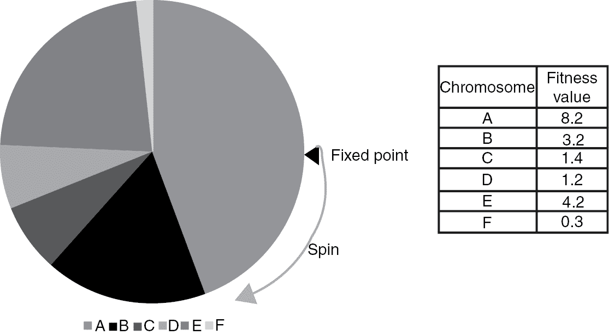

**图 3.2** 轮盘赌选择示意图。

##### 3.3.1.3 排序选择

在排序选择中，首先对种群进行排序，然后根据每条染色体在该排序中的位置分配其适应度。最差的染色体获得适应度值 1，第二差的获得 2，以此类推，最好的染色体获得等于 N 的适应度值，其中 N 是种群中染色体的总数 [[18]](#ch13.xhtml#r097)。随后，所有染色体都有机会被选中。基于排序的选择技术可以避免过早收敛。然而，由于它根据适应度值对种群进行排序，计算开销可能较大。然而，由于最优染色体与其他染色体的差异不大，这种策略可能导致较慢的收敛速度。

#### 3.3.2 交叉

交叉是一种遗传特性，涉及两条染色体（也称为父代）的结合以形成一条新染色体（也称为子代）。如果新染色体继承了双亲的最佳品质，交叉的结果可能优于双亲 [[19]](#ch13.xhtml#r098)，如 图 3.3 所示。在进化过程中，交叉按照用户定义的交叉概率发生。新子代将从一个父代继承某些特征，从另一个父代继承其他特征。假设第一个父代是 `10001011`，第二个父代是 `10011111`；完成交叉后，结果可以是 `10011111`，它包含第一个父代的部分和第二个父代的部分。

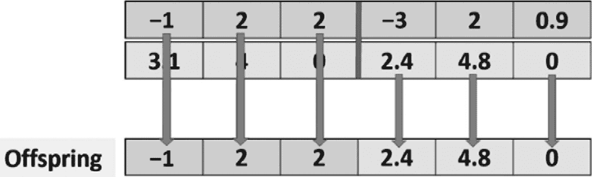

**图 3.3** 交叉。

#### 3.3.3 变异

交叉完成后，可能会发生变异。这样做是为了避免所有种群解陷入当前问题的局部最优。编码方式以及交叉操作都会影响变异。例如，在对排列进行编码时，变异可能意味着交换两个基因 [20]。新后代通过变异随机改变，如图 3.4 所示。我们可以通过将随机选取的少数位从 1 改为 0 或从 0 改为 1 来对二进制数据进行编码。父代 `10001011` 的变异可能是 `10001111`，父代 `10011111` 的变异可能是 `10010111`。

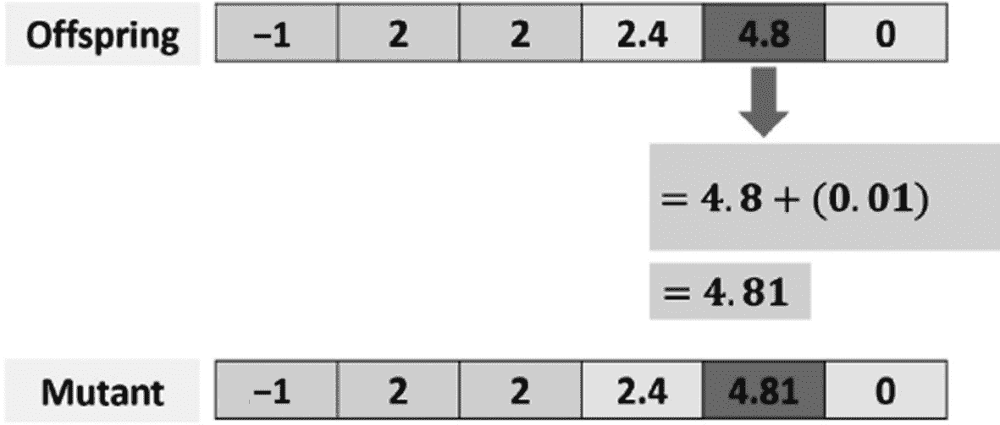

**图 3.4** 变异.⏎

#### 3.3.4 目标函数与适应度函数的构建

目标函数用于确定解的优劣。该目标函数的输出随后被转化为适应度值，用于判断解的质量。由于 `GA` 是一种优化工具，目标函数通常是一个包含所有变量的最大化或最小化函数。适应度函数旨在在灰度强度中创建一个双峰直方图，从而允许自动图像处理步骤在整个优化过程中评估个体的质量。适应度函数青睐那些直方图具有两个分离良好的正态分布且与最佳阈值等距的个体。

与经典优化算法相比，`GA` 具有诸多优势。这些算法用途广泛，能够处理各种目标函数。目标函数可以是稳定或动态的、线性或非线性的、连续或不连续的，甚至可能受随机噪声影响。`GA` 能够解决复杂问题及其固有的并行性是两大显著优势。由于种群中的多个后代独立运作，种群（或其任意子集）可以同时在多个方向上搜索。`GA` 的这一能力使得算法并行化变得非常容易，同时也简化了不同参数甚至编码字符串组的修改。然而，`GA` 也存在一些缺点。必须极其谨慎地处理新种群的选择标准、目标函数的设计、种群大小的选择，以及变异率和交叉率等关键因素的选择。这些参数选择上的任何失误都可能导致算法难以最优收敛，从而产生无效结果。尽管存在这些局限性，`GA` 如今仍被广泛用作非线性优化策略。

因此，在过去十年中，`GA` 在工程领域得到了广泛应用。`GA` 现在被视为设计优化的强大工具。本研究工作探讨了进化算法在求解复杂优化问题、应对挑战以及管理典型工业场景中的不确定性方面的不同应用。在此，`GA` 被用作供应链规划过程中的优化机制，以在不确定性条件下确定最佳生产、库存水平和分销策略。

### 3.4 方法论

本研究工作旨在利用一种考虑所有约束以产生更好结果的算法，建立一个创建最佳图像的框架。为实现准确高效的图像增强，它采用了 `GA`。该方法以一幅图像为输入，然后对其进行增强。我们首先对图像进行解读并设置适应度特征。`GA` 从一个与输入图像形状相似的随机生成图像开始。这个随机生成的图像利用交叉、变异以及 `GA` 持续进化，直到获得比原始图像更好的解。

### 3.4.1 数据表示

求解 `GA` 优化问题的初始步骤是考虑描述数据的最佳方式。`GA` 将染色体（即解）视为一维行向量，但输入图像并非一维。如果图像是二值或灰度图，它可能是二维的。如果输入图像是彩色的，可能有两个以上维度。如果颜色模式是 RGB，则有三个维度，每个通道一个。必须使用一维向量来表示多维数据。我们如何将多维 (MD) 数据转换为一维向量？


从最简单的场景开始，将二维图像（或二维矩阵）转换为一维向量需要将两个维度合并为单一维度，如图 3.5 所示。矩阵有多行，所有这些行必须合并为单一行。这是通过将多行堆叠在一起实现的。下图描绘了这一过程。图示展示了一个三行三列的图像/矩阵。总共有 3 × 3 = 9 个元素。

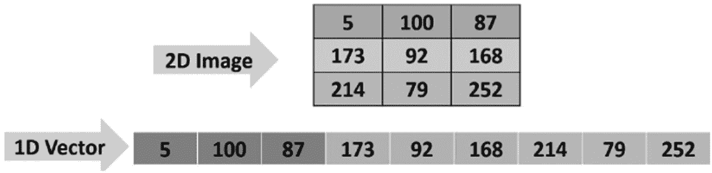

**图 3.5** 输入图像的数据表示.⏎

转换为一维向量时，向量长度无疑将为 9。该向量的前三个元素将取自图像的第一行。向量的接下来三个元素将来自第二行，向量的最后三个元素将来自最后一行。

### 3.4.2 适应度函数

适应度函数或目标函数是 GA 的关键环节，因为它基于一组定量指标决定每次图像迭代的质量。作为图像增强和分割挑战中灰度模糊度和空间模糊度的度量，所提技术使用熵 (H)、紧凑度 (COMP)、面积覆盖指数 (IOAC) 及其组合作为评估图像质量的定量指标。图像 (X) 灰度模糊度的平均模糊量是基于全局信息判断一个像素应被视为黑（暗）还是白（亮）的难度（模糊度）。紧凑度和 IOAC 考虑局部信息，指示图像形状和几何（空间域）中的模糊度。因此，可以利用最小化这些模糊测量值的概念来构建适应度（评估）函数。

在每次迭代中，适应度函数通过应用加权公式整合这些指标来计算综合得分。得分越高表示图像特征定义越清晰、对比度越明显，引导 GA 选择并繁殖更接近最优高质量输出的图像。通过将图像演化为具有明显强度峰值的双峰直方图，适应度函数驱动增强过程，确保 GA 持续青睐清晰度和对比度更好的图像。

### 3.5 实验与结果

GA 被用于各种复杂问题；为求效率，必须使用二级任务来调节其参数。如前所述，变异率和交叉率已知对 GA 的效率和行为有显著影响。一些研究人员利用不同参数的调优来选择它们，使其在执行前确定参数的最佳值，然后使用这些值运行 GA。或者，其他研究人员已证明利用控制参数（确定性、自适应）在生成最佳或近似最佳结果方面更为高效。

根据某些研究，应使用 80–95% 的高交叉率和 0.1–1 的适度变异率。一位研究者在另一项研究中建议采用 50% 等高变异率配合交叉操作，并使用小规模种群。在没有来自搜索过程的反馈或用户干预的情况下，确定性控制参数会在执行过程中改变参数值。因此，应利用此类参数设置来尝试弄清参数应处理何种行为才能有效，并找出最佳或近似最佳的答案。结合使用高交叉率、低变异率以及大规模种群，可促进种群内的多样性。然而，在较小的种群中，则采用较高的变异率来引入多样性并提高搜索质量。通过调整交叉率和变异率，可借助平衡种群多样性的方法提高 GA 效率。

### 3.5.1 定性与定量结果

图 3.6 和 3.7 展示了输入图像以及应用增强过程后生成的增强图像，其中使用了不同代数和不同交叉率。类似的方法也适用于医学领域以外的图像，如图 3.8 和 3.9 所示。正如这些图表所示，增加代数和调整交叉率显著影响了增强图像的质量。在 500 代、0.4 交叉率和 1% 变异率的最佳组合下，图像实现了最高的清晰度和对比度增强。这些优化参数使得关键医学特征被高亮显示，从而在临床环境中更容易进行异常检测。

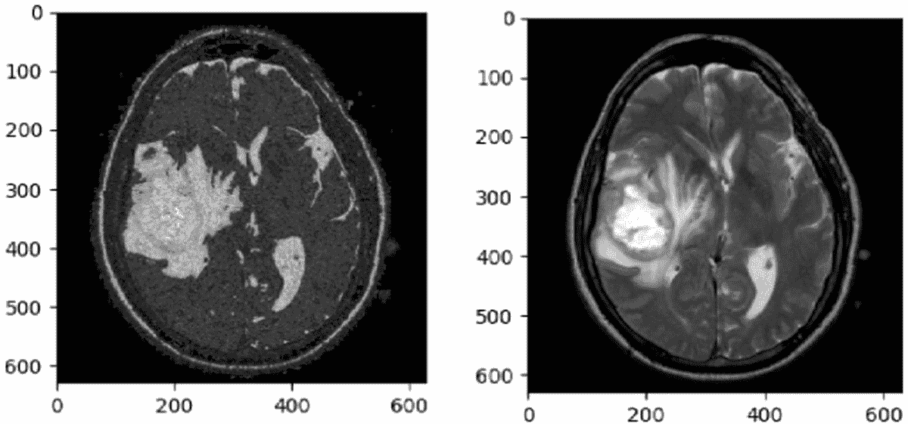

**图 3.6** 输入图像与增强图像对比：500 代，交叉率 0.7，变异率 1%。⏎

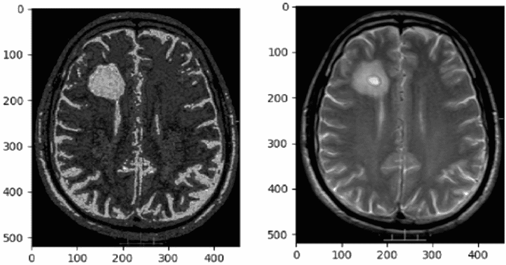

**图 3.7** 输入图像与增强图像对比：600 代，交叉率 0.4，变异率 1%。⏎

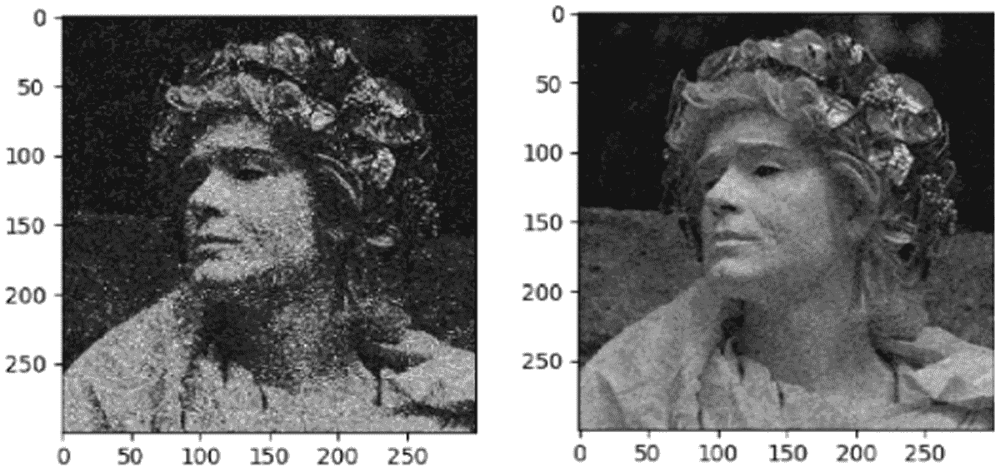

**图 3.8** 输入图像与增强图像对比：500 代，交叉率 0.3，变异率 1%。⏎

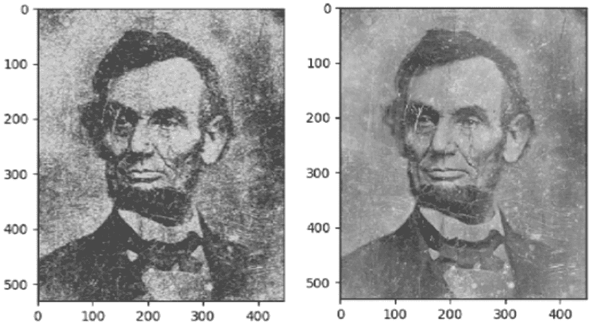

**图 3.9** 输入图像与增强图像对比：500 代，交叉率 0.5，变异率 1%。⏎

### 3.5.2 时间效率与可扩展性

为评估可扩展性，测试在不同分辨率的图像数据集上进行。虽然 GA 对较小图像集的处理效率较高，但高分辨率图像需要显著更多的处理时间，这凸显了该框架在计算成本方面的局限性。进一步的优化或并行处理有助于解决这一局限，使 GA 框架更适用于大规模应用。

### 3.6 局限性

所提 GA 框架的主要局限性之一是迭代演化大型数据集所带来的高计算成本。每一代都需要进行适应度评估、交叉和变异过程，这些过程计算密集，尤其是针对高分辨率医学图像时。随着数据集规模的增加，收敛于最优解所需的代数和操作数也随之增加。这种延长的处理时间可能限制实时应用，使该框架不太适用于需要即时图像增强的场景。

此外，GA 依赖众多参数——如变异率、交叉率和种群规模——需要仔细调优以维持效率，如果需要测试多种配置，这会进一步增加处理时间。未来的工作可探索优化的并行处理技术，或结合 GA 与其他计算资源需求较低算法的混合模型，以在不牺牲图像质量的前提下提高效率。

### 3.7 结论与未来工作

这项工作已被证明是我们项目极其重要的一步。本研究有潜力作为原型，服务于许多不同维度的各类医学专科。可以改进并以更高质量恢复各种通常模糊且整体质量略显不足的古老照片。这些图像随后可被保存以备将来使用。从该项目中获得的众多收获之一，是学习并实践了利用 GA 等尖端技术进行图像增强的过程。通过增加一些功能和属性，该项目可进一步开发并在未来投入使用。这些新增内容将使项目更便捷、更易用，从而更加用户友好。未来，将所有工具集成到单个 Web 应用或桌面程序中，以便不间断地开展工作。努力开发更多应用工具，以便更快地完成改进过程。通过增强现用方法的性能来改进输出结果。

## 参考文献

*   [1] Z. Li *et al.*, “TFCNs: A CNN-transformer hybrid network for medical image segmentation,” Lect. Notes Comput. Sci., vol. 13532, pp. 781–792, 2022. doi:[10.1007/978-3-031-15937-4_65/TABLES/5](http://dx.doi.org/10.1007/978-3-031-15937-4_65/TABLES/5)⏎

*   [2] A. Draa and A. Bouaziz, “An artificial bee colony algorithm for image contrast enhancement,” Swarm Evol. Comput., vol. 16, pp. 69–84, Jun. 2014. doi:[10.1016/j.swevo.2014.01.003](http://dx.doi.org/10.1016/j.swevo.2014.01.003)⏎

*   [3] K. Qin, K. Xu, F. Liu, and D. Li, “Image segmentation based on histogram analysis utilizing the cloud model,” Comput. Math. Appl., vol. 62, no. 7, pp. 2824–2833, Oct. 2011. doi:[10.1016/J.CAMWA.2011.07.048](http://dx.doi.org/10.1016/J.CAMWA.2011.07.048)⏎

*   [4] L. Cui *et al.*, “DDSE: A novel evolutionary algorithm based on degree-descending search strategy for influence maximization in social networks,” J. Netw. Comput. Appl., vol. 103, pp. 119–130, Feb. 2018. doi:[10.1016/j.jnca.2017.12.003](http://dx.doi.org/10.1016/j.jnca.2017.12.003)⏎

*   [5] X. S. Yang, Engineering Optimization: An Introduction with Metaheuristic Applications. John Wiley, 2010. doi:[10.1002/9780470640425](http://dx.doi.org/10.1002/9780470640425)⏎

*   [6] S. N. Kumar, A. Lenin Fred, H. Ajay Kumar, and P. Sebastin Varghese, “Firefly optimization based improved fuzzy clustering for CT/MR image segmentation,” in Intelligent Systems Reference Library, Springer, 2019, pp. 1–28. doi:[10.1007/978-3-319-96002-9_1](https://doi.org/10.1007/978-3-319-96002-9_1)⏎

*   [7] R. Rajabioun, “Cuckoo optimization algorithm,” Appl. Soft Comput. J., vol. 11, no. 8, pp. 5508–5518, 2011. doi:[10.1016/j.asoc.2011.05.008](http://dx.doi.org/10.1016/j.asoc.2011.05.008)⏎

## 参考文献

*   [8] D. Karaboga and B. Basturk, “Artificial bee colony (ABC) optimization algorithm for solving constrained optimization problems,” in *Lecture Notes in Computer Science (including subseries Lecture Notes in Artificial Intelligence and Lecture Notes in Bioinformatics)*, Springer, 2007, pp. 789–798. doi: [10.1007/978-3-540-72950-1_77](http://dx.doi.org/10.1007/978-3-540-72950-1_77)

*   [9] Q. Jiang, G. Song, G. Cong, Y. Wang, W. Si, and K. Xie, “Simulated annealing based influence maximization in social networks,” *Proc. Natl. Conf. Artif. Intell.*, vol. 1, pp. 127–132, 2011. doi: [10.1609/aaai.v25i1.7838](http://dx.doi.org/10.1609/aaai.v25i1.7838)

*   [10] K. Aggarwal and A. Arora, “Influence maximization for MOOC learners using BAT optimization algorithm,” *Int. J. Fuzzy Syst. Appl.*, vol. 11, no. 2, pp. 1–19, Jan. 2022. doi: [10.4018/ijfsa.296588](http://dx.doi.org/10.4018/ijfsa.296588)

*   [11] G. Beni and J. Wang, “Swarm intelligence in cellular robotic systems,” *Robot. Biol. Syst. Towar.*, vol. 102, pp. 703–712, 1993. doi: [10.1007/978-3-642-58069-7_38](http://dx.doi.org/10.1007/978-3-642-58069-7_38)

*   [12] S. Mirjalili, S. M. Mirjalili, and A. Lewis, “Grey wolf optimizer,” *Adv. Eng. Softw.*, vol. 69, pp. 46–61, Mar. 2014. doi: [10.1016/J.ADVENGSOFT.2013.12.007](http://dx.doi.org/10.1016/J.ADVENGSOFT.2013.12.007)

*   [13] D. Karaboga, “An idea based on honey bee swarm for numerical optimization,” *Tech. Rep. TR06*, Erciyes Univ., no. TR06, p. 10, 2005, Accessed: Aug. 30, 2024. [Online]. Available: [`abc.erciyes.edu.tr/pub/tr06_2005.pdf`](https://abc.erciyes.edu.tr/pub/tr06_2005.pdf)

*   [14] J. Kennedy and R. Eberhart, “Particle swarm optimization,” *Proc. ICNN’95 – Int. Conf. Neural Networks*, vol. 4, pp. 1942–1948. doi: [10.1109/ICNN.1995.488968](https://doi.org/10.1109/ICNN.1995.488968)

*   [15] J. H. Holland, “Genetic algorithms understand genetic algorithms,” *Sci. Am.*, vol. 267, no. 1, pp. 66–73, 1992. doi: [10.2307/24939139](http://dx.doi.org/10.2307/24939139)

*   [16] O. Stitini, S. Kaloun, and O. Bencharef, “An improved recommender system solution to mitigate the over-specialization problem using genetic algorithms,” *Electronics*, vol. 11, no. 2, p. 242, Jan. 2022. doi: [10.3390/electronics11020242](http://dx.doi.org/10.3390/electronics11020242)

*   [17] H. Saruhan, “Design optimization of rotor-bearing systems using genetic algorithms.pdf,” 2001. Accessed: Aug. 31, 2024. [Online]. Available: [www.proquest.com/openview/552f782a635144207e5fee770d2cbb0e/1?cbl=18750&diss=y&pq-origsite=gscholar&parentSessionId=7IdHq6LdEeF%2BMV7U%2BTQnTFRtbeMNj8gKetmG3SZL9Q4%3D](http://www.proquest.com/openview/552f782a635144207e5fee770d2cbb0e/1?cbl=18750&diss=y&pq-origsite=gscholar&parentSessionId=7IdHq6LdEeF%2BMV7U%2BTQnTFRtbeMNj8gKetmG3SZL9Q4%3D)

*   [18] L. Haldurai, T. Madhubala, and R. Rajalakshmi, “A study on genetic algorithm and its applications,” *Int. J. Comput. Sci. Eng.*, vol. 4, no. 10, pp. 139–143, 2016.

*   [19] F. A. Zainuddin and M. F. A. Samad, “A review of crossover methods and problem representation of genetic algorithm in recent engineering applications,” *Int. J. Adv. Sci. Technol.*, vol. 29, no. 6, pp. 759–769, 2020, Available: [www.researchgate.net/publication/341930670](http://www.researchgate.net/publication/341930670)


# 第 4 章：无人机或 UAV 上的机器学习安全

**Meenal Jain and Kirti Aggarwal**

DOI: [10.1201/9781003569619-4](http://doi.org/10.1201/9781003569619-4)

## 4.1 简介

### 4.1.1 无人机的工作原理

#### 4.1.1.1 无人机的网络基础设施

为了实现成功的通信、控制和数据传输，无人驾驶飞行器（UAV）或无人机依赖一系列网络基础设施组件。理解这些基础设施组件对于理解无人机操作的复杂性至关重要：

1.  **通信链路：**

    *   **射频（RF）链路：** 无人机通常使用射频链路，如 `2.4 GHz` 和 `5.8 GHz`，这些频段常用于控制和遥测。

    *   **Wi-Fi：** 消费级无人机经常利用 `Wi-Fi` 连接在无人机与遥控器或智能手机应用程序之间进行通信。

    *   **蜂窝网络：** 商用和企业级无人机配备蜂窝连接，允许进行扩展范围通信、数据传输和实时视频流传输。

    *   **卫星通信：** 在偏远或海上区域，无人机可能依赖卫星通信来保持连接，确保全球覆盖。

2.  **数据链路：** 无人机提供多种数据类型，如照片、视频、传感器读数和遥测数据。有线和无线数据连接均用于在无人机和地面系统之间传输数据。

3.  **GPS 接收器：** 大多数无人机包含 `GPS` 接收器，允许它们检测其特定位置并确保正确导航。`GPS` 数据是无人机网络架构的基本组成部分，可实现安全高效的飞行。

4.  **遥测系统：** 遥测系统将关于无人机状态的实时数据发送给地面控制站，包括高度、速度、电池电量和传感器读数。该信息对于跟踪和管理无人机性能至关重要。

5.  **遥控器：** 操作员使用遥控器或发射器向无人机传达控制命令。这些控制器通过射频或 `Wi-Fi` 连接与无人机通信。

这些众多组件构成了无人机的网络骨干，使它们能够在各种应用中高效执行任务。基础设施要素的选择取决于诸如无人机功能、范围要求、操作环境和监管限制等因素。理解这一基础设施对于理解无人机操作背景下可能涉及的安全问题和潜在漏洞至关重要。

无人机容易受到各种恶意攻击，如数据窃听、`GPS` 欺骗、射频干扰和未授权访问。这凸显了采取广泛安全措施以保护无人机及其携带的私密信息的迫切需求。无人机网络架构通常包含加密、认证、入侵检测系统和网络监控等安全功能，以防止未授权访问和数据窃听。

### 4.1.2 对抗攻击

在机器学习（ML）安全这一复杂领域中，已经开发出各种各样的算法，每一种都专门设计用于寻找和利用模型中的缺陷。这些算法主要集中在令人兴奋的对抗攻击领域，该领域探索并操纵机器学习模型的根基。

1.  **L-BFGS 算法：** `L-BFGS` 方法是一种激进的优化方法。它是一种白盒攻击方法。`L-BFGS` 通过反复改进输入数据上的扰动以优化模型的损失来生成对抗样本。这种方法虽然有效，但计算量要求高。

2.  **快速梯度符号法（FGSM）：** `FGSM` 是一种既快速又高效的白盒攻击算法。它通过沿着损失函数相对于输入的梯度方向执行单步操作来修改输入数据。尽管 `FGSM` 能快速生成对抗案例，但并不总能达到较高的成功率。

3.  **基本迭代方法 (BIM) 和投影梯度下降 (PGD)**

    `BIM` 和 `PGD` 是白盒迭代攻击策略。它们通过对输入数据进行多次扰动迭代来创建对抗样本。`BIM` 从微小的扰动开始，并反复添加噪声以最大化模型的损失。`PGD` 是 `BIM` 的一种更强大形式，它将扰动投影到一个球体上，以使其保持在受限范围内。

4.  **动量迭代攻击**

    动量迭代方法是一种白盒迭代方法，通过引入动量来改进 `BIM`。它利用迭代过程中累积的梯度信息对扰动进行更大幅度的修改。该方法有助于避免局部最优，且通常能产生更强的对抗样本。

5.  **GPS 欺骗**

    `GPS` 欺骗是指发送虚假或篡改的 `GPS` 信号，以欺骗 `GPS` 接收器（见图 4.1）。`GPS` 欺骗的目的是诱使目标设备或系统误以为其位于实际位置以外的地方。在无人机或 `UAV` 的情况下，`GPS` 欺骗尤为棘手。无人机通常依赖 `GPS` 进行精确导航、航点跟踪和飞行稳定。当无人机遭受 `GPS` 欺骗时，可能会被误导至错误的飞行路径，从而导致危险场景。它还可能危及依赖精确位置数据的操作的安全性。

    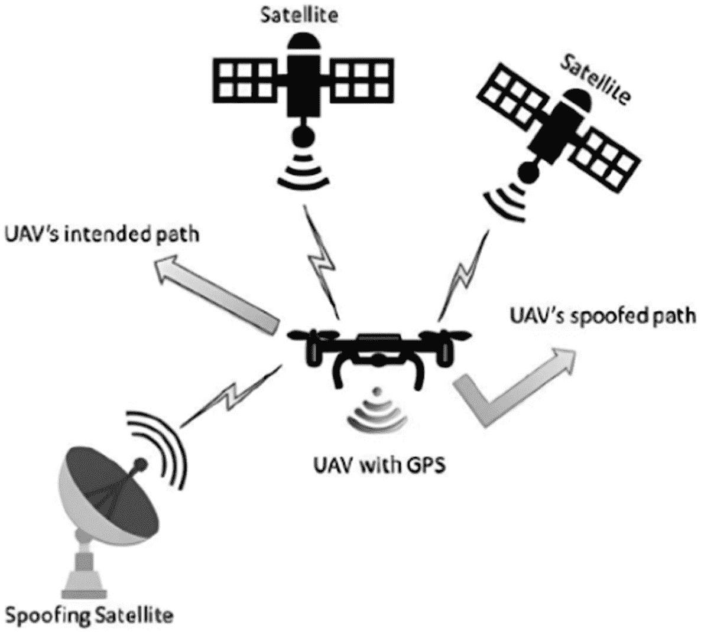

    **图 4.1** `GPS` 欺骗。

6.  **分布式对抗攻击**

    分布式对抗攻击不针对单个样本，而是专注于扰动数据分布。它们旨在减小原始数据分布与改变后数据分布之间的统计差异。这些攻击通过考虑完整的数据分布来评估模型鲁棒性，且通常表现出模型可迁移性。

7.  **基于区块链的攻击**

    针对无人机的基于区块链的攻击可能采取多种不同形式。例如，攻击者可能修改无人机的数据并破坏无人机与其地面控制站的通信。

总之，对抗攻击策略是持续致力于增强 `ML` 模型安全性过程中不可或缺且动态发展的一部分。通过主动使用敌对输入探测和挑战这些模型，安全从业者和研究人员可以发现弱点、切实评估威胁，并推动 `AI` 系统鲁棒性和弹性的持续发展。随着 `ML` 向更多关键行业扩展，对抗攻击技术在维护 `AI` 驱动系统的可靠性和完整性方面变得愈发重要。

## 4.2 文献综述

通过对表 4.1 中讨论的上述研究出版物的仔细审查，很明显，`UAV` 在军事、公共和技术领域的多种应用已在各个学科带来了显著进展。其中包括网络安全框架的进步、专注于安全自主导航和轨迹规划的导航系统，以及无人机互联网的安全通信。卫星、`5G` 和 `UAV` 技术融入电信网络，凸显了采取网络安全措施以防范网络攻击的重要性。`ML` 技术被用于提高 `UAV` 网络的安全性，特别是区分敌对和良性网络流量。同时也重点关注克服深度学习 (`DL`) 算法中的对抗攻击漏洞，以及评估无人机在武装部队、医疗和农业应用中日益增长的使用所带来的优势和风险。

**表 4.1** `UAV` 安全与应用领域的关键贡献

| **作者** | **摘要** |
| :--- | :--- |
| Samanth 等 [[1]](#ch14.xhtml#r100) | `UAV` 既用于武装部队场景，也用于公共场景。武装部队应用包括边境监视和向地面控制站 (`GCS`) 报告入侵者，公共用途包括建筑工地和灾害监测。建议的 `UAV` 框架使用开源 `UAV` 模拟器（如 `AirSim`）进行评估。无人机互联网 (`IoD`) 需要安全通信；安全 `IoD` 通信框架的研究使用了密码学概念。`NS3` 和 `OMNeT++` 是此类研究常用的流行网络模拟器 |
| Vattapparamban 等 [[2]](#ch14.xhtml#r101) | 预计无人机将在维护智慧城市安全和监控、运输货物商品以及充当宽带无线接入的移动热点方面发挥重要作用。然而，无人机在未来智慧城市中的使用也必然会引发许多需要关注的技术和社会问题。本综述文章旨在分析与网络安全和隐私相关的几个无人机相关主题。我们还将分享关于基于无人机的网络攻击的代表性发现 |
| Shrestha 等 [[3]](#ch14.xhtml#r102) | 从包裹递送到野生动物保护，`UAV` 使用的近期增加正在推动电信网络的发展，以融合 `5G`、卫星和 `UAV` 技术。但由于 `UAV` 节点越来越容易受到黑客攻击，安全担忧也随之产生。该研究提出了一种基于机器学习的 `5G` 网络安全模型，利用 `UAV` 和卫星识别七种现代攻击类型。文章展示了 `ML` 系统区分恶意和良性 `UAV` 网络数据包的效果，以提高安全性 |
| Ren 等 [[4]](#ch14.xhtml#r103) | 在快速发展的深度学习 (`DL`) 和人工智能 (`AI`) 领域，算法安全至关重要。`DL` 算法对对抗样本的易感性引起了广泛关注，此类样本能在欺骗人类观察者的同时诱导模型产生错误行为。对抗攻击已被证明在现实场景中可行，从而在机器学习和安全领域引起了关注。本文介绍了对抗攻击策略的理论基础、算法和实际应用。还包含了防御策略领域的研究计划。本文的结论强调了未解决的问题，以促进该重要领域的进一步研究 |
| Emimi 等 [[5]](#ch14.xhtml#r104) | 在医疗领域，无人机在紧急情况下向偏远地区运送关键医疗物资。在武装部队中，它们加强了安全和监控工作。然而，无人机也带来了受伤和财产损失等风险，特别是在操作不当或发生组件故障时。极端分子可能劫持无人机用于其目的。本文全面分析了农业、医疗和武装部队无人机，考察了它们的优势、劣势和机遇 |
| Lu 等 [[6]](#ch14.xhtml#r105) | `DNN` 常用于 `UAV` 视觉导航和识别；但它们易受实时图像扰动和对抗伪装的影响。本研究提出了两种集成技术，利用 `CNN` 和 `Transformer` 模型对 `UAV` 进行主动和被动对抗防御。主动方法利用对抗迁移性，混合基础 `DNN` 模型的输出概率。被动方法将平均输出置信度分数和隐藏特征与对抗检测器的评分系统相结合。在光学和合成孔径雷达 (`SAR`) 数据集上进行的实验证明了它们在提高识别任务鲁棒性方面的有效性。此外，本研究还引入了 `AREP-RSIs`，一个用于评估遥感模型对抗鲁棒性的框架 |

## 4.3 基于关注点、方法论和参考文献结果的比较分析

### 4.3.1 基于机器学习的方法

| 参考文献 | 关注点 | 方法论 | 关键结果 |
| :--- | :--- | :--- | :--- |
| **Shankar 等人 [7]** | 面向 `IoMT` 的 `UAV` 集成健康监测系统 | 基于 `IoMT` 的 `UAV` 系统，配备传感器/执行器用于远程患者数据查看和分析；视频捕获用于医生监控 | 降低再入院率和住院时长；实现远程监测；*挑战*：处理大数据量存在问题 |
| **Elmokadem 和 Savkin [8]** | `UAV` 安全自主导航 | 近期进展综述；用于 3D 规避机动和安全轨迹规划的先进方法 | 确定 `UAV` 发展中的研究挑战；强调向全自主转变的趋势 |
| **Aldaej 等人 [9]** | 无人机网络 的隐私与安全 | 结合 `Random Forest` 和 `Logistic Regression` 的混合 `ML` 方法用于数据分类 | 利用 `AI` 启发技术改进 `NoD` 网络安全；在具有挑战性的数据集上验证，显示出改进的统计指标和效率 |
| **Meshram 和 Reddy [10]** | 面向建筑工程的无人机工地监测与管理 | `ML` 技术检测材料卸载、施工质量、工地进度和劳务活动中的差异 | 将建筑成本降低 >10%；将施工质量提高 15%；灵活的底层方法适用于各种事件类型 |
| **Medaiyese 等人 [11]** | 无人机检测与识别 (`DDI`) 系统安全 | 基于低频段 `RF` 数据的 `RF-based ML DDI` 系统；三个 `XGBoost` 模型分别用于存在性、类型和操作模式检测 | 通过 10 折交叉验证，平均准确率分别为 99.96%、90.73% 和 70.09% |
| **Sachdeva 等人 [12]** | 抵御网络攻击的安全 `UAV` 通信 | 用于安全 `UAV` 自组网和智能合约的区块链技术 | 提供可信、安全的网络，能抵御恶意攻击和网络危害（`GPS` 欺骗、干扰等） |

研究考察了 `UAV` 技术如何与物联网 (`IoT`) 交互，以及这未来可能如何影响智慧城市。无人机在这些大都市环境中的广泛应用，对公共安全、隐私和网络安全构成了重大风险。无人机使用的增加推动了安全数据收集和存储系统的发展，例如 `SecureIoD`，它采用基于区块链的存储方法、安全密钥建立和认证来保护 `IoD` 数据。尽管管理海量数据量的困难依然存在，但将 `UAV` 集成到医疗物联网 (`IoMT`) 中，已产生创新的健康监测系统，使医疗从业者能够远程访问和分析数据。

更高的自主性和更少的人工干预是 `UAV` 技术进步的目标，重点关注安全导航方法。无人机网络中的隐私和安全漏洞要求强有力的网络安全标准。`ML` 技术的使用，如 `Decision Tree` 和 `Logistic Regression`，已显示出改进无人机网络网络安全协议的成效。此外，多项研究强调了人工智能 (`AI`) 和 `ML` 如何彻底改变多个无人机相关领域，包括入侵检测系统、工地监测和通信安全。

区块链技术、`5G` 网络和 `AI` 共同协作，创造了潜在的智能且安全的无人机通信系统，如 **图 4.2** 所示。此外，以智慧城市安全为重点，`AI` 驱动的 `5G` 应用在虚拟情感系统中提供了尖端能力。基于区块链的解决方案在保护网络免受犯罪攻击和网络威胁、以及保障 `UAV` 系统通信安全方面显示出前景。与此同时，智能入侵检测系统正在被开发以应对 `UAV` 面临的常见威胁。这些系统采用 `PCA` 和单类分类器等技术来识别和中和干扰和欺骗等攻击，即使在通信中断的情况下也能保护 `UAV`。

# 相关研究综述

## 面向蜂窝连接 UAV 网络的机器学习赋能入侵检测系统

该研究针对 `5G` 和基于卫星的 `UAV` 网络创建安全模型，采用机器学习进行数据包区分和攻击识别。研究考察了 `UAV`、`5G` 网络和卫星技术相结合的后果，重点关注近期 `UAV` 在多个领域部署的激增。它解决了 `UAV` 节点日益增长的安全问题，这些节点因固有弱点和不断增加的数据量而容易遭受攻击。该研究提供了一种利用 `5G` 网络的独特 `UAV` 安全模型，该模型利用机器学习方法识别和分类针对 `UAV` 网络的多种现代攻击形式。通过比较评估分析机器学习算法的性能和准确性，重点关注决策树算法在识别不同 `UAV` 网络威胁方面的有效性 [3]。

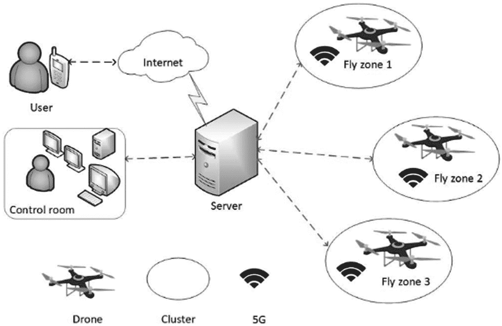

**Figure 4.2** `5G` 网络上的无人机通信。

## 深度学习中的对抗攻击与防御

该研究考察深度学习算法在 `UAV` 中对对抗攻击的脆弱性，讨论防御技术。

研究聚焦于 `UAV` 中使用的深度学习算法对对抗攻击的易感性。它深入探讨了针对深度学习算法的对抗攻击策略的理论基础、方法及实际应用。

论文针对对抗攻击提供了保护机制的全面综述，涵盖机器学习和安全研究领域 [4]。

## 基于深度集成模型的面向 UAV 自动图像识别的对抗鲁棒性增强

该研究使用 `CNN` 和 `Transformer` 模型，描述了基于光学和合成孔径雷达（`SAR`）数据集的研究。

利用 `Transformer` 模型和卷积神经网络（`CNN`），研究提出并评估了两种集成方法，用于 `UAV` 中主动和被动对抗防御机制。其中，被动技术将对抗检测器评分函数与平均输出置信度评分和隐藏特征相结合；主动方法将对抗检测器评分函数与平均输出置信度评分和隐藏特征相结合。

实验使用光学和 `SAR` 数据集测试防御机制提高识别任务性能的能力，特别是在敌对环境中 [6]。

## 支持带有 AI 的 UAV 系统的智能 IoMT 框架

该框架将健康监测与 `UAV` 集成，但缺乏具体方法论细节，引入了一种连接 `UAV` 的新型健康监测系统，允许医疗从业者远程查看和分析数据。该基于 `IoMT` 的 `UAV` 系统旨在最大限度地减少住院时间和再入院率 [8]。

## 面向物联网赋能无人机的智能网络安全框架：机器学习视角

该技术关注无人机网络（`NoD`）中存在的隐私和安全漏洞，并强调开发安全网络架构的重要性。论文深入探讨了无人机网络引发的当前隐私和安全问题，将其归因于网络设计缺陷。为解决这些问题，研究采用混合机器学习方法进行成功的数据分类，该方法结合了逻辑回归和随机森林算法。该技术融合了复杂的 `AI` 启发式方法，有助于增强 `NoD` 网络中的网络安全措施。研究过程包括收集与 `NoD` 隐私和安全问题相关的困难数据集。验证方法产生了对建议方法效率和统计性能指标的评估，显示出 `NoD` 网络网络安全和整体保护的改进 [10]。

## 无人机互联网中的机器学习应用：系统综述、最新部署和开放问题

该研究讨论无人机/`UAV` 的广泛效用及其在各个领域的适应性。研究探讨机器学习在无人机互联网（`IoD`）和 `UAV` 背景下的应用。深入考察 `IoD`/`UAV` 概念、机器学习应用、当前突破、现有方法和未来研究前景。研究发现，`CNN` 常用于 `IoD`-`UAV` 应用，资源和移动性管理获得最大关注。`Python` 是最流行的编程语言，出版活动在 2021 年达到顶峰。研究强调无人机在多个行业的不同潜在用途，强调其在各种情况下的多功能性和实用性。这表明无人机应用范围广泛 [13]。

## 基于机器学习的无人机系统开发用于建筑工地管理

该提案提出基于无人机的工地监测系统，以提高工地质量并降低建筑成本。机器学习算法用于处理无人机收集的工地监测数据。为检测材料卸载、施工质量和劳动活动中的异常，这些系统使用异常检测和分类技术。该解决方案采用可扩展的事件驱动架构进行持续的工地质量管理。预计使用机器学习算法进行工地监测将导致建筑成本显著降低 10%，施工质量提高 15%。这一改进展示了无人机工地管理的有效性 [10]。

## 基于机器学习的射频无人机检测与识别系统框架

该研究专注于基于机器学习的无人机检测和识别解决方案，以解决隐私和安全问题。利用无人机与飞行控制器通信的低频射频数据，通过射频信号分析应用机器学习模型进行无人机识别和检测。对模型执行十次彻底的交叉验证以确保准确性。

预计使用机器学习算法进行工地监测将显著降低建筑成本 10% 以上，同时将建筑质量提高 15%。这一进步证明了部署无人机进行工地管理的有效性 [11]。

## 无人机网络数字孪生中的深度学习驱动安全


该研究详述使用改进的 `LSTM` 进行无人机攻击预测的安全研究，使用差分隐私保护数据隐私，并使用田纳西伊士曼工艺测试模型性能。网络物理系统（`CPS`）数据使用先进的 `LSTM` 网络进行评估，重点关注攻击前无人机控制信号数据的预测建模。通过利用田纳西伊士曼工艺作为仿真平台评估预测模型，该解决方案采用差分隐私技术保护数据隐私。预计增强的 `LSTM` 网络结合差分隐私方法将提高无人机攻击预测的预测准确性和鲁棒性。这一结果表明无人机系统的安全性得到改善 [14]。

## 基于机器学习的时延感知 UAV 检测与加密 Wi-Fi 流量上的操作模式识别

该研究描述利用加密 Wi-Fi 通信特征进行 `UAV` 检测和操作模式识别的方法。

Wi-Fi 通信指标（如数据包大小和到达间隔时间）用于 `UAV` 识别和检测。系统用于特征选择和预测性能改进的方法称为重加权 `l1-norm` 正则化。

Wi-Fi 数据可用于以高准确率（85.7%–95.2%）和快速识别时间（0.15–0.35 秒）识别不同的消费级 `UAV`。这证明了及时准确检测 `UAV` 的能力 [15]。

## 4.3.2 无人机安全的其他方法

《智慧城市无人机：网络安全、隐私与公共安全问题》将公共安全作为识别未来智慧城市无人机相关问题时的关键考量因素。

该研究采取前瞻性立场，预测无人机未来将如何在网络化智慧城市中应用。它概述了广泛的潜在职责，如宽带无线接入、配送服务以及监控和安全系统。报告还强调了无人机在未来智慧城市大规模部署所带来的技术和社会挑战，特别是在公共安全、网络安全和隐私方面。

该综述文章着重探讨无人机融合可能如何影响网络安全，通过回顾和综合关于无人机融入未来智慧城市主题的近期研究、出版物和文献，构建了一个综合性方法 [2]。

《无人机技术的当前机遇与挑战》重点介绍了无人机在农业、医疗和武装部门的应用。该研究考察了无人机技术在农业、医疗和武装服务领域的多种应用。它深入探讨了无人机在各行业中的角色和贡献，突出了其优势、潜在危害和潜在滥用风险。该研究考察了无人机在农业、医疗和武装服务环境中提供的优势、劣势、可能性和潜在风险 [5]。

《SecureIoD：面向无人机互联网的安全数据收集与存储机制》解释了 `SecureIoD` 的创建与测试，`SecureIoD` 是一种安全的 `IoD` 数据收集系统。

考虑到无人机的限制和开放无线介质，该研究强调了在 `IoD` 场景中数据安全和隐私的必要性。研究引入了 `SecureIoD`，一种安全的 `IoD` 数据收集和存储解决方案。它包含无人机与区域服务提供商（`ZSP`）之间的相互认证、安全密钥生成以及基于区块链的数据存储。

矿工 `ZSP` 通过混合工作量证明和权益证明共识机制选出。实际测试和仿真表明，`SecureIoD` 比以往系统更安全、更有效，安全性研究支持其抗攻击能力 [20]。

《迈向全自主无人机：综述》重点介绍了无人机的最新进展及安全自主导航方法。文章首先强调了无人机在武装部门和公共部门众多应用中的进步，突出了其在远程访问、节省时间和安全改进方面的价值。研究聚焦于当前无人机的进展，特别是在实现完全自主和消除人工干预方面。该研究旨在评估无人机技术的改进，重点关注安全自主导航。该过程包括对当前文献、技术报告和研究论文的彻底评估以达成此目标。针对三维规避机动和轨迹规划的先进方法解决了与无人机开发相关的独特研究问题，特别是在安全自主导航的背景下 [9]。

《利用区块链改进无人机网络中的隐私与安全》针对无人机漏洞提出利用区块链保障无人机通信安全。它提出利用区块链技术保护无人机通信，重点关注智能合约和建立一个能抵御各种网络攻击和入侵的安全无人机自组网。设想基于区块链的安全无人机自组网能够抵御不同的网络攻击，并为无人机提供安全可靠的通信环境 [19]。

《无人机入侵检测系统》介绍了一种利用 `PCA` 和单类分类器的无人机入侵检测系统，应对 GPS 欺骗和干扰。在一种旨在发现针对无人机的 GPS 欺骗和干扰威胁的入侵检测系统中，采用了 `PCA` 和单类分类器。该系统运行在无人机资源受限的代理设备中，旨在以 90% 以上的高准确率检测并可能中和针对无人机的 GPS 欺骗和干扰攻击 [20]。

### 4.4 结论

在我们对无人机（`UAV`）和无人机技术领域研究的探索过程中，我们发现了塑造这一创新领域的关键进展与挑战。无人机已成为军事和民用应用中不可或缺的工具，在远程可达性、效率和安全性方面提供了显著提升。向全自主无人机的推进代表了一次重大飞跃，旨在减少人工干预，同时优先保障安全的自主导航。这一进展通过三维避障和轨迹规划技术得到了探讨，解决了该领域的关键挑战。同时，小型无人机的快速普及为各个领域开辟了新的可能性，特别是通过物联网（`IoT`）集成用于导航服务。然而，这种增长也带来了无人机网络（`NoD`）中严重的隐私和安全风险，源于固有的设计漏洞。针对这些担忧，我们探索了一种新颖的混合机器学习方法，该方法结合了监督机器学习技术（如基于决策的方法和逻辑回归），以增强无人机网络的网络安全。这种集成的、AI 驱动的解决方案在加强无人机网络安全方面显示出前景。

## 参考文献

*   [1] Samanth S, Prema KV, Balachandra M. 2022. Security in internet of drones: a comprehensive review. Cogent Engineering. 9(1):2029080. doi:[10.1080/23311916.2022.2029080](https://doi.org/10.1080/23311916.2022.2029080)

*   [2] Vattapparamban E, Güvenç I, Yurekli AI, Akkaya K, Uluağaç S. 2016. Drones for smart cities: Issues in cybersecurity, privacy, and public safety. In: 2016 International Wireless Communications and Mobile Computing Conference (IWCMC); Sep 2016; Paphos, Cyprus. IEEE. pp. 216–221. doi:[10.1109/IWCMC.2016.7577060](http://dx.doi.org/10.1109/IWCMC.2016.7577060)

*   [3] Shrestha R, Omidkar A, Roudi SA, Abbas R, Kim S. 2021. Machine-learning-enabled intrusion detection system for cellular connected UAV networks. Electronics. 10(13):1549. doi:[10.3390/electronics10131549](http://dx.doi.org/10.3390/electronics10131549)

*   [4] Ren K, Zheng T, Qin Z, Liu X. 2020. Adversarial attacks and defenses in deep learning. Engineering. 6(3):346–360. doi:[10.1016/j.eng.2019.12.015](http://dx.doi.org/10.1016/j.eng.2019.12.015)

*   [5] Emimi M, Khaleel M, Alkrash A. 2023. The current opportunities and challenges in drone technology. International Journal of Electrical Engineering and Sustainability. 1(3):74–89.

*   [6] Lu Z, Sun H, Xu Y. 2023. Adversarial robustness enhancement of UAV-oriented automatic image recognition based on deep ensemble models. Remote Sensing. 15(12):3007. doi:[10.3390/rs15123007](http://dx.doi.org/10.3390/rs15123007)

*   [7] Shankar N, Nallakaruppan MK, Ravindranath V, Senthilkumar M, Bhagavath BP. 2022. Smart IoMT framework for supporting UAV systems with AI. Electronics. 12(1):86. doi:[10.3390/electronics12010086](http://dx.doi.org/10.3390/electronics12010086)

*   [8] Elmokadem T, Savkin AV. 2021. Towards fully autonomous UAVs: A survey. Sensors. 21(18):6223. doi:[10.3390/s21186223](http://dx.doi.org/10.3390/s21186223)

*   [9] Aldaej A, Ahanger TA, Atiquzzaman M, Ullah I, Yousufudin M. 2022. Smart cybersecurity framework for IoT-empowered drones: machine learning perspective. Sensors. 22(7):2630. doi:[10.3390/s22072630](http://dx.doi.org/10.3390/s22072630)

*   [10] Meshram K, Reddy NG. 2022. Development of a machine learning-based drone system for management of construction sites. In: Advances in Sustainable Materials and Resilient Infrastructure; Springer Singapore. pp. 77–88. doi:[10.1007/978-981-16-7074-5_8](http://dx.doi.org/10.1007/978-981-16-7074-5_8)

*   [11] Medaiyese OO, Syed A, Lauf AP. 2021. Machine learning framework for RF-based drone detection and identification system. In: 2021 2nd International Conference On Smart Cities, Automation & Intelligent Computing Systems (ICON-SONICS); Oct 2021; Yogyakarta, Indonesia. IEEE. pp. 58–64. [`doi.org/10.1109/ICON-SONICS53103.2021.9617168`](https://doi.org/10.1109/ICON-SONICS53103.2021.9617168)

*   [12] Sachdeva H, Gupta S, Misra A, Chauhan K, Dave M. 2023. Privacy and security improvement in UAV network using blockchain. International Journal of Communication Networks and Distributed Systems. 29(4):383–406. [`doi.org/10.1504/ijcnds.2023.131736`](https://doi.org/10.1504/ijcnds.2023.131736)

*   [13] Heidari A, Jafari Navimipour N, Unal M, Zhang G. 2023. Machine learning applications in internet-of-drones: systematic review, recent deployments, and open issues. ACM Computing Surveys. 55(12):1–45. [`doi.org/10.1145/3571728`](https://doi.org/10.1145/3571728)

*   [14] Wu J, Guo J, Lv Z. 2022. Deep learning driven security in digital twins of drone network. In: ICC 2022-IEEE International Conference on Communications; May 2022; Seoul, Korea. IEEE. pp. 1–6. [`doi.org/10.1109/ICC45855.2022.9838734`](https://doi.org/10.1109/ICC45855.2022.9838734)

*   [15] Alipour-Fanid A, Dabaghchian M, Wang N, Wang P, Zhao L, Zeng K. 2019. Machine learning-based delay-aware UAV detection and operation mode identification over encrypted Wi-Fi traffic. IEEE Transactions on Information Forensics and Security. 15:2346–2360. [`doi.org/10.1109/TIFS.2019.2959899`](https://doi.org/10.1109/TIFS.2019.2959899)

*   [16] Bera B, Wazid M, Das AK, Rodrigues JJ. 2021. Securing internet of drones networks using AI-envisioned smart-contract-based blockchain. IEEE Internet of Things Magazine. 4(4):68–73. doi:[10.1109/IOTM.001.2100044](http://dx.doi.org/10.1109/IOTM.001.2100044).

*   [17] Gupta R, Kumari A, Tanwar S. 2021. Fusion of blockchain and artificial intelligence for secure drone networking underlying 5G communications. Transactions on Emerging Telecommunications Technologies. 32(1):e4176. [`doi.org/10.1002/ett.4176`](https://doi.org/10.1002/ett.4176)

*   [18] Kim, H., Ben-Othman, J., Mokdad, L., Son, J., & Li, C. 2020. Research challenges and security threats to AI-driven 5G virtual emotion applications using autonomous vehicles, drones, and smart devices. IEEE Network. 34(6):288–294. doi: [10.1109/MNET.011.2000245](http://dx.doi.org/10.1109/MNET.011.2000245)

*   [19] Whelan, J., Almehmadi, A., & El-Khatib, K. 2022. Artificial intelligence for intrusion detection systems in unmanned aerial vehicles. Computers and Electrical Engineering. 99, 107784. [`doi.org/10.1016/j.compeleceng.2022.107784`](https://doi.org/10.1016/j.compeleceng.2022.107784)

*   [20] Pu C, Wall A, Ahmed I, Choo KKR. 2022. SecureIoD: A secure data collection and storage mechanism for internet of drones. In: 2022 23rd IEEE International Conference on Mobile Data Management (MDM*); Jun 2022; Paphos, Cyprus. IEEE. pp. 83–92. [`doi.org/10.1109/MDM55031.2022.00033`](https://doi.org/10.1109/MDM55031.2022.00033)

# 第 5 章 图像伪造检测

Simran Bhardwaj, Kartikey, and Mukta Goyal

DOI: [10.1201/9781003569619-5](http://doi.org/10.1201/9781003569619-5)

### 5.1 简介

图像伪造检测已成为数字取证中的关键领域，这得益于数字图像在新闻、法律证据和社交媒体等各个领域的广泛应用。图像篡改技术日益复杂，特别是基于深度学习的生成模型，这引发了人们对数字内容真实性和完整性的重大担忧。

# 图像伪造检测综述

## 深度学习技术在伪造检测中的应用


# 深度学习技术在图像伪造检测中的应用

深度学习技术，特别是卷积神经网络（`CNNs`），通过提取人眼不可见的复杂模式和不一致性，在识别伪造图像方面表现出了非凡的能力。近期研究探讨了基于 `CNN` 的模型在伪造定位和检测中的作用，利用迁移学习提高准确性和鲁棒性 [[1]](#ch15.xhtml#r120)。此外，在检测 `GAN` 生成的假图像方面的进展证明了 `CNN` 架构在区分合成内容与真实内容方面的有效性 [[2]](#ch15.xhtml#r121), [[3]](#ch15.xhtml#r122)。

特征融合和集成 `CNN` 模型通过整合多层级特征表示来增强决策准确性，进一步提高了图像伪造检测的可靠性 [[4]](#ch15.xhtml#r123)。结合多种架构的混合深度学习模型也被提出，用于创建能够处理多种伪造类型（包括复制-移动和拼接技术）的更鲁棒检测框架 [[5]](#ch15.xhtml#r124)。此外，研究还探索了专门为复制-移动伪造检测设计的深度学习架构，强调了提取细粒度空间信息以提高定位性能的重要性 [[6]](#ch15.xhtml#r125)。

深度特征分析在复制-移动伪造检测中的作用已被广泛研究，突显了基于特征的方法在识别图像内重复区域方面的有效性 [[7]](#ch15.xhtml#r126)。自适应深度学习框架也被引入，以动态适应不同的伪造类型，提高了跨各种数据集的检测准确性 [[8]](#ch15.xhtml#r127)。这些进展共同促进了图像伪造检测领域的发展 [[3]](#ch15.xhtml#r122)，强化了持续创新以应对数字图像处理新兴威胁的必要性。

## 问题陈述

识别和定位旨在误导或欺骗观众的数字图片篡改，构成了图像伪造检测的问题陈述。由于图像编辑工具和方法的广泛使用，制作伪造或修改过的照片变得更加容易。这些图像可用于损害声誉、提供虚假证据或误导公众。在媒体、执法和司法系统等多个行业中，照片被用作证据，篡改图像的泛滥带来了重大问题。在这些情况下，数字图像的真实性和完整性至关重要，任何篡改都可能产生负面影响。图像伪造检测的目标是发现数字照片中可能表明被篡改的任何差异或异常，如颜色、纹理或元数据的修改。检测图像伪造的困难在于调整可能很微妙，且伪造者可能使用各种方法来隐藏它们，包括隐写术。

## 研究意义与应用领域

随着数字媒体的广泛使用，图像修改已成为日益普遍的现象。这使得图像伪造检测在识别数字图像中的伪造方面具有创新性。确保数字照片的有效性和完整性的必要性，特别是在法律和调查背景下，推动了图像伪造检测算法的发展。能够快速精确识别篡改图像的自动化方法的创建，是图像伪造检测的关键发展之一。机器学习算法和深度学习模型使得检测图像中的细微变成为可能，揭示了甚至可能逃过人类专家注意的伪造。

图像伪造检测领域跨越新闻、媒体取证、执法和科学研究等广泛学科。随着越来越多的应用使用数字照片，图像伪造检测的范围也在扩大。在执法中，图像伪造检测是定位可能用作调查和司法程序证据的篡改照片的关键工具。用作证据的数字照片必须准确真实；任何修改都可能带来严重后果。新闻业中使用篡改照片可能会误导观众，损害媒体组织的信誉和声誉。图片伪造检测技术用于发现篡改照片并保证媒体内容的真实性。在媒体取证中，图像伪造检测用于调查图像篡改事件，如涉及政治宣传的事件，其中图像被更改以影响公众舆论。图片伪造检测技术用于发现篡改照片并在法庭上提供证据。

在科学研究中，图像伪造检测用于确保研究数据的真实性和完整性，特别是在卫星成像和医学成像等领域。图片伪造检测算法被用于发现研究照片的任何篡改，以确保科学发现的真实性和可靠性。随着数字图像在各种应用中越来越多地使用，图像伪造检测的广度也在扩大。为了在众多行业中保持数字图像的有效性和完整性，图像伪造检测算法在不断改进，以跟上新图像修改技术的发展。

## 检测流程与关键技术

有多种技术和算法能够正确有效地识别修改过的照片，用于检测图像伪造。解决方案是多方面的，包含多个过程，如从图像中提取特征、分类和图像准备。

**图像预处理** 是伪造检测的初始步骤，旨在提高图像质量并消除可能阻碍篡改检测的伪影或噪声。预处理技术示例包括图像去噪、滤波和色彩校正。

**特征提取** 是第二步，旨在识别和提取可用于区分修改图像和真实图像的相关信息。特征提取技术示例包括局部二值模式（`LBP`）、尺度不变特征变换（`SIFT`）和方向梯度直方图（`HOG`）。

**分类阶段** 使用机器学习或深度学习算法分析提取的特征，以确定图像是真实的还是被修改的。分类技术示例包括支持向量机（`SVMs`）、决策树和 `CNNs`。

检测特定形式的图像操纵（如 `Deepfakes`、复制-移动篡改和隐写术）需要创建专门的算法。开发这些技术至关重要，因为伪造者通常采用先进且复杂的策略来隐藏他们的修改。总的来说，解决图像欺诈检测问题需要开发可靠有效的方法和算法，以精确识别各种图像篡改，确保数字图像在各种应用中的有效性和完整性。

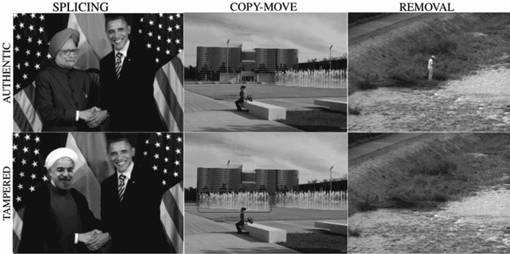

**Figure 5.1** 不同伪造类型的不同图像。

# 图像伪造检测中的传统方法与深度学习方法对比

为了发现图像中的修改，会应用包括中值滤波、小波变换和边缘检测在内的传统图像处理方法。这些方法基于发现伪造者在篡改过程中引入的伪影。虽然它们处理速度很快，但准确性不高，且经常难以应对精心制作的伪造。

基于特征的方法会提取并分析图像的某些元素，如纹理、颜色和边缘信息。然后利用这些特征来识别图像修改。虽然基于特征的方法通常准确，但对于深度伪造等复杂篡改可能无效。

总之，标准图像处理方法快但准确性有限。基于特征的技术虽准确，但可能难以应对复杂修改。机器学习技术为检测复杂篡改提供了精度和效率，而深度学习方法能达到高准确性，但需要大量的处理能力和海量训练数据。技术的选择取决于应用需求以及待检测图像修改的复杂性。使用 `CNN` 进行图像伪造检测的工作流程如 Figure 5.2 所示。

```
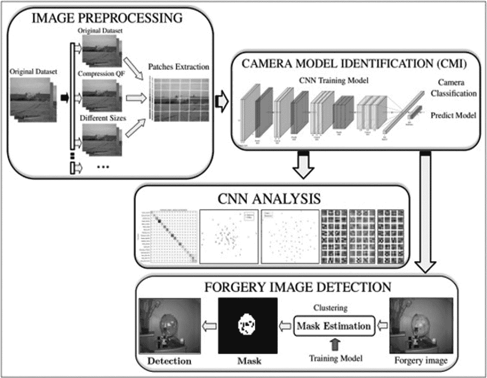
```

**Figure 5.2** 使用 CNN 进行图像伪造检测的工作原理。

## 5.2 文献综述

图像伪造检测是一个关键研究领域，专注于识别数字图像中的篡改。随着社交媒体和数字通信的兴起，图像的真实性变得越来越值得怀疑，从而产生了对可靠检测方法的需求。图像伪造可以采取多种形式，包括拼接、复制-移动和图像修饰，所有这些都旨在通过改变视觉信息来误导观众。在错误信息能够迅速传播的世界里，检测篡改图像的能力至关重要。例如，新闻机构依赖真实图像来传递准确信息，法医专家在法律背景下使用图像分析来验证证据。深度学习技术的出现，特别是 `CNN`，已经改变了图像伪造检测，显著提高了识别篡改图像的准确性和效率 [9]。

Fan 等人 [10] 的研究工作展示了图像伪造检测中使用的几种分类器，每种都有其独特的优势和局限性。本研究工作中应用的主要分类器如下：

*   **卷积神经网络 (`CNN`) 在图像伪造检测中的应用**：`CNN` 已成为图像处理任务的基准，因为其架构独特地适合捕捉图像内的空间层次结构。`CNN` 从原始像素值自动学习特征，使其能够捕捉可能表明伪造的复杂细节和模式。研究表明，`CNN` 在各种图像相关任务（包括伪造检测）中均优于传统分类器。

*   **支持向量机 (`SVM`)**：`SVM` 因其在高维空间中的有效性而成为分类任务的热门选择。然而，`SVM` 需要仔细的特征工程，且在处理复杂视觉数据方面往往能力有限，这可能降低其在伪造检测中的有效性。

*   **随机森林在图像伪造检测中的应用**：随机森林作为一种集成学习技术，结合多棵决策树以提高分类准确性。虽然它们抗过拟合且能处理多样化数据集，但面临图像数据高维度的挑战，这可能导致在伪造检测任务中性能较差。

*   **k-近邻 (`k-NN`)**：`k-NN` 是一种简单的分类方法，依赖距离度量根据邻居对实例进行分类。然而，`k-NN` 对大型数据集计算成本高昂，且往往无法捕捉高维图像数据中的复杂关系，使其不太适合伪造检测。

*   **集成方法**：这些方法结合多个分类器以发挥其优势。然而，它们可能引入额外的复杂性和计算开销，与使用 `CNN` 的简化方法相比吸引力较低。

虽然已经开发并评估了多种分类器用于此任务，但在所有分类器中，`CNN` 因其直接从图像数据学习复杂特征的卓越能力而脱颖而出。随着该领域研究的进展，先进机器学习技术的融入有望进一步提高图像伪造检测方法的可靠性和准确性。

2023 年，`CNN` [11] 在图像伪造检测中已成为图像处理任务的基石，特别是在图像伪造检测方面。一种专门的架构被构建用于识别图像内的空间层次结构，使其能够有效检测可能预示伪造的细微篡改。工作详情如下：

*   **架构与特征学习**：`CNN` 由包括卷积滤波器、池化层和全连接层在内的层组成。卷积层起着关键作用，对输入图像应用一系列滤波器以检测不同尺度上的边缘、纹理和模式。这种多层方法使 `CNN` 能够在无需人工特征提取的情况下学习复杂特征，这比 `SVM` 或随机森林等传统分类器有了显著进步。正如近期研究所强调的，`CNN` 自适应学习特征的能力使其在图像篡改细微或伪造极其逼真的场景中特别有效。这种适应性带来了增强的检测能力，在处理海量数据集时尤为重要。

*   **训练与泛化**：`CNN` 的训练过程通常涉及使用大型标注数据集，通过反向传播调整网络权重。这使模型能够最小化衡量预测输出与真实标签差异的损失函数。根据 Zhang 等人的研究，经过良好优化的 `CNN` 在检测不同类型的图像伪造方面可达到 95% 以上的准确率。此外，`CNN` 的泛化能力使其即使在未见数据上也能有效执行。这在伪造检测中尤为重要，因为潜在篡改的种类可能非常繁多。数据增强技术（如旋转、缩放和翻转图像）常在训练期间采用以增强这种泛化能力，使 `CNN` 对过拟合具有鲁棒性。

*   **与其他分类器的比较性能**：研究一致表明，`CNN` 在伪造检测任务中优于传统机器学习分类器。例如，Kandasamy 和 Sridhar (2023) 报告称，虽然 `SVM` 和随机森林能达到合理的准确率，但它们往往无法检测细微伪造，导致较高的假阴性率。这主要是因为这些分类器严重依赖预定义特征，缺乏从原始数据学习的能力。

此外，集成方法虽然结合了多个分类器的优势，但往往增加复杂性和计算开销，却无法显著提高准确性，不如训练良好的 `CNN`。`CNN` 简化的架构允许高效处理高维图像数据，进一步巩固了其作为伪造检测首选的地位。

# 深度学习在图像伪造检测中的最新进展

深度学习的最新进展显著提升了图像伪造检测的能力，特别是卷积神经网络（CNN）的应用。Baccari [9] 证明了深层 CNN 架构能够通过学习被篡改特征的层次化表征，有效识别各类图像篡改。这种方法消除了对人工特征工程的需求，使 CNN 成为传统分类器的有力替代方案。

## 关键研究领域

### 实时应用

Kim [12] 提出了针对实时图像伪造检测进行优化的增强型 CNN。通过利用 GPU 等硬件加速技术，基于 CNN 的模型可部署于需要即时识别伪造的实际场景中，造福新闻、执法和数字取证等领域。

### 混合方法

Smith 和 Anwar [11] 探索了将 CNN 与生成对抗网络（GAN）相结合以增强伪造检测。该方法不仅提高了检测准确率，还能生成合成图像以优化检测算法。

### 特征学习与传统方法对比

Weng 等人 [13] 对比了各种深度学习架构与传统分类器，结论是传统模型（如 SVM 和 k-近邻 [k-NN]）因依赖手工设计特征，难以应对复杂的图像篡改。

### 高维度挑战

Nguyen 和 Ma [14] 指出，SVM 和随机森林分类器在处理高维图像数据时表现不佳，常陷入“维度灾难”。相比之下，CNN 利用卷积层捕捉空间依赖关系，能高效处理大规模图像。

### 计算复杂度

Jiang 等人 [15] 分析了不同分类模型的计算需求，指出虽然 SVM 需要大量计算，但 CNN 通过优化架构和并行计算实现了卓越性能。

### 抗噪鲁棒性

Wilson [16] 提出对比学习技术，增强基于 CNN 的伪造检测对噪声输入的鲁棒性。与 k-NN 对像素强度变化高度敏感不同，CNN 学习到的鲁棒特征表征即使在存在噪声时也能提高分类准确率。

### 伪造检测中的空间关系

Edwards [17] 证明了 CNN 通过有效捕捉像素间的空间相关性，超越了传统分类器。这对于检测细微篡改（如拼接或复制-移动伪造）至关重要，而这些往往会被 SVM 和基于决策树的模型漏检。

CNN 凭借卓越的准确性、自动化程度和鲁棒性，彻底改变了图像伪造检测领域。随着深度学习研究的深入，CNN 与混合模型及新兴技术的融合有望进一步提升伪造检测系统的可靠性，强化数字媒体的完整性。

# 传统分类器的局限性

图像伪造检测中采用过多种分类器，其中 k-近邻（k-NN）和集成方法（如随机森林和梯度提升）是 CNN 的主要替代方案。然而，这些方法存在影响其检测伪造图像效率的某些局限性。Jiang 等人 [15] 等研究者分析了不同分类器的性能，强调了 k-NN 和集成方法与基于 CNN 的模型相比所面临的挑战。

## k-NN 分类器的局限性

*   **对特征缩放和噪声敏感** – 正如 Yasir 和 Chang [18] 所指出，k-NN 依赖距离度量，使其对特征缩放和噪声高度敏感。在图像伪造检测中，变化的像素强度值若未经适当归一化，会导致误分类。

*   **计算成本高** – Weng 等人 [13] 证明，k-NN 需存储整个训练数据集并为每次查询计算距离，计算开销大，尤其是在大规模图像数据集上。这一缺陷限制了其在实时取证任务中的适用性。

*   **高维空间中的低效性** – 随维度增加，k-NN 的有效性因“维度灾难”而降低（Gao 和 Munir [19]）。在特征空间巨大的图像分析中，k-NN 常因分类准确率差而表现挣扎。

## 集成分类器的局限性

*   **复杂性与可解释性** – Wilson [16] 指出，随机森林等集成方法聚合多个模型，导致难以解释单个预测。在取证调查中透明度至关重要，CNN 能更有效地解决这一问题。

*   **过拟合风险** – Nguyen 和 Ma [14] 发现，集成分类器虽具鲁棒性，但模型过于复杂时易过拟合，导致在未见数据上性能下降。CNN 凭借层次化学习结构，泛化能力更强。

*   **计算需求大** – Hassan 等人 [20] 强调，集成方法需要大量计算资源，尤其是在训练阶段，与 CNN 相比不太适合实时伪造检测。

## 与 CNN 的对比

*   **特征学习 vs. 人工特征工程** – Baccari [9] 证明，CNN 能从原始图像自动提取层次化特征，免除了 k-NN 和集成分类器所需的大量人工特征工程。

*   **对噪声和变异的鲁棒性** – Lu 和 Chin [21] 发现，CNN 因使用池化层而对噪声更具韧性，池化层有助于跨不同图像条件泛化特征，而传统分类器难以应对输入数据的变化。

*   **高维数据处理** – Edwards [17] 表明，CNN 通过学习到的卷积有效降低维度，在保留重要图像细节的同时丢弃无关信息。传统分类器则难以应对维度增长，导致性能退化。

虽然 k-NN 和集成方法等分类器广泛应用于图像伪造检测，但其局限性——如对噪声敏感、计算低效和复杂性高——降低了其有效性。CNN 利用深度学习实现自动特征提取，提供了更鲁棒、可扩展的方法，在识别伪造图像方面优于传统分类器。

# CNN 在伪造检测中的优势

CNN 凭借从原始图像数据直接学习复杂模式的能力，已成为图像伪造检测的主流方法。与依赖人工特征提取的传统方法不同，CNN 利用层次化层自动检测伪造，使其能高度适应不同数据集 [15]。

*   **自动特征提取** – CNN 在自动特征提取方面表现出色，Baccari [9] 证明深层卷积网络无需人工干预即可识别细粒度篡改模式。这消除了手工特征的局限，提高了检测准确率。

*   **对变异和噪声的鲁棒性** – Fan 等人 [10] 发现，在处理压缩伪影、光照变化和失真时，基于 CNN 的模型优于 SVM 和 k-NN 等传统分类器，确保了在实际应用中的高可靠性。

## 5.3 方法论

本节讨论图像伪造检测在数字照片中的运作方式。如图 5.3 所示，图像预处理、特征提取和分类是该过程中的必要步骤。第一步是在检测图像伪造的初始阶段准备图像。此过程包括提升图像质量并消除任何可能使发现篡改变得更加困难的噪声或伪影。用于准备图像的技术包括滤波、色彩校正和图像去噪。


**图 5.3** 图像伪造检测架构。

图像伪造检测的第二步涉及从图像中识别并提取相关特征，这些特征有助于区分真实图像和篡改图像。`LBPs`、`SIFTs` 和 `HOGs` 等技术常用于此目的。

分类是检测图像伪造的最后一步，其目标是确定图像是真实的还是被篡改的。分类器在真实和篡改图像的数据集上进行训练，以学习区分特征。随后，可以使用机器学习技术，如 `SVMs`、决策树和神经网络，基于这些学习到的特征对图像进行分类。

除了这些流程外，还有许多用于识别图片篡改类型的技术，例如复制-移动篡改、拼接和深度伪造。这些技术可能涉及检查图像是否有篡改或失真的迹象，或分析光照、阴影和边缘的不规则性。

要发现图片欺诈，通常需要检查图像内容是否存在任何差异或异常，这些可能指向篡改。为了有效实现这一目标，用于图片欺诈检测的逻辑数据库必须满足以下规格：

*   **图像元数据**：数据库应包含有关图像的信息，例如文件类型、拍摄设备和创建日期。如果图像已被编辑或篡改，这些信息可能有助于识别。

*   **图像特征**：如色彩直方图、边缘信息和纹理细节，应存储在数据库中。这些信息可用于检测异常，如纹理或色彩的变化，这可能表明存在潜在篡改。

*   **图像比较**：数据库中应包含用于比较照片的算法，如逐像素比较、基于特征的比较和基于机器学习的比较。这些算法可用于比较照片，从而判断图像是否被篡改。

*   **参考数据库**：数据库需要有一个经过验证的图像参考数据库，可作为标准，以便将待测图像与之进行比对。这有助于识别任何可能导致伪造的差异或不一致之处。


*   **审计追踪**：数据库应具有审计追踪功能，记录与图像相关的所有活动，包括拍摄时间、访问人员以及所做的任何修改。这使得发现与照片相关的任何可疑活动变得更加容易。

总的来说，用于图片伪造检测的逻辑数据库应具备多种特征和算法，可用于比较和分析照片，以发现任何表明存在篡改的差异或异常。由于 `CNNs` 能够识别图像中的复杂特征和模式，因此被广泛用于图像伪造检测。下图展示了构建 `CNN` 驱动的图像伪造检测系统的通用方法用例图（图 5.4）。

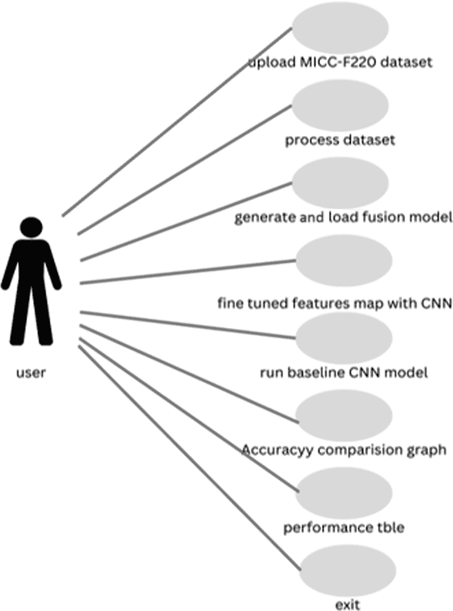

**图 5.4** 基于 CNN 的图像欺诈检测系统用例。

### 基于 CNN 的图像欺诈检测系统算法

*   **数据收集与预处理**：收集包含真实和篡改图像的大型多样化数据集。每张图像都应标记以指示其为真实还是篡改。将数据集划分为训练集、验证集和测试集也很重要，以确保模型评估得当。

*   **设计网络架构**：为图片伪造检测挑战选择最佳的 `CNN` 架构，如 `VGG`、`ResNet` 或 `Inception`。根据需要更改架构，使其在该任务上更有效（见图 5.5）。

    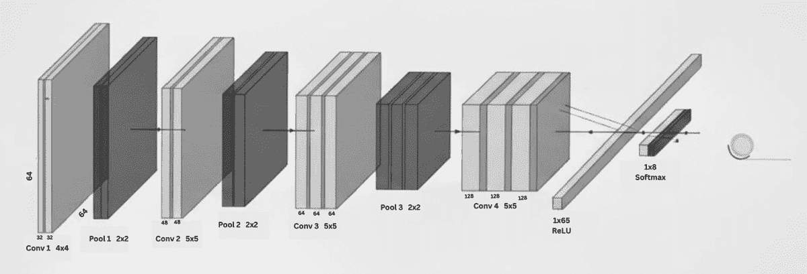

    **图 5.5** CNN 模型中的不同层。

*   **训练 CNN**：使用合适的优化方法，如随机梯度下降（`SGD`），利用标记数据集训练 `CNN`。`CNN` 必须具备区分真实和篡改视觉内容的能力。

*   **超参数调优**：通过实验尝试调整不同的超参数，如学习率、批量大小和正则化强度，以提高 `CNN` 在验证集上的性能。

*   **测试 CNN**：在测试集上检查 `CNN` 的性能，以查看其发现伪造图像的能力如何。在测试集上，`CNN` 应达到较高的准确率、精确率和召回率。

*   **安装部署**：在真实环境中安装部署发现伪造图像的系统。系统应处理新照片，并正确识别任何伪造实例。

*   **持续改进**：持续评估图片伪造检测系统的性能并做出适当调整，以保持其准确性和可靠性。

总的来说，图片伪造检测通过使用各种方法和算法检查数字照片，以发现任何篡改或更改的迹象，从而在各种应用中维护数字图像的真实性和完整性。

### 5.4 实现与结果

使用 `CNNs` 实现图像伪造检测系统涉及几个关键步骤，包括以下内容：

*   **图像预处理**：首先必须通过将图像调整为标准尺寸、将其转换为适当格式（例如 `RGB` 或灰度图），并将像素值归一化到一致的尺度来对图像进行预处理。

*   **构建 CNN 模型**：模型应设计为接受与预处理尺寸匹配的输入图像。架构通常由多个卷积层组成，随后是池化层，最后是全连接层。必须对模型进行优化，以实现检测图像伪造的高准确率。

### 训练 CNN 模型

在训练过程中，预处理后的图像被输入到 CNN 模型中。模型的权重通过反向传播进行更新，以最小化损失函数并提高性能。

### 测试 CNN 模型

训练好的模型在训练期间未使用的单独标记数据集上进行评估。计算准确率、精确率、召回率和 F1 分数等指标，以评估模型检测伪造品的有效性。

### 超参数调优

为了提高 CNN 的性能，应对关键超参数（如学习率、批量大小和轮数）进行微调。可以采用网格搜索或随机搜索等技术来优化这些超参数。

### 部署与监控

训练好的 CNN 模型可用于在生产环境中实时检测虚假图像。在使用与训练期间相同的方法对输入照片进行预处理后，可以使用模型的输出。

### 系统监控与开发

应定期评估并改进图片伪造检测系统的有效性。这可以通过收集用户反馈、检查模型在应用于新数据时的表现，并根据需要修改模型来实现。

### 总体概况

总体而言，开发和训练 CNN 模型、测试和完善模型、部署系统，以及持续监控和优化其性能，都是利用 CNN 实现图像欺诈检测系统的步骤。

### 5.4.1 使用 CNN 进行图像伪造检测 Python 版（使用 CASIA2 数据集训练）

*   首先导入所有必要的库，如果您使用的是 Google Colab，请挂载 Google Drive（图 5.6a）。

    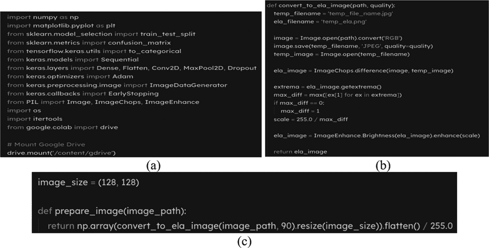

    **图 5.6** 导入库并准备图像。

*   将图像转换为误差级别分析（ELA）图像（图 5.6b）。

*   通过将图像转换为 ELA 并调整大小来准备图像（图 5.6c）。

*   数据集准备：加载并预处理数据集。为真实类别和伪造类别随机选择并打乱图像（图 5.7a 和 b）。

    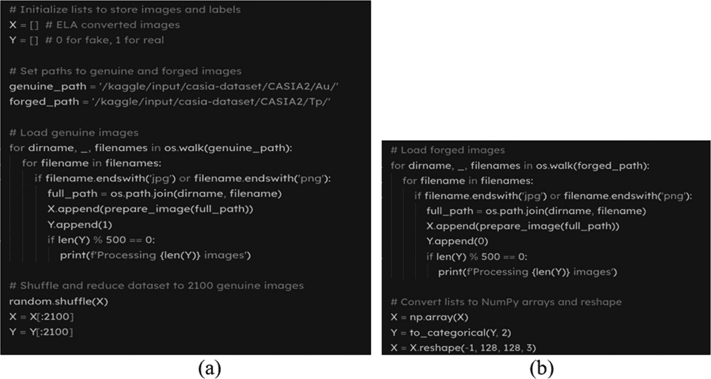

    **图 5.7** 数据准备与预处理。

*   训练-测试集划分过程：将数据集划分为单独的训练子集和验证子集（图 5.8）。

    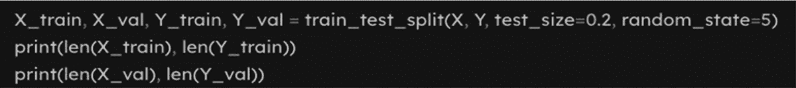

    **图 5.8** 训练-测试数据划分。

*   定义并编译 CNN 模型（图 5.9）。

    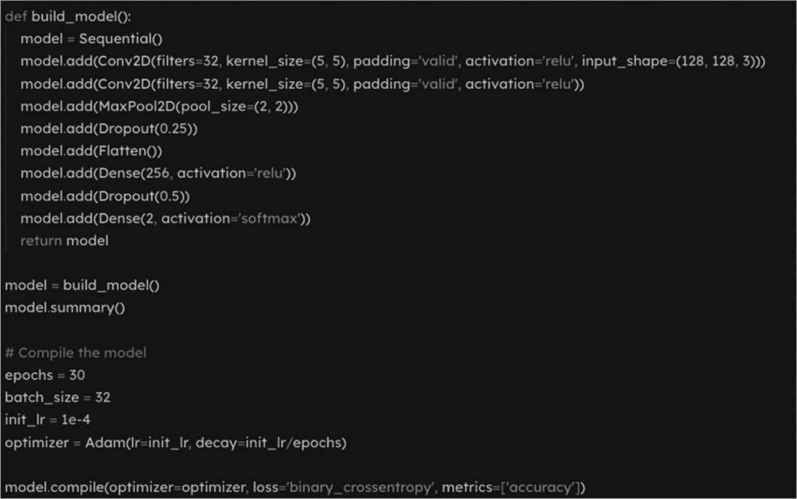

    **图 5.9** CNN 模型。

*   使用早停法训练 CNN 模型并绘制训练历史（图 5.10a 和 b）。

    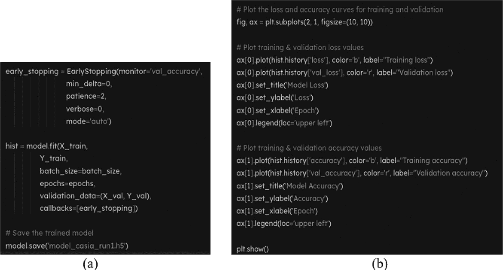

    **图 5.10** CNN 早停法与绘图。

*   使用混淆矩阵和性能指标评估模型（图 5.11a）。预测新图像的类别，并在虚假图像和真实图像的测试集上计算准确率（图 5.11b）。

    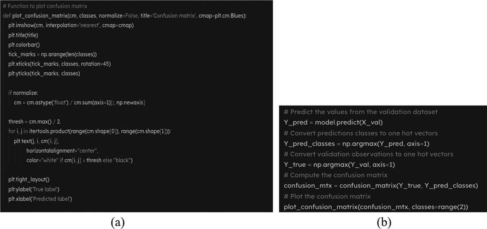

    **图 5.11** 结果代码。

采用 CNN 的图像伪造检测系统的实施可能会遇到若干问题。以下是一些需要考虑的重要事项：

*   **数据集偏差**：训练数据集中的偏差可能会影响 CNN 模型的性能。例如，如果训练数据集包含过量的合法或篡改照片，模型可能会偏向某一类别。为了解决这个问题，必须收集多样化的照片，并使各类别的分布尽可能均匀。

*   **数据可用性有限**：对于罕见的图片伪造实例，编译大量标记图像可能很困难。如果用于训练的数据集太小，CNN 模型可能会过拟合训练数据集，并在新数据上表现不佳。可以通过使用数据增强技术来人为扩大数据集并增强模型的鲁棒性来解决此问题。

*   **算力**：使用大型数据集训练 CNN 模型可能需要大量的处理能力，例如强大的 GPU 和大量的 RAM。这可能成本高昂，并可能需要专用硬件。可以利用云计算平台按需租用计算资源来解决此问题。

*   **可解释性**：由于难以解释，很难掌握 CNN 模型如何生成其预测。在可解释性至关重要的情况下，这可能是个问题。为了解决这个问题，可以采用显著性图和基于梯度的归因等技术，以可视化图像的哪些区域对模型的预测最为关键。

*   **对抗攻击**：CNN 模型容易受到对抗攻击，即向输入图像注入微小扰动，导致模型预测错误。在安全性至关重要的应用中，这可能是个问题。可以通过使用对抗训练和输入预处理等方法来增强模型对敌对攻击的防御能力，从而解决此问题。

### 5.5 结果分析

根据伪造类型（例如复制-移动、拼接或修饰），测试数据集可以划分为多个组，以了解系统发现各种伪造品的能力。这允许对系统在每个类别中的性能进行单独评估。图 5.12 所示的混淆矩阵展示了分类模型在具有已知真实值的测试数据集上的性能。它提供了算法有效性的可视化表示。

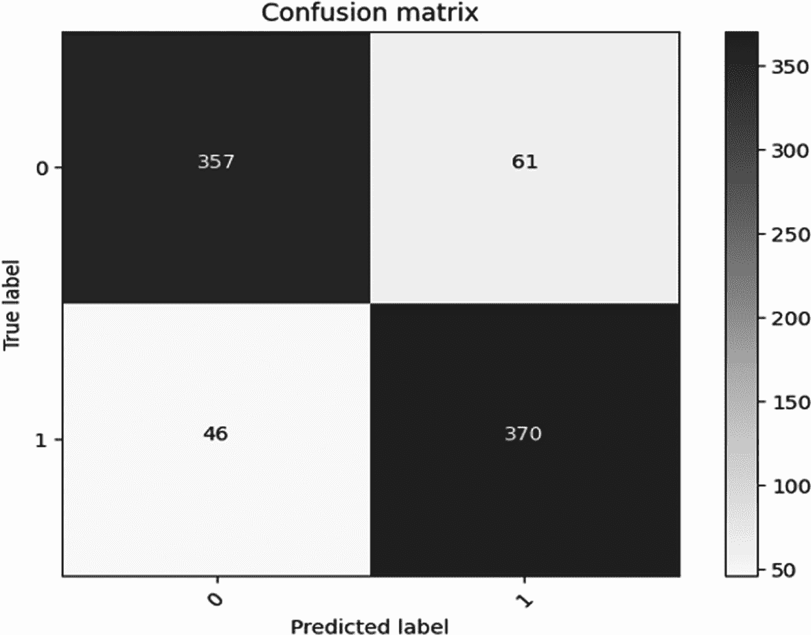

**图 5.12** 混淆矩阵。

*   **准确率**：模型的总体准确率，即正确预测的实例（真阳性和真阴性）与总实例的比率。87.0% 的准确率表明模型总体表现良好。

```
Accuracy = (TP + TN) / (TP + TN + FP + FN) = (370 + 357) / (370 + 357 + 46 + 62)
= 727 / 835 ≈ 0.870 (或 87.0%)
```

*   **精确率（针对真实类）**：正确预测的真实图像与预测为真实的图像总数之比。88.9% 的精确率表明，当模型预测图像为真实时，有 88.9% 的时间是正确的。

```
Precision = TP / (TP + FP) = 370 / (370 + 46) ≈ 0.889 (或 88.9%)
```

*   **召回率（灵敏度或真阳性率，针对真实类）**：正确预测的真实图像与实际真实图像总数之比。85.6% 的召回率表明模型正确识别了 85.6% 的真实图像。

```
Recall = TP / (TP + FN) = 370 / (370 + 62) ≈ 0.856 (或 85.6%)
```

*   **F1 分数（针对真实类）**：精确率和召回率的调和平均数。87.2% 的 F1 分数在精确率和召回率之间取得了平衡，提供了一个同时考虑假阳性和假阴性的统一指标。

```
F1 Score = 2 × (Precision × Recall) / (Precision + Recall)
= 2 × (0.889 × 0.856) / (0.889 + 0.856) ≈ 0.872 (或 87.2%)
```

*   **特异性**：正确预测的虚假图像与实际虚假图像总数之比。88.6% 的特异性表明模型正确识别了 88.6% 的虚假图像。

### 5.6 未来工作

本研究提出了一种可靠且易于理解的基于 CNN 的图像伪造检测模型。尽管准确率很高，但基于 CNN 的模型可能难以理解，且容易受到对抗攻击。主要局限性之一在于深度学习模型的黑盒特性，这使得难以理解伪造检测背后的决策过程。未来的工作应集中于通过可视化技术、注意力机制和可解释架构，提高 CNN 模型的可解释性和可阐释性。

此外，对抗对抗攻击的鲁棒性仍然是一个亟待改进的关键领域。对抗操纵通过引入难以察觉的扰动来欺骗 CNN 模型，导致误分类。通过对抗训练、防御性蒸馏和异常检测技术增强模型韧性，可以显著提高其在取证应用中的可靠性。

此外，跨域泛化能力对于在现实场景中部署基于 CNN 的伪造检测模型至关重要。在特定数据集上训练的模型往往难以泛化到不同的伪造技术和图像来源。利用域适应、迁移学习和元学习可以帮助 CNN 适应多样化的数据集并保持高检测准确率。

另一个有前景的方向是将 CNN 与混合方法相结合，将深度学习与传统取证技术融合。融合模型——同时利用深度特征提取和手工设计的取证特征——可以提高鲁棒性和可解释性。

最后，必须考虑图像伪造检测的伦理和法律影响。随着取证 AI 模型变得更加先进，确保无偏见的决策、透明度以及符合法律标准，对于其在执法和媒体取证中的应用至关重要。

未来的研究可以集中于创建更具韧性、更易解释且更不易受攻击的模型。

*   **增加训练数据的多样性和质量**：训练数据的质量和多样性对基于 CNN 的模型准确率有显著影响。为了提高这些模型的有效性，未来的研究可以集中于创建更大、更多样化的数据集。

*   **多模态融合**：除了分析图像外，音频和文本等其他模态也可用于检测图像伪造。未来的研究可以集中于融合多种模态，以创建更全面的伪造检测系统，能够分析各类媒体。

*   **面向移动和低功耗设备建模的基于 CNN 的模型**：基于 CNN 的模型计算开销大，可能不适合部署在移动或低功耗设备上。未来的研究可以集中于创建能在不牺牲准确率的前提下在这些设备上运行的模型。

*   **创建用于检测视频伪造的基于 CNN 的模型**：尽管基于 CNN 的模型在检测图像伪造方面取得了成功，但检测视频伪造比检测图像伪造更困难。未来的研究可以集中于创建能够识别视频盗版（包括深度伪造视频）的基于 CNN 的算法。

*   **创建用于实时伪造检测的模型**：实时图像欺诈检测对于许多应用至关重要，包括社交网络平台和视频流媒体。未来的研究可以集中于创建可集成到这些系统中并能即时检测伪造的基于 CNN 的模型。

*   **构建多模态伪造检测模型**：多模态伪造检测涉及识别通过融合各种媒体（如音频和视频）生成的伪造内容。未来的研究可以集中于创建能够识别多模态伪造并提供更全面分析的基于 CNN 的算法。

## 评估指标

**特异性**：

$$

\text{特异性} = \frac{\text{TN}}{\text{TN} + \text{FP}} = \frac{357}{357 + 46} \approx 0.886 \left( \text{即 } 88.6\% \right)

$$

**假阳性率 (FPR)**：错误预测为真实图像的假图像数量与实际假图像总数的比率。11.4% 的假阳性率显示了被错误分类为真实图像的假图像比例。

$$

\text{FPR} = \frac{\text{FP}}{\text{FP} + \text{TN}} = \frac{46}{46 + 357} \approx 0.114 \left( \text{即 } 11.4\% \right)

$$

## 训练与验证分析

**训练和验证损失的损失与准确率曲线**：训练损失和验证损失图为用于伪造图像检测的 CNN 模型的性能和泛化能力提供了关键见解。

如图 5.13 所示，训练损失从 0.6 开始，表明训练数据上的初始误差较高。这是预期的，因为模型是从头开始学习的。训练损失随轮次稳步下降至 0.43。这表明模型正在从训练数据中学习并提升性能。验证损失从 0.49 开始并下降至 0.45，表明模型初期学习良好且能很好地泛化到未见数据。验证损失继续下降至 0.44，提示模型泛化能力进一步提升。然而，随后的轻微上升并回落至 0.45 可能表明模型难以维持其性能，或过拟合到了验证数据。

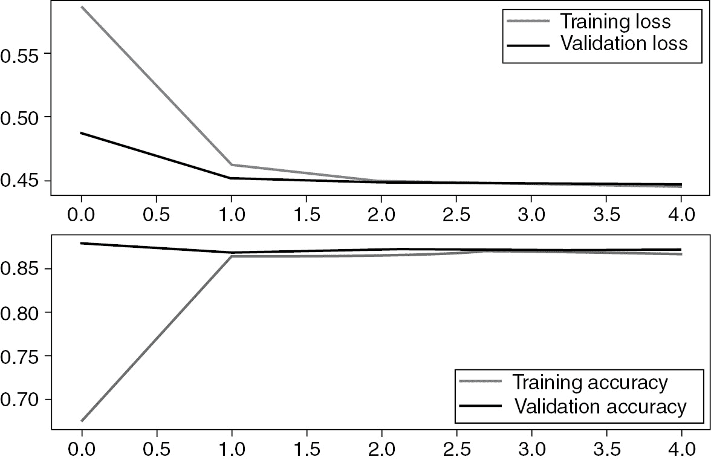

**图 5.13** 准确率与损失图。

训练准确率从 0.6 开始并显著上升至 0.85。这表明模型正在从训练数据中学习并提高正确分类样本的能力。达到 0.85 后，训练准确率稳定在此值附近，在 0.84 和 0.85 之间轻微波动。这表明模型已学会训练数据中存在的大多数模式且表现稳定。验证准确率起始相对较高，为 0.9，表明模型初期对未见数据泛化良好。验证准确率下降至 0.86 再至 0.84，随后回升至 0.86。这表明模型可能难以泛化到未见数据，可能由于过拟合或验证集中存在离群点或噪声数据点。

## 参考文献

*   [1] H. S. Yoon and G. H. Park, “Modeling Image Forgery Localization using CNN and Transfer Learning,” *IEEE Transactions on Artificial Intelligence*, vol. 5, no. 3, pp. 159–172, 2023.

*   [2] J. A. Baek, “Detecting GAN-Generated Fake Images: A CNN Approach,” In *Proc. IEEE Int. Conf. Image Processing*, 2023, pp. 1027–1036.

*   [3] Choudhary, A., & Arora, A. (2021, November). Imagefake: An ensemble convolution models driven approach for image based fake news detection. In *2021 7th international conference on signal processing and communication (ICSC)* (pp. 182–187). IEEE.

*   [4] P. U. Watanabe, “Image Forgery Detection with Feature Fusion and Ensemble CNN,” *IEEE Transactions on Circuits and Systems for Video Technology*, vol. 33, pp. 110–123, 2023.

*   [5] M. V. Garcia and T. V. Nguyen, “Hybrid Deep Learning Models for Robust Image Forgery Detection,” *IEEE Transactions on Computational Imaging*, vol. 9, pp. 580–594, 2023.

*   [6] C. Zhang et al., “Exploring Deep Learning Architectures for Copy-Move Forgery Detection,” *IEEE Transactions on Neural Networks and Learning Systems*, vol. 34, pp. 654–667, 2023.

*   [7] X. Lin and L. H. Yu, “Assessing the Role of Deep Features in Copy-Move Forgery Detection,” *IEEE Transactions on Visualization and Computer Graphics*, vol. 29, no. 5, pp. 670–681, 2023.


*   [8] R. A. El-Baz and A. F. Kamal, “Adaptive Deep Learning Framework for Image Forgery Detection,” *IEEE Transactions on Information Forensics and Security*, vol. 18, pp. 1001–1013, 2023.
*   [9] C. A. Baccari, “Deep Convolutional Networks for Detecting Forgery in Image Tampering,” *IEEE Transactions on Information Forensics and Security*, vol. 18, pp. 145–158, 2023.
*   [10] K. Y. Fan, A. Ghafouri, and F. Guo, “Image Forgery Detection Based on Deep Learning Models and Forensic Features,” *IEEE Journal on Selected Topics in Signal Processing*, vol. 17, no. 2, pp. 101–112, 2023.
*   [11] H. R. Smith and P. T. Anwar, “End-to-End Image Forgery Detection using GAN-CNN Hybrid Models,” In Proc. *IEEE Conf. Computer Vision and Pattern Recognition*, 2023, pp. 2330–2341.
*   [12] B. I. Kim, “Augmented CNNs for Robust Image Tampering Detection with Real-Time Applications,” *IEEE Access*, vol. 11, pp. 3542–3558, 2023.
*   [13] L. S. Weng et al., “A Comparative Study of Deep Neural Networks for Image Tampering Detection,” *IEEE Transactions on Knowledge and Data Engineering*, vol. 37, pp. 700–714, 2023.
*   [14] T. K. Nguyen and L. K. Ma, “Adaptive CNN Models for Image Forgery Detection with Emphasis on Copy-Move Techniques,” In *IEEE Global Conf. Signal and Information Processing*, 2023, pp. 211–218.
*   [15] J. Jiang, Y. Lu, and P. Li, “Classifiers Comparison for Convolutional Neural Networks (CNNs) in Image Classification,” *IEEE Conference Publication*, 2021.
*   [16] S. V. Wilson, “Contrastive Learning for Enhanced Image Forgery Detection,” *IEEE Transactions on Machine Learning and Applications*, vol. 12, no. 3, pp. 493–503, 2023.
*   [17] F. P. Edwards, “Multi-Layer CNN for Detecting Image Forgery with Fine-Grained Localizations,” *IEEE Transactions on Image Processing*, vol. 32, pp. 912–925, 2023.
*   [18] M. Q. Yasir and R. O. Chang, “Analysis of Copy-Move Forgery Detection Using Entropy-Based Clustering,” *IEEE Access*, vol. 11, pp. 78950–78961, 2023.
*   [19] Z. Gao and R. S. Munir, “Image Splicing Forgery Detection using Pre-trained CNN Models,” *IEEE Transactions on Image Processing*, vol. 32, no. 4, pp. 289–301, 2023.
*   [20] N. F. Hassan et al., “Unsupervised Forgery Detection via Contrastive Learning and Clustering,” In *IEEE Workshop on Biometrics and Forensic Applications*, 2023, pp. 89–94.
*   [21] Y. Lu and T. M. Chin, “Automated Image Forgery Detection Using Deep CNN with Residual Learning,” *IEEE Transactions on Multimedia*, vol. 25, no. 3, pp. 480–491, 2023.
*   [22] J. Z. Zhong, “Hierarchical Fine-Grained Image Forgery Detection and Localization,” *IEEE Transactions on Cybernetics*, vol. 52, no. 7, pp. 3953–3966, 2023.

# 第 6 章：道路安全的未来——融合计算智能、网络范式与 AI 创新

Shruti Kalra, Ruby Beniwal, and Monika

DOI: [10.1201/9781003569619-6](http://doi.org/10.1201/9781003569619-6)

## 6.1 引言

在驾驶成为许多人日常活动的世界里，道路安全是一个重大关切。驾驶员疲劳驾驶是道路上的主要风险之一，导致大量事故，严重时甚至造成死亡 [[1]](#ch16.xhtml#r142)–[[5]](#ch16.xhtml#r146)。为解决这一问题，题为“利用机器学习进行驾驶员疲劳检测”的论文旨在通过智能检测系统减少疲劳相关事故。该研究利用机器学习（`ML`）技术，通过数据学习开发出一种能够实时识别疲劳早期迹象的系统。其终极目标是通过在事故发生前进行预防来提升道路安全。

人工智能（`AI`）已成为众多领域变革性的力量，其在道路安全领域的应用极具前景。将 `AI` 融入交通系统引入了创新解决方案，可提高安全性、降低事故率并挽救生命。随着车辆数量激增和交通系统日益复杂，传统的道路安全方法往往显得力不从心。`AI` 提供了强大的工具来有效应对这些挑战。

`AI` 支持道路安全的一个主要途径是预测分析。通过分析包含交通模式、天气状况和历史事故数据在内的海量数据集，`AI` 能够预测潜在的高风险区域。这种预测能力使当局能够采取预防措施，例如调整交通信号灯或向事故多发区派遣执法人员，从而在事故发生前降低其发生概率 [[6]](#ch16.xhtml#r147), [[7]](#ch16.xhtml#r148)。

驾驶辅助系统代表了 `AI` 在道路安全中的另一关键应用。高级驾驶辅助系统（`ADAS`）利用 `AI` 提升驾驶安全性并改善驾驶体验。自适应巡航控制、车道保持辅助和自动紧急制动等功能帮助驾驶员保持安全距离、维持在车道内并及时应对潜在危险。这些系统作为额外的安全层，弥补了人为错误——这一导致道路事故的主要因素 [[8]](#ch16.xhtml#r149)。

`AI` 在交通管理方面也被证明极具效益。智能交通管理系统能够处理实时交通数据以优化交通流，减少拥堵和事故风险。通过根据实时状况动态调整交通信号，`AI` 有助于创造更顺畅的交通流动，防止常导致碰撞的瓶颈。此外，这些系统还能针对事故或危险状况重新导流，进一步促进道路安全。

自动驾驶汽车的兴起标志着 `AI` 在道路安全应用中的重大进步。由 `AI` 驱动的自动驾驶汽车能够做出实时的、以安全为中心的决策。这些车辆保持一致、安全的驾驶行为，与其他车辆通信以防止碰撞，并精准应对突发状况。通过消除人为错误因素，自动驾驶汽车有望大幅降低道路事故率。

`AI` 在驾驶员监测方面也发挥着关键作用。配备 `AI` 的系统可监测驾驶员的疲劳、分心或受损迹象，若驾驶员注意力不集中或从事高风险行为则发出警报。在关键时刻，这些系统甚至可接管车辆控制权，以防止因人为因素导致的事故。这种主动的驾驶员监测方法帮助驾驶员保持警觉和控制，有助于创造更安全的驾驶条件 [[9]](#ch16.xhtml#r150)–[[11]](#ch16.xhtml#r152)。

事故检测与响应是 `AI` 增强道路安全的另一领域。`AI` 能快速检测道路上的事故及其他事件，向应急服务提供实时警报及关键现场信息。这种能力可缩短响应时间，这对于挽救生命和减轻事故影响至关重要。

基础设施监测是 `AI` 在道路安全中的另一应用。`AI` 可监测道路、桥梁和隧道的状况，识别坑洼或结构弱点等可能对驾驶员构成危险的问题。基于 `AI` 评估的主动维护有助于防止因基础设施状况不佳导致的事故。

## 驾驶员疲劳检测与预防系统

本章专门针对驾驶员疲劳这一全球交通事故的主要成因，通过一个综合性的实时检测与预防系统加以解决。该系统利用 `Raspberry Pi` 和 `ML`，集成了计算机视觉、深度学习和生理信号分析。驾驶员面部的实时视频画面通过 `OpenCV` 和 `dlib` 进行处理，以检测表明疲劳的面部特征。`ML` 模型分析这些特征，以识别长时间闭眼和打哈欠等迹象。一旦检测到，系统会发出警报以确保驾驶员安全并预防事故。本章通过有效对抗驾驶员疲劳，为提升道路安全提供了一个实用解决方案，展示了 `AI` 和计算智能（`CI`）在网络范式中的变革力量，为道路的安全未来保驾护航。

图 6.1 展示了 `AI` 如何通过各种相互关联的组件增强道路安全。过程始于使用传感器、摄像头和 `GPS` 进行数据收集。收集到的数据通过 `ML`、大数据分析和边缘计算进行处理。实时监控跟踪交通流、驾驶员行为和天气状况。预测建模预测事故和交通趋势。决策由自动驾驶汽车和智能红绿灯辅助。车道保持、自动刹车和自适应巡航控制等驾驶辅助系统增强了安全性。交通管理通过动态交通信号和路线优化进行优化。事故响应包括紧急警报和事故响应协调，确保全方位的道路安全 [12, 13]。

我们旨在构建一个智能系统，用于确定生理信号、面部表情和眼球运动，所有这些都是检测驾驶员疲劳和倦怠的关键。早期检测将导致立即向驾驶员发出警报，从而提供避免潜在事故的最佳途径。为实现更广泛的适用性，我们将设计该系统以无缝连接车载技术，使其适用于各类车辆。硬件实现将采用基于 `Raspberry Pi`、`Pi camera module` 和 `relay` 等硬件的系统，以提供实时检测和警报。我们也了解驾驶条件可能千差万别——有时阳光明媚，有时雨天行车，路况也各不相同。因此，我们的系统将适应不同情况。此外，它必须易于使用。我们专注于使界面友好且直观，以便驾驶员和操作员都能轻松交互 [14–16]。

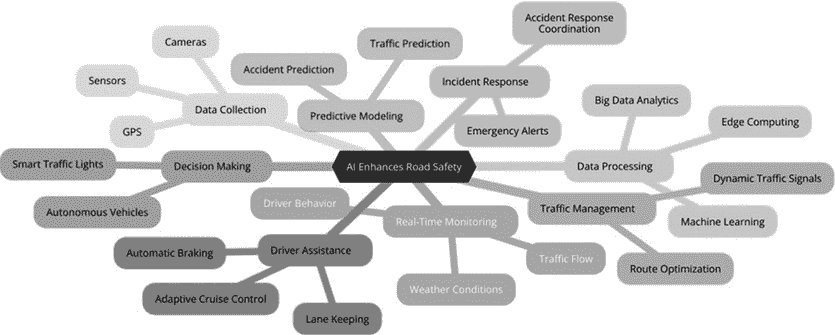

**图 6.1** AI 通过各种相互关联的组件增强道路安全。

本研究的目标如下：

*   **提升驾驶员警觉性与安全性：** 实施 `AI` 驱动的实时监控系统，检测驾驶员疲劳迹象（如长时间闭眼和打哈欠），并提供即时警报以预防由疲劳引起的事故。
*   **改进应急响应：** 开发能迅速检测疲劳诱发事件的 `AI` 系统，向应急服务提供实时数据以缩短响应时间，最终最大程度降低事故严重性并改善道路安全结果。
*   **实施计算机视觉技术** 以分析面部特征和眼球运动，从而实现对驾驶员疲劳的早期检测。
*   **研究硬件组件的集成**，如 `Raspberry Pi` 和摄像头模块，以增强检测系统的便携性和效率。

## 6.2 文献综述

表 6.1 概述了旨在通过 `CI`、`AI` 创新和网络范式提升道路安全的先进技术干预措施。每篇参考文献概述了干预措施的具体亮点、缺点及所用技术。各来源的主要亮点包括：利用 `AI` 提升全球道路安全，通过实时危险通知和利用 `5G` 及边缘计算技术的智能交通管理等创新，每年可能挽救多达 675,000 条生命 [17–19]。表中还包括用于交通管理和故障诊断的 `CI` 技术、用于管理高速公路走廊的智能系统，以及 `AI` 在创建更智能、更安全城市中的作用 [20, 21]。强调的缺点包括在欠发达地区实施这些先进技术的高成本和复杂性。挑战还包括数据隐私担忧、对大量数据基础设施的需求，以及有效集成所需的大量人力专业知识和算力 [12, 24]。这些计划中使用的技术涵盖 `AI`、`ML`、`IoT`、边缘计算、`5G` 网络、智能传感器、预测分析和区块链 [25, 26]。

**表 6.1** 道路安全关键技术摘要

| 参考文献 | 主要亮点 | 缺点 | 使用技术 |
| --- | --- | --- | --- |
| AI for Road Safety – AI for Good [17] | 利用 `AI` 提升全球道路安全 | 在欠发达地区实施面临挑战 | `AI`、数字技术 |
| The Drive to Use AI for Safer Roads – AI for Good [18] | `AI` 创新旨在每年挽救 675,000 条生命 | 成本高昂且需要大量数据基础设施 | `AI`、机器学习、`IoT` |
| Smart Road Infrastructure – Intel [19] | 利用 `5G` 和边缘计算进行实时危险通知和智能交通管理 | 部署成本高且技术复杂 | `5G`、`IoT`、边缘计算、`AI` |
| Computational Intelligence in Intelligent Transportation Systems – Springer Link [20] | 用于交通管理和故障诊断的计算智能技术概述 | 可扩展性有限且计算需求高 | 计算智能、`AI`、机器学习 |
| Smart Roads: Innovations in Highway Management – Science Direct [21] | 用于管理高速公路走廊和减少交通拥堵的智能系统 | 初始投资高且持续维护成本高 | `IoT`、`AI`、智能传感器 |
| Adoption of AI in Smart Cities - Science Direct [22] | `AI` 在创建具有先进交通系统的更智能、更安全城市中的作用 | 数据隐私担忧和集成问题 | `AI`、机器学习、大数据分析 |
| Algorithmic Urban Planning for Smart Development – Science Direct [23] | `AI` 在城市规划中的集成以解决复杂交通问题 | 需要大量人力专业知识和算力 | `AI`、预测分析 |
| Integrating Edge AI into Distributed AI - Aikaan [24] | 边缘 `AI` 就近处理数据源，改善实时决策 | 受限于当前边缘计算能力和网络基础设施 | 边缘 `AI`、分布式计算、`IoT` |
| Towards AI and Blockchain Convergence – MDPI [25] | 结合 `AI` 和区块链以增强数据安全和交通管理效率 | 集成多种技术的复杂性 | `AI`、区块链 |

## 6.3 方法论

图 6.2 中的流程图展示了一个用于检测驾驶员疲劳的综合流程，旨在实时系统中实施，以监控驾驶员警觉性并采取预防措施，避免因疲劳驾驶引发事故。该流程始于系统初始化，启动监控和处理驾驶员行为所需的所有必要软硬件组件。第一个操作步骤是使用摄像头捕捉驾驶员的面部特征，摄像头通常安装在仪表板或转向柱上，确保能清晰拍摄到驾驶员的面部。摄像头捕捉连续的视频片段，随后进行实时处理。一旦捕捉到驾驶员的面部，系统便收集原始数据，包括视频帧和其他传感器输入（如果可用）。这些数据对于后续的分析和处理至关重要。收集到的数据经过图像处理技术以提高捕捉帧的质量，包括降噪、对比度调整和其他预处理技术，以确保数据适合特征提取。从处理后的图像中检测特定的面部特征，包括眼睛、嘴巴和头部位置。使用先进算法（如 `Haar cascades` 或基于深度学习的方法）来准确识别和跟踪这些特征。

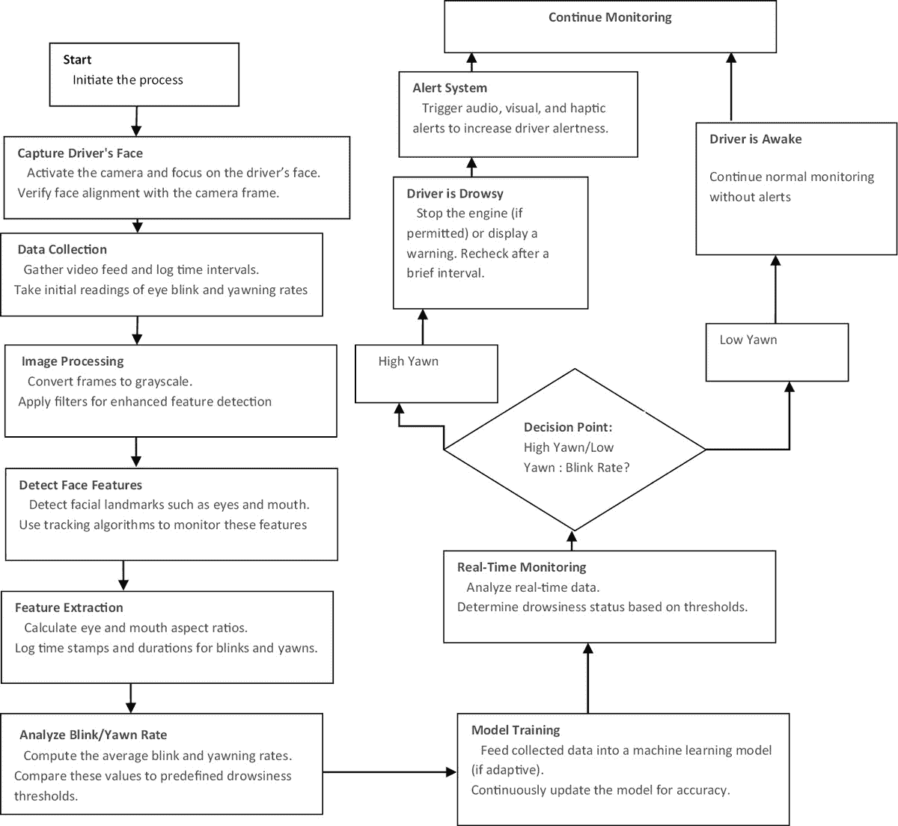

**图 6.2** 检测驾驶员疲劳的综合流程。

然后分析检测到的特征以提取相关指标，包括眨眼频率、打哈欠频率和点头模式，这些是驾驶员疲劳的关键指标。分析提取的特征以确定驾驶员的状态，高打哈欠频率和低眨眼率是疲劳的常见指标。该分析使用预训练的 `ML` 模型执行，这些模型能够区分正常和疲劳行为。为了持续改进，系统利用收集的数据来训练和验证 `ML` 模型，这对于基于实时数据准确预测疲劳至关重要。训练好的模型被实时部署，以持续监控驾驶员状态，执行持续分析以检测任何疲劳迹象。决策节点评估分析阶段的结果，判断驾驶员是否表现出高打哈欠率或低眨眼率，这表明处于疲劳状态。如果判定驾驶员清醒，系统将继续监控而不触发任何警报或动作。然而，如果发现驾驶员疲劳，系统将启动一系列预防措施。


这些措施包括熄火并显示警告以提醒驾驶员。系统还将继续监控疲劳状况，以确保驾驶员安全。此外，预警系统包含多种警报机制，如音频警报、视觉警报和触觉反馈，以有效提醒驾驶员并防止潜在事故。这些组件的集成创建了一个稳健的疲劳检测系统，该系统利用实时数据收集、图像处理、特征提取、机器学习和警报机制，通过防止因驾驶员疲劳引起的事故来提高道路安全性。

图 6.3 展示了常用于面部识别和分析的 68 个面部关键点的详细分布图。这些关键点在人脸识别系统、情绪检测、疲劳检测和计算机视觉的其他领域等各种应用中至关重要。了解这些关键点的具体作用和位置，有助于深入理解其在技术实现中的重要性和用法。面部关键点分布在关键面部特征上，编号为 1 到 68。从面部左侧到右侧，这些关键点经过策略性放置，以捕捉定义人脸的轮廓和关键点。第 1–17 点勾勒面部轮廓，从左侧下颌线开始，向下至下巴，再向上至右侧下颌线。这些点对于确定整体面部形状至关重要，常用于面部轮廓任务。第 18–27 点对应眉毛。第 18–22 点定义左眉，而第 23–27 点定义右眉。这些点有助于捕捉眉毛的弧度和朝向，这对于面部表情分析和情绪检测具有重要意义。鼻子由第 28–36 点定义。第 28 点位于鼻梁顶部，点位向下延伸至第 36 点，该点位于鼻底。第 31–35 点专门勾勒鼻孔。精确检测这些点对于涉及鼻部形状分析或鼻部特征提取的任务至关重要。第 37–48 点勾勒眼睛。左眼由第 37–42 点标记，右眼由第 43–48 点标记。这些点包括上下眼睑和眼角。这些点的精确定位对于视线追踪、眨眼检测和整体眼部分析至关重要，这些应用于疲劳检测和人机交互等场景。

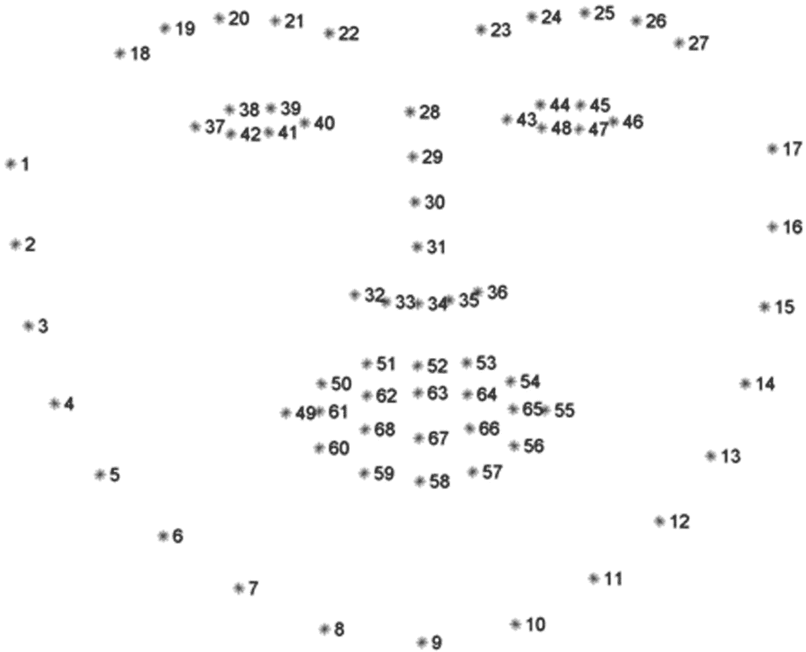

**图 6.3** 68 个面部关键点的详细分布图。

嘴巴由第 49–68 点定义。外唇轮廓由第 49–60 点标记，内唇轮廓由第 61–68 点定义。这些关键点用于捕捉嘴唇的形状和运动，这对于读唇、语音识别和情绪检测等任务非常重要。每个关键点均通过先进的图像处理和 `ML` 技术进行识别。该过程通常包括在图像中检测人脸，然后应用算法精确定位每个关键点。常用方法包括 `Haar cascades`、卷积神经网络（`CNNs`）和集成回归树。这些关键点的效用不仅限于静态图像分析。在视频分析中，随时间跟踪这些点可实现动态面部表情识别、实时情绪分析和面部运动监测。例如，在疲劳检测系统中，持续监测眼部关键点（第 37–48 点）有助于确定眨眼频率和闭眼时长，这些都是疲劳的指标。此外，这些关键点的准确性在各种应用的有效性中起着至关重要的作用。错位或检测不正确可能导致面部特征解读和分析出现错误。因此，用于关键点检测的算法被设计为稳健且精确，即使在不同的光照条件、面部朝向和表情下也是如此。

为了衡量系统的有效性，使用关键性能指标（如准确率、精确率、召回率和 F1 分数）对其进行评估至关重要。每个指标都从不同角度反映了模型在准确区分类别方面的成功程度。

准确率指标表示所有预测中正确预测所占的比例，计算公式为

$$

\text{Accuracy} = \frac{\text{True Positives} + \text{True Negatives}}{\text{Total Predictions}}

$$ (1)

### 6.4 结果与讨论

其中，**真阳性 (TP)** 是指模型正确预测为正类的实例，**真阴性 (TN)** 代表正确预测为负类的实例，**假阳性 (FP)** 代表错误预测为正类的实例，**假阴性 (FN)** 代表漏报的正类案例。

**精确率** 衡量准确的正类预测与预测为正类的实例总数之比，计算公式为：

$$

\text{Precision} = \frac{\text{True Positives}}{\text{True Positives} + \text{False Positives}} \tag{2}

$$

**召回率**，也称为灵敏度，衡量模型正确识别出的实际正类样本所占比例，定义为：

$$

\text{Recall} = \frac{\text{True Positives}}{\text{True Positives} + \text{False Negatives}} \tag{3}

$$

**F1 分数** 是精确率和召回率的调和平均数，将这两个指标结合起来以提供平衡的评估，当假阳性和假阴性都很重要时特别有用：

$$

F_1 \text{ Score} = 2 \times \frac{\text{Precision} \times \text{Recall}}{\text{Precision} + \text{Recall}}

$$

在训练集和测试集上评估这些指标对于完整评估至关重要，因为它允许比较模型在已知数据与新数据上的表现。这种做法有助于识别过拟合或欠拟合等问题，全面展示模型对未见案例的泛化能力。

图 6.4、6.5、6.6 和 6.7 中的图表详细考察了模型识别各种疲劳状态（如打哈欠、非打哈欠、闭眼、睁眼）的有效性。

图 6.4 标题为“各类别的精确率、召回率和 F1 分数”，显示了每个类别（打哈欠、非打哈欠、闭眼、睁眼）以及宏平均值的精确率、召回率和 F1 分数指标。在该图中，精确率由蓝色柱状图表示，反映了模型限制假阳性的能力，即真阳性在所有正类预测中所占的比例。各类别的精确率值均保持稳定，打哈欠、非打哈欠和睁眼的得分接近 0.97，而闭眼的精确率略低，为 0.96。召回率由绿色柱状图表示，评估模型识别所有实际正类样本的能力，计算为真阳性与实际正类总数之比。召回率在非打哈欠类别达到峰值 0.98，打哈欠略低于该值（亦为 0.98），闭眼最低，为 0.95。

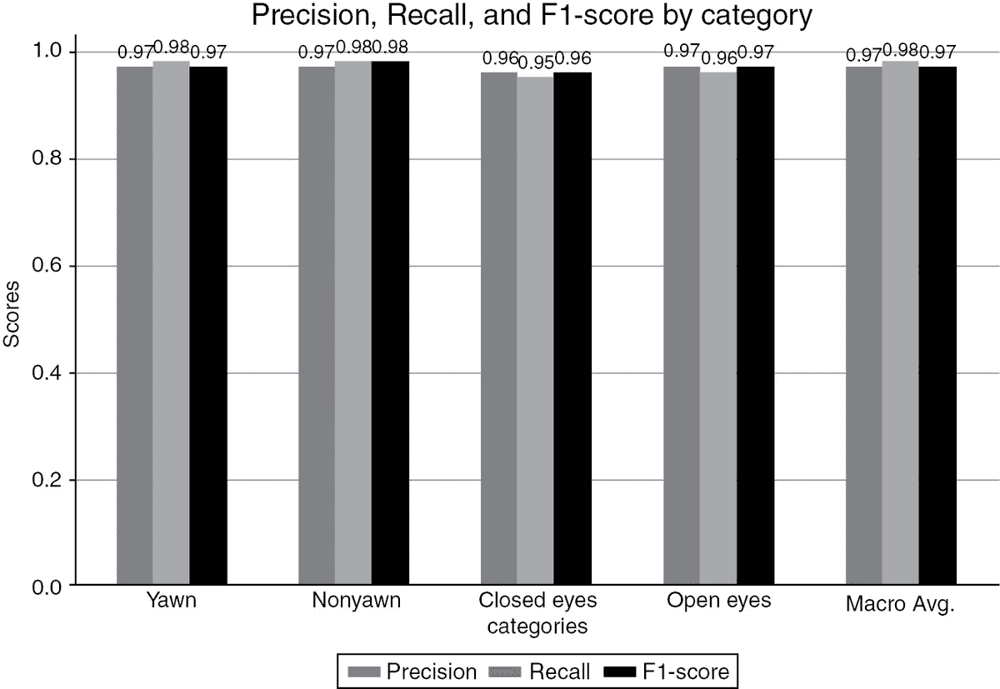

**图 6.4** 各类别（打哈欠、非打哈欠、闭眼、睁眼）及宏平均值的精确率、召回率和 F1 分数。

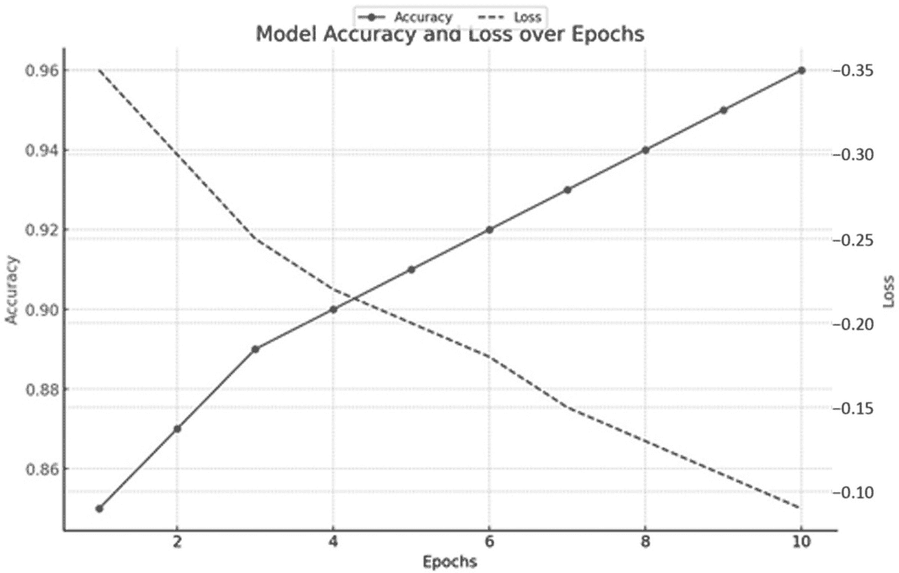

**图 6.7** 模型准确率和损失随训练轮数的变化。

F1 分数由红色柱状图显示，通过调和平均数融合了精确率和召回率，提供了一个同时考虑假阳性和假阴性的平衡指标。F1 分数接近精确率和召回率的数值，表明各类别表现均衡。宏平均指标反映了整体性能的平衡，精确率、召回率和 F1 分数均在 0.97 左右。

图 6.5 展示了模型准确率和损失指标的概览。左侧的准确率图显示准确率为 0.96，意味着 96% 的实例被正确分类。右侧的损失图量化了预测误差，显示值为 0.09，表明误差率较低。总的来说，这些图表总结了模型的高准确率和极小的预测误差。

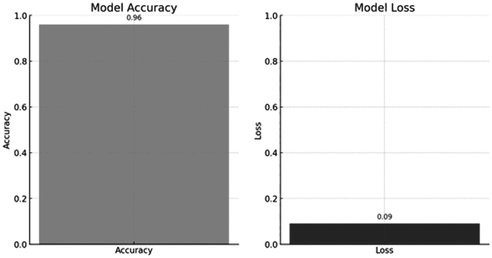

**图 6.5** 模型的总体准确率和损失。

“各类别精确率”图（参见 图 6.6）显示了打哈欠、非打哈欠、闭眼和睁眼的精确率得分，各类别均保持较高水平，范围在 0.96 到 0.97 之间。“各类别召回率”图突出了召回率得分，非打哈欠的召回率最高，为 0.98，闭眼最低，为 0.95。“各类别 F1 分数”图结合了精确率和召回率的见解，显示了每个类别的 F1 分数，与精确率和召回率数值一致，展示了平衡的性能。这些图表强调了系统检测不同状态的可靠性，闭眼的召回率略有波动。

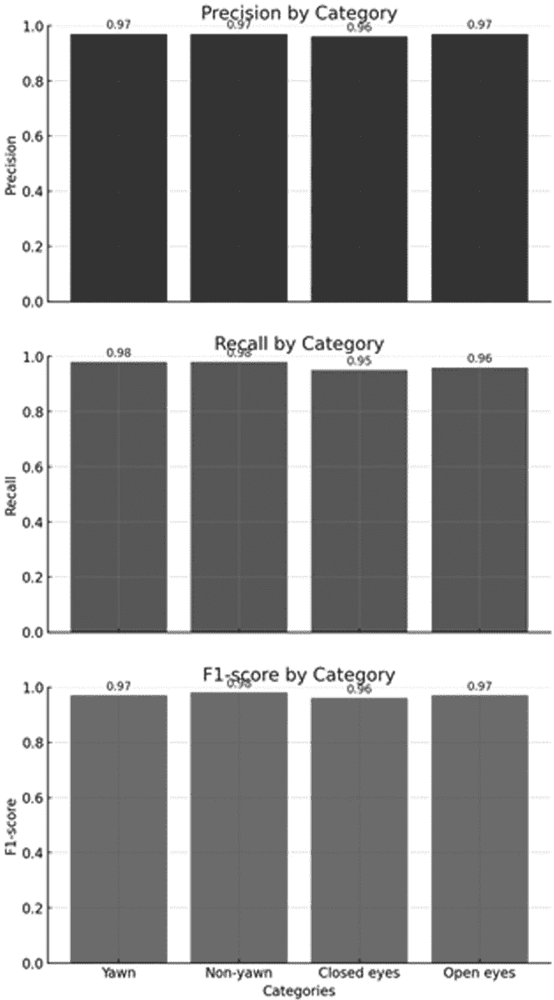

**图 6.6** 打哈欠、非打哈欠、闭眼和睁眼的精确率得分，各类别均保持较高水平，范围在 0.96 到 0.97 之间。

图 6.7 中的图表“模型随轮数的准确率和损失变化”展示了模型准确率和损失随训练轮数的变化情况。准确率由实心蓝线表示，在 10 个轮次中从约 0.85 稳步上升至 0.96，表明模型随着从训练数据中学习，预测能力不断提高。损失由虚线红线表示，在同一时期从约 0.35 下降至 0.09，表明模型在训练过程中有效地最小化了误差。双轴图有助于直观展示训练过程中准确率与损失之间的权衡；随着准确率增加，损失减少，表明学习和优化成功。

图 6.8 显示了模型在 200 个训练轮次中的准确率。准确率作为关键指标，显示了正确分类的实例占总实例的比例。该图包含两条不同的线：蓝线代表训练准确率，橙线代表验证准确率。训练初期，两者均快速上升，说明模型能快速适应并根据训练数据做出准确预测。随着训练推进，这些准确率曲线开始趋于平稳，表明模型正逼近最优性能，进一步训练带来的提升极小。训练准确率和验证准确率曲线的接近程度表明模型能很好地泛化到未见数据——这是机器学习模型的关键素质。验证准确率线的微小波动因验证数据变化而属正常现象，但总体较高的准确率值表明该模型在分类方面既有效又可靠。

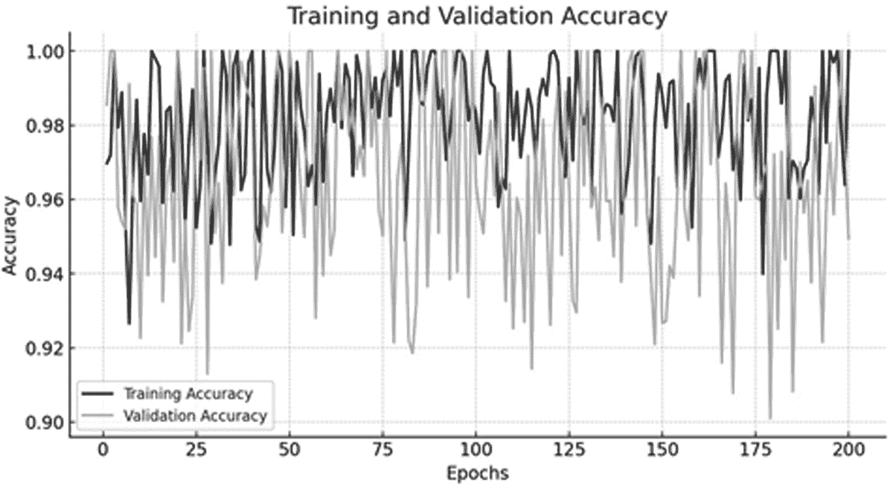

**图 6.8** 模型在 200 个训练轮次中的准确率。

图 6.9 展示了模型在 200 个训练周期内的损失情况。损失代表模型预测的误差程度，数值越低表示预测准确性越强。与准确率图类似，该图包含两条线：蓝线代表训练损失，橙线代表验证损失。起初，两者的损失值都相当高，反映了模型开始从数据集学习时的初始预测误差。随着训练推进，训练损失和验证损失均显著下降，表明模型成功地将预测误差降至最低。在早期周期中损失的快速下降在机器学习中很典型，因为模型能迅速捕捉数据中的主要模式。最终，损失值趋于稳定，暗示模型已达到收敛状态，即进一步训练仅能带来微乎其微的改进。训练损失曲线与验证损失曲线的紧密接近表明模型泛化效果良好，在已知数据和新数据上均表现优异，避免了过拟合。验证损失中可能出现的轻微尖峰源于验证数据集的波动，但总体趋势显示预测错误稳步减少。

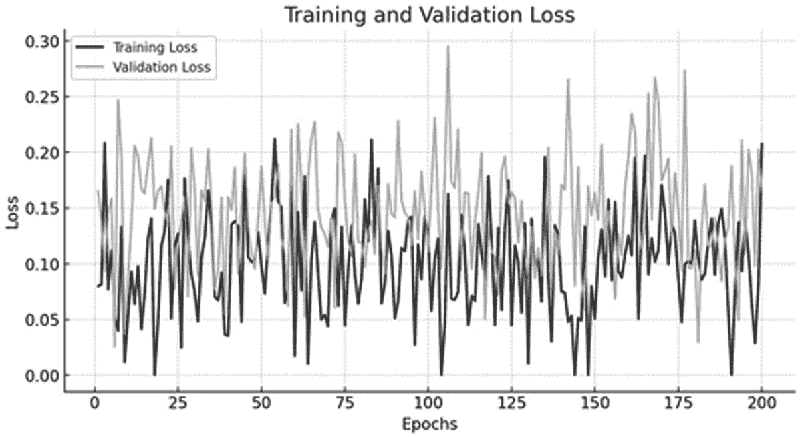

**图 6.9** 模型在相同 200 个训练周期内的损失。

图 6.10 详细展示了模型在各类别上的分类性能。混淆矩阵是评估分类性能的宝贵工具，它展示了真阳性、假阳性、真阴性和假阴性。在该归一化矩阵中，数值以比例形式表示，便于解读。矩阵包含四个类别：打哈欠、非打哈欠、闭眼和睁眼。每个单元格显示特定真实标签与预测标签组合的预测比例。对角线单元格代表正确分类，即预测标签与实际标签匹配，数值越高表示识别越成功。例如，打哈欠-打哈欠单元格的值为 0.9820，意味着 98.20% 的实际打哈欠案例被正确识别为打哈欠。同理，非打哈欠-非打哈欠单元格的值为 0.9837，表明模型在检测非打哈欠类别上准确率极高。非对角线单元格显示误分类情况，即预测与真实标签不符。例如，闭眼-睁眼单元格的值为 0.0287，表明 2.87% 的真实闭眼案例被错误标记为睁眼。总体而言，对角线上的高数值和非对角线上的低数值凸显了模型在区分疲劳状态方面的有效性。热力图中的颜色渐变增强了可视化效果，颜色越深表示比例越高，颜色越浅表示比例越低。该矩阵清晰地总结了模型在各类别上的优势与劣势，突出了准确领域和潜在改进空间。

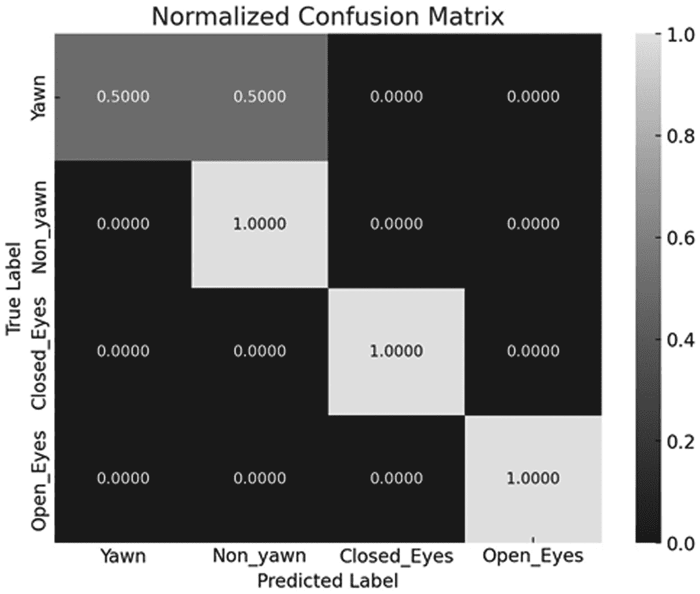

**图 6.10** 模型在不同类别上的分类性能。

在图 6.9 中，我们看到一名面对摄像头的人脸上叠加了多个指标。系统运行在 `Raspberry Pi` 界面上，从桌面环境即可看出。屏幕显示两个主要窗口：一个显示人脸的视频流窗口，另一个显示状态消息的终端窗口。

*   **眨眼次数：** 系统检测到 14 次眨眼，表明该人眨眼的次数。眨眼是疲劳的关键指标，高眨眼频率可能预示着疲劳。
*   **EAR（眼部纵横比）：** `EAR` 值为 0.36。`EAR` 通过分析眼部特定点之间的距离比率来检测眨眼。较低的 `EAR` 通常表示眼睛闭合，可用于检测疲劳。
*   **打哈欠次数：** 系统显示检测到 0 次打哈欠。打哈欠是疲劳的另一个重要指标。
*   **MAR（嘴部纵横比）：** `MAR` 值为 0.60。`MAR` 测量嘴巴的张开程度，用于检测打哈欠。较高的 `MAR` 表示嘴巴张开，这与打哈欠和潜在疲劳相关。

左侧终端窗口显示一系列消息，反复出现 ”Wake up...”（醒醒……）。这表明系统正在提醒驾驶员保持清醒，很可能是通过眨眼和 `EAR` 指标检测到了疲劳迹象。图 6.10 展示了系统监测另一名人员的实例。与第一张图类似，系统在人脸上叠加指标，并在终端窗口显示状态消息。

*   **眨眼次数：** 此处系统检测到 17 次眨眼。相比第一张图，较高的眨眼次数可能表明疲劳程度增加。
*   **EAR：** `EAR` 值为 0.16，明显低于第一张图。较低的 `EAR` 暗示该人眼睛更频繁地处于闭合或半闭合状态，这是疲劳的强烈信号。
*   **打哈欠次数：** 系统检测到 1 次打哈欠。打哈欠的出现进一步佐证了驾驶员极可能处于疲劳状态。
*   **MAR：** `MAR` 值为 0.30，表明该人嘴巴张开程度低于第一张图，但检测到的打哈欠暗示存在间歇性的大幅张开。

该图像中的终端窗口显示更紧急的消息：”Please Take Rest...”（请休息……）和 ”Sleeping...”（睡着了……）。这些消息表明系统判定驾驶员严重疲劳，需要休息以避免潜在事故。系统通过持续捕捉驾驶员面部视频帧并分析指示疲劳的特定特征来运行。它利用计算机视觉技术识别面部关键点，并借助机器学习模型将这些关键点解读为 `EAR` 和 `MAR` 等有意义的指标。系统通过追踪眨眼和打哈欠频率以及眼部和嘴部的纵横比，实时评估驾驶员的警觉水平。一旦识别出疲劳指标，系统便会激活视觉（以及潜在的听觉）警报，提醒驾驶员保持注意力或休息。这种主动策略降低了与疲劳驾驶相关的风险，从而提高了道路安全性。

### 6.5 结论

总之，该研究通过融合前沿计算机视觉与机器学习方法，在增强道路安全方面迈出了关键一步。通过利用 `dlib` 库强大的面部关键点检测能力，结合实时眼部纵横比和嘴唇距离分析，我们的系统能熟练识别驾驶员疲劳和打哈欠的早期迹象。此外，`Raspberry Pi` 开发板和摄像头模块等关键硬件组件的集成，实现了对网络摄像头视频流的无缝图像处理和特征提取。`OpenCV`、`dlib` 和 `imutils` 库的应用进一步增强了系统能力，支持快速的实时数据处理与分析（图 6.11 和图 6.12）。

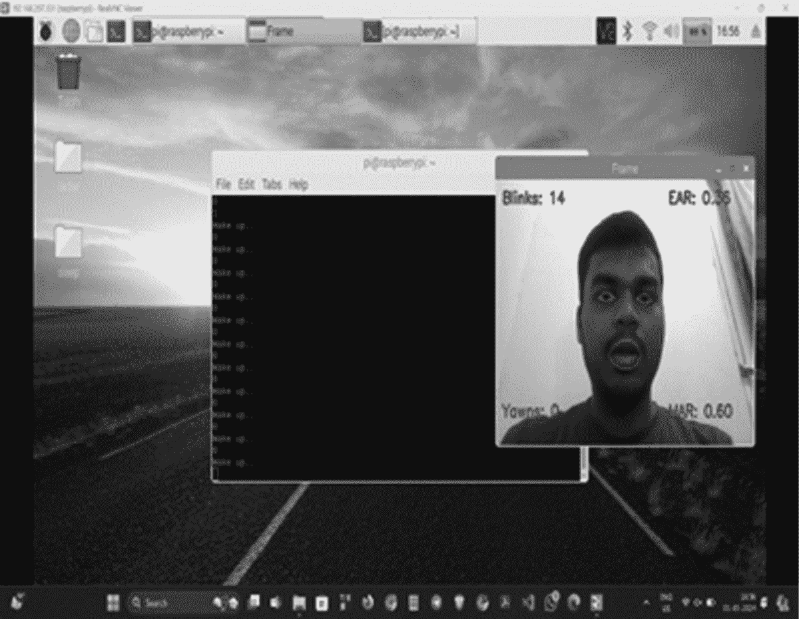

**图 6.11** 模型在不同类别上的分类性能。

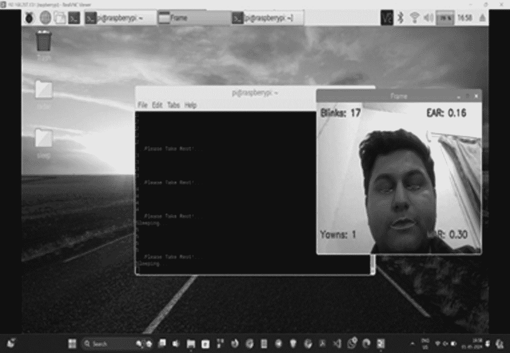

**图 6.12** 模型在不同类别上的分类性能。

## 多线程架构与实时警报

我们系统的多线程架构支持对多个指标进行同步监测，为检测驾驶员疲劳的各种表现提供了整体解决方案。此外，本章强调了及时警报的重要性，采用声音警告提示驾驶员采取必要的休息，从而缓解因意识受损而导致的潜在事故。鉴于道路安全的至关重要性，我们创新的系统为集成到车辆和交通基础设施中提供了一个极具前景的框架。通过机器学习与先进技术的战略性融合，本章展示了其显著提升道路公共安全的潜力。这一努力的成功不仅凸显了机器学习在应对现实挑战方面的功效，也彰显了其为所有驾驶员营造更安全、更可靠驾驶环境的能力。

实时警报和通知是我们提议系统的一项关键功能，可在检测到困倦迹象时向驾驶员提供即时警告。通过 AI 算法分析面部表情、眼部运动及其他生理指标，我们的系统确保驾驶员接收到及时通知，提示其采取必要的休息，从而防止因意识受损导致的潜在事故。

## 与车辆系统集成与数据分析

与现有车辆系统集成是我们提议的另一个重要方面。AI 驱动的疲劳检测模块可无缝集成到当前的车辆安全系统中，确保在各种车辆类型和车型间的兼容性和易采纳性。这种集成对于广泛实施和采用至关重要，可增强现代车辆的整体安全功能。

此外，我们的研究强调了利用 AI 洞察追踪和分析驾驶员困倦随时间变化趋势的数据分析和报告工具的重要性。这些工具可为车队管理者、交通管理部门和政策制定者提供有价值的信息，使其能够做出明智决策并优化道路安全策略。全面的分析和报告有助于识别驾驶员行为的模式和趋势，为开发更有效的干预措施和政策以改善道路安全做出贡献。

## 参考文献

1.  B. C. Tefft, “Prevalence of motor vehicle crashes involving drowsy drivers, United States, 2009–2013,” *Accident Analysis & Prevention*, vol. 45, pp. 180–186, 2014. [`doi.org/10.1016/j.aap.2013.12.018`](https://doi.org/10.1016/j.aap.2013.12.018)


2. National Highway Traffic Safety Administration, “Drowsy driving and automobile crashes,” *Traffic Safety Facts, CrashStats Report*, Report No. DOT HS 812 446, pp. 1–14, Oct. 2017. [Online]. Available: [`crashstats.nhtsa.dot.gov/Api/Public/ViewPublication/812794`](https://crashstats.nhtsa.dot.gov/Api/Public/ViewPublication/812794)

3. G. Zhang, K. K. W. Yau, and G. Chen, “Risk factors associated with traffic violations and accident severity in China,” *Accident Analysis & Prevention*, vol. 59, pp. 18–25, 2014. [`doi.org/10.1016/j.aap.2013.10.025`](https://doi.org/10.1016/j.aap.2013.10.025)

4. P. Philip, P. Sagaspe, N. Moore, J. Taillard, A. Charles, C. Guilleminault, *et al.*, “Fatigue, sleepiness, and performance in simulated versus real driving conditions,” *Sleep*, vol. 28, no. 12, pp. 1511–1516, 2005. [`doi.org/10.1093/sleep/28.12.1511`](https://doi.org/10.1093/sleep/28.12.1511)

5. J. A. Horne and L. A. Reyner, “Sleep-related vehicle accidents,” *BMJ*, vol. 310, no. 6979, pp. 565–567, 1995. [`doi.org/10.1136/bmj.310.6979.565`](https://doi.org/10.1136/bmj.310.6979.565)

6. M. S. Young and N. A. Stanton, “Malleable attentional resources theory: A new explanation for the effects of mental underload on performance,” *Human Factors*, vol. 49, no. 1, pp. 24–38, 2007. [`doi.org/10.1518/001872007779598082`](https://doi.org/10.1518/001872007779598082)

7. B. C. Tefft, “Driver age and involvement in motor vehicle crashes, injuries, and fatalities: United States, 1995–2010,” *AAA Foundation for Traffic Safety Research Report*, Nov. 2012. [Online]. Available: [`aaafoundation.org/motor-vehicle-crashes-injuries-deaths-relation-driver-age-united-states-1995-2010/`](https://aaafoundation.org/motor-vehicle-crashes-injuries-deaths-relation-driver-age-united-states-1995-2010/)

8. J. Jun, R. Guensler, and J. Ogle, “Smoothing methods to minimize impact of GPS random error on travel distance, speed, and acceleration profile estimates,” *Transportation Research Part C: Emerging Technologies*, vol. 19, no. 6, pp. 1135–1150, 2011. [`doi.org/10.1016/j.trc.2010.12.008`](https://doi.org/10.1016/j.trc.2010.12.008)

9. E. I. Vlahogianni, M. G. Karlaftis, and J. C. Golias, “Short-term traffic forecasting: Where we are and where we’re going,” *Transportation Research Part C: Emerging Technologies*, vol. 43, pp. 3–19, 2014. [`doi.org/10.1016/j.trc.2014.01.005`](https://doi.org/10.1016/j.trc.2014.01.005)

10. Y. Li, L. Li, and G. Rose, “Incorporating uncertainty into short-term travel time predictions,” *Transportation Research Part C: Emerging Technologies*, vol. 35, pp. 102–113, 2013. [`doi.org/10.1016/j.trc.2013.06.004`](https://doi.org/10.1016/j.trc.2013.06.004)

11. Y. Zhang, Y. Liu, and Y. Wang, “Traffic flow forecasting with variable selection and Markov switching model,” *Physica A: Statistical Mechanics and its Applications*, vol. 390, no. 23–24, pp. 3928–3939, 2011. [`doi.org/10.1016/j.physa.2011.05.025`](https://doi.org/10.1016/j.physa.2011.05.025)

12. N. D. Noviati, F. E. Putra, N. Septiani, and N. P. Lestari, “Evolution of artificial intelligence in autonomous vehicle systems: A survey,” *International Journal of Cyber and IT Service Management*, vol. 4, no. 2, pp. 51–67, Oct. 2024. [`doi.org/10.34306/ijcitsm.v4i2.161`](https://doi.org/10.34306/ijcitsm.v4i2.161)

13. J. Zhang and K. B. Letaief, “Artificial intelligence empowered edge computing for Internet of Vehicles: Architecture, technologies, and applications,” *IEEE Access*, vol. 8, pp. 69063–69079, Jan. 2020. [`doi.org/10.1109/ACCESS.2020.2983609`](https://doi.org/10.1109/ACCESS.2020.2983609)

14. J. Zhang, Y. Wang, and M. Ma, “A comprehensive review on key technologies of autonomous driving,” *International Journal of Intelligent Unmanned Systems*, vol. 10, no. 3, pp. 245–264, 2022. [`doi.org/10.1108/IJIUS-10-2021-0025`](https://doi.org/10.1108/IJIUS-10-2021-0025) (Not accessible as of [2025/09/30])

15. M. Thakur and A. Verma, “Review of the advancements in connected and autonomous vehicles,” *Transportation Research Part C: Emerging Technologies*, vol. 89, pp. 161–184, 2018. [`doi.org/10.1016/j.trc.2018.01.026`](https://doi.org/10.1016/j.trc.2018.01.026)

16. W. Du, A. Dash, J. Li, H. Wei, and G. Wang, “Safety in traffic management systems: A comprehensive survey,” *arXiv preprint*, Aug. 11, 2023. [`arxiv.org/abs/2308.06204`](https://arxiv.org/abs/2308.06204)

17. Y. Zhang, X. Liu, T. Chen, and Q. Li, “AI models for road safety: Prediction of crash frequency and severity,” *Transportation Safety*, vol. 3, no. 2, pp. 112–130, Apr. 2025. [`doi.org/10.1007/s44290-025-00255-3`](https://doi.org/10.1007/s44290-025-00255-3)

* [18] X. Li and H. Seo, “AI-powered decision making for road safety optimization under smart infrastructure,” *Heliyon*, vol. 10, no. 12, Dec. 2024. [Online]. Available: [www.sciencedirect.com/science/article/pii/S2405844024146257](http://www.sciencedirect.com/science/article/pii/S2405844024146257)

* [19] P. Chen, R. Singh, and S. Kumar, “Edge computing in 5G: A review of smart infrastructure applications,” *ResearchGate*, May 2019. [Online]. Available: [www.researchgate.net/publication/335510509_Edge_Computing_in_5G_A_Review](http://www.researchgate.net/publication/335510509_Edge_Computing_in_5G_A_Review)

* [20] Y. Wang, L. Zhao, and H. Kim, “Computational intelligence techniques for intelligent transportation systems: A comprehensive review,” in *Lecture Notes in Computer Science*, Springer, Jun. 2024. [Online]. Available: [`link.springer.com/chapter/10.1007/978-3-030-78284-9_2`](https://link.springer.com/chapter/10.1007/978-3-030-78284-9_2)

* [21] Smart Roads: Innovations in Highway Management – ScienceDirect, “Intelligent systems for managing motorway corridors and reducing traffic congestion,” 2024. [Online]. Available: [`sciencedirect.com/smart-roads`](https://sciencedirect.com/smart-roads)

* [22] Adoption of AI in Smart Cities – ScienceDirect, “AI’s role in creating smarter, safer cities with advanced transportation systems,” 2024. [Online]. Available: [`sciencedirect.com/adoption-ai-smart-cities`](https://sciencedirect.com/adoption-ai-smart-cities)

* [23] Algorithmic Urban Planning for Smart Development – ScienceDirect, “Integration of AI in urban planning to solve complex transportation issues,” 2024. [Online]. Available: [`sciencedirect.com/algorithmic-urban-planning`](https://sciencedirect.com/algorithmic-urban-planning)

* [24] Y. Wen, S. Sun, J. Tang, and K. Yang, “Integrated sensing-communication-computation for edge artificial intelligence,” *arXiv preprint*, Jun. 2023. [Online]. Available: [`arxiv.org/abs/2306.01162`](https://arxiv.org/abs/2306.01162)

* [25] L. Gong, A. Yassin, R. K. K. Saini, and M. Garon, “The convergence of artificial intelligence and blockchain: The state of play and the road ahead,” *Information*, vol. 15, no. 5, pp. 268, 2024. [Online]. Available: [`doi.org/10.3390/info15050268`](https://doi.org/10.3390/info15050268) (截至 [2025/09/30] 不可访问)

* [26] S. Hussain, F. Anwar, R. U. Rehman, A. Basit, and M. Ali, “Exploring computing paradigms for electric vehicles: From cloud to edge intelligence, challenges and future directions,” *World Electric Vehicle Journal*, vol. 15, no. 2, pp. 39, 2024. [Online]. Available: [`doi.org/10.3390/wevj15020039`](https://doi.org/10.3390/wevj15020039) (截至 [2025/09/30] 不可访问)

# 第 7 章 用于分离多语言 PDF 文档的文档分类引擎

Apeksha Aggarwal 和 Pawan Kumar

DOI: [10.1201/9781003569619-7](http://doi.org/10.1201/9781003569619-7)

## 7.1 引言

数据的快速数字化引发了人们对无纸化电子文档的日益关注；自动化文档分类过程已成为对文档进行适当分类和知识发现的必要手段。深度学习算法广泛用于电子文档（如电子邮件、博客、数字图书馆和在线新闻）的分类，以从中获取有意义的知识。海量且不断增长的电子文档量产生了对智能计算技术的需求，以自动将文档分类到各自的类别中。大多数近期的工作都集中在同语言文档的自动分类上。本文的重点是从可移植文档格式（`PDF`）文档中提取多语言文本。

从不同语言的文档集合中对这类文档进行分类是一个容易出错、繁琐且耗时的过程。文档分类引擎可以协助人类将不同语言的文档分离到不同的文件夹中。如果文档未正确标记，这可以防止文档丢失，并加快这些文档用于适当应用的过程。所提出的分类引擎还可以摄取并分类以图像形式包含数据的 `PDF` 文档。此类文档分类器可应用于文本挖掘、信息抽取系统等各个领域。仅能处理特定语言文档的信息抽取系统，需要在应用信息抽取之前对这些文档进行分离。因此，文档分类引擎作为先决条件，用于对文档进行分类，以便利用各种 `PDF` 文档进行信息抽取。


# 文档分类

文档分类 [[1]](#ch17.xhtml#r168) 有助于组织注释、整理、分析和检索所需的文档。研究人员已经研究了多种文档分类方法。一般来说，侧重于信息和文档检索的工作主要利用搜索引擎背后的核心技术，如词典和索引 [[2]](#ch17.xhtml#r169)。利用这些基础技术已开展了大量工作，并通过查询重构和反馈进行了改进 [[3]](#ch17.xhtml#r170)、[[4]](#ch17.xhtml#r171)。

近期的文档分类工作涉及使用支持向量机（`SVM`）[[5]](#ch17.xhtml#r172)–[[7]](#ch17.xhtml#r174)。`SVM` 算法依赖核函数来提供分离超平面。各种字符串核被使用，如不匹配核 [[8]](#ch17.xhtml#r175) 和谱核 [[9]](#ch17.xhtml#r176)，它们连同 `RNA` 和 `DNA` 序列数据一起用于信息检索和文档分类。

例如，决策树 [[3]](#ch17.xhtml#r170) 和朴素贝叶斯 [[10]](#ch17.xhtml#r177)、[[11]](#ch17.xhtml#r178) 过去也曾被使用。主题建模、深度学习等额外方法也已被探索，可提供更好的准确性 [[12]](#ch17.xhtml#r179)。深度学习 [[13]](#ch17.xhtml#r180)、[[14]](#ch17.xhtml#r181) 如今也广泛用于其他各种应用。基本神经网络架构由相互连接的非线性节点网络组成，这些节点以层的形式组织。所有这些层在神经网络中按顺序排列。然而，由于数字化时代语料库规模的快速增长，自动文档分类任务正变得越来越具有挑战性。几乎所有领域的规模都有所增加 [[15]](#ch17.xhtml#r182)。

本章的组织结构如下：第 7.2 节描述用于比较分析的算法。第 7.3 节详细解释所提出的架构和方法论。第 7.4 节详细描述实验、评价指标以及结果。第 7.5 节总结全文。

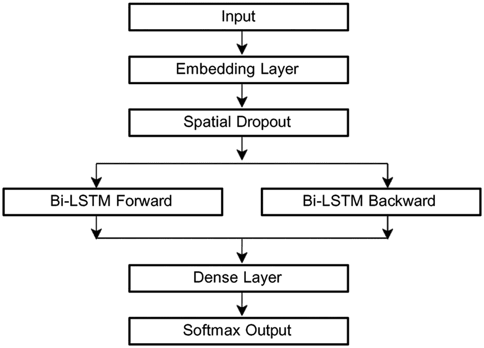

**图 7.4** 使用 `Bi-LSTM` 的模型架构

## 7.2 所用技术

### 7.2.1 朴素贝叶斯

朴素贝叶斯（NB）算法是一种基于贝叶斯定理的概率分类算法。朴素贝叶斯的假设包括特征独立性，即特征在预测分类结果时互不相互作用 [16]。NB 分类器是一种监督学习算法，可使用少量数据高效训练。由于变量或特征被假定为相互独立，因此只需计算每个类变量的方差，而无需计算整个协方差矩阵的值。朴素贝叶斯算法在性能方面表现卓越，因为它也能在有限数据上进行训练 [17–21]。公式 (7.1) 描述了下面的贝叶斯法则。

```
$P\left( {c_{i}~\text{|}~D} \right) = \frac{P\left( c_{i} \right)P\text{(}D~\text{|}~c_{i})}{P\left( D \right)}$ (7.1)
```

其中 $P\left( C_{i} \right) = P(C = c_{i}) = \frac{N_{i}}{N}$

其中 `P(C[i])` 是数据集中类别 `C[i]` 的训练样本数（即 `N[i]`）占数据集总样本数（即 `N`）的比率

尽管朴素贝叶斯基于不同特征之间相互独立这一不切实际的假设，但它在许多分类任务中仍能提供合理的性能。它简单且易于实现。因此，研究人员已将其用于不同的任务 [22, 23]。在 [24] 中，朴素贝叶斯分类器表现非常出色，此时模型计算出的概率并不重要。它被用于不同的分类应用，如电子邮件中的垃圾邮件过滤 [25]、垃圾邮件分类和网页内容分类。

### 7.2.2 长短期记忆模型

长短期记忆（LSTM）在 [26] 中被提出，过去已被证明在学习序列方面比标准循环神经网络（RNN）强大得多。RNN 本质上是在多个时间步上展开的神经网络，因此可以处理时间序列和句子等序列数据。每个时间步都具有隐藏状态，处理来自前一个隐藏状态和当前输入的输入。RNN 的缺点是梯度消失和梯度爆炸。LSTM [26] 的转移函数按公式 (7.2)–(7.7) 定义：

```
i[t] = σ(W[i].[h[t−1],x[t]]+b[i]) (7.2)
f[t] = σ(W[f].[h[t−1],x[t]]+b[f]) (7.3)
o[t] = σ(W[o].[h[t−1],x[t]]+b[o]) (7.4)
c[t] = f[t]⊙ c[t−1] + i[t] ⊙ q[t] (7.5)
h[t] = o[t] ⊙ tanh(c[t]) (7.6)
```

在上述公式中，⊙ 表示逐元素乘法运算。符号说明：当前时间步 `x[t]`、旧隐藏状态 `h[t-1]`、输入门 `i[t]`、遗忘门 `f[t]` 和输出门 `o[t]`。权重用 `W[o]`、`W[q]` 和 `W[i]` 表示，它们是针对不同门的可训练参数。前一个和当前的记忆单元分别用 `c[t-1]` 和 `c[t]` 表示。当前隐藏状态 `h[t]` 使用 `c[t]` 进行修改，并由这些门共同决定。图 7.1 描绘了 LSTM 单元图。

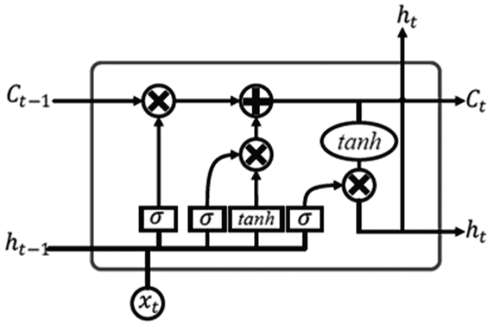

**图 7.1** LSTM 单元架构

### 7.2.3 双向长短期记忆（Bi-LSTM）模型

双向 LSTM（Bi-LSTM）模型有助于提取更多上下文信息 [27]。数据处理在反向和正向方向上同时进行 [28]，并使用求和统计量合并 LSTM 输出 [29]。

Bi-LSTM 模型作为将序列数据分类为多个类别的最先进模型，已被广泛用于语音识别 [30, 31, 32, 33, 34]。PDF 文档页面中的文本也是单词序列，且存在多类标准，因为文档需被分类到相应的语言类别中。因此，本文将 Bi-LSTM 模型应用于分类任务。

## 7.3 方法论

### 7.3.1 数据集描述

数据集包含来自三种语言的 PDF 文件，即英语、斯洛伐克语和捷克语。对句子执行数据清洗和预处理。使用 `Count Vectorizer` 对序列集进行编码。数据集划分为：80% 的数据用于训练，剩余 20% 用于测试。此外，使用交叉验证以避免对单个样本集过拟合。数据训练 100 个周期，该数值通过网格搜索方法选定。表 7.1 显示了数据集详情。

**表 7.1** 数据集样本

| 类别 | 样本数量 |
| --- | --- |
| 英语 | 5000 |
| 斯洛伐克语 | 5000 |
| 捷克语 | 5000 |

### 7.3.2 特征提取

在开始分析之前，首先从 PDF 文档文件中提取文本。如果页面以光栅图像形式存在，则使用 `Tesseract OCR` 系统从文档页面提取内容 [15]。提取后，文本通过文档分类引擎，详见第 7.3.3 节。

### 7.3.3 文档分类引擎

文档分类引擎可协助人工将不同语言的文档分离到不同文件夹中。如果文档未正确标记，这可防止文档丢失，并加快这些文档用于适当应用的过程。所提出的分类引擎还可摄取并分类以图像形式包含数据的 PDF 文档。文档分类引擎作为先决条件，对文档进行分类，以利用从各种 PDF 文档中提取信息。

图 7.2 描绘了执行分类的方法论步骤。首先进行预处理，包括使用 Python 中的 `NLTK` 库移除停用词。进一步在数据集中执行缺失值处理、插值和词干提取。随后进行特征选择。

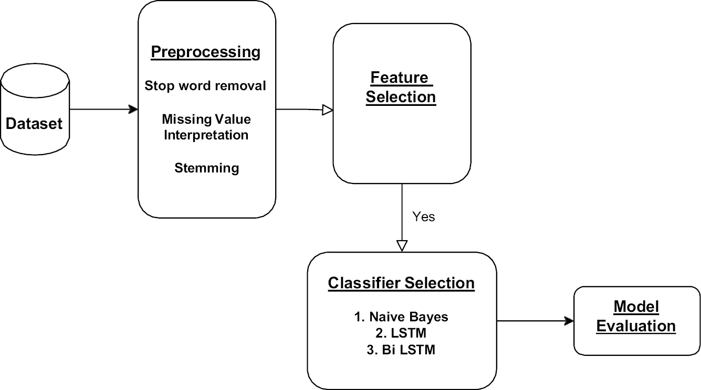

**图 7.2** 方法论步骤

由于大部分文本是通过对带有噪声的光栅扫描文档应用 OCR 从 PDF 的图像格式页面获得的，因此在提取的数据中发现了许多词表外词。此类问题可以通过运行命名实体识别（NER）[35] 系统或使用词干提取和多个正则表达式 [36] 来解决。在本工作中，我们使用词干提取作为预处理步骤。

## 7.4 实验与结果

### 7.4.1 实验细节

为进行实验，我们使用了 Python 3.6.5 版本的 `Spyder 3.2.8` 笔记本。实验在配备 16GB 内存、Intel(R) i5 CPU @ 2.40 GHz 的 Windows 11 64 位操作系统上执行。主要使用 Python `Tensorflow` 和 `Keras API` 实现本工作中的各种算法。

### 7.4.2 基线模型

#### 7.4.2.1 DNN：深度神经网络

DNN 的架构细节定义在图 7.3 中。

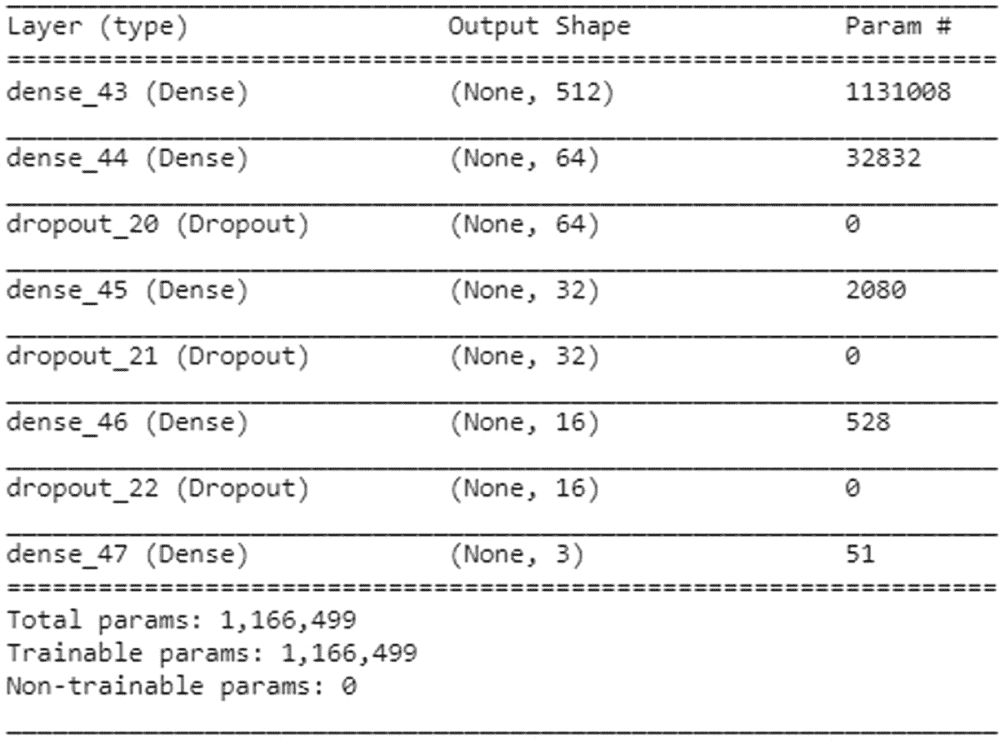

**图 7.3** DNN 架构

#### 7.4.2.2 LSTM

除最后一层外，所有层均使用 ReLU 激活函数。二元交叉熵损失用作损失函数，对于优化，Adam 优化器被用于跨多个轮次的超参数调优。

#### 7.4.2.3 BiLSTM

所提出的架构由一个嵌入层、一个空间 Dropout 层和一个单层 Bi-LSTM 组成。我们使用了 128 维的词嵌入作为输入层，以生成稀疏输入文档的特征。为避免过拟合，我们使用了 1 维空间 Dropout，丢弃率为 40%。我们进一步实现了一个 Bi-LSTM 层，并额外设置了 20% 的 Dropout 率。学习参数利用网格搜索技术进行优化。Bi-LSTM 层使用 196 个神经元作为输入。这一选择是在执行网格搜索后确定的，搜索范围为 32 到 256 个神经元，并选择了在不发生过拟合的情况下性能良好的配置。最终输出层利用 Softmax 函数根据概率对多种语言进行分类。分类交叉熵用作损失函数。Adam 优化器被用于超参数调优，因为它在其他超参数调优算法中表现出了良好的性能。输出全连接层由三个神经元组成，分别对应每个类别。图 7.4 展示了该架构。

### 7.4.3 结果

在模型评估中，本工作使用了 F 值和准确率指标。表 7.2 展示了 Bi-LSTM 架构的结果。

**表 7.2** 我们提出的模型结果

| 评估指标 | 结果 |
| --- | --- |
| F 值 | 0.98 |
| 准确率 | 98.73% |

表 7.3 展示了多模型的对比分析。结果显示，我们使用 Bi-LSTM 的提出架构性能最佳。图 7.5 展示了模型执行的样本分类。

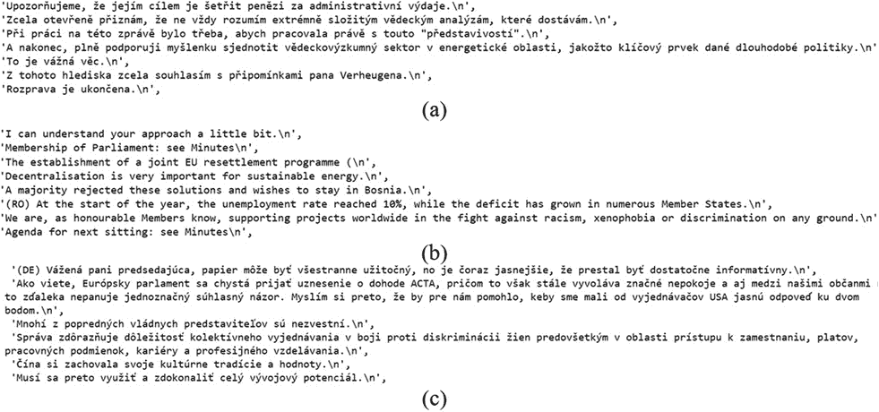

**图 7.5** 从挪威语、斯洛伐克语和英语中提取的样本句子

**表 7.3** 我们提出的模型结果

| 模型 | 准确率 |
| --- | --- |
| 朴素贝叶斯 | 97.0% |
| DNN | 97.1% |
| LSTM | 98.2% |
| 使用 Bi-LSTM 的提出方法 | 98.7% |

在表 7.4 中进行了与最先进技术的对比研究。表格显示，提出的方法以 98.7% 的准确率优于现有方法。

**表 7.4** 与最先进技术的对比研究

| 方法 | 模型 | 准确率 (%) |
| --- | --- | --- |
| Isa 等 [22] | 朴素贝叶斯 | 87.45 |
| Van Linh 等 [12] | 多项式 NB | 81 |
| Van der Heijden 等 [1] | 元学习-L2 归一化 | 89.1 |
| Isa 等 [22] | 朴素贝叶斯-SVM | 88.02 |
| 提出的方法 | Bi-LSTM | **98.7** |

注：**粗体值** 表示提出的方法优于现有的最先进技术。

## 7.5 结论

多语言 PDF 文档分类是一个亟待解决的重要问题，这归因于电子文档规模的不断增长。本文使用并对比了不同算法对多语言文档进行分类。Bi-LSTM 算法产生的准确率始终高于 DNN 和 LSTM 等其他传统算法。使用 Bi-LSTM 的优势在于其能够双向学习上下文，这使其比 LSTM 更准确。此外，Bi-LSTM 需要极低的计算资源；因此本工作采用了它。提出的模型展示了最佳准确率，达到 98.7%。未来，我们可以在考虑低计算需求的前提下，对比更新模型的结果。

## 参考文献

*   [1] Niels van der Heijden 等. 多语言与跨语言文档分类：一种元学习方法. 见第 16 届欧洲计算语言学协会会议论文集, 第 196–197 页, 2021.
*   [2] C. D. Manning, P. Raghavan, H. Schütze 等. 信息检索导论. 剑桥: 剑桥大学出版社, 2008.
*   [3] J. C. French, D. E. Brown, and N.-H. Kim. 布尔查询重构的一种分类方法. JASIS, 48(8):694–706, 1997.
*   [4] K. Kowsari, M. Yammahi, N. Bari, R. Vichr, F. Alsaby, and S. Y. Berkovich. 基于 Golay 编码变换构建 FuzzyFind 字典用于搜索应用. 国际高级计算机科学与应用期刊, 第 6 卷, 第 81–87 页, 2015.
*   [5] T. Joachims. 使用支持向量机进行文本分类的归纳推理. 见 ICML, 99:200–209, 1999.
*   [6] S. Tong and D. Koller. 支持向量机主动学习及其在文本分类中的应用. 机器学习研究期刊, 第 2 卷, 第 Nov 期, 第 45–66 页, 2001.
*   [7] M. Fernández-Delgado, E. Cernadas, S. Barro, and D. Amorim. 解决现实世界分类问题需要数百个分类器吗? 机器学习研究期刊, 第 15 卷, 第 1 期, 第 3133–3181 页, 2014.
*   [8] E. Eskin, J. Weston, W. S. Noble, and C. S. Leslie. 用于 SVM 蛋白质分类的不匹配字符串核. 见第 16 届神经信息处理系统进展会议 (NIPS) 论文集, 第 1441–1448 页, 2003.
*   [9] C. S. Leslie, E. Eskin, and W. S. Noble. 谱核：一种用于 SVM 蛋白质分类的字符串核. 见第 7 届太平洋生物计算研讨会论文集, 第 7 卷, 第 566–575 页, 2002.
*   [10] A. McCallum, K. Nigam, et al. 朴素贝叶斯文本分类事件模型的比较. 见 AAAI-98 文本分类学习研讨会论文集, 第 752 卷, 第 41–48 页, 1998.
*   [11] S.-B. Kim, K.-S. Han, H.-C. Rim, and S. H. Myaeng. 朴素贝叶斯文本分类的一些有效技术. IEEE 知识与数据工程汇刊, 第 18 卷, 第 11 期, 第 1457–1466 页, 2006.
*   [12] N. Van Linh, N. K. Anh, K. Than, and C. N. Dang. 一种有效且可解释的文档分类方法. 知识与信息系统, 第 50 卷, 第 3 期, 第 763–793 页, 2017.
*   [13] G. E. Hinton and R. R. Salakhutdinov. *利用神经网络降低数据维度*. Science, 第 313 卷, 第 5786 期, 第 504–507 页, 2006.
*   [14] R. Johnson and T. Zhang. 有效利用词序进行卷积神经网络文本分类. 见 *2015 年北美计算语言学协会会议论文集：人类语言技术*, 第 103–112 页, 2015.
*   [15] R. Smith. Tesseract OCR 引擎概述. 见第 9 届国际文档分析与识别会议 (ICDAR) 论文集, 第 2 卷, 第 629–633 页. IEEE, 2007.
*   [16] H. Brücher, G. Knolmayer, and M.-A. Mittermayer. 用于组织显性知识的文档分类方法. 信息工程研究组, 信息系统研究所, 伯尔尼大学, 2002.
*   [17] A. McCallum and K. Nigam. 朴素贝叶斯文本分类事件模型的比较. 机器学习研究期刊, 第 3 卷, 第 1265–1287 页, 2003.
*   [18] I. Rish. 朴素贝叶斯分类器的实证研究. 见 IJCAI-01 人工智能实证方法研讨会论文集, 第 3 卷, 第 22 期, 第 41–46 页, 2001.
*   [19] S. Ruan, B. Chen, K. Song, and H. Li. Weighted naïve Bayes text classification algorithm based on improved distance correlation coefficient. Neural Computing and Applications, vol. 34, nos. 4, pp. 2729–2738, 2022.
*   [20] P. Domingos and Michael Pazzani. On the optimality of the simple Bayesian classifier under zero-one loss. Machine Learning, vol. 29, nos. 2-3, pp. 103–130, 1997.
*   [21] S.-B. Kim, H.-C. Rim, D.-S. Yook, and H.-S. Lim. Effective methods for improving Naïve Bayes text classification. In 7th Pacific Rim International Conference on Artificial Intelligence, vol. 7, pp. 414–423, 2002.


*   [22] D. Isa, L. H. Lee, V. P. Kallimani, and R. Rajkumar. Text documents preprocessing with the Bayes formula for classification using support vector machine. IEEE Transactions on Knowledge and Data Engineering, vol. 20, no. 9, pp. 1264–1272, 2008.
*   [23] S.-B. Kim, K.-S. Han, H.-C. Rim, and S. H. Myaeng. Some effective techniques for Naive Bayes text classification. IEEE Transactions on Knowledge and Data Engineering, vol. 18, no. 11, pp. 1457–1466, November 2006.
*   [24] P. Domingos and M. J. Pazzani. On the optimality of the simple Bayesian classifier under zero-one loss. Machine Learning, vol. 29, nos. 2-3, pp. 103–130, 1997.
*   [25] T. S. Guzella and W. M. Caminhas. A review of machine learning approaches to spam filtering. Expert Systems with Applications, vol. 36, no. 7, pp. 10206–10222, 2009.
*   [26] J. Schmidhuber and S. Hochreiter. *Long short-term memory*. Neural Computation, vol. 9, no. 8, pp. 1735–1780, 1997.
*   [27] Z. Huang, W. Xu, and K. Yu. Bidirectional LSTM-CRF Models for Sequence Tagging. *arXiv preprint arXiv:1508.01991*, 2015.
*   [28] M. Schuster and K. K. Paliwal. Bidirectional recurrent neural networks. IEEE Transactions on Signal Processing, vol. 45, no. 11, pp. 2673–2681, 1997.
*   [29] A. Graves and J. Schmidhuber. Framewise phoneme classification with bidirectional LSTM and other neural network architectures. Neural Networks, vol. 18, no. 5, pp. 602–610, 2005.
*   [30] R. Ghaeini, S. A. Hasan, V. V. Datla, J. Liu, K. Lee, A. Qadir, Y. Ling, A. Prakash, X. Z. Fern, and O. Farri. DR-BiLSTM: Dependent Reading Bidirectional LSTM for Natural Language Inference. In Proceedings of the 2018 Conference of the North American Chapter of the Association for Computational Linguistics: Human Language Technologies, Vol 1 (Long Papers), pp. 1460–1469, 2018.
*   [31] S. Hochreiter and J. Schmidhuber. Long short-term memory. Neural Computation, vol. 9, no. 8, pp. 1735–1780, 1997.
*   [32] E. Kiperwasser and Y. Goldberg. Simple and Accurate Dependency Parsing Using Bidirectional LSTM Feature Representations. *Transactions of the Association for Computational Linguistics*, vol. 4, pp. 313–327, 2016.
*   [33] A. Rao and N. Spasojevic. Actionable and Political Text Classification Using Word Embeddings and LSTM. Technical report, Lithium Technologies, July 2016.
*   [34] K. S. Tai, R. Socher, and C. D. Manning. Improved Semantic Representations from Tree-Structured Long Short-Term Memory Networks. In Proceedings of the 53rd Annual Meeting of the Association for Computational Linguistics and the 7th International Joint Conference on Natural Language Processing, vol. 1, pp. 1556–1566, 2015.
*   [35] N. Correia da Silva et al. Document Type Classification for Brazil’s Supreme Court Using a Convolutional Neural Network. In 10th International conference on forensic computer science and cyber law (ICoFCS), Sao Paulo, Brazil, pp. 29–30, 2018.
*   [36] P. H. Luz de Araujo, T. E. de Campos, R. R. R. de Oliveira, M. Stauffer, S. Couto, and P. Bermejo. *Lener-br: A Dataset for Named Entity Recognition in Brazilian Legal Text*. In Proceedings of the International Conference on the Computational Processing of Portuguese (PROPOR), Canela, RS, Brazil, vol. 13, pp. 313–323, September 24–26, 2023.

# 第 8 章 FNDetector：利用各种特征组合进行假新闻检测

Yun Hwa Wong (Jenny), Amanpreet Kaur, and Sangeeta Lal

DOI: [10.1201/9781003569619-8](http://doi.org/10.1201/9781003569619-8)

## 8.1 简介

在技术爆炸和现代世界的时代，假新闻正以惊人的速度渗透我们的日常生活。剑桥词典将“假新闻”定义为“看似新闻的虚假故事，通过互联网或其他媒体传播，通常旨在影响政治观点或作为玩笑”[1]。据世界领先的公共服务广播机构英国广播公司（BBC）称，假新闻的历史始于 2000 年前罗马共和国的内战期间。屋大维想要赢得战争，便通过在硬币上印制标语并分发给公众，散布针对马克·安东尼的“假新闻”。在 19 世纪，印刷术发明后。1835 年，一家报纸刊登了关于生活在月球上的奇异生物的文章，如飞行蝙蝠人和独角兽[2]。

在在线社交媒体概念出现之前，大多数人通过阅读报纸或收听广播电台获取新闻。凭借轻松连接人群和分享内容的特性，通过在线社交媒体传播新闻的速度急剧增加。

[3] 对 2006 年至 2017 年 Twitter 数据集的一项研究显示，排名前 1% 的假新闻影响了 1000 到 100000 人，而真相很少传播给超过 1000 人。该研究展示了假新闻在在线社交媒体上传播的速度有多快。

假新闻在许多领域普遍存在，尤其是在政治领域。在 2016 年美国总统提名过程中，关于唐纳德·特朗普的假新闻备受青睐，并在社交媒体上广泛传播。在 Facebook 上，有 115 条支持特朗普的假新闻故事和 41 条支持克林顿的假新闻故事[4]。假新闻在公共论坛传播可能产生的影响引起了不同研究人员和公众的特别关注。然而，假新闻不仅仅关乎政治问题。近年来，当灾难或大流行病发生时，假新闻会广泛传播。最好的例子是 2019 年发生的 SARS-CoV-2（COVID-19）病毒爆发。存在大量与如何从疾病中康复相关的假新闻或虚假信息，例如食用辣椒有助于预防或治愈 COVID-19，饮酒可以保护公众免受 COVID-19 侵害[5]。例如，一条关于蒸汽能杀死冠状病毒的 Facebook 用户帖子式假新闻已在 Facebook 上被分享超过 33,000 次[6]。研究人员投入了大量时间和精力开发不同的算法和模型来检测假新闻。de Beer 和 Matthee[7] 对各种研究人员使用的不同方法进行分类研究。根据 de Beer 和 Matthee[7] 的说法，现有研究人员使用的方法可分为五大类（参见表 8.1）。每种方法的示例可在表 8.1 中找到。

**表 8.1** 识别假新闻的各种方法的示例或描述

| 方法 | 示例/描述 |
| :--- | :--- |
| 语言方法 | 词袋模型、语义分析、深度句法、利用语言特征和网页标记能力 |
| 主题无关方法 | （表中未列出具体示例） |
| 机器学习方法 | 深度学习神经网络 |
| 知识库方法 | 专家导向、计算导向和众包导向的事实核查 |
| 混合方法 | 不同模型或技术的组合 |

尽管多年来研究人员提出了无数种识别假新闻的方法和技术，但据我们所知，目前尚无任何方法能达到完全准确的检测水平。主要有两个原因：

**数据挑战**：据我们所知，研究人员只能使用少数公开可用的数据集来开发和测试其假新闻检测模型。不同数据集适用于不同任务。很难获得满足研究要求的正确数据集，例如 Wang 引入的 `LIAR dataset` [8]。然而，这些数据集在特征集可用性方面存在局限，不适合本文提出的工作。

**识别合适的学习模型**：数据集和提取的特征对学习模型的性能有显著影响 [9]。因此，仔细识别给定数据集的特征非常重要。我们提出了 `FNDetector` 模型。我们使用了来自四个领域的特征：基于语言的特征、基于情感的特征、基于命名实体识别（`NER`）的特征和文本特征。我们训练了两种 `FNDetector` 模型变体，一种使用随机森林（`RF`）分类器，另一种使用长短期记忆（`LSTM`）分类器。我们在 `Horne2017FakeNews Dataset` 上评估了 `FNDetector` 模型的效率。实验结果表明，`FNDetector` 显著优于基线分类器。使用 `RF` 分类器的 `FNDetector` 模型在 F 值上比基线分类器高出 9.3%，在准确率上高出 9.8%；使用 `LSTM` 分类器的 `FNDetector` 模型在 F 值上比基线分类器高出 40.2%，在准确率上高出 17.7%。以下是我们利用本研究回答的主要研究问题。

*   **RQ 1**：基线分类器的表现如何？
*   **RQ 2**：建议的模型 `FNDetector` 与基线分类器相比表现如何？
*   **RQ 3**：从文章的标题和内容中提取特征有多重要？
*   **RQ 4**：`FNDetector` 模型中哪些特征更重要？
*   **RQ 5**：如果更改 `RF` 和 `LSTM` 分类器的参数，会对 `FNDetector` 模型的效率产生什么影响？

本章结构安排如下。我们在第 8.1 节中介绍了假新闻。我们将在第 8.2 节中提供关于假新闻的背景信息。第 8.3 节揭示了本研究对原创研究领域的具体贡献，并将讨论相关工作。在第 8.4 节中，我们将详细介绍建议的 `FNDetector` 模型。在第 8.5 节、第 8.6 节和第 8.7 节中，我们将提供与数据集提取、实验设置和评估指标相关的详细信息。第 8.8 节将提供每个研究问题（`RQ`）的动机、方法和获得的结果。在第 8.9 节中，将提供结论和未来方向。

## 8.2 背景

各种形式的假新闻可能在我们的日常生活中传播。它们以视频、URL、文章等不同格式传播。然而，它们服务于相同的目的和动机，即创作者希望从公众那里获得关注和不道德的利益。在这里，我们将讨论我们在日常生活中遇到的不同类型的假新闻，以及创作者如何从中获利。

### 8.2.1 标题党

标题党可以由在线社交媒体上的链接或缩略图表示。它已成为在社交媒体上传播假新闻的主要形式之一。标题党的标题总是具有误导性，并可能涉及公众的好奇心缺口、八卦或耸人听闻的方面，以吸引用户点击 [10]。一项针对 53 名斯坦福学生的调查发现，96.2% 的人每天至少会在网上遇到一次标题党故事 [11]。创作者制造标题党的动机是增加网站访问量和广告渠道。

### 8.2.2 宣传

宣传是传播假新闻的另一种形式。宣传通常用于在选举或抗议发生前，分发与政治方面或个人观点相关的有偏见或误导性信息，以影响人们的看法。为了达到最大影响，宣传采用微妙的心理和语言策略 [12]。由于宣传的性质，恶劣的宣传新闻源已显示出其具有重大影响力。宣传和虚假信息的力量在诸如脱欧等近期事件中得到了体现。在一辆臭名昭著的巴士上传播的宣传 [13] 已成为脱欧公投活动的重要代表 [14]。这一虚假声明被一半的英国公众所相信，在公投期间和之后造成了负面影响。

### 8.2.3 讽刺与戏仿

讽刺与戏仿是对某部作品的幽默评论，要求模仿该作品或批评世界。这两种风格都会应用喜剧效果来娱乐大众。虽然这些通常不被归类为假新闻，但讽刺或戏仿中呈现的信息可能提供虚假信息或误导公众，并对公众的决策产生负面影响。讽刺和戏仿网站的例子包括 The Onion ([www.theonion.com/](http://www.theonion.com/))、The Daily Mash ([www.thedailymash.co.uk/](http://www.thedailymash.co.uk/)) 等。

总的来说，在线社交媒体和网站已成为公众获取信息的主要平台之一。然而，来自社交媒体或网站的虚假信息难以被公众辨别。因此，研究人员投入了大量精力用于识别假新闻。

## 8.3 文献综述与研究贡献

### 8.3.1 文献综述

#### 研究背景与相关工作

为了训练一个支持高准确率检测假新闻的模型，用于训练模型的数据集起到了重要作用。寻找一个可靠的数据集来训练高效模型具有挑战性。Shu 等人对从不同数据集中提取的特征进行了研究 [[15]](#ch18.xhtml#r218)。这些提取的特征分为两大类：新闻内容特征和社会上下文特征。语言学特征和视觉特征属于新闻内容特征类别中的特征表示类型。用户特征、帖子特征和网络特征被归类为社会上下文特征。该研究讨论了从一些流行数据集中提取的特征：BuzzFeedNews [[16]](#ch18.xhtml#r219)、LIAR [[17]](#ch18.xhtml#r220)、BS Detector [[18]](#ch18.xhtml#r221) 和 CREDBANK [[19]](#ch18.xhtml#r222)。研究人员得出结论，上述每个数据集都限制了某些特征的提取，例如：只能从 BuzzFeedNews 数据集中提取语言学特征。该数据集不支持任何现有的特征提取。因此，为了克服现有数据集的缺点，研究人员开发了一个新数据集，即 FakeNewsNet，以包含所有新闻信息和社会上下文特征。

Bhutani 等人 [[20]](#ch18.xhtml#r223) 使用了三个不同的数据集：LIAR [[17]](#ch18.xhtml#r220)、George McIntire7 [[21]](#ch18.xhtml#r224) 和合并数据集（Kaggle [[22]](#ch18.xhtml#r225)、PolitiFact [[23]](#ch18.xhtml#r226) 和 Emergent 数据集的组合）。他们在数据集上应用了不同的文本预处理技术，如 Bi-grams、Tri-grams、CountVectorizer 等。tf-idf 分数、情感值和余弦相似度分数等附加列已被添加到合并数据集中。因此，通过从假新闻检测模型中提取情感特征，提高了假新闻识别的准确率。


Khan 等人 [[24]](#ch18.xhtml#r227) 和 Iwendi 等人 [[25]](#ch18.xhtml#r228) 对特征提取的重要性进行了调查。两项研究均在将文本特征传递给先进机器学习算法（RF 算法、深度学习算法）之前，提取了诸如小写字符计数、平均单词长度、正面情感得分等特征。在应用特征提取之前，决策树分类器对假新闻检测的预测精度为 67.81%。然而，应用特征提取后，结果显著提高了 10%，达到 77.58% 的预测准确率。Ajao 等人 [[26]](#ch18.xhtml#r229) 将情感要素作为提取特征之一。研究中使用的情感分析是情感比率得分。作者使用潜在语义分析和潜在狄利克雷分布来检索情感得分。结果显示，包含情感比率的模型在相同数据集上优于其他现有提取特征。Choudhary 和 Arora [[9]](#ch18.xhtml#r212) 开发了三个模型来实验假新闻检测的预测精度。实验最终结果显示，基于所有语言特征的模型 3 优于其他两个模型（基于语法、情感和句法特征的模型 1 以及基于可读性特征的模型 2），达到了 84.52% 的平均准确率。

上述研究表明情感分析如何提高假新闻检测的平均准确率。除了可以提取用于训练模型的传统特征（如文本特征和环境特征）外，Reis 等人 [[27]](#ch18.xhtml#r230) 还引入了一种名为域名本地化特征的额外新特征来改进模型。域名本地化特征可以包括从新闻网站 URL 中提取的 IP、城市、国家、纬度和经度。通过引入该额外特征，作者开发的假新闻检测模型成功检测出其数据集中几乎所有的假新闻。

虽然特征提取的重要性已引起研究人员的关注，但用于构建假新闻检测模型的分类方法同样不容小觑。Khanam 等人 [[28]](#ch18.xhtml#r231) 对采用不同传统分类算法进行假新闻检测进行了研究。`XGBoost` 准确率超过 75%，表现最佳。除了传统分类算法，研究人员如 [[29]](#ch18.xhtml#r232) 将不同的深度学习模型应用于数据集进行比较。结果显示，大多数深度学习模型的性能优于传统分类算法。尽管朴素贝叶斯是一种常用方法，但它在检测假新闻方面具有巨大潜力，效果接近深度学习模型。在传统模型和深度学习模型之上，Khan 等人 [[30]](#ch18.xhtml#r233) 对包括预训练模型（如 `BERT` [[31]](#ch18.xhtml#r234)）在内的各种机器学习模型进行了基准研究。预训练的基于 `BERT` 的模型效果优于其他模型。

此外，研究人员还尝试提出区块链等最新技术作为解决方案 [[32]](#ch18.xhtml#r235)。在假新闻检测中采用区块链技术存在一些挑战和局限性，但作者认为在不久的将来，利用所提策略检测假新闻将变得容易得多。此外，已经构建了一些现有库，`Flair` 库 [[33]](#ch18.xhtml#r236) 就是其中之一。`Flair` 允许用户结合不同类型的词嵌入，如 `BERT` 嵌入、`ELMo` transformer 嵌入等 [[34]](#ch18.xhtml#r237)。文献 [[35]](#ch18.xhtml#r238) 的研究人员使用 `Flair` 库构建模型。研究发现，结合深度学习算法使用 `Flair` 库，检测真假信息的准确率高达 99.8%。

Horne 和 Adali [[36]](#ch18.xhtml#r239) 进行了区分假新闻、真实新闻和讽刺新闻的研究。研究人员使用了三个不同的数据集，包括 Buzzfeed 选举数据集、Burfoot 和 Baldwin 数据集，以及研究人员从不同来源创建的随机政治新闻数据集。从数据集中提取了心理、文体和复杂性三大主要特征，并在线性核的 SVM 模型上运行。结果显示，仅根据文章正文文本区分假新闻和真实新闻的准确率在随机政治新闻数据集上为 71%，在 Buzzfeed 选举数据集上为 77%。

Balshetwar 等人 [[37]](#ch18.xhtml#r240) 研究了假新闻检测和文本中情感行为分析。他们利用文本中的情感作为情感信号的线索。他们在 ISOT 和 LIAR 数据集上测试了所提模型。该方法达到了 99.8% 的精确率。

Uppada 等人 [[38]](#ch18.xhtml#r241) 提出了一个用于文本和图像的模型。他们使用微调的 `BERT` 模型进行文本处理。他们提出的融合模型达到了 93% 的准确率。

## 8.3.2 研究贡献

我们提出了一种新型假新闻检测模型，即 `FNDetector`，使用四种不同类型的特征（基于语言学、基于情感、基于 NER 和文本特征）。我们从新闻的标题和内容中提取这些特征。我们展示了 `FNDetector` 模型在一个免费可访问数据集上的深入实证分析结果。

**算法 1 FNDetector 算法**

### 8.4 方法论

# FNDetector 模型创建

图 8.1 展示了概览图，算法 1 和算法 2 展示了所提议的 `FNDetector` 模型创建的详细步骤。有关算法 1 和算法 2 中所用符号的详细信息，请参阅图 8.2。`FNDetector` 包含两个阶段：模型构建和预测。在第 1 阶段，我们使用训练数据训练模型（步骤 1 至步骤 4）。在第 2 阶段，我们使用 `FNDetector` 模型预测假新闻（步骤 5）。以下详细描述图 8.1 中所示的所有步骤：

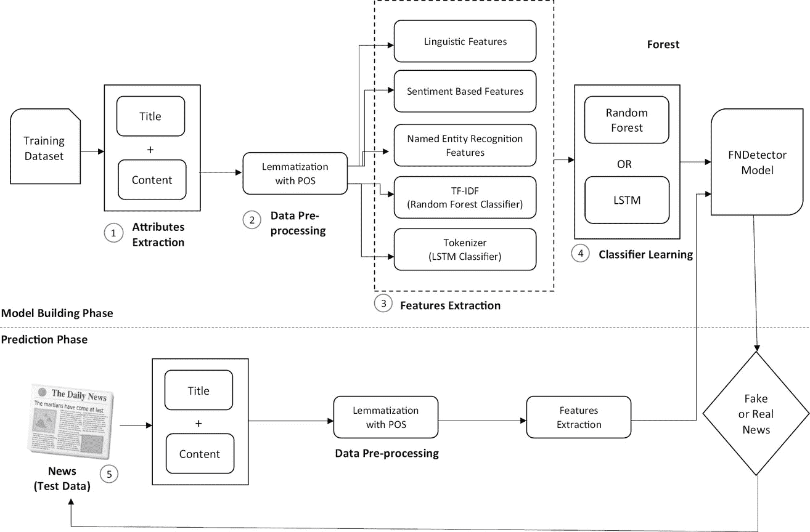

**图 8.1** 所提议的 `FNDetector` 模型概览图。⏎

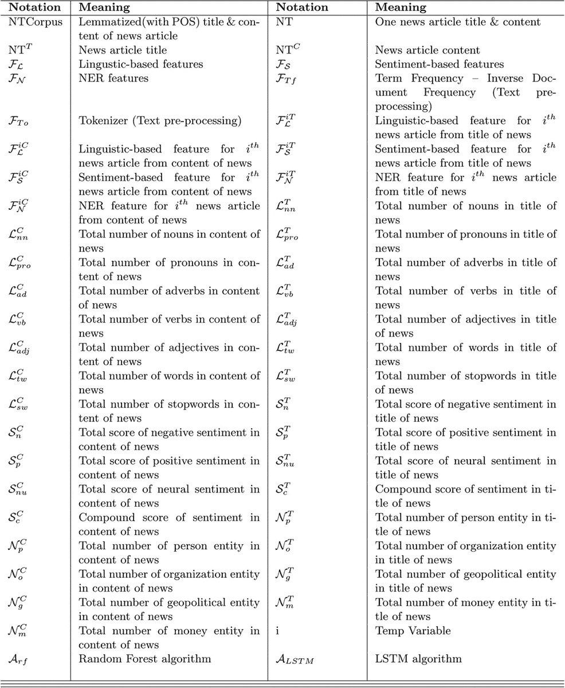

**图 8.2** `FNDetector` 算法 (1) 和特征提取 (算法 2) 中使用的符号。⏎

## 8.4.1 训练数据集收集

实验数据集被分割为测试数据集和训练数据集。我们采用 80%–20% 的训练集和测试集划分比例。我们使用训练数据集创建模型，并使用测试数据集评估模型性能。在训练任何算法之前，必须保证数据集的质量，以开发高性能的假新闻检测模型。我们使用 `Pandas` 库将数据集加载到数据框中。我们在模型创建前打乱数据，以确保数据集混合均匀，不会因排序顺序而固守特定模式。我们确保数据集不包含任何空值。

## 8.4.2 属性选择（步骤 1）

我们选择了新闻文章的标题和内容用于模型创建（参阅算法 1 中的步骤 5）。我们同时选择标题和内容，是因为我们假设两者都包含关于新闻的重要信息，包含这两个属性有助于将假新闻与真新闻区分开来。

## 8.4.3 预处理（步骤 2）

词形还原和词干提取是常用的预处理技术。这些技术被用于提升文档检索精度的性能 [[39]](#ch18.xhtml#r242)。根据 Manning 等人 [[40]](#ch18.xhtml#r243) 的说法，词干提取是一种基本的启发式过程，通过去除词尾和派生词缀来达到目的。与词干提取相比，词形还原是利用词汇和形态学分析来消除单词的屈折词尾，并将单词还原为其基本形式或词典形式。表 8.2 展示了词干提取和词形还原的示例。

**表 8.2** 词干提取和词形还原示例 ⏎

| 类型 | 处理前 | 处理后 |
| --- | --- | --- |
| 词干提取 | Studies, Wander News | Studies, Wand New |
| 词形还原 | Studies, Running, breathed | Study, run, breath |

在我们的工作中，我们对新闻文章的标题和内容都应用了词形还原。我们没有在数据集中应用词干提取技术，因为研究 [[39]](#ch18.xhtml#r242) 表明词形还原能获得更高的准确性和结果。然而，词形还原将单词基本形式默认转换为名词的行为可能会降低最终结果的准确性。因此，为了最大程度减少默认词形还原带来的错误，我们在预处理新闻标题和内容时结合了词性 (POS) 标注和词形还原（参阅算法 1 的步骤 6）。词性标签（形容词、名词、动词和副词）用于识别数据集中的特定文本。因此，当词形还原器检测到文本中标记为动词的单词时，它不会默认将其转换为名词，而是返回动词的基本形式。在本工作中，我们使用来自 `WordNet` [[41]](#ch18.xhtml#r244) 的词形还原器。`WordNet` 是一个庞大且公开可访问的英语词汇数据库，用于在单词之间创建有组织的语义关联。表 8.3 展示了数据集中词形还原后的一些示例。

**表 8.3** 数据集词形还原示例 ⏎

| 词形还原前 | 词形还原后 |
| --- | --- |
| German prosecutors have closed an investigation into suspected mass phone tapping of German citizens by British and U.S. spies after finding no concrete indication of any criminal activity, they said on Thursday | German prosecutors have closed an investigation into suspected mass phone tapping of German citizen by British and U.S. spy after finding no concrete indication of any criminal activity, they said on Thursday |

## 8.4.4 特征提取（步骤 3）

正如第 8.3 节所述，特征提取对于创建高精度模型至关重要。我们从四个不同领域提取特征。我们认为，从不同领域提取的特征有助于捕捉新闻的不同方面，从而提高准确性（参阅算法 1 的步骤 7）。我们提取了 32 个特征来训练 `FNDetector` 模型。

## 8.4.5 基于语言学的特征

基于语言学的特征用于对特定支柱（如句法、语义、形态学等）中指定的单词或音素进行分类。根据 Mahyoob 等人 [[42]](#ch18.xhtml#r245) 的研究，单词在新闻中起着重要作用，撰写新闻内容的风格对公众产生巨大影响。Conroy 等人 [[43]](#ch18.xhtml#r246) 指出，即使假新闻的制造者试图控制其言辞，仍会存在一些难以控制的语言“泄露”，如代词频率、动词使用、连词模式等。因此，为了检测消息内容中的“泄露”或“欺骗预测指标”，我们需要从数据集中提取基于语言学的特征。我们关注两类语言特征：语法特征和词汇特征。

**基于语法的特征** 指句子的结构，包含句法、形态学、音系学和语义学。在本项目中，我们从数据集的新闻标题和正文中提取了名词、动词、形容词、代词和副词的数量。为了提取语法特征，我们使用了词性 (POS) 标注的概念。词性标注也称为语法标注，即句子中的每个单词序列都被自动分配或标记一个语法分类，通常包含动词、形容词、代词、名词等 [[44]](#ch18.xhtml#r247)。在大型数据集中为每个单词标注不同的语法特征既繁琐又耗时。因此，我们借助自然语言工具包 (`NLTK`) 执行词性标注。

**基于词汇的特征** 是另一种基于语言学的特征。词汇是指语言中单词或词汇之间的关系。在本项目中，我们关注词汇频率，即文本在大型语料库中出现的频率及其对应关系，例如文章标题或内容中“停用词”（如“the”、“is”等）出现的次数。此外，我们还计算了每篇文章的单词数量。

表 8.4 提供了本研究中提取的所有 14 个基于语言学特征的详细信息。

**表 8.4** 提取的基于语言学特征详情 ⏎

| 特征名称 | 数据类型 | 特征领域 | 描述 |
| --- | --- | --- | --- |
| noun content | N | 基于语法 | 正文中名词的数量 |
| noun title | N | 基于语法 | 标题中名词的数量 |

### 8.4.6 基于情感的特征

情感分析被发现通过提取情感、态度和观点等要素，有助于从在线社交媒体中识别可疑账户 [45]。当与其他提取的特征结合时，它在假新闻检测中也被证明很有用 [26]。之所以会出现这种情况，是因为假新闻往往偏向于某一类情绪。当人们体验到积极或中性情绪时，他们更倾向于相信某项声明是“真实的”；而当他们体验到消极情绪时，可能会变得更加怀疑 [46]。

情感极性是情感分析中的重要要素之一。它有助于确定所陈述情感的倾向。例如，它可以帮助识别文本是从陈述中表达为消极、中性还是积极情感。在本项目中，我们使用自然语言工具包（`NLTK`）中的情感分析器提取极性得分作为特征之一 [47]。该包中有四种不同的得分：积极、消极、中性和复合得分。每种得分的极性得分范围均为 −1 到 +1，且积极、消极和中性得分之和将等于 1。复合得分是积极、消极和中性得分的总和，范围从极度消极 (−1) 到极度积极 (+1)。文本越积极，复合得分越接近 +1。我们提取了 8 个基于情感的特征。表 8.5 显示了基于情感的特征的详细信息。

**表 8.5** 提取的基于情感的特征详情⏎

| 特征名称 | 数据类型 | 描述 |
| --- | --- | --- |
| `neg content` | N | 正文中的消极情感计数。 |
| `neg title` | N | 标题中的消极情感计数。 |
| `pos content` | N | 正文中的积极情感计数。 |
| `pos title` | N | 标题中的积极情感计数。 |
| `neu content` | N | 正文中的中性情感计数。 |
| `neu title` | N | 标题中的中性情感计数。 |
| `compound content` | N | 正文中情感的复合得分。 |
| `compound title` | N | 标题中情感的复合得分。 |

注：N，数值型。

### 8.4.7 基于命名实体识别（NER）的特征

NER 是一种用于识别和分类文档中出现的指定实体的过程。根据 Shelar 等人 [48] 的研究，NER 工具通常会扫描整个文本文档，并对实体进行分类，如地点、组织、日期、重要人物等。它通过为每个文本文档使用已知的相关标签，按定义的层级对文章进行分类，从而实现轻松的内容发现。借助 NER 方法，我们可以识别实体之间的关系以及新闻或文章的真实性。例如，当选举发生时，假新闻往往会将重要人物的名字作为标题来吸引公众。在本工作中，我们使用来自 `spaCy` 库的训练模型 “en_core_web_sm”（一个英语管道，包含词汇、句法和实体，基于书面网络文本文档如评论、新闻和博客进行训练）。表 8.6 显示了训练模型中 NER 方法的命名实体示例。来自 [3] 的一项研究表明，大多数假新闻与政治新闻有关，因为在 2012 年和 2016 年美国总统大选期间，Twitter 上的虚假信息或政治谣言激增。这促使我们在开发假新闻检测模型时，重点关注与政治新闻更相关的实体，如组织（`ORG`）、重要人物（`PERSON`）、地理政治实体（`GPE`）和货币（`MONEY`）。我们提取了八个 NER 特征。表 8.7 显示了所有提取的基于 NER 的特征的详细信息。

**表 8.6** `spaCy` 库中的命名实体示例⏎

| 实体 | 示例 |
| --- | --- |
| 组织 | Apple, Tesla, Amazon |
| 人物 | Donald Trump, Elon Musk |
| 货币 | 1 billion dollar, 2 pound |
| 地理政治实体 | India, Germany |
| 地点 | Mount Titlis, Yellow River |
| 日期 | 5 JUL, 24 January 2022 |
| 时间 | two-forty am, 11.09 P.M |

**表 8.7** 提取的基于 NER 的特征详情⏎

| 特征名称 | 数据类型 | 特征领域 | 描述 |
| --- | --- | --- | --- |
| `person content` | N | NER | 正文中的人物计数。 |
| `person title` | N | NER | 标题中的人物计数。 |
| `org content` | N | NER | 正文中的组织计数。 |
| `org title` | N | NER | 标题中的组织计数。 |
| `gpe content` | N | NER | 正文中的地理政治实体计数。 |
| `gpe title` | N | NER | 标题中的地理政治实体计数。 |
| `money content` | N | NER | 正文中的货币计数。 |
| `money title` | N | NER | 标题中的货币计数。 |

注：N，数值型。

### 8.4.8 文本特征

我们在 `FNDetector` 模型中也使用了文本特征。我们使用了词形还原的标题（带词性标注）和词形还原的正文（带词性标注）（参考 表 8.8）。然而，由于文本特征不能直接输入分类器，我们对 `RF` 分类器使用了词频-逆文档频率（`TF-IDF`），对 `LSTM` 分类器使用了分词器。以下是关于 `TF-IDF` 和分词器的更多细节。

**TF-IDF**：根据 Qaiser 和 Ali [49] 的研究，词频（`TF`）是指特定术语在文档中出现的次数。要计算特定术语的逆文档频率，可以使用以下公式：

```
TF = 词语出现次数 / 文档总词数
```

(8.1)

例如：如果一篇 2000 词的文档包含 5 次 “library” 一词。该词 “library” 的 `TF` 将为 5/2000，即 0.0025。所有术语在文档中都起着重要作用。逆文档频率（`IDF`）旨在为特定术语分配权重。`IDF` 算法为文档中不常见的术语分配较高的权重，为常见术语分配较低的权重。要计算特定术语的 `IDF`，可以使用以下公式：

```
逆文档频率 (IDF) = log_e(文档总数 / 包含该术语的文档数)
```

(8.2)


例如，如果我们有 20 篇文档，而术语“library”出现在其中三篇文档中，该术语的 IDF 将为 `loge(20/3) = 1.897`。为了解决停用词等问题——这些词在文档中高度普遍，但对文本挖掘的意义有限，研究人员建议合并 TD 和 IDF 的计算，以表示一个术语在文档集合中对某一文档的相对重要性。词频-逆文档频率（TD-IDF）会给予那些频率较高但在文档总数中出现较少的术语更高的重要性。计算 TD-IDF 只需简单地将 TD 和 IDF 相乘。例如，要计算集合中术语“library”的值，我们将 0.0025 和 1.897 相乘，结果为 0.00474。

**表 8.8** 提取的文本特征详情

| 特征名称 | 数据类型 | 特征域 | 描述 |
| --- | --- | --- | --- |
| `title_lem` | T | 文本 | 文章和新闻的词形还原标题（含词性标注） |
| `content_lem` | T | 文本 | 文章和新闻的词形还原正文（含词性标注） |

注：T，文本。

TD-IDF 的概念在训练假新闻检测模型中发挥着重要作用。通过使用 TD-IDF 的概念，我们可以分析假新闻中使用哪些常见术语来吸引公众。在我们的工作中，TD-IDF 将应用于文章的词形还原标题和正文。为了在数据集中实现 TD-IDF 特征，使用了 `scikit-learn` 包 [[50]](#ch18.xhtml#r253)（一个机器学习库）中的 `TfidfVectorizer`。

分词器：来自 `scikit-learn` 包的 `TfidfVectorizer` 将以稀疏矩阵的形式返回结果。然而，当序列用作输入时，LSTM 分类器表现更好。因此，对于 LSTM 分类器，我们使用 `Tokenizer` [[51]](#ch18.xhtml#r254)（来自 `TensorFlow` 包）将每个文本转换为整数序列，从而对新闻文章的标题和正文进行向量化。

### 8.4.9 FNDetector 分类器学习（步骤 4）

我们结合所有特征，即基于语言学的、基于情感的、基于 NER 的和基于文本的特征。通过这种方式，我们总共获得 32 个特征。利用这些特征，我们训练了两个版本的 FNDetector 模型，一个使用 RF 分类器（`FNDetector[RF]`），另一个使用 LSTM 分类器（`FNDetector[LSTM]`）。这两种算法的配置相关详情如表 8.9 所示。以下是两种算法的详细信息：

**表 8.9** 本工作中使用的 RF 和 LSTM 分类器的配置详情

| 方法 | 设置 |
| --- | --- |
| RF 分类器 | `n_estimators = 100` |
| LSTM | `epochs = 10` |

随机森林（RF）分类器：Breiman 等人 [[52]](#ch18.xhtml#r255) 首次提出了 RF 方法，这是一种用于回归树和分类的集成学习方法。RF 分类器由一组具有树结构的分类器组成，每棵树都为最流行的类别投票。

与其他机器学习算法相比，由于使用了大数强定律，随机森林不存在过拟合问题。随机森林提高准确率的核心方法是使用装袋法（也称为 Bootstrap 聚合 [[53]](#ch18.xhtml#r256)）。此外，还使用了袋外法来估计强度、相关性和泛化误差。再者，基于每个预测器的强度及其相关性，该算法提供了关于随机森林预测能力的信息。

根据 Breiman [[52]](#ch18.xhtml#r255) 的说法，随机森林通过扩展树的集合并让它们选择最流行的类别，为分类提供了显著的改进。

图 8.3 描述了 RF 算法。考虑到训练数据集包含各种色调的球，包括粉色、绿色、蓝色、黄色和红色。

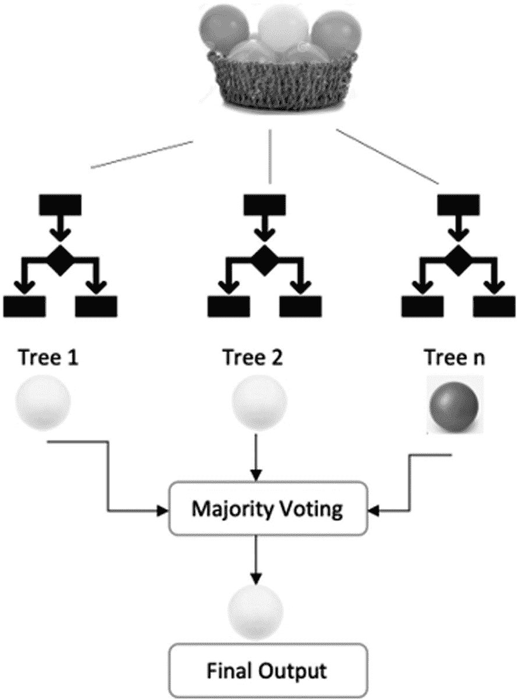

**图 8.3** RF 算法的示例。

数据集将被划分为子集，并分配给 RF 算法中的一棵决策树。每棵决策树产生一个输出。例如，决策树 1 和 2 输出黄球，决策树 n 输出蓝球。然后，随机森林算法将收集多数投票并产生最终预测。在我们的例子中，大多数树都选择黄球作为其预测输出。因此，RF 的最终预测将是黄球。

许多研究（如 [[54]](#ch18.xhtml#r257)）表明，RF 是性能最高的机器学习方法之一，特别是在预测任务方面。RF 算法由基于树的模型构成。随机森林算法广泛应用于不同领域，如金融行业的股价预测 [[55]](#ch18.xhtml#r258)。正如第 8.3 节所述，也有许多研究人员使用随机森林作为分类器来训练假新闻检测模型。在我们的工作中，我们倾向于将不同的提取特征与 RF 算法结合，以实验预测准确性。

长短期记忆神经网络（LSTM）：LSTM 的先驱是利用连续或时间序列数据的循环神经网络（RNN）。RNN 常用于时间序列预测，例如预测家庭未来十二个月的能源使用量。根据 Hochreiter 和 Schmidhuber [[56]](#ch18.xhtml#r259) 的说法，当误差信号反向流动时，现有的 RNN 会导致梯度消失和梯度爆炸。为了克服这一问题，Hochreiter 和 Schmidhuber [[56]](#ch18.xhtml#r259) 引入了 LSTM 的概念。LSTM 由四个核心元素组成：遗忘门、输入门、输出门和一个称为记忆单元的复杂单元 [[57]](#ch18.xhtml#r260)。与其他传统深度神经网络不同，LSTM 算法中的记忆单元具有具有固定自连接的中心线性单元。它贯穿整个链，并在三个门的帮助下选择哪些信息需要存储 [[56]](#ch18.xhtml#r259)。这一过程使 LSTM 网络能够识别长期依赖关系，并记忆具有不同特征的多重时间依赖关系 [[58]](#ch18.xhtml#r261)。

在我们的工作中，我们创建了 LSTM 神经网络来训练模型。创建了两个嵌入层来存储文章标题和正文的信息。然后，创建了两个具有 128 个神经元的 LSTM 层来保存嵌入层的输出。创建了一个拼接层来拼接两个 LSTM 层的输出。此外，创建了一个全连接层（接收来自前一层输入的神经元层）来处理其他数值特征。又创建了一个拼接层，在进入另一个全连接层之前处理前两层的结果。利用前一层的输入，最终输出层产生一个结果作为最终产品。

我们项目的整体 LSTM 神经网络模型可在图 8.4 中查看。我们使用 sigmoid 函数作为最终输出层的激活方法。这有助于网络通过保持 0 和 1 之间的值来学习哪些数据需要遗忘或保留。如果值为 0，信息将被遗忘；如果值为 1，信息将保留。由于我们的最终结果只有两种结果（真新闻或假新闻），我们使用二元交叉熵函数为二分类模型提供更好的性能。

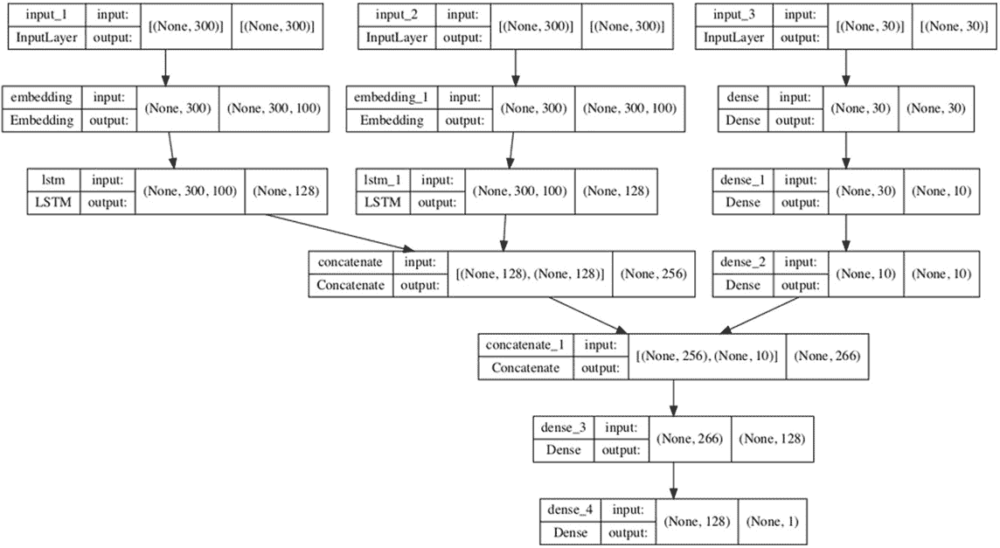

**图 8.4** LSTM 神经网络。

为使用 LSTM 进行实验并回答第 8.8 节中的研究问题，最常用词的最大数量被定义为 3000 个词，每篇文章标题或内容的最大词数被定义为 300 个词。然后，文章的标题和内容将由 `Tokenizer` 进行分词。将创建三个形状分别为 300（用于文章标题）、300（用于文章内容）和 30（其他 30 个数值特征）的不同输入，用于模型训练。对于所有 LSTM 分类器，我们均训练了 10 个周期。

为确保第 8.8 节中所有实验呈现的训练模型保持一致，我们为随机森林和 LSTM 神经网络分类器定义了基本设置，如下表所示：

### 8.4.10 预测阶段（步骤 5）

在该阶段，我们应用 `FNDetector` 模型来推测测试数据集中可用新闻文章的标签。为实现这一点，我们从测试数据集中提取新闻条目的标题和内容后，提取所有 32 个特征。为判断新闻文章是否为虚假，我们将这些特征输入 `FNDetector` 模型。

### 8.5 数据集提取

在本工作中，我们使用 Horne201 FakeNews Data [36]。该数据集的详细信息见表 8.10。有两个流行的新闻数据集：Buzzfeed 新闻和随机政治新闻。第一个 Buzzfeed 新闻数据集包含 48 条假新闻和 53 条真新闻，而随机政治新闻数据集分别包含 75 条假新闻和 75 条真新闻。这些数据集包含两项信息，即新闻的标题和内容。我们从仓库 `https://github.com/rpitrust/fakenewsdata1` 下载了数据集。

**表 8.10** 数据集摘要

| 数据集名称 | 新闻类别 | 标题数量 | 内容数量 |
| --- | --- | --- | --- |
| Buzzfeed 政治新闻 | 假 | 48 | 48 |
| | 真 | 53 | 53 |
| 随机政治新闻 | 假 | 75 | 75 |
| | 真 | 75 | 75 |

### 8.6 实验设置

我们使用 Python [59] 进行编程。应用于我们工作的库及其相关流程如下：

*   **框架**：算法使用用于 Python 3 的 `Jupyter Notebook` 进行建模。
*   **预处理**：来自 `nltk` 库的 `wordnet`，来自 `sklearn` 库的 `tf-idf vectorizer`，用于数据框的 `pandas`。
*   **机器学习模型**：来自 `sklearn` 库的 `Random Forest` 分类器。
*   **深度学习模型**：来自 `Keras` 的 `LSTM` 神经网络。
*   **特征提取**：`sklearn`、`nltk`、`spacy` 库。
*   **NLP**：`nltk` 库。
*   **可视化**：`matplotlib`、`seaborn` 库。

### 8.7 评估指标

为确保分类或预测模型表现正确并达到目标，将应用一组检查清单对其进行度量，这被称为评估指标。分类器的性能和功效可使用评估指标进行评估 [60]。选择正确的评估指标时需考虑多个因素，如复杂度较低和计算成本较低、多类问题、信息量、独特性和可区分性 [61]。为确保分类模型具有高效率和高性能，需确保预测结果与真实结果相同。本文讨论的问题是一个二分类问题。应用于二分类问题的评估指标是混淆矩阵，它也属于阈值类型的评估指标 [61]。

### 8.7.1 混淆矩阵

混淆矩阵以表格形式呈现。它包含分类模型执行的实际类别和预测类别的信息。混淆矩阵中有四类指标，即真正例 (TP)、真反例 (TN)、假正例 (FP) 和假反例 (FN) [61]。

混淆矩阵为研究人员提供指标的可视化，以便他们在必要时采取进一步行动改进分类模型。图 8.5 展示了随机森林分类器的混淆矩阵示例。`x` 轴和 `y` 轴分别代表预测值和真实值。混淆矩阵方框中颜色越深，数值越高。

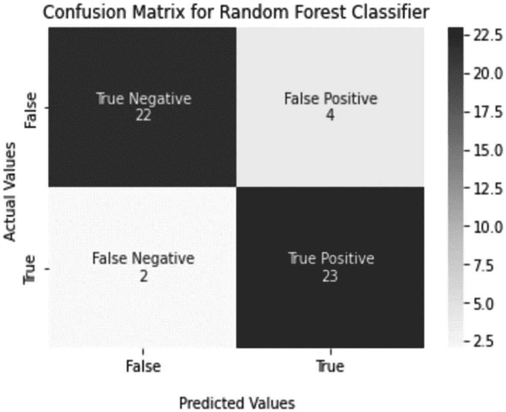

**图 8.5** 随机森林分类器混淆矩阵示例。

### 8.7.2 准确率

准确率得分的范围在 0 和 1 之间。通常，准确率得分计算的是精确预测的百分比占评估样本总数的比例 [61]。公式如下：

$$\text{Accuracy} = \frac{\text{TP} + \text{TN}}{\text{TP} + \text{TN} + \text{FP} + \text{FN}} \tag{8.3}$$

### 8.7.3 精确率、召回率和 F 值

准确率得分并非评判分类模型性能的绝佳评估指标，因为它提供的区分度较低 [61]。当数据集不平衡时，准确率得分可能不准确。为克服准确率得分的局限性，我们可以计算分类模型的精确率得分。计算精确率得分的概念是使用整个正类预测样本中精确预测的样本 [61]。与精确率不同，召回率得分也可用于计算数据集中所有正例里被正确分类的正类数量。精确率和召回率的调和平均数即为 F 值 (F1 分数)。Joshi [62] 提到，尽管 F 值作为性能指标不太常用；然而，在针对二分类问题优化分类器时，其表现优于准确率得分。F 值的范围可在 0 和 1 之间。计算这些指标的公式如下：

$$\text{Precision}(p) = \frac{\text{TP}}{\text{TP} + \text{FP}} \tag{8.4}$$

$$\text{Recall}(r) = \frac{\text{TP}}{\text{TP} + \text{FN}} \tag{8.5}$$

$$F\text{-measure} = \frac{2 \cdot p \cdot r}{p + r} \tag{8.6}$$

### 8.7.4 接收者操作特征 (ROC) 曲线和 ROC 曲线下面积 (AUC)

### 接收者操作特征曲线 (ROC)

接收者操作特征曲线 (ROC) 已被广泛用作评估医学诊断系统的性能度量 [63]。根据 Park 等人 [64] 的研究，ROC 表现为一个由两个关键组成部分构成的图表，即灵敏度（或真阳性率）和特异度（或假阳性率），并且它能够将信号与噪声区分开来。在 ROC 图中，灵敏度分别绘制在 *y* 轴上，特异度绘制在 *x* 轴上。ROC 图能清晰地展示假阳性率与真阳性率之间的关系。ROC 曲线的延伸——ROC 曲线下面积 (AUC) 已被证明是总结检验功效的有用指标 [65]。Mandrekar [65] 还提到，AUC 的取值范围为 0 到 1，其中 0 表示检测完全不准确，1 表示检测完全准确。一般来说，当 AUC 大于 0.5 时，分类器很有可能将正类值与负类值区分开来。然而，也存在 AUC 值等于 0.5 的情况，此时 ROC 曲线在图中呈现为对角线。在这种情况下，分类器将不具备区分正类和负类的能力。

### 8.8 实验结果

在此，我们提供实验结果的详细信息。

## RQ1：基线分类器的性能如何？

**动机：** 我们致力于利用不同类型的特征构建假新闻检测模型。了解在不使用任何外部特征提取的情况下，假新闻检测模型的表现如何具有重要意义。因此，在本 RQ 中，我们利用新闻文章的标题和内容构建了基线分类器。

**方法：** 我们使用文本数据，即新闻文章的词形还原后的标题和内容来构建基线分类器。然后，在训练 `RF` 分类器模型之前，我们使用 `TfidfVectorizer` 对数据集进行向量化。对于 `LSTM` 分类器，我们对文本数据进行分词并将其输入嵌入层，然后再进入 `LSTM` 层。在本实验中，我们为 `RF` 使用 100 个 n_estimators，为 `LSTM` 使用 10 个 epochs。

**结果：** 图 8.6 和表 8.11 展示了本 RQ 的结果。我们分别获得了 `RF` 和 `LSTM` 分类器 60.7% 和 78.4% 的准确率值，以及分别为 `RF` 和 `LSTM` 分类器 79.2% 和 41.1% 的 F 值（请参阅表 8.10）。这些结果表明，基线分类器在假新闻检测方面给出了非常低的准确率和 F 值，因此有必要改进这些模型。基线分类器在假新闻检测任务中表现不佳，`RF` 和 `LSTM` 分类器的准确率分别为 60.7% 和 78.4%。`LSTM` 分类器的性能在准确率和 F 值方面均远低于 `RF` 分类器。

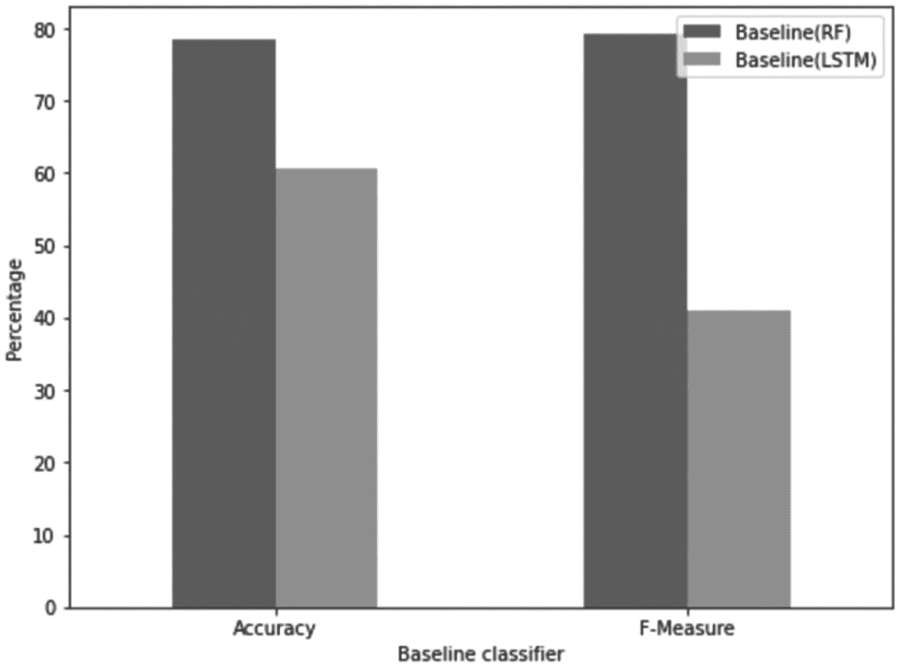

**图 8.6** 基线分类器的性能。

**表 8.11** 基线分类器的性能

| 方法 | 准确率 (%) | 精确率 (%) | 召回率 (%) | F 值 (%) |
| :--- | :---: | :---: | :---: | :---: |
| Baseline[RF] | 78.4 | 80.8 | 77.8 | 79.2 |
| Baseline[LSTM] | 60.7 | 100 | 25.9 | 41.1 |

## RQ 2：与基线分类器相比，所提出的模型（即 FNDetector）的性能如何？

**动机：** 在本 RQ 中，我们研究了所提出的 `FNDetector` 模型的性能。为了构建该模型，我们结合了不同类型的特征。此外，我们从新闻文章的标题和内容中提取了特征。本 RQ 将有助于深入了解 `FNDetector` 模型的有效性。

**方法：** 为了回答本 RQ，我们使用 `RF` 和 `LSTM` 分类器训练 `FNDetector` 模型，以构建 `FNDetector` 模型的两个变体，即 `FNDetector[RF]` 和 `FNDetector[LSTM]`。我们在测试数据集上测试了这两个模型的性能并计算了各种指标。我们还将这两个模型与基线分类器进行了比较。

**结果：** 表 8.12 和图 8.7 展示了 `FNDetector[RF]` 和 `FNDetector[LSTM]` 模型的预测结果。表 8.12 显示，`FNDetector[RF]` 的准确率为 88.2%，F 值为 88.5%，而 `FNDetector[LSTM]` 的准确率为 78.4%，F 值为 81.3%。图 8.8 和图 8.10 展示了基线分类器与 `FNDetector` 分类器性能的比较。图 8.9 和图 8.10 显示，`FNDetector[RF]` 和 `FNDetector[LSTM]` 模型在准确率和 F 值方面均优于基线分类器。我们计算了改进幅度，并以柱状图的形式展示结果（请参阅图 8.10 和图 8.11）。我们注意到，使用 `FNDetector[RF]` 模型，准确率提高了 9.8%，F 值提高了 9.3%；使用 `FNDetector[LSTM]` 模型，准确率提高了 17.7%，F 值提高了 40.2%。这些结果表明，特征提取是创建假新闻模型的重要步骤。从结果中我们可以得出结论，特征提取对于随机森林和 `LSTM` 分类器的假新闻模型构建均有用。我们在准确率方面分别获得了 9.8%（`FNDetector[RF]`）和 17.7%（`FNDetector[LSTM]`）的提升，在 F 值方面分别获得了 9.3%（`FNDetector[RF]`）和 40.2%（`FNDetector[LSTM]`）的提升。

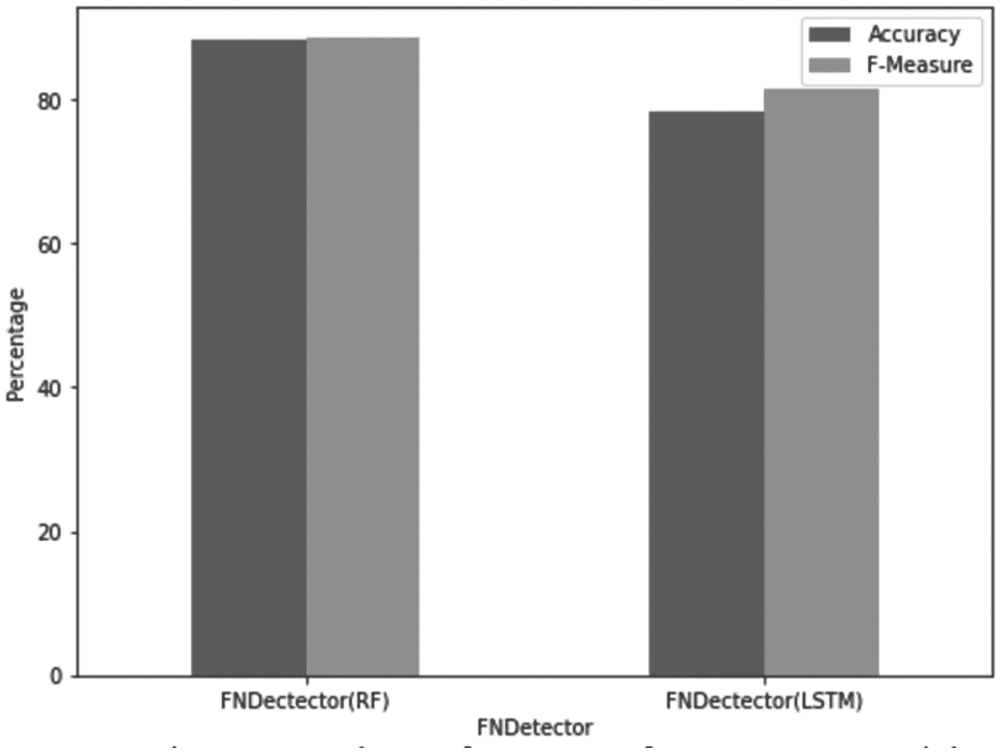

**图 8.7** FNDetector 模型的性能。


## RQ 3：从文章的标题和内容中提取特征有多重要？

### 动机

大多数研究人员专注于分析新闻文章的标题以创建假新闻模型，例如 [66–68]。一些用于构建假新闻检测模型的数据集（如 LIAR 数据集 [69]）在数据集中不同时包含新闻文章的标题和内容。该数据集仅包含从文章标题和内容中提取的声明。我们认为新闻内容可以为假新闻检测提供重要信息。因此，在本 RQ 中，我们致力于分析标题和内容对检测假新闻的重要性。本 RQ 的结果可以帮助我们了解新闻的哪一部分在假新闻检测中更为重要。

### 方法

为回答此 RQ，我们构建了 `FNDetector` 模型的三个变体：`FNDetector (title)`、`FNDetector (content)` 和 `FNDetector (title+content)`。`FNDetector (title)` 模型仅使用新闻文章的标题进行训练。`FNDetector (content)` 使用新闻文章的内容进行训练。`FNDetector (title+content)` 同时使用新闻文章的标题和内容进行训练，即本工作提出的原始 `FNDetector` 模型。我们使用 `RF` 和 `LSTM` 两种分类器训练所有这些变体，从而创建了总共六个 `FNDetector` 模型变体。

### 结果

表 8.13、8.14 和 8.15 展示了使用 `RF` 和 `LSTM` 分类器的本 RQ 结果。图 8.12 和 8.13 分别展示了 `FNDetector[RF]` 和 `FNDetector[LSTM]` 模型不同变体之间的性能对比。表 8.13 显示，使用 `FNDetector[RF] (title)` 模型的准确率和 F 值分别为 70.6% 和 72.7%。`FNDetector[LSTM] (title)` 的准确率和 F 值分别为 74.5% 和 76.4%。我们从表 8.16 观察到，与使用“标题”训练模型相比，使用新闻文章的“内容”时 `FNDetector[RF]` 模型的性能有所提升。与 `FNDetector[RF] (title)` 模型相比，使用 `FNDetector[RF] (content)` 的准确率提升了 11.8%，F 值提升了 10.3%。对于 `LSTM` 分类器，我们观察到当使用新闻文章的“内容”训练分类器时，准确率和 F 值均有所下降（请参阅表 8.17）。


**图 8.12** 随机森林分类器中 FNDetector 模型在标题、内容和标题+内容下的对比。T：标题，C：内容。


**图 8.13** LSTM 分类器中 FNDetector 模型在标题、内容和标题+内容下的对比。T：标题，C：内容。

**表 8.13** FNDetector 模型使用从新闻文章标题提取的特征的性能

| 方法 | 准确率 | 精确率 | 召回率 | F 值 |
| --- | --- | --- | --- | --- |
| FNDetector[RF] (title) | 70.6% | 69.0% | 76.9% | 72.7% |
| FNDetector[LSTM] (title) | 74.5% | 75.0% | 77.8% | 76.4% |

**表 8.14** FNDetector 模型使用从新闻文章内容提取的特征的性能

| 方法 | 准确率 | 精确率 | 召回率 | F 值 |
| --- | --- | --- | --- | --- |
| FNDetector[RF] (content) | 82.4% | 91.7% | 75.9% | 83.0% |
| FNDetector[LSTM] (content) | 58.8% | 87.5% | 25.9% | 40.0% |

**表 8.15** FNDetector 模型使用从文章标题和内容同时提取的特征的性能

| 方法 | 准确率 | 精确率 | 召回率 | F 值 |
| --- | --- | --- | --- | --- |
| FNDetector[RF] (title + content) | 88.2% | 85.2% | 92.0% | 88.5% |
| FNDetector[LSTM] (title + content) | 78.4% | 75.0% | 88.9% | 81.4% |

**表 8.16** FNDetector[RF] (title+content) 的改进

| | 准确率提升 | F 值提升 |
| --- | --- | --- |
| FNDetector[RF] (title) | 17.6% | 15.8% |
| FNDetector[RF] (content) | 5.8% | 5.5% |

**表 8.17** FNDetector[LSTM] (title+content) 的改进

| | 准确率提升 | F 值提升 |
| --- | --- | --- |
| FNDetector[LSTM] (title) | 3.9% | 5.0% |
| FNDetector[LSTM] (content) | 19.6% | 41.4% |

我们注意到，当同时使用新闻文章的标题和内容训练模型时，模型性能得到增强（请参阅表 8.15、图 8.12 和 8.13）。这也是本工作提出的原始 `FNDetector` 模型。图 8.12 和 8.13 分别展示了 `FNDetector[RF]` 和 `FNDetector[LSTM]` 模型三个变体性能的对比。我们注意到 `FNDetector[RF]` 和 `FNDetector[LSTM]` 模型的性能均有提升。使用 `FNDetector[RF] (title + content)`，与 `FNDetector[RF] (title)` 相比准确率提升了 17.6%，与 `FNDetector[RF] (content)` 相比提升了 5.8%。类似地，使用 `FNDetector[LSTM] (title+content)`，与 `FNDetector[LSTM] (title)` 相比准确率提升了 3.93%，与 `FNDetector[LSTM] (content)` 相比提升了 19.63%。这些改进也在表 8.16 和 8.17 中展示。结果表明，新闻文章的标题和内容在假新闻检测中都很重要。对于 `FNDetector[RF]` 和 `FNDetector[LSTM]`，我们观察到当同时使用标题和内容训练模型时，预测准确率显著提高。

## RQ 4：在 FNDetector 模型中，哪些特征对于检测假新闻更为重要？

### 动机

我们使用 32 个特征来训练 `FNDetector` 模型。这些特征属于不同领域，具有不同类型，即基于语言的特征（语法和词汇特征）、基于情感的特征、命名实体识别特征和文本特征。`FNDetector` 模型在准确率和 F 值上均显著优于基线分类器。通过分析逐步增加特征类别时 `FNDetector` 模型的性能，可以深入了解不同特征类别的重要性。

### 方法

为回答此 RQ，我们进行了两类实验。首先，我们创建了四个 `FNDetector` 模型变体（针对 `RF` 和 `LSTM` 两种分类器），并逐步增加特征以观察每个特征类别对 `FNDetector` 模型性能的影响。我们创建了以下变体：

*   `FNDetector[A]^(F[S])`：使用基于情感的特征训练的 `FNDetector` 模型。
*   `FNDetector[A]^(F[S] + F[L])`：使用基于情感和基于语言的特征训练的 `FNDetector` 模型。
*   `FNDetector[A]^(F[S] + F[L] + F[N])`：使用基于情感、基于语言和基于 NER 的特征训练的 `FNDetector` 模型。
*   `FNDetector[A]^(F[S] + F[L] + F[N] + F[T])`：使用所有 32 个提取特征训练的 `FNDetector` 模型。

### 结果

在上文中，`A` 指代分类器。`A` 可取值 `RF` 或 `LSTM`。因此，我们使用 `RF` 和 `LSTM` 两种分类器计算上述所有变体的性能。其次，我们使用 `RF` 分类器计算所有数值特征的特征重要性。表 8.18 展示了每个特征集的符号表示。

**表 8.18** 每个特征集的符号表示

| 特征名称 | 特征符号 |
| --- | --- |
| 基于语言学的特征 | `FL` |
| 基于情感的特征 | `FS` |
| 命名实体识别 | `FN` |
| 文本特征 | `FT` |

结果：图 8.14、8.15、8.16 和表 8.19 展示了 `FNDetector` 模型使用不同特征集的结果。我们逐步增加来自不同特征集的特征。表 8.19 显示，随着每个特征集的加入，`FNDetector` 模型的性能（准确率和 F 值均）持续提升。在下一个实验中，我们使用 `RF` 分类器计算每个数值特征的相关性。


**图 8.14** 基于随机森林分类器中不同提取特征的性能对比（符号表示请参考表 8.18）。


**图 8.15** 基于 LSTM 分类器中不同提取特征的性能对比（符号表示请参考表 8.18）。


**图 8.16** 随机森林分类器的特征重要性。

**表 8.19** 具有不同特征类别集的 FNDetector 模型性能

| 指标 | RF 分类器 (%) | LSTM 分类器 (%) | 特征集 |
| --- | --- | --- | --- |
| 准确率 | 64.7 | 62.7 | `FNDetector[A]^(F[S])` |
| 精确率 | 59.3 | 61.2 | |
| 召回率 | 69.6 | 77.8 | |
| F 值 | 64.0 | 68.9 | |
| 准确率 | 72.5 | 66.7 | `FNDetector[A]^(F[S] + F[L])` |
| 精确率 | 78.9 | 63.9 | |
| 召回率 | 60.0 | 85.1 | |
| F 值 | 68.2 | 73.0 | |
| 准确率 | 76.5 | 70.6 | `FNDetector[A]^(F[S] + F[L] + F[N])` |
| 精确率 | 76.0 | 65.8 | |
| 召回率 | 76.0 | 92.6 | |
| F 值 | 76.0 | 76.9 | |
| 准确率 | 88.2 | 78.4 | `FNDetector[A]^(F[S] + F[L] + F[N] + F[T])` |
| 精确率 | 85.2 | 75.0 | |
| 召回率 | 92.0 | 88.9 | |
| F 值 | 88.5 | 81.4 | |

`RF` 分类器具有从训练模型中获取特征重要性的优势。使用 `RF` 分类器的特征重要性已在图 8.16 中呈现。从结果可以看出，新闻标题和正文中的名词数量（`noun title` 和 `noun content`）对训练模型影响最大（当使用 `RF` 分类器时）。利用本研究问题的结果，我们可以观察到，用于训练模型的所有特征集都很重要，并有助于提高 `FNDetector` 模型的准确率。发现 `noun title`、`noun content`、`totalWord title` 和 `totalWord content` 特征对 `FNDetector` 模型的性能影响最大（当使用 `RF` 分类器训练时）。

## RQ 5：改变 RF 和 LSTM 分类器的参数对 FNDetector 模型性能有何影响？

### 动机

算法的参数起着重要作用，因为它们会影响算法的性能。调整算法的设置以构建高精度模型至关重要。在本研究问题中，我们将展示改变 `RF` 和 `LSTM` 分类器的参数对 `FNDetector` 模型性能的影响。我们还将计算训练模型所需的时间以及进行预测所需的时间。我们认为，在资源受限的应用（如移动设备）中，时间可能是选择合适分类器的重要因素。

### 方法

为回答该研究问题，我们使用 `RF` 和 `LSTM` 变体对 `FNDetector` 模型进行了多项实验。我们共创建了七个 `FNDetector` 模型变体，其中三个使用 `FNDetector[RF]`，四个使用 `FNDetector[LSTM]`。对于 `FNDetector[RF]`，我们测试了三种不同估计器数量下的模型性能，即 50、100 和 150。对于 `FNDetector[LSTM]`，我们通过改变轮数和批次大小来测试模型性能。我们使用了 2 种不同的轮数，即 5 和 10 轮，以及 2 种不同的批次大小，即 128 和 256。表 8.20 显示了我们用于实验的参数及其值。

随后计算了训练模型和生成预测所需的时间。我们计算了使用训练数据集为 `FNDetector[RF]` 和 `FNDetector[LSTM]` 分类器构建模型所需的时间，针对不同参数（`RF` 分类器的估计器数量、`LSTM` 分类器的轮数和批次大小），如前所述。

### 结果

图 8.17、8.18 和 8.19 展示了 `FNDetector[RF]` 分类器在估计器数量为 50、100 和 150 时的结果。从结果可以观察到，随着 `n_estimators` 的增加，`FPs`（假阳性）和 `FNs`（假阴性）的数量减少。此外，`AUC` 值随 `n_estimators` 的增加而增大。这些结果表明，增加估计器数量有助于提升 `FNDetector[RF]` 的性能（请参阅表 8.21）。对于 `FNDetector[LSTM]` 分类器，我们通过绘制图 8.20 和 8.21 展示了模型的准确率和损失。结果显示，`FNDetector[LSTM]` 分类器在轮数为 10、批次大小为 128 时取得了最佳结果。我们可以观察到，随着轮数的增加，损失持续下降，模型准确率持续上升。这使得具有 10 个轮数和 128 批次大小的 `FNDetector[LSTM]` 模型在检测假新闻方面比其他参数设置拥有最高的准确率。

![图 8.17 估计器数量 = 50 时 FNDetector[RF] 分类器的混淆矩阵和 ROC 曲线。](html/images/9781032942346_C008_017.jpg)

**图 8.17** 估计器数量 = 50 时 `FNDetector[RF]` 分类器的混淆矩阵和 ROC 曲线。

![图 8.18 估计器数量 = 100 时 FNDetector[RF] 分类器的混淆矩阵和 ROC 曲线。](html/images/9781032942346_C008_018.jpg)

**图 8.18** 估计器数量 = 100 时 `FNDetector[RF]` 分类器的混淆矩阵和 ROC 曲线。

![图 8.19 估计器数量 = 150 时 FNDetector[RF] 分类器的混淆矩阵和 ROC 曲线。](html/images/9781032942346_C008_019.jpg)

**图 8.19** 估计器数量 = 150 时 `FNDetector[RF]` 分类器的混淆矩阵和 ROC 曲线。


**图 8.19** 估计器数量 = 150 时 `FNDetector[RF]` 分类器的混淆矩阵和 ROC 曲线。

![图 8.20 轮数 = 5 时 FNDetector[LSTM] 分类器的准确率和损失曲线。](html/images/9781032942346_C008_020.jpg)

**图 8.20** 轮数 = 5 时 `FNDetector[LSTM]` 分类器的准确率和损失曲线。

![图 8.21 轮数 = 10 时 FNDetector[LSTM] 分类器的准确率和损失曲线。](html/images/9781032942346_C008_021.jpg)

**图 8.21** 轮数 = 10 时 `FNDetector[LSTM]` 分类器的准确率和损失曲线。

**表 8.20** 实验中将要改变的参数

| 方法 | 参数 | 值 |
| :--- | :--- | :--- |
| `FNDetector[RF]` | `n_estimators` | 50 |
| | | 100 |
| | | 150 |
| `FNDetector[LSTM]` | `epoch` | 5 |
| | | 10 |

### 表 8.21 具有不同参数的 FNDetector[RF] 和 FNDetector[LSTM] 的总训练和预测时间

| 批次大小 | | |
| :--- | :--- | :--- |
| | | 128 |
| | | 256 |
| 方法 | 参数 | 值 | 训练时间 (秒) | 预测时间 (秒) |
| :--- | :--- | :--- | :--- | :--- |
| `FNDetector[RF]` | `n_estimators` | 50 | 0.30 | 0.03 |
| | | 100 | 0.33 | 0.04 |
| | | 150 | 0.40 | 0.04 |
| `FNDetector[LSTM]` | `epoch`/`batch size` | 5/128 | 25.0 | 2.39 |
| | | 5/256 | 16.0 | 2.24 |
| | | 10/128 | 53.0 | 2.24 |
| | | 10/256 | 31.0 | 2.53 |

表 8.21 显示，对于 `FNDetector[RF]` 分类器，随着估计器数量的增加，训练和预测时间也会增加。随着估计器数量的增加，`RF` 算法需要创建更多的树，因此时间也随之增加。对于 `FNDetector[LSTM]` 分类器，我们观察到类似的模式，即随着轮数的增加，训练时间也会增加。随着批次大小的增加，`FNDetector[LSTM]` 分类器的训练时间会减少。之所以发生这种情况，是因为随着批次大小的增加，算法可以获取更大块的训练数据集并能更快地学习。总体而言，我们观察到与 `FNDetector[LSTM]` 分类器相比，`FNDetector[RF]` 分类器在训练和测试方面所需的时间少得多。实验结果表明，参数调优非常重要，因为它会对 `FNDetector` 模型的有效性产生重大影响。在我们的实验中，当 `n_estimators` 设置为 150 时，`RF` 分类器实现了最佳性能；当 `epochs` 值为 10 且 `batch size` 值为 128 时，`LSTM` 分类器实现了最佳性能。与 `FNDetector[LSTM]` 分类器相比，`FNDetector[RF]` 的训练和测试时间少得多。

### 8.9 结束语与未来展望

在社交网络网站上分享的新闻条目数量激增。由于大量虚假信息在社交媒体上流传，人们不太可能相信这些渠道发布的新闻文章。在社交媒体上确认新闻文章的真实性具有挑战性。假新闻识别已成为绕过这一问题的重要途径，并成为相关研究的动力。本文提供了 `FNDetector`，一种假新闻检测模型。`FNDetector` 使用各种特征集的组合。我们使用两种分类器（即 `RF` 和 `LSTM`）训练 `FNDetector`。`FNDetector` 模型显著优于基线分类器。`FNDetector[RF]` 和 `FNDetector[LSTM]` 的准确率分别为 88.2% 和 78.4%。我们与特征重要性相关的调查表明，本文使用的所有特征集都很重要，并有助于提高准确性。此外，发现在新闻文章的标题和内容中，“名词计数”和“总词计数”均是前四个重要特征。我们打算未来使用集成学习来扩展该模型。集成学习模型结合不同的分类器以改进训练模型。一些研究（如 69 和 45）已证明集成学习模型的工作能改善模型的结果。此外，我们计划使用更先进的方法（如 `BERT`）来增强假新闻检测的有效性。

## 参考文献

*   [1] Cambridge dictionary. (n.d). Cambridge dictionary. <https://dictionary.cambridge.org/dictionary/english/fake-news>
*   [2] BBC. (2022). A brief history of fake news. <http://www.bbc.co.uk/bitesize/articles/zwcgn9q>. [访问日期: 2022 年 6 月 22 日]。
*   [3] Vosoughi, S., Roy, D., & Aral, S. (2018). The spread of true and false news online. *Science*, 359, 1146–1151. doi: <http://dx.doi.org/10.1126/science.aap955>
*   [4] Allcott, H., & Gentzkow, M. (2017). Social media and fake news in the 2016 election. *Journal of Economic Perspectives*, 31, 212. doi: <http://dx.doi.org/10.1257/jep.31.2.211>
*   [5] WHO (2022). Covid-19 mythbusters. <http://www.who.int/emergencies/diseases/novel-coronavirus-2019/advice-for-public/myth-busters#pepper> [访问日期: 2022 年 6 月 22 日]。
*   [6] BBC (2020). Coronavirus: Fake and misleading stories that went viral this week. <http://www.bbc.co.uk/news/52124740>. [访问日期: 2022 年 7 月 28 日]。
*   [7] de Beer, D., & Matthee, M. (2020). Approaches to identify fake news: A systematic literature review. *Integrated Science in Digital Age 2020*, (p. 13–22). doi: <http://dx.doi.org/10.1007/978-3-030-49264-9_2>
*   [8] Wang, W. Y. (2017). "liar, liar pants on fire": A new benchmark dataset for fake news detection. *arXiv preprint arXiv:1705.00648*.
*   [9] Choudhary, A., & Arora, A. (2021). Linguistic feature-based learning model for fake news detection and classification. *Expert Systems with Applications*, 169, 1–15. doi: <http://dx.doi.org/10.1016/j.eswa.2020.114171>
*   [10] Lischka, J. A., & Garz, M. (2021). Clickbait news and algorithmic curation: A game theory framework of the relation between journalism, users, and platforms. *New Media and Society*, (p. 3). <https://journals.sagepub.com/doi/full/10.1177/14614448211027174>. doi: <http://dx.doi.org/10.1177/14614448211027174>
*   [11] Hu, X. E. (2017). Clickbait and conscientiousness. <https://stanforddaily.com/2017/03/20/clickbait-and-conscientiousness/> [访问日期: 2022 年 6 月 23 日]。
*   [12] Barrón-Cedeno, A., Da San Martino, G., Jaradat, I., & Nakov, P. (2019). Proppy: A system to unmask propaganda in online news. In *Proceedings of the AAAI Conference on Artificial Intelligence* (pp. 9847–9848). volume 33.
*   [13] Lewis, H. (2016). How the Brexit campaign lied to us–and got away with it. *New Statesman*, 30. <http://www.newstatesman.com/politics/2016/06/how-brexit-campaign-lied-us-and-got-away-it> [访问日期: 2022 年 6 月 27 日]。
*   [14] The Independent (2018). The misinformation that was told about brexit during and after the referendum. <http://www.independent.co.uk/news/uk/politics/final-say-brexit-referendum-lies-boris-johnson-leave-campaign-remain-a8466751>. [访问日期: 2022 年 6 月 23 日]。
*   [15] Shu, K., Sliva, A., Wang, S., Tang, J., & Liu, H. (2017). Fake news detection on social media. *ACM SIGKDD Explorations Newsletter*, 19, 22–36. doi: <http://dx.doi.org/10.1145/3137597.3137600>.
*   [16] BuzzFeedNews Dataset. <https://github.com/BuzzFeedNews/2016-10-facebook-fact-check/tree/master/data>
*   [17] BuzzFeedNews Dataset. <http://www.cs.ucsb.edu/~william/data/liar_dataset.zip>
*   [18] BS Detector Dataset. <http://www.kaggle.com/mrisdal/fake-news>
*   [19] CREDBANK Dataset. <http://compsocial.github.io/CREDBANK-data/>

## 参考文献

[20] Bhutani, B., Rastogi, N., Sehgal, P., & Purwar, A. (2019). 基于情感分析的假新闻检测。载于 *2019 第十二届当代计算国际会议 (IC3)* (pp. 1–5)。doi:[10.1109/IC3.2019.8844880](http://dx.doi.org/10.1109/IC3.2019.8844880)

[21] George McIntire 数据集。<https://github.com/GeorgeMcIntire/fake_real_news_dataset>

[22] Kaggle 数据集。<http://www.kaggle.com/mrisdal/fake-news>

[23] PolitiFact 数据集。<http://www.kaggle.com/datasets/rmisra/politifact-fact-check-dataset>

[24] Khan, S., Hakak, S., Deepa, N., Prabadevi, B., Dev, K., & Trelova, S. (2022). 利用特征提取检测与 COVID-19 相关的假新闻。*Frontiers in Public Health*, 9。doi:[10.3389/fpubh.2021.788074](http://dx.doi.org/10.3389/fpubh.2021.788074)

[25] Iwendi, C., Mohan, S., Khan, S., Ibeke, E., Ahmadian, A., & Ciano, T. (2022). COVID-19 假新闻情感分析。*Computers and Electrical Engineering*, 101, 1–22。doi:[10.1016/j.compeleceng.2022.107967](http://dx.doi.org/10.1016/j.compeleceng.2022.107967)

[26] Ajao, O., Bhowmik, D., & Zargari, S. (2019). 在线社交网络中融合情感感知的假新闻检测。载于 *ICASSP 2019–2019 IEEE 国际声学、语音与信号处理会议 (ICASSP)* (pp. 2507–2511)。doi:[10.1109/ICASSP.2019.8683170](http://dx.doi.org/10.1109/ICASSP.2019.8683170)

[27] Reis, J. C. S., Correia, A., Murai, F., Veloso, A., & Benevenuto, F. (2019). 用于假新闻检测的监督学习。*IEEE Intelligent Systems*, 34, 76–81。doi:[10.1109/MIS.2019.2899143](http://dx.doi.org/10.1109/MIS.2019.2899143)

[28] Khanam, Z., Alwasel, B. N., Sirafi, H., & Rashid, M. (2021). 基于机器学习方法的假新闻检测。*IOP Conference Series: Materials Science and Engineering*, 1099, 1–13。doi:[10.1088/1757-899x/1099/1/012040](http://dx.doi.org/10.1088/1757-899x/1099/1/012040)

[29] Mishra, S., Shukla, P., & Agarwal, R. (2022). 分析面向多样化数据集的机器学习赋能假新闻检测技术。*Wireless Communications and Mobile Computing*, 2022, 1–18。doi:[10.1155/2022/1575365](http://dx.doi.org/10.1155/2022/1575365)

[30] Khan, J. Y., Khondaker, M. T., Afroz, S., Uddin, G., & Iqbal, A. (2021). 在线假新闻检测机器学习模型的基准研究。*Machine Learning with Applications*, 4, 1–12。doi:[10.1016/j.mlwa.2021.100032](http://dx.doi.org/10.1016/j.mlwa.2021.100032)

[31] Devlin, J., Chang, M.-W., Lee, K., & Toutanova, K. (2019). BERT: 用于语言理解的深度双向 Transformers 预训练。载于 *2019 年北美计算语言学协会会议论文集：人类语言技术，第 1 卷（长短文）*，pp. 4171–4186。

[32] Paul, S., Joy, J. I., Sarker, S., Shakib, A. A. H., Ahmed, S., & Das, A. K. (2019). 利用区块链进行社交媒体假新闻检测。载于 *2019 年第 7 届智能计算与通信国际会议 (ICSCC)* (pp. 1–5)。doi:[10.1109/ICSCC.2019.8843597](https://doi.org/10.1109/ICSCC.2019.8843597)

[33] Flair 库。<https://github.com/zalandoresearch/flair>

[34] Akbik, A., Blythe, D., & Vollgraf, R. (2018). 用于序列标注的上下文字符串嵌入。载于 *COLING 2018, 第 27 届国际计算语言学大会* (pp. 1638–1649)。


# 参考文献

[35] Kula, S., Chora´s, M., Kozik, R., Ksieniewicz, P., & Wo´zniak, M. (2020). 通过神经网络进行情感分析以实现假新闻检测。*Lecture Notes in Computer Science*, 12140, 653–666。doi:[10.1007/978-3-030-50423-6_49](https://doi.org/10.1007/978-3-030-50423-6_49)

[36] Horne, B. D., & Adali, S. (2017). 刚刚发生：假新闻标题党严重，正文内容更简单、重复，更类似于讽刺新闻而非真实新闻。载于 *第十一届 AAAI 网络与社交媒体国际会议*。

[37] Balshetwar, S. V., Rs, A., and D. J. R. (2023). 基于分类器技术的情感分析用于社交媒体假新闻检测。*Multimedia Tools and Applications*, 82, no. 23, 35781–35811。

[38] Uppada, S. K., Patel, P., and Sivaselvan, B. (2023). 一种用于检测 OSN 中假新闻的基于图像和文本的多模态模型。*Journal of Intelligent Information Systems*, 61, 367–393。doi:[10.1007/s10844-022-00764-y](http://dx.doi.org/10.1007/s10844-022-00764-y)

[39] Balakrishnan, V., & Lloyd-Yemoh, E. (2014). 词干提取与词形还原：检索性能比较。*Lecture Notes on Software Engineering* 2, no. 3, 262–267。

[40] Manning, C. D., Raghavan, P., & Hinrich, S. (2008)。*Introduction to information retrieval*。Cambridge University Press。

[41] Princeton University (2010)。About wordnet。<https://wordnet.princeton.edu/> [Accessed Date: 29 July 2022]。

[42] Mahyoob, M., Al-Garaady, J., & Alrahaili, M. (2020)。基于语言学的社交媒体假新闻检测。*International Journal of English Linguistics*, 11, 99–109。

[43] Conroy, N. K., Rubin, V. L., & Chen, Y. (2015)。自动欺骗检测：寻找假新闻的方法。*Proceedings of the Association for Information Science and Technology*, 52, 1–4。doi:[10.1002/pra2.2015.145052010082](http://dx.doi.org/10.1002/pra2.2015.145052010082)

[44] Chiche, A., & Yitagesu, B. (2022)。词性标注：深度学习与机器学习方法的系统综述。*Journal of Big Data*, 9。doi:[10.1186/s40537-022-00561-y](http://dx.doi.org/10.1186/s40537-022-00561-y)

[45] Alonso, M. A., Vilares, D., Gómez-Rodríguez, C., & Vilares, J. (2021)。用于假新闻检测的情感分析。*Electronics*, 10, 1348。doi:[10.3390/electronics10111348](http://dx.doi.org/10.3390/electronics10111348)

[46] Martel, C., Pennycook, G., & Rand, D. G. (2020)。依赖情绪助长对假新闻的相信。*Cognitive Research: Principles and Implications*, 5, 1–20。

[47] `NLTK` package。<http://www.nltk.org/>

[48] Shelar, H., Kaur, G., Heda, N., & Agrawal, P. (2020)。面向客户模型的命名实体识别方法及其比较。*Science and Technology Libraries*, 39, 324–337。doi:[10.1080/0194262x.2020.1759479](http://dx.doi.org/10.1080/0194262x.2020.1759479)

[49] Qaiser, S., & Ali, R. (2018)。文本挖掘：利用 tf-idf 考察词语与文档的相关性。*International Journal of Computer Applications*, 181, 25–29。doi:[10.5120/ijca2018917395](http://dx.doi.org/10.5120/ijca2018917395)

[48] `scikit-learn` package。<https://scikit-learn.org/stable/modules/feature_extraction.html>

[51] `TfidfVectorizer.html Tokenizer` package。<http://www.tensorflow.org/api_docs/python/tf/keras/preprocessing/text/Tokenizer>

[52] Breiman, L. (2001). Random forests. *Machine Learning*, 45, 5–32. doi:[10.1023/a:1010933404324](http://dx.doi.org/10.1023/a:1010933404324)

[53] Lee, T.-H., Ullah, A., & Wang, R. (2020). Bootstrap aggregating and random forest. In *Macroeconomic forecasting in the era of big data* (pp. 389–429). Springer.

[54] Song, J., Gao, Y., Yin, P., Li, Y., Li, Y., Zhang, J., Su, Q., Fu, X., & Pi, H. (2021). The random forest model has the best accuracy among the four pressure ulcer prediction models using machine learning algorithms. *Risk Management and Healthcare Policy*, 14, 1175–1187. doi:[10.2147/rmhp.s297838](http://dx.doi.org/10.2147/rmhp.s297838)

[55] Polamuri, S. R., Srinivas, K., & Mohan, A. K. (2019). Stock market prices prediction using random forest and extra tree regression. *International Journal of Recent Technology and Engineering*, 8, 1224–1228. doi:[10.35940/ijrte.c4314.098319](http://dx.doi.org/10.35940/ijrte.c4314.098319)

[56] Hochreiter, S., & Schmidhuber, J. (1997). Long short-term memory. *Neural Computation*, 9, 1735–1780. doi:[10.1162/neco.1997.9.8.1735](http://dx.doi.org/10.1162/neco.1997.9.8.1735)

[57] Song, X., Liu, Y., Xue, L., Wang, J., Zhang, J., Wang, J., Jiang, L., & Cheng, Z. (2020). Time-series well performance prediction based on long short-term memory (lstm) neural network model. *Journal of Petroleum Science and Engineering*, 186. doi:[10.1016/j.petrol.2019.106682](http://dx.doi.org/10.1016/j.petrol.2019.106682)

[58] Lindemann, B., Müller, T., Vietz, H., Jazdi, N., & Weyrich, M. (2021). A survey on long short-term memory networks for time series prediction. *Procedia CIRP*, 99, 650–655. doi:[10.1016/j.procir.2021.03.088](http://dx.doi.org/10.1016/j.procir.2021.03.088)

[59] Python package. [www.python.org/](http://www.python.org/)

[60] Caruana, R., & Niculescu-Mizil, A. (2004). Data mining in metric space: an empirical analysis of supervised learning performance criteria. In *Proceedings of the tenth ACM SIGKDD international conference on Knowledge discovery and data mining* (pp. 69–78).

[61] Hossin, M. & Sulaiman, Md N. (2015). "A review on evaluation metrics for data classification evaluations." *International Journal of Data Mining & Knowledge Management Process*, 5, no. 2, 1

[62] Joshi, M. (2002). On evaluating performance of classifiers for rare classes. In *2002 IEEE International Conference on Data Mining, 2002. Proceedings.* (pp. 641–644). doi:[10.1109/ICDM](http://dx.doi.org/10.1109/ICDM). 2002.1184018

[63] Hajian-Tilaki, K. (2013). Receiver operating characteristic (roc) curve analysis for medical diagnostic test evaluation. *Caspian Journal of Internal Medicine*, 4, 627.

[64] Park, S. H., Goo, J. M., & Jo, C.-H. (2004). Receiver operating characteristic (roc) curve: practical review for radiologists. *Korean Journal of Radiology*, 5, 11–18.

[65] Mandrekar, J. N. (2010). Receiver operating characteristic curve in diagnostic test assessment. *Journal of Thoracic Oncology*, 5, 1315–1316. doi:[10.1097/jto.0b013e3181ec173d](http://dx.doi.org/10.1097/jto.0b013e3181ec173d)

[66] Sisodia, D. S. (2019). Ensemble learning approach for clickbait detection using article headline features. *Informing Science*, 22, 31.

[67] Liu, H., He, D., & Chan, S. (2021). Fraudulent news headline detection with attention mechanism. *Computational Intelligence and Neuroscience*, 2021, 1–7. doi:[10.1155/2021/6679661](http://dx.doi.org/10.1155/2021/6679661)

[68] Eembi, N. C., Ishak, I., Sidi, F., Affendey, L. S. et al. (2017). Towards a headline-based deception detection approach for data veracity in online digital news. *Journal of Telecommunication, Electronic and Computer Engineering (JTEC)*, 9, 33–37.

[69] Xia, X., Lo, D., Shihab, E., Wang, X., & Yang, X. (2015). Elblocker: Predicting blocking bugs with ensemble imbalance learning. *Information and Software Technology*, 61, 93–106.

# 第 9 章 视觉深度伪造检测方法综述

Nikhil Rathoure, R. K. Pateriya, Deepak Singh Tomar, Ankit Vidyarthi, Nitesh Bharot, and Priyanka Verma

DOI: [10.1201/9781003569619-9](http://doi.org/10.1201/9781003569619-9)

## 9.1 简介

随着深度学习技术的最新进展，超逼真媒体生成与操纵的世界经历了前所未有的增长，其带来的影响巨大且深远。

过去几年中，互联网上 AI 生成内容的使用大幅增加。特别是在 COVID-19 大流行期间及之后，公众对数字媒体的依赖呈指数级增长，人们在虚拟世界中花费的时间越来越多。随着对数字媒体依赖的增加，通过虚假媒体传播的错误信息也显著增加。互联网上错误信息最大的来源之一是“深度伪造”，其名称源于“深度学习”和“伪造”，指代由深度学习方法合成和/或操纵的媒体。深度伪造是极易欺骗人类的超逼真音频、视频或图像。就其潜在的网络犯罪用途而言，深度伪造是近年来最令人烦恼的 AI 应用之一，并被称为最严重的 AI 犯罪威胁[[1]](#ch19.xhtml#r273)。

通过深度伪造传播错误信息造成的损害包括财务资源损失、心理/精神健康危害，以及公司/名人/政客声誉和信任的受损，这些往往难以挽回，导致信任危机、混乱和社会动荡。根据 Sumsub 的一份报告[[2]](#ch19.xhtml#r274)，从 2023 年第一季度到 2024 年第一季度，全球深度伪造事件同比增长了 245%，在 2024 年举行或计划举行选举的国家中增长更是呈多倍数。报告称印度(+280%)、美国(+303%)、墨西哥(+500%)、印度尼西亚(+1550%)和韩国(+1625%)的深度伪造事件同比激增。随着数字媒体在我们个人和职业生活中渗透率的不断提高，深度伪造的规模和传播范围使其成为当今事实上的错误信息工具。因此，深度伪造检测领域引起了各行业、学术界和政府研究人员的关注。因此，分析深度伪造及相关的生成方法进展和检测方法发展变得尤为重要。在本综述中，我们将重点关注视觉深度伪造检测方法。

![Figure 9.1 Country-wise Year on Year increase % of Deepfakes from Q1 2023 till Q2 2024 [2].](html/images/9781032942346_C009_001.jpg)

**图 9.1** 2023 年第一季度至 2024 年第二季度各国深度伪造同比增长百分比[[2]](#ch19.xhtml#r274)。

本文结构安排如下：第 9.1 节介绍深度伪造。第 9.2 节讨论可用于深度伪造检测方法训练和测试的各种数据集。第 9.3 节深入详述各种现有的深度伪造检测方法。第 9.4 节讨论用于性能评估的指标。第 9.5 节阐述深度伪造检测仍然面临的各种挑战。第 9.6 节总结并结束全文。

## 9.1.1 深度伪造的类型

深度伪造可分为两大类：视觉深度伪造和音频深度伪造。

### 视觉深度伪造


视觉深度伪造是指通过合成虚假图像/视频或操纵真实图像/视频而创建的图像或视频。这些视觉深度伪造涉及将源素材中的原始人脸替换为他人人脸（人脸交换）、改变源面部表情（人脸重演）、改变人脸的某些特征或属性（面部属性操纵）、生成完全虚假的人脸（全脸合成），或以实际上从未发生的方式改变视频中主体的动作（傀儡控制）。

# 音频深度伪造

音频深度伪造是指合成了完全虚假的声音（使用文本转语音等技术进行语音合成），或通过将视频中主体的声音替换为另一段录音来实现对口型（语音交换）的音频或视听媒体实例。

## 9.1.2 视觉深度伪造生成方法的类别


**图 9.2** 深度伪造的类型及深度伪造生成方法。

视觉深度伪造算法可分为四大类（图 9.2）：(1) 人脸交换，(2) 人脸重演，(3) 全脸合成，和 (4) 面部属性操纵。这些视觉深度伪造算法的主要类别将在下文中讨论：

*   **人脸交换**：在人脸交换方法中，源视频/图像中人物的身份被目标视频中人物的身份所取代。此处，源视频或图像中人脸的表情是这类深度伪造的一个重要特征。`FF++` 数据集中的 `FaceSwap`、`Deepfakes` 和 `FaceShifter` 等方法属于此类。该类别的最新方法能生成高度逼真的深度伪造视频。

*   **人脸重演**：在人脸重演方法中，人脸的一部分被修改以改变表情，或让其说出或做出从未说过或做过的事情。尽管人脸重演方法通常能生成高质量且逼真的虚假图像/帧，但在视频方面它们缺乏时间一致性。`FaceForensics++ (FF++)` [[3]](#ch19.xhtml#r275) 中的 `Face2Face` 方法就是一个人脸重演方法的例子。在这一类别中，深度伪造生成方法的目标是在保留目标视频/图像的光照、头部姿态、身份和其他参数的同时，重建目标视频中人脸在源视频或图像中的面部表情。

*   **全脸合成**：在全脸合成方法中，通过训练生成模型从人脸数据集中学习复杂的潜在表示和特征，从而合成一张完整的虚假人脸。此处，合成的人脸不属于任何真实人物。`ProGAN` [[4]](#ch19.xhtml#r276) 属于这类深度伪造生成方法。

*   **面部属性操纵**：这类深度伪造生成方法包括操纵人脸某些特征的方法，如肤色、眼色或发色、发型、性别、年龄等。这类方法的一个例子是 `StarGAN` [[5]](#ch19.xhtml#r277)，它可以使用单一模型跨多个域（或人脸属性）执行图像到图像的转换。

## 9.1.3 深度伪造生成过程

创建深度伪造所使用的关键技术是生成对抗网络（GAN）[[6]](#ch19.xhtml#r278)，该技术于 2014 年提出。如图 9.3 所示，GAN 由两个网络组成，这使得生成新的合成虚假图像成为可能。这两个组成网络分别是：(1) “生成器”，其目的是生成虚假图像；(2) “判别器”，其任务是判断生成器生成的图像是否来自真实图像数据集。


**图 9.3** GAN 架构。

判别器像二分类器一样被训练，以最大化将正确标签同时关联到训练样本和生成器样本的概率。两个网络产生的代价都试图被最小化，反向传播算法利用判别器输出关于其输入的导数来训练生成器以改进其输出。

第一起深度伪造案例发生在 2017 年 11 月，当时一位 Reddit 用户 "deepfakes" 发布了一段色情视频，该视频使用深度学习将色情演员的人脸替换成了名人的面孔。从那时起，深度伪造领域迅速发展，以至于名人、政客、朋友、同事以及社会上几乎每个人都受到了其影响。

从那时起，GAN 方法呈指数级增长，并结合其他方法用于生成深度伪造。`ExprGAN` [[7]](#ch19.xhtml#r279) 引入了具有表情控制能力的面部表情操纵。`ProGAN` [[4]](#ch19.xhtml#r276) 描述了一种 GAN 新方法论，即从低分辨率虚假图像开始逐步训练生成器和判别器，随着训练的进行，添加新层以合成更精细质量的图像。`StarGAN` [[5]](#ch19.xhtml#r277) 提出了使用单一模型在多个域上进行图像到图像的转换。`GANimation` [[8]](#ch19.xhtml#r280) 实现了连续流形上的面部表情操纵。`StyleGAN` [[9]](#ch19.xhtml#r281) 使得合成高度多样化且高质量的人脸图像成为可能，并能控制合成虚假图像的尺度变化。`StyleGAN2` [[10]](#ch19.xhtml#r282) 是 `StyleGAN` 的改进版本。`HomoInterpGAN` [[11]](#ch19.xhtml#r283) 生成高质量的面部表情转换。`AttGAN` [[12]](#ch19.xhtml#r284) 提供了逼真的属性操纵。

人脸交换方法类别中的其他各种深度伪造生成方法也相继出现，如 `RSGAN` [[13]](#ch19.xhtml#r285)、`FSGAN` [[14]](#ch19.xhtml#r286)、`SimSwap` [[15]](#ch19.xhtml#r287)、`HiFiFace` [[16]](#ch19.xhtml#r288)、[[17]](#ch19.xhtml#r289)，以及人脸重演方法如 `ReenactGAN` [[18]](#ch19.xhtml#r290)、[[19]](#ch19.xhtml#r291)、`ICface` [[20]](#ch19.xhtml#r292)、[[21]](#ch19.xhtml#r293) 等。

与 GAN 相比，扩散模型 [[22]](#ch19.xhtml#r294) 可以合成复杂且高质量的图像 [[23]](#ch19.xhtml#r295)。

## 9.1.4 机遇

*   **营销行业**：深度伪造为营销行业提供了新途径，有潜力通过创建更个性化、多语言且具成本效益的内容创作来彻底改变该行业。在道德和法律准则的指导下，数字营销可以利用深度伪造，用个人最喜爱的名人用其母语宣传产品，以增加客户参与度。佛罗里达州的达利博物馆使用深度伪造的萨尔瓦多·达利来迎接参观者 [[24]](#ch19.xhtml#r296)

*   **娱乐行业**：深度伪造为娱乐行业提供了各种令人兴奋、革命性且令人向往的应用。深度伪造展示了为演员返老还童或替换特技替身创建具成本效益、快速且自动化解决方案的能力。现有的面部返老还童和替换方法成本高昂且耗时，因为它们需要逐帧手动操作，即使是熟练工人也往往需要很多天，且需要昂贵的 CGI 或化妆工作。有了深度伪造，面部返老还童和替换任务可以比现有方法更具成本效益和更快速。2022 年，迪士尼的研究人员 [[25]](#ch19.xhtml#r297) 展示了一种基于神经网络的制作技术和全自动技术，用于视频中面部图像的返老还童。它有潜力使不同语言的配音这一艰巨任务变得更容易且更具成本效益。

## 9.1.5 威胁

由于生成虚假视频和图像的应用程序（27, 28）、源代码（29）普遍可用，Deepfake 带来了各种威胁，例如：

1.  骗子利用人们在社交平台上公开的视频和图像，使用 Deepfake 进行诈骗。

2.  伪造媒体并冒充公众人物或名人的身份，以损害其声誉，并在社会上制造混乱和动荡。

3.  操纵互联网上公开可用的信息，以影响公众对民主选举等事件的看法，从而引发政治动荡。

4.  利用 Deepfake 绕过生物识别安全系统、实施身份盗窃、网络霸凌，或通过制作虚假色情材料损害个人声誉，从而对个人和社会安全构成威胁。

5.  利用 Deepfake 进行企业破坏，可能导致股价大幅下跌、损害公司声誉并造成经济损失。

6.  在缺乏稳健的 Deepfake 检测方法的情况下，在法庭上将 Deepfake 作为伪证呈现，这构成了重大威胁，需要执法部门给予高度关注。

7.  人们天生倾向于相信眼见为实，这也构成了 Deepfake 带来的重大威胁。

### 9.2 数据集

在本节中，我们将讨论各种流行的 Deepfake 视频数据集。**图 9.4** 和 **表 9.1** 展示了 Deepfake 数据集的三代演变（30, 31）。


**图 9.4** Deepfake 数据集的演代。

**表 9.1** Deepfake 视频数据集列表，包含其发布年份、数据集中存在的真实/虚假序列以及数据集视频来源

| **数据集** | **发布年份** | **真实/虚假** | **来源** |
| --- | --- | --- | --- |
| UADFV | 2018 | 49/49 | YouTube |
| Deepfake-TIMIT | 2018 | -/620 | VidTIMIT 32 |
| FaceForensics++ | 2019 | 1000/5000 | YouTube |
| DFD | 2019 | 363/3068 | 演员 |
| DFDC | 2020 | 23654/104500 | 演员 |
| Celeb-DF (v2) | 2020 | 590/5639 | YouTube |
| WildDeepfake | 2020 | 3805/3509 | 互联网 |
| DF-1.0 | 2020 | -/10,000 | 演员 |
| KoDF | 2021 | 62,166/175,776 | 演员 |

### 9.2.1 UADFV

这是早期数据集之一，包含从 YouTube 获取的 49 个真实视频和 49 个使用 DNN 模型通过 `FakeAPP` 生成的虚假视频（33）。

### 9.2.2 Deepfake-TIMIT

这也是早期数据集之一，包含在 VID-TIMIT 数据集上使用 `FaceSwap GAN` 创建的 690 个 Deepfake 视频。它包含数量相等的高质量视频（`DF-TIMIT-HQ`）和低质量视频（`DF-TIMIT-LQ`）（34）。

### 9.2.3 FaceForensics++ (FF++)

`FaceForensics++` 是一个广泛使用的大规模数据集，最初总共包含 5000 个视频，其中 1000 个是从 YouTube 获取的原始视频，4000 个是使用四种不同操纵技术创建的虚假视频（每种方法 1000 个）。后来，新增了一种操纵技术 `FaceShifter`，增加了 1000 个被操纵视频，总计达到 6000 个视频。它是基准数据集之一，其中原始视频具有无遮挡的正面人脸，并应用了以下五种操纵方法（3）：

*   **Deepfakes** (35)：这是一种基于学习的方法，使用主体图像对进行训练以计算它们之间的映射，并通过将源图像中给定的人脸与目标人脸进行交换来生成图像。

*   **FaceSwap** (36)：这是一种 3D 换脸方法，使用传统图形管线和混合技术，通过将给定图像中的人脸与目标人脸交换来创建伪造图像。

*   **Face2Face** (37)：这是一种面部重演方法，基于计算机图形学方法。它利用源视频的表情操纵目标视频，同时保持目标视频的面部身份。

*   **NeuralTextures** (38)：这是一种伪造方法，从目标视频中学习面部神经纹理，然后利用它创建逼真的面部重演，同时通过仅修改面部嘴部区域来保持身份。

*   **FaceShifter** (39)：此方法是后来新增到原始 `FF++` 数据集中的，它是一种两阶段换脸方法，通过重建难以复制的属性，实现高保真和遮挡感知的人脸交换。

`Face2Face` 和 `FaceSwap` 是基于计算机图形学的方法，而 `Deepfakes` 和 `NeuralTextures` 是基于学习的方法。这些视频提供三种压缩质量：`c23` 质量视频（高质量、低压缩率）、`c40` 质量视频（低质量、高压缩率）和原始视频。

### 9.2.4 DFD

`DeepFake detection dataset` 是由 Google 和 Jigsaw 提供的数据集，包含从 363 个原始视频生成的 3068 个被操纵视频，这些原始视频经不同年龄、性别和种族的演员同意获得（40）。

### 9.2.5 DFDC 31 and DFDC preview 41

`DeepFake Detection Challenge Dataset (DFDC)` (31) 是由 Facebook 提供的最大数据集之一，总共包含 128,154 个视频，其中包括 104,500 个虚假视频和 23,654 个真实视频。这些视频由 3426 名不同年龄、性别、肤色的付费演员拍摄，虚假视频使用八种不同的基于 `Deepfake`、`GAN` 的方法和非学习型方法生成。`DFDC preview` (41) 包含 4,119 个虚假视频和 1,131 个原始视频，总计 5K 个付费演员视频，虚假视频使用两种面部操纵方法创建。

### 9.2.6 Celeb-DF v2

`Celeb-DF` 是最具挑战性的大规模数据集之一，包含从 590 个原始视频生成的 5,639 个 Deepfake 视频。这些视频来源于 59 位不同年龄、种族和性别的名人在 YouTube 上公开的视频。它是现有 Deepfake 检测算法中最难的数据集之一（30）。

### 9.2.7 WildDeepfake

`WildDeepfake` 是近期数据集之一，包含从互联网获取的 707 个总视频，提供 3,805 个真实人脸序列和 3,509 个虚假人脸序列，代表了互联网上存在的各种野生 Deepfake（42）。

### 9.2.8 DeeperForensics-1.0 (DF-1.0)

这是一个大型数据集，总共包含 60,000 个视频，真实与虚假视频比例为 5:1。使用了 100 名付费演员的视频，在受控室内环境下拍摄，并通过在五个不同强度级别应用七种不同类型的扰动来创建虚假视频（43）。

### 9.2.9 KoDF

### 9.3 视觉深度伪造检测方法

## 9.3.1 深度伪造视频检测研究中使用的阶段

图 9.5 展示了深度伪造视频检测研究中使用的总体步骤。这些步骤总结如下：


**图 9.5** 深度伪造检测中使用的步骤。

*   初始阶段包括通过收集和整理深度伪造视频或使用可用数据集来创建数据集。

*   从数据集中，通过提取视频帧对视频进行预处理，并根据需要对帧进行裁剪和调整大小，以便为改进的特征选择做准备。

*   执行特征提取并选择有用的特征用于检测。

*   然后用于检测的模型要么是新创建的，要么是合适的可用模型。

*   然后在数据集上训练选定的模型，以学习区分真实和伪造视频的关键特征。

*   最后，使用各种性能指标进行模型评估，以评估模型的性能。

## 9.3.2 检测方法的分类

*   **基于生物/生理信号的方法**：利用眨眼异常、心率、肤色等生物/生理信号进行深度伪造检测。

*   **基于统计特征的方法**：采用 `PRNU`、互相关分数等统计度量进行伪造识别。

*   **基于机器学习的方法**：通过定义特征，将特征向量输入支持向量机、逻辑回归、随机森林等机器学习算法，以训练分类器进行深度伪造检测。

*   **基于频域特征的方法**：基于在频域中识别伪造线索，有助于发现提供深度伪造检测关键线索的潜在特征。

*   **基于时域特征的方法**：利用视频帧中的时间不一致性进行深度伪造检测。

*   **基于深度学习的方法**：是广泛使用的深度伪造检测方法，因为它们能够提取复杂的潜在模式并学习特征，利用 `CNN`、`RNN` 等深度学习模型提供高检测性能。

*   **基于 Transformer 的方法**：使用 `Vision Transformer (ViT)` 等 Transformer [45]，利用自注意力机制捕捉视频内部复杂的空间和时间依赖性，从而实现改进的泛化深度伪造检测。

## 9.3.3 早期深度伪造检测方法

早期深度伪造检测方法采用手工设计的伪影或基于 `CNN` 的特征提取方法来提取视觉特征，这些特征在被篡改和真实图像中有所不同，然后在视觉特征上训练分类器以检测深度伪造图像。

### 基于生物信号的方法

早期手工设计的伪影方法包括基于生理或生物信号的深度伪造检测方法，这些方法利用眨眼或心率等生理/生物迹象作为将视频分类为伪造或真实的依据。

`Li et al.` [46] 利用伪造视频中的眨眼异常，通过使用 `Long term Recurrent CNN (LRCN)` 模型捕捉眼部状态来检测深度伪造。在人脸对齐后，每一帧都被裁剪为眼部区域周围的矩形形状，并传递给 `LRCN` 模型以学习判别性时序特征、预测眼部状态并计算眨眼频率。该模型在自制数据集的评估中显示出良好的深度伪造视频检测性能。

`Tackhyun et al.` [47] 提出了一种完整性验证算法，该算法使用眨眼模式将视频分类为伪造或真实。作者建立了一个初始 `DB`，包含影响眨眼模式的各种因素的自然值，如年龄、性别、一天中的时间、视频中主体的活动，以及眨眼次数、周期、经过时间等相应信息。所提出的算法用于将数据库中的眨眼信息与从视频中提取的眨眼信息进行比较，以将视频分类为伪造或真实。该方法在自制的深度伪造视频数据集上进行评估，准确率略高于 87%。

`FakeCatcher` [48] 由 `Aybars et al.` 提出，是一种用于伪造人像视频的基于生物信号的深度伪造检测模型，它使用基于颜色的远程光电容积脉搏波 (`rPPG` [49]) 通过观察肤色的细微变化来提取心率信号。`PPG` 是一种可以检测由血液循环引起的肤色变化的技术。该模型使用 `FF++`、`UADFV`、`FF` 和 `Celeb-DF` 数据集以及他们自己的数据集进行评估，在不同数据集上达到 91%–96% 的准确率范围。


同样，`Hernandez-Ortega et al.` [50] 也是一种基于生物信号的模型，它使用经过 `rPPG` 训练的 `convolutional attention network (CAN)` 进行心率估计，从视频帧中提取空间和时间信息，并分析这两种提取的信息以检测伪造视频。该模型在 `Celeb-DF` 和 `DFDC preview` 数据集上进行评估，分别在这两个数据集上展示了 99.9% 和 98.2% 的 `AUC` 性能。

然而，基于生物/生理信号的方法不再高效，因为最新的深度伪造生成算法能够以更高的效率和足够好的质量重建此类信号，导致此类方法无法有效检测与生物或生理信号相关的异常。

### 早期基于 CNN 的方法

早期基于学习的方法使用基于 `CNN` 的方法，如 [51]，该方法基于图像 `RGB` 通道上的共生矩阵计算，并将计算出的向量作为输入传递给深度 `CNN` 模型以检测深度伪造。

## 9.3.4 基于统计特征的方法

除了这些方法外，[52] 和 [53] 中提到的基于统计的深度伪造指纹识别方法使用照片响应非均匀性 (`PRNU`)、数码相机感光传感器产生的噪声模式来检测深度伪造。

`Luca et al.` [54] 提出了一种深度伪造检测方法，该方法基于期望最大化算法创建数学模型，以表示每个像素及其邻域之间的局部相关性，并将这种关系以称为 `convolutional trace (CT)` 的向量形式捕获，该向量表征了用于创建深度伪造图像的 `GAN` 过程留下的痕迹。该方法提取 `CT` 并将其作为特征向量输入朴素分类器，以区分真实和伪造图像。实验在由 10 种不同 `GAN` 生成的图像上进行，涉及有无人脸操纵，并使用 `SVM`、`LDA`、`K-NN` 等不同分类器。`Random forest` 分类器提供了最佳分类结果，总体准确率超过 98%，而在由 `FACEAPP` 生成的深度伪造上测试时，测试准确率达到 93%。然而，在应用模糊、旋转、压缩等不同后处理技术时，准确率会降低到 56.96% 低至。

## 9.3.5 基于频域特征的方法

### 人脸伪造网络中的频率 (F³ net)

Qian 等人 [[55]](#ch19.xhtml#r327) 提出的**人脸伪造网络中的频率 (F³ net)** 利用频率感知伪造线索进行人脸伪造检测。该方法包含两个分支：

1. **频率感知分解分支**：根据可学习滤波器在频域中对输入图像进行分区，然后将分解的频率成分变换回空间域图像成分，这些成分被堆叠在一起并送入 `CNN` 以提取伪造线索。

2. **局部频率统计分支**：通过在输入图像上采用滑动窗口 `DCT` 并计算一组可学习频带内的平均频率值，挖掘真实人脸图像与伪造人脸图像在局部频率统计方面的差异。

随后，这两个分支通过交叉注意力融合模块融合在一起。利用交叉注意力融合模块对两个分支的特征进行增强，以实现两个分支间的特征交互。`FF++` 数据集用于方法评估，结果显示在不同质量的 `FF++` 图像上表现良好：低质量图像最低准确率 93.2%、`AUC` 0.958；原始 `FF++` 视频最高准确率 99.99%、`AUC` 0.9999。

### 分层频率辅助交互网络 (HFI-Net)

另一种基于频率的深度伪造检测方法——**分层频率辅助交互网络 (HFI-Net)**，由 Changtao 等人 [[56]](#ch19.xhtml#r328) 提出，是一种双分支网络，旨在探索在频域中挖掘深度伪造的人脸伪造线索。它包含两个分支：

1. **Transformer 分支**：包含四个阶段的 Transformer 模块（每阶段有三个 `ViT Transformer` 模块），捕获全局伪造线索。

2. **CNN 分支**：用于提取局部伪造伪影，也包含四个阶段，与 Transformer 分支对应，每阶段包含三个可分离卷积模块，并在阶段的输入与输出之间存在残差连接。

在 `HFI-Net` 的每个阶段，一个全局-局部交互 (`GLI`) 模块融合全局和局部信息，允许网络两个分支间的交互，并将它们结合以提供互补特征并提高泛化能力。数据集内实验在 `FaceForensics++ (FF++)` 数据集上进行，跨数据集评估在 `Celeb-DF`、`TIMIT`、`DFDC` 和 `UADFV` 数据集上进行。同时也使用 `GID-DF` 和 `GID-FF` 协议 [[57]](#ch19.xhtml#r329) 进行未见操作实验，并使用 `DeeperForensics-1.0` 进行未见扰动实验。该方法在不同实验中均表现出色。

## 9.3.6 基于时域特征的方法

Xi 等人 [[58]](#ch19.xhtml#r330) 提出的循环神经网络方法基于提取空间、隐写分析和时域特征。对于空间特征，使用 `XceptionNet`；对于提取隐写分析特征，在简化版 `XceptionNet` 上使用约束卷积滤波器。这两种特征融合在一起，然后利用 `LSTM` 从连续帧的融合特征中提取时域特征。该方法使用 `FF++` 和基于 `GAN` 的 `Deepfakes` [[59]](#ch19.xhtml#r331) 数据集进行评估。在数据集内评估中，该方法在 `FF++ HQ` 上达到 98.57% 的准确率，在 `FF++ LQ` 上达到 90.11% 的准确率；在基于 `GAN` 的 `Deepfakes` 数据集上的跨数据集评估准确率相对低于数据集内评估。

Xi 等人 [[60]](#ch19.xhtml#r332) 提出了一种深度伪造视频检测方法，该方法利用视频帧空间域和时域的空间特征和噪声特征来检测深度伪造。在 k 个选定的视频帧中，每个裁剪后的人脸区域被送入两个流：`RGB` 流和 `SRM` (空间丰富模型) 流。`RGB` 流提取 `RGB` 特征，`SRM` 流通过应用数值人工定义的可学习 `SRM` 滤波器来提取噪声特征。基于片段和基于流的预测融合提供最终检测结果。两个流均使用 `Xception` 作为骨干网络，该方法在 `FF++` 数据集上评估，达到 90.36% 的准确率。

## 9.3.7 基于深度学习的方法

Yuval 等人 [[61]](#ch19.xhtml#r333) 提出了一种基于比较内部和外部上下文区域来识别深度伪造视频的方法，该方法基于这样一个假设：操作方法仅操作人脸的内部区域，而外部上下文区域（如头发、脖子、耳朵等）不易被操作方法重建。在预处理步骤中，检测并裁剪人脸区域，获得内部人脸区域和上下文区域，并分别送入基于不同 `Xception` [[62]](#ch19.xhtml#r334) 的网络。`E[f]` 在人脸区域上学习，`E[c]` 在上下文区域上学习。然后计算两个提取向量的差值作为差异向量，该向量与从另外两个网络（分别映射人脸交换和人脸重演方法中的人脸区域）获得的向量拼接。拼接后的向量随后传递给最终分类器进行最终检测任务。该方法使用多个数据集，如 `VGGFace2`、`Labeled Faces in the Wild (LFW)`、`FaceForensics++`、`DFDC`、`Celeb-DFDC` 和 `FaceForensics++` 数据集进行训练和测试。该方法在人脸交换生成的图像上 `AUC` 性能最低为 66% (`Celeb-DF v2`)，最高为 99.7% (`FF-DF`)。

Yang 等人 [[63]](#ch19.xhtml#r335) 提出的用于检测 AI 操纵人脸的通用特征挖掘框架，专注于以通道差分图像 (`CDI`) 和频谱图像 (`SI`) 的形式挖掘内在特征，这些是相机成像过程和 AI 操纵过程中不可或缺的特征。该框架使用八度卷积来挖掘特征，因为这两种特征都与频域相关，并使用基于注意力的融合模块有效地结合提取的信息，同时采用域对齐模块以提高泛化能力。实验数据集由四类构建（人脸整体合成、面部表情操纵、面部属性操纵和身份操纵），包含 10 种最先进且流行的操纵技术，如 `StyleGAN`、`StarGAN`、`FF++ (Deepfakes)`、`DFDC` 等。该模型在同数据集分析和跨数据集分析中均优于其他现有方法，并展示了对压缩、缩放、中值滤波、噪声添加等不同后处理方法的良好性能。对于未见类别，该方法在整体合成上达到 86.79% 的准确率，表情操纵 89.26%，属性操纵 89.74%，身份操纵 81.92%。

## Depth Map-based Detection Methods

Observing that deepfake generation methods produce inconsistent lighting, sharpness, noise, blur, and other phenomena, which causes forged images to lose depth information compared to real images, Liang et al. [[64]](#ch19.xhtml#r336) proposed a depth map prediction network and a depth map-guided triplet network. The depth map prediction network evaluates depth information and generates depth maps. The inputs to the triplet feature extraction network are the original face, forged face, and target face, each concatenated with the depth map extracted from the depth prediction network, forming a triplet input. It contains three feature extractors based on `Swin Transformer`, trained on the triplet using triplet loss to make the feature distance between two real images as close as possible, while the distance between real and forged images is as far as possible. Finally, these extracted features are combined and fed into a classifier for classification. This method was trained and tested on the `Biwi Kinect Head Pose Database`, `FF++`, and `Celeb-DF` datasets, achieving a minimum accuracy of 91.51% on the low-quality `FF++` dataset, and an `AUC` of 72.30% on the `Celeb-DF` dataset in cross-dataset evaluation scenarios.

## Masked Relation Learning Framework

Liang et al. [[65]](#ch19.xhtml#r337) proposed a video deepfake detection framework named Masked Relation Learning, consisting of two components:

1.  **Spatio-Temporal Attention (STA) Module**: Generates attention maps to extract features from various facial regions.

2.  **Masked Relation Learner (MRL) Module**: Used to learn the irregularity of relationships between facial regions in deepfakes.

First, a graph is constructed where vertices represent facial region features, and edges represent feature correlations between two regions. During training, the `MRL` masks a portion of the edges to reduce relational redundancy and learn the critical structure of the face, and uses a `Temporal Graph Convolutional Network (TGCN)` to capture relational irregularities to expose deepfakes. The `FF++`, `Celeb-DF`, and `DFDC` datasets were used for evaluation, achieving 96.18% `AUC` on the `FF++ (c40)` dataset, 83.58% on `Celeb-DF`, and 71.53% on `DFDC`.

## Multi-classification Framework FCD-Net

The deepfake image multi-classification framework `FCD-Net` proposed by Ruidong et al. [[66]](#ch19.xhtml#r338) is used to detect and classify multiple types of deepfakes, containing three modules:

1.  **Facial Synapse Saliency (FSS) Module**: Contains three parallel depthwise separable convolutional layer branches for extracting facial features better than standard convolutional layers.

2.  **Contour Detail Feature Extraction (CDFE) Module**: Used to extract key discriminative facial features and reduce the influence of background noise.

3.  **Discriminative Feature Fusion (DFF) Module**: An improved pooling layer before the fully connected layer, which extracts multi-scale information by concatenating multiple max-pooling layers with different kernel sizes.

Additionally, they proposed the Homologous Deepfake Image Dataset (`HDFD`), containing four categories of images: real face images (from the `FFHQ` dataset), face-swapped synthesis, entire face synthesis, and facial attribute manipulation, with 8,000 images per category. Each manipulated image was constructed from real images using `StyleGAN`, `FaceAPP`, and `Deepfakes (FaceSwap)`. The method was trained and tested on the `HDFD` dataset, with `AUC` performance approaching 100%.

## Transformer-based Detection Methods

### Han et al.'s Method


Han et al. [[67]](#ch19.xhtml#r339) proposed a method to detect deepfakes by learning salient features of intra-class consistency and inter-class diversity. First, an encoder based on Vision Transformer (`ViT`) [[45]](#ch19.xhtml#r317) is trained using a patch-level masking and prediction scheme. The encoder is trained to predict masked image patches, which helps mine hidden features in images in a self-supervised manner without deepfake labels. To improve generalization and improve latent discriminative feature extraction, the pre-trained encoder is fine-tuned with labeled data for deepfake detection. To develop a more general and robust detection method, an Adjustable Forgery Synthesizer (`AFS`) module based on Discrete Wavelet Transform (`DWT`) is introduced. This module augments data to generate diverse quality and inter-image similarity, facilitating better representation learning. Evaluation datasets include: `FF++`, `CelebDF`, `DFDC`, `UADFV`, `DF-TIMIT`, `DFR`, and `WildDeepfake`, demonstrating competitive performance. The method achieves a maximum AUC of 99.55% on the `FF++ (c23)` dataset and a minimum of 81.44% on the `WildDeepfake` dataset (model trained on `FF++ DF (c23)`).

### Tianyi et al.'s Method

Tianyi et al. [[68]](#ch19.xhtml#r340) proposed a keyframe-based deep convolutional Transformer model that jointly utilizes convolutional pooling and re-attention methods to investigate discriminative image features. A stack of `CNN` layers is used to extract local features of the image, combined with convolutional pooling and re-attention techniques, and `ViT` is used to analyze global features on keyframes or I-frames, which contain more complete information than P-frames and B-frames that lose information due to compression. Evaluation datasets are `FF++`, `Celeb-DF`, `DFDC`, and `DF-1.0`. Results show the method performs well in intra-dataset scenarios but has relatively lower cross-dataset performance.

## Performance Summary Tables

Table 9.2 summarizes the performance of various methods in intra-dataset scenarios (training and testing on the same dataset). Table 9.3 summarizes the performance of deepfake detection methods in cross-dataset scenarios (training and testing on different datasets).

### Table 9.2 Performance Summary of Detection Methods in Intra-dataset Scenarios [[⏎]](#ch19.xhtml#t35b)

| Year | Reference | Dataset | Performance |
| :--- | :--- | :--- | :--- |
| 2018 | [46] | Custom Dataset | 99.0 (AUC%) |
| 2020 | [47] | Custom Dataset | 87.5 (ACC%) |
| 2020 | [48] | Custom Dataset | 91.07 (ACC%) |
| 2020 | [55] | `FF++ (c23)`, `FF++ (c40)` | 87.01 (`FF++ c23`), 67.35 (`FF++ c40`) (ACC%)<br>75.03 (`FF++ c23`), 75.50 (`FF++ c40`) (ACC%) |
| 2020 | [58] | `FF++` | 98.57 (`FF++ c23`), 90.11 (`FF++ c40`) (ACC%) |
| 2021 | [60] | `FF++` | 90.36 (ACC%) |
| 2022 | [56] | `FF++` | 94.19 (`FF++ c40`), 99.58 (`FF++ c23`) (AUC%) |
| 2022 | [61] | `FF++` | 75.00 (ACC%) |
| 2023 | [64] | `FF++` | 99.80 (AUC%) |
| 2023 | [65] | `FF++` | 98.27 (`FF++ c23`), 96.18 (`FF++ c40`) (AUC%) |
| 2023 | [66] | Custom Dataset | 99.99 (AUC%) |
| 2023 | [67] | `FF++ DF (c23)`, `FF++ DF (c40)` | 99.55 (`FF++ c23`), 98.03 (`FF++ c40`) (AUC%)<br>99.50 (`FF++ c23`), 99.32 (`FF++ c40`) (AUC%) |
| 2023 | [68] | `FF++` | 97.66 (AUC%) |

### Table 9.3 Performance Summary of Detection Methods in Cross-dataset Scenarios [[⏎]](#ch19.xhtml#t36b)

| Year | Reference | Training Dataset | Testing Dataset | Performance |
| :--- | :--- | :--- | :--- | :--- |
| 2020 | [48] | `Celeb-DF`, `FF++` | `FF++`, `Celeb-DF` | 83.10 (ACC%), 86.48 (ACC%) |
| 2020 | [58] | `FF++`, `FF++` | `Deepfake-TIMIT (HQ)`, `Deepfake-TIMIT (LQ)` | 84.63, 83.78 (ACC%)<br>97.89, 95.01 (ACC%) |

## 表 9.4：各研究用于 Deepfake 检测的性能指标

| 年份 | 引用 | 数据集 | 测试集 | 指标 (AUC%) |
| :--- | :--- | :--- | :--- | :--- |
| 2022 | [56] | `FF++ (c40)`, `FF++ (c23)` | `Celeb-df`, `Celeb-df` | 82.37, 83.28 |
| 2022 | [61] | `FF++` | `Celeb-DF` | 66 |
| 2023 | [64] | `FF++` | `Celeb-DF` | 72.30 |
| 2023 | [65] | `FF++ c40`, `FF++ c40` | `Celeb-DF`, `DFDC` | 83.58, 71.53 |
| 2023 | [66] | Self-generated dataset | Self-collected dataset | 82.33 |
| 2023 | [67] | `FF++ DF (c23)`, `FF++ DF (c40)` | `Celeb-DF`, `Celeb-DF` | 86.24, 86.84 |
| 2023 | [68] | `FF++` | `Celeb-DF` | 72.43 |
| | | `FF++` | `DFDC` | 73.68 |

**表 9.4** 各研究用于 Deepfake 检测的性能指标⏎

## 表 9.5：Deepfake 检测评估指标定义

| 指标 | 定义 |
| :--- | :--- |
| **Accuracy (ACC)** | 准确率是所有预测中正确预测总数的度量。`ACC = (TN + TP) / (TP + FP + TN + FN)` |
| **ROC curve** | 接收者操作特征曲线（ROC 曲线）是一种图形化绘图，通过在不同阈值下展示真正例率（`TPR`）与假正例率（`FPR`）之间的权衡，以图形方式表示性能，并将信号与噪声分离。 |
| **Area Under Curve (AUC)** | AUC 代表 ROC 曲线下的面积。AUC 越大，模型性能越好。如果 AUC 等于 1，分类器能够完美区分所有正例和负例。 |
| **Precision** | 精确率是指模型正确正例预测占所有正例预测的比例。`Precision = TP / (TP + FP)` |
| **Recall** | 召回率，也称为灵敏度，提供所有实际正例中正确正例预测比例的度量。`Recall = TP / (TP + FN)` |
| **F1 score** | F1 分数衡量精确率和召回率的调和平均数，以提供模型的综合评估。`F1 = 2 * Recall * Precision / (Recall + Precision)` |
| **log loss** | 对数损失评估分类模型的性能，是用于分类的重要指标。 |
| **Error Rate** | 错误率通过提供分类模型预测错误的实例数量来评估性能。`Error Rate = (FP + FN) / (TP + TN + FP + FN)` |
| **MCC** | 马修斯相关系数（MCC）提供一个单一值来汇总混淆矩阵。 |

为了评估各种方法的性能，**表 9.5** 展示了用于 Deepfake 检测方法评估的各种指标。观察发现，最常用的指标是准确率、接收者操作特征（ROC）曲线和 AUC。虽然错误率、召回率和 F1 分数在 Deepfake 检测方法中相对不太流行，但准确率和 AUC 是用于性能评估的最流行指标。

### 9.4 新兴挑战与开放性问题

随着 Deepfake 的兴起，Deepfake 检测方法面临着新的挑战。这些挑战可总结如下：

*   **制作篡改媒体的成本降低**：深度学习使得任何人都能在更短的时间和精力内进行操纵，从而降低了制作篡改媒体的成本；这与早期需要个人熟练掌握某种图像处理工具才能创建逼真的变形图像的情况形成对比。
*   **强大的 Deepfake 生成方法持续演进**：新方法不断涌现，如变分自编码器（`VAEs`）[[69]](#ch19.xhtml#r341) 和扩散模型[[22]](#ch19.xhtml#r294)，它们能创建非常逼真的篡改媒体。
*   **设备计算能力增强**：设备计算能力的提升以及 GPU 等强大硬件的易得性，促进了超逼真 Deepfake 的生成。
*   **Deepfake 生成源代码和应用公开可用**：任何人只需接入互联网即可轻松生成 Deepfake。

### 9.5 评估指标

### 9.5.1 开放性问题

除了新兴挑战外，还有若干开放性问题需要未来研究者在 Deepfake 检测领域予以关注。

*   **计算成本高昂**：大多数现有方法需要高计算量和大量时间来执行 Deepfake 检测。这阻碍了实时数据上的 Deepfake 检测。这一差距需要未来研究者通过开发计算量更小、耗时更少的检测方法来解决。
*   **缺乏泛化性好的方法**：对各种现有方法的分析显示，需要提高检测方法的泛化能力，并改善在后处理视频中的性能，这需要工业界和学术界研究者立即关注，开发能够以高效率、鲁棒性和可靠性检测 Deepfake 的工具和技术，从而为公众提供辨别真伪的方法，对抗虚假信息。
*   **需要平衡的高质量数据集**：大多数现有 Deepfake 数据集不平衡，且随着 Deepfake 新变体的持续涌现和演进，需要一个包含使用多样化操纵方法和扰动方法创建的真实与伪造数据的平衡数据集。

### 9.6 结论

在本综述中，我们详细调查了 Deepfake 从其起源和生成过程到多年来开发的各种 Deepfake 检测方法。我们发现 Deepfake 的生成过程在持续演变，过去几年互联网上 Deepfake 传播急剧增加。`FF++` 是最流行的 Deepfake 数据集，已被大多数 Deepfake 检测方法使用，准确率是最流行的评估指标。我们还观察到，基于 `CNN` 的方法是用于 Deepfake 检测的最广泛使用的技术。

随着互联网上 Deepfake 传播的快速增加和 Deepfake 生成过程的持续演变，Deepfake 检测方法仍面临各种挑战，需要研究者给予更多关注。本文涵盖了与 Deepfake 相关的广泛主题，如 Deepfake 类别、可用于 Deepfake 检测方法训练和测试的互联网数据集、各种现有 Deepfake 检测方法以及与 Deepfake 相关的威胁和挑战等，旨在作为宝贵的资源，希望能帮助研究者开发有效的 Deepfake 检测方法。

## 参考文献

*   [1] “‘Deepfakes’ ranked as most serious AI crime threat,” *ScienceDaily*, Aug. 20, 2020. Available: [www.sciencedaily.com/releases/2020/08/200804085908.htm](http://www.sciencedaily.com/releases/2020/08/200804085908.htm)⏎
*   [2] Sumsub, “Deepfake cases surge in countries holding 2024 elections, Sumsub research shows,” *Sumsub*, Jun. 5, 2024. [Online]. Available: [`sumsub.com/newsroom/deepfake-cases-surge-in-countries-holding-2024-elections-sumsub-research-shows/`](https://sumsub.com/newsroom/deepfake-cases-surge-in-countries-holding-2024-elections-sumsub-research-shows/)⏎
*   [3] A. Rossler, D. Cozzolino, L. Verdoliva, C. Riess, J. Thies, and M. Nießner, “Faceforensics++: Learning to detect manipulated facial images,” in *Proceedings of the IEEE/CVF International Conference on Computer Vision*, pp. 1–11, 2019.⏎
*   [4] T. Karras, T. Aila, S. Laine, and J. Lehtinen, “Progressive growing of gans for improved quality, stability, and variation,” *arXiv preprint arXiv:1710.10196*.⏎

## 参考文献

*   [5] Y. Choi, M. Choi, M. Kim, J. Ha, S. Kim, and J. Choo, “Stargan: Unified generative adversarial networks for multi-domain image-to-image translation,” in *2018 IEEE/CVF Conference on Computer Vision and Pattern Recognition (CVPR)*, (Los Alamitos, CA, USA), pp. 8789–8797, IEEE Computer Society, Jun 2018.
*   [6] I. Goodfellow, J. Pouget-Abadie, M. Mirza, B. Xu, D. Warde-Farley, S. Ozair, A. Courville, and Y. Bengio, “Generative adversarial networks,” *Commun. ACM*, vol. 63, p. 139–144, Oct 2020.


## 参考文献

*   [7] H. Ding, K. Sricharan, and R. Chellappa, “Exprgan: Facial expression editing with controllable expression intensity,” *CoRR*, vol. abs/1709.03842, 2017.
*   [8] A. Pumarola, A. Agudo, A. M. Martinez, A. Sanfeliu, and F. Moreno-Noguer, “Ganimation: Anatomically-aware facial animation from a single image,” in *Computer Vision – ECCV 2018* (V. Ferrari, M. Hebert, C. Sminchisescu, and Y. Weiss, eds.), (Cham), pp. 835–851, Springer International Publishing, 2018.
*   [9] T. Karras, S. Laine, and T. Aila, “A style-based generator architecture for generative adversarial networks,” *CoRR*, vol. abs/1812.04948, 2018.
*   [10] T. Karras, S. Laine, M. Aittala, J. Hellsten, J. Lehtinen, and T. Aila, “Analyzing and improving the image quality of stylegan,” *CoRR*, vol. abs/1912.04958, 2019.
*   [11] Y.-C. Chen, X. Xu, Z. Tian, and J. Jia, “Homomorphic latent space interpolation for unpaired image-to-image translation,” in *2019 IEEE/CVF Conference on Computer Vision and Pattern Recognition (CVPR)*, pp. 2403–2411, 2019.
*   [12] Z. He, W. Zuo, M. Kan, S. Shan, and X. Chen, “Attgan: Facial attribute editing by only changing what you want,” *IEEE Transactions on Image Processing*, vol. 28, no. 11, pp. 5464–5478, 2019.
*   [13] R. Natsume, T. Yatagawa, and S. Morishima, “Rsgan: face swapping and editing using face and hair representation in latent spaces,” in *ACM SIGGRAPH 2018 Posters*, SIGGRAPH ’18, (New York, NY, USA), Association for Computing Machinery, 2018.
*   [14] Y. Nirkin, Y. Keller, and T. Hassner, “Fsgan: Subject agnostic face swapping and reenactment,” in *2019 IEEE/CVF International Conference on Computer Vision (ICCV)*, (Los Alamitos, CA), pp. 7183–7192, IEEE Computer Society, Nov 2019.
*   [15] R. Chen, X. Chen, B. Ni, and Y. Ge, “Simswap: An efficient framework for high fidelity face swapping,” in *Proceedings of the 28th ACM International Conference on Multimedia*, MM ’20, (New York, NY), p. 2003–2011, Association for Computing Machinery, 2020.
*   [16] Y. Wang, X. Chen, J. Zhu, W. Chu, Y. Tai, C. Wang, J. Li, Y. Wu, F. Huang, and R. Ji, “Hififace: 3d shape and semantic prior guided high fidelity face swapping,” *CoRR*, vol. abs/2106.09965, 2021.
*   [17] Y. Zhu, Q. Li, J. Wang, C. Xu, and Z. Sun, “One shot face swapping on megapixels,” in *2021 IEEE/CVF Conference on Computer Vision and Pattern Recognition (CVPR)*, (Los Alamitos, CA), pp. 4832–4842, IEEE Computer Society, Jun 2021.
*   [18] W. Wu, Y. Zhang, C. Li, C. Qian, and C. C. Loy, “Reenactgan: Learning to reenact faces via boundary transfer,” in *Computer Vision – ECCV 2018* (V. Ferrari, M. Hebert, C. Sminchisescu, and Y. Weiss, eds.), (Cham), pp. 622–638, Springer International Publishing, 2018.
*   [19] Y. Zhang, S. Zhang, Y. He, C. Li, C. C. Loy, and Z. Liu, “One-shot face reenactment,” *CoRR*, vol. abs/1908.03251, 2019.
*   [20] S. Tripathy, J. Kannala, and E. Rahtu, “Icface: Interpretable and controllable face reenactment using gans,” in *2020 IEEE Winter Conference on Applications of Computer Vision (WACV)*, pp. 3374–3383, 2020.
*   [21] W. Kang, G. Lee, H. I. Koo, and N. I. Cho, “One-shot face reenactment on megapixels,” *ArXiv*, vol. abs/2205.13368, 2022.
*   [22] J. Ho, A. Jain, and P. Abbeel, “Denoising diffusion probabilistic models,” in *Advances in Neural Information Processing Systems* (H. Larochelle, M. Ranzato, R. Hadsell, M. Balcan, and H. Lin, eds.), vol. 33, pp. 6840–6851, Curran Associates, Inc., 2020.
*   [23] P. Dhariwal and A. Nichol, “Diffusion models beat gans on image synthesis,” *CoRR*, vol. abs/2105.05233, 2021.
*   [24] R. S. Aouf and R. S. Aouf, “Museum creates deepfake Salvador Dalí to greet visitors,” *Dezeen*, Nov. 26, 2020. [Online]. Available: `www.dezeen.com/2019/05/24/salvador-dali-deepfake-dali-musuem-florida/`
*   [25] G. Zoss, P. Chandran, E. Sifakis, M. Gross, P. Gotardo, and D. Bradley, “Production-ready face re-aging for visual effects,” *ACM Transactions on Graphics*, vol. 41, pp. 1–12, 2022.
*   [26] M. Westerlund, “The emergence of deepfake technology: A review,” *Technology Innovation Management Review*, vol. 9, pp. 39–52, Nov 2019.
*   [27] L. Guilloux, “FakeApp 2.2 – Download for PC Free,” *Malavida*, Mar. 06, 2019. `www.malavida.com/en/soft/fakeapp/`
*   [28] “FaceApp: Face Editor.” `www.faceapp.com/`
*   [29] “Home.” `www.wombo.ai/`
*   [30] Y. Li, X. Yang, P. Sun, H. Qi, and S. Lyu, “Celeb-df: A large-scale challenging dataset for deepfake forensics,” in *2020 IEEE/CVF Conference on Computer Vision and Pattern Recognition (CVPR)*, pp. 3204–3213, 2020.
*   [31] B. Dolhansky, J. Bitton, B. Pflaum, J. Lu, R. Howes, M. Wang, and C. Canton-Ferrer, “The deepfake detection challenge dataset,” *CoRR*, vol. abs/2006.07397, 2020.
*   [32] “Conrad Sanderson – VidTIMIT dataset.” `https://conradsanderson.id.au/vidtimit/`
*   [33] X. Yang, Y. Li, and S. Lyu, “Exposing deep fakes using inconsistent head poses.” in *ICASSP 2019-2019 IEEE International Conference on Acoustics, Speech and Signal Processing (ICASSP)*, pp. 8261–8265. IEEE, 2019.
*   [34] P. Korshunov and S. Marcel, “Deepfakes: a new threat to face recognition? assessment and detection.” `https://arxiv.org/abs/1812.08685`, 2018.
*   [35] Deepfakes, “GitHub – deepfakes/faceswap: Deepfakes Software For All,” *GitHub*. `https://github.com/deepfakes/faceswap`
*   [36] MarekKowalski, “GitHub – MarekKowalski/FaceSwap: 3D face swapping implemented in Python,” *GitHub*. `https://github.com/MarekKowalski/FaceSwap/`
*   [37] J. Thies, M. Zollhofer, M. Stamminger, C. Theobalt, and M. Nießner, “Face2face: Real-time face capture and reenactment of rgb videos,” in *2016 IEEE Conference on Computer Vision and Pattern Recognition (CVPR)*, pp. 2387–2395, 2016.
*   [38] J. Thies, M. Zollhofer, and M. Nießner, “Deferred neural rendering: image synthesis using neural textures,” *ACM Transactions on Graphics*, vol. 38, pp. 1–12, Jul 2019.
*   [39] L. Li, J. Bao, H. Yang, D. Chen, and F. Wen, “Advancing high fidelity identity swapping for forgery detection,” in *Proceedings of the IEEE/CVF Conference on Computer Vision and Pattern Recognition*, pp. 5074–5083, 2020.
*   [40] “Contributing data to deepfake detection research.” `https://research.google/blog/contributing-data-to-deepfake-detection-research`

## 参考文献

*   [41] B. Dolhansky, R. Howes, B. Pflaum, N. Baram, and C. Canton-Ferrer, “The deepfake detection challenge (DFDC) preview dataset,” *CoRR*, vol. abs/1910.08854, 2019.
*   [42] B. Zi, M. Chang, J. Chen, X. Ma, and Y.-G. Jiang, “Wilddeepfake: A challenging real-world dataset for deepfake detection,” in *Proceedings of the 28th ACM International Conference on Multimedia*, MM ’20, (New York, NY), p. 2382–2390, Association for Computing Machinery, 2020.
*   [43] L. Jiang, W. Wu, R. Li, C. Qian, and C. C. Loy, “Deeperforensics-1.0: A large-scale dataset for real-world face forgery detection,” *CoRR*, vol. abs/2001.03024, 2020.
*   [44] P. Kwon, J. You, G. Nam, S. Park, and G. Chae, “Kodf: A large-scale korean deepfake detection dataset,” in *Proceedings of the IEEE/CVF International Conference on Computer Vision (ICCV)*, pp. 10744–10753, October 2021.
*   [45] A. Dosovitskiy, L. Beyer, A. Kolesnikov, D. Weissenborn, X. Zhai, T. Unterthiner, M. Dehghani, M. Minderer, G. Heigold, S. Gelly, J. Uszkoreit, and N. Houlsby, “An image is worth 16x16 words: Transformers for image recognition at scale,” *CoRR*, vol. abs/2010.11929, 2020.
*   [46] Y. Li, M. Chang, and S. Lyu, “In ictu oculi: Exposing AI generated fake face videos by detecting eye blinking,” *CoRR*, vol. abs/1806.02877, 2018.
*   [47] T. Jung, S. Kim, and K. Kim, “Deepvision: Deepfakes detection using human eye blinking pattern,” *IEEE Access*, vol. 8, pp. 83144–83154, 2020.
*   [48] U. A. Ciftci, I. Demir, and L. Yin, “Fakecatcher: Detection of synthetic portrait videos using biological signals,” *IEEE Transactions on Pattern Analysis and Machine Intelligence* (early access), pp. 1–1, 2020.


*   [49] G. de Haan and V. Jeanne, “Robust pulse rate from chrominance-based rppg,” *IEEE Transactions on Biomedical Engineering*, vol. 60, no. 10, pp. 2878–2886, 2013.
*   [50] J. Hernandez-Ortega, R. Tolosana, J. Fierrez, and A. Morales, “Deepfakeson-phys: Deepfakes detection based on heart rate estimation,” *CoRR*, vol. abs/2010.00400, 2020.
*   [51] L. Nataraj, T. M. Mohammed, B. S. Manjunath, S. Chandrasekaran, A. Flenner, J. H. Bappy, and A. K. Roy-Chowdhury, “Detecting GAN generated fake images using co-occurrence matrices,” *CoRR*, vol. abs/1903.06836, 2019.
*   [52] M. Koopman, A. M. Rodriguez, and Z. Geradts, “Detection of deepfake video manipulation,” in *The 20th Irish machine vision and image processing conference (IMVIP)*, pp. 133–136, 2018.
*   [53] C. de Weever, S. Wilczek, C. de Laat, and Z. Geradts. Deepfake detection through PRNU and logistic regression analyses. Technical report, University of Amsterdam, 2020.
*   [54] L. Guarnera, O. Giudice, and S. Battiato, “Fighting deepfake by exposing the convolutional traces on images,” *IEEE Access*, vol. 8, pp. 165085–165098, 2020.
*   [55] Y. Qian, G. Yin, L. Sheng, Z. Chen, and J. Shao, “Thinking in frequency: Face forgery detection by mining frequency-aware clues,” *CoRR*, vol. abs/2007.09355, 2020.
*   [56] C. Miao, Z. Tan, Q. Chu, N. Yu, and G. Guo, “Hierarchical frequency-assisted interactive networks for face manipulation detection,” *IEEE Transactions on Information Forensics and Security*, vol. 17, pp. 3008–3021, 2022.
*   [57] K. Sun, H. Liu, Q. Ye, Y. Gao, J. Liu, L. Shao, and R. Ji, “Domain general face forgery detection by learning to weight,” *Proceedings of the AAAI Conference on Artificial Intelligence*, vol. 35, pp. 2638–2646, May 2021.
*   [58] X. Wu, Z. Xie, Y. Gao, and Y. Xiao, “Sstnet: Detecting manipulated faces through spatial, steganalysis and temporal features,” in *ICASSP 2020–2020 IEEE International Conference on Acoustics, Speech and Signal Processing (ICASSP)*, pp. 2952–2956, 2020.
*   [59] P. Korshunov and S. Marcel, “Deepfakes: a new threat to face recognition? assessment and detection,” *CoRR*, vol. abs/1812.08685, 2018.
*   [60] B. Han, X. Han, H. Zhang, J. Li, and X. Cao, “Fighting fake news: Two stream network for deepfake detection via learnable srm,” *IEEE Transactions on Biometrics, Behavior, and Identity Science*, vol. 3, no. 3, pp. 320–331, 2021.
*   [61] Y. Nirkin, L. Wolf, Y. Keller, and T. Hassner, “Deepfake detection based on discrepancies between faces and their context,” *IEEE Transactions on Pattern Analysis and Machine Intelligence*, vol. 44, no. 10, pp. 6111–6121, 2022.
*   [62] F. Chollet, “Xception: Deep learning with depthwise separable convolutions,” *CoRR*, vol. abs/1610.02357, 2016.
*   [63] Y. Yu, R. Ni, W. Li, and Y. Zhao, “Detection of AI-manipulated fake faces via mining generalized features,” *ACM Transactions on Multimedia Computing, Communications, and Applications*, vol. 18, no. 4, pp. 1–23, Mar 2022.
*   [64] B. Liang, Z. Wang, B. Huang, Q. Zou, Q. Wang, and J. Liang, “Depth map guided triplet network for deepfake face detection,” *Neural Networks*, vol. 159, pp. 34–42, 2023.
*   [65] Z. Yang, J. Liang, Y. Xu, X.-Y. Zhang, and R. He, “Masked relation learning for deepfake detection,” *IEEE Transactions on Information Forensics and Security*, vol. 18, pp. 1696–1708, 2023.
*   [66] R. Han, X. Wang, N. Bai, Q. Wang, Z. Liu, and J. Xue, “Fcd-net: Learning to detect multiple types of homologous deepfake face images,” *IEEE Transactions on Information Forensics and Security*, vol. 18, pp. 2653–2666, 2023.
*   [67] H. Chen, Y. Lin, B. Li, and S. Tan, “Learning features of intra-consistency and inter-diversity: Keys toward generalizable deepfake detection,” *IEEE Transactions on Circuits and Systems for Video Technology*, vol. 33, no. 3, pp. 1468–1480, 2023.
*   [68] T. Wang, H. Cheng, K. P. Chow, and L. Nie, “Deep convolutional pooling transformer for deepfake detection,” *ACM Transactions on Multimedia Computing, Communications, and Applications*, vol. 19, no. 6, pp. 1–20, May 2023.
*   [69] A. Vahdat and J. Kautz, “Nvae: a deep hierarchical variational autoencoder,” in *Proceedings of the 34th International Conference on Neural Information Processing Systems*, NIPS ’20, (Red Hook, NY), Curran Associates Inc., 2020.

# 第 10 章：赋能教育者：利用大语言模型开发讲座准备材料

**Harshita Chandwani, Anuja Arora, Adwitiya Sinha, Neetu Sardana, and Deepika Varshney**

DOI: [10.1201/9781003569619-10](http://doi.org/10.1201/9781003569619-10)

## 10.1 引言

大语言模型（`LLM`）有潜力在各个领域创建或增强现有解决方案，当前的教育框架便是其中之一。在该领域，`LLM`可应用于测验生成[[1]](#ch20.xhtml#r342)、讲座规划[[2]](#ch20.xhtml#r343)和内容建议[[3]](#ch20.xhtml#r344)等任务。沿着这一思路，关于针对编程计算机科学课程的讲座准备材料生成的研究仍存在显著空白。文献建议探索有效的提示工程技术，以引导语言模型专门针对编程课程相关的讲座生成，服务于初学者程序员。

Kojima 等人 [4] 在其研究中提到，`LLM` 的成功归功于少样本或零样本学习。多项研究探讨了大语言模型的应用，并通过提示工程将这些模型归因于零样本、少样本、条件少样本 [5]、指令零样本 [6, 7] 等方法。主要采用的零样本学习无需任何显式训练数据，即可生成任务的泛化结果。另一方面，少样本学习利用极少量的数据来实现预期结果。开发者在训练期间也实施提示调优以生成特定任务的数据 [8]。编写编程课程讲义材料时的一个重要关注点是确保一致性。文献建议利用模板提示 [9] 以统一连贯的方式帮助编程学习者掌握各种算法和问题解决概念。本研究是利用基于模板的提示生成讲义准备材料的显著尝试，旨在通过研究基于模板提示的有效性，解决各种提示工程技术中的空白。本研究的研究目标如下：

*   为编程/编码课程生成讲义准备材料，供教授作为学习资料使用。
*   探索模板提示在教育内容生成中的可行性。
*   通过实施三阶段评估流程，评估模板提示相较于传统零样本和少样本提示在生成讲义准备材料方面的性能。
*   探索利用 `Gemini Pro` 进行讲义准备材料质量评估。

为实现这些目标，我们开发了一个综合框架，涉及探索各种查询、查询分类、使用各种提示技术生成讲义准备材料，以及使用 `Gemini Pro` 评估生成的材料，据我们所知，此前尚未被探索。本研究为当代文献做出了多项贡献。首先，通过探索基于模板提示在生成讲义准备材料中的应用，拓展了大语言模型在教育领域的应用范围。其次，它为教育工作者和研究人员提供了关于各种提示技术有效性的有意义见解，并使其理解生成高质量编程课程讲义准备材料的最合适方法。利用 `Gemini Pro` 考察生成的讲义准备材料的质量和相关性，展示了其作为内容评估器的能力，这也是一个未被探索的领域。本文将在以下章节中讨论所研究的文献，阐述 `LLM` 在教育领域的应用是如何被探索的、讲义准备材料生成框架、所探索的各种提示技术、结合 `RAG` 利用 `Gemini Pro` 进行排序、实验设置以及三阶段评估获得的结果。

## 10.2 现有文献综述

语言模型已被用于教育领域的多种目标，例如通过生成测验 [1]、定义讲座目标 [10]、准备讲座内容 [3, 11, and 12]、根据学生反馈提供建议 [13] 等来辅助教师。本节总结了教育领域利用大语言模型的几篇相关研究论文。

Spasić 等人 [2] 最近发表的一项最相关研究工作，侧重于开发和测试提示技术以增强面向学龄前儿童编程教学的讲座计划生成。作者采用了三种提示技术：(1) 标准提示，(2) 带角色提示的标准提示，以及 (3) 带角色、指令和种子词的标准提示。结果展示了模型生成与给定任务一致的类人响应的能力。然而，生成的讲座计划之间存在显著差异，特别是在对学龄前儿童的适应性和对非插电式编程原则的遵循方面。研究结果表明，精心定制的提示，结合角色定义和种子词，能显著影响生成讲座计划的质量和适用性。Sridhar 等人 [10] 利用语言模型 `GPT-4` 自动为人工智能课程设计学习目标 (`LOs`)。该研究探讨了 `GPT-4` 生成与布鲁姆分类法对齐的高质量 `LOs` 的效率。结果表明，`GPT-4` 能够生成合理且与布鲁姆分类法良好对齐的 `LOs`。

另一项研究工作介绍了一项举措，旨在通过将大语言模型应用于美国一所大型公立大学的在线高等教育课程中，来融合生成式 AI。所实施的 `LLM` 从讲座视频中提取丰富的元数据，将讲座分割为连贯的单元，提取所授主题的关键定义、示例和程序性知识。甚至还利用 `LLM` 生成了测试学生对所授主题理解程度的问题。这篇研究论文概述了多个研究方向，旨在探索 `LLM` 在在线教育中的全部潜力 [13]。在测验生成方面，Meißner 等人引入了 `EvalQuiz`，利用 `LLM` 在软件工程教育中自动生成自我评估测验 [1]。传统的测验创建是一个耗时的过程，需要专业知识和人工审核问题。`EvalQuiz` 旨在通过利用 `LLM`（特别是 `GPT-4`）根据讲座材料自动生成测验，以减轻这一负担。该过程包含几个阶段：主题建模与关键词提取、提示工程与问题生成、测验组装与验证，以及评估。讲座材料经过处理以提取相关关键词并为 `LLM` 生成提示。随后对生成的测验进行组装和验证，确保符合指定格式。最后，对测验质量进行评估，考量相关性、正确性和原创性等因素 [1]。Kolagar 等人 [14] 为人文学科学生开发了一款个性化讲座摘要工具 `HumSum`。`HumSum` 通过场景驱动的调查收集用户偏好，以指导工具的实现。利用 `Streamlit` 作为用户界面，并结合 `Langchain` 的 `map reduce` 功能与 `OpenAI` 的 `GPT-4` 模型，在不收集用户个人数据的前提下实现了有效的摘要生成 [14]。一篇发表在会议上的调查论文讨论了大语言模型在教育领域的具体应用 [15]。它深入探讨了教育领域涉及的各方利益相关者，包括教师、学生、家长、教育机构、政府和社会，重点阐述了他们在教育生态系统中的角色与互动。手稿简要介绍了 `LLM` 在教育领域的多种应用，并探讨了 `LLM` 在教育中的未来影响，以应对构建一个智能教育更加个性化、多元化和数字化增强的图景所面临的挑战 [15]。Leiker 及其团队在提示工程和人工监督的指导下，利用 `LLM` 进行课程创建实验 [11]。他们细致地考察了在成人教育、培训和技能提升的异步课程创建中使用 `LLM` 的优势与障碍。尽管 `LLM` 在获取和综合海量人类知识方面潜力巨大，但关于其准确性和可靠性的顾虑依然存在。因此，该研究主张采取平衡的方法，建议引入人工监督以确保生成输出的质量和清晰度 [11]。该领域的另一个研究方向是面向对话式辅导系统，如 `Ruffle&Riley` [16]。该系统实现了面向“通过教学学习”交互的脚本编写和编排自动化，`LLM` 代理以自由对话的形式吸引用户参与。一项将 `Ruffle&Riley` 与较简单的问答聊天机器人和阅读活动进行对比的用户研究显示，后测分数无显著差异，但用户在理解、记忆、帮助性和连贯性方面对 `Ruffle&Riley` 的评价更高 [16]。Jauhiainen 和 Guerra 的研究聚焦于生成式 AI 在小学教育中的应用。这项理论研究针对两所不同学校四至六年级、8-14 岁的 110 名学生，他们作为测试讲座的参与者 [12]。研究结果证明了利用 `ChatGPT-3.5` 个性化学习材料以满足不同知识水平学生的知识和学习技能的可行性。重要的是，绝大多数学生表示喜欢经过生成式 AI 修改的材料，这表明生成式 AI 有潜力支持学校教育中的动机学习和技能发展 [12]。

所研究的论文通常用于理论学科，而利用基于模板的提示技术，借助大语言模型为编程学科教授生成讲座准备材料，仍是一个未解决且鲜有探索的问题。

## 10.3 讲座准备与生成流程

该方法论涉及使用基于模板的提示技术 [17]，借助 `ChatGPT-3.5` 为两门重要的计算机科学基础学科——数据结构与算法（`DSA`）和面向对象程序设计系统（`OOPS`）——生成讲座准备材料。探索了教授可用于生成和使用讲座准备材料的七类查询。随后，将这些查询连同针对各查询类型、定义生成材料结构的固定模板一起输入 `ChatGPT-3.5`。进而，从该查询池中抽取 50 个查询，在 `ChatGPT-3.5` 上分别采用零样本提示 [18] 和少样本提示 [19] 生成讲座准备材料。针对各自的查询，使用每种提示技术生成的材料，分别基于结构和内容质量，通过 `Gemini Pro` 和基于规则的评估进行打分和排名，随后进行人工评估。所提方法论的框架已在图 10.1 中可视化。


**图 10.1** 我们提出的讲座准备流程示意图。

所考虑的五类查询如下：

*   **单主题查询（ST）：** 包含 138 个查询，旨在提供单一主题的讲座准备材料，例如 `Arrays`、`Linked Lists`、`Stack` 等。
*   **主题组合查询（TC）：** 包含 70 个查询，旨在提供主题组合的讲座材料，例如，为主题 B 解释主题 A，或在主题 C 中为主题 B 解释主题 A，或讨论主题 B 中的主题 A，或向主题 B 说明主题 A，即 `give lecture preparation material on implementing stacks using linked list`（提供使用链表实现栈的讲座准备材料）。
*   **对比查询（CQ）：** 包含 11 个查询，旨在编排各类算法/技术/方法的对比讲座材料，如主要查询。例如，`Provide lecture preparation material comparing various sorting techniques like selection sort, bubble sort or insertion sort`（提供对比选择排序、冒泡排序或插入排序等各类排序技术的讲座准备材料）。
*   **编程问题查询（PQ）：** 包含 48 个查询，旨在提供编程问题的讲座材料。例如，`Share lecture preparation material on the programming problem fractional`（分享关于编程问题 fractional 的讲座准备材料）。
*   **OOPs 与复杂度查询（OCQ）：** 包含 7 个查询，旨在提供 OOPs 和复杂度相关主题的讲座材料。例如，`Share lecture preparation material on inheritance`（分享关于继承的讲座准备材料）。

针对所有 274 个查询，使用基于模板的提示生成的讲座准备材料被纳入了一个称为演示数据集的数据集中。

### 10.4 提示技术

在大语言模型中，有几种提示技术被认为对于成功引导模型生成预期结果至关重要。在我们的研究中，我们采用了少样本、零样本和基于模板的提示技术。

### 10.4.1 基于模板的提示

基于模板的提示是自然语言处理（NLP）中的一种方法，即提供预定义的模板或结构来引导文本生成。在我们的研究背景下，基于模板的提示被用于针对不同查询类型设计不同类型的提示。提示包含定义教授在讲座准备材料中期望的各种标题的指针，从而引导 `ChatGPT-3.5` 定义讲座准备材料的结构。`ChatGPT-3.5` 的任务是利用其已有知识填充这些标题下的内容。提示中指针定义的各个标题如下：

*   **主题**：该指针从查询中提取主题，讲座准备材料应基于该主题生成。
*   **目标**：该标题的指针是为该主题编写目标。
*   **理论**：该指针针对查询中存在的主题提供详尽的理论阐述。
*   **代码实现**：提供主题的编码实现，尽管提示中未指定语言，但输出中的所有代码均为 Python 语言。对于编程问题查询，该标题要求提供解决编程问题的各种方法。例如，背包问题可以使用贪心算法和动态规划来解决。如图 10.2 所示，还要求提供每种方法的解释和复杂度分析。

    

    **图 10.2** 每种查询类型的模板。

*   **代码解释**：为代码实现部分编写的代码提供恰当的解释。
*   **复杂度分析**：该指针详细说明代码实现部分所编写代码的时间和空间复杂度。
*   **初学者编程问题**：该标题的指针要求 `ChatGPT-3.5` 提供一个关于查询中所问主题的初学者级别编程问题。这仅存在于单主题提示中。
*   **主题的应用**：该标题的指针要求 `ChatGPT-3.5` 提供该主题在现实生活中的应用。
*   **结论**：该标题的指针要求 `ChatGPT-3.5` 对上述材料中讨论的所有内容提供总结。
*   **简短测验**：该标题的指针要求 `ChatGPT-3.5` 提供关于该主题及讲座材料中讨论内容的简短测验及答案。
*   **参考文献**：该标题的指针要求 `ChatGPT-3.5` 提供深入学习该主题的参考文献。同时也提到要给出可正常访问的链接。

由于存在不同类型的查询，相应查询的提示结构也各不相同，尽管所有类型的提示中都有共同的标题。所有提示中的指针差异如图 10.2 所示。

### 10.4.2 零样本提示

在这种提示中，`ChatGPT-3.5` 在没有任何额外示例说明的情况下，为给定查询生成讲座准备材料。如图 10.3 所示，零样本提示 [18] 由包裹在三个反引号内的查询和一条简短指令组成，指引模型为所述查询生成讲座准备材料。零样本提示虽然提供了简洁性和灵活性，但会因模型对查询的理解以及所请求主题的复杂性不同而导致截然不同的响应，这在本研究针对的问题领域中并无帮助，因为该领域需要恰当且一致的结构。


**图 10.3** 零样本提示生成的讲座。

### 10.4.3 少样本提示

在这种提示中，`ChatGPT-3.5` 获得了几个查询实例及其从演示数据集中提取的相应讲座准备材料，这些被称为“样本”，以提高响应的准确性和相关性。如图 10.4 所示，少样本提示 [19] 由查询、指示模型使用演示来理解结构的自然语言指令，以及可能与主题相关也可能不相关的样本组成，为模型生成类似材料提供额外的上下文和指导。利用这些实例，模型能更好地理解预期内容，并生成更定制化、更详尽的响应。模型从这些示例中学习，从而产生比零样本提示更聚焦、更丰富的输出。


**图 10.4** 少样本提示生成的讲座。

### 10.4.4 结合 RAG 进行排名的 Gemini Pro

Gemini Pro 是一种先进的自然语言处理工具，在本研究中，它被赋予了这样一项任务：利用包含通过检索增强生成（RAG）检索到的与查询中所问主题相关数据的上下文，基于内容质量确定每种提示技术针对每个查询生成的讲座准备材料的排名。根据 Google DeepMind 报告《Gemini: A Family of Highly Capable Multimodal Models》[20]，Gemini 的预训练数据集包含编程数据，这使其成为计算机科学相关材料内容评估器的合适选择。报告进一步指出，在 Gemini 模型的训练期间，使用了 32,786 个 token 的序列长度，并观察到它们能有效利用其上下文长度。报告还探讨了 Gemini 模型处理复杂提示（即包含多条指令的提示）的性能，Gemini Pro 的逐指令准确率为 77.8 ± 2.0%，这使其足以胜任本研究的评估阶段，因为提供给 Gemini Pro 的提示包含查询及其使用上述各提示技术生成的相应讲座材料、使用 RAG 检索到的上下文（在第 10.4.4.1 节中解释）、指示模型基于提供的上下文分析并排名每种提示技术生成的讲座材料内容的自然语言，从而形成一个冗长且复杂的提示，如图 10.5 所示。实施该技术获得的见解将在第 10.5 节中讨论。


**图 10.5** 给 Gemini Pro 的提示。

#### 10.4.4.1 使用检索增强生成进行上下文检索

根据参考文献 [21]，检索增强生成（RAG）是指在使用 LLMs 回答问题之前，从外部知识库中检索相关信息。RAG 已被证明能显著提升模型在知识密集型任务上的性能。由于对讲座材料进行排序属于知识密集型任务，因此利用 RAG 从一份包含 DSA 和 OOPs 课程主题的 PDF 中检索上下文（该 PDF 以分块形式存储在 `Chroma DB`（一种向量数据库）中），并提供给 `Gemini Pro`。获取的上下文包含与查询主题相关的内容，提示 `Gemini Pro` 利用该上下文从内容角度评判讲座材料。选择结合 RAG 探索 `Gemini Pro` 作为内容评估器，是基于 `Gemini API` 模型事实性的归因方面，即如果基于给定上下文。正如 [20] 所述，`Gemini API` 模型生成的响应对上下文具有最高程度的忠实度。

### 10.5 实验设置与结果分析

本节展示了旨在比较基于模板的提示（TB）、零样本提示（ZS）和少样本提示（FS）在为多样化查询集生成讲座准备材料方面有效性的研究的实验设置与结果。此外，还开发并利用了一个前端应用程序以促进实验过程。

### 10.5.1 前端开发

前端应用程序使用 `React.js`，提供了一个直观的用户界面，用于查询提交和结果可视化。前端允许研究人员输入各类查询并选择用于讲座生成的提示方法，从而简化了实验流程。LPM 系统的截图如图 10.6 所示。


**图 10.6** 供学生获取学习材料、教师准备学习材料的 LPM 系统。

### 10.5.2 测试数据集构成与查询分布

测试集是利用演示数据集生成的（参见第 10.3 节）。如前所述，演示数据集包含五种查询类型：ST、TC、PQ、CQ 和 OCQ。为确保各查询类型均衡代表，测试集并非随机选择。采用基于方程的方法来确定每类查询的数量，如公式 (10.1) 所示。

$$CQ \times x + OCQ \times x + TC \times x + PQ \times x = 50 \tag{10.1}$$

演示数据集中各类查询的数量是固定的。利用演示数据集中各类别相同的查询数量（参见第 10.2 节和表 10.1），公式 (10.1) 转化为公式 (10.2)。

$$11x + 7x + 70x + 138x + 48x = 50 \tag{10.2}$$

在上述公式 (10.2) 中，`x` 代表缩放因子，各自的常数代表演示数据集中属于特定查询类型的查询数量。例如，在项 `11x` 中，11 代表演示数据集中比较查询的数量。

**表 10.1** 通过 Gemini 进行提示技术排序的数据集详情

| 查询类型 | 演示数据集中的查询数量 | 测试数据集中的查询数量 |
| :--- | :---: | :---: |
| CQ | 11 | 2 |
| OCQ | 7 | 1 |
| TC | 70 | 13 |
| ST | 138 | 25 |
| PQ | 48 | 9 |

将采用提示工程技术生成的所有讲座材料的测试数据集合并为一个字典列表。该字典包含查询以及使用零样本 (ZS)、少样本 (FS) 和基于模板 (TB) 生成的讲座材料。这些数据存储在一个 JSON 文件中，评估即基于此文件进行。

### 10.5.3 评估

本节重点介绍了通过基于规则和人工评估方法对我们提出的技术进行的评估。基于规则的评估利用预定义的规则和指标来衡量 LLMs 的性能。人工评估依赖人工评判员来评估 LLMs 输出的质量。结合基于规则和人工评估方法，可以对 LLM 性能进行更全面、更精确的评估。

#### 10.5.3.1 基于规则的评估

在此阶段，生成的 LPM 根据预定义的结构标准进行评估，该标准侧重于在生成的内容中查找特定关键词，如主题识别、目标、理论解释、代码实现、复杂度分析、应用、结论、测验和参考文献，这些在理想的 LPM 中应作为标题存在。对于每个组成部分的存在，生成的材料得 1 分；反之，缺失则得 0 分。最后，将所有分数相加，因为总共有 10 个标题，所以每份讲座材料获得一个满分 10 分的得分。结果显示，对于测试数据集中的 50 个查询，使用基于模板的提示 (`TB_score`) 生成的 LPM 得分在 9 到 10 之间；使用少样本生成的 LPM 得分 (`FS_score`) 在 6 到 10 之间；使用零样本生成的 LPM 得分 (`ZS_score`) 在 0 到 5 之间，如图 10.7a 所示。在图 10.7b 中也可以观察到，TB 得分和 FS 得分为 10 的数量相似，但 TB 得分没有任何查询低于 9 分，而零样本和少样本则存在低于 9 分的情况。因此，可以得出结论，根据基于规则的评估技术，TB 提示技术在结构标准方面表现与 FS 提示技术相当或更好。


**图 10.7** (a) 表示各提示技术得分的折线图。(b) 基于基于规则的评估（结构标准），展示 50 个查询中各提示技术获得特定分数次数的多柱状图。

#### 10.5.3.2 Gemini Pro 结合 RAG 的评估

在此阶段，按照第 4.4 节的讨论，为 `Gemini Pro` 开发了一个提示。利用结合 RAG 的 `Gemini Pro` 根据测试集 LPM 的内容质量对讲座进行排序。排序结果存储在一个 CSV 文件中，列代表查询以及分配给 ZS、FS 和 TB 讲座的排名，如图 10.8 和 10.9 所示。图 10.8 左侧的可视化图表表示特定类型的提示被排在第一位的次数。观察到在 50 个查询中，TB 被排在第一位的次数最多。图 10.8 右侧的可视化图表描绘了各提示技术在不同排名上的分布，清晰地显示 TB 在大多数查询中获得第 1 名。极少数查询中它被排在第 2 名，但排在第 3 名的次数远多于第 2 名。FS 主要获得第 2 名，ZS 主要获得第 3 名。根据观察，可以得出结论：根据 `Gemini Pro`，就利用 RAG 检索到的上下文而言，尽管 TB 提示技术在大多数查询的 LPM 内容质量方面优于其他技术，但对于约 25% 的查询，它并非内容方面最佳的提示技术。


**Figure 10.8** 使用带 RAG 的 Gemini Pro 生成的基于模板 (TB)、少样本 (FS) 和零样本 (ZS) 的讲座排名比较。

Figure 10.9 通过绘制 TB 获得第 1、2、3 名的次数，展示了 TB 在每种查询类型中的排名。可以观察到，对于每种查询类型，其获得第 1 名的次数多于第 2 名或第 3 名，对于 ST 查询，其获得第 3 名的次数约为 8 个查询。


**Figure 10.9** 不同查询类型的基于模板的排名顺序 (a) TC，(b) ST，(c) PQ。

应用于测试集的基于模板的提示工程结果如表 10.2 所示。从结果中可以观察到，与零样本和少样本提示工程技术相比，特别是针对 LPM 生成，TB 有 48% 的时间获得第 1 名，18% 的时间排名第 2，剩余 26% 的时间排名第 3。

**表 10.2** 基于模板的提示工程技术的讲座排名结果

| Query type | Total count in test dataset | Number of times TB was ranked first | Number of times TB was ranked second | Number of times TB was ranked third |
| --- | --- | --- | --- | --- |
| CQ | 2 | 2 | 0 | 0 |
| TC | 13 | 6 | 4 | 3 |
| ST | 25 | 13 | 3 | 8 |
| PQ | 9 | 3 | 2 | 1 |
| OCQ | 1 | 0 | 0 | 1 |

### 10.5.3.3 人工评估

在此阶段，从测试数据集中选取每种类型的一个查询，共五个查询，连同使用三种提示技术（即 TB、FS 和 ZS）生成的各自 LPM，以调查表的形式分享给教授们。调查要求参与者根据查询，将使用不同技术生成的 LPM 的偏好定义为第一、第二和第三。生成特定 LPM 所用的提示技术未向参与者透露，且保留了他们给出相似偏好的能力。获得的结果表明，使用 FS 提示技术生成的 LPM 主要是参与者的首选，其次是 TB，然后是 ZS，如 Figure 10.10 所示。使用 TB 生成的 LPM 主要是第二选择，而使用 ZS 生成的 LPM 主要被给予第三选择。这一结果也揭示了人类的判断力与 Gemini Pro 等作为内容评估者的 LLMs 之间的差距。


**Figure 10.10** 多柱图展示了人工评估者将所有提示技术作为第一、第二和第三偏好的计数。

### 10.6 结论

本研究涉及利用先进的自然语言处理技术生成教育内容。通过在 `Chat-GPT-3.5` 上采用基于模板的提示、零样本提示和少样本提示等各种提示技术，生成了与 DSA 和 OOP 基础相关的讲座准备材料，最后通过实施三阶段评估来比较每种提示技术的性能。通过三阶段评估，我们辨别了生成材料在结构和内容质量方面的细微差别。前两个评估阶段，即基于规则的评估（结构标准），其中测试数据集中超过 55% 的查询 `TB` 得分为 10/10，其余查询得分为 9/10，这表明结构完整性；以及带 `RAG` 的 `Gemini Pro`（内容标准），其中约 48% 的查询使用 `TB` 提示技术生成的 `LPM` 排名第一，表明内容完整性，突显了基于模板的提示在持续生成结构良好且信息丰富的讲座内容方面的有效性，优于大多数查询的零样本和少样本提示技术，但根据第三阶段，即人工评估，使用基于模板的提示生成的材料主要是第二选择。此外，对于评估生成的教育内容，利用 `Gemini` 强调了其作为内容评估者的价值，同时也揭示了需要改进以达到人工评估水平的领域。总之，本研究通过阐明如何利用 AI 在教育系统中生成内容，为关于 AI 在教育中作用的持续讨论做出了贡献。

## References

*   [1] Meißner, N., Speth, S., Kieslinger, J., & Becker, S. (2024). EvalQuiz–LLM-based automated generation of self-assessment quizzes in software engineering education. In Software Engineering im Unterricht der Hochschulen 2024 (pp. 53–64). Gesellschaft für Informatik eV.

*   [2] Spasić, A. J., & Janković, D. S. (2023, June). Using ChatGPT standard prompt engineering techniques in lecture preparation: role, instructions and seed-word prompts. In 2023 58th International Scientific Conference on Information, Communication and Energy Systems and Technologies (ICEST) (pp. 47–50). IEEE.

*   [3] Bonner, E., Lege, R., & Frazier, E. (2023). Large language model-based artificial intelligence in the language classroom: practical ideas for teaching. Teaching English with Technology, 23(1), 23–41.

*   [4] Kojima, T., Gu, S. S., Reid, M., Matsuo, Y., & Iwasawa, Y. (2022). Large language models are zero-shot reasoners. Advances in Neural Information Processing Systems, 35, 22199–22213.

*   [5] An, Y., Xue, H., Zhao, X., & Zhang, L. (2021, August). Conditional self-supervised learning for few-shot classification. In IJCAI (Vol. 8, pp. 2140–2146).

*   [6] Lou, R., & Yin, W. (2024, March). Toward zero-shot instruction following. In Proceedings of the 18th Conference of the European Chapter of the Association for Computational Linguistics: Student Research Workshop (pp. 50–60).

*   [7] Wei, J., Bosma, M., Zhao, V. Y., Guu, K., Yu, A. W., Lester, B., ... & Le, Q. V. (2021). Finetuned language models are zero-shot learners. *arXiv preprint arXiv:2109.01652*

*   [8] Clavié, B., Ciceu, A., Naylor, F., Soulié, G., & Brightwell, T. (2023, June). Large language models in the workplace: A case study on prompt engineering for job type classification. In International Conference on Applications of Natural Language to Information Systems (pp. 3–17). Cham: Springer Nature Switzerland.

*   [9] Arawjo, I., Vaithilingam, P., Wattenberg, M., & Glassman, E. (2023, October). ChainForge: An open-source visual programming environment for prompt engineering. In Adjunct Proceedings of the 36th Annual ACM Symposium on User Interface Software and Technology (pp. 1–3).

*   [10] Sridhar, P., Doyle, A., Agarwal, A., Bogart, C., Savelka, J., & Sakr, M. (2023). Harnessing llms in curricular design: Using GPT-4 to support authoring of learning objectives. *arXiv preprint arXiv:2306.17459*.

*   [11] Leiker, D., Finnigan, S., Gyllen, A. R., & Cukurova, M. (2023). Prototyping the use of large language models (LLMs) for adult learning content creation at scale. *arXiv preprint arXiv:2306.01815*

## 参考文献

*   [12] Jauhiainen, J. S., & Guerra, A. G. (2023). 生成式 AI 和 ChatGPT 在学龄儿童教育中的应用：来自一堂学校讲座的证据。*Sustainability*，15(18)，14025。

*   [13] Asthana, S., Arif, T., & Collins-Thompson, K. (2023). 使用 LLMs 生成全面讲座元数据的现场经验与反思。载于 *NeurIPS'23 生成式 AI 促进教育研讨会 (GAIED)*，美国路易斯安那州新奥尔良。

*   [14] Kolagar, Z., & Zarcone, A. (2024, March). HumSum：一种利用 LLMs 为人文学科学生提供个性化讲座摘要的工具。载于 *第 1 届生成式 AI 系统个性化研讨会论文集 (PERSONALIZE 2024)* (pp. 36–70)。

*   [15] Gan, W., Qi, Z., Wu, J., & Lin, J. C. W. (2023, December). 教育中的大语言模型：愿景与机遇。载于 *2023 IEEE 国际大数据会议* (pp. 4776–4785)。IEEE。

*   [16] Schmucker, R., Xia, M., Azaria, A., & Mitchell, T. (2023). Ruffle&Riley：面向对话式辅导系统自动化归纳的研究。*arXiv 预印本 arXiv:2310.01420*。

*   [17] Wu, T., Jiang, E., Donsbach, A., Gray, J., Molina, A., Terry, M., & Cai, C. J. (2022). PromptChainer：通过可视化编程链接大语言模型提示词。载于 *2022 CHI 计算机系统人因会议扩展摘要论文集* (pp. 1–10)。https://doi.org/10.1145/3491101.3519729

*   [18] Liu, C., Wang, C., Peng, Y., & Li, Z. (2024). ZVQAF：基于大语言模型反馈的零样本视觉问答。*Neurocomputing*，580，127505。https://doi.org/10.1016/j.neucom.2024.127505

*   [19] Gramopadhye, O., Nachane, S. S., Chanda, P., Ramakrishnan, G., Jadhav, K. S., Nandwani, Y., Raghu, D., & Joshi, S. (2024). 少样本思维链驱动推理以提示 LLMs 进行开放式医学问答。*arXiv 预印本 arXiv:2403.04890*。

*   [20] Gemini Team, Google Anil, R., Borgeaud, S., Alayrac, J.-B., Yu, J., Soricut, R., Schalkwyk, J. et al. (2023)。Gemini：一个高能力多模态模型家族。*arXiv 预印本 arXiv:2312.11805*。

*   [21] Gao, Y., Xiong, Y., Gao, X., Jia, K., Pan, J., Bi, Y., Dai, Y., Sun, J., & Wang, H. (2023, December 19)。面向大语言模型的检索增强生成：综述。*arXiv 预印本 arXiv:2312.109972*。

## 索引

*   AdaBoost，5–7

*   对抗网络 *参见* 生成式对抗网络

*   算法

    *   分类，3–7，107–119，120–164

    *   遗传，27–43

    *   量子，15–16

*   异常检测，3

*   人工智能

    *   道路安全应用，85–106

    *   语言模型，190–209

    *   社交媒体应用，120–164

*   贝叶斯分类器 *参见* 朴素贝叶斯

*   生物医学工程应用，1–9

*   区块链与网络，120–164

*   心脏病学，ECG 建模，1–9

*   分类

    *   文档，多语言，107–119

    *   ECG 信号，3–9

    *   虚假新闻，120–164

    *   图像，60–84

*   计算智能

    *   无人机，44–59

    *   虚假新闻，120–164

    *   医疗保健应用，1–9

    *   量子范式，10–26

    *   道路安全，85–106

*   结合（遗传算法） *参见* 遗传算法

*   密码学，量子，16–18

*   网络安全应用，44–59，120–164

*   数据增强，3–5

*   深度伪造检测，165–189

*   深度学习，165–189

*   决策树，1，27，44

*   文档，多语言分类，107–119

*   无人机 (UAV) 安全，44–59

*   ECG 分析，1–9

    *   分类，3–9

    *   四次样条建模，1–4

    *   合成数据生成，3–5

*   教育与培训，ECG，3–5

*   教育工作者，AI 支持，190–209

*   加密，量子，16–18

*   纠缠（量子网络），13–15

*   虚假新闻检测，120–164

*   特征提取

    *   文档，107–119

    *   ECG，3–7

    *   虚假新闻，120–164

*   伪造检测（图像），60–84

*   生成式对抗网络，8–9

*   遗传算法

    *   交叉，30–31

    *   用于图像增强，27–43

    *   变异，31–32

    *   算子，29–33

*   基于图的方法，120–164

*   AI 的医疗保健应用，1–9，27–43

*   心脏健康 *参见* ECG 分析

*   混合方法

    *   机器学习与样条，1–9

    *   多特征虚假新闻检测，120–164

*   图像增强，遗传算法，27–43

*   图像伪造检测，60–84

*   图像处理，医学，27–43

*   信息检索，107–119

*   智能建模 *参见* 计算智能

*   干涉（量子），15

*   密钥分发，量子，16–17

*   K 近邻 (KNN)，5–6

*   语言模型，大型，190–209

*   利用 AI 备课，190–209

*   物流，量子应用，10–18

*   机器学习

    *   分类技术，3–7

    *   用于无人机，44–59

    *   用于 ECG，1–9

    *   用于图像，60–84

*   医学成像，27–43

*   误导信息检测，120–164

*   多语言文档，107–119

*   朴素贝叶斯，5–6

*   自然语言处理，107–119，120–164，190–209

*   网络

    *   生物，1–9

    *   通信，10–18

    *   社交，120–164

*   神经网络

    *   卷积，165–189

    *   循环，165–189

*   参数样条模型，1–4

*   模式识别

    *   ECG，3–9

    *   图像，60–84

*   隐私保护，3–5

*   预测任务，1–9，27–43

*   量子算法，15–16

*   量子电路，15–16

*   量子计算

    *   应用，16–18

    *   基础，10–16

*   量子门，15–16

*   量子密钥分发，16–17

*   量子网络范式，10–26

*   量子隐形传态，17

*   道路安全，计算智能，85–106

*   算法鲁棒性，3–7，27–43

*   信号处理，心电图，1–9

*   社交媒体分析，120–164

*   样条模型 *参见* 参数样条模型

*   支持向量机，1，27，44

*   网络中的可持续性，10–18

*   合成心电图信号，3–5

*   隐形传态，量子，17

*   文本分析

    *   虚假新闻，120–164

    *   多语言，107–119

*   威胁检测，无人机，44–59

*   无人机 *参见* 无人机（UAV）安全

*   机器学习中的不确定性，3–7，120–164

*   视觉深度伪造检测，165–189

*   波形分析，心电图，1–9

*   Web 智能，107–119，120–164
