# 数据分析的计算智能. 第2卷，医疗物联网的机器智能：应用与未来趋势

## 前言

COVID-19 大流行凸显了拥有更高效医疗保健系统的重要性。在工业4.0时代，人工智能和物联网已成为几乎每个行业（包括医疗保健）必备的技术。

本书介绍了一个新兴且有趣的概念，即医疗物联网（IoMT）。它指的是一个高度互联的医疗设备基础设施，这些设备可以通信和共享数据，以优化不同的医疗行动和干预措施。本书进一步提出了能够为医疗物联网提供更好性能和安全性的解决方案。

 moreover，本书还介绍了医疗物联网与人工智能结合的不同成功案例研究及其在不同医疗应用中的使用，例如预防未来大流行、优化脑肿瘤检测、为视障患者提供障碍检测等。

在最后一章中，本书通过探索区块链技术在保障医疗数据方面的可能性，为医疗物联网领域进一步发展提供了契机。

本书旨在为在医疗物联网领域工作的学生、研究人员、工程师和专业人士提供有价值的参考，特别是那些希望掌握其多样化方面并探索医疗物联网最新进展的人。

**Yassine Maleh**
Sultan Moulay Slimane University
Beni Mellal
Morocco

## 序言

计算领域日益增长的发展促进了在住宅和设施内部集成各种复杂的设备。这些设备相互通信，以帮助用户在特定情况下并根据其需求，例如安全、舒适甚至健康。这些设备形成了被称为物联网（IoT）的对象连接环境。医疗专业人员现在正在采用医疗物联网（IoMT），它指的是一个由设备和软件应用程序组成的互联基础设施，可以与各种医疗保健 IT 系统通信。其中一种技术——远程患者监测——常用于患者的治疗和护理。

通常与物联网相关联的人工智能（AI）开辟了医疗领域的可能性，尤其是在允许开发具有卓越可靠性的新诊断和解释工具以及评估传感器和用户通过网络生成的大量数据方面。

## 本书目标

本书的目的是关注如何使用物联网、人工智能和机器学习（ML）来保持患者安全健康，同时赋予医生提供卓越护理的能力。

本书讨论了机器智能在医疗领域的应用、机遇和未来趋势，包括基础和高级主题。

本书提供了核心原理、算法、协议、新兴趋势、安全问题以及最新的电子医疗服务研究成果。它还包括深度前馈网络、正则化、优化算法、卷积网络、序列建模、实用方法，以及它们如何用于提供更好的医疗相关问题解决方案。

## 本书组织

- 第1-3章：作者介绍了医疗物联网（IoMT）的概念、其作用、挑战以及它可能为医疗保健系统带来的机遇。
- 第4章：作者提出了一种基于云边的医疗物联网架构，并讨论了其在医疗大数据背景下可能提供的性能优化。
- 第5章：作者对无线体域网（WBANs）的不同医疗物联网干扰缓解技术进行了全面调查。
- 第6章和第7章：作者探讨了人工智能和物联网在预防未来大流行方面提供的可能性。
- 第8-10章：作者对不同医疗领域最新的基于机器学习的解决方案进行了全面回顾。
- 第11章：作者通过在医疗环境中实施人工智能，介绍了治疗心血管疾病的最新发现。

第12章：作者提出了一种基于深度学习的解决方案，用于优化视障患者的障碍物识别。

第13章：作者对脑机接口的最新突破及其应用进行了综述。

第14章：作者提出了一种优化深度学习在脑肿瘤检测中性能的解决方案。

第15章：作者探讨了区块链在患者数据管理中可能提供的可能性。

**Mariya Ouaissa**
穆莱伊斯梅尔大学
梅克内斯
摩洛哥

**Mariyam Ouaissa**
穆莱伊斯梅尔大学
梅克内斯
摩洛哥

**Zakaria Boulouad**
哈桑二世大学
卡萨布兰卡
摩洛哥

**Inam Ullah Khan**
伦敦国王学院
伦敦，联合王国

&

**Sailesh Iyer**
Rai工程学院
Rai大学
艾哈迈达巴德
印度

## 贡献者列表

| 姓名 | 所属机构 |
|---|---|
| Adnan Hussain | 伊斯兰学院大学佩沙瓦分校，佩沙瓦，巴基斯坦 |
| Anjali Sharma | 药物警戒专家，北方邦，印度 |
| Ashok Bhansali | O. P. Jindal大学计算机科学工程系，印度 |
| Ashwani Sharma | MVN大学药学科学学院，帕尔瓦尔，哈里亚纳邦，印度 |
| B. Uma Maheswari | Amrita Vishwa Vidyapeetham班加罗尔Amrita工程学院计算机科学与工程系，卡纳塔克邦，印度 |
| Bilal Ahmad | 伊斯兰学院大学佩沙瓦分校，佩沙瓦，巴基斯坦 |
| Briska Jifrina Premnath | 安纳马莱大学理学院生物化学与生物技术系，泰米尔纳德邦，印度 |
| Dattaprasad Torse | KLE Dr. M.S. Sheshgiri工程学院与技术学院计算机科学与工程系，乌迪亚姆巴格，贝拉格维，卡纳塔克邦，印度 |
| Farhatullah | 中国地质大学自动化学院，武汉，中国 |
| Farman Ali Khan | COMSATS伊斯兰堡大学阿托克校区，巴基斯坦 |
| G. Sumathi | 卡拉辛格姆理工学院克里希南科伊尔信息技术系，泰米尔纳德邦，印度 |
| Girirajasekhara Dornadula | 安纳马恰亚药学院药学实践系，拉贾姆佩塔，印度 |
| Girish Kumar | MVN大学药学科学学院，帕尔瓦尔，哈里亚纳邦，印度 |
| Hoshang Kolivand | 利物浦约翰摩尔斯大学工程学院，利物浦，英格兰 |
| Ibtissam Elhassani | 穆莱伊斯梅尔大学ENSAM数学建模、仿真与智能系统实验室（L2M3S）工程科学人工智能团队（IASI），梅克内斯，摩洛哥 |
| Imane Tailouloute | 穆莱伊斯梅尔大学ENSAM数学建模、仿真与智能系统实验室（L2M3S）工程科学人工智能团队（IASI），梅克内斯，摩洛哥 |
| Inam Ullah Khan | 伦敦国王学院，伦敦，联合王国 |
| Izaz Ahmad | 阿巴辛大学计算与技术系，佩沙瓦，巴基斯坦 |
| K. Kartheeban | 卡拉辛格姆研究与教育学院计算机科学与工程系，克里希南科伊尔，泰米尔纳德邦，印度 |
| Kamal Kant Hiran | 奥尔堡大学信息技术与设计学院，哥本哈根，丹麦 |
| Krishna Pai | KLE Dr. M.S. Sheshgiri工程学院与技术学院电子与通信工程系，乌迪亚姆巴格，贝拉格维，卡纳塔克邦，印度 |
| Lakshmi Narasimha Gunturu | Scientimed Solutions私人有限公司，孟买，马哈拉施特拉邦，印度 |
| Dourhmi Mouad | 穆莱伊斯梅尔大学ENSAM数学建模、仿真与智能系统实验室（L2M3S）工程科学人工智能团队（IASI），梅克内斯，摩洛哥 |
| Mahendra Kumar Shrivas | O. P. Jindal大学计算机科学工程系，赖加尔，印度 |
| Maria Nawaz Chohan | 国家国防大学，伊斯兰堡，巴基斯坦 |
| Mariya Ouaissa | 穆莱伊斯梅尔大学，梅克内斯，摩洛哥 |
| Meenu Bhati | MVN大学药学科学学院，帕尔瓦尔，哈里亚纳邦，印度 |
| Muhammad Abul Hassan | 阿巴辛大学佩沙瓦分校，佩沙瓦，巴基斯坦 |
| Muhammad Hamza Akhlaq | 阿拉玛·伊克巴尔开放大学，伊斯兰堡，巴基斯坦 |
| Muhammad Imad | 阿巴辛大学，佩沙瓦，巴基斯坦 |
| Muhammad Yaseen Ayub | COMSATS伊斯兰堡大学阿托克校区，巴基斯坦 |
| Naimullah | 阿巴辛大学，佩沙瓦，巴基斯坦 |
| Namasivayam Nalini | 安纳马莱大学理学院生物化学与生物技术系，泰米尔纳德邦，印度 |
| P. Senthamilz Pavai | Dr. M.G.R.教育与研究学院教育学院，钦奈，印度 |
| R. Ananthakumar | 卡拉辛格姆理工学院计算机科学与工程系，克里希南科伊尔，泰米尔纳德邦，印度 |
| Raghavendra Naveen Nimbagal | Adichunchanagiri大学Sri Adichunchanagiri药学院药剂学系，卡纳塔克邦571418，印度 |
| Rajashri Khanai | KLE Dr. M.S. Sheshgiri工程学院与技术学院电子与通信工程系，乌迪亚姆巴格，贝拉格维，卡纳塔克邦，印度 |
| Rakhee Kallimani | KLE Dr. M.S. Sheshgiri工程学院与技术学院电气与电子工程系，乌迪亚姆巴格，贝拉格维，卡纳塔克邦，印度 |
| S. Rajesh | Mepco Schlenk工程学院计算机科学与工程系，西瓦卡西，泰米尔纳德邦，印度 |
| Sajid Ahthasham | BUITEMS信息与通信技术学院计算机科学系，奎达，俾路支斯坦，巴基斯坦 |
| Sana Nawaz Chohan | 基金会大学康复科学学院，伊斯兰堡，巴基斯坦 |
| Sarah El Himer | 西迪穆罕默德·本·阿卜杜拉大学，菲斯，摩洛哥 |
| Shah Hussain Bangash | 阿巴辛大学，佩沙瓦，巴基斯坦 |
| Sridhar Iyer | KLE Dr. M.S. Sheshgiri工程学院与技术学院电子与通信工程系，乌迪亚姆巴格，贝拉格维，卡纳塔克邦，印度 |
| Syeda Zillay Nain Zukhraf | 塞浦路斯大学电气与计算机工程系KIOS研究与创新卓越中心，尼科西亚，塞浦路斯 |
| Tarik Hajji | 穆莱伊斯梅尔大学ENSAM数学建模、仿真与智能系统实验室（L2M3S）工程科学人工智能团队（IASI），梅克内斯，摩洛哥 |
| Tawfik Masrour | 穆莱伊斯梅尔大学ENSAM数学建模、仿真与智能系统实验室（L2M3S）工程科学人工智能团队（IASI），梅克内斯，摩洛哥 |
| Tarun Virmani | MVN大学药学科学学院，帕尔瓦尔，哈里亚纳邦，印度 |
| Tayyab Rehman | SZABIST计算学院，伊斯兰堡，巴基斯坦 |
| Usha Nandhini Rajendran | Dr. M.G.R.教育与研究学院教育学院，钦奈，印度 |

# 医疗物联网与机器智能

Inam Ullah Khan¹, Mariya Ouaissa²,*, Mariyam Ouaissa² and Sarah El Himer³

¹ 国王学院伦敦，伦敦，联合王国
² 穆莱伊斯梅尔大学，梅克内斯，摩洛哥
³ 西迪穆罕默德·本·阿卜杜拉大学，菲斯，摩洛哥

摘要：最近，医疗物联网已成为连接各种机器的广泛使用方法。虽然物联网结合机器智能，为医疗保健行业带来了新的方向。机器智能技术可用于促进医疗保健解决方案。物联网在医疗事物中的融合是一种完全先进的方法。机器的智能行为提供准确的决策，这极大地帮助了医疗从业人员。对于实时分析，人工智能提高了不同医疗技术中的准确性。由于COVID-19，远程医疗的使用大幅增加。收集非结构化数据，其中电子数据库的概念应在医疗保健行业中用于进步。大数据和网络安全在IoMT中发挥着重要作用。入侵检测系统用于识别网络攻击，有助于保护整个网络。本文提供了使用机器智能应用的医疗物联网的详细概述、未来机遇和挑战。此外，还强调了一些开放的研究问题，这为医疗物联网提供了信息见解。讨论了与IoMT相关的不同应用，以改善通信标准。除此之外，无人机的使用有所增加，它们主要用于救援和从一个地方运送医疗设备到另一个地方。

关键词：大数据，IoMT，IoT，机器智能，无人机。

## 引言

随着物联网的发展，医疗保健行业发生了革命，可以将大量数据从一个地方传输到另一个地方。因此，引入了IoMT来连接医疗设备，这可以改善决策过程。数据资源管理是IoMT讨论的核心点。然而，机器学习技术提高了准确性水平，这使研究人员的注意力转向节点之间的安全通信。

COVID-19 被认为是最危险的病毒之一，它影响呼吸系统。基于机器智能的技术可用于病毒的有效治疗。人工智能和机器学习指的是解决与医疗保健相关的重大问题 [1, 2]。

医疗保健行业的发展提升了患者、医生和研究人员等不同利益相关者的标准。因此，人工智能、机器学习、网络安全、大数据和 5G 可以与医疗物联网集成以提供最优解决方案 [3]。修改医疗保健行业流程需要传感器和高级硬件设备。因此，医疗物联网非常有帮助 [4]。集成应用是使用人工智能模型为疾病治疗而设计的 [5, 6]。

本研究工作提供了与医疗物联网相关的创新思路，利用人工智能、机器学习和元启发式搜索优化为研究人员提供方向。然而，本文的主要贡献如下：

- 面向医疗保健行业的大数据和人工智能设计技术。
- 医疗物联网的机器学习概念。
- 医疗物联网的应用。
- 保护医疗物联网免受网络安全攻击。
- 未来发展与挑战。

贡献点已完全纳入论文其余部分，其中详细概述了医疗物联网应用、挑战、人工智能、大数据和机器学习技术。图 (1) 展示了远程医疗的概念，该概念在 COVID-19 期间主要用于与医生的在线咨询。此外，还介绍了远程医疗的整体架构视图。

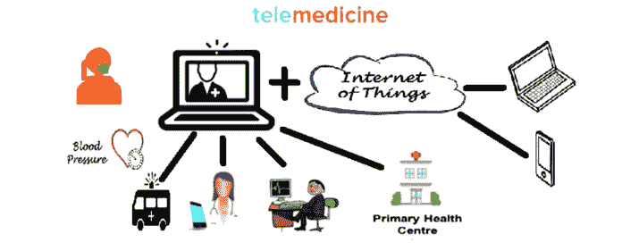

图 (1). 医疗物联网（远程医疗）。

## 文献研究
物联网已将医疗保健行业中的患者、医生和相关设备互联起来。然而，不同的传感器用于收集、发送和管理数据。各种物联网应用被用于应对 COVID-19。因此，物联网连接一切，而机器学习技术诊断疾病 [7]。健康物联网改变了健康管理的动态。联邦学习是机器学习的一个子部分的新概念。这种新技术在中央服务器和本地设备中获取数据，与其他传统方法相比使数据更安全 [8]。然而，本地模型必须使用 5G 通信网络进行适当更新 [9]。在将 5G 网络与联邦学习集成时设计了协议 [10]。提出了轻量级协议以在医疗物联网中的两个节点之间建立信任 [11, 12]。

COVID-19 打乱了我们的日常生活常规，我们必须保持社交距离并让人们意识到疫苗接种 [13, 14]。与此同时，由于物联网、网络安全、大数据、人工智能和机器学习的各种进步，患者的健康状况和更多信息可以轻松获取 [15 - 19]。

此外，无人机在 COVID-19 期间被广泛用于运送医疗设备和救援行动。此外，远程医疗如今被医生普遍用于正确指导患者。因此，节点之间需要安全路由。

## 大数据与医疗保健人工智能
人工智能让人类生活更轻松。由于先进的通信技术，生活变得更加舒适。人工智能与大数据的融合解决了与医疗保健相关的重大问题。电子健康记录在改善肿瘤治疗以优化治疗方法方面非常有帮助 [20]。

医疗保健行业基于应真实的数据。因此，决策过程将非常高效。数据通常从患者流向医生，以便分享可能的信息以提供可能的治疗。

然而，在传统方法中，数据或记录无法长期保存。与此同时，利用大数据分析和人工智能的数字化提高了技术设备的标准 [21]。

## 医疗物联网的机器学习概念
机器学习技术在更高效地开发数据和记录方面发挥了重要作用。此外，机器学习提出了将计算机辅助技术数字化和改进的新思路 [22]。移动设备的增长和物联网的融合改变了医疗领域的动态。服务质量解决了前所未有的问题并提供了包括远程医疗在内的移动医疗服务。使用网络服务形式的移动技术，患者与医生的咨询如今变得非常容易 [23, 24]。如“好大夫在线”之类的健康应用在 COVID-19 期间被更多地用于远程医疗。移动数据在未来观察患者需求方面将非常有用。与此同时，对于远程治疗，健康专家系统提供音频、视频和短信等多种服务。因此，初始数据将借助技术从患者处获取，基于此医生将给出可能的指导 [25]。

在医疗保健工程中，以下机器学习技术可用于解决问题。

- 分类与聚类
- 预测与异常识别

## 基于机器学习的医疗物联网应用
此外，机器学习有许多相关应用提高了医疗保健标准。一些应用如下：

### 疾病早期预测
为了更好地治疗，冠状病毒、心脏病和糖尿病三种疾病模型被制成安卓移动应用程序的形式。监督学习模型用于在实时数据上训练数据库，并在安卓应用中显示结果。因此，逻辑回归用于疾病早期预测 [26]。

### 医疗电子记录
在第四次工业革命中，电子健康记录是保存数据的最佳方式。医疗数据如此重要，以至于入侵者可能试图劫持整个系统，这对患者非常危险。医疗保健系统随着时间的推移而变化，但也存在漏洞。由于网络攻击，可能出现伪造、数据丢失、端到端延迟、抖动和数据包修改，从而危及患者生命。因此，设计了智能且安全的电子健康记录系统，利用区块链降低成本并提高信任度 [27]。

除此之外，还有许多其他应用，或科学家或工程师正在努力改善医疗保健行业，具体如下：

- 人形机器人手术
- 新型疾病突破
- 药物发现和临床试验

表 1 描述了与医疗物联网相关的应用。

表 1. 医疗物联网应用。

| 作者 | 年份 | 应用 |
|---|---|---|
| Chao et al. [33] | 2014 | 智能医疗护理系统 |
| Lei et al. [34] | 2012 | 智能医院 |
| Harshal et al. [35] | 2016 | 基于物联网的智能医疗系统 |
| Rashmi et al. [36] | 2016 | 医疗健康系统 |
| Michael et al. [37] | 2016 | 医疗机器人 |

## 保护医疗物联网免受网络攻击
可穿戴设备将在不久的将来被用于收集人类数据并将信息发送到外部设备。数据或信息可以通过笔记本电脑或计算机查看，也可能是移动设备。紧急响应传感器可以部署在家中或工作场所以监测紧急情况并将位置发送到基站。所有信息都可以通过网络应用或移动设备查看。移动应用被开发出来以便于患者及时正确用药。为此，有时警报消息会发送到患者的移动设备。

医疗物联网架构分为三个阶段，包括：

- 无线体域传感器网络
- 无线个人局域网
- 无线广域网
- 医疗服务器（笔记本电脑或移动设备）
- 紧急服务提供商

由于无线通信技术的广泛使用，网络攻击的比例正在增加。与此同时，医疗行业是入侵者获取信息或篡改数据的重点目标 [28]。下面讨论了一些常用的攻击：

### IoMT 中的 DoS 攻击

拒绝服务也称为第三方攻击。由于这种攻击，入侵者试图完全控制网络或修改数据包。以连续模式广播非法数据包会影响物联网的过程 [29]。

### IoMT 中的 DDoS 攻击

分布式拒绝服务攻击被认为是对每个网络最危险的威胁。在 DDoS 中，整个集群或群体攻击另一个以发送错误信息造成拥塞并夺取控制权。DDoS 是 DoS 攻击的扩展版本 [30]。

其他一些攻击也会破坏 IoMT 中的整个通信，具体如下：

- 路由攻击
- 误报攻击
- 不平衡高精度攻击
- 开销攻击
- 数据流量攻击
- 不需要的节点攻击

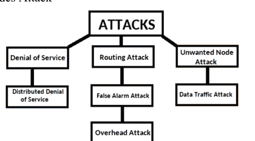

Fig. (2). 不同类型的攻击。

Fig. (2) 描述了不同类型的网络安全攻击，这些攻击会影响 IoMT 中的整体通信。

## 未来进展与挑战

机器学习技术如监督学习、无监督学习和强化学习极大地改变了医疗保健行业。由于技术发明以实现医疗领域的现代化，服务质量得到了改善。医疗技术中的机器学习提供了深入的信息以改善治疗方法。而由于认知计算，不同疾病的识别可以得到更好的治疗。药物发现、医学影像、行为医学、医疗记录数据库和数据收集将借助机器学习算法得到改进 [31]。然而，基于人工智能的远程医疗将为全世界提供新的方向 [32]。此外，无人驾驶飞行器在 COVID-19 期间被广泛用于运送医疗设备并保持社交距离。

随着新技术的应用，普通人存在一些问题。人们应更新自己在各个方面的知识，尤其是医疗保健，因为信息技术已经得到改善。

## 结论

机器学习算法的作用对医疗物联网有直接影响。因此，机器被训练以对疾病或病症做出最佳预测。基于人工智能的工具推动了治疗方式的进步。此外，IoMT 是物联网与医疗领域的结合。本文提供了与大数据、人工智能、机器学习、网络攻击以及与 IoMT 相关的各种应用相关的知识。此外，还纳入了未来方向和挑战，这对工程师、科学家、研究人员和从业者非常有帮助。未来将部署人工智能、机器学习和元启发式搜索算法以增强 IoMT 内部的通信。

## 发表同意

声明无。

## 利益冲突

作者声明无利益冲突，无论是财务或其他方面。

## 致谢

声明无。

## 参考文献

1. S.H. Sharma, and H. Ahteshamul, "人工智能、机器学习与医疗物联网（IoMT）在 COVID-19 及未来大流行中的应用：探索性研究", IEEE Smart Cities Newsletter, IEEE Smart Cities, 2021.
2. H.K. Bharadwaj, A. Agarwal, V. Chamola, N.R. Lakkaniga, V. Hassija, M. Guizani, and B. Sikdar, "机器学习在支持基于物联网的医疗保健应用中的作用综述", IEEE Access, vol. 9, pp. 38859-38890, 2021.
[http://dx.doi.org/10.1109/ACCESS.2021.3059858]
3. R.F. Mansour, A.E. Amraoui, I. Nouaouri, V.G. Diaz, D. Gupta, and S. Kumar, "人工智能和物联网支持的智能医疗系统疾病诊断模型", IEEE Access, vol. 9, pp. 45137-45146, 2021.
[http://dx.doi.org/10.1109/ACCESS.2021.3066365]
4. F.F. Gong, X.Z. Sun, J. Lin, and X.D. Gu, "中国智能医疗建立的初步探索", Mod. Hos Manag., vol. 11, no. 2, pp. 28-29, 2013.
5. K.H. Abdulkareem, M.A. Mohammed, A. Salim, M. Arif, O. Geman, D. Gupta, and A. Khanna, "基于机器学习和物联网的智能医院环境中实现有效的 COVID-19 诊断系统", IEEE Internet Things J., vol. 8, no. 21, pp. 15919-15928, 2021.
[http://dx.doi.org/10.1109/JIOT.2021.3050775] [PMID: 35782183]
6. A.A. Mutlag, M. Khanapi Abd Ghani, M.A. Mohammed, M.S. Maashi, O. Mohd, S.A. Mostafa, K.H. Abdulkareem, G. Marques, and I. de la Torre Diez, "MAFC：用于医疗关键任务管理的多智能体雾计算模型", Sensors (Basel), vol. 20, no. 7, p. 1853, 2020.
[http://dx.doi.org/10.3390/s20071853] [PMID: 32230843]
7. B. Shahab, S. Ardabili, A. Yarahmadi, B. Pahlevanzadeh, A.K. Kiani, A. Beheshti, H.A. Rokny, I. Dehzangi, and A. Mosavi. "机器学习与医疗物联网应对 COVID-19：荟萃分析," 2022.
[http://dx.doi.org/10.20944/preprints202302.0083.v1]
8. M.A. Rahman, M.S. Hossain, M.S. Islam, N.A. Alrajeh, and G. Muhammad, "安全且具溯源增强的健康物联网框架：区块链管理的联邦学习方法", IEEE Access, vol. 8, pp. 205071-205087, 2020.
[http://dx.doi.org/10.1109/ACCESS.2020.3037474] [PMID: 34192116]
9. S. Zhou, H. Huang, W. Chen, Z. Zheng, and S. Guo, "PIRATE：5G 网络中基于区块链的分布式机器学习安全框架", arXiv:1912.07860, vol. 1, no. 1, pp. 1-8, 2019.
10. G. Hua, L. Zhu, J. Wu, C. Shen, L. Zhou, and Q. Lin, "重载铁路智能控制的基于区块链的联邦学习", IEEE Access, vol. 8, pp. 176830-176839, 2020.
[http://dx.doi.org/10.1109/ACCESS.2020.3021253]
11. M. Kamal, and M. Tariq, "高级计量基础设施的轻量级安全与基于区块链的溯源", IEEE Access, vol. 7, pp. 87345-87356, 2019.
[http://dx.doi.org/10.1109/ACCESS.2019.2925787]
12. M. Kamal, G. Srivastava, and M. Tariq, "车联网中基于区块链的轻量级安全 V2V 通信", IEEE Transactions on Intelligent Transportation Systems, vol. 22, no. 7, pp. 3997-4004, 2021.
[http://dx.doi.org/10.1109/TITS.2020.3002462]
13. M.A. Rahman, M.S. Hossain, N.A. Alrajeh, and N. Guizani, "B5G 与可解释深度学习辅助的边缘医疗垂直领域——COVID-19 视角", IEEE Netw., vol. 34, no. 4, pp. 98-105, 2020.
[http://dx.doi.org/10.1109/MNET.011.2000353]
14. Y. Abdulsalam, and M. S. Hossain, "COVID-19 网络需求：基于拍卖的边缘计算服务自动选择机制", *IEEE Transactions on Network Science and Engineering*, vol. 9, no. 1, pp. 308-318, 2022. doi: 10.1109/TNSE.2020.3026637.
[http://dx.doi.org/10.1109/TITS.2020.3002462]
15. X. Yang, T. Zhang, C. Xu, and M.S. Hossain, "用于社会事件理解的自动视觉概念学习", *IEEE Trans. Multimed.*, vol. 17, no. 3, pp. 346-358, 2015.
[http://dx.doi.org/10.1109/TMM.2015.2393635]
16. Y. Xiao, G. Shi and M. Krunz, "迈向基于联邦学习的 6G 普惠 AI", arXiv:2004.13563, vol. 1, no. 1, pp. 1-7, 2020, [online] Available: https://arxiv.org/abs/2004.13563
17. M.F. Alhamid, M. Rawashdeh, H. Al Osman, M.S. Hossain, and A. El Saddik, "面向上下文感知的协作媒体推荐系统", *Multimedia Tools Appl.*, vol. 74, no. 24, pp. 11399-11428, 2015.
[http://dx.doi.org/10.1007/s11042-014-2236-3]
18. S. Qian, T. Zhang, C. Xu, M.S. Hossain, "通过增强的多模态监督潜在狄利克雷分配进行社会事件分类", ACM Trans. Multimedia Comput. Commun. Appl., vol. 11, no. 2, pp. 27.1-27.22, 2015.
19. I.U. Khan, I.M. Qureshi, M.A. Aziz, T.A. Cheema, and S.B.H. Shah, "基于智能物联网控制的飞行自组织网络（FANET）自然启发节能路由协议", *IEEE Access*, vol. 8, pp. 56371-56378, 2020.
[http://dx.doi.org/10.1109/ACCESS.2020.2981531]
20. Y.C. Yang, S.U. Islam, A. Noor, S. Khan, W. Afsar, and S. Nazir, "大数据和人工智能在医疗保健中的重要应用", *Comput. Math. Methods Med.*, vol. 2021, pp. 1-13, 2021.
[http://dx.doi.org/10.1155/2021/5812499] [PMID: 34527076]
21. N. Mehta, A. Pandit, and S. Shukla, "利用大数据分析和人工智能改变医疗保健：系统映射研究", *J. Biomed. Inform.*, vol. 100, p. 103311, 2019.
[http://dx.doi.org/10.1016/j.jbi.2019.103311] [PMID: 31629922]
22. A. Khare, M. Jeon, I.K. Sethi, and B. Xu, "医疗保健中的机器学习理论与应用", *J. Healthc. Eng.*, vol. 2017, pp. 1-2, 2017.
[http://dx.doi.org/10.1155/2017/5263570] [PMID: 29090076]
23. Y. Zhang, L. Sun, H. Song, and X. Cao, "医疗保健的普适无线传感器网络：最新进展与未来展望", *IEEE Internet Things J.*, vol. 1, no. 4, pp. 311-318, 2014.
[http://dx.doi.org/10.1109/JIOT.2014.2329462]
24. F. Xiao, and W. Ding, "毕达哥拉斯模糊集的散度度量及其在医学诊断中的应用", *Appl. Soft Comput.*, vol. 79, pp. 254-267, 2019.
[http://dx.doi.org/10.1016/j.asoc.2019.03.043]
25. H.N. Bischel, L. Caduff, S. Schindelholz, T. Kohn, and T.R. Julian, "基于集装箱的尿液收集系统和资源回收价值链沿线卫生服务工人的健康风险", *Environ. Sci. Technol.*, vol. 53, no. 12, pp. 7055-7067, 2019.
[http://dx.doi.org/10.1021/acs.est.9b01092] [PMID: 31082211]
26. N. Kumar, N. Narayan Das, D. Gupta, K. Gupta, and J. Bindra, "利用机器学习模型进行高效的自动化疾病诊断", *J. Healthc. Eng.*, vol. 2021, pp. 1-13, 2021.
[http://dx.doi.org/10.1155/2021/9983652] [PMID: 34035886]
27. A.M. Hasib, K. Tamzid, I. Chowdhury, S. Sakib, M.M. Khan, N. Alsufyani, A. Alsufyani, and S. Bourouis, "基于区块链技术的电子健康记录监控系统与数据安全", *Secur. Commun. Netw.*, no. 2022, 2022.
[http://dx.doi.org/10.1155/2022/2366632]
28. M. Anandarajan, and S. Malik, "保护医疗物联网：情境犯罪预防方法", *Cogent Med.*, vol. 5, no. 1, 2018.
[http://dx.doi.org/10.1080/2331205X.2018.1513349]

[29] A. Abdollahi, and M. Fathi, "针对物联网网络中死亡之ping攻击的入侵检测系统", Wirel. Pers. Commun., vol. 112, no. 4, pp. 2057-2070, 2020.
[http://dx.doi.org/10.1007/s11277-020-07139-y]

[30] I.U. Khan, A. Abdollahi, R. Alturki, M.D. Alshehri, M.A. Ikram, H.J. Alyamani, and S. Khan, "利用马尔可夫链在空中网络中实现攻击概率的智能检测系统", Wirel. Commun. Mob. Comput., vol. 2021, pp. 1-9, 2021.
[http://dx.doi.org/10.1155/2021/1542657]

[31] P. Singh, K. S. Singh and H. Vikram Singh, "医疗保健中的机器学习：综述及其用于医学图像安全的算法," 2021 10th International Conference on Internet of Everything, Microwave Engineering, Communication and Networks (IEMECON), pp. 01-05, 2021.
[http://dx.doi.org/10.1109/IEMECON53809.2021.9689076]

[32] S. Ellahham, N. Ellahham, and M.C.E. Simsekler, "在医疗保健安全背景下人工智能的应用：机遇与挑战", Am. J. Med. Qual., vol. 35, no. 4, pp. 341-348, 2020.
[http://dx.doi.org/10.1177/1062860619878515] [PMID: 31581790]

[33] C.H. Huang, and K.W. Cheng, "RFID技术与物联网在医疗护理系统中的应用结合", Bulletin of Networking, Computing, Systems, and Software, vol. 3, no. 1, pp. 20-24, 2014.

[34] H. Arbat, S. Choudhary, and K. Bala, "物联网智能健康手环," Imperial Journal of Interdisciplinary Research, vol. 2, no. 5, 2016.

[35] L. Yu, Y. Lu, and X. Zhu, "基于物联网的智能医院," Journal of Networks, vol. 7, no. 10, 2012.
[http://dx.doi.org/10.4304/jnw.7.10.1654-1661]

[36] R. Singh, "针对印度情况的基于物联网的移动电子护理健康服务系统提案," Journal of Network Communications and Emerging Technologies, vol. 6, no. 1, 2016.

[37] M. Fischer and M. Lam, "从书籍到机器人：利用医学文献创建聊天机器人," In Proc. First Workshop on IoT-enabled Healthcare and Wellness Technologies and Systems, June 30, 2016.

## 第2章 由医疗物联网驱动的健康服务与应用

# 由医疗物联网驱动的健康服务与应用

Briska Jifrina Premnath¹ and Namasivayam Nalini¹,*

¹ Department of Biochemistry and Biotechnology, Faculty of Science, Annamalai University, Tamil Nadu, India

**Abstract:** 传统医疗保健系统模式现已过时。随着数字时代的推进，对新先进技术和服务平台的需求日益增加。医疗物联网（IoMT）就是其中一种技术，它是物联网的一个子集。物联网（IoT）是一个由无线、互联且相互连接的数字设备组成的网络，可以在无需人际或人机交互的情况下收集、发送和存储数据。了解已建立和新兴的物联网技术如何帮助医疗系统提供安全有效的护理比以往任何时候都更加重要。例如，冠状病毒病（COVID-19）的迅速传播已引起整个医疗保健系统的警觉。医疗物联网（IoMT）极大地改善了这一状况，而 COVID-19 也激励科学家创建一种新的“智能”医疗保健系统，专注于早期诊断、传播预防、教育和治疗，以促进在新常态下生活。本文概述了 IoMT 设计以及云存储技术如何帮助医疗保健应用。本章应帮助研究人员考虑 IoMT 在医疗保健领域之前的应用、益处、问题、挑战和威胁，以及 IoMT 在 COVID-19 大流行中的作用。这篇综述将对该领域的科研人员和专业人士有所帮助，使他们能够认识到物联网在医学领域巨大的潜力。

**Keywords:** 应用, 益处, 挑战, COVID-19, 医疗保健, IoMT, IoT, 医学, 威胁.

## INTRODUCTION

近年来，医疗保健行业发生了重大变化。当前在整个业务中使用新信息技术是这一变化的一个关键因素。医院和养老院需要来自多种不同的 IT 服务平台和尖端技术帮助，以满足不断增长的医疗保健需求。医疗物联网，或 IoMT，是当今医疗保健领域最常用的技术之一。医疗物联网是物联网的一个子集 [1]。

“物联网”一词指的是一个由物理事物或“事物”组成的网络，旨在通过互联网相互通信。Ashton 于 1999 年首次谈到物联网。从那时起，它已大幅增长，目前约有 100 亿台连接设备，预计到 2025 年将达到 250 亿台 [2]。

照顾一个人的身体、精神或情感健康称为“医疗保健”，通常由医生和其他经过培训和许可的医疗保健专业人员完成。由于人口大幅增长，患病的人越来越多，医生、护士或医院床位都不够。每天都有使用最新技术和方法的研究人员开发新的医学和医疗保健趋势。研究人员最近将注意力集中在物联网（IoT）上，因为它作为对医疗系统压力不大的完美解决方案而广受欢迎 [3]。

今天，医疗保健和现代技术企业，尤其是医疗系统，在我们的生活中发挥着重要作用。将技术整合到医疗保健系统中的主要目标是使患者和护理人员之间的沟通变得更容易。这将使医疗设备和服务更高效、更容易获得。医疗物联网（IoMT）在远程医疗监测（RHM）方面发挥了重要作用。经常使用可穿戴传感器和设备远程获取患者数据并将其存储在云数据库中。物联网（IoT）主要用于此目的。这些数据可供护理人员立即进行分析和规划 [4]。

IoMT 由三个主要部分组成：设备层[身体传感器网络（BSN）]、雾层和云服务。设备层（传感层）的主要目标是构建一种有效且准确的传感技术，能够收集不同类型的基于健康的健康数据。Bluetooth、RFID（NFC）、Wi-Fi、IrDA、UWB 和 ZIGBEE 等通信技术有助于 IoMT 系统构建网络解决方案和基础设施。在云层（数据层），数据会被处理并安全保存。此外，云会获取患者数据以进行分析、处理和存储。然后医疗保健工作者可以使用此类数据 [5 - 12]。

IoMT 是一组连接网络的医疗策略。人们可以将智能眼镜、头戴式设备、腰带式服装、智能手表、编织服装和智能手环连接到 Wi-Fi、蓝牙或互联网以获取健康信息。医疗机构中的诊断机器，如超声波、MRI 机器、输液泵、呼吸机和 X 射线机使用 IoMT 技术。这些 IoMT 可穿戴设备可用于跟踪各年龄段人群的健康状况。它们通常易于佩戴和使用。IoMT 设备用于应用和软件，例如远程数据分析、医疗援助、手术增强、药物监测和会计系统 [13]。

远程健康监测（RHM）是一种定期跟踪个人健康数据的方式。人们的心率、体温、血压、身体活动和饮食习惯都会被监测。云通过无线方式将健康数据发送给患者和护理人员。因此，IoMT 可以对各种疾病做出实时、快速、远程和可靠的决策。该过程会产生大量数据，然后对其进行分析和监测。由于当今生活节奏紧张，大多数人不会定期去看医生。此外，医疗保健成本正在上升，政府每年在医疗保健上花费大量资金。欧洲和美国的人们也更喜欢在家而不是在医院接受医疗保健。如果可以远程实时进行实时医疗保健监测，这些问题就可以得到解决。利用可穿戴设备和传感器为患者和老年人提供持续监测受到了大量关注 [14 - 25]。

想象一个世界，数十亿事物通过 IP（互联网协议）网络连接，具有内置的智能、通信、传感和执行能力。这就是物联网（IoT）。我们当前的互联网已在很大程度上远离基于硬件的选项（计算机、光纤和以太网连接），转向基于市场的选项（例如应用程序）（Facebook、Amazon） [26]。

本章将介绍构成 IoMT 的技术以及 IoMT 在医疗保健中的益处、问题、安全问题和应用方式。IoMT 在 COVID-19 中的作用也将简要介绍。

## CONCEPT FOR INTERNET-OF-THINGS-BASED HEALTHCARE

它旨在允许广泛的类型和服务，每种服务都有不同的医疗护理解决方案。目前尚无物联网在医疗保健中的完整服务清单。在某些情况下，医疗保健服务很难与其他解决方案或应用程序区分开来。它还研究了潜在的构建模块如何在一般服务中被使用。在医疗环境中，物联网框架和协议已略有更新以使其更好地工作。可以快速轻松地进行简单、安全、低功耗和快速发现新设备和服务。“健康服务”一词下有许多子主题，涉及未来和新兴的健康服务 [3]。图（1）说明了医疗保健中 IoMT 的概念。

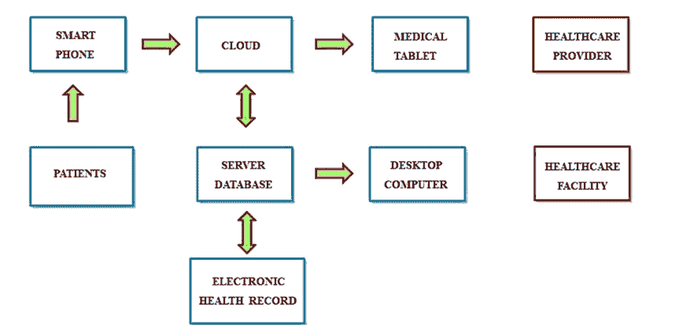

图 (1). 医疗保健中 IoMT 的概念。

## 医疗服务技术

物联网 (IoT) 医疗保健服务使用多种不同的技术。然而，所提出的系统解释了医疗援助核心的几种技术。

### 云计算
如果实施云计算，基于 IoT 的医疗保健服务将带来许多云计算优势。这些功能包括对共享资源的始终在线访问、根据网络请求提供的服务，以及满足公司需求的操作。

### 网格计算
网格计算，也称为集群计算，是云计算的基础。网格计算使得所有医疗保健网络能够处理分布在患者全身的传感器节点的计算限制成为可能。

### 大数据
大数据收集来自我们全身众多传感器的基本健康数据。它还为我们提供了工具，帮助使健康诊断和监测阶段及程序更加一致。

### 网络
基于 IoT 的医疗保健网络的物理架构包括多种网络，从短距离通信，如 6LoWPANs、WPANs、WBANs、WLANs 和 WSNs，到长距离通信，如任何类型的蜂窝网络。在开发低功耗通信协议和医疗传感器设备时，蓝牙低功耗、射频识别 (RFID) 和近场通信 (NFC) 等技术发挥作用。

### 环境智能
环境智能持续监控人类活动并执行识别事件所需的任何操作。它至关重要，因为它不断监控个人的行为。

### 增强现实
增强现实比其他技术更强调手术和其他标准患者检查。

### 可穿戴设备
脉搏、体温、脉搏血氧饱和度和呼吸频率等传感器是可穿戴的，因为它们设计为柔软、光滑且易于佩戴的特点。它也易于使用和应用于任何人的身体。可穿戴设备有许多好处，如游戏化、连接数据和医疗保健社区 [3]。

## IoT 的医疗保健益处

与其他新技术一样，物联网存在一些缺点，但它主要是有利的。物联网正在医疗健康领域引发重大转变。物联网应用和技术以人们在 1990 年代认为不可能的方式改变了世界。物联网在人们通过互联网相互沟通方面造成了重大变化。它导致了许多新的且要求苛刻的领域诞生，最著名的是在医疗物联网领域。大多数人由于其准确和直接的特点而跟随并使用它。因此，它弥合了医生、患者和医疗服务之间的差距。得益于物联网，医疗保健工作者现在可以更好地、更快地完成工作，付出更少的努力和智力。这种在医疗领域使用 IoT 对患者来说是完美的。IoT 也很简单易用。使用 IoT 的人可以从以下几点受益：

- 使生活更轻松。
- 降低医疗保健成本。
- 改善患者健康。
- 疾病可实时得到处理。
- 提高生活质量。
- 改善用户的最终体验。
- 患者护理质量更好。
- 费用将被削减。
- 目标是让人们更长寿、更健康。
- 疾病护理和预防应以最佳方式进行。
- 儿童和老年父母的进展保持在正轨上。
- 当患者健康出现显著变化时，会向许多人发送自动警报，挽救生命和时间。
- 物联网 (IoT) 资源，以及其他 IoT 小工具。
- 有关于如何服药的规定。
- 家属将及时了解患者的病情。
- 赚钱的能力。
- 易用性。
- 最佳利用能源，包括时间。
- 以金钱为例，你就会明白。
- 使用物联网提供按需医疗服务的医生 [27]。

## IoMT 中的困难

在 IoMT 得到广泛使用之前，许多问题和后果需要解决。这些包括数据隐私和安全、数据管理、可扩展性和升级性、立法、互操作性和成本效益。

### 数据保密性和安全性
在某些应用中，确保医疗监测系统中的网络安全有效运行是最具挑战性的任务之一。系统之间传输的海量敏感健康数据的安全性仍然是一个开放性问题。Akhbarifar 等人 (2020) 提出了一种在基于云的 IoMT 环境中更轻松地远程监控人们健康的方法。Lin 等人 (2021) 建议为远程医疗使用智能卡系统进行单点登录 (SC-UCSSO)，该系统在提高安全性和性能的同时保护患者隐私。Covi-Chain 使用“区块链技术”来解决安全和隐私问题，同时不暴露数据并增加存储容量 [28 - 31]。

### 数据管理
数据管理是指获取、组合、控制和管理数据信息流以使其有意义的能力。有许多方法可以为计算机程序提供其所需的信息，同时隐藏其他信息。这些方法包括数据匿名化、数据集成和数据同步。

### 可扩展性、优化、法规和标准化
可扩展性是指医疗设备随环境变化而变化的能力。因此，高可扩展的系统可保持连接设备的同步，并在利用可用资源的同时高效运行。能够轻松更改的系统现在和将来都更好。IoMT 技术的持续变化和改进使设备保持最新。

医疗保健行业需要确保由许多不同制造商或供应商制造的、使用通信协议、数据聚合和网关接口的各种基于 IoMT 的设备是安全的，这些设备遵循标准设计原则和协议。人们必须像信息技术和创新基金会 (IETF)、欧洲电信标准协会 (ETSI) 和智能事物互联网协议 (IPSO) 那样去做。还必须对记录 EMR 数据的 IoMT 设备进行检查。学者、组织和标准制定机构必须共同努力来完成此事。

由于《经济和临床健康法案健康信息技术法》、HIPAA 合规性和通用数据保护条例 (GDPR) 等法律，想要快速使用 IoMT 设备的人无法使用 [2]。

### 互操作性
允许不同行业制作应用的标准是其他标准。此外，广泛的设备和数据使得使用变得困难，主要是因为运营商之间的差异。互操作性是一个问题，因为在具有不同能力的不同 IoMT 系统之间移动数据很困难。因此，开发标准接口变得至关重要，尤其是对于允许跨组织和跨系统通信的应用。IoMT 世界中的人们交换信息，这会产生大量数据。人们必须弄清楚如何管理数据并控制互连设备，同时保持能源成本可控 [32]。

### 商业可行性
在 COVID-19 期间，财务压力蔓延到许多人、企业甚至整个组织，这使得人们难以使用 IoMT。因此，成本效益是一个需要考虑的重要问题。生产、安装和使用 IoMT 系统的成本必须合理。

在基于 IoMT 的系统中，使用了许多医疗设备和传感器。不幸的是，这些设备维护和升级费用昂贵。因此，制造商和终端用户都必须为此买单。因此，低维护、低启动成本的传感器可以帮助制造更多 IoMT 设备并让更多人使用它们。

### 功耗
阻碍 IoMT 设备广泛采用的另一个因素是功耗。大多数 IoMT 设备由电池供电，如果传感器安装在身上，电池需要经常更换或必须使用高功率电池。我们的主要重点应该是制造自给自足的医疗设备或将 IoMT 系统连接到可再生能源系统，这也有助于缓解全球能源问题 [2]。

### 环境后果
如上所述，IoMT 系统使用各种生物传感器执行不同的功能。这些传感器由半导体与地球金属和其他潜在危险化合物混合形成。因此，监管机构监控和控制传感器的制造。应将更多研究集中在设计和制造可生物降解传感器上 [33]。

## 医疗保健中物联网的安全性

就技术而言，物联网正成为几乎可以在所有领域和几乎任何地方使用的技术。然而，物联网在医疗领域变得越来越流行，无论是在技术还是保护方面。物联网最终将导致许多技术处方，供医生和患者遵循并监控他们的健康。因此，安全可能成为一个大问题。设备上存储着患者的医疗信息，而黑客今天可以轻松进入传感器。因此，基于 IoT 的医疗保健服务的核心挑战是通过加密要求阻止黑客保护和存储患者的关键唯一数据在数据库上。

## 安全前提

医学中的安全要求侧重于患者数据的安全以及物联网网关与护理顾问之间的通信系统，其中存在数据捕获的可能性。

**_保密性：_** 保密性意味着未经批准的人员无法访问患者的医疗数据。患者的数据只能由具有适当权限的人员访问。经批准的人员只能处理或使用数据。即使窃听者也无法获取信息。为患者和医疗服务提供者的利益着想，这一切都是为了对他们保密。

**_认证：_** 认证涉及许多方面，例如为每个传感器设备分配唯一的 ID 以识别与其通信的另一方，并在他们想要打开设备时解锁设备。

**_可用性：_** 当物联网医疗服务需要尽可能长时间可用时，无论是通过本地和全球服务器，还是通过能够识别和授权需要传感器的人员的云服务，即使他们试图关闭服务。

**_数据新鲜度：_** 数据新鲜度确保每天都添加所有新数据。此外，它确保数据库中没有重复或存储的数据或消息，并且没有建议重复旧声明。

## 安全挑战

大多数支持物联网的医疗设备都有内存，由系统软件、应用程序二进制文件或嵌入式操作系统用于存储数据。因此，内存可能不足以运行复杂的 安全程序。

## 威胁模型

黑客进入物联网健康服务、网络和设备的方式有很多，因为攻击点很多。物联网医疗中的三个情节使服务对每个人来说都是安全的，无论如何使用。场景使得云网络、本地网络和云服务能够发展。当这样做时，它确保了物联网网络与设备之间以及物联网网络与云服务之间有报告的方式。最后一个场景非常清楚地说明了设备的硬件和软件限制。

## 攻击类型

基于信息中断的攻击和基于主机和网络属性的攻击属于此分类法。

## 安全模型提案

由于物联网具有患者的个人信息，因此在医疗保健中使用物联网并不十分安全，因为它可能受到任何安全问题的 影响。弄清楚和诊断所有攻击和威胁更具挑战性，使其更困难。动态属性是为了实现安全目标而制定的。安全计划应能够识别并应对可能出现的意外或不可预见的问题 [3]。

## IoMT 应用

### 医疗智能技术

本部分包括智能设备和套件。这些现在正被医护人员用于帮助需要立即医疗护理和帮助的人。一种方法是使用医疗无人机。由于医疗无人机是最快到达紧急现场的，因此它们首先被用于帮助心脏病发作患者。医护人员可能无法快速响应，因为他们可能会被困在交通中，无法快速响应；这鼓励智能医疗机器人在医院进行手术。VR/AR 和基于 AI 的医疗技术也用于其他医疗目的。基于 AI 的医疗技术也用于确保其更准确 [34 - 40]。

### 可吞咽相机

患者可以吞下这些尖端、低成本的胶囊（体内/体外）以实时、实时监测其内脏器官，以便及早发现慢性疾病和癌症。数据记录胶囊、可吞咽内窥镜光学扫描设备用于内窥镜检查，以及可吞咽水凝胶设备只是众多可吞咽设备中的三个例子。X 射线或相机胶囊、跟踪/记录系统和诊断工具包用于在检查可吞咽设备时进行检查 [41 - 44]。

### 实时患者监测 (RTPM)

由于他们在日常生活中大量使用智能设备，这已成为包括千禧一代和 Y 世代在内的年轻一代中兴起的新趋势。事实证明，RTPM 可以远程监测患者的健康状况。附着在患者体上的传感器用于监测其健康状况，无论是通过家庭健康远程医疗系统还是远程护理监测系统。如果一个人想关注你的健身水平、血糖水平、呼吸频率和心率，他可能想跟踪这些指标。现在有许多新的 RTPM 趋势，例如用于监测抑郁症的 Apple Watch 应用、用于帕金森病的 Apple Research Kit，以及 ADAMM Intelligence 哮喘监测，可监测身体状况 [45 - 51]。

### 心血管健康监测系统

当一个人拥有这些系统时，它们会查看其心率和脉搏波传导速度。使用 Body Cardio Scale，人们可以测量脉搏波传导速度 (PWV) 以查看是否患有早期外周动脉疾病 (PAD) [52]。

### 皮肤状况监测系统

这些系统确定伤口的大小以及愈合速度。作者希望成立一个小组来讨论使用智能手机的移动远程医疗。十名专家使用实验性移动应用程序远程查看糖尿病患者的足部。他们使用这种方法来测试平台的可行性和可用性。

### 将 IoMT 设备用作运动检测器

这些设备适用于无法移动的人。这些设备必须跟踪这些人群的去向。因此，智能手表和传感器被附着在患者的衣服、床上或身体上以监视他们。这也有助于跟踪非自主行为并更好地了解医疗护理的控制。来自这些设备的数据从头到尾都是加密的，让患者更安心 [53]。

### 可穿戴传感器用于远程健康监测

由于用户和患者都使用此应用程序，因此它受到了广泛关注。服务仅用于制作用户的应用程序。简而言之，服务面向开发者，应用程序面向用户。在基于物联网的医疗保健应用中，已为患者制作了监测其健康的应用程序，例如血氧饱和度监测和康复系统应用、血压监测、体温监测等 [3]。

## IoMT 在 COVID-19 中的作用

通过使用技术，IoMT 可以帮助医生做出更准确的诊断，避免错误，并通过让患者向医生发送健康数据来节省医疗费用。鉴于最近的事件，这非常重要，因为无线连接意味着无需亲自去看医生，这可以阻止 COVID-19 的传播。IoMT 有一些缺点，其中之一可能是患者可能不信任技术系统处理其个人信息。

全球 COVID-19 使 IoMT 变得更加重要，并帮助技术改进，但这并不是唯一的想法。IoMT 在解决这些问题方面发挥了重要作用，因为医疗行业研究人员正在寻找最佳的患者筛查方式并快速关注其症状。由人工智能驱动的 5G、云计算和区块链物联网将构建一个复杂而高效的健康技术环境，很难被破坏 [54]。

与 COVID-19 相关的研究主要试图解决病毒的问题。

- 1. 确保人与人之间保持距离的技术方法。
- 2. IoMT 帮助医生远程监测患者。
- 3. 基于 IoMT 的感染检测方法。
- 4. IoMT 提供热成像筛查以阻止疾病传播 [55]。

认知物联网是一种新型技术，使有限频谱的使用变得更容易。这种方法适用于 COVID-19 患者追踪。物联网的一部分称为认知 IoMT (CIoMT)，是智能物联网 (IoT)。在抗击 COVID-19 大流行的高风险场所，IoMT 被大量使用。CIoMT 已被用于许多不同的方式。

- 1. 实时关注人们。
- 2. 远程监测 COVID-19 患者。
- 3. 大流行可以快速诊断。
- 4. 了解患者。
- 5. 预防和控制大流行病。

IoMT 还可以帮助患有 COVID-19 感染的骨科患者。COVID-19 患者可以从 IoMT 获得以下服务：

- 1. 患者监测。

- 2. 可穿戴技术。
- 3. 高质量的医疗保健 [56, 57]。

IoMT 用于阻止 COVID-19 大流行的传播。利用 IoMT 与其他技术（如人工智能、大数据和区块链）开发更有效的解决方案变得更容易。许多人正在努力使 IoMT 应用更安全。通过 IoMT 可以在家中监测 COVID-19 患者。许多患者参数，如血压和心率，将被存储并通过云端发送给医疗保健工作者，他们将能够查看这些数据。它阻止了疾病的传播，也对人们的健康有益。在 IoMT 的帮助下，COVID-19 疫情的来源被找到并追踪。一家台湾公司制造了一种可穿戴物联网设备，可以在温度过高时发出警报并通知相关人员。基于云的温度监测技术减少了医疗工作人员的及时失误以及对医疗管理人员的感染风险。IoMT 已在台湾一家医院中使用，用于扫描访客、检查其体温并查看他们是否佩戴口罩。医院中使用了 AI 赋能的 IoMT [58-61]。

## 与 IoMT 协作的技术以在 COVID-19 时期开发智能医疗保健系统

在 COVID-19 大流行期间，持续观察大量人群的健康状况至关重要，无论是在生病之前还是之后。医疗物联网（IoMT）使得护理人员和患者能够使用远程医疗从远处监测、筛查和治疗患者。当发生全球大流行时，由 IoMT 驱动的智能设备正在改变世界，尤其是在中间 [2]。

## 虚拟现实（VR）、增强现实（AR）和混合现实（MR）

虚拟、混合和增强现实可用于各种用途，但主要有四种类型：临床/治疗、娱乐、商业/工业和教育/培训。通过改变现实体验，VR 技术创造了一个三维、吸引人的多模态世界，使人们感觉自己身临其境。当人们佩戴头戴式显示器（HMD）时，其屏幕非常靠近面部，看起来人们被“传送到一个三维、逼真的世界”。虚拟现实之所以有效，是因为它利用了分散注意、消退学习、认知行为原则、门控理论和注意力的聚光灯理论来使人们关注。虚拟现实治疗心理健康和焦虑障碍，并管理中风、疼痛和肥胖。它还控制和阻止体重增加。虚拟现实可以通过改变人们的想法和感受来帮助癌症患者跟踪其治疗。他们减轻了癌症的心理症状，从而改善了患者的情绪健康。根据 Yahara 等人在 2021 年的一项研究，沉浸式 VR 诱导的遥远回忆可以帮助轻度认知障碍的人应对焦虑。姑息治疗和大流行带来的不愉快影响可以在人们无需旅行的情况下减轻。VR 可用于此，因为它允许人们进行视频聊天并模拟现实世界中的互动方式。计算机图像叠加在真实世界图像之上。除了是极好的教学工具外，增强现实还可以帮助人们可视化和注释肉眼不可见的想法。他们可以通过在虚拟世界中移动来实现这一点。

XR-Health 提出了一种虚拟现实（VR）系统，帮助无法离开家的人通过身体和精神锻炼来应对压力和焦虑。沉浸式 VR 教育公司制作了“Engage”平台，用于虚拟现实教学和小组工作。EON Reality 提出了一个虚拟现实/增强现实平台，企业、学校和政府可以在隔离情况下使用，该平台由 EON Reality 制作。此外，还制作了一个虚拟现实环境来查看 COVID-19 病毒的结构、分子动力学、酶和蛋白质。外科医生可以在具有提供触觉感的触觉功能的受控环境中练习和演练手术方法。这种培训被称为“基础 VR”。当外科医生在尸体上植入脊柱螺钉时，X-Vision Augmedics 使用 3D 表示使其看起来像 X 射线视觉。这帮助他们更清晰地看到患者的解剖结构。为了帮助患有精神疾病的焦虑人群，Oxford VR 使人们感到压力更小 [62-69]。

## 结论

医疗物联网（IoMT）是一组与医疗保健信息技术系统通信的医疗设备和应用程序。具有 Wi-Fi 的医疗设备使 IoMT 能够工作。这将使机器能够相互通信。当医疗设备和软件应用程序无线连接到医疗保健信息技术系统时，它们就形成了医疗物联网（IoMT）。该网络包括医疗设备和软件应用程序。通过连接的医疗设备和移动应用程序连接人员、数据和流程，其目标是改善患者的健康。物联网处理大量数据，其中一些数据在 IoMT 的情况下可能非常重要。其中一些可能涉及患者的健康、他们居住的地方以及他们接受的治疗类型。这些数据需要强大的安全性和防止网络攻击的保护，而网络攻击最近变得更加普遍。本手稿将让人们了解物联网如何帮助人们获得更好的护理以及 IoMT 在 COVID-19 大流行中所发挥的作用。这项工作将帮助学者和从业者了解物联网在医疗领域带来的巨大好处，并指出 IoMT 的重要问题。此外，它还将帮助研究人员了解医疗保健行业中物联网的应用。

## 发表同意书

未声明。

## 利益冲突

作者声明无利益冲突，无论财务或其他方面。

## 致谢

未声明。

## 参考文献

- [1] A. Giri, S. Chatterjee, P. Paul, S. Chakraborty, S. Biswas, "IoMT（医疗物联网）智能应用对印度医疗保健领域的影响", International Journal of Recent Technology and Engineering (IJRTE), vol. 1, no. 6, pp. 18-25, 2019.
- [http://dx.doi.org/10.35940/ijrte.D7474.118419]
- 
- [2] R. Dwivedi, D. Mehrotra, and S. Chandra, "构建智能医疗保健系统的医疗物联网（IoMT）应用潜力：系统综述", J. Oral Biol. Craniofac. Res., vol. 12, no. 2, pp. 302-318, 2022.
- [http://dx.doi.org/10.1016/j.jobcr.2021.11.010] [PMID: 34926140]
- 
- [3] S. Devadharshini, R.J. Anitha, "基于物联网的医疗保健服务", International Research Journal of Multidisciplinary Technovation (Irjmt), vol. 1, no. 6, pp. 18-25, 2019.
- 
- [4] O. AlShorman, B. AlShorman, M. Al-khassaweneh, F. Alkahtani, "基于医疗物联网（IoMT）的可穿戴传感器远程健康监测综述：以糖尿病患者为例", Indonesian Journal of Electrical Engineering and Computer Science, Vol. 20, No. 1, 2020.
- 
- [5] A. Mihovska, and M. Sarkar, Smart connectivity for Internet of things (iot) applications. New Advances in the Internet of Things, 2018, pp. 105-118.
- [http://dx.doi.org/10.1007/978-3-319-58190-3_7]
- 
- [6] A. Yassine, S. Singh, M.S. Hossain, and G. Muhammad, "具有雾计算和云计算的智能家居物联网大数据分析", Future Gener. Comput. Syst., vol. 91, pp. 563-573, 2019.
- [http://dx.doi.org/10.1016/j.future.2018.08.040]
- 
- [7] J. Mahapatro, "Nagdeo, Sumit Kumar, Mittal, Sumitt Bhutia, Tenzing Thundup, "使用物联网技术选择无线体域网传感器优先级", 5th International Conference for Convergence in Technology, 2019.
- 
- [8] Y. Miao, G. Wu, C. Liu, M.S. Hossain, and G. Muhammad, "Ghulam Muhammad, "绿色认知体传感器网络：架构、能量收集和基于智能服装的应用"", IEEE Sens. J., vol. 19, no. 19, pp. 8371-8378, 2019.
- [http://dx.doi.org/10.1109/JSEN.2018.2870251]
- 
- [9] N. Abbas, M. Asim, N. Tariq, T. Baker, and S. Abbas, "雾层中保护物联网使能应用的机制", Journal of Sensor and Actuator Networks, vol. 8, no. 1, p. 16, 2019.
- [http://dx.doi.org/10.3390/jsan8010016]

[10] H. Tao, M.Z.A. Bhuiyan, A.N. Abdalla, M.M. Hassan, J.M. Zain, and T. Hayajneh, "基于硬件密码的物联网医疗安全数据采集", IEEE Internet Things J., vol. 6, no. 1, pp. 410-420, 2019.
[http://dx.doi.org/10.1109/JIOT.2018.2854714]

[11] S. Sharma, V. Chang, U.S. Tim, J. Wong, and S. Gadia, "基于云和物联网的新兴服务系统", Cluster Comput., vol. 22, no. 1, pp. 71-91, 2019.
[http://dx.doi.org/10.1007/s10586-018-2821-8]

[12] B. Mallikarjuna, and D. A. K. Reddy, 移动和云环境中的医疗应用开发, in "物联网与个性化医疗系统", Appl. Sci. Technol., pp. 93-103, 2019.

[13] W. Azeem, A.A. Malik, K. Amjad, M. Asad and H. U. Rashid, “物联网医疗（IoMT）在远程医疗及医疗卫生系统中的应用”, Pakistan Journal of Science, Vol. 72, No. 4, 2020.

[14] M. Al khafajiy, Thar Baker, Carl Chalmers, Muhammad Asim, Hoshang Kolivand, Muhammad Fahim and Atif Waraich, "通过可穿戴传感器对老年人进行远程健康监测", Multimedia Tools Appl., vol. 78, pp. 24681-24706, 2019.

[15] L.P. Malasinghe, N. Ramzan, and K. Dahal, "远程患者监测：综合研究", J. Ambient Intell. Humaniz. Comput., vol. 10, no. 1, pp. 57-76, 2019.
[http://dx.doi.org/10.1007/s12652-017-0598-x]

[16] N. Bashi, Mohanraj Karunanithi, Farhad Fatehi, Hang Ding and Darren Walters, “心力衰竭患者远程监测：系统综述概述”, J. Med. Internet Res., vol. 19, no. 1, p. e18, 2017.
[http://dx.doi.org/10.2196/jmir.6571] [PMID: 28108430]

[17] I. Azimi, A.M. Rahmani, P. Liljeberg, and H. Tenhunen, "面向老年人远程监测的物联网：基于用户中心的视角研究", J. Ambient Intell. Humaniz. Comput., vol. 8, no. 2, pp. 273-289, 2017.
[http://dx.doi.org/10.1007/s12652-016-0387-y]

[18] J.T. Giger, N.D. Pope, H.B. Vogt, C. Gutierrez, L.A. Newland, J. Lemke, and M.J. Lawler, "居住在边境州的老年人对远程患者监测的接受趋势", Comput. Human Behav., vol. 44, pp. 174-182, 2015.
[http://dx.doi.org/10.1016/j.chb.2014.11.044]

[19] B. Noah, M.S. Keller, S. Mosadeghi, L. Stein, S. Johl, S. Delshad, V.C. Tashjian, D. Lew, J.T. Kwan, A. Jusufagic, and B.M.R. Spiegel, "远程患者监测对临床结局的影响：随机对照试验的更新荟萃分析", NPJ Digit. Med., vol. 1, no. 1, p. 20172, 2018.
[http://dx.doi.org/10.1038/s41746-017-0002-4] [PMID: 31304346]

[20] A. Benjemmaa, Hela Ltifi, Mounir Ben Ayed, “心脏病患者远程心脏监测系统设计”, International Conference on Advanced Information Networking and Applications, pp. 963-976, 2019.

[21] R. Fallahzadeh, M. Pedram, J.L. Risco-Martin, J.M. Moya, J.L. Ayala, and H. Ghasemzadeh, "迈向超低功耗远程健康监测：用于活动识别的最优自适应压缩感知框架", IEEE Trans. Mobile Comput., vol. 18, no. 3, pp. 658-673, 2019.
[http://dx.doi.org/10.1109/TMC.2018.2843373]

[22] A. Depari, D. Fernandes Carvalho, P. Bellagente, P. Ferrari, E. Sisinni, A. Flaminini, and A. Padovani, "用于增强应用于神经退行性疾病诊断的原型医疗器械有效性的基于物联网的架构", Sensors (Basel), vol. 19, no. 7, pp. 1564-1582, 2019.
[http://dx.doi.org/10.3390/s19071564] [PMID: 30935157]

[23] B. Farahani, F. Firouzi, Krishnendu Chakrabarty, Sani Nassif, “医疗物联网”, 智能物联网. Springer, 2020, pp. 515-545. [http://dx.doi.org/10.1007/978-3-030-30367-9_11]

[24] M. Pham, Yehenew Mengistu; Ha Manh Do; Weihua Sheng, “用于家庭医疗保健的基于云的智能家居环境（CoSHE）”, IEEE International Conference on Automation Science and Engineering (CASE), pp. 483-488, 2016. [http://dx.doi.org/10.1109/COASE.2016.7743444]

[25] A.E. Hassanien, Nilanjan Dey, Surekha Borra, “医疗大数据与医疗物联网：进展、挑战与应用”, CRC Press, 2018. [http://dx.doi.org/10.1201/9781351030380]

[26] S. Cirani, G. Ferrari, M. Picone, L. Veltri, “物联网：架构、协议与标准”, Wiley 2019.

[27] G.J. Joyia, R.M. Liaqat, A. Farooq, S. Rehman, “医疗物联网（IOMT）：在医疗保健领域的应用、优势与未来挑战”, J. Commun., vol. 12, no. 4, pp. 240-247, 2017. [http://dx.doi.org/10.12720/jcm.12.4.240-247]

[28] S. Akhbarifar, H.H.S. Javadi, A.M. Rahmani, “基于云的物联网医疗环境中早期疾病诊断的安全远程健康监测模型”, Pers Ubiquit Comput, 2020. [http://dx.doi.org/10.1007/s00779-020-01475-3]

[29] TW Lin, CL Hsu, TV Le, CF Lu, BY Huang, “基于智能卡的 5G-物联网医疗远程医疗系统中用于隐私保护的用户控制单点登录”, Sensors, Vol. 21, No. 8, pp. 2880, 2021. [http://dx.doi.org/10.3390/s21082880]

[30] D.A. Chaudhari, E. Umamaheswari, “一种新的基于自适应异或、哈希和加密的认证协议，用于在物联网（IoMT）中安全传输医疗数据”, Biomed Tech (Berl), vol. 66, no. 1, pp. 91-105, 2021. [http://dx.doi.org/10.1515/bmt-2019-0123]

[31] S. Alsamhi, B. Lee, “用于对抗 COVID-19 和未来大流行的多机器人协作的区块链”, IEEE Access, p. 1, 2020.

[32] S. Kumar, P. Tiwari, and M. Zymbler, "物联网是未来技术增强的革命性方法：综述", J. Big Data, vol. 6, no. 1, p. 111, 2019. [http://dx.doi.org/10.1186/s40537-019-0268-2]

[33] B. Pradhan, S. Bhattacharyya, and K. Pal, "医疗设备中的基于物联网的应用", J. Healthc. Eng., vol. 2021, pp. 1-18, 2021. [http://dx.doi.org/10.1155/2021/6632599]

[34] L.A. Haidari, S.T. Brown, M. Ferguson, E. Bancroft, M. Spiker, A. Wilcox, R. Ambikapathi, V. Sampath, D.L. Connor, and B.Y. Lee, "使用无人机运输疫苗的经济和运营价值", Vaccine, vol. 34, no. 34, pp. 4062-4067, 2016. [http://dx.doi.org/10.1016/j.vaccine.2016.06.022] [PMID: 27340098]

[35] A. Pulver, R. Wei, and C. Mann, "定位配备 AED 的医疗无人机以提高心脏骤停响应时间", Prehosp. Emerg. Care, vol. 20, no. 3, pp. 378-389, 2016. [http://dx.doi.org/10.3109/10903127.2015.1115932] [PMID: 26852822]

[36] M. Li, R.H. Taylor, “利用解剖学生成的虚拟夹具的医疗机器人空间运动约束”, In IEEE International Conference on Robotics and Automation. Proceedings. ICRA'04, vol. 2, pp. 1270–1275, 2004.

[37] F. Jiang, Y. Jiang, H. Zhi, Y. Dong, H. Li, S. Ma, Y. Wang, Q. Dong, H. Shen, Y. Wang, “医疗保健中的人工智能：过去、现在与未来”, Stroke Vasc. Urol., Vol. 2 No. 4, pp. 230–243, 2017.

[38] J. Hunter, “采用人工智能对可持续制药行业至关重要”, Drug Discov. World. pp. 69–71, 2016.

[39] P. Shah, F. Kendall, S. Khozin, Ryan Goosen, Jianying Hu, Jason Laramie, Michael Ringel and Nicholas Schork, “临床开发中的人工智能与机器学习：转化视角”, NPJ Digit. Med., vol. 2, no. 69, pp. 1-5, 2019.

[40] P. Agrawal, "药物发现与开发中的人工智能", J. Pharmacovigil., vol. 6, no. 2, p. 6, 2018.
[http://dx.doi.org/10.4172/2329-6887.1000e173]

[41] A. Kiourtis, K.A. Psathas, and K.S. Nikita, "具有无线遥测功能的植入式和可摄入医疗器械：现状与挑战综述", Bioelectromagnetics, vol. 35, no. 1, pp. 1-15, 2014.
[http://dx.doi.org/10.1002/bem.21813] [PMID: 24115132]

[42] D.R. Marshall, “可吞咽数据记录胶囊医疗器械”, US Patent 6,632,175, 2003.

[43] W.R. Bandy, B.G. Jamieson, K.J. Powell, K.E. Salsman, R.C. Schober, J. Weitzner, M.R. Arneson, “可摄入内窥镜光学扫描装置”, US Patent 8,529,441, 2013.

[44] X. Liu, C. Steiger, S. Lin, G.A. Parada, J. Liu, H.F. Chan, H. Yuk, N.V. Phan, J. Collins, S. Tamang, G. Traverso, and X. Zhao, “可摄入水凝胶装置”, Nat. Commun., vol. 10, no. 1, p. 493, 2019.
[http://dx.doi.org/10.1038/s41467-019-08355-2] [PMID: 30700712]

[45] S.L. Toohey, A. Wray, and W. Wiechmann, Michelle Lin, Megan Boysen-Osborn, “吸引千禧一代学习者并将急诊医学住院医师课程推向21世纪的十个建议”, West. J. Emerg. Med., vol. 17, no. 3, pp. 337-343, 2016.
[http://dx.doi.org/10.5811/westjem.2016.3.29863] [PMID: 27330668]

[46] F. Santoso, S.J. Redmond, “用于智能家庭护理和远程医疗监测的室内位置感知医疗系统：现状”, Physiol. Measur., Vol. 36, No. 10, R53-87, 2015.
[http://dx.doi.org/10.1088/0967-3334/36/10/R53]

[47] S. McFarland, A. Coufopolous, D. Lycett, “远程医疗与常规护理对长期疾病家庭护理患者的影响：系统综述、荟萃分析和定性综合”, J. Telemed. Telecare, 1–19, 2019.
[PMID: 31394973]

[48] P. Cullin, T. Bergdahl, “一种远程护理系统”, US Patent App. 16/310,127, 2019.

[49] N. Saeed, M. Manzoor, P. Khosravi, “远程护理监测系统中可用性问题的探索及可能解决方案：系统文献综述”, Disabil. Rehabil. Assistive Technol., Vol. 15, No. 3, pp. 271-281, 2020.
[http://dx.doi.org/10.1080/17483107.2019.1578998]

[50] K. Anderson, O. Burford, L. Emmerton, “促进自我护理的移动健康应用：用户体验的定性研究”, PLoS ONE, Vol. 11, No. 5, pp. e0156164, 2016.
[http://dx.doi.org/10.1371/journal.pone.0156164] [PMID: 27214203]

[51] M. Kang, E. Park, B.H. Cho, and K.S. Lee, "近期整合物联网智能设备的患者健康监测平台", Int. Neurourol. J., vol. 22, no. 2, suppl. Suppl. 2, pp. S76-S82, 2018.
[http://dx.doi.org/10.5213/inj.1836144.072]

[52] G.S. Chrysant, "外周血管疾病与脉搏波传导速度和增强指数升高相关：临床意义", J. Clin. Hypertens. (Greenwich), vol. 16, no. 11, pp. 788-789, 2014.
[http://dx.doi.org/10.1111/jch.12407] [PMID: 25243631]

[53] S. Kumar, A.K. Arora, P. Gupta, B.S. Saini, “医疗物联网的应用、安全与挑战综述”, Springer Nature Switzerland AG, Cognitive Internet of Medical Things

面向智能医疗，《系统、决策与控制研究》第311卷，2021年。
[http://dx.doi.org/10.1007/978-3-030-55833-8_1]

[54] C. Emily, “2020年医疗保健中的物联网重要性”, 文章：数字医疗，2020年7月20日。

[55] M.A. Jabbar., “医疗物联网（IoMT）：应用、趋势、挑战和未来方向的系统综述”，《医疗物联网使能技术与新兴应用》。载于：S.K. Pani, P. Patra, G. Ferrari, R. Kraleva, X. Wang, 编。工程技术学会，伦敦，英国，2021年。
[http://dx.doi.org/10.1049/PBHE034E_ch1]

[56] W. Ejaz 和 M. Ibnkahla, “认知5G网络中物联网的多频段频谱感知与资源分配”, IEEE 物联网期刊, 第5卷, 第1期, 第150-163页, 2018年。

[57] R. Pratap Singh, M. Javaid, A. Haleem, R. Vaishya, 和 S. Ali, "COVID-19大流行期间骨科的医疗物联网（IoMT）：作用、挑战和应用", J. Clin. Orthop. Trauma, 第11卷, 第4期, 第713-717页, 2020年。
[http://dx.doi.org/10.1016/j.jcot.2020.05.011] [PMID: 32425428]

[58] D.S.W. Ting, L. Carin, V. Dzau, 和 T.Y. Wong, "数字技术与COVID-19", Nat. Med., 第26卷, 第4期, 第459-461页, 2020年。
[http://dx.doi.org/10.1038/s41591-020-0824-5] [PMID: 32284618]

[59] Y. Song, J. Jiang, X. Wang, D. Yang 和 C. Bai, “物联网技术在严重急性呼吸道感染预防中的前景与应用”, Clin. eHealth, 第3卷, 第1-4页, 2020年。
[http://dx.doi.org/10.1016/j.ceh.2020.02.001]

[60] D. Koh, “Temp Pal智能体温计有助于减少医院COVID-19传播”, 2020年。

[61] Microsoft, 借助AI、云和智能边缘保护医院工作人员和患者免受COVID-19侵害 - 亚洲新闻中心, 2020年。

[62] A. Chirico, F. Lucidi, M. De Laurentis, C. Milanese, A. Napoli, 和 A. Giordano, "医疗系统中的虚拟现实：超越娱乐。癌症治疗期间VR疗效的迷你综述", J. Cell. Physiol., 第231卷, 第2期, 第275-287页, 2016年。
[http://dx.doi.org/10.1002/jcp.25117] [PMID: 26238976]

[63] M. Yahara, K. Niki, K. Ueno, M. Okamoto, T. Okuda, H. Tanaka, Y. Naito, R. Ishii, M. Ueda, 和 T. Ito, "即使在COVID-19大流行期间，使用沉浸式虚拟现实进行远程回忆也可能有效减轻轻度认知障碍患者焦虑：一例报告", Biol. Pharm. Bull., 第44卷, 第7期, 第1019-1023页, 2021年。
[http://dx.doi.org/10.1248/bpb.b21-00052]

[64] A. Li, Z. Montaño, V.J. Chen, 和 J.I. Gold, "虚拟现实与疼痛管理：当前趋势与未来方向", Pain Manag. (Lond.), 第1卷, 第2期, 第147-157页, 2011年。
[http://dx.doi.org/10.2217/pmt.10.15] [PMID: 21779307]

[65] B. Birckhead, C. Khalil, X. Liu, S. Conovitz, A. Rizzo, I. Danovitch, K. Bullock, 和 B. Spiegel, "国际工作组对医疗保健中虚拟现实临床试验方法学的建议：迭代研究", JMIR Ment. Health., 第6卷, 第1期, 第e11973页, 2019年。
[http://dx.doi.org/10.2196/11973] [PMID: 30702436]

[66] S.S.Y. Wang, W.Z.W. Teo, W.Z.Y. Teo, 和 Y.W. Chai, "COVID-19期间姑息治疗中的虚拟现实桥梁", J. Palliat. Med., 第23卷, 第6期, 第756页, 2020年。
[http://dx.doi.org/10.1089/jpm.2020.0212] [PMID: 32324080]

[67] A. Asadzadeh, T. Samad-Soltani, P. Rezaei-Hachesu, “传染病流行中虚拟现实和增强现实的应用，重点关注COVID-19疫情”, Inform Med Unlocked, 第24卷, 第100579页, 2021年。
[http://dx.doi.org/10.1016/j.imu.2021.100579]

[68] S. Wang, M. Parsons, J. Stone-McLean, P. Rogers, S. Boyd, K. Hoover, O. Meruvia-Pastor, M. Gong, 和 A. Smith, "增强现实作为远程操作培训的远程医疗平台", Sensors (Basel), 第17卷, 第10期, 第2294页, 2017年。
[http://dx.doi.org/10.3390/s17102294] [PMID: 28994720]

[69] J. Gerup, C.B. Soerensen, 和 P. Dieckmann, "手术之外医疗教育的增强现实和混合现实：整合性综述", Int. J. Med. Educ., 第11卷, 第1-18页, 2020年。
[http://dx.doi.org/10.5116/ijme.5e01.eb1a] [PMID: 31955150]

# 医疗物联网（IoMT）方法：IoMT使能设备、网络安全问题与挑战

Usha Nandhini Rajendran¹ 和 P. Senthamiz Pavai¹,*

¹ 教育学院，Dr. M.G.R. 教育与研究学院，钦奈，印度

**摘要：** 随着连接到互联网的设备数量（物联网：IoT）不断增长，确保可靠的安全性和隐私变得更加困难。随着在线医疗设施的广泛使用，医疗领域的安全性和隐私已成为一个日益严重的问题。医疗行业数据的关键性和敏感性使得保证医疗物联网（IoMT）的安全性和隐私变得更加困难。如果在IoMT中没有实施有效措施，患者的隐私将被威胁，其生命也可能受到威胁。此外，它还提供新型服务，如远程传感、老年人护理援助和电子探视，在提高人们健康和便利性的同时降低了医疗机构的人均成本。然而，随着移动、穿戴式和远程医疗选择的兴起，安全评估已不再局限于干净的物理墙之内。尽管如此，通过实施公认且适用的保护措施，可以大大降低利用漏洞的风险。本文概述了必须在当前IoMT环境中实施的关键安全和隐私措施，以保护相关用户和利益相关者。总体方法可视为安全实施IoMT系统的最佳实践指南。

**关键词：** 网络安全，医疗物联网（IoMT），在线医疗设施，患者监测，隐私，保护。

## 引言

医疗物联网（IoMT）是连接医疗IT的互联网连接医疗设备、硬件和软件应用程序的网络。如图（1）所示，IoMT展示了医疗保健中的物联网，允许无线和远程设备通过互联网安全连接，以便进行快速灵活的医疗数据处理。物联网对医疗保健业务的影响是明显且不可逆转的[1]。同样，

IoMT应用越来越多地与敏感的医疗服务相关联，特别是因为它们管理着姓名、地址和健康状况等敏感患者信息。IoMT领域的关键问题是在保持高水平安全的同时维护患者隐私。同样，适用的安全和隐私解决方案应仅使用最少的计算和资源[2]。

图（1）。医疗物联网。

IoMT是指医疗保健提供者用来降低成本和改善患者护理的互联网连接设备和应用程序。这些设备可用于医院或患者家中。这些设备捕获、存储、传输和处理敏感数据，例如姓名、地址和您的健康状况。以下是一些实例：

- 智能健身设备和智能血压设备是个人可穿戴设备的例子。
- 输液泵和透析机是可在家中使用的医疗设备的例子。
- 除颤器、麻醉机、患者监测和个人紧急响应系统（PERS）是医院和临床设备的例子。
- 可摄入摄像头。

该应用程序允许患者通过手机和互联网连接实时提供医疗数据。特别是患有糖尿病、心脏病和高血压的患者发现，使用智能手机上的远程健康监测应用程序与医生沟通医疗记录非常方便。

这些设备通常在医院和养老院中使用，以安抚患者并帮助医生减少探视患者的出行次数。IoMT 市场规模庞大，而且在不久的将来只会变得更大。

在医疗物联网出现之前，医生无法持续监测患者的健康状况，甚至疾病识别也变得困难。随着使用量的增加，联网设备对患者生活的影响变得愈发明显。IoMT 降低了医疗支出并提供更精确的数据，同时减少了频繁的医院就诊，同时提升了治疗质量。

## IoMT 中的患者监测系统

实时患者监测（RTPM），例如血糖和心率监测，IoMT 主要关注医疗保健和医疗应用。由于医疗数据的敏感性和严格的法规，IoMT 需要比其他物联网系统更强大的安全结构。图（2）表示系统的患者监测功能，说明患者健康问题通过医疗设备观察，随后通过物联网由助手与医生共享。物联网对医疗保健行业有多种影响。当其在家中、身体上、在社区和医院中使用时，这些变化尤为明显。

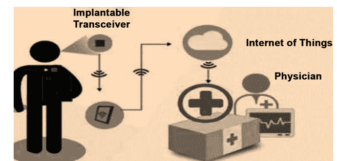

图（2）。IoMT 中的患者监测系统。

### 在家中

人们可以使用家庭内 IoMT 将医疗数据从家中传输到其他地点，例如其初级保健提供者或医院。例如，远程患者监测（RPM）是指使用医疗设备从刚出院的患者处测量血压和血氧饱和度等参数并传输到医院，供医生评估。这可以通过在问题变得严重之前检测到问题来帮助防止重新入院。远程医疗，或使用通信技术进行远程医疗，通过允许刚出院的患者随时与医生沟通以处理小问题，从而增加了灵活性。在患者环境之外，结合远程医疗使用 IoMT 设备对持续治疗有益。例如，个人紧急响应系统（PERS）可以确定跌倒或心脏病发作等情况并自动呼叫紧急服务。PERS 可以为遇到麻烦的人提供安全保障，例如希望在家居住但担心安全的老年人。

### 贴身佩戴

将可穿戴医疗设备连接到远程跟踪或监测系统称为贴身 IoMT。与家庭内 IoMT 不同，贴身 IoMT 可以在人们进行日常活动时在家庭外使用。贴身消费级 IoMT 设备是任何人都可以为特定用途购买或与医疗保健提供者共享的可穿戴健康追踪器。这些设备除了记录心率等典型指标外，还可以为更严重的健康问题提供早期预警。例如，Apple Watch 可以警告用户异常的心脏测量值。临床贴身 IoMT 设备类似于消费级 IoMT 设备，只是其传感器选择更多。例如，糖尿病患者可以佩戴血糖监测仪来检测血糖水平的变化。其中许多小工具可以直接与患者的医生通信，确保他们获得及时准确的治疗。

### 在社区

在较大城市或地理区域范围内使用 IoMT 设备称为社区 IoMT。例如，移动服务是跟踪患者在车内情况的设备。医护人员和急救人员使用紧急响应信息系统在医疗中心环境之外跟踪患者参数。社区 IoMT 包括提供远程服务的技术，除移动和紧急护理外。点对点设备，例如，可以由医疗保健提供者在非传统医疗环境中使用，例如野战医疗中心，并且在传统结构有限或缺失的地区，可以使用储物柜向患者分发药物。IoMT 设备也可以由供应商在物流中使用，以帮助医疗用品或医疗设备的转移。例如，传感器可以监视温度或压力敏感的运输容器，以确保在整个运输过程中保持质量。

### 在医院

医院必须在整个过程中跟踪其医疗资源的品质和库存，以及工作人员和患者如何使用该设施。医疗保健提供者使用 IoMT 传感器和其他跟踪设备来跟踪所有这些互动，以便管理者能够全面了解正在发生的情况。IoMT 设备也可以由供应商在物流中使用，以帮助医疗库存的供应。

## 医疗物联网的潜力

物联网/医疗物联网有潜力以以下方式提供更具成本效益、质量更先进、更个性化的护理，同时改善患者参与度：

### 成本削减

随着美国每年将 18% 的 GDP 用于医疗保健（这一数字预计会上升），像 IoMT 这样的解决方案变得越来越相关。据估计，“数字革命”有望节省超过 3000 亿美元的医疗支出。据戴尔博客（通过高盛）称，最大的实际节省机会在于慢性病管理，价值超过 2000 亿美元。还值得强调的是，在肥胖和戒烟等疾病治疗的行为改变领域，“无限巨大”的节省前景。

### 更优质的护理

IoT/IoMT 的设备可以为护理人员和临床医生提供以前无法获得的远程数据，例如体温、心率和血糖水平。自动通信健康数据的能力可以帮助确定各种急性和慢性疾病的风险。

### 赋能患者

患者赋权不仅在以患者为中心的护理时代至关重要，而且在我们了解到患者的治疗态度对临床结果的影响有多大的时代也至关重要。远程医疗将在这一领域发挥关键作用，特别是在利用远程医生访问来改变行为和促进更健康生活方面 [1]。

## IoMT 安全与隐私（S & P）层分类

由于医疗系统非常敏感，管理通过互联网不同方式连接的数百种医疗设备对于确保最高可信度至关重要。因此，需要灵活的分层架构。所述的 IoMT 模型的五个层级描绘了一个分层架构，其中每个层级执行不同的功能。每个功能都有其自己的 S & P 问题 [3]。因此，我们根据其在每个层级中的频率将 S & P 问题分类为以下顺序，如图（3）所示。

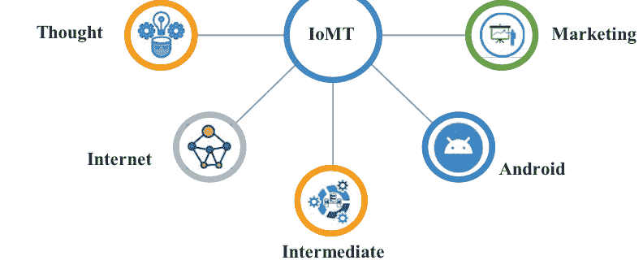

图（3）。IoMT 安全与隐私层分类。

### 感知层

感知层负责通过使用物理设备（例如传感器）携带和收集数据（例如体温、心率等），并将该数据传输到网络（即互联网）。在健康监测系统中，许多传感器相互通信，以确保患者始终得到覆盖并尽可能快地获得帮助。四种类型的医疗设备以以下方式与利益相关者（例如医生和患者）互动：

*可穿戴设备：* 可穿戴小工具，如智能手表，可实现准确、无限和实时的患者监测。它们是：

- 位置传感器：使用此功能跟踪患者的位置。
- 温度传感器：用于测量身体的温度。
- 压力传感器：用于跟踪患者的血压。
- 呼吸传感器：用于跟踪患者的呼吸情况。

- 脉搏血氧仪：它测量血氧饱和度和脉搏率。
- 生物特征检测器：用于保护身份（例如，指纹、人脸检测）。

### 可植入设备
这可植入患者体内。当前设备包括：

- 可吞咽的胶囊相机可从内部可视化患者的胃肠道。
- 植入式心脏设备收集数据并通过无线电链路发送到近乎通用的网络 [3]。

### 环境设备
这些设备评估患者的周围环境和用户活动模式，并在检测到异常模式时传输护理人员的通知。环境中的检测器包括：

- 能够发现房间内个人移动的检测器称为运动检测器。
- 室温检测器用于记录房间的温度。
- 压力检测器测量气体、液体和空气的体积。
- 门检测器确定门的状态（开或关），用于阿尔茨海默病患者或感染控制。
- 振动检测器用于检测患者在床上的身体移动。
- 日光检测器确定自然光并自动调整空间中的照明区域 [4]。

### 固定设备
这些设备确定患者的周围环境和用户活动模式，并在检测到异常模式时发送护理人员的通知。环境中的检测器包括：

- 磁共振成像（MRI）、计算机断层扫描（CT）。
- 扫描仪和 X 射线是提供视觉的成像系统的例子。
- 用于临床研究和医疗干预的身体内部的图像表示。
- 用于手术或操作的仪器被称为手术设备。对这些设备的攻击会损害数据的完整性和保密性，可能导致严重后果。

## 互联网
内容分发、内容发现、内容路由到目的地以及网络寻址均由互联网层处理。以下为医疗设备使用的媒介：

### 有线/Wi-Fi
物联网设备通过有线或无线网络连接到网关和终端用户。由于需要可靠的电源，采用这种通信方式的设备始终是固定的。这适用于需要高速度的 IoMT 系统。

### 无线电通信
为了与用户终端设备连接，某些低功耗物联网移动设备使用类似 3G、4G、LTE、蓝牙和 RFID 的无线电通信。蓝牙低功耗（BLE）是一种用于各种可穿戴医疗设备的关键短距离通信技术。在医院房间中，固定的蓝牙核心连接房间内的众多设备，允许数据双向传输。基于蜂窝的物联网设备（3G/4G/LTE）可以实现远距离通信。

### 无线网络
医疗物联网设备也可以使用无线网络（WSNs）连接，这些网络使用常规 Wi-Fi 或低功耗无线个人局域网（6LoWPAN）进行通信。

## 中间件
数据交付、发现和路由到目的地以及网络寻址均由互联网层处理。

## Android
该层通过 IoMT 设备在中间层将用户界面与人员连接起来。由于其卓越的可扩展性和灵活性，应用程序制造商一直在进一步了解在云计算中托管应用程序。

## 营销
该层负责处理医疗服务提供商的商业智能以及支持业务流程生命周期，其中包括监控、管理和优化业务流程。它还负责从 IoMT 数据中获取洞察。此级别的攻击之前已提及，但其影响比其他级别更大，因为数据包含敏感的医疗信息。

## 各层中的网络安全攻击
了解各种网络攻击所带来的挑战并设计防御方法（即对策）以保护任何数字和信息技术的保密性、完整性和可访问性，都是网络安全的一部分。以下插图（图 4）列出了各层中的网络攻击（表 1）。

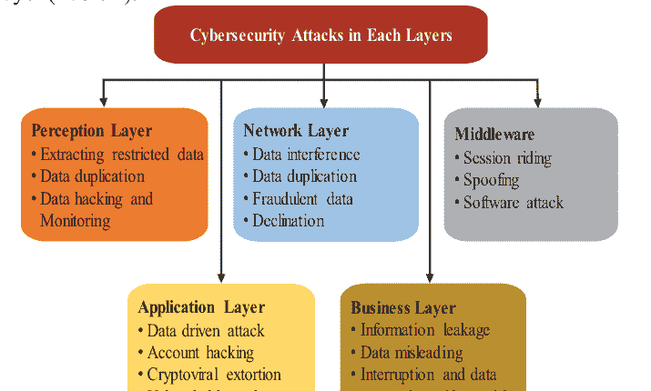

图 (4). IoMT 各层中的网络安全攻击。

表 1. 网络安全方面和保护机制。

| 方面 | 保护机制 | 描述 |
|---|---|---|
| 隐私 | 隐私 | 确保共享资产对交互实体之外的任何人保持未知。 |
| 隐私 | 验证 | 基于其身份识别和授权对授权进行质疑。 |
| 隐私 | 灵活性 | 在出现故障的情况下，保护得以保留。 |
| 可靠性 | 可靠性 | 确保所有交互实体在资产被修改时都知晓。 |
| 可靠性 | 抑制 | 保证交易按照一组规则进行，消除在披露事件中选择的自由和责任。 |
| 可靠性 | 验证 | 保证交易按照一组规则进行，禁止在暴露事件中选择的自由和责任。 |

| 方面 | 保护机制 | 描述 |
|---|---|---|
| 可访问性 | 连接 | 在出现故障的情况下，通信得以维持。 |
| 可访问性 | 警报 | 通知用户通信正在进行或已发生。 |
| 可访问性 | 安全 | 还包括资产持有者与交互实体之间的合同。它还可能包括公共法律保护和警告作为法律行动的前奏。 |
|  |  | **PII：个人身份识别信息** |
| 数据收集 | 同意 | 要求 PII 持有者自愿、具体且知情同意对 PII 进行处理。未经持有者授权，不得共享或向第三方提供 PII。 |
| 数据收集 | 选择加入 | 在适用同意之前，包括一项政策或流程，其中 PII 所有者明确同意对 PII 进行处理。 |
| 数据收集 | 客观性 | 确保 PII 仅为收集目的而收集、使用或披露，使用数据最小化和准确性等原则。 |
| 数据访问 | 问责制 | 基于一组 PII，可直接或间接识别 PII 所有者。应包括问责制、去识别化或匿名化。 |
| 数据访问 | 通知 | 通知 PII 所有者其信息正在被收集。 |
| 数据访问 | 可审计性 | 提供识别和控制 PII 数据访问的充分机制。 |
| 数据访问 | 责任 | 通过确保 PII 持有者可以追究 PII 处理者遵守所有隐私措施的责任，支持 GDPR 的合法性、公平性和开放性原则。 |
| 数据使用 | 保留 | 作为减少非法收集、披露或使用风险的预防性方法，它确保不再需要的 PII 不会被保留。 |
| 数据使用 | 处置 | 包括按需擦除或处置 PII 的系统，以及 GDPR 的被遗忘权。 |
| 数据使用 | 报告 | 通知您您正在发生或已发生 PII 泄露。 |
| 数据使用 | 泄露或事件响应 | 管理涉及个人身份信息（PII）的数据泄露。 |

注：来源 [5]。

## 解决 IoMT 问题的方法

### 资产清单
迈向更安全的第一步是创建并维护所有 IoMT 的清单。由于它没有与担任“所有者”的责任人绑定，因此经常未受管理，许多医疗机构未能识别设备。由于没有人负责处理密码等安全预防措施，无法将设备与用户关联起来会造成安全盲点。

### 强密码策略
每个 IoMT 设备都包含默认设置和密码。另一方面，威胁行为者经常在网上找到默认密码。连接新 IoMT 设备到网络的第一步应该是设置一个新且强大的特定于设备的密码。最佳实践的一些示例如下：

- 以创造性的方式使用大小写字母。
- 在等式中至少包含一个数字。
- 至少包含一个唯一字符。
- 我们还应确保密码未存储在任何在线密码数据库中。这降低了恶意行为者能够“猜测”密码的机会。

### 多因素认证（MFA）
这是防止凭据被盗的第二步。MFA 要求威胁行为者提供额外的信息来验证其身份，即使他们成功登录设备。要对设备、网络或应用程序进行身份验证，MFA 涉及使用以下两项或更多项：

- 您所知道的东西，例如密码。
- 您所拥有的东西，例如智能手机。
- 您本身的东西，例如指纹或面部识别等生物特征。

### 网络分段
将包含敏感信息的网络与不包含敏感信息的网络进行物理或逻辑隔离的技术称为网络分段。这可以通过将敏感数据存储在与面向公众互联网的应用程序不同的数据中心中或限制对包含敏感数据的网络的访问来实现

借助防火墙。由于恶意行为者无法从一个网络转移到另一个网络，这种方法降低了数据泄露的潜在后果。

## 安全补丁更新

软件、操作系统和硬件地址的更新被识别为安全漏洞。威胁行为者经常利用这些漏洞获取对设备、网络和应用程序的访问权限。通过建立定期计划并优先更新关键的 IoMT 设备和应用程序，可以减轻风险。与任何 IoMT 连接网络相关的任何网络设备或组件也应在此计划中优先考虑。

## 网络流量监控

网络流量监控可让您查看设备是否发送或接收的数据超出应有范围。例如，IoMT 设备可以被武器化并用作僵尸网络的一部分。在僵尸网络攻击中，BotMaster 负责控制被入侵的设备（称为“僵尸”），并向其下达指令。请求和响应的数量会压垮服务器，导致拒绝服务（DoS）攻击。医疗机构可以通过监控异常流量发现可能受损的 IoMT 设备并减轻攻击影响。

## 加密

物联网医疗（IoMT）将电子受保护健康信息（ePHI）发送到关联的应用程序。例如，连接的胰岛素泵会将数据发送到应用程序，使患者和临床医生能够跟踪血糖水平。该应用程序仍然连接到公共互联网。在网络层，传输中数据加密可降低窃听和中间人攻击的影响。如果没有必要的解密技术，加密会使数据混乱，无法读取。即使恶意行为者获得了网络访问权限，他们也无法访问数据 [3]。

## 入侵检测系统

基于签名、基于规范或基于异常的 IDS 都是可选方案。对 IoMT 来说，最佳防御是基于异常的。基于异常的 IDS 会监视网络上的异常活动。它经常集成机器学习以提醒您新的威胁。识别零日攻击的能力——这些攻击源于此前未发现的漏洞——是基于异常 IDS 的核心价值。由于这是一项较新的技术，许多设备与已知漏洞无关。希望提高 IoMT 设备安全性的医疗机构应考虑一种能够让他们看到新出现和新兴风险的解决方案 [6]。

## IoMT 中的安全与隐私

传统攻击和零日攻击都可能破坏 IoMT 设备。这在很大程度上是由于设备制造中缺乏既定的安全规范和措施，以及设备和物联网网络的特性。由于设备体积很小，其计算资源和电池无法处理加密和强大的安全机制 [7]。IoMT 的安全和隐私规范与传统网络不同，后者通常被称为 CIA 三元组（保密性、完整性和可用性）。IoMT 系统的其他衡量标准包括问责制和保证。下面列出了 IoMT 系统中使用的各种标准的描述 [8]。

- 1. **保密性：** 它防止对特定信息的非法访问并确保机密信息得到保护。未经授权的访问可能导致数据泄露，在极端情况下甚至可能导致危及生命的场景 [9]。
- 2. **完整性：** 它确保未经授权的各方不会修改、取消或伪造设备的数据或读数。例如，对植入式起搏器进行虚假数据注入可能导致死亡 [10]。
- 3. **可用性：** 它确保数据、计算资源和连接在服务需要时始终可用并运行。考虑到配备无线医疗设备的手术室，系统服务中断会威胁患者的健康 [11]。
- 4. **隐私：** 它确保 IoMT 系统遵循隐私标准并允许用户查看其个人信息 [12]。
- 5. **认证：** 该指标指的是系统验证活动真实性或不存在的能力。它确保传输节点收到投递确认，并且进入节点收到发送者身份的验证，确保在过程中不会被拒绝 [13]。

## IoMT 的挑战

植入系统被用于各种环境中以实现广泛的操作，包括远程医疗、业务控制、辅助生活和智慧城市。在这些操作中，数字系统（网络系统）控制物理对象，在数字世界和物理世界之间不断互动。尽管如此，这些操作的决定性因素，尤其是在考虑植入系统时，提出了三种类型的挑战：

- 1. 这些系统必须满足责任、鲁棒性和安全性条件。由于物理和生理世界本质上不稳定，基于 IoMT 的系统不仅必须能够在面对此类变化时保持合理的性能，而且在必要时还必须能够适当响应。这些 IoMT 系统还产生安全问题，因为它们不断调节系统故障可能致命的条件。因此，这些系统必须能够抵御各种进攻性攻击。
- 2. IoMT 必须依赖精确的混合系统模型。它们处于数字世界和物理世界的交叉点，对准确的物理模型和精确的计算抽象提出了挑战。同样，使用基于模型的設計可以实现测试程序的基于仿真的优化。
- 3. 需要特定的验证和确认程序；大部分可能在地理上分布，并且需要通过仪器，在多个粒度级别上需要验证和确认协议。
- 4. 这些困难是多学科的，汇集了来自多个学科的研究人员，例如先进控制理论、计算机知识、电子工程、电力电子和信号处理。这需要创建跨学科系统模型，包括数字和物理因素及其关系。最终，为了使仪器化过程更容易并提高系统可靠性，验证和确认程序必须在多个尺度上描述，从最低的 IoMT 设备尺度到最大的 IoMT 尺度 [4, 14]。

## 提高设备安全的步骤

- 列出网络中连接的所有设备。
- 应加强设备上的密码。
- 提高网络卫生并执行分段规定。
- 及时应用已知且可用的补丁，尤其是对非常脆弱的设备。
- 定期监控网络流量中的恶意数据包。
- 为 ‘n’ 个系统共享同一个手机号码。
- 为 ‘n’ 个系统共享同一个电子邮件 ID。
- 允许 ‘n’ 名人员使用同一个共享密码打开和访问系统。
- 将密码写在书本或表格上、墙上等。
- 计算机文盲共享密码/ID。
- 同一员工将手机号码、患者疾病等信息出售给商业人员、银行等，这应被识别并制止。

## 结论

尽管有其好处，但它容易受到各种陷阱、问题和挑战的影响，其中大多数旨在破坏患者隐私，从而破坏医疗服务的保密性、完整性和可用性。我们概述并分析了 IoMT 面临的主要问题、挑战和缺点，也因为在本次研究期间将采用众多安全解决方案来保护和保障 IoMT 领域及其相关资产，如医疗设备、系统和医疗（网络物理系统）CPS。同样，提供了多个框架、分类法和方法，以确保更坚固和稳健的 IoMT 并改善患者的健康和安全。保护 IoMT 所依赖的众多无线通信协议也很重要。最终，保持高水平的安全、隐私、信任和准确性至关重要。因此，至关重要且建议对医疗和 IT 人员进行培训，使其不会成为物理或网络攻击的受害者。综上所述，本工作旨在加强众多技术和非技术解决方案之间的联系，以在所有 IoMT 领域构建更全面、安全和有效的系统。

## 发表同意

未声明。

## 利益冲突

作者声明无利益冲突，无论是财务或其他方面的。

## 致谢

未声明。

## 参考文献

[1] https://www.mspinsights.com/doc/what-is-the-potential-of-the-internet-of-medical-things-0001
[访问时间：29-Mar-2022]

[2] J.P.A. Yaacoub, O. Salman, H.N. Noura, N. Kaaniche, A. Chehab, and M. Malli, "网络物理系统安全：局限性、问题和未来趋势", Microprocess. Microsyst., vol. 77, p. 103201, 2020.
[http://dx.doi.org/10.1016/j.micpro.2020.103201] [PMID: 32834204]

[3] F. Alsubaei, A. Abuhussein, and S. Shiva, "物联网医疗中的安全与隐私：分类法和风险评估", Proc. - 2017 IEEE 42nd Conf. Local Comput. Networks Work. LCN Work. 2017, no. September 2018, pp. 112–120, 2017
[http://dx.doi.org/10.1109/LCN.Workshops.2017.72]

[4] C. Chakraborty, A. Banerjee, L. Garg, and J. J. P. C. Rodrigues, 物联网医疗用于智能医疗, 2020.
[http://dx.doi.org/10.1007/978-981-15-8097-0]

[5] G. Hatzivasilis, O. Soultatos, S. Ioannidis, C. Verikoukis, G. Demetriou, and C. Tsatsoulis, “物联网医疗（IoMT）安全与隐私综述：解决新型循环经济生物信息学保护问题”，Proceedings - 15th Annual International Conference on Distributed Computing in Sensor Systems, DCOSS 2019, 2019.

[6] https://securityscorecard.com/blog/ways-to-secure-the-internet-of-medical-things [访问日期：29-May-2022]

[7] S.S. Hameed, W.H. Hassan, L. Abdul Latiff, and F. Ghabban, "物联网医疗安全与隐私问题的系统综述；机器学习方法的作用", PeerJ Comput. Sci., vol. 7, pp. 1-44, 2021. [http://dx.doi.org/10.7717/peerj-cs.414] [PMID: 33834100]

[8] P.I. Radoglou Grammatikis, P.G. Sarigiannidis, and I.D. Moscholios, "物联网安全：挑战、威胁与解决方案", Internet of Things, vol. 5, pp. 41-70, 2019. [http://dx.doi.org/10.1016/j.iot.2018.11.003]

[9] N. Alassaf, and A. Gutub, "模拟轻量级密码实现用于物联网医疗数据安全应用", Int. J. E-Health Med. Commun., vol. 10, no. 4, pp. 1-15, 2019. [http://dx.doi.org/10.4018/IJEHMC.201901001]

[10] J.P.A. Yaacoub, M. Noura, H.N. Noura, O. Salman, E. Yaacoub, R. Couturier, and A. Chehab, "物联网医疗系统安全：局限性、问题与建议", Future Gener. Comput. Syst., vol. 105, pp. 581-606, 2020. [http://dx.doi.org/10.1016/j.future.2019.12.028]

[11] Y. Sun, F.P.W. Lo, and B. Lo, "物联网医疗支持的医疗系统安全与隐私：综述", IEEE Access, vol. 7, pp. 183339-183355, 2019. [http://dx.doi.org/10.1109/ACCESS.2019.2960617]

[12] A. Mosenia, and N.K. Jha, "物联网安全综合研究", IEEE Trans. Emerg. Top. Comput., vol. 5, no. 4, pp. 586-602, 2017. [http://dx.doi.org/10.1109/TETC.2016.2606384]

[13] K.H. Yeh, "BSNCare+：一种具有不可否认交易的稳健物联网导向医疗系统", Appl. Sci. (Basel), vol. 6, no. 12, p. 418, 2016. [http://dx.doi.org/10.3390/app6120418]

[14] A. Gatouillat, Y. Badr, B. Massot, and E. Sejdic, "医疗物联网：医学中网络物理系统相关最新贡献综述", IEEE Internet Things J., vol. 5, no. 5, pp. 3810-3822, 2018. [http://dx.doi.org/10.1109/JIOT.2018.2849014]

# 云边缘计算中的医疗物联网

G. Sumathi¹,*, S. Rajesh², R. Ananthakumar² and K. Kartheeban²

¹ 信息技术系，Kalasalingam Institute of Technology Krishnankoil，泰米尔纳德邦，印度
² 计算机科学与工程系，Mepco Schlenk Engineering College，Sivakasi，泰米尔纳德邦，印度

摘要：第五代移动通信时代普遍连接和临床计算机化的蓬勃发展，临床信息的爆炸性增长和异构性给（IoMT）医疗物联网中的信息处理、隐私和安全以及数据访问带来了巨大的挑战。我们的论文全面评估了在现有医疗设备和医疗环境的限制下，如何实现医疗应用中大数据分析和及时处理以及高质量医疗资源利用的方法。我们主要集中于人工智能、边缘计算和云计算概念为IoMT带来的益处。我们还解释了如何在保持临床信息隐私和安全的同时利用临床资源，以便为患者提供极佳的临床服务。

关键词：云计算，边缘计算，雾计算，医疗保健，医疗物联网。

## 引言

随着技术、经济和科学的快速发展，临床治疗已成为社会、个人甚至国家利益的驱动力之一，如Sun等人[1]所述。传统医疗模式存在问题，包括昂贵的治疗、临床信息阻塞和看医生等问题。但随着物联网（IoT）知识的正确建立，如Al-Fuqaha等人[2]所建议，物联网的应用领域在当今万物互联（IoE）时代的各个方面都受到了关注，如W. Wang等人、X. Wang等人以及Ning等人[3 - 5]所述。关于所涉及的临床领域，医疗物联网（IoMT）可以是物联网学科的集中体现，也是临床电子改造的媒介。IoMT，如Shit等人[6]所述，可以是包括定位、传感器和射频识别技术在内的困难物联网技能，并且与网络通信、移动终端和其他设备协作应用于临床主题，以实现医疗设备和医疗机构、患者、医护人员之间的通信，以实现医院的自动化、数字化和智能化。

IoMT支持临床领域的每个阶段，例如医疗药物、废物和设备管理、远程监控、身份识别和生命体征监测。医疗无线传感器，如Liu等人[7]所述，可以是每个连接的基础和核心；此外，无线传感器通信集成大多数形式的无线临床传感器，包括植入式传感器、生物传感器、压力传感器，在获取患者生命体征信息方面发挥着至关重要的作用。现在，传感器已被广泛应用于重症监护室（ICU）、急诊室和手术室，以监测和显示患者的严重状况。此外，Yang等人[8]建议，以传感器为核心的可穿戴医疗设备使患者能够随时随地获得改进的临床服务，极大地降低了患者和医生的治疗成本，为患者提供实时健康管理，并突破了空间和时间的限制。如何快速分析、处理和选择实时收集的临床事实可能对立即连接患者的生命和健康至关重要。此外，由于临床信息包含患者的个人隐私，支持患者隐私数据和敏感事实的安全至关重要。

然而，物联网技术在医疗保健领域的应用可能有助于诊所实现人类智能临床治疗和物联网智能控制；各种医疗机构高度自治，因此资源共享存在问题。IoMT相关的云计算（CC）提供强大的IT基础资源，并大幅降低医疗成本。它不仅不能满足临床信息的海量存储，还能通过云环境实现医疗数据的分发，以提高临床服务的有效性和质量。但完全信任CC会消耗巨大的网络广播资源并产生较大延迟，这可能会对患者的生命造成危险。

CC的能力在于实践信息汇聚，使信息处理向源头靠拢，而非云端或外部事实，这可能减少时延，并实现比医疗统计分析更快、更实时、更快速的处理。边缘计算（EC）减少了对集中式远程/本地服务器的依赖，然后通过在边缘设备上智能应用资源解决CC中存在的问题；这意味着诊所和医院获得更具响应性和敏捷性的IT网络，因此患者可以体验更好的医疗服务。然后EC并不孤立存在。云计算和边缘计算相辅相成，发挥着极其重要的作用。CC侧重于总体理解，而EC侧重于本地。云边集成的正常使用将更好地支持医疗应用案例的发展。基于医疗保健领域的现状，我们的手稿首次整合了三种有利技能，以系统地回顾现有工作，并检查IoMT未来可能面临的实验。

我们论文的基本贡献如下：首先，我们介绍传统的IoMT架构，检查应用于临床领域的物联网关键技术，然后提出提高其在医疗保健领域效率的研究方向。随着医疗统计数据的快速增长和数据结构的复杂化，我们观察IoMT的三层云计算架构，然后宣布IOMT云计算应用的工具包含。通过评估传统的IoMT以及医疗IOT云，我们考虑EC的优势并提出其IoMT架构。

## 医疗物联网

Ning等人[9]解释了物联网知识在医疗保健领域的应用主题理解医疗数据的数字管理，因此医疗工作者不再忙于记录和整理大量繁琐的医疗数据，而是更专注于患者以提供更好的医疗服务。在本阶段，我们可以介绍传统IoMT的架构，然后我们定义所应用的关键技术。

### IoMT架构

IOMT架构涵盖了无线传感器网络（WSN）和EPCglobal的一些相关内容，如Liu等人[10]所述，也是物联网领域应用最广泛的架构。IoMT可以是医疗保健领域物联网技术的集中体现。这里将遵循常见的三层物联网架构。它有三层，即传输层、网络层和感知层。IoMT的架构如图（1）所示。

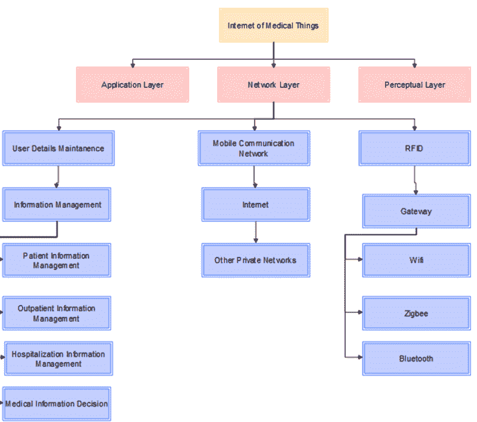

图 (1). IoMT 架构。

IoMT 的优先事项和挑战由感知层决定。数据采集子层以及数据访问子层是两个主要子层。为了完成 IoMT 实例的识别和感知，并收集关于个人以及事物的信息，数据采集子层使用各种信号采集和医疗感知设备。为了将网络中关联的所有事物和人员分配到易于识别的 (CPS) Cyber-Physical Systems 节点中，它利用信号采集方法，包括通用分组无线服务技术、图像识别技术、图形码、无线射频识别 (RFID) 技术，以及众多传感设备，如 DNA 传感器、化学传感器、生理信号传感器和物理信号传感器。在物联网中，存在三种节点：Internet CPS、主动 CPS 和被动 CPS。根据不同的需求和对象，IoMT 需要适当的标识符。数据访问子层通过短距离数据传输技术，包括 Bluetooth、WiFi、ZigBee 等，将数据采集子层收集的数据连接到网络层，并且主要访问方法必须根据 IoMT 的整体环境特征和各种对象的要求来选择。

网络层有两个子层：数据传输层和服务层。数据传输层可以是 IoMT 的骨干系统，可类比为人的神经中枢和大脑。它使用互联网、移动通信系统以及其他一些专用网络，以无障碍、可靠、准确和实时的方式传输感知层获得的相关数据。IoMT 旨在探索适用于医院和原始网络的异构网络框架，而非完全取代它们。服务层负责集成异构网络，以及多种数据类型、描述、数据仓库和其他数据。同时，它制定了以此为重点的支持服务策略，提供给不同应用层服务的接口，使第三方能够为医疗专业人员和公众创建合适的应用。

健康信息应用以及健康信息决策应用是应用层的两个层面。医疗数据管理应用包括住院治疗数据处理、门诊数据处理、患者数据处理、医疗设备和物资管理等。治疗信息分析和诊断、药品信息分析、疾病信息分析、患者信息分析等是医疗信息决策应用的例子。

## IoMT 技术

### 无线射频识别 (RFID)

RFID 可以是一种新型的非接触式计算机化身份框架，是 IoMT 的主要技术。这应用射频技术来感知特定目标并读写相关记录；此外，特定目标和识别设备可以在没有物理接触的情况下验证身份，即非接触式双向通信。这具有抗干扰能力强、距离长且无需人工干预即可运行的优点。RFID 框架通常可由 3 个元素集成：读写器和信息控制设备，以及电子射频标签。电子射频标签可以是 RFID 框架的主要组成部分。其基本特征是存储所需目标的适当统计记录并与读写器连接。RFID 可在高速模式下实现移动物体识别和多目标识别，可广泛应用于人员识别、废物追踪和医疗设备临床资产控制。它还可用于收集患者的[content]

图 (1). IoMT 架构。

IoMT 的优先事项和挑战由感知层决定。数据采集子层以及数据访问子层是两个主要子层。为了完成 IoMT 实例的识别和感知，并收集关于个人以及事物的信息，数据采集子层使用各种信号采集和医疗感知设备。为了将网络中关联的所有事物和人员分配到易于识别的 (CPS) Cyber-Physical Systems 节点中，它利用信号采集方法，包括通用分组无线服务技术、图像识别技术、图形码、无线射频识别 (RFID) 技术，以及众多传感设备，如 DNA 传感器、化学传感器、生理信号传感器和物理信号传感器。在物联网中，存在三种节点：Internet CPS、主动 CPS 和被动 CPS。根据不同的需求和对象，IoMT 需要适当的标识符。数据访问子层通过短距离数据传输技术，包括 Bluetooth、WiFi、ZigBee 等，将数据采集子层收集的数据连接到网络层，并且主要访问方法必须根据 IoMT 的整体环境特征和各种对象的要求来选择。

网络层有两个子层：数据传输层和服务层。数据传输层可以是 IoMT 的骨干系统，可类比为人的神经中枢和大脑。它使用互联网、移动通信系统以及其他一些专用网络，以无障碍、可靠、准确和实时的方式传输感知层获得的相关数据。IoMT 旨在探索适用于医院和原始网络的异构网络框架，而非完全取代它们。服务层负责集成异构网络，以及多种数据类型、描述、数据仓库和其他数据。同时，它制定了以此为重点的支持服务策略，提供给不同应用层服务的接口，使第三方能够为医疗专业人员和公众创建合适的应用。

健康信息应用以及健康信息决策应用是应用层的两个层面。医疗数据管理应用包括住院治疗数据处理、门诊数据处理、患者数据处理、医疗设备和物资管理等。治疗信息分析和诊断、药品信息分析、疾病信息分析、患者信息分析等是医疗信息决策应用的例子。

## IoMT 技术

### 无线射频识别 (RFID)

RFID 可以是一种新型的非接触式计算机化身份框架，是 IoMT 的主要技术。这应用射频技术来感知特定目标并读写相关记录；此外，特定目标和识别设备可以在没有物理接触的情况下验证身份，即非接触式双向通信。这具有抗干扰能力强、距离长且无需人工干预即可运行的优点。RFID 框架通常可由 3 个元素集成：读写器和信息控制设备，以及电子射频标签。电子射频标签可以是 RFID 框架的主要组成部分。其基本特征是存储所需目标的适当统计记录并与读写器连接。RFID 可在高速模式下实现移动物体识别和多目标识别，可广泛应用于人员识别、废物追踪和医疗设备临床资产控制。它还可用于收集患者的[content]

图 (1). IoMT 架构。

IoMT 的优先事项和挑战由感知层决定。数据采集子层以及数据访问子层是两个主要子层。为了完成 IoMT 实例的识别和感知，并收集关于个人以及事物的信息，数据采集子层使用各种信号采集和医疗感知设备。为了将网络中关联的所有事物和人员分配到易于识别的 (CPS) Cyber-Physical Systems 节点中，它利用信号采集方法，包括通用分组无线服务技术、图像识别技术、图形码、无线射频识别 (RFID) 技术，以及众多传感设备，如 DNA 传感器、化学传感器、生理信号传感器和物理信号传感器。在物联网中，存在三种节点：Internet CPS、主动 CPS 和被动 CPS。根据不同的需求和对象，IoMT 需要适当的标识符。数据访问子层通过短距离数据传输技术，包括 Bluetooth、WiFi、ZigBee 等，将数据采集子层收集的数据连接到网络层，并且主要访问方法必须根据 IoMT 的整体环境特征和各种对象的要求来选择。

网络层有两个子层：数据传输层和服务层。数据传输层可以是 IoMT 的骨干系统，可类比为人的神经中枢和大脑。它使用互联网、移动通信系统以及其他一些专用网络，以无障碍、可靠、准确和实时的方式传输感知层获得的相关数据。IoMT 旨在探索适用于医院和原始网络的异构网络框架，而非完全取代它们。服务层负责集成异构网络，以及多种数据类型、描述、数据仓库和其他数据。同时，它制定了以此为重点的支持服务策略，提供给不同应用层服务的接口，使第三方能够为医疗专业人员和公众创建合适的应用。

健康信息应用以及健康信息决策应用是应用层的两个层面。医疗数据管理应用包括住院治疗数据处理、门诊数据处理、患者数据处理、医疗设备和物资管理等。治疗信息分析与诊断、药品信息分析、疾病信息分析、患者信息分析等是医疗信息决策应用的例子。

## IoMT 技术

### 无线射频识别 (RFID)

RFID 可以是一种新型的非接触式计算机化身份框架，是 IoMT 的主要技术。这应用射频技术来感知特定目标并读写相关记录；此外，特定目标和识别设备可以在没有物理接触的情况下验证身份，即非接触式双向通信。这具有抗干扰能力强、距离长且无需人工干预即可运行的优点。RFID 框架通常可由 3 个元素集成：读写器和信息控制设备，以及电子射频标签。电子射频标签可以是 RFID 框架的主要组成部分。其基本特征是存储所需目标的适当统计记录并与读写器连接。RFID 可在高速模式下实现移动物体识别和多目标识别，可广泛应用于人员识别、废物追踪和医疗设备临床资产控制。它还可用于收集患者的[content]

图 (1). IoMT 架构。

IoMT 的优先事项和挑战由感知层决定。数据采集子层以及数据访问子层是两个主要子层。为了完成 IoMT 实例的识别和感知，并收集关于个人以及事物的信息，数据采集子层使用各种信号采集和医疗感知设备。为了将网络中关联的所有事物和人员分配到易于识别的 (CPS) Cyber-Physical Systems 节点中，它利用信号采集方法，包括通用分组无线服务技术、图像识别技术、图形码、无线射频识别 (RFID) 技术，以及众多传感设备，如 DNA 传感器、化学传感器、生理信号传感器和物理信号传感器。在物联网中，存在三种节点：Internet CPS、主动 CPS 和被动 CPS。根据不同的需求和对象，IoMT 需要适当的标识符。数据访问子层通过短距离数据传输技术，包括 Bluetooth、WiFi、ZigBee 等，将数据采集子层收集的数据连接到网络层，并且主要访问方法必须根据 IoMT 的整体环境特征和各种对象的要求来选择。

网络层有两个子层：数据传输层和服务层。数据传输层可以是 IoMT 的骨干系统，可类比为人的神经中枢和大脑。它使用互联网、移动通信系统以及其他一些专用网络，以无障碍、可靠、准确和实时的方式传输感知层获得的相关数据。IoMT 旨在探索适用于医院和原始网络的异构网络框架，而非完全取代它们。服务层负责集成异构网络，以及多种数据类型、描述、数据仓库和其他数据。同时，它制定了以此为重点的支持服务策略，提供给不同应用层服务的接口，使第三方能够为医疗专业人员和公众创建合适的应用。

健康信息应用以及健康信息决策应用是应用层的两个层面。医疗数据管理应用包括住院治疗数据处理、门诊数据处理、患者数据处理、医疗设备和物资管理等。治疗信息分析与诊断、药品信息分析、疾病信息分析、患者信息分析等是医疗信息决策应用的例子。

## IoMT 技术

### 无线射频识别 (RFID)

RFID 可以是一种新型的非接触式计算机化身份框架，是 IoMT 的主要技术。这应用射频技术来感知特定目标并读写相关记录；此外，特定目标和识别设备可以在没有物理接触的情况下验证身份，即非接触式双向通信。这具有抗干扰能力强、距离长且无需人工干预即可运行的优点。RFID 框架通常可由 3 个元素集成：读写器和信息控制设备，以及电子射频标签。电子射频标签可以是 RFID 框架的主要组成部分。其基本特征是存储所需目标的适当统计记录并与读写器连接。RFID 可在高速模式下实现移动物体识别和多目标识别，可广泛应用于人员识别、废物追踪和医疗设备临床资产控制。它还可用于收集患者的[content]

图 (1). IoMT 架构。

IoMT 的优先事项和挑战由感知层决定。数据采集子层以及数据访问子层是两个主要子层。为了完成 IoMT 实例的识别和感知，并收集关于个人以及事物的信息，数据采集子层使用各种信号采集和医疗感知设备。为了将网络中关联的所有事物和人员分配到易于识别的 (CPS) Cyber-Physical Systems 节点中，它利用信号采集方法，包括通用分组无线服务技术、图像识别技术、图形码、无线射频识别 (RFID) 技术，以及众多传感设备，如 DNA 传感器、化学传感器、生理信号传感器和物理信号传感器。在物联网中，存在三种节点：Internet CPS、主动 CPS 和被动 CPS。根据不同的需求和对象，IoMT 需要适当的标识符。数据访问子层通过短距离数据传输技术，包括 Bluetooth、WiFi、ZigBee 等，将数据采集子层收集的数据连接到网络层，并且主要访问方法必须根据 IoMT 的整体环境特征和各种对象的要求来选择。

网络层有两个子层：数据传输层和服务层。数据传输层可以是 IoMT 的骨干系统，可类比为人的神经中枢和大脑。它使用互联网、移动通信系统以及其他一些专用网络，以无障碍、可靠、准确和实时的方式传输感知层获得的相关数据。IoMT 旨在探索适用于医院和原始网络的异构网络框架，而非完全取代它们。服务层负责集成异构网络，以及多种数据类型、描述、数据仓库和其他数据。同时，它制定了以此为重点的支持服务策略，提供给不同应用层服务的接口，使第三方能够为医疗专业人员和公众创建合适的应用。

健康信息应用以及健康信息决策应用是应用层的两个层面。医疗数据管理应用包括住院治疗数据处理、门诊数据处理、患者数据处理、医疗设备和物资管理等。治疗信息分析与诊断、药品信息分析、疾病信息分析、患者信息分析等是医疗信息决策应用的例子。

## IoMT 技术

### 无线射频识别 (RFID)

RFID 可以是一种新型的非接触式计算机化身份框架，是 IoMT 的主要技术。这应用射频技术来感知特定目标并读写相关记录；此外，特定目标和识别设备可以在没有物理接触的情况下验证身份，即非接触式双向通信。这具有抗干扰能力强、距离长且无需人工干预即可运行的优点。RFID 框架通常可由 3 个元素集成：读写器和信息控制设备，以及电子射频标签。电子射频标签可以是 RFID 框架的主要组成部分。其基本特征是存储所需目标的适当统计记录并与读写器连接。RFID 可在高速模式下实现移动物体识别和多目标识别，可广泛应用于人员识别、废物追踪和医疗设备临床资产控制。它还可用于收集患者的[content]

图 (1). IoMT 架构。

IoMT 的优先事项和挑战由感知层决定。数据采集子层以及数据访问子层是两个主要子层。为了完成 IoMT 实例的识别和感知，并收集关于个人以及事物的信息，数据采集子层使用各种信号采集和医疗感知设备。为了将网络中关联的所有事物和人员分配到易于识别的 (CPS) Cyber-Physical Systems 节点中，它利用信号采集方法，包括通用分组无线服务技术、图像识别技术、图形码、无线射频识别 (RFID) 技术，以及众多传感设备，如 DNA 传感器、化学传感器、生理信号传感器和物理信号传感器。在物联网中，存在三种节点：Internet CPS、主动 CPS 和被动 CPS。根据不同的需求和对象，IoMT 需要适当的标识符。数据访问子层通过短距离数据传输技术，包括 Bluetooth、WiFi、ZigBee 等，将数据采集子层收集的数据连接到网络层，并且主要访问方法必须根据 IoMT 的整体环境特征和各种对象的要求来选择。

网络层有两个子层：数据传输层和服务层。数据传输层可以是 IoMT 的骨干系统，可类比为人的神经中枢和大脑。它使用互联网、移动通信系统以及其他一些专用网络，以无障碍、可靠、准确和实时的方式传输感知层获得的相关数据。IoMT 旨在探索适用于医院和原始网络的异构网络框架，而非完全取代它们。服务层负责集成异构网络，以及多种数据类型、描述、数据仓库和其他数据。同时，它制定了以此为重点的支持服务策略，提供给不同应用层服务的接口，使第三方能够为医疗专业人员和公众创建合适的应用。

健康信息应用以及健康信息决策应用是应用层的两个层面。医疗数据管理应用包括住院治疗数据处理、门诊数据处理、患者数据处理、医疗设备和物资管理等。治疗信息分析与诊断、药品信息分析、疾病信息分析、患者信息分析等是医疗信息决策应用的例子。

## IoMT 技术

### 无线射频识别 (RFID)

RFID 可以是一种新型的非接触式计算机化身份框架，是 IoMT 的主要技术。这应用射频技术来感知特定目标并读写相关记录；此外，特定目标和识别设备可以在没有物理接触的情况下验证身份，即非接触式双向通信。这具有抗干扰能力强、距离长且无需人工干预即可运行的优点。RFID 框架通常可由 3 个元素集成：读写器和信息控制设备，以及电子射频标签。电子射频标签可以是 RFID 框架的主要组成部分。其基本特征是存储所需目标的适当统计记录并与读写器连接。RFID 可在高速模式下实现移动物体识别和多目标识别，可广泛应用于人员识别、废物追踪和医疗设备临床资产控制。它还可用于收集患者的[content]

图 (1). IoMT 架构。

IoMT 的优先事项和挑战由感知层决定。数据采集子层以及数据访问子层是两个主要子层。为了完成 IoMT 实例的识别和感知，并收集关于个人以及事物的信息，数据采集子层使用各种信号采集和医疗感知设备。为了将网络中关联的所有事物和人员分配到易于识别的 (CPS) Cyber-Physical Systems 节点中，它利用信号采集方法，包括通用分组无线服务技术、图像识别技术、图形码、无线射频识别 (RFID) 技术，以及众多传感设备，如 DNA 传感器、化学传感器、生理信号传感器和物理信号传感器。在物联网中，存在三种节点：Internet CPS、主动 CPS 和被动 CPS。根据不同的需求和对象，IoMT 需要适当的标识符。数据访问子层通过短距离数据传输技术，包括 Bluetooth、WiFi、ZigBee 等，将数据采集子层收集的数据连接到网络层，并且主要访问方法必须根据 IoMT 的整体环境特征和各种对象的要求来选择。

网络层有两个子层：数据传输层和服务层。数据传输层可以是 IoMT 的骨干系统，可类比为人的神经中枢和大脑。它使用互联网、移动通信系统以及其他一些专用网络，以无障碍、可靠、准确和实时的方式传输感知层获得的相关数据。IoMT 旨在探索适用于医院和原始网络的异构网络框架，而非完全取代它们。服务层负责集成异构网络，以及多种数据类型、描述、数据仓库和其他数据。同时，它制定了以此为重点的支持服务策略，提供给不同应用层服务的接口，使第三方能够为医疗专业人员和公众创建合适的应用。

健康信息应用以及健康信息决策应用是应用层的两个层面。医疗数据管理应用包括住院治疗数据处理、门诊数据处理、患者数据处理、医疗设备和物资管理等。治疗信息分析与诊断、药品信息分析、疾病信息分析、患者信息分析等是医疗信息决策应用的例子。

## IoMT 技术

### 无线射频识别 (RFID)

RFID 可以是一种新型的非接触式计算机化身份框架，是 IoMT 的主要技术。这应用射频技术来感知特定目标并读写相关记录；此外，特定目标和识别设备可以在没有物理接触的情况下验证身份，即非接触式双向通信。这具有抗干扰能力强、距离长且无需人工干预即可运行的优点。RFID 框架通常可由 3 个元素集成：读写器和信息控制设备，以及电子射频标签。电子射频标签可以是 RFID 框架的主要组成部分。其基本特征是存储所需目标的适当统计记录并与读写器连接。RFID 可在高速模式下实现移动物体识别和多目标识别，可广泛应用于人员识别、废物追踪和医疗设备临床资产控制。它还可用于收集患者的[content]

图 (1). IoMT 架构。
IoMT 的优先事项和挑战由感知层决定。数据采集子层以及数据访问子层是两个主要子层。为了完成 IoMT 实例的识别和感知，并收集关于个人以及事物的信息，数据采集子层使用各种信号采集和医疗感知设备。为了将网络中关联的所有事物和人员分配到易于识别的 (CPS) Cyber-Physical Systems 节点中，它利用信号采集方法，包括通用分组无线服务技术、图像识别技术、图形码、无线射频识别 (RFID) 技术，以及众多传感设备，如 DNA 传感器、化学传感器、生理信号传感器和物理信号传感器。在物联网中，存在三种节点：Internet CPS、主动 CPS 和被动 CPS。根据不同的需求和对象，IoMT 需要适当的标识符。数据访问子层通过短距离数据传输技术，包括 Bluetooth、WiFi、ZigBee 等，将数据采集子层收集的数据连接到网络层，并且主要访问方法必须根据 IoMT 的整体环境特征和各种对象的要求来选择。
网络层有两个子层：数据传输层和服务层。数据传输层可以是 IoMT 的骨干系统，可类比为人的神经中枢和大脑。它使用互联网、移动通信系统以及其他一些专用网络，以无障碍、可靠、准确和实时的方式传输感知层获得的相关数据。IoMT 旨在探索适用于医院和原始网络的异构网络框架，而非完全取代它们。服务层负责集成异构网络，以及多种数据类型、描述、数据仓库和其他数据。同时，它制定了以此为重点的支持服务策略，提供给不同应用层服务的接口，使第三方能够为医疗专业人员和公众创建合适的应用。
健康信息应用以及健康信息决策应用是应用层的两个层面。医疗数据管理应用包括住院治疗数据处理、门诊数据处理、患者数据处理、医疗设备和物资管理等。治疗信息分析与诊断、药品信息分析、疾病信息分析、患者信息分析等是医疗信息决策应用的例子。
## IoMT 技术
### 无线射频识别 (RFID)
RFID 可以是一种新型的非接触式计算机化身份框架，是 IoMT 的主要技术。这应用射频技术来感知特定目标并读写相关记录；此外，特定目标和识别设备可以在没有物理接触的情况下验证身份，即非接触式双向通信。这具有抗干扰能力强、距离长且无需人工干预即可运行的优点。RFID 框架通常可由 3 个元素集成：读写器和信息控制设备，以及电子射频标签。电子射频标签可以是 RFID 框架的主要组成部分。其基本特征是存储所需目标的适当统计记录并与读写器连接。RFID 可在高速模式下实现移动物体识别和多目标识别，可广泛应用于人员识别、废物追踪和医疗设备临床资产控制。它还可用于收集患者的[content]
它还可用于收集患者的[content]

图 (1). IoMT 架构。
IoMT 的优先事项和挑战由感知层决定。数据采集子层以及数据访问子层是两个主要子层。为了完成 IoMT 实例的识别和感知，并收集关于个人以及事物的信息，数据采集子层使用各种信号采集和医疗感知设备。为了将网络中关联的所有事物和人员分配到易于识别的 (CPS) Cyber-Physical Systems 节点中，它利用信号采集方法，包括通用分组无线服务技术、图像识别技术、图形码、无线射频识别 (RFID) 技术，以及众多传感设备，如 DNA 传感器、化学传感器、生理信号传感器和物理信号传感器。在物联网中，存在三种节点：Internet CPS、主动 CPS 和被动 CPS。根据不同的需求和对象，IoMT 需要适当的标识符。数据访问子层通过短距离数据传输技术，包括 Bluetooth、WiFi、ZigBee 等，将数据采集子层收集的数据连接到网络层，并且主要访问方法必须根据 IoMT 的整体环境特征和各种对象的要求来选择。
网络层有两个子层：数据传输层和服务层。数据传输层可以是 IoMT 的骨干系统，可类比为人的神经中枢和大脑。它使用互联网、移动通信系统以及其他一些专用网络，以无障碍、可靠、准确和实时的方式传输感知层获得的相关数据。IoMT 旨在探索适用于医院和原始网络的异构网络框架，而非完全取代它们。服务层负责集成异构网络，以及多种数据类型、描述、数据仓库和其他数据。同时，它制定了以此为重点的支持服务策略，提供给不同应用层服务的接口，使第三方能够为医疗专业人员和公众创建合适的应用。
健康信息应用以及健康信息决策应用是应用层的两个层面。医疗数据管理应用包括住院治疗数据处理、门诊数据处理、患者数据处理、医疗设备和物资管理等。治疗信息分析与诊断、药品信息分析、疾病信息分析、患者信息分析等是医疗信息决策应用的例子。
## IoMT 技术
### 无线射频识别 (RFID)
RFID 可以是一种新型的非接触式计算机化身份框架，是 IoMT 的主要技术。这应用射频技术来感知特定目标并读写相关记录；此外，特定目标和识别设备可以在没有物理接触的情况下验证身份，即非接触式双向通信。这具有抗干扰能力强、距离长且无需人工干预即可运行的优点。RFID 框架通常可由 3 个元素集成：读写器和信息控制设备，以及电子射频标签。电子射频标签可以是 RFID 框架的主要组成部分。其基本特征是存储所需目标的适当统计记录并与读写器连接。RFID 可在高速模式下实现移动物体识别和多目标识别，可广泛应用于人员识别、废物追踪和医疗设备临床资产控制。它还可用于收集患者的[content]

图 (1). IoMT 架构。
IoMT 的优先事项和挑战由感知层决定。数据采集子层和数据访问子层是两个主要子层。为完成 IoMT 实例的识别与感知并收集个人和物体的信息，数据采集子层使用多种信号采集和医疗感知设备。为将网络中的事物和人员分配为易识别的 (CPS) Cyber-Physical Systems 节点，它采用信号采集方法，包括通用分组无线服务技术、图像识别技术、图形码、无线射频识别 (RFID) 技术，以及 DNA 传感器、化学传感器、生理信号传感器和物理信号传感器等。在物联网中有三种节点：Internet CPS、主动 CPS 和被动 CPS。根据不同需求和对象，IoMT 需要合适的标识符。数据访问子层通过 Bluetooth、WiFi、ZigBee 等短距离数据传输技术将数据采集子层收集的数据接入网络层，主要访问方法需根据 IoMT 整体环境特征和各对象需求选择。
网络层有数据传输层和服务层两个子层。数据传输层是 IoMT 的骨干，可类比为人的神经中枢和大脑。它利用互联网、移动通信系统等专用网络，以无障碍、可靠、准确、实时的方式传输感知层数据。IoMT 旨在探索适用于医院的异构网络框架，而非完全替代原有网络。服务层负责集成异构网络、多种数据类型、描述、数据仓库等数据，并制定支持服务策略，提供给不同应用层服务的接口，使第三方能为医护人员和公众创建应用。
应用层分为健康信息应用和健康信息决策应用。医疗数据管理应用包括住院治疗数据处理、门诊数据处理、患者数据处理、医疗设备和物资管理等。治疗信息分析与诊断、药品信息分析、疾病信息分析、患者信息分析等是医疗信息决策应用的例子。
## IoMT 技术
### 无线射频识别 (RFID)
RFID 是一种新型非接触式计算机化身份框架，是 IoMT 的主要技术。它应用射频技术感知特定目标并读写相关记录，目标与识别设备可无物理接触验证身份，即非接触式双向通信。其优点是抗干扰强、距离长且无需人工干预。RFID 框架通常由读写器和信息控制设备、电子射频标签 3 个元素组成。电子射频标签是 RFID 框架的主要部件，其基本功能是存储目标的统计记录并与读写器通信。RFID 可实现高速移动物体识别和多目标识别，可广泛用于人员识别、废物追踪和医疗设备临床资产控制。也可用于收集患者的[content]
### 无线传感器网络 (WSN)
在医疗行业，WSN 因实时性、安全、快速、可靠等优点成为主要研究领域。其应用包括医院 ICU/普通病房、紧急监测、患者生理特征实时监测等。为提高患者生理参数获取能力，da Cruz 等 [11] 提出了线性且高灵敏度的可穿戴石墨烯医疗传感器。为实现数据采集、处理和传输三大功能，Xin 等 [12] 指出 WSN 包含探测器、分布式数据处理技术、通信技术等。它是由多种具有无线计算和通信能力的微型传感器节点自组织、多跳构成的无线系统，周期性分布在监测区域内或周围。可实时感知、监测和采集各类对象或环境数据，并无线传输提取特征到客户端。Sun 等 [13] 描述了不同传感器可通过实时监测出汗、运动速度和体温来降低人们健康风险。近年来学者关注 WSN 优化。Glazkova 等 [14] 提出一种低能耗安全网络方法用于智能电网 WSN 监测系统以解决安全问题；Sun 等 [15] 提出平衡加权最短路径 B-WSP 路由方法，通过限制高负载传输对端点操作的影响来降低能耗。Zhao 等 [16] 提出基于压缩传感和主成分分析的最优聚类优化技术以降低能耗。总之，WSN 创新为医疗专业发展提供大量机会。
## 中间件
Li 等 [17] 指出中间件在 IoT 和 IoMT 中发挥关键作用。它位于读写器与后端应用软件之间，起中间作用。可满足大量应用需求，支持分布式计算并面向传感器设备。通过建立统一接口和平台，可标准化异构应用环境，包括应用系统间的数据传输。它记录传感器系统获取的事件或数据，进行采集、过滤、校对等处理后传输至后端应用 DBMS 或 RFID 读写器，实现 RFID 读写器与后端实现数据库系统间的信息交换。IoMT 中间件采用接口技术和首选协议，可增强针对不同医疗需求和软件服务的专用中间件，如医疗电子记录数据广播中间件、医护人员管理中间件、医疗器械管理中间件等，每个中间件需根据 IoMT 应用服务的标准和要求增强，以实现信息广播标准化。由于 IoMT 业务复杂、IoT 设备密度高且规模大，传感元件获取数据的处理方法、传输和结构差异很大。Yu 等 [18] 所述的语义中间件方法整合了语义技术和互操作技术以实现完美互操作。
## IoMT 应用
IoMT 理解智能医疗治疗以及物与人的管理，降低治疗成本并确认人类健康。医疗统计具有高度敏感性。身份识别系统的安全性在 IoMT 环境中起关键作用。生物特征单模识别安全性中等，难以应对医疗领域数据激增。Zhang 等 [19] 指出生物特征多模识别结合指静脉、指纹和人脸，具有高识别率和更高安全性，将是医疗领域未来发展的必然趋势。无论是 Qi 等 [20] 所述的重要体征实时追踪还是远程医疗实现，都依赖可穿戴设备支持。可穿戴设备如手表、戒指和腕带出现，使患者与医护人员管理更便捷。但医疗领域的颠覆性变化、可穿戴设备的互联性、灵活性和设计速度

需要增强。Wang 等人[21]提出的混合精益-敏捷技术有利于可穿戴设备的增强。

## IoMT 在云中
传统 IoMT 很难以海量各类医疗数据系统和医疗机构之间实现互联互通，这导致形成孤立的医疗服务数据孤岛；这会在医疗过程中产生重复信息，导致大量资源浪费，以及临床记录系统之间互操作性问题加剧。最近，CC 技术在 IoMT 中的应用，包括其可扩展性、共享性和高可靠性，已在医疗保健领域取得突破性进展。在此，我们介绍 IoMT 云的关键技术和架构，并评估云中医疗信息的安全性。

## IoMT 云架构
图（2）描述的 IoMT 云架构被特别划分为 3 层：医疗服务层、服务管理层和用户层。服务管理层具体包括系统应用（SAM）、虚拟资源（VRM）、物理资源监控（PRM）的完整监控方案（MS），以及具有灾难恢复（DRM）、资源（RM）、服务（SM）和用户管理（UM）的管理功能（MF）。

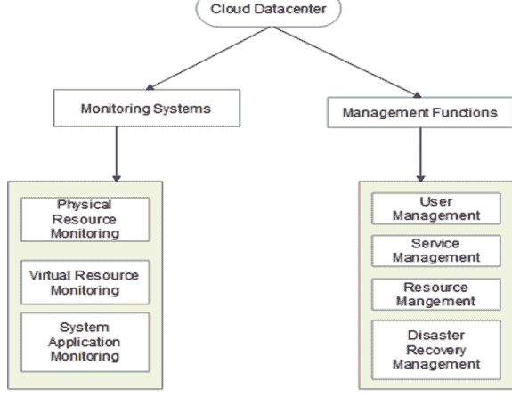

图（2）。IoMT 云架构。

### 医疗服务层
可特别划分为 3 个子层：医疗基础设施、医疗平台和医疗软件层。医疗基础设施层提供网络资源、存储、强大计算以及由虚拟化组成的资源池相关服务。医疗机构的建设无需构建独立的数据中心，然后按需租用所需资源，以为大型医疗机构节省成本。数据中心可应用于医疗评估和决策数据、含物质的医疗系统统计数据、保存患者的私人统计记录等，为医疗系统和机构的整合、分析和数据共享奠定基础。

医疗服务层为医疗数据机器的创建者提供简单平台以及同等技术支持。依托平台，构建者可以快速形成、扩展并提升医疗记录系统的高效模块，这带来更优的改进可访问性，增强改进效果，并控制增长成本。医疗软件层理解临床数据机器的功能框架的接口和交付，特别是对于需要使用该系统的客户。

### 服务管理层
这部分可以是云 IoMT 的主要部分，也是医疗服务层的基础。它保证整个医疗数据系统能够持续有效地运行，并在维护、多管理等方面提供技术和功能。它在与客户协作中发挥了非常好的作用，彻底检查并理解客户需求，有利于医疗服务层及时消除或避免故障，从而提高软件改进的质量和性能并降低增强成本。

### 用户层
用户层涉及医疗数据共享框架的客户，包括不同层级的医疗机构、社区诊所、疾病控制中心等。客户可通过计算机、手机和其他终端设备的界面访问用户层，经准入后也成为云的一部分。在享受云计算提供的服务期间，客户可将自己的资源上传至云供其他客户使用，以实现资源共享和真实信息共享。对于医生而言，获得访问云的权限可以获取和追踪患者数据、治疗信息、治疗计划等。实时情况下，患者可根据自身情况通过云系统选择任何医疗机构进行治疗。

## IoMT 云技术

### 云计算
云计算为数字医院提供了良好机遇，同时也对医疗统计和事实的计算、共享和处理带来了巨大变化。不恰当地，CC 带来便利，但客户很难判断云服务是否安全，因此无法成功管理整体。Wang 等人[22]提出了一种可衡量的安全评估模型来解决此问题。存储在云服务器中的记录的安全性至关重要。Iliashenko 等人[23]提到，应用模糊身份的大数据主动审计系统可保证客户统计数据的完整性。

### 大数据
大数据知识通常包括预处理和数据收集、数据挖掘、分析和存储。传统数据收集基础是孤立的，且保存、分析和管理的记录数量可能极不重要。Lin 等人[24]提到可通过并行数据库和关系数据库管理多少数据，同时医疗大数据序列通常分为非结构化、半结构化和结构化，大小通常在 TB/PB 级别。收集的信息被清洗、提取和分析，并进行剩余操作以实现数据高质量。Ning 等人[25]提到，应用大数据技术进行正确挖掘和研究，大型医疗数据将对疾病治疗和诊断以及医学研究产生重大影响，成为推动数字医院建设的源泉。

### 人工智能（AI）
如 Liu 等人[26]所述，AI 是一种新型技术，可扩展和模拟人类智力方法和智慧方式的技术、方法、理论和应用框架。Guo 等人[27]和 Yang 等人[28]提到的 AI 重要技术包括专家系统、计算机视觉、机器人、自然语言处理（NLP）和机器学习（ML）。其中，ML 是 AI 的核心技能。在医疗行业，ML 专业知识可诊断和预测疾病，在很大程度上避免了低性能、过度错误以及诊断中最重要疾病的出现。临床机器人的应用显著增强了诊断、护理和治疗的影响。计算机视觉可快速学习并诊断包括超声（US）、显微镜和 X 射线图像在内的医学影像信息。如 Hui 等人[29]所述，AI 专业知识在临床治疗领域的应用带来技术创新，但也带来医疗服务模式的转变。

## IoMT 云应用
IoMT 云可用于创建基于电子健康记录的医疗数据共享平台，以解决特定医疗机构中的数据孤岛问题。这非常有利于医院和患者将通过私人数据、关键症状体征和其他相关患者事实形成的电子健康记录添加到云中进行存储和统一管理。

## IoMT 边缘云
IoMT 云时代将终端设备上的医疗信息上传到远程云，并在计算后将结果返回终端系统。但是，如果通过新兴临床设备产生的大量记录被上传到 CC，会对云造成巨大压力，导致巨大功耗和因云负载过大而产生的大延迟。CC 单独无法处理庞大数据集并提供实时响应。因此，如 Pathinarupothi 等人[30]和 Queralta 等人[31]所述，IoMT 云改进的关键在于有效扩展 CC 的能力并利用分布式计算资源，即在网络边缘开发计算任务，而边缘计算的应用可满足特定的计算需求。

## IoMT 边缘-云架构
我们将 IoMT 边缘云划分为云计算、边缘计算和终端层。图（3）显示了 IoMT 云边缘架构。

CC 层位于整个网络的中间。这可以是有效的 data 处理，拥有网络资源、存储和大规模计算，能够通过边缘计算层分析、汇总并完全保持记录更新。边缘计算层包括大量社区边缘节点；可以是智能终端设备，包括平板电脑、智能手机等，或网络设备，包括路由器、网关等。这些边缘设备在云中被广泛部署

和终端系统，包括诊所、医院等。它们由于终端系统和边缘节点、诊所、医院等之间的节点数量较少，可以提供存储边缘计算和网络服务用于获取的数据。它们可以实现更高的响应性和敏捷网络。它可能减少延迟请求，并有效防止因远距离广播和其他安全问题导致的信息泄露，这对于极其敏感的医疗保健信息至关重要。终端层由多种 IoMT 设备组成，如 RFID 标签、可穿戴设备、医疗传感器等。这可以是最接近客户的层，特别负责从本地设备收集信息并以输入方法作为载体将数据更新到边缘设备。

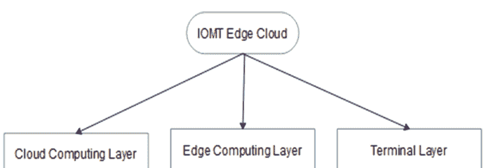

图 (3). IoMT 云边架构。

## IoMT 边缘云技术

### 边缘计算
如 Emam 等人 [32] 所定义，边缘计算是一个开放平台，通过在靠近设备或信息、人员来源的网络边缘的应用、存储、计算和网络的核心能力提供最接近的服务。云的存储能力和计算能力将下沉到网络边缘，并且在可行范围内，独特数据可能不会以集中方式更新到云中进行处理，然后数据资源的处理和评估可通过存储和分布式计算在区域内实现。然后云与边缘计算之间的差异在于 CC 中心与终端系统之间的双向通信，即终端设备可将请求转发至 CC 中心，可获得 CC 中心的处理、数据存储和集中控制，以及通过 CC 中心发布的完整调整技术和计算任务。边缘计算技术具有可调度、可定义、高安全性、低延迟等特点。当网络中断且异常时，边缘节点能够实现自恢复和邻近自治，并具有高鲁棒性。

### 计算卸载
计算卸载技术具体涉及两个问题：资源分配和决策。Wei 等人 [33] 提到，计算卸载的决策主要取决于次优算法程序和博弈论。它在多接入边缘网络中使用，以通过受限步长降低整体计算成本并获得纳什均衡。在卸载决策之后，随后的关注点可以是资源分配的合理性。资源分配具体实现是否将计算任务卸载到一个或多个 MEC 服务器；这取决于计算任务是否可以分离，以及分离的组件之间是否存在关联。Rachakonda 等人 [34] 提到可以提出依赖于 MEC 服务器的资源分配方法，这可以解决由于多个 MEC 服务器之间的资源分配而导致的广播延迟问题。如 Dhunna 等人 [35] 所描述，主要依赖于确定性微分方程的资源分配方法，可以正确分配资源并确保 MEC 应用的稳定性和安全性。

## IoMT 边缘云应用
边缘计算增强了患者和医疗工作者医疗体验的工作效率。如 Bouadem 等人 [36] 所提及，医疗工作者无需将患者健康数据转发到远程数据中心进行处理并等待结果。他们可以安装边缘计算数据中心，在本地计算、处理并保存通过边缘设备获取的患者健康数据，从而为临床领域带来高质量的改进。Yadav 等人 [37] 描述了 EC 如何允许可穿戴健康追踪系统在本地进行实时处理和评估，即使离线，也可用于患者的远程监测。Zgheib 等人 [38] 提出了一种依赖于 AI、EC 和不同技术的健康监测架构。该架构可用于收集 EEG、血压、心电图和其他类型的关键体征数据并提高疾病分析准确性。

表 1. 边缘计算与云计算的比较。

| 特性 | 边缘计算 | 云计算 |
|---|---|---|
| 用户体验 | 强 | 弱 |
| 计算成本 | 低 | 高 |
| 计算资源 | 有限 | 无限 |
| 可靠性 | 低 | 高 |
| 安全性 | 更高 | 更低 |
| 实时性 | 强 | 弱 |
| 延迟 | 更少 | 更多 |
| 数据处理 | 快 | 慢 |
| 能耗 | 低 | 高 |
| 带宽负载 | 更少 | 更多 |
| 服务器节点位置 | 边缘网络 | 数据中心 |
| 架构 | 分布式 | 集中式 |

表 1 显示了边缘计算与云计算的比较。我们认为，边缘计算是云计算的自然延伸，但它无法完全取代云计算。CC 与 EC 具有互补和协作的关系。边缘端点可以快速处理和评估大量实时信息，但大多数并非仅使用一次。在边缘处理后，仍需将其从边缘端收集到云端。云端对于关键信息的存储、大规模数据的分析和挖掘、众多边缘设备的连接，以及边缘管理和虚拟化资源是必需的。云计算和边缘计算只有在紧密协同工作时，才能满足多样化的需求情况，从而提升云计算和边缘计算的应用价值。

## 结论与未来工作
在我们的论文中，我们研究了传统的 IoMT、IoMT 云、IoMT 边缘云，重点关注医疗边缘云的医疗信息处理以及远程医疗的发展。尤其是，我们首先介绍了传统的 IoMT 架构和所涉及的重要技术，提及了 IoMT 技术的效用。接下来，我们研究了 EC 相比 CC 的优势并讨论了 EC 的优化，以及提出了云边关联可在医疗领域实现最大应用。5G 到来后以及 EC 的不断发展，未来的远程医疗可能无限发展。此外，通信保护协议的发展、边缘中的分布式入侵检测技术，以及边缘节点的信任控制以防止恶意攻击和避免安全攻击将被视为未来工作。

## 出版许可
未声明。

## 利益冲突
作者声明不存在任何利益冲突，无论是财务或其他方面。

## 致谢
未声明。

## 参考文献
[1] L. Sun, X. Jiang, H. Ren, and Y. Guo, "医疗物联网中的边缘-云计算与人工智能：架构、技术与应用", IEEE Access, vol. 8, pp. 101079-101092, 2020.
[http://dx.doi.org/10.1109/ACCESS.2020.2997831]

[2] A. Al-Fuqaha, M. Guizani, M. Mohammadi, M. Aledhari, and M. Ayyash,"大流行的起源与预防", Clin. Infect. Dis., vol. 50, no. 12, pp. 1636-40, 2010.
[http://dx.doi.org/10.1109/COMST.2015.2444095]

[3] W. Wang, S. Yu, T. M. Bekele, X. Kong, and F. Xia, "科学合作模式随学者学术年龄而变化," Scientometrics, vol. 112, no. 1, pp. 329-343, 2017.

[4] X. Wang, Z. Ning, X. Hu, L. Wang, L. Guo, B. Hu, and X. Wu, "车联网中的未来通信与能源管理：迈向智能能量采集," IEEE Wireless Commun., vol. 26, no. 6, pp. 87-93, 2019.
[http://dx.doi.org/10.1109/MWC.001.1900009]

[5] Z. Ning, X. Hu, Z. Chen, M. Zhou, B. Hu, J. Cheng, and M. S. Obaidat, "面向社交车联网的协作质量感知服务接入系统," IEEE Internet Things J., vol. 5, no. 4, pp. 2506-2517, 2018.
[http://dx.doi.org/10.1109/JIOT.2017.2764259]

[6] R.C. Shit, S. Sharma, D. Puthal, A.Y. Zomaya, "物联网基础设施中传感器定位的综述与分类：物之定位（LoT）," IEEE Commun. Surveys Tuts., vol. 20, no. 3, pp. 2028-2061, 2018.
[http://dx.doi.org/10.1109/COMST.2018.2798591]

[7] X. Liu, A. Liu, T. Qiu, B. Dai, T. Wang, L. Yang, "恢复受损传感器网络的连通性以实现在恶劣环境中的长期生存," IEEE Internet Things J., vol. 7, no. 2, pp. 1205-1215, 2020.
[http://dx.doi.org/10.1109/JIOT.2019.2953476]

[8] G. Yang, G. Pang, Z. Pang, Y. Gu, M. Mäntysalo, H. Yang, "基于纳米增强的非侵入式柔性可拉伸可穿戴传感器用于慢性病护理," IEEE Rev. Biomed. Eng., vol. 12, pp. 34-71, 2019.

[9] Z. Ning, P. Dong, X. Wang, X. Hu, L. Guo, B. Hu, Y. Guo, and R. Y. K. Kwok, "面向医疗物联网的移动边缘计算使能 5G 健康监测：一种去中心化博弈论方法," IEEE J. Sel. Areas Commun., pp. 1-16, 2020.

- [10] X. Liu, T. Qiu, and T. Wang, "无线传感器网络的负载均衡数据分发：一种受自然启发的方法," IEEE Internet Things J., vol. 6, no. 6, pp. 9256-9265, 2019. [http://dx.doi.org/10.1109/JIOT.2019.2900763]
- [11] M.A.A. da Cruz, J.J.P.C. Rodrigues, J. Al-Muhtadi, V.V. Korotaev, and V.H. C. de Albuquerque, "物联网中间件的参考模型," IEEE Internet Things J., vol. 5, no. 2, pp. 871-883, 2018. [http://dx.doi.org/10.1109/JIOT.2018.2796561]
- [12] Y. Xin, L. Kong, Z. Liu, C. Wang, H. Zhu, M. Gao, C. Zhao, X. Xu, "基于 IoMT 平台的生物识别系统多模态特征级融合," IEEE Access, vol. 6, pp. 21418-21426, 2018.
- [13] Y. Sun, H. Qiang, J. Xu, G. Lin, "基于物联网的在线状态监测与中低速磁悬浮列车系统的改进自适应模糊控制," IEEE Trans. Ind. Informat., vol. 16, no. 4, pp. 2629-2639, 2020
- [14] N. Glazkova, C. Fortin, and T. Podladchikova, "医疗可穿戴设备开发的精益-敏捷方法应用", Proc. 14th Annu. Conf. Syst. Syst. Eng. (SoSE)., pp. 75-80, 2019. [http://dx.doi.org/10.1109/SYSOSE.2019.8753825]
- [15] A. Sun, G. Gao, T. Ji, and X. Tu, "云计算平台的一种可量化安全评估模型", Proc. 6th Int. Adv. Cloud Big Data (CBD)., pp. 197-201, 2018.
- [16] C. Zhao, L. Xu, J. Li, F. Wang, and H. Fang, "基于模糊身份的云存储大数据动态审计," IEEE Access, vol. 7, pp. 160459_160471, 2019. [http://dx.doi.org/10.1109/ACCESS.2019.2950938]
- [17] M. Li, C. Wang, L. Yan, and S. Wei, "医疗大数据应用研究", Proc. 14th Int. Conf. Comput. Sci. Edu. (ICCSE)., pp. 478-482, 2019. [http://dx.doi.org/10.1109/ICCSE.2019.8845376]
- [18] Y. Yu, M. Li, L. Liu, Y. Li, and J. Wang, "临床大数据与深度学习：应用、挑战与未来展望," Big Data Mining Analytics, vol. 2, no. 4, pp. 288-305, 2019. [http://dx.doi.org/10.26599/BDMA.2019.9020007]
- [19] K. Zhang, S. Leng, X. Peng, L. Pan, S. Maharjan, and Y. Zhang, "认知车载通信与网络中人工智能启发的传输调度," IEEE Internet Things J., vol. 6, no. 2, pp. 1987-1997, 2019.
- [20] W. Qi, B. Landfeldt, Q. Song, L. Guo, and A. Jamalipour, "DSRC 与 C-V2X 混合车载网络中的流量分级聚类路由," IEEE Trans. Veh. Technol., early access, 2020, doi:10.1109/TVT.2020.2990174. [http://dx.doi.org/10.1109/TVT.2020.2990174]
- [21] W. Wang, J. Chen, J. Wang, J. Chen, and Z. Gong, "智能城市个性化兴趣点推荐的地理感知诱导矩阵补全," IEEE Internet Things J., vol. 7, no. 5, pp. 4361-4370, 2020. [http://dx.doi.org/10.1109/JIOT.2019.2950418]
- [22] W. Wang, J. Chen, J. Wang, J. Chen, J. Liu and Z. Gong, "个性化兴趣点推荐的信任增强协同过滤," in IEEE Transactions on Industrial Informatics, vol. 16, no. 9, pp. 6124-6132, 2020. [http://dx.doi.org/10.1109/TII.2019.2958696]
- [23] O. Iliashenko, Z. Bikkulova, and A. Dubgorn, 人工智能在医疗保健中的机遇与挑战. Proc. E3S Web Conf. vol. 110. EDP Sciences: Les Ulis, France, 2019, p. 02028.
- [24] P. Lin, Q. Song, and A. Jamalipour, "CoMP 集成超密集蜂窝网络中的多维协同缓存," IEEE Trans. Wireless Commun., vol. 19, no. 3, pp. 1977-1989, 2020. [http://dx.doi.org/10.1109/TWC.2019.2960329]
- [25] Z. Ning, X. Wang, and J. Huang, "移动边缘计算支持的 5G 车联网：通信与计算的融合," *IEEE Veh. Technol. Mag.*, vol. 14, no. 1, pp. 54-61, 2019. [http://dx.doi.org/10.1109/MVT.2018.2882873]
- [26] X. Liu, T. Qiu, X. Zhou, T.Wang, L. Yang, and V. Chang, "具有移动汇聚节点的断开式传感器网络的延迟感知路径规划," *IEEE Trans. Ind. Informat.*, vol. 16, no. 1, pp. 350-361, 2020. [http://dx.doi.org/10.1109/TII.2019.2916300]
- [27] H. Guo, J. Liu, and J. Zhang, "5G HetNets 中多接入边缘计算的高效计算卸载," in *Proc. IEEE Int. Conf. Commun. (ICC)*, May 2018, pp. 1-6.
- [28] Y. Yang, Y. Wang, R. Wang, and S. Chu, "基于协作空间核心服务器的移动边缘计算资源分配方法," in *Proc. IEEE/CIC Int. Conf. Commun. China (ICCC)*, pp. 568-572, 2018. [http://dx.doi.org/10.1109/ICCChina.2018.8641218]
- [29] H. Hui, C. Zhou, X. An, F. Lin, "移动边缘计算系统安全的新资源分配机制," *IEEE Access*, vol. 7, pp. 116886-116899, 2019. [http://dx.doi.org/10.1109/ACCESS.2019.2936374]
- [30] R.K. Pathinarupothi, P. Durga, E.S. Rangan, "基于物联网的全球健康智能边缘：远程监测、严重程度检测与警报传输," *IEEE Internet Things J.*, vol. 6, no. 2, pp. 2449-2462, 2019. [http://dx.doi.org/10.1109/JIOT.2018.2870068]
- [31] J.P. Queralt, T.N. Gia, H. Tenhunen, T. Westerlund, "基于 LoRa 的健康监测中的边缘 AI：具有雾计算和 LSTM 循环神经网络的跌倒检测系统," In *Proc. 42nd Int. Conf. Telecommun. Signal Process. (TSP)*, pp. 601-604, 2019. [http://dx.doi.org/10.1109/TSP.2019.8768883]
- [32] A. Emam, A.A. Abdellatif, A. Mohamed, and K.A. Harras, "Edge-Health：一种节能的基于边缘的远程 mHealth 监测系统," In Proc. *IEEE Wireless Commun. Netw. Conf. (WCNC)*, pp. 1-7, 2019.
- [33] W. Wei, and Y. Qi, "无线自组织传感器网络中的信息势场导航", *Sensors (Basel)*, vol. 11, no. 5, pp. 4794-4807, 2011. [http://dx.doi.org/10.3390/s110504794] [PMID: 22163876]
- [34] L. Rachakonda, P. Sundaravadivel, S.P. Mohanty, E. Kougianos, M. Ganapathiraju, “IoMT 中用于压力水平检测的智能传感器，” in 2018 IEEE International Symposium on Smart Electronic Systems(iSES)(Formerly iNiS). IEEE, pp. 141–145, 2018.
- [35] G.S. Dhunna, and I. Al-Anbagi, "关键智能电网应用的低功耗 WSNs 攻击检测与隔离机制", *IEEE Sens. J.*, vol. 19, no. 13, pp. 5315-5324, 2019. [http://dx.doi.org/10.1109/JSEN.2019.2902357]
- [36] N. Bouadem, R. Kacimi, and A. Tari, “B-d’wsp 选择算法：WSNs 的负载均衡汇聚,” in 2018 *Wireless Days (WD)*. IEEE, 2018, pp. 101-103. [http://dx.doi.org/10.1109/WD.2018.8361702]
- [37] S. Yadav, V. Kumar, S.B. Dhok, D.N. Jayakody, “基于 MI 通信的 3D 非传统 WSNs 的节能设计,” *IEEE Systems J.*, vol. 14, no. 2, pp. 2585-2588, 2020. [http://dx.doi.org/10.1109/JSYST.2019.2918184]
- [38] R. Zgheib, E. Conchon, and R. Bastide, “物联网医疗保健应用的语义中间件架构，” in *Enhanced Living Environments*. Springer, 2019, pp. 263-294. [http://dx.doi.org/10.1007/978-3-030-10752-9_11]

# 无线体域网 WBANs 的 IoMT 干扰缓解技术综述

Izaz Ahmad¹, Muhammad Abul Hassan¹*, Inam Ullah Khan² and Farhatullah³

¹ Department Computing and Technology, Abasyn University, Peshawar, Pakistan
² King's College London, London, United Kingdom
³ School of Automation, China University of Geosciences, Wuhan, China

**摘要：** 医疗数据可使用医疗物联网 IoMT 进行存储和分析，IoMT 是一组智能设备，通过移动边缘计算 MEC 连接到无线体域网 WBAN。无线体域网 WBAN 是最实用、最经济、易于适应且无创的电子健康监测技术。WBAN 由一个协调器和多个传感器组成，用于监测人体的生物体征和任务。这一令人兴奋的领域导致了新的研究和标准化进程，尤其是在 WBAN 性能和一致性方面。在重复移动或 WBASN 场景中，信号完整性不稳定，系统性能大幅下降。因此，必须考虑项目中的干扰减少。WBAN 性能可能会因共存的其他无线网络而受损。本文对 WBAN 技术中的共存和缓解解决方案进行了全面详细分析。特别是，本文研究了 WBAN 三大领先无线技术 IEEE 802.15.6 和 IEEE 802.15.4 以及 IEEE 802.11 的低功耗特性。将阐述 WBAN 干扰缓解方案的比较。

**关键词：** IEEE 802.11, IEEE 802.15.4, IEEE 802.15.6, Interference Avoidance Schemes, IoMT, WBAN, Wi-Fi.

## 引言

物联网 IoT 已改变了现代医疗保健，逐渐取代传统疗法，转向无处不在的医疗保健技术。因此，医疗实践必须设计策略以提供最佳的

在仍保持盈利的同时提供患者护理。WBAN 已发展成为随时随地获取医疗服务的重要工具。实时情况下，这些网络可以收集生理、行为和其他健康相关数据。因此，WBAN 可为需要紧急医疗治疗的人提供经济高效且可靠的实时电子医疗服务。无线体域网（WBAN）也被称为医疗物联网（IoMT），因为它通过可穿戴或植入式医疗传感器监测人们的健康。

无线体域网（WBAN）具有许多小型且不活跃的设备（传感器），并具有无线连接。传感器可以放置在体内或体表以用于健康监测。WBAN 由许多传感器和协调器组成。传感器发送到健康控制中心的协调器，环境和人体功能被感知并传输到协调器。如 Tobon 等人 [1] 所描述，WBAN 应用可用于两个领域：（i）用于患者监测的医疗应用，（ii）非医疗应用，如用于训练的生物识别。通信使用两个标准：IEEE 802.15.4 和 IEEE 802.15.6。IEEE 802.15.4 标识短期通信的 MAC 控制级别。尽管 IEEE 802.15.6 是为体内定位而提出的。WBAN 被广泛视为许多应用的技术支持，包括健康和安全监测以及紧急情况。如 González-Valenzuela 等人 [2] 所描述，最现代的发明、电子设备、传感器是一个无线收发器，它消除了接收节点和通信基础设施的需要，以便与一个或多个传感器传输观测数据；微控制器单元（MCU）允许设备和低功耗概念可以链接在一起创建。人体是移动的，并且这种移动性得到了支持。假设其他 WBAN 服务区域穿透手臂或腿部传输。此外，直径内的设备进入移动性。WBAN 干扰传感器（WBAN）之间的干扰、WBAN 干扰，（ii）使用相同频段的同一网络之间的干扰、WBAN、噪声，以及（iii）干扰分类。不同网络干扰共存产生的域间干扰可在图（1）中看到。

存在多种干扰缓解技术以及改善网络参数（如数据速率、能量和延迟）的技术。现有技术将在第 II 节中讨论。第 III 节描述了所有现有技术的结论。第 IV 节提出讨论，最后参考文献在第 V 节给出。

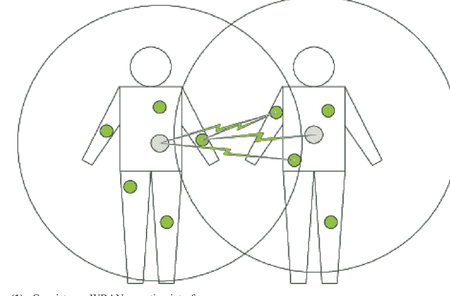

图（1）。产生干扰的共存 WBAN。

## 关于 IoMT 的 WBAN 与 WSN 的区别

如 Le 等人 [3]、Yang 等人 [4] 和 Sana Ullah 等人 [5] 所描述，WBAN 是 eHealth 应用和远程医疗应用的有效标准，其介绍始于 IEEE 标准 802.15.4 和 802.15.6。它观察并记录患者状况的主要体征和显著变化。科学家们普遍认为 WSN 和 WBAN 并非完全相同。如 Kailas 等人 [6]、Chen 等人 [7] 和 Khan 等人 [8] 所提及，WSN 与 WBAN 之间存在一些差异。为 WSN 和 AD-Hoc 网络开发的协议可能不符合 WBAN 属性。WBAN 的尺寸和能量要求比 WSN 更严格。此外，WBAN 信息包含医疗数据，这对 WSN 应用造成可靠性、安全性和时间问题。由于健康风险问题，WBAN 中的传输控制受到极大限制。因此，WBAN 的范围和传输距离明显小于 WSN。最后，WBAN 传感器节点改变了要求和特性，因为 WSN 的传感器是统一的，并在比较中发挥作用。如 Lai 等人 [9] 所提及，IEEE 802.15.6 WBAN 标准被提出为一种才华横溢的无线发明，用于极低功耗设备，例如用作人体一部分的 IEEE 802.15.4 或 IEEE 802.15.6。这种创新特别针对 WBAN 的处理和布置条件而提出，使其成为医疗和其他领域各种应用的合理选择。IEEE 802.15.6 标准中使用的传输所包含的不同频段使用：400 组收集、窄带（NB）、800、900 MHz 和 2.3 GHz 以及 2.4。人体通信超宽带（UWB）（HBC）使用 3.1 至 11.2 GHz，频率为 10 至 50 MHz。因此，分析人士一致认为，2.4 GHz 频段增加了提供面对面干扰的能力，是医疗应用中具有挑战性的区域

## 无线传感器网络（WSN）

第一个区别是发送到 WSN 的传感器的宽度和数量远高于 WBAN。这为 WBAN 和不同层级使用的通信协议提供了各种要求。如 Kwak 等人 [10] 和 Fei 等人 [11] 所描述，IEEE 802.15.4（ZigBee）标准被广泛用于 WSN 执行，其中它建议更大的范围区域，尽管在与蓝牙匹配时在干扰下具有最佳执行。

本调查并非为研究无线技术研究中该 WBAN 研究的近距离共存问题而进行。它与数值建模研究一致，并且是使用低功耗 Wi-Fi 在 WBAN 和 ZigBee 以及 IEEE 802.15.6 标准中的后果之一。文献综述中提出的方案可以通过根据所询问的无线电技术修改参数来检查。

## WBAN 架构

图（2）描绘了一个人使用 IoT 设备将数据传输给其医疗团队进行远程监测和实时生命体征波动。体表和植入式 IoT 设备是 IoMT 中的两种 IoT 设备类型。植入式 IoT 设备包括心律失常监测仪和内窥镜胶囊。可穿戴 IoT 设备，如手表，始终附着在身体上。WBAN 包含用于行为检查而植入体内、体表或身体周围的传感器节点。这些传感器经常查看人类基本数据，并通常利用无线通信连接到汇聚节点。汇聚节点首先从每个其他节点收集信息并将数据传输给监测人员。根据信息，医务人员可以采取适当的医疗措施。

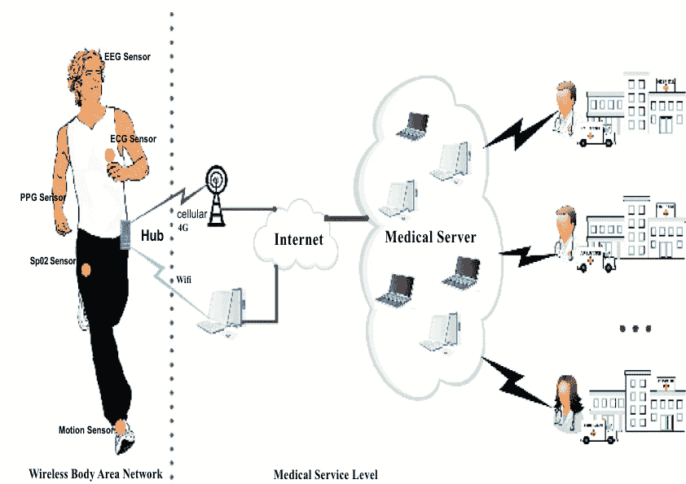

图（2）。WBAN 架构。

## WBAN 应用

### 康复与治疗

这包括最可能导致中风的人，以及在治疗期间患者继续发展的疾病，尽可能地。因此，人类发展研究与住房重建之间的差异显然是一个重要的电影。传感器扩展、多传感器信息融合、数据集成和虚拟患者开发，例如研究领域中限制的结构和定义以及特定要求。如 Liu 等人 [12] 和 Hadjidj 等人 [13] 所提及，康复对患者出院后重新安排药物以恢复使用能力没有帮助。

### 可穿戴健康监测系统

可穿戴健康监测系统（WHMS）是阿拉巴马大学 Zhou 等人科学家创建的步行系统的一个最新例子 [14]。本次检查推进了一个大型系统、健康状况检查和远程医疗。WHMS 利用旧的 Wi-Fi 技术。并且蜂窝系统用于将信息从 BAN 传输到外部系统，并通过使用各种类型的设备，例如 PC 收集信息。医疗专家可以通过互联网获取信息，这有助于在识别出与医疗相关的异常时发出问题警告。

### 灾难援助网络

哈佛大学开发了一个名为灾难援助网络（AID-N）的系统，以评估重大紧急情况下工人的健康状况。该系统利用在线界面促进急救人员之间的联系。与 WHMS 类似，AID-N 利用 Wi-Fi 和蜂窝系统在个人、基于服务器的智能手机和系统数据库服务器之间建立通信。

## 技术

### 蓝牙

如 Milenković 等人 [15] 所描述，蓝牙技术被引入为安全短程无线电频率。它使用应使用接收节点指定的转换方法与系统时钟同步的微微网节点。每个设备可以同时与微微网中的七个不同设备交互，给定网络，以及作为接收节点的设备超过七个，整个设备期间。每个设备可以与多个微微网一起工作，当它进入另一个接收器旁边的无线电时。它具有无需显示网络设备即可通信的能力。因此，它通常用于连接各种独立设备以协助语音信息和应用程序。科学和医疗 ISM 2.4 GHz 频段每秒使用 1600 个低频率来压缩干扰。该标准定义了具有不同传输控制功能的三种设备计划，并要求 1 至 100 米的注意。最极端的数据传输速率是 3 Mbit/s。

### 低功耗蓝牙

蓝牙低功耗（BLE），如 Gao 等人 [16] 所描述，非常适合 WBAN 应用。低维护 BLE 设计用于从小型设备到通用设备的无线网络路由。此外，这些设备太小而无法使用能量工作，它们还与标准蓝牙相关联的成本

无线电接收器，但它们非常适合健康监测应用。持续数据传输速度最高可达 1 Mbit。通用频谱的频率偏移允许 BLE 和 Wi-Fi 共存，但由于其工作在 GHz ISM 2.4 频段，与各种设备的共存成为问题。蓝牙支持两个相同设备连接到广告网络的应用，具有不同的数据传输速度和功率，这有利于高数据速率，例如在两个独立服务器之间、两个 WBAN 之间或 WBAN 与 PC 之间。

## ZigBee

ZigBee 是一种无线网络技术，广泛应用于低能耗环境。ZigBee 不仅为低通信数据速率支持 128 位安全，还支持长电池寿命和安全网络认证，专为需要完整性和保密性的高频应用而设计。

ZigBee 联盟确定需求水平并在网络和应用层确定安全软件。ZigBee 的创新分为两部分。首先，ZigBee 组织了应用和软件应用 802.15.4 的安全级别。另一部分在 IEEE 802.15.4 中描述并用于物理媒体访问控制层，其中 CSMA/CA 无线收发器技术不遵循 ZigBee 设备。与其他无线网络相比，ZigBee WBAN 问题是 WLAN 噪声传输，尤其是在 2.4 GHz。ZigBee 的另一个弱点是数据速率低（250 kbps）。数据速率低且在所有医疗中心易于接受这一事实被利用。

## IEEE 802.11

IEEE 802.11，如“Mobile Health”书[17]所述，是用于 WLAN 的特殊标准。使用 IEEE 802.11，WiFi 允许高速 Wi-Fi 网络在接入点组合或自组织模式下冲浪互联网。修改后的数据特征提供许多功能，使其非常适合支持视频流的无线宽带视频会议。Wi-Fi 是一个重要方面，影响了所有当代手机、Mac 和平板电脑。然而，Alam 等人[18]提到高能耗是一个主要缺点。

## IEEE 802.15.4

IEEE 802.15.4 已为低功耗、低数据速率和低成本应用而设计。IEEE 802.15.4 于 2003 年发布。该标准在全球范围内运行 869 MHz、915 MHz 和 2400 MHz 频段。该协议在星型和点对点拓扑中工作。

## IEEE 802.15.6

IEEE 802.15.6，如 Mühlbacher 等人[19]所述，是一种新标准，允许医疗和非医疗 WBAN 应用的各种内部和外部通信以及人体控制。IEEE 802.15.6 标准是 400、800、900 MHz、2.3 和 2.4 GHz 窄带（NB）频段以及超宽带（UWB），其中 3.550 MHz HBC 在“IEEE 局域网和城域网标准 - 第 15.6 部分：无线体域网”[20]中提到，以及 3.1 GHz、11.2）。该标准在手机传感器网络中具有革命性，特别适合各种无线网络。许多 NAG 传感器节点（256）和淋巴工作所需的信息，以及更低的能耗由应用要求定义。使用 IEEE 802.15.6 标准，数据传输速率最高可达 10 Mbps，且功耗极低。此外，您可以可视化 WBAN 的移动性（即共存直接移动到另一个 WBAN 区域）。这不适用于需要以下情况的 WBAN 应用：在最大水平上，该标准可以满足 WBAN 应用在 680 kbps 下的大多数带宽要求。然而，不可能消除需要高质量音频和视频传输的新应用的限制。

## TECHNIQUES AND COMPARISON

一些研究人员研究了使用相同频率的许多传感器共存的问题，称为同质共存。同质问题可以通过集中或分布式技术处理。集中实体在共存网络下管理时间和频率的使用。Yang 等人[4]建议使用中央设备，其中资源链接服务器向 WPAN 协调器请求资源以及要应用的资源。此外，所提出的技术分配并行传输和同步间隔，并显著最小化指定信道的数量。该方法考虑了传感器级别的干扰和时间间隔，这显著减少了后者，并提高了 WBAN 的节能。与此同时，Chen 等人[21]提到的方法使用贝叶斯博弈功率管理技术来减轻 WBAN 之间的干扰。其他方法包括可重复使用方案以减轻干扰的影响。

为了感知和减少共存干扰，Zou 等人[22]基于信标投递率（BDR）提出了 WBAN 轻量级和鲁棒干扰缓解方案（LRIM）。作者使用传输效率（TE），其中包括接收方接收的数据包数量、多次重传以及执行退避的次数。TE 和 BDR 阈值用于指定干扰。信道跳频决策由协调器做出，传感器上进行信道跳频请求。如果请求由超过一半的传感器发送，协调器将基于 RSSI 和流量速率在候选信道上做出信道跳频决策。如果找到空闲信道，则将整个操作切换到该信道。作者提出了 Ma 等人[23]提出的异步网络间干扰避免（AIIA），使用 CSMA/CA 和 TDMA。监听其他 WBAN 的控制消息，然后更新其调度以避免干扰。

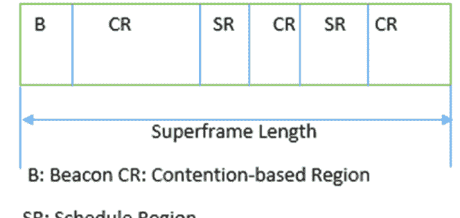

Fig. (3). AIIA superframe structure.

图（3）。AIIA 超帧结构。

Fig. (3) shows the AIIA superframe, which contains beacon (B), CR, and SR. AIIA superframe made some changes in IEEE 802.15.6 superframe, which include: (i) CR is parallel to the emergency access period (EAP), random access period (RAP), and contention access period (CAP). (ii) SR in AIIA is divided into many periods, comparable to the Medium Access Period (MAP) in IEEE 802.15.6.

图（3）显示了 AIIA 超帧，其中包含信标（B）、CR 和 SR。AIIA 超帧对 IEEE 802.15.6 超帧进行了一些更改，包括：（i）CR 与紧急接入周期（EAP）、随机接入周期（RAP）和竞争接入周期（CAP）并行。（ii）AIIA 中的 SR 被分为多个周期，可与 IEEE 802.15.6 中的介质访问周期（MAP）相比。

In AIIA, each coordinator performs two operations: 1st operation, the coordinator maintains the AIIA table by repeating OWD periodically. The coordinator uses a message to exchange information with each other. In the case of a homogeneous coordinator of each WBAN floods SR_AD message before its SR period. The coordinator creates an AIIA table containing six columns. A gateway identifier (GUID) is used to collect the received device identifier. The next column is hop count. The third one is superframe offset to save time between the coordinator and neighbor timer. The next fields are the start time and duration of TDMA, which shows the starting time and SR period. Seq-No indicates the updated entries. In a 2nd operation called SRR, the coordinator rearranges its inconsistent SR. SRR may have three phases. In the first phase, it refers to its own AIIA table, looks for idle time in the CR, recreates incompatible SR periods, and translates the SR_AD message. The coordinator finds the roaming period (RP) between the CRs of the coexisting WBAN and assigns the key to the RP in the second phase. The coordinator determines the new SR position and the transmission time of the SR_AD message in the third phase, then redirects the SR and forwards it to the homogeneous WBAN coordinator.

在 AIIA 中，每个协调器执行两个操作：第一个操作，协调器通过定期重复 OWD 来维护 AIIA 表。协调器使用消息相互交换信息。在每个 WBAN 的同质协调器的情况下，在其 SR 周期之前泛洪 SR_AD 消息。协调器创建一个包含六列的 AIIA 表。网关标识符（GUID）用于收集接收到的设备标识符。下一列是跳数。第三列是超帧偏移，用于在协调器和邻居计时器之间保存时间。下一个字段是 TDMA 的开始时间和持续时间，显示开始时间和 SR 周期。Seq-No 表示更新的条目。在称为 SRR 的第二个操作中，协调器重新排列其不一致的 SR。SRR 可能有三个阶段。在第一阶段，它参考自己的 AIIA 表，在 CR 中查找空闲时间，重新创建不兼容的 SR 周期，并转换 SR_AD 消息。协调器在第二阶段在共存 WBAN 的 CR 之间找到漫游周期（RP）并将密钥分配给 RP。协调器在第三阶段确定新的 SR 位置和 SR_AD 消息的传输时间，然后重定向 SR 并将其转发给同质 WBAN 协调器。

Kim et al. [24] expressed a demonstration of a fast Fuzzy Power Connection (FPC) scheme as a fuzzy structure with a response channel to reduce transmission control and increase the interface bandwidth. The genetic algorithm (GA) is associated with the definition of the ideal parameters of a fuzzy controller. The demonstration of the structure includes an I/O source and a fuzzy power controller. The information signal is SINR, current interference control and the input signal. The output signal is the current transmission control and is used as a critical channel for the structural contribution. The FPC examines its sources of information and determines the level of control of transmission at the output. FPC consists of fuzzy learning infrastructure, a new I/O, a viewfinder, a fuzzy noise mechanism, and an epilator. GA is used in a fuzzy information base to drive a fuzzy engine. GA is divided into four phases. The first is known as a chromosome, in which the parametric quality and the management capacity are mentioned individually in the capacity of the fuzzy set and in the fuzzy theoretical basis of the data source. In the second phase, we will use the hybrid manager and conversions to acquire new ones. The third level is known as the learning system that chooses the best. In the final phase, we try to strengthen the fitness function and adapt to the connection limit, the transmission power, and the number of accents to be combined. Le et al. [25] explained how the power distribution algorithm minimizes noise and the need for QoS.

Kim 等人[24]表达了一种快速模糊功率连接（FPC）方案的演示，作为具有响应通道的模糊结构，以减少传输控制并增加接口带宽。遗传算法（GA）与模糊控制器理想参数的定义相关联。结构的演示包括 I/O 源和模糊功率控制器。信息信号是 SINR、当前干扰控制和输入信号。输出信号是当前传输控制，并用作结构贡献的关键通道。FPC 检查其信息来源并确定输出处的传输控制水平。FPC 由模糊学习基础设施、新 I/O、取景器、模糊噪声机制和表皮剥离器组成。GA 用于模糊信息库以驱动模糊引擎。GA 分为四个阶段。第一个被称为染色体，其中参数质量和管理能力在模糊集的能力和数据源的模糊理论基础中单独提及。在第二阶段，我们将使用混合管理器和转换来获取新内容。第三级被称为学习系统，选择最佳。在最后阶段，我们尝试加强适应度函数并适应连接限制、传输功率和要组合的重音数量。Le 等人[25]解释了功率分配算法如何最小化噪声和 QoS 的需求。

This algorithm uses an optimization model to limit the transmission power of the sensors to the WBAN by performing the necessary transmission control with the basic requirements of the QoS sensor requirements. GA connects to WBAN to solve the problem of improvement. The GA model is a process of organic development in which the population is sensitively managed, and the fitness function is the optimal method for allocating energy with a minimum total capacity with QoS restrictions.

该算法使用优化模型通过执行必要的传输控制来限制传感器到 WBAN 的传输功率，以满足 QoS 传感器要求的基本要求。GA 连接到 WBAN 以解决改进问题。GA 模型是一个有机发展过程，其中种群被敏感管理，适应度函数是在 QoS 限制下以最小总容量分配能量的最佳方法。

Interference between non-conjugated WBAN channels is analyzed by Rezvani and Ghorashi [26]. The network topology was modeled in a two-dimensional geometric representation in which all the WBAN transmission intervals were modeled as a single-diagram diagram. In addition, the network topology developed a tagged WBASN and an interactive WBASN, which was designed and developed into a larger geometric probability function. Based on this model,

Rezvani 和 Ghorashi [26] 分析了非共轭 WBAN 信道之间的干扰。网络拓扑被建模为二维几何表示，其中所有 WBAN 传输间隔被建模为单图图。此外，网络拓扑开发了标记的 WBASN 和交互式 WBASN，并被设计和开发为更大的几何概率函数。基于此模型，

伽马分布函数用于评估 WBAN 的整体适用性。干扰效应被分析以维持可接受的 SINR 比（信号与干扰加噪声比）所需的外围距离。例如，最小网络间隔需要超过 7-12.5 m 来提供 SINR 设备，至少 9-18 m 来提供 WBAN 所需的平均 SINR。

WBASN cyber-physical 系统中分析的干扰算法由 Wang 等人 [27] 通过识别网络拓扑并应用 PCG 开发。在人们信任 WBAN 的场景中，他们的位置改变了网络拓扑，干扰了其他 WBAN。该机制注册了两种算法：博弈管理以及由 WBAN 组成的社交联系网络。社交网络 WBASN 开发了社交网络以创建社交交互网络。重叠通信区域的干扰模式被创建，其中按钮为节点，边为两个错误之间的链接。动态社交交互的识别使用蓝牙技术和声波开发。两个 WBAN 之间的距离由声波确定，并由 WBASN 估计它们之间距离所需的时间。为了沿马尔可夫链测量交互和动态拓扑，使用了四状态交互的动态算法。预测器的第四定律可被视为强交互、弱交互、非交互和非侵入性弱交互。

Zhang 等人 [28] 描述了基于 MAC 的 QoS MAC 规划方案如何从健康监测场景中为多个共存 WBAN 派生。协调器-协调器在数据传输前交换信息。因此，协调器确定哪个传感器可以访问信道。信道被划分为信标周期或超 MAC 符号。在每个 WBAN 中，协调器根据 IEEE 802.15.6 标准的优先级对网络流量进行分类，并将时隙的减少分配给通用渔业策略。优先级最高的用户获得第一个可用位置。第一个 WBASN 标签的协调器发送标识和时间信息。如果其他协调器在服务区域内并监听此程序，它们将此信息存储在适当表中。如果频率范围被超过且传输间隔被分配，则比较干扰区中间隔的优先级水平，优先级较低的间隔将被延迟到下一次传输。接下来，协调器将流量信息发送给所有设备。外设知道何时发送下一个超帧以避免 WBAN 之间的干扰。

正如 IEEE ICC 2014 报告 [29] 中提到的，WBAN 之间数据交换的信息在分布式距离 WBAN 处记录。

根据本调查，WBAN 将在发送到平均范围内每个 WBAN 之前检测传输间隔之间的休息差异。此优势首先来自交互条件。接受此信息的 WBAN 必须认识到避免干扰的可能性。另一个信心是 WBAN 可以更新网络连接并调整传输效果。然而，我们必须尊重发现和更改社区信息时的时刻。此数据应快速且完整，因为 WBAN 必须在处理之前交换有关您的信道、SINR、网络使用情况和公司前缀的信息。

Dynamic Coexistence Management (DCM)，如 Zhang 等人所述，是一种基于 IEEE 802.15.4 标准为通用 WBASN 设计的新 Mac 系统算法。具有 DCM 的 WBASN 可以检测和处理人们之间不可接受的感染。许多 WBASNs 可以记录的信号也可能导致铅事故和事故的破坏。为了解决这些冲突，DCM 使用信标交换和信道更改。在信标中，CCC 未工作，因此处理间谍的人试图发送最大的受害者。在评估率（PCP）结束时，Loft 可以检测管理员的运气。如果您刚刚获得声誉，请查看管理员以获取当前 Super Frame 功能和当前信道。如果断头台得出啤酒仅关闭一次的结论，对话将正常开始。相反，有必要失去第二个位置，或者在使用 WBASN 时，在时钟处替换信标。当 DCM 中出现信标丢失时，当前文件可以在信标（像）出现大而可怕的关于培根的决定时运行。

有两个事件可以保护灯塔和灯塔随时间推移。或用最大分割替换前灯。在数据传输数据中，管理员在 CFP 结束时显示数据。也许此控制框架由响应或负面识别状态组成。在 DCM 模式下，Waechter 查看检查员并寻找可能的转换信道。两个选项是完整 B 搜索和功能扫描。如下所示。详细而言，管理员通过信道并在自己的时间内拥有有关 WBASN 的详细信息。在非活动时间内，您可以找到有关发现信道的信息的间隙文件，但没有海军建筑。当防病毒软件在信道上被破解时，其他信道在下一次预订期间启用。如果 Super Squad (SD = BI) 中没有延迟，在图形中，WBAN 由按钮表示，信道研究（例如，时间间隔、频率带）通过图的图。两个键之间的边界是 WBAN 的邻域（共存）。在此技术中，可以避免 WBAN 的不同信道（不同信道）的不同颜色。肯定力是 WBAN 投票研究的重点，因为有几条 WBAN 通信线路。

Deylami 等人 [30] 指出，移动 WBAN 的独立原始图像预计会重复出现并且具有较小的时域复杂度。两个信道查看 TDMA，一个用于 WBAN，另一个用于 WBAN 通信。对于第一个 WBAN 图形，需要签名、通信以及使用 WBAN 信道移除 WBAN。随后，Intra WBAN 信道由 WBAN 传感器用于传输关键数据和相应中心的间隔。所有类型周期的颜色图被找到。除了基于频率的方法外，频繁敏捷方法也有很大需求。ZigBee 干扰和 WiFi 确认方法（ACK）。作者得出结论，由于叛乱，超过 30% 的 ZigBee 波段叶瓣因失去可卡因而损失。ACK 丢失的速率意味着碰撞的强度。通过询问 ACK 的适当时间戳，网络实际上可以减少。Inoue 和 Inoue 的解释。为了使用 WLAN（发送给你）和 CTS（Clear to send）部署 WLAN 传输。此时，实现 WPAN 和 WLAN 节点是将 WLAN 信道连接到 ZigBee 网络并切换到书籍的方法。然而，高密度多跳 WSN 的双模式按钮通常是 WSN 多跳并且无法操作，例如协调器与路由器之间的传输，以及路由器与传感器节点之间的传输。为此，双节点模式位由笑话和 CTS 用于传感器节点、协调器与路由器之间的发送节点与无线网络之间的干扰，以及避免路由器和多个节点之间的事故，它是之间的。更多方案没有用于向 WSN 发送流量的中间活动周期，并且失业发送跨 Wi-Fi，以便无线 WSN 可以康复反转。然而，该方法不能应用于多跳 WSN，因为路由器的失业周期拥有路由传感器与路由器之间的通信以及此类失业周期。相反，我们的贡献来自最后实验室与两个方面的差异：（1）同时每层操作两次以提供节点网关的国家，先前的研究表明此类干扰网络我专注于它；（2）6 LoWPAN 和 WLAN 相关联作为后者数据源，以便前者对应。当 6 LoWPAN 正在传输时，网络之间发生碰撞。这设置了 6 LoWPAN 网络与 WLAN 网络之间的情绪。这比文献中讨论的要复杂得多。然而，BB 算法可以有效减少网络之间的中断问题，并可以大大提高异构 WSN 的性能。

Cheng 等人 [31] 提出了超宽带（UWB）数字基带收发器的设计和实现，目的是用于 WBAN。作者声称，所提出设计的功耗以及区域正在减少 Bose-Chaudhuri-Hocquenghem（BCH）和设计级调整的使用。该研究将面积减少了 42%，38% 已减少

与传统结构相比的功率耗散。发射器采用 90 纳米 CMOS 技术设计，发射器使用的能量为 73 PJ/bit，接收模式下为 225 PJ/bit。

作者使用 IR-UWB 技术，因为作者声称 IR-UWB 使用低功耗离散时间基窄脉冲。相对于连续载波技术，IR-UWB 具有许多优点，使用该技术收发器架构结构非常简单，具有高数据速率和低每比特能量。

Manchi 等 [32] 提出了一种在非饱和负载下对 CSMA/CA 的分析。在这项研究中，作者发现了四种用户优先级而不是八个优先级，以实现 WBAN 性能的最严格要求。作者在结果中显示了使用作者提出的<|message|> 研究技术的更好性能。在 IEEE 802.15.6 EAP 和 RAP 中，时间段使用带宽效率低下。在 RAP 时间段开始时，帧碰撞概率已增加。

Rashwand 等 [33] 提出了 WBAN 中的感知干扰和能量。该研究基于节点在网络内的移动性，相对于彼此的比较移动。作者声称，当节点移动时，他们减少了传输时间、干扰、能耗和网络功耗，并增加了信号强度、流量负载和更高的分组投递率。作者提出了节点移动时的自适应干扰缓解方案。此外，该研究中使用了两种方案（干扰减少和避免）。在干扰减少方案中，可以使用不同的功率和数据速率将数据发送到接收器。在干扰避免方案中，协调器为网络中的每个节点分配正交信道。

Movassaghi 等 [35] 对 IEEE 802.15.6 的输出以及演示进行了研究。作者研究了数学公式，并在 IEEE 802.15.6 中找到了具有更少延迟限制的最高输出。限制已使用大量频段以及数据速率导出。作者声称这项研究对从事 IEEE 802.15.6 的新研究人员非常有帮助。作者使用 420-450 MHz、863-870 MHz、902-928 MHz 和 2360-2400 MHz 来比较结果。附录 A 解释了干扰缓解方案的比较（表 1）。

### 表 1. 各种干扰缓解方案的比较

| 技术 | 策略 | 缓解能力与碰撞率 | 处理开销与能耗 | 优点 |
|---|---|---|---|---|
| 健壮干扰缓解方案 (LRIM) [23]。 | 缓解 | 部分，平均 | 高，高 | 提供可靠性并提高数据速率。 |
| 异步网络间干扰避免 (AIIA) [24]。 | 避免 | 部分，高 | 高，低 | 能效高。 |
| 模糊功率控制器 (FPC) [25]。 | 缓解 | 部分，低 | 高，平均 | 共存的 WBAN 使用 SINR 接收最佳信号 |
| 功率分配算法 [26]。 | 缓解 | 部分，低 | 高，高 | 提供高吞吐量和 QoS。 |
| cyber-physical 系统 [27]。 | 缓解 | 部分，低 | 低，高 | 高性能。根据观察到的流量的紧急程度。 |
| MAC 编程方案 [28]。 | 避免 | 完全，低 | 高，平均 | WBAN 能量寿命更长。 |
| 动态共存管理 (DCM) [29]。 | 避免 | 部分，高 | 平均，平均 | 能效高。 |
| 低功耗数字基带收发器设计 [32]。 | 避免 | 部分，高 | 高，低功耗， | 收发器电路设计简单，数据率高，每比特消耗能量低。 |
| CSMA/CA 机制分析 [33]。 | 缓解 | 部分，高 | 高，低 | 在本研究中，IEEE 802.15.6 模型基于用户优先级。 |
| 普遍社交网络的安全系统 [34]。 | 避免 | 部分，低 | 高，部分 | 在本研究中，作者提出了在网络中安全通信数据。 |
| 启用感知干扰和节能 [35]。 | 避免 | 部分，低 | 部分，低 | 在本研究中，作者提高了吞吐量，降低了延迟和分组投递率。 |
| 吞吐量与延迟 [36]。 | 避免 | 部分，高 | 高，部分 | 这项研究对从事 IEEE 802.15.6 的新研究人员非常有帮助。 |

## 结论

物联网医疗 (IoMT) 使用互联网计算机网络将医疗设备和应用程序连接到医疗保健 IT 系统。在 IoMT 中，共存可能对延迟或丢包致命，表明 WBAN 应用的严重情况，尤其是在使患者报告可能变得重要的健康系统中。在本白皮书中，我们对全面综述和 WBAN 技术共存和缓解的问题进行了详细分析。考虑了三种主要的无线 WBAN 技术，即 ZigBee、IEEE 802.15.6 和低功耗 Wi-Fi。我们研究了 WBAN 缓解方法。共存的 WBAN 已被修改为干扰分类和现有 WBAN 干扰缓解方案之间的准确相关性。尽管报告了许多干扰缓解计划，但没有一种有利系统比其他系统更优越。动态信道 WBASN 需要在网络带宽和功率 WBASN 之间取得平衡。在设计干扰时，您还需要考虑信道动态、QoS、延迟、可靠性和网络寿命。由于 WBASN 性能和 QoS 对噪声非常敏感，因此未来需要开发不同的算法来缓解干扰。互阻干扰预防设计是一种方法。QoS 要求尚未得到充分研究，重要的是要注意性能，该性能在使用现有方法减少某些生物医学应用噪声时降低。

## 发表同意

未声明。

## 利益冲突

作者声明无利益冲突，财务或其他方面均无。

## 致谢

未声明。

## 参考文献

[1] D.P. Tobon, T.H. Falk, and M. Maier, "WBANs 中的上下文感知：医疗和非医疗应用的调查", IEEE Wirel. Commun., 第 20 卷, 第 4 期, 页 30-37, 2013. [http://dx.doi.org/10.1109/MWC.2013.6590048]

[2] S. González-Valenzuela, Min Chen, and V.C.M. Leung, "使用可穿戴传感器在家健康监测的移动性支持", IEEE Trans. Inf. Technol. Biomed., 第 15 卷, 第 4 期, 页 539-549, 2011. [http://dx.doi.org/10.1109/TITB.2010.2104326] [PMID: 21216718]

[3] T. Le, and S. Moh, "用于多无线体域网络干扰缓解的感知干扰的基于流量优先级的链路调度算法", Sensors (Basel), 第 16 卷, 第 12 期, 页 2190, 2016. [http://dx.doi.org/10.3390/s16122190] [PMID: 2799385]

[4] D. Yang, Y. Xu, and M. Gidlund, "IEEE 802.11 与 IEEE 802.15.4 基于网络之间的无线共存：综述", Int. J. Distrib. Sens. Netw., 第 7 卷, 第 1 期, 页 912152, 2011.
[http://dx.doi.org/10.1155/2011/912152]

[5] S. Ullah, H. Higgins, B. Braem, B. Latre, C. Blondia, I. Moerman, S. Saleem, Z. Rahman, and K.S. Kwak, "无线体域网络的全面综述", J. Med. Syst., 第 36 卷, 第 3 期, 页 1065-1094, 2012.
[http://dx.doi.org/10.1007/s10916-010-9571-3] [PMID: 20721685]

[6] A. Kailas, and M.A. Ingram, "远程医疗的无线方面", Wirel. Pers. Commun., 第 51 卷, 第 4 期, 页 673-686, 2009.
[http://dx.doi.org/10.1007/s11277-009-9763-7]

[7] M. Chen, and A.V. Vasilakos, "无处不在的身体传感器网络", Mob. Netw. Appl., 第 16 卷, 第 6 期, 页 661-662, 2011.
[http://dx.doi.org/10.1007/s11036-011-0341-3]

[8] J.Y. Khan, M.R. Yuce, G. Bulger, and B. Harding, "无线体域网络 (WBAN) 设计技术与性能评估", J. Med. Syst., 第 36 卷, 第 3 期, 页 1441-1457, 2012.
[http://dx.doi.org/10.1007/s10916-010-9605-x] [PMID: 20953680]

[9] X. Lai, Q. Liu, X. Wei, W. Wang, G. Zhou, and G. Han, "身体传感器网络综述", Sensors (Basel), 第 13 卷, 第 5 期, 页 5406-5447, 2013.
[http://dx.doi.org/10.3390/s130505406] [PMID: 23615581]

[10] K. Kwak, S. Ullah, N. Ullah, "IEEE 802.15.6 标准概述", 2010 3rd International Symposium on Applied Sciences in Biomedical and Communication Technologies (ISABEL 2010), 2010.
[http://dx.doi.org/10.1109/ISABEL.2010.5702867]

[11] Y. Fei, L. Zhong, and N.K. Jha, "移动计算系统中动态软件管理的节能框架", ACM Trans. Embed. Comput. Syst., 第 7 卷, 第 3 期, 页 1-31, 2008.
[http://dx.doi.org/10.1145/1347375.1347380]

[12] Z. Liu, B. Liu, and C.W. Chen, "WBAN 中带 QoS 支持的传输速率自适应辅助节能资源分配", IEEE Sens. J., 页 1, 2017
[http://dx.doi.org/10.1109/JSEN.2017.2725906]

[13] A. Hadjidj, M. Souil, A. Bouabdallah, Y. Challal, and H. Owen, "用于康复应用的无线传感器网络：挑战与机遇", J. Netw. Comput. Appl., 第 36 卷, 第 1 期, 页 1-15, 2013.
[http://dx.doi.org/10.1016/j.jnca.2012.10.002]

[14] H. Zhou, and H. Hu, "用于康复的人体运动跟踪——综述", Biomed. Signal Process. Control, 第 3 卷, 第 1 期, 页 1-18, 2008.
[http://dx.doi.org/10.1016/j.bspc.2007.09.001]

[15] A. Milenković, C. Otto, and E. Jovanov, "用于个人健康监测的无线传感器网络：问题与实现", Comput. Commun., 第 29 卷, 第 13-14 期, 页 2521-2533, 2006.
[http://dx.doi.org/10.1016/j.comcom.2006.02.011]

[16] T. Gao, T. Massey, L. Selavo, D. Crawford, B. Chen, K. Lorincz, V. Shnayder, L. Hauenstein, F. Dabiri, J. Jeng, A. Channugam, D. White, M. Sarrafzadeh, and M. Welsh, "先进的健康与灾害援助网络：用于分诊的轻量级无线医疗系统", IEEE Trans. Biomed. Circuits Syst., 第 1 卷, 第 3 期, 页 203-216, 2007.
[http://dx.doi.org/10.1109/TBCAS.2007.910901] [PMID: 23852414]

[17] S. Adibi, "移动健康", Springer Series in Bio-/Neuroinformatics, 2015.
[http://dx.doi.org/10.1007/978-3-319-12817-7]

[18] M.M. Alam, and E. Ben Hamida, "IEEE 802.15.6 中 MAC 参数优化调优策略"

可穿戴无线传感器网络", J. Med. Syst., vol. 39, no. 9, p. 106, 2015.
[http://dx.doi.org/10.1007/s10916-015-0277-4] [PMID: 26266628]

[19] A.C. Mühlbacher, A. Kaczynski, P. Zweifel, and F.R. Johnson, "使用最佳-最差量表对健康和医疗保健中偏好的实验测量：概述", Health Econ. Rev., vol. 6, no. 1, p. 2, 2016.
[http://dx.doi.org/10.1186/s13561-015-0079-x] [PMID: 26743636]

[20] "IEEE 局域网和城域网标准 - 第 15.6 部分：无线体域网," in IEEE Std. 802.15.6-2012 , vol., no., pp. 1-271, 2012.
[http://dx.doi.org/10.1109/IEEESTD.2012.6161600]

[21] M. Chen, J. Wan, S. Gonzalez, X. Liao, and V.C.M. Leung, "家庭 M2M 网络近期发展综述", IEEE Commun. Surv. Tutor., vol. 16, no. 1, pp. 98-114, 2014.
[http://dx.doi.org/10.1109/SURV.2013.110113.00249]

[22] L. Zou, B. Liu, C. Chen, and C.H. Chen, "基于贝叶斯博弈的 WBAN 间干扰缓解功率控制方案", Global Communications Conference (GLOBECOM), pp. 240-245, 2014.
[http://dx.doi.org/10.1109/GLOCOM.2014.7036814]

[23] L. Ma, Y. Ge, and Y. Zhu, "TinyZKP：基于零知识证明的无线体域网轻量级认证方案", Wirel. Pers. Commun., vol. 77, no. 2, pp. 1077-1090, 2014.
[http://dx.doi.org/10.1007/s11277-013-1555-4]

[24] E.J. Kim, S. Youm, T. Shon, and C.H. Kang, "无线体域网的异步网络间干扰避免", J. Supercomput., vol. 65, no. 2, pp. 562-579, 2013.
[http://dx.doi.org/10.1007/s11227-012-0840-4]

[25] T. Le, and S. Moh, "无线体域传感器网络干扰缓解方案：比较综述", Sensors (Basel), vol. 15, no. 6, pp. 13805-13838, 2015.
[http://dx.doi.org/10.3390/s150613805] [PMID: 26110407]

[26] S. Rezvani, and S.A. Ghorashi, "面向无线体域网的上下文感知和基于信道的资源分配", IET Wirel. Sens. Syst., vol. 3, no. 1, pp. 16-25, 2013.
[http://dx.doi.org/10.1049/iet-wss.2012.0100]

[27] X. Wang and L. Cai, "共存无线体域网络的干扰分析", 2011 IEEE Global Telecommunications Conference - GLOBECOM 2011, 2011.
[http://dx.doi.org/10.1109/GLOCOM.2011.6133624]

[28] Z. Zhang, H. Wang, C. Wang, and H. Fang, "利用社交网络的 cyber-physical 无线体域网络系统干扰缓解", IEEE Trans. Emerg. Top. Comput., vol. 1, no. 1, pp. 121-132, 2013.
[http://dx.doi.org/10.1109/TETC.2013.2274430] [PMID: 25436180]

[29] "IEEE ICC 2014 探索在奇妙的悉尼、澳大利亚的下一波数字通信 [会议报告]", IEEE Communications Magazine, vol. 52, no. 8, pp. 8-10, 2014.
[http://dx.doi.org/10.1109/TETC.2013.2274430] [PMID: 25436180]

[30] M.N. Deylami, and E. Jovanov, "一种管理基于 IEEE 802.15.4 的健康监测 WBAN 动态共存的分布式方案", IEEE J. Biomed. Health Inform., vol. 18, no. 1, pp. 327-334, 2014.
[http://dx.doi.org/10.1109/JBHI.2013.2278217] [PMID: 24403431]

[31] S.H. Cheng, and C.Y. Huang, "面向移动无线体域网的基于着色的 WBAN 间调度", IEEE Trans. Parallel Distrib. Syst., vol. 24, no. 2, pp. 250-259, 2013.
[http://dx.doi.org/10.1109/TPDS.2012.133]

[32] P.K. Manchi, R. Paily, and A.K. Gogoi, "IEEE 802.15.6 标准 UWB 物理层的低功耗数字基带收发器设计", IEEE Trans. Industr. Inform., vol. 13, no. 5, pp. 2474-2483, 2017.
[http://dx.doi.org/10.1109/TII.2017.2717882]

[33] S. Rashwand, J. Misic, and V.B. Misic, "非饱和状态下 IEEE 802.15.6 CSMA/CA 机制分析", *IEEE Trans. Parallel Distrib. Syst.*, vol. 27, no. 5, pp. 1279-1288, 2016.
[http://dx.doi.org/10.1109/TPDS.2015.2447528]

[34] S. Movassaghi, D.B. Smith, M. Abolhasan, and A. Jamalipour, "共存无线体域网络间干扰缓解的机会频谱分配", *ACM Trans. Sens. Netw.*, vol. 14, no. 2, pp. 1-22, 2018.
[http://dx.doi.org/10.1145/3139257]

[35] M. Abul Hassan, S. Irfan Ullah, A. Salam, A. Wajid Ullah, M. Imad, and F. Ullah, "面向飞行自组织网络的节能分层基于鱼眼状态路由协议", *Indonesian Journal of Electrical Engineering and Computer Science*, vol. 21, no. 1, pp. 465-471, 2021.
[http://dx.doi.org/10.11591/ijeecs.v21.i1.pp465-471]

[36] M.A. Hassan, S.I. Ullah, I.U. Khan, S.B.H. Shah, A. Salam and A.W. Ullah Khan, "使用鱼眼状态路由的飞行自组织网络无人机路由编队", In: The 4th International Conference on Future Networks and Distributed Systems (ICFNDS), pp. 1-7, 2020

# 未来大流行病中基于人工智能的物联网应用

Tarun Virmani¹,*, Anjali Sharma², Ashwani Sharma³, Girish Kumar³ and Meenu Bhati³

¹ School of Pharmaceutical Sciences, MVN University, Palwal, Haryana, 121105, India

² Pharmacovigilance Expert, Uttar Pradesh, India

³ School of Pharmaceutical Sciences, MVN University, Palwal, Haryana, 121105, India

摘要：目前困扰全球最严重的问题之一是流行病灾难。自 2019 年 12 月以来，世界一直在与 COVID-19 大流行作斗争。COVID-19 危机使人类生活更加困难。医疗机构迫切需要决策系统来应对此类大流行，并实时提供适当建议以防止其传播。为了避免和监测大流行爆发，医疗服务涉及使用新技术，如人工智能（AI）、物联网（IoT）和机器学习（ML）。AI 正在重塑医疗保健系统以应对大流行情况。AI 是创建智能机器的科学和工程，使其能够思考、达到并超越人类智能。AI 和基于物联网的监控系统的使用进步有助于利用先前数据检测感染者并将其与未感染者隔离。通过使用 AI 技术评估和解释数据，基于物联网的系统采用并行计算来最小化并预防流行病。在大流行危机中，医疗保健中基于机器学习或人工智能的物联网系统的能力已证明其监测和减少流行病传播增长的能力。它甚至已被证明可以降低医疗费用并为感染者提供更好的治疗。本章主要关注基于人工智能的物联网系统在追踪大流行中的应用。基于机器学习的物联网可能是流行病监测的游戏规则改变者。通过对所提议发明的适当实施，学者、政府官员和专家可以创造更好的环境来应对流行病。

关键词：人工智能，COVID-19，医疗保健，物联网，机器学习，大流行。

## 引言

病毒主要来源于野生鸟类或动物，是大流行病的主要原因。病毒通过突变进入人体。印度多年来经历了各种流行病和大流行。流行病是指在某一地区或社区中特定健康相关问题、事件和疾病的异常发生。它涉及在社区中已存在的疾病的突然、严重爆发。术语大流行用于描述疾病在全球范围内的快速传播。因此，需要应对和根除全球健康问题，并采取适当措施防止进一步传播。历史记载了关于霍乱、天花、登革热、流感、脊髓灰质炎、鼠疫和其他多种疾病的报告。历史上发生了许多大流行。在许多情况下，其控制是困难的，因为功能齐全的全球监测系统尚未建立。在印度，霍乱在 19 世纪一直是一个主要问题，每年死亡人数都在增加。然而，流感大流行后来在 20 世纪早期出现[1, 2]。据报道，疾病突然和快速爆发的首要原因是缺乏卫生、适当的公共卫生和营养不良[3 - 5]。为了在印度管理大流行，政府和卫生组织采取了有效措施，这在控制大流行方面至关重要[6, 7]。COVID-19 是最近一次始于 2019 年 12 月武汉市的爆发，是大流行的一个例子。由于大流行情况，人类现在生活在有限的空间中。大流行扰乱了人类的正常生活。这种情况还影响了社会、商业和区域活动，从而迫使他们在一定限制内生活。COVID-19 于 2020 年 1 月 30 日根据其严重性被宣布为全球大流行[8, 9]。COVID-19 病例的最新更新约为 4520 万例确诊病例，报告死亡 602 万例[10]。COVID-19 病毒可以通过多种方式从感染者传播给他人，被认为是有害的[11]。因此，已在全国范围内实施完全封锁以防止病毒进一步传播。几个国家通过执行严格的封锁遏制了其爆发。尽管完全封锁，但疾病并未完全根除。许多国家共同努力开发治疗 COVID-19 的药物[12, 13]。然而，截至目前，尚无已知的治疗方法可以完全根除这种疾病。尽管如此，仍有一些药物正在作为潜在疗法进行研究。此外，世界卫生组织已建议对拟议药物进行临床试验[14, 15]。及时准确诊断 COVID-19 患者对其医疗治疗至关重要，从而有助于防止疫情蔓延。

在全球危机期间，医疗行业正在寻求能够监测和控制 COVID-19 病毒这一大流行的新技术。其中一种技术就是人工智能（AI），它可以识别有风险的患者，为他们提供医疗帮助，并实时控制感染的传播。此外，它还有助于轻松追踪病毒的传播。为了追踪病例、定位疾病聚集区、诊断 COVID-19、保存记录并预测未来爆发，人工智能系统已被有效使用 [16]。机器学习（ML）和深度学习（DL）是人工智能的两个子领域。ML 和 DL 都是人工智能的一部分。ML 是计算机视觉的一个分支，使用算法来评估、做出决策并从原始数据中学习。ML 也适用于支持医学发现和临床决策 [17]。它们在处理原始数据方面能力有限。深度学习（DL）是机器学习中最近且增长最快的子领域，在过去几年中引起了全球的极大兴趣。与机器学习不同，深度学习不需要手工创建特征或手动提取数据。它是机器学习的一种更高级形式，允许计算机从原始数据中提取、理解和分析有意义的事实或信息，然后对其进行处理并据此做出决策。DL 尝试了学习机制的不同表示。DL 通过应用多层深度神经网络（DNN）[18, 19] 协助从大规模数据中抽象处理输入数据。放射影像技术，如 X 射线、临床血液检测数据和计算机断层扫描（CT），被用于利用 ML 和 AI 筛选患者。医生可以使用 CT 滤镜和 X 射线等放射影像来补充传统的诊断和筛查方法 [20]。物联网（IoT）是最新的、最受欢迎和最先进的技术，可以通过实时网络实现远程控制、智能管理、数据监控和管理。因此，使用 AI 支持的物联网技术对临床医学具有重要意义，尤其是在防止和控制未来大流行传播的背景下。图 (1) 表示人工智能和物联网在医疗保健领域的益处。

由人工智能驱动的物联网允许模拟智能行为，在最少的人为干预下辅助决策。物联网系统用于远程收集 COVID-19 患者的數據。医疗工作者获得这些信息以诊断 COVID-19。此外，利用之前患者的数据，软件可以预测死亡风险。人工智能是指设备从其经验和存储数据中学习，而物联网则涉及设备通过互联网进行通信 [21 - 23]。任何能够通过互联网连接以传输和监控数据的设备都是物联网设备。物联网在工业和学术学科中，尤其是在医疗保健领域，近年来获得了关注。物联网革命正在改变现代医疗系统，包括经济、社会和技术影响。它正在将医疗系统从传统转变为更加个性化，使诊断、治疗和监测患者变得更容易。物联网正逐渐成为医疗保健中的关键技术，其中用于提高服务质量、可能有助于降低成本并提供复杂的用户体验 [24 - 27]。物联网还可用于在流行病情况下追踪感染患者。该技术设计成可在大流行发生时启用，并提供应对大流行爆发的策略以及提供计算机化数据的能力。针对任何疾病，无论是传染性还是非传染性，都进行早期检测的大规模举措对于早期治疗以挽救更多生命至关重要。快速筛查和检测方法对于预防 COVID-19 等大流行疾病的传播是有效的 [28, 29]。由 AI 辅助的物联网系统控制 COVID-19 对患者和公众都至关重要。例如，可穿戴设备允许人们监测和记录心率、体温、呼吸频率和其他生理参数。即使处于隔离状态，个人也可以立即检测到其生命体征的异常 [30]。本章主要关注在医疗保健领域使用的 AI、物联网和基于 ML 的系统的应用，用于对抗疫情，并将用于预测和管理未来的大流行病。

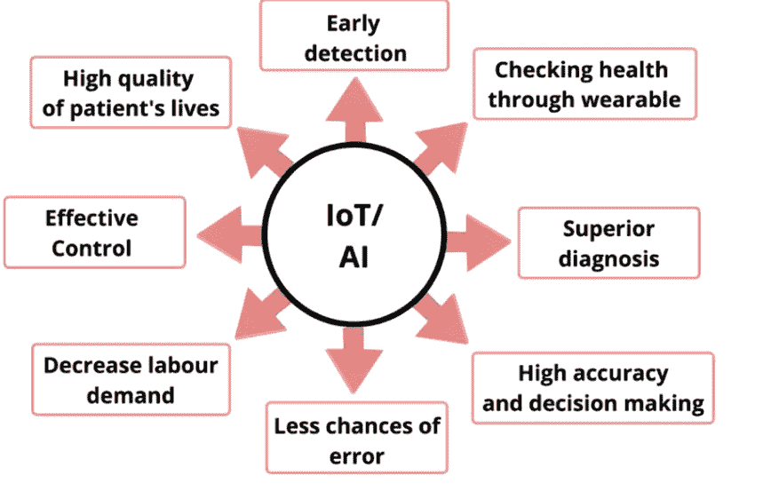

图 (1)。人工智能和物联网在医疗保健领域的益处。

## 物联网与人工智能在医疗保健

物联网指的是众多传感器、设备和其他技术的互联。动态分析模型要求在多种医疗情况下使用物联网技术来治疗各种疾病。通过将物联网纳入医疗保健系统，卫生从业人员可以获得有价值的数据，这些数据提供了对症状和感染过程的洞察，同时也允许长期考虑 [12, 13, 15]。它放大了大量数据和各种不同数据类型快速扩张。结果，基于物联网的系统会产生大量数据，这被称为大数据。物联网设备产生的大量数据对于人类和计算机软件来说太多，无法有效理解和处理。为了控制它们，使用了人工智能和机器学习技术 [31]。人工智能是模仿人类任务的最重要因素。它能够执行以前只能由人类智能执行的活动。人工智能可以使用复杂算法从大量数据中学习方面，然后利用结果来帮助临床实践。它还可以根据输入具有自我纠正能力以提高准确性。医生可以从提供来自临床实践的最新医疗信息并帮助他们提供有效患者护理的人工智能系统受益。此外，人工智能系统可以帮助减少诊断和治疗错误，而这些错误在临床实践中是不可避免的。此外，人工智能系统可以从庞大的患者群体中收集可用数据，以帮助制定健康风险警报和预测的实时结论 [32 - 34]。当大流行发生时，关键步骤是识别症状、适当监测和实施治疗。谈到在医疗保健中融合人工智能和物联网，有很大可能它们会提高运营效率。在物联网设备中智能高效部署人工智能算法的重要步骤是追踪（收集）、监测（分析）、自动化（建模、预测）、控制和优化（训练）[35]。人工智能与物联网结合在智能决策方面更强大，可以帮助对抗大流行。

## 物联网与人工智能：应用

物联网更像是一个概念，它构建了整个架构框架，允许需要帮助的人与服务提供商之间进行信息集成和有效交换。在当前通常情况下，大多数问题源于患者可及性不佳，这也是疫苗研发后最重要的问题 [36, 37]。物联网理念的实施改善了患者的可及性，使他们能够接受重要护理并最终康复 [38]。最近，物联网因其在医疗保健监测和监控中的应用而变得更加知名。

在流行期间，物联网有可能用于追踪感染患者。物联网技术是这样创建的，可以在大流行事件中使用，并且具有抗击大流行的策略以及流行期间的计算机化和透明治疗 [23, 38]。自 COVID-19 出现改变我们的日常生活以来，物联网和人工智能已成为监测和分析病例的关键工具。因此，由于这些进步，遏制感染的需求与提供个人保护的竞争需求取得了平衡 [39]。虽然迫切需要投入大量精力来对抗大流行，但必须认识到此类设备的使用应严格限制，无论在理由还是时间上，并且个人对安全、非隔离、编辑来源保护和其他机会的权利应得到充分保护 [40 - 42]。疾病传播是医疗诊所患者的主要关注点。由物联网启用的清洁监测设备有助于保障患者安全。物联网设备还协助资源管理人员在药房库存控制和自然观察等领域，例如分析冷藏温度和温度及湿度控制 [43 - 45]。在最近几十年和未来展望中，人工智能是最新兴和最受需求的科学工程技术。通过这种方式，可以通过融入智能行为来创新智能和智慧机器，从而获得机器的计算理解。人工智能由各种技术、工具和算法组成，如神经网络、符号人工智能、深度学习、机器学习和遗传算法。这些工具正在增长，并在军事、太空、机器人和健康等不同领域产生影响 [46 - 48]。近年来，人工智能的先进特征工具是机器学习，在工程和科学的不同领域重新组织。如今，它在我们的日常生活中被广泛采用，但从大量数据中找出概念抽象和特征学习的能力是机器学习作为人工智能工具的最强大的贡献 [18, 49, 50]。人工智能在成像过程中的使用在医疗保健行业引起了大量关注。图 (2) 说明了物联网和人工智能在各个制药行业中的使用。物联网和人工智能被大力推动，以提供高效和快速的医疗保健服务，尤其是在 COVID-19 的背景下，以自动化和促进医疗工作者的各种活动。

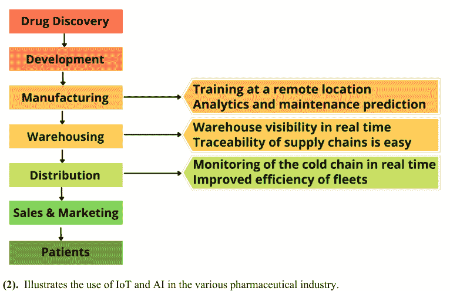

图 (2)。说明物联网和人工智能在各个制药行业中的使用。

## AI 和物联网支持的远程筛查

在 COVID-19 爆发的情况下，尽早筛查感染者是防止和控制病毒传播的关键步骤。人工筛查确实缓慢，然而远程筛查技术可以提高筛查速度和效率。因此，必须建立基于人工智能和物联网的远程筛查。

Schinkothe 等 2020 [51] 提出了一个基于 AIoT 的免费护理人员驾驶舱 (C19CC)。首先一名用户会与一名医疗工作者关联，后者根据提供的描述立即对个人进行分类。受检者的严重程度通过颜色代码显示。例如，COVID-19 患者由红色代码标识，带有红色代码的受检者会被自动筛查出来，其传记信息和最近活动范围会被突出显示。C19CC 不仅可用于远程筛查，还可用于远程监测、医院病房和其他应用。C19CC 对患者进行无接触预筛查，并迅速识别出需要立即治疗的人。肺部超声成像分类器还用于 COVID-19 的筛查或诊断，除传统的远程筛查方法外。Tan 和 Liu, 2020 [52] 提出了一种基础的人脸识别算法。该技术的主要目的是利用热成像远程筛查出疑似患者，然后使用人脸识别系统追踪与其有密切接触的人，以便及时隔离并防止病毒传播 [53]。收集到的肺部超声图像将通过 [54] 提出的便携式扫描仪输入平台。平台处理数据后，将在子空间网络中对其进行分类。这一系列流程可对患者进行 COVID-19 筛查。该分类器可在资金充足的养老院大规模使用，完全消除很少去医院的老年人之间的感染风险。由于 COVID-19 患者经常出现发热症状，人脸识别技术将被用于检测患者并通过互联网或移动设备通知医院平台，以便将患者隔离并进一步诊断。该过滤应用流程旨在用于智能手机应用和网页。它可以满足同时筛查多人的需求。数据收集模块可同时被大量人员使用，而机器学习模块可以回答关于感染风险的查询。用户通知模块用于按需向用户发送特定消息以提醒结果。通知模块将通知出现 COVID-19 迹象且病情进展的患者。然而，如何在遭受敌对攻击和用户信息被盗的情况下防止平台滥用，仍是一个亟待解决的重要挑战 [30]。部分远程筛查方法已在表 1 中总结。

### 表 1. 远程筛查方法及结果。

| 方法 | 特征 | 结果 | 参考文献 |
|---|---|---|---|
| 软性可穿戴设备 | 用于 COVID-19 快速筛查。 | 降低医护人员肺炎风险。 | [55, 56] |
| 基于热成像的人脸识别系统 | 具备追踪患者的能力。 | 有助于预防 COVID 传播。 | [52] |
| 子空间多层+便携式扫描仪 | 获得超过 96% 的测试数据准确率。 | 提高能源效率。 | [54] |
| C19CC（驾驶舱） | 识别可立即改善患者护理的远程医疗选项。 | 改善 COVID-19 患者护理和安全。 | [51] |
| 一次性学习框架 | 有效地从扁桃体炎中诊断冠状病毒以进行大规模筛查。 | 用于早期识别有感染风险的患者。 | [57] |

此外，可穿戴设备技术可用于远程筛查。Lonini 等 2021 [55] 提出了一种可穿戴设备，通过监测心跳和呼吸产生的微小振动来捕获数据。基于人工智能和物联网的可穿戴系统正被用于评估与 COVID-19 相关的指标，如体温和呼吸频率，因为新型冠状病毒在全球造成压力。Mohammed 等 2019 [58] 建议使用配备热成像系统的智能头盔，利用热成像过程自动识别冠状病毒，减少人际接触。智能头盔具有定位系统。当系统检测到高于正常温度时，将立即做出反应。可穿戴设备利用全球定位系统（GPS）数据追踪患者位置，使医生能够密切监测其状况。图 (3) 为平台的架构。

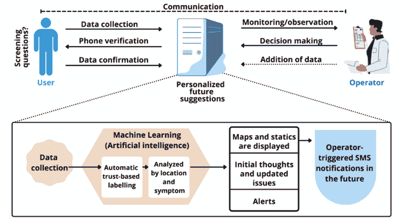

图 (3)。平台架构。

在人群中发现感染者对于早期 COVID-19 诊断和控制至关重要。在大流行期间加快发现受污染人员和区域的另一种典型技术是使用无人驾驶飞行器（UAV），特别是基于物联网的无人机。无人机技术可以在消除人员接触的同时到达难以到达的区域。在 COVID-19 大流行期间，利用地理信息系统（GIS）和 GPS 等信息用于追踪的物联网支持的智能手机应用程序被广泛采用，以提高发现感染者的机会。患者将受益于使用医疗物联网（IoMT）提供合适疗法的智能手机应用程序，使其在家中也能得到治疗。它还使医护人员和当局更容易跟踪患者和疾病爆发 [59, 60]。医护人员可以通过这种方式获取人们健康的实时数据。在 COVID-19 期间使用的不同类型工具和技术及其能力已在表 2 中简要介绍。

### 表 2. COVID-19 中使用的物联网关联设备。

| 工具和技术 | 特征描述 | 类型 | 用途 | 参考文献 |
|---|---|---|---|---|
| 可穿戴设备 | 可通过应用启用的设备，佩戴在身体上或附着于身体以接收和处理信息。 | 智能头盔、智能体温计 | 定期监测
改善患者护理的整体质量
减少医院就诊次数
更高效、更安全的医院
用于监测体温。 | [58, 61, 62] |
| 机器人 | 一种编程机器，可以像生物一样执行复杂任务。 | 远程机器人
社交机器人 | 减少患精神疾病的人数。
通过远程诊断和治疗，我们可以减少互动次数。 | [63, 64] |
| 应用（智能手机） | 用于执行特定活动的智能手机应用。 | Aarogya Setu
社交媒体 - Whatsapp | 用于监测、追踪
改善人与医疗服务之间的联系
无需去医院即可提供医疗援助。 | [38, 65 - 67] |
| 无人机 | 一种配备摄像头、GPS、传感器和通信系统的飞行器，可在几乎没有或没有人工干预的情况下飞行。 | 医疗无人机、
监控无人机、
多用途无人机 | 执行一系列活动，包括寻找、监测和投递包裹
减少人员互动
防止疾病在医护人员中传播。 | [68, 69] |

以下是物联网在患者、医生和医院中的应用：

## 患者与物联网

患者可通过可穿戴设备（如健康监测设备）以及其他远程相关设备（如血糖仪、血氧仪、脉搏监测袖套等）获得个性化关注。这些设备可以编程提醒您碳水化合物含量、练习检查、配置、脉搏类型等 [70]。物联网改变了人们，特别是老年患者的生活，使其能够持续监测医疗问题。独居人士及其家人受影响最大。一旦出现任何不愉快的影响或个人正常活动的变化，准备就绪的系统会向家人和相关健康提供者发送信号。

## 物联网助力医生

通过将可穿戴设备和其他家庭监测设备与物联网集成，医生可以更好地监测患者的健康状况。他们可以监测患者对治疗方案的依从性或任何其他临床考虑标准。物联网使医疗专业人员能够在与患者的关系中更加细致入微和主动。从物联网设备获取的信息可以帮助医生为患者选择最佳治疗方案并达到预期效果。

## 医院中的物联网

除了监测患者的健康状况外，物联网设备在诊所的各个领域都很有用。启用传感器的物联网设备用于追踪临床设备的位置，如轮椅、除颤器、雾化器、氧气瓶和其他监测设备。各个部门的临床人员配置也可以实时分析 [20, 28, 71, 72]。

## 诊断

CT 扫描和 X 射线是在 COVID-19 背景下诊断最常用的两种影像模式。然而，在新型冠状病毒爆发的情况下，使用 CT 扫描和 X 射线可能会使患者和医生面临交叉感染的风险。然而，阅读大量影像扫描并手动追踪肺部病变会延迟 COVID-19 的检测 [73]。因此，建立基于物联网的智能诊断系统以帮助一线临床医生应对 COVID-19 至关重要。近年来，深度学习的多种方法已证明在各种大数据分析中非常成功。卷积神经网络在语音识别、计算机视觉、自然语言处理、图像识别以及文本检测和识别等多种应用中被广泛使用 [74]。CNN 的基本设计如图 (4) 所示。通常使用的三种 CNN 层类型是卷积层、全连接层，

和池化层 [75]。CNN 变体和 CNN 本身能够捕捉特征丰富的图像的整体结构外观。用于心电图（ECG）监测、图像诊断和图像分割的医学图像研究取得了显著进展 [76]。图 (4) 显示了 CNN 架构的 1D 示意图。CNN 可以通过结合相同数量的下采样和上采样层来推断整个图像的上下文。ResNet 是另一种用于医学图像的知名 CNN 设计。它有助于加速优化收敛以及梯度反向传播的流动 [77, 78]。

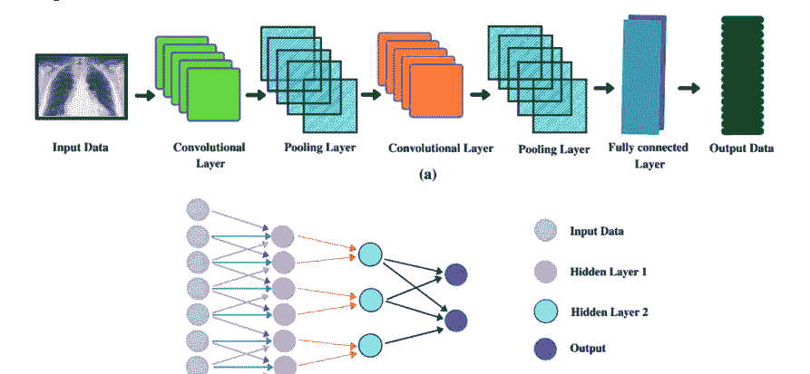

图 (4)。(a) CNN 的基本设计。(b) CNN 架构的 1D 示意图。

在小样本数据集中，Jiang 团队 [79] 训练了 VGG-16 卷积神经网络迁移学习，用于区分患者 COVID-19 的早期、晚期和严重阶段，并用于构建智能 COVID-19 诊断模型 [30]。如图 (5) 所示，Gomes 等人 2020 [80] 提出了一种智能系统，以促进 X 射线扫描图像的诊断，并使用 X 射线图像构建 IKONOS（桌面程序）来诊断 COVID-19。医生将图像上传到应用程序，该应用程序使用经典分类器、纹理和形状描述符提取特征，并进一步使用智能系统进行分析以识别 COVID-19。上述模型是基于 AI 和 IoT 的系统的示例，有助于为医护人员提供参考信息，并在疫情防控期间提高效率。因此，基于 AI 的 IoT 系统预计将在未来的智能医疗中变得越来越流行。

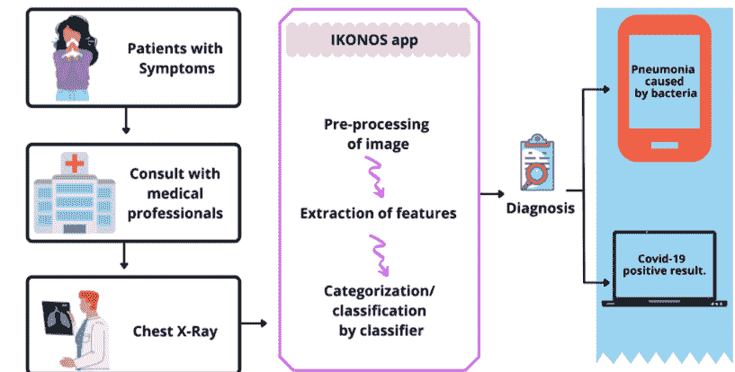

图 (5)。IKONOS 可用于加载来自有症状患者的胸部 X 光片。该应用程序由一个能够提取特征并对图像进行分类的智能系统组成。结果可以在安装了该软件的计算机上查看。

## 通过基于机器学习的物联网进行疫情监测与控制

基于机器学习的物联网是一种针对特定应用、低成本、可行且易于使用的解决方案，可解决任何持续存在的问题。传感器是从现实世界收集数据的设备，其数据通过组织路由，而执行器则允许事物根据传感器收集的数据采取行动或做出响应。图 (6) 描述了用于防止大流行病传播的拟议物联网设计。信息通过网关设备交换，然后发送到云网关。信息的分离，即完整信息，在庞大的信息数据中心中被提取。由于其包含结构化信息，因此是一个重要的信息数据中心。

由机器学习驱动的人工智能用于根据需求和获取的数据创建框架模型。数据的评估可用于描述结果并建立操作之间的相关性。在开放式盥洗室中，可使用红外传感器来编程入口的动作并适当使用水流。通过在机场、火车站、交通枢纽和零售中心的门通行点使用光学摄像头，可以使用红外温度计来验证内部体温，以识别群体中的受污染者并进行人脸识别。从本质上讲，传感器如工程中所建议的那样，可用于监测内部温度、计划的入口活动、公共区域和厕所处控制的水流，以及在线监测以保持与现实世界和人员接触的战略距离。基于人工智能的深度学习可以帮助理解医疗保健模式、风险关联的建模以及结果预测。对于小型应用或个人，可以使用单个温度传感器、单个 Node-MCU 或配备传感器和互联网的 Arduino 板 [81]。因此，应用基于 ML 的方法可以减少大流行的传播并帮助遏制它。

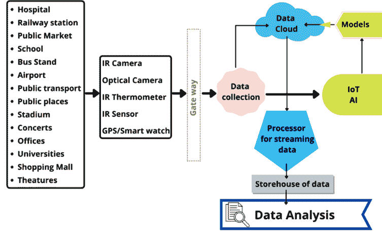

图 (6)。用于防止大流行病传播的拟议物联网设计。

## 药物发现和疫苗研究

自 COVID-19 大流行爆发以来，找到可用于治疗该大流行的药物至关重要。ML 可以帮助识别现有药物，这些药物可能对 COVID-19 的治疗有益。ML 可以从药物和蛋白质的结构中学习并预测它们的相互作用，从而进行临床试验。科学家和研究人员已使用多种方法，包括重新利用现有药物（治疗性）和开发新药物以获得正确和有效的药物 [82]。机器学习的使用和新模型的发展促使研究人员集中使用机器和深度学习模型来寻找可以治愈 COVID-19 的药物。基于现有临床数据开发新疫苗可能需要很长时间。然而，使用机器学习技术，可以在保持疫苗质量的同时大大缩短整个程序。例如，Ekins 等人 2015 [83] 描述了贝叶斯机器学习模型如何在研究中用于生产埃博拉疫苗。在研究 H7N9 病毒时，张等人 2017 [84] 使用随机森林技术来提高评分的准确性。目前，科学界正在投入大量工作，利用机器学习来寻找 COVID-19 疫苗的设计。Gonzalez-Dias 等人 2020 [85] 描述了使用机器学习预测疫苗免疫原性和反应原性特征的阶段。这些阶段包括数据准备、疫苗选择和相关基因选择，以及为建模选择合适的机器学习算法并评估预测模型性能。因此，AI 有助于以更快的速度开发疫苗和药物疗法，以及在疫苗开发期间进行临床试验。

## AI 启用系统的适用性

智能城市作为一个互联的城市文化，每秒从多个嵌入式设备收集数据，这意味着智能城市在 COVID-19 疫情期间可以很好地与机器学习方法配合使用。为了改进学习和预测模型，机器学习技术依赖于数据，这些数据可以提供一些内在和必要的见解，使智能城市决策者能够在 COVID-19 大流行期间采取预防措施。不同的机器学习算法与其他人工智能（AI）领域协同工作，使模型能够创建强大的自学习平台。由于数据可用性受限，我们必须处理实时数据流，因此研究 AI 和机器学习在对抗 COVID-19 中的作用至关重要。因此，自学习系统在智能城市中的重要性日益增加。AI 和 ML 技术如何在智能城市中用于对抗 COVID-19 疫情的整个流程如图 (7) 所示。

如图 (7) 所示，智能城市中嵌入的信息和通信技术设备产生的多种数据形式中的一些如下：

- 1. 统计数据，通常包括检测到的累计日病例数、新阳性病例数、死亡人数和康复病例数等，可用于预测未来病例并为紧急情况做准备。
- 2. 疫学数据主要涉及所有临床患者检测数据，包括各种药物测试数据、各种药物试验数据、患者的病史以及患者对各种药物的反应等。
- 3. 智能城市传感器和摄像头提供的实时监控数据可能

有助于追踪和预防 COVID-19 的传播。例如，COVID-19 的初始识别指标之一基于发热症状；因此，可以使用人脸识别和其他个人信息来监测体温 [82]。

因此，使用 ML 方法来处理和分析数据，以提取可应用于各种应用的洞察。

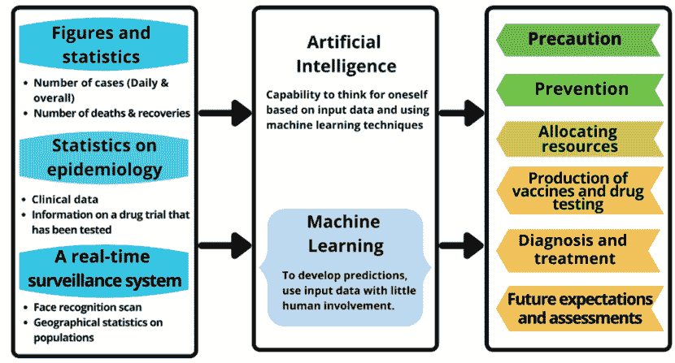

Fig. (7). 用于对抗 COVID-19 的 AI 和基于 ML 的技术应用。

## 未来大流行预测

尽管这是现代记忆中最严重的大流行，但此次大流行发生在数字时代。因此，分析的每个组成部分现在都可以用数据来表示，包括宏观层面、后勤层面和生理层面；这无疑将有助于预测当前大流行或未知未来大流行的行为。据记载，AI 技术有可能应用于 COVID-19 基因组序列，以获取有关该生物体的有价值信息。在模式分析方面，有效的计算机化工具可供人们使用，尤其是生物信息学家，可以检查庞大而复杂的遗传和基因组数据集。已为基因组序列中突变的分析设计了算法，这些算法用于定位基因组序列中核苷酸碱基发生变化的位点并量化突变率。因此，序列模式挖掘（SPM）数据可用于揭示有关病毒致病性、临床症状学、突变和毒株信息的新信息 [16, 86]。Eng 等人 2014 年 [87] 使用机器学习方法（随机森林）来识别可能的动物源性流感毒株，这些病毒通常只感染动物，但也可能对人类造成危险。因此，机器学习可以帮助预测由任何物种引起的未来大流行。唯一的缺点是数据可能来自不同的区域，例如 COVID-19 的来源可能来自“蝙蝠”，因此大流行源可能与以前看到的不同（不同的基因组结构）。此外，经典机器学习要求训练和测试中的数据分布来自相同的域。另一方面，迁移学习（TL）作为一种机器学习，可能有效地处理训练和测试数据来自不同数据分布的情况。也就是说，从以前的大流行中获得的知识未来可以应用于新领域，即使数据量较少。图（8）描绘了一种情况，其中来自当前 COVID-19 大流行（具有大数据和标签）的预训练模型可以用明显更少的数据和标签来使用，以预测未来大流行，为智能城市为此类事件做好准备，并迅速协助疾病的传播。它代表了用于对抗 COVID-19 的基于智能城市的框架的组成部分，具有很大的潜在用途。

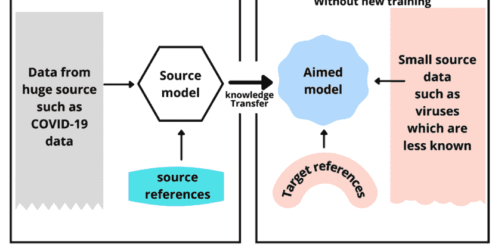

Fig. (8). 用于预测未来大流行的迁移学习。

## 结论

全球今天面临的最严重挑战之一是流行病威胁。因此，为了监测和预防流行病的传播，现在需要先进的智能监测技术。特别是在 COVID-19 疫情期间，整个医疗保健系统面临着需要解决的新问题。然而，智能技术，即基于 AI 的物联网系统，已被证明是一种非常重要且用途广泛的资源，应用范围从远程筛查、诊断、治疗和疫苗开发，到降低污染风险。这些技术也有助于通过使用实时信息来保持质量监督。智能技术和设备已在重大疫情中显示出其潜力，即 COVID-19，并且也在上述讨论中。考虑下一次大流行是任何人都不会想的事情。然而，我们必须做好准备，早期检测和干预是预防疾病暴发的关键步骤。因此，实施先进技术可以通过采用基于统计的策略来帮助预测疾病的发生。设计的基于 ML 的物联网模块有可能成为流行病监测的变革者，应用各种方法可以为获取有关不同毒株和突变的信息带来成果。研究人员、医生、政府官员和学者都可以从该技术的有效部署中受益，这将有助于建立更有利于应对进一步流行病疾病的环境。未来，将开发更多基于 AI 的物联网系统来对抗大流行。通过使用技术和集成算法，将非常有利于筛查、监测、诊断和预测大流行的复发或发生，以便及时采取行动。因此，先进技术的使用将作为未来改进的医疗治疗手段。

## 发表同意书

声明无。

## 利益冲突

作者声明无利益冲突，无论是财务或其他方面。

## 致谢

声明无。

## 参考文献

- [1] J.T. Watson, M. Gayer, and M.A. Connolly, "自然灾害后的流行病", Emerg. Infect. Dis., vol. 13, no. 1, pp. 1-5, 2007. [http://dx.doi.org/10.3201/eid1301.060779] [PMID: 17370508]
- [2] J.M. Hughes, M.E. Wilson, B.L. Pike, K.E. Sailors, J.N. Fair, and M. LeBreton, "大流行的起源与预防", Clin. Infect. Dis., vol. 50, no. 12, pp. 1636-40, 2010
- [3] A.L. Rice, L. Sacco, A. Hyder, and R.E. Black, "营养不良作为发展中国家传染病相关儿童死亡的潜在原因", Bull. World Health Organ., vol. 78, no. 10, pp. 1207-1221, 2000. [PMID: 11100616]
- [4] T.J. John, L. Dandona, V.P. Sharma, and M. Kakkar, "印度传染病持续的挑战", Lancet, vol. 377, no. 9761, pp. 252-269, 2011. [http://dx.doi.org/10.1016/S0140-6736(10)61265-2] [PMID: 21227500]
- [5] S. Srabani, "印度霍乱：一个神话 Indian Journal of History of Science", Retrieved April, vol. 20, p. 2018, 2012.
- [6] "印度历史上流行病和大流行：综述文章", Indian J. Public Health Res. Dev., vol. 10, no. 8, 2019.
- [7] T.K. Burki, "中国的新冠病毒", Lancet Respir. Med., vol. 8, no. 3, p. 238, 2020. [http://dx.doi.org/10.1016/S2213-2600(20)30056-4] [PMID: 32027848]
- [8] W.B. Yu, G.D. Tang, L. Zhang, and R.T. Corlett, "利用全基因组数据解析新型肺炎冠状病毒（SARS-CoV-2 / HCoV-19）的进化与传播", Zool. Res., vol. 41, no. 3, pp. 247-257, 2020. [http://dx.doi.org/10.24272/j.issn.2095-8137.2020.022] [PMID: 32351056]
- [9] D. Arnold, "大流行印度：冠状病毒与历史的用途", J. Asian Stud., vol. 79, no. 3, pp. 569-577, 2020. [http://dx.doi.org/10.1017/S0021911820002272] [PMID: 34191871]
- [10] P. Hamet, and J. Tremblay, "医学中的人工智能", Metabolism, vol. 69, pp. S36-S40, 2017. [http://dx.doi.org/10.1016/j.metabol.2017.01.011] [PMID: 28126242]
- [11] J.F.W. Chan, S. Yuan, K.H. Kok, K.K.W. To, H. Chu, J. Yang, F. Xing, J. Liu, C.C.Y. Yip, R.W.S. Poon, H.W. Tsoi, S.K.F. Lo, K.H. Chan, V.K.M. Poon, W.M. Chan, J.D. Ip, J.P. Cai, V.C.C. Cheng, H. Chen, C.K.M. Hui, and K.Y. Yuen, "与 2019 年新型冠状病毒相关的肺炎家族聚集提示人际传播：一项家庭聚集研究", Lancet, vol. 395, no. 10223, pp. 514-523, 2020. [http://dx.doi.org/10.1016/S0140-6736(20)30154-9] [PMID: 31986261]
- [12] W. Liu, Z.W. Tao, L. Wang, M.L. Yuan, K. Liu, L. Zhou, S. Wei, Y. Deng, J. Liu, H.G. Liu, M. Yang, and Y. Hu, "2019 新型冠状病毒疾病住院患者疾病结局相关因素分析", Chin. Med. J. (Engl.), vol. 133, no. 9, pp. 1032-1038, 2020. [http://dx.doi.org/10.1097/CM9.0000000000007775] [PMID: 32118640]
- [13] M. Goumenou, D. Sarigiannis, A. Tsatsakis, O. Anesti, A. Docea, D. Petrakis, D. Tsoukalas, R. Kostoff, V. Rakitskii, D. Spandidos, M. Aschner, and D. Calina, "意大利北部 COVID-19：可能影响疫情急剧增加的因素综合概述（综述）", Mol. Med. Rep., vol. 22, no. 1, pp. 20-32, 2020. [http://dx.doi.org/10.3892/mmr.2020.11079] [PMID: 32319647]
- [14] A. Mitra, B. Deutsch, F. Ignatovich, C. Dykes, and L. Novotny, "单病毒和纳米颗粒的纳米光流体检测", ACS Nano, vol. 4, no. 3, pp. 1305-1312, 2010. [http://dx.doi.org/10.1021/nn901889v] [PMID: 20148575]
- [15] P. Mehta, D.F. McAuley, M. Brown, E. Sanchez, R.S. Tattersall, and J.J. Manson, "COVID-19：考虑细胞因子风暴综合征和免疫抑制", Lancet, vol. 395, no. 10229, pp. 1033-1034, 2020. [http://dx.doi.org/10.1016/S0140-6736(20)30628-0] [PMID: 32192578]
- [16] N. Arora, A. K. Banerjee, and M. L. Narasu, "人工智能在应对 COVID-19 中的作用", Future Virology, vol. 15, no. 11. Future Medicine, pp. 717-724, 2020. [http://dx.doi.org/10.2217/fvl-2020-0130]

[17] I. Kononenko, "医学诊断中的归纳和贝叶斯学习", Appl. Artif. Intell., vol. 7, no. 4, pp. 317-337, 1993.
[http://dx.doi.org/10.1080/08839519308949993]

[18] Y. LeCun, Y. Bengio, and G. Hinton, “深度学习”. Nature, vol. 521, no. 7553, pp. 436-444, 2015.

[19] D. Yu, and L. Deng, "深度学习及其在信号和信息处理中的应用[探索性 dsp]", IEEE Signal Process. Mag., vol. 28, no. 1, pp. 145-154, 2011.
[http://dx.doi.org/10.1109/MSP.2010.939038]

[20] A.A. Ardakani, A.R. Kanafi, U.R. Acharya, N. Khadem, and A. Mohammadi, "应用深度学习技术在常规临床实践中使用 CT 图像管理 COVID-19：10 个卷积神经网络的结果", Comput. Biol. Med., vol. 121, p. 103795, 2020.
[http://dx.doi.org/10.1016/j.compbiomed.2020.103795] [PMID: 32568676]

[21] Q. Du, H. Song, and X. Zhu, "面向智能物联网社区的设备间社会特征启用通信", IEEE Commun. Mag., vol. 57, no. 1, pp. 130-137, 2019.
[http://dx.doi.org/10.1109/MCOM.2018.1700563]

[22] P. Partila, J. Tovarek, G.H. Ilk, J. Rozhon, and M. Voznak, "深度学习服务于语音克隆：自动说话人验证系统对欺骗试验的脆弱性如何？", IEEE Commun. Mag., vol. 58, no. 2, pp. 100-105, 2020.
[http://dx.doi.org/10.1109/MCOM.001.1900396]

[23] L. Garg, E. Chukwu, N. Nasser, C. Chakraborty, and G. Garg, "匿名保护的基于物联网的 COVID-19 及其他传染病接触追踪模型", IEEE Access, vol. 8, pp. 159402-159414, 2020.
[http://dx.doi.org/10.1109/ACCESS.2020.3020513] [PMID: 34786286]

[24] S.M. Riazul Islam, Daehan Kwak, M. Humaun Kabir, M. Hossain, and Kyung-Sup Kwak, "医疗保健中的物联网：全面综述", IEEE Access, vol. 3, pp. 678-708, 2015.
[http://dx.doi.org/10.1109/ACCESS.2015.2437951]

[25] J. Qi, P. Yang, G. Min, O. Amft, F. Dong, and L. Xu, "用于个性化医疗保健系统的先进物联网：综述", Pervasive Mobile Comput., vol. 41, pp. 132-149, 2017.
[http://dx.doi.org/10.1016/j.pmcj.2017.06.018]

[26] C.A. da Costa, C.F. Pasluosta, B. Eskofier, D.B. da Silva, and R. da Rosa Righi, "健康物联网：迈向医院病房智能生命体征监测", Artif. Intell. Med., vol. 89, pp. 61-69, 2018.
[http://dx.doi.org/10.1016/j.artmed.2018.05.005] [PMID: 29871778]

[27] H. Haddad Pajouh, A. Dehghantanha, R. M. Parizi, M. Aledhari, and H. Karimipour, “物联网安全综述：需求、挑战和解决方案”, Internet Things, vol. 14, p. 100129, 2021.
[http://dx.doi.org/10.1016/j.iot.2019.100129]

[28] T. Ai, Z. Yang, H. Hou, C. Zhan, C. Chen, W. Lv, Q. Tao, Z. Sun, and L. Xia, "中国冠状病毒病 2019（COVID-19）胸部 CT 与 RT-PCR 检测的相关性：1014 例报告", Radiology, vol. 296, no. 2, pp. E32-E40, 2020.
[http://dx.doi.org/10.1148/radiol.20200642] [PMID: 32101510]

[29] R. Vaishya, M. Javaid, I.H. Khan, and A. Haleem, "COVID-19 大流行的人工智能（AI）应用", Diabetes Metab. Syndr., vol. 14, no. 4, pp. 337-339, 2020.
[http://dx.doi.org/10.1016/j.dsx.2020.04.012] [PMID: 32305024]

[30] S. W. Chen, X. W. Gu, J. J. Wang, and H. S. Zhu, “用于 COVID-19 大流行预防和控制的 AIoT”, Contrast Media Mol. Imaging, vol. 2021, 2021.

[31] M. S, and R. Latha, "医疗保健系统中人工智能与物联网：综述", International Journal of Advanced Trends in Computer Science and Engineering, vol. 8, no. 6, pp. 2847-2854, 2019.

[32] D.B. Neill, "利用人工智能改善医院住院护理", IEEE Intell. Syst., vol. 28, no. 2, pp. 92-95, 2013.
[http://dx.doi.org/10.1109/MIS.2013.51]

[33] C.S. Lee, P.G. Nagy, S.J. Weaver, and D.E. Newman-Toker, "导致放射学诊断错误的认知和系统因素", AJR Am. J. Roentgenol., vol. 201, no. 3, pp. 611-617, 2013.
[http://dx.doi.org/10.2214/AJR.12.10375] [PMID: 23971454]

[34] F. Jiang, Y. Jiang, H. Zhi, Y. Dong, H. Li, S. Ma, Y. Wang, Q. Dong, H. Shen, and Y. Wang, "医疗保健中的人工智能：过去、现在和未来", Stroke Vasc. Neurol., vol. 2, no. 4, pp. 230-243, 2017.
[http://dx.doi.org/10.1136/svn-2017-000101] [PMID: 29507784]

[35] S.M.A.A. Abir, S.N. Islam, A. Anwar, A.N. Mahmood, and A.M.T. Oo, "利用人工智能、机器学习和物联网建立抗击 COVID-19 大流行的韧性：近期进展综述", IoT, vol. 1, no. 2, pp. 506-528, 2020.
[http://dx.doi.org/10.3390/iot1020028]

[36] Y. Wang, M. Hu, Q. Li, X.-P. Zhang, G. Zhai, and N. Yao, “异常呼吸模式分类器可能以准确且无干扰的方式有助于大规模筛查 COVID-19 感染者”, ArXiv Prepr. ArXiv200205534, 2020.

[37] A. Haleem, M. Javaid, R. Vaishya, and S.G. Deshmukh, "COVID-19 影响的学术研究领域", Am. J. Emerg. Med., vol. 38, no. 7, pp. 1524-1526, 2020.
[http://dx.doi.org/10.1016/j.ajem.2020.04.022] [PMID: 32317202]

[38] R.P. Singh, M. Javaid, A. Haleem, and R. Suman, "物联网（IoT）对抗 COVID-19 大流行的应用", Diabetes Metab. Syndr., vol. 14, no. 4, pp. 521-524, 2020.
[http://dx.doi.org/10.1016/j.dsx.2020.04.041] [PMID: 32388333]

[39] R. Kumar, F. Al-Turjman, L. Anand, A. Kumar, S. Magesh, K. Vengatesan, R. Sitharthan, and M. Rajesh, "使用人工智能技术对肺部感染进行基因组序列分析", Interdiscip. Sci., vol. 13, no. 2, pp. 192-200, 2021.
[http://dx.doi.org/10.1007/s12539-020-00414-3] [PMID: 33558984]

[40] R. Geetha, S. Sivasubramanian, M. Kaliappan, S. Vimal, and S. Annamalai, "使用随机森林分类器的合成少数过采样技术和主成分分析进行宫颈癌识别", J. Med. Syst., vol. 43, no. 9, p. 286, 2019.
[http://dx.doi.org/10.1007/s10916-019-1402-6] [PMID: 31312985]

[41] S. K. Nataraj, F. Al-Turjman, A. H. Adom, R. Sitharthan, M. Rajesh, and R. Kumar, “使用高阶谱带特征的具有思维控制和通信辅助的智能机器人椅”, IEEE Sens. J., vol. 22, no. 18, pp. 17362-17369, 2022.
[http://dx.doi.org/10.1109/JSEN.2020.3020971]

[42] S. Pradeepa, K.R. Manjula, S. Vimal, M.S. Khan, N. Chilamkurti, and A.K. Luhach, "DRFS：使用机器学习技术从社交媒体检测中风疾病风险因素", Neural Process. Lett., pp. 1-19, 2020.
[http://dx.doi.org/10.1007/s11063-020-10279-8]

[43] R. Sitharthan, M. Rajesh, K. Madurakavi, J. Raglend, and R. Kumar, “利用物联网在印度评估 COVID-19 大流行前后二氧化氮（NO2）对健康的影响”, Int. J. Pervasive Comput. Commun., vol. 9, 2020.

[44] M. Ramamurthy, I. Krishnamurthi, S. Vimal, and Y. H. Robinson, “基于深度学习的基因组分析和新型混合模型的 NGS-RNA LL 鉴定”, Biosystems, vol. 197, p. 104211, 2020.
[http://dx.doi.org/10.1016/j.biosystems.2020.104211] [PMID: 32795485]

[45] R. Sitharthan, S. Krishnamoorthy, P. Sanjeevikumar, J. B. Holm-Nielsen, R. R. Singh, and M. Rajesh, “使用自适应 Elman 神经网络控制的反馈线性化直接转矩控制策略最小化 PMSM 转矩脉动”, Int. Trans. Electr. Energy Syst., vol. 31, no. 1, p. e12685, 2021.

[46] J. McCarthy, 人工智能、逻辑和常识形式化. 哲学逻辑与人工智能. Springer, 1989, pp. 161-190.
[http://dx.doi.org/10.1007/978-94-009-2448-2_6]

[47] A.M. Turing, 计算机器与智能. 解析图灵测试. Springer, 2009, pp. 23-65.
[http://dx.doi.org/10.1007/978-1-4020-6710-5_3]

[48] S. Russell and P. Norvig, “人工智能：一种现代方法，第三版”, Upper Saddle River, N.J., 2010.

[49] D. Grover and B. Toghi, “利用改进滑动窗口度量的 k-NN 分类器进行 MNIST 数据集分类”, in Science and Information Conference, pp. 583–591, 2019.

[50] Y. Sun, D. Liang, X. Wang, and X. Tang, “DeepID3：使用非常深的神经网络进行人脸识别”, ArXiv Prepr. ArXiv150200873, 2015.

[51] T. Schinköthe, M.R. Gabri, M. Mitterer, P. Gouveia, V. Heinemann, N. Harbeck, and M. Subklewe, “一种基于网络和应用程序的 COVID-19 门诊和住院护理连接护理解决方案：定性研究和应用开发”, JMIR Public Health Surveill., vol. 6, no. 2, p. e19033, 2020.
[http://dx.doi.org/10.2196/19033] [PMID: 32406855]

[52] W. Tan and J. Liu, “人脸识别在追踪 COVID-19 发热患者和密切接触者中的应用”, in 2020 19th IEEE International Conference on Machine Learning and Applications (ICMLA), 2020, pp. 1112–1116.
[http://dx.doi.org/10.1109/ICMLA51294.2020.00179]

[53] Y. Zhang, Q. Wang, and S.H. Yuan, "关于 COVID-19 传播、扩散、控制和诊断计算机建模的特刊导言", Comput. Model. Eng. Sci., vol. 127, no. 2, pp. 385-387, 2021.
[http://dx.doi.org/10.32604/cmes.2021.016386]

[54] D. Hou, R. Hou and J. Hou, "用于 COVID-19 肺部超声筛查的可解释 Saab 子空间网络," 2020 11th IEEE Annual Ubiquitous Computing, Electronics & Mobile Communication Conference (UEMCON), New York, NY, USA, pp. 0393-0398, 2020.
[http://dx.doi.org/10.1109/UEMCON51285.2020.9298069]

[55] L. Lonini, N. Shawen, O. Botonis, M. Fanton, C. Jayaraman, C.K. Mummidisetty, S.Y. Shin, C. Rushin, S. Jenz, S. Xu, J.A. Rogers, and A. Jayaraman, "使用软可穿戴设备和结构化活动快速筛查与 COVID-19 相关的生理变化：一项试点研究", IEEE J. Transl. Eng. Health Med., vol. 9, pp. 1-11, 2021.
[http://dx.doi.org/10.1109/JTEHM.2021.3058841] [PMID: 33665044]

[56] P.K. Singh, S. Nandi, K.Z. Ghafoor, U. Ghosh, and D.B. Rawat, "利用信息和通信技术防止 COVID-19 传播", IEEE Consum. Electron. Mag., vol. 10, no. 4, pp. 18-27, 2021.
[http://dx.doi.org/10.1109/MCE.2020.3047608]

[57] H. Mulchandani, P. Dalal, O.A. Ramwala, P. Parikh, U. Dalal, M. Paunwala and C. Paunwala, "基于扁桃体炎的 COVID-19 大规模筛查早期诊断使用单次学习框架," 2020 IEEE 17th India Council International Conference (INDICON), New Delhi, India, 2020, pp. 1-6.
[http://dx.doi.org/10.1109/INDICON49873.2020.9342371]

[58] M.N. Mohammed, H. Syamsudin, S. Al-Zubaidi, R. R. AKS, and E. Yusuf, “基于物联网智能头盔的新型 COVID-19 检测和诊断系统”, Int. J. Psychosoc. Rehabil., vol. 24,

[59] M. A. El Khaddar and M. Boulmalf, “智能手机：终极物联网和物联网扩展设备”, Smartphones Appl. Res. Perspect., vol. 137, 2017.

[60] V. Chamola, V. Hassija, V. Gupta, and M. Guizani, "对COVID-19大流行的全面回顾以及物联网、无人机、人工智能、区块链和5G在缓解其影响中的作用", IEEE Access, vol. 8, pp. 90225-90265, 2020.
[http://dx.doi.org/10.1109/ACCESS.2020.2992341]

[61] T. Tamura, M. Huang, and T. Togawa, "可穿戴温度计的当前进展", Advanced Biomedical Engineering, vol. 7, no. 0, pp. 88-99, 2018.
[http://dx.doi.org/10.14326/abe.7.88]

[62] S. Ghosh, “中国、迪拜和意大利的警察正在使用这些监控头盔扫描路人COVID-19发热，这可能是我们未来的常态”, Bus. Insid., vol. 17, 2020.

[63] M. Tavakoli, J. Carriere, and A. Torabi, “COVID-19大流行期间医疗保健中的机器人技术、智能可穿戴技术和自主智能系统：现状分析和未来展望”, Adv. Intell. Syst., vol. 2, no. 7, p. 2000071, 2020.
[http://dx.doi.org/10.1002/aisy.202000071]

[64] K. Knibbs, “没有治愈COVID-19孤独感的办法，但机器人可以帮助”, Wired Mag., 2020.

[65] “Aarogya Setu 应用：如何使用 Aarogya Setu 应用并查明您是否出现冠状病毒症状 - 《经济时报》。 https://economictimes.indiatimes.com/tech/software/how-to-use-aarogya-set--app-and-find-out-if-you-have-covid-19-symptoms/articleshow/75023152.cms (accessed Mar. 26, 2022).

[66] T. India, “印度政府推出 Aarogya Setu 应用以追踪冠状病毒感染。” 2020.

[67] “Aarogya Setu 移动应用”, MyGov.in. https://www.mygov.in/aarogya-setu-app/ (accessed Mar. 25, 2022).

[68] M. Sharma, “无人机如何被用于对抗COVID-19”, Geospatial World, vol. 4, 2020.

[69] J. Reagan, “与COVID相关的无人机配送飞入加拿大原住民地区”, DRONELIFE, Jun. 10, 2020. https://dronelife.com/2020/06/10/ddc-drone-covid-drone-delivery/ (accessed Mar. 25, 2022).

[70] M. Ndiaye, S.S. Oyewobi, A.M. Abu-Mahfouz, G.P. Hancke, A.M. Kurien, and K. Djouani, "COVID-19 后的物联网：对贡献、挑战和演变的调查", IEEE Access, vol. 8, pp. 186821-186839, 2020.
[http://dx.doi.org/10.1109/ACCESS.2020.3030090] [PMID: 34786294]

[71] T. Ozturk, M. Talo, E.A. Yildirim, U.B. Baloglu, O. Yildirim, and U. Rajendra Acharya, "使用深度神经网络和X射线图像自动检测COVID-19病例", Comput. Biol. Med., vol. 121, p. 103792, 2020.
[http://dx.doi.org/10.1016/j.compbiomed.2020.103792] [PMID: 32568675]

[72] B. D. Deebak and F. Al-Turjman, “面向基于物联网的电子健康系统的安全用户登录认证”, Complex Intell. Syst., pp. 1–21, 2021.

[73] S.H. Wang, S.L. Fernandes, Z. Zhu, and Y.D. Zhang, "AVNC：基于CBAM的注意力机制VGG风格网络用于COVID-19诊断", IEEE Sens. J., vol. 22, no. 18, pp. 17431-17438, 2022.
[http://dx.doi.org/10.1109/JSEN.2021.3062442] [PMID: 36346097]

[74] M. Jaderberg, A. Vedaldi, and A. Zisserman, "用于文本检测的深度特征", European conference on computer vision, pp. 512–528, 2014.

[75] Y. Lecun, L. Bottou, Y. Bengio, and P. Haffner, "应用于文档识别的基于梯度的学习", Proc. IEEE, vol. 86, no. 11, pp. 2278-2324, 1998.
[http://dx.doi.org/10.1109/5.726791]

[76] W. Yin, X. Yang, L. Zhang, and E. Oki, "基于CNN的集成IR-UWB雷达的ECG监测系统", IEEE Access, vol. 4, p. 1, 2016.
[http://dx.doi.org/10.1109/ACCESS.2016.2608777]

[77] A. Fakhry, T. Zeng, and S. Ji, "用于脑电子显微镜图像分割的残差反卷积网络", IEEE Trans. Med. Imaging, vol. 36, no. 2, pp. 447-456, 2017.
[http://dx.doi.org/10.1109/TMI.2016.2613019] [PMID: 28113967]

[78] R. Guerrero, C. Qin, O. Oktay, C. Bowles, L. Chen, R. Joules, R. Wolz, M.C. Valdés-Hernández, D.A. Dickie, J. Wardlaw, and D. Rueckert, "使用卷积神经网络进行白质高信号和卒中病灶分割与鉴别", Neuroimage Clin., vol. 17, pp. 918-934, 2018.
[http://dx.doi.org/10.1016/j.nicl.2017.12.022] [PMID: 29527496]

[79] Z. Jiang, and X. Xu, "基于CT图像的COVID-19智能辅助诊断", J. Mol. Imaging, vol. 43, no. 2, pp. 264-269, 2020.

[80] J.C. Gomes, "IKONOS：一种通过X射线图像纹理分析支持COVID-19诊断的智能工具", Res. Biomed. Eng., pp. 1-14, 2020.

[81] R. Sitharthan, and M. Rajesh, "机器学习和物联网在医疗保健中预测和应对大流行情况的应用", Distrib Parallel Databases, vol. 40, no. 4, p. 887, 2021.
[PMID: 34393377]

[82] A.E. Ezugwu, I.A.T. Hashem, O.N. Oyelade, M. Almutari, M.A. Al-Garadi, I.N. Abdullahi, O. Otegbeye, A.K. Shukla and H. Chiroma, “关于机器学习在抗击COVID-19中应用的视角的新型智慧城市框架,” BioMed Res. Int., vol. 2021, 2021.

[83] S. Ekins, J. S. Freundlich, A. M. Clark, M. Anantpadma, R. A. Davey, and P. Madrid, “机器学习模型鉴定体外抗埃博拉病毒的分子,” F1000Research, vol. 4, 2015.

[84] L. Zhang, H.X. Ai, S.M. Li, M.Y. Qi, J. Zhao, Q. Zhao, and H.S. Liu, "利用分子对接结合基于机器学习的评分函数识别流感病毒神经氨酸酶抑制剂的虚拟筛选方法", Oncotarget, vol. 8, no. 47, pp. 83142-83154, 2017.
[http://dx.doi.org/10.18632/oncotarget.20915] [PMID: 29137330]

[85] P. Gonzalez-Dias, E.K. Lee, S. Sorgi, D.S. de Lima, A.H. Urbanski, E.L. Silveira, and H.I. Nakaya, "预测疫苗免疫原性和反应原性的方法", Hum. Vaccin. Immunother., vol. 16, no. 2, pp. 269-276, 2020.
[http://dx.doi.org/10.1080/21645515.2019.1697110] [PMID: 31869262]

[86] M.S. Nawaz, P. Fournier-Viger, A. Shojaee, and H. Fujita, "使用人工智能技术进行COVID-19基因组分析", Appl. Intell., vol. 51, no. 5, pp. 3086-3103, 2021.
[http://dx.doi.org/10.1007/s10489-021-02193-w] [PMID: 34764587]

[87] C.L.P. Eng, J.C. Tong, and T.W. Tan, "使用随机森林预测甲型流感病毒蛋白的宿主嗜性", BMC Med. Genomics., vol. 7, no. 3, pp. 1-11, 2014.
[http://dx.doi.org/10.1186/1755-8794-7-S3-S1] [PMID: 25521718]

# 未来大流行病中的网络安全AIoT应用

Maria Nawaz Chohan¹,* and Sana Nawaz Chohan²

¹ National Defence University, Islamabad, Pakistan

² Foundation University Institute of Rehabilitation Sciences, Islamabad, Pakistan

摘要: 在数字化时代，人工智能和物联网在COVID-19中发挥着重要作用。利用物联网收集实时数据消除了障碍并改善了患者与医生之间的端到端延迟。在COVID-19期间，物联网通过无线通信技术连接人们。然而，通过利用人工智能，可以轻松识别不同的疾病。本文将物联网与人工智能融合，称为人工智能物联网（AIoT）。由于人工智能的子类机器学习，可以实现患者健康监测。工业5.0结合了大数据、物联网、人工智能、5G和认知ICT技术以交换信息。由于危险疾病的广泛传播，人们面临着若干挑战，包括准备不足、药品短缺和资源匮乏，以及死亡率上升。数据收集是研究和创新的第一步。因此，讨论了许多应用，包括远程医疗、早期预警系统、可穿戴设备和无人机，这些都有助于支持医疗保健行业。

关键词: AI, COVID-19, IoT, UAVs.

## 引言

AI与物联网的融合受到了广泛关注，改善了标准，尤其是在医疗保健行业。物联网使用传感器收集信息。Zigbee是一种当代协议，被认为是物联网的支柱[1]。每个国家都通过社交媒体和主流媒体进行宣传来努力减少COVID-19。然而，存在许多与医疗保健相关的应用，包括远程患者监测、抗击COVID-19、心脏病检测、电子医疗报告卡和传染病追踪。利用机器学习，医生可以轻松预测不同的疾病[2]。物联网增强了机器对机器和人对机器的认知以学习从

环境 [3]。基于智能物联网的机器学习概念训练算法，以在医疗保健行业提供高效结果 [4]。

工业 5.0 将提供物联网、大数据、人工智能和 5G 的综合知识，以提供有关医疗保健的可能解决方案。而多核在物联网应用中用于处理更高质量的图像 [5]。此外，智能移动应用程序被开发用于监测每位患者的健康状况 [6]。 moreover，远程医疗网络和移动应用程序在全球范围内使用，以为患者提供最佳咨询 [7]。传统服务器-客户端环境可利用无线体域传感器网络，以在医疗保健应用中提供高精度水平 [8, 9]。本文的主要贡献点如下：

- 人工物联网在医疗保健中的应用
- COVID-19 的机器学习技术
- 用于智能医疗保健系统的工业 5.0
- 在医疗保健行业中使用飞行器
- 人们因未来大流行而面临的挑战

本文对 AIoT、机器学习技术、工业 5.0、无人机以及大流行带来的未来挑战进行了多样化研究。图 (1) 显示了无线体域物联网传感器节点通过互联网与移动设备连接，用于远程医疗。

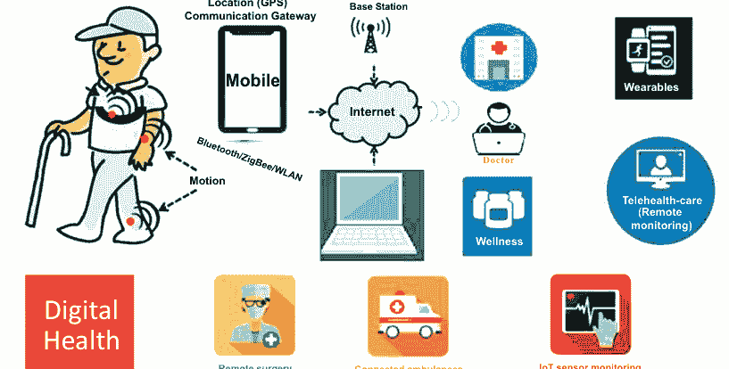

图 (1)。用于远程医疗的无线体域物联网传感器网络。

## 文献研究

基于人工智能的模型旨在模拟患者的威胁和不稳定行为。由于各种类型的 AI 技术被启动，因此 COVID-19 可以轻松应对 [10]。然而，物联网可用于确保患者与医生之间的通信媒介 [11]。需要利用可穿戴系统，它们向卫星和基站发送信号以供进一步操作 [12]。物联网应用的研究旨在改善医疗保健行业 [13]。工业 5.0 通过利用物联网、人工智能、大数据和通信网络彻底改变了医疗保健。远程医疗应用在 COVID-19 期间被大量使用，以便与医生远程讨论健康相关问题 [14]。在 COVID-19 期间引入了在线智能诊所和物联网传感器或可穿戴设备来帮助人们 [15]。

全世界都遭受了 COVID-19 的困扰，这让整个世界筋疲力尽。人工智能和物联网对促进人类产生了巨大影响 [16]。提出了一种新算法，使用 E-AntHocNet 优化无人机能量水平，该算法具有许多医疗保健应用。无人机可用于监测救援行动并将医疗设备从一个地方运送到另一个地方。飞行自组织网络是无人机的组合。由于机动性高，空中飞行器使用路由技术通过最短路径发送信息 [17]。

表 1. 患者监测的各种应用。

| 作者/参考文献 | 应用 | 描述 |
|---|---|---|
| Timmers T. et al. [18] | 教育类应用 | 提供患者信息 |
| Bourdon H. et al. [19] | 医院信息系统应用 | COVID-19 大流行 |
| Medina M. et al. [20] | 家庭设计的基于监测的应用 | 通过电话收集信息 |
| Drew D & Nguyen L. et al. [21] | 基于物联网的监测应用 | 从医疗物联网收集数据 |
| Ben Hassen H. et al. [22] | 学生心理健康监测 | 检查并评估学生在 COVID-19 期间的行为 |
| Yamamoto K. et al. [23] | 使用简单邮件传输协议的数据共享 | 基于电子邮件的观察和生成收据 |
| Huckins J.F. & daSilva A.W. et al. [24] | 使用电话的远程网络通信 | 专门为眼睛设计 |

此外，表 1 详细描述了在 COVID-19 期间使用的不同应用。

## 人工物联网在医疗保健中的应用

物联网在许多研究领域都非常有帮助，包括无线体域网络、跟踪、监测，更重要的是电子健康。关于患者健康的本地和远程数据收集提供了更好的细节，从而医生可以在正确的时间做出正确的决定。在 COVID-19 大流行期间，引入了一种名为医疗保健-AIoT 的新方法，它模拟病毒的传播 [25 - 28]。H-AIoT 由以下组件组成：

### 基于 H-AIoT 的硬件

远程健康监测系统过去曾使用智能硬件来存储患者数据。基于物联网的设备旨在观察患者的日常活动。因此，物联网系统可以轻松提供心率、体温、步行和睡眠的信息。此外，通过利用物联网模型可以检测呼吸和咳嗽。这些物联网硬件组件帮助医生做出最佳决策。此外，引入了基于网络的在线患者监测系统，这些系统在 COVID-19 期间主要使用 [29]。

### 基于 H-AIoT 的软件

远程医疗为患者与医生之间提供更好的连接。为此，在线基于网络的软件属于医疗物联网的范畴。无线通信技术可用于实现最佳连接 [30]。

### 通信/路由协议

在无线体域传感器网络中，医疗保健行业实施了各种路由协议以收集患者信息。应用特定路由协议旨在延长网络寿命 [31]。

### 医疗保健行业中的无人机/无人机

无人机在改善医疗保健行业的物流服务中发挥着关键作用。的确，与标准空中飞行器相比，微型无人机在救援任务中更具成本效益且更高效。无人机之间的通信也更高效，因为通信网络中的端到端延迟最小化 [32]。

### 可穿戴 AI-物联网传感器

可穿戴物联网设备方便地改善了人类的生活。跌倒检测系统使用针对老年人表现的运动传感器。因此，引入了智能可穿戴服装以将运动传感器集成到特殊服装中。然而，中国拥有标准个人警报安全系统 [33]。

### 基于 AI-物联网的监测系统

AI-物联网具有先进的监测系统以提供最佳结果。因此，关于患者健康的及时或早期信息是医生做出更好决定的重要因素。利用了各种人工智能技术，这些技术检测到了危险疾病 [34]。

此外，基于人工智能的应用评估过去的历史，这有助于提供最佳预测。然而，在中国，到处安装了基于 AIoT 的摄像头以便更好地观察，人们遵守隔离规则。虽然在发展中国家，无人机被用来监测人们是否佩戴口罩 [35]。为了节点之间更好的通信，部署路由协议是最好的选择。因此，像 AntHocNet、DSR、DSDV、ZRP、MDART 和 AOMDV 等先进路由协议已在基于物联网的 FANETs 的拓扑环境中实现。此外，监督学习技术决策树用于改善地面基站到无人机的信号强度 [36]。

图 (2) 描述了流程图，其中 AIoT 基于的治疗方法专门为 COVID-19 患者设计。

### IoMT 中网络攻击的检测

基于统计建模的阈值旨在检测 DoS、DDoS 和死亡之ping 攻击。因此，所提出的入侵检测系统监控数据包，造成缓冲区溢出。排队论的概念被实施以评估网络中的拥塞水平。拒绝服务攻击影响整个过程，有时还会阻塞网络。此外，新颖的 IDS 已最大限度地减少了通常由网络管理员配置的误报能力 [37]。

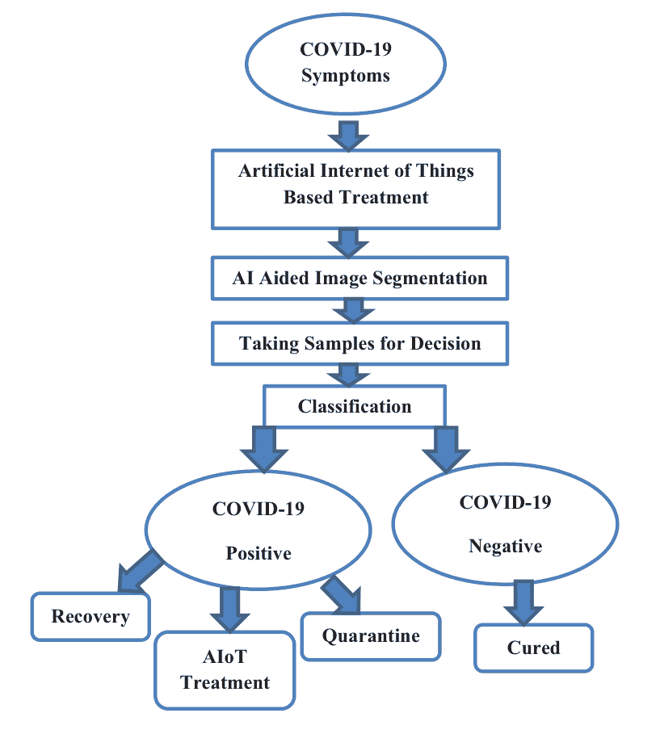

图 (2)。用于 COVID-19 患者的基于 AIoT 的治疗。

## COVID-19 的机器学习技术

机器学习算法填补了医疗保健技术中的资源分配差距。然而，机器学习是人工智能的新兴类别。机器学习技术被广泛用于为 COVID-19 提供可能的解决方案。即使如此，机器学习技术可能分为三个主要类别，包括：

- 监督式
- 无监督式
- 强化学习

图 (3) 显示了与机器学习概念相关的技术。此外，据报道，机器学习主要关注预测、分类、诊断和药物发明。以下是在抗击 COVID-19 中使用的一些强大方法：

- 支持向量机
- 随机森林
- 决策树
- 逻辑回归

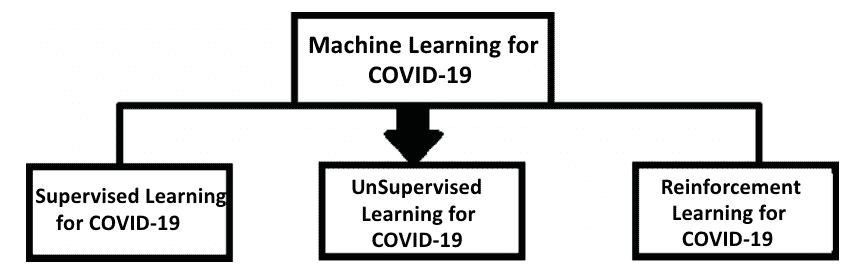

图 (3)。用于 COVID-19 的机器学习技术。

研究人员正确使用了上述技术，这些技术在检测、分类、筛查和发现抗体方面非常有帮助 [38]。在实施过程中，构建机器学习算法时考虑了以下阶段。

- 原始数据
- 数据处理
- 训练数据集
- 外部数据集的测试
- 建模与评估

## 工业 5.0 用于智能医疗保健系统

工业 5.0 为数字化智能概念以及医疗保健系统的可能解决方案提供了新的方向。然而，工业 5.0 的概念由以无线通信为骨干的最优技术组成 [39]。在工业 5.0 中特别使用的领域如下：

- 大数据
- 医疗物联网
- 认知机器学习与计算
- 5G 通信网络及以后

## 工业 5.0 相关挑战

上述技术支持促进工业 5.0 的发展 [39]。每个新想法都面临许多挑战：

- 人群监控
- 患者医疗设备
- 意识与教育
- 为更美好的未来进行研究
- 智能医院管理系统
- 远程医疗方法/在线医生诊所

工业 5.0 将改善全世界的居住标准。利用无人机的智能交通、救援、智能医院和远程医疗将增强智慧城市的概念。因此，智慧城市方法仍处于起步阶段，需要重大改进。即使在发达国家，智慧城市也相当新颖，但在不久的将来，AIoT 将升级人与人之间的连接。

## 在健康行业中使用飞行器

无人机也可以在非军事领域使用，这对人类大有裨益。尤其是在 COVID-19 期间，人们正在研究无人机以减轻医疗专业人员负担。然而，基于机器学习的无人机在按时完成每项任务方面相当高效。空中飞行器可用于监控和监视。最近，无人机已在医疗领域用于通过向基地站发送信息来救援人员。无人机具有多样化的应用，包括对 COVID-19 患者进行喷洒；在无人机上安装扬声器，可用于识别对整个网络的威胁 [40]。此外，空中飞行器的应用如下：

- 监控人们佩戴口罩。
- 数据/样本采集。
- 基于无人机的交通出租车。

此外，人类与微型无人机的交互可以通过制定标准和协议来优化。

## 未来挑战

在不久的将来，由于人工智能，新疾病的预防和检测将变得容易。此外，通过利用机器学习技术可以改进这些技术。AIoT 设备将被整合到人体中，这将提供有关疾病检测的预测，如心脏病发作、癌症、COVID-19 等。此外，世界现在已为 COVID-19 等大流行病做好准备，人们可以轻松地将活动转移到网上。虽然无人机将提供救援帮助并提供准确的位置坐标。除此之外，深度学习、认知物联网和优化技术可用于改善智慧城市的生活标准。

## 结论

基于人工智能的技术结合物联网将改善智慧城市的连接性。尤其是由于 COVID-19，人们被限制在家中，基于人工智能的应用使用量增加。最初，所有国家的政府都遇到问题；后来，他们将教育、工业和一切都转移到网上。本文提供了对 AIoT 技术以应对未来大流行的详细理解。机器学习技术被纳入以改进与 COVID-19 相关的应用。未来的智慧城市和工业 5.0 在本研究论文中有所介绍，这将改善生活标准。此外，论文末尾还深入讨论了未来挑战。此外，E-AnthocNet 混合协议可部署于各种应用以实现进一步创新。

## 发表同意

不适用。

## 利益冲突

作者声明不存在任何利益冲突，无论是财务或其他方面。

## 致谢

未声明。

## 参考文献

[1] V.K. Pappakrishnan, R. Mythili, V. Kavitha, and N. Parthiban. "Role of Artificial Intelligence of Things (AIoT) in Covid-19 Pandemic: A Brief Survey." In Proceedings of the 6th International Conference on Internet of Things, Big Data and Security (IoTBDS 2021), Prague, Czech Republic, pp. 23-25, 2021.

[2] M. Muzammal, R. Talat, A.H. Sodhro, and S. Pirbhulal, "A multi-sensor data fusion enabled ensemble approach for medical data from body sensor networks", Inf. Fusion, vol. 53, pp. 155-164, 2020.
[http://dx.doi.org/10.1016/j.inffus.2019.06.021]

[3] A. Barnawi, P. Chhikara, R. Tekchandani, N. Kumar, and B. Alzahrani, "Artificial intelligence-enabled Internet of Things-based system for COVID-19 screening using aerial thermal imaging", Future Gener. Comput. Syst., vol. 124, pp. 119-132, 2021.
[http://dx.doi.org/10.1016/j.future.2021.05.019] [PMID: 34075265]

[4] Imran, U. Zaman, M. Waqar, "Using Machine Learning Algorithms for Housing Price Prediction: The Case of Islamabad Housing Data", Soft Comput. Mach. Intell. J., vol. 1, pp. 11-23, 2021.

[5] J. Jebadurai, and J. Dinesh Peter, "Super-resolution of retinal images using multi-kernel SVR for IoT healthcare applications", Future Gener. Comput. Syst., vol. 83, pp. 338-346, 2018.
[http://dx.doi.org/10.1016/j.future.2018.01.058]

[6] J. Chuang, L. Maimoon, S. Yu, H. Zhu, C. Nybroe, O. Hsiao, S.H. Li, H. Lu, and H. Chen, SilverLink: Smart home health monitoring for senior care.ICSH. Springer: Berlin, Germany, 2015, pp. 3-14.

[7] C.S. Namahoot, M. Brückner, and C. Nuntawong, "Mobile diagnosis system with emergency telecare in Thailand (MOD-SET)", Procedia Comput. Sci., vol. 69, pp. 86-95, 2015.
[http://dx.doi.org/10.1016/j.procs.2015.10.009]

[8] D.G. Korzun, A.V. Borodin, I.A. Timofeev, I.V. Paramonov, and S.I. Balandin, "Digital assistance services for emergency situations in personalized mobile healthcare: Smart space based approach", Proceedings of the 2015 International Conference on Biomedical Engineering and Computational Technologies (SIBIRCON), Novosibirsk, Russia, pp. 62-67, 2015.
[http://dx.doi.org/10.1109/SIBIRCON.2015.7361852]

[9] I. Bisio, F. Lavagetto, M. Marchese, and A. Sciarrone, "A smartphone-centric platform for remote health monitoring of heart failure", Int. J. Commun. Syst., vol. 28, no. 11, pp. 1753-1771, 2015.
[http://dx.doi.org/10.1002/dac.2778]

[10] A. Brem, E. Viardot, and P.A. Nylund, "Implications of the coronavirus (COVID-19) outbreak for innovation: Which technologies will improve our lives?", Technol. Forecast. Soc. Change, vol. 163, p. 120451, 2021.
[http://dx.doi.org/10.1016/j.techfore.2020.120451] [PMID: 33191956]

[11] A.A. Hussain, O. Bouachir, F. Al-Turjman, and M. Aloqaily, "AI Techniques for COVID-19", IEEE Access, vol. 8, pp. 128776-128795, 2020.
[http://dx.doi.org/10.1109/ACCESS.2020.3007939] [PMID: 34976554]

[12] F. Wu, T. Wu, and M. Yuce, "An internet-of-things (IoT) network system for connected safety and health monitoring applications", Sensors (Basel), vol. 19, no. 1, p. 21, 2018.
[http://dx.doi.org/10.3390/s19010021] [PMID: 30577646]

[13] P. Afshar, S. Heidarian, F. Naderkhani, A. Oikonomou, K.N. Plataniotis, and A. Mohammadi, "COVID-CAPS: A capsule network-based framework for identification of COVID-19 cases from X-ray images", Pattern Recognit. Lett., vol. 138, pp. 638-643, 2020.
[http://dx.doi.org/10.1016/j.patre.2020.09.010] [PMID: 32958971]

[14] A.A.R. Alsaeedy, and E.K.P. Chong, "Detecting regions at risk for spreading COVID-19 using existing cellular wireless network functionalities", IEEE Open J. Eng. Med. Biol., vol. 1, no. 1, pp. 187-189, 2020.
[http://dx.doi.org/10.1109/OJEMB.2020.3002447] [PMID: 34192281]

[15] Y. Siriwardhana, C. De Alwis, G. Gur, M. Yliantila, and M. Liyanage, "利用 5G 技术对抗 COVID-19 大流行", IEEE 工程管理评论, 卷 48, 期 3, 页 72-84, 2020. [http://dx.doi.org/10.1109/EMR.2020.3017451]

[16] P.K. Kollu, K. Kumar, P.R. Kshirsagar, S. Islam, Q.N. Naveed, M.R. Hussain, and V.P. Sundramurthy, "COVID-19 检测危机中先进人工智能和物联网自动化的发展", 医疗保健工程杂志, 卷 2022, 页 1-12, 2022. [http://dx.doi.org/10.1155/2022/1987917] [PMID: 35281536]

[17] I.U. Khan, I.M. Qureshi, M.A. Aziz, T.A. Cheema, and S.B.H. Shah, "基于智能物联网控制的面向飞行自组织网络 (FANET) 的自然启发式节能路由协议", IEEE Access, 卷 8, 页 56371-56378, 2020. [http://dx.doi.org/10.1109/ACCESS.2020.2981531]

[18] T. Timmers, L. Janssen, J. Stohr, J.L. Murk, and M.A.H. Berrevoets, "在荷兰利用电子健康支持 COVID-19 教育、自我评估和症状监测：观察性研究", JMIR 移动医疗与健康, 卷 8, 期 6, 页 e19822, 2020. [http://dx.doi.org/10.2196/19822] [PMID: 32516750]

[19] H. Bourdon, R. Jaillant, A. Ballino, P. El Kaim, L. Debillon, S. Bodin, and L. N'Kosi, "巴黎 COVID-19 封锁期间初级眼科急诊的远程会诊：2020 年 3 月和 4 月 500 例患者的经验", 法国眼科学杂志, 卷 43, 期 7, 页 577-585, 2020. [http://dx.doi.org/10.1016/j.jfo.2020.05.005] [PMID: 32564983]

[20] M. Medina, C. Babiuch, M. Card, R. Gavrielescu, W. Zafirau, E. Boose, K. Giuliano, A. Kim, R. Jones, and A. Boissy, "COVID-19 居家监测", 克利夫兰诊所医学杂志, 2020. [http://dx.doi.org/10.3949/ccjm.87a.ccc028] [PMID: 32409432]

[21] D.A. Drew, L.H. Nguyen, C.J. Steves, C. Menni, M. Freydin, T. Varsavsky, C.H. Sudre, M.J. Cardoso, S. Ourselin, J. Wolf, T.D. Spector, A.T. Chan, A.T. Chan, D.A. Drew, L.H. Nguyen, A.D. Joshi, C-G. Guo, W. Ma, C-H. Lo, R.S. Mehta, S. Kwon, D.R. Sikavi, M.V. Magicheva-Gupta, Z.S. Fatehi, J.J. Flynn, B.M. Leonardo, C.M. Albert, G. Andreotti, L.E. Beane-Freeman, B.A. Balasubramanian, J.S. Brownstein, F. Bruinsma, A.N. Cowan, A. Deka, M.E. Ernst, J.C. Figueiredo, P.W. Franks, C.D. Gardner, I.M. Ghobrial, C.A. Haiman, J.E. Hall, S.L. Deming-Halverson, B. Kirpach, J.V. Lacey Jr, L. Le Marchand, C.R. Marinac, M.E. Martinez, R.L. Milne, A.M. Murray, D. Nash, J.R. Palmer, A.V. Patel, L. Rosenberg, D.P. Sandler, S.V. Sharma, S.H. Schurman, L.R. Wilkens, J.E. Chavarro, A.H. Eliassen, J.E. Hart, J.H. Kang, K.C. Koenen, L.D. Kubzansky, L.A. Mucci, S. Ourselin, J.W. Rich-Edwards, M. Song, M.J. Stampfer, C.J. Steves, W.C. Willett, J. Wolf, and T. Spector, "移动技术快速实施用于 COVID-19 实时流行病学", 科学, 卷 368, 期 6497, 页 1362-1367, 2020. [http://dx.doi.org/10.1126/science.abc0473] [PMID: 32371477]

[22] H. Ben Hassen, N. Ayari, and B. Hamdi, "基于物联网、雾计算和云计算的居家住院系统", 医学信息学解锁, 卷 20, 页 100368, 2020. [http://dx.doi.org/10.1016/j.imu.2020.100368] [PMID: 32537483]

[23] K. Yamamoto, T. Takahashi, M. Urasaki, Y. Nagayasu, T. Shimamoto, Y. Tateyama, K. Matsuzaki, D. Kobayashi, S. Kubo, S. Mito, T. Abe, H. Matsuura, and T. Iwami, "集成个人健康记录的 COVID-19 症状追踪健康观察应用：概念验证与实际使用研究", JMIR 移动医疗与健康, 卷 8, 期 7, 页 e19902, 2020. [http://dx.doi.org/10.2196/19902] [PMID: 32568728]

[24] J.F. Huckins, A.W. daSilva, W. Wang, E. Hedlund, C. Rogers, S.K. Nepal, J. Wu, M. Obuchi, E.I. Murphy, M.L. Meyer, D.D. Wagner, P.E. Holtzheimer, and A.T. Campbell, "COVID-19 大流行早期阶段大学生心理健康和行为：纵向智能手机和生态瞬时评估研究", 医学互联网研究杂志, 卷 22, 期 6, 页 e20185, 2020. [http://dx.doi.org/10.2196/20185] [PMID: 32519963]

[25] D.D. Olatinwo, A. Abu-Mahfouz, and G. Hanche, "用于远程医疗监测的 WBAN 中 LPWAN 技术综述", 传感器 (巴塞尔), 卷 19, 期 23, 页 5268, 2019. [http://dx.doi.org/10.3390/s19235268] [PMID: 31795483]

[26] V. Singh, H. Chandna, A. Kumar, S. Kumar, N. Upadhyay, and K. Utkarsh, "IoT-Q-Band：一种低成本基于物联网的可穿戴腕带，用于检测和追踪逃避 COVID-19 隔离的人员", EAI 物联网认可学报, 卷 6, 期 21, 页 163997, 2020. [http://dx.doi.org/10.4108/eai.13-7-2018.163997]

[27] C. Raj, C. Jain, and W. Arif, "HEMAN：健康监测与 nous：一种基于物联网的远程远程医疗电子健康护理系统", 载于无线通信、信号处理与网络国际会议论文集 (WiSPNET), 页 2115–2119, 2017. [http://dx.doi.org/10.1109/WiSPNET.2017.8300134]

[28] J. Mohammed, C.-H. Lung, A. Oceaneau, A. Thakral, C. Jones, and A. Adler, "物联网：使用 Web 服务和云计算的远程患者监测", 载于 IEEE 物联网国际会议 (iThings)、IEEE 绿色计算与通信 (GreenCom) IEEE 赛博物理社会计算 (CPSCom) 论文集, 页 256–263, 2014. [http://dx.doi.org/10.1109/iThings.2014.45]

[29] T. Malche, S. Tharewal, P.K. Tiwari, M.Y. Jabarulla, A.A. Alnuaim, W.A. Hatamleh, and M.A. Ullah, "基于人工智能物联网 (AIoT) 的远程患者监测患者活动追踪系统", 医疗保健工程杂志, 卷 2022, 页 1-15, 2022. [http://dx.doi.org/10.1155/2022/8732213] [PMID: 35273786]

[30] M.M. Abdellatif, and W. Mohamed, "远程医疗：一种基于物联网的远程医疗系统", 在线与生物医学工程国际期刊, 卷 16, 期 6, 2020. [http://dx.doi.org/10.3991/ijoe.v16i06.13651]

[31] M.R. Rahman, M.M. Islam, A.I. Pitom, and Y. Alsaawy, "ASRPH：面向医疗保健的专用路由协议", 计算机网络, 卷 197, 页 108273, 2021. [http://dx.doi.org/10.1016/j.comnet.2021.108273]

[32] H.E. Comtet, and K.A. Johannessen, "将无人机整合到医疗保健系统中的社会分析方法", 信息 (巴塞尔), 卷 13, 期 2, 页 62, 2022. [http://dx.doi.org/10.3390/info13020062]

[33] X. Chai, R. Wu, M. Pike, H. Jin, W.Y. Chung, and B.G. Lee, "消防中跌倒检测的传感器融合智能可穿戴设备", 传感器 (巴塞尔), 卷 21, 期 20, 页 6770, 2021. [http://dx.doi.org/10.3390/s21206770] [PMID: 34695983]

[34] A. Kishor, and C. Chakraborty, "基于人工智能和物联网的医疗保健 4.0 监测系统", 无线个人通信, 页 1-17, 2021.

[35] R.K.R. Kummitha, "用于抗击大流行的智能技术：控制病毒传播的技术驱动和人本驱动方法", 政府信息季刊, 卷 37, 期 3, 页 101481, 2020. [http://dx.doi.org/10.1016/j.giq.2020.101481] [PMID: 32313361]

[36] I.U. Khan, S.B.H. Shah, L. Wang, M.A. Aziz, T. Stephan, and N. Kumar, "飞行网络中路由协议与无人机自主定位", 国际通信系统期刊, 页 e4885, 2021. [http://dx.doi.org/10.1002/dac.4885]

[37] A. Abdollahi, and M. Fathi, "物联网网络中 Ping of Death 攻击的入侵检测系统", 无线个人通信, 卷 112, 期 4, 页 2057-2070, 2020. [http://dx.doi.org/10.1007/s11277-020-07139-y]

[38] M. Khan, M.T. Mehran, Z.U. Haq, Z. Ullah, S.R. Naqvi, M. Ihsan, and H. Abbass, "人工智能在 COVID-19 大流行中的应用：全面综述", 专家系统与应用, 卷 185, 页 115695, 2021. [http://dx.doi.org/10.1016/j.eswa.2021.115695] [PMID: 34400854]

[39] M. Javaid, A. Haleem, R.P. Singh, M.I.U. Haq, A. Raina, and R. Suman, "工业 5.0：COVID-19 中的潜在应用", 工业整合与管理杂志, 卷 5, 期 4, 页 507-530, 2020. [http://dx.doi.org/10.1142/S2424862220500220]

[40] Å. Restás, "抗击 COVID-19 大流行的无人机应用——迈向良好实践", 无人机 (巴塞尔), 卷 6, 期 1, 页 15, 2022. [http://dx.doi.org/10.3390/drones6010015]

# 骨科机器学习解决方案：全面综述

Muhammad Imad¹,*, Muhammad Abul Hassan¹, Shah Hussain Bangash¹ and Naimullah¹

¹ Abasyn University, Peshawar, Pakistan

摘要：骨骼为骨骼系统提供支撑，与关节、软骨以及附着在骨骼上帮助身体运动的肌肉相关联，以保护人体的内脏器官。骨骨折是人体因骨骼受到外力作用而常见的疾病。骨骼结构受到破坏，导致疼痛、虚弱以及骨骼功能不正常。撕脱骨折、青枝骨折、粉碎性骨折、压缩骨折、单纯性骨折和开放性骨折是不同类型的骨折。文献中呈现了大量研究论文，涵盖了不同类型骨折的检测（腕部、手部、腿部、颅骨、脊柱、胸部等）。有多种医学影像工具可供使用，如 X 射线、磁共振成像（MRI）、计算机断层扫描（CT）和超声，可检测不同类型的骨折。本文代表一项综述研究，旨在讨论骨折与非骨折骨骼之间的各种骨骨折检测和分类技术。

关键词：骨骨折, 分类, CT, 检测, 机器学习, MRI, 骨科, X射线.

## 引言

医学图像处理是科学的一个不断发展的领域，因其在技术和软件突破方面的进步而在医疗保健行业中迅速发展。它在疾病诊断中发挥着重要作用，改善患者护理，并帮助医疗从业者确定治疗类型。检测、评估和适当的骨折护理被认为很重要，因为误诊经常导致医疗干预不足、挫败感加剧和昂贵的诉讼，如 Umadevi 等人 [1] 所描述。在医学图像处理中，骨骼是被称为骨骼的身体结构框架，它保护内脏器官，如肋骨，在心脏、肝脏和肺部周围形成屏障，如图 (1) 所示。颅骨保护人脑，脊柱保护人体脊柱内的神经。骨骼，如 Abubacker 等人 [2] 所述，为骨髓提供血液细胞生成的环境，并作为矿物质和钙的储存区。

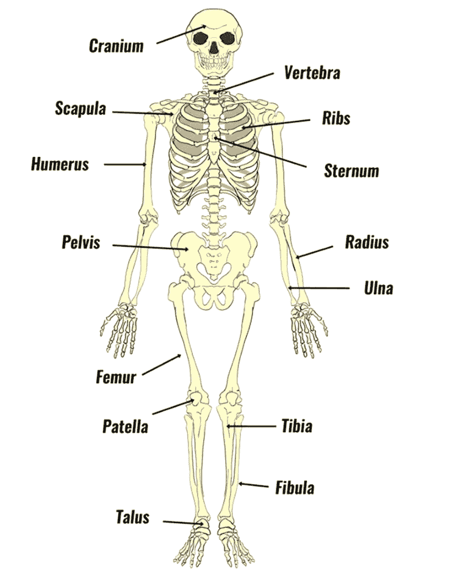

图 (1). 人体骨骼。

出生时大约有 270 块软骨，在成年时减少到 206 块。

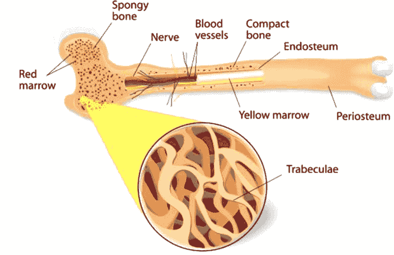

图 (2). 骨骼内部结构。

在人体中，骨折是由于外力和裂缝导致的人类骨骼的主要疾病。图像随后使用医学图像处理进行进一步分析以识别骨骨折。根据 Al-Ayyoub 等人 [4] 的说法，医学成像可以使用先进的计算机自动诊断图像。

如 Imad 等人 [5] 所描述，人体器官的数字形式是通过使用不同的设备创建的，例如 X 射线、乳房X光摄影、MRI、超声、内窥镜、正电子发射断层扫描、荧光透视、临床成像和骨扫描。根据 Irfan Ullah 等人 [6] 的说法，X 射线是最新的无创、无痛且经济的解决方案。X 射线可以生成身体内的骨骼图像，例如腕部、膝盖、踝部和腿部。

裂缝，也称为骨折，可以是身体的任何骨骼。骨折可能包括髋部、腕部、踝部、脊柱、下颌和肋骨。骨折分为开放性（如果皮肤受损）和闭合性（如果皮肤完整）。对骨骼的骨折不会伤害周围组织或撕裂皮肤，则为闭合性骨折。

开放性骨折，如 Mustra 等人 [7] 和 Kazeminia 等人 [8] 所述，描述了骨骼穿透皮肤的情况。

如图 (3) 所描述，许多类型的骨折可能发生在骨骼中，Cao 等人 [9] 将其定义如下：

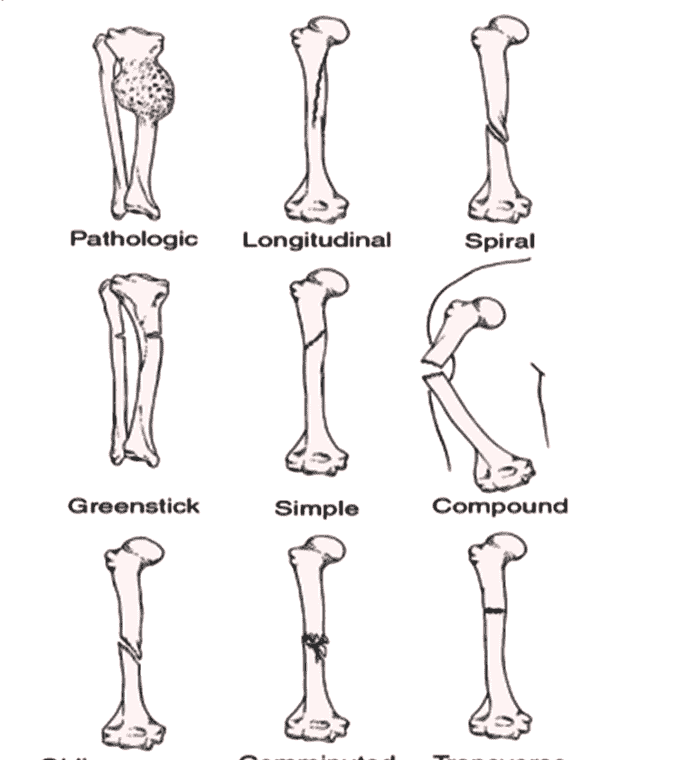

图 (3). 骨骼中的骨折类型。

- **病理性骨折（自发性骨折）** – 由于骨骼变弱而导致的骨折，例如肿瘤性骨软化。
- **纵向骨折** – 沿骨骼长度延伸。
- **螺旋骨折** - 骨折线扭曲的骨折。
- **青枝骨折** – 骨骼一侧骨折，另一侧弯曲。常见于儿童。
- **单纯性骨折（闭合性骨折）** - 不产生开放性伤口的骨折。
- **复合骨折（开放性骨折）：** 复合骨折定义了骨骼穿透皮肤的位置。
- **斜向骨折** - 呈对角线形式的骨折。
- **粉碎性骨折** - 骨骼被粉碎成两块以上。
- **横向：** 沿长骨直角的骨折。

### 文献综述

研究人员已对骨骨折进行研究，并使用 X 射线和 CT 图像实施了多种针对不同类型骨骨折的技术。

Dennis Wen-Hsiang Yap [10] 提出了一种股骨骨折检测方法，通过计算骨折骨的取向图与健康骨样本平均取向图之间的差异来分析小梁纹理。股骨上端的取向图被提取并转换为差异标量图。使用贝叶斯和 SVM 分类器对差异图进行分类。

Martin Donnelley [11] 提出了一种 X 射线图像中股骨骨折的方法，由多个步骤组成。在第一步中，非线性各向异性扩散方法提取边缘并平滑图像，而不会丢失边界位置的任何关键信息。第二步是修改霍夫变换，以评估更接近长骨边缘的直线参数。梯度幅度和方向为直线参数创建，并说明骨折等不规则区域。

Vineta Lai Fun Lum [12] 分析了用于在 X 射线图像中识别骨骨折的不同方法。Gabor 取向、马尔可夫随机场和梯度强度方向用于纹理提取。不同患者的骨折在形状和大小上不同。应用采用自适应采样方法进行采样以适应这些变化。该方法为相同骨骼形态和特征类型创建了相同比例的特征图。测试结果表明，提高精确度和灵敏度的程序的实用性取决于流程的质量以及研究集合中错误样本的百分比。

Jia [13] 引入了一种分割形式，该形式描述了患者手臂 X 射线图像中石膏材料内的骨折骨，并揭示了骨折骨之间的联系。由于石膏材料产生的 X 射线图像对比度低、噪声比高，该分割功能通常很复杂。为此功能实施了具有全局约束的主动轮廓测地线模型。收集先验形式并将其用作模型的区域限制。

Victor Ortiz [14] 提出了一种基于物理的新可变形模型，用于通过图像匹配跟踪物理变形（骨折）。该模型源于最小化变形场，该变形场同时满足弹性体的约束和局部图像相似性的度量。该模型为我们提供了科学准确的变形区域，并帮助我们分析变形材料的特性。在检查其环境中某些物体变形引起的压力时，这非常有帮助，在我们的例子中，是颅骨骨折的识别。

Xuejing Jin [15] 提出了一种新的医学处理方法，用于基于多尺度分形特征（D_MF）表达分形维数变化的不同范围。在医学图像中，不同区域的 DMF 值通常不同。根据 D MF 值，可以在医学 X 射线图像中检测到小病变。数字 X 射线骨折应用于此过程。实验结果表明，背景区域的 D_MF 值为 0.005-0.020，正常区域的 D_MF 值为 0.040-0.070，结节区域的 D_MF 值在 0.100 至 0.200 之间。

Ravia Shabnam Parveen [16] 在本文中比较了两种方法，直方图均衡化和对比度受限自适应直方图均衡化。直方图均衡化为输入图像分配像素强度值，以在输出图像中提供均匀的强度分布。CLAHE 在称为图块的小区域中对图像进行操作。自适应直方图均衡化功能改善了对比度。双线性插值方法用于去除插入的边界。CLAHE 提供了与自适应对比度增强技术相同的性能，并克服了 HE 的局限性。结果表明，CLAHE 的均衡化方法比直方图均衡化过程效果更好。

Zheng Wei [17] 提出了一种用于 X 射线图像中骨折骨提取的算法，使用标记控制的分水岭变换对依赖于梯度调制和同伦改变的 X 射线骨折图像进行分割。区域数量、区域面积、区域中心和突出骨折图像多边形的特征通过标记处理和区域函数提取。首先，X 射线骨折图像的突出多边形中的霍夫变换识别并去除形状。线条由线状骨折和中心线平行线组成。最后，测量分离线与中心线轴垂直之间的距离。

Song Tie-Rui [18] 提出了几种描述性图像增强算法：

对比度增强，直方图增强，平滑滤波器，中值滤波器，理想低通滤波器，低通巴特沃斯滤波器，理想高通滤波器，高通巴特沃斯滤波器和同态滤波器。最后，将改进后的图像与结果进行比较，使用各种分割阈值和边缘提取方法来识别增强 X 射线图像算法的合适方法。

Venkatesh Mahadevan [19] 通过为 50 名印度围绝经期和绝经后女性设计计算机辅助检测系统，从二维视觉、放射线髋部图像中推导出正确的近端股骨密度，并将这些发现与对同一女性使用双能 X 线吸收法（DXA）计算的近端股骨 BMD 值进行对比。该理论方法探讨了 BMD 与身高和体重等人体测量变量之间的关系。骨小梁密度技术可在临床实践和研究中有所帮助，以更好地应对骨质疏松性骨折的风险。DXA 的结果显示，印度女性的骨质疏松和骨量减少分别占 20% 和 34%。

Hum Yan Chai [20] 提出了一种使用 GLCM 技术进行股骨自动骨折检测的方法。该方法根据 GLCM 的参数值区分骨骼骨折的缺失和出现。骨骼骨折缺失和出现的标准设定为 0.95。开发算法的精度总计为 86.67%，似乎是一种有效的骨骼骨折自动检测方法。研究结果表明，该程序可以产生可靠且可重复的结果。

Greg Wood [21] 的研究旨在更好地理解解读骨骼放射线照片时感知专业知识背后的过程。对三十名参与者进行了测试，并检查了不同患者正常和异常骨骼 X 射线的临床病例。所 presented 技术的结果显示，该技术在骨骼检测方面取得了准确的结果。

Umadevi [1] 考虑了在 X 射线图像中应用集成分类进行骨折检测。对于 X 射线图像，至少从两个对象组中提取了 12 个特征，即纹理特征和形态特征。构建了三种二元分类模型，即 SVM、BPNN 和 KNN，以构建集成分类模型。该研究涉及具有两种分类和三种分类的集成结构。在不同的特征集期间，构建了分类器。

Nirase Fathima Abubacker [22] 关注自动化正常和异常颅骨图像。通过基于直方图的阈值去除颅骨并连接相邻像素以识别骨折的简单自动化方法，在医学数字成像和通信（DICOM）中观察到颅骨骨折。实验结果表明，目标以高检测率被识别。

Mahmoud Al-Ayyoub [4] 解决了在手骨 X 射线中寻找骨折的问题。测试了图像预处理步骤的众多方法。此外，还计算并测试了各种特征集。最后，基础和多级元分类器都经过测试。通过在贝叶斯网络分类器上实现 boosting 然后 bagging，在特征集包括使用小波、Curvelet 和 GLCM 计算的特征时，获得了 91.8% 的准确率。

Vijayakumar [3] 提出了一种使用计算机化 GLCM 技术自动检测股骨骨折的方法。根据这种方法，骨骼骨折的存在取决于提取的参数的 GLCM 值。所构建算法的准确率至少达到 87%，这有望成为一种高效的骨骼骨折自动识别方法。

Mario Mustra [7] 提出了一种自动 CR 骨骼对齐系统，可显示前臂和腿部。所提出的方法使用阈值处理，根据 Otsu 系统进行最佳阈值确定，并使用 Hough 变换来识别直线段，从而可以确定旋转角度。该技术并非旨在校正骨骼分割，而是定位骨骼边界，以便确定骨骼的旋转方向和角度。Hough 变换和 Hough 累加器中的正确邻域在根据角度分辨率定义角度估计的各种精度水平之后。

Kazeminia [8] 提出了一种新的骨骼分割技术，对图像进行预处理，例如噪声消除和边缘检测。图像使用引导滤波器进行去噪；然后，使用多阈值和单阈值 Canny 边缘检测器检测骨骼边界。在显著边缘上垂直旋转图像以改善边界。然后，每个图像行检查与骨骼边缘匹配的强度峰值。

Yu Cao [9] 提出了一种骨骼骨折的广义检测方法，适用于全身各种骨骼骨折形式和结构。在一种名为“Stacking Random Forest Fusion”的新颖描述性计算系统中，该方法使用从 X 射线图像的候选补丁中提取的特征。随机森林学习器在较低层使用该方法，以在类别似然标记的下一步中提取简化的分布标签。

San Myint [23] 旨在从 X 射线图像中识别人体小腿的骨骼骨折。所提出的方法有三个步骤：预处理、分割和骨折检测。在预处理步骤中，使用高斯滤波器进行图像增强的主要程序是去噪、图像亮度调整和颜色调整。特征提取使用 Hough 变换技术来检测图像中的线条。

Ling Wang [24] 提出了一种基于图像分割技术的股骨转子间骨折的自动化和有效分类方法。首先根据股骨转子间骨折类型定义骨折部位之间的差异。在 3D 股骨中，有 4 个方向以减少计算复杂度。水平集过程是将骨折从背景中分割出来。分割后，Canny 边缘检测器提取边缘并区分正常图像和测试图像。

Ayumi Yamada [25] 开发了一种使用 CT 图像检测颅骨骨折的方法。图像使用形态学操作进行预处理以提取骨骼区域。从 CT Scout 图像中可以确定颅穹窿。颅骨在两层小的高密度骨之间具有低密度的松质骨。尽管致密骨骨折线比细胞骨更容易识别，但三维（3D）拉普拉斯滤波随后从骨骼表面去除。黑帽变换的应用可从骨骼表面图像中去除线性结构。

Tanudeep Kaur [26] 使用分割、模糊 c 均值和多级小波算法表示骨骼 X 射线骨折检测。模糊 c 均值分割、形态学算子已用于骨骼骨折检测。小波方法用于查找检测区域面积并检测骨折。

Ying Liang Ma [27] 提出了一种基于图像跟踪检测的自动方法。使用了几何模型，该模型基于在关键坐标系下将外部跟踪系统与图像叠加系统之间的 X 射线图像进行匹配。图像叠加会改变骨碎片的位置和方向，该位置和方向由骨折机器人实时控制。

Ankur Mani Tripathi [28] 提出图像处理技术以找到股骨中骨折的位置。形态学操作和边缘检测已被用于抑制背景并突出前景。支持向量机（SVM）已被用于区分股骨骨折和非骨折股骨。

Mariam M. Saii [29] 提出了一种用于检测和分类骨折的新方法。骨折检测的基本阶段包括预处理骨图像和形态学操作，以获得 ROI 区域，通过后处理阶段进行操作以去除非骨折像素。所建议的方法从骨图像中提取三个特征：横向、裂纹和发散，以定义骨折类型或骨图像完整性。所设计的系统能够正确检测不同类型的骨折以及混合骨折类型。

Wint Wah Myint [30] 利用不同的图像处理技术开发了胫骨（Tibia）骨折类型和识别。该工作旨在检测 X 射线图像中骨折或非骨折，并对胫骨骨折类型进行分类。胫骨骨折检测系统采用三个主要步骤开发。它们是预处理、特征提取和分类，用于分类骨折类型并定位骨折位置。非锐化掩模（USM）锐化方法在预处理中应用，以改善图像并突出图像中的边缘。Harris 角点检测算法随后处理锐化图像以在角点提取特征点来提取特征。然后，选择两种分类方法来识别骨折或非骨折，并对骨折形式进行分类。简单的决策树（DT）用于骨折与否的分类，而 K 近邻（KNN）用于骨折分类。

Eveling Castro-Gutierrez [31] 讨论了影响 21 至 30 岁人群的髋臼骨折，并提出了一种髋臼骨折的方法，采用局部二值模式（LBP）作为特征提取器和支持向量机（SVM）进行分类。

### 表 1. X 射线图像中的骨骨折检测。

| 参考文献 | 研究对象 | 方法 | 结果 | 优点 | 缺点 |
|---|---|---|---|---|---|
| [10] | 股骨骨折 | 高斯滤波器、贝叶斯和支持向量机、Gabor 滤波器 | 基于颈干角，训练和测试图像保持在 12%，其中 39 例股骨骨折用于训练，13 例骨折用于测试 Accuracy: N/A | SVM 和贝叶斯能够准确检测，且 SVM 在三种技术中提供最高的准确率 | 贝叶斯检测率较低，3 种方法中 1 种检测率最高但准确率低且误报率高。在 3 种方法中的 2 种中，准确率高但检测率低 |
| [32] | 长骨骨折检测 | AMSS 各向异性扩散、HOG Hough 变换 | 该方法能够准确检测中段长骨骨折 **Accuracy:** N/A | SVM 在骨折检测中比其他方法（如 NSA）提供更高的准确率 | N/A |
| [12] | 骨骨折检测 | 不同分类器的比较、Gini-SVM、贝叶斯方法 | 432 例股骨和桡骨病例。12% 股骨和 30% 桡骨图像。在股骨中，**训练时，** GO 为 100.0% MRF 为 99.3% 且 IGD 为 100.0%。**测试时** GO 为 89.8%，MRF 为 98.1%，IGD 为 90.7%。**在桡骨中** 训练集提供 100% 准确率，**测试为** GO 90.5% MRF 为 86.5%，IGD 为 96.0%。 | OR 规则在准确率和灵敏度方面提供更好的结果，这在标准分类器中很有用。 | 在股骨和桡骨中，MRF 在训练和测试集中的灵敏度很高。 |
| [13] | 骨骨折检测 | 基于模型的分割方法、距离变换、顶帽变换 | 高效检测和分割骨骨折 **Accuracy:** N/A | 从低对比度图像中检测骨骨折轮廓 | 由于图像对比度差，分割在一种情况下失败。 |
| [14] | 骨骨折检测 | 高斯滤波器、Canny 边缘检测、有限元方法 | 检测到颅骨骨折 **Accuracy:** N/A | 帮助医生从磁共振中检测骨折 | 需要进一步改进以获得更好的结果 |
| [15] | 骨骨折检测 | 直方图均衡化、空间滤波、分割、Prewitt 检测器、Log 检测器和 Sobel 检测器 | DMF 值介于 0.005 到 0.00 之间，正常区域为 0.040 到 0.070。结节区域为 0.100 到 0.200 **Accuracy:** N/A | 在实时环境中指导医生进行 2D X 射线图像分析。 | 由于质量低和清晰度不足，骨骨折区域不清晰。 |
| [16] | 骨骨折检测 | 均值滤波器、直方图均衡化和对比度受限自适应直方图均衡化 | CLAHE 的性能优于 HE。原始图像像素为 483493，HE 为 984185，CLAHE 为 634938 **Accuracy:** N/A | 它将在噪声图像中提供更好的结果 | 在对比度处理期间背景图像中的噪声增加 |
| [17] | 骨骨折检测和分类 | 带有同伦修改的标记控制分水岭算法、标记处理和区域属性函数、霍夫变换 | 区域特征已正确提取 Accuracy: N/A | N/A | 对于线状骨折等复杂骨折效果不佳 |
| [18] | 使用不同方法增强图像 | 对比度增强、HE、滤波技术如中值、低通滤波器、高通滤波器和同态滤波器 | 同态滤波器比其他滤波技术提供更好的结果 Accuracy: N/A | 以更好的方式比较了多种滤波技术 | 在大范围图像增强选择期间产生影响 |
| [19] | 髋部骨质疏松检测 | 直方图规定化、标准差、标准差、Gabor 和小波（4 级分解）操作、SPSS | 20% 至 34% 的印度女性有骨质疏松和骨量减少问题 Accuracy: N/A | N/A | 未显示骨质疏松和骨量减少疾病的危险因素 |
| [20] | 长骨骨折检测 | 二值转换、高斯算子、拉普拉斯边缘检测器、中值滤波器和 k 均值聚类、GLCM 方法 | 从方程 13 到 16，灵敏度为 80%，特异性为 93.31%。 Accuracy: 86.67 | N/A | N/A |
| [24] | 骨骼骨折检测 | 线性回归分析，30 名参与者，其中十名新手、中级和专家佩戴眼动追踪设备进行正常和异常骨骼放射学的临床病例 | Accuracy: 变量方差的 34% | 诊断骨骼骨折图像所需时间更少 | N/A |
| [25] | 腿骨骨折检测 | 高斯滤波器、Sobel、Prewitt、Roberts 和 Canny 边缘检测、霍夫变换技术 | Accuracy: N/A 系统能够准确检测骨折 | Canny 边缘检测提供更好的结果 | 检测方法影响图像质量 |
| [26] | 3D CT 图像中检测骨骨折 | 距离正则化、Canny 边缘检测、带阈值的高斯滤波器和水平集方法 | Accuracy:84.2% 识别率 | 骨骨折在 4 个方向被检测到（前侧、前外侧后侧、后外侧） | 转子骨折出现错误，人眼也无法诊断 |
| [33] | 皮肤癌 | 朴素贝叶斯、逻辑回归、SVM、随机森林、KNN | Accuracy: 92%,92%,89.6%,83%,50% | NB 和 LR 比其他结果提供更好的结果 | 准确率需要提高 |
| [34] | 子弹检测 | SVM、KNN、决策树、朴素贝叶斯 | Accuracy: 85%, 66.4%, 73%, 61% | SVM 提供更好的结果 | 准确率需要提高 |
| [35, 36] | COVID-19 | SVM、KNN、随机森林、朴素贝叶斯、决策树、CNN、AlexNet、VGG | Accuracy: 96%, 92%, 90%, 82% CNN=95%, VGG16=94% AlexNet=94% | SVM、CNN、VGG16 和 AlexNet 提供更好的结果 | 决策树的准确率需要提高 |

| 参考 | 研究对象 | 方法学 | 结果 | 优势 | 劣势 |
|---|---|---|---|---|---|
| [37] | COVID-19 | 调查论文 | 讨论了不同技术 | 讨论了机器学习、深度学习和物联网用于 COVID-19 预防和控制，也讨论了未来方向 | 不适用 |

## 方法学

本节列出了应用于 X 射线和 CT 图像诊断骨骼骨折的不同方法，并讨论了相应论文的结果、优势和劣势。表 1 提供了每篇论文的简要技术细节，有助于该领域的研究人员。

## 结论

本文讨论了应用于人体不同骨骼骨折的各种方法，如图 (1) 所示。骨骼骨折检测是一个常见问题。即使在如此发达的国家，它也迅速增加。然而，骨骼骨折的自动检测是一项重要但复杂的工作，其中提出的算法有限。根据 Jin 等 [15] 的说法，不同的模态被用于诊断骨骼骨折，例如 X 射线、CT、MRI 和超声。这些文章中研究了许多成像技术来诊断骨骼骨折，例如预处理、图像分割、边缘检测和分类。根据所进行的研究，Lum 等 [12] 在所有其他技术中提供了 93% 的更好结果。机器学习技术为放射科医生和骨科医生开辟了许多视角，节省时间并协助诊断。对于临床医生而言，此类算法有助于防止错误并提高诊断和检测的性能。

## 发表同意

不适用。

## 利益冲突

作者声明无利益冲突，无论是财务或其他方面。

## 致谢

未声明。

## 参考文献

[1] N. Umadevi, and S. Geethalakshmi, "用于人体骨 X 射线图像骨折检测的多分类系统", 2012 第三届计算、通信和网络技术国际会议 (ICCCNT'12), pp. 1-8, 2012.
[http://dx.doi.org/10.1109/ICCCNT.2012.6395889]

[2] N.F. Abubacker, A. Azman, M. Azrifah, and S. Doraisamy, "基于邻近像素的颅骨 DICOM 图像自动骨折检测方法," in 2013 第13届智能系统设计与应用国际会议, pp. 177-181, 2013.
[http://dx.doi.org/10.1109/ISDA.2013.6920731]

[3] R. Vijayakumar and G. Gireesh, "盆骨 X 射线图像的定量分析和骨折检测," in 2013 第四届计算、通信和网络技术国际会议 (ICCCNT), pp. 1-7, 2013.
[http://dx.doi.org/10.1109/ICCCNT.2013.6726590]

[4] M. Al-Ayyoub, I. Hmeidi, and H. Rababah, "X 射线图像中手部骨骼骨折的检测", J. Multim. Process. Technol., vol. 4, no. 3, pp. 155-168, 2013.

[5] M. Imad, F. Ullah, and M.A. Hassan, "基于卷积神经网络的巴基斯坦货币识别以协助盲人", Journal of Computer Science and Technology Studies, vol. 2, no. 2, pp. 12-19, 2020.

[6] S.I. Ullah, A. Salam, W. Ullah, and M. Imad, "基于逻辑回归和支持向量机的 COVID-19 肺部图像分类", North African Conference on Management & Information Systems, pp. 13-23, 2021.

[7] M. Mustra, M. Grgic, and B. Zovko-Cihlar, "X 射线骨图像的配准," in 2014 第十届电信国际研讨会 (BIHTEL), pp. 1-4, 2014.
[http://dx.doi.org/10.1109/BIHTEL.2014.6987650]

[8] S. Kazeminia, N. Karimi, B. Mirmahboub, S.M.R. Soroushmehr, S. Samavi, and K. Najarian, "通过线条波动分析从 X 射线图像中提取骨骼", 2015 IEEE 国际图像处理会议 (ICIP), pp. 882-886, 2015.
[http://dx.doi.org/10.1109/ICIP.2015.7350926]

[9] Y. Cao, H. Wang, M. Moradi, P. Prasanna, and T. F. Syeda-Mahmood, "通过堆叠随机森林特征融合进行 X 射线图像骨折检测," in 2015 IEEE 第12届生物医学成像国际研讨会 (ISBI), pp. 801-805, 2015.
[http://dx.doi.org/10.1109/ISBI.2015.7163993]

[10] D.W-H. Yap, Y. Chen, W.K. Leow, T.S. Howe, and M.A. Png, "通过小梁纹理分析检测股骨骨折", Proceedings of the 17th International Conference on Pattern Recognition, vol. 3, pp. 730-733, 2004.

[11] M. Donnelley, and G. Knowles, "计算机辅助长骨骨折检测", Proceedings of the Eighth International Symposium on Signal Processing and Its Applications, vol. 1, pp. 175-178, 2005.
[http://dx.doi.org/10.1109/ISSPA.2005.1580224]

[12] V.L.F. Lum, W.K. Leow, Y. Chen, T.S. Howe, and M.A. Png, "X 射线图像中骨骼骨折检测的分类器组合", IEEE International Conference on Image Processing 2005, vol. 1, p. I-1149, 2005.

[13] Y. Jia, and Y. Jiang, "带形状约束的主动轮廓模型用于骨骼骨折检测", International Conference on Computer Graphics, Imaging and Visualisation (CGIV'06), pp. 90-95, 2006.
[http://dx.doi.org/10.1109/CGIV.2006.16]

[14] V. Ortiz, C. Yanez, A. Kuri, and I. Chairez, "有限元方法检测颅骨骨折", Robotics and Automotive Mechanics Conference (CERMA 2007), pp. 271-276, 2007.
[http://dx.doi.org/10.1109/CERMA.2007.4367698]

[15] X. Jin, D. Qi, H. Wu, and F. Liu, "基于多尺度分形特征的医学 X 射线图像小病变检测," in 2009 第二届生物医学工程与信息学国际会议, pp. 1-4, 2009.

[16] N.R.S. Parveen, and M.M. Sathik, "通过均衡方法增强骨骼骨折图像", 2009 计算机技术与发展国际会议, vol. 2, pp. 391-394, 2009.
[http://dx.doi.org/10.1109/ICCTD.2009.115]

[17] Z. Wei, M. Na, S. Huisheng, and F. Hongqi, "X 射线骨折图像特征提取与骨折分类", 2009 人工智能与计算智能国际会议, vol. 2, pp. 408-412, 2009.
[http://dx.doi.org/10.1109/AICI.2009.40]

[18] S. Tie-Rui, and Z. Wei, "X 射线骨骼骨折图像增强算法研究", 2010 计算机、机电控制与电子工程国际会议, vol. 5, pp. 384-387, 2010.

[19] V. Mahadevan, V. Sapthagirivasan, Management, and Technology, "医学图像信息处理用于髋部感兴趣区域骨质疏松检测," Int J Innov, Manage and Technol, vol. 1, no. 5, pp. 516, 2010.

[20] H. Y. Chai, L. K. Wee, T. T. Swee, S.-H. Salleh, and A.K. Ariff, "灰度共生矩阵骨骼骨折检测," Am. J. Appl. Sci., vol. 8, no. 1, p. 26, 2011.
[http://dx.doi.org/10.3844/ajassp.2011.26.32]

[21] G. Wood, K. M. Knapp, B. Rock, C. Cousens, C. Roobottom, and M. R. J. S. r. Wilson, "检测和诊断骨骼骨折的视觉专长," Skeletal Radiol., vol. 42, no. 2, pp. 165-172, 2013.
[http://dx.doi.org/10.1007/s00256-012-1503-5]

[22] N. F. Abubacker, A. Azman, M. Azrifah, and S. Doraisamy, "基于邻近像素的颅骨 DICOM 图像自动骨折检测方法," in 2013 第13届智能系统设计与应用国际会议, pp. 177-181, 2013.
[http://dx.doi.org/10.1109/ISDA.2013.6920731]

[23] S. Myint, A.S. Khaing, H.M. Tun, "X 射线图像中腿部骨骼骨折检测", Int. J. Scientific Technol. Res., Vol. 5, No. 06, pp. 140-144, 2016.

[24] L. Wang, H. Cheng, H. Lan, Y. Zheng, and K. Li, "使用水平集自动识别股骨转子间骨骼骨折," in 2016 第38届 IEEE 工程医学与生物学会年会 (EMBC), 2016, pp. 3851-3854.

[25] A. Yamada, A. Teramoto, T. Otsuka, K. Kudo, H. Anno, and H. Fujita, "使用黑帽变换在 CT 图像中自动检测颅骨骨折的初步研究," in 2016 第38届 IEEE 工程医学与生物学会年会 (EMBC), pp. 6437-6440, 2016.
[http://dx.doi.org/10.1109/EMBC.2016.7592202]

[26] T. Kaur, A. Garg, "使用图像分割的骨骼骨折检测", International Journal of Engineering Trends and Technology (IJETT), Vol. 36, No. 2, pp. 82-87, 2016.

[27] Y. Ma, G. Dagnino, I. Georgilas, and S. Dogramadzi, "用于机器人辅助关节骨折手术的 X 射线图像自动工具检测," in 2017 IEEE 物联网国际会议 (iThings) 和 IEEE 绿色计算与通信 (GreenCom) 和 IEEE 赛博物理社会计算 (CPSCom) 和 IEEE 智能数据 (SmartData), pp. 883-887, 2017.
[http://dx.doi.org/10.1109/iThings-GreenCom-CPSCom-SmartData.2017.136]

[28] A.M. Tripathi, A. Upadhyay, A.S. Rajput, A.P. Singh, and B. Kumar, "使用图像处理自动检测股骨骨折", 2017 International Conference on Innovations in Information, Embedded and Communication Systems (ICHECS), pp. 1-5, 2017. [http://dx.doi.org/10.1109/ICHECS.2017.8275843]

[29] M. M. Saii and A. M. Mayya, "使用图像处理的手部和手指骨折检测与类型分类." Int. J. Computer Sci. Trends Technol., (IJCST). vol. 6, no. 4, 2018.

[30] W.W. Myint, K.S. Tun, and H.M Tun, "使用 X 射线图像的腿部骨折检测与分类分析", Machine Learning Research, vol. 3, no. 3, pp. 49-59, 2018. [http://dx.doi.org/10.1648/j.mlr.20180303.11]

[31] E. Castro-Gutierrez, L. Estacio-Cerquin, J. Gallegos-Guillen, and J.D. Obando, "使用聚焦于噪声图像的 X 射线成像和处理方法的髋臼骨折检测", 2019 Amity International Conference on Artificial Intelligence (AICAI), pp. 296-302, 2019. [http://dx.doi.org/10.1109/AICAI.2019.8701297]

[32] M. Donnelley and G. Knowles, "计算机辅助长骨骨折检测," in ISSPA, pp. 175-178, 2005. [http://dx.doi.org/10.1109/ISSPA.2005.1580224]

[33] A. Salam, F. Ullah, M. Imad, and M. A. Hassan, "使用机器学习方法诊断皮肤镜图像用于黑色素瘤检测," in 2020 IEEE 23rd International Multitopic Conference (INMIC), pp. 1-5, 2020.

[34] M. Imad, S.I. Ullah, A. Salam, W.U. Khan, F. Ullah, and M.A. Hassan, "基于 X 射线图像使用机器学习技术自动检测人体内的子弹", Int. J. Comput. Sci. Inf. Secur., vol. 18, no. 6, 2020.

[35] M. Imad, N. Khan, F. Ullah, M. A. Hassan, and A. Hussain, "基于胸部 X 射线图像使用机器学习技术的 COVID-19 分类," Journal of Computer Science and Technology Studies, vol. 2, no. 2, pp. 01-11, 2020.

[36] A. Hussain, M. Imad, A. Khan, and B. Ullah, 使用定制高效神经网络在 X 射线图像中识别 COVID-19 的多类分类. AI and IoT for Sustainable Development in Emerging Countries, 2022, pp. 473-486. [http://dx.doi.org/10.1007/978-3-030-90618-4_23]

[37] M. Imad, A. Hussain, M. Hassan, Z. Butt, and N. Sahar, 基于物联网的机器学习和深度学习平台用于 COVID-19 预防和控制：系统综述. AI and IoT for Sustainable Development in Emerging Countries, 2022, pp. 523-536. [http://dx.doi.org/10.1007/978-3-030-90618-4_26]

# 健康相关疾病识别的机器学习方法综述

Muhammad Yaseen Ayub¹,*, Farman Ali Khan¹, Syeda Zillay Nain Zukhraf² and Muhammad Hamza Akhlaq³

¹ 巴基斯坦伊斯兰堡 COMSATS 大学阿托克校区

² 塞浦路斯尼科西亚塞浦路斯大学电气与计算机工程系卓越研究与创新中心 KIOS

³ 巴基斯坦伊斯兰堡阿里格尔穆斯林大学开放大学

Abstract: 医学领域是人类历史上最受尊敬和最古老的职业之一。它对人类生活有直接影响。本章的主要目的是介绍先进的计算机科学技术，如机器学习在疾病检测过程中的应用。本章还讨论了在疾病检测过程中使用的不同机器学习算法。它还指出哪些算法具有更好的准确性。本章列出了检测各种危及生命疾病的主要和最常用的机器学习库。最后，对未来可用于疾病检测和病毒性疾病控制的技术趋势进行了讨论。

Keywords: 疾病检测, IoMT, 机器学习, IoMT 中的机器学习.

## INTRODUCTION

目前，计算技术几乎应用于生活的各个领域。医疗领域被认为是其中之一。在过去几年中，该领域进行了大量研究，利用机器学习方法尽早识别和治疗疾病。由于机器学习可以有效地执行人类认知功能，因此它成为疾病检测和治疗的更合适方法。最近，已进行了大量研究来开发机器学习中的专业方法，这些方法可以在检测各种疾病时具有高度准确性。然而，由于环境高度异构，我们仍然难以检测和诊断多种危及生命的疾病 [1]。如果在早期阶段检测到，多种危及生命的疾病是可以治疗的，如图 (1) 所示。因此，疾病的早期检测至关重要。

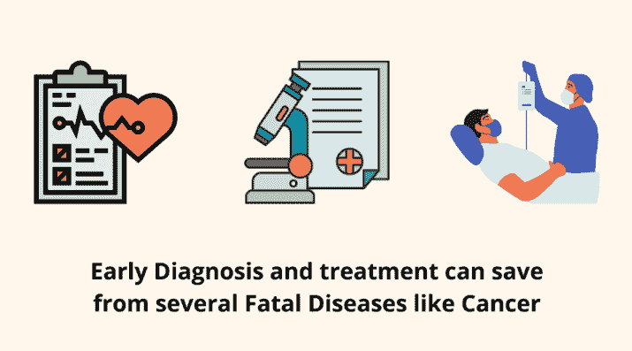

Fig. (1). 早期检测可以挽救人们免受致命疾病的侵害。

在过去几十年中，人们在开发能够执行人类认知任务的机器学习算法方面进行了大量研究。医疗领域从中受益匪浅；研究人员开发了机器学习模型，可以准确检测或预测肿瘤、囊肿、肺炎等疾病。他们使用 MRI 和 CT 扫描 X 射线图像结合计算机视觉技术在非常早期阶段检测或预测高风险疾病。机器学习算法还可作用于通过不同类型传感器获得的数值和布尔值 [2]。通过使用机器学习，计算机可以模仿人类认知行为并识别不同模式。然后计算机可以有效地检测这些模式中的任何异常并分类患者是否患有特定疾病。机器学习有两种主要方法：监督学习和无监督学习（这两种方法的混合体半监督学习也存在）。图 (2) 显示了不同类型机器学习技术的图形表示。

### Supervised Learning

监督机器学习在训练阶段提供标记数据集。模型根据训练期间提供的示例学习将输入映射到输出。监督学习的例子是分类和逻辑回归。分类算法用于根据对测试数据进行的学习分配不同的标签。例如，分类算法可以不同地对狗和猫进行分类。有各种分类算法，如 *Naïve Bayes*、*KNN*、*Decision Tree*、*Support Vector Machines* 等 [3]。

回归算法用于估计因变量和自变量之间的关系。它们用于预测数值。例如，许多公司使用线性回归模型来预测成本、利润、损失等。有几种类型的回归模型：线性回归、逻辑回归、岭回归、多项式回归等 [4]。

### Unsupervised Learning

无监督学习是一种学习类型，计算机不提供标记数据集。相反，计算机自行找到不同的模式。它基于模式识别，而不像监督学习那样提供任何目标属性。它在数据中发现隐藏的模式和见解。当我们没有用于训练的标记数据并且想要获得该数据的有用见解和模式时，可以使用它。无监督学习的例子是聚类，其中模型根据相似性对数据进行分组。有不同类型的聚类算法，如 *Partition based clustering*、*Fuzzy clustering algorithms*、*Model-based clustering algorithms*、*Density-based Clustering Algorithms*、*K-Means Clustering* 等 [5]。

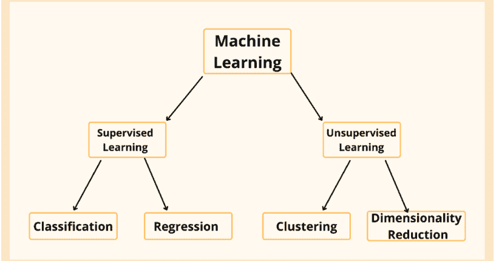

Fig. (2). 不同机器学习算法及其用途。

本论文章节组织如下，文献研究中的后续部分介绍了各种危及生命疾病的详细信息。文献研究后跟一个讨论用于疾病检测的各种算法的章节。它列出了用于特定疾病检测的算法。随后是一个展示用于疾病检测的各种不同工具和库的章节。最后一节提供了结论和疾病检测的未来趋势。

## MOTIVATION

医学科学直接影响生命。随着人类人口以爆炸性速度增长，我们面临着资源限制的关键问题。为了使疾病检测变得容易、快速和经济实惠，我们需要在当前医疗保健系统中采用最新的人工智能和机器学习算法。最近的研究表明，机器学习算法可以快速准确地检测疾病。一些高死亡率疾病，如心脏相关疾病，需要早期诊断 [6]。

## LITERATURE STUDY

在过去二十年中，人们在调整现有算法以适用于医疗保健环境以及开发专门用于不同类型疾病特征提取和预测的新算法方面做了大量工作。研究表明，使用机器学习技术可以检测到各种疾病，例如脑肿瘤、心血管疾病、肺癌、肝功能、血液癌等。

根据使用的方法，疾病检测分为两组。一些疾病可以通过图像数据如 X 射线图像、CT 扫描、超声、MRI 扫描等更好地、更容易地检测到，而一些疾病不能通过图像数据很容易检测到；对于它们，我们使用特定传感器，然后为我们提供数值数据，然后将这些数据输入计算机系统进行分析和检测任何异常。有时也会使用两种技术的混合组合来检测某些疾病。图 (3) 显示了基于机器学习的系统的工作原理。基于机器学习的系统需要将输入样本传递给人工智能或机器学习系统，后者对其进行分析并检测任何异常，然后给出输出。

### Heart Diseases Detection

根据世界卫生组织，心脏相关问题是全球每年数百万人死亡的主要死因 [7]。研究人员已在心脏相关异常检测上使用了各种机器学习算法，例如 ANN SVM Logistic Regression、kNN、Classification Tree Naïve Bayes 等。

结果显示，Logistic Regression 和 ANN 在预测心相关异常方面具有最佳准确性 [8]。大多数情况下，心跳模式的异常是通过从 ECG 传感器获得的读数检测到的。图 (4) 显示了一张正常的心电图。

## 使用机器学习进行疾病检测的步骤。
### 输入样本
### AI 系统
### 输出结果

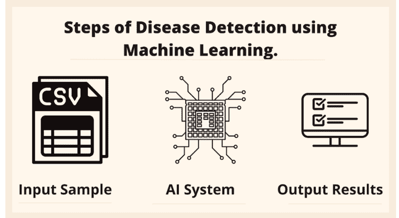

Fig. (3)。使用机器学习进行疾病检测所涉及的步骤。

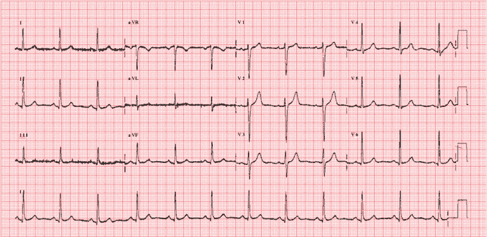

Fig. (4)。显示正常心电图 (ECG)。

## 肺部疾病检测
肺癌是全球每年约导致 170 万人死亡的另一个主要因素 [9]。肺癌可以通过患者的胸部 X 射线和 CT 扫描图像来识别。对图像进行一些预处理后，会对其应用特征提取技术，如对比度受限自适应直方图均衡化 (CLAHE)。CLAHE 使用灰度共生矩阵 (GLCM) 从图像中提取特征。特征提取后，进行图像分类，然后进行性能评估。图 (5) 显示了这些步骤的图示表示。使用 SVM 分类器，可达到 96% 的准确率。

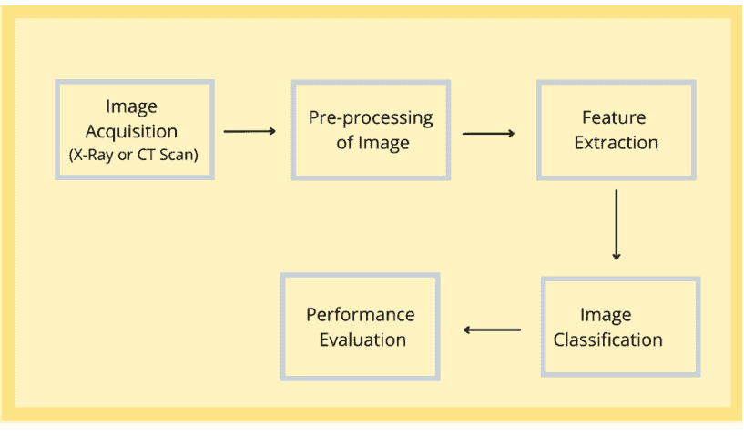

Fig. (5)。机器学习模型的流程图。

肺部感染的一个更近且更普遍的例子是肺炎，它也可能由 COVID-19 引起。肺炎也可以通过患者的胸部 X 射线或 CT 扫描来检测。最新研究显示，从胸部 X 射线检测肺炎的准确率高达 95% [10]。

## 皮肤疾病检测
由于臭氧层分解，皮肤癌及相关问题急剧增加，尤其是在森林砍伐率高的国家。不同算法用于对几种最常见的皮肤疾病进行分类。算法如 ANN、KNN 和决策树。SVM 和随机森林用于检测如特应性皮炎、毛囊炎、麻风病、带状疱疹等皮肤疾病，准确率为 90% [11]。

## 脑部疾病检测
大脑被认为是人体最重要的、最复杂的器官。大脑是最复杂的器官，拥有数百万个相互连接的神经元，这些神经元每天都在变化，形成新的连接。由于大脑的这种复杂结构，治疗脑肿瘤等脑部疾病非常困难。需要尽早检测脑肿瘤，以挽救患者免受脑损伤和其他并发症 [12]。2016 年有报道称，脑肿瘤是美国 0-14 岁儿童癌症相关死亡的主要原因。脑肿瘤也是青少年中最常见的第三种癌症 [13]。除了脑肿瘤外，还可以使用脑部 MRI 图像检测各种其他精神障碍。各种其他类型的脑部相关疾病，如痴呆和阿尔茨海默病，也可通过 MRI 扫描图像检测到。阿尔茨海默病被描述为部分由于脑损伤导致人类智力能力丧失。它在老年人中更常见。以下机器学习算法用于阿尔茨海默病的诊断，如 SVM、随机森林、KNN、神经网络等 [14]。

## 肝脏疾病检测
肝脏是人体最大的器官，重量约为 3 磅。它分为两个部分，即左叶和右叶。肝脏的基本功能是从体内过滤有毒物质并释放某些有助于消化的化学物质。根据世界卫生组织 2018 年提供的统计数据，肝癌是男性中最常见的第五种癌症 [15]。常见的肝脏疾病如下 [16]：
- **脂肪肝：** 脂肪肝是一种大量甘油三酯脂肪空泡在肝细胞中积累的病症。它可能有多种原因，但是一种可恢复的病症。
- **肝炎：** 肝炎是肝脏的炎症，通常由病毒引起。它是一种可治疗的病症，但该病的进一步并发症可能是致命的。
- **肝硬化：** 它被认为是最严重和最常见的肝脏疾病之一。在肝硬化中，可观察到肝细胞的丧失。它可由多种导致肝脏受损的肝脏疾病引起。肝硬化中肝细胞的再生速度慢于肝细胞的丧失。
- **肝癌：** 肝癌是一种观察到异常生长的严重病症。肝脏中可能有多种类型的癌症，但最常见的一种被称为肝细胞癌 (HCC)。患有肝硬化或肝炎的患者肝癌风险相当高。

有 10 个参数通常用于预测与肝脏相关的疾病。这些参数为年龄、性别、总胆红素、直接胆红素、碱性磷酸酶、丙氨酸氨基转移酶、天冬氨酸氨基转移酶、总蛋白、白蛋白、白蛋白与球蛋白比值。肝脏疾病检测使用监督机器学习算法进行，如 KNN、朴素贝叶斯、随机森林、支持向量机和逻辑回归 [17]。

## 用于各种疾病检测的算法
由于检测一种疾病可用的算法不止一种，其准确率略有差异。主要问题是针对何种类型的问题使用何种算法。通常，疾病检测要么通过扫描图像 (CT、MRI 和 X 射线) 进行，要么通过 ECG、EEG 和血糖仪等传感器进行。文献研究表明，像卷积神经网络 (CNN)、循环神经网络 (RNN) 和深度神经网络等算法在基于图片的数据集上表现更好。它们与不同的特征提取方法结合使用。而像随机森林、决策树、极限梯度提升、支持向量机、逻辑回归等算法最适合数值数据。图 (6) 以图示形式显示了这一点。

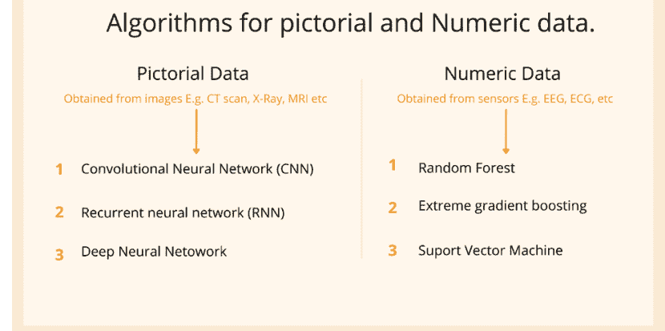

Fig. (6)。基于分类类型的算法。

以下是包含一些常见疾病类型及其检测所用不同算法的表格；表 1 显示了全球受影响最严重的四个器官以及用于检测其相关问题的算法。不同算法具有不同的任务；一些算法用于聚类（基于相似性分组），而其他算法可能是分类算法（真或假）。

可以使用一种以上的算法来检测单一疾病。

表 1。显示用于癌症、心脏、脑、肝脏疾病检测的算法及其相关任务。

| 疾病 | 算法 | 任务 |
|---|---|---|
| 癌症 | K-means Clustering | 聚类 |
|  | DBSCAN | 聚类 |
|  | Random Forest | 回归 |
|  | SVM | 分类 |
|  | KNN | 分类 |
| 心脏 | Linear Regression | 回归 |
|  | SVM | 分类 |
|  | ID3 | 分类 |
|  | KNN | 分类 |
|  | Naive Bayes | 分类 |
| 大脑 | K-means Clustering | 聚类 |
|  | SOMS | 聚类 |
|  | KNN | 分类 |
|  | Naïve Bayes | 分类 |
|  | SVM | 分类 |
| 肝脏 | SVM | 分类 |
|  | ID3 | 分类 |
|  | Linear Regression | 回归 |
|  | KNN | 分类 |
|  | Naive Bayes | 分类 |

## 用于疾病检测的工具和库
有许多机器学习库可用，其中预先编码了所有常见的机器学习算法。这些算法可以在需要时直接使用。有许多用于不同目的的库，从特征提取到分类和绘图。表 2 显示了不同的库及其任务 [18 - 20]。

表 2。显示最常用的机器学习库和框架。

| 库 | 任务 |
|---|---|
| Tensorflow | 用于构建和训练机器学习模型。 |
| Scikit-learn | 数据分析、数据挖掘、分类、聚类和回归。 |
| PyTorch | 自然语言处理和神经网络。 |
| Keras | 深度学习。 |
| RapidMiner | 数据预处理、数据准备、机器学习、文本挖掘、预测分析。 |
| NLTK | 自然语言处理。 |
| MATLAB | 机器学习、数据分析、回归、分类、聚类和解决复杂数学问题的完整环境。 |
| Pandas | 数据操作。 |
| Numpy | 多维数据处理。 |
| Matplotlib | 绘制图表或数据可视化。 |
| Seaborn | 数据可视化。 |

上表包含不同的库和工具。通常，这些工具和库中的多个会组合使用来处理数据、清洗数据（去除异常值）、训练模型和可视化结果。

## 结论与未来趋势
从上述讨论可以得出结论，机器学习的使用为医学科学提供了极大的推动，并帮助医生和医务人员及早检测疾病。它还降低了所用医疗设备的成本。许多任务已实现自动化，这节省了医生的宝贵时间，并有助于挽救一些需要紧急医疗救助的危重患者。不同实验表明，ANN、CNN、SVM、Logistic Regression 和随机森林是一些在医学诊断中表现最佳的机器学习算法。

未来的重点应是进一步提高这些算法的准确性，同时专注于开发新算法。随着基于物联网的智能设备的快速使用，医疗卫生领域获得了极大提升。基于物联网的智能手环和智能手表可以监测个人的生命体征，并在发现任何异常时报告。基于智能机器学习的个人健康监测手环可以有效检测异常身体行为并通知人们及其亲人。这种系统对老年人非常有用。Recently, the

世界已面临 COVID-19 的冲击，导致医院和医疗物资捉襟见肘。控制和预防病毒性疾病的传播至关重要。物联网智能系统在监测疾病传播方面可以发挥重要作用。物联网和可穿戴智能设备可以提醒人们的生命体征，并在其违反社交距离规则时发出警告。连接的智能物联网设备网络可以共享数据，并在某地区患病人数超过特定阈值时通知当局。政府和当局可以及时了解大流行病或病毒性疾病可能的传播情况，并据此采取行动。

## 出版许可声明
未声明。

## 利益冲突声明
作者声明不存在利益冲突，无论是财务或其他方面。

## 致谢
未声明。

## 参考文献
- [1] N. Caballé-Cervigón, J.L. Castillo-Sequera, J.A. Gómez-Pulido, J.M. Gómez-Pulido, and M.L. Polo-Luque, "机器学习应用于人类疾病诊断：系统综述", Appl. Sci. (Basel), vol. 10, no. 15, p. 5135, 2020. [http://dx.doi.org/10.3390/app10155135]
- [2] V. Jain, and J.M. Chatterjee, 具有医疗保健视角的机器学习. Springer: Cham, 2020, pp. 1-415. [http://dx.doi.org/10.1007/978-3-030-40850-3]
- [3] S. Ray, 2019, February. "机器学习算法的快速综述," International conference on machine learning, big data, cloud and parallel computing (COMITCon), pp. 35-39, 2019. [http://dx.doi.org/10.1109/COMITCon.2019.8862451]
- [4] J.K. Holodinsky, A.Y.X. Yu, M.K. Kapral, and P.C. Austin, "比较预测居家时间的回归建模策略", BMC Med. Res. Methodol., vol. 21, no. 1, p. 138, 2021. [http://dx.doi.org/10.1186/s12874-021-01331-9] [PMID: 34233616]
- [5] P. Nerurkar, A. Shirke, M. Chandane, and S. Bhirud, "数据聚类算法的实证分析", Procedia Comput. Sci., vol. 125, pp. 770-779, 2018. [http://dx.doi.org/10.1016/j.procs.2017.12.099]
- [6] S.H. Jambukia, V.K. Dabhi, and H.B. Prajapati, "使用机器学习技术对 ECG 信号进行分类：综述", International Conference on Advances in Computer Engineering and Applications, 2015 pp. 714-721. [http://dx.doi.org/10.1109/ICACEA.2015.7164783]
- [7] H. Ahmed, E.M.G. Younis, A. Hendawi, and A.A. Ali, "从患者社交帖子中识别心脏病，Spark 上的机器学习解决方案", Future Gener. Comput. Syst., vol. 111, pp. 714-722, 2020. [http://dx.doi.org/10.1016/j.future.2019.09.056]
- [8] A.K. Dwivedi, "用于心脏病预测的不同机器学习技术性能评估", Neural Comput. Appl., vol. 29, no. 10, pp. 685-693, 2018. [http://dx.doi.org/10.1007/s00521-016-2604-1]
- [9] G.A.P. Singh, and P.K. Gupta, "用于人类肺癌检测和分类的各种基于机器学习方法的性能分析", Neural Comput. Appl., vol. 31, no. 10, pp. 6863-6877, 2019. [http://dx.doi.org/10.1007/s00521-018-3518-x]
- [10] T.B. Chandra, and K. Verma, "使用机器学习范式在胸部 X 射线上检测肺炎", In: B. Chaudhuri, M. Nakagawa, P. Khanna, S. Kumar, Eds., Proceedings of 3rd International Conference on Computer Vision and Image Processing. Advances in Intelligent Systems and Computing, vol 1022. Springer, Singapore, 2020. [http://dx.doi.org/10.1007/978-981-32-9088-4_3]
- [11] M.S. Kolkur, D.R. Kalbande, and V. Kharkar, "多类人类皮肤病检测的机器学习方法", International Journal of Computational Intelligence Research, vol. 14, no. 1, pp. 1-12, 2018.
- [12] K. Usman, and K. Rajpoot, "使用小波和机器学习从多模态 MRI 进行脑肿瘤分类", Pattern Anal. Appl., vol. 20, no. 3, pp. 871-881, 2017. [http://dx.doi.org/10.1007/s10044-017-0597-8]
- [13] N. Abiwinanda, M. Hanif, S.T. Hesaputra, A. Handayani, and T.R. Mengko, 2019. “使用卷积神经网络的脑肿瘤分类,” World congress on medical physics and biomedical engineering, Springer, Singapore, pp. 183-189, 2018. [http://dx.doi.org/10.1007/978-981-10-9035-6_33]
- [14] P. Lodha, A. Talele, and K. Degaonkar, "使用机器学习诊断阿尔茨海默病", Fourth International Conference on Computing Communication Control and Automation (ICCUBE A), pp. 1-4, 2018. [http://dx.doi.org/10.1109/ICCUBE A.2018.8697386]
- [15] R.A. Khan, Y. Luo, and F.X. Wu, "基于机器学习的肝病诊断：系统综述", Neurocomputing, vol. 468, pp. 492-509, 2022. [http://dx.doi.org/10.1016/j.neucom.2021.08.138]
- [16] M.B. Priya, P.L. Juliet, and P.R. Tamilselvi, "使用机器学习算法进行肝病预测的性能分析", International Research Journal of Engineering and Technology, vol. 5, no. 1, pp. 206-211, 2018.
- [17] A.S. Rahman, F.J.M. Shamrat, Z. Tasnim, J. Roy, and S.A. Hossain, "使用监督机器学习算法进行肝病预测的比较研究", International Journal of Scientific & Technology Research, vol. 8, no. 11, pp. 419-422, 2019.
- [18] G. Nguyen, S. Dlugolinsky, M. Bobák, V. Tran, Á. López García, I. Heredia, P. Malík, and L. Hluchý, "大规模数据挖掘的机器学习和深度学习框架与库：综述", Artif. Intell. Rev., vol. 52, no. 1, pp. 77-124, 2019. [http://dx.doi.org/10.1007/s10462-018-09679-z]
- [19] G. Battineni, G.G. Sagaro, N. Chintalapudi, and F. Amenta, "机器学习预测模型在慢性病诊断中的应用", J. Pers. Med., vol. 10, no. 2, p. 21, 2020. [http://dx.doi.org/10.3390/jpm10020021] [PMID: 32244292]
- [20] H. Ben Hassen, W. Dghais, and B. Hamdi, "基于物联网和雾计算的老年人健康监测电子健康系统", Health Inf. Sci. Syst., vol. 7, no. 1, p. 24, 2019. [http://dx.doi.org/10.1007/s13755-019-0087-z] [PMID: 31695910]

# 疾病检测中的机器学习：解决方案与开放挑战

Tayyab Rehman¹, Noshina Tariq¹, Ahthasham Sajid²,* and Muhammad Hamza Akhlaq³

¹ Faculty of Computing, SZABIST, Islamabad, Pakistan
² Department of Computer Science, Faculty of ICT, BUITEMS, Quetta, Baluchistan, Pakistan
³ Department of Computer Science, Allama Iqbal Open University, Islamabad, Pakistan

## 摘要:
疾病诊断是医疗保健领域最重要的关注点。机器学习（ML）分类方法可以通过实现更准确、更及时的疾病诊断来极大地改善医疗行业。识别和机器学习有望提高生物医学中疾病评估和治疗的精确度。它们还有助于确保决策过程的公正性。本文研究了一些提出的机器学习分类方法，以提高医疗专业人员在疾病诊断方面的能力。它概述了机器学习并简要定义了最常用的疾病分类技术。本综述论文评估了用于检测各种疾病（如主要疾病、季节性疾病和慢性疾病）的众多机器学习算法。此外，它还研究了采用机器学习分类技术的最先进方法。主要目标是检查在疾病诊断和预测开发过程中实施的各种机器学习流程。

### 关键词:
Classifiers, Machine learning Disease classification, Machine Learning Methods.

## 引言
每个人都如此关心自己的家庭和事业，以至于在当今时代没有时间照顾自己。由于生活繁忙，大多数人遭受焦虑、紧张、悲伤和各种其他疾病的困扰。考虑到这一点，他们正在获得因素，病情严重，并患有急性疾病。每年有许多疾病导致个人死亡，例如心脏病、癌症、肝癌、结核病等，但主要或慢性疾病在医疗保健领域导致死亡人数最多 [1]。现代

技术促进了先进医疗方法的发展，例如智能人体健康监测系统，以及个性化治疗，以为每个人提供最周到的诊断。人们每天在世界各地受到多种疾病的影响。其中一些疾病仍未被诊断并进入关键阶段 [2]。COVID-19、疟疾、登革热、普通感冒和发热都可以通过基本的实验室检查和易于获得的药物进行检测和治疗。

然而，包括癌症、慢性、季节性、精神问题以及多种疾病和感染，可以在一定阶段通过更多努力得到控制。在极少数情况下，如果及早发现甚至可以治愈 [3]。大多数先前的研究尝试使用患者实验室检测和药物来预测疾病的发生 [4, 5]。这些模型也被广泛应用于描述未知风险因素，通常同时提高检测的特异性和敏感性。多种方法，包括支持向量机、逻辑回归、随机森林、神经网络和时间序列建模方法，在最近的研究中被发现对预测疾病很有用 [6, 7]。在对问题进行彻底分析之前，有必要更深入地了解基本的 ML 技术。这项工作的主要目标是提供现有 ML 方法的概述 [8]。本综述论文的主要贡献如下列出：

- 1. 提出了一项基于机器学习和深度学习的新颖的疾病检测最新文献综述。
- 2. 提出了基于监督学习、无监督学习、强化学习和深度学习的分类法。
- 3. 以表格形式呈现了对最新技术的批判性分析。
- 4. 提出了关于疾病类型和 ML 方法的问题和挑战。

本文其余部分组织如下：第 2 节介绍了用于疾病预测的 ML 方法的分类和分类法。第 3 节详细介绍了疾病检测机制，最后，第 4 节提供了结论和未来方向。

## 机器学习方法

本研究重点将 ML 方法分为监督学习、无监督学习、强化学习和 DL，如图 (1) 所示。类别如下所述：

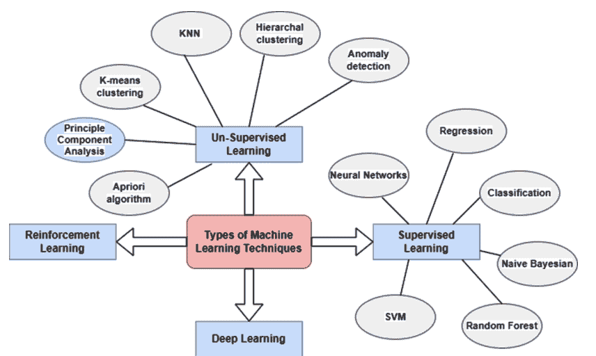

图 (1)。机器学习技术的示意图。

### 监督学习 (SL)

给定一组具有适当目标的实例训练集，处理过程会根据在此训练集上创建的完整可能输入做出相应响应。SL 方法也称为从示例中学习。两步 SL 方法如下所示，并在图 (2) 中显示。

- 预测模型是可用数据和已知答案的组合。
- 当展示新数据时，预测模型提供适当的响应。

### 无监督学习

没有指定适当的响应或目标。无监督学习探索存储数据之间的共同点，并基于这些共同点对数据进行分类。数据聚类是此的另一个名称。聚类是无监督学习的一个特征。当没有提供输出时，无监督 ML 用于从输入中学习数据中的模式。聚类、NNs 和 HMM 通常用作无监督学习技术。这些方法允许探索未标记数据以找到内在或隐藏的模式。

### 强化学习 (RL)

这种学习技术由行为心理学推广。当答案仍然不准确时，算法会被通知，但不会被告知如何改进。它必须研究和测试各种选择，然后再决定最佳选择。另一种说法是与批评者一起学习，批评者提供改进建议。RL 与 SL 方法不同之处在于，它不提供精确的输入和输出集，也不明确指定次优行为。此外，它侧重于在线性能。

### 数据挖掘 (DM)

它是一种将大量数据转化为有用知识的过程和技术。DM 被归类为从数据库数据中提取以前未知且可能有价值的信息的非平凡数据分析过程 [9]。数据库中的数据挖掘是称为知识发现的更大过程的一部分。使用了多种预处理技术，以使 DM 算法和后处理更容易使用，旨在完善和增加已发现的知识 [10]。数据挖掘、深度结构学习和分类学习是同一事物的其他术语。DL 可以从多个表示或数据陈述阶段学习，以构建分层表示。因此，DL 是“未来的事物”，导致从浅层到深层架构的快速转变。语音识别、模式识别、计算机视觉、语言处理、生物信息学和统计信息仍然是 DL 被广泛采用的所有领域 [11]。

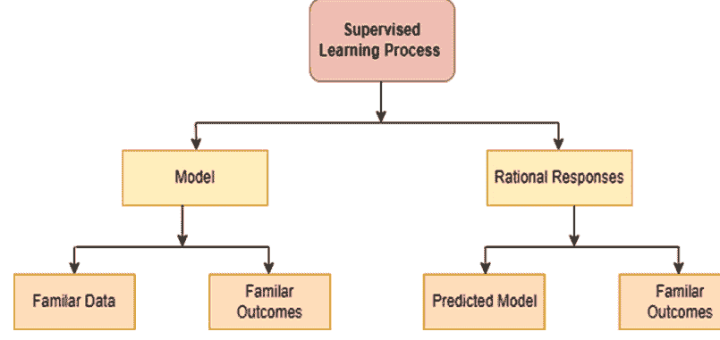

图 (2)。逐步监督学习过程。

ML 算法最初被开发并用于评估医疗数据集。ML 现在推荐多种工具用于有效的数据分析。对于医疗数据的研究，ML 技术特别成功，并且在诊断疾病方面取得了很大进展。在现代医院中，可靠的诊断数据以健康记录或报告或其数据部分的形式呈现 [12]。有效的诊断医疗记录作为输入加载到机器中以执行算法。此生成的分类器以更高的速率和更大的准确性帮助医生识别新患者 [13]。ML 在过去提供了自动驾驶汽车、语音识别和更好的人类视觉。ML 现在如此普遍，以至于可以每天多次使用它而甚至没有意识到。ML 的主题是模式检测，这可以帮助预测和做出诊断和治疗的决策。ML 算法可以存储和处理数据，结合来自多个来源的数据，并将背景信息纳入研究（图 3）[14]。

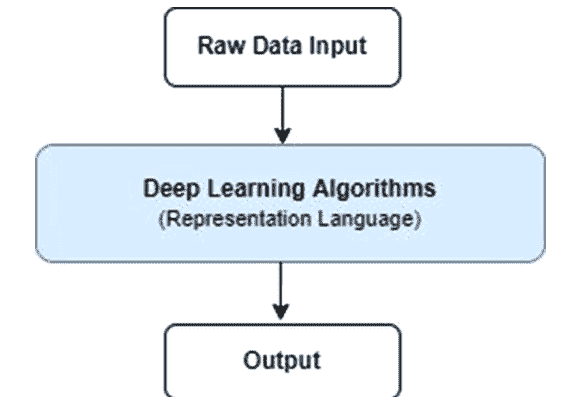

图 (3)。深度学习算法表示。

## 使用不同机器学习分类进行疾病检测

各种研究人员使用的不同 ML 方法产生了疾病诊断方法。研究人员已证明 ML 算法在识别多种疾病方面很有用。图 (4) 显示了使用机器学习技术进行疾病诊断的象征性方法。

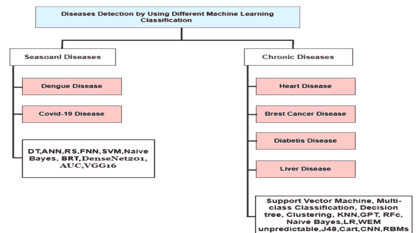

图 (4)。用于疾病检测和预测的机器学习分类的分类法。

## 慢性疾病：心脏病检测

心脏和血管疾病通常称为心血管疾病 (CVD)，只是影响心脏血管的疾病。充血性心力衰竭和心脏病发作是冠状动脉心脏病的例子，冠状动脉心脏病是一种心血管疾病。心脏病的一种特定类型是冠状动脉疾病，当心脏的血管变得阻塞时发生；一种称为动脉粥样硬化的脂肪物质在冠状动脉内形成 [15]。心血管疾病是医学上最不可预测的疾病之一，因为它涉及许多标准和复杂性。ML 可能是实现高预测精度的一个不错的选择，不仅针对心脏病，也针对其他疾病。该工具使用提取的特征和数据在各种条件下预测心脏病。ML 算法，例如 NB [16]、DT [17]、KNN [18] 和神经网络 [19]，用于预测心脏病风险。下面讨论一些最著名的算法。

### 朴素贝叶斯 (NB)

一种概率分类器，不假设特征之间的依赖关系。应最大化概率以确定类别。其优点包括在不应用贝叶斯程序的情况下处理朴素贝叶斯模型。朴素贝叶斯分类器是确定分组关注的常规顺序的过程，例如钓鱼检测，并且也是

适用于一般医学问题。它由同一类型中与其他特征独立的单一类别的属性组成 [20]。

## 决策树 (DT)

DT 是机器学习算法中的监督学习技术之一。它可用于分类和回归。在连续和分类参数下，其功能良好。该算法根据最重要的预测因子将人群划分为两个或多个相关分组。许多因素会影响心脏病患者，包括年龄、血压、遗传、血糖等。医生可以通过查看决策树迅速在所有因素中找出关键特征。他们还可以在许多人中产生高度影响的特征。基于熵的决策树清晰地指出了数据集的重要性 [21]。

## K-最近邻 (K-NN)

KNN 算法是一种监督分类技术。它根据项目与其一个或多个项目的相似性对项目进行分类。它是特定实例学习方法的一个良好示例。采用欧几里得距离并计算属性与其邻近点之间的距离。它使用一组标记点来确定如何标记另一点。数据根据其相似性进行分组，K-NN 可用于填补数据中的缺失值。填补缺失值后，数据集会接受各种预测方法。应用这些方法的不同组合是可行的，以便准确取得进展 [22, 23]。表 1 描述了使用机器学习检测心脏病的技术，而表 2 描述了在类似领域中各种算法所取得的准确率。

表 1. 应用于心脏病的机器学习技术。

| 参考文献 | 分类技术 | 优点 | 限制 |
|---|---|---|---|
| [16, 20] | 朴素贝叶斯 | 处理离散和连续数据 | 数据集有限时性能较低。 |
| [17, 21] | 决策树 | 准确率、敏感性、特异性、精确率、曲线下面积 | 未使用额外相关数据来测试算法。树反复生长可能导致过拟合。 |
| [22] | KNN | 简单，准确率高 | 对局部信息结构敏感。计算缓慢。 |

表 2. 分类准确率。

| 参考文献 | 年份 | 算法 | 准确率 | 机器学习技术 |
|---|---|---|---|---|
| [20, 22] | 2021 | 朴素贝叶斯 | 慢性病诊断在 82% 至 92% 之间。 | 监督学习 |
| [21] | 2020 | 决策树 | 86.3%（测试阶段）87.3%。 | 监督学习 |
| [24, 25] | 2019 | KNN | 97.3% | 监督学习 |

## 问题与挑战

调查中用于慢性心脏病的三种监督机器学习技术。利用这些方法分析了心脏病数据集。对于该方法，应比较分类性能 [26]。应扩展该研究以使用更少的变量预测心脏病。为了获得更优结果，许多研究人员和开发人员已在远程医疗的多个机器学习领域进行了研究。不幸的是，这些研究并未为与医疗服务交付相关的问题提供理想的解决方案。我们发现研究人员对各种机器学习目标的担忧各不相同。我们根据机器学习的性质将这些问题分为若干部分，我们将其归类为分类、估计和识别。

## 慢性疾病：乳腺癌检测

在大多数患癌女性中，乳腺癌是导致死亡的主要原因。乳腺摄影是高度可靠的乳腺癌早期检测和诊断技术之一，有助于减少死亡。乳腺摄影是乳房的放射影像，用于检测乳腺癌早期迹象。乳腺癌诊断手工进行既困难又耗时，从而促使自动化过程。当前医疗保健系统已发展到有益，但它们容易出错 [27]。因此，基于 CAD 的医学图像分类已发展成为临床医生将医学图像分类为不同类别的有用工具，从而实现即时诊断和治疗。在这种情况下，必须开发机器学习技术和深度学习算法，以便在更早阶段更可靠地诊断该病，减少在诊所和医院的再入院频率 [28]。因此，人工智能方法可以帮助加速医学新保真度指南的发展，同时降低误诊相关的医疗费用 [29]。炎性乳腺癌是一种常见且严重的乳腺癌类型，会迅速扩散和生长。乳头 Paget 病是一种极其罕见的乳腺癌类型。它始于乳腺导管并进展到乳头皮肤，然后是乳晕。叶状肿瘤仍是一种相对罕见的乳腺癌类型。它们在乳腺基质（结缔组织）中进展。大多数为良性，但有些为恶性。以下技术在此方面被广泛实践。

## CAD 系统

计算机辅助检测和诊断通常与 CAD 一起使用。实践中，CAD 被称为计算机辅助检测，以识别和分类图像中可疑的怀疑部分。当它能够评估和分类良性和癌性乳腺癌时，则建议为 CAD。CAD 系统必须评估诊断图像，这需要创建复杂的计算机算法 [30]。尽管 CAD 有助于检测早期侵袭性乳腺癌，但它也增加了假阳性结果的可能性。因此，在将 CAD 纳入临床实践时，应处理精确度和工作流程效率。其次，用户培训也是必要的，以便了解 CAD 系统的局限性和能力，避免不当利用 [31]。

## 深度学习

它被归类为表征学习技术，因为神经网络可以在对完整图像进行分类之前学习数据的瞬态、层次结构和进一步的认知表征。深度学习使用多个非线性计算层直接从数据中学习属性 [32]。根据最近的一项研究，卷积神经网络（CNN）在肿瘤检测和治疗中表现出优异的性能。输入数据之后的层更通用并吸收低级数据。另一方面，输出层附近的层获取输入图像的独特方面，因此更专业化 [33]。

## 机器学习技术

机器学习技术的学习通常分为监督学习和无监督学习。在监督学习中，使用一组数据示例来训练系统，每个示例都标记以确保产生正确的输出。另一方面，无监督学习缺乏预先存在的知识集或预期结果的概念，这意味着目标难以实现。下面列出了一些著名技术：

- **支持向量机 (SVM)：** 使用支持向量机自动进行基于 SVM 的乳腺癌检测。建议的模型经过测试，结果表明其平均性能为 87.12%。研究作者并未解释在训练支持向量机时超参数是如何确定的 [34]。

- **随机森林 (RF)：** 构建树林需要大量决策树。使用算法技术从替换数据集中随机抽取大小为 N 的样本，或从预测中随机选择而不进行替换。收集的数据被分成段。之后，剩余数据被销毁。这些步骤根据所需树的数量重复多次。最后，这些树对观测值进行分类和计数。然后由大多数情况决定聚类算法以对它们进行分类。

## 卷积神经网络模型 (CNN)

卷积神经网络架构中的输入、输出和额外的隐藏层都是称为形态池化的连接层。Abdel-Zaher 和 Eldeib 设计了一种基于未监控的深度信仰范围的拥有和假设可变通道的 CNN 乳腺癌检测方法 [35, 36]。建议的安排仅旨在为标记数据的训练集提供有限数量。在对比之下，CNN 通常使用大量数据集进行参数训练和修改。数据测量、任务收集、数据分离交叉和 CNN 都包含在诊断设备中。四种医学上重要的组织形式为正常组织、良性病变、原位癌和侵袭性恶性肿瘤。建议的 CNN 架构试图在多个尺度上结合数据。深度学习技术用于对 BreakHis [37] 中的照片进行分类，BreakHis 是一个乳腺癌病理图像的公共数据库。他们建议了一种基于图像补丁抽象并结合这些完成分类补丁的 CNN 开发方法。然而，由于缺乏数据，研究成本高昂 [38]。

## 问题与挑战

乳腺摄影分类是一项具有挑战性但重要的任务，因为它是确定风险状态的首次估计之一。即使诊所现在拥有更先进的成像能力，研究人员也应通过在多个数据集上推广模型来解决设备级乳腺摄影异常。一些论文也难以理解 [45]。在关于 CAD 在医学科学中机会的讨论中，Yanase 和 Triantafyllou [44] 提出了一些关键主题。数据收集和质量估计、改进分割、特征工程、处理海量数据以及为所有生成的标准培养必要的实施评估是示例。在所选论文中，有 73%（389 篇）涉及诊断任务，因此及早检测乳腺癌对于提高治疗效果至关重要。大多数研究建议开发新的计算机辅助诊断系统，以帮助临床医生更精确地确定肿瘤类型。

只有一件事表明最近的解决方案再次被用于管理岗位，其中 17%（88）篇出版物关注筛查，6%（26）篇论文关注治疗，6%（26）篇文章关注预测。

尽管乳腺癌是医学领域中最重要的领域之一，但所选出版物中治疗任务却很少受到关注；例如，它讨论了在测试类型中整合 ML 方法的重要性，以为乳腺癌的治愈制定坚实的路线图 [46 - 48]。在此，回顾了各种方法、疾病预测的分类方法和特征提取的比较。必须在不丢失数据的情况下压缩大数据，这增强了分类的有效性，因为选择特征使我们能够消除不需要的数据。然而，良好的子集准则具有挑战性，而且由于它需要对各种各样的参数进行复杂的依赖而变得更加困难。我们未来可以整合准则并提取特征以改善分类器结果。此外，您可以开始尝试针对具有区分特征的大多数数据集的算法潜力，例如噪声数据、稀疏性和缺失值，以提高模型准确性。因此，您可以花时间尝试针对具有特定属性的大多数数据集的算法可能性，例如噪声数据、稀疏性和缺失值，以提高模型准确性，如表 3 所示。

## 表 3. 乳腺疾病检测方法优缺点

| 参考文献 | 方法 | 优点 | 缺点 |
|---|---|---|---|
| [39] | CNNs | 感受野更大。图像识别问题的准确性。 | 任意。复杂任务训练速度慢 |
| [40] | SVM | 在高维空间中有效。在测量次数超过样本数量的情况下有效。 | 在特征集超过样本数量的情况下，控制至关重要。 |
| [41] | KNN | 采用简单有效的方法，在乳房X光照片中区分变异与常态。 | 显著特征提取技术有限 |
| [41] | RF | 对非线性数据效果良好。过拟合风险较低。 | 训练缓慢 |
| [42] | Deep Multi-Instance | 对于稀疏标注数据，这是一个不错的选择。 | 在实例类别不精确时失效。 |
| [43] | The neural network feed-forward classifier | 特征提取性能高。 | 对于稀疏标注数据，这是一个不错的选择。 |
| [44] | CAD | 图像分析过程中节省图像。假阴性率降低，灵敏度提高 | 在评估的任何性能指标上，使用 CAD 并未提高诊断准确性。 |

## 慢性疾病：糖尿病检测

根据世界卫生组织 WHO 的说法，每年有超过 160 万人死于糖尿病。糖尿病仍然是一种疾病，当人体血液葡萄糖/血糖水平极高时就会发生。胰岛素是人体最重要的激素之一。它帮助身体将糖、碳水化合物和其他食物转化为其发挥功能所需的能量。然而，如果身体不能产生或使用足够的胰岛素，多余的糖会通过尿液排出体外。糖尿病的医学术语就是这种状况。糖尿病的确切病因尚不清楚，而肥胖和缺乏体力活动似乎起着作用。高血糖是糖尿病的症状，糖尿病是一种慢性病。它会引发多种严重疾病，如中风、肾衰竭和心脏病。2014 年，全球有超过 4.22 亿人患有糖尿病。到 2040 年，人口将达到 6.42 亿。本研究的首要目标是创建一个基于机器学习的系统，可以预测糖尿病患者。糖尿病发生时，人体内的器官胰腺不能产生足够的胰岛素，并且产生的胰岛素不能被身体细胞利用。

糖尿病是一种无法治愈的疾病；因此，早期检测至关重要。DM、ML 技术和神经网络模型用于预测糖尿病的方法在 [49] 中提出。表 4 描述了迄今为止检测糖尿病疾病所取得的准确率。本研究中使用了 Pima Indian 糖尿病数据集。交叉验证预测比百分比分割（70:30）更好。在此数据集中，使用分类技术和百分比分割，J48 的准确率分别为 74.8698% 和 76.9565%。使用百分比分割测试，算法确定最大准确率 [50, 51]。由于人工智能技术的不断进步，ML 技术已被开发为特别适用于识别影响糖尿病的危险变量和生理反应的可接受阈值。其次，机器学习和医学诊断的目标相同：从大量数据中获取准确且有用的信息以得出结论 [52, 53]。以下是糖尿病疾病检测的传统 ML 技术。

表 4. 糖尿病疾病检测方法及准确率

| 参考文献 | 方法 | 对比方法 | 性能 | 机器学习技术 |
|---|---|---|---|---|
| [59] | XG Boost | NB, Ada Boost, RF | 93.75% | 有监督学习 |
| [60] | SVM | RF, NB, DT, KNN | 77.73% | 有监督学习 |
| [61] | Logistic Regression | DT, SVM, KNN | 77.90% | 有监督学习 |
| [62] | Gradient Boosting | LR, RF | 84.7% | 有监督学习 |
| [63] | Naive Bayes | PS | 79.56% | 有监督学习 |

## Logistic Regression (LR)

统计模型通过确定最佳拟合线性模式的常数来描述二元预测变量的对数变换与一个或多个独立变量之间的联系。这种简单的预测模型为相似性和非参数机器学习提供了基线准确率值 [54]。

## Random Forest Classifier (RFC)

一种使用装袋方法创建多个随机 DT 的集成类型。每个树代表分析图中的一个可能结果。对于全局分类，使用树之间的平均预测。这种方法减少了决策树大方差的缺点。决策分割使用不纯度和增益比 [55]。

## Gradient Boosted Trees (GBT)

一种基于决策树的集成预测技术。与随机森林相比，该模型利用梯度下降逐步创建决策树以减少损失函数。所有 DT 的加权民主多数用于做出最终预测。我们讨论 XGBoost，这是一种为速度和可靠性而调整的梯度提升方法 [56]。

## Weighted Ensemble Model (WEM)

汇总之前所有模型的结果。来自不同模型的多项预测可以使用基于每个模型性能的权重进行平均。加权集成对应于模型的逻辑，可能受益于多个模型的优势以提供更精确的结果 [57]。

基于该领域的现有研究，回归模型和 SVM 算法被选为我们研究的标准模型。为了利用数据中计算和诊断的非线性联系，我们的研究中构建了 RFC、GBT 和 WEM 模型，并显示了分类比较结果，见图 (5) [58]。

## 分类结果

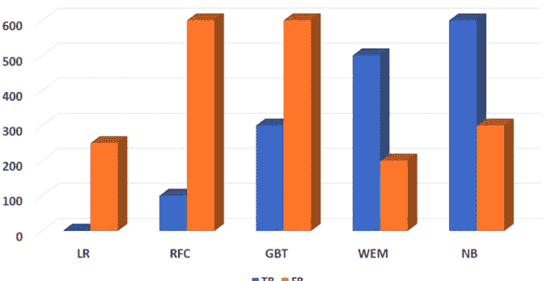

图 (5). 糖尿病疾病数据准确率模型。

## 问题与挑战

SVM 分类器、DT 和神经网络是本工作中使用的算法。未来将使用任何优化方法来改进这项工作。作者采用数据挖掘方法来检查预测糖尿病状态的准确性。这项工作将在未来通过使用更多优化技术而得到扩展。然而，血糖控制不佳会损害人们对远程医疗实用性的看法，尤其是在男性中。疫情之外，远程医疗可能是提高糖尿病护理效率和成本效益的可行选择。

## 慢性疾病：肝病检测

肝脏是人体最大的器官，负责处理食物和吸收有毒物质。通过及早发现和治疗肝脏问题，可以防止肝衰竭。肝病的第一阶段是由炎症引起的，可能伴随或不伴随任何症状。慢性炎症导致组织取代健康的肝组织，导致疾病

进展到第二阶段，纤维化，该阶段也大多无症状。肝硬化是第三阶段，由肝脏严重损伤引起。此阶段开始出现胃痛、疲惫、虚弱和黄疸等症状。病毒和酒精使用会导致肝脏损伤，危及个人生命。肝炎、肝硬化、肝肿瘤、肝癌以及各种其他疾病都会影响肝脏。肝脏疾病和肝硬化是导致死亡的主要原因 [63]。对于肝病分析和预测，机器学习在生物医学领域产生了相当大的影响。

ML 有望改善疾病诊断和预测，这引起了医学领域的兴趣，同时也提高了决策过程的客观性。医疗问题可以借助机器学习技术轻松解决，且诊断成本可以降低。本研究的主要目标是提高预测准确性以降低医学领域的诊断成本 [64]。SVM 分类器和 NB 分类算法用于预测肝病。UCI 提供了 ILPD 数据集。该数据集有 560 个实例和十个属性。比较基于执行准确率。朴素贝叶斯算法在 1670.00 毫秒内达到 61.28% 的准确率。SVM 在 3210.00 毫秒内达到 79.66%。实现在 MATLAB 中完成。与朴素贝叶斯相比，SVM 以最佳准确率预测肝病。与 SVM 相比，朴素贝叶斯运行所需时间更少 [65, 66]。开发一种用于肝病诊断和预测的机器学习技术，下面是需要采取的步骤以及图 (6) 中提出的 ML 分类建议模型。肝病检测的主要步骤将在下面讨论。

## 数据选择和预处理
数据收集过程需要使用各种数据挖掘技术选择相关信息并获取有用知识，本实验使用 UCI ML 的数据集。此外，还收集了原始数据集。该数据集中有 583 名肝病患者，其中男性病例占 75.64%，女性患者占 24.36%。我们从该数据集中选择了十个参数用于进一步研究，并以 1 个因子作为类别标签，共 11 个特定参数 [67]。将原始数据转换为干净数据的预处理可以提高 ML 的预测性能。所使用的技术包括清洗、归一化、转换、缺失值填充、验证不一致值、消除重复组、消除噪声数据、特征组合、特征采样、降维和特征编码。

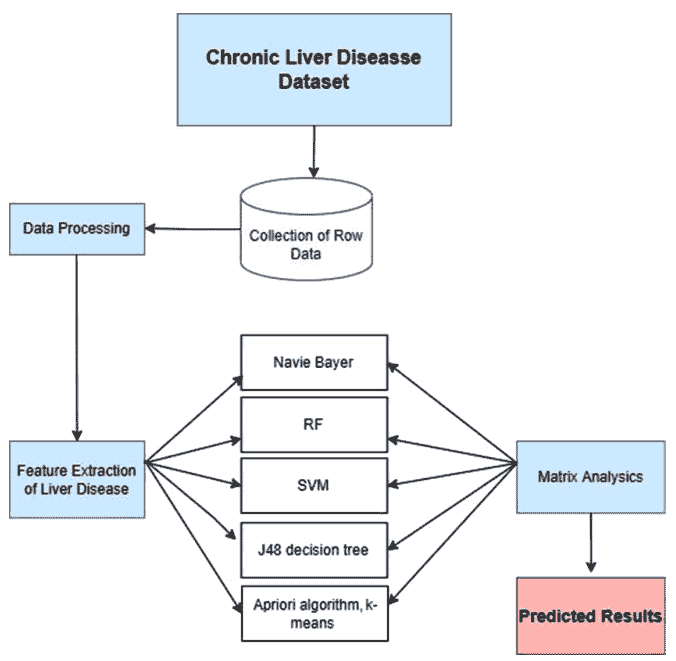

图 (6)。提出的模型 ML 分类架构。

## 特征选择
选择是在排除非贡献特征的同时为预测模型定位输入特征。遗传算法是需要优化方法的最先进应用之一。这种自然选择的方法类似于达尔文的。初始化、适应度分配、选择、交叉和变异是遗传算法遵循的步骤。

## 分类算法
分类是指从数据集中构建类别特征模型，以高准确度为未知记录分配类别标签。对于分类，ML 算法利用具有重要特征的训练数据。可供选择的机器学习算法种类繁多，取决于要生成的预测和诊断模型的种类。

## 监督学习和无监督学习
这些算法将输入转换为预期结果并按照期望结果工作。使用这些方法重复学习过程，直到模型生成为止。DT、随机森林、KNN、SVM、LR 和 NB 是这些技术的示例（NB）。这些无监督学习技术不需要目标结果，主要用于解决聚类问题。Apriori 算法、k-means 和其他算法是这些算法的示例。

## 性能指标分析
该阶段创建用于实现预期结果和假设的 ML 算法。使用交叉验证方法评估方法的效率，以确定提供最大准确度的算法。通过使用包含重要特征的定制数据集对 ML 分类模型进行训练和测试，生成最终的预测或诊断模型，该模型可对新的和不熟悉的数据集做出自动判断。

## 预测结果
对于肝脏数据集，已评估了多种 ML 技术的性能。通过 ML 仓库中的分类器组合实现了过采样，而可变内容选择则借助 UCI ML 仓库中的分类器组合实现。为了解决问题，采用了隔离森林。大多数算法的性能因特征提取和异常值减少而显著提高，训练和测试所需时间也显著减少。

## 问题与挑战
本调查的主要目标是使用多种监督学习和无监督机器学习模型为慢性肝病患者开发一种高效的诊断方法。缺乏大型训练数据集经常被引用为障碍。然而，这一假设仅部分成立。无监督方法具有吸引力，因为它们允许网络准备并利用大量可用的未标记数据。认为无监督方法将继续发挥重要作用的另一个原因是与认知行为的类比，它似乎更具数据有效性，并在一定程度上以无监督方式发生；我们能够学习认识缺乏相同标签的框架的伪影 [68]。当数值不明确或许多结果相关时，计算会变得复杂。我们未来可以整合建议和特征选择以提高分类器的性能。此外，还开发了诸如蚁群等新型特征选择方法。可以测试优化以提高质量。您可以尝试探索针对具有不同特征的大多数数据集的算法可能性，如噪声数据、稀疏性、缺失数据值等，以提高模型准确性，如表 5 所述。

表 5. 登革热预测的方法和局限性。

| 参考文献 | 方法 | ML 技术 | 性能 | 局限性 |
|---|---|---|---|---|
| [73] | ANN | 无监督学习 | 99.8 | 另一方面，像决策树、SVM、RF 等算法具有很强的可解释性。 |
| [40] | SVM | 监督学习 | 90.42% | 需要样本数量以获得精确结果。 |

## 季节性疾病：登革热检测
大多数研究集中于与登革热传播和流行相关的环境变量，如天气模式。越来越多的证据显示这些变量与疾病流行率之间存在联系 [69]。登革热是人类中最常见的病毒性发热之一。它也被认为是危及生命的疾病，而且感染登革热的人数每天都在增加。许多人面临感染登革热的风险。早期检测登革热可以通过提醒人们采取适当的预防措施和治疗来挽救生命。然而，无法预测是否会发生这种情况。登革热诊断检查可能需要长达十天才能在患者血液中检测到病毒，但在该期间患者的状况可以得到改善。本研究旨在探讨人工神经网络（ANN）技术是否可用于识别患者登革热的发作 [70, 71]。

三个参数的输出采用某些真实参数，如平均温度、平均相对湿度、总降雨量和报告的登革热病例。他们在本项目中使用了 ANN，因为它是从示例中学习问题的优秀技术，并且不需要任何情况的计算模型。本研究依赖于确诊登革热病例的识别 [72]。因此，报道了对 523 例登革热病例的临床特征检查。在此示例中，研究人员采用无监督学习来发现与特定确诊登革热感染相关的自然分组。利用实验室、临床和人口统计信息有助于确定预测特征与

感染登革热的可能性。本研究依赖于已确认登革热病例的识别 [73]。

## 问题与挑战

登革热是一种重大的全球新兴疾病，对流行国家的卫生系统造成破坏，需要开发高性能的集成级学习预测方法。在并发症出现之前，很难将登革热与其他常见发热性疾病区分开来——迫切需要一种简单且低成本的策略来促进早期诊断，既可改善护理协调，又可促进有限资源的有效利用，同时也是针对可能存在较高副作用风险的患者。当前关于登革热疾病的研究旨在检测临床文献中的疾病并将其与时间框架联系起来。数据集已标记，并利用特征提取和分类方法来研究该状况。数据集将被分析以实现有效结果，并将使用分类方法。当前研究人员认为，通过应用更强大的方法来提供输出方面的登革热影响分析，系统得到了改进。我们将在未来利用多种特征继续提高整体速度和计算。已经创建了多个登革热预测模型。由于该领域仍处于起步阶段，需要进一步研究，但仍有大量工作要做。因此，开发一种新的升级创新复合模型来预测登革热爆发非常重要，该模型结合了多种机器学习算法。

## 季节性疾病：COVID-19 疾病的检测

SARS-CoV-2 是一种病毒，最初在中国湖北地区爆发，是当前 COVID-19 大流行的原因。正如人们所期望的那样，鉴于该疾病出现的早期，COVID-19 患者的治疗仍然复杂且有争议。COVID-19 的最初迹象类似于许多其他呼吸系统疾病和炎症性疾病，包括发热、打喷嚏、鼻炎、持续性咳嗽以及伴有身体疼痛的疲劳 [74]。最近的发现表明，ML 可在 COVID-19 研究、预测和鉴别中发挥重要作用。最后，机器学习可以分析并分诊健康提供者计划和方案中的 COVID-19 病例 [75]。在 92.9% 的测试准确率下，监督学习优于竞争的无监督学习方法。连续监督学习可用于提高准确性 [76]。ML 和迁移学习解决方案可利用隐藏层反复学习特征，通常在超级计算机上训练以节省时间。当与复杂的特征提取和选择算法相结合时，基于 ML 的系统可以提高准确性 [31, 32]。

此外，如果检索到的主观特征被正确选择，可以获得更高的分类准确率并定义疾病。本研究研究了九种不同的 AI 模型。首先，一个基于 DL 的 CNN，随后是 VGG16、DenseNet121、DenseNet169、DenseNet201 和 MobileNet，都是基于深度学习的迁移学习技术。剩余的三种 ML 模型 ANN、DT 和 RF 用于对 CT 分割的肺部 COVID 与对照进行分类。将九种 AI 模型进行比较以提高分类准确率。图 (7) 进一步说明了使用标准偏差实现的准确率。

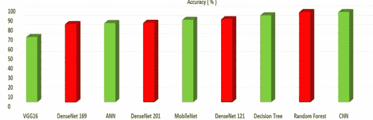

图 (7)。测量、数据和标准偏差的图。

对于 COVID-19，已使用结合机器学习和深度学习的混合技术。他们使用固有的 COVID-19 基因组指纹作为模式建立了决策树，这是一种用于估计 COVID-19 病毒基因序列的非比对方法。仅在比对无关技术中处理原始 DNA 序列数据，这导致了新疾病的快速分类 [77]。所建议的技术由一个包含超过 5000 个不同病毒基因组序列的大型数据集评估。这些数字来自一个名为 Virus-Host DB 的成熟数据库。研究结果表明，所建议的技术可行，可用于分析病原体基因组序列并实时为以前未知的序列提供正确的分类 [78]。他们提出了一种避免印度 COVID-19 爆发的替代策略。研究人员使用了 COVID-19 印度数据集。NML 和二阶导数回归是两种众所周知的方法，结合在所建议的方法中。PDL 用于规范化数据，NML 用于预测结果。与之前的工作相比，实验结果表明该方法在分类性能和预测时间方面更优 [79]。

对于 COVID-19，已使用结合机器学习和 DL 的混合技术。提出使用迭代修剪的 DL 模型。研究人员使用了 COVID-19 肺部症状的 X 射线扫描。在此过程中，使用定制的 CNN 和使用 ImageNet 训练的模型学习了 COVID-19 的独特特征表示。然后使用新获得的知识将患者分类为 COVID-19 病毒异常、正常或细菌性肺炎病例。所建议的模型在实验中表现良好，准确率为 99.01%，AUC 值为 0.9972 [80]。同样，深度学习（CNN）用于估计 COVID-19 患者肺部疾病的严重程度。他们的研究方法使用来自美国医院 84 名 COVID-19 患者的 131 张 CXR 数据集进行评估。数据被分成两半。约 80% 的数据用于训练，其余 20% 用于测试。所建议的技术使用相关性分析和平方误差分析进行评估。作者表示，由于结果在小样本中良好，他们的技术应使用更大的数据集进行评估。此外，科学家们表示，他们的方法可用于确定 COVID-19 患者的肺部疾病严重程度并检查疾病进展和治疗反应 [81, 82]。

## 问题与挑战

构建成功的机器学习系统需要大量的数据。机器学习在 COVID-19 研究中的应用目前存在诸多问题。使用 DL 诊断 COVID-19 最大的障碍之一是缺乏标准数据。另一个有问题的问题是数据集的样本不平衡。COVID-19 数据的 X 射线和 CT 扫描比流感和典型病例样本少。处理不平衡数据集最常见的方法是数据增强。这种方法使用翻转、旋转、缩放、添加噪声等来使用 COVID-19 数据构建新病变。该策略的另一个好处是特征提取以缓解过拟合问题。数据量是本研究中的一个关键限制。一些实验室结果无法获得；因此使用了 600 名患者的数据。然而，在可检测的人群范围内，估计范围为 84% 至 93%。此外，数据不平衡。他们通过消除某些材料来纠正这一点。更大的数据收集可以提高这些模型的性能。

## 结论

许多应用，如图像识别、DM、自然语言和疾病诊断，都依赖于机器学习。ML 在所有这些领域都有潜在的解决方案。另一方面，医疗数据集通常是多维的。ML 方法已被证明无效，需要大数据技术。因此，DL 作为 ML 技术的一个子集出现，使我们能够处理这些数据集。我们还展示了一些在医学不同领域使用的算法实例，并根据所寻求的目标、所采用的方法和应用领域分析一些可能的模式。此外，我们概述了每种方法给出的优缺点，以帮助未来研究其他作者所涵盖的每个现实情况的最佳技术。最后，本文描述了所有方法，包括监督和无监督学习算法。

## 发表同意书

未声明。

## 利益冲突

作者声明无利益冲突，财务或其他。

## 致谢

未声明。

## 参考文献

- [1] A. Dinh, S. Miertschin, A. Young, and S.D. Mohanty, "一种基于数据驱动的利用机器学习预测糖尿病和心血管疾病的方法", BMC Med. Inform. Decis. Mak., vol. 19, no. 1, pp. 211-226, 2019. [http://dx.doi.org/10.1186/s12911-019-0918-5] [PMID: 31694707]
- [2] M. Jiang, Y. Chen, M. Liu, S.T. Rosenbloom, S. Mani, J.C. Denny, and H. Xu, "一项基于机器学习的从出院小结中提取临床实体及其断言的方法研究", J. Am. Med. Inform. Assoc., vol. 18, no. 5, pp. 601-606, 2011. [http://dx.doi.org/10.1136/amiajnl-2011-000163] [PMID: 21508414]
- [3] E.M.F. El Houby, "关于应用机器学习技术管理疾病的调查", J. Appl. Biomed., vol. 16, no. 3, pp. 165-174, 2018. [http://dx.doi.org/10.1016/j.jab.2018.01.002]
- [4] N. Razavian and D. Sontag, "用于从实验室测试诊断的时间卷积神经网络," arXiv, 2015.
- [5] A. Perotte, R. Ranganath, J.S. Hirsch, D. Blei, and N. Elhadad, "使用异构电子健康记录数据和时间序列分析预测慢性肾病进展风险", J. Am. Med. Inform. Assoc., vol. 22, no. 4, pp. 872-880, 2015. [http://dx.doi.org/10.1093/jamia/ocv024] [PMID: 25896647]
- [6] W. Yu, T. Liu, R. Valdez, M. Gwinn, and M.J. Khoury, "支持向量机建模在常见疾病预测中的应用：以糖尿病和糖尿病前期为例", BMC Med. Inform. Decis. Mak., vol. 10, no. 1, p. 16, 2010. [http://dx.doi.org/10.1186/1472-6947-10-16] [PMID: 20307319]
- [7] N. Razavian, S. Blecker, A.M. Schmidt, A. Smith-McLallen, S. Nigam, and D. Sontag, "基于索赔数据预测 2 型糖尿病人群水平并分析危险因素", Big Data, vol. 3, no. 4, pp. 277-287, 2015. [http://dx.doi.org/10.1089/big.2015.0020] [PMID: 27441408]
- [8] I. Devi, G.R. Karpagam, B.K. Vinoth. 机器学习技术综述. International Journal of Computational Systems Engineering, 2017, vol. 3, no. 4, pp. 203-212.

[9] G. Ashish; T. Shigeyoshi 自然计算系列（进化计算进展）。载于：《数据挖掘与知识发现的进化算法综述》，第33章，99。819–845，2003。
[http://dx.doi.org/10.1007/978-3-642-18965-4]

[10] P. Chaudhari and H. Agarwal, ‘面向深度学习技术的渐进式综述’, 载于 Satapathy, E.S.C. (编)：国际数据工程与通信技术会议论文集，智能系统与计算进展，Springer Science + Business Media，新加坡，第151–158页，2007年。

[11] Z. Zhang, P. Chen, M. McGough, F. Xing, C. Wang, M. Bui, Y. Xie, M. Sapkota, L. Cui, J. Dhillon, N. Ahmad, F.K. Khalil, S.I. Dickinson, X. Shi, F. Liu, H. Su, J. Cai, and L. Yang, "基于深度学习的病理学家水平可解释全切片癌症诊断", Nat. Mach. Intell., vol. 1, no. 5, pp. 236-245, 2019.
[http://dx.doi.org/10.1038/s42256-019-0052-1]

[12] J.G. Richens, C.M. Lee, S. Johri, "利用因果机器学习提高医疗诊断的准确性", Nat. Commun., Vol. 11, Article number: 3923, 2020.
[http://dx.doi.org/10.1038/s41467-020-17419-7]

[13] M.L. Graber, "医学中诊断错误的发生率", BMJ Qual. Saf., vol. 22, no. Suppl 2, suppl. 2, pp. ii21-ii27, 2013.
[http://dx.doi.org/10.1136/bmjqs-2012-001615] [PMID: 23771902]

[14] K.H. Yu, A.L. Beam, and I.S. Kohane, "医疗保健中的人工智能", Nat. Biomed. Eng., vol. 2, no. 10, pp. 719-731, 2018.
[http://dx.doi.org/10.1038/s41551-018-0305-z] [PMID: 31015651]

[15] A.F. Otoom, E.E. Abdallah, Y. Kilani, A. Kefaye, and M. Ashour, "心脏疾病的有效诊断与监测", Int. J. Softw. Eng. Appl., vol. 9, pp. 143-156, 2015.

[16] Y. Karaca, and C. Cattani, “7. 朴素贝叶斯分类器,” Comput. Methods Data Anal., pp. 229–250, 2018
[http://dx.doi.org/10.1515/9783110496369-007]

[17] T.M. Lakshmi, A. Martin, R.M. Begum, and V.P. Venkatesan, "使用学生定性数据对决策树算法性能的分析", International Journal of Modern Education and Computer Science, vol. 5, no. 5, pp. 18-27, 2013.
[http://dx.doi.org/10.5815/ijmecs.2013.05.03]

[18] S. Pouriyeh, S. Vahid, G. Sannino, G. De Pietro, H. Arabnia, J. Gutierrez, et al. “机器学习技术在心脏病领域中的全面研究与比较”, 22nd IEEE Symposium on Computers and Communication (ISCC 2017): Workshops - ICTS4eHealth 2017.

[19] Z. Arabasadi, R. Alizadehsani, M. Roshanzamir, H. Moosaei, and A.A. Yarifard, "使用混合神经网络-遗传算法的心脏病检测计算机辅助决策", Comput. Methods Programs Biomed., vol. 141, pp. 19-26, 2017.
[http://dx.doi.org/10.1016/j.cmpb.2017.01.004] [PMID: 28241964]

[20] R. Mahajan, T. Viangteeravat, and O. Akbilgic, "通过概率符号模式识别和心率变异性指标改善充血性心力衰竭的检测", Int. J. Med. Inform., vol. 108, pp. 55-63, 2017.
[http://dx.doi.org/10.1016/j.ijmedinf.2017.09.006] [PMID: 29132632]

[21] S. Bai, K.F. Hew, and B. Huang, "游戏化是否能提高学生的学习成果？教育情境中元分析和定性数据综合的证据", Educ. Res. Rev., vol. 30, p. 100322, 2020.
[http://dx.doi.org/10.1016/j.edurev.2020.100322]

[22] H. A. Esfahani and M. Ghazanfari, "使用新的集成分类器进行心血管疾病检测," in Proc. IEEE 4th Int. Conf. Knowl.- Based Eng. Innov. (KBEI), Dec. 2017, pp. 1011–1014.
[http://dx.doi.org/10.1109/KBEI.2017.8324946]

[23] A. Kondababu, V. Siddhartha, B.H.K.B. Kumar, and B. Penumutchi, "撤回：基于机器学习的心脏病预测比较研究", Mater. Today Proc., 2021.
[http://dx.doi.org/10.1016/j.matpr.2021.01.475]

[24] M. Diwakar, A. Tripathi, K. Joshi, M. Minakshi, P. Singh, N. Kumar, "使用机器学习和图像融合的心脏病预测最新趋势。Materials Today: Proceedings", vol. 37, Part 2, pp. 3213-3218, 2021.
[http://dx.doi.org/10.1016/j.matpr.2020.09.078]

[25] "使用机器学习多数投票集成方法的心脏病检测". IEEE, 2019.

[26] H. Fujita, U.R. Acharya, V.K. Sudarshan, D.N. Ghista, S.V. Sree, L.W.J. Eugene, and J.E.W. Koh, "基于非线性心率变异性特征和SCD指数的猝死（SCD）预测", Appl. Soft Comput., vol. 43, pp. 510-519, 2016.
[http://dx.doi.org/10.1016/j.asoc.2016.02.049]

[27] N. Khuriwal, N. Mishra. "使用深度学习的癌症诊断". Proc - IEEE 2018 Int Conf Adv Comput Commun Control Networking, ICACCCN, pp. 98–103, 2018.

[28] Z. Lai, and H. Deng, "基于深度模型提取的深度特征和多层感知器统计特征融合的医学图像分类", Comput. Intell. Neurosci., vol. 2018, pp. 1-13, 2018.
[http://dx.doi.org/10.1155/2018/2061516] [PMID: 30298088]

[29] A. Duggento, M. Scimeca, N. Urbano, E. Bonanno, M. Aiello, and C. Cavaliere, "用于区分恶性乳腺癌病变的随机初始化深度神经网络", Proc Annu Int Conf IEEE Eng Med Biol Soc EMBS, pp. 912-5, 2019.
[http://dx.doi.org/10.1109/EMBC.2019.8856740]

[30] J. Yanase, and E. Triantaphyllou, "医学中计算机辅助诊断的系统综述：过去与现状发展", Expert Syst. Appl., vol. 138, p. 112821, 2019.
[http://dx.doi.org/10.1016/j.eswa.2019.112821]

[31] K.J. Geras, R.M. Mann, and L. Moy, "乳房X光摄影和数字乳腺断层合成的人工智能：当前概念与未来展望", Radiology, vol. 293, no. 2, pp. 246-259, 2019.
[http://dx.doi.org/10.1148/radiol.2019182627] [PMID: 31549948]

[32] Z. Hu, J. Tang, Z. Wang, K. Zhang, L. Zhang, and Q. Sun, "基于图像的癌症检测与诊断的深度学习——综述", Pattern Recognit., vol. 83, pp. 134-149, 2018.
[http://dx.doi.org/10.1016/j.patcog.2018.05.014]

[33] G. Carneiro, J. Nascimento, and A.P. Bradley, "使用深度学习的未配准多视角乳房X光片自动分析", IEEE Trans. Med. Imaging, vol. 36, no. 11, pp. 2355-2365, 2017.
[http://dx.doi.org/10.1109/TMI.2017.2751523] [PMID: 28920897]

[34] M. Ahmed, Abdel-Zaher, Ayman M. Eldeib, "使用深度置信网络的乳腺癌分类", expert systems with application. Elsevier, 2016.

[35] W. Sun, T.L.B. Tseng, J. Zhang, and W. Qian, "利用无标签数据增强乳腺癌诊断的深度卷积神经网络方案", Comput. Med. Imaging Graph., vol. 57, pp. 4-9, 2017.
[http://dx.doi.org/10.1016/j.compmedimag.2016.07.004] [PMID: 27475279]

[36] A. Teresa, A. Guilherme, C. Eduardo, R. José, A. Paulo, E. Catarina, P. António, and C. Aurélio, "使用卷积神经网络对乳腺癌组织学图像进行分类", PLoS One, pp. 1-14, 2017.

[37] F. A. Spanhol, L. S. Oliveira, C. Petitjean and L. Heutte, "使用卷积神经网络的乳腺癌组织病理学图像分类," International Joint Conference on Neural Networks (IJCNN), Vancouver, BC, Canada, pp. 2560-2567, 2016.

[38] M. Ram, A. Najafi, and M.T. Shakeri, "使用随机森林对癌症基因表达数据进行分类和生物标志物基因选择", Iran. J. Pathol., vol. 12, no. 4, pp. 339-347, 2017. [http://dx.doi.org/10.30699/ijp.2017.27990] [PMID: 29563929]

[39] B. Savelli, A. Bria, M. Molinara, C. Marrocco, and F. Tortorella, "用于小病变检测的多上下文CNN集成", Artif. Intell. Med., vol. 103, p. 101749, 2020. [http://dx.doi.org/10.1016/j.artmed.2019.101749] [PMID: 32143786]

[40] T.G. Debelee, A. Gebreselasie, F. Schwenkner, M. Amiri an, and D. Yohannes, "使用纹理和基于CNN提取的特征对乳房X光片进行分类", Journal of Biomimetics, Biomaterials and Biomedical Engineering, vol. 42, pp. 79-97, 2019. [http://dx.doi.org/10.4028/www.scientific.net/JBBBE.42.79]

[41] H. Viswanath, L. Guachi-Guachi, and S. P. Thirumuruganandham, "EasyChair预印本 使用图像处理技术和分类算法的乳腺癌检测 使用图像处理技术和分类算法的乳腺癌检测," 2019.

[42] M. Yousefi, A. Krzyżak, and C.Y. Suen, "使用卷积神经网络和多实例学习在数字乳腺断层合成数据中进行肿块检测", Comput. Biol. Med., vol. 96, pp. 283-293, 2018. [http://dx.doi.org/10.1016/j.compbiomed.2018.04.004] [PMID: 29665537]

[43] M.A. Arpana, Prathiba Kiran, "数字乳房X光片的特征提取值", Int. J. Softw. Eng. Appl., vol. 4, no. 2, 2014.

[44] J. Yanase, and E. Triantaphyllou, "医学中计算机辅助诊断未来的七大关键挑战", Int. J. Med. Inform., vol. 129, pp. 413-422, 2019. [http://dx.doi.org/10.1016/j.ijmedinf.2019.06.017] [PMID: 31445285]

[45] J. Melnikow, J.J. Fenton, E.P. Whitlock, D.L. Miglioretti, M.S. Weyrich, J.H. Thompson, and K. Shah, "乳腺致密女性乳腺癌补充筛查：美国预防服务工作组的系统综述", Ann. Intern. Med., vol. 164, no. 4, pp. 268-278, 2016. [http://dx.doi.org/10.7326/M15-1789] [PMID: 26757021]

[46] M. Hosni, I. Abnane, A. Idri, J.M. Carrillo de Gea, and J.L. Fernández Alemán, "乳腺癌中集成分类方法的回顾", Comput. Methods Programs Biomed., vol. 177, pp. 89-112, 2019. [http://dx.doi.org/10.1016/j.cmpb.2019.05.019] [PMID: 31319964]

[47] A. Rampun, H. Wang, B. Scotney, P. Morrow, and R. Zwiggelaar, "计算学院，阿尔斯特大学，科莱恩，北爱尔兰，英国 计算机科学系，亚伯里斯特威斯大学，英国", Conf. Image Process pp. 2072-2076, 2018.

[48] M. Ezzat, and A. Idri, "回顾乳腺癌治疗中的数据分析技术". vol. 2. Springer International Publishing, 2020. [http://dx.doi.org/10.1007/978-3-030-45697-9_7]

[49] S. Kaveeshwar, and J. Cornwall, "印度糖尿病现状", Australas. Med. J., vol. 7, no. 1, pp. 45-48, 2014. [http://dx.doi.org/10.4066/AMJ.2014.1979] [PMID: 24567766]

[50] A. Iyer, J. S, and R. Sumbaly, "使用分类挖掘技术诊断糖尿病", International Journal of Data Mining & Knowledge Management Process, vol. 5, no. 1, pp. 01-14, 2015. [http://dx.doi.org/10.5121/ijdkp.2015.5101]

[51] S. Shah, X. Luo, S. Kanakasabai, R. Tuason, and G. Klopper, "神经网络用于挖掘临床笔记中疾病与症状之间的关联", Health Inf. Sci. Syst., vol. 7, no. 1, p. 1,

2019.
[http://dx.doi.org/10.1007/s13755-018-0062-0] [PMID: 30588291]
[52] T. Chauhan, S. Rawat, S. Malik, P. Singh, "基于监督和无监督机器学习的糖尿病护理综述. 2021 第七届先进计算与通信系统国际会议 (ICACCS)", 2021.
[53] Z.C. Lipton, D.C. Kale, and R. Wetzel, "使用 RNN 直接建模序列中的缺失数据：临床时间序列的改进分类", 第 1 届机器学习医疗保健会议论文集, PMLR 56, pp. 253-270, 2016.
[54] S.K. Sen, and S. Dash, "元学习算法在糖尿病疾病预测中的应用", 国际先进计算机科学与管理研究期刊, vol. 2, pp. 396-401, 2014.
[55] A. Antoniadis, S. Lambert-Lacroix, and J.M. Poggi, "随机森林用于全局敏感性分析：精选综述", Reliab. Eng. Syst. Saf., Vol. 206, Article ID: 107312, 2021.
[http://dx.doi.org/10.1016/j.ress.2020.107312]
[56] Z. Qin, L. Yan, H. Zhuang, Y. Tay, R.K. Pasumarthi, W. Xuanhui, M. Bendersky, M. Najork, "神经排序器是否仍被梯度提升决策树超越？" 2021.
[57] V.S. Tseng, T.B. Ho, Z.-H. Zhou, L.P.C. Arbee, H.-Y. Kao. 计算机科学讲义. 收录于：知识发现与数据挖掘进展. 用于切换数据流异常检测的相关性加权集成模型（第38章）, Vol. 8444, pp. 461-473, 2014.
[http://dx.doi.org/10.1007/978-3-319-06605-9]
[58] T. Sharma, and M. Shah, "机器学习技术在糖尿病检测方面的全面综述", 工业、生物医学与艺术可视化计算, vol. 4, no. 1, p. 30, 2021.
[http://dx.doi.org/10.1186/s42492-021-00097-7] [PMID: 34862560]
[59] Z. Xu, and Z. Wang, "基于随机森林和 XGBoost 集成分类器加权特征选择的 2 型糖尿病风险预测模型", pp. 278-283, 2019.
[http://dx.doi.org/10.1109/ICACI.2019.8778622]
[60] N. Sneha, and T. Gangil, "使用最优特征选择对糖尿病进行早期预测的分析", J. Big Data, vol. 6, no. 1, p. 13, 2019.
[http://dx.doi.org/10.1186/s40537-019-0175-6]
[61] M. Križešt orac, A. Halilović, and J. Kevrić, "预测变量对皮马印第安人 2 型糖尿病检测的影响", Springer 国际创新与跨学科先进技术应用研讨会, pp. 388-405, 2019.
[62] B. Alić, L. Gurbeta, and A. Badnjević, "用于糖尿病和心血管疾病分类的机器学习技术", 2017 年第 6 届地中海嵌入式计算会议论文集 (MECO), pp. 1-4, 2017.
[http://dx.doi.org/10.1109/MECO.2017.7977152]
[63] B. He, K.I. Shu, H. Zhang, 机器学习和数据挖掘在糖尿病诊断和治疗中的应用 IOP Conf. Ser.: Mater. Sci. Eng., vol. 490, no. 4, Article 042049, 2019.
[64] B. Peter, 肝病全球负担：方法与公共卫生的挑战. BMC Med., Vol. 12, Article No. 159, 2014.
[http://dx.doi.org/10.1186/s12916-014-0159-5]
[65] L. A. Auxilia, 使用机器学习技术对印度患者肝病进行准确性预测. 第 2 届电子与信息技术趋势国际会议 (ICOEI), 2018.
[66] S. Vijayarani, and S. Dhayanand, "使用 SVM 和朴素贝叶斯算法的肝病预测. 国际科学与工程技术研究期刊", vol. 4, pp. 816-820, 2015. [IJSETR].
[67] UCI 机器学习库. ILPD（印度肝病患者数据集）数据集.

https://archive.ics.uci.edu/ml/datasets/ILPD+(Indian+Liver+Patient+Dataset)

[68] A. Kendall, Y. Gal, 贝叶斯深度学习在计算机视觉中需要哪些不确定性？ 2017. arXiv: 1703.04977.

[69] S. Naish, P. Dale, J.S. Mackenzie, J. McBride, K. Mengersen, and S. Tong, "气候变化与登革热：定量建模方法的批判性和系统性综述", BMC Infect. Dis., vol. 14, no. 1, p. 167, 2014. [http://dx.doi.org/10.1186/1471-2334-14-167] [PMID: 24669859]

[70] 世界卫生组织. 登革热和重症登革热. 事实表. http://www.who.int/mediacentre/factsheets/fs117/en/index.html (2017). 访问日期 15 Jan 2017.

[71] E. Fernández, M. Smieja, S.D. Walter, and M. Loeb, "区分登革热与其他发热性疾病的预测模型", BMC Infect. Dis., vol. 16, no. 1, p. 694, 2016. [http://dx.doi.org/10.1186/s12879-016-2024-y] [PMID: 27876005]

[72] G. Macedo Hair, F. Fonseca Nobre, and P. Brasil, "使用无监督机器学习方法对登革热患者的临床模式进行表征", BMC Infect. Dis., vol. 19, no. 1, p. 649, 2019. [http://dx.doi.org/10.1186/s12879-019-4282-y] [PMID: 31331271]

[73] A.S. Fathima, and D. Manimeglai, "使用 SVM 分类对虫媒病毒-登革热进行预测分析", IACSIT Int. J. Eng. Technol., vol. 2, pp. 521-527, 2012.

[74] J. Yang, X. Chen, X. Deng, Z. Chen, H. Gong, H. Yan, Q. Wu, H. Shi, S. Lai, M. Ajelli, C. Viboud, and P.H. Yu, "中国武汉 COVID-19 首波大流行病的疾病负担和临床严重程度", Nat. Commun., vol. 11, no. 1, p. 5411, 2020. [http://dx.doi.org/10.1038/s41467-020-19238-2] [PMID: 33110070]

[75] A. Alimadadi, 人工智能和机器学习抗击 COVID-19. American Physiological Society: Bethesda, 2020. [http://dx.doi.org/10.1152/physiogenomics.00029.2020]

[76] L.A. Amar, A.A. Taha, and M.Y. Mohamed, "使用机器学习预测 COVID-19 疫情的最终规模：以埃及为例", Infect. Dis. Model., vol. 5, pp. 622-634, 2020. [http://dx.doi.org/10.1016/j.idm.2020.08.008] [PMID: 32864516]

[77] C. L. Nikias, C. Hsing-Hsing, 通过非因果自回归建模和反卷积的高阶谱估计, IEEE Trans Acoust Speech Signal Process, vol. 36, no. 12, pp. 1911-1913, 1988.

[78] A.K. Abasi, A.T. Khader, M.A. Al-Betar, S. Naim, Z.A.A. Alyasseri, and S.N. Makhadmeh, "一种用于文本文档聚类的新型混合多宇宙优化器与 K-means", Neural Comput. Appl., vol. 32, no. 23, pp. 17703-17729, 2020. [http://dx.doi.org/10.1007/s00521-020-04945-0]

[79] D.P. Kavadi, R. Patan, M. Ramachandran, and A.H. Gandomi, "偏导数非线性全球大流行机器学习预测 COVID 19", Chaos Solitons Fractals. p. 110056, 2020. [http://dx.doi.org/10.1016/j.chaos.2020.110056] [PMID: 32834609]

[80] S. Rajaraman, J. Siegelman, P.O. Alderson, L.S. Folio, L.R. Folio, and S.K. Antani, "用于胸部 X 光片 COVID-19 检测的迭代修剪深度学习集成", IEEE Access, vol. 8, pp. 115041-115050, 2020. [http://dx.doi.org/10.1109/ACCESS.2020.3003810] [PMID: 32742893]

[81] J. Zhu, B. Shen, A. Abbasi, M. Hoshmand-Kochi, H. Li, and T.Q. Duong, "深度迁移学习人工智能可准确评估便携式胸部放射照片上 COVID-19 肺部疾病严重程度", PLoS One. p. e0236621, 2020. [http://dx.doi.org/10.1371/journal.pone.0236621] [PMID: 32722697]

[82] M. Agarwal, L. Saba, S.K. Gupta, A. Carriero, Z. Falaschi, A. Paschè, P. Danna, A. El-Baz, S. Naidu, and J.S. Suri, "一种新型分块成像技术，使用九个人工智能模型对意大利队列肺部计算机断层扫描中的 COVID-19 疾病进行分类、表征和严重程度测量", J. Med. Syst., vol. 45, no. 3, p. 28, 2021. [http://dx.doi.org/10.1007/s10916-021-01707-w] [PMID: 33496876]

人工智能在医疗保健环境中对心血管疾病管理的突破

Lakshmi Narasimha Gunturu¹,*, Girirajasekhar Dornadula² and Raghavendra Naveen Nimbagal³

¹ Scientimed Solutions Private Limited, 孟买，马哈拉施特拉邦，印度

² 药学实践系，安纳马查亚药学院，拉贾姆佩塔，印度

³ 制剂学系，斯里阿迪昌查纳吉里药学院，阿迪昌查纳吉里大学，卡纳塔克邦 571418，印度

摘要：心血管系统包括心脏及其相关血管。该心脏系统的疾病称为心血管疾病（CVD）。CVD 的管理往往复杂，由于患者护理不足、再入院、成本效益低以及预防、治疗和生活方式改变的成本降低等挑战。由此，为了克服这些挑战，正在开发人工智能（AI）。它们解决了临床和医疗保健环境中的新兴问题，并对公众产生了巨大影响。人工智能在心血管医学中的实施对新发现影响更大。它还提供了高水平的支持证据，可能在循证研究范式中有用。对 PubMed 数据库中可用的免费全文文献进行了综述，以研究人工智能对医疗保健环境的影响。这项工作回顾了心脏实践中使用的基于人工智能的算法以及人工智能在心血管医学中的应用，包括结果解释和医学图像分析。

关键词：算法，应用，人工智能，心血管疾病，医疗保健。

引言

人工智能是一种技术驱动的方法，建立于 20 世纪 50 年代中期。它是当代世界最热门的技术，因为它具有模仿人类智能的特性。人工智能意为由人类发现，智能代表思维能力。这涵盖了基于有益结果进行决策的机器/系统/算法等方面。

它们像生物大脑一样工作并最大化成功率 [1]。人工智能在当今世界被用于各种目的。它能够在医疗保健、金融、教育、农业、机器人等多个行业中高效解决复杂问题。

AI 在医疗保健领域很有用，并在教育、天文学、农业、商业、监控、社交媒体、应用、交通、游戏、银行和电子处方等各个领域得到应用。

心血管疾病（CVDs）引发全球死亡担忧，每年导致 1790 万人死亡。CVDs 构成泵血器官心脏、循环系统如动脉、静脉、毛细血管等。其损伤可能导致致命状况，例如冠状动脉阻塞、导致心肌病的瓣膜炎症性疾病。统计数据表明，大多数心血管疾病死亡主要是由于心脏病发作、中风以及 70 岁人群中近三分之一的死亡所致（https://www.who.int/health-topics/cardiovascular-diseases）。这些是由多种因素引起的，如遗传、环境和生活方式的变化，导致人体肠道系统中宝贵微生物的改变。美国心脏协会（AHA）和国家卫生研究院的年度报告确认了人群中心脏问题的可能原因如下：

- 1. 雪茄吸入，
- 2. 缺乏体育锻炼，
- 3. 不当的饮食习惯，
- 4. 体重增加，
- 5. 胆固醇，
- 6. 收缩压（BP）升高，
- 7. 血糖升高 [2]。

存在技术与健康之间的双向相关性。为了探索先进和发展中国家面临的挑战，他们将创新作为主要重点来应对问题。因此，以技术为基础的方法，尤其是医疗保健中的人工智能，逐渐改变了整个医疗系统。它也改变了医院和公众的生活。例如，它们有助于解读结果，减少检查，并允许公众做出自己的判断。

出于各种原因，心脏科部门内专家系统的使用仅限于某些国家；然而，尽管存在局限性，它非常有用。使用此类方法，我们可以高效地分析疾病模型，并且大量数据可以轻松保存在数据库中。AI 在心血管环境中整合的优势在图 (1) 中描述。

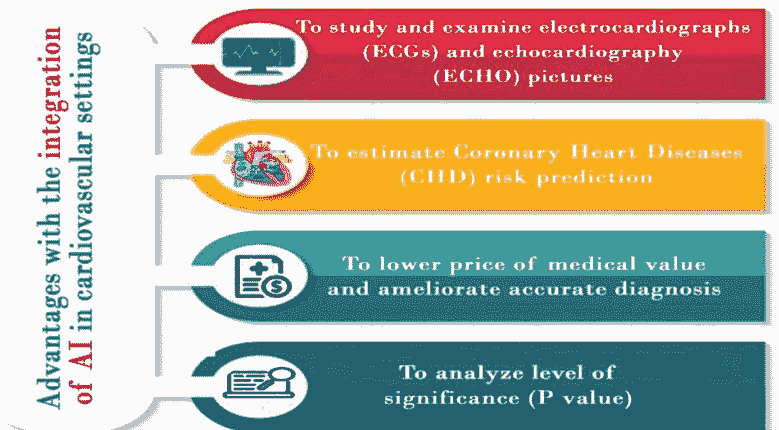

图 (1)。AI 在心血管中整合的优势。

然而，这一版本需要几个固定的假设，这些假设不依赖于观察和其他多重共线性值等因素。传统的逻辑回归方法提高了统计价值，但有时与目标无关，因此阻碍了模型的执行。另一方面，人工智能算法被用于各个临床科室，因为它们能够通过使用数据集中存储的信息精确提供结果。

计算智能在心脏病诊所的影响改变了心脏诊所的实验模式，因此对临床实践和公众健康具有价值，如图 (2) [3] 所示。

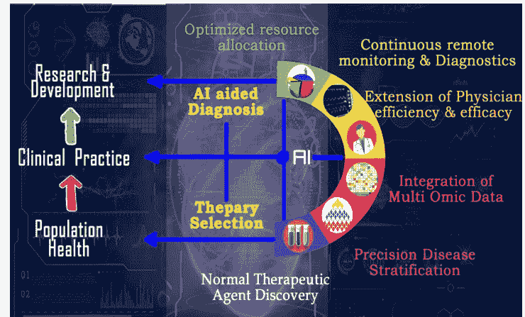

图 (2)。AI 对心脏病学的影响。

在当代世界，基于人工智能的方法在预防和管理心血管疾病方面变得流行。在实施基于人工智能的解决方案以评估风险因素和检测心血管疾病风险的早期迹象时，机器学习获得了特别关注。因此，机器学习在心血管疾病诊断中的应用更为全面。例如，Hodos 等人 [4] 清楚地解释了机器学习在心血管风险估计条件下所面临的优势、挑战和潜在缺点。在 El-Saadawy 等人的另一项工作中，SoftMax、支持向量机（SVM）和概率神经网络等回归分类器模型被用于诊断心脏病 [5]。Maheswari 等人解释了心脏分类器和决策树和朴素贝叶斯等模型，这些模型有助于心脏病预测 [6]。Sasko Ristov 等人 [7] 的另一项工作解释了使用国际公认的心血管疾病风险因素分析来管理心血管疾病。Jabbar 等人在其工作中提出了 K 近邻（KNN）和遗传算法的组合模型，该模型在预测心血管风险因素及其管理方面有效 [8]。Dominic 等人的工作解释了心脏病数据集和基于人工智能的机器学习技术，有助于确定心脏病风险预测水平 [9]。Das 等人通过 SAS 软件开发了一种基于神经网络集成的心脏病诊断方法 [10]。

本章重点关注人工智能在心血管医学应用中的最新进展、医学领域用于疾病或风险因素识别的人工智能算法、人工智能在心脏病学中实施后减少的并发症及其挑战。

## 材料与方法
- a. 创建系统性检索策略。
- b. 构建了适当的问题。
- c. 使用了适当的数据库 PubMed 来探索结果。

研究问题对问题不确定；因此必须仔细分析和检查以提供更好的清晰度。成功的工作取决于研究者如何制定研究问题来解决现有问题。研究问题主要比较两种治疗方法或疾病、合适的诊断技术等 [11]。PICO（患者、干预措施、比较和结果）被广泛认为是制定背景问题的策略。

以下是提出的问题列表：
- a. 人工智能算法在预测与心脏病相关的风险方面真的有益吗？
- b. 人工智能算法能否更好地解释诊断技术（心电图、磁共振成像等）并改善治疗效果？
- c. 最后，将人工智能技术整合到医疗保健环境中是否会改变心血管风险降低的转变？

表 1. 研究问题制定中包含的 PICO。

| 参数 | 包含 | 排除 |
|---|---|---|
| 患者 (P) | 老年 | 年轻年龄（< 35 岁）。 |
| 干预 (I) | AI 的影响 | 其他技术应用，如模糊系统、5G。 |
| 比较 (C) | 心血管患者 | 非心血管患者 |
| 结果 (O) | 基于 AI 的心血管并发症有效控制 | 死亡、结果诊断延迟、其他合并症患者。 |

表 1 显示了基于从 PubMed 数据库获得的数据的问题检索策略，该数据库使用关键词 Healthcare、Cardiology、Artificial Intelligence 和 Algorithms 搜索了过去十年的数据，直至 2020 年 10 月 20 日。

标题和摘要筛选是手动进行的。这些筛选文章的全文本文章进一步纳入纳入和排除标准。我们纳入了所有关于人工智能和心血管并发症的研究，年龄组在 35 岁以上，并排除了年轻人群和其他技术应用，如模糊系统、5G 网络应用和其他合并症患者。我们涉及了 11 项评估人工智能用于预防心血管并发症的研究。我们工作的结构大纲如图 (3) 所示。

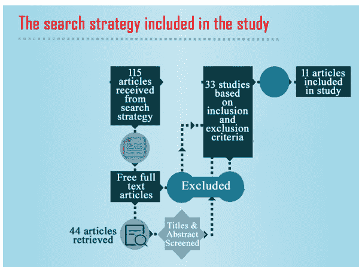

图 (3)。研究中包含的检索策略。

## 心血管疾病中使用的算法
如上所述，使用机器学习技术开发了一种非侵入性医疗决策支持系统，以降低治疗程序的成本和复杂性并提供准确的诊断。这些被认为是预测心脏病最常用的算法。心脏病学领域临床应用中最流行的一些算法如下所述：
- 1. K-最近邻 (K-NN)
- 2. 人工神经网络 (ANN)
- 3. 决策树 (DT)
- 4. 逻辑回归 (LR)

- 5. AdaBoost (AB)
- 6. Support vector machine (SVM)

### K最近邻 (KNN)

它是一种基于监督学习技术的机器学习算法。该算法充当所有案例的存储库，并基于相似性进行分类。它易于处理且准确。

在 K-NN 中，K 表示最近邻的符号。这里主要的值是 K，当其等于一时被称为 KNN。该算法解决分类和回归预测问题。Jabbar 的研究报道，将 KNN 与粒子群优化（PSO）技术结合可以有效预测心脏病，准确率达 100%。医学数据包含相关和不需要的信息；因此，使用 PSO 技术在 KNN 模型中可以丢弃大部分不相关和不需要的信息 [6]。

### 人工神经网络 (ANN)

这种编程和数据处理系统类似于动物智能的活神经元。它也被称为联结主义系统。它由称为神经元的节点组成，模仿人类大脑的神经细胞。每条连接的方式类似于人类大脑的神经肌肉接头，将信息处理到下一个神经细胞或神经元。以简单的方式，信号被接收并传输到下一级神经细胞，使所有神经系统被激活 [12]。Niranjana 等人的最新研究报道，具有一层训练隐藏神经架构的 ANN 模型能够以 95.5% 的准确率识别与心脏瓣膜心脏传导阻滞特征相关的程度 [13]。

### 决策树 (DT)

DT 可能很简单，并且在信息通常为分类且取决于条件时为我们提供出色的结果。它通常用一个例子来解释，即如果一个个体由于血流动力学和神经激素代偿反应慢性激活而出现收缩期和舒张期功能障碍。该状况通常进一步分为分支（原因），如心脏肥大、坏死导致的肌细胞丢失以及异常心肌能量，直到它们可用于选择导致该个体收缩期和舒张期功能障碍的确切原因。条件被称为内部节点，它们分裂以返回一个选择，被理解为叶节点。

### 逻辑回归 (LR)

当检查包含一个以上变量的数据时使用该算法。这些变量负责最终结果 [14]。

### AdaBoost (AB)

AdaBoost 将弱学习器转换为强学习器，是机器学习算法中使用的提升算法之一。它首先识别每个集合中的原始信息，并为每个观测值提供相等权重。在 Li 等人的研究中报道，AdaBoost 可以通过使用精确度和准确率值来估计心血管疾病的多水平风险预测 [15]。

### 支持向量机 (SVM)

它有助于根据各种因素或原因区分信息。它利用超平面作为众多选项中的一种结论。它还提出由多个超平面隔离的信息，并且该数据被分为部分；进而，每部分被限制为单个数据集。在 Ashtiyani 等人的研究中报道，使用 SVM 开发的算法通常能够跟踪心跳的变化，从而有助于识别心律失常 [16]。

其他进入角色的算法是监督算法和无监督算法。监督算法需要可预测变量和标记结果。例如，如果希望预测患者使用氨氯地平后更易发生血管性水肿。这项分析应基于出现此类反应的患者健康数据集和未观察到该反应的另一组进行。无监督学习主要变量未提供，从而识别隐藏的结构层。根据放射学发现，无监督算法的最佳例子是对心肌梗死患者数据库的表征。表 2 列出了算法及其在心脏病学中的用途。

表 2. 心脏病学中使用的机器学习算法。

| 算法 | 描述 | 用途 |
|---|---|---|
| K nearest neighbour (KNN) | 一种机器学习且非参数的算法。 | 心脏病预测。 |
| Artificial Neural Networks (ANN) | 它类似于人类大脑。 | 预测冠心病中与血管造影特征相关的程度。 |
| Decision tree | 这里的数据根据可用的各种选择进行分类。 | 有助于确定疾病的适当原因。 |
| Adaboost | 它能够将弱分类器转换为强分类器。 | 心血管心脏病多水平风险预测。 |
| Support vector machine | 支持向量机得出不同类别。新结果使用此方法进行分类。 | 能够检测心率变化并适用于心律失常状况。 |

## 结果与讨论

我们纳入了 11 项不同的研究，如表 3 所示，这些研究得出了 AI 在检测各种心血管并发症中使用的结论。这些研究证明，AI 在心脏病学中的实施将为社会的健康和福祉带来快速转变。

表 3. 用于估计心脏并发症的 AI 研究摘要。

| 研究 | 使用的算法 | 解决的并发症 |
|---|---|---|
| Sengupta et al. [17] | 基于认知的学习算法。 | 该算法可以有效区分限制性心力衰竭和限制性心力衰竭。 |
| Narula et al. [18] | 基于监督特征的机器学习算法。 | 它能够从心肌病中检测出运动员心脏。 |
| Ouyang et al. [19] | 深度学习算法。 | 用于确定心脏电活动的三维视图。 |
| Avendi et al. [20] | 卷积神经网络。 | 该模型可以检测心室的心肌瘢痕。 |
| Dawes et al. [21] | 机器学习编程。 | 它使我们能够研究心脏的收缩模式。 |
| Coenen et al. [22] | 基于机器学习的图像分析。 | 确定心脏阻塞的风险评估。 |
| Wolterink et al. [23] | 卷积神经网络。 | 该算法可以有效确定冠状动脉中大量钙的存在。 |
| Gonzales et al. [24] | 基于卷积神经网络的 AI 算法。 | 用于计算 Agatston 评分。 |
| Mannil et al. [25] | 基于机器学习的纹理图像分析。 | 这能够在非对比剂中检测到心肌梗死（MI）的存在。 |
| Attia et al. [26] | 六层神经网络膜。 | 它能够识别左心室功能障碍。 |
| Stehlik et al. [27] | 可穿戴机器学习模型。 | 预测心力衰竭恶化。 |

## AI 对超声心动图 (ECG) 的影响

超声心动图在心脏病学领域中最为重要，用于准确检测和治疗心脏异常；因此，心脏功能评估可以判断。基于技术的 AI 工具带来了新的可能性，以放大 ECG 中图像阐释的精确可能性，特别是在可能误诊以识别疾病的情况下。AI 基于计算工具通过诸如 Speckle 跟踪成像等先进过程的出现，有可能以编程方式解释未利用的数据。它进一步有助于缩短调查期或持续时间，并提高可靠性 [28, 29]。

Sengupta 等人的研究提出了一种与 Speckle 跟踪性能相结合的基于认知的学习算法，可以区分收缩性心力衰竭和限制性心力衰竭 [17]。Narula 等人的另一份报告得出结论，基于监督特征的机器学习可以与传统计算方法相比，以更高的精度区分运动员心脏功能异常 [18]。尽管如此，ML 模型还可以检测心脏瓣膜运动以识别和治疗疾病，主要是在术前时期 [30, 31]。

Ouyang 等人提出的最近三维机器学习 Echonet 动态实现了近 92% 的可靠性，可以以比心脏专家更好的准确性评估 ECG 不规则性 [19]。

## AI 在磁共振成像 (MRI) 中的作用

ML 模型更频繁地用于心脏 MRI 相关的心室分割区域。使用 ML 模型，我们可以增强临床发现的体积和可靠性 [20, 32]。Avendi 等人提出的深度学习算法能够识别心室右部存在的肌<|message|> 瘢痕。这种亚急性或慢性心肌瘢痕的检测是 ML 模型应用的另一个领域 [33]。

在 Dawes 等人的另一项研究中，他使用了心脏肌肉的三维部分来预测肺部疾病患者的传统危险和不良后果，如过早死亡 [21]。

## AI 在心脏计算机断层扫描 (CT) 中的应用

机器学习特征在 CT 检查中用于冠状动脉梗死的识别和风险评估方面日益使用。它还用于识别钙的存在和血液中血液的流动

血管。计算机断层扫描是一种无创检查程序，有可能检测到由于各种原因导致的血管狭窄，如斑块积聚、炎症反应、血栓形成等。[22]。因此，许多编程模型已经发展起来，以识别无创血流速率，通过估计疾病的确切原因来提高 CT 功能 [34]。

使用基于 AI 的设备检测斑块形成的能力带来了医院环境中的额外益处并降低了假阳性。Wolterink 等人的研究使用具有监督特征的机器学习编程，可以识别并枚举冠状动脉中的缺陷 [23, 35]。

Gonzales 等人发表的研究利用了神经网络来确定导致钙化的心脏中钙沉积的存在 [24]。机器学习依赖的心脏 CT 的另一个用途是即使在非造影剂介质中也能发现梗死 [25]。

## AI 对心电图的影响

这种 AI 应用指出了心脏功能的不规律性。它们还可以自动识别心跳变化，以最大限度地减少图像分析和独立不均匀性的时间 [36, 37]。Lyon 等人报告的一项研究关联并分级了与心律失常相关的 ECG 构成。Attia 等人的另一项研究利用了六层神经网络来检测室功能障碍的存在 [26]。LINK-HF 的另一项研究得出结论，与侵入性工具相比，基于 AI 的编程设备可以精确估计心脏恶化的衰竭 [27]。表 4 列出了在心血管疾病中使用的预测模型。

表 4. 用于心血管疾病检测的预测模型。

| 年份 | 国家 | 算法版本 | 预后结果 | 使用方法 | 预测因素 | 诊断 |
|------|------|----------|----------|----------|----------|------|
| 1997 | 日本 | 人工神经网络 | QS 波群的 ECG 分析 | 编程心电图 | Q 波和 R 波的变化以及 V2 和 V7 导联波动。 | ST 段抬高型心肌梗死。 |
| 2005 | 美国 | ANN | 用于识别儿科心音的自动检测。 | 听诊心音图 | 心脏录音的混响。 | 心脏杂音。 |
| 2016 | 美国 | 一种灵活的调查算法。 | 经胸超声心动图获得的心房和心室容积的计算机化 3D 计数。 | 超声心动图；心电图 | 心脏腔室的大小，即心房和心室。 | - |
| 2018 | 美国 | 马尔可夫原型 | 前所未有的 m-Health 设施计划。 | 通过手机聆听心音。 | 心脏声音，不规则心跳 | 心瓣膜反流，二尖瓣脱垂 |

AI 还包括大量技术功能，包括以下内容：

- 1. 云技术
- 2. 远程医疗
- 3. 移动健康
- 4. 大数据，*等。*

所有这些技术功能都与最广泛使用的基于移动的应用程序集成在一起。结合 AI 功能的此类应用程序有助于检查患者的生命体征。这些应用程序主要分为两种类型：患者相关和医生相关。患者为了直接了解自己的身体生命体征而使用患者相关应用程序。这些不受医生监督；后者是医生介导的应用程序，有助于医生检查患者的身体状况并作为保存医疗文献信息的工具。这些也用于计算心血管医学中的公式，预测 ECG 特征，监测血糖水平，体温，*等。* 这最好的例子是 Heart 360 或 cardio brilliant 360。它由基于 AI 的集成功能组成，与基于网络的应用程序和与智能手机连接的基于移动的应用程序连接，并与基于 AI 的决策支持系统连接。此基于 AI 的应用程序提供以下功能：

- 1. 它有助于维护患者的电子病历，其中包含来自单一医院的完整患者详细信息、治疗历史以及医疗和用药记录。对于心脏疾病的预测和未来用途，心脏病专家可以轻松访问此类基于记录的数据。
- 2. 该应用程序可以记录患者的基本生命体征，例如血压、血糖水平、温度，*等。*，即使在患者不在诊所或医院的情况下，也可以通过连接到该应用程序的设备轻松由医生监测和评估。简单地说，可以很容易地解释为，可以通过该应用程序远程监测患者的生命体征。
- 3. 它还可以检测在病理条件下或在某些其他不良药物反应期间超过阈值限制的异常值或生命体征。因此，可以避免致命状况。
- 4. 它还包含各种心源性患者模块和消息管理模块，有助于心脏病专家进行临床决策并精确估计心脏疾病。这被用作医疗保健领域以及用于估计心脏特性的研究应用工具的潜在工具 [38]。

## 挑战

尽管 AI 因其在心血管医学中的有益作用而得到确立，但在临床环境中实施基于 AI 的技术功能仍有许多障碍需要克服。首先，主要问题是医院基础设施的缺乏。据我们所知，大多数诊所没有宽敞的基础设施；因此，AI 的作用被低估了。另一个关键因素是缺乏能够处理先进技术功能的训练有素的技术人员。在印度情况下，整个患者数据存储在各种数据库平台中，因此即使在这些诊所建立了 AI，也需要更长的时间来分析患者特征，因为数据分散在不同的系统中。另一个需要考虑的重要因素是伦理问题。伦理问题及其使用是 AI 中的重要问题。有时，通过使用 AI 技术，我们可以在诸如确定婴儿性别和估计一个人是否容易患心血管疾病等情况下预测未来。因此，这无疑会导致非法行为。

另一个重要问题是，如果 AI 在医疗保健环境中占据主导地位，人们担心失业。然而，我们可以向您保证，通过实施 AI 设备，识别疾病或其特征对于医生进行精确和准确的决策将变得容易。然而，它们不能取代人类，因为无论计算机化机器生成什么，最终都必须由人类来分析数据。因此，关于失业的说法必须被视为一种神话。随着这些技术功能在临床医学中的出现，必须考虑安全可靠的仪器进行患者护理。

## 结论

在临床实践中，有大量患者数据需要分析和解释。因此，最好的方法是将在临床实践中纳入 AI 及其算法。这将帮助医生更准确地做出决策，从而改善患者护理。近年来，AI 的使用已迅速普及。其在心脏病学、眼科学和病理学发现等各个部门的应用显而易见，从而导致医疗保健的改变。心脏病专家对 AI 的应用需要进一步发展，因为它仍处于萌芽阶段。除了其用途和应用之外，还存在局限性，例如伦理问题、处理错误、数据库管理等。然而，使用与 AI 集成的基于 AI 的数学模型有助于医生在临床实践中识别和表征患者疾病，这最终导致疾病的准确诊断达到更深的程度。因此，AI 的纳入不是应该害怕的东西；相反，它是一种必须接受的变化。

## 发表同意书

未声明。

## 利益冲突

作者声明无利益冲突，无论是财务或其他。

## 致谢

未声明。

## 参考文献

- [1] B. Mondal, "人工智能：最新技术," in 智能系统", 参考图书馆, 第 172 卷, 第 389-425 页, 2019 年。
- [2] S.S. Virani, A. Alonso, E.J. Benjamin, M.S. Bittencourt, C.W. Callaway, A.P. Carson, A.M. Chamberlain, A.R. Chang, S. Cheng, F.N. Delling, L. Djousse, M.S.V. Elkind, J.F. Ferguson, M. Fornage, S.S. Khan, B.M. Kissela, K.L. Knutson, T.W. Kwan, D.T. Lackland, T.T. Lewis, J.H. Lichtman, C.T. Longenecker, M.S. Loop, P.L. Lutsey, S.S. Martin, K. Matsushita, A.E. Moran, M.E. Mussolino, A.M. Perak, W.D. Rosamond, G.A. Roth, U.K.A. Sampson, G.M. Satou, E.B. Schroeder, S.H. Shah, C.M. Shay, N.L. Spartano, A. Stokes, D.L. Tirschwell, L.B. VanWagner, and C.W. Tsao, "心血管疾病和中风统计数据——2020 年更新：美国心脏协会报告", Circulation, 第 141 卷, 第 9 期, 第 e139-e596 页, 2020 年。 [http://dx.doi.org/10.1161/CIR.0000000000000757] [PMID: 31992061]
- [3] K.W. Johnson, J. Torres Soto, B.S. Glicksberg, K. Shameer, R. Miotto, M. Ali, E. Ashley, and J.T. Dudley, "心脏病学中的人工智能", J. Am. Coll. Cardiol., 第 71 卷, 第 23 期, 第 2668-2679 页, 2018 年。 [http://dx.doi.org/10.1016/j.jacc.2018.03.521] [PMID: 29880128]
- [4] R.A. Hodos, B.A. Kidd, K. Shameer, B.P. Readhead, and J.T. Dudley, 体外方法用于药物

再利用与药理学。，Wiley Interdiscip. Rev. Syst. Biol. Med.，卷 8，期 3，页 186-210，2016 年。
[http://dx.doi.org/10.1002/wsbm.1337] [PMID: 27080087]

[5] H. El-Saadawy, M. Tantawi, H. A. Shedeed, and M. F. Tolba, “使用 PNN、SVM 和 Softmax 回归分类器的心电图（ECG）心脏病诊断”，发表于 2017 IEEE 第 8 届智能计算与信息系统国际会议，页 106–110，2017 年
[http://dx.doi.org/10.1109/INTCELCIS.2017.8260040]

[6] S. Maheswari, and R. Pitchai, "使用决策树和朴素贝叶斯算法的心脏病预测系统", Curr. Med. Imaging Rev.，卷 15，期 8，页 712-717，2019 年。
[http://dx.doi.org/10.2174/1573405614666180322141259] [PMID: 32008540]

[7] S. Ristov and A. Pečkov, “机器学习方法用于心血管疾病（CVD）的早期检测”，载于：ICT Innovations，页 41-50，2010 年。

[8] M.A. Jabbar, "使用 k-最近邻和粒子群优化的心脏病预测", Biomed. Res. (Aligarh)，卷 28，期 9，页 4154-4158，2017 年。

[9] V. Dominic, D. Gupta, and S. Khare, "机器学习技术在心血管疾病中的有效性能分析", Appl. Med. Informatics Orig. Res.，卷 36，期 1，页 23-32，2015 年。

[10] R. Das, I. Turkoglu, and A. Sengur, "通过神经网络集成有效诊断心脏病", Expert Syst. Appl.，卷 36，期 4，页 7675-7680，2009 年。
[http://dx.doi.org/10.1016/j.eswa.2008.09.013]

[11] S. Aslam, and P. Emmanuel, "提出可研究的问题：促进良好临床研究的关键步骤", Indian J. Sex. Transm. Dis.，卷 31，期 1，页 47-50，2010 年。
[http://dx.doi.org/10.4103/0253-7184.69003] [PMID: 21808439]

[12] M. Ismail, V. Harsha Vardhan, V. Aditya Mounika, and K. Surya Padmini, "一种使用人工神经网络的有效心脏病预测方法", Int. J. Innov. Technol. Explor. Eng.，卷 8，期 8，页 1529-1532，2019 年。

[13] "基于风险因素的冠心病预测 ANN 模型", Bonfring Int. J. Man Mach. Interface，卷 3，期 2，页 13-18，2013 年。
[http://dx.doi.org/10.9756/BIJMMI.4473]

[14] O. Miguel-Hurtado, R. Guest, S.V. Stevenage, G.J. Neil, and S. Black, "比较机器学习分类器与线性/逻辑回归以探索手部尺寸与人口统计学特征之间的关系", PLoS One，卷 11，期 11，页 e0165521，2016 年。
[http://dx.doi.org/10.1371/journal.pone.0165521] [PMID: 27806075]

[15] R. Li, S. Shen, G. Chen, T. Xie, S. Ji, B. Zhou, and Z. Wang, "基于 AdaBoost+RF 集成学习的心血管疾病多层次风险预测", IOP Conf. Series Mater. Sci. Eng.，卷 533，期 1，页 012050，2019 年。
[http://dx.doi.org/10.1088/1757-899X/533/1/012050]

[16] M. Ashtiyani, S. Navaei Lavasani, A. Asgharzadeh Alvar, and M.R. Deevband, "使用支持向量机和遗传算法的心率变异性分类", J. Biomed. Phys. Eng.，卷 8，期 4，页 423-434，2018 年。
[http://dx.doi.org/10.31661/jbpe.v0i0.614] [PMID: 30568932]

[17] P.P. Sengupta, Y.M. Huang, M. Bansal, A. Ashrafi, M. Fisher, K. Shameer, W. Gall, and J.T. Dudley, "用于心脏影像学的认知机器学习算法", Circ. Cardiovasc. Imaging，卷 9，期 6，页 e004330，2016 年。
[http://dx.doi.org/10.1161/CIRCIMAGING.115.004330] [PMID: 27266599]

[18] S. Narula, K. Shameer, A.M. Salem Omar, J.T. Dudley, and P.P. Sengupta, "用于自动化二维超声心动图形态学和功能评估的机器学习算法", J. Am. Coll. Cardiol.，卷 68，期 21，页 2287-2295，2016 年。
[http://dx.doi.org/10.1016/j.jacc.2016.08.062] [PMID: 27884247]

[19] D. Ouyang, B. He, A. Ghorbani, N. Yuan, J. Ebinger, C.P. Langlotz, P.A. Heidenreich, R.A. Harrington, D.H. Liang, E.A. Ashley, and J.Y. Zou, "基于视频的 AI 用于逐搏心脏功能评估", Nature，卷 580，期 7802，页 252-256，2020 年。
[http://dx.doi.org/10.1038/s41586-020-2145-8] [PMID: 32269341]

[20] M.R. Avendi, A. Kheradvar, and H. Jafarkhani, "使用基于学习的方法从心脏 MRI 自动分割右心室", Magn. Reson. Med.，卷 78，期 6，页 2439-2448，2017 年。
[http://dx.doi.org/10.1002/mrm.26631] [PMID: 28205298]

[21] T.J.W. Dawes, A. de Marvao, W. Shi, T. Fletcher, G.M.J. Watson, J. Wharton, C.J. Rhodes, L.S.G.E. Howard, J.S.R. Gibbs, D. Rueckert, S.A. Cook, M.R. Wilkins, and D.P. O'Regan, "三维右心室运动的机器学习可实现肺动脉高压的结局预测：心脏磁共振成像研究", Radiology，卷 283，期 2，页 381-390，2017 年。
[http://dx.doi.org/10.1148/radiol.2016161315] [PMID: 28092203]

[22] A. Coenen, Y.H. Kim, M. Kruk, C. Tesche, J. De Geer, A. Kurata, M.L. Lubbers, J. Daemen, L. Itu, S. Rapaka, P. Sharma, C. Schwemmer, A. Persson, U.J. Schoepf, C. Kepka, D. Hyun Yang, and K. Nieman, "机器学习方法在冠状动脉 CT 血管造影基于分数流储备结果中的诊断准确性：来自 MACHINE 联盟的研究", Circ. Cardiovasc. Imaging，卷 11，期 6，页 e007217，2018 年。
[http://dx.doi.org/10.1161/CIRCIMAGING.117.007217] [PMID: 29914866]

[23] J.M. Wolterink, T. Leiner, B.D. de Vos, R.W. van Hamersvelt, M.A. Viergever, and I. Išgum, "使用配对卷积神经网络在心脏 CT 血管造影中自动冠状动脉钙化评分", Med. Image Anal.，卷 34，页 123-136，2016 年。
[http://dx.doi.org/10.1016/j.media.2016.04.004] [PMID: 27138584]

[24] G. González, G.R. Washko, R.S.J. Estépar, M. Cazorla, and C. Cano Espinosa, "使用深度学习在非 ECG 门控 CT 扫描中自动计算 Agatston 评分", Proc. SPIE Int. Soc. Opt. Eng. 2018，页 10574
[http://dx.doi.org/10.1117/12.2293681]

[25] M. Mannil, J. von Spiczak, R. Manka, and H. Alkadhi, "纹理分析与机器学习用于无对比度低剂量计算机断层扫描中心肌梗死的检测", Invest. Radiol.，卷 53，期 6，页 338-343，2018 年。
[http://dx.doi.org/10.1097/RLI.0000000000000448] [PMID: 29420321]

[26] Z.I. Attia, S. Kapa, F. Lopez-Jimenez, P.M. McKie, D.J. Ladewig, G. Satam, P.A. Pellikka, M. Enriquez-Sarano, P.A. Noseworthy, T.M. Munger, S.J. Asirvatham, C.G. Scott, R.E. Carter, and P.A. Friedman, "使用人工智能支持的心电图筛查心脏收缩功能障碍", Nat. Med.，卷 25，期 1，页 70-74，2019 年。
[http://dx.doi.org/10.1038/s41591-018-0240-2] [PMID: 30617318]

[27] J. Stehlik, C. Schmalfuss, B. Bozkurt, J. Nativi-Nicolau, P. Wohlfahrt, S. Wegerich, K. Rose, R. Ray, R. Schofield, A. Deswal, J. Sekaric, S. Anand, D. Richards, H. Hanson, M. Pipke, and M. Pham, "连续可穿戴监测分析预测心力衰竭住院：link-hf 多中心研究", Circ. Heart Fail.，卷 13，期 3，页 e006513，2020 年。
[http://dx.doi.org/10.1161/CIRCHEARTFAILURE.119.006513] [PMID: 32093506]

[28] M. Alsharqi, W.J. Woodward, J.A. Mumith, D.C. Markham, R. Upton, and P. Leeson, "人工智能与超声心动图", Echo Res. Pract.，卷 5，期 4，页 R115-R125，2018 年。
[http://dx.doi.org/10.1530/ERP-18-0056] [PMID: 30400053]

[29] K. Seetharam, N. Kagiyama, and P.P. Sengupta, "移动健康、远程医疗和人工智能在超声心动图中的应用", Echo Res. Pract.，卷 6，期 2，页 R41-R52，2019 年。
[http://dx.doi.org/10.1530/ERP-18-0081] [PMID: 30844756]

[30] A. Sengur, "用于瓣膜性心脏病智能诊断的支持向量机集成", J. Med. Syst.，卷 36，期 4，页 2649-2655，2012 年。
[http://dx.doi.org/10.1007/s10916-011-9740-z] [PMID: 21590303]

[31] C. Martin-Isla, V.M. Campello, C. Izquierdo, Z. Raisi-Estabragh, B. Baeßler, S.E. Petersen, and K. Lekadir, "基于图像的机器学习心脏诊断：综述", Front. Cardiovasc. Med.，卷 7，页 1-19，2020 年。
[http://dx.doi.org/10.3389/fcvm.2020.00001] [PMID: 32039241]

[32] L.K. Tan, R.A. McLaughlin, E. Lim, Y.F. Abdul Aziz, and Y.M. Liew, "使用神经网络回归对电影式心脏 MRI 中左心室进行全自动分割", J. Magn. Reson. Imaging，卷 48，期 1，页 140-152，2018 年。
[http://dx.doi.org/10.1002/jmri.25932] [PMID: 29316024]

[33] B. Baessler, M. Mannil, S. Oebel, D. Maintz, H. Alkadhi, and R. Manka, "亚急性与慢性左心室心肌瘢痕：无增强电影 MR 图像纹理分析的准确性", Radiology，卷 286，期 1，页 103-112，2018 年。
[http://dx.doi.org/10.1148/radiol.2017170213] [PMID: 28836886]

[34] B.L. Nørgaard, J. Leipsic, S. Gaur, S. Seneviratne, B.S. Ko, H. Ito, J.M. Jensen, L. Mauri, B. De Bruyne, H. Becerra, K. Osawa, M. Marwan, C. Naber, A. Erglis, S.J. Park, E.H. Christiansen, A. Kaltoft, J.F. Lassen, H.E. Bøtker, and S. Achenbach, "疑似冠状动脉疾病中源自冠状动脉 CT 血管造影的无创分数流储备的诊断性能：NXT 试验（使用 CT 血管造影分析冠状动脉血流：下一步）", J. Am. Coll. Cardiol.，卷 63，期 12，页 1145-1155，2014 年。
[http://dx.doi.org/10.1016/j.jacc.2013.11.043] [PMID: 24486266]

[35] I. Išgum, M. Prokop, M. Niemeijer, M.A. Viergever, and B. van Ginneken, "低剂量胸部计算机断层扫描中自动冠状动脉钙化评分", IEEE Trans. Med. Imaging，卷 31，期 12，页 2322-2334，2012 年。
[http://dx.doi.org/10.1109/TMI.2012.2216889] [PMID: 22961297]

[36] A. Mincholé, J. Camps, A. Lyon, and B. Rodriguez, "心电图中的机器学习", J. Electrocardiol.，卷 57，页 S61-S64，2019 年。
[http://dx.doi.org/10.1016/j.jelectrocard.2019.08.008] [PMID: 31521378]

[37] A. Lyon, A. Mincholé, J.P. Martínez, P. Laguna, and B. Rodriguez, "鉴于其对医学进步的贡献，ECG 分析和解释的计算技术", J. R. Soc. Interface，卷 15，期 138，页 20170821，2018 年。
[http://dx.doi.org/10.1098/rsif.2017.0821] [PMID: 29321268]

[38] E. Sourla, S. Sioutas, V. Syrmpeis, A. Tsakalidis, and G. Tzimas, "CardioSmart365：人工智能服务于心脏病患者", Adv. Artif. Intell.，卷 2012，页 1-12，2012 年。
[http://dx.doi.org/10.1155/2012/585072]

# 智能拐杖：基于卷积神经网络的视障人士障碍物识别

Adnan Hussain¹, Bilal Ahmad¹ and Muhammad Imad²,*
¹ 巴基斯坦白沙瓦伊斯兰学院大学，白沙瓦，巴基斯坦
² 巴基斯坦白沙瓦阿巴辛大学，白沙瓦，巴基斯坦

**摘要：** 根据世界卫生组织（WHO）的说法，世界上数以百万计的视障人士在独立移动时面临诸多困难。13亿人生活在某种视力障碍问题中，而3600万人完全失明。我们提出了一种基于卷积神经网络为视障人士识别和检测物体的系统。所提出的方法在树莓派上实现。超声波传感器通过在任何方向使用摄像头检测障碍物和坑洼并生成音频信息进行反馈。实验结果表明，卷积神经网络取得了令人印象深刻的99.56%准确率。

**关键词：** 卷积神经网络，树莓派，超声波传感器，语音信息。

## 引言

根据世界卫生组织的数据，至少有22亿人存在视力障碍问题，其中10亿人是可以预防或尚未得到解决的。世界面临着与眼科护理相关的广泛挑战，包括治疗、受过训练的眼科服务提供者短缺以及眼科护理在卫生系统中的整合不足 [1]。该报告在世界视力日发布，警告人口老龄化、视力障碍和失明问题不断增加，以及由不同眼病引起的失明问题，例如老花眼，影响18亿人，可能在早期发生。近视影响26亿人，其中19岁以下312百万人。其他疾病有白内障，影响6520万人，青光眼影响690万人，角膜混浊影响420万人，糖尿病视网膜病变影响300万人，沙眼影响200万人，这些是视力障碍的原因 [2]。

视障人士在寻找方向时面临许多困难，需要视力正常的人的帮助。在不熟悉的环境中，盲人无法自行找到路径。一般来说，视障人士使用白手杖或行走手杖。像超声波传感器这样的电子辅助技术可用于帮助视障人士。在超声波系统中，能量波被发射出来，从任何一侧的障碍物（左、右、前）反射，帮助视障人士在限定范围内检测障碍物。视障人士与物体之间的距离是根据超声波传感器开始和结束的脉冲计算的。我们使用蜂鸣器传感器来通知盲用户有关障碍物的信息。假设障碍物离盲用户太近。在这种情况下，所提出的系统将生成语音信息，并且蜂鸣器也会激活以通知视障人士有关障碍物的信息。智能手杖系统的首要目标是为盲人开发一种手杖模型，该模型在移动中被广泛使用。第二个目标是设计一个功耗低、重量轻、具有精确、准确的物体/障碍物检测和识别性能的拟议模型。这种拟议设计可以提供完整的避障语音信息支持。拟议的模块对盲人有用。他们更容易在不使用标准移动辅助设备的情况下找到日常活动，并且对该残疾人士可用，因为移动辅助设备成本较低、尺寸轻巧，可以轻松带到任何地方。

Nivedita 提出了一种电子辅助设备，由树莓派设备、超声波传感器、网络摄像头麦克风和 LDR 传感器组成。超声波传感器与摄像头一起用于检测障碍物。LDR 传感器用于检测环境亮度，以自动检查是否黑暗或明亮。所提出的系统检测视障人士周围的物体并通过麦克风以语音发送反馈 [3]。

Mary 提出了一种基于树莓派的盲人系统，具有独特的功能，例如跟踪周围物体、通过语音发送反馈以及提供环境信息。论文最重要的特点是跟踪盲人的位置并通知护理人员以确保安全 [4]。

本文其余部分包括第 2 节的文献综述，第 3 节给出了所提出的方法（卷积神经网络）的细节，第 4 节为实验结果分析与讨论。最后，论文在第 5 节中得出结论。

## 文献研究

Tapu 已被实现为基于智能手机的障碍物检测和分类，以帮助视障人士在室内和室外环境中自由安全地行走。Lucas Kanade 算法已被用于从图像或帧中提取特征 [5]。

摄像头和背景运动已通过单应变换进行估计。障碍物根据特定距离被检测为关键或正常，然后障碍物被检测和识别 [6]。

提出了一种模型，他们将其用于障碍物检测技术。使用了两种方法：自适应颜色分割和基于立体的颜色单应性。在颜色分割中，像素被分类到帧或图像中以找到障碍物或自由空间。当前系统已建立在训练算法之上 [7]。

所提出的模型设计包括 2D 激光扫描仪、脚部安装的计步器和三轴陀螺仪，以帮助视障人士在室内环境中。他们提出了 2 层估计器。在第一层估计中，盲手杖位置在第一层被跟踪。第二层估计器在跟踪盲手杖的同时找到人的位置 [8]。

Rodríguez 提出了一种障碍物预防设备的方法来帮助视障人士。他们借助光学 SLAM 技术实现了环境的增量地图，同时提供视障人士的空间方向和位置。所提出的方案还提供了音频反馈以通知盲人有关障碍物的信息 [9]。

电子辅助设备由三个超声波传感器和一个微控制器组成，用于检测物体范围。音频和振动系统也已被用于警告视障人士避开障碍物 [10]。

Pradeep 提出了一种涉及 RGB-D 相机进行环境感知的设备。所提出的系统包含三件事；自我定位、障碍物检测和物体识别。在自我定位中，深度是基于颜色信息的跟踪技术感知的。障碍物检测和识别为视障人士提供有意义的信息并帮助识别楼梯、墙壁、车辆和门等障碍物 [11]。

Leung 提出了一种面向视障人士的头戴式立体视觉方向系统。他们在所提出的系统设计中使用了可见里程计和基于特征的 SLAM 来制作障碍物检测的 3D 地图 [12]。

Shahdib 设计了一种模型，涉及头戴式立体视觉来搜索地面平面并将六自由度（6DOF）分解为地面平面运动和平面运动，这有助于视障人士。由于对变化阵列的调查，他们使用光学/可见数据或 IMU 读取来评估地面平面和地面平面的法线 [13]。

Maidenbaum 实现了一种基于超声波传感器和摄像头的障碍物检测和识别系统。摄像头已被用于识别和测量障碍物的大小 [14]。

Patil 设计了一种基于两个红外发射器（IR）传感器发射和接收光束的系统。传感器已被用于在五米范围内检测腰部高度的障碍物，并在 45 度处检测地面高度的障碍物，以为视障人士提供方向 [15]。

## 材料与方法

### 数据集描述

数据集由不同障碍物组成，例如车辆（1,510 张图像）、门（1,349 张图像）、柱子（1,559 张图像）和楼梯（1,300 张图像），通过各种操作和变化使其达到完美状态。数据集是通过树莓派摄像头从短视频中创建的，并且从视频中提取的每一帧的大小为宽度和高度 640×480。深度学习的首要规则是将数据分为两部分，训练和测试阶段，其中 70% 的数据集用于训练，30% 用于测试目的（图 1）。

### 方法

本文旨在基于深度卷积网络为视障人士检测和识别障碍物（车辆、门、柱子和楼梯）。本节中解释的我们所提出系统的步骤数量在图 2 中呈现。

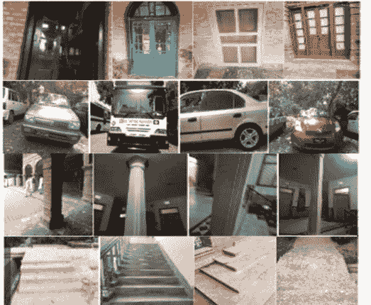

Fig. (1). 数据集示例。

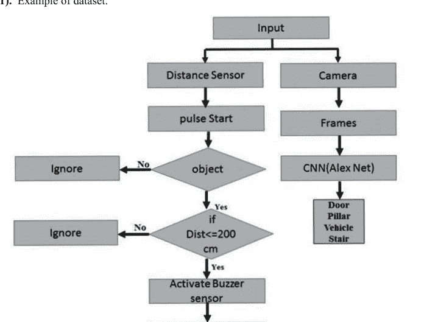

Fig. (2). 拟议系统框架。

## 超声波传感器

如图 (3) 所示，四个超声波传感器连接到 Raspberry Pi。三个超声波传感器用于从三个方向（正面、左侧和右侧）检测障碍物，而一个传感器用于检测坑洼和障碍物。

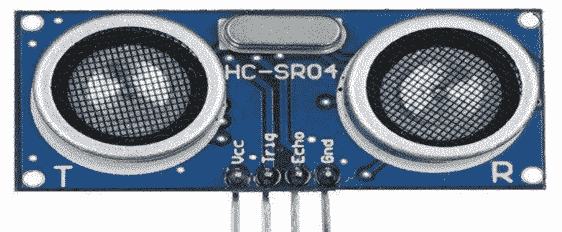

Fig. (3). 超声波传感器。

## 视觉传感器

视觉传感器的分辨率为 500 万像素。传感器连接到 Raspberry Pi 以从正面识别障碍物（图 4）。

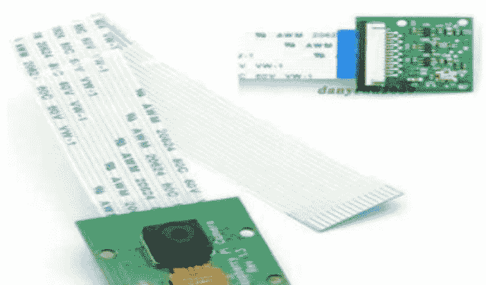

Fig. (4). 视觉传感器。

## 蜂鸣器传感器

蜂鸣器传感器通过振动产生声音来提醒盲人注意障碍物（图 5）。

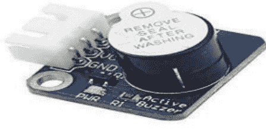

Fig. (5). 蜂鸣器传感器。

## 跳线

母对公跳线可将 Raspberry Pi 上的 GPIO 引脚直接完美连接到面包板上。可重复使用、柔软、可靠且坚固的跳线易于检测，并且很容易与面包板连接和断开。这些跳线适用于原型制作。每包跳线包含 40 根线，每根线长 300 mm（图 6）。

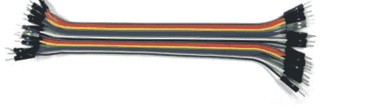

Fig. (6). 跳线。

## 面包板

面包板是构建电路最重要的部件之一。面包板提供单根导线的延伸。塑料盒中有许多孔，按特定样式排列。面包板设计包含两种称为条带的部件。两个部分为总线条和插座条（图 7）。

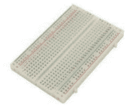

Fig. (7). 面包板。

## 总线条

总线条通常用于为电路供电。它由两列组成，一列用于接地，下一列用于电源电压。

## 插座条

插座条通常用于处理电路中的大多数元件。通常，插座条包括两个段，每个部分由 64 列和五行组成。通常每个列在内部电连接。

## 充电宝

与功能齐全的台式 PC 相比，Raspberry Pi 始终需要特定数量的电力。因此，我们使用电池为设备供电。充电宝也可用于为 Raspberry Pi 供电（图 8）。

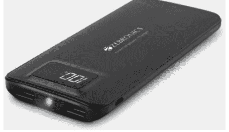

Fig. (8). 充电宝。

## 耳机/扬声器

耳机/扬声器通常用于音频反馈。在本拟议设计中，耳机警告视障人士注意障碍物并告知障碍物的方向和距离。它比蜂鸣器更好，因为它提供更准确的结果和感知，从而帮助人员更容易做出反应（图 9）。

Fig. (9). 耳机。

## 传统手杖

通常，传统手杖为用户提供物理支撑和感知辅助反馈。该手杖还有助于防止用户跌倒和与障碍物碰撞。如果检测到任何障碍物，手杖应在视障人士决定改变方向之前接触物体/障碍物（图 10）。

Fig. (10). 传统手杖。

## 智能/现代手杖

智能手杖是长手杖的更新形式；它由四个超声波传感器和一个 Raspberry Pi 相机组成。超声波传感器用于检测障碍物并测量智能手杖用户与障碍物之间的距离。视觉传感器（相机）用于识别障碍物。拟议设计还配备了蜂鸣器传感器和音频反馈系统 [16]。

## 拟议设备架构

设备架构由 Raspberry Pi、超声波传感器、视觉传感器、面包板、跳线、蜂鸣器、耳机和充电宝组成。面包板是建立电路最重要的部件之一。面包板充当传感器与 Raspberry Pi 之间的桥梁。跳线用于间接将传感器连接到 Raspberry Pi。充电宝设备安装在 Raspberry Pi 顶部，以提供与功能齐全的台式 PC 相比的特定数量的电力。Raspberry Pi 由四十个 GPIO 引脚、存储卡、相机接口（CSI）和 HDMI 端口组成。传感器借助跳线连接到 Raspberry Pi。Raspberry Pi 和充电宝安装在木制手杖上以向 Raspberry Pi 供电。四个超声波传感器连接到 Raspberry Pi，需要 5 伏电力。四个超声波传感器中的三个用于从三个方向（正面、左侧和右侧）检测障碍物，而第四个用于检测坑洼。视觉传感器的分辨率为 500 万像素，并直接通过相机端口连接到 Raspberry Pi 以从正面识别障碍物。蜂鸣器传感器连接到 Raspberry Pi 以提醒盲人注意障碍物，需要 3 伏电力。耳机用于音频反馈并传输语音消息以警告视障人士注意障碍物的存在，并提供障碍物的方向和距离计算（图 11） [17]。

Fig. (11). 拟议系统的智能手杖。

## 深度卷积神经网络

深度学习在许多领域中用于分类、分割和模型数据的检测。深度学习是机器学习领域的一个分支，受大脑结构的启发 [18]。

基于 AlexNet 架构的深度卷积神经网络（CNN）用于实时检测和识别四种障碍物：车辆、门、柱子和楼梯，供视障人士使用。预训练模型 Alex-Net 用于提取深度特征以对无法用简单手工特征分类的复杂图像进行分类。AlexNet 架构由八层组成，其中五层为卷积层，三层为全连接层。该架构由五层卷积层和三层全连接层组成。Alex-Net 模型的第一个层将输入图像的维度定义为 227x227x3。中间五层是序列卷积层，3 层是密集层。Alex-Net 模型已在包含四个不同类别的数据集上训练（图 12） [19]。

Fig. (12). Alex-net 架构。

## 实验结果分析

该研究代表了对视障人士的 4 种不同障碍物（车辆、门、柱子和楼梯）的识别。使用了四种不同的性能指标来评估拟议方法：准确率、召回率、精确率和 F1 分数，给出在公式 (1-4) 中。

Accuracy = (TN + TP) / (TN + TP + FN + FP) (1)

Recall = TP / (TP + FN) (2)

Precision = TP / (TP + FP) (3)

F1-Score = 2 * ((Precision * Recall)/ (Precision + Recall)) (4)

公式 (1-4) 中给出的 TP、FP、TN 和 FN 分别代表真正例、假正例、真负例、假负例的值。

拟议系统的准确率、精确率、召回率和 F1 分数是基于不同的测量因素计算的。表 1 显示拟议方法以 99.63% 的准确率、99.59% 的精确率、99.31% 的召回率、F1 分数为 99.56% 取得了最佳性能。

表 1. 预训练 CNN 模型（Alex-Net）获得的性能结果。

| 类别 | 准确率 | 精确率 | 召回率 | F1-Score |
|---|---|---|---|---|
| Doors | 99.61% | 99.04% | 100% | 99.51% |
| Pillars | 99.70% | 99.35% | 100% | 99.67% |
| Stairs | 99.23% | 100% | 98.23% | 99.10% |
| Vehicles | 100% | 100% | 100% | 100% |
| Total | 99.63% | 99.59% | 99.31% | 99.56% |

拟议模型在预训练的 Caffe Alex-Net 模型上训练，具有最佳验证准确率。模型在训练期间的验证准确率为 99.5139%，验证损失为 0.0201%，如下图所示（图 13）。

Fig. (13). 损失和交叉验证准确率。

混淆矩阵包含分类任务中测试数据中每个类别的实际正例和假正例值。它识别有多少测试样本被正确分类或错误分类。混淆矩阵涉及每个类别的分类精度和召回率值以及所提出技术的准确性（图 14）[20]。

图 (14). 混淆矩阵。

针对视障人士的所提技术的实验结果可在表 1 中说明。四个障碍物（车辆、门、柱子和楼梯）是从预训练的 Alex-Net 架构中识别出来的。所提技术提供了令人印象深刻的结果，如图 (15) 所示。

图 (15). 障碍物识别示例（车辆、门、柱子、楼梯）。

## 结论

本研究使用四个超声波传感器、一个视觉摄像头和一个蜂鸣器用于智能拐杖系统。所提系统将在室内和室外环境中帮助盲人导航，而无需视力正常人士的指导。三个传感器用于检测三个方向（前、左、右）的物体，一个用于检测坑洼。视觉传感器用于识别智能拐杖使用者行进路线上的障碍物。总体而言，与传统拐杖相比，现有设计系统具有优势。当前所提模型也将被放置在自制的木制拐杖上。可以进行改进，以确保系统比当前所提设计更高效、更有效。

未来，我们旨在安装 GPS，这有助于视障人士在户外定位，帮助其亲属轻松找到他们并提供指引。

## 发表同意

未声明。

## 利益冲突

作者声明不存在利益冲突，无论是财务或其他方面。

## 致谢

未声明。

## 参考文献

- [1] "《世界视力报告》", Who.int, 2020. [Online]. https://www.who.int/publications-detail/world-report-on-vision
- [2] M. Imad, S.I. Ullah, A. Salam, W.U. Khan, F. Ullah, and M.A. Hassan, "基于机器学习的 X 射线图像人体内子弹自动检测", Int. J. Comput. Sci. Inf. Secur., 2020.
- [3] M.M. D'souza, A. Agrawal, and V. Tina, "V. HR, and T. Navya, “使用回声定位和图像处理的盲人引导棍自主行走", Methodology (Gött.), vol. 7, no. 05, 2019.
- [4] A. Nivedita, M. Sindhuja, G. Asha, R. Subasree, and S. Monisha, "视障人士的智能拐杖导航", In: International Journal of Innovative Technology and Exploring Engineering (IJITEE). pp. 2278-3075, 2019.
- [5] R. Tapu, B. Mocanu, A. Bursuc, and T. Zaharia, "一种基于智能手机的障碍物检测与分类系统，用于辅助视障人士", 2013 IEEE International Conference on Computer Vision Workshops, pp. 444-451. [http://dx.doi.org/10.1109/ICCVW.2013.65]
- [6] P. H. Batavia and S. Singh, "使用自适应颜色分割和彩色立体单应性的障碍物检测," In Proceedings 2001 ICRA. IEEE International Conference on Robotics and Automation (Cat. No. 01CH37164), vol. 1: pp. 705-710, 2001.
- [7] B. D. Lucas and T. Kanade, "一种迭代图像配准技术及其在立体视觉中的应用," 1981.
- [8] J.A. Hesch, and S.I. Roumeliotis, "便携式室内定位辅助装置的设计与分析，用于视障人士", Int. J. Robot. Res., vol. 29, no. 11, pp. 1400-1415, 2010. [http://dx.doi.org/10.1177/0278364910373160]
- [9] A. Rodriguez, L. M. Bergasa, P. F. Alcantarilla, J. Yebes, and A. Cela, "用于辅助视障人士的障碍物避免系统," in Proceedings of the IEEE Intelligent Vehicles Symposium Workshops, Madrid, Spain, vol. 35, p. 16, 2012.
- [10] M. Vlaminck, Q.L. Hiep, H. Vu, P. Veelaert, and W. Philips, "使用 RGB-D 相机的视障人士室内辅助", 2016 IEEE Southwest Symposium on Image Analysis and Interpretation (SSIAI). pp. 161-164, 2016. [http://dx.doi.org/10.1109/SSIAI.2016.7459200]
- [11] V. Pradeep, G. Medioni, and J. Weiland, "视障人士的机器人视觉", 2010 IEEE Computer Society Conference on Computer Vision and Pattern Recognition-Workshops, . pp. 15-22, 2010.
- [12] T-S. Leung, and G. Medioni, "动态环境中盲人的视觉导航辅助", Proceedings of the IEEE Conference on Computer Vision and Pattern Recognition Workshops. pp. 565-572, 2014. [http://dx.doi.org/10.1109/CVPRW.2014.89]
- [13] F. Shahdib, M.W.U. Bhuiyan, M.K. Hasan, and H. Mahmud, "使用传感器进行自主移动机器人的障碍物检测和物体尺寸测量", Int. J. Comput. Appl., vol. 66, no. 9, 2013.
- [14] S. Maidenbaum, S. Hanassy, S. Abboud, G. Buchs, D.R. Chebat, S. Levy-Tzedek, and A. Amedi, "“EyeCane”，盲人的一种新型电子出行辅助装置：技术、行为与快速学习", Restor. Neurol. Neurosci., vol. 32, no. 6, pp. 813-824, 2014. [http://dx.doi.org/10.3233/RNN-130351] [PMID: 25201814]
- [15] M. Imad, A. Hussain, M. Hassan, Z. Butt and N. Sahar, "基于物联网的机器学习和深度学习平台用于 COVID-19 预防与控制：系统综述", AI and IoT for Sustainable Development in Emerging Countries, pp. 523-536, 2022. [http://dx.doi.org/10.1007/978-3-030-90618-4_26]
- [16] A. Hussain, M. Imad, A. Khan and B. Ullah, "使用定制高效神经网络的 X 射线图像中 COVID-19 识别的多类分类", AI and IoT for Sustainable Development in Emerging Countries, pp. 473-486, 2022. [http://dx.doi.org/10.1007/978-3-030-90618-4_23]
- [17] Faiza, S. I. Ullah, A. Salam, F. Ullah, M. Imad and M.A. Hassan, "使用机器学习方法诊断皮肤镜图像以检测黑色素瘤", 2020 IEEE 23rd International Multitopic Conference (INMIC), 2020. [http://dx.doi.org/10.1109/INMIC50486.2020.9318114]
- [18] S. Nazish, A. Ullah, W.U. Salam, and M. Imad, "基于逻辑回归和支持向量机的 COVID-19 肺部图像分类", Artificial Intelligence Systems and the Internet of Things in the Digital Era, pp. 13-23, 2021. [http://dx.doi.org/10.1007/978-3-030-77246-8_2]
- [19] M. Imad, N. Khan, F. Ullah, M. Abul Hassan, A. Hussain, and Faiza, “基于机器学习技术的胸部 X 射线图像 COVID-19 分类 ”, JCSTS, vol. 2, no. 2, pp. 01–11, Oct. 2020.
- [20] "M. Imad, F. Ullah, M. Abul Hassan, and Naimullah, “基于卷积神经网络的巴基斯坦货币识别以辅助盲人”", JCSTS, vol. 2, no. 2, pp. 12-19, 2020.

# 脑机接口及其相关应用综述

Krishna Pai¹,*, Rakhee Kallimani¹, Sridhar Iyer¹, B. Uma Maheswari², Rajashri Khanai¹ and Datta Prasad Torse²

¹ Department of Electronics and Communication Engineering, KLE Dr. M.S. Sheshgiri College of Engineering and Technology, Udyambag, Belagavi, KA, India- 590008
² Department of Computer Science and Engineering, Amrita School of Engineering, Bengaluru, Amrita Vishwa Vidyapeetham, KA, India- 560035

摘要：脑机接口（BCI）系统能够利用神经活动测量在不涉及肌肉运动的情况下直接在脑与计算机之间进行通信。为了使 BCI 系统被严重残疾人士广泛使用，需要对其实际使用进行长期研究，并辅以有效且可行的推广模式。此外，还应提高 BCI 系统性能的鲁棒性，使其达到与自然肌肉为基础的健康监测相同的鲁棒性水平。在本章中，我们回顾了最近的 BCI 相关研究，随后介绍最相关的应用。我们还介绍了 BCI 系统存在的关键问题和挑战，并提供了未来方向。

关键词：人工智能, BCI, EEG, 机器学习, MEG.

## 引言

脑机接口（BCI）利用大脑的计算能力来使用相对较新的技术。据 Berger [1] 所述，自一个世纪前首次发现脑电图（EEG）以来，研究一直在尝试解码大脑信号。直到最近，BCI 的发展被认为是科幻小说。BCI 系统将大脑与外部设备协作，该设备使用大脑信号执行外部活动，例如移动轮椅、机械臂或计算机光标。

脑机接口模型主要有四个组成部分，即传感设备、放大器、滤波器和控制系统。根据 Herwing 等人 [2] 和 Jurcak 等人 [3] 的说法，传感设备由一顶帽子组成，帽子上装有电极，这些电极按照国际 10–20 标准放置。此外，根据 Zhang 等人 [4] 的说法，放大器可以是市场上可用的几种生物放大器之一，而脑机接口的研究致力于开发可应用于脑信号的滤波器和控制系统。

当一个人想到执行任何任务时，例如移动光标，那么在这种情况下，大脑中会产生信号，该信号通过身体的神经肌肉系统从大脑传递到计算机鼠标上的手指。随后，手指会移动光标。相比之下，在脑机接口中，这些信号被传递到外部设备，在那里它们将被解码以移动光标。另一个例子是，脑机接口的研究还旨在帮助那些因听力、视力受损以及运动受损而出现问题的人。据估计，全球约有 15 亿人患有神经系统和神经解剖学疾病和损伤，导致运动障碍，这使得独立交流、够取和抓握变得困难。皮层假体系统由一个末端执行器组成，该执行器通过脑机接口接收特定动作的指令，该接口记录了遭受脊髓损伤、肌萎缩侧索硬化症和中风等神经损伤的个体的皮层活动。此外，脑机接口解码与预期功能相关的信息。目前使用中的末端执行器种类繁多，从虚拟打字通信系统到机械臂和机械手，以及用于肢体再生的功能性电刺激。

脑机接口的侵入程度各不相同，具有不同的空间和时间分辨率，并记录各种信号。根据 Speier 等人 [5] 的说法，在脑机接口应用中，例如低吞吐量通信拼写系统，EEG、MEG 和 fMRI 可用作非侵入性脑成像技术。Daly 等人 [6] 枚举了与这些非侵入性脑机接口方法相关的若干问题，例如它们通常速度较慢（例如 fMRI）、空间分辨率低且易受外部伪影干扰。因此，这样的选项不适合复杂实时应用，如高性能通信、跟踪多维机器人肢体，或对瘫痪肢体进行协调抓握和伸展的再激活。相比之下，侵入性脑机接口由于其更高的分辨率和更宽的传输带宽，能够自然地控制更高维度的系统并恢复更复杂的功能。

根据 Rosenow 等人 [7] 的说法，脑植入物是帮助因中风、脊髓损伤、脑瘫和肌萎缩侧索硬化症（ALS）等原因导致运动瘫痪（例如截瘫或四肢瘫）患者的最有希望和最受欢迎的技术之一。同样，眼动追踪可被瘫痪者用来控制外部设备，但该技术有许多缺点，因为它依赖于摄像头或安装在脸上的电极来记录眼动或电信号，例如脑电眼动图（EOG）。根据 McIntyre 等人 [8]、Chen 等人 [9] 和 Donoghue [10] 的说法，由于脑机接口，神经指令通过将人类脑活动转化为外部动作传递给外部设备。虽然脑机接口最常用于帮助患有运动系统疾病的残疾人，但对健康运动系统的人以及老年人也非常有帮助。开发针对成人和老年患者的智能、自适应和康复性脑机接口应用将增强他们与家人的关系，改善他们的认知和运动技能，并帮助完成家务。脑机接口通常被视为读心术技术，但大多数情况下并非如此。与读心者不同，脑机接口通过使用脑信号而不是肌肉运动为用户提供控制，因此不会从不知情或不情愿的受试者中提取信息。因此，脑机接口和用户通过训练课程共同工作，其中用户产生告知脑机接口预期动作的脑信号，而脑机接口将信号转换为输出设备应执行的指令。

根据上述内容，研究界在脑机接口设备的实施上面临诸多挑战。具体而言，脑机接口过程中使用的电极和手术方法需要尽可能少地侵入，这导致了对脑机接口非侵入性方法的大量研究关注。

在本章中，我们综述了脑机接口及其相关应用的最新研究。相关工作在第 2 节中详细说明。第 3 节讨论了脑机接口最相关的应用。第 4 节，我们强调了脑机接口的主要挑战并提出了相关方向。最后，第 5 节总结了本章。

## 相关工作

任何人通常在任何时间都会产生各种各样的信号，来自眼睛、耳朵、鼻子和身体的其他感觉器官。这些信号通过神经系统传递到大脑。大脑皮层叶在人类或动物理解感知、思想、语言和记忆时发挥重要作用，因此使用 EEG 传感器、NIRS 探测器等来获取神经信号。在这些信号的帮助下，人类或动物的脑活动通过脑活动测量算法得以理解。图（1）展示了详细的脑机接口，其中可以看到在信号采集过程中会进行信号预处理，包括滤波、采样和伪影去除，如 Cao [11] 所描述的那样。使用这些预处理数据，会进行特征提取过程，之后可以使用分类算法或卷积神经网络（CNN）分类器来理解各种应用（如医疗游戏教育等）所需的神经控制。此外，这些神经控制作为感觉反馈提供回大脑，以便了解神经控制所执行的活动是否符合预期。在这方面，本章的综述主要集中于可/已用于神经信号处理的各种类型的分类算法 / CNN 分类器，从而有助于获得神经控制。

图（1）。脑机接口框图。

从大脑以神经信号形式获得的 EEG 数据具有多个通道。Singh 等人 [12] 使用单通道 EEG 数据，利用物联网（IoT）和脑机接口技术开发了一个原型。该原型使用 MATLAB 软件开发，其中分类器使用加权 K 近邻算法（Wk-NN）进行训练。Arduino 微控制器用作硬件平台。作者证明，在原型制作结束时，可以保证一种低成本且高精度的系统，该系统可以控制环境。作者还能够通过 If This Then That（IFTTT）获取并向云端提供数据。本文使用的分类器是使用 Wk-NN 算法的认知状态分类器和事件相关电位 ERP 分类器。通过选择认知状态分类器和 ERP 分类器，分别实现了 95% 的准确率（每秒 3100 个观测值）和 98.3% 的准确率（每秒 1800 个观测值）。

一般来说，分类器算法取决于从神经信号收集的数据中抽象出的特征。文献中存在多种特征提取技术，其中一种特征提取技术是柔性解析小波变换（FAWT）方法。在 [13] 中，Chaudhary 等人使用 FAWT 技术将 EEG 信号划分为其子带，从而提取基于运动的特征。子空间 KNN 是已知达到 99.33% 准确率水平的最佳分类方法之一。作者还使用了其他分类方法，例如支持向量机（SVM）、决策树、线性判别分析（LDA）和标准 KNN，获得了大量结果。具体而言，SVM、标准 KNN、决策树和 LDA 分别获得了 95.72%、92.8%、91.79% 和 81.1% 的准确率。作者还将准确率、特异性、kappa 值、f1 分数和灵敏度作为性能参数考虑在内。

Jin 等人 [14] 表明，考虑到基准性能，极限学习机（ELM）比 SVM 更有效。他们还指出，ELM 的性能与隐藏节点数量高度成比例，而隐藏节点也被称为 ELM 的网络结构。基于稀疏贝叶斯的 ELM 算法（SBELM）显示出对 EEG 信号的高表征准确性。在比较研究中，观察到通过 SVM、ELM、BELM 和 SBELM 获得的准确率分别为 76.3%、77.1%、77.8% 和 78.5%。最后，作者指出，所提出的模型可以通过添加更多独特和高层次的属性来进一步改进。

Yi 等人 [15] 在基于方程的脑电图模型上使用线性回归方法获得了 95% 的准确率水平。基本机器学习模型可以通过应用诸如累加器矩阵乘法、求逆和向量乘法等各种方法进一步改进。所提出的算法包含一个法方程，该方程经过许多数学计算以获得输出。研究中的开发环境基于 docker 技术构建。根据 Zheng 等人 [16] 的说法，当深度学习和 ELM 结合时，除了长短期记忆网络（LSTMs）和装袋算法的改进外，还形成了一种分类模型，被称为 LSTMS-B。这种新的分类模型包含 Swish 激活。在研究中，观察到具有 40 个类别的智能视觉分类准确率为 97.13%。为了区分 EEG 信号，需要更复杂的技术的额外图像类别。

Chen 等人 [17] 使用了时空 CNN 模型，该模型包含两组独立的层，即分类层和特征提取层。观察到需要单独的数据集来训练特征

分别提取层和分类层。模型在使用空间滤波进行特征提取时提供了 65.7% 的整体分类准确率。本研究观察到的性能与现有经典模型相比相对更好。用于 BCI 接口的深度学习模型需要大量数据才能获得高精度的分类结果。然而，在一般情况下存在巨大数据稀缺，因此所开发的模型无法发挥其全部潜力。为解决此问题，Zhang 等人 [18] 提出了一种生成人工脑信号的方法，该信号可作为补充数据与实际数据一起使用。作者还提出了用于数据增强的深度卷积生成对抗网络（cDCGAN）方法，并在卷积神经网络（CNN）模型上进行评估以获得相应的分类性能。CNN 分类模型在采用实际 EEG 数据、人工生成的 EEG 数据和混合 EEG 数据时分别获得了 82.86%、82.86% 和 82.14% 的准确率。

作者 [19] 已证明基于深度学习的分类技术优于现有的传统分类技术。本研究使用了五类稳态视觉诱发电位数据集（SSVEP），并在 CNN 与使用 LSTM 架构的循环神经网络（RNN）之间提供了详细的比较。作者证明 CNN 表现出最高的分类准确率，对应为 69.3%，而传统分类算法，即使用高斯核的 SVM，分类准确率为 66.9%。

Rasheed [20] 对机器学习在 BCI 中的作用进行了全面综述；作者提供了详细的机器学习方法，重点关注精神状态检测、状态分类和情绪分类。EEG 信号分类、事件相关电位信号分类、运动想象分类和肢体运动分类。用于特征提取和选择的常用空间模式（CSP）、主成分分析（PCA）、独立成分分析（ICA）、自回归（AR）方法、小波包分解（WPD）等方法被探讨。详细的分类方法如 K-最近邻（KNN）、线性判别分析（LDA）、朴素贝叶斯、极限学习机（ELM）、支持向量机（SVM）和神经网络（NNs）被回顾。神经网络对多层感知器（MLP）、人工神经网络（ANN）和卷积神经网络（CNN）进行了详细研究。

Al-Nafjan 等人 [21] 对情绪检测和分类的发展进行了全面综述。作者在回顾已发表文章时提供了深入见解，重点显著关注基于对处于不同情绪状态的参与者/患者进行的具体研究使用 EEG BCI 进行情绪状态识别。研究人员还提供了关于所述领域趋势和挑战的部分，并强调了未来十年该技术的增长。

Birbaumer 等人 [22] 对针对瘫痪患者的 BCI 临床应用进行了完整综述。该研究重点关注闭锁综合征以及完全闭锁综合征。该工作还展示了脑机接口在慢性中风患者中的应用。结果显示 BCI 与精神病学和临床心理学问题相结合具有积极反应。作者还提及了从改善复杂行为障碍的角度来看的研究范围。

Min 等人 [23] 提及了不同类型的神经影像 BCI 方法并提供了每种方法的优缺点。文章中作者提到了脑到脑接口发展的趋势，其中个体通过计算机作为中介相连。EEG 作为流行的神经影像方法，作者描述了其他神经影像方法，例如 MEG，其与基于磁场的神经活动相关。fMRI 检测局部脑部血氧水平依赖信号对比度的变化。NIRS 是一种采用近红外光谱的方法，可以穿透颅骨并研究脑代谢。它是评估皮层区域活动的最新发展技术。最新发展是超声多普勒成像技术 fTCD。该方法的局限性在于穿透性。

Abbasi 等人 [24] 使用离散小波变换（DWT）解析 EEG 数据，并对每个多层感知器神经网络特征进行统计分析。所提出的方法与其它模型相比准确率达到 98.33%。该模型旨在帮助检测、诊断和分类癫痫发作。

Wang 等人 [25] 旨在设计一个 BCI 系统，通过采用深度学习方法准确提取特征并对 EEG 信号进行分类。该工作在卷积神经网络和长短期记忆网络上进行了演示。该研究重点关注从 2 名女性和 3 名男性受试者获得的数据，受试者为健康、精神和右利手的学生。

Torse 等人 [26] 提出了关于自动癫痫发作检测的详细综述。由此为通过手动操作诊断癫痫的手动检测方法奠定了基础。该研究围绕 KNN、LS-SVM、多层感知器神经网络（MLPNN）、朴素贝叶斯（NB）和随机森林（RF）等各种分类器展开。最高分类准确率达到 97.3%，这是由于一个自动系统由分解 EEG 信号的 Q 的不同值组成，进而计算 Kozachenko 和 Shannon 熵。因此，使用名为随机森林的分类器检测癫痫发作。其他分类准确率分别为 KNN、LS-SVM、多层感知器神经网络（MLPNN）和朴素贝叶斯（NB）分别为 86.1%、95.6%、92.5% 和 84.4%。

Torse 等人 [27] 探索了用于慢性脑部疾病正常或癫痫发作状况分类的高精度模型。这些模型基于可调 Q 小波变换（TQWT）和集合经验模态分解（EEMD）算法。熵和 TQWT 参数为高分类性能生成了最佳值。由 EEMD-TQWT + RF 算法组成的联合方法显示出最高的分类准确率 96.2%。

在表 1 中，我们总结了各种研究中实现的分类器算法，包括所取得的准确率。

## 表 1. 各研究使用的算法详情及所达到的精度。

| 参考文献 | 使用的分类器算法 | 精度 |
|------------|---------------------------|----------|
| [12] | 使用加权 k-最近邻（Wk-NN）算法的事件相关电位（ERP） | 98.3% |
| [12] | 使用加权 k-最近邻（Wk-NN）算法的认知状态分类器 | 95% |
| [13] | 子空间 KNN | 99.33% |
| [13] | 支持向量机（SVM） | 95.72% |
| [13] | 标准 KNN | 92.8% |
| [13] | 决策树 | 91.79% |
| [13] | 线性判别分析（LDA） | 81.1% |
| [14] | 支持向量机（SVM） | 76.3% |
| [14] | 极限学习机（ELM） | 77.1% |
| [14] | 贝叶斯极限学习机（BELM） | 77.8% |
| [14] | 稀疏贝叶斯极限学习机（SBELM） | 78.5% |
| [15] | 线性回归 | 95% |
| [16] | 深度学习 + ELM + LSTM + 集成算法（LSTMS-B） | 97.13% |
| [17] | 时空 CNN | 65.7% |
| [18] | 卷积神经网络（CNN） | 82.86% |
| [18] | CNN + 深度卷积生成对抗网络（cDCGAN） | 82.86% |
| [18] | CNN + 混合数据 | 82.14% |
| [19] | 使用 LSTM 架构的 CNN/循环神经网络（RNN） | 69.3% |
| [19] | 使用高斯核的 SVM | 66.9% |
| [26] | KNN | 86.1% |
| [26] | LS-SVM | 95.6% |
| [26] | 多层感知器神经网络（MLPNN） | 92.5% |
| [26] | 朴素贝叶斯（NB） | 84.4% |
| [26] | 随机森林（RF） | 97.3% |
| [27] | 可调 Q 小波变换（TQWT） + 集合经验模态分解（EEMD） + RF | 96.2% |

## BCI 的应用

在本节中，我们详细介绍了 BCI 的最先进应用。正在进行多项研究，通过结合多模态信号采集方法来增强当前 BCI 系统。根据 Debener 等人 [28] 的说法，多项研究已证明 fMRI 与同时 EEG 可以通过利用 fMRI 的有效空间分辨率和 EEG 的有效时间分辨率产生互补特征。Kauhanen 等人 [29] 提到的 MEG 也可以与 EEG 协同工作，因为它提供了有关皮层-皮下网络中径向/切向极化源的信息，并且可以通过添加互补信息来补充 EEG。少数研究，如 Min 等人 [30] 和 Piastra 等人 [31] 认为 EEG 和 MEG 可以检测皮下活动；然而，关于它们检测源自皮下区域的脑活动的能力的怀疑仍然存在。近年来，结合不同的信号采集方法以提高 BCI 效率变得越来越普遍。

为了将任何脑信号转化为可由计算机或其他外部设备使用的命令，信号处理结合机器学习技术发挥着至关重要的作用。脑信号的时间域表示包括傅里叶变换（FT）和自回归模型，而时频表示包括短时 FT 和小波变换，如 Bashashati 等人 [32] 所描述。当考虑空间滤波时，如 Saha 等人 [33] 所描述，许多逆模型能够在三维皮层-皮下网络上区分和投影实际源。各种线性和非线性分类算法，如基于核的支持向量机和线性判别分析，可用于转换提取的特征，如 Lotte 等人 [34] 所描述。由于计算方面的显著进步，研究人员对基于深度学习范式的 BCI 的更深入理解越来越受到关注

正如 Nagel 等人 [35] 所提到的，过去十年的基础设施。这是因为此类系统能够评估大型数据集。正如 Saha 等人 [36] 所描述的，逆问题必须得到解决，以便对皮层源进行建模。此外，近年来出现了新的源定位方法，包括基于小波的最大熵平均方法，该方法将 EEG/MEG 信号表示为时频内容，然后将其转化为空间表征。为采集脑信号而开发了定制设计的传感器。Deisseroth 等人 [37] 描述了多种神经传感器形式，包括电化学、光学、化学和生物学。Oxley 等人 [38] 描述的纳米线场效应晶体管和其他 p/n 结器件，由于纳米技术取得了重大进展，已证明神经传感技术在细胞内记录中的可行性，甚至在深部脑区也是如此。

根据 Willett 等人 [39]、Zhang 等人 [40] 和 Herff 等人 [41] 的研究，BCI 系统还显示出在多项运动方面读取思维的能力。研究人员已使用 BCI 在跑步机上测试猪的思维。他们还能够在解读猪的思维之外预测猪的大脑下一步会做什么。此外，研究人员正在开展利用脑机接口改善身体瘫痪且无法说话或移动的人群之间交流的研究。在这些情况下，BCI 使该人能够进行口头和书面的交流。用于脑到文本转录的 BCI 系统也有助于瘫痪者想象书写字母，这些字母会出现在屏幕上。在实验中，要求瘫痪患者以每分钟 90 个字符的速度思考，这些字符随后被解码并在不到一秒的时间内呈现在屏幕上。这表明结果比同年龄段人群在智能手机屏幕上的典型打字速度快 80%。即使瘫痪多年，运动皮层仍足够强大，能够被 BCI 读取以达到打字速度和精确度。

Rabbani 等人 [42] 和 Rezazadeh Sereshkeh 等人 [43] 已开发出用于生成合成语音的 BCI。为获得结果，电极被放置在大脑表面以测量信号并计算发音道的运动。捕捉到的发音道运动随后被转换为声音，然后原始声音被转换为合成语音。根据 Ptito 等人 [44] 和 Farnum 等人 [45] 的研究，BCI 也已被证明可用于帮助和恢复盲人的视力。一台放置在眼镜上的摄像机捕捉视频图像，对其进行处理，然后激活安装在视网膜上的芯片以刺激眼睛。最终目标是能够使用植入物将摄像机输入转化为脑活动。因此，它提供了一种针对大脑而非眼睛的新型治疗失明方法。根据 Hwang 等人 [46] 和 Lucia 等人 [47] 的研究，听力损失患者有多种解决听力损失的方案，包括 BCI。其工作原理类似于麦克风，可拾取来自不同人的声音和对话。植入物放置在耳后或皮肤下方，然后通过声音处理器将脉冲传递到植入耳蜗的电极。

随着年龄增长，大脑和身体都会发生变化，老年人需要帮助。然而，由于所需护理和治疗费用高昂，他们通常得不到所需的帮助。正如 Belkacem 等人 [48] 所描述的，BCI 在帮助老年人方面也被证明是有益的。在这种情况下，BCI 技术可以通过多种方式帮助老年人，例如改善他们的沟通能力、控制家用电器以及增强认知能力。目前，痴呆症在成年人中非常常见，正如 Fukushima 等人 [49] 和 Rutkowski 等人 [50] 所提到的。BCI 用于检测早期的阿尔茨海默病，也用于分类和了解痴呆的类型。早期检测阿尔茨海默型痴呆 (AD) 非常重要，因为它本身可以用药物治疗。正如 Ferreira 等人 [51]、Lin 等人 [52]、Wei 等人 [53]、Pritchett 等人 [54] 和 Li 等人 [55] 所描述的，晕动症和嗜睡会降低驾驶员的性能，有时还会导致事故。通过测量来自大脑不同区域的 EEG 信号可以预测晕动症。EEG 为基础的 BCI 系统在多种应用中显示出巨大潜力，包括中风后治疗，正如 Mrachacz-Kersting 等人 [56] 和 Ruiz 等人 [57] 所描述的，疾病诊断（Abdulkader 等人 [58]）、情绪识别（Mishra 等人 [59]）和游戏（Lim 等人 [60]），这些都为 EEG 为基础的 BCI 系统展现了巨大前景。

BCI 系统还有助于预测脑肿瘤，正如 Song 等人 [61] 所描述的，癫痫（癫痫发作性疾病），正如 Hosseini 等人 [62] 所提到的，以及脑炎（脑肿胀）。此外，正如 Fadzai 等人 [63] 所描述的，使用 BCI 可以确保早期发现阅读障碍，这反过来有助于治疗儿童并提高他们的自信心。rtfMRI-EEG BCI 系统的组合用于寻找抑郁症，正如 Minkowski 等人 [64] 所提到的，以及情绪识别，正如 Moschona 等人 [65] 所描述的，患者的情绪识别也可以使用 fMRI BCI 系统识别。正如 Bonnet 等人 [66] 所描述的，BrainArena 使用 BCI 将两个大脑连接到足球电子游戏，并可以通过思考左右移动来得分。研究表明，每周玩两次 Brainball 游戏可以提高学生的学习技能。最后，正如 Mridha 等人 [67] 所描述的，人们可以通过玩 Brainball 游戏来测量自己的压力水平，在该游戏中，只有压力较小的玩家才能移动球。

## ISSUES AND CHALLENGES, AND FUTURE DIRECTIONS

BCI 技术已引起研究界的极大关注，包括医学和非医学科学家。根据 Mudgal 等人 [68] 的说法，研究领域面临的主要问题可分为三个方面，即神经-心理-生理、技术和伦理。

### Neuro-Psycho-Physiological Issues

大脑的性能受解剖问题的影响，包括由于遗传问题和结构造成的复杂性、大脑的多样性，以及焦虑、疲劳和情绪状态、压力和记忆等心理问题，这些问题因人而异。这些问题已被证明主要影响 BCI 的性能。

### Technical Issues

BCI 系统面临的主要挑战是根据应用选择适当的组件或技术，因为它与信号有关。选择获取脑信号的方法然后对其进行处理的方法构成了主要挑战。另一个挑战是培训 BCI 系统的操作员。

### Ethical Issues

这些问题与用户的身体和心理以及情绪状态的安全有关。用户数据高度保密，需要由系统维护。用户同意是与 BCI 系统相关的另一个突出问题。

关于技术问题，Mudgal 等人 [68] 和 Vasiljevic 等人 [69] 详细说明了开发 BCI 的重大挑战。具体而言：
- 1. 脑信号的非线性特征以及信号的非平稳行为构成了关键挑战。此外，噪声也对其对 BCI 系统挑战的重要贡献起到了作用。
- 2. 另一个技术挑战是脑信号传输速率。目前，BCI 的传输速率极慢，这是一个重要的研究课题，尤其是基于视觉刺激的 BCI。
- 3. 选择适当的解码技术、处理和分类算法以控制 BCI 系统是一个挑战。
- 4. 另一个关键问题是训练所需与

系统的准确功能以及解码大脑活动的技术复杂性。

5. 需要专注于 BCI 系统并为特定性能指标提供系统化的方法，因为存在多种性能指标，选择特定应用的特定指标是一项主要挑战。

此外，需要进一步探索的领域包括尚不为人知的长期影响、技术对多名受试者及其亲属/家庭生活质量的影响、与健康相关的副作用，例如睡眠质量、正常大脑功能和记忆，以及对大脑所做的不可逆改变。此外，还存在多个需要解决的法律和社会问题，具体包括：需要就 BCI 的影响承担的问责和责任、认知意图翻译上的不准确、可能的人格变化、无法区分人类与机器控制行为、执法部门在审讯中使用技术的滥用、读心能力的隐私问题，以及与心智控制和情绪控制相关的问题。此外，一个主要关注领域是需要为事故发生场景确定法律责任。

出现的额外挑战涉及身体对侵入式 BCI 的反应，而侵入式 BCI 需要使用植入式微电极阵列，该阵列与大脑内的特定神经元直接接触。这些电极被识别为异物，会触发自然免疫系统，而这些神经元随后被组织纤维囊包围，从而降低了电极的信号记录能力，最终导致 BCI 无法使用。此外，为了减小电池尺寸并延长使用寿命而最小化功耗是另一个关键挑战，因为功耗与高效生物安全之间存在权衡。在这方面，为了确保生物安全，信号需要被加密，这会增加功耗。

此外，BCI 技术实施中的主要问题是缺乏一种高效的传感器模式，该模式能够安全、准确且稳健地访问脑信号。此外，开发此类传感器以增加通道来提高准确性并降低相应功耗是一项主要挑战。BCI 的伦理、法律和社会影响也可能使该技术放缓、停止或偏离最初目标而走向完全不同的道路。最后，在过去十年中，与基因测序相关的技术和现代制图工具有助于增进对神经元放电模式及其导致不同行为的方式的理解。脑机接口设备现已变得更敏感、更小、更智能且更便携，未来技术必须解决与易用性、性能稳健性和成本降低相关的问题。

## 结论

BCI 社区正在开展大量研究，以提供标准化平台并协助 BCI 系统所遇到的复杂和非线性动态。在本章中，我们回顾了与 BCI 系统相关的最新研究。我们还介绍了并详细阐述了最先进的 BCI 系统。最后，我们列出了关于 BCI 系统的关键问题和挑战，并提出了一些未来方向，以增强对 BCI 系统的研究。

## 出版许可声明

未声明。

## 利益冲突

作者声明不存在任何利益冲突，无论是财务上的还是其他方面的。

## 致谢

未声明。

## 参考文献

[1] H. Berger, "Über das Elektroencephalogramm des Menschen", Arch. Psychiatr. Nervenkr., vol. 108, no. 3, pp. 407-431, 1938. [http://dx.doi.org/10.1007/BF01824101]

[2] U. Herwig, P. Satrapi, and C. Schönfeldt-Lecuona, "Using the international 10-20 EEG system for positioning of transcranial magnetic stimulation", Brain Topogr., vol. 16, no. 2, pp. 95-99, 2003. [http://dx.doi.org/10.1023/B:BRAT.0000006333.93597.9d] [PMID: 14977202]

[3] V. Jurcak, D. Tsuzuki, and I. Dan, "10/20, 10/10, and 10/5 systems revisited: Their validity as relative head-surface-based positioning systems", Neuroimage, vol. 34, no. 4, pp. 1600-1611, 2007. [http://dx.doi.org/10.1016/j.neuroimage.2006.09.024] [PMID: 17207640]

[4] B. Zhang, J. Wang, and T. Fuhlbrigge, "A review of the commercial brain-computer interface technology from perspective of industrial robotics", 2010 IEEE International Conference on Automation and Logistics. pp. 379-384, 2010. [http://dx.doi.org/10.1109/ICAL.2010.5585311]

[5] W. Speier, C. Arnold, and N. Pouratian, "Evaluating true BCI communication rate through mutual information and language models", PLOS One, vol. 8, no. 10, p. e78432, 2013. [http://dx.doi.org/10.1371/journal.pone.0078432] [PMID: 24167623]

[6] J.J. Daly, and J.R. Wolpaw, "Brain–computer interfaces in neurological rehabilitation", Lancet Neurol., vol. 7, no. 11, pp. 1032-1043, 2008. [http://dx.doi.org/10.1016/S1474-4422(08)70223-0] [PMID: 18835541]

[7] J.M. Rosenow, Anatomy of the Nervous System. Neuromodulation. Elsevier, 2018, pp. 25-39. [http://dx.doi.org/10.1016/B978-0-12-805353-9.00003-6]

[8] C.C. McIntyre, Patient-Specific Modeling of Deep Brain Stimulation. In: Neuromodulation. Elsevier, 2018, pp. 129-135. [http://dx.doi.org/10.1016/B978-0-12-805353-9.00012-7]

[9] C. Chen, X. Xiao, A.N. Belkacem, L. Lu, X. Wang, W. Yi, P. Li, C. Wang, S. Sha, X. Zhao, and D. Ming, "Efficacy Evaluation of Neurofeedback-Based Anxiety Relief", Front. Neurosci., vol. 15, p. 758068, 2021. [http://dx.doi.org/10.3389/fnins.2021.758068] [PMID: 34776855]

[10] J.P. Donoghue, Brain–Computer Interfaces. Neuromodulation. Elsevier, 2018, pp. 341-356. [http://dx.doi.org/10.1016/B978-0-12-805353-9.00025-5]

[11] Z. Cao, "A review of artificial intelligence for EEG-based brain–computer interfaces and applications", Brain Science Advances, vol. 6, no. 3, pp. 162-170, 2020. [http://dx.doi.org/10.26599/BSA.2020.9050017]

[12] M.K. Singh, I. Saini, and N. Sood, "A multi-functional BCI system for exigency assistance and environment control based on ML and IoT", Int. J. Comput. Appl. Technol., vol. 63, no. 1/2, pp. 64-82, 2020. [http://dx.doi.org/10.1504/IJCAT.2020.107912]

[13] S. Chaudhary, S. Taran, V. Bajaj, and S. Siuly, "A flexible analytic wavelet transform based approach for motor-imagery tasks classification in BCI applications", Comput. Methods Programs Biomed., vol. 187, p. 105325, 2020. [http://dx.doi.org/10.1016/j.cmpb.2020.105325] [PMID: 31964514]

[14] Z. Jin, G. Zhou, D. Gao, and Y. Zhang, "EEG classification using sparse Bayesian extreme learning machine for brain–computer interface", Neural Comput. Appl., vol. 32, no. 11, pp. 6601-6609, 2020. [http://dx.doi.org/10.1007/s00521-018-3735-3]

[15] H. Yi, "Efficient machine learning algorithm for electroencephalogram modeling in brain–computer interfaces", Neural Comput. Appl., vol. 3, 2020. [http://dx.doi.org/10.1007/s00521-020-04861-3]

[16] X. Zheng, W. Chen, Y. You, Y. Jiang, M. Li, and T. Zhang, "Ensemble deep learning for automated visual classification using EEG signals", Pattern Recognit., vol. 102, p. 107147, 2020. [http://dx.doi.org/10.1016/j.patcog.2019.107147]

[17] J. Chen, Z. Yu, Z. Gu, and Y. Li, "Deep temporal-spatial feature learning for motor imagery-based brain-computer interfaces", IEEE Trans. Neural Syst. Rehabil. Eng., vol. 28, no. 11, pp. 2356-2366, 2020. [http://dx.doi.org/10.1109/TNSRE.2020.3023417] [PMID: 32956061]

[18] Q. Zhang, and Y. Liu, "Improving brain computer interface performance by data augmentation with conditional Deep Convolutional Generative Adversarial Networks" Jun. 2018. http://arxiv.org/abs/1806.07108

[19] J. Thomas, T. Maszczyk, N. Sinha, T. Kluge, and J. Dauwels, "Deep learning-based classification for brain-computer interfaces", 2017 IEEE International Conference on Systems, Man, and Cybernetics (SMC), pp. 234-239, 2017. [http://dx.doi.org/10.1109/SMC.2017.8122608]

[20] S. Rasheed, "A Review of the Role of Machine Learning Techniques towards Brain–Computer Interface Applications", Machine Learning and Knowledge Extraction, vol. 3, no. 4, pp. 835-862, 2021.

[http://dx.doi.org/10.3390/make3040042]

[21] A. Al-Nafjan, M. Hosny, Y. Al-Ohali, and A. Al-Wabil, "基于脑电脑机接口系统研究的情感识别综述与分类：系统综述", 应用科学（巴塞尔）, 卷 7, 期 12, 页 1239, 2017.
[http://dx.doi.org/10.3390/app7121239]

[22] N. Birbaumer and U. Chaudhary, "从脑控中学习：脑机接口的临床应用," e-Neuroforum, 卷 6, 期 4, 页 87–95, 2015.
[http://dx.doi.org/10.1007/s13295-015-0015-x]

[23] B.K. Min, M.J. Marzelli, and S.S. Yoo, "脑机接口中的神经影像学方法", 生物技术趋势, 卷 28, 期 11, 页 552-560, 2010.
[http://dx.doi.org/10.1016/j.tibtech.2010.08.002] [PMID: 20810180]

[24] R. Abbasi, and M. Esmaeilpour, "利用离散小波变换和感知器神经网络选择脑信号统计特征以检测癫痫发作", 国际交互式多媒体与人工智能期刊, 卷 4, 期 5, 页 33, 2017.
[http://dx.doi.org/10.9781/ijimai.2017.456]

[25] H. Wang, Q. Su, Z. Yan, F. Lu, Q. Zhao, Z. Liu, and F. Zhou, "基于深度学习脑机接口技术的运动功能障碍患者康复治疗", 神经科学前沿, 卷 14, 页 595084, 2020.
[http://dx.doi.org/10.3389/fnins.2020.595084] [PMID: 33192282]

[26] D. Torse, V. Desai, and R. Khanai, "机器学习多域特征提取与分类的癫痫检测系统综述," BRAIN. 人工智能与神经科学的广泛研究, 卷 8, 期 4, 页 109–129, 2017, [在线]. 可获取: https://lumenpublishing.com/journals/index.php/brain/article/view/2107

[27] D. Torse, V. Desai, and R. Khanai, "利用多通道脑电信号联合特征提取的癫痫检测系统优化设计", 生物医学研究杂志, 卷 34, 期 3, 页 191-204, 2020.
[http://dx.doi.org/10.7555/JBR.33.20190019] [PMID: 32561699]

[28] S. Debener, M. Ullsperger, M. Siegel, and A.K. Engel, "单试次脑电-功能磁共振揭示认知功能动态", 认知科学趋势, 卷 10, 期 12, 页 558-563, 2006.
[http://dx.doi.org/10.1016/j.tics.2006.09.010] [PMID: 17074530]

[29] L. Kauhanen, T. Nykopp, J. Lehtonen, P. Jylänki, J. Heikkonen, P. Rantanen, H. Alaranta, and M. Sams, "四肢瘫患者的脑电和脑磁脑机接口", IEEE 神经系统与康复工程汇刊, 卷 14, 期 2, 页 190-193, 2006.
[http://dx.doi.org/10.1109/TNSRE.2006.875546] [PMID: 16792291]

[30] B.K. Min, M.S. Hämäläinen, and D. Pantazis, "新型认知神经技术促进皮层-皮层下相互作用研究", 生物技术趋势, 卷 38, 期 9, 页 952-962, 2020.
[http://dx.doi.org/10.1016/j.tibtech.2020.03.003] [PMID: 32278504]

[31] M.C. Piastra, A. Nübling, J. Vorwerk, M. Clerc, C. Engwer, and C.H. Wolters, "脑电图和脑磁图对皮层和皮层下源敏感性的综合研究", 人脑图谱, 卷 42, 期 4, 页 978-992, 2021.
[http://dx.doi.org/10.1002/hbm.25272] [PMID: 33156569]

[32] A. Bashashati, M. Fatourechi, R.K. Ward, and G.E. Birch, "基于脑电信号的脑机接口信号处理算法综述", 神经工程杂志, 卷 4, 期 2, 页 R32-R57, 2007.
[http://dx.doi.org/10.1088/1741-2560/4/2/R03] [PMID: 17409474]

[33] S. Saha, M.S. Hossain, K. Ahmed, R. Mostafa, L. Hadjileontiadis, A. Khandoker, and M. Baumert, "基于小波熵的感知运动脑机接口跨被试关联皮层源定位", 神经信息学前沿, 卷 13, 页 47, 2019.
[http://dx.doi.org/10.3389/fninf.2019.00047] [PMID: 31396068]

[34] F. Lotte, L. Bougrain, A. Cichocki, M. Clerc, M. Congedo, A. Rakotomamonjy, and F. Yger, "脑电脑机接口分类算法综述：十年更新", 神经工程杂志, 卷 15, 期 3, 页 031005, 2018.
[http://dx.doi.org/10.1088/1741-2552/aab2f2] [PMID: 29488902]

[35] S. Nagel, and M. Spüler, "世界最快的脑机接口：结合 EEG2Code 与深度学习", PLOS ONE, 卷 14, 期 9, 页 e0221909, 2019.
[http://dx.doi.org/10.1371/journal.pone.0221909] [PMID: 31490999]

[36] S. Saha, K.A. Mamun, K. Ahmed, R. Mostafa, G.R. Naik, S. Darvishi, "脑机接口进展：挑战与机遇", 系统神经科学前沿, 卷 15, 2021.
[http://dx.doi.org/10.3389/fnsys.2021.578875] [PMID: 33716680]

[37] K. Deisseroth, and M.J. Schnitzer, "阐明大脑结构与动态的工程方法", Neuron, 卷 80, 期 3, 页 568-577, 2013.
[http://dx.doi.org/10.1016/j.neuron.2013.10.032] [PMID: 24183010]

[38] T.J. Oxley, P.E. Yoo, G.S. Rind, S.M. Ronayne, C.M.S. Lee, C. Bird, V. Hampshire, R.P. Sharma, A. Morokoff, D.L. Williams, C. MacIsaac, M.E. Howard, L. Irving, I. Vrljic, C. Williams, S.E. John, F. Weissenborn, M. Dazenko, A.H. Balabanski, D. Friedenberg, A.N. Burkitt, Y.T. Wong, K.J. Drummond, P. Desmond, D. Weber, T. Denison, L.R. Hochberg, S. Mathers, T.J. O’Brien, C.N. May, J. Mocco, D.B. Grayden, B.C.V. Campbell, P. Mitchell, and N.L. Opie, "经神经介入手术植入的运动神经假体改善严重瘫痪患者日常生活活动能力：首次人体经验", 神经介入外科杂志, 卷 13, 期 2, 页 102-108, 2021.
[http://dx.doi.org/10.1136/neurintsurg-2020-016862] [PMID: 33115813]

[39] F.R. Willett, D.T. Avansino, L.R. Hochberg, J.M. Henderson, and K.V. Shenoy, "通过手写实现高性能脑到文本通信", Nature, 卷 593, 期 7858, 页 249-254, 2021.
[http://dx.doi.org/10.1038/s41586-021-03506-2] [PMID: 33981047]

[40] X. Zhang, L. Yao, Q.Z. Sheng, S.S. Kanhere, T. Gu, and D. Zhang, "将你的想法转化为文本：通过脑电信号深度特征学习实现脑电打字", 2018 IEEE International Conference on Pervasive Computing and Communications (PerCom), 页 1-10, 2018.
[http://dx.doi.org/10.1109/PERCOM.2018.8444575]

[41] C. Herff, D. Heger, A. de Pesters, D. Telaar, P. Brunner, G. Schalk, and T. Schultz, "脑到文本：从大脑中音素表征解码口语短语", 神经科学前沿, 卷 9, 页 217, 2015.
[http://dx.doi.org/10.3389/fnins.2015.00217] [PMID: 26124702]

[42] Q. Rabbani, G. Milsap, and N.E. Crone, "利用慢性电皮层描记术进行语音脑机接口的潜力", Neurotherapeutics, 卷 16, 期 1, 页 144-165, 2019.
[http://dx.doi.org/10.1007/s13311-018-00692-2] [PMID: 30617653]

[43] A. Rezazadeh Sereshkeh, R. Yousefi, A.T. Wong, F. Rudzicz, and T. Chau, "基于想象语音的三元混合功能性近红外光谱-脑电脑机接口的开发", Brain Comput. Interfaces (Abingdon), 卷 6, 期 4, 页 128-140, 2019.
[http://dx.doi.org/10.1080/2326263X.2019.1698928]

[44] M. Ptito, M. Bleau, I. Djerourou, S. Paré, F.C. Schneider, and D.R. Chebat, "辅助盲人的脑机接口", 人类神经科学前沿, 卷 15, 页 638887, 2021.
[http://dx.doi.org/10.3389/fnhum.2021.638887] [PMID: 33633557]

[45] A. Farnum, and G. Pelled, "视觉假体的新视野", 神经科学前沿, 卷 14, 页 36, 2020.
[http://dx.doi.org/10.3389/fnins.2020.00036] [PMID: 32132890]

[46] H.-J. Hwang, “基于耳脑电的脑机接口,” in 2021 9th International Winter Conference on Brain-Computer Interface (BCI), 页 1–3, 2021.
[http://dx.doi.org/10.1109/BCI51272.2021.9385299]

[47] M.J. Lucia, P. Revuelta, A. Garcia, B. Ruiz, R. Vergaz, V. Cerdan, and T. Ortiz, "视听媒体中音乐效果的振动触觉字幕作为听障人士替代方案：脑电研究", IEEE Access, 卷 8, 页 190873-190881, 2020.
[http://dx.doi.org/10.1109/ACCESS.2020.3032229]

[48] A.N. Belkacem, N. Jamil, J.A. Palmer, S. Ouhbi, and C. Chen, "改善老年人和老年患者生活质量的脑机接口", 神经科学前沿, 卷 14, 页 692, 2020.
[http://dx.doi.org/10.3389/fnins.2020.00692] [PMID: 32694979]

[49] A. Fukushima, R. Morooka, H. Tanaka, H. Kentaro, A. Tugawa, and H. Hanyu, "利用脑机接口分类痴呆类型", 人工生命机器人学, 卷 26, 期 2, 页 216-221, 2021.
[http://dx.doi.org/10.1007/s10015-020-00673-9]

[50] T. M. Rutkowski, M. Koculak, M. S. Abe, and M. Otake-Matsuura, “利用奇球脑机接口范式结合张量机器学习阐明任务负荷与痴呆的脑相关性,” in ICASSP 2019 - 2019 IEEE International Conference on Acoustics, Speech and Signal Processing (ICASSP), 页 8578–8582, 2019.
[http://dx.doi.org/10.1109/ICASSP.2019.8682387]

[51] L. Ferreira, M. Spinola, J. Camara, S. Bermudez i Badia, and S. Cavaco, “音高和节奏音乐失真作为增强现实认知刺激任务中痴呆患者的提示方法的可行性,” in 2021 IEEE 9th International Conference on Serious Games and Applications for Health (SeGAH), 页 1–8, 2021
[http://dx.doi.org/10.1109/SEGAH52098.2021.9551866]

[52] Chin-Teng Lin, Shu-Fang Tsai, and Li-Wei Ko, "基于脑电的动态车辆环境在线晕动症水平估计学习系统", IEEE 神经网络与学习系统汇刊, 卷 24, 期 10, 页 1689-1700, 2013.
[http://dx.doi.org/10.1109/TNNLS.2013.2275003] [PMID: 24808604]

[53] C-S. Wei, S-W. Chuang, W-R. Wang, L-W. Ko, T-P. Jung, and C-T. Lin, "基于脑电谱分析的晕动症评估系统实现", IEEE International Symposium of Circuits and Systems (ISCAS), 页 1081-1084, 2011.
[http://dx.doi.org/10.1109/ISCAS.2011.5937757]

[54] S. Pritchett, E. Zilberg, Z. M. Xu, M. Karrar, D. Burton, and S. Lal, “比较两种检测驾驶员困倦算法的准确性 单源（脑电）和混合（脑电和身体运动）,” IB2COM 2011 - 6th International Conference on Broadband Communications and Biomedical Applications, Program, 页 179–184, 2011.
[http://dx.doi.org/10.1109/IB2Com.2011.6217916]

[55] G. Li, and W.Y. Chung, "用于驾驶员困倦早期管理的联合脑电-陀螺仪-经颅直流电刺激脑机接口系统", IEEE 人机系统汇刊, 卷 48, 期 1, 页 50-62, 2018.
[http://dx.doi.org/10.1109/THMS.2017.2759808]

[56] N. Mrachacz-Kersting, and D. Farina, "利用脑机接口调节皮层兴奋性用于卒中康复",
[http://dx.doi.org/10.1109/IWW-BCI.2019.8737264]

[57] S. Ruiz, K. Buyukturkoglu, M. Rana, N. Birbaumer, and R. Sitaram, "实时功能性磁共振脑机接口：从单一脑区到网络的自我调节", 生物心理学, 卷 95, 页 4-20, 2014.
[http://dx.doi.org/10.1016/j.biopsycho.2013.04.010] [PMID: 23643926]

[58] S.N. Abdulkader, A. Atia, and M.S.M. Mostafa, "脑机接口：应用与挑战", Egyptian Informatics Journal, 卷 16, 期 2, 页 213-230, 2015.
[http://dx.doi.org/10.1016/j.eij.2015.06.002]

[59] A. Mishra, A. Singh, and A. Ujlayan, "基于 RFID 的脑电模式情感检测脑机接口系统", 2021 IEEE International Conference on RFID Technology and Applications (RFID-TA), 页 5-8, 2021.
[http://dx.doi.org/10.1109/RFID-TA53372.2021.9617423]

[60] H. Lim 和 J. Ku，“基于相关角色动作的 BCI 动作观察游戏中的高度参与”，发表于 2019 年第 7 届脑机接口国际冬季会议 (BCI)，第 1–3 页，2019 年。
[http://dx.doi.org/10.1109/IWW-BCI.2019.8737252]

[61] Z. Song, T. Fang, J. Ma 和 Y. Zhang，“基于非侵入式 BCI 的脑部疾病评估与诊断”，发表于 2021 年第 9 届脑机接口国际冬季会议 (BCI)，第 1–6 页，2021 年。
[http://dx.doi.org/10.1109/BCI51272.2021.9385291]

[62] M.P. Hosseini, D. Pompili, K. Elisevich 和 H. Soltanian-Zadeh，通过物联网进行 EEG 大数据和癫痫预测 BCI 的优化深度学习，IEEE Trans. Big Data，第 3 卷，第 4 期，第 392-404 页，2017 年。
[http://dx.doi.org/10.1109/TBDATA.2017.2769670]

[63] C.W.N.F. Fadzai, W. Mansor 和 L.Y. Khuan，“脑机接口在诊断阅读障碍中应用的综述”，发表于 2011 年 IEEE 控制与系统研究生研究研讨会，2011 年，第 124-128 页。
[http://dx.doi.org/10.1109/ICSGRC.2011.5991843]

[64] L. Minkowski, K. V. Mai 和 D. Gurve，“基于 EEG 的抑郁和焦虑识别特征提取”，发表于 2021 年 IEEE 工程医学与生物学会第 43 届年会 (EMBC)，第 6322–6325 页，2021 年。
[http://dx.doi.org/10.1109/EMBC46164.2021.9630821]

[65] D.S. Moschona,"基于多模态情感识别的情感服务，使用 EEG 情感追踪和语音情感识别", 2020 年 IEEE 消费电子亚洲国际会议 (ICCE-Asia)，第 1-3 页，2020 年。
[http://dx.doi.org/10.1109/ICCE-Asia49877.2020.9277291]

[66] L. Bonnet, F. Lotte 和 A. Lecuyer,"两个大脑，一个游戏：基于运动想象的多用户 BCI 视频游戏设计与评估", IEEE Trans. Comput. Intell. AI Games，第 5 卷，第 2 期，第 185-198 页，2013 年。
[http://dx.doi.org/10.1109/TCIAIG.2012.2237173]

[67] M.F. Mridha, S.C. Das, M.M. Kabir, A.A. Lima, M.R. Islam 和 Y. Watanabe,"脑机接口：进展与挑战", Sensors (Basel)，第 21 卷，第 17 期，第 5746 页，2021 年。
[http://dx.doi.org/10.3390/s21175746] [PMID: 34502636]

[68] S.K. Mudgal, S.K. Sharma, J. Chaturvedi 和 A. Sharma,"神经科学中脑机接口的进展：应用与问题", Interdiscip. Neurosurg.，第 20 卷，第 100694 页，2020 年。
[http://dx.doi.org/10.1016/j.inat.2020.100694]

[69] G.A.M. Vasiljevic 和 L.C. de Miranda,"基于消费级 EEG 设备的脑机接口游戏：系统文献综述", Int. J. Hum. Comput. Interact.，第 36 卷，第 2 期，第 105-142 页，2020 年。
[http://dx.doi.org/10.1080/10447318.2019.1612213]

# 利用图像融合技术的数据增强用于基于深度学习的脑肿瘤分类

Tarik Hajji*, Ibtissam Elhassani, Tawfik Masrour, Imane Tailouloute and Mouad Dourhmi

¹ 工程科学人工智能团队 (IASI)，数学建模、仿真与智能系统实验室 (L2M3S)，ENSAM，穆莱伊斯梅尔大学，摩洛哥 Meknes 50500

**Abstract:** 脑肿瘤 (BT) 是一种由细胞不受控制且异常增殖引起的严重癌症。深度学习 (DL) 的最新进展已帮助医疗保健行业在医学影像中诊断多种疾病。在使用机器学习 (ML) 技术进行 BT 自动分类时遇到的一大主要问题是学习数据的可用性和质量；这些数据通常难以获取、保密性极强且质量较差。另一方面，我们必须识别的 BT 类型多达 120 多种 [1]。在本文中，我们提出了一种利用图像融合 (IF) 与自编码技术进行数据增强 (DA) 和深度学习 (DL) 的 BT 医学图像 (MI) 自动分类方法。目标是设计并开发一个诊断支持系统，以帮助从业者分析从未见过的 BT 图像。为解决此问题，我们提出了两个贡献，在两个不同层面执行数据增强：学习过程之前和期间。从小规模数据集出发，我们首先进行经典 DA 的第一阶段，随后进行基于图像融合技术的第二阶段。与文献中其他方法相比，我们的方法使十类肿瘤的准确率提高到非常可接受的水平。

**Keywords:** 人工智能，自编码器，脑肿瘤，CNN，数据增强，深度学习，图像融合，机器学习，医学 4.0，视觉识别。

## INTRODUCTION

新兴医学、医学 4.0 [2] 敢于迈出数字化的一步；三维成像、人工智能 (AI) 算法的连接主义能力、使用 AI 的特定软件进行手术规划，以及创建个性化或可适应的植入物以应对最复杂的情况。视觉识别 (VR) [3] 没有带来巨大机遇的行业很少。VR 技术能够吸收拍摄文档的文本内容，这种能力可能会对就业产生重大影响。关键可能在于将这些技术解决方案视为不是对立的，而是对人类工作的补充。这一点已被哈佛在医疗领域的的一项研究所证实。该研究发现，仅使用 DL 就能有效分析 92% 情况下的磁共振成像 (MRI)。医生自身的准确率为 96%。但在 AI 的帮助下，他们的准确率超过 99.5% [4]。

大脑可能感染大量肿瘤，主要是当它们是恶性或 [5] 持续存在时。根据美国神经外科医师协会的说法，BT 主要有 11 类：胶质瘤、脑膜瘤、原始神经外胚层肿瘤、下垂体肿瘤、松果体肿瘤、脉络丛肿瘤、发育不良性神经上皮瘤、神经鞘肿瘤、囊肿、颅底和原发性中枢神经系统淋巴瘤 [5, 6]。根据世界卫生组织的说法，每个主要类别都细分为多个子类，总共超过 120 种 BT 类型。

DL 是机器学习 (ML) 的一种应用，ML 是人工智能 (AI) 的一个领域，它代表了一组能够自动学习识别和分类图像等数据的算法。DL 受人类大脑结构的启发，并在计算机视觉问题中得到广泛应用。DL 在计算机视觉中使用面临的挑战是如何找到最佳模型（传统神经网络架构和参数）。此操作需要一组标记图像的数据集和特定的学习算法来优化 DL 模型参数。

为解决 BT 分类问题，本文提出使用多种技术的组合来实现非常高的识别率。这些技术基于卷积神经网络 (CNN)、数据增强、图像融合和自编码器。我们已证明，这些技术的正确组合可以克服数据缺乏的问题。

本文其余部分组织如下：现状介绍用于介绍本文使用的不同概念，如 DL、CNN 以及 DA 和 IF 的不同技术。相关工作部分用于介绍有关 BT 分类主题的一些科学成果。方法学部分对我们方法的总体介绍分为三个大块，一块用于标准分类，一块用于 DA 技术的应用，一块用于基于自编码器的 IF 技术应用。结果与讨论部分用于介绍每种提出方法获得的结果以及与最先进方法的可能比较，最后提出总体结论。

## BACKGROUND

医学的历史与创新密不可分，由一代又一代的设计师、工程师、医生、临床医生，随后是开发者、初创企业、数据科学家和其他研究人员推动 [7]。基于 AI 的准确诊断（糖尿病视网膜病变眼底诊断，首个被美国食品药品监督管理局于 2018 年 4 月认可的直接 AI 诊断算法）[8]、自动即时皮肤癌识别与分类 [9]、自动心电图读取 [10]、心律失常检测 [11] 和个性化化疗 [12]。

### Deep Learning

DL 是人工智能 [13] 的主要机器学习技术子领域之一。机器学习概念可追溯至 20 世纪中叶。在 1950 年代，英国数学家艾伦·图灵设想了一种能够学习的机器，即“学习机” [14]。在随后的几十年里，产生了各种机器学习技术以创建能够自我学习和改进的算法。其中包括人工神经网络 (ANN) [15]。这些算法是深度学习的基础，也是图像识别或机器人视觉等技术的基础。ANN 受人类大脑神经元的启发 [16]。它们由多个相互连接的人工神经元组成（图 1）。

Fig. (1). DL 由具有多个隐藏层的更深 ANN 架构实现。

### Data Augmentation

CV 处理模型使用 DA 方法来应对数据稀缺和多样性不足的问题 [17]。DA 算法可以提高 DL 模型的准确性，并且在训练损失准确性方面比没有 DA 的图像 DL 模型表现更好 [18]。有很多图像 DA 方法可以为模型的学习数据集创造多样性。很容易找到许多例子

对这些变换进行编码，例如添加噪声、裁剪、翻转、旋转、缩放、平移、亮度、对比度、颜色增强、饱和度、对抗训练、神经风格迁移以及基于生成对抗网络的数据增强（图 2）[19]。

图 (2). 三个简单数据增强操作的示例（旋转、剪切和缩放）。

## 图像融合

图像融合涵盖了所有数据分析策略，如图 (3) 所示，旨在将使用相同或不同光谱平台获得的多个图像中的信息进行组合 [20]。IF 将同一对象的两个或多个配准图像合并为单一图像，该图像比任何原始图像都更容易解释 [21]。医学图像融合的不同模态的动机是通过智能地组合多模态输入图像中收集的基本信息来获得高质量图像 [22]。图中所示的 IF 技术可分为空间域和频率域。

图 (3). 不同的图像融合技术 [20]。

## 相关工作

已提出若干贡献来解决使用若干经典和先进技术进行肿瘤分类的主题 [23 - 31]。应注意，最现代的技术使用 DL 来处理该主题。例如，[23] 的作者提出了使用 CNNs 通过迁移学习（TL）技术进行 BT 分类。预期方法报告平均分类准确率为 98%，优于所有相关工作。该论文重点关注 3 类 BT，采用 GoogLeNet [32] 从 MRI 中提取特征的深度 TL 概念。

Sharif 等 [24] 提出了一种使用 DL 的多模态 BT 决策支持系统。在实验过程中，作者使用了两个数据集 BRATS2018 和 BRATS2019，并实现了超过 95% 的准确率。

Mohsen 等 [25] 提出了一种 CNN 将 BT 分类为三个类别（胶质瘤、脑膜瘤和垂体瘤），裁剪病变时的准确率为 98.93%，灵敏度为 98.18%，而未裁剪病变的结果为 99% 的准确率和 98.52% 的灵敏度，分段病变图像的结果为 97.62% 的准确率和 97.40% 的灵敏度。

Saleh 等 [26] 使用 CNN 结合离散小波变换（DWT）和主成分分析，将 66 个脑 MRI 分类为 4 个类别：正常、胶质母细胞瘤、肉瘤和转移性支气管源性癌肿瘤，并且性能评估在所有性能指标上都相对良好。

为了为最先进技术带来更多科学价值，我们提出了一种方法，使用数据增强与融合技术，结合深度学习和自编码器进行脑肿瘤分类。

## 方法

使用我们在 L2M3S 实验室构建的相对较小的数据集，该数据集由 24*10 = 240 张图像组成，代表 10 个 BT 类别，我们开始了如图 (4) 所示的三步方法。

图 (4). 所提出的方法包括三个步骤：无数据增强的分类、使用经典数据增强技术的分类以及使用融合技术的数据增强分类。

### 数据集

图 (5) 中的数据集包含两种类型的图像（测试和训练），每种类型包含 10 个类别（动脉瘤、多发性硬化症、脑积水、中风、感染、囊肿、水肿、出血、出血、炎症）。对于训练图像，每个类别有 24 张图像，对于测试图像，每个类别有 8 张图像。

图 (5). 从所使用的数据集中提取。

### 经典数据增强的深度学习方法

我们使用了 Google Colab 来利用 Google 的计算能力；我们首先加载数据集并预处理图像。之后，我们找出图像的平均尺寸，如图 (6) 所示。

图 (6). 脑肿瘤的平均尺寸。

### 模型的预处理

数据太多，无法全部加载到内存中。我们能够使用一些 Keras 函数（我们使用 ImageDataGenerator 自动完成此操作）来自动处理数据，从目录生成批量数据流并操作图像。通常最好使用一些简单参数（表 1）来操作图像，例如旋转、调整大小和缩放，以便模型对我们的数据集没有的图像更鲁棒，如图 (7) 中的图像所示。

表 1. 数据增强生成器的配置。

| Parameter | Value | Description |
|---|---|---|
| Rotation_range | 20 | 将图像旋转 20 度 |
| Width_shift_range | 0.10 | 将图片宽度最多偏移 5% |
| Height_shift_range | 0.10 | 将图片高度最多偏移 5% |
| Rescale | 1/255 | 通过归一化重新缩放图像 |
| Shear_range | 0.1 | 剪切意味着切除图像的一部分（最多 10%） |
| Zoom_range | 0.1 | 最多放大 10% |
| Horizontal_flip | True | 允许水平翻转 |
| Fill_mode | nearest | 用最近的已填充值填充缺失像素 |

图 (7). 图像自动生成的示例。

### 从目录生成大量操作后的图像

为了使用 flow_from_directory，我们将图像组织到子目录中。这是绝对要求，否则该方法将无法工作。目录应仅包含一个类别的图像，如图 (8) 所示，因此每个图像类别一个文件夹。

图 (8). 数据集组织为训练数据库和测试数据库。

### 模型架构设计

对于视觉学习和图像识别，CNN 模型，如图 (9) 所示，是最常见且广泛使用的机器学习算法。

图 (9). 卷积神经网络的通用架构。

### 卷积层

卷积层是 CNN 的关键组件，始终至少是其第一层。其目标是识别输入图像中一组特征的存在。为此，我们执行卷积滤波：原理是将代表特征的窗口“拖动”到图像上，并计算特征与扫描图像的每个部分之间的卷积积。然后特征被视为滤波器：在此上下文中这两个术语是等价的。

### 池化层

这是一种通常在卷积层之后应用的子采样操作。特别是，最流行的池化类型是最大池化和平均池化，分别取最大值和平均值。最大池化是一种基于样本的离散化过程。其目标是通过降低其维度来对输入表示（图像、隐藏层输出矩阵等）进行子采样。此外，其优点是它通过减少需要学习的参数数量来降低计算成本，并提供小幅平移的不变性（如果小幅平移不改变扫描区域的最大值，则每个区域的最大值将保持不变，因此创建的新矩阵将保持相同）。

### 展平层

展平层在卷积层和深度学习的基础层之间提供连接。它允许通过降低其维度来在各层之间扩散数据。数据最终到达预测层，例如 Dense 层，该层提供深度学习模型检测到的标签。

### 密集层

Dense 层是一种经典神经层，与前一层和后一层完全连接。密集输出层每个类别一个神经元，并使用“softmax”激活函数为每个神经元给出输出概率，具有最高概率的输出神经元随后决定其关联类别为预测类别。图 (10) 显示了所使用模型的架构。

### 学习和相同参数

在分类任务中，有用的是让所有输出落在 0 到 1 之间。这些值然后可以表示每个类别的概率分配。多类情况主要有两种类型：非互斥和互斥类别。我们使用了针对 10 类互斥分类问题的配置，其代码在表 2 中给出。

Fig. (10). 所使用的架构由三个卷积层后接一个包含两个隐藏层的分类器组成，总参数数：4,625,674。

## 表 2. 对所研究的 BTs 进行 10 类分类。

| 脑肿瘤 | 图像 | 类别分类 |
|---|---|---|
| 大脑原发性肿瘤（胶质瘤） | ![brain tumor image] | 0, 0, 0, 0, 0, 0, 0, 0, 0, 1 |
|  meningioma | ![brain tumor image] | 0, 0, 0, 0, 0, 0, 0, 0, 1, 0 |
| 原始神经外胚层肿瘤（PNET） | ![brain tumor image] | 0, 0, 0, 0, 0, 0, 0, 1, 0, 0 |
| **垂体肿瘤** |  | 0, 0, 0, 0, 0, 0, 1, 0, 0, 0 |
| **松果体肿瘤** |  | 0, 0, 0, 0, 0, 1, 0, 0, 0, 0 |
| **脉络丛肿瘤** |  | 0, 0, 0, 0, 1, 0, 0, 0, 0, 0 |
| **发育不良性神经上皮瘤（DNT）** |  | 0, 0, 0, 1, 0, 0, 0, 0, 0, 0 |
| **神经和/或神经鞘肿瘤** |  | 0, 0, 0, 1, 0, 0, 0, 0, 0, 0 |
| **囊肿** |  | 0, 0, 1, 0, 0, 0, 0, 0, 0, 0 |
| **颅底/软骨瘤** |  | 0, 1, 0, 0, 0, 0, 0, 0, 0, 0 |

## 数据增强：比较研究

为了训练我们的模型，我们需要大量的数据。事实上，我们数据集的数量和尤其是质量将在开发一个良好的模型中发挥主要作用。数据增强的原理基于人工增强我们数据的原理，通过应用变换。我们将能够增加多样性，从而扩大模型的学习范围，使其能够更好地适应预测新数据。该方法的[content]

Fig. (10). 所使用的架构由三个卷积层后接一个包含两个隐藏层的分类器组成，总参数数：4,625,674。

## 表 2. 对所研究的 BTs 进行 10 类分类。

| 脑肿瘤 | 图像 | 类别分类 |
|---|---|---|
| 大脑原发性肿瘤（胶质瘤） | ![brain tumor image] | 0, 0, 0, 0, 0, 0, 0, 0, 0, 1 |
|  meningioma | ![brain tumor image] | 0, 0, 0, 0, 0, 0, 0, 0, 1, 0 |
| 原始神经外胚层肿瘤（PNET） | ![brain tumor image] | 0, 0, 0, 0, 0, 0, 0, 1, 0, 0 |
| **垂体肿瘤** |  | 0, 0, 0, 0, 0, 0, 1, 0, 0, 0 |
| **松果体肿瘤** |  | 0, 0, 0, 0, 0, 1, 0, 0, 0, 0 |
| **脉络丛肿瘤** |  | 0, 0, 0, 0, 1, 0, 0, 0, 0, 0 |
| **发育不良性神经上皮瘤（DNT）** |  | 0, 0, 0, 1, 0, 0, 0, 0, 0, 0 |
| **神经和/或神经鞘肿瘤** |  | 0, 0, 0, 1, 0, 0, 0, 0, 0, 0 |
| **囊肿** |  | 0, 0, 1, 0, 0, 0, 0, 0, 0, 0 |
| **颅底/软骨瘤** |  | 0, 1, 0, 0, 0, 0, 0, 0, 0, 0 |

## 数据增强：比较研究

为了训练我们的模型，我们需要大量的数据。事实上，我们数据集的数量和尤其是质量将在开发一个良好的模型中发挥主要作用。数据增强的原理基于人工增强我们数据的原理，通过应用变换。我们将能够增加多样性，从而扩大模型的学习范围，使其能够更好地适应预测新数据。该方法的主要参数如表 3 所示。

表 3. 作为默认值替代方案的拟议数据增强参数。

| 参数 | 默认值 | 建议值 |
|---|---|---|
| Rotation_range | 20 | 15 |
| Width_shift_range | 0.10 | 0.05 |
| Height_shift_range | 0.10 | 0.05 |
| Rescale | 1/255 | 1/255 |
| Shear_range | 0.1 | 0.75 |
| Zoom_range | 0.1 | 最多放大 10% |
| Horizontal_flip | True | True，Vertical_flip = True |
| Fill_mode | nearest | Brightness_range=[0.1, 1.5] |

## 使用图像融合的数据增强

医学图像的质量影响诊断结果；不同传感器产生不同的特征或标记。IF 使我们能够恢复这些不同的特征并将它们组合到一张呈现大量有用信息的单张图像中。用单一类型的图像描述器官的形态结构是非常困难的。

为了建立一种有效的解决方案来从图像中提取重要信息然后将其注入到如图 (11) 所示的单张图像中，首先使用自动编码器进行代码生成，包含每张图像的重要信息，然后使用 NSST 将源图像分解为 LFS 和 HFS，然后分别基于模糊逻辑系统（FLS）和新的和修改的拉普拉斯（NSML）融合规则进行融合，最后通过粒子群优化（PSO）优化 FLS 的隶属函数（MFs）以获得最佳融合结果。

## 自动编码器架构

自动编码器（图 12）是神经网络的一种特定架构；它由两个子网络组成，一个用于对图像进行编码，另一个用于解码。

Fig. (11). 使用自动编码器进行图像融合的数据增强。

Fig. (12). 自动编码器的工作原理。

## 结果与讨论

### 无数据增强的 CNN 结果

我们使用准确率和损失函数来评估所提出的模型，获得了 92.85% 的比率。图 (13) 显示了训练和验证准确率与损失。

Fig. (13). 无数据增强的 CNN 训练和验证准确率与损失。

### 使用数据增强自动生成器的 CNN 结果

使用所提出的数据增强参数，我们预计比率为 94.99，增加了 2.24%。图 (14) 显示了训练和验证准确率与损失。

Fig. (14). 使用数据增强建议参数的 CNN 训练和验证准确率与损失。

### 基于使用 BWT 的 IF 的 DA 的 CNN 结果

使用 Daubechies 小波变换作为数据增强的图像融合，我们预计比率为 97.33%。图 (15) 显示了训练和验证准确率与损失。

Fig. (15). 使用 Daubechies 小波变换进行图像融合的基于结果的数据增强。

### 基于使用自动编码器建议方法的 IF 的 DA 的 CNN 结果

使用自动编码器作为图像融合过程来实现数据增加以获得完美的 100% 比率。图 (16) 显示了训练和验证准确率与损失。

表 4 提供了最重要的结果汇总。

Fig. (16). 建议方法在 CNN 和使用自动编码器进行 IF 的 DA 中的结果。

## 表 4. 最重要结果汇总。

| - | 准确率 | 验证准确率 | 损失 | 验证损失 | 分数 |
|---|---|---|---|---|---|
| CNN 模型 | 0.889 | 1 | 0.0417 | 0.0342 | 0.928 |
| 数据增强 | 0.9429 | 1 | 0.0243 | 0.0092 | 0.9499 |
| Daubechies 小波 | 0.97 | 0.99 | 0.0168 | 0.0027 | 0.9733 |
| 自动编码器 | 1 | 1 | 3.6e-5 | 1.9e-5 | 1 |

## 结论

有超过 500 类脑肿瘤需要检测，很难为每种类型找到足够的数据。为了解决这个问题，我们提出将多种技术结合起来用于 DA。首先，我们构建了一个由 10 个不同类别组成的本地数据库，并进行比较研究以选择最适合我们情况的 CNN 架构。使用我们的 CNN 架构而不使用任何 DA 技术获得了 92.88% 的比率。随后，我们进行了另一项比较研究以选择数据增加自动生成器的最有效参数化，并实现了约 94.99% 的稳定进展。然后我们转向使用 IF 作为 DA 的技术。DWT 方法的比率为 97.33%。我们提出的方法基于自动编码器作为数据增强的图像融合技术。它给出了非常令人满意的结果和优秀的比率。我们的展望是使用其他数据增强技术如生成对抗网络 GAN 为其他类型的脑肿瘤建立识别系统。

## 发表同意

未声明。

## 利益冲突

作者声明无利益冲突，财务或其他方面均无。

## 致谢

未声明。

## 参考文献

[1] 约翰霍普金斯大学医院和健康系统，“脑肿瘤类型”。[访问时间：2022 年 3 月 24 日]：https://www.hopkinsmedicine.org/health/conditions-and-diseases/brain-tumor/brain-tumor-type

[2] B. Wolf, C. Scholze. Medicine 4.0. Curr. Dir. Biomed. Eng., vol. 3, pp. 183–186, 2017.

[3] T. Serre, G. Kreiman, M. Kouh, C. Cadieu, U. Knoblich, T. Poggio. "即时视觉识别的定量理论". Prog. Brain Res., vol. 165, pp. 33-56, 2007.

[4] D. Nicola. AI 与人类专家在医学诊断中能力相当，研究发现. The Guardian. vol. 24, 2019.

[5] H. Tarik, "面向脑肿瘤分类的改进 CNN 架构", International Conference Europe Middle East & North Africa Information Systems and Technologies to Support Learning, pp. 224-234, 2019.

[6] Y. Douzi, T. Hajji, M. Benabdellah, A. Azizi, T. Masrour, "使用人工和卷积神经网络对脑肿瘤进行分类和水印. In the International Conference on Artificial Intelligence & Industrial Applications". Springer, Cham. pp. 61-77, 2020.

[7] F. Ursin, C. Timmermann, M. Orzechowski and F. Steger, “用人工智能诊断糖尿病视网膜病变：为了确保伦理知情同意应包含哪些信息？。” Front. Med. 卷 8, 2021. [http://dx.doi.org/10.3389/fmed.2021.695217]

[8] H. Mouteï, A. Bennis, F. Chraibi, M. Abdellaoui, I. Benatiya. 眼科中的人工智能. 摩洛哥眼科学会杂志, 卷 30, 期 2, 页 8-14, 2021.

[9] N.C.F. Codella, D. Gutman, M.E. Celebi, B. Helba, M.A. Marchetti, S.W. Dusza, A. Kalloo, K. Liopyris, N. Mishra, H. Kittler, and A. Halpern, 皮肤病变分析以检测黑色素瘤：2017年生物医学成像国际研讨会（isbi）上的挑战，由国际皮肤成像协作组织（isic）主办。 In: 2018 IEEE 第15届生物医学成像国际研讨会（ISBI 2018），页 168-172, 2018.

[10] A.H. Ribeiro, M.H. Ribeiro, G.M.M. Paixão, D.M. Oliveira, P.R. Gomes, J.A. Canazart, M.P.S. Ferreira, C.R. Andersson, P.W. Macfarlane, W. Meira Jr., T.B. Schön and A.L.P. Ribeiro, 使用深度神经网络自动诊断12导联心电图. Nat. Commun., 卷 11, 期 1, 页 1-9, 2020 [PMID: 31911652]

[11] C.P. Karunadas, and C. Mathew, "通过传统 Holter 和一种新型使用贴片和 Android 应用的便携式心电图系统在 24 小时期间进行心律失常检测的比较", Indian Pacing Electrophysiol. J., 卷 20, 期 2, 页 49-53, 2020. [http://dx.doi.org/10.1016/j.ipej.2019.12.013] [PMID: 31866554]

[12] N. André, M. Carré, and E. Pasquier, "代谢组学：迈向个性化化疗？", Nat. Rev. Clin. Oncol., 卷 11, 期 7, 页 413-431, 2014. [http://dx.doi.org/10.1038/nrclinonc.2014.89] [PMID: 24913374]

[13] Y. Douzi, N. Kannouf, T. Hajji, T. Boukhana, M. Benabdellah, and A. Azizi, "通过神经网络识别医学图像中肿瘤的纹理", J. Eng. Appl. Sci. (Asian Res. Publ. Netw.), 卷 13, 页 4020-4024, 2018.

[14] A.L. Fradkov, "机器学习早期历史", IFAC-PapersOnLine, 卷 53, 期 2, 页 1385-1390, 2020. [http://dx.doi.org/10.1016/j.ifacol.2020.12.1888]

[15] T. Hajji, A. Alami Hassani, and M. Ouazzani Jamil, "使用人工神经网络预测道路交叉口事故", IOP Conf. Series Mater. Sci. Eng., 卷 353, 期 1, 页 012017, 2018. [http://dx.doi.org/10.1088/1757-899X/353/1/012017]

[16] H. Tarik, and J.E. Miloud, "人工神经网络的数字水印与签名", American Journal of Intelligent Systems, 卷 4, 页 21-31, 2014.

[17] J. Wei, Z. Kai, W. Nan, Y. Miao, "计算机视觉中深度学习的 MeshCut 数据增强." PLoS One, 卷 15, 期 12, 页 e0243613, 2020. [http://dx.doi.org/10.1371/journal.pone.0243613]

[18] J. Nalepa, M. Marcinkiewicz, and M. Kawulok, "脑肿瘤分割的数据增强：综述", Front. Comput. Neurosci., 卷 13, 页 83, 2019. [http://dx.doi.org/10.3389/fncom.2019.00083] [PMID: 31920608]

[19] "Connor et Khoshgoftaar, Taghi M. 深度学习图像数据增强综述", J. Big Data, 卷 6, 期 1, 页 1-48, 2018.

[20] H. Kaur, D. Koundal, and V. Kadyan, "Harpreet Kaur, Deepika Koundal, et Virender Kadyan. 图像融合技术：综述", Arch. Comput. Methods Eng., 卷 28, 期 7, 页 4425-4447, 2021. [http://dx.doi.org/10.1007/s11831-021-09540-7] [PMID: 33519179]

[21] H. Ghassemian, "遥感图像融合方法综述", Inf. Fusion, 卷 32, 页 75-89, 2016. [http://dx.doi.org/10.1016/j.inffus.2016.03.003]

[22] "Sneha et Gupta, Deep. 解相关分解域中细节增强的特征级医学图像融合", IEEE Trans. Instrum. Meas., 卷 70, 页 1-9, 2020.

[23] S. Deepak, and P.M. Ameer, 通过迁移学习使用深度 CNN 特征进行脑肿瘤分类. Comput. Biol. Med., 卷 111, 页 103345, 2019. [http://dx.doi.org/10.1016/j.compbiomed.2019.103345] [PMID: 31279167]

[24] M. I. Sharif, M. A. Khan, M. Alhussein, K. Aurangzeb, and M. Raza, "使用深度学习进行多模态脑肿瘤分类的决策支持系统". Complex Int. Sys., 页 1-14, 2021.

[25] H. Mohsen, E.S.A. El-Dahshan, E.S.M. El-Horbaty, and A.B.M. Salem, "使用深度学习神经网络进行脑肿瘤分类", Future Comput. Inform. J., 卷 3, 期 1, 页 68-71, 2018. [http://dx.doi.org/10.1016/j.fcij.2017.12.001]

[26] A. Saleh, R. Sukaik, and S.S. Abu-Naser, "使用深度学习的脑肿瘤分类", In 2020 International Conference on Assistive and Rehabilitation Technologies (iCareTech), 页 131-136, 2020. [http://dx.doi.org/10.1109/iCareTech49914.2020.00032]

[27] M. Sajjad, S. Khan, K. Muhammad, W. Wu, A. Ullah, and S.W. Baik, "使用大量数据增强的深度 CNN 进行多级脑肿瘤分类", J. Comput. Sci., 卷 30, 页 174-182, 2019. [http://dx.doi.org/10.1016/j.jocs.2018.12.003]

[28] J.S. Paul, A.J. Plassard, B.A. Landman, and D. Fabbri, 脑肿瘤分类的深度学习. In Medical Imaging 2017: Biomedical Applications in Molecular, Structural, and Functional Imaging, 卷 10137, 页 253-268, 2017.

[29] A.M. Sarhan, "使用深度学习和小波变换对磁共振图像中的脑肿瘤进行分类", J. Biomed. Sci. Eng., 卷 13, 期 6, 页 102-112, 2020. [http://dx.doi.org/10.4236/jbise.2020.136010]

[30] J. Seetha, and S.S. Raja, "使用卷积神经网络进行脑肿瘤分类", Biomed. Pharmacol. J., 卷 11, 期 3, 页 1457-1461, 2018. [http://dx.doi.org/10.13005/bpj/1511]

[31] V.G.P. Rathi, and S. Palani, "在 MRI 图像上使用深度学习分类器进行脑肿瘤检测和分类", Res. J. Appl. Sci. Eng. Technol., 卷 10, 期 2, 页 177-187, 2015.

[32] R.U. Khan, X. Zhang, and R. Kumar, "用于恶意软件检测的 ResNet 和 GoogleNet 模型分析", Journal of Computer Virology and Hacking Techniques, 卷 15, 期 1, 页 29-37, 2019. [http://dx.doi.org/10.1007/s11416-018-0324-z]

趋向于基于区块链的患者健康记录和共享系统：新兴问题与挑战

Mahendra Kumar Shrivas*, Ashok Bhansali, Hoshang Kolivand and Kamal Kant Hiran

¹ 计算机科学与工程系，O. P. Jindal 大学，Raigarh，印度

² 工程与技术学院，利物浦约翰摩尔斯大学，利物浦，英格兰

³ 信息技术与设计学院，奥尔堡大学，哥本哈根，丹麦

**Abstract:** 传统管理和维护数据的技术和数字系统在各个层面都容易被操纵。确保患者身份匿名、医疗记录安全以及防止患者数据因意外和故意操作而被篡改，已数十年来一直是行业的最大挑战之一。未能控制医疗数据管理系统（HDMS）/医疗信息系统（HIS）中患者健康记录（PHRs）和医疗健康记录（MHRs）的完整性，可能会在识别、诊断和治疗疾病方面造成挑战，并使患者面临更大风险。医疗数据泄露的频率、受损记录的数量以及财务影响随时间迅速增加。本章系统且批判性地回顾了基于 PHRS/MHRS 的 HDMS/HIS 系统中各类医疗保健利益相关者在患者健康记录和共享方面面临的问题和挑战。区块链驱动的患者健康记录和共享方案可用于确保医疗数据完整性和安全性，并利用智能合约在分布式多利益相关者环境中促进透明度、防篡改以及数据受控访问，从而在各类医疗生态系统利益相关者之间共享数据。本章强调了后量子密码学的必要性，并对基于区块链的患者健康记录和共享系统的未来改进提出了建议。

**Keywords:** 区块链，分散式账本，医疗数据管理系统，医疗信息系统，医疗健康记录，患者健康记录，后量子密码学，智能合约。

## INTRODUCTION

优质医疗保健的需求在城市和农村地区都显著增长。现代医疗保健行业受私有化、自由化和全球化驱动。在发展中经济体中，大多数新医院由公私合作伙伴关系推动。当今医疗保健行业围绕数据展开，数据的完整性、私密性和真实性是行业演进、运营和进一步增长的核心。医疗保健中技术的采用显著增加，医疗保健行业正变得更加无纸化，以降低成本并提高服务质量和医疗相关数据的有效管理。医疗保健数据管理系统始于无纸化部门规划记录和医疗物资库存，随后是患者账单、实验室检测、诊断报告以及药房库存和账单管理 [1]。

最重要的任务是 HDMS/HIS 中 PHR/MHR 数据的收集应负责、真实、可靠且安全。在第 1 节中，作者尝试描述医疗保健生态系统，随后在第 2 节介绍所采用的方法。本章讨论了 HDMS/HIS 及其演变，随后在第 3 节介绍这些系统面临的问题和挑战。第 4 节解释了区块链的基本概念，该技术最适合在无需任何可信第三方的情况下，以安全、透明和实时的方式在分布式和多利益相关方环境中解决向各类医疗保健利益相关方收集和共享 PHR/MHR 记录时的数据问题。第 5 节讨论了各种基于区块链的模型并指出了多个模型的问题和挑战。作者提出了区块链基于患者健康记录和共享系统的总体要点、挑战以及未来改进的建议。

## METHODOLOGY

在本章中，作者采用了基于系统综述的定性研究方法。作者遵循现象学和解释性研究，从现有文献中研究医疗保健、PHR/MHR、区块链和 HDMS/HIS 相关现象的概念术语。我们使用分析和综合技术研究了各种医疗保健信息系统，并将研究重点缩小到 HDMS/HIS 中的患者健康记录（PHRs）和共享系统，然后遵循逐步细化和实施方法，通过突出过去和当前此类系统的问题和挑战，为基于区块链的患者健康记录和共享系统的未来改进奠定基础。

## THE HEALTHCARE DATA MANAGEMENT SYSTEM (HDMS) OR HEALTHCARE INFORMATION SYSTEM (HIS)

医疗保健数据管理系统（HDMS）或医疗保健信息系统（HIS）有助于系统化管理记录，便于访问和使用。它提供快速便捷的信息检索、财政控制和财务规划、库存管理、高效流程管理、人力资源管理以及患者临床和诊断历史管理，以提高服务质量并实现医疗保健治理卓越 [2]。

### Evolution of the Health Data Management System (HDMS)/ Health Information System (HIS)

HDMS/HIS 在过去几十年中经历了显著转变，从基于纸质的记录维护方法转变为计算机化记录维护。基于网络的系统允许通过互联网使用多个办公室访问 HDMS/HIS 的各种功能。云计算提供了基础设施即服务（IaaS）模型以减少 IT 基础设施的拥有成本，而软件即服务（SaaS）则以低成本提供了 HDMS/HIS 的标准版本 [3, 4]。使用物联网（IoT）设备，实时健康数据被收集，患者健康状况得到监测。相比之下，复杂的临床试验、药物的有效性、疾病在地理区域的传播、突变模式等，可以通过大数据分析进行分析和预测。区块链通过共识解决了信任、安全、数据篡改、安全通信、透明度、隐私问题以及医疗/健康数据知情且授权使用等问题。医疗保健数据管理系统（HDMS）/医疗保健信息系统（HIS）的演变及其时间线见表 1 [5]。执行大数据分析需要庞大的处理能力和资源。超级计算机和高度可靠的云计算机被使用，预计未来 HDMS/HIS 系统将使用区块链在分布式量子网络上运行，并将强大的量子计算机作为区块链网络中的节点。

Table 1. Technical Evolution of the HDMS/HIS.

| 序号 | HDMS/HIS 方法 | 时间线 |
|---|---|---|
| 1 | 基于纸质 | 1793 |
| 2 | 基于独立计算机 | 1960 |
| 3 | 基于客户端-服务器 Web | 1990 |
| 4 | 基于云计算 | 2012 |
| 5 | 基于物联网（IoT） | 2012 |
| 6 | 基于大数据 | 2015 |
| 7 | 基于区块链 | 2017 |
| 8 | 基于区块链量子计算 | 未来 |

## Current Status, Issues, and Challenges

就患者医疗护理、药物处方和给药而言，大多数医院仍使用基于纸质的文件和文件夹系统。对于转院患者，医生/医院会交换有关患者医疗状况的信息。他们还需要有关治疗期间给予患者的药物的详细信息。医生和医院通过电子邮件或文件共享通讯工具以纸质或图像形式共享这些信息。

### Huge Data Volume and Velocity and Paper-Based Record Keeping

门诊部（OPD）每天产生大量记录集。记录这些患者医疗数据变得耗时，在住院部（IPD）的情况下也是如此，因为产生的数据量和速度巨大。患者医疗记录管理仍基于纸质，这是医疗数据管理中的一个主要问题。

大多数医院不保留门诊患者医疗记录，医疗文件/文件夹和病史文件会交还给患者。他们仅以纸质形式保留住院患者医疗记录，且很少自行将这些记录录入系统，因为这需要额外的人力和成本。只有在保险公司理赔或报销时才会记录少量患者数据。一些患者数据也会根据认证机构或其他国际机构的要求，从纸质记录中录入医疗记录管理系统，以供进一步的医学研究和临床试验使用。

### Interoperability and Data Sharing

在大多数发展中国家，各医院和诊所根据可用性和预算使用不同的软件系统。由于缺乏供应商的本地技术支持、高成本和低质量的软件系统，大多数医院会随着时间的推移停止使用医疗保健管理系统。采用多供应商健康数据管理系统是另一个挑战，因为各种系统之间互操作性和数据共享需要额外的数据格式处理工作。需要全国或全球范围内的流程和医疗数据集标准化。某些疾病存在标准，但本地软件供应商未实施，或记录录入不正确。因此，大量临床记录仍以纸质形式存在，易受火灾影响、占用更多空间，并存在其他问题。

在医疗保健生态系统中，医疗保健提供者、生命科学研究人员、制药公司、患者、医生和其他利益相关方之间并未实现实时数据共享的沟通。HDMS/HIS 之间的互操作性是一个重要问题，因为它们彼此不交互，或仅在低水平、范围极小的情况下交互，且需要耗时的技术支持。过去几十年里，医疗保健生态系统因此面临各种问题，这也是就患者健康和公共健康而言创新和研究的最大障碍。

### Data Governance, Manipulation, Privacy and Security Threats

缺乏良好的医院治理和管理也会导致临床数据无法以电子形式提供，即使医院拥有良好且标准的医疗记录管理系统。一些医院或医疗专业人员参与不当行为以掩盖程序/人为错误或支持高知名度罪犯。患者医疗记录有时会被伪造、遗失或销毁以逃避执法机构。通常，HDMS/HIS 将所有数据存储在中央数据库中，无论是在云端还是本地部署，都在攻击者（内部/外部）的可达范围内。一旦攻击者获得数据库访问权限，他们可以轻松窃取/修改医疗保健数据 [6, 7]。隐私是 HDMS/HIS 中的一个重要问题。由于数据属于患者，患者应同意将其用于任何目的。PHR 数据本质上易受侵害，数据泄露可能对任何患者造成危险甚至危及生命。鉴于多个国家和医院发生的各种安全漏洞和数据黑客攻击，可以得出结论：当前 HDMS/HIS 不安全且已过时 [8]。

## BLOCKCHAIN FUNDAMENTALS, CONCEPTS, AND FEATURES

中本聪于 2008-09 年提出并实施了区块链，以实现名为比特币的加密货币平台。区块链是当前最可靠、最强大的技术，可在集中式、分布式或混合环境中实现透明的多方系统。该

在区块链中伪造条目几乎是不可能的，因为区块所有权可以被追踪和验证。没有所有参与者的共识，就不允许进入区块链。一般情况下，区块链中记录的交易区块不能在没有所有参与者共识或多数的51%的情况下被移除或更改 [9]。

区块结构可以根据需要和规范在不同的区块链平台上按需创建。交易使用私钥进行数字签名。节点使用公钥验证数字签名。如果使用公钥对私钥进行确认数字签名，则交易被认为源自真实的钱包地址 [10]。

交易使用私钥进行数字签名。节点使用公钥验证数字签名。如果使用公钥对私钥进行确认数字签名，则交易被认为源自真实的钱包地址 [11]。然后，节点尝试验证数字资产的所有权以避免双重花费，然后节点通过使用批准的哈希函数生成区块哈希值并将其与区块内部存储的哈希值进行验证来检查区块的真实性。如果值匹配，则为真实区块；否则为伪造并被丢弃。在成功验证所有权和区块哈希后，验证节点向区块链网络中的节点广播该区块的证明，并在经过固定数量的确认后，所有节点使用共识协议将已验证的区块添加到本地副本区块链中。生成新区块的过程称为挖矿，矿工节点获得以新加密货币或交易费用形式奖励 [12]。

## Blockchain Categorization

区块链可以根据数据可访问性（Public、Private、Consortium 和 Hybrid）、授权模型（Permissioned、Permissionless 和 Hybrid）以及智能合约支持（Stateless、Stateful）等进行分类 [10]。

## Evolution of Blockchain Technology

区块链 1.0 见证了加密/数字货币的使用。在使用区块链 2.0 时，我们可以在多方和分布式环境中实现智能合约 [13]。区块链 3.0 专注于区块链技术的应用和用例，以解决诸如良好治理、投票、扫盲、健康、科学、艺术、文化等各个领域的问题 [14]。

而区块链 4.0 致力于解决工业 4.0 的现实和复杂问题，并使区块链可用于解决政府和企业现实生活中的问题。

区块链 5.0 专注于非同质化代币和元宇宙，而区块链 6.0 将主要基于量子区块链，其中真实的区块链分布式应用（DApps）将在配备后量子公钥和哈希算法的量子计算机上运行。

## Transaction in Blockchain Network

图 (1) [11] 中描绘了区块链网络中交易的概览。某人通过其钱包应用程序发起交易，将交易发送到最近的节点。节点将其广播到去中心化的 P2P 区块链网络。验证成功后，矿工生成一个新区块，该区块通过共识过程由参与节点验证和批准。经批准后，新生成的区块更新前一个区块的哈希值，然后被添加到分布式区块链账本中。

图 (1)。区块链网络中交易的概览。

在整个交易过程中，可靠性和安全性以以下方式维护：

- 1. 交易提交或数据来源来自受信任和真实的用户。用户会发放私钥用于数字签名消息。节点验证消息的数字签名是否与公钥匹配，以确保交易由受信任方发起。
- 2. 节点间通信通过点对点分布式区块链网络中的远程过程调用进行。通信通道使用安全套接层保护以确保端到端加密。
- 3. 每个区块都带时间戳，并在分布式区块链中存储当前和前一个区块的哈希值。对任何区块的任何更改都会导致不同的区块哈希值，可以被追踪。要修改一个区块，必须更改该区块之后的所有区块，并在区块链网络中所有参与节点的区块链上做出相同的更改。在未达成共识的情况下秘密这样做几乎是不可能的，而且这样做的成本非常高昂，因为它需要庞大的计算资源。

## HEALTHCARE AND BLOCKCHAIN

完整的医疗保健生态系统由于安全、隐私、互操作性、数据操纵等原因面临严重挑战。由于无法安全地共享数据以及电子病历（EMR）和患者健康记录（PHR）的孤立管理，医疗专业人员无法追踪完整的医疗记录历史，这导致治疗不当。这些挑战不仅阻碍了健康科学领域的研究和创新，而且对患者和公众的健康构成严重威胁。由于长期缺乏足够的数据，临床试验的验证以及新药或疫苗的有效性无法预测。制药公司长期以来在供应链中面临严重的假药问题 [15]。

区块链技术提供强大的分布式处理能力和存储资源，提供可扩展、安全、透明的解决方案，同时不损害医疗数据的隐私和安全。区块链促进参与利益相关者之间的透明度，并促进不同医疗系统之间的互操作性。区块链可以在征得患者同意并尊重其隐私的同时实施，以减少医疗数据管理的复杂性以及在各种医疗利益相关者之间的数据共享。区块链技术在医疗保健领域具有巨大的整合、创新、互操作性和可持续性潜力。

## Blockchain-Based Systems Models for the HDMS/HIS

Pandi-Perumal 等人在其研究中提出了一种区块链模型，用于记录、检索和共享 PHR 以管理睡眠药物 [16]。他们专注于从制药公司直接向医生、护士或患者交付睡眠药物，这些药物基于医生在区块链平台上共享的电子处方。为此，他们在基于区块链的系统中提出了以下模块，如图 (2) [16] 所示。

图 (2)。基于区块链的睡眠药物管理方法。

- 1. 数据收集：患者的睡眠行为数据从其可穿戴物联网设备收集。如果在多导睡眠图中检测到不当的睡眠模式，则根据医生的建议收集经认证的实验室报告。医生为患者开具药物。医生的笔记和处方记录在区块链中。
- 2. 安全数据存储：在从各个利益相关者收集数据后，该数据块分配相关、唯一 ID 并使用安全密钥加密。加密后，ID 和数据块哈希记录到区块链中，加密的数据块存储在云中。
- 3. 数据请求：仅将 ID 与其他医疗服务提供商、制药公司和医疗专业人员共享。此 ID 可以从区块链中检索数据块哈希，然后从云存储下载加密数据。
- 4. 验证、权限和解密：要从云存储下载数据，必须获得患者许可，并在下载加密数据后生成块哈希并将其与区块链中存储的数据块哈希进行验证。需要患者的私钥来解密数据。此解密数据随后呈现给卫生专业人员供将来检查。

Przytarski 等人提出了一种使用物联网和区块链的健康记录平台的可信蓝图，称为 SEAL。他们主要关注 SEAL 平台中数据的真实性、保密性和完整性。整个平台

分为三个部分：数据生产者、区块链平台层和数据消费者层。利用物联网设备存储患者记录。它在轻量级属性基认证机制中使用私钥和公钥来验证设备的真实性并加密 PHR 数据。区块链平台层设有存储数据、患者 ID、区块哈希和加密数据的条款，任何人都可以搜索和验证。访问控制、密钥管理和过滤在此层完成。数据消费者如医生、研究人员和保险代理可在数据检索请求认证后请求数据。数据过滤和解密在数据交付前进行，如图 (3) [17] 所示。

图 (3)。通过 SEAL 进行数据采集、管理、提供和验证。

Banotra 等人在其研究工作中提出了分层架构，利用物联网、云计算和基于区块链的系统来存储和共享 PHR/MHR [18]。其提出的模型包含以下层：

- 1. 物理层（患者）
- 2. 设备层（手机、可穿戴设备、医疗设备）
- 3. 通信层（HTTPS/TCP-IP、API、网关（Lora、ZigBee、Profibus））
- 4. 云接口（支持 MQTT/COAP 的云中心）
- 5. 平台组件（低层 - 实时数据处理和存储引擎、区块链引擎、中层 – API 管理层、政府医疗数据系统和 HMS/HIS、顶层 – 移动/网页应用）

## 利益相关者层（政府、监管机构、医院、医生和患者）

PATIENTORY1（亚特兰大，佐治亚州）和 MEDICALCHAIN2（伦敦，英格兰）是两个已成功实施的基于区块链的 HDMS/HIS 实际产品。

在医疗生态系统各利益相关者之间收集、处理、存储、检索以及完成/过滤数据共享的过程与之前案例研究中讨论的类似，而使用基于 API 的数据访问模型是新增内容。他们还在其提出的模型中将多个监管机构和政府作为利益相关者纳入。

## 区块链如何解决安全、共识和数据操纵问题？

每个钱包（客户端应用程序）均使用私钥和钱包用户所知的密码进行保护。由于密钥池众多，使用暴力攻击猜测私钥是不可行的。在托管钱包提供商的情况下，私钥由钱包提供商自行管理，但没有密码也无法使用其钱包。然而，在大多数情况下，攻击者被发现窃取个人私钥和密码以窃取区块链客户端应用程序中的信息。

区块链中的交易高度安全，因为通信通道使用公钥和私钥密码学进行加密。区块链中的参与者称为节点，每个节点使用其私钥对交易进行数字签名。签名后，区块会广播给各个对等方以供确认，并基于共识；生成的区块经过验证后添加到分布式账本。事实是，没有经过批准的私钥且无法使用公钥验证的真实方无法签署这些交易，并且在传播过程中对区块进行的任何操纵都会导致解密过程中失败。因此，点对点网络中节点之间的通信高度安全 [19]。

在接收到广播的区块后，参与节点会验证交易并使用 SHA-256、Keccak256、SHA3、SHAKE256 等哈希函数重新生成区块哈希值，并与区块中存储的哈希值进行匹配。如果值匹配，则为有效区块；否则，区块将被丢弃，并且如果区块链网络中大多数节点（通常为 51% 的节点）确认区块的正确性，则该区块将被添加到区块链中。这种区块验证过程和共识称为挖矿过程，其方案称为工作量证明（PoW）。在 PoW 中，哈希验证会进行多次，计算资源消耗大 [20]。各种区块链平台使用不同的共识算法（CA）[20]，如权益证明（PoS）、重要性证明（PoI）、拜占庭容错（BFT）和经过时间证明（PoET）[13]。

在区块链中，每个区块存储其区块的哈希值和前一个区块的哈希值。对任何区块的任何更改都会产生不同的哈希结果。区块链网络可以轻松跟踪这些被操纵的区块，被操纵的区块将被丢弃。要更改任何区块，必须更改当前区块哈希以及所有后续区块的哈希值。攻击者可以更改单个节点的区块值，但要使更改生效，攻击者必须更改超过 51% 节点的区块链，这几乎不可能在不被发现的情况下完成。由于区块链是分布式的，每个节点都维护区块链的单独副本。做到这一点也很困难，因为它需要大量的计算资源，其成本将非常高。

## 区块链如何解决隐私问题？

区块链支持匿名性并消除了对可信第三方的需求，但如果将此技术用于不当行为，匿名交易可能会带来麻烦。这是各种执法机构最大的担忧，但有办法在不损害匿名性的情况下解决这个问题，而不会损害匿名性。在不泄露私钥的情况下，钱包应用程序仅公开钱包地址，而非私钥或钱包持有人的任何个人身份，以保护钱包所有者的隐私。钱包应用程序提供商可以促进了解客户（KYC）流程，并在不损害所有者隐私的情况下以钱包地址的形式发放数字身份。数字身份只能在需要时向执法机构披露，以避免区块链技术的滥用。

## 使用区块链防止 PHR、EMR 操纵并安全共享记录

在基于区块链的 PHR/EMR 系统交易过程中，可靠性和安全性在以下层面得到维护：

- 1. 交易的提交或数据来源来自可信且真实的用户。向用户发放私钥以对消息进行数字签名。节点根据公钥验证消息的数字签名，以确保可信方发起交易。
- 2. 节点间通信通过点对点分布式区块链网络中的远程过程调用进行。通信通道使用安全套接层进行保护，以确保端到端加密。
- 3. 每个区块都带时间戳，并在分布式区块链中存储当前和前一个区块的哈希值。对任何区块的任何更改都会导致不同的区块哈希值，可以被跟踪。要修改一个区块，必须更改该区块之后的所有区块，并在区块链网络的所有参与节点上进行相同的更改。在未达成共识的情况下秘密做到这一点几乎是不可能的，其成本也非常高昂，因为它需要巨大的计算资源。

## 问题、挑战和建议

研究人员提出了一种系统性方法，使用区块链收集、存储、检索和共享 PHR 和 MHR 数据。然而，存在各种问题和挑战，如下所列：

- 1. 由于网络、设备故障和电力问题，在许多情况下无法实现实时数据收集。
- 2. 如果患者或托管密钥服务提供商或密钥存储库被攻破安全密钥，攻击者可能会更改区块链数据并更改账本中 PHR/MHR 的数据块。
- 3. 要解密加密的 PHR/MHR 记录，患者必须共享其私钥，如果医疗专业人员使用受损系统，该私钥可能会被窃取。
- 4. 制药公司也需要患者的私钥来解密患者数据，因此它们也可能创建私钥和 PHR/MHR 记录的本地存储并滥用它。
- 5. 无需与所有利益相关者共享完整的 PHR/MHR。
- 6. 区块链提供更好的透明度、信任、防篡改、共识和安全性，但它还有另一组挑战和问题 [21]，可通过采用 Shrivas 等人 [13] 推荐的最佳实践来解决。
- 7. 由于量子计算的发明，整个区块链都可能被破坏，因为量子计算机比当前任何已知的超级计算机都要快得多。大多数区块链和其他系统以及 HDMS/HIS 使用基于 RSA 的私钥-公钥，属于后量子密码学之前的技术，可以借助量子计算机轻松破解 [22, 23]。

患者应完全拥有私钥的所有权，并且可以有智能合约在医疗提供者和制药公司之间共享选定的数据，而非全部数据。患者应有选择安全地

与医生共享完整的 PHR/MHR 记录，但仅与医疗生态系统其他利益相关者共享有限数据。Qi Xia 等人在其研究论文中提出了使用智能合约进行数据共享的更好模型 [24]。

每当医疗生态系统中的任何人想要访问数据时。患者应给予同意并获取数据的非虚构。数据应以只读模式与各方共享。每次在获得许可后共享 PHR/MHR 必须是强制性的，并且数据必须得到充分保护。应采用后量子密码学构建此类系统以确保更高保护。如果发生任何泄露，必须向数据泄露事件中的每个利益相关者披露并发出通知。IT 和医疗保健服务提供商应有标准工作程序，以及他们的法律义务。

应有规定以手工纸质格式记录数据，以应对设备故障、电力和网络问题时的实时数据收集，这些数据随后可由患者或任何卫生专业人员输入系统，或只需扫描纸张并以图像或 pdf 格式将记录存储在文档数据存储中。

未来的 HDMS/HIS 应解决上述建议，以存储和共享 PHR/MHR 与医疗生态系统中的各利益相关者。我们强烈建议将建议的更改纳入当前和未来的系统模型以提高采用率，同样的方法不仅可用于管理睡眠药物，还可推广用于管理各种其他药物以治疗患者，如血压、血糖、HIV、疟疾、癌症等。未来系统应使用分布式区块链、后量子密码学以及定义明确、更高效的共识机制。

## 结论

本工作详细回顾了基于 PHR/MHR 的 HDMS/HIS 系统中各医疗保健利益相关者面临的问题和挑战。区块链驱动的患者健康记录和共享方案可用于确保医疗数据的完整性和安全性，并利用智能合约在分布式多利益相关者环境中促进透明度、防篡改以及经同意的数据访问，从而在各医疗生态系统利益相关者之间共享数据。本章强调了后量子密码学的必要性，并对基于区块链的患者健康记录和共享系统的未来改进提出了建议。

## 发表同意

未声明。

## 利益冲突

作者声明无利益冲突，财务或其他方面均无。

## 致谢

未声明。

## 参考文献

- [1] R.B. Korgaonkar, "印度医院信息系统采用；挑战与路线图", Int. J. Sci. Eng. Res., vol. 5, no. 2, pp. 473-476, 2014.
- [2] R. Batra, and A.S. Pall, "医院信息系统采用与评估：贾朗达尔医院研究", Asia-Pac. J. Manag. Res. Innov., vol. 11, no. 3, pp. 205-218, 2015. [http://dx.doi.org/10.1177/2319510X15588383]
- [3] B.A. Ampofo, M.K. Shrivas, and S.V. Singh, "公共云计算；对用户和潜在用户的益处与风险", International Journal of Management & Scientific Research, vol. 1, no. 1, pp. 1-5, 2015.
- [4] K.K. Hiran, A. Henten, M.K. Shrivas, and R. Doshi, "高等教育中的混合 EduCloud 模型：撒哈拉以南非洲埃塞俄比亚案例", In: 2018 IEEE 7th International Conference on Adaptive Science & Technology (ICAST), Accra, Ghana, 2018. [http://dx.doi.org/10.1109/ICASTECH.2018.8507113]
- [5] L. Ismail, H. Materwala, A.P. Karduck, and A. Adem, "生物医学护理与研究健康数据管理系统需求：范围综述", J. Med. Internet Res., vol. 22, no. 7, p. e17508, 2020. [http://dx.doi.org/10.2196/17508] [PMID: 32348265]
- [6] M.K. Shrivas, A. Amoako, S.O. Boateng, and T. Yeboah, "使用密码学将未受保护的数据库驱动软件系统迁移到安全系统的迁移模型", International Journal of ICT and Management, vol. III, no. 2, pp. 1-8, 2015.
- [7] M.K.S. Mark Osei Gyabi, "农村银行业数据安全：阿散蒂地区案例研究", International Journal of Advanced Research in Computer Science & Technology, vol. 4, no. 2, pp. 99-106, 2016.
- [8] A. Gatoulliat, Y. Badr, B. Massot, and E. Sejdić, "医疗物联网：医学中网络物理系统相关最新贡献综述", IEEE Internet Things J., vol. 5, no. 5, pp. 3810-3822, 2018. [http://dx.doi.org/10.1109/JIOT.2018.2849014]
- [9] M. K. Shrivas and D. T. Yeboah, "加密货币系统批判性综述", Texila Int J. Acad. Res., Vol. 4, no. 2, pp. 116-131, 2017.
- [10] M. K. Shrivas and T. Yeboah, "颠覆性区块链：类型、平台与应用", Texila Int J. Acad. Res., pp. 17-39, 2019.
- [11] A. A. Monrat, O. Schelén and K. Andersson, "从应用、挑战与机遇角度看区块链的综述", IEEE Open Access J., pp. 117134-117151, 2019.
- [12] D. Yaga, P. Mell, N. Roby, and K. Scarfone, "区块链技术概述", National Institute of Standards and Technology Internal Report, 2019.
- [13] M.K. Shrivas, T. Yeboah, and S.S. Brunda, "区块链平台混合安全框架", 2020 First International Conference on Power, Control and Computing Technologies (ICPC2T). Raipur, India, 2020.
- [14] A.H. Cristina Devecchi, and A. Scott Turner, Armellini and I. Brooks, "区块链技术在追踪、注册、认证及提升所获学习资产利用率中的应用. CCEG Blockchain UN Lab, 2017, pp. 1-34.
- [15] S. Bittins, G. Kober, A. Margheri, M. Masi, A. Miladi, and V. Sassone, 使用区块链技术进行医疗数据管理. Applications of Blockchain in Healthcare. Springer: New Delhi, India, 2021, pp. 1-28. [http://dx.doi.org/10.1007/978-981-15-9547-9_1]
- [16] S.R. Pandi-Perumal, S. Santaji, V.V. Desai, T. Sunil, and V.K. Chattu, "区块链永不眠：区块链技术如何改变睡眠医学？", Sleep Vigil., vol. 5, no. 1, pp. 17-27, 2021. [http://dx.doi.org/10.1007/s41782-021-00132-w]
- [17] D. Przytarksi, C. Stach, C. Gritti, and B. Mitschang, "涵盖物联网和区块链技术的可信健康数据平台蓝图", 29th International Conference on Software Engineering and Data Engineering (SEDE'20). Las Vegas, NV, United States, 2020.
- [18] A. Banotra, J.S. Sharma, S. Gupta, S.K. Gupta, and M. Rashid, 在医疗保健系统中利用区块链和物联网保护数据. Multimedia Security, Algorithms for Intelligent Systems, 2021, pp. 255-267. [http://dx.doi.org/10.1007/978-981-15-8711-5_13]
- [19] M. Andrychowicz, S. Dziembowski, D. Malinowski, and Ł. Mazurek, "关于比特币交易的 malleability", International Conference on Financial Cryptography and Data Security. Berlin, Heidelberg, 2015. [http://dx.doi.org/10.1007/978-3-662-48051-9_1]
- [20] M. Hölbl, M. Kompara, A. Kamišalić, and L. Nemec Zlatolas, "区块链在医疗保健中应用的系统综述", Symmetry (Basel), vol. 10, no. 10, p. 470, 2018. [http://dx.doi.org/10.3390/sym10100470]
- [21] M.K. Shrivas, T. Yeboah, and S.S. Brunda, "颠覆性区块链安全威胁及威胁分类", 2020 First International Conference on Power, Control and Computing Technologies (ICPC2T). Raipur, India, 2020. [http://dx.doi.org/10.1109/ICPC2T48082.2020.9071475]
- [22] S. Gupta, K.K. Gupta, P.K. Shukla, and M.K. Shrivas, "基于后量子密码学的区块链投票系统（BBVSP-PQC）", 2022 Second International Conference on Power, Control and Computing Technologies (ICPC2T). Raipur, India, 2022. [http://dx.doi.org/10.1109/ICPC2T53885.2022.9776966]
- [23] T. M. Fernández-Caramès and P. Fraga-Lamas, "迈向后量子区块链：抗量子计算攻击的区块链密码学综述", Emerging Approaches to Cyber Security, vol. 8, pp. 2169-3536, 2020.
- [24] Qi Xia, E.B. Sifah, K.O. Asamoah, J. Gao, X. Du, and M. Guizani, "MeDShare：通过区块链在云服务提供商之间实现无信任医疗数据共享", IEEE Access, vol. 5, no. 3, pp. 14757-14767, 2017.

## 主题索引

### A
- 人工 107, 108, 110, 111, 114, 141, 142, 146, 166, 168, 182, 183, 184, 187, 215, 231
  - 物联网 (AIoT) 107, 108, 110, 111, 114
  - 神经网络 (ANN) 141, 142, 146, 166, 168, 182, 183, 184, 187, 215, 231

### B
- 贝叶斯 127, 130, 214, 217
  - ELM (BELM) 127, 130, 214, 217
  - 方法 130
  - 网络 127
- 信标投递率 (BDR) 71
- 双线性插值方法 125
- 二进制转换 131
- 区块链 250, 253, 254, 255, 258, 259, 260
  - 网络 250, 253, 254, 255, 258, 259, 260
  - 平台 253, 255, 258
- 蓝牙技术 69, 74
- 骨骨折 120, 122, 123, 124, 126, 127, 128, 129, 132, 133
  - 股骨 124
  - 胫骨 129
- 大脑 143, 210, 211, 212, 215, 216, 218, 219, 220, 221, 222
  - 计算机接口 (BCIs) 210, 211, 212, 215, 216, 218, 219, 220, 221, 222
  - 疾病 143
- 拜占庭容错 (BFT) 259

### C
- 视觉摄像机 207
- 心脏肥大 183
- 心血管 177, 185
  - 障碍 177
  - 心脏病 185
- 慢性炎症 162
- 肝硬化 143, 144, 163
- 云 11, 12, 19, 23, 56
  - 基于温度监测技术 23
  - 服务器 56
  - 服务 12, 19, 56
  - 存储技术 11
- CMOS技术 77
- 认知 22, 114
  - 医疗物联网 (CIoMT) 22
  - 机器学习 114
- 计算机断层扫描 (CT) 37, 85, 120, 133, 144, 186, 187
- 情况 44, 75, 143, 154, 156, 160, 167, 178, 180, 183, 185
  - 心律失常 185
  - 炎症性 178
- 共识算法 (CA) 258
- 卷积神经网络 185
- 冠状动脉梗死 186
- 冠状病毒病 11
- COVID-19大流行 11, 22, 23, 25, 83, 91, 96, 97, 110
- 密码学 43, 248, 260, 261
  - 后量子 248, 261
  - 前量子 260

### D
- 数据增强技术 245
- 数据挖掘 162, 163
  - 方法 162
  - 技术 163
- 解密过程 258
- 深度卷积 204, 215, 217
  - 生成对抗网络 215, 217
  - 神经网络 204
- 深度学习 158, 168
  - 基于迁移学习技术 168
  - 技术 158
- 深度神经网络 (DNN) 85, 144
- 登革热 150, 166, 167
- 检测 1, 131
  - 骨质疏松 131
  - 入侵系统 1
- 设备 4, 5, 17, 18, 19, 20, 21, 41, 42, 43, 44, 65, 69, 70, 85, 87, 90, 108, 189, 195, 196, 223
  - 脑接口 223
  - 电子辅助 195, 196
  - 制造 43
  - 移动 4, 5, 90, 108
  - 传感器 19
- 糖尿病 160, 161
- 糖尿病视网膜病变 194
- 灾难援助网络 69
- 离散小波变换 (DWT) 216, 234
- 疾病 107, 137, 140, 147, 154, 186, 194, 211
  - 冠状动脉 154
  - 眼 194
  - 心脏相关 140
  - 传染性 107
  - 危及生命 137, 140
  - 神经解剖 211
  - 肺 186
  - 病毒性 147
- 障碍 13, 48, 167, 169, 177, 212, 217
  - 慢性脑 217
  - 炎症性 167
  - 肺 169
  - 运动系统 212
- 无人机技术 91
- 发育不良神经上皮瘤 (DNT) 240

### E
- 超声心动图 186, 188
- 心电图 52, 94, 181, 188, 231
  - 自动 231
- 心电图检查 187
- 脑电图 210
- 电子病历 (EMR) 188, 255
- 电眼图 212
- 紧急 5, 72, 77
  - 访问期 (EAP) 72, 77
  - 响应传感器 5
- 能耗 60, 71, 77
- 集合经验模态分解 (EEMD) 217, 218
- 眼动追踪 212

### F
- FAWT技术 214
- 灵活分析小波变换 (FAWT) 214
- 模糊逻辑系统 (FLSs) 241

### G
- GDPR原则 40
- 遗传 73, 88, 164, 180, 222
  - 算法 73, 88, 164, 180
  - 测序技术 222
- 地理信息系统 (GIS) 91

### H
- 医疗保健 12, 14, 15, 54, 64, 87, 92, 112, 248, 249, 250, 251
  - 信息系统 248, 249, 250
  - 管理系统 251
  - 监测 12, 87
  - 服务 14, 15, 54, 92
  - 技术 64, 112
- 医疗保健数据 33, 49, 55, 57, 248, 249, 250, 255, 261
  - 机器 55
  - 管理 248, 249, 250, 255
  - 系统 (HDMS) 248, 249, 250
- 心脏病 4, 32, 149, 154, 155, 156, 180, 181, 183, 184, 189
  - 慢性 156
  - 冠状 154, 184
- 肝细胞癌 144
- 霍夫变换技术 128, 132
- 混合精益敏捷技术 54

### I
- 图像 128, 129, 244
  - 融合过程 244
  - 处理技术 128, 129
  - 分割技术 128
- 图像分析 185, 187
  - 基于学习的纹理 185
- 成像 88, 93
  - 过程 88
  - 扫描 93
- 基于智能的技术 2
- 医疗物联网 13, 17, 18, 21, 38, 41, 42, 43, 49, 50, 53, 60
  - 架构 49, 50, 60
  - 设备 13, 17, 18, 21, 38, 41, 42, 43
  - 实用服务 53
- 基于医疗物联网 17, 18, 22
  - 设备 17
  - 感染检测方法 22
  - 系统 18
- 医疗物联网云 54, 57
  - 应用 57
  - 架构 54
- 医疗物联网边缘云 57, 58, 59
  - 应用 59
  - 架构 57
  - 技术 58
- 物联网 19, 49, 109
  - 关键技术 49
  - 网络 19
  - 传感器 109
- 基于物联网 5, 93
  - 智能诊断系统 93
  - 智能医疗系统 5

### L
- 肝脏 143, 144, 149, 163
  - 癌症 143, 144, 149, 163
  - 障碍和肝硬化 163
- 肝病 143, 144, 162, 163, 165
  - 慢性 165
  - 检测 143, 144, 162, 163
- 逻辑回归 (LR) 4, 113, 132, 138, 139, 144, 146, 161, 165, 179, 182, 184
  - 方法 179
- 低能耗安全网络方法 52
- 肺 142, 169
  - 疾病检测 142
  - 疾病 169

### M
- 机器 1, 2, 7, 32, 88, 140, 149, 150, 153, 160, 185, 187
  - 麻醉 32
- 机器智能 1
  - 应用 1
  - 技术 1
- 机器学习 1, 2, 3, 4, 7, 83, 85, 95, 96, 97, 99, 107, 112, 113, 115, 137, 138, 139, 140, 143, 146, 149, 151, 153, 163, 164, 167, 169, 180, 184, 229
  - 算法 7, 112, 113, 137, 138, 139, 140, 143, 146, 164, 167, 184
  - 分类技术 149
  - 技术 1, 2, 4, 7, 96, 97, 112, 115, 138, 140, 151, 153, 163
- 磁共振成像 (MRI) 37, 120, 122, 133, 144, 181, 186, 230, 233
- 乳房X光检查 122, 156
- MATLAB软件 213
- 心血管医学 177, 181, 188, 189
- 基于机器学习的技术 98
- 移动 4, 64
  - 边缘计算 (MEC) 64
  - 技术 4
- 多因素认证 (MFA) 41
- 多层感知器神经网络 (MLPNN) 216, 217, 218
- 心肌细胞丢失 183

### N
- 自然 56, 93, 146
  - 语言处理 (NLP) 56, 93, 146
- 神经 143, 144, 146, 150, 151, 154, 157, 162, 183, 215, 216, 217, 230, 231
  - 网络 (NNs) 143, 144, 146, 150, 151, 154, 157, 162, 215, 216, 217, 230, 231
  - 激素代偿反应 183
- 神经网络 94, 180, 230
  - 架构 230
  - 集成 180
  - 迁移 94
- 神经元 143, 183, 222, 231, 238
  - 人工 231

### O
- 障碍检测技术 196
- 骨质减少疾病风险 131
- 骨质疏松 126, 131

### P
- 叶状肿瘤 156
- 多导睡眠图 256
- 功率 18, 66, 203, 222
  - 充电宝设备 203
  - 消耗 18, 222
  - 设备 66
- 原始神经外胚层肿瘤 (PNET) 230, 239
- 主成分分析 (PCA) 215
- PSO技术 183
- 脉搏波传导速度 (PWV) 21

### R
- 射频识别 (RFID) 12, 15, 38, 50, 51, 52, 53
- 放射学图像 85
- 随机 72, 77, 161, 162
  - 访问期 (RAP) 72, 77
  - 森林分类器 (RFC) 161, 162
- 强化学习 (RL) 113, 150, 152
- 远程健康监测 (RHM) 12, 13
- RF算法 217

### S
- 序列模式挖掘 (SPM) 98
- 皮肤 21, 132, 142
  - 癌症 132, 142
  - 状况监测系统 21
  - 疾病检测 142
- 基于智能机器学习 146
- 稀疏贝叶斯ELM (SBELM) 214, 217
- 有监督学习 (SL) 138, 139, 150, 151, 152, 155, 156, 157, 161, 165, 166, 167, 170, 183, 184
  - 技术 155, 183
- 有监督机器学习 138
- 支持向量机 (SVM) 128, 129, 130, 132, 145, 157, 163, 166, 180, 183, 184, 185, 214, 215, 217
- 神经外科医生 230
- 持续数据传输速度 70

### T
- 技术 65, 71, 113, 126, 133, 152, 155, 156, 157, 158, 160, 165, 169, 206, 229, 230, 231, 245
  - 算法 158
  - 自动编码 229
  - 成像 133
- 技术 12, 16, 53, 100, 137
  - 区块链 16
  - 计算 137
  - 智能 100
  - 语义 53
  - 传感 12
- 远程护理监测系统 21
- 远程健康监测系统 110
- 热成像 89, 91
  - 过程 91
  - 系统 91
- 胸部超声心动图 188
- 扁桃体炎 90
- 小梁密度技术 126
- 追踪 52, 128
  - 基于图像 128

- 废物 52
- 传输，视频 71
- 肿瘤(s) 138, 157, 158, 230, 234, 240
  - 检测 157
  - 发育不良性神经上皮 230
  - 转移性支气管源性癌 234
  - 垂体 230, 240
- 可调Q小波变换 (TQWT) 217, 218

## U
- 超声传感器 194, 195, 196, 197, 199, 202, 203, 207
- 超声检查 12

## V
- 变量 126, 132, 156, 166, 184
  - 人体测量学 126
- 心室功能障碍 187
- 虚拟 23, 24, 54, 98, 230
  - 现实 (VR) 23, 24, 230
  - 资源 (VRM) 54
- 病毒致病性 98
- 视觉 194, 219, 231
  - 损伤问题 194
  - 机器人 231
- 语音识别 153

## W
- 小波包分解 (WPD) 215
- 无线体域网(s) 64, 66, 67, 68, 73, 76, 79
  - 架构 67, 68
  - 缓解方法 79
  - 传感器 76
  - 流程和布置条件 66
  - 技术 64, 79
  - 传输间隔 73
- 无线体域网应用 65, 68, 69, 71, 79
  - 非医疗 71
- WBASN，社交网络 74
- 可穿戴 5, 12, 23, 69, 86, 90, 107, 109, 111
  - AI-IoT 传感器 111
  - 设备 5, 12, 86, 90, 107
  - 设备技术 90
  - 健康监测系统 (WHMS) 69
  - 系统 109
  - 技术 23
- Wi-Fi 无线技术 64
- 无线 6, 11, 15, 31, 38, 43, 49, 52, 64, 65, 66, 67, 69, 70, 71, 76, 107
  - 体域网络 65
  - 通信技术 6, 107
  - 低功耗 38
  - 网络技术 70
  - 网络 (WSN) 15, 38, 49, 52, 64, 66, 67, 69, 70, 71, 76
  - 传感器网络 49, 52, 67
  - 技术研究 67
- Wk-NN 算法 213
- WLAN 70, 76, 126
  - 网络 76
  - 噪声传输 70
- 女性，绝经后 126

## Z
- ZigBee 70, 76
  - 设备 70
  - 干扰和 WiFi 确认方法 76
  - 网络 76
