# 机器学习和医疗卫生信息学的计算智能

## 概览

# 8. Prabhsimar Kaur, Vishal Bharti, Srabanti Maji 6 利用机器学习预测心理障碍

### 6.1 引言

#### 6.1.1 本章解释了机器学习（ML）是如何用于检测精神疾病的重要技术

### 6.2 机器学习技术

#### 6.2.1 机器学习方法的分类

#### 6.2.2 使用监督式机器学习进行疾病预测

#### 6.2.3 使用半监督式机器学习进行疾病预测

#### 6.2.4 使用无监督式机器学习进行疾病预测

### 6.3 机器学习技术验证的比较指标

#### 6.3.1 下面描述了各种指标的公式

### 6.4 预测心理障碍的机器学习挑战

### 6.5 结论与未来工作

# 9. Sweta Kumari, Sneha Kumari 7 使用 EMD 和支持向量机进行心血管疾病的自动分析

### 7.1 引言

### 7.2 特征提取和分类算法

#### 7.2.1 Hilbert-Huang 变换

#### 7.2.2 Kolmogorov 复杂度

#### 7.2.3 支持向量机（SVMs）

### 7.3 提出的方法

#### 7.3.1 数据库构建

#### 7.3.2 去噪

#### 7.3.3 QRS 波定位和 windowing

#### 7.3.4 特征选择

### 7.4 实验与仿真性能

### 7.5 结论与未来展望

# 10. Naveenkumar Jayakumar, Dhanashri P. Joshi 8 探索计算智能的机器学习方法

### 8.1 计算智能简介

### 8.2 计算智能研究方面

#### 8.2.1 计算智能算法开发的萌芽平台

#### 8.2.2 安全

#### 8.2.3 满足数据爆炸

#### 8.2.4 近数据处理（NDP）/原位处理数据

#### 8.2.5 算法改进

### 8.3 进化计算的发展

#### 8.3.1 遗传算法

#### 8.3.2 进化编程

#### 8.3.3 可进化硬件

#### 8.3.4 多目标优化

### 8.4 实现方法中的当代发展

#### 8.4.1 案例研究：ISP-ML（存储内处理 – 机器学习）框架

#### 8.4.2 问题与挑战

### 8.5 提出的实现范式

#### 8.5.1 预期工作 ML 范式

#### 8.5.2 预期系统的优势

### 8.6 存储内处理的进一步研究路线图

### 8.7 结论与未来展望

# 11. Simrandeep Singh, Nitin Mittal, Harbinder Singh 9 各种图像融合算法的分类及其性能评估指标

### 9.1 引言

### 9.2 相关工作

#### 9.2.1 多焦点图像融合

#### 9.2.2 多曝光图像融合

#### 9.2.3 红外与可见光图像融合

#### 9.2.4 生物医学图像融合

### 9.3 图像融合方法

#### 9.3.1 基于稀疏表示的方法

#### 9.3.2 多尺度分解方法

#### 9.3.3 混合变换

#### 9.3.4 在其他 TD 中执行的方法

### 9.4 定量分析指标

### 9.5 结论

# 12. Dhrubasish Sarkar, Medha Gupta, Premananda Jana, Dipak K. Kole 10 医疗保健中的推荐系统：概述

### 10.1 引言

### 10.2 RS 和 HRS 的基本概念

### 10.3 HRS 概述

### 10.4 相关工作

### 10.5 挑战

### 10.6 未来展望

### 10.7 结论

# 13. Purva Ekatpure, Shivam Abhilash 11 用于医学诊断的 Dense CNN 方法

### 11.1 引言

### 11.2 使用描述符进行基于图像的特征提取

#### 11.2.1 局部二值模式

#### 11.2.2 局部二值模式的共现

#### 11.2.3 旋转不变的局部二值模式共现

### 11.3 使用提取特征进行分类

#### 11.3.1 K 近邻

#### 11.3.2 支持向量机

### 11.4 人工神经网络

### 11.5 卷积神经网络

### 11.6 Dense 卷积神经网络

### 11.7 案例研究

#### 11.7.1 案例研究 1

#### 11.7.2 案例研究 2

### 11.8 案例研究 1 的结论与未来工作

### 11.9 案例研究 2 的结论与未来工作

# 14. Dhaval Bhoi, Amit Thakkar 12 情感分析工具对改善危重疾病患者生活的影响

### 12.1 引言

#### 12.1.1 什么是情感分析？

### 12.2 情感分析的重要性

### 12.3 情感分析挑战

### 12.4 情感分析在各行业领域的应用

### 12.5 患者情感分析工具和方法

#### 12.5.1 什么是患者情感分析？

#### 12.5.2 情感分析如何帮助理解

### 12.6 工具和方法

### 12.7 词云

### 12.8 结论

### 12.9 未来工作

# 致谢

# Diksha Thakur, Nitin Mittal, Simrandeep Singh, Rajshree Srivastva 13 基于模糊熵的多级图像阈值分割使用神经网络优化算法

### 13.1 引言

### 13.2 阈值分割技术

#### 13.2.1 双阈值分割

#### 13.2.2 多级阈值分割

#### 13.2.3 Kapur 熵方法

### 13.3 最优阈值分割方法问题

#### 13.3.1 模糊熵

#### 13.3.2 多级模糊熵

### 13.4 神经网络算法

### 13.5 实验结果和拟议工作

#### 13.5.1 NNO、DE、PSO 和 FA 参数选择

#### 13.5.2 定量验证

### 13.6 结论和未来工作

# Daiyaan Ahmed Shaik, Vishal Mohanty, Ramani Selvanambi 14 医疗保健中的机器学习

### 14.1 引言

### 14.2 机器学习

### 14.3 ML 的主要算法

#### 14.3.1 决策树方法

#### 14.3.2 朴素贝叶斯分类

#### 14.3.3 *k*-均值

#### 14.3.4 人工神经网络

#### 14.3.5 支持向量机

### 14.4 ML 在医疗保健中的益处

#### 14.4.1 防止不必要的医院就诊和再入院

#### 14.4.2 减少住院时间

#### 14.4.3 减少医院获得性感染

#### 14.4.4 预测疾病

#### 14.4.5 成本降低

#### 14.4.6 减轻医生工作负担

### 14.5 ML 在医疗保健中的局限性

#### 14.5.1 数据质量

#### 14.5.2 算法必须透明

#### 14.5.3 操纵风险

#### 14.5.4 算法必须可信

#### 14.5.5 置信度分数

#### 14.5.6 结果必须可重复

#### 14.5.7 算法必须公平且必须证明影响

### 14.6 ML 在医疗保健中的最终命运

#### 14.6.1 改进的电子病历

#### 14.6.2 药物发现

#### 14.6.3 改善患者体验

#### 14.6.4 利用患者数据

### 14.7 ML 会取代医生吗？

### 14.8 应用

#### 14.8.1 检测医疗保健保险欺诈

#### 14.8.2 使用 ML 预测医疗系统中的感染

#### 14.8.3 使用 ML 帮助医疗专业人员进行预授权决策

#### 14.8.4 使用 ML 改进医疗单位的安全性

#### 14.8.5 使用 ML 选择神经重症监护室中脑室炎和脑膜炎的危险因素

### 14.9 多维度临床团队面临的挑战

#### 14.9.1 损坏和缺失数据

#### 14.9.2 减少损坏数据

#### 14.9.3 识别损坏数据

#### 14.9.4 处理损坏和缺失数据

#### 14.9.5 整合异构数据源

#### 14.9.6 异构数据的融合

### 14.10 使用可在 Hadoop 集群上运行的 ML 算法预测医疗系统中的糖尿病

#### 14.10.1 将 R 集成到 Hadoop

### 14.11 医疗保健中的大数据

#### 14.11.1 使用大数据在医疗保健中应用 ML

### 14.12 使用 ML 进行药物发现

### 14.13 结论和未来工作

# Vanaja Ramaswamy, Saswati Mukherjee 15 使用基于进化特征选择的计算健康信息学

### 15.1 引言

### 15.2 机器学习技术，重点关注特征选择

#### 15.2.1 机器学习涉及的术语

### 15.3 特征选择的一般类型及其差异

#### 15.3.1 基于过滤器的 FS 方法

#### 15.3.2 基于包装器的 FS 方法

#### 15.3.3 混合和嵌入式 FS 方法

#### 15.3.4 基于过滤器和基于包装器的 FS 方法之间的差异

### 15.4 特征选择进化范式的概述

### 15.5 基于过滤器的特征选择的进化方法

#### 15.5.1 FB-GA

#### 15.5.2 FB-GP

#### 15.5.3 FB-PSO

#### 15.5.4 FB-ACO

### 15.6 基于包装器的进化方法

#### 15.6.1 WB-GA

#### 15.6.2 WB-GP

#### 15.6.3 WB-PSO

#### 15.6.4 WB-ACO

### 15.7 基于混合的进化方法

#### 15.7.1 HB-GA

#### 15.7.2 HB-GP

#### 15.7.3 HB-PSO

#### 15.7.4 HB-ACO

### 15.8 特征选择方面的医学及其他一般综述（包括 GA、GP、PSO 和 ACO）

### 15.9 滤波器基和包装器基 PSO 在医疗保健信息学中的应用

#### 15.9.1 基于数字信息素概念的 PSO 变体进行基于滤波器的特征选择

#### 15.9.2 基于数字信息素概念的 PSO 变体进行基于包装器的特征选择

### 15.10 致谢

### 15.11 结论与未来工作

### 索引

#### 索引

V
VI
VII
VIII
IX
X
XIII
XIV
XV
XVI
1
2
3
4
5
6
7
9
10
13
14
15
16
17
18
19
20
21
22
23
24
25
26
27
28
29
30
31
32
33
34
35
36
37
38
39
40
41
42
43
44
45
46
47
48
49
50
51
52
53
54
56
57
58
59
60
61
62
63
64
65
66
67
68
70
71
72
73
74
75
77
78
79
81
82
83
84
85
86
87
88
89
90
91
92
93
96
97
98
99
100
101
102
103
104
105
106
107
108
109
110
111
112
113
114
115
116
117
118
119
120
121
122
123
124
125
126
127
128
129
130
131
132
133
134
135
136
137
138
139
140
141
142
143
144
145
146
147
148
149
150
151
152
153
154
155
156
157
158
159
160
161
162
163
164
165
166
167
168
169
170
172
173
174
175
176
177
179
180
181
182
183
184
185
186
187
188
189
190
191
192
193
194
195
196
197
199
200
201
203
205
206
207
208
209
211
213
214
215
217
218
219
220
221
222
223
224
225
226
227
228
229
230
231
232
233
234
235
236
237
238
239
240
241
242
243
244
245
246
247
248
249
250
251
253
254
255
256
257
258
259
260
261
262
263
264
265
266
267
268
269
270
271
272
273
274
275
276
277
278
279
280
281
282
283
284
285
286
287
288
289
291
292
293
294
295
296
297
298
299
300
301
302
303
304
305
306
307
309
310
312
313
314
315
316
317
318
319
320
321
322
323
324
325
326
327
329
330
331


Rajshree Srivastava 希望将本书献给她的父亲 Dr. R. L. Srivastava、母亲 Smt. Nandini Srivastava 和兄弟 Sarvesh Lal Srivastava。

Pradeep Kumar Mallick 希望将本书献给他的父母和学生。

Siddharth Swarup Rautray 希望将本书献给他的父母。

Manjusha Pandey 希望将本书献给她的父母。

# 前言

今天从世界各地各种应用的各个领域收集的数据量预计每 2 年就会翻一番。除非对这些数据/记录进行分析以获取有用的信息，否则它们没有任何用处。强大计算机的发展是实施这些技术从而实现自动化系统的福音。将数据转化为知识对于高性能大规模数据处理来说绝非易事。此外，这些数据可能以多种不同的形式涉及不确定性。许多不同的模型，如模糊集、粗糙集、软集、神经网络、它们的推广以及通过组合其中两个或多个模型得到的混合模型，已被证明在表示数据方面是富有成效的。这些模型对于分析也非常有用。更常见的是，机器学习（ML）被简化为仅包含从特定研究角度或根据应用领域所必需的重要特征。因此，开发了降维技术。收集的数据通常存在缺失值。在分析之前，假设具有缺失值的这些元组应从数据集中剔除。更重要的是，这些新挑战有时甚至会损害专用数据密集型计算系统的性能、效率和可扩展性。这在行业和研究社区中引发了许多研究问题，即如何有效地捕获和访问数据。此外，在实现高性能和高吞吐量的同时快速处理，并将其高效存储以供将来使用也是另一个问题。

此外，ML 的编程是一个重要的挑战性问题。表达应用程序的数据访问需求并设计编程语言抽象以利用并行性是当务之急。虽然这些只是问题的几个例子，但我们本着在本书中以精确和清晰的方式向研究社区提供计算智能在 ML 和医疗保健信息学方面的概念的意图，即实现计算机科学和信息技术领域深入知识所需的概念基础。ML 在医疗保健中的应用是与医疗保健范式数字化转型相关的新兴研究问题。今天的世界与过去几年相比连接方式完全不同，几乎一切都可以无处不在。极端的连接性使得更通用、全球化和接近即时的通信成为可能。这些基于这些新兴主题的新技术模型主要集中于从所有可用来源收集健康相关数据，从这些数据中提取有意义的信息，并将这些信息提供给其他参与者。另一方面，极端自动化可以与极端连接性甚至与极端环境相结合，使计算系统能够控制和管理物理过程，并在高度连接的正常环境或具有挑战性的极端环境中以更“人性化”的方式响应。

这将帮助对该领域感兴趣的研究人员深入了解不同概念及其在现实生活应用中的重要性。这是为了使本书更具灵活性并激发对主题的进一步兴趣。所有这些都促使我们关注计算智能在 ML 和医疗保健信息学方面的应用。本书共分为 15 章。第 1 章回顾了骨组织工程中用于细胞粘附预测的人工智能（AI）应用。该章节表明，使用的大多数 AI 工具是不同类型的神经网络，其次是细胞自动机和多智能体系统。预期用途各不相同，但主要与理解所涉及的变量和调整一个模型有关，该模型提供洞察力并允许对支架进行更好、更明智的设计过程。健康信息学主要处理有助于在健康和医学中获取、存储和使用信息的方法。第 2 章讨论了医疗保健信息学中各种类型的 ML 技术、方法、挑战及其未来范围。此外，这些技术也可以用于建立快速而精确的医疗保健发现模型。第 3 章报告了一种新方法，通过将 Stockwell 变换作为形态特征与心率变异性作为动态特征相结合。该最终特征向量作为输入应用于人工蜂群优化的双支持向量机，用于 16 类心跳的自动识别。所开发的方法可用于监测长期心跳记录并分析心跳的非平稳行为。所开发方法的验证是在 `Physionet` 数据上进行的，而其评估是在患者特定方案下进行的。在患者特定方案下，该方法实现了 88.22% 的改进准确率。

第 4 章讨论了将三大技术串联起来：自动语音识别、机器自动翻译以及将文本转换为语音，即文本到语音，以实现医疗保健服务中的无缝通信。除此之外，还确定了每个步骤中的技术发展和实施挑战并进行了简要讨论。`S2S` 系统在医疗保健领域的性能得到了评估。第 5 章重点关注 ML 和深度学习在医疗保健系统领域的最新进展。

第 6 章解释了 ML 中的分类技术——监督式、无监督式和半监督式——以及这些技术在心理障碍预测中如何有效地使用。报告了每种技术的准确率水平。还解释了用于预测障碍的 ML 技术的最新进展，并且本章研究并解释了在预测心理障碍时面临的挑战。第 7 章重点关注使用经验模态分解（`EMD`）和支持向量机对心血管疾病进行自动分析。本章采用希尔伯特-黄变换进行特征选择（`FS`），该技术被证明是一种有效的技术，能够提供随时间变化的频率谱。因此，输出系数用于提取不同的特征，例如加权平均频率、偏度、中心矩等，这些特征是通过利用 `EMD` 计算提取的本征模态函数处理得到的。对所提方法的验证是在 `Physionet` 数据上进行的，以识别六类心跳。与之前报道的方法相比，该方法报告了更高的 99.18% 的准确率。该方法可作为计算机化诊断心脏疾病的解决方案，为心脏医疗保健服务。第 8 章讨论了近数据处理（`NDP`）的不同架构，该架构适用于 ML 方法以及 `NDP` 架构的提及方式。

第 9 章讨论了各种图像融合算法的分类及其性能评估指标。作者还对可融合的各种类型图像（单传感器和多模态）及其相应的图像融合方法进行了综述。正如本章所述，图像融合的各种应用领域得到了探索。不同图像融合方法的优缺点已通过示例进行了讨论。图像融合结果可使用定量和定性指标参数进行验证。此外，本章还讨论了各种定量性能指标。

第 10 章提供了对健康推荐系统（`HRS`）领域的文献研究，一般包括 `HRS` 的文献、创新、目的和方法，以及 `HRS` 用于药物目的的新概念。

第 11 章描述了用于医学诊断的密集卷积神经网络方法的两个案例研究。从研究中发现，该方法的结果优于该领域的所有最先进方法，给出了更高的准确率。未来，作者旨在将该方法应用于各种类型的医学图像。如果达到预期结果，它可以改变我们处理医学报告的方式。

时至今日，调查和数据已清楚地揭示了患者对机器人辅助手术的犹豫和不情愿。虽然存在许多决定工业中人力自动化因素的因素，但作者分析了该领域中共同存在的几个特定因素。进一步分析证明，机器人在工业中确实提供了各种优势。今天，机器人手术是研究的主要课题。

第 12 章展示了情感分析工具的影响如何改善危重疾病患者的生命。该研究展示了每种情况下使用的各种工具和不同的媒体来源，并检查其对肥胖、糖尿病、心血管疾病、高血压、精神分裂症、阿尔茨海默病和癌症等疾病的影响以及情感分析对其生活的影响。情感分析有助于设计策略以改善对患者的理解和行为。

第 13 章提供了一种用于对象分割的多级图像边界。所建议的算法在标准图像集上使用 FA、DE 和粒子群优化进行评估，并将结果与香农或模糊的熵方法进行比较。所建议的方法在客观因子方面显示出比最先进方法、结构相似性指数、PSNR 和标准偏差更好的效率。

`ML` 是 `AI` 的一种应用，它处理计算机从给定数据中学习的能力，以获得知识，从而基于其经验做出预测和决策。第 14 章显示 `ML` 可用于医疗保健。

第 15 章是对基于进化计算（`EC`）的 `FS` 技术最近的综述，其主要目标是提高 `ML` 算法在最小化计算时间中的准确性。其思想是提出 `EC` 作为 `ML` 过程中 `FS` 的自然启发式优化技术的优势。生物和自然智能的建模在最近十年取得了进步，这促使作者回顾最先进的 `FS` 技术，以为计算智能领域增添更多内容。

本书旨在作为计算机科学、电子与通信、信息安全和电气工程学科的本科生和研究生的参考资料。

2020 年 4 月 Rajshree Srivastava

Pradeep Kumar Mallick

Siddharth Swarup Rautaray

Manjusha Pandey

# 贡献者名单

**Shivam**

Pune Institute of Computer Technology Indian Institute of Information Technology Allahabad, Pune, India

shivam.1996.in@ieee.org

**Shweta Bansal**

KIIT College of Engineering, Gurugram, India

bansalshwe@gmail.com

**Vishal Bharti**

Department of Computer Science and Engineering, DIT University, Dehradun, India

hod.cse@dituniversity.edu.in

**Dhaval Bhoi**

U & P U Patel Department of Computer Engineering, Chandubhai S. Patel Institute of Technology, Charotar University of Science and Technology, Gujarat, India

dhavalbhoi.ce@charusat.ac.in

**Arvind Choubey**

Department of Electronics and Communication Engineering, Indian Institute of Information Technology Bhagalpur Bhagalpur, India

achoubey.ece@nitjsr.ac.in

**Joshi P. Dhanashri**

Department of Computer Engineering, Bharati Vidyapeeth (Deemed to Be University) College of Engineering, Pune, India

dhanashrijoshi28@gmail.com

**Purva Ekatpure**

Pune Institute of Computer Technology, Indian Institute of Information Technology Allahabad, Pune, India

purva.ekatpuree@ieee.org

**Divya Gaba**

Electronics and Communication Engineering Chandigarh University, Punjab, India

divya.cse@cumail.in

**Luis O. Gónzalez-Salcedo**

Materials Catalysis and Environmental Research Group, Faculty of Engineering and Administration, National University of Colombia – Palmira Headquarters Palmira, Colombia

logonzalezsa@unal.edu.co

**Medha Gupta**

Amity Institute of Information Technology Amity University, Kolkata, India

medha423@gmail.com

**Premananda Jana**

Netaji Subhas Open University Kalyani, West Bengal, India

prema_jana@yahoo.com

**Prabhsimar Kaur**

Department of Computer Science and Engineering, DIT University, Dehradun, India

pskdara594@gmail.com

**Dipak K. Kole**

Department of CSE, Jalpaiguri Government Engineering College, Jalpaiguri West Bengal, India

dipak.kole@cse.jgec.ac.in

**Sneha Kumari**

Department of Electrical Engineering, Indian Institute of Technology Patna, Patna, India

sneha.pee15@iitp.ac.in

**Sweta Kumari**

Department of Computer Science and Engineering, Swami Devi Dayal Institute of Engineering and Technology Kurukshetra, India

swetak374@gmail.com

**Yogesh Kumar**

Chandigarh Engineering College, Landran Mohali, India

yogesh.arora10744@gmail.com

**Manish Mahajan**

Chandigarh Engineering College, Landran Mohali, India

manishmahajan4u@gmail.com

**Srabanti Maji**

Department of Computer Science and Engineering, DIT University, Dehradun, India

srabanti.maji@dituniversity.edu.in

**Nitin Mittal**

Electronics and Communication Engineering Chandigarh University, Punjab, India

mittal.nitin84@gmail.com

**Vihal Mohanty**

School of Computer Science and Engineering Vellore Institute of Technology, Vellore Tamil Nadu, India

vishal.mohanty2016@vitstudent.ac.in

**Saswati Mukherjee**

Department of Information Science and Technology, College of Engineering Guindy Anna University, Chennai, Tamil Nadu, India

msaswati@auist.net

**Jayakumar Naveenkumar**

Department of Computer Engineering Bharati Vidyapeeth (Deemed to Be University) College of Engineering, Pune, India

naveenkumar@bvucoep.edu.in

**Sandeep Raj**

Department of Electronics and Communication Engineering, Indian Institute of Information Technology Bhagalpur Bhagalpur, India

sraj.ece@iiitbh.ac.in

**Vanaja Ramaswamy**

信息科学与技术系，金迪学院，古因迪安纳大学，钦奈，泰米尔纳德邦，印度

vanajar@auist.net

Andrea Rodríguez

媒体与界面实验室（LAMEIN）理学院与技术学院，图库曼国立大学，圣米格尔德图库曼，阿根廷

aprodriguez@herrera.unt.edu.ar

María de Lourdes Sánchez

先进信息技术研究小组（GITIA），国立技术大学，图库曼地区学院，圣米格尔德图库曼，阿根廷

mls.ossoft@gmail.com

Dhrubasish Sarkar

阿米蒂信息技术学院，阿米蒂大学，加尔各答，印度

dhrubasish@inbox.com

Ramani Selvanambi

计算机科学与工程学院，维洛尔理工学院，维洛尔，泰米尔纳德邦，印度

ramani.s@vit.ac.in

Harbinder Singh

电子与通信工程，CEC Landran，旁遮普邦，印度

harbinder.ece@gmail.com

Simrandeep Singh

电子与通信工程，昌迪加尔大学，旁遮普邦，印度

simrandeepsingh.cgc@gmail.com

Shweta Sinha

阿米蒂大学哈里亚纳邦，印度

meshweta7@rediffmail.com

Rajshree Srivastva

计算机科学与工程系，DIT 大学，德拉敦，印度

rajshree.srivastava27@gmail.com

Amit Thakkar

Smt. Kundanben Dinsha Patel 信息技术系，Chandubhai S. Patel 技术学院，查洛塔尔科学与技术大学，古吉拉特邦，印度

amitthakkar.it@charusat.ac.in

Diksha Thakur

电子与通信工程系，昌迪加尔大学，莫哈利，旁遮普邦，印度

13dishathakur@gmail.com

Daiyaan Ahmed Shaik

计算机科学与工程学院，维洛尔理工学院，维洛尔，泰米尔纳德邦，印度

daiyaanahmed.shaik2016@vitstudent.ac.in

Adrián Will

先进信息技术研究小组（GITIA），国立技术大学，图库曼地区学院，圣米格尔德图库曼，阿根廷

adrian.will@gitia.org

# 1 人工智能在细胞粘附预测中应用于骨组织工程的综述


María de Lourdes Sánchez 先进信息技术研究小组（GITIA），国立技术大学，图库曼地区学院，圣米格尔德图库曼，阿根廷 Adrián Will 先进信息技术研究小组（GITIA），国立技术大学，图库曼地区学院，圣米格尔德图库曼，阿根廷 Andrea Paola Rodríguez Laboratorio Advanced Informatics Technology Research Group (GITIA)，国立技术大学，图库曼地区学院，圣米格尔德图库曼，阿根廷 Luis Octavio Gónzalez-Salcedo Grupo Materials Catalysis and Environmental Research Group，工程学院与行政学院，哥伦比亚国立大学 – 帕尔米拉总部，帕尔米拉，哥伦比亚

# Abstract

人工智能（AI）正在以快速的速度改变科学、技术以及社会的各个方面，催生了所谓的第四次工业革命。在本章中，我们回顾了有关人工智能在骨组织工程中的应用的文献，更具体地说是骨支架中细胞粘附的应用。所发现的工作非常少（仅有六项），我们根据所使用的 AI 技术对其进行分类。我们在本章中想要解决的问题是使用了哪些 AI 技术，以及它们具体用于什么。

本章表明，最常用的 AI 工具是人工神经网络，其类型各不相同，其次是细胞自动机和多智能体系统。预期用途各不相同，但主要与理解所涉及的变量和调整一个提供洞察力并允许支架设计过程更好、更明智的模型有关。

关键词：骨组织工程，人工智能，干细胞，支架，细胞粘附，

## 1.1 Introduction

再生医学是一个多学科专业，旨在维持、改善或恢复细胞、组织和器官的功能。它基于四个支柱：细胞治疗、器官移植、生物医学工程，最后是组织工程（Rodríguez et al., 2013）。

骨组织工程（BTE）是再生医学的组成部分。其主要目标是修复受损骨骼的形状和功能。骨缺损的大小是一个关键因素，因为它不会自发再生，需要手术干预。在这方面，目前许多人正好受到骨骼或关节问题的困扰。在老年人中，这些影响约占可发展的慢性疾病的 50%，导致疼痛和身体残疾，在某些情况下需要手术、骨移植或植入物（Moreno et al., 2016）。

此外，再生医学的一个问题是需要许多器官移植，但捐赠者非常少。这导致与组织工程的重要合作，形成了骨重建的有希望的策略，并在开发生物工程结构作为此目的的可能解决方案方面发挥作用（Roseti et al.,2017）。

根据 Moreno et al. (2016) 和 Roseti et al. (2017)，血液是最常移植的，其次是骨移植。尽管在临床环境中，描述和使用了十多年来的治疗方案取得了成功，但在将植入物置入体内后可能会出现一些不便，因为可能会发生感染（Gaviria Arias et al., 2018）。

组织工程在克服这些限制方面发挥着主要作用，成为使用种植有生长因子和间充质干细胞（MSC）的多孔三维基质修复骨损伤的有利领域。这些基质使用不同的技术构建，被称为支架。一旦构建并植入，MSC 或其他类型的细胞（即前成骨细胞）会被接种在支架表面，并在生长因子的帮助下刺激和促进人体组织再生的自然过程，以产生新的骨骼（Moreno et al., 2016; Suárez Vega et al., 2017）。

组织工程利用人体再生的自然能力，结合工程学和生物学来替代或修复受损组织（Moreno et al., 2016; Granados et al., 2017）。

因此，我们可以说组织工程极大地提升了再生医学的能力。此外，如果组织工程与细胞疗法相结合，其能力甚至更高。例如，胚胎治疗细胞或活体干细胞可以单独使用，或与生物材料的支架联合使用（Moreno et al., 2016）。在这方面，Roseti et al. (2017)提到，另选地，不同类型的细胞可在体内与支架联合使用，促进成骨分化或释放必要的可溶性分子。

要实现骨再生，需要对细胞、三维支架以及生长因子或信号分子有所了解（Gordeladze et al., 2017）。这引出了一系列重要问题：（1）所用细胞类型、生物制品、生物材料以及支架的内部微结构；（2）最佳生理和治疗剂量的选择；（3）组织重建所需提及标准的时空分布；（4）其动力学及其动力学；（5）与定制化及性能相关设计规范可视化相关的应用；以及（6）涉及复杂组织工程治疗需求的途径的操控（Gordeladze et al., 2017）。回答这些问题将引导我们明确识别被认为完成组织成功再生的必要基本因素。此外，为了更好地理解细胞、支架和生长因子的相互作用，拥有生物信息学系统的可能性极其重要，因为这些系统可以研究不同变量发生的情况，从而可以提出模拟和/或预测模型，如 Gordeladze et al. (2017)所述。

这些担忧早在数年前就已提出（Estrada et al., 2006）。随后，定义了分析所需的复杂实验工具的需要，以及纳入更真实的体外模型和更好的体内无创成像获取形式，这导致了能够处理大量信息的计算模型的发展。

在这方面，Narváez Tovar et al. (2011)回顾了骨分化和适应的不同计算模型，忽略了模型在从二维到三维表示的转变中复杂性如何增加，并在实验研究发展时纳入了新的因素或变量，并从机械学考虑转向了考虑骨适应过程生物学方面的模型。然而，对于同一作者而言，支撑这些模型的数学关系仅代表了问题所涉及机制中的一小部分。

支架必须是仿生且功能性的。也就是说，其内部微结构必须模仿细胞所习惯的自然微环境，以实现必要的细胞反应从而形成新组织。尽管有多种支架制造方法，但其中许多方法生产的支架存在缺陷，无法促进三维愈合以及支架内血管网络的形成，如（Eltom et al., 2019）所述。这导致了需要预测细胞粘附在康复过程中的结果，这需要为此目的提供计算工具。

然而，建模过程中需要考虑的不同因素造成了复杂性，通常在人工智能（AI）领域得到解决。AI 对应于生成人工制品表现出智能行为能力的数学和计算技术，主要领域包括人工神经网络（ANN）、进化编程、模糊逻辑、数据挖掘、机器学习、专家系统、人工生命和群体智能等。然而，建模过程中需要考虑的不同因素造成了复杂性，通常在 AI 领域得到更好解决。各种应用自 AI 在再生医学和组织工程中使用以来已被使用，如 Biswal et al. (2013)所述。然而，其中大多数集中在其他类型的支架上（Ramírez López et al., 2019）。

我们在本章中提出了一篇聚焦于 AI 在 BTE 中应用的综述。我们将限制在过去 10 年的工作中，聚焦于骨支架和细胞粘附（作为组织形成必须发生的首个过程），以解决一个研究问题：使用了哪些 AI 技术，它们具体用于什么？这是由于在组织工程中支架存在数十种不同的材料和几种构建技术，但构建、接种和测量骨支架的过程复杂且价格高昂，使得可用数据非常少。因此，必须分析所使用的技术、它们攻击的问题以及存在的变量，以便设计未来的 AI 应用。

本章其余部分结构如下：在第 1.2 节，我们简要回顾了 BTE 是什么；在第 1.3 节，我们强调细胞粘附作为组织形成关键过程的重要性；第 1.4 节构成我们主要部分，我们分析了应用于 BTE 的不同 AI 发展，尤其是细胞粘附；最后，在第 1.5 节，我们给出该主题的结论。

## 1.2 骨组织工程及其关键因素

Figure 1.1 显示了组织工程的基本基本部分：细胞、支架和生长因子，正如我们所提到的。

细胞可以根据来源和分化程度进行分类。根据来源，它们可以是（1）患者自身的细胞，称为`autologous`；（2）同种物种另一生物体的细胞，称为`allogenic`；以及（3）不同物种生物体的细胞，称为`xenogenic`。根据其分化程度，它们被分为胚胎细胞和体细胞或成体细胞（Moreno et al., 2016；Suárez Vega et al., 2017）。

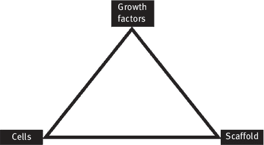

Figure 1.1: The fundamental pieces on which tissue engineering is based. Adapted from Moreno et al. (2016).

支架必须是具有足够机械性能的结构，特别是，它们必须具有高孔隙度，即在其体积内有很大比例的空隙空间，并为细胞粘附、迁移、增殖并最终获得与活组织相似的细胞构型提供适当的物理环境。

最后，生长因子大多是蛋白质，有助于并刺激细胞执行这些功能（Moreno et al., 2016）。

Roseti 等 (2017) 提到，组织工程中性能最佳的支架是那些旨在改善细胞粘附、迁移和增殖、成骨谱系分化、血管生成、宿主完整性和负载的支架。这意味着支架必须遵守生物学和物理学指导原则 (Altamirano Valencia 等, 2016)。在这方面，Fernández (2011) 提到要求有 (1) 生物相容性，(2) 多孔性和孔径，(3) 可生物降解性，(4) 机械性能，(5) 成骨诱导性，以及 (6) 制造可行性 (Altamirano Valencia 等, 2016)。

Moreno 等 (2016) 将这些特征扩展为 (1) 生物相容性，(2) 受控且可调节的生物降解性，(3) 以孔径表示的多孔结构，(4) 诸如刚度、抗力和抗活张力之类的机械性能，(5) 成骨传导性和成骨诱导性，以及 (6) 用于正确适应解剖形态各向异性结构。

Roseti 等 (2017) 在 图 1.2 的图形表示中显示，骨组织工程 BTE 支架的特征可基于四个分类进行阐述：(1) 生物学要求，(2) 结构特征，(3) 生物材料的组成，以及 (4) 制造技术。

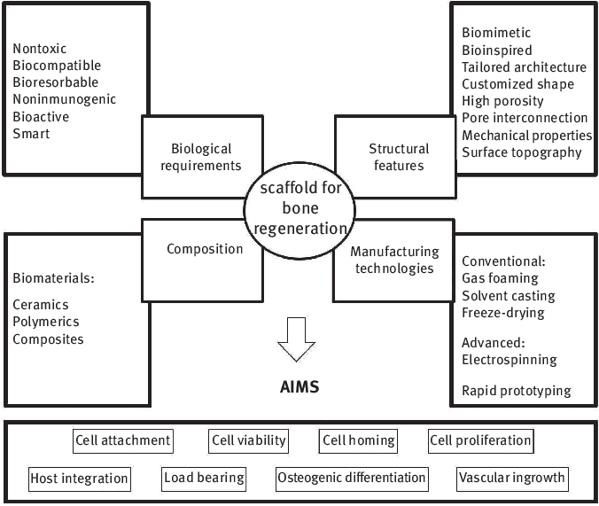

图 1.2：骨组织工程支架必须具备的特性。改编自 Roseti 等 (2017)。

图 1.2 的下半部分指出了通过合适的支架实现骨再生的主要目的，以允许细胞移植并恢复生理结构和功能。请注意，第一阶段是细胞粘附。

另一方面，手术的潜力在于实现手术所必需的技术进步 (Tarassoli, 2019)。他们还提到，在未来 50 年的未来愿景中，四项关键技术将从技术进步中涌现：(1) 人工智能，(2) 机器人技术，(3) 基因组学，以及 (4) 再生医学。在人工智能领域，机器人技术由此衍生，且再生医学的一个学科是组织工程，特别是骨支架，这些技术进步希望提供医学-患者关系的精确规划和技术管理能力、术前和诊断部分的数据分析，以及通过使用三维生物打印（支架）生产“定制器官”以替代受损和/或不健康的组织。然而，一个主要障碍并非生物材料的可用性，而是其有效实施。尽管世界各地正在进行大量研究工作，但仍存在挑战，以使细胞按预期行为。

## 1.3 细胞粘附：定义和重要性

细胞粘附是细胞的自然行为。细胞可以通过直接的细胞间连接相互粘附，或粘附到它们自身分泌的细胞外物质。在某种程度上，细胞必须聚结以形成有组织的复细胞结构 (Alberts, 2008)。

当细胞之间的这些连接建立时，就产生了通信路径。不同类型细胞在生物体中的抗性、形状和排列由这些凝聚机制控制。这反过来又使细胞能够交换信号，协调其行为并调节其基因表达模式。与其他细胞和细胞外基质的粘附控制每个细胞内部结构的取向。这些连接的形成和破坏以及细胞外基质 (ECM) 的重塑控制细胞在生物体内的移动方式，引导它们，同时生物体生长、发育和自我修复。如果这种凝聚装置受损，可能会发生多种疾病 (Alberts, 2008)。

细胞是微小的、可变形的、通常可移动的元素，含有水性介质，并被薄的质膜所限制；然而，数百万个细胞可以结合形成像动物、树或人类一样非常庞大、稳定和坚固的结构。这归因于细胞保持在一起的能力 (Alberts, 2008)。

在哺乳动物中，细胞粘附至关重要，因为它调节增殖、分化和表型行为 (Fisher 等, 2007)；当细胞接种到支架中时也必须发生同样的过程。如果细胞粘附不良或不足，可能会发生不同病理，导致紊乱或生理问题 (Vivas 等, 2015)。我们可以说细胞附着是组织再生的入口。

分析所有这些，出现的问题是：理想的支架是什么？我们如何衡量其有效性？Fisher 等 (2007) 确定生物材料的功效在于调节细胞粘附的能力，其内部微结构支持其他细胞行为。

文献综述显示，成功影响细胞粘附过程的变量包括以下：(1) 材料表面能 (Gentleman 和 Gentleman, 2014；Nakamura 等, 2016)，(2) 材料润湿性，通过接触角测量 (Arima 和 Iwata, 2007；Tamada 和 Ikada, 1993；Lampin 等, 1997；Harbers 和 Grainger, 2011)，(3) 材料刚度 (Phipps 等, 2011)，(4) 多孔性 (Danilevicius 等, 2015)，(5) 纤维支架情况下纤维的特性和直径 (Chen 等, 2009)，(6) 支架表面积与其体积或比表面积的关系 (Chen 等, 2009)，(7) 支架表面的粗糙度 (Lampin 等, 1997)，以及 (8) 孔径 (Murphy 等, 2010；O’Brien 等, 2005)。

文献中还提到了其他变量，在某些条件下必须加以考虑，例如 `tortuosity`（Chang and Wang, 2011）；`interconnectivity`（Chang and Wang, 2011）；`surface charge`（Chang and Wang, 2011；Lee et al., 2005）；以及 `permeability`、`pore shape` 和 `heterogeneity`（Boccaccio et al., 2016）。

## 1.4 文献分析：使用了哪些 AI 技术，具体用在了什么地方？

AI 是机器执行通常需要人类智能的任务的能力，例如语音识别、视觉感知和语言翻译（Dibyajyoti et al., 2013）。我们将范围限制在以下技术：

* Agent based and multiagent systems

* Cellular automata

* Evolutionary algorithms

* ANN of different types

* Fuzzy logic

其中进化算法包括粒子群优化、遗传算法和人工免疫系统。至于综述，我们将范围限制在以下条件：

* 2009 年 01 月 01 日后发表的作品（最近 10 年）

* 包含上述提到的 AI 技术之一

* 聚焦于骨支架

* 将细胞粘附作为本章重要部分进行研究

在本节中，我们将展示应用这些标准后找到的结果。符合所有条件的作品非常少，也许是因为大多数有趣的 AI 应用需要昂贵的实验来调整或训练模型。

未找到使用模糊逻辑、遗传算法、免疫系统或除下文所述以外的其他进化算法技术的符合限制的作品。在 *multiagent systems* 的情况下，未找到符合所有条件的作品，因此纳入了最接近的作品（BTE on scaffolds，聚焦或考虑细胞粘附作为其工作的重要部分，并应用一种或多种提到的 AI 方法）。

### 1.4.1 人工神经网络

ANNs 在其最基本的定义中，是模拟生物人类中枢神经系统中神经元网络决策过程的计算网络（Graupe, 2013）。在不同方面和类型的神经网络，特别是深度神经网络方面取得了巨大进展。后者可以有效地执行复杂的任务，例如语音识别或语言翻译。然而，它们需要大量的数据才能有效训练。它们已成功应用于医学影像（[`www.zebra-tech.com`](http://www.zebra-tech.com)），一家致力于医学影像 AI 分析的庞大且快速增长的以色列公司，但在支架的情况下，数据稀缺。因此，目前深度学习技术难以应用。

### 1.4.2 聚合人工神经网络和粒子群优化

就传统 ANN 而言，我们发现了一项研究，其中考虑了使用粉末床和喷墨头 3D 打印制造的支架（Asadi-Eydivand et al., 2016）。对于这些支架，他们提出了一种聚合人工神经网络（AANN）来研究打印方向、层厚度和每层之间的延迟时间的影响。该工作中研究的输出变量为开放孔隙率百分比和所得支架的抗压强度。

作为第一步，作者应用了两种优化方法来获得打印支架的最佳参数设置。首先，实现了粒子群优化（PSO）以获得 AANN 的拓扑结构。然后，使用 Pareto 前沿优化（PFO）来确定具有所需孔隙率和抗压强度的支架的参数。该研究从这样一个前提开始，即在 BTE 中需要多孔支架，正如我们在此工作中反复提到的那样。这一条件将作为细胞粘附、增殖、分化和最终组织生长的指导。我们在此也加上细胞粘附。正如我们之前解释的那样，如果细胞先前未粘附到支架上，其他现象就不会发生。支架渗透性是另一个关键因素，因为它能够构建活组织。渗透性是指由于其物理特性，能够被某种流体穿过而不改变其结构。此外，必须保证营养扩散、再生部位的废物排放以及适当的机械环境，以实现成功的 BTE 应用。必须在具有出色的渗透性与不损害支架机械性能之间取得平衡：互连孔将允许渗透性和细胞生长但降低抗压强度，而封闭孔仅会降低强度。

所使用的变量为打印时的层厚、方向和延迟时间作为输入变量，开放孔隙率和抗压强度作为输出变量。他们构建了 48 个支架，形状为 6 x 12 mm 的圆柱体，具有预定义尺寸的孔，覆盖三种方向（*x*、*y*、*z*），四种层厚度值（127、114、102 和 89 µm），以及四种延迟时间（500、300、100 和 50 ms）。他们使用这些数据和 PSO 与反向传播方法的组合来为多个独立的单层前馈神经网络找到最佳拓扑。产生的网络实际上是一个由三个单层前馈神经网络组成的集成，隐藏层中神经元数量分别为五、四和八个。所有三个网络接收相同的输入变量，产生两个输出变量（抗压强度和开放孔隙率），并且三个网络的结果在集成的最终输出层中组合以产生最终结果。该输出层也使用第二个 PSO 算法进行调优。网络训练了 300 个 epoch，数据划分固定，40 个训练数据和 8 个测试数据（83% 和 16%）。至于 PSO，包含的细节很少。


他们获得了抗压强度的训练误差 `R` = 0.91 和 `RMSE` = 0.22，测试误差 `R` = 0.97 和 `RMSE` = 0.13。同样，开放孔隙率的训练误差 `R` = 0.94 和 `RMSE` = 0.17，测试误差 `R` = 0.94 和 `RMSE` = 0.25。这些结果组合成绘制的 Pareto 前沿，以便检测抗压强度和开放孔隙率的适当组合，这两个变量明显冲突（更多孔或更多开放孔将明显降低材料的抗压强度）。获得的最佳结果为方向 `X`、厚度 117.8、延迟时间 137 ms，可产生高达 89% 的最高孔隙率，但抗压强度仅为 0.33 MPa。

该工作能够以高精度预测两个重要的设计变量，在本例中，使用实用的易于控制的输入变量。`PSO` 的使用增加了处理量，但允许使用更小的网络，更好地利用可用的少量数据，因为几何优化倾向于丢弃无用的神经元。然而，需要更多的实验工作来验证论文中研究的案例的适当细胞粘附。

作者包含了完整的数据集，这对该领域是一个重大贡献。数据集对于该工作、变量、引入的形状（圆柱体）是完整的，并且分析了抗压强度，这是主要变量。

### 1.4.3 机器学习：支持向量机和支持向量回归

支持向量机（`SVMs`）旨在利用各种数学和计算工具，包括特殊类型的神经网络，来表示一种基于数据的方法以解决分类任务。将其应用于预测时，与基于其他方法的分类器相比，包括通常用于估计变量的神经网络，其误差更低。以这种方式，`SVMs` 已成为构建分类器以识别复杂数据集中微妙模式的强大方法。它们已用于基因组学和化学基因组学，以及许多其他成功的应用。支持向量回归（`SVR`）是 `SVM` 的一种修改，专门为回归问题设计。

应用于细胞粘附和组织工程支架时，我们发现了这项工作，作者使用 `SVMs` 研究了贴壁细胞对可变基质维数（`2D` vs. `3D`）和多孔微结构（`Tourlomousis et al., 2019`）的响应。该研究的第一个部分包括制造四种具有纤维基结构特征的不同支架，即：

* `SES-1 min`：溶液电纺（`SES`）制成的二维无纺纤维网，随机网，纺丝时间为 3 分钟。
* `SES-3 min`：`SES` 制成的二维无纺网，随机网，纺丝时间为 3 分钟。
* `MEW|0–90°`：由直接熔融电写（`MEW`）和精密堆叠基底制成的“0–90°”孔微结构的 三维编织纤维网。
* `MEW|0–45°`：由直接 `MEW` 和精密堆叠基底制成的“0–45°”孔微结构的 三维编织纤维网。

平玻璃表面用作对照。

该工作提出了一种基于 `SVM` 的方法来评估支架的几何形状和这些不同基质和结构中的细胞粘附。

作者使用 88 个样本的七个不同输入变量执行三种不同的分类任务：

* 七个变量作为输入，分为四个不同类别（`type A = Glass`，`type B = SES-1 min`，`type C = SES-3 min`，和 `type D = MEW 0–45°`）。他们包含了混淆矩阵，并获得了 64.4% 的平均分类准确率。
* 七个变量作为输入，分为三个不同类别（`A`、`C` 和 `D`）。分类准确率提高到 90.6%。
* 二元分类任务仅专注于使用七个输入变量将类别 `A`、`B` 和 `C` 与 `D` 分开（即玻璃和 `SES` 与 `MEW`）。分类准确率提高到 93.0%。

变量使用 `Z-score` 函数进行归一化，使用 `MATLAB` 中的线性核 `SVM`，报告的准确率使用 `k-fold` 交叉验证计算，`k = 5`。

总之，本工作中考虑的关键因素是维数（`2D` vs. `3D`）、孔径、纤维直径和形貌（随机堆叠 vs. 精确堆叠）。作者获得了良好的分类精度，并且使用 `k-fold` 交叉验证使得对小数据集的利用更好且偏差较低。

作者使用 `SVM` 来估计纳米纤维支架的特性（`Adebileje et al., 2019`）。该研究旨在获取纳米纤维聚（L-乳酸）（`PLLA`）支架蛋白质条带强度之间存在的模式，并采用所获得的模式来估计蛋白质吸附和细胞粘附。

该工作在 `MATLAB` 计算环境下进行，使用 `SVR`（`SVM` 的一种变体，专门针对回归问题进行改编），以训练和测试 `SVR`。具体而言，他们在文献中取自的十五个实验数据条带强度值上使用了高斯核。他们从这样一个前提开始，即认为细胞在聚合物表面上的附着、生长和迁移被认为是由蛋白质辅助的，这些蛋白质要么由细胞分泌，要么从血清蛋白吸附而来。

他们分析结果得出以下结论：

* 具有纳米纤维孔壁的支架吸附的血清蛋白是实心孔壁支架的四倍。
* 纳米纤维结构选择性地介导了如纤连蛋白和纤维粘连蛋白的蛋白质吸附，尽管两种支架均由相同的 `PLLA` 材料制成。
* 纳米纤维条带强度支架显示出与实心孔壁支架相比 1.7 倍的成骨细胞附着。
* 具有估计条带强度结构的仿生纳米纤维是组织工程的优秀支架材料。

这项工作存在一些方法学问题。最明显的是他们获得了 76.63% 的训练准确率和 99.51% 的测试准确率。这源于使用如此小的样本并且仅进行一次固定的训练/测试数据划分。在这种情况下，更合理的方法学方法是使用 `k-fold` 交叉验证，`k = 4` 或 `5`，这将产生更合理的结果。即便如此，可能还需要更多数据才能产生一致的结果。

### 1.4.4 多智能体系统

多智能体系统是人工智能的一种计算范式，已应用于大量问题，从机器人到分布式问题求解。多智能体系统由多个智能体组成，它们相互交互：“智能体是代表用户或程序执行一组操作的软件实体，具有一定的独立性或自主性，在此过程中采用对愿望或用户目标的某些知识或表示”（`Araujo and Rodríguez, 2018`）。作者强调了智能体的四个基本属性：自主性、反应性、主动性和社会能力。它是人工智能中最现代的工具之一。

尽管它没有提到骨，我们还是将该工作包括在内，因为这是我们能够应用于支架设计的唯一基于代理的建模工作（`Ramírez López et al., 2019`）。他们使用了 `MSCs`，这些细胞也用于 BTE。该工作的最终目标是研究用于治疗梗死心肌的生物器件在生物模型中的设计过程。因此，作者试图评估分化 `MSCs` 和未分化 `MSCs` 的行为。基于代理的模型被开发并旨在通过模拟凋亡、分化、增殖和迁移来再现单个 `MSCs` 的行为。

所考虑的支架为胶原蛋白。所考虑的细胞为大鼠 `MSCs`。借助基于代理的模型，作者旨在模拟一段时间后的细胞存活率、`MSCs` 的分化、细胞迁移以及细胞如何在心肌组织上排列。再次，在这一点上，我们可以说，该研究和这些现象的观察间接地给了我们细胞粘附的想法，因为请记住，正如 `Fisher et al. (2007)` 所说，细胞必须能够与生物材料表面建立接触，以便锚定依赖的功能得以进行，例如铺展、增殖和迁移。

智能体系统代表细胞群体，其中微观层面的反应导致涌现行为。智能体具有属性，在本例中，这些属性属于生物细胞特性。多个智能体集合之间的相互作用代表了在细胞水平上发生的各种过程。用于模拟的软件是 `Netlogo`。模拟了两种智能体：一方面是细胞，另一方面是基质（或环境）。

第一类智能体代表心肌组织或血管。它们具有“损伤”和“炎症”属性。第二类智能体代表 MSC、内皮细胞或心肌细胞。对于 MSC 类型的智能体，其属性为“心肌细胞分化概率”、“内皮细胞分化概率”、“分化时间计数器”、“分化过程持续时间”以及“后续细胞类型”。对于内皮细胞和心肌细胞类型的智能体，其属性为“通过凋亡死亡的概率”和“对分化决策的影响”。

模拟耗时且运行缓慢。它们需要 50 GB RAM 的服务器才能将所需时间降低 83%，而在 8 GB RAM 的台式电脑上则需要更长时间。即使如此，该多智能体系统也是基于经验知识和现有研究开发的通用模型。作者承认，为了在可用时间内使模拟产生良好结果，引入了一些简化。

模拟通过考虑系统的物理行为进行了验证：作者进行了两次按预期运行的模拟，即 MSC 对梗死心肌的抗炎作用，以及每种细胞类型（MSC、内皮细胞和心肌细胞）随时间的人口规模。两者均为 60 天模拟。

最后，在任何胶原支架中都没有细胞迁移。作者将这种情况归因于缺乏形成局灶粘附所需的显著张力。

### 1.4.5 细胞自动机

细胞自动机是一组离散元素，它们根据预定义规则随时间演化。具体而言，定义了距离或邻域，每个细胞根据其先前值及其在即时预定义邻域中的值获得新的状态（通常为存活或死亡）。这使我们能够成功地用它们来模拟复杂现象（Pérez Betancourt et al., 2015）。

作者基于细胞自动机构建了一个计算机模型（Czarnecki et al., 2014）。该工作的目标是双重的：（1）研究结晶度、取向和表面粗糙度对三种碳纤维支架中细胞生长的影响，以及（2）使用细胞自动机对该效应进行建模，作为开发适当支架设计工具的第一步。

就实验数据而言，测试了三种不同类型的碳纤维（T300、P25 和 P120）。每种纤维类型的样品总数为六个，因为它们使用了六孔组织培养板。每个实验重复三次。所考虑的细胞为原代人成骨细胞。

作者提出了一个二维网格，用于细胞自动机对粘附、分化和增殖过程的建模，其中网格大小为成骨细胞的直径以及纤维的大小，即 8 µm。至于每个细胞的繁殖和生死，他们使用了两个函数：拉格朗日多项式和指数函数，两者均受纤维物理参数的影响，并使用实验结果的线性相关性来调整每个模型中发现的三个参数。每个晶格位点可以假设三种状态之一（空、占据或阻塞）。获得的结果表明，多项式比指数函数获得更好的结果。作者使用 IBM SPSS© 软件对数值结果和获得的图像进行统计比较，在多项式情况下两者之间的最大差异为 13.2%。`MATLAB`© 软件包用于所有算法和模拟。

在这项工作中，研究了所考虑变量的影响：结晶度、表面粗糙度和材料取向。作者获得的结果提出碳纤维适用于成骨细胞生长，获得了良好的模拟验证，并提供了大部分必要的实验和方法细节。他们还证实材料排列至关重要，因为多方向支架比单向支架显示出更好的细胞生长。

这些作者还实现了一个细胞自动机模型来模拟初始细胞群体在接种到支架上时的细胞粘附和细胞增殖（Vivas et al., 2015）。

所考虑的细胞为 3T3 小鼠成纤维细胞。模型为二维单层培养。所考虑的输出变量为细胞在培养中的沉降时间、粘附时间和增殖时间。

模拟区域长度为 1 mm，高度为 0.5 mm。然后将其离散化为正方形，得到 67 个水平和 33 个垂直元素。每个元素为边长 15 µm 的正方形。他们将细胞表示为直径 15 µm 的圆。细胞以随机方式放置。模拟的第一部分包括评估细胞与表面接触的时间，单位为秒。为此，作者以 50 个细胞的群体开始模拟，随机分布。他们获得的结果为 4 s 使第一个细胞与表面接触，34 s 使所有细胞到达表面。

研究的第二部分包括模拟粘附过程，该过程在细胞与支架表面接触后发生。由于细胞是随机放置的，粘附时间根据与基底的距离而变化。获得的结果为：100 min 后观察到局灶粘附。在此期间，细胞保持其圆形的形态形状。此后，细胞膜分子重新组织。细胞骨架和糖萼也重新组织以最小化细胞与基底之间的排斥。这将使 FA 成熟，从而增加锚定位点的数量。模拟细胞粘附过程共需要 236 次迭代。

模拟结果与实验部分进行了对比，实验部分包括 3T3 成纤维细胞培养，然后接种到 T25 细胞培养瓶中。然后，分别对细胞粘附和细胞增殖的评估进行三次和四次重复。

这项工作仅对支架进行了二维近似。虽然为细胞自动机规则和网格提供了一些细节，但应为程序的实验设置提供更多细节。

## 1.5 结论与未来工作

在组织工程中，极少有骨支架的 AI 应用示例将细胞粘附作为其分析的重要组成部分。在本工作中，我们介绍了文献综述的结果，重点回答以下问题：使用了哪些 AI 技术，它们具体用于什么？

针对这些问题，我们发现不同类型的神经网络（结合 `PSO`、`SVM` 和 `SVR`）已被使用，并且细胞自动机和多智能体系统已应用于专注于支架和细胞粘附的工作。其主要用途是建模过程的一部分，以感知和解释每个变量在过程中的作用（与直接尝试优化构造过程的某些方面相反）。表 1.1 显示了所分析工作的总结，并根据其主要特征进行了比较：使用的方法、输入变量、输出变量、结果验证等。

表 1.1：所分析工作的总结。

| Title || Year || Method || Input parameters || Amount of data || k-Fold cross-validation || Output variables || Validate results? || Reference |
| --- | --- | --- | --- | --- | --- | --- | --- | --- |
| Optimal design of a 3D-printed scaffold using intelligent evolutionary algorithms || 2016 || `PSO` | `AANN` | `PFO` || 层厚度 | 延迟时间 | 取向 || 48 || 否 || 开孔孔隙率 % | 抗压强度 || 是 | 应使用 `k`-折验证 || Asadi-Eydiv et al. (2016) |
| --- | --- | --- | --- | --- | --- | --- | --- | --- |
| 熔融电纺三维生物材料基质中细胞限制的机器学习计量学 || 2019 || `SVM` || 椭圆度 – 矩形度 – 细胞面积 – FA 大小 – FA 长宽比 | 细胞 E-斜率 | 细胞平均 G-函数 || 88 || 五折交叉验证 || 不同分类 || 是 || Tourlomousis et al. (2019) |
| 基于分类的计算：使用支持向量回归分析的纳米纤维支架结构 || 2019 || `SVR` 和 `SVM` || 蛋白质的近似大小 || 15 || 否 || 纳米纤维支架的带强度 || 非常小的数据集和固定的训练/测试集划分会产生偏差结果 || Adebileje et al. (2019) |
| 心肌再生支架设计中间充质干细胞的分离、表征和基于代理的建模 || 2019 || 多智能体系统 || 不适用 || 36 || 不适用 || 随时间变化的平均炎症 | 随时间变化的细胞群体 || 否 || Ramírez López et al. (2019) |
| 微纤维碳基支架上成骨细胞生长的细胞自动机模拟 || 2014 || 2D 细胞自动机 || 结晶度 | 取向 | 表面粗糙度 || 18 || 不适用 || 成骨细胞生长 || 是 || Czarnecki et al. (2014) |
| 细胞粘附和增殖的建模：基于细胞自动机的方法 || 2015 || 2D 细胞自动机 || 2D 支架 ||  || 不适用 || 细胞沉降时间 | 细胞粘附时间 | 细胞增殖时间 || 是，附带体外测试的显微照片 || Vivas et al. (2015) |

需要考虑的一个关键方面是所用样本数量低（从 15 到 88），这严重阻碍了许多这些技术的应用，而这些技术通常需要数百到数千个样本。观察到一些重要的方法学问题，主要是只有部分工作使用了 `k`-折交叉验证，这是小数据集情况下改进结果和避免偏差的标准方法。在这方面，几项工作共享其（难以获得的）数据的完整列表以及实验的细节，这本身就是一项重要的贡献，因为未来的研究可以基于这些数据进行。

将元优化方法纳入以增强所使用的优化方法（例如第一项工作中 `PSO` 确定所用网络的拓扑结构和数量）是非常有用的工具，以改进结果并更好地利用数据。元优化方法会丢弃不必要的网络，减少需要训练的参数数量，更好地利用数据。

另一个经常被忽视但在骨支架中明显重要的方面是材料的力学性能、设计和形状。单轴抗压强度是骨骼情况下的关键特征（因为支架将被加载，并且根据植入物在体内的位置，负载会非常严重）。如所分析的第一项工作所示，在保持给定材料的孔隙率的同时，可以达到的最大抗压强度是有限的。如果抗压强度不足以承受身体特定位置和特定患者所期望的载荷，则必须使用另一种材料。这一方面以及支架形状的影响需要进一步研究，并且可以有效地由人工智能辅助，前提是收集关键数据。

最后，所使用的多种构建技术、材料和细胞需要不同的变量。需要进一步研究以确定和分类骨支架细胞粘附过程中涉及的所有变量，以及它们之间以及与可用不同数学模型之间的关系。孔隙率、开孔孔隙率和互连性已被研究，但主要是在有限的几何形状（主要是圆柱形和棱柱形）中，而待替换骨的形状会改变这些值，并在细胞粘附中发挥重要作用，这将需要进一步研究。作为未来的工作，显然有必要对最影响 BTE 支架细胞粘附的变量进行研究和调查，并收集现有数据，以便于未来将人工智能应用于此案例。BTE 仍是一个未被充分探索的领域，具有巨大的潜力。

## 致谢

本章所包含的工作是 María de Lourdes Sánchez 硕士论文的一部分，由 Dr. Adrián Will 和 Dr. Andrea Rodríguez 指导，Maestría en Ingeniería en Sistemas de Información, Universidad Tecnológica Nacional, Facultad Regional Tucumán, Tucumán, Argentina。

## 参考文献

Adebileje S.A., Aiyelabegan H.T., Adebileje T.A., and Olakunle T.O. Classification based computation: Nanofibrous scaffold architecture using support vector regression analysis. Acta Scientific Medical Sciences, (2019), 7, 93–98. a, b

Alberts B., Johnson A., Lewis J., Raff M., Roberts K., and Walter P. Biología Molecular de LA CÉLULA – 5ta. edición, (2008), Ediciones Omega. a, b, c


Altamirano Valencia A.A., Vargas Becerril N., Vázquez F.C., Vargas Koudriavtsev T., Montesinos J.J., Alfaro Mayorga E., et al. Biocompatibilidad de andamios nanofibrilares con diferentes concentraciones de PLA/Hidroxiapatita. ODOVTOS-International Journal of Dental Sciences, (2016), 39–50. a, b

Araujo P.B. and Rodríguez S.A. Tesis Doctoral: Patrones de Diseño Organizacionales para Sistemas Multiagentes, (2018). →

Arima Y. and Iwata H. Effect of wettability and surface functional groups on protein adsorption and cell adhesion using well-defined mixed self-assembled monolayers. Biomaterials, (2007), 28(20), 3074–3082. →

Asadi-Eydivand M., Solati-Hashjin M., Fathi A., Padashi M., and Osman N.A. Optimal Design of a 3D-Printed Scaffold Using Intelligent Evolutionary Algorithms Applied Soft Computing, (`http://dx.doi.org/10.1016/j.asoc.2015.11.011`), (2016), 36–47. a, b

Biswal D., Kumar N.S., Yadav P., and Moharana A. Artificial intelligence in advancement of regenerative medicine & tissue engineering. 2nd International Conference on Tissue Engineering and Regenerative Medicine (ICTERM), (2013). →

Boccaccio A., Uva A.E., Fiorentino M., Lamberti L., and Monno G. A mechanobiology-based algorithm to optimize the microstructure geometry of bone tissue scaffolds. International Journal of Biological Sciences, (2016), 12(1), 1–17. →

Chang H.-I. and Wang Y. Cell responses to surface and architecture of tissue engineering scaffolds. Regenerative Medicine and Tissue Engineering – Cells and Biomaterials, (2011). a, b, c

# 参考文献

Chen M., Patra P.K., Lovett M.L., Kaplan D.L., and Bhowmick S. 静电纺丝纤维直径及其对应比表面积（SSA）对细胞附着的影响。Journal of Tissue Engineering and Regenerative Medicine, (2009), 3(4), 269–279. a, b

Czarnecki J., Jolivet S., Blackmore M., Lafdi K., and Tsonis P. 微纤维碳基支架上成骨细胞生长的元胞自动机模拟。Tissue Engineering Part A, (2014). a, b

Danilevicius P., Georgiadi L., Pareman C., Claeyssens F., Chatzinikolaidou M., and Farsari M. 多孔性对激光制备的精确定义聚乳酸基三维支架细胞内生长的影响。Applied Surface Science, (2015), 336, 2–10. →

Dibyajyoti B., Pritha Y., Suraj Kumar N., and Aasis M. 人工智能在再生医学与组织工程发展中的应用。Department of Biotechnology and Medical Engineering, NIT Rourkela, (2013). →

Eltom A., Zhong G., and Muhammad A. 组织工程中支架技术与设计的功能与目的：综述。Hindawi Advances in Materials Science and Engineering, (2019). →

Estrada C., Paz A.C., and López L.E. 骨组织工程：基本考虑。Revista EIA, (2006), 93–100. →

Fernández J.M. 合成聚合物的生物相容性研究及其在骨组织工程中的应用。Tesis de Doctorado – Universidad Nacional de La Plata – Facultad de Ciencias Exactas – Departamento de Ciencias Biológicas, (2011). →

Fisher J.P., Mikos A.G., and Bronzino J.D. (Edits.). (2007). CRC Press. a, b, c

Gaviria Arias D., Guevara Agudelo A., and Cano López E. Bombyx mori L. 蚕丝蛋白支架上人成纤维细胞生长的评估。Revista Colombiana de Biotecnología, (2018), 47–56. →

Gentleman M.M. and Gentleman E. 表面自由能在成骨细胞-生物材料相互作用中的作用。International Materials Review, (2014), 59(8), 417–429. →

Gordeladze J.O., Haugen H.J., Lyngstadaas S.P., and Reseland J.E. (2017). 骨组织工程：现状、挑战与前景。En tissue engineering for artificial organs: Regenerative medicine, smart diagnostics and personalized medicine, first Edition (págs. 525–551). Anwarul Hasan. a, b, c

Granados M.V., Montesinos-Montesinos J.J., and Álvarez-Pérez M.A. 间充质干细胞在聚-L-乳酸（PLA）纤维支架上的粘附与增殖。Revista Mexicana de Ingeniería Biomédica, (2017), 38(1), 288–296. →

Graupe D. Principles of Aritificial Neural Networks – 3rd edition (Vol. Volume 7), (2013), World Scientific. →

Harbers G.M. and Grainger D.W. 细胞-材料相互作用：组织工程的基础设计问题与临床考虑。Hollinger E.J.O., An Introduction to Biomaterials, Second Edition, (pág. 63), (2011), CRC Press. →

Lampin M., Warocquier-Clèurot R., Legris C., Degrange M., and Sigot-Luizard M.F. 基底粗糙度与润湿性、细胞粘附和细胞迁移之间的相关性。Journal of Biomedical Materials Research, (1997), 36(1), 99–108. a, b

Lee M.H., Brass D.A., Morris R., Composto R.J., and Ducheyne P. 非特异性相互作用对细胞粘附的影响：使用模型表面。Biomaterials, (2005), 26(14), 1721–1730. →

Moreno M., Amaral M.H., Sousa Lobo J.M., and Silva A.C. 骨再生支架：现状。Current Pharmaceutical Design, (2016). a, b, c, d, e, f, g, h, i

Murphy C.M., Haugh M.G., and O’Brien F.J. 平均孔径对胶原-糖胺聚糖支架中细胞附着、增殖和迁移的影响：用于骨组织工程。Biomaterials, (2010), 31(3), 461–466. →

Nakamura M., Hori N., Ando H., Namba S., Toyama T., Nishimiya N., et al. 表面自由能在羟基磷灰石上通过润湿性影响细胞粘附。Materials Science and Engineering: C, (2016), 62, 283–292. →

Narváez Tovar C.A., Velasco Peña M.A., and Garzón Alvarado D.A. 骨分化和适应性计算模型。Revista Cubana de Investigaciones Biomédicas, (2011), 126–140. →

O’Brien F.J., Harley B.A., Yannas I.V., and Gibson L.J. 孔径大小对胶原-GAG 支架中细胞粘附的影响。Biomaterials, (2005), 26(4), 433–441. →

Pérez Betancourt Y.G., Rodríguez Puente R., and Mufeti T.K. 元胞自动机及其在疾病演化建模与仿真中的应用，(2015). →

Phipps M.C., Clem W.C., Catledge S.A., Xu Y., Hennessy K.M., Thomas V., et al. 间充质干细胞对由聚己内酯、I 型胶原和纳米颗粒羟基磷灰石组成的骨模拟静电纺丝基质的反应。PloS One, (2011), 6(2), e16813. →

Ramírez López D.V., Melo Escobar M.I., Peña-Reyes C.A., Rojas Arciniegas Á.J., and Neuta Arciniegas P.A. 间充质干细胞的分离、表征和基于代理的建模，用于心肌再生支架设计中的生物构建。Data, (2019). a, b, c

Rodríguez A.P., Felice C., and Ruiz G. Universidad Nacional de Tucumán – Facultad de Ciencias Exactas y Tecnología. Seminario Introducción a la Ingeniería de Tejidos, (2013), Tucumán. →

Roseti L., Parisi V., Petretta M., Cavallo C., and Desando G. 骨组织工程支架：现状与新视角。Material Science and Engineering C, (2017), 1246–1262. a, b, c, d, e, f

Suárez Vega D.V., Velazco de Maldonado G.J., and Yépez Guillén J.D. 采用脂质体-壳聚糖膜系统在实验模型中获得的骨再生组织形态计量学。Revista Virtual de la Sociedad Paraguaya De Medicina Interna, (2017), 4, 12–34. a, b

Tamada Y. and Ikada Y. 预吸附蛋白对聚合物表面细胞粘附的影响。Journal of Colloid and Interface Science, (1993), 334–339. →

Tarassoli S.P. 人工智能、再生手术、机器人？外科未来的现实是什么？. Annals of Medicine and Surgery, (2019), 53–55. →

Tourlomosis F., Jia C., Karydis T., Mershin A., Wang H., Kalyon D.M., et al. 熔融电写三维生物材料基底中细胞限制的机器学习计量学. Microsystems & Nanoengineering, (2019). a, b

Vivas J., Garzón-Alvarado D., and Cerrolaza M. 细胞粘附和增殖的建模：基于细胞自动机的方法. Advanced Modeling and Simulation in Engineering Sciences, (2015). a, b, c

# 2 医疗信息学中机器学习算法的实现与分类：方法、挑战与未来展望

Divya Gaba 电子与通信工程，昌迪加尔大学，旁遮普邦，印度 Nitin Mittal 电子与通信工程，昌迪加尔大学，旁遮普邦，印度

## Abstract

健康信息学主要是指处理有助于在健康和医学中获取、存储和使用信息的方法。包含异构和复杂医疗数据的庞大数据库可能非常有益，但人类很难解读这种“大数据”。在如此庞大的数据集中，机器学习（`ML`）算法可以很好地预测疾病和治疗方法。`ML`算法包括从过去经验中学习并为当前问题做出预测和决策。应用`ML`于医疗保健时会遇到许多挑战，而在医疗保健应用中，数据集通常非常复杂且类型多样（从文本到扫描）。一种可能的替代方案是使用交互式`ML`，让医生参与其中。因此，应用`ML`于健康信息学需要一种集成和广泛的方法。本章讨论了医疗信息学中各种类型的`ML`技术、方法、挑战及其未来范围。此外，这些技术可用于建立快速而精确的医疗保健发现模型。

关键词：机器学习，医疗信息学，医疗保健应用，

## 2.1 Introduction

医疗服务信息学管理获取、传输、处理、存储和检索与医疗服务相关的数据，以实现疾病的及时发现、快速查找和快速诊断。医疗服务信息学范围限于与疾病相关的信息、医疗保健文件以及与此类信息处理相关的系统。除了提供经济实惠且一致的医疗服务的计划外，过去几十年来美国的传统医疗实践也为研究人员、医疗专业人员和患者提供了改进的技术和技术支持。这类努力确实被证明对治疗有益，并为计算机化图像恢复的机械进步创造了条件。

人工智能（`AI`）是人工智能的自然扩展。专家和医疗专业人员经常求助于使用`AI`来解决复杂的统计分析。将医疗服务数据和`AI`结合起来以识别绘图模式的艺术通常被称为医疗服务信息学。医疗服务信息学的目标因此被应用于识别数据中发现的模式，然后从中学习（Clifton et al., 2012）。

## 2.2 Techniques of machine learning for health informatics

已经为健康信息学开发了许多`AI`方法。一些系统基于小波和模糊逻辑，所有策略都有不同的应用，并且在不同类型的数据库上运行。在本节中，我们将讨论其中几种。

小波变换是任何信号更好表示的工具，因为它不仅提供频率细节，同时还提供空间信息。许多疾病已通过心电图（`ECG`）分析被识别。然而`ECG`信号是非线性函数，因此`ECG`信号的分析是通过小波变换完成的。除了小波变换之外，`AI`算法将包括使用各种算法的`R`点检测。

这种隐藏信息在离散小波变换（`DWT`）空间中比在时域和频域中更容易理解。这种优越性的原因在于`DWT`域提供了信号的精确时间和频率描述，这使得隐藏信息的检测和提取成为可能。对于此任务，研究了两类不同的`ECG`信号：左束支阻滞和正常心跳。我们设计了一个先进的处理结构来从这些信号中提取重要信息。主要的预处理步骤是基于`DWT`的降噪，然后是主成分分析（`PCA`）的降维。`PCA`输出被馈送到支持向量机（`SVM`），用于将信号分类为正常或患病。10 折交叉验证的分类结果显示敏感性为 99.93%，特异性为 100%，阳性预测值为 100%，准确率为 99.96%。可靠的分类结果表明，`ECG`信号的自动化处理可以揭示疾病推断的相关信息（Guyton et al., 2006）。

### 2.2.1 Fuzzy logic tool

模糊逻辑控制系统基本上是基于规则的专家系统，由大量语言规则“IF–THEN”组成。

模糊逻辑方法被用作许多疾病的指导原则。其中一种疾病是糖尿病患者血糖水平的管理。已开发的科学模型显示了人类血糖水平与食物摄入量之间的关系。广义模糊逻辑控制器包括一组条目，用于管理糖尿病患者的血糖阶段。然后从模糊逻辑技术中显示输出。糖尿病有两种类型：1 型和 2 型（Van den Berghe et al., 2001）。不同的模糊逻辑规则被应用于从数据库中检测这两种类型的糖尿病（Figures 2.1 和 2.2）。

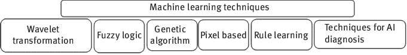

Figure 2.1: Wavelet transformation tool.

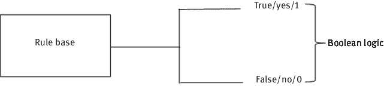

Figure 2.2: Fuzzy logic rule base.


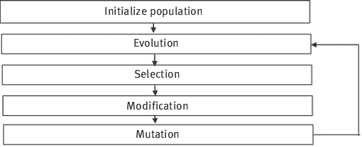

Figure 2.3: Genetic algorithm flowchart.

多功能模糊逻辑控制框架包含语言学原理、模糊含义、模糊模型区分证据片段以及一个多功能计算的累积。这个多功能系统可以是一个多级系统。该系统的第一层级是模糊逻辑。第二阶段，或更高阶段，是在通过改变条件在过程中使用的调整系统。在一个简单的系统中，测量的非模糊状态函数与给定的非模糊设定点进行对比。然后，新鲜的非模糊值被转换为两个模糊调节器输入：误差和误差差分。由于最终需要计算可以确定的调节器输出值，因此需要一个解模糊器，它将毛绒集合的输出转换为可以确定并直接将该激励器引导到最终控制部件的新值。

可以通过应用模糊逻辑算法来控制确定糖尿病的血糖水平。还进行了一项仿真研究，其中包括对各种参数的研究。结果表明，如果血糖比例的值是可行的，则反馈规则是可行的。这很有吸引力，因为持续血糖水平很难监测和获取。

存在三种可供医疗服务提供者使用的胰岛素类型。目前，人胰岛素是最常用的，因为一些患者会由于动物胰岛素与人胰岛素之间的微小氨基腐蚀性差异而对从动物提取的胰岛素产生抵抗。

如果任何患者的血糖水平失控，它可能会影响心脏通路、大脑和身体的其他部位；因此需要对其进行控制。从动脉粥样硬化可以理解，常常可能发生心血管衰竭和其他类型的攻击。由于高血糖水平的释放，视网膜的小动脉瘤可能会形成，并且视力下降因此可能导致视觉受损。脚部的血流也可能减少，引发供应血管凝固、溃疡、感染，甚至坏疽。

因此，糖尿病患者需要监测他们每日的摄入量以控制血糖水平并谨慎活动；这一进展可以帮助维持他们的血糖在足够水平。不幸的是，这种严格的生活方式可能会导致“制度化”心理学，并且在很长一段时间里，持续保持严格的日常常规可能很困难。

长效胰岛素可以注射给正在进行一天大约多次治疗的糖尿病患者，并且为了减少餐后血糖峰值，可以注射速效胰岛素。此外，可用的血糖检测设备具有侵入性，血糖含量可以通过任何血液测试来测量。

### 2.2.2 Genetic algorithm

在遗传算法中，为一组候选解确定一个优化解。此过程经过以下步骤：种群初始化、进化、候选选择、性状修改和突变。这些步骤在以下流程图中说明（图 2.3）。

`ECG` 是测量心跳的设备，因此它可以监测心脏的功能。它提供了此类异常的基本和功能性原因。在正常情况下，医生观察`ECG`的进展模式，理解疾病过程，并确定潜在疾病。`ECG`因此在筛查心脏异常方面具有重要作用。早期诊断和治疗心脏疾病很重要；然而，在许多地区，由于人口众多和医疗资源有限，医疗专家为每个个体进行筛查成本高昂。因此，需要开发自动化的筛查工具，这些工具将使用一些特征提取器和人工智能算法。

特征提取系统，例如主成分分析（Van den Berghe et al., 2001）和线性判别分析，在分类之前使用。特征提取后，第二件事出现在设计的顺序中。`k`-means 算法最初由 MacQueen 提出的重要弱点是它将始终满足目标函数的局部最优。另一种有监督的分类算法是误差反向传播神经网络，它可以分离复杂的数据模式。再次，误差反向传播神经网络（`EBPNN`）也是目标函数的局部优化。一类分类方法，称为进化算法，是基于种群的方法而不是基于测试的方法，并且具有启发式调整的结构。这些算法始终结合到目标函数的全局最优。遗传算法是进化算法，它们从自然遗传学中获得标准。文献中有许多工作（Rumelhart et al., 1986）对`GA`进行了相同的分析。

### 2.2.3 Pixel-based technique

`AI` 在 `CAD` 中发挥着基本作用，因为诸如病变和器官等物体在医学图像中可能无法被简单条件精确描述。例如，肺结节通常显示为实心圆，但也有各种形状的结节和具有内部不均匀性的结节，例如疑似或非实性结节（Lostumbo et al., 2010）。结肠中的息肉被显示为圆形物体；然而这些也是显示平坦形态的结节。因此，医学成像中的诊断任务主要需要从模型（或数据）中学习。

`AI` 已被用于将损伤分类为特定类别（例如，不规则或正常、病变或非病变、恶性或良性）在 `CAD` 中。用于分类的 `AI` 算法包括线性判别分析、二次判别分析（Fukunaga, 1990）、多层感知器（Rumelhart et al., 1986）和 `SVMs`（Vapnik, 1995）。

随着可用计算能力的显著增加，像素/体素基于 `AI`（`PML`）不以从分段区域确定的特征作为数据信息，已在医学图像处理/分析中发展；因此，不需要包括计数或分割。由于 `PML` 可以避免由错误特征计算和分割引起的错误，`PML` 的性能可能比其他方法更高。随着神经滤波器（Schwartz et al., 2016）和“神经边缘增强器”（Braithwaite et al., 2016）的扩展，这些是基于人工神经网络（`ANN`）的（Kandel et al., 2012）受监管的非线性图像处理方法，以及大规模训练 `ANN` 系统（Lostumbo et al., 2010）。

### 2.2.4 Rule learning

`AI` 策略在人类服务交付、研究、组织和管理方面具有广泛的应用范围。`AI` 在所有领域都有广泛的应用范围。其中许多应用正随着医疗保健网络变得越来越熟悉 `AI` 及其巨大潜力而逐渐增加。另一方面，大多数 `AI` 科学家对医疗服务环境感到陌生并对其过度简化。这种医疗保健与 `AI` 社区之间普遍缺乏理解导致了先进 `AI` 技术采用的缺乏。在受益于 `AI` 最多的医疗保健领域中，是那些依赖于数字化流程或可以自动化的领域。`AI` 技术能够适应动态变化的环境、以前不明显的状况和新挑战的能力，使其非常适合这些类型的应用。`AI` 在医疗保健中最常见的两种用途是决策支持系统和知识发现。决策支持系统依赖于计算模型来指导管理人员在各种情况下做出决策。这些模型可以使用 `AI` 进行开发和维护。因此，当 `AI` 被正确应用于无法通过更传统的计算方法或在不使用计算机的情况下物理理解的难题时，它具有巨大的潜力。

然而，要使 `AI` 被医疗保健采用，策略需要满足一些要求。这些要求在 `AI` 被或可以被使用的所有领域中都很突出且切实相关。然而，其中一些要求在医疗保健领域在采用新技术且结果极具挑战性的时期尤其重要。

#### 2.2.4.1 可接受性

模型应被其潜在用户所接受。虽然部分与简洁性相关，但可接受性要求模型不会否定现有专家的知识，而是“合理地”与当前正在进行的工作一致，并与现有工作流程相关。医疗保健中的主要问题之一是充分性，这实际上需要被考虑在内。必须注意，所使用的开发模型是准确的并且优于当前正在使用的方法，但没有人喜欢改变他们的工作方式。机器学习（`ML`）算法的使用应带来工作改善并为参与者提供激励；否则，结果可能不会被采纳。

容量处理复杂类型的数据。医疗保健数据是复杂的。即使是 `AI` 对医疗保健数据最基本的用途也需要进行多种转换、数据预处理、因素编码等。为了在医疗保健中获得无限的认可，`AI` 技术应能够直接处理医疗保健数据而无需人为编码。医疗保健数据不应被 `ML` 工具视为没有意义的数量集合。虽然更先进的 `ML` 技术识别了广泛的数据类型（名义、结构化、序数、区间、比例、绝对、复合等），但普遍标准。

计算机需要大量的数据才能做出基本决策或发现简单事实。人类恰恰相反——我们能够基于最少的信息做出重要决策并发现重要事实。尽管人类和计算机的推理/学习过程存在许多差异特征，但其中一个重要之处在于能够利用背景信息将问题置于适当的环境中。同样，配备了庞大数据库和丰富背景知识的 `AI` 算法无需接近大量数据。这使 `AI` 算法能够专注于新事实的发现，而非专家已知的事实。极其庞大的医疗和医疗保健数据档案（通常未编码且通常仅作为已出版手稿的文本可用）可以整合到 `AI` 过程中。

#### 2.2.4.2 准确性

模型需要提供可靠的预测以及可靠地描述数据，这是它们的主要功能。各种精确度度量是可用的，所有这些都执行正确和不准确预测的某种形式的计数/评分及其组合。一些常用的精确度度量包括准确率、召回率、敏感性、特异性、`F-score` 等。

#### 2.2.4.3 透明度

医疗和医疗服务研究要求模型能够被未接受过 `AI`、统计学和其他高级数据分析技术培训的人轻松理解。从这个意义上说，仅提供可靠的预测是不够的，因为模型还应“解释”为什么做出特定预测；因此，它不仅与导致新数据产生的方法相关，而且与由于其基本角色而需要留下“审计轨迹”并定期进行检查/验证的自主系统相关。

许多先进的 `AI` 技术在很大程度上被忽视了它们引发的可理解性概念，并且在专家作品中已注意到解释。一个原因是因为很难衡量所创建模型的复杂性和假设，并将该估计用作学习表示选择标准之一。实际上，很难可靠地衡量和比较在不同表示中学习到的模型的简洁性。此外，复合数据表示，常见于人类，通常很难通过 `AI` 方法学习。

#### 2.2.4.4 充分性

模型接受度和其应用算法应有效。应用于医疗保健的 `AI` 算法应能够处理大量数据。数据可能具有许多模型（有时称为记录或数据点）、特征（有时称为因素或特征），或两者兼有。一些方法的计算复杂度的理论评估通常是可用的。更重要的是，客户需要方法在特定时间内执行，即使这意味着结果只是近似或“足够”。

#### 2.2.4.5 可导出性

`AI` 的结果应能合法地转移到决策支持和其他可以最早应用的系统中。受训模型将与现有模型一起工作因此应兼容并不罕见。例如，用于学习的模型可以被解释或直接作为规则采用在 `Arden Syntax` 中，`Arden Syntax` 是临床决策支持系统中一种知名表示语言。如果模型是在完全不同的表示中学习到的，它们应被解释（通常是近似的）到目标结构。

在过去的几十年里，开发了许多标准学习算法和软件。根据其用途和结构，`AI` 研究中考虑了许多类型的规则，包括关联规则（用于表示数据中的规律性）、决策规则（用于辅助决策）及其分类协议（用于将模型分类为概念）、带例外规则（包含描述规则不适用的部分），以及归因协议。

`AQ21` 框架尤其适用于危险的医疗服务情况，鉴于其适应性，能够管理各种类型的特征，处理大和小数据集，使用以不同形式呈现的基础信息，从个人和汇总数据中学习，管理元值，适应噪声，按结构进行有效注册，创建替代理论，以及许多其他功能。`AQ21` 使用归因运行作为主要的学习表示形式。以下各节简要介绍了归因原则，并概述了 `AQ21` 主要算法（Michalski, 2004）。

特征接受需要信息应与通用语言中的表述成比例（例如，英语），这样那些不是人工智能或学习挖掘专家，或没有专业背景的人也可以理解。因此，医疗专业人员、医疗保健管理人员、护士和研究人员应该能够理解、解释、修改和应用处理器系统所学习到的知识。这样的目标要求知识发现项目使用一种语言，该语言可以自动转换为自然语言或自行易于理解（Hripcsak, 1994）。

决策支持系统被广泛定义为指导决策者的计算机系统。此说法可以涵盖与电子表格和其他模型相关的所有应用，这些模型导致专家系统。在本节中，我们专注于基于数据的信息决策支持系统，其中计算机根据其知识库的内容为其用户提供帮助，并且这些用户因此可以使它们对自己的使用有益并使其基于应用。传统上，决策支持系统是静态的，因为它们的知识不会随着时间的推移而改变，除非用户明确干预。基于人工智能的决策支持系统 however 可以进步并适应它们工作的动态变化环境，并在各种环境中使其有用。适应性是另一种可以实现且人工智能可以在决策支持中提供帮助的特征。这是一个非常重要的功能，在许多领域都非常有益。这可以通过以下示例来说明。考虑一个就绪系统，它为临床医生提供消息，提醒他们特定患者中识别出的重要事件，即过敏、药物相互作用和异常结果。一个过度敏感的就绪系统会显示大量消息，这是一种众所周知的现象，称为警报疲劳。在这种情况下，医生不再阅读警告，而是忽略所有警告。解决该问题的一种常见方法是制定系统范围的策略/限制，以便警报不会压倒用户。这种一刀切的方法忽略了医生之间的所有差异以及他们的做法方式。基于人工智能的解决方案可以适应特定用户（医生）并仅显示最不可能被覆盖的警报。

人工智能可以在医疗保健中使用的第二个重要领域是知识生成。大多数决策支持系统依赖于规则。这些规则由专家委员会根据最佳且已证实的任务设计。它们的创建是一个漫长而困难的过程。人工智能的一个主要用途是信息生成——如果学习以正确的形式存在，可以帮助构建医疗逻辑模块（`MLMs`）。

由于 `AQ21` 框架生成的规则是自由的（例如，无序），它们可以轻松地整合到决策支持系统中。实际规则写在 `MLMs` 的“推理”空间中，而“信息”槽则用于推断特征值并将其转换为所需格式。由于一个 `MLM` 对应于一个完整决策，它包含多个规则形成一个完整的规则集族。

## 2.3 通过机器学习技术诊断 AD

一种被广泛认可的痴呆类型是阿尔茨海默病（`AD`），其特征是认知和智力缺陷，如果没有有效治疗，会干扰日常生活（Zhang et al., 2010）。广告会随着时间的推移逐步破坏神经元，导致大脑记忆能力丧失以及推理能力、决策能力和交流能力。预计随着寿命的增加，患 `AD` 的人数将继续增加。随着全球人口的老龄化，`AD` 已成为一个主要问题，并对医疗保健体系造成巨大负担。认识到减缓或完全防止整体医疗保健危机发生的迫切需要，正在进行努力以开发和进行有效的药物和行为干预，以延迟该疾病的发作和进展。

大量文献表明，`AD` 的病理表现开始于使用认知测试诊断它之前多年。在症状可以观察到的阶段，显著的神经退行性变已经发生。与 `AD` 不同，轻度认知障碍（`MCI`）由于其非常轻微的认知障碍症状而更难诊断。目前，`AD` 相关神经退行性变，例如继发性衰退、病理性淀粉样沉积和代谢变化已被确定为潜在生物标志物。先进的统计人工智能和模式识别方法已成功应用于描绘起始期的模式。用于医学影像分析的常见人工智能系统示例包括辅助人工神经网络、`*k*`-最近邻分类器和线性判别分析。除了确定群体差异外，模式分类方法还可以训练以识别有 `AD` 风险的个体。最近的一项研究表明，分类技术能够通过其 MRI 检查识别 `AD` 患者，其准确性与经验丰富的医生获得的准确性相当。人们还尝试开发回归方法来将临床评分与影像数据相关联，促进 `AD` 进展的持续监测（Johnson et al., 2006）。

## 2.4 方法

### 2.4.1 人机交互 – 知识数据挖掘

`AI`/`ML` 研究从数据中进行计算学习的原理以理解洞察力。计算学习已引起了很长时间的极大兴趣，但我们远未理解知识：事实不是数据，描述不是理解。人机交互（`HCI`）和知识发现（`KDD`）之前并未协调。`HCI` 强调特定的实验理想模型，深深植根于认知科学；并旨在在智力/客观上是可行的。因此，两个世界的合作以及对数据生态系统的全面理解，加上跨学科技能范围，涵盖数据科学、健康和安全等各种专业化。它们对于解决上述问题非常有益。

## 2.5 数据收集技术

上面讨论的所有 `ML` 算法和方法都依赖于可能直接或间接收集的数据。

每一篇被选中的文章都直接或间接依赖于从非正式社区获得的数据集。我们区分了两种广泛的信息收集方法：（1）使用调查和电子数据收集工具（例如，Facebook 应用程序）直接从参与者处收集数据并获得其同意，以及（2）从公开帖子中提取的总数据。

直接从参与者收集数据的策略因研究目的和目标平台而异。这些方法包括在相关网站上发布项目信息，邀请参与者参与项目（Tsugawa et al., 2015）以及在公开支持平台上发布任务，请求项目志愿者（Schwartz et al., 2016）。为了公开支持，研究人员会在诸如 Amazon Mechanical Turk（Kittur et al., 2008）等平台上发布有关其研究的详细资料，以吸引参与者。作为问卷调查的一部分，参与者通常会被要求提供知情同意，允许收集其社交网络数据。

使用了多种调查来衡量参与者的抑郁程度和生活满意度，包括流行病学研究中心抑郁量表、患者健康问卷-9 和贝克抑郁量表。

## 2.6 结论与未来挑战

现有的 `ML` 技术存在许多挑战，已被讨论过。

现有的倾向性技术通常需要人类专家的输入作为启发式和领域知识，以确保选择合适的特征集，因此包含且对学习和理解至关重要。然而，此类技术受限于专家知识的准确性和可靠性（人类能力），并且还受限于该知识转移到新任务的程度。

一个实用的模型是正则化的 `MTL`，它依赖于正则化泛函的最小化，如 `SVMs`，这些方法在过去已被成功用于单任务学习。正则化的 `MTL` 方法允许以任务耦合参数使用的新颖部分函数来表示任务之间的关系，并在很大程度上超越了使用 `SVMs` 的单任务学习。然而，使用 `SVMs` 的多任务学习本质上受限于它们要求每个类在其自身的权重向量中表达。`MTL` 的一种替代方案是大间隔最近邻算法的扩展。与依赖于分离超平面不同，其决策函数依赖于最近邻规则，该规则本质上扩展到多个类并成为 `MTL` 的自然契合。这种方法超越了最先进的 `MTL` 分类器；然而，在该领域仍有许多开放的研究挑战。

## 2.7 未来工作

本章旨在回顾各种类型的 `ML` 技术、方法、挑战及其在医疗信息学中的未来范围。在回顾了各种类型的 `ML` 算法之后，研究数据的性质以及数据如何与所应用的 `ML` 算法的效率相关变得至关重要。因此，未来的工作是回顾数据性质的关联性以及所应用的 `ML` 算法的效率。此外，从在线网站导入数据以应用 `ML` 算法的伦理和可靠性也变得重要，需要加以考虑。因此，`ML` 技术在健康信息学和数据科学方面的效率及其关联性需要在更广阔的角度下进行回顾。

## Bibliography

American Diabetes Association. Economic consequences of diabetes mellitus in the US in 1997. Diabetes Care, (1998), 21(2), 296–309.

Baxter J. A model of inductive bias learning. Journal of Artificial Intelligence Research, (2000), 12, 149–198.


Braithwaite S.R., Giraud-Carrier C., West J., Barnes M.D., and Hanson C.L. Validating machine learning algorithms for Twitter data against established measures of suicidality. JMIR Mental Health, (2016) May 16, 3(2), e21. →

Clifton D.A., Gibbons J., Davies J., and Tarassenko L. (2012) Machine learning and software engineering in health informatics. In: First international workshop on realizing artificial intelligence synergies in software engineering (RAISE), Zurich, Switzerland, 5 June 2012. →

Doi K. Current status and future potential of computer-aided diagnosis in medical imaging. The British Journal of Radiology, (2005), 78(1), S3–S19.

Fauci A.S., Braunwald E., Kesper D.L., Hauser S.L., Longo D.L., Jamesonn J.L., and Loscalzo J. Harrison’s Principles of Internal Medicine. 17th. New York: Mc-Graw Hill, (2008).

Fukunaga K. Introduction to Statistical Pattern Recognition. 2nd. San Diego: Academic Press, (1990). →

Ghahramani Z. Probabilistic machine learning and artificial intelligence. Nature, (2015), 521, 452–459.

Guyton A.C. and Hall J.E. Textbook of Medical Physiology. 11th. Philadelphia: W. B Saunders Co, (2006). →

Hastie T., Tibshirani R., and Friedman J.The Elements of Statistical Learning: Data Mining, Inference, and Prediction. 2nd. New York: Springer, (2009).

Houlsby N., Huszar F., Ghahramani Z., and Hernndez-lobato J.M. Collaborative Gaussian processes for preference learning. In: Pereira F., Burges C., Bottou L., and Weinberger K. (eds.), Advances in Neural Information Processing Systems (NIPS 2012), (2012), 2096–2104.

Hripcsak G. Writing Arden Syntax medical logic modules. Computers in Biology and Medicine, (1994), 5(24), 331–363. →

Huppertz B. and Holzinger A. Biobanks a source of large biological data sets: Open problems and future challenges. In: Holzinger A. and Jurisica I. (eds.), Knowledge Dis- covery and Data Mining, (2014), LNCS, Vol. 8401, Springer, Heidelberg, 317–330.

Johnson S.C. et al. Activation of brain regions vulnerable to Alzheimer’s disease: The effect of mild cognitive impairment. Neurobiology of Aging, (2006), 27(11), 1604–1612. →

Kandel E.R., Schwartz J.H., Jessell T.M., Siegelbaum S.A., and Hudspeth A. Principles of Neural Science. 5th. ed. New York: McGraw-Hill, (2012), 1760 pages. →

Kittur A., Chi E., and Suh B. Crowdsourcing user studies with Mechanical Turk. 2008 Presented at: SIGCHI Conference on Human Factors in Computing Systems – CHI ’08; Apr 5–10, 2008; Florence, Italy p. 453–456. →

LeCun Y., Bengio Y., and Hinton G. Deep learning. Nature, (2015), 521, 436–444.

Lostumbo A., Wanamaker C., Tsai J., Suzuki K., and Dachman A.H. Comparison of 2D and 3D views for evaluation of flat lesions in CT colonography. Academic Radiology, (2010), 17(1), 39–47. a, b

Michalski R.S. (2004) Attributional calculus: a logic and representation language for natural induction. Reports of the machine learning and inference laboratory: MLI 04-2 George Mason University, Fairfax. →

Park K. Park’s Textbook of Preventive and Social Medicine. 18th. India: Banarsidas Bhanot publishers, (2005).

Rumelhart D.E., Hinton G.E., and Williams R.J. Learning representations by back-propagating errors. Nature, (1986), 323, 533–536. a, b

Samuel A.L. 使用西洋跳棋进行机器学习研究的若干研究。IBM 研究与开发期刊，(1959)，3，210–229。

Schwartz H.A., Sap M., Kern M.L., Eichstaedt J.C., Kapelner A., Agrawal M. 等人 通过社交媒体语言预测个体福祉。生物计算太平洋研讨会。生物计算太平洋研讨会，(2016)，21，516–527。 a， b

Shiraishi J., Li Q., Suzuki K., Engelmann R., 和 Doi K. 胸部 X 光片肺结节检测的计算机辅助诊断方案：基于解剖分类的局部搜索方法。医学物理学，(2006)，33(7)，2642–2653。

Su X., Kang J., Fan J., Levine R.A., 和 Yan X. 为大型观察性研究促进评分和因果推断树。机器学习研究期刊，(2012)，13，2955–2994。

Teh Y.W., Jordan M.I., Beal M.J., 和 Blei D.M. 层级狄利克雷过程。美国统计协会期刊，(2006)，101，1566–1581。

Tsugawa S., Kikuchi Y., Kishino F., Nakajima K., Itoh Y., 和 Ohsaki H. 从 Twitter 活动识别抑郁。2015 Presented at: 33rd Annual ACM Conference on Human Factors in Computing Systems; Apr 18–23, 2015; Seoul, Republic of Korea p. 3187–3196。 →

Valiant L.G. 可学习理论。通讯 ACM，(1984)，27，1134–1142。

Van den Berghe G., Wouters P., Weekers F., Verwaest C., Bruyninckx F., Schietz M. 等人 重症患者强化胰岛素治疗。新英格兰医学期刊，(2001)，345(19)，1359–1367。 a， b

# 3 使用 Stockwell 变换和 ABC 优化的双 SVM 进行心律失常识别

Sandeep Raj 电子与通信工程系，印度信息技术学院 Bhagalpur 分校，Bhagalpur，印度 Arvind Choubey 电子与通信工程系，印度信息技术学院 Bhagalpur 分校，Bhagalpur，印度

## Abstract

世界卫生组织报告称，心脏疾病是全球死亡的主要原因之一，并将在未来十年持续存在。因此，心脏医疗保健需要对较长时间的脑电图（`ECG`）信号或心跳进行自动计算机辅助诊断。在本章中，高效的特征表示和机器学习方法被结合并开发用于处理 `ECG` 信号。最初，原始心跳经过预处理以消除其中固有的各种噪声。随后，通过在信号中应用 Pan–Tompkins 技术来定位 QRS 波。QRS 波定位后，选择固定大小的矩形窗口对心跳进行分割。然后，采用 Stockwell 变换方法从心跳中提取时频（`TF`）信息作为特征。选择少量系数以实现心跳的高效表示，这进一步降低了使用分类器处理时的复杂度。这些输出系数代表了单个心跳的特征并有助于根据其形态区分它们。此外，捕获心跳之间的 R 峰到 R 峰信息并将其与输出 `TF` 系数连接起来。结果，该最终特征向量表示每个心跳，应用于双支持向量机分类器以将其分类为相应的类别。分类器的性能也得到增强，因为其参数采用人工蜂群算法在患者特定方案下进行优化。所提出的方法在 PhysioNet 数据库上得到验证，并将分类器模型的输出与数据库中相应心跳的标签进行比较以形成结果。所进行的实验报告了总体准确率达到 88.22%，优于现有的最先进方法。

关键词：脑电图（`ECG`），心律失常，Stockwell 变换，RR 间期，双支持向量机。

### 3.1 Introduction

世界卫生组织统计数据显示，由于心脏异常，全球死亡人数显著增长。2008 年，约有 1730 万人死于心血管疾病（`CVDs`），预计到 2030 年将达到 2330 万。约 80% 的死亡发生在人均收入低或中等国家。这些死亡中的绝大多数是由于 `CVDs` 误诊或晚诊造成的。脑电图（`ECG`）是一种低成本、准确且无创的工具，广泛用于诊断 `CVDs`，常用分析心脏过程的行为（Garge et al., 2018； Raj, 2018a； Raj et al., 2018f）。`ECG` 是心脏泵血动作产生的电位图形记录。它是心脏组织的去极化和复极化，产生电位差以供检查。该机制始于窦房结的触发——心脏的起搏器产生电脉冲，触发心脏中一系列电事件。这样的自然事件由电极提及，波动在 `ECG` 信号的波成分中表示。`ECG` 信号通常由 P 波成分组成，这是心房去极化的指示，QRS 复合波成分，这是心室去极化的指示，ST 斜率成分，表示血液在人体内的正常流动，以及 T 波，这是心室复极化的指示。从 `ECG` 记录中检测心脏疾病是使用节律、心率变异性测量和 QRS 时长进行的（Raj, 2018a）。R 波峰分类在自动信号分类中非常重要，尤其是在危急情况和心脏异常时。如今 `ECG` 是全球最有前景的心脏诊断方法，因为它揭示了重要的临床信息（Raj, 2018a）。它诊断 `ECG` 的节律性发作，如果患者有任何心脏疾病，则进一步分类心律失常。心律失常是由于心脏肌肉损伤、糖尿病、吸烟习惯、低和高呼吸、血压等引起（Raj, 2018a）。这些心律失常分为危及生命（关键）和非危及生命（非关键）（Raj, 2018a）。严重的心脏异常不允许任何时间进行治疗，而非关键的心脏异常需要特殊治疗以挽救生命。仅凭肉眼的简单诊断可能会导致检测失误。因此，在该阶段需要计算机化诊断（Raj, 2018a）。

在过去几十年里，报道了多种方法来克服经典心跳识别方法的局限性，以实现有用的诊断。更常见的是，四步法（Hu et al., 1993，1997；Raj, 2016a，2017a，2018a，2019；Raj and Ray, 2017b；Raj and Ray, 2018b，2018c，2018d，2018e；Raj et al., 2016b，2018f）被整合在一起以执行心跳的自动诊断。它们包括滤波、R 波定位、特征提取提取和特征识别阶段。设计了各种鲁棒滤波器来消除心跳中相关的噪声。然而，本研究的重点主要基于信号处理和机器学习算法。特征提取步骤提取信息并表示心跳，同时它们在使用机器学习工具进行分类时被划分为不同的类别（Chui et al., 2016；Faezipour et al., 2010；Fraser et al., 2014）。文献中报道了多种特征提取算法。在大多数技术中，时域特征（Chazal et al., 2004；Ince et al., 2009；Melgani and Bazi, 2008；Minami et al., 1999）、频域（Minami et al., 1999）、时频 `TF`（Pourbabaee et al., 2018；Raj et al., 2015a）和非线性动力学（Lagerholm et al., 2000；Linh et al., 2003；Raj et al., 2015b；Raj and Ray, 2015c，2017a）被提取并通过分类阶段以实现更高的准确性。Sedjelmaci 等人将 R 波到 R 波和 ST 段信息的变化性质作为特征收集自每个心跳，考虑受试者的可变心率。该时域信息被应用于检测四种心律异常，即心律失常。Rai 等人采用离散小波变换进行特征提取，同时结合形态特征和人工神经网络（`ANN`）对不同类别的心跳进行分类。George 等人对心跳记录进行滤波，并使用 Hurst 功率计算心电图的分形维数以识别四种心律失常。（Martis et al., 2013）采用经典的 Pan-Tompkin（`PT`）算法（Pan, 1985）确定 `ECG` 信号中 R 峰的位置。此后，应用小波变换对信号进行滤波。通过采用支持向量机（`SVMs`）将代表特定心跳的特征识别为三类心律失常，并报告了超过 99% 的性能准确率。Vafaie 等人采用使用人工神经网络的特征，其参数通过遗传算法优化，并报告在检测潜在心律失常方面达到 98.67% 的准确率。Mary 等人采用去趋势波动分析（`DFA`）技术计算分形维数，进一步用于区分正常和异常心跳。Mhetre 等人收集心跳的形态信息作为特征，并将其应用于专家系统在室性自然搏动中的识别。（Raj et al 2017a）提出了一种基于离散余弦变换（`DCT`）的离散正交 Stockwell 变换（`DOST`）方法，用于从心跳中提取显著特征，并进一步通过采用支持向量机（`SVMs`）对这些特征进行分类，其度量通过采用粒子群优化技术逐步调整。

本章旨在开发一种方法，该方法结合特征提取和机器学习算法，以在真实场景中高效分析心跳。在此，Stockwell 变换（`ST`）用于从后续心跳中提取 `TF` 信息。这些特征代表每个 `ECG` 信号，并进一步使用人工蜂群（`ABC`）调优的双支持向量机（`TSVMs`）识别为不同类别的心跳。所开发的方法在 PhysioNet 数据上根据患者特定方案进行验证，以估计其准确性。实验结果报告的识别准确率高于之前的研究。

本章的后续部分组织如下：方法在第 3.2 节中总结，而涉及心跳自动诊断的拟议方法在第 3.3 节中解释。章节的仿真结果在第 3.4 节中呈现，最后，第 3.5 节总结了本章。

## 3.2 方法

本节重点介绍本研究中使用的方法，如用于特征提取的 S 变换、用于识别的 `TSVM` 和用于优化 `TSVM` 参数的 `ABC`。

### 3.2.1 Stockwell 变换

`ST`（Stockwell, 2007）是一种时频 `TF` 分析工具，用于分析一维信号。它被认为是短时傅里叶变换的推广及其扩展连续小波变换（`CWT`）。`CWT` 的缺点已被 `ST` 很好地解决。`ST` 提供时频空间的频率相关分辨率。此外，它还提供输入信号的绝对参考相位信息，其组合是唯一的。`ST` 的推导（Stockwell, 2007）可以理解为相位校正的 `CWT` 结合高斯窗函数。

```
S_x({t,f}) = ∫_{-∞}^{+∞} x(τ) · |f| · e^{-π(t - τ)² f²} · e^{-2π f τ}
```

上述表达式说明 S 变换函数可以表示为 (*x*(*τ*) *e*^(−2*π**f**τ*)) 和 (|*f*| *e*^(−*π**t*²*f*²)) 的卷积。通过对两侧应用傅里叶变换

```
S_x({t,f}) = ∫_{-∞}^{+∞} X({f + α}) · e^{-π α² / f²} · e^{j2π α t} dα
```

离散 Stockwell 变换（Stockwell, 2007）可以写为

```
S_x({nΔ_T, mΔ_f}) = Σ_{p = 0}^{N - 1} X[{(p + m)Δ_F}] e^{-π p² / m²} e^{j2pn/N}
```


这里，`t` = `n` `Δ[T]`，`f` = `m` `Δ[f]`，且 `α` = `p` `Δ[F]`。此外，`Δ[T]` 为采样间隔，而 `Δ[F]` 为采样频率。

ST 将实部和虚部频谱进行局部化并确定局部幅值和相位频谱 (Stockwell, 2007)，这使得 ST 的多分辨率分解具有实用性 (Stockwell, 2007)。

### 3.2.2 双支持向量机

一种新的机器学习工具，即 `TSVM` (Hsu and Lin, 2002; Tomar and Agarwal, 2015) 被用于对输入数据进行分类。起初，它被用于解决二分类问题。它使用两个非平行的平面二分类器。它生成两个非平行平面 (Hsu and Lin, 2002; Tomar and Agarwal, 2015)，在此平面周围对应类别的数据点被聚类。每个平面更接近两个类别中的一个，并且尽可能远离另一个。在 `TSVMs` (Hsu and Lin, 2002; Tomar and Agarwal, 2015) 中，所有数据点都是以目标函数类似于特定类别的方式分布的，而约束则是利用另一类别的模式进行估计 (Hsu and Lin, 2002; Tomar and Agarwal, 2015)。该算法通过构建一组两个二次规划问题 (`QPPs`) 来寻找两个超平面，这与 `SVMs` 中为每个类别构建单个 `QPP` 的情况类似。对新点的分类是根据给定点离两个超平面中的哪一个更近来决定的。`TSVM` (Hsu and Lin, 2002; Tomar and Agarwal, 2015) 比传统的 `SVM` 大约快四倍。 Figure 3.1 显示了在高维空间中分离两类数据问题的超平面。在 d 维的实空间 `R[d]` 中，矩阵 `X[1]` 表示正类数据样本，而 `X[2]` 表示负类数据样本。此外，在实空间中相互非平行的两组超平面 (Hsu and Lin, 2002; Tomar and Agarwal, 2015) 可以表示为

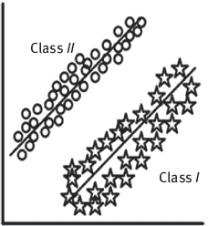

Figure 3.1: Hyperplane separating the two classes in twin support vector machine classification scheme.

`x^(T)w[1] + z[1] = 0` 和 `x^(T)w[1] + z[2] = 0` 这里，符号 `z[1]` 和 `z[2]` 表示超平面的偏置项，而 `w[1]` 和 `w[2]` 表示归一化到超平面的向量。用于执行线性和非线性分类的 `TSVM` 已在 (Hsu and Lin, 2002; Tomar and Agarwal, 2015) 中报道。这里，`p` 类的训练是与 `q` 类一起进行的。在训练阶段，正类被视为 `p` 类的数据样本，而负类被视为 `q` 类的数据样本，反之亦然 (Hsu and Lin, 2002; Tomar and Agarwal, 2015)。本工作采用 `TSVM` 分类器模型，因为其计算复杂度约为标准 `SVM` 的四分之一，并且能达到相当的准确率 (Hsu and Lin, 2002; Tomar and Agarwal, 2015)。因此，`TSVM` 方法被选为心跳分析的替代方案。

### 3.2.3 人工蜂群

`ABC` (Karaboga, 2005) 是一种受自然启发的算法，被广泛用作优化工具。优化算法遵循一组规则，以最佳方式分配稀缺资源。`ABC` 技术是一种基于种群的搜索算法，其中人工蜜蜂会随时间改变食物位置。这里，蜜蜂的目标是确定含有最多花蜜的食物源位置，最终确定花蜜最多的那一个。蜂系统由两个重要组成部分构成：(a) 食物源和 (b) 采集者 (Karaboga, 2005)。采集者有三种类型：失业采集者、就业采集者和经验丰富的采集者。`ABC` 技术包括四个主要阶段，即初始化阶段、就业蜂阶段、观察蜂阶段和侦查蜂阶段 (Karaboga, 2005)。`ABC` 算法的流程图如图 Figure 3.2 所示。

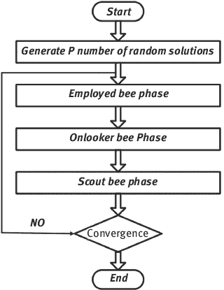

Figure 3.2: Flowchart of artificial bee colony method.

## 3.3 提出的方法

所提出的方法由四个重要阶段组成，如预处理、R 波定位、特征提取和特征识别阶段所示， depicted in Figure 3.3，用于对不同类别的心跳进行分类。最初，从人体提取的原始 ECG 信号经过预处理以提高其质量，通过去除数据采集过程中与其相关的各种噪声。预处理步骤随后是特征提取方法，其中从心跳中提取显著特征以将其表示为低维。最后，这些特征被应用于学习算法进行分类。

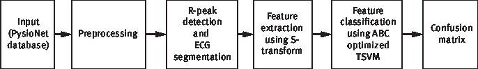

Figure 3.3: Steps involved in automated classification of cardiac arrhythmias.

### 3.3.1 ECG 数据

所提出的方法在著名的数据库上进行了验证，即麻省理工学院-贝斯以色列医院（MIT-BIH）心律失常数据（Moody, 2001）。该数据库包含 47 名受试者的记录，共 48 个文件或记录，总计 110,109 个心跳标签（Moody and Mark, 2001）。数据包含信号的注释，最终用于在监督学习分类器机制中形成结果。数据库中共有 16 类心跳，包括正常，用于实验目的。数据以 360 Hz 的速率采样，同时信号使用具有 11 位分辨率、10 mV 范围的模数转换器进行数字化（Moody and Mark, 2001）。进行实验时，使用包含不同类别信号的所有记录，并使用截止频率为 0.1 Hz 至 100 Hz 的带通滤波器进行滤波（Moody and Mark, 2001）。为了确定训练和测试数据集，从全部 16 个类别的心跳中选择一定比例，并根据 AAMI 建议按受试者特定方案进行映射。在该方案下，记录 102、104、107 和 217 不被考虑在任何训练和测试数据集中。因此，仅考虑 44 条记录进行实验。在此，执行两种不同类型的分析。第一种是将记录平均分为两部分（即各 22 条记录）构成数据集。心电图节律类别从 PhysioNet 数据库到 AAMI 建议的映射在（Raj et al., 2018e）中给出。通过对整个数据集进行 22 折交叉验证（CV）（Stone, 1974）来避免分类器模型的过拟合。

### 3.3.1.1 预处理

任何诊断系统的性能在很大程度上受心跳质量的影响。与心跳相关的噪声可能包含基线漂移、工频干扰、肌肉伪影、接触噪声、电外科噪声和量化噪声。必须消除这些不同类型的噪声，否则会导致误报。此外，此步骤提高了信噪比，有助于在心跳内准确检测 fiducial 点。采用不同的滤波器来去除不同类型的噪声。

采用两组中值滤波器来消除心跳内的基线漂移（Raj et al., 2018e）。200 ms 的主中值滤波器用于划定 QRS 波（Raj and Ray, 2018e）和 P 波。而 600 ms 的次级滤波器则划定心跳内的 T 波。最后，通过从原始 ECG 数据中减去次级滤波器的输出来去除基线漂移（Raj and Ray, 2018e）。此后，通过使用 12 抽头的低通滤波器（LPF）对基线校正后的心跳进行滤波，去除心跳中的工频干扰和高频噪声（Raj and Ray, 2018e）。该 LPF 的截止频率为 35 Hz，通带和阻带中的纹波相等。该滤波器的输出被视为预处理后的心跳，允许其通过 R 波定位和分割步骤以实现 ECG 信号的自动识别（Raj and Ray, 2018e）。图 3.4 和 3.5 分别显示了数据库中记录 #237 的原始心跳和滤波后的 ECG 输出。

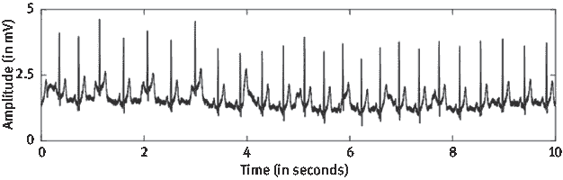

图 3.4：受噪声污染的原始心电图信号（记录 #237）。

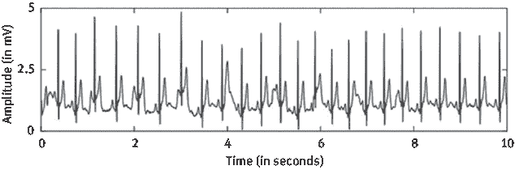

图 3.5：预处理后的心电图信号。

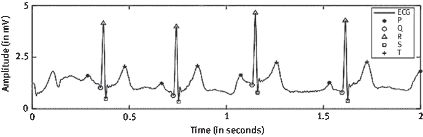

图 3.6：Fiducial 点检测。

### 3.3.2 R 波定位和心跳分割

本研究基于 ECG 信号中 R 波的定位对不同类型的心律失常进行分类。在特征提取之前对 ECG 信号进行分割之前，有必要确定 R 波的位置。文献中已报道了大量用于检测 R 峰的研究工作（Raj et al., 2018f），其中本研究采用了成熟的 PT 算法（Pan and Tompkins, 1985）。选择它是由于其在嘈杂环境下具有已证实的较低计算负担和更高性能。检测到的 R 波与数据库中提供的 R 峰注释位置进行了验证。图 3.6 描绘了数据库中记录 #237 心跳内的 R 波定位。

在本研究中，分割步骤与几乎所有已报道的工作略有不同。它们使用恒定时间或样本的矩形窗口。提出了一种新的分割步骤，即考虑 QRS 波周围的比例分割。样本取自后方 R 峰右侧的 65%，并从左侧选择前方 R 峰的 35% 来估计每个心跳的长度。可以确保从起始 P 波到结束 T 波的 ECG 的每个信息都得以保留，且不会丢失任何波的信息。

### 3.3.3 输入表示

对于任何模式识别系统，特征提取阶段发挥着重要作用。这些特征代表输入心跳的特征。在文献中，从后续心跳中提取了多种类型的特征，例如 ECG 信号内的 fiducial 点、小波特征、RR 间隔特征和高阶累积量。许多工作将不同特征连接在一起，从而实现更高的准确率。相反，不同类型特征的连接会导致分类系统的计算复杂度增加。因此，对于任何分类系统而言，输入的高效表示非常重要。本章采用 ST（Stockwell, 2007）来捕获后续心跳的显著 TF 信息作为特征以检测潜在心律失常。ST（Stockwell, 2007）提供频率相关的 TF 空间分辨率。其与输入数据的绝对参考局部相位特征的结合是独特的。对输入心跳应用 ST（Stockwell, 2007）可提供 *N*² 维度的时频系数，即长度为 *N* 的心跳被变换为长度为 *N*²。从 ST 系数中，提取以下特征，即能量、标准差、均值、峰度、熵和偏度。从 ST 特征中提取的这些特征被连接在一起形成表示心跳的特征集。这些特征对应于每个心跳的形态学特征。

### 3.3.4 心跳变异性特征

此外，连续心跳之间的 `R-wave` 到 `R-wave` 信息被测量以通过心跳估计心率变异性。因此，计算了四种类型的 `R-` 到 `R-wave` 信息作为特征，其类似于心跳的模式，即先前、后、局部和平均 `R` 波峰到 `R` 波峰信息。在此，估计先前和当前 `R-wave` 之间的周期以计算先前的 `R` 到 `R` 信息。估计当前 `R-wave` 与即将到来的 `R-wave` 之间的周期以计算后 `R` 到 `R` 信息。先前和后 `R-` 到 `R-wave` 周期的组合作为心跳的特征可称为瞬时节律特征。平均 `R-wave` 到 `R-wave` 特征是通过取每个心跳的先前三分钟片段的 `R-wave` 到 `R-wave` 间隔的平均值来估计的。类似地，局部 `R-wave` 信息是通过取当前心跳的前八秒事件的所有 `R-wave` 到 `R-wave` 间隔的平均值来估计的。这两个特征，即平均和局部，对应于一系列心跳的平均特征。

最后，这些心率变异性特征被连接到作为特定心跳的 `S-transform` 结果而获得的输出系数。

### 3.3.4.1 特征分类

在本工作中，使用了 `TSVM` 分类器模型（Hsu and Lin, 2002；Tomar and Agarwal, 2015）来识别表示每个心跳的 16 类 `ST` 和心率变异性特征提取。最初，`TSVMs` 被设计为解决二元类别识别问题。本研究通过使用一对一（`OAO`）`SVM` 模型（Hsu and Lin, 2002；Tomar and Agarwal, 2015）来解决多类别识别问题。在该方案下，核参数和代价函数参数的选择在报告更高的分类性能方面起着重要作用。核函数的使用使得特征的非线性分类成为可能。换句话说，核的使用有助于在高维空间中对非线性数据或重叠特征实现更好的分类性能。因此，使用了所有核函数，如线性、径向基函数（`RBF`）和多项式函数来分析准确率。这些不同核函数的分类准确率摘要报告在 Table 3.1 中。Table 3.1 得出结论，`RBF` 核在用于分类的所有核中实现了最高准确率。需要注意的是，假设用于衡量性能的训练和测试数据集与 Section 3.3.1 中介绍的相同。因此，仅报告并详细研究了 `RBF` 核的分类性能。

Table 3.1: Accuracy reported using different kernel functions.

| Kernel | | Training performance (%) | | Testing performance (%) |

| --- | --- | --- |

| Linear | | 98.1 | | 84.23 |

| --- | --- | --- |

| Radial basis function | | 99.7 | | 85.92 |

| Multilayer perceptron | | 99.2 | | 87.32 |

| Polynomial | | 99.5 | | 86.97 |

*The performance is computed in terms of accuracy.

此外，核（`γ`）和代价函数（`C`）指标使用 `ABC` 算法逐步优化，以根据 Table 3.1 中报告的结果提高分类器模型的准确性。在 `ABC` 技术实现中，所涉及的步骤在 Karaboga (2005) 中提出。每个食物源的适应度由 `ABC`（Karaboga, 2005）技术评估，并旨在确定分类器模型的最优性。由于本研究涉及使用 `OAO-SVM` 模型对五类心跳进行分类，因此采用 `ABC` 算法对 10 个二元 `SVM` 分类器的学习参数进行调优。在此，选择了简单的 `SV` 计数技术作为适应度标准，以优化 `ABC` 框架以限制误差边界条件，从而导致识别模型的无偏性能。在训练阶段，`TSVM` 模型的 learning 参数，即 `C` 和 `γ`，通过采用 `ABC` 技术进行优化。参数是基于 `m`-fold `CV` 技术（Stone, 1974）在训练阶段选择的。为了避免分类器模型的偏差，使用二十二折 `CV` 对测试和训练数据集进行，以估计 `C` 和 `γ` 参数的更好参数估计，从而使所开发模型的分类性能最佳。

### 3.3.5 Performance metrics

在估计混淆矩阵后，`ECG` 搏动的每个类别的性能指标均以五个性能指标确定，即准确率（`A[C]`）、灵敏度（`S[E]`）、`F-score`（`Fs`）、误差（`E[R]`）和阳性预测值（`P[P]`）。`S[E]` 定义为正确识别实例与实例总数之比，`S[E] = T[P]/(T[P] + F[N])`（Raj and Ray, 2018e）。`P[P]` 确定为正确识别的 `ECG` 搏动与检测到的 `ECG` 搏动总数之比，`P[P] = T[P]/(T[P] + F[P])`（Raj and Ray, 2018e）。`A[C]` 定义为正确识别实例总数与分类实例总数之比，`A[C] = (T[P] + T[N])/(T[P] + T[N] + F[P] + F[N])`，而 `F-score`（`Fs`）定义为 `(2*T[P]/(2*T[P] + F[N] + F[P]))`。上述性能指标是在患者特定方案中对所开发方法在基准 PhysioNet 数据上计算的（Raj and Ray, 2018e）。

## 3.4 Simulation results

开发的方法在个人计算机（`windows 10` 平台，`Intel core i5`（`CPU`），2.5 `GHz`，8GB `RAM`）上实现，在 `MATLAB`（版本 8.2，`R2018b`）仿真环境中，其性能通过在患者特异性评估方案下对各类心跳进行识别来估计。所提方法的识别性能报告是通过在基准 `MIT-BIH` 心律失常数据上进行实验得出的，该数据描述于 第 3.3.1 节。训练分类器的性能以混淆矩阵的形式报告，如 表 3.2 和 3.3 所示，用于患者特异性策略中每类心跳。混淆矩阵是通过将正确识别的实例和误识别的实例映射到由开发方法学识别的相应类别中而制定的（Raj and Ray, 2018e）。混淆矩阵的列表示由所提方法识别的心脏事件总数。而混淆矩阵的行表示基准数据库中提供的用于参考的真实值或注释（Moody and Mark, 2001）。在总计 43,112 和 89,414 个测试 ECG 实例中，81,803 个实例被开发方法学正确识别，并在等分数据集和 22 折交叉验证策略中分别报告了 86.53% 和 88.22% 的更高准确率，同时误差率分别为 13.47% 和 11.78%。在 表 3.2 和 3.3 中，可以观察到，与其他类别的心跳相比，类别“e”和“q”的准确率相当低，这是由于在这两个类别中用于训练的 ECG 实例数量较少。必须注意，实验是针对基准 PhysioNet 数据中这两个类别的所有可用数据进行的。


计算混淆矩阵后，性能指标如灵敏度（`S[E]`）、F 分数（`Fs`）和阳性预测值（`P[P]`）指标会为每类心跳计算。在确定这些性能指标之前，重要的是先计算特定类别心跳的其它参数，如真阳性（`T[P]`）、假阳性（`F[P]`）和假阴性（`F[N]`）指标，如 表 3.4 和 3.5 所示。在患者特异性方案下，表 3.4 和 3.5 呈现了为所有五类心跳计算的 `Fs`、`P[P]` 和 `S[E]` 参数，分别报告在等分数据集中整体为 86.53%，在 22 折交叉验证策略中为 88.22%。

### 表 3.4：等分数据集下的指标。

| TP || FP || FN || S[E] || P[P] || F[s] |

| --- | --- | --- | --- | --- | --- |

| 39,188 || 950 || 5,050 || 88.58 || 97.63 || 92.88 |

| --- | --- | --- | --- | --- | --- |

| 1,210 || 1,079 || 762 || 61.35 || 52.86 || 56.79 |

| 2,631 || 1,627 || 589 || 81.70 || 61.78 || 70.36 |

| 81 || 2,988 || 305 || 20.98 || 2.63 || 4.68 |

| 2 || 67 || 5 || 28.57 || 2.89 || 5.26 |

| 43,112 || 6,711 || 6,711 || 86.53 || 86.53 || 86.53 |

### 表 3.5：22 折交叉验证下的指标。

| TP || FP || FN || S[E] || P[P] || F[s] |

| --- | --- | --- | --- | --- | --- |

| 81,072 || 1,544 || 9,011 || 89.99 || 98.13 || 93.88 |

| --- | --- | --- | --- | --- | --- |

| 1,681 || 1,314 || 1,291 || 56.56 || 56.12 || 56.34 |

| 6,361 || 4,339 || 1,119 || 85.04 || 59.44 || 69.97 |

| 298 || 4,617 || 504 || 37.15 || 6.063 || 10.42 |

| 2 || 123 || 12 || 14.28 || 1.58 || 2.85 |

| 89,414 || 11,937 || 11,937 || 88.22 || 88.22 || 88.22 |

### 表 3.6：与现有工作的比较。

| Works (Ref.) || Feature extraction || Classifier || Classes || Accuracy (%) |

| --- | --- | --- | --- | --- |

| Nambhash et al. (2008) || WT || Fuzzy || 3 || 85 (avg.) |

| --- | --- | --- | --- | --- |

| Oresko et al. (2010) || RR intervals || BPNN || 5 || 86 |

| **Proposed** || **ST** || **ABC + TSVM** || **All MIT** || **88.22** |

`WT`, 小波变换；`BPNN`, 反向传播神经网络；`ABC`, 人工蜂群；`TSVM`, 双支持向量机。

在 图 3.7 和 3.8 中，三个条形共同表示灵敏度、阳性预测值和 `F` 分数的值，分别对应于类别 1。这里，类别 1 表示正常心跳类别。并且类似地，2、3、4 和 5 分别表示沿 `x` 轴的 s、f、v、q 心跳类别。此外，`V[L]` 是沿 `y` 轴参数值在 100 以内的值。3

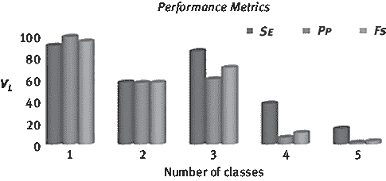

图 3.7：等分数据集下的指标图。

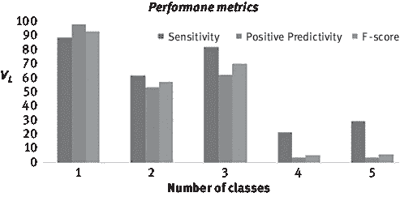

图 3.8：22 折交叉验证下的指标图。

## 3.4.1 比较研究

在患者特异性评估方案下，简要比较了开发方法所取得的准确率与文献中先前方法之间的差异。进行公平比较相当费力，这是由于不同工作在不同的数据库和不同数量和类别的心跳上进行评估。少数工作已在其方法在医疗机构或患者收集的数据集上进行了验证。考虑到这些因素，对在基准 PhysioNet 心律失常数据上评估并在 表 3.6 中报告的现有方法进行了公平的比较研究。

### 表 3.2：使用等分数据集报告的准确率。

|  || Classified results |

| --- | --- |

|  || Category || n || s || v || f || q || Total |

| **G T** || **N** || 39,188 || 917 || 1,270 || 2,822 || 41 || 44,238 |

| --- | --- | --- | --- | --- | --- | --- |

| **R R** || **S** || 491 || 1,210 || 239 || 23 || 9 || 1,972 |

| **O U** || **V** || 269 || 160 || 2,631 || 143 || 17 || 3,220 |

| **U T** || **F** || 188 || 1 || 116 || 81 || 0 || 386 |

| **N H** || **Q** || 2 || 1 || 2 || 0 || 2 || 7 |

| **D** || **Total** || 40,138 || 2,289 || 4,258 || 3,069 || 69 || 49,823 |

### 表 3.3：使用 22 折交叉验证报告的准确率。

|  || Classified results |

| --- | --- |

|  || Category || n || s || v || f || q || Total |

| **G T** || **N** || 81,072 || 1,051 || 3,664 || 4,199 || 97 || 90,083 |

| --- | --- | --- | --- | --- | --- | --- |

| **R R** || **S** || 738 || 1,681 || 531 || 17 || 5 || 2,972 |

| **O U** || **V** || 441 || 261 || 6,361 || 398 || 19 || 7,480 |

| **U T** || **F** || 361 || 1 || 139 || 298 || 3 || 802 |

| **N H** || **Q** || 4 || 1 || 5 || 3 || 2 || 15 |

| **D** || **Total** || 82,616 || 2,995 || 10,700 || 4,915 || 126 || 101,352 |

Table 3.6 结论表明，与文献中提供的现有方法相比，所提出的方法在患者特异性方案下实现了更高的准确性。与某些研究相比，当前研究识别出更多的心脏事件。因此，不同心跳类别的数据集中心跳的数量差异很大；针对特定类别报告的指标参数可被视为更可靠且更具意义。由于当前工作比现有工作实现了更高的准确性，因此可以隐含地得出结论，使用 ST 技术在 TF 空间中提取的特征在与心率变异性特征结合时是有效的，并且在与 ABC 优化的 TVSM 结合时能够有效区分各种心跳类别，从而高效地检测和识别心跳。

## 3.5 结论与未来展望

本章报告了一种新方法，将 ST 作为形态学特征，心率变异性作为动态特征。该最终特征向量作为输入应用于 ABC 优化的 TSVM，以实现 16 类心跳的自动识别。所开发的方法可用于监测长期心跳记录并分析心跳的非平稳行为。所开发方法的验证是在 PhyioNet 数据上进行的，其评估是在患者特异性方案下进行的。在患者特异性方案下，该方法实现了 88.22% 的改进准确率。未来，这项当前工作将纳入更多心律以进行监测和分析，开发更高效的算法及其在移动平台上的实现。该开发的方法可被视为一种高效的技术，可用于计算机辅助诊断，使受试者能够为心血管疾病过上健康的生活方式。

本章的范围可扩展到纳入更多心跳用于分类，并使用新颖的深度学习方法进行分析。此外，所提出的方法可在合适的硬件平台上原型化，以便在实验室实验环境中进行实时分析。原型化的硬件可进一步制造成嵌入式设备，以集成物联网技术对心跳进行实时分析。

## References

Chazal P.D., O’ Dwyer M., and Reilly R.B. Automatic classification of heartbeats using ECG morphology and heartbeat interval features. IEEE Transactions on Biomedical Engineering, (2004), 51(7), 1196–1206. →

Chui K.T., Tsang K.F., Chi H.R., Ling B.W.K., and Wu C.K. An accurate ECG-based transportation safety drowsiness detection scheme. IEEE Transactions on Industrial Informatics, (2016), 12(4), 1438–1452. →

Faezipour M., Saeed A., Bulusu S., Nourani M., Minn H., and Tamil L. A patient-adaptive profiling scheme for ECG beat classification. IEEE Transactions on Information Technology in Biomedicine, (2010), 14(5), 1153–1165. →

Fraser G.D., Chan A.D., Green J.R., and Macisaac J.R. Automated biosignal quality analysis for electromyography using a one class support vector machine. IEEE Transactions on Instrumentation and Measurement, (2014), 63(12), 2919–2930. →

Garge G.K., Balakrishna C., and Datta S.K. Consumer health care: Current trends in consumer health monitoring. IEEE Consumer Electronics Magazine, (2018), 7(1), 38–46. →

Hsu C.W. and Lin C.-J. A comparison of methods for multiclass support vector machines. IEEE Transactions on Neural Networks, (2002), 13(2), 415–425. a, b, c, d, e, f, g, h, i, j, k

Hu Y.H., Palreddy S., and Tompkins W.J. “A patient-adaptable ECG beat classifier using a mixture of experts approach.” IEEE Transactions on Biomedical Engineering, (1997), 44(9), 891–900. →

Hu Y.H., Tompkins W.J., Urrusti J.L., and Afonso V.X. Applications of artificial neural networks for ECG signal detection and classification. Journal of Electrocardiology, (1993), 26, 66–73. →

Ince T., Kiranyaz S., and Gabbouj M. A generic and robust system for automated patient-specific classification of ECG signals. IEEE Transactions on Biomedical Engineering, (2009), 56(5), 1415–1426. →

Karaboga D. (2005), An idea based on honey bee swarm for numerical optimization. Comput. Eng. Dept., Erciyes Univ., Kayseri, Turkey, Rep. TR06, Oct. 2005. a, b, c, d, e

Lagerholm M., Peterson C., Braccini C., Edenbrandt L., and Sornmo L. Clustering ECG complexes using Hermite functions and self-organizing maps. IEEE Transactions on Biomedical Engineering, (2000), 47(7), 838–848. →

Linh T.H., Osowski S., and Stodoloski M. On-line heart beat recognition using Hermite polynomials and neuro-fuzzy network. IEEE Transactions on Instrumentation and Measurement, (2003), 52(4), 1224–1231. →

Martis R., Acharya U., Mandana K., Ray A., and Chakraborty C. Cardiac decision making using high order spectra. Biomedical Signal Processing and Control, (2013), 8(2), 193–203. →

Melgani F. and Bazi Y. Classification of electrocardiogram signals with support vector machines and particle swarm optimization. EEE Transactions on Information Technology in Biomedicine, (2008), 12(5), 667–677. →

Minami K., Nakajima H., and Toyoshima T. Real-time discrimination of ventricular tachyarrhythmia with Fourier-transform neural network. IEEE Transactions on Biomedical Engineering, (1999), 46(2), 179–185. a, b

Moody G.B. and Mark R.G. The impact of the MIT-BIH arrhythmia database. IEEE Engineering in Medicine and Biology Magazine, (2001), 20(3), 45–50. a, b, c, d, e

Nambakhsh M.S., Tavakoli V., and Sahba N. FPGA-core defibrillator using wavelet-fuzzy ECG arrhythmia classification. In Proceedings of IEEE Engineering in Medicine and Biology Society. Annual Conference, (2008), 2673–2676. →

Oresko J.J. A wearable smartphone-based platform for real-time cardiovascular disease detection via electrocardiogram processing. EEE Transactions on Information Technology in Biomedicine, (2010), 14(3), 734–740. →

Pan J. and Tompkins W.J. A real-time QRS detection algorithm. IEEE Transactions on Biomedical Engineering, (1985), 32(3), 230–236. →

Pourbabaee B., Roshtkhari M.J., and Khorasani K. Deep convolutional neural networks and learning ECG features for screening paroxysmal atrial fibrillation patients. IEEE Transactions on Systems Man Cybernetics-Systems, (2018), 48(12), 2095–2104. →


Raj S. (2018a), Development and hardware prototype of an efficient method for handheld arrhythmia monitoring device. Ph.D. Thesis IIT Patna. 2018, pp. 1–181. a, b, c, d, e, f, g

Raj S. (2019). A real-time ECG processing platform for telemedicine applications Advances in Telemedicine for Health Monitoring: Technologies, Design, and Applications, IET, 2019, (Accepted). →

Raj S., Chand G.S.S., and Ray K.C. Arm-based arrhythmia beat monitoring system. Microprocessors and Microsystems, (2015a), 39(7), 504–511. →

Raj S., Luthra S., and Ray K.C. Development of handheld cardiac event monitoring system. IFAC Papers-On-Line, (2015b), 48(4), 71–76. →

Raj S. and Ray K.C. A comparative study of multivariate approach with neural networks and support vector machines for arrhythmia classification. In International Conference on Energy, Power and Environment: Towards Sustainable growth, (2015c), 1–6. →

Raj S. and Ray K.C. Cardiac arrhythmia beat classification using DOST and PSO tuned SVM. Computer Methods and Programs in Biomedicine, (2016a), 136, 163–177. 

Raj S. and Ray K.C. Application of variational mode decomposition and ABC optimized DAG-SVM in arrhythmia analysis. In Proceedings of 7th International Symposium in Embedded Computer System Design (ISED), (2017a), 1–5. a, b, c

Raj S. and Ray K.C. ECG signal analysis using DCT-based dost and PSO optimized SVM. IEEE Transactions on Instrumentation and Measurement, (2017b), 66(3), 470–478. →

Raj S. and Ray K.C. A personalized arrhythmia monitoring platform. Scientific Reports, (2018b), 8(11395), 1–11. 

Raj S. and Ray K.C. Automated recognition of cardiac arrhythmias using sparse decomposition over composite dictionary. Computer Methods and Programs in Biomedicine, (2018c), 165, 175–186. →

Raj S. and Ray K.C. Sparse representation of ECG signals for automated recognition of cardiac arrhythmias. Expert Systems with Applications, (2018d), 105, 49–64. →

Raj S. and Ray K.C. A personalized point-of-care platform for real-time ECG monitoring. IEEE Transactions on Consumer Electronics, (2018e), 66(4), 1–9. a, b, c, d, e, f, g, h, i, j, k

Raj S., Ray K.C., and Shankar O. Cardiac arrhythmia beat classification using DOST and PSO tuned SVM. Computer Methods and Programs in Biomedicine, (2016b), 136, 163–177. →

Raj S., Ray K.C., and Shankar O. Development of robust, fast and efficient QRS complex detector: A methodological review. Journal of the Australasian College of Physical Scientists and Engineers in Medicine, (2018f), 41(3), 581–600. a, b, c

Stockwell R.G. A basis for efficient representation of the S-transform. Digital Signal Processing, (2007), 17(1), 371–393. a, b, c, d, e, f, g, h

Stone M. Cross-validatory choice and assessment of statistical predictions. Journal of the Royal Statistical Society, Series B (Methodology), (1974), 36(2), 111–147. a, b

Tomar D. and Agarwal S. A comparison on multi-class classification methods based on least squares twin support vector machine. Knowledge Based Systems, (2015), 81, 131–147. a, b, c, d, e, f, g, h, i, j, k

# 4 计算智能方法解决医疗保健中的语言障碍

Shweta Sinha Amity University Haryana, India Shweta Bansal KIIT College of Engineering, Gurugram, India

#### Abstract

在全球化和经济增长的这一时代，任何国家/大洲的固定地理边界都不再限制人们的流动。教育和医疗保健是两个在这方面发生了重大变化的服务领域。但全球的语言多样性成为从地球一端到另一端顺利过渡的阻碍。由于语言多样性带来的挑战在医疗保健领域造成了更为严重困难。毫无疑问，该领域任何形式的误沟通都可能产生深远的后果，甚至可能变得不可逆转。当患者从世界的一部分转移到另一部分，而很少有人说或理解其语言时，这些困难会进一步加剧。一种语言语音到另一种语言语音的翻译解决方案可以帮助克服这些困难。自动语音到语音（S2S）翻译可以使沟通无缝进行，从而拓展医疗保健领域的视野。本章讨论了自然语言处理的进展，主要关注沟通过程中的语言口语方面。本章讨论了将三种主要技术串联起来：自动语音识别、机器自动翻译以及将文本转换为口语输出，即文本到语音，以实现医疗服务中的无缝沟通。除此之外，还确定并简要讨论了每一步的技术发展和实施挑战。评估了 S2S 系统在医疗保健领域中的性能。

关键词：医疗保健，语音到语音翻译，语言障碍，口语语言技术，

## 4.1 引言

通过语音进行交流一直是并且将永远是人类信息共享和社会联结的主要方式。在这个万维网、大数据和强大计算技术时代；语音技术已成为人机交互的核心位置。这种突出地位源于语音作为一种交流媒介的自然性。在众多人工智能应用中，自然语言处理（NLP）是专门针对人类生成的文本和语音数据的分支。自然语言处理在医疗领域的应用从将医生笔记转录等简单功能到使用人类指令进行机器人辅助手术等高级应用都很普遍。

相反，由于沟通困难，医疗领域的不平等现象十分突出（Casserly et al., 2010）。使用口译员来弥合双方之间的语言差距是一种古老而传统的方式（Figure 4.1）。语言技术领域的显著进步促使研究界致力于语言翻译的自动化。

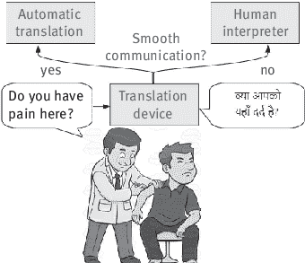

Figure 4.1: Translation system uses scenario in the medical domain.

自动语音识别（ASR）和文本转语音（TTS）领域的发展为将机器翻译（主要为文本转换）的重点扩展到口语翻译铺平了道路。语音到语音（S2S）翻译被认为是可以积极影响世界的为数不多的进步之一。从一种语言到另一种语言的语音信号端到端翻译（S2S）及其反向翻译将消除因地理差异造成的语言障碍。对于像印度这样正在全球市场中占据一席之地的国家来说，语音翻译技术将是人民的福音。语言在医疗保健中占有其自身的位置。语言在医疗保健中的重要性可概括为其在以下方面的作用：

* 精确且适当的沟通：在医疗领域，沟通不畅可能导致危险后果。医生传达的信息必须被患者准确理解，反之亦然，这一点非常重要。
* 建立信任：允许他人对你的身体进行操作涉及信任因素。患者和医生必须能够相互信任，而语言障碍是这方面的主要阻碍。
* 分享过往信息：启动任何治疗都需要有关病史、症状和证据的信息。只有医生和患者之间进行适当的沟通才能实现有效的信息共享。双方都可以用自己的语言方便地进行此操作。
* 时间、金钱和生命：患者与医生之间的适当沟通可以节省时间、金钱，更重要的是，挽救生命。语音作为人类最自然的交流方式，在这方面成为一个重要的媒介。

由于语言作为影响医疗保健服务质量的因素至关重要，语言口译员已成为该领域不可或缺的存在，并且由于全球化，对他们的需求日益增长。毫无疑问，他们通过将一种语言数据转换为另一种语言的数据来促进医生与患者之间的沟通，但这种人工过程在一定程度上缺乏保密性。患者与医生之间的沟通可能涉及需要保密的讨论，但由于第三方的参与，人工翻译过程无法保证这一点。除此之外，人工方法翻译的正确性取决于个人的效率和知识，这可能导致误诊并产生严重后果。此外，人工口译涉及高昂的成本，可能并非人人都能轻易接受。这些问题促使语音研究人员将语音技术扩展到医疗保健领域的无障碍沟通。

尽管语音技术已发展到非常先进的水平，基于语音的应用的准确率已达到新高度，但在医疗保健中构建自动翻译系统时仍然存在严重问题，因为医疗领域具有特殊特征。独特的语言和医学术语以及对高准确度的需求给自动翻译系统的开发带来了诸多挑战。这些挑战可概括如下：

* 医疗保健部门需要可靠、及时和准确的翻译，因为任何失败都可能造成毁灭性影响。
* 医学术语难以理解，因为它主要是多词或专有名词。
* 词汇不断增长，因为疾病和治疗方案不断增加。
* 大量的医学领域词汇和缩写增加了语言的复杂性。
* 需要超语言知识来克服源语言和目标语言之间的语法差异。在翻译过程中可能添加或删除部分内容以使其与目标语言相关。

相关问题和挑战需要为翻译系统的开发付出额外努力。确定交流的确切领域以及与之相关的行话可以帮助克服其中许多挑战。

## 4.2 Background and related research

语音翻译是一种技术，它将嵌入信号中的口语语言的上下文翻译成目标语言的语音。其重要性在于能够消除语言隔阂，促进全球文化和信息的交流。语音翻译的诞生始于 1983 年，当时它首次引起关注。NEC 公司在 ITU Telecom World 上展示了语音翻译的概念展品。1986 年，先进电信研究所国际部（ATR）成立，目的是进行语音翻译所需的基础研究。约 1993 年，卡内基梅隆大学（CMU）、ATR 和西门子三家机构共同进行了语音翻译实验。不久，语音翻译领域的项目在全球范围内启动（Waibel et al., 2003）；Zhou et al., 2004）。2006 年，德国、美国和欧盟分别启动了 Verbmobil、TransTac 和 Nespole 项目。2007 年，ATR、日本 NICT、印度 CDAC 以及中国、韩国、泰国、印度尼西亚和越南的技术学院组成的财团启动了名为亚洲语音翻译研究（A-STAR）的项目，2009 年首个基于网络的亚洲语言 S2S 系统启动（Arora et al., 2013）。该研究型财团进一步扩展以涵盖中东和欧洲语言，该地区的一些国家也加入了财团。后来，该项目被命名为 U-STAR 项目。2016 年，该团体进一步扩展以涵盖东盟语言语音翻译，并将马来西亚、缅甸、新加坡、泰国和越南纳入参与者。该财团的目标是为东盟社区开发一体化的语音翻译服务，并为东盟语音翻译系统评估开发通用的东盟语音翻译评估资源。时间线图在 Figure 4.2 中显示了当前状态并指出了语音技术的未来。

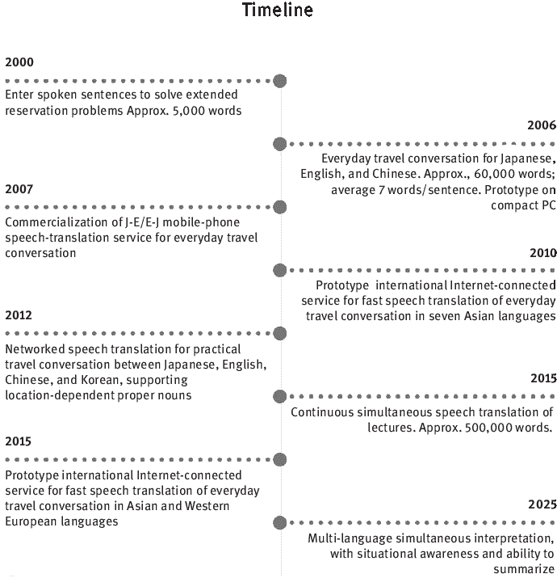

图 4.2：表示语音翻译过去和未来的时间线图示。

语音翻译是三种技术的架构集群：语音识别、语言翻译和语音合成。语音的自动翻译需要对这三种技术进行自动化并无缝集成以完成任务。所有这些都有各自的困难。与文本翻译相比，语音翻译由于涉及口语表达、语音中母语的影响以及存在不合语法短语而复杂得多。考虑到翻译工作的复杂性，研究社区最初在涉及简单对话的有限领域开始工作，并逐渐发展到更高级的工作。

文献中报道了医疗保健方面的许多差异，沟通困难已被确定为最重要的因素之一（Jacobs et al., 2001；Fassil, 2000；Bischoff et al., 2003；Flores et al., 2005）。由于这些原因，医疗领域已开展了若干语音翻译方面的努力。由于该领域的巨大挑战，所有项目都集中于该领域的特定沟通，并且偏向于少数用户群体。医疗领域尚未取得多大成功，长期以来一直就技术导向的口语技术在该领域的成功进行争论，该领域更能适应主要用户可能为医生、患者或其他医疗服务提供者的不同需求。表 4.1 概述了在医疗领域从事语音翻译的项目。其中一些已作为完全功能系统在商业市场上提供。表中指定的领域突出了其可用性，并确定了系统的预期用户。

表 4.1：医疗领域语音翻译项目。

| 系统 || 开发人员 || 领域 || 语言 |
| --- | --- | --- | --- |
| CCLNC || MITLIncoln Lab (Lee et al., 2002) || 医患对话 || 英语，韩语 |
| --- | --- | --- | --- |
| MASTOR || IBM Yorktown Heights (Zhou et al., 2003) || 医疗急救 || 英语，普通话 |
| Speechalator || 卡内基梅隆大学 (Waibel et al., 2003) || 医疗访谈 || 英语，阿拉伯语 |
| Laser ACTD || 卡内基梅隆大学 (Schulz et al., 2004) || 医患对话 || 英语，泰语 |
| 无名 || SRI Menlo Park CA (Kathol et al., 2005) || 首次医疗交流 || 英语，普什图语 |
| Transonics || 南加州大学 (Ettelale et al., 2005) || 医患对话 || 英语，法语 |
| Accultran || A-life Medical Inc, San Diego CA (Heinze et al., 2006) || 医患对话 || 英语，西班牙语 |
| S-MINDS || Sehda Inc, Mountain View CA (Ehsani et al., 2006) || 医疗灾难恢复 || 英语，韩语 |
| Converser || Spoken Translation, Berkeley CA [www.Spokentranslation.com](http://www.Spokentranslation.com) /products/healthcare || 药房、急救、物理治疗、入院、妇产科、肿瘤科 || 英语，西班牙语 |
| MASTOR || IBM Yorktown Heights domino.watson.ibm.com/comm/pr.nst/pagesnews 20061013_mastor.html || 与伊拉克安全部队成员的医疗导向对话，在医院环境中以及与伊拉克公民的日常互动中 || 英语，阿拉伯语（伊拉克语和现代标准阿拉伯语） |
| MedSLT || ISSCO, 日内瓦大学 [www.issco.unige.ch/projects/medst/](http://www.issco.unige.ch/projects/medst/) || 头痛、胸痛、腹痛 || 英语、法语、日语、芬兰语、西班牙语、希腊语 |
| S:MINDS || fluential Inc, Sunnyvale Ca [www.fluentialinc.com/therapy.swf](http://www.fluentialinc.com/therapy.swf) || 放射科、物理治疗 || 英语，西班牙语 |
| MediBabble || 加州大学旧金山分校 http:/medibabble.com/ || 心血管、肺部 || 西班牙语、粤语、普通话、俄语和海地克里奥尔语 |


| BabelDr || 日内瓦大学  

(P. Bouillon et al., 2017) || 腹部 || 法语译阿拉伯语 |

## 4.3 语音翻译技术：概述

自动语音翻译是 NLP 领域三大主要技术的集群。整体过程需要理解口语表达，然后将其翻译成目标语言，与语言语法规则一致。完整的流程将为在服务提供方语言知识有限的患者创造一条途径。它可以通过三种技术的顺序执行来实现，即 `ASR`、`机器翻译（MT）`和 `TTS`。管道如图 图 4.3 所示。这一技术集群也将帮助有视觉或身体障碍的患者与医生或护理提供者沟通，以及与数字世界连接，以在自我健康和治疗中发挥更直接的作用。口语交流需要一个能够识别、解释和响应的系统。

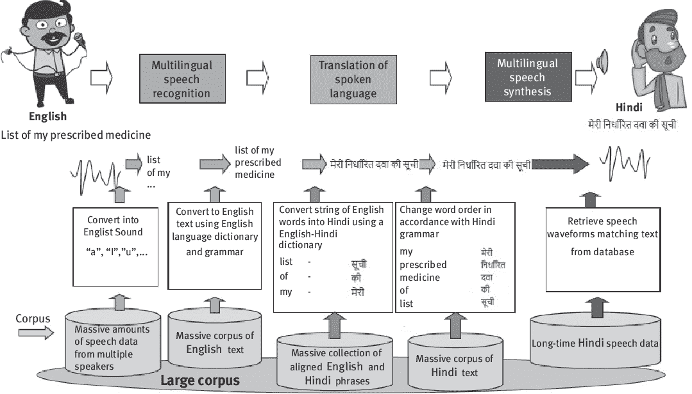

图 4.3：语音到语音翻译的管道架构。

### 4.3.1 语音产生与感知

自动语音处理领域的主要关注点之一是机器与人类性能之间的差距。将人类如何产生和感知声音的知识纳入机器将有助于提高机器的性能。在深入研究使用技术消除语言障碍的细节之前，必须了解语音产生的解剖结构。自动化整个语音处理和理解过程是一项复杂任务，不仅由于领域复杂性，还由于与人类系统发声器官相关的复杂性。系统将需要处理个体的发音道（`VT`）特征、由于母语造成的口音、背景噪声，以及麦克风特征，同时还要应对语言的歧义性和口语对话的不合语法性。

人类发声是一个复杂系统，能够产生多种不同的声音。肺、喉和 `VT` 共同构成人类发声系统。`VT`，即口腔/鼻腔、软/硬腭、舌头、嘴唇、下颌和牙齿构成了影响语音产生最重要的器官。呼吸系统（肺）和喉部系统（喉）为语音信号提供声源（气压）。发音系统对产生的信号进行处理以产生不同的音素。这些声音单位可以根据负责其产生的发音器官分为有声、无声或塞音。声音单位的多变性质为其自动化处理带来了挑战。

语音感知是口语理解的另一个分支。研究表明，声学语音信号并不直接映射到音位片段（Casserly et al., 2010）。另一方面，人类听觉系统是听觉和发声的不可分割的结合和转化。两个分支之间固有的联系有助于更好地理解语音特征，并可以缩小人类与机器性能之间的差距。图 4.4 展示了语音产生与感知之间的关系。

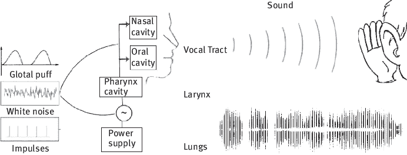

图 4.4：人类中的语音产生与感知系统。

### 4.3.2 自动语音识别

语音是人类之间最自然、最便捷的交流方式。以此作为人与机器之间交流的媒介，如今已成为最理想的方式。这种交互需要将人类的口语转换为机器可理解的形式。自动语音识别就是完成此任务的方法。`ASR` 利用计算机算法将口语转换为文本。诸如听写系统、命令和控制指令以及信息检索等多种潜在应用都使用该技术。这些系统范围从孤立语音识别到高度会话式语音信号的识别。`ASR` 系统也可以根据词汇量大小进行分类，从小型（最多 1000 个词）到超大（超过十万个词）不等（Whittaker and Woodland, 2001）。

图 4.5 展示了标准 `ASR` 系统的总体架构。`ASR` 系统是三个主要组件的集成：声学模型、词法模型和语言模型。`ASR` 系统的工作分为两个阶段，首先是对输入语音进行参数化，然后使用这些特征对系统进行训练和测试。在系统的核心，使用代表语言中各种音素单元的参数来开发统计模型。在第一阶段，即训练过程为语音声学（需要大量用户的录音样本）、语言统计（使用文本数据进行语法知识和 n-gram 模型）以及识别词典（可识别词元的词库及其音标转写及多种变体）创建模型。此处创建的声学模型可以是上下文相关的（音位变体、三音节等）以及上下文无关的（单音素）模型，能够捕捉语音、说话人和信道变异性。

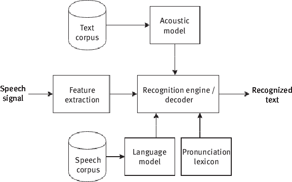

图 4.5：`ASR` 系统的总体架构。

在训练期间，以向量的形式提取特征以构建声学模型。这些语音特征可以是线性预测系数、`Mel` 频率倒谱系数（`MFCC`）、感知线性预测、伽玛音频率倒谱系数和基底膜频率带倒谱系数，或作为多特征集组合检索的混合特征（`MF-PLP`）（Dua et al., 2018）。特征提取过程有助于降维以及概率建模。识别词典的创建是词法建模的一步。它将词典中的每个正字法词元分配给口语（可以是音素、音节或词）。语言建模有助于在声学建模过程中选择最合适的识别假设。语言模型还有助于建模目标语言的语法、语义和结构。语言模型的优劣基于用于经验估计的文本数据的规模和多样性。

对于声学模型的创建，当今的 `ASR` 使用诸如隐马尔可夫模型（`HMM`）（Young et al., 2008）、动态规划（Jing et al., 2010）、支持向量机（`SVM`）（Solera-Urena et al., 2007）和人工神经网络（Mohamed et al., 2011）等技术。最近，模型创建方法已扩展到使用深度神经网络（Upadhyaya et al., 2019）和动态信念网络。图 4.5 中描绘的系统基于随机 `HMM` 方法。这些语音解码器使用一种实现令牌传递的方法，并使用维特比算法创建（Young et al., 2008）。它们可以生成表示识别假设的词/音素 N-best 列表，这些列表使用语言模型重新评分并选择得分最佳的一个。易于适应的开源工具包（如 `Julius`、`Sphinx`、`HTK` 和 `Kaldi`）的可用性帮助开发人员在任何目标语言中制作 `ASR` 应用。

**`ASR` 性能：** 评估任何 `ASR` 系统性能最常见的指标是词错误率（`WER%`）。该参数通过将转录输出与参考转录进行比较来评估。此错误可进一步用于评估三类错误。

* 插入（`I`）：输出转录中存在的单元，但在输入样本中不存在。
* 删除（`D`）：转录输出中缺失的单元，而在输入样本中存在。
* 替换（`S`）：输出转录中混淆并因此被另一单元替换的词/单元。

有了这三类错误，`WER%` 计算为 `WER% = (I + D + S)/N`，其中 `N` 为参考词数。除此之外，在少数语言中，性能以字符错误率和语句错误率来计算。

### 4.3.3 机器翻译

随着经济增长呈现出全球无边界的现象，从一种语言到另一种语言的翻译需求激增。`MT` 使用计算机软件将一种语言的文本或语音转换为另一种语言，同时保留源语言的含义。它可以被理解为用另一种语言的词替换一种语言中的词。在 1947 年 `ENIAC` 计算机问世后不久，就开始了利用计算机作为自然语言翻译设备的研发。这些努力范围从开发简单的翻译词典到全功能的 `MT` 系统（Dorr et al., 1999; Doddington, 2002）。但很长一段时间里该领域未取得成功，并在 1966 年宣布语言之间的语义障碍无法通过机器解决，因此 `MT` 的目标无法实现。大约在 1988 年，`IBM candid system` 在市场上推出，可为约 60 句俄语句子提供翻译（Antony, 2013）。在此成功之后，研究继续使用先进的方法和新技术，并在 1990 年代左右出现了统计机器翻译（`SMT`）技术。这一发展改变了世界看待语言障碍的方式（Bouillon et al., 2017）。`SMT` 的成功吸引了 IT 部门的关注，并使用复杂的混合方法开发了基于 `MT` 的应用（Nair et al., 2016）。

`MT` 系统可以为一对语言创建，称为双语系统，也可以是双向的，也可以为多对语言创建。能够处理多种源语言和目标语言之间翻译的系统称为多语系统。创建双向多语系统很困难，因此它们主要为单向的。创建 `MT` 系统的主要挑战之一是对两种语言并行创建的大型语料库的需求。自动翻译系统开发的另一个挑战与语言之间的歧义有关。语法、语义、词汇或上下文中的任何歧义都可能使过程变得困难。为处理这些语言学挑战，文本被限制在少数几个领域，以便词汇和语法更加受限。如果未来需要进一步扩展领域，系统必须适应新领域及其词汇。然而，迄今为止，尚不存在可在真实场景中高置信度使用的最先进的 `MT` 系统（Nair et al., 2016）。使用长短期记忆单元的神经机器翻译在实现实时目标方面取得了显著进展。谷歌开发 `Google Translate` 用于 100 多种语言翻译的举措值得注意，但其在开放域中的性能仍需关注。为了从 `MT` 系统获得高质量结果，会应用后期编辑工作，这可以是对语法和拼写检查的计算机辅助支持，也可以是人工辅助翻译，即人工干预。自动翻译领域的成功可以帮助消除语言障碍，并使一种语言的丰富文献在世界其他语言中得以传播。

从一种语言到另一种语言的翻译可以遵循直接转换架构或中间语架构。在前一种情况下，基于指定规则进行一种语言与另一种语言之间的句法转换，而后者则侧重于语义转换。在中间语架构的情况下，输入数据首先以与源语言无关的文本表示。图 4.6 展示了 `MT` 方法的金字塔。第二种语言，即目标语言的文本是使用这种语言无关的中间数据生成的，从而更容易翻译成多种语言。在这两种架构之间存在一种基于转换的架构技术。这里，源语言在句法上被分析以获得中间表示，然后使用规则将表示映射到目标语言。用于 `MT` 的另一种方法是遵循统计翻译方法。`SMT` 可以是基于词的、基于短语的或基于句法的。它们不需要为转换过程提供显式规则描述。除了这些基于知识的 `MT` 外，经验 `MT`（Antony, 2013）方法也在翻译系统中被使用。混合 `MT` 方法将多种方法结合到单一系统中构建，最近被广泛使用。这些方法执行令人满意，因为它们利用了各方法的优势来完成任务。

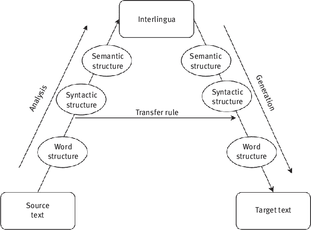

图 4.6：机器翻译金字塔。

#### 4.3.3.1 MT 性能

`MT` 的性能评估可以手动进行，也可以使用为机器评估定义的指标进行。人工评估需要同时了解源语言和目标语言的评估者。流畅度和充分性是人工评估中使用的两个主要参数。除此之外，`BLEU`（Papineni et al., 2002）和 `METEOR`（Banerjee and Lavie, 2005）是其他自动评估方法。这些方法均基于语料库中的 n-gram（单词、双词、三词）。这些评分技术使用不同的权重分配方法来获得精确率和召回率值。

### 4.3.4 文本到语音合成

从随机文本生成自然共鸣是 `TTS` 的最终目标。语音合成是指人声的人工产生。存在不同类别的语音合成器，由于软件和硬件的不同而具有多样化的技术变体。任何 `TTS` 系统的卓越性都基于两个主要方面——自然度和可懂度。自然度是与自然人声的相似性；另一方面，可懂度是听者理解的难易程度。`TTS` 系统始终努力最大化这两个方面（Raitio et al., 2010）。

`TTS` 转换分为两个阶段。第一阶段获得输入文本的语音转写，第二阶段使用第一阶段获得的统计数据产生语音输出。`TTS` 系统的前端负责文本预处理以及图形到音素（`g2p`）转换。在此过程中，文本中出现的数字、数值和缩写（如有）会被写成文字。在 `g2p` 转换时，每个音素表示都被映射到韵律单元，即句子、从句或短语。在后端，产生的输出被用于获得语音信号。语音合成器最合适的应用领域是为视障和盲人用户创建屏幕阅读器。此外，它还可以用于开发言语障碍人士的交流辅助工具。`TTS` 合成器对阅读障碍者非常有帮助。

存在多种语音合成方法，可分为发音合成、共振峰合成或拼接合成。首先，在这些方法中，发音语音合成基于生物力学模型，该模型负责在人类中启动语音信号。发音合成器模仿发音器官（舌头、嘴唇、声门和 `VT`）的影响。这种再现是三维微分方程，其随时间变化并计算人工语音输出。这类模型的主要要求是拥有极高的计算资源。此外，这些模型产生的输出并不能产生流畅的语音且缺乏自然性（Beutnagel et al., 1999）。共振峰语音合成包括源-滤波器模型，其基于源（声门）和滤波器可以独立处理的假设（Jilka et al., 2003）。滤波器的作用基于带宽和共振峰频率。共振峰合成方法的优点是它只需要适中的计算资源即可生成极易理解的语音，尽管它并不能产生完全自然的语音。最后一种方法是拼接语音合成使用最小尺寸的语音单元，称为音素。音素在无噪声的环境中录制以开发语音数据库。这些录制的音素可以作为波形存储，或以合适的语音编码算法获得的编码信号形式存储。这种方法产生的语音使用实际声音的录制基本单元；因此，该方法具有生成自然语音的最高潜力（Klatt, 1987）。

`HMM` 是模拟任何过程观察行为的最常见技术之一。`HMM` 的这种能力也用于在语音技术中建模人类语音行为。该模型在两个阶段工作。在第一个阶段，称为训练阶段，`HMM` 学习语音的声学-韵律方面。随后，在第二阶段，即语音生成阶段，`HMM` 提取待合成文本最可能的 参数。`HMM` 可以通过两种不同的方式进行训练；第一种，使用单个说话人约 2–4 小时的长语音语料库；第二种，自适应训练方法，需要来自多个说话人的语音样本并将其适应特定说话人的语音特征。这种方法只需要少量语料库即可合成语音。不管采用哪种方法，在训练阶段 `HMM` 都使用语音语料库，其扩展以覆盖上下文依赖性的音标转写，以及标记的音素边界。诸如 `MFCC` 和音高及其导数等语音特征从波形中提取。在这些参数的帮助下，`HMM` 学习频谱和激励参数。Figure 4.7 展示了基于 `HMM` 的语音合成器训练。

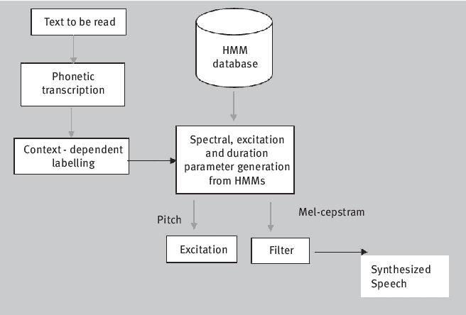

Figure 4.7: `HMM`-based speech synthesizer training module.

训练完成后，语音生成过程开始。该过程需要待朗读文本的音标转写和上下文相关标注。`HMM` 从状态持续时间密度函数中提取的音素持续时间创建频谱和激励参数。合成语音由此类参数获得。为了获得高质量的语音，应用混合激励模型。`Gnuspeech`、免费 `TTS` 和 `Festival Speech Synthesis system` 是可用于构建 `TTS` 系统的几个工具。

## 4.4 Performance evaluation

`TTS` 系统可以在多个方面进行评估。根据构建系统的目的，选择评估指标。`TTS` 系统的性能可以通过与语音质量相关的平均意见评分（`MOS`）来衡量，以评估自然度。评估的第二个参数是系统的可懂度，其以 `MOS` 或 `WER` 衡量。除此之外，准确性和可理解性也是评估 `TTS` 系统的其他指标。

## 4.5 Addressing language barriers in healthcare

语言障碍被认为是全球化中最主要的障碍之一。解决该障碍的必要性在医疗领域更为迫切。印度人口向世界其他地区迁移的现象十分普遍，且日渐增加。并非所有移出国境的人都受过教育，只能用其母语交流。另一方面，大多数国家都有自己的语言或使用英语作为交流媒介之一。印度也使用英语作为官方语言之一，但比例上受教育程度不高的人口无法用英语交流。为克服这一语言障碍，需要在印度语言和英语之间进行语音翻译。已有若干努力（Vemula et al., 2010）朝此方向进行，但大多数集中在旅游领域。医疗设施作为最关键和最需要的设施之一，需要研究界的关注。全球范围内已开始研究以克服医疗服务中的语言障碍（Ettelaie et al., 2005；Ehsani et al., 2006）。医疗领域的 `S2S` 系统将有助于在中东国家以及其他发达国家寻求最佳医疗服务的印度移民。

基于语音技术的系统是高度数据驱动的系统，其成功主要取决于相关语言和领域数据库中可用的语料库（Kathol et al., 2005）。本节介绍一个 `S2S` 翻译系统，可用于印地语到英语的翻译，反之亦然。印地语是一种资源匮乏的语言，创建此类系统并非易事，主要原因是缺乏数据，尤其是在医疗领域。对医疗领域工作的分析表明，使用语音技术的医疗/健康护理领域应用可分为不同类别：

* Dictation systems: Mainly used by doctors to provide notes to nurses/receptionists.
* Interactive systems: These voice-enabled systems are used to handle the interaction between patients and caretakers, patient and doctor, or patient and receptionists for making an appointment.
* Command and control systems: Generally used for controlling medical equipment.
* Language interpretation systems: These systems are mainly used to reduce the language barrier by providing translation services to the communication partners of different languages.

该领域所做的工作表明，医学领域使用了大量来自临床/医药领域的词汇，例如放射学、牙科科学和儿科。为 `S2S` 在医学领域的发展创建专门语料库是必要的。我们定义了用于 `S2S` 系统的流水线架构，以提供从印地语到英语以及反向的翻译。本文讨论的系统适用于患者语言与医疗从业者之间的语音翻译。该系统提供端到端翻译，但在每个中间层都为人工口译员提供了评估和校正的设施。这一功能有助于识别错误模式并指导进一步改进。随着时间的推移，当错误得到纠正时，我们期待取消人工干预的设置。这只能在 `ASR`、`MT` 和 `TTS` 三个模型都调优到完美运行时才能实现。

### 4.5.1 医学语料库创建


在系统创建的第一阶段，我们专注于开发处理医学领域短语交流以及问答格式交互的系统。在初始阶段，我们避免了完全的对话式语音，因为不流畅、填充词和其他因素使其变得困难。问答语料库主要由患者提出并由医疗从业者回答的查询，以及医生基于病史和症状提出的问题和患者作出的回答组成。Table 4.2 显示了为此目的创建的语料库统计数据。

Table 4.2: 语音翻译系统的语料库规格。

| Corpus specifications |

| --- |

| **Speakers statistics** |

| --- |

| Male: 58 speakers || Age >18 years and <65 years |

| Female: 42 speakers || Age >18 years and <60 years |

| **Sentence style** |

| Question answer format: 500 sentences || Hindi: मुझे कौन सी दवाईयाँ लेनी हैं डॉक्टर? |

| English: Which medicines do I need to take doctor? |

| Phrasal sentences || Hindi: मुझे सांस लेने में तकलीफ हो रही है |

| English: I have difficulty in breathing. |

| **Sentence average length** |

| Question–answer format: 8 words/sentence || Phrasal sentences: 5 words/phrase |

| **Recording specifications** |

| Tool: `PRAAT`, Ver:3.9 || Recording parameters: 16 bit, 16 KHz, Mono |

语料库的一个特殊特征与医学术语有关。语料库中医学术语的频率较低，因为我们使用了医生-患者互动模式，更可能的是医生-患者对话会使用一般语言术语，而不是过度使用医学术语。

### 4.5.2 实验设置

系统的流水线架构从接收用于训练系统的输入的 `ASR` 模块开始。该系统的 `ASR` 模块是使用 `Sphinx3`，一种基于 HMM 的语音识别器构建的。`SphinxTrain` 模块提供了电话列表、映射词典、填充词词典、波形文件的音标转录以及语音录音文件。训练器使用这些文件学习参数，以及 `Sphinx` 的解码器，该解码器为测试输入生成最合适的词序列。双语 `MT` 模块是使用 `NLTK` 工具包构建的。该模块使用基于规则的翻译实现英语到印地语，使用基于示例的翻译实现印地语到英语。具有挑战性的 `TTS` 模块是使用 `Festival` 和 `Festvox` 框架构建的。为了产生类人语音，基于 HMM 的 `TTS` 模块接收 `MT` 产生的输入文本，并将音标表示进一步标记为韵律单元。`WaveSurfer` 在此级别用于手动对齐标签和音素。Figure 4.8 表示使用 `WaveSurfer` 对英语句子进行的手动标注。韵律单元用于为输入文本产生自然语音。整体架构要求为系统中使用的两种语言提供电话集列表。

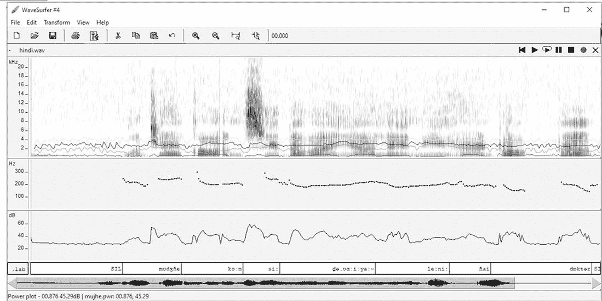

Figure 4.8: 使用 `WaveSurfer` 进行手动分段和标注显示功率图、共振峰和音高。

### 4.5.3 性能评估

翻译系统的每个组件都单独进行评估。由于系统的整体性能取决于流水线组件中每个单元的性能，因此我们单独评估了组件性能。此评估还有助于识别需要更多关注以进一步改进的组件。`ASR` 组件性能以 `WER%` 评估，该指标考虑了插入、删除和替换词的计数。`MT` 组件可靠性的性能使用 `METEOR` 判断，这是一种与人工评估高度相关的方法。它考虑了精确率和召回率，并对召回率赋予更大权重。`TTS` 组件使用感知测试进行评估。确定了十名听众，并为他们播放输入样本的语音合成器。他们被要求在三点量表上对样本进行评判，该量表范围从不清楚的语音、难以理解到可理解的语音。

随机选择的 30 个基于问答的样本和 50 个短语句子用于测试两种语言的数据。评估在六次迭代中进行，每次迭代的样本大小相同，样本选择均随机进行。Figure 4.9 展示了六次迭代中 `ASR`、`MT` 和 `TTS` 每个组件的性能。`ASR` 模块的平均 `WER` 为 0.6743，即 `ASR` 系统的平均准确率为 67.43%，印地语语音识别为 67.43%，英语为 72%。这种低性能可能归因于环境噪声，也可能归因于设备麦克风质量，因为录音使用的是手机。

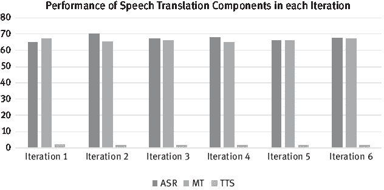

Figure 4.9: 不同迭代中 `ASR`、`MT` 和 `TTS` 子系统的性能。

机器翻译系统的平均性能得分为 0.6621；印地语到英语的正确翻译率为 66.21%，英语到印地语翻译为 64.32%。Figure 4.9 中的表示对应于印地语到英语的转换。Table 4.3 显示了对印地语语音合成器若干样本的用户感知。

Table 4.3: 用户对合成语音的感知，按 1（不清楚）到 3（可理解）的量表衡量。

| →Users ↓Sample || User 1 || User 2 || User 3 || User 4 || User 5 || User 6 || User 7 || User 8 || User 9 || User 10 |

| --- | --- | --- | --- | --- | --- | --- | --- | --- | --- | --- |

| Sample 1 || 2 || 1 || 2 || 2 || 1 || 2 || 1 || 1 || 1 || 2 |

| --- | --- | --- | --- | --- | --- | --- | --- | --- | --- | --- |

| Sample 2 || 3 || 2 || 2 || 3 || 3 || 2 || 2 || 2 || 3 || 2 |

| Sample 3 || 2 || 2 || 3 || 3 || 2 || 2 || 1 || 2 || 2 || 3 |

| Sample 4 || 3 || 2 || 2 || 2 || 3 || 3 || 2 || 2 || 2 || 2 |

| Sample 5 || 1 || 1 || 1 || 2 || 1 || 1 || 1 || 2 || 2 || 2 |

印地语语音合成器的平均性能评分为 3 分制中的 2.03，而英语的性能在同一量表上评为 2.12。

## 4.6 结论

在本章中，我们讨论了医疗服务中的语言障碍。语音技术在消除语言障碍方面的重要性与必要性在此已得到阐述。我们在针对自动通信技术构建的医疗领域相关挑战方面进行了识别。不同领域中现有的语音转语音系统的简要综述在此已涵盖。综述的分析有助于找到借助语音技术克服语言障碍的方法，并推动医疗保健领域语音转语音系统的开发。进一步地，我们在此讨论了医疗服务中印地语到英语及反向的语音转语音翻译系统。系统的每个组件都单独进行了讨论，并描述了 `ASR-MT-TTS` 的流水线架构以减少语言障碍。对子组件的性能进行了单独分析。它表明我们的系统表现相当不错，通过改进每个组件的不足之处可以获得进一步的提升。`ASR` 可以变得更具抗噪性，并且可以通过利用输入文本的多个假设来增强 `MT` 性能。显而易见的是，未来语音技术的使用将变得必不可少，尤其是在医疗保健领域，以打破语言障碍。

## 4.7 未来展望

未来首要目标是提高现有系统的准确性。语音启用服务以数据为中心；因此，我们需要增加语音语料库的规模以提高准确率。除此之外，在现有系统中集成降噪算法也有助于提高系统性能。印度是一个多语言国家。将语音启用服务扩展到其他语言的人群，将使其更容易获得全球医疗保健服务。我们打算在医疗保健领域开发多语言语音翻译系统，该系统将涵盖更多印度语言以及其他国家可获得更好医疗保健服务的国家语言。语料库需要涵盖由于说话者社会和经济背景而产生的口音变化，以提高系统鲁棒性。

如今，手机的使用正在迅速扩展，已覆盖印度大部分农村地区。将系统扩展到手机上部署，将为农村地区的医疗保健领域提供有价值的服务。

## References

Antony, P J. Machine translation approaches and survey for Indian languages. International Journal of Computational Linguistics & Chinese Language Processing, (2013), 18(1), Mar. a, b

Arora, K., Arora, S., and Roy, M K. Speech to speech translation: a communication boon. CSI Transactions on ICT, (2013), 1(3), 207–213.Sep. 1. →

Banerjee, S., Lavie, A. METEOR: An automatic metric for MT evaluation with improved correlation with human judgments. In proceedings of the ACL workshop on intrinsic and extrinsic evaluation measures for machine translation and/or summarization, (2005) Jun. 65–72. →

Beutnagel, M., Conkie, A., Schroeter, J., Stylianou, Y., and Syrdal, A The AT&T next-gen TTS system. Joint Meeting of ASA, EAA, and DAGA, (1999), 15, 18–24, Mar. →

Bischoff, A., Bovier, P A., Isah, R., Françoise, G., Ariel, E., and Louis, L. Language barriers between nurses and asylum seekers: Their impact on symptom reporting and referral. Social Science & Medicine, (2003), 57(3), 503–512.Aug. 1. →

Bouillon, P., Gerlach, J., Spechbach, H., Tsourakis, N., and Halimi Mallem, I S. BabelDr vs Google Translate: a user study at Geneva University Hospitals (HUG), (2017). a, b

Casserly, E D., Pisoni, D B. Speech perception and production. Wiley Interdisciplinary Reviews: Cognitive Science, (2010), 1(5), 629–647.Sep. a, b

Doddington, G. Automatic evaluation of machine translation quality using n-gram co-occurrence statistics. In Proceedings of the second international conference on Human Language Technology Research (2002), Mar 24 (pp. 138–145). Morgan Kaufmann Publishers Inc. →

Dorr, B J., Jordan, P W., and Benoit, J W. A Survey of Current Paradigms in Machine Translation. In Advances in Computers, Jan. 1, (1999), 49, 1–68, Elsevier. →

Dua, M., Aggarwal, R K., and Biswas, M. Performance evaluation of Hindi speech recognition system using optimized filterbanks. Engineering Science and Technology, an International Journal, (2018), 21(3), 389–398. Jun. 1. →

Ehsani, F., Kimzey, J., Master, D., Sudre, K., and Park, H. Speech to speech translation for medical triage in Korean. In proceedings of the workshop on Medical Speech Translation (2006) Jun. 9 (pp. 13–19). Association for Computational Linguistics. a, b

Ettelaie, E., Gandhe, S., Georgiou, P., Knight, K., Marcu, D., Narayanan, S., and Belvin, R. Transonics: a practical speech-to-speech translator for English-Farsi medical dialogues. In proceedings of the ACL 2005 on interactive poster and demonstration sessions, (2005) Jun. 25 (pp. 89–92). Association for Computational Linguistics. a, b

Fassil, Y. Jul Looking after the health of refugees. Bmj, (2000), 321(7252), 57–59. →

Flores, G., Abreu, M., and Tomany-Korman, S C. Limited English proficiency, primary language at home, and disparities in children’s health care: how language barriers are measured matters. Public Health Reports, (2005), 120(4), 418–430. Jul. →

Heinze, D T., Turchin A., and Jagannathan, V. Automated interpretation of clinical encounters with cultural cues and electronic health record generation. In Proceedings of the First International Workshop on Medical Speech Translation, (2006) Jun, 20–27.

Jacobs, E A., Lauderdale, D S., Meltzer, D., Shorey, J M., Levinson, W., and Thisted, R A. Jul Impact of interpreter services on delivery of health care to limited-English-proficient patients. Journal of General Internal Medicine, (2001), 16(7), 468–474. →

Jilka, M., Syrdal, A K., Conkie, A D., and Kapilow, D A Effects on TTS quality of methods of realizing natural prosodic variations. InProc. ICPhS, (2003). →

Jing, Z., and Min, Z. Speech recognition system based improved DTW algorithm. In 2010 International Conference on Computer, Mechatronics, Control and Electronic Engineering, (2010) Aug 24 (Vol. 5, pp. 320–323). IEEE. →

Kathol, A., Precoda, K., Vergyri, D., Wang, W., and Riehemann, S. Speech translation for low-resource languages: The case of pashto. In Ninth European Conference on Speech Communication and Technology, (2005). a, b

Klatt, D H. Review of text-to-speech conversion for English. Journal of the Acoustical Society of America, (1987), 82(3), 793–857. →


Lee, Y S., Sinder, D J., and Weinstein, C J. Interlingua-based English–Korean two-way speech translation of Doctor–Patient dialogues with CCLINC. Machine Translation, (2002) Jan 1, 17(3), 213–243.

Mohamed, A R., Dahl, G E., and Hinton, G. 使用深度置信网络的声学建模。IEEE 音频、语音和语言处理汇刊，(2011)，20(1)，14–22。1 月 31 日。 →

Nair, J., Krishnan, K A., and Deetha, R. 一种使用混合机制的高效英译印地语机器翻译系统。收录于 2016 年计算、通信与信息学进展国际会议论文集 (ICACCI)，(2016) 9 月 21 日 (第 2109–2113 页)。IEEE。 a，b

Papineni, K., Roukos, S., Ward, T., and Zhu, W J. BLEU：机器翻译自动评估方法。收录于 计算语言学协会第 40 届年会论文集，(2002) 7 月 6 日 (第 311–318 页)。计算语言学协会。 →

Raitio, T., Suni, A., Yamagishi, J., Pulakka, H., Nurminen, J., Vainio, M., and Alku, P. 基于 HMM 的利用声门逆滤波的语音合成。IEEE 音频、语音和语言处理汇刊，(2010) 3 月，19(1)，11 153–165。 →

Schultz, T., Alexander, D., Black, A W., Peterson, K., Suebvisai, S., and Waibel, A. 用于医疗对话的泰语语音翻译系统。收录于 HLT-NAACL 2004 演示论文集，(2004)，34–35。

Solera-Ureña, R., Martín-Iglesias, D., Gallardo-Antolín, A., Peláez-Moreno, C., and Díaz-de-maría, F. Apr 使用支持向量机的鲁棒 ASR。语音通信，(2007)，49(4)，1 253–267。 →

Upadhyaya, P., Sk., M., Farooq, O., Yv., V., and Abidi, M R. (pp, 基于深度神经网络的 Kaldi ASR 的连续印地语语音识别。收录于：《机器智能与信号分析》。 (2019)，新加坡：Springer，303–311)。 →

Vemula, V V., Narne, P K., Kudaravalli, M., Tharimela, P., and Prahallad, K. ANUVAADHAK：一种双向印度语言语音到语音翻译系统，用于本地出行信息辅助。国际工程科学与技术期刊，(2010)，2(8)，3865–3873。 →

Waibel, A., Badran, A., Black, A W., Frederking, R., Gates, D., Lavie, A., … and Schultz, T. Speechalator：消费级 PDA 上的双向语音到语音翻译。收录于 第八届欧洲语音通信与技术会议。 (2003)。 →

Whittaker, E W., and Woodland, R C. 针对超大词汇量的高效基于类的语言建模。收录于 2001 年 IEEE 语音、声学和信号处理国际会议论文集。论文集 (Cat. No. 01CH37221)，(2001) 5 月 7 日 (第 1 卷，第 545–548 页)。IEEE。 →

Young, S.. HMMs 及相关语音识别技术。收录于：《Springer 语音处理手册》，(2008)，(第 539–557 页)。柏林海德堡：Springer-Verlag。 a，b

Zhou, B., Gao, Y., Sorensen, J., Déchelotte, D., and Picheny, M. 手持式语音到语音翻译系统。收录于 2003 年 IEEE 自动语音识别与理解研讨会 (IEEE Cat. No. 03EX721)，(2003) 11 月，(第 664–669 页)。IEEE。

Zhou, B., Déchelotte, D., and Gao, Y. 手持设备上的双向语音到语音翻译。收录于 第八届国际口语语言处理会议，(2004)。 →

# 5 机器学习和深度学习在医疗保健系统领域的最新进展

Yogesh Kumar Chandigarh 工程学院，Landran，Mohali Manish Mahajan Chandigarh 工程学院，Landran，Mohali

## 摘要

医疗保健领域长期以来主要且显著地受益于科学进步。如今，机器学习 (`ML`，人工智能的一个子集) 在众多健康相关领域发挥着至关重要的作用，包括新型医疗措施的扩展、患者信息和记录的管理，以及慢性疾病的治疗。`ML` 在医学领域最近成为头条新闻。Google 已开发出一种 `ML` 技术来帮助识别乳房 X 光片上的癌性肿瘤。斯坦福大学使用深度学习方法对皮肤癌疾病进行分类。尽管如此，`ML` 的进步本身优于其他术语。算法可以为具有可重复或一致的程序的学科提供即时优势。此外，那些拥有大量医学图像数据集的学科，如放射学、病理学和心脏病学，都是强有力的候选者。`ML` 可以被训练来查看图像、分类异常并对需要关注的部分发表意见，从而提高所有这些发展的正确性。未来，`ML` 将为家庭医生带来益处。`ML` 还可以提供客观意见以提高生产力、一致性和准确性。医疗保健需要从将 `ML` 的智能视为创新概念转变为将其视为可以现在部署的现实世界工具。如果 `ML` 要在医疗保健系统中发挥作用，我们必须采取增量方法。`ML` 在医疗保健领域具有无限影响，例如药物发现应用、机器人手术、预测糖尿病、肝脏异常，以及个性化医疗。本章的主要目的是研究 `ML` 在近期医疗保健应用中的进展，例如不同疾病的自动治疗或推荐、自动机器人手术、药物发现和开发，以及医疗保健系统的其他最新领域。本章还包括对医疗保健中使用的不同 `ML` 技术进行分析。本章的另一个目标是提供一种系统化的程序来在医疗保健领域使用 `ML` 技术。混合 `ML` 方法也可以用于检测不同类型的疾病。利用 `ML` 算法，可以同时开发出识别多癌症疾病的高效系统。本章还包括基于医疗保健系统中 `ML` 方法和深度学习方法的分析。

关键词：机器学习，深度学习，癌症疾病，机器人手术，分类，

## 5.1 引言

工业组织正在使用大量通过机器学习（`ML`）识别的数据。通过收集这些数据的感知，组织可以更高效地工作，并比竞争对手取得更好的成果（Amin et al., 2013）。在各个领域，`ML` 算法已被用于创新的预测模型（Anand et al., 2015）。甚至深度学习技术也被用于日常活动中的广告、Google 搜索和 YouTube。在多学科和医疗保健信息学领域，`ML` 和深度学习技术的应用在数据处理挑战和技术广告方面变得相同（LeCun et al., 2015；Russakovsky, 2015）。科学领域如健康或医学信息学处理存储、检索和医疗数据的最佳使用以及为问题解决和决策提供的信息。过去几十年里，健康技术取得了巨大的发展，如信息收集、通信、研究和治疗方面的进步。通过医疗信息数字化，患者数据有所增加，这些数据可以与先进设备生成的医疗结果和患者提供的数据相关联（Hirschberg et al., 2015）。这一信息革命是一个共同结果，人们面临着解读和理解数据的令人沮丧的任务。处理或管理这些大量数据仅靠手动技术和工具是不可能的，而且也是一个非常缓慢和繁琐的过程。因此，为了理解数据，需要来自计算科学或数据科学和数据分析的数据驱动方法。关键的健康信息可以被提取，医疗数据可以利用这些方法进行分析，这可以帮助医生和患者做出更好的决策（Hinton et al., 2012）。

目前，为了分析医疗数据，学术界和工业界在数据科学上投入了大量资金。在未来几年，随着医学中生成数据的数量快速增长，数据科学将发挥重要作用。在将人工智能（`AI`）系统部署到医疗保健应用之前，需要通过临床活动对其进行训练，例如诊断、治疗和筛查评估，这些活动会生成数据（Kotsiantis, 2007）。这是为了让 `AI` 通过相似的受试者群体以及结果与感兴趣特征之间的关联来学习。`AI` 设备主要有两大类。

第一类使用 `ML` 技术：这将分析结构化数据，如基因、合格提供者（`EP`）和影像数据，并用于尝试找出疾病结果概率的医疗应用（Brazdil et al., 2003）。

另一类使用自然语言处理（`NLP`）：这将从医学期刊和临床记录等非结构化数据中提取信息，从而补充和丰富结构化医疗数据（Cheng et al., 2007）。`NLP` 程序的主要目标是将文本转化为机器可读的结构化数据，然后使用 `ML` 技术进一步分析。

在本章中，第 5.1 节提供了关于 `ML` 和深度学习在医疗保健中使用的简要介绍；第 5.2 节包含 `ML` 方法的分类，分为四种类型。第 5.3 节给出了在医疗保健领域使用 `ML` 技术的系统程序。第 5.4 节给出了 `ML` 在医疗保健中的应用，包含各研究者在医疗保健不同领域的工作以及比较研究。第 5.5 节给出了医疗保健和其他行业中的深度学习解决方案以及比较研究，第 5.6 节包含深度学习在医疗保健和医学领域的当前和未来应用。

## 5.2 ML 方法的分类

有大量 `ML` 算法，根据学习性质可分为四大类（Mishra, 2018）。`ML` 算法的选择过程包括特征，这些特征将学习数据与现有方法偏差相匹配。Figure 5.1 显示了 `ML` 的类型。

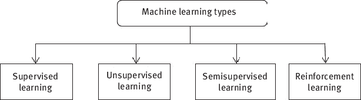

Figure 5.1: Types of machine learning process (Mishra, 2018)。

### 5.2.1 监督学习

监督学习被赋予的另一个名称是预测模型，用于使用数据集中其他值预测一个值的任务等（Anil Mathur, 2007）。预测模型训练的过程被确定为监督学习，因为预测模型被明确告知它们需要学习什么以及如何学习。在存在不确定性的情况下，监督 `ML` 能够预测存在的证据。Figure 5.2 显示了语音学习的图表。正如在监督学习算法中那样，从输入数据集和已知数据响应中获得输出。一些监督 `ML` 算法如下：

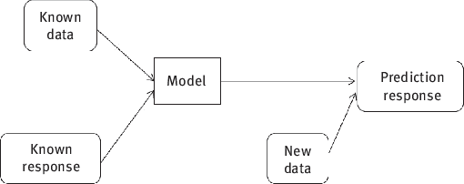

Figure 5.2: Supervised learning (Anil Mathur, 2007)。

* **支持向量机（`SVM`）：** `SVM` 被认为是与经典多层感知器神经网络（`NNs`）密切相关的最新类型的监督 `ML` 技术（Yang et al., 2018）。它在用于分离两个或两个以上对象或数据类的超平面上工作，作用于对象与超平面的边界（Zhang et al., 2012）。通过减小边界或在实例与分离它的超平面之间创建较大距离，预计泛化误差将减少。

* **朴素贝叶斯（`NB`）：** 在分类和训练阶段，`NB` 监督 `ML` 方法需要非常少的存储空间（Zhu et al., 2009）。这意味着为了存储先验和条件概率，需要非常少的存储空间，这导致训练阶段的存储内存非常少，但执行空间应等于训练部分的空间。

* **`NN`：** `NN` 监督 `ML` 方法或技术能够执行回归和分类的各种任务，但单个网络仅执行单一任务（Hiregoudar et al., 2014）。因此，在大多数情况下，网络中只有一个输出变量，但在处理具有多种状态分类问题的情况时，可以有多个输出单元。

* **决策树（`DT`）：** 这些树通过根据特征值对实例进行简单排序来对实例进行分类。`DT` 中每个节点表示一个待分类的实例特征，而其中每个分支表示每个节点假设的值（Gillies et al., 2012）。实例的分类从根节点开始，然后根据特征值进行排序。

**贝叶斯网络 (`BN`)：** 它是表示各种特征集合或任何其他变量之间概率关系的图形模型。它被认为是结构化机器学习算法的非常著名的代表（Shin et al., 2010）。与 `NN` 或 `DT` 监督机器学习方法相比，`BN` 最重要或不同的特征在于它考虑了对任何问题采取先验信息的可能性。

### 5.2.2 无监督学习

它的另一个名称是描述性模型，用于从有趣和新颖的方式理解汇总数据的任务会受益的任务。与预测模型相比，感兴趣的目标是可预测的；另一方面，任何特征都是描述性模型，其重要性将超过任何其他单一特征。无监督学习是用于训练描述性模型的过程，因为没有涉及用于区分数据的学习目标并且获得较少结构（Kaelbling, 1996）。它主要用于交易数据。一些无监督机器学习算法如下：

* `k`-均值聚类：这是一种无监督机器学习技术，在启动时自动创建组。然后具有相同特征的项目归入同一簇（Li, 2016）。由于它根据输入给它的输入数据创建 `k` 个不同的簇，因此该算法被称为 `k`-均值。在任何特定簇中，其均值是该簇的中心。

* 模糊 `c`-均值

* 隐马尔可夫模型

它们主要用于分割文本主题和识别数据异常值。

**半监督学习：** 它可以用作监督学习的替代。唯一的区别是半监督学习中使用了标记数据和未标记数据的训练。这种类型的学习主要用于预测、回归和分类。在完全标记的训练过程的高标记成本的情况下，半监督学习会带来有益的结果（Thompson, 2007）。使用半监督机器学习算法的一个例子是在网络上识别人的面孔。

**强化学习 (`RL`)：** 在这种情况下，机器被训练以在业务需求中做出相同的决策，主要目的是具有最大效率。在其中，人类专家的参与较少，从而节省了时间。它还有助于通过算法发现试错，从而有助于获得最佳奖励。它最常用于游戏、导航和机器人或决策。一些强化学习机器学习算法的例子是：

* **多任务学习：** 强化学习的多任务学习技术的主要目的是帮助学习者使其能够更好地执行。通过多任务学习算法记住解决任何问题的过程，有助于得出特定结论。之后，这些步骤被算法使用，有助于找到与之前在同一任务或问题上工作时找到的类似解决方案。这种帮助也被称为归纳迁移机制，其中学习者相互分享经验，有助于他们以比单独更快的方式并发学习（Darcy et al., 2016）。

* **集成学习：** 当许多单个学习者组合在一起时，就被称为集成学习。在这种情况下，单个学习者可以是 `DT`、`NB`、`NN` 等。已经观察到，学习者集合可以实现比单个学习者更好的结果（Murff et al., 2011）。

* Q 学习

* R 学习

* TD 学习

## 5.3 在医疗保健领域使用机器学习技术的系统化程序

由于大量数据的存储和生成，使用机器学习在企业预测中日益增加。为了对企业数据集具有高准确性和价值，机器学习提供了有效的框架、应用程序和算法。在大规模数据集预测价值的基础上，使用机器学习方法找到优化决策。它的使用在处理预测任务方面是有效的，例如定义具有最大倾向于驱动首选结果的行为。

### 5.3.1 将机器学习应用于数据的步骤

以下是应用机器学习任务的一些步骤：

* 数据收集

* 探索和准备数据

* 在数据上训练模型

* 评估模型性能

* 提高模型性能

* **数据收集：** 这是图 5.3 的第一个模块。为了分析目的，无论数据是写在纸上、存储在 SQL 数据库中，还是记录在电子表格和文本文件中，都需要在电子格式中收集数据。根据收集到的数据，算法生成可操作的信息。

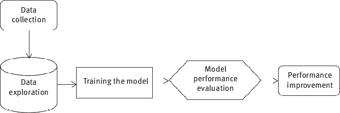

图 5.3：机器学习过程（Fathurachman et al., 2014）。

* **探索和准备数据：** 机器学习项目的质量是根据所使用的数据质量来衡量的。在机器学习过程的此步骤中，人类的参与更多。在机器学习中，80% 的工作投入在数据上，数据探索是花在了解数据上的时间。

* **在数据上训练模型：** 机器学习选择最佳算法，然后所选算法将数据表示为模型的形式。

* **评估模型性能：** 从过去经验中学习算法的估计性能非常重要。每个机器学习模型都能够对每个与学习相关的问题产生有偏见的解决方案。根据所使用的模型测试数据集，可以评估模型的准确性。

* **提高模型性能：** 为了获得更好的性能，使用高级策略增强每个模型的性能。需要根据要求更改模型或获得所需结果。

完成这些步骤后，通过部署能够实现可接受性能的模型来完成拟议的任务。对于财务数据预测、评分数据预测、医疗应用数据或自动化任务，应用机器学习模型。已部署模型的失败和成功为下一代训练模型提供数据。

## 5.4 机器学习在医疗保健中的应用

人口的快速增长使得分析和记录大量患者数据具有挑战性。在机器学习的帮助下，医疗保健系统变得更加稳健和动态，它自动化了处理并从大型数据库中查找数据。医学科学和计算机科学是两种类型的领域，它们在使用机器学习进行医疗保健时汇聚为单一线程。使用机器学习技术有助于医学科学的进步和分析复杂医疗数据以进行进一步分析。

### 5.4.1 机器学习在心脏病中的应用


到 2012 年，经验丰富的医生的判断是诊断冠心病的唯一方法。当时，当前的研究热点是使用机器学习中的计算机智能算法进行冠心病诊断。然后冠心病检测由 Zhang et al. (2012) 完成，使用基于统计学习理论的 `SVM`。在他们的工作中，测试数据使用具有不同核的分类器进行分类，同时对原始数据进行特征提取和数据预处理。他们得出结论，径向基函数 (`RBF`) 的准确率高于所有其他分类器。对于 `RBF`，使用优化参数网格搜索方法来选择核函数和惩罚因子的最佳参数。各种研究人员使用人工神经网络 (`ANN`) 技术在心脏病诊断中取得了良好的准确率。但 `ANN` 技术仍存在一些缺点，例如参数数量的调整、激活函数必须可微分、训练过程长，以及得到的解会陷入局部最小值。由于所有这些缺点，Fathurachman et al. (2014) 使用了极限学习机 (`ELM`)。`ELM` 被认为是一种泛化能力更好的模型学习算法，比 `DT`、`SVM` 和 `ANN` 更快，并且调参简单。使用 `ELM` 模型获得的结果表明，它有助于以 83% 的准确率诊断心脏病。由于涉及大量数据、大量噪声干扰和高数据维度，诊断心脏病是一项困难的任务，这需要使用数据驱动方法。因此，为了诊断心脏病，Yang et al. (2018) 提出了基于 `SVM` 的二维降维方法。为了诊断目的，使用 `SVM`-递归特征消除方法获得的更相关特征比主成分分析 `SVM` 多。评估了所提出的方法，结果显示 `PCA-SVM` 能够通过 `RBF` 核仅使用大小主成分实现 88.24% 的分类准确率。

### 5.4.2 使用 ML 预测糖尿病

如上一节所述，技术快速发展，数据量增加，使得医疗保健领域成为研究人员非常重要的领域。大数据分析方法已开始用于处理大量医疗保健数据。Mir et al. (2018) 的动机是提出一个使用分类器模型的 `WEKA` 工具，能够预测糖尿病疾病。为分析目的，他们使用了随机森林、`SVM`、简单 `CART` 和 `NB` 算法。基于评估每个算法在糖尿病疾病预测数据集上的有效结果，他们找出了最佳算法。从性能来看，可以观察到在预测糖尿病疾病时 `SVM` 给出最大准确率。与其他疾病一样，糖尿病的早期预测可以挽救人类生命。因此，Md. Faruque et al. (2019) 使用 ML 技术探索了各种与糖尿病相关的风险因素，因为它能够在知识提取方面给出有效结果。预测模型是为从收集的糖尿病患者诊断医疗数据集中提取知识而构建的。这有助于预测糖尿病患者。在他们的工作中预测糖尿病，他们主要使用了成人人口数据，如 `k`-最近邻 (`k-NN`)、`NB`、`C4.5 DT` 和 `SVM` ML 算法。对这四种算法进行了实验，结果显示 `C4.5 DT` 具有最高准确率。

然后再次在 2019 年，Alic et al. (2019) 使用 ML 预测 2 型糖尿病的未来发展。为分析目的，使用了圣安东尼奥心脏研究数据，并使用十个特征和 `SVM` 构建了预测模型。由于在类别标签方面数据集不平衡，使用了 10 折交叉验证来训练模型。在 100 次迭代的平均值中，实现了 81.1% 的召回率和 84.1% 的准确率，有助于识别有较高风险发展为 2 型糖尿病的群体。

### 5.4.3 ML 在肝脏异常预测中的应用

自动化用于使用超声图像预测肝脏异常。为此，Hamid et al. (2018) 使用了 ML 模型来生成正常和异常标签，并检测其预测可能不正确的时机。如果所提出的模型无法预测异常，则不会为测试示例生成标签。目前使用的 ML 模型即使在预测置信度低的情况下仍会为给定示例生成标签。因此，为学习提出了一种基于求解器的新型随机梯度下降，由 Kanza 提出，然后使用它提出了实用的、最先进的方法。该方法被提出用于肝病分类，然后使用来自巴基斯坦、木尔坦和 MINAR 的 100 名患者的数据集进行了测试。为了避免活检的缺点，使用了无创 ML 方法。Hashem et al. (2018) 使用了多种 ML 技术（遗传算法、多线性回归、粒子群优化和 `DT`）来预测晚期纤维化。在此，他们结合了临床信息和血清生物标志物来开发分类模型。大约有 40,000 名患者被分为两组前瞻性队列，患有慢性丙型肝炎。通过评估所提出的模型与接收者操作特征，发现年龄、天冬氨酸转氨酶、白蛋白和血小板计数对晚期纤维化具有显著性。在预测患者晚期纤维化时，`AUROC` 和 `HCC` 介于 0.73 和 0.76 之间，使用 ML 算法获得的准确率为 66.3% 和 84.4%。Vats et al. (2018) 由于其在数据科学领域的流行性和良好结果，致力于 `k-means`、亲和传播和基于密度的噪声应用空间聚类 (`DBSCAN`) ML 技术。它在计算复杂度和肝病患者预测准确率方面进行了进一步比较。使用了与肝病相关的医疗保健数据集，并使用轮廓系数比较了上述三种 ML 算法的性能测量。根据此测量，`k-means` 是预测肝病的最佳方法。

### 5.4.4 使用 ML 的自动机器人手术

为了评估疾病进展和手术规划，测量组织力学特性并定位肿瘤已被证明是有用的。然后在人工组织中，通过自动机器人触诊后，监督式 `ML` 算法实现了硬包埋物的力学定位。然后对于学习算法，一组训练数据由 Nichols et al. (2019) 使用弹性成像的特定表征以及非侵入性和组织生物力学的包埋生成。人工组织的刚度使用弹性成像进行表征，同时嵌入硬包埋物，并在弹性成像图像上识别出包埋物后，使用 `ML` 方法识别出周围软组织与包埋物之间的刚度差异。刚度值被其标记为包埋物的一部分或软组织。进一步通过自动机器人触诊的人工组织，在组织表面创建了刚度分布图。其主要动机是为了找到针对训练分类器的 `ML` 算法的阈值，并对理论上属于硬包埋物的点进行标记。缺乏反馈力是机器人辅助微创手术的主要限制，仅仅添加传感器在临床环境中并不会成为一种切实可行的解决方案。正因如此，Aviles et al. (2015) 提出了一种力估计方法，首先通过最小化能量泛函来重建组织表面的 `3D` 变形结构。然后他们提出了基于循环 `NN`-长短期记忆的架构，可提供准确的估计。所提出的方法经过测试，显示出实现了长期稳定性，并且准确率相比现有方法有显著提升，范围从 54% 到 78%。

### 5.4.5 ML 在个性化医疗中的应用

一种新的医疗方法是个性化医疗或 `PH`，它主要通过关注物联网传感器设备、基于网络或社交媒体的信息以及收集患者数据的患者电子健康记录，来改善传统医疗保健系统。然后通过 `PH`，在收集的数据上应用了 `AI` 技术，有助于改善临床干预、疾病进展、疾病预测和患者自我管理。然后为了建立分析模型，用于不同临床决策支持系统和医疗服务应用的 `ML` 技术被整合在一起。从传感器设备收集的数据使用这些模型进行分析，并通过其他来源识别患者的行为模式以及他们的临床状况。

用于分类目的，使用了监督或无监督 `ML`。有时人类做出的决定会因情绪的介入而出错；另一方面，计算机没有情绪。因此，人们在决策时会基于其对政治、宗教和世界的看法而产生偏见。在用于训练目的的可用数据集中，这些因素会造成问题，因为它被用于训练以做出决策。由于所有这些因素，使用于 `ML` 的数据集的保真度变得具有挑战性。克服这些问题将有助于提升个性化医疗。Ahamed et al. (2018) 对近期研究中使用的 `ML` 模型进行了研究，识别了其可靠性问题并提出了改进方案。为了通过生物医学设备持续监测每个人的健康并预测潜在的健康危害，`PH` 起着至关重要的作用。如果这些危害未及时治疗，则可能变得危险。Mr. Walinjkar et al. (2017) 主要关注对个人 `ECG` 信号的持续监测；为此，使用了 `3-lead` `ECG` 套件并通过实时分析检测心律失常。这使得能够预测心脏风险，并且在 `ML` 阶段需要处理分类准确率，因为开发了一种特征提取方法。该方法能够提高分类准确率。为了开发预测模型、分类和学习开发，使用了心律失常数据库（`MIT-BIH`，`Physionet`）。所提出的模型经过测试，其结果显示，使用 `k-NN` 分类器模型实现了 99.4% 的准确率，交叉熵误差为 7.6，在测试数据上误分类误差为 1.2。

### 5.4.6 使用 ML 进行药物预测的发现

各种研究人员在正交技术上进行了工作，其中通过识别不可对接的配体，使用软计算减少搜索空间。这将提高吞吐量；另一方面，二元分类器可以使用 `ML` 进行训练，将配体分类为可对接和不可对接，这两个已知类别。因此 Senanayake et al. (2013) 在单一问题域上使用了随机森林、`ANN` 和 `SVM` `ML` 技术。问题域是 `HIV` 的蛋白酶受体，并评估了其性能，显示吞吐量准确率提高了 90%，提升了两倍。他们还提出了用于构建训练集的技术，并在未合成受体的实例中证明了其对 `ML` 的有用性。识别与疾病相关的受影响候选分子的蛋白质是药物发现中的主要问题。在实验中，使用了多个 `ML` 预测程序，其中新的候选物来源于 Janssen Pharmaceutica 的化学基因组学项目。程序以单节点 `C++` 编写，运行时间更长，本质上是并行的，但在其中未使用多个节点。Harnie et al. (2015) 展示了如何使用 `Apache spark` 重新实现管道，从而将现有程序提升到多节点集群中。在 Spark 管道基准测试和预测器中，未对原始版本进行更改，这有助于实现最高可达八个节点的线性加速。同时，他们的管道能够生成更少的中间文件，并允许更轻松的监控和检查点。

## 5.5 医疗保健中的深度学习

深度学习的另一个名称是分层深度结构学习，它是 `ML` 的一个分支（Hinton, 2006）。这些受启发的 `AI` 算法开发了分层架构的学习和数据表示。它还受人类大脑新皮层的启发，分层学习过程能够自动从数据中提取抽象和特征。在贪婪逐层方法中，当需要处理大量无监督数据和自然学习数据表示时，深度学习算法会给出改进的结果（Bengio, 2009）。深度学习已在各种应用中找到用途，如图像识别、生物识别、`NLP` 和医疗保健。本节的主要目的是提供深度学习在各种医疗保健应用中的使用情况。

### 5.5.1 医疗保健和其他行业中的深度学习解决方案

各种深度学习模式和隐藏机会被用于治疗患者。近几年，人工智能和机器学习获得了大量关注，但现在深度学习已在旅游、零售、纺织、旅游和医疗等各个领域或行业中开辟了自己的道路（Bengio, 2013）。当今现代世界中每个人的主要关注点是他们的健康；因此各种技术如深度学习被应用于健康行业。医学专家提出了各种实施新技术的方法，这些技术应能够为更好的未来提供良好的结果（Arel, 2010）。深度学习能够处理大量数据，包括患者的记录以及医疗报告、保险报告和个人数据，这有助于为良好的结果提供更好的治疗。

### 5.5.2 深度学习在机器人手术中的应用

由于恢复速度更快且疼痛更少，腹腔镜被用于各种临床手术中的微创手术。操作空间非常狭窄，视野有限，触觉反馈不足，这可能会损坏手术器械、器官和组织。因此，在腹腔镜手术中用于检测手术器械时，采用了基于卷积神经网络（CNN）的实时模型 Choi et al. (2017)。为测试目的，他们使用了七种手术器械的数据集来训练 CNN，然后使用 YOLO 统一架构实时跟踪手术器械。为了评估所提出的模型，使用了精度和召回率作为性能指标，结果显示在数据集上平均准确率为 72.26%。据预测，语义分割是机器人器械手术中一个非常大的问题，其中器械位置的正确检测是手术场景附近姿态跟踪和估计的主要挑战。为了解决这些挑战，需要精确的逐像素器械分割；因此，Shvets et al. (2018) 提出了一种基于深度学习的方法来解决二值分割问题。通过手术视频的输入，每张图像的每个像素都被标记为器械或背景，并且还解决了多类分割问题，其中他们区分了不同部件和不同器械与背景。所提出的方法经过测试并与其他方法进行了比较，用于自动器械分割，结果有所改善。

### 5.5.3 深度学习在药物发现中的应用

随着药物候选物的增加，药物发现的社会负担也在增加。在药物反应体外模型中，传统的临床前药物场景无法模拟人类生物学的复杂特性。由于此原因，需要做出贡献。Gregor Urban 等人提出了一种新的微生理系统，用于培养灌注微组织，似乎适合大规模药物筛选，并且能够准确模拟人类生理学。然后在 2018 年，Gregor U. 等人（2018）开发了一种机器学习模型，该模型能够准确、快速地预测标志命令，这些命令能够在体外药物应用前后图像中有效破坏血管网络。所提出的系统基于 CNN，能够在不对系统产生任何假阴性影响的情况下实现高或 98.1% 的准确率。

在传统的药物发现中，存在成本和时间问题，因此需要提出一种新方法来提高其效率。为了解决这个问题，使用虚拟筛选（VS）及其数据库已成为制药研究中一种著名的方法。VS 在药物开发和发现的早期阶段发挥着非常重要的作用，因为它有助于减少化学化合物的巨大搜索空间。为了有效区分，随着随时间推移配体数量的增加，使用了活性配体和非活性配体。对于大型数据库分子，使用深度学习算法进行筛选，然后将药物样和非药物样配体对特定蛋白靶点进行分类。这将导致 VS 过程速度的提高。Bahi et al. (2018) 提出了一种基于深度神经网络的快速化合物分类方法用于 VS，称为 DNNVS。然后从庞大的数据库中，使用 Spark-H2O 平台对小分子进行标记。所提出的方法经过评估，显示使用 DNNVS 实现的准确率为 99%，并且与机器学习技术相比表现良好。

### 5.5.4 深度学习在疾病诊断中的应用

乳腺癌已成为女性死亡的主要原因之一；用于乳腺癌诊断和筛查的标准是乳房 X 光检查。为了标准化乳腺 X 光检查报告，美国放射学会制定了乳腺影像报告和数据系统（BI-RADS）词汇表，该词汇表能够实现活检决策制定设施并评估癌症风险。由于使用不适当的术语和缺失数据，非结构化和半结构化自由文本被用于当前的活检决策制定，这导致其准确性存在差异。由于 BI-RADS 词汇表的应用和发生实质性的观察者间变异性，会产生变化，这使得将准确和新颖的技术纳入乳腺癌决策制定数据变得至关重要。然后为了开发分析模型，He et al. (2017) 结合了深度学习方法和自然语言处理，针对定义明确且特征明确的特定乳腺可疑患者亚组。该模型在与 SVM、高斯混合模型和 PCA 算法相比时能够提供更好的结果。Tourassi (2017) 讨论了最新深度学习技术的理论和实践视角，该技术与临床病理自然语言处理报告相关。提出了基准研究的各种信息提取任务，并讨论了它们在支持可扩展和全面的国家癌症监测计划方面的重要性（表 5.1 和 5.2）。

表 5.1：医疗保健中机器学习技术使用情况的比较研究。

| 作者姓名 || 应用领域 || 机器学习技术 || 数据集 || 结果 |

| --- | --- | --- | --- | --- |

| Zhang et al. (2012) || 冠心病 || SVM || 他们使用了冠心病患者的 UCI 机器学习库 || 他们使用了网格搜索方法进行参数优化，有助于选择最佳惩罚因子参数和核函数，有助于实现最高的分类准确率。 |

| --- | --- | --- | --- | --- |

| Fathurachman et al. (2014) || 心脏病诊断 || ELM || 来自克利夫兰诊所基金会、匈牙利心脏病研究所布达佩斯、大学医院的心脏数据集 || ELM 是一种更好的泛化模型学习算法，具有简单的调优，并且比 ANN、SVM 和决策树更快。使用 ELM 模型获得的结果显示，它有助于以 83% 的准确率诊断心脏病。 |

| Yang, et al. (2018) || 心脏病诊断 || SVM-RFE 和 PCA-SVM || UCI 心脏病数据库库 || 对所提出的方法进行了评估，结果显示 PCA-SVM 能够通过 RBF 核仅使用大小主成分实现 88.24% 的分类准确率。 |

| Mir and Dhage (2018) || 糖尿病疾病预测 || 随机森林、SVM、简单 CART 和朴素贝叶斯算法 || 国家糖尿病、消化和肾脏疾病研究所、皮马印第安人糖尿病数据库 || 从性能来看，在糖尿病疾病预测中 SVM 具有最高准确率 |

| Md. Faruque et al. (2019) || 与糖尿病相关的风险因素 || *k*\-NN、朴素贝叶斯、C4.5 决策树和 SVM 机器学习算法 || 孟加拉国 MCC 诊断 || 他们已用于机器学习技术，在全部四种中，C4.5 决策树比其他方法具有更高的准确率。 |

| Alic et al. (2019) || 预测 2 型糖尿病的未来发展 || SVM || 使用圣安东尼奥心脏研究数据 || 在 100 次迭代的平均值中，召回率为 81.1%，准确率为 84.1%，有助于识别患 2 型糖尿病高风险的人群。 |

| Hashem et al. (2018) || 遗传算法、多线性回归、粒子群优化和决策树 || 预测晚期纤维化 || 约 40,000 名慢性丙型肝炎患者的队列 || 预测患者晚期纤维化时的 AUROC 和 HCC 在 0.73 至 0.76 之间，使用机器学习算法获得的准确率分别为 66.3% 和 84.4%。 |

| Vats et al. (2018) || 肝病 || *k*\-Means、亲和传播和 DBSCAN 机器学习技术 || 肝脏健康相关数据集 || 根据测量，k-means 是预测肝病的最优方法。 |

| Mr. Walinjkar and Dr. Woods (2017) || 个性化医疗 || *k*\-NN || 心律失常数据库（MIT-BIH，Physionet）|| 对所提模型的评估显示，使用 k-NN 分类模型能够在测试数据上达到 99.4% 的准确率，交叉熵误差为 7.6，误分类误差为 1.2。 |

| Senanayake et al. (2013) || HIV 受体 || 随机森林、ANN 和 SVM 机器学习技术 || 著名的对接软件 Autodock Vina || 问题域是 HIV 的蛋白酶受体并评估其性能，显示吞吐量的准确率提高了 90%，提升了两倍。 |

UCL，加州大学欧文分校；MCC，吉大港医疗中心；ELM，极限学习机；SVM，支持向量机；PCA-SVM，主成分分析支持向量机；RBF，径向基函数；ANN，人工神经网络；RFE，递归特征消除；*k*\-NN，*k*\-最近邻。

表 5.2：医疗保健中机器学习技术使用情况的比较研究。


| 作者姓名 | 应用领域 | 机器学习技术 | 数据集 | 结果 |
| --- | --- | --- | --- | --- |
| Choi et al. (2017) | 机器人手术 | CNN | M2cai16-tool 数据集 | 为评估所提模型，使用精度和召回度作为性能指标，在数据集上显示平均准确率为 72.26%。 |
| --- | --- | --- | --- | --- |
| Shvets et al. (2018) | 机器人器械分割 | 基于深度学习的方法 | 由 8 × 225 帧组成的训练数据集。da Vinci Xi 手术系统获取的高分辨率立体相机图像序列。 | 所提方法经过测试并与其他方法进行比较，用于自动器械分割，结果有所改善。 |
| Urban et al. (2018) | 药物发现 | CNN | 使用 Nikon Ti-E Eclipse 荧光显微镜拍摄。体外药物应用前后的时间进程图像。 | 所提系统基于 CNN，能够在不产生任何假阴性影响的情况下达到高或 98.1% 的准确率。 |
| Bahi and Batouche (2018) | 药物发现 | 深度神经网络 | 他们取的第一个数据集来自最近的 Korkmaz 等人的出版物，第二个数据集收集自 “ChemBridge, 2011” 库 ZINC 免费配体。 | 对所提方法的评估显示，使用 DNNVS 获得的准确率为 99%，与机器学习技术相比表现良好。 |
| He et al. (2017) | 乳腺癌诊断 | 深度学习方法 | 临床数据仓库休斯顿 Methodist 研究院系统医学和生物工程系和信息学开发存档了大量患者数据和报告。 | 该模型与 SVM、GMM 和 PCA 算法相比能够给出更好的结果。 |

CNN，卷积神经网络；DNNVS，具有虚拟筛选的深度神经网络；SVM，支持向量机；GMM，高斯混合模型；PCA，主成分分析。

## 5.6 深度学习在医疗保健和医学领域的现状与未来方向

深度学习在医疗保健中的当前和未来应用是显而易见的，可以很容易地观察到。其中一些是：

* 在医疗保健行业中，从异构、复杂和高维生物医学信息中转移知识是一项具有挑战性的任务。在现代医学科学世界中，有大量数据，如传感器文本、电子记录、成像等，这些数据在很大程度上已通过使用深度学习算法得到解决。复杂或非结构化的示例可以使用深度学习成功表示，并使用最新的深度学习技术获得高效和新的范式，该范式能够为复杂类型的数据获得端到端学习模型。
* 在先进的临床研究中，使用电子健康记录获得了有希望的结果，并且也更好地告知了临床决策制定技能。借助现代电子健康记录，可以通过总结和表示的实践来防止预测建模。替代特征学习策略的使用已被证明在利用电子健康记录数据取得更好结果的患者中是成功的。从不同研究人员进行的各种研究可以看出，在临床环境决策系统中引入深度学习框架论证可获得改进的结果。
* 在血栓形成中，使用尿激酶和纤溶酶原激活剂链激酶和疗法已不再是美国食品药品监督管理局批准的方法。取而代之的是，深度学习出现用于急性外周动脉血栓形成和栓塞以及急性冠状动脉血栓形成的治疗。
* 深度学习训练算法有一些衡量标准和结果。在检测中，参考糖尿病视网膜病变敏感性和特异性算法的性质可以定义为最差或中等。因为这个原因，深度学习训练算法中使用了两个由开发集选择的运行点。在此，第一个运行点处理高特异性，另一个运行点处理高敏感性，从而产生更好的结果。
* 为了从患者记录和图表中识别相关信息，可以使用深度学习 NN。由于可以为各种临床资源场景创建可扩展且准确的预测，因此可以使用深度学习方法。
* 它也已用于分析医学图像，未来还可用于医学分割、分类、配准和各种其他任务。深度学习已用于医学领域，如神经、数字病理学、肺部和视网膜。

在预测中，使用深度学习算法开发的数据已取得了更好的结果。因此，在计算机领域如视觉和成像中，机器学习的一个非常重要的工具已被开发出来。

## 5.7 结论

工业组织已使用大量数据并通过机器学习对其进行识别。通过从这些数据中收集感知，组织可以更高效地工作，并在结果上优于竞争对手。在各个领域，已观察到机器学习算法在创新预测模型中的应用。甚至深度学习技术也在各种日常活动中得到使用，如广告、搜索和 YouTube。机器学习和深度学习技术在多学科和医疗保健信息学领域的应用，在数据处理挑战和技术广告方面已变得相同。存在大量机器学习算法，并且根据其学习性质，它们已被进一步分为四个大类，即在第 5.2 节中解释的。监督学习、无监督学习、半监督学习和强化学习是四种机器学习方法。第 5.3 节包括在医疗保健中使用机器学习的系统程序。由于大量数据的存储和生成，机器学习在企业预测中的使用正在增加。为了对企业数据集具有高精度和价值，机器学习提供了有效的框架、应用和算法。随着人口的快速增长，分析和记录患者大量可用数据变得具有挑战性。在机器学习的帮助下，医疗保健系统变得更加稳健和动态，它可以自动化处理并从大型数据库中查找数据。医学科学和计算机科学是两个通过机器学习在医疗保健中融合为同一线程的领域。机器学习技术的使用有助于医学科学的进步并分析复杂的医学数据以供进一步分析。众多研究人员已在机器学习被使用的众多医疗保健应用上开展了工作。除了机器学习之外，数据学习也在医学和医疗保健中得到使用。深度学习的另一个名称是分层深度结构学习，它是机器学习的一个分支。第 5.4 节描述了医疗保健和其他行业中的深度学习解决方案，以及在医疗或医疗保健领域使用深度学习算法的各种研究人员所做工作的比较研究。此外，深度学习在医疗保健中的当前和未来应用是显而易见的，并且可以很容易地观察到，如第 5.6 节所述。

## 参考文献

Ahamed F. and Farid F. Applying internet of things and machine-learning for personalized healthcare: Issues and challenges. International Conference on Machine Learning and Data Engineering (iCMLDE), (2018), 19–21. →

Alic L., Abbas H.T., Rios M., AbdulGhani M., and Qaraqe K. Predicting diabetes in healthy population through machine learning. IEEE 32nd International Symposium on Computer-Based Medical Systems (CBMS), (2019), 567–570. a, b

Amin S.U., Agarwal K., and Beg R. Genetic neural network-based data mining in prediction of heart disease using risk factors. IEEE Conference on Information & Communication Technologies (ICT), (2013): 1227–1231 →

Anand A. and Shakti D. Prediction of diabetes based on personal lifestyle indicators. 1st International Conference on Next Generation Computing Technologies (NGCT), (2015): 673–676. →

Anil Mathur G.P. Socialization influences on preparation for later life. Journal of Marketing Practice: Applied Marketing Science, (2007), 163–176. a, b

Arel I., Rose D.C., and Karnowski T.P. Deep machine learning-a new frontier in artificial intelligence research [research frontier]. IEEE Computational Intelligence Magazine, (2010), 5(4), 13–18. →

Aviles A.I., Alsaleh S.M., Sobrevilla P., and Casals A. Force-Feedback sensory substitution using supervised recurrent learning for robotic-assisted surgery. 37th Annual International Conference of the IEEE Engineering in Medicine and Biology Society (EMBC), (2015): 1–5 →

Bahi M. and Batouche M., Deep learning for ligand-based virtual screening in drug discovery. 3rd International Conference on Pattern Analysis and Intelligent Systems (PAIS), (2018):1–5. a, b

Bengio Y. Learning deep architectures for AI. Foundations and trends® in Machine Learning, (2009)_, 1–127. →

Bengio Y., Courville A., and Vincent P. Representation learning: A review and new perspectives. IEEE Transactions on Pattern Analysis and Machine Intelligence, (2013), 35(8), 1798–1828. →

Brazdil P., Soares C., and da Costa J. Ranking Learning Algorithms: Using IBL and Meta-Learning on Accuracy and Time Results. Machine Learning, Academic Publishers. Manufactured in The Netherlands, 50, (2003), 251–277. →

Cheng J., Greiner R., Kelly J., Bell D., and Liu W. Learning Bayesian Networks From Data: An Information-Theory Based Approach. Artificial Intelligence Published by Elsevier S.B.V. All rights reserved, 137, (2002), 43–90. →

Choi B., Jo K., Choi S., and Choi J. Surgical-tools detection based on convolutional neural network in laparoscopic robot-assisted surgery. 39th Annual International Conference of the IEEE Engineering in Medicine and Biology Society (EMBC), (2017), 1756–1759. a, b

Darcy A.M., Louie A.K., and Roberts L.W. Machine learning and the profession of medicine. JAMA, (2016), 551–552. →

Fathurachman M., Kalsum U., Safitri U., and Utomo C.P. Heart Disease Diagnosis using Extreme Learning Based Neural Networks. International Conference of Advanced Informatics: Concept, Theory and Application (ICAICTA), (2014), 23–27. a, b, c

Gillies R.J., Kinahan P.E., and Hricak H. Radiomics: images are more than pictures, they are data. Radiology, (2016), 563–577. →

Gregor U., Bache K., Phan D.T.T., Sobrino A., Shmakov A.K., Hachey S.J., and Baldi P. Deep learning for drug discovery and cancer research: Automated analysis of vascularization images. IEEE/ACM Transactions on Computational Biology and Bioinformatics, (2018), 1–10.

Hamid K., Asif A., Abbasi W.A., Sabih D., and Afsar M.F.U.A. Machine Learning with Abstention for Automated Liver Disease Diagnosis. International Conference on Frontiers of Information Technology, (2017), 356–361. →

Harnie D., Vapirev A.E., Wegner J.K., Gedich A., Steijaert M., Wuyts R., and Meuter W.D. Scaling Machine Learning for Target Prediction in Drug Discovery using Apache Spark. 15th IEEE/ACM International Symposium on Cluster, Cloud and Grid Computing, (2015), 871–879 →

Hashem S., Esmat G., Elakel W., Habashy S., Raouf S.A., Elhefnawi M., and ElHefnawi M. Comparison of machine learning approaches for prediction of advanced liver fibrosis in chronic hepatitis C patients. IEEE/ACM Transactions on Computational Biology and Bioinformatics, (2018), 861–868. a, b

He T., Puppala M., Ogunti R., Mancuso J.J., Yu X., Chen S., Chang JC., Patel TA., and Wong S.T.C. Deep learning analytics for diagnostic support of breast cancer disease management. IEEE EMBS International Conference on Biomedical & Health Informatics (BHI), 2017:365–368. a, b

Hinton G., Deep neural networks for acoustic modeling in speech recognition: the shared views of four research groups. IEEE Signal Process, (2012), 82–97. →

Hinton G.E., Osindero S., and Teh Y.W., A fast learning algorithm for deep belief nets. Neural Computation, (2006), 1527–1554. →

Hiregoudar S.B. and Manjunath K., Patil, and K.S. A survey: Research summary on neural networks. International Journal of Research in Engineering and Technology, (2014), 385–389. →

Hirschberg J. and Manning C.D. Advances in natural language processing. Science, (2015), 261–266. →

Kaelbling L.P. and Moore A.W. Reinforcement learning a survey. Journal of Artificial Intelligence Research, (1996), 237–285. →

Karakülah G., Dicle O., and Koşaner O. Computer based extraction of phenotypic features of human congenital anomalies from the digital literature with natural language processing techniques. Studies in Health Technology and Informatics, (2014), 570–574.


Kotsiantis S.B. Supervised machine learning: A review of classification techniques. Informatica, 2007, 31, 249–268. →

LeCun Y., Bengio Y., and Hinton G. Deep learning. Nature, 521, (2015), 436–444. →

Li C.Y., Liang G.Y., and Yao W.Z. Integrated analysis of long non-coding RNA competing interactions reveals the potential role in progression of human gastric Cancer. International Journal of Oncology, 2016, 1965–1976. →

Md. Faruque F. and Asaduzzaman S.I.H. Performance Analysis of Machine Learning Techniques to Predict Diabetes Mellitus. International Conference on Electrical, Computer and Communication Engineering (ECCE), 2019:1–4. a, b

Mir A. and Dhage S.N. Diabetes Disease Prediction using Machine Learning on Big Data of Healthcare. Fourth International Conference on Computing Communication Control and Automation (ICCUBEA), 2018:1–6. a, b

Mishra A. and Shukla A. From Machine Learning to Deep Learning Trends and Challenges. CSI Communications, December 2018. a, b

Mr. Walinjkar A. and Dr. Woods J. ECG Classification and Prognostic Approach towards Personalized Healthcare. International Conference On Social Media, Wearable And Web Analytics (Social Media), (2017):1–8. a, b

Ms. Sowjanya K., Dr. Singhal A., and Ms. Choudhary C. MobDBTest: A machine learning based system for predicting diabetes risk using mobile devices. IEEE International Advance Computing Conference (IACC), 2015:397–402.

Murff H.J., FitzHenry F., and Matheny M.E. Automated identification of postoperative complications within an electronic medical record using natural language processing. JAMA, (2011), 848–855. →

Nichols K.A. and Okamura A.M. Autonomous Robotic Palpation: Machine Learning Techniques to Identify Hard Inclusions in Soft Tissues. IEEE International Conference on Robotics and Automation (ICRA), 2013:4384–4389. →

Russakovsky O. Imagenet large scale visual recognition challenge. International Journal of Computer Vision, (2015), 211–252. →

Senanayake U., Prabuddha R., and Ragel R. Machine Learning based Search Space Optimisation for Drug Discovery. IEEE Symposium on Computational Intelligence in Bioinformatics and Computational Biology (CIBCB), (2013), 68–75. a, b

Shin H., Kim K.H., and Song C. Electrodiagnosis support system for localizing neural injury in an upper limb. Journal of the American Medical Informatics Association : JAMIA, (2010), 345–347. →

Shvets A.A., Rakhlin A., Kalinin A.A., and Iglovikov V.I. Automatic instrument segmentation in robot-assisted surgery using deep learning. 17th IEEE International Conference on Machine Learning and Applications, (2018): 624–628. a, b

Thompson T.G. and Brailer D.J. The Decade of Health Information Technology: Delivering Consumer-Centric and Information-Rich Health Care: Framework for Strategic Action. 2007. →

Tourassi G. Deep Learning Enabled National Cancer Surveillance. IEEE International Conference on Big Data (BIGDATA), (2017): 3982–3983. →

Vats V., Zhang L., Chatterjee S., Ahmed S., Enziama E., and Tepe K. A Comparative Analysis of Unsupervised Machine Techniques for Liver Disease Prediction. IEEE International Symposium on Signal Processing and Information Technology (ISSPIT), (2018): 486–489. a, b

Yang C., An B., and Yin S., Heart-Disease Diagnosis via Support Vector Machine-Based Approaches. IEEE International Conference on Systems, (2018): 3153–3158. a, b, c

Zhang Y., Liu F., Zhao Z., Li D., Zhou X., and Wang J., Studies on application of Support Vector Machine in diagnose of coronary heart disease. Sixth International Conference on Electromagnetic Field Problems and Applications, (2012): 1–4. a, b, c

Zhu X. and Goldberg A.B. Introduction to Semi – Supervised Learning. Synthesis Lectures on Artificial Intelligence and Machine Learning, (2009), 1–130. →

# 6 使用机器学习预测心理障碍

Prabhsimar Kaur 计算机科学与工程系，DIT 大学，德拉敦，印度

Vishal Bharti 计算机科学与工程系，DIT 大学，德拉敦，印度

Srabanti Maji 计算机科学与工程系，DIT 大学，德拉敦，印度

## 摘要

随着世界人口以快速的速度增长，越来越多的人容易患上慢性心理障碍。计算机技术和机器学习方法的进步使医疗保健对人们来说更加可及和负担得起。心理障碍的早期诊断也借助机器学习工具得以实现，从而有助于提高患者的生活质量。在本节中，我们尝试解释机器学习中技术的分类——监督式、无监督式和半监督式——以及这些技术在心理障碍预测中如何有效地使用。已报告了每种技术的准确率水平。还解释了用于预测障碍的机器学习技术的最新进展。此外，本章还研究并解释了在预测心理障碍时所面临的挑战。

关键词：机器学习算法，精神障碍，m-健康，预测，

## 6.1 引言

心理障碍是指在社会与职业生活中所有可诊断的心理障碍模式；这些是影响生活多个领域的心理系统。全球心理障碍的发病率正以高速上升。根据世界卫生组织，四分之一的人在其一生中的某个阶段会受到心理或神经障碍的影响，从而成为到 2020 年为止的第二大全球疾病来源（Bruce and Edward, 1984）。心理障碍在青少年中最为突出，所有青少年都会经历某种程度的心理障碍。有一半的心理状况在 14 岁前就开始出现，但大多数病例未被发现且未得到治疗。根据世界卫生组织报道的研究，约有 6.5%的印度人口正在遭受严重形式的精神障碍，人数正以快速速度增加。压力是欧洲最常见的精神疾病，影响约 16%的总人口（Kessler et al., 2016）。心理障碍是最被忽视和治疗不足的障碍形式，导致巨大的医疗保健和医疗成本。心理障碍在美国每年的成本约为 420 亿美元以上，而在欧洲每年约为 744 亿欧元。心理障碍一词常与精神障碍、精神疾病和精神病性障碍互换使用。精神障碍是一种在人的无意识和情绪状态下通常表现为严重紊乱的状况。在我们的社会与职业生活中，它们通常与焦虑和其他基本任务相关联。精神障碍是最被忽视的障碍形式之一，因为社会污名的恐惧阻止人们获得适当的诊断和治疗计划。精神疾病涵盖了各种各样的状况，并受遗传、生物学、日常习惯和环境等多种因素的影响。据国家精神卫生研究所称，每年每 25 人中就有 1 人经历严重的精神疾病。（Linthicum et al., 2019）。

精神疾病可能有多种形式，许多类型可归类为精神病性障碍、焦虑障碍、心控与酒精障碍、心境障碍、创伤后障碍等。

### 6.1.1 本章解释机器学习（ML）是如何用于检测精神疾病的重要技术

医学中技术和功能方法的快速进步，结合计算能力、存储和数据收集的显著进步，产生了临床方法和分析技术的范式转变。ML 是当今强大的技术，已在公共医疗保健领域出现，用于精神障碍的早期诊断（Kipli et al., 2013）。通过使用技术，临床医生可以在可补救的阶段诊断和治疗心理健康问题，从而改善患者的整体福祉。ML 甚至可以在知识模糊或不完整的情况下运行，利用概率和模式匹配原理，例如更精确的诊断，模仿人类推理并做出逻辑决策。全球庞大数据库中储存的修复性学习的快速和精明评估现在可供专家使用，使他们能够准确诊断和治疗疾病。这有助于消除困惑，挽救生命并降低治疗成本。ML 和人工智能（AI）使用的增长正被医学医生所欢迎，并在诊断中提供显著优势。计算机智能在处方中发现了更多用途，从心理健康诊断到做出重要的临床决策。精神分裂症和抑郁症等复杂的精神病状况正由专业人员通过与患者交谈使用 AI 检测出来。抑郁症、强迫症和焦虑等常见的心理健康问题可通过语音识别软件和复杂的数据计算机分析来识别。AI 正成为心理学家和精神病医生准确诊断特定精神障碍的强大工具（Luo et al., 2016）。

本章进一步说明了机器学习技术的分类，并对使用这些技术预测的疾病进行了详细的分析，同时给出准确度指标和方程。

## 6.2 机器学习技术

ML 是 AI 的一个子领域，由艾伦·图灵提出并由阿瑟·塞缪尔在 1950 年代撰写（Turing, 2009，第 23–65 页），并与计算机科学和测量学领域有牢固的联系（Linthicum et al., 2019）。广义上定义，ML 是一种计算策略，可自动学习参数和方法，在无需人工干预编程的情况下找到问题的最佳解决方案。此外，ML 算法能够随着新数据的实施而发展和改变。这种识别模式与物理定义模型相比具有不同的潜在优势，包括效率和不可预测性（El and Murphy, 2015）。1990 年可以标记为机器学习技术进入医疗使用的年份（Provost and Kohavi, 1998）。

ML 相对于传统方法具有某些优势，有助于疾病的准确预测。机器学习技术有助于最大化临床重要性和泛化能力。ML 中使用的算法可容纳无数变量，同时考虑这些因素之间极其复杂的组合。高维数据集包含无数算法作为潜在指标，可通过机器学习技术进行处理。ML 表示从数据集学习算法。ML 算法的输入是训练集，包含标记和未标记数据。

### 6.2.1 机器学习方法的分类

它通常可分为三种类型：监督式、半监督式和无监督式学习技术（见图 6.1），其根据目标而有所不同。

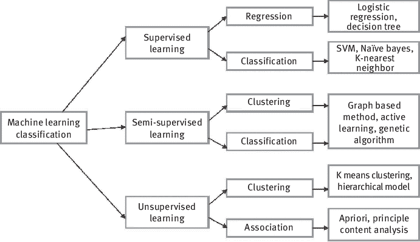

图 6.1：机器学习及其分类。

另一种机器学习技术是强化学习。这种机器学习技术侧重于环境变化，不适合在高级阶段预测精神障碍。因此在本章中，我们将不关注强化学习技术。

### 6.2.2 使用监督式机器学习进行疾病预测

#### A. 什么是监督式学习

它是一种常用的疾病预测技术。监督式机器学习可以表示为从外部来源搜索算法以产生用于对未来来源进行预测的一般假设的过程。然后将输出呈现给“训练”数据函数，并通过使用该训练数据将输入变量与标记输出进行映射的算法来定义。这样，算法就能给出输入变量与输出变量之间最准确的关系。监督学习中没有人类参与。监督式机器学习技术分为两类——回归和分类（Kotsilieris et al., 2018）。设计算法来预测癌症患者可能存活的天数是回归问题的示例。设计算法来预测脑癌是分类问题的示例之一。

#### B. 使用监督机器学习预测疾病的相关工作

表 6.1 描述了用于预测各种精神障碍的各种监督机器学习技术，以及每种技术的

It is one of the commonly used technique for disease prediction. Supervised ML can be represented as the search for algorithm from an external source to produce general hypotheses that are used in making predictions for future sources. The output is then presented to “training” data function and is defined by using the algorithm that uses this trained data to map the input variables with the output marked. This way, the algorithm gives the most accurate relation between input and output variable. There is no involvement of humans in supervised learning. Supervised Machine Learning Techniques has two categories as – regression and classification (Kotsilieris et al., 2018). Algorithms designed to predict a number of days a person with cancer may survive is an example of regression problems. Designing algorithms to predict brain cancer is one of the examples of classification problems.

## B. Related work on diseases predicted using supervised machine learning

The Table 6.1 describes various supervised machine learning techniques used to predict various mental disorders with dataset and accuracy range for each technique.

Table 6.1:Disease prediction using supervised machine learning techniques.

| Disease || ML techniques || Dataset || Accuracy range |
| --- | --- | --- | --- |


| Alzheimer’s disease || `RF` (Khondoker et al., 2016;Vigneron et al., 2016; Besga et al., 2015; Souillard- Mandar et al., 2016), `NB` (Dyrba, et al., 2013), `LDA` (Khondoker et al., 2016), `SVM` (Deng et al., 2018; Burnham et al., 2014; Costafreda et al., 2011a; Khondoker et al., 2016; Ertek et al., 2014; Dyrba et al., 2013, 2015; Souillard-Mandar et al., 2016; Besga et al., 2015), `Regression` (Westman, et al., 2013; Falahati et al., 2016), `DT` (Besga et al., 2015; Ertek et al., 2014; Souillard-Mandar et al., 2016; Zhu et al., 2016), `NN` (Chalmers et al., 2016), `kNN` (Khondoker et al., 2016; Ertek et al., 2014) || `Imaging` (Vigneron et al., 2016; Zhu et al., 2016; Khondoker et al., 2016; Ertek et al., 2014; Burnham et al., 2014; Dyrba et al., 2013, ; Costafreda et al., 2011a; Westman et al., 2013; Falahati et al., 2016), `Clinical Notes` (Souillard- Mandar et al., 2016; Besga et al., 2015), `Biological` (Khondoker et al., 2016; Burnham et al., 2014; Besga et al., 2015), `Audio, Smart Meter` (Chalmers et al.,2016) || `GPR -` 79% `SVM` - 75–91% `NB` - 68–75% `RF`\- 88–91%, 61.9% `DT -` 87–93% `Regression` - 81–91% |

| --- | --- | --- | --- |

| Anxiety || `SVM` (Liu et al., 2015a; Zhang et al., 2015a; Sundermann et al., 2017), `RF` (Zhang et al., 2015a; Hoogendoorn et al., 2017), `DT` (Bermejo et al., 2013; Hoogendoorn et al., 2017), `LDA` (Zhang et al., 2015a), `logistic` `regression` (Hoogendoorn et al., 2017) || `Clinical records` (Liu et al., 2015a), `imaging` (Sundermann et al., 2017; Bermejo et al., 2013; Liu et al., 2015a), `letters` (Hoogendoorn et al., 2017) || `DT -` 55–96% `LR -` 55–83% `RF -` 48–81% `SVM -` 38–57.31% `LDA -` 57.23–57.65% |

| Attention-deficit disorder || `kNN` (Khondoker et al., 2016), `SVM` (Iannaccone et al., 2015), `LDA` (Khondoker et al., 2016), `RF` (Khondoker et al., 2016), || `Imaging` (Zhu et al., 2005; Khondoker et al., 2016; Iannaccone et al., 2015) || `SVM -` 77.78–88.25% `NN` - 69.15% |

| Autism spectrum disorder || `RF` (Plitt et al., 2015; Xiao et al., 2017; Thin et al., 2017), `DT` (Bosl et al., 2017; Jiao et al., 2010; Thin et al., 2017), `NN` (Jiao et al., 2010), `NB` (Thin et al., 2017), `kNN` (Plitt et al., 2015; Oh et al., 2017), `SVM` (Jiao et al., 2010; Goch et al., 2013; Plitt et al., 2015; Bosl et al., 2017; Ohet al., 2017; Song et al., 2011; |

Bruining et al., 2014; Thin et al., 2017) || `Imaging` (Goch et al., 2013; Xiao et al., 2017; Plitt et al., 2015; Bosl et al., 2017; Jiao et al., 2010), `clinical assessment` (Bruining et al., 2014), `biological` (Oh et al., 2017; Khondoker et al., 2016), `social media` (Thin et al., 2017; Song et al., 2011) || `RF` - 84–86.5%  

`SVM` - 63–90.38%  

`DT` - 67–92%  

`RF` - 65–91.35%  

`KNN` - 60.83–93.26% |

| 认知障碍 || `Regression` (Westman et al., 2013), `RF` (Dimitriadis et al., 2018) || `imaging` (Westman et al., 2013; Dimitriadis et al., 2018) || `RF-` 60–62% |

| 痴呆 || `SVM` (Fook et al.,2009; Banget al., 2017; Kim et al., 2017), `NN` (Bang et al., 2017; Kumari et al., 2013; Sheela Kumari,et al., 2014), `DT` (Bang et al., 2017) || `Imaging` (Kumari, et al., 2013; Sheela Kumari et al., 2014), `electronic notes` (Kim et al., 2017), `clinical assessment` (Bang et al., 2017), `sensors` (Fook et al., 2009) || `SVM-` 67–82.4% `NN-` 95.5–98% `with` `genetic algorithm` |

| 抑郁症 || `DT` (Iliou et al., 2017), `gradient boosting` (Hatton et al., 2019), `LDA` (Mohammadi, et al., 2015; Yazdavar et al., 2017; Sato et al., 2015; Kaufmann et al., 2017), `NB` (Nguyen et al.,2016b), `NN` (Dipnall et al., 2016b; Zhang et al., 2013; Iliou et al., 2017), `regression` (Andrews et al., 2017; Cao et al., 2014; Lianget al., 2018a), `SVM` (Nguyen et al., 2016b; Hajek et al., 2015; Roberts et al., 2017; Bailey et al., 2018; Deng et al., 2018; Jie et al., 2018), `RF` (Iliou et al., 2017) || `Clinical notes` (Liang et al., 2018a;Hatton et al., 2019), `Imaging` (Cao et al., 2014; Ramasubbu et al., 2016; Hajek et al., 2015; Mohammadi et al., 2015; Sato et al., 2015; Kaufmann et al., 2017; Roberts et al., 2017; Deng et al., 2018; Jie et al., 2018), `social media` (Nguyen et al., 2016b; Yazdavar et al., 2017), `survey` (Dipnall et al., 2016b; Andrews et al., 2017; Iliou et al., 2017; Bailey et al., 2018) || `LR`- 89% `using gradient` `boosting` `LDA` -69–89% `SVM`- 70–88% `RF-` 68–84% `Regression`- 69–76% `NN-` 75–85% |

| 癫痫 || `DT` (Bosl et al., 2017; Besga et al., 2015), `SVM` (Bosl et al., 2017; Pedersenet al., 2015) || `Imaging` (Bosl et al.,, 2017; Pedersen et al., 2015), `clinical notes` (Besga et al., 2015) || `SVM-` 88.46–98.17% |

| 强迫症 || `NN` (Erguzel et al., 2015; Lenhard et al., 2018), `NB` (Erguzel et al., 2015), `LR` (Takagi et al., 2017), `SVM` (Erguzel et al., 2015; Parrado-Hernández et al., 2012), `kNN` (Erguzel et al., 2015) || `Imaging` (Takagi et al., 2017; Parrado-Hernández et al., 2012;Erguzel et al., 2015; Lenhard et al., 2018) || `NN`- 70–80% `SVM-` 60–80% `kNN-` 70–89% |

| 帕金森病 || `SVM` (Ye et al., 2016), `DT` (Souillard-Mandar et al., 2016), `RF` (Souillard-Mandar et al., 2016) || `Clinical assessment` (Souillard-Mandar et al., 2016; Ye et al., 2016) || `SVM-` 77–91% `RF-` 88–91% `DT-` 87–93% |

| 创伤后应激障碍 || `SVM` (Jin et al., 2017; Liu et al., 2015b ; Saxe et al., 2017; Khondoker et al., 2016; Broek et al., 2013), `regression` (Saxe et al., 2017),

`kNN` (Broek 等，2013) || `Imaging` (Jin 等，2017, Khondoker 等，2016; Liu 等，2015b), `clinical` (Saxe 等，2017), `audio` (Broek 等，2013) || `–` |

| Psychosis || `Regression` (`Rikandi 等，2017`; Maraş 和 Aydin，2017), `DT` (Rikandi 等，2017)., `SVM` (Koutsouleris 等，2009; Rikandi 等，2017), `LDA` (Rikandi 等，2017), `RF` (Maras 和 Aydin，2017) || `Imaging` (Rikandi 等，2017; Maraş 和 Aydin，2017; Koutsouleris 等，2009) || `SVM`- 59–82% `DT`- 53.5–78.2% `LDA-` 60.3–76.9% `LR-` 60.3–76.9% |

| Stress || `Regression` (Li 等，2017b; Smets 等，2016), `AdaBoost` (Maxhuniet al.，2016), `RF` (Maxhuni 等，2016), `NB` (Chiang 等，2013), `NN` (Li 等，2017b; Hagad 等，2014), `SVM` (Hagad 等，2014; Chiang 等，2013; Maxhuni 等，2016; Smets 等，2016), `DT` (Maxhuni 等，2016; Chiang 等，2013; Smets 等，2016) || `Social media` (Li 等，2017b), `worn` `sensors` (Smets 等，2016; Chiang 等，2013; Maxhuni 等，2016), `survey` (Hagad 等，2014) || `AdaBoost-` 70–78% `DT-` 75–78.2% `SVM-` 78–84.7% `NB-` 67–79% |

| Traumatic brain injury || `DT` (Karamzadeh 等，2016), `regression` (Tremblay 等，2017), `RF` (Vakorin 等，2016), `SVM` (Tremblay 等，2017; Karamzadeh 等，2016; Vakorin 等，2016), `LDA` (Karamzadeh 等，2016) || `Imaging` (Tremblay, et al.，2017; Karamzadeh 等，2016; Vakorin 等，2016), `survey` (Tremblay 等，2017) || `DT-` 77–85% `LDA-` 58–64% `SVM-` 60–75% `Regression-` 75–88% |

# C. 有监督学习技术

## `Naïve Bayes (NB)`

`Naïve Bayes (NB)` 也是有监督的 ML 技术，是一种用于分类的数值方法。它以开发贝叶斯定理的 Thomas Bayes 命名。它期望一个基本概率模型，并在决定结果的概率后允许以道德的方式绑定其不确定性。因此它用于解释该过程的预测和诊断问题（Murphy，2006）。`NB` 对输入数据集中的噪声具有很强的鲁棒性。朴素贝叶斯分类器的数学表示由方程给出。

(6.1)${Posterior\\, Probability} = P\\left( {{Xi}|Y} \\right) = \\ \\frac{P\\left( {Y|Xi} \\right)P\\left( {Xi} \\right)}{P\\left( Y \\right)}$

其中 `Xi` 指代 “m” 个类别，其值分别为 `X1`、`X2`、`X3`、……、`Xm`。`P(Y|Xi)` 指后验概率，`P(Y|Xi)` 指预测概率，`P(Xi)` 代表先验概率，`P(Y)` 代表类别的预测概率。朴素贝叶斯的示例显示在 图 6.2

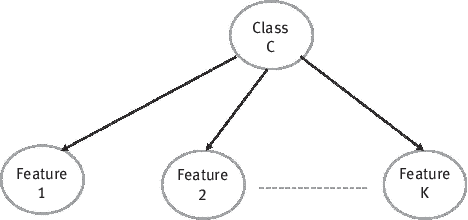

图 6.2：朴素贝叶斯的一个示例。

## `Support Vector Machine (SVM)`

`Support Vector Machine (SVM)`，最著名的有监督 ML 算法于 1995 年引入，可解决回归和分类问题（Cortes 和 Vapnik，1995）。该算法绘制“超平面”并在不同类别中分配数据，使得属于一个类别的所有实例都被分类到一侧，并且它们位于平面的另一侧（显示在 图 6.3）。线性 SVM 分类是 SVM 分类函数所特有的，并且如果所选线包含最受压迫的部分，则会发生划分（Maji 和 Garg，2014）。对于非线性情况，需要高级的核选择和数据预处理。它在医疗保健中具有重要应用，因为它可以从 MRI 扫描报告中预测各种疾病。超平面的方程如下所示。

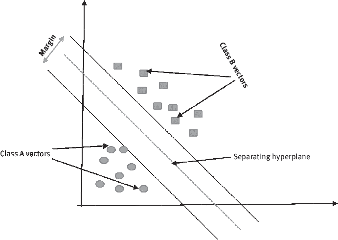

图 6.3：具有超平面的 SVM 表示。

(6.2)*W**T* ⋅ *x* + *b*\= 0

其中 `b` 代表输入变量 `x` 的偏置值，`w` 指权重向量。SVM 分类方程使用最小化公式编写如下所示。

(6.3)${min}\\,\_{w,b}\\,\\left( \\frac{w^{T}w}{2} \\right)$

## `Neural Network (NN)`


`Neural Network (NN)`，也称为神经元，是一种源自人类大脑的信息处理技术。该框架包含大量处理信息的小型处理器。`NN`中使用的各种处理器作为相互连接的并行系统运行，以解决一个问题。`NN`以其逼近能力而闻名，这就是为什么它们可以应用于几乎任何 ML 问题（Hansen 和 Salamon，1990）。`NN`的结果定义为

(6.4)$N = \\sum\_{i = 1}^{H}{v\_{i}\\sigma\\left( z\_{i} \\right)}$

其中`v[i]`指第 i 个权重参数，`x[i]`指输入向量，`w[i]`指权重参数，`σ`指 sigmoid 函数，`b[i]`指第 i 个单元的偏置。并且`z[i]` = `w[i]`*`x[i]` + `b[i]`且`$\\sigma = \\frac{1}{1 + \\ e^{- x}}$`。`NN`的结构呈现在图 6.4。

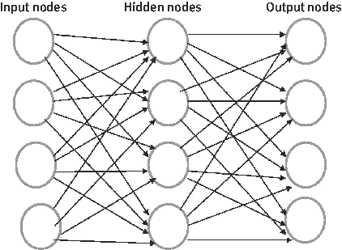

图 6.4：神经网络表示。

## k-Nearest Neighbor (kNN)

`k-Nearest Neighbor (kNN)`是一种依赖于与其他对象相似度的基于对象的学习。与其他对象相近的对象被称为“邻居”。当放置一个新对象时，会确定模型中每个案例的距离。通过这种分组，案例会被指定给与其最相似的最近邻居并被放入其组中。`kNN`方法还能够持续计算目标值。

对于连续变量，距离可以使用三种距离度量来计算，即`Euclidean`、`Manhattan`或`Minkowski`距离。而对于分类变量，则使用`Hamming`距离。`Euclidean`和`Hamming`距离在下面的方程中给出。

(6.5)${Euclidean\, Distance} = \\ \\sqrt{\\sum\\limits\_{i = 1}^{k}\\left( {x\_{i} - y\_{i}} \\right)2}$ (6.6)${Hamming\, Distance} = \\ D\_{H =}\\sum\_{i = 1}^{k}\\left| {x\_{i} - y\_{i}} \\right|$ 

其中`i`指的是值分别为 1、2、3 … .`k`的最近邻居。`x`和`y`指的是变量。

`kNN`的示意图如下所示 Figure 6.5，其中令`k`的值为 3，因此新数据点将因最近距离而位于类别 1。

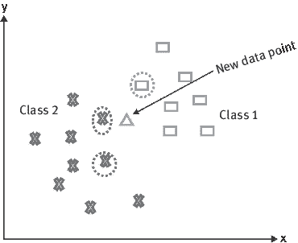

Figure 6.5: kNN representation.

## Decision Tree (DT)

`Decision Tree (DT)`也属于监督 ML 技术的一个类别。`DT`的主要目的是准备一个训练模型，通过实施从训练数据中推导出的学习决策规则来帮助预测目标变量。其结构类似于流程图，由叶节点、内部节点和分支组成 (Figure 6.6)。对任何记录的预测总是从根节点开始。从多个变量中选择一个根变量时，使用的方法之一是信息增益。信息增益进一步衡量变量的不确定性，这被称为熵 (Safavian and Landgrebe, 1991)。熵和信息增益的数学方程如下所示。

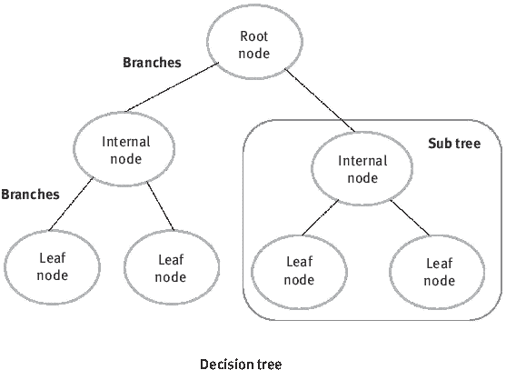

Figure 6.6: Basic structure of decision tree.

(6.7)*H* = *E*(*S*) = ∑*I* = 1*C* − *p**i**l**o**g*2*p**i* 

其中`pi`指的是`ith`类的概率。

## Random Forest (RF)

`Random Forest (RF)`是由 Tin Kam Ho 引入的另一种监督 ML 算法。`RF`构建了类似森林的结构，其中包含多个决策树，独立向量被平均分配，单个树为最受投票的输入类`x`分配值 1（单位） (Figure 6.7)。`RF`中的树越多，预测越准确 (Breiman, 2001)。设`h(x|θ[1])`、`h(x|θ[2])`、…、`h(x|θ[k])`为具有参数`θk`和随机向量`θ`的`k`个分类器的数量。那么第`k`个决策树分类器的方程为

(6.8)*h**k*(*x*)  = *h*(*x*|*θ**k*) 

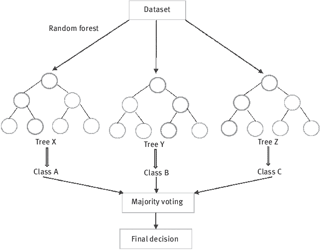

Figure 6.7: Random forest representation using decision trees.

## Linear Discriminant Analysis (LDA)

`Linear Discriminant Analysis (LDA)`算法被描述为一种用于预处理和模式分类问题的降维方法。其主要目的是通过将变量从多维空间转移到较小维空间来减少维度。它类似于主成分分析(`PCA`)算法，但使用的是标记数据 (Zhao et al., 1998)。`LDA`输出分类(`y`)是使用判别函数给出的，并在(Figure 6.8)中说明。

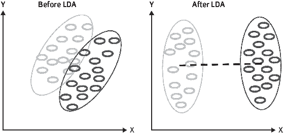

Figure 6.8: LDA process to maximize component axes between two classes.

(6.9) ${Dk}\\left( x \\right) = x^{\\ast}\\left( \\frac{muk}{{sig}a^{2}} \\right) - \\left( \\frac{muk}{{sig}a^{2}} \\right){+ ln}\\left( {Plk} \\right)$ 

其中`Dk(x)`指的是类别`k`的判别函数，变量`Plk`、`sigma²`和`muk`是从给定数据计算得出的变量值。

## Logistic Regression (LR)

`Logistic Regression (LR)`是统计学领域常用的另一种监督 ML 技术。`LR`的名称源自称为逻辑函数的函数 (Cook, 1977)。为了给出二元输出（0 或 1），该算法使用`x`输入值与系数值的线性组合。逻辑回归的方程如下：

(6.10)*y*\=*e*^∧(*b*0 + *b*1^(*x*))/(1+*e*^∧(*b*0 + *b*1 \* *x*)) 

其中输出由`y`表示，`b0`指截距词，`b1`指系数，`x`指输入变量。逻辑回归的曲线如下图所示 (Figure 6.9)。

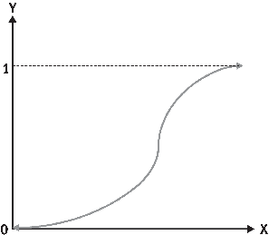

Figure 6.9: Logistic regression curve.

## Gaussian Process

`Gaussian Process`被定义为解决回归和分类两个问题的算法。该算法在监督学习中非常有用，因为它可以给出其自身不确定性的估计。它是一种随机过程，仅在有限变量集上工作 (Rasmussen, 2003)。满足高斯过程的方程如下。

(6.11)$E\\left( {{exp}\\left( {i\\sum\\limits\_{l - 1}^{k}s\_{l}X\_{t\_{l}}} \\right)} \\right) = {exp}\\,\\left( \\left. {- \\frac{1}{2}\\,\\sum\\limits\_{lj}{\\sigma\_{l\_{j}}s\_{l}s\_{j + i}\\,\_{\\sum\\limits\_{l}{\\mu\_{l}s\_{l}}}}} \\right) \\right.\\,$ 

其中`t[1]`、`t[2]`、… ..、`t[k]`是有限变量，`μ[l]`是变量的均值，`σ[l[j]]`是协方差，其中`σ[jj]` > 0 且`s[1]`、`s[2]`、… …、`s[k]` € R。高斯过程的曲线在下图中给出 (Figure 6.10)。

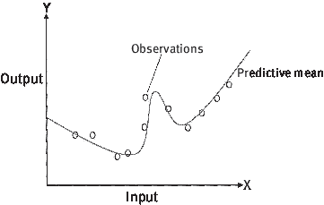

Figure 6.10: Gaussian process curve.

## Ensemble Learning

`Ensemble Learning`，也称为元算法，将多个机器学习算法合并为一个准确的模型，以便减少 boosting、bagging 或 stacking。该算法基本上分为两类——顺序集成方法和并行集成方法 (Dietterich, 2002)。使用许多常见的集成类型，例如 Bootstrap 聚合、Boosting、贝叶斯最优分类器等。集成的一种类型，即贝叶斯最优分类器，由以下方程表示。

(6.12)*y* = *a**r**g**m**a**x*[*c*[*j*] ∈ *C*]∑[*h*[*i*] ∈ *H*]*P*(*c*[*j*]|*h*[*i*])*P*(*T*|*h*[*i*])*P*(*h*[*i*]) 

其中`y`是被预测的输出标签，`C`是可能结果的组，`H`是假设空间，`P`指似然，`T`指用于训练的数据。集成学习的框图在(Figure 6.11)中给出。

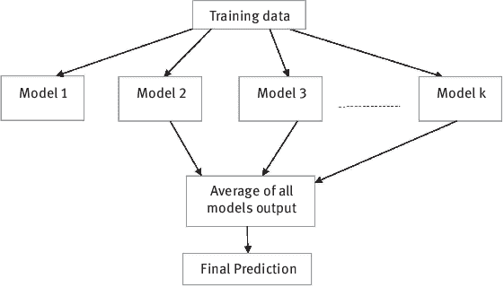

Figure 6.11: Block diagram of ensemble learning.

### AdaBoost

`AdaBoost`，也称为自适应提升，是第一个使用粗糙且不准确的规则来产生非常高精度预测规则的提升算法（Rätsch et al., 2001）。`AdaBoost`算法可以与其他 ML 算法结合以提高其效率。它通过将较弱算法的输出组合成加权和来给出最终的准确输出。`AdaBoost`分类的数学方程为：

(6.13) `${F(x)} = {sign}\left( {\sum_{m = 1}^{M}\theta_{mf_{m}(x)}} \right)$`

其中`F(x)`是正确的分类器输出，即加权的 *M* 个软分类器组合。`Fm`是第 m 个弱分类器，`θm`指相关权重。`AdaBoost`的框图见(Figure 6.12)。

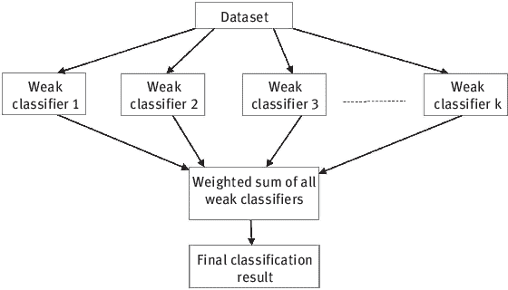

Figure 6.12: Block diagram of AdaBoost.

### Gradient Boosting

`Gradient Boosting`是用于构建预测模型的有用算法之一，其可以快速对训练数据集过拟合。该技术也命名为 XGBoost。`Gradient Boosting`的主要目标是结合所有弱算法的预测强度以获得更准确的预测结果（Friedman, 2002）。`Gradient Boosting`中使用的最常见类型的弱算法是决策树。设`Fm`为不完美模型，则使用`h`估计量的新准确模型方程如下：

(6.14) `Fm + 1 = Fm + h(x)`

其中`h(x) = y − Fm(x)`且`y`为输出变量。使用决策树的`Gradient Boosting`方程可在下图中表示（Figure 6.13）。

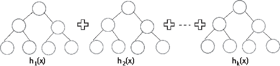

Figure 6.13: Gradient boosting structure using decision trees.

## 6.2.3 Disease prediction using semisupervised machine learning

### A. What is semisupervised learning

半监督学习包括在包含标记数据和未标记数据的数据集组合上训练的算法。通常，这类组合包含少量标记数据集和非常大的未标记数据集。这些算法有助于克服监督学习的缺点，即涉及机器学习工程师或数据科学家对数据集进行手工标记，当涉及大量数据时这是一件非常昂贵的事情。此外，由于无监督学习的应用范围有限，半监督学习算法有助于克服这些缺点（Zhu and Goldberg, 2009）。半监督学习算法的基本流程涉及程序员或数据科学家使用无监督学习算法对数据进行聚类，然后使用现有标记数据对剩余的未标记数据进行标记。未标记数据集相对便宜获取，而标记数据集非常昂贵。半监督学习算法基于某些假设，例如连续性假设、聚类假设和流形假设。

### B. Related work on diseases predicted using semi-supervised machine learning

表 6.2 描述了用于预测各种精神障碍的各种半监督 ML 技术，以及每种技术的数据集和准确率范围。

Table 6.2:Disease prediction using semisupervised ML techniques.

| Disease || Ml techniques || Data type || Accuracy range |
| --- | --- | --- | --- |
| Alzheimer’s disease || `GA` (Vandewater et al., 2015; Brasil, et al., 2009; Johnson et al., 2014) || `Biological` (Vandewater et al., 2015), `clinical assessment` (Brasil et al., 2009; Johnson et al., 2014) || `GA -` 86–90 % |
| --- | --- | --- | --- |
| Dementia || `GA` (Kumari et al., 2014, pp.165–172) || `Imaging` (Kumari et al., 2014, pp.165–172) || `GA -` 95.5–98% with NN |
| Attention deficit hyperactivity disorder || `GA` (Yaghoobi and Azadi, 2018) || `Clinical assessment` (Yaghoobi and Azadi, 2018) || `GA -` 97%–98.07% |
| Depression || `GA` (Mohammadi et al., 2015) || `Imaging` (Mohammadi et al., 2015) || `GA -` > 80% |
| Schizophrenia || `GA` (Kaufmann et al., 2017) || `Imaging` (Kaufmann et al., 2017) || `GA -` 74–76.2% |
| Suicide/self-harm || `GA` (Poulin et al., 2014) || `Clinical notes` (Poulin et al., 2014) || `GA -` 67–69% |

### C. Techniques used for disease prediction in semisupervised machine learning

`Genetic Algorithm (GA)`是一种随机搜索算法，由 John Holland 于 1975 年提出用于解决优化问题。`GA`使用重组和选择标准来生成新的样本点。它们应用于代码，即称为染色体的有限长度字符串。每个字符串包含有限长度的符号，称为基因。通过对它们进一步应用“突变”和“交叉”过程来生成新的数据点。在医学领域，`GA`用于高维模式的分类和特征提取（Figure 6.14）显示了`GA`的基本步骤。

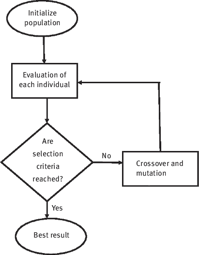

Figure 6.14: Steps for GA.

## 6.2.4 Disease prediction using unsupervised machine learning

### A. What is unsupervised learning

与监督学习相比，无监督机器学习涉及未标记数据。使用无监督学习的主要原因不是为了预测目标结果变量；而是为了在没有监督的情况下处理有意义的信息。无监督学习的一些实例是寻找数据对象之间的相似性、弄清属性之间的联系、重塑属性以降低维度等。聚类是一种事实发现技术，旨在在没有来自现有组的先前信息的情况下识别相关数据中的可能子组。例如，自杀分析师可能想知道哪些“患者”聚类来自自杀群体。(Coates et al., 2011)。

### B. Related work on diseases predicted using unsupervised machine learning

表 6.3 描述了用于预测各种精神障碍的各种无监督机器学习技术，以及每种技术的数据集和准确率范围。

Table 6.3:Disease prediction using unsupervised machine learning techniques.


| Disease || ML techniques || Data type || Accuracy range |
| --- | --- | --- | --- |
| Anxiety || `k-means clustering` (Park et al., 2018) || `Social media` (Park et al., 2018) || – |
| --- | --- | --- | --- |
| 自闭症谱系障碍 | `k-means 聚类` (Liu, Li and Yi, 2015a) | `视频/照片` (Liu et al., 2015a) | `k-means 聚类 with SVM 分类器 –` 79.31% |
| 抑郁症 | `k-means 聚类` (Park et al., 2018; Farhan et al., 2016)，`主成分分析` (Chen et al., 2017a) | `社交媒体` (Park et al., 2018)，`传感器` (Farhan et al., 2016)，`影像` (Chen et al., 2017a) | `k-means 聚类-` 87% `PCA`- 79% |
| 创伤后应激障碍 | `k-means 聚类` (Park et al., 2018) | `社交媒体` (Park et al., 2018) | – |
| 精神分裂症 | `主成分分析` (Chen et al., 2017a) | `影像` (Chen et al., 2017a) | `PCA-` 79% |
| 压力 | `k-means 聚类` (Hagad et al., 2014) | `调查` (Hagad et al., 2014) | – |

### C. 无监督机器学习中用于疾病预测的技术

`K-means 聚类算法`，最初由 MacQueen 于 1967 年提出 (Haraty et al., 2015)，是能够解决聚类问题的无监督 ML 技术之一。每个 k 中心将数据集分类为不同的 k 个簇。预测结果取决于与簇中心的距离，因此为了获得更好的结果，它们应彼此相距较远。然后在下一步中，数据集应与最近的中心关联到所属的簇。当所有点都关联后，通过将“k”作为新的质心进行重新计算。重复这样做会生成一个循环，k 中心在每一步都会改变位置。这将一直持续到不再发生变化为止。该算法的主要目标是减少目标函数，也称为平方误差函数，其在 方程 (6.15) 中给出。K-means 聚类的示例显示在 (图 6.15)。

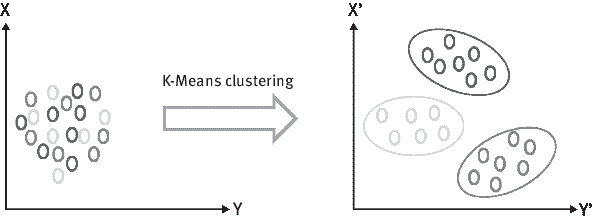

图 6.15：K-means 聚类的示例。

(6.15)${Square\\, Error\\, Function} = J\\left( V \\right)\\ = \\sum\_{i = 1}^{c}{\\sum\_{j = 1}^{ci}{\\left( \\left| \\left| {x\_{i} - y\_{i}} \\right| \\right| \\right)2}}$

其中 `||xi – vj||` 表示 `x[i]` 和 `v[j]` 之间的欧几里得距离，`c[i]` 指第 i 个簇中的数据点，“c”指簇中心的总数。

`主成分分析 (PCA)` 是一种用于统计的无监督学习技术，用于寻找变量组之间的相互关系。它通过将一组相关变量转换为不相关变量来帮助减少数据集的维度 (Rokhlin and Tygert, 2009)。重复相同的过程可获得全新的变量集，这些变量简单地称为主成分或正交。PCA 也称为一般因子分析，其中回归找到最佳拟合线。PCA 的基本矩阵方程由下式给出：

(6.16)*Y* = *W*^′*X*,

其中 `X` 是具有 n 行和 p 列的输入矩阵，`Y` 是得分矩阵，`W` 是系数矩阵。PCA 方程也以线性形式给出为 p 个线性方程的集合：

(6.17)*y**i**j* = *w**l**i**x**l**j* + *w*2*i**x*2*j* + ⋯ + *w**p**i**x**p**j*

设数据集的原始维度为 `X` 和 `Y`。使用 PCA，数据集的维度减少为新的向量 `X'` 和 `Y'` 整体说明见 (图 6.16)。

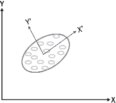

图 6.16：PCA 表示。

## 6.3 机器学习技术验证的比较度量

为了评估预测率，有一些指标，例如精确度、灵敏度、特异性和准确度来评估模型的真实性。这些指标由下图所示的混淆矩阵确定 (表 6.4)。该模型是评估各种算法预测疾病质量的非常有用的工具 (Linden, 2006)。理想状态，必须包含重要数据，必须存在于矩阵的主对角线上，而其余值应标记为零或非零。

表 6.4:混淆矩阵。

|  | Class A (predicted) | Class B (predicted) |
| --- | --- | --- |
| `Class A` `(actual)` | True positive (`TP`) | False negative (`FN`) |
| --- | --- | --- |
| `Class B` `(actual)` | False positive (`FP`) | True negative (`TN`) |

True Positive (`TP`) = 当观察结果为阳性，且预测也为“正确”时。

False Negative (`FN`) = 当观察结果为阳性，但预测为“阴性”时。

`TN` = 当观察结果为阴性，且预测也为“阴性”时。

`FP` = 当观察结果为阴性，但预测为“阳性”时。

### 6.3.1 各种指标的公式如下所述

1. `Accuracy` – 它被给出为正确预测的比例，即准确的预测占所做预测总数的比例。

(6.18)${Accuracy =}\\frac{\\left( {TP + TN} \\right)}{\\left( {TP + FN + FP + TN} \\right)}$

1. `Recall or Sensitivity` – 它被认为是实际为阳性的阳性数据点的比例除以所有阳性数据点的总和。它也被称为 TPR，即真阳性率。

(6.19)${Recall =}\\frac{\\left( {TP} \\right)}{\\left( {TP + FN} \\right)}$

1. `Precision` – 它被认为是正确预测的比例除以所有预测为阳性的总和。

(6.20) ${Precision =}\\frac{\\left( {TP} \\right)}{\\left( {TP + FP} \\right)}$

1. `Specificity` – 实际为阴性的阳性数据点的比例除以所有阴性数据点的总和被称为特异性。它也被称为 FPR，即假阳性率。

(6.21)${Specificity =}\\frac{\\left( {TN} \\right)}{\\left( {FP + TN} \\right)}$

机器学习技术对三种随机精神障碍的性能比较，如自闭症谱系障碍、精神分裂症和创伤性脑损伤，已在 (图 6.17–6.19) 中显示，考虑 x 轴给出的 1-特异性（即 FPR）和 y 轴给出的灵敏度（即 TPR）。

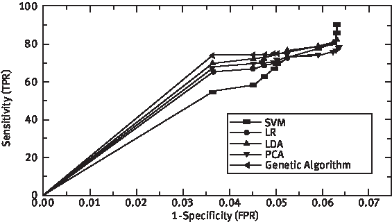

图 6.17：用于预测自闭症谱系障碍的技术准确率图。

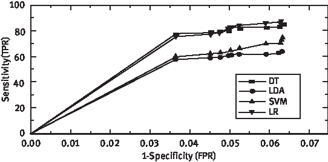

图 6.18：用于预测精神分裂症的技术准确率图。

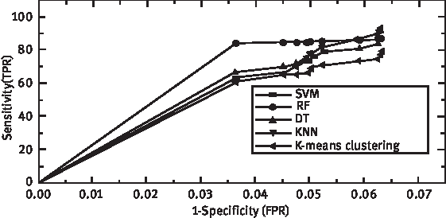

Figure 6.19: 用于预测创伤性脑损伤的技术的准确率图。

#### 6.4 预测心理障碍的机器学习挑战

尽管在设计强化机器学习在医学科学应用中重要性的方法论方面取得了显著进展，但仍存在一些挑战，可以描述如下：

1. `Data availability:` 使用机器学习提前预测精神障碍的主要限制是数据集规模有限且其特征描述不足。

2. `Need for traceable conclusions:` 在现实生活情况下，医生不仅关心机器学习模型给出的预测结果。 然而，他们也关心导致最终预测的因素或参数。 这意味着为了更好地治疗患者，医生需要深入了解模型的工作原理。

3. `Reproducibility:` 原型设计、迭代和基准测试机器学习技术是现实生活应用中的另一个挑战。 手动执行此工作流程是一项非常具有挑战性的任务，因此需要计算机编程技能来满足日益增长的需求。

4. `Simple is better:` 已证明当数据经过适当预处理时，往往能给出更准确的结果。 但在大型数据集上应用特征提取并集成更简单的模型以构建更好的预测模型是在使用机器学习技术进行预测时的一项具有挑战性的任务。

5. `Data management:` 从 EEG 或 ECG 测试收集的数据集规模非常庞大，需要进行适当的特征提取以实现机器学习算法的实现。 管理如此庞大的数据并为研究工作分离有用数据是另一项具有挑战性的任务。

6. `High level of customization required:` 在现实世界中，健康数据形式非常复杂，数据资源也有限。 因此，任何机器学习算法在健康数据上的实现都需要高度定制化，这对研究人员来说是另一项具有挑战性的任务。 将预测模型集成到现有医疗保健系统中的任务也非常复杂。

7. `Utilize expertise, not only data:` 公开可用的数据集规模与医生在医学院为研究工作所接受的广泛培训相比很小。 因此，即使在机器学习技术取得如此多进步之后，医生仍然可以比任何预测模型表现更好。

## 6.5 结论和未来工作

通过本章的帮助，我们可以很好地得出结论，机器学习技术在心理健康领域正在取得显著进展，并揭示令人兴奋的进步。 本章提供了关于用于预测心理健康的机器学习技术的常用信息。 我们回顾了大约 15 种使用三类机器学习预测的精神障碍，并报告了使用不同机器学习算法的每种疾病的准确率范围。 有监督的机器学习技术主要用于心理健康疾病的预测，其中 SVM 是常用的技术。 心理健康护理领域的数据稀疏，SVM 技术提供了更准确的预测。 进一步我们可以得出结论，与其他技术相比，无监督机器学习技术在心理健康护理领域的使用通常较少。 在分析精神障碍时，机器学习领域所面临的各种挑战也已描述。

## References

Andrews J.A., Harrison R.F., Brown L.J.E., MacLean L.M., Hwang F., Smith T., and Astell A.J. Using the NANA toolkit at home to predict older adults’ future depression. Journal of Affective Disorders, (2017), 213, 187–190. a, b

Bailey N.W., Hoy K.E., Rogasch N.C., Thomson R.H., McQueen S., Elliot D., and Fitzgerald P.B. Responders to rTMS for depression show increased fronto-midline theta and theta connectivity compared to non-responders. Brain Stimulation, (2018), 11, 190–203. a, b

Bang S., Son S., Roh H., Lee J., Bae S., Lee K., … Shin H. Quad-phased data mining modeling for dementia diagnosis. BMC Medical Informatics and Decision Making, (2017), 17, 60. a, b, c

Bermejo P., Lucas M., Rodríguez-Montes J.A., Tárraga P.J., Lucas J., Gámez J.A., and Puerta J.M. Single- and multi-label prediction of burden on families of schizophrenia patients. In: Peek N., Marín Morales R., and Peleg M. (eds), Artificial Intelligence in Medicine. AIME 2013. Lecture Notes in Computer Science, (2013), Vol. 7885, Springer, Berlin, Heidelberg, 115–124. a, b

Besga A., Gonzalez I., Echeburua E., Savio A., Ayerdi B., Chyzhyk D., and Gonzalez-Pinto A.M. Discrimination between Alzheimer’s disease and late onset bipolar disorder using multivariate analysis. Frontiers in Aging Neuroscience, (2015), 7, 231. a, b, c, d, e, f, g

Bruce B.G. and Edward S.H. Rule-based Expert Systems: The MYCIN Experiments of the Stanford Heuristic Proramming Project. Addison-Wesley Reading MA, (1984). →

Bosl W.J., Loddenkemper T., and Nelson C.A. Nonlinear EEG Biomarker Profiles for Autism And Absence Epilepsy. (2017). a, b, c, d, e, f

Brasil Filho A.T., Pinheiro P.R., and Coelho A.L. (2009, April). Towards the early diagnosis of Alzheimer’s disease via a multicriteria classification model. In International conference on evolutionary multi-criterion optimization (pp. 393–406). Springer, Berlin, Heidelberg. a, b

Breiman L. Random forests. Machine Learning, (2001), 45 (1), 5–32. →

Broek E.L., Sluis F., and Dijkstra T. Cross-validation of bimodal health-related stress assessment. Personal and Ubiquitous Computing, (2013), 17, 215–227. a, b, c

Bruining H., Eijkemans M.J., Kas M.J., Curran S.R., Vorstman J.A., and Bolton P.F. Behavioral signatures related to genetic disorders in autism. Molecular Autism, (2014), 5, 11. a, b

Burnham S.C., Faux N.G., Wilson W., Laws S.M., Ames D., Bedo J., and Villemagne V.L. Alzheimer’s disease neuroimaging initiative, Australian imaging, biomarkers and lifestyle study research group. A Blood-Based Predictor for Neocortical Aß Burden in Alzheimer’s Disease: Results From The AIBL Study, (2014), 19, 519–526. Molecular Psychiatry. a, b, c

Cao L., Guo S., Xue Z., Hu Y., Liu H., Mwansisya T.E., … Liu Z. 重性抑郁障碍诊断的异常功能连接：判别分析。Psychiatry and Clinical Neurosciences, (2014), 68, 110–119。 a, b


# 参考文献

Chalmers C., Hurst W., Mackay M., and Fergus P. 智能健康监测技术。In: Huang D.S., Bevilacqua V., and Premaratne P. (eds), ICIC 2016. Lecture Notes in Computer Science, Intelligent Computing Theories and Application, (2016), Vol. 9771, Springer, Cham, 832–842。 a, b

Chen X., Liu C., He H., Chang X., Jiang Y., Li Y., … Yao D. 抑郁症和精神分裂症前额叶皮层静息态功能连接的跨诊断差异。Journal of Affective Disorders, (2017a), 217, 118–124。 a, b, c, d

Chiang H.-S., Liu L.-C., and Lai C.-Y. 利用数据挖掘技术进行心理压力诊断。In: Park J., Barolli L., Xhafa F., and Jeong H.Y. (eds), Lecture Notes in Electrical Engineering, Information Technology Convergence, (2013), Vol. 253, Springer, Dordrecht, 761–769。 a, b, c, d

Coates A., Ng A., and Lee H. 无监督特征学习中单层网络分析，(2011) June。 →

Coleman J.C., (1950), Abnormal psychology and modern life.

Cook R.D. 线性回归中影响观测值的检测。Technometrics, (1977), 19 (1), 15–18。 →

Cortes C. and Vapnik V. 支持向量网络。Machine Learning, (1995), 20 (3), 273–297。 →

Costafreda S.G., Dinov I.D., Tu Z., Shi Y., Liu C.-Y., Kloszewska I., … Simmons A. 自动化海马形态分析预测轻度认知障碍中痴呆的发作。NeuroImage, (2011a), 56, 212–219。 a, b

Deng F., Wang Y., Huang H., Niu M., Zhong S., Zhao L., … Huang R. 重性抑郁症和双相抑郁症中右侧钩束和左侧前丘脑辐射的异常节段。Progress in Neuro-Psychopharmacology & Biological Psychiatry, (2018), 81, 340–349。 a, b, c, d, e, f

Dietterich T.G. 集成学习。The Handbook of Brain Theory and Neural Networks, (2002), 2, 110–125。 →

Dimitriadis S.I., Liparas D., and Tsolaki M.N. Alzheimer’s disease neuroimaging initiative (2018) 随机森林特征选择、融合和集成策略：结合多种形态学 MRI 测量以区分健康老年人、MCI、cMCI 和阿尔茨海默病患者：来自阿尔茨海默病神经影像学计划 (ADNI) 数据库。Journal of Neuroscience Methods, 302, 14–23。 a, b

Dipnall J.F., Pasco J.A., Berk M., Williams L.J., Dodd S., Jacka F.N., and Meyer D. 深入抑郁的肠道：通过对社区人群样本应用机器学习技术揭示与抑郁相关的医学症状。PloS One, (2016b), 11, e0167055。 a, b, c

Dyrba M., Barkhof F., Fellgiebel A., Filippi M., Hausner L., Hauenstein K., and Teipel S.J. EDSD study group (2015) 利用机器学习分类的多模态多中心扩散张量和磁共振成像数据预测轻度认知障碍受试者的前驱阿尔茨海默病。Journal of Neuroimaging, 25, 738–747。 a, b, c

Dyrba M., Ewers M., Wegrzyn M., Kilimann I., Plant C., Oswald A., and Teipel S.J. EDSD study group (2013) 利用机器学习分类的多中心 DTI 数据稳健自动检测阿尔茨海默病中的微结构白质退化。PloS One, 8, e64925。 →

El Naqa I. and Murphy M.J. 什么是机器学习？。In: El Naqa I., Li R., and Murphy M. (eds), Machine Learning in Radiation Oncology, Cham, (2015), Springer, 3–11 Epidemiology and Psychiatric Sciences, Vol. 26, 01, 22–36。 →

Erguzel T.T., Ozekes S., Sayar G.H., Tan O., and Tarhan N. 一种用于分类拔毛癖和强迫症的混合人工智能方法。Neurocomputing, (2015), 161, 220–228。 a, b, c, d, e

Ertek G., Tokdil B., and Günaydın İ. 阿尔茨海默病风险因素和识别指标：数据挖掘分析。In: Perner P. (ed.), Advances in Data Mining, Applications and Theoretical Aspects. ICDM 2014. Lecture Notes in Computer Science, (2014), Vol. 8557, Cham, Springer。 a, b, c, d

Falahati F., Ferreira D., Soininen H., Mecocci P., Vellas B., Tsolaki M., and Simmons A. Westman E and addneuromed consortium and the Alzheimer’s disease neuroimaging initiative. 年龄校正对阿尔茨海默病多变量分类的影响，重点关注错误分类和正确分类受试者的特征。Brain Topography, (2016), 29, 296–307。 a, b

Farhan A.A., Lu J., Bi J., Russell A., Wang B., and Bamis A. (2016) 多视图双聚类识别指示抑郁的智能手机传感特征。In 2016 IEEE First International Conference on Connected Health: Applications, Systems and Engineering Technologies (CHASE), pp. 264–273。 a, b

Friedman J.H. 随机梯度提升。Computational Statistics & Data Analysis, (2002), 38 (4), 367–378。 →

Goch C.J., Oztan B., Stieltjes B., Henze R., Hering J., Poustka L., and Maier-Hein K.H. 自闭症谱系障碍中连接组的全局变化。In: Schultz T., Nedjati-Gilani G., Venkataraman A., O’Donnell L., and Panagiotaki E. (eds), Computational Diffusion MRI and Brain Connectivity, (2013), Cham, Springer, Mathematics and Visualization, 239–247。 a, b

Hagad J.L., Moriyama K., Fukui K., and Numao M. 利用心率和压力应对特征建模工作压力。载于：Baldoni M. 等（编），多智能体系统原理与实践，CMNA 2015，IWEC 2015，IWEC 2014。计算机科学讲义，（2014），第 9935 卷，Springer，Cham，108–118。 a，b，c，d，e

Hajek T., Cooke C., Kopecek M., Novak T., Hoschl C., and Alda M. 使用结构性 MRI 识别患双相障碍遗传风险个体：一个双队列机器学习研究。Journal of Psychiatry & Neuroscience: JPN，（2015），40，316–324。 a，b

Hansen L.K. and Salamon P. 神经网络集成。IEEE Transactions on Pattern Analysis & Machine Intelligence，（1990），10，993–1001。 →

Haraty R.A., Dimishkieh M., and Masud M. 用于医疗数据模式发现的增强 k-means 聚类算法。International Journal of Distributed Sensor Networks，（2015），11 (6)，615740。 →

Hatton C.M., Paton L.W., McMillan D., Cussens J., Gilbody S., and Tiffin P.A. 预测老年人持续性抑郁症状：一种个性化心理健康护理的机器学习方法。Journal of Affective Disorders，（2019），246，857–860。 a，b

Hoogendoorn M., Berger T., Schulz A., Stolz T., and Szolovits P. 基于治疗电子邮件对话预测社交焦虑治疗结果。IEEE Journal of Biomedical and Health Informatics，（2017），21，1449–1459。 a，b，c，d

Iannaccone R., Hauser T.U., Ball J., Brandeis D., Walitza S., and Brem S. 基于功能和结构成像对青少年注意缺陷/多动障碍（ADHD）进行分类。European Child & Adolescent Psychiatry，（2015），24，1279–1289。 a，b

Iliou T., Konstantopoulou G., Ntekouli M., Lymperopoulou C., Assimakopoulos K., Galiatsatos D., and Anastassopoulos G. ILIOU 用于抑郁类型预测的机器学习预处理方法。Evolving Systems，（2017），475，53–60。 a，b，c，d

Jiao Y., Chen R., Ke X., Chu K., Lu Z., and Herskovits E.H. 基于大脑区域皮层厚度预测自闭症谱系障碍的预测模型。NeuroImage，（2010），50，589–599。 a，b，c，d

Jie N.-F., Osuch E.A., Zhu M.-H., Wammes M., Ma X.-Y., Jiang T.-Z., and Calhoun V.D. 使用全脑功能连接区分双相障碍与重度抑郁：一种 SVM-FoBa 算法特征选择分析。Journal of Signal Processing Systems，（2018），90，259–271。 a，b

Jin C., Jia H., Lanka P., Rangaprakash D., Li L., Liu T., … Deshpande G. 动态脑连接比静态连接更能预测 PTSD。Human Brain Mapping，（2017），38，4479–4496。 a，b

Johnson P., Vandewater L., Wilson W., Maruff P., Savage G., Graham P., and Zhang P. 用于预测阿尔茨海默病进展的遗传算法与逻辑回归。BMC Bioinformatics，（2014），15 (16)，S11。 (增刊 a，b

Karamzadeh N., Amyot F., Kenney K., Anderson A., Chowdhry F., Dashtestani H., and Gandjbakhche A.H. 一种机器学习方法，利用功能性近红外光谱在创伤性脑损伤个体的人类前额叶皮层中识别功能生物标志物。Brain and Behavior，（2016），6，e00541。 a，b，c，d

Kaufmann T., Alnaes D., Brandt C.L., Doan N.T., Kauppi K., Bettella F., and Westlye L.T. 1615 个 fMRI 数据集中任务调节和临床表现在大脑功能连接组中的体现。NeuroImage，（2017），147，243–252。 a，b，c，d

Kessler R.C., van Loo H.M., Wardenaar K.J., Bossarte R.M., Brenner L.A., Cai T., and Nierenberg A.A. 测试一种机器学习算法以从基线自报预测重度抑郁障碍的持续性和严重程度。Molecular Psychiatry，（2016），21 (10)，1366。 →

Khondoker M., Dobson R., Skirrow C., Simmons A., and Stahl D. 使用来自精神健康研究的多个真实数据示例的模拟对分类的机器学习方法进行比较。Statistical Methods in Medical Research，（2016），25，1804–1823。 a，b，c，d，e，f，g，h，i，j，k，l，m

Kim H., Chun H.-W., Kim S., Coh B.-Y., Kwon O.-J., and Moon Y.-H. 基于纵向研究的公共卫生痴呆预测。International Journal of Environmental Research and Public Health，（2017），14，983。 a，b，c

Kipli K., Kouzani A.Z., and Hamid I.R.A. 研究用于检测抑郁的结构性 MRI 体积特征的机器学习技术。International Journal of Bioscience, Biochemistry and Bioinformatics，（2013），3 (5)，444–448。 →

König A., Satt A., Sorin A., Hoory R., Toledo-Ronen O., Derreumaux A., … David R. 用于评估痴呆前期和阿尔茨海默病患者的自动语音分析。Alzheimer’s & Dementia: The Journal of the Alzheimer’s Association，（2015），1，112–124。

Kotsilieris T., Pintelas E., Livieris I.E., and Pintelas P. (2018). 综述用于预测焦虑障碍的机器学习技术。技术报告 TR01-18。University of Patras。 →

Koutsouleris N., Meisenzahl E.M., Davatzikos C., Bottlender R., Frodl T., Scheuerecker J., … Gaser C. 使用神经解剖模式分类识别精神病风险状态个体并预测疾病转变。Archives of General Psychiatry，（2009），66，700–712。 a，b

Kumari R.S., Sheela K.R., Varghese T., Kesavadas C., Albert Singh N., and Mathuranath P.S. 用于额颞叶痴呆中 MR 图像分割的遗传算法优化人工神经网络。In: Panigrahi B.K., Suganthan P.N., Das S., and Dash S.S. (eds), SEMCCO 2013. Lecture Notes in Computer Science, Swarm, Evolutionary, and Memetic Computing, (2013), Vol. 8298, Springer, Cham, 268–276. a, b

Kumari R.S., Varghese T., Kesavadas C., Singh N.A., and Mathuranath P.S. (2014). 使用人工神经网络对额颞叶痴呆进行结构变化的纵向评估。In Proceedings of the International Conference on Frontiers of Intelligent Computing: Theory and Applications (FICTA) 2013 (pp. 165–172). Springer, Cham. a, b

Lenhard F., Sauer S., Andersson E., Månsson K.N., Mataix-Cols D., Rück C., and Serlachius E. 互联网递送儿童强迫症认知行为疗法结局的预测：一种机器学习方法。International Journal of Methods in Psychiatric Research, (2018), 27, e1576. a, b


Li Q., Zhao L., Xue Y., Jin L., and Feng L. 探索青少年共同经历压力事件对压力预测的影响。In: Bouguettaya A. et al. (eds), Web Information Systems Engineering – WISE 2017, WISE 2017. Lecture Notes in Computer Science, (2017b), Vol. 10570, Springer, Cham, 313–328. a, b, c

Liang S., Brown M.R.G., Deng W., Wang Q., Ma X., Li M., … Li T. 精神分裂症和抑郁症中神经认知模式的趋同与分歧。Schizophrenia Research, (2018a), 192, 327–334.

Linden A. 疾病管理中诊断和预测准确性的测量：接收者操作特征曲线分析简介。Journal of Evaluation in Clinical Practice, (2006), 12 (2), 132–139. →

Linthicum K.P., Schafer K.M., and Ribeiro J.D. 自杀科学中的机器学习：应用与伦理。Behavioral Sciences & The Law, (2019). doi: 10.1002/bsl.2392. a, b

Liu F., Guo W., Fouche J.-P., Wang Y., Wang W., Ding J., … Chen H. 使用全脑功能连接对社交焦虑障碍进行多元分类。Brain Structure & Function, (2015a), 220, 101–115. a, b, c, d, e, f, g

Liu F., Xie B., Wang Y., Guo W., Fouche J.-P., Long Z., … Chen H. 使用多水平参数分类方法基于静息态 fMRI 对创伤后应激障碍进行表征。Brain Topography, (2015b), 28, 221–237. a, b

Luo J., Wu M., Gopukumar D., and Zhao Y. 生物医学研究和医疗保健中大数据应用的文献综述。Biomedical Informatics Insights, (2016), 8, 1–10. →

Maji S. and Garg D. 用于剪接位点连接识别的 SVM 与 MM2 混合方法。Current Bioinformatics, (2014), 9 (1), 76–85. →

Maraş A. and Aydin S. 通过基于情感主成分的数据挖掘方法区分精神病症状与对照组。In: CMBEBIH 2017, (2017), Springer, Singapore, 26–30. a, b, c

Maxhuni A., Hernandez-Leal P., Morales E.F., Enrique Sucar L., Osmani V., Muńoz-Meléndez A., and Mayora O. 使用中间模型和知识学习来改善压力预测。In: Sucar E., Mayora O., and Munoz de Cote C.E. (eds), Applications for Future Internet. Lecture Notes of the Institute for Computer Sciences, Social Informatics and Telecommunications Engineering, (2016), Vol. 179, Springer, Cham, 140–151. a, b, c, d, e

Mohammadi M., Al-Azab F., Raahemi B., Richards G., Jaworska N., Smith D., … Knott V. 数据挖掘抑郁症 EEG 信号及其诊断价值。BMC Medical Informatics and Decision Making, (2015), 15, 108. a, b, c, d

Murphy K.P. Naive Bayes Classifiers. Vol. 3, University of British Columbia, 18, 60.Neuropsychiatric Electrophysiology, (2006), 1. →

Nguyen T., Venkatesh S., and Phung D. 社区和个人环境中在线抑郁的文本线索。In: Li J., Li X., Wang S., Li J., and Sheng Q. (eds), ADMA 2016. Lecture Notes in Computer Science, Advanced Data Mining and Applications, (2016b), Vol. 10086, Springer, Cham, 19–34. a, b

Oh D.H., Kim I.B., Kim S.H., and Ahn D.H. 使用基于血液的基因表达特征和机器学习预测孤独症谱系障碍。Clinical Psychopharmacology and Neuroscience, (2017), 15, 47–52. a, b, c

Park A., Conway M., and Chen A.T. 检验 Reddit 上三个在线心理健康社区的主题相似性、差异性和成员资格：一种文本挖掘和可视化方法。Computers in Human Behavior, (2018), 78, 98–112. a, b, c, d, e, f

Parrado-Hernández E., Gómez-Verdejo V., Martinez-Ramon M., Alonso P., Pujol J., Menchón J.M., and Soriano-Mas C. 通过多元特征选择识别强迫症相关脑区。In: Langs G., Rish I., Grosse-Wentrup M., and Murphy B. (eds), Lecture Notes in Computer Science, Machine Learning and Interpretation in Neuroimaging, (2012), Vol. 7263, Springer, Berlin, Heidelberg, 60–67. a, b

Pedersen M., Curwood E.K., Archer J.S., Abbott D.F., and Jackson G.D. Lennox-Gastaut 表型严重癫痫中具有异常网络特性的脑区：任务无关 fMRI 的多元分析。Epilepsia, (2015), 56, 1767–1773. a, b

Plitt M., Barnes K.A., and Martin A. 功能连接分类的自闭症识别出高度预测性的脑特征，但未能达到生物标志物标准。NeuroImage Clinical, (2015), 7, 359–366. a, b, c, d

Poulin C., Shiner B., Thompson P., Vepstas L., Young-Xu Y., Goertzel B., … McAllister T. 通过分析临床记录文本预测自杀风险。PloS One, (2014), 9, e85733. a, b

Provost F. and Kohavi R. 术语表。Journal of Machine Learning, (1998), 30 (2–3), 271–274. →

Rasmussen C.E. 机器学习中的高斯过程。Berlin, Heidelberg: Springer, (2003) February. In Summer School on Machine Learning, 63–71. →

Rätsch G., Onoda T., and Müller K.R. AdaBoost 的软间隔。Machine Learning, (2001), 42 (3), 287–320. →

Reece A.G. and Danforth C.M. Instagram 照片揭示抑郁的预测标记。EPJ Data Science, (2017), 6.

Rikandi E., Pamilo S., Mäntylä T., Suvisaari J., Kieseppä T., Hari R., and Raij T.T. 精细叶区功能在观看幻想电影《爱丽丝梦游仙境》时区分首发精神病患者。Psychological Medicine, (2017), 47, 495–506. a, b, c, d, e

Roberts G., Lord A., Frankland A., Wright A., Lau P., Levy F., … Breakspear M. 年轻双相障碍或遗传高风险人群下额叶皮层的功能性断连。Biological Psychiatry, (2017), 81, 718–727. a, b

Rokhlin V., Szlam A., and Tygert M. 主成分分析的随机算法。SIAM Journal on Matrix Analysis and Applications, (2009), 31 (3), 1100–1124. →

Safavian S.R. and Landgrebe D. 决策树分类器方法综述。IEEE Transactions on Systems, Man, and Cybernetics, (1991), 21 (3), 660–674. →

Sato J.R., Moll J., Green S., Deakin J.F.W., Thomaz C.E., and Zahn R. 机器学习算法准确检测重性抑郁易感性的 fMRI 特征。Psychiatry Research, (2015), 233, 289–291. a, b

Saxe G.N., Ma S., Ren J., and Aliferis C. 用于预测儿童创伤后应激的机器学习方法：概念验证研究。BMC Psychiatry, (2017), 17, 223. a, b, c

Sheela Kumari R., Varghese T., Kesavadas C., Albert Singh N., and Mathuranath P.S. 使用人工神经网络纵向评估额颞叶痴呆的结构变化，(2014)。 a, b

Fook V.F.S., Jayachandran M., Wai A.A.P., Tolstikov A., Biswas J., and Kiat P.Y.L. iCOPE：认知和功能受损老年人的智能情境感知患者管理系统。In: Intelligent Patient Management, (2009), Springer, Berlin, Heidelberg, 259–278. a, b

Smets E., Casale P., Großekathöfer U., Lamichhane B., De Raedt W., Bogaerts K., and Van Hoof C. 心理生理压力检测的机器学习技术比较。In: Serino S., Matic A., Giakoumis D., Lopez G., and Cipresso P. (eds), MindCare 2015. Communications in Computer and Information Science, Pervasive Computing Paradigms for Mental Health, (2016), Vol. 604, Springer, Cham, 13–22. a, b, c, d

Song I., Dillon D., Goh T.J., and Sung M. 健康社交网络推荐系统。Berlin, Heidelberg: Springer, (2011), 361–372. Agents in Principle, Agents in Practice. a, b

Souillard-Mandar W., Davis R., Rudin C., Au R., Libon D.J., Swenson R., and Penney D.L. 从数字钟绘制测试中的细微行为学习认知状况的分类模型。Machine Learning, (2016), 102, 393–441. a, b, c, d, e, f, g

Sundermann B., Bode J., Lueken U., Westphal D., Gerlach A.L., Straube B., … Pfleiderer B. 支持向量机分析恐慌障碍伴广场恐惧症认知行为疗法个体结局的内感受功能磁共振成像不可靠。Frontiers in Psychiatry/Frontiers Research Foundation, (2017), 8, 99. →

Takagi Y., Sakai Y., Lisi G., Yahata N., Abe Y., Nishida S., and Tanaka S.C. 全脑功能连接的强迫症神经标记。Scientific Reports, (2017), 7, 7538. a, b

Thin N., Hung N., Venkatesh S., and Phung D. 估计大规模网络信息系统中自闭症社区的支持分数。In: Bouguettaya A. et al. (eds), Web Information Systems Engineering – WISE 2017, WISE 2017. Lecture Notes in Computer Science, (2017), Vol. 10569, Springer, Cham, 347–355. a, b, c, d, e

Tremblay S., Iturria-Medina Y., Mateos-Pérez J.M., Evans A.C., and De Beaumont L. 定义远程运动性脑震荡的多模态特征。The European Journal of Neuroscience, (2017), 46, 1956–1967. a, b, c, d

Turing A.M. 计算机器与智能。Dordrecht: Springer, (2009), 23–65. In Parsing the Turing Test (pp. →

Vakorin V.A., Doesburg S.M., da Costa L., Jetly R., Pang E.W., and Taylor M.J. 使用静息态脑磁图连接性检测轻度创伤性脑损伤。PLoS Computational Biology, (2016), 12, e1004914. a, b, c

Vandewater L., Brusic V., Wilson W., Macaulay L., and Zhang P. 用于预测阿尔茨海默病进展的血液生物标志物选择的自适应遗传算法。BMC Bioinformatics, (2015), 16 (18), S1. a, b

Vigneron V., Kodewitz A., Tome A.M., Lelandais S., and Lang E. 阿尔茨海默病脑区：盲定位的机器学习支持。Current Alzheimer Research, (2016), 13, 498–508. a, b

Wang X., Zhang C., Ji Y., Sun L., Wu L., and Bao Z. 基于微博社交网络情感分析的抑郁检测模型。In: Li J. et al. (eds), Trends and Applications in Knowledge Discovery and Data Mining, PAKDD 2013, Lecture Notes in Computer Science, vol 7867, (2013), Springer, Berlin, Heidelberg, 201–213.

Westman E., Aguilar C., Muehlboeck J.-S., and Simmons A. Alzheimer 病和轻度认知障碍中用于多元分析的区域磁共振成像测量。Brain Topography, (2013), 26, 9–2。 a, b, c, d

Xiao X., Fang H., Wu J., Xiao C., Xiao T., Qian L., … Ke X. 由 MRI 衍生的脑特征生成的诊断模型，用于自闭症谱系障碍幼儿。Autism Research, (2017), 10, 620–630。 a, b

Yaghoobi Karimu R. and Azadi S. 使用专家模糊模型混合诊断 ADHD。International Journal of Fuzzy Systems, (2018), 20, 1282–1290。 a, b

Zhu, X., and Goldberg, A B. 半监督学习导论。Synthesis Lectures on Artificial Intelligence and Machine Learning 3.1, (2009), 1–130。

### 7 使用 EMD 和支持向量机进行心血管疾病的自动分析

Sweta Kumari 计算机科学与工程系，Swami Devi Dayal 工程与技术学院，Kurukshetra, India Sneha Kumari 电气工程系，印度理工学院 Patna 分校，Patna, India

## Abstract


全球因心脏病导致的死亡人数显著增长。心电图是研究心脏状况的低成本、高效且无创的工具，应用广泛。由于其具有非线性和非平稳特性，因此难以用肉眼分析。因此，心脏医疗保健需要一种自动工具来分析长期心跳记录。文献中报道了大量用于分析 `ECG` 的方法，但它们未能为这一挑战提供完整的解决方案。本章采用希尔伯特-黄变换进行特征选择，该技术被证明是有效的，因为它能够提供随时间变化的频率谱。因此，利用经验模态分解计算提取的本征模态函数处理得到的输出系数用于提取不同特征，例如加权平均频率、偏度、中心矩等。这些提取的特征被应用于支持向量机 `SVM` 模型以对 `ECG` 信号进行后续分类。所提方法的验证是在 `Physionet` 数据上进行的，以识别六类心跳。该方法报告的准确率高达 99.18%，与之前报道的方法相比更高。该方法可作为计算机化心脏疾病诊断的解决方案，以服务于心脏医疗保健。

关键词：心电图 `ECG`，希尔伯特-黄变换，`RR` 间期，支持向量机 `SVMs`

## 7.1 Introduction

2008 年，约有 1730 万人死于心血管疾病，预计到 2030 年将达到 2330 万。世界卫生组织 `WHO` 的统计数据显示，因心脏异常导致的全球死亡人数显著增长。心电图 `ECG` 是心脏活动基于图形的表示，是一种无创诊断心脏异常的工具。它在临床环境中被广泛用作识别心脏异常的基础仪器。它提供了有关心脏和心血管框架运行部件的重要数据。`ECG` 是用于患者监护和检查方法中最常记录的信号。表面电极放置在受试者的四肢或胸部以捕获和记录 `ECG`。它被视为心血管生理学的描述性信号，有助于心律失常诊断。`ECG` 形态异常通常被称为心律失常。心律失常是一个通用词，指任何心血管节律与正常窦性节律的差异。心血管疾病的早期诊断可以通过适当治疗延长寿命并提高生活质量。在短时间内分析长 `ECG` 记录对医生来说非常困难，人眼也不适合持续检测 `ECG` 信号中的形态变化。从实际角度来看，`ECG` 序列的研究可能需要在数小时内进行才能进行适当的测试。由于 `ECG` 数据量巨大，其分析既费力又复杂，且有丢失重要信息的风险。因此，心脏异常的预防需要一个强大的计算机辅助诊断 `CAD` 系统。

在 `ECG` 自动分析领域已报道了各种研究研究（Raj et al., 2018a; Saxena et al., 2002; Guler, 2005; Raj et al., 2018b, Raj et al., 2018c, Raj et al., 2018d）。心电图信号被认为是不可规则、无系统且瞬态的，因此非常重要地接受某些系统在它们的定量方案中具有相同的指导原则。傅里叶变换 `FT` 用于处理当前常规方法中的平稳信号，而小波分析则适用于处理非平稳信号。经典小波变换 `WT` 的特性之所以成为可能，是由于其描述多分辨率观察的特征以及在时频空间中显示局部信号特征的能力（Ercelebi, 2004, Raj et al., 2015a; Raj et al., 2018a）。由于 `WT` 研究不是自适应的，并且相当建立在小波函数的适当确定上，因此诊断的准确性非常受限。因此，为了进行充分和准确的测试，`ECG` 信号的基本特征应被命名，并且评估方法应据此选择。

一系列研究使用了不同的方法来评估心电图信号的主要方面；其中一些已在此呈现。2001 年（Osowski et al., 2001），作者提取了二阶、三阶和四阶累积量来表示单个心跳，并采用混合模糊神经网络进行表征方法，而 Acur（Acır, 2005）则使用振幅值来构建特征集、离散傅里叶变换（`DFT`）、离散余弦变换（`DCT`）、离散小波变换（`DWT`）和自适应自回归常数。Mahmoodabadi 等人（Mahmoodabadi et al., 2005）主要强调使用多分辨率的小波变换来提取心电图函数。因此，这些方法中都假设了信号的平稳性，从而使其在数据处理上失去了自适应性。另一种科学数据分析工具，Hilbert-Huang 变换（`HHT`）由 Huang 等人提出（Huang et al., 1971），通过不规则和非平稳技术产生特定的物理数据表示。该方法基于经验确定的理论，通常包括两个部分：`EMD`和`HSA`。经验模态分解（`EMD`）是一种自适应技术，完全基于输入数据的信息量。`EMD`克服了经典`DWT`方法的局限性。`EMD`方法将任何输入数据分解为独特的本征模态函数（`IMFs`）（Huang, 2005），这些`IMFs`用于结合时频能量规范以执行`HSA`。此外，自适应`EMD`方法仍然是选择合适的特征集以提供通用解决方案来充分揭示心电图搏动的明显选择。Kolmogorov 复杂度（`KC`）是在高维复杂系统中决定动态运动的有用方法。即使心电图信息模型充当固有的非线性时空框架，它也是确定此类长序列的复杂性、熵或随机性的极其有用的工具。这是确定属于不同类别的心跳之间差异的重要度量。

人工神经网络（`ANN`）（Yegnanarayana, 2009）由于其主导的自确定、随机模式识别和感知能力而通常用于识别。然而，这会产生诸如众多局部极小值和计算复杂度依赖于输入空间维度的缺点。`SVM`（Vapnik, 1995）作为一种新的计算技术被执行，具有基本的几何描述和稀疏替代方案来解决此类限制。`SVM`优于`ANN`，因为 `ANN` 过拟合的可能性较小。利用经验模态分解构建了一组新的特征，以确保建议的心跳集能够更准确地分类。一旦`EMD`过程开始，它就会生成五个`IMFs`来表示特定心跳。`HHT`已被用于从每个`IMF`中提取瞬时振幅和频率，然后计算使用`IMFs`的实际信号的加权平均频率。此外，为了有效地区分不同类别的心电图搏动，对前四个`IMFs`进行受限选择的统计属性与所得`KCs`一起确定。`SVM`分类器通过为其核值选择`RBF`来进行分类。相应的分类精度根据通过获取混淆矩阵来识别测试信息集合的情况进行计算。

本章其余部分组织如下。第 2 节提供了特征提取和分类的方法。第 3 节提供了所提出的方法，以及数据库的结构和实验。第 4 节说明了本报告的结果和性能分析，最后第 5 节总结了本章。

## 7.2 特征提取和分类算法

本节描述了用于获得心电图特征的 Hilbert-Huang 变换和 Kolmogorov 复杂度算法，而`SVM`旨在使用这些特征将这些心电图搏动区分成六种公认的类型。

### 7.2.1 Hilbert-Huang 变换

`HHT`通常用于随机和不规则的时间序列信号，如统计分析方法，具有两种类型：`HSA`和`EMD`。`EMD`将复杂的时序分解为多个`IMFs`，其频率元素按递减顺序排列，从高频元素到低频元素。一个`IMF`充当`SHM`的序列。任何`IMF`都应满足以下属性：

1. 极值数与过零点数之差必须为零或一，并且
2. 由下包络描述的上包络的平均值以及由局部极小值设计的局部极大值应为零，该信号使用插值信号，如三次样条特征。

`EMD`方法改变了以下自适应方法来从初始信号中分离`IMFs`：

1. 发现信号`a(t)`的所有局部极小值和极大值，分别标记为`M[i]`，`i ∈ {1, 2, … .}`和`m[j]`，`j ∈ {1, 2, … }`。
2. 设`P(t)`为上包络，而下包络由`p(t)`表示，插值信号将被计算。
3. 因此，使用这些插值信号估计包络的局部均值`M(t) = (P(t) + p(t))/2`。
4. 从初始信号中减去均值，如`q(t) = a(t) − M(t)`。当`q(t)`不满足`IMF`特性时，避免步骤(v)和(vi)并跳至步骤(i) 用新的输入`h(t)`重复该方法，将`x(t)`替换为`x(t)`。
5. 如果`q(t)`遵循`IMF`的属性，则将其视为`IMF`，例如`zi = q(t)`，并从第一个信号中减去它，例如，`x(t) = a(t)-zi`，其中`i`是第 i 个`IMF`。
6. 从步骤(i)重新开始，新的贡献为`x(t)`，并且`zi`作为特定心电图的`IMF`被存储。

自适应方法通常在获得单调`IMF`时被阻止；然而，在本报告中，`EMD`算法中的筛分方法停止标准是（Rilling et al., 2003）中提到的。因此，`EMD`方法产生一系列`IMFs`加上最后的剩余元素，`r(t)`。

第二阶段包括通过汇总所有`IMFs`和剩余元素来重建初始信号。当分析信号被接收时，执行 Hilbert 变换（`HT`）估计以生成解析符号。根据解析信号的性质，可以计算瞬时振幅和频率，以创建振幅、频率和能量随时间的组合分配。通过处理其`HT`获得初始值函数`s(t)`的复共轭`r(t)`，即

(7.1)$q\\left( t \\right) = H\\left\\lbrack {S\\left( t \\right)} \\right\\rbrack = \\frac{1}{\\pi}PV\\int\\limits\_{- \\infty}^{+ \\infty}\\frac{p\\left( \\tau \\right)}{\\left( {t - \\tau} \\right)}d\\tau$

其中奇异积分的值由*PV*表示。因此，解析信号现在描述如下：

(7.2)*u*(*t*) = *s*(*t*) + *i**r*(*t*) = *v*(*t*)*e*^(*i**θ*(*t*))

并且，

(7.3)$v(t) = \\sqrt{}(s^{2} + {r\\mspace{90mu}^{2}}),\\,\\,{and}\\ \\theta\\left( t \\right) = arctan\\left( \\frac{r}{s} \\right)$

在这种情况下，`v(t)` 是任意当前时刻的振幅，同时 *θ* 是相位函数，而任意时刻的频率表示为

(7.4)$\\omega = \\frac{d\\theta}{dt}$ 

像这样，每一个 `IMF` 的瞬时振幅和频率都将利用 `HHT` 方法计算出来，并且 `ECG` 波形中固有的基本特征可以进一步获得。

#### 7.2.2 Kolmogorov 复杂度

关于如何估计有限长度随机序列的可行性的想法最初由 Andrew Kolmogorov 提出。`KC` 用于衡量强随机信号所涉及的可预测性，因此在 `ECG` 信号评估中很受欢迎。它通常表示定义一个项目所需的计算资源量，即它指的是可以通过实现自限定开发方法来介绍给定序列的措施的数量。因为附着于不同类别的心跳在复杂性上有所不同，所以该指标可以很容易地将时域空间属性转换为高维空间函数。由 Lempel 和 Ziv 提出的计算 (Lempel and Ziv, 1976) 使用数学上成本更低的方法来有效管理 `KC`。它最初通过从用户获取阈值 `T`，将有限振幅的时间序列转换为二进制序列。如果信号振幅大于 `T`，则分配的值为一，而如果小于 `T`，则二进制序列将被赋值为零。

该计算继续迭代，直到子序列 `Q` 达到最后一个分量，并且 `KC` (n) 在停止时提供模式 `S` 的难度尺度。如 Lempel and Ziv (1976) 中所述，记录的熵应标准化，以便对于任何大小的序列，建议的算法执行渐近等分原理。因此，步骤直接涉及执行整个序列所需的唯一子字符串的数量及其在过程中的出现频率。`KC` (n) 的上限定义如下：

(7.5)${KC}\\left( n \\right)\\ = \\frac{n}{\\begin{matrix} {\\left( {1 - \\in\_{n}} \\right){log}\_{\\alpha}^{(n)}} \\\\ e \\\\ \\end{matrix}}$ 

其中 α = |Г| 表示字母表 Γ 中的字母大小，并且 *e*[*n*] → 0 当 n → ∞。因此，当模式的长度达到无穷大时，`KC(n)` 的值变化为：

(7.6)$b\\left( n \\right) = \\lim\\limits\_{n\\rightarrow\\infty}\\text{KC}\\left( n \\right) = \\frac{\\text{KC}\\left( n \\right)}{b\\left( n \\right)}$ 

因此，通过将 (7.5) 除以 (7.6) 得到标准 `KC`，如：

(7.7)${KC} = \\frac{{KC}\\left( n \\right)}{b\\left( n \\right)}$ 

由于 `KC` 已标准化，`KC` = 1 表示信号的最大变异性。

### 7.2.3 支持向量机 (SVMs)

Vapnik 的 (Vapnik, 2000) 提出的 `SVM` 是为二进制表示而设计的，然而许多工作正在进行以有效地将其引入多类分类 (Weston, 1998)。通过一定的先验非线性映射，支持向量机将输入趋势映射到更高维的函数空间。之后设计一个线性决策面来识别组，因此 `SVM` 将二进制组的输入数据作为线性分类器在整个输入空间中进行分类。此外，`SVM` 能够分离输入模式的非线性映射，为此它使用核函数。这些核函数将非线性输入模式投影到更高维空间以区分彼此。`SVM` 方法侧重于构建超平面 `w^T x + b = 0`，其中 `w` 表示超平面参数而 `b` 表示偏置词。构建优化问题的限制是超平面与支持向量之间的间隔应最大化。通过实现目标和受限函数，将 `SVM` 的条件表述为二次优化问题。

与 `ANN` 相比，`SVMs` 作为比较机制要好得多。它们不太可能过拟合，获得简单的几何理解，以及提供稀疏的替代方案。还发现支持向量机具有更大的泛化能力。`SVM` 中用于非线性识别的核的选择纯粹取决于数据的性质，因此，选择合适的核函数以获得更高的准确性至关重要。通常采用两种方法来解决使用 `SVM` 对两个以上类别进行分类的挑战，一种使用多个二进制分类器，另一种使用更高级的优化问题。两种常用的技术是基于使用各种二进制分类器的“一对所有”(OAA) 和“一对一”(OAO)。OAA 方法是最古老的 MCSVM 评估执行，用于构建 `b` 个二进制 `SVM` 模型，其中 `b` 是类别的数量。在此策略中，`SVM` 通过将每个第 i 个 `SVM` 模型视为一个房间来看待每个第 i 个类别的数据集，然后将其他数据集视为另一个房间。OAO 方法 (Kreßel, 1999) 是应用 MCSVM 的适当且有效的方法。这种技术形成 `k(k-1)/2` 个分类器，其中每一个都在两类信息上练习。OAO 技术已被发现更适合实际使用 (Hsu et al., 2002)，因为它使用较少的对偶问题导致它们快速停止。在本研究中，使用 OAO 策略对 MCSVM 进行分类并客观研究核函数的选择。选择 `RBF` 作为核被认为能产生理想的结果。

## 7.3 建议的方法

建议的技术在 Figure 7.1 中显示，并在下面的小节中讨论。

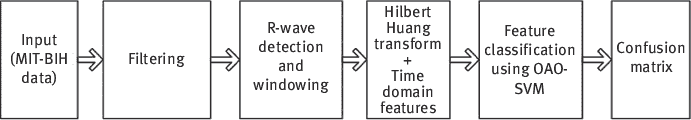

Figure 7.1: Block diagram.

### 7.3.1 数据库形成

在本分析中，数据库由 25 个数据（患者）生成，用于从 MIT-BIH 心律失常数据库 (Mark, 1988) 中进行特征提取和分类。选择此数据库的主要目的是其在涵盖同一领域的研究文章中的广泛使用。`SVM` 分类器用于训练和测试的日志和数据集数量已在表 7.1 中列出。在本章中，以 360 Hz 采样率和近 30 分钟持续时间收集的信号使用 ML-II 模型。具有每个峰值特定标记的样本测量仅用于将样本心跳分离为六类中的任何一类，例如 1. 正常 (N)，2. 左束支阻滞 (LBBB)，3. 右束支阻滞 (RBBB)，4. 室性期前收缩 (PVC)，5. 起搏心跳 (PB)，和 6. 心房期前收缩 (APB)。当心跳被分离后，每个类别的数据将被分成两个相等的一半。

#### 7.3.2 去噪

任何诊断系统的性能在很大程度上受心跳质量的影响。与心跳相关的噪声可能包含基线漂移、工频干扰、肌肉伪影、接触噪声、电外科噪声和量化噪声。必须消除这些不同种类的噪声，否则可能导致误报。此外，此步骤增强了信噪比 (SNR)，有助于准确检测心跳中的 fiducial 点。为了消除噪声，采用不同的滤波器来去除不同种类的噪声。

一组两个中值滤波器用于消除心跳中的基线漂移（Raj et al., 2018a）内。200 ms 的主中值滤波器用于界定 QRS 波（Raj et al., 2018a）和 P 波。而 600 ms 的次级滤波器则界定心跳内的 T 波。最后，通过从原始 `ECG` 数据中减去次级滤波器的输出来去除基线漂移（Raj et al., 2018a）。随后，通过将基线校正后的心跳通过 12 抽头的低通滤波器，使工频干扰和高频噪声从心跳中去除（Raj et al., 2018a）。该滤波器的截止频率为 35 Hz，通带和阻带中的纹波相等。该滤波器的输出被视为预处理后的心跳，其可通过 R 波定位和分割步骤以实现 `ECG` 信号的自动识别（Raj et al., 2018a）。图 7.2 和 7.3 分别显示了数据库中记录 #118 的原始心跳和滤波后的 `ECG` 输出。

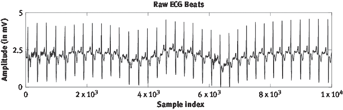

图 7.2：心跳记录的预处理（记录 #118）。

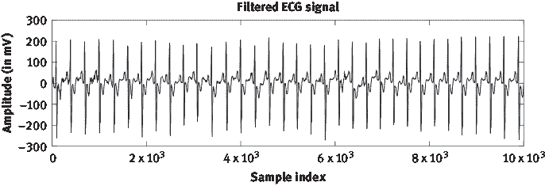

图 7.3：滤波后的心跳（记录 #118）。

### 7.3.3 QRS 波定位与 windowing

本研究根据 `ECG` 信号中 R 波的定位对不同类型的心律失常进行分类。在提取特征之前对 `ECG` 信号进行分割之前，有必要确定 R 波的位置。文献中已报道了大量用于检测 R 峰的研究（Raj et al., 2018e），其中本研究采用了成熟的 Pan-Tompkins（PT）算法（Pan, 1985）。由于其在嘈杂环境下具有已证实的较低计算负担和更高性能而被选用。检测到的 R 波与数据库中提供的 R 峰注释位置进行了验证。图 7.4。描绘了数据库中记录 #118 心跳中 R 波的定位。

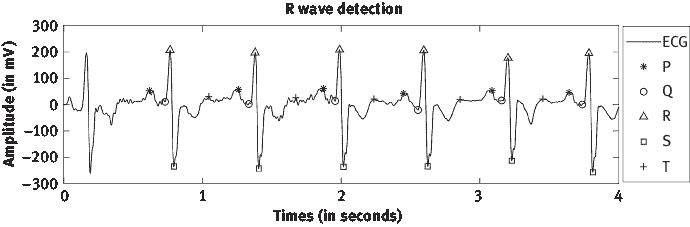

图 7.4：QRS 波检测。


在本研究中，分割步骤与几乎所有已报道的工作略有不同。他们使用恒定时间或样本的矩形窗口。样本取自后 R 峰右侧的 65%，而从左侧取前 R 峰的 35% 来估计每个心跳的长度。确保从起始 P 波到结束 T 波的 ECG 的所有信息都被保留，且不会丢失任何波的信息。

### 7.3.4 特征选择

特征矩阵输入数据包含其性质和特征的大量有用数据。直接输入数据处理会增加算法在分类器模型复杂性方面的难度。因此，有必要从任何输入数据中提取大量有意义的信息作为特征，以表示用于分类目的的心跳。这些特征作为输入应用于分类器模型，该模型经过训练和测试，这些特征必须作为输入提供。`EMD` 的信号分解产生 `(N-1)` 个 `IMF` 和一个剩余元素。由于低阶 `IMF`（即高频 `IMF`）显示快速振荡模式，而高阶 `IMF` 显示延迟振荡模式，经实验发现，前四个 ECG 心跳的 `IMF` 包含有关初始信号所需的数据。因此，仅前四个 `IMF` 可用于确定本次实验的输入特征。这样我们不仅降低了过程的复杂性，也减少了计算时间。本研究中 ECG 心跳包含的其他元素如 表 7.1 和 7.2 所示。

表 7.1：数据集。

| Class || Records || Training || Testing |
| --- | --- | --- | --- |
| N || 105, 113, 115, 122 || 2,000 || 2,000 |
| --- | --- | --- | --- |
| RBBB || 118, 124, 212, 231 || 2,000 || 2,000 |
| LBBB || 109, 111, 207, 214 || 2,000 || 2,000 |
| PVC || 119, 221, 200, 208, 233 || 200  900 || 200  300 |
| APB || 209, 222, 232 || 200  2,000 || 200  100 |
| PB || 107, 217 || 1,400 || 1,400 |
| TOTAL ||  || 10,700 || 10,700 |

表 7.2：所有六个类别的特征值。

| Features || N || RBBB || LBBB || PB || PVC || APB |
| --- | --- | --- | --- | --- | --- | --- |
| Feature I || \[3.342, 19.340\] || \[5.813, 18.587\] || \[3.994, 16.422\] || \[2.697, 16.300\] || \[3.111, 20.208\] || \[6.792, 21.969\] |
| --- | --- | --- | --- | --- | --- | --- |
| Feature II || \[0.093, 1.2188\] || \[0.1250, 1.1563\] || \[0.1563, 0.4312\] || \[0.0938, 1.2188\] || \[0.0938, 1.1875\] || \[0.125, 1.1875\] |
| Feature III || \[0.002, 0.251\] || \[0.005, 0.172\] || \[0.002, 0.238\] || \[0.003, 0.356\] || \[0.002, 0.343\] || \[0.005, 0.214\] |
| Feature IV || \[−0.558, 0.893\] || \[−0.593, 0.639\] || \[0.446, 0.720\] || \[0.313, 0.795\] || \[−0.761, 0.808\] || \[−0.650, 0.660\] |
| Feature V || \[−0.131, 0.270\] || \[−0.044, 0.048\] || \[−0.118, 0.107\] || \[−0.131, 0.110\] || \[−0.267, 0.271\] || \[−0.041, 0.056\] |
| Feature VI || \[1.308, 24.107\] || \[1.417, 24.675\] || \[1.533, 18.585\] || \[1.374, 25.256\] || \[1.396, 26.226\] || \[1.454, 25.055\] |
| Feature VII || \[0.003, 0.314\] || \[0.014, 0.244\] || \[0.003, 0.354\] || \[0.004, 0.569\] || \[0.003, 0.546\] || \[0.009, 0.298\] |
| Feature VIII || \[−2.464, 2.793\] || \[−1.615, 1.350\] || \[−2.021, 1.646\] || \[−2.307, 2.462\] || \[−2.214, 2.028\] || \[−2.203, 1.291\] |
| Feature IX || \[−0.018, 0.019\] || \[−0.004, 0.006\] || \[−0.009, 0.033\] || \[−0.026, 0.146\] || \[−0.150, 0.018\] || \[−0.001, 0.019\] |

* **i. 加权平均频率（特征 I）**：本章利用 `HHT` 计算 ECG 心跳数据的希尔伯特谱。当使用瞬时频率和瞬时幅度计算所有 `IMF`（除剩余元素外）的原始信号的平均频率时。具有 `m` 个 `IMF`，它定义了 `cj(t)` 的平均瞬时频率 `MIF(j)`，其中 `jε[1, m]` 且 `tε[1, n]` 包含 `n` 个数据集的第 `j` 个 `IMF`，作为希尔伯特谱的瞬时频率 `wj(t)` 和瞬时幅度 `aj(t)` 的加权平均值，如下所示：

```
(7.8)$MIF\\left( J \\right) = {}\\frac{\\sum\\limits\_{t = 1}^{n}w\\left( t \\right)\_{j}a\\left( t \\right)\_{j}^{2}}{\\sum\\limits\_{t = 1}^{n}a\\left( t \\right)\_{j}^{2}}\\ldots\\ldots.$
```

原始信号的平均频率应由下式确定

```
(7.9)$WMF = \\frac{{\\sum\_{j = 1}^{n}MIF\\left( j \\right) \\parallel a\_{j}} \\parallel}{\\sum\_{j = 1}^{m} \\parallel a\_{j} \\parallel}$
```

* **ii. KC（特征 II）：** 在获得信号 `x(t)` 的 `EMD` 分解后，其构成的 `IMF` `cj`，`j ε[1, m]` 且 `t ε[1, n]` 将在采用以下规则时转换为二值信号：

```
$c\_{j}\\left( t \\right)\\ = \\left\\{ {\\begin{matrix} {1,{ifcj}\\left( t \\right) \\geq E\\left( {{cj}\\left( t \\right)} \\right)\\ } \\\\ {0,{ifcj}\\left( t \\right){< E}\\left( {{cj}\\left( t \\right)} \\right)} \\\\ \\end{matrix}\\!\\!} \\right\\}$
```

* **iii. R 峰幅度（特征 III）：** R 峰是指 ECG 心跳的峰值幅度。R 峰位于 ECG 心跳的 QRS 波群中，其幅度是心跳的重要特征。

### iv. 绝对 IMF（特征 IV）

绝对 IMF 衡量 IMF 的绝对振幅平均值，例如，

```
(7.10) `${AIMF} = \\ \\frac{1}{N}\\sum\\limits\_{K = 1}^{N}\\left| x\_{k} \\right|`
```

### v. 中位数（特征 V）

中位数计算 IMF 样本值集合的居中位置分量（奇数序列情况下）或居中位置两个分量的均值（偶数序列情况下）。

### vi. 标准差（特征 VI）

它是序列方差的平方根，其中 IMF 样本值的分布由方差描述。

### vii. 峰度（特征 VII）

它是衡量分配受离群值影响程度的指标。分布的峰度由下式表征

```
(7.11) `$k = \\frac{E\\left( {x - \\mu} \\right)^{4}}{\\sigma^{4}}$`
```

其中 `μ` 表示 `x` 的均值，`σ` 表示 `x` 的标准差，而 `E(t)` 指量 `t` 的期望值。

图 7.5 和 7.6 展示了不同 ECG 信号分解为本征模态函数的结果。

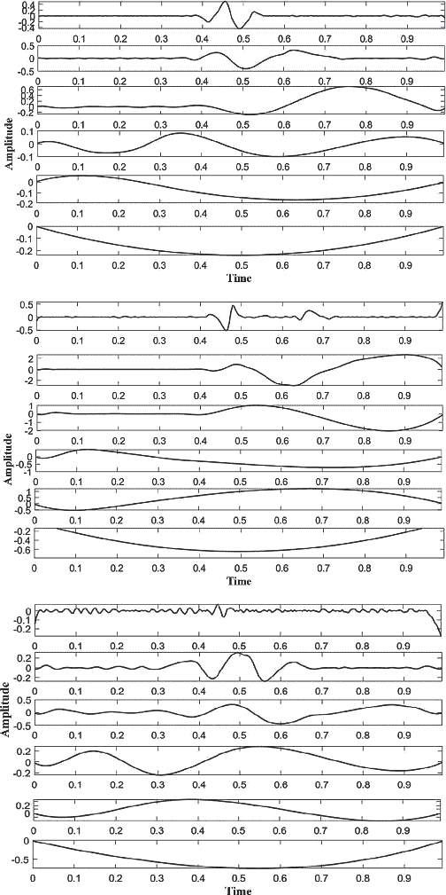

图 7.5：lbbb、正常和 rbbb 心跳的 IMFs。

### viii. 偏度（特征 VIII）

它是数据相对于样本均值的不对称性函数。分布的偏度描述如下：

```
(7.12) `$S = \\frac{E\\left( {x - \\mu} \\right)^{3}}{\\sigma^{3}}$`
```

### ix. 中心矩（特征 IX）

分布的 k 阶中心时定义如下：

```
(7.13) `*m*[*k*\=]*E*(*x*−*μ*)^(*k*)`
```

在本分析中经实验证实，中心三阶矩产生了良好的结果。

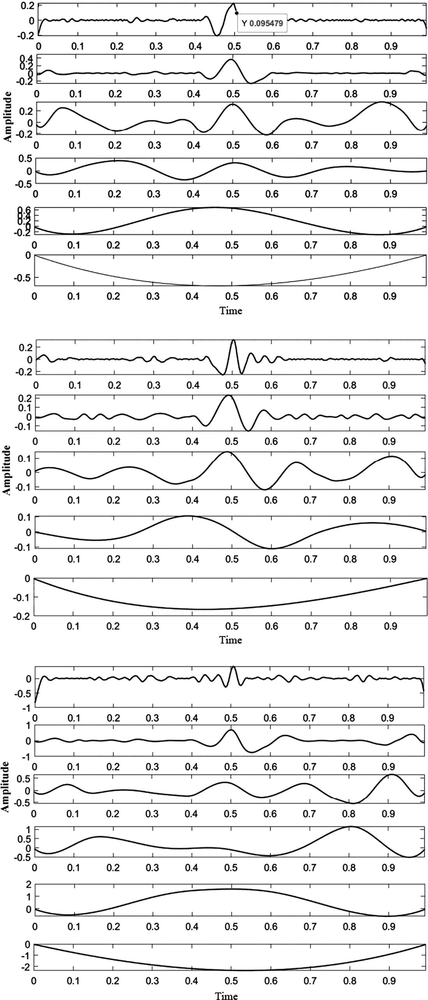

图 7.6：PVC、paced 和 APB 信号的 EMD 分解。

#### 7.3.4.1 性能指标

计算以下参数可以确定所提方法的效率。可以将灵敏度（`Se`）、特异性（`Sp`）和阳性预测率（`Pp`）定义为。

```
(7.14) `$S\_{e} = \\frac{TP}{TP + FN}$` (7.15) `$S\_{P} = \\frac{TN}{TN + FP}$` (7.16) `$P\_{P} = \\frac{TP}{TP + FP}$`
```

其中 `TP` 表示真阳性，`TN` 表示真阴性，`FP` 表示假阳性，`FN` 表示假阴性，各自独立。真阳性是指正确分配到特定类别的心跳，而假阴性是指应归类到同一类别却被误识别为另一类别的心跳，而假阳性则衡量被错误分配到该同一类别的心跳数量。同样，真阴性是指属于其他类别且被归类到其他类别同一类别的心跳。方法在各种方面的整体性能由与这些指标相关的数值显示，该数值表明准确检测的百分比或产生误表示的百分比。

#### 7.4 实验与仿真性能

所提技术通过 `MATLAB` 软件实现。ECG 信号是一系列最小振幅的信号，处理起来相当困难。为了进行后续数据分析，需要对 ECG 信息进行额外的预处理。这包括以下步骤：

1. 将信号均值转换为零值。
2. 将该信号在单位振幅下标准化。

表 7.3 提供了混淆矩阵，其中提供了正确识别和误识别实例的信息。

表 7.3：所提方法的性能。

| Ground truth/predicted || N || LBBB || RBBB || PVC || PB || APB |
| --- | --- | --- | --- | --- | --- | --- |
| **N** || 3,498 || 5 || 0 || 0 || 2 || 0 |
| --- | --- | --- | --- | --- | --- | --- |
| **RBBB** || 0 || 0 || 1,992 || 1 || 0 || 1 |
| **LBBB** || 0 || 1,986 || 1 || 0 || 8 || 0 |
| **PVC** || 0 || 0 || 0 || 1,093 || 0 || 0 |
| **APB** || 2 || 1 || 1 || 0 || 9 || 698 |
| **PB** || 0 || 8 || 6 || 6 || 1,381 || 1 |

实验报告的总分类准确率为 99.18%。

为了构建包含六个不同类别的 ECG 心跳数据库，采用了 256 个样本的窗口大小。对所有心跳进行 `EMD` 分解并获得前四个 IMFs。进一步研究后，这些 IMFs 被加载到 `HHT` 变换单元中。该模块测量信号的解析形式，并负责测量每个 IMF 样本的瞬时振幅和瞬时速率。分配到六个不同类别的心跳连同其前 4 个 IMFs 一并示出。此外，还估计剩余属性并为训练 `OAO-SVM` 分类器模型设计特征向量。本分析中未进行使用第三有效性系统的特征矩阵优化，但它可以置于该项目可能扩展的背景下。对于与心跳相关的每个 IMF，所有方面的重要性各不相同，但综合选择见 Table 7.4.

表 7.4：性能指标。

| Class of beats || TN || TP || FP || FN || S[p] (%) || S[e] (%) || P[p] (%) |
| --- | --- | --- | --- | --- | --- | --- | --- |
| **N** || 7,193 || 3,498 || 7 || 2 || 99.90 || 99.94 || 99.80 |
| --- | --- | --- | --- | --- | --- | --- | --- |
| **LBBB** || 8,691 || 1,986 || 9 || 14 || 99.90 || 99.30 || 99.54 |
| **RBBB** || 8,698 || 1,992 || 2 || 8 || 99.98 || 99.60 || 99.90 |
| **PVC** || 9,600 || 1,093 || 0 || 7 || 100 || 99.36 || 100 |
| **PB** || 9,279 || 1,381 || 21 || 19 || 99.77 || 98.64 || 98.50 |
| **APB** || 9,987 || 698 || 13 || 2 || 99.87 || 99.71 || 98.17 |

如上所述，`OAO` 策略显示在 Figure 7.7。本章涉及 `MCSVM` 分组。每个类别与剩余的 (C-1) 个类别进行比较，对于 C 个类别且不允许重复，总共该策略包含 C(C-1)/2 个心跳分类类别。样本数据依次插入每个模块中，其中每个数据点进行学习和验证，同时只考虑块中列出的两个类别。考虑一个用于排序过程的划分标准以产生每个二元 SVM 的性能。在测试阶段，采用多数表决规则将最终类别分配给每个数据点。该原则将每个数据点获得的任何特定类别的多数票数相等，从而确定输入向量中每个点的分配类别。由于 SVM 应用需要二次规划器，它们需要进行配置以获得更好的结果，为此每次使用总共 1,000 次仿真。它获取 OAO 组的全部可能组合并实例化相同数量的二元 SVM 配置。每个二元 SVM 方法准备好后，使用 RBF 核进行检验，对分类的测试数据集进行实际投票。通过列出选择系统中每个测试数据集部分中每个类别投出的最高票数来确定它们对应的类别。在整个分组方法建立后，为每个训练数据集开发混淆矩阵并确定随后的识别精度。


图 7.7：支持向量机架构。

如 Table 7.4 所列，`MCSVM` 分类器使用不同记录的测试集数据进行编程。当分类器被编程时，样本数据集被插入到分类器中以确定评估的结果。分类结果可以用混淆矩阵的形式表示，该矩阵在 Table 7.5 中给出，使用上述 `ECG` 心跳数据集和建议的方法。列标签是心跳的特定组，而行标签中的输入反映了与列组相关联的心跳数量，并标记为行所示类别。

### Table 7.5:Accuracy reported by various features.

| Feature subsets || Classification accuracy (%) |
| --- | --- |
| Feature I |
Feature I + II |
Feature I + II + III |
Feature I + II + III + IV |
Feature I + II + III + IV + V |
Feature I + II + III + IV + V + VI |
Feature I + II + III + IV + V + VI + VII |
Feature I + II + III + IV + V + VI + VII + VIII |
Feature I + II + III + IV + V + VI + VII + VIII + IX || 78.35 |
87.62 |
89.74 |
95.28 |
96.78 |
97.42 |
98.71 |
99.03 |
99.51 |
| --- | --- |

分类效率由准确率、灵敏度、特异性和阳性预测值的计算决定。对于某一类别，分类准确率定义如下：

```
(7.17)$\\eta = \\frac{Total\\ beats - \\, total\\ misclassified\\ beats}{Total\\ beats}$
```

每个类别的分类准确率实际上与表 7.4 中引用的灵敏度参数相似，从而实现了 99.18% 的分类性能。性能指标如灵敏度、特异性和阳性预测值（Raj et al., 2018b）的计算分别利用 (7.14)、(7.15) 和 (7.16)，其中 *TN*、*FP*、*TN* 和 *FN* 参数的值取自 Table 7.4。


这些计算得到的指标可以被视为对任何实例的理解，例如 `PVC`。由于该情况下的灵敏度反映了以百分比计正确识别患有 `PVC` 的患者的比例，根据 (7.14) 我们得到灵敏度为 99.14%，由所提出的方法报告。相应地，特异性表明准确识别未患有 `PVC` 的受试者，根据 (7.15) 为 99.18%。阳性预测值由真阳性（`TP`）和假阳性（`FP`）参数决定。这里，`TP` 表示患有 `PVC` 的受试者已被所提出的方法准确识别，而 `FP` 表示受试者被错误地区分为患有 `LBBB` 的患者。由此，利用 (7.16) `Pp` 对于 `LBBB` 为 1,986/(1,986 + 9) = 99.54%。

Table 7.5 总结了所提出方法中 `SVM` 分类器模型对不同提取并拼接在一起的特征的性能。所提出方法报告的更高准确率可以说明所提及特征中插入的每一条数据都有助于获得更好的结果。当联合使用时，所有九个特征实现了 99.51% 的准确率，证明了完整特征集的重要性。所建议方法广泛的分类精度证明了为表示心跳而设计的特征向量是有效的，这也得到了在实验中报告的混淆矩阵的支持。也可以从 Table 7.5 得出，所提取的不同特征也对实现更高性能做出了显著贡献。使用这些特征进行分类方法为所考虑的类别之间提供了很好的区分。因此，该方法可在医院中用于心血管疾病的有效计算机化诊断。

在 `OAO-SVM` 的训练阶段，支持向量的决定性由在制定二次优化问题上执行的大部分计算尝试决定。我们谈到所建议的特征描述了心跳的类别，并将适当的信息转换为高维特征空间，从而提高了分类准确率，并为分离不同类别的心跳提供了重要线索。对于训练 `SVM` 分类器，核函数的选择完全是经验性的，因此是在探索性基础上选择的。然而，目前的研究得出结论，`RBF` 核函数产生更好的结果，因此，使用适当的缩放因子 *σ* 和 `C` 参数对分类器模型进行训练对于实现更高性能是重要的。

Table 7.6 显示了所提出方法在与先前研究相比的预测性能，以实现不同心跳类别的有效识别。De Chazal 和 Reilly（De Chazal and Reilly, 2006）提出了一种自适应 `ECG` 处理方案，用于将心跳分类为五组之一。形态学特征和心跳间隔的特征被用于形成表示心跳的特征向量。然后，使用线性判别分类器对心跳进行分类。该方法实现的分类准确率为 85.90%。在 2009 年，作者（Ince et al., 2009）引入了主成分分析和离散小波变换（`DWT`）来区分五个类别，使用多维粒子群优化（`PSO`）和 `SVM` 作为评估技术，分别获得 95% 和 93% 的准确率。Osowski 和 Linh（Osowski and Linh, 2001）对总共七个类别进行了分类，准确率为 96.06%，而作者在（Martis et al., 2013）中分别报告了二元分类准确率为 94% 和三类分类准确率为 98%。在（Raj et al., 2015a）中，作者使用离散小波变换从心跳中提取重要特征，并通过反向传播神经网络识别，准确率为 97.40%，以对八类心跳进行分类。在（Raj et al., 2015b）中，作者提出了一项类似的研究，实时对四类进行分类，通过实现基于规则的方法并达到 97.96% 的准确率。在本章中，所建议的方法在 99.51% 的分类准确率方面产生了比现有方法更好的结果，如 Table 7.6 所示。

### Table 7.6:Comparison with state-of-the-art methodologies.

| Literature || Feature extraction || Classifier || Classes || Accuracy (%) |
| --- | --- | --- | --- | --- |
| Osowski and Linh |
(Osowski and Linh, 2001) || `HOSA` || Hybrid fuzzy neural network || 7 || 96.06 |
| --- | --- | --- | --- | --- |
| Hu et al. |
(Hu et al., 1997) || Time-domain approach || Mixture of experts || 2 || 94.00 |
| Llamedo and Martinez (Llamedo and Martinez, 2012) || RR-interval and its derived features || Linear discriminant analysis and expectation maximization || 3 || 98.0 |
| Martis et al.
(Martis et al., 2013) || Bio-spectrum + PCA || SVM with RBF kernel || 5 || 93.48 |
| Ince et al.  
(Ince et al., 2009) || WT + PCA || Multidimensional PSO || 5 || 95.58 |
| Raj et al.  
(Raj et al., 2015a) || DWT using FFT || BPNN || 8 || 97.40 |
| Raj et al. (Raj et al., 2015b) || R to R wave || Rules || 4 || 97.96 |
| de Chazal and Reilly  
(de Chazal and Reilly, 2006) || Morphology and heartbeat interval || Linear discriminant analysis || 5 || 85.90 |
| Proposed || HHT + Time domain features || SVM || 6 || 99.18 |

† WT: Wavelet transform; BPNN: Back propagation neural networks; PSO: Particle swarm optimization; FFT: fast Fourier transform; RBF: Radial basis function; ABC: Artificial bee colony; SVM: Support vector machines; PCA: Principal component analysis; DWT: Discrete wavelet transform.

## 7.5 Conclusion and future scope

The chapter introduces a unique technique for the classification of arrhythmia beat using a strategy consisting of `HHT-SVM` that is simulated and evaluated in `MATLAB`. Compared to the other current methods, the suggested method is considered as highly efficient as it is reported an accuracy of 99.51%. A third validation set is used to optimize the feature matrix which further decreases the computational burden of the training phase and the recognition system. It is also possible to train the `SVM` model developed by using the cross-validation strategy to decide the selection of kernel functions. In this chapter, the proposed methodology is validated on the Phyionet data to identify six generic kinds of heartbeats. They are normal (N), Left bundle branch block (`LBBB`), right bundle branch block (`RBBB`), preventricular contraction (`PVC`), paced beat (`PB`), and atrial preventricular beat (`APB`) from the different records of subjects available in the database. This implemented is suitable for computer-aided diagnosis of cardiac diseases and can be utilized in hospitals for providing proper care for other state-of-the-art methods. In future, more number of categories of heartbeats will be considered to evaluate the proposed method and develop a more efficient methodology. Using an embedded platform for real-time heartbeat monitoring system, the suggested method can be used as an application for hardware execution. In future, this current work can be extended to classify more significant of potential arrhythmias and the proposed method can be validated on the data of real-time patients. Further, more computationally efficient techniques can be developed to increase the efficiency to provide a more generic solution to the state-of-the-art techniques.

## References

Acır N. Classification of ECG beats by using a fast least square support vector machines with a dynamic programming feature selection algorithm. Neural Computing & Applications, (2005), 14(4), 299–309. →

Cortes C. and Vapnik V. Support-vector networks. Machine Learning, (1995), 20(3), 273–297. →

de Chazal P. and Reilly R.B. A patient-adapting heartbeat classifier using ECG morphology and heartbeat interval features. IEEE Transactions on Biomedical Engineering, (2006), 53(12), 2535–2543. a, b

Ercelebi E. Electrocardiogram signals de-noising using lifting-based discrete wavelet transform. Computers in Biology and Medicine, (2004), 34(6), 479–493. →

Güler I. and Übeylı E.D. ECG beat classifier designed by combined neural network model. Pattern Recognition, (2005), 38(2), 199–208. →

Hsu C.-W. and Lin C.-J. A comparison of methods for multiclass support vector machines. IEEE Transactions on Neural Networks, (2002), 13(2), 415–425. →

Hu Y.H., Palreddy S., and Tompkins W.J. A patient-adaptable ECG beat classifier using a mixture of experts approach. IEEE Transactions on Biomedical Engineering, (1997), 44(9), 891–900. →

Huang N.E. Introduction to the Hilbert- Huang transform and its related mathematical problems, Interdisciplinary Mathematics, (2005), 5, pp. 1–26. →

Huang N.E., Shen Z., and Long S.R. The empirical mode decomposition and the Hilbert spectrum for nonlinear and non-stationary time series analysis. Proceedings of the Royal Society of London A, Mathematical Physical and Engineering Science, (1971), 454(1971), 903–995. →

Ince T., Kiranyaz S., and Gabbouj M. A generic and robust system for automated patient-specific classification of ECG signals. IEEE Transactions on Biomedical Engineering, (2009), 56(5), 1415–1426. a, b

Kreßel U.H.G.. Pairwise classification and support vector machines. In: Schölkopf B., Burges C.J.C., and Smola A.J. (Eds.), Advances in Kernel Methods, (1999), MIT Press, 1999, 255–268. →

Lempel A. and Ziv J. On the complexity of finite sequences. IEEE Transaction on Information Theory, (1976), 22(1), 75–81. a, b

Llamedo M. and Martínez J.P. Án automatic patient-adapted ECG heartbeat classifier allowing expert assistance. IEEE Transactions on Biomedical Engineering, (2012), 59(8), 2312–2320. →

Mahmoodabadi S., Ahmadian A., and Abolhasani M. ECG feature extraction based on multiresolution wavelet transform. 27th Annual International Conference of the IEEE Engineering in Medicine and Biology Society, (2005), 3902–3905. →

Mark R. and Moody G. MIT-BIH Arrhythmia Database Directory. Cambridge: Massachusetts Institute of Technology, (1988) →

Martis R.J., Acharya U.R., and Mandana K. Cardiac decision making using higher order spectra. Biomedical Signal Processing and Control, (2013), 8(2), 193–203. a, b

Osowski S. and Linh T.H. ECG beat recognition using fuzzy hybrid neural network. IEEE Transactions on Biomedical Engineering, (2001), 48(11), 1265–1271. a, b, c

Pan J. and Tompkins W.J. A real-time QRS detection algorithm. IEEE Transactions on Biomedical Engineering, (1985 March), BME-32(3), 230–236. 

Raj S. (2018a), Development and hardware prototype of an efficient method for handheld arrhythmia monitoring device. Ph.D. Thesis IIT Patna. 2018, pp. 1–181. a, b, c, d, e, f, g


Raj S., Chand G.P., and Ray K.C. Arm-based arrhythmia beat monitoring system. Microprocessors and Microsystems, (2015a), 39(7), 504–511. a, b

Raj S., Maurya K., and Ray K.C. A knowledge-based real time embedded platform for arrhythmia beat classification. Biomedical Engineering Letter, (2015b), 5(4), 271–280. a, b

Raj S., Ray K. C., and Shankar O., “Development of robust, fast and efficient QRS complex detector: a methodological review”, Aust. Phys. Eng. Sci. Med., (2018 Sept.), 41(3), 581–600.

Raj S. and Ray K.C. A personalized arrhythmia monitoring platform. Scientific Reports, (2018b), 8(11395), 1–11. a, b

Raj S. and Ray K.C. Sparse representation of ECG signals for automated recognition of cardiac arrhythmias. Expert Systems with Applications, (2018c), 105, 49–64. →

Raj S. and Ray K.C. A personalized point-of-care platform for real-time ECG monitoring. IEEE Transactions on Consumer Electronics, (2018d), 66(4), 452–460. →

Rilling G., Flandrin P., and Goncalves P. On empirical mode decomposition and its algorithms. IEEE-EURASIP Workshop on Nonlinear Signal and Image Processing NSIP, (2003), 3, 8–11. →

Saxena S., Kumar V., and Hamde S. Feature extraction from ECG signals using wavelet transforms for disease diagnostics. International Journal of Systems Science, (2002), 33(13), 1073–1085. →

Vapnik V. The Nature of Statistical Learning Theory. Springer, (2000). →

Weston J. and Watkins C. (1998), Multi-class support vector machines. Technical Report, Citeseer, 1998. →

Yegnanarayana B. Artificial Neural Networks. PHI Learning Pvt. Ltd, (2009). →

# 8 机器学习方法探索计算智能

Naveenkumar Jayakumar Department of Computer Engineering, Bharati Vidyapeeth (Deemed to Be University) College of Engineering, Pune, India Dhanashri P. Joshi Department of Computer Engineering, Bharati Vidyapeeth (Deemed to Be University) College of Engineering, Pune, India

#### Abstract

受基因和自然特征启发的新概念，如大脑中的神经元结构\[神经网络 (NN)\]，被称为计算智能 (CI)。CI 依赖于三个主要支柱，即 NN、模糊系统和进化计算 (EC)。模糊系统利用自然语言或更具体地说人类使用的语言来表示语言模糊性，并解决近似推理计算中的困难。NN 可以定义为根据人类大脑的结构和工作方式设计的计算模型，可以进行训练并据此执行工作。本章重点关注 EC 以及 EC 在机器学习 (ML) 应用中的各个方面。EC 通过生成、计算和转换不同的可能解决方案，如进化编程、遗传算法、多目标优化和可进化硬件 (EH) 等，为优化问题提供了解决方案。在 ML 和大数据近几年，计算机系统/应用程序正在创建、收集和消耗大量数据。由于如此庞大的数据被用于 ML 功能以及数据需求型应用程序，从存储单元到主机单元的数据传输速率将成为瓶颈。可进化编程和 EH 共同可能是解决上述优化问题的关键。解决方案可以通过使用近数据处理 (NDP) 或原位处理来提供。NDP 允许在原位执行计算密集型应用程序，这意味着在存储单元 (内存/存储) 内或非常接近存储单元。结果可能是 NDP 旨在减少昂贵的数据移动，从而提高性能。NDP 由软件系统加硬件系统的组合构成，源自主机单元 (中央处理单元) 加智能存储系统。智能存储系统具有多个元素，即用于存储的各种磁盘、缓存、前端和后端。现在缓存内存具有大容量，用于临时存储热数据 (频繁使用的数据)。冷数据 (使用频率较低的数据) 被移向前面的存储层。前端旨在连接主机系统和存储系统。后端旨在支持缓存和多个存储磁盘之间的通信。后端的一部分是后端控制器，它管理这些磁盘，具有冗余独立磁盘阵列 (RAID) 的能力，并具有错误查找以及错误校正方法。本章讨论了与 ML 方法兼容的 NDP 的不同架构，以及这些提到的 NDP 架构如何增强 ML 方法的执行。本章重点关注为各种 ML 方法设计的 NDP 的最新研究进展。

关键词：原位处理，近数据处理 (NDP)，智能存储系统，计算智能，

## 8.1 计算智能简介

电子设备能够以远超人类计算能力的速度计算大量不同类型的数据，并且不会像人类那样疲劳。在某些情况下，人类贡献并不完全能够胜任，例如天气预报、健康相关问题的预测、自动防撞系统或需要处理大量数据的类似情况。因此，对计算智能 (CI) 和人工智能的需求正在逐步上升 (Rattadilok et al., 2014)。

那些主要需要实时数据的应用程序主要采用各种传感器以极快的速度创建和收集数据。这类应用程序通常称为物联网 (IoT) 应用程序，它们从研究者的焦点转移到智能数据计算以及在预期时刻从这些数据中发现有用的事实片段。这些有用的信息可能用于管理某些计算、激活各种传感器或控制各种物理设备或支持决策。在实时应用程序中，控制或触发任务的复杂性显著增加。CI 已成功应用于此类大数据或基于 ML 的应用程序。CI 是一个同样受生物特征启发的概念，如神经网络 (NN)。它建立在 EC、模糊系统和 NN 等坚实支柱之上。模糊系统通过利用人类使用的自然语言来塑造语言模糊性，为近似推理问题提供了关键。NN 是一个基于人类大脑结构和功能构建的范式，可以获取知识并据此工作。EC 通过产生、近似计算和转换不同的可能解决方案，为优化问题提供了解决方案。EC 由可进化硬件 (EH)、遗传算法 (GAs)、多目标优化、进化编程等组成。

即使 CI 技术需要一些数据集来提供一致和精确的结果，如系统前景，在 CI 中，预期的示例或情况形成系统，使其能够突出相应数据集中明显的异常，以便为核心实践工作开发的系统能够自主工作。这些发生的锯齿状情况被称为异常。上述异常在事先发现起来很复杂，并且可能对概述合适的训练数据集构成危险。因此，习惯于应对动态问题的 CI 方案必须能够适应条件以及环境变化 (Rattadilok et al., 2014)。

## 8.2 计算智能研究方面

在本节中，描述了一些 CI 关键研究方面。

### 8.2.1 计算智能算法开发的萌芽平台

在所述领域，研究重点是通过发现新型 CI 系统平台、CI 系统硬件元素、基础设施以及根据 CI 系统需求的可扩展网络，来实现对数据密集型应用的可靠低延迟数据处理。雾计算和云计算被用于实现高效的数据处理管理以及降低大规模应用的架构限制。通常在数据密集型系统中，数据是由传感器和物联网设备组成和产生的。这些由物联网设备组成或产生的数据是海量数据，要积累这些数据组织必须需要额外的存储。这种存储和处理如此庞大数据量的设施由数据中心提供。通过虚拟化，基于云的设施提供软件资源。一旦传感器或智能设备不断产生或收集数据，就需要额外的网络带宽，并且在数据传输到云或存储服务器时会出现更多延迟。在这些场景中，数据由边缘设备在网络边缘附近进行过滤，并且仅通过网络将经过过滤的有用数据传输到云或服务器，这种状态称为主动存储或雾计算或物联网应用中的边缘计算。它是云-IoT 融合的继任者。边缘计算在从边缘设备向云服务器或存储服务器传输数据的阶段是有益的。然而在将数据从存储单元传输到计算单元（可能是服务器，联邦系统利用存储单元中存储的数据）的情况下，传统上完整的整个数据集需要作为输入提供给应用程序，而不管数据集大小如何，而不是仅将有用的数据集从存储发送到处理单元。这是不合理的，因为它放大了延迟并占用了相对更大的网络带宽。

为击败这一问题，NDP 进入视野。在 NDP 系统中，部分数据处理在原位运行，这意味着在数据存储单元内部/附近运行。它在 8.2.4 节中得到了更详细的阐述。

### 8.2.2 安全

在原位存储处理的情况下，在数据、硬件框架、处理器上下文切换和操作系统（OS）等各个阶段需要额外的安全保障。需要进行安全检查后存储的数据用于数据集中 ML 应用。之前曾采用一些安全方式，如加密、基于角色的身份验证或随机标记化和控制。然而，提到的安全方法对 ML 应用没有帮助。对于 ML 应用中敏感数据的保护，各种方法可能有所帮助，即消除敏感数据、覆盖或伪装数据，或数据粗化（降低数据粒度或数据精度，目的是使识别相应数据集中包含的敏感数据变得困难）（Google cloud，线上 [`cloud.google.com/solutions/sensitive-data-and-ml-datasets`](https://cloud.google.com/solutions/sensitive-data-and-ml-datasets)）。

大量对 ML 应用等应用有用的数据通常存储在数据中心。数据中心的安全可以通过将物理安全与逻辑/数字安全相结合来实现。这里，逻辑安全与数据相关。国际标准化组织（ISO）已创建了专门用于信息安全的模型 ISO 27001。信息安全是 ISO 27001 预先考虑用于各种基础设施或框架中，尽管它没有提供数据中心安全的任何具体标准（Achmadi et al., 2018）。新的安全标准在 Lontsikh et al., 2016 中设计，即信息安全管理体系（ISMS）。ISMS 组成主要旨在管理数据中心框架的数据完整性、数据可用性和数据隐私。与其他 ISO 标准化类似，它涉及运行流程和技术框架以保护存储在数据中心中的信息安全。

提供了一些高度先进的解决方案，例如去中心化数据中心（DDC）。为了克服传统方法数据中心中的主要安全问题，可以使用 DDC 概念通过区块链技术和智能合约将数据中心虚拟化（Rygula et al., 2017）。区块链可以被描述为一种数据结构或分布式账本技术，它生成关于合同的数字防篡改记录。国际商业机器公司私人有限公司（IBM）中提出的另一种方法为可信虚拟数据中心（TVDc）。TVDc 由 IBM 设计和创建，以满足数据可靠性以及数据远程性的需求，必要时在虚拟环境中提供更多安全性（Perez et al., 2008）。

### 8.2.3 满足数据爆炸

在这些日子里，在社会领域，物联网应用也被实施和使用。这些实时应用以前用于延迟问题不存在的应用领域，或者在应用中未占用大量数据，如操作路灯、显示一些广告等。然而由于数据需求增加，功能难度增大，并且与大数据生产和编译成正比。例如类似人类健康监测和预测或 DSS，即决策支持系统，需要额外的数据需求用于分析目的。如此大量的数据需要积累在数据中心或用于存储的任何云服务器上。对如此庞大数据进行的计算可能对组织而言在安全和网络带宽等方面代价高昂，因为数据通过网络传输。对于智能或智能应用，先决条件 ML 可能会与 EH 配对。上述领域也进行了活跃的研究。数据中心主要旨在积累大量和分散的数据。NDP 将适合击败这一问题。在 NDP 系统中，部分数据处理在原位运行，这意味着在数据存储节点内部/附近运行。NDP 通过缩小网络带宽限制来改善系统性能。

### 8.2.4 近数据处理（NDP）/原位处理数据

由于 ML 或数据密集型系统中使用的数据是巨大的，从存储系统向主机处理单元传输数据的发生是一个日益增长的关注点。原位处理或 NDP 是硬件系统和软件栈的结合，取决于与存储节点和计算单元的集合。有 NDP 的子类型，即内存中处理和存储中处理。

#### 8.2.4.1 内存中处理

`Bounded Staled Sync (BSSync)` 是一个在本文中解释的框架（Lee 等, 2015）。它具有硬件栈和软件栈，以在并行 ML 系统中并行执行的微小作业为基础来降低开销。微小任务被委派到逻辑内存的层级上执行，以便中央处理单元能够完全用于 ML 算法。在某些 ML 场景中，原子进程被实现用于读操作、写操作、修改操作和追加操作。它通常用于并行计算，以便使每个并行运行的线程都能够更改特定变量的同一内存位置的值。五种不同的 ML 函数（最小二乘矩阵 (LSM) 分解、单源最短路径、潜在狄利克雷分配 (LDA)、LASSO 回归和广度优先搜索 (BFS)）通过改变输入来用于框架评估。

Lee 等, 2017 的研究文章中提出了一个框架。它源自相似性搜索关联记忆 (`SSAM`)。它通过 NDP 加速相似性搜索。相似性搜索是 `k-最近邻 (kNN)` 算法的基础的关键思想。相似性搜索的思想被用于多种功能，如自然语言处理 (`NLP`)、图像处理等。本文主要关注特定的 ML 算法，即 `kNN` 算法。`kNN` 中的阻塞通常出现在相似性搜索阶段。论文发现 `SSAM` 在 50% 的搜索精度中提供 170 倍的吞吐量提升，并在 99% 的搜索精度中提供 13 倍的提升。多个动态随机存取存储器 (`DRAM`) 层被垂直分割成多个称为 `vault` 的部分。主机处理单元的驱动程序负责处理、配置和编译 `SSAM` 加速器。类似的 `SSAM` 框架在 Lee 等, 2018 中提出。在这篇研究论文中，架构是在多个参数之间的欧几里得距离限制以及用于 `kNN` 的特征向量约束的基础上评估的，并使用了三个特定数据集，即 AlexNet 数据集、词向量全局表示 (`GloVe`) 数据集和 GIST 数据集。在 Lee 等, 2018 中提出的框架中，`SSAM` 与主机单元和 `DRAM` 集成。它被评估用于线性加近似 `kNN` 算法。`SSAM` 框架是基于 Hybrid Memory Cube 2.0 (`HMC2.0`) 生成的，以利用增强的内存传输容量优势。节省费用的计算判断未考虑数据中心中存在的额外开销，如电力使用开销和网络工具开销。

异构可重构逻辑 (`HRL`) 架构在 Gao 等, 2016 中提出。`HRL` 包含许多不同的部分，链接用于路由的静态可重构结构。具有粗粒度可重构阵列 (`CGRA`) 模式网格和功能单元 (`FUs`)（粗粒度 `FUs`）的预期 `HRL` 架构用于执行常见的数学函数。架构还使用现场可编程门阵列 (`FPGA`) 模式和可配置逻辑块 (`CLBs`)（细粒度 `CLBs`）来执行明确的逻辑和特定功能。`HRL` 系统利用静态可重构网络来降低能源需求开销。`HRL` 系统包含一种基于总线的粗粒度数据网络，以及一种细粒度的位级控制网络。架构不包含分布式 `BRAM`，即块 RAM。作者设计了一个具有可扩展属性的 NDP 系统，具有多个内存堆栈以及基于 `HRL` 的中央计算系统来处理分析工作负载。类似的系统在 Gao 等, 2015 和 Gao 等, 2016 中有所解释，并用于深度神经网络 (`DNN`)、图处理和 MapReduce 框架。系统硬件栈中的重要部分有 `vault` 硬件、主机处理器以及 3D 内存堆栈。Gao 等 (2015) 提供了 NDP 系统的软件和硬件栈的详细信息。它为 MapReduce 框架上的应用程序提供内存内分析方法，处理图和神经网络。

论文 (Hong 等, 2016) 提出的框架将链表遍历 (`LLT`) 的实现移近数据存储，并通过减少数据访问来降低 `LLT` 延迟。片上还通过 `LLT` 引擎（专用设备）增强了并行实现的效率和能效。设计的系统适用于每种类型的链表。Hong 等, 2016 中描述的利用 NDP 加速 `LLT` 的架构与 `LLU`、`Graph500`、`Memcached` 和 `Hash join` 的工作负载一起进行了评估。在处理/主机单元处，网络通过星型拓扑配置，内存网络（芯片间网络）因为唯一的计算单元有权使用内存单元，而 HMC 内存单元之间的互连是不必要的。`LLT` 引擎、数据定位和批处理的使用对系统性能有影响。除了 `memcached` 之外的所有工作负载中，完整 `LLT` 事件的完成都与完成时间有关。然而在 `Memcached` 中，每个 `LLT` 函数都与一个客户端请求相关联，并且所有 `LLT` 中的延迟可能会影响到用户级请求的延迟。

Vermij 等 (2017) 解释的系统研究了 `GRAPH500` 算法以及旨在与基于共享内存概念的 NDP 框架一起工作的 HPGA 算法的性能。它讨论了各种特性，例如程序优化、系统约束计划以及类似用户增强逻辑的特殊结构特征的管理，以及为多个处理器之间的数据传输而进行的数据局部性扩展。系统的主要模块命名为 `NDP` 管理器、`NDP` 核心和 `NDP` 访问点 (`AP`)。框架使用常规模拟器进行评估，该模拟器用于模拟系统。采用了具有共享内存的嵌套 OpenMP 并行化技术用于设计的框架。该架构的性能测量显示，与常规主机单元相比，速度提升了 3.5 倍。


云端系统的自动扩展和调整平台 (`ASAPCS`) 在 Kampars 等 (2017) 中给出。它是为处理数据同化和处理问题而创建的架构，用于提出数据驱动的应用程序并部署在基于 CloudStack 的远程终端单元 (`RTUs`) 上。架构的组件是 Apache SPARK 集群、`Kafta` 集群、数据驱动系统、调整引擎、`Cassandra` 集群和 `ASAPCS` 核心单元。`Kafta` 集群为系统安全性提供了额外高度。

基于 `NDP` 的 3D 堆叠内存的 `CNN` 逻辑单元 (`CLU`) 在 Das 等 (2018) 中提出。系统的评估已通过仿真执行。仿真显示了有利于 `CNN` 过程的性能提升，而计算在内存中进行，同时与具有 `DRAM` 的主机计算单元相比。它显示了 76 倍的执行增强，而功耗需求降低了 55 倍。

### 8.2.4.2 处理在存储中

在 Gu et al. (2016) 中，为 `BigData` 系统应用设计的 `NDP` 架构即为 `Biscuit`。数据控制端口作业与数据计算作业保持通信。论文设计的系统是 `Biscuit`，它可能无法区分在主机模块上作为存储单元执行的作业。`Biscuit` 由两个主要子系统组成：主机单元和存储单元，即 `Solid State Drive` (`SSD`)。此外，该框架还包含分布式软件单元。`SSDlet` 可描述为在 `SSD` 内执行的特定应用集合。`SSD` 包含两种类型的存储器。第一种是片上 `SRAM`，其尺寸很小且速度快，第二种是 `DRAM`，其容量很大但速度慢。缺乏缓存一致性、处理能力低于普通系统以及片上 `SRAM` 较少是该框架的一些硬件限制。该架构无法满足可预测软件概念所期望的要求。

Choe et al. (2017) 的论文阐述了用于 `ML` 算法中随机梯度下降 (`SGD`) 的 `NDP` 系统。该 `NDP` 框架源自使用 `SSD` 作为存储节点的存储内处理 (`ISP`) 模型。类似的系统在 Meesad et al. (2013) 中有所说明。在此，作者提出了使用 `ISP` 和三星 `SSD` 作为存储节点的用于 `ML` 的 `NDP`。论文建议了两种利用硬件部分支持 `ISP` 的方法：(1) 根据应用/开发者约束规划专用逻辑芯片；以及 (2) 使用 `SSD` 控制器单元内的嵌入式核心。通道控制器具有处理与 `NAND` 闪存的读和写功能的容量。通过使用此功能，作者利用每个通道控制器对在 `NAND` 通道中收集的数据执行基本功能。某种基本功能依赖于一种形式的 `ML` 算法。缓存控制器在所提出的系统中用于收集每个通道控制器生成的结果，除使用缓存控制器在 `SSD` 控制器内的固有用途如缓存管理器 (`DRAM` 管理器) 外。算法是为基于 `ISP` 的执行而设计的，用于 `ISP` 基于的下雨 `SGD`、同步 `SGD` 和 `ISP` 基于的 `EASGD`。现在问题可以描述为如果数据量超过页面的容量，数据碎片会反复发生，这可能会影响方法的执行。

Sun et al. (2018) 设计并描述了一个名为 `DStore` 的系统。`DStore` 利用系统中两个模块，即存储节点和主机系统的多样化处理潜力。`DStore` 积极地将压缩作业划分为架构的几个部分，具体取决于各自的处理能力。所提出的系统实现了作业执行的并行性。主机系统单元提出与 `LevelDB` 的 `APIs` 调谐的本地应用程序编程接口 (`APIs`)。设备单元通过主机子系统接受有关压缩驱动通信的数据。框架 `DStore` 同时执行数据库、元数据集和处理能力的多个级别的过程。按需压缩，任务调度算法由作者设计。`DStore` 与 `LevelDB` 和协作键值存储 (`Co-KV`) 进行比较。微目标和宏观目标已根据网络带宽、处理能力等确定。

Kaplan et al. (2016) 的研究文章提供了从内存中处理到存储中处理的系统变化。在本文中，基于电阻式内容寻址存储器 (`ReCAM`) 设计了存储内计算系统 (`ISC system`)。它执行类似并行的存储，用于大量数据，并作为小数据的计算单元。文章给出了 `ISP`，而不重新分配系统到层次内存。设计的架构 `ReCAM` 与 `GPU`、`Xeon Phi` 以及 `FPGA` 相比进行了评估。

Riedel et al. (2001) 提出了一种名为活动磁盘的架构。它是为大规模数据处理而提出的。而 Acharya et al. (1998) 提出了活动磁盘的编码模型、活动磁盘的算法以及活动磁盘的评估模型。论文评估了活动磁盘架构，该架构在磁盘驱动器内包含关键计算能力和必要内存，并且允许为磁盘委派的系统代码并在同一位置运行。为了执行活动磁盘，作者设计了软件模型，即基于流的模型。基于流的模型允许 `disklets` 高效且安全地执行。Kang et al. (2013) 提供了具有经济高效数据处理属性的智能 `SSD`。闪存阵列、`SSD` 控制器和 `DRAM` 已被设计用于创建系统。Awan et al. (2017) 提出了 `NDP` 架构，具有基于可编程逻辑的混合 2D 内存内处理和用于 `Apache spark` 基于应用的存储内处理。

Ruan et al. (2019) 提出了系统 `INSIDER`。`INSIDER` 的一个模块是具有多层级的存储系统。在考虑执行方面时，`INSIDER` 有效地跨越了“数据移动墙”并完全利用了驱动器的高性能。在考虑软件部分时，`INSIDER` 为开发人员提供更简单但有用的概念并提供必要的系统支持，这允许通用执行环境。

##### 8.2.5 算法改进

算法通常被扩展以提供对各种过程的更逐步说明或以计算/编程语言代码形式呈现。近年来，已设计并创建了基于人类基因遗传结构的算法，以提供问题的最佳（优化）解决方案。可以看出，算法领域取得了巨大进展，因为 `ML` 算法已被创建，这些算法可以构建能够利用其先前理解以及训练数据集中存在的输入数据自行发现事实并理解它们的机器。赋予机器的智能性可以通过 `AI` 实现。在过去几年中，`GAs` 被设计用于解决控制系统的优化问题。随着我们观察到多个系统是自动控制系统，编码的难度正在增加。`GA` 提供了最佳解决方案，可以为上述系统最优地使用资源。因此，随着所述函数的难度水平的提高，`GA` 的难度水平也会增加。

#### 8.3 进化计算的发展

能够通过计算机模拟/虚拟化的过程的增强被称为 `EC`。`EC` 类似于构建智能和聪明的机器的实践。网络分析 (Merkle et al., 2008) (Jalili-Kharaajoo, 2003) (Jalili-Kharaajoo et al., 2004)、网络安全 (Khan et al., 2014) 和游戏应用 (Loiacono et al., 2012) 也是 `EC` 的应用领域。对于 `EC`，发现的几个主要流派如下。

##### 8.3.1 遗传算法

# 进化算法

进化算法（`EAs`）被认为是旨在进行优化的算法类型，其可能采用源自人类大脑神经元结构的技术以及适者生存理论。基于生物遗传实践的搜索型算法可能已被适应并在不断不稳定的环境中培养，被称为 `GAs`。在较早的某个时期，`GAs` 常被用于解决控制系统优化问题。随着我们可以看到许多场景都具有机器人控制系统，编码的难度正在增加。`GAs` 为上述问题陈述提供了增强的解决方案。因此，随着所述任务难度的增加，`GA` 的难度也随之增加。与人类细胞的生命周期类似，`GAs` 可能具有基因、染色体、适应度函数、种群和突变等（Malhotra et al., 2011）。生活在我们地球上的生物能够通过各自的遗传编码（`genotype`）以及以形态、生理和行为活动形式表现出的反应（`phenotype`）得到独特地说明。`genotype` 与 `phenotype` 的矛盾操作提供了两种不同的模拟生长技术。在 `genotype` 中，表示旨在生物的基因结构。任务的决策得以阐明，因为决策与生物的染色体和基因相似。遗传算子被指定用于形成染色体转换，通常在现有属中观察到，例如突变、交叉等，表示编码在解决方案中的数据结构。在 `phenotype` 中，模拟侧重于从称为 `population` 的解决方案集合中引导候选解决方案。各种改变相应行为的技术可用于创建新行为，同时仍保持父母与其子女之间基于行为的紧密关系。

在计算语言中，通用的基本 `GA` 总结如下（Malhotra et al., 2011）（如在 图 8.1 中所示）：


图 8.1：表示 GA 通常流程的总体流程图。

1. 开始：为问题陈述产生合适的关键方案（在遗传学中是染色体的随机种群）。
2. 适应度：评估解决方案集中单独存在的每个解决方案的性能（在遗传语言中，可以称为种群中每个染色体的适应度）。
3. 新种群：通过复制以下阶段生成新种群，直至完成新种群的生成。
   1. 选择：从种群中挑选计算出的两个解决方案（在遗传学术语中我们可以说在种群中选择父染色体）根据其对应用的准确性和准确性（在遗传学中可称为适应度）。
   2. 交叉：在交叉概率过程中，合并解决方案以生成新解决方案（在遗传学中是交叉父母以形成子代）或后代。如果未进行交叉，子代将与父母完全相同。
   3. 突变：以突变可能性，将新解决方案转换（在遗传学中可以描述为在每个位点突变新后代）。
   4. 接受：将新方案（后代）置于更新的解决方案集合中（可以说是新种群）。
4. 替换：用新产生的解决方案集合（种群）占据以便进一步实施所述算法。
5. 测试：如果条件语句得到满足，则返回当前集合（种群）中最佳可能结果。
6. 循环：跳转到步骤 II。

突变和交叉的机制影响着 `GA` 的执行。

在博弈论中，有许多算法和应用是由使用 `GAs` 创建的。其他工程领域如化学或机械工程应用也采用并使用 `GA` 来开发应用，例如如果 `GA` 用于预测某些化学品或气体的性质（Cheng et al., 2012）。当前在 `GA` 领域的研究和实施正在增长，涉及进化硬件的创建或通过 `GA` 对进化硬件进行构建更改。

##### 8.3.2 进化编程

进化是一种优化过程，可以通过计算机模拟并用于创建工程应用。进化类似于为机器创造智能的做法。进化编程（`EP`）也是 `EA` 的一个分支，就像 `GAs` 一样（Fogel, 1995）（Chiong et al., 2014）。`EP` 存在于另一种进化类别中。在 `EP` 中，重点在于能够为给定实验提出的函数的分歧，因此它可以与解释的行为相对于作业的执行量化进行有益的微调。智能行为是联合能力预测指定相关情况并将这些预测转换为通往预期结果的合适答案的必要条件。通常，环境被阐明为从固定字母表集合中选择的符号链。创建可在符号序列上工作的代码，即用于生成输出符号的环境，该符号可能有助于增强代码在通往预计从序列中出现的下一个符号的执行，并且可以明确解释的收益函数可以称为进化问题。

有限状态机（`FSM`）是一种提供机器或程序可预测行为的图形演示的机制。进化编程的实时应用之一可以是 `FSM`。`FSM` 的结果/结果集合对符号序列开放，或者用不同的术语来说，符号序列是 `FSM` 中的输入符号（输入）。对于每个父 `FSM`，在每个输入符号发送到机器时，会评估特定结果符号以及以下输入符号。上述预测的结果会根据收益函数进行评估。相关操作的适应度可能由相关函数在最终计算后计算。父机器被随机选择并相互突变以生成子机器。多种不同的技术能够用于突变父机器，即修改与状态相关的转换、删除特定状态、插入新状态，以及修改起始或初始状态以及输出符号。可靠的概率分布能够选择并导出突变。新创建的后代随后会根据提供的环境进行检查。在后续迭代中，能够提供最大收益的机器被保留为父代。上述过程重复进行，直到对序列中下一个符号的确定估计被认为必要。最优秀的机器生成此预测，并且新选择的符号被放置到合格的符号序列中，并且该过程进一步重复（Fogel, 1999）。

`EP` 依赖于约束条件的顺序（种群规模、选择压力和变异分布），这些约束条件以与几乎所有随机优化算法类似的方式管理该方法中的事件。在子代的产生过程中，变异过程也是对父代的补充。最初 `EP` 旨在用于以及检验一些常见的计算，例如在序列中判断一个数字是否为质数等。此后 `EP` 被用于旅行商问题、最优子集选择问题等。目前 `EP` 在设计和训练 `NN`、图像处理应用等方面已开展了努力。`EP` 被用于创建医疗应用系统，如疾病诊断、药物设计等。

##### 8.3.3 可进化硬件

自很久以前以来，计算机科学家和工程师就利用生物学的思想来提出用于软计算的创新算法。例如，`NN` 可能因受人类大脑中神经元的工作和结构启发而被鼓励使用，或 `EC`，它旨在通过进化理论找到计算问题的解决方案（Fogel, 1999）。同样，来自自然界的理论在过去几年中也被应用于电子工程领域。很好的例子是模拟退火的建模，该建模被用于各种基于金属冷却过程中退火自动经验的划分算法。现在为了检验当代硬件中的容错方法和可重构性，人们鼓励使用遗传概念开发的生物启发式硬件（Gordon et al., 2006）。

`EH` 是可编程硬件与进化计算的结合。`EH` 增长的原因可以仅仅通过重新配置硬件的常规框架来增强其执行而得到发展。自主重构的能力是 `EH` 与传统 `H/W` 之间的重要区别，在传统 `H/W` 中，在机械化后改变硬件的功能是不可能的。可编程硬件工具，如现场可编程门阵列和可编程逻辑器件（`FPGA` 和 `PLD`），允许在部署到印刷电路板（`PCB`）后进行多次实际更改，但这些修改并非独立进行，它涉及由设计人员完成的物理更改。由于 `EC`，`EH` 可以自动修改特定硬件功能（Stomeo et al., 2006）。可以通过编程处理和操作的设备的关键优势可以描述为通过运行确定硬件设计的程序（软件字符串位）使硬件能够更改多次的组织。上述优势的结果是降低维护和修复费用以及硬件设备的快速原型制作。`FPGA` 应用正因上述益处而迅速增长（Higuchi et al., 2006）。

对于 `EH` 的程序以及研究存在众多观点。最初，它们可以分为：`EH` 或电路设计和自适应硬件。`EH` 可以解释为源自 `EA` 的设计策略，该策略可以在目标或预期技术中进一步工作。自适应硬件可能解释硬件自行改变操作的能力（Salvador et al., 2016）。

`EH` 的研究分为以下类别：数字硬件进化、模拟硬件进化以及机械硬件进化。先进的研究可能朝着半导体工程的方向以及机械工程的方向进行（Higuchi et al., 2006）。

`EH` 的一些应用领域如下：（Gordon et al., 2006）

* 形成适应系统；
* 构建容错框架；
* 处理规范不明确的问题；
* 低成本硬件的自动发明；
* 在设计不甚明了的情况下的现代化。

`EH` 仍处于其幼年期，在将其用于大规模工业化用途之前，有许多挑战需要得到解决。因此，研究正处于改进该领域进化算法的阶段。

##### 8.3.4 多目标优化

`EC` 是用于解决优化问题的计算领域。通常，在优化问题内部，目前存在多个目标，如成本降低以及实现性能的提升。目标通常彼此矛盾，例如成本降低会反映在系统执行效率的降低，而性能提升可能意味着利用项目成本。解决上述情况的可能方法是把多个目标转换为一个。例如，提升回报（通过以开发成本计算的性能）并且回报是成本和执行检查措施的混合。

多目标优化是指在考虑矛盾目标的情况下选择最佳解决方案。目前没有单一解决方案可以应用，尽管一组多个解决方案能够使用，在其中它们可以同样良好地执行。实现多目标优化的技术可以说为后验（偏好由决策者根据优化确定）。它包括建模、优化、决策和先验（偏好由决策者在优化之前确定）阶段（Carlos A., et al., Presentation）（Deb et al., 2001）。

假设一个条件给出了一组可能解的集合，那么它被称为决策空间。解可以通过目标函数的帮助来评判。这些通常植根于数据估计方程，但也可能是研究的结果。最终，结果应该是某种意义上最好的解决方案，并且决策者应该对它感到满意。在寻找估计解时，可能很有吸引力地计算先前或近似结果集合，以便关联矛盾目标之间所需的平衡。这种方法可能导致避免 Pareto 主导解（结果/最终结果那些可以使所有目标增长而不恶化任何其他目标的性能）。多目标优化和多准则决策制定的主要目标是发现非支配结果的集合并从中选择。此外，如果此类非被征服结果的集合已被识别，则要帮助参与决策的人员从该集合中选择结果，这就是决策分析和多准则决策制定的领域（Emmerich et al., 2018）。

#### 8.4 实现方法中的当代发展

如今 `ML`、数据分析和 `oT` 正在蓬勃发展的领域，具有众多实时应用。所有可能需要时间同步的系统都在处理来自 `IoT` 设备以及传感器产生的大量数据。通过传感器和其他设备收集和产生的大量数据大多不是结构化数据（非结构化数据），而且数量庞大。`IoT-cloud` 的集成模型必然会对上述实时应用产生瞬时且不断增长的数据进行计算。为了使资源管理能够动态地从边缘或 `IoT` 设备上传或卸载数据，存储服务器（可能是云）是此类应用的又一个问题。此类系统面临的另一个挑战是需要对数据进行地理分布式存储并处理此类数据。除上述之外，还有新的困难，如服务可移植性（Hong 等，2016）。

Cloud-`IoT` 融合系统形成了众多机会，但也面临着由服务器集中式处理设施、分散的数据存储、网络以及由于远距离放置的设备或数据中心之间相对额外的空间所造成的各种限制。传统的 Cloud-`IoT` 框架可能会产生额外的延迟，与许多实时应用能够容忍的延迟相比。所提及的挑战可通过 Fog 或边缘计算来克服。

`IoT` 框架扩大了数据的 `V3`（Volume、Variety 和 Velocity）。具有上述属性的如此大量的数据也被称为 `BigData`。`BigData` 的挑战在于解决数据收集、存储、同化和分析方面的困难。用于实时数据约束的大规模 `IoT` 应用需要在地理上分散的数据中心处理和计算产生、收集和存储的 `BigData`。除本文提及的问题或挑战外，与 `IoT-Big data` 实时应用的需求相比，现有 `IoT` 框架的能力受到限制。


该问题可通过边缘或雾计算来解决，通过这种方式，计算能力可以更接近网络边缘或用户，从而减少将所有数据传输到云或服务器的必要性，这导致延迟降低，并且在网络带宽和数据处理方面系统效率提高。对于可持续的 `IoT-Fog` 系统，目前主要存在两个问题，第一是雾或边缘设备具有一定程度的处理潜力，第二是处理通过网络和其他系统组件传输的 `BigData`。通信网络中流动的如此庞大的数据会导致网络开销。

现在存在通常的云基础设施以及数据中心框架可能被称为分布式和并行处理，而边缘计算可以被称为分布式处理。通过以 `NDP` 形式引入创新的 `CI`，我们可以征服现有系统中阐明的问题，如第 8.2.4 节所述。

原位处理/`NDP` 被认为是由主机处理单元和用于存储的节点组合而成的软件堆栈加上硬件模型的混合。所述框架允许在原位实现计算密集型场景，这意味着在专用于数据存储的存储单元内部或附近。因此，`NDP` 试图减少昂贵的数据传输并提高系统性能。

### 8.4.1 案例研究：ISP-ML（In-storage processing – Machine Learning）框架

`ISP-ML` 架构是为 `ML` 技术使用原位处理而实现的而设计的。`ISP-ML` 是一个在系统级工作的模拟器。它是基于 synopsys 平台创建的。该平台基于语言 `SystemC`。使用 `ISP-ML` 架构，可以在 `ISP-ML` 模块上编写和执行一系列 `ML` 算法。这些算法可以用类似于 `C` 或 `C++` 的编程语言编写，并进行一些必要的更改（Lee 等，2017）。

所述框架使用 Samsung `SSDs` 作为存储节点。可以在 `ISP-ML` 框架中使用硬件的多种方式。（1）`SSD` 控制器可能消耗其内部包含的嵌入式核心。（2）通过考虑用户需求来推荐专用硬件逻辑芯片。`NAND` 通道用于数据收集。通道控制器通过其处理来自相应 `NAND` 闪存的 `R/W`（读/写）操作的能力来执行数据上的常见功能。功能的特征完全取决于要执行的 `ML` 算法的类型。缓存控制器由 `ISP-ML` 用于收集和合并每个通道控制器生成的结果。其重要用途包含在 `SSD` 控制器中作为缓存管理器（`DRAM` 管理器）。所述系统的框图由 Figure 8.2 给出


Figure 8.2: Block diagram of `ISP-ML`.

性能设置利用 `PC`，该 `PC` 由 8 核 `Intel(R) Core i7` 处理器组成，安装了 `Ubuntu 14.04` 操作系统，以及一个 Samsung `SSD 840 Pro`。此外，系统使用嵌入式处理器，即 `ARM 926EJ-S`（频率 400 MHz）。系统在主机处理的内存配置为 2GB 至 32GB 的情况下进行检查。主机内处理（`IHP`）实际上投入运行，而 `ISP` 则通过新生产的模拟器虚拟运行（模拟），以比较两个系统并根据各自的性能属性直接相互权衡结果。

为计算预定义参数的梯度，使用了 `SGD`。`SGD` 是 `ML` 算法，其中参数通过每个执行周期中的单个训练样本进行更新。系统编程了不同类型的并行 `SGD` 算法，如 `EASGD`、同步 `SGD` 和 downpour `SGD`。

本案例中给出的新系统在性能方面与传统的 `IHP` 进行检查。它表明在内存不足的情况下 `ISP` 工作非常出色。分布式处理平台通常会出现通信阻塞，但 `ISP` 不会产生此类阻塞，因为 `ISP` 中的通信开销非常低。通过提高 `SSD` 内的通道数量，可以实现高度的并行性。

现在在上述系统中，随着数据量大于页面的大小，数据碎片化会定期发生，这会直接影响系统性能。系统中存在的另一个问题是数据安全，这对于 `ML` 应用而言是主要担忧，因为大多数数据可能是敏感的。在开发 `ISP-ML` 架构时并未考虑这一点。

### 8.4.2 问题和挑战

基于 NDP 的已实现系统通常会被扩展，使其更可能与少数特定的系统或应用兼容并执行更优。关注方向主要集中于数据中心架构的领域特定应用，因为受限于功耗。系统通过适用于各自软件应用和硬件的特定模拟器进行评估。系统设计在 Awan et al., (2017)、(Hong et al., (2016)、Vermij et al., (2017)、Kampars et al., (2017)、Lee et al., (2015)、Gao et al., (2016)、Gao et al., (2015)、Das et al., (2018)、Lee et al., (2017) 和 Lee et al., (2018) 中给出了基于内存处理的系统。上述架构采用了诸如混合内存立方体 (HMC)、DRAM 等元件。系统架构在 Awan et al., (2017)、Acharya et al., (1998)、Gu et al., (2016)、Riedel et al., (2001)、Sun et al., (2018)、Choe et al., (2017)、Lee et al., (2017)、Kaplan et al., (2016)、Kang et al., (2013) 和 Ruan et al., (2019) 中得到启发或提出，给出了源自存储内处理的系统设计。从所有这些系统中，若干架构使用了 HDD，少量 SDD 被使用，另外 FPGA 被用于若干系统的开发。新系统可以采用具有 RAID 能力的崭新 NVMe SSD（Gu et al., 2016）。上述现有框架所描绘的软件栈包含用于 NDP 架构硬件创建的软件应用、用于评估各自框架执行的模拟器，以及用于可编程硬件的程序 (EH)。

现有方案中的一些问题或挑战如下：

* 现有系统未考虑地理分散地点的多个存储单元，因而没有负载均衡机制。
* 现有框架仅针对特定类型的 ML 应用或算法进行调优。
* 在存储内处理场景下，在数据、硬件框架、处理器上下文切换和 OS 等多个阶段需要额外的安全保障。
* 需具备可扩展的系统，以实现在硬件和软件方面对应用可扩展性的支持。

## 8.5 建议的实现范式

CI 预计可通过从当代应用约束中导出 NDP 来发现解决方案集合。本节针对第 8.4.2 节中指定的问题提供预期解决方案的展望。

### 8.5.1 预计的工作 ML 范式

下面解释的框架包含两个主要组件，即软件栈和硬件栈。两个栈框架在此阐述。

#### 8.5.1.1 硬件组件

Figure 8.3 阐述了建议架构的硬件组件，其中包含处理/主机单元 (CPU)、内存和存储节点/设备，因为系统源自存储内处理的概念。


Figure 8.3: Proposed system block diagram (components of hardware).

计算机 (PC) 的 CPU 可被用作处理/主机单元，以实现主机内处理的目的。内存已默认与主机系统 CPU 耦合。需要规划和实现的关键组件是存储节点。存储驱动包含两个主要部分，即控制器单元和存储内计算。在此，SSD 可用作系统中的存储单元；控制器单元由 SSD 的固件组成；存储内计算部分包括用于运行在 SSD 上安装所需数据过滤程序的编译器。需要在存储设备上加载内核以将编译器安装到 SSD 上。这可通过使用 docker 和容器的模型来实现，该模型将有助于在磁盘固件之上添加一个软件层。

#### 8.5.1.2 软件栈

从广义上讲，计划系统的软件栈包含若干为不同功能设计的程序单元，描述如下：

* Compiler: 为了编译两侧，编程元素编译器必须为系统的所有子部分实现，即主机处理系统和驱动单元或存储单元。
* Simulator: 模拟器可大幅减少执行时间，如从数小时减少到数分钟。模拟器可在系统级开发，并可用于模拟实现。
* Program unit for host side: 软件栈的这一部分将包括用于激活存储驱动编程的编程，用于在多个存储节点之间平衡负载。
* Program unit for drive side: 该组件包含应用于存储单元或节点中累积数据的计算。可能存在适用于存储的安全技术。
* Drivers for Linux kernel: 系统驱动可能像典型存储设备一样被访问，因为它可在 Linux OS 内被视为块设备。另一个驱动管理虚拟文件功能。

软件栈将被划分为两个组件，这些组件将同时驻留在主机和磁盘上。主机侧的应用模块负责创建 ML 程序的实例，或将技术划分为更简单的模块，然后将这些模块转发到存储节点进行进一步处理。远程过程调用可用于将应用程序或其模块从主机迁移到存储。可以创建一种“回旋镖”模式，其中主机上的调用函数将模块卸载到存储，在存储上本地处理数据并将结果集返回给调用函数。远程过程调用的第二种实现模式是基于代理的。在这种实现方案中，主机上的卸载函数将对象在各个存储节点之间迁移。在每个节点上，移动代理对象将处理数据并移动到下一个存储节点，在该节点上数据可用于处理。主机上的主函数应了解数据的各种位置，以便移动代理可以使用该数据并在分布式存储节点上移动以处理数据。要部署这种软件栈，需要有一个能够管理端到端执行的应用程序编程接口。建议的 API 模块集如下：(1) `mRPC`：用于访问管理主 RPC 库的控制器并提供主 API。这将在安装在主机以及存储节点上的 `java virtual machine` 上运行；(2) `Controller`：它管理 RPC 库和应用程序的所有实例。它促进主机与存储之间的会话。它还将有助于绑定和解除绑定端口/网络以允许主机与存储节点之间的连接；(3) `Sessions`：这些实际上将帮助应用程序/模块在主机和存储之间发送和接收对象。该方法具有一些性能优势，这些优势已在以下 section. 中讨论。

##### 8.5.2 预期系统的优势

所提出的系统与传统系统进行了评估，性能测量参数包括速度、所需带宽和安全性等。在传统系统中，计算所需作为输入的整个数据集从存储系统传输到主机单元，因此消耗了异常高的网络带宽。随着传输数据所需的时间增加，在可能的情况下会导致响应时间延迟。这意味着系统响应时间的增加将直接增加单元运行所需的网络带宽，反之亦然。在预期系统中，我们将在存储单元内部或附近传输经过适度过滤的数据，因此将减少数据的移动以及所需的带宽。系统只需将某些过滤后的数据传输到处理或主机系统以便进一步处理。当使用多个 `SSD` 作为存储单元或节点时，所提出的系统可能表现更好。可以开发负载平衡模块以在多个存储节点之间平衡工作负载。

另一个性能特征是系统可靠性。当数据从一个站点传输到另一个站点（物理或逻辑）时，数据的暴露会增加。正如先前所认为的那样，在投影系统中，需要移动的数据量会更少，因此系统会变得更安全。

#### 8.6 存储内处理的进一步研究路线图

下面提到了 `NDP` 研究领域几种潜在的研究方式：

* **数据的安全性和完整性**

  为驻留在存储单元上的程序生成受保护的环境以照顾数据的完整性并确保在程序行为不当的情况下获得预期结果是非常重要的。当谈到存储内处理时，在多级处理器上下文切换时，例如数据、硬件和操作系统，需要额外的安全措施。存储位置（可能是数据中心、云服务器等）必须具备的基本条件是数据安全，并且除了数据之外，还必须考虑数据的传输网络的安全性。数据中心必须提供数据的完整性和身份验证。由于网络攻击如拒绝服务造成的网络阻塞，网络安全也是另一个问题。

* **存储设备（无处不在的设备）智能**

  机器智能在 `AI` 形式上已在一定程度上实现。但在 `NDP` 假设中，我们希望智能也能在存储节点上实现。与当前范式相反，其中常见的 `NDP` 范式由一个或多个存储节点和一个管理它们的处理节点构建，在不久的将来，有必要扩展现有框架，使所有存储单元中的任何一个都表现得像主节点一样，其余存储节点表现为主节点相应的从节点。在预期系统中，主节点必须根据分配给存储节点的工作负载而变化，以避免系统的单点故障并在系统单元之间平衡工作负载。

* **分布式数据**

  由于数据的全球数字化以及存储此类数字化数据所需的空间需求的增加，分配大量数据的情况将继续发生。由于我们的计算领域正朝着数据密集型应用的方向发展，数据数字化的需求也在增加。与此同时，随着数字化数据的数量增加，将其存储在地理上分散的数据中心中的可能性也在增加。处理驻留在地理上分布位置的数据也是存储内处理的一个问题。

## 8.7 结论和未来范围

进化可以被称为优化方法之一。`EC` 可以源于环境中的成长或进化假设。在进化时代，计算使用一些生物概念来构建和提出编程和硬件系统。`EP` 最初被设想为产生机器智能的一种做法。它极大地影响了类似 `ML`、数据科学的未来领域。对于熟悉的活动，从平台预测并采取适当方法，观察到了智能。为了输入基于机器智能的应用程序，需要大量数据，并且系统应通过实现最低延迟来工作。然而，在传统的数据存储以及处理方法中，数据在移动期间增加了响应时间段，并且对网络传输能力（带宽）需求产生了巨大影响。为了克服这些问题，出现了原位处理的情况，这对处理速度、延迟以及网络带宽具有重要影响。第一批系统仅限于内存中处理，其中数据在主机处理单元的内存中执行计算。然而在最近的数据中心系统中，极其快速的二级存储驱动可能是执行处理的完美选择。

在当前情况下，许多重要应用程序部署在中央服务器单元上，并且执行任务所需的数据可能驻留在各种数据中心。在此时，此时代计算能力的必要性是构建可能系统，该系统能够实现具有大量分散数据的原位计算的要求。

在未来，我们可以考虑安全约束来开发系统。因为在存储内处理中，我们不是在网络中移动整个敏感数据，而是将代码或代码块从主机移动到存储（即通过网络）。为了提供数据免受通过网络移动的恶意代码的侵害，我们可以使用沙箱或区块链的概念。我们还可以为多个存储设备开发智能和动态调度。

## References

# 参考文献

Acharya A., Uysal M., et. al.; Active Disks: Programming Model, Algorithms and Evaluation; Proceedings of the eighth international conference on Architectural support for programming languages and operating systems; San Jose, California, USA — October 02–07, 1998; 81–91. a, b

Achmadi D., Suryanto Y., and Ramli K.; On Developing Information Security Management System (ISMS) Framework for ISO 27001-based Data Center; IWBIS 2018; pp. 149–157. →

Awan A.J., Ayguade E., et.al. Identifying the potential of Near Data Processing for Apache Spark; Proceeding MEMSYS ‘17 Proceedings of the International Symposium on Memory Systems; 2017; 60–67. a, b, c

Boncheol G., Yoon A.S., et. al.; Biscuit: A Framework for Near-Data Processing of Big Data Workloads; 2016 ACM/IEEE 43rd Annual International Symposium on Computer Architecture (ISCA); Seoul, South Korea; 18–22 June 2016; IEEE. a, b, c

Carlos A. and Silva S.; Multi objective Optimization; MIT Portugal.

Cheng J. and Sun X. Using Electronic Technology and Computational Intelligence to Predict Properties of Dangerous Hydrocarbon. Advances in Mechanical and Electronic Engineering, LNEE 177, Springer-Verlag Berlin Heidelberg, (2012), 621–626. →

Chiong R. and Beng O.K.; A Comparison between Genetic Algorithms and Evolutionary Programming based on Cutting Stock Problem; Engineering Letters; 2014.

Choe H., Lee S et. al. Near-Data Processing for Differentiable Machine Learning Models. Cornell University, (2017), 1–12. a, b

Das P., Lakhotia S., et.al.; Towards Near Data Processing of Convolutional Neural Networks; 2018 31st International Conference on VLSI Design and 2018 17th International Conference on Embedded Systems (VLSID); Pune, India; 6–10 Jan. 2018; IEEE. a, b

Deb K. Multi-ObjectiveOptimization. Multi-Objective Optimization using EvolutionaryAlgorithms, John Wiley & Sons, Inc, (2001). →


Emmerich M.T.M. and Deutz A.H. A tutorial on multiobjective optimization: Fundamentals and evolutionary methods. Natural Computing, (2018), 585–609.

Fogel D.A.V.I.D.B. Natural Selection. An overview of evolutionary programming. In: Davis L.D. et al (eds.), Evolutionary Algorithms, (1999), Springer-Verlag New York,Inc, 89–109. a, b

Fogel D.B.; A Comparison of Evolutionary Programming and Genetic Algorithms on Selected Constrained Optimization Problems; SIMULATIONS; Society for Modeling and Simulation International (SCS);1995; pp. 394–404. →

Gao M. and Kozyrakis C.; HRL: Efficient and flexible reconfigurable logic for near-data processing; 2016 IEEE International Symposium on High Performance Computer Architecture (HPCA); Barcelona, Spain; 12–16 March 2016; IEEE.

Gao M., Ayers G., et. al.; Practical Near-Data Processing for In-memory Analytics Frameworks; 2015 International Conference on Parallel Architecture and Compilation (PACT); San Francisco, CA, USA; 18–21 Oct. 2015; IEEE. a, b

Google, “Considerations for Sensitive Data within Machine Learning Datasets”; online available: `https://cloud.google.com/solutions/sensitive-data-and-ml-datasets`; Creative Commons Attribution 4.0 License.

Gordon T.G.W. and Bentley P.J. Evolving hardware. In: Zomaya A.Y. (eds), Handbook of Nature-Inspired and Innovative Computing, (2006), Springer, Boston, MA, 387–432. a, b

Higuchi T., Liu Y., Iwata M., and Yao X. Introduction to evolvable hardware. In: Higuchi T., Liu Y., and Yao X. (eds), Evolvable Hardware Genetic and Evolutionary Computation, (2006), Springer, Boston, MA. a, b

Hong B., Kim G., et. al.; Accelerating linked-list traversal through near-data processing; 2016 International Conference on Parallel Architecture and Compilation Techniques (PACT); 11–15 Sept. 2016; Haifa, Israel; IEEE. a, b, c, d

Jalili-Kharaajoo M. and Moshiri B.; Active Networks and Computational Intelligence; First International Workshop Service Assurance with Partial and Intermittent Resources 2004 Fortaleza, Brazil, August 1–6, 2004 Proceedings; Springer-Verlag Berlin Heidelberg 2004; pp. 128–134. →

Jalili-Kharaajoo M.; On the Application of Computational Intelligence Methods on Active Networking Technology; GCC 2003; Springer-Verlag Berlin Heidelberg 2004; pp. 459–463. →

Kampars J. and Grabis J.; Near Real-Time Big-Data Processing for Data Driven Applications; 2017 International Conference on Big Data Innovations and Applications (Innovate-Data); Prague, Czech Republic; 21–23 Aug. 2017; IEEE. a, b

Kang Y., Kee Y.-S., et. al.; Enabling Cost-effective Data Processing with Smart SSD; 2013 IEEE 29th Symposium on Mass Storage Systems and Technologies (MSST); Long Beach, CA, USA; 6–10 May 2013; IEEE. a, b

Kaplan R., Yavits L., et.al.; From processing-in-Memory to Processing-in-Storage; 2016 International Conference on Parallel Architecture and Compilation Techniques (PACT); Haifa, Israel; 11–15 Sept. 2016; IEEE. a, b

Khan Z.H., Ali A.B.M.S., and Riaz Z. Editors; “Computational Intelligence for Decision Support in Cyber-Physical Systems”; Springer Singapore Heidelberg New York Dordrecht London; 2014. →

Lee J.H., Sim J., et.al.; BSSync: Processing Near Memory for Machine Learning Workloads with Bounded Staleness Consistency Models; 2015 International Conference on Parallel Architecture and Compilation; San Francisco, CA, USA; 18–21 Oct. 2015; IEEE. a, b

Lee S. and Choe H., et. al.; Near-data processing for machine learning; ICLR 2017; 1–12. a, b

Lee V.T., Mazumdar A., et. al.; Application Codesign of Near-Data Processing for Similarity Search; 2018 IEEE International Parallel and Distributed Processing Symposium (IPDPS); Vancouver, BC, Canada; 21–25 May 2018; IEEE. a, b, c

Lee V.T., Mazumdar A., et. al.; Poster: Application-Driven Near-Data Processing for Similarity Search; 2017 26th International Conference on Parallel Architectures and Compilation Techniques (PACT); Portland, OR, USA; 9–13 Sept. 2017; IEEE. a, b

Loiacono D. 和 PreuB M.; 游戏中的计算智能; GECCO’12 Companion; 2012 年 7 月 7–11 日; 美国宾夕法尼亚州费城; 第 1139 页。 →

Lontsikh P.A. 和 Karaseva V.A., 等.; “信息安全和数据处理中心保护标准实施”; IEEE; 2016; 第 138–143 页。 →

Malhotra R., Singh N., 和 Singh Y. 遗传算法：概念、设计用于过程控制器优化。计算机与信息科学，(2011) 3 月，4(2)，加拿大科学与教育中心，39–54。 a，b

Meesad P., Unger H., 等.; 智能系统与计算进展; 第 9 届计算与信息技术国际会议(IC IT2013); 泰國曼谷北曼谷国王科技大学; 2013 年 5 月 9–10 日。 →

Merkle L.D.; 自动网络取证; GECCO’08; 2008 年 7 月 12–16 日，美国佐治亚州亚特兰大; 第 1929–1931 页。 →

Perez R., Schildhauer W., Srinivasan D 等. TVDc：可信虚拟数据中心的 管理。ACM SIGOPS 操作系统评论，(2008)，42(1)，40–47。 →

Rattadilok P. 和 Petrovski A.; 基于计算智能的自学习数据处理框架，通过机器智能增强自主控制; 2014 IEEE 进化与自主学习系统研讨会(EALS); 2014。 a，b

Riedel E., Faloutsos C 等. 用于大规模数据处理的活动磁盘。计算机，(2001) 6 月，34(6)，68–74。 a，b

Ruan Z., Tong H., 等.; Insider：为新兴高性能驱动器设计近存储计算系统; 2019 USENIX 年度技术会议论文集; 美国华盛顿州伦顿; 2019 年 7 月 10–12 日; 379–394。

Rygula P., Speicher A., 等.; 分布式数据中心(DDC); IEEE MIT 本科生研究技术会议 2017。 →

Salvador R.; FPGA 中的可进化硬件：嵌入式教程; 第 11 届 DTIS 国际会议; 2016; 第 1–6 页。 →

Stomeo E. 和 Kalganova T.; 用于可进化硬件的新型遗传算法; 2006 IEEE 进化计算大会 Sheraton Vancouver Wall Centre Hotel，温哥华，BC，加拿大; 2006 年 7 月 16–21 日; 第 134–141 页。 →

Sun H., Liu W 等. DStore：探索近数据处理和按需调度的全方位键值存储，用于压缩优化。IEEE Access，(2018)，6，61233–61253。 a，b

Vermij E., Fiorin L., 等.; 通过近数据处理提升 HPCG 和 Graph500 的效率; 2017 年 46 届国际并行处理会议(ICPP); 英国布里斯托; 2017 年 8 月 14–17 日; IEEE。 a，b

Yafrani M.E., Chand S., 等.; 单目标旅行商问题中的多目标性; GECCO ’17 Companion，德国柏林; 2017; 第 107–108 页。

# 9 各种图像融合算法的分类及其性能评估指标

Simrandeep Singh 电子与通信工程，昌迪加尔大学，旁遮普邦，印度 Nitin Mittal 电子与通信工程，昌迪加尔大学，旁遮普邦，印度 Harbinder Singh 电子与通信工程，CEC Landran，旁遮普邦，印度

## 摘要

图像融合是通过结合不同传感器、不同曝光值和不同焦点点捕获的大量信息来增强视觉感知的过程。由不同传感器捕获的若干图像，如红外区域和可见区域、正电子发射断层扫描和计算机断层扫描，不同焦点的多焦点图像，以及在不同曝光值下由静态相机拍摄的图像。如今图像处理最有前景的领域是图像融合。图像融合方法旨在将两个或多个图像合并成一个图像，该图像包含比每个源图像更好的数据，而不会添加任何伪影。在不同的应用中，它发挥着至关重要的作用，即医学诊断、模式检测和识别、导航、军队、民用监控、机器人和遥感卫星图像。本综述文件考虑了三个要素：空间域融合方法、不同变换域技术以及图像融合性能指标，如熵、均值、标准差、平均梯度、峰值信噪比和结构相似性指数(`SSIM`)。本章探讨了许多图像融合应用。

关键词：图像融合，多焦点图像融合，多曝光图像融合，多模态图像融合，

### 9.1 引言

如今，数字图像处理已在各种应用领域中使用。由于与数码相机及其图像质量相关的固有缺点，增强图像质量的技术开发具有很大的范围。使用同一相机捕获的图像也可能在许多方面有所不同，单张图像不足以分析确切情况（Jiang et al., 2017; Jin et al., 2017; Lahat et al., 2015; Systems, 2014）。图像融合是一种将多个图像合并在一起形成单个融合图像并增强图像中的信息或细节的过程。通常通过不同传感器捕获两个或多个图像，并生成具有对象和场景深度知识的合成图像。合成图像具有较大的景深，并包含所有非常清晰、更易检测和更易识别的对象（Zhang and Hong, 2005）。图像融合的主要目的是从图像数据集中提取有用的细节。需要设计良好且最优的算法，将最大信息从图像集传输到合成图像。这些图像在不同领域下的各种应用中发挥作用。图像融合的主要领域是医学（CT、MRI 和 PET 图像）（Daneshvar and Ghassemian 2010; Shen et al., 2005），天文学（空间分辨率传感器和光谱分辨率传感器）（Wang et al., 2014），监控（可见光和红外图像）（Bavirisetti and Dhuli 2016a; Feng et al., 2013; Ma et al., 2019; Saeedi and Faez 2012; Zhang et al., 2018a; Zhou et al., 2016），等等。图像配准是图像处理中非常重要的预处理任务，其中两个或多个不同图像在同一时间尺度上对齐。大多数时候，已配准的图像被认为是图像融合。


Along with other parameters, light intensity is a major factor responsible for image quality. It always depends on level of light. Often infrared `IR` images are great substitute for visible images under poor light conditions. For `IR` imaging, `IR` sensor is required, which will capture `IR` radiations. Normally these radiations are not visible to human eye. Very simple application of `IR` is remote control. Every remote control works on different `IR` ranges. Low light-sensitive `CCD` camera is used to capture `IR` images. Image fusion is a method that fuses distinct images into a picture comprising wealthy data from various sensors. The merged picture can be used for the extraction, segmentation, target detection, and identification of characteristics. Target sensing `Xin et al., 2013`, army surveillance `Sadjadi 2006`, and robot `Science n.d.` and medical diagnosis `Haddadpour et al., 2017` are now commonly used image fusion application areas. Spatial domain `SD` and transform domain `TD` are its two major categories `Yang and Li 2010`. Direct manipulation of pixel is performed in `SD` and conversion of spatial to frequency domain happens in `TD` `Chandra 2015; Wang et al., 2014`. `SD` algorithms are computationally cheap but resultant image suffers from contrast distortion and loss of information issues. It is the art of merging different pictures in one picture that complements source data. The general approach adopted in this is shown in Figure 9.1.


Figure 9.1: Approach to image fusion.

The images captured using the same sensor may vary in time coordinates, so in order to combine multiple images, it is necessary to bring the input images to a common coordinate system. The process used for this purpose is image registration, where two or more images are aligned geometrically. Geometrically aligning two or more images is called image registration `Jiang et al., 2017; Kubota and Aizawa, 2005; Manchanda and Sharma, 2018; Wu et al., 2011`. It is not the scope of this chapter but yet it needs to be discussed here because it is the assumption that either all source images are already registered or acquired with the help of tripod from the static scene used here.

In practice all fusion algorithms perform the image fusion process directly on the source images with complementary information as given in Figure 9.2.


Figure 9.2: Fused image after acquiring complementary information.


Figure 9.3: Structure of survey paper.


Figure 9.4: Fusion process for spatial domain. Yang B. and Shutao L. 2010.


Figure 9.5: Fusion process for transform domain. Yang B. and Shutao L. 2010.

The structure of the chapter is as follows `Figure 9.3`.

# 9.2 Related work

In `SD` analysis all the algorithms are applied straightaway on the pixels, that is, we play with pixel values to perform image fusion at pixel level and extract information only through pixel values. Although this method is quiet easy and computationally cheap but resultant images suffers from issues related to contrast disorder, distortion, and information lost. Fused image shows artifacts due to noisy weighing map.

Whereas in `TD`, `Bhatnagar and Li et al. 2013a; Jiang et al., 2018; Wang et al., 2004; Wu et al., 2011` image is shifted to frequency domain through discrete Fourier transform `Kazemi and Moghaddam, 2003`, curvelet transform `Yang and Shutao, 2010`, nonsubsampled contourlet transform `Yin et al., 2010`, and so on. Image is segregated into different frequency components, that is, high- and low-frequency components. Detailed image information is shown by low-frequency component and information related to edges is given by high-frequency components. In order to apply `TD` in image fusion, subblock size must be defined and results may vary according to the change in size of mask. It is very difficult to find the optimum value of window.

`TD` image fusion methods can be further subdivided into three categories: pyramid methods, wavelet, and multiscale decomposition `MSD`. Burt and Adelson proposed Gaussian and Laplacian pyramid techniques in 1983 `Burt and Adelson 1983` and provided good spectral information about the image, but the resultant image lost information and also showed artifacts. The main drawbacks of this technique are edges are not preserved and texture details, phase, and directional information is missing `Pohl and Genderen 2010`. It may also include blocking effect in resultant image. The block of decomposition is accompanied by the block of fusion rule. The aim of the fusion rule block is to fuse source images based on the extracted information. Pixel level image fusion, feature level image fusion, and decision level image fusion are three categories of rules according to extensive literature review. Pixel value of source images are processed in the operation of fusion at pixel level. Higher and lower frequency components in image are bifurcated in feature level operation. Wavelet and transform vectors are used for detection and classification in decision level operation.

Image fusion process may be applied to unimodal and multimodal images. Unimodal images are the images captured from single sensor and multimodal means images captured from different sensors. The examples of unimodal image fusion that includes multifocus and multi exposure are discussed in the forth coming sections.

## 9.2.1 Multifocus image fusion

In multifocus fusion process, images are taken from same camera at different focal length. Foreground `objects` and background are focused in different images. In multifocus image fusion process, multiple images acquired from the same camera focuses at different objects are joined/fused together as shown in Figure 9.6. The foremost objective is to improve the various properties of an image `Feng et al., 2013`.


Figure 9.6: Multifocus image fusion: (a) focused background, (b) focused foreground, and (c) fused image.

在各种机器视觉、医学成像和遥感应用中，希望克服相机中使用的光线光学原理的限制，该原理在从不同距离拍摄时聚焦于不同的物体。关于多聚焦图像融合，最重要的事项是如何在源图像中选择聚焦部分，以及如何将它们组合以生成单一输出图像。

### 9.2.2 多曝光图像融合

通常，自然场景具有不同的亮度值。在多曝光图像融合中，从同一相机在不同亮度或光照强度下拍摄的多个图像被组合在一起，如 Figure 9.7 所示。一些图像可能过曝，其中光照强度更高，一些可能欠曝，其中光照强度更低，即在不同的曝光值下 `Li and Kang, 2012`。大多数多曝光图像融合算法使用加权平均、金字塔、梯度方向、引导滤波、双边滤波等。


Figure 9.7: Multiexposure image fusion: (a) overexposed image, (b) underexposed images, and (c) fused image.

### 9.2.3 红外与可见光图像融合

将红外和可见光图像融合在一起是多模态图像融合的一个例子。在此过程中，从红外和可见光相机捕获的多个图像被融合在一起以执行图像融合 `Bavirisetti and Ravindra, 2016a, 2016c; Jin et al., 2017; Ma et al., 2019; Sadjadi, 2006; Saeedi and Faez, 2012; Zhang et al., 2018; Zhou et al., 2016`。基于辐射差异，即白天/夜晚和不同的天气条件，红外图像可以区分背景与其目标，如 Figure 9.8 所示。


Figure 9.8: Infrared and visible image fusion (a) infrared image, (b) visible image and, (c) fused image.

相比之下，可见光图像最适合人类视觉系统，并提供大量纹理细节。因此，在这种融合中，两幅图像中的所有细节都可能合并在一起形成包含所有细节的图像。它在国防和导航领域的目标检测方面具有广泛的应用。可见光图像在夜间、雾天、雨天以及许多其他恶劣天气条件下无法发挥良好作用。相比之下，使用红外相机捕获的图像富含关于前景 `目标移动` 的信息。

### 9.2.4 生物医学图像融合

生物医学图像可分为两类，即结构性和功能性。这种分类是根据图像提供的信息进行的。生物医学成像传感器的分类在 Figure 9.9 中定义明确。


Figure 9.9: Different biomedical imaging sensors and images.

使用不同传感器捕获的不同生物医学图像，如正电子发射断层扫描（PET）（Daneshvar and Ghassemian, 2010）、单光子发射计算机断层扫描（SPECT）（Majumdar and Patil, 2013）、计算机断层扫描（CT）（Haddadpour et al., 2017）和磁共振成像（MRI）（Haddadpour et al., 2017）被融合在一起，如下 Figure 9.10 所示。这些传感器的不同特性被组合在一起，例如 CT 提供有关硬组织的 information，MRI 提供软组织信息，PET 扫描显示器官的功能，SPECT 成像提供特定位置血液流动的信息。


Figure 9.10: Different biomedical image fusion: (a) MRI-CT, (b) MRI-PET, (c) MRI-SPECT.

所有这些融合的热成像显示出更深的景深。这些融合图像有助于医疗从业者诊断人类癌症和其他疾病。人不能长时间暴露于多模态扫描波，因此在这种情况下，多模态图像融合是一种更便宜、更人性化的患者方法。最常接受疾病调查的器官是脑、颈部、肺、乳房、前列腺、骨盆、骨髓、卵巢和肝脏。

这些器官更容易患病。大脑是人类的中央处理单元，它包括身体各部位的感觉和感觉。大脑内部的微小干扰可能导致严重的脑卒中。肺是呼吸系统中最重要的器官，直接与周围环境通过空气消耗接触。污染物和病毒容易损害肺部。肺部的图像通常可以显示反映内部组织状况的多种信息。在早期诊断中区分受损组织、癌症组织和健康组织并非易事。图像融合方法显示出改善诊断和筛查效率，特别是在改善临床结果方面。许多研究人员对乳房进行了实验，因为女性乳腺癌发病率较高。乳房研究的常见方法包括乳房 X 光摄影（模拟和数字）以及 MRI 和/或 CT。PET（功能成像）与 XRT（CT，解剖位置）的组合在诊断精度方面显示出重要改进。

#### 9.3 图像融合方法

根据广泛的文献综述，图像融合方法可根据稀疏表示（SR）（Zhang et al., 2018）、MSD（Bavirisetti and Dhuli 2016b; Jin and Gu 2017; Pati et al., 1993; Yang et al., 2007; Yang and Shutao, 2010; Zhou et al., 2016）、混合变换和其他域进行广泛分类。这些方法的综述在后续 sections.中讨论。

##### 9.3.1 基于稀疏表示的方法

SR-based frame work was first implemented by 杨和舒涛（2010）。稀疏性意味着信号的重建只需要少量原子，即系数变得稀疏。后来，SR 被引入到许多医学图像融合、去噪、插值和识别中以去除噪声信号（Yin, 2011）（Yang and Shutao, 2010）。常规 SR 无法保留地面纹理和边缘等更精细的细节。SR 包含基于人类自然视觉系统的图像生理属性的自然稀疏性，如 图 9.11 所示。


图 9.11：基于 SR 的图像融合。


图 9.12：基于 MSD 的图像融合。Singh S 等，2020。


图 9.13：基于模糊逻辑的图像融合。Jiang Q. 等，2018。

该领域中使用的主要变换是同时正交匹配追踪 OMP（Bin Yang and Li 2012）、联合稀疏模型（Yin, 2011）、光谱和空间细节字典（Wang et al., 2014）、基于过完备字典的 SR（Soomro et al., 2017）以及梯度约束 SR（Sreeja and Hariharan, 2018）。它被广泛应用于各种图像处理技术，如图像分类、图像融合、图像识别和字符识别。

如今，基于图像融合的稀疏表示中已研究了新型稀疏编码和基于字典的学习系统。但大多数技术都是基于融合方法，例如基于窗口的活动水平测量（Liu et al., 2015）、基于加权平均（Saeedi and Faez, 2012；Zhang and Levine, 2016）、基于系数合并（Wu et al., 2011）基于选择最大（Yang and Shutao, 2012），以及稀疏系数替换（Kim et al., 2016）。

然而，SR 也可能存在一些缺点：融合后的图像可能没有图像的非常精细的细节。这是因为 SR 无法包含图像的所有精细和边缘细节。因此，最好将基于 SR 的算法应用于低频分量并从中提取空间信息。

##### 9.3.2 多尺度分解方法

Burt 和 Adelson 于 1983 年提出了 MSD 技术（Hospital, 2006），其中使用了低通或带通滤波器作为过程的一部分。图像融合中最占主导地位的领域是多维变换方法，其假设图像由不同模式中的不同层表示。在 MSD 中，源图像被分解为多个层级，使用特定规则合并相应层，然后相应地重建目标图像。高斯金字塔（Wang and Chang, 2011）、拉普拉斯金字塔（Krishnamoorthy and Soman, 2010）、离散小波分解（Song et al., 2006）、梯度金字塔（Sreeja and Hariharan, 2018）、低通金字塔的比率（Indhumadhi and Padmavathi, 2011）、对比度金字塔（Wang et al., 2004）和平稳小波分解被发现是基于 MSD 在小波域中最广泛使用的方法。各种经典小波和金字塔技术之间的分类最初由 Zhang 和 Blum 提出（Zhang et al., 2018）。曲线和边缘不能很好地被所有这些方法保留和表示。为了消除所有这些缺点，研究人员提出了更复杂的图像融合工具，如多尺度几何分析。

边缘保持滤波在近年来也有效地用于构建多尺度图像表示。对于多曝光图像融合，Farbman 等人提出了与加权低平方滤波器相关的边缘保持 MSD（Li and Kang, 2012）。Hu 等人将双边滤波器和方向滤波器结合起来用于多尺度图像融合表示（Singh et al., 2013）。对于红外图像融合（Sadjadi, 2006），Zhou 等人合并了高斯滤波器和双向滤波器。Li 等人引入了一种有向图像融合滤波技术，该技术在许多图像融合应用中实现了最先进的效率（Pal et al., 2015）。加权平均、基于优化的方法（Wang et al., 2014）以及基于替换方法的系数合并是 MSD 中广泛使用的策略。

图像融合中使用的主要策略是基于引导滤波的加权平均（Pal et al., 2015；Singh et al., 2014；Zhou et al., 2016）、跨尺度融合规则、系数窗口、选择最大（Li et al., 2003）以及基于窗口和区域的一致性验证。一般来说，多尺度红外和可见光图像融合方法包括三个步骤。首先，将每个源图像的一系列多尺度表示分解。然后，使用融合规则融合源图像的多重表示。融合图像是通过融合图像的相应多尺度逆变换获得的。变换和融合规则的选择是多尺度变换融合方案的关键。传统的金字塔方法如今与优化方法结合并广泛应用于图像融合。这些方法的性能已大幅提高。

##### 9.3.3 混合变换

最近，研究人员提出了混合方法（其中不同变换方法相互结合）强度-色调-饱和度-小波（Pohl and Van Genderen, 1998）、多尺度变换-SR（Zhou et al., 2016）、小波-轮廓波（Indhumadhi and Padmavathi, 2011）、轮廓波-SR（Yang et al., 2007）和形态分量分析-SR（Krishnamoorthy and Soman, 2010）。

Fusion strategies adopted in these transforms are component substitution (Zhang and Hong, 2005), coefficient- and window-based activity level measurement (Liu et al., 2015), integration of component substitution and weighted average, (Ramakanth and Babu 2014) and choose-max and weighted average-based coefficient combining method (BHATNAGAR and Saeedi and Faez, 2012; Wu et al., 2011).

#### 9.3.4 Methods performed in other TDs

Principal component analysis (`PCA`) (Pohl and Van Genderen, 1998), `IHS` (Daneshvar and Ghassemian, 2010), gradient domain (Wang et al., 2004), independent component analysis (Zhou and Prasad, 2017), fuzzy theory (Jiang et al., 2018), hue saturation value (Lu et al., 2017), `IHS` transform (Majumdar and Patil, 2013), `SD` (non transforms) (Jiang et al., 2017; Kazemi and Moghaddam, 2003; Zhang et al., 2011), and Gram-Schmidt matting decomposition (Li et al., 2013) are major transform methods used in this domain.

`PCA` is a mathematical mechanism that reduces the multidimensional data sets to smaller analytical sizes. The weight factor is determined by this technique and added in an input picture at each pixel position and takes an average pixel value for results for the same place. In the field of remote sensing, panchromatic images with high resolution are fused with multispectral images with low resolution, which leads to the “pansharpening” problem (Loncan et al., 2015). Component substitution (Rahmani et al. 2010), spatial context-based weighted average (Liu et al., 2015; Zhang et al., 2014; Li and Kang, 2012), model-based method (Algorithm 2010), machine learning-based weighted average (Li et al., 2002; Song et al., 2006), and region-based activity level measurement (Li and Yang, 2008) are fusion strategies.

Decisions are made by people based on laws. Fuzzy machines that always imitate people conduct work in the same manner. The choice and means of choice are nevertheless substituted by uncertain sets of decisions, while the guidelines are replaced by uncertain laws. The Fuzzy laws also work on a number of if–then declarations. If X then A, for example, if Y then B, if A and B all are X and Y sets. Fuzzy rules describe fluid patches, which in the fluid logic are the main concept.

#### 9.4 Quantitative analysis metric

Qualitative analysis (i.e., visual analysis) alone is not adequate to check the efficiency of fusion algorithm rather certain quantitative analysis like entropy (Sreeja and Hariharan, 2018), mean, standard deviation (Manchanda and Sharma, 2018), average gradient (Gosain and Singh, 2015), and `PSNR` (Sreeja and Hariharan, 2018) are required (Tsai et al., 2008). Based on the grading of statistical evaluation metric, the performance of algorithms can be judged.

The average amount of information conveyed in an image is referred to as entropy (Sreeja and Hariharan, 2018). The proximity of the entropy values illustrates better fusion. If in case reference image (ground truth) is unavailable, desirable values for entropy are higher for better fusion results. Entropy may be defined as eq. (9.1).

(9.1) $E\_{I} = - \\sum\\limits\_{j = 1}^{2^{L} - 1}p\\left( s\_{j} \\right){lo}g\_{2}\\left( {p\\left( s\_{j} \\right)} \\right)\\ $ 

where `L` is number of gray levels, `p(s[j])` is the probability of occurrence of gray level `s[j]` in an image `I` of size `M × N`.

The second metric is mean, it measures the central tendency of the given data, and dispersion around mean is referred as standard deviation (Manchanda and Sharma, 2018). A higher value of mean and standard deviation is expected for fused image in order to have better fusion results. For an image `I` of size `M × N,` mean and standard deviation are given by equations, where `μ[I]` defines mean and `σ[I]` symbolize standard deviation and

(9.2)$\\mu\_{I} = \\sum\\limits\_{i = 1}^{M}\\sum\\limits\_{j = 1}^{N}I\\left( {i,j} \\right)\\ $ (9.3)$\\sigma\_{I} = \\left\\lbrack {\\frac{1}{MN - 1}\\sum\\limits\_{i = 1}^{M}\\sum\\limits\_{j = 1}^{N}{(I\\left( {i,j} \\right) - \\mu\_{I})}^{2}} \\right\\rbrack^{\\frac{1}{2}}$ 


For image `I`, `Δ[I,x]` is the gradient in horizontal direction and `Δ[I,y]` is the gradient in vertical direction. The average gradient denoted by `Δ[I]` is given by eq. (9.4):
(9.4)$\\Delta\_{I} = \\frac{1}{MN}\\sum\\limits\_{i = 1}^{M}\\sum\\limits\_{j = 1}^{N}\\frac{{(\\Delta\_{I,x}^{2} - \\Delta\_{I,y}^{2})}^{\\frac{1}{2}}}{2}\\ $ 
The average gradient for reference and resultant image should be closer for the better fused results. If in case reference image is not available, higher value of average gradient is expected for better fusion results. `PSNR` is peak signal-to-noise ratio and it is a most important parameter in image quality analysis. It indicates similarity between two images. The `PSNR` between fused image `I[F]` and ground truth `I[G]`, each of size `M × N`, is calculated as in eq. (9.5):
(9.5)${PSNR} = 10{ln}\\left\\lbrack \\frac{255^{2}}{\\,\\frac{1}{MN}\\sum\_{i = 1}^{M}\\sum\_{j = 1}^{N}{(I\_{F}\\left( {i,j} \\right) - I\_{G}\\left( {i,j} \\right))}^{2}} \\right\\rbrack$ 
Higher `PSNR` value results in more similarity between two images. Ideal `PSNR` value is infinity (∞) in case of perfect match between two images, If `PSNR` (Kaur and Singh, 2017) value decreases match will also decreases. Structural similarity (`SSIM`) is an indicative of perceptual structural similarity between ground truth image `I[G]` and fused image `I[F]`. Mathematically `SSIM` map between `I[F]` *a**n**d* `I[G]` is defined as follows (Jin et al., 2017) (Krishnamoorthy and Soman, 2010).
(9.6) ${SSI}M\_{map}\\left( {I\_{F},\\, I\_{G}} \\right) = \\frac{\\sigma\_{I\_{FI\_{G}}}}{\\sigma\_{I\_{G}}\\sigma\_{I\_{F}}}\\frac{2\\mu\_{I\_{F}}\\ \\mu\_{I\_{G}}}{\\mu\_{I\_{F}}^{2} + \\mu\_{I\_{G}}^{2}}\\frac{2\\sigma\_{I\_{F}}\\ \\sigma\_{I\_{G}}}{\\sigma\_{I\_{F}}^{2} + \\sigma\_{I\_{G}}^{2}}\\ $ 
`σ[I[F I[G]]]` 是 `I[F]` *和* `I[G]` 之间的分块协方差，而 `μ[I[F]]` 和 `σ[I[F]]` 分别是图像 `I[F]` 的分块均值和标准差。`SSIM map` 的均值是 `I[F]` *和* `I[G]` 之间的 `SSIM` 值。对于一个非常相似和不相似的图像，`SSIM` 分别等于 1 和 0。仅在存在真实值的情况下才偏好 `PSNR` 和 `SSIM`。
通过使用所有这些定量分析参数，可以检查融合算法的性能并对不同技术进行比较分析。

## 9.5 结论

图像融合是图像处理中的一个热门研究领域，近年来受到了广泛关注。近年来，研究人员在该领域开展了广泛的研究。我们进入了一个时代，由于不同数据源的丰富，几乎不可能忽视多个相关数据集的存在。在本章中，我们综述了可以融合在一起的各种类型图像（单传感器和多模态）及其相应的图像融合方法。如本章所述，图像融合的各种应用领域已被探索。不同图像融合方法的优缺点已通过示例进行了讨论。图像融合结果可使用定量和定性指标参数进行验证。此外，本章还讨论了各种定量性能指标。
图像融合方法的未来展望是设计具有快速、有效和特定响应的融合方法，这对于即将到来的快速发展技术是必需的。未来，通过采用图像融合技术与优化算法的结合，结果可能会提高数倍。

## References

Algorithm, Using Genetic. 2010. Correspondence. British Journal of Hospital Medicine (London, England : 2005), 71(12), 714-Unknown. [`www.ncbi.nlm.nih.gov/pubmed/21135774`](http://www.ncbi.nlm.nih.gov/pubmed/21135774)。 →

Bavirisetti D.P. and Ravindra D. 2016a. Fusion of Infrared and Visible Sensor Images Based on Anisotropic Diffusion and Karhunen-Loeve Transform. IEEE Sensors Journal, 16(1), 203–9。 a, b

Bavirisetti D.P. and Ravindra D. 2016b. Multi-Focus Image Fusion Using Multi-Scale Image Decomposition and Saliency Detection. Ain Shams Engineering Journal, http://dx.doi.org/10.1016/j.asej.2016.06.011。 →

Bavirisetti D.P. and Ravindra D. 2016c. Two-Scale Image Fusion of Visible and Infrared Images Using Saliency Detection. Infrared Physics and Technology, 76, 52–64. http://dx.doi.org/10.1016/j.infrared.2016.01.009。 →

Bhatnagar G. and WU Q.J. 2011. An Image Fusion Framework Based on Human Visual System in Framelet Domain. International Journal of Wavelets, Multiresolution and Information Processing, 10(01), 1250002。 

Chandra, Satish B. 2015. Digital Camera Image Fusion Algorithm Using Laplacian Pyramid, 4(7), 43–49。 →

Daneshvar S. and Ghassemian H. 2010. MRI and PET Image Fusion by Combining IHS and Retina-Inspired Models. Information Fusion, 11(2), 114–23. http://dx.doi.org/10.1016/j.inffus.2009.05.003。 a, b, c

Farbman Z., Fattal R., Lischinski D. and Szeliski R. Edge-preserving Decompositions for Multi-scale Tone and Detail Manipulation. ACM Transactions on Graphics (TOG), (2008) Aug 1, 27(3), 1–0。 

Feng Z.J., Zhang X.L., Yuan L.Y., and Wang J.N. 2013. Infrared Target Detection and Location for Visual Surveillance Using Fusion Scheme of Visible and Infrared Images. Mathematical Problems in Engineering 2013。 a, b

Gosain A. and Singh J. 2015. Proceedings of the 3rd International Conference on Frontiers of Intelligent Computing: Theory and Applications (FICTA) 2014. 327, 305–16. [`link.springer.com/10.1007/978-3-319-11933-5`](http://link.springer.com/10.1007/978-3-319-11933-5)。 →

Haddadpour M., Daneshvar S., and Seyedarabi H. 2017. ScienceDirect PET and MRI Image Fusion Based on Combination of 2-D Hilbert Transform and IHS Method. Biomedical Journal, 40(4), 219–25. https://doi.org/10.1016/j.bj.2017.05.002。 a, b, c

Hospital T.K. 2006. Technology, Faculty. 1469–72。 →

Indhumadhi N. and Padmavathi G. 2011. Enhanced Image Fusion Algorithm Using Laplacian Pyramid and Spatial Frequency Based Wavelet Algorithm. International Journal on Computer Science and Engineering, 1(5), 298–303. [`core.kmi.open.ac.uk/display/1083402`](http://core.kmi.open.ac.uk/display/1083402)。 a, b

Jiang Q. et al. 2018. Multi-Sensor Image Fusion Based on Interval Type-2 Fuzzy Sets and Regional Features in Nonsubsampled Shearlet Transform Domain. IEEE Sensors Journal, 18(6), 2494–2505。 a, b

Jiang Q., Jin X., Lee S.J., and Yao S. 2017. A Novel Multi-Focus Image Fusion Method Based on Stationary Wavelet Transform and Local Features of Fuzzy Sets. IEEE Access, 5, 20286–302。 a, b, c

Jin X. et al. 2017. A Survey of Infrared and Visual Image Fusion Methods. Infrared Physics & Technology。 a, b, c

Jin X. and Yanfeng G. 2017. Superpixel-Based Intrinsic Image Decomposition of Hyperspectral Images. IEEE Transactions On Geoscience And Remote Sensing, 55(8)。 →

Kaur R. and Singh S. 2017. An Artificial Neural Network Based Approach to Calculate BER in CDMA for Multiuser Detection Using MEM. Proceedings on 2016 2nd International Conference on Next Generation Computing Technologies, NGCT 2016 (October): 450–55。 →

Kazemi K. and Moghaddam H.A. 2003. Fusion of Multifocus Images Using Discrete Multiwavelet Transform. IEEE International Conference on Multisensor Fusion and Integration for Intelligent Systems 2003-Jan: 167–72。 a, b, c

Kim M., Han D.K., and Hanseok K. 2016. Joint Patch Clustering-Based Dictionary Learning for Multimodal Image Fusion. Information Fusion, 27, 198–214. http://dx.doi.org/10.1016/j.inffus.2015.03.003。 →

Krishnamoorthy S. and Soman K.P. 2010. Implementation and Comparative Study of Image Fusion Algorithms. International Journal of Computer Applications, 9(2), 25–35。 a, b, c

Kubota A. and Aizawa K. 2005. Reconstructing Arbitrarily Focused Images from Two Differently Focused Images Using Linear Filters. IEEE Transactions on Image Processing, 14(11), 1848–59。 →

Lahat D. et al. 2015. Multimodal Data Fusion: An Overview of Methods, Challenges and Prospects To Cite This Version : HAL Id : Hal-01179853 Multimodal Data Fusion : An Overview of Methods, Challenges and Prospects. XX: 1–26。 →

Li H., Chai Y., Ling R., and Yin H. 2013a. 基于提升平稳小波域方向信息测度特征对比的多焦点图像融合方案。Journal of Information Science and Engineering, 29(2), 227–47.

Li M., Yan W., and Shunjun W. 2003. 基于小波分解和进化策略的多焦点图像融合。Proceedings of 2003 International Conference on Neural Networks and Signal Processing, ICNNSP’03 2(3): 951–55.

Li S. and Kang X. 2012. 基于中值滤波和递归滤波的快速多曝光图像融合。IEEE Transactions on Consumer Electronics, 58(2), 626–32. a, b, c

Li S., Kang X., Jianwen H., and Yang B. 2013b. 动态场景多焦点图像融合的图像抠图。Information Fusion, 14(2), 147–62. http://dx.doi.org/10.1016/j.inffus.2011.07.001.

Li S., Kwok J.T., and Wang Y. 2002. 基于人工神经网络的多焦点图像融合。Pattern Recognition Letters, 23(8), 985–97. →

Li S. and Yang B. 2008. 基于区域分割和空间频率的多焦点图像融合。Image and Vision Computing, 26(7), 971–79. →

Liu Y., Liu S., and Wang Z. 2015. 基于密集 SIFT 的多焦点图像融合。Information Fusion, 23(May): 139–55. http://dx.doi.org/10.1016/j.inffus.2014.05.004. a, b, c

Loncan L. et al. 2015. 高光谱泛 sharpening：综述。IEEE Geoscience and Remote Sensing Magazine. →


Lu T. et al. 2017. 从亚像素到超像素：高光谱图像分类的新型融合框架。IEEE Transactions On Geoscience And Remote Sensing, 55(8). →

Ma J., Yong M., and Chang L. 2019. 红外与可见光图像融合方法及应用综述。Information Fusion, 45: 153–78. https://doi.org/10.1016/j.inffus.2018.02.004. a, b

Majumdar J. and Patil B.S. 2013. 基于纹理的图像融合方法比较分析。Lecture Notes in Electrical Engineering 221 LNEE(VOL. 1): 339–51. a, b

Manchanda M. and Sharma R. 2018. 基于模糊变换的改进多模态医学图像融合算法。Journal of Visual Communication and Image Representation, 51(December 2016): 76–94. https://doi.org/10.1016/j.jvcir.2017.12.011. a, b, c

Burt P.J. and Adelson E.H. 1983. 拉普拉斯金字塔作为紧凑图像编码。IEEE Transactions on Communications, 31(4), 532–40. →

Pal C., Chakrabarti A., and Ghosh R. 2015. 数字图像中近期保边平滑算法简述。 a, b

Pati Y.C., Rezaiifar R., and Krishnaprasad P.S. 1993. 正交匹配追踪：用于小波分解的递归函数逼近。Conference Record of the Asilomar Conference on Signals, Systems & Computers 1: 40–44. →

Pohl C. and Van Genderen J.L. 1998. 19 International Journal of Remote Sensing Review Article 遥感多传感器图像融合：概念、方法与应用。 a, b

Pohl C. and Van Genderen J.L. 2010. 1161 Review Article 遥感多传感器图像融合：概念、方法与应用。 →

Rahmani S. et al. 2010. IEEE Geoscience and Remote Sensing Letters, 2010, 7(4). →

Rahmani S., Strait M., Merkurjev D., Moeller M., and Wittman T. An Adaptive IHS Pan-Sharpening Method.Pdf. 7(4), 746–50.

Avinash R.S. and Venkatesh Babu R. 2014. FeatureMatch: 一种通用 ANNF 估计技术及其应用。IEEE Transactions on Image Processing, 23(5): 2193–2205. →

Sadjadi F. 2006. 比较图像融合分析。8–8. a, b, c

Saeedi J. and Faez K. 2012. 基于模糊逻辑和群体优化的红外与可见光图像融合。Applied Soft Computing Journal, 12(3), 1041–54. http://dx.doi.org/10.1016/j.asoc.2011.11.020. a, b, c, d

Science C. For Autonomous Robot Systems Lecture 13: Pyramids in Image Processing Class Objectives / Announcements One Motivation. 1–22.

Shen S., Sandham W., Granat M., and Sterr A. 2005. 使用邻域吸引和神经网络优化的 MRI 脑组织模糊分割。IEEE Transactions on Information Technology in Biomedicine, 9(3), 459–67. →

Singh H., Kumar V., and Bhooshan S. 2013. 多曝光图像融合细节增强的各向异性扩散。ISRN Signal Processing, 2013, 1–18. →

Singh H., Kumar V., and Bhooshan S. 2014. 基于引导滤波的细节增强曝光融合新方法。The Scientific World Journal, 2014, 1–8. →

Singh S., Mittal N. and Singh H. 基于多分辨率金字塔和双边滤波的多焦点图像融合。IETE Journal of Research, (2020) Jan 17, 1–2.

Song Y., Mantian L., Qingling L., and Sun L. 2006. 一种新的基于小波的多焦点图像融合方案及其在光学显微镜中的应用。2006 IEEE International Conference on Robotics and Biomimetics, ROBIO 2006: 401–5. a, b

Soomro B.N. et al. 2017. 基于局部和非局部上下文感知弹性网络表示的高光谱图像分类。IEEE Journal Of Selected Topics In Applied Earth Observations And Remote Sensing, 10(6). [`ieeexplore.ieee.org`](http://ieeexplore.ieee.org). →

Sreeja P. and Hariharan S. 2018. 肝脏病变增强的改进特征 图像融合技术。Biocybernetics and Biomedical Engineering, 38(3), 611–23. https://doi.org/10.1016/j.bbe.2018.03.004. a, b, c, d, e

Systems E. 2014. 基于图像直方图比较的区域多焦点图像融合。 →

Tsai D.Y., Lee Y., and Matsuyama E. 2008. 用于图像质量评估的信息熵测度。Journal of Digital Imaging, 21(3), 338–47. →

Wang W. and Chang F. 2011. 基于拉普拉斯金字塔的多焦点图像融合方法。Journal of Computers, 6(12), 2559–66. →

Wang W., Jiao L., and Yang S. 2014. 基于稀疏表示和局部自回归模型的 multispectral 和 panchromatic 图像融合. Information Fusion, 20(1), 73–87. http://dx.doi.org/10.1016/j.inffus.2013.11.004. a, b, c, d

Wang -W.-W., Shui P.-L., and Song G.-X. 2004. 小波域多聚焦图像融合. (November): 2887–90. a, b, c

Wu W. et al. 2011. 夜视中上下文增强的多分辨率图像融合算法的客观评估：比较研究. IEEE Transactions on Pattern Analysis and Machine Intelligence, 34(1), 94–109. a, b, c, d

Xin W., Wei Y.L., and Liu F. 2013. 基于 Sidwt 的新多源图像序列融合算法. Proceedings – 2013 7th International Conference on Image and Graphics, ICIG 2013 (3): 568–71. →

Yang B. and Shutao L. 2010. 基于稀疏表示的多聚焦图像融合与恢复. IEEE Transactions on Instrumentation and Measurement, 59(4), 884–92. a, b, c, d, e

Yang B. and Shutao L. 2012. 基于同时正交匹配追踪的像素级图像融合. Information Fusion, 13(1), 10–19. http://dx.doi.org/10.1016/j.inffus.2010.04.001. a, b

Yang B., Jing Z.L., and Zhao H.T. 2010. 像素级图像融合综述. Journal of Shanghai Jiaotong University (Science), 15(1): 6–12.

Yang L., Guo B., and Wei N. 2007. 基于 Contourlet 分解和区域统计的多聚焦图像融合算法. Proceedings of the 4th International Conference on Image and Graphics, ICIG 2007: 707–12. a, b

Yin H. 2011. 基于联合稀疏模型的 multimodal 图像融合. Optical Engineering, 50(6), 067007. a, b

Yin S., Cao L., Tan Q., and Jin G. 2010. 基于 NSCT 和模糊逻辑的红外与可见光图像融合.: 671–75. →

Zhang D.C., Chai S., and Gooitzen V.D.W. 2011. 使用掩模金字塔的图像融合与增强方法. 14th International Conference on Information Fusion: 1–8. →

Zhang P. et al. 2018a. 使用共现滤波器的红外与可见光图像融合. Infrared Physics and Technology, 93(August): 223–31. https://doi.org/10.1016/j.infrared.2018.08.004.

Zhang Q. et al. 2018b. 基于稀疏表示的多传感器图像融合用于多聚焦和多模态图像：综述. Information Fusion, 40, 57–75. http://dx.doi.org/10.1016/j.inffus.2017.05.006.

Zhang Q. and Levine M.D. 2016. 基于多任务稀疏表示和空间上下文的鲁棒多聚焦图像融合. IEEE Transactions on Image Processing, 25(5), 2045–58. →

Zhang X., Lin H., Kang X., and Shutao L. 2014. 基于 KNN Matting 的多模态图像融合. Communications in Computer and Information Science, 484, 89–96. →

Zhang Y. and Hong G. 2005. 一种 IHS 和小波集成的方法以提高自然色 IKONOS 和 QuickBird 图像的 Pan-Sharpening 视觉质量. Information Fusion, 6(3), 225–34. a, b

Zhou X. and Prasad S. 2017. 用于高光谱图像分类的形态分量分析的 active 和 semisupervised 学习. 14 (8). →

Zhou Z., Dong M., Xie X., and Gao Z. 2016. 用于夜视上下文增强的红外与可见光图像融合. Applied Optics, 55(23), 6480. https://www.osapublishing.org/abstract.cfm?URI=ao-55-23-6480. a, b, c, d, e

# 10 医疗保健中的推荐系统：概述

Dhrubasish Sarkar Amity Institute of Information Technology, Amity University, Kolkata, India Medha Gupta Amity Institute of Information Technology, Amity University, Kolkata, India Premananda Jana Netaji Subhas Open University, Kalyani, West Bengal, India Dipak K. Kole Department of CSE, Jalpaiguri Government Engineering College, Jalpaiguri, West Bengal, India

## Abstract

今天信息技术已在几乎每个进步领域带来了大量的创新和发展。在此背景下，推荐系统（RS）在服务行业树立了里程碑。如果我们看一下基于网络的服务，可以说 RS 在很大程度上促进了产品的可达性，并为潜在客户提供了海量的选择。该 RS 还可以用作决策者的决策支持工具。

随着 RS 在服务行业的发展，医疗保健系统也不落后。健康 RS（HRS）正成为提供医疗服务的重要平台，这将减少前往医生处就诊和等待数小时检查的繁重日程。在医疗保健行业，RS 在支持个人健康决策过程方面已发挥了非常重要的作用。

考虑到资源非常有限以及 HRS 需要进入里程碑和创新篇章的需要，为对 HRS 研究感兴趣的研究人员引入一套知识和信息非常重要，以便他们能在该领域取得巨大进步。

使用 HRS 根据个人历史建议最可能和最合适的药物可以是一个值得高度关注的子领域。因此，本文提供了 HRS 领域的文献研究，一般包括 HRS 的文献、创新、目的和方法，以及 HRS 用于药物目的的新概念。

关键词：Healthcare Recommender System, Recommendation System, Collaborative Filtering, Content Based Filtering, Hybrid Recommendation System

## 10.1 Introduction

任何患者的初级护理作为患者与原始医疗保健系统的首次接触点。原始医疗保健系统包括患者为任何药物或治疗前往医院。关于医生、专家、药物、治疗等的任何推荐都包括个人前往医院并在队列中等待预约被叫后才能与医生互动的漫长过程（Isinkaye et al, 2015）； Riyaz et al, 2016)。

随着技术的进步以及将这种先进技术与医疗保健相结合的想法，迄今为止已开展了各种研究，其中原始医疗保健的挑战一直是这些研究的焦点。单独或共同实施的许多算法都取得了显著成果。

健康推荐系统（HRS）背后的基本概念几乎与电子商务推荐系统（RS）相同。HRS 如同其他任何 RS 一样，将个体患者的全部细节作为输入；查阅患者的病史；记录所有必要细节，然后基于特定算法工作，最终据此给出结果（Burke et al, 2011）。

当这些推荐得到正确措施的运用时，可以非常有用。例如，如果个人需要立即用药，而去看医生也可能为时已晚，这些 RS 就能发挥很大作用。

此 RS 然后将接收患者的病史以及其他个人详细信息，并可暂时推荐一种药物。此外，如果个人在为自己选择最佳医生时感到困惑，此 RS 可接收患者的个人详细信息，然后为其推荐一些最佳医生，这将使该人更容易做出选择。

将 RS 纳入医疗保健领域确实是医疗保健行业发展的转折点，使原始医疗保健行业变得更智能（Burke et al, 2011; Sahoo et al, 2019; Sarwar et al, 2001）。

协同过滤、基于内容的推荐、混合推荐（Cano and Morisio, 2017）是构成 HRS 构建模块的一些非常重要的算法。

尽管 HRS 带来了所有好处，但 HRS 至今仍面临一些挑战。工作正在进行以在不久的将来克服它们。本章组织如下。下一节 next section 讨论 RS 和 HRS 的基本概念，其后各节讨论该领域的相关工作、挑战和未来展望。最后一节包含结论。

### 10.2 RS 和 HRS 的基本概念

推荐系统或通常所称的 RS 其实不过是非常基础和简单的算法，它们旨在通过从庞大的可用信息海洋中过滤所有可能性，为用户提供最相关、准确且几乎正确的建议或项目（Ouaftouh et al, 2019）。

所有电子商务网站如 Amazon、Flipkart；Google 搜索引擎，甚至大多数社交媒体网站如 Facebook 和 Instagram 都在其各自的领域和方式中使用这种 RS，以为用户提供更快、更好的使用体验。

当今世界信息的巨大增长使个人能够从多种可供选择的选项中做出选择。在此，RS 通过从庞大的选项中筛选出最佳选项来帮助个人。每个 RS 的核心概念都包括其显式或隐式地收集个人的数据，然后查看其/她的历史、喜好，然后筛选相关选择并提供结果（Ma et al, 2017; Paul et al, 2017; Sahoo et al, 2019; Wang and Haili, 2017）。每个 RS 都受一些非常基本的方法指导，具体如下（Sezgin and Ozkan, 2013）：

1. DATA COLLECTION: 构建任何 RS 最关键的步骤。此数据通过两种方法收集——隐式和显式。

> 隐式收集数据是指在收集信息过程中并非有意收集但被收集到的信息，而显式收集信息是指有意收集的信息。

1. DATA STORAGE: 所收集数据的各种属性决定了数据的存储位置和方式。例如，所收集数据的数量决定了对特定事物的推荐效果如何。此外，所收集数据的类型决定了用于存储所收集数据的存储类型。

2. FILTERING THE DATA: 数据的收集和存储之后是对所收集数据进行过滤，以提取最相关信息以做出最终推荐。此步骤可通过实施相当多的算法来完成：（Ma et al, 2017; Paul et al, 2017; Sahoo et al, 2019; Wang and Haili, 2017）


* Content-Based Filtering（Zafrani et al, 2014）：该算法主要关注个人的历史记录，然后推荐与用户过去喜欢的产品 largely 相似的产品。

* Collaborative Filtering: 该算法关注个人的兴趣，其中它比较一个人的兴趣与另一个人的兴趣，之后找到几乎相似的兴趣，这再次引导它们给出最相关的结果作为输出。这在技术行业中被广泛使用。

协同过滤（CF）技术有两种类型：

1. User-User CF: 在这里，两名用户之间会找到相似度分数，之后会找到最相似的用户配对。

2. Item-Item CF: 在这里，相似度会在每个选定的项目对之间计算并进行比较。

* Hybrid Filtering: 基于内容过滤和协同过滤各有其不足之处，这些不足之处已通过将它们结合在此混合过滤机制中而得到克服。

在当今技术先进、智能的社会中，一切都在运转，我们没有一分钟可以浪费，保持身体健康并正常运作对我们来说是非常必要的。

没有人有时间坐下来等待在医院轮到自己去见医生并澄清他们非常细微的疑虑，除非这非常重要且只能通过面对面会面解决。例如，对于轻微的咳嗽和感冒，去医院花费数小时是浪费时间。

这正是 HRS 会对人们有所帮助的地方。考虑到患者的病史和当前状况，它可以建议一些暂时用药的药物。

此外，HRS 可以为在众多医生之间感到困惑且不知道该去哪一位的个人提供一份其正在寻找的专科医生的名单。

在紧急情况下，需要立即用药时，HRS 可以提供一些即时补救措施，直到问题稍后得到解决。

考虑到所有这些情况，医疗保健领域已开展了大量研究，并且正在努力使 HRS 在未来几年内发展成为最常用的系统，并以各种可能的方式造福人类和社会，促进其改善（Grover and Kar, 2017）。

### 10.3 HRS 概述

随着数据挖掘和分析的快速发展，大数据分析在各个领域的应用日益增多。医疗保健领域是大数据挖掘和大数据分析领域中极具前景的领域，也带来了令人鼓舞的结果。(Calero et al, 2016; Harsh and Ravi, 2014; Portugal et al, 2018; Paul and Dey, 2017; Sahoo and Pradhan, 2017; Sharma and Shadabi, 2014)。

尽管互联网是获取所有疑问和答案的绝佳平台，但每个人都需要注意不要收集错误或有害的信息。互联网包含大量未经处理的、无害和有害的数据，十分有必要让个人只获取无害的数据。RS 还会过滤并收集无害的数据，将其作为输出提供给患者。

在过去几年中，医疗保健数据库中检索了大量数据，这些数据代表了患者的健康状况，并且在不同站点中分散分布。RS 或 HRS 在对患者的历史和兴趣进行详细研究和分析后提供非常简洁的数据。

在 HRS 中，有两个主要实体发挥着主要作用：患者和产品(Harsh and Ravi, 2014; Portugal et al, 2018)。

患者提供他们对某些领域、产品、主题的偏好，这些偏好会在庞大的数据海洋中被搜索。所有收集的数据最终表示为一个矩阵，为每个患者-项目对提供输出。

HRS 主要基于预测分析。它将每个患者的偏好和兴趣作为输入，预测推荐/结果。其工作分为三个基本步骤。

* 首先，系统从个人患者处收集医疗保健数据集。

* 其次，应用不同的分类算法，根据患者的兴趣和偏好过滤数据。

* 在最后一步，对偏好进行分析并据此确定输出。

HRS 可分为两类：

1. 基于患者：这里，RS 根据患者的选择；他们对项目的评分等进行工作。这里的输入来自患者。

2. 基于项目：这里，RS 作为推荐引擎工作，计算不同偏好项目之间的相似度以向患者做出推荐。这里的输入不是直接来自患者。

HRS 的工作主要分为三个阶段，在以下章节中进行了详细描述(Isinkaye et al, 2015; Riyaz et al, 2016; Zhou et al, 2015)：

* 数据收集阶段：这里从患者收集重要信息，分析其反馈，并据此创建患者档案。患者档案的不同属性包括行为、兴趣和访问的资源。HRS 收集信息和分析反馈有三种方式：

    1. 显式反馈：这里，反馈输入来自患者，考虑患者的兴趣。

    2. 隐式反馈：这里，分析患者的行為。这是数据的间接收集和输入。

    3. 混合反馈：这里，将显式和隐式反馈合并在一起。

* 学习阶段：输入与反馈一起计算和分析以预测输出。

* 推荐阶段：在分析学习阶段的结果后，推荐阶段给出输出。

学习阶段或过滤阶段也由以下三种主要技术实现，正如前一节所述。

* 基于内容的过滤：它关注患者的档案、历史、反馈和偏好项目以生成预测。

* 协同过滤：它创建患者-项目选择或偏好矩阵，并基于相似性进行计算。

如果考虑五部电影的五种不同评分，其中‘A+’表示该人喜欢这部电影，而‘A-’表示该人不喜欢这部电影，那么对某人‘P’的预测评分将与评分几乎匹配的人‘Q’的评分进行比较。

与其基于与其他人的比较来制定预测，而是考虑多人的推荐的加权平均值。给予某人评分的权重基于该人与要进行预测的人之间的相关性。这种相关性可以通过皮尔逊相关技术来完成，如 eq. (10.1)中所述，其中项目‘k’的评分需要计算，有两个人‘X’、’Y’，其中 $\\overset{ˉ}{x},\\ and\\ \\overset{ˉ}{y}\\ $表示其评分的平均值 *x*[*i*] 和 *y*[*i*]，则方程可写为

(10.1)$\\mathbf{R}\\left( {\\mathbf{X},\\mathbf{Y}} \\right) = \\sum\_{r}\\left( {x\_{i}\\overset{‾}{- x}} \\right)\\left( {y\_{r} - y} \\right)/\\sqrt{\\sum\_{r}(x\_{i}\\overset{‾}{- x)\\text{\\textbackslash\\textasciicircum}2.\\Sigma\\left( {y\_{i} - \\overset{ˉ}{y}} \\right)\\text{\\textbackslash\\textasciicircum}2}}$

如果‘k’是‘X’和‘Y’都评分过的所有项目的元素，那么基于对项目‘i’进行过评分的人的评分，对‘X’对项目‘I’的评分预测如下 eq. (10.2)所示

(10.2)$\\mathbf{P}(\\mathbf{x}\\overset{.}{i}) = {}\\mathbf{\\Sigma}\_{\\mathbf{r}}\\mathbf{y}\_{\\mathbf{i}} - \\mathbf{r}\\left( {\\mathbf{X},\\mathbf{Y}} \\right)/\\mathbf{n}$

* 混合过滤：为了提高上述两种算法结果的准确性和精确度，它们被合并以产生混合过滤。

混合过滤可通过两种主要方式进行：

1. 在某些基于内容的应用中应用一些协同过滤。

2. 在协同应用中利用一些基于内容的过滤。

根据环境并考虑所有可能的属性，采用合适的方法来推荐最佳结果。

总之，HRS 的主要目标是(Burke et al, 2011; Li et al, 2009; Sahoo and Pradhan, 2019)：

1. 从互联网检索无害且可信的事实、数据和信息。

2. 在对患者档案进行详细研究和分析后，分析和推荐对患者而言正确且适当的信息。

3. 根据合适的知识领域调整其选择方法。

### 10.4 相关工作

在这里，我们研究和分析大众面临的各种健康相关问题，并尝试开发一个智能 HRS，该系统能够预测并向患者提供几乎准确的结果。这些主要由机器学习算法实现。

Figure 10.1 显示了 HRS 的基本架构(Sahoo et al, 2019)。


图 10.1：健康推荐系统的基本架构（Sahoo et al, 2019）。

Wiesner and Pfeifer (2014) 提出了一个拟议的 HRS 的基本架构（图 10.2）。


图 10.2：拟议的健康推荐系统的基本架构（Wiesner and Pfeifer, 2014）。

随着大数据分析和数据挖掘的快速发展，这一大数据在技术各个领域的应用也迅速发展。考虑到应用的各种前景，我们看到医疗保健系统已成为这方面非常有前景的领域。医疗保健中的大数据分析主要有三个部门，如表 10.1 所述

表 10.1：医疗保健中的大数据分析。

| 部门 1. || 体量 || 定期产生的数据量，以及每天从世界各地所有不同组织收集的数据量 |

| --- | --- | --- |

| 部门 2. || 速度 || 每家组织每天产生数据的速率 |

| 部门 3. || 多样性 || 来自巨大海洋中所有不同来源的数据的存在，以及可用的各种领域和种类的数据。 |

除了这 3 个 V 之外；还有可信度，它在很大程度上规范了 HRS。

所有收集并可用的信息都高度未经处理。而在当今世界，拥有高度处理和调度的快速输出数据是非常必要的。因此提出了 HRS 的想法。全球各地已开展了各种工作，使 HRS 在数据挖掘和大数据分析领域脱颖而出（Adams et al, 2010；Harper and Konstan, 2015）。

## HRS 的基础：

HRS 是一个设计的决策系统，可在短时间内为患者推荐适当的治疗和适当的医疗保健。它还为患者在任何紧急情况下提供高质量的健康疗法。

## 阶段：

任何项目在被推荐之前都要经过各种阶段。这些是：

### 训练阶段

他们从患者那里收集数据并创建数据集，后续将对该数据集应用各种分类方法。

### 患者档案处理阶段

该阶段准备患者健康记录，这是 HRS 最重要的阶段。

### 情感阶段

该阶段研究患者的档案、病史、情感并传递到下一阶段。他们从患者那里获取意见，以决定患者的穿孔区域。

### 隐私保护和安全阶段

该阶段需要保护任何重要数据，使其保持受限且不可更改。他们还提供各种工作算法来处理进一步的输出。

### 推荐阶段

这是最后一个阶段，它基于其他阶段的先前输入并预测输出，结果几乎准确。

## HRS 设计

（Calero et al, 2016；Paul and Dey, 2017；Priyadarshini et al, 2018；Sahoo and Pradhan, 2017）：

有不同的方法，其中下面讨论的方法被认为是最实用和最现实的方法之一。这种方法分为几个部分。

* 项目目标由软件开发团队确定。

* 讨论项目的意义和目标。

* 在解决所有问题后，它进入项目开发阶段，在该阶段讨论项目的细节并讨论软件开发框架。

* 在最后阶段，设计阶段按顺序实施每一步。

它可以总结在表 10.2 中（Sahoo and Pradhan, 2019）：

表 10.2：HRS 设计。

| 段 1. || 概念开发 || 这里主要处理 4 个 V：体量、多样性、速度、可信度。 |

| --- | --- | --- |

| 段 2. || 提案 || 为什么使用大数据？它将如何使社会受益？ |

| 段 3. || 方法论 || 这是最具描述性的阶段，包括目标、数据收集、数据转换、平台工具选择的讨论。 |

| 段 4. || 部署 || 包括评估和测试。 |

## HRS 框架：

HRS 的通用框架如图 图 10.3 所示（Sahoo et al, 2019）。


图 10.3：HRS 的通用框架（Sahoo et al., 2019）。

要构建任何 HRS，都必须有一个合适的框架，以支持 HRS 在现在和不久的将来强有力和坚实的建立。HRS 的框架也是系统的支柱。HRS 的支柱可以如下说明：

### 数据收集

有三种类型的数据是从可用的庞大信息池中招募的，它们是：

#### 结构化数据

这些是从传感器、CT 扫描、X 射线等检索到的数据。

#### 半结构化数据

这些数据没有任何确定的数据模型配置，但几乎是完整和处理的。

#### 非结构化数据

这些是高度未经处理和非结构化的数据。

收集的数据来自各种处方、医院记录、患者档案、CT 扫描、X 射线、MRI、血液检查等。医疗保健自动化系统是一个集成了物联网和智能的集成系统，将检索到的数据在下一阶段进行转换。

### 数据转换

上一个阶段的输出被作为此阶段的输入，其中数据根据以下内容进行分类：

#### 营养数据

当医生建议患者改变饮食习惯，或要求他们改用均衡饮食等时，数据就属于此阶段。

#### 身体锻炼

根据天气、健康状况、地点，医生可能会建议患者进行身体充电和激活，以减少他/她可能患有的各种疾病，或保持自己健康和健康。

#### 诊断数据

这是接收诊断患者可能患有的疾病症状的数据的类别。

#### 治疗

此数据包括对诊断疾病的可能疗法。

### 数据分析

这主要处理数据分析和该过程的有益回报和输出。除了患者之外，药剂师、诊所、医院等也从 HRS 中受益匪浅。

### 可视化

这包括影响推荐项目应如何呈现的所有元素。

## HRS 评估：

转换和分析数据的评估应考虑以下所有必要属性进行评估：

* 精确率

* 召回率

* `RSME`: 预测数据与已知数据之间的差异。

* `F Measure`: 这衡量每个单独测试的准确性。

* `ROC Curve`: 这是数据灵敏度与特异性之间的关系。

# 1. HRS 方法

用于在 HRS 中预测几乎准确输出的基础算法有不同的方法。其中三种方法中最重要和最有用的方法将在本段的后面部分进行讨论。

## 矩阵分解

矩阵分解是运行算法以给出准确输出的最古老和最简单的方法。它是协同过滤算法的一个子类，可创建患者-项目选择和项目偏好矩阵。

应用于此算法的矩阵分解主要将患者-项目原始矩阵分解为两个二维矩形矩阵的乘积。从患者评分模式中，通过一组因子推导出项目和患者两者的特征。这些主要用于检索信息。我们用向量 `m⃗ρ` 和 `n⃗[i]` 引用每个项目

如果 `A` 属于 `R` 的 ‘mxn’ 次幂，其中 ‘m’=患者/查询数量，‘n’=项目数量。这在 eq. (10.3) 中表示为：

```
(10.3) A ∈ R^(m × n)
```

## SVD（奇异值分解） (Zhou et al, 2015; Sahoo and Pradhan, 2019)

这是在协同过滤的另一类中，主要用于解决矩阵分解和原初协同过滤技术带来的问题。

它主要根据患者的档案预测用户项目的评分，然后预测结果。

在这里，每个项目被称为 `q[i]`，每个患者被称为 `p[u]`。

这里，它们点积之间的平方误差差被称为评分，SVD 主要根据患者的档案进行测量。

```
(10.4) 因此，点积（预期评分）= →(r_u i) = q_i^T p_u.
```

## 深度学习方法 (Wei et al, 2017; Betru et al, 2017; Dai et al, 2018; Mu, 2018; Priyadarshini et al, 2018; Yuan et al, 2018; Zhang et al, 2019)

它起源于机器学习研究的新领域。它消除了人类大脑的机制。考虑到机器学习机制，深度学习方法分为：

* 1) 监督学习

* 2) 无监督学习

使用深度学习方法构建 HRS，其组件主要是多层感知器与自动编码器 (Jiang and Yang, 2017)、卷积神经网络、循环神经网络、受限玻尔兹曼机 (Yedder et al, 2017; Belle et al, 2015)、对抗网络、神经自回归分布估计等。

整体式深度学习方法是深度学习方法的主要部分，其中 HRS 将几种推荐策略集成到一个算法中。

### 10.5 挑战

Sezgin and Özkan (2013) 提出了 HRS 中的挑战和机遇。根据他们的研究，网络攻击、资源的流行性、数据交换方面的缺乏整合以及与数据挖掘相关的伦理问题是 HRS 中的主要挑战。另一方面，操作 HRS 所需的专业知识较少、HRS 的预测能力增强、一致性、知识收集、健康教育等是 HRS 的 perceived 机遇。

Wiesner and Pfeifer (2014) 讨论了一些成功的个人健康记录（PHR）系统的关键成功因素，如患者和护理人员的参与、技术用户友好性、医学术语知识、对健康记录隐私的关注等，这些因素可主要影响 HRS 的成功。在他们的研究中，选择相关 PHR 条目进行相关推荐被认为是一个开放性问题。

在医疗保健领域学习和研究这一概念时面临着许多挑战，例如安全问题、算法过滤问题、复杂性问题、时间管理问题、隐私问题 (Canny, 2002; Wu et al, 2015) 等。

在处理这样一个庞大的概念时，考虑所有有助于 HRS 在商业和经济状况上蓬勃发展的有利问题非常重要。HRS 多年来一直面临并至今仍在面临的一些挑战如下：

* 有很多次 HRS 可能在患者档案之间混淆，如果两个或多个患者共享相同的姓名或相同地址，无论原因如何。因此，有必要 HRS 按照相应方式对所有患者档案进行细分，然后再进行所有操作。

* 当今世界每秒都在用新信息更新自己。两天前推出的药物今天已过时，流行性已被一种新的更好、更先进的药物取代，该药物能更快治愈相同问题，甚至可能成为其他问题的替代品。因此，HRS 软件必须定期更新自己，并在找到合适信息时替换新信息。

* HRS 必须非常用户友好。由于这是一个用户端交互过程，用户发挥主要作用，软件应易于用户访问。因此，新的开发中 HRS 软件应将用户放在首位，然后再构建。

* 现有的 HRS 主要不可适应。也就是说，它在放置的任何环境中都不能有效工作。这是非常重要的问题，应予解决。

* 构建 HRS 可能成本高昂。应考虑世界城市和农村地区的经济状况后再构建，以便将其纳入每家医院


HRS 必须易于每个个体访问，因此它应非常易于使用。每个老年人、年轻一代、农村和城市人民，每个人都应能够获得 HRS supposed 带来的社会利益，以便在不久的将来它成为社会中的聚光灯赚钱场所。

## 10.6 未来展望

HRS 尚未完全开发。考虑到 HRS 所面临的所有挑战，现在非常重要简化系统并修改所有积压问题，以推出一个非常清晰的 HRS，不仅使社会受益，也使世界经济受益。

一些未来方向，当与这一概念结合时，可以极大地帮助 HRS 成为焦点，如下所示：

*   由于 HRS 几乎以医生相同的方式运行，预计 HRS 将在不久的将来被用作医生的替代品。这对经济世界来说非常有帮助，因为它会降低每个人的医疗费用。
It would be not anymore necessary for everyone to go to the doctors of regular health check-ups or for planning regular diets. The HRS would bring them everything at their doorstep. That would also regulate every individual’s health.
If looked up for the technical side, using the HRS would make every single individual technically smart that would also help them survive the advancing technical world.
Not only would the users be benefitted, the long queues against every single doctor would be reduced in the hospitals which would also reduce the workload for doctors.
Implementing the HRS in every hospital would also make the working of the HRS very efficient and scheduled.
After considering all the challenges discussed in the previous section, proper and effective use of various data mining techniques, deep learning algorithms and various hybrid approaches will make the HRS to be more efficient and effective in coming days. Use of Natural Language Processing (`NLP`) and various behavioural analysis techniques would help to develop patient-centric and mass customized HRS in near future.
If applied in right ways, the HRS would bring huge benefits to the society and would also greatly regulate the economic status of the world in a positive way.

## 10.7 Conclusion

After very detailed study and analysis we can conclude stating that the HRS is a very respectable domain in data analytics and big data management systems. The HRS not only implements various algorithms to filter the hundreds of options to every individual’s almost accurate personal choices, it also decreases workload of the doctors, helps in giving immediate results that could work as substitutes for emergencies. The main idea of the HRS benefits the society in positive ways and also gives highly positive feedbacks on its integration with the economics and the business of the world.

## References

Adams R.J., Sadasivam R.S., Balakrishnan K., Kinney R.L., Houston T.K., and Marlin B.M. PERSPeCT: Collaborative filtering for tailored health communications. In Proceedings of the 8th ACM Conference on Recommender systems (RecSys ’14), Foster City, Silicon Valley, CA, USA, 6–10 October 2010; 329–332. →

Belle A., Thiagarajan R., Soroushmehr S.M., Navidi F., Beard D.A., and Najarian K. Big data analytics in healthcare. BioMed Research International, (2015), 2015, 1–16. →

Betru B.T., Onana C.A., and Batchakui B. Deep learning methods on recommender system: A survey of state-of-the-art. International Journal of Computer Applications, (2017), 162, 17–22. →

Burke R., Felfernig A., and Goker M.H. Recommender systems: An overview. AI Mag, (2011), 32(13–18), 0738–4602. ISSN. a, b, c

Calero V.A., Ziefle M., Verbert K., Felfernig A., and Holzinger A. Recommender systems for health informatics: State-of-the-art and future perspectives. Machine learning for health informatics. In: Holzinger A. (Ed.), Lecture Notes in Computer Science, (2016), Vol. 9605, Springer, 391–414. a, b

Canny J.. Collaborative filtering with privacy via factor analysis. In Proceedings of the 25th Annual International ACM SIGIR Conference on Research and Development in Information Retrieval, Tampere, Finland, 11–15 August 2002; 238–245. →

Cano E. and Morisio M. Hybrid Recommender Systems: A systematic literature review. Intelligent Data Analysis, (2017), 21(6), 1487–1524. →

Dai Y. and Wang G. A deep inference learning framework for healthcare. Pattern Recognition Letters, (2018). doi: https://doi.org/10.1016/j.patrec.2018.02.009. →

Grover P. and Kar A.K. Big data analytics: A review on theoretical contribution & tools used in literature. Global Journal of Flexible Systems Management, (2017). →

Harper F.M. and Konstan J.A. The health care datasets: History and context. ACM Transactions on Interactive Intelligent Systems, (2015), 5(19), 1–19. →

Harsh K. and Ravi S.. Big data security and privacy issues in healthcare. In Proceedings of the 2014 IEEE International Congress on Big Data, Anchorage, AK, USA, 27 June–2 July 2014; 762–765. a, b

Isinkaye F.O.R., Folajimi Y.O., and Ojokoh B.A. Recommender systems: Principles, methods and evaluation. Egyptian Informatics Journal, (2015), 16, 261–273. ISSN 1110-8665. a, b

Jiang L. and Yang C.C. User recommendation in healthcare social media by assessing user similarity in heterogeneous network. Artificial Intelligence in Medicine, (2017), 81, 63–77. →

Li T., Gao C., and Du J. A NMF-based privacy-preserving recommender algorithm. In Proceedings of the 2009 First International Conference on Information Science and Engineering, Nanjing, China, 26–28 December 2009; 754–757. →

Ma X., Lu H., Gan Z., and Zeng J. An explicit trust and distrust clustering based collaborative filtering recommender approach. Electronic Commerce Research and Applications, (2017), 25, 29–39. a, b

Mu R. A survey of recommender systems based on deep learning. IEEE Access, (2018), 6, 69009–69022. →

Ouaftouh S., Zellou A., and Idri A. Social Recommendation: A user profile clustering-based approach. Concurrency and Computation: Practise and Experience, (2019). →

Paul P.K. and Dey J.L. Data Science Vis-à-Vis efficient healthcare and medical systems: A techno-managerial perspective. In Proceedings of the 2017 Innovations in Power and Advanced Computing Technologies (i-PACT), Vellore, India, 2017, 1–8. a, b, c, d

Portugal I., Alencar P., and Cowan D. The use of machine learning algorithms in recommender systems: A systematic review. Expert Systems with Applications, (2018), 97, 205–227. a, b

Priyadarshini R., Barik R.K., Panigrahi C., Dubey H., and Mishra B.K. An investigation into the efficacy of deep learning tools for big data analysis in healthcare. International Journal of Grid and High Performance Computing, (2018), 10, 1–13. a, b

Riyaz P.A. and Varghese S.M. A scalable product recommenders using collaborative filtering in hadoop for bigdata. Procedia Technology, (2016), 24, 1393–1399. a, b

Sahoo A.K., Pradhan C., Barik R.K., and Dubey H. Deep learning based health recommender system. Computation, (2019), 7(2), 25. doi: https://doi.org/10.3390/computation7020025. a, b, c, d, e, f, g, h, i

Sahoo A.K. and Pradhan C.R. A novel approach to optimized hybrid item-based collaborative filtering recommender model using R. In Proceedings of the 2017 9th International Conference on Advanced Computing (ICoAC), Chennai, India, 14–16 December 2017; 468–472. a, b

Sharma D. and Shadabi F. The potential use of multi-agent and hybrid data mining approaches in social informatics for improving e-Health services. In Proceedings of the 4th IEEE International Conference on Big Data and Cloud Computing, Sydney, NSW, Australia, 3–5 December 2014; IEEE: New York, NY, USA, 2014; 350–354. →

Sarwar B., Karypis G., Konstan J., and Riedl J. Item-based collaborative filtering recommender algorithms. In Proceedings of the ACM Digital Library International World Wide Web Conferences, Hong Kong, China, 1–5 May 2001; 285–295, ISBN 1-58113-348-0. →

Sezgin E. and Özkan S. A systematic literature review on health recommender systems. In Proceedings of the 4^(th) IEEE International Conference on E-Health and Bioengineering (EHB 2013), Romania, 21–23 November 2013; 1 –4. →

Sezgin E. and Ozkan S. A systematic literature review on health recommender system. SRBM- Romania, November 21–23, 2013. →

Wang Y. and Hajli N. Exploring the path to big data analytics success in healthcare. Journal of Business Research, (2017), 70, 287–299. a, b

Wei J., He J., Chen K., Zhou Y., and Tang Z. Collaborative filtering and deep learning based recommender system for cold start items. Expert Systems with Applications, (2017), 69, 29–39. →


Wiesner M. and Pfeifer D. Health recommender systems: Concepts, requirements, technical basics and challenges. International Journal of Environmental Research and Public Health, (2014), 11, 2580–2607. doi: 10.3390/ijerph110302580. a, b, c

Wu J., Yang L., and Li Z. Variable weighted bsvd-based privacy-preserving collaborative filtering. In Intelligent Systems and Knowledge Engineering (ISKE), Proceedings of the 2015 10th International Conference on IntelligentSystems and Knowledge Engineering (ISKE),Taipei, Taiwan, 24–27 November 2015; IEEE: Piscataway, NJ, USA, 2015; 144–148. →

Yedder H.B., Zakia U., Ahmed A., and Trajkovic L. Modeling prediction in recommender systems using restricted boltzmann machine. In Proceedings of the 2017 IEEE International Conference on Systems, Man, and Cybernetics (SMC), Banff, AB, Canada, 5–8 October 2017. →

Yuan W., Li C., Guan D., Han G., and Khattak A.M. Socialized healthcare service recommendation using deep learning. Neural Computing and Applications, (2018), 30(7), 2071–2082. 

Yuan W., Li C., Guan D., Han G., and Khattak A.M. Socialized healthcare service recommendation using deep learning. Neural Computing and Applications, (2018), 30, 2071–2082. →

Zafrani R., Abbasi M.A., and Liu H. Social Media Mining: An Introduction. Draft Version. Cambridge University Press, (2014). →

Zhang S., Yao L., Sun A., and Tay Y. Deep learning based recommender system: A survey and new perspectives. ACM Computing Surveys (CSUR), (2019), 52(1). →

Zhou X., He J., Huang G., and Zhang Y. SVD-based incremental approaches for recommender systems. Journal of Computer and System Sciences, (2015), 81, 717–733. a, b

# 11 用于医学诊断的密集 CNN 方法

Purva Ekatpure Pune Institute of Computer Technology, Indian Institute of Information Technology Allahabad, Pune, India Shivam Abhilash Pune Institute of Computer Technology, Indian Institute of Information Technology Allahabad, Pune, India

## Abstract

医疗保健是真正利用机器学习等最新技术来辅助诊断的领域之一。由于医学图像的复杂性，正确提取特征使得问题更加困难。早期的使用描述符的图像处理算法无法准确检测疾病，而且根据数据集使用正确的描述符形式也是一个更大的挑战，这进一步降低了在数据集上训练的机器学习算法的准确性。然而，深度学习领域的最新进展能够为这些分类提供更好的结果。

卷积神经网络（CNN）在提取空间特征方面已被证明是一个很好的算法选择，使其适用于医学诊断。然而，随着 CNN 中层数的增加，网络的复杂性增加，并且从一层传递到另一层的信息最终减少，从而导致信息丢失。为了克服这一问题，可以考虑密集 CNN。我们展示了进行的一些案例研究。其中一个使用局部二值模式，另一个使用密集 CNN 处理两种不同类型的医学图像。密集 CNN 的工作也得到了 IEEE Computer Society 的认可。

关键词：乳腺癌，医疗保健，计算智能，神经网络，卷积神经网络，密集卷积神经网络，人工智能，

## 11.1 引言

在机器学习和计算智能领域，医学成像技术在医学图像数据集方面指出了多个问题。

这些多重问题都围绕着一个单一问题——数据饥饿。

缺乏收集、标注和重用医学成像数据（MID）的适当方法。未来发展的迫切需求是医疗领域专家、MI 信息分析师以及来自工业界和政府的数据科学家之间进行适当的协调合作。产品生命周期开发与感兴趣的商业、教育和政府机构的合作也必不可少。

应更好地描述可重用的 MID 的高级特征，以训练、测试、验证、验证和监管机器学习产品。各种医疗机构，如 NIH，应提供可靠的 MID 以训练必要的模型进行正确分类。需要一个平台来促进与各种 MI 领域专家、数据科学家和感兴趣的商业机构之间的信息交流和快速沟通。

机器学习在医学图像分析中的有效性受到两个挑战的阻碍：

1. 异构原始数据
2. 相对较小的样本量

### A. 异构原始数据

由于其类别内部的差异，医学图像在特定类别内难以泛化。模式识别专家最近因医学诊断的最新发展，如抗核抗体（ANA）而被吸引到这一领域。在常见的 ANA 分析技术中，专家通过详细检查观察 HEP-2 细胞的染色模式。该方法中使用的技术称为免疫荧光（IIF）成像。

无论该程序有多准确，手动过程由于 IIF 图像的指数级增长以及适当的验证或检查，其固有的缺点是不具备可扩展性。

为了解决手动验证这一问题，使用了局部二值模式（LBP）直方图及其各种变体。LBP 直方图允许整个图像由各种 LBP 表示。LBP 的一些著名变体包括旋转不变 LBP 等。

在特定情况下，合并两种不同的 LBP 技术，如 LBP 中的共现（`CoALBP`）和 CoALBP 中的旋转不变性（`RIC-LBP`）可以从数据中生成单一特征。同样，为了对特定特征向量进行分类，支持向量机（`SVM`）、K-最近邻（`KNN`）和其他监督学习方法可能会被实现。对描述的深入讨论将在下一节进行。我们将在本章继续讨论所有描述符的详细情况，并附带一个演示案例研究。

### B. 相对较小的样本量

我们在医学图像中看到的另一个问题是样本量小。我们通常得不到足够的训练示例，这会导致欠拟合。在本章中，我们讨论了密集卷积神经网络，其中我们确保不会遗漏图像中的重要信息。

我们将在本章的后面部分讨论案例研究。

## 11.2 使用描述符进行基于图像的特征提取

机器学习算法需要用于分类的特征。这些特征可以通过使用描述符获得，然后可以传递给分类器进行分类。

用于特征提取的技术有局部二值模式（`LBP`）、`CoALBP` 和 `RIC-LBP`。图像提取特征以及相应的算法将在接下来的小节中详细介绍。

### 11.2.1 局部二值模式

`LBP` 是一种灰度纹理算子。它用于将图像的局部性描述为二进制数字。该模式是通过取中心像素与其邻居之间的像素差的阈值来计算的。

`(11.1) LBP(r) = N-1 sum i=0 signum(I(r+δsi)-I(r)) * 2^i`

其中 `Signum(x)` 对于 x 大于零时为一，否则其值为 0。`N` 是邻居的数量，`δsi` 是从中心像素的位移向量，由 `δsi = (s * cosx, s * sinx)` 给出，其中 `x = (360/N)` 的值，`s` 是距离向量的大小（参见图 11.1）。

`LBP` 的主要特性是它对图像强度的任何均匀变化不变。但 `LBP` 特征并未涵盖图像的空间属性。因此，为了考虑空间属性，我们可以使用 `CoALBP`。

`LBP` 的算法为

```
1: θ ← 0.0
2: numcols ← number of columns
3: numrows ← number of rows
4: for all i = s in numrows - s do
5:      for all j = s in numcols - s do
6:            p ← 0
7:            θ ← 0.0
8:            for all count = 1 less than 4 do
9:                  k ← s * cos(θ)
10:                  l ← s * sin(θ)
11:                  if img[ i+k ][ j+l ] > img[ i ][ j ] then
12:                        sum ← sum + 2^p
13:                        p ← p + 1
14:                  else
15:                        sum ← sum + 0
16:                        p ← p + 1
17:                  end if
18:                  θ ← θ + Π/2
19:            end for
20:            LBP[ i ][ j ] ← sum
21:            sum ← 0
22:      end for
23: end for
```

### 11.2.2 局部二值模式中的共现

`CoALBP` 直方图特征是从 `LBP` 直方图特征扩展而来，以考虑 `LBP` 之间不同位置（空间）的关系。许多 `LBP` 对的直方图用于表示 `CoALBP` 直方图特征。两个不同 `LBP` 位置处的 `LBP` 对由下式表示

`(11.2) P(r,δrθ) = (LBP(r),LBP(r+δrθ))`

其中 `r` 是当前像素的位置，`δrθ` 表示两个 `LBP` 对之间的位移，其中 `δrθ` 定义为 `δrθ = (d * cos(θ),d * sin(θ))` 这里 `d` 表示位移向量的大小，`θ` 表示方向。

对于单个 `d` 值和 `θ = 0,45,90,135` 的四个 CoaLBP 直方图特征被提取，因此我们得到 `N 2 * 4`。特征数量，其中 `N` 表示邻居的数量。为了使 `CoALBP` 对任何旋转都不变，我们提出另一种方法，称为 `RIC-LBP`。

`CoALBP` 的算法为

```
1: numcols ← number of columns
2: numrows ← number of rows
3: for all i = s in numrows - s do
4:      for all j = s in numcols - s do
5:            k ← d * cose (θ)
6:            l ← d * sin (θ)
7:            if s < k < numrows - s and s < l < numcols - s then
8:                  coalbp [lbp[i][j]][lbp[i+k][j+l]] ← coalbp [lbp[i][j][lbp][i+k][j+l]]+1
9:            end if
10:      end for
11: end for
```

### 11.2.3 旋转不变局部二值模式中的共现

如前面的工作所示，旋转不变性是医学图像分类中高精度的一个重要特征。因此，在此我们将 `CoALBP` 定义为旋转不变，`LBP` 对写为

`(11.3) Pφ(r,δrθ) = (LBPφ(r),LBPφ(r+δrθ))`

`(11.4) LBP_φ(r') = sum_{i = 0}^{N - 1} signum{}(I(r' + δS_{i,φ} - I(r)) * 2^{i}`

`(11.5) δsi,φ = (s*cos(θ+φ),s*sin(θ+φ))`

其中 `r’` 表示 `r` 或 `r + δrθ`，`φ` 表示整个 lbp 对的旋转角度。为了使其旋转不变，对属于 0、45、90、135 和 180 的所有 `φ` 值提供相同的标签。然后通过下面提到的算法为每个 `LBP` 对 `P` 分配一个 id。

映射表的算法为

```
1: N ← number of neighbors
2: id ← 1
3: limit ← 2^N
4: m [i,j] ← Null
5: for all i in limit do
6:      for all j in limit do
7:            if m [i,j] = Null then
8:                  i’ ← i circular right shift by N/2
9:                  j’ ← j circular right shift by N/2
10:                  m[i,j] ← id
11:                  m’[i,j]’ ← id
12:                  id ← id + 1
13:            end if
14:      end for
15: end for
```

生成的 id 总数为 `limit * (limit + 1)/2`。`RIC-LBP` 直方图与 `CoALBP` 相比维度相对较小，因此 `RIC-LBP` 特征可以以较低成本计算。`RIC-LBP` 与 `CoALBP` 相比具有额外的特性，即它对旋转具有鲁棒性。在 下一节 中我们将讨论用于分类的机器学习算法。

## 11.3 使用提取的特征进行分类

医学图像的分类可以通过不同的分类器来完成。这些分类器需要用于分类的特征。它们可以使用人类提供的特征，也可以学习自己的特征。如前一节所述，描述符如 `LBP`、`CoALBP` 和 `RIC-LBP` 用于从医学图像中提取空间信息作为特征。然后这些特征传递给 `KNN` 和 `SVM` 等分类器进行分类。

让我们了解这些分类器以及它们如何用于医学图像分类：

### 11.3.1 K-最近邻

`KNN` 采用描述符提取的特征并用于分类。它是一种非参数算法，即关于数据的分布，它不做任何假设。在医疗保健中，由于医学图像数据集不遵循数学理论假设，这种 `KNN` 的非参数特性是有用的。

`KNN` 基于“特征相似性”的概念。它是一种惰性算法，即在训练阶段不生成模型，而是存储所有训练数据并等待测试阶段进行分类。它检查测试数据与 `KNN` 的相似性，并根据其 k 个邻居的输出类别的多数来预测测试数据的输出类别（`k` 是最近邻居的数量）。

为了借助示例进行解释，请考虑以下情况。存在 2 个类别：粗斑点（`CS`）和细斑点（`FS`），分别由蓝色圆圈和紫色星形表示。橙色矩形的类别可以是 `CS` 或 `FS`。请参阅 Figure 11.2。


Figure 11.1: Local binary pattern.


Figure 11.2: KNN example: data distribution.

让我们取 `K` = 3。最接近 BS 的 3 个点将决定 BS 的类别。

我们可以很有信心地得出结论，橙色矩形属于 `CS`，因为其全部 3 个邻居都属于 `CS`（Figure 11.3）。因此，可以清楚地看出“`k`”在测试数据的分类中很重要。没有“最优”的“`k`”值。它会随着数据集而变化。一般观察到的是，较小的“`k`”值会使预测不稳定，而较大的“`k`”值由于多数投票而在一定的“`k`”值范围内给出稳定的预测，然后超过阈值后误差会增加。通常“`k`”被选为奇数以便有平局决胜。


Figure 11.3: KNN.

为了计算 `KNN` 中的 'k'，可以使用不同类型的距离度量，例如欧几里得距离、曼哈顿距离、汉明距离、闵可夫斯基距离等。

尽管 `KNN` 简单且需要调优的参数较少，但在医学图像分类的情况下，它们似乎并不是最佳选择。数据量很大，这使得它变慢并且难以存储所有数据。

`KNN` 通常会导致在类别内进行特化而不是泛化，而在医学图像方面，类别内部也存在差异，因此这会导致过拟合，所以像 `KNN` 这样的算法不被认为是医学诊断的首选算法。

### 11.3.2 Support vector machines

`SVM` 将从描述符中提取的特征作为输入并用于分类。在此，假设有“n”个特征，则每个数据项被绘制为 n 维空间点。坐标分别表示每个特征的值。算法找到最佳超平面，该超平面根据类别分离数据。当输入特征数为两个时，超平面是一条直线，如果有三个输入特征，则超平面是一个平面。


考虑以下示例（Figure 11.4）。有两个类别：`CS` 和 `FS`，分别由蓝色圆圈和绿色三角形表示。目标是找到正确分离两个类别的超平面。


Figure 11.4: SVM example: data distribution.

在 Figure 11.5 的情况下，超平面是一条直线。


Figure 11.5: SVM: Straight line as a Hyperplane.


Figure 11.6: SVM: Best Hyperplane.

因此，分离两个类别的超平面由 `SVM` 找到。不仅如此，它还找到最佳超平面。考虑以下示例（Figure 11.6）：

可能有三个超平面，但算法选择具有最大间隔的超平面，即本例中的超平面 C。这确保了鲁棒性，从而降低了误分类的可能性。然而，在以下情况（Figure 11.7）中，尽管超平面 B 是具有最大间隔的超平面，但由于超平面 A 对类别的分类更准确，因此被选中。


Figure 11.7: SVM example: Choice of hyperplanes.

可能存在异常值的情况。在这种情况下（Figure 11.8），`SVM` 选择具有最大间隔的超平面，因为它对异常值具有鲁棒性。


Figure 11.8: SVM: Outliers case.

在现实生活中，数据并不像上面的示例那样干净。存在线性不可分的数据集。在这种情况下，使用核函数将不可分问题转换为可分问题。核是变换函数。它们将低维输入空间转换为高维输入空间。例如，通过核化，在下面的示例（Figure 11.9）中，得到的超平面是一个圆。


Figure 11.9: SVM: Kernelling- Circle as a hyperplane.

对于 `SVM`，我们可以指定我们希望避免将每个训练示例误分类的程度。它由正则化参数（`C`）决定。如果 `C` 的值很大，则意味着避免误分类是优先事项，而不是寻找更大的间隔平面。因此，即使超平面的间隔较小但能很好地分离类别，`SVM` 也会选择它。另一方面，如果 `C` 的值很小，则尽管可能某些点被误分类，但它仍会找到更大的间隔超平面。其他参数之一是 Gamma 参数。它定义了单个训练示例的影响范围有多远。Gamma 值高意味着只考虑附近的点，而 Gamma 值低意味着远处的点也会被考虑。

`SVM` 的优点是分类准确率高，并且具有良好的容错能力和泛化能力。这使其在许多情况下优于 `KNN`，但主要缺点是它不能扩展到多样化的数据集。因为有多个关键参数需要相应设置。

因此，正如我们所见，在 `KNN` 和 `SVM` 的情况下，我们需要提取特征并将它们传递给算法进行训练。对于图像，尤其是医学图像，需要提取的特征很多。因此，通过描述符提取它们并不能确保提取所有特征，然后对其进行分类并不能给出最佳结果。因此，我们考虑使用神经网络方法进行特征提取和分类，因为网络自行学习特征，从而考虑了许多特征组合，并因此给出良好的分类结果。

## 11.4 Artificial neural networks

`ANNs` 源自生物神经网络，即它们是受大脑启发的系统，旨在复制我们人类学习的方式。神经网络主要由三种类型的层组成，即输入层、输出层和隐藏层。层只是神经元的集合。输入层是我们提供给神经网络的数据。隐藏层是实际提取信息并学习特征的层。输出层是网络完成的计算放置的位置并给出结果。神经网络在人类程序员由于复杂性难以提取信息并将学习到的特征传递给机器进行识别的情况下，证明是一个出色的工具。以下是神经网络的基本架构图（Figure 11.10）。


Figure 11.10: Artificial Neural Network-Basic Architecture.

There are different types of neural networks like convolutional neural networks (`CNNs`), recurrent neural networks and so on. Among these, for image classification, `CNNs` give promising results. Let us understand more about `CNNs`.

## 11.5 Convolutional neural networks

Convolutional Neural Networks (`CNNs`) are a special type of neural network. Like a normal neural network, they are made up of neurons. Weights are assigned to each of the connections among the neurons, which change as and when the network learns. Each neuron in the layer receives some inputs, performs a dot product, and optionally follows it with a nonlinearity. The output layer predicts the class. `CNNs` are the most effective in case of image recognition and classification.

Following is the basic architecture of a `CNN` (trying to classify as boat, cat, house, tree) (Figure 11.11):


Figure 11.11: Basic architecture of convolutional neural network.

`CNNs` have four major components:

1. Convolution layers:

Convolutional layers learn from the input images by extracting the features. Convolution uses small squares of input data to learn the features, thus preserving the relationship between the pixels. It performs dot operation of the image matrix and the kernel/filter map to produce the feature maps. Convolution with different filters extract different information from the image, thus producing different feature maps.

2. Nonlinearity: There are various functions which can be used to introduce nonlinearity, such as rectified linear unit (`ReLU`), sigmoid, and tanh. The most commonly used is `ReLU`. For all the pixels in the feature map, `ReLU` replaces all the negative valued pixels by zero. Most of the real-world data we would want our ConvNet to learn would be nonlinear, Thus, `ReLU` introduces nonlinearity in the ConvNet.

3. Pooling or sub sampling: When the input images are too large, then the number of parameters generated are also large, which makes it difficult to process. While reducing the dimensionality of each feature map, retaining the information is very important to get correct results. This is achieved by pooling. Spatial pooling also called subsampling or downsampling reduces the dimensionality of each map by retaining the important information. Max pooling, average pooling, and sum pooling are the different types of spatial pooling.

4. Classification (fully connected (`FC`) layer): In `FC`, all the neurons of the preceding layers are connected to all the neurons of the succeeding layer. The high-level features of an input image are learnt by the convolutional and pooling layers. The `FC` layer uses these extracted features and classifies the input image into its class, based on the training dataset. The `FC` layer is followed by a softmax activation function which in the output layer.

`CNNs`, although are considered to be a good choice for spatial features extraction (images), still, they do have the problem of vanishing gradient. In order to overcome this drawback of `CNNs`, dense `CNNs` can be considered.

## 11.6 Dense convolutional neural networks

We have seen in the previous chapter that `CNNs` are a good choice in case of extracting spatial features, making it suitable for the healthcare related static data. However, since medical images have many minute details, in order to extract all the features, more number of layers are required. In case of `CNNs`, as the number of layers increases, the complexity of the network increases, and the information passed from one layer to another eventually decreases due to dropout, thus causing information loss. In order to overcome the drawback of vanishing gradient of `CNNs`, dense `CNNs` can be used (Gao Huang, et al, Densely Connected Neural Networks).

In case of traditional `CNNs` with `M` Layers, there are `M` connections – one in between every layer and it’s next layer. On the other hand, in case of dense `CNNs`, for a particular layer, in order to produce its own feature maps, it uses the feature maps of all its preceding layers. The subsequent layers thus get all these feature maps as an input. Hence there are `M(M + 1)` connections. Thus the concept of concatenation is used instead of summing.

Following is the basic architecture diagram of a dense `CNN`. It consists of dense blocks and transition layers in between the dense blocks (Figure 11.12)


Figure 11.12: Basic architecture of Dense Convolutional Neural Network.


Figure 11.13: Staining patterns HEP2 cells (homogeneous, cytoplasmic, centromere, fine speckled, coarse speckled, and nucleolar).

As it can be seen from the Figure 11.12, the dimensions of the feature maps remain the same within a block so that they can be concatenated together easily. The convolutional and the pooling layer act as transition layers.


Because of this nature of dense `CNN`, the network can be thinner and more compact. It also requires fewer parameters and makes accurate predictions. One of the biggest advantages of DenseNets is that there is an improvement in the flow of information as well as gradients throughout the network. Hence it is easy to train them. There is implicit deep supervision as each layer has direct access to the gradients from the loss function and the original input signal. This helps training of deeper network architectures. Further, in cases where there are smaller training set sizes, there are chances of overfitting. In such cases, having dense connections help by having a regularizing effect. Thus, because of all these reasons, DenseNets are a promising choice to use in case of medical image iagnosis.

Let us see the following case studies with respect to image classification to get better insight:

## 11.7 Case studies

### 11.7.1 Case study 1

#### 11.7.1.1 Classification of IIF images

There are various tests for Antinuclear Antibodies (`ANAs`). One of the most commonly used tests is indirect `IIF`. Usually, for detecting antibodies in human serum, Human epithelial type 2 (`HEp-2`) cells are used as a substrate. `HEp-2` cells are used to coat the microscope slides and the serum is incubated with the cells. The antibodies bind to the antigens or the nucleus is considered as a test. If they are present then they will bind to the antigens on the cells; in the case of `ANAs`, the antibodies will bind to the nucleus. These need to be visualized to see the results. They are visualized by adding a fluorescent tagged (usually `FITC` or rhodopsin B) antihuman antibody that binds to the antibodies. Distinct patterns of fluorescence are seen on the `HEp-2` cells depending on the antibody present in the human serum and the localization of the antigen in the cell.
Various staining patterns are observed on `HEP-2` cells but the major six among them are cytoplasmic, homogeneous, nucleolar, centromere, `FS`, and `FS` (refer Figure 11.13).

#### 11.7.1.2 Results

In this section we will discuss the results obtained in details. Initially we will discuss the results obtained by using the single feature which is given in the table below. Chi Square 1 indicates chi square distance metric and the value of `k` is 1 (refer Table 11.1).
得到的结果显示 `RIC-LBP` 的结果优于 `LBP`，并且与 `CoALBP` 的结果几乎相同，但由于 `RIC-LBP` 的计算成本低于 `CoALBP`，因此 `RIC-LBP` 将是我们的首选。下一组结果显示了同时考虑三个特征的结果，其中 `(*s,d*)` 的取值分别为 `(1,2)`、`(2,4)`、`(4,8)`，邻居数为四个。注意到准确率提高了 16%，最大准确率由 `RIC-LBP` 直方图特征获得，约为 61%。下一张表显示了前二十张图像及其预测模式和实际模式（参见表 11.2）。

表 11.1：使用单一特征的准确率。

| Distance metric || RIC-LBP || CoALBP || LBP |
| --- | --- | --- | --- |
| ChiSquare 1 || 43% || 42.60% || 30.60% |
| --- | --- | --- | --- |
| Euclidean 1 || 37.60% || 37.60% || 30% |
| ChiSquare 3 || 44% || 43.30% || 34% |
| Euclidean 3 || 38.30% || 36.60% || 32% |
| ChiSquare 4 || 45% || 43.30% || 36% |
| Euclidean 4 || 44.60% || 43.30% || 36% |
| ChiSquare 5 || 45% || 44.60% || 39% |
| Euclidean 5 || 43.30% || 44% || 38.30% |

表 11.2：预测模式及其实际模式。

| Image || Predicted pattern || Actual pattern |
| --- | --- | --- |
| 1 || Nucleolar || Nucleolar |
| --- | --- | --- |
| 2 || Nucleolar || Nucleolar |
| 3 || Homogeneous || Homogeneous |
| 4 || Cytoplasmic || Homogeneous |
| 5 || Coarse speckled || Coarse speckled |
| 6 || Homogeneous || Homogeneous |
| 7 || Nucleolar || Centromere |
| 8 || Cytoplasmic || Nucleolar |
| 9 || Centromere || Nucleolar |
| 10 || Coarse speckled || Coarse speckled |
| 11 || Cytoplasmic || Cytoplasmic |
| 12 || Coarse speckled || Coarse speckled |
| 13 || Coarse speckled || Fine speckled |
| 14 || Centromere || Nucleolar |
| 15 || Nucleolar || Centromere |
| 16 || Homogeneous || Homogeneous |
| 17 || Centromere || Centromere |
| 18 || Centromere || Centromere |
| 19 || Centromere || Centromere |
| 20 || Fine speckled || Coarse speckled |

表 11.3：模型性能。

| Type || Precision || Recall || F1-score || Support || AUROC |
| --- | --- | --- | --- | --- | --- |
| **Benign** || 0.98 || 0.65 || 0.78 || 1400 || 0.9845 |
| --- | --- | --- | --- | --- | --- |
| **In Situ** || 0.84 || 0.99 || 0.91 || 1400 || 0.9982 |
| **Invasive** || 0.98 || 1.00 || 0.99 || 1400 || 1.00 |
| **Normal** || 0.87 || 1.00 || 0.93 || 1400 || 0.9989 |

可以看到 FS 和 CS 经常被相互混淆，从而在许多情况下被误分类为彼此，因为这两种模式之间的差异非常小，同样由于相同原因，核仁模式也被分类为着丝粒。
此外，还观察到细胞质模式和着丝粒模式的准确率相对高于其他模式。原因是细胞质模式具有更具特征性的形状，即与其它相比更像纤维，而同样，着丝粒模式具有比其它更多的斑点，这使其不同。

### 11.7.2 案例研究 2

#### 11.7.2.1 使用密集卷积神经网络的乳腺癌分期检测

身体的细胞维持着再生过程周期。该再生过程周期负责维持身体的正常功能。然而，在异常情况下，少数细胞可能会开始异常生长，导致癌症。
癌细胞可以在身体的任何部位形成并扩散到身体的其他部位。癌症有多种类型，其中乳腺癌造成了重大的健康问题。一般来说，女性患乳腺癌的机会比男性多。乳腺癌取决于多种因素，如年龄、乳腺密度、肥胖等。
一般来说，癌症肿瘤分为两类：-
1. Benign (noncancerous)
2. Malignant (cancerous)
对于癌症的治疗，识别组织类型（正常、良性和恶性）是一个重要步骤。根据组织皮肤浸润损伤情况，可将其分为两组：
1. Noninvasive
2. Invasive
组织病理学用于通过检查组织来研究疾病。在临床医学中，标本经过处理，组织学切片放置在玻璃载玻片上。组织病理学用于由病理学家检查手术标本。
这些组织病理学载玻片的制备过程保持了潜在的组织结构。这有助于详细了解疾病及其对组织的影响。一些疾病特征只能从组织病理学图像中推断出来，例如癌症的淋巴细胞浸润。此外，通常分析这些图像被认为是诊断许多疾病的最佳方式，包括几乎所有癌症类型（Gurcan MN, Histopathological Image Analysis: A review, 2009）
在本示例中，我们遵循了密集 CNN 方法将数据集分类为四个类别：
组织病理学图像示例（Figure 11.14）从左顺时针

图 11.14：组织病理学图像。

图 11.15：ROC 曲线（Class 0= Benign, Class 1= Situ, Class 2= Invasive, Class 3= Normal）。
* (1) Normal
* (2) Benign
* (3) In situ
* (4) Invasive carcinoma
对于预处理，我们使用了 Macenko Stain Normalization 技术来获得归一化的组织病理学图像（M. Macenko et al., A method for normalizing histology slides for quantitative analysis, 2009, Boston）。在染色归一化之后，从训练集中的归一化图像创建了一个增强数据集。通常，CNN 分类需要具有大量样本的数据集。所使用的数据集样本较少（ICIAR 2015 Grand Challenge on Breast Cancer Histopathology Images）。因此，存在过拟合的可能性。为了克服这个问题，图像被分割成块。这有助于使数据集更复杂。此外，数据被增强。通过所有方向的旋转增强进一步改善了数据集。通过各种研究，已经保证数据增强和分块不会损害结果，因为具有旋转不变性。因此，医生可以在各种角度研究图像而不影响诊断结果。因此，旋转也有助于增加数据集的大小，这进一步帮助我们避免过拟合并保留所有信息。
首先，图像被分割成块。每个块的大小为 512 × 512 像素，重叠 50%。它们是通过分别从 RGB 通道减去平均值来计算的。每个块旋转 90 度并垂直翻转以创建 8 个这样的路径。从原始的 250 张训练图像中形成了总共 70 K 个不同的块。原始图像的类别被分配给每个块。

#### 11.7.2.2 DenseNet

我们使用 `DenseNet-121` 架构作为我们的预测模型。我们将 512 × 512 像素的图像调整为 224 × 224，之后将其传递给卷积层，该层将其大小调整为 112 × 112 像素。然后图像通过池化层传输，池化层将图像大小调整为 56 × 56。该架构具有四个密集块，随后有三个过渡层。为了使模型更紧凑，我们在过渡层中减少了特征图的数目。密集块在每个块中对图像应用不同大小的滤波器进行训练，并且每次将输出图像大小减半。最终的密集块输出一个 7 × 7 像素的图像，该图像由分类层矢量化为 1 × 1 像素的输出。
权重是通过使用 `Glorot` 方法 (`Glorot,X` 和 `Bengio,Y`, Understanding the difficulty of training deep feedforward neural networks, 2010) 和 `batch normalization` 来防止过拟合，`dropout` 技术 (`Srivastava N`, Dropout: A simple way to prevent neural networks from overfitting, 2014) 通过以随机方式丢弃单元，使用 0.8 的 dropout 率来使用。

### 11.7.2.3 Results

我们在包含每个类别 1400 张图像的测试集上评估模型的性能。我们的模型实现了 89.50% 的显著准确率。从表-1 我们可以看到我们的模型在三个类别中实现了接近 1 的 `AUROC` 分数：侵袭性、原位和正常，以及在良性类别中非常高的 .98 值（参见表 11.3 和图 11.15）。

## 11.8 Conclusion and future work for case study 1

在这个项目中，我们初步了解了 HEP-2 细胞的分类，而且通过使用各种其他参数并相应地修改现有算法以满足需求，准确率水平仍有很大的改进空间。我们将致力于另一种算法，即 `RIC-LBP`。在该算法中，`LBP` 首先被制成旋转不变，然后在旋转不变的 LBP 之间找到共现对。此外，现有算法可以被定制以获得更好的结果，例如所选邻居的模式已被制成灵活的，因为我们使用了 `C` 语言。更精确的分类器如 `SVM` 可以被使用以产生更好的结果。从结果可以看出，`RIC-LBP` 直方图给出了最佳结果。使用 `CoALBP` 直方图特征获得的结果与 `RIC-LBP` 一样好，但使用 `LBP` 直方图获得的结果准确率非常低。此外，还对 `KNN` 分类器取了不同的 *K* 值，值 4 和 5 给出了我们最好的结果。由于具有区别性的纹理模式，胞质、中心体和均质模式被预测出良好的准确率，而 CS 和 FS 的预测准确率较低。人们发现时间复杂度非常低，因为使用了低级编程语言 `C`。正如前面提到的，该项目的主要特点是它完全用 `C` 实现，这降低了其复杂性并提高了其灵活性。本报告给出了一个非常系统的描述，呈现了整个项目的简要视图，人们可以根据需要修改项目中的算法。

## 11.9 Conclusion and future work for case study 2

在这里，我们旨在使用 `Macenko` 染色标准化图像通过一种类型的 DNN（`DenseNet`）预测乳腺癌的类别。使用 CNN 进行分类的主要问题是随着层数增加特征丢失。此外，即使是组织病理学图像的最小部分也包含大量信息。因此，对医学成像应用 CNN 变得困难，有时毫无意义。但是，在这里，通过使用 `DenseNet` 我们能够克服这个问题。此外，分块和增强不仅帮助我们增加了训练集的大小，这是如果我们想避免过拟合需要解决的重要问题，而且还让我们专注于图像中的每一个微小细节，因为我们在每个实例中只关注组织成像的非常小的一部分。
我们的结果优于该领域的所有最先进方法，给出了更高的准确率。未来我们旨在将这种方法应用于各种其他类型的医学图像。如果获得期望的结果，它可以改变我们处理医学报告的方式。

## References


`Glorot X.` 和 `Bengio Y.`, 2010, March. Understanding the difficulty of training deep feedforward neural networks. In Proceedings of the thirteenth international conference on artificial intelligence and statistics (pp. 249–256). [`www.jmlr.org/proceedings/papers/v9/glorot10a/glorot10a.pdf?hc_location=ufi`](http://www.jmlr.org/proceedings/papers/v9/glorot10a/glorot10a.pdf?hc_location%3Dufi) →

`Huang G.`, `Liu Z.`, `van der Maaten L.`, 和 `Weinberger K.Q`, Densely connected convolutional networks, 2017 IEEE Conference on Computer Vision and Pattern Recognition (CVPR), Honolulu, HI,USA. [`ieeexplore.ieee.org/xpl/conhome/8097368/proceeding`](https://ieeexplore.ieee.org/xpl/conhome/8097368/proceeding) 

`Gurcan M.N.`, `Boucheron L.`, `Can A.`, `Madabhushi A.`, `Rajpoot N`, 和 `Yener B.` Histopathological image analysis: a review. IEEE Reviews in Biomedical Engineering, (2009), 2, 147–171. doi: 10.1109/RBME.2009.2034865. \[NCBI\]. →

ICIAR 2015 Grand Challenge on Breast Cancer Histology Images. [`rdm.inesctec.pt/dataset/nis-2017-003`](https://rdm.inesctec.pt/dataset/nis-2017-003) →

`Loffe S.` 和 `Szegedy C`, 2015. Batch normalization: accelerating deep network training by reducing internal covariate shift. arXiv preprint arXiv:1502.03167. \[arXiv\].

`Macenko M.` 等, A method for normalizing histology slides for quantitative analysis. 2009 IEEE International Symposium on Biomedical Imaging: From Nano to Macro, Boston, MA, 2009, pp. 1107–1110. doi: 10.1109/ISBI.2009.5193250 URL: [`ieeexplore.ieee.org/stamp/stamp.jsp?tp=&arnumber=5193250&isnumber=5192959`](http://ieeexplore.ieee.org/stamp/stamp.jsp?tp%3D%26arnumber%3D5193250%26isnumber%3D5192959) 

`Srivastava N.`, `Hinton G.`, `Krizhevsky A.`, `Sutskever I.`, 和 `Salakhutdinov R.` Dropout: a simple way to prevent neural networks from overfitting. The Journal of Machine Learning Research, (2014), 15(1), 1929–1958. [`www.jmlr.org/papers/volume15/srivastava14a/srivastava14a.pdf`](http://www.jmlr.org/papers/volume15/srivastava14a/srivastava14a.pdf) 

URL:[`medium.com/@RaghavPrabhu/understanding-of-convolutional-neural-network-cnn-deep-learning-99760835f148`](https://medium.com/@RaghavPrabhu/understanding-of-convolutional-neural-network-cnn-deep-learning-99760835f148),Date of Access:6th October 2019 

URL:[`www.analyticsvidhya.com/blog/2018/03/introduction-k-neighbours-algorithm-clustering/`](https://www.analyticsvidhya.com/blog/2018/03/introduction-k-neighbours-algorithm-clustering/), Date of Access: 1st October 2019 

URL:[`medium.com/machine-learning-101/chapter-2-svm-support-vector-machine-theory-f0812effc72`](https://medium.com/machine-learning-101/chapter-2-svm-support-vector-machine-theory-f0812effc72), Date of Access: 3rd October 2019 

# 12 Impact of sentiment analysis tools to improve patients’ life in critical diseases

Dhaval Bhoi U & P U. Patel Department of Computer Engineering, Chandubhai S. Patel Institute of Technology, Charotar University of Science and Technology, Gujarat, India Amit Thakkar Smt. Kundanben Dinsha Patel Department of Information Technology, Chandubhai S. Patel Institute of Technology, Charotar University of Science and Technology, Gujarat, India

### Abstract

各种社交媒体工具和应用的开发、认可和接受为从非结构化信息中获取关键洞察开辟了新的机会之门。情感分析与观点挖掘在现代变得流行起来，可应用于医疗保健信息学、体育、金融领域、政治、旅游以及消费者活动和行为等多元化应用领域。在此方面，本章介绍了情感分析如何帮助改善患有危重疾病的人群。有关医疗保健的非结构化推文在 Twitter 上被分享，成为医疗保健研究中备受欢迎的信息来源。情感分析正成为衡量指标，用于找出患有严重疾病的患者感受或观点。使用了各种工具和方法，其中可根据情感形成彩色编码的词云。探索用于医疗保健研究情感分析的方法，可以让我们更好地洞察和理解人类情感及其心理和思维方式。该研究展示了每种案例中使用的各种工具和不同的媒体来源，并考察了使用情感分析及其对个人生活的影响对肥胖、糖尿病、心血管疾病、高血压、精神分裂症、阿尔茨海默病和癌症等疾病的影响和改善。情感分析有助于设计策略以改善患者理解和行为。

关键词：情感分析，医疗保健信息学，社交媒体，词云，

#### 12.1 引言

医疗保健行业收集了海量的文本数据。2013 年，加州一家医疗网络以电子形式收集了医疗记录，其中包含各种图像和数据注释（W. Raghupathi 和 V. Raghupathi）。大部分信息以文本记录形式存储（Gupta and Lehal, 2010）于电子健康记录中、医生关于患者就诊的手写观察表、社交媒体、处方和信件中。此外，“大多数医生花费一半时间处理大量行政表格、资质证明以及对数百个缺失标签和影像订单进行分类”（Kelso, 2018）。

大规模多样化的数据分析可以从大数据中提供可操作的洞察。行业利用这些数据来降低成本、个性化和重新组织服务，并可将患者护理质量显著提升。通过数据分析收集的信息将有助于在满足强制性合规和监管要求的同时，以较低的医疗错误和极低的成本推动临床和研究计划。例如，每年在美国，这一分析有助于在医疗保健领域节省 3000 亿美元。然而，根据 Gartner 的调查，约 5% 的文本数据正被行业评估（Just, 2018）。

可用数据也带来了诸多挑战，例如关键临床变量的识别、术语变异性和模糊性。数据在长度、复杂性和技术词汇的使用上也各不相同，因此信息发现变得多样化。

数据正以洪流般的方式涌现并呈大规模增长。社交网络网站如 Twitter、Facebook 的飞速发展，以及 PC、手机和笔记本电脑等通信设备的发展，使人们能够相互联系并产生海量统计数据。拥有超过 4 亿用户的 Twitter 网络每天产生约 1.7 亿条推文（Yasin et al., 2014）。到 2020 年，产生的数据量预计将达到约 44 泽字节，其中至少一半是非结构化数据（Khoso, 2016），这些数据是通过社交媒体技术生成的。其中包括 Facebook、Twitter 以及 WhatsApp、电报等移动即时通讯应用等。在所有可用数据集中，Twitter 似乎占据了主导地位。

可用数据主要大致分为结构化形式或非结构化形式。与非结构化数据相比，处理结构化数据相对容易，因为非结构化数据由于其未格式化的结构和自由形式而带来挑战。然而，结构化和非结构化数据在有效统计数据分析中发挥着关键作用。

##### 12.1.1 什么是情感分析？

情感分析是处理人们从非结构化数据中产生的判断、反应以及感受的关键领域。

情感分析通常被称为情感人工智能或观点挖掘。自然语言处理有众多应用，计算语言学是语言的科学研究，以及文本数据的挖掘。它有助于从博客评论、推文、社交媒体、Facebook 等各种类型内容中收集个人主观信息。

通常，情感分析或观点挖掘主要涉及两类任务：

**1. 极性检测**

这有助于我们识别一个人的观点或意见是积极的（+ve）、中性的（-）还是消极的（–ve）。为了改进基本情感极性，可以根据推导出的情感极性在一定范围内分配一个数值。

**2. 基于特征构建的情感分析**

情感分析模型可以根据特征检测给定文本中的积极或消极极性，而与文本数据类型无关。文本数据可以是一个词、段落、句子或文档语料库。

近年来，由于观点挖掘的巨大赞誉，情感分析已在体育、经济领域、政治、旅行、客户行为和医疗保健领域等众多扩展领域发挥作用。

#### 12.2 情感分析的重要性

情感分析是指帮助组织获取有关其客户如何对特定服务或产品做出反应的信息的技术和流程。情感分析非常重要，因为对某个主题的情感和态度可能成为在商业和研究等许多领域有用的可操作信息。

医疗情感分析如今已成为一个新兴的研究课题。它有助于有效构建以患者为辅助的医疗保健系统。

近一半的互联网用户在 Google 上搜索医疗治疗或程序。超过 60% 的人通过互联网查找健康相关问题。情感分析工具也变得越来越精明。随着我们提供更多数据，它们变得更加精确，并在情感提取方面做得更多。考虑到上述所有重要性，情感分析推动了*整体*价值提升。

#### 12.3 情感分析挑战

由于语言复杂性和可用语言的巨大多样性，情感分析必须面对与自然语言处理相关的以下主要问题，因为存在不同类型的分析层级，例如文档级分析、句子分析、方面级分析和词典级分析。它们在 Table 12.1 中有所描述。

Table 12.1:Natural language processing-related challenges for sentiment analysis.

| 分析实体 || 遇到的自然语言处理相关问题 |

| --- | --- |

| 文档 || 与特定领域相关的观点  

写作风格  

垃圾信息 |

| --- | --- |

| 句子 || 条件句和比较句  

观点词共享  

主观性识别  

观点的来源和目标 |

Handling negation | | Aspect level || Pruning  

Stemming | | Lexicon level || How word is orientated  

Orientation strong point  

Sarcasm detection  

Entity reference resolution  

Words having dual meaning

## 12.4 Sentiment analysis uses in various industry sectors

Sentiment analysis can be applied in various fields (Shayaa, 2018) including sports, finance sector, politics, and tourism to understand consumer behavior and in healthcare domain.

### 1. Sports

Twitter data could be extremely valuable if it were combined with other sports-related data like historical team performance and current team injuries. Relating sentiment or emotional artificial intelligence (AI) to sports, for example, we live in the epoch of the “experts” of football, of deep analysis, and of special guests who are ex-technicians and ex-football players who manage and weave countless possibilities. Wise men of this generation analyze corner shots, make sketches on blackboards, assemble alignments between questions and answers, and predict results. It is the intellectual age of football that has caused a notable influence on managers, coaches, and footballers. Emotion or sentiment analysis can play a vital role in play winner prediction based on sentiment expressed by group of people.

### 2. Financial sector

Before latest technology evolved, banks took the usual approach to understanding customers by sampling, transaction, and so on to decide which customers have a credit card or mortgage that could benefit from refinancing at a competitor and then make an offer when the customer contacts. Financial sentiment analysis is an important research area of financial technology. This research focuses on investigating the influence of using different financial resources to investment and how to improve the accuracy of forecasting through deep learning.

### 3. Politics

In recent years, there has been growing interest in mining online political sentiment in order to predict the outcome of elections. If the accuracy of sentiment analysis of political tweets can be improved (or its limitations at least better understood), then this will likely have a positive effect on its usefulness as an alternative or complement to traditional opinion polling.

### 4. Tourism


Travel forum can summarize and consolidate opinions or sentiments of prospective and existing customers and can be used for rating prediction of a travel company. Uber uses social listening on a daily basis, which allows them to understand how our users feel about the changes they are implementing. Guest reviews can clearly influence people’s decision making. Not only they want good reviews but also the way that can help them learn most of the things about customers and their expectations.

### 5. Consumer behavior

Corporations perform sentiment analysis to analyze customers’ opinions. Consumers use social media to share both their +ve and −ve experiences with manufacturer and other users as well. This also put great impacts on the performance of the business of the companies.

### 6. Healthcare

Emotion analysis is one of the emerging trends in healthcare domain that helps to gain a reasonable upper hand over the others. This will eventually help to understand and improve patient’s experience. Sentiment analysis helps hospitals to realize clearly whether the patients are charmed with the service offered to them or if there is any scope for improvement.

Sentiment analysis was found to be useful in locating adverse drug reaction methods mentioned. For that 81 drugs are collected from various data sources like DailyStrength forum and Twitter. The results indicate that sentiment analysis helps to improve and slightly boost the performance of adverse drug reaction mentioned in both tweets and health-related posts in the forum.

Results in Tighe et al. 2015 suggest that pain-related tweets exchange among people community having special characteristics that reflect unique content and their communication among tweeters.

## 12.5 Patient sentiment analysis tools and methods

### 12.5.1 What is patient sentiment analysis?

Patient emotion analysis is considered to be the process of often collecting the information and processing, and interpreting generated huge amount of patient data set of free-text comments and measurable ratings. It is utilized by the healthcare providers for evaluating and examining +ve or –ve opinions or emotions in order to observe and plus side up their routine practices. Sentiment analysis is the most practical way to understand your patients’ emotions at large. Emotions are instinctive or intuitive feelings incapable of being expressed in words, but sentiment being a thought influenced by emotions can be expressed through written or spoken words.

### 12.5.2 How sentiment analysis helps in understanding

#### 12.5.2.1 Patients’ emotions

Sentiment analysis uses AI and machine learning techniques. It processes a comparative study of written comments and ratings written by the same patients to identify and categorize patients’ opinions and emotions. The AI technology is able to extract human emotions out of the written patient feedback by identifying words and patterns generated overtime. Today, patients report about their experience on different online platforms such as review websites, social sites, patient portals etc. But these are largely unstructured and non-standardized free-text information captured in a non-systematic way that makes it hard to use them for sentiment analysis.

The introduction of modern sentiment analysis tools like RepuGen has changed the scenario. These tools are AI-enabled, use machine learning techniques to process bulk of data, and capture feedback from your patients by allowing them to openly share thoughts and feelings following a visit through a quick survey. All of these make it easy for you to understand your patients’ experiences and their emotions and utilize the information more effectively to improve your quality of care.

A RepuGen survey conducted on over 29,000 patients over a 6 months’ period (June 2017–December 2017) revealed that happiness, trust, anticipation, anger, distrust, and sadness were the typical emotions felt by patients right after their visit to their providers. It also gave insights into the intensity of each emotion marked as high, medium, or low.

This nuanced understanding of the patient’s emotions with their intensity allows for a customized response to patient concerns. Providers can also benefit by launching a marketing campaign to convert the happy patients with high intensity of their emotions into advocates for the center.

#### 12.5.2.2 Sentiment analysis for an improved patient experience

Healthcare providers can use sentiment analysis as a strategy to improve patient experience by looking at specific emotions. For example, in the RepuGen study (discussed earlier) on urgent care patients, the feeling of “anticipation” increased by 8.31% when compared to the previous version of the study (Jan 2017–June 2017). This is a good sign that patients are expecting more from their providers. Providers can use this information to launch an internal “Behavior Changes” campaign for the staff who will focus on training them for providing an improved customer care service that can stand upon the different parameters of patients’ expectations.

#### 12.5.2.3 Sentiment analysis to improve healthcare

Physicians, healthcare facilities, and health centers can use sentiment analysis to improve clinical quality. Proper and careful analysis leads to proper identification of patients’ feelings and behavior. Health organization can properly plan according to the emotion or feeling, which is the main focus of patients. As patients having critical disease may get depressed, they can be well extracted from their tweet and proper counseling session can be arranged as an improvement step.

#### 12.5.2.4 利用情感分析数据获得战略优势

使用情感分析数据的提供者始终在其竞争对手中处于战略优势地位。由于情感分析数据能深入洞察患者的情绪及其感受强度，提供者可以制定非常具体且高度针对性的营销活动，通过获取和留住新患者来惠及其医疗保健业务。

1. 留住您的患者 – 通过使用深入的情感分析数据，提供者可以轻松地以有趣的优惠和信息针对现有患者。您可以在社交媒体讨论中加入患者以传达健康信息，或通过电子邮件向他们发送新闻通讯或您新博客的链接。这将让您的现有患者与您的品牌进行间接对话，从而通过建立患者忠诚度来提高患者留存率。

2. 获取新患者 – 通过利用情感强度分析分解，您可以识别高强度满意或信任的患者，以制定专注于获取新患者的营销计划。一个简单的例子可以是通过电子邮件向现有患者分发推荐表或链接，以便他们让朋友和亲戚了解您的服务。这将帮助您定期获得新患者。

在这两个方面的成果将使您的医疗保健业务保持运营。

情感分析不仅有助于跟踪我们的业务，甚至更胜于此。您可以监督行业趋势和竞争对手。利用它可以获得更好的品牌战略来改善商业智能。正确利用意见分析和大数据分析可以让您个性化并提升患者体验，这无疑会提高您机构的忠诚度和收入。

#### 12.6 工具和方法

情感分析有大量可用的应用程序。已进行了大量研究工作来评估和评价各种判断挖掘和情感分析方法。营销活动在情感分析的使用方面处于领先地位。其他使用较多的领域有酒店业、旅游业、金融、教育和医疗保健领域。政治和政府部门的情感分析应用中也发现其意义重大。

Table 12.2 显示了不同研究工作、其描述以及所使用的各种数据源、方法和方法。可以注意到，情感分析可以帮助改善患者的健康状况和情绪，尤其是在癌症等危重疾病中。患者及其在社交媒体上与他人的互动也在其健康中发挥关键作用。

Table 12.2:Work/description/methods (approaches).

| Work studied || Description || Data source/methods/approaches |
| --- | --- | --- |
| Portier et al., (2013) || 本研究的主要目标是了解情感分析并检测悲观情绪率，同时也检测个人在社区内互动时的行为和情绪的起伏。研究发现，给患者提供支持对他们的健康有益。 || 癌症在线社区帖子 + 情感分析技术 |
| --- | --- | --- |
| Abdul-Mageed et al., (2014) || 对社交媒体的主观情感分析进行了执行。 || 使用了不同类型的阿拉伯语推文 \[3015\]、网络论坛句子 \[3097\]、2,798 次聊天回合。 |
| Ramon et al., (2016) || 使用 SentiHealth-Cancer 工具来找出巴西在线癌症社区中患者情绪状态。语言：葡萄牙语 || SentiHealth 还可以帮助在不同语言中使用。 |

不同人发布的评论、帖子的内容以及此类帖子的来源在 Table 12.3 中有所体现。有多个工具可能有助于分析人们在社交媒体上的反应。

Table 12.3:Patient posts example on social media.

| Post sequence || Post example || Identified post type || Post source |
| --- | --- | --- | --- |
| I || “Everyone is very friendly and the waiting time is brilliant – my consultant is lovely and I always feel at ease.” Great feedback for Surgical Outpatients, SJUH! || Patient experience || Twitter |
| --- | --- | --- | --- |
| II || Over-eaten AGAIN just before bed. Stuffed. Good chance I will choke on my own vomit during sleep. I blame #Olanzapine #timetochange #bipolar || Drug/product accessibility issue |
| III || Big week ahead? Start your mornings with a bout of HIIT. New Australian research shows it boosts your cognitive powers & decision-making ability later in the day || Event |

像 RepuGen 这样的工具可以帮助您了解患者在访问诊所时在想什么、感受什么，并在此基础上展开。软件可以计算出患者在多个地理区域和服务提供商中的反应。它还使用各种著名的机器学习算法，如支持向量机和决策树，来分析和归纳数据，为每个地点和来源生成不同种类的报告和图表。从生成的图形报告中，可以衡量趋势和情感强度。这让我们对人们的情感有了清晰的认识，我们可以妥善规划以改善患者护理和服务交付。

#### 12.7 词云


它们是词语的视觉表示，对在讨论问题中出现频率更高或影响更大的词语给予更大重要性。因此，如果词语的高度更大且加粗，则表明它是讨论最多、最重要的词语。词云还可以表示词语频率，使源文本中出现频率更高的词语更突出。为了获得更好的结果并减少离群值的增长，会执行多个数据预处理步骤，如停用词移除、分词、词形还原和词干提取。
这种可视化可以真正帮助评估人员进行探索性文本分析，通过识别在一组对话、文档或其他文本中频繁出现的词语。它还有助于在报告阶段传达最相关要点或主题。Figure 12.1 展示了在医疗和医学领域相关文章上进行的实验的一个示例。主要词语如 healthcare、information、medical、insurance、diseases、system 和 informatics 正在被突出显示。

Figure 12.1: Healthcare Word Cloud concept.
此外，这种类型的可视化可以帮助演讲者快速从受众收集数据，突出最常见的答案并以每个人都能理解的方式呈现数据。如 Figure 12.2 所示，预处理步骤被应用于语料库以生成词云。

Figure 12.2: Word Cloud generation after preprocessing text data.
预处理处理词语、标点、空白、正则表达式、停用词和最频繁的词元。它还执行转换，如转换为小写、移除重音、解析 html 和移除网址。Figure 12.3 包含从患者社区在社交媒体上的讨论生成的词云。词语如 health、patient、mental、diseases、healthcare、relation、insurance、treatment 和 hope 如 Figure 12.3 所示引起了特别关注。

Figure 12.3: Mental health concept in word tag cloud.
#### 12.8 结论
情感分析在医疗保健行业领域仍是一个新兴概念。它已证明了其在其他行业中的价值和实用性。使用情感分析可以极大地改善患者的整体体验，其心理状态。利用词云进行适当的情感分析有助于突出理解患者健康状况的隐藏关键信息，并且还可能在医疗保健行业领域产生更多收入。提供者将开始认识到理解患者真实情感状态的重要性，这将帮助他们提供更好、更理想的护理质量和更好的客户服务。这将识别患者的情感以及员工的情感。最终，只要员工受到激励并在工作环境中感到满意，他们对患者护理的关注度肯定会得到改善。考虑到这一点，情感分析工具和方法的重要性及实用性将得到强烈体现，很快它将成为医院和医疗保健提供者的必备品。
#### 12.9 未来工作
情感分析将有助于设计富有成效的策略。作为一项特性工作，大数据的异构特性、分析稀疏、不确定、不完整的数据也需要仔细考虑以做出适当的决策。适当的领域特定词典构建将允许用户提高基于情感的特征在极性检测分类中的性能。仔细考虑诸如表情符号等特征对于识别患者中的情绪和情感可能很有价值。另一个有趣的未来工作方向将是自动识别患者对话中的药物、治疗方法，以及自动检测社交媒体上帖子中提及的药物的不良反应。
## 致谢
作者谨向查洛塔尔科技大学、查鲁萨特技术与工程学院的系主任、校长和院长表示感谢，感谢他们对本工作的持续建议、鼓励、指导和支持。特别感谢管理层在道德支持和持续鼓励方面的帮助。
## 参考文献
Abdul-Mageed M., Diab M., and Kübler S. SAMAR: Subjectivity and sentiment analysis for Arabic social media. Computer Speech & Language, (2014), 28, 20–37. 10.1016/j.csl.2013.03.001.
Eric Just. How to use text analytics in healthcare to improve outcomes – why you need more than NLP, Health catalyst, 2017. \[Online\]. Available: [`www.healthcatalyst.com/how-to-use-text-analytics-in-healthcare-to-improve-outcomes`](https://www.healthcatalyst.com/how-to-use-text-analytics-in-healthcare-to-improve-outcomes). \[Accessed: 18-Feb-2018\]. →
Grissette H., Nfaoui E.H., and Bahir A. Sentiment analysis tool for pharmaceutical industry & healthcare. Transactions on Machine Learning and Artificial Intelligence, (2017), 5, doi: 10.14738/tmlai.54.3339.
Gupta V. and Lehal G.S. Professor. A survey of text mining techniques and applications. International Journal of Computer Sciences and Engineering, (2010), 02(06).
Kelso L. “DC/OS helps athenahealth build flexible and powerful cloud-based services,” Mesosphere, 2018. \[Online\]. Available: [`mesosphere.com/blog/dcos-athenahealth/`](https://mesosphere.com/blog/dcos-athenahealth/). \[Accessed: 24-Feb-2018\]. →
Khoso M. (2016). How Much Data is Produced Every Day? \[Online\], Available: [`www.northeastern.edu/levelblog/2016/05/13/how-much-data-produced-every-day/`](http://www.northeastern.edu/levelblog/2016/05/13/how-much-data-produced-every-day/) →
Portier K., Greer G E., Rokach L., Ofek N., Wang Y., Biyani P., Yu M., Banerjee S., Zhao K., Mitra P., and Yen J. Understanding topics and sentiment in an online cancer survivor community, JNCI Monographs, (2013 December), 2013(47), 195–198. [`doi.org/10.1093/jncimonographs/lgt025`](https://doi.org/10.1093/jncimonographs/lgt025) →
Raghupathi W., and Raghupathi V. Big data analytics in healthcare: promise and potential. Health Inf Sci Syst, (2014), 2, 3. [`doi.org/10.1186/2047-2501-2-3`](https://doi.org/10.1186/2047-2501-2-3)
Rodrigues R G., das Dores R M., Camilo-Junior C G., and Rosa T C. SentiHealth-cancer: A sentiment analysis tool to help detecting mood of patients in online social networks, International Journal of Medical Informatics, (2016), 85(1), 80–95. ISSN 1386-5056. [`doi.org/10.1016/j.ijmedinf.2015.09.007`](https://doi.org/10.1016/j.ijmedinf.2015.09.007)
Shayaa S. et al. Sentiment analysis of big data: Methods, applications, and open challenges. *IEEE Access*, (2018), 6, 37807–37827, doi: 10.1109/ACCESS.2018.2851311 →
Tighe P.J., Goldsmith R.C., Gravenstein M., Bernard H.R., and Fillingim R.B. The painful tweet: Text, sentiment, and community structure analyses of tweets pertaining to pain. Journal of Medical Internet Research, (2015) Apr 02, 17(4), e84, doi: 10.2196/jmir.3769.
Yasin A., Ben-Asner Y., and Menaeison A. “Deep-dive analysis or data analytics workload in cloudsuite,” in Proc. IEEE Int. Symp. Workload Characterization (IISWC), Oct. 2014, pp. 202–211. →
# 13 基于模糊熵的多级图像阈值分割的神经网络优化算法
Diksha Thakur Department of Electronics and Communication Engineering, Chandigarh University, Mohali, India Nitin Mittal Department of Electronics and Communication Engineering, Chandigarh University, Mohali, India Simrandeep Singh Department of Electronics and Communication Engineering, Chandigarh University, Mohali, India Rajshree Srivastva Department of Computer Science Engineering, DIT University, Dehradun, India
#### Abstract
在图像分析和预处理中，图像分割是一个非常重要的步骤。由于其简单性、鲁棒性、收敛时间减少和准确性，标准的多级阈值技术对于双阈值是高效的。然而，需要大量的计算开销，并且随着广泛的研究用于决定最佳阈值而效率下降，导致实施进化算法和群体智能（SI）以实现最佳阈值。对象分割的主要目标是区分前景和背景。通过基于神经网络优化算法优化香农或模糊熵，本章为对象分割提供了一个多级图像边界。所提出的算法在标准图像集上使用萤火虫算法（FA）、差分进化（DE）和粒子群优化进行评估，并将结果与香农或模糊的熵方法进行比较。所提出的方法在目标因子、结构相似性指数、峰值信噪比（PSNR）和标准偏差方面显示出比最先进方法更好的效率。
关键词：模糊熵，粒子群优化，图像分割，香农熵，神经网络算法（NNA），
#### 13.1 引言
图像分割是计算机视觉研究的一个先进领域，其结果是一系列覆盖整个图像的片段或一组物体的轮廓集合。区域内的每个像素都与某些独特或计算出的特征相似，例如颜色、强度或纹理。分割的目标是将图片的表示简化或改变为更重要且更容易评估的形式。通常，现有的图像分割技术可以概括为四种主要分类：区域方法、边界方法、基于聚类的方法（Chiranjeevi and Jena, 2016; Kapur et al., 1985a; Karri and Jena, 2016; Akay, 2013; Osuna-Enciso et al., 2013; Akay, 2013; Osuna-Enciso et al., 2013; Kurban et al., 2014; Sarkar et al., 2015 提出了一种阈值技术，通过最大化类间方差来实现最佳阈值。Tsallis (Tsai, 1985) 提出了一种阈值系统，利用矩保持规则用于强灰度物体。Kapur et al (1985) 使用直方图熵来防止最优阈值，被称为 Kapur 熵方法，并且该技术常用于解决物体阈值分割问题。最小交叉熵方法用于计算最大限值，以最小化原始图像与分割图像之间的交叉熵（Li and Lee, 1993（Hammouche et al., 2008; Feng et al., 2005（Maitra et al., 2008; Gao, 2010; Ghamisi et al., 2014; Horng, 2011（Ma et al., 2011; Zhang and Wu, 2011; Cuevas et al., 2012; Cuevas et al., 2010; Sarkar et al., 2011a); `DE`（Sarkar and Das, 2013; Brajevic et al., 2012; Agrawal et al., 2013a; Horng, 2014; Zhou et al., 2015; Riseman et al., 1977); Haralharick et al. (1985); Borisenko et al. (1987); Sahoo et al. (1988); Pal et al. (1993); Otsu (1979); Kapur et al. (1985b) 中找到。科学文献提供了多种物体分割方法，包括灰度阈值、动态像素识别、基于神经网络的技术、边缘检测和模糊分割。本文将神经网络优化 (`NNO`) 应用于现有的模糊熵研究问题，以实现多级物体分割方法（Storn and Price, 1997; Das et al., 2011。研究表明，使用 `NNO` 处理基于多级阈值的图像分割问题可以优于 `GA` 和 `PSO`（Karri et al., 2014; Sezgin and Sankur, 2004b）。
## 13.2 阈值技术
阈值化方法被发现是当前用于分割不同图像类型的各种方法中最常见的方法。阈值化有两种截然不同的类型：双阈值化和多阈值化。如果图像可以通过单一阈值从图像背景中清晰分离，则考虑双阈值，而多阈值则用于将图像划分为若干个独立部分。
多阈值化方法多年来在图像分析中发挥了重要作用，许多科学家和学者对其进行了大量工作。图像阈值化从场景中提取背景中的物体，有助于分析和解释图像。选择一个卓越的灰度阈值对于图像处理中的科学家来说是一项困难的任务。由于许多阈值图像选择的直方图具有多峰性，因此阈值的选择很简单。这是一个非多项式（NP）难题，因此研究人员提出了许多关于卓越灰度级阈值的方法（Sezgin and Sankur, 2004）。
### 13.2.1 双阈值化
灰度图像的强度值介于 0 和 *N* − 1 之间，其中 *N* 是最高可能的强度值。双阈值图像阈值化检测出将图像前景和背景物体分隔开的强度值。已经实现了多种双阈值估计技术，例如像素值方差估计和熵值（Arora et al., 2008; Gao et al., 2010b）：
(13.1)*E**Q**k*[0] = {*F* (*x*, *y*) ∈ *X*|0 ≤ *F*(*x*, *y*) ≤ *k*[1] − 1} (13.2)*k*\_1 = {*F* (*x*, *y*) ∈ *X*|*K*1 ≤ *F*(*x*, *y*) ≤ *N* − 1}
其中 `X` 是显示对象，而 `F(x,y)` 是 `x` 和 `y` 分量的情况的频率像素。
### 13.2.2 多阈值化
当我们无法在背景和关注主体之间进行区分时，双阈值图像阈值化在图像中无效，因此我们被迫转向多阈值图像阈值方案（Otsu, 1979a; Tsai, 1985b）。多阈值检测一个以上的灰度级以区分图像中关注的物体。它可以数学表述如下：


(13.3)$\\mspace{-2250mu} k\_{0} = \\{ F\\ \\left( {x,\\ y\\ } \\right) \\in X|0 \\leq F\\left( {x,\\ y\\ } \\right) \\leq k\_{1} - {1\\}}$ (13.4)$\\mspace{-230mu} k\_{1}\\mspace{220mu} = \\{ F\\ \\left( {x,\\ y\\ } \\right) \\in X|k\_{1} \\leq \\ F\\left( {x,\\ y\\ } \\right)\\, \\leq \\ k\_{2} - {1\\}}$ (13.5)$\\mspace{-630mu} k\_{p} = \\{ F\\left( {x,\\ y\\ } \\right) \\in X| \\leq \\ F\\left( {x,\\ y\\ } \\right) \\leq k\_{p} + 1 - {1\\}}$ (13.6)$\\mspace{-1800mu} k\_{q}\\mspace{-40mu} = \\{ F\\left( {x,\\ y\\ } \\right) \\in X|k\_{q} \\leq \\ F\\left( {x,\\ y\\ } \\right) \\leq N - 1\\}$

其中 `X` 是显示对象，而 `F(x,y)` 表示对应于 `x` 和 `y` 的像素频率并且 `K[P] = 1, 2, …, M`。

### 13.2.2.1 Otsu 方法

另一种称为类间方差的技术是一种非参数分割技术，旨在优化类间方差并增加每个类中的类间像素方差（Tsai, 1985）。

我们可能将 `μ[1] … μ[m]` 识别为多阈值分割问题中组 0、1、…、`m` 中像素的平均成本：

(13.7) *σ*[0]² = *ω*0²,         *σ*[*j*]² = *ω*0² (13.8) *σ*[*j*]² = *ω**j*²,         *σ*[*m*]² = *ω**m*² (13.9) $\\mu\_{0} = \\ \\sum\\limits\_{i = 0}^{t\_{1} - 1}ip\_{i}/\\omega\_{0},\\,\\,\\,\\,\\,\\,\\,\\,\\ \\mu\_{1} = \\ \\sum\\limits\_{i - t1}^{t\_{2} - 1}ip\_{i}/\\omega\_{1}$ (13.10) $\\mu\_{j} = \\ \\sum\\limits\_{i = t\_{j}}^{t\_{j + 1} - 1}ip\_{i}/\\omega\_{0},\\,\\,\\,\\,\\,\\,\\,\\,\\ \\mu\_{m} = \\ \\sum\\limits\_{i - t\_{m}}^{N - 1}ip\_{i}/\\omega\_{1}$

因此，分割技术旨在优化 `f(t)`，即组间差异特征的数量，以获得 eq. (13.11) 中的最优值：

(13.11) $\\overset{\\rightarrow}{t^{\\ast}} = \\arg\\max\\left( {f\\left( t \\right)} \\right)\\;\\,\\,{where}\\, f\\,(t) = \\;\\sum\\limits\_{i = 0}^{m}\\sigma\_{i}^{2}$

#### 13.2.3 Kapur 熵方法

基于 Kapur 熵方法最大化理论的物体分割假设图像由前景和背景区域组成，赋予物体强度分布的值（Agrawal et al., 2013a）。两个区域分别计算，最大化其数量。然后计算一个最优限值以最大化熵量。相同的思想可以很容易地用于多阈值图像阈值，可以数学表述为：

$\\mspace{-360mu} H\_{0} = - \\sum\\limits\_{i = 0}^{ti - 1}{(p\_{i}/\\omega\_{0})\\;\\log\_{2}(p\_{i}/\\omega\_{0})}$ (13.12) $\\mspace{-860mu} H\_{0} = - \\sum\\limits\_{i = t1}^{t2 - 1}(p\_{i}/\\omega\_{1})\\ \\log\_{2}(p\_{i}/\\omega\_{1})$ $\\mspace{500mu} H\_{1} = - \\sum\\limits\_{i = 0}^{t\_{j + 1} - 1}(p\_{i}/\\omega\_{j})\\ \\log\_{2}(p\_{i}/\\omega\_{1})$ (13.13) $\\mspace{-360mu} H\_{m} = - \\sum\\limits\_{i = 0}^{N - 1}(p\_{i}/\\omega\_{m})\\ \\log\_{2}(p\_{i}/\\omega\_{m})$ (13.14) $\\mspace{-4450mu}\\omega\_{0} = \\ \\sum\\limits\_{i = 0}^{t\_{i} - 1}p\_{i};\\ \\,\\,\\,\\omega\_{1} = \\ \\sum\\limits\_{i = t\_{1}}^{t\_{2} - 1}p\_{i}$ (13.15) $\\mspace{-2340mu}\\omega\_{1} = \\ \\sum\\limits\_{i = t\_{j}}^{t\_{j + 1}\\! - 1}p\_{i};\\ \\,\\,\\,\\omega\_{m} = \\ \\sum\\limits\_{i - t\_{m}}^{N - 1}p\_{i}$

其中 `H[0]`、`H[1]`、…、`H[m]` 是 `m + 1` 个独立区域或划分的熵值，而 `P[i]` 是概率 `i`，其中 `i` 在 0 到 255 之间，`N` 是峰值灰度强度浓度。

## 13.3 最优阈值化方法问题

图像阈值化是将具有峰值阈值的灰度图像转换为黑白图像的方法。阈值化可以是区域性的或国际性的，但在计算上，这些方法成本高昂，因此需要优化技术来在计算时间限制的局部和全局范围内优化目标泛函结果。通过优化目标函数，优化技术寻求最优阈值，以便分割图像能够清晰地区分背景和前景图像。设一个灰度图像为 `G` 且为 {1,2,…,(`G`−1)}。那么，概率 `P[i] = A[i]/P(0 < 1 < (G−1))`，

其中 `A[i]` 表示对应灰度率 `G` 的像素数量，而 `P` 表示图像中的总像素数量等于图像中的像素数量等于 $\\sum\_{i = 0}^{G - 1}A\\left( i \\right)$，分别。

#### 13.3.1 模糊熵

测量不确定性被视为数据测试。因此，模糊数据度量被称为模糊熵（Herencia and Lamata, 1997; Rudas and Kaynak, 1998）。它用于评估从模糊系统或模糊集合收集的模糊数据量。这里应注意，模糊熵的概念与 Shannon 的经典熵大不相同，因为表示它不需要概率概念（McCulloch and Pitts, 1943; Garrett, 1994; Hasanipanah et al., 2016）。这是因为模糊熵包括模糊性和歧义的不确定性，而 Shannon 熵包括随机（概率）不确定性。

#### 13.3.2 多级模糊熵

将经典集合 *A* 定义为一个对象集合，该对象可能属于集合 *A* 也可能不属于集合 *A*。而根据模糊集合，一个对象可以部分地属于集合 *A*，这是经典集合的推广，可以描述为

(13.16) *A* = {*x*,*μ**A*|*x**X*} 

其中 0 ≤ *μ**[A]* (*x*)≤ 1 且 *μ**[A]*(*x*) 被称为隶属函数，用于衡量 *x* 与 *A* 的接近程度。

为简化起见，本文件使用梯形隶属特征来预测 *n* 个分段区域的隶属度，*μ*[1,] *μ*[2,] … *μ**[n]*，通过使用两个 (*n* – 1) 个未知参数，即 *a*1, *c*1, …, *a[n]*[–1], *c[n]*[–1]，

其中

(13.17)

```
$A_{1} = \sum\limits_{i = 0}^{L - 1}A_{i}^{\ast}\mu_{1}\left( i \right),\ p_{2} = \sum\limits_{i = 0}^{L - 1}A_{i}^{\ast}\mu_{2}\left( i \right),\ldots,\ p_{n} = \sum\limits_{i = 0}^{L - 1}p_{i}^{\ast}\mu_{n}\left( i \right)$
```

通过最大化完整熵，可以获得参数的最优值：

(13.18) *φ*(*a*[1],*c*[2],…,*a*[*n* − 1], *c*[*n* − 1]) = *A**r**g* *M**a**x*(\*H*[1+*H*2+⋯+*H**n*\]) 

需要一种全球性的优化技术来优化 eq. (13.19)：

(13.19)

```
$t_{1} = \frac{a_{1} + c_{1}}{2},\ t_{2} = \frac{a_{2} + c_{2}}{2},\ldots,\ t_{n - 1} = \frac{a_{n - 1} + c_{n - 1}}{2}$
```

为了有效降低所建议方法使用模糊参数的时间复杂度，(*n* – 1) 个无限制值可以按如下方式实现：

## 13.4 神经网络算法

人工神经网络 (`ANNs`) 通过迭代更新 `ANNs` 的权重 `w[i j]` 将输入数据映射到目标数据，以减少预测输出与目标输出之间的均方误差。神经网络算法 (`NNA`) 使用 `ANNs` 的概念和结构来生成新的解，其中种群中最佳搜索代理被视为目标，而算法的步骤试图使所有搜索代理都跟随该目标解 (Sadollah et al., 2018)。

`NNA` 是一种基于种群的算法，以搜索空间内随机生成的解进行初始化。种群中每个个体或搜索代理称为“模式解”，每个模式解是 1 × `D` 的向量，表示 `NNA` 的输入数据：

`Pattern Solution[i] = [x[i, 1], x[i, 2], x[i, 3],…,x[i, D]]`.

开始 `NNA` 时，认为大小为 `N pop` 的模式解矩阵 `X` 在下限和上限搜索边界之间随机生成。模式解种群 `X` 由下式给出：

```
$X = \begin{bmatrix} X_{1} \\ X_{2} \\ . \\ . \\ . \\ X_{N_{pop}} \\ \end{bmatrix} = \, \begin{bmatrix} x_{1,1} & x_{1,2} & x_{1,D} \\ x_{2,1\;} & x_{2,2} & x_{2,D} \\ . & . & . \\ . & . & . \\ . & . & . \\ x_{N_{pop},1} & x_{N_{pop},2} & x_{N_{pop},D} \\ \end{bmatrix}$
```

其中

(13.20)`x[i j] = LB[j] + rand(UB[j]−LB[j]), i = 1, 2, …, N[pop], j\= 1, 2, …, D`

其中 `LB` 和 `UB` 是 1 × `D` 向量，表示所考虑问题的下限和上限。

像 `ANNs` 一样，在 `NNA` 中每个模式解 `X[i]` 都有其对应的权重 `W[i]`，其中

`W[i] = [w[i, 1], w[i, 2], w[i, 3],…,w[i, N[pop]]]^T`

权重数组 `W` 由下式给出

(13.21)

```
$W = \left\lbrack {W_{1},\ W_{2},\ldots,W_{i},\ldots,W_{N_{pop}}} \right\rbrack\begin{bmatrix} {\\ \begin{matrix} {{w_{11}\\ }{\\ w_{i1}\\ }{\\ldots w_{N_{pop}1}}} \\ \end{matrix}} \\ {\\ \begin{matrix} {{w_{12}\\ }{\\ w_{i2}\\ }{\\ldots w_{N_{pop}2}}} \\ \end{matrix}} \\ {\\ \begin{matrix} {{{\\mspace{-2160mu}.}\\ }..} \\ \end{matrix}\\ } \\ {\\begin{matrix} {\\mspace{-900mu}...} \\ \end{matrix}\\ } \\ {\\ \begin{matrix} {\\mspace{-2160mu}...} \\ \end{matrix}} \\ \begin{matrix} {w_{1N_{pop}}w_{iN_{pop},2}{\\ldots w_{N_{pop}N_{pop}}}} \\ \end{matrix} \\ \end{bmatrix}$
```

其中 `W` 是随机数构成的方阵 (`N[pop]`×`N[pop]`)，在 0 到 1 之间均匀分布。模式解的权重参与新候选解的生成。

在 `NNA` 中，初始权重是随机数，其值随着迭代次数的增加根据估计的网络误差进行更新。权重值受到限制，使得任何模板解的权重之和不应超过一，数学上定义如下：

(13.22)`w[i j] ∈ 𝒰(0,1), i, j = 1, 2, 3, …, N[pop]`

(13.23)

```
$\sum\limits_{j = 1}^{\_{pop}}w_{ij} = 1,\ \, \, \, i = 1,2,3,\ldots,\ N_{pop}$
```

此类权重限制用于监控移动偏差并创建新的模式解。

每个模式解的适应度 `C[i]` 通过使用相应的模式解 `X[i]` 评估目标函数 `f[obj]` 来计算。

(13.24)`C[i] = f[obj] (X[i]) = fobj, i = 1, 2, 3, …, N[pop]`

计算所有模式解的适应度后，最佳适应度模式解被称为目标解，具有目标 `X^(Target)` 位置、目标适应度 `F^(Target)` 和目标权重 `W^(Target)`。`NNA` 模拟 `ANN`，具有 `N[pop]` 个输入，每个输入为 `D` 维，且只有一个目标输出 `X^(Target)` (Sadollah et al., 2018)。

新的模式解使用 `ANNs` 的权重求和技术生成如下：

(13.25)

```
$X_{j}^{New}\left( {k + 1} \right) = \sum\limits_{i = 1}^{N_{pop}}w_{ij}\left( k \right).X_{i}\left( k \right),\ \, j = 1,2,3,\ldots,\ N_{pop}$
```

(13.26)`Xi = Xi + X[i]^(New)(k+1), i = 1, 2, 3, …, N[pop]`

其中 `k` 是迭代索引。

当前一代种群创建新的模式解时，权重矩阵使用以下方程进行更新：

(13.27)`W[i]^(Updated)(k+1) = Wi + 2.rand.(W^(Target)(k)−Wi), i = 1, 2, 3, …, N[pop]`

其中约束 (13.25) 和 (13.26) 必须在优化过程中得到满足。

在 `NNA` 算法中，使用了偏差算子来帮助操纵搜索空间。偏差算子用于调整新种群 `Xi` 中产生的部分模式解以及更新后的权重矩阵 `W[i]^(Updated)(k+1)`。通过将种群中的那些个体移动到种群尚未到达的搜索区域的某些位置，偏差算子防止算法过早收敛。

使用修正因子 `β[NNA]` 来确定使用偏差算子修改的模式解的百分比。`β[NNA]` 的初始值设为 1，这意味着种群中的所有个体都被偏差化。`β[NNA]` 在每次迭代中的值将使用任何可行的减少策略自适应地降低，例如以下：

(13.28)

```
$\beta_{NNA}\left( {k + 1} \right) = 1 - \left( \frac{k}{{Max}\_{iteration}} \right),\, \, k = 1,2,3,\ldots,{Max}\_{iteration}$
```

(13.29)`βNNA = βNNA.α[NNA], k = 1, 2, 3, …, Max_iteration`

其中 `α[NNA]` 是小于 1 的正数，原本选为 0.99。

`β[N N A]` 的减小是为了增强算法的利用率，随着迭代次数的增加，允许算法在目标解附近搜索最优解，尤其是在最后的迭代中。

与 `ANNs` 相比，`NNA` 中使用了转移函数算子来产生质量更好的解。转移函数 `TF` 的算子定义如下：

```
X[i]^*(k+1) = TF(Xi) = Xi + 2.rand.(X^Target(k)-Xi) (13.30) i = 1, 2, 3, …, N[pop]
```

### 13.5 实验结果和拟议工作

仿真使用 `MATLAB R2014b` 在 `Intel® CoreTM i3 2.8 GHz` 处理器上进行。分段图像使用方程和作为灰度图像定义的获取的极限值开发。我们选择了“Sea Star”、“Cameraman”、“Hunter”和“Lena”，评估照片的质量演变，涉及建议萤火虫算法的鲁棒性、有效性和收敛性。两个数据集均可通过链接 (`http://www.imageprocessingplace.com` / root files V3/image databases.htm) 从图像分割服务器获取，所有图像均为 `.jpg` 格式，如图 13.3 所示。因此，我们提出了基于 `NNO` 的图像阈值，通过优化模糊熵对上述基本对象进行高效准确的对象分割。建议的 `NNO` 算法的效率和准确性超过了其他优化技术，如 `DE`、`PSO` 和 `FA`。

#### 13.5.1 NNO、DE、PSO 和 FA 参数的选择


这些优化算法使用相同数量的种群和总迭代次数。最大迭代次数为 30，解的成本是 10 倍更高。`PSO` 算法的效率取决于两个调优参数，例如速度常数和权重变量。在这些值下，`PSO` 在实验中获得了最高的适应度分数。而惯性权重元素 (`W`) 在 0 和 1 之间。`NNO` 中的权重因子值 (`F`) 为 0.5，收敛可能性为 0.99，因为 `NNO` 在这些值下表现最佳。


图 13.1：图像分割方法。


图 13.2：Otsu 方法的流程图。


图 13.3：测试图像：（a）海星；（b）摄影师；（c）猎人；（d）Lena。

`FA` 的效率依赖于诸如备选方案数量、大小、最大迭代次数、随机化参数、吸引力和吸收系数等参数。

这些控制参数应在实现 `FA` 时彻底选择以成功实现算法。后续工作已开展以选择这些参数并确定在其中找到最高目标函数的最高值。

### 13.5.2 定量验证

适应度函数是模糊熵，用于分析 `NNO` 算法对多级阈值问题的影响。

#### 13.5.2.1 最大化模糊熵

在这种情况下，使用优化方法优化的对象是模糊熵，据说在 `NNO` 结果中是正常且良好的，与其他如 `DE`、`PSO` 和 `FA` 相比。所有算法都旨在最大化目标函数。 Tables 13.3–13.6 指示 `DE`、`PSO` 和 `FA` 的目标和阈值。 Table 13.2 指示使用模糊熵通过 `NNO` 获得的不同图像的目标值高于 `DE`、`PSO` 和 `FA`。

Table 13.1:Parameter settings.

| Algorithm || Parameters |
| --- | --- |
| **NNO** || `NP` = 30; `D` = 2–5; `G[max]` = 500; `α[NNA]` = 0.99, `β[NNA]` = dynamic |
| --- | --- |
| **DE** || `NP` = 30; `D` = 2–5; `G[max]` = 500; `CR` = 0.5 |
| **PSO** || `NP` = 30; `D` = 2–5; `G[max]` = 500; `ω[min]` = 0.4; `ω[max]` = 0.95, `c1` = `c2` = 1.45 |
| **FA** || `NP` = 30; `D` = 2–5; `G[max]` = 500; `α` = 0.2; `γ` = 1 |

这里，`NP` 是种群数量；`D` 是种群的维度；`G[max]` 是迭代次数。

Table 13.2:Verification of `PSNR` values for `NNO`, `DE`, `PSO`, and `FA` methods.

| Image  || N  || NNO  || DE  || PSO  || FA  |
| --- | --- | --- | --- | --- | --- |
| **Sea star**  || 2  || 17.0598  || 14.4634 4  || 14.50729  || 14.6113  |
| --- | --- | --- | --- | --- | --- |
| 3  || 18.8789  || 18.43343  || 18.25907  || 18.33766  |
| 4  || 19.5030  || 21.34769  || 21.67998  || 21.79938  |
| 5  || 21.8542  || 24.375641  || 24.849605  || 25.037815  |
| **Camera man**  || 2  || 17.3651  || 13.11179  || 13.24719  || 13.34643  |
| 3  || 21.7362  || 16.51444  || 16.54862  || 17.76107  |
| 4  || 21.2487  || 20.2745  || 20.28994  || 21.03949  |
| 5  || 19.3100  || 23.632996  || 23.077552  || 23.524537  |
| **Hunter**  || 2  || 17.5975  || 13.44  || 13.53301  || 13.56331  |
| 3  || 20.7029  || 16.82359  || 17.0209  || 17.09854  |
| 4  || 20.6735  || 19.89543  || 20.09893  || 20.27302  |
| 5  || 20.7830  || 22.934799  || 22.983463  || 23.360407  |
| **Lena**  || 2  || 16.7839  || 14.12322  || 14.22685  || 14.32151  |
| 3  || 18.1694  || 17.58576  || 17.91415  || 17.95987  |
| 4  || 18.6915  || 20.66932  || 21.14748  || 21.38698  |
| 5  || 21.7352  || 24.0294  || 24.300881  || 24.561514  |

Table 13.3:Optimum threshold values, `PSNR`, and `STD` values achieved by `NNO` algorithms focused on Fuzzy entropy.

| Image  || N  || Threshold  || PSNR  || STD  |
| --- | --- | --- | --- | --- |
| **Sea star**  || 2  || 67,194  || 17.0598  || 0.00608  |
| --- | --- | --- | --- | --- |
|  || 3  || 63,134,191  || 18.8789  || 0.010771  |
| 4  || 52,120,168,218  || 19.5030  || 0.019328  |
| 5  || 44,91,125,167,217  || 21.8542  || 0.024018  |
| **Camera man**  || 2  || 93,221  || 17.3651  || 0.026841  |
| 3  || 42, 134, 220  || 21.7362  || 0.02407  |
| 4  || 47, 95, 145,221  || 21.2487  || 0.025414  |
| 5  || 42, 75, 101,156, 221  || 19.3100  || 0.027730  |
| **Hunter**  || 2  || 84,211  || 17.5975  || 0.020756  |
| 3  || 51,133,209  || 20.7029  || 0.022211  |
| 4  || 45,95,136,214,  || 20.6735  || 0.014004  |
| 5  || 48,106, 146,181, 222  || 20.7830  || 0.014188  |
| **Lena**  || 2  || 69,196  || 16.7839  || 0.007133  |
| 3  || 61,125,193  || 18.1694  || 0.007175  |
| 4  || 55,122,151,212  || 18.6915  || 0.015718  |
| 5  || 46,95,129,164,212  || 21.7352  || 0.01472  |

Table 13.4:Optimum threshold values, `PSNR`, and `STD` values achieved by `DE` algorithms focused on Fuzzy entropy.

| Image  || N  || Threshold  || PSNR  || STD  |
| --- | --- | --- | --- | --- |
| **Sea star**  || 2  || 70,197  || 14.46344  || 0.01481  |
| --- | --- | --- | --- | --- |
| 3  || 64,146,210  || 18.43343  || 0.024911  |
| 4  || 45,113,159,217  || 21.34769  || 0.011383  |
| 5  || 42,85,127,172,217  || 24.375641  || 0.006431  |
| **Camera man**  || 2  || 92,220  || 13.11179  || 0.012720  |
| 3  || 42,134,219  || 16.51444  || 0.01618  |
| 4  || 48,94,142,219  || 20.2745  || 0.005771  |
| 5  || 44,92,141,191,226  || 23.632996  || 0.005224  |
| **Hunter**  || 2  || 56,183  || 13.44  || 0.011960  |
| 3  || 65,134,196  || 16.82359  || 0.011971  |
| 4  || 45,118,153,206  || 19.89543  || 0.011881  |
| 5  || 41,87,126,162,209  || 22.934799  || 0.011871  |
| **Lena**  || 2  || 59,186  || 14.12322  || 0.011801  |
| 3  || 55,117,189  || 17.58576  || 0.011811  |
| 4  || 39,99,140,206  || 20.66932  || 0.011703  |
| 5  || 37,80,119,159,207  || 24.0294  || 0.001801  |

Table 13.5:Optimum threshold values, `PSNR`, and `STD` values achieved by `PSO` algorithms focused on Fuzzy entropy.

| Image  || N  || Threshold  || PSNR  || STD  |
| --- | --- | --- | --- | --- |
| **海星**  || 2  || 57,189  || 14.50729  || 0.004608  |
| --- | --- | --- | --- | --- |
| 3  || 39,133,221  || 18.25907  || 0.004617  |
| 4  || 50,108,150,211  || 21.67998  || 0.004516  |
| 5  || 37,87,115,159,221  || 24.849605  || 0.004600  |
| **摄影师**  || 2  || 139,219  || 13.24719  || 0.017646  |
| 3  || 31,142,192  || 16.54862  || 0.017643  |
| 4  || 25,59,132,222  || 20.28994  || 0.017651  |
| 5  || 45,94,150,194,231  || 23.077552  || 0.017669  |
| **猎人**  || 2  || 53,192  || 13.53301  || 0.007695  |
| 3  || 60,129,180  || 17.0209  || 0.007699  |
| 4  || 32,80,119,200  || 20.09893  || 0.007511  |
| 5  || 51,91,118,150,209  || 22.983463  || 0.007550  |
| **Lena**  || 23  || 71,165 68,154,203  || 14.22685  || 0.022651  |
|  ||  || 17.91415  || 0.022661  |
| 4  || 69,139,159,200  || 21.14748  || 0.022676  |
| 5  || 27,65,101,145,211  || 24.300881  || 0.022690  |

表 13.6：FA 算法针对模糊熵聚焦时所取得的最优阈值、PSNR 和 STD 值。

| 图像  || N  || 阈值  || PSNR  || STD  |
| --- | --- | --- | --- | --- |
| **海星**  || 2  || 76,199  || 14.6113  || 0.026775  |
| --- | --- | --- | --- | --- |
| 3  || 44,128,213  || 18.33766  || 0.026786  |
| 4  || 56,123,172,218  || 21.79938  || 0.026795  |
| 5  || 25,75,108,173,219  || 25.037815  || 0.026613  |
| **摄影师**  || 2  || 128,181  || 13.34643  || 0.022159  |
| 3  || 67,137,202  || 17.76107  || 0.022169  |
| 4  || 62,83,152,202  || 21.03949  || 0.022178  |
| 5  || 83,129,171,171,173  || 23.524537  || 0.022198  |
| **猎人**  || 2  || 99,167  || 13.56331  || 0.023946  |
| 3  || 81,141,192  || 17.09854  || 0.023958  |
| 4  || 61,129,159,198  || 20.27302  || 0.023969  |
| 5  || 47,87,124,161,214  || 23.360407  || 0.023987  |
| **Lena**  || 2  || 55,181  || 14.32151  || 0.014051  |
| 3  || 78,120,170  || 17.95987  || 0.014091  |
| 4  || 36,119,149,193  || 21.38698  || 0.01400  |
| 5  || 23,61,110,169,172  || 24.561514  || 0.00373  |

### 13.5.2.2 定性结果

本节使用模糊熵，结合 `NNO`、`DE`、`PSO` 和 `FA` 算法，研究人员关注具有特定阈值值的分割对象的视觉清晰度，即 `Th = 2`、`Th = 3`、`Th = 4`、`Th = 5` 等。图 13.4–13.7 显示了使用模糊熵水平为 2、3、4 和 5 的 `DE` 和 `NNO` 算法的分割图像/阈值图像及其相应的直方图阈值。在这些数字中，我们注意到分割图像的视觉价值高于 `Th = 4`、`Th = 3`、`Th = 2` 和 `Th = 5`。让我们来看一下几个模糊熵分割图像的视觉质量，以检验所建议 `NNO` 的有效性和鲁棒性。所提出的 `NNO` 的视觉价值大于 `DE`。就视觉图像质量而言，所提出的算法相对于其他先前算法而言对所有其他图像都非常出色。从不同图像可以看出多级阈值处理的效果。


图 13.4：对海星图像应用 `NNO` 后的结果。


图 13.5：对摄影师图像应用 `NNO` 后的结果。


图 13.6：对猎人图像应用 `NNO` 后的结果。


图 13.7：对 Lena 图像应用 `NNO` 后的结果。

### 13.5.2.3 其他方法的比较


`NNA`有效且准确地最大化了对象阈值分割的模糊熵。所提出的算法针对自然对象的算法有效性进行了测试。一些优化技术如`DE`、`PSO`和`FA`与模糊熵一起比较了所提出方法的結果。与`DE`、`PSO`和`FA`相比，所提出的算法具有更高/最大适应度值。使用所提出的算法，`PSNR`值显示出高于`DE`、`PSO`和`FA`的值，因此使用所提出的方法可以获得更好的图像质量。`NNA`方案用于有效地计算阈值水平。根据文献规则，引入了`NNA`、`DE`、`PSO`和`FA`的参数建立。

### 13.5.2.3.1 稳定性分析

由于优化过程中涉及随机性，结果本质上是不可预测的，并且每次运行的结果并不不同。通过多次运行和不同的初始值来验证算法的有效性。如果在相同条件下其结果是合适的，则认为算法是鲁棒的。因此，我们运行了相同的算法30次，并发现结果为30次独立运行，我们考虑了结果。通过均值和标准差来评估算法的一致性。

### 13.5.2.3.2 PSNR

作为以分贝为单位的两个对象之间视觉区分度量，`PSNR`表示图像限制与对象生成之间的差异。较低的`PSNR`值表示更好的图像质量或图像阈值恢复。

```
(13.31) ${PSNR} = \\ 10\\log\_{10}\\left( \\frac{255^{2}}{MSE} \\right)\\,\\,\\,\\left( {dB} \\right)
```

## 13.6 结论与未来工作

从上述讨论可以看出，基于多级模糊熵的分割阈值技术比基于香农的技术表现明显更好。基于熵的模糊阈值技术提供了足够的视觉比较结果。通过在视觉和数值分析方面与香农熵进行比较，将评估模糊策略的成功。这些说法肯定是由最先进的特征相似性指数测量`FSIM`和复小波结构相似性指数测量`CW-SSIM`图像质量评估指标创建的。`NNA`无疑为该算法增加了速度和精度。然而，为了获得更好的性能，可以使用更好的自适应`DE`或其他未经证实的`NNA`变体。此外，为了更好地分离分割区域，可以评估几个额外的隶属函数。未来，分割算法的能力可以通过更多的图像质量指标来展示。最后但并非最不重要的一点是，为了获得更好的结果，可以引入基于2D直方图的方法。通过改进算法方法，未来将提高`NNA`的收敛时间和性能。

## 参考文献

Agrawal S., Panda R., Bhuyan S., and Panigrahi B.K. Tsallis entropy based optimal multilevel thresholding using cuckoo search algorithm. Swarm and Evolutionary Computation, (2013), 11, 16–30.

Aja-Fernandez S., Curiale A.H., and Vegas-Sanchez-Ferrero G. A local fuzzy thresholding methodology for multi region image segmentation. Knowledge-Based Systems, (2015), 83(1), 1–12. →

Akay B. A study on particles warm optimization and artificial bee colony algorithms for multilevel thresholding. Applied Soft Computing Journal, (2013), 13(6), 3066–3091. a, b

Arora S., Acharya J., Verma A., and Panigrahi P.K. Multilevel thresholding for image segmentation through a fast statistical recursive algorithm. Pattern Recognition Letters, (2008), 29(2), 119–125. →

Beekman M., Sword G.A., and Simpson S.J. Biological Foundations of Swarm Intelligence. 1th. Berlin Heidelberg: Springer Press, (2008). →

# 参考文献

Beni G. and Wang J. 细胞机器人系统中的群体智能. NATO Advanced Workshop on Robots and Biological Systems(1993), 703–712. →

Borisenko V.I., Zlatotol A.A., and Muchnik I.B. 图像分割（现状综述）. Automation and Remote Control, (1987), 48, 837–879. →

Brajevic I., Tuba M., and Bacanin N. 基于布谷鸟搜索算法的多级图像阈值选择. In Advances in Sensors, Signals, Visualization, Imaging and Simulation, (2012), 9, 217–222. →

Chiranjeevi K. and Jena U. 用于图像压缩的蝙蝠算法快速矢量量化. International Journal of Engineering Science Technologies, (2016), 19(2), 769–781. →

Cuevas E., Zaldivar D., and Pérez-Cisneros M. 基于差分进化优化的新型多阈值分割方法. Expert Systems with Applications, (2010), 37, 5265–5271. →

Cuevas E., Sención F., Zaldivar D., Pérez-Cisneros M., and Sossa H. 基于人工蜂群优化的多阈值分割方法. Applied Intelligence, (2012), 37, 321–336. →

Das S. and Suganthan P.N. 差分进化——最新技术综述. IEEE Transaction on Evolutionary Computation, (2011), 15(1), 4–31. →

Dirami A., Hammouche K., Diaf M., and Siarry P. 通过多相水平集方法的快速多级阈值图像分割. Signal Processing, (2013), 93, 139–153. →

Feng D., Wenkang S., Liangzhou C., Yong D., and Zhenfu Z. 基于粒子群优化(PSO)的二维最大熵方法红外图像分割. Pattern Recognition Letters, (2005), 26, 597–603. →

Fu K.S. and Mui J.K. 图像分割综述. Pattern Recognition, (1981), 13, 3–16. →

Gao H., Xu W., Sun J., and Tang Y. 通过改进的量子行为粒子群算法进行图像分割的多级阈值. IEEE Transactions on Instrumentation and Measurement, (2010), 59(4), 934–946. →

Garrett J.H. 人工神经网络在土木工程中适用之处及原因. Journal of Computing in Civil Engineering, (1994), 8, 129–130. →

Ghamisi P., Couceiro M.S., Martins F.M., and Benediktsson J.A. 基于分数阶达尔文粒子群优化的多级图像分割. IEEE Transactions on Geoscience and Remote Sensing, (2014), 52, 2382–2394. →

Hammouche K., Diaf M., and Siarry P. 基于遗传算法的快速图像分割多级自动阈值方法. Computer Vision and Image Understanding, (2008), 109, 163–175. →

Haralharick R.M. and Shapiro L.G. 综述：图像分割技术. CVGIP, (1985), 29, 100–132. →

Hasanipanah M., Faradonbeh R.S., Amnieh H.B. et al. 预测爆破诱发地面振动——开发 CART 模型. Engineering with Computers, (2016), 33, 1–10. →

Herencia J. and Lamata M.. 与模糊基本概率分配相关的熵度量. In IEEE int. Conf. On fuzzy systems, volume 2, 863–868, 1997. →

Horng M.H. 基于最小交叉熵的萤火虫群优化算法多级图像阈值. Advances in Information Sciences and Service Sciences, (2013), 5, 1290–1298. \[38\] L. Qifang, O. Zhe, C. Xin, Z. Yongquan, 基于萤火虫群优化的多级阈值图像分割算法, J. Comput. Inf. Syst., 10(2014)1621-1628. →

Horng M.H. 用于图像分割的人工蜂群算法多级阈值选择. Expert Systems with Applications, (2011), 38, 13785–13791. →

Kapur J.N., Sahoo P.K., and Wong A.K. 一种利用直方图熵的新灰度图像阈值方法. Computer vision, graphics, and image processing, (1985), 29(3), 273–285.

Karri C. and Jena U. 基于布谷鸟搜索优化技术的矢量量化图像压缩. Ain Shams Engineering Journal, (2016). →

Karri, C., Umaranjan, J., Prasad, P.M.K. 基于混合布谷鸟搜索的进化矢量量化图像压缩. Artif. Intell. Comput. Vision Stud. Comput. Intell., 89–113 (2014). →

Kurban T., Civicioglu P., Kurban R., and Besdok E. 多级彩色图像阈值的进化与群智能计算技术比较. Applied Soft Computing Journal, (2014), 23, 128–143. →

Li C.H. and Lee C.K. 最小交叉熵阈值. Pattern Recognition, (1993), 26, 617–625. →

Li J., Li X., Yang B., and Sun X. 基于分割的图像复制-移动伪造检测方案. IEEE Transactions on Information Forensics and Security, (2015), 10(3), 507–518. →

Ma M., Liang J., Guo M., Fan Y., and Yin Y. 基于人工蜂群算法的 SAR 图像分割. Applied Soft Computing, (2011), 11, 5205–5214. →

Maitra M. and Chatterjee A. 用于多级阈值图像分割的混合协同-综合学习 PSO 算法. Expert Systems with Applications, (2008), 34, 1341–1350. →

Masood S., Sharif M., Masood A., Yasmin M., and Raza M. 医学图像分割综述. Current Medical Imaging Reviews, (2015), 11,(1), 3–14. →

Maulik U. 利用遗传算法的医学图像分割. IEEE Transactions on Information Technology in Biomedicine, (2009), 13, 166–173.

McCulloch W.S. and Pitts W. 神经活动固有思想的逻辑演算. The Bulletin of Mathematical Biophysics, (1943), 5, 115–133. →

Oliva D., Cuevas E., Pajares G., Zaldivar D., and Osuna V. 利用电磁优化的多级阈值算法. Neuro Computing, (2014), 139, 357–381. a, b, c

Osuna-Enciso V., Cuevas E., and Sossa H. 自然启发算法用于多阈值图像分割的比较. Expert Systems with Applications, (2013), 40(4), 1213–1219. a, b

Otsu N. 从灰度直方图选取阈值的方法. IEEE Trans- actions on Systems, Man and Cybernetics, (1979), 9(1), 62–66.

Otsu N. 灰度直方图的阈值选择方法. IEEE Transactions on Systems, Man, and Cybernetics. SMC, (1979), 9(1), 62–66.

Otsu N., 灰度直方图的阈值选择方法, IEEE Transactions on System, Man and Cybernetics, SMC-9 (1979) 62–66.

Pal N.R. and Pal S.K. 图像分割综述. Pattern Recognition, (1993), 26(9), 1277–1294. →

Riseman E.M. and Arbib M.A. 综述：静态场景视觉分割的计算技术. Computer Vision, Graphics, and Image Processing, (1977), 6, 221–276. →

Rudas I. 和 Kaynak M. 基于熵的模糊集运算。IEEE 模糊系统汇刊，(1998)，6(1)，33–39。 →

Sadollah A., Sayyaadi H., 和 Yadav A. 受生物神经系统启发的动态元启发式优化模型：神经网络算法。应用软计算，(2018)，71，747–782。 a，b

Sahoo P.K., Soltani S., Wong A.K.C., 和 Chen Y.C. 阈值技术综述。CVGIP，(1988)，41，233–260。 →

Sarkar S. 和 Das S. 基于二维直方图和最大 Tsallis 熵的多级图像阈值——一种差分进化方法。IEEE 图像处理汇刊，(2013)，22，4788–4797。 →

Sarkar S., Das S., 和 Chaudhuri S.S. 基于最小交叉熵和差分进化的多级彩色图像阈值方案。模式识别通讯，(2015)，54，27–35。 →

Sarkar S., Das S., 和 Chaudhuri S.S. 基于 Tsallis 熵和差分进化的多级图像阈值。在：Panigrahi B.K., Das S., Suganthan P.N., 和 Nanda P.K. (编)，SEMCCO 2012。LNCS，(2012)，第 7677 卷，Springer，Heidelberg，17–24。 →

Sarkar S., Patra G.R., 和 Das S. 一种基于差分进化的多级图像分割方法，使用最小交叉熵阈值。在：Panigrahi B.K., Suganthan P.N., Das S., 和 Satapathy S.C. (编)，SEMCCO 2011，Part I。LNCS，(2011)，第 7076 卷，Springer，Heidelberg，51–58。

Sarkar S., Patra G.R., 和 Das S., 一种基于差分进化的多级图像分割方法，使用最小交叉熵阈值，Swarm, Evolutionary, and Memetic Computing Springer Press, Berlin Heidelberg, 2011。

Sezgin M. 和 Sankur B. 图像阈值技术综述及定量性能评估。电子成像期刊，(2004)，13(1)，146–168。

Shiand N. 和 Pan J. 一种基于水平集方法的图像分割改进主动轮廓模型。Optik，(2016)，127(3)，1037–1042。 →

Sonka M., Hlavac V., 和 Boyle R. 图像处理、分析与机器视觉。Boston, Mass, USA: Springer US，(1993)。 →

Storn R. 和 Price K. 差分进化——连续空间全局优化的简单高效启发式方法。全局优化期刊，(1997)，11，341–359。 →

Torres-Sanchez J., L´opez-Granados F., 和 Pena J.M. 一种用于无人机图像中最佳阈值的自动基于对象的方法：草本作物植被检测中的应用。农业计算机与电子学，(2015)，114，43–52。 →

Tsai W.H. 保持矩的阈值：一种新方法。计算机视觉、图形与图像处理，(1985)，29(3)，377–393。

Tsai W.H. 保持矩的阈值：一种新方法。计算机视觉、图形与图像处理，(1985)，29，377–393。

Zhang Y. 和 Wu L. 基于人工蜂群方法的最大 Tsallis 熵最优多级阈值。Entropy，(2011)，13，841–859。 →

Zhiwei Y., Mingwei W., Wei L., 和 Shaobin C. 基于蝙蝠算法的模糊熵最优阈值。应用软计算，(2015)，31，381–395。 →


Zhou Y., Li L., 和 Ma M. 一种用于多级阈值医学图像分割的新型混合蝙蝠算法。医学成像与健康信息学期刊，(2015)，5，1742–1746。→

# 14 医疗保健中的机器学习

Daiyaan Ahmed Shaik 计算机科学与工程学院，维洛尔理工学院，维洛尔，印度 Vishal Mohanty 计算机科学与工程学院，维洛尔理工学院，维洛尔，印度 Ramani Selvanambi 计算机科学与工程学院，维洛尔理工学院，维洛尔，印度

## Abstract

机器学习（ML）是人工智能（AI）的应用，研究计算机从给定数据中学习的能力，以从经验中获得知识，从而做出预测和决策。这种技术可以极大地造福医疗保健行业。它是增长最快的行业之一，在健康领域取得了快速进展，新技术迅速涌现。这些可以扩展到广泛的临床任务和预测任务，因为机器学习算法的性能已被证明超过人类。如今，所有患者数据都已记录在计算机上，现有患者数据可供医生和检查员用于随访。机器学习算法使用这些现有数据并分析它们，以识别用于做出精确诊断并为患者提供更好护理的模式。随着可穿戴设备的发明，所有患者数据都被监控和存储，然后由机器学习用于更好的患者管理。机器学习算法还被用于准确预测疾病的进展。这种创新可以提高医疗保健的效率和质量。

关键词：机器学习，人工智能，患者护理，电子病历，大数据，

## 14.1 引言

机器学习（ML）是人工智能（AI）的应用，研究计算机从给定数据中学习的能力，以从经验中获得知识，从而做出预测和决策。这种技术可以极大地造福医疗保健行业。它是增长最快的行业，在健康领域取得了快速进展，新技术迅速涌现。如今，所有患者数据都已记录在计算机上，现有患者数据可供医生和检查员用于随访。机器学习算法使用这些现有数据并分析它们，以识别用于做出精确诊断并为患者提供更好护理的模式。随着可穿戴设备的发明，所有患者数据都被监控和存储，然后由机器学习用于更好的患者管理。机器学习算法还被用于准确预测疾病的进展。政府为医疗保健分配的资金比例急剧增加，这是由于频繁的预约、随访以及难以让大量专家随时待命所致。诸如可吞咽芯片等创新使患者能够知道何时服药，而大规模创新如数据分析则帮助医生对疾病做出精确预测，非常有效并有助于降低医疗保健成本。这些技术和机器学习永远无法完全取代医生，但在该领域可以非常有益。目前，医生主要专注于满足患者的护理需求，并给予适当的药物治疗，并进行定期随访以完全消除症状。随着人口的指数级增长，医生很难跟踪他们治疗的每一个患者，为每个患者分配更少的时间会导致医患关系变差。为克服这一问题，必须开发和利用机器学习等新技术，以实现以患者为中心的更好护理。

## 14.2 机器学习

目前，我们生活在一个数据量快速增长的世界中，并且不断有新的方法和算法被发明出来，以获取洞察并在数据中发现隐藏的模式。这些方法对医疗保健行业非常有帮助，因为我们可以找到模式来识别患者中的特定症状以诊断疾病。`ML` 是这些分析数据以获得洞察并做出准确预测的方法之一。`ML` 算法能够自行学习和进化，无需被指示查看数据的特定部分，并且它们凭借其迭代特性而学习和发展。主要来说，机器学习有两种类型：`supervised learning` 和 `unsupervised learning`。`Supervised learning` 使用现有示例来训练算法。向机器提供足够数量的输入和正确的输出，它通过比较计算输出与实际输出来学习。这种类型的学习从过去获取信息以预测未来事件。在 `unsupervised learning` 中，机器遍历数据并尝试识别模式。这些技术识别数据集中包含的隐藏模式或聚类，因此是解释性技术，主要应用分类技术如 `principal component analysis`。`ML` 技术正被用于各个部门，优势巨大，可以产生出色的结果。它们在金融部门中被广泛用于预测信用卡是否故障，也被用于在线购物网站，根据客户之前的搜索为客户推荐商品。`ML` 等技术在各个多样化部门中蓬勃发展，在医疗保健行业可能极具前景，那里健康记录和患者对临床专家的需求正以每分钟的速度增加。这种技术可以帮助在很大程度上降低医疗成本，并为患者提供更好的护理和治疗。在医疗行业中，`ML` 技术在疾病的预测、诊断和进展方面可以非常关键。随着当前技术时代拥有海量数据，`ML` 可以通过利用这些数据作为训练数据集并分析以找到重要模式而具有极大优势。如今，各国政府花费数百万美元用于研究和改善治疗和护理。通过在医疗部门实施 `ML`，这笔支出也可以减少，因为它降低了诊断和护理的成本（Rohan 等，2017）。

## 14.3 ML 的主要算法

### 14.3.1 决策树方法

该方法使用训练集的输入和数据创建决策树。决策树用于对数据进行分类。特定数据的分类基于决策树的生长方向。决策树根据其最佳特征对目标数据进行分类。树的形成取决于形成的分支数量以及何时停止分裂。由于其贪婪方法，它不适合复杂的分类。预处理数据可以轻松创建而无需太多努力。此方法不需要对数据进行任何归一化或缩放。即使有任何数据缺失，决策树的准备也不会受到影响。决策树的结构相当不稳定，因为数据中任何微小的变化都会对其产生 considerable 影响。

### 14.3.2 朴素贝叶斯分类

该方法纯粹基于概率理论。该方法将目标对象视为独立事件，并使用先验概率和后验概率计算条件概率。公式为

```
$P\\left( {Y/X} \\right) = \\frac{P\\left( {X/Y} \\right)P\\left( Y \\right)}{P\\left( X \\right)}$
```

由于该方法基于简单原理，具有很高的预测效率，因此被广泛使用。此方法所需的数据量非常少。使用朴素贝叶斯分类存在准确性损失的可能性。它们也不能改变数据变量之间存在的依赖关系。

### 14.3.3 `k`-Means

它是一种迭代的无监督学习方法，用于解决聚类问题。该方法涉及为 `k` 定义一个特定值（聚类数）。下一步涉及为每个聚类分配一个质心，并找到这些质心与对象之间的距离，并将对象分配到最近的聚类。一旦所有聚类都被定义，就会进行计算以再次找到每个聚类的质心。此过程迭代进行，直到质心保持不变。它易于实现且编程要求少。该方法比其他聚类算法相对更快。它可以扩展到非常庞大的数据集。它是可适应的。手动选择 `k` 是一个问题。数据取决于初始值。

### 14.3.4 人工神经网络

`Artificial neural network` (`ANN`) 是一种模仿人类大脑功能的算术模型。它由相互连接的节点组成，就像生物神经网络中的神经元一样。每个节点都关联一个独特函数，称为激活函数。节点之间路径被赋予权重。这种网络分为前馈网络和反馈网络。神经网络通过将一组输入与其各自的权重相乘来学习。所有加权输入的总和减去阈值以得到总加权输入。激活函数将总权重转换为输出。使用此方法，信息可以存储在整个网络中。即使知识不完整，它也能产生良好的结果。网络的工作方式和行为无法解释。网络获得输出所需的时间无法预测。

### 14.3.5 支持向量机

它们是监督学习模型，通过将输入空间转换为高维空间来学习。它们用于回归和分类。支持向量机 (`SVM`) 将给定的训练示例分类为两个类别之一；因此，它是非概率二元分类器。这些通常用于诊断医疗问题和预测肿瘤。`SVM` 将其训练数据视为空间中的点，并用间隙将它们分开以分为类别。引入空间中的任何新训练示例都会被安排在它们所属的类别中。对于未标记数据，它自然会聚类数据，在这种情况下它遵循无监督方法。将此方法用于大规模数据相当困难，因为它涉及非常高的计算量（Brownlee, 2016）。

## 14.4 ML 在医疗保健中的益处

ML 在医疗保健中可以发挥至关重要的作用。ML 技术在医学领域开启了极其广泛的可能性。其所有可能的应用程序在医疗行业中都具有极大的益处。基本上，它们通过分析庞大的患者数据并找出有助于它们在疾病预测中适应和成长的模式，以及自动化任务，从而应用于减少治疗的时间和成本。它们通过帮助维护健康记录、跟进未付医疗账单，从而大幅减轻工作量，最终降低医疗机构的支出。ML 技术通过分析患者的医疗记录来收集有关患者治疗的见解，从而实现更好的预测分析。这些见解有助于提供更好的治疗，因为它们有助于找出需要治疗的确切区域。智能可穿戴设备与 ML 技术高度和谐，因为它们提供了有关患者的基本数据，然后由这些 ML 算法利用。Fitbits、智能手表和其他设备等智能可穿戴设备可以通过分析收集的数据提醒患者及其医生任何健康风险或威胁。这种技术减少了医疗专家的负担，并减少了住院次数或入院次数。

在医疗保健中实施 ML 带来了无限的机会。实施 ML 技术在医学领域的益处在以下各节中给出。

#### 14.4.1 防止不必要的医院就诊和再入院

使用 ML 提出的模型可以减少患者的再入院，因为医生通过获知最有可能再入院的患者，不断监测患者的状况，并为他们提供必要的药物和补救措施以防止风险。这导致了更高效、以患者为中心的治疗。

#### 14.4.2 减少住院时间

ML 算法被实施以通过及早识别患者问题并在更短时间内提供相关护理来减少患者的住院时间。这通常会导致更好的结果，并且患者的健康状况会得到远程监测，并在需要时通知必要的药物。

#### 14.4.3 减少医院获得性感染

医院获得性感染很常见，也可能致命。通过实施 ML 技术，可以完全防止在医院感染的风险，这些技术有助于在无需经常去医院的负担下远程监测患者。

#### 14.4.4 预测疾病

慢性疾病可借助 ML 技术及早发现，并可采取预防措施完全治愈。患者诊断可使用 ML 预测技术进行交叉验证，以发现任何未诊断或误诊的疾病并采取必要的治疗。定期检查可以防止任何慢性疾病的发作，这可以通过实施 ML 轻松完成。

#### 14.4.5 成本降低

在 ML 的帮助下，医生的工作量减少了，它还有助于准确预测疾病，并提醒患者是否存在任何健康风险或问题。所有这些应用都导致护理更快更好，并最终极大地降低治疗成本。

#### 14.4.6 减轻医生的工作负担

ML 通过以更快的速度执行他们所有单调的任务来减少医生工作。它帮助医生预测疾病，并消除了输入患者数据的需要，而这是一项非常繁琐的任务。ML 执行的所有这些任务最终为医生治疗患者提供了更多时间，从而导致更好的治疗、个性化护理和以患者为中心的护理。

随着整个医疗行业逐渐数字化到数字时代，所有信息和数据都在线存储，ML 技术和可穿戴设备的使用也随之放大。医生和患者可以轻松访问医疗记录和数据，因为所有内容都在线可用。在医学领域实施 ML 开辟了广泛的可能性，其中每一个都比前一个更有优势。基于医疗保健中 ML 的新初创公司和公司正在成立，以改进现有技术并提供更快、更好的治疗和更低的成本（Yichuan et al., 2018）。

## 14.5 医疗保健中 ML 的局限性

ML 是医学领域中非常有益的技术，可实现更好的疾病预测和更好的医疗记录维护，对医生非常有帮助。它提高了治疗的整体效率和护理。即使这种技术也可能存在自身的局限性，限制其发挥最大作用。医疗行业中 ML 的一些局限性在以下各节中介绍。

#### 14.5.1 数据质量

数据质量在 ML 中发挥着至关重要的作用，因为 ML 算法和预测技术是数据驱动的。由于数据质量差而产生的任何 miscalculation 或错误都可能产生非常严重的后果，例如患者的死亡。嘈杂或不完整的数据不会产生预期的见解，并会影响整个分析。因此，数据质量非常重要，因为任何异常都可能导致偏斜的结论。

#### 14.5.2 算法必须透明

ML 算法的主要缺点之一是其类似黑箱的方法，因为它们没有提供任何有关它们如何得出特定结论的清晰见解。医疗专家和医生需要了解 ML 算法提供的每个见解的解释以进行交叉验证。由于缺乏透明度，大多数公司不同意实施 ML。只有当主要算法提供每个结果的清晰解释时，才会在医学领域被接受。

#### 14.5.3 操纵风险

数据可能有意或无意地被操纵，任何一种都可能造成混乱。神经网络或用于训练 ML 算法的程序中即使是微小的错误也会返回错误的结果。由于这些结果用于疾病预测和为患者开药，任何错误都会导致非常危险的后果。

#### 14.5.4 算法必须可信

ML 算法必须能够为其产生的每个输出提供科学解释和可信的见解。任何无法做到这一点的算法都被认为不可靠，并且不会被医疗机构采用。需要这种可信度水平，因为医疗机构与患者打交道，任何错误或 miscalculation 都可能导致对患者有害的不必要的并发症。

#### 14.5.5 置信度分数

ML 算法必须在其结果中附带置信度分数，该分数解释并支持其结论。置信度分数决定了 ML 算法可以被信任的程度。具有良好置信度分数的算法表明其提供的预测和结果是准确的。通过为算法附加置信度分数解决了黑箱问题。

#### 14.5.6 结果必须可重复

提供给 ML 的数据决定了其产生结果的准确性。此外，任何新的见解或改进的统计数据都会提高算法的性能。结果必须以信息丰富的方式生成，并且必须提供一致的结果以提高算法的效率和真实性。

#### 14.5.7 算法必须公平并必须证明影响

在医疗保健领域实施的算法应该是值得信赖的，并且不得包含任何影响预测或分析最终结果的异常。算法必须定期测试以跟上技术进步，并应同时改进以提供更好的性能。

为了充分利用机器学习算法的潜力，大多数这些缺点都应得到解决。机器学习在医疗领域的影响日益增强，其真正的潜力可在不久的将来实现。机器学习已在很大程度上改善了医疗护理，并且可以通过克服其中一些缺点进一步提高其效率（Pratik et al., 2019）。

## 14.6 机器学习在医疗保健中的最终命运

机器学习在医疗保健中帮助医生进行精确决策，发现隐藏症状并对患者进行整体更好的治疗。随着即将到来的技术进步，这种技术可以在未来得到更大程度的发展。将机器学习纳入医疗保健的一些未来应用包括以下内容：

机器学习算法正在不断改进，以变得更加智能，从而能够执行复杂任务。这是通过向机器学习算法提供大量丰富的高级数据来实现的，因为它们会根据接收到的数据而成长和发展。这导致算法表现更好，产生准确的成像，做出精确的决策，并更好地维护健康记录。这也有助于机器学习准备更好的学习模型来解决复杂问题。

#### 14.6.1 改进的电子病历

基于机器学习预测接受治疗的患者的数据会被汇总并添加到电子记录中，以便进一步理解并提高算法的预测能力。随着数据每天呈指数级增长，可用于计算和训练机器学习技术的可用数据量巨大，可以导致电气记录维护方面的各种进步。

致命疾病在非常早期的阶段就可以使用机器学习算法进行预测。这非常有用，因为可以在早期阶段采取预防措施以完全避免这种情况。在现代数字时代，与任何可能的疾病相关的相关数据都可用，用于训练算法为医生产生更准确的预测，使他们可以完全依赖这些预测。

#### 14.6.2 药物发现

一种药物的发现需要很多年，并且这种程序需要大量的时间、精力和开支。为了发现一种药物，最初公司会寻找一种通过与身体靶分子的反应来治愈疾病的化合物，但在大多数情况下，该化合物倾向于与非靶分子反应，并可能导致危及生命的情况。因此，由于缺乏预测方法，公司很难为特定疾病发现药物。机器学习可以解决这个问题，因为它可以在不影响测试对象的情况下计算预测适当的化合物，甚至提供见解以排除可能发生的并发症。这也节省了大量时间和财务资源，并且产生更准确的结果。

#### 14.6.3 改善患者体验

机器学习算法消除了频繁去医院的需要，因为患者的健康状况可以远程监测，医生可以开出必要的药物。它们也有助于医生在没有延迟的情况下预测疾病，从而减少治疗时间，防止情况恶化。算法分析庞大的数据并识别模式，这些模式用于为患者提供更好、更高效的护理，从而改善他们的整体体验。

#### 14.6.4 利用患者数据

这些算法的计算能力与庞大的可用数据相结合可以产生非凡的结果。所有患者数据，包括他们的症状、药物、治疗程序和结果，都在线存储；这庞大的数据量被机器学习用于分析和学习，并用作训练数据集以提高其性能。算法通过各种庞大的数据集迭代后，预测准确性急剧提高，最终导致患者得到更好、更快的治疗。

借助这种技术，医生可以更多地关注患者的护理和体验，而不必彻底查阅患者记录以收集见解。许多公司正处于采用机器学习的边缘，因为它们在医疗领域非常有益。机器学习在医疗行业显示出巨大的潜力，如果政府为其发展分配足够的预算，它可以达到更高的峰值，因为它显著惠及世界经济状况（Johnson et al., 2016）。

## 14.7 机器学习会取代医生吗？

机器学习是医疗保健领域的新兴技术，许多公司渴望采用它。正如我们前面讨论了将机器学习纳入医疗保健的好处，可以看出机器学习倾向于比医生更高效、更准确地执行医生的工作。这使我们想到从数字屏幕上。

ML 算法目前无法取代医生，也从未打算取代医生，但它们始终可以对医生在时间管理和整体治疗方面非常有用。医生可以与 ML 算法共同工作，并利用机器的计算能力为自己所用，因为它们可以在极短的时间内分析海量数据。医生通常花费在整理和维护记录上的时间，现在由管理电子记录的 ML 算法来承担。这反过来为医生提供了更多时间来诊断更多患者并耐心治疗他们。在算法的帮助下，疾病可以轻松识别而无需任何麻烦。被自动化以节省时间的繁琐任务可以分配出来，以便更好地照顾患者。更智能的技术得以实施，无需医生花费时间进行频繁的血压或体温测量。它们借助智能可穿戴设备自动完成，从而大幅减轻了医生的工作负担。在医生短缺的国家，这项技术非常有用，因为它大幅减少了医生诊断一名患者所需的时间，从而为每位患者提供更多时间。由于 ML 算法仅处理疾病的预测，因此医生的工作岗位不存在风险，除了病理学家或放射科医生的岗位，他们的工作是诊断疾病。但即使是他们也不会失业，因为每台机器都需要医学专家来监督和批准其决策。

## 14.8 应用

### 14.8.1 医疗保健保险中欺诈的检测

世界各地的各国政府都深受医疗管理系统中欺诈活动侵入的严重影响。由于欺诈，许多急需严重医疗保健的患者成为受害者。这是因为缺乏适当的医疗服务和适当的预算。为避免此类活动，可以使用 ML 算法与数据挖掘方法相结合来分析健康保险数据库中的错误。

此类欺诈活动的类型如下：

* `医疗服务提供者`

此类活动包括为单位提供的服务在账单中额外增加费用，故意添加患者甚至不需要的服务。

* `医疗资源提供者`

这些活动包括对患者进行不必要的检查，将原始账单更改为虚假账单，向患者提供任何情况下都不需要的设备。

* `保险单持有人`

这些活动包括提供虚假的就业信息，以便系统获得良好福利和低保费，为实际上从未发生过的案例申请医疗保险。

* `保险单提供者`


这些包括向保险单持有人收到的索赔支付较少金额，拖延履行保险单持有人的索赔日期，并伪造其规则和政策以便从保险单持有人处收取最高保费。

用于检测医疗保健欺诈的算法如下：

* *神经网络*

神经网络用于使系统像人类大脑一样工作，以便它可以自行做出决策并将欺诈数据与真实数据区分开来。根据系统做出决策的方式，将训练集输入神经网络。神经网络由多个相互连接的层组成。数据从输入层到输出层存在单向流动。勒索识别框架包括一组多层系统，用于每个实体，包括医疗索赔、医疗专业人员和可能参与欺诈活动的企业。一旦输入作为其中一个实体给出，它将被定期检查，并相应地更新训练集。

* *贝叶斯网络*

贝叶斯网络是存储具有概率关系的实体数据的网络。在此方法中，一些数据是预先已知的。基于贝叶斯网络的大规模检测工具可以检测医疗保健系统中的故障。它还对可能发生的未来欺诈发出警告。

* *逻辑回归*

这是一种分类方法，用于对特定的一组实体进行分类。一般来说，对于海量数据，它用于分析数据，从而产生分类结果为 0 或 1。在医疗保健系统中，此方法可用于检测某人是否需要重新入院、某人是否患有特定疾病等。

为了维护医疗保健系统的福祉，清除系统中的此类欺诈活动非常重要。这是整个医疗保健系统顺利运行和患者福祉的重要组成部分（Prerna et al., 2014）。

### 14.8.2 使用 ML 预测医疗保健系统中的感染

医疗保健单位中存在的感染很容易传播并在患者在该特定单位接受治疗期间影响其健康。对于带着其他疾病前来的患者来说，这可能是一个大问题。ML 可以在最近医院中出现的此类问题中发挥重要作用。为此，必须制定解决方案。因此，技术迅速转向先进的数据科学。在该领域使用 ML 成为日常面临问题的福音。

让我们谈谈各种临床环境以及开展我们工作所需的东西。这些包括患者识别、性别、年龄、预约识别号码、预约日期和患者健康状况。我们的工作是识别患者在入院期间未感染但后来感染的因素。这些患者分为几个类别：

* 住院时间为 1 天的患者

* 未发生感染攻击的患者

* 在 ICU 停留 2 天后未受感染但在出院时感染的患者

* 入院时最初感染但出院时完全康复的患者

用于找到我们问题解决方案的方法描述如下：

* *支持向量机*

`SVM` 用于将 ML 应用于日常生活。它使用非常庞大的维度。它是一种监督学习算法。它在空间中表示各种点，之后会映射更多点，这有助于进一步的预测目的。

* *决策树*

使用 `SVM` 进行工作是一件困难的事情。因此可以使用更简单的方法，即决策树。它基本上是一个基于各种小步骤组合的模型。它由节点组成，这些节点根据所有节点中最好的节点进行拆分。这是一种重复的分离方法，用于区分患病和未患病的患者。因此，当训练数据集发生变化时，这棵 + 树可能会受到影响。这成为一个主要缺点。

* *随机森林*

为了在医疗保健系统应用中提供更好的分类，在决策树中添加了一层。该层充当随机层。因此，为每个节点创建一个树自助法。每个节点的树都包含一个分类树。

* *不平衡数据集*

这基本上是将患者数量分为正负两部分，然后尝试以两种方式平衡这两个数据集。一种方法是从多数类中删除样本。另一种方法是在少数类中添加更多样本。数据在平衡后会提供更好的分类性能。

* *NoSQL 数据库*

此类数据库存储患者的基本信息。它包含一个表，其中包含患者 ID、姓名、年龄、性别和疾病等列。

因此，我们可以说机器学习在医疗保健行业中发挥着主要作用，并使人们的任务变得更容易。它通过使用迄今为止尚未使用的各种算法，帮助消除医院目前面临的问题。

### 14.8.3 使用机器学习帮助医疗专业人员做出预授权决策

控制资源浪费以及忽视非必须执行的流程请求的过程称为预授权。为此任务，分配一名审查员来检查每一个案例并负责所使用的设备或机器。这导致了额外的人力。为了避免此类问题，机器学习挺身而出。

所使用的方法是预处理技术。这些过程有助于提高数据库中的数据质量。为了执行预授权流程，使用机器学习算法对获得的数据进行处理。

预处理方法包括过滤算法、随机树分类、朴素贝叶斯、`SVM` 和最近邻。

通过这种方式，许多不需要的服务和资源都使用最新技术从数据库中删除。因此，通过替换这种方法，不必要的劳动力也减少了。该过程不仅有助于减少劳动力，而且通过预授权数据为医疗保健行业节省了大量资金。结果，我们可以使用最新技术创建一个工具，以极高的精度生成结果。

### 14.8.4 使用机器学习改进医疗单位的安全性

由于图像处理是一项昂贵的过程，这需要花费大量时间和内存。因此，显然需要找到一种便宜且方便使用的新想法。这种方法有助于使服务更容易访问。如果我们用云计算取代旧技术，这对医疗保健系统来说将非常有益。这样，我们就可以减少不断发生的运营成本。为了防止数据被外部机构泄露或入侵，数据的安全性非常重要。否则，未经授权的人可以访问我们的数据并对其进行更改。这可能会给医疗单位造成极大的损失。密码系统在此与并行和分布式系统结合使用时发挥作用。

发生的各种安全机制如下：

* 面向服务的架构

* 安全多方计算

* 秘密共享方案

我们的主要目标是根除对医疗数据库的未经授权的访问。这些信息非常重要，绝不能落入错误的人手中。对我们的数据添加层可以提高安全性和数据不可访问性。一般来说，`SVM` 和聚类算法用于图像处理。添加到现有层中的云安全层将有助于保护有价值的数据免受外界侵害。

此处使用的数据安全目的的架构是三层架构。它由客户端、云安全层和云提供商组成。在此模型中，云安全层首先通过 `HTTPS/SSL` 协议对所有健康信息进行混淆，以验证更多信息。其次，该模块利用分割方法来保护医疗图像。一旦加密，云安全层就会将客户数据发送到外部云提供商以安全地处理它们。在这种情况下，该模块负责确保在利用云资源期间客户数据的充分隐私和安全。

为了提供更好的安全性，制定了一份规则和法规清单。它包含被授权人员名单以及授予用户的权限。有几种访问控制有助于访问数据：

* 自主访问控制

* 基于属性的访问控制

* 强制访问控制

* 基于角色的访问控制

原始图像经过一系列处理。首先，它通过像素级颜色提取器。这有助于了解每个像素的颜色。为了进一步的分类目的，使用了模糊 C 均值算法和 `SVM`。

模糊 C 均值算法包含参数初始化、像素聚类和训练样本选择。之后得到的是分割图像。这现在是一张不显示数据所有细节的图像，从而保护只有授权人员才能访问的内部细节（Mbarek et al., 2018）。

### 14.8.5 使用机器学习在神经重症监护室中选择脑室炎和脑膜炎的风险因素

脑室炎和脑膜炎同时发生在患者体内。它是由于侵入性神经外科手术或穿透性头部创伤引起的。使用机器学习，可以实现三个目标：

* 检测在医院停留超过 48 小时的患者中的脑室炎和脑膜炎

* 比较在医院暴露于各种风险因素的患者

* 使用各种机器学习算法识别肝动脉静脉畸形（HAVM）风险并对其进行排序

为了识别 HAVM 的风险，使用机器学习作为更好的技术。第一步，我们必须制作四棵决策树。使用加权分类器，以便在平衡 1 类错误和 2 类错误的同时提高性能。为了防止节点过拟合，我们可以使用分层 *k*-折交叉验证算法，其中 *k* = 1。

第二步主要负责特征选择及其排序。方法包括贪婪算法、向后消除和向前选择。*F*-score 由 `XGBoost` 测量，然后创建排名列表。

通过这种方式，计算患者 HAVM 概率。根据此分数，患者被标记为安全或危险。还发现了一组风险因素，以便下次任何患者入院时，他/她在医院停留期间不会患上脑室炎和脑膜炎等疾病。

识别风险因素的模型有：

* 线性模型

  对数据集应用 `PCA`（主成分分析）。

* 基于树的模型

  使用决策树算法。

因此，对此主题进行了研究，并且根据真实数据观察到了大量统计数据。通过使用机器学习，发现了某些因素，这些因素对 HAVM 增加没有任何影响。这些因素包括性别、血液感染、医疗镇静和脊柱疾病（Ivan et al., 2018）。

## 14.9 多维临床团队面临的挑战

医疗服务监测框架在医疗机构内部和家庭中从大量资源中产生大量丰富的表型统计数据。标准资源包括临床观察、连续波形、实验室结果、医疗图像和文字内容记录。这一任务的一个基本策略集合是设备考虑框架。这些是分析并解释测量值的系统，其方式能够准确识别基本风格和模式。这些示例对于预测未来逻辑事件（包括医院重新确认）以及在医疗决策指导工具内确定方法非常有用。临床项目最重要的事情是将其以一种方式解释，从而有助于提高受影响个人护理的常规水平。然而，测量值和洞察集的复杂性，可能通常是多维的并且不断变化，这意味着解释是极其困难的，即使对于专业临床医生也是如此。在此模型中，我们可以对目前用于事件预测和医疗服务中决策辅助的框架阅读设计进行评估。特别地，我们可以突出这些方法如何处理多维测量。我们可以真正研究将装置挑选学习信息应用于结构时出现的一些主要问题。这些包括缺乏或被污染的数据、异构和多模态记录的结合，以及在患者人群和医疗环境中进行推测。

### 14.9.1 被损坏和缺失的数据

被污染的事实发生在记录的测量值不再准确反映被测事物或人的真实状态超现代时。缺乏事实发生在特定时间可能没有报告尺寸时。如果未被识别，忽视缺乏或被污染记录的分析也可能导致有缺陷的决策。在最糟糕的情况下，这可能意味着患者被分配错误的治疗方案。在英国医疗服务设备中，现实当代负面突出最近已被证明与不必要的丢弃活动和未检测到的事件有关。为了理解为什么健康信息是超现代的、流行的、糟糕的和优秀的，有助于首先考虑事实系列中通常涉及的步骤。一般来说，来自患者的临床记录涉及几个层面，每一层都可能允许出现现代信息损坏。错误使用新的医疗设备已被证明与多种科学状况中错误的测量有关。当前设备连接不良的问题正在变得新鲜出炉，因为正在进行中间期和长期步行观察，以减少对危机贡献的压力。被观察的患者往往比在医院接受检查的患者身体更活跃，这导致了更大的新鲜发展古迹。这些遗物因实际问题而加剧，即随着时间的推移，修复连接的退化。无论如何，如果能够保证可靠的设备连接，逻辑策略的精度可能会扩展。在许多情况下，医疗设备容易受到保证抵抗的安排。例如，美国食品和药物管理局规定，所有用于临床使用的顶级脉搏血氧仪在正常工作范围内的最大根均方误差必须小于 3%。然而，其他审核显示，当在健康人群上测试时，脉搏血氧仪的变异性要大得多。最后，我们看到在某些情况下，有多种临床上普遍使用的方法来估计相同的事实对象。这可能导致事件，其中变异性是现在的测量方法，而不是受影响个人的真实领域。核心体温可能使用口腔汞、口腔电子或鼓膜电子温度计进行测量。

##### 14.9.2 减少损坏数据

过去的阶段证实了收集健康事实所需的众多步骤，以及每个步骤都容易受到数据污染的方式。在测量收集是持续进行的时候，极其相关的是推进这些步骤以最大化数据对审查调查的可靠性。减少受影响个人逻辑仪器错误的一种方法是改进设备内的传感器。同时，随着集成水泥贴片代表了记录基本体征的当前临床适用方法，正在推出新方法，这可能减少运动的问题。与其确保最佳可行的触摸，它们试图在没有患者触摸的情况下测量重要体征和症状，使用视频照片结果，使用无接触策略与患者在放松时的常规跟踪方法类似，心率估计的平均总差异约为每分钟三拍。减少事实污染的另一种方法是减少对逻辑测量的理解和解释。这个概念已被临床设备制造商通过制造集成重要体征和症状屏幕来扩展，这些屏幕准确地发送早期预警评分（`EWS`）评级和紧急症状直接到健康办公室的数字化患者记录。减少翻译的现代化框架已成为现代医疗服务中日益普遍的常规。计算机专家订购入口框架的兴起，用于标准化并自动化药物订购，已与护理翻译错误减少相关。每一个其他旨在减少翻译错误的先进框架都是用于输血的血迹机器。血迹电子分发由标准化识别扫描仪识别受影响个人和血包的协调红细胞装置。该设备的方法已被证明与血液设计安排过程中安全测试的改进有关，尽管减少了输送血液。

##### 14.9.3 识别损坏数据

作为一般规则，现实的污染无法完全通过规模和文档技术来消除。系统必须实践并调查低可信数据。框架的第一个步骤是准确地看到现实集合的退化量。识别人工记录的一种常见方法是通过信号质量指标。方块是对数据点可靠性内部置信度的衡量。通常，方块的开发始于选择适当的特征，或应存在于不必要的精细记录中的能力。三种著名的能力风格是：扩展检查研究将统计数据视为生理上可能的阶段。任何超出范围的估计都被视为低愉快。这通过为冠状动脉脉搏开发方块，其中高数据可靠性是正常的，而两个标记物高度在相似情况下。之前价值的评估将现代事实与过去估计的质量进行比较。如果高级和过去质量之间的差异被认为是不可能的，则测量被视为无效。如果新型波形记录可用，可以使用更复杂的技能，也可以包括形态学特征。评估结构表明，与替代特征相比，该策略对 ECG 信号精细几乎是特定的。sq. 可以从一个或多个这些特征中获得。如果使用多个组件，它们应该以某种方式结合以产生单一最终产品。多个能力的联合在很大程度上可能完成了使用框架变得更加熟悉学习策略。设置精确和糟糕数据良好之间的边缘本身在第一种情况下是一个难题，边缘是通过医疗专家决定的，他们被要求标记训练记录。然而，在许多情况下，完美的信号良好通常是任务相关的。例如，在 PPG 的情况下，呼吸率一直确定了小振幅、低频率部分信号的使用——需要一个不合理的边缘来获得数据出色。在评估中，冠状动脉脉搏可以从通常具有更多丰度和更少危险的异常噪声的信号部分计算。几乎，这意味着信号出色文件相当特定于逻辑放置，这一发现通过 Nizami 对 80 个古老稀有性定位方法在基本考虑处方中使用的评估得到支持。

##### 14.9.4 处理损坏和缺失数据

在识别退化信息之后，通常有两个合适的选择：应用退化信息或处置统计数据。退化记录的使用：损坏记录的更正是可能的，而系统通过该方法记录被污染是已知的。在总体人口案例中，不可能解决人工制品。然而，古董可能是非任意的，并且可能被用来推导出额外的有用事实。作为一个例子，在 EEG 标记的情况下，测量大脑兴趣，信号内部的人工变化可能是由于肌肉发展，因为眼睛闪烁。在许多应用中，眨眼古董是一个烦恼，并且曾多次尝试看到和丢弃眼闪烁人工制品。但对于某些应用，考虑眨眼可能是有用的。逻辑标准来决定承认的接近部分由使用是否受影响的人的眼睛是开放的决定。如果一个人试图使用 EEG 确认认知程度，如已尝试的方法，眼闪烁遗迹也可能包含有益的见解。尽管人工数据不为手头的测试提供有价值的事实，但经过策划和解释的已知古董集合可用于作为模型来升级预定古董发现。Lawhern 等人使用这种策略进行 EEG 信号分类，以了解下颌和眼部运动遗迹。EEG 信号的区域首先在自回归模型中参数化。然后变体参数被有效地分类使用指南向量机，以便真实信号从多种类型的 EEG 人工制品中得到识别。虽然记录不能真正纠正，但它们经常从检查中删除。缺失信息如何被管理是至关重要的；很容易偶然地介绍倾向，导致误导性结果。这是一个早期版本的早期形式的心血管风险评级，`QRISK`。`QRISK` 和 `QRISK2` 为受影响的人提供心血管问题在随后十年的百分比风险。产量完全取决于内部和深入的因素集合，包括家族记录、吸烟声誉和年龄。当信息缺失时，它试图估计缺乏质量。然而，这种影响导致了突然的影响，包括 LDL 胆固醇水平和心血管可能性之间的不可能的无效联盟。

##### 14.9.5 整合异构数据源

受影响的人在当前健康供应商中的典型护理涉及从独特集合资产中收集的多种类型现实。调查见解结合了几个资产的事实，一种称为测量组合的系统对于两个关键原因是有用的。

* 首先，多个事实来源也可以提供补充记录，提供对问题的更大描述。

* 其次，多个资产可能衡量相同的事件，显示出过剩数据。虽然记录本身可能不会提供任何新数据，但公正的资产可用于验证给定的估计，并且可能对通过良好指标评估测量污染有用。为了计算整合事实的方法，资产充满了困难。

##### 14.9.6 异构数据的融合

数据融合是统计和大量数据的组合，以提供一个大的信息变量。大量数据融合标准已在机器人部门出现，这对于医疗保健部门的发展来说是足够有用的。记录融合的深入讨论可能在不久的将来确定。其中两种融合技术对医疗保健部门来说非常有用，因为它们的能力并进一步讨论。在临床领域，卡尔曼滤波器 `KF` 被证明是有价值的，因为它们在该领域使用不同数据融合方法的大量应用。它是一个递归线性评估器，用于测量连续值对象的近似值，该对象每年增长。

条件概率被用来寻找决定主要假设的参数。这些假设是贝叶斯的。`KF` 中的参数是各种时间变量度量的可能观测值。KFs 由特定的程序和解释组成，并且应用于衡量不确定性的恒定统计方法使得能够在所使用的算法中容纳各种类型的传感器。融合在特定时间间隔内更加精细和高效，并且机器工作期间会检查每个传感器的活动，这导致更好的融合和更准确的结果。为了对一般记录和特殊医疗记录进行分类，使用了一种名为新奇检测的新方法。但这种方法具有非常少的例子，这是不充足的。在这里，主要目标是准确地对强但规律的事实与不寻常的事实进行分类。当只有一种特定的信息来源时，分类有时是不可能的。例如，对于心率数据，较低的心率可能意味着良好的健康或心脏问题。结合来自不同传感器的心率数据等事实有助于更好地区分。标准工程与喷气发动机检查相结合，然后进一步用于获取医疗保健事实。这些融合方法对医疗保健很有价值，但仅限于一定程度。它们无法解决从记录中获得的丰富信息的分类问题。医疗保健部门混合了不同类型的事实以获得更好的事实和清晰的分类，这种方法被称为异质性。记录中包含并输入的数据类型由数据类型定义，但它没有提供关于不寻常事实的信息，如二进制、连续和分类数据（Orphanidou et al., 2017）。

## 14.10 使用可运行 Hadoop 集群的 ML 算法在医疗保健系统中预测糖尿病

健康在这一刻是全世界的家务。为了身体的正常运作，医疗保健结构被设计成以满足人类的需求。随着 Sensex 每天急剧上升，可能对持续污染的严重恶化有过度需求，这也可能重复。健康问题是唯一需要立即行动的问题类型。健康服务旨在为那些患有疾病的人提供先进的健康和检查、治疗和康复。健康提供者的几个观点如下：

* 处理所需输入以满足重大干预需求的运动；

* 针对个人或人群；

* 包括预防、促进、治愈、康复、缓解负担。

糖尿病并不是一种非常罕见的疾病，当人体的胰腺不再产生足够的胰岛素或当身体不能有效地利用其产生的胰岛素时就会发生。胰岛素是体内的一种激素，有助于调节血糖。高血糖，或血糖升高，是糖尿病失控的共同效应，而所有这些都导致了对身体某些系统，特别是神经和血管的严重损害。

##### 14.10.1 将 R 集成到 Hadoop


R 是最主要的 AI 阶段之一，因为其方法的广泛性，例如信息调查、感知、抽样、监督学习和模型评估策略。`R` 可以访问作为最先进的计算并在任何工作站平台上运行。`R` 是一种编码语言、解释器和具有包和功能强大能力的平台。`R` 中有许多 AI 包和大量可用的策略。利用 `R` 可以在智能环境中进行调查和原型制作。自然也非常适合探索新问题并非常适合使用有条理的过程。`R` 脚本可以从称为 shell 内容的方向线运行，从 Make 文件中的焦点开始，以帮助更大的数据集。

`Hadoop` 是一个免费的、开源的编程平台，用于编写和运行应用程序，这些应用程序为预测分析产生大量数据。它使从各种来源产生的庞大异构数据集的分布式并行处理成为可能。`Hadoop` 使用两个主要部分：`MapReduce` 和 `Hadoop` 分布式文件系统来执行预测分析。它可以轻松计算用于研究的大量不同数据的巨大质量，例如对数十亿份档案进行分组。为测试目的，围绕了一个由四个节点组成的小型 `Hadoop` 集群，并且它与预测分析软件 `R` 相关联。`R` 可以与 `Hadoop` 集成以将数据分析扩展到大数据分析。在各种方法中，提到的 `R` `Hadoop` 是由 Revolution Analytics 提供的一个很棒的开源解决方案。它有一系列五个 `R` 包，例如 `chefs`、`rebase`、`polymer`、`rmr2` 和 `ravro`，用于使用 `Hadoop` 管理和调查数据以供以后测试发布。基于架构，预测系统有两个模块，即糖尿病数据收集模块和糖尿病预测模块（Yuvaraj et al., 2017）。

### 14.11 医疗保健中的大数据

大数据是对海量复杂数据的处理。它已成为全球流行的趋势。它被用来寻找模式、分析、管理数据，并帮助做出更好的决策。过去几年里，这一技术在许多领域蓬勃发展。它涉及存储、分析、发现隐藏模式，并通过收集深度洞察来智能管理数据集，从而帮助系统更好地运行。它处理的数据集规模达到拍字节。它分析和战略性地排列结构化、半结构化和非结构化数据集。它们被纳入公司中，以经济且战略性的方式处理庞大的数据块。

医疗保健是一个数据丰富的行业，数据来自健康记录、处方、检查、个人信息和读数。所有这些数据都在以惊人的速度增加该领域的数据量。由于大数据涉及收集、评估和管理数据，它可以极大地利用医疗领域现成的数据。在现代技术时代，数据不断从各种来源产生，它们已达到现有技术难以处理的程度。处理如此庞大的数据块并不容易，因为它需要具有非常高计算能力的机器。大数据技术可在此用于高效且经济地组织和管理这些数据。

随着治疗成本不断增加，低收入阶层很难承受手术和药物费用。通过在医疗领域引入大数据，治疗成本可在一定程度上降低。借助大数据，对患者的治疗不再只是考虑症状并提供治疗，而是研究个人的所有心理和社会因素，从而带来更好的护理和更有效的治疗。对于有既往病史的患者，会给予个性化护理，因为大数据会将全部数据纳入考虑以进行组织和决策。大数据由于其强大的计算能力，可以帮助更快地进行药物发现。它通过分析预约数据、转诊和处方中的信息，建立了医生与患者之间更好的关系。由于它涉及健康数据的管理和组织，它会遍历庞大数据的整个块并识别隐藏模式，这对于更好的营销策略至关重要。它在快速预测准确结果方面极其有帮助，从而带来更快、更好的患者护理和满意度。大数据最终通过提供高效和个性化的护理，在护理和经济方面帮助医院整体成长。

#### 挑战

对数据进行优先级排序并赋予其重要性，是大数据面临的主要挑战。由于可用数据如此庞大，分析变得难以判断洞察是否至关重要，因此某些无关的数据点会被优先考虑。这使得公司在采用算法之前必须检查算法是否足够高效并且具有良好的数据排序能力成为必然。

数据访问是大数据面临的另一个挑战。由于数据非常敏感，并且会被转移到各个组织进行管理，它必须安全，并且必须采取特定步骤确保这些数据不会丢失或落入错误的人手中。

噪声数据是大数据面临的一个主要问题。由于数据组织和管理效率取决于数据本身的质量，因此必须彻底检查数据并消除任何噪声或不一致。患者必须分配一个唯一变量，以便于识别和匹配他们。没有唯一标识符，匹配或查找特定患者就会变得繁琐。异构数据在数据分析过程中也可能导致问题，因此应避免任何不匹配和不规则性（Murdoch Travis et al., 2013）。

在任何情况下都必须记录医疗专家的活动，因为任何缺失数据都可能导致不必要的异常并得出不明确的结论。由于预测和管理取决于数据，每一项活动都必须记录并存储以实现系统的更好运行。大数据正在分析整个庞大的数据以恢复隐藏模式并将其智能排列以获得有用的洞察。为此，所有过去的数据必须以数字形式存在以供分析，而将这些旧的书面文件转换为数字数据是一项繁琐且耗时的任务。大数据可能为处理医院和医疗中心产生的数据提供一种新颖更好的方法，但并非所有公司都有足够的资本来实施它。

解决这些问题将有助于大数据流畅运行，并为公司带来经济优势。它还导致疾病预测更准确、患者治疗和护理更好、可用电子数据的使用得到改善，并为医疗程序提供更全面的方法（Basel et al., 2013）。

##### 14.11.1 利用大数据进行机器学习的医疗应用

在现代技术时代，大多数公司已开始将所有健康数据数字化。这些数据庞大，因为它包括过去的健康记录、诊断、医学影像以及其他与患者相关的数据。借助电子健康记录，医生可以轻松访问患者的病史。这些包括任何过去的过敏、药物以及各种测试结果，这些结果可轻松提供给医生。因此，由于算法使用了提供的先前测试结果，治疗可以在更短的时间内完成。使用电子记录，医生发现治疗显著提升，因为它消除了由医生潦草笔迹引起的不规则性。使用电子记录所需治疗时间也大幅减少，因为它消除了不必要的测试需求，因为过去的测试结果随时可用。所有这些最终导致处方药物和剂量中出现的错误数量减少。

电子记录对于医生设置预约自动提醒、提醒接种疫苗以及预防异常问题也至关重要。它们已被证明通过促进定期检查提醒和医生与患者之间的便捷沟通提供更好的护理。它们通过提供电子批准和计费减少了所需文书工作量。这些记录进一步传递给机器学习公司，这些公司利用这些信息实现数据的更快检索并获得重要洞察。它们还被用于预测疫情爆发的开始，帮助公众更早采取预防措施。

电子健康记录还通过在存储的数据中发现巧妙的洞察来降低不断增加的治疗成本。通过在医疗领域引入电子健康记录，健康保险计划的福利也得到了显著改善。电子健康记录在管理方面也表现出色，通过减少计费所需时间并防止任何混淆。

电子健康记录提供了海量的原始数据，通过分析全部数据对预测和决策非常有帮助。非结构化数据通常更受青睐，因为它可以以某种格式存储，而结构化数据无法记录具有大量变化的复杂数据。例如，我们无法使用结构化数据格式记录患者的情绪、偏好、生活方式和其他异常因素等异常数据。使用结构化格式理解和组织患者所有这些多样化的信息变得非常困难。它们需要以非结构化格式获取，并应使用 ML 算法进行组合，以清楚地理解所传达的信息。然而，医疗保健领域设法利用这些数据，通过使用非结构化格式购买来收集多样化数据，并使用 ML 技术将其统一，以改善患者的整体治疗。它在管理领域也非常有利，通过消除任何不必要的时间浪费并防止任何形式的混乱，提供更好的管理。最终，所有这些都导致以较低成本获得更好的护理。

任何不遵循预定义规范或框架的数据都被视为非结构化数据。由于数据量非常高，通常不遵循预定义框架的数据部分会落入电子记录中。这是因为输入的数据大多是原始的，并且不会持续检查异常。数字文件以清晰合乎逻辑的格式提供，以便于各个领域的理解。但就医疗保健而言，这并不容易，因为将高级软件和工具纳入其中具有挑战性。为此，我们需要来自各个领域的专家共同合作。云开发人员使用各种软件将从不同传感器收集的数据在云上提供。ML 专家为这些工具实现 ML 算法，这些工具将存储的传感器数据转换为知识。通过将其纳入健康部门，传感、预测、存储和分析数据的效率得到了显著提高。非结构化数据以固定格式进行注释、集成和可视化，以便于清晰理解。如果数据未经过结构化，从中提取的信息是不确定的，在医疗保健研究中不会有太大帮助。

大数据的主要挑战之一是数据异构性。如果数据是异构的，信息提取变得相当困难。通常使用具有非常高计算能力的网格计算机来处理这些庞大数据块的分析。对于此数据的存储，采用云计算技术，因为它们为存储数据提供可靠的资源和服务。先进的 ML 和 AI 技术被授权用于处理此类数据，最流行的平台是 `Hadoop` 和 `Apache Spark`（Sabyasachi 等，2019）。

### 14.12 使用 ML 进行药物发现

药物发现和制造是 ML 的主要应用之一。在当前状态下，公司发现发现药物的过程既繁琐又耗时。药物发现需要大量的预测能力且准确度极高，因为最终药物中的任何并发症都可能导致患者的严重状况。目前，没有多少技术具有轻松合成药物的计算能力。ML 在该领域非常有用，因为其预测能力在所有可用技术中无与伦比。无监督学习用于找出隐藏模式，有助于做出更好的决策。各国政府每年花费数百万美元寻找新药以改善治疗或获得更好的结果。该技术可以显著降低药物发现的开支。

为了发现一种药物，最初公司会寻找一种通过与身体靶分子反应来治愈疾病的化合物，但在大多数情况下，该化合物倾向于与其他非靶分子反应，这可能会导致危及生命的情况。因此，由于缺乏预测方法，公司很难为特定疾病发现药物。ML 利用其计算和预测能力在没有危险测试的情况下找到药物。

药物发现过程始于从不同来源提取先前测试的信息并进行分析。该程序涉及在归纳和演绎之间来回切换。这导致识别出准确的命中。初始步骤涉及寻找具有合理生物活性的化合物。这种活性是根据化合物与所需酶或生物体的相互作用程度来计算的。命中是与特定靶标表现出良好活性量的最早化合物。通常在化学数据和植物、真菌和细菌等化合物的筛选过程中发现命中。该过程的第二步涉及检测先导分子。任何显示出发现可用于治疗疾病的新药的有希望潜力的化合物都称为先导。这些命中用于预测疾病和使用化合物的安全性。在确定先导化合物后，会对其结构进行修改，以获得具有高临床益处且无害的理想化合物。

命中在化学上被修饰以提高其对特定靶标的活性，并在先导分子生成过程中消除任何不良副作用。这些化学修饰命中后形成的化合物称为类似物，整个过程称为命中扩展。对于此命中扩展过程，医学专家使用众所周知的化学技术。专家强调特定反应序列以将构建模块组合在一起，从而快速生成类似物，提高效率。任何含有功能基团或原子能够有效与靶标活性位点相互作用的化合物称为构建模块。靶标包含一个称为活性位点的特定区域，该区域通过相互作用力与化合物反应并结合。以这种方式，药物的开发的初始化学过程开始进行。

与发现全新药物的艰巨任务相比，找到现有药物的增强版本相对容易。这是因为化学空间包含数量级为 10⁶⁰ 的化合物。公司实施 ML 技术来细化该空间，使其变小，更容易让算法找到所需的化合物。这些 ML 技术在药物发现的所有阶段都很有用。它们有助于识别生物靶标，提高发现效率，分析可用数据，并做出对药物开发至关重要的更好决策。通过消除人为干预和混淆，ML 技术消除了任何异常或不确定性，有助于提供药物的改进开发。ML 已被证明可显著提高预测分子反应路径的效率，并提供具有所需性质和特征的最终药物。

将机器学习 (`ML`) 纳入药物发现对研发部门非常有益。过去的所有问题，如缺乏计算能力和分析庞大数据集的资源、极其繁琐且错误较少的化合物筛选，以及可能的毒副作用，都在 ML 的帮助下完全消除。财务部门在使用 ML 后也显著改善，因为它降低了分析庞大数据集的价格，预测正确靶点，并减少了准确开发新药所需的时间。

ML 已将药物发现过程提升到全新水平。这是通过整合基因组信息、生物学特征以及高效追踪靶点的能力实现的。IBM Watson 就是其中一种技术，它已经发现了五种新的 RNA 结合蛋白，这些蛋白用于检测一种名为肌萎缩侧索硬化症的神经退行性疾病。ML 算法在新药分子开发过程中在化学空间上运行。由于化学空间包含非常广泛的化合物，它作为一个平台提高了找到所需有机分子的概率。ML 算法与预测分析工具相结合使检测靶标分子变得更容易，并通过帮助将分子与其靶点关联来提高安全性。它们优化化合物以消除任何类型的副作用并提高所需属性的质量。ML 技术还通过仅选择用于分析的化合物并排除对任何不必要化合物的分析，显著降低了流失率和研发支出。

可用的数据被各种技术利用，用于根据其结构生物学选择小分子特征。在结构数据不足的情况下，ML 技术派上用场。基于数据、疾病、生物学属性或结构的算法被使用。在实施 ML 技术用于药物开发之前，应对其进行验证。技术经过验证以提高在应用中药物发现的成功率。所选分子的合成是药物开发过程中最重要的一部分。因此，ML 发挥着至关重要的作用，因为它可以根据合成对分子进行优先级排序，并可以创建使过程更轻松的工具。

科学家用于合成类药化合物的最流行方法是逆合成。逆合成的初始步骤涉及广泛分析靶点并将其缓慢分解为可轻松制造的较小分子或构建块。下一步涉及识别具有将这些较小片段转化为所需靶点能力的反应。这一步非常困难，因为人类不可能理解所有存在的化学反应并挑选最合适的反应。在这里，ML 技术非常有益，因为它们可以准确预测反应，避免浪费时间和资源来分析无关数据。任何类型的失败都可以通过这些算法完全避免。由于不可预测的原因和对反应机制的误解，仍会出现一些空白。截至目前，许多计算机辅助有机化合物合成系统正在协助专家选择合成方式。有一项新的 ML 技术称为 `3N-MCTS`（蒙特卡洛树搜索），它过滤掉不重要的构建块并为靶点挑选最佳反应。逆合成系统落后于这项技术，因为它相对更快、更高效。它进一步消除任何不必要的阶段并更快地提供可行的合成路线。这种技术可能更快，但它并不非常灵活，不能应用于药物开发的各个方面。

基于图像的筛选也是一种最近的技术，用于临床前实验和药物开发的各种应用。它擅长根据结构对小分子进行分类，并且效率很高。它用于根据其特征检测特定靶标分子。高通量成像能够分离癌细胞以形成具有相似反应机制的相似分子组。对于这种基于图像的分析，通常更喜欢监督学习，因为它在将单个细胞分类为较小片段方面更好。训练数据需要借助预定义参数来完善，以用于监督学习技术。筛选的结果和性能取决于数据的质量。

将 ML 纳入药物开发的主要挑战是确保药物安全。了解其对人类的效果并预见其副作用是一项非常复杂且耗费大量资源的任务。积极的研究正在进行中，以了解药物的全部影响并确保其安全使用。药物开发涉及临床试验。这些临床试验非常昂贵。可以通过在药物开发的初始阶段使用过去临床试验获得的知识来降低这些临床试验的成本。为此，ML 被用于利用先前研究实验中可用的数据，以便它可以分析和利用它来预测确切用途及其副作用。ML 算法应分析来自临床试验的数据，该数据应支持现有的生物学数据。通过在药物发现过程中实施这些措施，可以实现更好的结果，并改善临床实验，最终带来更好的治疗和疗法，副作用非常少（Scheeder 等, 2018）。

## 14.13 结论与未来工作

医疗保健行业每年呈指数级增长，因为世界各地每秒都有数百万患者入院。实施 ML 这样具有前瞻性的技术可以帮助该行业在各方面。它在大幅降低医疗行业支出并提供改善的治疗和更好的护理方面具有巨大潜力。大多数公司已经采取措施将这种有益的技术纳入其中，以使治疗更以患者为中心。

实施 ML 算法显著增加了医生与患者之间的沟通、医生与患者共度的时间，以及治疗和恢复的速度。它们在准确预测疾病、药物发现以及健康记录和患者数据的有序管理方面也非常有用。它们通过以非人类速度执行医生的所有繁琐任务，显著减轻了医生的工作量。电子健康数据的可用性增加被 ML 用于训练和学习，以提高其在所有任务中的精度。它帮助医疗专家了解新药的确切风险和副作用。ML 在医疗保健中开启了非常广泛的可能性，其中所有可能性都可能极大地造福我们。它是那些可以永久改变医疗行业的科技之一，所有主要公司都必须采取主动措施利用这项技术。

## 参考文献

Basel K., Knott D., and Van Kuiken S. The big-data revolution in US health care: Accelerating value and innovation. Mc Kinsey & Company, (2013), 2 (8), 1–13. →

Brownlee J., “What is Machine Learning: A Tour of Authoritative Definitions and a Handy One-Liner You Can Use”, 2016 →

Fei J., Jiang Y., Zhi H., Dong Y., Hao L., Sufeng M., Wang Y., Dong Q., Shen H., and Wan Y. Artificial intelligence in healthcare: Past, present and future. Stroke and Vascular Neurology, (2017), 2 (4), 230–243.

Ivan S., Ershova K., Kurdyumova N., Ershova O., Khomenko O., Danilov G., Shifrin M., and Zelman V. 神经重症监护室中与医疗相关的脑室炎和脑膜炎：机器学习方法选择的发病率和危险因素. Journal of Critical Care, (2018), 45, 95–104. →

Johnson A.E.W., Ghassemi M.M., Nemati S., Niehaus K.E., Clifton D.A., and Clifford G.D. 关键护理中的机器学习与决策支持. Proceedings of the IEEE. Institute of Electrical and Electronics Engineers, (2016), 104 (2), 444–466. →

Mbarek M., Kartit A., and Ouahmane H. 使用机器学习增强医疗云的安全性. Procedia Computer Science, (2018), 127, 388–397. →

Murdoch Travis B. and Detsky A.S. 大数据在医疗保健中不可避免的应用. JAMA, (2013), 309 (13), 1351–1352. →

Orphanidou C. and Wong D. 多维临床数据的机器学习模型. In: Handbook of Large-Scale Distributed Computing in Smart Healthcare, (2017), Springer, Cham, 177–216. →


Pratik S., Kendall F., Khozin S., Goosen R., Hu J., Laramie J., Ringel M., and Schork N. 临床开发中的人工智能和机器学习：转化视角. NPJ Digital Medicine, (2019), 2 (1), 1–5. →

Prerna D. and Bais S. 医疗保险欺诈检测中的监督学习方法. In: Machine Learning in Healthcare Informatics, (2014), Springer, Berlin, Heidelberg, 261–285. →

Rohan B., Nambiar A.R., and Dutta D., 机器学习在医疗保健中的研究, In 2017 IEEE 41st Annual Computer Software and Applications Conference (COMPSAC), Vol. 2, pp. 236–241, 2017. →

Sabyasachi D., Shakyawar S.K., Sharma M., and Kaushik S. 医疗保健中的大数据：管理、分析及未来展望. Journal of Big Data, (2019), 6 (1), 54–61. →

Scheeder C., Heigwer F., and Boutros M. 药物发现中的机器学习和基于图像的分析. Current Opinion in Systems Biology, (2018), 10, 43–52. →

Yichuan W., Kung L.A., and Byrd T.A. 大数据分析：理解其能力及对医疗机构的潜在益处. Technological Forecasting And Social Change, (2018), 126, 3–13. →

Yuvaraj N.R., and SriPreetha K.R. 使用 Hadoop 集群上的机器学习算法进行医疗系统中的糖尿病预测, (2017)

# 15 基于进化特征选择的计算健康信息学

Vanaja Ramaswamy Department of Information Science and Technology, College of Engineering Guindy, Anna University, Chennai, Tamil Nadu, India Saswati Mukherjee Department of Information Science and Technology, College of Engineering Guindy, Anna University, Chennai, Tamil Nadu, India

## Abstract

本章是对基于进化计算（EC）的特征选择（FS）技术的最新综述，其主要目标是提高机器学习算法的准确性并减少计算时间。其思路是突出 EC 作为机器学习过程中 FS 的一种自然启发式优化技术的优势。生物和自然智能的建模在最近十年取得了稳步进展，这促使我们回顾最先进的 FS 技术，以为计算智能领域增添更多内容。鉴于其重要性，还展示了在支持健康信息学方面的用例。

关键词：进化计算，特征选择，机器学习，计算智能，

## 15.1 Introduction

本章介绍机器学习技术，重点关注特征选择（FS），并回顾了最新的 FS 机制及其类型。FS 作为机器学习中的一个重要子过程，允许学习算法更快地训练，并通过选择合适的特征子集来提高模型的准确性（Dash and Liu, 1997）。它还带来了对数据的更好理解并具有良好的泛化能力。当机器学习任务之前采用有效的 FS 方法时，预测性能会得到显著提高。本章解释了基于过滤器的方法和基于包装器的方法的 FS 的一般概念，以及它们各自方法上的差异。只要数据集中可用的特征数量较少，一般的 FS（过滤器/包装器）即可直接应用。随着我们逐步访问大数据，无论是样本大小还是特征大小，搜索空间非常大，Xue et al., 2015)，不再有通用方法能做得很好。迫切需要一种机制，它可以随机地从启发式开始，并在搜索全局最优位置时进行有效的移动。因此，本章的兴趣在于提供 FS 机制的进化范式的概述及其在计算智能中的重要性。由于其在搜索中的全局探索能力，进化 FS 方法即遗传算法（GA）、遗传编程（GP）、粒子群优化（PSO）、蚁群优化（ACO）等在最近的研究中变得流行（De La Iglesia, 2013）。本章将 FS 分类为基于过滤器的进化方法（FBEM）、基于包装器的进化方法（WBEM）和基于混合的进化方法（HBEM）。它根据应用的相关性和实施需求，解释了这三类 FS 与上述进化方法的特定组合。考虑到行业的时效性，医疗保健被视为一个应用领域，其中针对 FBEM 和 WBEM 讨论了特定的用例。

## 15.2 Machine learning techniques with a focus on feature selection

“机器学习是一种人工智能，它通过利用过去获得的经验为系统提供自动学习能力。” 如同无关和冗余特征会负面影响模型的性能（[`towardsdatascience.com/feature-selection-techniques-in-machine-learning-with-python-f24e7da3f36e`](https://towardsdatascience.com/feature-selection-techniques-in-machine-learning-with-python-f24e7da3f36e)），它们可以在机器学习周期的学习阶段之前被移除。

FS 作为一个高效的预处理器，可以作为一个重要范式来做到这一点，以在时间和空间复杂度上带来改进。

### 15.2.1 Terminologies involved with machine learning

以下是在机器学习范式中涉及的术语：

* *Model*

  模型是使用机器学习技术从数据中学习某些概念的假设性表示。

* *Dataset*

  文件包含“n”个实例（待训练的记录）表示为行和“f”个特征表示为列。

* *Feature Vector and features*

  数据集的单个记录将构成一个特征向量，特征向量中的每个实体代表一个特征。

* *Target (Label)*

  记录关联的输出标签称为目标。这适用于监督学习方法。

* *Training*

  使用机器学习算法生成学习模型产生的模式。

* *Prediction*

  新数据可以应用于模型，根据数据的特征做出预测。

在任何机器学习技术中，`FS` 机制都发挥着重要作用，可为模型提供良好的泛化能力、更短的训练时间、更高的准确率，并有助于简化模型以便用户更好地解释 (Cai et al., 2018)。

如 Figure 15.1 所示，对原始数据进行预处理以使其准备好进行 `FS` 过程。随后是学习阶段，使用一些有效的机器学习算法。当存在多种机器学习方法如监督学习、无监督学习、半监督学习和强化学习时，该图主要解释监督学习机制，其中使用带有目标的数据。对测试数据集进行评估过程以衡量准确率和其他所需指标。现在开发并测试的模型已准备好进行新的预测。


Figure 15.1: Machine learning process.

## 15.3 特征选择的类型及其差异

`FS` 技术通常被归类为过滤式、包装式和嵌入式方法 (Chandrashekar and Sahin, 2014)。

### 15.3.1 基于过滤器的 FS 方法

基于过滤器的 `FS` 方法应用一些统计方法，如信息增益、相关系数或其他方法，为每个特征分配一个数值分数，据此进行特征排序。此特征排序可根据应用需求用于决定使用或不使用这些特征。

如 Figure 15.2 所示，特征选择与任何机器学习算法无关 ([`www.analyticsvidhya.com/blog/2016/12/introduction-to-feature-selection-methods-with-an-example-or-how-to-select-the-right-variables/`](https://www.analyticsvidhya.com/blog/2016/12/introduction-to-feature-selection-methods-with-an-example-or-how-to-select-the-right-variables/))。


Figure 15.2: Filter-based feature selection approach.

### 15.3.2 基于包装器的 FS 方法

在基于包装器的 `FS` 方法中，会生成一个特征子集并作为输入提供给学习模型。根据之前模型的输出，可以添加或删除特征；或根据某些评估标准形成新的特征子集。该问题本质上被简化为一个搜索问题。该方法的流程如图 Figure 15.3 所示。


Figure 15.3: Wrapper-based feature selection approach.

### 15.3.3 混合和嵌入式 FS 方法

混合方法是对过滤式和包装式方法的混合。嵌入式方法的算法具有内置的 `FS` 机制。最常见的例子是 `Lasso` 和 `Ridge` 回归技术，它们分别通过 L1 和 L2 正则化来减少过拟合。

### 15.3.4 基于过滤器和基于包装器的 FS 方法的差异

虽然可以使用结合过滤器和包装器特征的混合方法，但过滤式和包装式 `FS` 之间仍存在内部差异。

这些差异在 Table 15.1 中提及，涉及某些特定特征。

Table 15.1:Difference between filter and wrapper FS method.

| S.No. || Characteristics || Filter-based FS method || Wrapper-based FS method |
| --- | --- | --- | --- |
| 1. || Methodology || They measure the relevance of features by using their correlation with the dependent variable || They measure the usefulness of a subset of features by training a model on it. |
| --- | --- | --- | --- |
| 2. || Speed || Faster (as they do not involve training the model) || Comparatively slow |
| 3. || Computational cost || Computationally inexpensive || Computationally expensive |
| 4. || Evaluation methods used || Statistical methods || Cross-validation techniques |
| 5. || Accuracy || Inaccurate (Fails to find the best subset of features) || Accurate (Provides the best subset of features) |

## 15.4 特征选择进化范式的概述

Figure 15.4 中的图表表示了对 `FS` 的进化方法的分类，将其分为基于过滤器、基于包装器和基于混合的。所有上述类型的进化方法都可以根据所遵循的技术进行分类，例如进化算法或群体智能。每个类型下提到的类别，如 EA 下的 `GA`、`GP`，以及群体智能下的 `PSO`、`ACO`，是本章基于这些领域近期研究进展的核心关注点。


Figure 15.4: The proposed taxonomy of evolutionary methods for feature selection.

以下各节将解释一些最新的最先进研究，其组合如下所述，

* 基于过滤器的 `GA` (`FB-GA`)、基于过滤器的 `GP` (`FB-GP`)、基于过滤器的 `PSO` (`FB-PSO`) 和基于过滤器的 `ACO` (`FB-ACO`)。
* 基于包装器的 `GA` (`WB-GA`)、基于包装器的 `GP` (`WB-GP`)、基于包装器的 `PSO` (`WB-PSO`) 和基于包装器的 `ACO` (`WB-ACO`)。
* 基于混合的 `GA` (`HB-GA`)、基于混合的 `GP` (`HB-GP`)、基于混合的 `PSO` (`HB-PSO`) 和基于混合的 `ACO` (`HB-ACO`)。

## 15.5 基于过滤器的特征选择进化方法

以下小节解释了基于过滤器机制与 `GA`、`GP`、`PSO` 和 `ACO` 进化方法结合的最新研究进展。

### 15.5.1 FB-GA

通过引入将个体分组为部落的概念，对遗传算法进化方法中的初始化和操作进行了修改。确保每个部落中选择的特征遵循高斯分布。比较各个部落个体的探索能力，以确定允许产生更多个体以有效搜索各自解空间的竞争部落。所提出的算法与许多现有的 `FS` 方法进行了比较，并通过实验确定其能产生准确的模式分类 (Ma and Xia, 2017)。提出了一种 `FS` 方法，可使用精细的信息提供最大判别能力。采用二进制遗传算法结合粗糙集概念进行上述特征粒度化 (Dong et al., 2018)。

### 15.5.2 FB-GP

基于简约压力的遗传编程方法被用于图像处理任务中的图-地分割作为预处理步骤。所提工作的实验结果与许多现有的 `FS` 机制进行了比较，并在 F1 分数上显示出改进 (Liang et al., 2016)。提出了一种新的 `FS` 方法，用于对高维数据执行符号回归。系统的目标是展示在回归任务中使用泛化能力的改进 (Chen et al., 2017)。提出了一种使用图像描述符的自动 `FS`。`GP` 已被用于合成描述符。已对不同旋转角度的图像纹理分类进行了实验，并与领域专家知识进行了比较以评估所提系统的有效性 (Al-Sahaf et al., 2016)。

### 15.5.3 FB-PSO

提出了一种嵌入了 GA 的 PSO 变体的基于过滤器的 FS，以缓解传统 PSO 方法中存在的过早收敛问题。该工作使用了不可替换的记忆、次级群以及速度中的一种新的更新机制。通过使用多个分类器对七种面部表情进行识别，进行了深入分析（Mistry et al., 2016）。当穷举搜索由于耗时而无法有效选择特征时，使用元启发式 PSO 算法在高效搜索解空间方面效果良好。所提出的工作执行了基于过滤器的 FS，其中分类器的性能和所选特征长度被用作启发式信息。实验是在基准数据集上进行的（Aghdam and Heidari, 2015）。

### 15.5.4 FB-ACO

使用图聚类与 ACO 的组合进行新颖的特征选择。执行聚类后，使用其中一种检测社区的算法作为第三步，ACO 被用作搜索范式来选择最终的特征子集。评估是使用可分离性指数执行的，并作为基于过滤器的方法执行（Moradi and Rostami, 2015）。将二进制编码 ACO 的修改版本与 GA 结合以执行基于过滤器的 FS。所提出的工作在两个方面建模，一个基于可见性密度，另一个基于信息素密度。通过与其他基于 GA 和 PSO 的现有领先方法进行比较来分析性能，结果发现所提出的方法在准确性方面更好（Wan et al., 2016）。

## 15.6 Wrapper-based evolutionary methods

以下小节解释了结合 GA、GP、PSO 和 ACO 进化方法执行的基于包装器机制的最新研究进展。

### 15.6.1 WB-GA

使用双目标遗传算法进行特征选择，其中粗糙集和信息理论用于目标函数的定义。使用基于帕累托的方法并行实现集成 FS 以减少执行时间（Das et al., 2017）。金融计算中的信用评分使用两种方法处理，即基于信息增益的和基于包装器的遗传算法，其中用于评估特征的分类器为 K 近邻、朴素贝叶斯和支持向量机。结果的观察结果表明，分类准确率在很大程度上取决于所用数据集的性质（Jadhav et al., 2018）。为了区分正常和异常流量，提出了一种使用遗传算法和支持向量机的异常导向入侵检测系统。使用遗传算法的新型 FS 形式在所使用的适应度函数方面有所不同。选择了更稳定的特征，有效降低了误报率（Gharaee and Hosseinvand, 2016）。该工作提出了一种多阶段 FS 机制，以基于时频域选择最佳参数。GA 在监督环境下用于选择最佳特征，并将人工神经网络作为分类器。实验中研究了遗传算法的探索和开发能力。整项工作致力于齿轮箱的基于状态的监测（Cerrada et al., 2015）。

### 15.6.2 WB-GP


GP 用于强大的 FS，以提高标准分类过程中分割的性能。该工作提出了三种 FS 技术，使用标准分类器进行测试，并在两个高变异数据集上执行。进行了单目标和多目标 GP 技术的调查（Liang et al., 2017）。提出了一种遗传编程的集成方式进行有效的 FS，其中 c 类问题被划分为 c 个二元分类问题。集成中采用了加权投票方案，该方案在训练数据上使用假阳性和假阴性值。该工作与使用规则大小缩减策略的双目标 GP 方案进行了比较，所提出的方法表现良好（Nag and Pal, 2015）。

### 15.6.3 WB-PSO

提出了一种新的基于包装器的 FS，以提高分类器对不完整数据集进行分类的能力。PSO 用于搜索特征子集，C4.5 用于评估特征子集。在 14 个数据集上获得了经验结果并进行了分析 (Tran C.T. et al., 2016)。使用名为竞争群优化器的 PSO 变体来解决高维问题的 FS。在这里，开发的算法被用作组合优化技术，而不是作为连续优化技术。为了降低计算成本，还开发了一种归档技术（Gu et al., 2018）。结合局部搜索和 `gbest` 重置机制执行基于 PSO 的 FS，以找到局部最优问题的解决方案。所提出的算法与三种现有的 FS 技术进行了比较。为了确保良好的泛化能力，从开发的系统中注意到，应避免 FS 中的偏差（Tran et al., 2016）。为了有效检索和分析图像，应将语义概念分配给输入图像。研究中使用了改进的量子 PSO 进行特征选择和基于集成提升技术（Jin and Jin, 2015）。

### 15.6.4 WB-ACO

所提出的工作在不使用先验信息的情况下使用 ACO 进行搜索并使用一个分类器评估所选特征来选择最佳特征。该工作提出的应用程序是人脸识别系统的开发（Dadaneh et al., 2016）。在入侵检测应用中执行了基于包装器的方法来选择特征。该工作使用支持向量机来验证减少的数据集。在 `KDD99` 数据集上进行实验后，旨在执行基于签名和异常的检测（Mehmod and Rais, 2016）。

## 15.7 Hybrid-based evolutionary methods

以下小节解释了结合 GA、GP、PSO 和 ACO 进化方法执行的基于混合机制的最新研究进展。

### 15.7.1 HB-GA

为了展示随机化和搜索操作的改进，遗传算法通过引入新的交叉和变异操作得到增强。GA 与所提出的增强型 GA 之间的比较导致维度和时间的减少。通过引入一些混合特征选择方法以及增强的遗传算法概念来实现文本的准确分类（Ghareb et al., 2016）。由于现有特征选择技术存在若干局限性，提出了一种结合包装式和嵌入式特征选择方法的混合 GA。采用了一种新颖的染色体编码，其目标是优化控制参数以实现良好的优化（Liu et al., 2018）。提出了一种用于高效局部搜索的混合 GA，其与 K 近邻分类器协同工作。特征被排序，并在分类过程中赋予相关权重。该系统被提出用于在战略决策制定过程中带来管理创新（Eroglu and Kilic, 2017）。

### 15.7.2 HB-GP

执行高维特征构造和选择以生成更小的特征集，从而提高学习算法的性能。采用混合方法并将其应用于六个高维数据集，以证明所提工作的效率。动态调优的进化 GP 方法提升了系统的性能（Tran et al., 2016, December）。

### 15.7.3 HB-PSO

使用基于相关信息的局部搜索策略与现有的 PSO 概念相结合，以有效引导搜索过程。所提出的工作还确定特征子集的大小，以便选择尺寸更小的子集。与现有最先进的基于过滤器的特征选择方法进行了比较，以展示所提出的混合策略的有效性（Moradi and Gholampour, 2016）。首先提出了一种混合特征选择策略，其中 PSO 搜索过程中的大部分评估基于过滤器，部分评估基于包装器。第二项建议包括减少包装器方法的评估次数以节省时间。所提出的工作表明，包装器方法能够在选择合理数量的特征的情况下实现高分类性能，而过滤器方法在选择过程中能够以较少的特征实现良好的准确率（Butler-Yeoman et al., 2015）。

### 15.7.4 HB-ACO

ACO 通过使用 Ant-Miner 分类器同时用于特征选择和分类。所提出的混合特征选择方法在与其它现有方法比较时表现良好，能够以最佳方式正确区分输入特征并选择特征（Rasmy et al., 2012）。将集成分类器与 ACO 算法耦合以进行有效的特征选择并提高过滤器的预测准确性。在 11 个公开可用数据集上进行了实验，并在四个不同的分类器上运行。结果表明，所提出的混合方法优于许多现有的特征选择技术（Naseer et al., 2018）。

## 15.8 特征选择的医学及其他通用综述（包括 GA、GP、PSO 和 ACO）

为使用 ECG 信号检测心脏病患者的心律失常，构建了一种新颖的三层遗传算法-based 分类器。所开发的方法结合了集成学习、深度学习和进化计算（EC）的优点。使用所开发方法进行的实验表明，该分类器具有良好的准确率，并在疾病检测中具有更好的识别灵敏度（Pławiak and Acharya, 2019）。利用 GA 设计了 FS 的并行过程以及人工神经网络的参数优化，用于女性乳腺癌的自动诊断。所提出的方法使用三种类型的反向传播技术来有效诊断疾病。所提出算法的弹性反向传播方法在实验中产生了最佳结果（Ahmad F and Isa, 2015）。在 GA 中积极应用变异操作以执行 FS 来设计脑-计算机接口（BCI）。所提出的 FS 与应用于 BCI 的现有 FS 技术进行了比较，发现该方法更优越（Rejer, 2015）。提出了一种用于入侵检测的多目标系统，其中不平衡分类问题得到了有效处理。特殊支配方法和基于多个目标的预定义搜索是使用的两种策略。该工作包括偏置选择和适应度选择过程，以处理不平衡数据集以执行高效的 FS（Zhu et al., 2017）。使用基于粗糙集理论的 FS，采用分组增量方法，其中遗传算法用于选择最优特征。目标是使用在优化过程中上一代获得的 `reduct` 集合动态执行 FS（Das et al., 2018）。树-based 嵌入方法可用于特征构造和隐式选择特征。所提出的工作用于高维数据分类。对七个高维基因表达问题进行了实验研究，并处理了过拟合发生的分析（Tran et al., 2016, March）。在识别癌症的基因选择过程中，使用 k-means 聚类进行冗余去除，并使用随机森林对每个聚类内的基因进行排序。过滤后的基因用于分类过程，其中使用了八种基准分类方法。过滤后的基因还作为输入提供给 PSO + 提升 C5.0，以比较组合方法与八种基准分类输出的性能（Pashaei et al., 2015）。FS 是一个 NP-hard 问题，对肝脏和肾脏数据集执行 FS 以用于疾病智能诊断系统。提出了两种改进的 PSO 算法，命名为速度有界和改进速度有界 PSO 算法，用于在诊断系统中。两种新算法的结果与现有的布尔 PSO 算法进行了比较，发现其在为提及的数据集选择特征方面相对更好（Gunasundari et al., 2016）。为了帮助病理学家诊断乳腺癌，所提出的系统执行带宽选择和其他特征子集选择，用于决策过程中的核密度估计。该工作将 PSO 与基于核密度估计的分类器结合起来进行诊断。设计的目标函数用于显示分类性能的改善和所选特征数量的增加（Sheikhpour et al., 2016）。蚂蚁活动显示了其在基于组合优化解决若干问题方面的重要性。几次基于过滤器的迭代有助于找到最优特征子集。为了去除冗余，使用特征相关性来查找特征相似性。使用 SVM 分类器评估 FS 的输出，并对整个特征集与所选特征之间的准确性进行比较（Sabeena and Sarojini, 2015）。使用概率编码方法、混合算子和 Pareto 关系中的支配来提高搜索能力。将所提出的基于成本的多目标 FS 方法与其他多目标 FS 算法进行了比较。实验在五个基准数据集上进行（Zhang et al., 2017）。

## 15.9 用于医疗保健信息学的基于过滤器和基于包装器的 PSO 应用

### 15.9.1 使用数字信息素概念的 PSO 变体进行基于过滤器的特征选择

由于基本 PSO 方法通常会遭受局部最优问题，所提出的 PSO 变体在速度更新中使用数字信息素作为第三个重要组成部分。该所提出的方法作为 FS 过程的基于过滤器的模型执行（Ramaswamy and Mukherjee, 2019）。所提出的 FFS-PSODP 计算时间的减少和分类器准确率的提高促使在从 UCI 机器学习库（[`archive.ics.uci.edu/ml/datasets.php`](https://archive.ics.uci.edu/ml/datasets.php)）获取的四个基准数据集上进行实验结果。设计了新的适应度函数来处理不平衡数据集。对平衡数据集中的糖尿病疾病和不平衡数据集中的肝炎疾病的性能分析在所提出的工作中得到处理并如下所示共享。用于比较的现有基于过滤器的 FS 技术是成对相关性、特征中心性、relief 和 PSO。所提出的工作使用了 FFS-PSODP 算法，并在尽可能最短的时间内实现良好准确性方面表现更好。

图 Figure 15.5 显示了现有 FS 技术与所提出算法在糖尿病疾病平衡数据集上的性能比较。


Figure 15.5: Performance comparison for diabetes disease.

图 Figure 15.6 显示了肝炎疾病不平衡数据集的性能比较。


Figure 15.6: Performance comparison for hepatitis disease.

### 15.9.2 使用数字信息素概念的 PSO 变体进行基于包装器的特征选择

基于包装器的方法实现了两种使用数字信息素概念的 PSO 变体的 FS 机制。分类过程中使用了前馈神经网络、反向传播神经网络和循环神经网络。所提出的新颖方法在最短时间内获得了接近准确的结果（Vanaja and Mukherjee, 2018）。性能比较使用了现有的 FS 技术，如成对相关性、特征中心性、潜在特征、 Relief 和 PSO，其中它们被用作包装器并与所提出的 PSODP 和 PSO + PSODP 技术进行比较。图 15.7 和 15.8 中使用所提出的两种新颖方法的结果表明，对于乳腺癌和慢性肾病这两个数据集，它们均比现有方法表现更好。


图 15.7：乳腺癌疾病的性能比较。


图 15.8：慢性肾病性能比较。

性能评估显示了两种所提方法在最小时间约束下获得良好准确性的成就。

## 15.10 致谢

第一作者感谢“Visvesvaraya 博士计划”，MeitY，新德里以奖学金形式提供财务支持并赞赏其努力。

## 15.11 结论与未来工作

本章对 FS 的进化方法中的一些最新前沿研究工作进行了回顾。分析发现，在过去 5 年中，使用 ACO 和 GP 技术的合理 FS 方法有所应用。还注意到，使用 GA 和 PSO 的 FS 机制的研究贡献数量众多。鉴于 FS 任务在机器学习周期中的重要性，相信在计算智能的近期领域中，使用搜索范式的进化方法的科研进展将呈指数增长。特别是，与其他行业或应用相比，在健康信息学领域所做的贡献更受重视。因此，本章提案的兴趣已扩展到解释通过 FS 的过滤和包装方法使用 PSO 的变体所获得的实现结果，以构建高效的临床决策支持系统。作为未来计划，有扩展的想法来调查用于 FS 过程的所有可能的进化方法，涉及不同的时间敏感和时间不敏感应用。

## 参考文献

Aghdam M.H. and Heidari S. Feature selection using particle swarm optimization in text categorization. Journal of Artificial Intelligence and Soft Computing Research, (2015) Oct 1, 5(4), 231–8. →

Ahmad F., Isa N.A., Hussain Z., Osman M.K., and Sulaiman S.N. A GA-based feature selection and parameter optimization of an ANN in diagnosing breast cancer. Pattern Analysis and Applications, (2015) Nov 1, 18(4), 861–70. →

Al-Sahaf H., Al-Sahaf A., Xue B., Johnston M., and Zhang M. Automatically evolving rotation-invariant texture image descriptors by genetic programming. IEEE Transactions on Evolutionary Computation, (2016) Jun 7, 21(1), 83–101. →

Butler-Yeoman T., Xue B., and Zhang M. Particle swarm optimisation for feature selection: A hybrid filter-wrapper approach. In 2015 IEEE Congress on Evolutionary Computation (CEC) 2015 May 25 (pp. 2428–2435). IEEE. →

Cai J., Luo J., Wang S., and Yang S. Feature selection in machine learning: A new perspective. Neurocomputing, (2018) Jul 26, 300, 70–9. →

Cerrada M., Sánchez R., Cabrera D., Zurita G., and Li C. Multi-stage feature selection by using genetic algorithms for fault diagnosis in gearboxes based on vibration signal. Sensors, (2015) Sep, 15(9), 23903–26. →

Chandrashekar G. and Sahin F. A survey on feature selection methods. Computers & Electrical Engineering, (2014) Jan 1, 40(1), 16–28. →

Chen Q., Zhang M., and Xue B. Feature selection to improve generalization of genetic programming for high-dimensional symbolic regression. IEEE Transactions on Evolutionary Computation, (2017) Mar 16, 21(5), 792–806. →

Dadaneh B.Z., Markid H.Y., and Zakerolhosseini A. Unsupervised probabilistic feature selection using ant colony optimization. Expert Systems with Applications, (2016) Jul 1, 53, 27–42. →

Das A.K., Das S., and Ghosh A. Ensemble feature selection using bi-objective genetic algorithm. Knowledge-Based Systems, (2017) May 1, 123, 116–27. Agroup incremental feature selection tree. →

Das A.K., Sengupta S., and Bhattacharyya S. for classification using rough set theory based genetic algorithm. Applied Soft Computing, (2018) Apr 1, 65, 400–11. →

Dash M. and Liu H. Feature selection for classification. Intelligent Data Analysis, (1997) Jan 1, 1(1–4), 131–56. →

De La Iglesia B. Evolutionary computation for feature selection in classification problems. Wiley Interdisciplinary Reviews: Data Mining and Knowledge Discovery, (2013) Nov 3, (6), 381–407. →


Dong H., Li T., Ding R., and Sun J. A novel hybrid genetic algorithm with granular information for feature selection and optimization. Applied soft computing, (2018) Apr 1, 65, 33–46. →

Eroglu D.Y. and Kilic K. A novel Hybrid Genetic Local Search Algorithm for feature selection and weighting with an application in strategic decision making in innovation management. Information Sciences, (2017) Sep 1, 405, 18–32. →

Gharaee H. and Hosseinvand H. A new feature selection IDS based on genetic algorithm and SVM. In 2016 8th International Symposium on Telecommunications (IST) 2016 Sep 27 (pp. 139–144). IEEE. →

Ghareb A.S., Bakar A.A., and Hamdan A.R. Hybrid feature selection based on enhanced genetic algorithm for text categorization. Expert Systems with Applications, (2016) May 1, 49, 31–47. →

Gu S., Cheng R., and Jin Y. Feature selection for high-dimensional classification using a competitive swarm optimizer. Soft Computing, (2018) Feb 1, 22(3), 811–22. →

Gunasundari S., Janakiraman S., and Meenambal S. Velocity bounded boolean particle swarm optimization for improved feature selection in liver and kidney disease diagnosis. Expert Systems with Applications, (2016) Sep 1, 56, 28–47. →

`https://archive.ics.uci.edu/ml/datasets.php`, access date: 2019 Sep 30.

`https://www.analyticsvidhya.com/blog/2016/12/introduction-to-feature-selection-methods-with-an-example-or-how-to-select-the-right-variables/`, access date: 2019 Sep 30.

# 参考文献

[`towardsdatascience.com/feature-selection-techniques-in-machine-learning-with-python-f24e7da3f36e`](https://towardsdatascience.com/feature-selection-techniques-in-machine-learning-with-python-f24e7da3f36e), 访问日期：2019 年 9 月 30 日。

Jadhav S., He H., and Jenkins K. 基于信息增益定向遗传算法包装器的信用评级特征选择。Applied Soft Computing, (2018) 8 月 1 日, 69, 541–53。 →

Jin C. and Jin S.W. 基于改进量子粒子群优化的特征选择自动图像标注。Signal Processing, (2015) 4 月 1 日, 109, 172–81。 →

Liang Y., Zhang M., and Browne W.N. 使用遗传规划和特征选择的图-底图像分割。In 2016 IEEE 进化计算大会 (CEC) 2016 年 7 月 24 日 (pp. 3839–3846)。IEEE。 →

Liang Y., Zhang M., and Browne W.N. 用于图-底分割的遗传规划图像特征选择。Engineering Applications of Artificial Intelligence, (2017) 6 月 1 日, 62, 96–108。 →

Liu X.Y., Liang Y., Wang S., Yang Z.Y., and Ye H.S. 一种具有包装器-嵌入式方法的混合遗传算法用于特征选择。IEEE Access, (2018) 3 月 27 日, 6, 22863–74。 →

Ma B. and Xia Y. 一种基于部落竞争的遗传算法用于模式分类中的特征选择。Applied Soft Computing, (2017) 9 月 1 日, 58, 328–38。 →

Mehmod T. and Rais H.B. 蚁群优化与入侵检测的特征选择。In: Advances in Machine Learning and Signal Processing, 2016, 305–312, Cham, Springer。 →

Mistry K., Zhang L., Neoh S.C., Lim C.P., and Fielding B. 一种嵌入微型 GA 的 PSO 特征选择方法用于智能面部表情识别。IEEE Transactions on Cybernetics, (2016) 4 月 21 日, 47(6), 1496–509。 →

Moradi P. and Gholampour M. 一种用于特征子集选择的混合粒子群优化，集成了一种新型局部搜索策略。Applied Soft Computing, (2016) 6 月 1 日, (43), 117–30。 →

Moradi P. and Rostami M. 集成图聚类与蚁群优化进行特征选择。Knowledge-Based Systems, (2015) 8 月 1 日, 84, 144–61。 →

Nag K. and Pal N.R. 一种基于多目标遗传规划的集成方法用于同时特征选择和分类。IEEE Transactions on Cybernetics, (2015) 3 月 6 日, 46(2), 499–510。 →

Naseer A., Shahzad W., and Ellahi A. 一种使用蚁群优化和多分类器集成进行特征子集选择的混合方法。International Journal of Advanced Computer Science and Applications, (2018) 1 月 1 日, 9(1), 306–13。 →

Pashaei E., Ozen M., and Aydin N. 一种基于随机森林和粒子群优化的新型基因选择算法用于癌症识别。In 2015 IEEE 计算智能生物信息学与计算生物学会议 (CIBCB) 2015 年 8 月 12 日 (pp. 1–6)。IEEE。 →

Pławiak P. and Acharya U.R. 用于 ECG 信号心律失常检测的新型深度遗传分类器集成。Neural Computing and Applications, (2019), 1–25。 →

Ramaswamy V. and Mukherjee S. 使用群体智能的有效临床决策支持系统。The Journal of Supercomputing, (2019), 1–20。 →

Rasmy M.H., El-Beltagy M., Saleh M., and Mostafa B. 一种使用蚁群优化和蚁矿工进行分类的特征选择的混合方法。In 2012 第 8 届信息学与系统国际会议 (INFOS) 2012 年 5 月 14 日 (pp. BIO-211)。IEEE。 →

Rejer I. 用于 BCI 特征空间特征选择的具有攻击性变异的遗传算法。Pattern Analysis and Applications, (2015) 8 月 1 日, 18(3), 485–92。 →

Sabeena S. and Sarojini B. 使用蚁群优化的最优特征子集选择。Indian Journal of Science and Technology, (2015), 8(35), 1–5。 →

Sheikhpour R., Sarram M.A., and Sheikhpour R. 用于乳腺癌诊断的基于核密度估计的分类器的带宽确定和特征选择的粒子群优化。Applied Soft Computing, (2016) 3 月 1 日, 40, 113–31。 →

Tran B., Xue B., Zhang M., and Nguyen S. 关于高维数据特征选择粒子群优化的调查：局部搜索和选择偏差。Connection Science, (2016) 7 月 2 日, 28(3), 270–94。 →

Tran B., Xue B., and Zhang M. 高维数据分类中特征构造和选择的遗传规划。Memetic Computing, (2016) 3 月 1 日, 8(1), 3–15。

Tran B., Zhang M., and Xue B. 使用 GP 进行高维数据分类中的多特征构造。In 2016 IEEE 计算智能研讨会系列 (SSCI) 2016 年 12 月 6 日 (pp. 1–8)。IEEE。

Tran C.T., Zhang M., Andreae P., and Xue B. 使用基于包装器的特征选择改进不完整数据分类性能。Evolutionary Intelligence, (2016) 9 月 1 日, 9(3), 81–94。

Vanaja R. and Mukherjee S. 用于高效临床决策支持系统的基于包装器的新型特征选择。In International Conference on Intelligent Information Technologies 2018 年 12 月 11 日 (pp. 113–129)。Springer, Singapore。 →

Wan Y., Wang M., Ye Z., and Lai X. 基于改进二进制编码蚁群优化算法的特征选择方法。Applied Soft Computing, (2016) 12 月 1 日, 49, 248–58。 →

Xue B., Zhang M., Browne W.N., and Yao X. 关于特征选择的进化计算方法综述。IEEE Transactions on Evolutionary Computation, (2015) 11 月 30 日, 20(4), 606–26。 →

Zhang Y., Gong D.W., and Cheng J. 用于分类中基于成本的特征选择的<|message|>多目标粒子群优化方法。IEEE/ACM Transactions on Computational Biology and Bioinformatics (TCBB), (2017) 1 月 1 日, 14(1), 64–75。 →

Zhu Y., Liang J., Chen J., and Ming Z. 用于入侵检测的特征选择的改进 NSGA-III 算法。Knowledge-Based Systems, (2017) 1 月 15 日, 116, 74–85。 →

# 索引

* AAMI 建议

* 精确度

* 激活函数

* 活动存储

* AdaBoost

* AI 技术

* 算法

* 肌萎缩侧索硬化症

* 心律失常数据库

* 心律失常

* 人工智能 (AI)

* 人工神经网络 (ANN)

    * – 聚合人工神经网络 (AANN)

    * – 深度学习技术

    * – 深度神经网络

* 自动化诊断

* 自回归模型

* BigData

* 大数据分析

* 双层图像阈值分割

* 黑盒

* 骨支架

* 乳腺癌

* 细胞粘附

* 细胞自动机

* 分类

* 分类准确率

* 分类模型

* 分类器

* 云安全层

* 聚类问题

* 协同过滤

* 计算智能

* 置信度评分

* 当代硬件

* 基于内容的过滤

* 卷积神经网络 (CNN)

- `Coronary pulse`

- `Cryptosystems`

- `Datacenter`

- `Data-demanding applications`

- `Data mining`

- `Data movement`

- `Data preprocessing`

- `Data remoteness`

- `Datasets`

- `Decentralized datacenter`

- `Decision level image fusion`

- `Decision tree (DT)`

- `Deep learning`

- `Deep learning framework`

- `Deep learning techniques`

- `Deep NN-based fast compound classification`

- `Discrete wavelet transform`

- `Distributed processing`

- `EEG`

- `Electrocardiogram/electrocardiography/electrocardiographic (ECG)`

- `Electronic health records`

- `Electronic records`

- `Ensemble learning`

- `Entropy`

- `Evolutionary algorithms`

  - `particle swarm optimization (PSO)`

- `Evolutionary computation`

- `Feature level image fusion`

- `Feature selection`

- `Field programmable gate array`

- `FPGA`

- `Fuzzy C`

- `Fuzzy entropy`

- `Gaussian and Laplacian pyramid techniques`

- `Gaussian process`

- `Gaussian window function`

- `Genetic algorithm (GA)`

- `Geographically distributed`

- `Gradient boosting`

- `Healthcare`

- `Healthcare industry`

- `Health recommendation system`

- `Health recommender system/health RS`

- `Heartbeat oximeters`

- `Heterogeneous and multimodal`

- `High computational ability`

- `High computational power`

- `Hit expansion`

- `HRS approaches`

- `HRS design`

- `HRS evaluation`

- `Hyperglycemia`

- `Image-based screening`

- `Image classification`

- `Image fusion`

- `Image segmentation`

- `In-host processing (IHP)`

- `Integrity`

- `Internet of Things`

- `IoT-cloud`

- `Kalman filters (KF)`

- `k-fold cross-validation`

- `K-means clustering`

- `k-nearest neighbor`

- `k-NN classifier`

- `Language barrier`

- `Lead`

- `Learning`

- `Linear discriminant analysis`

- `Load balancing`

- `Logistic regression`

- `Machine learning (ML)`

- `Machine learning algorithms/ML algorithms`

- `Massachusetts Institute of Technology-Beth Israel Hospital (MIT-BIH) arrhythmia data`

- `Matrix Factorization`

- `Medical healthcare`

- `Medical science`

- `Mental illness`

- `Minimum latency`

- `ML model`

- `ML techniques`

- `Movements of data`

- `Multiagent system`

  - `agent`

- `Multifocus image fusion`

- `Multilayer perceptron`

- `Multilevel thresholding`

- `Multimodal image fusion`

- `Multiresolution decomposition`

- `Naïve Bayes`

- `NAND flash`

- `Natural language processing (NLP)`

- `Network bandwidth`


- `Neural network`
- `Neural network algorithm (NNA)`
- `3N-MCTS (Monte Carlo Tree Search)`
- `Noise`
- `Noisy data`
- `Objective function`
- `Open-source`
- `Open-source programming`
- `Optimization algorithms`
- `Optimization methods`
- `Optimized`
- `Overfitting`
- `Pareto front optimization (PFO)`
- `Particle swarm optimization (PSO)`
- `Patient-centered care`
- `Patient-centered treatment`
- `Patients’ emotions`
- `Patient sentiment analysis`
- `Performance measurement`
- `PhysioNet`
- `Physionet data`
- `PhysioNet database`
- `Pixel level image fusion`
- `Population-based search algorithm`
- `Preauthorization/preauthorizing`
- `Preprocessing`
- `Prescient examination`
- `Principal component analysis`
- `Programmable hardware`
- `Quantitative analysis parameters`
- `Random forest`
- `R&D`
- `Real-time applications`
- `Recommendation system`
- `Recommender system`
- `Regression`
- `Remote procedural call`
- `Response time`
- `Retrosynthesis`
- `RPC`
- `Scattered data`
- `Semisupervised learning`
- `Sensitivity`
- `Sentiment analysis`
- `Sentiment analysis challenges`
- `Sentiment analysis data for strategic advantage`
- `Sentiment analysis for an improved patient experience`
- `Sentiment analysis to improve healthcare`
- `Singular value decomposition`
- `Smart storage system`
- `Smart wearables`
- `Speech learning`
- `Speech-to-speech`
- `Speech translation`
- `Spoken language`
- `SQL database`
- `SSD`
- `S2S translation`
- `Standardized identification scanners`
- `Storage server`
- `Storage units`
- `Supervised learning`
- `Support vector machine (SVM)`
  - `k-fold cross-validation`
  - `support vector regression (SVR)`
- `SVM ML techniques`
- `Thresholding`
- `Ultrasound images`
- `Unstructured data`
- `Unsupervised learning`
- `Unsupervised ML`
- `Virtual screening (VS)`
- `Voice-enabled`
- `Voice-enabled services`
- `Wavelet transform`
- `Word Cloud`
- `World Health Organization (WHO)`
