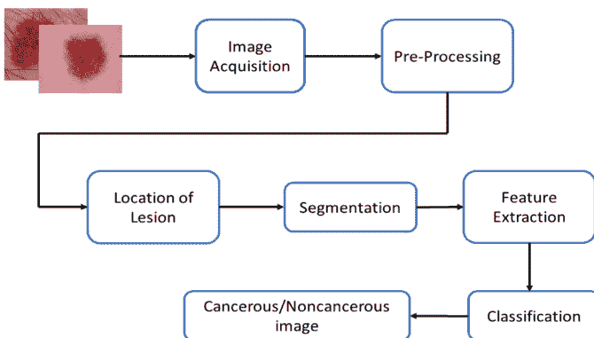
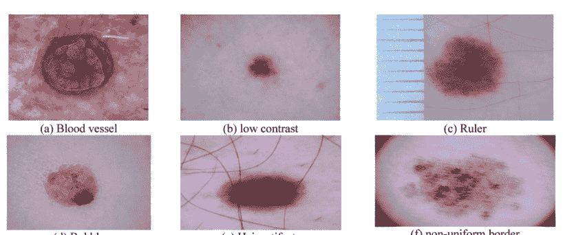
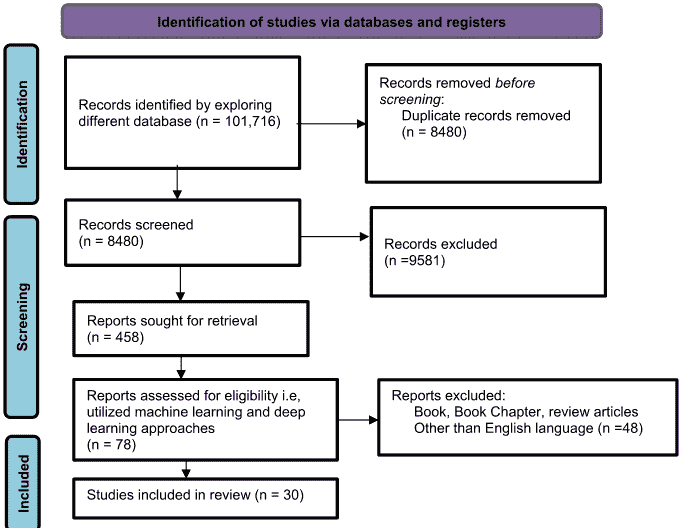
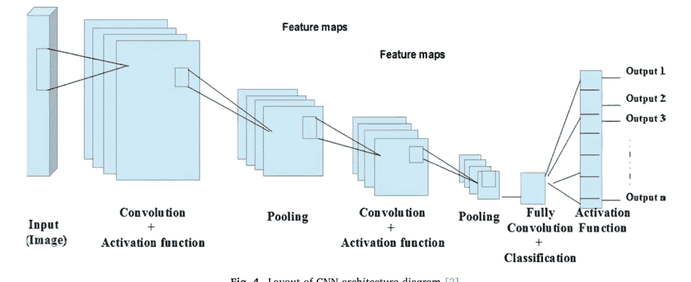
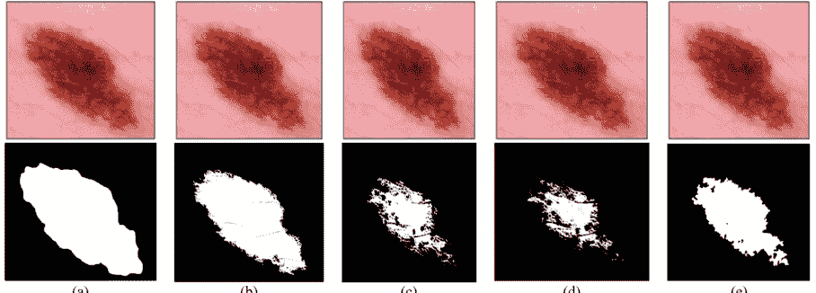

# 皮肤癌计算机辅助诊断：综述与未来建议

## 摘要

皮肤癌是最常见的癌症类型之一，全球每年约有 200 万至 300 万病例被诊断出来。皮肤上的异常细胞发育会导致皮肤病变，而手动检查皮肤病变是一项困难、具有挑战性且繁琐的任务。计算机辅助诊断（CAD）技术可以帮助医生提升诊断能力，缩短获得精确诊断所需的时间。此外，缺乏先进且用户友好的 CAD 技术，对疾病的非侵入性、精确和快速识别引发了严重担忧。CAD 系统可以帮助对皮肤病变进行早期诊断，从而为患者制定及时的治疗计划，提高其生存率。然而，由于皮肤病变图像的独特性和复杂性，对皮肤病变图像的检查仍然面临重大困难。本研究旨在讨论几种用于分析皮肤病变的预处理、分割和分类策略，以区分癌变图像和非癌变图像。主要目标是为初入该领域的研究人员提供概述，帮助其开展研究。此外，本手稿还将强调公开的挑战和未来建议，进一步号召不同领域的研究人员开始在这个领域开展研究。

## 1. 引言

当正常细胞转变为肿瘤细胞时，皮肤癌就会生长，肿瘤细胞通常从癌前病变发展为恶性肿瘤。最常见的癌症类型是皮肤癌，非黑色素瘤和黑色素瘤是皮肤癌的两大主要类别。这些癌症亚型主要根据其在皮肤层中的发育部位来区分。黑色素瘤是一种仅占所有皮肤癌类型约 1% 的皮肤癌，但却是皮肤癌死亡的主要原因。根据国家癌症研究所和美国癌症协会的数据，2022 年美国预计将诊断出约 1918030 例癌症病例，相当于每天约 5250 例新病例，皮肤癌将导致约 108480 例新病例和 11990 例死亡 [1]。利用机器学习方法进行的计算机视觉的最新进展，在计算机辅助诊断和检测系统方面取得了重大进展，以实现及时检测。手动筛查和目视检查长期以来一直用于诊断和识别皮肤癌疾病。皮肤科医生的图像视觉检查和检查程序耗时、主观、复杂且容易出错。这主要与皮肤病变成像的精确结构有关。为了分析、评估、检测和理解皮肤病变图像，必须清晰识别皮肤病变的像素。由于下面描述的各种问题，这可能具有挑战性 [2]。首先，输入的皮肤病变图像可能包含血管、毛发、润滑剂、气泡和额外的噪声，这可能会使分割变得困难。因为病变区域和周围皮肤之间的低对比度也使得病变的精确分割变得困难。最后，皮肤病变图像具有各种尺寸、形状、颜色和外观，这可能会限制技术实现更高准确性的潜力。这使得皮肤科医生的手动调查更具挑战性，需要使用自动计算机诊断设备来分析皮肤病变，并获得皮肤科医生在及时决策中的支持和协助。多年来，各种计算机控制技术已被用于皮肤癌的诊断和检测。在传统的医学图像分析方法中，通常使用一组低级像素处理算法。一般来说，皮肤病变图像的主要处理方法（如预处理、分割、特征提取和分类）已被描述为皮肤癌检测和诊断的一部分，图 1 表示皮肤癌分析中涉及的步骤流程图。

本文的主要贡献是向新手介绍皮肤病变计算机辅助诊断领域。它概述了各位学者的各种贡献，指出了它们的局限性和优势。此外，还在公共数据集上对所考虑的方法进行了比较考察，以确定其应用范围。此外，该领域还存在一些公开的难题，需要医学图像处理研究界立即关注。

其余文章的组织如下：第 2 节讨论与皮肤病变诊断相关的并发症。文献中提出了各种图像获取、预处理、病变分割和分类算法的具体内容。第 3 节考察了文献中概述的皮肤病变图像图像获取、预处理、分割和分类的多种方法的细节。第 4 节提到了皮肤癌模型评估的数据集。第 5 节用示例展示了最新分割和去噪方法的实验结果和分析。第 6 节强调了一些未解决的问题，随后第 7 节讨论了该领域进一步研究的构思。最后，第 8 节提供结论。

## 2. 皮肤病变诊断中的并发症

不同的图像格式和来源导致了皮肤病变诊断中的困难。人类的皮肤颜色因人而异，这使得皮肤检测成为一项复杂且具有挑战性的操作。图 2 说明了皮肤病变图像的不同视觉属性存在多种问题，包括（a）血管（b）低对比度（c）皮肤图像中的尺子（d）气泡（e）毛发伪影和（f）非均匀边界。

病变的位置、大小和形状差异巨大。为了进行准确分析，大多数图像分析算法都需要图像预处理。在图像获取过程中，称为噪声的伪影会被添加到图像中。噪声和伪影的存在可能会影响识别病变图像的能力。其中包括毛发伪影、气泡和血管等示例。在预处理阶段，要为直观的不对称预测获得皮肤病变边界的精确图像可能很困难。附近组织可能偶尔存在低对比度，这增加了困难。

## 3. 皮肤病变图像分析技术

借助当今的数字皮肤镜仪器，皮肤病变图像可以存储在计算机上并进行访问。有些系统甚至似乎能够执行计算机辅助诊断（CAD）。由于使用 CAD 方法的皮肤镜诊断的准确性取决于技能，计算机辅助诊断系统将帮助较少有经验的皮肤科医生提升能力，同时减少个体间的变异性。基于 CAD 的自动化皮肤病变图像分析的四个基本方面是预处理、分割、特征提取和分类。

图 1. 皮肤病变图像中癌症分析涉及的基本步骤。

图 2. 皮肤病变诊断问题的示意图：（a）血管（b）低对比度（c）尺子（d）气泡（e）毛发伪影（f）非均匀边界。

### 3.1. 系统综述

我们在 ScienceDirect、IEEE Xplore 和 SpringerLink 上搜索了用英语撰写的文献综述和研究论文。本综述仅考虑了在妥善记录科学论文的期刊上发表的出版物。论文选择采用了以下标准：

- 皮肤病变图像的预处理（噪声去除和毛发去除）技术。
- 分割和分类的传统机器学习方法。
- 分割和分类的深度学习方法。
- 二分类和多分类。
- 不同的 CNN 模型。

图 3. 使用 PRISMA 流程图进行系统综述。

- 皮肤癌公开可用数据集。
- 在知名期刊上发表。
- 使用英文撰写。

我们使用了以下标准来筛选出不相关的作品

- 综述文章。
- 非英文语言出版物。
- 科学论证不足。
- 书籍。
- 书籍章节。

图 3 以流程图形式展示了 PRISMA 选择技术，基于皮肤病灶预处理、皮肤癌分割和分类，共有 101,716 篇文章符合初级搜索策略的标准。去除重复项后，最终论文数量为 8480 篇。应用纳入标准后，共找到 458 篇全文出版物；随后使用排除标准对其进行了进一步筛选。最终，选出了 30 篇采用机器学习和深度学习技术的出版物。本研究对选定的出版物进行了更深入的探讨，并讨论了研究结果。此外，仅将比较多种模型的研究中得分最高的模型纳入了我们的排名。

### 3.2. 预处理

图像预处理是诊断中用于去除噪声并改善处理后图像内容的重要阶段。预处理用于消除不需要的伪影，如噪声、血管、毛发、皮肤线条、纹理和气泡。这些异常会限制边界识别，导致精度损失和更高的计算成本。因此，需要各种预处理程序来消除这些异常，以允许分割和分类。预处理主要用于增强图像，以便进行更高效的处理和可靠的特征识别。此阶段旨在通过去除噪声并将其转换为二值图像来获取灰度输入图像。它包括对比度增强和滤波等不同技术，用于消除图像中任何不需要的特征（例如毛发）。此外，此过程去除不必要的噪声并提高图像质量，以便识别病灶图像中的焦点区域。表 1 给出了各种预处理的描述和类别及其类别。

- **图像增强**：图像增强是改善图像视觉外观的关键方法；它被描述为未来自动检测程序的“优越”转换形式。因此，图像增强分为三种类型，即图像缩放、对比度调整和色彩空间转换。
- **图像修复**：从模糊和噪声图像中恢复劣化图像的方法称为图像修复。它可以通过多种方法恢复劣化的照片。图像劣化可由多种因素引起，包括成像系统缺陷、对焦不良、运动等，所有这些都会导致图像变得嘈杂或模糊。由于损坏的图像会导致故障检测，因此在选择最佳去噪方法之前，了解图像中的噪声类型至关重要。不同的类别包括去噪恢复（均值滤波、自适应滤波、顺序统计滤波）和去模糊恢复。
- **去除粗毛发**：粗毛发是自动分析微小皮肤病灶图像时的常见障碍，可能导致分割过程出现偏差。为了消除皮肤癌图像中的密集毛发，研究人员使用了数学形态学方法，如曲线结构识别、基于修复的方法、名为 Dullazor 的自动化软件，以及双立方插值法结合的顶帽变换。这些程序用于生成无毛发图像。

皮肤癌诊断系统预处理步骤生成的图像可以与其他系统生成的图像区分开来。

表 1
各种预处理技术。

| 预处理技术 | 描述 | 类别 |
| :--- | :--- | :--- |
| 图像增强 | 用于改善图像视觉外观的技术 | 滤波、对比度调整、图像缩放、色彩空间转换 |
| 图像修复 | 从模糊和嘈杂图像中恢复损坏图像的技术 | 去噪恢复（均值滤波、自适应滤波、顺序统计滤波）、去模糊恢复 |
| 去除粗毛发 | 在病灶微小皮肤像素的自动分析中，粗毛发被视为典型障碍，可能导致分割过程出现偏差并必须被去除。 | 形态学方法、曲线结构检测、基于修复的方法 |

### 3.3. 皮肤病灶图像分析和诊断的分割技术

分割是皮肤病灶诊断中的关键阶段，通过将不健康区域与健康区域隔离来分析皮肤病灶图像的关键步骤，该方法可获取感兴趣区域。最近，分割过程受到了更多关注。文献中已探索了许多分割方法或算法。这些技术解决了典型医学分割过程中的几个缺陷。然而，没有一种策略可以被认为是优越的。此类解决方案仅适用于特定图像和应用。阈值法、区域生长、合并与分割、聚类、边缘检测和基于模型的图像分割是不同的分割技术。所有分割技术都基于以下重要因素：强度水平、相似性和不连续性。本节介绍了几种分割皮肤病灶图像的策略，基于手工制作特征的方法（如基于阈值的方法）属于这些策略，还有基于智能的有监督分割、边缘和区域方法。深度学习和人工神经网络算法是基于智能的系统的示例。

#### 3.3.1. 基于传统智能的分割方法

基于人工智能的系统可以通过推理、学习和感知已存在的大型数据集中的图像来进行图像分析。皮肤病灶分割可以通过多种方式完成，包括有监督和无监督方式，使用现有数据集来训练和学习系统。基于智能的分割方法（如 ANN、模糊 C-均值和遗传算法）常被使用，解决方案也已融入深度学习技术。此外，表 2 描述了各种传统的分割技术。

- 基于阈值的方法：基于阈值的方法可用于从灰度图像创建二值图像。分割用于从彩色图像创建二值图像。分割是将两个或多个类别分配给原始图像中每个像素的过程。当存在两个以上的类别时，结果通常是一系列二值图像。在图像处理中，阈值法通过定义至少一种颜色或灰度值的边界，将图像划分为较小的段或块。公式 (1) 显示了图像的阈值处理，其中 T 为阈值
  g(x, y) = { 0, f(x, y) < T
              1, f(x, y) ≥ T } (1)

- 基于边缘或边界的分割方法：一致性对基于区域的方法至关重要。假设区域内的所有像素必须具有相同的灰度级，这些算法将图像分解为更小的子区域。“基于区域的技术”一词指的是使用附近像素强度值中可比模式作为起点的方法。算法的目的是根据结构或功能角色对区域进行分组，即聚类的目的。

- 基于区域的分割：在此分割过程中，像素必须符合某些既定约束才能被分类到相关像素区域。根据特定标准，图像被分割为具有可比像素的独立组或区域。其核心原理是同一区域内附近的像素具有相同的值。

- 拉普拉斯高斯滤波方法：拉普拉斯滤波器是一种二阶或二阶导数图像增强技术，旨在引起对强度快速变化区域的注意。它非常擅长检测图像中的微小特征。拉普拉斯滤波器会改善任何具有强不连续性的特征。公式 (2) 显示了线性微分算子的拉普拉斯二阶导数，其中函数 f 表示图像。
  Δ²f = ∂²f/∂x² + ∂²f/∂y² (2)

表 2
各种分割技术。

| 技术 | 描述 |
| :--- | :--- |
| 基于阈值的方法 | 一种分割方法，通过将像素分配给给定阈值下方或上方的两个不同级别，将灰度图像转换为二值图像。 |
| 基于边缘或边界的分割方法 | 在此分割方法中，通过查找边缘的像素并将其连接来生成图像边缘，从而将图像定位在区域的不同边缘上。 |
| 基于区域的分割方法 | 此分割方法根据一组特征将图像分为多个组或区域。根据其核心概念，给定区域内的所有相邻像素被假定具有相同的值。 |
| 拉普拉斯高斯滤波方法 | 拉普拉斯滤波器是一种派生滤波器，用于通过定位强度快速变化区域来识别图像中的边缘。滤波器方法通常在灰度图像上执行，以生成新的带边界灰度图像。 |
| 分水岭分割方法 | 分水岭分割被视为一种混合分割方法，即区域和边缘方法。分水岭分割方法基于微分方程的工作原理。 |
| K-means 聚类分割 | 此方法用于根据像素与聚类中心之间的多种距离维度将图像隔离为多个簇；其目标是将图像分割为可互换的受限组。 |

- 分水岭分割方法：这种分割方法结合了基于区域和基于边缘的分割技术。这种分水岭分割方法基于微分函数的工作原理。

- K-Means聚类分割：在此方法中，一组数据被分为k个数值组。它从单一数据集中创建k个不同的组。K-means算法可分为两部分：首先，它识别k个质心；其次，它将每个点移动到该簇最近的质心。最近质心与最近点之间的距离可以通过多种方式计算。欧氏距离是最广泛采用的方法之一。Eq. (3)显示了计算欧氏距离的公式。其中K为簇的总数。

d = || p(x, y) – c_k ||

#### 3.3.2. 基于深度学习的分割技术

在图像处理中，图像分割是一项困难的任务，使用深度学习算法已得到极大改进。研究人员提出了基于深度学习的方法，图像可以使用这些技术有效分割。这些架构包括深度卷积神经网络、U-Net、完全卷积残差网络等。以下将对其进行更详细描述。

- CNN架构：卷积神经网络（CNN）是多层感知机的二维数据处理变体。CNN是一种深度神经网络，因为其网络深度大且图像数据应用广泛。CNN的设计与一般神经网络相似；卷积神经网络中的神经元具有偏置、激活和权重函数。图4解释了CNN的架构，其中包括带有ReLU激活的卷积层、用于特征提取的池化层，然后是带有softmax激活的完全连接层用于分类。特征提取过程分为三个阶段：卷积、激活和池化。从输入图像中提取这些特征，从而提高准确性。CNN的层使模型计算高效，并且由于其能够处理大量数据集，因此优于其他方法。每个滤波器基于输入大小具有适中的相等高度、宽度和深度。卷积可以通过使用合适的滤波器来完成。卷积是一种数学过程，通过组合两个函数x和y创建第三个函数（z），如Eq. (4) [3]所示。

z (n)def = x ( n ) * y ( n ) = 
\sum_{\eta=-\infty}^{\infty} x (\eta) g ( n - \eta)

- U-Net架构：该设计使用完全卷积网络构建。除了卷积层外，该网络的编码器和解码器均使用卷积层；编码器和解码器部分分别具有池化层和上采样层。在编码器和解码器组件之间，存在快捷链接。一些研究人员已使用此设计来分割皮肤病变。该架构用于在分割皮肤病变照片时预测每个像素的可能性。他们在编码器分支的最底层使用了扩展卷积来修改U-Net架构，从而得到skinNet系统。

- 深度残差网络（DRN）：采用跳跃连接穿越多个卷积层以构建金字塔结构的ANN称为深度残差网络。卷积层主导该结构。一种使用深度残差网络来分割和分类皮肤病变图像的FCRN技术。层数超过50层的DRN正在努力获得更详细和独特的特性。该系统使用ISBI 2016数据集实现分割准确性。实现深度残差网络设计需要大量计算资源。这可能限制该架构在现实场景中的实用性。

- **FCN:** 使用卷积神经网络，FCN（完全卷积网络）将视觉像素转换为像素类别。FCN是由卷积层和池化层组成的分层结构。为了分割皮肤病变，采用了基于并行集成（PI）的多阶段FCN技术来分割病变。该技术用于在分割后改善分割皮肤病变的边缘。在ISBI 2016数据集上评估时，该方法对黑色素瘤的分割准确率为94.70%，Dice系数为92.03%；对非黑色素瘤的准确率为95.71%，Dice系数为90.97%。DFRCN是一种专门为皮肤镜图像分割开发的FCN类型，是修改后的FCN，用于皮肤镜图像分割，可提供改进的性能。为了训练和分割皮肤病变，将卷积与FCN网络相结合。这提高了网络感受野的可见性。另一方面，FCN模型倾向于分割，这可能导致使用该数据集时输出粗糙的分割结果。

- **CDCNN:** 该模型包含两部分：卷积网络路径，类似于CNN，它检索图像的特征层次结构，复杂度从0到1。第二部分是反卷积网络路径，方向相反，称为反卷积网络。它改变聚合特征，并将分割图分辨率从0提高到1。两个网络都用于提取区别特征。在生成最终输出之前，使用反卷积层平滑分割图[4]。可以使用称为RefineNet的网络进行皮肤镜皮肤病变图像分割。该网络有多条路径和许多密集卷积层。基于CDCNN的系统运行时间较长。当训练数据不足时，它们仍然不够精确且存在局限性。这些方法使皮肤病变的分割和分析更加容易。然而，这类方法仍然需要大量工作来调整许多不同的特征和预处理步骤，这耗费大量时间和精力。

此外，表3给出了分割技术的摘要，以及预处理、技术、数据集、描述和性能指标的使用情况。

### 3.4. 皮肤病变分类技术

为了分析皮肤癌，可以对病变图像进行分类以帮助检测皮肤癌。皮肤病变图像可以识别多种类型的皮肤癌。这些分为两种类型：恶性和良性。基底细胞癌有多种类型：日光性角化病、鳞状细胞癌、默克尔细胞癌、脂溢性角化病、血管病变、非典型痣和黑色素瘤。黑色素瘤是这些病变类别中最严重的皮肤癌类型，因为它是恶性病变。在本部分中，我们讨论了传统和基于深度学习的分类方法。

#### 3.4.1. 传统分类技术

其中大多数是旧的分类器，仍然依赖于从图像中收集特征并将其馈送到分类器以确定皮肤癌类型的传统方法。近年来，各种传统方法已实现智能化。这些算法包括KNN、朴素贝叶斯算法、SVM和ANN分类器等方法。

| 研究/ 年份 | 预处理 | 分割标准 | 使用的数据集 | 描述 | 性能指标 |
|---|---|---|---|---|---|
| Mohakud 等人/ 2022 | 双线性插值方法 | FCEDN | ISIC2016 ISIC2017 | 采用独特的EN-GWO方法来改进网络的超参数。 | ISIC-2016 Dice系数 87.23% 准确率 95.25% \| ISIC-2017 Dice系数 98.48%，准确率 98.32%， |
| Badshah 等人/ 2022 | N/A | ResBCU-Net, | ISIC 2018 | 使用DNN实现皮肤图像分割 | 94% 准确率 |
| Duggani 等人/ 2021 | N/A | DermoNet, GrabCut FCN | ISIC Archive PH2 | 详细比较了不同方法的工作情况。 | CNN达到的最高准确率- 97.49% |
| Shan 等人/ 2020 | 数据增强（调整大小、翻转、旋转） | U-net FC-DPN | ISBI 2017 PH2 | 为了提高分割准确率，提出了一种名为FC-DPN的新拓扑。 | ISBI 2017 Dice系数 88.13% Jaccard指数 80.02% \| PH2数据集 Dice系数- 90.26% Jaccard指数 83.51% PH2 |
| Khouloud 等人/ 2021 | 高斯滤波和调整大小 | W-net and Inception Resnet | PH2 ISIC 2016 ISIC 2017 ISIC 2018 | 已提出W-net和Inception Resnet深度学习模型用于分割和分类问题。 | ISBI 2017 灵敏度 -94.86% 特异性 98.89% 准确率-97.94% Dice相似度- 93.22% \| 灵敏度-96.43% 特异性 - 97.71% 准确率-97.23% Dice相似度- 93.82% |

#### 3.4.2. 分类的深度学习技术

摩尔定律预测了1971年计算机硬件资源（如图形处理单元（GPU））将呈指数级增长，深度学习模型（如CNN）的发展因此加速。由于这些高效的公式，图像处理和分类从深度学习模型的这一改进中获益良多。这些策略比传统策略更有效。但基于深度学习的图像分析存在某些困难挑战。此外，表4列出了分类技术的摘要，以及所使用的分类标准、数据集、描述和性能指标。

#### 3.4.3. CNN的组件

卷积神经网络由三层组成：输入层和输出层，同样由若干层组成，每一层都有自己的一组功能，以图像作为输入并进行处理。CNN的一般架构图，主要组件包括层、激活函数和关键参数。CNN的层分为三种类型：卷积层、池化层和全连接层。前两层（卷积和池化）提取特征；第三层（全连接）将这些特征传输到输出，例如分类。激活函数是我们应用于输入信号的非线性修改。这种修改后的输出最终被传输作为下一层神经元的输入。线性激活函数和非线性激活函数（例如Sigmoid和逻辑函数、双曲正切函数Tanh、ReLU（包含Dying、Leaky和Parametric ReLU子类型）、指数线性单元（ELU）和Softmax）是常见的激活函数形式 [10]。

CNN架构。CNN架构有多种不同的形状和尺寸。这些设计用于建立深度学习算法。表5总结了不同CNN架构的优缺点。

- LeNet-5：最基本的架构之一是LeNet-5。它包含2个卷积层和3个全连接层，因此其“5”层神经网络名称通常由卷积层和全连接层的数量得出。我们将当今的平均池化层识别为子采样层，其中包含可训练权重（这不是当前CNN的创建方式）。这种设计大约有60,000个不同变量需要考虑 [11]。
- AlexNet：AlexNet包含八层，其中五层是卷积层，三层是全连接层。AlexNet只是在LeNet-5基础上增加了几层。AlexNet是一种简单而有效的CNN设计，同时包含卷积层和池化层。其顶层由全连接层组成。它使用GPU进行训练和任务执行，这很有优势。AlexNet继续被用作深度神经网络应用的基础，尤其是在计算机视觉和图像处理领域 [12]。
- VGG Net：该架构由一系列卷积层和池化层组成。其优点之一是具有出色的设计，非常适合对任何活动进行基准测试。此外，VGG的预训练网络广泛用于各种应用中。VGG-16由十三个卷积层和三个全连接层组成，传承了AlexNet的ReLU传统。该网络在AlexNet基础上增加了额外层，并使用比AlexNet更小的滤波器（2*2）和（3*3）。他们还设计了一种更深的网络系统，即比AlexNet深两倍 [13]。
- Google Net：术语“GooLeNet”指的是Inception架构的特定版本。它有二十二层，能够对输入进行池化或卷积，该设计在彼此之上叠加了众多Inception模块。这种堆叠允许

Table 4 皮肤病变图像分类技术摘要

| Study/Year | Classification Criteria | Dataset Used | Description | Performance Metrics |
| :--- | :--- | :--- | :--- | :--- |
| Benyahia et al./2022 [5] | DenseNet201 立方SVM | ISIC 2019 PH2 | 本研究中，十七个CNN架构用作特征提取，而24个ML分类器用于对PH2和ISIC 2019数据集中的图像进行分类 | ISIC 2019准确率 - 92.34% PH2数据集准确率 - 99% |
| Mijwil/2021 [6] | 具有3种架构的ConvNet：InceptionV3 ResNet VGG19 | 2019–20年间的ISIC | 深度学习技术用于计算机化分析以提高性能，主要目标是将病变图像识别为良性或恶性。 | 灵敏度 - 86.14%，特异性 - 87.66%，准确率 - 86.90%，精确率 - 87.47% |
| Sikkandar et al./2021 [7] | 自适应神经模糊分类器（ANFC） | ISIC数据集 | 这是一种基于分割的分类模型，使用GrabCut算法和ANFC模型。 | 灵敏度 - 93.40%，特异性 - 98.70%，准确率 - 97.91% |
| Arora et al./2020 [8] | BoF, SURF, SVM | PH2数据集 | 本研究提出将词袋特征提取与快速强健特征和二次SVM分类相结合 | 准确率 - 85.7%，灵敏度 - 100%，特异性 - 60% |
| El Khatib et al./2020 [9] | CNN和SVM | PH2, ISIC 2019 | 一种新的基于人工智能的黑色素瘤检测方法，结合了五个分类器的决策，其中一个由作者发明，包含NN和3种CNN类型，以及1种SVM类型。 | PH2准确率 - 95% ISIC 2019准确率 - 93% |

Table 5 CNN架构的优缺点摘要

| Techniques | Contributors | Description | Pros | Cons |
| :--- | :--- | :--- | :--- | :--- |
| LeNet-5 | LeCun et al./1998 | 它包含60,000个参数，具有3个全连接层和两个卷积层。 | 易于理解。适用于字符识别图像。 | 难以泛化。学习缓慢。缺乏深度。 |
| AlexNet | Krizhevsky et al./2012 | 它有8层：3个全连接层和5个卷积层，包含60M参数 | 将ReLU用作激活函数。使用GPU解决复杂问题 | 需要更多时间才能获得更好的结果。更大的滤波器大小会从特征图中产生伪影 |
| VGG Net | Simonyan et al./2014 | 它具有三个全连接层和13个卷积层，并使用ReLU激活函数。它包含138M参数。 | 准确率和速度得到提高。增加层数以获得更好的结果 | 梯度消失问题。比ResNet慢 |
| GoogLeNet | Szegedy et al./2014 | 它有22个卷积层，即Inception的一个变体，由Google的研究人员开发。它有5M参数。 | 比VGG快。提高收敛速度 | 参数定制困难 |
| ResNet | He et al./2016 | 它有152个深度CNN层，比AlexNet快20倍，比VGG快8倍。 | 减少计算时间。提高准确率 | 特征图信息降级。复杂性增加 |
| ResNeXt | Xie et al./2017 | 这是通过引入基数（即变换集合的大小）对Inception网络进行升级的结果。 | 提高准确率。基数提高性能。更好的泛化能力。出色的准确率 | 复杂性。高计算成本 |
| 深度强化学习 | François-Lavet et al./2017 | 这是强化学习与深度学习的混合，使用较少的计算机数据和资源 | 计算更快。高性能 | 效率。训练稳定性 |
| DenseNet | Huang et al./2017 | 这是一种前馈网络，其中每一层直接连接到每个稠密块内的各层 | 克服梯度消失问题。减少冗余特征图 | 参数效率降低。计算效率降低 |
| Xception | Chollet et al./2017 | 它采用了深度可分离卷积的概念。 | 提高计算效率。改进了Inception V3 | 高计算成本 |
| SENet | Hu et al./2018 | 它被用于提高CNN的质量。 | 实现简单。性能更好 | 昂贵。增加复杂性 |
| RAN | Wang et al./2017 | RAN是一种前馈CNN，通过堆叠层并采用注意力组件开发而成。 | 克服梯度消失问题 | 增加复杂性 |
| INet | Wen et al./2021 | INet通过逐渐增大卷积层中核的大小来扩展感受野，而不是下采样 | 改进优化。适用于生物医学图像分割。 | 高计算成本。不适合保持高分辨率特征图 |
| MultiResUNet | Ibtehaz et al./2020 | MultiResUNet用于从生物医学图像中检测组织。 | 提高准确率。提高计算效率 | 复杂性增加 |

联合训练和并行训练，支持模型实现更快收敛。更小的占用空间下实现更快训练是其中的一项优势。然而，它确实拥有一个 Xception Network（即 Extreme Inception），可提升 inception 模块的偏差极限 [14]。

- **ResNet**：该架构也称为深度残差网络，包含大量作为设计基础元素的残差网络，用于构建完整的连续网络。这些残差模块彼此堆叠 [15]。通过在彼此之上堆叠新层来构建更深的神经网络，而不使用快捷连接。该架构包含数百个残差层，用于训练网络和提高性能。与其他提出的网络相比，其计算量更小。ResNet-X 表示带有 X 层的残差深度神经网络，例如 ResNet-152 指的是具有 152 层的 ResNet。

- **ResNeXt**：它是 Inception Network 的演进版本，通过引入基数以强大而简单的方式利用分割、转换和合并的概念。一组中变换的数量决定了其基数。分割、转换和合并块通过将分辨率限制为 3 × 3 滤波器来整合 VGG 和 GoogleNet [16]。它还利用残差学习来加快深度和宽度上网络的收敛。增加更多基数可极大地提高性能，从而产生一个全新的、性能更好的模型。

- **Deep reinforcement learning**：该网络从基础开始接受了彻底训练，从随机行为开始，逐步发展为通过经验获得的真实知识库。它是强化学习与深度学习的混合体，使用更少的计算机数据和资源 [17]。代表模型可从其环境中进行训练，并将所学应用于任何序列选择任务，例如图像分析。AlphaGo 和 AlphaGo Zero 是两个示例。由于应用了更加原则化的算法，AlphaGo Zero 所需的计算量远小于早期版本，同时性能仍处于更高水平。

- **Advanced inception network**：Inception 的三个版本（即 V3、V4 和 ResNet）均属于该网络。它们分别是 Googlenet、Inception-V1 和 Inception-V2 的增强版本。由于 Inception 降低了 V3 的处理成本，深度网络不再需要牺牲通用性。通过将 1 × 1 卷积作为瓶颈（1 × 7 和 1 × 5），大滤波器被小的非对称滤波器所取代。

- **DenseNet**：DenseNet 与 ResNet 类似，是一种旨在解决梯度消失问题的神经网络。虽然 ResNet 使用加法恒等变换来跟踪信息，但 DenseNet 使用跨层连接并以前馈方式向前传递信息。以前层的特征图作为未来层的输入，利用密集块 [18]。

- **Xception**：这种极端的 Inception 设计使用了深度可分离卷积。原始 inception 块被扩展以控制计算复杂度，并用 3 × 3 和 1 × 1 卷积替代独立的空间维度（例如，1 × 1、5 × 5、3 × 3）。由于空间与特征的分离，网络的计算效率得到提高 [14]。

- **Squeeze and Excitation Network**：Hu 等人在其论文中概述了 Squeeze and Excitation Network（SE 网络）。为了辅助物体识别，他们设计了一种名为“通道块”的新构建元素。在任何 CNN 设计的卷积阶段之前，都需要此层。在此范式中，两个最重要的过程是挤压和激活。与挤压操作相比，卷积核收集局部信息但不考虑特征上下文。通过生成特征图统计信息，网络已演变为更强大的架构，使其特别适用于低带宽设备，例如手机 [19]。

- **Residual Attention Neural Network (RAN)**：Wang 等人开发了该网络以增强特征表示。向 CNN 添加注意力的目的是开发一个感知对象的网络。借助注意力模块，RAN 是由残差块构建的前馈 CNN。注意力模块的主干分支和掩码分支自下而上进行学习。注意力模块整合了两个独立的学习算法，结合了快速前馈处理和自顶向下的注意力反馈 [20]。

- **Convolutional Block Attention Module (CBAM)**：Woo 等人创建的 CBAM 是一种基于注意力的 CNN，它通过利用特征图注意力和空间注意力顺序应用注意力图来发现精确的特征图，而与 Squeeze and Excitation Network 不同，后者在分类任务中仍然感知特征图而不考虑实际对象的空间信息 [21]。

- **MultiResUNet**：Ibtehaz 和 Rahman 引入了一种增强型 MultiResUNet，用于从生物医学图像中检测组织。ResPath 组件改善了编码块和解码块之间的通信并减少语义不一致性，而抗混叠卷积和 MultiRes 模块则旨在对高频语义（例如组织边界）敏感。在训练阶段，采用混合损失函数来关注不规则或不连续的边界 [22]。

- **INet**：Khedkar 等人提出的 iNet（受 Inception 启发）通过添加前几层的特征图来收集不同特征。INet 使用步幅为 1 的最大池化（即两个重叠的最大池化）来提取最清晰的特征。INet 通过逐渐增大卷积层中的核大小而不是下采样来扩展感受野 [23]。

## 4. 皮肤癌模型评估的数据集

- **DERMOFIT 项目数据集**：病变图像仅供学术研究人员使用，并由爱丁堡大学所有。RGB 图像在受控环境中使用高端相机拍摄。此类别共有 1300 张照片：日光性角化病 (AK) 样本 45，鳞状细胞癌 (SCC) 样本 88，脂溢性角化病 (Sk) 样本 257，内上皮癌 (IEC) 样本 78，基底细胞癌 (BCC) 样本 239，痣 (ML) 样本 331，脓肿性肉芽肿 (PYO) 样本 24，血管瘤 (VASC) 96 例，纤维组织细胞瘤 (DF) 65 例，黑色素瘤 (MEL) 76 例。

- **PH2 数据集**：该数据集由波尔图大学的一个研究团队从葡萄牙 Pedro Hispano 医院的科室收集，分辨率为 768 × 560 像素的皮肤镜图像可在 PH2 中找到。该数据集包含 200 张皮肤镜皮肤病变图像，包括 40 例黑色素瘤、80 例非典型痣和 80 例普通痣。

- **ISIC 2017**：ISIC 2017 数据集由 ISIC（国际皮肤成像协作）档案发布，包含 23,906 张皮肤镜图像。该集合包含不同类别的 RGB 图像，例如黑色素瘤、良性和脂溢性角化病。数据集中有 2000 张训练图像、600 张测试图像和 150 张验证图像。

- **ISIC 2018**：该数据集由 ISIC 提供，包含 2594 张训练图像和 2594 张实测图像。其中包括 1000 个测试图像数据，主要来自 HAM10000 [24]。

- **ISIC 2019**：该数据集包含 25,331 个训练图像示例，例如关于患者年龄、性别和组织学数据的元数据。它还具有一个符合标准病变诊断的实测标签。测试数据还包括 8238 个皮肤病变图像文件。其来源包括 BCN20000、HAM10000 和 MSK 数据集。

- **ISIC 2020**：该数据集包含约 2000 名患者的不同良性和恶性皮肤病变，由 33,126 张皮肤镜训练图像和 10,982 张测试图像表示。

- **HAM10000**：HAM 代表“人机对抗，拥有 10,000 张训练图像”。该数据集中的图像以多种方式收集和归档。它包含 10,015 个图像文件，通常用于学术研究。它们可以源自 ISIC 档案，即公开可用。此外，表 6 提供了用于分析皮肤病变图像的现有数据集摘要。

## 5. 实验结果与分析

### 5.1. 性能评估指标

要分析或比较不同分割和分类系统的性能，应了解一些术语，例如灵敏度 (SEN)、特异性 (SPE)、Dice 系数 (Dice) 和准确率 (ACC)。这些指标用于评估本文讨论的各种模型。具体如下：

- **真阳性 (TP)**：被分类为恶性且证实为恶性的病变数量。
- **真阴性 (TN)**：被分类为良性且证实为良性的病变数量。
- **假阳性 (FP)**：被分类为恶性但证实为良性的病变数量。
- **假阴性 (FN)**：被分类为良性但证实为恶性的病变数量。

- **灵敏度 (SEN)**：灵敏度定义为正确识别皮肤病变的能力，即在阳性个体中预测为阳性的比例。计算公式为：

$$Sensitivity = \frac{TP}{TP + FN}$$ (5)

- **特异性 (SPE)**：特异性是一种性能指标，定义为适当区分正常皮肤的能力，即在阴性个体中预测为阴性的比例。计算公式为：

$$Specificity = \frac{TN}{TN + FP}$$ (6)

- **Dice 系数 (Dice)**：该指标评估实测值和预测输出的相似性和重叠度。描述如下：

| 序号 | 数据集 | 总图像数 | 类型 | 子类别 |
|---|---|---|---|---|
| 1 | DERMOFIT 项目数据集 | 1300 张皮肤镜图像 | RGB | AK-45, BCC-239, SCC-89, SK-257, ML-331, IEC-78, PYO-24, MEL-76, DF-65, VASC-96 |
| 2 | PH2 数据集 | 200 张皮肤镜图像 | 分辨率为 768 × 560 像素 | NV-160, MEL-40 |
| 3 | ISIC 2018 | 11,527 | JPEG 格式 | 训练图像-10,015, 测试图像-1512 |
| 4 | ISIC 2019 | 33,569 张图像 | JPEG 格式 | 训练图像-25,331, 测试图像-8238 |
| 5 | ISIC 2020 | 44,108 张图像 | JPEG 格式 | 训练图像-33,126, 测试图像-10,982 |
| 6 | HAM 10000 | 10,015 张皮肤镜图像 | JPG 格式 | BKL: 1099, MEL: 1113, DF: 115, VAS: 142, AKIEC: 327, BCC: 514, NV: 6705 |

DSC = \frac{2TP}{FP + 2TP + FN} (7)

准确率：该指标是 TP 和 TN 占实例总数的比例。

ACC = \frac{TP + TN}{TP + FP + TN + FN} (8)

### 5.2. 降噪技术的比较分析

本小节，作者讨论了图像数据去噪方法的定性和定量结果。

为分析各种降噪方法的有效性，定性分析（有时也称为主观分析）通过视觉评估医学图像来进行。

为了诊断疾病，成像质量至关重要，因此主要目标是使去噪图像的噪声存在和纹理与原始图像的恢复、精细视觉边缘的保护及保存相匹配。

在同一组图像上，图 5 显示了所考虑的降噪方法的主观结果。

空间滤波器（即中值滤波和高斯滤波）通过使用像素值的均值实现降噪，但会模糊关键图像特征，如图 5(b) 和 (c) 所示。

在应用和测试文献中针对类似图像集合概述的多种去噪技术后，发现各向异性扩散滤波器（ADF）优于所有其他策略，因为它在保持图像边缘特征的同时实现了图像平滑。

根据图 5 显示的视觉发现，ADF 通过保留关键图像特征，即使在存在噪声的情况下也能提供改进的视觉效果，从而产生更生动、更逼真且更平滑的图像。

所调查去噪算法中使用的参数与各作者给出的标准参数一致。

但是，图像视觉质量为区分带有噪声的输入图像与去噪后的图像提供了充分证据 [25]。

表 7 显示了基于 SSIM 和 PSNR 的定量性能方法的降噪效果。

根据表 7 中列出的数据，高斯滤波器在所考虑的客观指标上获得了更高的值。

此外，高斯滤波器的主观结果不足。

图 5 和表 7 报告的结果表明，ADF 在进行噪声去除的同时可以保留主要图像信息，并无论原始图像中存在多少噪声都能改进定量指标。

两种分析的结合表明，ADF 在带噪声的皮肤病变方面优于最先进的方法。

它不仅具有更高的 PSNR 值，还具有合理高的 SSIM 值，表明该方法可以可靠地保持图像的必要信息，如纹理和边缘。

表 8 还讨论了所采用预处理方法的优缺点。

Table 7
不同去噪技术的平均结果比较。

| 滤波器 | PSNR (dB) | SSIM |
| :--- | :--- | :--- |
| 中值滤波器 | 36.74 | 0.8758 |
| 高斯滤波器 | 37.97 | 0.9140 |
| 双边滤波器 | 34.49 | 0.8218 |
| 模糊滤波器 | 36.11 | 0.8643 |
| 各向异性扩散滤波器 | 35.44 | 0.8981 |

Table 8
去噪技术的优缺点。

| 去噪技术 | 优点 | 缺点 |
| :--- | :--- | :--- |
| 高斯滤波器，中值滤波器 | 实现容易。 | 通过计算像素值的均值，模糊了图像。 |
| 双边滤波器，模糊滤波器，ADF | 无需求解偏微分方程，其方法仅需一次迭代。它保留必要的视觉细节，并降低噪声。 | 使用窄空间框架将次要视觉特征视为噪声从而将其擦除。由于边缘增强效应，生成的图像产生了阶梯状效应并改变了视觉特征。 |

### 5.3. 分割技术的比较分析

本节考察并评估了文献中为从皮肤图像分割皮肤病变所提出的几种分割策略的有效性。

在应用分割技术之前，ADF 用于对皮肤图像进行去噪，如前一节所述，通过保留关键图像信息产生了更好的结果。

所考虑的方法——阈值法、模糊 C 均值聚类（FCM）、空间模糊 C 均值（SFCM）和水平集方法——均在 HAM10000 数据集的图像上进行了测试，以确定其适用程度。

图 6 显示了利用当前技术得到的分割结果。

图 6. 不同分割技术的结果 (a) 原始图像的真值；(b) 阈值分割；(c) FCM 分割；(d) SFCM 分割；(e) FCM & 水平集。

根据图 6 的结果，FCM 与水平集的混合方法产生的分割效果优于其他传统技术。

但是，由于视觉特征的对比度差异巨大且脆弱边界线相连，在某些情况下很难正确分割病变，因此需要进一步研究以解决现有技术的不足。

此外，表 9 概述了常规分割技术的优缺点。

Table 9
分割技术的优缺点。

| 技术 | 优点 | 缺点 |
| :--- | :--- | :--- |
| 基于阈值的技术 | • 简单，实现容易 • 计算有效 | • 阈值难以设置 • 对噪声敏感 • 不适用于颜色光谱接近的图像 |
| 模糊 C 均值聚类 | • 减少错误区域 • 将区域分为相似和多样的组 • 无需初始化 | • 对多个簇的起始敏感 • 对于具有显著对比度差异的图像，其效率可能下降。 |
| 水平集方法 | • 易于控制基于拓扑的曲线分割或积分 | • 需要初始化 |

## 6. 皮肤病变检测的研究挑战

图像类型和来源的差异可能是导致皮肤病变识别困难的原因。

人类皮肤颜色有多种外观，使得皮肤识别成为一个困难且耗时的过程。

以下是皮肤病变图像各种视觉特性所带来的部分挑战。

### 6.1. 高级训练

深度学习计算机辅助诊断系统的主要问题之一是需要大量的训练。

换句话说，为了准确解释和分析皮肤镜图像中的特征，必须进行大量训练，这是一项耗时且需要极其强大硬件的任务。

### 6.2. 不稳定的数据集

在现实世界中，皮肤癌数据集存在严重偏斜。

数据库中每种皮肤癌的图像数量各不相同。

例如，这些数据集包含多种癌症的多张图像，但只有少量罕见皮肤癌的图像，使得图像泛化变得困难。

### 6.3. 高性能硬件访问不足

为了获取皮肤病变图像的各种特征，深度学习程序员需要具有强大 GPU 容量的最强大系统资源，这对改进皮肤癌检测要求很高。

缺乏适当的计算机硬件要求是皮肤癌检测训练中的一个主要问题。

### 6.4. 类间变异小的皮肤癌图像

医疗图像的类间和类内变异相对较小，例如，癌症图像和非癌症图像的变异显著低于马和斑马图像。

许多皮肤病变非常相似，因此更难识别。

由于多样性有限，图像分析和分类变得极其困难。

### 6.5. 遗传和环境因素的调查

已确定皮肤癌的不同遗传因素，如肤色浅、眼睛颜色、红发、身体痣和任何病史，均为癌症的遗传原因。

这些因素以及诸如高强度紫外线辐射等环境因素，会增加患皮肤癌的可能性。

这些参数可以与当前的深度学习算法结合使用以提升性能。

## 7. 未来建议

皮肤癌检测领域有很多研究，但近期研究更多地集中在提高皮肤癌检测的性能和准确性。

为了实现这些目标，采用了复杂的预处理和分割技术。

此外，近期深度学习研究正在影响分类操作的准确性。

此类研究的主要目标是在皮肤癌诊断中实现可扩展性和灵活性的进步。

在皮肤科医生诊断皮肤癌的过程中，计算机辅助诊断（CAD）已成为主要研究领域之一。

CAD 的基本理念是提供数据结果作为第二意见，帮助皮肤科医生分析图像，通过提高诊断的一致性和准确性以及加快图像读取速度来实现。

像这样的自我评估工具未来可以用来自动识别需要治疗的人群。

为了标准化筛查建议，未来有可能创建皮肤癌筛查登记处。

### 7.1. 数据收集与质量控制

收集相关数据和数据质量标准是 CAD 过程的第一步。

CAD 系统将电子健康记录（EHR）作为关键组成部分。

消除训练数据中的偏差是数据收集中的关键问题之一。

此类数据中存在偏差可能会严重阻碍 CAD 系统的效率。

另一个问题与数据不平衡有关，不当的采样会产生类别不平衡问题。

因此，CAD 系统需要处理海量的临床数据，才能得出关于皮肤疾病的统计学显著结论。

### 7.2. 皮肤病灶的先进精细分割方法

皮肤癌诊断中最关键的步骤和研究最广泛的领域之一是分割。存在多种分割策略，然而，没有哪一种单一策略可以被认为更好。只有特定的图像和应用程序才能从中受益。不同的分割方法包括阈值分割、区域生长、合并与分割、聚类、边缘检测和基于模型的图像分割。深度学习方法可以纳入处理此类复杂问题的策略中。这些网络通过多个节点层级和路径传播数据。因此，改进多维图像的分割技术是未来的目标。未来的研究还必须专注于改进分割方法以实现。

### 7.3. 改进分类方法

根据最新研究结果，机器学习技术中神经网络方法的采用使其成为有效的分类技术。然而，大量新技术正在不断涌现。通常，研究人员会提出一种新方法，然后在基准数据集上对其进行测试，使其优于各种其他方法。未来，研究人员将在包含更多已识别皮肤病灶的大型数据集上工作，同时构建一个包含预处理阶段的成功 CNN 模型，以获得最佳的预测和分类准确率。CAD 系统在所有图像采集设置中都用户友好且可靠，也可用于识别皮肤癌。

### 7.4. 建立 CAD 系统的标准性能评估

CAD 系统的诊断性能可以使用多种技术进行评估。这些技术的一些示例包括精确率-召回率（PR）、曲线下面积（AUC）、阳性和阴性预测值以及接收器操作特征曲线（ROC）。一种评估方法可能涵盖 CAD 系统的一些与性能相关的特征。然而，它可能会忽略某些其他关键细节。因此，为了正确评估 CAD 系统的性能，可能需要考虑多种评估方法。目前，衡量 CAD 性能尚无标准方法。缺乏评估 CAD 系统疗效的标准化方法。

### 7.5. 医疗保健中 CAD 系统的采用

使用 CAD 系统进行诊断决策的过程中存在若干技术缺陷。其中一个缺陷是缺乏对医生如何解读结果的指导。这可能是 CAD 系统性能不佳的关键因素。为了理解 CAD 系统的结果，临床医生必须接受适当的知识和培训。研究人员需要通过实现更精确的分析来增强 CAD 系统的功能，以赢得医生的信任。未来的建议是证明优势大大超过劣势或风险。

## 8. 结论

在这个当代时代，医学影像研究界一直在努力开发用于进行皮肤病灶诊断的计算机辅助解决方案。怀着这种动机，本手稿通过调查和分析皮肤镜图像中皮肤病灶计算机辅助诊断方法的现有文献，试图为未来的研究人员识别复杂问题。关于皮肤病灶预处理、分割和分类的各种研究论文已得到彻底审查，并通过在标准数据集上实施不同技术来总结结果，以了解它们在实时场景中的适用性。此外，还探讨了对每种方法的考察，包括在长期视角下需要解决的随之而来的缺点、优点和缺点，并强调了几项需要研究人员立即关注的研究问题。此外，还展示了对现有和可访问数据集的比较。此外，通过了解已完成的研究的不足，还得出了若干未来建议。这项工作不仅将帮助医学图像处理领域的专业人士发现独特且有益的概念和研究障碍，还将激励新研究人员参与这一研究领域，这将为未来的社会带来无法估量的益处（表 4 和表 6）。

## 竞争利益声明

作者没有任何利益冲突。

## 数据可用性

应要求提供数据。

## 参考文献

- [1] Siegel RL, Miller KD, Fuchs HE, Jemal A. Cancer statistics, 2022. CA Cancer J Clin 2022;72(1):7–33. https://doi.org/10.3322/caac.21708. Jan.
- [2] Adeguni A, Viriri S. Deep learning techniques for skin lesion analysis and melanoma cancer detection: a survey of state-of-the-art. Artif Intell Rev 2021;54(2): 811–41. https://doi.org/10.1007/s10462-020-09865-y. Feb.
- [3] Fu’adah YN, Pratwi NC, Pramudito MA, Ibrahim N. Convolutional Neural Network (CNN) for automatic skin cancer classification system. IOP Conf Ser Mater Sci Eng 2020;982(1). https://doi.org/10.1088/1757-899X/982/1/012005.
- [4] Yuan Y, Lo YC. Improving dermoscopic image segmentation with enhanced convolutional-deconvolutional networks. IEEE J Biomed Health Inform 2019;23(2): 519–26. https://doi.org/10.1109/JBHI.2017.2787487.
- [5] Benyahia S, Meftah B, Lézoray O. Multi-features extraction based on deep learning for skin lesion classification. Tissue Cell 2022;74:101701. https://doi.org/10.1016/j.tice.2021.101701. Feb.
- [6] Mijiwil MM. Skin cancer disease images classification using deep learning solutions. Multimed Tools Appl 2021;80(17):26255–71. https://doi.org/10.1007/s11042-021-10952-7. Jul.
- [7] Sikkandar MY, Alrasheada JB, Prakash NB, Hemalakhshmi GR, Mohanarathinam A, Shankar K. Deep learning based an automated skin lesion segmentation and intelligent classification model. J Ambient Intell Humaniz Comput 2021;12(3):3245–55. https://doi.org/10.1007/s12652-020-02537-3. Mar.
- [8] Arora G, Dubey AK, Jaffery ZA, Rocha A. Bag of feature and support vector machine based early diagnosis of skin cancer. Neural Comput Appl 2022;34(11): 8385–92. https://doi.org/10.1007/s00521-020-05212-y. Jun.
- [9] EL-Khatib H, Popescu D, Ichim L. Deep learning-based methods for automatic diagnosis of skin lesions. Sensors 2020;20(6):25–30. https://doi.org/10.3390/s20061753 (Switzerland).
- [10] Patil A, Rane M. Convolutional neural networks: an overview and its applications in pattern recognition. Smart Innov Syst Technol 2021;195:21–30. https://doi.org/10.1007/978-981-15-7078-0_3.
- [11] Lecun Y, Bottou L, Bengio Y, Haffner P. Gradient-based learning applied to document recognition. Proc IEEE 1998;86(11):2278–324. https://doi.org/10.1109/5.726791.
- [12] Krizhevsky A, Sutskever I, Hinton GE. Imagenet classification with deep convolutional neural networks. Adv Neural Inf Process Syst 2012;25.
- [13] K. Simonyan and A. Zisserman, “Very deep convolutional networks for large-scale image recognition,” arXiv Prepr. arXiv1409.1556, 2014.
- [14] Chollet F. Xception: deep learning with depthwise separable convolutions. In: Proceedings of the IEEE conference on computer vision and pattern recognition; 2017. p. 1251–8.
- [15] Wu S, Zhong S, Liu Y. Deep residual learning for image steganalysis. Multimed Tools Appl 2018;77(9):10437–53.
- [16] Xie S, Girshick R, Dollár P, Tu Z, He K. Aggregated residual transformations for deep neural networks. In: Proceedings of the IEEE conference on computer vision and pattern recognition; 2017. p. 1492–500.
- [17] François-Lavet V, Henderson P, Islam R, Bellemare MG, Pineau J. An introduction to deep reinforcement learning. Found Trends® Mach Learn 2018;11(3–4): 219–354.
- [18] Huang G, Liu Z, Van Der Maaten L, Weinberger KQ. Densely connected convolutional networks. In: Proceedings of the IEEE conference on computer vision and pattern recognition; 2017. p. 4700–8.
- [19] Hu J, Shen L, Sun G. Squeeze-and-excitation networks. In: Proceedings of the IEEE conference on computer vision and pattern recognition; 2018. p. 7132–41.
- [20] Wang F, et al. Residual attention network for image classification. In: Proceedings of the IEEE conference on computer vision and pattern recognition; 2017. p. 3156–64.
- [21] Woo S, Park J, Lee JY, Kweon IS. Cbam: convolutional block attention module. In: Proceedings of the European conference on computer vision (ECCV); 2018. p. 3–19.
- [22] Ibtehaz N, Rahman MS. MultiResUNet: rethinking the U-Net architecture for multimodal biomedical image segmentation. Neural Netw 2020;121:74–87. https://doi.org/10.1016/j.neunet.2019.08.025.
- [23] Khedkar S, Gandhi P, Shinde G, Subramanian V. Deep learning and explainable AI in healthcare using EHR. In: Deep learning techniques for biomedical and health informatics. Cham: Springer; 2020. p. 129–46.
- [24] Codella NCF, et al. Skin lesion analysis toward melanoma detection: a challenge at the 2017 international symposium on biomedical imaging (ISBI), hosted by the international skin imaging collaboration (ISIC). In: Proceedings of the 15th international symposium on biomedical imaging (ISBI 2018). IEEE; 2018. p. 168–72.
- [25] Kaur R, Juneja M, Mandal AK. Computer-aided diagnosis of renal lesions in CT images: a comprehensive survey and future prospects. Comput Electr Eng 2019; 77(June):423–34. https://doi.org/10.1016/j.compeleceng.2018.07.024.

Sonam Khattar 于阿姆巴拉的银河全球机构集团（GGGI）获得计算机科学与工程研究生学位。目前，她在印度旁遮普邦昌迪加尔大学的工程学院（UIE）担任助理教授。她在国际知名期刊和会议上发表了多篇论文。她的研究兴趣包括医学图像处理。

Ravinder Kaur 从昌迪加尔 UIET 获得计算机科学与工程博士学位。目前，她在印度旁遮普邦昌迪加尔大学的工程学院（UIE）担任助理教授。她在国际知名期刊和会议上发表了多篇论文。她的研究兴趣包括医学图像处理。

